# HTML 5 与 JavaScript 项目实战

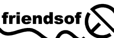

## 引言

本书延续了我对 HTML5 的探索。在开发这些项目时，我的方法是结合 `canvas` 和 `video` 等功能；尝试更复杂的绘制，利用数学知识；并运用标准编程技术，如面向对象编程和内容与逻辑的分离。我还对构建将 delincarción de HTML5 与 JavaScript 结合其他技术（包括谷歌地图、地理位置和服务器端编程）的应用程序很感兴趣。

本书的每一章都聚焦于一个应用程序或一组相关应用程序。这是因为我作为教师和学习者的经验表明，概念和机制最好在实际使用的情境中理解。这些应用程序从绘制 HTML5 官方标志开始。正如您将在第 1 章中发现的那样，我开发这个应用程序的方式促使了坐标变换的使用。第 2 章的项目涉及家庭拼贴，灵感来自于我不断壮大的家庭，以及教授面向对象编程的愿望。这是一个很好的应用程序，您可以将其作为基础，使用您自己的照片和您自己发明的对象来创建属于您自己的作品。第 3 章展示了如何创建弹跳视频，它建立在我创建的其他二维应用程序之上，并提供了两种不同的结合 `canvas` 和 `video` 的方式。

第 4、5 和 6 章演示了谷歌地图 API（应用程序编程接口）的使用，这是一个强大的工具，可让您将谷歌地图的访问功能作为您自己项目的一部分。第 4 章展示了一个结合了地图和 `canvas` 的用户界面，包括一个自定义设计和在绘制路径时使用 alpha（透明度）的功能。第 5 章讨论的三种应用程序都展示了如何使用地图作为访问媒体的门户。这一系列的应用程序向您展示了如何分离内容和逻辑，以便您可以扩展到各种应用程序（例如，区域导览或包含多个地点的地理测验）。第 6 章介绍了 `geolocation`，即确定终端用户位置的技术。我将其与使用 PHP 的服务器端编程相结合，使您能够向您选择的某人发送包含您所在位置的电子邮件。

在第 7 章中，我使用制作折纸指南来展示如何结合线条绘制（通常使用数学表达式）、视频和照片。您可以将其作为您自己的使用绘图、视频和图像的指南集的模型，或者让阅读帮助您复习代数和几何的主题。第 8 章的灵感来自于我曾经使用 Adobe Flash 制作的一个项目，在该项目中，拼图被转换为视频。在本章的项目中，您还将学习如何使其在 iPod 和 iPad 上工作，包括如何整合手指触摸事件的处理。同样，第 9 章最初也是受到我使用 Flash 制作的一个识别并命名各州游戏的启发。本章包含了将各州以拼图形式打乱的挑战，包括使用 `localStorage` 保存进行中的拼图的功能。最终的教育游戏呈现了一个必须处理多种玩家操作类型的用户界面。第 10 章是最后一章，演示了数据库的使用。在本章中，HTML5 和 JavaScript 与 PHP 以及结构化查询语言（SQL）相结合，后者是大多数数据库的标准语言。本章介绍的数据库是 MySQL。HTML5 的表单验证功能以及 `localStorage` 满足了许多数据库应用程序的常见需求。该数据库应用程序还演示了用户密码的单向加密以及客户端和服务器端表单验证的结合。

xiv

## 本书面向谁？

我相信我的解释是完整的，但我并不声称，正如我之前的著作 *The Essential Guide to HTML5* 那样，这本书面向完全的初学者。本书面向具有一定编程知识、希望通过结合基本功能并将 JavaScript 与其他技术相结合来构建（更）大型应用程序的开发人员。它也可以作为与程序员合作的人员的创意手册，帮助他们了解可以实现什么。

## 本书的结构是怎样的？

本书由十章组成，每一章都围绕一个应用程序或一类应用程序进行组织。您可以跳读。但是，在阅读第 5 章或第 6 章之前，先阅读第 4 章可能更有意义。此外，PHP 服务器端语言在第 6 章中以简单的方式使用，然后在第 10 章中更充分地使用。其他交叉引用在文中都有标注。每一章都以应用程序的介绍开始，附有应用程序使用中的屏幕截图。在某些情况下，会展示不同浏览器之间的差异。各章继续讨论关键需求，在深入技术细节之前介绍概念。接下来的部分描述了如何使用 HTML5、JavaScript、PHP 和/或 SQL 中的特定构造以及标准编程技术来满足这些需求。然后，我逐行展示应用程序代码并附带注释。每一章都以将应用程序测试和上传到服务器的说明和提示结束，以及您所学内容的总结。

代码（第 10 章中注明的某些例外）都包含在出版商提供的下载资源中。此外，图表可作为全彩 TIFF 文件获取。当然，您会希望在第 2、3、5 和 8 章所示的项目中使用您自己的媒体。我的媒体（视频、音频、图像）包含在代码中，其中包括第 9 章州名游戏中 50 个州的图像。您可以将该项目作为世界上其他地区或基于图像或图表的拼图的模型。

让我们开始吧。

## 第 1 章

### 构建 HTML5 标志——在画布上绘制、缩放与语义标签

在本章中，我们将回顾：

- 在 `canvas` 上绘制路径
- 在 `canvas` 上放置文本
- 坐标变换
- 用于 `canvas` 上绘制文本的字体和其他元素中文本的字体
- 语义标签
- `range` 输入元素

### 引言

本章的项目是官方 HTML5 标志的展示，附带说明文字。标志的盾牌和字母绘制在 `canvas` 元素上，附带文本演示了语义标签的使用。观看者可以使用滑块输入设备更改标志的大小。作为本书——一本利用 HTML5、JavaScript 及其他技术的项目集——的开篇，它是合适的，因为主题内容如此，而且它很好地回顾了 HTML5 中的基本事件驱动编程和其他重要特性。我开发这个项目的方式，在他人工作基础上进行构建，代表了我们大多数人工作的典型方式。特别是，这种情况为坐标变换的使用提供了动机。最后，在撰写本文时，Firefox 尚未完全实现滑块输入元素。不幸的是，这也是一种常见情况，我将讨论其影响。

本书的方法是结合具体示例来解释 HTML5、层叠样式表和 JavaScript 各章。这些项目代表了各种应用程序，希望您能在每一个中找到可以学习并适应您自己用途的内容。

## 第一章 构建 HTML5 标志——使用 Canvas 绘制、缩放与语义标签

> 注意：如果您需要关于如何使用 HTML5 和 JavaScript 进行编程的入门介绍，可以参考我的书籍《HTML5 权威指南》或由 Apress 等出版的其他书籍。网上也有大量相关材料可供参考。

图 1-1 展示了在 Chrome 浏览器中打开标志项目时的初始界面。（如需查看在 Firefox 浏览器中的外观，请直接跳转到图 1-3。）

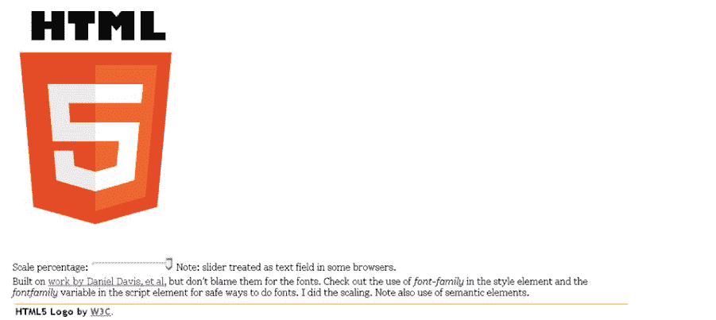

### 图 1-1. HTML5 标志的初始界面

请注意滑块功能、旁边的文本（其中包含一个看似超链接的元素）以及位于黄色线条下方页脚中的文本。该页脚也包含一个超链接。正如我稍后将解释的，页脚及任何其他语义元素的功能和格式完全由我决定，但提供指向该标志所有者——万维网联盟（The World Wide Web Consortium）的参考链接，将被视为一种适当的使用方式。

用户可以使用滑块来改变标志的大小。图 1-2 展示了调整滑块后，将标志的宽度和高度均缩小至大约三分之一时的应用界面。


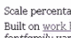


目前，没有任何浏览器完全实现了 HTML5 标准。事实上，Firefox 将所有滑块输入都视为简单的文本字段。这被称为“优雅降级”，它当然比什么都不显示要好。图 1-3 展示了在 Firefox 中的初始界面。请注意，初始值显示为 100。

### 项目历史与关键需求

本项目的关键需求有些特殊，且不易脱离 HTML 来单独阐述。例如，我想要绘制标志，而不是从网络上复制一张图片。我的设计目标始终包括希望练习编程并为我的学生准备示例。标志的盾牌部分形状似乎适合在 Canvas 上绘制，而 "HTML" 字母则可以使用文本绘制功能来完成。此外，绘制图像相比于使用图像文件具有一些实际优势。单独的文件需要管理、存储和下载。图 1-4 中显示的图像大小为 90KB。而包含程序代码的文件仅 4KB。绘制一个标志或其他图形意味着其缩放和其他属性可以通过代码动态更改。


图 1-4. 标志图像

我在网上找到了一个由 Opera 公司的 Daniel Davis 仅绘制盾牌的示例。这非常有帮助，因为这意味着我不必测量标志图像的副本以获取坐标。这就引出了一个问题：他是如何确定这些坐标的？即使我们曾通过邮件愉快地交流过，我也不知道答案。一种可能性是下载该图像，然后使用 Adobe Photoshop 或 Corel Paint Shop Pro 等图像处理程序的网格功能。另一种可能性是使用（传统的）透明坐标纸。

然而，基于 Daniel Davis 的工作存在一个问题。他的应用程序并未包含 "HTML" 字母。解决这个问题的方法是在屏幕上定位字母，然后可以说“向下移动”以使用 Daniel 示例中提供的坐标来定位盾牌的绘制。这个“向下移动屏幕”的技术术语是执行坐标变换。因此，执行坐标变换的能力成为了本项目的一个关键需求。

我决定撰写一些关于该标志的内容，特别是以超链接的形式提供致谢和参考文献。我决定在文档底部、一条分割线下方，以简短文本的形式引用标志的官方来源。对 Daniel Davis 的引用则是正文写作的一部分。我们曾就字体选择交换过意见，我将在下一节中进一步讨论。

为了让用户对标志有所操作，我决定提供一种改变其大小的方法。一个好的工具是指定了最小值、最大值和步长的滑块。因此，本应用的关键需求包括：使用特定字体绘制形状和字母、坐标变换、格式化包含主区域和页脚区域的文档，以及包含超链接。

## HTML5、CSS 和 JavaScript 功能

我假设您，读者，对 HTML 和 HTML5 文档有一定的了解。HTML5 中最重要的新功能之一是用于绘图的 Canvas 元素。我将简要介绍如何绘制具有适当颜色的填充路径和填充文本。接下来，我将介绍坐标变换，本项目将其用于标志的两个组成部分以及整个标志的缩放（改变大小）。最后，我介绍 `range` input 元素，它用于生成滑块。

### 在 Canvas 上绘制路径

Canvas 是 HTML5 中引入的一种元素类型。所有 Canvas 元素都有一个属性（或称特性），称为 2D 上下文（2D context）。通常，在文档加载后，会将一个变量设置为该属性：

```javascript
ctx = document.getElementById('canvas').getContext('2d');
```

重要的是要理解“Canvas”这个名字很贴切：代码为 Canvas 的像素着色，就像油漆一样。后续编写的代码可以在 Canvas 上涂抹不同的颜色。旧的颜色不会透出来。即使我们的代码导致矩形、形状和字母出现，这些不同的实体也并不会保留其作为可重新定位对象的身份。

盾牌是通过连续绘制六个填充路径产生的，累积结果如图 1-5 所示。在阅读代码时，您可以参考此图。请记住，在坐标中，第一个数字是距离 Canvas 左边缘的距离，第二个数字是距离 Canvas 上边缘的距离。

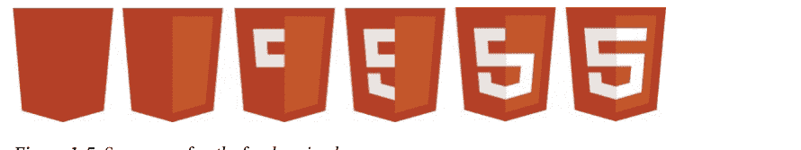

顺便说明一下，我选择向您展示带有累积结果的绘制序列。如果只显示绘制出的内容，您将看不到组成数字 5 左侧部分的白色部分。您现在能看到它，是因为它是两个白色填充路径叠加在橙色之上的结果。

所有绘制都使用持有 Canvas 元素 2D 上下文属性的 `ctx` 变量的方法和属性完成。任何后续填充操作的颜色，通过为 Canvas 上下文的 `fillStyle` 属性赋值来设置。

```javascript
ctx.fillStyle = "#E34C26";
```

这个特定的颜色，以十六进制格式给出，其中前两个十六进制（基数为 16）数字代表红色，接下来的两个代表绿色，最后两个代表蓝色，它是由 W3C 网站提供的，作为盾牌背景的特定橙色。这可能违反直觉，但在这个系统中，白色由值 `#FFFFFF` 指定。可以将其理解为所有颜色混合在一起产生白色。没有颜色是黑色，由 `#000000` 指定。标志中数字 5 右侧使用的珍珠灰色的值为 `#EBEBEB`。这是一个较高的值，接近白色。您无需记住这些值中的任何一个，但了解黑色和白色，以及纯红色为 `#FF0000`、纯绿色为 `#00FF00`、纯蓝色为 `#0000FF` 是有用的。您可以使用绘图程序（如 Adobe Photoshop、Corel Paint Shop Pro）或在线工具（如 `http://pixlr.com/`）中的吸管/颜色拾取器工具来获取图像中颜色的值，或者当有官方指定时，使用官方图像的颜色指定值。

所有绘制都使用二维坐标系完成。形状使用路径方法产生。这些方法假定一个当前位置，您可以将其视为画笔或油漆刷在 Canvas 上的位置。关键的方法是移动到某个位置，并从当前位置到指定位置设置一条线。以下语句从左下角开始绘制五边形的橙色形状。`closePath` 方法通过绘制一条返回到起始点的线来关闭路径。

```javascript
ctx.fillStyle = "#E34C26";
ctx.beginPath();
ctx.moveTo(39, 250);
ctx.lineTo(17, 0);
ctx.lineTo(262, 0);
ctx.lineTo(239, 250);
ctx.lineTo(139, 278);
ctx.closePath();
ctx.fill();
```

如果您以前没有在 Canvas 上绘制过任何东西，这里是生成该五边形所需的完整 HTML 脚本。`<body>` 标签中的 `onLoad` 属性在文档加载时触发 `init` 函数。`init` 函数设置 `ctx` 变量，设置 `fillStyle` 属性，然后绘制路径。

```html
<!DOCTYPE html>
<html>
<head>
<title>HTML 5 Logo</title>
<meta charset="UTF-8">
<script>
function init() {
  ctx = document.getElementById('canvas').getContext('2d');
  ctx.fillStyle = "#E34C26";
  ctx.beginPath();
  ctx.moveTo(39, 250);
  ctx.lineTo(17, 0);
  ctx.lineTo(262, 0);
  ctx.lineTo(239, 250);
  ctx.lineTo(139, 278);
  ctx.closePath();
  ctx.fill();
}
</script>
</head>
<body onLoad="init();">
<canvas id="canvas" width="600" height="400">
Your browser does not support the canvas element.
</canvas>
</body>
</html>
```

如果你之前没有在 canvas 上进行过绘制练习和实验，请这样做，但我将继续往下讲。其他形状的产生方式与此类似。顺便说一下，如果你看到盾牌中间有一条竖线，这是一种光学错觉。

### 在 canvas 和文档主体中放置文本

在 canvas 上绘制文本需要使用 context 的方法和属性。可以使用 `fillText` 方法填充文本，也可以使用 `strokeText` 方法绘制文本轮廓。颜色由当前的 `fillStyle` 属性或 `strokeStyle` 属性决定。context 的另一个属性是 `font`。该属性可以包含文本大小和一个或多个字体。包含多种字体的目的是为浏览器提供备选方案，以防第一种字体在运行浏览器的计算机上不可用。在这个项目中，我使用：

```javascript
var fontfamily = "65px 'Gill Sans Ultra Bold', sans-serif";
```

在 `init` 函数中：

```javascript
ctx.font = fontfamily;
```

这指示浏览器在可用时使用 Gill Sans Ultra Bold 字体，如果不可用，则使用计算机上的默认 sans-serif 字体。

我本可以将所有这些放在一个语句中，但选择将其作为一个变量。你可以判断我选择的字体是否与官方 W3C 徽标足够接近。

> **注意**：对于这个示例，至少还有另外两种方法。一种可能性是不使用文本，而是将字母绘制为填充路径。另一种是找到并获取一种字体，将其放置在存放 HTML5 文档的服务器上，并使用 `@font-face` 直接引用它。

设置了字体和颜色后，绘制文本的方法需要一个字符串和一个位置：x 和 y 坐标。在本项目中绘制字母的语句是：

```javascript
ctx.fillText("HTML", 31,60);
```

在 HTML 文档的其他部分（即 canvas 元素之外）格式化文本，同样需要关注字体。在这个项目中，我选择使用 HTML5 新增的语义元素，并遵循将格式化放在 style 元素中的做法。我的 HTML 脚本主体包含两个 article 元素和一个 footer 元素。一个 article 包含带有注释的 input 元素，另一个 article 包含其余的解释。footer 元素包含对 W3C 的引用。这些格式化和使用方式由开发者/程序员决定。这包括确保 footer 是文档中的最后一个元素。如果我将 footer 放在任何一个或两个 article 之前，它就不会再显示在文档的底部。本项目中的样式指令如下：

```css
footer {
  display: block;
  border-top: 1px solid orange;
  margin: 10px;
  font-family: "Trebuchet MS", Arial, Helvetica, sans-serif;
  font-weight: bold;
}

article {
  display: block;
  font-family: Georgia, "Times New Roman", Times, serif;
  margin: 5px;
}
```


这些样式将所有这些元素的实例设置为块级显示。这会在其前后产生换行。`footer` 顶部有边框，这会在文本上方产生一条线。两个样式都指定了四种字体的列表。因此浏览器首先查看 `Trebuchet MS` 是否可用，然后检查 `Arial`，再检查 `Helvetica`，如果仍然不可用，则使用系统默认的 `sans-serif` 字体来显示 `footer` 元素。同样，浏览器会先检查 `Georgia`，然后是 `Times New Roman`，然后是 `Times`，如果仍不可用，则使用标准 `serif` 字体。这可能是过度设计，但这是最安全的操作方式。`footer` 文本以粗体显示，每个 `article` 周围有 5 像素的边距。

格式化（包括字体）很重要。HTML5 提供了许多用于格式化的功能，以及将格式化与结构和内容分离的功能。你需要区别对待 `canvas` 上的文本和其他元素中的文本。

### 坐标变换

我已经说明了我使用坐标变换的动机，具体来说是为了持续使用一组坐标。回顾一下，坐标系统是在 `canvas` 上指定位置的方式。位置被指定为与原点之间的距离。对于二维 `canvas`，需要两个坐标：第一个坐标控制水平方向，通常称为 `x`；第二个坐标控制垂直方向，称为 `y`。一个烦人的事实是，在屏幕上绘制时，`y` 轴是翻转的，因此垂直方向从 `canvas` 顶部开始测量。水平方向从左侧开始测量。这意味着点 `(100,200)` 比点 `(100,100)` 更靠下。

在徽标项目中，我编写了代码来显示字母 HTML，然后将原点移动以绘制徽标的其余部分。类比来说，我知道我的房子相对于城镇中心的位置，所以我可以给出到城镇中心的路线，然后再给出到我家的路线。我在徽标中绘制字母并“向下移动屏幕”的情况需要平移变换。该平移仅在垂直方向进行。平移量存储在我命名为 `offsety` 的变量中：

```javascript
var offsety = 80;
...
ctx.fillText("HTML", 31, 60);
ctx.translate(0, offsety);
```

由于我决定提供一种让观看者更改徽标大小的方法，我使用了缩放变换。继续用方向来类比，这相当于改变单位。你可能用英里（或公里）给出某些方向，而用码、英尺、米或街区来给出其他方向。缩放可以针对每个维度单独进行。在此应用中，有一个名为 `factorvalue` 的变量，由输入更改时调用的函数设置。语句

```javascript
ctx.scale(factorvalue, factorvalue);
```

改变水平和垂直方向的单位。

HTML5 提供了一种保存坐标系统当前状态并恢复已保存状态的方法。如果你需要代码回到之前的状态，这很重要。保存和恢复是使用称为栈的结构来完成的：后进先出。恢复坐标状态称为弹出栈，保存坐标状态称为将某些内容压入栈。我的徽标项目没有充分发挥这一点的作用，但如果你正在做更复杂的应用，请记住这一点。在徽标项目中，我的代码在文档首次加载时保存原始状态。然后在绘制徽标之前，恢复保存的内容，然后再保存一次，以便下次使用。绘制徽标的函数 `dologo` 开头的代码如下所示：

```javascript
function dologo() {
var offsety = 80;
ctx.restore();
ctx.save();
ctx.clearRect(0,0,600,400);
ctx.scale(factorvalue,factorvalue);
ctx.fillText("HTML", 31,60);
ctx.translate(0,offsety);
```

```javascript
// 五边形橙色背景
ctx.fillStyle = "#E34C26";
ctx.beginPath();
ctx.moveTo(39, 250);
ctx.lineTo(17, 0);
ctx.lineTo(262, 0);
ctx.lineTo(239, 250);
ctx.lineTo(139, 278);
ctx.closePath();
ctx.fill();
```

```javascript
// 右侧较浅的橙色背景部分
ctx.fillStyle = "#F06529";
ctx.beginPath();
ctx.moveTo(139, 257);
ctx.lineTo(220, 234);
ctx.lineTo(239, 20);
ctx.lineTo(139, 20);
ctx.closePath();
ctx.fill();
...
```

> 注意 `canvas` 被清除了（擦除了）之前绘制的任何内容。

### 使用 range 输入元素

我称为滑块的输入设备是新的 HTML5 输入类型 `range`，它被放置在 HTML 文档的主体中。我的放在 `article` 元素内。此类型和其他输入元素的属性提供了指定初始值、最小值和最大值、最小增量调整以及观看者更改滑块时采取的操作的方式。代码是

```html
<input id="slide" type="range" min="0" max="100" value="100"
onChange="changescale(this.value)" step="10"/>
```

最小值、最大值、（初始）值和步长都可以根据你的喜好进行设置。由于我使用的是百分比，并且不希望标志变得比初始值更大或处理负值，所以我使用了 0 和 100。

在滑块的正确实现中，用户看不到初始值、最大值或最小值。我的代码将输入作为百分比使用。表达式 `this.value` 被解释为 THIS 元素的 `value` 属性，大写以强调切换到英语！术语 `this` 在 JavaScript 和其他几种编程语言中具有特殊含义。`changescale` 函数获取赋值给 `onChange` 属性的参数中指定的值，并使用它来设置一个全局变量（在任何函数外部声明的变量，因此它可以持续存在并可供任何函数使用）。

```javascript
function changescale(val) {
    factorvalue = val / 100;
    dologo();
}
```

HTML5 规范的一部分是浏览器将提供表单验证，即检查 `input` 元素中指定的属性条件是否得到遵守。这可以在减少程序员需要做的工作方面显著提高生产力，并且由于浏览器执行检查可能更快，因此在性能方面也会有所提升。我们将在关于数据库和 PHP 的第 10 章中更详细地讨论这一点。在 HTML5 标志项目中，滑块的一个优点是用户不需要关心值，只需移动设备即可。无法输入非法值。我不想贬低 Firefox 浏览器，而且，正如我指出的那样，生成一个文本框总比什么都不生成好，但至少在撰写本文时，它不显示滑块也不进行任何检查。图 1-6 显示了在输入字段中输入值 200 的结果。

画布具有固定的宽度和高度，超出画布的绘制（当缩放以接受数字并将其扩展为原始值的两倍时所做的事情）会被忽略。

### 构建应用程序并使其个性化

该项目只做一件事，绘制标志。为此定义了一个函数 `dologo`。非正式地说，程序的大纲是：

1. `init`：初始化
2. `dologo`：从 HTML 字母开始绘制标志，然后绘制盾牌
3. `changescale`：更改缩放比例

函数调用表显示了函数之间的关系。`dologo` 函数在文档首次加载时被调用，然后在每次缩放比例更改时被调用。

*表 1-1. HTML5 标志项目中的函数*

| 函数 | 被谁调用 / 调用者 | 调用 |
|----------|---------------------|-------|
| `init` | 由 `<body>` 标签中 `onLoad` 属性的操作调用 | `dologo` |
| `dologo` | `init` 和 `changescale` | |
| `changescale` | 由 `<input type="range"…>` 标签中 `onChange` 属性的操作调用 | `dologo` |

`dologo` 函数的编码结合了前面描述的技术。特别是，代码恢复了原始坐标系并清除了画布。

此应用程序中的全局变量是：

```javascript
var ctx;
var factorvalue = 1;
var fontfamily = "65px 'Gill Sans Ultra Bold', sans-serif";
```

如前所述，可以不使用 `fontfamily` 而直接在代码中使用字符串。将 `ctx` 和 `factorvalue` 设为全局变量很方便。

表 1-2 显示了基本应用程序的代码，每行都有注释。

### 表 1-2. HTML5 标志项目的完整代码

| 代码行 | 描述 |
|-----------|-------------|
| `<!DOCTYPE html>` | 头部 |
| `<html>` | 开始 html 标签 |
| `<head>` | 开始 head 标签 |
| `<title>HTML5 Logo </title>` | 完整的 title 元素 |
| `<meta charset="UTF-8">` | meta 标签 |
| `<style>` | 开始 style 标签 |
| `footer {display:block; border-top: 1px solid orange; margin: 10px; font-family: "Trebuchet MS", Arial, Helvetica, sans-serif; font-weight: bold;}` | 页脚的样式，包括顶部边框和字体系列 |
| `article {display:block; font-family: Georgia, "Times New Roman", Times, serif; margin: 5px;}` | 两个 article 的样式 |
| `</style>` | 关闭 style 元素 |
| `<script language="JavaScript">` | 开始 script 标签。注意：JavaScript 不区分大小写。 |
| `var ctx;` | 用于保存上下文的变量。用于所有绘图 |
| `var factorvalue = 1;` | 设置缩放的初始值 |
| `var fontfamily = "65px 'Gill Sans Ultra Bold', sans-serif";` | 设置绘制在画布上的文本的字体 |
| `function init() {` | `init` 函数的开始 |
| `ctx = document.getElementById('canvas').getContext('2d');` | 设置 `ctx` |
| `ctx.font = fontfamily;` | 设置绘制在画布上的文本的字体 |
| `ctx.save();` | 保存原始坐标状态 |
| `dologo();` | 调用函数绘制标志 |

第 1 章 ■ 构建 HTML5 标志 - 在画布上绘制，带缩放，以及语义标签

| 代码行 | 描述 |
| --- | --- |
| `}` | 关闭函数 |
| `function dologo() {` | `dologo` 函数的开始 |
| `var offsety = 80 ;` | 指定调整坐标的量以绘制标志的盾牌部分。 |
| `ctx.restore();` | 恢复坐标的原始状态 |
| `ctx.save();` | 保存它（压入堆栈）以便再次恢复 |
| `ctx.clearRect(0,0,600,400);` | 擦除整个画布 |
| `ctx.scale(factorvalue,factorvalue);` | 使用滑块设置的值进行水平和垂直缩放 |
| `ctx.fillText("HTML", 31,60);` | 绘制字母：HTML |
| `ctx.translate(0,offsety);` | 向下移动屏幕（画布） |
| `// 5 边形橙色背景` | |
| `ctx.fillStyle = "#E34C26";` | 设置为官方亮橙色 |
| `ctx.beginPath();` | 开始一条路径 |
| `ctx.moveTo(39, 250);` | 移动到左下角的指定位置 |
| `ctx.lineTo(17, 0);` | 向上并向左更多地绘制一条线 |
| `ctx.lineTo(262, 0);` | 向右直绘制一条线 |
| `ctx.lineTo(239, 250);` | 向下并向左稍绘制一条线 |
| `ctx.lineTo(139, 278);` | 绘制一条线到盾牌的中间低点 |
| `ctx.closePath();` | 关闭路径 |

第 1 章 ■ 构建 HTML5 标志 - 在画布上绘制，带缩放，以及语义标签

| 代码行 | 描述 |
| --- | --- |
| `ctx.fill();` | 用指定的颜色填充 |
| `// 右手边，背景的较浅橙色部分 //` | |
| `ctx.fillStyle = "#F06529";` | 设置颜色为官方较深的橙色 |
| `ctx.beginPath();` | 开始路径 |
| `ctx.moveTo(139, 257);` | 移动到靠近顶部的中点 |
| `ctx.lineTo(220, 234);` | 向右并稍向上绘制一条线 |
| `ctx.lineTo(239, 20);` | 向右并向上绘制一条线 |
| `ctx.lineTo(139, 20);` | 向左绘制一条线（指向中间） |
| `ctx.closePath();` | 关闭路径 |
| `ctx.fill();` | 用指定的颜色填充 |
| `// 浅灰色，// 5 的左手边部分` | |
| `ctx.fillStyle = "#EBEBEB";` | 设置颜色为灰色 |
| `ctx.beginPath();` | 开始路径 |
| `ctx.moveTo(139, 113);` | 移动到水平中点，垂直中点 |
| `ctx.lineTo(98, 113);` | 向左绘制一条线 |
| `ctx.lineTo(96, 82);` | 向上并稍向左更多地绘制一条线 |
| `ctx.lineTo(139, 82);` | 向右绘制一条线 |
| `ctx.lineTo(139, 51);` | 向上绘制一条线 |
| `ctx.lineTo(62, 51);` | 向左绘制一条线 |

| 代码行 | 描述 |
|---|---|
| `ctx.lineTo(70, 144);` | 向左并向下绘制一条线 |
| `ctx.lineTo(139, 144);` | 向右绘制一条线 |
| `ctx.closePath();` | 关闭路径 |
| `ctx.fill();` | 用指定的颜色填充 |
| `ctx.beginPath();` | 开始一条新路径 |
| `ctx.moveTo(139, 193);` | 移动到中点 |
| `ctx.lineTo(105, 184);` | 向左并向上绘制一条线 |
| `ctx.lineTo(103, 159);` | 向左稍并向上绘制一条线 |
| `ctx.lineTo(72, 159);` | 向左更多地绘制一条线 |
| `ctx.lineTo(76, 207);` | 向右稍并向下绘制一条线 |
| `ctx.lineTo(139, 225);` | 向左并向下绘制一条线 |
| `ctx.closePath();` | 关闭路径 |
| `ctx.fill();` | 用指定的颜色填充形状 |
| `// 白色，5 的右手边部分` | |
| `ctx.fillStyle = "#FFFFFF";` | 设置颜色为白色 |
| `ctx.beginPath();` | 开始路径 |
| `ctx.moveTo(139, 113);` | 从中点开始 |
| `ctx.lineTo(139, 144);` | 向下绘制一条线 |
| `ctx.lineTo(177, 144);` | 向右绘制一条线 |
| `ctx.lineTo(173, 184);` | 向左稍并向下绘制一条线 |

## 第一章 ■ 构建 HTML5 标志——在画布上绘制、缩放与语义标签

| 代码行 | 说明 |
|---|---|
| `ctx.lineTo(139, 193);` | 向左下方绘制线条 |
| `ctx.lineTo(139, 225);` | 向下绘制线条 |
| `ctx.lineTo(202, 207);` | 向右上方绘制线条 |
| `ctx.lineTo(210, 113);` | 稍微向右上方绘制线条 |
| `ctx.closePath();` | 闭合路径 |
| `ctx.fill();` | 以白色填充 |
| `ctx.beginPath();` | 开始新路径 |
| `ctx.moveTo(139, 51);` | 移动到中间点 |
| `ctx.lineTo(139, 82);` | 向下移动 |
| `ctx.lineTo(213, 82);` | 向右移动 |
| `ctx.lineTo(216, 51);` | 稍微向右上方移动 |
| `ctx.closePath();` | 闭合路径 |
| `ctx.fill();` | 以白色填充 |
| `}` | 关闭 `dologo` 函数 |
| `function changescale(val) {` | 打开 `changevalue` 函数，带参数 |
| `    factorvalue = val / 100;` | 将 `factorvalue` 设为输入值除以 100 |
| `    dologo();` | 调用函数绘制标志 |
| `}` | 关闭 `changevalue` 函数 |
| `</script>` | 关闭 script 元素 |
| `</head>` | 关闭 head 元素 |
| `<body onLoad="init();">` | body 标签，属性设置为调用 `init` |
| `<canvas id="canvas" width="600" height="400">` | canvas 标签，设置尺寸和 id 供代码使用 |
| `Your browser does not support the canvas element.` | 如果不支持 canvas 则显示此消息 |
| `</canvas>` | 关闭 canvas 标签 |


| 内容 | 说明 |
|---|---|
| `<article>` | article 标签 |
| `Scale percentage: <input id="slide" type="range" min="0" max="100" value="100" onChange="changescale(this.value)" step="10"/>` | 滑块（范围）输入及其设置 |
| `Note: slider treated as text field in some browsers.` | 注释说明滑块在某些浏览器中可能显示为文本字段，但仍然可用 |
| `</article>` | 关闭 article 标签 |
| `<article>Built on <a href="http://people.opera.com/danield/html5/html5logo/">work by Daniel Davis, et al</a>, but don't blame them for the fonts. Check out the use of <em>font-family</em> in the style element and the <em>fontfamily</em> variable in the script element for safe ways to do fonts. I did the scaling. Note also use of semantic elements.</article>` | article 标签，包含一些文本和超链接 |
| `<footer>HTML5 Logo by <a href="http://www.w3.org/"><abbr title="World Wide Web Consortium">W3C</abbr></a>.` | footer 标签及其内容，包含 abbr 元素 |
| `</footer>` | 关闭 footer 标签 |
| `</body>` | 关闭 body |
| `</html>` | 关闭 html |

你可以通过在自己的作品中全部或部分使用此应用来使其成为你自己的作品。关于字体部分的注释你可能需要省略。

## 测试和上传应用

这是一个简单的测试和上传（及测试）应用，因为它是单文件。我听说该标志可以在 iPhone4 和 iPad2 上显示，但在这些设备上滑块是文本框。我还在 PC 上的 Safari 和 Opera 上进行了测试。你可以跳到第八章，那里有一个拼图变成视频的项目，该项目确实可以在 iPhone 和 iPad 上使用手指触摸，也可以在电脑上使用鼠标移动。

## 小结

在本章中，你学习了如何进行特定绘制，以及其他类似应用的开发步骤。使用的功能包括：

- 路径
- 画布上的文本以及 body 中语义元素内的文本
- 范围输入元素及其关联的 change 事件
- 坐标变换，即 `translate` 和 `scale`
- 字体集合的指定
- 语义元素的样式，包括使用顶部边框在页脚前绘制线条

下一章将介绍如何构建一个用于制作照片和形状组合或拼贴的实用应用。它结合了在画布上绘制和创建 HTML 元素的技术，以及计算机中的一个标准技术——对象。它还利用坐标变换。

# 第二章

## 家庭拼贴画：在画布上操作程序员定义的对象

在本章中，你将学习：

- 创建和操作面向对象编程以在画布上绘制
- 处理鼠标事件，包括双击
- 将画布保存为图像
- 使用 `try` 和 `catch` 捕获错误
- 代码位置涉及的浏览器差异
- 使用代数和几何构建形状并确定光标何时位于特定对象上
- 控制光标使用的图标

## 引言

本章的项目是一个在画布上操作对象以生成图片的实用工具。我称其为实用工具，因为一个人完成编程、收集照片和设计后，可以将程序提供给朋友、家人、同事及其他人来制作作品/拼贴画。结果可以是任何东西，从抽象设计到照片拼贴。我示例中的对象包括两个矩形、一个椭圆、一个圆形、一个心形和五张家庭照片。你可以复制任何对象或删除任何对象。最终用户使用鼠标拖放来定位对象。当图片被认为完成时，可以创建可下载到文件中的图像。

图 2-1 显示了我程序的初始屏幕。注意你开始时有十个对象需要排列。

按下鼠标、移动、松开鼠标以移动对象。双击创建新对象。如果图像未能显示，点击重新加载。

打开带有图像的窗口（可以保存为图像文件）

移除最后移动的对象

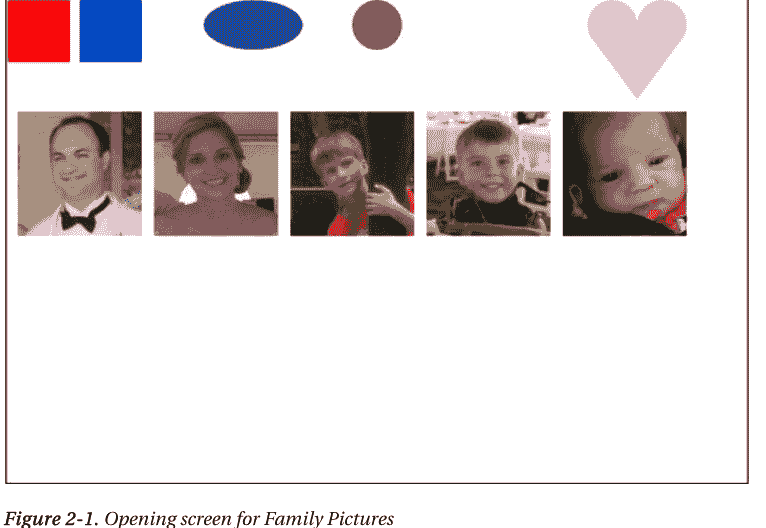

##### 图 2-1. 家庭照片初始屏幕

图 2-2 展示了作为最终用户的我生成的成品。我安排了照片来代表我儿子的家庭，包括我的新孙女。我删除了两个矩形和椭圆，并复制了圆形，将其定位为图片角落的装饰。

按下鼠标、移动、松开鼠标以移动对象。双击创建新对象。如果图像未能显示，点击重新加载。

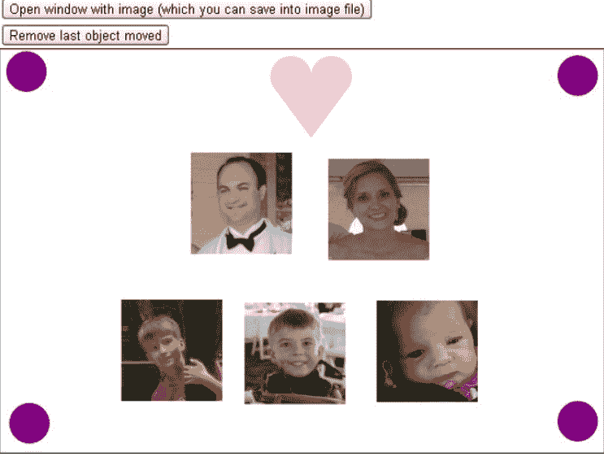

我决定包含一个心形，不仅仅是出于情感原因，还因为它需要我使用代数和几何。不要害怕数学，它非常有用。可以说，我发明了一个规范的心形。对于其他形状，你可能能够用数学表达式找到标准定义。

在这种情况下，我创建了一组对象，然后使用程序进行构图。你可以规划你的应用来获取家庭照片或按另一主题分类的照片，以及一组圆形、椭圆、矩形和心形。完成后，你可以将此程序提供给其他人使用。这类似于为玩家构建游戏程序。此应用的最终用户可能是家庭成员、朋友或同事。

当然，当然可以使用 Adobe Photoshop 或 Corel Paint Shop Pro 等绘图程序来创建此类作品，但此应用针对其特定目的提供了相当大的易用性。该项目还作为学习重要编程技术以及 HTML5 和 JavaScript 功能的载体。而且，正如将不断重复的，浏览器之间存在差异需要讨论。

## 关键需求

本项目的关键需求包括构建一个在屏幕上操作对象的框架，包括检测对象上的鼠标事件、删除对象和创建对象副本。当前的框架提供了一种指定矩形、椭圆、心形和图像的方法，但该方法可以容纳其他形状，这是本章的一个重要教训。

目标是使拖放操作相当精确：不仅仅是将某物从窗口的一个区域移动到另一个区域。我将在第八章和第九章关于制作拼图的内容中重新讨论这个话题。

我还决定控制光标的外观。当鼠标不在画布上时，光标是标准箭头。当在画布元素上时，光标将是十字准线。当用户按下鼠标按钮并拖动对象时，光标变为带食指的手形。

当工作完成时，保存它是很自然的愿望，可能作为图像文件，所以这也是项目的一个需求。

## HTML5、CSS 和 JavaScript 功能

我们现在探索家庭拼贴画项目中使用的 HTML5 和 JavaScript 功能。思路是维护画布上内容的列表。这个列表将是一个 JavaScript 数组。信息将包括每个项目的位置、如何在画布上绘制它以及如何确定鼠标光标是否在该项目上。

## JavaScript 对象

面向对象编程是计算机科学的标准，也是大多数编程语言的关键部分。对象有属性，也称为特性，以及方法。方法就是一个函数。换句话说，对象具有数据和使用数据的代码。HTML 和 JavaScript 有许多内置对象，如 `document` 和 `window`，还有数组和字符串。对于家庭照片项目，我使用了 JavaScript 中的一项基本功能（在 HTML5 之前就已建立）来定义我自己的对象。这些有时被称为用户定义的对象，但我和其他人更喜欢的术语是程序员定义的对象。这对于家庭拼贴画项目来说是一个重要的区别，在这个项目中，你作为程序员可以创建一个应用，包含你识别和设计的图片及其他形状，然后提供给家庭成员使用。

本项目的目标是建立一个在画布上创建和操作不同形状的框架，同时要牢记一旦某物绘制到画布上，其作为矩形或图像的身份就会丢失。每个形状的第一步是定义所谓的构造函数，该函数存储指定形状的信息。下一步是定义方法，即使用这些信息来完成需要做的事情的代码。

我的方法给人一种在画布上移动事物的外观。实际上，内部变量中保存的信息被更改，每次发生更改画布外观的事情时，画布都会被清除并重新绘制。

我的策略是定义新类型的对象，每个对象都将定义两个方法：

- `draw` 用于在画布上绘制对象
- `overcheck` 用于确定给定位置，特别是鼠标位置，是否在对象上

这些方法引用对象的属性，并在数学表达式中使用这些值来产生结果。一旦构造函数被定义，就可以作为这些对象的新实例来创建值。一个名为 `stuff` 的数组保存所有对象实例。

## `Rect`（矩形）

`Rect` 构造函数的定义如下：

```javascript
function Rect(x, y, w, h, c) {
    this.x = x;
    this.y = y;
    this.w = w;
    this.h = h;
    this.draw = drawrect;
    this.color = c;
    this.overcheck = overrect;
}
```

该函数在文档加载时调用的 `init` 函数中使用方式如下：

```javascript
var r1 = new Rect(2, 10, 50, 50, "red");
```

变量 `r1` 被声明并设置为使用 `Rect` 函数构造的新对象。内置关键字 `new` 负责创建新对象。新构造的对象保存了初始 `x` 和 `y` 位置的值 2 和 10，通过属性名 `x` 和 `y` 访问；宽度和高度的值 50 和 50，通过属性名 `w` 和 `h` 访问。关键字 `this` 指的是正在构造的对象。`new` 和 `this` 的英文含义与计算机术语含义是一致的。`Rect` 函数还为属性 `draw` 和 `overcheck` 存储了值。从目前看到的内容来看可能并不明显，但这些值将用于调用名为 `drawrect` 和 `overrect` 的函数。这是为程序员自定义对象指定方法的方式。最后，`color` 属性被设置为 `"red"`。

## `Oval`（椭圆形）

接下来，`Oval` 的构造函数与之类似。

```javascript
function Oval(x, y, r, hor, ver, c) {
    this.x = x;
    this.y = y;
    this.r = r;
    this.radsq = r * r;
    this.hor = hor;
    this.ver = ver;
    this.draw = drawoval;
    this.color = c;
    this.overcheck = overoval;
}
```

`x` 和 `y` 值指的是椭圆的中心。`hor` 和 `ver` 属性将分别用于缩放水平轴和垂直轴，根据数值的不同，产生不是圆形的椭圆。`radsq` 属性被计算并存储，以节省 `overoval` 函数中的时间。

> 注意：计算机的速度非常快，我通过预先存储并使用半径的平方来显露了自己的年代感。不过，为了节省计算时间而用额外存储空间来做这种权衡，可能是合理的。

在我的示例中：

```javascript
var oval1 = new Oval(200, 30, 20, 2.0, 1.0, "teal");
```

产生了图 2-1 中的蓝绿色椭圆。注意它在水平方向上被拉长了。相比之下，紫色椭圆在以下声明中定义：

```javascript
var cir1 = new Oval(300, 30, 20, 1.0, 1.0, "purple");
```

紫色圆形的 `hor` 和 `ver` 值相同，因此是一个正圆。你完全有理由问：这些信息是如何或在哪里被用来产生椭圆或圆形的？答案将在后面展示的 `drawoval` 函数中。同样，检查给定的 `x,y` 位置是否在椭圆上是由 `overoval` 函数执行的。

## `Picture`（图片）

`Picture` 对象的构造函数存储了位置、宽度和高度，以及 Image 对象的名称。

```javascript
function Picture(x, y, w, h, imagename) {
    this.x = x;
    this.y = y;
    this.w = w;
    this.h = h;
    this.imagename = imagename;
    this.draw = drawpic;
    this.overcheck = overrect;
}
```

我的示例中有四个 Picture 对象。以下是设置其中一个的代码：

```javascript
var dad = new Image();
dad.src = "daniel1.jpg";
var pic1 = new Picture(10, 100, 100, 100, dad);
```

设置一个 Picture 对象比 Rect 对象需要更多的工作。我需要编写代码来创建一个 Image 对象。这是 JavaScript 中的内置对象类型。我需要获取一个图像文件，将其移动到与 HTML 文件相同的文件夹中，并编写代码将正确的文件名赋值给 Image 变量的 `src` 属性。（或者，你可以将所有图像放入子文件夹或多个子文件夹中。例如，`src` 的字符串可以是 `"images/daniel1.jpg"`。）然后我编写构造 `pic1` 变量的代码行。

## `Heart`（心形）

我们还要介绍最后一个程序员自定义的对象。我给自己设定的挑战是定义能够描述心形的值。我想出了以下内容：心形由位置定义，即 `x, y` 值对，表示心形缺口的定位；从缺口到底点的距离，以及代表心形弯曲部分的两个部分圆的半径。你可以将其视为标准心形。关键信息如图 2-3 所示。如果你在应用程序中添加新的形状类型，你需要发明或发现定义该形状的数据。

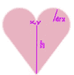

*图 2-3. 定义心形的数据*

构造函数将指示的值以及颜色保存到新构造的对象中。你可能怀疑绘制和 overcheck 会比矩形函数更复杂一些，你的怀疑是正确的。构造函数类似于其他构造函数。

```javascript
function Heart(x, y, h, drx, color) {
    this.x = x;
    this.y = y;
    this.h = h;
    this.drx = drx;
    this.radsq = drx * drx;
    this.color = color;
    this.draw = drawheart;
    this.overcheck = overheart;
    this.ang = .25 * Math.PI;
}
```

`ang` 属性是我为自己留后路的一个例子。你会注意到它是一个常量，我可以不把它作为属性。稍后我解释 `drawheart` 时，你会看到我的代码如何使用它使心形变得圆润。我把它设为属性，以防我想要更改以允许心形有更多的可变性。

## Drawing（绘制）

我有不同的方法函数需要解释，但让我们先去看绘制发生的地方，以演示所有这些是如何协同工作的。我定义了一个初始为空的数组：

```javascript
var stuff = [];
```

然后我的代码通过如下语句向该数组添加元素：

```javascript
stuff.push(pic1);
stuff.push(pic2);
stuff.push(pic3);
stuff.push(pic4);
stuff.push(r1);
stuff.push(s1);
stuff.push(oval1);
stuff.push(cir1);
```

在适当的时机，即任何更改之后，会调用 `drawstuff` 函数。它的工作方式是清除画布，绘制一个矩形作为边框，然后遍历 `stuff` 数组中的每个元素并调用 `draw` 方法。该函数如下：

```javascript
function drawstuff() {
    ctx.clearRect(0, 0, 600, 400);
    ctx.strokeStyle = "black";
    ctx.lineWidth = 2;
    ctx.strokeRect(0, 0, 600, 400);
    for (var i = 0; i < stuff.length; i++) {
        stuff[i].draw();
    }
}
```

注意，没有这样的代码：问这是一个椭圆吗，如果是就做这个，或者这是一个图片吗，如果是就做那个……相反，为数组每个成员建立的 `draw` 方法会完成它的工作！当检查一个位置（鼠标）是否在对象上时，同样的神奇效果也会发生。随着添加更多对象类型，这种方法的优势会越来越大。

我意识到由于我的代码从不改变 `strokeStyle` 或 `lineWidth`，我可以将这些语句移到 `init` 函数中，只做一次。然而，我想到我可能有一个会改变这些值的形状，所以为了应对将来应用程序中可能出现的变化，我会在 `drawstuff` 中设置 `strokeStyle` 和 `lineWidth`。

现在我将解释绘制方法以及检查位置是否在对象上的方法。`drawrect` 函数非常直接：

```javascript
function drawrect() {
    ctx.fillStyle = this.color;
    ctx.fillRect(this.x, this.y, this.w, this.h);
}
```

记住，`this` 指的是 `drawrect` 作为其方法的对象。`drawrect` 函数是矩形和图片的方法。

`drawoval` 函数稍微复杂一点，但也只是稍微复杂一点。你需要回忆坐标变换的工作原理。HTML5 JavaScript 只允许圆形弧线，但允许缩放坐标来产生不是圆形的椭圆（ellipse）。`drawoval` 函数中的编码所做的是保存坐标系统的当前状态，然后执行平移到对象的中心。


随后会应用缩放变换，使用`hor`和`ver`属性。现在，在将`fillStyle`设置为`color`属性指定的颜色后，我使用绘制由圆弧组成的路径并填充该路径的代码。最后一步是恢复坐标系的原始状态。

```
function drawoval() {
    ctx.save();
    ctx.translate(this.x,this.y);
    ctx.scale(this.hor,this.ver);
    ctx.fillStyle = this.color;
    ctx.beginPath();
    ctx.arc(0,0,this.r,0,2*Math.PI,true);
    ctx.closePath();
    ctx.fill();
    ctx.restore();
}
```

这就是在画布上绘制可能是也可能不是圆形的椭圆的方法。由于我的代码恢复了坐标系的原始状态，这就起到了撤销缩放和平移变换的效果。

`drawpic`函数是最简单的，只有一行：

```
function drawpic() {
    ctx.drawImage(this.imagename,this.x,this.y,this.w,this.h);
}
```

同样，以`this`开头，后跟一个点和属性名的术语引用的是存储的属性。

> **注意** 请记住，我并不是一次性规划和编写完整个应用程序的。我先做了矩形和椭圆，后来添加了图片，更晚才添加了心形。我还很晚才添加了复制操作和删除操作。分阶段工作是正确的选择。规划很重要也很有用，但你在一开始不必把所有细节都完成。

`drawheart`函数首先定义稍后要用到的变量。`leftctrx`是左侧圆弧中心的x坐标，`rightctrx`是右侧圆弧中心的x坐标。每个圆弧都超过半圆。超过多少？我决定将其设为`.25 * Math.PI`，并将这个值存储在`ang`属性中。

棘手的事情是确定圆弧在右侧的终止位置。我的代码使用三角函数表达式来设置`cx`和`cy`值。`cx`、`cy`位置是圆弧与直线相接的地方。图2-4说明了这些变量的含义。

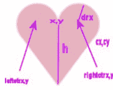

图2-4. 函数中使用的附加数据片段

路径将从我们称之为`cleft`或`cleavage`（咯咯笑）的地方开始，绘制左侧的圆弧，然后画一条线到底部点，再向上到`cx,cy`点，最后以右侧圆弧结束。函数如下：

```
function drawheart() {
    var leftctrx = this.x-this.drx;
    var rightctrx = this.x+this.drx;
    var cx = rightctrx+this.drx*Math.cos(this.ang);
    var cy = this.y + this.drx*Math.sin(this.ang);
    ctx.fillStyle = this.color;
    ctx.beginPath();
    ctx.moveTo(this.x,this.y);
    ctx.arc(leftctrx,this.y,this.drx,0,Math.PI-this.ang,true);
    ctx.lineTo(this.x,this.y+this.h);
    ctx.lineTo(cx,cy);
    ctx.arc(rightctrx,this.y,this.drx,this.ang,Math.PI,true);
    ctx.closePath();
    ctx.fill();
}
```

#### 检查鼠标是否悬停在对象上

在描述用于`overcheck`方法的功能之前，我将先说明为什么需要它。HTML5和JavaScript提供了处理（监听和响应）画布上鼠标事件的方法，并提供事件发生位置的坐标。然而，我们的代码必须完成确定涉及哪个对象的工作。记住：实际上并没有对象在画布上，只有所做绘图的残留痕迹，可以把它想象成油漆。我的代码通过遍历`stuff`数组并为每个对象调用`overcheck`方法来完成这一任务。一旦发现命中（我将在后面解释这是按什么顺序进行的），我的代码就继续处理该对象作为被选中的对象。进行检查的函数是`startdragging`和`makenewitem`，将在下一节中解释。

`overcheck`方法有三个函数需要解释，因为`Picture`和`Rect`引用的是同一个函数。每个函数都接受两个参数。将`mx`、`my`视为鼠标的位置。`overrect`函数检查四个条件是否都为真。用英语表达就是：`mx`是否大于或等于`this.x` AND `mx`是否小于或等于`this.x + this.w` AND `my`是否大于或等于`this.y` AND `my`是否小于或等于`this.y + this.h`？该函数更简洁地表达了这一点：

```
function overrect (mx,my) {
    if ( (mx>=this.x)&&(mx<=(this.x+this.w))&&(my>=this.y)&&(my<=(this.y+this.h)) )
        {return true;}
    else {return false;}
}
```

为椭圆定义`overcheck`方法的功能是`overoval`。`overoval`函数执行检查某点是否在圆内的操作，但要在经过平移和缩放的坐标系中进行。检查一个点是否在圆内可以通过将圆心设为`x1,y1`，该点设为`x2,y2`，然后看两者之间的距离是否小于半径来完成。我使用了一个变体来节省时间，比较距离平方与半径平方。我定义了一个函数`distsq`，返回距离平方。但现在我需要弄清楚如何在一个经过平移和缩放的坐标系中做到这一点。答案是`x1,y1`设为`0,0`。这就是在平移后的坐标系中椭圆中心的位置。然后我的代码按照代码所示设置`x2`和`y2`为缩放后的值。

```
function overoval(mx,my) {
    var x1 = 0;
    var y1 = 0;
    var x2 = (mx-this.x)/this.hor;
    var y2 = (my-this.y)/this.ver;
    if (distsq(x1,y1,x2,y2)<=(this.radsq) ){
        return true
    }
    else {return false}
}
```

这不是我瞬间想出来的。我通过尝试`mx`和`my`位于相对于椭圆中心不同位置的值来推导出来。代码确实代表了变换在平移和缩放方面的含义。

`overheart`函数由几个不同的`if`语句组成。这是一个不追求简单表达式而是考虑各种情况的情况。函数开始时设置稍后要用到的变量。函数进行的第一个检查是确定`mx,my`点是否在心形的外接矩形之外。我写了`outside`函数，如果最后两个参数指定的位置在前四个参数指示的矩形之外，则返回`true`。`qx,qy`点是左上角。`qwidth`是最宽处的宽度，`qheight`是总高度。我把这看作是一个快速检查，大多数情况下会返回`false`。接下来的两个`if`语句确定`mx,my`点是否包含在任一圆内。也就是说，我再次使用`mx,my`到每个圆弧中心距离平方的比较与存储的`radsq`属性进行比较。在函数中的这一点上，也就是说，如果`mx,my`位置离任一圆的中心都不够近，并且`my`在（小于）`this.y`上方，那么代码返回`false`。最后，代码将`mx`值代入每条斜线的方程，并将结果与`my`进行比较。使用斜率`m`和线上一点`x2,y2`可以写出直线的方程：

`y = m * (x - x2) + y2`

代码为左侧的直线设置`m`和`x2, y2`，然后通过改变`m`的符号来修改为适用于右侧直线。这里一个可能的担忧是屏幕坐标系的垂直值是倒置的（垂直值向下递增）是否会导致问题。我检查了各种情况，代码是有效的。

```
function overheart(mx,my) {
    var leftctrx = this.x-this.drx;
    var rightctrx = this.x+this.drx;
    var qx = this.x-2*this.drx;
    var qy = this.y-this.drx;
    var qwidth = 4*this.drx;
    var qheight = this.drx+this.h;

//quick test if it is in bounding rectangle
    if (outside(qx,qy,qwidth,qheight,mx,my)) {
        return false;
    }

//compare to two centers
    if (distsq(mx,my,leftctrx,this.y)<this.radsq) return true;
    if (distsq(mx,my,rightctrx,this.y)<this.radsq) return true;

// if outside of circles AND below (higher in the screen) than this.y, return false
    if (my<this.y) return false;

// compare to each slope
    var x2 = this.x
    var y2 = this.y + this.h;
    var m = (this.h)/(2*this.drx);

// left side
    if (mx<=this.x) {
        if (my < (m*(mx-x2)+y2)) {return true;}
        else { return false;}
    }
    else {
        m = -m;

        if (my < (m*(mx-x2)+y2)) { return true}
        else return false;
    }
}
```

`outside`函数背后的推理与`overrect`函数类似。你需要编写代码将`mx,my`值与矩形的边进行比较。然而，对于`outside`，我选择使用 OR 运算符`||`，并返回它的值。如果任一因子为真，这将返回真，否则返回假。

```
function outside(x,y,w,h,mx,my) {
    return ((mx<x) || (mx > (x+w)) || (my < y) || (my > (y+h)));
}
```

实际上，我说的是对的，但忽略了如果性能是一个问题可能是一个重要考虑因素。`||`从左到右计算每个条件。一旦其中一个为真，它就停止计算并返回真。`&&`运算符做类似的事情。一旦其中一个条件为假，它就返回假。

这是我为在画布上操作设计的四种对象的基础。你可以提前查看所有代码，或者继续了解这些对象如何在响应鼠标事件时投入使用。

注意：本示例并未展示面向对象编程的全部功能。若使用 Java（或专为艺术家设计的变体 Processing）等语言，我可以编写代码以确保每个新增对象都被正确定义，即包含用于定位的`x`和`y`属性，以及用于绘制和检测的方法。

#### 用户界面

该应用的用户界面需求包括拖拽操作（即按下鼠标、移动鼠标和释放鼠标）以重新定位项目，以及双击以创建项目的副本。我决定为其他最终用户操作使用按钮：从画布移除对象以及创建可保存的图像。按钮操作非常直接。我编写了两个 HTML5 按钮元素实例，并将`onClick`属性设置为相应的函数。

```
<button onClick="saveasimage();">打开包含图像的窗口（可将其保存为图像文件）</button></br>
<button onClick="removeobj();">移除最后移动的对象 </button>
```

`saveasimage`函数将在下一节中解释。`removeobj`函数从`stuff`数组中删除最后移动的对象。最后移动的对象即数组中的最后一个元素。这使得编码极其简单：

```
function removeobj() {
    stuff.pop();
    drawstuff();
}
```

对任何数组调用`pop`都会删除最后一个元素。然后该函数调用`drawstuff`函数来显示除最后一个元素外的所有内容。顺便说一句，如果在应用程序启动时点击按钮，将删除`stuff`数组中最后压入的元素。如果不可接受，你可以添加检查以防止这种情况发生。代价是每次用户点击按钮时都需要执行此检查。

幸运的是，HTML5提供了本应用所需的鼠标事件。在`init`函数中，我包含以下代码：

```
canvas1 = document.getElementById('canvas');
canvas1.onmousedown = function () { return false; };
canvas1.addEventListener('dblclick',makenewitem,false);
canvas1.addEventListener('mousedown',startdragging,false);
```

第一条语句将`canvas1`变量设置为引用`canvas`元素。第二条语句用于关闭光标的默认行为。我还为`canvas`包含了一个样式指令，将其定位设置为绝对定位，然后将`canvas`定位在距顶部80像素的位置。这为操作说明和按钮提供了充足的空间。

```
canvas {position:absolute; top:80px;
    cursor:crosshair;
}
```

`makenewitem`和`startdragging`函数的起始代码相同。代码首先确定鼠标光标坐标，然后遍历`stuff`数组以确定点击了哪个对象（如果有）。你可能以前见过鼠标光标坐标代码，例如在《HTML5 必备指南》中。数组的遍历按反向顺序进行。调用针对不同类型对象适当定义的`overcheck`方法。如果检测到点击，`makenewitem`函数将调用`clone`函数来创建该项目的副本。代码会稍微修改`x`和`y`值，使新项目不与原始项目完全重叠。新项目被添加到数组中，然后跳出`for`循环。

```
function makenewitem(ev) {
    var mx;
    var my;
    if ( ev.layerX ||  ev.layerX == 0) {
        mx= ev.layerX;
        my = ev.layerY;
        } else if (ev.offsetX || ev.offsetX == 0) {
                mx = ev.offsetX;
                my = ev.offsetY;
    }
    var endpt = stuff.length-1;
    var item;
    for (var i=endpt;i>=0;i--) {  //反向遍历
        if (stuff[i].overcheck(mx,my)) {
            item = clone(stuff[i]);
            item.x +=20;
            item.y += 20;
            stuff.push(item);
            break;
        }
    }
    drawstuff();
}
```

如前所述，`clone`函数创建`stuff`数组中某个元素的副本。你可能会问，为什么不直接写：

```
item = stuff[i];
```

答案是这种赋值不会创建一个新的、独立的值。JavaScript只是将`item`变量设置为指向与`stuff`的第`i`个成员相同的内容。这被称为“按引用复制”。我们不想要那样。我们需要一个全新的、独立的东西以便修改。复制的方法在`clone`函数中演示。首先创建一个新对象，然后调用一个`for`循环。`for(var info in obj)`的意思是：对于`obj`的每个属性，将`item`中一个同名的属性设置为该属性的值。

```
function clone(obj) {
    var item = new Object();
    for (var info in obj) {
        item[info] = obj[info];
    }
    return item;
}
```

因此，这两个函数的效果是复制鼠标光标下的任何元素。然后你或你的最终用户可以在原始对象或克隆对象上按下鼠标并将其四处拖动。`startdragged`函数如前所述继续执行以确定鼠标下的对象。然后代码确定我（和其他人）所说的鼠标坐标相对于对象`x`、`y`位置的偏移量。这是因为我们希望对象在移动时保持与鼠标的相同关系。有些人称之为“粘蝇纸效应”。就好像鼠标光标落在对象上并像粘蝇纸一样粘住了。`offsetx`和`offsety`是全局变量。请注意，该编码适用于`x`、`y`值引用左上角（图片和矩形）、中心（椭圆）和特定内部点（心形）的对象。

然后代码执行一系列操作，其效果是将此对象移动到数组的末尾。第一条语句是按引用复制操作，用于设置变量`item`。下一步将`stuff`数组最后一个元素的索引保存到全局变量`thingInMotion`中。此变量将被`moveit`函数使用。`splice`语句删除原始元素，`push`语句将其添加到数组的末尾。引用`cursor`的语句是指定光标的方式。`"pointer"`指的是内置选项之一。函数中的最后两条语句为移动鼠标和释放鼠标按钮设置了事件处理。此事件处理将在`dropit`函数中被移除。


```javascript
function startdragging(ev) {
    var mx;
    var my;
    if (ev.layerX || ev.layerX == 0) {
        mx = ev.layerX;
        my = ev.layerY;
    } else if (ev.offsetX || ev.offsetX == 0) {
        mx = ev.offsetX;
        my = ev.offsetY;
    }
    var endpt = stuff.length - 1;
    for (var i = endpt; i >= 0; i--) {  // 反向遍历
        if (stuff[i].overcheck(mx, my)) {
            offsetx = mx - stuff[i].x;
            offsety = my - stuff[i].y;
            var item = stuff[i];
            var last = stuff.length - 1;
            stuff.splice(i, 1);
            stuff.push(item);
            thingInMotion = last;
            canvas1.style.cursor = "pointer";  // 更改为手形
            canvas1.addEventListener('mousemove', moveit, false);
            canvas1.addEventListener('mouseup', dropit, false);
            break;
        }
    }
}
```

`moveit`函数移动`thingInMotion`引用的对象，并使用`offsetx`和`offsety`变量移动对象。调用`drawstuff`函数以显示修改后的画布。

```javascript
function moveit(ev) {
    var mx;
    var my;
    if (ev.layerX || ev.layerX == 0) {
        mx = ev.layerX;
        my = ev.layerY;
    } else if (ev.offsetX || ev.offsetX == 0) {
        mx = ev.offsetX;
        my = ev.offsetY;
    }
    stuff[thingInMotion].x = mx - offsetx; // 针对粘蝇纸拖动进行调整
    stuff[thingInMotion].y = my - offsety;
    drawstuff();
}
```

如果鼠标在任何方向移动一个像素，就会触发`mousemove`事件。如果这似乎太多，请记住是计算机在执行，而不是你我。用户移动鼠标时会获得流畅的响应。

`dropit`函数在`mouseup`事件时被调用。响应是移除、停止监听鼠标的移动和释放，然后将光标改回十字线。

```javascript
function dropit(ev) {
    canvas1.removeEventListener('mousemove', moveit, false);
    canvas1.removeEventListener('mouseup', dropit, false);
    canvas1.style.cursor = "crosshair";  // 改回十字线
}
```

总而言之，此应用程序的用户界面涉及两个按钮和两种类型的鼠标操作。拖放操作是通过一组函数实现的。

#### 将画布保存为图像

创建构图后，用户可能希望将其保存为图像文件。Firefox 浏览器使这变得容易。使用 PC 时，你可以右键点击画布，或在 Mac 上执行等效操作，此时会出现一个弹出菜单，其中包含“将图像另存为...”的选项。但是，Chrome、Safari 和 Opera 不提供此功能。如果右键点击，选项是关于 HTML 文档的。然而，HTML5 提供了一个替代方案。

Canvas 元素有一个名为`toDataURL`的方法，可以从画布生成图像。该方法提供从 png、jpg 或 bmp 中选择图像文件类型的选项。我选择对此操作结果所做的操作是编写代码，打开一个新窗口并将图像作为内容。然后用户可以通过保存文件选项或右键点击图像来将此图像保存为文件。

然而，还有一个考虑因素。Chrome 和 Firefox 要求此代码从服务器运行，而不是在客户端计算机上。客户端计算机是运行浏览器程序的计算机。服务器计算机将是你上传完成工作的网站。你可能有也可能没有。Opera 和 Safari 允许代码在客户端计算机上运行。

这对测试有影响，因为一般来说，我们先在本地测试程序，然后上传到服务器。由于这种情况，这是一个合适的地方使用 JavaScript 的`try/catch`机制来为程序员捕获错误（可以这么说），以便采取行动。以下是`saveasimage`函数的代码。变量`canvas1`已在文档加载时调用的`init`函数中设置为 canvas 元素。

```javascript
function saveasimage() {
    try {
        window.open(canvas1.toDataURL("image/png"));
    } catch (err) {
        alert("You need to change browsers OR upload the file to a server.");
    }
}
```

#### 构建应用并使其成为你自己的

你可以通过指定自己的图像文件、定义想要包含在可操作对象集合中的矩形、椭圆和心形，以及在基本功能实现后添加新的对象类型，来使这个应用成为你自己的。

该应用包含许多函数，但每个函数都很小，且许多函数之间共享属性。以下是该应用的非正式总结/大纲：

1. `init`用于初始化，包括设置双击、鼠标按下、鼠标移动和鼠标松开的事件处理。
2. 对象定义方法：构造函数、绘制函数和碰撞检测函数。
3. 事件处理函数：鼠标事件和按钮`onClick`。

更正式地说，表 2-1 列出了所有函数，并说明了它们是如何被调用的以及它们调用了哪些函数。请注意，有几个函数是作为对象类型的方法被调用的。

**表 2-1. HTML5 家庭卡片项目中的函数**

| 函数 | 由……调用/触发 | 调用 |
| :--- | :--- | :--- |
| `init` | 由`<body>`标签中`onLoad`属性的操作触发 | `Picture`、`Rect`、`Oval`、`Heart`、`drawstuff` |
| `saveasimage` | 由按钮标签中`onClick`属性的操作触发 | |
| `removeobj` | 由按钮标签中`onClick`属性的操作触发 | `drawstuff` |
| `Picture` | 在`init`函数中调用 | |
| `Rect` | 在`init`函数中调用 | |
| `Oval` | 在`init`函数中调用 | |
| `Heart` | 在`init`函数中调用 | |
| `drawheart` | 在`drawstuff`中调用 | |
| `drawrect` | 在`drawstuff`中调用 | |
| `drawoval` | 在`drawstuff`中调用 | |
| `drawpic` | 在`drawstuff`中调用 | |
| `overheart` | 在`startdragging`和`makenewitem`中调用 | `distsq`、`outside` |
| `overrect` | 在`startdragging`和`makenewitem`中调用 | |
| `overoval` | 在`startdragging`和`makenewitem`中调用 | `distsq` |
| `distsq` | 由`overheart`和`overoval`调用 | |
| `drawstuff` | 由`makenewitem`、`moveit`、`removeobj`、`init`调用 | `stuff`数组中每个项目的`draw`方法 |
| `moveit` | 由`startdragging`中通过`addEventListener`设置的`mousemove`事件触发 | |
| `dropit` | 由`startdragging`中通过`addEventListener`设置的`mouseup`事件触发 | |
| `outside` | 由`overheart`调用 | |
| `makenewitem` | 由`init`中通过`addEventListener`设置的`dblclick`事件触发 | `clone` |
| `clone` | 由`makenewitem`调用 | |
| `startdragging` | 由`init`中通过`addEventListener`设置的`mousedown`事件触发 | |

表 2-2 展示了基础应用的代码，每行附有注释。

**表 2-2. HTML5 Logo 项目的完整代码**

| 代码行 | 说明 |
| --- | --- |
| `<!DOCTYPE html >` | HTML5 文档的标准标题 |
| `<html>` | html 标签 |
| `<head>` | head 标签 |
| `<title>Build family picture</title>` | 完整标题 |
| `<meta charset="UTF-8">` | meta 标签 |
| `<style>` | style 开始 |
| `canvas {position:absolute; top:80px;` | canvas 的指令，将其位置设置为 absolute，距离文档顶部 80 像素 |
| `cursor:crosshair;` | 指定鼠标悬停在 canvas 上时的光标图标 |
| `}` | 关闭指令 |
| `</style>` | 关闭 style |
| `<script language="Javascript">` | script 标签 |
| `var ctx;` | 用于保存 canvas 上下文的变量 |
| `var canvas1;` | 用于保存 canvas 元素的变量 |
| `var stuff = [];` | 用于保存 canvas 上所有对象的数组 |
| `var thingInMotion;` | 被拖动对象的引用 |
| `var offsetx;` | 被拖动对象的水平偏移量 |
| `var offsety;` | 被拖动对象的垂直偏移量 |
| `function init() {` | init 函数的函数头 |
| `canvas1 = document.getElementById('canvas');` | 设置变量以引用 canvas 元素 |
| `canvas1.onmousedown = function () { return false; } ;` | 防止光标变为默认样式 |
| `canvas1.addEventListener('dblclick',makenewitem,false);` | 设置 canvas 上双击的事件处理 |
| `canvas1.addEventListener('mousedown',startdragging,false);` | 设置 canvas 上鼠标按下的事件处理 |
| `ctx = canvas1.getContext("2d");` | 将 ctx 设置为引用 canvas 的上下文。用于所有绘制操作。 |
| `var r1 = new Rect(2,10,50,50,"red");` | 构造一个矩形 |
| `var s1 = new Rect(60,10, 50,50,"blue");` | 构造一个矩形 |
| `var oval1 = new Oval(200,30,20,2.0,1.0, "teal");` | 构造一个椭圆 |
| `var cir1 = new Oval(300,30,20,1.0,1.0,"purple");` | 构造一个椭圆（将显示为圆形） |
| `var dad = new Image();` | 创建一个 Image 元素 |
| `dad.src = "daniel1.jpg";` | 将 src 设置为指定的文件 |
| `var mom = new Image();` | 创建一个 Image 元素 |
| `mom.src = "allison1.jpg";` | 将 src 设置为指定的文件 |
| `var son1= new Image();` | 创建一个 Image 元素 |
| `son1.src = "liam2.jpg";` | 将 src 设置为指定的文件 |
| `var son2 = new Image();` | 创建一个 Image 元素 |
| `son2.src = "grant1.jpg";` | 将 src 设置为指定的文件 |
| `var pic1 = new Picture(10,100,100,100,dad);` | 构造一个 Picture 对象 |

## 第 2 章 ■ 家庭拼贴画——在 Canvas 上操作程序员定义的对象

| 代码行 | 说明 |
|---|---|
| `var pic2 = new Picture(120,100,100,100,mom);` | 构造一个 Picture 对象 |
| `var pic3 = new Picture(230,100,100,100,son1);` | 构造一个 Picture 对象 |
| `var pic4 = new Picture(340,100,100,100,son2);` | 构造一个 Picture 对象 |
| `var heart1 = new Heart(400,30,60,20,"pink");` | 构造一个 Heart 对象 |
| `stuff.push(pic1);` | 将 pic1 添加（push）到 stuff 数组 |
| `stuff.push(pic2);` | 添加 pic2 |
| `stuff.push(pic3);` | 添加 pic3 |
| `stuff.push(pic4);` | 添加 pic4 |
| `stuff.push(r1);` | 添加 r1 |
| `stuff.push(s1);` | 添加 s1 |
| `stuff.push(oval1);` | 添加 oval1 |
| `stuff.push(cir1);` | 添加 cir1 |
| `stuff.push(heart1);` | 添加 heart1 |
| `drawstuff();` | 在 canvas 上绘制所有对象 |
| `}` | init 函数结束 |
| `function distsq (x1,y1,x2,y2) {` | distsq 函数的函数头。接收 2 个点（2 x 2 个值）作为参数 |
| `var xd = x1 - x2;` | 设置 x 的差值 |
| `var yd = y1 - y2;` | 设置 y 的差值 |
| `return ((xd*xd) + (yd*yd) );` | 返回平方和。这是两点之间距离的平方。 |
| `}` | distsq 函数结束 |
| `function Picture(x,y,w,h,imagename) {` | Picture 构造函数的函数头，位置在 x, y，宽度为 w，高度为 h，以及 imagename Image 对象。 |
| `this.x = x;` | 设置属性 |
| `this.y = y;` | 设置属性 |
| `this.w = w;` | 设置属性 |
| `this.h = h;` | 设置属性 |
| `this.imagename = imagename;` | 设置属性 |
| `this.draw = drawpic;` | 将 drawpic 函数设置为 draw 方法 |
| `this.overcheck = overrect;` | 将 overrect 函数设置为 overcheck 方法 |
| `}` | 关闭函数 |
| `function Heart(x,y,h,drx,color) {` | Heart 构造函数的函数头，心形凹陷处位于 x, y，到尖端距离为 h，半径为 drx，颜色为 color。 |
| `this.x = x;` | 设置属性 |
| `this.y = y;` | 设置属性 |
| `this.h = h;` | 设置属性 |
| `this.drx = drx;` | 设置属性 |
| `this.radsq = drx*drx;` | 设置属性以避免后续重复进行此运算 |
| `this.color = color;` | 设置属性 |
| `this.draw = drawheart;` | 将 drawheart 函数设置为 draw 方法 |
| `this.overcheck = overheart;` | 将 overheart 函数设置为 overcheck 方法 |
| `this.ang = .25*Math.PI;` | 将属性设置为此常量值。之后可能会使其更加通用 |
| `}` | 关闭函数 |
| `function drawheart() {` | drawheart 函数的函数头 |
| `var leftctrx = this.x-this.drx;` | 计算并设置变量为左曲线中心的 x 坐标 |
| `var rightctrx = this.x+this.drx;` | 计算并设置变量为右曲线中心的 x 坐标 |
| `var cx = rightctrx+this.drx*Math.cos(this.ang);` | 计算并设置变量为右侧曲线变为直线处的 x 坐标 |
| `var cy = this.y + this.drx*Math.sin(this.ang);` | 计算并设置变量为右侧曲线变为直线处的 y 坐标 |
| `ctx.fillStyle = this.color;` | 设置 fillStyle |


| 表达式 | 说明 |
|---|---|
| `ctx.beginPath();` | 开始路径 |
| `ctx.moveTo(this.x, this.y);` | 移动到心形凹陷处 |
| `ctx.arc(leftctrx, this.y, this.drx, 0, Math.PI - this.ang, true);` | 绘制左曲线 |
| `ctx.lineTo(this.x, this.y + this.h);` | 移动到底部尖端 |
| `ctx.lineTo(cx, cy);` | 移动到直线与曲线交界处 |
| `ctx.arc(rightctrx, this.y, this.drx, this.ang, Math.PI, true);` | 绘制右曲线 |
| `ctx.closePath();` | 关闭路径 |


# 第二章 ■ 家庭拼贴画——在画布上操作程序员自定义的对象

| 代码行 | 说明 |
|---|---|
| `ctx.fill();` | 填充路径 |
| `}` | 关闭函数 |
| `function overheart(mx,my) {` | `overheart` 函数头 |
| `var leftctrx = this.x-this.drx;` | 设置变量为左曲线中心的 x 坐标 |
| `var rightctrx = this.x+this.drx;` | 设置变量为右曲线中心的 x 坐标 |
| `var qx = this.x-2*this.drx;` | 计算并设置变量为边界矩形左侧的 x 坐标 |
| `var qy = this.y-this.drx;` | 计算并设置变量为边界矩形顶部的 y 坐标 |
| `var qwidth = 4*this.drx;` | 计算并设置变量为边界矩形的宽度 |
| `var qheight = this.drx+this.h;` | 计算并设置变量为边界矩形的高度 |
| `if (outside(qx,qy,qwidth,qheight,mx,my)) {` | 快速测试是否在边界矩形内 |
| `return false;}` |  |
| `if (distsq(mx,my,leftctrx,this.y)<this.radsq)<br>return true;` | 检查是否在左曲线内 |
| `if (distsq(mx,my,rightctrx,this.y)<this.radsq)<br>return true;` | 或右曲线 |
| `if (my<=this.y) return false;` | 如果在屏幕上 y 的上方（且之前未确定在曲线内），则返回 false |
| `var x2 = this.x` | 开始计算以比较 my 与斜率。设置 x2 和 |
| `var y2 = this.y + this.h;` | 设置 y2，使 x2,y2 点位于每条斜线上 |
| `var m = (this.h)/(2*this.drx);` | 计算左侧直线的斜率 |
| `if (mx<=this.x) {` | 如果 mx 在左侧... |
| `if (my < (m*(mx-x2)+y2)) {return true;}` | 比较 my 与对应于 mx 的 y 值。如果 my 在上方（在屏幕上），则返回 true |
| `else { return false;}` | 否则返回 false |
| `}` | 关闭 `if (mx<=this.x)` 子句 |
| `else {` | 否则 |
| `m = -m;` | 改变斜率符号为右侧直线的斜率 |
| `if (my < (m*(mx-x2)+y2)) { return true}` | 比较 my 与右侧直线上对应于 mx 的值，如果小于（更靠近屏幕上方）则返回 true |
| `else return false;` | 否则返回 false |
| `}` | 关闭子句 |
| `}` | 关闭函数 |
| `function outside(x,y,w,h,mx,my) {` | `outside` 函数头 |
| `return ((mx<x) \|\| (mx > (x+w)) \|\| (my < y) \|\| (my > (y+h)));` | 如果任一条件为真则返回 true，表示 mx, my 点在矩形外 |
| `}` | 关闭函数 |
| `function drawpic() {` | `drawpic` 函数头 |
| `ctx.drawImage(this.imagename,this.x,this.y,this.w,this.h);` | 绘制指定图像 |
| `}` | 关闭函数 |
| `function Oval(x,y,r,hor,ver,c) {` | `Oval` 构造函数头，位置 x, y，水平缩放 hor，垂直缩放 ver，颜色 c |
| `this.x = x;` | 设置属性 |
| `this.y = y;` | 设置属性 |
| `this.r = r;` | 设置属性 |
| `this.radsq = r*r;` | 存储为属性以避免后续重复计算 |
| `this.hor = hor;` | 设置属性 |
| `this.ver = ver;` | 设置属性 |
| `this.draw = drawoval;` | 设置 `drawoval` 为绘制方法 |
| `this.color = c;` | 设置属性 |
| `this.overcheck = overoval;` | 设置 `overoval` 为 `overcheck` 方法 |
| `}` | 关闭函数 |
| `function drawoval() {` | `drawoval` 函数头 |
| `ctx.save();` | 保存当前坐标状态 |
| `ctx.translate(this.x,this.y);` | 移动到中心 |
| `ctx.scale(this.hor,this.ver);` | 按属性指定的比例缩放 |
| `ctx.fillStyle = this.color;` | 设置颜色 |
| `ctx.beginPath();` | 开始路径 |
| `ctx.arc(0,0,this.r,0,2*Math.PI,true);` | 绘制圆弧（完整圆） |
| `ctx.closePath();` | 关闭路径 |
| `ctx.fill();` | 填充 |
| `ctx.restore();` | 恢复原始坐标状态 |
| `}` | 关闭函数 |
| `function Rect(x,y,w,h,c) {` | `Rect` 构造函数头：位置 x,y，宽度 w 和高度 h，颜色 c |
| `this.x = x;` | 设置属性 |
| `this.y = y;` | 设置属性 |
| `this.w = w;` | 设置属性 |
| `this.h = h;` | 设置属性 |
| `this.draw = drawrect;` | 设置 `drawrect` 为绘制方法 |
| `this.color = c;` | 设置属性 |
| `this.overcheck = overrect;` | 设置 `overrect` 为 `overcheck` 方法 |
| `}` | 关闭函数 |
| `function overoval(mx,my) {` | `overoval` 函数头 |
| `var x1 = 0;` | 设置用于调用 `distsq` 的变量。表示椭圆中心点的 x 坐标 |
| `var y1 = 0;` | 设置用于调用 `distsq` 的变量。表示椭圆中心点的 y 坐标 |
| `var x2 = (mx-this.x)/this.hor;` | 使用输入和缩放因子计算 x2 |
| `var y2 = (my-this.y)/this.ver;` | 使用输入和缩放因子计算 y2 |
| `if (distsq(x1,y1,x2,y2)<=(this.radsq) ){` | 如果距离平方小于等于存储的半径平方.... |
| `return true` | 返回 true |
| `}` | 结束子句 |
| `else {return false}` | 否则返回 false |
| `}` | 关闭函数 |
| `function overrect (mx,my) {` | `overrect` 函数头 |
| `if (<br>(mx>=this.x)&&(mx<=(this.x+this.w))&&(my>=this.y)<br>&&(my<=(this.y+this.h)))` | 如果 mx, my 在边界内（4 边） |
| `{return true;}` | 返回 true |
| `else {return false;}` | 否则返回 false |
| `}` | 关闭函数 |
| `function makenewitem(ev) {` | `makenewitem` 函数头。参数为 JavaScript 设置的事件 ev |
| `var mx;` | 变量将保存鼠标的 x 坐标 |
| `var my;` | 变量将保存鼠标的 y 坐标 |
| `if ( ev.layerX \|\| ev.layerX == 0) {` | 此浏览器是否使用 layer... |
| `mx= ev.layerX;` | ... 设置 mx |
| `my = ev.layerY;` | ... my |
| `} else if (ev.offsetX \|\| ev.offsetX ==<br>0) {` | 浏览器是否使用 offset... |
| `mx = ev.offsetX;` | ...设置 mx |
| `my = ev.offsetY;` | ... 设置 my |
| `}` | 结束子句 |
| `var endpt = stuff.length-1;` | 存储 stuff 数组中最后一项的索引 |
| `var item;` | 将保存新项 |
| `for (var i=endpt;i>=0;i--) {` | 从末尾开始搜索 |
| `if (stuff[i].overcheck(mx,my)) {` | 鼠标是否在此 stuff 成员上 |
| `item = clone(stuff[i]);` | 克隆（复制） |
| `item.x += 20;` | 水平方向稍微移动 |
| `item.y += 20;` | 以及垂直方向 |
| `stuff.push(item);` | 将新创建的项添加到 stuff 数组 |
| `break;` | 退出 for 循环 |
| `}` | 结束 if 子句 |
| `}` | 结束 for 循环 |
| `drawstuff();` | 绘制所有内容 |
| `}` | 关闭函数 |
| `function clone(obj) {` | `clone` 函数头 |
| `var item = new Object();` | 创建对象 |
| `for (var info in obj) {` | 遍历作为参数传入的 obj 的所有属性 |
| `item[info] = obj[info];` | 将该名称的属性设置为该属性值 |
| `}` | 关闭 for 循环 |
| `return item;` | 返回新创建的对象 |
| `}` | 关闭函数 |
| `function startdragging(ev) {` | `startdragging` 函数头。参数为 JavaScript 设置的事件 ev |
| `var mx;` | 变量将保存鼠标的 x 坐标 |
| `var my;` | 变量将保存鼠标的 y 坐标 |
| `if ( ev.layerX \|\| ev.layerX == 0) { // Firefox, ???` | 此浏览器是否使用 layer… |
| `mx= ev.layerX;` | … 设置 mx |
| `my = ev.layerY;` | … my |
| `} else if (ev.offsetX \|\| ev.offsetX == 0) {` | 浏览器是否使用 offset… |
| `mx = ev.offsetX;` | …设置 mx |
| `my = ev.offsetY;` | … 设置 my |
| `}` | 结束子句 |
| `var endpt = stuff.length-1;` | 存储 stuff 数组中最后一项的索引 |
| `for (var i=endpt;i>=0;i--) {` | 从末尾开始搜索 |
| `if (stuff[i].overcheck(mx,my)) {` | 鼠标是否在此 stuff 成员上 |
| `offsetx = mx-stuff[i].x;` | 计算 mx 与此对象 x 的距离 |
| `offsety = my-stuff[i].y;` | 计算 my 与此对象 y 的距离 |
| `var item = stuff[i];` | 现在将此项移到数组末尾。设置 item |
| `thingInMotion = stuff.length-1;` | 设置全局变量以用于拖动 |
| `stuff.splice(i,1);` | 从原始位置移除此项 |
| `stuff.push(item);` | 将项添加到末尾 |
| `canvas1.style.cursor = "pointer";` | 拖动时将光标改为手指形状 |

## 第二章 ■ 家庭拼贴画——在画布上操作程序员自定义的对象

| 代码行 | 说明 |
|---|---|
| `canvas1.addEventListener('mousemove', moveit,false);` | 设置鼠标移动的事件处理 |
| `canvas1.addEventListener('mouseup',dropit, false);` | 设置鼠标按钮释放的事件处理 |
| `break;` | 跳出 for 循环 |
| `}` | 关闭 if 子句 |
| `}` | 关闭 for 循环 |
| `}` | 关闭函数 |
| `function dropit(ev) {` | `dropit` 的函数头。参数 ev 是由 JavaScript 设置的事件 |
| `canvas1.removeEventListener('mousemove',moveit,false);` | 移除（停止）鼠标移动的事件处理 |
| `canvas1.removeEventListener('mouseup',dropit,false);` | 移除（停止）鼠标按钮释放的事件处理 |
| `canvas1.style.cursor = "crosshair";` | 将光标改回十字准星 |
| `}` | 关闭函数 |
| `function moveit(ev) {` | `moveit` 的函数头。参数 ev 是由 JavaScript 设置的事件 |
| `var mx;` | 变量将保存鼠标的 x 坐标 |
| `var my;` | 变量将保存鼠标的 y 坐标 |
| `if ( ev.layerX || ev.layerX == 0) {` | 该浏览器是否使用 layer... |
| `mx= ev.layerX;` | ... 设置 mx |
| `my = ev.layerY;` | ... 设置 my |
| `} else if (ev.offsetX || ev.offsetX == 0) {` | 浏览器是否使用 offset... |
| `mx = ev.offsetX;` | ...设置 mx |
| `my = ev.offsetY;` | ... 设置 my |
| `}` | 结束子句 |
| `stuff[thingInMotion].x = mx-offsetx;` | 设置 thingInMotion 的 x，调整以适应飞纸拖拽 |
| `stuff[thingInMotion].y = my-offsety;` | 设置 thingInMotion 的 y，调整以适应飞纸拖拽 |
| `drawstuff();` | 绘制所有内容 |
| `}` | 关闭函数 |
| `function drawstuff() {` | `drawstuff` 的函数头 |
| `ctx.clearRect(0,0,600,400);` | 清除（擦除）画布 |
| `ctx.strokeStyle = "black";` | 设置边框颜色 |
| `ctx.lineWidth = 2;` | 设置线宽 |
| `ctx.strokeRect(0,0,600,400);` | 绘制边框 |
| `for (var i=0;i<stuff.length;i++) {` | 遍历 stuff 数组 |
| `stuff[i].draw();` | 调用数组每个成员的绘制方法 |
| `}` | 关闭 for |
| `}` | 关闭函数 |
| `function drawrect() {` | `drawrect` 的函数头 |
| `ctx.fillStyle = this.color;` | 设置颜色 |
| `ctx.fillRect(this.x, this.y, this.w, this.h);` | 绘制填充矩形 |
| `}` | 关闭函数 |

| 代码行 | 说明 |
|---|---|
| `function saveasimage() {` | `saveasimage` 的函数头 |
| `try {` | 开始 try 子句 |
| `window.open(canvas1.toDataURL("image/png"));}` | 创建图像数据并将其用作新窗口的内容 |
| `catch(err) {` | 如果失败，即抛出错误 |
| `alert("You need to change browsers OR upload the file to a server.");` | 显示警告信息 |
| `}` | 关闭 catch 子句 |
| `}` | 关闭函数 |
| `function removeobj() {` | `removeobj` 的函数头 |
| `stuff.pop();` | 移除 stuff 数组的最后一个成员 |
| `drawstuff();` | 绘制所有内容 |
| `}` | 关闭函数 |
| `</script>` | 关闭 script 元素 |
| `</head>` | 关闭 head 元素 |
| `<body onLoad="init();">` | body 标签，设置了 onLoad |
| `Mouse down, move and mouse up to move objects. Double click for new object.<br/>` | 给出操作说明的文字 |
| `<canvas id="canvas" width="600" height=400">` | canvas 标签 |
| `Your browser doesn't recognize the canvas element` | 针对旧版浏览器的信息 |
| `</canvas>` | 结束 canvas 标签 |

| 代码行 | 说明 |
|---|---|
| `<button onClick="saveasimage();">Open window with image (which you can save into image file) </button></br>` | 保存图像的按钮 |
| `<button onClick="removeobj();">Remove last object moved </button>` | 移除对象的按钮 |
| `</body>` | 关闭 body 标签 |
| `</html>` | 关闭 html 标签 |

很明显，如何运用我示例中演示的技术来让这个应用成为你自己的：收集你自己家人的照片或获取其他照片，并使用 `Rect`、`Oval` 和 `Heart` 来创建你自己的一套形状。

你可以使用这里的代码作为模型来定义自己的对象。例如，《*Essential Guide to HTML5*》一书中包含了显示多边形的代码。你可以让多边形的 over 检查函数将多边形当作一个圆来处理，也许是一个半径较小的圆，而你的用户不会反对。

下一步可能是构建一个允许终端用户指定图像文件地址的应用程序。你需要为此设置一个表单。另一个改进是允许终端用户输入文本，也许是一段问候语，并将其定位在画布上。你需要创建一种新的对象类型，并编写 `draw` 和 `overcheck` 方法。`overcheck` 方法可以是 `overrect`，也就是说，程序将边界矩形内的任何位置都视为在文本上。

### 测试和上传应用程序

你需要收集所有想在应用程序中包含的图像文件。测试过程取决于你使用的浏览器。实际上，使用多种浏览器进行测试是一个好习惯。如果你使用的是 Firefox 或 Chrome，你需要将应用程序（html 文件和所有图像文件）上传到服务器，以测试创建图像的功能。然而，应用程序的其他方面可以在你自己的*客户端*计算机上进行测试。

### 小结

在本章中，你学习了如何构建一个涉及创建和定位特定形状（即矩形、椭圆和心形）的应用程序，以及将照片等图片放在画布上。编程技术和 HTML5 特性包括：

- 程序员自定义的对象
- 画布上的鼠标事件
- 用于捕获错误的 try 和 catch
- 多个函数中用到的代数和几何知识。

下一章将介绍如何创建一个应用程序，展示一段视频片段像盒子里的球一样弹来弹去。

# 第三章

## 弹跳视频：动画和遮罩 HTML5 视频

在本章中，你将学习如何完成以下操作：

- 通过在画布上不同位置绘制视频的当前帧来产生移动的视频片段
- 通过在文档中重新定位视频元素来产生移动的视频片段
- 对视频进行遮罩，使其在两种情况下都看起来像圆形
- 构建一个能适应不同窗口大小的应用程序

### 引言

本章的项目是在一个盒子中显示一段视频片段，形状像一个弹跳的球。HTML5 的一个重要新特性是对视频（和音频）的原生支持。Silvia Pfeiffer 所著、Apress 2010 年出版的*《The Definitive Guide to HTML5 Video》*是一本极好的参考书。这个项目中的挑战是让视频片段在屏幕上移动。我将描述两种不同的实现方式。截图看不出来这些差异。

图 3-1 展示了该应用程序在 Opera 全窗口视图中的样子。视频是一个标准的矩形视频片段。它看起来像个球是因为我的代码。你可以跳到图 3-8 了解为视频创建的遮罩的效果。所有图片都是动画的静态屏幕截图。你需要相信视频确实会在盒子内移动和弹跳。

### 第三章 弹跳视频：动画和遮罩 HTML5 视频

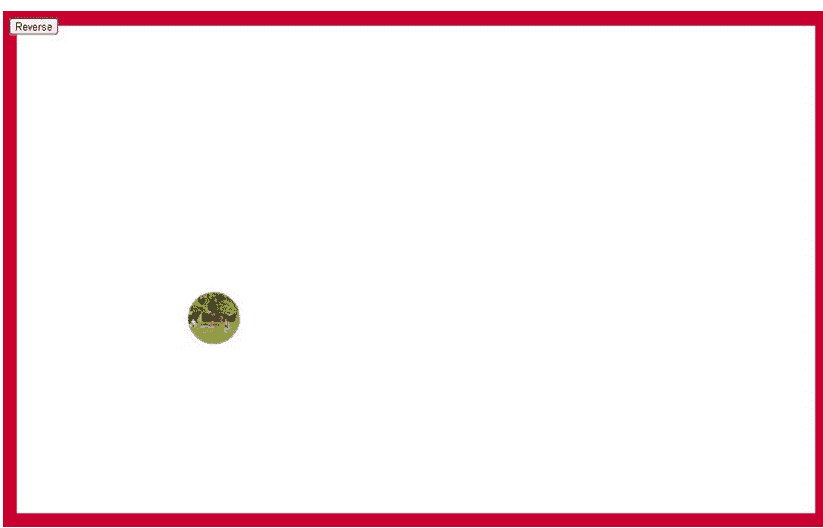

**图 3-1.** *屏幕截图，全窗口*

在所有情况下，当虚拟球撞到墙壁时，它看起来会从墙壁上弹开。例如，如果虚拟球正向右下方移动，当它撞到盒子右侧时，它会向左但仍向下移动。然后当虚拟球撞到盒子底部墙壁时，它会向左弹开，向上方移动。轨迹如图 3-2 所示。为了生成这张图片，我将虚拟球改成了一个简单的圆形，并且没有编写在每个时间间隔擦除画布的代码。你可以把它想象成定格摄影。改变虚拟球是必要的，因为它的复杂性：来自视频片段的图像和一个全白色的遮罩。我在“构建应用程序并使其成为你自己的”部分包含了轨迹程序的代码。

*图 3-2. 虚拟球的轨迹*

如果我将浏览器窗口调小一点并重新加载应用程序，代码会调整画布大小，产生如图 3-3 所示的效果：一个更小的方框。

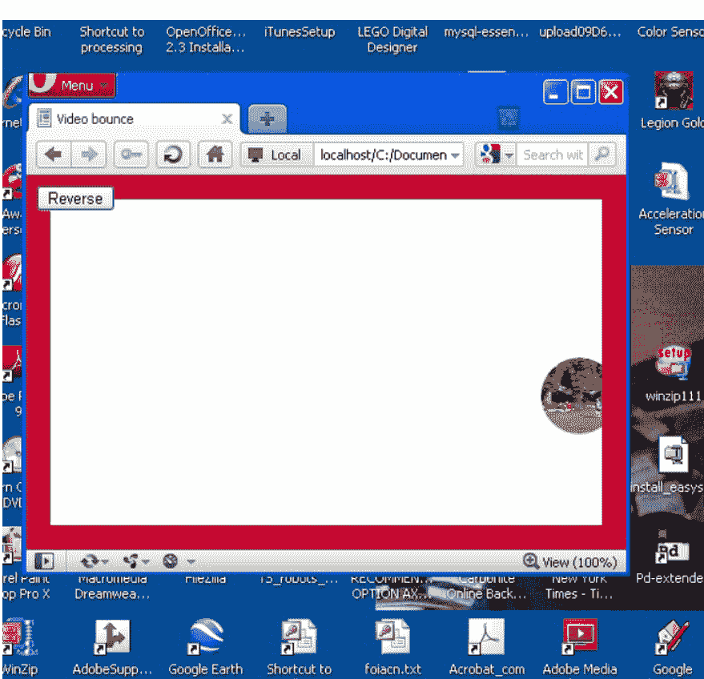

*图 3-3. 较小窗口中的应用程序*

如果窗口变得很小，这会强制改变视频片段本身的大小，以及画布和方框的大小，如图 3-4 所示。

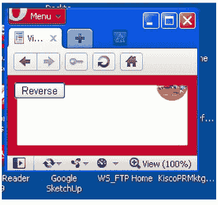

*图 3-4. 窗口调整为很小*

应用程序会根据 HTML 文档首次加载时的窗口尺寸来调整方框大小，以及可能的虚拟视频球大小。如果观看者在应用程序运行期间稍后调整窗口大小，画布和视频片段不会被调整大小。在这种情况下，你会看到类似图 3-5 的效果，大窗口中的一个小方框。

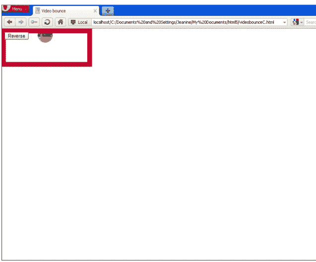

*图 3-5. 运行期间窗口调整为更大*

同样，如果你在全屏窗口或任何大窗口中启动应用程序，并在程序运行期间将其调小，你会看到类似图 3-6 的效果，浏览器显示滚动条以表明文档内容比窗口更宽更长。如果你，作为观看者，选择不使用滚动条，那么视频片段将会周期性地短暂消失，然后重新出现。

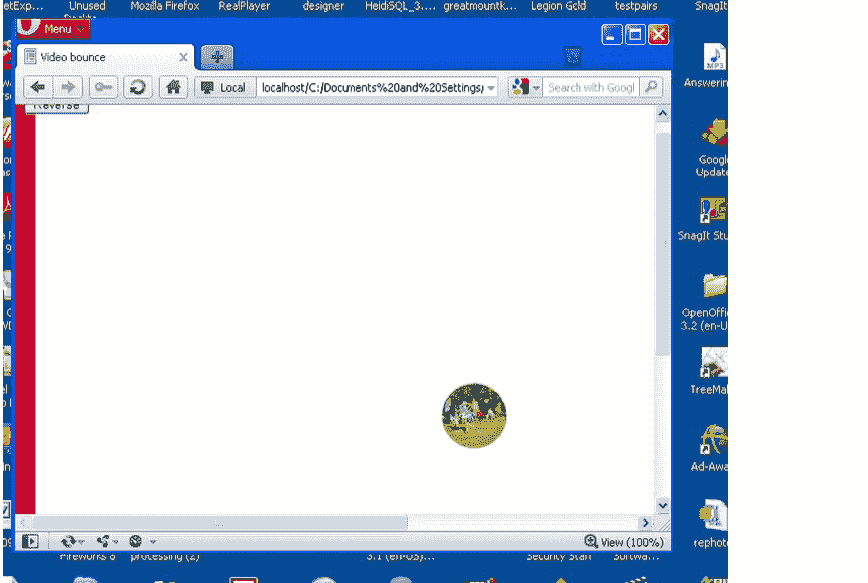

**图 3-6.** *大窗口调整大小*

这两个应用程序（我将它们命名为 `videobounceC`，代表“绘制在画布上的视频”，以及 `videobounceE`，代表“视频元素”）已在 Firefox、Chrome 和 Opera 中成功测试。该项目展示了使用 HTML5、JavaScript 和 CSS 操作视频的编码技术，以及将视频与画布结合使用以创建特效的技术。该项目还解释了有助于将应用程序定制为浏览器窗口尺寸的计算。

## 项目历史和关键需求

我一直很喜欢模拟球在方框中弹跳的应用程序。《HTML5 权威指南》第 3 章介绍了展示由路径绘制产生的球和由图像产生的球的项目，每个球都在二维围栏中弹跳。我决定要让视频片段做同样的事情。我对编码的解释在本章中是完整的。然而，如果你手边有第一本书（无耻的植入），你可能会从比较各个版本的异同中受益。在球和图像应用程序中，画布被设置为固定尺寸，并与文档中的其他材料一起定位。因为我不想让我的视频片段太小，我决定在这种情况下使用整个窗口。这个目标带来了确定文档窗口尺寸的挑战。在旧的球和图像应用程序中，我想要演示表单验证，所以程序提供了表单元素来改变垂直和水平速度。对于弹跳球视频片段，应用程序只为用户提供一项操作：一个反转方向的按钮。学习完本章后，你应该能够向视频应用程序添加其他界面操作。

由于能够在画布上绘制视频是 HTML5 的一项特性，这是我进行该项目时首先采用的方法。然而，我的阅读表明这被认为太消耗计算资源，应该避免，所以我还开发了另一种方法：移动视频元素并在其上方移动画布上的元素。

推迟实现细节，关键需求除了确定窗口尺寸外，还包括移动——重新定位——和动画化视频片段，同时移动一个充当遮罩的图形元素。遮罩的效果是使视频片段显示为圆形，而不是标准的矩形。视频片段在移动时正在播放。应用程序要模拟一个类球物体在方框内弹跳。因此，应用程序必须显示方框的墙壁，并执行计算，以便当视频片段看起来与任何墙壁碰撞时，运动方向以适当的方式改变。描述这种变化的一种花哨方式是反射角必须等于入射角。实际上，这意味着当视频片段虚拟地撞击底部或顶部墙壁时，它保持水平方向的相同运动（如果向左就继续向左，如果向右就继续向右），但垂直方向切换方向。当视频片段虚拟地撞击左侧或右侧墙壁时，它保持垂直方向的相同运动（如果向上就继续向上，如果向下就继续向下），但水平方向切换方向。如果你有兴趣模拟真实生活中的物理效果，你可以在每个虚拟墙壁碰撞时减慢运动速度。

## HTML5、CSS 和 JavaScript 特性

任何解释顺序都意味着某些内容常常在原因清楚之前就被讨论了。在本节中，我将展示某些变量是如何设置的，这些变量将在后面展示其用途。总体计划是提取窗口尺寸来设置画布和视频片段的变量，这些变量将在绘制视频和遮罩的编码中被引用。

## Body 的定义和窗口尺寸

文档对象模型（DOM）提供了关于浏览器显示 HTML 文档的窗口的信息。特别是，属性 `window.innerWidth` 和 `window.innerHeight` 表示窗口的可用尺寸。我的代码将在设置应用程序时使用这些值。

回想一下，HTML5 视频元素可以包含任意数量的子元素作为 source 元素，引用不同的视频文件。目前，这是必要的，因为识别视频元素的浏览器不接受相同的视频格式（编解码器）。这种情况在未来可能会改变。如果你知道*所有*潜在客户的浏览器，你可以确定单一的视频格式。如果不是这种情况，你需要制作同一视频片段的三个版本。可从 `www.mirovideoconverter.com/` 下载的开源 Miro Video Converter 是将视频片段转换为其他格式的好产品。

有了那个提醒，我可以展示这个应用程序的 body 元素了。它包含一个视频元素、一个按钮和一个画布元素：

```html

```


```html
<body onLoad="init();">

<video id="vid" loop="loop" preload="auto">

<source src="joshuahomerun.mp4" type="video/mp4; codecs='avc1.42E01E, mp4a.40.2'">

<source src="joshuahomerun.webmvp8.webm" type="video/webm; codec='vp8, vorbis'">

<source src="joshuahomerun.theora.ogv" type="video/ogg; codecs='theora, vorbis'">

Your browser does not accept the video tag.

</video>

<button id="revbtn" onClick="reverse();">Reverse </button><br/>

<canvas id="canvas" >

This browser doesn't support the HTML5 canvas element.

</canvas>

</body>
```

样式指令将改变三个元素的位置：视频、画布和按钮。

在文档加载时调用的`init`函数中，以下语句将画布的尺寸设置为与窗口尺寸匹配：

```javascript
canvas1 = document.getElementById('canvas');

ctx = canvas1.getContext('2d');

canvas1.width = window.innerWidth;

cwidth = canvas1.width;

canvas1.height = window.innerHeight;

cheight = canvas1.height;
```

这些语句还设置了稍后将要使用的变量。所以使画布适应窗口的任务已经完成。

现在下一个任务需要更多的思考。我想让视频适应窗口尺寸到什么程度呢？我决定在所有情况下都将视频宽度和高度减小到原始宽度和高度的三分之一。然而，如果窗口很小，我会进一步减小它。`Math.min`方法返回其操作数中的最小值，所以语句

```javascript
v = document.getElementById("vid");

v.width = Math.min(v.videoWidth/3,.5*cwidth);

v.height = Math.min(v.videoHeight/3,.5*cheight);
```

首先将变量`v`设置为指向视频元素，你可以看到我在`body`中将其编码为`id "vid"`。然后它将视频的宽度设置为视频片段原始固有宽度的三分之一或画布宽度的一半，取两者中较小者。下一条语句对视频高度执行相同操作。这种方法不会使视频片段与画布成比例。当你在处理这个或其他应用程序时，你需要决定你想要采用的方法。

某些其他变量在`init`函数中设置，用于绘制方框和遮罩。代码是：

```javascript
videow = v.width;

videoh = v.height;

ballrad = Math.min(50,.5*videow,.5*videoh);

maskrad = .4*Math.min(videow,videoh);

ctx.lineWidth = ballrad;
```

`ballrad`变量继承自之前的应用程序。它是球的半径，假设视频的高度和宽度相等且小于50像素。它在`videobounce`应用程序中的用途是设置绘制方框时所用线条的宽度。遮罩孔洞的半径设置为视频宽度和高度最小值的0.4倍。你当然可以尝试这些数值，也可以尝试遮罩的形状。

## 动画

动画是一种技巧，通过以足够快的速度连续呈现静态图像，使我们的眼睛和大脑将所看到的解读为运动。具体绘制的机制将在接下来的两节中解释。请记住，有两个动画正在进行：视频的呈现以及视频在方框中的位置。在本节中，我将讨论视频在方框中的位置。

在HTML和JavaScript中实现动画的方法是使用`setInterval`函数。该函数调用时需要两个参数。第一个是我们想要调用的函数名称，第二个表示每次调用该函数之间的时间间隔长度。时间单位是毫秒。

以下位于`init`函数中的语句设置了动画：

```javascript
setInterval(drawscene,50);
```

`drawscene`指的是一个会完成所有工作的函数。50代表50毫秒。这意味着每50毫秒（或每秒20次），`drawscene`函数将被调用。presumably，`drawscene`会执行必要的操作以显示视频片段在新位置的画面。你可以尝试不同的时间间隔。

如果你想增强这个应用程序，或者构建另一个有停止动画需求的应用程序，你可以为`setInterval`调用声明一个局部变量（我们称之为`tid`），并使用以下语句：

```javascript
tid = setInterval(drawscene,50);
```

当你需要停止动画时，或者更正式地说，停止间隔定时事件时，你可以编写：

```javascript
clearInterval(tid);
```

如果你有多个定时事件，你应该将每个事件的输出分配给一个新的变量。注意不要使用相同的函数多次调用`setInterval`。这样做会添加新的定时事件并多次调用该函数。

`drawscene`函数的大部分细节将在接下来的章节中描述。然而，有两个关键任务：擦除画布和确定视频片段的下一个位置。擦除整个画布的语句是：

```javascript
ctx.clearRect(0,0,cwidth,cheight);
```

请注意，它使用了基于窗口尺寸计算的`cwidth`和`cheight`值。

弹跳模拟由一个名为`moveandcheck`的函数执行。虚拟球的位置由变量`ballx`和`bally`定义。`(ballx,bally)`位置是视频的左上角。运动，也称为*位移*，由变量`ballvx`和`ballvy`定义。这两个变量分别称为水平和垂直位移。

# 第3章 弹跳视频：HTML5视频的动画与遮罩

`moveandcheck`函数的目标是通过设置`ballx`和`bally`来重新定位虚拟球，并在适当的时候改变`ballvx`和`ballvy`的符号。代码的工作方式是尝试新值（参见函数中的`nballx`和`nbally`），然后设置`ballx`和`bally`。改变位移值的符号会产生使球反弹的效果，从而在下一次间隔时改变适当的水平或垂直调整。

现在的任务是确定何时进行反弹。你需要接受这样一个事实：就计算机而言，没有球，没有弹跳，也没有墙壁。只有计算。此外，计算是在离散的时间间隔内完成的。没有连续运动。虚拟球从一个位置跳跃到另一个位置。轨迹看起来平滑是因为跳跃足够小，而我们的眼睛和大脑将画面解读为连续的运动。由于墙壁是在视频之后绘制的（这将在后面解释），效果是虚拟球触碰并略微深入墙壁后才改变方向。

我的方法是为`ballx`和`bally`设置试验值或替代值，并基于这些值进行计算。你可以从逻辑上将其理解为：如果视频球移动了，它会超出任何墙壁吗？如果是，将其重新调整到刚好碰到该墙壁，并改变适当的位移值。新的位移值不会立即使用，但将成为下一次时间迭代计算的一部分。如果试验值没有到达或超出墙壁，则保持试验值不变，并保持相应的位移值不变。然后将`ballx`和`bally`改为可能已调整的替代值。

`videobounceC`程序的函数定义是：

```javascript
function moveandcheck() {

    var nballx = ballx + ballvx +.5*videow;

    var nbally = bally + ballvy +.5*videoh;

    if (nballx > cwidth) {

        ballvx =-ballvx;

        nballx = cwidth;

    }

    if (nballx < 0) {

        nballx = 0;

        ballvx = -ballvx;

    }

    if (nbally > cheight) {

        nbally = cheight;

        ballvy =-ballvy;

    }

    if (nbally < 0) {

        nbally = 0;

        ballvy = -ballvy;

    }

    ballx = nballx-.5*videow;

    bally = nbally-.5*videoh;

}
```

由于涉及滚动的问题，`moveandcheck`函数在移动视频元素时略有不同，这我将在后面讨论。基本概念是相同的。`videobounceE`中的`moveandcheck`函数是：

```javascript
function moveandcheck() {

    var nballx = ballx + ballvx;

            var nbally = bally + ballvy;

        if ((nballx+videow) > cwidth) {

                ballvx = -ballvx;

                nballx = cwidth-videow;

        }

        if (nballx < 0) {

                nballx = 0;

                ballvx = -ballvx;

        }

        if ((nbally+videoh) > cheight) {

                nbally = cheight-videoh;

                ballvy = -ballvy;

        }

        if (nbally < 0) {

                nbally = 0;

                ballvy = -ballvy;

        }

        ballx = nballx;

        bally = nbally;

}
```

请注意，`videobounceC`版本将`ballx + ballvx + .5*videow`与`cwidth`进行比较，而`videobounceE`将`ballx + ballvx + videow`与`cwidth`进行比较。这意味着与右墙相比，`videobounceE`程序会更快地强制反弹——即更快地掉头。对底部墙壁的检查也是如此。我这样做是为了避免涉及自动滚动的问题。视频元素不受画布限制，因此如果它从画布下移出，它就是文档的一部分并会被显示。由于新的显示比窗口大，这会导致滚动。滚动条会出现，虽然你看不到任何东西，但我不喜欢这种效果。如果你从较小的窗口开始，在程序执行期间将其放大，你可能会看到类似于图3-7所示的内容。

为避免这种情况，你会看到我改变了视频元素应用程序的检查方式。这样做的缺点是视频球 barely 触碰右墙和底墙。

这些效果在视频绘制于画布上的应用程序`videobounceC`中不会发生，原因是在画布外部坐标处绘制画布不会产生可见效果。你可以回顾第1章，图1-6，看看“越线”绘制在画布外不产生任何东西的例子。

> **注意** 可能还有其他方法可以避免滚动问题。但这无法防止图3-7所示的不美观情况。可能可以在浏览器中阻止滚动。可以阻止用户滚动，但自动滚动似乎更具挑战性。

## 绘制于画布上的视频与可移动元素

我现在描述两种不同的实现：一种将视频内容绘制在画布上，另一种将视频元素在文档中移动。

### 绘制于画布上的视频

如前所述，HTML5确实提供了将视频绘制在画布上的功能，就像绘制图像一样。这其实是一个误称。视频片段由称为*帧*的静态图像序列组成。帧速率各不相同，但通常为每秒15到32帧，因此你可以理解视频文件往往很大。视频使用不同类型的编码进行存储，每种编码可能在质量和存储大小方面做出不同的技术权衡。我们不需要关心这些技术细节，而可以将视频视为一系列帧。播放视频涉及按顺序呈现帧。在`drawImage`命令中发生的情况是，视频片段的当前帧就是被绘制在画布上的图像。如果这个操作通过定时间隔事件执行，那么观看者将在每个时间间隔看到一帧。不能保证显示的图像是视频片段的连续帧，但如果速度足够快，绘制的帧将足够接近实际序列，使我们的眼睛和大脑将其体验为视频片段的实况动作。

伪代码中的命令是：

```javascript
ctx.drawImage(video element, x position, y position, width, height);
```

这个命令，正式来说是`ctx`画布上下文的一个方法，提取视频当前帧对应的图像，并在x和y值处绘制，使用指定的宽度和高度。如果图像没有指定的宽度和高度，图像将被缩放。这种情况在本例中不会发生。

目标是使移动的视频片段看起来像一个球。对于这个应用程序，这意味着我们想要遮罩掉矩形视频片段中心圆圈以外的所有部分。我通过创建一个移动遮罩来实现这一点。遮罩是画布中的绘图。由于我想要将视频元素放在画布元素上，并且还要定位一个通过绘制路径在从视频片段绘制的图像顶部创建的形状，我使用CSS指令使视频和画布都使用绝对定位。我希望反向按钮位于画布顶部。这些指令起到了作用：

```css
#vid {position:absolute; display:none; }

#canvas {position:absolute; z-index:10; top:0px; left:0px;}

#revbtn {position:absolute; z-index:20; }
```

64

记住图层如何工作的一种方法是将z轴想象为从屏幕里向外延伸出来。设置较高值的元素位于设置较低值的元素之上。`canvas`的`top`和`left`属性都设置为0像素，以使`canvas`的左上角位于窗口的左上角。

> 注意 当`z-index`在JavaScript中被引用或修改时，其名称是`zIndex`。希望您能理解为什么`z-index`这个名字不适用：连字符（`-`）会被解释为减号运算符。

在style指令中，video元素的`display`设置为`none`。这是因为作为一个独立的元素，它本就不应该显示任何内容。相反，当前帧的内容使用以下语句绘制到canvas上：

```javascript
ctx.drawImage(v,ballx, bally, videow,videoh);
```

`ballx`和`bally`值在`init`函数中初始化，并按上一节所述进行递增。视频片段的宽度和高度已修改为适合窗口大小。

理解这一点的一种方法是，想象视频正在屏幕外的某个地方播放，而浏览器可以访问这些信息，以便提取当前帧供`drawImage`方法使用。

### 可移动的视频元素

`videobounceE`应用程序在文档中移动实际的视频元素。视频元素不是绘制在canvas上，而是HTML文档中一个独立的元素。但是，我需要确保绘制在canvas上的遮罩始终相对于视频元素处于正确的位置。我需要编写style指令，以确保视频位于canvas下方，而canvas又位于Reverse按钮下方。一个关键步骤是将这三个元素（视频、canvas和按钮）的定位都设置为绝对定位，并将canvas定位为其左上角位于窗口的左上角。这对于定位视频元素和遮罩至关重要，稍后我们将探讨这一点。style指令如下：

```css
#vid {position:absolute; display:none; z-index: 1; }

#canvas {position:absolute; z-index:10; top:0px; left:0px;}

#revbtn {position:absolute; z-index:20;}
```

在页面中移动视频元素需要使视频可见并开始播放视频。它还需要定位。视频元素通过引用`style.left`和`style.top`来定位。此外，`left`和`top`属性的设置必须是字符字符串形式，表示一个数字后跟字符串`"px"`，代表像素。以下代码：

```javascript
v.style.left = String(ballx)+"px";

v.style.top = String(bally)+"px";

v.play();

v.style.visibility = "visible";

v.style.display = "block";
```

在`init`函数中执行。还要注意，视频的初始位置被更改为初始的`ballx`和`bally`值。数值需要转换为字符串，然后将`"px"`连接到字符串的末尾。这是因为HTML/JavaScript假定style属性是字符串。我在`drawscene`函数中编写了相同的代码，将视频元素的`top`和`left`属性设置为与`ballx`和`bally`对应的值。替换`ctx.drawImage`语句的语句是：

```javascript
v.style.left = String(ballx)+"px";

v.style.top = String(bally)+"px";
```

`videobounceC`和`videobounceE`的所有代码都将在“构建应用程序并使其成为您自己的”部分列出，并附有注释。

### 循环播放视频

您可能已经注意到，video标签具有属性设置`loop="loop"`。这表示视频要循环播放——即每次剪辑播放到达结尾时重新开始。在撰写本文时，这在Firefox中不起作用，因此我使用以下语句：

```javascript
v.addEventListener("ended",restart,false);
```

来设置一个事件，以便在`ended`事件发生时调用指定的函数。`false`参数表示该事件不应冒泡到其他应用程序。不太可能有其他应用程序在监听此事件，但阻止冒泡操作无害。我定义了名为`restart`的函数。

```javascript
function restart() {

    v.currentTime=0;

    v.play();

}
```


#### 移动遮罩

遮罩的目的是遮罩——即覆盖——除中心圆形之外的全部视频。`style` 指令确保我可以在两种情况下使用相同的变量——即 `ballx` 和 `bally`——来引用视频和遮罩：绘制视频和移动视频元素。所以现在问题是如何制作一个中间有圆孔的矩形甜甜圈形状的遮罩。

我通过编写代码绘制两条路径并用白色填充来实现这一点。由于遮罩的形状可能难以可视化，我创建了两张图来向您展示它是什么。图 3-8 显示了两条路径的轮廓。

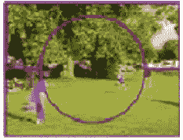

*图 3-8. 遮罩路径的轮廓*

图 3-9 显示了轮廓和填充后的路径。

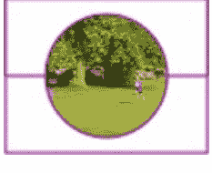

*图 3-9. 经过 `fill` 和 `stroke` 后的遮罩路径*

现在，实际路径只有填充，填充颜色为白色。您需要想象这两个白色形状在视频顶部移动。遮罩的效果是覆盖大部分视频片段。可以说，`canvas` 上没有绘制内容的部分是透明的，视频片段内容会透过来。换句话说，`canvas` 位于视频元素之上，但它相当于一块玻璃。每个没有绘制内容的像素都是透明的。

绘制遮罩的代码对于在 `canvas` 上绘制视频（`videobounceC`）和在屏幕上移动视频元素（`videobounceE`）两种情况都是相同的。第一条路径从左上角开始，然后向右，向下到中间点，最后回到左边。然后路径是一个半圆弧。表示圆弧方向的最后一个参数，`true` 表示逆时针。路径继续向左边缘画线，然后回到起点。第二条路径从左侧边缘的中间开始，向下到左下角，到右下角，向上移动到右侧的中间，然后向左。这次的圆弧将 `false` 作为方向参数的值，表示圆弧是顺时针的。路径在起点结束。

```
ctx.beginPath();

ctx.moveTo(ballx,bally);

ctx.lineTo(ballx+videow,bally);

ctx.lineTo(ballx+videow,bally+.5*videoh);

ctx.lineTo(ballx+.5*videow+maskrad, bally+.5*videoh);

ctx.arc(ballx+.5*videow,bally+.5*videoh,maskrad,0,Math.PI,true);

ctx.lineTo(ballx,bally+.5*videoh);

ctx.lineTo(ballx,bally);

ctx.fill();
```

```
ctx.moveTo(ballx,bally+.5*videoh);

ctx.lineTo(ballx,bally+videoh);

ctx.lineTo(ballx+videow,bally+videoh);

ctx.lineTo(ballx+videow,bally+.5*videoh);

ctx.lineTo(ballx+.5*videow+maskrad,bally+.5*videoh);

ctx.arc(ballx+.5*videow,bally+.5*videoh,maskrad,0,Math.PI,false);

ctx.lineTo(ballx,bally+.5*videoh);

ctx.fill();
```

您可以对照我的“英文”描述来跟踪代码，看看它是如何工作的。顺便说一下，我最初的尝试是绘制一条由四边形组成的路径，代表外矩形，然后在中间画一个圆。这在某些浏览器中有效，但在其他浏览器中不行。

对于 `videobounceC` 应用程序，由于两条白色填充路径是在 `drawImage` 语句绘制视频帧之后绘制的，所以遮罩位于绘制在 `canvas` 上的视频之上。我在 `videobounceE` 应用程序中通过将视频元素的 `z-index` 指定为 0，将 `canvas` 的 `z-index` 指定为 10 来实现相同的效果。请记住，z 轴是从屏幕里向外延伸的轴。较高的值离我们更近，位于较低值的上方。`z-index` 设置为 10 的 `canvas` 位于 `z-index` 设置为 0 的视频元素之上。下一章将演示在 Google 地图上的移动聚光灯，其中将介绍使用 JavaScript 更改 `z-index`。

#### 用户界面

两个版本的 `videobounce` 项目的用户界面只包含一个用户操作：用户可以反转移动方向。按钮由 `body` 中的元素定义：

```html
<button id="revbtn" onClick="reverse();">Reverse </button><br/>
```

`onClick` 设置的效果是调用名为 `reverse` 的函数。该函数定义为改变水平和垂直位移的符号：

```javascript
function reverse() {
    ballvx = -ballvx;
    ballvy = -ballvy;
}
```

对于任何用户界面，有一个重要的考虑因素。您需要确保它是可见的。这通过以下 `style` 指令实现：

```css
#revbtn {position:absolute; z-index:20; }
```


`z-index` 将按钮置于 `canvas` 之上，而 `canvas` 又位于视频之上。在解释了可用于满足弹跳视频关键需求的各个 HTML5、CSS 和 JavaScript 特性之后，我现在将展示两个 videobounce 应用程序中的代码，以及用于显示图 3-2 中轨迹的代码。

#### 构建应用程序并使其成为您自己的

两个用于模拟二维框中视频片段球弹跳的应用程序包含类似的代码，生成轨迹图片的程序也是如此。以下是应用程序的快速摘要。视频应用程序总结如下：

1. `init`：初始化，包括调整以适应窗口，以及设置用于调用 `drawscene` 的定时事件。

2. `drawscene`：

   - a. 清除画布。
   - b. 使用 `moveandcheck` 确定视频（虚拟球）的新位置。
   - c. 在画布的指定位置绘制视频图像，或将视频元素重新定位到指定位置。
   - d. 在画布上绘制路径，作为视频的遮罩。
   - e. 绘制边框。

3. `moveandcheck`：检查虚拟球是否会撞击到任何墙壁。如果是，则改变相应的位移值。

轨迹函数也使用 `init` 和 `moveandcheck`，但 `drawscene` 函数更简单：

1. 使用 `moveandcheck` 确定圆（虚拟球）的新位置。
2. 绘制一个由圆组成的路径，并使用填充然后描边来绘制圆。
3. 绘制边框。

描述调用/被调用和调用关系的函数（如表 3-1 所示）对于所有应用程序都是相同的。

#### 表 3-1. 弹跳视频项目中的函数

| 函数 | 调用/被...调用 | 调用 |
| :--- | :--- | :--- |
| `init` | 由 `<body>` 标签中 `onLoad` 属性的动作触发 | |
| `drawscene` | 由 `init` 中发出的 `setInterval` 命令的动作触发 | `moveandcheck` |
| `moveandcheck` | 在 `drawscene` 中被调用 | |
| `reverse` | 由按钮上 `onClick` 的动作触发 | |
| `restart` | 由 `init` 中 `addEventListener` 的动作触发（在 videobounceTrajectory 中不存在） | |

表 3-2 显示了 videobounceC 应用程序的代码，该应用程序按设定的时间间隔在画布上绘制视频的当前帧。

#### 表 3-2. VideobounceC 应用程序的完整代码

| 代码行 | 描述 |
| --- | --- |
| `<!DOCTYPE html>` | 头部声明 |
| `<html>` | 开始 html 标签 |
| `<head>` | 开始 head 标签 |
| `<title>Video bounce</title>` | 完整的标题 |
| `<meta charset="UTF-8">` | Meta 元素 |
| `<style>` | 开始 style |
| `#vid {position:absolute; display:none; }` | 设置视频定位；将显示设置为 none；视频元素从不出现 |
| `#canvas {position:absolute; z-index:10; top:0px; left:0px;}` | 设置定位为绝对定位，位置为左上角；设置 `z-index` 使其位于“反转”按钮下方 |
| `#revbtn {position:absolute; z-index:20; }` | 设置定位为绝对定位，并设置 `z-index` 使其位于画布上方 |
| `</style>` | 结束 style |
| `<script type="text/javascript">` | 开始 script 标签 |
| `var ctx;` | 用于保存画布上下文，用于所有绘图 |
| `var cwidth ;` | 用于保存画布宽度 |
| `var cheight ;` | 用于保存画布高度 |
| `var ballrad = 50;` | 设置球半径 |
| `var ballx = 50;` | 球的初始水平坐标 |
| `var bally = 60;` | 球的初始垂直坐标 |
| `var maskrad;` | 用于遮罩半径 |
| `var ballvx = 2;` | 球的初始水平位移 |
| `var ballvy = 4;` | 球的初始垂直位移 |
| `var v;` | 将保存视频元素 |
| `function restart() {` | `restart` 函数头 |
| `v.currentTime=0;` | 将视频播放位置重置到开始 |
| `v.play();` | 播放视频 |
| `}` | 结束 `restart` 函数 |
| `function init(){` | `init` 函数头 |
| `canvas1 = document.getElementById('canvas');` | 设置画布的引用 |
| `ctx = canvas1.getContext('2d');` | 设置画布上下文的引用 |
| `canvas1.width = window.innerWidth;` | 设置画布宽度以匹配当前窗口宽度 |
| `cwidth = canvas1.width;` | 设置变量 |
| `canvas1.height = window.innerHeight;` | 设置画布高度以匹配当前窗口高度 |
| `cheight = canvas1.height;` | 设置变量 |
| `v = document.getElementById("vid");` | 设置视频元素的引用 |
| `v.addEventListener("ended",restart,false);` | 设置视频结束时的事件处理；这样做是因为元素头中的 loop 属性设置在 Firefox 浏览器中不起作用 |
| `v.width = Math.min(v.videoWidth/3,.5*cwidth);` | 设置视频宽度 |
| `v.height = Math.min(v.videoHeight/3,.5*cheight);` | 设置视频高度 |
| `videow = v.width;` | 设置变量 |
| `videoh = v.height;` | 设置变量 |
| `ballrad = Math.min(50,.5*videow,.5*videoh);` | 如果视频非常小，则修改 `ballrad` |
| `maskrad = .4*Math.min(videow,videoh);` | 根据视频尺寸设置 `maskrad` |
| `ctx.lineWidth = ballrad;` | 设置绘制边框的线宽 |
| `ctx.strokeStyle ="rgb(200,0,50)";` | 将颜色设置为偏红色 |
| `ctx.fillStyle="white";` | 将遮罩的填充样式设置为白色 |
| `v.play();` | 开始播放视频 |
| `setInterval(drawscene,50);` | 设置定时事件 |
| `}` | 结束 `init` 函数 |
| `function drawscene(){` | `drawscene` 函数头 |
| `ctx.clearRect(0,0,cwidth,cheight);` | 清除画布 |
| `moveandcheck();` | 检查下一步移动是否会撞墙，如果是，则调整位移和位置；否则，只是进行移动 |
| `ctx.drawImage(v,ballx, bally, videow,videoh);` | 在指定位置绘制来自视频的图像 |
| `ctx.beginPath();` | 开始绘制遮罩上半部分的路径 |
| `ctx.moveTo(ballx,bally);` | 移动到起点 |
| `ctx.lineTo(ballx+videow,bally);` | 水平移动 |
| `ctx.lineTo(ballx+videow,bally+.5*videoh);` | 向下移动到一半 |
| `ctx.lineTo(ballx+.5*videow+maskrad, bally+.5*videoh);` | 向内移动到开口起始处 |
| `ctx.arc(ballx+.5*videow,bally+.5*videoh,maskrad,0, Math.PI,true);` | 创建半圆形弧线 |
| `ctx.lineTo(ballx,bally+.5*videoh);` | 向左移动 |
| `ctx.lineTo(ballx,bally);` | 移动到起点 |
| `ctx.fill();` | 填充遮罩的白色上半部分 |
| `ctx.moveTo(ballx,bally+.5*videoh);` | 移动到遮罩下半部分的起点；移动到左侧中间点 |
| `ctx.lineTo(ballx,bally+videoh);` | 向下移动到左下角 |
| `ctx.lineTo(ballx+videow,bally+videoh);` | 向右移动到右下角 |
| `ctx.lineTo(ballx+videow,bally+.5*videoh);` | 向上移动到右侧中间 |
| `ctx.lineTo(ballx+.5*videow+maskrad,bally+.5*videoh);` | 向内移动到遮罩开口的起点 |
| `ctx.arc(ballx+.5*videow,bally+.5*videoh,maskrad,0,Math.PI,false);` | 创建半圆形弧线 |
| `ctx.lineTo(ballx,bally+.5*videoh);` | 向右移动 |
| `ctx.fill();` | 填充遮罩的白色下半部分 |
| `ctx.strokeRect(0,0,cwidth,cheight);` | 绘制边框 |
| `}` | 结束 `drawscene` 函数 |
| `function moveandcheck() {` | `moveandcheck` 函数头 |
| `var nballx = ballx + ballvx+.5*videow;` | 设置 x 的试验值 |
| `var nbally = bally +ballvy+.5*videoh;` | 设置 y 的试验值 |
| `if (nballx > cwidth) {` | 与右墙比较，碰撞时 |
| `ballvx =-ballvx;` | 改变水平位移的符号 |
| `nballx = cwidth;` | 将试验值设置为正好在右墙上 |
| `}` | 结束子句 |
| `if (nballx < 0) {` | 与左墙比较，碰撞时 |
| `nballx = 0;` | 将试验值设置为正好在左墙上 |
| `ballvx = -ballvx;` | 改变水平位移的符号 |
| `}` | 结束子句 |
| `if (nbally > cheight) {` | 与底墙比较，碰撞时 |
| `nbally = cheight;` | 将试验值设置为精确高度 |
| `ballvy = -ballvy;` | 改变垂直位移的符号 |
| `}` | 结束子句 |
| `if (nbally < 0) {` | 与顶墙比较，碰撞时 |
| `nbally = 0;` | 将试验值更改为正好在顶墙上 |
| `ballvy = -ballvy;` | 改变垂直位移的符号 |
| `}` | 结束子句 |
| `ballx = nballx-.5*videow;` | 使用试验值设置 `ballx`，并偏移为左上角，而不是中心 |
| `bally = nbally-.5*videoh;` | 使用试验值设置 `bally`，并偏移为左上角，而不是中心 |
| `}` | 结束 `moveandcheck` 函数 |
| `function reverse() {` | 按钮操作的函数头 |
| `ballvx = -ballvx;` | 改变水平位移的符号 |

## 第三章 ■ 弹跳视频：HTML5视频的动画与遮罩

| 代码行 | 描述 |
| :--- | :--- |
| `ballvy = -ballvy;` | 更改垂直位移的符号 |
| `}` | 关闭反向函数 |
| `</script>` | 关闭脚本标签 |
| `</head>` | 关闭头部标签 |
| `<body onLoad="init();">` | 打开主体标签；设置调用 `init` 函数 |
| `<video id="vid" loop="loop" preload="auto">` | 视频元素头 |
| `<source src="joshuahomerun.mp4" type="video/mp4; codecs="avc1.42E01E, mp4a.40.2"">` | MP4视频源 |
| `<source src="joshuahomerun.webmvp8.webm" type="video/webm; codec="vp8, vorbis"">` | WEBM视频源 |
| `<source src="joshuahomerun.theora.ogv" type="video/ogg; codecs="theora, vorbis"">` | OGG视频源 |
| Your browser does not accept the video tag. | 不支持视频标签的浏览器显示的消息 |
| `</video>` | 关闭视频标签 |
| `<button id="revbtn" onClick="reverse();">Reverse</button><br/>` | 用于让观看者反向运动的按钮 |
| `<canvas id="canvas" >` | 打开画布标签 |
| This browser doesn't support the HTML5 canvas element. | 不支持HTML5画布元素的浏览器显示的消息 |
| `</canvas>` | 关闭画布标签 |
| `</body>` | 关闭主体标签 |
| `</html>` | 关闭 HTML 标签 |

该应用程序的第二个版本移动的是视频元素，而不是在画布上绘制视频的当前帧。我的研究表明，这在执行时可能使用更少的计算机资源。所有版本都有很多共同之处，我将通过仅注释不同的行来指出这一点。

#### 表3-3. VideobounceE程序的完整代码

| 代码行 | 描述 |
| --- | --- |
| `<!DOCTYPE html>` | |
| `<html>` | |
| `<head>` | |
| `<title>Video bounce</title>` | |
| `<meta charset="UTF-8">` | |
| `<style>` | |
| `#vid {position:absolute; display:none; z-index: 1;` | 需要设置定位和 `z-index`，因为 `display` 设置将被更改为使元素可见 |
| `}` | 结束指令 |
| `#canvas {position:absolute; z-index:10; top:0px; left:0px;}` | 这将位于视频之上，按钮之下 |
| `#revbtn {position:absolute; z-index:20;}` | |
| `</style>` | |
| `<script type="text/javascript">` | |
| `var ctx;` | |
| `var cwidth ;` | |
| `var cheight ;` | |
| `var ballrad = 50;` | |
| `var ballx = 80;` | 起始点是任意的 |
| `var bally = 80;` | 起始点是任意的 |
| `var maskrad;` | |
| `var ballvx = 2;` | |

| 代码行 | 描述 |
| --- | --- |
| `var ballvy = 4;` | |
| `var v;` | |
| `function restart() {` | |
| `v.currentTime=0;` | |
| `v.play();` | |
| `}` | |
| `function init(){` | |
| `canvas1 = document.getElementById('canvas');` | |
| `ctx = canvas1.getContext('2d');` | |
| `canvas1.width = window.innerWidth;` | |
| `cwidth = canvas1.width;` | |
| `canvas1.height = window.innerHeight;` | |
| `cheight = canvas1.height;` | |
| `window.onscroll = function () {` | |
| `window.scrollTo(0,0);` | |
| `};` | |
| `v = document.getElementById("vid");` | |
| `v.addEventListener("ended",restart,false);` | |
| `v.width = Math.min(v.videoWidth/3,.5*cwidth);` | |
| `v.height = Math.min(v.videoHeight/3,.5*cheight);` | |
| `videow = v.width;` | |
| `videoh = v.height;` | |

| 代码行 | 描述 |
|---|---|
| `ballrad = Math.min(50,.5*videow,.5*videoh);` | |
| `maskrad = .4*Math.min(videow,videoh);` | |
| `ctx.lineWidth = ballrad;` | |
| `ctx.strokeStyle ="rgb(200,0,50)";` | |
| `ctx.fillStyle="white";` | |
| `v.style.left = String(ballx)+"px";` | |
| `v.style.top = String(bally)+"px";` | |
| `v.play();` | |
| `v.style.display = "block";` | 使视频元素可见 |
| `setInterval(drawscene,50);` | |
| `}` | |
| `function drawscene(){` | |
| `ctx.clearRect(0,0,cwidth,cheight);` | |
| `moveandcheck();` | |
| `v.style.left = String(ballx)+"px";` | 水平定位视频 |
| `v.style.top = String(bally)+"px";` | 垂直定位视频 |
| `ctx.beginPath();` | |
| `ctx.moveTo(ballx,bally);` | |
| `ctx.lineTo(ballx+videow,bally);` | |
| `ctx.lineTo(ballx+videow,bally+.5*videoh);` | |
| `ctx.lineTo(ballx+.5*videow+maskrad, bally+.5*videoh);` | |

| 代码行 | 描述 |
| --- | --- |
| `ctx.arc(ballx+.5*videow,bally+.5*videoh,maskrad,0,Math.PI,true);` | |
| `ctx.lineTo(ballx,bally+.5*videoh);` | |
| `ctx.lineTo(ballx,bally);` | |
| `ctx.fill();` | |
| `ctx.moveTo(ballx,bally+.5*videoh);` | |
| `ctx.lineTo(ballx,bally+videoh);` | |
| `ctx.lineTo(ballx+videow,bally+videoh);` | |
| `ctx.lineTo(ballx+videow,bally+.5*videoh);` | |
| `ctx.lineTo(ballx+.5*videow+maskrad,bally+.5*videoh);` | |
| `ctx.arc(ballx+.5*videow,bally+.5*videoh,maskrad,0,Math.PI,false);` | |
| `ctx.lineTo(ballx,bally+.5*videoh);` | |
| `ctx.fill();` | |
| `ctx.strokeRect(0,0,cwidth,cheight); // box` | |
| `}` | |
| `function moveandcheck() {` | |
| `var nballx = ballx + ballvx;` | 尝试值 |
| `var nbally = bally + ballvy;` | 尝试值 |
| `if ((nballx+videow) > cwidth) {` | 加上总宽度进行比较 |
| `ballvx = -ballvx;` | 更改水平位移的符号 |
| `nballx = cwidth-videow;` | 设置为精确位置 |

| 代码行 | 描述 |
| --- | --- |
| `}` | |
| `if (nballx < 0) {` | |
| `nballx = 0;` | |
| `ballvx = -ballvx;` | |
| `}` | |
| `if ((nbally+videoh) > cheight) {` | 比较总高度 |
| `nbally = cheight-videoh;` | 设置为精确位置 |
| `ballvy = -ballvy;` | 更改垂直位移的符号 |
| `}` | |
| `if (nbally < 0) {` | |
| `nbally = 0;` | |
| `ballvy = -ballvy;` | |
| `}` | |
| `ballx = nballx;` | 设置为尝试位置，可能已调整 |
| `bally = nbally;` | 设置为尝试位置，可能已调整 |
| `}` | |
| `function reverse() {` | |
| `ballvx = -ballvx;` | |
| `ballvy = -ballvy;` | |
| `}` | |
| `</script>` | |
| `</head>` | |

| 代码行 | 描述 |
| --- | --- |
| `<body onLoad="init();" >` | |
| `<video id="vid" loop="loop" preload="auto">` | |
| `<source src="joshuahomerun.webmvp8.webm" type='video/webm; codec="vp8, vorbis"'>` | |
| `<source src="joshuahomerun.mp4" type='video/mp4; codecs="avc1.42E01E, mp4a.40.2"'>` | |
| `<source src="joshuahomerun.theora.ogv" type='video/ogg; codecs="theora, vorbis"'>` | |
| Your browser does not accept the video tag. | |
| `</video>` | |
| `<button id="revbtn" onClick="reverse();">Reverse </button><br/>` | |
| `<canvas id="canvas" >` | |
| This browser doesn't support the HTML5 canvas element. | |
| `</canvas>` | |
| `</body>` | |
| `</html>` | |

我通过修改 videobounceC 的 `drawscene` 函数创建了轨迹函数。由于我希望圆圈的大小与被遮罩的视频片段相似，因此在设置视频宽度和高度后，我临时向 videobounceC 函数添加了一个 `alert` 语句，并使用这些值运行程序：

```


```javascript
v.width = Math.min(v.videoWidth / 3, .5 * cwidth);
v.height = Math.min(v.videoHeight / 3, .5 * cheight);
alert("width " + v.width + " height " + v.height);
```

然后我使用这些值 106 和 80 作为轨迹程序中的`videow`和`videoh`值。完整的代码，带有更改行的注释，如表 3-4 所示。请注意，此程序与前两个程序的主要区别是缺失的行。

#### 表 3-4. VideobounceTrajectory 程序的完整代码

| 代码行 | 描述 |
| --- | --- |
| `<!DOCTYPE html>` |  |
| `<html>` |  |
| `<head>` |  |
| `<title>Video bounce</title>` |  |
| `<meta charset="UTF-8">` |  |
| `<style>` |  |
| `#canvas {position:absolute; z-index:10; top:0px; left:0px;}` |  |
| `#revbtn {position:absolute; z-index:20; }` |  |
| `</style>` |  |
| `<script type="text/javascript">` |  |
| `var ctx;` |  |
| `var cwidth;` |  |
| `var cheight;` |  |
| `var ballrad = 50;` |  |
| `var ballx = 50;` |  |
| `var bally = 60;` |  |
| `var ballvx = 2;` |  |
| `var ballvy = 4;` |  |
| `function init(){` |  |
| `canvas1 = document.getElementById('canvas');` |  |
| `ctx = canvas1.getContext('2d');` |  |
| `canvas1.width = window.innerWidth;` |  |
| `cwidth = canvas1.width;` |  |
| `canvas1.height = window.innerHeight;` |  |
| `cheight = canvas1.height;` |  |
| `videow = Math.min(106, .5 * cwidth);` | 使用实际视频宽度的值 |
| `videoh = Math.min(80, .5 * cheight);` | 使用实际视频高度的值 |
| `ballrad = Math.min(50, .5 * videow, .5 * videoh);` |  |
| `maskrad = .4 * Math.min(videow, videoh);` |  |
| `ctx.lineWidth = ballrad;` |  |
| `ctx.fillStyle = "white";` |  |
| `ctx.strokeStyle = "rgb(200,0,50)";` |  |
| `ctx.strokeRect(0, 0, cwidth, cheight);` |  |
| `setInterval(drawscene, 50);` |  |
| `}` |  |
| `function drawscene(){` |  |
| `moveandcheck();` |  |
| `ctx.beginPath();` | 开始绘制圆形路径 |
| `ctx.moveTo(ballx + .5 * videow + maskrad, bally + .5 * videoh);` | 移动到圆右侧的点 |
| `ctx.arc(ballx + .5 * videow, bally + .5 * videoh, maskrad, 0, 2 * Math.PI, true);` | 绘制圆 |
| `ctx.lineWidth = 1;` | 设置线宽 |
| `ctx.fill();` | 填充（颜色为白色） |
| `ctx.stroke();` | 设置红色描边（轮廓） |
| `ctx.lineWidth = ballrad;` | 设置方框的线宽 |
| `ctx.strokeRect(0, 0, cwidth, cheight);` | 绘制方框 |
| `}` |  |
| `function moveandcheck() {` |  |
| `var nballx = ballx + ballvx + .5 * videow;` |  |
| `var nbally = bally + ballvy + .5 * videoh;` |  |
| `if (nballx > cwidth) {` |  |
| `ballvx = -ballvx;` |  |
| `nballx = cwidth;` |  |
| `}` |  |
| `if (nballx < 0) {` |  |
| `nballx = 0;` |  |
| `ballvx = -ballvx;` |  |
| `}` |  |
| `if (nbally > cheight) {` |  |
| `nbally = cheight;` |  |
| `ballvy = -ballvy;` |  |
| `}` |  |
| `if (nbally < 0) {` |  |
| `nbally = 0;` |  |
| `ballvy = -ballvy;` |  |
| `}` |  |
| `ballx = nballx - .5 * videow;` |  |
| `bally = nbally - .5 * videoh;` |  |
| `}` |  |
| `function reverse() {` |  |
| `ballvx = -ballvx;` |  |
| `ballvy = -ballvy;` |  |
| `}` |  |
| `</script>` |  |
| `</head>` |  |
| `<body onLoad="init();">` |  |
| `<button id="revbtn" onClick="reverse();">Reverse </button><br/>` |  |
| `<canvas id="canvas">` |  |
| `This browser doesn't support the HTML5 canvas element.` |  |
| `</canvas>` |  |
| `</body>` |  |
| `</html>` |  |

#### 自定义你的应用

自定义这个应用的第一种方式是使用你自己的视频。你需要找一些适合以小圆形显示的内容。如前所述，你需要使用不同的视频编解码器来生成各个版本。下一步是添加其他用户界面操作，包括改变水平和垂直速度，正如 *The Essential Guide to HTML5* 中弹跳球项目所实现的那样。

另一组增强功能是添加视频控制。视频控制可以作为视频元素的一部分，但我认为这对于需要保持较小尺寸且正在移动的视频片段来说并不适用！不过，你可以参考`"Reverse"`按钮的模式，用按钮来实现自己的控制。例如，以下语句：

```javascript
v.pause();
```

可以暂停视频。

属性`v.currentTime`可以被引用或设置，以控制视频片段中的播放位置。你在第 1 章中已经了解了范围输入类型的工作方式，因此可以考虑构建一个滑块输入元素来调整视频。

你可能会决定改变我适应窗口尺寸的方式。一种替代方案是改变视频片段的尺寸以保持纵横比。另一种替代方案是始终改变视频尺寸。这意味着视频尺寸和画布方向将始终保持比例。

还有一种替代方案，虽然我认为这会令人不安，是在每个时间间隔引用窗口尺寸，并每次对画布以及可能对视频进行更改。可以在`body`标签中插入一个事件：

```html
<body onresize="changedims();" ...>
```


这段代码假设你已经定义了一个名为`changedims`的函数，其中包含当前`init`函数中的部分语句，用于提取`window.innerWidth`和`window.innerHeight`属性来设置画布和视频的尺寸。

更广泛地说，本章的目标是向你展示将视频以动态方式融入项目的方法，无论是在屏幕位置还是时间控制方面。特别是，可以将视频播放与画布上的绘图相结合，以实现令人兴奋的效果。

现有的屏幕保护程序中，屏幕被一个类似于轨迹程序的弹跳物体填满。你可以更改`drawscene`函数来产生不同的形状。此外，正如我之前提到的，你可以应用《The Essential Guide to HTML5》中讲解的技术来为观众提供交互操作。你可以参考本书第1章了解范围输入（滑块）的使用。另一种可能性是为观众提供一种方式，使用`color`输入类型来改变圆形（或你设计的其他形状）的颜色。Opera 浏览器提供了颜色选择器选项。

#### 测试和上传应用

正如已经提到但值得重复的是，你需要获取一段合适的视频片段。在撰写本书时，你需要使用 Miro 等程序来生成 WEBM、mp4 和 OGG 版本，因为浏览器识别不同的视频编码（编解码器）。这种情况可能会改变。同样，如果你只想在一个浏览器上实现此应用，你可以检查哪种视频编码适用于该浏览器，然后只需准备一个视频文件。视频文件和`html`文件需要放在你计算机上的同一个文件夹中，如果你将此应用上传到服务器账户，则需要放在服务器上的同一个文件夹中。或者，你可以在源元素中使用完整的网络地址或正确的相对地址。

## 总结

在本章中，你学习了操作视频的不同方法，包括以下内容：

- 将视频的当前帧作为图像绘制到画布上
- 通过更改`left`和`top`样式属性来重新定位屏幕上的视频元素
- 使用样式指令将视频、画布和按钮分层
- 在画布上创建移动遮罩
- 获取窗口尺寸信息，以使应用适应不同的情况

下一章将向你展示如何在 HTML5 项目中使用 Google Maps 应用程序编程接口（API）。该项目将涉及使用画布并更改`z-index`，使画布交替位于 Google Maps 生成的内容之下和之上。

## 第4章 地图制作器：结合 Google Maps 和画布

在本章中，你将学习如何完成以下操作：

- 使用 Google Maps API 在特定位置显示地图
- 使用透明度（也称为 alpha 或不透明度级别）和自定义光标图标在画布上绘制图形
- 通过结合使用 Google Maps 和 HTML5 功能，管理事件和`z-index`层级，为用户提供图形用户界面（GUI）
- 计算两个地理位置之间的距离

### 简介

本章的项目是一个涉及地理地图的应用程序。如今许多应用程序都涉及使用由他人或组织提供的应用程序编程接口（API）。本章将介绍 Google Maps API 的使用，这是使用 Google Maps JavaScript 第3版 API 的三章内容中的第一章。图4-1展示了初始屏幕。

基准位置（小红色 x）

更改基准位置：

- Friends of ED，纽约市
- Purchase College
- Illinois Institute of Technology

CHANGE

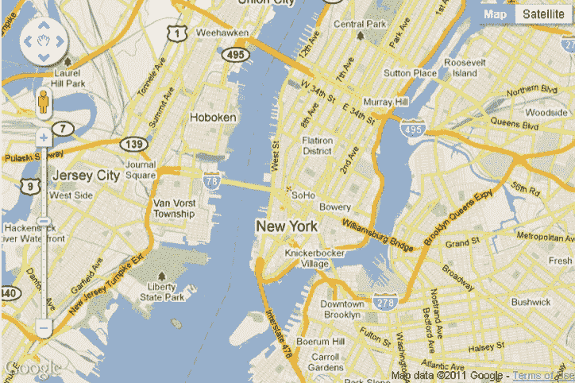

##### 图4-1. 地图聚光灯项目的初始屏幕

注意位于 SoHo 上方偏左位置的小红色（手绘）x 标记。在选择地图标记时，你面临着一个权衡。较小的标记更难看到。较大和/或更复杂的标记更容易看到，但会遮挡更多地图或使地图分散注意力。x 标记了曼哈顿下城的一个街区，它是 friends of ED 出版商的地址。对于本程序来说，它是初始基准位置。基准位置用于计算距离。

将鼠标移到地图上方的效果如图4-2所示。

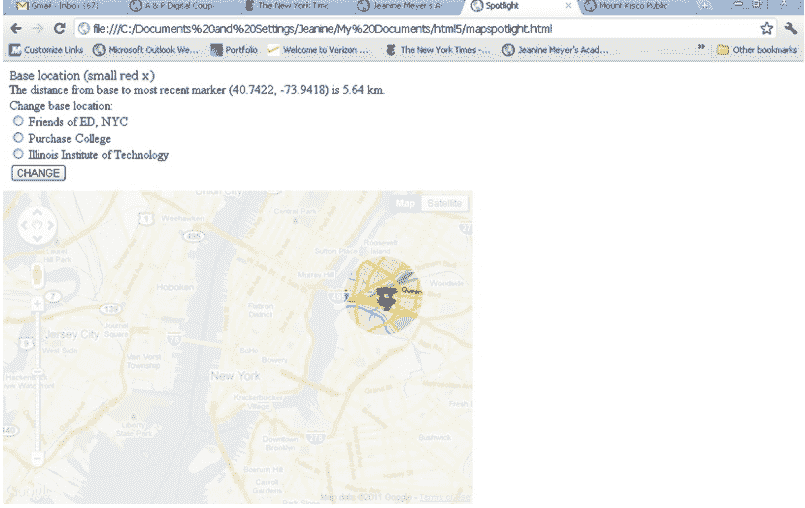

##### 图4-2. 地图上的阴影/聚光灯效果

注意地图上现在的阴影和聚光灯组合效果。地图的大部分被半透明阴影覆盖。请相信我，这张截图是在我将鼠标移到地图上时截取的。鼠标位置周围有一个圆形区域，其中原始地图透出显示。光标不是标准的默认光标，而是我使用一个代表紧凑型荧光灯泡的小图像创建的自定义光标。

屏幕上显示的文本显示基准位置到我在地图上最后点击的位置之间的距离为5.64公里。所有此类位置的标记都是手绘的 x。该位置的经纬度在括号中显示。

Google Maps 提供的通用 GUI 功能对本项目的用户都是可用的。这包括一个控制显示比例的垂直滑块。图4-3展示了使用该滑块放大后的效果。还可以进一步放大。

### 第4章 ■ 地图制作工具：结合谷歌地图与画布

基准位置（红色小x）

从基准位置到最近标记点（40.7422, -73.9418）的距离为5.64公里。

更改基准位置：

- Friends of ED, NYC
- Purchase College
- Illinois Institute of Technology

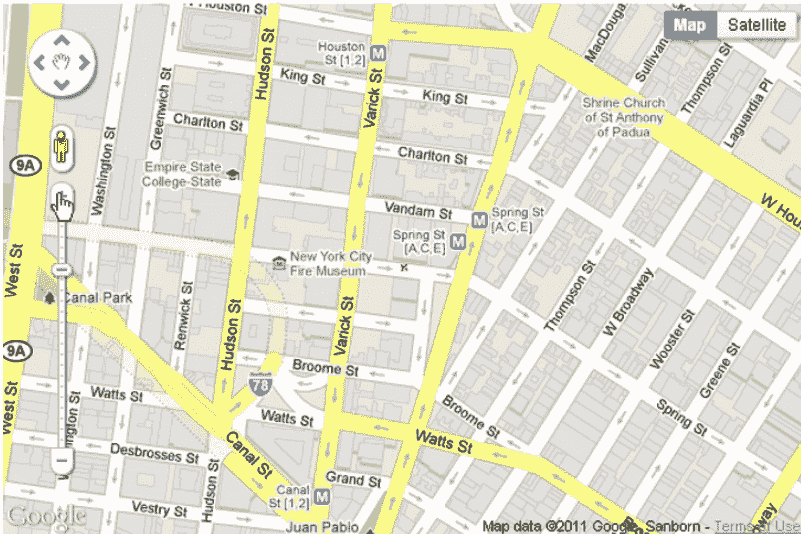

*图 4-3. 放大到街道级别*

也可以通过点击左上角的手形图标来平移地图，然后虚拟地按住鼠标按钮拖动来实现抓取。图4-4展示了缩小并向北移动的效果。屏幕再次显示了阴影/聚光灯效果。

基准位置（红色小x）

从基准位置到最近标记点（41.2365, -73.6977）的距离为62.39公里。

更改基准位置：

- Friends of ED, NYC
- Purchase College
- Illinois Institute of Technology

[CHANGE]

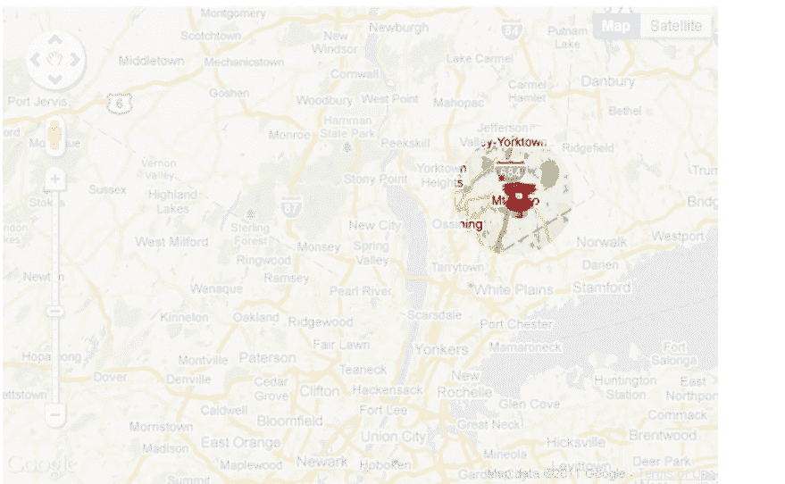

*图 4-4. 缩小并向北移动*

该程序提供了一种更改基准位置的方式。有三种选择：出版社friends of ED所在的位置，位于纽约市；Purchase College（我任教的学校），位于纽约州普切斯，在纽约市以北；以及Illinois Institute of Technology（我儿子任教的学校），位于伊利诺伊州芝加哥。进行选择的界面是一组单选按钮——一次只能选择一个按钮，以及一个标有CHANGE的按钮，当用户/观众/访问者决定进行更改时点击。图4-5展示了更改为Purchase College的结果。注意手绘的红色`x`标记的基准位置，以及页面顶部指示新基准位置名称的文本。

基准位置（红色小x）是Purchase College/SUNY

更改基准位置：

- ○ Friends of ED, NYC
- ● Purchase College
- ○ Illinois Institute of Technology

CHANGE

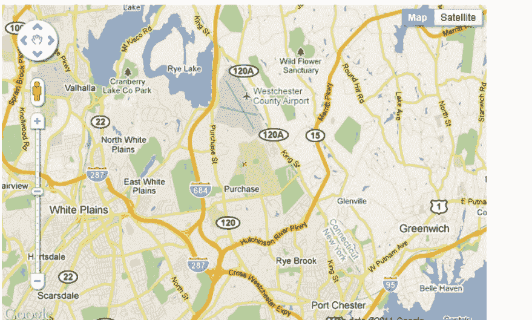

*图 4-5. Purchase College新基准位置*

接下来，我通过点击第三个单选按钮，将基准位置切换到伊利诺伊州芝加哥的Illinois Institute of Technology。结果如图4-6所示。

基准位置（红色小x）是Illinois Institute of Technology

更改基准位置：

- ○ Friends of ED, NY
- ○ Purchase College
- ● Illinois Institute of Technology

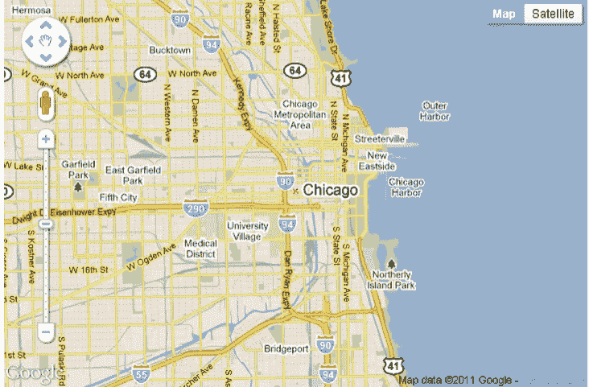

*图 4-6. 芝加哥Illinois Institute of Technology的基准位置*

再次注意，红色小`x`指示基准位置，屏幕顶部有显示新基准位置名称的文本。

每个基准位置的确定依据的是我设定的三个地点的经纬度值。我的代码并没有“询问”谷歌地图按名称查找这些位置。如果你在谷歌或谷歌地图中输入“Purchase College, NY”和“Illinois Institute of Technology”，可能会得到不同的结果。如果要将这个应用变成你自己的，你需要确定一组基准位置并查找其经纬度值。我将在下一节中建议如何做到这一点。

如果你好奇的话，将缩放/比例尺缩放到最远位置会产生如图4-7所示的效果。这种投影展示了所谓的格陵兰问题。格陵兰并不比非洲大，实际上大约只有其1/14的大小。

基准位置（红色小x）

从基准位置到最近标记点（40.6855, -74.0935）的距离为8.7公里。

更改基准位置：

- Friends of ED, NYC
- Purchase College
- Illinois Institute of Technology

[CHANGE]

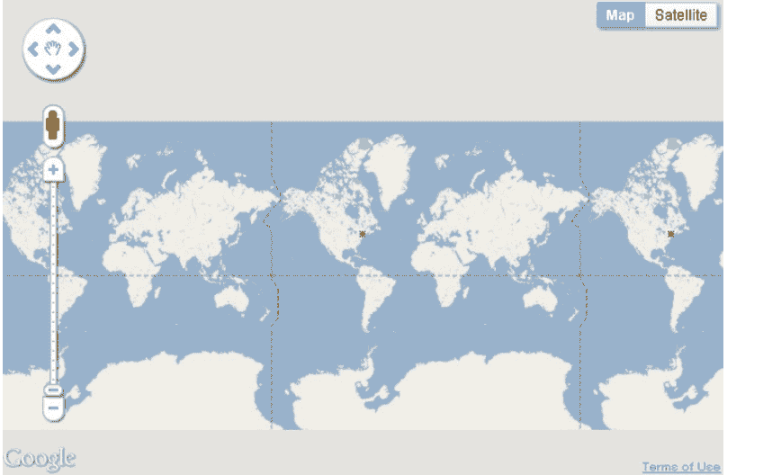

*图 4-7. 地图最远视图*

图4-8展示了接近最近极限的地图。地图也已通过右上角按钮切换为卫星视图。

基准位置（红色小x）是Friends of ED, NYC

从基准位置到最近标记点（40.6855, -74.0935）的距离为8.7公里。

更改基准位置：

- Friends of ED, NYC
- Purchase College
- Illinois Institute of Technology

CHANGE

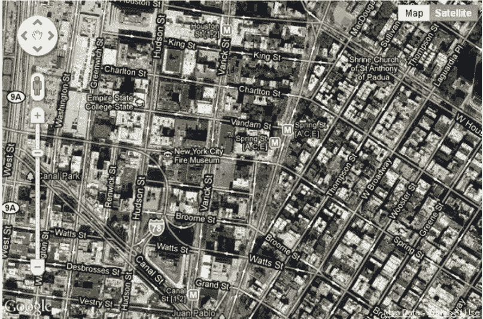

*图 4-8. 放大到可以辨识城市街区的程度*

注意左侧滑块大约在最接近设置上方四格的位置。最后，图4-9展示了放大到极限的地图。这基本上达到了建筑物级别，至少对于曼哈顿来说如此。

基准位置（红色小x）是Friends of ED, NYC

从基准位置到最近标记点（40.7257, -74.0049）的距离为0.01公里。

更改基准位置：

- [x] Friends of ED, NYC
- [ ] Purchase College
- [ ] Illinois Institute of Technology

CHANGE

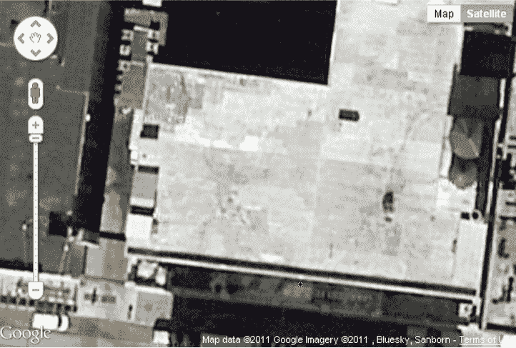

*图 4-9. 完全放大*

通过使用界面进行缩放、平移和再次放大，我可以确定从任何基准位置到世界上其他任何位置的距离！我也可以使用这个应用来确定任何位置的经纬度值。你需要知道经纬度来更改或添加基准位置列表，以及确定第5章项目中的位置。我将在下一节中回顾经纬度的概念。

谷歌地图本身就是一个极其有用的应用。本章及接下来的两章将演示如何将这些功能引入你自己的应用中。也就是说，我们将谷歌地图的通用功能与使用HTML5和JavaScript开发的任何功能（或几乎所有功能）相结合。

#### 经纬度及其他关键需求

本项目以及接下来两章中最基本的要求是理解地理坐标系统。正如需要坐标系统来指定画布上的点或屏幕上的位置一样，有必要使用一个系统来标识地球上的地点。经纬度系统在过去几百年间已经发展和标准化。这些值是角度，纬度表示距赤道的度数，经度表示距英国格林尼治本初子午线的度数。后者是一个在19世纪后期成为标准的任意选择。这里存在北半球偏见：纬度值从赤道的0度到北极的90度和南极的–90度。类似地，经度值从格林尼治本初子午线 east为正，west为负。纬度与赤道平行，经度与之垂直。纬度常被称为纬线，通常呈现为水平线；经度被称为经线，通常呈现为垂直线。这种方向是任意的，但已相当稳固。

我将使用十进制值，这是谷歌地图中默认显示的格式，但你也会看到度、分（1/60度）和秒（1/60分）的组合。你不需要记住经纬度值，但培养一些直观的系统感知是有益的。你可以通过我所说的“双向操作”来实现这一点。首先，识别并比较你所知道的地方的经纬度值；其次，选取一些数值看看它们对应哪里。例如，我版本中项目的基准值如下：

- `[40.725592, –74.00495, "friends of ED, NYC"]`
- `[41.04796, –73.70539, "Purchase College/SUNY"]`
- `[41.878928, –87.641926, "Illinois Institute of Technology"]`

首先要注意的是，纬度值相当接近，而经度值是负数，不那么接近。纽约市的friends of ED办公室与Purchase College的纬度差在1度以内，经度差也在1度以内。根据谷歌地图的距离是27.4英里。Illinois Institute of Technology的经度值更负，表明它比两个纽约州的位置更偏西。这些都合乎逻辑，但你需要花时间思考一下。

有许多方法可以找到特定位置的经纬度。你可以按如下方式使用谷歌地图：

1. 调用谷歌地图（访问`www.google.com`并点击地图，或访问`http://maps.google.com`）。
2. 在右上角，点击齿轮图标获取下拉菜单。点击地图实验室选项。将出现一个标题为“Google Maps Labs”的窗口。向下滚动到`LatLng Marker`选项，点击`Enable`旁边的圆圈。如果你登录了，所有设置将在下次登录时保持有效。保存并关闭窗口。
3. 在位置字段中输入你感兴趣的地点。
4. 右键/Ctrl+点击该位置以获取下拉菜单，如图4-10所示。
5. 点击`Drop LatLng marker`以获取如图4-11所示的结果。

### HTML5、CSS 和 JavaScript 特性

地图制作者项目面临的挑战在于引入谷歌地图，然后在外观和图形用户界面（GUI）操作中将地图、画布和按钮结合使用。我将首先介绍 Google Maps API 的基础知识，然后解释 HTML5 特性如何提供部分遮罩和事件处理功能。

### Google Maps API

Google Maps JavaScript API 第 3 版基础文档位于`http://code.google.com/apis/maps/documentation/javascript/basics.html`。你无需立即参考，但如果你决定构建自己的项目，它会有所帮助。特别是在为移动设备开发应用时，它将特别有用。

大多数 API 都以一组相关对象的形式呈现，每个对象都具有属性（也称为特性）和方法。API 还可能包括事件以及设置事件的方法。Google Maps API 就是如此。重要的对象有`Map`、`LatLng`和`Marker`。设置事件的方法是`addListener`，它可用于设置对地图点击操作的响应。

Google Maps API 通过`script`元素引入到你的 HTML5 文档中：

```html
<script type="text/javascript" charset="UTF-8"
src="http://maps.google.com/maps/api/js?sensor=false"></script>
```

我将在第 6 章再次讨论`script`标签，特别是`sensor=false`设置。

下一步——如果你只是想引入一个谷歌地图，这可能就是你需要做的全部——是设置对`Map`构造函数方法的调用。其伪代码如下：

```javascript
map = new google.maps.Map(你放置地图的位置, 包含选项的关联数组);
```

请注意，将变量命名为`map`没有任何问题。

我们逐一来看这两个参数。放置地图的位置可以是 HTML 文档`body`中定义的一个`div`。然而，我选择动态创建这个`div`。我通过在一个通常由`body`语句中的`onload`属性调用的`init`函数中编写代码来完成此操作。我还编写了在`div`内创建一个`canvas`元素的代码。代码如下：

```javascript
candiv = document.createElement("div");

candiv.innerHTML = ("<canvas id='canvas' width='600' height='400'>No canvas
</canvas>");

document.body.appendChild(candiv);

can = document.getElementById("canvas");

pl = document.getElementById("place");

ctx = can.getContext("2d");
```

`can`、`pl`和`ctx`是全局变量，每个变量都可以供其他函数使用。

> **注意** 尽管我试图使用“将对谷歌地图的访问引入到 HTML 文档中”这样的表述，但我还是犯了描述一个“创建”地图的功能的错误。谷歌地图的连接是动态的，谷歌地图会创建所谓的“待显示的切片”。

`Map`方法的第二个参数是一个关联数组。关联数组具有命名的元素，而不是索引元素。`Map`方法的数组可以指示缩放级别、地图中心和地图类型等信息。缩放级别可以从 0 到 18。0 级如图 4-7 所示。18 级可以显示建筑物。地图类型有`ROADMAP`、`SATELLITE`、`HYBRID`和`TERRAIN`。这些类型使用来自 Google Maps API 的常量来表示。中心点由`LatLng`类型的值给出，正如你可能预料的那样，它是使用表示纬度和经度值的十进制数字构造的。使用关联数组意味着我们不必遵循固定的参数顺序，并且任何我们省略的参数都将应用默认设置。

以下是我的`makemap`函数的开始部分。该函数通过两个表示地图中心点纬度和经度的数字进行调用。我的代码构造一个`LatLng`对象，设置保存地图规范的数组，然后构造地图——即构造通往谷歌地图的门户。

```javascript
function makemap(mylat, mylong) {
	var marker;

	blatlng = new google.maps.LatLng(mylat, mylong);

	myOptions = {
		zoom: 12,
		center: blatlng,
		mapTypeId: google.maps.MapTypeId.ROADMAP
	};
```


```javascript
map = new google.maps.Map(document.getElementById("place"), myOptions);
```

`Map`方法在 ID 为`place`的 div 中，使用指定的选项构建对谷歌地图的访问。`makemap`函数继续执行，在地图中心放置一个标记。这是通过设置一个关联数组作为`Marker`方法的参数来完成的。图标标记将是我使用自己设计的图像（一个绘制的红色`x`）创建的图像。

```javascript
marker = new google.maps.Marker({
  position: blatlng,
  title: "center",
  icon: rxmarker,
  map: map
});
```

`makemap`函数中还有一条语句，但我将在后面解释其余部分。

### Canvas 图形

我们希望随鼠标在地图上移动的图形类似于第 3 章中用于将矩形视频片段转换为圆形视频片段的蒙版。这两个蒙版都可以被描述为类似于矩形甜甜圈：一个带圆孔的矩形。我们使用两条路径绘制阴影/聚光灯的图形，就像上一章视频的蒙版一样。然而，这两种情况之间有两个显著的不同点：

- 这个遮罩的确切形状会变化。外边界是整个画布，而孔洞的位置与鼠标的当前位置对齐。孔洞会随鼠标移动。
- 遮罩的颜色不是纯色填充，而是透明的灰色。

画布最初位于 Google 地图上方。我通过设置`z-index`值的样式指令来实现这一点：

```css
canvas {
  position: absolute;
  top: 165px;
  left: 0px;
  z-index: 100;
}

#place {
  position: absolute;
  top: 165px;
  left: 0px;
  z-index: 1;
}
```

第一条指令适用于所有`canvas`元素。这个 HTML 文档中只有一个。回顾一下，z 轴是从屏幕朝向观察者方向延伸的，所以更高的值会覆盖在更低的值之上。还需注意，我们在 JavaScript 代码中使用`zIndex`，而在 CSS 中使用`z-index`。JavaScript 解析器会将“-”符号视为减法运算符，因此需要将 CSS 的`z-index`改为 JavaScript 的`zIndex`。我需要编写代码来改变`zIndex`，以实现我在这个项目中想要的事件处理效果。

图 4-16 展示了在画布上绘制阴影遮罩的一个例子。就 z-index 而言，画布位于地图之上，遮罩是用一种透明的灰色绘制的，因此下方的地图仍然可见。

基准位置（小红叉）是 Friends of ED, NYC。  
从基准点到最近标记点 (40.7257, -74.0049) 的距离是 0.01 公里。

更改基准位置：

- ☉ Friends of ED, NYC
- ○ Purchase College
- ○ Illinois Institute of Technology

[CHANGE]

- ☉ Friends of ED, NYC
- ○ Purchase College
- ○ Illinois Institute of Technology

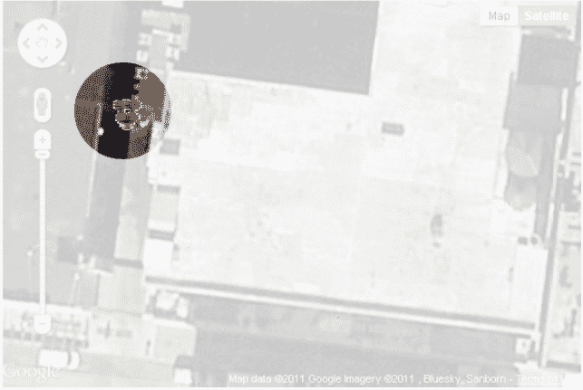

**图 4-16。** 地图上某一位置的阴影/聚光灯

图 4-17 展示了在同一地图上绘制的阴影遮罩的另一个例子。这是由用户移动鼠标引起的。

基准位置（小红叉）是 Friends of ED, NYC。  
从基准点到最近标记点 (40.7257, -74.0047) 的距离是 0.03 公里。

更改基准位置：

- Friends of ED, NYC
- Purchase College
- Illinois Institute of Technology

CHANGE

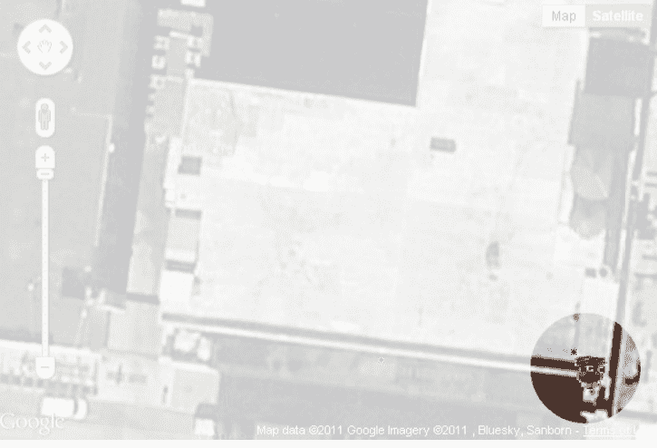

**图 4-17。** 地图上另一位置的阴影遮罩

这里有几个相互关联的主题。假设变量`mx`和`my`保存了鼠标光标在画布上的位置。我将在本章稍后解释如何获取它们。函数`drawshadowmask`将绘制阴影遮罩。遮罩的透明灰色定义在名为`grayshadow`的变量中，并使用内置函数`rgba`构造。`rgba`代表红-绿-蓝-透明度。透明度（alpha）指颜色的透明/不透明程度。值为 1 表示颜色完全不透明：纯色。值为 0 表示完全透明：颜色不可见。回想一下，红、绿、蓝的值从 0 到 255，而 255, 255, 255 的组合将是白色。这是一个尝试的时刻。我为灰色/灰白色/幽灵般的阴影决定使用以下设置：

```javascript
var grayshadow = "rgba(250,250,250,.8)";
```

函数`drawshadowmask`使用了几个常量变量——它们永远不会改变。图 4-18 展示了指示其值的示意图。

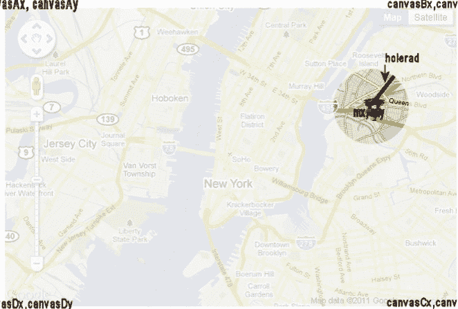

*图 4-18。标明了遮罩变量值的示意图*

遮罩分为两部分绘制，就像为弹跳视频绘制遮罩时所做的那样。你可以回顾图 3-8 和图 3-9。编码方式类似：

```javascript
function drawshadowmask(mx, my) {
  ctx.clearRect(0, 0, 600, 400);
  ctx.fillStyle = grayshadow;

  ctx.beginPath();
  ctx.moveTo(canvasAx, canvasAy);
  ctx.lineTo(canvasBx, canvasBy);
  ctx.lineTo(canvasBx, my);
  ctx.lineTo(mx + holerad, my);
  ctx.arc(mx, my, holerad, 0, Math.PI, true);
  ctx.lineTo(canvasAx, my);
  ctx.lineTo(canvasAx, canvasAy);
  ctx.closePath();
  ctx.fill();

  ctx.beginPath();
  ctx.moveTo(canvasAx, my);
  ctx.lineTo(canvasDx, canvasDy);
  ctx.lineTo(canvasCx, canvasCy);
  ctx.lineTo(canvasBx, my);
  ctx.lineTo(mx + holerad, my);
  ctx.arc(mx, my, holerad, 0, Math.PI, false);
  ctx.lineTo(canvasAx, my);
  ctx.closePath();
  ctx.fill();
}
```

现在我们来讨论红色灯泡。

### 光标

光标——当你移动鼠标时屏幕上移动的小图形——可以在 style 元素或 JavaScript 中设置。图形有几种内置选择（例如，十字准线、指针），我们也可以引用自己的设计来制作自定义光标，这正是我在本项目中演示的。我在`init`函数中包含了语句：

```javascript
can.onmousedown = function () {
  return false;
};
```

以防止按下鼠标时更改默认光标。这可能不是必需的，因为默认行为可能不会被触发。

为了将移动鼠标时的光标更改为传达聚光灯效果的内容，我创建了一张红色紧凑型荧光灯泡的图片，并将其保存在文件`light.gif`中。然后我在函数`showshadow`中使用了以下语句。`showshadow`函数已被设置为`mousemove`的事件处理程序：

```javascript
can.style.cursor = "url('light.gif'), pointer";
```

以指示当鼠标位于`can`元素上时，JavaScript 应使用该地址作为光标图像。此外，如果文件`light.gif`不可用，该语句会指示 JavaScript 使用内置的指针图标。这与通过优先列表指定字体的方式类似。变量`can`已被设置为引用 canvas 元素。当 canvas 被推到 Google 地图下方时，光标将不会被使用，这将在下一节中讨论。

### 事件

事件处理——即鼠标事件，也包括更改 Google 地图滑块或单击单选按钮的事件——在我开始这个项目时似乎是最令人生畏的。然而，实际实现起来却很简单。在`init`函数中，我编写代码为鼠标移动、鼠标按下和鼠标释放设置事件处理，这些都与 canvas 元素相关：

```javascript
can.onmousedown = function () {
  return false;
};

can.addEventListener("mousemove", showshadow, true);
can.addEventListener("mousedown", pushcanvasunder, true);
can.addEventListener("mouseout", clearshadow, true);
```

第三个参数的`true`值表示该事件会*冒泡*，即通知其他监听器。然而，要实现我想要的事件处理还需要做更多工作。我将解释这三个函数，然后再描述另一个事件。

如前所述，`showshadow`函数调用了`drawshadowmask`函数。我本可以将这两个函数合并，但将任务分解成更小的任务通常是一种好的做法。`showshadow`函数确定鼠标位置，进行调整使灯泡底座位于聚光灯中心，然后调用`drawshadowmask`：

### 第 4 章 地图制作者：结合 Google 地图与 Canvas

```javascript
function showshadow(ev) {
  var mx;
  var my;

  if (ev.layerX || ev.layerX == 0) {
    mx = ev.layerX;
    my = ev.layerY;
  } else if (ev.offsetX || ev.offsetX == 0) {
    mx = ev.offsetX;
    my = ev.offsetY;
  }

  can.style.cursor = "url('light.gif'), pointer";

  mx = mx + 10;
  my = my + 12;

  drawshadowmask(mx, my);
}
```

现在我需要考虑当用户按下鼠标时我想做什么。我决定让阴影消失，地图以其完整的亮度显示。除了外观，我还希望 Google Maps API 恢复控制。希望 Google Maps API 接管的一个关键原因是我想在地图上（而不是画布上）放置一个标记来标记位置。这是因为我想让标记随地图一起移动，而这通过在画布上绘制会非常困难。我需要将画布上的标记与地图的平移和缩放同步。相反，API 为我完成了所有这些工作。此外，我需要 Google Maps API 为位置生成经纬度值。

让 Google 地图重新控制的方法，可以说，是“将画布推到下面”。该函数是：

```javascript
function pushcanvasunder(ev) {
  can.style.zIndex = 1;
  pl.style.zIndex = 100;
}
```

将画布推到下面或将其带回顶部的操作不是瞬时的。我对 (1) 如何定义界面和 (2) 如何实现你所定义的内容持开放态度。这里有改进的空间。

另一个需要处理的情况是：如果用户将鼠标移出画布会发生什么？可以监听`mouseout`事件，所以我编写了设置事件的代码（见上面的`can.addEventListener`语句）由`clearshadow`函数处理。`clearshadow`函数就做这个：清除整个画布，包括阴影：

```javascript
function clearshadow(ev) {
  ctx.clearRect(0, 0, 600, 400);
}
```

在引入 Google 地图的函数中，我为地图设置了`mouseup`事件处理程序。

```javascript
listener = google.maps.event.addListener(
  map,
  "mouseup",
  function (event) {
    checkit(event.latLng);
  }
);
```

对`addListener`的调用是 Google Maps API 的一部分，而非 JavaScript 本身的方法，它设置了对`checkit`函数的调用。`checkit`函数通过使用`event`对象的属性作为参数来调用。如你所料，`event.latLng`是鼠标在地图对象上释放时鼠标位置的纬度和经度值。`checkit`函数将使用这些值来计算与基地位置的距离，并将这些值连同距离一起显示在屏幕上。代码调用了一个我编写的对数值进行四舍五入的函数。这样做是为了避免显示具有过多有效数字的值，对于这个项目来说这并不合适。Google Maps API 的标记方法提供了一种使用我选择的图像作为标记的方式，这次是一个黑色的手绘 x，并且可以为标记添加标题。建议使用标题以使应用程序对视障用户使用的屏幕阅读器更加友好，但我不能说这个项目在无障碍方面能让人满意。可以生成如图 4-19 所示的屏幕。

基地位置（小红色 x）是 Purchase College/SUNY。  
从基地到最近标记点（41.2057, -73.725）的距离为 17.62 公里。

更改基地位置：

- ○ Friends of ED, NYC
- ● Purchase College
- ○ Illinois Institute of Technology

[更改]

*图 4-19。* 地图上显示的指示距离的标题

`checkit`函数以包含纬度和经度值的参数调用，如下所示：

### 第 4 章 ■ 地图制作：结合 Google Maps 和 Canvas

```javascript
function checkit(clatlng) {
  var distance = dist(clatlng, blatlng);

  distance = round(distance, 2);

  var distanceString = String(distance) + " km";

  marker = new google.maps.Marker({
    position: clatlng,
    title: distanceString,
    icon: bxmarker,
    map: map
  });

  var clat = clatlng.lat();
  var clng = clatlng.lng();

  clat = round(clat, 4);
  clng = round(clng, 4);

  document.getElementById("answer").innerHTML =
    "The distance from base to most recent marker (" +
    clat +
    ", " +
    clng +
    ") is " +
    String(distance) +
    " km.";

  can.style.zIndex = 100;
  pl.style.zIndex = 1;
}
```

请注意，该函数最后做的是将画布放回地图的顶层。

CHANGE 按钮和单选按钮是使用标准 HTML 和 JavaScript 实现的。表单是使用以下 HTML 代码生成的：

```html
<form name="f" onSubmit="return changebase();">
  <input type="radio" name="loc" /> friends of ED, NYC<br />
  <input type="radio" name="loc" /> Purchase College<br />
  <input type="radio" name="loc" /> Illinois Institute of Technology<br />
  <input type="submit" value="CHANGE" />
</form>
```

当标记为 CHANGE 的提交按钮被点击时，`changebase`函数被调用。`changebase`函数确定哪个单选按钮被选中，并使用`Locations`表获取纬度和经度值。然后它调用`makemap`函数，将这些值作为参数。这种组织数据的方式称为*并行结构*：`locations`数组元素对应于单选按钮。最后一条语句设置`header`元素的`innerHTML`以显示文本，包括所选基地位置的名称。

```javascript
function changebase() {
  var mylat;
  var mylong;

  for (var i = 0; i < locations.length; i++) {
    if (document.f.loc[i].checked) {
      mylat = locations[i][0];
      mylong = locations[i][1];

      makemap(mylat, mylong);

      document.getElementById("header").innerHTML =
        "Base location (small red x) is " + locations[i][2];
    }
  }

  return false;
}
```

#### 计算距离和四舍五入显示值

Google Maps，正如我们许多人所知，提供距离信息，甚至区分步行和驾驶。对于这个应用程序，我需要更多地控制指定要计算距离的两个位置，所以我决定用 JavaScript 开发一个函数。确定两点之间的距离，每一点代表纬度和经度值，是使用球面余弦定律完成的。我的来源是`www.movable-type.co.uk/scripts/latlong.html`。代码如下：

```javascript
function dist(point1, point2) {
  var R = 6371; // km

  // var R = 3959; // miles

  var lat1 = point1.lat() * Math.PI / 180;
```


```javascript
var lat2 = point2.lat() * Math.PI / 180;

var lon1 = point1.lng() * Math.PI / 180;

var lon2 = point2.lng() * Math.PI / 180;

var d = Math.acos(
  Math.sin(lat1) * Math.sin(lat2) +
  Math.cos(lat1) * Math.cos(lat2) *
  Math.cos(lon2 - lon1)
) * R;

return d;
```

> **注意** 我在代码中没有包含很多注释，因为我包含了每张表格并对每一行进行了注释。然而，注释很重要。我强烈建议在`dist`函数中保留公里和英里的注释，以便你可以根据需要调整程序。或者，你可以显示两个值或让用户选择。

最后一个函数是用于四舍五入的。当一个数量依赖于人移动鼠标时，你不应该将值显示到很多位小数。然而，我们应该记住纬度和经度代表大单位。我决定将距离显示为两位小数，纬度和经度显示为四位。

我编写的函数相当通用。它接受两个参数，一个是数字`num`，另一个是`places`，表示要将值保留多少位小数。你可以在其他情况下使用它。它通过添加我称之为`增量`的值，然后计算不大于该值的最大整数，来适当地进行向上或向下取整。因此：

- `round(9.147, 2)`将产生`9.15`；而
- `round(9.143, 2)`将产生`9.14`。

代码的工作方式首先是确定我称之为`因子`的值，即10的期望位数次方。对于2，这将是100。然后我计算增量。对于两位小数，这将是5 / 100 * 10，即5 / 1000，也就是0.005。我的代码执行以下操作：

1. 将增量加到原始数字上。
2. 将结果乘以因子。
3. 计算不大于该结果的最大整数（这称为向下取整）——产生一个整数。
4. 将结果除以因子。

代码如下：

```javascript
function round(num, places) {
  var factor = Math.pow(10, places);

  var increment = 5 / (factor * 10);

  return Math.floor((num + increment) * factor) / factor;
}
```


我使用`round`函数将距离四舍五入到两位小数，将纬度和经度四舍五入到四位小数。

> 提示：JavaScript 有一个名为`toFixed`的方法，基本上执行我的`round`的功能。如果`num`包含一个数字——比如 51.5621——那么`num.toFixed()`将产生 51，而`num.toFixed(2)`将产生 51.56。我听说过这个方法可能存在不准确性，所以我选择创建自己的函数。在自己的应用程序中，你可能会乐于使用`toFixed()`。

解释完相关的 HTML5 和 Google Maps API 功能后，我们现在可以将其整合在一起了。

### 构建应用程序并使其成为你自己的

地图聚光灯应用程序结合了 Google Maps 功能与 HTML5 编码。应用程序的快速总结如下：

1. `init`：初始化，包括引入地图（`makemap`）和设置带有处理程序的鼠标事件：`showshadow`、`pushcanvasunder`、`clearshadow`
2. `makemap`：引入地图并设置事件处理，包括对`checkit`的调用
3. `showshadow`：调用`drawshadowmask`
4. `pushcanvasunder`：在地图上启用事件
5. `checkit`：计算距离、添加自定义标记，并显示距离以及四舍五入后的纬度和经度

描述调用、被调用和调用关系的函数表（表 4-1）对所有应用程序都是相同的。

表 4-2 显示了名为`mapspotlight.html`的地图制作应用程序的代码。

| 函数 | 由……调用/调用 | 调用 |
| --- | --- | --- |
| `init` | 由`<body>`标签中的`onLoad`属性操作调用 | `makemap` |
| `pushcanvasunder` | 由`init`中调用的`addEventListener`操作调用 |  |
| `clearshadow` | 由`init`中调用的`addEventListener`操作调用 |  |
| `showshadow` | 由`init`中调用的`addEventListener`操作调用 | `drawshadowmask` |
| `drawshadowmask` | 由`showshadow`调用 |  |
| `makemap` | 由`init`调用 |  |
| `checkit` | 由`makemap`中调用的`addEventListener`操作调用 | `round`、`dist` |
| `round` | 由`checkit`调用（三次） |  |
| `dist` | 由`checkit`调用 |  |
| `changebase` | 由`<form>`中的`onSubmit`操作调用 | `makemap` |

| 代码行 | 说明 |
| --- | --- |
| `<!DOCTYPE html>` | 头部 |
| `<html>` | 开始 html 标签 |
| `<head>` | 开始 head 标签 |
| `<title>Spotlight </title>` | 完整标题 |
| `<meta charset="UTF-8">` | Meta 标签 |
| `<style>` | style 元素开始 |
| `header {font-family:Georgia,"Times New Roman",serif;` | 设置标题字体 |
| `font-size:16px;` | 字体大小 |

## 地图制作器：结合谷歌地图与画布

| 代码行 | 说明 |
| --- | --- |
| `display:block; }` | 前后换行 |
| `canvas {position:absolute; top: 165px; left:0px;` | 单一画布元素的样式指令：在页面上稍微向下定位 |
| `z-index:100;}` | 画布的初始设置为最上层 |
| `#place {position:absolute; top: 165px; left: 0px;` | 谷歌地图所在 div 的样式指令；位置与画布完全相同 |
| `z-index:1;}` | 初始设置为画布下方 |
| `</style>` | 关闭样式元素 |
| `<script type="text/javascript" charset="UTF-8" src="http://maps.google.com/maps/api/js?sensor=false"></script>` | 引入包含谷歌地图 API 的外部脚本元素；不使用地理定位感知功能 |
| `<script type="text/javascript" charset="UTF-8">` | 脚本标签开始 |
| `var locations = [` | 定义一组基础位置 |
| `[40.725592,-74.00495, "Friends of ED, NYC"],` | Friends of ED 的纬度、经度和名称 |
| `[41.04796,-73.70539,"Purchase College/SUNY"],` | ……Purchase College（帕彻斯学院） |
| `[41.878928, -87.641926,"Illinois Institute of Technology"]` | ……Illinois Institute of Technology（伊利诺伊理工学院） |
| `];` | 关闭位置数组 |
| `var candiv;` | 用于保存包含画布的 div |
| `var can;` | 引用画布元素 |
| `var ctx;` | 引用画布的上下文；用于所有绘制 |
| `var pl;` | 引用包含谷歌地图的 div |
| `function init() {` | `init`函数的函数头 |
| `var mylat;` | 将保存纬度值 |
| `var mylong;` | 将保存经度值 |
| `candiv = document.createElement("div");` | 创建 div |
| `candiv.innerHTML = ("<canvas id='canvas' width='600' height='400'>No canvas </canvas>");` | 将其内容设为画布元素 |
| `document.body.appendChild(candiv);` | 添加到 body |
| `can = document.getElementById("canvas");` | 设置对画布的引用 |
| `pl = document.getElementById("place");` | 设置对包含谷歌地图的 div 的引用 |
| `ctx = can.getContext("2d");` | 设置上下文 |
| `can.onmousedown = function () { return false; } ;` | 防止光标变为默认样式 |
| `can.addEventListener('mousemove',showshadow,true);` | 设置鼠标移动的事件处理 |
| `can.addEventListener('mousedown',pushcanvasunder,true);` | 设置按下鼠标按钮的事件处理 |
| `can.addEventListener("mouseout",clearshadow,true);` | 设置鼠标移出画布的事件处理 |
| `mylat = locations[0][0];` | 将纬度设为第 0 个位置的纬度 |
| `mylong = locations[0][1];` | 将经度设为第 0 个位置的经度 |
| `makemap(mylat,mylong);` | 调用函数创建地图（在指定位置引入谷歌地图） |
| `}` | 关闭`init`函数 |
| `function pushcanvasunder(ev) {` | `pushcanvas`函数的函数头，调用时传入引用事件的参数 |
| `can.style.zIndex = 1;` | 将画布下移 |
| `pl.style.zIndex = 100;` | 将地图 div 上移 |
| `}` | 关闭`pushcanvasunder`函数 |
| `function clearshadow(ev) {` | `clearshadow`函数的函数头，调用时传入引用事件的参数 |
| `ctx.clearRect(0,0,600,400);` | 清除画布（擦除阴影遮罩） |
| `}` | 关闭`clearshadow`函数 |
| `function showshadow(ev) {` | `showshadow`函数的函数头，调用时传入引用事件的参数 |
| `var mx;` | 用于保存鼠标水平位置 |
| `var my;` | 用于保存鼠标垂直位置 |
| `if ( ev.layerX \|\| ev.layerX == 0) {` | 此浏览器是否使用 layerX？ |
| `mx = ev.layerX;` | 如果是，则用它设置`mx`…… |
| `my = ev.layerY;` | ……和`my` |
| `} else if (ev.offsetX \|\| ev.offsetX == 0) {` | 尝试 offsetX |
| `    mx = ev.offsetX;` | 如果是，则用它设置`mx`…… |
| `    my = ev.offsetY;` | ……和`my` |
| `}` | 关闭子句 |
| `can.style.cursor = "url('light.gif')", pointer";` | 将光标设置为`light.gif`（如果可用），否则为指针 |
| `mx = mx+10;` | 进行粗略校正，使灯光中心位于灯泡基部的水平位置，以及…… |
| `my = my + 12;` | ……垂直位置 |
| `drawshadowmask(mx,my);` | 在修改后的（`mx`,`my`）处调用`drawshadowmask`函数 |
| `}` | 关闭`showshadow`函数 |
| `var canvasAx = 0;` | 遮罩常量：左上角 x |
| `var canvasAy = 0;` | 左上角 y |
| `var canvasBx = 600;` | 右上角 x |
| `var canvasBy = 0;` | 右上角 y |
| `var canvasCx = 600;` | 右下角 x |
| `var canvasCy = 400;` | 右下角 y |
| `var canvasDx = 0;` | 左下角 x |
| `var canvasDy = 400;` | 左下角 y |
| `var holerad = 50;` | 阴影中孔洞的恒定半径（聚光灯半径） |
| `var grayshadow = "rgba(250,250,250,.8)";` | 淡阴影的颜色；注意透明度为 .8 |
| `function drawshadowmask(mx,my) {` | `drawshadowmask`函数的函数头；参数保存环形孔洞的中心 |
| `ctx.clearRect(0,0,600,400);` | 擦除整个画布 |
| `ctx.fillStyle = grayshadow;` | 设置颜色 |
| `ctx.beginPath();` | 开始第一条（上部）路径 |
| `ctx.moveTo(canvasAx,canvasAy);` | 移动到左上角 |
| `ctx.lineTo(canvasBx,canvasBy);` | 绘制到右上角 |
| `ctx.lineTo(canvasBx,my);` | 绘制到`my`参数指定的垂直位置 |
| `ctx.lineTo(mx+holerad,my);` | 向左绘制到孔洞边缘 |
| `ctx.arc(mx,my,holerad,0,Math.PI,true);` | 绘制半圆弧 |
| `ctx.lineTo(canvasAx,my);` | 绘制到左侧 |
| `ctx.lineTo(canvasAx,canvasAy);` | 绘制回起点 |
| `ctx.closePath();` | 关闭路径 |
| `ctx.fill();` | 填充 |
| `ctx.beginPath();` | 开始第二条（下部）路径 |
| `ctx.moveTo(canvasAx,my);` | 从左侧由`my`参数指示的点开始 |
| `ctx.lineTo(canvasDx,canvasDy);` | 绘制到左下角 |
| `ctx.lineTo(canvasCx,canvasCy);` | 绘制到右下角 |
| `ctx.lineTo(canvasBx,my);` | 绘制到右边缘的点 |
| `ctx.lineTo(mx+holerad,my);` | 向左绘制到孔洞边缘 |
| `ctx.arc(mx,my,holerad,0,Math.PI,false);` | 绘制半圆弧 |
| `ctx.lineTo(canvasAx,my);` | 绘制到右边缘 |
| `ctx.closePath();` | 关闭路径 |
| `ctx.fill();` | 填充 |
| `}` | 关闭`drawshadowmask`函数 |
| `var listener;` | 由`addListener`调用设置的变量；不再使用 |
| `var map;` | 保存地图 |
| `var blatlng;` | 保存基础纬度经度对象 |
| `var myOptions;` | 保存用于地图的关联数组 |
| `var rxmarker = "x1.png";` | 保存红色 x 图像的文件名 |
| `var bxmarker = "bx1.png";` | 保存黑色 x 图像的文件名 |
| `function makemap(mylat,mylong) {` | `makemap`函数的函数头；参数保存地图中心的位置 |
| `var marker;` | 将保存为创建的中心标记 |
| `blatlng = new google.maps.LatLng(mylat,mylong);` | 构建 LatLng 对象（API 的特殊数据类型） |
| `myOptions = {` | 设置关联数组 |
| `zoom: 12,` | 缩放设置（可为 0 到 18） |
| `center: blatlng,` | 中心 |
| `mapTypeId: google.maps.MapTypeId.ROADMAP` | 地图类型 |
| `};` | 关闭`myOptions`数组 |
| `map = new google.maps.Map(document.getElementById("place"), myOptions);` | 调用 API 在指定位置引入地图 |
| `marker = new google.maps.Marker(` | 在地图中心放置标记；标记方法的参数为关联数组 |
| `{` | 关联数组开始 |
| `position: blatlng,` | 设置位置 |
| `title: "center",` | 设置标题 |
| `icon: rxmarker,` | 设置图标 |
| `map: map` | 将 map 命名参数设置为名为`map`的变量 |
| `}` | 关闭作为 Marker 调用参数的关联数组 |
| `);` | 关闭 Marker 调用 |
| `listener = google.maps.event.addListener(` | 设置事件处理（以下三个参数） |
| `map,` | 对象，即地图 |

| 代码行 | 说明 |
| :--- | :--- |
| `'mouseup',` | 特定事件 |
| `function(event) {` | 匿名函数（直接在`addListener`中作为参数定义） |
| `checkit(event.latLng);` | 调用`checkit`，传入指定的经纬度对象 |
| `}` | 结束函数定义 |
| `);` | 结束`addListener`的调用 |
| `}` | 结束`makemap`函数 |
| `function checkit(clatLng) {` | `checkit`的函数头；调用时传入经纬度对象 |
| `var distance = dist(clatLng,blatLng);` | 调用`dist`函数计算点击位置与基点之间的距离 |
| `distance = round(distance,2);` | 对数值进行四舍五入 |
| `var distanceString = String(distance)+" km";` | 将`distanceString`设置为显示内容 |
| `marker = new google.maps.Marker(` | 调用 Marker 方法，该方法以一个关联数组作为参数 |
| `{` | 关联数组开始 |
| `position: clatLng,` | 设置位置 |
| `title: distanceString,` | 设置标题 |
| `icon: bxmarker,` | 设置图标为黑色 x |
| `map: map` | 将关联数组的 map 元素设置为名为`map`的变量的值 |
| `}` | 结束关联数组 |
| `);` | 结束 Marker 方法的调用 |
| `var clat = clatlng.lat();` | 提取纬度值 |
| `var clng = clatlng.lng();` | 提取经度值 |
| `clat = round(clat,4);` | 将数值四舍五入到小数点后 4 位 |
| `clng = round(clng,4);` | 将数值四舍五入到小数点后 4 位 |
| `document.getElementById("answer").innerHTML =` | 设置屏幕上显示的文本…… |
| `"The distance from base to most recent marker (" + clat+", "+clng+") is "+String(distance) +" km.";` | ……为计算和格式化后的信息 |
| `can.style.zIndex = 100;` | 将画布置于顶层 |
| `p1.style.zIndex = 1;` | 将 p1（包含地图）置于底层 |
| `}` | 结束`checkit`函数 |
| `function round (num,places) {` | 四舍五入函数的函数头 |
| `var factor = Math.pow(10,places);` | 根据小数位数确定因子 |
| `var increment = 5/(factor*10);` | 确定向上或向下取整的增量 |
| `return Math.floor((num+increment)*factor)/factor;` | 执行计算 |
| `}` | 结束`round`函数 |
| `function dist(point1, point2) {` | `dist`（距离）函数的函数头 |
| `// spherical law of cosines,<br>// from<br>// http://www.movable-type.co.uk/scripts/latlong.html` | 我的来源归属。这是标准数学公式 |
| `var R = 6371; // km` | 用于以千米为单位输出结果的系数 |
| `// var R = 3959; // miles` | 已注释掉，但保留以防你想以英里为单位输出结果 |
| `var lat1 = point1.lat()*Math.PI/180;` | 将值转换为弧度 |
| `var lat2 = point2.lat()*Math.PI/180 ;` | 将值转换为弧度 |
| `var lon1 = point1.lng()*Math.PI/180;` | 将值转换为弧度 |
| `var lon2 = point2.lng()*Math.PI/180;` | 将值转换为弧度 |
| `var d =` | 计算…… |
| `Math.acos(Math.sin(lat1)*Math.sin(lat2) + Math.cos(lat1)*Math.cos(lat2) * Math.cos(lon2-lon1)) * R;` | 使用三角函数计算距离 |
| `return d;` | 返回结果 |
| `}` | 结束`dist`函数 |
| `function changebase() {` | `changebase`函数的函数头 |
| `var mylat;` | 将存放新基点位置的纬度 |
| `var mylong;` | 将存放新基点位置的经度 |
| `for(var i=0;i<locations.length;i++) {` | for 循环，用于确定哪个单选按钮被选中 |

## 第 4 章 地图制作器：结合 Google 地图与 Canvas

| 代码行 | 说明 |
| --- | --- |
| `if (document.f.loc[i].checked) {` | 这个被选中了吗？ |
| `mylat = locations[i][0];` | 如果是，设置`mylat` |
| `mylong = locations[i][1];` | 设置`mylong` |
| `makemap(mylat,mylong);` | 调用`makemap` |
| `document.getElementById("header"). innerHTML = "Base location (small red x) is "+locations[i][2];` | 更改标题中的文本以显示名称 |
| `}` | 结束 if true 子句 |
| `}` | 结束 for 循环 |
| `return false;` | 返回 false 以防止页面刷新 |
| `}` | 结束函数 |
| `</script>` | 结束 script 标签 |
| `</head>` | 结束 head 标签 |
| `<body onLoad="init();">` | 开始 body 标签；包含 onLoad 以调用`init` |
| `<header id="header">Base location (small red x) </header>` | 语义化 header 元素 |
| `<div id="place" style="width:600px; height:400px"></div>` | 用于容纳 Google 地图的 div |
| `<div id="answer"></div>` | 用于显示点击位置信息的 div |
| `Change base location: <br/>` | 文本 |
| `<form name="f" onSubmit=" return changebase();">` | 更改基点的表单开始 |
| `<input type="radio" name="loc" /> Friends of ED, NYC<br/>` | 单选按钮选项 |
| `<input type="radio" name="loc" /> Purchase College<br/>` | 单选按钮选项 |
| `<input type="radio" name="loc" /> Illinois Institute of Technology<br/>` | 单选按钮选项 |
| `<input type="submit" value="CHANGE">` | 执行更改的按钮 |
| `</form>` | 结束 form 标签 |
| `</body>` | 结束 body 标签 |
| `</html>` | 结束 html 标签 |

你需要确定自己的基点位置集合。同样，三个并没有什么特别的。如果你的基点列表太大，可以考虑使用`<optgroup>`来生成下拉列表。无论如何，你需要定义一组位置。每个位置包含两个数字——纬度和经度——以及一个由名称组成的文本字符串。此文本在表单中的 HTML 编码里会重复出现。

### 测试和上传应用程序

该项目包含一个 HTML 文件和三个图像文件。对于我的项目版本，图像文件分别是灯泡`light.gif`、红色 x 标记`rxmarker.png`和黑色 x 标记`bxmarker.png`。这些图像文件类型并没有什么特别的。你可以使用任何你喜欢的。可以说我的 x 标记太小了，所以在决定时要考虑你的用户。此应用程序需要联网才能测试，因为那是与 Google 地图建立联系的唯一方式。

### 小结

在本章中，你学会了如何：

- 使用 Google 地图 API
- 将 Google 地图与 canvas 图形结合
- 生成包含 Google 地图事件和 HTML5 事件的 GUI
- 使用 alpha 设置控制透明度/不透明度进行绘制
- 更改为自定义光标
- 计算地理点之间的距离
- 对十进制数值进行适当显示的四舍五入

下一章将介绍另一个使用 Google 地图的项目。你将学习如何构建一个应用程序，在其中你可以将图片、视频片段或图片与音频片段的组合与特定地理位置相关联，并在用户点击地图上或地图附近位置时显示和播放指定的媒体。

## 第 5 章

### 地图门户：使用 Google 地图访问你的媒体

在本章中，你将探索以下内容：

- 使用 Google 地图 API 播放和显示视频、音频和图像
- 动态创建 HTML5 标记
- 将程序与内容描述分离
- 构建地理游戏

### 引言

本章中的项目使用 Google 地图 API 作为方式，基于地理位置来播放视频、显示图像或播放音频并显示图像。你可以将这些项目作为模型来构建对某个地理区域的研究、报告商务或度假旅行，或创建地理测验。我将描述三个不同的应用程序。对于这三个应用程序，我已经获取了媒体，例如视频文件、音频文件和图像文件，并在代码中定义了文件与特定地理位置之间的关联。为了让你了解我的意思，对于我的项目，目标位置（在代码中以纬度和经度坐标给出）与媒体之间的关联如表 5-1 所示。

**第 5 章 ■ 地图门户：使用 Google 地图访问您的媒体**

## 表 5-1. 内容概览

| 位置描述 | 媒体 |
| --- | --- |
| 普切斯学院 | 机器人课堂视频 |
| 基斯科山 | 埃丝特的照片和她弹钢琴的音频文件 |
| 伊利诺伊州迪克森市 | 阿维瓦的照片 |
| 纽约市自由女神像 | 烟花视频 |

这三个应用程序都能流畅处理不同类型的媒体。这得益于 HTML5 的特性，当然，恕我自夸，也得益于我的编程。媒体文件是独立的，并且对所有三个应用程序都是相同的。仍然建议您提供多种视频和音频格式，以确保您的应用程序能在不同的浏览器中运行。浏览器识别的媒体类型可能会改变，从而需要更少的类型，但目前情况并非如此。

第一个应用程序由一个名为`mapvideos.html`的 HTML 文件组成，它邀请查看者点击地图。如果点击位置足够接近某个目标位置，查看者将看到相应的图像、播放相应的视频，或者既看到相应的图像又听到相应的音频文件。程序能处理所有三种类型的媒体及其组合。

第二个应用程序对查看者来说与第一个相同，但在实现上有一个重要区别。这个应用程序由两个 HTML 文件组成：`mapmediabase.html`和`mediacontent.js`。`mediacontent.js`文件包含描述应用程序特定媒体内容的信息。`mapmediabase.html`程序引入`mediacontent.js`文件，并在运行时创建复制第一个应用程序所需的一切。

我同时包含了第一个和第二个应用程序，因为第一个更容易理解，所有信息都集中在一个地方。当您开发自己的应用程序时，您可以尝试直接实现代码与内容分离的版本，但如果做不到，也不必太沮丧。

第三个应用程序是一个测验。与第二个类似，它由两个文件组成：`mapmediaquiz.html`和`mediaquizcontent.js`。`mediaquizcontent.js`文件包含将媒体与位置关联的信息，同时也包含问题的文本。

这三个应用程序共享大量相同的代码。创建第二个和第三个应用程序的过程将向您展示如何通过将特定媒体集（或其他内容）的细节与大部分编程分离来扩展您的应用程序。

图 5-1 显示了第一个应用程序的启动屏幕。

### 点击地图

标题将放在这里。

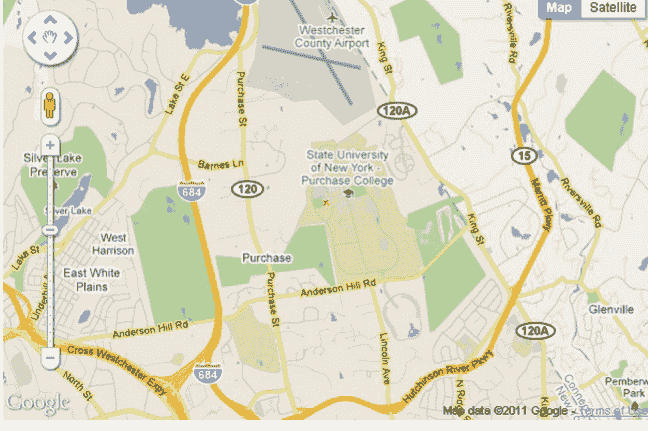

图 5-1. 启动屏幕

图 5-2 显示了当我在普切斯学院校区点击屏幕时发生的情况。一个视频片段出现并开始播放。您还可以在标题位置看到“乐高机器人”。

### 点击地图

乐高机器人

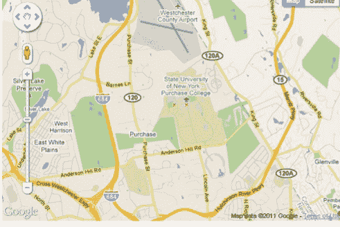

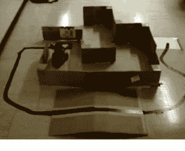

图 5-2. 在普切斯学院点击的结果

图 5-3 显示了点击屏幕但距离任何目标位置都不够近的结果。请注意，我已经平移了地图，将其向北移动。

### 点击地图

距离任何[新的]目标不够近

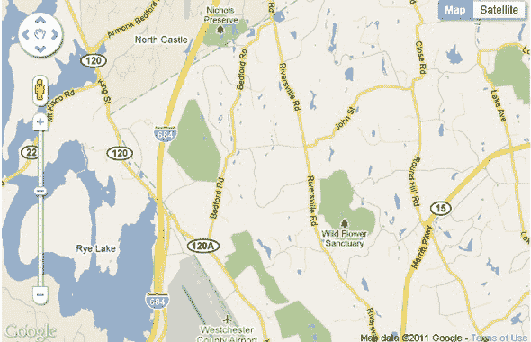

*图 5-3. 点击未靠近任何目标*

图 5-4 显示了我点击足够接近基斯科山以获得奖励的结果。我需要进一步向北移动才能到达基斯科山。同时请注意音频控件，它提供了暂停和恢复播放以及更改扬声器音量的方法。不同浏览器中音频（和视频）的控件会有所不同，但功能是相同的。

点击地图。

家中的埃丝特

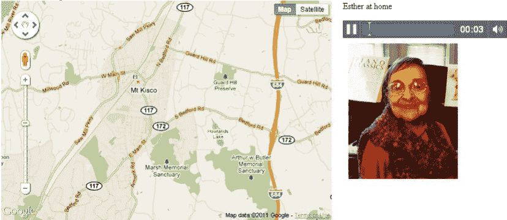

*图 5-4. 图像与音频组合*

因为我知道这些位置在哪里，我知道要缩小地图才能到达下一个位置。图 5-5 显示了使用 Google 地图界面完成此操作的结果。音轨继续播放，我仍然可以看到图片。

点击地图。

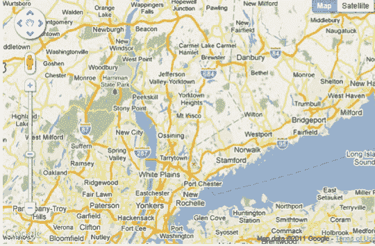

家中的埃丝特

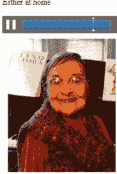

*图 5-5. 为向南平移而缩小视图*

图 5-6 显示了将地图向南移动，然后放大到自由女神像位置的结果，这是烟花视频片段的目标位置。

点击地图。

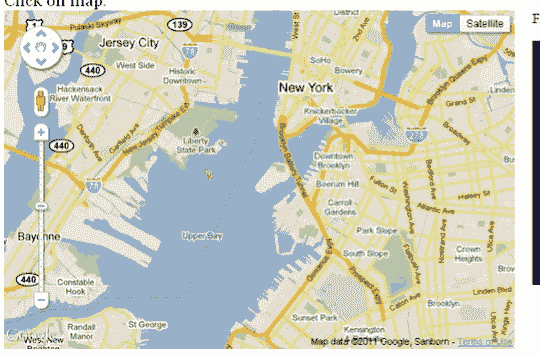

烟花

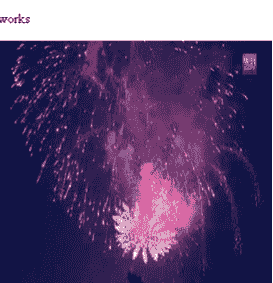

*图 5-6. 平移和放大后点击自由岛*

同样，我知道图片的位置，所以我缩小地图，平移到芝加哥西部，点击伊利诺伊州迪克森市这个小镇。图 5-7 显示了我期望的图像。

点击地图。

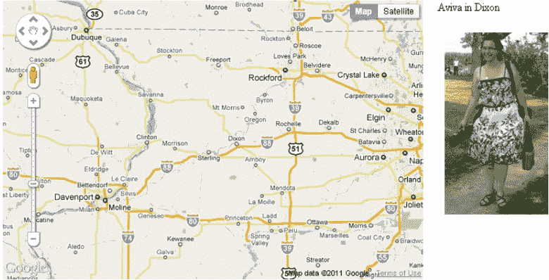

图 5-7. 平移到西部并放大到伊利诺伊州迪克森市

实际上，为了让第二个应用程序在布局上类似于第一个，需要做一些工作（稍后解释）。

现在我将展示第三个应用程序——测验的截图。图 5-8 显示了启动屏幕。

埃丝特奶奶住在哪里？

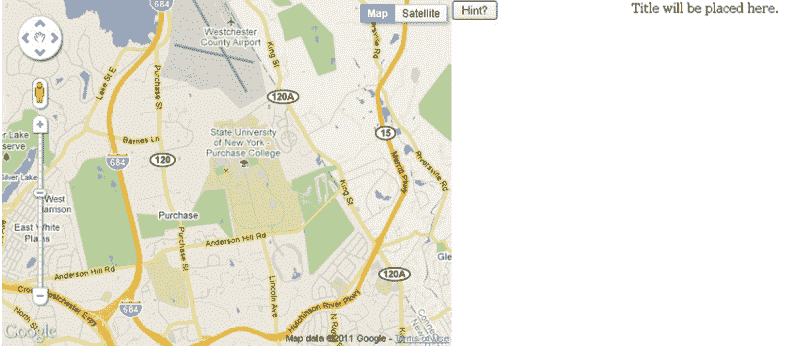

图 5-8. 测验启动屏幕

问题是，埃丝特奶奶住在哪里？玩家必须点击与此问题相关的位置附近。你可能能从之前的截图中猜出答案。图 5-9 显示了一个不正确的回答。我只是点击了普切斯学院附近的地图。

### 埃丝特奶奶住在哪里？

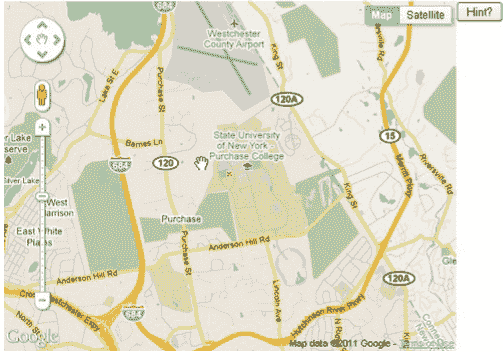

距离答案不够近。

图 5-9. 不正确的回答

我知道答案，而且知道如何在地图上找到它。我将地图向北移动到基斯科山并点击那里。图 5-10 显示了熟悉的图像和音频控件。钢琴音乐正在播放。

### 展示乐高机器人在迷宫中导航

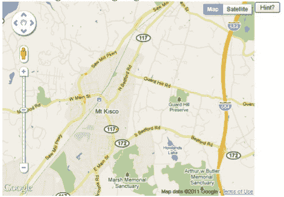

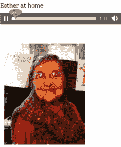

家中的埃丝特

图 5-10. 给出了正确答案，因此显示图像并播放音频，并给出下一个问题。

请注意，当上一个问题被正确回答后，屏幕立即显示下一个问题。

在设计这样的游戏时，最好在玩家不知道答案时给予体谅。我提供了“提示？”按钮，尽管它超出了仅仅提供提示的范畴。跳过接下来的部分，我将正确回答接下来的两个问题，然后我将需要帮助来找到伊利诺伊州迪克森市。图 5-11 显示了提示。

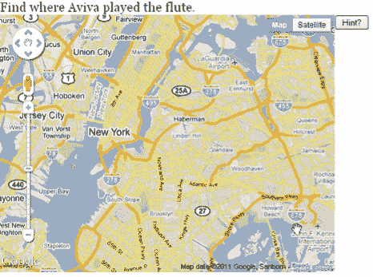

*图 5-11. 关于长笛演奏的提示*

如果我点击“提示？”按钮，应用程序将引入一张以所需位置为中心的新地图。图 5-12 显示了屏幕。

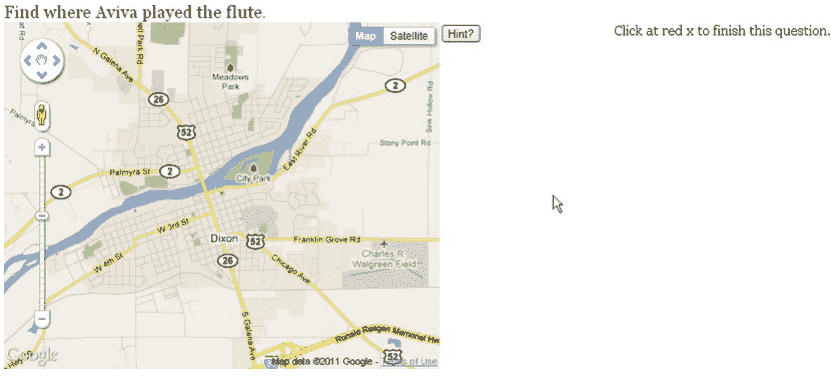

*图 5-12. 以伊利诺伊州迪克森市为中心的地图*

仍然需要点击地图（希望点击在红色 x 上或附近）来完成这个问题。你可能会说，有更好的提示方式——例如提供包含地名的特定文本——我不会与你争辩。这就是我决定要做的。

有了这个介绍，我将继续讨论项目历史和关键要求。

### 项目历史与关键要求

普切斯学院的一名大四学生收集并制作了关于纽约皇后区民族社区的视频片段和照片，并希望有一种方式来展示这些作品。Google 地图 API 和 HTML5 中的新功能似乎非常适合这项任务。请记住，学生只需要一种在她为毕业项目展览设置的计算机上展示作品的方法，因此浏览器兼容性问题并不令人担忧。关键要求包括 Google 地图 API 所提供的内容。正如您在上一章中学到的，我们可以编写代码来访问以指定地理位置为中心、设置初始缩放级别并显示道路、卫星、地形或混合视图的地图。此外，API 提供了一种响应查看者点击地图事件的方式。我们需要一种方法来定义特定位置，以便与查看者点击位置相对应的位置进行比较。

我为这位学生开发的第一个系统只使用视频和图像。我后来决定添加图像与音频的组合。该应用程序的关键要求是在正确的时间显示和播放指定的媒体并且在适当时停止和移除媒体，例如当下一个演示需要开始时。

在开发初始项目后，我想到了一些更改。第一个是添加了图像与音频的组合。我决定不希望只有音频。下一个更改是将特定内容与通用代码分离。这反过来又需要一种动态创建视频和音频元素标记的方法。

我一直喜欢游戏和课程，构建一个带有问题或提示的应用程序似乎是自然而然的一步，查看者现在最好描述为玩家或学生。玩家通过在地图上找到正确的位置来给出答案。通用应用程序和测验应用程序都有一个要求，即定义与答案相关的容差。不能期望查看者、玩家或学生恰好点击在正确的位置上。

在测试测验时，我意识到需要某种方式来帮助玩家通过特别困难的问题。因为我是一名教师，我决定向玩家展示答案，而不仅仅是跳过问题。然而，正如我之前提到的，您或许可以设计出更好的提示方式。

游戏应该具有一些随机性特征，因此我决定打乱问题的顺序，尽管我是在过程稍后阶段才这样做的。

在描述了关键要求之后，下一节将解释可用于构建项目的特定 HTML5 功能。

### HTML5、CSS 和 JavaScript 特性

与第 4 章的地图制作项目一样，这些项目是通过结合使用 Google 地图 API 和 HTML5 功能来实现的。这个项目的结合并不那么复杂。地图保持在窗口的左侧，媒体显示在右侧。我将快速回顾如何获取地图和设置事件处理，然后继续介绍满足其余关键要求的 HTML5、CSS 和 JavaScript 功能。

### 用于地图访问和事件处理的 Google Maps API

访问 Google Maps API 需要一个引用外部文件的脚本元素。对于此应用，我使用


```html
<script type="text/javascript" charset="UTF-8" src="http://maps.google.com/maps/api/js?sensor=false"></script>
```

我使用一个名为`makemap`的函数来设置地图。它有两个参数：两个表示经纬度值的十进制数字：

```javascript
function makemap(mylat, mylong)
```

在调用`makemap`函数之前，设置了全局变量`zoomlevel`（存储 0 到 18 的数字）和`xmarker`（存储图像文件的地址）。

引入地图的代码是调用`google.maps.Map`构造函数方法。它接受两个参数。第一个是地图在 HTML 文档中显示的位置。我在文档的 body 中设置了一个 ID 为`place`的 div：

```html
<div id="place" style="float: left;width:50%; height:400px"></div>
```

第二个参数是一个关联数组。以下三条语句将地图中心位置设置为 Google Maps 的经纬度对象，创建关联数组`myOptions`，并调用 Map 构造函数：

```javascript
blatlng = new google.maps.LatLng(mylat,mylong);

myOptions = {
    zoom: zoomlevel,
    center: blatlng,
    mapTypeId: google.maps.MapTypeId.ROADMAP
};

map = new google.maps.Map(document.getElementById("place"), myOptions);
```

为完整起见，这里有一些其他地图类型设置的截图。它们分别是 TERRAIN（地形）、HYBRID（混合）和 SATELLITE（卫星）。图 5-13 显示了请求显示地形设置的结果——即表示海拔、水域、公园和人造区域的颜色：

```javascript
mapTypeId: google.maps.MapTypeId.TERRAIN
```

点击地图。

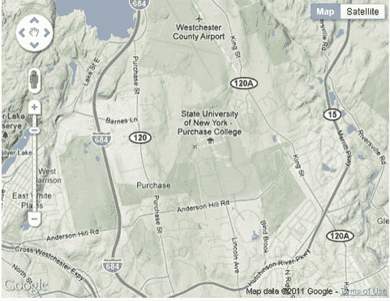

#### 图 5-13. TERRAIN 地图类型

图 5-14 显示了请求 HYBRID 视图的结果，它结合了卫星和道路地图图像。

```javascript
mapTypeId: google.maps.MapTypeId.HYBRID
```

点击地图。

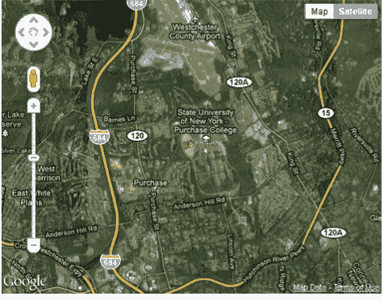

#### 图 5-14. HYBRID 地图类型

顺便说一句，混合地图是通过点击界面上的“卫星”选项产生的。图 5-15 显示了请求 SATELLITE 图像的结果。

```javascript
mapTypeId: google.maps.MapTypeId.SATELLITE
```

点击地图。

标题将放在此处。

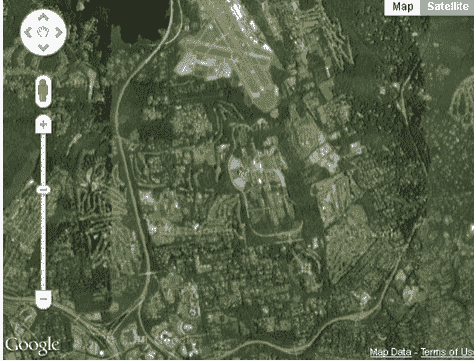

#### 图 5-15. SATELLITE 地图类型

最后，您可能有一个应用程序，不希望查看者更改地图。您可以通过在`myOptions`数组中使用一个额外的选项来禁用默认界面，从而防止用户更改地图。注意 ROADMAP 后面的逗号。

```javascript
mapTypeId: google.maps.MapTypeId.ROADMAP,
disableDefaultUI: true
```

图 5-16 显示了结果。

点击地图。

标题将放在此处。

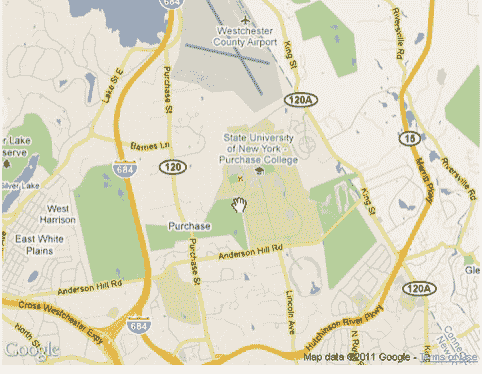

`makemap`还有两个操作需要执行。在指定的中心位置放置一个自定义标记，并设置地图点击的事件处理：

```javascript
marker = new google.maps.Marker({
    position: blatlng,
    title: "center",
    icon: xmarker,
    map: map
});

listener = google.maps.event.addListener(map, 'click', function(event) {
    checkit(event.latLng);
});
```

`xmarker`值引用一个 Image 对象，其`src`设置为名为`x1.png`的外部文件。

#### 项目内容

门户项目都展示了与地图位置相关联的媒体。我的项目使用三种类型的媒体：视频、图片和图片音频。注意：这些是我为项目中选择的三种类型所起的术语。门户项目的内容是使用一个我命名为`content`的数组来指定的。数组的每个元素本身是一个包含五或六个元素的数组。前四个元素对于所有类型都是相同的：纬度、经度、标题和类型。第五个或第五和第六个指向特定的媒体元素。数组

```javascript
content = [
    [41.19991,-73.72353,"Esther at home","pictureaudio",esther,aud1],
    [41.05079,-73.70448,"Lego robot ","video",vid1],
    [40.68992,-74.04460,"Fire works ","video",vid2],
    [41.8442,-89.480,"Aviva in Dixon","picture",aviva]
];
```

指定了四个位置，以图片/音频组合开始，接着是两个视频，然后是一个图片。图片/音频组合的数组元素包含，如您所料，两个额外的信息。仅从这段代码中并不明显，但`esther`引用一个 Image 元素，`aud1`引用一个 audio 元素。类似地，`vid1`和`vid2`引用 video 元素，`aviva`引用另一个 Image 元素。

内容数组由`checkit`函数（将在后面描述）引用，并展示相应的媒体。

测验项目有额外的内容，即一个稍后显示的题目数组。

#### 视频、音频和图像的展示与移除

我假设您对 HTML5 用于展示视频和音频以及从文件在画布上绘制图像的功能有基本的了解。地图门户项目需要按需展示媒体的代码（即让媒体出现和消失）。这个要求类似于第 3 章的弹跳视频。在基本的`mapvideos`应用中，我将视频、音频和 canvas 元素的定义包含在文档的 body 元素中，全部在一个我指定为浮动在右侧的 div 元素内：

```html
<div style="float: right;width:38%;height:400px">
    <div id="answer">Title will be placed here.</div>

    <p> </p>

    <video id="maze" preload="auto" controls="controls" width="400">
        <source src="maze.mp4" type='video/mp4; codecs="avc1.42E01E, mp4a.40.2"'>
        <source src="maze.theora.ogv" type='video/ogg; codecs="theora, vorbis"'>
        <source src="maze.webmvp8.webm" type='video/webm; codec="vp8, vorbis"'>
        Your browser does not accept the video tag.
    </video>

    <video id="fire" preload="auto" controls="controls">
        <source src="sfire3.mp4" type='video/mp4; codecs="avc1.42E01E, mp4a.40.2"'>
        <source src="sfire3.theora.ogv" type='video/ogg; codecs="theora, vorbis"'>
        <source src="sfire3.webmvp8.webm" type='video/webm; codec="vp8, vorbis"'>
        Your browser does not accept the video tag.
    </video>

    <audio id="mpiano" controls="controls" preload="preload">
        <source src="estherT.ogg" type="audio/ogg" />
        <source src="estherT.mp3" type="audio/mpeg" />
        <source src="estherT.wav" type="audio/wav" />
    </audio>

    <canvas id="canvas" width="300" height="300">
        Your browser doesn't recognize canvas
    </canvas>
</div>
```

请注意，我没有在`<video>`标签中使用`loop`属性，也没有调用`addEventListener`来添加一个基于`loop`在某些浏览器中不被识别的假设的重启视频的函数。这是因为视频控件是可见的，如果观看者想重播视频，他或她可以这样做。同样，观看者可以重新播放音频片段。

在 style 元素中，我添加了指令使所有视频不显示，并且定位为相对：

```css
video {
    display: none;
    position: relative;
}

audio {
    display: none;
    position: relative;
}
```

我不必为 canvas 做类似的事情。canvas 总是存在的，但如果上面没有绘制任何东西或者已经被清除，那么就没有任何可见内容。

展示媒体的关键编码在`checkit`函数中的一个 switch 语句中。`bestyet`变量保存着`content`数组中最接近观看者/玩家点击地图位置的元素的索引。如果确定足够接近，它将继续显示图片并播放视频或音频。

```javascript
switch (content[bestyet][3]) {
    case "video":
        answer.innerHTML = content[bestyet][2];

        v = content[bestyet][4];

        v.style.display = "block";
        v.currentTime = 0;
        v.play();

        break;

    case "picture":
    case "pictureaudio":
        answer.innerHTML = content[bestyet][2];

        ctx.drawImage(content[bestyet][4], 10, 10);

        if (content[bestyet][3] == "picture") {
            break;
        } else {
            audioel = content[bestyet][5];

            audioel.style.display = "block";
            audioel.currentTime = 0;
            audioel.play();

            break;
        }
}
```

将 display 样式更改为`"block"`会产生显示视频或音频控件的效果。将`currentTime`赋值为 0 意味着视频或音频将从头开始播放。您可以利用`currentTime`产生其他效果——例如，播放长音频或视频片段的不同部分。

还有最后一段编码是必需的。这是移除最后查看的内容：停止视频或音频，并停止显示。执行此操作的代码必须考虑到可能没有任何内容需要移除。代码是：

```javascript
if (v != undefined) {
    v.pause();
    v.style.display = "none";
}

if (audioel != undefined) {
    audioel.pause();
    audioel.style.display = "none";
}

ctx.clearRect(0, 0, 300, 300);
```

请注意，即使画布上没有任何绘制内容，清除它也不会造成问题。如果`v`未被设置，语句`v.pause();`将会出错。对于测验项目，我将这段代码放入了一个单独的函数中，命名为`eraseold`，因为移除旧材料需要在代码中的两个不同位置执行。

#### 距离与容差

上一章已经描述了两个经纬度点之间距离的计算方法。这里需要解释的问题是如何进行距离比较。对于门户网站应用程序，我需要编写代码来确定`content`数组中哪个位置最接近用户点击的位置。我使用 for 循环来实现。与这类“当前最优”计算的典型做法一样，我首先计算到`content`数组第 0 个（即第一个）元素的距离，这就是当前最优值。然后 for 循环从索引 1 开始继续执行。

```javascript
function checkit(clatlng) {
    var i;

    var latlnga = new google.maps.LatLng(
        content[0][0],
        content[0][1]
    );

    var bestyet = 0;
    var closestdistance = dist(clatlng, latlnga);
    var distance;

    for (i = 1; i < content.length; i++) {
        latlnga = new google.maps.LatLng(
            content[i][0],
            content[i][1]
        );

        distance = dist(clatlng, latlnga);

        if (distance < closestdistance) {
            closestdistance = distance;
            bestyet = i;
        }
    }
}
```

当 for 循环完成时，`bestyet`保存着当前最优（即最近）元素的索引，而`closestdistance`保存着到该元素的距离，即已确定的最近（最小）距离。

然后我需要编写代码来检查该元素——即`bestyet`指定索引的那个元素——是否足够近以继续操作。在游戏和其他应用程序中，通常使用容差或边距这样的术语。你不能期望一个人恰好点击在某个位置上。当单位是像素时这不可能做到，而当单位是经纬度且在当前缩放级别下可能无法准确选取某个点时，就更不可能了。变量`maxdistance`保存着我为此测试选择使用的值。以下是`checkit`函数的其余部分（不重复整个 switch 语句）：

```javascript
if (distance < maxdistance) {
    marker = new google.maps.Marker({
        position: clatlng,
        title: content[bestyet][2],
        icon: xmarker,
        map: map
    });

    switch (content[bestyet][3]) {
        ...
    }
} else {
    answer.innerHTML = "Not close enough to any [new] target";
}
```

#### 正则表达式

正则表达式是一种强大的工具，用于描述字符字符串（文本）的模式，以进行检查和操作。它是一门完整的模式描述语言。例如，为了让你对这个庞大的主题有个大致了解，以下模式

```javascript
/^5[1-5]\d{2}-?\d{4}-?\d{4}-?\d{4}$/
```

可以用于检测万事达卡号码。这些号码以 51 到 55 开头，后跟两位数字，然后是三组四位数字。此模式接受短横线，但不要求必须有。`^`符号表示模式必须出现在字符串的开头，`$`表示模式必须延续到字符串的末尾。前导斜杠（`/`）是模式的分隔符，反斜杠是转义字符。从开头开始逐个解释此模式如下：

- `^`：从字符串开头开始。
- `5`：模式必须包含一个 5。
- `[1-5]`：模式必须包含 1、2、3、4 或 5 中的一个数字。
- `\d{2}`：模式必须恰好包含两位数字。
- `-?`：模式必须包含 0 或 1 个 `-`。
- `\d{4}`：模式必须恰好包含四位数字。
- `-?`：模式必须包含 0 或 1 个 `-`。
- `\d{4}`：模式必须恰好包含四位数字。
- `-?`：模式必须包含 0 或 1 个 `-`。
- `\d{4}`：模式必须恰好包含四位数字。
- `$`：字符串结尾。

万事达卡号码还必须遵循其他规则，你可以自行研究如何进一步验证它们。别担心，我们将使用比这简单得多的正则表达式（也称为 regex）。

正则表达式的使用早于 HTML。正则表达式可以在表单中用于指定输入的格式。对于本应用程序，我们将使用字符串的`replace`方法在长字符串中查找所有特定的小段文本，并将其替换为其他内容。我使用的语句之一是：

```javascript
videomarkup = videomarkup.replace(/XXXX/g, name);
```


它的作用是找到字符串`XXXX`的所有出现位置（`g`的作用就是这个），并将其替换为变量`name`的值。

我本可以也本应该更多地使用正则表达式来验证定义应用程序内容的数据。也许这是你想在自己的应用程序中尝试的内容。

### 外部脚本文件

对于本项目以及上一章的项目，我演示了使用`script`元素引入外部脚本文件，即 Google Maps API。你也可以使用此功能引入自己的外部文件。我的目标是将与项目相关的所有特定内容放入其自身的文件中。对于`mapmediabase`的情况，这是一个我命名为`mediacontent.js`的文件。其完整内容如下：

```javascript
var base= [41.04796,-73.70539,"Purchase College/SUNY"];

var zoomLevel = 13;

var precontent = [

  [41.19991,-73.72353,"Esther at home","pictureaudio","estherT","esther.jpg"],

  [41.05079,-73.70448,"Lego robot ","video","maze"],

  [40.68992,-74.04460,"Fire works ","video","sfire3"],

  [41.8442,-89.480,"Aviva in Dixon","picture","avivadixon.jpg"]

  ];

var maxdistance = 5;
```

> **提示** 下一步可以将媒体内容的信息放入数据库中。

`base`、`zoomLevel`和`maxdistance`这几个变量的含义正如其名。`base`是地图的初始中心点。`zoomLevel`指定初始缩放级别。我说*初始*是因为用户可以使用 Google Maps 的控件来平移或缩放。`maxdistance`是我用来检查用户是否点击了足够接近某个位置的数值。你需要为你的应用程序确定合适的距离值。

我只是将变量声明从另一个文档移到了将作为外部内容特定文档的文件中。我必须承认我之前忘记了`zoomLevel`和`maxdistance`，只是在思考其他项目可能需要什么之后才将它们移过来。例如，你可能决定构建一个缩放级别非常不同的项目。也许你希望玩家能在城市街区级别进行区分，在这种情况下最大距离可能是 1 公里或更小。

`precontent`数组与`content`数组相似但并不相同。不同之处在于，那些现在具有`"estherT"`、`"esther.jpg"`、`"maze"`、`"sfire3"`和`"avivadixon.jpg"`的字段用于创建 HTML5 元素或 JavaScript 元素。一旦创建了这些元素，就可以在`content`数组中插入引用。为了实现这一点，我需要更改视频和音频文件的名称，以便视频元素编码和音频元素编码都符合统一的模式。

对于`mapmediaquiz`应用程序，我需要添加问题。我本可以在`precontent`数组的内部数组中添加另一个元素，但决定不这样做，因为那需要更改编码。相反，我定义了另一个名为`questions`的数组。这被称为*并行结构*，是一种常用技术。

> **注意** 在某个时候，正确的决定可能是不再使用纯 JavaScript 数组（包括并行结构的使用），转而使用 XML 或数据库。我认为本应用程序不需要这样做，但我可能判断有误。请注意，使用数据库确实提供了一种隐藏数据的方式。

```javascript
var base= [41.04796,-73.70539,"Purchase College/SUNY"];

var zoomlevel = 13;

var precontent = [

    [41.19991,-73.72353,"Esther at home","pictureaudio","estherT","esther.jpg"],

    [41.05079,-73.70448,"Lego robot ","video","maze"],

    [40.68992,-74.04460,"Fire works ","video","sfire3"],

    [41.8442,-89.480,"Aviva in Dixon","picture","avivadixon.jpg"]

    ];

var outer = [

    "Where does Grandma Esther live?",

    "Show the Lego robot navigating a maze.",

    "Where are great fireworks?",

    "Find where Aviva played the flute."

];

var maxdistance = 10;
```

外部脚本通过`script`元素引入主文档。对于`mapmediabase`程序，这是：

```html
<script type="text/javascript" src="mediacontent.js"> </script>
```

对于`mapmediaquiz`，这是：

```html
<script type="text/javascript" src="mediaquizcontent.js"> </script>
```

现在我将解释如何使用`precontent`信息来构建使项目运行所需的内容。

### HTML5 标记的动态创建与定位

外部脚本语句引入了基础应用和测验应用的信息。现在是解释如何使用这些信息的时候了。在两种情况下，`init`函数都会调用我命名为`loadcontent`的函数。该函数调用`makemap`在指定的基础位置创建地图。

```javascript
makemap(base[0],base[1]);
```

`content`数组初始为空数组。

```javascript
var content = [];
```

顺便说一下，这与以下写法不同：

```javascript
var content;
```

你的代码需要将`content`设为一个数组。

然后使用`for`循环遍历`precontent`的所有元素。`for`循环的开始部分将`precontent`的第`i`个元素添加到`content`数组中。

```javascript
for (var i=0;i<precontent.length;i++) {
            content.push(precontent[i]);
            name = precontent[i][4];
```

下一行是一个`switch`语句的头部，其条件使用内层数组中表示类型的元素。

```javascript
switch (precontent[i][3]) {
```

对于`video`和`pictureaudio`，代码创建一个`div`元素并将其定位，使其浮动到右侧。然后它在`div`元素内部放置适合视频或音频的标记。那是什么标记呢？我用我所说的虚拟字符串，其中`XXXX`表示视频或音频文件的实际名称所在的位置。这些字符串是：

```javascript
var videotext1 = "<video id=\"XXXX\" preload=\"auto\" controls=\"controls\" width=\"400\"><source src=\"XXXX.mp4\" type='video/mp4; codecs=\"avc1.42E01E, mp4a.40.2\"' >";

var videotext2="<source src=\"XXXX.theora.ogv\" type='video/ogg; codecs=\"theora, vorbis\"'><source src=\"XXXX.webmvp8.webm\" type='video/webm; codecs=\"vp8, vorbis\"' >";

var videotext3="Your browser does not accept the video tag.</video>";

var audiotext1="<audio id=\"XXXX\" controls=\"controls\" preload=\"preload\"><source src=\"XXXX.ogg\" type=\"audio/ogg\" />";

var audiotext2="<source src=\"XXXX.mp3\" type=\"audio/mpeg\" /><source src=\"XXXX.wav\" type=\"audio/wav\" /></audio>";
```

我将字符串分成三组和二组，只是为了让我更容易检查。注意反斜杠（`\`）的使用。它告诉 JavaScript 原样使用下一个符号，不要将其解释为特殊运算符。屏幕内的引号就是这样被传递到 HTML 中成为其一部分的。

我的方法要求我确保视频和音频文件的名称遵循此模式。这意味着 mp4 文件都需要只包含名称，不能有内部圆点。

我使用正则表达式函数`replace`编写代码，从`precontent`数组中提取信息，并根据需要将其放入字符串中的多个位置。`switch`语句的完整内容如下：

```javascript
switch (precontent[i][3]) {

        case "video":

                divelement= document.createElement("div");

                divelement.style = "float: right;width:30%;";

                videomarkup = videotext1+videotext2+videotext3;

                videomarkup = videomarkup.replace(/XXXX/g,name);

                divelement.innerHTML = videomarkup;

                document.body.appendChild(divelement);

                videoelementreference = document.getElementById(name);

                content[i][4] = videoelementreference;

                break;

        case "pictureaudio":

                divelement = document.createElement("div");

                divelement.style = "float: right;width:30%;";

                audiomarkup = audiotext1+audiotext2;

                audiomarkup = audiomarkup.replace(/XXXX/g,name);

                divelement.innerHTML = audiomarkup;

                document.body.appendChild(divelement);

                audioreference = document.getElementById(name);

                savedimagefilename = content[i][5];

                content[i][5] = audioreference;

                imageobj = new Image();

                imageobj.src= savedimagefilename;

                content[i][4] = imageobj;

                break;

        case "picture":

                imageobj = new Image();

                imageobj.src= precontent[i][4];

                content[i][4] = imageobj;

                break;

}
```

注意，`pictureaudio`情况进行了一些调整，以创建包含对新创建的`audio`元素和`Image`元素引用的`content`元素。

然而，这还不足以确保视频和音频在所有浏览器中都出现在右侧。也就是说，它在一些浏览器中有效，但在其他浏览器中无效。我决定精确定位音频和视频——即以绝对方式定位。这需要在`style`元素中对所有`video`和`audio`元素使用以下 CSS：

```css
video {display:none; position:absolute; top: 60px; right: 20px; }

audio {display:none; position:absolute; top: 60px; right: 20px;}
```

音频的位置是针对音频控件的。

### 提示按钮

你可以从我的代码中看出，我对于是否提供提示或帮助已经放弃的玩家感到矛盾。在`body`元素中，我包含：

```html
<button onClick="giveup();">Hint? </button>
```

`giveup`函数创建一个新地图。也就是说，它使用`makemap`函数在同一位置构建对不同谷歌地图的访问。它还会擦除旧媒体，并将方向放入`answer`元素中。

```javascript
function giveup() {

    makemap(content[nextquestion][0],content[nextquestion][1]);

    eraseold();

    answer.innerHTML="Click at red x to finish this question.";

}
```

### 随机打乱

我添加了一个随机打乱步骤来打乱问题的顺序。更准确地说，程序会打乱`content`数组和`questions`数组，保持项目并行。*The Essential Guide to HTML5*第 10 章演示的 Fisher-Yates 算法就是我使用的打乱算法。另请参见`http://eli.thegreenplace.net/2010/05/28/the-intuition-behind-fisher-yates-shuffling/`了解该打乱算法的工作原理。

该算法为每个元素确定一个随机位置。由于我需要保持两个数组并行，因此必须对两个数组执行相同的交换操作。在下面的代码中，你可以看到已确定`s`和`i`元素要交换位置。两个变量`hold`和`holdq`是交换操作中使用的额外存储位置。

```javascript
function shufflecontent() {

	var i=content.length-1;

	var s;

	var hold;

	var holdq;

	while(i>0) {

		s = Math.floor(Math.random()*(i+1));

		hold = content[s];

		content[s]=content[i];

		content[i] = hold;

		holdq = questions[s];

		questions[s]=questions[i];

		questions[i] = holdq;

		i--;

	}

}
```


在对各个部分进行了解释之后，我将在下一节中继续描述这三个应用程序。

## 构建应用程序并使其成为你自己的

使应用程序成为你自己的第一步也是关键一步是确定内容。你可以选择不实现第一个应用程序`mapvideos`，它的内容可以说是硬编码的，与其他所有代码一起。同样，我包含它是因为我首先编写了它，而且它最容易理解。我坚信大多数人会开发类似的东西，然后可能决定将内容与代码分离。如果你愿意，可以直接转到`mapmediabase`或`mapmediaquiz`。

## Mapvideos 应用程序

`mapvideos`应用程序将谷歌地图功能与用于视频、音频和 canvas 上图片的 HTML5 编码相结合。canvas 不在地图之上。以下是该应用程序的快速摘要：

1. `init`：执行初始化，包括调用`makemap`来引入地图。`init`函数使用构造为对 body 中元素的引用的数据来构建`content`数组。
2. `makemap`：引入地图并设置事件处理，包括对`checkit`的调用。
3. `checkit`：将点击的位置与`content`数组中描述的位置进行比较。如果某个位置足够近，则显示并播放相关媒体。
4. `dist`：计算两个位置之间的距离。

表 5-2 概述了`mapvideos`项目中的函数。描述被调用/由...调用和调用关系的函数表对所有应用程序都是类似的。

### 表 5-2. Mapvideos 门户项目中的函数

| 函数 | 被调用/由...调用 | 调用 |
| :--- | :--- | :--- |
| `init` | 由`<body>`标签中`onLoad`属性的操作调用 | `makemap` |
| `makemap` | 由`init`调用 | |
| `checkit` | 由`makemap`中的`addListener`调用调用 | `dist` |
| `dist` | 由`checkit`调用 | |

表 5-3 显示了原始门户应用程序`mapvideos.html`的代码。

### 表 5-3. Mapvideos 门户应用程序的完整代码

| 代码行 | 说明 |
| :--- | :--- |
| `<!DOCTYPE html>` | HTML5 的 Doctype |
| `<html>` | html 标签 |
| `<head>` | Head 标签 |
| `<title>Clickable map </title>` | 完整的 title 元素 |
| `<meta charset="UTF-8">` | Meta 标签，HTML5 标准 |
| `<style>` | Style 标签 |
| `header {font-family:Georgia, "Times New Roman",serif;` | 为 header（一个语义元素）设置样式；字体系列将 Georgia 作为第一选择，Times New Roman 作为后备，默认的 serif 作为下一个后备字体选择 |
| `font-size:20px;` | 相当大的字体 |
| `display:block;` | 设置前后的换行 |

# 第5章 ■ 地图门户：使用谷歌地图访问你的媒体

| 代码 | 描述 |
| --- | --- |
| `}` | 关闭样式指令 |
| `video {display:none; position:relative; }` | video的样式指令 |
| `audio {display:none; position:relative;}` | audio的样式指令；注意这是用于控件的 |
| `</style>` | 样式结束标签 |
| `<script type="text/javascript" charset="UTF-8" src="http://maps.google.com/maps/api/js?sensor=false"></script>` | 引入谷歌地图API的脚本元素 |
| `<script type="text/javascript" charset="UTF-8">` | 脚本起始标签 |
| `var maxdistance = 5;` | 将`maxdistance`设为5，这是我认定的合适值；点击位置需要在某个目标5公里范围内才算足够近 |
| `var listener;` | `addListener`调用的占位符 |
| `var map;` | 保存当前地图的变量 |
| `var myOptions;` | 保存传递给 Map 构造函数选项的关联数组的变量 |
| `var ctx;` | 保存画布上下文的变量 |
| `var blatlng;` | 保存基站位置构建的纬度/经度对象的变量 |
| `var esther = new Image();` | 保存 Image 对象的变量 |
| `esther.src = "esther.jpg";` | 将该 Image 对象的`src`设为文件地址 |
| `var aviva = new Image();` | 保存 Image 对象的变量 |
| `aviva.src = "avivadixon.jpg";` | 将该 Image 对象的`src`设为文件地址 |
| `var vid1;` | 在`init`中设为其中一个视频元素 |
| `var vid2;` | 在`init`中设为其中一个视频元素 |
| `var aud1;` | 在`init`中设为音频元素 |
| `var content;` | 在此处声明为全局变量；将在`init`中设置 |
| `var answer;` | 将在`init`中设为指向 body 中某个 div 的引用 |
| `var v;` | 指向当前（最后一个）视频的引用 |
| `var audioel;` | 指向当前（最后一个）音频的引用 |
| `var base= [41.04796,-73.70539, "Purchase College/SUNY"];` | 设为我的项目基点的变量 |

### `init`的函数头

```javascript
function init() {

    ctx = document.getElementById("canvas").getContext('2d');  // 设置ctx用于在画布上绘图

    makemap(base[0],base[1]);  // 调用makemap

    answer = document.getElementById("answer");  // 设置answer

    vid1 = document.getElementById("maze");  // 将vid1设为其中一个视频元素

    vid2 = document.getElementById("fire");  // 将vid2设为另一个视频元素

    aud1 = document.getElementById("mpiano");  // 将aud1设为音频元素

    content = [  // 设置content数组

        [41.19991,-73.72353,"Esther at home", "pictureaudio", esther, aud1],  // Esther图片音频组合的信息

        [41.05079,-73.70448,"Lego robot ","video", vid1],  // Lego机器人视频的信息

        [40.68992,-74.04460,"Fire works ","video", vid2],  // 烟花视频的信息

        [41.8442,-89.480,"Aviva in Dixon","picture", aviva]  // Aviva图片的信息

    ];  // content数组结束

}  // 关闭init函数

var xmarker = "x1.png";  // 设置地图上标记的文件地址
```

### `makemap`的函数头

```javascript
function makemap(mylat,mylong) {  // makemap函数的函数头；地图将以(mylat,mylong)为中心

    var marker;  // 保存构建的标记

    blatlng = new google.maps.LatLng(mylat,mylong);  // 设置纬度/经度对象

    myOptions = {  // 开始设置选项数组

        zoom: 13,  // 缩放级别设为常数，经过实验确定

        center: blatlng,  // 以blatlng为中心

        mapTypeId: google.maps.MapTypeId.ROADMAP  // 路线图类型

    };  // 关闭myOptions数组

    map = new google.maps.Map(document.getElementById("place"), myOptions);  // 调用构造函数引入谷歌地图

    marker = new google.maps.Marker({

        position: blatlng,

        title: "center",

        icon: xmarker,

        map: map });  // 标记中心

    listener = google.maps.event.addListener(map, 'click', function(event) {  // 设置点击地图的事件处理

        checkit(event.latLng);  // 调用checkit函数，以事件的latLng属性作为参数

    });  // 关闭引入地图的调用

}  // 关闭makemap函数
```

### `checkit`的函数头

```javascript
function checkit(clatlng) {  // checkit函数的函数头

    var i;  // 用于索引

    var latlnga = new google.maps.LatLng(content[0][0],content[0][1]);  // 从content的第一个元素构建纬度/经度对象

    var bestyet = 0;  // 将指向目前为止确定为最佳（最近）的索引

    var closestdistance = dist(clatlng,latlnga);  // 计算到第一个元素的距离

    var distance;  // 用于保存距离

    for (i=1;i<content.length;i++) {  // 设置对content的迭代，从第二个（索引=1）元素开始

        latlnga = new google.maps.LatLng(content[i][0],content[i][1]);  // 构建纬度/经度对象

        distance = dist(clatlng,latlnga);  // 计算距离

        if (distance < closestdistance) {  // 与目前为止最近的比较；如果这个更近...

            closestdistance = distance;  // ...则替换之前最接近距离的候选...

            bestyet = i;  // ...以及之前的索引

        }  // 关闭if true子句

    }  // 关闭for循环

    distance = Math.floor((closestdistance+.005)*100)/100;  // 设置distance；注意此阶段不需要格式化；未来可能会选择使用

    if (v != undefined) {  // 检查是否有之前的视频

        v.pause();  // 暂停它

        v.style.display = "none";  // 从显示中移除

    }  // 关闭if previous video子句

    if (audioel != undefined) {  // 检查是否有之前的音频

        audioel.pause();  // 暂停它

        audioel.style.display = "none";  // 擦除最后播放的音频的控件

    }  // 关闭if audio子句

    ctx.clearRect(0,0,300,300);  // 清空画布

    if (distance < maxdistance) {  // 这个距离是否足够近？

        marker = new google.maps.Marker({

            position: clatlng,

            title: content[bestyet][2],

            icon: xmarker,

            map: map });  // 在地图上标记目标位置；注意这是目标位置，不是点击位置

        switch (content[bestyet][3]) {  // 确定这是什么类型的媒体

            case "video":  // 对于视频

                answer.innerHTML=content[bestyet][2];  // 显示标题

                v = content[bestyet][4];  // 将v设为该视频

                v.style.display="block";  // 使视频元素可见（之前style.display的设置是"none"）

                v.currentTime = 0;  // 将视频时间设为零以从头开始播放；这会重新启动视频，以防它之前已经开始播放

                v.play();  // 播放视频

                break;  // 离开switch语句

            case "picture":  // 对于图片

            case "pictureaudio":  // 对于pictureaudio

                answer.innerHTML=content[bestyet][2];  // 显示标题

                ctx.drawImage(content[bestyet][4],10,10);  // 在画布上绘制图像

                if (content[bestyet][3]=="picture") {  // 如果是图片...

                    break;  // ...离开switch

                } else {  // 否则（对于图片/音频组合）

                    audioel = content[bestyet][5];  // 将audioel设为音频元素

                    audioel.style.display="block";  // 显示音频——即控件

                    audioel.currentTime = 0;  // 将时间设为零

                    audioel.play();  // 播放音频

                    break;  // 离开switch

                }  // 关闭picture或pictureaudio子句

        }  // 关闭switch

    }  // 关闭if close enough子句

    else {

        answer.innerHTML="Not close enough to any [new] target";  // 显示点击位置不够近的消息

    }  // 关闭子句

}  // 关闭checkit函数
```

### `dist-between-two-points`的函数头

```javascript
function dist(point1, point2) {  // dist-between-two-points函数的函数头

    var R = 6371; // km  // 用于公里换算的系数（地球半径）

    // var R = 3959; // miles  // 代码中的注释；保留以备你想切换为英里时使用

    var lat1 = point1.lat()*Math.PI/180;  // 转换为弧度

    var lat2 = point2.lat()*Math.PI/180;  // 转换为弧度

    var lon1 = point1.lng()*Math.PI/180;  // 转换为弧度
```

# 第5章 地图门户：使用 Google 地图访问你的媒体

```javascript
var lon2 = point2.lng()*Math.PI/180;
```

转换为弧度

```javascript
var d = Math.acos(Math.sin(lat1)*Math.sin(lat2)

+

Math.cos(lat1)*Math.cos(lat2) *

Math.cos(lon2-lon1)) * R;
```

基于球面余弦定律的计算

```javascript
return d;
```

返回结果

```javascript
}
```

关闭`dist`函数

```javascript
</script>
```

关闭 script 标签

```javascript
</head>
```

关闭 head 标签

```javascript
<body onLoad="init();">
```

Body 标签，调用`init`

```javascript
<header id="header">Click on map.</header>
```

页面的头部


```html
<div id="place" style="float: left;width:60%;height:400px"></div>
```

设置一个向左浮动的`div`；这里将是地图的位置。

```html
<div style="float:right;width:38%;height:400px">
```

设置一个向右浮动的`div`；它用于存放答案和媒体（视频、音频和画布）。

```html
<div id="answer">Title will be placed here.</div>
```

用于放置标题（即关于位置和媒体的文本）的地方。

```html
<p> </p>
```

间距。

```html
<video id="maze" preload="auto" controls="controls" width="400">
```

视频标签。

```html
<source src="maze.mp4" type='video/mp4; codecs="avc1.42E01E, mp4a.40.2"'>
```

可能的源。

```html
<source src="maze.theora.ogv" type='video/ogg; codecs="theora, vorbis"'>
```

可能的源。

```html
<source src="maze.webmvp8.webm" type='video/webm; codec="vp8, vorbis"'>
```

可能的源。

```html
Your browser does not accept the video tag.
```

适用于不支持标准的浏览器的文本。

```html
</video>
```


```
关闭视频标签
```

# 第5章 地图门户：使用 Google 地图访问你的媒体

| 代码 | 描述 |
| --- | --- |
| `<video id="fire" preload="auto" controls="controls">` | 视频标签 |
| `<source src="sfire3.mp4" type='video/mp4; codecs="avc1.42E01E, mp4a.40.2"'>` | 可能的源 |
| `<source src="sfire3.theora.ogv" type='video/ogg; codecs="theora, vorbis"'>` | 可能的源 |
| `<source src="sfire3.webmvp8.webm" type='video/webm; codec="vp8, vorbis"'>` | 可能的源 |
| Your browser does not accept the video tag. | 适用于不支持标准的浏览器的文本 |
| `</video>` | 关闭视频标签 |
| `<audio id="mpiano" controls="controls" preload="preload">` | 音频标签 |
| `<source src="estherT.ogg" type="audio/ogg" />` | 可能的源 |
| `<source src="estherT.mp3" type="audio/mpeg" />` | 可能的源 |
| `<source src="estherT.wav" type="audio/wav" />` | 可能的源 |
| `</audio>` | 关闭标签 |
| `<canvas id="canvas" width="300" height="300" >` | 画布标签 |
| Your browser doesn't recognize canvas | 适用于不支持标准的浏览器的文本 |
| `</canvas>` | 关闭画布标签 |
| `</div>` | 关闭从右侧浮动的 div |
| `</body>` | 关闭 body 标签 |
| `</html>` | 关闭 html 标签 |

## 地图媒体库应用程序

下一个应用程序`mapmediabase.html`重新创建了第一个应用程序，但使用单独的文件来存储内容。你可以通过更改内容轻松地将其定制为你自己的版本。你需要获取你位置的纬度/经度坐标。为此，你可以使用上一章介绍的`mapspotlight.html`应用程序，可以直接使用 Google 地图，可以使用 Wolfram Alpha，也可以在地图册中查找。以下是该应用程序的简要概述：

1. `init`：执行初始化，包括调用`loadcontent`。
2. `loadcontent`：使用变量，最重要的是外部脚本元素中包含的`precontent`数组，来为媒体创建新的标记。它还调用`makemap`。
3. `makemap`：引入地图并设置事件处理，包括调用`checkit`。
4. `checkit`：将点击的位置与内容数组中描述的位置进行比较。如果距离足够近，则显示并播放相关的媒体。
5. `dist`：计算两个位置之间的距离。

表 5-4 概述了第二个门户应用程序中的函数。描述`mapmediabase.html`应用程序中被调用/调用关系的函数表与所有应用程序都类似。

**表 5-4. 第二个门户应用程序中的函数**

| 函数 | 被调用/由...调用 | 调用 |
| --- | --- | --- |
| `init` | 由`<body>`标签的`onLoad`属性的动作调用 | `makemap` |
| `makemap` | 由`init`调用 | |
| `checkit` | 由`makemap`中的`addListener`调用调用 | `dist` |
| `dist` | 由`checkit`调用 | |
| `loadcontent` | 由`init`调用 | |

表 5-5 显示了第二个门户应用程序的代码，名为`mapmediabase.html`。请回顾“外部脚本文件”部分，以查看`mediacontent.js`内容的代码（所有变量声明）。

**表 5-5. 第二个门户应用程序的完整代码**

| 代码行 | 描述 |
|---|---|
| `<!DOCTYPE html>` | |
| `<html>` | |
| `<head>` | |
| `<title>Clickable map </title>` | |
| `<meta charset="UTF-8">` | |
| `<style>` | |
| `header {font-family:Georgia,"Times New Roman",serif; font-size:20px; display:block;}` | |
| `video {display:none; position:absolute; top: 60px; right: 20px; }` | 使视频位于右侧所需 |
| `audio {display:none; position:absolute; top: 60px; right: 20px;}` | 使音频控件位于右侧所需 |
| `canvas {position:relative; top:60px}` | |
| `#answer {position:relative; font-family:Georgia, "Times New Roman", Times, serif; font-size:16px;}` | |
| `</style>` | |
| `<script type="text/javascript" charset="UTF-8" src="http://maps.google.com/maps/api/js?sensor=false"></script>` | |
| `<script type="text/javascript" src="mediacontent.js"></script>` | 引入特定内容 |
| `<script type="text/javascript" charset="UTF-8">` | |

# 第5章 地图门户：使用 Google 地图访问你的媒体

| 代码行 | 描述 |
| :--- | :--- |
| `var listener;` | |
| `var map;` | |
| `var myOptions;` | |
| `var ctx;` | |
| `var blatlng;` | |
| `var content = [];` | |
| `var answer;` | |
| `var v;` | |
| `var audioel;` | |
| `var videotext1 = "<video id=\"XXXX\" preload=\"auto\" controls=\"controls\" width=\"400\"><source src=\"XXXX.mp4\" type=\'video/mp4; codecs=\"avc1.42E01E, mp4a.40.2\"\' >";` | 用于为视频元素创建标记的第一段虚拟（模板）文本 |
| `var videotext2="<source src=\"XXXX.theora.ogv\" type=\'video/ogg; codecs=\"theora, vorbis\"\' ><source src=\"XXXX.webmvp8.webm\" type=\'video/webm; codec=\"vp8, vorbis\"\' >";` | 用于为视频元素创建标记的第二段虚拟文本 |
| `var videotext3="Your browser does not accept the video tag.</video>";` | 用于为视频元素创建标记的第三段虚拟文本 |
| `var audiotext1="<audio id=\"XXXX\" controls=\"controls\" preload="preload"><source src=\"XXXX.ogg\" type="audio/ogg\" />";` | 用于为音频元素创建标记的第一段虚拟文本 |
| `var audiotext2="<source src=\"XXXX.mp3\" type="audio/mpeg\" /><source src=\"XXXX.wav\" type="audio/wav\" /></audio>";` | 用于为音频元素创建标记的第二段虚拟文本 |
| `function init() {` | |
| `ctx = document.getElementById("canvas").getContext('2d');` | |
| `answer = document.getElementById("answer");` | |
| `loadcontent();` | 调用`loadcontent`以执行其余的初始化 |
| `}` | |
| `function loadcontent() {` | `loadcontent`函数的标题 |
| `var divelement;` | 用于保存动态创建的 div |
| `makemap(base[0],base[1]);` | 引入地图 |
| `var videomarkup;` | 用于保存视频元素 HTML 标记的文本字符串 |
| `var videoelementreference;` | 用于保存对新创建的视频元素的引用 |
| `var audiomarkup;` | 用于保存音频元素 HTML 标记的文本字符串 |
| `var audioelementreference;` | 用于保存对新创建的音频元素的引用 |
| `var imageobj;` | 用于保存新创建的 Image 对象 |
| `var name;` | 用于保存名称 |
| `var savedimagefilename;` | 需要保存图像文件名，因为内部数组中的槽位会被覆盖 |
| `for (var i=0;i<precontent.length;i++) {` | 遍历`precontent`项 |
| `content.push(precontent[i]);` | 将该项（本身是一个数组）添加到`content`数组 |

# 第五章 ■ 地图门户：使用谷歌地图访问你的媒体

| 代码行 | 描述 |
| :--- | :--- |
| `name = precontent[i][4];` | 提取名称 |
| `switch (precontent[i][3]) {` | 根据不同类型（视频、图片、图片音频）进行切换 |
| `case "video":` | 对应视频情况 |
| `divelement= document.createElement("div");` | 创建一个新的容器 div |
| `divelement.style = "float: right;width:30%;";` | 设置其样式为右浮动（尽管这并非在所有浏览器中都有效） |
| `videomarkup = videotext1+videotext2+videotext3;` | 为视频元素创建整个 HTML 标记 |
| `videomarkup = videomarkup.replace(/XXXX/g,name);` | 将 XXXX 替换为`precontent`中给定的名称 |
| `divelement.innerHTML = videomarkup;` | 将构建的文本设置为 div 内的 HTML |
| `document.body.appendChild(divelement);` | 将 div 添加到 body 中 |
| `videoelementreference = document.getElementById(name);` | 获取对创建的视频元素的引用 |
| `content[i][4] = videoelementreference;` | 将此值放入`content`数组 |
| `break;` | 跳出 switch |
| `case "pictureaudio":` | 对应图片音频情况 |
| `divelement = document.createElement("div");` | 创建一个新的容器 div |
| `divelement.style = "float: right;width:30%;";` | 设置其样式为右浮动（尽管这并非在所有浏览器中都有效） |
| `audiomarkup = audiotext1+audiotext2;` | 为音频元素创建整个 HTML 标记 |
| `audiomarkup = audiomarkup.replace(/XXXX/g,name);` | 将 XXXX 替换为`precontent`中给定的名称 |
| `divelement.innerHTML = audiomarkup;` | 将构建的文本设置为 div 内的 HTML |
| `document.body.appendChild(divelement);` | 将 div 添加到 body 中 |
| `audioreference = document.getElementById(name);` | 获取对创建的音频元素的引用 |
| `savedimagefilename = content[i][5];` | 保存文件名 |
| `content[i][5] = audioreference;` | 覆盖该位置为对音频的引用 |
| `imageobj = new Image();` | 创建一个新的 Image 对象 |
| `imageobj.src= savedimagefilename;` | 将其 src 设置为文件名 |
| `content[i][4] = imageobj;` | 将内容项设置为 Image 对象 |
| `break;` | 跳出 switch |
| `case "picture":` | 对应图片情况 |
| `imageobj = new Image();` | 创建一个新的 Image 对象 |
| `imageobj.src= precontent[i][4];` | 将其 src 设置为文件名 |
| `content[i][4] = imageobj;` | 将内容项设置为 Image 对象 |
| `break;` | 跳出 switch（并非严格必要，因为它是最后一个，但以防添加新的媒体类型而保留） |
| `}` | 关闭 switch |
| `}` | 关闭 for 循环 |
| `}` | 关闭 loadcontent 函数 |

| 代码行 | 描述 |
| :--- | :--- |
| `var xmarker = "x1.png";` | 地图上标记的图片 |
| `function makemap(mylat,mylong) {` | |
| `var marker;` | |
| `blatlng = new google.maps.LatLng(mylat,mylong);` | |
| `myOptions = {` | |
| `zoom: zoomlevel,` | 从外部文件获取此值 |
| `center: blatlng,` | |
| `mapTypeId: google.maps.MapTypeId.ROADMAP,` | |
| `};` | |
| `map = new google.maps.Map(document.getElementById("place"), myOptions);` | |
| `marker = new google.maps.Marker({` | |
| `position: blatlng,` | |
| `title: "center",` | |
| `icon: xmarker,` | |
| `map: map });` | |
| `listener = google.maps.event.addListener(map, 'click', function(event) {` | |
| `checkit(event.latLng);` | |
| `});` | |
| `}` | |
| `function checkit(clatlng) {` | |

| 代码行 | 描述 |
|-----------|-------------|
| `var i;` | |
| `var latlnga =new google.maps.LatLng(content[0][0],content[0][1]);` | |
| `var bestyet = 0;` | |
| `var closestdistance = dist(cLatLng,latlnga);` | |
| `var distance;` | |
| `for (i=1;i<content.length;i++) {` | |
| `latlnga = new google.maps.LatLng(content[i][0],content[i][1]);` | |
| `distance = dist(cLatLng,latlnga);` | |
| `if (distance < closestdistance) {` | |
| `closestdistance = distance;` | |
| `bestyet = i;` | |
| `}` | |
| `}` | |
| `distance = Math.floor((closestdistance+.005)*100)/100;` | |
| `if (distance<maxdistance) {` | |
| `marker = new google.maps.Marker({ position: cLatLng, title: content[bestyet][2], icon: xmarker, map: map });` | |
| `if (v != undefined) {` | |
| `v.pause();` | |
| `v.style.display = "none";` | |
| `}` | |
| `if (audioel != undefined) {` | |
| `audioel.pause();` | |
| `audioel.style.display = "none";` | |
| `}` | |
| `switch (content[bestyet][3]) {` | |
| `case "video":` | |
| `answer.innerHTML=content[bestyet][2];` | |
| `ctx.clearRect(0,0,300,300);` | |
| `v = content[bestyet][4];` | |
| `v.style.display="block";` | |
| `v.currentTime = 0;` | |
| `v.play();` | |
| `break;` | |
| `case "picture":` | |
| `case "pictureaudio":` | |
| `answer.innerHTML=content[bestyet][2];` | |
| `ctx.clearRect(0,0,300,300);` | |
| `ctx.drawImage(content[bestyet][4],10,10);` | |
| `if (content[bestyet][3]=="picture") {` | |
| `break;}` | |
| `else {` | |
| `audioel = content[bestyet][5];` | |
| `audioel.style.display="block";` | |
| `audioel.currentTime = 0;` | |
| `audioel.play();` | |
| `break;` | |
| `}` | |
| `}` | |
| `}` | |
| `else {` | |
| `answer.innerHTML= "Not close enough to any [new] target.";` | |
| `}` | |
| `}` | |
| `function dist(point1, point2) {` | |
| `var R = 6371; // km` | |
| `// var R = 3959; // miles` | |
| `var lat1 = point1.lat()*Math.PI/180;` | |
| `var lat2 = point2.lat()*Math.PI/180 ;` | |
| `var lon1 = point1.lng()*Math.PI/180;` | |
| `var lon2 = point2.lng()*Math.PI/180;` | |
| `var d = Math.acos(Math.sin(lat1)*Math.sin(lat2) + Math.cos(lat1)*Math.cos(lat2) * Math.cos(lon2-lon1)) * R;` | |
| `return d;` | |
| `}` | |
| `</script>` | |
| `</head>` | |
| `<body onLoad="init();">` | |
| `<header id="header">Click on map.</header>` | |
| `<div id="place" style="float: left;width:50%; height:400px"></div>` | |
| `<div style="float: right;width:30%;height:400px">` | |
| `<div id="answer">Title will be placed here.</div>` | |
| `<p> </p>` | |
| `<canvas id="canvas" width="300" height="300" >` | |
| `Your browser doesn't recognize canvas` | |
| `</canvas>` | |
| `</div>` | |
| `</body>` | |
| `</html>` | |

## 测验应用程序

本章的第三个也是最后一个应用程序是一个测验。该实现建立在第二个应用程序的基础上。它利用了一个外部脚本文件。回顾“外部脚本文件”部分以获取内容。以下是应用程序的快速摘要：

1. `init`：执行初始化，包括调用`loadcontent`。
2. `loadcontent`：使用变量，最重要的是外部脚本元素中包含的`precontent`数组，为媒体创建新的标记。它还调用了`makemap`。`questions`数组不需要任何额外工作。
3. `makemap`：引入地图并设置事件处理，包括调用`checkit`。
4. `shufflecontent`：打乱`content`和`questions`数组（保持它们的对应关系）。
5. `asknewquestion`：显示问题。
6. `checkit`：将点击位置与此问题的位置进行比较。
7. `dist`：计算两个位置之间的距离。
8. `giveup`：引入一张以当前问题位置为中心的新地图。
9. `eraseold`：移除任何当前显示的视频、音频或图片。

表 5-6 概述了测验应用程序中的函数。描述`mapmediabase.html`应用程序的被调用/调用关系的函数表对于所有应用程序都是类似的。

**表 5-6. 测验应用程序中的函数**

| 函数 | 被调用/由...调用 | 调用 |
| --- | --- | --- |
| `init` | 由`<body>`标签中`onLoad`属性的动作调用 | `loadcontent`, `asknewquestion` |
| `makemap` | 由`init`调用 | |
| `checkit` | 由`makemap`中的`addListener`调用调用 | `dist`, `asknewquestion` |
| `dist` | 由`checkit`调用 | |
| `loadcontent` | 由`init`调用 | |
| `asknewquestion` | 由`init`和`checkit`调用 | |
| `eraseold` | 由`checkit`和`giveup`调用 | |
| `giveup` | 由按钮动作调用 | `eraseold` |

表 5-7 显示了测验应用程序的代码，其中包含对新语句或更改语句的注释。

# 第五章 ■ 地图门户：使用谷歌地图访问媒体

表 5-7。包含表格标题

| 代码行 | 描述 |
|---|---|
| `<!DOCTYPE html>` | |
| `<html>` | |
| `<head>` | |
| `<title>地图测验 </title>` | |
| `<meta charset="UTF-8">` | |
| `<style>` | |
| `header {font-family:Georgia,"Times New Roman",serif;` | |
| `font-size:20px;` | |
| `display:block;` | |
| `}` | |
| `video {display:none; position:absolute; top: 60px;` | |
| `right: 20px;` | |
| `}` | |
| `audio {display:none; position:absolute; top: 60px;` | |
| `right: 20px;}` | |
| `canvas {position:relative; top:60px}` | |
| `#answer {position:relative; font-family:Georgia,` | |
| `"Times New Roman", Times, serif; font-size:16px;}` | |
| `</style>` | |
| `<script type="text/javascript" charset="UTF-8"` | |
| `src="http://maps.google.com/maps/api/js?sensor=false">` | |
| `</script>` | |
| `<script type="text/javascript" src="mediaquizcontent.js">` | 引入`mediaquizcontent.js`中的内容 |
| `</script>` | |

| 代码行 | 描述 |
|---|---|
| `<script type="text/javascript" charset="UTF-8">` | |
| `var listener;` | |
| `var map;` | |
| `var myOptions;` | |
| `var ctx;` | |
| `var blatlng;` | |
| `var content = [];` | |
| `var answer;` | |
| `var v;` | |
| `var audioel;` | |
| `var videotext1 = "<video id=\"XXXX\" preload=\"auto\" controls=\"controls\" width=\"400\"><source src=\"XXXX.mp4\" type=\'video/mp4; codecs=\"avc1.42E01E, mp4a.40.2\"\' >";` | |
| `var videotext2="<source src=\"XXXX.theora.ogv\" type=\'video/ogg\' codecs=\"theora, vorbis\"\' ><source src=\"XXXX.webmvp8.webm\" type=\'video/webm\' codec=\"vp8, vorbis\"\' >";` | |
| `var videotext3="您的浏览器不接受 video 标签。</video>";` | |
| `var audiotext1="<audio id=\"XXXX\" controls=\"controls\" preload=\"preload\"><source src=\"XXXX.ogg\" type=\"audio/ogg\" />";` | |
| `var audiotext2="<source src=\"XXXX.mp3\" type=\"audio/mpeg\" /><source src=\"XXXX.wav\" type=\"audio/wav\" /></audio>";` | |
| `var nextquestion = -1;` | 问题计数器需要从第 0 题之前开始 |
| `function init() {` | |

| 代码行 | 描述 |
|---|---|
| `ctx = document.getElementById("canvas").getContext('2d');` | |
| `answer = document.getElementById("answer");` | |
| `header = document.getElementById("header");` | |
| `loadcontent();` | |
| `shufflecontent();` | 调用函数来打乱问题顺序 |
| `asknewquestion();` | 调用函数提出问题，从而开始测验 |
| `}` | |
| `function shufflecontent() {` | `shufflecontent`函数头；两个数组将被打乱 |
| `var i=content.length-1;` | 从末尾开始 |
| `var s;` | 保存随机指定的位置 |
| `var hold;` | 用于保存内容元素本身（它是一个数组） |
| `var holdq;` | 用于保存问题元素 |
| `while(i>0) {` | 从末尾开始，递减到零 |
| `s = Math.floor(Math.random()*(i+1));` | 选择一个随机位置 |
| `hold = content[s];` | 从内容数组开始；保存第 s 个元素 |
| `content[s]=content[i];` | 换入第 i 个元素 |
| `content[i] = hold;` | 放入保存的元素 |

| 代码行 | 描述 |
| :--- | :--- |
| `holdq = questions[s];` | 现在，处理问题数组，保存第 s 个元素 |
| `questions[s]=questions[i];` | 换入第 i 个元素 |
| `questions[i] = holdq;` | 放入保存的元素 |
| `i--;` | 递减 i |
| `}` | 结束 while 循环 |
| `}` | 结束`shufflecontent`函数 |
| `function asknewquestion() {` | `asknewquestion`函数头 |
| `nextquestion++;` | 递增计数器 |
| `if (nextquestion<questions.length) {` | 如果还有更多问题 |
| `header.innerHTML=questions[nextquestion];` | 显示问题 |
| `}` | 结束 if-还有更多问题子句 |
| `else {` | 否则 |
| `header.innerHTML="没有更多问题了。";` | 显示没有更多问题 |
| `}` | 结束 else 子句 |
| `}` | 结束`asknewquestion`函数 |
| `function loadcontent() {` | |
| `var divelement;` | |
| `makemap(base[0],base[1]);` | |
| `var videomarkup;` | |
| `var videoreference;` | |

| 代码行 | 描述 |
| :--- | :--- |
| `var audiomarkup;` | |
| `var audioreference;` | |
| `var imageobj;` | |
| `var name;` | |
| `var savedimagefilename;` | |
| `for (var i=0;i<precontent.length;i++) {` | |
| `content.push(precontent[i]);` | |
| `name = precontent[i][4];` | |
| `switch (precontent[i][3]) {` | |
| `case "video":` | |
| `divelement= document.createElement("div");` | |
| `videomarkup = videotext1+videotext2+videotext3;` | |
| `videomarkup = videomarkup.replace(/XXXX/g,name);` | |
| `divelement.innerHTML = videomarkup;` | |
| `document.body.appendChild(divelement);` | |
| `videoreference = document.getElementById(name);` | |
| `content[i][4] = videoreference;` | |
| `break;` | |
| `case "pictureaudio":` | |
| `divelement = document.createElement("div");` | |
| `audiomarkup = audiotext1+audiotext2;` | |
| `audiomarkup = audiomarkup.replace(/XXXX/g,name);` | |

| 代码行 | 描述 |
| --- | --- |
| `divelement.innerHTML = audiomarkup;` | |
| `document.body.appendChild(divelement);` | |
| `audioreference = document.getElementById(name);` | |
| `savedimagefilename = content[i][5];` | |
| `content[i][5] = audioreference;` | |
| `imageobj = new Image();` | |
| `imageobj.src= savedimagefilename;` | |
| `content[i][4] = imageobj;` | |
| `break;` | |
| `case "picture":` | |
| `imageobj = new Image();` | |
| `imageobj.src= precontent[i][4];` | |
| `content[i][4] = imageobj;` | |
| `break;` | |
| `}` | |
| `}` | |
| `}` | |
| `var xmarker = "x1.png";` | |
| `function makemap(mylat,mylong) {` | |
| `var marker;` | |
| `blatlng = new google.maps.LatLng(mylat,mylong);` | |

| 代码行 | 描述 |
|---|---|
| `myOptions = { zoom: zoomlevel, center: blatlng, mapTypeId: google.maps.MapTypeId.ROADMAP };` | |
| `map = new google.maps.Map(document.getElementById("place"), myOptions);` | |
| `marker = new google.maps.Marker({ position: blatlng, title: "center", icon: xmarker, map: map });` | |
| `listener = google.maps.event.addListener(map, 'click', function(event) {` | |
| `checkit(event.latLng);` | |
| `});` | |
| `}` | |
| `function eraseold() {` | `eraseold`函数头（与前面示例中的代码相同，但现在封装为函数） |
| `if (v != undefined) {` | 是否有旧的`v`已定义？ |
| `v.pause();` | 暂停它 |
| `v.style.display = "none";` | 从显示中移除 |
| `}` | 结束子句 |
| `if (audioel != undefined) {` | 是否有旧的`audioel`已定义？ |
| `audioel.pause();` | 暂停它 |
| `audioel.style.display = "none";` | 擦除上次播放的音频控件 |
| `}` | 结束子句 |
| `ctx.clearRect(0,0,300,300);` | 清除画布 |
| `}` | 结束`eraseold`函数 |

| 代码行 | 描述 |
| :--- | :--- |
| `function checkit(clatlng) {` | |
| `var latlnga =new google.maps.LatLng(content[nextquestion][0],content[nextquestion][1]);` | 构建此问题答案的纬度/经度对象 |
| `var distance = dist(clatlng,latlnga);` | 计算距离 |
| `eraseold();` | 调用函数擦除当前显示的任何媒体 |
| `if (distance<maxdistance) {` | 用户的点击是否足够接近？ |
| `marker = new google.maps.Marker({position: latlnga, title: content[nextquestion][2], icon: xmarker, map: map });` | 标记正确位置；函数继续执行，如先前应用中所示 |
| `switch (content[nextquestion][3]) {` | |
| `case "video":` | |
| `answer.innerHTML=content[nextquestion][2];` | |
| `ctx.clearRect(0,0,300,300);` | |
| `v = content[nextquestion][4];` | |
| `v.style.display="block";` | |
| `v.currentTime = 0;` | |
| `v.play();` | |
| `break;` | |
| `case "picture":` | |
| `case "pictureaudio":` | |
| `answer.innerHTML=content[nextquestion][2];` | |
| `ctx.clearRect(0,0,300,300);` | |

| 代码行 | 描述 |
| :--- | :--- |
| `ctx.drawImage(content[nextquestion][4],10,10);` | |
| `if (content[nextquestion][3]=="picture") {` | |
| `break;}` | |
| `else {` | |
| `audioel = content[nextquestion][5];` | |
| `audioel.style.display="block";` | |
| `audioel.currentTime = 0;` | |
| `audioel.play();` | |
| `break;` | |
| `}` | |
| `}` | |
| `asknewquestion();` | 提出一个新问题（仅当用户的猜测足够接近时） |
| `}` | |
| `else {` | |
| `answer.innerHTML= "离答案不够近。";` | |
| `}` | |
| `}` | |
| `function dist(point1, point2) {` | |
| `var R = 6371; // 千米` | |
| `// var R = 3959; // 英里` | |
| `var lat1 = point1.lat()*Math.PI/180;` | |

# 第5章 ■ 地图门户：使用谷歌地图访问您的媒体

| 代码行 | 描述 |
|---|---|
| `var lat2 = point2.lat()*Math.PI/180 ;` | |
| `var lon1 = point1.lng()*Math.PI/180;` | |
| `var lon2 = point2.lng()*Math.PI/180;` | |
| `var d = Math.acos(Math.sin(lat1)*Math.sin(lat2) + Math.cos(lat1)*Math.cos(lat2) * Math.cos(lon2-lon1)) * R;` | |
| `return d;` | |
| `}` | |
| `function giveup() {` | `giveup`函数的标题 |
| `makemap(content[nextquestion][0],content[nextquestion][1]);` | 引入以答案为中心的新地图 |
| `eraseold();` | 擦除任何旧媒体 |
| `answer.innerHTML="Click at red x to finish this question.";` | 显示指令，因为玩家需要点击才能继续；这为玩家提供了一种表明其已查看新地图的方式 |
| `}` | |
| `</script>` | |
| `</head>` | |
| `<body onLoad="init();">` | |
| `<header id="header">Click</header>` | |
| `<div id="place" style="float: left;width:50%; height:400px"></div>` | |
| `<button onClick="giveup();">提示？</button>` | 表示需要帮助的按钮 |
| `<div style="float: right;width:30%;height:400px">` | |
| `<div id="answer">标题将放置在此处。</div>` | |
| `<p> </p>` | |
| `<canvas id="canvas" width="300" height="300" >` | |
| `Your browser doesn't recognize canvas` | |
| `</canvas>` | |
| `</div>` | |
| `</body>` | |
| `</html>` | |

## 测试与上传应用程序

我在本章中描述了三个独立的应用程序。`mapvideos.html`应用程序由单个 HTML 文件组成。另外两个应用程序各由两个 HTML 文件组成：一个包含大部分代码，另一个包含内容。在所有情况下，代码都引用了媒体。对于两个视频片段，我使用了相同的视频文件；对于单个音频片段，我使用了音频文件；在所有三种情况下，我都使用了两个图像文件。我使用了一个小手绘叉号的图像来标记地图上的位置，而不是谷歌地图标记的默认泪滴形状。与上一章和下一章的项目一样，此应用程序确实需要您在线才能进行测试，因为这是与谷歌地图联系的唯一方式。

# 总结

在本章中，您继续使用谷歌地图 API。您学习了如何执行以下操作：

- 编程谷歌地图 API 事件处理，以检测用户是否接近您拥有视频、音频或图像的位置
- 将媒体内容的定义与程序本身分离
- 动态创建 HTML5 标记，使用正则表达式生成正确的标记
- 启动和停止媒体的显示和播放

在下一章中，我们将探讨如何将地理定位与谷歌地图 API、HTML5、JavaScript 和 PHP 结合使用来发送电子邮件。

# 第6章：我在哪里：使用地理定位、谷歌地图 API 和 PHP

在本章中，您将学习以下内容：

- 如何使用地理定位来确定您的用户/客户/访问者的位置
- 了解谷歌地图 API 中的逆地理编码，以查找给定纬度/经度的地址
- 了解谷歌地图 API 中某些操作的异步特性
- 如何使用服务器端函数发送电子邮件

## 简介

本章的项目涉及谷歌地图 API、地理定位和 PHP。我将描述两个应用程序：第一个只是为了展示地理定位，这是一种浏览器使用多种方法之一来确定用户位置的功能。此应用程序让您找出位置服务认为您所在的位置，并与您实际所在的位置进行比较。第二个应用程序为用户提供了一种使用地理定位信息以及其他数据生成电子邮件并将其发送给某人的方法。这利用了一个服务器端 PHP 脚本来发送电子邮件，以及 HTML5 表单验证来确认电子邮件地址。

地理定位规范与 HTML5 并行开发，并被认为是一个独立的规范。它也不同于谷歌地图，尽管谷歌位置服务是地理定位信息的主要来源之一。对位置数据显而易见的操作是显示谷歌地图，但您也可以根据需要使用这些信息。

地理定位规范的一个重要特征是用户——即在客户端计算机上浏览网页的人——必须同意确定位置。这就是所谓的“选择加入”。屏幕的具体外观因不同的浏览器而异。术语也有所不同：特定地址可能希望*知道*、*跟踪*或*使用*。这都是同一件事。图 6-1 显示了使用 Firefox 的初始屏幕。

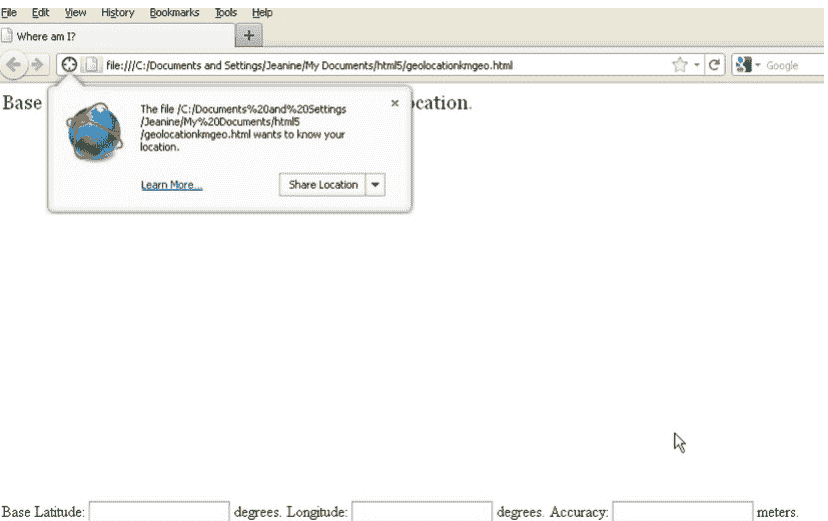

图 6-1. 请求共享位置权限的初始屏幕 (Firefox)

下拉菜单提供四个选项：共享位置、始终共享、从不共享和暂不。如果您选择第一个选项，当您刷新屏幕或返回页面时，程序将再次提示响应。

请注意，屏幕上已经显示了我的程序的其他材料。当代码调用地理定位操作时，会触发权限请求。图 6-2 显示了 Opera 浏览器中的类似屏幕。

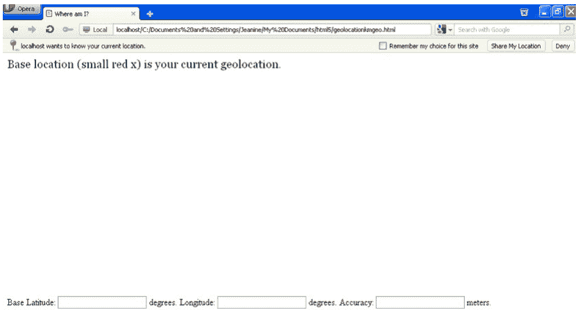

图 6-2. 请求共享位置权限的初始屏幕 (Opera)

请注意，Opera 提供了为此站点记住选择的选项。图 6-3 显示了一个后续屏幕，要求用户再次确认选择加入。

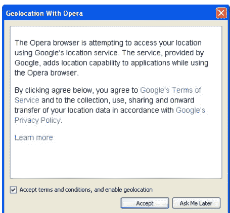

图 6-3. Opera 的额外请求

图 6-4 显示了 Chrome 中的对应屏幕。此时，我已将应用程序上传到我的一个服务器账户。浏览器在其查询中使用该账户的域名。


基本位置（小红叉）是您当前的地理位置。


*图 6-4. 请求共享位置权限的初始屏幕 (Chrome)*

图 6-5 显示了 Safari 的屏幕。我再次使用本地计算机上的文件。


基本位置（小红叉）是您当前的地理位置。


图 6-5. 请求共享位置权限 (Safari)

请注意，Safari 为用户提供了一种授予权限 24 小时的方式——即避免每天重复请求。请注意，我台式机上的 Safari 无法工作，并且不幸地挂起——没有反应——而不是在发出最简单的调用时触发问题处理程序。在解释地理定位实际执行的不同方式以及使用技巧以触发问题处理程序时，我将展示它有效的情况。目前，我注意到在 iPhone 上运行的 Safari 变体可以工作。图 6-6 显示了 iPhone 的权限屏幕。我想测试另一个程序，因此使用了另一个服务器账户。


图 6-6. 请求共享位置 (iPhone)

有许多变量，下文将进行解释，但在我最近在镇上进行的实验中，iPhone 返回的结果最准确。

权限与浏览器相关联。例如，在 Opera 中单击“记住我对此站点的选择”不会影响您使用 Firefox 或任何其他浏览器时发生的情况。您也可以使用浏览器中的通用设置来处理所有站点。例如，在 Firefox 中，使用工具/页面信息/权限，您可以选择始终允许、始终阻止和始终询问，后者是推荐的做法。在 Opera 中，您可以右键单击 (PC) 或 Ctrl+单击 (Mac)，或选择编辑站点首选项 ▶ 网络，以获得相同的选择。在 Chrome 中，您首先单击右上角的扳手符号。然后选择选项 ▶ 高级 ▶ 内容设置，向下滚动到位置。Safari 似乎采用了不同的方法。您可以单击右上角的齿轮符号，然后单击偏好设置并选择安全选项卡。选择是允许站点询问或根本不授予权限。iPhone 在设置 ▶ 通用 ▶ 定位服务中提供了类似的选项。

地理定位标准正在 W3C 的推荐流程中推进（参见`www.w3.org/2008/geolocation/drafts/API/Implementation-Report.html`）。您需要检查并持续关注每个浏览器，以确定哪些功能有效以及如何实现。

那么，继续前进，在获得确定位置的权限后，我的程序做什么？程序`geolocationgeo.html`使用返回的坐标值引入谷歌地图，并使用另一个服务——逆地理编码——来计算地址。图 6-7 显示了结果。地理定位被称为*基本*。

基准位置（小的红色 x）是你的当前地理位置。


*图 6-7. 基本程序中找到的位置*

反向地理编码返回了 100-162 E. Main Street, Mt. Kisco, NY 10549, USA 作为地址描述，精度为 86 米。这对于红色 x 的位置来说相当准确。这张截图是在 Borders 咖啡馆（现已关闭）使用笔记本电脑时拍摄的。这一事实很重要，因为正如将要展示的那样，地理位置本身相当准确。W3C 关于地理位置的官方规范几乎没有提供关于精度如何计算的信息。这个项目可以用来你自己分析地理位置的精确度。用户可以使用 Google 地图界面进行缩放和/或平移，然后点击屏幕。我就是这么做的。会出现一个黑点，以及点击位置的反向地理编码地址和与基准点的距离。这可以用来查看与其他地点的距离，或计算从地理位置到实际位置的距离。图 6-8 显示了在我确定自己实际所在位置点击屏幕后的结果。


基准纬度：41.2048691 度。经度：-73.7276466 度。精度：86 米。  
上次地址  
1-99 Green St, Mt Kisco, NY 10549, USA  
距离  
你点击的位置距离基准点 0.03 公里。

*图 6-8. 显示实际位置的屏幕*

反向地理编码很好：我们当时在格林街。程序计算并显示从基准点（红色 x）到我点击位置（黑色 x）的距离。该位置为 0.03 公里（相当于 30 米）。这在地理位置功能返回的 86 米精度范围内。

第二个应用程序演示了如何使用地理位置、反向地理编码信息以及你自己采取的操作来撰写一封电子邮件发送给他人。当然，许多公司提供此类服务以促进聚会、推广餐厅等。这个应用程序`geolocation-me-email.html`使用了一个用 PHP 编写的小程序，该程序在你的服务器上运行，向你选择的收件人发送电子邮件。你需要确认你的服务器账户是否支持这一点。这是你的互联网服务提供商可能提供也可能不提供的额外服务。我们将在第 10 章回到 PHP。

同意允许地理位置后，第二个应用程序的初始屏幕如所示（见图 6-9）。

190

## 第 6 章 我在哪里：使用地理位置、Google Maps API 和 PHP


**基准位置（小的红色 x）是你的当前地理位置。**

基准纬度：41.2048691 度。经度：-73.7276466 度。精度：86 米。

你的电子邮件（用于回复） 收件人电子邮件

主题 100-162 E Main St, Mt Kisco, NY 10549, USA

邮件正文（你可以更改）


我的地理位置位于主题行中给出的地址。

*图 6-9. 电子邮件程序的初始屏幕*

请注意，屏幕上显示了一个表单，有填写发件人和收件人电子邮件地址的位置。主题行包含反向地理编码信息，邮件正文则引用主题行。

接下来，我点击了我认为自己所在的位置。这个应用程序确实要求你能够在地图上找到自己的位置！图 6-10 显示了结果。


*图 6-10. 点击位置后，邮件正文中显示信息的屏幕*

点击的位置现在有了 Google 地图使用的默认标记。这实际上是我的疏忽，但我决定保留它以向你展示你可以使用默认的倒置泪滴图标。请注意，电子邮件的主题行和正文已经填充好了。现在是填写发件人和收件人地址的时候了。你也可以更改邮件正文或主题行中的内容。然后你点击“发送”按钮。它不是即时的，但消息会发送到你的电子邮件账户。图 6-11 显示了消息在我 Gmail 账户中的显示方式。


*图 6-11. 收到的包含位置信息的电子邮件*

我对它的工作方式感到满意，但我到目前为止向你展示的内容似乎假设我的用户/顾客/客户会表现良好并输入正确的电子邮件地址。这是一个不好的假设。为了解决这个问题，我将`表单验证`声明为此应用程序的需求。表单验证指的是一组用于检查输入是否有效的测试。通过表单验证，如果用户在点击“发送”按钮之前忘记输入任何内容，程序将显示类似图 6-12 所示的内容（使用 Chrome 生成）。


*图 6-12. 当必填字段为空时 Chrome 显示的消息*

如果用户输入了某些内容，但该内容不是有效的电子邮件地址——就格式本身可以确定的范围内，应用程序将显示类似图 6-13 所示的内容（也使用 Chrome 生成）。


*图 6-13. Chrome 检测到的无效电子邮件地址*

其他浏览器也支持类似的表单验证。图 6-14 显示了 Firefox 对于空字段产生的响应。


*图 6-14. 当必填字段为空时 Firefox 显示的消息*

图 6-15 显示了 Firefox 对于格式不正确的电子邮件输入产生的响应。


*图 6-15. Firefox 检测到的无效电子邮件地址*

有人可能会争辩说，最好`一次性`验证所有表单输入字段，但那可能导致屏幕过于拥挤。我们希望用户能理解提示。如果不能，这些消息将对“收件人”字段重复显示。用户可能想知道“发件人”电子邮件字段的含义。这并不意味着该消息会出现在用户电子邮件账户的“已发送”文件夹中。它的作用是使收件人能够点击“回复”。

在介绍了本章项目之后，我现在将提供关于地理位置以及这些应用程序的其他关键需求的背景知识。

### 地理位置及其他关键需求

该应用程序的主要需求涉及地理位置：确定客户端计算机的纬度和经度位置。在本节中，我将简要介绍如何为从移动性最强的智能手机到最固定的台式计算机等各种计算机完成这一任务。下一节将描述如何在 HTML5 和 JavaScript 中使用位置信息的机制。

如果你的汽车、手机或平板电脑中装有全球定位系统（GPS）芯片，那么计算机程序确定你的位置这一概念就很常见了。GPS 芯片利用环绕地球运行的 24 颗 GPS 卫星中部分卫星的信息来确定其位置。天空中的单颗卫星不会发送告诉我们位置的信息。相反，地面上的 GPS 设备接收来自多颗卫星的信号。该设备使用当前时间和每个信号离开卫星的指定时间来计算每个信号的传输时间。它使用这些传输时间来计算与卫星的距离，并利用这些距离以及卫星的位置来进行计算。使用三颗卫星确定纬度和经度；使用四颗确定纬度、经度和海拔。粗略地说，这些确定是通过计算球体的交点来实现的：两个球体相交形成一个圆。软件可以对代表地球的行星球体做出假设，但这可能不准确，我从一次使用车载 GPS 的经验中得知，它“告诉”我，我在布鲁克林大桥的引道下方。本地设备可能使用来自更多卫星的信号，通常多达十颗，以确认结果。最好的 GPS 应用程序使用设备加速度计的信息在 GPS 信号接收短暂中断期间更新其位置，这个技巧曾经仅限于导航潜艇。汽车中的导航设备或手机中的应用也可能利用设备上存储的数据将位置转换为街道地址。

那么，如果你的计算机内部没有 GPS 芯片，或者处于无法接收卫星信号的位置，但确实有手机无线电并且处于手机服务区内呢？另一种计算位置的方法是使用来自一个或多个手机信号塔的信号强度。Google 位置服务和其他地理定位应用程序已经确定了许多信号塔的位置，并将这些信息存储在数据库中。如果范围内只有单个手机信号塔，一个非常粗略的位置估计就是该信号塔的位置。然而，如果你的计算机可以接收来自多个信号塔的信号，那么它可以计算出更好的位置估计。它使用信号塔的不同信号强度，而不是 GPS 卫星的不同信号传输时间，通过使用与已知点的已知距离来计算你的位置。

如果你的计算机没有 GPS 或手机无线电，但通过短线路连接到 Wi-Fi 无线电，那么浏览器可能能够使用来自附近其他 Wi-Fi 无线电的信号强度来确定其位置。事实证明，某些公司，如 Google 位置服务，拥有许多许多 Wi-Fi 热点的已知位置的数据库。即使 Wi-Fi 热点是私密且安全的，其位置也可以被确定。Google、苹果以及可能其他公司收集这些信息的事实存在争议。收集信息的一种方式是通过在街道上行驶以获取 Google 地图街景服务图像的厢式货车。另一种方式是保留人们在其手机上使用某些应用程序时的数据，并将其转发给公司将其添加到他们的数据库中。无论如何，这些数据库被引用以提供地理定位计算的热点位置。您的计算机可以利用邻近热点的信号强度来估算与它们的距离，从数据库中获取它们的位置，并计算自己的位置。当然，它自己的位置随后也会进入数据库，供其他计算使用！

**注意** Google、Apple 等公司声称收集的数据会去除个人信息。我对公司秘密收集信息并不表示同情。然而，我们确实需要接受这样一个事实：许多服务是免费的，没有明确的按次使用费用。对于那句俗语/陈词滥调“一分钱一分货”，我们可以补充一句类似的话：“群众或社区为我们不付费的东西承担负担。”

最后，如果您的计算机没有 GPS、手机或 Wi-Fi 无线电怎么办？IP 地址——即标识您计算机在 Web 上的四数字组合——与经纬度值相关联。如果计算机与本地网络上的许多其他设备共享 IP 地址，这种方法效果不佳——位置可能会偏差很大。然而，这种方法允许甚至 isolated 计算机的用户也能从应用程序获知计算机的大致位置中受益。根据我的经验，我的台式计算机上的浏览器没有使用 Wi-Fi，而是使用了 IP 方法，或者在 Safari 的情况下，要么失败要么超时（有关超时选项的更多信息，请参阅下一节）。相比之下，我家里的笔记本电脑、iPhone 和 iPad 上的浏览器利用连接到我台式计算机的 Wi-Fi 网络，确实使用了 Wi-Fi 进行地理定位，效果更好。

这些是确定位置的主要技术。W3C 正在开发的地理定位标准为程序员建立了访问信息的方法、属性和事件（如果有的话）。

我的项目还使用反向地理编码，确定街道地址或关于位置的某种描述性信息。据推测，Google Location Services 和其他类似服务拥有与经纬度值相关的广泛地理描述术语数据库——当然不是每个值，而是值的范围。下一节描述的 HTML5 功能提供了反向地理编码产生的几个结果，您需要决定什么适合您的应用程序。这将取决于该国家地区和 worldwide 的区域。

这两个项目都需要响应用户点击地图。这包括以一种即使在地图移动或缩放时也能持续存在的方式标记位置。这些项目还计算从基础位置到标记位置的距离。

发送电子邮件首先需要的是一种让用户输入电子邮件地址的方式。发送电子邮件超出了正常的 JavaScript 处理范围，因此要满足这一要求，有必要做一些不同的事情——即在服务器上运行程序。回想一下 Web 的基本机制：文件（包括 HTML 文档）位于服务器站点上。浏览器程序（如 Firefox 或 Opera）运行在所谓的客户端计算机上——我家或你家的计算机，或者在咖啡店或图书馆的计算机。浏览器程序从服务器获取文件并解释它们。要执行发送电子邮件等服务器操作，浏览器必须调用运行在服务器上的程序。

在发送电子邮件之前，程序需要获取电子邮件地址，包括“收件人”地址以知道将消息发送到哪里，以及“发件人”地址以便回复能够工作。程序应该进行某种检查以确保地址有效。您将看到，收集和验证信息是在客户端计算机上完成的，即您或您的用户面前的那台计算机。处理电子邮件和发送邮件由运行在服务器上的 PHP 程序完成，服务器是保存项目文件的计算机。

这些是在“简介”部分中演示的项目的需求。在下一节中，我将描述实现这些项目所需的 HTML5 和 PHP 功能。

### HTML5、CSS、JavaScript 和 PHP 功能

在本节中，我将解释用于完成基本地理定位项目和电子邮件项目需求的功能。

#### 地理定位

W3C 的地理定位标准独立于实际提供信息的方式或服务。假设该任务需要时间，因此请求被设置为异步请求。我编写的进行请求的代码是：

```javascript
if (navigator.geolocation) {
  navigator.geolocation.getCurrentPosition(handler, problemhandler, positionopts);
} else {
  if (document.getElementById("place")) {
    document.getElementById("place").innerHTML = "I'm sorry but geolocation services are not supported by your browser";
    document.getElementById("place").style.color = "#FF0000";
  }
}
```

“简介”部分展示了地理定位的成功示例。此时，我将展示处理问题的方法（问题和错误确实会发生），然后再解释如何使用这些信息。

外层`if`的条件测试`navigator.geolocation`是否是浏览器识别的对象。如果不是，那么在检查名为`place`的`div`存在后，程序会显示以“I'm sorry . . .”开头的消息。当我在旧版本的 Internet Explorer 中尝试此程序时，我首先必须授予运行任何脚本的权限，如图 6-16 所示。

Figure 6-16. Internet Explorer 请求运行脚本

在授予权限后，Internet Explorer 显示地理定位不可用（见图 6-17）。

Figure 6-17. 旧版 Internet Explorer 中地理定位缺失的消息

如果`navigator.geolocation`对象确实存在，那么我的代码会调用`getCurrentPosition`方法并传入三个参数。第一个参数`handler`是一个函数的名称，当操作完成时将被调用。第二个参数`problemhandler`在出现问题时被调用。第三个参数`positionopts`用于指定选项。我使用的选项设置是：

```javascript
var positionopts;

positionopts = {
  enableHighAccuracy: true,
  timeout: 10000
};
```

`enableHighAccuracy`设置的解释未由 W3C 指定，但目前的实际含义是如果可用则使用 GPS。启用后，可能会使用更多的处理时间，整个应用程序可能会变慢。将此项目设置为`false`（默认值）也可能节省本地设备的电池寿命。`timeout`设置表示执行此操作的时间限制为 10,000 毫秒（10 秒）。还有其他选项设置，因此当您开始将地理定位用于生产工作时，务必 investigate 它们。

如果在执行地理定位操作期间检测到问题，会调用`problemhandler`函数，并传入一个包含指示问题性质的代码的参数。`problemhandler`函数的定义包括基于此代码的`switch`语句。

```javascript
function problemhandler(prob) {
  switch (prob.code) {
    case 1:
      document.getElementById("place").innerHTML = "User declined to share the location information.";
      break;
    case 2:
      document.getElementById("place").innerHTML = "Errors in getting base location.";
      break;
    case 3:
      document.getElementById("place").innerHTML = "Timeout in getting base location.";
  }
  document.getElementById("header").innerHTML = "Base location needs to be set!";
}
```

图 6-18 显示了用户拒绝授予地理定位权限的结果。

一个更微妙的问题是未能及时执行操作。图 6-19 展示了之前提到的在台式电脑上使用 Safari 浏览器的情况。

*图 6-18. 用户拒绝地理定位的结果*

*图 6-19. 地理定位耗时过长*

现在让我们来看成功的案例：地理定位成功了。我的代码已触发函数处理器被调用，其参数由`getCurrentPosition`方法设置为包含计算出的位置信息。代码提取了纬度和经度值，并调用我的`makemap`函数，该函数设置一个名为`blatlng`的全局变量并引入谷歌地图。`makemap`函数本质上与前两章项目中使用的函数相同。屏幕上将出现带有完整谷歌地图界面的谷歌地图。处理器函数还会显示数值并调用`reversegeo`，即下一节的主题。以下是`handler`函数的代码：

```javascript
function handler(position) {
  var mylat = position.coords.latitude;
  var mylong = position.coords.longitude;

  makemap(mylat, mylong);

  document.coutput.lat.value = mylat;
  document.coutput.lon.value = mylong;
  document.coutput.acc.value = position.coords.accuracy;

  reversegeo(blatlng);
}
```

精度值是 W3C 规范的一部分。其确切含义在标准中未定义。一种可能性是，它定义了围绕返回点的一个圆的半径，实际位置将位于该圆内。当我在台式电脑上使用时，返回的值为 22,000 米，而实际上实际位置距离返回位置仅 610 米。无论如何，如果你正在构建一个生产应用程序，你可能不会与用户共享精度信息。

> **注意** `navigator.geolocation`对象还有其他方法和属性。最值得注意的是，有一个`watchPosition`方法，它设置对位置变化或位置计算方式变化的监控。

#### 反向地理编码

反向地理编码指的是从纬度/经度位置获取描述信息（如街道地址）的功能。请记住“垃圾进，垃圾出”，如果原始纬度/经度有误，那么反向地理定位操作返回的地址也将是错误的。

我使用的地理编码功能是谷歌地图 API 的一部分，包括获取长名称、短名称、邮政编码等的功能。在`init`函数中，我的代码构造了一个`Geocoder`对象并设置变量`geocoder`：

```javascript
geocoder = new google.maps.Geocoder();
```

`reversegeo`函数调用此对象的`geocode`方法。这是一个异步操作。也就是说，该方法启动一个需要时间的操作。`geocode`方法启动确定反向地理编码的任务。在任务完成之前，控制权就转移到了下一条语句。大多数异步方法通过指定一个在任务完成时调用的函数来工作。对`geocode`方法的调用指定了一个函数。我指定函数的方式是在方法调用本身中定义所谓的匿名函数。整个函数定义是调用`geocode`的第二个参数。完整的`reversegeo`函数如下所示。

它本质上是一个语句，即对`geocode`的调用，其中包含函数的定义。

```javascript
function reversegeo(latlng) {
  geocoder.geocode({ 'latlng': latlng }, function (results, status) {
    if (status == google.maps.GeocoderStatus.OK) {
      if (results[0]) {
        addressref.innerHTML = results[0].formatted_address;
      } else {
        alert("未找到结果");
      }
    } else {
      alert("地理编码失败，原因：" + status);
    }
  });
}
```


`geocode` 方法可用于使用描述（地址）查找位置，或用于反向地理编码：根据位置确定描述。`'latlng'` 坐标的存在表明这是一个反向地理编码操作。我的代码指定了纬度/经度，`geocode` 返回描述性信息，如街道地址。

> **注意** 如果你改为使用`{'address': locrequest}`指定一个地址，其中`locrequest`是一个保存地址的字符串变量，那么`geocode`将返回纬度/经度。这为你提供了一种将谷歌地图的基本功能引入应用程序的方式。

`results` 参数是一个保存地址信息的数组，从最精确的开始，向上排列。图6-20显示了向代码添加此内容后产生的警告框：

```javascript
var out = "";

for (var i=0;i<results.length;i++) {
    out += results[i].formatted_address +"\n";
}

alert(out);
```

## 第6章 我在哪里：使用地理定位、谷歌地图API和PHP

图6-20. 地理编码的`results`数组

第二行和第三行相同的原因可能与基斯科山是一个边界相同的村庄和城镇的事实有关。无论如何，你可能需要运行一个带有这种显示的程序来确定你想要在你的特定应用程序中使用什么。我的示例使用`results[0]`。你可能决定最好使用`results[3]`。这取决于你，可以被视为精确度与准确度的情况。

### 点击地图

我为这些项目设定的规范允许用户点击地图。正如前两章所讨论的，谷歌地图API提供了一种设置事件处理的方式。在`makemap`函数中，我包含了以下行：

```javascript
listener = google.maps.event.addListener(map, 'click', function(event) {
    checkit(event.latLng);
});
```

`checkit`函数使用点击的位置创建一个标记，使用`reversegeo`计算地址，计算从基地到点击位置的距离，并显示信息。在基本的地理定位应用程序中，`checkit`的定义如下：

```javascript
function checkit(clatLng) {
    var distance = dist(clatLng,blatLng);
    var result;
    distance = Math.floor((distance+.005)*100)/100;
    var distanceString = String(distance);
```

```javascript
marker = new google.maps.Marker({
    position: clatLng,
    title: distanceString,
    icon: bxmarker,
    map: map
});

markersArray.push(marker);
reversegeo(clatlng);

distanceref.innerHTML = "您点击的位置距离基地 "+distanceString+" 公里。";
}
```

使用的标记是一个自定义标记，一个黑色的X。标题（即将鼠标移到标记上时看到的内容）是距离，格式化为两位小数。以“You clicked . . . ”开头的句子显示在文档的正文中。

电子邮件地理定位项目的`checkit`函数类似。此应用程序的目标是撰写一封与用户位置相关的电子邮件；请回顾图6-10。此应用程序中`checkit`函数的定义使用默认标记，并为消息正文创建关于距离的句子。

```javascript
function checkit(clatlng) {
    var distance = dist(clatlng,blatlng);
    var result;
    distance = Math.floor((distance+.005)*100)/100;
    var distanceString = String(distance)+" 公里。";
    var newcoords = String(clatlng.lat())+" 纬度 "+String(clatlng.lng())+" 经度。";
    distanceString = newcoords+" "+distanceString;

    marker = new google.maps.Marker({
        position: clatlng,
        title: distanceString,
        map: map
    });

    document.msg.body.value = document.msg.body.value + " 但是，我实际上在 "+distanceString;
}
```

### 检查电子邮件地址输入并调用PHP发送电子邮件

正如“简介”部分所述，任何涉及根据用户输入发送电子邮件的应用程序都应尝试检查输入是否符合电子邮件地址的格式。幸运的是，这是HTML5的新功能之一。表单中的输入元素有一个`type`属性，其中一个类型是`email`。标准HTML（4及更早版本）提供了一种指定表单提交应导致调用服务器上文件的方法。我在下一节中对此有更详细的描述，包括方法设置的重要性。电子邮件的完整表单如下：

```html
<form name="msg" action="sendmailp.php" method="post">
    <p>
        您的电子邮件（用于回复）
        <input type="email" name="from" required/>

        收件人电子邮件
        <input type="email" name="to" required />
    </p>
```

### PHP 语言简介

电子邮件的发送是服务器上提供的功能，而非客户端计算机的功能。编写所谓的服务器端脚本有多种语言，PHP 是其中之一。它在 www.php.net 上有完善的维护和详尽的文档。你将在第 10 章的数据库项目描述中阅读到更多关于 PHP 的内容。

上一节展示了如何通过提交表单来调用 PHP 脚本。表单输入可以通过两种方式之一传递给脚本：POST 和 GET。GET 方式利用所谓的*查询字符串*。POST 方式则通过 HTTP 请求头来完成。在这个示例中我选择使用 POST。

PHP 脚本的主要目的是在服务器上执行某些操作（通常是使用 HTML 文档中的表单输入），并生成一个 HTML 文档返回给浏览器进行显示。虽然本项目的示例并非如此，但许多 PHP 脚本由 HTML 和 PHP 混合组成。PHP 部分由分隔符`<?php`和`?>`标示。`echo`函数将其输入添加到正在创建的 HTML 文档中。

PHP 的一个特点是变量（无论是内置的还是程序员定义的）都以美元符号开头。例如，如果 PHP 脚本是由表单操作调用的，且方法指定为 POST，而表单中有一个名为`to`的输入元素，那么如下这行代码：

```php
$to = $_POST['to'];
```

将访问名为`to`的表单输入并将其赋值给变量`$to`。

如前所述，PHP 脚本用于构建 HTML 文档，因此一个常见的操作是字符串拼接。PHP 中用于此操作的运算符是`.`（点号）。如下这行代码：

```php
$headers = "From: " . $_POST['from'];
```


提取名为 `from` 的表单输入，并将其与字面字符串 `"From:  "` 拼接形成一个更长的字符串，然后赋值给变量 `$headers`。

PHP 的另一个特性（对于经验丰富的程序员来说可能是最奇特的），是变量可以包含在字符串中。语句

```php
echo("There was a problem: <br>the body is $body,<br> the to is $to,<br> subject is $subject,<br> headers is $headers.");
```

产生的输出如图 6-21 所示。


图 6-21. PHP echo 拼接字符串的演示

变量 `$body`、`$to`、`$subject` 和 `$headers` 的值已被提取并成为字符串的一部分。还请注意该字符串中包含了 HTML 标记 `<br>`。

发送电子邮件相当简单。PHP 有一个内置的 `mail` 函数可以完成这项工作，其参数包括收件人地址、主题、邮件正文以及任何头信息。如果发送操作成功，该函数返回 `true`，否则返回 `false`。请注意，发送操作可能成功，但收件人的邮件服务仍可能因地址不存在而拒绝该地址。`sendmailp.php` 的完整代码将在下一节中展示。

### 构建应用并打造你自己的版本

你可以将地理定位功能与更丰富的应用相结合，打造属于你自己的项目。了解网站访问者所在的位置有助于实现应用的个性化，并可能影响图片的选择。以下是基本地理定位应用的非正式摘要/大纲：

- `init`：初始化，包括异步调用地理定位请求
- `handler` 和 `problemhandler`：完成地理定位操作
- `makemap`：加载 Google 地图
- `checkit`：响应地图上的点击并调用 `dist`
- `reversegeo`：根据经纬度值确定地址

表 6-1 列出了所有函数，并说明了它们的调用方式和所调用的函数。

第 6 章 ■ 我在哪里：使用地理定位、Google Maps API 和 PHP

#### 表 6-1. 基本地理定位项目中的函数

| 函数 | 调用者/被谁调用 | 调用 |
|---|---|---|
| `init` | 由 `<body>` 标签中 `onLoad` 属性的动作调用 | |
| `handler` | 由 `init` 中 `getCurrentPosition` 调用的动作调用 | `makemap`, `reversegeo` |
| `reversegeo` | 在 `handler` 中调用 | |
| `problemhandler` | 由 `init` 中 `getCurrentPosition` 调用的动作调用 | |
| `makemap` | 由 `handler` 调用 | |
| `checkit` | 由 `makemap` 中 `addListener` 的动作调用 | `dist` |
| `dist` | 由 `checkit` 调用 | |

表 6-2 展示了基本应用的代码，每行都带有注释。其中大部分代码你在前面的章节中已经见过。

#### 表 6-2. 地理定位项目的完整代码

| 代码行 | 描述 |
|---|---|
| `<!DOCTYPE html>` | HTML5 的文档类型声明头 |
| `<html>` | html 标签 |
| `<head>` | Head 标签 |
| `<title>Where am I?</title>` | 完整的 title 元素 |
| `<meta charset="UTF-8">` | 字符集的 meta 标签 |
| `<style>` | Style 标签 |
| `header {font-family:Georgia,"Times New Roman",serif;` | 设置 header 元素的格式，包括字体选择 |
| `font-size:20px;` | 字体大小 |
| `display:block;` | 设置前后换行 |
| `}` | 关闭样式指令 |
| `</style>` | style 的结束标签 |
| `<script type="text/javascript" charset="UTF-8" src="http://maps.google.com/maps/api/js?sensor=false"></script>` | 引入 Google Map API 的脚本 |
| `<script type="text/javascript" charset="UTF-8">` | 开始的 script 标签 |
| `var positionopts;` | 设置地理定位选项的全局变量 |
| `positionopts = {` | 开始定义关联数组 |
| `enableHighAccuracy: true,` | 设置请求以尝试高精度定位 |
| `timeout: 10000};` | 设置超时限制 |
| `var addressref;` | 将保存地址 div 元素的引用 |
| `var distanceref;` | 将保存距离 div 元素的引用 |
| `var headerref;` | 将保存 header div 元素的引用 |
| `var geocoder;` | 将保存 geocoder 对象 |
| `function init() {` | init 函数的头部 |
| `addressref = document.getElementById("address");` | 设置 addressref |
| `headerref = document.getElementById("header");` | 设置 headerref |
| `distanceref = document.getElementById("distance");` | 设置 distanceref |
| `geocoder = new google.maps.Geocoder();` | 创建 geocoder 并设置为 Geocoder 对象 |
| `if (navigator.geolocation) {` | 浏览器是否支持 navigator.geolocation？ |
| `navigator.geolocation.getCurrentPosition(handler, problemhandler, positionopts);` | 如果支持，如所示传入参数进行调用 |
| `}` | 关闭条件语句 |
| `else {` | 否则 |
| `if (document.getElementById("place")) {` | 如果存在 ID 为 place 的元素 |
| `document.getElementById("place").innerHTML = "I'm sorry but geolocation services are not supported by your browser";` | 设置其内容以显示消息 |
| `document.getElementById("place").style.color = "#FF0000";` | 将内容设为红色 |
| `}` | 关闭条件语句 |
| `}` | 关闭外层 else 语句 |
| `}` | 关闭函数 |
| `var listener;` | 监听器变量（已设置但未作为变量使用） |
| `var map;` | 用于保存地图 |
| `var blatlng;` | 将保存基准位置的经纬度对象 |
| `var myOptions;` | 将保存加载地图时使用的选项 |
| `function handler(position) {` | handler 函数的头部；如果地理定位成功，将以参数 position 被调用 |
| `var mylat = position.coords.latitude;` | 设置为纬度 |
| `var mylong = position.coords.longitude;` | 设置为经度 |
| `makemap(mylat,mylong);` | 调用（我的）makemap 函数 |
| `document.coutput.lat.value = mylat;` | 显示纬度 |
| `document.coutput.lon.value = mylong;` | 显示经度 |
| `document.coutput.acc.value = position.coords.accuracy;` | 显示精度 |
| `reversegeo(blatlng);` | 调用（自定义的）reversegeo 函数 |
| `}` | 关闭处理函数 |
| `function reversegeo(latlng) {` | reversegeo 函数的声明头 |
| `geocoder.geocode({'latLng': latlng}, function(results, status) {` | 使用 latlng 对象调用 geocode 方法。第二个参数是一个匿名函数。函数定义从此行开始，在 11 行后结束，即 reversegeo 函数结束括号之前。 |
| `if (status == google.maps.GeocoderStatus.OK) {` | 如果返回的状态值等于 google.maps.GeocoderStatus.OK 值 |
| `if (results[0]) {` | 如果 results[0] 存在 |
| `addressref.innerHTML = results[0].formatted_address;` | 显示此结果 |
| `} else {` | 否则 |
| `alert("No results found");` | 发出警报消息 |
| `}` | 关闭从句 |
| `}` | 关闭外层从句 |
| `else {` | 否则（状态不是 OK） |
| `alert("Geocoder failed due to: " + status);` | 发出警报消息 |
| `}` | 关闭从句 |
| `});` | 关闭函数定义，关闭 Geocode 方法调用 |
| `}` | 关闭 reversegeo 函数 |
| `function problemhandler(prob) {` | problemhandler 函数的声明头；prob 将包含有关失败的信息 |
| `switch(prob.code) {` | 基于 prob.code 的 switch 语句 |
| `case 1:` | 如果用户拒绝共享位置信息，则返回代码 1。 |
| `document.getElementById("place").innerHTML = "User declined to share the location information.";` | 发出消息 |
| `break;` | 离开 switch |
| `case 2:` | 如果执行地理编码的程序检测到错误，则返回代码 2。 |
| `document.getElementById("place").innerHTML = "Errors in getting base location.";` | 发出消息 |
| `break;` | 离开 switch |
| `case 3:` | 如果地理编码耗时过长，则返回代码 3。你可以在最初调用 geocode 方法时指定时间限制。 |
| `document.getElementById("place").innerHTML = "Timeout in getting base location."; attire.` | 发出消息 |
| `}` | 关闭 switch 语句 |
| `document.getElementById("header").innerHTML = "Base location needs to be set!";` | 在所有情况下，设置 header 的内容 |
| `}` | 关闭 problemhandler 函数 |
| `var rxmarker = "rx1.png";` | 红色 x；用于基准点 |
| `var bxmarker = "bx1.png";` | 黑色 x；用于点击 |
| `function makemap(mylat,mylong) {` | makemap 函数的声明头 |
| `var marker;` | 将保存标记 |
| `blatlng = new google.maps.LatLng(mylat,mylong);` | 创建 LatLng 对象并设置全局变量 blatlng |
| `myOptions = {` | 开始设置地图选项的关联数组 |
| `zoom: 14,` | 将缩放级别设置为固定值 14 |
| `center: blatlng,` | 将地图中心设置为 blatlng |
| `mapTypeId: google.maps.MapTypeId.ROADMAP` | 将地图类型设置为 ROADMAP。其他可选值为 SATELLITE、TERRAIN 和 HYBRID。 |
| `};` | 关闭数组 |
| `map = new google.maps.Map(document.getElementById("place"), myOptions);` | 调用 Map 构造函数，使用指定选项引入地图；设置 map 变量 |
| `marker = new google.maps.Marker({` | 创建标记 |
| `position: blatlng,` | 位置为 blatlng |
| `title: "center",` | 标题为 "center"。这是当你使用鼠标将光标移到标记附近时会显示的文本。 |
| `icon: rxmarker,` | 将标记图标设置为自定义的 rxmarker |
| `map: map });` | 标记在地图上；关闭 Marker 方法调用 |
| `listener = google.maps.event.addListener(map, 'click', function(event) {` | 设置点击地图的事件处理；函数在此定义 |
| `checkit(event.latLng);` | 函数为 `checkit(event.latLng)` 这一行 |
| `});` | 关闭函数定义和 addListener 调用 |
| `}` | 关闭 makemap |
| `function checkit(clatLng) {` | checkit 函数的声明头 |
| `var distance = dist(clatLng,blatLng);` | 计算由输入参数给出的位置到 blatLng 中保存的基准位置的距离 |
| `distance = Math.floor((distance+.005)*100)/100;` | 将距离四舍五入到小数点后两位 |
| `var distanceString = String(distance);` | 将距离转换为字符串 |
| `marker = new google.maps.Marker({` | 创建标记 |
| `position: clatLng,` | 当用户点击地图时…… |
| `title: distanceString,` | ……将标题设置为格式化后的距离 |
| `icon: bxmarker,` | ……用黑色 x 标记 |
| `map: map });` | ……标记在地图上；关闭数组，关闭 Marker 调用 |
| `reversegeo(clatLng);` | 调用 reversegeo |
| `distanceref.innerHTML = "You clicked "+distanceString+" km from base.";` | 显示距离信息 |
| `}` | 关闭 checkit 函数 |
| `function dist(point1, point2) {` | 两点之间距离的声明头 |
| `var R = 6371; // km` | 公里换算系数 |
| `// var R = 3959; // miles` | 英里换算系数；保留在代码中以防万一 |
| `var lat1 = point1.lat()*Math.PI/180;` | 转换为弧度 |
| `var lat2 = point2.lat()*Math.PI/180 ;` | 转换为弧度 |
| `var lon1 = point1.lng()*Math.PI/180;` | 转换为弧度 |
| `var lon2 = point2.lng()*Math.PI/180;` | 转换为弧度 |
| `var d = Math.acos(Math.sin(lat1)*Math.sin(lat2) + Math.cos(lat1)*Math.cos(lat2) * Math.cos(lon2-lon1)) * R;` | 基于球面余弦定律的计算 |
| `return d;` | 返回距离 |
| `}` | 关闭 dist 函数 |
| `</script>` | script 结束标签 |
| `</head>` | head 结束标签 |
| `<body onLoad="init();">` | body 标签，包括设置调用 init() |
| `<header id="header">Base location (small red x) is your current geolocation.</header>` | header 元素 |
| `<div id="place" style="width:600px; height:400px"></div>` | ID 为 place 的 div，Google 地图将放置于此 |
| `<form name="coutput">` | form 标签 |
| `Base Latitude: <input type="text" name="lat">` degrees. Longitude: `<input type="text" name="lon">` degrees. Accuracy: `<input type="text" name="acc">` meters. `<br/>` | 文本和输入元素（在此示例中均用于输出/显示） |
| `</form>` | form 结束标签 |
| `Last address <div id="address"></div>` | 用于地址的 div |
| `Distance <div id="distance"></div>` | 用于距离的 div |
| `</body>` | body 结束标签 |
| `</html>` | html 结束标签 |

你可以通过多种方式扩展基本的地理定位程序。例如，你可以将信息与上一章演示的 `dist` 函数结合使用，根据用户与一组固定位置的距离来执行某些操作。电子邮件地理定位项目以另一种方式扩展了基本项目。它使用这些信息向用户选择的某人发送电子邮件。电子邮件地理定位应用的非正式摘要/大纲如下：

- `init`：用于初始化，包括调用地理定位请求，这是异步完成的
- `handler` 和 `problemhandler`：用于完成地理定位
- `makemap`：用于引入 Google 地图
- `checkit`：用于响应地图上的点击并调用 `dist`
- `reversegeo`：用于从纬度/经度值确定地址
- `sendemailp`（一个在服务器上运行的独立程序）：用于执行发送电子邮件

表 6-3 列出了所有函数，并描述了它们的调用方式以及它们调用的函数。在其它情况下对我们很有帮助的结构现在 somewhat 有所欠缺。`sendemailp.php` 函数是通过 body 元素中第二个 `<form>` 标签的 `action` 属性设置来调用的：

```html
```


```html
<form name="msg" action="sendemailp.php" method="post">
```


#### 表6-3. 电子邮件地理位置项目中的函数（与基本地理位置项目相同）

| 函数 | 被谁调用 | 调用谁 |
| :--- | :--- | :--- |
| `init` | 由 `<body>` 标签中 `onLoad` 属性的动作调用 | |
| `handler` | 由 `init` 中 `getCurrentPosition` 调用的动作调用 | `makemap`, `reversegeo` |
| `reversegeo` | 在 `handler` 中被调用 | |
| `problemhandler` | 由 `init` 中 `getCurrentPosition` 调用的动作调用 | |
| `makemap` | 由 `handler` 调用 | |
| `checkit` | 由 `makemap` 中 `addListener` 的动作调用 | `dist` |
| `dist` | 由 `checkit` 调用 | |

表6-4显示了 `geolocationkmemail.html` 的完整代码。新的代码语句和已更改的代码语句带有注释。

#### 表6-4. 电子邮件地理位置应用的代码

| 代码行 | 描述 |
| :--- | :--- |
| `<!DOCTYPE html>` | |
| `<html>` | |
| `<head>` | |
| `<title>Where am I?</title>` | |
| `<meta charset="UTF-8">` | |
| `<style>` | |
| `header {font-family:Georgia,"Times New Roman",serif;` | |
| `font-size:20px;` | |
| `display:block;` | |
| `}` | |
| `</style>` | |
| `<script type="text/javascript" charset="UTF-8"` | |
| `src="http://maps.google.com/maps/api/js?sensor=false"></script>` | |
| `<script type="text/javascript" charset="UTF-8">` | |
| `var positionopts;` | |
| `positionopts = {` | |
| `enableHighAccuracy: true,` | |
| `timeout: 10000} ;` | |
| `var headerref;` | |
| `var geocoder;` | |
| `function init() {` | |
| `headerref = document.getElementById("header");` | |
| `geocoder = new google.maps.Geocoder();` | |
| `if (navigator.geolocation) {` | |
| `navigator.geolocation.getCurrentPosition(handler, problemhandler, positionopts);` | |
| `}` | |
| `else {` | |
| `if (document.getElementById("place")) {` | |
| `document.getElementById("place").innerHTML = "I'm sorry but geolocation services are not supported by your browser";` | |
| `document.getElementById("place").style.color = "#FF0000";` | |
| `}` | |
| `}` | |
| `}` | |
| `}` | |
| `var listener;` | |
| `var map;` | |
| `var blatlng;` | |
| `var myOptions;` | |
| `function handler(position) {` | |
| `var mylat = position.coords.latitude;` | |
| `var mylong = position.coords.longitude;` | |
| `var result;` | |
| `makemap(mylat,mylong);` | |
| `document.coutput.lat.value = mylat;` | |
| `document.coutput.lon.value = mylong;` | |
| `document.coutput.acc.value = position.coords.accuracy;` | |
| `reversegeo(blatlng);` | |
| `}` | |
| `function reversegeo(latlng) {` | |
| `geocoder.geocode({'latlng': latlng}, function(results, status)` | |
| `{` | |
| `if (status == google.maps.GeocoderStatus.OK) {` | |
| `if (results[0]) {` | |
| `document.msg.subject.value = results[0].formatted_address;` | 将值放入消息表单的主题输入元素中 |
| `} else {` | |
| `alert("No results found in reverse geocoding.");` | |
| `}` | |
| `}` | |
| `else {` | |
| `alert("Geocoder failed due to: " + status);` | |
| `}` | |
| `});` | |
| `}` | |
| `function problemhandler(prob) {` | |
| `switch(prob.code) {` | |
| `case 1:` | |
| `document.getElementById("place").innerHTML = "User declined to share the location information.";` | |
| `break;` | |
| `case 2:` | |
| `document.getElementById("place").innerHTML = "Errors in getting base location.";` | |
| `break;` | |
| `case 3:` | |
| `document.getElementById("place").innerHTML = "Timeout in getting base location.";` | |
| `break;` | |
| `}` | |
| `document.getElementById("header").innerHTML = "Base location needs to be set!";` | |
| `}` | |
| `var xmarker = "x1.png";` | |
| `function makemap(mylat,mylong) {` | |
| `var marker;` | |
| `blatlng = new google.maps.LatLng(mylat,mylong);` | |
| `myOptions = {` | |
| `zoom: 14,` | |
| `center: blatlng,` | |
| `mapTypeId: google.maps.MapTypeId.ROADMAP` | |
| `};` | |
| `map = new google.maps.Map(document.getElementById("place"), myOptions);` | |
| `marker = new google.maps.Marker({` | |
| `position: blatlng,` | |
| `title: "center",` | |
| `icon: xmarker,` | |
| `map: map });` | |
| `listener = google.maps.event.addListener(map, 'click', function(event) {` | |
| `checkit(event.latLng);` | |
| `});` | |
| `}` | |
| `function checkit(clatlng) {` | |
| `var distance = dist(clatlng,blatlng);` | |
| `var result;` | |
| `distance = Math.floor((distance+.005)*100)/100;` | |
| `var distanceString = String(distance)+" km. away.";` | |
| `var newcoords = String(clatlng.lat())+" lat. "+String(clatlng.lng())+" lng.";` | 用作消息正文的一部分 |
| `distanceString = newcoords+" "+distanceString;` | 用作消息正文的一部分 |
| `marker = new google.maps.Marker({` | 注意使用的是默认图标 |
| `position: clatlng,` | |
| `title: distanceString,` | |
| `map: map });` | |
| `document.msg.body.value = document.msg.body.value + " However, I really am at "+distanceString;` | 添加到消息正文 |
| `}` | |
| `function dist(point1, point2) {` | |
| `var R = 6371; // km` | |
| `// var R = 3959; // miles` | |
| `var lat1 = point1.lat()*Math.PI/180;` | |
| `var lat2 = point2.lat()*Math.PI/180 ;` | |
| `var lon1 = point1.lng()*Math.PI/180;` | |
| `var lon2 = point2.lng()*Math.PI/180;` | |
| `var d = Math.acos(Math.sin(lat1)*Math.sin(lat2) + Math.cos(lat1)*Math.cos(lat2) * Math.cos(lon2-lon1)) * R;` | |
| `return d;` | |
| `}` | |
| `</script>` | |
| `</head>` | |
| `<body onLoad="init();">` | |
| `<header id="header">Base location (small red x) is your current geolocation.</header>` | |
| `<div id="place" style="width:600px; height:350px"></div>` | |
| `<form name="coutput">` | |
| `Base Latitude: <input type="text" name="lat"> degrees. Longitude: <input type="text" name="lon"> degrees.` | |
| `Accuracy: <input type="text" name="acc"> meters. <br/>` | |
| `</form>` | |
| `<form name="msg" action="sendemailp.php" method="post">` | 表单标签，指定 `action` 属性导致调用 `sendemailp.php`，并指定 `method` 属性导致通过 POST 方法进行调用 |
| `<p>Your email (for reply)` | 发件人输入字段的标签 |
| `<input type="email" name="from" required/>` | 此字段为必填项，类型为 email |
| `To email` | 收件人输入字段的标签 |
| `<input type="email" name="to" required />` | 此字段为必填项，类型为 email |
| `</p>` | 强制换行 |
| `Subject: <input type="text" name="subject" size="100" />` | 主题将由 `reversegeo` 设置 |
| `<p>` | 换行 |
| `Body of message (you may change it) <br/>` | 消息正文的标签 |
| `<TEXTAREA NAME="body" COLS=40 ROWS=5>` | 用于输入的文本区域，设置为 5 行 40 列 |
| `My geolocation is at the address given in the subject line.` | 初始文本 |
| `</TEXTAREA>` | 关闭 textarea 元素 |
| `</p>` | 换行 |
| `<input type="submit" value="SEND" />` | 提交按钮 |
| `</form>` | 关闭 form 标签 |
| `</body>` | 关闭 body 标签 |
| `</html>` | 关闭 html 标签 |

电子邮件应用程序需要一个 PHP 脚本来完成发送电子邮件的实际工作。我的 `sendemailp.php` 程序如表6-5所示。

#### 表6-5. 发送电子邮件的 PHP 脚本代码

| 代码行 | 描述 |
| --- | --- |
| `<?php` | PHP 代码的定界符 |
| `$to = $_POST['to'];` | 将变量 `$to` 设置为表单中名为 `to` 的输入的值 |
| `$subject = $_POST['subject'];` | 将变量 `$subject` 设置为表单中名为 `subject` 的输入的值 |
| `$body = $_POST['body'];` | 将变量 `$body` 设置为表单中名为 `body` 的输入的值 |
| `$headers = "From: " . $_POST['from'];` | 将变量 `$headers` 设置为一个以 `From:` 开头的字符串，后跟表单中名为 `from` 的输入的值 |
| `if (mail($to, $subject, $body,$headers))` | 调用 `mail` 函数，如果成功 |
| `{` | |
| `echo("Your message was sent");` | 输出成功消息 |
| `} else {` | 否则 |
| `echo("There was a problem: <br>the body is $body,<br> the to is $to,<br> subject is $subject,<br> headers is $headers.");` | 输出更长的消息，包含所有变量的内容 |
| `}` | 关闭子句 |
| `?>` | 结束 PHP |

你可能会发现发送电子邮件的用途不仅限于地理位置相关的应用。你也可以以其他更实质的方式扩展此应用程序，例如在电子邮件内容中包含其他信息。

如果你的应用程序不想完全依赖地理位置，你可以考虑使用一个表单，让用户输入地址。你可以使用 `geocoder.geocode` 方法并传入地址参数来获取纬度/经度，并使用该值引入地图。另一种选择是使用第4章中介绍的地点列表。

#### 测试和上传应用程序

你需要在线测试第一个应用程序，因为这是与 Google Maps 建立联系的唯一方式，但 HTML 文件和标记图标的文件（`bx1.png` 和 `rx1.png`）可以位于你的本地计算机。要测试电子邮件应用程序，你需要从服务器运行该程序。也就是说，你需要将所有文件上传到服务器。我的文件是 `geolocationemail.html`、`rx1.png` 和 `sendemail.php`。

此外，我要重申之前提到的：你需要确认服务器允许使用 PHP，并且允许 PHP 发送电子邮件。具体举例来说，我所在学院的标准服务器允许一定程度地使用 PHP，但不允许发送电子邮件。学院的 IT 部门为我的数据库课程专门搭建了一台特殊的服务器来完成这项工作！

#### 小结

在本章中，你继续使用 Google Maps API。你学习了如何使用以下内容：

- 地理定位
- 用于地址的 Google Maps API 和地理编码
- 用于发送电子邮件的 PHP 脚本

在下一章中，我们将暂时离开地理领域，转向更小但同样富有空间魅力的折纸世界。我们将探索如何使用 JavaScript、HTML5 视频以及在画布上绘制照片，来生成一条会说话的鱼的折纸步骤说明。

## 第7章：折纸步骤说明：使用基于数学的线条绘制、照片和视频

在本章中，你将学习以下内容：

- 如何使用数学来编写 JavaScript 函数，以生成精确的线条绘制
- 一种将线条绘制、照片和视频与文本结合用于顺序步骤说明的方法
- 一种分步进行的开发方法，允许你逐步推进，甚至可以回退并插入或修改之前的工作

#### 简介

本章的项目是一套折叠折纸模型（一条会说话的鱼）的顺序步骤说明。不过，你也可以将其理解为任何你想向观众展示一系列图解的主题，包括前进和后退的能力，图解可以是线条绘制、来自文件的图像或视频片段。

> **注意** 折纸指的是纸张折叠艺术。它通常与日本相关联，但在中国和西班牙也有其根源。传统折法包括水炸弹、鹤和拍翅鸟。莉莲·奥本海默（Lillian Oppenheimer）因在美国推广折纸而闻名，她创立了后来成为美国国家组织 OrigamiUSA 的机构。她亲自在1972年教给了我名片青蛙折法。本章的下载资源中包含了一个名片青蛙的 HTML5 程序。折纸是一种在世界各地实践的艺术形式，也是数学、工程和计算复杂性研究的重点。

图 7-1 展示了“会说话的鱼”应用程序（`origamifish.html`）的初始屏幕。屏幕显示了折纸图解的标准惯例，我稍作修改以加入颜色。标准折纸用纸称为 kami，一面为白色，另一面为非白色。

- 制作谷折
- 制作山折
- 展开折痕线
- 当折叠方向重要时：
  - 展开的谷折
  - 展开的山折

##### 图解惯例


> **注意** 我缩减了折纸动作的表示集合。例如，我 omitted 了反向折叠的表示，这种折叠用于将嘴唇翻转到内部。这些折叠通常前面有所谓的准备折叠，我将在会说话的鱼折法中描述这些内容。

折叠者可以点击“Next step”（在此序列中的这一点，“Go back”不起作用）来到达说明的第一个实际步骤，如图 7-2 所示。当然，也可以添加编程来在开始处移除“Go back”按钮，在结束处移除“Next step”按钮。


**Make quarter turn.**

[Go back] [Next step]

*图 7-2. 第一步，展示正方形纸张。说明要求旋转纸张。*

跳过一些步骤，图 7-3 展示了折叠过程中的一个后续步骤。注意纸张的彩色面正在显示。展开的折痕线由细垂直线表示，下一步要制作的折叠（将角向下折叠）由右上角彩色虚线对角线表示。

## 第7章 ■ 折纸步骤说明：使用基于数学的线条绘制、照片和视频


将右侧角向下折叠到标记三分之一的折痕处。

*图 7-3. 将角向下折叠到折痕线*

在模型的后续构建中，折叠者必须执行一个下沉折叠（sink fold）。这被认为是一个困难的动作。图 7-4 展示了所谓下沉前的折痕图案：折叠被表示为山折或谷折。


将两侧向中间推，使中间的正方形下沉。

*图 7-4. 使用标准图解展示下沉步骤*

我决定用视频片段来补充线条绘制，以展示下沉步骤。图 7-5 展示了视频中的一帧。我（折叠者）使用了视频控件来暂停动作。折叠者可以重放视频片段，并多次返回查看折痕图案。


下沉正方形，收拢模型。

[Go back] [Next step]

*图 7-5. 暂停的视频展示下沉步骤*

下沉仍然是一个挑战，但观看视频片段可以提供帮助。折叠者可以重放并暂停视频片段。图 7-6 展示了下沉后的下一步。对用户/折叠者来说，从线条绘制到视频片段再到线条绘制的切换很容易，而且对开发者来说也将是简便的。

## 第7章 ■ 折纸步骤说明：使用基于数学的线条绘制、照片和视频


现在将右侧的翻盖向后折叠到中心谷折处。你正在平分所示的角度。

[Go back] [Next step]

*图 7-6. 下沉后的步骤（第一个视频片段）*

下一步要求折叠者将右侧的三角形翻盖向后折叠，平分该角度。注意该角度由弧线表示。

继续折叠过程，有一个步骤我决定用一两张照片来最佳地传达需要完成的内容。图 7-7 展示了一个进行中的模型的照片，从上方俯视（看向鱼的嘴巴内部，沿着喉咙向下看）。


将手指伸入它的嘴巴，将内部折叠的材料移到一侧

[Go back] [Next step]

*图 7-7. 展示鱼喉咙的照片*

图 7-8 展示了按照图 7-7 所示的说明将折叠材料移到一侧后的结果。


**喉咙已固定。**

[Go back] [Next step]

*图 7-8. 喉咙固定后的鱼的照片*

步骤说明以另一个视频片段结束，这个视频展示了鱼说话的样子，由折叠者轻轻按压顶部和底部来实现。图 7-9 展示了视频中的一帧。


会说话的鱼。

*图 7-9. 展示会说话的鱼的视频*

#### 关键需求

折纸步骤说明有一种标准格式，通常称为图解，我在此基础上进行构建。在这种方法中，每一步都使用一套固定的排版来展示下一步要制作的折叠。最基本的折叠在展开时要么呈现谷形，要么呈现山形，这由虚线或点划线表示。通常，在折纸过程中折叠会被展开。有时，曾经有过折叠的位置用细线表示，有时用谷折的虚线或山折的点划线表示。

我的目标是制作类似书籍中的线条绘制，通过计算关键点和线的坐标位置来实现。我不想手工绘制然后扫描，neither did I want to use a typical engineering CAD program. 我不想测量和记录长度或角度，而是让 JavaScript 来完成这项任务。即使是“按感觉”完成的折叠，正如折纸术语所说，也能奏效，因为我可以确定自己选择使用的精确位置。使用基础代数、几何和三角学，可以通过计算线条端点的坐标来实现线条绘制的精确定位。

## 第七章 ■ 折纸指南：使用基于数学的线条图、照片和视频

折纸步骤通常配有文字说明。此外，有时也会使用箭头。我希望在遵循标准的同时，充分利用这些说明将在电脑上以彩色形式呈现并拥有其他媒体的机会。

考虑到会说话的折纸鱼以及其他一些折叠，我决定对那些线条图可能不足以帮助你理解的操作使用照片和视频。

> **注意** 我对折纸示意图设定的挑战是，既要遵循标准，又要利用 HTML5 的新技术。这是转向新媒介和技术时的典型做法。你不想放弃受众可能认为至关重要的标准，但你也想使用现有的技术来解决实际问题。

一个更微妙的要求是，我希望在开发应用程序的同时对其进行测试。这意味着需要一种灵活但稳健的方式来指定步骤。

#### HTML5、CSS、JavaScript 特性与数学

我现在将描述用于满足折纸指南项目需求的 HTML5 特性和编程技术。最佳方法是先介绍呈现步骤的整体机制，然后解释如何推导出第一组位置值。接着我将解释绘制山谷线、山脊线和箭头的工具函数，以及计算交点和比例的函数。最后，我将简要回顾图像的显示和视频的播放。

#### 步骤的整体机制

折纸指南的步骤由名为 `steps` 的数组指定。数组的每个元素本身都是一个包含两个元素的数组，分别保存函数名称和将显示在屏幕上的文本。`origamifish.html` 中 `steps` 数组的最终值如下：

```javascript


```javascript
var steps = [
    [directions, "图解约定"],
    [showkami, "旋转90度。"],
    [diamond1, "将上顶点折向下顶点。"],
    [triangleM, "将线段三等分并制作山谷折痕，然后展开"],
    [thirds, "向左对折。"],
    [rttriangle, "将右下角折向标记三分之一处的折痕。"],
    [cornerdown, "全部展开。"],
    [unfolded, "准备下沉中间的正方形，按照指示翻转折痕……"],
    [changedfolds, "注意中间正方形的边都是山谷折，一些其他折痕已更改。\n翻面。"],
    [precollapse, "推动两侧以下沉中间的正方形。"],
    [playsink, "下沉正方形，收拢模型。"],
    [littleguy, "现在将右侧翼片向后折向中心山谷折痕。你正在平分所示角度。"],
    [oneflapup, "对左侧翼片执行相同操作"],
    [bothflapsup, "通过将右侧翼片顶部绕1层包裹、左侧绕背面层包裹来制作鳍"],
    [finsp, "现在制作嘴唇……制作预备折痕"],
    [preparelips, "然后将嘴唇由内向外翻。将角向内折……"],
    [showcleftlip, "……形成裂嘴唇。"],
    [lips, "拿起鱼并从顶部向下看……"],
    [showthroat1, "将手指放入其口中，将内部折叠材料移到一侧"],
    [showthroat2, "喉咙已修复。"],
    [rotatefish, "挤压并释放顶部和底部，使鱼嘴闭合和张开"],
    [playtalk, "会说话的鱼。"]
];
```

我在开始构建应用程序时并没有一下子想出`steps`数组。相反，我是在开发过程中逐步添加到`steps`数组的，包括插入新条目以及更改内容和/或函数名称。我从以下`steps`数组的定义开始：

```javascript
var steps = [
    [showkami, "旋转90度"],
    [diamond, "将上顶点折向下顶点。"]
];
```

我花了一些时间才进入展示折叠最后阶段然后添加下一步标记的节奏。最终结果是一个使用单个 HTML 页面���演示文稿，通过21个步骤依次展示矢量绘图、照片和视频，遵循类似于 PowerPoint 演示文稿的格式——也就是说，可以前进或后退。

前进和后退由函数`donext()`和`goback()`完成。但首先我需要解释整个流程是如何启动的。与到目前为止所有项目的情况一样，一个名为`init()`的函数由`<body>`标签中`onLoad`属性的操作调用。该代码设置全局变量并调用用于呈现下一步的函数`donext()`。`init()`函数为：

```javascript
function init() {
    canvas1 = document.getElementById("canvas");
    ctx = canvas1.getContext("2d");
    cwidth = canvas1.width;
    cheight = canvas1.height;
    ta = document.getElementById("directions");
    nextstep = 0;
    ctx.fillStyle = "white";
    ctx.lineWidth = origwidth;
    origstyle = ctx.strokeStyle;
    ctx.font = "15px Georgia, Times, serif";
    donext();
}
```

变量`nextstep`可以说是指向`steps`数组的指针。我将其初始值设为0。

`donext()`函数的任务是在制作折纸模型的步骤序列中呈现下一步。该函数首先检查其是否在范围内；也就是说，如果它被增加后指向了`steps`数组的末尾之后，则将`nextstep`的值设置为最后一个索引。接下来，该函数暂停并移除上一个视频的显示。它将画布恢复到完整高度，我的代码在播放视频片段时会更改此高度。该函数还将`video`变量设置为`undefined`，这样该视频的移除语句就不必再次执行。在所有情况下，`donext()`都会清除画布并重置线宽。然后`donext()`函数呈现`nextstep`步骤。显示包括两个部分：由线条图、视频或图像组成的图形部分，以及由说明文字组成的文本部分。`donext()`函数调用由内层数组的第一个（即第0个）元素指示的绘图函数：

```javascript
steps[nextstep][0]();
```

并显示文本，使用内层数组的第二个（即第1个）元素：

```javascript
ta.innerHTML = steps[nextstep][1];
```

`donext()`函数中的最后一条语句是递增指针。整个`donext()`函数为：

```javascript
function donext() {
    if (nextstep >= steps.length) {
        nextstep = steps.length - 1;
    }

    if (v) {
        v.pause();
        v.style.display = "none";
        v = undefined;
        canvas1.height = 480;
    }

    ctx.clearRect(0, 0, cwidth, cheight);
    ctx.lineWidth = origwidth;
    steps[nextstep][0]();
    ta.innerHTML = steps[nextstep][1];
    nextstep++;
}
```

编写`goback()`函数所花费的思考时间远比其代码长度所暗示的要长得多。`nextstep`变量保存的是下一步的索引。这意味着后退需要将变量减2。必须检查指针是否过低——也就是说，小于零。最后，`goback()`函数调用`donext()`来显示已设置为`nextstep`的内容。代码为：

```javascript
function goback() {
    nextstep = nextstep - 2;

    if (nextstep < 0) {
        nextstep = 0;
    }

    donext();
}
```

## 用户界面

我称之为折叠者的用户有两个按钮，分别标记为`"Next step"`和`"Go back"`。它们使用 HTML5 `button`元素实现，并分别调用`goback()`和`donext()`函数。我为按钮选择了两种不同的颜色——红色表示`"Go back"`，绿色表示`"Next step"`——这可能有争议，措辞不一致也是。但这确实给了我一个机会来提醒你*Cascading*（层叠）这个词在*Cascading Style Sheets*（层叠样式表）名称中的重要性。我在`head`元素中的`style`元素里使用了一个指令，然后在`body`元素中还使用了以下标记：最后一个`style`指令是控制性的，它赋予按钮颜色。

```html
<hr />

<button onClick="goback();" style="color: #F00">Go back</button>
<button onClick="donext();" style="color: #03F">Next step</button>
```

这些颜色表示，每个只有三个字符，分别等同于`#FF0000`和`#0033FF`。这两节已经描述了顺序说明的基本机制。它假设每个步骤都由一个函数和文本表示。下一节将展示坐标值是如何设置的。

## 坐标值

线条图是使用 HTML5 画布函数和变量完成的，大多指示`x`和`y`值。这些变量在代码中以`var`语句和初始化形式出现。我在逐步制作模型的过程中写下了这些语句，尽管就 JavaScript 而言，它们充当常量，并且值在程序加载时设置。图7-10显示了序列的第三步，带有`a`、`b`、`c`、`d`四个点的注释。


我是如何确定这四个点的坐标的呢？作为基础，我指定了点`a`的位置。我还指定了纸张的宽度和高度为四英寸，英寸到像素的转换比例为72。变量声明为：

```javascript
var kamiw = 4;
var kamih = 4;
var i2p = 72;
var ax = 10;
var ay = 220;
```

变量名`kamiw`和`kamih`分别指代折纸所用标准方形纸张的宽度和高度。从现在开始，所有数值都是通过计算得出的。第一个需要的值是纸张对角线的尺寸。对于正方形，根据**勾股定理**，对角线等于边长乘以2的平方根。下面设置变量`diag`的语句将边长（`kamiw`）乘以2的平方根，再乘以英寸到像素的转换系数。

```javascript
var diag = kamiw * Math.sqrt(2.0) * i2p;
```

大多数其他编程语言都内置了许多标准数学函数，因此程序员无需*重复造轮子*。在 JavaScript 中，这些通常以`Math`类的方法形式提供。你可以通过在线搜索来确定确切的名称和用法。据此，位置`b`、`c`和`d`的值都是用现有值构成的表达式。

```javascript
var bx = ax + 0.5 * diag;
var by = ay - 0.5 * diag;
var cx = ax + diag;
var cy = ay;
var dx = bx;
var dy = ay + 0.5 * diag;
```

我通过制作模型并确定新位置如何基于旧位置得出，来推导这些变量的表达式。这些变量由`steps`数组中指定的函数使用，以绘制表示模型边缘、折痕、箭头和角度的线条。某些计算使用了通用数学公式。接下来的两节将介绍实用函数：即步骤函数所使用的函数。

## 显示实用函数

谷折用由虚线组成的线条表示。山折用由点和虚线组成的线条表示。两者都可以使用默认颜色（黑色）或其他颜色。我需要为基本参数设置变量：虚线长度、点长度、两个虚线之间的间隙、点之间的间隙，以及最后一个点与虚线之间的间隙。最容易理解需求的方式是先查看函数，然后定义必要的值。`valley()`函数定义如下：

```javascript
function valley(x1, y1, x2, y2, color) {
    var px = x2 - x1;
    var py = y2 - y1;
    var len = dist(x1, y1, x2, y2);
    var nd = Math.floor(len / (dashlen + dgap));
    var xs = px / nd;
    var ys = py / nd;

    if (color) ctx.strokeStyle = color;

    ctx.beginPath();

    for (var n = 0; n < nd; n++) {
        ctx.moveTo(x1 + n * xs, y1 + n * ys);
        ctx.lineTo(
            x1 + n * xs + dratio * xs,
            y1 + n * ys + dratio * ys
        );
    }

    ctx.closePath();
    ctx.stroke();
    ctx.strokeStyle = origstyle;
}
```

`valley()`函数确定将有多少个虚线段。这是通过将谷线的长度除以一个虚线段与间隙的总长度来实现的。如果不是整数，最后不完整的虚线-间隙组合将被舍弃。`Math.floor()`方法为我们实现了这一点。`Math.floor(4.3)`返回4。

变量`xs`和`ys`分别是`x`和`y`的增量。`color`参数可能存在也可能不存在。`if (color)`语句在参数存在时更改描边颜色。该函数的核心是绘制每个虚线段的`for`循环。

`mountain()`函数类似，但由于山折排版的特性而更为复杂：虚线组合后跟一个等于点的间隙，然后是一个点，再跟另一个间隙。`mountain()`函数如下：

```javascript
function mountain(x1, y1, x2, y2, color) {
    var px = x2 - x1;
    var py = y2 - y1;
    var len = dist(x1, y1, x2, y2);
    var nd = Math.floor(len / ddtotal);
    var xs = px / nd;
    var ys = py / nd;

    if (color) ctx.strokeStyle = color;

    ctx.beginPath();

    for (var n = 0; n < nd; n++) {
        ctx.moveTo(x1 + n * xs, y1 + n * ys);
        ctx.lineTo(
            x1 + n * xs + ddratio1 * xs,
            y1 + n * ys + ddratio1 * ys
        );
        ctx.moveTo(
            x1 + n * xs + ddratio2 * xs,
            y1 + n * ys + ddratio2 * ys
        );
        ctx.lineTo(
            x1 + n * xs + ddratio3 * xs,
            y1 + n * ys + ddratio3 * ys
        );
    }

    ctx.closePath();
    ctx.stroke();
    ctx.strokeStyle = origstyle;
}
```

有了这些函数的定义，下面是我如何定义两个函数所使用的变量：

```javascript
var dashlen = 8;
var dgap = 2.0;
var ddashlen = 6.0;
var ddot = 2.0;
var dratio = dashlen / (dashlen + dgap);
var ddtotal = ddashlen + 3 * ddot;
var ddratio1 = ddashlen / ddtotal;
var ddratio2 = (ddashlen + ddot) / ddtotal;
var ddratio3 = (ddashlen + 2 * ddot) / ddtotal;
```

线条用于显示纸张的边缘。我将这些线条的宽度设为2。对于纸张已被折叠然后展开的地方，我使用更细的线条：线宽设为1。我写了一个生成细线的函数：

```javascript
function skinnyline(x1, y1, x2, y2) {
    ctx.lineWidth = 1;
    ctx.beginPath();
    ctx.moveTo(x1, y1);
    ctx.lineTo(x2, y2);
    ctx.closePath();
    ctx.stroke();
    ctx.lineWidth = origwidth;
}
```

在折纸鱼教程的某个地方，我决定使用短的向下箭头。我写了一个通用函数，你可以在“构建应用并使其成为你自己的”部分的注释代码中研究它。有两个地方我决定展示一个长曲线箭头，可以是水平的或垂直的。这 turned out to be 项目中最长的函数，我在这里不会详细讨论。你可以在完整的注释代码清单中研究该函数。喝杯你喜欢的饮料为自己鼓鼓劲。这是一个复杂的函数，因为需要单独处理的多种情况：垂直箭头向上或向下，或水平箭头从左到右或从右到左。箭头是作为圆弧绘制的，其圆心被计算为远离圆弧的位置，还有两条表示箭头头部的小线段。

## 计算实用函数

你在前面的章节中已经见过这个项目所需的第一个数学计算。它叫做`dist()`，用于计算两点之间的距离：

```javascript
function dist(x1, y1, x2, y2) {
    var x = x2 - x1;
    var y = y2 - y1;
    return Math.sqrt(x * x + y * y);
}
```

接下来要讨论的是确定两条线交点的函数。交点是同时满足两条线方程的点。在折纸鱼示例中，看图7-14。我（我的程序）需要计算从`k`到`n`的线与从`s`到`q`的线的交点。在本章后面看图7-17。`xx`点就是交点。程序中的代码是：

```javascript
var xxa = intersect(sx, sy, qx, qy, kx, ky, nx, ny);
var xxx = xxa[0];
var xxy = xxa[1];
```

线由两点定义，而每个点由两个数字定义。这意味着`intersect()`函数有`2 × 2 × 2`个输入参数。我的函数不是通用的；它只在两条线都不垂直且确实存在交点时有效。这对于我在折纸鱼中的使用是可接受的，但如果你将其用于其他应用，可能需要做更多的工作。

现在让我们关注线的数学表示。有不同的方程，但我使用的是**点斜式**。线的斜率是任意两点之间`y`的变化量除以`x`的变化量。按照惯例，斜率命名为`m`。通过点`(x1, y1)`且斜率为`m`的线的方程为：

`y – y1 = m * (x – x1)`

注意这是数学公式，不是 JavaScript。现在回到编程，我确定了传递给`intersect()`函数的两条线的斜率和方程。

`intersect()`函数将`m12`设为从`(x1, y1)`到`(x2, y2)`的线的斜率，将`m34`设为从`(x3, y3)`到`(x4, y4)`的线的斜率。代码本质上设置了两个`y`值：

`y = m12 * (x – x1) + y1`和`y = m34 * (x – x3) + y3`

下一步是将这两个表达式设为相等并求解`x`。这样得到的是一个位于两条线上的`x`值。有了这个`x`值，我使用两个方程中的一个来获取相应的`y`。`x, y`这对值代表一个点——事实上，是唯一一个同时在两条线上的点。这就是*交点*的含义。我将函数编写为返回数组`[x, y]`。

以下是完整代码：

```javascript
function intersect(x1, y1, x2, y2, x3, y3, x4, y4) {
    // only works on line segments that do intersect and are not
    // vertical
    var m12 = (y2 - y1) / (x2 - x1);
    var m34 = (y4 - y3) / (x4 - x3);
    var m = m34 / m12;
    var x = (x1 - y1 / m12 - m * x3 + y3 / m12) / (1 - m);
```


```javascript
var y = m12*(x-x1)+y1;

return ([x,y]);

}
```

此时，你可能突然信心下降，觉得高中数学课上记住的内容可能不适用，因为屏幕的坐标系是上下颠倒的。垂直值随着向下移动而增加。事实证明这些方程仍然有效（尽管我们的解释可能不同）。例如，一条从`(0,0)`到`(100,100)`的线，其计算出的斜率为正 1，即使我们可能认为它是向下倾斜的。在这个颠倒的世界中，它有一个正斜率。

折纸鱼所需的另一个计算是我命名为`proportion`的函数。该函数接受五个输入参数。`(x1,y1)`和`(x2,y2)`定义一条线段。第五个参数是`p`，表示比例。该函数的任务是计算线段上从`(x1,y1)`到`(x2,y2)`的`p`比例处的`(x,y)`位置。

```javascript
function proportion(x1,y1,x2,y2,p) {

    var xs = x2-x1;

    var ys = y2-y1;

    var x = x1+ p*xs;

    var y = y1 + p* ys;

    return ([x,y]);

}
```

这涵盖了我称之为折纸项目实用函数的内容。三个计算函数将适用于其他应用。

### 步骤线条绘制函数

用于生成序列中某一步骤图示的函数使用 HTML5 的路径绘制功能和变量，这些变量已通过计算实用函数或内置的`Math`方法设置。我不会在本节中涵盖所有函数，但会解释几个。例如，`triangleM`函数（后面有更多关于这个函数的内容）的任务是生成图 7-11 所示步骤的图示。

将直线三等分并进行谷折，然后展开

[返回] [下一步]

*图 7-11. 三等分步骤*

**注意** 我的说明并未指明如何完成此操作。折纸者常用的方法是先估算从一端（比如左端）到三分之一处的点。将右端点折向该点并做一个微小的捏痕。然后将左端折向该捏痕，并重复此过程，直到捏痕不再变化。这种方法展示了一些优美的数学原理，即极限。无论你在初始估算中犯了多大的错误，每次操作都会将误差缩小到原来的四分之一。如果你持续这样做，很快就能得到可接受的结果。

图 7-12 显示了标注了关键点`e`、`f`、`g`和`h`的图示。


*图 7-12. 将直线三等分并折叠*

定义这四个点的变量如下：

```javascript
var e = proportion(ax,ay,cx,cy,.333333);

var ex = e[0];

var ey = e[1];

var f = proportion(ax,ay,cx,cy,.666666);

var fx = f[0];

var fy = f[1];

var g = proportion(ax,ay,dx,dy,.666666);

var gx = g[0];

var gy = g[1];
```

函数`triangleM`定义如下：

```javascript
function triangleM() {

    triangle();

    shortdownarrow(ex,ey);

    shortdownarrow(fx,fy);

    valley(ex,ey,gx,gy,"orange");

    valley(fx,fy,hx,hy,"orange");

}
```

该函数绘制一个三角形，然后在`e`和`f`上方绘制两个短向下箭头，接着绘制两条橙色的谷折线。

`triangle`函数定义如下：

```javascript
function triangle() {

    ctx.fillStyle="teal";

    ctx.beginPath();

    ctx.moveTo(ax,ay);

    ctx.lineTo(cx,cy);

    ctx.lineTo(dx,dy);

    ctx.lineTo(ax,ay);

    ctx.closePath();

    ctx.fill();

    ctx.stroke();

}
```

`triangle`函数并非通用函数，而是绘制这个特定的三角形。一个通用的函数应如下所示：

```javascript
function generaltriangle(px,py, qx,qy, rx,ry, scolor, fcolor) {

    ctx.fillStyle=fcolor;

    ctx.strokeStyle = scolor;

    ctx.beginPath();

    ctx.moveTo(px,py);

    ctx.lineTo(qx,qy);

    ctx.lineTo(rx,ry);

    ctx.lineTo(px,py);

    ctx.closePath();

    ctx.fill();

    ctx.stroke();

}
```

另外，请不要认为我事先就知道要编写这个函数。我可能把这段代码写在了第一个函数里，然后当进行到模型的下一步时，意识到我再次需要一个三角形。我提取了已编写的代码，并将第一个函数重命名为`triangleM`（表示“标记的三角形”）。我让`triangleM`函数和三等分函数都调用名为`triangle`的函数。

图 7-13 展示了模型中的一个步骤，我将用一个我命名为`littleguy`的函数来演示，因为在我看来它就像个小人。


> 现在将右侧翼片折回中心谷折线。你正在平分所指示的角度。

[返回] [下一步]

*图 7-13. 沉折后，我称之为`littleguy`的形状*

图 7-14 显示了关键点的标注。


*图 7-14. `littleguy`的关键点标注*

对应变量的定义如下：

```javascript
var kx = ax+diag/3;

var ky = ay;

var lx = kx + diag/3;

var ly = ay;

var mx = ax + diag/6;

var innersq = Math.sqrt(2)*diag/6;

var my = ay + innersq*Math.sin(Math.PI/4);

var nx = ax+diag/3+diag/6;

var ny = my;

var px = mx;

var py = dy;

var rx = nx;

var ry = py;

var qx = kx;

var qy = hy;
```

请注意，我并不吝啬使用变量。是的，`rx`和`nx`的值相同，但将它们视为不同的实体对我来说更容易思考。

`littleguy`的代码如下：

```javascript
function littleguy() {

  ctx.fillStyle="teal";

  ctx.beginPath();

  ctx.moveTo(ax,ay);

  ctx.lineTo(kx,ky);

  ctx.lineTo(mx,my);

  ctx.lineTo(ax,ay);

  ctx.moveTo(kx,ky);

  ctx.lineTo(lx,ly);

  ctx.lineTo(px,py);

  ctx.lineTo(mx,my);

  ctx.lineTo(kx,ky);

  ctx.moveTo(nx,ny);

  ctx.lineTo(rx,ry);

  ctx.lineTo(qx,qy);

  ctx.lineTo(nx,ny);

  ctx.closePath();

  ctx.fill();

  ctx.stroke();

  skinnyline(qx,qy,kx,ky);

  ctx.beginPath();

  ctx.arc(qx,qy,30,-.5*Math.PI,-.25*Math.PI,false);

  ctx.stroke();

  mountain(qx,qy,sx,sy,"orange")

}
```

弧线的角度描述是它从 -90 度延伸到 -45 度。请注意，零度是水平方向，正角度是顺时针方向。

图 7-15、7-16、7-17 和 7-18 显示了模型其余关键位置。


*图 7-15. 对折步骤的标注*


*图 7-16. 准备沉折中心*


*图 7-17. 包裹步骤后*


*图 7-18. 制作嘴唇后*

利用这些图示来帮助理解设置变量值的代码。例如，正如我在描述`intersect`函数时提到的，查看图 7-14 和 7-17，你可以看到点`x`（由`xx`和`xy`表示）是`s`到`q`的连线与`k`到`n`的连线的交点。

另一个步骤函数值得解释。在结束之前的指示是让鱼的头朝向屏幕下方。我希望在最后一个视频片段之前的图示是水平方向的，以匹配即将显示的视频片段。这是通过使用 HTML5 的`canvas`坐标变换实现的。前一个函数名为`lips`。`rotatefish`函数保存当前（即原始的）坐标系。然后平移到鱼上的一个点，调用旋转（逆时针 90 度），然后撤销平移。`rotatefish`函数接着调用`lips`函数，该函数绘制鱼，但现在是水平方向的。代码如下：

```javascript
function rotatefish() {

    ctx.save();

    ctx.translate(kx,my);

    ctx.rotate(-Math.PI/2);

    ctx.translate(-kx,-my);

    lips();

    ctx.restore();

}
```

### 显示照片

显示照片的步骤与生成线条图的步骤结构相同。对于应用程序所需的每张图片，我需要定义一个`Image`对象并将`src`属性设置为图像文件的名称。以下语句与图 7-7 中显示的图片相关：

```javascript
var throat1 = new Image();

throat1.src = "throat1.jpg";

function showthroat1() {

    ctx.drawImage(throat1,40,40);

}
```

第 5 章中展示的用于创建定义媒体的独立文件并自动生成代码（包括 HTML 标记）的技术在这里可能适用。我为每张照片编写了函数，并且如我在下一节中解释的那样，也为每个视频片段编写了函数。

### 呈现和移除视频

`origamifish.html`文件为两个视频片段分别设置了视频元素，一个 ID 为`sink`，另一个 ID 为`talk`。`style`元素包含一个指令，使所有视频不显示：

```css
video {display: none;}
```

函数`playsink`和`playtalk`分别使视频显示，将当前时间设置为零，播放视频，并调整画布高度。`playsink`的定义如下：

```javascript
function playsink() {

    v = document.getElementById("sink");

    v.style.display="block";

    v.currentTime = 0;

    v.play();

    canvas1.height = 178;

}
```


通过对编程技术和用于折纸指南项目的 HTML5 特性的讨论，我们现在准备好整体审视该应用程序了。

### 构建应用程序并使其个性化

利用本章所学知识的最快方法是创建另一个类似折纸的工艺项目指南，该项目也包含线条图，并受益于一些照片和视频片段。你可以一步步构建它，创建所需的函数。结果可能会发现一些函数是我所谓的实用函数：被其他函数调用的函数。你也可以根据需要构建表示位置的变量。以下是 origami fish 应用程序的非正式摘要/大纲：

- `init`：用于初始化
- `donext` 和 `goback` 用于在步骤间前进和后退
- 用于绘制特定类型线条的实用函数
- 用于计算的实用函数
- 步骤函数（如 `steps` 数组中所引用）

表 7-1 列出了函数和函数组，并指明了它们如何被调用以及它们调用了哪些函数。

> 表 7-1. 折纸指南项目中的函数

| 函数 | 调用者 | 调用 |
| --- | --- | --- |
| `init` | 由 `<body>` 标签中 `onLoad` 属性的动作调用 | `donext` |
| `donext` | 由 `init`、`goback` 和按钮标签中的 `onClick` 属性调用 |  |
| `goback` | 由按钮标签中的 `onClick` 属性调用 | `donext` |
| 绘制实用函数（`shortdownarrow`、`valley`、`mountain`、`skinnyline`、`curvedarrow`） | 由步骤函数调用 |  |
| 计算实用函数（`dist`、`intersect`、`proportion`） | 主要在 `var` 语句中调用，用于设置表示模型关键位置的变量 |  |
| 步骤函数 | 作为 `donext` 中 `steps` 数组的元素调用。一些（`fins`、`triangle`、`diamond`、`rttriangle`、`diamondc` 和 `lips`）被其他步骤函数调用 | 绘制实用函数，其他指定的步骤函数 |

表 7-2 展示了基础应用程序的代码，每行都带有注释。其中大部分代码在之前的章节中已经出现过。

*表 7-2. 插入表格标题*

| 代码行 | 说明 |
|---|---|
| `<!DOCTYPE html>` | 头部 |
| `<html>` | html 标签 |
| `<head>` | Head 标签 |
| `<title>Origami fish</title>` | 完整标题 |
| `<style>` | Style 标签 |
| `button {font-size:large; font-family:Georgia, "Times New Roman", Times, serif;}` | 按钮格式化指令；注意颜色是在 body 元素中为每个按钮指定的 |
| `#directions {font-family:"Comic Sans MS", cursive;}` | 所有说明的格式化指令 |
| `video {display:none; }` | 关闭所有视频元素的显示，直到被调用 |
| `</style>` | 闭合 style 标签 |
| `<script>` | 起始 script 标签 |
| `var ctx;` | 将保存用于所有绘制的 canvas 上下文 |
| `var cwidth;` | canvas 的宽度 |
| `var cheight;` | canvas 的高度 |
| `var ta;` | 将保存每个步骤文本部分的元素 |
| `var kamiw = 4;` | 设置纸张的宽度 |
| `var kamih = 4;` | 设置纸张的高度 |
| `var i2p = 72;` | 设置英寸到像素的转换 |
| `var dashlen = 8;` | 设置谷折中虚线的长度 |
| `var dgap = 2.0;` | 设置虚线之间的间隔 |
| `var ddashlen = 6.0;` | 设置山折中虚线的长度 |
| `var ddot = 2.0;` | 设置山折中圆点的长度 |
| `var dratio = dashlen/(dashlen+dgap);` | 用于山线 |
| `var ddtotal = ddashlen+3*ddot;` | 用于山线 |
| `var ddratio1 = ddashlen/ddtotal;` | 用于山线 |
| `var ddratio2 = (ddashlen+ddot)/ddtotal;` | 用于山线 |
| `var ddratio3 = (ddashlen+2*ddot)/ddtotal;` | 用于山线；所有值用于计算虚线和圆点的数量以及虚线和圆点的起始位置和范围 |
| `var kamix = 10;` | 第一步中纸张的 X 位置 |
| `var kamiy = 10;` | 第一步中纸张的 Y 位置 |
| `var nextstep;` | 指向 `steps` 数组的指针 |
| `function dist(x1,y1,x2,y2) {` | `dist` 函数的头部 |
| `var x = x2-x1;` | 设置 x 的差值 |
| `var y = y2-y1;` | 设置 y 的差值 |
| `return Math.sqrt(x*x+y*y);` | 返回平方和的平方根 |
| `}` | 闭合 `dist` 函数 |
| `function intersect(x1,y1,x2,y2,x3,y3,x4,y4) {` | `intersect` 函数的头部，用于两条线之间的相交，由 2 × 2 个点表示 |
| `// only works on line segments that do intersection and` | 代码中保留的良好注释：假设存在交点... |
| `// are not vertical` | ...并假设线不是垂直的；如果是，代码将会除以零，从而产生错误 |
| `var m12 = (y2-y1)/(x2-x1);` | 计算斜率 |
| `var m34 = (y4-y3)/(x4-x3);` | 计算斜率 |
| `var m = m34/m12;` | 用于计算 |
| `var x = (x1-y1/m12-m*x3+y3/m12)/(1-m);` | 求解 x |
| `var y = m12*(x-x1)+y1;` | 求解 y |
| `return ([x,y]);` | 返回数对 |
| `}` | 闭合 `intersect` 函数 |
| `function init() {` | `init` 函数的头部 |
| `canvas1 = document.getElementById("canvas");` | 设置 `canvas1` |
| `ctx = canvas1.getContext("2d");` | 设置上下文 |
| `cwidth = canvas1.width;` | 设置 `cwidth` |
| `cheight = canvas1.height;` | 设置 `cheight` |
| `ta = document.getElementById affiliated with "directions";` | 设置 `ta` 以保存文本说明的元素 |
| `nextstep = 0;` | 初始化 `nextstep` |
| `ctx.fillStyle = "white";` | 设置填充样式；将用于擦除 |
| `ctx.lineWidth = origwidth;` | 设置线宽（之前已设置） |
| `origstyle = ctx.strokeStyle;` | 保存描边颜色 |
| `ctx.font = "15px Georgia, Times, serif";` | 设置字体 |
| `donext();` | 从第 0 步开始 |
| `}` | 闭合 `init` 函数 |
| `function directions() {` | `directions` 函数的头部，第一个显示的"步骤" |
| `ctx.fillStyle = "black";` | 更改填充样式，用于文本 |
| `ctx.font = "15px Georgia, Times, serif";` | 设置字体 |
| `ctx.fillText("Make valley fold", 10,20);` | 输出说明 |
| `valley(200,18,300,18,"orange");` | 绘制示例橙色谷线 |
| `ctx.fillText("Make mountain fold",10,50);` | 输出说明 |
| `mountain(200,48,300,48,"orange");` | 绘制示例橙色山线 |
| `ctx.fillText("unfolded fold line",10,100);` | 输出说明 |
| `skinnyline(200,98,300,98);` | 绘制展开折线的示例细线 |
| `ctx.fillText("When sense of fold matters:",10,150);` | 输出说明 |
| `ctx.fillText("unfolded valley fold", 10,180);` | 继续 |
| `valley(200,178,300,178);` | 绘制示例旧谷线 |
| `ctx.fillText("unfolded mountain fold",10,210);` | 输出说明 |
| `mountain(200,208,300,208);` | 绘制示例旧山线 |
| `ctx.fillStyle = "white";` | 将填充样式改回 |
| `}` | 闭合 `directions` 函数 |
| `function donext() {` | `donext` 函数的头部 |
| `if (nextstep>=steps.length) {` | 检查 `nextstep` 是否过大 |
| `nextstep=steps.length-1;` | 重置 |
| `}` | 闭合从句 |
| `if (v) {` | 检查 `v` 是否已设置 |
| `v.pause();` | 暂停视频 |
| `v.style.display = "none";` | 使其不显示 |
| `v = undefined;` | 将 `v` 设置为 undefined |
| `canvas1.height = 480;` | 恢复高度 |
| `}` | 闭合从句 |
| `ctx.clearRect(0,0,cwidth,cheight);` | 清除 canvas |
| `ctx.lineWidth = origwidth;` | 重置线宽 |
| `steps[nextstep][0]();` | 调用适当的步骤函数 |
| `ta.innerHTML = steps[nextstep][1];` | 显示 accompanying 文本 |
| `nextstep++;` | `nextstep` 递增 |
| `}` | 闭合 `donext` 函数 |
| `function goback() {` | `goback` 的头部 |
| `nextstep = nextstep -2;` | `nextstep` 递减 2（因为它已经超前 1） |
| `if (nextstep<0) {` | 检查 `nextstep` 现在是否过低 |
| `nextstep = 0;` | 重置 |
| `}` | 闭合从句 |
| `donext();` | 调用 `donext` |
| `}` | 闭合 `goback` 函数 |

由于原文后续内容主要由大量代码行和对应说明组成，按照同样规则保留其原有表格结构，并为所有变量、函数、类、路径及命令表达式添加反引号。

你可以直接将此方法应用于准备其他折纸模型或类似建筑项目的步骤说明。然而，请更广泛地思考其他主题，在这些主题中，线条画将受益于数学计算，并且线条画、图像和视频可以一起使用。你不必在一开始就了解所有内容。准备好一步一步地完成项目。

### 测试和上传应用程序

`origamiFish.html` 应用程序可以在你自己的电脑上进行完整测试，前提是你下载了照片和视频片段。如果你要将其或你自己的应用程序上传到服务器，你需要上传 HTML 文件、所有图像文件和所有视频文件。请记住，要让应用程序在所有浏览器上运行，你需要为每个视频准备多种格式。

### 小结

在本章中，你学习了如何构建一个用于展示包含线条画、照片和视频片段的步骤说明的完整应用程序。编程技术包括以下内容：

- 使用数学（代数、几何和三角学）进行精确绘图
- 使用包含每一步文本和函数名称的数组
- 通过函数的使用整合照片和视频片段

在下一章中，我们将处理另一个整合照片和视频片段的项目：构建一个拼图游戏，当玩家将拼图拼好后，它会变成一个视频。

## 第 8 章

### 拼图视频：使用鼠标和触摸来排列图像

在本章中，你将学习以下内容：

- 如何设置鼠标和触摸事件来构建可在各种设备上运行的应用程序
- 如何将图片分割成碎片并确定这些碎片的坐标以生成拼图游戏
- 如何计算水平和垂直坐标并操作 `left` 和 `top` 样式属性以重新定位屏幕上的元素
- 关于容差或边距的概念，这样你的玩家不必完美无缺就能解开拼图
- 如何让拼图变成一个正在播放的视频

### 简介

本章的项目是一个完成后会变成视频的拼图游戏。它已经在配备鼠标的计算机上的 Chrome、Firefox、Opera 和 Safari 浏览器中进行了测试，并在使用手指触摸的 iPhone 和 iPad 上进行了测试。每次加载程序或点击按钮重新启动程序时，拼图碎片都会随机放置在屏幕上。图 8-1 显示了在运行 Firefox 浏览器的台式计算机上运行程序时的初始屏幕。

#### 帐篷里


再玩一次拼图。反馈：[                    ]

*图 8-1. 计算机上的初始屏幕*

在计算机上，玩家使用鼠标移动和重新定位碎片。随机放置的碎片可能会重叠在一起。图 8-2 展示了展开的拼图碎片。这是我用鼠标完成的。我的例子有六个矩形形状的碎片。

#### 帐篷里


*图 8-2. 展开的碎片*

图 8-3 展示了我拼拼图取得的进展。我可以将拼图放在屏幕上的任何位置。拼图的三块已经拼好了。

#### 帐篷里


**再玩一次拼图。** 反馈：**继续加油。**

*图 8-3. 拼图取得的进展*

请注意，标有反馈的框显示继续加油。图 8-4 展示了即将完成的拼图。

#### 帐篷里


**图 8-4. 只剩一块拼图需要放入**

该程序在拼接碎片时允许有一定的误差范围，我称之为*容差*。你可以通过注意到舞池边缘的白色边框来看到拼图并没有完美地拼合在一起。当我移入最后一块时，图 8-5 展示了我最后移动后的屏幕截图。

#### 帐篷里


*图 8-5. 碎片被视频替换*

请注意，反馈现在显示"GOOD!"。视频已开始播放。画面看起来完美无瑕。事实上，六个拼图碎片已被视频替换。图 8-6 显示了显示控件的视频。控件不会自动显示，但如果玩家将鼠标放在视频的下半部分，就可以看到它们。视频控件在不同的浏览器中有所不同。

#### 帐篷里


*图 8-6. 带有控件的视频片段*

我决定尝试让该项目在 iPhone 和 iPad 上运行。这意味着要构建一个允许玩家使用手指触摸的用户界面。为了更具野心，我想制作一个网站程序，使其既能用鼠标也能用触摸操作。图 8-7 展示了 iPhone 上的初始屏幕。

# 第 8 章 ■ 拼图视频：使用鼠标和触摸排列图像


*图 8-7. iPhone 上的初始屏幕*

请注意，你和玩家都无法看到原始屏幕底部带有“再次进行拼图”按钮和反馈信息的部分。我决定接受这一点，以避免挤压游戏区域或缩小拼块尺寸。图 8-8 展示了正在进行的游戏。拼块已通过手指在屏幕上移动。


*图 8-8. iPhone 上正在进行的拼图游戏*

图 8-9 展示了拼图成功完成后的屏幕。

# 第 8 章 ■ 拼图视频：使用鼠标和触摸排列图像


# 在帐篷里


**图 8-9.** *iPhone 上准备播放的视频*

iPhone 操作系统要求用户为所有视频点击播放按钮。iPhone 的制造商认为这是一个特性，而非缺陷。要求点击确实给了 iPhone 所有者一个阻止视频下载的机会，这会耗费时间、电量并可能产生费用。对于拼图转视频项目，我更希望它是无缝的，但我接受现状。图 8-10 展示了正在播放的视频。

第 8 章 拼图视频：使用鼠标和触摸排列图像


**图 8-10.** *iPhone 上正在播放的视频*

在这个可以称为“带视频奖励的拼图”项目的介绍之后，我们可以继续讨论该项目的需求和实现。

## 背景和关键需求

三种不同的情况激发了我构建这个特定项目的愿望。我曾为我教授的“编程游戏”课程在 Adobe Flash 中构建了可转换为视频的拼图，许多学生乐于将其作为自己项目的模型。当我在开发一个美国州教育游戏（这是下一章的主题）时，我决定添加一个拼图活动，让玩家将各州拼合起来，作为对其他问题（例如让玩家在全美地图上点击一个州来识别它）的良好补充。最后，我手机里有一段简短的视频片段，是新郎的幸福母亲在她儿子的婚礼上拍摄的。这些情况成为了创建拼图转视频项目的动力。

该项目的需求首先包括获取将作为拼图碎片的图像，这些图像以视频片段的第一帧为基础。接下来，由于需要判断拼图是否完成——即拼块是否已正确重新定位——我们必须记录显示正确相对位置的信息。

主要技术需求是构建用户界面。用户界面包括鼠标或手指触摸操作，以及一个用于重新开始拼图的按钮和在文本字段中提供的反馈。

程序将拼块随机呈现在屏幕上。然后，玩家通过使用鼠标（按下鼠标按钮，移动以拖动拼块，然后释放鼠标按钮）或手指（在屏幕上按下，移动手指拖动，然后抬起手指）来移动拼块。每次释放一个拼块后，程序会执行计算以查看拼图是否已解决。此计算必须满足两个要求：拼图可以在屏幕上的任何位置拼合，并且在拼块定位上需要有一个容差，因为我们不能要求定位完美（即精确到像素）。

当拼图被认为完成时，它会变成一个视频。更准确地说，一个视频会出现在拼块在屏幕上所在的位置。

## HTML5、CSS、JavaScript 和编程特性

拼图视频项目使用的特性是 HTML5 构造和通用编程技术的混合。

### 获取拼块的图像和数据

我将描述我如何为这个项目获取拼图碎片。具体做法取决于你拥有的工具以及你觉得使用起来舒适的工具。第一个任务是获取视频的第一帧作为拼图的基础。我使用 SnagIt，一个屏幕截图工具（`www.techsmith.com/snagit/`）。你也可以按两次 PC 的 Print Screen 键来截屏，或者在 Mac 上按 `Command+Shift+4` 获得十字光标。在任何一种情况下，你都需要将图像导入图像编辑软件。但是，如果你使用的是视频编辑软件，那么使用它会更合理。下一步是执行与用拼图切割基础图像等效的数字操作。我使用了 Corel Paint Shop Pro 和 Adobe Flash（关于后者将在下一章详细介绍）。你可以使用标准的矩形选择工具、自由套索或裁剪工具。在 Adobe Flash 中，你可以画线来切割图像并选择碎片。一个开源的图像编辑工具可在`http://pixlr.com/`获得。

在切割单个碎片并将其保存为单独的图像文件时，需要记录每个碎片左上角相对于原始图片左上角的距离。你需要切割拼图以制作碎片，并记录碎片如何组合在一起。图 8-11 展示了 6 个拼图碎片之一 `dan5.jpg` 的位置，用红色边框勾勒在基础图像上。我为这个图形添加了红色边框以显示单个碎片。


图 8-11. 来自 Corel Paint Shop Pro 的截图

在图 8-11 的底部，`(77,72)` 表示该图片左上角相对于原始图片的位置。我为每个单独的拼图碎片记录了这些值。这些值用于检查玩家是否已将碎片拼合在一起。它们也可以用来向玩家展示完整的拼图。我认为在这种情况下没有必要这样做。你将在下一章看到这个操作。在开发过程的这个阶段，我可以在程序中编写以下几行 JavaScript 代码：

```javascript


```javascript
var pieces = [
    "dan1.jpg", "dan2.jpg", "dan3.jpg", "dan4.jpg", "dan5.jpg", "dan6.jpg"
];

var piecesx = [
    0, 71, 124, 0, 77, 123
];

var piecesy = [
    0, 0, 0, 72, 72, 72
];
```

我将`piecesx`和`piecesy`值分别称为碎片的偏移量（水平和垂直）。请注意，名为`pieces`的数组保存了图像文件的名称。下一节将描述为每个碎片构建HTML元素。数组`pieceelements`将保存对每个元素的引用。总之，该应用程序使用了四个包含拼图碎片信息的数组。

### 动态创建的元素

在第2章中，你阅读了“家庭拼贴”项目，其中图像在画布上被重新定位。我在这里将采用略有不同的方法。每个碎片将是自己的元素，标记是动态创建的。没有`canvas`元素。标记是在一个名为`setupgame`的函数中创建的，该函数由`init`函数调用。我有三个函数`init`、`setupgame`和`setupjigsaw`，部分原因是这个项目历史的产物。我重用了为美国州游戏编写的代码，其中拼图只是其中的一部分。然而，将一个函数分解成更小的部分通常是一件好事。`init`函数做一些工作，调用`setupgame`，也调用`setupjigsaw`。`setupjigsaw`函数也可以从`endjigsaw`调用。更一般地说，我编写这个应用程序的方式并不是唯一可行的方式。在某些情况下，这里和其他章节中，我选择编写一个比所需更通用的函数，而在其他情况下则没有。

# 第8章 ■ 拼图视频：使用鼠标和触摸排列图像

`setupgame`函数迭代三个并行数组中的数据：`pieces`（保存图像文件名）、`piecesx`（保存水平偏移值）和`piecesy`（保存垂直偏移值）。新元素以程序员定义的（我定义的）类型`piece`创建，并根据`piecesx`和`piecesy`值定位。

```javascript
function setupgame() {
    var i;
    var x;
    var y;
    var uniqueid;
    var s;

    for (i = 0; i < nums; i++) {
        uniqueid = "a" + String(i);
        s = document.createElement("piece");
        s.innerHTML = "";
        document.body.appendChild(s);

        thingelem = document.getElementById(uniqueid);

        x = piecesx[i] + 100;
        y = piecesy[i] + 100;

        thingelem.style.top = String(y) + "px";
        thingelem.style.left = String(x) + "px";

        pieceelements.push(thingelem);
    }

    firstpkel = document.getElementById("a0");
    questionfel = document.getElementById("questionform");
    questionfel.style.left = "20px";
    questionfel.style.top = "400px";
    questionfel.feedback.value = " ";
}
```

这段代码排列碎片，使其看起来像原始图片，即视频片段的第一帧。然而，`setupjigsaw`函数紧随其后被调用，因此玩家不会看到拼图答案。在`for`循环之后，进行了另一个初始化。变量`firstpkel`指向新创建的、包含第一个碎片（ID为`a0`的碎片）的元素。假设该碎片位于左上角，因此当你创建拼图时，你可以自由地以任何方式切割碎片。但是，请确保第一个（索引为零）是左上角，因为这是代码用于定位视频片段的参考点。正确计算碎片相对位置的计算与第一个碎片的特殊作用无关。`setupgame`函数还设置了包含按钮和反馈字段的表单元素的定位。

296

## 设置拼图

设置拼图的工作首先是从停止视频并使其不显示开始的。第一次运行时这并非必需，但让代码始终执行这些操作会更简单。接下来的任务是将拼图块随机放置在屏幕上。代码使用`Math.random`和`Math.floor`来实现这一点。你可能想要尝试我使用的常数210和240的其他值。`display`属性设置为`inline`，使拼图块可见，但不会产生换行，如果使用`block`则会出现换行。当需要播放视频时，所有拼图块都通过将`display`设置为`none`来隐藏，因此这段代码是必要的。

```javascript
function setupjigsaw() {
    v.pause();
    v.style.display = "none";
    doingjigsaw = true;
    pieceelements[choice].style.border = "";

    var i;
    var x;
    var y;
    var thingelem;

    for (i = 0; i < nums; i++) {
        x = 10 + Math.floor(Math.random() * 210);
        y = 50 + Math.floor(Math.random() * 240);

        thingelem = pieceelements[i];
        thingelem.style.top = String(y) + "px";
        thingelem.style.left = String(x) + "px";
        thingelem.style.display = "inline";
    }

    ...
}
```

> **注意** 如果你注意到代码中有一定复杂度是为了处理重新玩拼图游戏的问题，这是典型的。重新开始、重新初始化等比编写只发生一次的程序更具挑战性。

`setupjigsaw`的下一部分涉及设置事件处理，这将在下一节中讨论。

## 处理鼠标和手指触摸事件

我的方法是先实现鼠标事件并使其正常工作。然后，当我有雄心为某些使用iPhone和iPad的家庭成员构建应用程序时，我通过让触摸事件模拟鼠标事件来实现手指触摸。因此，我将先解释鼠标事件，然后再解释触摸事件。

注意，本程序中的事件处理没有使用HTML5新的拖放功能。这些功能适用于需要编写代码将元素从一个类容器元素移动或放置到另一个元素中的情况。拼图项目需要更精确的定位。

### 使用鼠标事件

移动拼图块的任务包括：

- 当按钮被按下时，识别鼠标指针下方是什么拼图块（如果有的话）；
- 当鼠标移动时移动拼图块，调整位置以确保拼图块不会跳跃，而是保持原样，就像指针附在其原始位置，可能在元素中间一样；以及
- 当玩家释放鼠标按钮时释放或放下元素。

你可能在第2章中回忆过类似的操作。这种推理表明我的代码将设置至少三个事件，事实正是如此。这些事件是为文档设置的。全局变量`d`已被设置为指向HTML文档：

```javascript
var d = document;
```

在`setupjigsaw`函数中，以下三个语句为这三个事件设置了事件处理：

```javascript
d.onmousedown = startdragging;
d.onmousemove = moving;
d.onmouseup = release;
```

`startdragging`的任务是确定指针下方是什么拼图块（如果有的话），因为此时代码所知道的只是鼠标按钮在文档的某个位置被按下了。要进行这一判断，需要基于函数事件参数所持有的信息进行计算。代码使用条件表达式（`?`和`:`）来定义`curX`和`curY`，如果名为`ie`的全局变量设置为`true`，则以一种方式定义；否则，以另一种方式定义。是的，`ie`代表"Internet Explorer"，但要注意，该应用程序并未使用Internet Explorer进行测试。我包含这段代码是因为我参考的多个来源中都有它，而且我假设在未来支持HTML5所有功能的Internet Explorer版本中将需要它。该函数开始于：

```javascript
function startdragging(e) {
    var o;
    var j;
    var i;

    curX = ie ? e.clientX + d.body.scrollLeft : e.pageX;
    curY = ie ? e.clientY + d.body.scrollTop : e.pageY;
}
```

代码使用`for`循环检查鼠标是否在`pieceelements`数组的每个元素上方。一旦测试返回`true`，就跳出循环。这意味着如果一个拼图块在另一个之上，不一定是上面的那个，而是`pieceelements`数组中靠前的那个。这大概是一个改进的机会，说得委婉一点。

```javascript
for (i = 0; i < nums; i++) {
    j = pieceelements[i];
    o = offset(j);

    if (
        curX >= o.x &&
        curX <= o.x + j.width &&
        curY >= o.y &&
        curY <= o.y + j.height
    ) {
        break;
    }
}
```

此时，`for`循环要么提前终止，要么在索引变量`i`等于`nums`时结束。这对应于确定鼠标是否在某个拼图块上方。`startdragging`中的代码还必须确定鼠标指针相对于拼图块位置的确切位置。变量`curX`和`curY`给出到鼠标指针位置的距离，`o.x`和`o.y`（由函数`offset`设置的值）用于计算`adjustX`和`adjustY`，这些值在函数`draw`中使用。看图8-12。

# 在帐篷中


*图8-12. 长的下方箭头代表`curX`；短的上方箭头代表`o.x`。*

# 第8章 ■ 拼图视频：使用鼠标和触摸来排列图像

拼图块右中部的点代表玩家移动鼠标并按下按钮的位置。（游戏中不会出现这个点；我将它放在图中作为参考。）下方箭头代表`curX`，从文档左侧到鼠标位置的距离。上方箭头代表`o.x`，从边缘到该拼图块的距离。语句：

```javascript
adjustX = curX - o.x;
```

设置`adjustX`，以便在重新定位拼图块时使其跟随鼠标移动。

名为`mouseDown`的全局变量，初始化为`false`，将在`startdragging`中设置为`true`，在`moving`中检查，在`release`中重置为`false`。`startdragging`函数的其余部分是：

```javascript
if (i < nums) {
    movingobj = pieceelements[i];

    adjustX = curX - o.x;
    adjustY = curY - o.y;

    mouseDown = true;
}
```

注意，如果玩家按下鼠标按钮时鼠标不在拼图块上方，则不会发生任何事情。

`offset`函数的编写是为了在元素是另一个元素的子元素时工作，该元素又可能是另一个元素的子元素，依此类推，每个元素都可以在其父元素中偏移。本程序中的实际情况相当简单：拼图块元素是`body`的子元素，而`body`在每个方向上与文档的偏移为零。

```javascript
function offset(obj) {
    var left = 0;
    var top = 0;

    if (obj.offsetParent) {
        do {
            left += obj.offsetLeft;
            top += obj.offsetTop;
        } while (obj = obj.offsetParent);
    }

    return { x: left, y: top };
}
```

注意，该函数返回一个元素，该元素是一个关联数组。回想一下，关联数组有命名元素而不是索引元素。该数组有一个`x`值，设置为函数中计算的`left`值，以及一个`y`值，设置为函数中计算的`top`值。

如果玩家使用鼠标将指针移到拼图块上方并按下，全局变量`movingobj`将指向该拼图块元素，全局变量`mouseDown`将为`true`。当鼠标移动事件发生时，调用`moving`函数。该函数为：

```javascript
function moving(e) {
    if (!mouseDown) {
        return;
    }

    if (ie) {
        draw(e.clientX + d.body.scrollLeft, e.clientY + d.body.scrollTop);
    } else {
        draw(e.pageX, e.pageY);
    }
}
```

# 第8章 ■ 拼图视频：使用鼠标和触摸来排列图像

`draw`函数执行工作：重新定位`movingobj`元素：

```javascript
function draw(x, y) {
    var js = movingobj.style;

    js.left = x - adjustX + "px";
    js.top = y - adjustY + "px";
}
```

`draw`函数通过更改`movingobj`的样式的`left`和`top`属性来完成其工作。只要鼠标在移动，`moving`函数就会被JavaScript反复调用。当玩家释放鼠标按钮时，调用`release`函数。它只有两个语句：

```javascript
function release(e) {
    mouseDown = false;
    checkpositions();
}
```

将变量`mouseDown`更改为`false`意味着，如果玩家移动鼠标，在玩家再次按下鼠标按钮（调用`startdragging`函数）之前，不会发生任何事情。这完成了鼠标事件处理。`checkpositions`函数将在下一节中解释。然而，在转向触摸事件之前，关于鼠标事件还有一件事要解释。在`setupjigsaw`函数中，我插入了代码来创建另一个对象，该对象具有关闭内置拖放活动的效果。代码创建一个新元素，给它一个名称以便在样式部分中引用，并将其附加到`body`。如果没有这个额外的元素，拼图块的幽灵会被拖动，但它们不会被放置在落下的位置。

```javascript
var df = document.createElement("div");

df.id = "fullpage";

bodyel.appendChild(df);
```

在样式元素中，创建的元素id为`"fullpage"`，设置为与文档对齐，并占据除底部90%以外的所有空间，为按钮留出空间。`overflow: hidden`指令隐藏垂直滚动条。

```css
#fullpage {
    display: block;
    position: absolute;
    top: 0;
    left: 0;
    width: 100%;
    height: 90%;
    overflow: hidden;
    z-index: 1;
}
```

# 第8章 ■ 拼图视频：使用鼠标和触摸来排列图像

## 使用手指触摸

现在是时候解释如何让触摸事件模拟鼠标事件了。W3C定义的基本触摸事件如下（参见[www.w3.org/TR/2011/WD-touch-events-20110505](https://www.w3.org/TR/2011/WD-touch-events-20110505)）：

- `touchstart`：当触摸开始时触发（对应的鼠标事件：`mouseDown`）。
- `touchmove`：当触摸移动时触发（对应的鼠标事件：`mouseMove`）。
- `touchend`：当触摸结束时触发（对应的鼠标事件：`mouseUp`）。这一点在iPhone上有些特殊；见下文。
- `touchcancel`：用户代理必须分发此事件类型，以指示触摸点以特定于实现的方式被中断。

`setupJigsaw`函数将四个触摸事件的事件处理程序设置为我编写的一个名为`touchHandler`的函数：

```javascript
d.addEventListener("touchstart", touchHandler, true);
d.addEventListener("touchmove", touchHandler, true);
d.addEventListener("touchend", touchHandler, true);
d.addEventListener("touchcancel", touchHandler, true);
```

`touchHandler`函数接收一个由JavaScript在事件发生时设置的参数作为输入。触摸可以涉及屏幕上的多根手指。如果你使用iPhone并用两根手指的手势来放大屏幕，你应该对此很熟悉。对于这个应用程序，我的代码只识别单次触摸，正如你在代码中看到的。如果有多于一次的触摸，函数将不做任何操作直接返回。注意，即使`touches`是只有一个成员的数组，你也需要使用`touches[0]`代码来获取该成员。

如果只有一次触摸，代码会创建相应类型的鼠标事件。`touchcancel`事件没有对应的类型，如果发生该事件，`touchHandler`将不做任何操作直接返回。

`initMouseEvent`方法本质上是在事件参数传递的位置发送相应类型的鼠标事件。还有其他几个参数；我指示的设置适用于此应用程序。该方法在[https://developer.mozilla.org/en/DOM/event.initMouseEvent](https://developer.mozilla.org/en/DOM/event.initMouseEvent)中有文档说明。

`touchHandler`的代码如下：

```javascript
function touchHandler(event) {
    var touches = event.changedTouches;

    if (touches.length > 1) {
        return false;
    }

    var first = touches[0];
}
```


```javascript
var type = "";

switch (event.type) {
    case "touchstart":
        type = "mousedown";
        break;
    case "touchmove":
        type = "mousemove";
        break;
    case "touchend":
        type = "mouseup";
        break;
    default:
        return;
}

var simulatedEvent = document.createEvent("MouseEvent");

simulatedEvent.initMouseEvent(
    type,
    true,
    true,
    window,
    1,
    first.screenX,
    first.screenY,
    first.clientX,
    first.clientY,
    false,
    false,
    false,
    false,
    0,
    null
);

first.target.dispatchEvent(simulatedEvent);

event.preventDefault();
```

代码的最后一行非常重要：默认动作被阻止了。其中一个默认动作是滚动屏幕，我们不希望这种情况发生。

## 计算拼图是否完成

回想一下，我设定的计算拼图是否完成的要求是：拼图可以位于屏幕上的任何位置，并且玩家不需要很精确。另一个或多或少隐含的要求是检查自动进行。玩家松开鼠标或抬起手指后，`release` 函数会调用 `checkpositions`。`checkpositions` 函数在每次移动后都会被调用。别担心，是 JavaScript 在执行工作，不是你。

`checkpositions` 函数计算每个拼图元素的 `piecesx` 值与 `style.left` 值之间的水平差异，以及每个拼图元素的 `piecesy` 值与 `style.top` 值之间的垂直差异。`style.left` 和 `style.top` 值是字符串，不是数字，并且包含 `"px"`。代码需要移除代表“像素”的 `"px"`，并计算数值。这些差异存储在数组 `deltax` 和 `deltay` 中。

该函数计算这些差异的平均值（一个用于 x，一个用于 y）。如果拼图完全按照 `piecesx` 和 `piecesy` 数组中的值组合，差异将均为零，因此 x 和 y 的平均值也将各为 0。如果拼图的组合使得实际位置都向左侧靠近 100 像素，即更靠左，并且向页面下方再偏移 50 像素，即更大的 y 值，那么平均值将是 100 和 50。拼图是完美组合的，但位于原始位置的左侧和下方。所有拼图片的 x 差异都将是 100，所有拼图片的 y 差异都将是 50。每个差异都将与相应的平均值（x 或 y）具有相同的值。

目标是不要追求完美。`checkpositions` 函数的任务是计算 x 和 y 的差异、计算两个平均值，并检查每个差异是否足够接近平均值。

在计算完差值后，函数通过遍历每个拼图片来执行这些任务，将其与相应的平均值进行比较。检查使用绝对值进行，因为我们的代码不关心拼图片是偏左或偏右几个像素，还是偏上或偏下几个像素。足够接近的标准由变量 `tolerance` 保存的值决定。如果任何拼图片的间隙大于 `tolerance`，则认为拼图未完成。关键的 `if` 测试是：

```javascript
if (
    (Math.abs(averagex - deltax[i]) > tolerance) ||
    (Math.abs(averagey - deltay[i]) > tolerance)
) {
    break;
}
```

`doaverage` 函数计算并返回数组中数字的平均值。这是用通常的方式完成的。变量 `sum` 称为累加器。它被初始化为零。`for` 循环遍历数组中的元素，将每个元素加到变量 `sum` 中。

```javascript
function doaverage(arr) {
    var sum;
    var i;
    var n = arr.length;

    sum = 0;

    for (i = 0; i < n; i++) {
        sum += arr[i];
    }

    return sum / n;
}
```

`checkpositions` 的第一部分如下：

```javascript
function checkpositions() {
    var i;
    var x;
    var y;
    var tolerance = 10;
    var deltax = [];
    var deltay = [];
    var delx;
    var dely;

    for (i = 0; i < nums; i++) {
        x = pieceelements[i].style.left;
        y = pieceelements[i].style.top;

        x = x.substr(0, x.length - 2);
        y = y.substr(0, y.length - 2);

        x = Number(x);
        y = Number(y);

        delx = x - piecesx[i];
        dely = y - piecesy[i];

        deltax.push(delx);
        deltay.push(dely);
    }

    var averagex = doaverage(deltax);
    var averagey = doaverage(deltay);

    // check if any delta (x or y) is more than tolerance from average
    for (i = 0; i < nums; i++) {
        if (
            (Math.abs(averagex - deltax[i]) > tolerance) ||
            (Math.abs(averagey - deltay[i]) > tolerance)
        ) {
            break;
        }
    }

    if (i < nums) {
        questionfel.feedback.value = "Keep working.";
    }
}
```

我选择向玩家显示一条消息，给出关于拼图的反馈。表单元素 `questionfel` 保存对表单的引用，`feedback` 是一个输入字段。我将在下一节中描述当拼图被认为完成时会发生什么。

## 准备、定位和播放视频，以及使其隐藏或可见

准备视频片段与你在其他涉及视频的项目中看到的相同。你需要创建视频的多种编码。此外，与其他项目一样，当我们不希望视频在特定情况发生之前出现时，样式部分包含的指令使视频最初不可见，设置其为绝对定位，并且（当显示时）将其置于其他所有内容之上：

```css
video {
    display: none;
    position: absolute;
    z-index: 100;
}
```

现在我们来看看当拼图被判定完成时，`checkpositions` 函数中会发生什么。代码在反馈字段中写入 `"GOOD"`，使所有拼图片不显示，并启动视频。视频使用 `firstpkel` 的 `left` 和 `top` 值进行定位，`firstpkel` 设置为第一块拼图片。视频元素的 `currentTime` 设置为零，以从头开始播放视频片段。调用 `play` 方法。写入 `"Good"` 并启动视频的代码是 `checkpositions` 函数的最后一部分。它是检查单个拼图片差异与平均差异的 `if` 语句的 `else` 子句，并使用 `tolerance` 变量：

```javascript
else {
    questionfel.feedback.value = "GOOD!";

    for (i = 0; i < nums; i++) {
        pieceelements[i].style.display = "none";
    }

    v.style.left = firstpkel.style.left;
    v.style.top = firstpkel.style.top;
    v.style.display = "block";
    v.currentTime = 0;
    v.play();
}
```


你已经看到了多个 HTML5 特性的使用，以及可以在其他应用程序中使用的编程技巧。下一节将向你展示该项目的全部代码。

#### 构建应用程序并使其成为你自己的

你可以通过使用自己的视频片段使这些项目成为你自己的。你还可以单独制作一个拼图游戏，尽管你可能应该等到阅读下一章，该章描述了一个更复杂的拼图游戏，并包含关于如何切割更复杂形状的提示。本章还向你展示了如何在应用程序中利用触摸事件。以下是拼图到视频项目的非正式总结/大纲：

- `init`：用于初始化，包括调用 `setupgame` 和 `setupjigsaw`
- `setupgame`：用于创建拼图片
- `setupjigsaw`：用于随机定位拼图片和设置事件处理
- `startdragging`、`moving`、`release` 和 `touchhandler`：用于处理事件

## 第8章 ■ 拼图视频：使用鼠标和触摸操作来排列图像

- `checkpositions`：用于判断拼图是否完成
- `offset`：用于计算移动中拼图块的位置
- `draw`：用于实际执行拼图块的重新定位
- `doaverage`：用于计算数组中数值的平均值

表 8-1 列出了所有函数，并说明了它们的调用方式以及调用的其他函数。

*表 8-1. 拼图转视频项目中的函数*

| 函数 | 调用者 | 调用 |
| :--- | :--- | :--- |
| `init` | 由 `<body>` 标签中 `onLoad` 属性的操作触发 | `setupgame`, `setupjigsaw` |
| `setupgame` | 由 `init` 调用 | |
| `setupjigsaw` | 由 `init` 和 `endjigsaw` 调用 | |
| `endjigsaw` | 由 `body` 中表单的 `onSubmit` 设置触发 | `setupjigsaw` |
| `checkpositions` | 由 `release` 调用 | `doaverage` |
| `doaverage` | 由 `checkpositions` 调用 | |
| `touchHandler` | 由 `setupjigsaw` 中的事件设置触发 | |
| `startdragging` | 由 `setupjigsaw` 中的事件设置触发，并由 `touchHandler` 间接调用 | `offset` |
| `moving` | 由 `setupjigsaw` 中的事件设置触发，并由 `touchHandler` 间接调用 | `draw` |
| `release` | 由 `setupjigsaw` 中的事件设置触发，并由 `touchHandler` 间接调用 | `checkpositions` |
| `draw` | 由 `moving` 调用 | |
| `offset` | 由 `startdragging` 调用 | |

表 8-2 展示了基本应用的代码，并包含每一行的注释。你在前面的章节中已经见过大部分代码。

*表 8-2. 拼图转视频项目的完整代码*

| 代码行 | 描述 |
| :--- | :--- |
| `<!DOCTYPE html>` | 文档头 |
| `<html>` | html 标签 |
| `<head>` | 头部标签 |
| `<title>Jigsaw</title>` | 完整的标题元素 |
| `<meta name="viewport" content="width=device-width, user-scalable=yes, initial-scale=1.0, minimum-scale=1.0, maximum-scale=2.0" />` | Meta 标签，对于 iPhone 是必要的，可防止浏览器为适应较小的屏幕而缩放页面 |
| `<style>` | 样式标签 |
| `img {position:absolute; border:none; }` | 将所有 img 元素的定位设置为绝对定位并移除边框。 |
| `form {position: absolute; z-index: 10;}` | 设置表单的定位；置于全页之上 |
| `body{ height:100%; margin: 30px; }` | 设置 body 占据屏幕的全部高度，边距为 30 像素。 |
| `video {display:none; position:absolute; z-index: 100; }` | video 元素的初始显示设置为 none，即不可见。设置图层位于所有其他元素之上 |
| `#fullpage` | 创建页面的指令 |
| `{display:block; position:absolute; top:0; left:0;` | 绝对定位 |
| `width:100%;` | 占据屏幕的全部宽度 |
| `height:90%;` | 占据大部分但非全部高度 |
| `overflow: hidden;` | 停止显示垂直滚动 |
| `z-index: 1;` | 位置在底层 |
| `}` | 结束指令 |
| `</style>` | 关闭样式标签 |
| `<script type="text/javascript">` | 脚本标签 |
| `var pieces = ["dan1.jpg","dan2.jpg","dan3.jpg","dan4.jpg", "dan5.jpg","dan6.jpg" ];` | 保存拼图块的图像文件名 |
| `var piecesx=[0,71, 124,0,77,123];` | 保存 x 偏移量 |
| `var piecesy = [0,0,0,72,72,72 ];` | 保存 y 偏移量 |
| `var v;` | 将保存 video 元素引用 |
| `var doingjigsaw = false;` | 在进行拼图时设置 |
| `var firstpkel;` | 将保存第一个拼图块引用 |
| `function init(){` | `init` 函数的头部 |
| `v = document.getElementById("dance");` | 获取 video 引用 |
| `setupgame();` | 调用 `setupgame` |
| `bodyel = document.getElementById("body");` | 获取 body 引用 |
| `formel = document.getElementById("questionform");` | 获取表单引用 |
| `setupjigsaw();` | 调用 `setupjigsaw` |
| `}` | 关闭 `init` 函数 |
| `var bodyel;` | 将保存 body 引用 |
| `var formel;` | 将保存表单引用 |
| `var nums = pieces.length;` | 拼图块数量 |
| `var pieceelements = [];` | 将保存拼图块元素列表 |
| `var questionfel;` | 将保存表单引用 |
| `function setupgame() {` | `setupgame` 的头部 |
| `var i;` | 用于遍历拼图块索引 |
| `var x;` | 用于 x 值 |
| `var y;` | 用于 y 值 |
| `var uniqueid;` | 为拼图块生成的唯一 ID |
| `var s;` | 创建元素的引用 |
| `for(i=0;i<nums;i++) {` | 遍历拼图块 |
| `uniqueid = "a"+String(i);` | 创建唯一 ID |
| `s = document.createElement('piece');` | 创建一个元素 |
| `s.innerHTML = ( "" );` | 设置元素的内容 |
| `document.body.appendChild(s);` | 追加到 body |
| `thingelem = document.getElementById(uniqueid);` | 获取新创建图像的引用 |
| `x = piecesx[i] + 100;` | 设置 x 值 |
| `y = piecesy[i] + 100;` | 设置 y 值 |
| `thingelem.style.top = String(y)+"px";` | 使用 x 来定位元素（注意：此处原文代码描述可能有误，应是使用 y 设置 top） |
| `thingelem.style.left = String(x)+"px";` | 使用 y 来定位元素（注意：此处原文代码描述可能有误，应是使用 x 设置 left） |
| `pieceelements.push(thingelem);` | 将此元素添加到 `pieceelements` |
| `}` | 关闭 for 循环 |
| `firstpel = document.getElementById("a0");` | 保存第一个元素（在左上角）的引用，用于定位 video 元素 |
| `questionfel = document.getElementById("questionform");` | 设置表单引用 |
| `questionfel.style.left = "20px";` | 水平定位表单 |
| `questionfel.style.top = "400px";` | 垂直定位表单 |
| `questionfel.feedback.value = " ";` | 将反馈设置为空 |
| `}` | 关闭 `setupgame` 函数 |
| `function endjigsaw() {` | `endjigsaw` 函数的头部 |
| `var df;` | 用于 fullpage 元素。 |
| `if (doingjigsaw) {` | 如果正在拼图 |
| `doingjigsaw = false;` | 设置为 false |
| `d.onmousedown = "";` | 移除 mousedown 事件处理 |
| `d.onmousemove = "";` | 移除 mousemove 事件处理 |
| `d.onmouseup = "";` | 移除 mouseup 事件处理 |
| `df = document.getElementById("fullpage");` | 获取引用 |
| `bodyel.removeChild(df);` | 移除此元素 |
| `v.pause();` | 暂停视频 |
| `v.style.display = "none";` | 停止显示视频 |
| `}` | 关闭子句 |
| `setupjigsaw();` | 调用 `setupjigsaw` |
| `return false;` | 防止页面刷新 |
| `}` | 关闭 `endjigsaw` 函数 |
| `function checkpositions() {` | `checkpositions` 的头部 |
| `var i;` | 用于索引 |
| `var x;` | 用于 x 值 |
| `var y;` | 用于 y 值 |
| `var tolerance = 10;` | 设置拼图的容差 |
| `var deltax = [];` | 将保存所有 x 差值 |
| `var deltay = [];` | 将保存所有 y 差值 |
| `var delx;` | 用于计算 |
| `var dely;` | 用于计算 |
| `for (i=0;i<nums;i++) {` | 遍历拼图块 |
| `x = pieceelements[i].style.left;` | 提取 left 属性 |
| `y = pieceelements[i].style.top;` | 提取 top 属性 |
| `x = x.substr(0,x.length-2);` | 移除 style.left 中的 px |
| `y = y.substr(0,y.length-2);` | 移除 style.top 中的 px |
| `x = Number(x);` | 转换为数字 |
| `y = Number(y);` | 转换为数字 |
| `delx = x - piecesx[i];` | 计算与偏移量的差值 |
| `dely = y - piecesy[i];` | 计算与偏移量的差值 |
| `deltax.push(delx);` | 添加到 deltax 数组 |
| `deltay.push(dely);` | 添加到 deltay 数组 |
| `}` | 关闭 for 循环 |
| `var averagex = doaverage(deltax);` | 计算平均值 |
| `var averagey = doaverage(deltay);` | 计算平均值 |
| `for (i=0;i<nums;i++) {` | 再次遍历拼图块 |
| `if ((Math.abs(averagex - deltax[i])>tolerance) \|\| (Math.abs(averagey-deltay[i])>tolerance)) {` | 任何 delta 值是否与平均值相差太大？ |
| `break;` | 如果是，退出 for 循环 |
| `}` | 关闭子句 |
| `}` | 关闭 for 循环 |
| `if (i<nums) {` | for 循环是否提前结束了？ |
| `questionel.feedback.value = "Keep working.";` | 显示需要继续工作的信息 |
| `}` | 关闭子句 |
| `else {` | 否则（没有提前中断） |
| `questionel.feedback.value="GOOD!";` | 显示 "GOOD" |
| `for (i=0;i<nums;i++) {` | 遍历拼图块 |
| `pieceelements[i].style.display = "none";` | 使拼图块不显示 |
| `}` | 关闭 for 循环 |
| `v.style.left = firstpkel.style.left;` | 将 video 的水平（左）位置设置为 firstpkel 的位置。 |
| `v.style.top = firstpkel.style.top;` | 将 video 的垂直（上）位置设置为 firstpkel 的位置。 |
| `v.style.display="block";` | 使 video 可见 |
| `v.currentTime = 0;` | 设置为从头开始 |
| `v.play();` | 播放视频 |
| `}` | 关闭 else 子句 |

## 第8章 ■ 拼图视频：使用鼠标和触摸来排列图像

| 代码行 | 描述 |
|---|---|
| `}` | 关闭 `checkpositions` 函数 |
| `function doaverage(arr) {` | `doaverage` 函数的头部 |
| `var sum;` | 用于存储总和 |
| `var i;` | 用于索引 |
| `var n = arr.length;` | 数组的长度 |
| `sum = 0;` | 将总和初始化为零 |
| `for(i=0;i<n;i++) {` | 遍历数组元素的 for 循环 |
| `sum += arr[i];` | 累加第 i 个值 |
| `}` | 关闭 for 循环 |
| `return (sum/n);` | 返回总和除以 n |
| `}` | 关闭 `doaverage` 函数 |
| `function setupjigsaw() {` | `setupjigsaw` 函数的头部 |
| `v.pause();` | 暂停视频 |
| `v.style.display = "none";` | 隐藏视频 |
| `doingjigsaw = true;` | 将标志设置为 true |
| `var i;` | 用于索引 |
| `var x;` | 用于 x 值 |
| `var y;` | 用于 y 值 |
| `var thingelem;` | 用于引用拼块元素 |
| `for (i=0;i<nums;i++) {` | 遍历拼块 |
| `x = 10+Math.floor(Math.random()*210);` | 计算 x 的随机值 |
| `y = 50+Math.floor(Math.random()*240);` | 计算 y 的随机值 |
| `thingelem = pieceelements[i];` | 提取第 i 个元素 |
| `thingelem.style.top = String(y)+"px";` | 设置其 top 属性 |
| `thingelem.style.left = String(x)+"px";` | 设置其 left 属性 |
| `thingelem.style.display = "inline";` | 设置显示为可见（inline 表示无换行） |
| `}` | 关闭 for 循环 |
| `d.onmousedown = startdragging;` | 设置 mousedown 事件处理 |
| `d.onmousemove = moving;` | 设置 mousemove 事件处理 |
| `d.onmouseup = release;` | 设置 mouseup 事件处理 |
| `d.addEventListener("touchstart", touchHandler, true);` | 设置 touchstart 事件处理 |
| `d.addEventListener("touchmove", touchHandler, true);` | 设置 touchmove 事件处理 |
| `d.addEventListener("touchend", touchHandler, true);` | 设置 touchend 事件处理 |
| `d.addEventListener("touchcancel", touchHandler, true);` | 设置 touchcancel 事件处理（以防止默认行为） |
| `var df = document.createElement('div');` | 创建一个新的 div |
| `df.id = "fullpage";` | 设置 ID |
| `bodyel.appendChild(df);` | 追加到 body |
| `questionfel.submitbut.value = "Do jigsaw again.";` | 显示标签的值 |
| `questionfel.feedback.value = " ";` | 擦除反馈 |
| `formel.style.zIndex = 100;` | 将表单设置为最顶层 |
| `}` | 关闭 setjigsaw 函数 |
| `function touchHandler(event) {` | `touchHandler` 函数的头部 |
| `var touches = event.changedTouches;` | 提取所有触摸点 |
| `if (touches.length>1) {` | 如果多于一个触摸点 |
| `return false; }` | 退出函数 |
| `var first = touches[0];` | 提取第一个也是唯一的触摸点 |
| `var type = "";` | 将 type 设置为空字符串 |
| `switch(event.type) {` | 根据事件类型进行切换 |
| `case "touchstart": type = "mousedown"; break;` | 设置类型 |
| `case "touchmove": type="mousemove"; break;` | 设置类型 |
| `case "touchend": type="mouseup"; break;` | 设置类型 |
| `default: return;` | 退出函数 |
| `}` | 关闭 switch |
| `var simulatedEvent = document.createEvent("MouseEvent");` | 创建一个事件 |
| `simulatedEvent.initMouseEvent(type, true, true, window, 1, first.screenX, first.screenY, first.clientX, first.clientY, false, false, false, false, 0, null);` | 为创建的事件调用 `initMouseEvent`；传递类型；指示冒泡、可取消、窗口、坐标；注意 0 代表标准（左）按钮 |
| `first.target.dispatchEvent(simulatedEvent);` | 分发创建的事件 |
| `event.preventDefault();` | 阻止触摸事件的默认行为 |
| `}` | 关闭 `touchHandler` 函数 |
| `var d = document;` | 指向 HTML 文档 |
| `var ie= d.all;` | 某些浏览器（如 Internet Explorer）的标志 |
| `var mouseDown = false;` | 将 mouseDown 初始化为 false |
| `var adjustX;` | 用于水平调整值 |
| `var adjustY;` | 用于垂直调整值 |
| `var movingobj;` | 用于存储移动的元素 |
| `function release(e){` | `release` 函数的头部；参数未使用，但必须包含 |
| `mouseDown = false;` | 将 mouseDown 重置为 false |
| `checkpositions();` | 调用 `checkpositions` |
| `};` | 关闭 `release` 函数 |
| `function startdragging(e) {` | `startdragging` 函数的头部 |
| `var o;` | 用于存储偏移量 |
| `var j;` | 用于存储第 i 个元素 |
| `var i;` | 用于索引 |
| `var curX = ie ? e.clientX+d.body.scrollLeft : e.pageX;` | 使用条件表达式从 e 设置 x 坐标 |
| `var curY = ie ? e.clientY+d.body.scrollTop : e.pageY;` | 使用条件表达式从 e 设置 y 坐标 |
| `for (i=0; i<nums;i++) {` | 遍历拼块 |
| `j = pieceelements[i];` | 将 j 设置为第 i 个拼块元素 |
| `o = offset(j);` | 计算偏移量 |
| `if (curX >= o.x && curX <= o.x + j.width && curY >= o.y && curY <= o.y + j.height)` | 鼠标是否在此拼块上？ |
| `{` | 开始子句 |
| `break;` | 离开 for 循环 |
| `}` | 关闭子句 |
| `}` | 关闭 for 循环 |
| `if (i<nums) {` | for 循环是否提前中断？ |
| `movingobj = pieceelements[i];` | ...设置 movingobj |
| `adjustX = curX - o.x;` | 计算 adjustX |
| `adjustY = curY - o.y;` | 计算 adjustY |
| `mouseDown = true;` | 将 mouseDown 设置为 true |
| `}` | 关闭子句 |
| `};` | 关闭 `startdragging` 函数 |
| `function moving(e) {` | `moving` 函数的头部 |
| `if (!mouseDown) return;` | 如果鼠标按钮未按下则立即返回 |
| `if (ie)` | 是否设置了 ie？ |
| `draw(e.clientX+d.body.scrollLeft,` | 在此位置绘制 |
| `e.clientY+d.body.scrollTop);` | |
| `else` | 否则 |
| `draw(e.pageX, e.pageY);` | 使用这些值绘制 |
| `};` | 关闭 `moving` 函数 |
| `function draw(x, y) {` | `draw` 函数的头部 |
| `var js = movingobj.style;` | 设置为移动对象的样式 |
| `js.left = (x - adjustX) + "px";` | 将 left 设置为计算值，连接 px |
| `js.top = (y - adjustY) + "px";` | 将 top 设置为计算值，连接 px |
| `}` | 关闭 `draw` 函数 |
| `function offset(obj) {` | 偏移量计算函数的头部 |
| `var left = 0;` | 设置初始 left |
| `var top = 0;` | 设置初始 top |
| `if (obj.offsetParent)` | 检查是否有父元素偏移 |
| `do{` | 如果有... |
| `left += obj.offsetLeft;` | 累加到 left 值 |
| `top += obj.offsetTop;` | 累加到 top 值 |
| `} while (obj = obj.offsetParent);` | 关闭 do 子句；如果此对象有父元素则继续 |
| `return {x: left, y: top};` | 以关联数组的 x 和 y 值形式返回计算出的 left 和 top |
| `}` | 关闭 `offset` 函数 |
| `</script>` | 关闭 script 标签 |
| `</head>` | 关闭 head 标签 |
| `<body id="body" onLoad="init();">` | body 标签 |
| `<h2> In the tent</h2>` | 屏幕上的文本 |
| `<form id="questionform" name="questionform" onSubmit="return endjigsaw();" >` | form 标签 |
| `<input name="submitbut" type="submit" value="" size="30"/>` | 提交按钮 |
| `Feedback: <input name="feedback" value="" size="11" />` | 反馈标签和输入框 |
| `</form>` | 关闭 form 标签 |
| `<video id="dance" loop="loop" preload="auto" controls="controls" autoplay>` | video 标签 |
| `<source src="dance.webm" type='video/webm; codec="vp8, vorbis"'>` | 源 |
| `<source src="dance.mp4">` | 源 |
| `<source src="dance.ogg" type='video/ogg; codecs="theora, vorbis"'>` | 源 |
| `Your browser does not accept the video tag.` | 不支持 video 标签的浏览器显示的信息 |
| `</video>` | 关闭 video 标签 |
| `</body>` | 关闭 body 标签 |
| `</html>` | 关闭 html 标签 |

#### 测试和上传应用程序

你可以在本地计算机上测试该应用程序。上传时，必须连同视频文件和拼块的所有单个图像文件一起上传 HTML 文件。要在 iPad 或 iPhone 上测试，需要将文件上传到服务器。该项目不是一个应用程序——即一个下载到你的 iPad 或 iPhone 上的程序——而是一个由浏览器下载并运行的网站。

# 总结

在本章中，你学习了如何构建一个可以变成视频片段的拼图。技术包括：

- 动态创建 HTML 标记以创建元素
- 定义鼠标事件和触摸事件的事件处理
- 更改 `style.left` 和 `style.top` 属性以重新定位屏幕上的元素
- 将拼块随机放置在屏幕上
- 确定指示各碎片如何拼接的坐标值，并使用这些值以及定义的容差，来检查拼图是否已充分完成
- 在适当时让视频出现并播放

在下一章中，我们将处理另一个包含拼图的项目，以及玩家可能进行的其他操作。由于我的美国各州拼图，以及可能属于你的拼图，颇具挑战性，我将介绍一种使用 HTML5 的 `localStorage` 功能将拼图保存为进行中的工作的方法。

## 第9章 美国各州游戏：构建多活动游戏

在本章中，你将学习以下内容：

- 如何为涉及不同类型玩家操作的游戏构建用户界面，包括拼接拼图
- 如何使用鼠标重新定位碎片
- 如何获取图像、将其分割成碎片，并确定这些碎片的坐标以生成拼图
- 如何编码和检索拼图游戏的当前状态
- 如何使用 `localStorage` 存储和检索信息，包括在不允许使用 `localStorage` 的情况下使用 `try` 和 `catch`

#### 简介

本章的项目是一个教育游戏，玩家/学生根据文本提示在美国地图上点击某个州、输入被边框标示的州的名称，或者将随机分布在屏幕上的各州重新拼接起来。图 9-1 显示了开场画面。

*图 9-1. 美国各州游戏的开场画面*

我遵循了常见的做法，呈现的地图中阿拉斯加和夏威夷不在正确的位置，且比例也不正确。还要注意，罗德岛比实际要大，以便有足够的点击空间。游戏为玩家提供了不同的可能性。图 9-2 显示了点击“寻找该州”按钮后的结果。

*图 9-2. 提示寻找华盛顿州。*

当我点击俄勒冈州时，看到了图 9-3 所示的内容。

*图 9-3. 对错误选择的回应*

当我点击正确选项时，应用程序给出了适当的回应，如图 9-4 所示。

*图 9-4. 对正确答案的回应*

我决定为玩家提供将所有州展开的选项会很有帮助。点击标记为“展开各州”的按钮后，你会看到图 9-5 所示的内容。

*图 9-5. 展开的各州*

玩家可以使用“恢复原始/压缩地图”按钮，或者继续用展开的各州进行游戏。点击“命名该州”按钮会产生一个提示，即一个被边框随机选中的州，如图 9-6 所示。

*图 9-6. 待命名州周围的边框*

注意特拉华州周围的双线边框，这个非常小的州位于右侧（大西洋海岸）中部。这展示了将各州展开对玩家来说会有真正差异的情况。图 9-7 显示了我输入正确答案后的回应。

*图 9-7. 提交正确答案后的回应*

该应用程序还以拼图的形式为玩家提供活动。点击“玩拼图”按钮后，你会看到类似图 9-8 的内容。我说“类似”是因为各州是通过伪随机处理排列的，所以每次都会显示不同的排列方式。

*图 9-8. 打乱顺序用于拼图的各州*

现在玩家可以使用鼠标以与第 8 章中描述的拼图转视频相同的方式（并以相同的方式实现）来拖放碎片。图 9-9 显示了我进行中的工作。

*图 9-9. 进行中的拼图*

观察到我已整理好了阿拉斯加和夏威夷、西部五个州、南部七个州、整个新英格兰地区，以及纽约州和新泽西州。反馈显示伊利诺伊州和可能更多的州位置不对。反馈可以改进，但严格来说这不是编程的问题。

这对我来说是一个具有挑战性的拼图。本着完全公开的原则，同时也因为它展示了游戏的一个特性，我点击了“保存并关闭拼图”按钮，这让我看到所有州都回到了原位。然后我点击“恢复上次进行中的拼图”回到了之前的位置。有了这个可用的功能，我能够到达图 9-10 所示的状态。

*图 9-10. 还不太正确*

反馈显示北达科他州有问题。在作弊之后——即点击“保存并关闭拼图”并查看完成的地图后——我意识到北达科他州和堪萨斯州这两个相似的矩形需要交换。图 9-11 显示了正确的排列方式。

*图 9-11. 正确拼接的拼图*

注意，阿拉斯加和夏威夷的位置不会被仔细检查。拼图被认为是完整的。

在展示了这款教育游戏的功能之后，我将描述实施的关键需求。

#### 关键需求

这款教育游戏的关键需求涉及向玩家呈现不同类型的活动。对于拼图活动，应用程序提供了保存和恢复功能。此功能可用于查看完成的拼图，或将拼图搁置一段时间去做其他事情。游戏构建者的任务是提供用户界面的功能，以及让玩家从一种活动类型转换到另一种活动类型的方式。

应用程序需要展示一幅完整的美国地图，其中各个州都可以点击。我在“简介”部分描述的第一种活动类型是让游戏显示一个州的名称并提示玩家点击它。应用程序必须能够判断回答是对还是错，并提供反馈。

我展示的下一个活动类型则相反。地图上的某个州以某种方式被标记出来，玩家被提示输入该州的名称。有多种方式可以单独突出某个州。我选择用边框围绕待命名的州。程序必须读取玩家输入并判断名称是否正确。

在实现了这两种活动类型之后，我想到我们有一些非常小的州。于是我决定提供展开功能以及撤销该功能的能力。这对其他地图也可能有用。我还修改了代表微小罗德岛的图像，使其更大。

最后，我决定提供一种方式来测试人们是否能将各州拼合起来。应用程序呈现一个拼图，其中各州随机分布在屏幕上，玩家使用鼠标重新定位它们。正是在这时，我意识到我需要不同于 HTML5 拖放放入容器功能的某种方式。如果你还没有阅读，你现在可以去阅读第 8 章了解如何实现拼图。美国各州游戏还有两个额外需求：我需要构建一种进入拼图模式和退出拼图模式的方式，以便所有按钮都能工作，并且玩家可以点击某个州。我还需要一种保存未完成拼图的方式。对于第 8 章中拼图转视频项目中的婚礼舞蹈来说，这不是必需的，但对于一个有 50 块碎片的拼图来说是必需的。我也将此视为一款教育游戏，所以让玩家有机会查看完成的地图，以及休息，是适当的。

### HTML5、CSS、JavaScript 功能、编程技术和图像处理

用于实现这款教育州游戏的功能和技术，在很大程度上是你之前见过的。然而，将它们组合起来可能很棘手，所以本章与前几章的材料之间会有一些重复。

### 获取用于碎片的图像文件并确定偏移量

每个州的图像文件是本章节下载内容的一部分。然而，由于你可能想制作自己的地图拼图，我将描述如何制作拼图碎片，以及如何确定用于检查定位和恢复完成地图的信息。

制作代表各州的单个拼图块的首要任务是获取一张美国地图（或您选择的其他国家或地区的地图），然后为每个州生成一个图像文件。基于网页的 `pixlr` 图像编辑工具（`http://pixlr.com/`）、Corel Paint Shop Pro 及其他图像处理程序都提供了一种工具，通常称为**魔棒**（magic wand），用于选择相同颜色的区域。图 9-12 显示了 pixlr 的工具栏，其中魔棒工具已被选中。


在地图上，每个州（或国家）使用单一颜色标注时，魔棒工具可以选中所需区域。阿拉斯加州和夏威夷州在位置和大小上的不精确是适当的折中做法（大多数美国地图都这样处理），但您可能有不同的看法。图 9-13 显示了魔棒工具位于伊利诺伊州上方的情形。

在单击代表伊利诺伊州的浅绿色区域后，伊利诺伊州且仅有伊利诺伊州被选中，如图 9-14 所示。我将复制并粘贴此区域以保存为独立的图像，但在此之前需要先说明另一件事。

下一步是确定代表各州的每个拼图块相对于基准点的位置。我在第 8 章中为矩形形状演示过这一点。此处我们面临相同的任务，但这些形状大多不是矩形。基准位置的一个选择是底图的右上角，另一个是底图的原点。您将会看到，在 Adobe Flash 中，这个位置可能不是左上角。

考虑每个拼图块周围的边界框。您需要计算从基准位置到边界框左上角的 x 距离和 y 距离。边界框的左上角可能不在该州范围之内。看看伊利诺伊州，其边界框的左上角似乎位于爱荷华州和威斯康星州的边界上。您需要将这些信息记录下来，以便将数据整合到程序中。我使用 Adobe Flash 来完成这项工作，稍后我会介绍。使用 pixlr 也是可行的，但会稍微繁琐一些。您需要“目测”确定边界框的左上角，并记录在 Navigator 面板中看到的坐标（参见图 9-12 的右上角）。由于 pixlr 基于 Flash 构建，可能存在比目测和记录鼠标坐标更好的方法。

回到 Flash，如前所述，我使用魔棒选择工具来选中每个州。我们继续以伊利诺伊州为例。我将选中的区域复制并粘贴到一个名为 Illinois 的新元件中。图 9-15 显示了 Flash 开发环境中以元件形式呈现的伊利诺伊州。


### 图 9-15. Adobe Flash 中的伊利诺伊州元件

绿色选中区域左侧的十字准线是基准位置。Flash 将选中的内容复制过来，其定位对应于原始图片的原点。原点可能在左上角或其他任何位置，但当我将美国地图导入 Flash 时，原点更接近于该国中心。关键因素是它对于每个州都是同一个点。现在，请注意图 9-15 中的 x 和 y 值：X: 88.65 和 Y: -26.10。这些就是需要记录的数值。它们将用作构建地图和检查拼图是否完成时的偏移量。

下一步是使用 Flash 为每个州元件创建副本。创建重复的影片剪辑元件是 Flash 的一项功能。例如，我创建了伊利诺伊州的副本，命名为 `illinoisclone`，选中它，并将 X: 和 Y: 值改为 0 和 0。图 9-16 显示了结果。


### 图 9-16. 移动到新的原点的伊利诺伊州

请注意，十字准线（`+`）现在位于左上角。作为对比，图 9-17 显示了夏威夷州的原始元件，图 9-18 显示了调整后的图像。


### 图 9-17. 夏威夷州元件


### 图 9-18. 调整原点后的夏威夷州

如果您决定使用 Flash，必须使用**文件 ▸ 导出 ▸ 导出图像**功能来生成图像文件（参见图 9-19）。


### 图 9-19. 在 Adobe Flash 中导出图像

如果您使用其他图像处理程序，则以标准方式将图像保存为 GIF 或 PNG 格式。您希望图像具有透明背景，因此这可能意味着需要在图像处理程序中做更多工作来实现这一点。HTML 中的图像元素是矩形的，因此透明度至关重要。实际州界外部但边界框内部的区域必须是透明的。我提供了铺开展示拼图块的功能，但当拼图块没有铺开时，我们希望边界框内的区域不会遮挡其他州。

我创建了保存图像文件名称的数组，以及水平（x）和垂直（y）偏移数据。我还创建了一个列出各州完整名称的数组。另一种方法可以是系统地将文件保存为使用下划线表示内部间断的格式——例如，`North_Carolina.gif`。我可以编写代码将下划线替换为空格，既用于游戏显示，也用于检查玩家的答案。但是，我决定直接生成名称。在描述了保存程序所需一切信息的四个并行数组的创建之后，现在该回顾如何创建元素了。

## 动态创建元素

第 6 章和第 8 章都涉及动态生成 HTML 标记——即在运行时生成。各州拼图游戏以及您可能创建的其他地图游戏也将采用这种技术。这些工作在 `setupgame` 函数中完成。

代码确定需要创建多少个元素——即拼图块，来自 `nums` 变量，它已被设置为 `states` 数组的长度。例如，如果您构建一个包含 10 个国家的拼图，`nums` 将被设置为 10。使用 for 循环为每个州构建一个元素。每个元素都有一个生成的唯一 ID 值。任何元素的 `innerHTML` 属性被设置为标记内容。代码使用数组变量 `states`、`statesx` 和 `statesy` 中的信息。与上一章一样，代码将数字转换为字符串，然后将字符串 `"px"` 拼接起来，以设置元素的 `style.top` 和 `style.left` 属性的值。代码如下：

```javascript
```


```javascript
function setupgame() {
  var i;
  var x;
  var y;
  var uniqueid;
  var s;

  for (i = 0; i < nums; i++) {
    uniqueid = "a" + String(i);
    s = document.createElement("state");

    s.innerHTML = "";

    document.body.appendChild(s);

    thingelem = document.getElementById(uniqueid);

    x = statesx[i] + 310;
    y = statesy[i] + 200;

    thingelem.style.top = String(y) + "px";
    thingelem.style.left = String(x) + "px";

    stateelements.push(thingelem);
  }
}
```

```javascript
questionfel = document.getElementById("questionform");

questionfel.style.left = "100px";
questionfel.style.top = "500px";

questionfel.question.value = " ";
questionfel.feedback.value = " ";

}
```

元素是以自定义类型`state`创建的。其`innerHTML`被设置为适当的值。定位使用`statesx`和`statesy`数组中的偏移值（对应于我在第 8 章中命名的`piecesx`和`piecesy`数组）。`setupgame`函数的第二部分对`body`元素中已存在的表单进行定位。该表单将用于识别和命名活动。这是一种设计决策；我试图有效利用屏幕空间，避免多个表单的杂乱，尽管这可能以玩家产生混淆为代价。

## 用户界面概览

现在是时候展示应用程序的`body`元素了，因为它将显示各种操作的按钮：

```html
<body id="body" onLoad="init();">
  <button onClick="spread();">铺开展示各州</button>
  <button onClick="restore();">恢复原始/压缩地图</button>
  <button onClick="setupfindstate();">找出州</button>
  <button onClick="setupidentifystate();">命名州</button>
  <button onClick="setupjigsaw();">玩拼图</button>
  <button onClick="restorepreviousjigsaw();">恢复进行中的上局拼图</button>

  <h1>USA</h1>

  <form id="questionform" name="questionform" onSubmit="return checkname();">
    州名：<input type="text" name="question" value="   " size="40"/>
    <input name="submitbut" type="submit" value="      " size="30"/>
    反馈：<input type="text" name="feedback" value="   " size="40" />
  </form>
</body>
```

HTML 标记在屏幕顶部生成六个按钮（参见前文的图 9-1）。顶部的每个按钮都调用一个函数；接下来几节将详细介绍每个按钮。底部的表单以不同的方式用于三种不同类型的活动。这是一种设计决策；我试图有效利用屏幕空间，避免多个表单的杂乱，尽管这可能以玩家产生混淆为代价。

## 要求玩家点击州的用户界面

玩家点击“找出州”后，应用程序会生成一个问题。在选择州之前，程序会移除上一个被选中的州周围可能存在的任何边框。这种情况可能出现在玩家刚完成命名州活动之后。如果这是玩家的首个活动，代码不会产生错误，而只会将第 0 个州的边框设置为空，而它本来就是空的。让任何活动的开始都做这类清理工作是一种良好的习惯。这使应用程序在未来更容易更改或升级。同样，如果上一个问题也是识别问题，代码也不会产生错误。从一种活动过渡到另一种活动必须妥善处理，游戏才能顺畅运行。我们不希望玩家进入下一项活动时，还有任何州带有边框。

## 第九章 ■ 美国州名游戏：构建多活动游戏

`setupfindstate`函数在各州中随机选择一个。全局变量`choice`存储了随机选择的结果。然后，该函数为每个对应某个州的元素设置事件处理程序。玩家的提示信息被放置在表单的问题字段中。

```javascript
function setupfindstate() {
  var i;
  var thingelem;

  stateelements[choice].style.border = "";

  choice = Math.floor(Math.random() * nums);

  for (i = 0; i < nums; i++) {
    thingelem = stateelements[i];
    thingelem.addEventListener("click", pickstate, false);
  }

  var nameofstate = names[choice];

  questionfel.question.value = "Click on " + nameofstate;
  questionfel.feedback.value = " ";
  questionfel.submitbut.value = "";
}
```

此活动的玩家适当操作是点击地图上的一个州。当玩家点击任何州时，JavaScript 事件处理会调用`pickstate`函数。该函数的任务是确定玩家的选择是否正确。为此，我的代码使用了传递给函数的事件信息中的信息，以及`setupfindstate`设置的全局变量`choice`中的值。`pickstate`的代码如下：

```javascript
function pickstate(ev) {
  var picked = Number(ev.target.id.substr(1));

  if (picked == choice) {
    questionfel.feedback.value = "Correct!";
  } else {
    questionfel.feedback.value = "Try Again.";
  }
}
```

现在我需要提醒你，我是如何为每个州元素设置 ID 字段的。我使用了从 0 到 49 的索引值，并在开头添加了`a`。添加`a`并非绝对必要，是我当时认为可能还需要创建其他元素集时加上去的。传递给`pickstate`的`ev`参数有一个`target`属性，引用了接收点击事件的目标元素。该目标的 ID 会是`a0`、`a1`、`a2`等等。`String`方法`substr`从指定参数位置开始提取子字符串，因此`substr(1)`返回 0、1、2 等。我的代码将该字符串转换为数字，这样就可以与全局变量`choice`中的值进行比较了。

你可以决定限制玩家尝试的次数，和/或提供提示。

## 要求玩家命名一个州的界面

在玩家选择执行“命名一个州”的活动后，`setupidentifystate`函数被调用。任务是在地图上为一个州添加边框，并提示玩家输入其名称。与上一个活动不同，我的代码会为提交按钮设置一个值。该函数还会移除点击州的事件处理。

```javascript
function setupidentifystate() {
  stateelements[choice].style.border = "";
  stateelements[choice].style.zIndex = "";

  choice = Math.floor(Math.random() * nums);

  stateelements[choice].style.border = "double";
  stateelements[choice].style.zIndex = "20";

  questionfel.question.value = "Type name of state with border HERE";
  questionfel.submitbut.value = "Submit name";
  questionfel.feedback.value = "  ";

  var thingelem;

  for (i = 0; i < nums; i++) {
    thingelem = stateelements[i];
    thingelem.removeEventListener("click", pickstate, false);
  }
}
```

玩家的操作由`checkname`函数检查。它已被设置为表单的`onsubmit`属性。`checkname`函数实际上承担双重职责：如果当前活动是进行拼图游戏，`checkname`会结束该活动。否则，`checkname`检查玩家是否输入了所选州的正确名称。`checkname`中的代码如下：

```javascript
function checkname() {
  if (doingjigsaw) {
    restore();
  } else {
    var correctname = names[choice];
    var guessedname = document.questionform.question.value;

    if (guessedname == correctname) {
      questionfel.feedback.value = "Correct!";
    } else {
      questionfel.feedback.value = "Try again.";
    }

    return false;
  }
}
```

请注意，我再次没有限制尝试次数，也没有提供任何提示或拼写错误的容忍度。

## 散开各拼块

在保持位置关系的同时散开各州的任务是直接了当的，尽管我对一些常量做了些试验以达到想要的效果。思路是系统地使用偏移值。这些偏移值代表距离地图上某个大致中心点的距离。我的代码拉伸了所有州的偏移值，阿拉斯加州和夏威夷州除外。我将阿拉斯加州和夏威夷州定位为最后两个州。代码如下：

```javascript
function spread() {
  var i;
  var x;
  var y;
  var thingelem;

  for (i = 0; i < nums - 2; i++) {
    // don't move alaska or hawaii
    x = 2.70 * statesx[i] + 410;
    y = 2.70 * statesy[i] + 250;

    thingelem = stateelements[i];

    thingelem.style.top = String(y) + "px";
    thingelem.style.left = String(x) + "px";
  }
}
```

恢复各州的位置只需将它们重新定位到`statesx`和`statesy`数组中指示的值即可。`restore`函数将在后面的“保存和重建拼图游戏状态并恢复原始地图”一节中解释。

## 设置拼图游戏

设置拼图活动涉及将各州随机定位在屏幕上，并为鼠标操作设置事件处理程序。这意味着还要禁用默认的拖放事件处理，并关闭屏幕顶部的按钮。屏幕底部问题表单上的提交按钮将保持可用，此按钮将执行保存拼图游戏状态的操作，如下一节所述。停止拼图活动、恢复地图并返回其他活动的唯一方式是点击此按钮。

新创建的、ID 为`fullpage`的`div`（用于防止拖放默认行为）在样式部分设置为不覆盖屏幕底部。CSS 如下：

```css
#fullpage {
  display: block;
  position: absolute;
  top: 0;
  left: 0;
  width: 100%;
  height: 90%;
  overflow: hidden;
  z-index: 1;
}
```

回顾一下，在 CSS 中，层叠顺序通过`z-index`属性实现。在 JavaScript 中，该属性是`zIndex`。`setupjigsaw`函数如下：

```javascript
function setupjigsaw() {
  doingjigsaw = true;

  stateelements[choice].style.border = "";

  var i;
  var x;
  var y;
  var thingelem;

  for (i = 0; i < nums; i++) {
    x = 100 + Math.floor(Math.random() * 600);
    y = 100 + Math.floor(Math.random() * 320);

    thingelem = stateelems[i];

    thingelem.style.top = String(y) + "px";
    thingelem.style.left = String(x) + "px";

    thingelem.removeEventListener("click", pickstate, false);
  }

  d.onmousedown = startdragging;
  d.onmousemove = moving;
  d.onmouseup = release;

  var df = document.createElement("div");
  df.id = "fullpage";
  bodyel.appendChild(df);

  questionfel.question.value = "";
  questionfel.submitbut.value = "Save & close jigsaw";
  questionfel.feedback.value = "  ";
  questionfel.style.zIndex = 100;
}
```

玩家通过使用鼠标重新定位拼块来完成拼图。请返回第 8 章查看完整细节。每次玩家松开鼠标按钮时都会检查是否完成。`release`函数调用我命名为`checkpositions`的函数。`checkpositions`函数计算拼块实际位置与存储在`statesx`和`statesy`数组中的偏移量在 x 和 y 方向上的平均差值。然后代码检查任何差值是否超出对应平均值的容差范围。一旦发现某个拼块位置不对，函数就停止迭代。对于第 8 章非常简单的六块拼图，我此时给玩家的反馈只是显示“继续努力”。对于美国州名游戏，我想做些不同的。我决定报告第一个 x 或 y 差值大于平均值的州。当大多数拼块都不在位时，这个信息并非特别有用，所以这有待改进。

## 保存和重建拼图游戏状态并恢复原始地图

如我之前指出的，结束拼图活动的唯一方式是点击表单上的提交按钮。如果全局变量`doingjigsaw`为`true`，则调用`restore`函数。`restore`函数将关闭鼠标事件处理并移除`fullpage` div。我意识到我无法在单次尝试中完成拼图——也就是说，不看完成图。不过我越来越擅长了，这激励我实现了一个保存和恢复功能。

接下来的任务是编码拼图游戏的状态。定义应用程序状态的问题自然取决于应用程序本身。对于拼图游戏，需要存储的是每个元素的`style.top`和`style.left`属性。目标是用一个字符串来保存所有信息。我首先通过使用`&`将`style.top`和`style.left`连接成一个字符串。然后我使用下面这行代码将这些字符串放入一个数组中：

```javascript
xydata.push(thingelem.style.top + "&" + thingelem.style.left);
```


当所有50个字符串都被放入数组后，我的代码会使用`join`方法将它们合并到一个大的数组中，并用我选择的分隔符（`;`）进行分隔。这个字符串就是使用`localStorage`存储的内容。

在HTML5中，`localStorage`是cookies的一种变体。值以名称/值对的形式存储在玩家的（客户端）计算机上。一个`localStorage`项目与浏览器相关联。使用Firefox保存的拼图状态在使用Chrome时将无法使用。对于`localStorage`项目的名称，我使用`jigsaw`，对于值，则是`join`操作的结果。

`localStorage`功能可能无法工作。例如，玩家可能已使用浏览器设置来阻止使用`localStorage`或其他类似功能。一个`localStorage`项目与特定的网络域相关联。Chrome允许从本地计算机上的程序进行设置和检索，但Firefox在检索数据时会抛出错误。我的代码使用`try`和`catch`，在出现问题时显示警报语句。图9-20显示了尝试恢复使用Firefox保存的拼图（当使用本地文件时）的结果。


**图9-20.** *在Firefox本地使用`localStorage`时显示的警报*

我重申：这种情况不会发生在Chrome上，当使用Firefox从服务器下载应用程序时也不会发生。

有两个不同的函数：`restore`和`restorepreviousjigsaw`。请记住，`restore`函数承担双重职责：它在碎片散开后恢复原始地图，并且在玩家完成拼图活动后恢复原始地图。

```javascript
function restore() {

  var i;

  var x;

  var y;

  var thingelem;

  var df;

  var lsname = "jigsaw";

  var xydata = [];

  var stringdata;

  if (doingjigsaw) {

    doingjigsaw = false;

    d.onmousedown = "";

      d.onmousemove = "";

      d.onmouseup = "";

    df = document.getElementById("fullpage");

    bodyel.removeChild(df);

    for (i=0;i<nums;i++) {

      thingelem = stateelements[i];

      xydata.push(thingelem.style.top+"&"+thingelem.style.left);

    }

    stringdata = xydata.join(";");

    try {

      localStorage.setItem(lsname,stringdata);

    }

    catch(e) {

      alert("data not saved, error given: "+e);

    }

  }

  for (i=0;i<nums;i++) {

    x = statesx[i] +310;

    y = statesy[i] + 200;

    thingelem = stateelements[i];

    thingelem.style.top = String(y)+"px";

    thingelem.style.left = String(x)+"px";

  }

}
```

`restorepreviousjigsaw`函数尝试读取存储在`localStorage`中名称为`jigsaw`的一长串字符串数据；将字符串解码为包含50个字符串的数组，每个字符串保存顶部和左侧信息；并使用该信息来定位碎片。然后，该函数为鼠标事件设置事件处理，并设置`fullpage` div。最后，该函数设置提交按钮的标签，表明该按钮保存并关闭拼图。代码如下：

```javascript
function restorepreviousjigsaw() {

  var i;

  var lsname = "jigsaw";

  var xydata;

  var stringdata;

  var ss;  // 将保存一个状态的顶部和左侧组合

  var ssarray;

  var thingelem;

  try {

```

```javascript
stringdata = localStorage.getItem(lsname);

xydata = stringdata.split(";");

for (i=0;i<nums;i++) {

  ss = xydata[i];

  ssarray = ss.split("&");

  thingelem = stateelements[i];

  thingelem.style.top = ssarray[0];

  thingelem.style.left = ssarray[1];

}

doingjigsaw = true;

stateelements[choice].style.border="";

d.onmousedown = startdragging;

    d.onmousemove = moving;

    d.onmouseup = release;

    var df = document.createElement('div');

    df.id = "fullpage";

    bodyel.appendChild(df);

questionfel.question.value = "";

questionfel.submitbut.value = "Save & close jigsaw";

questionfel.feedback.value = "  ";

questionfel.style.zIndex = 100;

}

catch(e) {

    alert("Problem in restoring previous puzzle. Click on Do jigsaw.");}

}
```


#### 构建应用程序并使其个性化

你可以通过改进和扩展州应用程序来使项目个性化，或许可以添加提示或计分功能，或者将该应用程序作为世界其他地区模型。对于不同的地图，请务必注意我为阿拉斯加和夏威夷使用的特殊处理。你可能需要移除出现的 `nums-2`。你可以添加另一个包含首府名称的并行数组，使命名首府和识别具有指定首府的州成为额外的活动。你也可以将其用作识别任何图表或图片（例如，身体部位）部分的模型。请注意，每个活动都有一个用于设置的函数和一个用于检查响应的函数。

你可以使用第8章中描述的内容，使该项目适用于手指触摸。美国各州对于iPhone来说似乎太多了，但它可能适用于iPad。你可以使用第5章中显示的方法将内容提取到外部文件。如果你真的有勇气，你可能还想尝试使用SVG（可缩放矢量图形）创建地图的矢量版本。

该应用程序展示了你可以用于其他项目的各个功能。以下是州游戏函数的非正式大纲/摘要：

- `init` 用于初始化，包括调用 `setupgame`。
- `setupgame` 构建州元素并定位表单。
- `setupfindstate` 设置点击州函数，`pickstate` 检查玩家的响应。
- `setupidentifystate` 设置输入名称，`checkname` 检查响应。
- `setupjigsaw` 设置拼图。函数 `startdragging`、`moving` 和 `release`，以及 `offset` 和 `draw`，处理玩家使用鼠标移动碎片的操作。`checkpositions` 函数与 `doaverage` 一起检查拼图是否完成。
- `spread` 展开碎片，`restore` 将碎片恢复到原始地图位置。`restore` 函数还使用 `localStorage` 保存拼图的状态。
- `restorepreviousjigsaw` 从 `localStorage` 中提取信息，以将拼图恢复到之前离开时的状态。

更正式地说，表9-1列出了所有函数，并指明它们是如何被调用以及它们调用了哪些函数。请注意，几个函数是由于被指定为对象类型的方法而被调用的。

*表9-1. 美国州游戏项目中的函数*

| 函数 | 调用/被谁调用 | 调用 |
| :--- | :--- | :--- |
| `init` | 由 `<body>` 标签中的 `onLoad` 属性动作调用 | `setupgame` |
| `setupgame` | 由 `init` 调用 | |
| `pickstate` | 由 `setupfindstate` 中的 `addEventListener` 调用 | |
| `spread` | 由按钮调用 | |
| `restore` | 由按钮和 `checkname` 调用 | |
| `restorepreviousjigsaw` | 由按钮调用 | |
| `setupfindstate` | 由按钮调用 | |
| `setupidentifystate` | 由按钮调用 | |
| `checkname` | 作为表单中 `onSubmit` 的动作调用 | `restore` |
| `checkpositions` | 由鼠标释放（`mouseup` 事件）调用 | `doaverage` |
| `doaverage` | 由 `checkpositions` 调用 | |
| `setupjigsaw` | 由按钮调用 | |

| 函数 | 调用/被谁调用 | 调用 |
| --- | --- | --- |
| `release` | 由在 `restorepreviousjigsaw` 和 `setupjigsaw` 中设置事件调用 | `checkpositions` |
| `startdragging` | 由在 `restorepreviousjigsaw` 和 `setupjigsaw` 中设置事件调用 | `offset` |
| `moving` | 由在 `restorepreviousjigsaw` 和 `setupjigsaw` 中设置事件调用 | `draw` |
| `draw` | 由移动鼠标（`mousemove` 事件）调用 | |
| `offset` | 由 `startdragging` 调用 | |

表9-2显示了基本应用程序的代码，每行都有注释。

## 表9-2. 美国州游戏项目的完整代码

| 代码行 | 描述 |
| --- | --- |
| `<!DOCTYPE html>` | 文档类型标题 |
| `<html>` | html标签 |
| `<head>` | Head标签 |
| `<title>USA States game</title>` | 完整标题 |
| `<style>` | Style标签 |
| `img {position:absolute; }` | 所有图像元素绝对定位 |
| `form {position: absolute; z-index: 10;}` | 表单绝对定位 |
| `body{ height:100%; margin: 0; }` | 身体样式占据整个高度 |
| `#fullpage` | 创建的div的样式指令 |
| `{ display:block; position:absolute; top:0; left:0; width:100%; height:90%; overflow: hidden; z-index: 1; }` | 占据整个宽度和几乎整个高度；位于底层 |
| `</style>` | 结束style标签 |

## 第9章 ■ 美国各州游戏：构建一个多活动游戏

| 代码行 | 说明 |
| --- | --- |
| `<script type="text/javascript">` | 脚本标签 |
| `var names = [` | 州的名称；多个包含州信息的并行数组之一；此处顺序和分组不重要，但顺序必须相同，且阿拉斯加州和夏威夷州排在最后 |
| `"Illinois","Iowa","Missouri","Oregon","Michigan",` | |
| `"Indiana","Vermont","New Hampshire","Maine","South Dakota","North Dakota",` | |
| `"Ohio","Wisconsin","Kentucky","Tennessee",` | |
| `"North Carolina","South Carolina","Georgia","Alabama","Mississippi",` | |
| `"Virginia","West Virginia","Maryland","Delaware","Pennsylvania","New Jersey","New York",` | |
| `"Rhode Island", "Connecticut","Massachusetts","Louisiana","Arkansas","Minnesota",` | |
| `"Florida","Kansas",` | |
| `"Arizona","California","Colorado","Idah` | |

## 第9章 ■ 美国州游戏：构建多活动游戏

| 代码行 | 描述 |
| :--- | :--- |
| `xydata = stringdata.split(";");` | 从 `stringdata` 生成一个数组 |
| `for (i=0;i<nums;i++) {` | 遍历各州 |
| `ss = xydata[i];` | 提取 `xydata` 的第 `i` 个元素 |
| `ssarray = ss.split("&");` | 分割此字符串以获取两个值 |
| `thingelem = stateelements[i];` | 获取第 `i` 个元素 |
| `thingelem.style.top = ssarray[0];` | 将 `style.top` 设置为第 0 项 |
| `thingelem.style.left = ssarray[1];` | 将 `style.left` 设置为第 1 项 |
| `}` | 关闭 `for` 循环 |
| `doingjigsaw = true;` | 设置为正在进行拼图 |
| `stateelements[choice].style.border="";` | 移除所有边框 |
| `d.onmousedown = startdragging;` | 设置事件处理 |
| `d.onmousemove = moving;` | 设置事件处理 |
| `d.onmouseup = release;` | 设置事件处理 |
| `var df = document.createElement('div');` | 创建一个 div |
| `df.id = "fullpage";` | 给它指定 ID 为 fullpage |
| `bodyel.appendChild(df);` | 追加到 body |
| `questionfel.question.value = "";` | 清空问题字段 |
| `questionfel.submitbut.value = "Save & close jigsaw";` | 设置提交按钮的标签 |
| `questionfel.feedback.value = "  ";` | 清空反馈字段 |
| `questionfel.style.zIndex = 100;` | 将表单设置为在最上层 |
| `}` | 关闭 `try` 子句 |
| `catch(e) {` | 捕获异常 |
| `alert("Problem in restoring previous puzzle. Click on Do jigsaw.");}` | 显示警告框 |
| `}` | 关闭 `restorepreviousjigsaw` 函数 |
| `var choice = 0;` | 存放正确答案的全局变量 |
| `function setupfindstate(){` | `setupfindstate` 函数的头部 |
| `var i;` | 用于索引 |
| `var thingelem;` | 元素的引用 |
| `stateelements[choice].style.border="";` | 移除上一次选择的边框（如果有的话） |
| `choice = Math.floor(Math.random()*nums);` | 为问题随机选择一个 |
| `for (i=0;i<nums;i++) {` | 遍历各州 |
| `thingelem = stateelements[i];` | 设置对第 i 个元素的引用 |
| `thingelem.addEventListener('click',pickstate,false);` | 为该元素设置事件处理 |
| `}` | 关闭 `for` 循环 |
| `var nameofstate = names[choice];` | 使用 `choice` 作为 `names` 数组的索引 |
| `questionfel.question.value = "Click on "+nameofstate;` | 设置提示 |
| `questionfel.feedback.value = " ";` | 清空反馈 |
| `questionfel.submitbut.value = "";` | 此任务不使用提交按钮 |
| `}` | 关闭 `setupfindstate` 函数 |
| `function setupidentifystate(){` | `setupidentifystate` 函数的头部 |
| `stateelements[choice].style.border="";` | 移除之前的边框 |
| `stateelements[choice].style.zIndex="";` | 将此州放到下一个选择项的下方 |
| `choice = Math.floor(Math.random()*nums);` | 随机选择 |
| `stateelements[choice].style.border="double";` | 在所选州周围设置边框 |
| `stateelements[choice].style.zIndex="20"` | 使该元素位于其他元素之上，这样边框就会显示在最上面 |
| `questionfel.question.value = "Type name of state with border HERE";` | 设置提示，指示在何处输入答案 |
| `questionfel.submitbut.value = "Submit name";` | 设置按钮标签 |
| `questionfel.feedback.value = " ";` | 清空反馈字段 |
| `var thingelem;` | 用于保存元素的引用 |
| `for (i=0;i<nums;i++) {` | 遍历各州 |
| `thingelem = stateelements[i];` | 设置为第 `i` 个元素 |
| `thingelem.removeEventListener('click',pickstate,false);` | 移除事件处理 |
| `}` | 关闭 `for` 循环 |
| `}` | 关闭 `setupidentifystate` 函数 |
| `function checkname() {` | `checkname` 函数的头部 |
| `if (doingjigsaw) {` | 如果玩家正在做拼图，则…… |
| `restore();` | ……调用 `restore` |
| `}` | 结束子句 |
| `else {` | 否则 |
| `var correctname = names[choice];` | 这是正确名称 |
| `var guessedname = document.questionform.question.value;` | 这是玩家输入的内容 |
| `if (guessedname==correctname) {` | 玩家回答正确了吗？ |
| `questionfel.feedback.value = "Correct!";` | 显示反馈 |
| `}` | 结束子句 |
| `else {` | 否则 |
| `questionfel.feedback.value = "Try again.";` | 显示反馈 |
| `}` | 结束子句 |
| `return false;` | 返回 false 以防止刷新（可能不是必须的） |
| `}` | 结束非拼图分支 |
| `}` | 关闭 `checkname` 函数 |
| `function checkpositions() {` | `checkpositions` 函数的头部 |
| `var i;` | 索引 |
| `var x;` | 用于 x |
| `var y;` | 用于 y |
| `var tolerance = 20;` | 允许的定位偏差 |
| `var deltax = ARP _+ [];-` | 用于存放 x 方向的差值 |
| `varP deltay = [];r +-` | 用于存放 y 方向的差值 |
| `var delx;` | 用于计算 |
| `var dely;` | 用于计算 |
| `for (i=0;i<nums-2;i++) {` | 遍历前 48 个州；不检查阿拉斯加和夏威夷 |
| `x = stateelements[i].style.left;` | X 为该州的 left |
| `y = stateelements[i].style.top;` | Y 为该州的 top |
| `x = x.substr(0,x.length-2);` | 去掉 px |
| `y = y.substr(0,y.length-2);` | 去掉 px |
| `x = Number(x);` | 转换为数字 |
| `y = Number(y);` | 转换为数字 |
| `delx = x - statesx[i];` | 计算与 x 偏移量的差值 |
| `dely = y - statesy[i];` | 计算与 y 偏移量的差值 |
| `deltax.push(delx);` | 添加到 `deltax` 数组 |
| `deltay.push(dely);` | 添加到 `deltay` 数组 |
| `}` | 关闭 `for` 循环 |
| `var averagex = doaverage(deltax);` | 计算所有 x 差值的平均值 |
| `var averagey = doaverage(deltay);` | 计算所有 y 差值的平均值 |
| `for (i=0;i<nums;i++) {` | 遍历 |
| `if ((Math.abs(averagex - deltax[i])>tolerance) \|\| (Math.abs(averagey-deltay[i])>tolerance)) {` | 检查 x 差值或 y 差值是否超出容差范围 |
| `break;` | 如果是，则退出循环 |
| `}` | 关闭子句 |
| `}` | 关闭 `for` 循环 |
| `if (i<nums) {` | 循环是否提前退出？ |
| `questionfel.feedback.value = names[i]+" and maybe more out of position";` | 设置反馈，显示被发现位置不对的州 |
| `}` | 关闭子句 |
| `else {` | 否则循环未提前结束；可在此处添加对夏威夷和阿拉斯加的检查 |
| `questionel.feedback.value = "GOOD";` | 显示反馈 |
| `}` | 关闭子句 |
| `}` | 关闭 `checkpositions` 函数 |
| `function doaverage(arr) {` | `doaverage` 函数的头部；参数是一个数组 |
| `var sum;` | 用作计算中的累加器 |
| `var i;` | 用于索引 |
| `var n = arr.length;` | 数组长度 |
| `sum = 0;` | 初始化为零 |
| `for(i=0;i<n;i++) {` | 遍历元素 |
| `sum += arr[i];` | 加入第 `i` 个值 |
| `}` | 关闭 `for` 循环 |
| `return (sum/n);` | 返回总和除以数量 `n` |
| `}` | 关闭 `doaverage` 函数 |
| `function setupjigsaw() {` | `setupjigsaw` 函数的头部 |
| `doingjigsaw = true;` | 将标志设置为 true |
| `stateelements[choice].style.border="";` | 移除之前的所有边框 |
| `var i;` | 用于索引 |
| `var x;` | 用于 x 值 |
| `var y;` | 用于 y 值 |
| `var thingelem;` | 州元素的引用 |
| `for (i=0;i<nums;i++) {` | 遍历各州 |
| `x = 100+Math.floor(Math.random()*600);` | 为 x 选择随机值 |
| `y = 100+Math.floor(Math.random()*320);` | 为 y 选择随机值 |
| `thingelem = stateelements[i];` | 设置第 i 个元素 |
| `thingelem.style.top = String(y)+"px";` | 设置 top 位置 |
| `thingelem.style.left =String(x)+"px";` | 设置 left 位置 |
| `thingelem.removeEventListener('click',pickstate,false);` | 移除事件处理 |
| `}` | 关闭 `for` 循环 |
| `d.onmousedown = startdragging;` | 设置事件处理 |
| `d.onmousemove = moving;` | 设置事件处理 |
| `d.onmouseup = release;` | 设置事件处理 |
| `var df = document.createElement('div');` | 创建 div |
| `df.id = "fullpage";` | 给它指定 ID |
| `bodyel.appendChild(df);` | 添加到 body |
| `questionfel.question.value = "";` | 清空问题字段 |
| `questionfel.submitbut.value = "Save & close jigsaw";` | 更改提交按钮的标签 |
| `questionfel.feedback.value = "  ";` | 清空反馈字段 |
| `questionfel.style.zIndex = 100;` | 将表单设置在最上层 |
| `}` | 关闭 `setupjigsaw` 函数 |
| `var d = document;` | 保存 document |

## 第九章 ■ 美国各州游戏：构建一个多活动游戏

| 代码行 | 说明 |
| :--- | :--- |
| `var ie = d.all;` | 检测 Internet Explorer；注意该应用程序尚未针对最新版本的 Internet Explorer 进行测试 |
| `var mouseDown = false;` | 将标志初始化为 false |
| `var curX;` | 当前 x 坐标 |
| `var curY;` | 当前 y 坐标 |
| `var adjustX;` | 用于拖拽 |
| `var adjustY;` | 用于拖拽 |
| `var movingobj;` | 正在被拖拽的对象 |
| `function release(e) {` | `release` 函数的头部 |
| `mouseDown = false;` | 将标志重置为 false |
| `checkpositions();` | 调用检查拼图是否完成的函数 |
| `};` | 结束 `release` 函数 |
| `function startdragging(e) {` | `startdragging` 函数的头部 |
| `var o;` | 用于计算偏移量 |
| `var j;` | 用于保存对元素的引用 |
| `var i;` | 用于索引 |
| `curX = ie ? e.clientX+d.body.scrollLeft : e.pageX;` | 计算光标在 x 方向的位置 |
| `curY = ie ? e.clientY+d.body.scrollTop : e.pageY;` | 计算光标在 y 方向的位置 |
| `for (i=0; i<nums; i++) {` | 遍历各州 |
| `j = stateelements[i];` | 获取第 i 个元素 |
| `o = offset(j);` | 确定偏移量 |
| `if (curX >= o.x && curX <= o.x + j.width && curY >= o.y && curY <= o.y + j.height)` | 检查鼠标是否在第 i 个元素上方 |
| `{ break; }` | 如果是，退出 `for` 循环 |
| `}` | 结束条件子句 |
| `if (i < nums) {` | `for` 循环是否提前退出？ |
| `movingobj = stateelements[i];` | 将第 i 个元素设置为拖拽对象 |
| `adjustX = curX - o.x;` | 拼图块 x 方向与鼠标光标的偏移量 |
| `adjustY = curY - o.y;` | 拼图块 y 方向与鼠标光标的偏移量 |
| `mouseDown = true;` | 将标志设为 true：对象处于移动状态 |
| `}` | 结束鼠标位于对象上方的子句 |
| `}` | 结束 `startdragging` 函数 |
| `function moving(e) {` | `moving` 函数的头部 |
| `if (!mouseDown) return;` | 如果没有对象被拖拽，则返回 |
| `if (ie)` | 检查 IE 标志是否设置 |
| `draw(e.clientX+d.body.scrollLeft, e.clientY+d.body.scrollTop);` | 使用这些值进行绘制 |
| `else` | 否则 |
| `draw(e.pageX, e.pageY);` | 使用这些值进行绘制 |
| `}` | 结束 `moving` 函数 |
| `function draw(x, y) {` | `draw` 函数的头部；该函数移动/拖拽州 |
| `var js = movingobj.style;` | 提取指向样式的指针 |
| `js.left = (x - adjustX) + "px";` | 将样式更改为新的 x（左）值 |
| `js.top = (y - adjustY) + "px";` | 将样式更改为新的 y（顶部）值 |
| `}` | 结束 `draw` 函数 |
| `function offset(obj) {` | `offset` 函数的头部；累加 obj 相对于所有祖先元素的偏移量 |
| `var left = 0;` | 初始化 left |
| `var top = 0;` | 初始化 top |
| `if (obj.offsetParent)` | 是否有父元素？ |
| `do {` | 那么 |
| `left += obj.offsetLeft;` | 累加 left |
| `top += obj.offsetTop;` | 累加 top |
| `} while (obj = obj.offsetParent);` | 如果还有父元素，继续循环 |
| `return {x: left, y: top};` | 返回包含 left 和 top 值的数组 |
| `}` | 结束 `offset` 函数 |
| `</script>` | 结束 script 标签 |
| `</head>` | 结束 head 标签 |
| `<body id="body" onLoad="init();">` | body 标签，onLoad 设置为 `init()` |
| `<button onClick="spread();">Spread out states</button>` | 展开各州的按钮 |
| `<button onClick="restore();">Restore original /compress map</button>` | 恢复原始地图的按钮 |
| `<button onClick="setupfindstate();">Find the state</button>` | 开始“查找州”任务的按钮 |
| `<button onClick="setupidentifystate();">Name the state</button>` | 开始“命名州”任务的按钮 |
| `<button onClick="setupjigsaw();">Do jigsaw</button>` | 开始拼图的按钮 |
| `<button onClick="restorepreviousjigsaw();">Restore last jigsaw in process</button>` | 恢复保存的拼图的按钮 |
| `<h1>USA</h1>` | 美国拼图在屏幕上的标题 |
| `<form id="questionform" name="questionform" onSubmit="return checkname();">` | form 标签，onSubmit 设置为调用 `checkname` |
| `State name: <input type="text" name="question" value=" " size="40"/>` | 州名标签和输入位置 |
| `<input name="submitbut" type="submit" value=" " size="30"/>` | 提交按钮，当前值为空 |
| `Feedback: <input type="text" name="feedback" value=" " size="40" />` | 反馈标签和输入位置 |
| `</form>` | 结束 form 标签 |
| `</body>` | 结束 body 标签 |
| `</html>` | 结束 html 标签 |

#### 测试和上传应用程序

该项目可以在本地（您的家用电脑上）使用 Chrome 进行测试。然而，要测试用于保存拼图当前状态的 `localStorage` 功能，您需要上传应用程序才能使用 Firefox（可能还有其他浏览器）运行。该应用程序需要代表 50 个州的文件，因此请确保也上传这些文件（或与您应用程序中地图各部分相对应的文件）。

#### 小结

在本章中，您学习了如何构建一个教育游戏，为玩家提供不同类型的题目。涉及的本 HTML5 功能和编程技术包括：

- 构建涉及文本或视觉提示的用户界面。玩家的响应包括点击屏幕上的元素和输入文本。进入拼图模式后，玩家的操作是在屏幕上拖拽和重新定位元素。
- 如何使用 `split` 和 `join` 方法对信息进行编码和解码。
- 如何保存和恢复正在进行中的工作，包括使用 `try...catch` 结构。
- 复用上一章解释的技术：
  - 动态创建 HTML 标记以在屏幕上创建拼图元素
  - 将拼图块随机放置在屏幕上
  - 确定指示拼图块如何拼合的坐标值，并使用这些值以及定义的容差来检查拼图是否正确拼合
  - 操作拼图元素的定位以展开拼图块并将其恢复到原始位置

在第十章，也是最后一章中，我们将探讨 MySQL 数据库与 PHP 的使用，这在第六章中首次介绍。

# 第十章

## 网站数据库：使用 PHP 和 MySQL

在本章中，您将完成以下任务：

- 初步了解数据库和结构化查询语言（SQL）
- 学习如何在 MySQL 数据库中创建表
- 学习如何使用 PHP 对数据库中的表进行插入、更新、删除和选择记录操作
- 探索客户端处理与服务器端处理之间的区别
- 学习构建基本用户登录系统的技巧，包括使用 `localStorage` 和安全散列算法进行单向加密

#### 简介

本章的项目是一个关于网站信息的数据库。注册用户——我们称他们为“发现者”——可以向数据库添加网站，网站信息包括地址（URL），以及发现者提供的名称、类别和描述。发现者使用 ID 和密码进行注册，presumably 由系统管理员完成。已注册的发现者可以更改他或她的密码。任何人都可以查看完整的网站列表，或者通过点击动态生成的下拉列表（该列表为数据库中唯一的类别列表）来查看所选类别中的网站。发现者可以从列表中删除网站。

## 第十章 ■ 网站数据库：使用 PHP 和 MYSQL

> 注意 我认识到这不如弹跳视频、会说话的鱼、媒体地理门户和变成视频片段的拼图那样令人兴奋。此外，该应用程序的功能仅比浏览器上任何书签功能多一点点。然而，该应用程序确实可以作为数据库以及 HTML5、JavaScript、PHP 和 SQL 交互的良好入门——最值得注意的是表单输入验证。当您需要构建数据库时，本章所学的内容将为您打下基础。

此类数据库应用程序（如使用 HTML5 结合 JavaScript、PHP 和 MySQL 实现的这款）的特点是它们由许多独立的程序组成。这些程序称为**脚本**，通常相当简短。这与前面章节中描述的项目不同。脚本列表及其关系将在“构建应用程序并使其成为您自己的”一节中给出。在这里，我将展示应用程序的使用情况。我通过展示注册用户/发现者的脚本开始介绍该数据库应用程序。这一步可能并非所有人都可以使用。图 10-1 显示了初始屏幕。


图 10-2 显示了我输入的内容。（我经常使用 Larry、Curly 和 Moe，或 Harpo、Groucho、Zeppo 和 Chico，并使用非常简单的密码。）


假设密码匹配，脚本将两个字段替换为编码后的密码，并调用另一个脚本。图 10-3 显示了结果。

## 查找器已成功添加。

图 10-3. 查找器成功添加（`completereg.php`）

数据库项目的一个特点是需要关注可能出现的错误。例如，如果注册新查找器的人员忽略了为用户 ID 输入电子邮件地址怎么办？图 10-4 展示了响应情况。


图 10-4. 当 ID 不是电子邮件地址时的响应（`register.html`）

数据录入人员的另一种错误可能是密码不正确或未能正确确认密码。图 10-5 展示了这类用户错误的响应。


图 10-5. 密码不匹配（`register.html`）

这两种类型的用户错误由不同的机制处理。我将在后面演示一个部分解决方案。

查找器可以使用 `changepassword.html` 脚本更改其密码。图 10-6 展示了初始屏幕。


**图 10-6.** *更改密码的初始屏幕（`changepassword.html`）*

图 10-7 展示了输入的数据。查找器必须知道当前密码，这个密码可能是系统所有者——使用正式术语——提供的。


**图 10-7.** *输入的数据（`changepassword.html`）*

图 10-8 展示了结果。


**图 10-8.** *更改被接受（`completechangepw.php`）*

我决定，尽管系统所有者可能会接受图 10-5 所示的错误响应，但我想要更引人注目且与其他查找器——即最终用户——的响应保持一致的东西。实际上，我有另一个动机：我想展示你可以在调用 PHP 脚本或由 PHP 代码组成的脚本中使用所有 HTML5 的新特性。图 10-9 展示了尝试更改密码但两次输入不同密码的结果。


图 10-9. 对更改密码时输入错误的响应

我本可以做得更好——例如，将“密码不匹配”气泡移到更靠近输入字段的位置。一种方法是使用第 4 章中所示的技术来更改 canvas 的 `zIndex`。另一种可能性是重新定位文档上的元素。我的主要目标是在调用 PHP 脚本的 HTML 文件中包含对新 HTML5 特性的使用。

继续，图 10-10 展示了向数据库添加站点的初始屏幕。


图 10-10. `addsite.html` 的初始屏幕

注意浅色文本，称为占位符文本，提示输入字段中需要填写的内容。还要注意，查找器必须输入用户名和密码。系统提供了保存此信息的机会，默认为“否”。查找器需要执行一些操作才能将信息保存在本地计算机上。图 10-11 展示了查找器输入的数据。

## 第 10 章 网站数据库：使用 PHP 和 MySQL


*图 10-11. 填写用于添加站点的表单（`addsite.html`）*

如果操作成功，系统会通知查找器，并显示另一个类似的表单，如图 10-12 所示。


*图 10-12. 反馈以及添加另一个站点或查看站点的机会（`addsite.php`）*

请注意，密码输入字段现在有一长串输入内容。这是密码编码形式的实际大小。还要注意，查找器可以选择查看数据库中的所有网站、查看某个类别中的所有网站，或添加另一个网站。如果查找器点击第一个链接，或直接访问 `showsites.html`，则会显示数据库的当前内容，如图 10-13 所示。

**图 10-13. 显示所有站点（`showsites.php`）**

| 标题 | URL | 日期 | 描述 | 类别 | 查找器 |
|---|---|---|---|---|---|
| Purchase College | [http://www.purchase.edu](http://www.purchase.edu) | 2011-08-01 | Purchase College 网站 | academic | `larry@gmail.com` |
| Daily Kos | [http://dailykos.com](http://dailykos.com) | 2011-07-31 | 进步博客 | political | `moe@yahoo.com` |
| Google | [http://google.com](http://google.com) | 2011-07-30 | 搜索网站 | media | `larry@gmail.com` |
| Jeanine at Purchase | [http://faculty.purchase.edu/jeanne.meyer](http://faculty.purchase.edu/jeanne.meyer) | 2011-07-28 | JM 的学术信息 | academic | `moe@yahoo.com` |
| Bogus | [http://bogus.com](http://bogus.com) | 2011-07-20 | 另一个伪造网站 | fake | `larry@gmail.com` |
| Nate Silver | [http://fivethirtyeight.com](http://fivethirtyeight.com) | 2008-01-01 | 政治民调 | politics | `larry@gmail.com` |

如果你点击了“显示某个类别的站点”链接或直接访问 `showsitesbycategory1.php` 脚本，你会看到类似图 10-14 所示的内容。


**图 10-14. 选择类别的屏幕**

点击向下箭头会导致一个下拉菜单出现，其中包含数据库中当前所有类别的列表。图 10-15 展示了我操作时的样子。


**图 10-15. 下拉菜单（`showsitesbycategory1.php`）**

实际上，我并没有选择“media”，而是选择了“academic”。图 10-16 展示了结果。

### academic 类别中的站点

| 标题 | URL | 日期 | 描述 | 查找器 |
|---|---|---|---|---|
| Purchase College | [http://www.purchase.edu](http://www.purchase.edu) | 2011-08-01 | Purchase College 网站 | `larry@gmail.com` |
| Jeanine at Purchase | [http://faculty.purchase.edu/jeanne.meyer](http://faculty.purchase.edu/jeanne.meyer) | 2011-07-28 | JM 的学术信息 | `moe@yahoo.com` |

**图 10-16. 标记为“academic”的站点（`showsitesbycategory2.php`）**

顺便说一下，任何人都可以访问 `showsites.php` 或 `showsitesbycategory1.php` 并查看数据库中的内容。任何人都可以调用 `removesites.php`。然而，实际上删除任何站点都需要用户名和密码。初始屏幕如图 10-17 所示。

## 第 10 章 网站数据库：使用 PHP 和 MySQL


**图 10-17.** 删除（移除）站点的机会（`removesites.php`）

请注意，任何注册的查找器都可以删除任何站点。这可能是你想要更改的地方。图 10-18 展示了如果有人点击了两个站点但忘了登录，屏幕会如何显示。


**图 10-18.** 提醒需要用户 ID 和密码（`removesites.php`）

如果用户名和密码无效，应用程序会给出反馈响应，如图 10-19 所示。

**用户名和/或密码有问题。**

**图 10-19.** 用户名和密码必须正确（`completoremovesites.php`）。

如果登录信息有效，站点将从数据库中移除并给出反馈，如图 10-20 所示。

## 已删除 2 个选定的站点。

*图 10-20. 成功移除两个站点（`completeremovesites.php`）*

回想一下，我指定在使用 Firefox 浏览器访问 addsite 脚本时，希望在我的本地计算机上保存用户名和密码（见图 10-11）。在某个时刻，我关闭了 Firefox。当我再次使用 Firefox 浏览器返回到这个程序时，系统向我展示了图 10-21 所示的屏幕。保存和检索是特定于浏览器的。还要注意，问题的答案已更改为“是”。默认选择已从“选择加入”更改为“选择退出”。如果我将“是”改回“否”，信息将从本地存储中删除。


*图 10-21. 返回 `addsite.html`，已检索到存储的登录信息*

浏览器处理指定为日期的输入字段的方式不同。你可以在图 10-22 中看到 Opera 中 `addsite.html` 的初始屏幕。


*图 10-22. Opera 中的初始屏幕（`addsite.html`）*

#### 关键需求

本项目最基本的需求是提供一种供人们保存和分享数据的方式。数据必须持久化——即比任何单个用户（即发现者或查看者）的浏览器会话存活更久。项目包含一个用户ID/密码系统，为应用提供基本级别的安全保护。安全保护措施包括使用安全哈希算法（一种单向加密）对密码进行处理。这意味着密码以编码形式存储在数据库中，因此查看数据库记录的人无法轻易确定原始密码。

项目还为发现者提供了一种为自己设置持久信息的方式，允许他们方便地在自己的计算机上保存登录信息。是的，这是便利性与安全性之间的权衡。

网站信息包括网络地址，且用户ID被假定为电子邮件地址。HTML5标准包含对某些类型输入字段进行验证的规范。相比之下，我提出的需求是发现者可以输入任意文本作为类别，然后程序生成一个类别菜单。

数据库操作包括添加、更改、删除和查询信息。更改（称为更新）、删除和查询涉及逻辑表达式。

## SQL、PHP、HTML5和JavaScript特性

我将从数据库的一般介绍开始，解释支持数据库项目的技术特性，然后描述其他编程技术以及HTML5、JavaScript、SQL和PHP结构。请记住，你可以在“构建应用并使其个性化”部分中看到这些语言特性和编程技术在上下文中的使用方式。

## 关系数据库

术语*数据库*通常专指所谓的**关系数据库**。关系数据库被组织成表，表又由记录组成，记录包含字段。字段可以存储多种不同数据类型的数据，包括数字、字符串、日期、日期时间等多种类型。在设计生产数据库时，数据类型的选择对大小和性能有重大影响。数据库中的一个字段可能被标记为*主键*。这意味着该字段中的值在表中是唯一的。数据库管理系统（DBMS），例如 MySQL，会构建其他表以加快访问速度。

表中的一条记录可能包含主键字段以外的一个或多个字段，这些字段保存着另一条记录（通常在另一个表中）的主键。例如，商店的数据库可以包含销售、产品和客户的表。一条简单销售记录通常包含一个指向产品表的字段和另一个指向客户表的字段。另一个标准示例是大学的课程。一条表示名为“HTML5项目”课程的记录可以包含一个指向另一条表示“HTML导论”课程记录的字段，表明该课程的先修要求。有些课程有先修课程，有些则没有。

本章的项目使用两个表：**sitesfinders**表和**finders**表。**sitesfinders**表包含以下字段：

- `sid`：主键
- `stitle`：站点名称
- `sdate`：插入日期
- `sdescription`：站点描述
- `scat`：站点类别
- `surl`：网络地址
- `finderid`：提交此站点的发现者ID

**finders**表包含以下字段：

- `finderid`：主键
- `username`：此发现者的用户ID（指定为电子邮件地址）
- `epw`：编码后的密码

两个表之间通过 **sitesfinders** 表中的 `finderid` 字段建立关系。每个站点记录表明是哪个发现者将该站点添加到数据库中。图10-24以实体关系图（ERD）风格显示了表示这些信息的示意图。

第10章 网站数据库：使用PHP和MySQL

连接两个矩形的线上所谓的“乌鸦脚”标记表示可能涉及的记录数量。每个站点记录恰好引用 `finders` 表中的一条记录。两条短竖线表示最多一条和至少一条。换句话说，每个站点恰好引用一个发现者。相反，一个发现者可以在任意数量的站点记录中被引用。ERD还有其他格式，并且存在更复杂的关系。

MySQL（[www.mysql.com/](http://www.mysql.com/)）是一个支持关系数据库的开源DBMS。还有其他许多，包括Oracle和DB2等商业产品。不同的数据库产品在性能、开发和管理工具的易用性等因素上竞争，这些因素对于大型、繁忙的数据库至关重要。好消息，而且是非常好的消息，在技术领域不常见的是，这些产品有很多共同点，包括表/记录/字段结构、主键概念和SQL（将在下一节描述）。PHP语言也是开源的，有许多专门为与MySQL一起使用而定义的命令，但它也可以用于其他DBMS。

正如我在第6章中提醒你确认服务器是否允许使用PHP发送电子邮件一样，你将需要确认服务器是否提供对MySQL的访问。具体来说，我将假定你被分配了一个数据库、一个数据库用户ID（可能与上传文件到服务器空间的用户ID相同或不同）以及一个用于访问数据库的密码。最后，你需要拥有使用下一节讨论的每个SQL命令的权限。巧妙地使用权限是在生产系统中使用的适当工具。我（或者更确切地说，是我从本地IT组织获得的用户ID）拥有执行所有操作的权限，除了删除整个数据库。

对于这个应用，我遵循标准做法，将数据库信息放在一个脚本中，并在所有其他访问数据库的脚本中包含该脚本。以下是我的 `opendbo.php` 文件的一个经过处理的版本。我已在赋值语句中用空格替代了为 `$host`、`$user`、`$password` 和 `$DBname` 赋值的原始数据库信息：

```php


```php
<?php

global $DBname, $link;

$host = '            ';

$user = "               ";

$password = "            ";

$DBname = "               ";

$link = mysql_connect($host, $user, $password);

mysql_select_db($DBname, $link);

?>
```

回顾第 6 章，PHP 中的变量以美元符号开头。同样，你需要根据与互联网服务提供商的讨论来确定 `$host`、`$user`、`$password` 和 `$DBname` 的值。

在 `createresearchtables.php`、`addsite.php` 和其他 PHP 文件中，我使用语句：

```php
require("opendbo.php");
```

来引入此代码，以建立与 MySQL 的连接并选择我分配的数据库。

## SQL

SQL 是一种专门用于数据库操作的语言。有许多关于 SQL 的在线资源。每个语句，称为*查询*，都会调用一个程序。我将通过解释本项目中使用的语句来介绍 SQL。SQL 查询将由 PHP 代码构建，并如后续“中间件：PHP”部分所述发送到数据库。然而，请记住 SQL 也适用于其他数据库产品。

> **注意** 数据库，尤其是 SQL，涵盖的主题远比我本章旨在介绍的内容要广泛。还有其他 SQL 语句，以及我将描述的语句的变体。网站 `www.mysql.com/` 提供了大量信息，包括 MySQLWorkbench 等数据库管理工具。

SQL 有用于创建表和删除（即*移除*）表的语句。一个防止错误的常见做法是在创建具有给定名称的表之前先删除它。这样一个语句的例子是：

```sql
DROP TABLE sitesfinders
```

`DROP` 语句功能非常强大，因为它会删除表及其中的所有信息。我使用大写字母表示 SQL 术语，小写字母表示特定于我应用的名称。在编写 `CREATE TABLE` 语句之前，我需要确定字段是什么——即字段名称、数据类型和其他规范。对于我命名为 `sitesfinders` 的表，字段信息是：

```sql
sid INT UNSIGNED NOT NULL AUTO_INCREMENT PRIMARY KEY,
stitle char(50),
sdate DATE,
surl char(100),
sdescription TEXT,
scategory char(30),
finderid INT
```

我将其分成几行以方便阅读。让我们从第一个名为 `sid` 的字段开始。它被设置为无符号整数。它不能为空。该字段将被指定为 `AUTO_INCREMENT`。这意味着 MySQL 将分配值。该字段被指定为主键。值将是唯一的，因为 MySQL 将分配它们。这是对于没有固有唯一标识符（如社会安全号或图书 ISBN）的字段的常见做法。

接着，`stitle`、`surl` 和 `scategory` 每个都被设置为保存字符串，字符数量在括号中指定。`char` 数据类型有替代方案，包括用于 `sdescription` 的 `TEXT`。通常，存在空间与时间的权衡。像 `VARCHAR` 这样的数据类型将占用更少的空间，但需要稍微多一点的处理。`finderid` 字段是一个简单的整数。我的 PHP 代码将确保每次插入记录时都指定每个字段，因此我没有进行 `NOT NULL` 指定。完整的 SQL 语句将是：

```sql
CREATE TABLE sitesfinders (sid INT UNSIGNED NOT NULL AUTO_INCREMENT PRIMARY KEY, stitle char(50), sdate DATE, surl char(100), sdescription TEXT, scategory char(30), finderid INT)
```

## 第 10 章 网站数据库：使用 PHP 和 MySQL

`finders` 表的语句与此类似：

```sql
CREATE TABLE finders (finderid INT UNSIGNED NOT NULL AUTO_INCREMENT PRIMARY KEY, username char(50), epw char(64))
```

我本可以将 `username` 设为主键，但我决定让 MySQL 来负责这项工作。

创建表之后，现在我将继续描述如何插入记录。我在这个项目中使用的 `INSERT` 语句格式是通过按照 `CREATE` 语句中定义的顺序列出所有值来插入新记录。一个使用常量的示例——这些常量并*未*出现在我的任何代码中——如下：

```sql
INSERT INTO sitesfinders VALUES ('0','apress','2011-08-01','http://apress.com','my publisher','media','1');
```

对于这个完全人为的示例，有两件事需要解释。0 是 MySQL 分配的主键字段的占位符。标题、日期、URL、描述和类别仅用于说明。末尾的 1 指向 `finders` 表中主键为 1 的记录。

SQL 提供了一种更改一条或多条记录中一个或多个字段的方法。这将在修改密码脚本中演示。现在，请看这个示例：

```sql
UPDATE sitesfinders SET stitle = 'friends of ED' WHERE stitle = 'apress'
```

如果有多条记录的 `findsites` 记录的 `stitle` 字段设置为 `apress`，它们将全部被更改。

请注意，在 `INSERT` 语句中，等号以两种不同的方式使用。第一个等号是赋值。第二个等号是比较测试。与 JavaScript 和许多其他编程语言不同，SQL 中没有 `==` 的实例。

SQL 中最强大的语句是 `SELECT` 语句。该语句从表中提取所谓的*记录集*。语句：

```sql
SELECT * FROM sitesfinders
```

提取整个表。`*` 表示所有字段。

下一个 `SELECT` 语句示例用于准备显示某类别中网站脚本的下拉菜单。

```sql
SELECT DISTINCT scategory FROM sitesfinders
```

一个人为的 `SELECT` 示例是：

```sql
SELECT stitle, surl FROM sitefindersPolicy WHERE scategory = 'media'
```

该语句生成一个记录集，其中每行有两个元素，即 `scategory` 字段等于 `media` 的记录中的 `stitle` 和 `surl` 字段。

`SELECT` 的真正威力体现在涉及所谓的*连接*（joins）的语句中。网站项目使用了两个表，它们通过其中一个表的记录指向另一个表的记录这一事实而连接。

显示信息时，我不想显示 `finderid` 字段。这对任何人来说都不是有意义的信息。我想显示发现者实际输入的用户名。例如，回头看一下图 10-13。该信息仅在 `finders` 表中，而不在 `sitesfinders` 表中。考虑到在生产应用中，我们希望此类信息保存在一处，以便轻松更改。`showsites.php` 脚本使用的 `SELECT` 语句是：

```sql
SELECT * FROM sitesfinders as s JOIN finders as f WHERE s.finderid = f.finderid ORDER BY sdate DESC
```

该语句将两个表连接在一起，当满足 `WHERE` 条件时进行连接。`s` 和 `f` 用于表达条件。`ORDER BY` 如其名所示，`DESC` 表示最近的记录排在最前面。

该语句生成一个看起来与图 10-13 非常相似的表，但每行有四个额外的字段：存放 `sitesfinders` 中每条记录主键的 `sid`；该记录的 `finderid`；`finders` 记录中相同值的 `finderid`；以及 `epw` 记录，一个非常长的字符串（在下面的“哈希函数”部分中解释），代表发现者密码的编码。

`DELETE` 语句如其名所示，应谨慎使用。对于删除网站操作，我的 PHP 代码构造了一个字符串，其中包含所有要删除网站的主键列表。以下是一个人为的示例，将删除主键为 1 和 2 的记录：

```sql
DELETE FROM sitesfinders WHERE sid IN (1, 2)
```

我已经向你简要介绍了 SQL。在接下来的章节中，你将阅读到如何从 HTML 脚本传递的表单输入创建 SQL 查询，以及如何使用 `SELECT` 查询生成的记录集来组成 HTML 页面。

## 本地存储

你在第 9 章已经阅读过关于 HTML5 `localStorage` 的更复杂用法。回想一下，`localStorage` 保存键/值对。保存的是一个字符字符串，该字符串位于给定名称下，并与服务器域的名称相关联。`localStorage` 值与浏览器相关联。

对于美国各州项目，需要将每个州的 50 个位置（x 和 y 坐标）组合并编码以生成一个字符字符串。对于此应用，我的 JavaScript 代码保存两个小项目：用户名和密码。我必须考虑是否以及何时希望代码保存某些内容，以及如何向用户传达选项。`localStorage` 方法很直接。

名为 `saveok` 的输入字段保存 `No` 或其他内容。其他任何内容都被视为保存信息的请求。在以下代码中，还引用了 `un` 和 `pw1` 输入字段：

```javascript
if (document.f.saveok.value!="No") {

	try {

		localStorage.setItem("researchun",document.f.un.value);

		localStorage.setItem("researchpw",pw1);

	}

	catch(e) {

		alert("error on local storage "+e);

	}

}

else {  //no saving, remove anything saved

	try {

		localStorage.removeItem("researchun");

		localStorage.removeItem("researchpw");

	}

	catch(e) {

		//alert("error on local storage "+e);

	}

}
```

第一个 `alert("error on local storage "+e)` 语句会让请求使用本地存储的人知道出现了问题。我注释掉了第二个 `alert`，因为这是响应用户说不需要保存任何内容。

## 哈希函数

原样存储在数据库中的密码可以被任何有权访问数据库的人读取，而通过互联网发送的密码可以被任何有能力监视通信线路上发送数据包的人读取。避免这些问题的方法是不存储密码本身，而是存储其编码版本。编码版本有时称为*摘要*。

编码可以使用任意数量的算法或单向加密函数来完成。这些算法的特性是它们的逆函数未知。`SHA256` 算法就是这样一种算法。你可以从 `www.webtoolkit.info/javascript-sha256.html` 下载该程序的副本。作者列为 Angel Marin 和 Paul Johnston。

当发现者输入密码时，我的 `encode` 函数立即应用 `sha256` 函数。该函数的结果就是发现者首次注册或更改密码时发送到数据库的内容。所有比较都在编码版本之间进行——即摘要，而非原始密码。

这意味着，正如前面所述，即使有人知道存储在数据库中的编码版本，潜在的入侵者也不足以知道要输入原始密码。

> **注意** 安全性，包括密码的处理，是一个大问题。有些人反对客户端编码。如果何时你构建生产系统，你确实需要评估你的安全安排。

## 输入验证的客户端与服务器端

作为提醒，客户端计算机通常就在你面前，你在上面运行 Firefox 等浏览器程序。服务器计算机是持有你的浏览器下载的文件的计算机。这些文件包括 HTML 文档、图像文件、视频文件和音频文件。

上一节提到了在 HTML 文档中使用 JavaScript 在客户端计算机上的浏览器中运行来编码密码的问题。数据库应用程序的另一个关键活动是输入验证。

许多现代浏览器会检查输入到 `email` 类型输入字段中的电子邮件地址是否确实遵守电子邮件的格式规则。回头查看第 6 章的示例。URL 也是如此。你还可以使用特殊的 CSS 标识符来重新格式化无效输入。

浏览器执行此操作的优势在于浏览器代码通常比我们在 JavaScript 中编写的代码快得多。然而，正如我在本章中多次提到的那样，如果何时你构建生产系统，你可能选择不依赖 HTML5 验证，而是自己执行验证。

顺便说一句，MySQL 还对 `INSERT` 或 `UPDATE` 语句中使用的数据执行检查。你可以使用 MySQL 查询的结果来确定数据是否存在问题。

假设有需要完成的验证，下一个问题是什么时候以及在哪里进行验证。我将描述 PHP 的角色，它处于在浏览器上运行的代码和在 MySQL DBMS 上运行的 SQL 之间的中间位置。检查用户名/密码组合是否有效——即属于已注册的发现者——必须使用数据库完成，因此在服务器端完成。

在关于输入验证的这段哲学讨论之后，以下是我们如何编码实现机制。`form` 标签可以有 `action` 属性和 `onsubmit` 属性。`addsite.html` 脚本包含以下 `form` 标签：

```html
<form name="f" action="addsite.php" onSubmit="return encode();" method="post">
```

HTML5 用户验证在调用 `encode` 函数之前进行。`encode` 函数在该文档的 `script` 元素中定义，在客户端机器上运行。`addsite.php` 脚本是一个单独的脚本，执行服务器端操作。

如果 `encode` 函数返回 `false`，则 `action` 并*不*会继续执行到 `addsite.php`。如果 `encode` 函数返回 `true`，那么 `action` 才会继续执行。

对于 `addsite` 任务，客户端操作包括检查输入是否已提交且为指定类型。对于 `register.html` 脚本，会检查密码和确认密码是否相同。服务器端操作包括检查这是否为已注册的查找者，即用户名和密码是否在数据库中。`addsite.php` 脚本接着向数据库添加记录。

## 中间件：PHP

PHP 语言在浏览器和数据库之间起连接作用，因此称为*中间件*。PHP 脚本通常是由于 `form` 标签中 `action` 属性的设置而被调用。PHP 代码提取表单输入，我将在下面详细描述这一点。

通常，PHP 脚本使用这些信息创建 SQL 查询，并通过特殊命令传递给 MySQL。在许多情况下，PHP 脚本获取 MySQL 返回的结果，并用这些结果构建新的 HTML 文档。

PHP 脚本在服务器上运行，*不*是在客户端计算机上直接运行（或者更准确地说，不由客户端计算机上的浏览器解释）。*三层模型*或*架构*一词用于描述这种情况：

- 用户界面在客户端计算机上运行。
- 中间件在服务器上执行业务规则。
- 数据或信息逻辑在 DBMS 上运行。

用户界面（又称表示层）通常使用 HTML、CSS 和 JavaScript 编程，但也有其他可能，如 Adobe Flash ActionScript、Java 和 Processing。PHP 的中间件替代方案是 ASP.NET。最后，正如我所述，还有其他 DBMS，尽管 SQL 的使用是标准的。三层模型是一种简化。当今的生产系统可能涉及更多层。

图 10-25 展示了一些典型的交互。


**图 10-25.** *三层交互*

图 10-25 中展示的交互可能代表 `addsite.html` 和 `addsite.php` 脚本、`changepassword.html` 和 `completechangepassword.php` 脚本，或 `register.html` 和 `completereg.php` 脚本中发生的情况。

在这些情况中，每一对程序，一个 HTML 和一个 PHP，共同执行任务。`showsites.php` 脚本“独自”编写 SQL 查询，并使用结果创建要由浏览器显示的 HTML 文档。

`showsitesbycategory1.php` 和 `showsitesbycategory2.php` 这一对，以及 `removesites.php` 和 `completeremovesites.php` 这一对，都是先使用 PHP 编写查询，然后用结果编写包含表单的 HTML 文档。第二个成员对表单的输入进行操作。表单 `action` 将在下一节中详细讨论。

## 第 10 章 网站数据库：使用 PHP 和 MYSQL

由于 PHP 的任务通常涉及创建代表 SQL 查询或 HTML 标记的字符串，因此该语言具有处理文本的特殊功能。对我来说最不寻常的是，可以在字符串内部引用变量。也就是说，如果变量 `$name` 保存字符串 Jeanine，那么在执行以下语句后：

```php
$greeting = "My name is $name.";
```

变量 `$greeting` 的值是 My name is Jeanine。

PHP 语言还接受双引号内的单引号，反之亦然。对前面的示例稍作修改：

```php
$greeting = "My name is '$name'.";
```

变量 `$greeting` 的值现在是 My name is 'Jeanine'。

以下是代码中的两个示例。`addsite.php` 脚本构造一个 SQL 查询来检查查找者的用户名和密码是否在数据库中。该语句是：

```php
$query = "SELECT * FROM finders WHERE username='$un' AND epw='$epw'";
```

变量 `$un` 和变量 `$epw` 的值周围的单引号将出现在 `$query` 中。在 `addsite.php` 中稍后不久，代码构造另一个 SQL 查询以在数据库中插入新记录：

```php
$query = "INSERT INTO $tname values ('0','$stitle','$sdate','$surl','$sdesc','$scat','$fid')";
```


字符串连接运算符是句点（`.`），而不是 JavaScript 中使用的 `+`。由于可以在字符串内部插入变量引用的特性，`.` 运算符大多数时候不是必需的，但它有其用途。

PHP 语言包含 `join` 函数，类似于 JavaScript 的 `join` 方法。我将在下一节中展示 `join` 函数的示例。

PHP 的任务之一是准备代表 SQL 查询的字符串。如果有人想输入一个标题为 "Who's on First?" 的网站（我已经允许查找者自行命名），那么 `'` 在成为字符串的一部分或将数据交给 MySQL 时可能会带来麻烦。PHP 语言有两种处理方法。一种是将 PHP 安装设置为对 GET 或 POST 数据中出现的某些字符（包括单引号和双引号）进行所谓的“转义”或“魔术引号”处理。我的安装并非如此，所以我需要做其他处理。

PHP 语言包含一个名为 `addslashes` 的函数。这个函数会将 `Who's on First?` 转换为 `Who\'s on First?`，我在 `addsite.php` 脚本中用它来处理标题、描述和类别输入。

> **提示** 你需要向服务器支持人员确认是否需要使用 `addslashes` 函数。它可能通过名为 `phpinfo()` 的命令使用，该命令显示有关 PHP 安装的大量信息。但是，某些安装不允许使用此命令。

PHP 脚本通常并非全部用 PHP 语言编写。由于 PHP 的任务是编写 HTML 文档，PHP 脚本可以包含纯 HTML。PHP 由 `<?php` 和 `?>` 标识（界定）。以下是完整的 `showsites.php` 脚本。注意它以标准的 HTML5 开始和结束。`<?php` 和 `?>` 之后的代码将在下面的“SQL 查询结果”部分中解释。简而言之，`showsites.php` 脚本执行 SQL 查询，并使用结果构建 HTML 表格，由客户端计算机上的浏览器显示。

```php
<!DOCTYPE html>
<html>
<head>
<title>List sites with finder ids</title>
</head>
<body>
<?php
require("opendbo.php");

$query="SELECT * FROM sitesfinders as s JOIN finders as f where s.finderid = f.finderid  ORDER BY sdate DESC";

$result=mysql_query( $query, $link);

print("<table border='1'>");

print("<tr><th>Title</th><th>URL</th><th>Date </th><th>Description </th><th>Category </th><th>Finder </th></tr>");

while ($row=mysql_fetch_array($result)) {
    print("<tr>");
    print("<td> ".$row['stitle']."</td>");
    print ("<td><a href='".$row['surl'] ."' target='_new'>".$row['surl']."</a></td>");
    print ("<td>".$row['sdate']."</td>");
    print ("<td>".$row['sdescription']."</td>");
    print ("<td>".$row['scategory']."</td>");
    print ("<td>".$row['username']."</td>");
    print ("</tr>");
}

mysql_close($link);
?>
</table>
</body>
</html>
```

文档可以多次进入和退出 PHP。特别是，可能看起来特别奇怪的是，你可以有一个 PHP `if` 语句和子句的大括号，然后退出 PHP 编写纯 HTML，然后再回到 PHP 进行更多的 PHP 语句，包括闭合大括号。你将在 `addsite.php` 脚本中看到这个示例。

## 表单 Action

HTML 表单代表用户与应用程序交互的一种方式。用户输入可以通过 HTML5 表单验证中内置的浏览器验证代码引用。输入也可以被引用，并且可能由 `form` 标签中 `onSubmit` 属性指定的 JavaScript 函数更改。最后，输入可以传递给 `form` 标签中 `action` 属性指定的函数。数据的传递可以使用 `GET` 方法或 `POST` 方法。

使用 `GET` 方法传递的输入通过所谓的“查询字符串”传递，并在网页地址工具栏中可见。你可能已经注意到网站地址后面跟着这样的字符串：

```text
….?first=John&last=Doe
```

## 第10章 网站数据库：使用PHP和MySQL

你也可以提前查看图10-26。检查查询字符串在调试过程中会很有帮助。使用 `POST` 方法传递的信息不可见，而是作为 HTTP 协议的一部分进行传递。POST 方法呈现给用户的外观更整洁，这也是我为这个项目的大多数脚本所使用的方法。

例如，`register.html` 脚本的 `form` 标签是：

```html
<form name="f" action="completereg.php" onSubmit="return encode();" method="post">
```

在 `completereg.php` 或任何其他检索表单输入的脚本中，代码通过 `$_GET` 或 `$_POST` 关联数组进行引用。例如，要提取名为 `pw` 的表单输入字段的内容，PHP 语句是：

```php
$epw = $_POST["pw"];
```

表单可以包含输入字段组。回顾图10-17和10-18；每个复选框的 HTML 标记都有名称 `group[]`。该标记是使用数据库中的信息创建的，并将在下一节中解释。通过这种输入字段名称的定义，提取输入值数组的代码与简单变量相同：

```php
$ids = $_POST['group'];
```

我在上一节谈到了一个 `join` 函数。我在 `completeremovesites.php` 函数中使用它来获取 `$ids` 数组中的值，并创建一个以第一个操作数指示的值作为分隔符的字符串。因此，如果 `$ids` 数组包含 10、20 和 30，那么在这两行之后：

```php
$deletelist = join (', ',$ids);

$query = "DELETE FROM sitesfinders WHERE sid IN ($deletelist)";
```

`$deletelist` 将是字符串 `"10,20,30"`，而 `DELETE` 语句将从 `sitesfinders` 数组中删除主键 `sid` 等于 10、20 或 30 的三个元素。

> 注意：早期版本的 PHP 允许开发人员以一种简单的方式引用 POST 输入、GET 输入和 cookie：只需使用美元符号和名称。这过去和现在都被认为是不良的安全实践，因为知识渊博的黑客可以使用查询字符串跳入脚本，而无需经过先前的程序。可以更改 PHP 实现的设置以继续这样做，但不建议这样做。

我创建了几对程序：

- `register.html` 和 `completereg.php`
- `changepassword.html` 和 `completechangepassword.php`
- `addsite.html` 和 `addsite.php`
- `showsitesbycategory1.php` 和 `showsitesbycategory2.php`
- `removesites.php` 和 `completeremovesites.php`

每对中的第一个脚本在 `form` 标签的 `action` 属性中包含对第二个脚本的引用。如果第一个脚本不需要访问数据库，则它是 HTML 文件；如果需要，则是 PHP 文件。

我本来可以通过检查是否定义了表单输入字段来将每对组合成一个脚本。这是一种标准做法，被描述为使用“自引用脚本”。优点是文件更少，并且可能更容易进行更改，因为你不必引用多个文件。然而，不利因素是脚本更复杂。

## SQL查询的结果

SQL 查询产生两种类型的结果：操作成功或失败的指示，或记录集（一个表，其中每一行是一个关联数组）。关联数组的名称或键是数据库表中的字段名称。

### 简单结果

让我们涵盖第一种结果。`completereg.php` 脚本的任务是向 `finders` 表中插入一条新记录。请接受变量 `$finder` 和 `$epw` 包含用户名和编码密码。我假设用户名是电子邮件地址这一事实对于程序的这一部分并不重要。

`completereg.php` 脚本包含以下几行：

```php
$query = "INSERT INTO $tname values ('0','$finder','$epw')";

$result = mysql_query($query, $link);

if ($result) {
    print("The finder was successfully added.<br>\n");
}
else {
    print ("The finder was NOT successfully added. <br>\n");
}
```

`$query` 变量包含 SQL 查询。单引号是必需的。`0` 是主键字段的占位符，由 MySQL 分配。`mysql_query` 函数提交查询并返回一个结果，我的代码将其分配给变量 `$result`。`$result` 被解释为 `true` 或 `false`。

`print` 语句使两个字符串之一成为返回给浏览器显示的 HTML 文档的一部分。`true` 和 `else` 子句都可以更大并包含更多的 `print` 语句。

### 记录集结果

现在我们来了解 SQL 查询的更有趣的结果。`SELECT` 查询可能返回大量信息，所有信息都可用于构建 HTML 文档。

让我们考虑 `showsitesbycategory1.php` 脚本需要做什么才能产生如图10-14和图10-15所示的内容。代码利用了刚刚展示的 `mysql_query`，以及 `mysql_fetch_array`，这是一个用于提取记录集中下一行的 PHP 函数。

发送给浏览器的 HTML 文档具有独立于数据库返回内容的标记，包括 `<form>` 标签和 `<select>` 标签。`form` 标签指定 `GET` 方法。显示查询字符串的结果如图10-26所示。注意 `pickedcategory` 被设置为 `"academic"`。此外，`submit` 输入值也是查询字符串的一部分。`%21` 代表感叹号。


依赖于数据库内容的材料由 `option` 元素的 `value` 属性和 `option` 元素的内容组成。这是整个 `showsitesbycategory1.php` 脚本。注意 `<?php` 和 `?>` 分隔符。

```php
<!DOCTYPE html>
<html>
<head>
<title>List sites in a category</title>
</head>
<body>

Pick the category you want:

<br/>

<form action="showsitesbycategory2.php" method="get">
Choices: <select name="pickedcategory">

<?php
require("opendbo.php");

$query="SELECT DISTINCT scategory FROM sitesfinders";

$categories = mysql_query($query, $link);

while ($row=mysql_fetch_array($categories))
{
    $cat=$row['scategory'];
    print ("<option value='$cat'>$cat</option><br>\n");
}

mysql_close($link);
?>

</select>
<input type=submit name=submit value="Choose!"> <br>
</form>

</body>
</html>
```

`mysql_query` 调用的结果被分配给变量 `$categories`。`while` 语句的条件是将 `$row` 赋值为 `mysql_fetch_array` 结果的表达式。这个 PHP 函数名副其实：它从 `$categories` 中获取下一行。一个内部索引跟踪下一行。当没有更多行时，`$row` 被赋予一个被解释为 `false` 的值，并退出 `while` 子句。

因此，假设 `$row` 有一个有效的值。这个值是一个关联数组。由于 `SELECT DISTINCT` 查询只要求 `scategory` 值，因此每行只有一个项目。这一行：

```php
$cat = $row['scategory'];
```

提取值并将其分配给 `$cat`。下一行打印一行 HTML。此时，我需要提醒你（因为我经常需要提醒自己）PHP 在变量名出现在字符串中时提取变量的值。

如果 `$cat` 的值是 `media`，那么这一行：

```php
print ("<option value='$cat'>$cat</option><br>\n");
```

将导致以下行作为 HTML 文档的一部分被打印：

```html
<option value='media'>media</option><br>
```

`\n` 将导致 HTML 文档中出现换行。你经常会看到 `<br>` 和 `\n` 一起出现。`<br>` 表示浏览器将在显示中包含换行，而 `\n` 表示 HTML 文档将有换行，使程序员更容易阅读。

在 `while` 语句导致这些行被添加到 HTML 文档后，连接被关闭，PHP 编码结束。HTML 文档的其余部分随之而来，包括 `<input type=submit...>` 以及 `form`、`body` 和 `html` 的结束标签。

`showsitesbycategory2.php` 脚本类似，但稍微复杂一些；然而，SQL 为我们完成了大部分工作。目标是生成类似图10-16所示的内容，其中的行都是用户响应 `showsitesbycategory1.php` 呈现的用户界面指定的类别的所有记录。

`while` 循环创建表一行的 HTML 标记。循环是：

```php
while ($row=mysql_fetch_array($result)) {
    print("<tr>");
    print("<td> ".$row['stitle']."</td>");
    print ("<td><a href='".$row['surl'] ."' target='_new'>".$row['surl']."</a></td>");
    print ("<td>".$row['sdate']."</td>");
    print ("<td>".$row['sdescription']."</td>");
    print ("<td>".$row['username']."</td>");
    print ("</tr>");
}
```


注意首先打印出来的是`<tr>`标签，每一行的最后打印的是`</tr>`标签。中间，代码打印出`td`元素。材料来自`$row`关联数组的不同元素。`.`运算符用于连接字符串。表的行包含`a`元素的标记。`$row['surl']`值在HTML标记中出现两次：用于`href`值和元素的内容。我本可以选择让`$row['stitle']`作为内容——即最初显示为蓝色带下划线的内容——但我决定显示发现者输入的URL。`<a>`标签包含一个`target`属性`'_new'`，表示如果有人点击链接，将打开一个新窗口。

> **注意** PHP的`print`语句（你也可以使用命令`echo`）是制作起来很复杂的东西，但你可以做到！要耐心，注意单引号和HTML开始和结束标签，并确保使用正确的变量名。

在介绍了HTML5、JavaScript、PHP和SQL的特性以及它们如何在客户端和服务器计算机上工作之后，是时候将它们整合起来了。

# 构建应用程序并使其成为你自己的作品

你可以直接按原样使用这个应用程序，并插入你个人感兴趣的网站，或者是你为某个群体构建项目时相关的网站，从而将其变成你自己的作品。你也可以通过构建一个完全不同的数据库来使其成为你自己的作品。定义表格的任务可能需要花费一些时间，因为实体和关系可能并不一目了然。

这个项目需要考虑的一个重要 important 问题是：哪些脚本面向最终用户，哪些脚本面向数据库管理员。`createresesearcheables.php` 和 `register.html` 脚本可能是只有数据库管理员才会运行的。你甚至可能想要将它们（以及 `completereg.php`）从网站中移除，只在每次使用时短暂上传。同样，`removesites.php` 和 `completeremovesites.php` 也可能不适合普通用户使用，即使它们要求注册发现者。一旦你决定什么是合适的，你可能想要创建一个 HTML 文件，其中包含指向你向世界提供的脚本的链接。

本章演示和讨论的基本网站项目包含 15 个脚本。其中之一是 `sha256.js` 脚本，你需要自己从 `www.webtoolkit.info` 网站下载。另一个是 `opendbo.php` 脚本，我在上一节中展示了其几个字段为空的情况。我_INCLUDED_了文件 `opendboToBeFixed.php` 作为出版商提供的下载之一。你需要确定四项信息，编辑该文件，然后将其保存为名称 `opendbo.php`。其余 13 个脚本也可作为下载获得，并在下面附有注释。

在前面章节描述的项目中，我在本节开头提供了一个函数的简要大纲，以及一个描述被调用和调用函数的表格。数据库项目的适当概述则有所不同。表 10-1 给出了对应不同任务的行。当两个脚本列在同一行时，第二个脚本是通过 `form` 标签中的 `action` 属性机制被第一个调用的。JavaScript 文件通过 `script` 元素被包含在 HTML 文件中。这为 `sha256.js` 文件和 `drawroundarrowbox.js` 文件所采用。PHP 脚本也进行类似的包含操作。`opendbo.php` 文件通过 `require` 函数被引入到所有 PHP 文件中，如前面“关系数据库”部分所述。

## 表 10-1. 网站数据库项目中的脚本任务分配

| 脚本 | 任务 | 使用 | 被调用或使用的对象 |
|---|---|---|---|
| `opendbo.php` | 建立与数据库的连接 |  | 所有访问数据库的脚本（即所有 PHP 脚本） |
| `createresearchtables.php` | 创建表 | `opendbo.php` | 由项目设置人员直接调用；生产环境中调用一次，但调试期间通常调用多次 |
| `register.html` 和 `completereg.php` | 注册发现者 | `register.html` 使用 `sha256.js`<br>`completereg.php` 包含 `opendbo.php` | `register.html` 由项目设置人员直接调用，以注册发现者 |
| `changepassword.html` 和 `completechangepassword.php` | 更改密码 | `changepassword.html` 使用 `sha256.js` 和 `drawroundarrowbox.js`<br>`completechangepassword.php` 包含 `opendbo.php` | `changepassword.html` 由发现者直接调用 |
| `addsite.html` 和 `addsite.php` | 向数据库添加网站 | `addsite.html` 使用 `sha256.js`<br>`addsite.php` 包含 `opendbo.php` | `addsite.html` 由发现者直接调用 |
| `showsites.php` | 显示所有网站 | 包含 `opendbo.php` | 任何人都可以直接调用；在 `addsite.php` 构建的 HTML 中有链接 |
| `showsitesbycategory1.php` 和 `showsitesbycategory2.php` | 按类别显示网站 | 两个脚本都包含 `opendbo.php` | `showsitesbycategory1.php` 可以由任何人直接调用；在 `addsite.php` 构建的 HTML 中有链接 |
| `removesites.php` 和 `completeremovesites.php` | 移除网站 | 两个脚本都包含 `opendbo.php`<br>`removesites.php` 使用 `sha256.js` | `removesites.php` 可以被任何人调用，但只有注册的发现者才能执行删除操作 |
| `sha256.js` | 编码密码 |  | 在 `register.html`、`changepassword.html`、`addsite.html` 和 `removesites.php` 中被调用 |
| `drawroundarrowbox.js` | 绘制特殊形状 |  | 在 `changepassword.html` 中被调用 |

我现在将展示 15 个脚本中 13 个的注释代码表格。这些脚本的代码占据了许多页面，但当你查看它们时，你会发现有很多重复的代码。例如，`encode` 函数出现在几个脚本中。它在不同的文件中并不完全相同，但类似。创建表格以显示网站信息的脚本（`showsites.php`、`showsitesbycategory2.php` 和 `removesites.php`）也有显著的相似之处。

表 10-2 展示了 `createresearchtables.php` 的代码。

# 第 10 章 ■ 网站数据库：使用 PHP 和 MYSQL

## 表 10-2. `createresearchtables.php` 的代码

| 代码行 | 说明 |
| :--- | :--- |
| `<?php` | 开始 PHP |
| `function createtable($tname,$fields) {` | `createtable` 的函数头；用于两个表 |
| `global $DBname, $link;` | 这两个变量引用在 `opendbo.php` 中设置的变量；`$DBname` 未被使用 |
| `$query = "DROP TABLE $tname";` | 删除任何名为 `$tname` 的现有表 |
| `mysql_ query($query,$link);` | 针对当前数据库和链接，执行查询 |
| `$query="CREATE TABLE ".$tname."(".$fields.")";` | 现在创建一个查询，以创建一个新表，其名称为 `$tname` 所保存的值，字段由参数 `$fields` 定义 |
| `if (mysql_query($query,$link)) {` | 执行查询，如果成功…… |
| `print ("The table, $tname, was created successfully.<br>\n");` | ……输出表创建成功的信息 |
| `    }` | 关闭子句 |
| `else {` | 否则 |
| `print ("The table, $tname, was not created. <br>\n");` | 输出表未创建的信息 |
| `    }` | 关闭子句 |
| `}` | 关闭函数 |
| `?>` | 关闭 PHP |
| `<!DOCTYPE html>` | 标准文档类型 |
| `<html><head><title>Creating order project tables </title></head>` | 标准 HTML |
| `<body>` | Body 标签 |
| `<?php` | 开始 PHP |
| `require("opendbo.php");` | 引入 `opendbo.php` 以建立与数据库的连接 |
| `$tname = "sitesfinders";` | 设置 `sitesfinders` 表的名称 |
| `$fields="sid INT UNSIGNED NOT NULL AUTO_INCREMENT PRIMARY KEY, stitle char(50), sdate DATE, surl char(100), sdescription TEXT, scategory char(30), finderid INT ";` | 设置 `sitesfinders` 表的字段定义 |
| `createtable($tname, $fields);` | 调用 `createtable` 函数执行创建 |
| `$tname = "finders";` | 设置 `finders` 表的名称 |
| `$fields = "finderid INT UNSIGNED NOT NULL AUTO_INCREMENT PRIMARY KEY, username char(50), epw char(64)";` | 设置 `finders` 表的字段定义 |
| `createtable($tname,$fields);` | 调用 `createtable` 函数执行创建 |
| `mysql_close($link);` | 关闭与数据库的链接 |
| `?>` | 关闭 PHP |
| `</body>` | 关闭 body 标签 |
| `</html>` | 关闭 html 标签 |

我将五个关于注册和更改密码的脚本归为一组：`register.html`、`completereg.php`、`changepassword.html`、`completechangepw.php` 和 `drawroundedarrowbox.js`。最后一个仅从 `changepassword.html` 调用，而且比实际需要更通用。表 10-3 展示了发现者注册脚本。

## 表 10-3. 发现者注册相关脚本

| 代码行 | 说明 |
|-----------|-------------|
| `if (pw1 == document.f.cpw.value) {` | 检查密码和确认密码是否匹配 |
| `document.f.pw.value = SHA256(pw1);` | 如果匹配，对密码进行编码并在表单中替换 |
| `document.f.cpw.value = document.f.pw.value;` | 对确认密码使用相同的值 |
| `return true;` | 返回 true 表示控制将继续转到 action 属性中引用的 PHP 文件 |
| `}` | 关闭子句 |
| `else {` | 否则 |
| `alert("passwords do not match. Please try again.");` | 显示不匹配的错误信息 |
| `return false;` | 返回 false，阻止控制继续转到 PHP |
| `}` | 关闭子句 |
| `}` | 关闭子句 |
| `</script>` | 关闭 script 标签 |
| `</head>` | 关闭 head 标签 |
| `<body>` | 开始 body 标签 |
| `<form name="f" action="completereg.php" onSubmit="return encode();" method="post">` | 设置服务器端和客户端处理的 form 标签；将方法设置为 post |
| `<table>` | 用于布局的 table 标签 |

## 第 10 章 ■ 网站数据库：使用 PHP 和 MySQL

| 代码行 | 说明 |
| :--- | :--- |
| `<tr>` | 开始行 |
| `<td>User id (email address) </td><td><input type="email" name="un" required /></td></tr>` | 显示 un 字段的标签（描述符）和输入字段；指定为 email 类型且必填 |
| `<tr><td>Password </td><td><input type="password" name="pw" required /></td></tr>` | 显示密码的标签和输入字段；指定为 password 类型（圆点代替字符）且必填 |
| `<tr><td>Confirm password </td><td><input type="password" name="cpw" required/></td></tr>` | 显示确认密码的标签和输入字段；与第一个密码字段的规格相同 |
| `</table>` | 结束表格 |
| `<input type="submit" value="Register"/>` | 提交按钮 |
| `</form>` | 表单结束标签 |
| `</body>` | 主体结束标签 |
| `</html>` | html 结束标签 |

### `completereg.php`

| 代码行 | 说明 |
| :--- | :--- |
| `<!DOCTYPE html>` | 并非严格必需，但这是标准头部，将来可能需要；你可以使用 HTML5 元素和特性 |
| `<html>` | html 标签 |
| `<head>` | 头部标签 |
| `<title>Complete registering finder</title>` | 完整标题 |
| `</head>` | 头部结束标签 |
| `<body>` | 主体标签 |
| `<?php` | 开始 PHP |
| `require("opendbo.php");` | 引入 `opendbo.php` 脚本以连接数据库 |
| `$tname = "finders";` | 设置表名 |
| `$finder = $_POST["un"];` | 提取 un 输入字段 |
| `$epw = $_POST["pw"];` | 提取密码字段；我将变量命名为 `$epw` 以提醒自己这是经过编码的密码 |
| `$query = "INSERT INTO $tname values ('0','$finder','$epw')";` | 创建查询以添加新的 finder——即，INSERT 一条包含所示值的记录；其中的 0 是 MySQL 提供的主键字段的占位符 |
| `$result = mysql_query($query, $link);` | 将查询发送到 MySQL |
| `if ($result) {` | 检查结果是否 OK |
| `print("The finder was successfully added.<br>\n");` | 打印成功消息；包含 `<br>` 以在显示中产生换行，以及 `\n` 以在 HTML 源代码中产生换行 |
| `}` | 关闭子句 |
| `else {` | 否则 |
| `print ("The finder was NOT successfully added. <br>\n");` | 打印未成功消息 |
| `}` | 关闭子句 |
| `?>` | 结束 PHP |
| `</body>` | 主体结束标签 |
| `</html>` | html 结束标签 |

### `changepassword.html`

| 代码行 | 说明 |
| :--- | :--- |
| `<!DOCTYPE html>` | 文档类型 |
| `<html>` | html 标签 |
| `<head>` | 头部标签 |
| `<meta http-equiv="Content-Type" content="text/html; charset=utf-8" />` | 元标签 |
| `<title>Change password</title>` | 完整标题 |
| `<script type="text/javascript" src="sha256.js"></script>` | 引入 `sha256.js` 文件，其中包含单向加密函数 |
| `<script type="text/javascript" src="drawroundedarrowbox.js"></script>` | 引入 `drawroundedarrowbox.js` 函数 |
| `<script type="text/javascript">` | 脚本标签 |
| `function encode() {` | `encode` 函数的头部 |
| `var ctx= document.getElementById("canvas").getContext("2d");` | 设置 `ctx` 用于在画布上写入 |
| `ctx.clearRect(0,0,600,600);` | 清除画布 |
| `var pw1 = document.f.oldpw.value;` | 设置密码值 |
| `var npw = document.f.newpw.value;` | 设置新密码值 |
| `if ((document.f.un.value.length<1) \|\|(pw1.length<1)) {` | 检查密码和用户名是否都已提交 |
| `alert("Need to enter User Name and Password. Please try again.");` | 显示消息 |
| `return false;` | 返回 `false` 以阻止转向前 PHP |
| `}` | 关闭子句 |
| `else` | 否则 |
| `if (npw == document.f.cpw.value) {` | 新密码是否与确认密码相同？ |
| `document.f.oldpw.value = SHA256(pw1);` | 对原始密码进行编码 |
| `document.f.newpw.value = SHA256(npw);` | 对新密码进行编码 |
| `document.f.cpw.value = document.f.newpw.value;` | 将该值赋给 cpw 字段；这不会被使用，但我们希望该值能防止字段为空时的任何默认操作 |
| `return true;` | 返回 `true` 以便控制权传递给 PHP |
| `}` | 关闭子句（密码匹配） |
| `else {` | 否则 |
| `drawroundedarrowbox(ctx,10,30,40,300,80, "Passwords do not match.",30,"black","pink");` | 调用函数绘制样式框以指示问题 |
| `return false;` | 返回 false 以阻止操作转向 PHP |
| `}` | 关闭子句 |
| `}` | 关闭 encode 函数 |
| `</script>` | 脚本结束标签 |
| `</head>` | 头部结束标签 |
| `<body>` | 主体标签 |
| `<form name="f" action="completechangepw.php" onSubmit="return encode();" method="post">` | 表单标签，指示服务器端操作以及在此之前客户端提交按钮发生的情况 |
| `<table>` | 表格标签；用于布局 |
| `<tr>` | 行标签 |
| `<td>User name </td><td><input type="email" name="un" required /></td></tr>` | 用户名标签和输入字段（注意 required 和 type email） |
| `<tr><td>Current password </td><td><input type="password" name="oldpw" required /> </td></tr>` | 当前密码标签和输入字段（注意 required 和 type password） |
| `<tr><td>Password </td><td><input type="password" name="newpw" required /></td></tr>` | 新密码的位置；标签和输入字段（注意 required 和 type password） |
| `<tr><td>Confirm password </td><td><input type="password" name="cpw" required/></td></tr> </table>` | 再次输入密码以确认的位置；标签和输入字段（注意 required 和 type password） |
| `<input type="submit" value="Change pw"/>` | 提交按钮 |
| `<canvas id="canvas" width="600" height="600">` | 画布元素 |
| Your browser does not recognize canvas | 针对旧浏览器的消息 |
| `</canvas>` | 画布结束标签 |
| `</body>` | 主体结束标签 |
| `</html>` | html 结束标签 |

### `completechangepw.php`

| 代码行 | 说明 |
| :--- | :--- |
| `<html>` | html 标签 |
| `<head>` | 头部标签 |
| `<title>Complete change finder password</title>` | 完整标题 |
| `</head>` | 头部结束标签 |
| `<body>` | 主体标签 |
| `<?php` | 开始 PHP |
| `require("opendbo.php");` | 引入文件以建立与数据库的连接 |
| `$tname = "finders";` | 设置表的名称 |
| `$finder = $_POST["un"];` | 提取用户名 |
| `$epw1 = $_POST["oldpw"];` | 提取原始密码，已编码 |
| `$epw2 = $_POST["newpw"];` | 提取新密码，已编码 |
| `$query = "UPDATE $tname SET epw = '$epw2' WHERE username = '$finder' AND epw = '$epw1'";` | 形成查询以 UPDATE（即，更改）任何具有指定用户名等于 `$finder` 且 epw 等于 `$epw1` 的记录的 epw 字段；如果用户名和原始密码存在于数据库中，该查询将执行更改 |
| `$result = mysql_query($query, $link);` | 将查询发送到 MySQL |
| `if ($result) {` | 检查结果；如果 OK . . . |
| `print("The password was changed.<br>\n"); }` | . . . 打印 OK 消息 |
| `else {` | 否则 |
| `print ("The password was NOT successfully changed. <br>\n"); }` | 否则打印指示未成功的消息；显示换行和 HTML 文档中的换行 |
| `?>` | 结束 PHP |
| `</body>` | 主体结束标签 |
| `</html>` | html 结束标签 |

### `drawroundedarrowbox.js`

| 代码行 | 说明 |
| :--- | :--- |
| `function` | `drawroundedarrowbox` 函数的头部；参数表示上下文、`(x,y)` 位置、圆角半径、宽度和高度、文本、箭头大小，以及轮廓（描边）和填充的颜色 |
| `drawroundedarrowbox(ctx,x,y,rad,width,height,text,arrow,colorstroke,` |  |
| `colorfill) {` |  |

## 表 10-4. 添加和移除站点记录

表 10-4 中的这组脚本处理已注册查找器添加和移除站点的操作。

### `addsite.html`

| 代码行 | 描述 |
|---|---|
| `<!DOCTYPE html>` | 文档类型 |
| `<html>` | HTML 标签 |
| `<head>` | Head 标签 |
| `<title>Add website info, login</title>` | 完整标题 |
| `<script type="text/javascript" src="sha256.js"></script>` | 引入包含单向加密函数的 `sha256.js` 文件 |
| `<script type="text/javascript">` | Script 标签 |
| `function encode() {` | `encode` 函数头 |
| `var pw1 = document.f.pw.value;` | 用输入值设置 `pw1` |
| `if (document.f.saveok.value!="No") {` | 检查用户是否更改了 saveok 字段 |
| `try {` | 尝试执行 localStorage 操作 |
| `localStorage.setItem("researchun",document.f.un.value);` | 以名称 researchun 保存 un 的值 |
| `localStorage.setItem("researchpw",pw1);` | 以名称 researchpw 保存密码的值 |
| `}` | 结束 try 语句 |
| `catch(e) {` | 如果出错... |
| `alert("error on local storage "+e);` | ...显示错误信息 |
| `}` | 结束 catch 语句 |
| `}` | 结束 if saveok 已更改的判断 |
| `else {` | 不保存，则移除之前保存的任何内容 |
| `try {` | 尝试 |
| `localStorage.removeItem("researchun");` | 移除项 |
| `localStorage.removeItem("researchpw");` | 移除项 |
| `}` | 结束 try |
| `catch(e) {` | 捕获 |
| `//alert("error on local storage "+e);` | 暂时不显示消息 |
| `}` | 结束 catch |
| `}` | 结束不保存的 else 分支 |
| `if ((document.f.un.value.length<1) \|\|(pw1.length<1)) {` | 检查用户是否未输入 un 和 pw1 |
| `alert("Need to enter User Name and Password. Please try again.");` | 显示消息 |
| `return false;` | 返回 false 以阻止跳转到 PHP 脚本 |
| `}` | 结束语句 |
| `else {` | 否则 |
| `document.f.pw.value = SHA256(pw1);` | 对密码进行编码 |
| `return true;` | 返回 true 以便操作确实跳转到 PHP 脚本 |
| `}` | 结束 else 语句 |
| `}` | 结束函数 |
| `function retrieveinfo() {` | 尝试从 localStorage 检索信息的函数头 |
| `var savedun;` | 用于 un |
| `var savedpw;` | 用于 pw |
| `try {` | 尝试 |
| `savedun = localStorage.getItem("researchun");` | 尝试获取名为 "researchun" 的 localStorage 数据 |
| `savedpw = localStorage.getItem("researchpw");` | 尝试获取名为 "researchpw" 的 localStorage 数据 |
| `if (savedun) {` | 如果 savedun 不为 null... |
| `document.f.un.value = savedun;` | ...则将其设置为输入字段中的 un 值 |
| `document.f.pw.value = savedpw;` | 同样假设 `savedpw` 有效，并用它设置输入字段中的 pw 值 |
| `document.getElementById("greeting").innerHTML="Welcome Back.";` | 在文档顶部填充 "Welcome Back" |
| `document.f.saveok.value = "Yes";` | 将 saveok 设置为 Yes；用户可以更改它 |
| `}` | 结束 `if (savedun)` 语句 |
| `}` | 结束 try 语句 |
| `catch(e) {}` | `catch` 语句；如果尝试使用 localStorage 时出现问题，则不做任何操作 |
| `}` | 结束函数 |
| `</script>` | 结束 script 标签 |
| `</head>` | 结束 head 标签 |
| `<body onLoad="retrieveinfo();">` | Body 标签；加载后调用 `retrieveinfo` |
| `<div id="greeting"></div>` | 用于放置 "Welcome Back" 问候语的 div |
| `<form name="f" action="addsite.php" onSubmit="return encode();" method="post">` | Form 标签；将服务器端动作设置为 `addsite.php`；将提交按钮的客户端响应设置为 `return encode()`；方法为 `post` |
| Site: <input name="stitle" placeholder="Your name for site" required/><br/> | 站点名称的标签和输入字段 |
| Date: <input name="sdate" type="date" placeholder="YYYY-MM-DD" required/> <br/> | 日期的标签和输入字段 |
| Site description: <br/> | 站点描述的标签；换行 |
| `<textarea name="sdesc" cols="30" rows="2">` | textarea 元素 |
| `</textarea> <br/>` | 结束 textarea；换行 |
| URL: <input name="surl" type="url" placeholder="http:// " required/><br/> | URL 的标签和输入字段 |
| Category: <input name="scat" type="text" required/><hr/> | 分类的标签和输入字段 |
| Username: <input name="un" type="email" required /> <br/> | 用户名的标签和输入字段 |
| Password: <input name="pw" type="password" required /> <br/> | 密码的标签和输入字段 |
| Save on this computer next time you invoke addsite? <input name="saveok" value="No" /> | 询问用户是否同意在本地计算机上保存的标签和输入字段 |
| `<input type="submit" value="Submit Site"/>` | 提交按钮 |
| `</form>` | 结束 form 标签 |
| `</body>` | 结束 body 标签 |
| `</html>` | 结束 html 标签 |

### `addsite.php`

| 代码行 | 描述 |
|---|---|
| `<html>` | HTML 标签 |
| `<head>` | Head 标签 |
| `<title>Complete adding site to research table</title>` | 完整标题 |
| `</head>` | 结束 head 标签 |
| `<body>` | Body 标签 |
| `<?php` | 开始 PHP |
| `require("opendbo.php");` | 引入连接数据库的文件 |
| `$tname = "sitesfinders";` | 用表名设置变量 |
| `$stitle=addslashes($_POST["stitle"]);` | 提取标题并转义诸如 ' 等特殊字符 |
| `$sdate= $_POST["sdate"];` | 提取日期 |
| `$sdesc= addslashes($_POST["sdesc"]);` | 提取描述并转义诸如 ' 等特殊字符 |
| `$surl= $_POST["surl"];` | 提取 URL |
| `$scat = addslashes($_POST["scat"]);` | 提取分类并转义诸如 ' 等特殊字符 |
| `$un = $_POST['un'];` | 提取用户名 |
| `$epw = $_POST['pw'];` | 提取密码 |
| `$query = "SELECT * FROM finders WHERE username='$un' AND epw='$epw'";` | 形成查询语句以查看是否为已注册的查找器；即从 finders 表中选择所有 username 等于 `$un` 且 epw 等于 `$epw` 的记录 |
| `$result = mysql_query($query, $link);` | 将查询发送到 MySQL |
| `if ($row=mysql_fetch_array($result)) {` | 如果存在任何结果，取第一个 |
| `    $fid = $row['finderid'];` | 提取 fid 字段 |
| `    $query = "INSERT INTO $tname values ('0','$stitle','$sdate','$surl','$sdesc','$scat','$fid')";` | 构建查询，将所有数据（包括刚从 SELECT 语句确定的 fid）插入到 sitesfinders 表的新记录中 |
| `    $result = mysql_query($query, $link);` | 将查询发送给 MySQL |
| `    if ($result) {` | 检查结果是否成功 |
| `        print("The site was successfully added.<br>\n");` | 打印成功消息 |
| `?>` | 离开 PHP（仍在成功子句中） |
| `Add [another] web site? <br/>` | 显示添加另一个网站的邀请 |
| `<form name="f" action="addsite.php"  method="post">` | 表单，action 指向 addsite.php |
| `Site: <input name="stitle" placeholder="Your name for site"/><br/>` | 标题的位置 |
| `Date: <input name="sdate" type="date" placeholder="YYYY-MM-DD" /> <br/>` | 日期的位置 |
| `Site description: <br/>` | 描述的标签 |
| `<textarea name="sdesc" cols="30" rows="2">` | 用于较长描述的文本区域 |
| `</textarea> <br/>` | 关闭 textarea；换行 |
| `URL:   <input name="surl" type="url" placeholder="http://"/><br/>` | URL 的位置 |
| `Category: <input name="scat" type="text"/><hr/>` | 类别的位置 |
| `<?php` | 重启 PHP 段 |
| `print ("Username: <input name='un' type='email' value='");` | 使用发送的数据 |
| `print ($un." />");` | 显示用户名 |
| `print ("Password: <input name='pw' type='password' value='$epw' />");` | 显示编码密码的每个字符对应的圆点（共 32 个字符） |
| `?>` | 结束 PHP |
| `<input type="submit" value="Submit Site"/>` | 提交按钮 |
| `</form>` | 换行并关闭表单 |
| `<a href="showsites.php">Show all websites </a> or <a href="showsitesbycategory1.php">Show sites for a category </a>` | 跳转到 showsites 或 showsitesbycategory1.php 的超链接 |
| `<?php` | 重启 PHP |
| `}` | if-OK 检查的结束 } |
| `else {` | 否则 |
| `print ("The site was NOT successfully added. <br>\n");` | 打印错误消息 |
| `}` | 关闭子句 |
| `}` | 关闭 finder 信息无问题的子句 |
| `else {` | 否则 |
| `print ("Problem with username and/or password and/or data.");` | 打印 finder 信息有问题的消息 |
| `}` | 关闭子句 |
| `?>` | 结束 PHP |
| `</body>` | 关闭 body 标签 |
| `</html>` | 关闭 html 标签 |

### `removesites.php`

| 代码行 | 说明 |
| :--- | :--- |
| `<!DOCTYPE html>` | Doctype |
| `<html>` | html 标签 |
| `<head>` | Head 标签 |
| `<title>Delete some sites</title>` | 完整标题 |
| `</head>` | 关闭 head 标签 |
| `<script type="text/javascript" src="sha256.js"></script>` | 引入 `sha256.js` 文件，其中包含单向加密函数 |
| `<script type="text/javascript">` | Script 标签 |
| `function encode() {` | `encode` 函数的头部 |
| `var pw1 = document.f.pw.value;` | 用密码设置 `pw1` |
| `if ((document.f.un.value.length<1) || (pw1.length<1)) {` | 检查是否未输入 un 和 pw1 |
| `alert("Need to enter User Name and Password. Please try again.");` | 显示错误消息 |
| `return false;` | 返回 false 以阻止 action 继续到 PHP 脚本 |
| `}` | 关闭子句 |
| `else {` | 否则 |
| `document.f.pw.value = SHA256(pw1);` | 对密码进行编码 |
| `return true;` | 返回 true 以将控制权发送给 PHP 脚本 |
| `}` | 关闭子句 |
| `}` | 关闭 encode 函数 |
| `</script>` | 关闭 script 标签 |
| `<body>` | Body 标签 |
| `<?php` | 启动 PHP |
| `require("opendbo.php");` | 连接到数据库 |
| `$query="SELECT * FROM sitesfinders as s JOIN finders as f where s.finderid = f.finderid ORDER BY sdate DESC";` | 构建查询以获取所有记录：从两个表中选择 finderid 值相等的记录；按 sdate 字段降序排列，即最近日期的排在最前 |
| `$result=mysql_query($query, $link);` | 将查询发送给 MySQL |
| `print("<table border='1'>");` | 输出 HTML 文档的 table 标签 |
| `print("<tr><th>Remove?</th><th>Name</th><th>URL</th><th>Date</th><th>Description </th><th>Category </th><th>Finder</th></tr>");` | 输出 HTML 表头行 |
| `?>` | 关闭 PHP |
| `<form name="f" action="completeremovesites.php" method="post" onSubmit="return encode();">` | Form 标签 |
| `<?php` | 重启 PHP |
| `while ($row=mysql_fetch_array($result)) {` | while 循环，基于从查询结果中提取的行 |
| `print("<tr>");` | 打印 HTML 标记以开始行 |
| `print ("<td><input type='checkbox' name='group[]' value='".$row['sid'] . "'/></td>");` | 打印 HTML 复选框；值为站点记录的 ID |
| `print("<td> ".$row['stitle']."</td>");` | 打印包含站点标题的 HTML |
| `print ("<td><a href='".$row['surl'] ."' target='_new'>".$row['surl']."</a></td>");` | 打印包含超链接的 HTML；来自表中 surl 的数据被使用了两次 |
| `print ("<td>".$row['sdate']."</td>");` | 打印显示日期的 HTML |
| `print ("<td>".$row['sdescription']."</td>");` | 打印显示描述的 HTML |
| `print ("<td>".$row['scategory']."</td>");` | 打印显示类别的 HTML |
| `print ("<td>".$row['username']."</td>");` | 打印显示查找者名称的 HTML |
| `print ("</tr>");` | 打印 HTML 关闭 tr 标签 |
| `}` | 关闭 while 循环 |
| `mysql_close($link);` | 关闭数据库连接 |
| `?>` | 结束 PHP |
| `</table>` | 关闭 table 标签 |
| `Username: <input name="un" type="email" required /> <br/>` | 查找者登录的 HTML |
| `Password: <input name="pw" type="password" required /> <br/>` | 查找者密码的 HTML |
| `<input type="submit" value="Delete selected sites" />` | 提交按钮 |
| `</form>` | 关闭 form 标签 |
| `</body>` | 关闭 body 标签 |
| `</html>` | 关闭 html 标签 |

### `completeremovesites.php`

| 代码行 | 说明 |
| :--- | :--- |
| `<!DOCTYPE html>` | Doctype |
| `<html>` | html 标签 |
| `<head>` | Head 标签 |
| `<title>Delete some sites</title>` | 完整标题 |
| `</head>` | 关闭 head 标签 |
| `<body>` | Body 标签 |
| `<?php` | 启动 PHP |
| `require("opendbo.php");` | 引入 `opendbo.php` 以连接到数据库 |
| `$un = $_POST['un'];` | 提取 un 输入 |
| `$epw = $_POST['pw'];` | 提取 pw 输入（它是编码后的密码） |
| `$query = "SELECT * FROM finders WHERE username='$un' AND epw='$epw' ";` | 构建查询以检查查找者是否已注册；选择所有 username 等于 `$un` 且 epw 等于 `$epw` 的记录 |
| `$result = mysql_db_query($DBname,$query, $link);` | 发送给 MySQL |
| `if ($row=mysql_fetch_array($result)) {` | 如果返回了任何内容，取第一个（可能也是唯一的）行 |
| `$ids = $_POST['group'];` | 提取 group 输入（这是一个数组） |
| `$deletelist = join (', ',$ids);` | 将数组元素连接在一起，形成以逗号分隔的字符串，并赋值给 `$deletelist` |
| `$query = "DELETE FROM sitesfinders WHERE sid IN ($deletelist)";` | 构建查询以删除 sid 包含在 `$deletelist` 中的所有记录；`$deletelist` 是以逗号分隔的字符字符串 |
| `$result=mysql_query($query, $link);` | 发送给 MySQL |
| `if ($result) {` | 如果结果为真 ... |
| `print ("The " . count($ids)." selected sites were deleted.");` | ... 打印消息，给出删除的站点数量 |
| `}` | 关闭子句 |
| `else {` | 否则 |
| `print ("Problem with deletion.");` | 打印问题消息 |
| `}` | 关闭子句 |
| `}` | 关闭查找者信息检查的子句 |
| `else {` | 否则 |
| `print ("Problem with username and/or password.");` | 打印指示查找者信息有问题的消息 |
| `}` | 关闭子句 |
| `mysql_close($link);` | 关闭连接 |
| `?>` | 结束 PHP |
| `</body>` | 关闭 body 标签 |
| `</html>` | 关闭 html 标签 |

最后一组脚本（如表 10-5 所示）包括用于显示数据库内容的三个脚本。现在，我需要明确“表”这个术语的含义。PHP 代码创建的是 HTML 表格。PHP 使用了从 `SELECT` 语句返回的信息，这些语句涉及 MySQL 的 `sitesfinders` 表和 `finders` 表。请回顾图 10-13 和图 10-16 以获取澄清。

## 表 10-5. 显示数据库中的站点信息

### `showsites.php`

| 代码行 | 描述 |
| --- | --- |
| `<!DOCTYPE html>` | 文档类型 |
| `<html>` | html 标签 |
| `<head>` | Head 标签 |
| `<title>使用 finder id 列出站点</title>` | 完整标题 |
| `</head>` | 关闭 head 标签 |
| `<body>` | Body 标签 |
| `<?php` | 开始 PHP |
| `require("opendbo.php");` | 引入文件以建立与数据库的连接 |
| `$query="SELECT * FROM sitesfinders as s JOIN finders as f where s.finderid = f.finderid  ORDER BY sdate DESC";` | 构建查询，从 sitesfinders 表中选择所有站点的所有字段，并与 finders 表中的所有字段进行连接；该代码只会使用 finders 表字段中的用户名 |
| `$result=mysql_query($query, $link);` | 发送到 MySQL |
| `print("<table border='1'>");` | 将表格标签打印到 HTML 文档 |
| `print("<tr><th>Title</th><th>URL</th><th>Date</th><th>Description </th><th>Category </th><th>Finder</th></tr>");` | 将带有列标题的行打印到 HTML 文档 |
| `while ($row=mysql_fetch_array($result)) {` | while 循环，遍历查询返回的值 |
| `print("<tr>");` | 将 tr 标签打印到 HTML |
| `print("<td> ".$row['stitle']."</td>");` | 将 sitesfinders 表中的 stitle 字段作为 td 元素打印 |
| `print ("<td><a href='".$row['surl'] ."' target='_new'>".$row['surl']."</a></td>");` | ... 一个超链接，surl 值作为 href 值和可见内容 |
| `print ("<td>".$row['sdate']."</td>");` | ... sdate 字段 |
| `print ("<td>".$row['sdescription']."</td>");` | ... sdescription 字段 |
| `print ("<td>".$row['scategory']."</td>");` | ... scategory 字段 |
| `print ("<td>".$row['username']."</td>");` | ... username 字段（来自 finders 表） |
| `print ("</tr>");` | ... 结束 tr 标签 |
| `}` | 关闭 while 循环 |
| `mysql_close($link);` | 关闭与数据库的连接 |
| `?>` | 结束 PHP |
| `</table>` | 关闭 table 标签 |
| `</body>` | 关闭 body 标签 |
| `</html>` | 关闭 html 标签 |

### `showsitesbycategory1.php`

| 代码行 | 描述 |
| --- | --- |
| `<!DOCTYPE html>` | 文档类型 |
| `<html>` | html 标签 |
| `<head>` | Head 标签 |
| `<title>按类别列出站点</title>` | 完整标题 |
| `</head>` | 关闭 head 标签 |
| `<body>` | Body 标签 |
| 选择您想要的类别： | 文本说明 |
| `<br/>` | 换行 |
| `<form action="showsitesbycategory2.php" method="get">` | 表单标签，指定操作和方法 |
| 选择：`<select name="pickedcategory">` | 选择文本和 select 标签 |
| `<?php` | 开始 PHP |
| `require("opendbo.php");` | 引入文件以连接到数据库 |
| `$query="SELECT DISTINCT scategory FROM sitesfinders";` | 构建查询；此 SELECT 语句获取所有 scategory 字段，但将列表缩减为不同的值——即，即使一个类别在表中对应多条记录，也不会重复 |
| `$categories = mysql_query($query, $link);` | 将查询发送到 MySQL；结果赋值给 `$categories` |
| `while ($row=mysql_fetch_array($categories))` | while 循环，遍历类别 |
| `{ $cat=$row['scategory'];` | 设置 `$cat` |
| `print ("<option value='$cat'>$cat</option><br>\n");` | 将 option 元素打印到 HTML，`$cat` 作为值和可见内容 |
| `}` | 关闭 while 循环 |
| `mysql_close($link);` | 关闭与数据库的连接 |
| `?>` | 结束 PHP |
| `</select>` | 关闭 select 标签 |
| `<input type=submit name=submit value="Choose!">` | 提交按钮 |
| `</form>` | 关闭 form 标签 |
| `</body>` | 关闭 body 标签 |
| `</html>` | 关闭 html 标签 |

### `showsitesbycategory2.php`

| 代码行 | 描述 |
| --- | --- |
| `<!DOCTYPE html>` | 文档类型 |
| `<html>` | html 标签 |
| `<head>` | Head 标签 |
| `<title>显示所选类别中的站点</title>` | 完整标题 |
| `</head>` | 关闭 head 标签 |
| `<body>` | Body 标签 |
| `<?php` | 开始 PHP |
| `$scat = $_GET['pickedcategory'];` | 提取 pickedcategory 输入并赋值给 `$scat` 变量 |
| `print "显示 $scat 类别的站点 <br/>";` | 打印用于显示的 HTML 文本；换行 |
| `require("opendbo.php");` | 引入文件以链接到数据库 |
| `$query="SELECT * FROM sitesfinders as s JOIN finders as f WHERE s.finderid = f.finderid AND scategory = '$scat' ORDER BY sdate DESC";` | 构建查询；当 finderid 字段相等且 scategory 字段等于 `$scat` 时，从 sitesfinders 表中获取所有字段，并与 finders 表连接；按 sdate 降序排列（最新的在前） |
| `$result=mysql_query($query, $link);` | 将查询发送到 MySQL；将结果赋值给 `$result` 变量 |
| `$NoR=mysql_num_rows($result);` | 设置 `$NoR` 为行数 |
| `if ($NoR==0) {` | 检查是否为零 |
| `print ("该类别中没有站点"); }` | 打印消息（这应该不会发生，因为刚刚生成了现有类别的列表） |
| `else {` | 否则 |
| `print("<table border='1'>");` | 将 table 标签打印到 HTML |
| `print("<tr><th>Title</th><th>URL</th><th>Date </th><th>Description </th><th>Finder </th></tr>");` | 将列标题打印到 HTML |
| `while ($row=mysql_fetch_array($result)) {` | while 循环，遍历返回的值 |
| `print("<tr>");` | 打印 tr 标签 |
| `print("<td> ".$row['stitle']."</td>");` | 作为 td 元素打印 stitle 值 |
| `print ("<td><a href='".$row['surl'] ."' target='_new'>".$row['surl']."</a></td>");` | 作为 td 元素打印一个超链接，surl 值作为 href 的值和可见内容 |
| `print ("<td>".$row['sdate']."</td>");` | ... sdate |
| `print ("<td>".$row['sdescription']."</td>");` | ... sdescription |
| `print ("<td>".$row['username']."</td>");` | ... username |
| `print ("</tr>");` | 打印结束的 tr 标签 |
| `}` | 关闭 while |
| `print ("</table>");` | 打印结束的 table 标签 |
| `}` | 关闭 else 子句 |
| `mysql_close($link);` | 关闭与数据库的连接 |
| `?>` | 结束 PHP |
| `</body>` | 关闭 body 标签 |
| `</html>` | 关闭 html 标签 |

#### 测试和上传应用程序

本章的项目要求你拥有一个支持使用 PHP 并提供 MySQL 数据库访问权限的服务器账户。测试数据库程序是一项挑战！首先，你确实需要将所有内容上传到服务器，或者在自己的计算机上执行设置服务器的复杂过程。其次，你需要了解整个系统的状态。数据是持久化的，这正是重点所在。例如，你可能需要从数据库表中删除项目以测试特定脚本。如果你的应用程序涉及使用 localStorage，这也是系统的一部分，你可能需要删除已保存的项目。当项目包含登录/密码子系统时，你需要记住密码。

请务必记住，你需要创建自己的 `opendbo.php` 文件版本。使用 `opendboToBeFixed.php` 作为基础。你需要咨询你的服务器组织来完成此操作。你还需要从 `www.webtoolkit.info/javascript-sha256.html` 下载 `sha256.js` 文件，或获取等效程序。如果你使用不同的程序，你需要搜索名为 `sha256` 的函数并将其更改为你包含的内容。

## 摘要

在本章中，你学习了 HTML5、JavaScript、MySQL 和 PHP 的技术，包括以下内容：

- 为数据库创建表的 SQL 命令
- 插入、更新、选择和删除记录的 SQL 命令
- 根据表单输入编写 SQL 查询以及利用 Ripple SQL 查询结果编写 HTML 页面的 PHP 命令和技术
- 使用 localStorage 保存和检索信息

这是最后一章。希望你喜欢这些示例，并继续独立构建令人激动且精美的项目。

# 索引

## A

- 累加器（Accumulator），303
- `addEventListener`，142
- `addListener` 函数，111
- Adobe Flash，332

## B

- 弹跳视频（Bouncing video），53
  - 动画
    - 自动滚动，63
    - `clearInterval(tid)`，61
    - `ctx.clearRect(0,0,cwidth,cheight)`，61
    - 位移值，62
    - `init` 函数，61
    - `moveandcheck` 函数，61、62
    - `setInterval(drawscene,50)`，61
    - `setInterval` 函数，61
    - `tid = setInterval(drawscene,50)`，61
    - `videobounceC` 程序，62
    - `videobounceE` 程序，62、63
    - 限制条件较少的弹跳视频元素，63
  - 应用程序
    - `changedims` 函数，86
    - 测试和上传，86
    - `trajectory` 函数，69
    - `v.currentTime` 属性，86
    - `videobounceC` 应用程序代码，69、70
    - `videobounceE` 程序代码，76
    - `VideobounceTrajectory` 程序代码，82
    - `window.innerWidth` 和 `window.innerHeight` 属性，86
    - body 定义和窗口尺寸
      - `ballrad` 变量，61
      - body 元素，60
      - `init` 函数，60
      - `Math.min` 方法，60
      - video 元素，59
      - 视频格式，59
      - `window.innerWidth` 和 `window.innerHeight` 属性，59
- HTML5，53
- 循环视频，66
- 可移动的视频元素，65、66
- Opera 屏幕截图，53、54
- 项目历史和关键需求，58、59
- 较小的窗口，55、56
- 定格摄影，54
- 虚拟球的轨迹，54、55
- 移动遮罩，66–68
- 用户界面，68
- 非常小的窗口，57
- 绘制在 canvas 上的视频，64、65
- 窗口调整大小，运行程序，57、58

## C

- `changescale` 函数，10
- `checkpositions` 函数，340
- `clearshadow` 函数，110
- Corel Paint Shop Pro，330
- 折痕图案（Crease pattern），228、229

## D

- 数据库（Database）
  - 构建应用程序，390
  - 添加和删除站点记录，404
  - `createsearchtables.php` 代码，392
  - 显示站点信息，417
  - 终端用户和数据库管理员，390
  - 查找器注册脚本，394
  - 脚本任务，390
- 客户端与服务器端处理，382、383
- 关键需求，376
- 查找器（finders），367
  - 添加站点，371、372
  - 更改密码，370、371
  - 删除站点，374、375
  - 网站列表，372、373
  - 注册，368
  - 用户错误，369
- 哈希函数，382
- 本地存储，381
- Opera 浏览器，375、376
- PHP（*参见* PHP）
- 关系数据库，377、378
- SQL，379、381
- 测试和上传，422
- 数据库管理系统（Database management system, DBMS），377、378
- 文档对象模型（Document object model, DOM），59
- `dologo` 函数，9、11
- Drop LatLng 标记选项，100、103
  - 图像应用程序，35
  - 事件处理函数，35
  - HTML5 家庭卡项目，35、36
  - HTML5 Logo 项目，37–52
  - 初始化，35
  - 对象定义方法，35
- JavaScript 对象，22
  - 构造函数，22
  - 家庭图片项目，22
  - 方法函数，22
  - 对象类型，22
- 操作对象，19
- 鼠标悬停对象，28
  - 坐标系，29
  - `outside` 函数，30
  - `overcheck` 方法，28
  - `overheart` 函数，29
  - `overoval` 函数，29
  - `overrect` 函数，28
  - `startdragging` 和 `makenewitem`，28
- 家庭图片的打开屏幕，20
- 保存 canvas 图像，34
  - DataURL，34
  - Firefox 浏览器，34
  - `saveasimage` 函数，34
- 测试和上传应用程序，52
- 用户界面，31
  - `clone` 函数，32
  - `drawstuff` 函数，31
  - `dropit` 函数，34
  - 粘蝇纸效果，33
  - 鼠标光标坐标，32
  - `moveit` 函数，33
  - `onClick` 属性，31
  - `removeobj` 函数，31
- `fillStyle` 属性，7
- 帧（Frames），64

## E

- 实体关系图（Entity relationship diagram, ERD），377

## F

- 家庭拼贴画（Family collage），19
  - Adobe Photoshop，21
  - 关键需求，21
    - canvas 元素，22
    - 拖放操作，22
  - CSS、JavaScript 功能，22
  - 终端用户位置，19
  - 重新排列对象的最终产品，20、21
  - HTML5，22

## G

- 地理定位（Geolocation），183
  - 精度值，200
  - 始终共享（Always Share）选项，184
  - 应用程序
    - 电子邮件地理定位应用程序代码，215
    - 电子邮件地理定位项目函数，215
    - 函数，206
    - `geocoder.geocode`，223
    - 项目代码，206
    - 测试和上传，223
  - 异步请求，196
  - 基准位置，188、189
  - `checkit` 函数，202、203
  - 关键需求
    - 基准位置，195
    - 客户端计算机，195
    - Google Maps 街景服务，194
    - GPS，194
    - JavaScript 处理，195
    - 纬度和经度位置，194
    - 发送电子邮件，195
    - Wi-Fi 热点，194
    - Wi-Fi 无线电，194
  - 默认标记，192
  - 空字段消息
    - Chrome，193
    - Firefox，193
  - 表单验证，193
  - `geolocationkme-mail.html`，190
  - `geolocationkmgeo.html` 程序，188
  - `getCurrentPosition` 方法，198
  - 处理函数，200
  - Internet Explorer 脚本运行请求，196、197
  - 无效的电子邮件地址
    - Chrome，193
    - Firefox，193
  - iPhone 权限屏幕，187、188
  - `makemap` 函数，200、202
  - 消息正文信息，192
  - 无位置时的消息，197
  - `navigator.geolocation` 对象，198、200
  - 永不共享（Never Share）选项，184
  - 暂不（Not Now）选项，184
  - 打开屏幕
    - Chrome，186
    - 电子邮件程序，191
    - Firefox，183、184
    - Opera，184、185
    - Safari，186、187
  - Opera 后续屏幕，185
  - 选择加入，183
  - PHP
    - 检查电子邮件地址输入，203、204
    - 语言，204、205
  - `positionopts`，198
  - `problemhandler`，198
  - 包含位置信息的已收到电子邮件，192
  - 反向地理编码，189、190
    - 匿名函数，200
    - 数组，201、202
    - 定义，200
    - Google Maps API，200
    - `init` 函数，200
    - `locrequest`，201
    - `reversegeoc` 函数，200
  - 共享位置（Share Location）选项，184
  - 规范，183
  - 微妙的问题，199
  - 用户拒绝权限，198、199
  - W3C 推荐流程，188
  - W3C 标准，196
- 全球定位系统（Global Positioning System, GPS），194
- Google 定位服务（Google Location Services），183、194
- Google Maps API
  - `addListener`，104
  - 关联数组，105
  - 混合（HYBRID）地图，105
  - `makemap` 函数，105
  - `Map` 构造函数，104
  - Map、LatLng 和 Marker，104

## H

- HTML5 logo，1
  - 文档的 body，7、8
  - 构建（Building）部分，4
  - canvas 元素，1
  - Chrome 浏览器打开屏幕，2
  - 坐标变换，8、9
  - 绘制路径
    - canvas 元素，5
    - 2D 上下文，5
    - 2D 坐标系，6
    - `closePath` 方法，6
    - 十六进制格式，6
    - `init` 函数，6、7
    - `onLoad` 属性，6
    - 序列，5
  - `drawpath`、`fillStyle` 属性，5
  - Firefox 打开屏幕，3
  - 优雅降级，3
  - 实现，3
  - 项目代码，12
  - 项目函数，11
  - range 输入元素，9–11
  - 缩小显示，3
  - 语义标签，1
  - 滑块功能，2
  - 测试和上传，18
  - 测试（Test）部分，4
  - 文本放置，7、8
  - 万维网联盟（World Wide Web Consortium），2
- 混合（HYBRID）地图，139

## I

- `initMouseEvent` 方法，302
- `innerHTML` 属性，335
- `intersect` 函数，239
- 交集（Intersection），240

## J

- JavaScript 数组，147
- JavaScript 对象，构造函数
  - 绘制，26、28
  - 心形，25
  - 椭圆形（Oval），23、24
  - 图片，24、25
  - 矩形（Rect），23
- 拼图视频游戏（Jigsaw video puzzle），283
  - 应用程序
    - 拼图到视频项目代码，307
    - 拼图到视频项目函数，306
    - 测试和上传，319
  - 桌面计算机
    - 反馈标签，286
    - 接近完成的拼图，286、287
    - 打开屏幕，283、284
    - 拼图进度，285、286
    - 替换的拼图块，288
    - 展开的拼图块，284、285
    - 容差，287
    - 带控件的视频，288、289
  - `display` 属性，297
  - `endjigsaw` 函数，296
  - 手指触摸
    - 累加器，303
    - `checkpositions` 函数，303、304
    - `deltax` 和 `deltay` 数组，303
    - `doaverage` 函数，303
    - `piecesx` 和 `piecesy` 数组，303
    - `questionfel` 元素，304
    - `release` 函数，303
    - `setupjigsaw` 函数，302
    - 容差，303
    - `touchcancel`，302
    - `touchend`，302
    - `touchHandler` 代码，302、303
    - `touchmove`，302

# 索引

- HTML5 应用程序，103
  - 位置，91，95
  - 经线，99
  - 纬线，99
  - 泪滴形标记，103
  - 值，99，100
  - Wolfram Alpha，101
- 初始屏幕，89，90
- 卫星视图，96，97
- 半透明阴影，91
- 阴影/聚光灯，90，91
- 滑块，缩放，91，92
- 放大至极限，97，98
- 缩小并向北移动，92，93
- 地图门户，Google Maps，129
  - API（参见 Google Maps API，地图门户）
  - 应用程序测试与上传，182
  - 点击未靠近任何目标，131，132
  - 内容大纲，130
  - 距离与容差，144
  - 外部脚本文件，146，147
  - 提示按钮，149
  - HTML5 标记与定位，147，149
  - 图像与音频组合，132
  - 不正确的响应，135
  - 乐高机器人，131
  - 平移和放大后的自由女神像，133
  - 地图中心为伊利诺伊州迪克森市，136
  - `mapmediabase` 应用程序
    - 函数，160
    - 纬度/经度坐标，160
    - `mapspotlight.html` 应用程序，160
    - 门户代码，161
  - `mapmediabase.html` 文件，130
  - `mapmamiquiz.html` 文件，130
  - `mapvideos` 应用程序
    - 画布，150
    - 函数，151
    - 门户代码，151
  - `mapvideos.html` 文件，130
  - `mediacontent.js` 文件，130
  - 媒体文件，130
  - `mediaquizcontent.js` 文件，130
  - 初始屏幕，130，131
- 向西平移并放大迪克森市，134
- 播放钢琴音乐，135
- 项目内容，141
- 项目历史与关键要求，137
- 关于长笛演奏的提示，136
- 测验应用程序，134
  - 代码，171，172
  - 外部脚本文件，170
  - 函数，171
- 正则表达式，145，146
- 随机排列，149，150
- 视频、音频与图像文件，129
- 视频、音频和图像的呈现与移除
  - `addEventListener`，142
  - `checkit` 函数，143
  - 显示样式，143
  - div 元素，142
  - 移除上次查看的内容，143
  - 按需媒体，142
  - style 元素，142
- 点击播放佩斯大学视频，131
- MasterCard 数字，145
- `Math.floor` 方法，238
- `Math.min` 方法，60
- `mediacontent.js` 文件，146
- 中间件。*参见* PHP
- `mountain` 函数，238

## O

- `onChange` 属性，10
- 开源 Miro 视频转换器，60
- 折纸指引，225
  - 应用程序
    - 函数，248
    - 项目代码，249
    - 测试与上传，282
  - 坐标值，236，237
  - 折痕图案，228
  - 关键要求，232，233
  - 第一条指令，226，227
  - 鱼喉照片，230
  - 固定喉部的鱼，231
  - 神奇纸，226
  - 线稿/图像，225
  - 山谷折与山脊折，228
  - 初始屏幕，226
  - 折纸定义，225
  - `origamifish.html`，226
  - 暂停的视频，沉折步骤，229
  - 照片显示，247
  - 沉折，228
  - 细垂直线，227
  - 沉折后的步骤，229、230
  - 步骤绘制函数
    - 制作鱼嘴后，246
    - 环绕步骤后，246
    - 内置 Math 方法，240
    - 画布坐标变换，246
    - 将一条线分成三等份并折叠，241
    - 三等分步骤，240、241
    - HTML5 路径绘制功能，240
    - 折叠处标注，半步，245
    - 标注关键点，243
    - `littleguy` 函数，243、244
    - `rotatefish` 函数，246、247
    - 沉折中心准备，245
    - 三角形函数，242
    - `triangleM` 函数，240、242、243
    - 变量，243、244
  - 步骤数组
    - 定义，234
    - `donext` 函数，234、235
    - `goback` 函数，234、235
    - `init` 函数，234
    - `nextstep`，234
    - `onLoad` 属性，234
    - `origamifish.html`，233、234
  - 会说话的鱼，225、226、231、232
  - 展开的折线，227
  - 用户界面，235、236
  - 实用函数
    - 计算，239、240
    - 显示，237–239
  - 视频呈现与移除，247
  - `origamifish.html` 应用程序，226、282

## P

- 并行结构，112、146
- PHP，383
  - 字符串，384
  - 表单动作，385、387
  - 函数，205
  - 语言，384
  - 脚本，384、385
  - SQL 查询，387
    - 记录集结果，387、389
    - 简单结果，387
  - 三层模型，383
- `Pieceelements` 数组，295
- `piecesx` 值，303
- `piecesy` 值，303
- Pixlr，330、332
- `playsink` 函数，247
- `playtalk` 函数，247
- 点斜式，239
- `problemhandler` 函数，198
- 比例，240
- 勾股定理，237

## R

- 红-绿-蓝-透明度（rgba），107
- 关系型数据库，377、378
- `restorepreviousjigsaw` 函数，341、342、343
- `reversegeo` 函数，200

## S

- SATELLITE 地图，140
- 设置排版，232
- `setupgame` 函数，335
- `setupjigsaw` 函数，339
- SQL，379、381
- `strokeStyle` 属性，7
- `strokeText` 方法，7
- `style.left` 值，303
- `style.top` 值，303

## T

- TERRAIN 地图，138、139
- THIS 元素，10
- `toFixed` 方法，114
- `touchHandler` 函数，302

## U

- 美国各州游戏，321
  - 应用程序
    - 函数，344
    - 项目代码，345
    - 测试与上传，364
  - 关键要求，329
  - `doingjigsaw` 变量，340
  - 教育游戏，321
  - 元素创建，335
  - 找到该州，322、323
  - 全页 div，342
  - 图像文件
    - Adobe Flash 符号，332
    - 数组，335
    - 基础位置，332
    - 边界框，332
    - Corel Paint Shop Pro，330
    - Flash 图像导出，334
    - GIFs/PNGs，335
    - 夏威夷原始符号，333
    - 调整原点后的夏威夷，333、334
    - `illinoisclone`，332、333
    - 图像处理程序，335
    - 不精确的定位和尺寸，330
    - 魔棒工具，330、331
    - 偏移量，332
    - `pixlr` 工具栏，330
    - 拼图碎片，329
    - 选中的伊利诺伊州，331
    - 透明背景，335
    - 基于网络的 pixlr 图像编辑工具，330
  - 拼图游戏
    - 正确排列，328
    - 反馈，327、328
    - 伪随机处理，326
    - 恢复上次进行中的拼图，327
    - 保存并关闭拼图，327、328
    - 设置，339、340
    - 进行中的工作，327
  - `localStorage`，341
  - 命名该州，325
  - 初始屏幕，321、322
  - 正确答案后的响应，325、326
  - 对正确答案的响应，324
  - 对错误选择的响应，323
  - `restore` 函数，339–341
  - 恢复原始/压缩地图，325
  - `restorepreviousjigsaw` 函数，341、342、343
  - 展开碎片，338、339
  - 展开各州，324
  - `statesx` 和 `statesy` 数组，339
  - 用户界面
    - body 元素，336
    - `checkname` 函数，338
    - `ev` 参数，337
    - HTML 标记，336
    - `onsubmit` 属性，338
    - `pickstate` 函数，337
    - `setupfindstate` 函数，337
    - `setupidentifystate` 函数，337
    - `String` 方法，337

## W

- `watchPosition` 方法，200
- 网站数据库，367
- Wi-Fi 热点，194
- Wi-Fi 无线电，194
- Wolfram Alpha，101
- 万维网联盟，2

## X, Y, Z

- `zIndex`，65、106、339

## K

- `kamih` 变量，237

- `kamiw` 变量，237

## M

- 地图制作器，Google Maps，89
  - API（参见 Google Maps API）
  - 应用程序
    - 函数，114、115
    - `mapspotlight.html` 应用程序代码，115
    - 测试与上传，127
  - 基础位置，90、93–95
  - 画布图形
    - `drawshadowmask` 函数，107、108
    - 灰色阴影，107
    - 鼠标移动，遮罩，105
    - 带变量值的示意图，108
    - 阴影遮罩，106、107
    - z-index 值，106
  - 最近限制，96、97
  - 光标，109
  - 距离与舍入值，113、114
  - 事件
    - `addListener`，111
    - 冒泡，109
    - `changebase` 函数，112
    - CHANGE 按钮，112
    - `checkit` 函数，111
    - `drawshadowmask` 函数，109
    - HTML 编码，112
    - `init` 函数，109
    - `mouseout` 事件，110
    - 平移与缩放，110
    - 并行结构，112
    - `pushcanvasunder` 函数，110
    - 单选按钮，112
    - `showshadow` 函数，109
    - 指示距离的标题，111
  - 最远视图，95、96
  - 格陵兰岛问题，95
  - 纬度与经度
    - 坐标系统，98
    - 位置间距离，103
    - Drop LatLng 标记选项，100、103
    - 格林威治本初子午线处的赤道，102
    - 格林威治本初子午线，99
- `touchstart`，302
- 视频准备、定位与播放，305
- W3C，302
- `firstpkel` 变量，296
- 图像与数据获取，294、295
- `init` 函数，295
- iPhone 与 iPad
  - 关键要求，293
  - 进行中的游戏，291
  - 带视频奖励的拼图项目，293
  - 初始屏幕，289、290
  - 准备播放视频，291、292
  - 用户界面构建，289
  - 正在播放的视频，293
- `Math.floor`，297
- `Math.random`，297
- 鼠标事件
  - `adjustX`，299、300
  - `adjustY`，299
  - `checkpositions` 函数，301
  - `curX`，298–300
  - `curY`，298
  - `draw` 函数，301
  - Internet Explorer，298
  - `mouseDown` 变量，300、301
  - `moving` 函数，300
  - 移动拼图碎片，298
  - `movingobj` 元素，301
  - `movingobj` 变量，300
  - `offset` 函数，300
  - `pieceelements` 数组，298
  - `setupjigsaw` 函数，298、301
  - `startdragging` 函数，298–301
  - style 元素，301
  - 零偏移量，300
- `piecesx` 和 `piecesy` 值，296
- `piecesx` 文件，296
- `setupgame` 函数，295、296
- `setupjigsaw` 函数，296、297

# HTML5 与 JavaScript 项目

Jeanine Meyer

Apress®

版权所有 © 2011 Jeanine Meyer

保留所有权利。未经版权所有者和出版商事先书面许可，不得以任何方式复制或传播本书的任何部分，无论是电子还是机械方式，包括影印、录音，或通过任何信息存储或检索系统。

ISBN-13（平装）：978-1-4302-4032-7

ISBN-13（电子版）：978-1-4302-4033-4

商标名称、标识和图像可能出现在本书中。我们没有在每次出现商标名称、标识或图像时都使用商标符号，而仅以编辑方式使用这些名称、标识和图像，以维护商标所有者的权益，无意侵犯其商标权。

本书中出现的商品名称、商标、服务标记及类似术语，即使未明确标识，也不应被视为关于其是否享有专有权利的意见表达。

- 总裁兼出版人：Paul Manning
- 主编：Jonathan Gennick
- 技术审校：Andrew Zack
- 编委会：Steve Anglin、Mark Beckner、Ewan Buckingham、Gary Cornell、Jonathan Gennick、Jonathan Hassell、Michelle Lowman、Matthew Moodie、Jeff Olson、Jeffrey Pepper、Frank Pohlmann、Douglas Pundick、Ben Renow-Clarke、Dominic Shakeshaft、Matt Wade、Tom Welsh
- 协调编辑：Adam Heath
- 文字编辑：Damon Larson
- 制作支持：Patrick Cunningham
- 索引编制：SPi Global
- 插图绘制：SPi Global
- 封面设计：Anna Ishchenko

本书通过 Springer Science+Business Media, LLC 在全球范围内发行至图书贸易市场，地址：233 Spring Street, 6th Floor, New York, NY 10013。电话 1-800-SPRINGER，传真 (201) 348-4505，电子邮件 orders-ny@springer-sbm.com，或访问 `www.springeronline.com`。

如需了解翻译事宜，请发送电子邮件至 `rights@apress.com`，或访问 `www.apress.com`。

Apress 和 friends of ED 的书籍可以批量购买，用于学术、企业或促销用途。大多数图书也提供电子书版本和许可证。更多信息，请参阅我们关于特别批量销售——电子书许可的网页 `www.apress.com/info/bulksales`。

本书中的信息按“原样”分发，不附带任何担保。尽管在准备本书时已采取一切预防措施，但作者和 Apress 均不对因本书包含的信息直接或间接导致或据称导致的任何损失或损害向任何个人或实体承担任何责任。

本书的源代码可在 `www.apress.com` 获取读者。您需要回答与本书相关的问题，才能成功下载代码。

致我不断扩大的家庭，包括*Annika Lyyli*以及她的父母和兄弟；还有*Esther*、*Aviva*和*Anne*，她们现在照顾着我；还有我的父亲，他仍然照顾着我。

# 目录

- 关于作者 ........................................................................................................... xi
- 关于技术审校 ...................................................................................... xii
- 致谢 ...................................................................................................... xiii
- 引言 .............................................................................................................. xiv

## 第 1 章：构建 HTML5 标志——在 Canvas 上绘制、缩放与语义标签

- 引言 ................................................................................................................ 1
- 项目背景与关键需求 ............................................................. 4
- HTML5、CSS 和 JavaScript 特性 .................................................................... 5
  - 在 canvas 上绘制路径 ....................................................................................... 5
  - 在 canvas 上和文档主体中放置文本 ............................................... 7
  - 坐标变换 .................................................................................... 8
  - 使用 range 输入元素 ................................................................................. 9
- 构建应用程序并使其成为你自己的 ........................................................ 11
- 测试并上传应用程序 .................................................................... 18
- 小结 ................................................................................................................ 18

## 第 2 章：家庭拼贴画：在 Canvas 上操作程序员自定义的对象

- 引言 ................................................................................................................ 19
- 关键需求 .............................................................................................. 21
- HTML5、CSS 和 JavaScript 特性 ...................................................................................... 22
  - JavaScript 对象 .................................................................................................................. 22
  - 用户界面 ........................................................................................................................ 31
  - 将 canvas 保存为图像 .............................................................................................. 34
- 构建应用程序并使其成为你自己的 ..................................................................... 35
- 测试并上传应用程序..................................................................................... 52
- 小结 ............................................................................................................................... 52

## 第 3 章：弹跳的 video 元素：动画与遮罩 HTML5 video

- 引言 ........................................................................................................................... 53
- 项目背景与关键需求............................................................................... 58
- HTML5、CSS 和 JavaScript 特性 .................................................................................. 59
  - body 的定义与窗口尺寸.............................................................. 59
  - 动画 .............................................................................................................................. 61
  - 绘制在 canvas 上以及作为可移动元素的 video ............................................................ 64
  - 移动遮罩 ....................................................................................................................... 66
  - 用户界面 ........................................................................................................................ 68
- 构建应用程序并使其成为你自己的 ............................................................... 68
  - 使应用程序成为你自己的 ..................................................................................... 85
- 测试并上传应用程序 .................................................................................. 86
- 小结 ............................................................................................................................... 87

## 第 4 章：地图制作器：结合 Google Maps 与 Canvas

- 引言 ........................................................................................................................... 89
- 经纬度与其他关键需求 .......................................................... 98
- HTML5、CSS 和 JavaScript 特性 .................................................................................. 104
  - Google Maps API .............................................................................................................. 104
  - Canvas 图形 ................................................................................................................... 105
  - 光标 ................................................................................................................................... 109
  - 事件
  - 计算距离并四舍五入显示数值
  - 构建应用程序并使其个性化
  - 测试与上传应用程序
  - 总结

## 第 5 章：地图门户：使用 Google Maps 访问您的媒体

- 简介
- 项目历史与关键需求
- HTML5、CSS 和 JavaScript 特性
  - 用于地图访问和事件处理的 Google Maps API
  - 项目内容
  - 视频、音频和图像的展示与移除
  - 距离与容差
  - 正则表达式
  - 外部脚本文件
  - 动态创建 HTML5 标记与定位
  - 提示按钮
  - 随机排列
- 构建应用程序并使其个性化
  - `Mapvideos` 应用程序
  - `Mapmediabase` 应用程序
  - 测验应用程序
- 测试与上传应用程序
- 总结

## 第 6 章：我在哪里：使用地理位置、Google Maps API 和 PHP

- 简介
- 地理位置与其他关键需求
- HTML5、CSS、JavaScript 和 PHP 特性
- 地理位置
- 反向地理编码
- 点击地图
- 检查电子邮件地址输入并调用 PHP 发送电子邮件
- PHP 语言简介
- 构建应用程序并使其个性化
- 测试与上传应用程序
- 总结

## 第 7 章：折纸指南：使用基于数学的线条绘制、照片和视频

- 简介
- 关键需求
- HTML5、CSS、JavaScript 特性与数学
- 步骤的总体机制
- 用户界面
- 坐标值
- 显示的实用函数
- 计算的实用函数
- 步骤线条绘制函数
- 显示照片
- 展示与移除视频
- 构建应用程序并使其个性化
- 测试与上传应用程序
- 总结

## 第 8 章：拼图视频：使用鼠标和触摸操作排列图像

- 简介
- 背景与关键需求
- HTML5、CSS、JavaScript 和编程特性
  - 获取拼图图像和数据
  - 动态创建的元素
  - 设置拼图
  - 处理鼠标和手指触摸事件
  - 计算拼图是否完成
  - 准备、定位和播放视频，并使其隐藏或可见
- 构建应用程序并使其个性化
- 测试与上传应用程序
- 总结

## 第 9 章：美国州游戏：构建多活动游戏

- 简介
- 关键需求
- HTML5、CSS、JavaScript 特性、编程技术与图像处理
  - 获取拼图图像文件并确定偏移量
  - 动态创建元素
  - 用户界面总体
  - 要求玩家点击一个州的用户界面
  - 要求玩家说出一个州的用户界面
  - 展开拼图块
  - 设置拼图
  - 保存和重建拼图游戏状态并恢复原始地图
- 构建应用程序并使其个性化
- 测试与上传应用程序
- 总结

## 第 10 章：网站数据库：使用 PHP 和 MySQL

1. **简介**
2. **关键需求**
3. **SQL、PHP、HTML5 和 JavaScript 特性**
   1. 关系型数据库
   2. SQL
   3. 本地存储
   4. 哈希函数
   5. 输入验证的客户端与服务器端
   6. 中间件：PHP
4. **构建应用程序并使其个性化**
5. **测试与上传应用程序**
6. **总结**

# 关于作者


**珍妮·迈耶**是纽约州立大学帕切斯学院的正教授。她为数学/计算机科学和新媒体专业的学生授课。她开发并教授一门面向人文学科学生的、关于理解定量信息的课程。她学术活动的网站是 `http://faculty.purchase.edu/jeanine.meyer`。在进入学术界之前，她是 IBM 研究院的研究人员和经理，专注于机器人和制造研究，后来在 IBM 担任教育资助项目的研究顾问。

在 2010 年愉快地开发了《HTML5 精髓：通过游戏学习 HTML5 和 JavaScript》一书之后，珍妮期待着类似的经历来完成本书，她的期望得到了满足。她也需要在等待孙女出生期间有事可做（见第 2 章）。家庭成员也记录在第 3、5 和 8 章中。她继续喜欢玩填字游戏和数独、编织和钩针、阅读小说和历史、园艺、品尝阿维瓦的非凡厨艺、听她母亲弹钢琴以及吹长笛。她仍然并再次成为进步事业和候选人的积极志愿者和致编辑信的撰稿人。

...
