# HTML 5：HTML 5 网页创建指南


---

---

## 第1章：简介

创建一个网页就像吃早餐一样简单。几乎任何人都可以创建或编辑网页，你不需要任何特殊技能或高等学位就能成为网页开发者。你所需要的只是学习的欲望、成功的动力，以及足够的耐心来完成在互联网上发布一个网页的过程。

在本书中，我们将学习HTML 5的基础知识，这是一种标记语言，以及它是如何工作的。如果你已经熟悉其他版本的HTML，特别是HTML 4，那么学习HTML 5对你来说应该是小菜一碟。HTML 5是超文本标记语言的最新版本，但它融合了来自HTML 4甚至XHTML的各种特性。我们也将阐明所有这些版本，以便你可以选择符合你特定要求的风格。然而，强烈建议你只使用HTML 5来创建你的网页。

本书还提供了以可用形式呈现的自己的HTML示例。这是为了帮助你相对轻松地使用HTML 5创建自己的网页。本书的基本目的是让你的网页在万维网上运行起来，这样你就可以用你的新技能让你的亲戚、朋友和同事惊叹不已。

### 什么是超文本标记语言？

任何了解HTML 4或更早版本HTML的人可能已经知道什么是超文本标记语言，以及它在互联网上扮演什么角色。一旦你开始探索互联网，你就会遇到大量的图像、内容、图形、文本、音频和视频。每个网页看起来都是独一无二的，但它们之间有一个共同点：超文本标记语言，它在后台工作以显示这些页面。

无论你打算使用何种类型的内容，你都必须使用HTML来创建你的网页。它是将内容凝聚在一起、防止你的页面分崩离析的力量。HTML是网站的基本构建块，其他所有内容都像支撑的砖块。在转向更复杂的编程语言（如CSS和JavaScript）之前，必须完全掌握HTML。

同样需要注意的是，HTML 5网页就是简单的文本文件。文本是向计算机和浏览器输入数据的通用方法。你使用HTML 5或其他版本在个人计算机（PC）上创建的任何内容，在Mac、Linux和其他操作系统上都能同样良好地工作。

### 超文本：

HTML包含特殊的指令，使文本行能够指向互联网上的信息。这种指针通常被称为“超链接”，它们是万维网的生命线。没有超链接，就没有万维网。你的网络浏览器通常将超链接显示为蓝色、带下划线的文本。如果点击它们，超链接将带你到互联网上的另一个页面。

### HTML 5

既然你已经知道HTML是什么，现在是时候回到HTML 5了。万维网联盟在2011年2月14日将HTML 5（这是该标准的最新版本，也是第5次修订）的任务扩展为一份完整的工作草案。HTML 5使你能够创建比以往任何时候都更容易与本地数据和服务器交互的Web应用程序；此外，它还提供了丰富的媒体支持。

最初，万维网联盟开发HTML 5是为了解决困扰先前版本HTML 4的兼容性问题。所有先前版本与HTML5的主要区别在于，后者不需要导致兼容性问题的API和专有插件。相反，HTML通过为所有人提供一个通用接口，使加载更容易并确保跨浏览器兼容性。

HTML 5提供了许多新特性，可以彻底改变用户与网络互动的方式。这些特性包括但不限于：

- 新属性
- 新的解析规则
- 消除了冗余的元素和属性
- 详细的解析规则
- 离线编辑
- 能够使用通用标准存储MySQL数据库。

本书只专注于HTML 5中的新元素、标签和实体。

### 创建HTML 5文档：

现在是时候使用HTML 5创建你的第一个网页了。你可以使用任何专业的文本编辑器，如Notepad++、Sublime Text或Dreamweaver来编辑HTML 5。

让我们开始吧。打开你选择的文本编辑器，在里面写一些HTML。请看下面的例子。

### 示例1：

```
<!DOCTYPE HTML>
<html>
<head>
<title>My First HTML 5 Document</title>
</head>
<body>
<h1>HTML 5 Tutorial</h1>
</body>
</html>
```

记住，HTML 5文档总是以<!DOCTYPE HTML>开头，它告诉网络浏览器这确实是一个HTML 5文档。

现在你必须将文件保存到你的计算机上。为此，请转到编辑器菜单中的*文件*，然后单击*另存为*。

将文件命名为*index.html*（或你可以选择任何名称，只要它以.htm结尾）。注意，你可以同时使用.htm和.html扩展名。

你的HTML 5文档已保存。现在你可以在任何浏览器中打开该文件来查看它。浏览器将如下所示显示该文件：

恭喜！你已经创建了你的第一个HTML5文档。

#### 值得关注/使用的文本编辑器：

使用哪个文本编辑器由你决定。这基本上取决于你的特定需求和品味。以下是适用于PC和Mac的一些最佳文本编辑器：

- Notepad++
- Sublime Text
- Text Wrangler
- Komodo Edit
- Text Edit
- Adobe Dreamweaver
- Microsoft Expression Web

所有这些文本编辑器都是高质量的，可以帮助你顺畅、无任何麻烦地编辑HTML 5文档。但是，建议初学者在Mac上使用Text Edit，在PC上使用Notepad++。

### 总结：

在本章中，我们讨论了：

- 本书将涵盖的内容
- 什么是超文本标记语言
- HTML 4与HTML 5之间的区别
- 如何创建HTML 5文档

---

## 第2章：HTML 5文档结构

在第2章中，你将学习：

- HTML 5文档结构
- 如何建立HTML 5文档结构
- HTML 5 Head元素
- HTML 5 Body元素
- HTML 5标题和段落

### 文档结构：

在上一章的结尾，我们讨论了如何创建和保存一个简单的HTML 5文档；然而，我们没有太多讨论文档结构。一个HTML 5文档主要由Head和Body组成。Head包含数据，这些数据通知浏览器甚至Web服务器这是一个HTML 5文档。另一方面，Body包含Web浏览器实际显示的内容。

本章涵盖了制作基本HTML 5文档所需的所有主要元素。

### 建立文档结构：

每个HTML 5文档都采用元素和内容的独特组合来定义一个页面。所有格式正确文档的结构都是相同的，包含：

- 顶部的声明，表明这是一个


 ## HTML 5 文档

- 文档头部
- 文档主体

一组 HTML 5 元素构成一个 HTML 5 文档。其中一些元素是必不可少的，而另一些则是可选的。然而，除了顶部的文档类型声明之外，你在每个页面中都能找到以下三个元素。

- `<!DOCTYPE>` 通知浏览器这实际上是一个 HTML 5 文档。虽然还有其他类型的文档类型声明，但这是*最常用*的一种声明。
- 文档类型声明之后是 `<html> </html>` 开始标签和结束标签。这些标签包含文档内的所有内容，包括头部和主体。
- `<head></head>` 开始标签和结束标签紧跟在 html 开始标签之后。这些标签包含有关主体的信息、页面标题、定义、标签等。在 HTML 5 头部中，你只能使用某些标记元素。其中一些元素包括 style、title、base、link、script 和 meta。在 HTML 5 中，这些元素统称为 **HTML 头部元素**。
- 在头部结束标签之后是 `<body></body>` 开始标签和结束标签。它们包含浏览器中显示的所有内容，以及相关的 HTML 5 代码。理论上，你可以创建一个主体为空内容的 HTML 5 文档，但你需要有一个精心制作的头部和主体，以便在浏览器中正确索引你的页面。以下示例包含创建 HTML 5 页面所需的所有基本元素。

#### 示例 1：

```
<!DOCTYPE HTML>
<html>
<head>
<meta charset="utf-8">
<title>Basic Page Structure</title>
</head>
<body>
</body>
</html>
```

注意，head 元素还包含一个 Meta 标签。Meta 元素用于指定其他元数据，例如页面作者、描述、关键词、最后修改时间等。

如果你保存上述 HTML 5 文档并在浏览器中查看，它将显示为：

注意，浏览器除了标签栏中的页面标题外，没有显示任何内容。这是因为你还没有对主体做任何处理。

### 主体元素：

成功设置好头部（包括元数据和页面标题）后，是时候在主体中创建一些实际上会显示在浏览器中的 HTML5 标记了。主体就像一个大容器，包含你想在浏览器中看到的所有内容。看看示例 2。

#### 示例 2：

```
<!DOCTYPE HTML>
<html>
<head>
<meta charset="utf-8">
<title>Basic Page Structure</title>
</head>
<body>
<h1>Creating an HTML 5 Document</h1>
<p>This is a body element</p>
</body>
</html>
```

你应该在浏览器中看到以下输出：

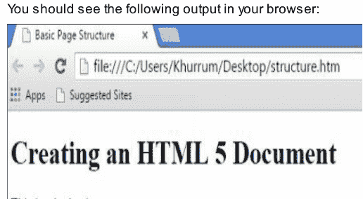

太棒了。现在你的浏览器在顶部显示了一个标题，标题下方也有一些内容。这是因为你已经在主体元素中添加了一些 HTML 5 标记。同样，你可以通过在主体元素中添加任何标记来编辑你的 HTML 5 文档。

### 标题和段落：

标题和段落是 HTML 5 中最重要、最基础的两个元素。

#### 标题：

HTML 5 使用 `<h>` 标签表示的六级标题，从 h1 到 h6。在这方面，第一级标题 `<h1>` 最大，而最后一级标题 `<h6>` 最小。标题的基本作用是将文档分成若干部分。它们帮助你创建结构化的组织，打破页面上的文本流，并提供内容分组的视觉提示。示例 3 演示了如何在 HTML 5 中使用标题。

#### 示例 3：

```
<!DOCTYPE HTML>
<html>
<head>
<meta charset="utf-8">
<title>Basic Page Structure</title>
</head>
<body>
<h1>This is first level heading</h1>
<h2>This is second level heading</h2>
<h3>This is third level heading</h3>
<h4>This is fourth level heading</h4>
<h5>This is fifth level heading</h5>
<h6>This is sixth level heading</h6>
</body>
</html>
```

不同的浏览器会以不同的方式显示标题。Google Chrome 显示如下：

# This is first level heading

# This is second level heading

# This is third level heading

# This is fourth level heading

# This is fifth level heading

# This is sixth level heading

### 段落：

任何熟悉 HTML 4 或其他版本 HTML 的人一定也熟悉段落标签。

段落是在网页上出现次数最多的文本块。你必须使用 `<p></p>` 开始标签和结束标签来将你的内容分组为段落，因为 Web 浏览器无法识别 HTML 5 编辑器中的硬回车。

在 HTML 5 中创建段落非常简单。你需要在主体中放置一个开始标签 `<p>`，写入一些文本，然后用 `</p>` 标签结束段落。看看示例 4。

#### 示例 4：

```
<!DOCTYPE HTML>
<html>
<head>
<meta charset="utf-8">
<title>Basic Page Structure</title>
</head>
<body>
<p>this is a paragraph</p>
<p>this is another paragraph</p>
</body>
</html>
```

当你在浏览器中查看代码时，你会看到如下内容：

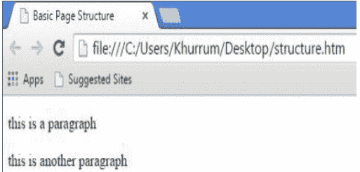

多亏了段落 `<p>` 标签，我们在 HTML 5 网页上有了两个不同的段落。同样，你可以在你的网页上创建任意数量的段落，只需满足你的需求。请记住用 `</p>` 正确关闭你的段落；否则可能会导致大量渲染问题，你的网页可能无**法正确加载**。

### 练习 2

**任务：**

创建一个基本的 HTML 5 页面，并将其标题命名为 Exercise。同时添加一个包含文本 "Exercise 2" 的 `<h1>` 标题，以及一个解释此练习内容的段落。

**解答：**

```
<!DOCTYPE html>
<html>
<head>
<title>Exercise</title>
</head>

<body>

<h1>Exercise 2</h1>
<p>Exercise 2 is about the headings and paragraphs tags learned in chapter 2.</p>

</body>
</html>
```

## 第 3 章：格式化文本与创建列表

在第 3 章中，你将学习：

- HTML 5 中的文本格式化
- 使用列表组织文本

### 格式化文本或文本装饰：

HTML 5 文档包含大量文本、图像、视频、多媒体和其他类型的内容，因此格式化内容块以奠定网页的坚实基础非常重要。在第 2 章中，你学习了如何使用块级元素（如段落和标题）在 HTML 5 中组织文本。在本章中，你将探索其他重要元素，帮助你正确格式化文本。

### 粗体和斜体：

HTML 5 引入了一些在先前版本中缺失的新格式化元素。例如，强烈建议你使用 `<strong></strong>` 开始标签和结束标签来使文本加粗，而不是使用 `<b></b>`。

同样，HTML 5 专家更倾向于使用强调元素标签 `<em></em>` 来实现斜体效果，而不是 `<i></i>`。这有效地通知浏览器这是一个 HTML 5 文档，并且 `<em>` 和 `</em>` 标签之间的内容是*斜体*的。

#### 示例 1：

```
<!DOCTYPE HTML>
<html>
<head>
<meta charset="utf-8">
<title>Basic Page Structure</title>
</head>
<body>
<h1>HTML 5 Beginner Level Course</h1>
<p>This is a <strong>bold</strong> text</p>
<p>This <em>text</em> is in italics </p>
</body>
</html>
```

# HTML 5 Beginner Level Course

This is a **bold text**

This *text* is in italics

### 换行与水平线：

HTML 5 通常会忽略换行符，除非你使用某些按需要断行的格式化元素或标签。其中最常见的元素是换行元素，通常称为 `<br>`。看看示例 2，看看当我们在不使用 `<br>` 的情况下尝试在段落中的两个单词或两行之间留出一些空间时会发生什么。

#### 示例 2：

```
<!DOCTYPE HTML>
<html>
<head>
<meta charset="utf-8">
<title>Basic Page Structure</title>
</head>
<body>
<h1>HTML 5 Beginner Level Course</h1>
<p>This is a <strong>bold</strong> text</p>
<p>This <em>text</em> is in italics</p>

<p>This line is broken into
    two parts</p>
</body>
</html>
```


# HTML 5 初级课程

这是一段**粗体**文本

这是一段*斜体*文本

这一行被分成了两部分

正如你所见，HTML 5 完全忽略了换行符。现在我们将插入一个 `<br>` 来换行，看看会发生什么。

#### 示例 3：

```
<!DOCTYPE HTML>
<html>
<head>
<meta charset="utf-8">
<title>Basic Page Structure</title>
</head>
<body>
<h1>HTML 5 Beginner Level Course</h1>
<p>This is a <strong>bold</strong> text</p>
<p>This <em>text</em> is in italics</p>

<p>This line is broken into<br>
    two parts</p>
</body>
</html>
```

## HTML 5 初级课程

这是一段**粗体**文本

这是一段*斜体*文本

这一行被分成了
两部分

现在，HTML 5 如我们所愿地插入了换行符。请记住，`<br>` 是一个自闭合标签，不需要任何单独的闭合标签来完成代码。

与 `<br>` 类似，水平分隔线或 `<hr>` 也是一个自闭合标签；它用于在页面上添加实线直线，称为分隔线。水平分隔线是将页面分成逻辑部分或页眉、页脚与页面其余部分分隔开的好选择。

HTML 5 中另一个常用的标签是 `<u></u>` 开闭合标签。`<u>` 标签告知浏览器特定内容应带有下划线。以下示例演示了如何在 HTML 5 中使用这些标签。

## **示例 4：**

```
<!DOCTYPE HTML>
<html>
<head>
<meta charset="utf-8">
<title>Basic Page Structure</title>
</head>
<body>
<h1>HTML 5 Beginner Level Course</h1>
<p>This is a <strong>bold</strong> text</p>
<p>This <em>text</em> is in italics</p>

<p>This line is broken into<br>
   two parts</p>

<hr>

<p>This <u>text</u> is underlined</p>

</body>
</html>
```

## HTML 5 初级课程

这是一段**粗体文本**

这是一段*斜体*文本

这一行被分成了
两部分

这段文本带有下划线

### 用列表组织文本：

如果你想在页面上对类似信息进行分组，就需要创建列表。列表让访问者能够轻松浏览信息组。你可以在列表中包含任何内容，从信息集到链接。列表主要有四种类型：无序列表、有序或编号列表、定义列表和嵌套列表。

#### 无序列表：

无序列表或项目符号列表包含一个或多个以项目符号开头的条目。无序列表至少需要以下顺序的三个元素：

- `<ul>` 无序列表元素
- `<li>` 标记列表中的每个元素
- `</ul>` 闭合标签，表示无序列表结束

以下示例包含无序列表的标记代码。

#### 示例 5：

```
<!DOCTYPE HTML>
<html>
<head>
<meta charset="utf-8">
<title>Organizing Content</title>
</head>
<body>
<h1>Following is an unordered list</h1>
<ul>
<li>First list item</li>
<li>Second list item</li>
<li>Third list item</li>
</ul>
</body>
</html>
```

### 有序或编号列表：

有序或编号列表中的所有条目都以数字开头。有序列表至少包含两个条目。与无序列表类似，有序列表包含以下三个元素：

- `<ol>` 有序列表元素
- `<li>` 标记列表中的每个元素
- `</ol>` 闭合标签，表示有序列表结束

以下示例包含有序列表的标记代码。

## **示例 6：**

```
<!DOCTYPE HTML>
<html>
<head>
<meta charset="utf-8">
<title>Organizing Content</title>
</head>
<body>
<h1>Following is an ordered list</h1>

<ol>

<li>First list item</li>
<li>Second list item</li>
<li>Third list item</li>

</ol>

</body>
</html>
```

## **定义列表：**

定义列表用于将页面上的定义和术语分组到一个列表中。同样，定义列表需要以下三个元素：

- `<dl>` 定义定义列表的元素
- `<dt>` 标记定义列表中术语的元素
- `<dd>` 定义定义列表中的术语

定义列表的 HTML 如下所示。

## **示例 7：**

```
<!DOCTYPE HTML>
<html>
<head>
<meta charset="utf-8">
<title>Organizing Content</title>
</head>
<body>
<h1>Following is Definition List</h1>

<dl>

<dt>HTML</dt>
	<dd>Hypertext Markup Language</dd>
<dt>CSS</dt>
	<dd>Cascade Stylesheets</dd>
<dt>W3C</dt>
	<dd>World Wide Web Consortium</dd>

</dl>

</body>
</html>
```

### 以下是定义列表

- HTML：超文本标记语言
- CSS：层叠样式表
- W3C：万维网联盟

需要注意的是，不同的浏览器对定义列表的显示方式各不相同。同样，每个搜索引擎、文本到语音转换器处理它们的方式也各不相同。

### 嵌套列表：

最后是嵌套列表，它们实际上是列表中的子类别。它们主要用于创建导航工具、网站地图、在线论文和书籍的目录以及大纲。

你可以将前三种列表中的任意类型组合起来创建嵌套列表。以下示例从一个编号列表开始，该列表定义了减肥需要做的事情，并进一步将它们细分为具体任务。

### 示例 8：

```
<!DOCTYPE HTML>
<html>
<head>
<meta charset="utf-8">
<title>Organizing Content</title>
</head>
<body>
<h1>How to Lose Weight</h1>
<ol>
<li>Exercise Regularly
<ul>
<li>Go to Gym Daily</li>
<li>Take Morning Walk</li>
<li>Play sports Regularly</li>
</ul>
</li>
<li>Take Balanced Diet
<ul>
<li>Minimize fats in your diet</li>
<li>take protein rich diet</li>
<li>Avoid Junk Food</li>
</ul>
</li>

</ol>

</body>
</html>
```

### 如何减肥

1. 定期锻炼
   - 每天去健身房
   - 早晨散步
   - 经常进行体育运动
2. 均衡饮食
   - 减少饮食中的脂肪
   - 摄入富含蛋白质的饮食
   - 避免垃圾食品

你可以在嵌套列表中包含任意数量的条目。但是，使用嵌套列表时，你需要记住几点：

- 在顶层有序或无序列表中的每个列表后面，都跟着一个完整的第二级列表。
- 第二级列表不放置在列表项中，而是放置在顶层列表中。
- 嵌套列表可能会变得非常复杂；因此，你应该非常小心地关闭所有标签，以避免任何渲染问题。

### 练习 3

**任务：**
创建一个有序列表，包含美国任意三个州的名称。然后，在该有序列表中创建三个嵌套列表，每个嵌套列表包含该州的两个城市名称。

**解决方案：**

```
<!DOCTYPE HTML>
<html>
<head>
<meta charset="utf-8">
<title>Exercise 3</title>
</head>
<body>
<h1>States of USA</h1>
<ol>
<li>California
<ul>
<li>Sacramento</li>
<li>Los Angeles</li>
</ul>
</li>

<li>Florida
<ul>
<li>Miami</li>
<li>Orlando</li>
</ul>
</li>

<li>Texas
<ul>
<li>Austin</li>
<li>Houston</li>
</ul>
</li>

</ol>

</body>
</html>
```

## 第 4 章：在 HTML 5 中创建表格

在本章中，你将了解到：

- 表格的功能和优势
- 在 HTML 5 中创建表格

### HTML 5 中的表格：

如果你想用简单的方式将文本、数据、内容和图像以网格形式布局，可以尝试创建表格。表格非常适合显示数值数据，但它们也可以帮助你以易于理解的方式呈现任何自然适合列和行的信息。它们还可以帮助你节省大量宝贵的空白区域，否则这些区域会被术语、定义和类似数据占用，这些数据在段落或其他元素中呈现时会占用大量空间。

### HTML 5 表格中的标记：

与列表相比，HTML 5 中的表格包含大量标记。但是，`<table>` 元素是创建表格的主要标记容器。你使用一个开始表格标签 `<table>` 和一个结束表格标签 `</table>` 来表示 HTML 5 中表格的开始和结束。表格行 `<tr>` 和表格数据 `<td>` 是 HTML 5 表格中使用的其他主要元素。

你可以使用这三个元素创建一个基本表格。但是，如果你想创建一个相当复杂的表格

在 HTML 5 中，你可以在这三个主要元素内使用其他元素，例如 `<caption>` 或 `<colgroup>`。此外，还有 `<thead>` 和 `<tbody>` 元素，它们分别定义表格的标题行和实际内容。

HTML 5 中一个简单表格的基本标记如下。

#### 示例 1：

```html
<!DOCTYPE HTML>
<html>
<head>
<meta charset="utf-8">
<title>创建表格</title>
</head>
<body>
<h1>如何在 HTML 5 中创建表格</h1>

<table>
<tr><th>姓名</th><th>年龄</th><th>性别</th></tr>
<tr><td>David</td><td>25</td><td>男性</td></tr>
<tr><td>William</td><td>30</td><td>男性</td></tr>
<tr><td>Elizabeth</td><td>22</td><td>女性</td></tr>
</table>

</body>
</html>
```

请记住，在所有其他表格容器内部，你都必须使用 `<tr>`。

你可以通过插入一个 `<caption>` 标题元素和一个 `border` 属性来为同一个表格添加边框和标题，如下图所示。

#### 示例 2：

```html
<!DOCTYPE HTML>
<html>
<head>
<meta charset="utf-8">
<title>创建表格</title>
</head>
<body>
<h1>如何在 HTML 5 中创建表格</h1>

<table border="1">
<caption>HTML 5 表格的标记</caption>
<tr><th>姓名</th><th>年龄</th><th>性别</th></tr>
<tr><td>David</td><td>25</td><td>男性</td></tr>
<tr><td>William</td><td>30</td><td>男性</td></tr>
<tr><td>Elizabeth</td><td>22</td><td>女性</td></tr>
</table>

</body>
</html>
```

我们的表格在浏览器中将呈现如下：

### 表格边框：

你创建的每个表格都必须有一个边框；你可以使用我们在前一个示例中使用的 `border` 属性来添加一个。为了浏览器能正确验证，将表格的边框值定义为 `1` 很重要。然而，无论你使用什么值，浏览器都会显示边框。早期版本的 HTML 使用 `table="n"` 属性来确定表格的宽度。在 HTML 5 中，此属性仅用于控制表格的显示与否（如果你将其从代码中移除）。在 HTML 5 中，它与表格的宽度无关。

### 管理表格布局：

你可以使你的表格变得复杂，也可以用它们做很多有趣的事情。HTML 5 在这给你提供了很大的灵活性。然而，为了本书的目的，建议你坚持基础内容，以更好地理解 HTML 5 在表格方面的工作原理。

谈到表格的布局，HTML 5 中只有三个主要元素可以让你设计出自己选择的布局。这些元素如下：

- **单元格**是表格的基本构建块，包含表格边框内的所有内容，包括数据、文本、图像等。
- **边框**实际上是围绕表格四周的四条线，形成一个矩形或正方形。
- **单元格跨度**帮助你在表格边框内添加或删除单元格边框。单元格跨度使你能够容纳不同的单元格布局，使表格更加灵活。

单元格跨度实际上合并或融合单元格，或移除它们之间的边框以改变单元格空间。你可以通过跨越不同的行、单元格和列来使你的表格更具吸引力。在下面的示例中，我们将尝试在表格中跨越单元格和行，看看会发生什么。

#### 示例 3：

```html
<!DOCTYPE HTML>
<html>
<head>
<meta charset="utf-8">
<title>创建表格</title>
</head>
<body>
<h1>表格布局</h1>

<table>
<tr><th>姓名</th><th colspan="2">电话</th></tr>
<tr><td>ABC</td><td>123  45  678</td><td>123  45  679</td></tr>
<tr><td rowspan="2" colspan="2">汽车  编号</td><td>IXJ 1</td></tr>
<tr><td colspan="2">LXJ2</td></tr>
<tr><td colspan="3">美国加利福尼亚州 X 号屋</td></tr>
</table>

</body>
</html>
```

### 如何在 HTML 5 中创建表格

### 表格布局

通过这个示例，我们结束了本章。在进入更复杂的表格布局和设计之前，请尝试按照本书的说明来掌握 HTML 5 基础知识。

### 练习 4

#### 任务：

创建一个 3 列的表格，第一个标题是汽车，第二个标题是制造商，第三个标题是价格。通过创建三行，将你最喜欢的三款汽车的名称、制造商和价格分别放在每个标题下。同时，为表格添加一个边框，并将其值设置为 1。

#### 解决方案：

```html
<!DOCTYPE HTML>
<html>
<head>
<meta charset="utf-8">
<title>练习</title>
</head>
<body>
<h1>练习 4</h1>

<table border="1">
<tr><th>汽车</th><th>公司</th><th>价格</th></tr>
<tr><td>i8</td><td>BMW</td><td>$13,6650</td></tr>
<tr><td>Fiesta</td><td>Ford</td><td>$13,965</td></tr>
<tr><td>XF</td><td>Jaguar</td><td>$94,975</td></tr>
</table>

</body>
</html>
```

## 第五章：HTML 5 表单

在本章中，你将学习：

- 在网页上创建和使用表单
- 处理表单数据

借助 HTML 5，你可以在网页上为用户呈现信息和数据。除了在页面上提供静态信息外，你还可以从用户那里收集数据。HTML 提供了大量表单元素和标签，使你能够自由地收集访问你网站的访客的有价值信息。

HTML 中表单的类型：

在我们尝试表单的标记之前，我们将简要讨论 HTML 5 中表单的类型。无论其形状、大小或用途如何，所有 HTML 5 表单都分为以下两个主要类别。

### 搜索表单：

顾名思义，搜索表单帮助访客从你的网站获取所需信息。根据网站的类型和他们使用的搜索表单，你几乎可以在互联网上搜索任何你喜欢的内容。有些搜索方法只需要一个关键词，也有些搜索表单更为复杂。美国国税局主页上的主表单就被认为是一个搜索表单。

### 数据收集表单：

与搜索表单相比，数据收集表单帮助你从访客那里收集必要的数据和信息。根据你收集信息的数量和类型，你的表单可以是简单或复杂的。例如，如果你只需要少量信息，表单可以相当简单。大多数要求你提供电子邮件地址或姓名的表单都是数据收集表单。

### 创建表单：

你可以使用 HTML 表单来从用户那里接收信息，反之亦然。然而，表单还提供了各种其他方法向用户呈现信息，例如：

- **复选框**，允许你从一组选项中选择多个选项。
- **数据选择工具**，例如 *单选按钮*，使你能够从列表中选择一个选项。
- **文本输入字段**，可以帮助你创建扩展到单行、双行甚至多行的表格。

### 表单的结构：

创建表单的主要元素是 `<form>`，它也像段落 `<p>` 一样充当内容和输入容器。`<form>` 元素在 HTML 5 中创建一个逻辑文档部分，进一步包含子元素。它包含与单个表单相关的所有元素和标签，这些也由同一个表单处理器处理。

### 输入标签和字段：

任何表单的主要部分都是由输入标签组成的，你使用它们来获取访客的信息或*输入*。在通过 HTML 5 表单从用户那里获取信息时，主要的输入元素是 `<input>`。在 input 元素内，你定义你想接收的输入或信息的类型。

同样，你可以在表单中使用不同类型的输入*字段*或*类型*，包括但不限于 *radio*、*text*、*password*、*search*、*hidden*、*checkbox*、*submit* 和 *email*。

以下示例包含一个简单表单的标记。

#### 示例 1：

```html
<!DOCTYPE HTML>
<html>
<head>
<meta charset="utf-8">
<title>创建表单</title>
</head>
<body>
<h1>如何在 HTML 5 中创建表单</h1>

<form action="bin/guestbook.php">
<input type="text"/>
</form>
```


```
</body>
</html>
```

以上是你可以用 HTML 5 创建的最简单的表单。请注意，`<form>` 元素包含一个 *section* 属性。section 属性是表格的一个重要组成部分，它会告知浏览器表格的目标 *url*。

我们还可以做更多事情来使表格更具吸引力或功能性。例如，我们可以为表格添加 *value* 属性，如以下示例所示。

#### 示例 2：

```
<!DOCTYPE HTML>
<html>
<head>
<meta charset="utf-8">
<title>Creating Forms</title>
</head>
<body>
<h1>How to Create Forms in HTML 5</h1>

<form action="bin/guestbook.php">
<input type="text" value="Search"/>
</form>

</body>
</html>
```

现在，你实际上是在告诉访客使用此表单来搜索他们所需的信息。事实上，你可以在表单中使用任何值，例如 example、type here 或 email。

如果你想让用户在表单中输入更大的内容怎么办？你可以通过使用 `<textarea>` 标签创建评论区来实现。

#### 示例 3：

```
<!DOCTYPE HTML>
<html>
<head>
<meta charset="utf-8">
<title>Creating Forms</title>
</head>
<body>
<h1>How to Create Forms in HTML 5</h1>

<form action="bin/guestbook.php">
<input type="text" value="Search"/>
<br><br>

<textarea>Write your comment here</textarea>
</form>

</body>
</html>
```

`<textarea>` 标签与 `<input>` 的不同之处在于它不是自闭合的。你必须放置一个开始标签和一个结束标签，并在这些标签之间编写你的 HTML。

### 下拉框：

下拉框、菜单或列表是当今网站中最常见的表格类型之一，因此在此需要特别提及。为了创建下拉框，你必须在表单 `<form>` 元素中使用 `<select>` 开始和结束标签。在 select 元素内部，你借助 option `<option>` 标签列出所有选项。

#### 示例 4：

```
<!DOCTYPE HTML>
<html>
<head>
<meta charset="utf-8">
<title>Creating Forms</title>
</head>
<body>
<h1>How to Create Forms in HTML 5</h1>

<form action="bin/guestbook.php">
<select>
<option>Select an option...</option>
<option>Option 1</option>
<option>Option 2</option>
<option>Option 3</option>
</select>
</form>
</body>
</html>
```

一个下拉菜单已经准备好了，顶部有一条提示说明，以及三个可选选项。请记住，这只是你可以在 HTML 5 中创建的众多下拉菜单类型之一。

### 复选框：

当你希望用户从一组选项中选择多个选项时，复选框是最佳选择。你将使用 `<input>` 标签来创建复选框，但输入的 *type* 将是 *checkbox*。

## **示例 5：**

```
<!DOCTYPE HTML>
<html>
<head>
<meta charset="utf-8">
<title>Creating Forms</title>
</head>
<body>
<h1>How to Create Forms in HTML 5</h1>

<form action="bin/guestbook.php">
<input type="checkbox" /> Apple
<input type="checkbox" /> Banana
<input type="checkbox" /> Orange
<input type="checkbox" /> Pineapple
</form>

</body>
</html>
```

### 在 HTML 5 中如何创建表单

- [x] Apple
- [x] Banana
- [x] Orange
- [ ] Pineapple

如果你想从可用选项中只选择一个怎么办？在这种情况下，你将使用带有相关属性值的 radio 输入类型。

**示例 6：**

```
<!DOCTYPE HTML>
<html>
<head>
<meta charset="utf-8">
<title>Creating Forms</title>
</head>
<body>
<h1>How to Create Forms in HTML 5</h1>

<form action="bin/guestbook.php">
<input type="radio" name="colour" /> Apple
<input type="radio" name="colour" /> Banana
<input type="radio" name="colour" /> Orange
<input type="radio" name="colour" /> Pineapple
</form>

</body>
</html>
```

这只是你可以在 HTML 5 中使用表格所能做的事情的开始。不过，你不必担心，因为这只是 HTML 5 中表格的概述。

### 练习 5

**任务：**

创建一个带有 "Search this Website" 值的简单表单和一个简单的评论区。同时，创建一个包含四个选项的复选框，但只允许选择其中一个选项。

### 解答：

```
<!DOCTYPE HTML>
<html>
<head>
<meta charset="utf-8">
<title>Exercise</title>
</head>
<body>
<h1>Exercise 5</h1>

<form>
<input type="text" value="Search this Website"/>
<br><br>

<textarea>Give Your Feedback</textarea>
</form>

<form>
<input type="radio" name="colour"/>BMW
<input type="radio" name="colour"/>Ford
<input type="radio" name="colour"/>Jaguar
<input type="radio" name="colour"/>Volkswagen
</form>

</body>
</html>
```

## 第 6 章：了解超链接

在本章中，你将学习：

- 什么是超链接
- 如何创建超链接
- 如何使用超链接

没有超链接，就没有互联网。超链接是连接 HTML 和互联网上其他资源的纽带。它们是简单的链接，使你网站上的用户能够从同一网站的一个页面跳转到另一个页面，或者跳转到另一个网站。如果你的网页或网站没有任何链接，它将与互联网的其他部分脱节。

你需要以下内容来创建链接：

- 一个统一资源定位符（URL），通常称为网址。网址通常以 http:// 开头。
- 一个带有 href 属性的锚元素 `<a>` 来使你的链接生效。href 属性使你能够指定你希望用户通过超链接访问的 URL。
- 网页上用于链接的一段文本或内容。

你可以使用链接将用户引导到你想要的任何网页。例如，如果你计划引用关于 HTML 5 标准的内容，你可能希望链接将访客带到 W3 Schools。

### 链接的类型：

链接主要有两种类型，绝对链接和相对链接，说明如下。

### 绝对链接：

需要网页完整 URL 的链接称为绝对链接。它们为目标网页提供独立且完整的路径。当你链接到另一个网站时，可以使用绝对链接。

### 相对链接：

相对链接使用缩短的 URL 或网址来指向所需的资源。例如，用于指向同一域名内网页的链接就是相对链接。

### 创建链接：

在以下示例中，你将在锚元素的 href 属性中指定 URL http://www.w3schools.com。同样，标签 `<a> </a>` 之间的文本将指定链接文字。

#### 示例 1：

```
<!DOCTYPE HTML>
<html>
<head>
<meta charset="utf-8">
<title>Creating Links</title>
</head>
<body>
<h1>How to Create Hyperlinks in HTML 5</h1>
<p><a href="http://www.w3schools.com">W3 Schools</a> is a good reference website for HTML 5.</p>
</body>
</html>
```

在上图中，W3 Schools 以不同的颜色显示并带有下划线，这表明它是一个超链接。

如果你想让链接在新标签页或新窗口中打开呢？这非常简单。只需在目标 URL 上添加 *target=_blank* 属性即可。

#### 示例 2：

```
<!DOCTYPE HTML>
<html>
<head>
<meta charset="utf-8">
<title>Creating Links</title>
</head>
<body>
<h1>How to Create Hyperlinks in HTML 5</h1>
<p><a href="http://www.w3schools.com" target="_blank">W3 Schools</a> is a good reference website for HTML 5.</p>
</body>
</html>
```

经过这个小小的修改，同一个链接将在新标签页中打开。

### 链接到同一网站上的网页：

如上所述，相对链接可用于指向同一网站上的网页。请看以下示例：

#### 示例 3：

```
<!DOCTYPE HTML>
<html>
<head>
<meta charset="utf-8">
<title>Creating Links</title>
```


### 如何在 HTML 5 中创建超链接

这是一个指向同一网站的[关于我们](about.html)页面。

现在，如果你点击"关于我们"，就会跳转到同一网站的"关于我们"页面。但是，这种插入链接的方法仅适用于所有网页都保存在同一目录下的情况。有时页面位于不同的目录中。在这种情况下，你需要向相对 URL 添加额外的信息，如下例所示。

#### 示例 4：

```html
<!DOCTYPE HTML>
<html>
<head>
<meta charset="utf-8">
<title>Creating Links</title>
</head>
<body>
<h1>How to Create Hyperlinks in HTML 5</h1>

<p>This is an <a href="../docs/about.html"> about us
</a>page of same website</p>

</body>
</html>
```

如你所见，我们添加了包含 about.html 文件的文件夹地址。示例中的标记指示浏览器执行以下步骤。

*   从包含链接文件的文件夹向上移动一级文件夹。
*   找到名为"docs"的文件夹。
*   在 docs 文件夹中找到名为"about.html"的文件。

**添加指向同一页面信息的链接：**

指向同一页面上的信息非常简单。例如，某些网页底部有**返回顶部**选项卡，点击后会回到页面顶部。在这种情况下，你需要添加一个带有 name 属性值为"top"的锚点元素。然后，在页面末尾，使用以下 URL 链接回顶部。

```html
<a href="#top">Back to Top</a>
```

井号（#）表示你正在指向同一页面上的某个位置。

#### 示例 5：

```html
<!DOCTYPE HTML>
<html>
<head>
<title>Facts About United States</title>
<meta charset="utf-8" />
</head>
<body>
<a name="top" />

<h1>Hello, United States</h1>
<h2>Facts about a Beautiful Country <br /> Called the United States of America</h2>

<p>1. The United States gained independence from British rule on July 4, 1776. <br /> That was the day the United States of America emerged as an independent nation <br />
on the map.<br />
2. The United States has the largest economy in the world, followed by China and Japan.

3. The American flag's official colors are "Old Glory Red," "White," and "Old Glory Blue."</p>

#### About the United States

- **Founder:** [Geo Washington](http://en.wikipedia.org/wiki/George_Washington)
- **Area:** 9,857,306 km²
- **Population:** 318.9 Million

#### Top Three Facts

1. **Total Number of States:** 50
2. **Primary Language:** English
3. **National Sport:** Baseball

<hr />

<h3>The United States' Neighbours</h3>

<table>
<tr><th>Name</th><th>Area</th><th>Where</th></tr>
<tr><td>Canada</td><td>9,984,670 km²</td><td>North</td></tr>
<tr><td>Mexico</td><td>1,972,550 km²</td><td>South</td></tr>
<tr><td>Pacific Ocean</td><td>165.25 million square kilometers</td><td>West</td></tr>
<tr><td>Atlantic Ocean</td><td>41,105,000 square miles</td><td>East</td></tr>
</table>

<hr />

<form action="http://en.wikipedia.org/wiki/George_Washington" target="_blank">
<input type="submit" value="Click Here!" />
</form>

<a href="#top">Back to Top</a>

</body>
</html>
```

现在，如果你点击*返回顶部*选项卡，就会直接回到页面顶部。

### 练习 6

**任务：**

撰写一行关于华盛顿特区的描述，并将城市名称链接到维基百科上的相应页面。同时在你的网页中添加一张图片，将其设为超链接，并在新标签页中打开链接。

**解答：**

```html
<!DOCTYPE HTML>
<html>
<head>
<meta charset="utf-8">
<title>Exercise</title>
</head>
<body>
<h1>Exercise 6</h1>

<p><a href="https://en.wikipedia.org/wiki/Washington,_D.C.">Wash D.C.</a> is the capital of United States of America</p>

<br />

<a href="http://www.history.com/topics/us-states/washington-dc" target="_blank"></a>
</body>
</html>
```

## 第 7 章：使用图像

在本章中，你将学习：

- 图像在 HTML 5 中的作用
- 如何将图像添加到网页

图像不仅有助于提升网站的整体感觉和外观，还可以用于引导网站导航或传递重要信息。图像的使用需要仔细考虑和选择；否则它们会失去效力。

图像可以是任何东西，从标志到可点击的导航辅助。它们可以让你的网站更美观，或者包含重要信息。有许多网站完美地利用图像来传递信息，例如 [http://now.lincoln.com/](http://now.lincoln.com/)。事实上，使用得当的图像是任何网页设计中最重要的组成部分之一。

### 图像类型：

在讨论如何向网页添加图像之前，有必要提及你可以在 HTML 5 中使用的图像类型。你可以使用多种类型的图像，但我们建议在你的网页中使用以下类型。

- 联合图像专家组格式（JPEG）
- 图形交换格式（GIF）
- 便携式网络图形格式（PNG）

你还需要在图像大小和类型之间保持平衡，以便你的网站能够正确加载和渲染。

### 向网页添加图像：

当你的图像准备好后，使用图像标签 ``（一个空元素）来确定图像在网站上的位置。还要记住，`` 是一个自闭合元素，不需要单独的开标签和闭标签。

以下标记展示了如何将位于 HTML 5 文件同一目录中的图像添加到网页。

#### 示例 1：

```html
<!DOCTYPE HTML>
<html>
<head>
<meta charset="utf-8">
<title>Adding Images</title>
</head>
<body>
<h1>How to add images to a webpage</h1>

<p> The earth is round as the following images shows
<br>

</p>
</body>
</html>
```

在此示例中，*source (src)* 属性指定了要在网页中显示的图像的位置。同样，*alt* 属性为图像提供了替代信息，以防用户因某种原因无法查看图像。添加 alt 文本是一种良好的做法，因为它对视力受损、互联网连接缓慢或使用视觉功能有限的浏览器访问网站的访客很有帮助。一些搜索引擎还借助 alt 文本来索引图像。

浏览器将如下显示上述 HTML 5 标记：

### How to add images to a webpage

The earth is round as the following images shows


与链接一样，有时网页开发人员将图像存储在不同的目录中。在这种情况下，你必须为浏览器提供正确的图像路径才能正确显示图像。以下示例演示了如何做到这一点。

#### 示例 2：

```html
<!DOCTYPE HTML>
<html>
<head>
<meta charset="utf-8">
<title>Adding Images</title>
</head>
<body>
<h1>How to add images to a webpage</h1>

<p>The earth is round and looks beautiful from the
space as the following image shows <br>

</p>
</body>
</html>
```

在此示例中，src 属性指示浏览器：

- 找到名为"images"的文件夹
- 在 images 文件夹中找到"earth.jpeg"图像。

在这种情况下，浏览器将显示以下图像：

### How to add images to a webpage

The earth is round and looks beautiful from space as the following image shows


### 带标题的图像：

除了 alt 文本外，你都应该为图像添加标题。标题是搜索引擎（包括 Chrome 和 Firefox）在你将鼠标悬停在图像上时显示的文本。你可以通过 `` 标签中的 title 属性添加标题，就像 src 和 alt 一样。在以下示例中，我们将为图像添加标题。

#### 示例 3：

```html
<!DOCTYPE HTML>
<html>
<head>
<meta charset="utf-8">
<title>Adding Images</title>
</head>
<body>

<h1>How to add images to a web page</h1>

<p> The earth is round as the following image shows
<br>

</p>
</body>
</html>
```


 # 如何在网页中添加图片

地球是圆的，如下图所示

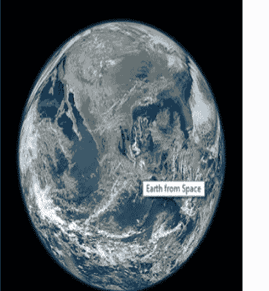

### 让图片可点击：

可以让任何图片变成一个链接。这很容易实现，因为你将使用相同的 `<a>` 元素来为图片添加链接。不过，在这种情况下，你需要将 `<a></a>` 之间的文本替换为图片。看看下面的示例：

#### 示例 4：

```
<!DOCTYPE HTML>
<html>
<head>
<meta charset= "utf-8">
<title>Adding Images</title>
</head>
<body>
<h1>How to add images to a webpage</h1>

<p> The earth is round and looks beautiful from space as the following image shows <br>
<a href="http://science.nationalgeographic.com/science/earth/"
target="_blank"></a>

</body>
</html>
```

这段标记使我们的图片变成了一个链接，点击后会在新标签页中打开国家地理网站的特定页面。

### 如何在网页中添加图片

地球是圆的，而且从太空看起来很美，如下图所示

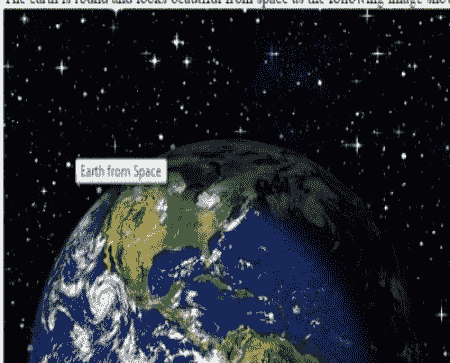

### 调整图片大小：

最后，你可以使用 `` 自闭合标签中的 height 和 width 属性在 HTML 5 中更改图片的宽度和高度。上述示例中的图片宽度和高度分别为 500 像素和 300 像素（500×300）。我们将使用 HTML 5 标记将尺寸更改为 600×400 像素。

#### 示例 5：

```
<!DOCTYPE HTML>
<html>
<head>
<meta charset= "utf-8">
<title>Adding Images</title>
</head>
<body>
<h1>How to add images to a webpage</h1>

<p> The earth is round and looks beautiful from space as the following image shows <br>


</body>
</html>
```

### 如何在网页中添加图片

地球是圆的，而且从太空看起来很美，如下图所示


如你所见，我们使用 width 和 height 属性调整了图片大小；你可以对上传到网页的所有图片执行相同的操作。

### 练习 7

**任务：**
添加一张与 HTML 5 文件位于不同目录中的图片。将宽度和高度都调整为 400 像素。同时包含一些替代文本和图片标题。

**解答：**

```
<!DOCTYPE HTML>
<html>
<head>
<meta charset= "utf-8">
<title>Exercise</title>
</head>
<body>
<h1>Exercise 7</h1>
```

```

```

```
</body>
</html>
```

## 第 8 章：处理视频和音频

在本章中，你将学习如何：

- 在 HTML 5 中嵌入来自其他网页的视频和音频
- 在 HTML 5 中嵌入来自本地计算机的视频
- 在 HTML 5 中嵌入来自本地计算机的音频

随着时间的推移，不同类型的媒体，包括视频和音频，变得越来越重要。如今，网络不仅是获取内容和图片的地方，还成为了观看直播视频、进行视频会议和视频通话等的首选资源。

与旧版本的 HTML 不同，旧版本需要各种插件的帮助才能播放音频和视频，HTML 5 增加了嵌入媒体的标准方式。HTML 5 消除了早期版本中与播放媒体相关的许多问题，例如需要找到适合浏览器的正确插件来运行特定类型的媒体。

### 从其他网页嵌入媒体：

将任何类型的内容从其他网页添加到你的页面非常容易，媒体（包括音频和视频）也是如此。为此，我们使用 iframe `<iframe>` 元素。就像 `<a>` 和 `` 元素一样，我们在 `<iframe>` 元素内使用 src 属性来指定我们要播放的视频的 URL。看看下面的示例：

#### 示例 1：

```
<!DOCTYPE HTML>
<html>
<head>
<meta charset="utf-8">
<title>Adding Media</title>
</head>

<body>
<h1>How to add Media to a webpage</h1>

<p> Video on Twinkle Twinkle Little Star<br>
<iframe src="https://www.youtube.com/embed/yCjJyiqpAuU" width="560" height="315" frameborder="0" allowfullscreen></iframe>

</body>
</html>
```

### 如何在网页中添加媒体

一闪一闪小星星视频

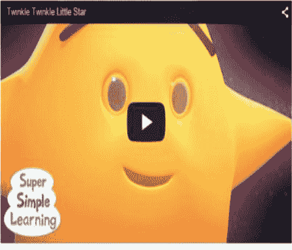

在此示例中：

- *src* 属性指定你要放入的视频的来源或 URL。
- *width* 和 *height* 属性指定视频帧的宽度和高度。
- *Allowfullscreen* 属性让观众可以选择全屏观看视频。

在 HTML 5 中，你不需要编写所有繁琐的代码来获取视频。你只需复制整个代码并将其粘贴到 HTML 5 编辑器中。例如，打开你想要嵌入的任何 YouTube 视频，转到标题下方的 *分享* 标签，然后点击 *嵌入*。你会得到一个与上述示例中使用的代码非常相似的代码。只需复制代码并将其放在你希望视频播放的位置。

### 从计算机嵌入视频和音频：

到目前为止，我们已经学习了如何从其他网页嵌入视频和音频。现在我们将了解如何嵌入位于本地计算机某处的视频和音频。过程大致相同，因为你只需将 `<iframe>` 元素分别替换为用于嵌入视频和音频的 `<video>` 和 `<audio>` 元素。

### 嵌入视频：

对于视频，你将使用以下标记：

#### 示例 2：

```
<!DOCTYPE HTML>
<html>
<head>
<meta charset= "utf-8">
<title>Adding Media</title>
</head>
<body>
<h1>How to add Media to a webpage</h1>
<p> Video on Twinkle Twinkle Little Star<br>
<video  src="rhymes.mp4"  width="560"  height="315" controls></video>
</body>
</html>
```

### 如何在网页中添加媒体

一闪一闪小星星视频

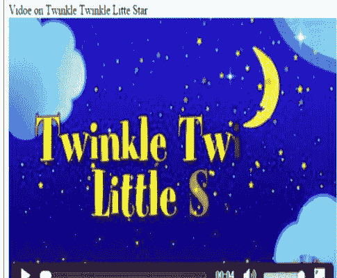

我们在 HTML 5 中添加了一个视频，而没有使用任何烦人的插件。请注意，标记中还有一个 control 属性，它允许你添加播放、暂停和音量等控件。虽然该属性的唯一值是 *controls*，但在 HTML5 中严格来说不需要任何值。

你可以用来代替 *controls* 的其他属性有：

- **autoplay**：视频加载后立即播放
- **loop**：视频结束后自动从头开始重播
- **preload**：告诉浏览器是否应该预加载视频。如果已经有 *controls* 属性，则不需要此属性。

最好总是添加宽度和高度；否则可能会出现渲染问题，这取决于你使用的浏览器。

## **嵌入音频：**

从本地计算机嵌入音频文件时，你需要将视频 `<video>` 元素替换为音频 `<audio>`。其余的标记将大致保持不变。

### **示例 3：**

```
<!DOCTYPE HTML>
<html>
<head>
<meta charset="utf-8">
<title>Adding Media</title>
</head>

<body>
<h1>How to add Media to a webpage</h1>

<p> The "Firefiles" from You Can Unlearn Guitar<br>
<audio src="audio.mp3" controls autoplay></audio>

</body>
</html>
```

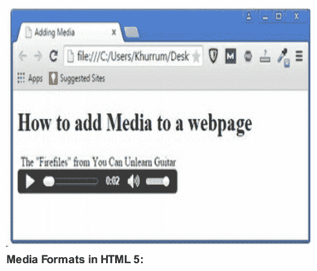

### HTML 5 中的媒体格式：

HTML 5 中最常用的音频和视频格式值得一提。我们建议使用这些格式，而不是其他格式，以避免渲染和加载不正确的问题。

#### 主要音频格式：

以下是你可以在 HTML 5 中使用的主要音频格式。

- Ogg Vorbis (.ogg)
- MP3 (.mp3)
- Waveform Audio File Format，或 WAVE (.wav)

**主要视频格式：**

以下是 HTML 5 认可的一些主要视频格式。

- Ogg Theora (.ogg)
- MP4 (.mp4)
- VP8/9 (.webm)

### 练习 8

**任务：**

将 YouTube 上的视频添加到你的网页，并将屏幕宽度和高度分别调整为 500 像素和 300 像素。同时将一段视频下载到你的桌面并添加到你的网页。为第二个视频添加控件和自动播放功能。

**解答：**

```
<!DOCTYPE HTML>
<html>
<head>
<meta charset="utf-8">
<title>Exercise</title>
</head>
<body>
<p>The Declaration of Independence</p>
</body>
</html>
```


```
```html
<iframe src="https://www.youtube.com/embed/jYytEu_NLU" width="500" height="300" frameborder="0" allowfullscreen></iframe>

<br /><br />

<p>Johny Johny Yes Papa</p>
<video src="johny.mp4" width="500" height="300" controls autoplay></video>
```

## 第9章：网页布局

在本章中，你将学习以下问题的答案：

- 什么是导航 `<nav>` 元素？
- 什么是页眉 `<header>` 元素？
- 什么是分区 `<div>` 元素？
- 什么是页脚 `<footer>` 元素？

到目前为止，我们已经讨论了如何使用 HTML 5 向网页添加列表、表格、图片、链接和媒体。然而，我们还需要了解一些对 HTML 5 至关重要的元素。这些元素将帮助你进一步提升网站的结构和语义，使网页浏览器更容易理解标记并正确渲染你的网站。

**导航 `<nav>` 元素：**

`<nav>` 元素是 HTML 5 独有的，它允许你将不同的链接组合在一起，从而提供额外的结构和更强的语义，这对屏幕阅读器和网页浏览器都有帮助。虽然 `<nav>` 元素的定义很简单，但至今没有人能完全解释如何正确使用它。不过，下面是一个使用 `<nav>` 元素的简单标记示例：

**示例 1：**

```html
<!DOCTYPE HTML>
<html>
<head>
<meta charset="utf-8">
<title>Using Navigation Element</title>
</head>

<body>
<h1>How to use nav element in HTML 5</h1>

<nav>
<a href="blog.html">Blog</a> |
<a href="about.html">About Us</a> |
<a href="contact.html">Contact Us</a> |
</nav>

</body>
</html>
```

网页浏览器将上述标记渲染如下：

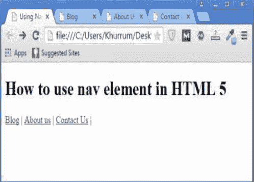

网页开发者通常将导航元素用于主导航栏或页脚上方。你也可以在其他地方使用此元素，例如目录、上一页/下一页按钮、搜索表单和面包屑导航。

### 页眉 `<header>` 元素：

与导航元素一样，页眉元素也是 HTML 5 独有的。页眉元素实际上是一个"介绍性内容或导航辅助信息的分组"。它主要用于网页的开头或顶部，但你也可以在任何新部分或分区的开始处使用它。同样，它通常包含一个 h1 介绍性标题，但你也可以插入标志、导航菜单或搜索表单。页眉元素的简单标记如下例所示：

#### 示例 2：

```html
<!DOCTYPE HTML>
<html>
<head>
<meta charset="utf-8">
<title>Using Header Element</title>

<style>
#head {
    background-color: #F1F1F1;
    height: 100px;
    width: 100%;
}
</style>

</head>

<body>

<header id="head">
<h1>How to use header element in HTML 5</h1>
<nav>
<a href="blog.html">Blog</a> |
<a href="about.html">About us</a> |
<a href="contact.html">Contact Us</a> |
</nav>
</header>
</body>
</html>
```

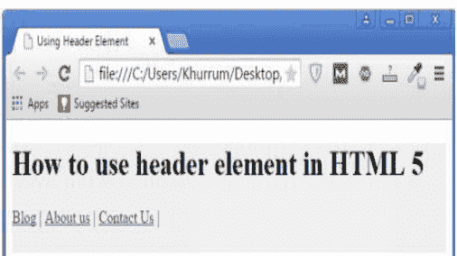

现在我们有了一个位于网页顶部的页眉。灰色背景以及页眉的高度和宽度都是某些 CSS 代码的结果，我们将在本课程的 CSS 部分进行学习。

### 分区 `<div>` 元素：

分区元素可能是 HTML 5 中最重要且使用最广泛的元素之一。分区元素不像段落 `<p>` 或图像 `` 元素那样表示特定含义；相反，它是一个"通用容器"，用于维持内容的流程并提供额外的结构和语义。例如，如果你想为特定的内容块设置样式，`<div>` 将完美胜任。请看以下示例：

#### 示例 3：

```html
<!DOCTYPE HTML>
<html>
<head>
<meta charset="utf-8">
<title>Using Header Element</title>

<style>
#wrapper {
    background-color: #F1F1F1;
    height: 80px;
    width: 500px;
    color: red;
}
</style>
</head>

<body>
<h1>How to use div element in HTML 5</h1>

<div id="wrapper">

<p>The div element has no special meaning at all. It
represents its children.<br />
It can be used with the class, lang, and title attributes to
mark up semantics<br />
common to a group of consecutive elements.</br>
W3C Specification</p>

</div>

</body>
</html>
```

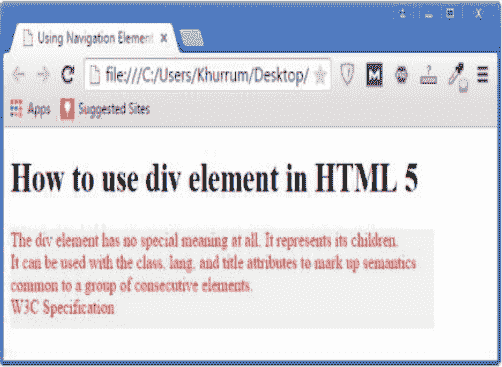

同样，你可以使用 `<div>` 来创建和设置不同的部分、分区、页眉、页脚以及几乎所有你想要的元素的样式。

### 页脚 `<footer>` 元素：

最后，HTML 5 的另一个重要*语义元素*是页脚 `<footer>`。顾名思义，此元素定义页面或部分的页脚。此特定元素应包含尽可能多的关于其包含元素的信息。通常，它包含：

- 联系信息
- 作者和版权信息
- 返回顶部链接（参见上一章）
- 相关文档
- 网站地图

以下示例演示了如何在 HTML 5 中使用页脚。

#### 示例 4：

```html
<!DOCTYPE HTML>
<html>
<head>
<meta charset="utf-8">
<title>Using Header Element</title>

<style>
#wrapper {
    background-color: #F1F1F1;
    height: 70px;
    width: 550px;
    color: red;
}
</style>

</head>

<body>
<h1>How to use footer element in HTML 5</h1>

<div id="wrapper">
<p>The footer element represents a footer for its nearest ancestor sectioning content.<br />
A footer typically contains information about its section such as who wrote it, links to<br />
, copyright data, postal and email addresses and the like.</p>
</div>

<footer>
<p>Written by: David Sinclair<br />
Visit us at: xyz.com, <br />
mail to: <a href="mailto:david@xyz.com">david@xyz.com</a>.<br />
P.O. Box No. 111, New York, <br />
United States of America</p>
</footer>

</body>
</html>
```

页脚元素代表其最近祖先分块内容的页脚。页脚通常包含有关其部分的信息，例如谁编写的、版权数据链接、邮政和电子邮件地址等。

作者：David Sinclair
访问我们：xyz.com
发送邮件至：david@xyz.com
邮政信箱 111 号，纽约，
美利坚合众国

请记住，页脚不会自动出现在页面底部。你仍然需要使用 CSS 来设置它们的样式，就像处理所有其他元素一样。它只具有语义价值，因为它告诉浏览器元素内部的数据是页脚数据。

### 练习 9

**任务：**

创建一个包含四个不同链接的导航栏。第一个链接将指向 Google，第二个链接将指向 www.example.com 的主页，第三个链接将指向 Twitter，第四个链接将指向你选择的网站的主页。

### 解答：

```html
<!DOCTYPE HTML>
<html>
<head>
<meta charset="utf-8">
<title>Exercise</title>
</head>
<body>
<h1>Exercise 9</h1>

<nav>
<a href="https://www.google.com">Google</a> |
<a href="http://example.com/">Example.com</a> |
<a href="https://www.facebook.com/">Facebook</a> |
<a href="http://www.imdb.com/">Internet Movie Database</a>
</nav>

</body>
</html>
```

## 第10章：理解引文、iframe 和实体

在本章中，你将学习：

- HTML 引用和引用元素
- iframe 元素
- HTML 实体

我们已经来到了本书的最后一章。我们已经涵盖了你开始使用 HTML 5 所需的大量内容。在最后一章中，我们将讨论更多可以帮助你使网页更具吸引力、结构和语义更强且更易于网页浏览器理解的内容。

### 引用和引用元素：

考虑到引用在学术界的深厚根基，HTML 5 对其做了很好的支持。HTML 5 中两个最重要的引用元素是 q `<q>` 和 blockquote `<blockquote>` 元素。q 和 blockquote 元素分别用于表示非引用段落中的简短引用和表示从其他来源引用的部分。让我们看看如何在 HTML 5 标记中使用这些元素。

#### 示例 1：

```html
<!DOCTYPE HTML>
<html>
<head>
```


### 如何在 HTML 5 中使用引用元素

联合国的目标是“让这个世界变得更美好、更安全”

联合国基金会致力于帮助联合国实现第八项千年发展目标

> 我们正在为所有目标而努力，但我们认为第八项千年发展目标——呼吁建立全球发展伙伴关系——是其中最重要的

同样，还有一个缩写词 `<abbr>` 元素，你可以用它来标注缩写词。缩写词非常有用，因为它们为用户、搜索引擎以及浏览器提供了宝贵的信息。你必须始终将 `<abbr>` 元素与 title 属性结合使用，如以下示例所示：

#### 示例 2：

```html
<!DOCTYPE HTML>
<html>
<head>
<meta charset="utf-8">
<title>Using Quotation Elements</title>
</head>

<body>
<h1>How to use quotation element in HTML 5</h1>

<p>The <abbr title="The United Nations Organizations">UNO</abbr> was founded on 24th October, 1945.</p>

<p>Goal of United Nation is to <q>make this world a better and safer place to live</q></p>

<p>The United Nation Foundation is Committed to help the UN achieve 8th Millennium Development Goals
<blockquote>We are working towards them all but we believe that 8th MDG calling for global partnership for development is most important of them all</blockquote></p>

</body>
</html>
```

联合国成立于1945年10月24日。

联合国的目标是"让这个世界变得更美好、更安全"

联合国基金会致力于帮助联合国实现第八项千年发展目标

> 我们正在为所有目标而努力，但我们认为第八项千年发展目标——呼吁建立全球发展伙伴关系——是其中最重要的

**在网页中添加地址：**

在上一章中，我们在网页的页脚添加了地址。`<address>` 地址元素是在网站上添加联系信息的完美选择，这对于吸引你的用户和客户非常必要。使用地址元素添加联系信息相当简单，如下例所示。

#### 示例 3：

```html
<!DOCTYPE HTML>
<html>
<head>
<meta charset="utf-8">
<title>Using Quotation Elements</title>
</head>

<body>
<h1>How to use quotation element in HTML 5</h1>

<p>HTML 5 address element helps you to define contact information such as names of authors or owner of the website.</p>

<address>
Written By: Diana Smith <br />
Visit Us at: www.examplewebsite.com<br />
Box xyz, New York, United States
</address>

</body>
</html>
```

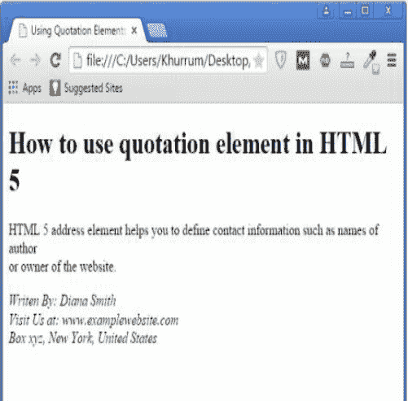

引用和引文类别中最后一个重要的元素是 `<cite>` 引用元素。该元素主要用于定义文学作品的标题，但你也可以用它定义任何你喜欢的标题。大多数浏览器会以斜体显示 cite 元素。

#### 示例 4：

```html
<!DOCTYPE HTML>
<html>
<head>
<meta charset="utf-8">
<title>Using Quotation Elements</title>
</head>

<body>
<h1>How to use quotation element in HTML 5</h1>

<p>The cite element defines the title of a work</p>

<p><cite>A Game of Thrones</cite> by George R. R. Martin. First Published in United Kingdom in 1996</p>
</body>
</html>
```

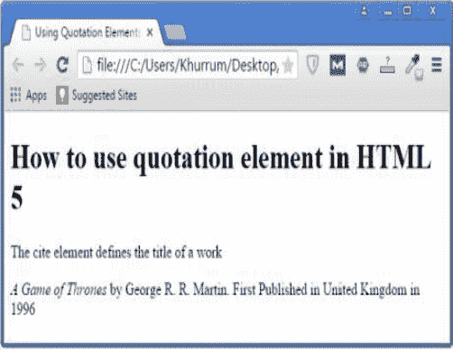

### iframe 元素：

HTML 5 规范将 `<iframe>` iframe 元素称为*嵌套浏览上下文*。简单来说，它可以帮助你从另一个来源或网页获取内容，并将其嵌入到你自己的网页中，无需借助其他文档。你只需使用 src 属性来定义要嵌入内容的位置即可。

以下示例说明了如何使用 iframe 添加内联框架。

#### 示例 5：

```html
<!DOCTYPE HTML>
<html>
<head>
<meta charset="utf-8">
<title>Using iframe Element</title>
</head>

<body>
<h1>How to use iframe element in HTML 5</h1>

<p>iframe element helps you to embed content from another source</p>

<iframe src="https://www.w3.org/wiki/HTML/Elements/iframe" width="300" height="300"></iframe>

</body>
</html>
```

如何在 HTML 5 中使用 iframe 元素

iframe 元素帮助你嵌入来自其他来源的内容

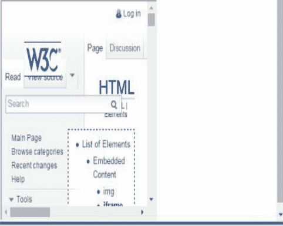

你可以使用 iframe 嵌入几乎任何你喜欢的东西，例如视频。同样，你也可以将 iframe 元素用作链接的目标框架。

### HTML 5 实体：

最后，有必要谈谈 HTML 5 实体。实体用于在网页中添加那些无法通过简单输入文本添加的字符。例如，你需要使用某些实体来插入大于号 > 和小于号 < 符号，因为浏览器可能会将它们误认为标记。这类字符也被称为保留字符，必须用实体替换。

请记住，所有实体都以与号 (&) 开头，后跟实体名称和分号。例如，如果你想在网页中插入 <、>、引号以及货币或英镑符号，可以使用以下标记。

#### 示例 6：

```html
<!DOCTYPE HTML>
<html>
<head>
<meta charset="utf-8">
<title>Using Element Entities</title>
</head>
<body>
<h1>How to use HTML 5 Entities</h1>
<p>&apos;<br />
&curr;<br />
&pound;<br />
&gt;<br />
&lt;</p>

</body>
</html>
```

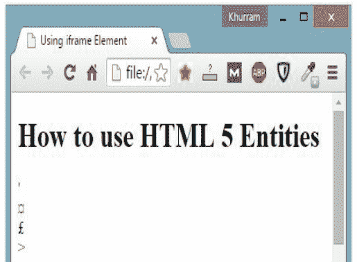

你也可以使用数字编码让实体显示在网页上。HTML 5 有无数保留字符，不可能记住所有字符的名称或代码。关于这一点，以下是一些包含所有 HTML 5 实体的参考链接：

- [http://dev.w3.org/html5/html-author/charref](http://dev.w3.org/html5/html-author/charref)
- [http://www.w3schools.com/charsets/ref_html_symbols.asp](http://www.w3schools.com/charsets/ref_html_symbols.asp)
- [http://edoceo.com/notabene/xhtml-entities](http://edoceo.com/notabene/xhtml-entities)

### 练习 10

**任务：** 使用 iframe 元素在网页中嵌入一个来自维基百科的棒球页面。

**解答：**

```html
<!DOCTYPE html>
<html>
<head>
<title>Exercise</title>
</head>
<body>
<h1>Exercise 10</h1>
<iframe src="https://en.wikipedia.org/wiki/Baseball" width="300" height="300"></iframe>
</body>
</html>
```

## 作者其他书籍

[JavaScript Programming: A Beginner's Guide to the Javascript Programming Language](http://www.linuxtrainingacademy.com/js-programming)

如果你过去曾尝试学习编程，但收效甚微，那么不妨试试 [JavaScript Programming](http://www.linuxtrainingacademy.com/js-programming)。它将教你掌握当今世界使用最广泛的脚本语言所需了解的一切知识。它会带你从零开始，让你在学习过程中不断积累。

SQL: Learn the Structured Query Language for the Most Popular Databases including Microsoft SQL Server, MySQL, MariaDB, PostgreSQL, and Oracle
[http://www.linuxtrainingacademy.com/sql-book](http://www.linuxtrainingacademy.com/sql-book)

## 其他资源

Projects in HTML5
http://www.linuxtrainingacademy.com/html5-projects

要掌握网页开发或任何艺术领域的技术，最佳方法是亲自动手实践。这门课程不仅能让你学习概念，还能让你立即应用所学知识，从头开始构建自己的项目。这就是为什么这门课程会引导你实际使用 HTML5 和 JavaScript 创建各种游戏、应用和网站。


## 通过 HTML5 实现响应式网页设计与开发

http://www.linuxtrainingacademy.com/responsive

你是否好奇顶尖的网页设计师和开发者是如何构建强大、现代且美观的网站的？

这正是你一直期待的课程！

学习使用 HTML5 和 CSS3 构建自己的网站并非高不可攀——它非常简单，你应该从今天开始学习！在本课程中，你将通过最新的 Web 技术 HTML5、CSS3 和 jQuery，一步步学习网页设计与开发。

## 在一个月内学会构建精美的 HTML5 和 CSS3 网站

http://www.linuxtrainingacademy.com/html5-in-a-month

这个 HTML 与 CSS 课程是一个基于项目的课程，它将向任何人——甚至是完全的初学者——展示如何构建精美的网站。通过一系列的视频课程和教程，你将构建 4 个不同的网站——一个着陆页、一个博客模板、一个杂志风格的布局页面，以及你自己的作品集页面来展示你的作品。
