# Web 开发者的 HTML 5 指南


感谢Andrea和Sabine——你们太棒了！

*此页故意留白*

## 前言

2010 年，HTML5 成为 Web 开发领域的*热门词汇*。Google、Apple 和 Microsoft 等大公司开始采用这项新技术。HTML5 这一流行术语的知名度不断攀升，其中一个重要原因是 Apple 和 Adobe 之间关于 HTML5 是否意味着 Flash 终结的激烈争论。

在本书中，我们将为你深入介绍 HTML5 的各种新功能。除了经典的规范组件——如视频、音频、canvas、智能表单、离线应用程序和微数据等（仅举几例）——本书还涵盖了与 HTML5 直接相关的主题，例如地理位置、Web 存储、WebSockets 和 Web Workers。

大量紧凑、清晰且实用的示例展示了 HTML5 中的新元素和技术。无论你是想构建一个博客、编写自己的音视频播放器、将浏览器用作图形程序、处理地理数据、测试浏览器的极限容量，还是想通过拖放问答游戏或用 WebSockets 玩*战舰游戏*来展现自己的娱乐天性，这里都有适合你的内容。我们还为你提供了大量关于 JavaScript 和 DOM 的技巧与诀窍。

预计所有浏览器迟早都会支持 HTML5，以保持未来的竞争力。因此，我们在大多数情况下决定不包含变通方案和兼容性库。在本书中，你将找到*纯正的* HTML5，在我们的示例中至少得到*一个*浏览器的支持，而在大多数情况下已经有多个厂商提供了支持。关于新 HTML 元素的最新完整参考，我们建议你查阅互联网。你将在本书的相关章节中找到相应的链接。

## 如何阅读本书

如何探索本书完全由你自己决定。各章节不一定要按顺序阅读，即使你没有阅读其他章节，每一章也都可以轻松理解。因此，你可以按照传统方式从前往后阅读；也可以从后往前阅读，或按照任何顺序阅读，让你的好奇心来引导你。

### 本书适合谁

你应该具备 HTML、JavaScript 和 CSS 的基础知识；愿意尝试使用不同的浏览器，而不仅仅局限于你习惯的那一个；最重要的是，要有探索新事物的渴望。尝试新的想法，比如本书中的那些内容，或者访问配套网站查看所有示例的彩色版本。决定你想做什么，最重要的是——玩得开心！

配套网站地址为 http://html5.komplett.cc/welcome。

### 关于作者

本书的作者如同他们勇敢书写的这个仍处于开发阶段的新 Web 标准一样，多才多艺、涉猎广泛。

**Klaus Förster**，一位开源爱好者，就职于奥地利因斯布鲁克大学地理系。他曾多次以演讲者、评审和研讨会负责人的身份参加 SVG Open 会议，并为 PostGIS、GRASS GIS 和 SpatiaLite 等自由软件项目贡献了 SVG 模块。

**Bernd Ögg**，因斯布鲁克大学的讲师和系统管理员，是 PHP 和 MySQL 相关书籍的合著者，拥有多年 Web 应用程序编程经验。

*此页有意留白*

正如 Web 标准应有的那样，HTML5 的故事始于万维网联盟（W3C），更准确地说，始于 2004 年 6 月的 W3C Web 应用程序和复合文档研讨会。但颇为不同寻常的是，HTML5 的开发最初是在 W3C 之外进行的，因为 W3C 起初对 HTML5 的构想并不感兴趣。究竟发生了什么？

### 1.1 一切是如何开始的

在一份联合立场文件中，Mozilla 和 Opera 要求 W3C 应确保 HTML、DOM 和 CSS 的持续发展，使其成为未来 Web 应用程序的基础。考虑到 W3C 在六年前就已经搁置了 HTML4，转而支持 XHTML、XForms、SVG 和 SMIL，这一建议被拒绝也就不足为奇了。投票结果非常接近，8 票赞成、11 票反对，但这一决定仍然产生了深远的影响。在随后的几年里，HTML5 的发展在与 W3C 的直接竞争中展开。

Ian Hickson 当时支持这份立场文件，他与第二位 Opera 代表 Håkon Wium Lie 以及 Mozilla 的 David Baron 一起在他的博客中回顾了这些事件，并得出结论：

> 问题已经讨论过了，各方立场已经表明，每个人都清楚彼此的态度，现在是时候开始实际行动了。

他以以下这些话结束了对近期事件的评论：

> 哪个工作组将致力于扩展 HTML……

他指的是 Web 超文本应用技术工作组（WHATWG），该工作组成立于 2004 年 6 月 4 日，即研讨会结束仅两天之后。WHATWG 自我描述为浏览器厂商 Safari、Opera 和 Mozilla 以及相关参与方之间的*松散、非官方且开放的合作*。其目标是继续发展 HTML 标准，并将这一过程的成果提交给标准化组织以实现标准化。

WHATWG 的创始成员包括 Anne van Kesteren、Brendan Eich、David Baron、David Hyatt、Dean Edwards、Håkon Wium Lie、Ian Hickson、Johnny Stenbäck 和 Maciej Stachowiak。这个来自浏览器和 HTML 社区的精英开发者圈子，从此与活跃的 WHATWG 社区一起塑造了 HTML5 的命运。

Ian Hickson 担任编辑的核心角色，最初议程上有三项规范：*Web Forms 2.0*，作为 HTML 表单的升级；*Web Apps 1.0*，专注于 HTML 内的应用程序开发；以及 *Web Controls 1.0*，一项围绕交互式控件的规范。后者不久后被放弃，而 *Web Forms* 在后来被整合进了 *Web Apps*。WHATWG 的工作方式一直以与社区协作为导向；如果你浏览其主页（见图 1.1），这一点可以清楚地看到。


### 1.1 一切是如何开始的

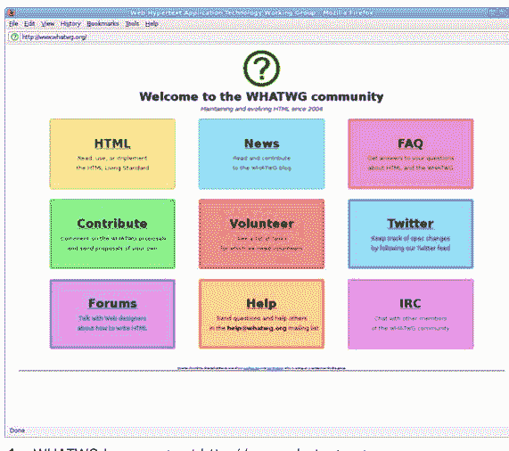

图 1.1  WHATWG 主页，网址为 http://www.whatwg.org

任何寻求学习或使用 HTML5 帮助的人都可以在常见问题解答、帮助和论坛中找到答案。隐藏在志愿者按钮后面的 Wiki 目前还不太实用，因为它更偏向于开发问题，且关于 HTML5 语言本身的文档很少。通过新闻按钮可以访问的博客在 2010 年似乎也有些被忽视，这或许是因为主要作者、来自 Google 的 Mark Pilgrim 当时正忙于撰写他自己的在线书籍，如果你想看看，可以免费访问 http://diveintohtml5.org。幸运的是，Anne van Kesteren 在 2011 年通过发布标准发展进展的报告复兴了这个博客——这是跟踪近期变化的一个宝贵来源。

最活跃的领域之一是通过 IRC 按钮链接到的 irc://irc.freenode.org/whatwg 聊天室。在这里，WHATWG 社区与浏览器开发者会面，与他们合作实施规范。这里也是就 HTML5 相关事宜进行激烈辩论、发表政治声明，或向批评者明确表达你想法的地方。一个虚构角色上周先生 (Mr. LastWeek) 通过有时相当激烈的博文对相关事件发表评论，博文发布在 http://lastweekinhtml5.blogspot.com，这是对公开可访问的 IRC 协议日志（位于 http://krijnhoetmer.nl/irc-logs）的回应，任何人都可以阅读这些日志，还可以积极评论。只需点击你认为相关、激动人心或重要的一行末尾的黄色框，即可将该行标记为黄色。要浏览最新主题，标记条目效果相当好。

第 1 章 — 新网络标准概述

通过贡献部分链接的三个公共邮件列表是主要的沟通工具——一个用于用户问题，一个用于对规范的贡献，一个用于所有致力于实施规范的人。如果你不想订阅邮件列表，你也可以访问公共存档，所有新闻项目都归档于此，并且可以搜索或下载：

*   help@whatwg.org
    http://lists.whatwg.org/listinfo.cgi/help-whatwg.org
*   whatwg@whatwg.org
    http://lists.whatwg.org/listinfo.cgi/whatwg-whatwg.org
*   implementors@whatwg.org
    http://lists.whatwg.org/listinfo.cgi/implementors-whatwg.org

规范也以公开和透明的方式开发——稍后会详细讨论这个话题；它并不像听起来那么简单。实际上，规范不止一个版本，而是有多个版本。但现在，让我们回到 HTML5 的历史。

当 WHATWG 致力于革新 HTML 时，W3C 的 XHTML2 工作组则着手创建一个全新的网络。与旨在实现向后兼容的 WHATWG 不同，由 Steven Pemberton 领导的 XHTML2 工作组试图以不同的方式进一步发展 HTML。

表单将使用 XForms 代替；框架将由 XFrames 替代；新的 XML 事件将取代 DOM 事件。每个元素都可以同时拥有 `src` 和 `href` 属性，标题 `h1` 到 `h6` 将被淘汰，由 `h` 结合新的 `section` 元素取代。手动换行 `br` 将用 `l` 元素实现；`hr` 将被称为分隔符 (separator)；新的 `nl` 元素将允许导航列表；为了改善语义选项，你可以为每个元素分配一个带有预定义或命名空间可扩展关键字的 `role` 属性。

XHTML2 项目棺材上的最后一颗钉子是缺乏浏览器厂商的支持。这些试图进行的变革过于激进，没有考虑到现有的网络内容。很快，W3C 也意识到这种发展不会走得太远。2006 年 10 月，W3C 主任、万维网发明者 Tim Berners-Lee 最终让步了，他在博客中写道：

> *有一些事情，事后看来更清楚。必须逐步演进 HTML。试图让全世界立即切换到 XML，包括给属性值加引号、在空标签中加斜杠和使用命名空间，这没有成功。*

### 1.1 一切是如何开始的

他承认 XHTML2 未能成为新的网络语言，并宣布成立一个新的 HTML 工作组——这次规模更大。该工作组将让浏览器厂商参与进来，目标是逐步推进 HTML 和 XHTML 的发展。在博文的最后一段，他强调了自己的信念，即这是正确的道路：

> 这将是一个非常重要的规范上的重大协作，是网络技术的瑰宝之一。即使会有数百人参与，我们演进的是未来数十亿人将使用的技术。有时似乎怎么感谢都不为过。但我们将维护一些非常重要的东西，并创造一些更好的东西。

2007 年 3 月，时机成熟了：新的 HTML 工作组成立了。在向 W3C 宣布成立后不久，WHATWG 的所有成员都被邀请加入 HTML 工作组——WHATWG 愉快地接受了这个提议。

几个月后，进行了一次投票，决定 WHATWG 起草的规范是否应该成为新的、联合的 HTML5 规范的基础。与 2004 年研讨会上的投票结果相反，这次结果支持，43 票赞成，5 票反对，4 人弃权，1 人明确反对。在延迟三年之后，进一步发展 HTML 的原始想法终于占据了上风。

但这仅仅是个开始：必须找到新的合作方式——这项任务被证明绝非易事，因为 WHATWG 和 W3C 的理念仅在有限程度上相容。这两个阵营并非总是意见一致的事实，不仅体现在 W3C 自己存档且公开可访问的 *public-html* 邮件列表 (http://lists.w3.org/Archives/Public/public-html) 中广泛的讨论线索中，也明显体现在对 HTML5 项目路线图的评估上。

尽管 W3C 在其章程中假设 HTML5 将在 2010 年第三季度达到推荐标准，但 WHATWG 的 Ian Hickson 预计需要更长的时间。经常被提及的年份是 2022，但如此长的时间跨度被许多批评者认为是完全不可接受的。然而，如果你考虑到 HTML5 旨在取代 HTML4、DOM2 HTML 和 XHTML1 这三个规范并显著扩展它们、创建包含数千个测试的测试套件、并规定两个无错误的规范实现作为概念验证的雄心目标，那么这个时间框架可能看起来更现实。

看一下 HTML 工作组的决策策略规则，你就能隐约了解这两个参与规范进一步发展的群体的决策过程有多么复杂 (http://dev.w3.org/html5/decision-policy/decision-policy.html)。在 XHTML2 工作组于 2009 年底解散后，愿意充分利用此决策策略的批评者数量增加了。

## 第 1 章 — 新网络标准概述

因此，一个不断增长的所谓*问题*列表正由 W3C 的 HTML 工作组跟踪 (http://www.w3.org/html/wg/tracker/issues)。这些问题需要在主席 Sam Ruby、Paul Cotton 和 Maciej Stachowiak 的主持下，在宣布最后征求意见之前得到解决。在 WHATWG 方面，Ian Hickson 利用了一个相对平静的时期，得以暂时将其问题列表 (http://www.whatwg.org/issues/data.html) 减少到*零*，这导致他在 2009 年 10 月向 WHATWG 宣布 *HTML5 进入最后征求意见阶段*。

一个可见的复杂事件标志是规范的状态。在 WHATWG，主要规范是一份紧凑的文档，而在 2011 年初，W3C 有八个部分，都算作 HTML5 套件的一部分。其中两个直接从 WHATWG 版本生成，并标有星号；其他的是补充，并且反过来不包含在 WHATWG 版本中。

WHATWG 规范：

*   **HTML—活标准**：http://whatwg.org/html

W3C HTML 工作组规范：

*   **HTML5 - 用于 HTML 和 XHTML 的词汇及相关 API ***：http://www.w3.org/TR/html5
*   **HTML5 与 HTML4 的差异**：http://www.w3.org/TR/html5-diff
*   **HTML：标记语言参考**：http://www.w3.org/TR/html-markup
*   **HTML+RDFa 1.1**：http://www.w3.org/TR/rdfa-in-html
*   **HTML 微数据**：http://www.w3.org/TR/microdata
*   **HTML Canvas 2D 上下文 ***：http://www.w3.org/TR/2dcontext
*   **HTML5：提供有用文本替代技术**：http://www.w3.org/TR/html-alt-techniques
*   **双语标记 HTML 兼容 XHTML 文档**：http://www.w3.org/TR/html-polyglot

还有另一份 WHATWG 文档，其中包含了所有 WHATWG 部分，并结合了关于 *Web Workers*、*Web Storage* 和 *Web Sockets API* 的额外规范。这份文档，《Web 应用程序 1.0—活标准》，非常适合作为 HTML 渲染的耐力测试：它拥有超过 5MB 的源代码和 JavaScript 来显示每个部分的实施阶段，加上可以直接对各个部分进行评论的选项，它将把任何浏览器推向其极限。


http://www.whatwg.org/specs/web-apps/current-work/complete.html

> **提示**
> 如果你想让浏览器轻松一些，可以使用该文档的多页面版本，网址为 http://www.whatwg.org/C，或者在 URL 末尾添加 ?slow-browser。这样，动态组件将被跳过，你会得到一个静态的、加载更快的版本，其中不包含交互元素。

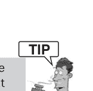

如果你想跟踪规范的变更情况，有几种选择。WHATWG 提供了一个完整规范的 *Subversion 仓库*，你可以创建本地副本：

- svn co http://svn.whatwg.org/webapps webapps

你也可以通过 Twitter、邮件列表或 Web 界面（即所谓的 *web-apps-tracker*）访问各个修订版本的提交消息：

- http://twitter.com/WHATWG
- http://lists.whatwg.org/listinfo.cgi/commit-watchers-whatwg.org
- http://html5.org/tools/web-apps-tracker

WHATWG 的规范随着每次修订而持续变化，而 W3C 的草案则受制于所谓的 *Heartbeat requirement*（心跳需求），这意味着 W3C 规范的新版本必须每三到四个月定期发布为工作草案。在本书出版时，下一个心跳周期可能已经过去，谁知道呢，W3C 甚至可能已经宣布了 *Last Call Working Draft*（最终征求意见稿）。

如果你想探索 HTML5 的历史，"Time Travel"（时光旅行）部分提供了一系列链接，作为通往里程碑和历史事件的门户。文章 "Why Apple is betting on HTML 5: a web history" 对整个 HTML 历史做了非常好的总结。该文章可在 *AppleInsider* 上找到，使用短网址 http://bit.ly/2qvA7s。

#### 1.2 穿越历史事件的时光旅行

HTML 发展过程中的里程碑，精选链接如下：

- **W3C Web 应用程序与复合文档研讨会（2004 年 6 月）：** http://www.w3.org/2004/04/webapps-cdf-ws/index
- **Opera 和 Mozilla 关于 HTML 进一步发展的立场文件：** http://www.w3.org/2004/04/webapps-cdf-ws/papers/opera.html
- Ian Hickson 对研讨会的评估，分为三篇博客文章：http://ln.hixie.ch/?start=1086387609&order=1&count=3
- WHATWG 的创建在研讨会两天后宣布：http://www.whatwg.org/news/start
- Tim Berners-Lee 的博客文章 "Reinventing HTML"（2006 年 10 月）：http://dig.csail.mit.edu/breadcrumbs/node/166
- W3C HTML 工作组重新启动（2007 年 3 月）：http://www.w3.org/2007/03/html-pressrelease
- Ian Hickson 向 WHATWG 社区通报重新启动的消息：http://lists.whatwg.org/htdig.cgi/whatwg-whatwg.org/2007-March/009887.html
- W3C 正式邀请 WHATWG 加入 HTML 工作组：http://lists.whatwg.org/htdig.cgi/whatwg-whatwg.org/2007-March/009908.html
- Ian Hickson 代表 WHATWG 向 W3C 的举措表示祝贺：http://lists.whatwg.org/htdig.cgi/whatwg-whatwg.org/2007-March/009909.html
- HTML 设计原则作为 HTML5 的基础（2007 年 11 月）：http://www.w3.org/TR/html-design-principles/
-衣冠W3C 首个官方 HTML5 工作草案（2008 年 1 月）：http://www.w3.org/2008/02/html5-pressrelease
- 宣布 XHTML2 工作组将解散（2009 年 7 月）：http://www.w3.org/News/2009#entry-6601
- WHATWG 宣布 HTML5 进入最终征求意见阶段（2009 年 10 月）：http://blog.whatwg.org/html5-at-last-call
- W3C 发布八项工作草案，其中两项为全新（2010 年 6 月）：http://www.w3.org/News/2010#entry-8843
- W3C 公布最终征求意见阶段的时间表，预计 2011 年 5 月底达到最终征求意见（2010 年 9 月）：http://lists.w3.org/Archives/Public/public-html/2010Sep/0074.html
- W3C 推出 HTML5 标志（2011 年 1 月），引发争议：http://www.w3.org/News/2011#entry-8992
- Ian Hickson 宣布 WHATWG HTML 规范今后将仅被称为 "HTML"，可视为一种 "living standard"（活标准）（2011 年 1 月）：http://blog.whatwg.org/html-is-the-new-html5

#### 1.3 直入正题

在对 HTML5 历史进行简短的时光旅行之后，现在是时候直接着手 HTML5 的元素和属性了。还有什么比经典的 *Hello world!* 示例更合适的呢？这就是它在 HTML5 中的样子：

```html
<!DOCTYPE html>
<html>
  <head>
    <meta charset="UTF-8">
    <title>Hello world! in HTML5</title>
  </head>
  <body>
    <p>Hello world!</p>
  </body>
</html>
```

每个 HTML5 文档都以文档类型声明 `<!DOCTYPE html>` 开头，大写或小写都可以。你会注意到的第二个创新是编码的简写方式——`<meta charset="UTF-8">`。其余部分，如 html、head、title 或 body，你在 HTML4 中已经很熟悉了，这引出了一个问题：*HTML5 究竟有什么新内容？*

##### 1.3.1 有什么新内容？

W3C 通过规范 *HTML5 differences from HTML4*（HTML5 与 HTML4 的差异）给出了答案，该规范由 Anne van Kesteren 主持编写。除了列出新增和废弃的元素与属性外，我们还可以找到关于新增或更改的 API、规范的外部部分，以及最后的 *HTML5 Changelog*（HTML5 变更日志）的提示，该日志按时间顺序记录了各项功能是如何以及何时进入或离开规范的：http://www.w3.org/TR/html5-diff/。

表格中包含很多细节，但无法给我们一个非常清晰的概览。因此，四个 *wordles*（词云）将引导我们浏览本章。它们都是使用 Jonathan Feinberg 的 Wordle Applet 创建的，该工具免费提供给用户，网址为 http://www.wordle.net。对于新元素和属性，相关术语的出现频率通过字体大小来反映，由 HTML5 规范中与相关功能关联的交叉引用数量决定。对于废弃的元素和属性，字体大小对应 Opera 在 MAMA 项目 *What is the Web made of?*（Web 由什么构成？）（http://dev.opera.com/articles/view/mama）中研究的在线使用频率。

首先让我们看看图 1.2 中词云里的新元素。亮点无疑是媒体类型 video、audio 和 canvas——后者简单来说就是一张可以用 JavaScript 编程的图片。许多创新涉及结构化元素，例如 article、section、header、hgroup、footer、nav 或 aside。对于插图，你可以使用带有 figcaption 的 figure；你可以使用 details 配合 summary 来显示或隐藏附加信息。你可以用 progress 指示进度，用 meter 表示任何类型的度量，用 time 表示时间和日期。

我们在英语国家不太可能经常遇到 ruby、rt 和 rp 这些元素；它们是一种排版注释系统，主要用于中文和日文中，提供发音指导。对我们来说更有用的是 mark，用于强调术语，以及 wbr，用于表示在必要时可以在某处插入换行符。

一些元素倾向于 Web 应用程序，例如用于生成加密或数字签名密钥对的 keygen，用于执行命令的 command，或作为表单中文档其他部分计算结果输出的 output。作为 option 元素的容器，datalist 为表单字段提供不可见的 select 列表。对于列出 video 和 audio 元素的替代资源，有 source——浏览器会从该列表中挑选第一个已知的格式来播放文件。最后但同样重要的是 Netscape 引入的常用 embed 元素，现在是经过修改的版本。

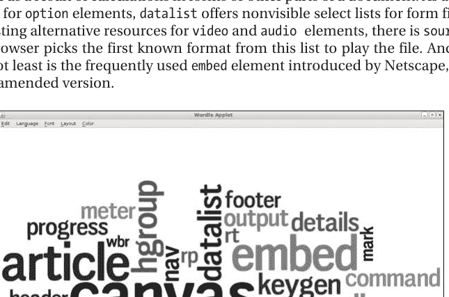

图 1.2  新增 HTML5 元素

input 元素也带来了许多变化。以下是新类型的简要总结：你现在有几种新的输入类型用于指定日期，包括 date-time、date、month、week、time 和 datetime-local。此外，还有用于搜索字段的类型（search），以及用于输入 URL（url）、电子邮件地址（email）、电话号码（tel）、数字（number）或数字范围（range），或颜色（color）的类型。如图 1.3 所示，许多新属性与表单相关。借助 form 属性，input 元素可以位于相关表单的外部，并可以这么说，链接到所需的表单。min、max、step、required、pattern、multiple 或 autocomplete 等属性确定了输入元素的限制或条件，通过 formnovalidate 和 novalidate 影响所输入数据的验证，并通过 placeholder 或 autofocus 为填写表单提供实用帮助。表单提交时的行为可以在 input 和 button 元素中使用 formmethod、formenctype、formtarget 和 formaction 进行覆盖。list 属性用于将使用 datalist 创建的选择列表分配给相关的输入组件。

作为 iframe 的安全功能，我们有 sandbox、srcdoc 和 seamless。这些功能将嵌入内容与文档的其余部分隔离。如果你想异步加载脚本，可以使用 async，而 ping 则会在你点击超链接时在后台打开 ping 属性中指定的 URL 列表。

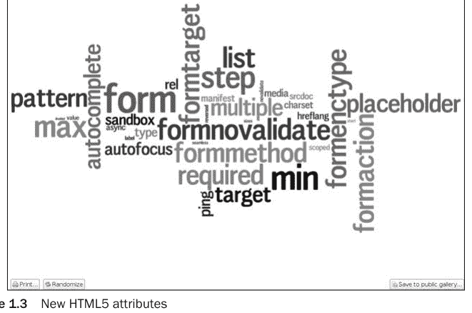


## 第1章——新 Web 标准概述

`html` 元素的 `manifest` 属性看似不起眼，却影响深远：它通过引用一个配置文件，决定页面的哪些部分应该可以离线使用，从而为离线 Web 应用铺平了道路。带有 `scoped` 属性的 `style` 元素同样十分实用，它可以将指定样式的生效范围限制在父级 DOM 节点及其所有子元素区域内。对于 `menu` 元素，`type` 和 `label` 决定了菜单的类型（例如右键菜单或工具栏），以及菜单的标签。

一些小巧但实用的改进包括：使用 `meta` 标签中的 `charset` 属性来简化编码指定；可以通过 `li` 元素的 `value` 属性显式地分配列表值；使用 `start` 为 `ol` 指定起始值；以及最终能够通过 `reversed` 属性对列表进行反向排序。

一些适用于所有元素的全局属性也发生了重大变化。这主要不涉及 `class`、`dir`、`id`、`lang`、`style`、`tabindex` 和 `title`——与 HTML4 不同，它们现在已成为全局属性——而是主要涉及新增的属性。`contenteditable` 允许你直接编辑元素；`contextmenu` 可以指定自定义菜单（定义为 `menu`）；`draggable` 将相关元素标记为拖放操作的潜在对象；`spellcheck` 则为检查相关区域的拼写错误做好了准备。

在显示时不再需要或不再相关的内容可以被隐藏；`role` 或 `aria-*` 属性可用于为辅助技术（如屏幕阅读器）提供额外帮助；而保留的 `data-*` 前缀则允许你定义任意数量的自定义属性。

HTML5 的另一个重要组成部分是新的编程 API，例如 `canvas` 元素 API、用于播放音频和视频内容的 API，以及用于编程离线 Web 应用的接口。还有其他 API 专门用于拖放、编辑文档或管理浏览器历史记录等主题。该规范甚至包含了一些最初看起来颇为另类的 API，用于注册和应用自定义协议或 MIME 类型。

我们还应当提及，HTML5 中所有事件处理程序都是全局属性，并且 `HTMLDocument` 和 `HTMLElement` 对象也进行了一定的更改。通过 `getElementsByClassName()`，你可以找到所有具有特定 `class` 属性的元素；可以使用 `classList` API 操作 class 属性；并且现在也可以对 XML 文档使用 `innerHTML` 方法。你可以通过 `activeElement` 和 `hasFocus` 来确定文档中当前获得焦点的元素——两者都是 `HTMLDocument` 对象的属性，正如 `getSelection()` 方法一样，该方法返回用户当前选中的文本。

##### 1.3.2 哪些内容已过时？

在讨论 HTML5 的新特性时，我们也应该明确哪些功能不应该再继续使用。在 W3C 的其他规范中，*deprecated*（已弃用）这一术语经常被用于此类语境，但在 HTML5 的情况下，该术语并不合适。由于 HTML5 向后兼容，浏览器仍然必须正确显示这些特性。然而，对于网页作者来说，HTML4 与 HTML5 的差异规范提供了一份不再应该或不再建议使用的元素和属性列表。*absent*（已移除）一词现用来替代 *deprecated*。

如果你查看图 1.4 中的词云，你会发现 `font` 和 `center` 元素显然已经被*淘汰*了。它们被更现代的 CSS 解决方案所取代，`u`、`big`、`strike`、`basefont` 和 `tt` 元素也是如此。现在，`iframe` 取代了 `frame`、`frameset` 和 `noframes`；`acronym` 应被 `abbr` 取代，`dir` 应被 `ul` 取代，而 `isindex` 则被弃用，转而使用表单提供的更优选项。如果你好奇为什么上述某些元素没有出现在词云中，这是因为它们的使用频率极低，因此已不再属于 HTML5 的一部分。

对于过时的属性，情况同样清晰。图 1.5 的词云中占据主导地位的是 `width`、`height`、对齐方式（`align`、`valign`）、间距（`cellpadding`、`cellspacing`）以及颜色设置（`bgcolor`）。它们大多与 `table`、`td` 或 `body` 配合使用，现在已像许多过时的元素一样被 CSS 所取代。

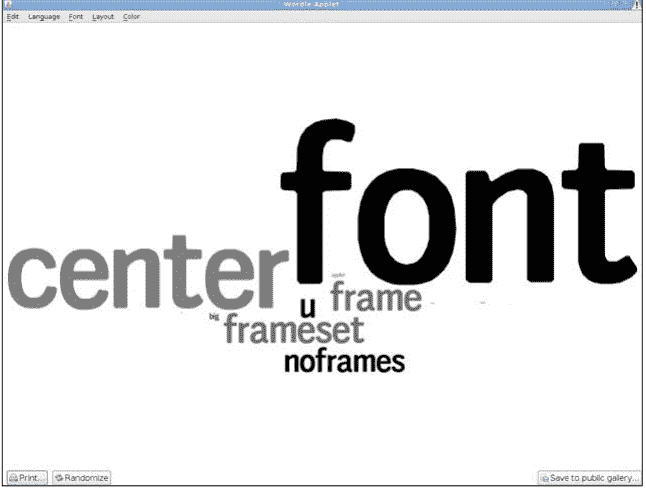

**图 1.4** HTML5 中不再使用的元素

## 第1章——新 Web 标准概述

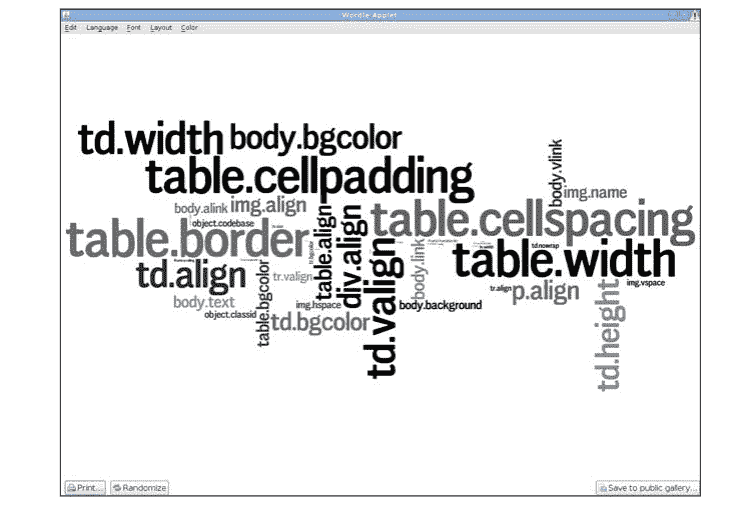

**图 1.5** HTML5 中不再使用的属性

我们如何详细地了解哪些元素和属性不应该再使用？不断翻阅 HTML5 的差异文档是非常耗时的。HTML5 验证器（位于 http://html5.validator.nu）提供了一个更好的解决方案：该验证器清楚地知道什么是正确的，什么是错误的。让我们来试一试：我们选择 *Text Field*（文本框）作为输入模式，并将预设 HTML 基本框架中的 `<p></p>` 替换为以下错误标记：

```
<center>
    <acronym>WHATWG</acronym>
</center>
```

它返回的错误信息如下——至少在撰写本文时是这样的：

- 1. 错误：`center` 元素已过时。请改用 CSS。
- 2. 错误：`acronym` 元素已过时。请改用 `abbr` 元素。

*请改用 CSS* 中的链接会直接引导我们到 WHATWG Wiki 的 *Presentational elements and attributes*（表现性元素和属性）页面，在那里我们可以阅读关于正确使用的详细信息。验证器还会直接显示语法错误，正如你在下一个测试中所看到的。让我们试一试以下源代码：

```
<!DOCTYPE html><title>
```

我们收到了另一条错误信息——这次提示文档尚未完成，因此无效：

- 1. 错误：在期望文本或结束标签时遇到了文件结尾。

如果我们通过添加结束标签 `</title>` 来修复此错误，这条错误信息也会消失，至此我们已经创建了一个最短的 HTML5 文档：

```
<!DOCTYPE html><title></title>
```

验证器中的错误识别基于 HTML5 的核心特性之一——HTML 解析器。与之前所有的规范不同，它被详尽地定义到了最后的细节，共 90 页的篇幅，读起来大概和本地电话簿一样"精彩"。然而从技术角度来看，这一章至关重要，因为它定义了 HTML5 标记应如何被解析，以及文档的 DOM 树应如何构建。

我们前面的迷你示例实际上生成了一个完整的 HTML5 DOM 树，包括 `html`、`head` 和 `body` 元素。你可以用另一个工具来验证这一点，即 *HTML5 Live DOM Viewer*（HTML5 实时 DOM 查看器），位于 http://livedom.validator.nu。试一试吧！

##### 1.3.3 那 XHTML 呢？

HTML5 规范基本上定义了一种抽象语言，用于描述文档和带有交互 API 的 Web 应用，这些内容可以在*内存中*表示为 DOM 树。用什么语法来构建这个 DOM 树并不重要——HTML 是其中之一，XHTML 也是其中之一。真正重要的是解析后的结果，在两种情况下都是一个有效的 DOM-HTML 树。

因此，创建文档时选择使用 HTML 还是 XHTML 完全取决于作者。HTML 的使用范围更广，编写更简单，对小的语法错误更宽容，并且输出要求的 MIME 类型为 `text/html`。XHTML 遵循严格的 XML 规则（关键词为*格式良好*），并且必须始终使用 XML MIME 类型，例如 `text/xml` 或 `application/xhtml+xml`，而这在之前的 XHTML 1.1 中并非如此。

XHTML5 中的 *Hello world!* 示例无需 DOCTYPE，但需要一个有效的 XML 声明，其中可以包含编码信息，当然它必须是*格式良好*的：

```
<?xml version="1.0" encoding="UTF-8"?>
<html xmlns="http://www.w3.org/1999/xhtml">
  <head>
    <title>Hello world! in HTML5</title>
  </head>
```


你可能看不出这与HTML版本有多大区别。这是因为我们在第一个*Hello world!*示例中尚未充分利用HTML代码允许的简化程度。在*懒惰的*HTML5中，以下标记就足够了：

```html
<!DOCTYPE html>
<meta charset=utf-8>
<title>Hello World! in HTML5</title>
<P>Hello world!
```

如果属性值不包含空格或符号"' > /=，我们可以省略属性的引号。标签可以用大写或小写编写；有时甚至可以省略，如前面的示例所示。如果不确定，验证器可以再次帮助你。关于新HTML5解析器的实现，Mozilla一直走在前列。Henri Sivonen的解析器，也是http://validator.nu的基础，已包含在Firefox 4中。

### 1.4 我现在可以开始使用HTML5了吗？

是也不是。HTML5远未完成，但与以往的做法不同，HTML5标准的开发与其实施齐头并进。谁能想到Internet Explorer 9 (IE9)会提供SVG和Canvas，或者Google会在YouTube上开始提供HTML5视频？许多新功能现在就可以使用，前提是你能够选择你的浏览器。HTML5可用于公司的内部内网，也可用于仅特定朋友可访问的私人主页。

Firefox、Chrome、Opera和Safari这四款优秀浏览器已经广泛支持HTML5，而IE9最终结束了微软在2011年对网络标准支持的长期犹豫。浏览器制造商及其开发者现在积极参与制定标准。他们首先在测试版本中实现新的规范草案作为*概念验证*，然后在WHATWG或W3C上发布他们的反馈和改进建议。这使得他们成为开发周期的重要组成部分。任何无法实现的内容都会从规范中删除，而其他组件则会被调整并最终实现。

HTML5的早期采用者最好熟悉各个浏览器的发行说明，因为关于*接下来会发生什么？*的趋势很可能在这里出现：

- https://developer.mozilla.org/en/HTML/HTML5
- http://www.opera.com/docs/changelogs
- http://webkit.org/blog
- http://googlechromereleases.blogspot.com
- http://ie.microsoft.com/testdrive/info/ReleaseNotes

HTML5相关规范开发的演进时间线与浏览器发布里程碑相结合，表明标准化与实施紧密相连（见图1.6）。

观察这两个领域如何继续发展将很有趣。你可以在以下网址找到时间线的最新版本：

http://html5.komplett.cc/code/chap_intro/timeline.html?lang=en

### 总结

本章从一点历史背景开始，然后概述了HTML5规范为Web开发带来的变化。除了了解规范开发的幕后，我们的主要重点是新元素、属性和API的长列表。两个简短的*Hello world!*示例展示了用HTML5和XHTML5编码的网站的基本框架，最后但并非最不重要的是，我们探讨了这个问题：我现在可以开始使用HTML5了吗？答案是肯定的，尽管有些微保留。但现在我们将转向HTML5的实际应用。让我们首先从一大堆创新开始：为文档提供更多结构和语义！

## 2 文档的结构和语义

前面提到的Opera进行的MAMA调查和谷歌2005年的网络创作统计数据研究（http://code.google.com/webstats）都得出结论，当时常用的做法是用class或id属性来确定网站的页面结构。常用的属性值包括footer、content、menu、title、header、top、main和nav，因此将当前实践纳入新的HTML5规范并创建用于构建页面的新元素是有意义的。

结果是一组紧凑的新结构元素——例如header、hgroup、article、section、aside、footer和nav——它们有助于清晰的页面结构，而无需通过class或id绕道。为了说明这一点，我们将使用一个虚构且不完全严肃的HTML5博客条目，冒险展望2022年（见图2.1）。但请尽量少关注帖子的内容，而是专注于文档结构。

图2.1 虚构的HTML5博客

在详细分析HTML5博客的源代码之前，这里提供一些重要链接，例如指向规范*HTML：标记语言参考*——随后简称*标记规范*的链接，网址为http://www.w3.org/TR/html-markup。

这里，W3C HTML WG的编辑和团队联系人Mike Smith列出了每个元素的定义、任何现有限制、有效属性或DOM接口，以及CSS表示法中的格式化规则（如果适用）——这是一个宝贵的帮助，我们将反复使用。HTML5规范也在下一章中包含新的结构元素：http://www.whatwg.org/specs/web-apps/current-work/multipage/sections.html

与HTML5博客配套的.html和.css文件当然也可以在线获取：

- http://html5.komplett.cc/code/chap_structure/blog_en.html
- http://html5.komplett.cc/code/chap_structure/blog.css

乍一看，你可以在图2.1中看到四个不同的部分——一个header、文章、footer和一个侧边栏。所有新的结构元素都在这四个部分中使用。结合样式表blog.css中的简短CSS指令，它们决定了页面的结构和布局。

### 2.1 使用"header"和"hgroup"的页眉

在页眉中，我们遇到了前两个新元素：header和hgroup。图2.2显示了页眉的标记和呈现：

```html
<header>
  
  <hgroup>
    <h1>
    <h2>
  </hgroup>
</header>
```

**图2.2** HTML5博客页眉的基本结构

标记规范中使用的术语header是指标题和附加介绍内容或导航辅助工具的容器。页眉不仅是页面顶部的页眉，也可以在文档的其他地方使用。不允许嵌套页眉或在address或footer元素内的页眉。

在我们的例子中，HTML5博客的标题由header定义，logo作为img元素，以及两个标题（h1和h2）被hgroup元素包围，hgroup包含博客标题和副标题。

虽然以前通常将h1和h2元素直接写在一起来表示标题和副标题，但在HTML5中不再允许这样做。我们现在必须使用hgroup来对这些元素进行分组。hgroup元素的整体位置由最顶层的标题决定。hgroup内可以有其他元素，但通常，我们通常有从h1到h6的标签组合。

我们可以从标记规范中看到一个微小但重要的细节：指南建议将header元素在CSS中格式化为display: block，就像所有其他结构元素一样。这确保了即使不知道如何处理新标签的浏览器也能被*说服*正确显示相关元素。我们只需要几行代码就可以让Internet Explorer 8认识我们的新header元素，例如：

```html
<!--[if lt IE 9]>
  <script>
    document.createElement("header");
  </script>
  <style>
    header { display: block; }
  </style>
<![endif]-->
```

当然，也有一个关于这个变通方法的详细JavaScript库，它不仅包含header，还包含许多其他新的HTML5元素。Remy Sharp在http://code.google.com/p/html5shim上为Internet Explorer提供了它。

> 在计算机语言中，术语shim描述应用程序的兼容性变通方法。通常，术语shiv被错误地使用。shiv一词由*jQuery*的创建者John Resig在一篇同名文章（http://ejohn.org/blog/html5-shiv）中创造。目前尚不清楚他是否实际上是指shim。

就CSS而言，header不包含任何特殊内容。logo通过float:left集成，两个标题h1和h2之间的垂直距离略微缩短，副标题设置为斜体。

### 2.2 使用"article"的内容

article元素代表网页内的一个独立区域，例如新闻、博客条目或类似内容。在我们的例子中，博客条目的内容由这样一个article元素组成，结合一个img元素来活跃气氛，一个h2标题用于标题，以及一个time和address元素用于


### 2.3 使用"footer"和"nav"的页脚

在我们 HTML 博客的页脚中，你会发现另外两个新的结构性元素：`footer` 和 `nav`（见图 2.4）。前者创建框架，后者提供到网页其他区域的导航。`footer` 包含相关部分的附加信息，例如谁写的（当然是用 `address`）；是否有其他相关页面；我们需要注意什么（版权、免责声明）等等。

与人体不同，头部通常在上方而脚在下方，文档中的页脚并不一定要在文档末尾，例如，它也可以是 `article` 元素的一部分。但是，嵌套的 footer 元素或在 `header` 或 `address` 元素内部的 footer 是不允许的。

如果你想创建导航块，以便通过文档内的跳转标签或外部相关页面进行页面导航，你可以使用 `nav`。与 `footer` 一样，`nav` 也可以出现在文档的其他区域中，正如你在 2.4 节"使用'aside'和'section'的侧边栏"中将要看到的——唯一的例外是你不能在 `address` 元素中使用 `nav`。

```html
<footer>
  <p>
    <nav>
      <h3>
        <div>
          <a>
        </div>
      </nav>
</footer>
```

图 2.4 HTML 博客页脚的基本结构

至于 CSS，我们的 HTML5 博客页脚有一些特殊之处。例如，整个页脚与页面背景一样采用浅灰色，只有链接格式化为 `background-color: white`。第一个 `p` 中的版权信息需要 `float: left`，导航需要 `text-align: right`，而且 nav 块中的 `h3` 标题用 `display: none` 隐藏。至于为什么里面会有 `h3` 元素，这将在 2.5 节"大纲算法"中说明。为了改善链接的样式，它们被 `div` 标签包围。当然，header 和 nav 需要 `display: block`，而且 footer 元素的宽度缩减为 79%。

### 2.4 使用"aside"和"section"的侧边栏

对于与主要内容仅有松散关联、因此可视为相对独立实体的页面区域，我们可以使用 `aside` 元素。在我们的示例中，它在右侧创建了一个经典侧边栏，包含三个块：问卷、登录和快速链接。如果链接列表像预期的那样使用 `nav` 实现，那么前两个块就嵌套在另一个新元素中：`section`。

`section` 元素包含文档中主题相关的章节，例如文章的章节或由标签构建的页面的各个标签页，通常带有一个标题。如果 `section` 用于 `footer` 中，通常用于附录、索引、许可协议等。一般来说，如果某项也能出现在目录中，使用 `section` 就有意义。在我们的示例中，如图 2.5 所示，问卷和登录标记为 `section`，如前所述，链接标记为 `nav`：

```html
<aside>
  <h2>
    <section>
      <h3><p><input></p></h3>
    </section>
    <section>
      <h3><label><input></label></h3>
    </section>
    <nav>
      <h3><ul><li><a></a></li></ul></h3>
    </nav>
</aside>
```

由于与页脚中 `nav` 块相同的原因（见下文），侧边栏在第一个问卷块之前直接包含一个 `h2` 标题，通过 CSS 的 `display: none` 隐藏。侧边栏格式为 `float: right`，`width: 20%`，`font-size: 0.9em`。侧边栏的显著特点是右下角的圆角，这意味着是时候承认 HTML5 博客也使用了 CSS3：圆角只是所用两个特性之一。类 `rounded-bottom-right` 的 CSS 语法如下：

```css
.rounded-bottom-right {
    -moz-border-radius: 0px 0px 20px 0px;
    -webkit-border-radius: 0px 0px 20px 0px;
    border-radius: 0px 0px 20px 0px;
}
```

第二个特性负责四个区域的细微阴影，在 CSS 文件中定义如下：

```css
.shadow {
    -moz-box-shadow: 4px 0px 10px -3px silver;
    -webkit-box-shadow: 4px 0px 10px -3px silver;
    box-shadow: 4px 0px 10px -3px silver;
}
```

CSS 命令通过前缀 `-moz-*` 和 `-webkit-*` 重复三遍是显眼的；这是因为 CSS3 尚未进入*候选推荐*阶段。一旦进入标准化流程的这一阶段，才能确保 `border-radius` 和 `box-shadow` 不会再被更改。在此之前，保留前缀是为了表明实现仍可能包含与标准的小偏差。

> 如果你想了解更多关于 CSS3 规范中这两个备受期待的特性的信息，可以在这里找到更多资料：

- http://www.w3.org/TR/css3-background/#the-border-radius
- http://www.w3.org/TR/css3-background/#box-shadow

### 2.5 大纲算法

即使规范中关于文档*大纲*的细节听起来相当复杂，但*大纲*背后有一个简单的想法，即底层文档结构的机器可读摘要。该结构由所谓的*分区内容*——例如 `body`、`article`、`aside`、`nav` 和 `section`——和*标题内容*（如 `h1` 到 `h6` 或 `hgroup`）的组合确定，后者提供大纲的适当条目。

如果我们用 Geoffrey Sneddon 的在线 *HTML5 Outliner*（http://gsnedders.html5.org/outliner）检查我们的 HTML5 博客，我们会看到以下结构：

1. The HLML5 blog!
   1. *Link Block*
      1. Questionnaire
      2. Login
      3. Quick Links
   2. Tug of war between W3C and WHATWG enters ...
2. *Navigation*

通过斜体显示的条目 *Link Block* 和 *Navigation*，我们恰好找回了那些在布局中用 `display: none` 隐藏的两个标题。如果我们完全省略这些标题，我们就会看到文本 *Untitled Section* 出现在它们的位置。但这样，结构是完整的，大纲也更容易阅读。

关于 `h1` 到 `h6` 标题的选择，我们应该注意以下几点：原则上，任何*分区内容*都可以使用等级为 `h1` 的标题开头，但不是必须的。在我们的例子中，标题等级反映了大纲中的层级：`h1` 用于博客头部；`h2` 用于文章标题、链接块和页脚导航；`h3` 用于其他标题。如果我们将所有内容都标记为 `h1`，我们会得到相同的大纲，但布局会受到一些影响，我们需要在 CSS 文件中手动处理。

使用 `hgroup` 时，你需要记住大纲只包含 `hgroup` 中的最高级别。这就是你看不到副标题 *Tips, tricks & tidbits for today's web developers* 出现在大纲中的原因。

即使目前还没有浏览器以任何形式直接使用大纲算法，这并不意味着它在未来不能发挥更重要的作用。自动生成导航栏是一种可能性，或者创建简短、简洁的摘要，或者帮助爬虫提取搜索引擎的相关内容。在此之前，认真思考文档的结构绝对不会有害。检查结构很容易，所以为什么不去做呢？

### 2.6 使用"figure"和"figcaption"的图表

`figure` 和 `figcaption` 元素并不真正属于结构性元素，但它们仍然是我们结构化集成独立图片、图形、图表和代码列表的一个受欢迎的补充。每个

我们的博客条目嵌套在一个外围的 `div` 中（见图 2.3）。因此添加更多文章没有任何障碍：

```html
<div>
  <article>
    
    <h2>
    <address>
    <time>
  </article>
</div>
```

根据定义，`address` 元素包含联系信息，这顺便说一下，并不像通常错误假设的那样仅指邮政地址，而只是指关于联系人的信息，如姓名、公司和职位。对于地址，规范建议使用 `p`。`address` 元素适用于最近的 `article` 元素；如果没有，则适用于整个文档。`time` 元素与其属性 `pubdate` 和 `datetime` 的关系类似，它们构成了我们文档的时间戳。你将在 2.7.2 节"'time'元素"中找到详细信息。

如果 `article` 元素相互嵌套，内部 `article` 原则上应该与外部 `article` 有相似的主题。这种*嵌套*的一个例子是，在我们的案例中，为我们的博客添加一个子文章，其中包含对所涉及帖子的评论。

关于通过 CSS 进行样式设计，我们应该提到 `article` 再次需要 `display: block`，内容宽度通过外围的 `div` 缩减为 79%，而且这个 `div` 还用 `clear: left` 中和了 logo 的 `float: left`。斜体的作者信息是 `address` 默认格式的结果，不是通过 `em` 创建的。图片通过 `float: left` 锚定在左侧，文本通过 `align: justify` 对齐，引用使用 `q` 元素集成。一个有趣的细节是，引号不是标记的一部分，而是由浏览器通过 CSS 伪元素 `:before` 和 `:after` 根据 `q` 元素的样式规则自动添加的。CSS 表示法中的语法再次反映了标记规范：

```css
/* q 元素的样式规则： */
q { display: inline; }
q:before { content: "\""; }
q:after  { content: "\""; }
```

# 第 2 章——文档的结构与语义


一个 `<figure>` 元素只能包含一个 `<figcaption>` 元素。作者可以选择将 `<figcaption>` 放在 `<figure>` 之前或之后。下面是一个带有标记和浏览器渲染效果的简单示例（见图 2.6）：

```
<figure>


<figcaption> 位于意大利托斯卡纳地区卡帕尔比奥附近的尼基·德·圣法勒的《塔罗花园》中的三座神奇雕塑。从左至右的塔罗牌分别是：世界（XXI）、选择（VI）和月亮（XVIII）。</figcaption>
</figure>
```

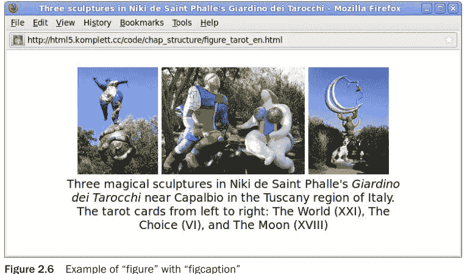

### 2.7 文本级语义——更多新标签

除了关注清晰的结构外，HTML5 规范也重视语义，并试图在文本层面为每个元素赋予特定的含义。同时，HTML5 规范确定了相关标签可以在哪些上下文中使用，不能在哪些上下文中使用。出现了一些新元素，一些元素完全消失了（例如 `font`、`center` 和 `big`），还有一些元素的定义略有改变。下一章将介绍新的和改变的元素。稍后，在表 2.2 中，我们将向您展示规范中 *文本级语义* 章节出现的所有元素的经典应用。让我们从新元素中 *最奇特的* 一个——`<ruby>` 开始。

#### 2.7.1 ruby 元素

术语 ruby 指的是一个 *排版注音系统*，意思是“与基准文本并列的短文本，通常在东亚文档中用于标示发音或提供简短注释”（www.w3.org/TR/ruby）。Ruby 注音在中文和日文中用于显示汉字的发音，如图 2.7 左侧示例所示。

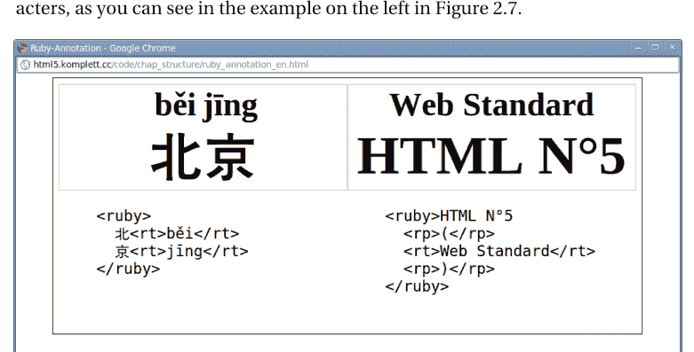

```
<ruby>
  北<rt>běi</rt>
  京<rt>jīng</rt>
</ruby>

<ruby>HTML N°5
  <rp>(</rp>
  <rt>Web Standard</rt>
  <rp>)</rp>
</ruby>
```

**图 2.7** 两个 ruby 注音的示例

Ruby 注音的标记包含 `ruby`、`rt` 和 `rp` 元素。首先，在 `ruby` 元素内指定需要解释的表达式。然后，由后续的 `rt` 元素提供解释，在支持 ruby 的浏览器中，该 `rt` 元素的内容会定位在所描述的表达式之上。如“北京”示例所示，可以连续对多个词语进行注音。

不支持 ruby 的浏览器（如 Firefox 和 Opera）会按顺序显示各个部分，这可能使词语更难阅读。因为第二个词是否是第一个词的解释并不总是明确，所以需要对这两个部分进行视觉分隔。这就是 `rp` 元素的作用：它允许添加可选的括号，这些括号仅在浏览器不支持 ruby 时显示。如图 2.7 所示，Google Chrome 可以解释 ruby 并进行视觉分隔。不支持 ruby 的浏览器会将示例显示为 北 běi 京 jīng 和 HTML N°5 (Web Standard)。

#### 2.7.2 "time" 元素

`<time>` 元素表示 24 小时制的时间或带有可选时间和时区组件的 *公历* 日期。其目的是在 HTML5 文档中提供机器可读格式的现代日期和时间规范。因此，不允许使用模糊的时间引用，例如 *2011年春天* 或 *世纪之交前五分钟*。

为确保机器可读性，我们可以使用 `datetime` 属性，其属性值可以指定为时间、日期或两者的组合。在规范中明确定义了指定时间组件的语法，并在表 2.1 中进行了描述。

表 2.1 "time" 元素 "datetime" 属性的时间戳规则

| 组件 | 语法 | 示例 |
| --- | --- | --- |
| 日期 | `YYYY-MM-DD` | `2011-07-13` |
| 带小时的时间 | `hh:mm` | `18:28` |
| 带秒的时间 | `hh:mm:ss` | `18:28:05` |
| 带毫秒的时间 | `hh:mm:ss.f` | `18:28:05.2318` |
| 日期和时间 | 用 `T` 连接日期和时间 | `2011-07-13T18:28` |
| 带 GMT 时区 | 在末尾加 `Z` | `2011-07-13T18:28:05Z` |
| 带时区偏移量 | `+mm:hh` / `-mm:hh` | `2011-07-13T18:28:05+02:00` |

`pubdate` 属性是一个 *布尔* 属性，表示指定的日期适用于层级结构中的下一级 `<article>`，如果不存在下一级 `<article>`，则应理解为文档的发布日期。如果您使用了 `pubdate`，则必须同时存在一个 `<time>` 元素。如果不符合此条件，则 `<time>` 元素的开始标签和结束标签之间的部分必须包含一个有效的日期。

在 HTML5 中编写布尔属性时要小心：`true` 或 `false` 不是有效的属性值！一旦解析器在布尔属性中发现属性名，它就会切换到 `true`。因此，将布尔属性设置为 `true` 有三种有效表示法：

```
<time pubdate>
<time pubdate="">
<time pubdate="pubdate">（当然也可以省略引号）
```

要切换到 `false`，您只有一个选择：完全省略该属性！

#### 2.7.3 "mark" 元素

`<mark>` 元素代表一段高亮显示的文本片段，该片段在不同的上下文中被认为是相关的。这听起来有点费解，我们将通过一些简短的例子来说明：如果您想特别强调引文的某一部分，您会更改原文，并几乎强加了一个新的含义。您可以使用 `<mark>` 元素，为文档或代码清单中由于搜索或解释代码而变得重要的某些词语添加标记。

#### 2.7.4 "wbr" 元素

毫不奇怪，`<wbr>` 元素使浏览器能够在长单词中插入一个可选的换行符。例如，在一个相当长的单词（如 supercalifragilisticexpialidocious）中插入几个 `<wbr>` 元素，将使浏览器有机会在布局需要时将该单词换行显示：

```
supercali<wbr>fragilistic<wbr>expialidocious
```

是否换行以及在何处换行完全取决于布局。`<wbr>` 仅允许换行，并不强制换行。可能的应用场景包括长 URL 或代码清单。与 `<br>` 类似，`<wbr>` 是一个所谓的空元素，这意味着它不能包含结束标签——这是它在 HTML5 中与另外 14 个元素共享的特性。它们如下：

| area | base | br | col | command | embed |
| --- | --- | --- | --- | --- | --- |
| hr | img | input | keygen | link | meta |
| param | source | wbr | | | |

当然，空元素可以在其开始标签本身中包含斜杠（例如 `<br />`），这对于满足有效的 XHTML5 文档要求很有用。

#### 2.7.5 有细微变化的元素

有细微变化的元素列表以 `<b>` 和 `<i>` 开头，这两个标签不再符合 HTML5 的理念，也因为它们的名称：`<b>` 代表 **粗体**，`<i>` 代表 *斜体*，给出了明确的格式化指令，这在 HTML5 中并不受欢迎。*相关性* 现在至关重要，因此我们应该使用 `<strong>` 和 `<em>`（代表 *强调*）来强调一个词的重要性。不幸的是，`<b>` 和 `<i>` 是使用最广泛的标签之一，这就是为什么不可能完全阻止它们使用。解决方案是一种妥协，继续允许两者使用，但改变了它们的含义：`<b>` 现在指的是以粗体显示的偏移文本，`<i>` 指的是以斜体显示的偏移文本。但如果您想编写干净的 HTML5，您应该避免在未来使用 `<b>` 和 `<i>`，而应使用 `<strong>` 和 `<em>`。

其他小变化意味着 `<cite>` 现在指定作品的标题，不能明确用于引用名称。`<small>` 现在不仅表示 *小字体*，还代表附带评论或法律声明中的小字体，但不对其重要性做出声明。`<hr>` 现在表示主题分隔，而不仅仅是用于分隔布局的水平线。

规范在 *文本级语义* 章节末尾提供了各个标签的使用摘要和示例。为免您查找，现将其呈现在我们的表 2.2 中。

| 元素 | 用途 | 示例 |
| --- | --- | --- |
| a | 超链接 | 访问我的 `<a href="drinks.html">饮料</a>` 页面。 |
| em | 强调 | 我必须说我 `<em>喜欢</em>` 柠檬水。 |
| strong | 重要性 | 这杯茶 `<strong>非常烫</strong>`。 |
| small | 附带评论 | 这些葡萄被用来酿酒。`<small>酒精会使人上瘾。</small>` |
| s | 不准确的文本 | 价格：`<s>£4.50</s>` £2.00！ |
| cite | 作品标题 | `<cite>Hugo v. Danielle</cite>` 案件与此相关。 |
| q | 引语 | 法官说 `<q>你可以从鱼缸里喝水</q>`，但建议不要这样做。 |
| dfn | 定义实例 | 术语 `<dfn>有机食品</dfn>` 指不使用合成化学品生产的食品。 |
| abbr | 缩写 | 爱尔兰的有机食品由 `<abbr title="Irish Organic Farmers and Growers Association">IOFGA</abbr>` 认证。 |


# 表 2.2 语义文本元素的使用（续）

| 元素 | 用途 | 示例 |
| :--- | :--- | :--- |
| code | 计算机代码 | `<code>fruitdb</code>` 程序可用于跟踪水果产量。 |
| var | 变量 | 如果碗中有 `<var>n</var>` 个水果，那么至少有 `<var>n</var>÷2` 个是成熟的。 |
| samp | 计算机输出 | 计算机显示 `<samp>Unknown error -3</samp>`。 |
| kbd | 用户输入 | 按 `<kbd>F1</kbd>` 继续。 |
| sub | 下标 | 水是 H<sub>2</sub>O。 |
| sup | 上标 | 重水中的氢通常是 `<sup>2</sup>`H。 |
| i | 替代语气 | 柠檬水主要由 `<i>Citrus limon</i>` 组成。 |
| b | 关键词 | 拿一个 `<b>柠檬</b>`，用 `<b>榨汁器</b>` 挤压它。 |
| mark | 高亮 | 接骨木花甜酒，以一份 `<mark>甜酒</mark>` 兑十份 `<mark>水</mark>`，在同类产品中脱颖而 `<mark>出</mark>`。 |
| ruby, rt, rp | 注音标注 | `<ruby> OJ <rp>(<rt>Orange Juice</rt><rp>)</ruby>` |
| bdi | 文本方向性隔离 | 推荐的餐厅是 `<bdi lang="ar">`

### 小结

HTML5 提供了丰富的新结构元素，例如 header、hgroup、article、section、aside、footer 和 nav。本章开头详细的示例——创建一个虚构的博客条目——展示了这些元素使用起来是多么简单直观。以前只有与 class 属性结合才能表达含义的匿名 div 元素，现在我们有了具有明确语义的元素——这一理念延续到了 figure 和 figcaption，用于集成图像和图形。从表 2.2 全面的 HTML5 语义文本元素列表及使用示例中，我们简要介绍了最有趣的新元素，例如用于注音标注的 ruby、rt 和 rp；用于指定时间的 time；用于标记文本段落的 mark；以及用于可选换行的 wbr。

# 3 智能表单

无论你想预订航班、办理网上银行业务，还是在 Google 中输入搜索词，没有表单，这些服务都无法使用。大多数交互式表单元素自 1995 年 HTML 2.0 问世以来一直保持不变。这一方面表明 Tim Berners-Lee 的设计极具远见；另一方面，现在也到了亟待追赶的时候。HTML5 规范用大量篇幅论述了表单主题，将大大便利 Web 设计师的工作。

尽管截至撰写本书时浏览器支持尚不广泛（目前仅有 Opera 和 Google Chrome 的开发版提供支持），但向后兼容的语法意味着我们可以安全地立即使用这些新表单元素。

### 3.1 新的输入类型

HTML5 规范通过为 type 属性允许多个新值来增强 input 元素。这些新类型，例如 date、color 和 range，使浏览器制造商能够提供用户友好的输入元素，同时也让浏览器可以确保输入的是所需类型。如果浏览器无法识别 input 元素的类型，它将回退到 type=text 并显示文本字段，这在任何情况下都是可用的。即使是较旧的浏览器也表现出这种行为，因此我们可以立即开始使用新类型。

日期和时间类型可能是最有用的。目前，互联网上有无数种不同版本的 JavaScript 日历，其成败程度不一。舒适地输入日期，无论是预订航班或酒店房间，还是注册参加会议，都是一个迄今需要手动解决的问题。当然，像 *jQuery* 这样的 JavaScript 库提供了现成的日历，但这一功能确实应该由浏览器直接支持。

截至撰写本书时，只有一款桌面浏览器包含用于输入日期的图形输入元素：Opera。在图 3.1 中，你可以看到点击 type 为 date 的 input 元素时将显示的展开日历。但让我们按顺序来：表 3.1 提供了对新类型的概览；然后你可以在图 3.1 中看到它们在 Opera 浏览器中的外观。

表 3.1 HTML5 中的新输入类型

| 类型 | 描述 | 示例 |
| :--- | :--- | :--- |
| tel | 不带换行的文本 | +1 234 567890 |
| search | 不带换行的文本 | 搜索词 |
| url | 绝对 URL | http://www.example.com |
| email | 有效的电子邮件地址 | user@host.com |
| datetime | 日期和时间（始终为 UTC 时区） | 2010-08-11T11:58Z |
| date | 不带时区的日期 | 2010-08-11 |
| month | 不带时区的月份 | 2010-08 |
| week | 不带时区的年和周 | 2010-W32 |
| time | 不带时区的时间 | 11:58:00 |
| datetime-local | 不带时区的日期和时间 | 2010-08-11T11:58:22.5 |
| number | 数字 | 9999 或 99.2 |
| range | 范围内的数值 | 33 或 2.99792458E8 |
| color | sRGB 色彩空间中 RGB 值的十六进制表示 | #eeeeee |

#### 3.1.1 输入类型 "tel" 和 "search"

tel 和 search 与普通文本字段没有显著区别。两者都可以包含不带换行的字符链。即使是电话号码也不限于数字，因为电话号码通常包含括号或加号。对于 tel，浏览器可以提供来自本地地址簿的建议，这对于手机来说尤其有用。引入 search 类型是为了让浏览器能够使搜索输入与相关平台的布局保持一致。例如，Mac OS X 用户习惯于看到圆角搜索框。

图 3.1 在实施新表单输入类型方面，Opera 已经遥遥领先

#### 3.1.2 输入类型 "url" 和 "email"

除了提供建议选项外，浏览器还可以检查 url 和 email 的语法。由于电子邮件地址和 Internet 地址（URL 形式）都有具体的规则，浏览器可以在输入过程中就已经对可能的错误提供反馈（有关此主题的更多信息，请参阅 3.4 节，客户端表单验证）。

#### 3.1.3 使用 "datetime"、"date"、"month"、"week"、"time" 和 "datetime-local" 输入日期和时间

让我们更仔细地看看日期和时间格式。datetime 包含日期和时间信息；时区始终设置为 UTC。规范指出浏览器可以允许用户选择其他时区，但输入元素的值必须转换为 UTC。我们在 2.7.2 节（"time" 元素）中讨论的 time 元素 datetime 属性中的时间信息规则在这里同样适用——唯一例外的是字符串必须始终以 Z 结尾，即 UTC 的标识符。

对于 date 和 month，省略了时间和时区。根据规范的定义，日期必须是所选月份中的有效日期，同时考虑闰年。年、月和日必须用减号分隔；年份必须至少为四位数字且大于 0。因此 HTML5 无法表示基督之前（公元前）的日期，这与范围更广的国际标准 ISO 8601 形成对比。

week 类型表示为一年中的周，且周之前必须带年份。年份和周再次用减号分隔。为避免与月份混淆，周之前必须加上字符 W。

datetime-local 的工作方式与上述已描述的 datetime 相同；唯一的区别是没有指定时区。

Opera 使用日历窗口选择日期；时间可以手动输入或通过方向键更改（参见图 3.1）。

#### 3.1.4 输入类型 "number" 和 "range"

number 和 range 类型要求输入可以转换为数值；浮点数的表示法（例如 2.99792458E8）是有效的。关于 range 类型，规范指出确切数值并不重要；该类型表示一个数字范围，而非确切数字，用户可以轻松使用滑块条输入。Opera 和基于 WebKit 的浏览器（如 Safari 或 Google Chrome）都使用滑块条来表示此类型（参见图 3.1 和图 3.2）。


3.1 新输入类型 41

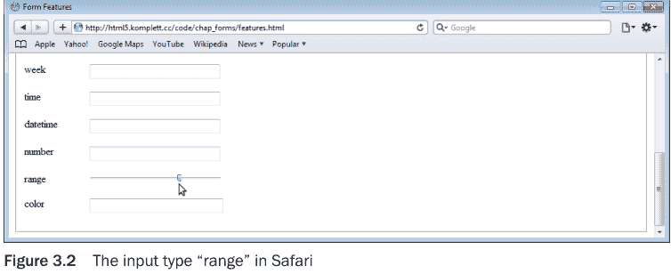

图 3.2 Safari 中的 "range" 输入类型

#### 3.1.5 "color" 输入类型

Opera 的开发者再次引领潮流，率先为颜色元素编写了图形化输入选项。如图 3.1 所示，Opera（版本 11 及更高版本）提供了一个矩形字段，其中包含常用颜色的选择。你也可以调出类似于图像编辑程序中看到的颜色选择器。遗憾的是，此输入元素在其他浏览器中仍未得到实现。

该输入元素的值必须包含以十六进制表示的 8 位 RGB 值，并以 # 字符开头。例如，蓝色可以写成 #0000ff。

#### 3.1.6 新输入类型实战

理论到此为止：我们的第一个示例将新元素一个接一个地展示出来。因为这并不太具挑战性，我们还将测试每个元素的功能。窍门在于，浏览器会将未知元素的类型设置为 text，然后我们可以在 JavaScript 中评估这些属性：

```
<script>
    window.onload = function() {
        inputs = document.getElementsByTagName("input");
        for (var i=0; i<inputs.length; i++) {
            if (inputs[i].type == "text") {
                inputs[i].value = "not available";
            }
        }
    }
</script>
```

网页加载完成后，一个循环会遍历所有输入元素以分析它们的 type 属性。如果 type 属性对应于标准类型 text，则其值将被设置为 *not available*。新输入元素的 HTML 代码如下所示：

```
<fieldset>
    <legend>New input types</legend>
    <p><label for=tel>tel</label>
<input type=tel id=tel name=tel>
    <p><label for=search>search</label>
<input type=search id=search name=search>
    <p><label for=url>url</label>
<input type=url id=url name=url>
    <p><label for=email>email</label>
    ...
```

在图 3.3 中，你可以看到此测试在 Android 手机上的结果。该系统基于 WebKit 的浏览器（左侧）假装知道 tel、search、url 和 email 类型，但在通过键盘输入电话号码方面（中间）并没有真正提供帮助。1.0.1 beta 版的 Opera Mobile（右侧）支持 url 和 email，以及日期和时间类型。

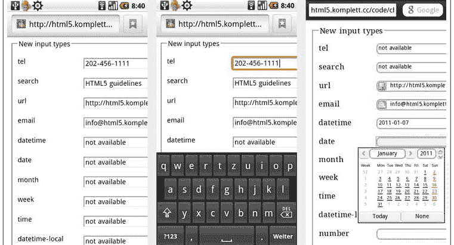

图 3.3 在 Android 2.1 手机上，WebKit 浏览器（左、中）和 Opera 浏览器（右）对新表单输入类型的支持情况

对于本应非常现代的 Android 浏览器来说，这是一个相当令人失望的结果。在 iPhone 上的表现稍好一些：至少这款智能手机会调整软键盘，当你尝试输入电话号码时显示数字键盘，并在 email 输入类型的键盘上添加 @ 字符。

*BlackBerry* 的测试效果更好，它是加拿大制造商 *Research in Motion (RIM)* 生产的流行智能手机系列的操作系统。如图 3.4 所示，BlackBerry 支持 tel 和 number 以及 date 类型，特别是后者采用了非常吸引人的图形表示。在底层，我们发现是 WebKit 在工作：该软件被扩展以包含这些功能。

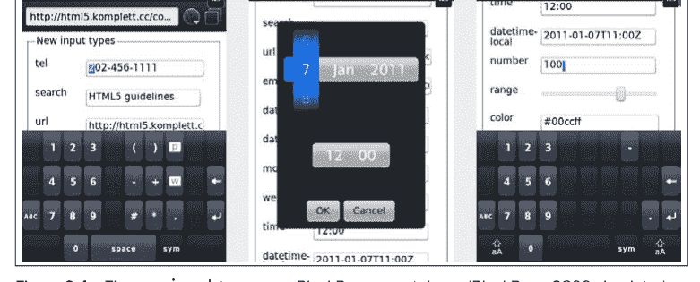

图 3.4 BlackBerry 智能手机上的新输入类型（BlackBerry 9800 模拟器）

### 3.2 表单的实用属性

除了新的元素和许多新的 input 类型，HTML5 还为表单元素提供了几个新属性。

#### 3.2.1 使用 "autofocus" 聚焦

多年前，Google 用一个简单的技巧让许多用户感到惊喜，使搜索变得更加方便：当页面加载时，光标会自动定位在搜索字段中。用户无需先用鼠标点击激活输入框，即可直接输入搜索词。以前，这需要通过一小段 JavaScript 代码来实现；在 HTML5 中，你现在可以使用 autofocus 属性来完成：

```
<input type=search name=query autofocus>
```

与所有布尔属性一样，你可以将此属性写为 `autofocus="autofocus"`（参见第 2 章，第 2.7.2 节，"time" 元素）。规范指出，网页中只能有一个元素包含 autofocus 属性。

较旧的浏览器不会因为 autofocus 而出现问题，因为它们只是忽略未知的属性。当然，只有在新浏览器中才能享受到用户友好性的益处。

#### 3.2.2 使用 "placeholder" 占位符文本

使用新的 placeholder 属性可以进一步提高 HTML 表单的可用性：

```
<p><label for=email>Your e-mail address:</label>
<input type=email name=email id=email
  placeholder="user@host.com">
<p><label for=birthday>Your date of birth</label>
<input type=date name=birthday id=birthday
  placeholder="1978-11-24">
```

placeholder 的值可以给用户一个关于如何填写字段的快速提示，但它不应该用作 label 元素的替代品。它对于期望特定数据输入格式的字段特别有用。浏览器在不活动的输入字段内显示提示文本。一旦字段被激活并获得焦点，文本就不再显示（参见图 3.5）。

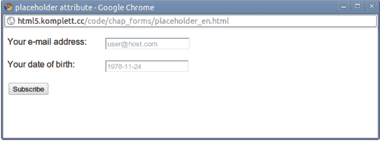

图 3.5 Google Chrome 中的 "placeholder" 属性

#### 3.2.3 使用 "required" 设置必填字段

required 是一个 *布尔* 属性，其名称已经说明了其功能：分配了此属性的表单元素必须填写。如果在发送表单时必填字段仍为空，则它不满足要求，浏览器必须做出相应反应。你将在第 3.4 节“客户端表单验证”中找到更多信息。

#### 3.2.4 "input" 元素的更多属性

input 元素不仅通过新类型（第 3.1 节，新输入类型）得到了增强，还通过新属性得到了增强，这些属性使表单处理更加容易（参见表 3.2）。

表 3.2 "input" 元素的新属性

| 类型 | 描述 | 属性 |
|---|---|---|
| liststring | 指向一个带有建议的 datalist 元素的 ID（参见第 3.3.3 节，使用 "datalist" 的选项列表） | list |
| numeric/date | 数字字段和日期字段的最小值 | min |
| numeric/date | 数字字段和日期字段的最大值 | max |
| numeric | 数字字段和日期字段的步长 | step |
| boolean | 允许多选 | multiple |
| 枚举 (on/off/default) | 自动将保存的数据插入表单字段 | autocomplete |
| string | 用于验证值的正则表达式 | pattern |

我们将在第 3.3.3 节“使用 'datalist' 的选项列表”中再次遇到 list 属性。它指向 datalist 元素，该元素提供可能的条目作为建议。

min、max 和 step 不仅适用于数字字段，这些属性也可用于输入日期和时间：

```
<p><label for=minMax>Decimal number between 0 and 1:</label>
<input type=number name=minMax id=minMax
  min=0 max=1 step=0.1>
<p><label for=minMaxDate>Date in week steps:</label>
<input type=date name=minMaxDate id=minMaxDate
  min=2010-08-01 max=2010-11-11 step=7>
<p><label for=minMaxTime>Time in hour steps:</label>
<input type=time name=minMaxTime id=minMaxTime
  min=14:30 max=19:30 step=3600>
```

在支持 input type number 的浏览器中，第一个输入元素（id=minMax）每次递增 0.1。这可以通过点击文本字段末尾的箭头键或按键盘上的箭头键来实现。ID 为 `minMaxDate` 的元素每次向前跳七天。Opera 仅在日历中显示与周周期相对应的活动日期。对于设置此元素，Google Chrome 提供了与 input type number 相同的导航：两个箭头键可以将日期向前或向后设置七天。在此示例中的第三个输入元素中，步长设置为 3600；这导致时间每次向前或向后设置一小时。尽管规范指出 time 的 input 元素通常以分钟为单位工作，但 Opera 和 Google Chrome 都将此数据解释为秒。

我们都从复制文件中熟悉多选；现在这个选项也存在于浏览器中。如果你想在一个网站上同时上传多个文件，以前必须为每个文件提供一个输入字段。`multiple` 属性允许在文件对话框中选择多个文件。`multiple` 选项本来就是为 `select` 元素设计的；将其用于 `email` 类型的输入字段是新的。但到目前为止（在撰写本文时），没有任何常用的桌面浏览器能够为 `email` 类型实现此功能。

现代浏览器有一个功能，允许它们保存表单数据，以便在再次访问表单时帮助用户填写。这种预填充可能非常有用，但对于安全敏感的输入字段（规范以核武器的激活码为例）可能是不希望的。引入 `autocomplete` 属性是为了让 Web 开发人员控制此行为。如果一个元素被分配了属性 `autocomplete="off"`，则意味着要输入的信息是机密的，不应保存在浏览器中。如果表单元素没有说明 `autocomplete` 应该开启还是关闭，则默认设置是显示建议。`autocomplete` 属性也可以应用于整个表单，方法是将其分配给 `form` 元素。

新的 `pattern` 属性允许非常灵活的输入验证。你可以指定一个 *正则表达式*，表单字段将根据它来检查是否匹配。正则表达式非常强大，但不幸的是，它不是解析字符串的简单方法。假设你正在寻找一个以大写字符开头，后跟任意数量的小写字母或数字，并以 `.txt` 结尾的字符串。使用 *regexp*（*正则表达式* 的缩写）找到它完全没有问题：

```
[A-Z]{1}[a-z,0-9]+\.txt
```

> **注意**
> 
> 正则表达式的介绍将远远超出本章的范围，因此在阅读以下部分时，我们假设你具备正则表达式的基础知识。如果你正在寻找关于 *正则表达式* 的简要在线介绍，维基百科是一个很好的起点：浏览 `http://en.wikipedia.org/wiki/Regular_expression`。网站 `http://www.regexe.com` 让你有机会在线尝试正则表达式。


在使用 pattern 属性的正则表达式时，你需要记住搜索模式必须始终适用于字段的完整内容。规范还建议利用 title 属性给用户提供有关输入格式的提示。Opera 和 Google Chrome 会将此类信息以工具提示的形式显示，只要鼠标指针悬停在字段上方。理论讲了这么多，下面是一个简短的例子：

```
<p><label for=pattern>Your nickname:</label>
  <input type=text pattern="[a-z]{3,32}"
    placeholder=""johnsmith"" name=pattern id=pattern
    title="Only lower case, please; min. 3, max. 32!">
```

pattern 属性的规则指定字符串只能包含 a 到 z 之间的字符（小写，[a-z]），并且至少有 3 个、最多有 32 个字符。特殊字符或变音符号不被允许，对于前面例子中的用户名来说这很有用。如果你想包含某些特殊字符，例如德语中的变音符号，你需要将它们包含在字符组中：[a-zäöüß]。在 3.4 节"客户端表单验证"中，你可以了解到验证失败时会发生什么。

### 3.3 新元素

除了前面提到的新输入类型和新属性之外，规范还包含了表单的新元素。我们将在下一节中讨论这些。meter 和 progress 元素可以创建图形化对象，而这在以前只能通过或多或少复杂的技巧来实现。datalist 为文本输入提供建议，output 则为计算结果提供占位符。keygen 元素在万维网上已经流传了很长时间，但直到 HTML5 才实现标准化。

#### 3.3.1 用"meter"显示测量值

meter 元素用于以图形方式表示已知范围内的标量测量值。例如，想一想你汽车里的燃油表：指针显示油箱中当前油量在 0 到 100 百分比之间的某个位置。以前，这种图形表示通常用嵌套的 div 元素在 HTML 中编码，这是一个相当不优雅的解决方案，div 元素很可能并非为此目的而设计。状态显示也可以通过图片以图形方式显示，借助免费网络服务如 Google Chart API。你可以在下面的例子中看到所有这些选项。

使用 meter 元素非常简单：你通过 value 属性设置所需的值；所有其他属性都是可选的。如果你不设置 min 和 max 值，浏览器将使用 0 和 1 作为这些属性的默认值。因此，下面的 meter 元素显示一个半满的元素：

```
<meter value=0.5></meter>
```

除了 value、min 和 max 之外，还有 low、high 和 optimum 属性——这些值可以被浏览器纳入显示中。例如，Google Chrome（在撰写本文时，除 Opera 之外唯一能够表示 meter 元素的浏览器）在超过 optimum 值时，会将通常显示为绿色的条变为黄色。

在下面的例子中，你可以看到一种图形化表示，显示当前年份已经过去的百分比。该网站以四种不同方式呈现输出可视化：以百分比数值的文本形式、使用新的 meter 元素、通过嵌套的 div 元素，以及通过 Google Chart API 在线服务生成的图形。你可以在图 3.6 中看到结果。

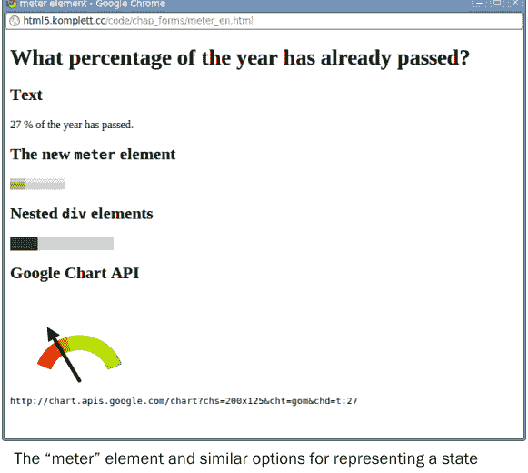

这个例子的 HTML 代码包含了仍然为空的元素，它们通过 JavaScript 填充：

```
<h2>Text</h2>
<p><output id=op></output>
   % of the year has passed.</p>
<h2>The new <span class=tt>meter</span> element</h2>
<meter value=0 id=m></meter>
<h2>Nested <span class=tt>div</span> elements</h2>
<div id=outer style="background:lightgray;width:150px;" >
<div id=innerDIV>&nbsp;</div></div>
<h2>Google Chart API</h2>

<p id=googleSrc class=tt></p>
```

对于文本输出，我们使用在 3.3.5 节"'output'的计算"中介绍的 output 元素。但首先要在 JavaScript 中生成当前日期，并初始化 meter 元素：

```
var today = new Date();
var m = document.getElementById("m");
m.min = new Date(today.getFullYear(), 0, 1);
m.max = new Date(today.getFullYear(), 11, 31);
// m.optimum = m.min-m.max/2;
m.value = today;
```

变量 today 包含自 UNIX 纪元开始（1970 年 1 月 1 日）以来的毫秒数。为了确保我们的 meter 元素获得一个合理的刻度，我们将 min 值设置为当年 1 月 1 日，并将 max 值相应设置为 12 月 31 日。列表最后一行设置了 meter 元素的值；现在图形化表示已经完成。如果你启用 optimum 值（在本例中为年中点，我们省略了它），你会看到显示根据你在上半年还是下半年调用脚本而发生变化。这个新元素使用起来非常简单。

现在让我们继续看 HTML 网页上的其他元素。我们想要将已过去天数的百分比分配给标记为 ID op 的 output 元素。使用 Math.round()，我们在逗号前将百分比四舍五入到最接近的整数，这对于我们的例子来说已经足够精确了：

```
var op = document.getElementById("op");
op.value =
    Math.round(100/(m.max-m.min)*(m.value-m.min));

var innerDIV = document.getElementById("innerDIV");
innerDIV.style.width=op.value+"%";
innerDIV.style.background = "green";
```

我们示例的其余部分与新的 HTML5 技术无关，但为了完整性我们仍然要解释一下。嵌套的 div 元素也应该用百分比值填充。这背后的思路很简单：在 HTML 中定义第一个具有固定宽度的 div 区域（此处为 150px）。嵌套在此元素中的另一个 div 元素显示为绿色背景色，宽度为计算出的百分比值——一个简单但非常有效的技巧。为了完善示例，我们还想包含 Google Chart API。要使用在线服务，你必须指定图表大小（chs，在我们的例子中为 200×125 像素）、图表类型（cht，此处为 gom，Google-O-Meter）和图表数据（chd，此处为百分比值 op.value）：

```
var google = document.getElementById("google");
google.src =
"http://chart.apis.google.com/chart?chs=200x125&cht=gom&chd=t:"+op.
value;
var gSrc = document.getElementById("googleSrc");
gSrc.innerHTML = google.src;
```

#### 3.3.2 用"progress"显示任务进度

progress 的工作方式与前面讨论的 meter 元素类似，只不过它表示的是任务完成的进度。这类任务可以是用户上传文件或应用程序下载所需的外部库。

为了给你一个快速的例子，我们并不想真正上传任何文件或下载大量数据；给自己设定一个任务并将其完成到 100%就足够了。我们下面的例子定义了十个 type 为 checkbox 的 input 元素，一旦它们全部被激活，我们就希望进度条显示 100%：

```
<h1>Please activate all the checkboxes</h1>
<form method=get>
  <input type=checkbox onchange=updateProgress()>
  <input type=checkbox onchange=updateProgress()>
<!-- and 8 more -->
  <p>
  Progress: <progress value=0 max=10 id=pb></progress>
</form>
```

progress 元素以值 0 和最大值 10 进行初始化。一旦某个 input 元素被激活，它就会调用函数 updateProgress()，该函数如下所示：

```
function updateProgress() {
  var pb = document.getElementById("pb");
  var ip = document.getElementsByTagName("input");
  var cnt = 0;
  for(var i=0; i<ip.length; i++) {
      if (ip[i].checked == true) {
          cnt++;
      }
  }
  pb.value = cnt;
}
```

变量 ip 包含一个包含所有 input 元素的*NodeList*。这些元素中的每一个都在 for 循环中测试其状态。如果它被激活（checked == true），计数器变量 cnt 增加 1。最后，progress 元素的值被设置为计数器变量的值。

#### 3.3.3 用"datalist"实现选项列表

表单中一项期待已久的新功能是用户可以添加自己条目的下拉菜单。因为众所周知的 select 元素仅限于指定为 option 元素的值，Web 开发人员过去常常想出各种 JavaScript 技巧来为文本字段添加可扩展的选择列表。

HTML5 规范现在为此问题提供了一个非常优雅的解决方案。新的 datalist 元素被定义为已经熟悉的 option 元素的容器。现在我们可以为每个 input 元素分配一个 datalist 元素，该元素在需要时显示选择选项。不支持 datalist 元素的浏览器将仅显示空文本字段。

清单 3.1 展示了新元素的使用。input 元素由 type text 定义，list 属性引用 datalist 元素的 id（在本例中为 homepages）。页面加载时，autofocus 属性自动将光标定位到文本字段内部（参见 3.2.1 节"使用'autofocus'聚焦"），并至少在 Opera 浏览器中确保选择列表出现（参见图 3.7）。

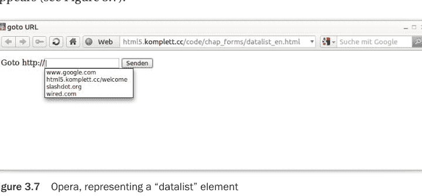

图 3.7 Opera，显示"datalist"元素


对于 datalist 中的 option 元素，你只需填充 value 属性。其他属性和文本节点虽然可以添加，但对于此用途来说并非必需。如果用户点击提交按钮，文本框中的内容会加上前缀字符串 `http://`，然后浏览器会重定向到生成的 URL（`window.location`）：

## 清单 3.1 填充了 Internet 地址的"datalist"元素

```html
<form>
  <p>
    <label for=url>Goto</label>
    http://<input type=text id=url name=homepage
                  list=hompages autofocus>
    <datalist id=hompages>
      <option value=www.google.com>
      <option value=html5.komplett.cc/welcome>
      <option value=slashdot.org>
      <option value=wired.com>
    </datalist>
    <input type=submit
      onclick="window.location =
        'http://'+document.getElementById('url').value;
        return false;" >
</form>
```

如果你想在不重复 HTML 代码的情况下为旧版浏览器提供一个选择列表，可以采用以下技巧。因为支持 datalist 元素的浏览器会忽略其内部嵌套的 select 元素，所以它们会显示新的 HTML5 select 元素。而旧版浏览器则会为文本框显示一个带有预定义链接的选择列表，当选择发生变化时，这些链接会被插入到文本框中。

如清单 3.2 所示，我们需要为 option 元素添加文本节点，因为"旧版" select 元素不会显示 value 属性的内容，而是显示文本内容：

## 清单 3.2 带有旧版浏览器回退方案的"datalist"

```html
<datalist id=hompages>
<select name=homepage
  onchange="document.getElementById('url').value =
    document.forms[0].homepage[1].value" >
  <option value=www.google.com>www.google.com
  <option
  value=html5.komplett.cc/welcome>html5.komplett.cc/welcome
  <option value=slashdot.org>slashdot.org
  <option value=wired.com>wired.com
</select>
</datalist>
```

select 元素中的 onchange 事件会将选择菜单中的当前文本插入到文本框中（参见图 3.8）。

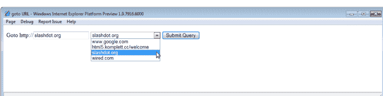

#### 3.3.4 使用"keygen"生成密钥

keygen 元素在 Mozilla Firefox 浏览器中有着悠久的历史（自 1.0 版本起就已包含），但 Microsoft 仍然对 HTML5 中的实现表示了极大的担忧。keygen 用于生成密钥，这听起来很复杂，而且不幸的是，它确实就像听起来那样复杂。

简单来说，这个元素背后的原理是：浏览器生成一对密钥，一个是*公钥*，另一个是*私钥*。公钥会随其他表单数据一起发送出去，供服务器应用程序使用，而私钥则保存在浏览器中。完成密钥交换后，服务器和浏览器就可以在不使用 SSL 证书的情况下进行加密通信。这听起来像是解决那些让浏览器不断抱怨的恼人的自签名证书的实用方案，但遗憾的是并非如此，因为服务器的身份只能通过由可信机构（即*证书颁发机构*（*CA*））签署的证书来验证。

那么，如果 keygen 无法替代 SSL，这个新元素应该用于什么呢？正如 Mozilla 文档中所解释的，keygen 元素用于帮助创建服务器可以签署的证书（*已签署证书*）。为了使这一步完全安全，通常需要申请人亲自到场出示给证书颁发机构。由于签发已签署证书是一项专业任务，我们将简要介绍这个元素及其属性。

## 第 3 章——智能表单

以下简短的 HTML 文档创建了一个 keygen 按钮：

```html
<!DOCTYPE html>
<meta charset="utf-8">
<title>keygen Demo</title>
<form method=post action=submit.html>
  <keygen id=kg challenge=hereismychallenge name=kg>
  <input type=submit>
</form>
```

除了常见的属性（如 autofocus、disabled、name 和 form）外，keygen 元素还有两个特殊属性：keytype 和 challenge。其中 keytype 尤其有趣，因为浏览器会使用此值来判断是否支持该元素的功能。目前，只有一个有效的 keytype，即 rsa，这是一种于 1977 年在麻省理工学院（MIT）开发的加密系统。如果未指定 keytype（如上面的示例），则默认使用 rsa。规范还指出，浏览器可以完全不支持任何 keytype，这可能是因为 Microsoft 对此元素的否决。可选的 challenge 属性可在密钥交换过程中增加安全性。如需更多信息，请参阅本节末尾注释中的链接。

如果浏览器支持 RSA 密钥生成，它可以提供一个选择列表，让用户选择密钥的长度，进而决定密钥的安全性（参见图 3.9）。

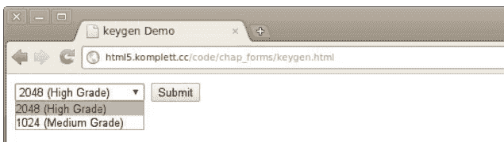

**图 3.9** 在 Google Chrome 中选择密钥长度

图 3.10 显示了表单发送后的结果：POST 变量 kg 包含了加密所需的公钥（此处通过功能强大的 Firefox 插件 Firebug 渲染显示）。

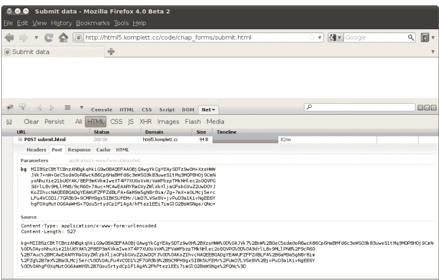

> 如果你之前对密码学经验不多但想了解更多，Wikipedia 始终是一个良好的起点。请查阅 http://en.wikipedia.org/wiki/Public_key_infrastructure 和 http://en.wikipedia.org/wiki/Challenge-response_authentication。

#### 3.3.5 使用"output"进行计算

"output 元素表示计算的结果。"这是 HTML5 规范中非常简短的说明，你在大多数描述这个新元素的网站上也会找到完全相同的文字。这一切听起来很合理，但我们在处理的是什么样的计算？为什么需要一个专门的元素来处理它们？

一般来说，这些计算源自网页上的输入字段。一个大多数人熟悉的例子就是电子购物车，可以在输入字段中输入每种商品的数量。通过可选的 for 属性，你可以确定哪些字段需要纳入计算。在此过程中，会引用文档中其他字段的一个或多个 id 属性。

## 56 第 3 章——智能表单

为了测试 output 元素，我们将为三种不同商品编写一个这样的小型购物车程序。每种商品的数量都可以通过输入字段进行更改。同时，商品总数和总价会显示在购物车下方。图 3.11 展示了一个包含五件商品的购物篮。

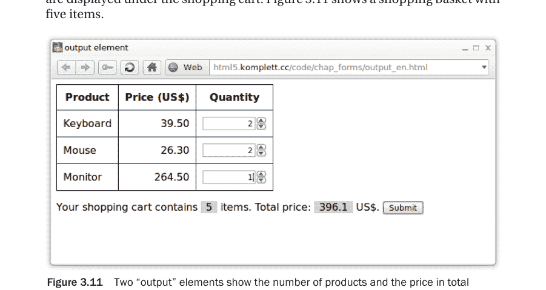

我们示例的代码可以简单快速地解释：为了在每次数量变化时更新 output 元素，我们使用了表单的 oninput 事件：

```html
<form oninput="updateSum();">
  <table>
    <tr><th>Product<th>Price (US$)<th>Item number
    <tr><td>Keyboard<td class=num id=i1Price>39.50<td>
    <input name=i1 id=i1 type=number min=0 value=0 max=99>
    <tr><td>Mouse<td class=num id=i2Price>26.30<td>
```

output 元素在商品表格之后定义，并通过 for 属性引用输入字段的 ID：

```html
<p>Your shopping cart contains <output name=sumProd for="i1 i2 i3"
id=sumProd></output> items. Total price:
<output name=sum for="i1 i2 i3" id=sum></output> US$.</output>
```

在 JavaScript 代码中，一个循环遍历所有输入元素，累加数量并计算总价：

```javascript
function updateSum() {
  var ips = document.getElementsByTagName("input");
  var sum = 0;
  var prods = 0;
  for (var i=0; i<ips.length; i++) {
    var cnt=Number(ips[i].value);
    if (cnt > 0) {
      sum += cnt * Number(document.getElementById(
        ips[i].name+"Price").innerHTML);
      prods += cnt;
    }
  }
  document.getElementById("sumProd").value = prods;
  document.getElementById("sum").value = sum;
}
```

我们通过使用相关表格列的 innerHTML 值并用 JavaScript 函数 `Number()` 将其转换为数字，直接从表格中获取商品价格。输入字段中的值（`ips[i].value`）也是如此，因为如果不进行此转换，JavaScript 将会拼接字符串，从而无法得到预期的结果。然后将计算得到的值插入到 output 元素的 value 属性中。

### 3.4 客户端表单验证

表单中新元素和新属性的优势之一是用户现在可以更方便地输入数据（例如，从日历中选择日期）。另一个巨大的优势是可以在提交表单之前检查表单内容，并在发现错误时提醒用户。你可能会说这种检查已经相当老套了，因为它已经存在了很多年。确实如此，但在此之前，这一步始终需要通过你自己编写的 JavaScript 代码来完成。得益于 jQuery 等类似库，这项任务变得容易了许多，代码也更易于管理，但你仍然必须依赖外部库。

有了 HTML5，这种情况发生了根本性的变化：你在 HTML 中定义输入字段的参数，由浏览器来检查字段是否已正确填写。这是一个巨大的进步，使得许多行 JavaScript 代码变得多余。这个小小的例子会说服你：

```html
<form method=get action=required.html>
  <p><label>Your e-mail address:
    <input type=email name=email required></label>
  <p><input type=submit>
</form>
```


图 3.12 展示了如果在提交上一个列表中的表单时未指定电子邮件地址会发生什么。Opera 浏览器会显示错误信息：*此为必填字段*。如果你将 Opera 的用户界面设置为其他语言，错误信息也会以相应的语言显示。当然，你也可以使用 JavaScript 自定义这些错误信息；更多相关内容将在 3.4.3 节中介绍。

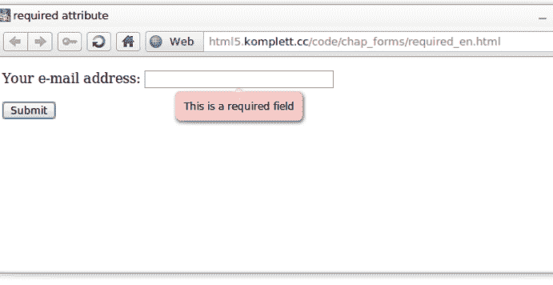

**图 3.12** 具有 "required" 属性的空白输入字段的错误信息（Opera）

但这还不是全部：该字段被定义为 email 类型，因此当输入了无效的电子邮件地址时，Opera 也会返回错误信息；例如，*请输入有效的电子邮件地址*（参见图 3.13）。

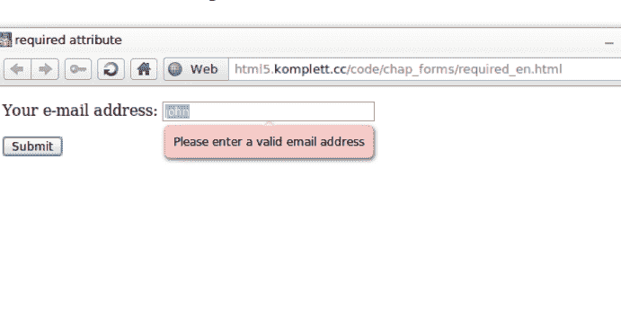

**图 3.13** 在 Opera 中输入无效电子邮件地址后的错误信息

基于 WebKit 的浏览器，如 Google Chrome 或 Safari，目前支持验证但不会显示错误信息。它们会在无效字段周围添加边框，并将光标定位在该字段中，至少提供一些提示，表明存在问题。

> 尽管客户端表单输入验证备受推崇，但你不应忘记这一步骤无法替代服务器端控制。潜在的攻击者只需极少的技术手段就能绕过这些机制。


#### 3.4.1 "invalid" 事件

在表单验证期间，内容无效的元素会触发 invalid 事件。我们可以利用这一点来单独响应不正确的值：

```
window.onload = function() {
    var inputs = document.getElementsByTagName("input");
    for (var i=0; i<inputs.length; i++) {
        inputs[i].addEventListener("invalid", function() {
            alert("Field "+this.labels[0].innerHTML
                +" is invalid");
            this.style.border = 'dotted 2px red';
        }, false);
    }
}
```

页面加载后，会生成一个包含所有输入元素的列表（类似于 3.3.5 节中的示例）。每个元素都被添加了一个事件监听器来处理错误。在我们的示例中，它会打开一个警告窗口，并用红色虚线边框标记该元素。输入元素的标签用作警告窗口中的文本。

在包含许多输入字段的表单中，这种方法并不理想。用户必须为每个不正确的输入点击确定按钮，然后在表单中找到相应的字段并重新填写详细信息。有时，如果用户在填写字段时能立即收到无效输入的通知，可能会更有用。我们将在下一节中尝试这种方法。

#### 3.4.2 "checkValidity" 函数

要触发对输入元素的验证，需要调用该元素的 checkValidity 函数。但你也可以“手动”启动通常在提交表单时会发生的事情：

```
<input type=email name=email
       onchange="this.checkValidity();">
```

如果你输入了一个无效的电子邮件地址并移开输入焦点（通过 Tab 键或点击浏览器中的其他位置），浏览器（目前至少在 Opera 中）会立即返回错误信息（参考图 3.13）。如果我们为所有输入元素的 onchange 事件附加一个用于检查输入的函数，错误处理将变得更加优雅：

```
window.onload = function() {
  var inputs = document.getElementsByTagName("input");
  for (var i=0; i<inputs.length; i++) {
    if (!inputs[i].willValidate) {
      continue;
    }
    inputs[i].onchange = function() {
      if (!this.checkValidity()) {
        this.style.border = 'solid 2px red';
        this.style.background = '';
      } else {
        this.style.border = '';
        this.style.background = 'lightgreen';
      }
    }
  }
}
```

熟悉的循环遍历所有输入元素，首先检查该元素是否可用于验证。如果 *willValidate* 不返回值 *true*，循环将继续处理下一个元素。否则，一个匿名函数被分配给 *onchange* 事件，调用 *checkValidity* 函数。匿名函数中的 *this* 指向输入元素。如果有效性检查失败，该元素将被红色边框包围；否则，该元素的背景将被设置为浅绿色。请记住，将背景颜色和边框重置为空字符串，以确保在用户更正不正确的输入后，浏览器将格式恢复为默认值。在图 3.14 中，你可以看到 *checkValidity* 函数如何因不正确的时间输入而生成错误信息。

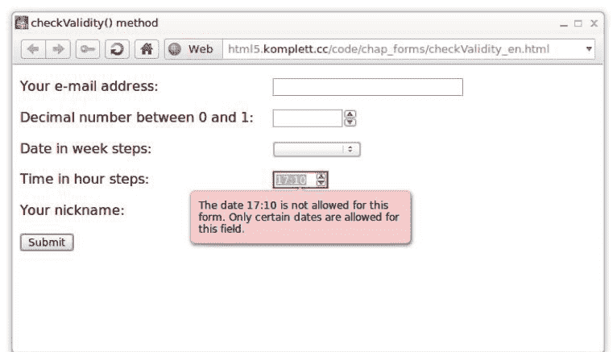

**图 3.14** Opera 在不正确的时间输入后显示错误信息（本例中是违反了 "step" 属性）

如果你想让错误处理更具交互性，可以使用新的 HTML5 oninput 事件代替 onchange 事件。与在字段失去焦点时触发的 onchange 不同，oninput 在每个字符更改后都会被激活。oninput 事件现在实现了你之前需要通过键盘事件 keyup 和 keydown 编程才能实现的功能。oninput 的另一个优点是事件监听器只需附加到整个表单上一次，而无需附加到每个输入元素上。因此，在我们前面的示例中，你可以省去所有 JavaScript 代码，并将表单定义修改如下：

```
<form method=get oninput="this.checkValidity();"
      action=checkValidity.html >
```

这意味着你放弃了更改边框和背景颜色，但大大缩短了源代码。在某些情况下，对每次按键做出即时反应可能非常有用，但在填写表单字段时，通常在字段完全填写完毕后检查内容就足够了。

#### 3.4.3 使用 "setCustomValidity()" 进行错误处理

如果你觉得之前介绍的所有错误处理方法仍然不够，你也可以自己编写函数来检查内容。在下面的示例中，我们定义了一个类型为 email 的输入字段，这确保浏览器将检查有效的电子邮件地址。此外，我们还想特别排除三个电子邮件域名：

```
var invalidMailDomains = [
  'hotmail.com', 'gmx.com', 'gmail.com' ];

function checkMailDomain(item) {
  for (var i=0; i<invalidMailDomains.length; i++) {
    if (item.value.match(invalidMailDomains[i]+'$')) {
      item.setCustomValidity('E-mail addresses from '
        +invalidMailDomains[i]+' are not accepted.');
    } else {
      item.setCustomValidity('');
    }
    item.checkValidity();
  }
}
```

将数组 invalidMailDomains 中的每个元素与输入元素的值进行比较。JavaScript 函数 match() 使用正则表达式，这就是为什么我们在域名后添加 $ 符号，以指示字符串的结尾。如果字符串匹配，则调用 setCustomValidity 函数并显示相应的错误信息。如果不是数组中的域名，则使用空字符串调用 setCustomValidity()。在内部，这将变量 validationMessage 附加到输入元素上，Opera 随后会显示该信息（参见图 3.15）。最后调用 checkValidity 函数会触发有效性检查，并导致上述错误信息。

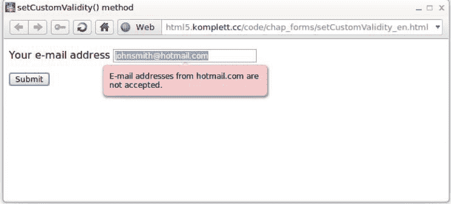

**图 3.15** Opera 在手动错误处理期间显示错误信息（检查电子邮件域名）

#### 3.4.4 有效性检查摘要

表 3.3 总结了可用于有效性检查的所有输入属性和有效性函数，以及它们出现的场景。

**表 3.3** 表单字段有效性检查期间可能出现的错误

| 属性/函数 | 问题 |
|---|---|
| required | 字段中未输入值。 |
| type=email, url | 输入的值与要求的类型不匹配。 |
| pattern | 输入的值与要求的模式不匹配。 |
| maxlength | 输入的值长于允许的长度。 |
| min, max | 输入的值太小或太大。 |
| step | 输入的值违反了要求的步长。 |
| setCustomValidity() | 未满足为此字段设置的附加条件。 |

#### 3.4.5 或者也许最好不要验证？"formnovalidate"

现在我们花了这么多时间讨论错误处理，我们将告诉你如何使用 formnovalidate 属性绕过所有规则。乍一看，完全无视所有费力定义的规则，直接提交未经验证的表单可能有点奇怪。规范提供了一个简短的解释，很快解开了谜团。跳过有效性检查的典型应用是一个用户无法或不想一次性完成的表单。通过在提交按钮上添加 formnovalidate 属性，可以保存当前已输入的内容以备后用。

> **注意**
>
> 如果你使用 formnovalidate 提交表单，已完成的字段会被发送到服务器。服务器应用程序负责可能临时保存数据。


例如，想象一下，你想填写一份关于有故障的数码相机的支持表单。在花了很长时间填写所有关于发生错误的详细信息后，网站要求你提供相机的序列号。由于你手头没有相机，并且不想丢失所有已输入的信息，你可以点击保存按钮，然后从容地去找相机。这个按钮的定义如下：


## 3.5  示例：一个支持表单

在本示例中，之前介绍的新元素和属性被应用于一个表单。这种表单在扩展状态下，可用于电子产品经销商的网站。

首先，客户需要提供个人信息（在此示例中仅为姓名、电子邮件地址以及电话和传真号码）。表单的第二部分涉及产品的技术数据和故障信息。网页底部显示一个进度条，旨在鼓励用户完成表单（见图 3.16）。


图 3.16  几乎完成的支持表单

该表单的 HTML 代码首先加载一个外部 JavaScript 文件和我们已经熟悉的 `window.onload` 调用：

```html
<script src="support.js"></script>
<script>
window.onload = function() {
    initEventListener();
}
</script>
```

`initEventListener` 函数遍历所有输入元素，并为 `onchange` 事件分配一个匿名函数，以检查相应元素的有效性：

```javascript
function initEventListener() {
    var inputs = document.getElementsByTagName("input");
    for (var i=0; i<inputs.length; i++) {
        if (!inputs[i].willValidate) {
            continue;
        }
        inputs[i].onchange = function() {
            this.checkValidity();
        }
    }
}
```

事件监听器仅在元素能够验证有效性时才会添加。在我们的示例中，用于提交或保存的两个按钮不具备验证有效性的选项，因此它们不会获得 `onchange` 事件。如前所述，在填充完各个表单字段后进行验证，比使用 `oninput` 事件验证整个表单更为方便。

为了提高表单的用户友好性，我们希望突出显示标记为必填的元素，使用户能立即清楚哪些是最重要的字段。幸运的是，我们不必为每个元素都添加额外的样式。CSS3 为我们提供了新的选择器 `:required`，它正是为此情况而设计的。以下指令为所有必填元素添加橙色边框：

```css
:required { border-color: orange; border-style: solid; }
```

各个输入字段的定义没有什么特别之处。电子邮件地址和电话号码有各自的类型并且是必填项；故障发生日期具有 `date` 类型，因此可以从日历窗口中选择。网页上部的两列布局通过相邻的 `div` 元素实现。我们仍然希望使用 Tab 键跳转到下一个字段的用户从上到下填写表单，而不是像 HTML 逻辑可能暗示的那样，先填写左列再填写右列。我们可以通过 `tabindex` 属性实现这一点，这意味着在字段中按 Tab 键将光标移动到具有下一个更高 `tabindex` 值的字段：

```html
<div style="float:left">
<p><label>Your name
<input tabindex=1 type=text required autofocus
  placeholder="John Smith" name=name></label>
<p><label>Your e-mail address
<input tabindex=3 type=email name=email required></label>
</div>
<div style="float:left;margin-left:10px;">
<p><label>Telephone number
<input tabindex=2 type=tel name=tel required></label>
<p><label>Fax number
<input tabindex=4 type=tel name=fax></label>
</div>
```

现在代码变得更加有趣的是 textarea 字段。HTML5 对这种类型的更改不多。但正如你在图 3.16 中看到的，每个文本字段上方现在都有一个小的图形显示，显示你还能在该字段中输入多少个字符。你可能立刻就明白了：这是通过新的 meter 元素实现的，你在 3.3.1 节“使用 'meter' 显示测量值”中已经了解过：

```html
<p><label>Error message
<textarea placeholder="Lens error. Camera restart."
  name=errmsg required rows=5 cols=50
  title="up to 200 characters">
</textarea></label><meter value=0 max=200
  tabindex=-1></meter>
```

meter 元素初始化为最大值 200，这正是 textarea 的 `title` 属性中指定的最大值。如果用户输入的字符数超过允许的最大值，meter 元素会变红，表示输入的文本过长。浏览器仍会提交所有文本，因为我们没有限制 textarea。因此，这更像是一个提示而非严格要求。用于更新 meter 元素的 JavaScript 函数是 `updateTAMeters()`，它对所有 textarea 执行：

```javascript
function updateTAMeters() {
  var textfs = document.getElementsByTagName("textarea");
  for(var i=0; i<textfs.length; i++) {
    textfs[i].labels[0].nextSibling.value =
      textfs[i].textLength;
  }
}
```

循环的优势在于，我们现在可以添加任意数量的 textarea 元素，只要它们有一个 meter 元素，它们就会自动更新。为了实现这一点，我们需要借助一个 DOM 技巧：上一个清单中以粗体打印的代码访问了 DOM 函数 `nextSibling`，即对下一个元素的引用。让我们回顾一下文本字段和状态栏的 HTML 代码，以便更清楚地说明。textarea 元素被一个 label 元素包围，后面跟着所需的 meter 元素。为了从 textarea 元素到达 meter 元素，我们使用文本字段的 `labels` 属性。这是一个 *NodeList* 数组，我们感兴趣的是第一个元素（索引为 0），因为紧随其后的元素（即 `nextSibling`）就是 meter 元素。

如果你仔细观察，这个过程并不像初看起来那么复杂，但它也有一些陷阱。如果在包围的 label 元素和 meter 元素之间存在一个多余的空格或换行符，那么我们的状态显示就不再有效了。`nextSibling` 此时会变成一个文本元素，我们无法在 for 循环中再访问到 meter 元素。

接下来，我们想为表单末尾的进度显示进行编程。你可能猜到了，这是一个 progress 元素；更有趣的是我们如何在 JavaScript 中优雅地更新这个元素。首先，是该元素的 HTML 代码：

```html
<label>Progress:
  <progress id=formProgress value=0
    tabindex=-1></progress></label>
```

我们为 progress 元素分配一个 id、一个起始值 0（`value`）和一个负的 tabindex，这意味着该元素永远不会通过 Tab 键访问。JavaScript 函数 `updateProgress()` 更新 progress 元素：

```javascript
function updateProgress() {
  var req = document.querySelectorAll(":required");
  count = 0;
  for(var i=0; i<req.length; i++) {
    if (req[i].value != '') {
      count++;
    }
  }
  var pb = document.getElementById("formProgress");
  pb.max = req.length;
  pb.value = count;
}
```

因为进度条只应涉及那些绝对必填的元素，我们将字符串 `:required` 传递给函数 `querySelectorAll()`。结果是一个仅包含具有 `required` 属性的元素的 *NodeList*。然后遍历这些元素，检查 `value` 属性是否与一个非空字符串匹配。如果此条件成立（换句话说，已经输入了值），则计数器变量 `count` 增加一。最后，将 progress 元素的最大值设置为所有必填字段的数量，值设置为非空元素的数量。

两个按钮可用于提交表单：保存和提交。我们已经在 3.4.5 节“或者最好不验证？'formnovalidate'”中讨论了保存功能；这里的新增内容是 `accesskey` 属性：

```html
<p><input accesskey=T type=submit formnovalidate
    value="Save [S]"  name=save id=save>
<input accesskey=T type=submit name=submit id=submit
    value="Submit [T]">
```

键盘快捷键在 HTML5 中并不新鲜，但到目前为止还没有被广泛使用。键盘快捷键的一个问题是，它们在不同的平台上通过不同的组合键激活，因此你永远无法完全确定对于特定的快捷键应该按哪个键。HTML5 规范有一个解决此问题的建议：`accessKeyLabel` 的值应返回一个字符串，该字符串对应于你所使用平台上的正确值。然后你可以将此值用于按钮的标签或其 title 属性。遗憾的是，在撰写本文时，没有一个浏览器能够输出这个字符串。

### 总结

我们在本章提供的信息解释了 HTML5 为表单提供的许多新选项。Web 开发人员的好日子即将来临，因为他们将不再需要为常见输入元素（如日期和时间）费力地使用 JavaScript 库。特别是，新的表单功能在移动设备上工作时将非常有帮助，因为在移动设备上进行文本输入通常比在计算机上困难得多。浏览器中的表单验证也将显著有助于使代码更透明、更易于管理。但不要忘记，客户端验证并不能使服务器应用程序更安全；潜在的攻击者可以轻松地绕过这些检查。

如果本章激发了你的兴趣，并且你想在自己的网站上尝试刚刚获得的表单知识，那就放手去做吧。新元素和属性的语法构建方式使得即使是较旧的浏览器也不会产生错误。此类浏览器的用户将无法充分享受新输入元素的全部好处，但文本输入始终是可能的。


## 4 视频与音频

YouTube 的问世对于在线视频展示而言是一次质的飞跃。在视频平台出现之前，电脑新手几乎不可能通过互联网向他人提供视频文件：这些文件通常太大，无法通过电子邮件发送，即使发送成功，收件人的电脑也很可能无法播放。

而 YouTube 则提供在线存储功能，让你可以保存视频文件。它还能转换不同的视频格式，使其可通过 Adobe Flash Player 播放。

Adobe 在多种操作系统上支持 Flash，为所有常见浏览器提供插件。浏览器插件通常是个好主意，但插件与浏览器之间的通信有时会很困难，甚至完全不可能。此外，*闭源*插件（如 Adobe Flash Player）并不受浏览器厂商欢迎，因为在崩溃情况下，它们会大大增加查找错误的难度。

HTML5 想要解决这一问题。必要的新 HTML 元素很容易找到：video。但这还不足以解决问题。

### 4.1 第一个示例

我们将给你一个简短的示例，演示新的 HTML5 video 元素使用起来有多简单：

```
<!DOCTYPE html>
  <title>Simple Video</title>
  <video controls autoplay>
    <source src='videos/mvi_2170.webm' type='video/webm'>
    <source src='videos/mvi_2170.ogv' type='video/ogg'>
    Sorry, your browser is unable to play this video.
  </video>
```

你可以用极少的代码在浏览器中播放视频。在图 4.1 中，你可以看到 Mozilla Firefox 中的结果。HTML 语法几乎是自解释的，但我们将在下一节中更详细地探讨它。

### 4.2 "video"元素及其属性

在前面的示例中，video 元素被赋予了两个属性：controls 和 autoplay。controls 属性告诉浏览器显示视频的控制元素（参见图 4.1），而 autoplay 则告诉浏览器一旦条件允许就开始播放视频。

与 canvas 元素一样（参见第 5 章 Canvas），video 元素属于*嵌入内容*类别；换句话说，它是不直接与 HTML 相连的内容之一。在嵌入内容中，如果浏览器不支持 video 元素，你可以包含一个替代方案（*fallback*）。如果在 4.1 节"第一个示例"中发生这种情况，文本 *Sorry, your browser is unable to play this video* 将会显示。此外，你也可以显示视频中的一张静态图片。但让我们更详细地看看 video 元素可能的属性（参见表 4.1）。

**表 4.1** "video"元素的属性

| 属性 | 值 | 说明 |
| :--- | :--- | :--- |
| src | url | 要播放的视频的 URL。该属性是可选的，可以用一个或多个 source 元素替代，如我们的示例所示。 |
| poster | url | 视频加载期间浏览器显示的图片的 URL。 |
| preload | none | 浏览器不应在点击播放按钮之前尝试加载视频。这可以节省带宽。 |
| preload | metadata | 仅加载视频的元数据（例如，视频长度、作者、版权）。 |
| preload | auto | 在这种情况下，即使在用户点击播放按钮之前，整个视频也会被加载。 |
| autoplay | boolean | 浏览器在收到足够数据后开始播放视频。 |
| controls | boolean | 显示视频的简单控制元素。这并不决定这些元素应该是什么样子；这主要取决于浏览器厂商。规范建议了几个元素，例如播放和暂停视频的控件、设置音量、跳转到视频另一点（如果内容支持）、切换到全屏，以及可能的字幕按钮。 |
| loop | boolean | 告诉浏览器在视频到达末尾后重复播放。 |
| width | *in CSS pixels* | 视频显示的宽度 |
| height | *in CSS pixels* | 视频显示的高度 |
| audio | *muted* | 导致用户代理覆盖用户的偏好设置（如果有的话），并始终默认将视频静音。 |

如果 video 元素没有 src 属性，浏览器会处理 video 元素内包含的一个或多个 source 元素。为此目的，属性 src、type 和 media 被使用（参见表 4.2）。反过来，如果有 source 元素，则绝对不能为 video 指定 src 属性。

**表 4.2** "source"元素的属性

| 属性 | 值 | 说明 |
| :--- | :--- | :--- |
| src | *url* | 要播放的视频的 URL |
| type | *mime-type* | 视频的 MIME 类型。你可以添加音频和视频编解码器的说明，例如 type='video/webm; codecs="vorbis,vp8"'。如果有多个 source 元素，浏览器会使用此属性（及其他属性）来决定播放哪个视频。 |
| media | *CSS Media Query* | 视频所针对的输出媒介 |

浏览器使用两个标准来决定播放哪个现有的 source 元素：视频的 MIME 类型，以及如果存在的话，media 属性，你可以在其中以 CSS 媒体查询的形式指定额外的限制条件。

对于 CSS3，媒体查询被显著扩展，因此除了 print、screen、handheld 或 projection 等熟悉的关键词外，你现在还可以有更复杂的指令。下面是一个例子：

```
media="screen and (min-width: 800px)"
```

这对视频输出来说很有意思，因为根据浏览器大小，可以提供不同分辨率的视频。 thanks to this trick，即使屏幕较小、网络连接较慢的移动设备也能完美应对。基于媒体查询以缩减尺寸显示视频的完整示例如下：

```
<!DOCTYPE html>
  <title>Simple Video</title>
  <video controls autoplay>
    <source src='videos/mvi_2170.webm' type='video/webm'
      media="screen and (min-width: 500px)" >
    <source src='videos/mvi_2170_qvga.webm'
      type='video/webm' media="screen" >
    Sorry, your browser is unable to play this video.
  </video>
```

视频显示宽度小于 500 像素的浏览器将自动显示较小的视频格式 mvi_2170_qvga.webm。

> CSS3 媒体查询规范目前处于*编辑草案*阶段。因此，一些细节可能会发生变化。你可以在 W3C 网站 http://dev.w3.org/csswg/css3-mediaqueries 上查询规范的最新状态。

确定播放哪个视频的第二个标准是 MIME 类型。通过可选地添加所使用的编解码器，浏览器甚至可以在加载之前识别视频是否能够被解码。但这些编解码器到底是什么？下一节试图为编解码器的丛林带来一些光明。

### 4.3 视频编解码器

现代视频格式使用*容器*文件，其中音频和视频内容可以分开保存。这种灵活的方法有几个优点。例如，一个文件中可以保存多个音轨，让用户可以在语言之间切换（就像在视频 DVD 上一样）。图 4.2 显示了视频容器文件的示意图。在此容器文件中压缩音频和视频的方式被称为*编解码器*。

**图 4.2** 视频容器格式的示意图

在制定 HTML5 规范期间，一个有争议的问题是允许使用哪些音频和视频编解码器。这些争论一方面源于拥有某些编码流程专利的公司的商业利益，另一方面源于选择功能强大、质量高的格式的愿望。更确切地说，阵营分为支持专利保护的视频编解码器 *H.264* 的一方，和由 Mozilla 团队领导的呼吁采用开源格式 *Ogg Theora* 的另一方。当 Ian Hickson 意识到这一冲突可能危及重要的 video 元素时，他决定将该格式的定义从规范中移除。现在由浏览器厂商决定支持哪些格式，以及愿意为哪些格式支付许可费用。

尽管 Mozilla 极力避免重蹈图像格式 GIF 的覆辙（CompuServe 后来对 GIF 收取了许可费），但 H.264 似乎是在线视频格式新竞赛中的热门。但 Google 不想被动等待潜在专利侵权的困境，决定亲自解决这个问题。通过收购视频专家 *On2 Technologies*（该公司已经开发了重要的视频格式），Google 拥有了当时尚未发布的编解码器 *VP8*。在 Google 开发者大会 *Google-IO 2010* 上，这家软件巨头终于揭开了谜底：新项目 *WebM*，基于视频编解码器 VP8 和音频格式 *Ogg Vorbis*，作为开源项目在互联网上发布于 http://www.webmproject.org，并很快在 Firefox 和 Opera 中实现。

2011 年初，Google 甚至更进一步，宣布将从其 Chrome 浏览器的未来版本中移除对 H.264 编解码器的支持。这一出人意料举措的理由是，Google 希望促进开放


创新，坚信万维网的核心技术必须基于开放标准，而H.264并非如此。

在简述这段历史之后，我们现在将更详细地介绍各个具体格式。不必担心；我们不会深入探讨视频压缩的技术细节。我们仅介绍互联网上常用的格式。

#### 4.3.1 Ogg: Theora与Vorbis

当弗劳恩霍夫协会在上世纪末开始对流行的MP3格式收取许可费时，*Xiph.Org基金会*开发了免费的音频编解码器*Vorbis*。基于2002年发布的视频编解码器*VP3.2*（由前述公司*On2*开发），Xiph还创建了视频格式*Theora*。视频和音频在一个容器格式*Ogg*中组合，该容器可以包含一个或多个音频和视频轨道。Ogg视频文件的MIME类型是*video/ogg*，相应的文件扩展名是*.ogv*。（扩展名*.ogg*也可以使用，但根据Xiph.org的说法，我们应避免使用它，而应使用更明确的文件扩展名*.ogv*表示Ogg视频，*.oga*表示Ogg音频。）

请勿将*Ogg Media*容器格式（文件扩展名*.ogm*）与本文讨论的Ogg容器混淆。Ogg Media（OGM）容器是一种支持大量额外视频编解码器的扩展。起初，这听起来非常有用，但确实导致了一些问题：Xiph坚持认为Ogg只应在自由格式的上下文中提及，但Ogg Media并非如此，它也可以使用受专利保护的格式。

#### 4.3.2 MPEG-4: H.264与AAC

MPEG-4（MP4）容器是Apple操作系统中常用的多媒体格式*QuickTime*的衍生品。与Ogg容器类似，MP4可以包含音频和视频轨道；它甚至更进一步，可以嵌入图像和文本。MP4中最常见的编解码器是受专利保护的视频编解码器H.264和音频编解码器*高级音频编码（AAC）*。文件扩展名是*.mp4*，常见的媒体类型是*video/mp4*、*audio/mp4*和*application/mp4*。

当扩展名为*.m4a*的文件开始出现在iPod和其他Apple设备上时，Apple造成了一些混乱。这些是MP4文件，但Apple希望文件扩展名能表明它是一个纯音频文件。其他使用的文件扩展名包括*.m4b*用于有声读物，*.m4r*用于iPhone铃声。

主要是Apple移动设备（iPod、iPhone、iPad）的巨大成功，促进了MP4文件格式的迅速普及。为了在处理器较弱的设备（如手机）上播放视频时获得可接受的性能，计算密集型过程被转移到一个单独的芯片上。这种硬件加速节省了能源并延长了电池寿命。

关于H.264编解码器的专利问题不容小觑。这种编码类型至少在2028年之前都受到专利保护——这就像悬在软件制造商头上的一把达摩克利斯之剑，他们可能随时被要求为编码过程支付费用。

#### 4.3.3 WebM: VP8与Vorbis

正如本节开头提到的，Google通过创立WebM项目引起了一些兴奋和热潮。视频编解码器VP8总体上获得了非常好的反馈，音频编解码器Vorbis也已证明是成功的。Google决定使用开源格式*Matroska*作为容器，这也已经过实践检验。但尽管Matroska格式支持多种不同的编解码器，WebM容器只允许使用视频编解码器VP8和音频编解码器Vorbis。

WebM视频的标准文件扩展名是`.webm`，相应的MIME类型是*video/webm*。

在Google宣布后，Mozilla Firefox、Opera，甚至Microsoft Internet Explorer的浏览器制造商立即宣布将支持WebM格式。不言而喻，Google的浏览器Chrome提供了对WebM的支持，因此只有一种浏览器不支持新的编解码器（至少在撰写本文时）：Apple的Safari。

### 4.4 视频转换工具

因为大多数人的数码相机通常不会生成WebM或Ogg格式的视频，下一节将介绍用于转换视频的不同工具。它们都是开源产品，可以在Windows、Mac OS和Linux上运行，*Miro Video Converter*除外。

#### 4.4.1 FFmpeg

*FFmpeg*有时被称为视频转换的*瑞士军刀*。这是有道理的，因为FFmpeg能够读取和写入的音频和视频格式列表非常长。它还可以将多媒体文件拆分成其组成部分；例如，它可以只提取影片中的音频轨道然后进行转换。如果你正考虑将转换后的YouTube视频添加到你的MP3收藏中，请注意：YouTube上音频轨道的质量通常相当令人失望。

因为FFmpeg的开发者不屑于处理诸如图形用户界面编程之类的琐碎事情，用户最好不要太害羞于使用命令行。如果你不更改FFmpeg的默认设置，你只需要以下函数调用即可将现有的Flash视频（FLV）转换为WebM格式：

```
$> ffmpeg -i myflashvideo.flv myflashvideo.webm
```

FFmpeg也非常适合查找视频的格式：

```
$> ffmpeg -i myflashvideo.flv
...
Input #0, flv, from '/tmp/myflashvideo.flv':
  Duration: 00:05:12.19, start: 24.8450, bitrate: 716 kb/s
    Stream #0.0: Video: h264, yuv420p, 480x360 [PAR 1:1
      DAR 4:3], 601 kb/s, 25 tbr, 1k tbn, 49.99 tbc
    Stream #0.1: Audio: aac, 44100 Hz, stereo, s16,
      115 kb/s
```

在这个例子中，我们处理的是一个大约五分钟长的Flash容器视频，其中视频轨道使用H.264编解码器保存，音频轨道是AAC。

自0.6版本以来，FFmpeg已经支持WebM视频。但开发者对使用通过Google获得的*libvpx*库并不满意：他们基于现有的FFmpeg代码重新实现了VP8，希望在视频转换中实现相当更好的性能。

FFmpeg项目的重要组成部分是*libavcodec*库，其中保存了支持的音频和视频格式。像*vlc*、*mplayer*或*xine*这样的播放器使用这个库来播放或重新编码视频。

> **注意**

FFmpeg的参数列表实际上无穷无尽，无法在本书的范围内详细复制。如果你有兴趣了解更多信息，请参阅在线提供的优秀FFmpeg文档，地址为 http://www.ffmpeg.org/ffmpeg-doc.html。

表4.3显示了使用FFmpeg进行编码的一些重要参数。

| 参数 | 效果 |
| --- | --- |
| -h | 所有参数的帮助（非常长的列表） |
| -formats | 所有支持的文件格式列表 |
| -codecs | 所有支持的音频和视频编解码器列表 |
| -i *file* | 将*file*设置为输入文件/流 |
| -f *fmt* | 将*fmt*设置为输出格式（例如，webm、ogg或mp4） |
| -ss *start* | 在输入媒体中搜索到*start*点（以秒为单位） |
| -t *duration* | 录制*duration*秒 |
| -b *bitrate* | 视频质量（比特率，默认：200千比特/秒） |
| -r *fps* | 每秒帧数（默认：25） |
| -s *widthxheight* | 视频尺寸（以像素为单位，指定为宽乘以高，或如*vga*之类的规格） |
| -ab *bitrate* | 音频质量（比特率，默认：64千比特/秒） |

得益于让FFmpeg无需用户交互即可工作的选项，它特别适合自动视频转换。

#### 4.4.2 VLC

多年来，*VideoLan*项目一直在开发流行的媒体播放器*VLC*，它适用于各种操作系统（Windows、Mac OS、Linux和其他UNIX变体），具有简单的图形界面。该媒体播放器使用了，除其他外，FFmpeg项目的*libavcodec*库，因此也支持WebM格式。

VLC不仅可以播放不同格式和来源的视频；你还可以通过菜单项“转换/保存”来转换多媒体内容。如图4.3所示，你可以使用预定义配置文件转换为常用格式——这是一个非常有用的功能。


#### 4.4.3 Firefogg

如果你对使用命令行不完全熟悉，并且不想安装 VLC，你可以使用 Firefox 扩展 Firefogg。安装后，你可以访问 http://firefogg.org/make，轻松选择计算机上的视频并将其转换为 Ogg 或 WebM 视频格式。在这种情况下，Firefogg.org 只提供图形界面按钮；转换过程在本地计算机上进行。在 Firefogg 安装过程中下载的 FFmpeg 改编版本在后台运行。

在菜单项预设中，你可以找到高质量和低质量的 Ogg 与 WebM 视频的默认设置（参见图 4.4）。你还可以通过用户界面方便地设置元数据，如标题、作者、录制日期和版权。

## 第四章——视频与音频

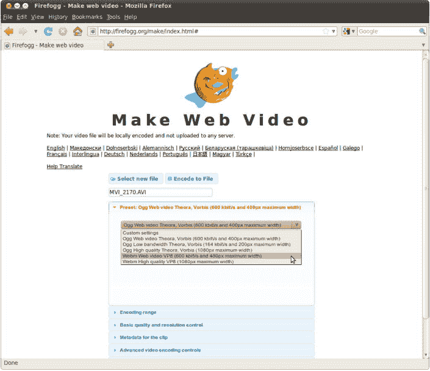

但 Firefogg 不仅仅是一个 FFmpeg 的图形界面。该扩展附带一个 JavaScript 库，使网络开发人员能够非常容易地为用户实现视频上传。其优势显而易见：与其上传低压缩率的视频格式，然后在服务器上进行转换，不如在客户端上传之前进行转换。这节省了网络服务器的带宽和计算能力。维基百科也押注于这个概念，因此我们可以期待 Firefogg 的继续发展。

> **注意**

网站 http://firefogg.org/dev/chunk_post_example.html 用几行源代码展示了 Firefogg JavaScript 库的工作原理。Firefogg 将上传分成 1MB 的块，这意味着如果网络连接中断，你不需要重新上传整个视频。

#### 4.4.4 Miro 视频转换器

*Miro 视频转换器* 是作为 *Miro 媒体播放器* (http://www.getmiro.com) 的一个分支开发的，后者是一款创新的开源音频和视频播放器，适用于所有常见操作系统。Miro 视频转换器仅适用于 Windows 和 Mac OS。图 4.5 展示了其简单的用户界面，不仅提供按视频编解码器选择，还提供按设备（iPad、iPhone、PlayStation 和 Android 手机）选择。

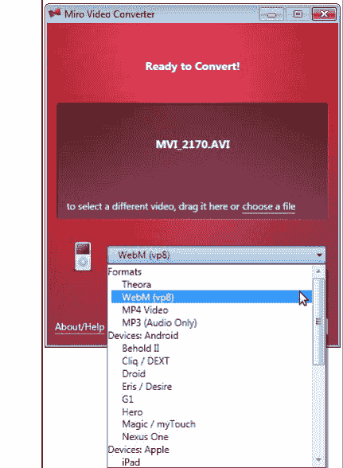

通过拖放加载视频文件，FFmpeg 就会开始转换。如果 FFmpeg 因任何原因失败（偶尔会发生），FFmpeg 输出按钮可以提供帮助：除了确切的命令外，它还显示所有转换状态消息（参见图 4.6）。快速 Google 搜索相关错误消息通常会有所帮助。

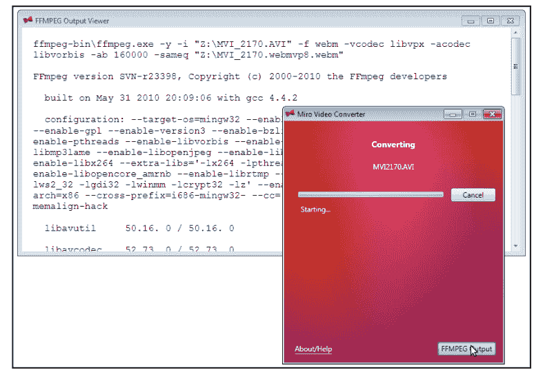

### 4.5 哪种格式适用于哪种浏览器？

如果你想让尽可能多的不同浏览器在线观看视频，目前你必须为视频元素提供回退解决方案。如表 4.4 所示，目前没有单一的视频格式能被所有常见浏览器显示。关于浏览器版本和发布日期的对应关系，请参阅引言章的末尾，或查看以下网站上显示的时间线：

http://html5.komplett.cc/code/chap_intro/timeline.html?lang=en

表 4.4 当前浏览器中的编解码器支持

| 编解码器 | Firefox | Opera | Chrome | Safari | IE | iOS* | Android |
| :--- | :--- | :--- | :--- | :--- | :--- | :--- | :--- |
| OGG | 3.5 | 10.50 | 3.0 | | | | |
| MP4 | | | 3.0 | | | 3.0 | 2.0 |
| WebM | 4.0 | 10.60 | 6.0 | | 9** | | |
| Flash | 插件 | 插件 | 插件 | 插件 | 插件 | | 2.2 |

* Apple 用于移动设备的操作系统，例如 iPhone、iPad、iPod（自 2010 年 6 月起为 iOS，此前为 iPhone OS）。
** 根据微软的说法，WebM 编解码器必须安装在操作系统中，这与其他浏览器不同。

### 4.6 针对旧版浏览器的临时解决方案

幸运的是，并非每个希望兼顾不同平台或浏览器的网络开发人员都必须完全重新发明轮子。有几个免费的在线库专注于解决这个问题。目前，Kaltura 的 JavaScript 库 *mwEmbed* 已经达到了非常好的开发阶段。维基百科使用它为大多数平台提供视频和音频元素。该库主要关注 Ogg 格式。如果你想同时提供 WebM 和 MP4，使用 *html5media* 库是一个不错的选择。

#### 4.6.1 mwEmbed

mwEmbed 库主要通过集成到维基百科而获得了更广泛的认可。mwEmbed 背后的公司 Kaltura 不仅为免费百科全书的维基软件 *MediaWiki* 提供集成，还为 *Drupal* 或 *WordPress* 等常见 CMS 和博客软件的现成插件提供集成。

为了确保即使是旧版浏览器也不会在新的 HTML5 语法下崩溃，本示例添加了 head 和 body 元素：

```html
<!DOCTYPE html>
<html>
  <head>
    <title>mwEmbed fallback</title>
    <script type="text/javascript"
        src="http://html5.kaltura.org/js" > </script>
  </head>
  <body>
    <h1>mwEmbed fallback</h1>
    <video controls autoplay>
      <source src='videos/mvi_2170.mp4' type='video/mp4'>
      <source src='videos/mvi_2170.webm' type='video/webm'>
      <source src='videos/mvi_2170.ogv' type='video/ogg'>
      Sorry, your browser is unable to play this video.
    </video>
  </body>
</html>
```

JavaScript 库 mwEmbed 直接从项目网站 (http://html5.kaltura.org/js) 下载，然后处理视频的播放方式。无论如何，视频底部会出现一个小的控制条。图 4.7 展示了 Internet Explorer 8 的反应，它还不认识 HTML5 视频元素：为了播放 Ogg 视频，它加载了 Java 小程序 *Cortado*。

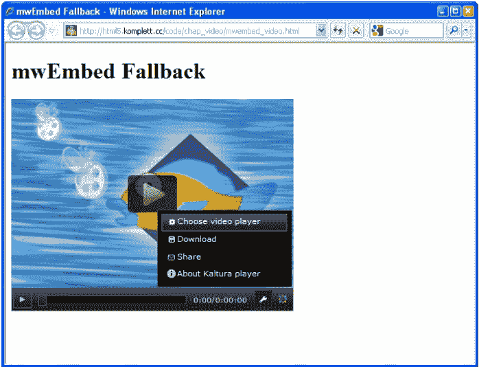

如果你对使用 Java 小程序替代浏览器原生视频不满意，可以改用 *html5media* 库。

#### 4.6.2 html5media

JavaScript 库 *html5media* 的工作方式比 mwEmbed 更为保守，只在浏览器无法播放任何指定的视频格式时才采取行动。在这种情况下，它会加载开源 Flash 视频播放器 *Flowplayer*，并期望输入 MP4 (H.264) 视频。不幸的是，该库的当前版本存在一个缺陷，这意味着如果指定了多个 source 元素，旧版浏览器会返回 JavaScript 错误且不输出任何内容：

```html
<!DOCTYPE html>
<html>
  <head>
    <title>html5media fallback</title>
    <script type="text/javascript"
      src="libs/html5media.min.js" > </script>
  </head>
  <body>
    <h1>html5media fallback</h1>
    <video src="videos/mvi_2170.mp4" width=640 height=480
      controls>
    </video>
  </body>
</html>
```

在这种情况下，指定宽度和高度很重要；否则，Flowplayer 将以仅几像素的高度显示。图 4.8 提供了一个示例。

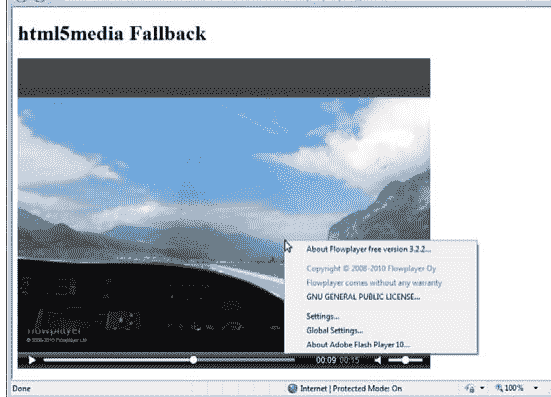

86 第四章——视频与音频

### 4.7 视频与脚本——一个简单的视频播放器

你不仅可以在浏览器中显示视频，还可以通过 HTMLMediaElement 接口使用 JavaScript 直接控制它们。本节将向你展示这是如何工作的。我们将实现一个具有以下功能的简单 JavaScript HTML5 视频播放器：

- 启动和停止视频
- 在控制条上显示和设置播放位置
- 快进和快退
- 选择影片中的特定场景
- 在高、低和静音之间切换音量

为我们的视频播放器找到一个合适的视频很容易：*大雄兔* (Big Buck Bunny)——一部大约十分钟长的计算机动画卡通片，正如其网址 http://bigbuckbunny.org 所表明的那样，它是一个免费电影项目的成果。该项目由 *Blender 基金会* 发起。从 2007 年 10 月到 2008 年 4 月，七位 3D 动画专家使用 *Blender、Gimp、Inkscape* 或 *Python* 等免费软件（均运行在 *Ubuntu* 上）创作了这部电影，并在开放许可下在线提供。根据座右铭 *有趣且毛茸茸*，可以在维基百科 http://en.wikipedia.org/wiki/Big_Buck_Bunny 上找到剧情摘要。但我们的主要关注点是视频播放器。图 4.9 展示了它的外观。

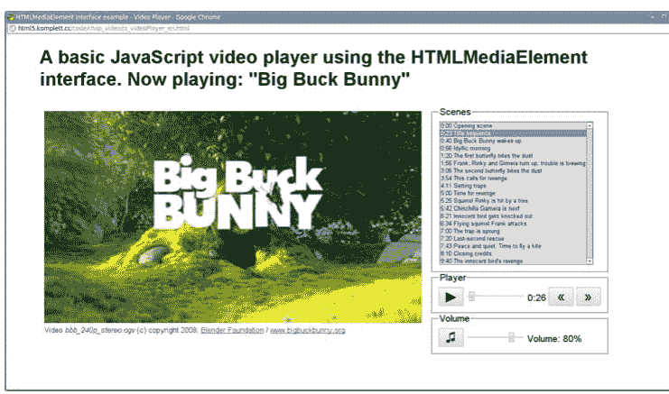


视频播放器的 HTML 页面以及 JavaScript 库和 CSS 样式可以在本书配套网站上找到，链接如下：

- http://html5.komplett.cc/code/chap_video/js_videoPlayer_en.html
- http://html5.komplett.cc/code/chap_video/js_videoPlayer.js
- http://html5.komplett.cc/code/chap_video/js_videoPlayer.css

#### 4.7.1 集成视频

你很可能会对集成视频的 HTML 代码比较熟悉。除了两个事件处理属性 `oncanplay` 和 `ontimeupdate`（它们稍后将会发挥重要作用）之外，这里没有太多新内容：

```
<video preload=metadata
       poster=videos/bbb_poster.jpg
       width=854 height=480
       oncanplay="initControls()"
       ontimeupdate="updateProgress()">
  <source src='videos/bbb_480p_stereo.ogv'
          type='video/ogg;codecs="theora, vorbis"'>
  <!-- further source elements as alternatives -->
  Sorry, your browser is unable to play this video.
</video>
```

通过 `preload=metadata`，我们首先只加载影片的少量内容，以便获取影片时长和至少第一帧。加载期间，我们显示 `poster` 属性中指定的图片，然后是第一帧——不幸的是，在我们的示例中，第一帧完全是黑色的。

宽度和高度是为演示目的而指定的，用于将原始视频重新放大——从下载后的 854 x 480 缩小到 428 x 240，再恢复到 854 x 480 像素。为什么呢？因为缩小版本只有 39MB，比原始的 160MB 视频更容易测试。此外，显式指定 `width` 和 `height` 属性可以帮助解释 80% 的简短 HTMLVideoElement 接口。该接口仅包含四个用于视频尺寸的属性；一个用于海报帧 URL 的属性（如果有的话）；以及反映音轨是否静音的 audio 属性。

假设变量 `video` 包含对我们视频元素的引用，我们有以下属性值：

- `video.width` = 854（指定宽度）
- `video.height` = 480（指定高度）
- `video.videoWidth` = 428（原始宽度）
- `video.videoHeight` = 240（原始高度）
- `video.poster` = bbb_poster.jpg 的 URL（海报帧）

这些少量属性当然不足以实现我们的视频播放器。事实上，它们只是 HTMLVideoElement 的附加元素，而该元素同时还代表 HTMLMediaElement——包含所有必要方法和属性的对象。如果你好奇，可以在规范中查阅 http://www.w3.org/TR/html5/video.html#htmlmediaelement。

真正的工作从 `oncanplay` 开始，因为它引用了浏览器能够播放视频时即刻执行的 JavaScript 函数。在我们的示例中，这个函数是 `initControls()`，其中创建并保存了对视频的引用到全局变量 `video` 中。在实现视频播放器的过程中，我们还需要多次向 `initControls()` 添加条目，但目前我们只需要以下代码：

```
var video;
var initControls = function() {
  video = document.querySelector("VIDEO");
};
```

方法 `document.querySelector()` 是 CSS Selectors API 的一部分。它在 `video` 变量中提供了对文档中第一个视频元素的引用。这使我们可以访问 HTMLMediaElement 接口，现在我们可以开始实现第一个功能——启动和停止播放。

#### 4.7.2 启动和停止视频

要启动和停止播放，我们首先需要在 HTML 文档中放置一个能够响应用户点击的按钮：

```
<input type=button
       value="&#x25B6;"
       onclick="playPause(this);"
       id="playButton">
```

`&#x25B6;` 是对 Unicode 符号 BLACK RIGHT-POINTING TRIANGLE 的字符引用，我们可以方便地将其用作播放按钮。启动和停止播放的功能包含在 `playPause()` 中，这是一个每次点击时调用的回调函数，参数 `this` 中传入了按钮对象：

```
var playPause = function(ctrl) {
  if (video.paused) {
    video.play();
    ctrl.value = String.fromCharCode('0x25AE','0x25AE');
  }
  else {
    video.pause();
    ctrl.value = String.fromCharCode('0x25B6');
  }
};
```

属性 `video.paused` 告诉我们影片是否正在播放。如果影片暂停则返回 `true`，如果正在播放则返回 `false`。这使得启动和停止播放变得简单。`video.play()` 和 `video.pause()` 是适当的方法，它们相应地会将 `video.paused` 设置为 `false` 或 `true`。

参数 `ctrl` 中传入的按钮对象用于通过 `ctrl.value` 根据当前状态将按钮更改为暂停或播放按钮。如果我们直接赋值 `&#x25B6;`，这不会产生期望的结果；相反，字符字符串 `&#x25B6;` 会按字面意思显示为按钮上的文本。在 JavaScript 中创建 Unicode 符号的正确方法是使用 `String.fromCharCode()`。为此，我们以字符串形式传入期望的 UTF 16 十六进制代码，用逗号分隔。顺便一提，暂停按钮上的标签文本由两个 *BLACK VERTICAL RECTANGLE* 符号（`&#x25AE;`）组成。

我们稍后还会需要 `playButton` ID。

#### 4.7.3 显示和设置播放位置

要显示当前播放位置，我们使用第 3 章"智能表单"中先前提到的新型输入类型 `range`：

```
<input type="range"
       min=0 max=1 step=1 value=0
       onchange="updateProgress(this)"
       id="currentPosition">
```

属性 `min` 和 `max` 设置允许的值范围，`step` 确定用户拖动滑块时值的变化间隔。应用到我们的视频，`min` 指定影片的起始，`max` 指定影片的结束，这意味着我们必须将 `max` 的值设置为视频的总长度（以秒为单位）。最合适的设置位置是 `initControls()`，最合适的设置属性是 `video.duration`。因此，我们向 `initControls()` 函数添加以下代码行：

```
curPos = document.getElementById("currentPosition");
curPos.max = video.duration;
```

现在 `max` 的值变为 596.468017578125，这意味着视频大约十分钟长。直接设置播放位置是在拖动或点击滑块时，由 `onchange` 事件处理回调 `updateProgress()` 完成的：

```
var updateProgress = function(ctrl) {
  video.currentTime = ctrl.value;
};
```

这里一条指令就足够了；属性 `video.currentTime` 不仅反映当前播放位置，还可以直接设置。我们从滑块的 `value` 属性获取合适的值。要以 MM:SS 格式实现当前播放位置的显示，我们还需要以下步骤：

1. 在滑块旁边添加一个 span 元素：
   `<span id="timePlayed"> </span>`

2. 在 `initControls()` 函数中保存对 span 的引用，并用值 0:00 初始化变量 `curTime`：
   ```
   curTime = document.getElementById("timePlayed");
   curTime.innerHTML = '0:00';
   ```

3. 在每次调用 `updateProgress()` 时更新时间戳 `curTime`：
   ```
   mm = Math.floor(video.currentTime / 60.0);
   ss = parseInt(video.currentTime) % 60;
   ss = (ss < 10) ? '0'+ss : ss;
   curTime.innerHTML = mm+':'+ss;
   ```

我们快完成了。还缺少一个基本的滑块功能：当视频播放时，它必须与运行时间保持同步。解决方案在于集成视频的 HTML 代码：`ontimeupdate`。规范规定，在媒体流播放期间，应至少每 15 毫秒、最多每 250 毫秒触发一次 timeupdate 事件。事件处理属性 `ontimeupdate` 确定调用哪个回调函数。如果将其设置为 `updateProgress()`，我们就找到了同步滑块的完美定时器。

与通过点击或拖动滑块手动设置位置相比，我们现在不必更改播放位置，而是将滑块和时间显示设置为 `video.currentTime` 的值。我们略微调整后的 `updateProgress()` 函数最终版本如清单 4.1 所示：


清单 4.1 更改和更新播放位置

```
var updateProgress = function(ctrl) {
  if (ctrl) {
    video.currentTime = ctrl.value;
  }
  else {
    curPos.value = video.currentTime;
  }
  // 设置时间格式为 MM:SS
  mm = Math.floor(video.currentTime / 60.0);
  ss = parseInt(video.currentTime) % 60;
  ss = (ss < 10) ? '0'+ss : ss;
  curTime.innerHTML = mm+':'+ss;
};
```

if/else 代码块的目的是判断 updateProgress() 是被滑块调用还是被 ontimeupdate 事件调用。如果是前一种情况，传入的滑块对象被赋值给 ctrl，我们需要将播放位置设置为滑块的值。如果是后一种情况，则存在一个 timeupdate 事件，我们需要将滑块的值设置为变量 curPos 中的当前播放时间。

既然播放和播放位置控制都已理顺，你可以坐下来放松一下了。休息十分钟，用你自己打造的、几乎完成的自制视频播放器去探索《大雄兔》吧！

#### 4.7.4 快进和快退

要实现这两个功能，我们首先需要在 HTML 文档中添加按钮。它们的标签将再次使用 Unicode 符号，这次是法语引号——双角引号。Unicode 名称描述了它们的样式：LEFT-POINTING DOUBLE ANGLE QUOTATION MARK (&#x00AB;) 和 RIGHT-POINTING DOUBLE ANGLE QUOTATION MARK (&#x00BB;)。两个事件监听器属性启动和停止快速搜索，搜索在 mousedown 时开始，在 mouseup 时结束：

```
<input type="button"
    value="&#x00AB;"
    onmousedown="fastFwdBwd(-1)"
    onmouseup="fastFwdBwd()">
<input type="button"
    value="&#x00BB;"
    onmousedown="fastFwdBwd(1)"
    onmouseup="fastFwdBwd()">
```

JavaScript 回调函数 `fastFwdBwd()` 相当简短，如下所示：

```
var fastFwdBwd = function(direct) {
  _pause();
  _play();
  if (direct) {
    video.playbackRate = 5.0 * direct;
  }
};
```

有两个属性在加速视频播放方面起着重要作用。其中一个在我们回调函数中可以看到，即 `video.playbackRate`，它代表当前的播放速率。第二个是 `video.defaultPlaybackRate`，一个默认值，它将影片的正常速度确定为 `1.0`。要加快播放速度，我们需要更改播放速率；例如，2.0 表示*两倍速*，4.0 表示*四倍速*，依此类推。这个数字以及适用的负号决定了播放方向——正值快进，负值快退。

根据规范的定义，每次调用 `video.play()` 时，必须将属性 `video.playbackRate` 设置为 `video.defaultPlaybackRate` 的值。因此，只要我们不提高 `defaultPlaybackRate`，就可以确保每次重新开始时都使用原始速度。为了提高速度，因此我们只需要更改 `video.playbackRate`。

这使得 `fastFwdBwd()` 的实现非常简单：视频先短暂停止。然后再次播放，如果将 `1` 或 `-1` 赋值给变量 `direct`，则相应设置 `video.playbackRate`，从而提高速度。

函数 `_pause()` 和 `_play()` 包含之前在回调函数 `playPause()` 中的启动和停止视频的代码块。通过这些函数，我们现在不仅可以点击播放按钮来控制播放和暂停，还可以直接通过脚本控制。为了将功能与播放按钮分离，我们需要在 `initControl()` 中通过 `getElementById()` 定义对该按钮的引用，并将其作为变量 `pButton` 提供。拆分后的 `playPause()` 如清单 4.2 所示：

### 清单 4.2 启动和停止视频

```
var _play = function() {
  video.play();
  pButton.value = String.fromCharCode('0x25AE','0x25AE');
};
var _pause = function() {
  video.pause();
  pButton.value = String.fromCharCode('0x25B6');
};
```

```
var playPause = function() {
  if (video.paused) {
    _play();
  }
  else {
    _pause();
  }
};
```

#### 4.7.5 在影片中选择特定场景

要选择单个场景，我们首先需要一个包含时间戳和标题的列表。下拉菜单提供了基础：

```
<select name="scenes" onchange="selectScene(this)" size=19>
  <option value="0:00" selected>0:00 开场场景</option>
  <option value="0:23">0:23 片头字幕</option>
  <!-- 其他 17 个条目 -->
</select>
```

其余部分很简单，由回调函数 selectScene() 处理。我们将其作为参数传递选中的条目。然后，我们将其时间戳转换为秒，并将 video.currentTime 设置为计算出的值。函数 _play() 再次发挥作用，在指定的时间点开始播放视频：

```
var selectScene = function(ctrl) {
  arr = ctrl.value.split(":");
  video.currentTime = parseFloat((arr[0]*60)+(arr[1]*1));
  updateProgress();
  _play();
};
```

#### 4.7.6 将音量设置为高、低或静音

剩下的就是音量控制了。让我们从一个简单的练习开始——*开/关*。再次，我们需要在 HTML 代码中添加一个按钮，标签由一个 Unicode 符号构成，这次是 *BEAMED EIGHTH NOTES* (&#x266B;)：

```
<input type="button"
       value="&#x266B;"
       onclick="mute(this)">
```

## 第四章 —— 视频与音频

mute() 函数使用 *读/写* 属性 video.muted 来切换静音或有声，具体取决于初始设置。为了给用户视觉反馈，当声音被静音时，按钮标签以 CSS 颜色 silver（银色）显示，当音量开启时则以黑色显示：

```
var mute = function(ctrl) {
  if (video.muted) {
    video.muted = false;
    ctrl.style.color = 'black';
  }
  else {
    video.muted = true;
    ctrl.style.color = 'silver';
  }
};
```

设置音量也不复杂。除了作为输入类型的滑块外，我们还需要在 span 中控制标签。基本的 HTML 结构如下所示：

```
<input type="range"
       min=0.0 max=1.0 step=0.1 value=1.0
       onchange="adjustVolume(this)"/>
<span id="currentVolume"> </span>
```

我们像之前一样，在 initControls() 中定义对 span 元素的引用，并使用 video.volume 将音量初始化为 100%：

```
curVol = document.getElementById("currentVolume");
curVol.innerHTML = "100 %";
video.volume = 1;
```

当滑块被更改时，回调函数 adjustVolume() 做出反应。滑块以 min=0 和 max=1 反映了 video.volume 的精确值范围，并通过 step=0.1 在拖动滑块时以 10% 的步长更改音量：

```
var adjustVolume = function(ctrl) {
  video.volume = ctrl.value;
  curVol.innerHTML = (Math.round(ctrl.value*100))+'%';
};
```

我们的视频播放器现在完成了。这个实际例子让你有机会探索 HTMLMediaElement 接口大约一半的属性和方法。还有一些有趣的属性和方法尚未涉及；我们接下来将探讨它们。

#### 4.7.8 "HTMLMediaElement" 接口的其他属性和方法

所有媒体元素（不仅包括视频，还包括音频）都有五个共同属性，这些属性在 HTMLMediaElement 接口中显示。除了作为 *媒体流* 源的 *src*，还有布尔属性 autoplay、loop 和 controls，以及带有三个值 none、metadata 和 auto 的 preload。动态创建视频的代码可能如下所示：

```
var video = document.createElement("VIDEO");
video.src = 'videos/bbb_240p_stereo.ogv';
video.autoplay = false;
video.loop = true;
video.controls = true;
video.preload = 'metadata';
```

但这个视频还没有加载。加载过程只在调用 HTMLMediaElement 接口的下一个方法 video.load() 时开始。为了能在浏览器中看到视频，我们需要将其附加到 DOM 树。因此，我们在清单中添加两行代码：

```
video.load();
document.documentElement.appendChild(video);
```

我们视频播放器中 oncanplay 属性的动态对应部分是一个事件监听器，它包含事件类型、回调函数和一个标志，该标志决定事件是否在 *捕获* 阶段激活。感到困惑吗？只需将第三个参数设置为 false，这会在 *冒泡* 阶段激活事件监听器。如果你想了解事件顺序如何工作的细节，请在线查看 http://www.quirksmode.org/js/events_order.html。我们的事件监听器监听 canplay 事件，然后立即开始播放影片：

```
video.addEventListener("canplay", function() {
    video.play();
}, false);
```

> **注意**
> 我们这个简短代码示例的 HTML 版本当然可以在网上找到：http://html5.komplett.cc/code/chap_video/js_dynamicVideo_en.html。


## 96 第4章——视频与音频

尽管这个示例看起来很简单，但加载媒体流的过程实际上相当复杂。规范区分了*网络状态*和*就绪状态*，并在`HTMLMediaElement`接口中为这两个状态分配了两个只读属性，并提供了几个常量来描述相关状态。

属性`networkState`用于监控网络状态。它可以随时查询，并返回表4.5中列出的可能值。

**表4.5 "networkState"属性的常量**

| 值 | 常量 | 描述 |
|---|---|---|
| 0 | NETWORK_EMPTY | 视频/音频尚未初始化。 |
| 1 | NETWORK_IDLE | 已选择视频/音频源，但当前未在加载。 |
| 2 | NETWORK_LOADING | 浏览器正在主动加载视频/音频。 |
| 3 | NETWORK_NO_SOURCE | 找不到合适的视频/音频源。 |

选择合适源时，需要记住有两种方式：通过相关元素的`src`属性，或者通过多个`source`元素让浏览器选择最合适的一个。如果我们为视频使用多个`source`元素，就会产生一个问题：我们如何知道浏览器实际选择了哪个元素？答案就在只读属性`video.currentSrc`中。在视频播放器的截图中，你可以在左下角版权信息之前看到它。

主动查询相关浏览器是否支持媒体类型，不仅可以由浏览器在选择合适源元素时进行，也可以由程序员通过脚本进行。我们为此使用的方法是`canPlayType(type)`，它需要一个相应的媒体类型作为参数。如果浏览器相当确定可以播放该格式，答案是*probably*；如果浏览器相当怀疑，答案是*maybe*；如果它肯定无法处理，则返回''（空字符串）。


> 你可以亲自查看你的浏览器对常见类型的选择，访问 http://html5.komplett.cc/code/chap_video/js_canPlayType.html。

属性readyState描述媒体元素当前所处的状态。它具有表4.6中列出的可能值。

**表4.6 "readyState"属性的常量**

| 值 | 常量 | 描述 |
|---|---|---|
| 0 | HAVE_NOTHING | 当前播放位置没有可用数据。 |
| 1 | HAVE_METADATA | 元数据（如长度和尺寸）已就绪，但尚无数据可播放。 |
| 2 | HAVE_CURRENT_DATA | 当前位置的数据可用，但不足以开始播放。 |
| 3 | HAVE_FUTURE_DATA | 当前和未来播放位置有足够的数据，可以开始播放。 |
| 4 | HAVE_ENOUGH_DATA | 浏览器确信，只要网络状态保持不变，就可以不间断地继续播放媒体流。 |

如果在加载或播放过程中真的出了问题，会触发一个error事件，其code属性可以缩小相关错误范围：

```
video.addEventListener("error", function(e) {
  alert(e.code);
}, false);
```

因此，这个回调函数在e.code中返回表4.7所示的一个可能值。

**表4.7 "MediaError"接口中"code"属性的常量**

| 值 | 常量 | 描述 |
|---|---|---|
| 1 | MEDIA_ERR_ABORTED | 加载被用户中止。 |
| 2 | MEDIA_ERR_NETWORK | 发生了网络错误。 |
| 3 | MEDIA_ERR_DECODE | 解码媒体流时发生错误。 |
| 4 | MEDIA_ERR_SRC_NOT_SUPPORTED | 不支持该媒体格式。 |

我们即将完成对`HTMLMediaElement`接口的探索。剩余的属性有：

-   两个*布尔*属性，用于显示浏览器是否正在搜索其他数据（seeking）或是否已到达流的末尾（ended）
-   一个提供流开始时间信息的属性（initialTime）
-   一个表示当前时间线偏移量为Date对象的属性（startOffsetTime）
-   三个用于实现TimeRanges接口的属性——buffered、played和seekable。

TimeRanges的基本思想，顾名思义，就是记录时间段：

```
interface TimeRanges {
  readonly attribute unsigned long length;
  float start(in unsigned long index);
  float end(in unsigned long index);
};
```

以`played`为例可以帮助你理解其工作原理：如果我们正在播放*Big Buck Bunny*视频的片头，然后点击暂停，我们会得到第一个包含开始和结束时间的时间范围。相应的属性是`played.start(0)`和`played.end(0)`，而`played.length`中的现有时间范围数量为1。然后如果我们切换到第八章并在那里继续播放一段时间，就会创建下一个时间范围`played.start(1)`和`played.end(1)`，`played.length`变为2。如果两个时间范围重叠，它们会被合并为一个。所有范围都在TimeRanges对象中排序。

这样我们就可以跟踪媒体流的哪些部分已缓冲、已播放或标记为可搜索。一个简单的在线示例有助于在播放*Big Buck Bunny*视频时可视化各个TimeRanges——请查看 http://html5.komplett.cc/code/chap_video/js_timeRanges.html。

#### 4.7.9 媒体事件的长列表

媒体流在加载或播放过程中特定时刻触发的事件列表很长，基本上反映了HTMLMediaElement接口的三种主要状态条件。

在*网络状态*中，我们遇到`loadstart`、`progress`、`suspend`、`abort`、`error`、`emptied`和`stalled`，它们的名称表明了它们出现在哪些网络场景中。*就绪状态*中有`loadedmetadata`、`loadeddata`、`waiting`、`playing`、`canplay`或`canplaythrough`，所有这些都直接关系到当前或未来播放位置的数据可用性。*播放状态*中有`play`、`pause`、`timeupdate`、`ended`、`ratechange`和`durationchange`，它们的名称和我们需要提到的最后一个元素`volumechange`一样不言自明。

每个事件的使用时机和方式完全取决于你的脚本目的。对于我们的视频播放器，我们只需要`oncanplay`和`ontimeupdate`两个。但如果我们想细化细节，几乎肯定还需要很多其他事件。

如果你想了解各种事件的详细信息，应该参考规范中非常有用的*事件摘要*。在那里你不仅可以找到每个事件的描述，还可以找到它实际触发时间的说明。请浏览 http://www.w3.org/TR/html5/video.html#mediaevents。

如果你想*实时查看*媒体事件的运行，请访问Philippe Le Hégaret在W3C的*HTML5 Video, Media Events, and Media Properties*测试页面：http://www.w3.org/2010/05/video/mediaevents.html。

### 4.8 音频呢？

关于HTML5中的音频，没有太多新内容要宣布。方便的是，`video`和`audio`共享`HTMLMediaElement`接口，这意味着我们告诉你的关于脚本和视频的一切也适用于音频元素。可以理解的是，`HTMLVideoElement`接口中用于宽度、高度、音频和海报帧的额外视频属性被省略了。`audio`元素可以通过构造函数轻松创建，同时为其分配`src`属性：

```
var audio = new Audio(src);
```

遵循我们视频播放器的模式，让我们为Big Buck Bunny原声带编程一个音频播放器。滑块、时间显示以及启动或停止的工作方式与视频示例相同。一个新功能是用于选择曲目的菜单：涉及不同的音频文件，外加两个用于在曲目列表中前进或后退的按钮。此外，我们实现了在所有曲目结束时*循环播放*以及随机选择下一曲目。你可以在图4.10中看到结果。


# 第四章—视频与音频

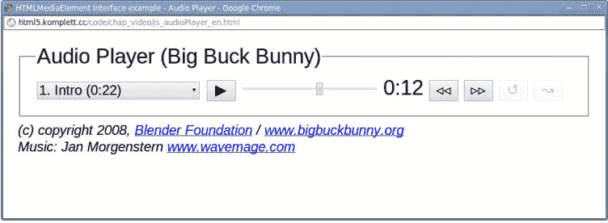

图4.10 JavaScript HTML5音频播放器屏幕截图

> 注意
> 各个音轨是使用免费的跨平台音频编辑器Audacity (http://audacity.sourceforge.net) 从视频的音轨中提取的。对于私人使用，您也可以从乐谱作曲家Jan Morgenstern的主页 http://www.wavemage.com/category/music 免费下载没有背景噪音的音轨。

音频播放器的屏幕截图看起来很熟悉，因为新按钮再次使用了某些Unicode符号作为其标签。具体来说，您可以看到表4.8中列出的符号。

| 按钮 | 实体 | Unicode名称 |
| --- | --- | --- |
| *后退* | &#x25C3; | *WHITE LEFT-POINTING SMALL TRIANGLE* |
| *前进* | &#x25B9; | *WHITE RIGHT-POINTING SMALL TRIANGLE* |
| *循环* | &#x21BA; | *ANTICLOCKWISE OPEN CIRCLE ARROW* |
| *随机播放* | &#x219D; | *RIGHTWARDS WAVE ARROW* |

表4.8 音频播放器按钮的Unicode符号

下拉菜单看起来也很熟悉，但这次我们不会像在视频播放器中那样跳转到播放时间的特定点；相反，我们在整个音轨之间切换。菜单以及后退、前进、循环和随机播放按钮都具有这种从一个音轨切换到下一个音轨的效果，因此脚本逻辑变得更加复杂。

让我们从`audio`元素开始：

```
<audio src="music/bbb_01_intro.ogg"
       oncanplay="canPlay()"
       ontimeupdate="updateProgress()"
       onended="continueOrStop()"></audio>
```

在加载页面时，我们将`src`属性设置为第一个音轨，并定义三个回调函数。您已经遇到过`updateProgress()`函数，它使滑块沿着移动并更新时间显示（参见清单4.1）。两个新的回调函数是`canPlay()`（在音轨准备好播放时调用）和`continueOrStop()`（在音轨结束时决定下一步做什么）。`oncanplay`回调`canPlay()`相当简短，如下所示：

```
canPlay = function() {
  curPos.max = audio.duration;
  if (pbStatus.keepPlaying == true) {
    _play();
  }
};
```

显然，`curPos.max`调整滑块的`max`属性，就像在视频播放器中一样，但后面的`if`块是关于什么的呢？答案很简单：我们尝试考虑当前的播放状态，并且仅在播放器已处于播放模式时才继续播放。

因此，播放按钮的状态决定了在切换到另一个音轨后，音频播放器是否开始播放。如果它正在播放，则应在每次音轨更改后继续播放；但如果它已暂停，则应仅切换音轨并保持暂停状态。这听起来可能很复杂，但在播放按钮回调中的实现很简单；我们只需添加以下代码：

```
pbStatus.keepPlaying =
  (pbStatus.keepPlaying == true) ? false : true;
```

这会每次点击时将状态变量`pbStatus.keepPlaying`在`true`和`false`之间交替，并在`canPlay()`中做出正确的决策。

> 注意

要更好地理解音频播放器的结构和功能，请查看HTML、JavaScript和CSS源代码。您可以在以下在线网址找到它们：

- http://html5.komplett.cc/code/chap_video/js_audioPlayer_en.html
- http://html5.komplett.cc/code/chap_video/js_audioPlayer.js
- http://html5.komplett.cc/code/chap_video/js_audioPlayer.css

回到我们的示例。通过`canPlay()`和`pbStatus.keepPlaying`，我们现在可以在音轨准备好播放时控制情况。但我们如何管理从一个音轨切换到下一个音轨呢？如前所述，有几种选项：我们可以通过菜单选择，单击后退和前进按钮，或者让音频播放器在音轨结束时根据循环和随机播放按钮的设置自动执行。所有这些选项都有一个共同点：它们需要加载一个新的音轨，这是通过方法`loadTrack()`完成的：

```
var loadTrack = function(idx) {
  audio.src = 'music/'+tracks.options[idx].value;
  audio.load();
};
```

有两个细节需要解释：

1. 参数`idx`后面隐藏着什么？隐藏在`idx`后面的是从下拉菜单变量`tracks`中要加载的音轨的索引，从中我们可以提取文件名。
2. 调用`audio.load()`做什么？正如您可能已经猜到的，它开始加载新音轨，一旦达到`canplay`状态就可以播放。

> 注意

为了简单起见，我们的示例中仅使用Ogg Vorbis音频文件。如果我们想提供多个版本，我们首先需要通过`canPlayType()`方法找到合适的格式，然后加载它。当您到达本章末尾时，尝试将此功能添加到脚本中！

`loadTrack()`以多种方式被调用。首先，当通过`onchange`事件处理程序`changeTrack(this)`在菜单中直接更改音轨时：

```
changeTrack = function(ctrl) {
  loadTrack(ctrl.options.selectedIndex);
};
```

当然，它也被前进和后退按钮调用；它们各自的`onclick`事件处理程序调用回调函数`advanceTrack(n)`，并在参数`n`中传递步长值，并通过正号或负号传递所需的方向。在两种情况下，步长值是相同的，这意味着-1表示后退，1表示前进：

```
advanceTrack = function(n) {
  var idx = tracks.options.selectedIndex + n;
  if (idx < 0) {
    idx = idx + tracks.options.length;
  }
  if (idx > tracks.options.length-1) {
    idx = idx - tracks.options.length;
  }
  tracks.options.selectedIndex = idx;
  loadTrack(idx);
};
```

确定新音轨的算法很简单，由两个阶段组成。我们首先将`n`加到所选音轨的索引上，然后处理由此产生的两种特殊情况：如果我们在当前第一个音轨上单击后退，则索引变为负数，因此我们必须继续播放最后一个音轨。如果我们在最后一个音轨上单击前进，这也不行，因此我们必须确保播放器选择第一个音轨作为下一个音轨。

方法`advanceTrack()`的优点是，我们甚至可以将它用于最后两个功能——在音轨结束时循环播放和随机音轨选择。首先，我们需要快速讨论这两个按钮如何精确地指示非活动和活动状态。两种模式之间的切换通过`onclick`事件处理程序完成，这些处理程序触发回调函数`toggleOnOff(node)`，并在参数`node`中分配相应的按钮：

```
toggleOnOff = function(node) {
  var cls = node.getAttribute("class");
  node.setAttribute("class",
    (cls == 'off') ? 'on' : 'off'
  );
  pbStatus[node.id] = node.getAttribute("class");
};
```

# 第四章 — 视频与音频

正如函数的第一行所示，状态由按钮元素的`class`属性确定，通过CSS定义外观。`*on*`和`*off*`的格式可以在样式表`js_audioPlayer.css`中找到：

```
.off {
    opacity: 0.2;
}
.on {
    opacity: 1.0;
}
```

此外，相关按钮的当前状态在状态变量`pbStatus[node.id]`中指定，其中`node.id`指示`*loop*`或`*shuffle*`，因此`pbStatus.loop`或`pbStatus.shuffle`被赋值为`*on*`或`*off*`。对此状态做出反应的正确时刻总是在音轨结束时。现在回调函数`continueOrStop()`生效了：

```
continueOrStop = function() {
    if (pbStatus.shuffle == 'on') {
        advanceTrack(
            Math.round(Math.random()*tracks.options.length)
        );
    }
    else if (tracks.options.selectedIndex ==
             tracks.options.length-1) {
        if (pbStatus.loop == 'on') {
            advanceTrack(1);
        }
        else {
            pbStatus.keepPlaying = false;
        }
    }
    else {
        advanceTrack(1);
    }
};
```

如果我们处于随机播放模式，将`Math.random()`的结果乘以所有音轨的数量并四舍五入，会生成一个介于0和音轨总数之间的随机数。然后我们在`advanceTrack()`中前进这个值，并且我们超出目标多少并不重要：例如，如果我们处于倒数第二个音轨上，并且想前进五个位置，`advanceTrack()`中的算法确保播放菜单上的第四个项目。

“*循环还是不循环？*”这个问题只在最后一个音轨时出现。如果相应按钮设置为`*on*`模式，我们使用`advanceTrack(1)`从头开始；如果处于`*off*`模式，我们在此处停止并将`pbStatus.keepPlaying`设置为`false`。在所有其他情况下，我们只需转到下一个音轨并开始播放它。


至此，我们不仅完成了音频播放器，也结束了关于视频和音频的章节。我们在视频和音频播放器中手动编程实现的许多功能，浏览器当然也已经实现了，并且可以通过 controls 属性更轻松地激活。但了解其背后的原理仍然是有意义的，这样可以发现通过脚本控制视频和音频时的可用选项。

### 小结

视频和音频的加入，使两个以前需要插件才能实现的重要功能成为了 HTML 规范的一部分。现在很难预测哪种视频编解码器最终会占主导地位，不过鉴于 Google 对 WebM 的承诺，我们可以期待一个无专利限制的开放格式。

正如本章第二部分所示，HTMLMediaElement 接口使视频和音频可以通过脚本进行控制。使用 JavaScript 可以实现以前通过插件解决方案无法实现的交互。

与每一个 HTML5 主题一样，网上还有更多令人印象深刻的示例。花些时间自己去搜索和发现吧！通过阅读本章，你已经为理解这些全新而迷人的 HTML5 特性奠定了基础。

# 5. Canvas

*Canvas*是最有趣的同时也是最早出现的 HTML5 新元素之一。2004 年 7 月，就在 WHATWG 成立一个月后，苹果的 David Hyatt 提出了一种名为 Canvas 的专有 HTML 扩展，这一宣布在当时年轻的 HTML5 运动中引起了轰动。*"真正的解决方案是将这些提案拿到台面上来，"*这是 Ian Hickson 的第一反应，经过短暂辩论后，苹果将其想法提交给了 WHATWG。这为将 Canvas 纳入 HTML5 规范铺平了道路，第一版草案于 2004 年 8 月发布。

> **注意** 你可以在这里找到苹果的 Canvas 公告和 Ian Hickson 的反应：
* http://weblogs.mozillazine.org/hyatt/archives/2004_07.html#005913
* http://ln.hixie.ch/?start=1089635050&count=1

### 5.1 第一个示例

简单来说，Canvas 是一个可编程的图片，你可以通过 JavaScript API 在其上绘图。除了通过 canvas 元素创建画布外，我们还需要一个 script 元素来放置绘图命令。让我们从 canvas 元素开始：

```
<canvas width="1200" height="800">
    alternative content for browsers without canvas support
</canvas>
```

width 和 height 属性决定了 canvas 元素的尺寸（以像素为单位），并在 HTML 页面上预留相应的空间。如果缺少其中一个或两个属性，将使用默认值：宽度为 300 像素，高度为 150 像素。开始标签和结束标签之间的区域用于放置替代内容，当浏览器不支持 Canvas 时会显示这些内容。类似于图片的 alt 标签，这种替代内容应该描述 Canvas 应用的内容或展示合适的截图。像*您的浏览器不支持 Canvas*这样没有任何进一步信息的表述并不十分有用，应该避免。

我们的画布现在已经完成了。下一步，我们可以在 script 元素中添加绘图命令。只需几行代码，就足以将我们的第一个（ admittedly 相当基础的）Canvas 示例变为现实：

```
<script>
    var canvas = document.querySelector("canvas");
    var context = canvas.getContext('2d');
    context.fillStyle = 'red';
    context.fillRect(0,0,800,600);
    context.fillStyle = 'rgba(255,255,0,0.5)';
    context.fillRect(400,200,800,600);
</script>
```

即使我们还不了解 Canvas 绘图命令的语法，如果你仔细查看代码，图 5.1 中的结果也不会令人意外。我们现在有了一个红色和一个浅黄色的矩形，透明度为 50%，在两个矩形重叠的地方呈现出了橙色调。

图 5.1  两个重叠的矩形

> 本章中的所有图都是使用 Canvas 作为 HTML 页面创建的，可以在截图中显示的 URL 或配套网站的索引页面 http://html5.komplett.cc/code/chap_canvas/index_en.html 上在线查看。去看看源代码吧！

在画布上绘图之前，我们需要创建一个对它的引用。脚本中的第一行正是这样做的。它在变量 canvas 中，使用 *W3C CSS 选择器 API* 方法 document.querySelector()，保存了对文档中找到的第一个 canvas 元素的引用：

```
var canvas = document.querySelector("canvas");
```

除了属性 canvas.width 和 canvas.height 之外，这个对象（也称为 HTMLCanvasElement）还有 getContext() 方法。通过传递 *2d* 作为上下文参数，我们可以进入 Canvas 的核心——CanvasRenderingContext2D：

```
var context = canvas.getContext('2d');
```

现在我们已经定义了*绘图上下文*，可以开始绘制两个矩形了。在不深入了解属性 `fillStyle` 或方法 `fillRect()` 的细节的情况下，两者的基本过程是相同的：定义填充颜色，然后添加矩形：

```
context.fillStyle = 'red';
context.fillRect(0,0,800,600);
context.fillStyle = 'rgba(255,255,0,0.5)';
context.fillRect(400,200,800,600);
```

当前的 Canvas 规范只定义了 2D 上下文（参见 *HTML Canvas 2D Context* 规范 http://www.w3.org/TR/2dcontext），但并不排除将来可能会有其他上下文，例如 3D。Khronos 集团已经在这方面迈出了第一步：他们与 Mozilla、Google 和 Opera 合作，正在开发一种名为 WebGL 的 JavaScript 接口，基于 OpenGL ES 2.0（http://www.khronos.org/webgl）。这一新兴标准的首次实现已经出现在 Firefox、WebKit 和 Chrome 中。

但回到 2D 上下文：CanvasRenderingContext2D 接口的可能性多种多样，当然非常适合创建复杂的应用程序。图 5.2 展示了一个简单的条形图，它将伴随我们了解绘图上下文的三个首批特性：矩形、颜色和阴影。

### 5.2 矩形

Canvas 有四种创建矩形的方法。其中三种我们将在现在讨论，第四种稍后会在路径相关的内容中遇到：

```
context.fillRect(x, y, w, h)
context.strokeRect(x, y, w, h)
context.clearRect(x, y, w, h)
```

这些方法的名称不言自明：fillRect() 创建填充矩形，strokeRect() 创建有边框但无填充的矩形，clearRect() 创建像橡皮擦一样清除现有内容的矩形。矩形的尺寸由四个数字参数决定：原点 x/y、宽度 w 和高度 h。

在 Canvas 中，坐标原点位于左上角，这意味着 x 坐标向右增加，y 坐标向下增加（参见图 5.3）。

与第一个示例类似，我们首先定义了对 canvas 元素的引用，然后是绘图上下文。drawBars() 函数负责主要工作，绘制水平条形。我们将希望绘制的条形数量传递给这个函数：

```
<script>
var canvas = document.querySelector("canvas");
var context = canvas.getContext('2d');
var drawBars = function(bars) {
    context.clearRect(0,0,canvas.width,canvas.height);
    for (var i=0; i<bars; i++) {
        var yOff = i*(canvas.height/bars);
        var w = Math.random()*canvas.width;
        var h = canvas.height/bars*0.8;
        context.fillRect(0,yOff,w,h);
        context.strokeRect(0,yOff,w,h);
    }
};
drawBars(10);
</script>
```

调用 drawBars(10) 时，先用 clearRect() 删除任何现有内容，然后在 for 循环中使用 fillRect() 和 strokeRect() 绘制十个填充的矩形轮廓。条形的宽度 w 在 0 像素到 canvas 元素的全宽之间变化，通过 JavaScript 函数 Math.random() 随机确定。Math.random() 函数生成 0.0 到 1.0 之间的数字，因此非常适合根据画布尺寸生成宽度、高度和位置的随机值。乘以相应的属性值即可实现。

条形的等间距水平排列遵循画布高度。条形之间的间距来自将计算出的最大条形高度 h 乘以系数 0.8。

canvas 的宽度和高度可以在属性 canvas.width 和 canvas.height 中轻松查看，如第一个示例所述。同样轻松地，我们可以通过其属性 context.canvas 从绘图上下文访问 HTMLCanvasElement，并用它在每次点击画布时生成新的条形。在 drawBars(10) 调用后添加三行代码就足够了：

```
context.canvas.onclick = function() {
    drawBars(10);
};
```

我们已经明确了如何绘制这十个条形，但如何使它们呈现浅灰色并带有黑色轮廓呢？通过查看 Canvas 中颜色分配的选项，我们将找到答案。


 ## 5.3 颜色与阴影

`fillStyle`和`strokeStyle`属性用于指定填充和线条的颜色。颜色规范遵循 CSS 颜色值的规则，可以有多种不同的格式。表 5.1 展示了可用的选项，以红色作为示例。

表 5.1 红色的有效 CSS 颜色值

| 方法 | 颜色值 |
| :--- | :--- |
| 十六进制 | #FF0000 |
| 十六进制（简写） | #F00 |
| RGB | rgb(255,0,0) |
| RGB（百分比） | rgb(100%,0%,0%) |
| RGBA | rgba(255,0,0,1.0) |
| RGBA（百分比） | rgba(100%,0%,0%,1.0) |
| HSL | hsl(0,100%,50%) |
| HSLA | hsla(0,100%,50%,1.0) |
| SVG（命名颜色） | red |

要在 Canvas 中指定当前的填充和描边颜色，只需将适当的颜色值作为字符串输入到`fillStyle`和`strokeStyle`中即可。在条形图示例中，我们选择 SVG 命名颜色 silver 作为填充，并使用 RGBA 表示法的半透明黑色描边。我们希望所有条形看起来都一样，所以在`drawBars()`函数之前定义这些样式：

```
context.fillStyle = 'silver';
context.strokeStyle = 'rgba(0,0,0,0.5)';
var drawBars = function(bars) {
    // 绘制条形的代码
};
```

有效的不透明度值范围从 0.0（完全透明）到 1.0（完全不透明），可以作为第四个分量用于 RGB 和 HSL 颜色空间。后者不是通过红、绿、蓝分量来定义颜色，而是通过色调、饱和度和亮度的组合来定义。

> 你可以在 *CSS Color Module Level 3* 规范中找到更多关于 CSS 颜色、HSL 调色板以及所有有效的 SVG 颜色名称的信息，网址为 http://www.w3.org/TR/css3-color。

仔细观察，你可以看到条形后面的阴影。这些阴影由四个额外的绘图上下文属性创建：

```
context.shadowOffsetX = 2.0;
context.shadowOffsetY = 2.0;
context.shadowColor = "rgba(50%,50%,50%,0.75)";
context.shadowBlur = 2.0;
```

前两行通过`shadowOffsetX`和`shadowOffsetY`确定阴影偏移，`shadowColor`指定阴影的颜色和不透明度，`shadowBlur`则使阴影产生模糊效果。一般来说，`shadowBlur`的值越高，模糊效果越强。

在下一节继续讲解颜色渐变之前，我们需要澄清条形图和后续图形中虚线边框是如何实现的。答案非常简单：使用 CSS。每个 canvas 元素当然也可以使用 CSS 进行格式化。你可以像指定背景颜色和边框一样轻松地指定间距、位置和`z-index`。在我们的示例中，以下样式属性创建了虚线边框：

```
<canvas style="border: 1px dotted black;">
```

### 5.4 渐变

除了用于填充和线条的纯色之外，Canvas 还提供两种渐变：线性渐变和径向渐变。创建 Canvas 渐变的基本原理可以通过一个简单的例子轻松说明：从红色到黄色、橙色再到紫色的渐变（见图 5.4）。

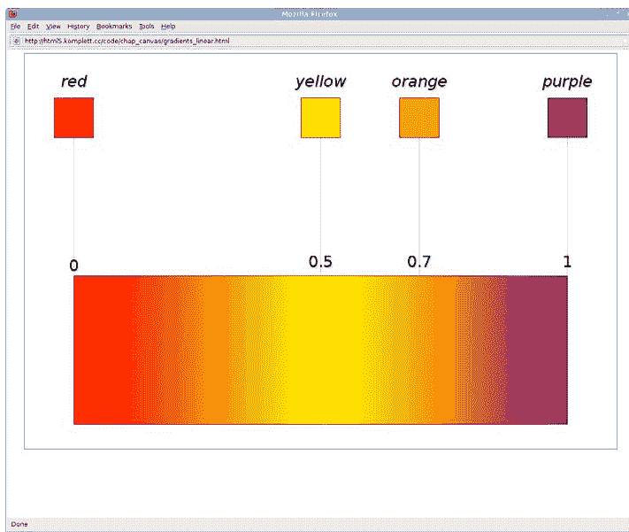

图 5.4 包含四种颜色的线性渐变

首先，`context.createLinearGradient(x0, y0, x1, y1)`创建一个`CanvasGradient`对象，并通过参数 x0、y0、x1、y1 确定渐变的方向。我们还需要在另一步中指定颜色偏移，所以将这个对象保存在变量`linGrad`中：

```
var linGrad = context.createLinearGradient(
  0,450,1000,450
);
```

下一步是`CanvasGradient`对象的`addColorStop(offset, color)`方法，它选择想象渐变线上所需的颜色和偏移。偏移 0.0 代表点 x0/y0 处的颜色，偏移 1.0 代表终点 x1/y1 处的颜色。中间的所有颜色根据各自的偏移进行分配，各个色标之间的过渡由浏览器在 RGBA 颜色空间中进行插值：

```
linGrad.addColorStop(0.0, 'red');
linGrad.addColorStop(0.5, 'yellow');
```

```
linGrad.addColorStop(0.7, 'orange');
linGrad.addColorStop(1.0, 'purple');
```

颜色按照 CSS 颜色值的规则指定，在我们的示例中被标识为 SVG 命名颜色以提高可读性。我们的线性渐变现已完成，可以通过`fillStyle`或`strokeStyle`进行分配：

```
context.fillStyle = linGrad;
context.fillRect(0,450,1000,450);
```

与线性渐变不同，径向渐变的起点和终点不是点，而是圆。因此要定义径向渐变，我们现在需要使用方法`context.createRadialGradient(x0, y0, r0, x1, y1, r1)`（见图 5.5）。

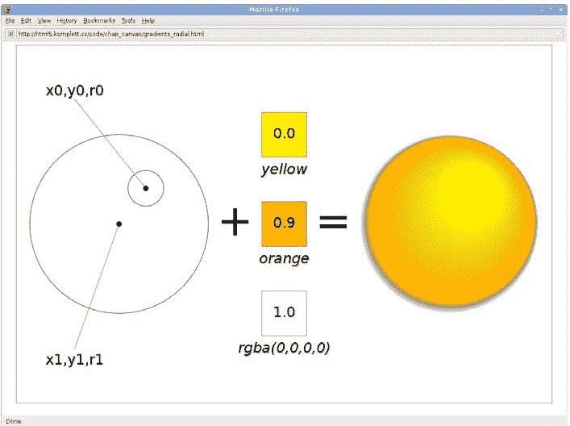

图 5.5 径向渐变的组成部分

在图形的左侧，你可以看到起始圆和结束圆，中间是三个带偏移值的色标，右侧是最终效果：一个看起来发光的球体。一段清晰简洁的源代码就能生成一个非常吸引人的结果：

```
var radGrad = context.createRadialGradient(
  260,320,40,200,400,200
);
radGrad.addColorStop(0.0,'yellow');
radGrad.addColorStop(0.9,'orange');
radGrad.addColorStop(1.0,'rgba(0,0,0,0)');
context.fillStyle = radGrad;
context.fillRect(0,200,400,400);
```

球体周围的阴影效果是由最后两个色标产生的，从橙色插值到透明黑色，这意味着渐变的可见部分直接结束于外圆。

在快速浏览了颜色和渐变的世界之后，我们现在转向其他几何形式：路径。

### 5.5 路径

在 Canvas 中创建路径的过程与在纸上绘画类似：你将铅笔放在纸上的一个点，绘制，提起铅笔，然后在纸上的另一个点继续绘制。绘制的内容可以从简单的线条到复杂的曲线，甚至是由这些构成的多边形。一个最初的示例说明了这个概念，将书写字母 A 的每个步骤转换为 Canvas 路径命令：

```
context.beginPath();
context.moveTo(300,700);
context.lineTo(600,100);
context.lineTo(900,700);
context.moveTo(350,400);
context.lineTo(850,400);
context.stroke();
```

结果显示在图 5.6 中。

## 第 5 章 — Canvas

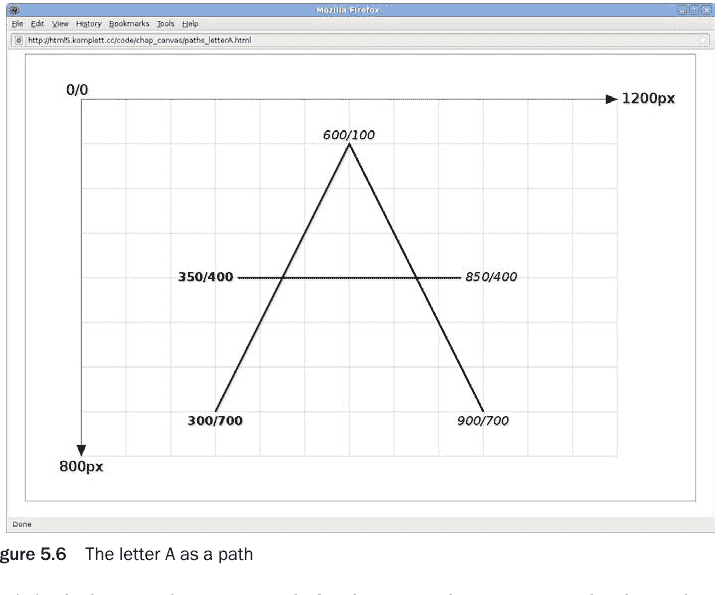

图 5.6 作为路径的字母 A

让我们更仔细地看看这个示例的源代码。我们可以看到创建路径的三个阶段：

- 1. 使用`beginPath()`初始化新路径
- 2. 使用`moveTo()`和`lineTo()`调用定义路径几何
- 3. 使用`stroke()`绘制线条

每个路径都必须用`beginPath()`初始化，然后可以包含任意数量的段。在我们的示例中，我们有两个段，通过`moveTo()`和`lineTo()`的组合来再现书写时的手部动作。这首先创建了字母 A 的屋顶形状，然后是水平线。接着我们用`stroke()`将定义的路径绘制到画布上。

路径的段何时以及是否会被分成几个独立路径，完全取决于布局。每个路径只能整体格式化。因此，如果我们想让字母 A 的水平线具有不同的颜色，就需要定义两个单独的路径。

让我们更详细地看看主要的路径绘制方法。

#### 5.5.1 线条

要像我们示例中字母 A 那样创建线条，Canvas 提供了`lineTo()`方法：

```
context.lineTo(x, y)
```

该方法的效果如图 5.7 所示。

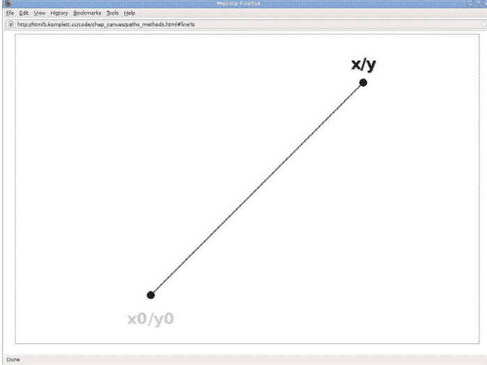

**图 5.7** 路径方法"`lineTo()`"

用文字表达，这意味着*画线到点 x/y*，这意味着我们必须已经用`moveTo()`定义了起点，或者仍保留上一步骤的终点。绘制线条后，坐标 x/y 成为新的当前点。

> 在所有用于演示路径绘制方法的图示中，我们已将起点 x0/y0 标记为浅灰色，将新的当前点标记为粗体。


 ## 5.5.2 贝塞尔曲线

Canvas 支持两种贝塞尔曲线：二次和三次，后者被不恰当地简称为 bezierCurveTo()。图 5.8 展示了前者，图 5.9 展示了后者。

```
context.quadraticCurveTo(cpx, cpy, x, y)
context.bezierCurveTo(cp1x, cp1y, cp2x, cp2y, x, y)
```

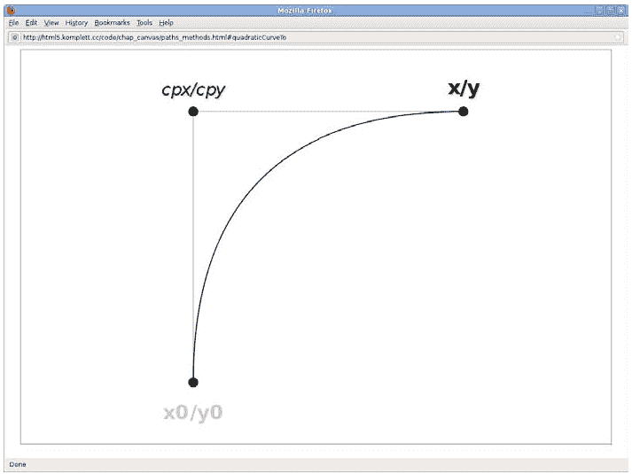

**图 5.8** 路径方法 "quadraticCurveTo()"

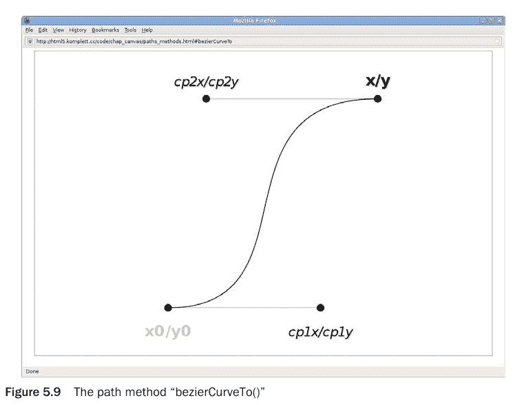

图 5.9 路径方法 "bezierCurveTo()"

要创建贝塞尔曲线，我们需要当前点作为起始坐标，加上目标坐标，以及根据曲线类型需要的一个或两个控制点。在这两种情况下，绘制曲线后，坐标 x/y 都会成为新的当前点。

#### 5.5.3 圆弧

创建圆弧的方法并不是那么直观。第一个方法由两个坐标和一个半径定义：

```
context.arcTo(x1, y1, x2, y2, radius)
```

如图 5.10 所示，arcTo() 按如下方式创建新路径：将一个给定半径的圆添加到从 x0/y0 到 x1/y1 再到 x2/y2 的线段上，使得该圆与线段恰好在两个点相切，即起始切点 t1 和结束切点 t2。这两点之间的圆弧成为路径的一部分，结束切点 t2 则成为新的当前点。

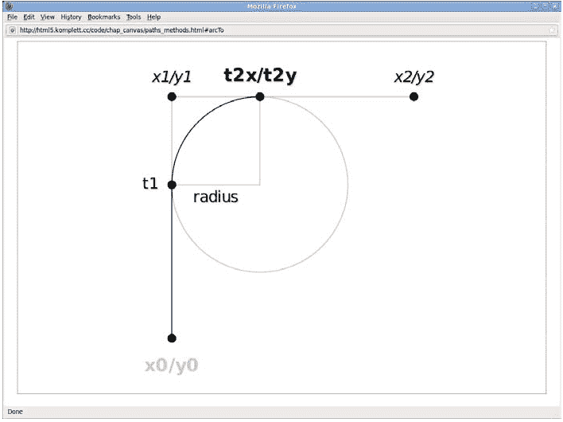

图 5.10 路径方法 "arcTo()"

在实际应用中，这个方法对于绘制圆角矩形非常有用。如图 5.11 所示，一个可复用的函数会很方便。

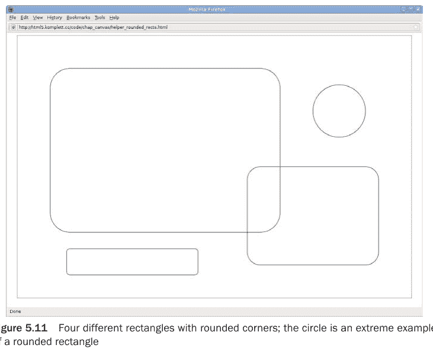

图 5.11 四种不同的圆角矩形；圆形是圆角矩形的极端示例

```
var roundedRect = function(x,y,w,h,r) {
    context.beginPath();
    context.moveTo(x,y+r);
    context.arcTo(x,y,x+w,y,r);
    context.arcTo(x+w,y,x+w,y+h,r);
    context.arcTo(x+w,y+h,x,y+h,r);
    context.arcTo(x,y+h,x,y,r);
    context.closePath();
    context.stroke();
};
roundedRect(100,100,700,500,60);
roundedRect(900,150,160,160,80);
roundedRect(700,400,400,300,40);
roundedRect(150,650,400,80,10);
```

函数 `roundedRect()` 需要矩形的基本参数以及圆角的半径。然后它通过 `moveTo()` 方法、四个 `arcTo()` 方法和一个 `closePath()` 方法绘制所需的矩形。你可能还没见过 `closePath()` 方法：它通过将最后一个点连接到起始点来闭合矩形。

创建圆弧的第二个选项——方法 arc()——初看起来更加复杂。除了圆心和半径外，我们现在还需要指定两个角度和旋转方向：

```
context.arc(x, y, radius, startAngle, endAngle, anticlockwise)
```

图 5.12 中圆弧的圆心是给定半径的圆的圆心。从这个点出发，角度 startAngle 和 endAngle 形成两个手柄，与圆相交于两点。这两点之间圆弧的方向由参数 anticlockwise 决定，其中 0 表示*顺时针*，1 表示*逆时针*。

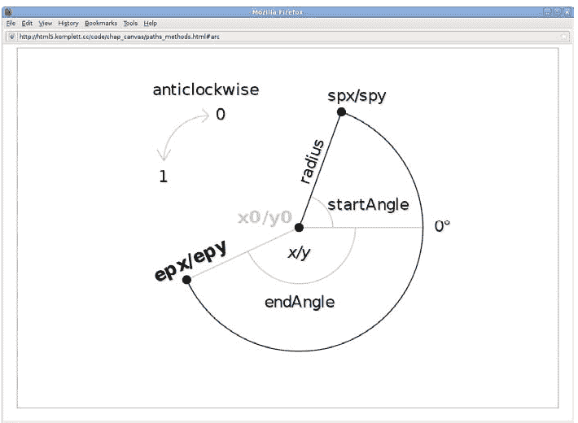

**图 5.12** 路径方法 "arc()"

生成的圆弧从圆心处的 x0/y0 点开始，用直线连接这一点到第一个交点 spx/spy，然后从那里画弧到终点 epx/epy，该点现在成为新的当前点。

创建圆弧最大的缺点是必须将角度指定为弧度而非度数。所以这里有一个快速辅助函数来帮你回忆转换方法：

```
var deg2rad = function(deg) {
    return deg*(Math.PI/180.0);
};
```

说到辅助函数，让我们再使用两个来方便地绘制圆形和扇形。对于圆形，我们实际上只需要圆心和半径，其余部分由函数 circle() 处理：

```
var circle = function(cx,cy,r) {
    context.moveTo(cx+r,cy);
    context.arc(cx,cy,r,0,Math.PI*2.0,0);
};
```

尤其对于称为饼图的圆形图表，用弧度指定角度似乎很不直观。我们的函数 sector() 为我们完成了繁琐的转换工作，允许我们用度来指定起始和结束角度：

```
var sector = function(cx,cy,r,
    startAngle,endAngle, anticlockwise
) {
    context.moveTo(cx,cy);
    context.arc(
        cx,cy,r,
        startAngle*(Math.PI/180.0),
        endAngle*(Math.PI/180.0),
        anticlockwise
    );
    context.closePath();
};
```

现在，只需几行代码就足以绘制圆形和饼图，而不会迷失方向：

```
context.beginPath();
circle(300,400,250);
circle(300,400,160);
circle(300,400,60);
sector(905,400,250,-90,30,0);
sector(900,410,280,30,150,0);
sector(895,400,230,150,270,0);
context.stroke();
```

图 5.13 显示了结果。

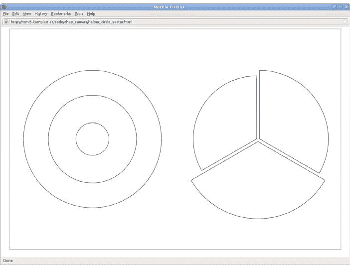

图 5.13 圆形和扇形

#### 5.5.4 矩形

方法 rect() 的处理方式与我们的辅助函数有些相似，与其他方法不同：

```
context.rect(x, y, w, h)
```

与之前的路径绘制方法相比，使用 rect() 绘制时完全忽略当前点 x0/y0；相反，矩形通过参数 x、y、宽度 w 和高度 h 定义。原点 x/y 在绘制后成为新的当前点（参见图 5.14）。

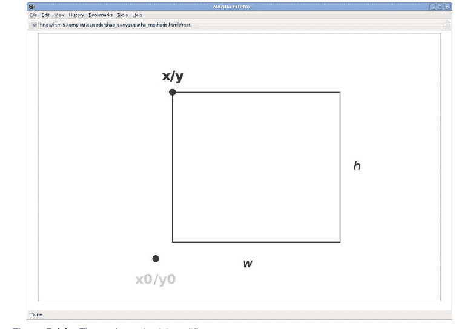

**图 5.14** 路径方法 "rect()"

#### 5.5.5 轮廓、填充和裁剪遮罩

回想一下创建路径的三个阶段：初始化—确定路径、几何形状和绘制，我们现在已经到了第三个也是最后一个阶段：绘制。在这里我们决定路径应该是什么样子。在所有之前的示例中，我们在这个阶段选择了简单的轮廓，通过以下方法创建：

```
context.stroke()
```

线条颜色由属性 strokeStyle 决定。你还可以使用另外三个 Canvas 属性定义线条宽度（lineWidth）、线条端点的样式（lineCap）以及线条连接处（lineJoin）的样式（星号表示默认值；从现在起我们会反复遇到它）：

```
context.lineWidth = [ Pixel ]
context.lineCap = [ *butt, round, square ]
context.lineJoin = [ bevel, round, *miter ]
```

图 5.15 展示了宽度、端点和连接属性的示例。

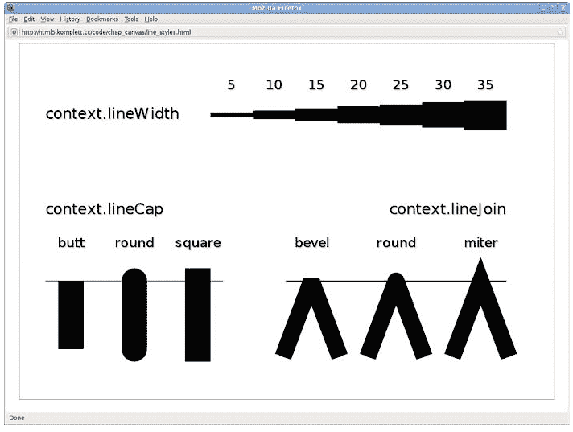

图 5.15 确定线条样式的属性

lineWidth 以像素为单位指定；默认设置为 1.0。与另外两个线条属性一样，线条宽度不仅适用于线条和多边形，也适用于用 strokeRect() 创建的矩形。

如果我们想用 lineCap 为线条添加端帽，可以选择 butt、round 或 square；butt 是默认值。如果使用 round，线条通过在末端添加一个半径为线条宽度一半的半圆来获得圆形端帽。对于 square，半圆被替换为一个高度为线条宽度一半的矩形。

要创建斜角线条连接，我们使用属性 lineJoin 并设置为 bevel；我们也可以将角变为圆角，或使用 miter 创建斜接连接，这是默认值。为了防止斜接线条的角度变得过于尖锐，规范提供了属性 miterLimit，默认值为 10.0。这是锥形点长度（线条交点到点的距离）与线条宽度一半的比值。如果超出 miterLimit，该点将被修剪，产生与 bevel 相同的效果。

要用颜色或渐变填充路径，我们首先需要使用 fillStyle 设置适当的样式属性，然后调用以下路径方法：

```
context.fill()
```

这听起来简单，但如果路径自相交或嵌套，可能会变得非常复杂。在这种情况下，所谓的*非零*环绕规则会生效：它根据涉及子路径的环绕方向来决定是否填充。

图 5.16 展示了*非零*规则的运作。在左侧，两个圆形都是顺时针绘制的；在右侧，内圆是逆时针绘制的，导致中心出现空洞。

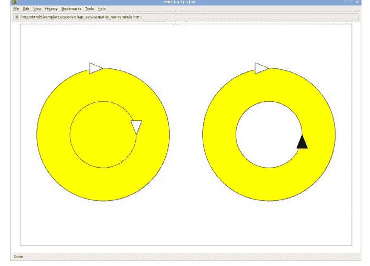

图 5.16 路径的非零填充规则

为了帮助我们绘制有方向的圆形，我们使用了来自 arc() 部分的辅助函数，这次稍作修改：现在将所需方向作为参数传入。anticlockwise 的有效设置为 0 和 1：

```
var circle = function(cx,cy,r,anticlockwise) {
    context.moveTo(cx+r,cy);
    context.arc(cx,cy,r,0,Math.PI*2.0,anticlockwise);
};
```

右侧带孔圆形的代码如下：

```
context.beginPath();
context.fillStyle = 'yellow';


circle(900,400,240,0); circle(900,400,120,1); context.fill(); context.stroke();

在调用 stroke() 和 fill() 之后，我们只需再掌握一个绘制路径的方法——即 `context.clip()` 方法。

解释与其名称一样简洁：clip() 并不绘制定义的路径，而是将其用作所有其他绘图元素的裁剪蒙版。蒙版内的内容保持可见，其余部分则被隐藏。你可以通过使用整个画布区域作为几何图形创建新的裁剪蒙版来重置蒙版。我们稍后会在 5.13 节中介绍一种更优雅的方法，使用 save() 和 restore()。

现在让我们转到文本这个话题，规范对这一主题仅仅用了四页篇幅。难道 Canvas 的文本支持并不怎么出色吗？

### 5.6 文本

乍一看，Canvas 的文本支持确实可能算不上出色，因为 Canvas 中可用的文本选项十分有限，仅限于格式化和定位简单的字符串。既没有自动换行的流式文本，也没有段落格式或选择已有文本的选项。

我们只有三个用于确定文本属性的属性、两个用于绘制文本的方法，以及一个在考虑当前格式的前提下确定字符串文本长度的方法。这看起来似乎不多，但仔细审视之后就会发现，规范中这四页内容是基于深思熟虑的细节编写的。

#### 5.6.1 字体

font 属性的定义直接引用了 CSS 规范，指出 `context.font` 遵循与 CSS font 简写符号相同的语法：

```
context.font = [ CSS font property ]
```

通过这种方式，所有字体属性都可以在一个字符串中轻松指定。表 5.2 列出了各个组成部分及其可能的值。

**表 5.2** CSS "font" 属性的组成部分

| 属性 | 值 |
|---|---|
| font-style | *normal, italic, oblique |
| font-variant | *normal, small-caps |
| font-weight | *normal, bold, bolder, lighter 100, 200, 300, 400, 500, 600, 700, 800, 900 |
| font-size | xx-small, x-small, small, *medium, large, x-large, xx-large, larger, smaller em, ex, px, in, cm, mm, pt, pc, % |
| line-height | *normal, <number>, em, ex, px, in, cm, mm, pt, pc, % |
| font-family | 字体族或通用字体族，如 serif, sans-serif, cursive, fantasy, monospace |

组装 font 属性时，只有 font-size 和 font-family 是必需的，其余均为可选项。如果省略，则默认使用表 5.2 中标有星号的值。由于 Canvas 文本不支持换行，因此 line-height 属性没有效果，始终会被忽略。因此，组装各组成部分的规范模式为：

```
context.font = [
  font-style font-variant font-weight font-size font-family
]
```

关于 font-family，适用的规则与在样式表中定义字体相同：你可以指定字体族和/或通用字体族的任意组合。浏览器随后会从该优先级列表中选择第一个已知的字体。

通过使用 Web 字体，你可以完全摆脱对浏览器或相关平台及其字体的依赖。一旦通过 `@font-face` 将 Web 字体集成到样式表中，它们就可以通过指定的字体名称在 Canvas 中作为 font-family 使用：

```
@font-face {
  font-family: Scriptina;
  src: url('fonts/scriptina.ttf');
}
```

图 5.17 展示了有效 CSS font 属性的简短示例及其在 Canvas 中的渲染效果。上例中 Web 字体 *Scriptina* 的来源是 http://www.fontex.org——一个整理良好的免费字体合集，可免费下载。

## 132 第 5 章——Canvas

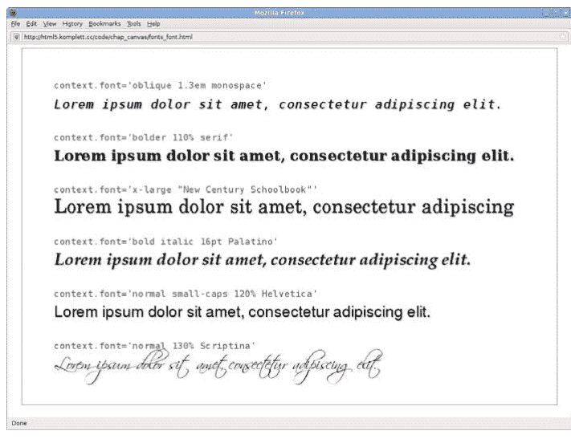

**图 5.17** 使用 "font" 属性进行字体格式化

在撰写本文时，尚无浏览器能完美支持 `@font-face`。例如，在 Firefox 中，上例最后一行中的 Web 字体 *Scriptina* 只有在 HTML 文档中至少使用过一次后才会在 Canvas 中显示。Firefox 中也缺少对 small-caps 的正确实现，因此倒数第二个示例也无法正确显示。

#### 5.6.2 水平锚点

`textAlign` 属性决定了 Canvas 文本的水平锚点：

```
context.textAlign = [
    left | right | center | *start | end
]
```

关键字 left、right 和 center 与 CSS 属性 `text-align` 中的一样，而 start 和 end 则是 CSS3 的扩展，允许根据相应的语言确定文本方向。某些语言并非从左到右书写，而是从右到左书写，例如阿拉伯语和希伯来语。

图 5.18 展示了文本流为 ltr（从左到右）和 rtl（从右到左）时的水平锚点，演示了方向性对 start 和 end 属性的影响。

> 在浏览器中，可以通过全局属性 `document.dir` 更改文档的方向性：

document.dir = [ *ltr | rtl ]

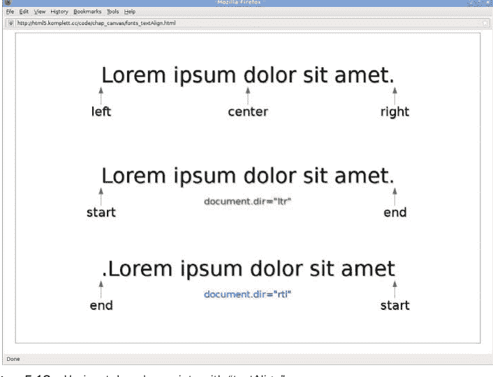

**图 5.18** 使用 "textAlign" 的水平锚点

#### 5.6.3 垂直锚点

垂直锚点，即所有字形对齐的基线，由第三个也是最后一个文本属性 `textBaseline` 决定：

```
context.textBaseline = [
  top | middle | *alphabetic | bottom | hanging | ideographic
]
```

前四个 `textBaseline` 关键字——*top*、*middle*、*alphabetic* 和 *bottom*——不言自明。*hanging*（悬挂）基线是天城文、古尔穆基文和孟加拉文所要求的，这三种印度文字体系用于书写梵语、印地语、马拉地语、尼泊尔语或旁遮普语以及孟加拉语。*ideographic*（表意）书写系统包括中文、日文、韩文和越南文。图 5.19 说明了 `textBaseline` 的垂直锚点。

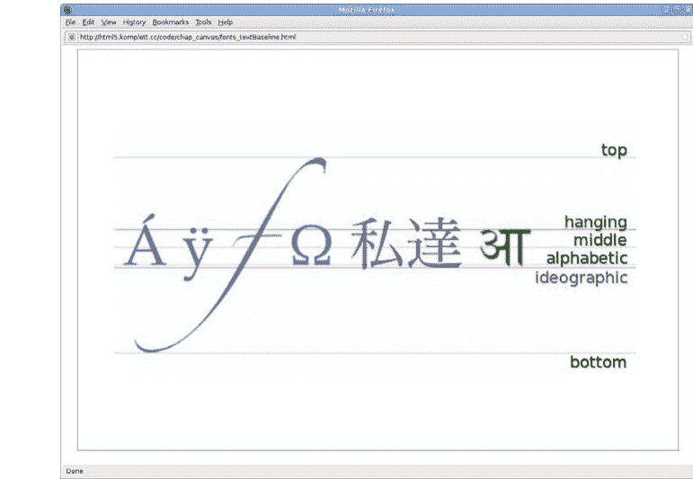

**图 5.19** 使用 "textBaseline" 的垂直锚点

#### 5.6.4 绘制和度量文本

确定字体和锚点之后，你只需绘制文本即可。与矩形类似，你可以选择填充和/或描边，甚至可以通过可选参数 `maxWidth` 指定文本的最大宽度：

```
context.fillText(text, x, y, maxWidth)
context.strokeText(text, x, y, maxWidth)
```

最后，你可以使用 `measureText()` 方法来度量文本尺寸，该方法至少能在考虑当前格式的前提下确定宽度。在图 5.20 的示例中，右下角的值（759）就是使用此方法计算得出的：

```
textWidth = context.measureText(text).width
```

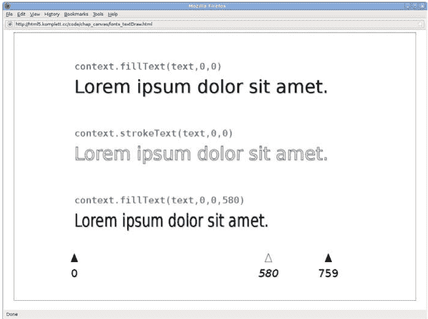

**图 5.20** "fillText()"、"strokeText()" 和 "measureText()"

目前还无法确定*边界框*的高度和原点，但这可能会在规范的未来版本中与多行文本布局一起实现。Canvas 规范文本章节的最后一条注释令人期待：它指出将来文档片段（例如格式化的段落）也可能会通过 CSS 引入到 Canvas 中。

Canvas API 不仅在未来，而且现在就提供了丰富的选项来在 Canvas 中处理基于栅格的格式。除了嵌入图像和视频之外，你还可以选择性地读写画布区域上的每个像素。你可以在 5.8 节"像素操作"中了解如何实现。

### 5.7 嵌入图像

Canvas 提供了 `drawImage()` 方法用于嵌入图像，我们可以使用三组不同的参数来调用它（该方法可以接受三个、五个或九个参数）：

```
context.drawImage(image, dx, dy)
context.drawImage(image, dx, dy, dw, dh)
context.drawImage(image, sx, sy, sw, sh, dx, dy, dw, dh)
```

在所有三种情况下，第一个参数都需要一个图像、canvas 或 video 元素，可以通过 JavaScript 动态集成，也可以在 HTML 代码中静态设置。动画图片或视频不会以动画形式渲染，而是静态显示为第一帧或（如果有的话）海报帧。
`drawImage()` 方法的其余参数影响源图像在目标画布中的位置、大小或裁剪。图 5.21 展示了可能的位置参数的图形解释；前缀 s 代表 source（源），d 代表 destination（目标）。

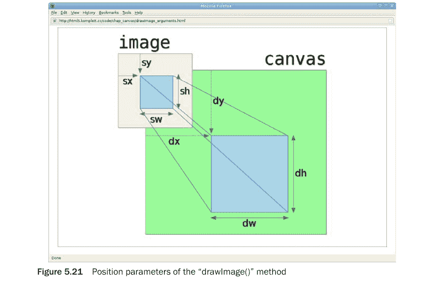

现在让我们通过三个简单的示例来比较各个 `drawImage()` 方法。共同的设置是一张 1200 × 800 像素的图片，作为 JavaScript 对象动态创建（见图 5.22）：

```
var image = new Image();
image.src = 'images/yosemite.jpg';
```


### 5.8 像素操作

作为读取和操作像素值的方法，我们有三种选择：`getImageData()`、`putImageData()` 和 `createImageData()`。由于这三个方法都包含 `ImageData` 一词，我们首先需要定义这指的是什么。

#### 5.8.1 使用 "ImageData" 对象

让我们用一个 2 × 2 像素大小的画布来接近 `ImageData` 对象，在上面我们绘制四个 1 × 1 像素大小的矩形，分别填充命名颜色海军蓝、蓝绿色、黄绿色和黄色：

```javascript
context.fillStyle = 'navy';
context.fillRect(0,0,1,1);
context.fillStyle = 'teal';
context.fillRect(1,0,1,1);
context.fillStyle = 'lime';
context.fillRect(0,1,1,1);
context.fillStyle = 'yellow';
context.fillRect(1,1,1,1);
```

下一步，我们使用 `getImageData(sx, sy, sw, sh)` 方法来获取 `ImageData` 对象。这四个参数以矩形形式确定所需的画布区域，如图 5.27 所示：

```javascript
ImageData = context.getImageData(
    0,0,canvas.width,canvas.height
);
```

**图 5.27** "ImageData" 对象

`ImageData` 对象具有属性 `ImageData.width`、`ImageData.height` 和 `ImageData.data`。最后一个属性将实际像素值隐藏在所谓的 `CanvasPixelArray` 中。这是一个扁平数组，包含所选区域中每个像素的红色、绿色、蓝色和 alpha 值，从左上角开始，从左到右、从上到下。所有值的数量保存在属性 `ImageData.data.length` 中。

使用简单的 `for` 循环，我们现在可以读取 `CanvasPixelArray` 的单个值，并通过 `alert()` 使其可见。从 0 开始，我们通过每次循环后将计数器增加 4 来逐个像素处理。RGBA 值是当前位置的偏移结果。红色可以在计数器 `i` 处找到，绿色在 `i+1`，蓝色在 `i+2`，alpha 分量在 `i+3`：

```javascript
for (var i=0; i<ImageData.data.length; i+=4) {
  var r = ImageData.data[i];
  var g = ImageData.data[i+1];
  var b = ImageData.data[i+2];
  var a = ImageData.data[i+3];
  alert(r+" "+g+" "+b+" "+a);
}
```

修改像素值的工作原理完全相同：我们通过赋新值来就地修改 `CanvasPixelArray`。在我们的示例中，RGB 值通过 `Math.random()` 设置为 0 到 255 之间的随机数；alpha 分量保持不变：

```javascript
for (var i=0; i<ImageData.data.length; i+=4) {
  ImageData.data[i] = parseInt(Math.random()*255);
  ImageData.data[i+1] = parseInt(Math.random()*255);
  ImageData.data[i+2] = parseInt(Math.random()*255);
}
```

完成此步骤后，画布看起来仍然相同。只有在我们通过 `putImageData()` 方法将修改后的 `CanvasPixelArray` 写回画布后，新颜色才会变得可见。调用 `putImageData()` 时，最多可以有七个参数：

```javascript
context.putImageData(
  ImageData, dx, dy, [ dirtyX, dirtyY, dirtyWidth, dirtyHeight ]
)
```

前三个属性是必需的；除了 `ImageData` 对象外，它们还包含原点坐标 `dx/dy`，从该点开始，通过其宽度和高度属性应用 `CanvasPixelArray`。可选的 `dirty` 参数仅裁剪出 `CanvasPixelArray` 的指定区域，并仅写回该宽度减小的区域。图 5.28 展示了我们修改前后的 4 像素画布，以及 `CanvasPixelArray` 的相关值列表。

**图 5.28** 在 "CanvasPixelArray" 中修改颜色

您可以直接通过 `createImageData()` 方法初始化一个空的 `ImageData` 对象。宽度和高度对应于参数 `sw/sh` 或调用中传递的 `ImageData` 对象的尺寸。在这两种情况下，`CanvasPixelArray` 的所有像素都设置为透明/黑色，即 `rgba(0,0,0,0)`：

```javascript
context.createImageData(sw, sh)
context.createImageData(imagedata)
```

因此，我们也可以直接通过 `createImageData()` 创建图 5.28 中修改后的 2 × 2 像素画布，并通过 `putImageData()` 绘制它：

```javascript
var imagedata = context.createImageData(2,2);
for (var i=0; i<ImageData.data.length; i+=4) {
  imagedata.data[i] = parseInt(Math.random()*255);
  imagedata.data[i+1] = parseInt(Math.random()*255);
  imagedata.data[i+2] = parseInt(Math.random()*255);
}
context.putImageData(imagedata,0,0);
```

关于枯燥的 `CanvasPixelArray` 理论就讲到这里。在实践中，事情变得更加有趣：借助 `getImageData()`、`putImageData()`、`createImageData()` 和一点数学知识，我们甚至可以编写自己的颜色滤镜来操作图像。我们将在下一节向您展示如何做到。

#### 5.8.2 使用 "getImageData()"、"createImageData()" 和 "putImageData()" 进行颜色处理

所有示例的起始图片再次是约塞米蒂国家公园的照片，通过 `drawImage()` 在 onload 时绘制到画布上。第二步，我们通过 `getImageData()` 定义原始的 `CanvasPixelArray`，然后在第三步修改它。在 `for` 循环中，每个像素的 RGBA 值按照数学公式计算，并插入之前通过 `createImageData()` 创建的 `CanvasPixelArray` 中。最后，我们用 `putImageData()` 将其写回画布。

清单 5.1 提供了图 5.29 中所有滤镜使用的基本 JavaScript 框架。函数 `grayLuminosity()` 不是代码示例的一部分，但稍后我们将与其他滤镜一起讨论它：

```javascript
var image = new Image();
image.src = 'images/yosemite.jpg';
image.onload = function() {
  context.drawImage(image,0,0,360,240);
  var modified = context.createImageData(360,240);
  var imagedata = context.getImageData(0,0,360,240);
  for (var i=0; i<imagedata.data.length; i+=4) {
    var rgba = grayLuminosity(
      imagedata.data[i+0],
      imagedata.data[i+1],
      imagedata.data[i+2],
      imagedata.data[i+3]
    );
    modified.data[i+0] = rgba[0];
    modified.data[i+1] = rgba[1];
    modified.data[i+2] = rgba[2];
    modified.data[i+3] = rgba[3];
  }
  context.putImageData(modified,0,0);
};
```

> 图 5.29 右下角的服务器图标表示，如果您使用 Firefox 作为浏览器，此示例只能通过带有 `http://` 协议的服务器访问。我们将在 5.15.3 节"安全方面"中解释原因。


 146 第5章——Canvas

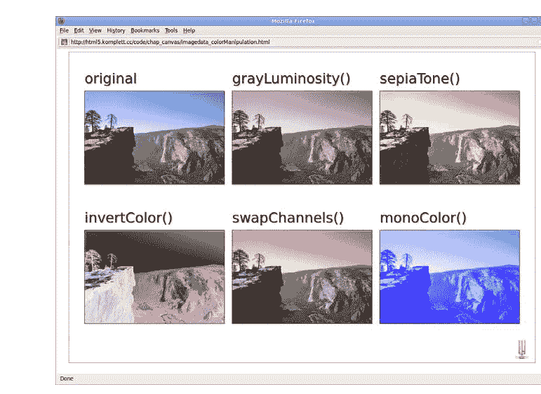

图 5.29 使用"getImageData()"和"putImageData()"进行颜色处理

关于如何将颜色转换为灰度，免费图像编辑程序 GIMP 的文档在"Desaturate"（去饱和）章节中提供了三种公式（参见网页链接 http://docs.gimp.org/en/gimp-tool-desaturate.html），你可以通过*明度*（Lightness）、*光度*（Luminosity）或平均亮度（*Average*）来计算灰度值。如果我们将这些计算用 JavaScript 实现，就能得到前三个颜色滤镜：

```
var grayLightness = function(r,g,b,a) {
  var val = parseInt(
    (Math.max(r,g,b)+Math.min(r,g,b))*0.5
  );
  return [val,val,val,a];
};

var grayLuminosity = function(r,g,b,a) {
  var val = parseInt(
    (r*0.21)+(g*0.71)+(b*0.07)
  );
  return [val,val,val,a];
};

var grayAverage = function(r,g,b,a) {
  var val = parseInt(
    (r+g+b)/3.0
  );
  return [val,val,val,a];
};
```

使用`grayLuminosity()`时，我们采用的是图 5.29 中的第二个公式，将每个像素的 RGB 分量替换为计算得到的新值。在此以及后续所有计算中，我们必须牢记 RGBA 值只能是整数；JavaScript 方法`parseInt()`确保了这一点。

`sepiaTone()`的算法摘自 Zach Smith 的一篇文章，题为*How do I ... convert images to grayscale and sepia tone using C#?*（参见缩短后的网页链接 http://bit.ly/a2nxl6）：

```
var sepiaTone = function(r,g,b,a) {
  var rS = (r*0.393)+(g*0.769)+(b*0.189);
  var gS = (r*0.349)+(g*0.686)+(b*0.168);
  var bS = (r*0.272)+(g*0.534)+(b*0.131);
  return [
    (rS>255) ? 255 : parseInt(rS),
    (gS>255) ? 255 : parseInt(gS),
    (bS>255) ? 255 : parseInt(bS),
    a
  ];
};
```

将乘积分量相加后，三个计算中的每一个都可能产生大于 255 的值；在这种情况下，将 255 作为新的值插入。

使用滤镜`invertColor()`反转颜色非常简单：只需将每个 RGB 分量从 255 中减去：

```
var invertColor = function(r,g,b,a) {
  return [
    (255-r),
    (255-g),
    (255-b),
    a
  ];
};
```

滤镜`swapChannels()`修改颜色通道的顺序。我们需要先在数组中将期望的顺序定义为第四个参数，其中 0 代表红色，1 代表绿色，2 代表蓝色，3 代表 alpha 通道。要交换通道，我们使用包含相应初始值的数组`rgba`，然后按新的顺序返回它。因此，从 RGBA 变为 BRGA（如我们的示例所示），可以通过`order=[2, 0, 1, 3]`实现：

```
var swapChannels = function(r,g,b,a,order) {
  var rgba = [r,g,b,a];
  return [
    rgba[order[0]],
    rgba[order[1]],
    rgba[order[2]],
    rgba[order[3]]
  ];
};
```

最后一个方法`monoColor()`将每个像素的 RGB 分量设置为特定颜色，使用原始像素的灰度值作为 alpha 分量。调用该函数时，第四个参数将期望的颜色定义为 RGB 值数组——在我们的示例中，蓝色对应`color=[0, 0, 255]`：

```
var monoColor = function(r,g,b,a,color) {
  return [
    color[0],
    color[1],
    color[2],
    255-(parseInt((r+g+b)/3.0))
  ];
};
```

我们这里介绍的滤镜仍然相对简单，它们改变各个像素的颜色值，而不考虑相邻的像素。如果将这些因素纳入计算，你可以实现更复杂的方法，如锐化、反锐化蒙版或边缘检测。

> 详细讨论这些滤镜将超出本书的范围。如果你想进一步探索，可以查看 Jacob Seidelin 的*Pixastic Image Processing Library*（http://www.pixastic.com/lib）。超过 30 个 JavaScript 滤镜，在 Mozilla 公共许可证下免费提供，正等待你去发现。

同时，让我们转向 Thomas Porter 和 Tom Duff，这两位皮克斯工作室的大师，他们在 1984 年因一篇关于 alpha 混合技术的文章而引起轰动。他们描述的数字合成技术不仅为他们在*美国电影艺术与科学学院*赢得了奖项，还被纳入了 Canvas 规范。

### 5.9 合成

Canvas 中合成的可能性多种多样，但在互联网上你只能找到少数好的使用示例。大多数仅限于展示方法本身，一开始，我们也要这样做。图 5.30 显示了`globalCompositeOperation`属性的有效关键字、它们的 Porter-Duff 等效值（以*斜体*表示，带 A,B），以及绘制后的结果。

首先，我们绘制蓝色矩形作为背景，然后设置期望的合成方法，最后添加红色圆形。因此，对于第一种方法 source-over，它也是`globalCompositeOperation`属性的默认值，代码如下：

```
context.beginPath();
context.fillStyle = 'cornflowerblue';
context.fillRect(0,0,50,50);
context.globalCompositeOperation = 'source-over';
context.arc(50,50,30,0,2*Math.PI,0);
context.fillStyle = 'crimson';
context.fill();
```

图像如图 5.30 所示。

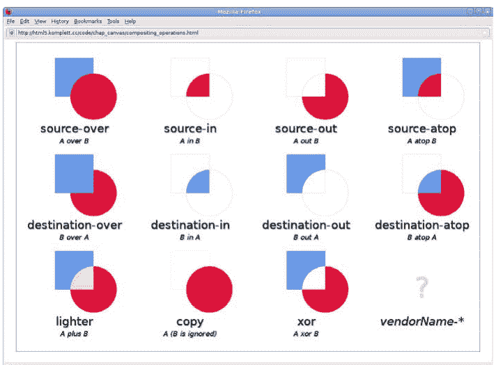

图 5.30 "globalCompositeOperation"属性的值

圆形是*源*（A）；矩形是*目标*（B）。让我们使用 Porter-Duff 术语来解释不同的方法，因为它们更直观，且能更精确地描述正在发生的事情。

使用 source-over，我们在 B 上绘制 A；使用 source-in，仅绘制 A 在 B 内的部分；使用 source-out，仅绘制 A 在 B 外的部分；使用 source-atop，我们绘制 A 和 B，但仅绘制 A 与 B 重叠的部分。第二行反转了整个过程，因此我们不必再解释一遍。

`lighter`方法将重叠区域的颜色相加，使其更亮。`copy`消除 B 且仅绘制 A，`xor`移除 A 和 B 的交集。问号表示也允许特定于供应商的合成操作，类似于`getContext()`方法。

遗憾的是，目前没有任何浏览器完全实现合成功能，这使得难以合理地展示所有方法。我们将选择两个，并查看一些使用 destination-in 和 lighter 操作的示例。

如果使用 destination-in 来组合图像和文字，我们可以实现镂空效果，如图 5.31 所示。首先，我们用`drawImage()`绘制图像，设置合成方法，然后插入最大宽度为 1080 像素的文字。文字格式对应`font-size`为 600 px，文字锚点位于顶部中心，以及带有圆形线帽和连接处的 60 像素边框：

```
context.drawImage(image,0,0,1200,600);
context.globalCompositeOperation = 'destination-in';
context.strokeText('HTML5',600,50,1080);
```

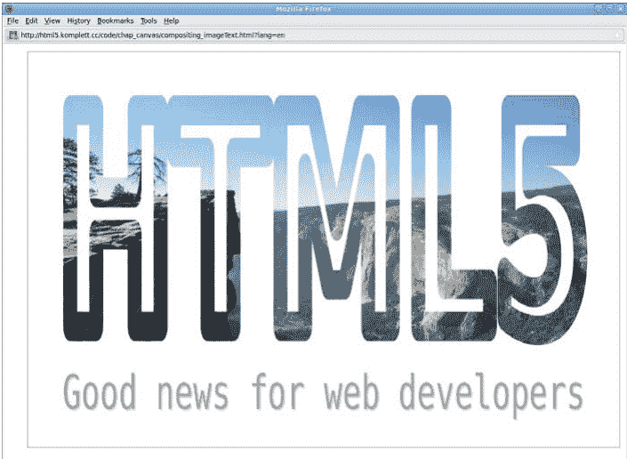

**图 5.31** 图像与文字的合成操作"destination-in"

浅灰色文字再次使用默认的合成方法 source-over 书写，因此不受效果影响。目前，由于前述浏览器实现的不足，无法同时定义多个文字作为镂空。

我们的第二个示例使用`lighter`方法，扩展了前述图像颜色处理选项。使用`lighter`，图 5.32 将优胜美地图片与 16 个指定标准颜色的矩形结合，为 5.8.2 节"getImageData()"、"createImageData()"和"putImageData()"颜色处理中提到的颜色滤镜`monoColor()`提供了一个对 CPU 友好的替代方案。因此，我们可以用不同的方式实现该节中使用的示例，并获得类似的结果：

```
context.drawImage(img,0,0,210,140);
context.globalCompositeOperation = 'lighter';
context.fillStyle = 'blue';
context.fillRect( cap,0,210,140);
```

# 152 第5章——Canvas


图 5.32 16 种基本颜色的合成操作"lighter"

我们将会在 5.11 节变换中图 5.37 的镜像效果中再次遇到合成运算符 **destination-out**。让我们首先转向 Canvas 中的用户自定义图案。

### 5.10 图案

要为填充和线条创建用户自定义图案，规范提供了`createPattern()`方法。与`drawImage()`类似，它接受图像元素以及 canvas 或 video 元素作为输入，在参数**repetition**中定义图案重复的类型：

```
context.createPattern(image, repetition)
```

**repetition**参数的允许值与 CSS 规范的 background-color 属性相同，即`repeat`、`repeat-x`、`repeat-y`和`no-repeat`。如果我们再次使用 16 种命名的基本颜色，只需几行代码就能创建棋盘格图案，每种图案使用两对颜色（见图 5.33）。

该图案是在内存中创建一个画布，宽度为 20 × 20 像素，包含四个 10 × 10 像素的方块。以绿色图案为例，此步骤如下所示：

```
var cvs = document.createElement("CANVAS");
cvs.width = 20;
cvs.height = 20;
var ctx = cvs.getContext('2d');
ctx.fillStyle = 'lime';
ctx.fillRect(0,0,10,10);
ctx.fillRect(10,10,10,10);
ctx.fillStyle = 'green';
ctx.fillRect(10,0,10,10);
ctx.fillRect(0,10,10,10);
```

然后我们将画布 cvs 定义为使用 createPattern() 的重复图案，将其赋值给属性 fillStyle，并用其填充正方形：

```
context.fillStyle = context.createPattern(cvs,'repeat');
context.fillRect(0,0,220,220);
```

图案锚定到坐标原点并从该点开始应用。如果我们在前面的示例中将 `fillRect()` 从 0/0 开始向右移动十像素，即从 10/0 开始，那么左上角的第一种颜色将是绿色而不是亮绿色。

除了用户自定义的画布元素外，我们还可以使用图像作为图案的来源。图 5.34 展示了使用 `createPattern()` 填充背景、为标题文字创建图案，以及裁我太熟悉的那张优胜美地照片的各个部分的示例。另外两张图片，*pattern_107.png* 和 *pattern_125.png*，是 *Squidfingers* 图案库的一部分，在那里你可以选择近 160 种其他有吸引力的图案进行下载：http://www.squidfingers.com/patterns。


**图 5.34** 使用图像作为源的图案

首先来看看背景是如何创建的：

```
var bg = new Image();
bg.src = 'icons/pattern_125.png';
bg.onload = function() {
  context.globalAlpha = 0.5;
  context.fillStyle = context.createPattern(bg, 'repeat');
  context.fillRect(0, 0, canvas.width, canvas.height);
};
```

前两行代码创建了一个新的 `Image` 对象，将其 `src` 属性设置为 `icons` 文件夹中的图像 `pattern_125.png`。与 `drawImage()` 一样，我们需要确保图像确实加载完成后再定义图案。函数 `bg.onload()` 包含生成重复图案的真正代码，我们以 50% 的不透明度将其应用到整个画布区域。用同样的方法，我们用图像 `pattern_107.png` 填充标题文字 *Yosemite!*。

对于重叠的图像部分，我们只需将整张优胜美地照片 `yosemite.jpg` 作为图案输入，然后在 for 循环中遍历输入数组 `extents`，该数组包含我们想要的部分的 x、y、宽度和高度值。通过调用 `fillRect()`，相关图像区域作为填充图案显示，并通过 `strokeRect()` 添加额外的边框：

```
var extents = [
  { x:20,y:50,width:120,height:550 } // 以及其他 7 个 ...
];
var image = new Image();
image.src = 'images/yosemite.jpg';
image.onload = function() {
  context.fillStyle = context.createPattern(
    image, 'no-repeat'
  );
  for (var i=0; i<extents.length; i++) {
    var d = extents[i]; // 快捷方式
    context.fillRect(d.x, d.y, d.width, d.height);
    context.strokeRect(d.x, d.y, d.width, d.height);
  }
};
```

图 5.34 中使用了三种不同的图像，三者都必须完全加载后才能使用，因此我们需要嵌套三个 `onload` 函数。这确保我们可以在绘制过程中控制正确的顺序。可能的嵌套方式伪代码如下：

```
// 创建所有图像
bg.onload = function() {
  // 绘制背景
  image.onload = function() {
    // 添加图像裁切部分
    pat.onload = function() {
      // 用图案填充标题
    };
  };
};
```

避免这种嵌套的唯一方法是在页面的 HTML 代码中通过 `visibility:hidden` 将所有涉及的图像链接为隐藏的 `img` 元素，然后在 `window.onload()` 中加载页面后通过 `getElementById()` 或 `getElementsByTagName()` 引用它们。

在继续讨论 Canvas 规范的另一个部分*变换*之前，我们应该提到，当使用视频元素作为 createPattern() 的来源时，视频的第一帧或海报帧（如果存在）将被用作图案，类似于 drawImage() 方法。

### 5.11 变换

Canvas 变换直接操作坐标系统。当移动矩形时，你不仅移动实际元素，还移动整个坐标系统，然后才重新绘制矩形。三种基本变换是 scale()、rotate() 和 translate()，如图 5.35 所示。


```
context.scale(x, y)
context.rotate(angle)
context.translate(x, y)
```

通过 scale() 进行缩放时，我们需要两个乘数作为参数来改变 x 和 y 维度的大小；使用 rotate() 旋转时需要顺时针旋转的角度（弧度）；通过 translate() 移动时定义 x 和 y 方向的偏移量（像素）。如果组合这些方法，各个变换必须按相反的顺序执行：就 JavaScript 代码而言，它们基本上必须从后往前读取。

要先缩放后旋转，我们这样写：

```
context.rotate(0.175);
context.scale(0.75,0.75);
context.fillRect(0,0,200,150);
```

如果我们想先旋转后平移，JavaScript 代码应该是：

```
context.translate(100,50);
context.rotate(0.175);
context.fillRect(0,0,200,150);
```

在任何涉及旋转的情况下都需要小心，因为旋转始终以原点 0/0 作为旋转中心。经验法则是 rotate() 通常是最后的操作。图 5.36 展示了使用所有三种基本方法的示例，以不同的视角展示我们的优胜美地图像，形似跳台滑雪。


**图 5.36** 旋转、缩放和移动

清单 5.2 展示了图 5.36 中非常简短的源代码。

```
Listing 5.2  图 5.36 所示变换的源代码

image.onload = function() {
    var rotate = 15;
    var scaleStart = 0.0;
    var scaleEnd = 4.0;
    var scaleInc = (scaleEnd-scaleStart)/(360/rotate);
    var s = scaleStart;
    for (var i=0; i<=360; i+=rotate) {
        s += scaleInc;
        context.translate(540,260);
        context.scale(s,s);
        context.rotate(i*-1*Math.PI/180);
        context.drawImage(image,0,0,120,80);
        context.setTransform(1,0,0,1,0,0);
    }
};
```

图像加载完成后，我们将旋转角度 rotate 定义为 15°，起始和结束缩放 scaleStart 为 0.0，scaleEnd 为 4.0，并由此推导出缩放的增量 scaleInc，目标是在完整旋转内达到结束缩放 4.0。然后在 for 循环中，我们每次将图像逆时针旋转 15°，将其从 0.0 缩放到 4.0，并将其左上角设置为坐标 540/260。

那么为什么在 for 循环末尾有 setTransform() 方法呢？

除了基本变换 scale()、rotate() 和 translate() 之外，Canvas 还提供了另外两种改变坐标系统从而改变变换矩阵的方法：transform() 和 setTransform()，它们在清单 5.2 中已经提到：

```
context.transform(m11, m12, m21, m22, dx, dy);
context.setTransform(m11, m12, m21, m22, dx, dy);
```

两者都有共同的参数 m11、m12、m21、m22、dx 和 dy，代表表 5.3 中列出的变换属性。

表 5.3 Canvas 矩阵变换的组成部分

| 组成部分 | 内容 |
| :--- | :--- |
| m11 | x 轴缩放 |
| m12 | 水平剪切 |
| m21 | 垂直剪切 |
| m22 | y 轴缩放 |
| dx | 沿 x 轴平移 |
| dy | 沿 y 轴平移 |

它们之间的主要区别是 `transform()` 通过乘法改变当前变换矩阵，而 `setTransform()` 用新矩阵覆盖现有矩阵。

三种基本方法也可以表述_FILLED
 formulated as `transform()` 或 `setTransform()` 的属性，基本上只是相应矩阵变换的便捷快捷方式。表 5.4 列出了这些属性以及其他用于翻转（`flipX/Y`）和倾斜（`skewX/Y`）的有用矩阵。倾斜的角度同样以弧度指定。

表 5.4 基本变换和其他有用变换方法的矩阵

| 方法 | 变换矩阵 (m11, m12, m21, m22, dx, dy) |
| :--- | :--- |
| scale(x, y) | x,0,0,y,0,0 |
| rotate(angle) | cos(angle),sin(angle), -sin(angle), cos(angle),0,0 |
| translate(x, y) | 1,0,0,1,x,y |
| flipX() | -1,0,0,1,0,0 |
| flipY() | 1, 0, 0, -1, 0, 0 |
| skewX(angle) | 1,0,tan(angle),1,0,0 |
| skewY(angle) | 1,tan(angle),0,1,0,0 |

在使用详细示例进一步探讨 Canvas 变换之前，我们应该提到，根据规范，`getImageData()` 和 `putImageData()` 都不受变换的影响。调用 `getImageData(0,0,100,100)` 始终获取画布左上角的 100 x 100 像素方块，无论坐标系统是否被平移、缩放，


或旋转。`putImageData(imagedata,0,0)`也是如此，其中左上角作为锚点来应用imagedata的内容。

让我们继续看一个示例，我们将应用所有提到的变换方法。图5.37展示了吸引人的结果——我们约塞米蒂图片的三个图像部分的拼贴画，带有伪3D镜面效果。


**图5.37**  带有伪3D镜面效果的照片拼贴画

我们首先开始为塔夫脱点、默塞德河和酋长岩裁出三个正方形部分。结果将保存在数组icons中：

```
var icons = [
    clipIcon(image,0,100,600,600),
    clipIcon(image,620,615,180,180),
    clipIcon(image,550,310,400,4)];
```

函数`clipIcon()`负责裁剪和调整不同大小图像部分的大小。在这个函数中，我们首先创建一个新的*内存中*画布，大小为320 × 320像素，然后我们用`drawImage()`将适当缩小（或放大）的图标复制到上面，最后添加15像素的白色边框：

```
var clipIcon = function(img,x,y,width,height) {
    var cvs = document.createElement("CANVAS");
    var ctx = cvs.getContext('2d');
    cvs.width = 320;
    cvs.height = 320;
    ctx.drawImage(img,x,y,width,height,0,0,320,320);
    ctx.strokeStyle = '#FFF';
    ctx.lineWidth = 15;
    ctx.strokeRect(0,0,320,320);
    return cvs;
};
```

第二步，我们为这三个图像部分分别创建反射效果，并将其保存在数组effects中：

```
var effects = [];
for (var i=0; i<icons.length; i++) {
    effects[i] = createReflection(icons[i]);
}
```

主要工作在函数`createReflection()`中完成，其稍作修改的代码取自Charles Ying关于艺术、音乐和技术艺术的博客中关于iPhone CoverFlow效果的一篇博客文章（参见缩短的网络链接http://bit.ly/b5AFW6）：

```
var createReflection = function(icon) {
    var cvs = document.createElement("CANVAS");
    var ctx = cvs.getContext('2d');
    cvs.width = icon.width;
    cvs.height = icon.height/2.0;

    // 翻转
    ctx.translate(0,icon.height);
    ctx.scale(1,-1);
    ctx.drawImage(icon,0,0);

    // 渐隐
    ctx.setTransform(1,0,0,1,0,0);
    ctx.globalCompositeOperation = "destination-out";
    var grad = ctx.createLinearGradient(
        0,0,0,icon.height/2.0
    );
    grad.addColorStop(0,'rgba(255,255,255,0.5)');
    grad.addColorStop(1,'rgba(255,255,255,1.0)');
    ctx.fillStyle = grad;
    ctx.fillRect(0,0,icon.width,icon.height/2.0);
    return cvs;
};
```

在`createReflection()`中，我们首先使用另一个*内存中*画布来翻转传入的icon图像部分的下半部分。回想一下变换矩阵的快捷方式，我们可以通过flipY()的矩阵来实现翻转。但在这里我们使用了另一种创建反射的方法，使用`scale()`方法，其中`scale(1,-1)`对应于`flipY()`方法，`scale(-1,1)`对应于`flipX()`方法。渐隐效果是通过从半透明白色到不透明的白色渐变实现的，该渐变使用合成方法destination-out覆盖在图标上。

现在我们已经定义了各个图像部分，可以开始绘制了。黑白渐变在渐变中心几乎完全为黑色，营造出3D空间的感觉，然后我们在其中放置三张图片：

```
var grad = context.createLinearGradient(
    0,0,0,canvas.height
);
grad.addColorStop(0.0,'#000');
grad.addColorStop(0.5,'#111');
grad.addColorStop(1.0,'#EEE');
context.fillStyle = grad;
context.fillRect(0,0,canvas.width,canvas.height);
```

默塞德河的中间图片是最容易通过`setTransform()`定位的；然后我们可以绘制它并添加反射效果：

```
context.setTransform(1,0,0,1,440,160);
context.drawImage(icons[1],0,0,320,320);
context.drawImage(effects[1],0,320,320,160);
```

右侧的酋长岩图片宽度缩放为0.9以获得更好的3D效果。结果通过`skewY()`的矩阵向下倾斜10°，并放置在中心图片的右侧：

```
context.setTransform(1,0,0,1,820,160);
context.transform(1,Math.tan(0.175),0,1,0,0);
context.scale(0.9,1);
context.drawImage(icons[2],0,0,320,320);
context.drawImage(effects[2],0,320,320,160);
```

绘制左侧的塔夫脱点图片稍微复杂一些。倾斜后，我们这部分的左上角形成锚点；然后我们必须向上倾斜10°，再将结果向下移动。勾股定理将帮助我们确定所需的dy值：它是以弧度表示的旋转角度的正切乘以对应于图标宽度的直角边长度，即`Math.tan(0.175)*320`。我们还必须补偿图像宽度缩放0.9的影响，将其向右移动320*0.1：

```
context.setTransform(1,0,0,1,60,160);
context.transform(1,Math.tan(-0.175),0,1,0,0);
context.translate(320*0.1,Math.tan(0.175)*320);
context.scale(0.9,1);
context.drawImage(icons[0],0,0,320,320);
context.drawImage(effects[0],0,320,320,160);
```

我们现在已经完成了到目前为止最困难的Canvas示例。结果相当令人印象深刻，所以我们应该将其保存为JPEG或PNG文件。与其他浏览器不同，Firefox为你提供了便利——只需在画布上右键单击即可保存你的创作。如果你点击查看图片，会出现一个奇怪且非常非常非常长的URL地址，以`data:image/png;base64...`开头，这直接把我们带到了下一节——`canvas.toDataURL()`。

### 5.12 使用"canvas.toDataURL()"进行Base64编码

Base64描述了一种将二进制数据编码为ASCII字符串的方法。在Canvas中，它用于将仅作为内存中光栅存在的画布内容转换为可处理的数据URL。实现这一点的办法是

```
canvas.toDataURL(type, args)
```

我们使用`image/png`或`image/jpeg`作为type传递所需输出格式的MIME类型。前者是默认编码格式，如果我们省略type或指定浏览器无法处理的格式时也会使用它。任何额外的参数可以通过可选参数`args`来容纳——例如，选择`image/jpeg`时的图像质量，有效数字在0.0到1.0之间。

`toDataURL()`的结果是一个base64编码的字符串。对于图5.27中2 × 2像素画布的命名颜色海军蓝、蓝绿色、柠檬绿和黄色，它看起来如下：

```
data:image/png;base64,iVBORw0KGgoAAAANSUhEUg
AAAAIAAAACCAYAAABBytg0kAAAAF0lEQVQImQXBAQEAAA
CCIKb33ADLFql0PuYIemXXHEQAAAAASUVORK5CYII=
```

这些编码字符串可能会变得非常长。例如，我们带反射效果的照片拼贴画的base64版本不少于1,298,974个字符，可以填满本书的325页（每页包含50行，每行80个字符）！

那么`toDataURL()`是用来做什么的？为什么将二进制图像数据转换为字符串？答案很简单：通过`toDataURL()`，我们可以在HTML中使短暂的内存中画布永久可用，使用户或应用程序能够保存它。

toDataURL()的第一个用途是将Canvas图形复制到HTMLImageElement中。这成为可能是因为src属性也可以是data: URI。所需的代码很短，除了动态创建的画布外还需要一个空图像：

```
<!DOCTYPE html>
<title>将画布复制到图像</title>

<script>
  var canvas = document.createElement("CANVAS");
  canvas.width = 200;
  canvas.height = 200;
  var context = canvas.getContext('2d');
  context.fillStyle = 'navy';
  context.fillRect(0,0,canvas.width,canvas.height);
  document.images[0].src = canvas.toDataURL();
</script>
```

列表中关键的行用粗体显示，展示了复制是多么容易——定义文档中第一张图片的引用，并将其src属性指定为canvas.toDataURL()。结果，我们得到一个常规的img元素，可以像浏览器中的任何其他图像一样对待，并可以保存为PNG Extend。

通过canvas元素上的一个简单onclick处理程序，我们演示了toDataURL()的下一个用途——直接将生成的数据URI作为URL分配，但这次输出不是PNG，而是JPEG：

```
document.images[0].onclick = function() {
  window.location = canvas.toDataURL('image/jpeg');
};
```

这种方法的缺点是URL有时会变得非常长（还记得那130万个字符吗？），而且这种格式的图像不会进入缓存，因此每次调用都必须重新创建。toDataURL()的其他潜在应用包括与localStorage或XMLHttpRequest一起使用，允许在客户端和服务器端保存和访问现有的Canvas图形。toDataURL()在为background-image或list-style-image创建CSS样式时也很有用，我们可以将其作为url()值插入。


 ## 5.13 "save()" 与 "restore()"

我们对 CanvasContext2D 的旅程即将结束。只剩下两个方法需要解释：context.save() 和 context.restore()。没有它们，我们很可能无法处理任何复杂的 Canvas 图形；如果你快速浏览一下各图的源代码，你可能会同意这一点。为了帮助你更好地理解 context.save() 和 context.restore() 这两个方法，我们需要先回顾一下。

通过 canvas.getContext('2d') 定义绘图上下文时，所有属性都会被赋予默认值，这些值在绘图时直接生效：

```
context.globalAlpha = 1.0;
context.globalCompositeOperation = 'source-over';
context.strokeStyle = 'black';
context.fillStyle = 'black';
context.lineWidth = 1;
context.lineCap = 'butt';
context.lineJoin = 'miter';
context.miterLimit = 10;
context.shadowOffsetX = 0;
context.shadowOffsetY = 0;
context.shadowBlur = 0;
context.shadowColor = 'rgba(0,0,0,0)';
context.font = '10px sans-serif';
context.textAlign = 'start';
context.textBaseline = 'alphabetic';
```

同时，坐标系使用单位矩阵初始化，并创建一个裁剪蒙版，涵盖整个画布区域：

```
context.setTransform(1, 0, 0, 1, 0, 0);
context.beginPath();
context.rect(0, 0, canvas.width, canvas.height);
context.clip();
```

如果我们更改属性、变换或裁剪蒙版，它们将保持有效直到我们再次更改。在更复杂的图形中，很容易搞不清楚所有这些更改。这正是 context.save() 和 context.restore() 发挥作用的地方。

使用 context.save()，我们可以在任何时候创建一个快照，保存当前设置的属性和变换，同时考虑当前的裁剪蒙版。稍后，我们可以通过 context.restore() 轻松访问这个快照。规范在此提到了绘图状态栈，因为快照也可以嵌套。

这种技术在涉及变换或裁剪蒙版时非常出色。而对于阴影效果，使用 `context.save()` 和 `context.restore()` 将四个阴影组件重置为默认值，比单独设置每个组件要容易得多。对于接下来我们将讨论动画，`context.save()` 和 `context.restore()` 几乎是不可或缺的。

### 5.14 动画

与 SVG 或 SMIL 动画不同，Canvas 动画完全是手动完成的。所需的要素是一个绘图函数加上一个定时器，以固定间隔调用它。JavaScript 为此提供了 `window.setInterval()`；其余的则取决于 Canvas 程序员的想象力。

#### 5.14.1 多彩球体动画

这是我们的动画首秀：不同颜色的球体出现在画布的随机位置，慢慢淡出，并被其他球体覆盖。动画速度应相当于成年人静息时约 60 次/分钟的脉搏。作为一项附加功能，我们希望通过点击画布来停止或重新启动动画。

大约 50 行 JavaScript 代码就足够了。但在分析清单 5.3 之前，让我们先看看图 5.38 中结果的静态屏幕截图。

**图 5.38** 多彩球体动画

### **清单 5.3** 多彩球体动画的 JavaScript 代码

```
var canvas = document.querySelector("canvas");
var context = canvas.getContext('2d');
var r, cx, cy, radgrad;

var drawCircles = function() {
  // 淡化已有内容
  context.fillStyle = 'rgba(255,255,255,0.5)';
  context.fillRect(0, 0, canvas.width, canvas.height);

  // 绘制新球体
  for (var i = 0; i < 360; i += 15) {
    // 随机位置和大小
    cx = Math.random() * canvas.width;
    cy = Math.random() * canvas.height;
    r = Math.random() * canvas.width / 10.0;

    // 定义径向渐变
    radgrad = context.createRadialGradient(
      0 + (r * 0.15), 0 - (r * 0.25), r / 3.0,
      0, 0, r
    );
    radgrad.addColorStop(0.0, 'hsl(' + i + ',100%,75%)');
    radgrad.addColorStop(0.9, 'hsl(' + i + ',100%,50%)');
```

```
    radgrad.addColorStop(1.0, 'rgba(0,0,0,0)');

    // 绘制圆形
    context.save();
    context.translate(cx, cy);
    context.beginPath();
    context.moveTo(0 + r, 0);
    context.arc(0, 0, r, 0, Math.PI * 2.0, 0);
    context.fillStyle = radgrad;
    context.fill();
    context.restore();
  }
};
drawCircles();  // 绘制第一组球体

// 以脉搏速度启动/停止动画
var pulse = 60;
var running = null;
canvas.onclick = function() {
  if (running) {
    window.clearInterval(running);
    running = null;
  }
  else {
    running = window.setInterval(
      "drawCircles()", 60000 / pulse
    );
  }
};
```

在定义了 canvas、context 和其他一些变量之后，真正的工作从函数 drawCircles() 开始。一个半透明的白色矩形将之前 drawCircles() 调用产生的已有内容淡化，然后 for 循环绘制新的球体。每个球体的位置及其半径再次使用 Math.random() 随机化，将圆心置于画布区域内，并将半径限制为画布宽度的十分之一。

为了确保圆形看起来像球体，我们创建一个径向渐变。它的几何结构由一个右上角的光斑和整个圆形组成。for 循环的增量选择反映了希望以 HSL 色彩空间的颜色作为渐变的 colorStops 的愿望。每次循环，色相角度增加 15°，导致颜色从红色变为绿色再到蓝色，最后回到红色。

然后我们可以从明度中分别推导出匹配的成对颜色：第一种代表光斑，第二种代表球体边缘附近的较暗颜色。第三次调用 addColorStop() 使球体的最边缘淡出为透明的黑色。我们以这种方式总共创建 24 个球体；为了清晰起见，球体的颜色对如图 5.39 所示。

然后用定义的渐变将球体绘制为圆形。嵌入在 context.save() 和 context.restore() 中确保 translate() 的临时位移不会应用到后续的圆形上。现在函数 drawCircles() 完成了，我们可以绘制第一组球体，然后继续处理定时器。

大约 15 行代码就足以通过 onClick 事件监听器实现动画的启动和停止。第一次点击画布时，我们使用 window.setInterval() 启动动画，并将唯一的间隔 ID 保存在变量 running 中。window.setInterval() 的时间以毫秒为单位，因此需要将变量 pulse 中的每分钟心跳次数进行相应转换。

动画运行后，唯一的间隔 ID 被赋值给变量 running，下一次点击时，我们可以使用 window.clearInterval(running) 中断它。如果然后将 running 重置为 null，下一次点击画布时表示：没有动画正在运行。在这种情况下，我们重新启动，乐趣重新开始。

#### 5.14.2 使用 "drawImage()" 播放视频

正如你已经在 5.7 节"嵌入图像"中所知道的，HTMLVideoElement 也可以作为 drawImage() 的来源。但如果你以为以这种方式嵌入的视频会自动播放，你就会失望，因为这一逻辑必须完全在 JavaScript 中实现。这并不困难，正如你可以从我们最后的 Canvas 动画示例中看到的——这是图 5.25 中优胜美地国家公园明信片的扩展。现在，我们用动态视频代替埃尔卡皮坦的静态图像部分，将其放置在右上角，提供来自塔夫脱点的 360° 全景视图。视频播放时，十个运行中视频的小快照作为画廊出现在画布底部。视频结束后，你可以看到图 5.40 所示的画面。

## 170 第 5 章—Canvas

**图 5.40** 优胜美地国家公园视频明信片

> 该视频由 YouTube 用户 *pos315* 友情提供，通过 *ffmpeg* 转换为 WebM 格式，并缩减至 320 × 240 像素。你可以在以下网址观看原始视频：http://www.youtube.com/watch?v=NmdHx_7b0h0。

与迄今为止总是通过 JavaScript 方法 new Image() 进入画布的图像不同，我们将全景视图直接作为 video 元素集成到 HTML 页面中。作为附加属性，我们需要 preload、oncanplay 作为事件监听器来告诉我们何时可以布局明信片并准备启动和停止，以及一个用于隐藏嵌入的原始视频的样式指令 cinematic。我们只使用原始视频在播放期间将当前视频帧以短暂间隔复制到画布上。对于不支持视频的浏览器，替代文本提供了视频内容的快速参考：

```
<video src="videos/yosemite_320x240.webm"
  preload="auto"
  oncanplay="init(event)"
  style="display:none;"
>
```

从塔夫特点俯瞰优胜美地山谷的全景

为确保 `oncanplay` 属性中引用的 `init(event)` 函数确实存在，我们在 video 元素之前设置了 script 元素。这个核心函数的示意图结构实现了视频明信片的布局和功能，如下所示：

```
var init = function(evt) {
  // save reference to video element
  // create background image
  image.onload = function() {
    // draw background image
    // add title
    // draw first frame
    canvas.onclick = function() {
      // implement starting and stopping
      // copy video frames while playing
      // create icons at regular intervals while playing
    };
  }
};
```

video 元素的视频对象引用可以在 `evt.target` 中找到，我们将其保存在变量 `video` 中。与之前一样，我们通过 `new Image()` 创建新的背景图像，一旦图像完全加载完毕，我们就继续绘制背景和标题。到目前为止的步骤可能不需要进一步解释，但也许我们应该解释一下第一帧的绘制：

```
context.setTransform(1,0,0,1,860,20);
context.drawImage(video,0,0,320,240);
context.strokeRect(0,0,320,240);
```

我们首先使用 `setTransform()` 将坐标系定位到右上角，然后使用 `drawImage()` 绘制带边框的第一帧。这个过程在播放时会不断重复，关键在于 `drawImage()` 方法的 `HTMLVideoElement video` 参数始终提供当前帧的图像。

停止、启动以及复制后台运行的原始视频的当前帧，还有创建缩小的图像片段，都是通过点击画布上的 `canvas.onclick()` 函数来实现的。清单 5.4 展示了完成所有这些操作所需的 JavaScript 代码：

清单 5.4 用于动画化视频明信片的代码

```
var running = null;
canvas.onclick = function() {
  if (running) {
    video.pause();
    window.clearInterval(running);
    running = null;
  }
  else {
    var gap = video.duration/10;
    video.play();
    running = window.setInterval(function () {
      if (video.currentTime < video.duration) {
        // update video
        context.setTransform(1,0,0,1,860,20);
        context.drawImage(video,0,0,320,240);
        context.strokeRect(0,0,320,240);
        // update icons
        var x1 = Math.floor(video.currentTime/gap)*107;
        var tx = Math.floor(video.currentTime/gap)*5;
        context.setTransform(1,0,0,1,10+tx,710);
        context.drawImage(video,x1,0,107,80);
        context.strokeRect(x1,0,107,80);
      }
      else {
        window.clearInterval(running);
        running = null;
      }
    },35);
  }
};
```

与第一个动画示例一样，变量 `running` 包含 `window.setInterval()` 的唯一间隔 ID，用于控制动画。如果 `running` 被赋值，我们通过 `video.pause()` 暂停隐藏的视频，通过移除间隔来停止帧复制，并将 `running` 重新设为 `null`。否则，我们在第一次或下一次点击时通过 `video.play()` 启动视频，并在每隔 35 毫秒的间隔回调函数中将当前视频帧复制到画布上。我们持续这个过程，直到视频播放完毕或画布再次被点击。变量 `video` 中视频对象的两个属性 `video.currentTime` 和 `video.duration` 可以帮助检查当前播放位置是否仍小于视频的总时长。

在右上角绘制复制的视频与绘制第一帧是并行进行的。对于迷你快照条带，我们使用视频的总长度和所需的快照数量来计算间隔间隙，之后我们需要将锚点 `x1` 向右移动一个小间隙 `tx`。只要 `x1` 保持相同的值，缩小图像中的动画就会持续运行。如果 `x1` 向右移动，最后一帧保持静止，动画从新位置继续运行。在大约 40 秒的播放时间后，视频结束，已经绘制了十个新的迷你快照，我们可以通过点击画布重新开始整个序列。

我们的视频明信片就介绍到这里。但在结束本章之前，我们还需要提及几个主题。

### 5.15 还缺少什么？

下一节将描述 `isPointInPath()` 方法，并探讨 Canvas 中的无障碍访问和安全性方面的内容。本章最后将简要介绍浏览器支持的改进情况，并为所有想要深入了解 Canvas 的人提供一组链接。

#### 5.15.1 "isPointInPath(x, y)"

正如从方法名称可以猜到的，`isPointInPath()` 返回 `true` 或 `false`，取决于由坐标 `x`/`y` 指定的点是否在当前路径的内部或外部。一个简短的示例演示了此方法的应用；在这种情况下，`alert()` 中返回 `true`：

```
context.beginPath();
context.rect(50,50,100,100);
alert(
  context.isPointInPath(75,75)
);
```

`isPointInPath()` 的一个实际用途是确定用户是否点击了画布的特定区域。我们只需要一个 `onclick` 事件处理程序，它使用鼠标在 `clientX`/`clientY` 中的位置和画布元素在 `offsetLeft`/`offsetTop` 中的位置来计算相对于画布区域的当前 `x`/`y` 位置：

```
canvas.onclick = function(evt) {
  context.beginPath();
  context.rect(50,50,100,100);
  alert(
    context.isPointInPath(
      evt.clientX - canvas.offsetLeft,
      evt.clientY - canvas.offsetTop
    )
  );
};
```

不幸的是，`isPointInPath()` 不允许路径变换：即使我们在执行 `beginPath()` 指令之前已将坐标系向右移动了 200 像素，点击坐标 75/75 仍然会返回 `true`。不过，它在判断内部/外部时确实考虑了非零填充规则；正如前面两个代码示例所示，要测试的路径不一定需要使用 `fill()` 或 `stroke()` 来绘制。

#### 5.15.2 Canvas 中的无障碍访问？

本节标题中的问号是有意为之的：Canvas 在无障碍访问方面确实仍然存在不足。这部分是由于在 Canvas 概念设计阶段，无障碍访问几乎没有得到关注，部分是由于问题本身的性质——基于光栅的无 DOM 格式天生就不具备无障碍访问性。

在 HTML5 规范的背景下，具有 DOM 的 SVG 可能更适合实现无障碍内容。但实践证明，即使是大型项目，例如基于网页的代码编辑器 Skywriter (https://mozillalabs.com/skywriter)，也出于性能考虑而使用 Canvas 而非 SVG，这确实违反了 HTML5 规范 Canvas 章节开头所述的基本规则：*当存在更合适的元素时，作者不应在文档中使用 canvas 元素。*

第二项要求，即当*作者使用 canvas 元素*时，*还必须提供内容*，*该内容在呈现给用户时*，*传达与位图画布基本相同的功能或目的*，在现实中也未得到真正遵守。canvas 开始标签和结束标签之间的区域本应用于放置此类替代内容，但通常仅用于为不支持 Canvas 的浏览器指定后备内容。

对于交互式 Canvas 应用程序，HTML Canvas 2D Context 规范还建议在后备内容中包含可聚焦的 HTML 元素，例如为画布的每个可聚焦区域包含一个 input 元素。作者应使用 `drawFocusRing()` 方法来标记画布中当前在后备内容中获得焦点的区域。规范中在此上下文中列出的示例，包含一些复选框，旨在通过 `drawFocusring()` 在后备内容和画布区域之间保持同步，这展示了整个事情的复杂性，并让我们怀疑这不是最佳解决方案。

自 2009 年 7 月以来，*Canvas 无障碍访问任务组*一直致力于改善这一不尽人意的状况。他们正在研究焦点和光标管理的潜在改进方案。第一批建议已经提出，正在被积极讨论，并很有可能以某种形式进入规范。

但在那之前，我们只能接受现状：*无障碍访问——请稍候！*


#### 5.15.3 安全方面

从安全角度来看，通过其他域中的脚本访问图像及其内容（像素）在 Canvas 中尤其存在问题。该规范将此称为*信息泄露*，并尝试通过 *origin-clean* 标志来防止这种泄露。

*origin-clean* 的概念是分两个阶段的，主要基于某些方法调用和属性赋值在运行脚本期间将 *origin-clean* 标志从 *true* 设置为 *false*。如果在这种情况下调用 getImageData() 或 toDataURL()，脚本将因 SECURITY_ERR 异常而中止。

主要涉及的是 drawImage()、fillStyle 和 strokeStyle。每当来自另一个域的图像或视频，或者本身不是 *origin-clean* 的 canvas 元素参与其中时，它们都会导致 *origin-clean* 标志的重新定义。

假设变量 image 包含对 WHATWG 网站 (http://www.whatwg.org/images/logo) 上 logo 的引用，并且脚本不在 WHATWG 服务器上运行，以下 drawImage() 调用会将 *origin-clean* 标志设置为 false：

```
context.drawImage(image,0,0);
```

如果我们使用 logo 作为图案，属性 fillStyle 和 strokeStyle 会产生相同的结果——*origin-clean* 变为 *false*：

```
var pat = context.createPattern(image);
context.fillStyle = pat;
context.strokeStyle = pat;
```

从此时起，每次调用 getImageData() 或 toDataURL() 都将不可避免地导致脚本终止。

在 Firefox 浏览器中，此机制的处理甚至更为严格：任何通过 file:// 协议加载的图像都被归类为非 *origin-clean*。那么，这对我们本章有什么影响呢？所有右下角带有服务器图标图形，在 Firefox 中如果通过 file:// 本地打开是无法工作的；相反，它们只能通过 Web 服务器来显示。

> 提示：如果您不想安装 Apache 服务器并且可以使用 Python，您只需一行命令即可在当前目录启动一个基本的 Web 服务器，端口为 8000，然后在浏览器中通过 url http://localhost:8000 访问该目录的内容：
>
> `python -m SimpleHTTPServer`

#### 5.15.4 浏览器支持

当前版本的 Firefox 以及 Safari、Chrome 和 Opera 支持大部分 Canvas 规范。如果您想在 IE 中查看 Canvas，您需要使用 IE9，它为 Canvas 提供了硬件加速支持。这使得针对 IE8 的变通方法，如 Google 的 Chrome Frame 插件 (http://code.google.com/chrome/chromeframe) 或 JavaScript 垫片 *explorercanvas* (http://code.google.com/p/explorercanvas) 变得过时了。

正如您所料，那些已经支持 Canvas 的浏览器在实现程度上存在细微差别。一个用于确定实现程度的有用资源是 Philip Taylor 的 *Canvas Testsuite*，它包含大约 800 个测试，以及主要浏览器的测试结果表，地址为 http://philip.html5.org/tests/canvas/suite/tests。

本 Canvas 章节中的所有示例都是使用 Firefox 创建的，您可以在截图中看到。在撰写本文时，所有示例在 Firefox 中都能正常工作，除了小型大写字体的显示。Safari、Opera、IE9 和 Chrome 在我们的示例中也表现良好——Safari 和 Opera 甚至比 IE9 和 Chrome 更好。

由于每个常见浏览器的新版本都可能导致 Canvas 实现方面的改进，我们书籍中示例在不同浏览器中运行情况的定期更新详情，可在配套网站的 Canvas 索引中找到，地址为 http://html5.komplett.cc/code/chap_canvas/index_en.html。

#### 5.15.5 进一步链接

探索 Canvas 的一个良好起点是 http://www.canvasdemos.com，这个门户自称是 *Home to applications, games, tools and tutorials that use the HTML 5 <canvas> element*；它提供了一系列有趣的链接。值得一看的还有 Mozilla *开发者中心*的详尽 Canvas 教程，地址为 https://developer.mozilla.org/en/canvas_tutorial 和 http://hacks.mozilla.org/category/canvas，这是一个专注于高级应用示例的 Mozilla 社区博客。

如果您想深入了解 Canvas 的细节，最好的选择是 Canvas 规范。两份文档的当前版本可以在以下位置找到：

- http://www.w3.org/TR/html5/the-canvas-element.html
- http://www.w3.org/TR/2dcontext

如果您更喜欢一个带有实现阶段并且可以直接留评论或报告各部分错误的交互式版本，请访问 WHATWG，地址为 http://www.whatwg.org/specs/web-apps/current-work/multipage/the-canvas-element.html。

### 总结

我们对 Canvas 世界的探索之旅已经结束。从绘制两个重叠的红色和黄色矩形到编程一个视频贺卡，这是一段漫长的旅程。您学习了如何处理颜色、创建阴影效果，以及绘制线条、贝塞尔曲线、弧线、矩形和剪切蒙版。我们花了相当多的时间探索 Canvas 的关键特性——通过结合像素操作方法、图案、变换和合成来处理图像并创建引人入胜的效果。我们甚至敢于手工编码动画。但是，尽管本章是本书中最长的一章，它只能让您对 Canvas 提供的无数可能性略窥一斑。还有许多其他令人印象深刻的示例等待在互联网上被发现——去探索吧！

## 6
## SVG 和 MathML

HTML5 规范中仅有两个段落用于介绍矢量标准 *SVG* 和数学标记语言 *MathML*。然而，这两种 XML 方言的集成是迈向未来 Web 应用的又一个里程碑。虽然 MathML 主要让科学界欣喜，但每个人都从 SVG 中受益：将标准化的矢量格式整合到浏览器中早就该做了。仅 SVG 这个主题就足以填满整本书，并且远超本书的范围，就像对 MathML 的详细指南在这里也不合适一样。因此，在本章中，我们将只讨论 SVG 和 MathML 在 HTML5 文档中的集成。

在 HTML5 中使用 SVG 和 MathML 的前提当然是浏览器中对这两个组件的实现。此外，*解析器*还必须能够识别 svg 和 math 元素，并将它们的值传递给*布局引擎*以表示为图形。在撰写本文时，只有 Firefox 4 满足所有要求。图 6.1 展示了使用三个带有相应 SVG 图形的 MathML 公式的示例结果。

### 6.1 MathML

为了解释必要的标记，让我们使用圆形的例子：在代码清单 6.1 中，您可以看到计算给定面积 A 的圆的半径 r 的公式源代码。

代码清单 6.1 给定面积下圆半径的 MathML 标记和公式

```
<math>
  <mrow>
    <mi>r</mi>
    <mo>=</mo>
    <msqrt>
      <mfrac>
        <mrow>
          <mi>A</mi>
        </mrow>
        <mrow>
          <mn>&Pi;</mn>
        </mrow>
      </mfrac>
    </msqrt>
  </mrow>
</math>
```

HTML5 文档中的每个 MathML 块都以 `<math>` 开始，以 `</math>` 结束。中间是用于定义公式的可选标签——在我们的情况下，有六个不同的标签，按照它们在表 6.1 中出现的顺序介绍。

**表 6.1** 代码清单 6.1 中的 MathML 标签及其含义

| 元素 | 名称 | 用途 |
| :--- | :--- | :--- |
| mrow | *行* | 用于分组表达式的元素 |
| mi | *i 代表标识符* | 变量、函数名或常量 |
| mo | *o 代表运算符* | 运算符，如等于、加、减或乘号 |
| msqrt | *sqrt 代表平方根* | 平方根表达式 |
| mfrac | *frac 代表分数* | 分数、除法 |
| mn | *n 代表数字* | 数字 |

分组表达式的元素 `mrow` 出现了三次：一次用于整个表达式，另外两次用于区分除法 `mfrac` 中的分子和分母。半径 *r* 和面积 *A* 表示为 `mi` 元素，等号表示为 `mo` 元素，根式表达式由 `msqrt` 元素形成。对于圆周率 *π*，我们使用 `mn` 元素结合 MathML 实体 `&Pi;`——这是超过 2000 个 MathML 实体中的一个，我们也可以将其写为 Unicode 符号 `&#x03A0;`（希腊大写字母 Pi）。

> 将命名 MathML 实体转换为 Unicode 字符的表格可以在 MathML 规范中找到，地址为 http://www.w3.org/TR/REC-MathML/chap6/byalpha.html。

图 6.1 中计算正方形对角线的公式包含另一个作为乘号的实体 `&times;`（作为 Unicode 符号 `&#x00D7;` 乘号），而在中间示例中对矩形边 *a*、*b* 进行平方时，我们使用了 `msup` 元素（`sup` 代表上标）。

当然，这三个 MathML 示例只是冰山一角。探索 MathML 世界的起点可以在以下网站找到。不要错过 Mozilla 项目演示页面上的 *MathML 基础*示例。您会惊讶地发现，通过 MathML 可以编写复杂的公式！查看这些网站以了解更多关于 MathML 的信息：


 ## 6.2 SVG

在相关 MathML 公式的右侧，你可以看到对应的 SVG 图形，它展示了公式的组成部分。我们仍以圆为例，查看图 6.1 中圆形图形的 SVG 代码，如清单 6.2 所示。

清单 6.2 圆形图形的 SVG 源代码

```
<svg width="100" height="100">
  <circle cx="50" cy="50" r="45"
          fill="none" stroke="black" />
  <path d="M 50 50 h 45"
        stroke="black" stroke-dasharray="5,5"/>
</svg>
```

在 SVG 代码块的开头，我们有 `<svg>`，在结尾有 `</svg>`。与 MathML 不同，开始标签还指定了图形的宽度和高度，在 HTML 页面上预留相应的空间。圆是一个 `circle` 元素，其中心为 cx/cy，半径为 r。属性 `fill` 和 `stroke` 决定了圆的外观。

表示半径的虚线是通过 `path` 元素创建的，其几何数据在 `d` 属性中确定。与 canvas 元素类似，SVG 不仅可以绘制线条，还可以绘制开放式或封闭式多边形形式的复杂曲线。`d` 属性中几何指令的语法使用数字表示坐标，加上字母标识路径类型，字母跟随相关的缩写：因此，`d="M 50 50 h 45"` 的意思是*移动到点 50/50，然后向右绘制一条长度为 45 的水平线*。

正方形和矩形表明其他表示方式也是可能的。大写字母表示绝对移动；小写字母表示相对移动。正方形的对角线用 `d="M 10 90 L 90 10"` 创建。这相当于*移动到点 10/90，然后绘制一条到点 90/10 的线*。矩形的对角线用 `d="M 5 80 l 90 -75"` 完成，意思是*移动到点 5/80，然后从该点绘制一条线到向右 90 像素、向上 75 像素的点*。

- MathML 规范：http://www.w3.org/TR/MathML
- W3C Math 工作组：http://www.w3.org/Math
- Planet MathML：http://www.w3.org/Math/planet
- MathML 演示：http://www.mozilla.org/projects/mathml/demo

圆半径的虚线以及正方形和矩形的对角线是由属性 `stroke-dasharray` 创建的，这是 Canvas 规范中 unfortunately 缺少的一个特性。其属性值决定了*绘制线条*和*插入空白*之间的切换，切换过程重复进行直到线条完成。对于更复杂的模式，可以输入任意数量的逗号分隔值。

最后但同样重要的是，几何图形正方形和矩形是两个 `rect` 元素，带有 x、y、width 和 height 属性，这意味着我们已经涵盖了图形 SVG 代码中出现的所有元素和属性。当然，这与 MathML 一样：这只是冰山一角，而且这次真的只是最微小的顶端。在其下方，潜伏着各种几何形状，以及强大的路径绘制方法、文本布局、变换、自由定义的坐标系、滤镜、渐变、符号、遮罩、图案、合成、裁剪、脚本、样式，甚至动画。

如果你想更深入地了解 SVG 主题，绝对应该投资一本关于 SVG 的书籍。以下链接提供了在线开始探索该主题的更多机会：

- **SVG 规范：** http://www.w3.org/TR/SVG11
- **面向当今浏览器的 SVG 入门：** http://www.w3.org/Graphics/SVG/IG/resources/svgprimer.html
- **W3C SVG 工作组：** http://www.w3.org/Graphics/SVG
- **学习 SVG：Web 图形标准：** http://www.learnsvg.com

### 小结

随着 IE9 的推出，经过十年的矢量标准，所有浏览器终于提供了原生 SVG 支持。我们希望同样的事情也适用于 MathML；它在 HTML5 规范中的整合将发挥重要作用，正如 SVG 那样。作为新网络平台的重要组成部分，MathML 尤其是 SVG，未来无疑将发挥更加重要的作用。

---

## 7 地理定位

地理定位 API 已从 HTML5 规范的核心中移除，按照 W3C 的术语，它仍处于早期阶段。但它已经得到了很大程度的实现，特别是在移动浏览器中。快速实现的一个原因很可能是因为接口简短且抽象：仅靠三个 JavaScript 调用就能覆盖全部功能范围。规范并未规定浏览器必须如何确定位置，只规定了结果应以何种格式返回。

在简要介绍地理数据的性质之后，我们将通过几个简短的示例演示新功能。如果你在智能手机上尝试我们的示例，你将很快体验到那种*啊哈！效果*。

### 7.1 地理定位简介

本节向你介绍地理定位的基础知识。它涵盖地理数据和在线地图服务。

#### 7.1.1 关于地理数据

你可能已经遇到过 N47 16 06.6 E11 23 35.9 这种格式的坐标。位置以度-分-秒的形式指定。在这个例子中，目标位置位于北纬 47 度 16 分 6.6 秒，东经 11 度 23 分 35.9 秒。这类坐标被称为地理坐标。Unfortunately，这些值的最大缺点是难以计算，不仅仅是因为我们习惯于十进制数。由于坐标指定了球体地球上的位置，在计算距离时必须考虑地球表面的曲率。

为简化情况，实践中使用投影坐标。球体地球被划分为条状区域，在其中可以测量点之间的线性距离。许多国家使用自己*的坐标系统，以适应当地需求。例如，在奥地利，数据参照于 *Bundesmeldenetz*，一个笛卡尔坐标系统。所有常见的坐标系统都有一个数字标识符，即 *EPSG* 代码（由 *European Petroleum Survey Group* 管理）。

显然，地理定位 API 无法考虑所有现有的坐标系统。因此 x 和 y 坐标不是投影坐标，而是以十进制度数指定的地理坐标。标准指定广泛使用的 *World Geodetic System 1984*（*WGS84*）作为大地测量参考系统。它基本上描述了底层的参考椭球体。y 值以该椭球体上方的高度（米）指定。使用该系统可以足够准确地描述地球上或地球附近的任何一点。

#### 7.1.2 在线地图服务

要在浏览器中展示地理数据，你有几种选择：由于其灵活的坐标系统，SVG 非常合适；数据可以使用 canvas 作为栅格图像绘制。最简单的解决方案是使用现有的 JavaScript 库。在可获得的免费在线库中，我们将更仔细地查看 Google Maps 和 OpenStreetMap。微软的地图服务 *Bing Maps* 只能在注册后使用，因此我们不会在此讨论。

本章介绍的这两个库使用栅格和矢量数据的混合进行显示。为实现更快的加载时间，栅格图像被细分为瓦片，并为所有缩放级别预先计算，从而实现逐步图像构建。矢量信息根据浏览器的不同，以 SVG 或微软特定的 VML 格式显示（针对 Internet Explorer）。

##### 7.1.2.1 Google Maps

Google Maps 无疑是互联网上使用最广泛的地图服务。许多公司使用这项免费服务以地图形式展示其位置。但 Google Maps 能做的远不止在地图上放置位置标记。从网站 http://maps.google.com/help/maps/casestudies 可以看出，超过 150,000 个网站使用 Google Maps，包括 *New York Times* 这样的大公司。

该库的当前版本 V3 与早期版本有很大不同：使用它不再需要 API 密钥（因此无需向 Google 注册），并且该库针对移动设备使用进行了优化。与 Google 产品通常的情况一样，编程非常直接。对于中欧的简单道路地图，你只需要几行 HTML 和 JavaScript，如清单 7.1 所示：

```
清单 7.1  使用 Google Maps 展示中欧道路地图
<html>
  <head>
    <script type="text/javascript"
      src="http://maps.google.com/maps/api/js?sensor=true">
    </script>
    <script type="text/javascript">
      window.onload = function() {
        var map = 
          new google.maps.Map(document.getElementById("map"),
            { center: new google.maps.LatLng(47,11),
              zoom: 7,
              mapTypeId: google.maps.MapTypeId.ROADMAP
            }
          );
      }
    </script>
  </head>
  <body>
    <div id="map" style="width:100%; height:100%"></div>
```

加载库时，你必须指定 sensors 参数。如果设置为 true，设备可以确定其位置并通知应用程序。这对移动设备（如带 GPS 的智能手机）特别有用。一旦整个页面加载完成（window.onload），就会创建一个类型为 google.maps.Map 的新对象，其构造函数接收的第一个参数是用于显示地图的 HTML 元素。第二个参数确定

地图设置为北纬47度、东经11度，缩放级别为7（缩放级别0相当于查看整个地球），并通过常量 `google.maps.MapTypeId.ROADMAP` 将地图类型指定为道路地图。

> 由于地图对象的构造函数包含对HTML页面内容的引用，因此只能在网站加载完成后调用；也就是说，在 `window.onload` 时调用。

##### 7.1.2.2 OpenStreetMap/OpenLayers

OpenStreetMap 于2004年推出，其宏伟目标是成为全球范围内全面且免费的地理数据平台。效仿维基百科的成功模式，用户应该能够轻松地记录其周边地区的地理要素并将其保存到线上。考虑到编辑地理数据的难度，该项目目前的状态令人印象深刻。数千名用户已将他们的GPS数据上传到 openstreetmap.org 平台，或者在网站上对数据进行修正和评论。此外，具有合适许可证的现有地理数据也被整合到数据库中（例如，美国 *TIGER* 数据和 *Landsat 7* 卫星图像）。

该项目还催生了多种工具，借助这些工具，你可以从 OpenStreetMap 服务器下载数据，并在获得许可的情况下将数据上传并保存到服务器。开放的接口使软件开发者能够轻松将其产品集成到该系统中。

OpenStreetMap 取得成功的一个重要因素是，Web开发者可以通过 OpenLayers 项目简单地将地图集成到他们的网站中。这个JavaScript库不仅限于 OpenStreetMap，但通过与 OpenStreetMap 的协作更能展现其优势。借助 OpenLayers，你还可以访问 Google、Microsoft、Yahoo 以及无数其他地理服务（基于 *WMS* 和 *WFS* 标准）的地图。

清单 7.2 提供了一个使用 OpenLayers 和 OpenStreetMap 显示中欧道路地图的迷你示例：

**清单 7.2** 使用 OpenStreetMap 和 OpenLayers 的中欧道路地图

```html
<!DOCTYPE html>
<html>
<head>
<title>Geolocation - OpenLayers / OpenStreetMap</title>
<script src=
"http://www.openlayers.org/api/OpenLayers.js"></script>
<script src=
"http://www.openstreetmap.org/openlayers/OpenStreetMap.js">
</script>
<script>
    window.onload = function() {
        var map = new OpenLayers.Map("map");
        map.addLayer(new
            OpenLayers.Layer.OSM.Osmarender("Osmarender"));
        var lonLat = new OpenLayers.LonLat(11, 47).transform(
                new OpenLayers.Projection("EPSG:4326"),
                map.getProjectionObject()
        );
        map.setCenter (lonLat,7);
    }
</script>
<body>
    <div id="map" style="top: 0; left: 0; bottom: 0;
        right: 0; position: fixed;"></div>
</body>
</html>
```

在此示例中，我们需要加载 openlayers.org 和 openstreetmap.org 的JavaScript库。与 Google Maps 类似，一个HTML div元素被分配给 OpenLayers.Map 对象用于显示，并添加了一个 Osmarender 类型的图层——这是 OpenStreetMap（OSM）的标准地图视图。这里涉及到 OpenStreetMap 的一个特殊功能：正如7.1.1节"关于地理数据"所述，三维信息必须进行投影才能以二维形式显示在屏幕上。虽然 Google Maps 不会让用户为这些细节所困扰，你只需以小数度指定x和y坐标，但 OpenLayers 要求你先将小数度的数据投影到相关的坐标系统中。在内部，OpenLayers（与 Google Maps、Yahoo! Maps 和 Microsoft Bing Maps 一样）使用一种称为 *球面墨卡托*（EPSG代码3785）的投影来创建地图表示。在球面墨卡托中，坐标以米而非小数度来管理，因此这里使用的度数值必须通过 `transform()` 调用转换为地图所使用的坐标系统（通过函数 `map.getProjectionObject()` 确定），并指定所需投影的 *EPSG* 代码（EPSG:4326）。


> 如果你在文档开头使用 DOCTYPE，这在HTML5中是正确的，那么显示地图的HTML元素必须包含 fixed 或 absolute 的定位。否则，OpenLayers 库将不显示任何内容。有趣的是，如果未包含 DOCTYPE，则不存在此限制。关于此主题的更多信息可以在 http://openlayers.org/pipermail/users/2009-July/012860.html 的邮件列表帖子中找到。

### 7.2 第一个实验：浏览器中的地理定位

要测试浏览器的地理定位功能，你只需要清单 7.3 中的JavaScript代码：

```javascript
function $(id) { return document.getElementById(id); }
window.onload = function() {
  if (navigator.geolocation) {
    navigator.geolocation.getCurrentPosition(
        function(pos) {
          $("lat").innerHTML = pos.coords.latitude;
          $("lon").innerHTML = pos.coords.longitude;
          $("alt").innerHTML = pos.coords.altitude;
        },
        function() {},
        {enableHighAccuracy:true, maximumAge:600000}
    );
  } else {
    $("status").innerHTML = 
      'No Geolocation support for your Browser';
  }
}
```

清单的第一行定义了一个辅助函数 $，允许使用 `document.getElementById()` 函数的简写形式（类似于别名）。这个技巧来自大家熟悉的 jQuery 库，对于我们的示例非常方便，因为需要填充的元素在网站上用ID属性进行了标记。与前面的示例一样（参见清单 7.1 和 7.2），`window.onload` 确保在设置对HTML元素的引用之前，网站内容已完全加载。第一个 if 查询检查浏览器是否支持地理定位API。如果不支持，则将适当的消息写入ID为 status 的元素中。否则，激活用于确定位置的实际函数：`navigator.geolocation.getCurrentPosition()`。

根据规范，调用此函数时，浏览器必须询问你是否希望它定位你的当前位置并在网站上共享。图 7.1 显示了 Mozilla Firefox 中的相关对话框。


**图 7.1**  Mozilla Firefox 请求允许共享你的位置

函数调用传递了三个参数：

- 成功确定位置后要执行的函数（*成功回调*）
- 如果无法确定位置可以处理错误的函数（*错误回调*）
- 影响位置确定方式的键值对

根据规范，后两个参数是可选的；*成功回调* 必须始终指定。为了不阻碍JavaScript的执行顺序，`getCurrentPosition()` 必须在后台异步执行，只有在位置已知或发生错误时才能调用相关的回调函数。

在这个非常简短的示例中，两个回调函数都实现为 *匿名函数*；错误未被考虑。键值对 `enableHighAccuracy: true` 告诉浏览器尽可能准确地计算位置。在Android手机上，此设置会激活内部GPS传感器（更多信息请参见7.3节"确定位置的技术背景"）。最后，`maximumAge` 指定已经确定的位置可以重用的时间（以毫秒为单位）。超过该时间后，位置必须重新确定——在我们的示例中，每十分钟重新确定一次。

成功确定位置后，*成功回调* 中的变量 pos 在所谓的 Position 接口中包含坐标数据（`pos.coords`）以及自1970年以来的毫秒时间戳（`pos.timestamp`）。图 7.2 显示了可用属性及其各自的值（如果存在）。


192 第7章 — 地理位置

图7.2 Mozilla Firefox中的地理位置输出

除了纬度、经度和海拔高度，`pos.coords`还包括位置精度信息（accuracy, altitudeAccuracy）以及可能的速度和方向（heading）。而Google Chrome仅限于规范要求的属性，Firefox（此处为3.6版本）则输出了大量额外信息——甚至包括地址详情（参见清单7.4），以下是`JSON.stringify(pos)`结果的一个摘录：

清单7.4 Firefox 3.6中JSON.stringify(pos)结果的摘录

```
{"coords":
..// ...
  "address":
    {"streetNumber":"6","street":"Postgasse",
     "premises":null,"city":"Murnau am Staffelsee",
     "county":"Garmisch-Partenkirchen","region":"Bavaria",
     "country":"Germany","countryCode":"DE",
     "postalCode":"82418","contractID":"",
     "classDescription":"wifi geo position address object",
     // ...
    },
  // ...
}
```

浏览器提供了如此丰富的信息！这些信息的来源将在下一节解释。

### 7.3 确定位置的技术背景

如果你在国外访问网站http://www.google.com，你可能会惊讶地发现，你被自动重定向到了你所在国家的相关Google域名。即使你的浏览器不支持地理位置功能，这也能实现：Google使用了一个简单的技巧，通过IP地址来定位你的位置。

支持Geolocation API的浏览器可以通过利用其他技术选项来实现显著更高的精度。目前使用的方法有以下四种：

- 1. 在有线互联网连接的PC中，通过IP地址定位。这种定位方式相当不准确，正如你所料。

- 2. 如果有无线局域网连接，定位可以精确得多。Google已从全球的公共和私人WLAN收集了数据。

- 3. 如果硬件有移动通信芯片（例如，在智能手机中），它会尝试在移动通信网络内计算位置。

- 4. 如果硬件还有GPS传感器，定位可以更加精确。GPS是一个基于卫星的定位系统，即使在廉价传感器的情况下，只要条件有利（例如在户外），也能达到米级精度。当调用服务时，WLAN路由器数据会随之发送。对于Google来说，这主要涉及运行*Android*操作系统的移动通信设备；而Skyhook则受益于iPhone用户。上述方法的结合为这两个服务提供商带来了庞大的地理数据集，并通过*众包*（即使用户作为数据提供者对此一无所知）不断更新。

> Firefox有一个非常有用的扩展插件*Geolocater*，它对开发应用程序特别有帮助。它允许输入Firefox在调用Geolocation API时返回的位置。你可以通过下拉菜单选择位置，而无需依赖Google的在线服务。你可以在https://addons.mozilla.org/en-US/firefox/addon/14046下载这个有用的插件。

### 7.4 在OpenStreetMap上显示当前位置

在下面的示例中，当前位置被表示在OpenStreetMap地图上，并用标记指示。你可以看到不同的图层和OpenStreetMap导航栏。图7.3显示了OpenStreetMap的*Mapnik*图层，位置标记位于浏览器中央。


© OpenStreetmap contributors, CC-BY-SA

**图7.3** 使用OpenLayers和OpenStreetMap的当前位置

与第7.1.2节"在线地图服务"中一样，OpenStreetMap项目的数据使用OpenLayers库表示。加载两个必需的JavaScript文件后，在此示例中初始化地图并添加所需的控制元素：

```
// Initialize map and add navigation
var map = new OpenLayers.Map ("map");
map.addControl(new OpenLayers.Control.Navigation());
map.addControl(new OpenLayers.Control.PanZoomBar());
```

除了带有四个箭头的导航元素外，我们将缩放条附加到地图变量（map）。然后我们为不同的图层创建选择元素（Control.LayerSwitcher），并向地图添加多个图层。map.addLayers()函数调用接收一个新创建的地图对象数组：

```
// Layer selection with four map types
map.addControl(new OpenLayers.Control.LayerSwitcher());
map.addLayers([
    new OpenLayers.Layer.OSM.Mapnik("Mapnik"),
    new OpenLayers.Layer.OSM.Osmarender("Osmarender"),
    new OpenLayers.Layer.OSM.CycleMap("CycleMap")
]);
```

最后，地图获得一个用于标记的图层：

```
var markers = new OpenLayers.Layer.Markers("Markers");
map.addLayer(markers);
```

成功确定位置后的成功回调函数如下所示：

```
function(pos) {
    var ll = new OpenLayers.LonLat(
        pos.coords.longitude,
        pos.coords.latitude).transform(
            new OpenLayers.Projection("EPSG:4326"),
            map.getProjectionObject()
    );
    map.setCenter (ll,zoom);
    markers.addMarker(
        new OpenLayers.Marker(
            ll,new OpenLayers.Icon(
                'http://www.openstreetmap.org/openlayers/img/marker.png')
        )
    );
},
```

### 7.5 使用Google Maps进行位置跟踪

正如你在第7.1.2节"在线地图服务"中已经了解到的，地理坐标系（纬度/经度）的坐标必须转换为*球面墨卡托*系统。最后，标记11被放置在确定的位置上；标记的相关图标直接从OpenStreetMap加载。Geolocation规范还包括另一个调用，特别适用于移动对象：`navigator.geolocation.watchPosition()`。下一个示例演示了如何使用Google Maps API图形化地表示位置的变化。

我们的快速示例只有在移动设备上使用时才有意义。当然，你可以为了演示目的而人为地"让事情动起来"，但很可能只有在你能够在移动中通过GPS和浏览器准确确定你的位置时，你才会真正获得成就感。以下实验的一个关键组件是一部在高速公路行程中显示HTML页面的Android智能手机。

如图7.4所示，在Google Maps上标记了最后五个确定的位置。一旦用户离开屏幕上显示的地图区域，地图就会围绕下一个点居中。


图7.4 Android手机上的Google Maps API

调用Geolocation API再次在`window.onload`中完成，如下所示：

```
var watchID = navigator.geolocation.watchPosition(
  moveMe, posError, {enableHighAccuracy: true}
);
```


实际的工作在函数 `moveMe()` 中进行：

```
function moveMe(position) {
  latlng = new google.maps.LatLng(
    position.coords.latitude,
    position.coords.longitude);
  bounds = map.getBounds();
  map.setZoom(16);
  if (!bounds.contains(latlng)) {
    map.setCenter(latlng);
  }
  if (marker.length >= maxMarkers) {
    m = marker.shift();
    if (m) {
      m.setMap();
    }
  }
  marker.push(new google.maps.Marker({
    position: latlng, map: map,
    title: position.coords.accuracy+"m lat: "
      +position.coords.latitude+" lon: "+
      position.coords.longitude
  }));
}
```

变量 `latlng` 是从 Google Maps API 创建的 LatLng 对象，当前坐标会传递给该对象。如果当前位置在地图所示区域之外（`!bounds.contains(latlng)`），地图将重新定位到当前点。脚本开头定义的数组 `marker` 和变量 `maxMarkers` 都是全局变量，并被赋值为 5。如果数组 `marker` 包含超过五个元素，则使用 `shift` 函数移除数组的第一个元素，然后通过调用不带任何参数的 `setMap()` 将其从地图上删除。最后，一个新类型的标记对象被添加到数组中的当前位置。

### 7.6 示例：地理笔记

这个示例的灵感来源于一次携带新智能手机的出国旅行：该程序是一个数字旅行日记，可以自动为每条记录添加地理坐标，并在地图上显示所有条目。在欧洲高昂的数据漫游费用很快促使我们需要集成另一项与 HTML5 相关的技术——Web 存储，以降低成本。通过 *Web Storage API*，条目被存储在本地持久内存中，使得应用程序即使在没有数据连接的情况下也能运行。关于 Web Storage API 的详细说明，请参见第 8 章，Web 存储与离线 Web 应用。

#### 7.6.1 运行

该应用程序的结构非常简单（见图 7.5）：在文本框（左上角）中，你可以输入你的日记笔记。HTML5 新增的 `placeholder` 属性让浏览器可以显示输入新消息的提示信息。如果你已经输入了笔记，右侧区域会显示 Google 地图的一部分。下方是条目列表，不仅包括消息文本，还包括位置、输入时间以及与当前位置的距离。你还可以选择删除消息或在 Google 地图上放大显示位置。如图 7.5 所示，放大视图使用 Google 典型的标记来指示位置。位置标记周围的圆圈表示所确定位置的准确度。

由于在开发应用程序时，你不会频繁地改变位置，那么在 7.3 节“定位技术背景”中介绍的 Firefox 插件 *Geolocater* 就派上用场了。你可以在插件中保存多个位置，以便在家中测试应用程序。理想情况下，该应用程序应在支持 GPS 的智能手机上使用。基于 Android 的手机和 *iPhone* 都满足必要的要求。


#### 图 7.5 带有附加地理信息的笔记

#### 7.6.2 重要代码片段

为了能够立即测试该应用程序，你可以使用演示数据。这些条目部分是虚构的，部分是作者在开发应用程序时记录的真实条目。

该应用程序的 HTML 代码提供了几个 `div` 容器元素，它们稍后将用于容纳消息（`id='items'`）和地图（`id='map'`）。如前所述，`textarea` 元素包含新的 `placeholder` 属性，它可以使应用程序更加用户友好。相关的 `onclick` 事件监听器直接分配给三个按钮元素：

```
<body>
  <h1>Geonotes</h1>
  <div class='text_input'>
    <textarea style='float:left;margin-right:30px;'
      placeholder='Your message here ...'
      cols="50" rows="15" id="note"></textarea>
    <div class='map' id='map'></div>
    <div style='clear:both;' id='status'></div>
    <button style='float:left;color:green;' id='save'
      onclick='saveItem()'>Save</button>
    <button onclick='drawAllItems()'>Draw all items on
      map</button>
    <button onclick='importDemoData()'>Import Demo Data
    </button>
  </div>
  <div class='items' id='items'></div>
```

JavaScript 代码比这几行 HTML 代码有趣得多。它定义了一个辅助函数和三个全局变量：

```
function $(id) { return document.getElementById(id); }
  var map;
  var my_pos;
  var diaryItem = { id: 0, pos: 0, ts: 0, msg: '' }
```

你已经在 7.2 节“第一个实验：浏览器中的地理定位”中遇到过 `$` 函数。它在这里同样能为你节省大量的输入工作，并使代码更易于阅读。变量 `map` 用作 HTML 区域的引用，该区域将容纳 Google 地图的显示。`my_pos` 用于计算距离，并包含调用脚本的当前位置。`diaryItem` 代表单个条目的结构。每个日记条目被分配一个 ID（`id`）、当前所在位置信息（`pos`）、时间戳（`ts`）以及输入到文本框中的消息（`msg`）。

## 第 7 章——地理定位

页面一加载完成，当前位置就会被确定，现有条目也会被显示出来：

```
window.onload = function() {
    if (navigator.geolocation) {
        navigator.geolocation.getCurrentPosition(
            function(pos) {
                my_pos = pos;
                showItems();
            },
            posError,
            { enableHighAccuracy: true, maximumAge: 60000 }
        );
    }
    showItems();
    if (localStorage.length > 0) {
        drawAllItems();
    }
}
```

为了调用 `getCurrentPosition()`，启用了 `enableHighAccuracy` 选项。重用已确定位置的最长时间为一分钟。如果位置成功确定，则将刚刚确定的位置值赋给先前定义的全局变量 `my_pos`，然后调用 `showItems()` 函数。位置确定过程中出现错误会导致调用 `posError()` 函数，该函数会在一个对话框窗口中输出相应的错误消息。如果 `localStorage` 中的元素数量大于 0，则也会执行 `drawAllItems()` 函数，在 Google 地图上显示现有条目。

`showItems` 函数将所有条目组装成一个字符串，并将其赋值给 ID 为 `items` 的 HTML 元素：

```
function showItems() {
    var s = '<h2>' + localStorage.length + ' Items for '
            + location.hostname + '</h2>';
    s += '<ul>';
    var i_array = getAllItems();
    for (k in i_array) {
        var item = i_array[k];
        var iDate = new Date(item.ts);
        s += '<li>';
        s += '<p class="msg">' + item.msg + '</p>';
        s += '<div class="footer">';
        s += '<p class="i_date">' + iDate.toLocaleString()
             + '</p>';
    ...
    $('items').innerHTML = s + '</ul>';
}
```

变量 `i_array` 由函数 `getAllItems()` 的结果填充，该函数读取 `localStorage`，将内容作为对象数组返回，并按日期对对象进行排序：

```
function getAllItems() {
  var i_array = [];
  for (var i=0;i<localStorage.length;i++) {
    try {
      var item = JSON.parse(
        localStorage.getItem(localStorage.key(i))
      );
      i_array.push(item);
    } catch (err) {
      continue;  // skip this entry, no valid JSON data
    }
  }
  i_array.sort(function(a, b) {
    return b.ts - a.ts
  });
  return i_array;
}
```

调用 `localStorage.getItem()` 从持久内存中获取一个元素，并通过 `JSON.parse` 函数将其转换为 JavaScript 对象。其前提是该对象在保存期间已使用 `JSON.stringify` 转换为字符串（参见下面的代码清单）。为避免因本地存储中任何未编码为 JSON 的条目而导致脚本中止，该指令被包裹在 `try/catch` 块中。对象通过 `i_array.push()` 添加到数组 `i_array` 的末尾，并在下一步中按日期排序。为了告诉 JavaScript 函数 `sort` 它应按什么标准排序，我们用一个匿名函数对其进行了扩展。变量 `ts` 允许对对象进行时间排序。它包含自 1970 年 1 月 1 日以来的毫秒数，这个值是通过 JavaScript 函数 `new Date().getTime()` 创建的。如果匿名函数返回一个负值，则 `a` 排在 `b` 之后；如果返回正值，则 `a` 排在 `b` 之前。

我们还需要回答关于如何创建和保存新条目的问题。函数 `saveItem()` 负责此事，它初始化一个局部变量 `d`，并将结构 `diaryItem` 赋给它：

```
function saveItem() {
  var d = diaryItem;
  d.msg = $('note').value;
  if (d.msg == '') {
    alert("Empty message");
    return;
  }
  d.ts = new Date().getTime();
  d.id = "geonotes_"+d.ts;
```


 if (navigator.geolocation) {
    $('status').innerHTML = '<span style="color:red">'
        + 'getting current position / item unsaved</span>';
    navigator.geolocation.getCurrentPosition(
        function(pos) {
            d.pos = pos.coords;
            localStorage.setItem(d.id, JSON.stringify(d));
            $('status').innerHTML =
                '<span style="color:green">item saved. Position'
                + ' is: ' + pos.coords.latitude
                + ',' + pos.coords.longitude + '</span>';
            showItems();
        },
        posError,
        { enableHighAccuracy: true, maximumAge: 60000 }
    );
} else {
    // alert("Browser does not support Geolocation");
    localStorage.setItem(d.id, JSON.stringify(d));
    $('status').innerHTML =
        "Browser does not support Geolocation/item saved.";
}
showItems();
}

如果文本字段为空（d.msg = ''），则会显示相应的对话框，并通过 return 终止该函数。否则，时间戳会被设置为当前毫秒数，而条目的 ID 则由字符串 geotes_ 和时间戳组合而成。如果多个应用需要从一个服务器访问 localStorage，字符串前缀可以帮助区分数据。在成功确定位置后，diaryItem 对象中的变量 pos 会被填入坐标和适当的元信息，然后通过 JSON.stringify() 作为 JSON 字符串保存在 localStorage 中。

如果浏览器不支持地理定位 API，应用仍然保存文本，并提示不支持该功能。最后调用 showItems() 确保消息列表得到更新。

### 7.7 浏览器支持

如前所述，定位功能提供了许多新的可能性，尤其是在移动设备上的应用。撰写本文时最重要的移动平台是 Apple 的产品（iPhone、iPad、iPod）和 Android 手机。谷歌浏览器（Android 平台的标准浏览器）和 Safari（用于 Apple 设备）都支持地理定位 API。

桌面浏览器也提供了良好的支持水平。Safari 和 Google Chrome 从第 5 版开始包含所需的功能；Firefox 自 3.5 版起就具备地理定位能力。Opera 在其浏览器的 10.60 及更高版本中集成了该功能。只有微软仍然未能在浏览器中提供任何形式的地理定位支持，不幸的是，这甚至适用于其移动平台 Windows Phone 7。

### 小结

在本章中，你了解了新的地理定位功能，它为移动设备带来了惊人的新可能性。随着智能手机的快速普及，基于位置的服务正变得越来越普及。它们让移动中的用户能够轻松获取信息，无论是寻找最近的自动取款机还是最佳的公共交通连接。目前，这些任务仍由专门的应用程序完成，需要为每个移动操作系统单独开发和不断更新。通过实现地理定位 API，这些功能将来可以由浏览器来处理。

## 8
Web 存储和离线 Web 应用

Web 应用日益复杂，导致网络带宽使用量增加。尽管数据线路的容量也在不断提高，但仍需找到优化传输的方法以减少流量。迄今为止，客户端存储信息只有一种标准化方法：cookie。由于网站的每个 cookie 都会在每次访问站点时从客户端完整传输到服务器，因此 cookie 不应过大。此外，Web 服务器限制了 HTTP 请求字段的最大大小，例如，Apache 服务器的默认设置为 8KB。

WHATWG 提出的解决方案分为两类，本章将对两者进行讨论。一方面，WHATWG 设想了一个"存储接口"，用于会话持久存储以及不限于一个会话的存储。另一方面，通过一个中央配置，可以定义浏览器在本地存储的文件，以便在没有网络连接的情况下也能访问它们。这两种方法都非常直接简单，但又十分健壮。

### 8.1 存储

长期以来，人们一直希望有一种结构化的客户端存储方式，能够突破 cookie 的微薄限制，作为万维网的一种扩展。Adobe 在 Flash Player 的第 6 版中集成了本地数据存储功能，将这种技术称为 Local Shared Object（LSO）。LSO 的默认设置为 100KB，但根据需要可以增加到 10MB（经用户确认后）。LSO 的问题在于——通常也被称为 Flash cookie——它们只能在 Flash 中使用，因此游离于浏览器的安全模型之外。即使用户删除了所有的浏览器 cookie，网站仍然可以通过 Flash cookie 追踪用户。据维基百科统计，超过一半的网络顶级网站使用 Flash cookie 来分析用户行为。

WHATWG 已将其对该主题的讨论记录在 *Web Storage* 文档中。尽管 Web Storage 已从 HTML5 规范的核心中移除，但它与 HTML5 仍然密切相关。目前，W3C 规范仍处于 *Editor's Draft* 阶段，但由于该实现在所有常见浏览器中已稳定运行一段时间（参见 8.3 节"浏览器支持"），未来发生重大变化的可能性不大。

> **注意**
>
> W3C Web Storage 规范的当前版本可在 http://dev.w3.org/html5/webstorage 找到。
>
> WHATWG 版本可在 http://www.whatwg.org/specs/web-apps/current-work/complete/webstorage.html 获取。

#### 8.1.1 "Storage" 接口

"Storage" 接口定义了持久存储的公共属性和访问方法。无论是 sessionStorage 还是 localStorage 对象，两者都包含表 8.1 所示的方法或属性。

| 属性/方法 | 返回值 | 说明 |
|---|---|---|
| length | *整数* | 与该对象关联的键/值对的数量（只读访问） |
| key(n) | *DOMString* | 位置 *n* 处的键的名称 |
| getItem(key) | *数据* | 给定 *键* 的值（一个 *DOMString*） |
| setItem(key,data) | *void* | 保存 *键* 的值 *数据* |
| removeItem(key) | *void* | 删除 *键* 的内容 |
| clear() | *void* | 删除该对象的所有键/值对 |

与 cookie 类似，Storage 接口管理键/值对，其中键的类型为 DOMString。根据 W3C DOM 规范，*DOMString* 是采用 UTF-16 编码的字符串，这意味着你甚至可以使用特殊字符作为键值，例如德语变音符号（ü、ö、ä）。你可以这样做，但通常建议不要这样做；相反，最好只使用 US-ASCII 字符集中的字符和数字。即使是空字符串也是合法的键，但通常不会故意选择。如果在 setItem 函数中使用已存在的键，现有值将被新值替换。

除了 setItem() 和 getItem()，*Web Storage API* 还提供了另一种访问方法，它通常更易于阅读。例如，如果你想在 *localStorage* 中保存键 currentTemp 值为 18，以下一行代码就足够了：

```
localStorage.currentTemp = 18;
```

毫不奇怪，也可以通过这种方式读取值：

```
alert(localStorage.currentTemp);
```

如果 *localStorage* 包含未知数量的项目，"Storage 接口"方法 key 效果很好：

```
for (var i=0;i<localStorage.length;i++) {
    var item =
        localStorage.getItem(localStorage.key(i));
    alert("Found item "+item);
}
```

规范说明值可以是任何类型，但当前的浏览器实现将所有值都保存为字符串。要保存复杂的数据类型，如


 ## 8.1.2 "sessionStorage"

```
JSON.stringify(itemsObject)
```

数组或对象，它们必须先转换为字符串。一种优雅的方式是通过 *JSON* 库来实现：

浏览器应该为网站保留多少磁盘空间，规范中只是给出了提示。每个 *origin* 可使用的存储空间推荐限制为 5MB（参见 8.1.3 节 "localStorage"）。当前的浏览器实现遵循了这一建议。

使用 cookie 的一个问题是，cookie 直接与网站关联，且独立于浏览器窗口。在以下示例中，这个问题可能会变得尖锐：某个网店将所需的购物车保存在浏览器的 cookie 中。如果你在购物时打开第二个浏览器窗口，并在该窗口下以另一个身份开始购物，原始窗口中的商品也可能会发生变化。

尽管 cookie 可以应用于多个窗口，但 *sessionStorage* 的有效性仅限于当前浏览器窗口，这在许多情况下是可取的。图 8.1 用一个简单的例子展示了这两种方法之间的区别。


**图 8.1** 两个窗口展示了 "sessionStorage" 和 cookie 之间的区别

图 8.1 示例中 JavaScript 代码的核心部分如下：

```
window.onload = function() {
    var currDate = new Date();
    sessionStorage.setItem("currenttime",
      currDate.toLocaleString());
    document.cookie =
      "currenttime="+currDate.toLocaleString();
    updateHTML();
}
function updateHTML() {
    document.getElementById("currenttime").innerHTML =
      sessionStorage.getItem("currenttime");
    document.getElementById("currtimeCookie").innerHTML
      = getCookie("currenttime");
}
```

网站加载时（`window.onload` 函数），当前日期（包括时间）会同时保存在 *sessionStorage* 和 cookie 中。`updateHTML` 函数将相关值插入到网页上的两个 HTML 元素中。如果网站在两个不同的浏览器窗口中打开，打开第二个窗口将覆盖 cookie 变量 `currenttime`。如果随后在第一个窗口中调用 `updateHTML` 函数，*sessionStorage* 和 cookie 的内容就会不同。

在规范中，*sessionStorage* 被分配给顶级浏览上下文。简单来说，这个上下文可以看作是一个打开的浏览器窗口或浏览器窗口中的一个打开的标签页。嵌套浏览上下文则例如 HTML 文档中的 `iframe`。浏览器还必须确保每个网站只能访问自己的 *sessionStorage*，不能读取其他网站的内容。如果此上下文不再可访问（浏览器窗口或标签页被关闭），浏览器可以永久删除相关数据。

#### 8.1.3 "localStorage"

与 *sessionStorage* 不同，*localStorage* 仅与网站的原点相关，而不与浏览器上下文相关。原点从 URL 派生，由小写的使用方案（例如 *http*）、服务器名称（也为小写）和端口组成。如果端口未明确说明，则使用该方案的默认端口（对于 HTTP，为 80）。URL http://www.google.com/about 的原点由 `http`、`www.google.com` 和 `80` 三个值组成。

这意味着，上述形式的原点对于服务器上的所有网站都是相同的。这对虚拟主机形式产生了安全问题，即将所有用户托管在一个域名下的情况，例如 Google 的免费服务 sites.google.com。由于不同的主页都在同一个目录 http://sites.google.com/site 下，不同用户可以访问相同的

# 第 8 章——Web Storage 和离线 Web 应用程序

*localStorage*。规范建议，在此类环境中，不应使用 *localStorage*。

#### 8.1.4 "storage" 事件

存储中的每次数据更改都会触发一个 storage 事件。storage 事件提供对以下内容的读取访问：键、更改前后的值、导致更改的脚本的 URL，以及发生更改的存储对象的引用。

在当前浏览器中，storage 事件的实现只能说是相当实验性的。例如，在 Firefox 3.6 中，事件会被触发，但它不包含预期的值。在 Firefox 4 Beta 3 中，*event handler* 函数未被启动。Internet Explorer 8 不知道附加事件处理程序的标准调用 `window.addEventListener`；相反，你必须使用 `window.onstorage`。然后必须从全局的 `window.event` 中读取预期事件。Internet Explorer 9 的第三个 Beta 版本对两个事件处理程序都没有反应。即使是 Safari 5，也没有显示 `storage` 事件的结果。只有 Opera（版本 10.60）和 Google Chrome（版本 6）返回了 storage 事件的预期数据。

#### 8.1.5 调试

在开发 Web 应用程序时，能够查看持久存储的当前内容非常有帮助。可以通过 `getItem()` 获取单个元素并在 `alert()` 窗口中显示它们，但有时你只是想将项目以简单的表格形式列出。不同的浏览器提供了不同的选项。

Firefox 没有自己显示存储内容的图形界面；你需要使用免费附加组件。Firebug 多年来在 Web 开发者中享有盛誉，是 Firefox 浏览器不可或缺的扩展，自然也支持 *localStorage* 和 *sessionStorage*。要查看存储，只需在控制台中输入 *localStorage* 或 *sessionStorage*，JavaScript 对象就会出现，包含存储的当前值（参见图 8.2）。如果你想在不使用 Firebug 附加组件的情况下查看存储内容，也可以使用 Firefox 的内部信息。数据在后台保存在 SQLite 数据库（版本 3）中，可以使用命令行工具 *sqlite3* 显示。SQLite 的图形界面也可作为 Firefox 附加组件使用：出色的 sqlite-manager。SQLite 数据库文件位于 Firefox 配置文件目录中，文件名为 `webappstore.sqlite`。


**图 8.2** Firefox 附加组件 Firebug 显示 "sessionStorage"

你可以从以下网址下载 Firefox 附加组件：

- **Firebug**：http://getfirebug.com
- **sqlite-manager**：http://code.google.com/p/sqlite-manager

Apple 的 Safari 提供集成的调试选项，首先需要在高级首选项中启用。激活后，Safari 会显示一个新的开发菜单，其中包含一个控制台，可以像 Firebug 一样显示存储内容。

Google Chrome 和 Opera 也有集成的开发者工具，可以非常方便地访问所有网站元素。在这两个浏览器中，存储菜单提供了 *localStorage*、*sessionStorage* 和 *Cookies* 的清晰详细列表。在表格中，你还可以添加值、修改值或删除值（参见图 8.3）。

212 第 8 章——Web Storage 和离线 Web 应用程序


即使是 Internet Explorer 9 也提供了 *开发者工具*。除了 DOM 树、CSS 属性、脚本调试器和网络分析之外，还有一个浏览器控制台，其工作方式与 Firebug、Safari、Chrome 和 Opera 中的类似。

> **注意**
> 最新的浏览器版本在开发者工具功能方面确实表现出色。不仅可以检查 cookie、sessionStorage 和 localStorage，而且这些工具在 Web 开发的许多其他领域也是很大的帮助。

### 8.2 离线 Web 应用程序

要使应用程序完全无需网络访问即可运行，HTML、JavaScript 和多媒体文件必须可靠地保存在客户端计算机上。到目前为止，所有浏览器都有用于缓存内容的某些功能，但没有对此内容的标准化访问。HTML5 规范认真对待了这个问题，并专门用了一个章节来介绍 *离线 Web 应用程序*。他们商定了一个独立的离线存储，可以通过简单的配置进行控制。一个以 .appcache 结尾的文件包含要保存在离线存储中的元素。它作为 manifest 属性集成在 html 标签中：

```
<!DOCTYPE html>
<html manifest="menu.appcache">
  <head>
```


*缓存清单*文件的内容可以如下所示：

```
CACHE MANIFEST
menu.html
menu.js
menu_data.js
```

文件结构非常简单。它没有类似 XML 的结构，也不像 Windows `.ini` 文件那样有特定的语法，而只是一个简单的文本文件。在最简单的情况下，文件中列出的所有项目都会被传输到离线存储，并且只有在 `.appcache` 文件发生变化时才会更新。每个通过 `html` 元素引用该清单的文件都会被自动缓存，尽管规范建议再显式列出该文件一次。让我们更仔细地看看这个配置文件。

#### 8.2.1 缓存清单文件

缓存清单文件必须是以 *UTF-8* 字符集编码的文本文件，且第一行必须包含字符串 `CACHE MANIFEST`。Web 服务器在输出该文件时也必须使用 MIME 类型 *text/cache-manifest*。

如有需要，`.appcache` 文件中可以出现三个特殊关键字，每个关键字引入一个独立的节。下面是一个简单的例子：

```
CACHE MANIFEST
menu.html
menu.js

# login requires network connection
NETWORK:
login.php

FALLBACK:
/ /menu.html

CACHE:
style/innbar.css
```

在文件开头我们已经熟悉的部分之后，是一条以符号 `#` 开头的注释行。字符串 `NETWORK:` 标志着一个新节的开始。此节中的数据会被放入*白名单*，并且必须始终从网络获取。在前面的例子中，该文件是 `login.php`，因为在我们的示例中，我们希望登录检查只能在线进行。

如果浏览器处于离线状态，且由于所需项目不在*离线缓存*中而无法访问时，将应用 `FALLBACK` 节。在此示例中，所需项目以 Web 服务器的最底层（/）来定义，因此同时适用于该服务器上的所有文件。对于无法访问的资源，我们希望显示文件 menu.html。

最后，配置文件还包含条目 `CACHE:`，引入了另一节需要保存的内容。在此示例中，样式表 style/innbar.css 完全可以列在配置文件的顶部，而且我们可以完全省略 CACHE 节。

规范描述了一个有趣的特殊情况，即缓存清单文件包含以下内容：

```
CACHE MANIFEST
FALLBACK:
/ /offline.html
NETWORK:
*
```

使用这个技巧，你可以在 Web 服务器上构建类似完整的 HTML 页面*离线缓存*：每个引用缓存清单的文件在首次加载时都会保存在本地，只有在清单发生变化时才会从服务器获取。FALLBACK 节将所有关于缓存中未找到的 HTML 页面的查询重定向到页面 /offline.html。带有通配符（*）的 NETWORK 节是必需的，以确保即使浏览器在线时也能正确显示页面。

#### 8.2.2 离线状态和事件

通过*离线 Web 应用程序*的应用程序编程接口（API），Web 开发人员可以选择检查离线存储的状态，并在必要时手动更改。状态查询涉及分配给对象 window.applicationCache 的常量状态。其数值含义如表 8.2 所示。

**表 8.2 应用程序缓存状态常量的含义**

| 值 | 名称 | 含义 |
|---|---|---|
| 0 | UNCACHED | 页面不在缓存中。这可能是因为页面不打算离线保存，或者尚未下载。 |
| 1 | IDLE | 浏览器已下载离线存储的最新版本。 |
| 2 | CHECKING | 浏览器正在检查缓存清单是否已更改。 |
| 3 | DOWNLOADING | 在发现缓存清单已更改后，浏览器下载新的缓存内容。 |
| 4 | UPDATEREADY | 浏览器已下载缓存的所有必要内容，但尚未使用新缓存。 |
| 5 | OBSOLETE | 如果缓存清单文件无法加载，则缓存被标记为*过时*。浏览器随后应删除该缓存。 |

要检索该常量的当前值，只需在浏览器控制台中输入其名称：`window.applicationCache.status`。这会输出相应的数值，类似于图 8.2。为了能够控制应用程序缓存的行为，浏览器会触发某些*事件*，可以在编程中获取：

```
window.applicationCache.addEventListener("progress",
    function(e) {
        alert("New file downloaded");
    }, false);
```

例如，*progress* 事件会在每个新加载的文件时被触发。在这种情况下，每下载一个文件都会弹出警告窗口。表 8.3 显示了所有事件的列表。

### 表 8.3 "离线 Web 应用程序"的事件

| 名称 | 描述 |
|---|---|
| checking | 浏览器正在检查是否有新版本的缓存清单。 |
| noupdate | 服务器上没有新的缓存清单。 |
| downloading | 浏览器正在下载要保存的文件版本。该事件在首次下载文件时也会触发。 |
| progress | 该事件在每个要下载的文件时被调用。 |
| cached | 缓存的所有元素已下载完成。 |
| updateready | 缓存的所有元素已重新下载（缓存清单文件已更改）。 |
| obsolete | 缓存清单文件无法加载。 |
| error | 下载缓存元素时发生错误。错误可能由多种原因引起，例如缓存清单文件中的错误条目。 |

# 第 8 章——Web 存储和离线 Web 应用程序

error 事件在试图定位错误时尤其有用。缓存清单中列出的找不到的文件会在浏览器中触发此事件。浏览器会从此处中止所有脚本执行，这种情况在调试时你可能不会首先想到。更多关于调试的内容可以在 8.2.3 节"调试"中找到。

JavaScript API 为缓存提供了两个额外的方法：update() 和 swapCache()。通过这些方法，你可以在不重新加载页面的情况下更新缓存，例如通过"更新"按钮。以下 HTML 片段创建了该按钮：

```
<button onclick="window.applicationCache.update();">update applicationCache</button>
```

我们在 JavaScript 代码中处理 updateready 事件：

```
window.applicationCache.addEventListener("updateready",
    function(e) {
        window.applicationCache.swapCache();
        alert("New Cache in action");
    }, false);
```

一旦更新成功下载，swapCache() 函数就会用更新后的版本覆盖旧缓存。update 函数首先检查缓存清单文件。如果它没有变化，则无论缓存的单个文件是否已更改，都不会进行更新。点击鼠标按钮可以实现与重新加载页面相同的结果。

在某些情况下，手动或自动控制缓存可能是合适的，例如在没有用户交互的公共场所显示器上显示当前新闻。可以通过连续重复执行的函数（setInterval()）在后台更新缓存。然后，系统可以在有或没有网络访问的情况下可靠地显示 HTML 页面。

规范还规定了另一个属性，用于指示浏览器是在线还是离线。如果浏览器设置为不访问网络，或者确定网络访问将失败，则 window.navigator.onLine 应返回值 *false*。在所有其他情况下，该变量返回 *true*。

> 注意
即使 window.navigator.onLine 的值为 *true*，这也不自动意味着浏览器可以访问 Internet。浏览器在私有网络中也可以处于*在线*状态，而不一定连接到公共 Internet。


现代浏览器具备切换到离线模式的功能。例如，在Mozilla Firefox中，此功能可在文件菜单中找到，名为"脱机工作"。当浏览器从在线模式切换到离线模式时，会触发*offline*事件；反之，则会触发*online*事件：

```javascript
window.addEventListener("online", function() {
  alert("You are now online");
}, false);
window.addEventListener("offline", function() {
  alert("You are now OFFLINE");
}, false);
```

这个简单的示例会在浏览器在线状态改变时立即创建一个警告窗口。支持离线功能的应用程序可以利用这些事件从服务器加载更新的数据，或将本地保存的数据复制到服务器。

#### 8.2.3 调试

你可能在某个阶段遇到过与许多网页开发者相同的问题：你花了很长时间逐行修改源代码，尽管页面在浏览器中每次都重新加载，但结果却毫无改变。从服务器到浏览器之间，网页内容有多个地方可能被临时存储。在许多情况下，这是一种理想的改进，有助于节省带宽，但也导致了许多网页开发者失去宝贵的睡眠时间。

坏消息是，*离线Web应用程序*使这个问题变得更加复杂。通过添加额外的缓存组件，现在有了更多可能导致元素被更新或不被更新的地方。采用结构化的方法来解决这个问题至关重要，可以为你节省大量时间。

首先，你需要确保Web服务器确实输出了当前版本的缓存清单。查看服务器日志文件，如下例中的Apache Web服务器日志：

```
::1 - - [26/Jul/2010:14:50:46 +0200] "GET /code/chap_storage/menu.appcache HTTP/1.1" 200 491 "-" "Mozilla/5.0 (X11; U; Linux x86_64; en-US) AppleWebKit/534.3 (KHTML, like Gecko) Chrome/6.0.472.0 Safari/534.3"
::1 - - [26/Jul/2010:14:50:46 +0200] "GET /code/chap_storage/menu.appcache HTTP/1.1" 304 253 "-" "Mozilla/5.0 (X11; U; Linux x86_64; en-US) AppleWebKit/534.3 (KHTML, like Gecko) Chrome/6.0.472.0 Safari/534.3"
```

HTTP状态码200表示文件已被完全处理；而304则表示文件未被修改，无需重新处理。

接下来的调试选项已集成在浏览器中。不同浏览器的状态有所不同；目前最便捷的工具可以在Firefox和Google Chrome中找到。

Google Chrome在开发者工具控制台中跟踪*applicationCache*对象的当前状态。图8.4显示了页面首次加载时的情况，此时浏览器正在创建离线存储。然后，所有相关文档都会被下载，每次都会触发进度事件（另请参阅第8.2.2节"离线状态和事件"）。重新加载页面会创建noupdate事件，因为缓存清单文件并未被修改。Chrome非常清晰地按顺序列出了这些事件。


**图8.4** Google Chrome离线存储状态消息

Mozilla Firefox的开发者将缓存信息直接集成到浏览器中。在地址`about:cache?device=offline`下，Firefox会以列表形式显示此缓存中的所有元素。如果浏览器处于离线模式，你可以获取关于每个元素更详细的信息，例如文件在硬盘上的位置（见图8.5）。


**图8.5** Firefox离线缓存中元素的信息

为了让浏览器重新加载缓存清单，首先需要修改其内容。仅仅用相同的内容重新保存文件或使用UNIX命令touch更新最后修改日期是不够的。在开发应用程序时，这会导致开发者在注释行中添加一个字符，然后为了重复的重新加载请求又将其删除——这种情况在开发期间尚可理解，但问题仍然是如何在生产环境中实现自动化。

如果你使用版本控制系统（如*Subversion*）来管理Web应用程序，你可能刚刚想到了关键字，如*ID*或*revision*，Subversion在发生修改时会自动替换这些关键字。但这样的关键字也只有在缓存清单文件的内容发生变化时才会被更改——因此这又是一个死胡同。一种可能的辅助方法是，在发布新应用程序版本时，使用脚本读取目录的版本号并将其写入缓存清单。前提条件是目录中的所有内容都属于缓存。一个UNIX shell命令可以这样写：

```bash
SVNV=$(svnversion -n) && \
sed -e "s/^## svn.*/## svn repo version $SVNV/" \
-i menu.appcache
```

它会用当前目录的Subversion版本替换现有的注释行。

### 8.3 浏览器支持

所有当前浏览器都支持Web Storage。即使是Internet Explorer 8及更高版本也提供此功能。如果需要支持旧版Internet Explorer，你可以使用一个开源JavaScript库来实现*sessionStorage*；它通过一种技巧模拟会话存储。有关更多信息和下载，请访问 http://code.google.com/p/sessionstorage。

不幸的是，Internet Explorer不支持离线应用程序。即使在即将到来的9版本中也没有提供这些功能。表8.4概述了实现Web Storage和离线应用程序的浏览器版本。要查看浏览器版本与日期之间的关系，请参阅引言章节末尾的时间线，或访问配套网站 http://html5.komplett.cc/code/chap_intro/timeline.html?lang=en。

| |Firefox|Opera|Chrome|Safari|IE|
|---|---|---|---|---|---|
|Web Storage|3.0|10.50|3.0|4.0|8.0|
|离线应用|3.5|10.60|4.0|4.0||

**表8.4** 不同浏览器对Web Storage和离线Web应用程序的支持

## 8.4 示例：*点击打勾！*

为了结束本章，我们将用一个示例来说明此处介绍的两种技术的组合应用。*点击打勾！*是一个学习游戏，使用一张没有标签的地图来寻找地点或其他地理特征。在这个地图上，玩家通过用鼠标点击地图来尽可能准确地标记一个目标。每轮点击次数越多，玩家在最终得分中的得分就越高。

为了让孩子们在长途汽车旅途中能在*iPad*上玩这个游戏，所需的资源（如图像、JavaScript和HTML文件）都保存在缓存中以供离线使用（见第8.2节"离线Web应用程序"）。最高分列表保存在*localStorage*（第8.1节"存储"）中，以确保即使计算机关闭，这些信息也不会丢失。一旦计算机可以重新连接到互联网，新的分数就可以上传到服务器，这个功能在第8.4.4节"扩展选项"中讨论。通过一个接口，浏览器还会检查是否有新的游戏目标，并在必要时将其下载到计算机上。

通过应用与HTML5相关的新技术，我们创建了一个独立的程序，将浏览器作为一种运行时环境。硬件、软件以及设备的操作系统都变得次要；浏览器成为执行程序的核心组件。现代操作系统，如Google的*ChromeOS*或Palm的*webOS*，都依赖于这种技术。通过使用离线存储和.appcache文件，该程序具备了自动更新功能——这对开发者来说是真正的乐趣。

图8.6显示了游戏运行中的场景：在这一轮中，巴黎市中心的八个地点中成功找到了六个。不错！


**图8.6** 程序"点击打勾！"在游戏中

#### 8.4.1 使用应用程序：作为玩家

启动应用程序时，浏览器在左侧加载游戏区域，其中包含一个交互式地图部分，其中有需要定位的目标。在右侧，浏览器显示一个可用游戏和当前得分的选择列表。如果用户以前玩过游戏，还可以看到最高得分百分比和已玩游戏次数。如图8.6所示，游戏还会显示浏览器当前是否连接到互联网。如果可以访问互联网，一个用于更新游戏的按钮（检查新游戏！）将可见。

在游戏过程中，系统会要求用户找到特定地点，并可以点击地图来猜测目标地点的位置。每次点击鼠标时，地图上会出现一面小旗帜，标记用户点击的位置。同时，一个圆圈会标记正确的目标位置。旗帜和圆圈颜色相同，以半透明方式绘制在地图上。如果两个符号重叠，说明目标被正确标记，任务即完成。目标会被添加到已找到的目标列表中，并用勾号标记正确答案，或用X符号标记错误答案。该列表也使用与地图相同的颜色（参见图8.6）。

当所有问题回答完毕后，程序会给予用户表扬或鼓励其下次做得更好。评语基于正确回答的百分比。随后，用户可以从选择菜单中选择新游戏，或重新加载页面再次尝试当前游戏。

#### 8.4.2 使用应用：管理员模式

如前所述，该游戏有一种模式可以定义新目标（click2tick_creator.html）。这个管理界面会加载熟悉的Google Maps地图视图，允许你设置缩放比例、选择地图区域，然后在地图上定义多个点。在开始放置这些点之前，你需要通过Record按钮固定地图区域。对于每个点，浏览器右侧会显示一行JavaScript代码，列出以像素为单位的坐标和该点的标识符。

页面的这一部分被声明为contenteditable，因此标识符可以直接在HTML页面中修改（参见图8.7，右侧带边框的区域）。当所有点都已标记且标识符已修改后，管理员需要复制JavaScript代码并将其保存到一个JavaScript文件中，然后在游戏HTML代码的head区域中引用该文件。更多详细信息请参阅管理站点的说明文字。

### 8.4 示例：*Click to tick!*


图8.7 使用管理界面创建新游戏

使新游戏具备离线功能的最后一步是将创建的JavaScript文件输入到appcache文件中。要获取静态Google Maps地图的正确地址，你需要使用调试选项调用一次游戏。只需在管理站点的URL后添加以下字符串即可轻松完成：`?debug=1`。在此模式下，活动图片的URL会显示在游戏区域下方。

> 如果你对管理界面中Google Maps API、Canvas和JavaScript之间的精彩交互感兴趣，请查看源代码：http://html5.komplett.cc/code/chap_storage/click2tick_creator.html。

#### 8.4.3 重要代码片段

以下各节将解释*Click to tick!*游戏中最重要的部分。我们从HTML代码开始，然后介绍manifest指令，最后讲解JavaScript部分。

##### 8.4.3.1 游戏的HTML代码

*Click to tick!*游戏的HTML代码相当清晰。不到50行格式良好的代码构成了应用程序的基本结构，如代码清单8.1所示。当然，应用程序的逻辑不在HTML代码中，而在大约300行的JavaScript文件中。HTML中编码的主要是待填充元素的占位符：

**代码清单8.1** "Click to tick!"游戏HTML代码摘录

```
<!DOCTYPE html>
<html manifest=click2tick.appcache>
  <head>
    <meta charset="utf-8">
    <title>Click to tick!</title>
    <link rel="stylesheet" media="all"
          href="click2tick.css">
    <script src="click2tick.js"></script>
    <script src="click2tick_game0001.js"></script>
    <script src="click2tick_game0002.js"></script>
    ...
    <div id="map">
      <fieldset>
        <legend>Map</legend>
        <canvas>This game requires a canvas capable browser</canvas>
      </fieldset>
      <p id=mapUrl></p>
    </div>
    <div id="controls">
      <fieldset>
        <legend>Questions</legend>
        <p>Choose a game:
           <select id=selGame name=games></select></p>
        <ul id="gameResults"></ul>
        <h3 id="curQuestion"></h3>
      </fieldset>
      <fieldset>
        <legend>Status</legend>
        <p>You are <span id="onlineStatus" class=online></span></p>
        <p id="localStorage"></p>
        <p id="updateButton"><input type=button onclick="location.reload();"
          value="Check for new games!"></p>
      </fieldset>
    </div>
```

该代码清单以熟悉的DOCTYPE定义开头，随后引用了appcache文件，其中指定了要保存的内容。每个游戏都加载一个专用的JavaScript文件——例如此处的click2tick_game0001.js。

在代码清单的第二部分，你会看到一个canvas元素，这强烈表明这是交互式游戏区域。ID为selGame的select元素当前为空，但在游戏启动时将包含所有活动游戏的列表。其他ID为gameResults、curQuestion、onlineStatus和localStorage的HTML元素是占位符，后续也将由JavaScript函数填充。标有"Check for new games!"的按钮通过location.reload()重新加载网站，并自动检查manifest文件是否已被修改。

##### 8.4.3.2 Manifest文件

在必需的第一行之后，缓存清单包含了对HTML代码、JavaScript文件和样式表的引用。然后，为每个游戏引用了相应的JavaScript文件和Google Maps的静态地图：

```
CACHE MANIFEST

# application files
click2tick.html
click2tick.js
click2tick.css

# gamedata
# Downtown Paris
click2tick_game0001.js
http://maps.google.com/maps/api/staticmap?sensor=false&maptype=satellite
&size=640x480&center=48.864721,2.3105226&zoom=14
```

尽管Google Maps地图的调用使用的是动态URL，但生成的图像会被保存到离线存储中，即使在没有网络访问的情况下也能正确加载。图8.8展示了三个游戏成功加载到应用程序缓存中的情况。


##### 8.4.3.3 游戏的JavaScript函数

我们示例的HTML部分并不十分令人兴奋，但游戏的JavaScript部分则有趣得多。前面提到的window.onload函数初始化了一个新的click2tick类型的game对象，然后调用该对象的init函数：

```
window.onload = function() {
    var game = new click2tick();
    game.init();
};
```

为了使JavaScript代码尽可能灵活，整个游戏功能被封装在一个库（GameLib）中，作为全局对象暴露所有函数：

```
(function () {
    var GameLib = function () {
        var elem = {};
        var image, canvas, context;
        ...
    };
    // expose object
    window.click2tick = GameLib;
})();
```

在代码清单的倒数第二行，window对象被赋值了以新名称click2tick命名的GameLib类。该类的init函数加载现有游戏、初始化canvas元素并启动第一个游戏（参见代码清单8.2）：

**代码清单8.2** GameLib库的init函数

```
this.init = function() {
    // build game-selection pulldown
    var o = '';
    for (var i=0; i<gamedata.length; i++) {
        o += addOpt(i,gamedata[i].title);
    }
    _get('selGame').innerHTML = o;
    _get('selGame').options.selectedIndex = 0;
    _get('selGame').onchange = function() {
        startGame(this.value);
    };

    // define empty image used for map later
    image = new Image();

    canvas = document.querySelector("CANVAS");
    context = canvas.getContext('2d');
```

```
canvas.onclick = function(evt) {
    checkPosition(evt);
};
...
startGame(0);
};
```

函数addOpt()和_get()对你来说可能是新的。这是两个辅助函数；addOpt()用于组装新option元素的字符串，_get()允许通过ID高效地访问DOM树中的元素。ID为selGame的HTML元素是所有游戏的选择列表。该列表通过selectedIndex = 0设置为第一个元素。如果选择了列表中的另一个项目，则会以新值激活startGame函数。

canvas元素被分配了一个鼠标点击事件的事件处理程序，调用checkPosition函数。然后启动第一个游戏。

由于GameLib的许多函数旨在确保游戏正常运行，与Web Storage或离线缓存没有直接关联，因此我们在此不做详细描述。如果你感兴趣，可以查看JavaScript库click2tick.js的源代码。但与我们的离线章节更相关的是涉及localStorage的Storage接口的JavaScript代码：我们将在保存游戏时使用它：

```
// store basic data in localStorage, add hostname
// and timestamp
var ts = new Date().getTime();
var id = "click2tick_"+game.store.gid+"_"+ts;
game.store.hostname = location.hostname;
game.store.ts = ts;
localStorage.setItem(id, JSON.stringify(game.store));
```

为确保localStorage中的键是唯一的，它们通过组合前缀字符串（click2tick）、游戏ID（game.store.gid）和时间戳（ts）并以下划线（_）连接而成。

game.store结构以JSON字符串的形式作为包含所有结果的值被保存。下面的代码清单展示了游戏结束时在八个问题中正确回答五个后的值。该条目的键为click2tick_0001_1281026695083（另见图8.8）：

```
{
  "gid":"0001",
  "game":"Downtown Paris",
  "questions":8,
  "correct":5,
  "percent":63,
  "hostname":"html5.komplett.cc",
  "ts":1281026695083
}
```


#### 8.4.4 扩展选项

为了让游戏更具吸引力，你可以尝试添加以下可选扩展：

-   **选择难度级别。** 物体在图像中的有效区域是以像素为单位定义的。默认的15像素设置适合中等难度。你可以通过新的HTML5表单元素range，利用输入框使这个区域可变。难度等级当然必须纳入高分榜的考量。
-   **加入可变大小/形状的目标。** 由于需要定位的物体往往具有不同大小，可以为每个目标对象添加一个额外参数，指定要搜索区域的半径。如果圆形作为目标对象不够精确，你可以将其他几何形状集成为目标。
-   **按距离计分。** 你可以将到目标的距离纳入计分：玩家的鼠标点击位置离地图上期望目标越近，正确时获得的分数就越高。
-   **添加在线高分榜。** 与*offlineStorage*相关的一个扩展是将应用集成到在线高分榜中。你需要一个能访问Web服务器上数据库的应用程序。
-   **结合地理定位API。** 这个扩展将我们的示例向前推进了一步：在精确定位玩家当前位置后（参见第7章 地理定位），可以加载相应的谷歌地图区域。玩家的任务则是在地图上尽可能准确地找到自己的位置。在这种变体中，游戏不再支持离线运行，但绝对适合移动设备。

### 总结

在本章中，你遇到了两种不同类型的客户端存储：Web存储，一种用于读写Web应用程序的结构化存储；以及离线存储，在客户端临时保存整个Web应用程序或其部分内容。

本章以一个编程示例——游戏*点击打勾！*——作结，展示了离线缓存和*localStorage*的优势。通过使用这两项新技术，我们创建了一个可以在Web浏览器中运行但无需互联网连接也能完全正常运行的应用程序。自动更新功能是锦上添花。用户无需担心安装问题，也不需要管理员权限。

# 9
## WebSockets

*超文本传输协议（HTTP）*非常棒。它与FTP、SMTP、IMAP等许多协议一起，构成了在TCP/IP应用层中执行的基于文本的协议大家族。在这些协议中，客户端和服务器通过文本形式的消息进行通信。以下清单演示了与Web服务器"对话"HTTP是多么容易：

```
user@host:~> telnet www.google.com 80
Trying 209.85.135.103...
Connected to www.l.google.com.
Escape character is '^]'.
GET /search?q=html5 HTTP/1.0
```

要运行针对术语*html5*的谷歌搜索，我们首先连接到*www.google.com*上为HTTP保留的端口，即80端口。请求由三部分组成：在第一部分中，GET确定请求的方法；在本例中，我们想从服务器获取信息。第二部分是URI；在这里，我们调用脚本search并带上参数q=html5。在第三部分中，我们指定协议版本1.0。

服务器立即回复以下信息：

```
HTTP/1.0 200 OK
Cache-Control: private, max-age=0
Date: Fri, 28 Jan 2011 08:29:43 GMT
Expires: -1
Content-Type: text/html; charset=ISO-8859-1
...

<!doctype html><head><title>html5 - Google Search</title>
....
```

消息的第一块，即头部，包含通过空行与后续有效载荷数据分隔的元信息（注意谷歌已经在使用新的DOCTYPE）。这给了我们编程自己浏览器所需的几乎全部东西。开个玩笑，协议的简洁性是HTTP快速成功和广泛使用的决定性因素。头部行几乎可以无限扩展，使协议具有面向未来的特性。

每个请求在被回答后就是一个封闭的问题。因此，引用一个样式表和五张图片的HTML页面需要七次连接来加载。这意味着要建立七次连接，每次都要传输元数据和有效载荷。在HTTP 1.1版中，这种行为通过keepalive功能得到了一定改善（不需要每次都创建新的TCP连接），但每个对象的元信息是分别传输的。要跟踪用户的会话，你需要借助其他工具（会话、cookie），因为HTTP没有集成这个功能。

这些考虑为开发新协议提供了出发点，它绝不是要取代HTTP，而是可以对其进行补充。*WebSockets协议*以恒定流的形式传输数据，不包含元信息，同时从服务器到客户端以及相反方向传输（全双工）。

能够及时在浏览器中显示微小变化的Web应用程序尤其可以从这种新方法中受益。这类应用的例子包括聊天程序、证券交易所行情显示或在线游戏。以前只能通过专有插件或不愉快的JavaScript技巧实现的功能，现在被编入了一个标准化协议（作为IETF草案）和一个相关的API（目前作为W3C的编辑草案）。在撰写本文时，两者都处于非常早期的阶段；然而，WebKit引擎（以及谷歌Chrome和Safari）和Mozilla Firefox的测试版都包含了可用的实现。

我们不想深入探讨WebSocket协议的底层，因为协议层面的通信反正由浏览器负责处理。


不过，我们需要一些说明来澄清：虽然 HTTP 请求需要来回发送多行头部信息，但 WebSocket 仅为此使用两个字节。第一个字节表示消息的开始；第二个字节包含消息的长度。当您需要管理大量用户在短时间内访问站点时，这在节省（传输的字节数和带宽方面）具有显著的效果。

如果您想了解更多关于 WebSocket 协议的细节，请阅读 WHATWG 网站上的相关*互联网草案*：http://www.whatwg.org/specs/web-socket-protocol。

关于 WebSocket 在不同应用中优势的有趣统计数据，可以在 http://soa.sys-con.com/node/1315473 这篇文章中找到：作者甚至将 WebSocket 称为 Web 可扩展性的一个**巨大飞跃**。

### 9.1 WebSocket 服务器

现代浏览器已集成对 WebSocket 的客户端支持。但我们还缺少一个组件：WebSocket 服务器。虽然协议规范目前尚未定型，但已有相当数量的软件产品可供选择。您可以根据自己的偏好选择服务器，无论是 Java、PHP、Perl 还是 Python（当然，所有产品仍处于测试阶段）。

对于本书，我们选择了一个特殊的解决方案。*node.js* 是一个能够在没有浏览器的情况下运行的 JavaScript 解释器。Google 开发的名为 *V8* 的代码在后台运行。由于我们在本书之前的所有编程中都只使用了 JavaScript，因此用 JavaScript 编写服务器是合理的选择。

目前 *node.js* 还没有完成的二进制包，因此安装需要一些手动操作。在 UNIX 类操作系统中，安装通常很简单；对于 Windows，您还需要借助 UNIX 模拟环境 *cygwin*。

关于 *node.js* 安装的更详细说明，请参阅项目网站 http://nodejs.org。

*node.js* 目前还没有包含 WebSocket 服务器，但可以在互联网上找到帮助。在 http://github.com/miksago/node-websocket-server，您会找到一个小型库，它为服务器实现了 WebSocket 协议的当前规范。node-websocket-server 的三个 JavaScript 文件只需复制到子目录中，然后用以下代码加载：

```
var ws = require(__dirname + '/lib/ws'),
    server = ws.createServer();
```

从此处开始，变量 server 包含了对 WebSocket 服务器对象的引用。我们还需要为服务器指定一个端口：

```
server.listen(8887);
```

要启动服务器，我们用 *node.js* 解释器调用 JavaScript 文件：

```
node mini_server.js
```

我们的最小 WebSocket 服务器现在正在运行，并接受 8887 端口的连接。但目前我们的服务器只能做这些。一个更合理的应用程序将在下面的示例中开发，我们将用它来更详细地研究各个组件。

### 9.2 示例：广播服务器

对于我们的第一个小示例，我们希望与 WebSocket 通信，将输入的文本传输给所有与该套接字有活动连接的客户端。这不是一个真正的互联网聊天应用程序，但非常适合测试 WebSocket 的交互性。图 9.1 展示了四个互联客户端如何相互交换消息。


#### 9.2.1 广播客户端

在 HTML 代码中，我们只需要一个文本字段来输入要发送的消息。为了展示 WebSocket 的功能，我们希望每个字符都立即发送给所有已连接的用户。为此，我们使用文本字段的 oninput 事件，并在每次按键时调用 sendmsg() 函数，我们将在后面分析该函数：

```
<h2>Broadcast messages</h2>
<textarea accesskey=t oninput="sendmsg();"
  onfocus="select()" rows=5 cols=40 id=ta
  placeholder="Please insert your message">
</textarea>
<div id=broadcast></div>
<p id=status><p id=debug>
```

JavaScript 部分以先前见过的 $() 函数的定义开始，该函数借用自 jQuery 库。一旦整个文档加载完成，WebSocket 就被初始化并赋值给变量 ws。在我们的示例中，我们使用特殊端口 8887 上的服务器 html5.komplett.cc。服务器通过 URL 指定，协议缩写为 ws://。类似于 SSL 加密的 HTTPS，WebSocket 也有一个加密通道，使用 wss:// 作为协议。对于我们的示例，我们坚持使用未加密的变体。URL 中指定的路径（/bc）对我们的 WebSocket 服务器无关紧要，因为该端口上的服务器唯一目的就是服务此示例（关于服务器的更多内容见 9.2.2 节，广播服务器）：

```
function $(a) { return document.getElementById(a); }

var ws, currentUser, ele;
window.onload = function() {
  ws = new WebSocket("ws://html5.komplett.cc:8887/bc");
  ws.onopen = function() {
    $("status").innerHTML = 'online';
    $("status").style.color = 'green';
    ws.onmessage = function(e) {
      var msg;
      try {
        msg = JSON.parse(e.data);
      } catch (SyntaxError) {
        $("debug").innerHTML = "invalid message";
        return false;
      }
```

如果连接成功建立，WebSocket 的 onopen 事件将被激活。在我们的示例中，匿名函数将字符串 *online* 以绿色写入 HTML 文档末尾的状态行。对于 WebSocket 接收到的每条消息，它都会激活 onmessage 事件。该函数可用的变量 e 的 data 属性包含服务器发送的有效负载。在我们的示例中，数据通过 JSON.parse 转换为 JavaScript 对象，这意味着服务器必须发送 *JSON* 字符串（详细信息将在本节后面介绍）。如果转换不成功，函数将终止，并在 HTML 页面上显示适当的错误消息。

有效的消息包含一个 JavaScript 对象，其中包含用户名（user）、消息文本（text）以及消息要显示的颜色（color）。如图 9.1 所示，每个用户都在自己的行上用自己的颜色书写。服务器为用户分配颜色；分配新行在客户端实现。随后的 if 查询检查最后一条消息是否与之前收到的消息来自同一用户。如果是这样，变量 ele 的 innerHTML 值将被赋值为接收到的文本。如果是不同的用户或这是第一条消息，则创建一个新的名为 ele 的段落，并添加到 ID 为 broadcast 的 div 元素中。然后变量 currentUser 被设置为当前用户的值：

```
if (currentUser == msg.user) {
    ele.innerHTML = msg.text;
} else {
    ele = document.createElement("p");
    $("broadcast").appendChild(ele);
    ele.style.color = msg.color;
    ele.innerHTML = msg.text;
    currentUser = msg.user;
}
};
```

```
function sendmsg() {
  ws.send($("ta").value);
}
ws.onclose = function(e){
  $("status").innerHTML = 'offline';
  $("status").style.color = 'red';
};
window.onunload = function(){
  ws.close();
};
```

在文本字段内每次按键时触发的 sendmsg() 函数，将文本字段的整个内容发送给 WebSocket。

如果与 WebSocket 的连接因任何原因终止（例如，由于网络连接中断或服务器问题），WebSocket 对象会触发 *close* 事件，从而触发 onclose 函数。在我们的示例中，我们将状态行设置为红色的 offline。当离开站点时（window.onunload），我们明确关闭 WebSocket，从服务器注销。

#### 9.2.2 广播服务器

要完成这个示例，我们还需要服务器组件。如前所述，我们在本书的 WebSocket 示例中使用 *node.js* 运行时和 node-websocket-server。这在教学上是有意义的，因为我们不需要切换到另一种编程语言。毕竟，服务器代码也是为了便于您理解。

与客户端类似，服务器也是基于*事件*工作的。每个建立的连接和每条接收到的消息分别触发连接或消息事件，我们在 JavaScript 代码中对这些事件做出响应。在脚本的开头，我们加载了位于 lib/ 目录下名为 ws.js 的 node-websocket-server 库。一个新的 WebSocket 对象被赋值给变量 server：

```
var ws = require(__dirname + '/lib/ws'),
    server = ws.createServer();
var user_cols = {};
server.addListener("connection", function(conn) {
  var h = conn._server.manager.length*70;
  user_cols[conn.id] = "hsl("+h+",100%,30%)";
  var msg = {};
  msg.user = conn.id;
  msg.color = user_cols[conn.id];
  msg.text = "<em>A new user has entered the chat</em>";
  conn.broadcast(JSON.stringify(msg));
```


### 9.3 示例：海战棋！

第一个事件处理器（connection）处理新连接。正如第8章第8.5节“示例：点击打勾！”中所述，我们逐步为用户分配HSL颜色，每新用户增加70度（用户数量可通过数组`conn._server.manager`获取）。颜色保存在变量`user_cols`中，以连接ID（`conn.id`）为索引。变量`msg`被赋予创建的颜色和新用户进入的通知；然后通过`conn.broadcast`方法作为JSON字符串发送。此方法是node-websocket-server的一个函数，它向除触发当前事件的客户端外的所有客户端广播消息，这正是我们在此场景下想要的：所有用户都会被告知有新用户进入了聊天室：

```
conn.addListener("message", function(message) {
    var msg = {};
    message = message.replace(/</g, "&lt;");
    message = message.replace(/>/g, "&gt;");
    msg.text = message;
    msg.user = conn.id;
    msg.color = user_cols[conn.id];
    conn.write(JSON.stringify(msg));
    conn.broadcast(JSON.stringify(msg));
});
```

响应message事件的第二个函数替换了传入字符串（message）中HTML标签的起始和结束字符，以确保无法混入任何脚本代码或类似伎俩。一个可靠的应用程序需要对输入进行更彻底的检查，以防范可能的攻击。毕竟，消息会广播给所有客户端并在其浏览器中显示，这几乎是理想的攻击场景。与connection事件类似，一个局部变量`msg`被填充了所需内容，并作为JSON字符串发送。但这里发生了两次：首先通过`write()`方法发送给实际用户，然后通过`broadcast()`方法发送给所有其他用户。

WebSocket服务器已接近完成。我们还缺少一个用于处理已关闭连接的事件处理器以及服务器的实际启动：

```
server.addListener("close", function(conn) {
    var msg = {};
    msg.user = conn.id;
    msg.color = user_cols[conn.id];
    msg.text = "<em>一位用户离开了聊天室</em>";
    conn.broadcast(JSON.stringify(msg));
});
server.listen(8887);
```

与connection事件一样，所有用户在close事件中也会收到消息。在这种情况下，他们会被告知有用户离开了会议。然后服务器绑定到端口8887，并从此开始接收查询。

这是一个初始的、非常简短的示例。在下一节中，我们将开发一个能更好地利用WebSocket优势的游戏。

### 9.3 示例：海战棋！

一个更详细的websocket示例涉及一款流行的策略游戏，这款游戏通常只需要纸和笔——海战棋！规则很简单：每位玩家在一个十乘十的游戏区域上放置十艘不同大小的船只。船只不能相互接触，可以水平或垂直排列，长度为二到五个格子。你按照以下规则分配它们：1×5、2×4、3×3和4×2格子每艘船。率先完成船只布置的玩家可以通过选择对手的一个格子来开始游戏。如果所选格子只有水域，接下来轮到对手；如果该格子包含一艘船或船的一部分，玩家可以继续猜测。如此继续，直到所有船只的所有部分都被击中，船只被击沉。

为了将海战棋转换为HTML5，我们需要客户端的一个包含JavaScript库和CSS样式表的HTML文件；服务器端我们使用node-web-socket-server，这已在9.1节“WebSocket服务器”中提及。所有与应用相关的文件可在配套网站通过以下链接找到：

- http://html5.komplett.cc/code/chap_websockets/game_en.html
- http://html5.komplett.cc/code/chap_websockets/game_en.js
- http://html5.komplett.cc/code/chap_websockets/game.css
- http://html5.komplett.cc/code/chap_websockets/ws/game_server.js

游戏如图9.2所示。


图9.2 运行中的“海战棋！”游戏

在HTML代码中，控件和游戏对话框被定义为表单元素，根据游戏阶段可见或隐藏。其中四个是消息窗口，以`position:fixed`居中显示，分别作为游戏邀请、拒绝邀请以及游戏结束时的祝贺或安慰。其他表单包含登录框、用于放置玩家自身和对手船只的两个游戏区域、用于按所需方向放置船只的数字化组件，以及一个当前登录用户及其状态的列表。

页面加载时，登录框出现，要求你输入昵称（见图9.3）。有两个特殊用户可用于测试应用程序：test1和test2，他们的船只自动定位，玩家test1始终可以开始游戏。辅助页面test_game.html是同时从两位玩家的视角观察游戏的好方法。这里你可以通过嵌入的iframe元素使用两个不同的用户名登录，从而可以说是在与自己对战。好处是你总是赢家，并且可以更容易地遵循应用程序的游戏逻辑。此测试页面可在 http://html5.komplett.cc/code/chap_websockets/game_test_en.html 找到。


图9.3 “海战棋！”游戏的开始页面

登录后点击确定，即会创建与WebSocket服务器的连接。它的任务仅限于在玩家之间交换消息和更新用户列表。用户列表显示每个用户的连接ID、昵称和当前游戏状态。

所有消息都以JSON字符串形式发送，大致分为两类：第一类是发送给所有用户的消息，涉及单个玩家游戏状态的变化。第二类是仅在当前一起玩游戏的用户之间交换的私密消息。为此，我们不得不在node-websocket-server的连接库中添加了额外的`writeclient()`方法，只将消息传递给指定的用户。

登录后，你自己的游戏区域会立即出现。与对手的游戏区域一样，它由十乘十个按钮元素组成，其value属性反映网格位置，值介于1,1（左上角）和10,10（右下角）之间。每个按钮都有一个class属性，在游戏过程中可以多次更改。CSS样式表包含表9.1中所示的类（与游戏玩法相关）。

表9.1 游戏区域中与游戏玩法相关的CSS类

| 类 | CSS 格式化 |
| :--- | :--- |
| .empty | background-color: #EEE |
| .ship | background-color: slategray |
| .water | background-color: lightblue |
| .hit | background-color: salmon; pointer-events: none |
| .destroyed | background-color: darkseagreen; pointer-events: none |

在我们开始数字化船只之前，我们需要找到一个伙伴以便进行游戏。这是通过从已登录用户列表中选择一个玩家并单击“邀请玩家”按钮向该用户发送游戏邀请来完成的。此按钮的回调函数定位玩家ID并向WebSocket服务器发送邀请消息：

```
this.invitePlayer = function() {
  var opts = document.forms.loggedin.users.options;
  if (opts.selectedIndex != -1) {
    wsMessage({
      task : 'private',
      request : 'invite',
      client : opts[opts.selectedIndex].value
    });
  }
};
```

调用的函数`wsMessage()`将JSON格式的消息定向到服务器。它还可以包含额外的步骤，例如检查消息的有效性或类似步骤：

```
var wsMessage = function(msg) {
  game.websocket.send(JSON.stringify(msg));
};
```

此代码清单中的变量`game`代表中央游戏对象，包含所有与游戏相关的变量。在服务器端，邀请被识别为私密消息，发送者数据被添加，然后消息被发送给选定的玩家。

对于game_server.js中的服务器，代码如下所示：

```
else if (msg.task == 'private') {
  msg.from = USERS[conn.id];
  conn.writeclient(JSON.stringify(msg),msg.client);
}
```

该用户会看到一个小窗口，询问是否与你玩游戏（见图9.4）。如果用户拒绝，你会收到答案“不，谢谢，现在不玩”；如果用户接受，用户列表将隐藏，用于放置船只的数字化组件会显示出来。我们先看看邀请某人玩游戏的代码。在客户端，我们将其视为所有服务器消息的onmessage回调函数的一部分：

```
game.websocket.onmessage = function(e) {
  var msg = JSON.parse(e.data);
  if (msg.request == 'invite') {
    var frm = document.forms.inviteConfirm;
```


## 第9章—WebSockets

```javascript
var txt = '<strong>'+msg.from.nick+'</strong>';
txt += 'wants to play a game with you.';
txt += 'Accept?';
frm.sender.previousSibling.innerHTML = txt;
frm.sender.value = msg.from.id;
frm.sendernick.value = msg.from.nick;
frm.style.display = 'inline';
};
```

这样，发送邀请者的ID和昵称就包含在表单`inviteConfirm`中，且消息窗口可以显示。当另一位玩家点击“是”或“否”时，相应的回应会通过服务器发送回邀请者，并再次进入`onmessage`回调：

```javascript
else if (msg.request == 'confirm') {
    if (msg.choice == true) {
        wsMessage({
            task : 'setPlaying',
            client : msg.from.id
        });
        prepareGame(msg.from.id,msg.from.nick);
        document.forms.loggedin.style.display = 'none';
    }
    else {
        show('nothanks');
        window.setTimeout(function() {
            hide('nothanks');
            document.forms.users.style.display = 'inline';
        }, 2000);
    }
}
```

如果接受邀请一起玩，服务器会得知两位玩家现在一起玩，游戏准备就绪，已登录玩家的选择列表隐藏。如果回答“否”，则仅显示消息*No thanks, not now*（不，谢谢，现在不行）两秒钟。

作为服务器消息*We are now playing together*（我们现在一起玩）的直接结果，后续会执行其他步骤，例如更新服务器上的玩家状态对象，然后通知所有用户这两位玩家目前无法参与其他游戏。

对于`game_server.js`中的服务器，代码如下：

```javascript
var setBusy = function(id) {
  USERS[id].busy = true;
  var msg = {task:'isPlaying',user:USERS[id]};
  conn.broadcast(JSON.stringify(msg));
  conn.write(JSON.stringify(msg));
};
...
else if (msg.task == 'setPlaying') {
  setBusy(conn.id);
  setBusy(msg.client);
}
```

回到客户端，此消息在`onmessage`回调中被捕获，本地保存的已登录玩家列表被更新。此次更新的结果是，两位玩家都无法被选择，因为通过`disabled`属性禁用了他们的option元素：

```javascript
else if (msg.task == 'isPlaying') {
  var opts = document.forms.loggedin.users.options;
  for (var i=0; i<opts.length; i++) {
    if (opts[i].value == msg.user.id) {
      opts[i].disabled = 'disabled';
    }
  }
}
```

如果两位玩家都同意一起玩，他们就可以开始放置舰船。如果你以用户*test1*或*test2*登录，你的舰船已经为你准备好；如果不是，会弹出一个下拉菜单，允许你通过五个按钮将你的舰队数字化。选择每艘舰船的排列方向为*horizontal*（水平）或*vertical*（垂直），然后点击所需的舰船类型，并通过再次点击将其放置到游戏区域的所需位置。

相关字段通过CSS类`ship`进行格式化以表示舰船，并记录在三个JavaScript变量中。变量`game.ships.isShip`记录指定位置，变量`game.ships.parts`将每艘舰船所属字段记录为数组的数组。在游戏过程中，这些数组的副本在变量`game.ships.partsTodo`中依次处理，对于输家来说，游戏结束时只包含十个空数组，因为每次命中都会删除相关位置。

每放置一艘新舰船，相关按钮的标签也会更新，显示该类型舰船还有多少可用。一旦该类型所有舰船都放置完毕，按钮就会消失。一旦所有舰船放置完毕，整个表单消失，并向对手发送消息：*Ready to start the game!*（准备好开始游戏！）

```javascript
if (game.ships.parts.length == 10) {
    document.forms.digitize.style.display = 'none';
    game.me.grid['1-1'].parentNode.style.pointerEvents =
        'none';
    wsMessage({
        task : 'private',
        request : 'ready',
        client : game.you.id
    });
    game.me.ready = true;
}
```

*先到先得*是座右铭，所以最快放置完所有舰船的玩家可以先开始游戏。较慢的玩家只能忍气吞声，承受对其舰队的第一次攻击。为了让每位玩家都能攻击对手的舰船，在双方放置好舰船后会显示第二个游戏区域。

攻击和击沉舰船的游戏逻辑完全在客户端实现。服务器仅将游戏步骤作为私密消息分发给双方玩家。每次点击活动游戏区域都会调用`reveal`函数：

```javascript
this.reveal = function(evt) {
    wsMessage({
        task : 'private',
        request : 'challenge',
        field : evt.target.value,
        client : game.you.id
    });
};
```

服务器将消息传输到对手端，后者检查对方玩家点击的字段是否包含舰船的一部分：

```javascript
else if (msg.request == 'challenge') {
    var destroyed = 0;
    if (game.ships.isShip[msg.field]) {
        game.me.grid[msg.field].setAttribute("class","hit");
```

图9.5展示了演示模式下的游戏。

**图9.5** 演示模式下的"Battleships!"（战舰！）

如果命中（`isShip`为*true*），玩家自己游戏区域上的相关按钮被赋予`hit`类，根据样式表指令变为红色。如果舰船被击中但尚未完全摧毁，对手会收到相应的消息：

```javascript
wsMessage({
  task : 'private',
  request : 'thisFieldIs',
  result : 'hit',
  field : msg.field,
  client : game.you.id
});
```

如果消息的`request`部分是`thisFieldIs`，则相应处理对手的字段：

```javascript
else if (msg.request == 'thisFieldIs') {
  if (msg.result == 'water') {
    game.you.grid[msg.field].setAttribute("class",
        msg.result);
    deactivateField();
  }
  else if (msg.result == 'hit') {
      game.you.grid[msg.field].setAttribute("class",
          msg.result);
  }
...
```

从攻击者的角度来看，*hit*的回复将他点击的字段标记为红色。如果回复是*destroyed*，属于该舰船的所有字段从红色变为绿色，表示被击中并摧毁。同时，在被攻击玩家的游戏区域中，他的*hit*位置被标记为红色。在*destroyed*的情况下，之前所有红色的舰船部分变为蓝色，表示被攻击的舰船已被摧毁，并被蓝色方块或*water*（水域）取代。因此，你的游戏区域上蓝色越多，情况越糟；对手游戏区域上绿色越多，获胜的机会越大。

如果回复是*water*，现在轮到被攻击的玩家进行反击（`deactivateField()`函数阻止进一步操作）。游戏来回进行，直到其中一位玩家摧毁了对手的所有舰船并被宣布为获胜者。如前所述，己方和敌方舰船的状态通过每个按钮元素的CSS格式来标记。玩家之间的轮流进行是因为当前非活跃玩家的对手游戏区域通过`pointer-events:none`和`opacity:0.2`被禁用。

游戏结束后，两位玩家再次分开；他们的状态重置为*Available to play*（可玩游戏），可以发出下一个邀请。在当前版本中，*Battleships!*尚不允许与同一位玩家连续玩多局；也许你可以尝试实现这个新功能？另一个好主意可能是添加一个登出按钮，如果你真的很有勇气，可以实现*multiplayer mode*（多人模式）。进一步开发这个应用有很多选择。你唯一的限制就是你的想象力！

这个示例以令人印象深刻的方式展示了WebSocket协议为开发交互式应用提供的新选项。我们的示例涉及用户之间的交互。但你可以轻松实现的功能是：WebSocket服务器从互联网获取信息，处理后再发送给连接的用户。前面提到的广播当前股票市场价格的应用就是一个很好的例子。另一个可能的场景是显示Twitter上收到的新消息。优势显而易见：客户端通过`message`事件获知新消息，客户端和服务器之间的数据流非常精简，节省了网络带宽。


### 总结

借助WebSockets，一种新协议已登上万维网（WWW）的舞台。这绝不意味着超文本传输协议（HTTP）的终结。WebSocket协议是为那些需要客户端与服务器之间进行低开销双向通信的特殊应用场景而开发的。

服务器端和客户端的API都非常易于编程，正如我们第一个基础聊天应用示例所展示的那样。在我们的最终示例《战舰!》中，呈现了一个完整的多人在线游戏。同样，客户端与服务器之间的通信只需几行JavaScript代码即可实现，而更少的代码总是意味着更低的错误风险。

WebSockets的引入使得编程实现那些此前只能通过XMLHttpRequest或不断重载网页才能艰难完成的web应用程序变得轻而易举。然后，可以通过一个网站监控大量快速变化的数据；证券交易所数据就是一个例子。


# 10
## Web Workers

如果你已经对JavaScript进行过一些尝试，你可能遇到过类似的浏览器消息：*此页面上的一个脚本可能正忙，或者已停止响应*。这可能是编程错误的结果，或许是一个无限循环。但是，如果你的JavaScript没有错误，只是计算耗时比平常长一些，该怎么办呢？这就是Web Workers发挥作用的地方。

### 10.1 Web Workers 简介

为确保客户端的长时间计算不会阻塞浏览器，一个 *worker* 可以在后台工作，并通过消息将其计算状态通知调用它的脚本。Worker无法访问DOM API、window对象和document对象。乍一看这似乎是一个巨大的限制，但仔细审视，实际上非常合理。如果并行运行的脚本访问相同的资源并对其进行修改，可能会导致非常复杂的情况。Worker之间的严格隔离及其通过消息进行通信的方式，使得JavaScript代码更加安全。

对于操作系统来说，启动一个新的worker相对比较耗资源，并且每个worker比执行相同功能的非worker版本占用更多的内存空间。然而，其优势是显而易见的：浏览器能够保持响应，并且可以并行执行复杂计算，这在现代硬件上有可能带来速度的提升。

创建时，每个worker都会接收到包含worker代码的脚本：

```
var w = new Worker("calc.js");
```

在此例中，calc.js脚本包含了worker被调用时执行的JavaScript代码。可选地，worker包含一个用于消息事件的事件处理程序，用于响应调用脚本的请求。在实践中，这为worker提供了用于计算的数据并触发了计算过程：

```
addEventListener('message', function(evt) {
	// evt.data 包含传递的数据
}
```

数据从调用脚本到worker以及反向的传输通过`postMessage()`函数进行。要为worker `w`提供数据，可以使用以下调用：

```
w.postMessage(imgData);
```

JavaScript对象可以传递给`postMessage()`调用，并由浏览器在内部转换为JSON字符串。重要的一点是，每次调用时这些数据都会被复制，这在大数据量的情况下可能意味着速度的显著损失。

如前所述，worker无法访问window对象。一个例外是WindowTimers接口的函数：`setTimeout()/clearTimeout()`和`setInterval()/clearInterval()`也可以在worker内部使用。并且worker可以加载外部脚本，这就是引入`importScripts()`函数的原因。可以向此函数传递一个或多个JavaScript文件（用逗号分隔），worker会加载它们然后就可以使用。

Worker还对location对象拥有读访问权，其`href`属性返回一个指向正在运行的worker的绝对URL。通过XMLHttpRequest，worker可以与网络服务进行通信。

对于web workers，规范区分了Dedicated Workers（专用Workers）和Shared Workers（共享Workers）；第二类Shared Workers能够接收来自不同脚本的消息并将其自身消息发送到各种脚本。在本章中，我们将只讨论第一种类型，*Dedicated Workers*；有关*Shared Workers*的信息，请参阅http://dev.w3.org/html5/workers/#shared-workers-introduction规范中的相关部分。

由于关于web workers的规范仍处于早期阶段，并且WebKit和Firefox中的现有实现仍不完整，我们将省略对API的详细描述，而是向您展示两个关于web workers工作方式的入门示例。

### 10.2 搜索闰年

质数和斐波那契数列已经用web workers进行了充分的计算（你可以轻松地通过Google找到相关示例）。我们想转向另一个同样令人兴奋的任务。在第一个示例中，我们将搜索自1970年1月1日以来的闰年。因为这个任务在现代硬件上只需几分之一秒即可完成，无法展示web workers的能力，我们将为程序设置难度。它需要在非常短的时间段（秒或分钟）内检查是否为2月29日，从而确定是闰年。需要选择时间段的步长，因为不同的硬件执行程序的速度会不同。图10.1展示了在性能较弱的CPU上运行几秒后的输出。


图 10.1 Web worker 搜索闰年

252 第10章—Web Workers

点击“Start”按钮执行`startCalc()`函数。这将读取在选项字段中设置的步长值，然后使用脚本`date_worker.js`初始化web worker `worker`：

```
var opts = document.forms.stepForm.step.options;
startCalc = function() {
    var step = opts[opts.selectedIndex].value;
    var w = new Worker('date_worker.js');
    w.postMessage(step);
}
```

传递所选步长的`postMessage()`函数调用与脚本`date_worker.js`中用于message事件的事件监听器进行通信。现在worker开始工作：

```
addEventListener('message', function(evt) {
    var today = new Date();
    var oldMonth = -1;
    for (var i=0; i<today; i+=Number(evt.data)*1000) {
        var d = new Date(i);
        if (d.getDate() == 29 && d.getMonth() == 1
            && d.getHours() == 12 && d.getMinutes() == 0) {
            postMessage(d.toLocaleString());
        }
        if (d.getMonth() != oldMonth) {
            postMessage("y "+d.getFullYear()+"-"
                +(d.getMonth()+1));
            oldMonth = d.getMonth();
        }
    }
}, false);
```

Worker中的一个for循环从第0秒运行到当前日期（today），通过`Number()`函数将`postMessage()`传递的值转换为数字，然后乘以1000以获得步长。访问`postMessage()`数据是通过`data`属性进行的，这在前一章关于WebSockets的内容中你已经遇到过。乘以1000是必要的，因为变量`today`包含的是毫秒值，而不是秒值。如果循环中的某个日期被识别为2月29日，worker会向调用脚本发送一条消息，并将该日期作为格式化字符串传递。

为了指示计算的当前进度，一旦循环到达新的月份，程序就会发送另一条消息。该消息以字符串"y "开头，也包含年份和月份。以下代码展示了调用脚本如何区分此消息和闰年通知：

```
w.onmessage = function(evt) {
    if (evt.data.substr(0,2) == "y ") {
```


```
$("y").innerHTML = evt.data.substr(2);
} else {
  $("cnt").innerHTML += "Leap year: "+evt.data+"\n";
}
}
```

`substr()` 函数提取变量 `evt.data` 的前两个字符，并将其与值 "y" 进行比较。如果匹配，则更新用于显示日期的字段；否则，将日期作为新行添加到 ID 为 `cnt` 的字段中。正如许多其他示例一样，我们使用 `$()` 函数作为 `document.getElementById()` 调用的简写。

如果 worker 运行时间过长（例如，如果您的计算机计算速度不够快），您可以单击“停止”按钮强制终止该过程。这会通过 `terminate()` 函数停止 worker；此后，“开始”按钮会在计算期间停用后重新激活：

```
stopCalc = function() {
  w.terminate();
  $("start").removeAttribute("disabled");
}
```

下一个更广泛的示例展示了多个 worker 如何并行工作，并执行比前一个更实际的计算。

### 10.3 使用 Canvas 计算海拔剖面

在 web worker 尤其有用的领域中，毫无疑问包括音频、视频和图像文件的客户端分析。在我们的示例中，我们使用了一个显示奥地利蒂罗尔地区区域的 PNG 文件，其特殊之处在于：图像的 alpha 通道包含了该区域的海拔信息。您可以在以下在线位置找到此图像：

http://html5.komplett.cc/code/chap_workers/images/topo_elevation_alpha.png.

通过 canvas，我们不仅可以读取颜色值，还可以读取 alpha 通道值（参见第 5 章 Canvas），这使我们能够对该区域进行计算。此类计算的一个简单示例是海拔剖面，即沿着某条线提取每个点的海拔值。

我们示例中的剖面由多个部分组成，我们可以通过网站上的文本框设置部分的数量和剖面的数量。这使得计算能够适应不同速度的计算机。各个剖面部分源于图像中随机选择的点。我们希望程序在计算过程中显示进度条，并输出沿剖面计算出的最小和最大海拔。一旦所有部分计算完毕，程序将返回找到的点数。网站将显示点数以及计算剖面所花费的时间。作为结果将整个海拔剖面发回给调用程序是合理的，但如果使用很多部分，剖面会占用大量内存空间并显著减慢程序速度。这将无法达到理想的演示效果。图 10.2 显示了使用 web worker 并行计算两个剖面的情况。


**图 10.2** Web worker 同时计算两个海拔剖面

如果我们创建多个剖面，可以让 web worker 并行执行计算，而不使用 web worker 的分析则必须顺序进行。在现代硬件上，操作系统可以在 CPU 上使用多个核心，这意味着浏览器可以将工作负载分配给不同的核心。图 10.3 显示了在具有四个 CPU 核心的系统上的这种情况。尽管使用 web worker 的调用使用了两个核心并达到 100% 的容量（大约 30 秒），但在第二种情况下，我们可以看到不使用 web worker 时只有一个 CPU 核心被充分利用（15 秒）。结果是使用 web worker 的计算速度稍快，浏览器在计算期间能够响应输入并持续更新进度条。


**图 10.3** 使用和不使用 web worker 时的 CPU 使用情况

#### 10.3.1 重要代码片段

为了比较脚本在使用和不使用 web worker 时的行为，您可以使用这两种方法调用程序。首先需要将包含 worker 代码的外部 JavaScript 文件 (`canvas_profile.js`) 集成到调用网站的 `<head>` 部分。从那时起，`onmessage` 函数全局可用——但关于 worker 代码的更多信息稍后介绍。让我们从程序的 HTML 代码开始：

```
<script src="canvas_profile.js"></script>
...
<h1>使用 Web Worker 计算海拔剖面</h1>
<p>剖面数量 <input type=number id=profiles
  size=2 oninput="updateProgressBars();" value=2>
剖面中的部分数
<input type=number id=parts value=500 size=4
  oninput="updateProgressBars();">
</p>
<h3>开始
<input type=button onclick="calcProfiles(true)"
  value="使用"> 或
<input type=button onclick="calcProfiles(false)"
  value="不使用"> Web Worker
</h3>
```

每当两个 `number` 类型输入框的内容发生变化时，它们都会触发 `updateProgressBars()` 函数。在该函数中，创建进度条和结果输出的占位符。两个“使用”和“不使用”按钮启动海拔剖面的计算。

在 JavaScript 代码中，我们首先从 PNG 图像中提取海拔值。为此，我们将图像加载到一个新的 canvas 元素中：

```
var canvas = document.createElement("CANVAS");
canvas.width = 300;
canvas.height = 300;
var context = canvas.getContext('2d');
var image = document.querySelector("IMG");
context.drawImage(image,0,0);
// document.querySelector("BODY").appendChild(canvas);
var elev =
context.getImageData(0,0,canvas.width,canvas.height).data;
var alpha = [];
for (var i=0; i<elev.length; i+=4) {
  alpha.push(elev[i+3]);
}
```

在变量 `image` 中，加载了网站上唯一的 `img` 元素，然后绘制到新创建的 canvas 元素上。图像和 canvas 在网站上都不可见，因为 `img` 元素被标记为 `display: none`，并且 canvas 从未附加到 DOM 树。如果您激活前面代码中注释掉的行，就可以在页面末尾看到 canvas。如您从第 5 章 Canvas 所知，`getImageData()` 函数生成一个包含 canvas 的颜色和 alpha 通道值的数组（每个像素对应四个条目）。由于只有 alpha 通道值与我们的示例相关，我们通过 `for` 循环从数组中提取它们。这种数据精简是合理的，因为每个 worker 都会收到数组的一份副本。如果我们并行启动四个 worker，内存使用量将随着每个 worker 线性增加。

然后，`calcProfiles()` 函数根据传递给函数的 `true` 或 `false` 启动计算，无论是否使用 worker：

```
calcProfiles = function(useWorker) {
  USE_WORKER = useWorker;
  startTime = new Date();
  for (var i=0; i<PROFILES; i++) {
    var imgData = {
      id : i,
      alpha: alpha,
      parts : PARTS,
      height : canvas.height,
      width : canvas.width
    }
  }
```

变量 `PROFILES` 包含相关输入字段的值，控制中央 `for` 循环运行的次数。变量 `imgData` 包含图像的海拔值 (`alpha`)、部分数 (`PARTS`)、canvas 高度 (`height`) 和 canvas 宽度 (`width`)，以及一个 ID (`id`)，后者是剖面所必需的引用。然后程序逻辑分为使用 web worker 和不使用 web worker 两部分：

```
if (USE_WORKER) {
  imgData.useWorker = true;
  var worker = new Worker('canvas_profile.js');
  worker.postMessage(imgData);
  worker.onmessage = function(evt){
    if (evt.data.task == 'update') {
      progress.item(evt.data.id).value = evt.data.status*i;
    } else if (evt.data.task == 'newMin') {
      $('progDivMin'+evt.data.id).innerHTML = evt.data.min;
    } else if (evt.data.task == 'newMax') {
      $('progDivMax'+evt.data.id).innerHTML = evt.data.max;
    } else {
      showResults(evt);
    }
  };
}
else {
  imgData.useWorker = false;
  showResults(
    onmessage({data:imgData})
  );
  progress.item(i).value = PARTS;
}
```

在第一种情况下，创建一个新的 worker 并通过 `postMessage()` 激活它。`imgData` 变量的整个数据结构被传递给它。然后定义一个事件监听器，它接收四种不同的消息类型。类型为 `update` 的消息将更新进度条，`newMin` 和 `newMax` 将重置网站上的相关海拔值。所有其他消息调用 `showResults()` 函数，该函数计算计算时间并将其与海拔剖面上的点数一起显示出来。

如果要在不使用 worker 的情况下启动调用，则启动外部 JavaScript 文件的 `onmessage()` 函数，其中 `imgData` 变量被包装在 JavaScript 对象的 `data` 属性中。这很有用，因为 worker 中的 `postMessage()` 调用也将数据包装到这样的结构中，因此我们不需要进一步适配外部代码。

外部 JavaScript 文件 `canvas_profile.js` 以 `onmessage()` 函数开始。在如图所示的表示法中，此函数具有双重目的：作为 worker 的 `message` 事件的事件处理程序，以及作为我们可以不带 worker 调用的全局函数。在其中，为各个部分创建随机点：

```
onmessage = function(evt) {
  var p1 = [Math.round(Math.random()*(evt.data.width-1)),
```


`Math.round(Math.random()*(evt.data.height-1))];`
`for (var i=1; i<evt.data.parts; i++) {`
`    var p2 = [Math.round(Math.random()*(evt.data.width-1)),`
`              Math.round(Math.random()*(evt.data.height-1))];`
`    var len = Math.sqrt((Math.pow(p2[0]-p1[0],2)`
`              +Math.pow(p2[1]-p1[1],2)));`
`    var profile = [];`
`    for (var j=0; j<len-1; j++) {`
`        ...`
`        var h = getHeight([x,y]);`

两个随机点（p1 和 p2）之间的长度（像素为单位）是通过勾股定理计算的，使用了 JavaScript 的 `Math.sqrt()` 函数（求平方根）和 `Math.pow()` 函数（求平方）。然后，第二个循环遍历这条路径上的所有像素，并从数组中提取海拔值：

```
var getHeight = function(p) {
    var pos = ((parseInt(p[1])*evt.data.width) +
              parseInt(p[0]));
    return evt.data.alpha[pos] * equidistance;
};
```

为了在一维 alpha 通道值数组中确定所需位置，我们需要将 y 值乘以画布宽度，然后加上 x 值。细心的读者会注意到另一个细节：在返回确定的值之前，它乘以了变量 `equidistance`。原因在于，在 8 位图像文件中，每个通道只能保存 256 个不同的值。但奥地利因斯布鲁克周围的区域海拔差超过 256 米，因此这张 PNG 图像中的海拔是以 20 米为步长指定的。

如果在剖面线（profile line）上发现了新的最小值，调用脚本会相应地得到通知：

```
if (h < min) {
    min = h;
    if (evt.data.useWorker) {
        postMessage({task:'newMin',min:min,id: evt.data.id});
    }
}
```

对于新的最大值，情况当然也一样。在每次遍历所有线段（sections）的循环结束时，进度条会更新。一旦所有线段都计算完毕，结果（包裹在变量 `d` 中）就会被发送回主脚本。如果脚本作为 worker（工作线程）执行，数据通过 `postMessage()` 发送；如果没有使用 worker，则通过 `return` 将结果返回给调用函数：

```
if (evt.data.useWorker) {
    postMessage({task:'update', status:i, id:evt.data.id});
}
...
if (evt.data.useWorker) {
    postMessage(d);
} else {
    return {data:d};
}
```

客户端的图像数据分析可以节省服务器资源和网络带宽。如果客户端有合适的硬件设备，这可以为用户提供一种选择：将具有 alpha 通道的图像上的海拔剖面数字化，然后实时地以图形方式表示出来。

如果这激发了你对 Web Workers 的兴趣，请不要忘记，使用 Workers 需要比不使用 Workers 的脚本消耗更多的资源。通过消息在 Worker 和调用脚本之间进行数据传输，特别是比直接访问资源的脚本要慢得多。

### 总结

本章介绍了在浏览器中并行运行的脚本的概念。在桌面应用程序中，这些被称为线程；在浏览器中，它们被称为 Web Workers。访问网站元素受到某些限制，但通过消息传递的概念，可以在调用脚本和各个 Worker 之间轻松地交换信息。

Web Workers 对于大型 Web 应用程序特别有用，在这些应用中，进程在后台运行，并且不应阻塞用户输入。例如，想想你在处理文档时的自动保存，或者在你创建源代码时对其进行语法高亮，正如 Mozilla 的 Web 编辑器 Ace 所演示的那样。

## 11 微数据

2010年10月9日，星期六，晚上快八点半的时候。Pat Metheny 登上了新泽西州莫里斯敦座无虚席的社区剧院舞台。舞台上铺着一块波斯地毯和厚重的红色幕布。背景中可以看到一架钢琴、两个颤音琴、各种小乐器以及几个类似风琴管、药罐或火箭发射器的奇怪物体。

场景看起来相当奇怪，因为这位才华横溢的吉他手长期合作的伙伴们不见了：没有 Antonio Sanchez 打鼓，没有 Steve Rodby 弹贝斯，也没有 Lyle Mays 弹钢琴。我们现在看到的不是血肉之躯的 Pat Metheny 乐队，而是一支由机器、小锤子和 LED 组成的军队，它们依次被激活，使这些替代人类艺术家变得栩栩如生。等到我们听完了那把 42 弦吉他的必要独奏，红色幕布升起时，“Orchestrion” 这个企业的全部规模才真正显现出来：这将是一个充满敬畏和惊奇的迷人夜晚。

这可能是一篇虚构的音乐会评论的开头，发表在同样虚构的博客上：两段充满信息的文字，在阅读时被读者自动过滤和组合。事件按时间和地点定义；舞台上的物品、乐器和活动被识别出来，文本中提到的人被理所当然地确定为音乐家及其各自的人类乐器。人类大脑受过训练，能够高效地过滤信息。计算机则不然，需要帮助来过滤信息。这种帮助基本上可以归结为标记和关联相关信息。

哪些信息是相关的，完全取决于我们想从文本中过滤出什么。对于日记来说，可能是事件的名称、时间和地点；对于通讯录，则是音乐家的联系方式；而对于搜索新的 CD 来扩充你的音乐收藏，你需要的是艺术家和乐队的名字。在相关上下文中以机器可读的形式提供文本精髓的一个选项是*微数据*——一个非常年轻且在情感上备受争议的 HTML5 特性。

在许多批评者看来，微数据与 RDFa（资源描述框架）直接竞争，后者是嵌入元数据的另一种选择。它与 XHTML 的紧密联系使得它很难融入 HTML5 的概念，而 HTML5 缺乏在 RDFa 中大量使用的*命名空间*。这两种方法之间拉锯战的结果，不出所料，就是两份规范，微数据既有一个集成的 WHATWG 版本，也有一个 W3C 的*独立*版本，而 RDFa 则只能在 W3C 中找到。这些规范的链接是：

- http://www.w3.org/TR/microdata
- http://www.whatwg.org/specs/web-apps/current-work/multipage/links.html#microdata
- http://www.w3.org/TR/rdfa-in-html

RDFa 中的 *a* 代表 *attributes*（属性），这引出了两种技术共有的特性。RDFa 和微数据都使用一组属性来定义元数据。在 RDFa 中，这种元数据以主题、谓词和宾语的三元组形式存在。正如维基百科在解释资源描述框架时所言，主题表示资源（*Pat Metheny*），谓词表示资源的特征或方面（*音乐家*），宾语则表达了主题和宾语之间的关系（*Orchestrion*）。使用微数据，信息最终表现为名称-值对，例如 *Pat Metheny : musician* 或 *Pat Metheny : Orchestrion*。这两种方法中哪一种最终会胜出还不确定。两种技术各有利弊，也可能共存。但因为微数据已经可以无缝集成到 HTML5 中，我们将在本章重点讨论微数据。

### 11.1 微数据的语法

如果我们取本章开头的文本，并添加一些链接、一张图片和博客作者的签名，我们最终会得到一个完整的、虚构的博客文章条目，如图 11.1 所示。它将伴随我们解释微数据的语法。

图 11.1 关于 Pat Metheny Orchestrion 巡演的虚构博客文章的屏幕截图

#### 11.1.1 属性 "itemscope" 和 "itemprop"

我们首先需要定义与微数据相关的区域。结构化元素是合适的，容器元素如 `div` 或 `p` 也是如此。在我们的示例中，我们选择了一个 `article` 元素，它包含了整个博客条目。定义作用域所需的属性以 item 开头——就像其他四个微数据属性一样——具有布尔类型，而且相当合乎逻辑地命名为 itemscope：

```
<article itemscope>
...
</article>
```

`itemscope` 定义了一个新的名称-值对组，在规范中也称为 items（项目）。相应的值由 `itemprop` 属性提供，


## ### 11.1.1 "itemprop" 属性

其中 *prop* 代表 *properties*（属性）。如果我们要将文本中所有的音乐家都标记为音乐家，就需要四个 itemprop 属性，并将它们插入到合适的位置。如果没有现成的合适元素，我们首先需要创建一个 span 或 div 元素。因此，在 HTML 代码中，“Pat Metheny” 变成了 `<span>Pat Metheny</span>`，这一添加不影响文本布局，并允许我们为 span 元素指定一个 itemprop 属性。与 itemscope 不同，itemprop 不是一个 *布尔* 属性，而是通过其属性值来定义对应属性的名称：

```
<article itemscope>
... <span itemprop=musician>Pat Metheny</span> steps onto the stage ...
... <span itemprop=musician>Antonio Sanchez</span> on the drums ...
... <span itemprop=musician>Steve Rodby</span> on the bass ...
... <span itemprop=musician>Lyle Mays</span> on the piano ...
</article>
```

我们的第一个微数据示例现在完成了，接下来的问题是：索引博客条目的搜索引擎蜘蛛（爬虫）会如何解释这些元数据。Philip Jägenstedt 的 Live Microdata 查看器（以下简称 *微数据查看器*）可以帮助我们可视化数据结构。这是一个在线应用程序，我们可以将带有微数据内容的代码片段复制到文本字段中，以 JSON 表示法显示隐藏的微数据。你大概应该将链接 http://foolip.org/microdatajs/live 收藏为书签：你将需要它来测试所有代码示例。

> **提示**
> 为了避免费力地重新输入示例文本，本章的所有 HTML 代码片段都以纯文本文件的形式在线提供，因此可以轻松地复制到微数据查看器中。各个片段按照它们在章节中出现的顺序列出。该文件的链接是 http://html5.komplett.cc/code/chap_microdata/fragments_en.txt。

如果我们把文件 `fragments_en.txt` 中的第二个 HTML 片段复制到 Philip Jägenstedt 的微数据查看器中，JSON 表示法将显示以下结构：

```
{
    "items":[{
        "properties":{
            "musician":["Pat Metheny",
                         "Antonio Sanchez",
                         "Steve Rodby",
                         "Lyle Mays"
            ]
        }
    }]
}
```

乍一看，许多花括号和方括号可能令人困惑，但仔细观察，它们非常清晰地揭示了元数据结构。每个条目（"items"）由一个属性数组（"properties"）组成，而属性数组又由名称-值对构成，其中属性的名称（"musician"）和相应的值（"Pat Metheny," "Antonio Sanchez," "Steve Rodby," "Lyle Mays"）作为一个数组。

一旦将 itemprop 属性分配给某些 HTML 元素，它们就会自动定义指定属性的值。让我们用博客条目的描述图片来测试微数据查看器，并为其添加一个 itemprop 属性 image：

```
<article itemscope>
  
</article>
```

这会自动将 src 属性的值作为 property image 的值提供给我们。除了 img 元素外，还有许多其他元素也适用于这种行为。你可以在表 11.1 中看到它们。

表 11.1 具有特殊 "itemprop" 值的元素

| 属性 | 元素 |
| :--- | :--- |
| src | audio, embed, iframe, img, source, video |
| href | a, area, link |
| datetime | time |
| content | meta |
| data | object |

让我们回到蜘蛛，它现在正在索引我们充满微数据的博客。它不知道如何处理 items musician 和 image。原因是我们定义了只对我们自己有意义的自定义微数据术语。为了能够合理地使用微数据，我们需要标准化的“方言”，以便我们的蜘蛛能够理解，就像一个智能邮件程序能够自动提取编码为微数据的电子邮件地址（如果你将一个 URL 拖到它的地址簿中），或者一个日记程序能够通过同样的方法识别日记日期一样。

## ### 11.1.2 "itemtype" 属性

在寻找标准化方言的过程中，我们不必走得太远。WHATWG 的微数据规范已经包含了三种：*vCard* 用于联系信息，*vEvents* 用于活动日期，还有一种用于指定作品的许可证。许多其他方言可以在微格式*社区* http://microformats.org 找到。但与微数据相比，这些方言是在微格式方案中定义的，大量使用 `class` 和 `rel` 属性来确定元数据结构。

通过 `itemtype` 属性，你确定现有的微数据遵循标准化词汇表。`itemtype` 属性的值需要是相应标准的 URL。vCard 和 vEvent 反映了微数据与微格式之间的紧密联系，因为规范中的两个配置文件都直接引用了 microformats.org：

- http://microformats.org/profile/hcard
- http://microformats.org/profile/hcalendar#vevent

让我们尝试为博客条目中的音乐会编码一个 vEvent。我们需要添加正确的 `itemtype`，然后根据 hCalendar 规范指定 `itemprop` 属性：

```
<article itemscope
 itemtype=http://microformats.org/profile/hcalendar#vevent>
 <time itemprop=dtstart
  datetime="2010-10-09T20:30:00-04:00">
  Saturday, October 9th 2010, just before half past eight in the
  evening
 </time> ...
 <span itemprop=location>Community Theater</span> in
 <span itemprop=location>Morristown, NJ</span>...
 <span itemprop=summary>Orchestrion</span> ...
</article>
```

如果我们把这个微数据片段复制到微数据查看器中，我们可以看到除了 JSON 表示法之外还有另一种输出选项，这次是 *iCal* 格式，可以无缝地导入到你自己的日历中：

```
BEGIN:VCALENDAR
PRODID:jQuery Microdata
VERSION:2.0
BEGIN:VEVENT
DTSTAMP;VALUE=DATE-TIME:20101227T205755Z
DTSTART;VALUE=DATE-TIME:20101009T2030000400
LOCATION:Community Theater
LOCATION:Morristown\, NJ
SUMMARY:Orchestrion
END:VEVENT
END:VCALENDAR
```

微数据到 iCal 格式的转换基于 Philip Jägenstedt 的 JavaScript 库 *microdatajs*，它也是微数据查看器的核心。你可以从 http://gitorious.org/microdatajs 下载它。

借此机会，我们也可以将该库的许可证编写为微数据结构。词汇表的规则在 WHATWG 版本的微数据规范中的 *Licensing works*（许可作品）部分，并要求 `itemtype` 为 URL `http://n.whatwg.org/work`，以及作为 `itemprop` 属性的关键词 work、title、author 和 license：

```
<div itemscope itemtype=http://n.whatwg.org/work>
<a itemprop=work
 href="http://gitorious.org/microdatajs">
  <span itemprop=title>microdatajs</span></a> by
<span itemprop=author>Philip Jägenstedt</span>
<a itemprop=license
 href=http://creativecommons.org/licenses/publicdomain/>
  (<span>Public Domain</span>)</a>
</div>
```

下一个示例展示了如何组合使用微数据方言。作为音乐会评论的一部分，将事件编码为 vEvent，将评论作者编码为 vCard 是有意义的。嵌套方言的技术相当简单。如果我们要在 hReview 方言中定义 `itemProp` 属性 reviewer 为 vCard，我们只需向同一元素添加一个具有 vCard 方言 `itemType` 的 `itemScope` 属性，然后添加所需的 vCard 条目。同样的方法也适用于将 vEvent 嵌入到 hReview 中，可以使用以下代码片段在微数据查看器中进行测试：

```
<article itemscope
 itemtype=http://microformats.org/wiki/hreview>
 <div
  itemprop=item itemscope
  itemtype=http://microformats.org/profile/hcalendar#vevent>
  <span itemprop=summary>Orchestrion</span>,
  <time itemprop=dtstart
   datetime="2010-10-09T20:30:00-04:00">October 9th 2010
  </time>:
 </div>
 <span itemprop="summary">A fascinating evening</span>
 rated with <span itemprop="rating">5</span> stars out of 5 stars.
 <div itemprop=reviewer itemscope
  itemtype=http://microformats.org/profile/hcard>
  <span itemprop=fn>Nicos Thassofilakas</span>,
```


#### 11.1.3 “itemid”属性

一旦微数据结构具有itemtype属性，就可以通过itemid属性为所使用的方言中的项目标记唯一ID。这类ID的例子包括：图书的ISBN（国际标准书号）、用于识别产品的EAN（欧洲商品编号），以及亚马逊内部订单的ASIN（亚马逊标准识别号）。

itemid属性的有效值是URL，包括带有urn:前缀的统一资源名称（URN）。使用一个描述书籍的虚构词汇表，帕特·梅森尼（Pat Metheny）独奏专辑《One Quiet Night》的乐谱可以通过其唯一的ISBN编号来标识：

```html
<div itemscope
    itemtype=http://vocab.example.net/book
    itemid="urn:isbn:978-0634066634">
<span itemprop=album>One Quiet Night</span> by
<span itemprop=artist>Pat Metheny</span>
(<time itemprop=pubdate datetime=2005-04-01>2005</time>,
<span itemprop=pages>88</span> pages)
</div>
```

#### 11.1.4 “itemref”属性

通常，不可能将所有期望的微数据信息都容纳在一个容器元素内。以我们的博客条目为例，itemscope属性与外围的article元素相关联，所有相关的itemprop属性都在article内部。如果你想在article元素之外包含itemprop属性，可以使用itemref属性。它们以逗号分隔，包含一个ID列表，这些ID对应的元素也会被搜索微数据内容。itemscope属性与容器元素之间的连接则可以完全移除：

```html
<article>
  <div id=location>
    <span itemprop=member>Pat Metheny</span>
  </div>
  <div id=intro>
    <span itemprop=member>Antonio Sanchez</span>
    <span itemprop=member>Steve Rodby</span>
    <span itemprop=member>Lyle Mays</span>
    <span itemprop=band>Pat Metheny Group</span>
  </div>
</article>
<div itemscope itemref="location intro"></div>
```

在这个例子中，博客条目的两个段落被分成两个具有location和intro ID的div元素。在这些div元素中，各个音乐家通过itemprop属性被标识为Pat Metheny Group乐队的成员。itemscope属性在article之外，通过itemref属性引用到实际信息所在的那些区域的ID。在复杂的微数据结构中，这个选项可能非常有用。

### 11.2 微数据DOM API

正如你所期望的，文档的微数据结构也可以通过微数据DOM API通过JavaScript来探索。

访问所有顶级微数据项（即那些具有itemscope属性且不属于另一个项的项）是通过方法document.getItems()完成的。它返回一个DOM-NodeList结果，其中包含按它们在DOM树中出现的顺序找到的元素。如果我们只想要特定类型的项，可以在getItems()调用中传递所需itemtype属性的逗号分隔列表：

```javascript
var allNodes = document.getItems();
var vCards = document.getItems(
  'http://microformats.org/profile/hcard'
);
```

结果NodeList中的每个元素允许访问每个元素存在的额外微数据属性。表11.2列出了属性名称及其内容。

| 属性 | 内容 |
|-----------|---------|
| itemScope | itemscope属性的值 |
| itemType | itemtype属性的值（如存在） |
| itemId | itemid属性的值（如存在） |
| itemRef | itemref属性的值（如存在） |

## 第11章——微数据

从相关的*顶级*项开始，我们可以继续使用`itemprop`定义的属性。我们在`item.properties`中找到这些属性，即所谓的HTMLPropertiesCollection，它通过额外的接口允许访问每个属性的名称-值对。元素根据它们在DOM树中的位置进行排序。表11.3显示了所需的属性和方法及其内容。

| 属性/方法 | 内容 |
| --- | --- |
| length | 集合中的元素数量 |
| item(index) | 集合中位置为*index*的元素 |
| namedItem(name) | 由`itemprop`属性值为*name*的元素组成的集合 |
| namedItem(name).values | 所有`itemprop`属性值为*name*的内容的数组 |
| names | 集合中所有`itemprop`属性值的`DOMStringList` |
| names.length | `itemprop`属性值的数量 |
| names.item(index) | 位置为*index*的`itemprop`属性值名称 |
| names.contains(name) | 用于测试字符串*name*是否作为`itemprop`属性值存在的*布尔*属性 |

微数据DOM API中的最后一个属性是`itemValue`。它允许访问具有`itemprop`属性的元素的内容。如果一个变量`elem`中的元素是容器——例如`article`、`div`或`span`——那么`elem.itemValue`表示可以更改的文本内容。

如果涉及嵌套项，您需要小心，因为此时相关元素也具有`itemscope`属性，并且元素的内容必须独立解释，几乎作为一个*顶级*项。规范考虑到了这一点，并要求在这种情况下`elem.itemValue`提供一个新的项对象。

第二个也是最后一个特殊情况涉及HTML元素，作为在`itemprop`属性部分中已经遇到的具有特殊地位的元素。`a`、`src`、`time`、`meta`和`object`属于这一类别，与通常做法相反，它们将自己的`href`、`src`、`datetime`、`content`或`data`属性分配给`elem.itemValue`。该类别中所有代表的列表见表11.1。

### 小结

在本章中，我们更详细地研究了微数据的语法，这是一种使用各种全局属性为文档添加语义标记的机制。从标记与微数据相关区域并定义一个新的、空的名称-值对组的*布尔*属性`itemscope`——即所谓的项——开始，然后我们继续介绍`itemprop`属性，它通过其属性值实际定义相应属性的名称。

我们使用`itemtype`属性来表示标准化词汇表，如用于联系信息的vCard或用于活动日期的vEvent，以及使用`itemid`属性为这些方言中的项标记唯一ID，如ISBN或EAN编号。最后但同样重要的是，我们用`itemref`完成微数据属性的主题，使我们能够指定一个逗号分隔的元素ID列表，这些元素也会被搜索微数据内容。对微数据DOM API的浏览结束了本章，展示了如何轻松通过JavaScript访问您的微数据结构。

不幸的是，在撰写本文时，还没有浏览器支持微数据，因此探索本章中展示的许多示例的唯一方法是使用菲利普·耶根施泰特（Philip Jägenstedt）的Live Microdata查看器，可在http://foolip.org/microdatajs/live 获取。我们只能拭目以待微数据最终是否会以及如何得到确立。

## 12 最后的润色：一些全局属性

在最后一章中，我们将研究`HTMLElement`接口中一些看似微不足道的全局属性。本章的主旨是开发一个简单的游戏，需要按照给定标准将术语按特定顺序排列，类似于热门电视节目*百万富翁*的预选赛。我们将我们的游戏命名为*1-2-3-4*！它涉及27个欧盟成员国的首都。你能按居民数量将首都排序吗？你知道哪个城市更偏北、南、西或东吗？如果不能，到本章结束时你可能就会了。


### 12.1 关于"class"属性的新特性

> **注意**

该游戏由HTML部分、脚本部分和CSS部分组成。这三个组件均可在网上找到，供实验和查看之用。链接如下：

- http://html5.komplett.cc/code/chap_global/1234_en.html
- http://html5.komplett.cc/code/chap_global/1234.js
- http://html5.komplett.cc/code/chap_global/1234.css

我们首先介绍HTMLElement接口的一个新DOM方法，它使我们能够根据各自的class属性内容轻松访问元素：`document.getElementsByClassName()`。它的使用再简单不过了，看起来像这样：

```javascript
var questions = document.getElementsByClassName('q');
```

这为我们提供了一个按DOM树中位置排序的列表，其中包含所有class属性包含值`q`的元素。如果这个列表恰好由首都城市名称的`li`元素组成，那么实现我们游戏的第一步就完成了：在变量`questions`中建立了对游戏对象的实时引用。它反映了各个`li`元素的当前状态：

```html
<li id=de class=q>Berlin</li>
<li id=at class=q>Vienna</li>
<!-- 以及其他25个 -->
```

访问单个`li`元素可以通过两种方式：要么通过列表中的偏移量，要么通过名称，我们所说的名称不是指节点内容，而是指现有的`id`或`name`属性的值：

```javascript
questions.item(1).innerHTML          => Vienna
questions.namedItem('de').innerHTML  => Berlin
```

列表的长度可以在`questions.length`中找到，这意味着`item(i)`的偏移量值可以在`0`到`questions.length-1`之间。除了`id`属性外，带有`name`属性的元素（例如表单）也可以通过`namedItem(str)`搜索该属性中的值。

如果你想搜索多个类别，只需在方法调用时传入所需的值，用空格分隔。以虚构的水果店为例，搜索被定义为*红色*或*苹果*作为其*我喜欢*标准的水果，可以通过以下指令成功实现：

```javascript
var mmm = document.getElementsByClassName('red apple');
```

这有助于我们找到所有红色水果、所有苹果，当然还有红苹果。

### 12.2 使用"data-*"定义自定义属性

以前，在HTML中无法自由定义应用程序内的自定义属性，但现在HTML规范提供了一种机制来实现这一点：`data-*`属性。它的使用再简单不过了，只需要所需的属性具有`data-`前缀。属性命名几乎没有限制：它必须至少为一个字符长，并且不能包含任何大写字母。以我们游戏中27个首都城市之一的数据条目为例，人口数量、地理位置和所属国家的数据属性可能如下所示：

```html
<li id=at class=q
    data-pop=1705080
    data-geo-lat=48.20833
    data-geo-lng=16.373064
    data-country='Austria'>Vienna</li>
```

那么如何访问你的自定义属性呢？一种选择是使用传统的`getAttribute()`和`setAttribute()`方法，但规范提供了更好的方案：`dataset`属性。它允许通过`element.dataset`检索和设置元素的所有数据属性：

```javascript
var el = q.namedItem('at');
var pop = el.dataset.pop; // 1705080
var lat = el.dataset.geoLat; // 48.208
var lng = el.dataset.geoLng; // 16.373
var ctr = el.dataset.country; // Austria
// 两年后也许...
el.dataset.pop = 1717034;
```

当你读到第三行包含`el.dataset.geoLat`时，就会很清楚地发现连字符在data属性中具有特殊意义；否则`data-geo-lat`怎么会突然变成`dataset.geoLat`。连字符会被替换为转换为大写的下一个字母——这种首字母大写的特殊术语称为驼峰命名法（CamelCase）。现在你知道为什么data属性中不允许使用大写字母了：它们在替换连字符时可能会导致意外问题。

不幸的是，`element.dataset`的支持目前进展并不顺利。在撰写本文时，只有WebKit在其Nightly构建中实现了`dataset` DOM属性。该游戏使用Remy Sharp的`html5-data.js`作为此缺陷的变通方案，这是一个JavaScript shim，至少可以读取data属性。对于设置，我们必须求助于老式的`setAttribute()`方法。

276 第12章—最后的润色：一些全局属性

### 12.3 "hidden"属性

在*HTML工作组*中，`hidden`属性引起了很大的轰动。它成功达到了*议题*状态，随后进行了*反对意见意向调查*，最终通过HTML工作组主席的决定才获得最终批准。批评者主要声称`hidden`是多余的。我们很快就会证明`hidden`属性确实有用，因为游戏中问题的选择将通过`hidden`来完成。算法很快解释清楚：我们首先用`hidden`隐藏所有项目，然后随机选择四个项目再次显示。相关的JavaScript代码如下：

```javascript
var showRandomNItems = function(q,n) {
  var show = [];
  for (var i=0; i<q.length; i++) {
    q.item(i).hidden = true;
    show.push(i);
  }
  show.sort(function() {return 0.5 - Math.random()});
  for (var i=0; i<n; i++) {
    q.item(show[i]).hidden = false;
  }
};
```

作为参数，我们将变量`q`中的`li`元素列表和`n`中要显示的元素所需数量传递给函数`showRandomNItems()`。然后我们用`hidden=true`隐藏所有项目，并用`0`–`q.length`的索引填充一个新数组。这个数组随后被随机排序，所需数量`n`的首都城市再次显示。

### 12.4 "classList"接口

通过`getElementsByClassName()`，我们已经遇到了处理全局`class`属性的第一种选择。`classList`接口是另一种选择，允许我们通过`item()`、`contains()`、`add()`、`remove()`和`toggle()`方法在所谓的`DOMTokenList`中管理class属性的所有值。让我们再次以虚构水果店中产品的`class`属性为例：

```html
<li class="red apple">
```

通过`li.classList`，我们随后拥有以下属性：

```javascript
li.classList.length              => 2
li.classList.item(0)              => red
li.classList.item(1)                  => apple
li.classList.contains('red')            => true
li.classList.contains('apple')          => true
li.classList.contains('organic')        => false
```

如果我们在定价时忘记了贴上`organic`标签，我们可以随后为我们的红色有机苹果添加它：

```javascript
li.classList.add('organic')
li.classList.item(2) => organic
```

隔壁货架上从厄瓜多尔远道而来的香蕉被错误地归类为有机的；我们可以轻松纠正这个错误：

```javascript
banana.classList.remove('organic')
```

对于面包，早上新鲜而晚上不那么新鲜，我们可以使用`toggle()`来显示相关状态：

```javascript
// 早上新鲜出炉
bread.classList.add('fresh')
// 下午晚些时候
bread.classList.toggle('fresh')
bread.classList.contains('fresh')    => false
// 第二天早上新货送达后
bread.classList.toggle('fresh')
bread.classList.contains('fresh')    => true
```

在1-2-3-4!游戏中，我们将使用`classList`来显示所选顺序的*正确*或*错误*。在转向游戏核心功能拖放之前，我们将快速调整游戏的布局，并在城市列表左侧添加四个区域，用于排序城市。所有四个`li`元素在选择期间获得class `a`表示*答案*（answer），类似于`q`表示*问题*（question），并使用&#x2776;到&#x2779;范围内的Unicode符号进行编号——即所谓的*DINGBAT NEGATIVE CIRCLED DIGITS*：

```html
<ol>
<li class=a>&#x2776;</li>
<li class=a>&#x2777;</li>
<li class=a>&#x2778;</li>
<li class=a>&#x2779;</li>
</ol>
```

通过一些额外的CSS格式，我们完成了游戏的静态基本版本。图12.1展示了基本布局。在线版本可在http://html5.komplett.cc/code/chap_global/1234_static_en.html找到。


### 12.5 使用“draggable”属性实现拖放

浏览器中的拖放功能其实并不算新。该功能自1999年起就已存在于Internet Explorer（IE）中，当时还是5.0版本。基于IE的实现，拖放功能于2005年被纳入规范，如今除了Opera之外，所有主流浏览器均已支持。

经典拖放操作的实现清单——正如游戏中按居民数量排序城市所用到的——涉及以下任务：

1.  选择可被拖动的元素。
2.  在拖放操作开始时，确定在后台随拖动一起传递的数据。
3.  决定被拖动的元素可以放置到哪里。
4.  在用户将拖放操作结束于有效目标对象上时，提取数据。

我们可以使用全局`draggable`属性来完成第一项任务。通过`draggable=true`，它将相关元素标记为可被拖动到其他位置的候选项。默认情况下有两个HTML元素被定义为可拖动的：`img`元素和带有`href`属性的`a`元素，这使得之前能够将链接或图片拖到桌面上并轻松保存。如果我们想阻止这些元素的拖放功能，可以使用`draggable=false`。

要使城市列表中的条目支持拖放，我们首先需要添加`draggable`属性并将其设置为`true`：

```
<li id=be draggable=true>Brussels</li>
```

拖放操作本身并不是目的，而是一种手段：它们的目的是将信息从一处传递到另一处。这些信息必须在拖放操作开始时确定，这就是为什么我们需要为城市列表中的每一项添加一个`dragstart`事件处理程序。它调用回调函数`startDrag()`，并通过参数`event`传入所谓的`DragEvent`：

```
<li id=be draggable=true
    ondragstart="startDrag(event)">Brussels</li>
```

这个`DragEvent`在拖放中扮演着核心角色，因为它的只读属性`dataTransfer`使我们能够访问拖放API的`DataTransfer`接口，其中提供了所有必要的拖放方法和属性。其中一个方法是`setData(format, data)`。它决定了在从A拖动到B时，哪些数据将在后台随拖动一起传递。在我们的例子中，是以`text`格式传递的ID。这样我们稍后就能够访问原始数据：

```
var dragStart = function(evt) {
  evt.dataTransfer.setData('text', evt.target.id);
};
```

从此时起，列表项就可以被拖动了——至于要放置到哪里，还没有确定。如果能有一个与`draggable`属性并行使用的`droppable`属性就好了，但事实并非如此，因此我们需要不少于三个事件才能成功完成放置：`dragenter`、`dragover`和`drop`。奇怪的是，其中两个事件必须被中止，第三个也是最重要的事件才会被触发。游戏左侧排列城市的列表项之一的HTML代码向我们展示了具体是哪两个事件：

```
<li ondragenter="return false;"
    ondragover="return false;"
    ondrop="drop(event)">&#x2776;</li>
```

`dragenter`和`dragover`这两个事件的存在主要是为了发出信号：*可以在这里放置！*在我们的例子中，它们通过`return false`立即被中止。如果我们使用两个回调函数，就可以提供额外的用户反馈，例如：为`dragenter`提供*可以在这里放置！*，或为`dragover`提供*你确定没有弄错吗？*。要在回调函数中中止事件，我们不使用`return false`，而是使用`evt.preventDefault()`。效果是相同的；它会触发`drop`事件。

这样我们就来到了清单的最后一项任务：提取之前设置的数据，并通过`ondrop`事件实现游戏逻辑。我们同样通过参数`event`将`DragEvent`传递给回调函数`drop()`，然后使用`getData()`来访问在`dragstart`时保存的ID：

```
var drop = function(evt) {
    var id = evt.dataTransfer.getData('text');
    var elemQ = questions.namedItem(id);
    var elemA = evt.target;
    elemA.setAttribute("data-id", id);
    elemA.setAttribute("data-pop", elemQ.dataset.pop);
    elemA.innerHTML = elemQ.innerHTML;
    // 继续游戏逻辑
};
```

通过ID，我们可以使用`questions.namedItem(id)`直接访问源对象，将其居民数量作为数据属性存储在目标对象中，并使用其城市名称作为标签。变量`elemQ`和`elemA`是涉及的两个`li`元素的*快捷引用*。请记住，Remy Sharp为数据属性编写的JavaScript *shim*不幸只支持读取访问，因此我们使用熟悉的`elemA.setAttribute("data-id", id)`来保存值，而非更优雅的`elemA.dataset.id=id`。

作为游戏逻辑的一部分，此时还会禁用相关的两个按钮，并提供视觉反馈——两种方式都通过CSS类实现，我们可以方便地通过`classList.add()`来添加。函数`drop()`中的附加代码如下：

```
elemQ.classList.add('qInactive');
elemA.classList.add('aInactive');
```

CSS样式表中对应的格式如下：

```
.qInactive {
    pointer-events: none;
    color: #AAA;
    background-color: #EEE;
    border-color: #AAA;
}
.aInactive {
    pointer-events: none;
    background-color: hsl(60,100%,85%);
    border-color: hsl(60,100%,40%);
}
```

在游戏的这个阶段，我们会检查是否所有城市都已按照居民数量的顺序分配完毕。正确的答案会以绿色高亮显示。错误的答案会被移除，然后可以重新排列。对于正确答案的颜色变化，我们再次使用`classList.add()`；对应的CSS格式如下：

```
.aCorrect {
    background-color: hsl(75,100%,85%);
    border-color: hsl(75,100%,40%);
}
```

一旦所有答案都正确，就会向玩家祝贺其成功；如果玩家点击RESTART按钮，则会从下拉菜单中提供另外四个随机选择的城市来进行新一轮游戏。如果用户觉得居民数量过于繁琐，可以从下拉菜单中选择另外两种游戏模式：按地理位置从北到南或从东到西排列城市。关于JavaScript和CSS实现的详细信息，请参见以下链接：

- http://html5.komplett.cc/code/chap_global/1234.js
- http://html5.komplett.cc/code/chap_global/1234.css

你可以在图12.2中看到完成的游戏实际运行效果。如果你想扩展游戏，完全可以去实现一个"选择城市数量"的扩展功能！左侧的静态列表应改为动态生成。祝你玩得开心！

让我们回到最初的主题——拖放。经过这个简单实用的例子之后，还有一些细节尚未涉及——例如，拖放操作中可用的另外三个事件：`drag`、`dragend`和`dragleave`。在拖动过程中，每隔350毫秒（±200毫秒）会产生一个`drag`事件；放置时会产生一个`dragend`事件。第三个事件`dragleave`与目标对象有关，发生在离开潜在放置区域时。

`DataTransfer`对象还提供了有趣的方法和属性——例如`setDragImage(element, x, y)`方法，通过它我们可以在拖动期间显示自定义图片以提供反馈。使用`addElement(element)`可以实现类似的效果，但这次我们拖动的不仅仅是一张图片，而是整个页面片段作为反馈指示器。

通过`dataTransfer.types`，我们可以返回一个`DOMStringList`，其中包含在`startdrag`事件中通过`setData()`分配的所有格式及其值。在我们的游戏中，这个列表很短，只包含一项以*text*格式存储的ID，浏览器会自动将其解释为`text/plain`。格式并不完全限于使用MIME类型；规范还允许使用与MIME类型不对应的格式。因此我们可以使用具有*语义化名称*的所有数据属性作为格式。以ID和居民数量为例，可以这样写：

```
evt.dataTransfer.setData('id', evt.target.id);
evt.dataTransfer.setData('pop', evt.target.dataset.pop);
```

之后通过`getData('id')`或`getData('pop')`来检索就会更加方便。


当拖动带有 *microdata* 属性的元素时，所有值都会自动作为 *JSON* 字符串携带。你可以通过 `getData('application/microdata+json')` 轻松访问它们。

如果我们决定在拖 Pagination 操作期间从列表中移除某些格式，可以使用方法 `clearData(format)` 来删除指定格式。如果我们完全省略 format，所有现有格式都会被删除。

这两个 `DataTransfer` 属性 `effectAllow` 和 `dropEffect` 听起来很有前景，暗示着拖放过程中有吸引人的视觉效果。但仔细查看后发现，它们仅用于控制光标进入投放区域时的外观。`dropEffect` 的允许关键字有 `copy`、`link`、`move` 和 `none`。在 `dragenter` 事件期间，它们会向光标添加加号、链接符号、箭头或不添加任何内容（如果选择了 none）。通过一个小型应用（见图 12.3），你可以在线测试浏览器的行为，网址为 http://html5.komplett.cc/code/chap_global/dropEffect_en.html。


`dropEffect` 属性的值可以在拖放操作的任何阶段更改，但它必须始终与之前在 `effectAllow` 中指定的值相对应。除了 `copy`、`link`、`move` 和 `none` 之外，`effectAllow` 还允许组合，例如 `copyLink`、`copyMove` 或 `linkMove`，将两个组件都标记为有效。通过关键字 `all`，你还可以允许所有效果。

在进入下一节之前，这里有一些关于拖放安全问题的最后思考：`DataTransfer` 对象中的数据仅在 drop 事件中再次提供给脚本。因此，在将文档从 A 拖动到 B 时，可以防止数据被 *恶意* 文档 C 截获。出于同样的原因，drop 事件必须由用户通过投放对象显式触发，而不能由脚本自动触发。即使是脚本控制的窗口移动到鼠标位置下方，也不得触发 `dragStart` 事件；否则，敏感数据可能会在用户不知情的情况下被拖入恶意第三方文档。

浏览器中的拖放开启了大量新的可能性。如果你想寻找一个将拖放与 *Canvas*、*localStorage*、*离线缓存* 以及其他与 HTML5 相关的技术（如 `XMLHttpRequest` 或 FileAPI）相结合的令人印象深刻的例子，不要错过 Paul Rouget 的博客 *an HTML5 offline image editor and uploader application*，它配有四分钟的视频。尽管它只是为了展示 Firefox 3.6 中的功能，但它以令人印象深刻的方式展示了现在已经可以实现什么。请查看 http://hacks.mozilla.org/2010/02/an-html5-offline-image-editor-and-uploader-application。

现在，我们将更仔细地研究这个演示的一个方面，向你介绍文档中的拖放，以及如何通过 FileAPI 从拖动的文件中提取数据。

#### 12.5.1 拖放与"FileAPI"的结合

图 12.4 显示了本节将开发的应用程序的屏幕截图，该应用程序基于拖放和 FileAPI。它允许我们将用数码相机或移动设备拍摄的本地保存的图像直接拖到浏览器中，然后使其部分 EXIF 信息可见。必要的文件再次在线提供，网址为：

- http://html5.komplett.cc/code/chap_global/extract_exif_en.html
- http://html5.komplett.cc/code/chap_global/extract_exif.js
- http://html5.komplett.cc/code/chap_global/extract_exif.css
- http://html5.komplett.cc/code/chap_global/lib/exif.js
- http://html5.komplett.cc/code/chap_global/images/senderstal.jpg


**图 12.4** 拖放与"FileAPI"的结合

让我们从准备投放区域开始。你可以在图 12.4 的屏幕截图右侧看到它。它由 Unicode 符号 *上一页* (\&#x2397;)、一些 CSS 指令以及拖放所需的事件监听器属性组成：

```
<div ondragenter="return false;"
     ondragover="return false;"
     ondrop="drop(event)">&#x2397;</div>
```

一旦图像从桌面拖到此区域，投放的图像就可以在回调函数 drop() 中通过 dataTransfer 对象访问：

```
var drop = function(evt) {
  var file = evt.dataTransfer.files[0];
};
```

从现在开始，我们处于 FileAPI 中，因为属性 files 代表一个所谓的 FileList 对象，它是当前拖放操作中涉及的所有文件对象的数组。虽然 Paul Rouget 的演示允许同时加载多个图像，但在我们的示例中，一次只能将一个图像投放到投放区域。因此，对该文件的引用始终可以在 files[0] 中找到。

对于图像的缩略图，我们使用通过 FileAPI 创建的 data: URI 作为 src 属性，如第 5 章 Canvas 中所讨论的（参见 5.12 节，使用"canvas.toDataURL()"进行 Base64 编码）。我们首先定义一个新的 FileReader 对象，然后通过 readAsDataURL() 将图像 *异步* 加载到内存中。在加载过程结束时，我们将生成的 data: URI 分配给图像作为 src 属性。相关的 JavaScript 代码简短而清晰：

```
var dataURLReader = new FileReader();
dataURLReader.onloadend = function() {
  imgElem.src = dataURLReader.result;
  imgInfo.innerHTML = file.name+' ('+_inKb(file.size)+')';
}
dataURLReader.readAsDataURL(file);
```

缩略图的宽度在 CSS 样式表中指定为 width: 250px；高度由浏览器自动调整。图像下方的文字反映了 FileAPI 属性 file.name 和 file.size。file.size 中的字节信息必须除以 1024 才能将文件大小转换为千字节。辅助函数 _inKb() 为我们执行此操作，并在计算值的末尾添加字符 *KB*。

要读取 EXIF 信息，文件必须处于二进制形式。类似于 readAsDataURL()，我们现在使用 readAsBinaryString()，并在 onload 回调中获取我们想要的结果。这还不能让我们访问 EXIF 数据，因为数据隐藏在二进制代码中的某个地方，需要先提取。我们要感谢 Jacob Seidelin 的读取 EXIF 数据的 JavaScript 实现，它使这个示例成为可能。

> 本示例中使用的 exif.js 版本不是 Jacob Seidelin 的原始版本，而是 Paul Rouget 稍作调整的版本。你可以在相关演示的以下网址在线找到这两个版本：

- http://www.nihilogic.dk/labs/exif
- http://demos.hacks.mozilla.org/openweb/FileAPI

现在只需一行代码就可以通过函数 findEXIFinJPEG() 找到现有的 EXIF 信息作为键值对。然后在 for 循环中，此列表被处理并通过辅助函数 _asRow() 转换为表格行，结果添加到变量 exifInfo 中的结果表中：

```
var binaryReader = new FileReader();
binaryReader.onload = function() {
  var exif = findEXIFinJPEG(binaryReader.result);
  for (var key in exif) {
    exifInfo.innerHTML += _asRow(key,exif[key]);
  };
}
binaryReader.readAsBinaryString(file);
```

如你在图 12.4 的屏幕截图中所见，我们的示例中只列出了选定的 EXIF 信息。除了有关相机类型、日期和时间、曝光时间、ISO 速度、闪光灯使用或图像尺寸的信息外，甚至还有拍照时相机记录的 GPS 坐标。浏览坐标和图像名称即可知道位置：奥地利蒂罗尔州因斯布鲁克西南的斯图拜阿尔卑斯山脉中卡尔克科格尔附近的森德斯塔尔山谷。图像中央突出的山峰被称为 Schwarzorn。

> 如果你想在测试图 12.4 所示的应用程序时显示自己图像的所有 EXIF 信息，只需删除文件 extract_exif.js 中 //showTags = '*' 项的注释字符！

尽管 FileAPI 规范相当简短，但它提供了几个有趣的功能。除了已经熟悉的以二进制模式或作为 data: URI 读取文件的方法外，你还可以选择通过 readAsText() 读取文本文件。onprogress 事件用作用户反馈，用于在加载期间实现进度显示，如果加载时间太长，也可以使用 abort() 中止加载。此外，FileAPI 还可以通过 <input type=file> 用于表单。

这与拖放相同：如果你想实现更复杂的应用程序，你将不得不仔细研究规范中的细节。FileAPI 和拖放的相关内容可以在以下链接找到：

- http://www.w3.org/TR/FileAPI
- http://www.w3.org/TR/html5/dnd.html

在完成对 FileAPI 世界的这次探访之后，本章还有两个有趣的全局属性要提及。类似于拖放，它们开辟了一个全新的未知世界，这种世界以前只在文字处理程序中遇到过。几年前谁能想到 HTML 页面的内容可以直接在浏览器中编辑，并且拼写可以立即检查？


 ## 12.6 属性 "contenteditable" 与 "spellcheck"

通过 contenteditable 属性，可以将 HTML 页面设置为可编辑状态，但当然，所有更改仅存在于内存中。这对于在打印前填写在线表单非常有用，在内部网络环境中也无疑有其应用领域，特别是当修改后的内容通过脚本写回时。本节我们不会深入探讨这方面内容；我们仅演示如何激活 contenteditable。HTML 代码中的语法很简单：

```
<p contenteditable=true>
  要编辑的文本...
</p>
```

点击段落即可高亮显示可编辑区域，并且文本中会出现闪烁的光标。然后，你可以像在文本编辑器中一样，使用快捷键或上下文菜单剪切、粘贴、复制或删除内容，并且所有操作都可以逐步撤销。如果我们还想激活拼写检查，就需要添加 spellcheck 属性并将其设置为 *true*：

```
<p contenteditable=true spellcheck=true>
    要编辑的文本...
</p>
```

规范并未详细定义拼写检查应如何进行；这取决于各个浏览器。以 Firefox 3.6 为例，图 12.5 展示了此类实现的效果。当然，该示例也可在线测试，网址为：http://html5.komplett.cc/code/chap_global/edit_page_en.html。


**图 12.5** 在 Firefox 3.6 中使用拼写检查器编辑页面

图 12.5 的截图显示了拼写错误以及未知单词如何用红色波浪线标出。上下文菜单允许你切换到其他语言、安装新词典，甚至通过从建议中选择来纠正错误。未知单词也可以添加到个人词典中。

在 Firefox 中，个人词典位于用户的配置文件夹中，文件名为 persdict.dat。尽管文件扩展名有所暗示，但这些文件是纯文本文档，每行一个单词。遗憾的是，在 Firefox 3.6 中，纠正时并未列出个人词典中的条目。

在撰写本文时，没有浏览器能无误地实现 spellcheck 属性。似乎浏览器将页面上的所有文本区域都视为拼写检查的天然候选对象，并且总是在上下文菜单中允许检查，而未考虑 spellcheck 属性。通过 spellcheck=false 将 CSS 代码排除在拼写检查之外的尝试在所有测试浏览器中均未成功。

图 12.6 表明，不仅文本组件，甚至 CSS 样式和图像都可以设置为可编辑。


以下三个段落可通过 **contenteditable** 进行编辑，并且也具有 **spellcheck** 属性。你可以通过点击文本来激活编辑过程。Firefox 随后将用虚线边框标记可编辑区域。属性 **spellcheck** 将在上下文菜单中显示为一个复选框。点击复选框选中它，即可开始拼写检查。

但这还不是全部！如果你再次点击鼠标右键，上下文菜单还会显示可用的语言选择。此外，上下文菜单会提供纠正未知或拼写错误单词的建议，并且你可以选择将相关单词保存到自定义词典中。

你是否在问自己这个私人词典位于何处？当然在用户的配置目录中。文件名是 **persdict.dat**，格式为 *文本*。遗憾的是，拼写检查时尚未建议自定义条目。

CSS 样式和图像也是可编辑的——*亲自尝试一下吧！*

`code { color: teal; font-weight: bold; font-size:160% }`


**图 12.6** "实时"编辑样式和图像尺寸

图像的编辑选项目前还不那么令人印象深刻。Firefox 至少允许通过拖动八个可用的锚点来改变图像尺寸。在 style 元素中*实时*更改样式的想法则更令人兴奋。这个想法来自 Anne van Kesteren，他最初通过一个简单的技巧演示了这一效果（参见 http://bit.ly/dtnylJ）。与 Anne van Kesteren 的示例一样，在我们的应用中，style 元素首先通过 display:block 变得可见，然后通过 contenteditable=true 变为可编辑。结果令人惊讶。更改会立即生效。在我们的例子中，更改了 code 元素的 CSS 指令后，相应的对象就会以指定的颜色 *teal* 和字体大小 180% 显示。试试看吧！

### 总结

本章最后部分聚焦于七个精选的全局属性（其中一些是新增的）及其 JavaScript API。在开发我们的 1-2-3-4! 游戏过程中，我们将更详细地了解其中五个。起点是 class 属性的一个新方法：classList 接口。它极大地简化了对各个类组件的操作。dataset 属性也是如此，它使得管理带有特殊前缀 `data-*` 的自定义用户定义属性变得更加容易。

我们的游戏集成了备受争议的 hidden 属性，以及 HTML5 的一个关键特性：拖放。`draggable` 属性、一些事件和 `DataTransfer` 接口不仅允许在浏览器内拖放元素，还能与底层的操作系统交互。读取数字图像 EXIF 信息的精彩示例就使用了这一特性，并介绍了 `FileAPI`。

本章的最后一节演示了 HTML5 页面的文本内容甚至 CSS 格式都可以在浏览器中直接编辑。为避免编辑过程中的拼写错误，可以使用 `spellcheck` 属性在浏览器中激活拼写检查，并包含词典功能。HTML5 是否正在转变为一个成熟的办公软件包？

本页有意留白


HTML5 的发展正在迅速推进。规范每天都在修订和完善，棱角被打磨，多余的组件被移除，并在必要时添加新功能。这一过程背后的推动力是 WHATWG、W3C、浏览器制造商、感兴趣的个人以及规范好辩的编辑 Ian Hickson 所组成的活跃社区，他的决定常常引发激烈的辩论。

如果按他的设想，未来的 HTML 标准将作为一个"活标准"持续开发，不带版本号。我们不会再使用如 *HTML5*、*HTML6* 或 *HTML-Next* 这样的描述，而是简单地使用 *HTML* 这个术语。规范的实现应与其开发同步进行——这一愿望在实践中已经实现，因为尽管规范尚未完全定稿，但其许多组件已在主流浏览器中实现。

## 后记

如果 W3C *HTML 工作组* 的指导方针得以实现，HTML5 可能会在 2011 年 5 月达到 *最后征集*（Last Call）状态，届时应该能明确哪些功能在 W3C 眼中成为最终网络标准的一部分，哪些则不然。尽管如此，WHATWG 规范的实验性功能有可能被纳入最终标准版本，主要是用于视频字幕的 track 元素或以 WebVTT（Web Video Text Tracks）作为指定这些内容格式的音频。同样，允许网站访问麦克风或摄像头等输入设备的 device 元素，也是未来某个时间可能被纳入规范的潜在候选者。

关于 Canvas、音频和视频中无障碍访问的未解决问题迫切需要解决方案，并且必须决定微数据（microdata）、RDFa，甚至两者都在最终规范版本中占有一席之地。协调 W3C 和 WHATWG 的各个规范版本也早已迫在眉睫。

HTML——无论末尾是否有 5——绝对是一个*进行中的工作*，并且每天都朝着成为未来互联网*事实标准*的目标迈进了一步。如果你在阅读本书的过程中遇到任何不一致甚至错误，请告知我们。本书的配套网站 http://html5.komplett.cc/ 欢迎评论、反馈和想法，这符合 HTML 规范的*参与*精神。我们期待你的访问！


## 索引

### 符号与数字

@font-face, web字体, 131
&#2776; - &#2779; (带圈负数数字1-4), 277
&#x00AB; (左指向双角引号), 91
&#x00BB; (右指向双角引号), 91
&#x00D7; (乘号), 181
&#x03A0; (希腊大写字母Pi), 181
&#x219D; (向右波浪箭头), 100
&#x21BA; (逆时针开放圆箭头), 100
&#x2397; (上一页), 285
&#x25AE; (黑色垂直矩形), 89
&#x25B6; (黑色右指向三角形), 88
&#x25B9; (白色右指向小三角形), 100
&#x25C3; (白色左指向小三角形), 100
&#x266B; (连谱号八分音符), 93
&Pi; (MathML 实体), 181
&times; (MathML 实体), 181
$(), 辅助函数, 190, 253
2D 上下文, 110
3D 上下文, 110
8位图像文件, 258

### A

abort, 事件, 99
abort(), 方法 (FileAPI), 287
无障碍访问, Canvas, 174
accesskey, 属性 (表单元素), 68
accessKeyLabel, 属性 (表单元素), 68
add(), 方法 (DOMTokenList), 276
addColorStop(), 方法 (绘图上下文), 115
addElement(), 方法 (DataTransfer), 282
address, 元素, 23
after, CSS伪元素, 24
all, 关键字 (effectAllow 属性), 284
Alpha通道, 253, 256
alphabetic, 关键字 (textBaseline 属性), 133
Android, 42, 191
动画, Canvas, 166-173
Apple, 76, 107
arc(), 方法 (绘图上下文), 124, 129
弧线, Canvas, 121-126
arcTo(), 方法 (绘图上下文), 121-123
article, 元素, 22-24
	嵌套, 24
aside, 元素, 25-27
Audacity, 声音编辑器, 100
音频, 99-105
	new Audio() 构造函数, 99
autocomplete, 属性 (input 元素), 45-46
autofocus, 属性 (表单元素), 43-44, 51
autoplay, 属性
	HTMLMediaElement, 94-95
	video 元素, 71

### B

b, 元素, 33
向后兼容性, 13
Baron, David, 2
Base64编码, Canvas, 163-164
before, CSS伪元素, 24
beginPath(), 方法 (绘图上下文), 117-118
Berners-Lee, Tim, 4, 37
斜角, 关键字 (lineJoin 属性), 128
贝塞尔曲线, Canvas, 120-121
bezierCurveTo(), 方法 (绘图上下文), 120-121
Big Buck Bunny, 86
BlackBerry, 43
Blender Foundation, 86
布尔属性, 有效, 31-32, 94-98, 263-265
border-radius, CSS, 27
bottom, 关键字 (textBaseline 属性), 133
box-shadow, CSS, 27
广播服务器, 234-239
浏览器支持,
	Canvas, 176
	HTML5, 16-17
buffered, 属性 (HTMLMediaElement), 98
butt, 关键字 (lineCap 属性), 128

### C

缓存清单文件, 213-214
CACHE, 缓存清单, 214
canplay, 事件, 99
canplaythrough, 事件, 99
canPlayType(), 方法 (HTMLMediaElement), 96
canvas
	属性 (HTMLCanvasElement), 112
	元素, 107-108
Canvas, 107
	测试套件, 176
CanvasGradient, 接口, 114-117
CanvasPixelArray, 接口, 141-145
CanvasRenderingContext2D, 接口, 109
层叠样式表 (CSS)
	canvas中的格式化, 114
	媒体查询, 72-73
	不透明度, 247
	指针事件, 247
	必需, 65
center, 关键字 (textAlign 属性), 132
challenge, 属性 (keygen 元素), 54
charset, 属性 (meta 元素), 9, 12
checkValidity(), 方法 (表单), 59-61
Chrome Frame 插件, 176
Chrome, 浏览器, 16
circle, 元素 (SVG), 125-126, 182
cite, 元素, 33
class, 全局属性, 274
classList, DOMTokenList, 276-278
clearData(), 方法 (DataTransfer), 283
clearRect(), 方法 (绘图上下文), 111-112
clip(), 方法 (绘图上下文), 130
裁剪遮罩, Canvas, 130
close, 事件, 237, 239
closePath(), 方法 (绘图上下文), 123
编解码器, 视频, 73-76
图像的颜色处理, Canvas, 113-117, 145-148
color, 输入类型, 41
颜色
	HSL 颜色空间, 113
	RGB 颜色空间, 113
	RGBA 颜色空间, 113
合成, Canvas, 149-152
connection, 事件, 237
容器文件, 视频, 73-76
contains()
	方法 (DOMStringList), 270
	方法 (DOMTokenList), 276
contenteditable, 全局属性, 12, 222, 288-290
controls, 属性,
	HTMLMediaElement, 94-95
	video 元素, 71
Cookies, 205-206
坐标原点, canvas, 111
copy, 关键字,
	dropEffect 属性, 283
	effectAllow 属性, 283
	globalCompositeOperation 属性, 150
copyLink, 关键字 (effectAllow 属性), 284
copyMove, 关键字 (effectAllow 属性), 284
Cotton, Paul, 6
createImageData(), 方法 (绘图上下文), 144-148
createLinearGradient(), 方法 (绘图上下文), 115
createPattern(), 方法, 152-156
	canvas 作为源, 153
	图像作为源, 154
	视频作为源, 156
currentSrc, 属性 (HTMLMediaElement), 96
currentTime, 属性 (HTMLMediaElement), 90
cx, 属性 (SVG circle 元素), 182
cy, 属性 (SVG circle 元素), 182
d, 属性 (SVG path 元素), 182
data
	URI, readAsDataURL() (FileAPI) 的结果, 286
	URL, Canvas, 163
data-*, 全局属性, 275, 278
data, 属性 (ImageData), 142
datalist, 元素, 51-53
dataset, 属性 (data 属性), 275
dataTransfer, 属性 (DataTransfer), 279, 282-284
DataTransfer, 接口 (拖放), 279
date 输入, Opera, 38
date, 输入类型, 40
datetime
	属性 (time 元素), 31
	输入类型, 40
datetime-local, 输入类型, 40
专用Worker线程, 251
defaultPlaybackRate, 属性 (HTMLMediaElement), 92
已弃用, 元素和属性, 13
destination-atop, 关键字 (globalCompositeOperation 属性), 149
destination-in, 关键字 (globalCompositeOperation 属性), 149
destination-out, 关键字 (globalCompositeOperation 属性), 149
destination-over, 关键字 (globalCompositeOperation 属性), 149
开发阶段, HTML5, 16
device, 元素, 294
文档结构, 大纲算法, 27-28
文档类型声明, 9
document, 对象, 250
document.dir, 133
document.getElementsByClassName(), 274
document.getItems(), 方法 (微数据 DOM API), 269
document.querySelector(), 88, 109
document.querySelectorAll(), 67
<!DOCTYPE html>, 9
DOM-NodeList, 微数据, 269
DOMString, 207
DOMStringList, 接口, 270
DOMTokenList, 接口, 276
drag, 事件, 281
拖放, 278
	API, 279
	与FileAPI结合, 284
	微数据与JSON, 283
	安全问题, 284
dragend, 事件, 281
dragenter, 事件, 279
draggable, 全局属性, 278-284
dragleave, 事件, 281
dragover, 事件, 279
dragstart, 事件, 279
drawFocusRing(), 方法 (HTMLCanvasElement), 174
drawImage(), 方法, 135-141
	3个参数, 137
	5个参数, 138
	9个参数, 139
	位置参数, 136
绘图上下文, 109-110
	Canvas (=CanvasRenderingContext2D), 110
	属性的默认值, 165
drop, 事件, 279
dropEffect, 属性 (DataTransfer), 283-284
Drupal, 83
Duff, Tom, 148
duration, 属性 (HTMLMediaElement), 89
durationchange, 事件, 99
Edwards, Dean, 2
effectAllow, 属性 (DataTransfer), 283
Eich, Brendan, 2
em, 元素, 33
email, 输入类型, 40
嵌入内容, 71
嵌入图像, Canvas, 135-141
emptied, 事件, 99
enableHighAccuracy, 属性 (PositionOptions 接口), 191, 200
end
	属性 (TimeRanges), 98
	关键字 (textAlign 属性), 132
ended
	属性 (HTMLMediaElement), 98
	事件, 99
EPSG (欧洲石油调查组织) 代码, 地理位置, 186
error, 事件, 99
示例
	Canvas中多色球体动画, 166
	使用canvas的条形图, 111
	海战棋, 239
	计算海拔剖面, 253
	聊天应用, 234
	基础颜色的棋盘图案, 152
	点击标记！, Web存储, 220
	Canvas中的颜色滤镜, 反转, 147
	Canvas中的颜色滤镜, 单色, 148
	Canvas中的颜色滤镜, 棕褐色, 147
	Canvas中的颜色滤镜, 灰度, 146
	Canvas中的颜色滤镜, 通道交换, 147
	Canvas中使用合成的颜色变化, 151
	将Canvas图形复制到HTMLImageElement中, 164
	使用Canvas实现CoverFlow效果, 161
	当前位置, 地理位置, 194
	使用FileAPI读取EXIF信息的拖放示例, 285
	拖放游戏1-2-3-4! (27个欧盟成员国的首都), 273
	使用figure和figcaption的图表, 29
	Geo便签, 197
	Canvas中绘制圆形的辅助函数, 125
	弧度转角度的辅助函数, 124
	Canvas中绘制方向圆的辅助函数, 129
	Canvas中绘制扇形的辅助函数, 125
	使用Canvas的图片拼贴, 139
	JavaScript HTML5音频播放器, 100
	JavaScript HTML5视频播放器, 86
	Canvas中的线性渐变, 115
	CSS样式和图像大小的实时编辑, 290
	MathML标记, 圆半径公式, 180
	使用多个容器元素和itemref的微数据示例, 268
	微数据示例, 结合hReview、vEvent和vCard, 267
	微数据授权作品示例, 267
	带iCal输出的微数据vEvent示例, 266
	使用Canvas修改图像中的RGBA值, 143
	使用图像作为源的Canvas图案, 154
	伪3D镜像效果的图片拼贴画, 160
	使用drawImage()在Canvas中播放视频, 169
	位置跟踪, 196
	Canvas中的径向渐变, 116
	使用Canvas读取图像中的RGBA值, 143
	Canvas中的圆角, 122
	闰年搜索, 251
	SVG图形, 圆半径, 182
	显示EXIF信息的测试应用, 287
	测试拖放效果的应用, 283
	使用合成实现Canvas中的文本裁剪效果, 150
	虚构的HTML5博客, 20
	三种基本Canvas变换的组合, 157
EXIF数据, 使用JavaScript读取, 284-287
exif.js, 286
explorercanvas, 176

### F

FALLBACK, 缓存清单, 213
Feinberg, Jonathan, 9
FFmpeg, 76-80
figcaption, 元素, 28-29
figure, 元素, 28
file, 输入类型, 与FileAPI一起使用, 284-287
FileAPI, 285
FileList, 序列 (FileAPI), 285
files, 属性 (FileAPI), 285
fill, 属性 (SVG), 182
fill, Canvas, 128
fillRect(), 方法 (绘图上下文), 111
fillStyle, 属性 (绘图上下文), 113-114
fillText(), 方法 (绘图上下文), 134
Firefogg, 79-80


## 索引

Firefox, 附加组件,
Firebug, 210
Geolocator, 194
sqlite-manager, 210
Firefox, 浏览器, 16
Flash, 69
Flash cookies, 206
Flash Player, 206
翻转, Canvas, 159, 162
Flowplayer, 85
font, 属性 (绘图上下文), 13, 130-132
字体, Canvas, 130-132
footer, 24-25
footer, 元素, 24-25
表单验证, 57
formnovalidate, 属性 (表单元素), 63-64, 68
表单, 37

HAVE_ENOUGH_DATA, 常量 (HTMLMediaElement), 97
HAVE_FUTURE_DATA, 常量 (HTMLMediaElement), 97
HAVE_METADATA, 常量 (HTMLMediaElement), 97
HAVE_NOTHING, 常量 (HTMLMediaElement), 97
hCalendar, 266
header, 元素, 21-22
标题内容, 大纲算法, 28
height, 属性,
canvas 元素, 108
HTMLVideoElement, 87
ImageData, 142
svg 元素, 182
SVG rect 元素, 183
Hello World! 示例,
HTML5, 9
HTML5 最小化, 16
XHTML5, 15
hgroup, 元素, 21-22
大纲算法, 28
Hickson, Ian, 2, 74, 107, 293
hidden, 全局属性, 276
high, 属性 (meter 元素), 48
历史事件, 7
水平锚点, Canvas, 132-133
hr, 元素, 33
HSL, 238
HTML 代码, 简化, 16
HTML 页面可编辑, 288
HTML 解析器, 15
HTML 工作组 (HTMLWG), 5-7
心跳要求, 7
邮件列表, 5
HTML5 (超文本标记语言 5),
DOM 实时查看器, 15
解析器, SVG & MathML, 179
验证器, 14
视频、媒体事件和媒体属性, 99
html5-data.js, 275
html5media, 85
html5shim, 22
HTMLMediaElement, 接口, 88-89
HTMLPropertiesCollection, 接口, 270
HTMLVideoElement, 接口, 87
HTTP (超文本传输协议), 231-233
Hyatt, David, 2, 107

### G

地理坐标, 186
地理定位, 185
浏览器支持, 202-203
众包, 193
位置追踪, 示例, 196-197
栅格数据和矢量数据, 186
getContext(), 方法 (HTMLCanvasElement), 109
getCurrentPosition(), 方法 (Geolocation), 190, 200
getData(), 方法 (DataTransfer), 280
getImageData(), 方法 (绘图上下文), 142, 145-148
全局属性, 273-274
globalAlpha, 属性 (绘图上下文), 154
globalCompositeOperation, 属性 (绘图上下文), 149-152
Google 位置服务, 193
Google 地图, 186-188, 225
API V3, 187
Google 街景, 193
GPS (全球定位系统), 188, 193, 196
坐标, Exif, 287
渐变, Canvas, 114
格里高利历, 31

### H

H.264, 视频编解码器, 74-76
hanging, 关键字 (textBaseline 属性), 133
HAVE_CURRENT_DATA, 常量 (HTMLMediaElement), 97
HAVE_ENOUGH_DATA, 常量 (HTMLMediaElement), 97
HAVE_FUTURE_DATA, 常量 (HTMLMediaElement), 97
HAVE_METADATA, 常量 (HTMLMediaElement), 97
HAVE_NOTHING, 常量 (HTMLMediaElement), 97
hCalendar, 266
header, 元素, 21-22
标题内容, 大纲算法, 28
height, 属性,
canvas 元素, 108
HTMLVideoElement, 87
ImageData, 142
svg 元素, 182
SVG rect 元素, 183
Hello World! 示例,
HTML5, 9
HTML5 最小化, 16
XHTML5, 15
hgroup, 元素, 21-22
大纲算法, 28
Hickson, Ian, 2, 74, 107, 293
hidden, 全局属性, 276
high, 属性 (meter 元素), 48
历史事件, 7
水平锚点, Canvas, 132-133
hr, 元素, 33
HSL, 238
HTML 代码, 简化, 16
HTML 页面可编辑, 288
HTML 解析器, 15
HTML 工作组 (HTMLWG), 5-7
心跳要求, 7
邮件列表, 5
HTML5 (超文本标记语言 5),
DOM 实时查看器, 15
解析器, SVG & MathML, 179
验证器, 14
视频、媒体事件和媒体属性, 99
html5-data.js, 275
html5media, 85
html5shim, 22
HTMLMediaElement, 接口, 88-89
HTMLPropertiesCollection, 接口, 270
HTMLVideoElement, 接口, 87
HTTP (超文本传输协议), 231-233
Hyatt, David, 2, 107

### I

i, 元素, 33
ideographic, 关键字 (textBaseline 属性), 133
IE9, 浏览器, 16
iframe, 元素, 240
ImageData, 接口, 141-145
importScripts(), 方法 (Web Workers), 250
input, 元素, 38-43
invalid, 事件, 59
iPhone, 76
isPointInPath(), 方法 (HTMLCanvasElement), 173-174
item(), 方法,
DOMStringList, 270
DOMTokenList, 276
NodeList, 274
itemid, 属性 (微数据), 268
itemprop, 属性,
微数据, 263
特殊元素, 265
itemref, 属性 (微数据), 268-269
itemscope, 属性 (微数据), 263-265
itemtype, 属性 (微数据), 266-268
itemValue, 属性 (微数据 DOM API), 270

lineJoin, 属性 (绘图上下文), 128
线条, Canvas, 119
lineTo(), 方法 (绘图上下文), 119
lineWidth, 属性 (绘图上下文), 128
link, 关键字,
dropEffect 属性, 283
effectAllow 属性, 283
linkMove, 关键字 (effectAllow 属性), 284
微数据实时查看器, 264
load(), 方法 (HTMLMediaElement), 95
loadeddata, 事件, 99
loadedmetadata, 事件, 99
loadstart, 事件, 99
本地共享对象 (LSO), 206
localStorage, 206, 209-210
localStorage, 对象 (Geolocation), 200
location, 对象, 250
loop, 属性,
HTMLMediaElement, 94-95
low, 属性 (meter 元素), 48
ltr, 关键字 (document.dir), 133

### J

Jägenstedt, Philip, 264, 267
JavaScript 错误消息, 249
jQuery, 57
JSON (JavaScript 对象表示法), 201, 236

### K

keepalive, HTTP, 232
Kesteren, Anne van, 2, 9, 290
键盘快捷键, 68
keygen, 元素, 53
keytype, 属性 (keygen 元素), 54

### L

label, 元素, 44
Last Call, 7
W3C, 294
WHATWG, 6
left, 关键字 (textAlign 属性), 132
Le Hégarets, Philippe, 99
length, 属性,
CanvasPixelArray, 142-143
DOMStringList, 270
NodeList, 274
TimeRanges, 98
libavcodec, 77
Lie, Håkon Wium, 2
lighter, 关键字 (globalCompositeOperation 属性), 149-152
lineCap, 属性 (绘图上下文), 128
lineJoin, 属性 (绘图上下文), 128
线条, Canvas, 119
lineTo(), 方法 (绘图上下文), 119
lineWidth, 属性 (绘图上下文), 128
link, 关键字,
dropEffect 属性, 283
effectAllow 属性, 283
linkMove, 关键字 (effectAllow 属性), 284
微数据实时查看器, 264
load(), 方法 (HTMLMediaElement), 95
loadeddata, 事件, 99
loadedmetadata, 事件, 99
loadstart, 事件, 99
本地共享对象 (LSO), 206
localStorage, 206, 209-210
localStorage, 对象 (Geolocation), 200
location, 对象, 250
loop, 属性,
HTMLMediaElement, 94-95
low, 属性 (meter 元素), 48
ltr, 关键字 (document.dir), 133

### M

MAMA 调查, Opera, 9, 19
manifest, 属性 (html 元素), 212
mark, 元素, 32
math, 元素 (MathML), 181
MathML, 179-180
实体, 181
起点, 181
标签, 181
Matroska, 容器格式, 76
max, 属性,
meter 元素, 48
measureText(), 方法 (绘图上下文),
134-135
MEDIA_ERR_ABORTED, 常量 (HTMLMediaElement), 97
MEDIA_ERR_DECODE, 常量 (HTMLMediaElement), 97
MEDIA_ERR_NETWORK, 常量 (HTMLMediaElement), 97
MEDIA_ERR_SRC_NOT_SUPPORTED, 常量 (HTMLMediaElement), 97
MediaEvents, 98-99
message, 事件, 236, 250
元信息, HTTP, 232
meter, 元素, 47-50, 66-67
微数据, 261
DOM API, 269-270
JSON 表示法, 264
嵌套方言, 267
规范, 262
语法, 263-269
查看器, 264
microdatajs, 266-267
微格式, 266
middle, 关键字 (textBaseline 属性), 133
MIME 类型, 视频, 73
min, 属性, 45-46
meter 元素, 48
Miro 视频转换器, 81-82
miter, 关键字 (lineJoin 属性), 128
miterLimit, 属性 (绘图上下文), 128
month, 输入类型, 40
Morgenstern, Jan, 100
move, 关键字,
dropEffect 属性, 283
effectAllow 属性, 283
moveTo(), 方法 (绘图上下文), 117-118
-moz-border-radius, CSS, 27
-moz-box-shadow, CSS, 27
MPEG-4 (MP4), 75-76
MIME 类型, 75
Mr. LastWeek, 3
muted, 属性 (HTMLMediaElement), 93-94
mwEmbed, 83-84

### N

name, 属性 (FileAPI), 286
namedItem(), 方法,
NodeList, 274
nav, 元素, 24-25
导航块, 24
网络状态, 视频, 95-96
NETWORK_EMPTY, 常量 (HTMLMediaElement), 96
NETWORK_IDLE, 常量 (HTMLMediaElement), 96
NETWORK_LOAD, 常量 (HTMLMediaElement), 96
NETWORK_NO_SOURCE, 常量 (HTMLMediaElement), 96
NETWORK, 缓存清单, 213
networkState, 属性 (HTMLMediaElement), 96
新元素, 摘要, 9
新的编程 API, 摘要, 12
新的输入元素类型, 摘要, 11
no-repeat, 关键字 (createPattern() 方法), 152
node-websocket-server, 234, 237
node.js, 233-234
非零填充规则, Canvas, 129, 174
none, 关键字,
dropEffect 属性, 283
effectAllow 属性, 283
number, 输入类型, 40

### O

废弃的属性, 摘要, 13-15
废弃的元素, 摘要, 13-15
离线状态, 214
离线 Web 应用程序, 212
调试, 217-219
事件, 215
Ogg, 75
Ogg Media (OGM), 75, 79-80
Ogg Theora, 视频编解码器, 74-75
Ogg 视频, MIME 类型, 75
oncanplay, 事件, 87-88
onchange, 事件, 61
oninput, 事件, 61, 65, 235
online, 属性 (navigator 对象), 216
onprogress, 事件 (FileAPI), 287
ontimeupdate, 事件, 87-88, 90
open, 事件, 236
OpenLayers, 188-189, 195
OpenStreetMap, 186, 188-189, 194-196
Opera, 浏览器, 16
optimum, 属性 (meter 元素), 48
origin, 209
origin-clean 标志, Canvas, 175
大纲
算法, 27-28
HTML5, 27-28
轮廓, Canvas, 127-130
展望, 293
output, 元素, 49, 55-57

### P

path, 元素 (SVG), 182
路径,
Canvas, 117
SVG, 182
图案, Canvas, 152-156
pause, 事件, 99
pause(), 方法 (HTMLMediaElement), 89
paused, 属性 (HTMLMediaElement), 89
Pilgrim, Mark, 3
像素操作, Canvas, 141-145
placeholder, 属性 (表单元素), 44, 198
play, 事件, 99
播放状态, 视频, 99
playbackRate, 属性 (HTMLMediaElement), 92
played, 属性 (HTMLMediaElement), 98
playing, 事件, 99
PNG 文件, 253
Porter, Thomas, 148
Position 接口, 191-192
立场文件 Mozilla & Opera, 1
poster, 属性, 71
HTMLVideoElement, 88
postMessage(), 方法 (Web Workers), 250
preload, 属性, 71
HTMLMediaElement(), 95
preventDefault(), 280
progress
元素, 50-51, 67-68
事件, 99
进度条, 253
properties, 属性 (微数据 DOM API), 270
pubdate, 属性 (datetime 元素), 31-32
putImageData(), 方法 (绘图上下文), 143-144

### Q

q, 元素, 24
quadraticCurveTo(), 方法 (绘图上下文), 120
Quicktime, 75

### R

r, 属性 (SVG circle 元素), 182
弧度, 角度, 124-126
range, 输入类型, 40-41, 89
ratechange, 事件, 99
RDFa (资源描述框架), 262
readAsBinaryString(), 方法 (FileAPI), 286
readAsDataURL(), 方法 (FileAPI), 286
readAsText(), 方法 (FileAPI), 287
就绪状态, 视频, 96
readyState, 属性 (HTMLMediaElement), 95-97
rect, 元素 (SVG), 183
rect(), 方法 (绘图上下文), 126-127
矩形, canvas, 111
矩形, Canvas 路径, 126-127
发行说明, 浏览器制造商, 17
remove(), 方法 (DOMTokenList), 276
repeat-x, 关键字 (createPattern() 方法), 152
repeat-y, 关键字 (createPattern() 方法), 152
repeat, 关键字 (createPattern() 方法), 152
required, 属性 (表单元素), 44
Resig, John, 22
restore(), 方法 (HTMLCanvasElement), 165-166
reversed, 属性 (ol 元素), 12
right, 关键字 (textAlign 属性), 132
路线图, HTML5, 5
rotate(), 方法 (绘图上下文), 156-160
Rouget, Paul, 286
round
关键字 (lineCap 属性), 128
关键字 (lineJoin 属性), 128
圆角, CSS, 27
rp, 元素, 30-31
rt, 元素, 30-31
rtl, 关键字 (document.dir), 133
注音, 30-31
ruby, 元素, 30-31
Ruby, Sam, 6

### S

Safari, 浏览器, 2, 16
save(), 方法 (HTMLCanvasElement), 165-166
scale(), 方法 (绘图上下文), 156-163
search, 输入类型, 39
section, 元素, 25
分段内容, 大纲算法, 27-28
安全方面, Canvas, 175-176
seekable, 属性 (HTMLMediaElement), 98
seeking, 属性 (HTMLMediaElement), 98
Seidelin, Jacob, 286
语义,
文档, 19
文本级别, 使用示例, 33
文本级别, 29
会话, 205
sessionStorage, 206, 208-212
setCustomValidity(), 方法 (表单), 61-63
setData(), 方法 (DataTransfer), 279
setDragImage(), 方法 (DataTransfer), 282
setTransform(), 方法 (绘图上下文), 158-163
shadowBlur, 属性 (绘图上下文), 114
shadowColor, 属性 (绘图上下文), 114
shadowOffsetX, 属性 (绘图上下文), 114
shadowOffsetY, 属性 (绘图上下文), 114
阴影, Canvas, 113-114
共享工作者, 251
Sharp, Remy, 22, 275, 280
侧边栏, 25-27
Sivonen, Henri, 16
size, 属性 (FileAPI), 286
倾斜, Canvas, 159, 162
滑块, 表单, 40
small, 元素, 33
Smith, Mike, 20
Sneddon, Geoffrey, 28
source-atop, 关键字 (globalCompositeOperation 属性), 150


source-in，关键字（globalCompositeOperation 属性），150

source-out，关键字（globalCompositeOperation 属性），150

source-over，关键字（globalCompositeOperation 属性），149

规范，6

Canvas，177

FileAPI，287

HTML5 与 HTML4 的差异，9

标记语言，20

W3C HTML5，6

Web Apps 1.0，2

Web Controls 1.0，2

Web Forms 2.0，2

WHATWG，完整，6-7

WHATWG，HTML5，6-7

拼写检查，288

spellcheck，全局属性，12，288-290

square，关键字（lineCap 属性），128

src，属性，HTMLMediaElement，95

SSL 证书，53

Stachowiak，Maciej，2，6

stalled，事件，99

start，属性（TimeRanges），98

关键字（textAlign 属性），132

start()，方法（HTMLMediaElement），89

startTime，属性（HTMLMediaElement），98

Stenbäck，Johnny，2

storage，事件，210

Storage 接口，206

访问元素，207

磁盘空间，208

String.fromCharCode()，89

stroke，属性（SVG），182

stroke()，方法（绘图上下文），117-118，127-130

strokedasharray，属性（SVG），183

strokeRect()，方法（绘图上下文），111-112

strokeStyle，属性（绘图上下文），113-114

strokeText()，方法（绘图上下文），134-135

strong，元素，33

结构，文档，19

suspend，事件，99

SVG（可缩放矢量图形），179-180

浏览器支持，183

更多信息，183

svg，元素（SVG），182

swapCache()，方法（Web 存储），216

### T

tabindex，属性（表单元素），66

Taylor，Philip，176

tel，input 类型，39

terminate()，方法（web workers），253

text，Canvas，130-135

绘制，134

最大宽度，134

测量宽度，134

textAlign，属性（绘图上下文），132-133

textBaseline，属性（绘图上下文），133-134

Theora，视频编解码器，75

time，元素，31-32

时间线，规范与浏览器版本，17

TimeRanges，接口，98

时间戳，datetime 属性语法，31，93

timeupdate，事件，90，99

toDataURL()，方法，163-164

作为图像的 src 属性，164

其他用途，164

toggle()，方法（DOMTokenList），276

顶级浏览上下文，209

top，关键字（textBaseline 属性），133

track，元素，294

transform()，方法（绘图上下文），158

变换，Canvas，155-163

顺序，156

变换矩阵，158

translate()，方法（绘图上下文），156-163

类型，DOMStringList（DataTransfer），282

印刷注释系统，30-31

### U

Unicode 符号

逆时针开口圆形箭头 (&#x21BA;)，100

符点八分音符 (&#x266B;)，93

黑色向右三角形 (&#x25B6;)，88

黑色垂直矩形 (&#x25AE;)，89

杂项负号圈数字 1-4 (&#2776; - &#2779;)，277

希腊大写字母 π (&#x03A0;)，181

左指向双角引号 (&#x00AB;)，91

乘号 (&#x00D7;)，181

上一页 (&#x2397;)，285

右指向双角引号 (&#x00BB;)，91

向右波形箭头 (&#x219D;)，100

白色向左小三角形 (&#x25C3;)，100

白色向右小三角形 (&#x25B9;)，100

统一资源名称，268

update()，方法（Web 存储），216

url，input 类型，40

urn（统一资源名称），268

UTC，时区，40

### V

vCard，266-268

垂直锚点，Canvas，133-134

vEvent，266-268

video，

浏览器支持，82-85

转换，76-82

回退，71，83

专利问题，76

在 Canvas 中播放，169-173

脚本，86

video，元素，71-73

videoHeight，属性（HTMLVideoElement），88

VideoLan 项目，78-79

videoWidth，属性（HTMLVideoElement），88

VLC（VideoLan 客户端），78-79

空元素，32

volume，属性（HTMLMediaElement），93-94

volumechange，事件，99

Vorbis，音频编解码器，75-76

VP8，视频编解码器，74-77

### W

W3C Web 应用程序与复合文档研讨会，1-8

waiting，事件，99

watchPosition()，方法（Geolocation），196

wbr，元素，32

Web 创作统计，Google，19

Web 超文本应用技术工作组（WHATWG），2

web 服务器，用 Python 本地启动，176

Web 存储，197，205

浏览器支持，220

调试，210-212

Web 视频文本轨道，294

web workers，249

事件处理程序，250

启动，250

并行工作，254

webfonts，在 Canvas 中使用，131

WebGL，110

-webkit-border-radius，CSS，27

-webkit-box-shadow，CSS，27

WebM，74，76

浏览器支持，76

MIME 类型，76

WebSockets，

全双工，232

端口，234

服务器，233-234

SSL，235

URL，235

WebVTT，294

week，input 类型，40

WGS84（世界大地坐标系 1984），

Geolocation，186

WHATWG（Web 超文本应用技术工作组），2

聊天，3

IRC 协议，3

subversion 仓库，7

web-apps-tracker，7

工作方式，2

width，属性，

canvas 元素，108

HTMLVideoElement，87

ImageData，142

svg 元素，182

SVG rect 元素，183

willValidate，表单 API，60

window，对象，249

window.onload，188

WindowTimers 接口，250

Wordle Applet，9

Wordpress，83

worker，对象，250

### X

x，属性（SVG rect 元素），183

XHTML，15-16

XHTML2，4-5

Xiph.Org 基金会，75

XMLHttpRequest，250

xor，关键字（globalCompositeOperation 属性），149-150

### Y

y，属性（SVG rect 元素），183

YouTube，69，77

---

InformIT 是培生集团旗下的品牌，也是全球领先技术出版商的在线平台。在这里，您可以找到可靠且高质量的内容与知识，获取来自技术社区的顶尖品牌、作者和贡献者的资源。

### 在 InformIT 上学习

正在寻找关于新技术的书籍、电子书或培训视频？需要及时且相关的资讯和教程？希望获得专家的意见、建议和提示？**InformIT 有解决方案。**

-   通过订阅各种简报来了解新书发布和特别优惠。请访问 **informit.com/newsletters**。
-   在 **informit.com/podcasts** 获取来自专家的免费播客。
-   在 **informit.com/articles** 阅读最新的作者文章和示例章节。
-   在 Safari Books Online 数字图书馆访问数千本书籍和视频，地址为 **safari.informit.com**。
-   在 **informit.com/blogs** 从专家博客中获取提示。

访问 **informit.com/learn**，了解所有获取最热门技术内容的方式。

### 您是 IT 圈子的一员吗？

通过 RSS 订阅源、Facebook、Twitter、YouTube 等与培生作者和编辑互动！请访问 **informit.com/socialconnect**。

---

### 免费在线版本

您购买 **HTML5 Guidelines for Web Developers** 可以通过 Safari Books Online 订阅服务，获得为期 45 天的免费在线版本访问权限。几乎所有 Addison-Wesley Professional 的书籍都可以通过 Safari Books Online 在线获取，此外还有来自 Cisco Press、Exam Cram、IBM Press、O'Reilly、Prentice Hall、Que 和 Sams 等出版商的 5,000 多本其他技术书籍和视频。

**SAFARI BOOKS ONLINE** 允许您搜索特定答案、剪切和粘贴代码、下载章节，并紧跟新兴技术的发展。

#### 在 www.informit.com/safarifree 激活您的免费在线版本

-   步骤 1：输入优惠码：QZBJPXA。
-   步骤 2：Safari 新用户请完成简短的注册表。Safari 订阅用户只需登录。

如果您在注册 Safari 或访问在线版本时遇到困难，请发送电子邮件至 customer-service@safaribooksonline.com
