# HTML 和 JavaScript 基础


## 本书所有权：

州_________________________ 书号___________
省______________________
县_______________________
教区_______________________
学区_______________
其他________________________
请按指示在左侧空格处填写信息

| 发放给 | 使用年份 | 状况 |
| :--- | :--- | :--- |
| | | 发放 | 归还 |
| | | | |
| | | | |
| | | | |
| | | | |
| | | | |
| | | | |
| | | | |
| | | | |
| | | | |
| | | | |
| | | | |
| | | | |
| | | | |
| | | | |
| | | | |
| | | | |
| | | | |
| | | | |
| | | | |
| | | | |
| | | | |
| | | | |
| | | | |
| | | | |
| | | | |
| | | | |
| | | | |
| | | | |
| | | | |
| | | | |
| | | | |
| | | | |
| | | | |
| | | | |
| | | | |
| | | | |
| | | | |
| | | | |
| | | | |
| | | | |
| | | | |
| | | | |
| | | | |
| | | | |
| | | | |
| | | | |
| | | | |
| | | | |
| | | | |
| | | | |
| | | | |
| | | | |
| | | | |
| | | | |
| | | | |
| | | | |
| | | | |
| | | | |
| | | | |
| | | | |
| | | | |
| | | | |
| | | | |
| | | | |
| | | | |
| | | | |
| | | | |
| | | | |
| | | | |
| | | | |
| | | | |
| | | | |
| | | | |
| | | | |
| | | | |
| | | | |
| | | | |
| | | | |
| | | | |
| | | | |
| | | | |
| | | | |
| | | | |
| | | | |
| | | | |
| | | | |
| | | | |
| | | | |
| | | | |
| | | | |
| | | | |
| | | | |
| | | | |
| | | | |
| | | | |
| | | | |
| | | | |
| | | | |
| | | | |
| | | | |
| | | | |
| | | | |
| | | | |
| | | | |
| | | | |
| | | | |
| | | | |
| | | | |
| | | | |
| | | | |
| | | | |
| | | | |
| | | | |
| | | | |
| | | | |
| | | | |
| | | | |
| | | | |
| | | | |
| | | | |
| | | | |
| | | | |
| | | | |
| | | | |
| | | | |
| | | | |
| | | | |
| | | | |
| | | | |
| | | | |
| | | | |
| | | | |
| | | | |
| | | | |
| | | | |
| | | | |
| | | | |
| | | | |
| | | | |
| | | | |
| | | | |
| | | | |
| | | | |
| | | | |
| | | | |
| | | | |
| | | | |
| | | | |
| | | | |
| | | | |
| | | | |
| | | | |
| | | | |
| | | | |
| | | | |
| | | | |
| | | | |
| | | | |
| | | | |
| | | | |
| | | | |
| | | | |
| | | | |
| | | | |
| | | | |
| | | | |
| | | | |
| | | | |
| | | | |
| | | | |
| | | | |
| | | | |
| | | | |
| | | | |
| | | | |
| | | | |
| | | | |
| | | | |
| | | | |
| | | | |
| | | | |
| | | | |
| | | | |
| | | | |
| | | | |
| | | | |
| | | | |
| | | | |
| | | | |
| | | | |
| | | | |
| | | | |
| | | | |
| | | | |
| | | | |
| | | | |
| | | | |
| | | | |
| | | | |
| | | | |
| | | | |
| | | | |
| | | | |
| | | | |
| | | | |
| | | | |
| | | | |
| | | | |
| | | | |
| | | | |
| | | | |
| | | | |
| | | | |
| | | | |
| | | | |
| | | | |
| | | | |
| | | | |
| | | | |
| | | | |
| | | | |
| | | | |
| | | | |
| | | | |
| | | | |
| | | | |
| | | | |
| | | | |
| | | | |
| | | | |
| | | | |
| | | | |
| | | | |
| | | | |
| | | | |
| | | | |
| | | | |
| | | | |
| | | | |
| | | | |
| | | | |
| | | | |
| | | | |
| | | | |
| | | | |
| | | | |
| | | | |
| | | | |
| | | | |
| | | | |
| | | | |
| | | | |
| | | | |
| | | | |
| | | | |
| | | | |
| | | | |
| | | | |
| | | | |
| | | | |
| | | | |
| | | | |
| | | | |
| | | | |
| | | | |
| | | | |
| | | | |
| | | | |
| | | | |
| | | | |
| | | | |
| | | | |
| | | | |
| | | | |
| | | | |
| | | | |
| | | | |
| | | | |
| | | | |
| | | | |
| | | | |
| | | | |
| | | | |
| | | | |
| | | | |
| | | | |
| | | | |
| | | | |
| | | | |
| | | | |
| | | | |
| | | | |
| | | | |
| | | | |
| | | | |
| | | | |
| | | | |
| | | | |
| | | | |
| | | | |
| | | | |
| | | | |
| | | | |
| | | | |
| | | | |
| | | | |
| | | | |
| | | | |
| | | | |
| | | | |
| | | | |
| | | | |
| | | | |
| | | | |
| | | | |
| | | | |
| | | | |
| | | | |
| | | | |
| | | | |
| | | | |
| | | | |
| | | | |
| | | | |
| | | | |
| | | | |
| | | | |
| | | | |
| | | | |
| | | | |
| | | | |
| | | | |
| | | | |
| | | | |
| | | | |
| | | | |
| | | | |
| | | | |
| | | | |
| | | | |
| | | | |
| | | | |
| | | | |
| | | | |
| | | | |
| | | | |
| | | | |
| | | | |
| | | | |
| | | | |
| | | | |
| | | | |
| | | | |
| | | | |
| | | | |
| | | | |
| | | | |
| | | | |
| | | | |
| | | | |
| | | | |
| | | | |
| | | | |
| | | | |
| | | | |
| | | | |
| | | | |
| | | | |
| | | | |
| | | | |
| | | | |
| | | | |
| | | | |
| | | | |
| | | | |
| | | | |
| | | | |
| | | | |
| | | | |
| | | | |
| | | | |
| | | | |
| | | | |
| | | | |
| | | | |
| | | | |
| | | | |
| | | | |
| | | | |
| | | | |
| | | | |
| | | | |
| | | | |
| | | | |
| | | | |
| | | | |
| | | | |
| | | | |
| | | | |
| | | | |
| | | | |
| | | | |
| | | | |
| | | | |
| | | | |
| | | | |
| | | | |
| | | | |
| | | | |
| | | | |
| | | | |
| | | | |
| | | | |
| | | | |
| | | | |
| | | | |
| | | | |
| | | | |
| | | | |
| | | | |
| | | | |
| | | | |
| | | | |
| | | | |
| | | | |
| | | | |
| | | | |
| | | | |
| | | | |
| | | | |
| | | | |
| | | | |
| | | | |
| | | | |
| | | | |
| | | | |
| | | | |
| | | | |
| | | | |
| | | | |
| | | | |
| | | | |
| | | | |
| | | | |
| | | | |
| | | | |
| | | | |
| | | | |
| | | | |
| | | | |
| | | | |
| | | | |
| | | | |
| | | | |
| | | | |
| | | | |
| | | | |
| | | | |
| | | | |
| | | | |
| | | | |
| | | | |
| | | | |
| | | | |
| | | | |
| | | | |
| | | | |
| | | | |
| | | | |
| | | | |
| | | | |
| | | | |
| | | | |
| | | | |
| | | | |
| | | | |
| | | | |
| | | | |
| | | | |
| | | | |
| | | | |
| | | | |
| | | | |
| | | | |
| | | | |
| | | | |
| | | | |
| | | | |
| | | | |
| | | | |
| | | | |
| | | | |
| | | | |
| | | | |
| | | | |
| | | | |
| | | | |
| | | | |
| | | | |
| | | | |
| | | | |
| | | | |
| | | | |
| | | | |
| | | | |
| | | | |
| | | | |
| | | | |
| | | | |
| | | | |
| | | | |
| | | | |
| | | | |
| | | | |
| | | | |
| | | | |
| | | | |
| | | | |
| | | | |
| | | | |
| | | | |
| | | | |
| | | | |
| | | | |
| | | | |
| | | | |
| | | | |
| | | | |
| | | | |
| | | | |
| | | | |
| | | | |
| | | | |
| | | | |
| | | | |
| | | | |
| | | | |
| | | | |
| | | | |
| | | | |
| | | | |
| | | | |
| | | | |
| | | | |
| | | | |
| | | | |
| | | | |
| | | | |
| | | | |
| | | | |
| | | | |
| | | | |
| | | | |
| | | | |
| | | | |
| | | | |
| | | | |
| | | | |
| | | | |
| | | | |
| | | | |
| | | | |
| | | | |
| | | | |
| | | | |
| | | | |
| | | | |
| | | | |
| | | | |
| | | | |
| | | | |
| | | | |
| | | | |
| | | | |
| | | | |
| | | | |
| | | | |
| | | | |
| | | | |
| | | | |
| | | | |
| | | | |
| | | | |
| | | | |
| | | | |
| | | | |
| | | | |
| | | | |
| | | | |
| | | | |
| | | | |
| | | | |
| | | | |
| | | | |
| | | | |
| | | | |
| | | | |
| | | | |
| | | | |
| | | | |
| | | | |
| | | | |
| | | | |
| | | | |
| | | | |
| | | | |
| | | | |
| | | | |
| | | | |
| | | | |
| | | | |
| | | | |
| | | | |
| | | | |
| | | | |
| | | | |
| | | | |
| | | | |
| | | | |
| | | | |
| | | | |
| | | | |
| | | | |
| | | | |
| | | | |
| | | | |
| | | | |
| | | | |
| | | | |
| | | | |
| | | | |
| | | | |
| | | | |
| | | | |
| | | | |
| | | | |
| | | | |
| | | | |
| | | | |
| | | | |
| | | | |
| | | | |
| | | | |
| | | | |
| | | | |
| | | | |
| | | | |
| | | | |
| | | | |
| | | | |
| | | | |
| | | | |
| | | | |
| | | | |
| | | | |
| | | | |
| | | | |
| | | | |
| | | | |
| | | | |
| | | | |
| | | | |
| | | | |
| | | | |
| | | | |
| | | | |
| | | | |
| | | | |
| | | | |
| | | | |
| | | | |
| | | | |
| | | | |
| | | | |
| | | | |
| | | | |
| | | | |
| | | | |
| | | | |
| | | | |
| | | | |
| | | | |
| | | | |
| | | | |
| | | | |
| | | | |
| | | | |
| | | | |
| | | | |
| | | | |
| | | | |
| | | | |
| | | | |
| | | | |
| | | | |
| | | | |
| | | | |
| | | | |
| | | | |
| | | | |
| | | | |
| | | | |
| | | | |
| | | | |
| | | | |
| | | | |
| | | | |
| | | | |
| | | | |
| | | | |
| | | | |
| | | | |
| | | | |
| | | | |
| | | | |
| | | | |
| | | | |
| | | | |
| | | | |
| | | | |
| | | | |
| | | | |
| | | | |
| | | | |
| | | | |
| | | | |
| | | | |
| | | | |
| | | | |
| | | | |
| | | | |
| | | | |
| | | | |
| | | | |
| | | | |
| | | | |
| | | | |
| | | | |
| | | | |
| | | | |
| | | | |
| | | | |
| | | | |
| | | | |
| | | | |
| | | | |
| | | | |
| | | | |
| | | | |
| | | | |
| | | | |
| | | | |
| | | | |
| | | | |
| | | | |
| | | | |
| | | | |
| | | | |
| | | | |
| | | | |
| | | | |
| | | | |
| | | | |
| | | | |
| | | | |
| | | | |
| | | | |
| | | | |
| | | | |
| | | | |
| | | | |
| | | | |
| | | | |
| | | | |
| | | | |
| | | | |
| | | | |
| | | | |
| | | | |
| | | | |
| | | | |
| | | | |
| | | | |
| | | | |
| | | | |
| | | | |
| | | | |
| | | | |
| | | | |
| | | | |
| | | | |
| | | | |
| | | | |
| | | | |
| | | | |
| | | | |
| | | | |
| | | | |
| | | | |
| | | | |
| | | | |
| | | | |
| | | | |
| | | | |
| | | | |
| | | | |
| | | | |
| | | | |
| | | | |
| | | | |
| | | | |
| | | | |
| | | | |
| | | | |
| | | | |
| | | | |
| | | | |
| | | | |
| | | | |
| | | | |
| | | | |
| | | | |
| | | | |
| | | | |
| | | | |
| | | | |
| | | | |
| | | | |
| | | | |
| | | | |
| | | | |
| | | | |
| | | | |
| | | | |
| | | | |
| | | | |
| | | | |
| | | | |
| | | | |
| | | | |
| | | | |
| | | | |
| | | | |
| | | | |
| | | | |
| | | | |
| | | | |
| | | | |
| | | | |
| | | | |
| | | | |
| | | | |
| | | | |
| | | | |
| | | | |
| | | | |
| | | | |
| | | | |
| | | | |
| | | | |
| | | | |
| | | | |
| | | | |
| | | | |
| | | | |
| | | | |
| | | | |
| | | | |
| | | | |
| | | | |
| | | | |
| | | | |
| | | | |
| | | | |
| | | | |
| | | | |
| | | | |
| | | | |
| | | | |
| | | | |
| | | | |
| | | | |
| | | | |
| | | | |
| | | | |
| | | | |
| | | | |
| | | | |
| | | | |
| | | | |
| | | | |
| | | | |
| | | | |
| | | | |
| | | | |
| | | | |
| | | | |
| | | | |
| | | | |
| | | | |
| | | | |
| | | | |
| | | | |
| | | | |
| | | | |
| | | | |
| | | | |
| | | | |
| | | | |
| | | | |
| | | | |
| | | | |
| | | | |
| | | | |
| | | | |
| | | | |
| | | | |
| | | | |
| | | | |
| | | | |
| | | | |
| | | | |
| | | | |
| | | | |
| | | | |
| | | | |
| | | | |
| | | | |
| | | | |
| | | | |
| | | | |
| | | | |
| | | | |
| | | | |
| | | | |
| | | | |
| | | | |
| | | | |
| | | | |
| | | | |
| | | | |
| | | | |
| | | | |
| | | | |
| | | | |
| | | | |
| | | | |
| | | | |
| | | | |
| | | | |
| | | | |
| | | | |
| | | | |
| | | | |
| | | | |
| | | | |
| | | | |
| | | | |
| | | | |
| | | | |
| | | | |
| | | | |
| | | | |
| | | | |
| | | | |
| | | | |
| | | | |
| | | | |
| | | | |
| | | | |
| | | | |
| | | | |
| | | | |
| | | | |
| | | | |
| | | | |
| | | | |
| | | | |
| | | | |
| | | | |
| | | | |
| | | | |
| | | | |
| | | | |
| | | | |
| | | | |
| | | | |
| | | | |
| | | | |
| | | | |
| | | | |
| | | | |
| | | | |
| | | | |
| | | | |
| | | | |
| | | | |
| | | | |
| | | | |
| | | | |
| | | | |
| | | | |
| | | | |
| | | | |
| | | | |
| | | | |
| | | | |
| | | | |
| | | | |
| | | | |
| | | | |
| | | | |
| | | | |
| | | | |
| | | | |
| | | | |
| | | | |
| | | | |
| | | | |
| | | | |
| | | | |
| | | | |
| | | | |
| | | | |
| | | | |
| | | | |
| | | | |
| | | | |
| | | | |
| | | | |
| | | | |
| | | | |
| | | | |
| | | | |
| | | | |
| | | | |
| | | | |
| | | | |
| | | | |
| | | | |
| | | | |
| | | | |
| | | | |
| | | | |
| | | | |
| | | | |
| | | | |
| | | | |
| | | | |
| | | | |
| | | | |
| | | | |
| | | | |
| | | | |
| | | | |
| | | | |
| | | | |
| | | | |
| | | | |
| | | | |
| | | | |
| | | | |
| | | | |
| | | | |
| | | | |
| | | | |
| | | | |
| | | | |
| | | | |
| | | | |
| | | | |
| | | | |
| | | | |
| | | | |
| | | | |
| | | | |
| | | | |
| | | | |
| | | | |
| | | | |
| | | | |
| | | | |
| | | | |
| | | | |
| | | | |
| | | | |
| | | | |
| | | | |
| | | | |
| | | | |
| | | | |
| | | | |
| | | | |
| | | | |
| | | | |
| | | | |
| | | | |
| | | | |
| | | | |
| | | | |
| | | | |
| | | | |
| | | | |
| | | | |
| | | | |
| | | | |
| | | | |
| | | | |
| | | | |
| | | | |
| | | | |
| | | | |
| | | | |
| | | | |
| | | | |
| | | | |
| | | | |
| | | | |
| | | | |
| | | | |
| | | | |
| | | | |
| | | | |
| | | | |
| | | | |
| | | | |
| | | | |
| | | | |
| | | | |
| | | | |
| | | | |
| | | | |
| | | | |
| | | | |
| | | | |
| | | | |
| | | | |
| | | | |
| | | | |
| | | | |
| | | | |
| | | | |
| | | | |
| | | | |
| | | | |
| | | | |
| | | | |
| | | | |
| | | | |
| | | | |
| | | | |
| | | | |
| | | | |
| | | | |
| | | | |
| | | | |
| | | | |
| | | | |
| | | | |
| | | | |
| | | | |
| | | | |
| | | | |
| | | | |
| | | | |
| | | | |
| | | | |
| | | | |
| | | | |
| | | | |
| | | | |
| | | | |
| | | | |
| | | | |
| | | | |
| | | | |
| | | | |
| | | | |
| | | | |
| | | | |
| | | | |
| | | | |
| | | | |
| | | | |
| | | | |
| | | | |
| | | | |
| | | | |
| | | | |
| | | | |
| | | | |
| | | | |
| | | | |
| | | | |
| | | | |
| | | | |
| | | | |
| | | | |
| | | | |
| | | | |
| | | | |
| | | | |
| | | | |
| | | | |
| | | | |
| | | | |
| | | | |
| | | | |
| | | | |
| | | | |
| | | | |
| | | | |
| | | | |
| | | | |
| | | | |
| | | | |
| | | | |
| | | | |
| | | | |
| | | | |
| | | | |
| | | | |
| | | | |
| | | | |
| | | | |
| | | | |
| | | | |
| | | | |
| | | | |
| | | | |
| | | | |
| | | | |
| | | | |
| | | | |
| | | | |
| | | | |
| | | | |
| | | | |
| | | | |
| | | | |
| | | | |
| | | | |
| | | | |
| | | | |
| | | | |
| | | | |
| | | | |
| | | | |
| | | | |
| | | | |
| | | | |
| | | | |
| | | | |
| | | | |
| | | | |
| | | | |
| | | | |
| | | | |
| | | | |
| | | | |
| | | | |
| | | | |
| | | | |
| | | | |
| | | | |
| | | | |
| | | | |
| | | | |
| | | | |
| | | | |
| | | | |
| | | | |
| | | | |
| | | | |
| | | | |
| | | | |
| | | | |
| | | | |
| | | | |
| | | | |
| | | | |
| | | | |
| | | | |
| | | | |
| | | | |
| | | | |
| | | | |
| | | | |
| | | | |
| | | | |
| | | | |
| | | | |
| | | | |
| | | | |
| | | | |
| | | | |
| | | | |
| | | | |
| | | | |
| | | | |
| | | | |
| | | | |
| | | | |
| | | | |
| | | | |
| | | | |
| | | | |
| | | | |
| | | | |
| | | | |
| | | | |
| | | | |
| | | | |
| | | | |
| | | | |
| | | | |
| | | | |
| | | | |
| | | | |
| | | | |
| | | | |
| | | | |
| | | | |
| | | | |
| | | | |
| | | | |
| | | | |
| | | | |
| | | | |
| | | | |
| | | | |
| | | | |
| | | | |
| | | | |
| | | | |
| | | | |
| | | | |
| | | | |
| | | | |
| | | | |
| | | | |
| | | | |
| | | | |
| | | | |
| | | | |
| | | | |
| | | | |
| | | | |
| | | | |
| | | | |
| | | | |
| | | | |
| | | | |
| | | | |
| | | | |
| | | | |
| | | | |
| | | | |
| | | | |
| | | | |
| | | | |
| | | | |
| | | | |
| | | | |
| | | | |
| | | | |
| | | | |
| | | | |
| | | | |
| | | | |
| | | | |
| | | | |
| | | | |
| | | | |
| | | | |
| | | | |
| | | | |
| | | | |
| | | | |
| | | | |
| | | | |
| | | | |
| | | | |
| | | | |
| | | | |
| | | | |
| | | | |
| | | | |
| | | | |
| | | | |
| | | | |
| | | | |
| | | | |
| | | | |
| | | | |
| | | | |
| | | | |
| | | | |
| | | | |
| | | | |
| | | | |
| | | | |
| | | | |
| | | | |
| | | | |
| | | | |
| | | | |
| | | | |
| | | | |
| | | | |
| | | | |
| | | | |
| | | | |
| | | | |
| | | | |
| | | | |
| | | | |
| | | | |
| | | | |
| | | | |
| | | | |
| | | | |
| | | | |
| | | | |
| | | | |
| | | | |
| | | | |
| | | | |
| | | | |
| | | | |
| | | | |
| | | | |
| | | | |
| | | | |
| | | | |
| | | | |
| | | | |
| | | | |
| | | | |
| | | | |
| | | | |
| | | | |
| | | | |
| | | | |
| | | | |
| | | | |
| | | | |
| | | | |
| | | | |
| | | | |
| | | | |
| | | | |
| | | | |
| | | | |
| | | | |
| | | | |
| | | | |
| | | | |
| | | | |
| | | | |
| | | | |
| | | | |
| | | | |
| | | | |
| | | | |
| | | | |
| | | | |
| | | | |
| | | | |
| | | | |
| | | | |
| | | | |
| | | | |
| | | | |
| | | | |
| | | | |
| | | | |
| | | | |
| | | | |
| | | | |
| | | | |
| | | | |
| | | | |
| | | | |
| | | | |
| | | | |
| | | | |
| | | | |
| | | | |
| | | | |
| | | | |
| | | | |
| | | | |
| | | | |
| | | | |
| | | | |
| | | | |
| | | | |
| | | | |
| | | | |
| | | | |
| | | | |
| | | | |
| | | | |
| | | | |
| | | | |
| | | | |
| | | | |
| | | | |
| | | | |
| | | | |
| | | | |
| | | | |
| | | | |
| | | | |
| | | | |
| | | | |
| | | | |
| | | | |
| | | | |
| | | | |
| | | | |
| | | | |
| | | | |
| | | | |
| | | | |
| | | | |
| | | | |
| | | | |
| | | | |
| | | | |
| | | | |
| | | | |
| | | | |
| | | | |
| | | | |
| | | | |
| | | | |
| | | | |
| | | | |
| | | | |
| | | | |
| | | | |
| | | | |
| | | | |
| | | | |
| | | | |
| | | | |
| | | | |
| | | | |
| | | | |
| | | | |
| | | | |
| | | | |
| | | | |
| | | | |
| | | | |
| | | | |
| | | | |
| | | | |
| | | | |
| | | | |
| | | | |
| | | | |
| | | | |
| | | | |
| | | | |
| | | | |
| | | | |
| | | | |
| | | | |
| | | | |
| | | | |
| | | | |
| | | | |
| | | | |
| | | | |
| | | | |
| | | | |
| | | | |
| | | | |
| | | | |
| | | | |
| | | | |
| | | | |
| | | | |
| | | | |
| | | | |
| | | | |
| | | | |
| | | | |
| | | | |
| | | | |
| | | | |
| | | | |
| | | | |
| | | | |
| | | | |
| | | | |
| | | | |
| | | | |
| | | | |
| | | | |
| | | | |
| | | | |
| | | | |
| | | | |
| | | | |
| | | | |
| | | | |
| | | | |
| | | | |
| | | | |
| | | | |
| | | | |
| | | | |
| | | | |
| | | | |
| | | | |
| | | | |
| | | | |
| | | | |
| | | | |
| | | | |
| | | | |
| | | | |
| | | | |
| | | | |
| | | | |
| | | | |
| | | | |
| | | | |
| | | | |
| | | | |
| | | | |
| | | | |
| | | | |
| | | | |
| | | | |
| | | | |
| | | | |
| | | | |
| | | | |
| | | | |
| | | | |
| | | | |
| | | | |
| | | | |
| | | | |
| | | | |
| | | | |
| | | | |
| | | | |
| | | | |
| | | | |
| | | | |
| | | | |
| | | | |
| | | | |
| | | | |
| | | | |
| | | | |
| | | | |
| | | | |
| | | | |
| | | | |
| | | | |
| | | | |
| | | | |
| | | | |
| | | | |
| | | | |
| | | | |
| | | | |
| | | | |
| | | | |
| | | | |
| | | | |
| | | | |
| | | | |
| | | | |
| | | | |
| | | | |
| | | | |
| | | | |
| | | | |
| | | | |
| | | | |
| | | | |
| | | | |
| | | | |
| | | | |
| | | | |
| | | | |
| | | | |
| | | | |
| | | | |
| | | | |
| | | | |
| | | | |
| | | | |
| | | | |
| | | | |
| | | | |
| | | | |
| | | | |
| | | | |
| | | | |
| | | | |
| | | | |
| | | | |
| | | | |
| | | | |
| | | | |
| | | | |
| | | | |
| | | | |
| | | | |
| | | | |
| | | | |
| | | | |
| | | | |
| | | | |
| | | | |
| | | | |
| | | | |
| | | | |
| | | | |
| | | | |
| | | | |
| | | | |
| | | | |
| | | | |
| | | | |
| | | | |
| | | | |
| | | | |
| | | | |
| | | | |
| | | | |
| | | | |
| | | | |
| | | | |
| | | | |
| | | | |
| | | | |
| | | | |
| | | | |
| | | | |
| | | | |
| | | | |
| | | | |
| | | | |
| | | | |
| | | | |
| | | | |
| | | | |
| | | | |
| | | | |
| | | | |
| | | | |
| | | | |
| | | | |
| | | | |
| | | | |
| | | | |
| | | | |
| | | | |
| | | | |
| | | | |
| | | | |
| | | | |
| | | | |
| | | | |
| | | | |
| | | | |
| | | | |
| | | | |
| | | | |
| | | | |
| | | | |
| | | | |
| | | | |
| | | | |
| | | | |
| | | | |
| | | | |
| | | | |
| | | | |
| | | | |
| | | | |
| | | | |
| | | | |
| | | | |
| | | | |
| | | | |
| | | | |
| | | | |
| | | | |
| | | | |
| | | | |
| | | | |
| | | | |
| | | | |
| | | | |
| | | | |
| | | | |
| | | | |
| | | | |
| | | | |
| | | | |
| | | | |
| | | | |
| | | | |
| | | | |
| | | | |
| | | | |
| | | | |
| | | | |
| | | | |
| | | | |
| | | | |
| | | | |
| | | | |
| | | | |
| | | | |
| | | | |
| | | | |
| | | | |
| | | | |
| | | | |
| | | | |
| | | | |
| | | | |
| | | | |
| | | | |
| | | | |
| | | | |
| | | | |
| | | | |
| | | | |
| | | | |
| | | | |
| | | | |
| | | | |
| | | | |
| | | | |
| | | | |
| | | | |
| | | | |
| | | | |
| | | | |
| | | | |
| | | | |
| | | | |
| | | | |
| | | | |
| | | | |
| | | | |
| | | | |
| | | | |
| | | | |
| | | | |
| | | | |
| | | | |
| | | | |
| | | | |
| | | | |
| | | | |
| | | | |
| | | | |
| | | | |
| | | | |
| | | | |
| | | | |
| | | | |
| | | | |
| | | | |
| | | | |
| | | | |
| | | | |
| | | | |
| | | | |
| | | | |
| | | | |
| | | | |
| | | | |
| | | | |
| | | | |
| | | | |
| | | | |
| | | | |
| | | | |
| | | | |
| | | | |
| | | | |
| | | | |
| | | | |
| | | | |
| | | | |
| | | | |
| | | | |
| | | | |
| | | | |
| | | | |
| | | | |
| | | | |
| | | | |
| | | | |
| | | | |
| | | | |
| | | | |
| | | | |
| | | | |
| | | | |
| | | | |
| | | | |
| | | | |
| | | | |
| | | | |
| | | | |
| | | | |
| | | | |
| | | | |
| | | | |
| | | | |
| | | | |
| | | | |
| | | | |
| | | | |
| | | | |
| | | | |
| | | | |
| | | | |
| | | | |
| | | | |
| | | | |
| | | | |
| | | | |
| | | | |
| | | | |
| | | | |
| | | | |
| | | | |
| | | | |
| | | | |
| | | | |
| | | | |
| | | | |
| | | | |
| | | | |
| | | | |
| | | | |
| | | | |
| | | | |
| | | | |
| | | | |
| | | | |
| | | | |
| | | | |
| | | | |
| | | | |
| | | | |
| | | | |
| | | | |
| | | | |
| | | | |
| | | | |
| | | | |
| | | | |
| | | | |
| | | | |
| | | | |
| | | | |
| | | | |
| | | | |
| | | | |
| | | | |
| | | | |
| | | | |
| | | | |
| | | | |
| | | | |
| | | | |
| | | | |
| | | | |
| | | | |
| | | | |
| | | | |
| | | | |
| | | | |
| | | | |
| | | | |
| | | | |
| | | | |
| | | | |
| | | | |
| | | | |
| | | | |
| | | | |
| | | | |
| | | | |
| | | | |
| | | | |
| | | | |
| | | | |
| | | | |
| | | | |
| | | | |
| | | | |
| | | | |
| | | | |
| | | | |
| | | | |
| | | | |
| | | | |
| | | | |
| | | | |
| | | | |
| | | | |
| | | | |
| | | | |
| | | | |
| | | | |
| | | | |
| | | | |
| | | | |
| | | | |
| | | | |
| | | | |
| | | | |
| | | | |
| | | | |
| | | | |
| | | | |
| | | | |
| | | | |
| | | | |
| | | | |
| | | | |
| | | | |
| | | | |
| | | | |
| | | | |
| | | | |
| | | | |
| | | | |
| | | | |
| | | | |
| | | | |
| | | | |
| | | | |
| | | | |
| | | | |
| | | | |
| | | | |
| | | | |
| | | | |
| | | | |
| | | | |
| | | | |
| | | | |
| | | | |
| | | | |
| | | | |
| | | | |
| | | | |
| | | | |
| | | | |
| | | | |
| | | | |
| | | | |
| | | | |
| | | | |
| | | | |
| | | | |
| | | | |
| | | | |
| | | | |
| | | | |
| | | | |
| | | | |
| | | | |
| | | | |
| | | | |
| | | | |
| | | | |
| | | | |
| | | | |
| | | | |
| | | | |
| | | | |
| | | | |
| | | | |
| | | | |
| | | | |
| | | | |
| | | | |
| | | | |
| | | | |
| | | | |
| | | | |
| | | | |
| | | | |
| | | | |
| | | | |
| | | | |
| | | | |
| | | | |
| | | | |
| | | | |
| | | | |
| | | | |
| | | | |
| | | | |
| | | | |
| | | | |
| | | | |
| | | | |
| | | | |
| | | | |
| | | | |
| | | | |
| | | | |
| | | | |
| | | | |
| | | | |
| | | | |
| | | | |
| | | | |
| | | | |
| | | | |
| | | | |
| | | | |
| | | | |
| | | | |
| | | | |
| | | | |
| | | | |
| | | | |
| | | | |
| | | | |
| | | | |
| | | | |
| | | | |
| | | | |
| | | | |
| | | | |
| | | | |
| | | | |
| | | | |
| | | | |
| | | | |
| | | | |
| | | | |
| | | | |
| | | | |
| | | | |
| | | | |
| | | | |
| | | | |
| | | | |
| | | | |
| | | | |
| | | | |
| | | | |
| | | | |
| | | | |
| | | | |
| | | | |
| | | | |
| | | | |
| | | | |
| | | | |
| | | | |
| | | | |
| | | | |
| | | | |
| | | | |
| | | | |
| | | | |
| | | | |
| | | | |
| | | | |
| | | | |
| | | | |
| | | | |
| | | | |
| | | | |
| | | | |
| | | | |
| | | | |
| | | | |
| | | | |
| | | | |
| | | | |
| | | | |
| | | | |
| | | | |
| | | | |
| | | | |
| | | | |
| | | | |
| | | | |
| | | | |
| | | | |
| | | | |
| | | | |
| | | | |
| | | | |
| | | | |
| | | | |
| | | | |
| | | | |
| | | | |
| | | | |
| | | | |
| | | | |
| | | | |
| | | | |
| | | | |
| | | | |
| | | | |
| | | | |
| | | | |
| | | | |
| | | | |
| | | | |
| | | | |
| | | | |
| | | | |
| | | | |
| | | | |
| | | | |
| | | | |
| | | | |
| | | | |
| | | | |
| | | | |
| | | | |
| | | | |
| | | | |
| | | | |
| | | | |
| | | | |
| | | | |
| | | | |
| | | | |
| | | | |
| | | | |
| | | | |
| | | | |
| | | | |
| | | | |
| | | | |
| | | | |
| | | | |
| | | | |
| | | | |
| | | | |
| | | | |
| | | | |
| | | | |
| | | | |
| | | | |
| | | | |
| | | | |
| | | | |
| | | | |
| | | | |
| | | | |
| | | | |
| | | | |
| | | | |
| | | | |
| | | | |
| | | | |
| | | | |
| | | | |
| | | | |
| | | | |
| | | | |
| | | | |
| | | | |
| | | | |
| | | | |
| | | | |
| | | | |
| | | | |
| | | | |
| | | | |
| | | | |
| | | | |
| | | | |
| | | | |
| | | | |
| | | | |
| | | | |
| | | | |
| | | | |
| | | | |
| | | | |
| | | | |
| | | | |
| | | | |
| | | | |
| | | | |
| | | | |
| | | | |
| | | | |
| | | | |
| | | | |
| | | | |
| | | | |
| | | | |
| | | | |
| | | | |
| | | | |
| | | | |
| | | | |
| | | | |
| | | | |
| | | | |
| | | | |
| | | | |
| | | | |
| | | | |
| | | | |
| | | | |
| | | | |
| | | | |
| | | | |
| | | | |
| | | | |
| | | | |
| | | | |
| | | | |
| | | | |
| | | | |
| | | | |
| | | | |
| | | | |
| | | | |
| | | | |
| | | | |
| | | | |
| | | | |
| | | | |
| | | | |
| | | | |
| | | | |
| | | | |
| | | | |
| | | | |
| | | | |
| | | | |
| | | | |
| | | | |
| | | | |
| | | | |
| | | | |
| | | | |
| | | | |
| | | | |
| | | | |
| | | | |
| | | | |
| | | | |
| | | | |
| | | | |
| | | | |
| | | | |
| | | | |
| | | | |
| | | | |
| | | | |
| | | | |
| | | | |
| | | | |
| | | | |
| | | | |
| | | | |
| | | | |
| | | | |
| | | | |
| | | | |
| | | | |
| | | | |
| | | | |
| | | | |
| | | | |
| | | | |
| | | | |
| | | | |
| | | | |
| | | | |
| | | | |
| | | | |
| | | | |
| | | | |
| | | | |
| | | | |
| | | | |
| | | | |
| | | | |
| | | | |
| | | | |
| | | | |
| | | | |
| | | | |
| | | | |
| | | | |
| | | | |
| | | | |
| | | | |
| | | | |
| | | | |
| | | | |
| | | | |
| | | | |
| | | | |
| | | | |
| | | | |
| | | | |
| | | | |
| | | | |
| | | | |
| | | | |
| | | | |
| | | | |
| | | | |
| | | | |
| | | | |
| | | | |
| | | | |
| | | | |
| | | | |
| | | | |
| | | | |
| | | | |
| | | | |
| | | | |
| | | | |
| | | | |
| | | | |
| | | | |
| | | | |
| | | | |
| | | | |
| | | | |
| | | | |
| | | | |
| | | | |
| | | | |
| | | | |
| | | | |
| | | | |
| | | | |
| | | | |
| | | | |
| | | | |
| | | | |
| | | | |
| | | | |
| | | | |
| | | | |
| | | | |
| | | | |
| | | | |
| | | | |
| | | | |
| | | | |
| | | | |
| | | | |
| | | | |
| | | | |
| | | | |
| | | | |
| | | | |
| | | | |
| | | | |
| | | | |
| | | | |
| | | | |
| | | | |
| | | | |
| | | | |
| | | | |
| | | | |
| | | | |
| | | | |
| | | | |
| | | | |
| | | | |
| | | | |
| | | | |
| | | | |
| | | | |
| | | | |
| | | | |
| | | | |
| | | | |
| | | | |
| | | | |
| | | | |
| | | | |
| | | | |
| | | | |
| | | | |
| | | | |
| | | | |
| | | | |
| | | | |
| | | | |
| | | | |
| | | | |
| | | | |
| | | | |
| | | | |
| | | | |
| | | | |
| | | | |
| | | | |
| | | | |
| | | | |
| | | | |
| | | | |
| | | | |
| | | | |
| | | | |
| | | | |
| | | | |
| | | | |
| | | | |
| | | | |
| | | | |
| | | | |
| | | | |
| | | | |
| | | | |
| | | | |
| | | | |
| | | | |
| | | | |
| | | | |
| | | | |
| | | | |
| | | | |
| | | | |
| | | | |
| | | | |
| | | | |
| | | | |
| | | | |
| | | | |
| | | | |
| | | | |
| | | | |
| | | | |
| | | | |
| | | | |
| | | | |
| | | | |
| | | | |
| | | | |
| | | | |
| | | | |
| | | | |
| | | | |
| | | | |
| | | | |
| | | | |
| | | | |
| | | | |
| | | | |
| | | | |
| | | | |
| | | | |
| | | | |
| | | | |
| | | | |
| | | | |
| | | | |
| | | | |
| | | | |
| | | | |
| | | | |
| | | | |
| | | | |
| | | | |
| | | | |
| | | | |
| | | | |
| | | | |
| | | | |
| | | | |
| | | | |
| | | | |
| | | | |
| | | | |
| | | | |
| | | | |
| | | | |
| | | | |
| | | | |
| | | | |
| | | | |
| | | | |
| | | | |
| | | | |
| | | | |
| | | | |
| | | | |
| | | | |
| | | | |
| | | | |
| | | | |
| | | | |
| | | | |
| | | | |
| | | | |
| | | | |
| | | | |
| | | | |
| | | | |
| | | | |
| | | | |
| | | | |
| | | | |
| | | | |
| | | | |
| | | | |
| | | | |
| | | | |
| | | | |
| | | | |
| | | | |
| | | | |
| | | | |
| | | | |
| | | | |
| | | | |
| | | | |
| | | | |
| | | | |
| | | | |
| | | | |
| | | | |
| | | | |
| | | | |
| | | | |
| | | | |
| | | | |
| | | | |
| | | | |
| | | | |
| | | | |
| | | | |
| | | | |
| | | | |
| | | | |
| | | | |
| | | | |
| | | | |
| | | | |
| | | | |
| | | | |
| | | | |
| | | | |
| | | | |
| | | | |
| | | | |
| | | | |
| | | | |
| | | | |
| | | | |
| | | | |
| | | | |
| | | | |
| | | | |
| | | | |
| | | | |
| | | | |
| | | | |
| | | | |
| | | | |
| | | | |
| | | | |
| | | | |
| | | | |
| | | | |
| | | | |
| | | | |
| | | | |
| | | | |
| | | | |
| | | | |
| | | | |
| | | | |
| | | | |
| | | | |
| | | | |
| | | | |
| | | | |
| | | | |
| | | | |
| | | | |
| | | | |
| | | | |
| | | | |
| | | | |
| | | | |
| | | | |
| | | | |
| | | | |
| | | | |
| | | | |
| | | | |
| | | | |
| | | | |
| | | | |
| | | | |
| | | | |
| | | | |
| | | | |
| | | | |
| | | | |
| | | | |
| | | | |
| | | | |
| | | | |
| | | | |
| | | | |
| | | | |
| | | | |
| | | | |
| | | | |
| | | | |
| | | | |
| | | | |
| | | | |
| | | | |
| | | | |
| | | | |
| | | | |
| | | | |
| | | | |
| | | | |
| | | | |
| | | | |
| | | | |
| | | | |
| | | | |
| | | | |
| | | | |
| | | | |
| | | | |
| | | | |
| | | | |
| | | | |
| | | | |
| | | | |
| | | | |
| | | | |
| | | | |
| | | | |
| | | | |
| | | | |
| | | | |
| | | | |
| | | | |
| | | | |
| | | | |
| | | | |
| | | | |
| | | | |
| | | | |
| | | | |
| | | | |
| | | | |
| | | | |
| | | | |
| | | | |
| | | | |
| | | | |
| | | | |
| | | | |
| | | | |
| | | | |
| | | | |
| | | | |
| | | | |
| | | | |
| | | | |
| | | | |
| | | | |
| | | | |
| | | | |
| | | | |
| | | | |
| | | | |
| | | | |
| | | | |
| | | | |
| | | | |
| | | | |
| | | | |
| | | | |
| | | | |
| | | | |
| | | | |
| | | | |
| | | | |
| | | | |
| | | | |
| | | | |
| | | | |
| | | | |
| | | | |
| | | | |
| | | | |
| | | | |
| | | | |
| | | | |
| | | | |
| | | | |
| | | | |
| | | | |
| | | | |
| | | | |
| | | | |
| | | | |
| | | | |
| | | | |
| | | | |
| | | | |
| | | | |
| | | | |
| | | | |
| | | | |
| | | | |
| | | | |
| | | | |
| | | | |
| | | | |
| | | | |
| | | | |
| | | | |
| | | | |
| | | | |
| | | | |
| | | | |
| | | | |
| | | | |
| | | | |
| | | | |
| | | | |
| | | | |
| | | | |
| | | | |
| | | | |
| | | | |
| | | | |
| | | | |
| | | | |
| | | | |
| | | | |
| | | | |
| | | | |
| | | | |
| | | | |
| | | | |
| | | | |
| | | | |
| | | | |
| | | | |
| | | | |
| | | | |
| | | | |
| | | | |
| | | | |
| | | | |
| | | | |
| | | | |
| | | | |
| | | | |
| | | | |
| | | | |
| | | | |
| | | | |
| | | | |
| | | | |
| | | | |
| | | | |
| | | | |
| | | | |
| | | | |
| | | | |
| | | | |
| | | | |
| | | | |
| | | | |
| | | | |
| | | | |
| | | | |
| | | | |
| | | | |
| | | | |
| | | | |
| | | | |
| | | | |
| | | | |
| | | | |
| | | | |
| | | | |
| | | | |
| | | | |
| | | | |
| | | | |
| | | | |
| | | | |
| | | | |
| | | | |
| | | | |
| | | | |
| | | | |
| | | | |
| | | | |
| | | | |
| | | | |
| | | | |
| | | | |
| | | | |
| | | | |
| | | | |
| | | | |
| | | | |
| | | | |
| | | | |
| | | | |
| | | | |
| | | | |
| | | | |
| | | | |
| | | | |
| | | | |
| | | | |
| | | | |
| | | | |
| | | | |
| | | | |
| | | | |
| | | | |
| | | | |
| | | | |
| | | | |
| | | | |
| | | | |
| | | | |
| | | | |
| | | | |
| | | | |
| | | | |
| | | | |
| | | | |
| | | | |
| | | | |
| | | | |
| | | | |
| | | | |
| | | | |
| | | | |
| | | | |
| | | | |
| | | | |
| | | | |
| | | | |
| | | | |
| | | | |
| | | | |
| | | | |
| | | | |
| | | | |
| | | | |
| | | | |
| | | | |
| | | | |
| | | | |
| | | | |
| | | | |
| | | | |
| | | | |
| | | | |
| | | | |
| | | | |
| | | | |
| | | | |
| | | | |
| | | | |
| | | | |
| | | | |
| | | | |
| | | | |
| | | | |
| | | | |
| | | | |
| | | | |
| | | | |
| | | | |
| | | | |
| | | | |
| | | | |
| | | | |
| | | | |
| | | | |
| | | | |
| | | | |
| | | | |
| | | | |
| | | | |
| | | | |
| | | | |
| | | | |
| | | | |
| | | | |
| | | | |
| | | | |
| | | | |
| | | | |
| | | | |
| | | | |
| | | | |
| | | | |
| | | | |
| | | | |
| | | | |
| | | | |
| | | | |
| | | | |
| | | | |
| | | | |
| | | | |
| | | | |
| | | | |
| | | | |
| | | | |
| | | | |
| | | | |
| | | | |
| | | | |
| | | | |
| | | | |
| | | | |
| | | | |
| | | | |
| | | | |
| | | | |
| | | | |
| | | | |
| | | | |
| | | | |
| | | | |
| | | | |
| | | | |
| | | | |
| | | | |
| | | | |
| | | | |
| | | | |
| | | | |
| | | | |
| | | | |
| | | | |
| | | | |
| | | | |
| | | | |
| | | | |
| | | | |
| | | | |
| | | | |
| | | | |
| | | | |
| | | | |
| | | | |
| | | | |
| | | | |
| | | | |
| | | | |
| | | | |
| | | | |
| | | | |
| | | | |
| | | | |
| | | | |
| | | | |
| | | | |
| | | | |
| | | | |
| | | | |
| | | | |
| | | | |
| | | | |
| | | | |
| | | | |
| | | | |
| | | | |
| | | | |
| | | | |
| | | | |
| | | | |
| | | | |
| | | | |
| | | | |
| | | | |
| | | | |
| | | | |
| | | | |
| | | | |
| | | | |
| | | | |
| | | | |
| | | | |
| | | | |
| | | | |
| | | | |
| | | | |
| | | | |
| | | | |
| | | | |
| | | | |
| | | | |
| | | | |
| | | | |
| | | | |
| | | | |
| | | | |
| | | | |
| | | | |
| | | | |
| | | | |
| | | | |
| | | | |
| | | | |
| | | | |
| | | | |
| | | | |
| | | | |
| | | | |
| | | | |
| | | | |
| | | | |
| | | | |
| | | | |
| | | | |
| | | | |
| | | | |
| | | | |
| | | | |
| | | | |
| | | | |
| | | | |
| | | | |
| | | | |
| | | | |
| | | | |
| | | | |
| | | | |
| | | | |
| | | | |
| | | | |
| | | | |
| | | | |
| | | | |
| | | | |
| | | | |
| | | | |
| | | | |
| | | | |
| | | | |
| | | | |
| | | | |
| | | | |
| | | | |
| | | | |
| | | | |
| | | | |
| | | | |
| | | | |
| | | | |
| | | | |
| | | | |
| | | | |
| | | | |
| | | | |
| | | | |
| | | | |
| | | | |
| | | | |
| | | | |
| | | | |
| | | | |
| | | | |
| | | | |
| | | | |
| | | | |
| | | | |
| | | | |
| | | | |
| | | | |
| | | | |
| | | | |
| | | | |
| | | | |
| | | | |
| | | | |
| | | | |
| | | | |
| | | | |
| | | | |
| | | | |
| | | | |
| | | | |
| | | | |
| | | | |
| | | | |
| | | | |
| | | | |
| | | | |
| | | | |
| | | | |
| | | | |
| | | | |
| | | | |
| | | | |
| | | | |
| | | | |
| | | | |
| | | | |
| | | | |
| | | | |
| | | | |
| | | | |
| | | | |
| | | | |
| | | | |
| | | | |
| | | | |
| | | | |
| | | | |
| | | | |
| | | | |
| | | | |
| | | | |
| | | | |
| | | | |
| | | | |
| | | | |
| | | | |
| | | | |
| | | | |
| | | | |
| | | | |
| | | | |
| | | | |
| | | | |
| | | | |
| | | | |
| | | | |
| | | | |
| | | | |
| | | | |
| | | | |
| | | | |
| | | | |
| | | | |
| | | | |
| | | | |
| | | | |
| | | | |
| | | | |
| | | | |
| | | | |
| | | | |
| | | | |
| | | | |
| | | | |
| | | | |
| | | | |
| | | | |
| | | | |
| | | | |
| | | | |
| | | | |
| | | | |
| | | | |
| | | | |
| | | | |
| | | | |
| | | | |
| | | | |
| | | | |
| | | | |
| | | | |
| | | | |
| | | | |
| | | | |
| | | | |
| | | | |
| | | | |
| | | | |
| | | | |
| | | | |
| | | | |
| | | | |
| | | | |
| | | | |
| | | | |
| | | | |
| | | | |
| | | | |
| | | | |
| | | | |
| | | | |
| | | | |
| | | | |
| | | | |
| | | | |
| | | | |
| | | | |
| | | | |
| | | | |
| | | | |
| | | | |
| | | | |
| | | | |
| | | | |
| | | | |
| | | | |
| | | | |
| | | | |
| | | | |
| | | | |
| | | | |
| | | | |
| | | | |
| | | | |
| | | | |
| | | | |
| | | | |
| | | | |
| | | | |
| | | | |
| | | | |
| | | | |
| | | | |
| | | | |
| | | | |
| | | | |
| | | | |
| | | | |
| | | | |
| | | | |
| | | | |
| | | | |
| | | | |
| | | | |
| | | | |
| | | | |
| | | | |
| | | | |
| | | | |
| | | | |
| | | | |
| | | | |
| | | | |
| | | | |
| | | | |
| | | | |
| | | | |
| | | | |
| | | | |
| | | | |
| | | | |
| | | | |
| | | | |
| | | | |
| | | | |
| | | | |
| | | | |
| | | | |
| | | | |
| | | | |
| | | | |
| | | | |
| | | | |
| | | | |
| | | | |
| | | | |
| | | | |
| | | | |
| | | | |
| | | | |
| | | | |
| | | | |
| | | | |
| | | | |
| | | | |
| | | | |
| | | | |
| | | | |
| | | | |
| | | | |
| | | | |
| | | | |
| | | | |
| | | | |
| | | | |
| | | | |
| | | | |
| | | | |
| | | | |
| | | | |
| | | | |
| | | | |
| | | | |
| | | | |
| | | | |
| | | | |
| | | | |
| | | | |
| | | | |
| | | | |
| | | | |
| | | | |
| | | | |
| | | | |
| | | | |
| | | | |
| | | | |
| | | | |
| | | | |
| | | | |
| | | | |
| | | | |
| | | | |
| | | | |
| | | | |
| | | | |
| | | | |
| | | | |
| | | | |
| | | | |
| | | | |
| | | | |
| | | | |
| | | | |
| | | | |
| | | | |
| | | | |
| | | | |
| | | | |
| | | | |
| | | | |
| | | | |
| | | | |
| | | | |
| | | | |
| | | | |
| | | | |
| | | | |
| | | | |
| | | | |
| | | | |
| | | | |
| | | | |
| | | | |
| | | | |
| | | | |
| | | | |
| | | | |
| | | | |
| | | | |
| | | | |
| | | | |
| | | | |
| | | | |
| | | | |
| | | | |
| | | | |
| | | | |
| | | | |
| | | | |
| | | | |
| | | | |
| | | | |
| | | | |
| | | | |
| | | | |
| | | | |
| | | | |
| | | | |
| | | | |
| | | | |
| | | | |
| | | | |
| | | | |
| | | | |
| | | | |
| | | | |
| | | | |
| | | | |
| | | | |
| | | | |
| | | | |
| | | | |
| | | | |
| | | | |
| | | | |
| | | | |
| | | | |
| | | | |
| | | | |
| | | | |
| | | | |
| | | | |
| | | | |
| | | | |
| | | | |
| | | | |
| | | | |
| | | | |
| | | | |
| | | | |
| | | | |
| | | | |
| | | | |
| | | | |
| | | | |
| | | | |
| | | | |
| | | | |
| | | | |
| | | | |
| | | | |
| | | | |
| | | | |
| | | | |
| | | | |
| | | | |
| | | | |
| | | | |
| | | | |
| | | | |
| | | | |
| | | | |
| | | | |
| | | | |
| | | | |
| | | | |
| | | | |
| | | | |
| | | | |
| | | | |
| | | | |
| | | | |
| | | | |
| | | | |
| | | | |
| | | | |
| | | | |
| | | | |
| | | | |
| | | | |
| | | | |
| | | | |
| | | | |
| | | | |
| | | | |
| | | | |
| | | | |
| | | | |
| | | | |
| | | | |
| | | | |
| | | | |
| | | | |
| | | | |
| | | | |
| | | | |
| | | | |
| | | | |
| | | | |
| | | | |
| | | | |
| | | | |
| | | | |
| | | | |
| | | | |
| | | | |
| | | | |
| | | | |
| | | | |
| | | | |
| | | | |
| | | | |
| | | | |
| | | | |
| | | | |
| | | | |
| | | | |
| | | | |
| | | | |
| | | | |
| | | | |
| | | | |
| | | | |
| | | | |
| | | | |
| | | | |
| | | | |
| | | | |
| | | | |
| | | | |
| | | | |
| | | | |
| | | | |
| | | | |
| | | | |
| | | | |
| | | | |
| | | | |
| | | | |
| | | | |
| | | | |
| | | | |
| | | | |
| | | | |
| | | | |
| | | | |
| | | | |
| | | | |
| | | | |
| | | | |
| | | | |
| | | | |
| | | | |
| | | | |
| | | | |
| | | | |
| | | | |
| | | | |
| | | | |
| | | | |
| | | | |
| | | | |
| | | | |
| | | | |
| | | | |
| | | | |
| | | | |
| | | | |
| | | | |
| | | | |
| | | | |
| | | | |
| | | | |
| | | | |
| | | | |
| | | | |
| | | | |
| | | | |
| | | | |
| | | | |
| | | | |
| | | | |
| | | | |
| | | | |
| | | | |
| | | | |
| | | | |
| | | | |
| | | | |
| | | | |
| | | | |
| | | | |
| | | | |
| | | | |
| | | | |
| | | | |
| | | | |
| | | | |
| | | | |
| | | | |
| | | | |
| | | | |
| | | | |
| | | | |
| | | | |
| | | | |
| | | | |
| | | | |
| | | | |
| | | | |
| | | | |
| | | | |
| | | | |
| | | | |
| | | | |
| | | | |
| | | | |
| | | | |
| | | | |
| | | | |
| | | | |
| | | | |
| | | | |
| | | | |
| | | | |
| | | | |
| | | | |
| | | | |
| | | | |
| | | | |
| | | | |
| | | | |
| | | | |
| | | | |
| | | | |
| | | | |
| | | | |
| | | | |
| | | | |
| | | | |
| | | | |
| | | | |
| | | | |
| | | | |
| | | | |
| | | | |
| | | | |
| | | | |
| | | | |
| | | | |
| | | | |
| | | | |
| | | | |
| | | | |
| | | | |
| | | | |
| | | | |
| | | | |
| | | | |
| | | | |
| | | | |
| | | | |
| | | | |
| | | | |
| | | | |
| | | | |
| | | | |
| | | | |
| | | | |
| | | | |
| | | | |
| | | | |
| | | | |
| | | | |
| | | | |
| | | | |
| | | | |
| | | | |
| | | | |
| | | | |
| | | | |
| | | | |
| | | | |
| | | | |
| | | | |
| | | | |
| | | | |
| | | | |
| | | | |
| | | | |
| | | | |
| | | | |
| | | | |
| | | | |
| | | | |
| | | | |
| | | | |
| | | | |
| | | | |
| | | | |
| | | | |
| | | | |
| | | | |
| | | | |
| | | | |
| | | | |
| | | | |
| | | | |
| | | | |
| | | | |
| | | | |
| | | | |
| | | | |
| | | | |
| | | | |
| | | | |
| | | | |
| | | | |
| | | | |
| | | | |
| | | | |
| | | | |
| | | | |
| | | | |
| | | | |
| | | | |
| | | | |
| | | | |
| | | | |
| | | | |
| | | | |
| | | | |
| | | | |
| | | | |
| | | | |
| | | | |
| | | | |
| | | | |
| | | | |
| | | | |
| | | | |
| | | | |
| | | | |
| | | | |
| | | | |
| | | | |
| | | | |
| | | | |
| | | | |
| | | | |
| | | | |
| | | | |
| | | | |
| | | | |
| | | | |
| | | | |
| | | | |
| | | | |
| | | | |
| | | | |
| | | | |
| | | | |
| | | | |
| | | | |
| | | | |
| | | | |
| | | | |
| | | | |
| | | | |
| | | | |
| | | | |
| | | | |
| | | | |
| | | | |
| | | | |
| | | | |
| | | | |
| | | | |
| | | | |
| | | | |
| | | | |
| | | | |
| | | | |
| | | | |
| | | | |
| | | | |
| | | | |
| | | | |
| | | | |
| | | | |
| | | | |
| | | | |
| | | | |
| | | | |
| | | | |
| | | | |
| | | | |
| | | | |
| | | | |
| | | | |
| | | | |
| | | | |
| | | | |
| | | | |
| | | | |
| | | | |
| | | | |
| | | | |
| | | | |
| | | | |
| | | | |
| | | | |
| | | | |
| | | | |
| | | | |
| | | | |
| | | | |
| | | | |
| | | | |
| | | | |
| | | | |
| | | | |
| | | | |
| | | | |
| | | | |
| | | | |
| | | | |
| | | | |
| | | | |
| | | | |
| | | | |
| | | | |
| | | | |
| | | | |
| | | | |
| | | | |
| | | | |
| | | | |
| | | | |
| | | | |
| | | | |
| | | | |
| | | | |
| | | | |
| | | | |
| | | | |
| | | | |
| | | | |
| | | | |
| | | | |
| | | | |
| | | | |
| | | | |
| | | | |
| | | | |
| | | | |
| | | | |
| | | | |
| | | | |
| | | | |
| | | | |
| | | | |
| | | | |
| | | | |
| | | | |
| | | | |
| | | | |
| | | | |
| | | | |
| | | | |
| | | | |
| | | | |
| | | | |
| | | | |
| | | | |
| | | | |
| | | | |
| | | | |
| | | | |
| | | | |
| | | | |
| | | | |
| | | | |
| | | | |
| | | | |
| | | | |
| | | | |
| | | | |
| | | | |
| | | | |
| | | | |
| | | | |
| | | | |
| | | | |
| | | | |
| | | | |
| | | | |
| | | | |
| | | | |
| | | | |
| | | | |
| | | | |
| | | | |
| | | | |
| | | | |
| | | | |
| | | | |
| | | | |
| | | | |
| | | | |
| | | | |
| | | | |
| | | | |
| | | | |
| | | | |
| | | | |
| | | | |
| | | | |
| | | | |
| | | | |
| | | | |
| | | | |
| | | | |
| | | | |
| | | | |
| | | | |
| | | | |
| | | | |
| | | | |
| | | | |
| | | | |
| | | | |
| | | | |
| | | | |
| | | | |
| | | | |
| | | | |
| | | | |
| | | | |
| | | | |
| | | | |
| | | | |
| | | | |
| | | | |
| | | | |
| | | | |
| | | | |
| | | | |
| | | | |
| | | | |
| | | | |
| | | | |
| | | | |
| | | | |
| | | | |
| | | | |
| | | | |
| | | | |
| | | | |
| | | | |
| | | | |
| | | | |
| | | | |
| | | | |
| | | | |
| | | | |
| | | | |
| | | | |
| | | | |
| | | | |
| | | | |
| | | | |
| | | | |
| | | | |
| | | | |
| | | | |
| | | | |
| | | | |
| | | | |
| | | | |
| | | | |
| | | | |
| | | | |
| | | | |
| | | | |
| | | | |
| | | | |
| | | | |
| | | | |
| | | | |
| | | | |
| | | | |
| | | | |
| | | | |
| | | | |
| | | | |
| | | | |
| | | | |
| | | | |
| | | | |
| | | | |
| | | | |
| | | | |
| | | | |
| | | | |
| | | | |
| | | | |
| | | | |
| | | | |
| | | | |
| | | | |
| | | | |
| | | | |
| | | | |
| | | | |
| | | | |
| | | | |
| | | | |
| | | | |
| | | | |
| | | | |
| | | | |
| | | | |
| | | | |
| | | | |
| | | | |
| | | | |
| | | | |
| | | | |
| | | | |
| | | | |
| | | | |
| | | | |
| | | | |
| | | | |
| | | | |
| | | | |
| | | | |
| | | | |
| | | | |
| | | | |
| | | | |
| | | | |
| | | | |
| | | | |
| | | | |
| | | | |
| | | | |
| | | | |
| | | | |
| | | | |
| | | | |
| | | | |
| | | | |
| | | | |
| | | | |
| | | | |
| | | | |
| | | | |
| | | | |
| | | | |
| | | | |
| | | | |
| | | | |
| | | | |
| | | | |
| | | | |
| | | | |
| | | | |
| | | | |
| | | | |
| | | | |
| | | | |
| | | | |
| | | | |
| | | | |
| | | | |
| | | | |
| | | | |
| | | | |
| | | | |
| | | | |
| | | | |
| | | | |
| | | | |
| | | | |
| | | | |
| | | | |
| | | | |
| | | | |
| | | | |
| | | | |
| | | | |
| | | | |
| | | | |
| | | | |
| | | | |
| | | | |
| | | | |
| | | | |
| | | | |
| | | | |
| | | | |
| | | | |
| | | | |
| | | | |
| | | | |
| | | | |
| | | | |
| | | | |
| | | | |
| | | | |
| | | | |
| | | | |
| | | | |
| | | | |
| | | | |
| | | | |
| | | | |
| | | | |
| | | | |
| | | | |
| | | | |
| | | | |
| | | | |
| | | | |
| | | | |
| | | | |
| | | | |
| | | | |
| | | | |
| | | | |
| | | | |
| | | | |
| | | | |
| | | | |
| | | | |
| | | | |
| | | | |
| | | | |
| | | | |
| | | | |
| | | | |
| | | | |
| | | | |
| | | | |
| | | | |
| | | | |
| | | | |
| | | | |
| | | | |
| | | | |
| | | | |
| | | | |
| | | | |
| | | | |
| | | | |
| | | | |
| | | | |
| | | | |
| | | | |
| | | | |
| | | | |
| | | | |
| | | | |
| | | | |
| | | | |
| | | | |
| | | | |
| | | | |
| | | | |
| | | | |
| | | | |
| | | | |
| | | | |
| | | | |
| | | | |
| | | | |
| | | | |
| | | | |
| | | | |
| | | | |
| | | | |
| | | | |
| | | | |
| | | | |
| | | | |
| | | | |
| | | | |
| | | | |
| | | | |
| | | | |
| | | | |
| | | | |
| | | | |
| | | | |
| | | | |
| | | | |
| | | | |
| | | | |
| | | | |
| | | | |
| | | | |
| | | | |
| | | | |
| | | | |
| | | | |
| | | | |
| | | | |
| | | | |
| | | | |
| | | | |
| | | | |
| | | | |
| | | | |
| | | | |
| | | | |
| | | | |
| | | | |
| | | | |
| | | | |
| | | | |
| | | | |
| | | | |
| | | | |
| | | | |
| | | | |
| | | | |
| | | | |
| | | | |
| | | | |
| | | | |
| | | | |
| | | | |
| | | | |
| | | | |
| | | | |
| | | | |
| | | | |
| | | | |
| | | | |
| | | | |
| | | | |
| | | | |
| | | | |
| | | | |
| | | | |
| | | | |
| | | | |
| | | | |
| | | | |
| | | | |
| | | | |
| | | | |
| | | | |
| | | | |
| | | | |
| | | | |
| | | | |
| | | | |
| | | | |
| | | | |
| | | | |
| | | | |
| | | | |
| | | | |
| | | | |
| | | | |
| | | | |
| | | | |
| | | | |
| | | | |
| | | | |
| | | | |
| | | | |
| | | | |
| | | | |
| | | | |
| | | | |
| | | | |
| | | | |
| | | | |
| | | | |
| | | | |
| | | | |
| | | | |
| | | | |
| | | | |
| | | | |
| | | | |
| | | | |
| | | | |
| | | | |
| | | | |
| | | | |
| | | | |
| | | | |
| | | | |
| | | | |
| | | | |
| | | | |
| | | | |
| | | | |
| | | | |
| | | | |
| | | | |
| | | | |
| | | | |
| | | | |
| | | | |
| | | | |
| | | | |
| | | | |
| | | | |
| | | | |
| | | | |
| | | | |
| | | | |
| | | | |
| | | | |
| | | | |
| | | | |
| | | | |
| | | | |
| | | | |
| | | | |
| | | | |
| | | | |
| | | | |
| | | | |
| | | | |
| | | | |
| | | | |
| | | | |
| | | | |
| | | | |
| | | | |
| | | | |
| | | | |
| | | | |
| | | | |
| | | | |
| | | | |
| | | | |
| | | | |
| | | | |
| | | | |
| | | | |
| | | | |
| | | | |
| | | | |
| | | | |
| | | | |
| | | | |
| | | | |
| | | | |
| | | | |
| | | | |
| | | | |
| | | | |
| | | | |
| | | | |
| | | | |
| | | | |
| | | | |
| | | | |
| | | | |
| | | | |
| | | | |
| | | | |
| | | | |
| | | | |
| | | | |
| | | | |
| | | | |
| | | | |
| | | | |
| | | | |
| | | | |
| | | | |
| | | | |
| | | | |
| | | | |
| | | | |
| | | | |
| | | | |
| | | | |
| | | | |
| | | | |
| | | | |
| | | | |
| | | | |
| | | | |
| | | | |
| | | | |
| | | | |
| | | | |
| | | | |
| | | | |
| | | | |
| | | | |
| | | | |
| | | | |
| | | | |
| | | | |
| | | | |
| | | | |
| | | | |
| | | | |
| | | | |
| | | | |
| | | | |
| | | | |
| | | | |
| | | | |
| | | | |
| | | | |
| | | | |
| | | | |
| | | | |
| | | | |
| | | | |
| | | | |
| | | | |
| | | | |
| | | | |
| | | | |
| | | | |
| | | | |
| | | | |
| | | | |
| | | | |
| | | | |
| | | | |
| | | | |
| | | | |
| | | | |
| | | | |
| | | | |
| | | | |
| | | | |
| | | | |
| | | | |
| | | | |
| | | | |
| | | | |
| | | | |
| | | | |
| | | | |
| | | | |
| | | | |
| | | | |
| | | | |
| | | | |
| | | | |
| | | | |
| | | | |
| | | | |
| | | | |
| | | | |
| | | | |
| | | | |
| | | | |
| | | | |
| | | | |
| | | | |
| | | | |
| | | | |
| | | | |
| | | | |
| | | | |
| | | | |
| | | | |
| | | | |
| | | | |
| | | | |
| | | | |
| | | | |
| | | | |
| | | | |
| | | | |
| | | | |
| | | | |
| | | | |
| | | | |
| | | | |
| | | | |
| | | | |
| | | | |
| | | | |
| | | | |
| | | | |
| | | | |
| | | | |
| | | | |
| | | | |
| | | | |
| | | | |
| | | | |
| | | | |
| | | | |
| | | | |
| | | | |
| | | | |
| | | | |
| | | | |
| | | | |
| | | | |
| | | | |
| | | | |
| | | | |
| | | | |
| | | | |
| | | | |
| | | | |
| | | | |
| | | | |
| | | | |
| | | | |
| | | | |
| | | | |
| | | | |
| | | | |
| | | | |
| | | | |
| | | | |
| | | | |
| | | | |
| | | | |
| | | | |
| | | | |
| | | | |
| | | | |
| | | | |
| | | | |
| | | | |
| | | | |
| | | | |
| | | | |
| | | | |
| | | | |
| | | | |
| | | | |
| | | | |
| | | | |
| | | | |
| | | | |
| | | | |
| | | | |
| | | | |
| | | | |
| | | | |
| | | | |
| | | | |
| | | | |
| | | | |
| | | | |
| | | | |
| | | | |
| | | | |
| | | | |
| | | | |
| | | | |
| | | | |
| | | | |
| | | | |
| | | | |
| | | | |
| | | | |
| | | | |
| | | | |
| | | | |
| | | | |
| | | | |
| | | | |
| | | | |
| | | | |
| | | | |
| | | | |
| | | | |
| | | | |
| | | | |
| | | | |
| | | | |
| | | | |
| | | | |
| | | | |
| | | | |
| | | | |
| | | | |
| | | | |
| | | | |
| | | | |
| | | | |
| | | | |
| | | | |
| | | | |
| | | | |
| | | | |
| | | | |
| | | | |
| | | | |
| | | | |
| | | | |
| | | | |
| | | | |
| | | | |
| | | | |
| | | | |
| | | | |
| | | | |
| | | | |
| | | | |
| | | | |
| | | | |
| | | | |
| | | | |
| | | | |
| | | | |
| | | | |
| | | | |
| | | | |
| | | | |
| | | | |
| | | | |
| | | | |
| | | | |
| | | | |
| | | | |
| | | | |
| | | | |
| | | | |
| | | | |
| | | | |
| | | | |
| | | | |
| | | | |
| | | | |
| | | | |
| | | | |
| | | | |
| | | | |
| | | | |
| | | | |
| | | | |
| | | | |
| | | | |
| | | | |
| | | | |
| | | | |
| | | | |
| | | | |
| | | | |
| | | | |
| | | | |
| | | | |
| | | | |
| | | | |
| | | | |
| | | | |
| | | | |
| | | | |
| | | | |
| | | | |
| | | | |
| | | | |
| | | | |
| | | | |
| | | | |
| | | | |
| | | | |
| | | | |
| | | | |
| | | | |
| | | | |
| | | | |
| | | | |
| | | | |
| | | | |
| | | | |
| | | | |
| | | | |
| | | | |
| | | | |
| | | | |
| | | | |
| | | | |
| | | | |
| | | | |
| | | | |
| | | | |
| | | | |
| | | | |
| | | | |
| | | | |
| | | | |
| | | | |
| | | | |
| | | | |
| | | | |
| | | | |
| | | | |
| | | | |
| | | | |
| | | | |
| | | | |
| | | | |
| | | | |
| | | | |
| | | | |
| | | | |
| | | | |
| | | | |
| | | | |
| | | | |
| | | | |
| | | | |
| | | | |
| | | | |
| | | | |
| | | | |
| | | | |
| | | | |
| | | | |
| | | | |
| | | | |
| | | | |
| | | | |
| | | | |
| | | | |
| | | | |
| | | | |
| | | | |
| | | | |
| | | | |
| | | | |
| | | | |
| | | | |
| | | | |
| | | | |
| | | | |
| | | | |
| | | | |
| | | | |
| | | | |
| | | | |
| | | | |
| | | | |
| | | | |
| | | | |
| | | | |
| | | | |
| | | | |
| | | | |
| | | | |
| | | | |
| | | | |
| | | | |
| | | | |
| | | | |
| | | | |
| | | | |
| | | | |
| | | | |
| | | | |
| | | | |
| | | | |
| | | | |
| | | | |
| | | | |
| | | | |
| | | | |
| | | | |
| | | | |
| | | | |
| | | | |
| | | | |
| | | | |
| | | | |
| | | | |
| | | | |
| | | | |
| | | | |
| | | | |
| | | | |
| | | | |
| | | | |
| | | | |
| | | | |
| | | | |
| | | | |
| | | | |
| | | | |
| | | | |
| | | | |
| | | | |
| | | | |
| | | | |
| | | | |
| | | | |
| | | | |
| | | | |
| | | | |
| | | | |
| | | | |
| | | | |
| | | | |
| | | | |
| | | | |
| | | | |
| | | | |
| | | | |
| | | | |
| | | | |
| | | | |
| | | | |
| | | | |
| | | | |
| | | | |
| | | | |
| | | | |
| | | | |
| | | | |
| | | | |
| | | | |
| | | | |
| | | | |
| | | | |
| | | | |
| | | | |
| | | | |
| | | | |
| | | | |
| | | | |
| | | | |
| | | | |
| | | | |
| | | | |
| | | | |
| | | | |
| | | | |
| | | | |
| | | | |
| | | | |
| | | | |
| | | | |
| | | | |
| | | | |
| | | | |
| | | | |
| | | | |
| | | | |
| | | | |
| | | | |
| | | | |
| | | | |
| | | | |
| | | | |
| | | | |
| | | | |
| | | | |
| | | | |
| | | | |
| | | | |
| | | | |
| | | | |
| | | | |
| | | | |
| | | | |
| | | | |
| | | | |
| | | | |
| | | | |
| | | | |
| | | | |
| | | | |
| | | | |
| | | | |
| | | | |
| | | | |
| | | | |
| | | | |
| | | | |
| | | | |
| | | | |
| | | | |
| | | | |
| | | | |
| | | | |
| | | | |
| | | | |
| | | | |
| | | | |
| | | | |
| | | | |
| | | | |
| | | | |
| | | | |
| | | | |
| | | | |
| | | | |
| | | | |
| | | | |
| | | | |
| | | | |
| | | | |
| | | | |
| | | | |
| | | | |
| | | | |
| | | | |
| | | | |
| | | | |
| | | | |
| | | | |
| | | | |
| | | | |
| | | | |
| | | | |
| | | | |
| | | | |
| | | | |
| | | | |
| | | | |
| | | | |
| | | | |
| | | | |
| | | | |
| | | | |
| | | | |
| | | | |
| | | | |
| | | | |
| | | | |
| | | | |
| | | | |
| | | | |
| | | | |
| | | | |
| | | | |
| | | | |
| | | | |
| | | | |
| | | | |
| | | | |
| | | | |
| | | | |
| | | | |
| | | | |
| | | | |
| | | | |
| | | | |
| | | | |
| | | | |
| | | | |
| | | | |
| | | | |
| | | | |
| | | | |
| | | | |
| | | | |
| | | | |
| | | | |
| | | | |
| | | | |
| | | | |
| | | | |
| | | | |
| | | | |
| | | | |
| | | | |
| | | | |
| | | | |
| | | | |
| | | | |
| | | | |
| | | | |
| | | | |
| | | | |
| | | | |
| | | | |
| | | | |
| | | | |
| | | | |
| | | | |
| | | | |
| | | | |
| | | | |
| | | | |
| | | | |
| | | | |
| | | | |
| | | | |
| | | | |
| | | | |
| | | | |
| | | | |
| | | | |
| | | | |
| | | | |
| | | | |
| | | | |
| | | | |
| | | | |
| | | | |
| | | | |
| | | | |
| | | | |
| | | | |
| | | | |
| | | | |
| | | | |
| | | | |
| | | | |
| | | | |
| | | | |
| | | | |
| | | | |
| | | | |
| | | | |
| | | | |
| | | | |
| | | | |
| | | | |
| | | | |
| | | | |
| | | | |
| | | | |
| | | | |
| | | | |
| | | | |
| | | | |
| | | | |
| | | | |
| | | | |
| | | | |
| | | | |
| | | | |
| | | | |
| | | | |
| | | | |
| | | | |
| | | | |
| | | | |
| | | | |
| | | | |
| | | | |
| | | | |
| | | | |
| | | | |
| | | | |
| | | | |
| | | | |
| | | | |
| | | | |
| | | | |
| | | | |
| | | | |
| | | | |
| | | | |
| | | | |
| | | | |
| | | | |
| | | | |
| | | | |
| | | | |
| | | | |
| | | | |
| | | | |
| | | | |
| | | | |
| | | | |
| | | | |
| | | | |
| | | | |
| | | | |
| | | | |
| | | | |
| | | | |
| | | | |
| | | | |
| | | | |
| | | | |
| | | | |
| | | | |
| | | | |
| | | | |
| | | | |
| | | | |
| | | | |
| | | | |
| | | | |
| | | | |
| | | | |
| | | | |
| | | | |
| | | | |
| | | | |
| | | | |
| | | | |
| | | | |
| | | | |
| | | | |
| | | | |
| | | | |
| | | | |
| | | | |
| | | | |
| | | | |
| | | | |
| | | | |
| | | | |
| | | | |
| | | | |
| | | | |
| | | | |
| | | | |
| | | | |
| | | | |
| | | | |
| | | | |
| | | | |
| | | | |
| | | | |
| | | | |
| | | | |
| | | | |
| | | | |
| | | | |
| | | | |
| | | | |
| | | | |
| | | | |
| | | | |
| | | | |
| | | | |
| | | | |
| | | | |
| | | | |
| | | | |
| | | | |
| | | | |
| | | | |
| | | | |
| | | | |
| | | | |
| | | | |
| | | | |
| | | | |
| | | | |
| | | | |
| | | | |
| | | | |
| | | | |
| | | | |
| | | | |
| | | | |
| | | | |
| | | | |
| | | | |
| | | | |
| | | | |
| | | | |
| | | | |
| | | | |
| | | | |
| | | | |
| | | | |
| | | | |
| | | | |
| | | | |
| | | | |
| | | | |
| | | | |
| | | | |
| | | | |
| | | | |
| | | | |
| | | | |
| | | | |
| | | | |
| | | | |
| | | | |
| | | | |
| | | | |
| | | | |
| | | | |
| | | | |
| | | | |
| | | | |
| | | | |
| | | | |
| | | | |
| | | | |
| | | | |
| | | | |
| | | | |
| | | | |
| | | | |
| | | | |
| | | | |
| | | | |
| | | | |
| | | | |
| | | | |
| | | | |
| | | | |
| | | | |
| | | | |
| | | | |
| | | | |
| | | | |
| | | | |
| | | | |
| | | | |
| | | | |
| | | | |
| | | | |
| | | | |
| | | | |
| | | | |
| | | | |
| | | | |
| | | | |
| | | | |
| | | | |
| | | | |
| | | | |
| | | | |
| | | | |
| | | | |
| | | | |
| | | | |
| | | | |
| | | | |
| | | | |
| | | | |
| | | | |
| | | | |
| | | | |
| | | | |
| | | | |
| | | | |
| | | | |
| | | | |
| | | | |
| | | | |
| | | | |
| | | | |
| | | | |
| | | | |
| | | | |
| | | | |
| | | | |
| | | | |
| | | | |
| | | | |
| | | | |
| | | | |
| | | | |
| | | | |
| | | | |
| | | | |
| | | | |
| | | | |
| | | | |
| | | | |
| | | | |
| | | | |
| | | | |
| | | | |
| | | | |
| | | | |
| | | | |
| | | | |
| | | | |
| | | | |
| | | | |
| | | | |
| | | | |
| | | | |
| | | | |
| | | | |
| | | | |
| | | | |
| | | | |
| | | | |
| | | | |
| | | | |
| | | | |
| | | | |
| | | | |
| | | | |
| | | | |
| | | | |
| | | | |
| | | | |
| | | | |
| | | | |
| | | | |
| | | | |
| | | | |
| | | | |
| | | | |
| | | | |
| | | | |
| | | | |
| | | | |
| | | | |
| | | | |
| | | | |
| | | | |
| | | | |
| | | | |
| | | | |
| | | | |
| | | | |
| | | | |
| | | | |
| | | | |
| | | | |
| | | | |
| | | | |
| | | | |
| | | | |
| | | | |
| | | | |
| | | | |
| | | | |
| | | | |
| | | | |
| | | | |
| | | | |
| | | | |
| | | | |
| | | | |
| | | | |
| | | | |
| | | | |
| | | | |
| | | | |
| | | | |
| | | | |
| | | | |
| | | | |
| | | | |
| | | | |
| | | | |
| | | | |
| | | | |
| | | | |
| | | | |
| | | | |
| | | | |
| | | | |
| | | | |
| | | | |
| | | | |
| | | | |
| | | | |
| | | | |
| | | | |
| | | | |
| | | | |
| | | | |
| | | | |
| | | | |
| | | | |
| | | | |
| | | | |
| | | | |
| | | | |
| | | | |
| | | | |
| | | | |
| | | | |
| | | | |
| | | | |
| | | | |
| | | | |
| | | | |
| | | | |
| | | | |
| | | | |
| | | | |
| | | | |
| | | | |
| | | | |
| | | | |
| | | | |
| | | | |
| | | | |
| | | | |
| | | | |
| | | | |
| | | | |
| | | | |
| | | | |
| | | | |
| | | | |
| | | | |
| | | | |
| | | | |
| | | | |
| | | | |
| | | | |
| | | | |
| | | | |
| | | | |
| | | | |
| | | | |
| | | | |
| | | | |
| | | | |
| | | | |
| | | | |
| | | | |
| | | | |
| | | | |
| | | | |
| | | | |
| | | | |
| | | | |
| | | | |
| | | | |
| | | | |
| | | | |
| | | | |
| | | | |
| | | | |
| | | | |
| | | | |
| | | | |
| | | | |
| | | | |
| | | | |
| | | | |
| | | | |
| | | | |
| | | | |
| | | | |
| | | | |
| | | | |
| | | | |
| | | | |
| | | | |
| | | | |
| | | | |
| | | | |
| | | | |
| | | | |
| | | | |
| | | | |
| | | | |
| | | | |
| | | | |
| | | | |
| | | | |
| | | | |
| | | | |
| | | | |
| | | | |
| | | | |
| | | | |
| | | | |
| | | | |
| | | | |
| | | | |
| | | | |
| | | | |
| | | | |
| | | | |
| | | | |
| | | | |
| | | | |
| | | | |
| | | | |
| | | | |
| | | | |
| | | | |
| | | | |
| | | | |
| | | | |
| | | | |
| | | | |
| | | | |
| | | | |
| | | | |
| | | | |
| | | | |
| | | | |
| | | | |
| | | | |
| | | | |
| | | | |
| | | | |
| | | | |
| | | | |
| | | | |
| | | | |
| | | | |
| | | | |
| | | | |
| | | | |
| | | | |
| | | | |
| | | | |
| | | | |
| | | | |
| | | | |
| | | | |
| | | | |
| | | | |
| | | | |
| | | | |
| | | | |
| | | | |
| | | | |
| | | | |
| | | | |
| | | | |
| | | | |
| | | | |
| | | | |
| | | | |
| | | | |
| | | | |
| | | | |
| | | | |
| | | | |
| | | | |
| | | | |
| | | | |
| | | | |
| | | | |
| | | | |
| | | | |
| | | | |
| | | | |
| | | | |
| | | | |
| | | | |
| | | | |
| | | | |
| | | | |
| | | | |
| | | | |
| | | | |
| | | | |
| | | | |
| | | | |
| | | | |
| | | | |
| | | | |
| | | | |
| | | | |
| | | | |
| | | | |
| | | | |
| | | | |
| | | | |
| | | | |
| | | | |
| | | | |
| | | | |
| | | | |
| | | | |
| | | | |
| | | | |
| | | | |
| | | | |
| | | | |
| | | | |
| | | | |
| | | | |
| | | | |
| | | | |
| | | | |
| | | | |
| | | | |
| | | | |
| | | | |
| | | | |
| | | | |
| | | | |
| | | | |
| | | | |
| | | | |
| | | | |
| | | | |
| | | | |
| | | | |
| | | | |
| | | | |
| | | | |
| | | | |
| | | | |
| | | | |
| | | | |
| | | | |
| | | | |
| | | | |
| | | | |
| | | | |
| | | | |
| | | | |
| | | | |
| | | | |
| | | | |
| | | | |
| | | | |
| | | | |
| | | | |
| | | | |
| | | | |
| | | | |
| | | | |
| | | | |
| | | | |
| | | | |
| | | | |
| | | | |
| | | | |
| | | | |
| | | | |
| | | | |
| | | | |
| | | | |
| | | | |
| | | | |
| | | | |
| | | | |
| | | | |
| | | | |
| | | | |
| | | | |
| | | | |
| | | | |
| | | | |
| | | | |
| | | | |
| | | | |
| | | | |
| | | | |
| | | | |
| | | | |
| | | | |
| | | | |
| | | | |
| | | | |
| | | | |
| | | | |
| | | | |
| | | | |
| | | | |
| | | | |
| | | | |
| | | | |
| | | | |
| | | | |
| | | | |
| | | | |
| | | | |
| | | | |
| | | | |
| | | | |
| | | | |
| | | | |
| | | | |
| | | | |
| | | | |
| | | | |
| | | | |
| | | | |
| | | | |
| | | | |
| | | | |
| | | | |
| | | | |
| | | | |
| | | | |
| | | | |
| | | | |
| | | | |
| | | | |
| | | | |
| | | | |
| | | | |
| | | | |
| | | | |
| | | | |
| | | | |
| | | | |
| | | | |
| | | | |
| | | | |
| | | | |
| | | | |
| | | | |
| | | | |
| | | | |
| | | | |
| | | | |
| | | | |
| | | | |
| | | | |
| | | | |
| | | | |
| | | | |
| | | | |
| | | | |
| | | | |
| | | | |
| | | | |
| | | | |
| | | | |
| | | | |
| | | | |
| | | | |
| | | | |
| | | | |
| | | | |
| | | | |
| | | | |
| | | | |
| | | | |
| | | | |
| | | | |
| | | | |
| | | | |
| | | | |
| | | | |
| | | | |
| | | | |
| | | | |
| | | | |
| | | | |
| | | | |
| | | | |
| | | | |
| | | | |
| | | | |
| | | | |
| | | | |
| | | | |
| | | | |
| | | | |
| | | | |
| | | | |
| | | | |
| | | | |
| | | | |
| | | | |
| | | | |
| | | | |
| | | | |
| | | | |
| | | | |
| | | | |
| | | | |
| | | | |
| | | | |
| | | | |
| | | | |
| | | | |
| | | | |
| | | | |
| | | | |
| | | | |
| | | | |
| | | | |
| | | | |
| | | | |
| | | | |
| | | | |
| | | | |
| | | | |
| | | | |
| | | | |
| | | | |
| | | | |
| | | | |
| | | | |
| | | | |
| | | | |
| | | | |
| | | | |
| | | | |
| | | | |
| | | | |
| | | | |
| | | | |
| | | | |
| | | | |
| | | | |
| | | | |
| | | | |
| | | | |
| | | | |
| | | | |
| | | | |
| | | | |
| | | | |
| | | | |
| | | | |
| | | | |
| | | | |
| | | | |
| | | | |
| | | | |
| | | | |
| | | | |
| | | | |
| | | | |
| | | | |
| | | | |
| | | | |
| | | | |
| | | | |
| | | | |
| | | | |
| | | | |
| | | | |
| | | | |
| | | | |
| | | | |
| | | | |
| | | | |
| | | | |
| | | | |
| | | | |
| | | | |
| | | | |
| | | | |
| | | | |
| | | | |
| | | | |
| | | | |
| | | | |
| | | | |
| | | | |
| | | | |
| | | | |
| | | | |
| | | | |
| | | | |
| | | | |
| | | | |
| | | | |
| | | | |
| | | | |
| | | | |
| | | | |
| | | | |
| | | | |
| | | | |
| | | | |
| | | | |
| | | | |
| | | | |
| | | | |
| | | | |
| | | | |
| | | | |
| | | | |
| | | | |
| | | | |
| | | | |
| | | | |
| | | | |
| | | | |
| | | | |
| | | | |
| | | | |
| | | | |
| | | | |
| | | | |
| | | | |
| | | | |
| | | | |
| | | | |
| | | | |
| | | | |
| | | | |
| | | | |
| | | | |
| | | | |
| | | | |
| | | | |
| | | | |
| | | | |
| | | | |
| | | | |
| | | | |
| | | | |
| | | | |
| | | | |
| | | | |
| | | | |
| | | | |
| | | | |
| | | | |
| | | | |
| | | | |
| | | | |
| | | | |
| | | | |
| | | | |
| | | | |
| | | | |
| | | | |
| | | | |
| | | | |
| | | | |
| | | | |
| | | | |
| | | | |
| | | | |
| | | | |
| | | | |
| | | | |
| | | | |
| | | | |
| | | | |
| | | | |
| | | | |
| | | | |
| | | | |
| | | | |
| | | | |
| | | | |
| | | | |
| | | | |
| | | | |
| | | | |
| | | | |
| | | | |
| | | | |
| | | | |
| | | | |
| | | | |
| | | | |
| | | | |
| | | | |
| | | | |
| | | | |
| | | | |
| | | | |
| | | | |
| | | | |
| | | | |
| | | | |
| | | | |
| | | | |
| | | | |
| | | | |
| | | | |
| | | | |
| | | | |
| | | | |
| | | | |
| | | | |
| | | | |
| | | | |
| | | | |
| | | | |
| | | | |
| | | | |
| | | | |
| | | | |
| | | | |
| | | | |
| | | | |
| | | | |
| | | | |
| | | | |
| | | | |
| | | | |
| | | | |
| | | | |
| | | | |
| | | | |
| | | | |
| | | | |
| | | | |
| | | | |
| | | | |
| | | | |
| | | | |
| | | | |
| | | | |
| | | | |
| | | | |
| | | | |
| | | | |
| | | | |
| | | | |
| | | | |
| | | | |
| | | | |
| | | | |
| | | | |
| | | | |
| | | | |
| | | | |
| | | | |
| | | | |
| | | | |
| | | | |
| | | | |
| | | | |
| | | | |
| | | | |
| | | | |
| | | | |
| | | | |
| | | | |
| | | | |
| | | | |
| | | | |
| | | | |
| | | | |
| | | | |
| | | | |
| | | | |
| | | | |
| | | | |
| | | | |
| | | | |
| | | | |
| | | | |
| | | | |
| | | | |
| | | | |
| | | | |
| | | | |
| | | | |
| | | | |
| | | | |
| | | | |
| | | | |
| | | | |
| | | | |
| | | | |
| | | | |
| | | | |
| | | | |
| | | | |
| | | | |
| | | | |
| | | | |
| | | | |
| | | | |
| | | | |
| | | | |
| | | | |
| | | | |
| | | | |
| | | | |
| | | | |
| | | | |
| | | | |
| | | | |
| | | | |
| | | | |
| | | | |
| | | | |
| | | | |
| | | | |
| | | | |
| | | | |
| | | | |
| | | | |
| | | | |
| | | | |
| | | | |
| | | | |
| | | | |
| | | | |
| | | | |
| | | | |
| | | | |
| | | | |
| | | | |
| | | | |
| | | | |
| | | | |
| | | | |
| | | | |
| | | | |
| | | | |
| | | | |
| | | | |
| | | | |
| | | | |
| | | | |
| | | | |
| | | | |
| | | | |
| | | | |
| | | | |
| | | | |
| | | | |
| | | | |
| | | | |
| | | | |
| | | | |
| | | | |
| | | | |
| | | | |
| | | | |
| | | | |
| | | | |
| | | | |
| | | | |
| | | | |
| | | | |
| | | | |
| | | | |
| | | | |
| | | | |
| | | | |
| | | | |
| | | | |
| | | | |
| | | | |
| | | | |
| | | | |
| | | | |
| | | | |
| | | | |
| | | | |
| | | | |
| | | | |
| | | | |
| | | | |
| | | | |
| | | | |
| | | | |
| | | | |
| | | | |
| | | | |
| | | | |
| | | | |
| | | | |
| | | | |
| | | | |
| | | | |
| | | | |
| | | | |
| | | | |
| | | | |
| | | | |
| | | | |
| | | | |
| | | | |
| | | | |
| | | | |
| | | | |
| | | | |
| | | | |
| | | | |
| | | | |
| | | | |
| | | | |
| | | | |
| | | | |
| | | | |
| | | | |
| | | | |
| | | | |
| | | | |
| | | | |
| | | | |
| | | | |
| | | | |
| | | | |
| | | | |
| | | | |
| | | | |
| | | | |
| | | | |
| | | | |
| | | | |
| | | | |
| | | | |
| | | | |
| | | | |
| | | | |
| | | | |
| | | | |
| | | | |
| | | | |
| | | | |
| | | | |
| | | | |
| | | | |
| | | | |
| | | | |
| | | | |
| | | | |
| | | | |
| | | | |
| | | | |
| | | | |
| | | | |
| | | | |
| | | | |
| | | | |
| | | | |
| | | | |
| | | | |
| | | | |
| | | | |
| | | | |
| | | | |
| | | | |
| | | | |
| | | | |
| | | | |
| | | | |
| | | | |
| | | | |
| | | | |
| | | | |
| | | | |
| | | | |
| | | | |
| | | | |
| | | | |
| | | | |
| | | | |
| | | | |
| | | | |
| | | | |
| | | | |
| | | | |
| | | | |
| | | | |
| | | | |
| | | | |
| | | | |
| | | | |
| | | | |
| | | | |
| | | | |
| | | | |
| | | | |
| | | | |
| | | | |
| | | | |
| | | | |
| | | | |
| | | | |
| | | | |
| | | | |
| | | | |
| | | | |
| | | | |
| | | | |
| | | | |
| | | | |
| | | | |
| | | | |
| | | | |
| | | | |
| | | | |
| | | | |
| | | | |
| | | | |
| | | | |
| | | | |
| | | | |
| | | | |
| | | | |
| | | | |
| | | | |
| | | | |
| | | | |
| | | | |
| | | | |
| | | | |
| | | | |
| | | | |
| | | | |
| | | | |
| | | | |
| | | | |
| | | | |
| | | | |
| | | | |
| | | | |
| | | | |
| | | | |
| | | | |
| | | | |
| | | | |
| | | | |
| | | | |
| | | | |
| | | | |
| | | | |
| | | | |
| | | | |
| | | | |
| | | | |
| | | | |
| | | | |
| | | | |
| | | | |
| | | | |
| | | | |
| | | | |
| | | | |
| | | | |
| | | | |
| | | | |
| | | | |
| | | | |
| | | | |
| | | | |
| | | | |
| | | | |
| | | | |
| | | | |
| | | | |
| | | | |
| | | | |
| | | | |
| | | | |
| | | | |
| | | | |
| | | | |
| | | | |
| | | | |
| | | | |
| | | | |
| | | | |
| | | | |
| | | | |
| | | | |
| | | | |
| | | | |
| | | | |
| | | | |
| | | | |
| | | | |
| | | | |
| | | | |
| | | | |
| | | | |
| | | | |
| | | | |
| | | | |
| | | | |
| | | | |
| | | | |
| | | | |
| | | | |
| | | | |
| | | | |
| | | | |
| | | | |
| | | | |
| | | | |
| | | | |
| | | | |
| | | | |
| | | | |
| | | | |
| | | | |
| | | | |
| | | | |
| | | | |
| | | | |
| | | | |
| | | | |
| | | | |
| | | | |
| | | | |
| | | | |
| | | | |
| | | | |
| | | | |
| | | | |
| | | | |
| | | | |
| | | | |
| | | | |
| | | | |
| | | | |
| | | | |
| | | | |
| | | | |
| | | | |
| | | | |
| | | | |
| | | | |
| | | | |
| | | | |
| | | | |
| | | | |
| | | | |
| | | | |
| | | | |
| | | | |
| | | | |
| | | | |
| | | | |
| | | | |
| | | | |
| | | | |
| | | | |
| | | | |
| | | | |
| | | | |
| | | | |
| | | | |
| | | | |
| | | | |
| | | | |
| | | | |
| | | | |
| | | | |
| | | | |
| | | | |
| | | | |
| | | | |
| | | | |
| | | | |
| | | | |
| | | | |
| | | | |
| | | | |
| | | | |
| | | | |
| | | | |
| | | | |
| | | | |
| | | | |
| | | | |
| | | | |
| | | | |
| | | | |
| | | | |
| | | | |
| | | | |
| | | | |
| | | | |
| | | | |
| | | | |
| | | | |
| | | | |
| | | | |
| | | | |
| | | | |
| | | | |
| | | | |
| | | | |
| | | | |
| | | | |
| | | | |
| | | | |
| | | | |
| | | | |
| | | | |
| | | | |
| | | | |
| | | | |
| | | | |
| | | | |
| | | | |
| | | | |
| | | | |
| | | | |
| | | | |
| | | | |
| | | | |
| | | | |
| | | | |
| | | | |
| | | | |
| | | | |
| | | | |
| | | | |
| | | | |
| | | | |
| | | | |
| | | | |
| | | | |
| | | | |
| | | | |
| | | | |
| | | | |
| | | | |
| | | | |
| | | | |
| | | | |
| | | | |
| | | | |
| | | | |
| | | | |
| | | | |
| | | | |
| | | | |
| | | | |
| | | | |
| | | | |
| | | | |
| | | | |
| | | | |
| | | | |
| | | | |
| | | | |
| | | | |
| | | | |
| | | | |
| | | | |
| | | | |
| | | | |
| | | | |
| | | | |
| | | | |
| | | | |
| | | | |
| | | | |
| | | | |
| | | | |
| | | | |
| | | | |
| | | | |
| | | | |
| | | | |
| | | | |
| | | | |
| | | | |
| | | | |
| | | | |
| | | | |
| | | | |
| | | | |
| | | | |
| | | | |
| | | | |
| | | | |
| | | | |
| | | | |
| | | | |
| | | | |
| | | | |
| | | | |
| | | | |
| | | | |
| | | | |
| | | | |
| | | | |
| | | | |
| | | | |
| | | | |
| | | | |
| | | | |
| | | | |
| | | | |
| | | | |
| | | | |
| | | | |
| | | | |
| | | | |
| | | | |
| | | | |
| | | | |
| | | | |
| | | | |
| | | | |
| | | | |
| | | | |
| | | | |
| | | | |
| | | | |
| | | | |
| | | | |
| | | | |
| | | | |
| | | | |
| | | | |
| | | | |
| | | | |
| | | | |
| | | | |
| | | | |
| | | | |
| | | | |
| | | | |
| | | | |
| | | | |
| | | | |
| | | | |
| | | | |
| | | | |
| | | | |
| | | | |
| | | | |
| | | | |
| | | | |
| | | | |
| | | | |
| | | | |
| | | | |
| | | | |
| | | | |
| | | | |
| | | | |
| | | | |
| | | | |
| | | | |
| | | | |
| | | | |
| | | | |
| | | | |
| | | | |
| | | | |
| | | | |
| | | | |
| | | | |
| | | | |
| | | | |
| | | | |
| | | | |
| | | | |
| | | | |
| | | | |
| | | | |
| | | | |
| | | | |
| | | | |
| | | | |
| | | | |
| | | | |
| | | | |
| | | | |
| | | | |
| | | | |
| | | | |
| | | | |
| | | | |
| | | | |
| | | | |
| | | | |
| | | | |
| | | | |
| | | | |
| | | | |
| | | | |
| | | | |
| | | | |
| | | | |
| | | | |
| | | | |
| | | | |
| | | | |
| | | | |
| | | | |
| | | | |
| | | | |
| | | | |
| | | | |
| | | | |
| | | | |
| | | | |
| | | | |
| | | | |
| | | | |
| | | | |
| | | | |
| | | | |
| | | | |
| | | | |
| | | | |
| | | | |
| | | | |
| | | | |
| | | | |
| | | | |
| | | | |
| | | | |
| | | | |
| | | | |
| | | | |
| | | | |
| | | | |
| | | | |
| | | | |
| | | | |
| | | | |
| | | | |
| | | | |
| | | | |
| | | | |
| | | | |
| | | | |
| | | | |
| | | | |
| | | | |
| | | | |
| | | | |
| | | | |
| | | | |
| | | | |
| | | | |
| | | | |
| | | | |
| | | | |
| | | | |
| | | | |
| | | | |
| | | | |
| | | | |
| | | | |
| | | | |
| | | | |
| | | | |
| | | | |
| | | | |
| | | | |
| | | | |
| | | | |
| | | | |
| | | | |
| | | | |
| | | | |
| | | | |
| | | | |
| | | | |
| | | | |
| | | | |
| | | | |
| | | | |
| | | | |
| | | | |
| | | | |
| | | | |
| | | | |
| | | | |
| | | | |
| | | | |
| | | | |
| | | | |
| | | | |
| | | | |
| | | | |
| | | | |
| | | | |
| | | | |
| | | | |
| | | | |
| | | | |
| | | | |
| | | | |
| | | | |
| | | | |
| | | | |
| | | | |
| | | | |
| | | | |
| | | | |
| | | | |
| | | | |
| | | | |
| | | | |
| | | | |
| | | | |
| | | | |
| | | | |
| | | | |
| | | | |
| | | | |
| | | | |
| | | | |
| | | | |
| | | | |
| | | | |
| | | | |
| | | | |
| | | | |
| | | | |
| | | | |
| | | | |
| | | | |
| | | | |
| | | | |
| | | | |
| | | | |
| | | | |
| | | | |
| | | | |
| | | | |
| | | | |
| | | | |
| | | | |
| | | | |
| | | | |
| | | | |
| | | | |
| | | | |
| | | | |
| | | | |
| | | | |
| | | | |
| | | | |
| | | | |
| | | | |
| | | | |
| | | | |
| | | | |
| | | | |
| | | | |
| | | | |
| | | | |
| | | | |
| | | | |
| | | | |
| | | | |
| | | | |
| | | | |
| | | | |
| | | | |
| | | | |
| | | | |
| | | | |
| | | | |
| | | | |
| | | | |
| | | | |
| | | | |
| | | | |
| | | | |
| | | | |
| | | | |
| | | | |
| | | | |
| | | | |
| | | | |
| | | | |
| | | | |
| | | | |
| | | | |
| | | | |
| | | | |
| | | | |
| | | | |
| | | | |
| | | | |
| | | | |
| | | | |
| | | | |
| | | | |
| | | | |
| | | | |
| | | | |
| | | | |
| | | | |
| | | | |
| | | | |
| | | | |
| | | | |
| | | | |
| | | | |
| | | | |
| | | | |
| | | | |
| | | | |
| | | | |
| | | | |
| | | | |
| | | | |
| | | | |
| | | | |
| | | | |
| | | | |
| | | | |
| | | | |
| | | | |
| | | | |
| | | | |
| | | | |
| | | | |
| | | | |
| | | | |
| | | | |
| | | | |
| | | | |
| | | | |
| | | | |
| | | | |
| | | | |
| | | | |
| | | | |
| | | | |
| | | | |
| | | | |
| | | | |
| | | | |
| | | | |
| | | | |
| | | | |
| | | | |
| | | | |
| | | | |
| | | | |
| | | | |
| | | | |
| | | | |
| | | | |
| | | | |
| | | | |
| | | | |
| | | | |
| | | | |
| | | | |
| | | | |
| | | | |
| | | | |
| | | | |
| | | | |
| | | | |
| | | | |
| | | | |
| | | | |
| | | | |
| | | | |
| | | | |
| | | | |
| | | | |
| | | | |
| | | | |
| | | | |
| | | | |
| | | | |
| | | | |
| | | | |
| | | | |
| | | | |
| | | | |
| | | | |
| | | | |
| | | | |
| | | | |
| | | | |
| | | | |
| | | | |
| | | | |
| | | | |
| | | | |
| | | | |
| | | | |
| | | | |
| | | | |
| | | | |
| | | | |
| | | | |
| | | | |
| | | | |
| | | | |
| | | | |
| | | | |
| | | | |
| | | | |
| | | | |
| | | | |
| | | | |
| | | | |
| | | | |
| | | | |
| | | | |
| | | | |
| | | | |
| | | | |
| | | | |
| | | | |
| | | | |
| | | | |
| | | | |
| | | | |
| | | | |
| | | | |
| | | | |
| | | | |
| | | | |
| | | | |
| | | | |
| | | | |
| | | | |
| | | | |
| | | | |
| | | | |
| | | | |
| | | | |
| | | | |
| | | | |
| | | | |
| | | | |
| | | | |
| | | | |
| | | | |
| | | | |
| | | | |
| | | | |
| | | | |
| | | | |
| | | | |
| | | | |
| | | | |
| | | | |
| | | | |
| | | | |
| | | | |
| | | | |
| | | | |
| | | | |
| | | | |
| | | | |
| | | | |
| | | | |
| | | | |
| | | | |
| | | | |
| | | | |
| | | | |
| | | | |
| | | | |
| | | | |
| | | | |
| | | | |
| | | | |
| | | | |
| | | | |
| | | | |
| | | | |
| | | | |
| | | | |
| | | | |
| | | | |
| | | | |
| | | | |
| | | | |
| | | | |
| | | | |
| | | | |
| | | | |
| | | | |
| | | | |
| | | | |
| | | | |
| | | | |
| | | | |
| | | | |
| | | | |
| | | | |
| | | | |
| | | | |
| | | | |
| | | | |
| | | | |
| | | | |
| | | | |
| | | | |
| | | | |
| | | | |
| | | | |
| | | | |
| | | | |
| | | | |
| | | | |
| | | | |
| | | | |
| | | | |
| | | | |
| | | | |
| | | | |
| | | | |
| | | | |
| | | | |
| | | | |
| | | | |
| | | | |
| | | | |
| | | | |
| | | | |
| | | | |
| | | | |
| | | | |
| | | | |
| | | | |
| | | | |
| | | | |
| | | | |
| | | | |
| | | | |
| | | | |
| | | | |
| | | | |
| | | | |
| | | | |
| | | | |
| | | | |
| | | | |
| | | | |
| | | | |
| | | | |
| | | | |
| | | | |
| | | | |
| | | | |
| | | | |
| | | | |
| | | | |
| | | | |
| | | | |
| | | | |
| | | | |
| | | | |
| | | | |
| | | | |
| | | | |
| | | | |
| | | | |
| | | | |
| | | | |
| | | | |
| | | | |
| | | | |
| | | | |
| | | | |
| | | | |
| | | | |
| | | | |
| | | | |
| | | | |
| | | | |
| | | | |
| | | | |
| | | | |
| | | | |
| | | | |
| | | | |
| | | | |
| | | | |
| | | | |
| | | | |
| | | | |
| | | | |
| | | | |
| | | | |
| | | | |
| | | | |
| | | | |
| | | | |
| | | | |
| | | | |
| | | | |
| | | | |
| | | | |
| | | | |
| | | | |
| | | | |
| | | | |
| | | | |
| | | | |
| | | | |
| | | | |
| | | | |
| | | | |
| | | | |
| | | | |
| | | | |
| | | | |
| | | | |
| | | | |
| | | | |
| | | | |
| | | | |
| | | | |
| | | | |
| | | | |
| | | | |
| | | | |
| | | | |
| | | | |
| | | | |
| | | | |
| | | | |
| | | | |
| | | | |
| | | | |
| | | | |
| | | | |
| | | | |
| | | | |
| | | | |
| | | | |
| | | | |
| | | | |
| | | | |
| | | | |
| | | | |
| | | | |
| | | | |
| | | | |
| | | | |
| | | | |
| | | | |
| | | | |
| | | | |
| | | | |
| | | | |
| | | | |
| | | | |
| | | | |
| | | | |
| | | | |
| | | | |
| | | | |
| | | | |
| | | | |
| | | | |
| | | | |
| | | | |
| | | | |
| | | | |
| | | | |
| | | | |
| | | | |
| | | | |
| | | | |
| | | | |
| | | | |
| | | | |
| | | | |
| | | | |
| | | | |
| | | | |
| | | | |
| | | | |
| | | | |
| | | | |
| | | | |
| | | | |
| | | | |
| | | | |
| | | | |
| | | | |
| | | | |
| | | | |
| | | | |
| | | | |
| | | | |
| | | | |
| | | | |
| | | | |
| | | | |
| | | | |
| | | | |
| | | | |
| | | | |
| | | | |
| | | | |
| | | | |
| | | | |
| | | | |
| | | | |
| | | | |
| | | | |
| | | | |
| | | | |
| | | | |
| | | | |
| | | | |
| | | | |
| | | | |
| | | | |
| | | | |
| | | | |
| | | | |
| | | | |
| | | | |
| | | | |
| | | | |
| | | | |
| | | | |
| | | | |
| | | | |
| | | | |
| | | | |
| | | | |
| | | | |
| | | | |
| | | | |
| | | | |
| | | | |
| | | | |
| | | | |
| | | | |
| | | | |
| | | | |
| | | | |
| | | | |
| | | | |
| | | | |
| | | | |
| | | | |
| | | | |
| | | | |
| | | | |
| | | | |
| | | | |
| | | | |
| | | | |
| | | | |
| | | | |
| | | | |
| | | | |
| | | | |
| | | | |
| | | | |
| | | | |
| | | | |
| | | | |
| | | | |
| | | | |
| | | | |
| | | | |
| | | | |
| | | | |
| | | | |
| | | | |
| | | | |
| | | | |
| | | | |
| | | | |
| | | | |
| | | | |
| | | | |
| | | | |
| | | | |
| | | | |
| | | | |
| | | | |
| | | | |
| | | | |
| | | | |
| | | | |
| | | | |
| | | | |
| | | | |
| | | | |
| | | | |
| | | | |
| | | | |
| | | | |
| | | | |
| | | | |
| | | | |
| | | | |
| | | | |
| | | | |
| | | | |
| | | | |
| | | | |
| | | | |
| | | | |
| | | | |
| | | | |
| | | | |
| | | | |
| | | | |
| | | | |
| | | | |
| | | | |
| | | | |
| | | | |
| | | | |
| | | | |
| | | | |
| | | | |
| | | | |
| | | | |
| | | | |
| | | | |
| | | | |
| | | | |
| | | | |
| | | | |
| | | | |
| | | | |
| | | | |
| | | | |
| | | | |
| | | | |
| | | | |
| | | | |
| | | | |
| | | | |
| | | | |
| | | | |
| | | | |
| | | | |
| | | | |
| | | | |
| | | | |
| | | | |
| | | | |
| | | | |
| | | | |
| | | | |
| | | | |
| | | | |
| | | | |
| | | | |
| | | | |
| | | | |
| | | | |
| | | | |
| | | | |
| | | | |
| | | | |
| | | | |
| | | | |
| | | | |
| | | | |
| | | | |
| | | | |
| | | | |
| | | | |
| | | | |
| | | | |
| | | | |
| | | | |
| | | | |
| | | | |
| | | | |
| | | | |
| | | | |
| | | | |
| | | | |
| | | | |
| | | | |
| | | | |
| | | | |
| | | | |
| | | | |
| | | | |
| | | | |
| | | | |
| | | | |
| | | | |
| | | | |
| | | | |
| | | | |
| | | | |
| | | | |
| | | | |
| | | | |
| | | | |
| | | | |
| | | | |
| | | | |
| | | | |
| | | | |
| | | | |
| | | | |
| | | | |
| | | | |
| | | | |
| | | | |
| | | | |
| | | | |
| | | | |
| | | | |
| | | | |
| | | | |
| | | | |
| | | | |
| | | | |
| | | | |
| | | | |
| | | | |
| | | | |
| | | | |
| | | | |
| | | | |
| | | | |
| | | | |
| | | | |
| | | | |
| | | | |
| | | | |
| | | | |
| | | | |
| | | | |
| | | | |
| | | | |
| | | | |
| | | | |
| | | | |
| | | | |
| | | | |
| | | | |
| | | | |
| | | | |
| | | | |
| | | | |
| | | | |
| | | | |
| | | | |
| | | | |
| | | | |
| | | | |
| | | | |
| | | | |
| | | | |
| | | | |
| | | | |
| | | | |
| | | | |
| | | | |
| | | | |
| | | | |
| | | | |
| | | | |
| | | | |
| | | | |
| | | | |
| | | | |
| | | | |
| | | | |
| | | | |
| | | | |
| | | | |
| | | | |
| | | | |
| | | | |
| | | | |
| | | | |
| | | | |
| | | | |
| | | | |
| | | | |
| | | | |
| | | | |
| | | | |
| | | | |
| | | | |
| | | | |
| | | | |
| | | | |
| | | | |
| | | | |
| | | | |
| | | | |
| | | | |
| | | | |
| | | | |
| | | | |
| | | | |
| | | | |
| | | | |
| | | | |
| | | | |
| | | | |
| | | | |
| | | | |
| | | | |
| | | | |
| | | | |
| | | | |
| | | | |
| | | | |
| | | | |
| | | | |
| | | | |
| | | | |
| | | | |
| | | | |
| | | | |
| | | | |
| | | | |
| | | | |
| | | | |
| | | | |
| | | | |
| | | | |
| | | | |
| | | | |
| | | | |
| | | | |
| | | | |
| | | | |
| | | | |
| | | | |
| | | | |
| | | | |
| | | | |
| | | | |
| | | | |
| | | | |
| | | | |
| | | | |
| | | | |
| | | | |
| | | | |
| | | | |
| | | | |
| | | | |
| | | | |
| | | | |
| | | | |
| | | | |
| | | | |
| | | | |
| | | | |
| | | | |
| | | | |
| | | | |
| | | | |
| | | | |
| | | | |
| | | | |
| | | | |
| | | | |
| | | | |
| | | | |
| | | | |
| | | | |
| | | | |
| | | | |
| | | | |
| | | | |
| | | | |
| | | | |
| | | | |
| | | | |
| | | | |
| | | | |
| | | | |
| | | | |
| | | | |
| | | | |
| | | | |
| | | | |
| | | | |
| | | | |
| | | | |
| | | | |
| | | | |
| | | | |
| | | | |
| | | | |
| | | | |
| | | | |
| | | | |
| | | | |
| | | | |
| | | | |
| | | | |
| | | | |
| | | | |
| | | | |
| | | | |
| | | | |
| | | | |
| | | | |
| | | | |
| | | | |
| | | | |
| | | | |
| | | | |
| | | | |
| | | | |
| | | | |
| | | | |
| | | | |
| | | | |
| | | | |
| | | | |
| | | | |
| | | | |
| | | | |
| | | | |
| | | | |
| | | | |
| | | | |
| | | | |
| | | | |
| | | | |
| | | | |
| | | | |
| | | | |
| | | | |
| | | | |
| | | | |
| | | | |
| | | | |
| | | | |
| | | | |
| | | | |
| | | | |
| | | | |
| | | | |
| | | | |
| | | | |
| | | | |
| | | | |
| | | | |
| | | | |
| | | | |
| | | | |
| | | | |
| | | | |
| | | | |
| | | | |
| | | | |
| | | | |
| | | | |
| | | | |
| | | | |
| | | | |
| | | | |
| | | | |
| | | | |
| | | | |
| | | | |
| | | | |
| | | | |
| | | | |
| | | | |
| | | | |
| | | | |
| | | | |
| | | | |
| | | | |
| | | | |
| | | | |
| | | | |
| | | | |
| | | | |
| | | | |
| | | | |
| | | | |
| | | | |
| | | | |
| | | | |
| | | | |
| | | | |
| | | | |
| | | | |
| | | | |
| | | | |
| | | | |
| | | | |
| | | | |
| | | | |
| | | | |
| | | | |
| | | | |
| | | | |
| | | | |
| | | | |
| | | | |
| | | | |
| | | | |
| | | | |
| | | | |
| | | | |
| | | | |
| | | | |
| | | | |
| | | | |
| | | | |
| | | | |
| | | | |
| | | | |
| | | | |
| | | | |
| | | | |
| | | | |
| | | | |
| | | | |
| | | | |
| | | | |
| | | | |
| | | | |
| | | | |
| | | | |
| | | | |
| | | | |
| | | | |
| | | | |
| | | | |
| | | | |
| | | | |
| | | | |
| | | | |
| | | | |
| | | | |
| | | | |
| | | | |
| | | | |
| | | | |
| | | | |
| | | | |
| | | | |
| | | | |
| | | | |
| | | | |
| | | | |
| | | | |
| | | | |
| | | | |
| | | | |
| | | | |
| | | | |
| | | | |
| | | | |
| | | | |
| | | | |
| | | | |
| | | | |
| | | | |
| | | | |
| | | | |
| | | | |
| | | | |
| | | | |
| | | | |
| | | | |
| | | | |
| | | | |
| | | | |
| | | | |
| | | | |
| | | | |
| | | | |
| | | | |
| | | | |
| | | | |
| | | | |
| | | | |
| | | | |
| | | | |
| | | | |
| | | | |
| | | | |
| | | | |
| | | | |
| | | | |
| | | | |
| | | | |
| | | | |
| | | | |
| | | | |
| | | | |
| | | | |
| | | | |
| | | | |
| | | | |
| | | | |
| | | | |
| | | | |
| | | | |
| | | | |
| | | | |
| | | | |
| | | | |
| | | | |
| | | | |
| | | | |
| | | | |
| | | | |
| | | | |
| | | | |
| | | | |
| | | | |
| | | | |
| | | | |
| | | | |
| | | | |
| | | | |
| | | | |
| | | | |
| | | | |
| | | | |
| | | | |
| | | | |
| | | | |
| | | | |
| | | | |
| | | | |
| | | | |
| | | | |
| | | | |
| | | | |
| | | | |
| | | | |
| | | | |
| | | | |
| | | | |
| | | | |
| | | | |
| | | | |
| | | | |
| | | | |
| | | | |
| | | | |
| | | | |
| | | | |
| | | | |
| | | | |
| | | | |
| | | | |
| | | | |
| | | | |
| | | | |
| | | | |
| | | | |
| | | | |
| | | | |
| | | | |
| | | | |
| | | | |
| | | | |
| | | | |
| | | | |
| | | | |
| | | | |
| | | | |
| | | | |
| | | | |
| | | | |
| | | | |
| | | | |
| | | | |
| | | | |
| | | | |
| | | | |
| | | | |
| | | | |
| | | | |
| | | | |
| | | | |
| | | | |
| | | | |
| | | | |
| | | | |
| | | | |
| | | | |
| | | | |
| | | | |
| | | | |
| | | | |
| | | | |
| | | | |
| | | | |
| | | | |
| | | | |
| | | | |
| | | | |
| | | | |
| | | | |
| | | | |
| | | | |
| | | | |
| | | | |
| | | | |
| | | | |
| | | | |
| | | | |
| | | | |
| | | | |
| | | | |
| | | | |
| | | | |
| | | | |
| | | | |
| | | | |
| | | | |
| | | | |
| | | | |
| | | | |
| | | | |
| | | | |
| | | | |
| | | | |
| | | | |
| | | | |
| | | | |
| | | | |
| | | | |
| | | | |
| | | | |
| | | | |
| | | | |
| | | | |
| | | | |
| | | | |
| | | | |
| | | | |
| | | | |
| | | | |
| | | | |
| | | | |
| | | | |
| | | | |
| | | | |
| | | | |
| | | | |
| | | | |
| | | | |
| | | | |
| | | | |
| | | | |
| | | | |
| | | | |
| | | | |
| | | | |
| | | | |
| | | | |
| | | | |
| | | | |
| | | | |
| | | | |
| | | | |
| | | | |
| | | | |
| | | | |
| | | | |
| | | | |
| | | | |
| | | | |
| | | | |
| | | | |
| | | | |
| | | | |
| | | | |
| | | | |
| | | | |
| | | | |
| | | | |
| | | | |
| | | | |
| | | | |
| | | | |
| | | | |
| | | | |
| | | | |
| | | | |
| | | | |
| | | | |
| | | | |
| | | | |
| | | | |
| | | | |
| | | | |
| | | | |
| | | | |
| | | | |
| | | | |
| | | | |
| | | | |
| | | | |
| | | | |
| | | | |
| | | | |
| | | | |
| | | | |
| | | | |
| | | | |
| | | | |
| | | | |
| | | | |
| | | | |
| | | | |
| | | | |
| | | | |
| | | | |
| | | | |
| | | | |
| | | | |
| | | | |
| | | | |
| | | | |
| | | | |
| | | | |
| | | | |
| | | | |
| | | | |
| | | | |
| | | | |
| | | | |
| | | | |
| | | | |
| | | | |
| | | | |
| | | | |
| | | | |
| | | | |
| | | | |
| | | | |
| | | | |
| | | | |
| | | | |
| | | | |
| | | | |
| | | | |
| | | | |
| | | | |
| | | | |
| | | | |
| | | | |
| | | | |
| | | | |
| | | | |
| | | | |
| | | | |
| | | | |
| | | | |
| | | | |
| | | | |
| | | | |
| | | | |
| | | | |
| | | | |
| | | | |
| | | | |
| | | | |
| | | | |
| | | | |
| | | | |
| | | | |
| | | | |
| | | | |
| | | | |
| | | | |
| | | | |
| | | | |
| | | | |
| | | | |
| | | | |
| | | | |
| | | | |
| | | | |
| | | | |
| | | | |
| | | | |
| | | | |
| | | | |
| | | | |
| | | | |
| | | | |
| | | | |
| | | | |
| | | | |
| | | | |
| | | | |
| | | | |
| | | | |
| | | | |
| | | | |
| | | | |
| | | | |
| | | | |
| | | | |
| | | | |
| | | | |
| | | | |
| | | | |
| | | | |
| | | | |
| | | | |
| | | | |
| | | | |
| | | | |
| | | | |
| | | | |
| | | | |
| | | | |
| | | | |
| | | | |
| | | | |
| | | | |
| | | | |
| | | | |
| | | | |
| | | | |
| | | | |
| | | | |
| | | | |
| | | | |
| | | | |
| | | | |
| | | | |
| | | | |
| | | | |
| | | | |
| | | | |
| | | | |
| | | | |
| | | | |
| | | | |
| | | | |
| | | | |
| | | | |
| | | | |
| | | | |
| | | | |
| | | | |
| | | | |
| | | | |
| | | | |
| | | | |
| | | | |
| | | | |
| | | | |
| | | | |
| | | | |
| | | | |
| | | | |
| | | | |
| | | | |
| | | | |
| | | | |
| | | | |
| | | | |
| | | | |
| | | | |
| | | | |
| | | | |
| | | | |
| | | | |
| | | | |
| | | | |
| | | | |
| | | | |
| | | | |
| | | | |
| | | | |
| | | | |
| | | | |
| | | | |
| | | | |
| | | | |
| | | | |
| | | | |
| | | | |
| | | | |
| | | | |
| | | | |
| | | | |
| | | | |
| | | | |
| | | | |
| | | | |
| | | | |
| | | | |
| | | | |
| | | | |
| | | | |
| | | | |
| | | | |
| | | | |
| | | | |
| | | | |
| | | | |
| | | | |
| | | | |
| | | | |
| | | | |
| | | | |
| | | | |
| | | | |
| | | | |
| | | | |
| | | | |
| | | | |
| | | | |
| | | | |
| | | | |
| | | | |
| | | | |
| | | | |
| | | | |
| | | | |
| | | | |
| | | | |
| | | | |
| | | | |
| | | | |
| | | | |
| | | | |
| | | | |
| | | | |
| | | | |
| | | | |
| | | | |
| | | | |
| | | | |
| | | | |
| | | | |
| | | | |
| | | | |
| | | | |
| | | | |
| | | | |
| | | | |
| | | | |
| | | | |
| | | | |
| | | | |
| | | | |
| | | | |
| | | | |
| | | | |
| | | | |
| | | | |
| | | | |
| | | | |
| | | | |
| | | | |
| | | | |
| | | | |
| | | | |
| | | | |
| | | | |
| | | | |
| | | | |
| | | | |
| | | | |
| | | | |
| | | | |
| | | | |
| | | | |
| | | | |
| | | | |
| | | | |
| | | | |
| | | | |
| | | | |
| | | | |
| | | | |
| | | | |
| | | | |
| | | | |
| | | | |
| | | | |
| | | | |
| | | | |
| | | | |
| | | | |
| | | | |
| | | | |
| | | | |
| | | | |
| | | | |
| | | | |
| | | | |
| | | | |
| | | | |
| | | | |
| | | | |
| | | | |
| | | | |
| | | | |
| | | | |
| | | | |
| | | | |
| | | | |
| | | | |
| | | | |
| | | | |
| | | | |
| | | | |
| | | | |
| | | | |
| | | | |
| | | | |
| | | | |
| | | | |
| | | | |
| | | | |
| | | | |
| | | | |
| | | | |
| | | | |
| | | | |
| | | | |
| | | | |
| | | | |
| | | | |
| | | | |
| | | | |
| | | | |
| | | | |
| | | | |
| | | | |
| | | | |
| | | | |
| | | | |
| | | | |
| | | | |
| | | | |
| | | | |
| | | | |
| | | | |
| | | | |
| | | | |
| | | | |
| | | | |
| | | | |
| | | | |
| | | | |
| | | | |
| | | | |
| | | | |
| | | | |
| | | | |
| | | | |
| | | | |
| | | | |
| | | | |
| | | | |
| | | | |
| | | | |
| | | | |
| | | | |
| | | | |
| | | | |
| | | | |
| | | | |
| | | | |
| | | | |
| | | | |
| | | | |
| | | | |
| | | | |
| | | | |
| | | | |
| | | | |
| | | | |
| | | | |
| | | | |
| | | | |
| | | | |
| | | | |
| | | | |
| | | | |
| | | | |
| | | | |
| | | | |
| | | | |
| | | | |
| | | | |
| | | | |
| | | | |
| | | | |
| | | | |
| | | | |
| | | | |
| | | | |
| | | | |
| | | | |
| | | | |
| | | | |
| | | | |
| | | | |
| | | | |
| | | | |
| | | | |
| | | | |
| | | | |
| | | | |
| | | | |
| | | | |
| | | | |
| | | | |
| | | | |
| | | | |
| | | | |
| | | | |
| | | | |
| | | | |
| | | | |
| | | | |
| | | | |
| | | | |
| | | | |
| | | | |
| | | | |
| | | | |
| | | | |
| | | | |
| | | | |
| | | | |
| | | | |
| | | | |
| | | | |
| | | | |
| | | | |
| | | | |
| | | | |
| | | | |
| | | | |
| | | | |
| | | | |
| | | | |
| | | | |
| | | | |
| | | | |
| | | | |
| | | | |
| | | | |
| | | | |
| | | | |
| | | | |
| | | | |
| | | | |
| | | | |
| | | | |
| | | | |
| | | | |
| | | | |
| | | | |
| | | | |
| | | | |
| | | | |
| | | | |
| | | | |
| | | | |
| | | | |
| | | | |
| | | | |
| | | | |
| | | | |
| | | | |
| | | | |
| | | | |
| | | | |
| | | | |
| | | | |
| | | | |
| | | | |
| | | | |
| | | | |
| | | | |
| | | | |
| | | | |
| | | | |
| | | | |
| | | | |
| | | | |
| | | | |
| | | | |
| | | | |
| | | | |
| | | | |
| | | | |
| | | | |
| | | | |
| | | | |
| | | | |
| | | | |
| | | | |
| | | | |
| | | | |
| | | | |
| | | | |
| | | | |
| | | | |
| | | | |
| | | | |
| | | | |
| | | | |
| | | | |
| | | | |
| | | | |
| | | | |
| | | | |
| | | | |
| | | | |
| | | | |
| | | | |
| | | | |
| | | | |
| | | | |
| | | | |
| | | | |
| | | | |
| | | | |
| | | | |
| | | | |
| | | | |
| | | | |
| | | | |
| | | | |
| | | | |
| | | | |
| | | | |
| | | | |
| | | | |
| | | | |
| | | | |
| | | | |
| | | | |
| | | | |
| | | | |
| | | | |
| | | | |
| | | | |
| | | | |
| | | | |
| | | | |
| | | | |
| | | | |
| | | | |
| | | | |
| | | | |
| | | | |
| | | | |
| | | | |
| | | | |
| | | | |
| | | | |
| | | | |
| | | | |
| | | | |
| | | | |
| | | | |
| | | | |
| | | | |
| | | | |
| | | | |
| | | | |
| | | | |
| | | | |
| | | | |
| | | | |
| | | | |
| | | | |
| | | | |
| | | | |
| | | | |
| | | | |
| | | | |
| | | | |
| | | | |
| | | | |
| | | | |
| | | | |
| | | | |
| | | | |
| | | | |
| | | | |
| | | | |
| | | | |
| | | | |
| | | | |
| | | | |
| | | | |
| | | | |
| | | | |
| | | | |
| | | | |
| | | | |
| | | | |
| | | | |
| | | | |
| | | | |
| | | | |
| | | | |
| | | | |
| | | | |
| | | | |
| | | | |
| | | | |
| | | | |
| | | | |
| | | | |
| | | | |
| | | | |
| | | | |
| | | | |
| | | | |
| | | | |
| | | | |
| | | | |
| | | | |
| | | | |
| | | | |
| | | | |
| | | | |
| | | | |
| | | | |
| | | | |
| | | | |
| | | | |
| | | | |
| | | | |
| | | | |
| | | | |
| | | | |
| | | | |
| | | | |
| | | | |
| | | | |
| | | | |
| | | | |
| | | | |
| | | | |
| | | | |
| | | | |
| | | | |
| | | | |
| | | | |
| | | | |
| | | | |
| | | | |
| | | | |
| | | | |
| | | | |
| | | | |
| | | | |
| | | | |
| | | | |
| | | | |
| | | | |
| | | | |
| | | | |
| | | | |
| | | | |
| | | | |
| | | | |
| | | | |
| | | | |
| | | | |
| | | | |
| | | | |
| | | | |
| | | | |
| | | | |
| | | | |
| | | | |
| | | | |
| | | | |
| | | | |
| | | | |
| | | | |
| | | | |
| | | | |
| | | | |
| | | | |
| | | | |
| | | | |
| | | | |
| | | | |
| | | | |
| | | | |
| | | | |
| | | | |
| | | | |
| | | | |
| | | | |
| | | | |
| | | | |
| | | | |
| | | | |
| | | | |
| | | | |
| | | | |
| | | | |
| | | | |
| | | | |
| | | | |
| | | | |
| | | | |
| | | | |
| | | | |
| | | | |
| | | | |
| | | | |
| | | | |
| | | | |
| | | | |
| | | | |
| | | | |
| | | | |
| | | | |
| | | | |
| | | | |
| | | | |
| | | | |
| | | | |
| | | | |
| | | | |
| | | | |
| | | | |
| | | | |
| | | | |
| | | | |
| | | | |
| | | | |
| | | | |
| | | | |
| | | | |
| | | | |
| | | | |
| | | | |
| | | | |
| | | | |
| | | | |
| | | | |
| | | | |
| | | | |
| | | | |
| | | | |
| | | | |
| | | | |
| | | | |
| | | | |
| | | | |
| | | | |
| | | | |
| | | | |
| | | | |
| | | | |
| | | | |
| | | | |
| | | | |
| | | | |
| | | | |
| | | | |
| | | | |
| | | | |
| | | | |
| | | | |
| | | | |
| | | | |
| | | | |
| | | | |
| | | | |
| | | | |
| | | | |
| | | | |
| | | | |
| | | | |
| | | | |
| | | | |
| | | | |
| | | | |
| | | | |
| | | | |
| | | | |
| | | | |
| | | | |
| | | | |
| | | | |
| | | | |
| | | | |
| | | | |
| | | | |
| | | | |
| | | | |
| | | | |
| | | | |
| | | | |
| | | | |
| | | | |
| | | | |
| | | | |
| | | | |
| | | | |
| | | | |
| | | | |
| | | | |
| | | | |
| | | | |
| | | | |
| | | | |
| | | | |
| | | | |
| | | | |
| | | | |
| | | | |
| | | | |
| | | | |
| | | | |
| | | | |
| | | | |
| | | | |
| | | | |
| | | | |
| | | | |
| | | | |
| | | | |
| | | | |
| | | | |
| | | | |
| | | | |
| | | | |
| | | | |
| | | | |
| | | | |
| | | | |
| | | | |
| | | | |
| | | | |
| | | | |
| | | | |
| | | | |
| | | | |
| | | | |
| | | | |
| | | | |
| | | | |
| | | | |
| | | | |
| | | | |
| | | | |
| | | | |
| | | | |
| | | | |
| | | | |
| | | | |
| | | | |
| | | | |
| | | | |
| | | | |
| | | | |
| | | | |
| | | | |
| | | | |
| | | | |
| | | | |
| | | | |
| | | | |
| | | | |
| | | | |
| | | | |
| | | | |
| | | | |
| | | | |
| | | | |
| | | | |
| | | | |
| | | | |
| | | | |
| | | | |
| | | | |
| | | | |
| | | | |
| | | | |
| | | | |
| | | | |
| | | | |
| | | | |
| | | | |
| | | | |
| | | | |
| | | | |
| | | | |
| | | | |
| | | | |
| | | | |
| | | | |
| | | | |
| | | | |
| | | | |
| | | | |
| | | | |
| | | | |
| | | | |
| | | | |
| | | | |
| | | | |
| | | | |
| | | | |
| | | | |
| | | | |
| | | | |
| | | | |
| | | | |
| | | | |
| | | | |
| | | | |
| | | | |
| | | | |
| | | | |
| | | | |
| | | | |
| | | | |
| | | | |
| | | | |
| | | | |
| | | | |
| | | | |
| | | | |
| | | | |
| | | | |
| | | | |
| | | | |
| | | | |
| | | | |
| | | | |
| | | | |
| | | | |
| | | | |
| | | | |
| | | | |
| | | | |
| | | | |
| | | | |
| | | | |
| | | | |
| | | | |
| | | | |
| | | | |
| | | | |
| | | | |
| | | | |
| | | | |
| | | | |
| | | | |
| | | | |
| | | | |
| | | | |
| | | | |
| | | | |
| | | | |
| | | | |
| | | | |
| | | | |
| | | | |
| | | | |
| | | | |
| | | | |
| | | | |
| | | | |
| | | | |
| | | | |
| | | | |
| | | | |
| | | | |
| | | | |
| | | | |
| | | | |
| | | | |
| | | | |
| | | | |
| | | | |
| | | | |
| | | | |
| | | | |
| | | | |
| | | | |
| | | | |
| | | | |
| | | | |
| | | | |
| | | | |
| | | | |
| | | | |
| | | | |
| | | | |
| | | | |
| | | | |
| | | | |
| | | | |
| | | | |
| | | | |
| | | | |
| | | | |
| | | | |
| | | | |
| | | | |
| | | | |
| | | | |
| | | | |
| | | | |
| | | | |
| | | | |
| | | | |
| | | | |
| | | | |
| | | | |
| | | | |
| | | | |
| | | | |
| | | | |
| | | | |
| | | | |
| | | | |
| | | | |
| | | | |
| | | | |
| | | | |
| | | | |
| | | | |
| | | | |
| | | | |
| | | | |
| | | | |
| | | | |
| | | | |
| | | | |
| | | | |
| | | | |
| | | | |
| | | | |
| | | | |
| | | | |
| | | | |
| | | | |
| | | | |
| | | | |
| | | | |
| | | | |
| | | | |
| | | | |
| | | | |
| | | | |
| | | | |
| | | | |
| | | | |
| | | | |
| | | | |
| | | | |
| | | | |
| | | | |
| | | | |
| | | | |
| | | | |
| | | | |
| | | | |
| | | | |
| | | | |
| | | | |
| | | | |
| | | | |
| | | | |
| | | | |
| | | | |
| | | | |
| | | | |
| | | | |
| | | | |
| | | | |
| | | | |
| | | | |
| | | | |
| | | | |
| | | | |
| | | | |
| | | | |
| | | | |
| | | | |
| | | | |
| | | | |
| | | | |
| | | | |
| | | | |
| | | | |
| | | | |
| | | | |
| | | | |
| | | | |
| | | | |
| | | | |
| | | | |
| | | | |
| | | | |
| | | | |
| | | | |
| | | | |
| | | | |
| | | | |
| | | | |
| | | | |
| | | | |
| | | | |
| | | | |
| | | | |
| | | | |
| | | | |
| | | | |
| | | | |
| | | | |
| | | | |
| | | | |
| | | | |
| | | | |
| | | | |
| | | | |
| | | | |
| | | | |
| | | | |
| | | | |
| | | | |
| | | | |
| | | | |
| | | | |
| | | | |
| | | | |
| | | | |
| | | | |
| | | | |
| | | | |
| | | | |
| | | | |
| | | | |
| | | | |
| | | | |
| | | | |
| | | | |
| | | | |
| | | | |
| | | | |
| | | | |
| | | | |
| | | | |
| | | | |
| | | | |
| | | | |
| | | | |
| | | | |
| | | | |
| | | | |
| | | | |
| | | | |
| | | | |
| | | | |
| | | | |
| | | | |
| | | | |
| | | | |
| | | | |
| | | | |
| | | | |
| | | | |
| | | | |
| | | | |
| | | | |
| | | | |
| | | | |
| | | | |
| | | | |
| | | | |
| | | | |
| | | | |
| | | | |
| | | | |
| | | | |
| | | | |
| | | | |
| | | | |
| | | | |
| | | | |
| | | | |
| | | | |
| | | | |
| | | | |
| | | | |
| | | | |
| | | | |
| | | | |
| | | | |
| | | | |
| | | | |
| | | | |
| | | | |
| | | | |
| | | | |
| | | | |
| | | | |
| | | | |
| | | | |
| | | | |
| | | | |
| | | | |
| | | | |
| | | | |
| | | | |
| | | | |
| | | | |
| | | | |
| | | | |
| | | | |
| | | | |
| | | | |
| | | | |
| | | | |
| | | | |
| | | | |
| | | | |
| | | | |
| | | | |
| | | | |
| | | | |
| | | | |
| | | | |
| | | | |
| | | | |
| | | | |
| | | | |
| | | | |
| | | | |
| | | | |
| | | | |
| | | | |
| | | | |
| | | | |
| | | | |
| | | | |
| | | | |
| | | | |
| | | | |
| | | | |
| | | | |
| | | | |
| | | | |
| | | | |
| | | | |
| | | | |
| | | | |
| | | | |
| | | | |
| | | | |
| | | | |
| | | | |
| | | | |
| | | | |
| | | | |
| | | | |
| | | | |
| | | | |
| | | | |
| | | | |
| | | | |
| | | | |
| | | | |
| | | | |
| | | | |
| | | | |
| | | | |
| | | | |
| | | | |
| | | | |
| | | | |
| | | | |
| | | | |
| | | | |
| | | | |
| | | | |
| | | | |
| | | | |
| | | | |
| | | | |
| | | | |
| | | | |
| | | | |
| | | | |
| | | | |
| | | | |
| | | | |
| | | | |
| | | | |
| | | | |
| | | | |
| | | | |
| | | | |
| | | | |
| | | | |
| | | | |
| | | | |
| | | | |
| | | | |
| | | | |
| | | | |
| | | | |
| | | | |
| | | | |
| | | | |
| | | | |
| | | | |
| | | | |
| | | | |
| | | | |
| | | | |
| | | | |
| | | | |
| | | | |
| | | | |
| | | | |
| | | | |
| | | | |
| | | | |
| | | | |
| | | | |
| | | | |
| | | | |
| | | | |
| | | | |
| | | | |
| | | | |
| | | | |
| | | | |
| | | | |
| | | | |
| | | | |
| | | | |
| | | | |
| | | | |
| | | | |
| | | | |
| | | | |
| | | | |
| | | | |
| | | | |
| | | | |
| | | | |
| | | | |
| | | | |
| | | | |
| | | | |
| | | | |
| | | | |
| | | | |
| | | | |
| | | | |
| | | | |
| | | | |
| | | | |
| | | | |
| | | | |
| | | | |
| | | | |
| | | | |
| | | | |
| | | | |
| | | | |
| | | | |
| | | | |
| | | | |
| | | | |
| | | | |
| | | | |
| | | | |
| | | | |
| | | | |
| | | | |
| | | | |
| | | | |
| | | | |
| | | | |
| | | | |
| | | | |
| | | | |
| | | | |
| | | | |
| | | | |
| | | | |
| | | | |
| | | | |
| | | | |
| | | | |
| | | | |
| | | | |
| | | | |
| | | | |
| | | | |
| | | | |
| | | | |
| | | | |
| | | | |
| | | | |
| | | | |
| | | | |
| | | | |
| | | | |
| | | | |
| | | | |
| | | | |
| | | | |
| | | | |
| | | | |
| | | | |
| | | | |
| | | | |
| | | | |
| | | | |
| | | | |
| | | | |
| | | | |
| | | | |
| | | | |
| | | | |
| | | | |
| | | | |
| | | | |
| | | | |
| | | | |
| | | | |
| | | | |
| | | | |
| | | | |
| | | | |
| | | | |
| | | | |
| | | | |
| | | | |
| | | | |
| | | | |
| | | | |
| | | | |
| | | | |
| | | | |
| | | | |
| | | | |
| | | | |
| | | | |
| | | | |
| | | | |
| | | | |
| | | | |
| | | | |
| | | | |
| | | | |
| | | | |
| | | | |
| | | | |
| | | | |
| | | | |
| | | | |
| | | | |
| | | | |
| | | | |
| | | | |
| | | | |
| | | | |
| | | | |
| | | | |
| | | | |
| | | | |
| | | | |
| | | | |
| | | | |
| | | | |
| | | | |
| | | | |
| | | | |
| | | | |
| | | | |
| | | | |
| | | | |
| | | | |
| | | | |
| | | | |
| | | | |
| | | | |
| | | | |
| | | | |
| | | | |
| | | | |
| | | | |
| | | | |
| | | | |
| | | | |
| | | | |
| | | | |
| | | | |
| | | | |
| | | | |
| | | | |
| | | | |
| | | | |
| | | | |
| | | | |
| | | | |
| | | | |
| | | | |
| | | | |
| | | | |
| | | | |
| | | | |
| | | | |
| | | | |
| | | | |
| | | | |
| | | | |
| | | | |
| | | | |
| | | | |
| | | | |
| | | | |
| | | | |
| | | | |
| | | | |
| | | | |
| | | | |
| | | | |
| | | | |
| | | | |
| | | | |
| | | | |
| | | | |
| | | | |
| | | | |
| | | | |
| | | | |
| | | | |
| | | | |
| | | | |
| | | | |
| | | | |
| | | | |
| | | | |
| | | | |
| | | | |
| | | | |
| | | | |
| | | | |
| | | | |
| | | | |
| | | | |
| | | | |
| | | | |
| | | | |
| | | | |
| | | | |
| | | | |
| | | | |
| | | | |
| | | | |
| | | | |
| | | | |
| | | | |
| | | | |
| | | | |
| | | | |
| | | | |
| | | | |
| | | | |
| | | | |
| | | | |
| | | | |
| | | | |
| | | | |
| | | | |
| | | | |
| | | | |
| | | | |
| | | | |
| | | | |
| | | | |
| | | | |
| | | | |
| | | | |
| | | | |
| | | | |
| | | | |
| | | | |
| | | | |
| | | | |
| | | | |
| | | | |
| | | | |
| | | | |
| | | | |
| | | | |
| | | | |
| | | | |
| | | | |
| | | | |
| | | | |
| | | | |
| | | | |
| | | | |
| | | | |
| | | | |
| | | | |
| | | | |
| | | | |
| | | | |
| | | | |
| | | | |
| | | | |
| | | | |
| | | | |
| | | | |
| | | | |
| | | | |
| | | | |
| | | | |
| | | | |
| | | | |
| | | | |
| | | | |
| | | | |
| | | | |
| | | | |
| | | | |
| | | | |
| | | | |
| | | | |
| | | | |
| | | | |
| | | | |
| | | | |
| | | | |
| | | | |
| | | | |
| | | | |
| | | | |
| | | | |
| | | | |
| | | | |
| | | | |
| | | | |
| | | | |
| | | | |
| | | | |
| | | | |
| | | | |
| | | | |
| | | | |
| | | | |
| | | | |
| | | | |
| | | | |
| | | | |
| | | | |
| | | | |
| | | | |
| | | | |
| | | | |
| | | | |
| | | | |
| | | | |
| | | | |
| | | | |
| | | | |
| | | | |
| | | | |
| | | | |
| | | | |
| | | | |
| | | | |
| | | | |
| | | | |
| | | | |
| | | | |
| | | | |
| | | | |
| | | | |
| | | | |
| | | | |
| | | | |
| | | | |
| | | | |
| | | | |
| | | | |
| | | | |
| | | | |
| | | | |
| | | | |
| | | | |
| | | | |
| | | | |
| | | | |
| | | | |
| | | | |
| | | | |
| | | | |
| | | | |
| | | | |
| | | | |
| | | | |
| | | | |
| | | | |
| | | | |
| | | | |
| | | | |
| | | | |
| | | | |
| | | | |
| | | | |
| | | | |
| | | | |
| | | | |
| | | | |
| | | | |
| | | | |
| | | | |
| | | | |
| | | | |
| | | | |
| | | | |
| | | | |
| | | | |
| | | | |
| | | | |
| | | | |
| | | | |
| | | | |
| | | | |
| | | | |
| | | | |
| | | | |
| | | | |
| | | | |
| | | | |
| | | | |
| | | | |
| | | | |
| | | | |
| | | | |
| | | | |
| | | | |
| | | | |
| | | | |
| | | | |
| | | | |
| | | | |
| | | | |
| | | | |
| | | | |
| | | | |
| | | | |
| | | | |
| | | | |
| | | | |
| | | | |
| | | | |
| | | | |
| | | | |
| | | | |
| | | | |
| | | | |
| | | | |
| | | | |
| | | | |
| | | | |
| | | | |
| | | | |
| | | | |
| | | | |
| | | | |
| | | | |
| | | | |
| | | | |
| | | | |
| | | | |
| | | | |
| | | | |
| | | | |
| | | | |
| | | | |
| | | | |
| | | | |
| | | | |
| | | | |
| | | | |
| | | | |
| | | | |
| | | | |
| | | | |
| | | | |
| | | | |
| | | | |
| | | | |
| | | | |
| | | | |
| | | | |
| | | | |
| | | | |
| | | | |
| | | | |
| | | | |
| | | | |
| | | | |
| | | | |
| | | | |
| | | | |
| | | | |
| | | | |
| | | | |
| | | | |
| | | | |
| | | | |
| | | | |
| | | | |
| | | | |
| | | | |
| | | | |
| | | | |
| | | | |
| | | | |
| | | | |
| | | | |
| | | | |
| | | | |
| | | | |
| | | | |
| | | | |
| | | | |
| | | | |
| | | | |
| | | | |
| | | | |
| | | | |
| | | | |
| | | | |
| | | | |
| | | | |
| | | | |
| | | | |
| | | | |
| | | | |
| | | | |
| | | | |
| | | | |
| | | | |
| | | | |
| | | | |
| | | | |
| | | | |
| | | | |
| | | | |
| | | | |
| | | | |
| | | | |
| | | | |
| | | | |
| | | | |
| | | | |
| | | | |
| | | | |
| | | | |
| | | | |
| | | | |
| | | | |
| | | | |
| | | | |
| | | | |
| | | | |
| | | | |
| | | | |
| | | | |
| | | | |
| | | | |
| | | | |
| | | | |
| | | | |
| | | | |
| | | | |
| | | | |
| | | | |
| | | | |
| | | | |
| | | | |
| | | | |
| | | | |
| | | | |
| | | | |
| | | | |
| | | | |
| | | | |
| | | | |
| | | | |
| | | | |
| | | | |
| | | | |
| | | | |
| | | | |
| | | | |
| | | | |
| | | | |
| | | | |
| | | | |
| | | | |
| | | | |
| | | | |
| | | | |
| | | | |
| | | | |
| | | | |
| | | | |
| | | | |
| | | | |
| | | | |
| | | | |
| | | | |
| | | | |
| | | | |
| | | | |
| | | | |
| | | | |
| | | | |
| | | | |
| | | | |
| | | | |
| | | | |
| | | | |
| | | | |
| | | | |
| | | | |
| | | | |
| | | | |
| | | | |
| | | | |
| | | | |
| | | | |
| | | | |
| | | | |
| | | | |
| | | | |
| | | | |
| | | | |
| | | | |
| | | | |
| | | | |
| | | | |
| | | | |
| | | | |
| | | | |
| | | | |
| | | | |
| | | | |
| | | | |
| | | | |
| | | | |
| | | | |
| | | | |
| | | | |
| | | | |
| | | | |
| | | | |
| | | | |
| | | | |
| | | | |
| | | | |
| | | | |
| | | | |
| | | | |
| | | | |
| | | | |
| | | | |
| | | | |
| | | | |
| | | | |
| | | | |
| | | | |
| | | | |
| | | | |
| | | | |
| | | | |
| | | | |
| | | | |
| | | | |
| | | | |
| | | | |
| | | | |
| | | | |
| | | | |
| | | | |
| | | | |
| | | | |
| | | | |
| | | | |
| | | | |
| | | | |
| | | | |
| | | | |
| | | | |
| | | | |
| | | | |
| | | | |
| | | | |
| | | | |
| | | | |
| | | | |
| | | | |
| | | | |
| | | | |
| | | | |
| | | | |
| | | | |
| | | | |
| | | | |
| | | | |
| | | | |
| | | | |
| | | | |
| | | | |
| | | | |
| | | | |
| | | | |
| | | | |
| | | | |
| | | | |
| | | | |
| | | | |
| | | | |
| | | | |
| | | | |
| | | | |
| | | | |
| | | | |
| | | | |
| | | | |
| | | | |
| | | | |
| | | | |
| | | | |
| | | | |
| | | | |
| | | | |
| | | | |
| | | | |
| | | | |
| | | | |
| | | | |
| | | | |
| | | | |
| | | | |
| | | | |
| | | | |
| | | | |
| | | | |
| | | | |
| | | | |
| | | | |
| | | | |
| | | | |
| | | | |
| | | | |
| | | | |
| | | | |
| | | | |
| | | | |
| | | | |
| | | | |
| | | | |
| | | | |
| | | | |
| | | | |
| | | | |
| | | | |
| | | | |
| | | | |
| | | | |
| | | | |
| | | | |
| | | | |
| | | | |
| | | | |
| | | | |
| | | | |
| | | | |
| | | | |
| | | | |
| | | | |
| | | | |
| | | | |
| | | | |
| | | | |
| | | | |
| | | | |
| | | | |
| | | | |
| | | | |
| | | | |
| | | | |
| | | | |
| | | | |
| | | | |
| | | | |
| | | | |
| | | | |
| | | | |
| | | | |
| | | | |
| | | | |
| | | | |
| | | | |
| | | | |
| | | | |
| | | | |
| | | | |
| | | | |
| | | | |
| | | | |
| | | | |
| | | | |
| | | | |
| | | | |
| | | | |
| | | | |
| | | | |
| | | | |
| | | | |
| | | | |
| | | | |
| | | | |
| | | | |
| | | | |
| | | | |
| | | | |
| | | | |
| | | | |
| | | | |
| | | | |
| | | | |
| | | | |
| | | | |
| | | | |
| | | | |
| | | | |
| | | | |
| | | | |
| | | | |
| | | | |
| | | | |
| | | | |
| | | | |
| | | | |
| | | | |
| | | | |
| | | | |
| | | | |
| | | | |
| | | | |
| | | | |
| | | | |
| | | | |
| | | | |
| | | | |
| | | | |
| | | | |
| | | | |
| | | | |
| | | | |
| | | | |
| | | | |
| | | | |
| | | | |
| | | | |
| | | | |
| | | | |
| | | | |
| | | | |
| | | | |
| | | | |
| | | | |
| | | | |
| | | | |
| | | | |
| | | | |
| | | | |
| | | | |
| | | | |
| | | | |
| | | | |
| | | | |
| | | | |
| | | | |
| | | | |
| | | | |
| | | | |
| | | | |
| | | | |
| | | | |
| | | | |
| | | | |
| | | | |
| | | | |
| | | | |
| | | | |
| | | | |
| | | | |
| | | | |
| | | | |
| | | | |
| | | | |
| | | | |
| | | | |
| | | | |
| | | | |
| | | | |
| | | | |
| | | | |
| | | | |
| | | | |
| | | | |
| | | | |
| | | | |
| | | | |
| | | | |
| | | | |
| | | | |
| | | | |
| | | | |
| | | | |
| | | | |
| | | | |
| | | | |
| | | | |
| | | | |
| | | | |
| | | | |
| | | | |
| | | | |
| | | | |
| | | | |
| | | | |
| | | | |
| | | | |
| | | | |
| | | | |
| | | | |
| | | | |
| | | | |
| | | | |
| | | | |
| | | | |
| | | | |
| | | | |
| | | | |
| | | | |
| | | | |
| | | | |
| | | | |
| | | | |
| | | | |
| | | | |
| | | | |
| | | | |
| | | | |
| | | | |
| | | | |
| | | | |
| | | | |
| | | | |
| | | | |
| | | | |
| | | | |
| | | | |
| | | | |
| | | | |
| | | | |
| | | | |
| | | | |
| | | | |
| | | | |
| | | | |
| | | | |
| | | | |
| | | | |
| | | | |
| | | | |
| | | | |
| | | | |
| | | | |
| | | | |
| | | | |
| | | | |
| | | | |
| | | | |
| | | | |
| | | | |
| | | | |
| | | | |
| | | | |
| | | | |
| | | | |
| | | | |
| | | | |
| | | | |
| | | | |
| | | | |
| | | | |
| | | | |
| | | | |
| | | | |
| | | | |
| | | | |
| | | | |
| | | | |
| | | | |
| | | | |
| | | | |
| | | | |
| | | | |
| | | | |
| | | | |
| | | | |
| | | | |
| | | | |
| | | | |
| | | | |
| | | | |
| | | | |
| | | | |
| | | | |
| | | | |
| | | | |
| | | | |
| | | | |
| | | | |
| | | | |
| | | | |
| | | | |
| | | | |
| | | | |
| | | | |
| | | | |
| | | | |
| | | | |
| | | | |
| | | | |
| | | | |
| | | | |
| | | | |
| | | | |
| | | | |
| | | | |
| | | | |
| | | | |
| | | | |
| | | | |
| | | | |
| | | | |
| | | | |
| | | | |
| | | | |
| | | | |
| | | | |
| | | | |
| | | | |
| | | | |
| | | | |
| | | | |
| | | | |
| | | | |
| | | | |
| | | | |
| | | | |
| | | | |
| | | | |
| | | | |
| | | | |
| | | | |
| | | | |
| | | | |
| | | | |
| | | | |
| | | | |
| | | | |
| | | | |
| | | | |
| | | | |
| | | | |
| | | | |
| | | | |
| | | | |
| | | | |
| | | | |
| | | | |
| | | | |
| | | | |
| | | | |
| | | | |
| | | | |
| | | | |
| | | | |
| | | | |
| | | | |
| | | | |
| | | | |
| | | | |
| | | | |
| | | | |
| | | | |
| | | | |
| | | | |
| | | | |
| | | | |
| | | | |
| | | | |
| | | | |
| | | | |
| | | | |
| | | | |
| | | | |
| | | | |
| | | | |
| | | | |
| | | | |
| | | | |
| | | | |
| | | | |
| | | | |
| | | | |
| | | | |
| | | | |
| | | | |
| | | | |
| | | | |
| | | | |
| | | | |
| | | | |
| | | | |
| | | | |
| | | | |
| | | | |
| | | | |
| | | | |
| | | | |
| | | | |
| | | | |
| | | | |
| | | | |
| | | | |
| | | | |
| | | | |
| | | | |
| | | | |
| | | | |
| | | | |
| | | | |
| | | | |
| | | | |
| | | | |
| | | | |
| | | | |
| | | | |
| | | | |
| | | | |
| | | | |
| | | | |
| | | | |
| | | | |
| | | | |
| | | | |
| | | | |
| | | | |
| | | | |
| | | | |
| | | | |
| | | | |
| | | | |
| | | | |
| | | | |
| | | | |
| | | | |
| | | | |
| | | | |
| | | | |
| | | | |
| | | | |
| | | | |
| | | | |
| | | | |
| | | | |
| | | | |
| | | | |
| | | | |
| | | | |
| | | | |
| | | | |
| | | | |
| | | | |
| | | | |
| | | | |
| | | | |
| | | | |
| | | | |
| | | | |
| | | | |
| | | | |
| | | | |
| | | | |
| | | | |
| | | | |
| | | | |
| | | | |
| | | | |
| | | | |
| | | | |
| | | | |
| | | | |
| | | | |
| | | | |
| | | | |
| | | | |
| | | | |
| | | | |
| | | | |
| | | | |
| | | | |
| | | | |
| | | | |
| | | | |
| | | | |
| | | | |
| | | | |
| | | | |
| | | | |
| | | | |
| | | | |
| | | | |
| | | | |
| | | | |
| | | | |
| | | | |
| | | | |
| | | | |
| | | | |
| | | | |
| | | | |
| | | | |
| | | | |
| | | | |
| | | | |
| | | | |
| | | | |
| | | | |
| | | | |
| | | | |
| | | | |
| | | | |
| | | | |
| | | | |
| | | | |
| | | | |
| | | | |
| | | | |
| | | | |
| | | | |
| | | | |
| | | | |
| | | | |
| | | | |
| | | | |
| | | | |
| | | | |
| | | | |
| | | | |
| | | | |
| | | | |
| | | | |
| | | | |
| | | | |
| | | | |
| | | | |
| | | | |
| | | | |
| | | | |
| | | | |
| | | | |
| | | | |
| | | | |
| | | | |
| | | | |
| | | | |
| | | | |
| | | | |
| | | | |
| | | | |
| | | | |
| | | | |
| | | | |
| | | | |
| | | | |
| | | | |
| | | | |
| | | | |
| | | | |
| | | | |
| | | | |
| | | | |
| | | | |
| | | | |
| | | | |
| | | | |
| | | | |
| | | | |
| | | | |
| | | | |
| | | | |
| | | | |
| | | | |
| | | | |
| | | | |
| | | | |
| | | | |
| | | | |
| | | | |
| | | | |
| | | | |
| | | | |
| | | | |
| | | | |
| | | | |
| | | | |
| | | | |
| | | | |
| | | | |
| | | | |
| | | | |
| | | | |
| | | | |
| | | | |
| | | | |
| | | | |
| | | | |
| | | | |
| | | | |
| | | | |
| | | | |
| | | | |
| | | | |
| | | | |
| | | | |
| | | | |
| | | | |
| | | | |
| | | | |
| | | | |
| | | | |
| | | | |
| | | | |
| | | | |
| | | | |
| | | | |
| | | | |
| | | | |
| | | | |
| | | | |
| | | | |
| | | | |
| | | | |
| | | | |
| | | | |
| | | | |
| | | | |
| | | | |
| | | | |
| | | | |
| | | | |
| | | | |
| | | | |
| | | | |
| | | | |
| | | | |
| | | | |
| | | | |
| | | | |
| | | | |
| | | | |
| | | | |
| | | | |
| | | | |
| | | | |
| | | | |
| | | | |
| | | | |
| | | | |
| | | | |
| | | | |
| | | | |
| | | | |
| | | | |
| | | | |
| | | | |
| | | | |
| | | | |
| | | | |
| | | | |
| | | | |
| | | | |
| | | | |
| | | | |
| | | | |
| | | | |
| | | | |
| | | | |
| | | | |
| | | | |
| | | | |
| | | | |
| | | | |
| | | | |
| | | | |
| | | | |
| | | | |
| | | | |
| | | | |
| | | | |
| | | | |
| | | | |
| | | | |
| | | | |
| | | | |
| | | | |
| | | | |
| | | | |
| | | | |
| | | | |
| | | | |
| | | | |
| | | | |
| | | | |
| | | | |
| | | | |
| | | | |
| | | | |
| | | | |
| | | | |
| | | | |
| | | | |
| | | | |
| | | | |
| | | | |
| | | | |
| | | | |
| | | | |
| | | | |
| | | | |
| | | | |
| | | | |
| | | | |
| | | | |
| | | | |
| | | | |
| | | | |
| | | | |
| | | | |
| | | | |
| | | | |
| | | | |
| | | | |
| | | | |
| | | | |
| | | | |
| | | | |
| | | | |
| | | | |
| | | | |
| | | | |
| | | | |
| | | | |
| | | | |
| | | | |
| | | | |
| | | | |
| | | | |
| | | | |
| | | | |
| | | | |
| | | | |
| | | | |
| | | | |
| | | | |
| | | | |
| | | | |
| | | | |
| | | | |
| | | | |
| | | | |
| | | | |
| | | | |
| | | | |
| | | | |
| | | | |
| | | | |
| | | | |
| | | | |
| | | | |
| | | | |
| | | | |
| | | | |
| | | | |
| | | | |
| | | | |
| | | | |
| | | | |
| | | | |
| | | | |
| | | | |
| | | | |
| | | | |
| | | | |
| | | | |
| | | | |
| | | | |
| | | | |
| | | | |
| | | | |
| | | | |
| | | | |
| | | | |
| | | | |
| | | | |
| | | | |
| | | | |
| | | | |
| | | | |
| | | | |
| | | | |
| | | | |
| | | | |
| | | | |
| | | | |
| | | | |
| | | | |
| | | | |
| | | | |
| | | | |
| | | | |
| | | | |
| | | | |
| | | | |
| | | | |
| | | | |
| | | | |
| | | | |
| | | | |
| | | | |
| | | | |
| | | | |
| | | | |
| | | | |
| | | | |
| | | | |
| | | | |
| | | | |
| | | | |
| | | | |
| | | | |
| | | | |
| | | | |
| | | | |
| | | | |
| | | | |
| | | | |
| | | | |
| | | | |
| | | | |
| | | | |
| | | | |
| | | | |
| | | | |
| | | | |
| | | | |
| | | | |
| | | | |
| | | | |
| | | | |
| | | | |
| | | | |
| | | | |
| | | | |
| | | | |
| | | | |
| | | | |
| | | | |
| | | | |
| | | | |
| | | | |
| | | | |
| | | | |
| | | | |
| | | | |
| | | | |
| | | | |
| | | | |
| | | | |
| | | | |
| | | | |
| | | | |
| | | | |
| | | | |
| | | | |
| | | | |
| | | | |
| | | | |
| | | | |
| | | | |
| | | | |
| | | | |
| | | | |
| | | | |
| | | | |
| | | | |
| | | | |
| | | | |
| | | | |
| | | | |
| | | | |
| | | | |
| | | | |
| | | | |
| | | | |
| | | | |
| | | | |
| | | | |
| | | | |
| | | | |
| | | | |
| | | | |
| | | | |
| | | | |
| | | | |
| | | | |
| | | | |
| | | | |
| | | | |
| | | | |
| | | | |
| | | | |
| | | | |
| | | | |
| | | | |
| | | | |
| | | | |
| | | | |
| | | | |
| | | | |
| | | | |
| | | | |
| | | | |
| | | | |
| | | | |
| | | | |
| | | | |
| | | | |
| | | | |
| | | | |
| | | | |
| | | | |
| | | | |
| | | | |
| | | | |
| | | | |
| | | | |
| | | | |
| | | | |
| | | | |
| | | | |
| | | | |
| | | | |
| | | | |
| | | | |
| | | | |
| | | | |
| | | | |
| | | | |
| | | | |
| | | | |
| | | | |
| | | | |
| | | | |
| | | | |
| | | | |
| | | | |
| | | | |
| | | | |
| | | | |
| | | | |
| | | | |
| | | | |
| | | | |
| | | | |
| | | | |
| | | | |
| | | | |
| | | | |
| | | | |
| | | | |
| | | | |
| | | | |
| | | | |
| | | | |
| | | | |
| | | | |
| | | | |
| | | | |
| | | | |
| | | | |
| | | | |
| | | | |
| | | | |
| | | | |
| | | | |
| | | | |
| | | | |
| | | | |
| | | | |
| | | | |
| | | | |
| | | | |
| | | | |
| | | | |
| | | | |
| | | | |
| | | | |
| | | | |
| | | | |
| | | | |
| | | | |
| | | | |
| | | | |
| | | | |
| | | | |
| | | | |
| | | | |
| | | | |
| | | | |
| | | | |
| | | | |
| | | | |
| | | | |
| | | | |
| | | | |
| | | | |
| | | | |
| | | | |
| | | | |
| | | | |
| | | | |
| | | | |
| | | | |
| | | | |
| | | | |
| | | | |
| | | | |
| | | | |
| | | | |
| | | | |
| | | | |
| | | | |
| | | | |
| | | | |
| | | | |
| | | | |
| | | | |
| | | | |
| | | | |
| | | | |
| | | | |
| | | | |
| | | | |
| | | | |
| | | | |
| | | | |
| | | | |
| | | | |
| | | | |
| | | | |
| | | | |
| | | | |
| | | | |
| | | | |
| | | | |
| | | | |
| | | | |
| | | | |
| | | | |
| | | | |
| | | | |
| | | | |
| | | | |
| | | | |
| | | | |
| | | | |
| | | | |
| | | | |
| | | | |
| | | | |
| | | | |
| | | | |
| | | | |
| | | | |
| | | | |
| | | | |
| | | | |
| | | | |
| | | | |
| | | | |
| | | | |
| | | | |
| | | | |
| | | | |
| | | | |
| | | | |
| | | | |
| | | | |
| | | | |
| | | | |
| | | | |
| | | | |
| | | | |
| | | | |
| | | | |
| | | | |
| | | | |
| | | | |
| | | | |
| | | | |
| | | | |
| | | | |
| | | | |
| | | | |
| | | | |
| | | | |
| | | | |
| | | | |
| | | | |
| | | | |
| | | | |
| | | | |
| | | | |
| | | | |
| | | | |
| | | | |
| | | | |
| | | | |
| | | | |
| | | | |
| | | | |
| | | | |
| | | | |
| | | | |
| | | | |
| | | | |
| | | | |
| | | | |
| | | | |
| | | | |
| | | | |
| | | | |
| | | | |
| | | | |
| | | | |
| | | | |
| | | | |
| | | | |
| | | | |
| | | | |
| | | | |
| | | | |
| | | | |
| | | | |
| | | | |
| | | | |
| | | | |
| | | | |
| | | | |
| | | | |
| | | | |
| | | | |
| | | | |
| | | | |
| | | | |
| | | | |
| | | | |
| | | | |
| | | | |
| | | | |
| | | | |
| | | | |
| | | | |
| | | | |
| | | | |
| | | | |
| | | | |
| | | | |
| | | | |
| | | | |
| | | | |
| | | | |
| | | | |
| | | | |
| | | | |
| | | | |
| | | | |
| | | | |
| | | | |
| | | | |
| | | | |
| | | | |
| | | | |
| | | | |
| | | | |
| | | | |
| | | | |
| | | | |
| | | | |
| | | | |
| | | | |
| | | | |
| | | | |
| | | | |
| | | | |
| | | | |
| | | | |
| | | | |
| | | | |
| | | | |
| | | | |
| | | | |
| | | | |
| | | | |
| | | | |
| | | | |
| | | | |
| | | | |
| | | | |
| | | | |
| | | | |
| | | | |
| | | | |
| | | | |
| | | | |
| | | | |
| | | | |
| | | | |
| | | | |
| | | | |
| | | | |
| | | | |
| | | | |
| | | | |
| | | | |
| | | | |
| | | | |
| | | | |
| | | | |
| | | | |
| | | | |
| | | | |
| | | | |
| | | | |
| | | | |
| | | | |
| | | | |
| | | | |
| | | | |
| | | | |
| | | | |
| | | | |
| | | | |
| | | | |
| | | | |
| | | | |
| | | | |
| | | | |
| | | | |
| | | | |
| | | | |
| | | | |
| | | | |
| | | | |
| | | | |
| | | | |
| | | | |
| | | | |
| | | | |
| | | | |
| | | | |
| | | | |
| | | | |
| | | | |
| | | | |
| | | | |
| | | | |
| | | | |
| | | | |
| | | | |
| | | | |
| | | | |
| | | | |
| | | | |
| | | | |
| | | | |
| | | | |
| | | | |
| | | | |
| | | | |
| | | | |
| | | | |
| | | | |
| | | | |
| | | | |
| | | | |
| | | | |
| | | | |
| | | | |
| | | | |
| | | | |
| | | | |
| | | | |
| | | | |
| | | | |
| | | | |
| | | | |
| | | | |
| | | | |
| | | | |
| | | | |
| | | | |
| | | | |
| | | | |
| | | | |
| | | | |
| | | | |
| | | | |
| | | | |
| | | | |
| | | | |
| | | | |
| | | | |
| | | | |
| | | | |
| | | | |
| | | | |
| | | | |
| | | | |
| | | | |
| | | | |
| | | | |
| | | | |
| | | | |
| | | | |
| | | | |
| | | | |
| | | | |
| | | | |
| | | | |
| | | | |
| | | | |
| | | | |
| | | | |
| | | | |
| | | | |
| | | | |
| | | | |
| | | | |
| | | | |
| | | | |
| | | | |
| | | | |
| | | | |
| | | | |
| | | | |
| | | | |
| | | | |
| | | | |
| | | | |
| | | | |
| | | | |
| | | | |
| | | | |
| | | | |
| | | | |
| | | | |
| | | | |
| | | | |
| | | | |
| | | | |
| | | | |
| | | | |
| | | | |
| | | | |
| | | | |
| | | | |
| | | | |
| | | | |
| | | | |
| | | | |
| | | | |
| | | | |
| | | | |
| | | | |
| | | | |
| | | | |
| | | | |
| | | | |
| | | | |
| | | | |
| | | | |
| | | | |
| | | | |
| | | | |
| | | | |
| | | | |
| | | | |
| | | | |
| | | | |
| | | | |
| | | | |
| | | | |
| | | | |
| | | | |
| | | | |
| | | | |
| | | | |
| | | | |
| | | | |
| | | | |
| | | | |
| | | | |
| | | | |
| | | | |
| | | | |
| | | | |
| | | | |
| | | | |
| | | | |
| | | | |
| | | | |
| | | | |
| | | | |
| | | | |
| | | | |
| | | | |
| | | | |
| | | | |
| | | | |
| | | | |
| | | | |
| | | | |
| | | | |
| | | | |
| | | | |
| | | | |
| | | | |
| | | | |
| | | | |
| | | | |
| | | | |
| | | | |
| | | | |
| | | | |
| | | | |
| | | | |
| | | | |
| | | | |
| | | | |
| | | | |
| | | | |
| | | | |
| | | | |
| | | | |
| | | | |
| | | | |
| | | | |
| | | | |
| | | | |
| | | | |
| | | | |
| | | | |
| | | | |
| | | | |
| | | | |
| | | | |
| | | | |
| | | | |
| | | | |
| | | | |
| | | | |
| | | | |
| | | | |
| | | | |
| | | | |
| | | | |
| | | | |
| | | | |
| | | | |
| | | | |
| | | | |
| | | | |
| | | | |
| | | | |
| | | | |
| | | | |
| | | | |
| | | | |
| | | | |
| | | | |
| | | | |
| | | | |
| | | | |
| | | | |
| | | | |
| | | | |
| | | | |
| | | | |
| | | | |
| | | | |
| | | | |
| | | | |
| | | | |
| | | | |
| | | | |
| | | | |
| | | | |
| | | | |
| | | | |
| | | | |
| | | | |
| | | | |
| | | | |
| | | | |
| | | | |
| | | | |
| | | | |
| | | | |
| | | | |
| | | | |
| | | | |
| | | | |
| | | | |
| | | | |
| | | | |
| | | | |
| | | | |
| | | | |
| | | | |
| | | | |
| | | | |
| | | | |
| | | | |
| | | | |
| | | | |
| | | | |
| | | | |
| | | | |
| | | | |
| | | | |
| | | | |
| | | | |
| | | | |
| | | | |
| | | | |
| | | | |
| | | | |
| | | | |
| | | | |
| | | | |
| | | | |
| | | | |
| | | | |
| | | | |
| | | | |
| | | | |
| | | | |
| | | | |
| | | | |
| | | | |
| | | | |
| | | | |
| | | | |
| | | | |
| | | | |
| | | | |
| | | | |
| | | | |
| | | | |
| | | | |
| | | | |
| | | | |
| | | | |
| | | | |
| | | | |
| | | | |
| | | | |
| | | | |
| | | | |
| | | | |
| | | | |
| | | | |
| | | | |
| | | | |
| | | | |
| | | | |
| | | | |
| | | | |
| | | | |
| | | | |
| | | | |
| | | | |
| | | | |
| | | | |
| | | | |
| | | | |
| | | | |
| | | | |
| | | | |
| | | | |
| | | | |
| | | | |
| | | | |
| | | | |
| | | | |
| | | | |
| | | | |
| | | | |
| | | | |
| | | | |
| | | | |
| | | | |
| | | | |
| | | | |
| | | | |
| | | | |
| | | | |
| | | | |
| | | | |
| | | | |
| | | | |
| | | | |
| | | | |
| | | | |
| | | | |
| | | | |
| | | | |
| | | | |
| | | | |
| | | | |
| | | | |
| | | | |
| | | | |
| | | | |
| | | | |
| | | | |
| | | | |
| | | | |
| | | | |
| | | | |
| | | | |
| | | | |
| | | | |
| | | | |
| | | | |
| | | | |
| | | | |
| | | | |
| | | | |
| | | | |
| | | | |
| | | | |
| | | | |
| | | | |
| | | | |
| | | | |
| | | | |
| | | | |
| | | | |
| | | | |
| | | | |
| | | | |
| | | | |
| | | | |
| | | | |
| | | | |
| | | | |
| | | | |
| | | | |
| | | | |
| | | | |
| | | | |
| | | | |
| | | | |
| | | | |
| | | | |
| | | | |
| | | | |
| | | | |
| | | | |
| | | | |
| | | | |
| | | | |
| | | | |
| | | | |
| | | | |
| | | | |
| | | | |
| | | | |
| | | | |
| | | | |
| | | | |
| | | | |
| | | | |
| | | | |
| | | | |
| | | | |
| | | | |
| | | | |
| | | | |
| | | | |
| | | | |
| | | | |
| | | | |
| | | | |
| | | | |
| | | | |
| | | | |
| | | | |
| | | | |
| | | | |
| | | | |
| | | | |
| | | | |
| | | | |
| | | | |
| | | | |
| | | | |
| | | | |
| | | | |
| | | | |
| | | | |
| | | | |
| | | | |
| | | | |
| | | | |
| | | | |
| | | | |
| | | | |
| | | | |
| | | | |
| | | | |
| | | | |
| | | | |
| | | | |
| | | | |
| | | | |
| | | | |
| | | | |
| | | | |
| | | | |
| | | | |
| | | | |
| | | | |
| | | | |
| | | | |
| | | | |
| | | | |
| | | | |
| | | | |
| | | | |
| | | | |
| | | | |
| | | | |
| | | | |
| | | | |
| | | | |
| | | | |
| | | | |
| | | | |
| | | | |
| | | | |
| | | | |
| | | | |
| | | | |
| | | | |
| | | | |
| | | | |
| | | | |
| | | | |
| | | | |
| | | | |
| | | | |
| | | | |
| | | | |
| | | | |
| | | | |
| | | | |
| | | | |
| | | | |
| | | | |
| | | | |
| | | | |
| | | | |
| | | | |
| | | | |
| | | | |
| | | | |
| | | | |
| | | | |
| | | | |
| | | | |
| | | | |
| | | | |
| | | | |
| | | | |
| | | | |
| | | | |
| | | | |
| | | | |
| | | | |
| | | | |
| | | | |
| | | | |
| | | | |
| | | | |
| | | | |
| | | | |
| | | | |
| | | | |
| | | | |
| | | | |
| | | | |
| | | | |
| | | | |
| | | | |
| | | | |
| | | | |
| | | | |
| | | | |
| | | | |
| | | | |
| | | | |
| | | | |
| | | | |
| | | | |
| | | | |
| | | | |
| | | | |
| | | | |
| | | | |
| | | | |
| | | | |
| | | | |
| | | | |
| | | | |
| | | | |
| | | | |
| | | | |
| | | | |
| | | | |
| | | | |
| | | | |
| | | | |
| | | | |
| | | | |
| | | | |
| | | | |
| | | | |
| | | | |
| | | | |
| | | | |
| | | | |
| | | | |
| | | | |
| | | | |
| | | | |
| | | | |
| | | | |
| | | | |
| | | | |
| | | | |
| | | | |
| | | | |
| | | | |
| | | | |
| | | | |
| | | | |
| | | | |
| | | | |
| | | | |
| | | | |
| | | | |
| | | | |
| | | | |
| | | | |
| | | | |
| | | | |
| | | | |
| | | | |
| | | | |
| | | | |
| | | | |
| | | | |
| | | | |
| | | | |
| | | | |
| | | | |
| | | | |
| | | | |
| | | | |
| | | | |
| | | | |
| | | | |
| | | | |
| | | | |
| | | | |
| | | | |
| | | | |
| | | | |
| | | | |
| | | | |
| | | | |
| | | | |
| | | | |
| | | | |
| | | | |
| | | | |
| | | | |
| | | | |
| | | | |
| | | | |
| | | | |
| | | | |
| | | | |
| | | | |
| | | | |
| | | | |
| | | | |
| | | | |
| | | | |
| | | | |
| | | | |
| | | | |
| | | | |
| | | | |
| | | | |
| | | | |
| | | | |
| | | | |
| | | | |
| | | | |
| | | | |
| | | | |
| | | | |
| | | | |
| | | | |
| | | | |
| | | | |
| | | | |
| | | | |
| | | | |
| | | | |
| | | | |
| | | | |
| | | | |
| | | | |
| | | | |
| | | | |
| | | | |
| | | | |
| | | | |
| | | | |
| | | | |
| | | | |
| | | | |
| | | | |
| | | | |
| | | | |
| | | | |
| | | | |
| | | | |
| | | | |
| | | | |
| | | | |
| | | | |
| | | | |
| | | | |
| | | | |
| | | | |
| | | | |
| | | | |
| | | | |
| | | | |
| | | | |
| | | | |
| | | | |
| | | | |
| | | | |
| | | | |
| | | | |
| | | | |
| | | | |
| | | | |
| | | | |
| | | | |
| | | | |
| | | | |
| | | | |
| | | | |
| | | | |
| | | | |
| | | | |
| | | | |
| | | | |
| | | | |
| | | | |
| | | | |
| | | | |
| | | | |
| | | | |
| | | | |
| | | | |
| | | | |
| | | | |
| | | | |
| | | | |
| | | | |
| | | | |
| | | | |
| | | | |
| | | | |
| | | | |
| | | | |
| | | | |
| | | | |
| | | | |
| | | | |
| | | | |
| | | | |
| | | | |
| | | | |
| | | | |
| | | | |
| | | | |
| | | | |
| | | | |
| | | | |
| | | | |
| | | | |
| | | | |
| | | | |
| | | | |
| | | | |
| | | | |
| | | | |
| | | | |
| | | | |
| | | | |
| | | | |
| | | | |
| | | | |
| | | | |
| | | | |
| | | | |
| | | | |
| | | | |
| | | | |
| | | | |
| | | | |
| | | | |
| | | | |
| | | | |
| | | | |
| | | | |
| | | | |
| | | | |
| | | | |
| | | | |
| | | | |
| | | | |
| | | | |
| | | | |
| | | | |
| | | | |
| | | | |
| | | | |
| | | | |
| | | | |
| | | | |
| | | | |
| | | | |
| | | | |
| | | | |
| | | | |
| | | | |
| | | | |
| | | | |
| | | | |
| | | | |
| | | | |
| | | | |
| | | | |
| | | | |
| | | | |
| | | | |
| | | | |
| | | | |
| | | | |
| | | | |
| | | | |
| | | | |
| | | | |
| | | | |
| | | | |
| | | | |
| | | | |
| | | | |
| | | | |
| | | | |
| | | | |
| | | | |
| | | | |
| | | | |
| | | | |
| | | | |
| | | | |
| | | | |
| | | | |
| | | | |
| | | | |
| | | | |
| | | | |
| | | | |
| | | | |
| | | | |
| | | | |
| | | | |
| | | | |
| | | | |
| | | | |
| | | | |
| | | | |
| | | | |
| | | | |
| | | | |
| | | | |
| | | | |
| | | | |
| | | | |
| | | | |
| | | | |
| | | | |
| | | | |
| | | | |
| | | | |
| | | | |
| | | | |
| | | | |
| | | | |
| | | | |
| | | | |
| | | | |
| | | | |
| | | | |
| | | | |
| | | | |
| | | | |
| | | | |
| | | | |
| | | | |
| | | | |
| | | | |
| | | | |
| | | | |
| | | | |
| | | | |
| | | | |
| | | | |
| | | | |
| | | | |
| | | | |
| | | | |
| | | | |
| | | | |
| | | | |
| | | | |
| | | | |
| | | | |
| | | | |
| | | | |
| | | | |
| | | | |
| | | | |
| | | | |
| | | | |
| | | | |
| | | | |
| | | | |
| | | | |
| | | | |
| | | | |
| | | | |
| | | | |
| | | | |
| | | | |
| | | | |
| | | | |
| | | | |
| | | | |
| | | | |
| | | | |
| | | | |
| | | | |
| | | | |
| | | | |
| | | | |
| | | | |
| | | | |
| | | | |
| | | | |
| | | | |
| | | | |
| | | | |
| | | | |
| | | | |
| | | | |
| | | | |
| | | | |
| | | | |
| | | | |
| | | | |
| | | | |
| | | | |
| | | | |
| | | | |
| | | | |
| | | | |
| | | | |
| | | | |
| | | | |
| | | | |
| | | | |
| | | | |
| | | | |
| | | | |
| | | | |
| | | | |
| | | | |
| | | | |
| | | | |
| | | | |
| | | | |
| | | | |
| | | | |
| | | | |
| | | | |
| | | | |
| | | | |
| | | | |
| | | | |
| | | | |
| | | | |
| | | | |
| | | | |
| | | | |
| | | | |
| | | | |
| | | | |
| | | | |
| | | | |
| | | | |
| | | | |
| | | | |
| | | | |
| | | | |
| | | | |
| | | | |
| | | | |
| | | | |
| | | | |
| | | | |
| | | | |
| | | | |
| | | | |
| | | | |
| | | | |
| | | | |
| | | | |
| | | | |
| | | | |
| | | | |
| | | | |
| | | | |
| | | | |
| | | | |
| | | | |
| | | | |
| | | | |
| | | | |
| | | | |
| | | | |
| | | | |
| | | | |
| | | | |
| | | | |
| | | | |
| | | | |
| | | | |
| | | | |
| | | | |
| | | | |
| | | | |
| | | | |
| | | | |
| | | | |
| | | | |
| | | | |
| | | | |
| | | | |
| | | | |
| | | | |
| | | | |
| | | | |
| | | | |
| | | | |
| | | | |
| | | | |
| | | | |
| | | | |
| | | | |
| | | | |
| | | | |
| | | | |
| | | | |
| | | | |
| | | | |
| | | | |
| | | | |
| | | | |
| | | | |
| | | | |
| | | | |
| | | | |
| | | | |
| | | | |
| | | | |
| | | | |
| | | | |
| | | | |
| | | | |
| | | | |
| | | | |
| | | | |
| | | | |
| | | | |
| | | | |
| | | | |
| | | | |
| | | | |
| | | | |
| | | | |
| | | | |
| | | | |
| | | | |
| | | | |
| | | | |
| | | | |
| | | | |
| | | | |
| | | | |
| | | | |
| | | | |
| | | | |
| | | | |
| | | | |
| | | | |
| | | | |
| | | | |
| | | | |
| | | | |
| | | | |
| | | | |
| | | | |
| | | | |
| | | | |
| | | | |
| | | | |
| | | | |
| | | | |
| | | | |
| | | | |
| | | | |
| | | | |
| | | | |
| | | | |
| | | | |
| | | | |
| | | | |
| | | | |
| | | | |
| | | | |
| | | | |
| | | | |
| | | | |
| | | | |
| | | | |
| | | | |
| | | | |
| | | | |
| | | | |
| | | | |
| | | | |
| | | | |
| | | | |
| | | | |
| | | | |
| | | | |
| | | | |
| | | | |
| | | | |
| | | | |
| | | | |
| | | | |
| | | | |
| | | | |
| | | | |
| | | | |
| | | | |
| | | | |
| | | | |
| | | | |
| | | | |
| | | | |
| | | | |
| | | | |
| | | | |
| | | | |
| | | | |
| | | | |
| | | | |
| | | | |
| | | | |
| | | | |
| | | | |
| | | | |
| | | | |
| | | | |
| | | | |
| | | | |
| | | | |
| | | | |
| | | | |
| | | | |
| | | | |
| | | | |
| | | | |
| | | | |
| | | | |
| | | | |
| | | | |
| | | | |
| | | | |
| | | | |
| | | | |
| | | | |
| | | | |
| | | | |
| | | | |
| | | | |
| | | | |
| | | | |
| | | | |
| | | | |
| | | | |
| | | | |
| | | | |
| | | | |
| | | | |
| | | | |
| | | | |
| | | | |
| | | | |
| | | | |
| | | | |
| | | | |
| | | | |
| | | | |
| | | | |
| | | | |
| | | | |
| | | | |
| | | | |
| | | | |
| | | | |
| | | | |
| | | | |
| | | | |
| | | | |
| | | | |
| | | | |
| | | | |
| | | | |
| | | | |
| | | | |
| | | | |
| | | | |
| | | | |
| | | | |
| | | | |
| | | | |
| | | | |
| | | | |
| | | | |
| | | | |
| | | | |
| | | | |
| | | | |
| | | | |
| | | | |
| | | | |
| | | | |
| | | | |
| | | | |
| | | | |
| | | | |
| | | | |
| | | | |
| | | | |
| | | | |
| | | | |
| | | | |
| | | | |
| | | | |
| | | | |
| | | | |
| | | | |
| | | | |
| | | | |
| | | | |
| | | | |
| | | | |
| | | | |
| | | | |
| | | | |
| | | | |
| | | | |
| | | | |
| | | | |
| | | | |
| | | | |
| | | | |
| | | | |
| | | | |
| | | | |
| | | | |
| | | | |
| | | | |
| | | | |
| | | | |
| | | | |
| | | | |
| | | | |
| | | | |
| | | | |
| | | | |
| | | | |
| | | | |
| | | | |
| | | | |
| | | | |
| | | | |
| | | | |
| | | | |
| | | | |
| | | | |
| | | | |
| | | | |
| | | | |
| | | | |
| | | | |
| | | | |
| | | | |
| | | | |
| | | | |
| | | | |
| | | | |
| | | | |
| | | | |
| | | | |
| | | | |
| | | | |
| | | | |
| | | | |
| | | | |
| | | | |
| | | | |
| | | | |
| | | | |
| | | | |
| | | | |
| | | | |
| | | | |
| | | | |
| | | | |
| | | | |
| | | | |
| | | | |
| | | | |
| | | | |
| | | | |
| | | | |
| | | | |
| | | | |
| | | | |
| | | | |
| | | | |
| | | | |
| | | | |
| | | | |
| | | | |
| | | | |
| | | | |
| | | | |
| | | | |
| | | | |
| | | | |
| | | | |
| | | | |
| | | | |
| | | | |
| | | | |
| | | | |
| | | | |
| | | | |
| | | | |
| | | | |
| | | | |
| | | | |
| | | | |
| | | | |
| | | | |
| | | | |
| | | | |
| | | | |
| | | | |
| | | | |
| | | | |
| | | | |
| | | | |
| | | | |
| | | | |
| | | | |
| | | | |
| | | | |
| | | | |
| | | | |
| | | | |
| | | | |
| | | | |
| | | | |
| | | | |
| | | | |
| | | | |
| | | | |
| | | | |
| | | | |
| | | | |
| | | | |
| | | | |
| | | | |
| | | | |
| | | | |
| | | | |
| | | | |
| | | | |
| | | | |
| | | | |
| | | | |
| | | | |
| | | | |
| | | | |
| | | | |
| | | | |
| | | | |
| | | | |
| | | | |
| | | | |
| | | | |
| | | | |
| | | | |
| | | | |
| | | | |
| | | | |
| | | | |
| | | | |
| | | | |
| | | | |
| | | | |
| | | | |
| | | | |
| | | | |
| | | | |
| | | | |
| | | | |
| | | | |
| | | | |
| | | | |
| | | | |
| | | | |
| | | | |
| | | | |
| | | | |
| | | | |
| | | | |
| | | | |
| | | | |
| | | | |
| | | | |
| | | | |
| | | | |
| | | | |
| | | | |
| | | | |
| | | | |
| | | | |
| | | | |
| | | | |
| | | | |
| | | | |
| | | | |
| | | | |
| | | | |
| | | | |
| | | | |
| | | | |
| | | | |
| | | | |
| | | | |
| | | | |
| | | | |
| | | | |
| | | | |
| | | | |
| | | | |
| | | | |
| | | | |
| | | | |
| | | | |
| | | | |
| | | | |
| | | | |
| | | | |
| | | | |
| | | | |
| | | | |
| | | | |
| | | | |
| | | | |
| | | | |
| | | | |
| | | | |
| | | | |
| | | | |
| | | | |
| | | | |
| | | | |
| | | | |
| | | | |
| | | | |
| | | | |
| | | | |
| | | | |
| | | | |
| | | | |
| | | | |
| | | | |
| | | | |
| | | | |
| | | | |
| | | | |
| | | | |
| | | | |
| | | | |
| | | | |
| | | | |
| | | | |
| | | | |
| | | | |
| | | | |
| | | | |
| | | | |
| | | | |
| | | | |
| | | | |
| | | | |
| | | | |
| | | | |
| | | | |
| | | | |
| | | | |
| | | | |
| | | | |
| | | | |
| | | | |
| | | | |
| | | | |
| | | | |
| | | | |
| | | | |
| | | | |
| | | | |
| | | | |
| | | | |
| | | | |
| | | | |
| | | | |
| | | | |
| | | | |
| | | | |
| | | | |
| | | | |
| | | | |
| | | | |
| | | | |
| | | | |
| | | | |
| | | | |
| | | | |
| | | | |
| | | | |
| | | | |
| | | | |
| | | | |
| | | | |
| | | | |
| | | | |
| | | | |
| | | | |
| | | | |
| | | | |
| | | | |
| | | | |
| | | | |
| | | | |
| | | | |
| | | | |
| | | | |
| | | | |
| | | | |
| | | | |
| | | | |
| | | | |
| | | | |
| | | | |
| | | | |
| | | | |
| | | | |
| | | | |
| | | | |
| | | | |
| | | | |
| | | | |
| | | | |
| | | | |
| | | | |
| | | | |
| | | | |
| | | | |
| | | | |
| | | | |
| | | | |
| | | | |
| | | | |
| | | | |
| | | | |
| | | | |
| | | | |
| | | | |
| | | | |
| | | | |
| | | | |
| | | | |
| | | | |
| | | | |
| | | | |
| | | | |
| | | | |
| | | | |
| | | | |
| | | | |
| | | | |
| | | | |
| | | | |
| | | | |
| | | | |
| | | | |
| | | | |
| | | | |
| | | | |
| | | | |
| | | | |
| | | | |
| | | | |
| | | | |
| | | | |
| | | | |
| | | | |
| | | | |
| | | | |
| | | | |
| | | | |
| | | | |
| | | | |
| | | | |
| | | | |
| | | | |
| | | | |
| | | | |
| | | | |
| | | | |
| | | | |
| | | | |
| | | | |
| | | | |
| | | | |
| | | | |
| | | | |
| | | | |
| | | | |
| | | | |
| | | | |
| | | | |
| | | | |
| | | | |
| | | | |
| | | | |
| | | | |
| | | | |
| | | | |
| | | | |
| | | | |
| | | | |
| | | | |
| | | | |
| | | | |
| | | | |
| | | | |
| | | | |
| | | | |
| | | | |
| | | | |
| | | | |
| | | | |
| | | | |
| | | | |
| | | | |
| | | | |
| | | | |
| | | | |
| | | | |
| | | | |
| | | | |
| | | | |
| | | | |
| | | | |
| | | | |
| | | | |
| | | | |
| | | | |
| | | | |
| | | | |
| | | | |
| | | | |
| | | | |
| | | | |
| | | | |
| | | | |
| | | | |
| | | | |
| | | | |
| | | | |
| | | | |
| | | | |
| | | | |
| | | | |
| | | | |
| | | | |
| | | | |
| | | | |
| | | | |
| | | | |
| | | | |
| | | | |
| | | | |
| | | | |
| | | | |
| | | | |
| | | | |
| | | | |
| | | | |
| | | | |
| | | | |
| | | | |
| | | | |
| | | | |
| | | | |
| | | | |
| | | | |
| | | | |
| | | | |
| | | | |
| | | | |
| | | | |
| | | | |
| | | | |
| | | | |
| | | | |
| | | | |
| | | | |
| | | | |
| | | | |
| | | | |
| | | | |
| | | | |
| | | | |
| | | | |
| | | | |
| | | | |
| | | | |
| | | | |
| | | | |
| | | | |
| | | | |
| | | | |
| | | | |
| | | | |
| | | | |
| | | | |
| | | | |
| | | | |
| | | | |
| | | | |
| | | | |
| | | | |
| | | | |
| | | | |
| | | | |
| | | | |
| | | | |
| | | | |
| | | | |
| | | | |
| | | | |
| | | | |
| | | | |
| | | | |
| | | | |
| | | | |
| | | | |
| | | | |
| | | | |
| | | | |
| | | | |
| | | | |
| | | | |
| | | | |
| | | | |
| | | | |
| | | | |
| | | | |
| | | | |
| | | | |
| | | | |
| | | | |
| | | | |
| | | | |
| | | | |
| | | | |
| | | | |
| | | | |
| | | | |
| | | | |
| | | | |
| | | | |
| | | | |
| | | | |
| | | | |
| | | | |
| | | | |
| | | | |
| | | | |
| | | | |
| | | | |
| | | | |
| | | | |
| | | | |
| | | | |
| | | | |
| | | | |
| | | | |
| | | | |
| | | | |
| | | | |
| | | | |
| | | | |
| | | | |
| | | | |
| | | | |
| | | | |
| | | | |
| | | | |
| | | | |
| | | | |
| | | | |
| | | | |
| | | | |
| | | | |
| | | | |
| | | | |
| | | | |
| | | | |
| | | | |
| | | | |
| | | | |
| | | | |
| | | | |
| | | | |
| | | | |
| | | | |
| | | | |
| | | | |
| | | | |
| | | | |
| | | | |
| | | | |
| | | | |
| | | | |
| | | | |
| | | | |
| | | | |
| | | | |
| | | | |
| | | | |
| | | | |
| | | | |
| | | | |
| | | | |
| | | | |
| | | | |
| | | | |
| | | | |
| | | | |
| | | | |
| | | | |
| | | | |
| | | | |
| | | | |
| | | | |
| | | | |
| | | | |
| | | | |
| | | | |
| | | | |
| | | | |
| | | | |
| | | | |
| | | | |
| | | | |
| | | | |
| | | | |
| | | | |
| | | | |
| | | | |
| | | | |
| | | | |
| | | | |
| | | | |
| | | | |
| | | | |
| | | | |
| | | | |
| | | | |
| | | | |
| | | | |
| | | | |
| | | | |
| | | | |
| | | | |
| | | | |
| | | | |
| | | | |
| | | | |
| | | | |
| | | | |
| | | | |
| | | | |
| | | | |
| | | | |
| | | | |
| | | | |
| | | | |
| | | | |
| | | | |
| | | | |
| | | | |
| | | | |
| | | | |
| | | | |
| | | | |
| | | | |
| | | | |
| | | | |
| | | | |
| | | | |
| | | | |
| | | | |
| | | | |
| | | | |
| | | | |
| | | | |
| | | | |
| | | | |
| | | | |
| | | | |
| | | | |
| | | | |
| | | | |
| | | | |
| | | | |
| | | | |
| | | | |
| | | | |
| | | | |
| | | | |
| | | | |
| | | | |
| | | | |
| | | | |
| | | | |
| | | | |
| | | | |
| | | | |
| | | | |
| | | | |
| | | | |
| | | | |
| | | | |
| | | | |
| | | | |
| | | | |
| | | | |
| | | | |
| | | | |
| | | | |
| | | | |
| | | | |
| | | | |
| | | | |
| | | | |
| | | | |
| | | | |
| | | | |
| | | | |
| | | | |
| | | | |
| | | | |
| | | | |
| | | | |
| | | | |
| | | | |
| | | | |
| | | | |
| | | | |
| | | | |
| | | | |
| | | | |
| | | | |
| | | | |
| | | | |
| | | | |
| | | | |
| | | | |
| | | | |
| | | | |
| | | | |
| | | | |
| | | | |
| | | | |
| | | | |
| | | | |
| | | | |
| | | | |
| | | | |
| | | | |
| | | | |
| | | | |
| | | | |
| | | | |
| | | | |
| | | | |
| | | | |
| | | | |
| | | | |
| | | | |
| | | | |
| | | | |
| | | | |
| | | | |
| | | | |
| | | | |
| | | | |
| | | | |
| | | | |
| | | | |
| | | | |
| | | | |
| | | | |
| | | | |
| | | | |
| | | | |
| | | | |
| | | | |
| | | | |
| | | | |
| | | | |
| | | | |
| | | | |
| | | | |
| | | | |
| | | | |
| | | | |
| | | | |
| | | | |
| | | | |
| | | | |
| | | | |
| | | | |
| | | | |
| | | | |
| | | | |
| | | | |
| | | | |
| | | | |
| | | | |
| | | | |
| | | | |
| | | | |
| | | | |
| | | | |
| | | | |
| | | | |
| | | | |
| | | | |
| | | | |
| | | | |
| | | | |
| | | | |
| | | | |
| | | | |
| | | | |
| | | | |
| | | | |
| | | | |
| | | | |
| | | | |
| | | | |
| | | | |
| | | | |
| | | | |
| | | | |
| | | | |
| | | | |
| | | | |
| | | | |
| | | | |
| | | | |
| | | | |
| | | | |
| | | | |
| | | | |
| | | | |
| | | | |
| | | | |
| | | | |
| | | | |
| | | | |
| | | | |
| | | | |
| | | | |
| | | | |
| | | | |
| | | | |
| | | | |
| | | | |
| | | | |
| | | | |
| | | | |
| | | | |
| | | | |
| | | | |
| | | | |
| | | | |
| | | | |
| | | | |
| | | | |
| | | | |
| | | | |
| | | | |
| | | | |
| | | | |
| | | | |
| | | | |
| | | | |
| | | | |
| | | | |
| | | | |
| | | | |
| | | | |
| | | | |
| | | | |
| | | | |
| | | | |
| | | | |
| | | | |
| | | | |
| | | | |
| | | | |
| | | | |
| | | | |
| | | | |
| | | | |
| | | | |
| | | | |
| | | | |
| | | | |
| | | | |
| | | | |
| | | | |
| | | | |
| | | | |
| | | | |
| | | | |
| | | | |
| | | | |
| | | | |
| | | | |
| | | | |
| | | | |
| | | | |
| | | | |
| | | | |
| | | | |
| | | | |
| | | | |
| | | | |
| | | | |
| | | | |
| | | | |
| | | | |
| | | | |
| | | | |
| | | | |
| | | | |
| | | | |
| | | | |
| | | | |
| | | | |
| | | | |
| | | | |
| | | | |
| | | | |
| | | | |
| | | | |
| | | | |
| | | | |
| | | | |
| | | | |
| | | | |
| | | | |
| | | | |
| | | | |
| | | | |
| | | | |
| | | | |
| | | | |
| | | | |
| | | | |
| | | | |
| | | | |
| | | | |
| | | | |
| | | | |
| | | | |
| | | | |
| | | | |
| | | | |
| | | | |
| | | | |
| | | | |
| | | | |
| | | | |
| | | | |
| | | | |
| | | | |
| | | | |
| | | | |
| | | | |
| | | | |
| | | | |
| | | | |
| | | | |
| | | | |
| | | | |
| | | | |
| | | | |
| | | | |
| | | | |
| | | | |
| | | | |
| | | | |
| | | | |
| | | | |
| | | | |
| | | | |
| | | | |
| | | | |
| | | | |
| | | | |
| | | | |
| | | | |
| | | | |
| | | | |
| | | | |
| | | | |
| | | | |
| | | | |
| | | | |
| | | | |
| | | | |
| | | | |
| | | | |
| | | | |
| | | | |
| | | | |
| | | | |
| | | | |
| | | | |
| | | | |
| | | | |
| | | | |
| | | | |
| | | | |
| | | | |
| | | | |
| | | | |
| | | | |
| | | | |
| | | | |
| | | | |
| | | | |
| | | | |
| | | | |
| | | | |
| | | | |
| | | | |
| | | | |
| | | | |
| | | | |
| | | | |
| | | | |
| | | | |
| | | | |
| | | | |
| | | | |
| | | | |
| | | | |
| | | | |
| | | | |
| | | | |
| | | | |
| | | | |
| | | | |
| | | | |
| | | | |
| | | | |
| | | | |
| | | | |
| | | | |
| | | | |
| | | | |
| | | | |
| | | | |
| | | | |
| | | | |
| | | | |
| | | | |
| | | | |
| | | | |
| | | | |
| | | | |
| | | | |
| | | | |
| | | | |
| | | | |
| | | | |
| | | | |
| | | | |
| | | | |
| | | | |
| | | | |
| | | | |
| | | | |
| | | | |
| | | | |
| | | | |
| | | | |
| | | | |
| | | | |
| | | | |
| | | | |
| | | | |
| | | | |
| | | | |
| | | | |
| | | | |
| | | | |
| | | | |
| | | | |
| | | | |
| | | | |
| | | | |
| | | | |
| | | | |
| | | | |
| | | | |
| | | | |
| | | | |
| | | | |
| | | | |
| | | | |
| | | | |
| | | | |
| | | | |
| | | | |
| | | | |
| | | | |
| | | | |
| | | | |
| | | | |
| | | | |
| | | | |
| | | | |
| | | | |
| | | | |
| | | | |
| | | | |
| | | | |
| | | | |
| | | | |
| | | | |
| | | | |
| | | | |
| | | | |
| | | | |
| | | | |
| | | | |
| | | | |
| | | | |
| | | | |
| | | | |
| | | | |
| | | | |
| | | | |
| | | | |
| | | | |
| | | | |
| | | | |
| | | | |
| | | | |
| | | | |
| | | | |
| | | | |
| | | | |
| | | | |
| | | | |
| | | | |
| | | | |
| | | | |
| | | | |
| | | | |
| | | | |
| | | | |
| | | | |
| | | | |
| | | | |
| | | | |
| | | | |
| | | | |
| | | | |
| | | | |
| | | | |
| | | | |
| | | | |
| | | | |
| | | | |
| | | | |
| | | | |
| | | | |
| | | | |
| | | | |
| | | | |
| | | | |
| | | | |
| | | | |
| | | | |
| | | | |
| | | | |
| | | | |
| | | | |
| | | | |
| | | | |
| | | | |
| | | | |
| | | | |
| | | | |
| | | | |
| | | | |
| | | | |
| | | | |
| | | | |
| | | | |
| | | | |
| | | | |
| | | | |
| | | | |
| | | | |
| | | | |
| | | | |
| | | | |
| | | | |
| | | | |
| | | | |
| | | | |
| | | | |
| | | | |
| | | | |
| | | | |
| | | | |
| | | | |
| | | | |
| | | | |
| | | | |
| | | | |
| | | | |
| | | | |
| | | | |
| | | | |
| | | | |
| | | | |
| | | | |
| | | | |
| | | | |
| | | | |
| | | | |
| | | | |
| | | | |
| | | | |
| | | | |
| | | | |
| | | | |
| | | | |
| | | | |
| | | | |
| | | | |
| | | | |
| | | | |
| | | | |
| | | | |
| | | | |
| | | | |
| | | | |
| | | | |
| | | | |
| | | | |
| | | | |
| | | | |
| | | | |
| | | | |
| | | | |
| | | | |
| | | | |
| | | | |
| | | | |
| | | | |
| | | | |
| | | | |
| | | | |
| | | | |
| | | | |
| | | | |
| | | | |
| | | | |
| | | | |
| | | | |
| | | | |
| | | | |
| | | | |
| | | | |
| | | | |
| | | | |
| | | | |
| | | | |
| | | | |
| | | | |
| | | | |
| | | | |
| | | | |
| | | | |
| | | | |
| | | | |
| | | | |
| | | | |
| | | | |
| | | | |
| | | | |
| | | | |
| | | | |
| | | | |
| | | | |
| | | | |
| | | | |
| | | | |
| | | | |
| | | | |
| | | | |
| | | | |
| | | | |
| | | | |
| | | | |
| | | | |
| | | | |
| | | | |
| | | | |
| | | | |
| | | | |
| | | | |
| | | | |
| | | | |
| | | | |
| | | | |
| | | | |
| | | | |
| | | | |
| | | | |
| | | | |
| | | | |
| | | | |
| | | | |
| | | | |
| | | | |
| | | | |
| | | | |
| | | | |
| | | | |
| | | | |
| | | | |
| | | | |
| | | | |
| | | | |
| | | | |
| | | | |
| | | | |
| | | | |
| | | | |
| | | | |
| | | | |
| | | | |
| | | | |
| | | | |
| | | | |
| | | | |
| | | | |
| | | | |
| | | | |
| | | | |
| | | | |
| | | | |
| | | | |
| | | | |
| | | | |
| | | | |
| | | | |
| | | | |
| | | | |
| | | | |
| | | | |
| | | | |
| | | | |
| | | | |
| | | | |
| | | | |
| | | | |
| | | | |
| | | | |
| | | | |
| | | | |
| | | | |
| | | | |
| | | | |
| | | | |
| | | | |
| | | | |
| | | | |
| | | | |
| | | | |
| | | | |
| | | | |
| | | | |
| | | | |
| | | | |
| | | | |
| | | | |
| | | | |
| | | | |
| | | | |
| | | | |
| | | | |
| | | | |
| | | | |
| | | | |
| | | | |
| | | | |
| | | | |
| | | | |
| | | | |
| | | | |
| | | | |
| | | | |
| | | | |
| | | | |
| | | | |
| | | | |
| | | | |
| | | | |
| | | | |
| | | | |
| | | | |
| | | | |
| | | | |
| | | | |
| | | | |
| | | | |
| | | | |
| | | | |
| | | | |
| | | | |
| | | | |
| | | | |
| | | | |
| | | | |
| | | | |
| | | | |
| | | | |
| | | | |
| | | | |
| | | | |
| | | | |
| | | | |
| | | | |
| | | | |
| | | | |
| | | | |
| | | | |
| | | | |
| | | | |
| | | | |
| | | | |
| | | | |
| | | | |
| | | | |
| | | | |
| | | | |
| | | | |
| | | | |
| | | | |
| | | | |
| | | | |
| | | | |
| | | | |
| | | | |
| | | | |
| | | | |
| | | | |
| | | | |
| | | | |
| | | | |
| | | | |
| | | | |
| | | | |
| | | | |
| | | | |
| | | | |
| | | | |
| | | | |
| | | | |
| | | | |
| | | | |
| | | | |
| | | | |
| | | | |
| | | | |
| | | | |
| | | | |
| | | | |
| | | | |
| | | | |
| | | | |
| | | | |
| | | | |
| | | | |
| | | | |
| | | | |
| | | | |
| | | | |
| | | | |
| | | | |
| | | | |
| | | | |
| | | | |
| | | | |
| | | | |
| | | | |
| | | | |
| | | | |
| | | | |
| | | | |
| | | | |
| | | | |
| | | | |
| | | | |
| | | | |
| | | | |
| | | | |
| | | | |
| | | | |
| | | | |
| | | | |
| | | | |
| | | | |
| | | | |
| | | | |
| | | | |
| | | | |
| | | | |
| | | | |
| | | | |
| | | | |
| | | | |
| | | | |
| | | | |
| | | | |
| | | | |
| | | | |
| | | | |
| | | | |
| | | | |
| | | | |
| | | | |
| | | | |
| | | | |
| | | | |
| | | | |
| | | | |
| | | | |
| | | | |
| | | | |
| | | | |
| | | | |
| | | | |
| | | | |
| | | | |
| | | | |
| | | | |
| | | | |
| | | | |
| | | | |
| | | | |
| | | | |
| | | | |
| | | | |
| | | | |
| | | | |
| | | | |
| | | | |
| | | | |
| | | | |
| | | | |
| | | | |
| | | | |
| | | | |
| | | | |
| | | | |
| | | | |
| | | | |
| | | | |
| | | | |
| | | | |
| | | | |
| | | | |
| | | | |
| | | | |
| | | | |
| | | | |
| | | | |
| | | | |
| | | | |
| | | | |
| | | | |
| | | | |
| | | | |
| | | | |
| | | | |
| | | | |
| | | | |
| | | | |
| | | | |
| | | | |
| | | | |
| | | | |
| | | | |
| | | | |
| | | | |
| | | | |
| | | | |
| | | | |
| | | | |
| | | | |
| | | | |
| | | | |
| | | | |
| | | | |
| | | | |
| | | | |
| | | | |
| | | | |
| | | | |
| | | | |
| | | | |
| | | | |
| | | | |
| | | | |
| | | | |
| | | | |
| | | | |
| | | | |
| | | | |
| | | | |
| | | | |
| | | | |
| | | | |
| | | | |
| | | | |
| | | | |
| | | | |
| | | | |
| | | | |
| | | | |
| | | | |
| | | | |
| | | | |
| | | | |
| | | | |
| | | | |
| | | | |
| | | | |
| | | | |
| | | | |
| | | | |
| | | | |
| | | | |
| | | | |
| | | | |
| | | | |
| | | | |
| | | | |
| | | | |
| | | | |
| | | | |
| | | | |
| | | | |
| | | | |
| | | | |
| | | | |
| | | | |
| | | | |
| | | | |
| | | | |
| | | | |
| | | | |
| | | | |
| | | | |
| | | | |
| | | | |
| | | | |
| | | | |
| | | | |
| | | | |
| | | | |
| | | | |
| | | | |
| | | | |
| | | | |
| | | | |
| | | | |
| | | | |
| | | | |
| | | | |
| | | | |
| | | | |
| | | | |
| | | | |
| | | | |
| | | | |
| | | | |
| | | | |
| | | | |
| | | | |
| | | | |
| | | | |
| | | | |
| | | | |
| | | | |
| | | | |
| | | | |
| | | | |
| | | | |
| | | | |
| | | | |
| | | | |
| | | | |
| | | | |
| | | | |
| | | | |
| | | | |
| | | | |
| | | | |
| | | | |
| | | | |
| | | | |
| | | | |
| | | | |
| | | | |
| | | | |
| | | | |
| | | | |
| | | | |
| | | | |
| | | | |
| | | | |
| | | | |
| | | | |
| | | | |
| | | | |
| | | | |
| | | | |
| | | | |
| | | | |
| | | | |
| | | | |
| | | | |
| | | | |
| | | | |
| | | | |
| | | | |
| | | | |
| | | | |
| | | | |
| | | | |
| | | | |
| | | | |
| | | | |
| | | | |
| | | | |
| | | | |
| | | | |
| | | | |
| | | | |
| | | | |
| | | | |
| | | | |
| | | | |
| | | | |
| | | | |
| | | | |
| | | | |
| | | | |
| | | | |
| | | | |
| | | | |
| | | | |
| | | | |
| | | | |
| | | | |
| | | | |
| | | | |
| | | | |
| | | | |
| | | | |
| | | | |
| | | | |
| | | | |
| | | | |
| | | | |
| | | | |
| | | | |
| | | | |
| | | | |
| | | | |
| | | | |
| | | | |
| | | | |
| | | | |
| | | | |
| | | | |
| | | | |
| | | | |
| | | | |
| | | | |
| | | | |
| | | | |
| | | | |
| | | | |
| | | | |
| | | | |
| | | | |
| | | | |
| | | | |
| | | | |
| | | | |
| | | | |
| | | | |
| | | | |
| | | | |
| | | | |
| | | | |
| | | | |
| | | | |
| | | | |
| | | | |
| | | | |
| | | | |
| | | | |
| | | | |
| | | | |
| | | | |
| | | | |
| | | | |
| | | | |
| | | | |
| | | | |
| | | | |
| | | | |
| | | | |
| | | | |
| | | | |
| | | | |
| | | | |
| | | | |
| | | | |
| | | | |
| | | | |
| | | | |
| | | | |
| | | | |
| | | | |
| | | | |
| | | | |
| | | | |
| | | | |
| | | | |
| | | | |
| | | | |
| | | | |
| | | | |
| | | | |
| | | | |
| | | | |
| | | | |
| | | | |
| | | | |
| | | | |
| | | | |
| | | | |
| | | | |
| | | | |
| | | | |
| | | | |
| | | | |
| | | | |
| | | | |
| | | | |
| | | | |
| | | | |
| | | | |
| | | | |
| | | | |
| | | | |
| | | | |
| | | | |
| | | | |
| | | | |
| | | | |
| | | | |
| | | | |
| | | | |
| | | | |
| | | | |
| | | | |
| | | | |
| | | | |
| | | | |
| | | | |
| | | | |
| | | | |
| | | | |
| | | | |
| | | | |
| | | | |
| | | | |
| | | | |
| | | | |
| | | | |
| | | | |
| | | | |
| | | | |
| | | | |
| | | | |
| | | | |
| | | | |
| | | | |
| | | | |
| | | | |
| | | | |
| | | | |
| | | | |
| | | | |
| | | | |
| | | | |
| | | | |
| | | | |
| | | | |
| | | | |
| | | | |
| | | | |
| | | | |
| | | | |
| | | | |
| | | | |
| | | | |
| | | | |
| | | | |
| | | | |
| | | | |
| | | | |
| | | | |
| | | | |
| | | | |
| | | | |
| | | | |
| | | | |
| | | | |
| | | | |
| | | | |
| | | | |
| | | | |
| | | | |
| | | | |
| | | | |
| | | | |
| | | | |
| | | | |
| | | | |
| | | | |
| | | | |
| | | | |
| | | | |
| | | | |
| | | | |
| | | | |
| | | | |
| | | | |
| | | | |
| | | | |
| | | | |
| | | | |
| | | | |
| | | | |
| | | | |
| | | | |
| | | | |
| | | | |
| | | | |
| | | | |
| | | | |
| | | | |
| | | | |
| | | | |
| | | | |
| | | | |
| | | | |
| | | | |
| | | | |
| | | | |
| | | | |
| | | | |
| | | | |
| | | | |
| | | | |
| | | | |
| | | | |
| | | | |
| | | | |
| | | | |
| | | | |
| | | | |
| | | | |
| | | | |
| | | | |
| | | | |
| | | | |
| | | | |
| | | | |
| | | | |
| | | | |
| | | | |
| | | | |
| | | | |
| | | | |
| | | | |
| | | | |
| | | | |
| | | | |
| | | | |
| | | | |
| | | | |
| | | | |
| | | | |
| | | | |
| | | | |
| | | | |
| | | | |
| | | | |
| | | | |
| | | | |
| | | | |
| | | | |
| | | | |
| | | | |
| | | | |
| | | | |
| | | | |
| | | | |
| | | | |
| | | | |
| | | | |
| | | | |
| | | | |
| | | | |
| | | | |
| | | | |
| | | | |
| | | | |
| | | | |
| | | | |
| | | | |
| | | | |
| | | | |
| | | | |
| | | | |
| | | | |
| | | | |
| | | | |
| | | | |
| | | | |
| | | | |
| | | | |
| | | | |
| | | | |
| | | | |
| | | | |
| | | | |
| | | | |
| | | | |
| | | | |
| | | | |
| | | | |
| | | | |
| | | | |
| | | | |
| | | | |
| | | | |
| | | | |
| | | | |
| | | | |
| | | | |
| | | | |
| | | | |
| | | | |
| | | | |
| | | | |
| | | | |
| | | | |
| | | | |
| | | | |
| | | | |
| | | | |
| | | | |
| | | | |
| | | | |
| | | | |
| | | | |
| | | | |
| | | | |
| | | | |
| | | | |
| | | | |
| | | | |
| | | | |
| | | | |
| | | | |
| | | | |
| | | | |
| | | | |
| | | | |
| | | | |
| | | | |
| | | | |
| | | | |
| | | | |
| | | | |
| | | | |
| | | | |
| | | | |
| | | | |
| | | | |
| | | | |
| | | | |
| | | | |
| | | | |
| | | | |
| | | | |
| | | | |
| | | | |
| | | | |
| | | | |
| | | | |
| | | | |
| | | | |
| | | | |
| | | | |
| | | | |
| | | | |
| | | | |
| | | | |
| | | | |
| | | | |
| | | | |
| | | | |
| | | | |
| | | | |
| | | | |
| | | | |
| | | | |
| | | | |
| | | | |
| | | | |
| | | | |
| | | | |
| | | | |
| | | | |
| | | | |
| | | | |
| | | | |
| | | | |
| | | | |
| | | | |
| | | | |
| | | | |
| | | | |
| | | | |
| | | | |
| | | | |
| | | | |
| | | | |
| | | | |
| | | | |
| | | | |
| | | | |
| | | | |
| | | | |
| | | | |
| | | | |
| | | | |
| | | | |
| | | | |
| | | | |
| | | | |
| | | | |
| | | | |
| | | | |
| | | | |
| | | | |
| | | | |
| | | | |
| | | | |
| | | | |
| | | | |
| | | | |
| | | | |
| | | | |
| | | | |
| | | | |
| | | | |
| | | | |
| | | | |
| | | | |
| | | | |
| | | | |
| | | | |
| | | | |
| | | | |
| | | | |
| | | | |
| | | | |
| | | | |
| | | | |
| | | | |
| | | | |
| | | | |
| | | | |
| | | | |
| | | | |
| | | | |
| | | | |
| | | | |
| | | | |
| | | | |
| | | | |
| | | | |
| | | | |
| | | | |
| | | | |
| | | | |
| | | | |
| | | | |
| | | | |
| | | | |
| | | | |
| | | | |
| | | | |
| | | | |
| | | | |
| | | | |
| | | | |
| | | | |
| | | | |
| | | | |
| | | | |
| | | | |
| | | | |
| | | | |
| | | | |
| | | | |
| | | | |
| | | | |
| | | | |
| | | | |
| | | | |
| | | | |
| | | | |
| | | | |
| | | | |
| | | | |
| | | | |
| | | | |
| | | | |
| | | | |
| | | | |
| | | | |
| | | | |
| | | | |
| | | | |
| | | | |
| | | | |
| | | | |
| | | | |
| | | | |
| | | | |
| | | | |
| | | | |
| | | | |
| | | | |
| | | | |
| | | | |
| | | | |
| | | | |
| | | | |
| | | | |
| | | | |
| | | | |
| | | | |
| | | | |
| | | | |
| | | | |
| | | | |
| | | | |
| | | | |
| | | | |
| | | | |
| | | | |
| | | | |
| | | | |
| | | | |
| | | | |
| | | | |
| | | | |
| | | | |
| | | | |
| | | | |
| | | | |
| | | | |
| | | | |
| | | | |
| | | | |
| | | | |
| | | | |
| | | | |
| | | | |
| | | | |
| | | | |
| | | | |
| | | | |
| | | | |
| | | | |
| | | | |
| | | | |
| | | | |
| | | | |
| | | | |
| | | | |
| | | | |
| | | | |
| | | | |
| | | | |
| | | | |
| | | | |
| | | | |
| | | | |
| | | | |
| | | | |
| | | | |
| | | | |
| | | | |
| | | | |
| | | | |
| | | | |
| | | | |
| | | | |
| | | | |
| | | | |
| | | | |
| | | | |
| | | | |
| | | | |
| | | | |
| | | | |
| | | | |
| | | | |
| | | | |
| | | | |
| | | | |
| | | | |
| | | | |
| | | | |
| | | | |
| | | | |
| | | | |
| | | | |
| | | | |
| | | | |
| | | | |
| | | | |
| | | | |
| | | | |
| | | | |
| | | | |
| | | | |
| | | | |
| | | | |
| | | | |
| | | | |
| | | | |
| | | | |
| | | | |
| | | | |
| | | | |
| | | | |
| | | | |
| | | | |
| | | | |
| | | | |
| | | | |
| | | | |
| | | | |
| | | | |
| | | | |
| | | | |
| | | | |
| | | | |
| | | | |
| | | | |
| | | | |
| | | | |
| | | | |
| | | | |
| | | | |
| | | | |
| | | | |
| | | | |
| | | | |
| | | | |
| | | | |
| | | | |
| | | | |
| | | | |
| | | | |
| | | | |
| | | | |
| | | | |
| | | | |
| | | | |
| | | | |
| | | | |
| | | | |
| | | | |
| | | | |
| | | | |
| | | | |
| | | | |
| | | | |
| | | | |
| | | | |
| | | | |
| | | | |
| | | | |
| | | | |
| | | | |
| | | | |
| | | | |
| | | | |
| | | | |
| | | | |
| | | | |
| | | | |
| | | | |
| | | | |
| | | | |
| | | | |
| | | | |
| | | | |
| | | | |
| | | | |
| | | | |
| | | | |
| | | | |
| | | | |
| | | | |
| | | | |
| | | | |
| | | | |
| | | | |
| | | | |
| | | | |
| | | | |
| | | | |
| | | | |
| | | | |
| | | | |
| | | | |
| | | | |
| | | | |
| | | | |
| | | | |
| | | | |
| | | | |
| | | | |
| | | | |
| | | | |
| | | | |
| | | | |
| | | | |
| | | | |
| | | | |
| | | | |
| | | | |
| | | | |
| | | | |
| | | | |
| | | | |
| | | | |
| | | | |
| | | | |
| | | | |
| | | | |
| | | | |
| | | | |
| | | | |
| | | | |
| | | | |
| | | | |
| | | | |
| | | | |
| | | | |
| | | | |
| | | | |
| | | | |
| | | | |
| | | | |
| | | | |
| | | | |
| | | | |
| | | | |
| | | | |
| | | | |
| | | | |
| | | | |
| | | | |
| | | | |
| | | | |
| | | | |
| | | | |
| | | | |
| | | | |
| | | | |
| | | | |
| | | | |
| | | | |
| | | | |
| | | | |
| | | | |
| | | | |
| | | | |
| | | | |
| | | | |
| | | | |
| | | | |
| | | | |
| | | | |
| | | | |
| | | | |
| | | | |
| | | | |
| | | | |
| | | | |
| | | | |
| | | | |
| | | | |
| | | | |
| | | | |
| | | | |
| | | | |
| | | | |
| | | | |
| | | | |
| | | | |
| | | | |
| | | | |
| | | | |
| | | | |
| | | | |
| | | | |
| | | | |
| | | | |
| | | | |
| | | | |
| | | | |
| | | | |
| | | | |
| | | | |
| | | | |
| | | | |
| | | | |
| | | | |
| | | | |
| | | | |
| | | | |
| | | | |
| | | | |
| | | | |
| | | | |
| | | | |
| | | | |
| | | | |
| | | | |
| | | | |
| | | | |
| | | | |
| | | | |
| | | | |
| | | | |
| | | | |
| | | | |
| | | | |
| | | | |
| | | | |
| | | | |
| | | | |
| | | | |
| | | | |
| | | | |
| | | | |
| | | | |
| | | | |
| | | | |
| | | | |
| | | | |
| | | | |
| | | | |
| | | | |
| | | | |
| | | | |
| | | | |
| | | | |
| | | | |
| | | | |
| | | | |
| | | | |
| | | | |
| | | | |
| | | | |
| | | | |
| | | | |
| | | | |
| | | | |
| | | | |
| | | | |
| | | | |
| | | | |
| | | | |
| | | | |
| | | | |
| | | | |
| | | | |
| | | | |
| | | | |
| | | | |
| | | | |
| | | | |
| | | | |
| | | | |
| | | | |
| | | | |
| | | | |
| | | | |
| | | | |
| | | | |
| | | | |
| | | | |
| | | | |
| | | | |
| | | | |
| | | | |
| | | | |
| | | | |
| | | | |
| | | | |
| | | | |
| | | | |
| | | | |
| | | | |
| | | | |
| | | | |
| | | | |
| | | | |
| | | | |
| | | | |
| | | | |
| | | | |
| | | | |
| | | | |
| | | | |
| | | | |
| | | | |
| | | | |
| | | | |
| | | | |
| | | | |
| | | | |
| | | | |
| | | | |
| | | | |
| | | | |
| | | | |
| | | | |
| | | | |
| | | | |
| | | | |
| | | | |
| | | | |
| | | | |
| | | | |
| | | | |
| | | | |
| | | | |
| | | | |
| | | | |
| | | | |
| | | | |
| | | | |
| | | | |
| | | | |
| | | | |
| | | | |
| | | | |
| | | | |
| | | | |
| | | | |
| | | | |
| | | | |
| | | | |
| | | | |
| | | | |
| | | | |
| | | | |
| | | | |
| | | | |
| | | | |
| | | | |
| | | | |
| | | | |
| | | | |
| | | | |
| | | | |
| | | | |
| | | | |
| | | | |
| | | | |
| | | | |
| | | | |
| | | | |
| | | | |
| | | | |
| | | | |
| | | | |
| | | | |
| | | | |
| | | | |
| | | | |
| | | | |
| | | | |
| | | | |
| | | | |
| | | | |
| | | | |
| | | | |
| | | | |
| | | | |
| | | | |
| | | | |
| | | | |
| | | | |
| | | | |
| | | | |
| | | | |
| | | | |
| | | | |
| | | | |
| | | | |
| | | | |
| | | | |
| | | | |
| | | | |
| | | | |
| | | | |
| | | | |
| | | | |
| | | | |
| | | | |
| | | | |
| | | | |
| | | | |
| | | | |
| | | | |
| | | | |
| | | | |
| | | | |
| | | | |
| | | | |
| | | | |
| | | | |
| | | | |
| | | | |
| | | | |
| | | | |
| | | | |
| | | | |
| | | | |
| | | | |
| | | | |
| | | | |
| | | | |
| | | | |
| | | | |
| | | | |
| | | | |
| | | | |
| | | | |
| | | | |
| | | | |
| | | | |
| | | | |
| | | | |
| | | | |
| | | | |
| | | | |
| | | | |
| | | | |
| | | | |
| | | | |
| | | | |
| | | | |
| | | | |
| | | | |
| | | | |
| | | | |
| | | | |
| | | | |
| | | | |
| | | | |
| | | | |
| | | | |
| | | | |
| | | | |
| | | | |
| | | | |
| | | | |
| | | | |
| | | | |
| | | | |
| | | | |
| | | | |
| | | | |
| | | | |
| | | | |
| | | | |
| | | | |
| | | | |
| | | | |
| | | | |
| | | | |
| | | | |
| | | | |
| | | | |
| | | | |
| | | | |
| | | | |
| | | | |
| | | | |
| | | | |
| | | | |
| | | | |
| | | | |
| | | | |
| | | | |
| | | | |
| | | | |
| | | | |
| | | | |
| | | | |
| | | | |
| | | | |
| | | | |
| | | | |
| | | | |
| | | | |
| | | | |
| | | | |
| | | | |
| | | | |
| | | | |
| | | | |
| | | | |
| | | | |
| | | | |
| | | | |
| | | | |
| | | | |
| | | | |
| | | | |
| | | | |
| | | | |
| | | | |
| | | | |
| | | | |
| | | | |
| | | | |
| | | | |
| | | | |
| | | | |
| | | | |
| | | | |
| | | | |
| | | | |
| | | | |
| | | | |
| | | | |
| | | | |
| | | | |
| | | | |
| | | | |
| | | | |
| | | | |
| | | | |
| | | | |
| | | | |
| | | | |
| | | | |
| | | | |
| | | | |
| | | | |
| | | | |
| | | | |
| | | | |
| | | | |
| | | | |
| | | | |
| | | | |
| | | | |
| | | | |
| | | | |
| | | | |
| | | | |
| | | | |
| | | | |
| | | | |
| | | | |
| | | | |
| | | | |
| | | | |
| | | | |
| | | | |
| | | | |
| | | | |
| | | | |
| | | | |
| | | | |
| | | | |
| | | | |
| | | | |
| | | | |
| | | | |
| | | | |
| | | | |
| | | | |
| | | | |
| | | | |
| | | | |
| | | | |
| | | | |
| | | | |
| | | | |
| | | | |
| | | | |
| | | | |
| | | | |
| | | | |
| | | | |
| | | | |
| | | | |
| | | | |
| | | | |
| | | | |
| | | | |
| | | | |
| | | | |
| | | | |
| | | | |
| | | | |
| | | | |
| | | | |
| | | | |
| | | | |
| | | | |
| | | | |
| | | | |
| | | | |
| | | | |
| | | | |
| | | | |
| | | | |
| | | | |
| | | | |
| | | | |
| | | | |
| | | | |
| | | | |
| | | | |
| | | | |
| | | | |
| | | | |
| | | | |
| | | | |
| | | | |
| | | | |
| | | | |
| | | | |
| | | | |
| | | | |
| | | | |
| | | | |
| | | | |
| | | | |
| | | | |
| | | | |
| | | | |
| | | | |
| | | | |
| | | | |
| | | | |
| | | | |
| | | | |
| | | | |
| | | | |
| | | | |
| | | | |
| | | | |
| | | | |
| | | | |
| | | | |
| | | | |
| | | | |
| | | | |
| | | | |
| | | | |
| | | | |
| | | | |
| | | | |
| | | | |
| | | | |
| | | | |
| | | | |
| | | | |
| | | | |
| | | | |
| | | | |
| | | | |
| | | | |
| | | | |
| | | | |
| | | | |
| | | | |
| | | | |
| | | | |
| | | | |
| | | | |
| | | | |
| | | | |
| | | | |
| | | | |
| | | | |
| | | | |
| | | | |
| | | | |
| | | | |
| | | | |
| | | | |
| | | | |
| | | | |
| | | | |
| | | | |
| | | | |
| | | | |
| | | | |
| | | | |
| | | | |
| | | | |
| | | | |
| | | | |
| | | | |
| | | | |
| | | | |
| | | | |
| | | | |
| | | | |
| | | | |
| | | | |
| | | | |
| | | | |
| | | | |
| | | | |
| | | | |
| | | | |
| | | | |
| | | | |
| | | | |
| | | | |
| | | | |
| | | | |
| | | | |
| | | | |
| | | | |
| | | | |
| | | | |
| | | | |
| | | | |
| | | | |
| | | | |
| | | | |
| | | | |
| | | | |
| | | | |
| | | | |
| | | | |
| | | | |
| | | | |
| | | | |
| | | | |
| | | | |
| | | | |
| | | | |
| | | | |
| | | | |
| | | | |
| | | | |
| | | | |
| | | | |
| | | | |
| | | | |
| | | | |
| | | | |
| | | | |
| | | | |
| | | | |
| | | | |
| | | | |
| | | | |
| | | | |
| | | | |
| | | | |
| | | | |
| | | | |
| | | | |
| | | | |
| | | | |
| | | | |
| | | | |
| | | | |
| | | | |
| | | | |
| | | | |
| | | | |
| | | | |
| | | | |
| | | | |
| | | | |
| | | | |
| | | | |
| | | | |
| | | | |
| | | | |
| | | | |
| | | | |
| | | | |
| | | | |
| | | | |
| | | | |
| | | | |
| | | | |
| | | | |
| | | | |
| | | | |
| | | | |
| | | | |
| | | | |
| | | | |
| | | | |
| | | | |
| | | | |
| | | | |
| | | | |
| | | | |
| | | | |
| | | | |
| | | | |
| | | | |
| | | | |
| | | | |
| | | | |
| | | | |
| | | | |
| | | | |
| | | | |
| | | | |
| | | | |
| | | | |
| | | | |
| | | | |
| | | | |
| | | | |
| | | | |
| | | | |
| | | | |
| | | | |
| | | | |
| | | | |
| | | | |
| | | | |
| | | | |
| | | | |
| | | | |
| | | | |
| | | | |
| | | | |
| | | | |
| | | | |
| | | | |
| | | | |
| | | | |
| | | | |
| | | | |
| | | | |
| | | | |
| | | | |
| | | | |
| | | | |
| | | | |
| | | | |
| | | | |
| | | | |
| | | | |
| | | | |
| | | | |
| | | | |
| | | | |
| | | | |
| | | | |
| | | | |
| | | | |
| | | | |
| | | | |
| | | | |
| | | | |
| | | | |
| | | | |
| | | | |
| | | | |
| | | | |
| | | | |
| | | | |
| | | | |
| | | | |
| | | | |
| | | | |
| | | | |
| | | | |
| | | | |
| | | | |
| | | | |
| | | | |
| | | | |
| | | | |
| | | | |
| | | | |
| | | | |
| | | | |
| | | | |
| | | | |
| | | | |
| | | | |
| | | | |
| | | | |
| | | | |
| | | | |
| | | | |
| | | | |
| | | | |
| | | | |
| | | | |
| | | | |
| | | | |
| | | | |
| | | | |
| | | | |
| | | | |
| | | | |
| | | | |
| | | | |
| | | | |
| | | | |
| | | | |
| | | | |
| | | | |
| | | | |
| | | | |
| | | | |
| | | | |
| | | | |
| | | | |
| | | | |
| | | | |
| | | | |
| | | | |
| | | | |
| | | | |
| | | | |
| | | | |
| | | | |
| | | | |
| | | | |
| | | | |
| | | | |
| | | | |
| | | | |
| | | | |
| | | | |
| | | | |
| | | | |
| | | | |
| | | | |
| | | | |
| | | | |
| | | | |
| | | | |
| | | | |
| | | | |
| | | | |
| | | | |
| | | | |
| | | | |
| | | | |
| | | | |
| | | | |
| | | | |
| | | | |
| | | | |
| | | | |
| | | | |
| | | | |
| | | | |
| | | | |
| | | | |
| | | | |
| | | | |
| | | | |
| | | | |
| | | | |
| | | | |
| | | | |
| | | | |
| | | | |
| | | | |
| | | | |
| | | | |
| | | | |
| | | | |
| | | | |
| | | | |
| | | | |
| | | | |
| | | | |
| | | | |
| | | | |
| | | | |
| | | | |
| | | | |
| | | | |
| | | | |
| | | | |
| | | | |
| | | | |
| | | | |
| | | | |
| | | | |
| | | | |
| | | | |
| | | | |
| | | | |
| | | | |
| | | | |
| | | | |
| | | | |
| | | | |
| | | | |
| | | | |
| | | | |
| | | | |
| | | | |
| | | | |
| | | | |
| | | | |
| | | | |
| | | | |
| | | | |
| | | | |
| | | | |
| | | | |
| | | | |
| | | | |
| | | | |
| | | | |
| | | | |
| | | | |
| | | | |
| | | | |
| | | | |
| | | | |
| | | | |
| | | | |
| | | | |
| | | | |
| | | | |
| | | | |
| | | | |
| | | | |
| | | | |
| | | | |
| | | | |
| | | | |
| | | | |
| | | | |
| | | | |
| | | | |
| | | | |
| | | | |
| | | | |
| | | | |
| | | | |
| | | | |
| | | | |
| | | | |
| | | | |
| | | | |
| | | | |
| | | | |
| | | | |
| | | | |
| | | | |
| | | | |
| | | | |
| | | | |
| | | | |
| | | | |
| | | | |
| | | | |
| | | | |
| | | | |
| | | | |
| | | | |
| | | | |
| | | | |
| | | | |
| | | | |
| | | | |
| | | | |
| | | | |
| | | | |
| | | | |
| | | | |
| | | | |
| | | | |
| | | | |
| | | | |
| | | | |
| | | | |
| | | | |
| | | | |
| | | | |
| | | | |
| | | | |
| | | | |
| | | | |
| | | | |
| | | | |
| | | | |
| | | | |
| | | | |
| | | | |
| | | | |
| | | | |
| | | | |
| | | | |
| | | | |
| | | | |
| | | | |
| | | | |
| | | | |
| | | | |
| | | | |
| | | | |
| | | | |
| | | | |
| | | | |
| | | | |
| | | | |
| | | | |
| | | | |
| | | | |
| | | | |
| | | | |
| | | | |
| | | | |
| | | | |
| | | | |
| | | | |
| | | | |
| | | | |
| | | | |
| | | | |
| | | | |
| | | | |
| | | | |
| | | | |
| | | | |
| | | | |
| | | | |
| | | | |
| | | | |
| | | | |
| | | | |
| | | | |
| | | | |
| | | | |
| | | | |
| | | | |
| | | | |
| | | | |
| | | | |
| | | | |
| | | | |
| | | | |
| | | | |
| | | | |
| | | | |
| | | | |
| | | | |
| | | | |
| | | | |
| | | | |
| | | | |
| | | | |
| | | | |
| | | | |
| | | | |
| | | | |
| | | | |
| | | | |
| | | | |
| | | | |
| | | | |
| | | | |
| | | | |
| | | | |
| | | | |
| | | | |
| | | | |
| | | | |
| | | | |
| | | | |
| | | | |
| | | | |
| | | | |
| | | | |
| | | | |
| | | | |
| | | | |
| | | | |
| | | | |
| | | | |
| | | | |
| | | | |
| | | | |
| | | | |
| | | | |
| | | | |
| | | | |
| | | | |
| | | | |
| | | | |
| | | | |
| | | | |
| | | | |
| | | | |
| | | | |
| | | | |
| | | | |
| | | | |
| | | | |
| | | | |
| | | | |
| | | | |
| | | | |
| | | | |
| | | | |
| | | | |
| | | | |
| | | | |
| | | | |
| | | | |
| | | | |
| | | | |
| | | | |
| | | | |
| | | | |
| | | | |
| | | | |
| | | | |
| | | | |
| | | | |
| | | | |
| | | | |
| | | | |
| | | | |
| | | | |
| | | | |
| | | | |
| | | | |
| | | | |
| | | | |
| | | | |
| | | | |
| | | | |
| | | | |
| | | | |
| | | | |
| | | | |
| | | | |
| | | | |
| | | | |
| | | | |
| | | | |
| | | | |
| | | | |
| | | | |
| | | | |
| | | | |
| | | | |
| | | | |
| | | | |
| | | | |
| | | | |
| | | | |
| | | | |
| | | | |
| | | | |
| | | | |
| | | | |
| | | | |
| | | | |
| | | | |
| | | | |
| | | | |
| | | | |
| | | | |
| | | | |
| | | | |
| | | | |
| | | | |
| | | | |
| | | | |
| | | | |
| | | | |
| | | | |
| | | | |
| | | | |
| | | | |
| | | | |
| | | | |
| | | | |
| | | | |
| | | | |
| | | | |
| | | | |
| | | | |
| | | | |
| | | | |
| | | | |
| | | | |
| | | | |
| | | | |
| | | | |
| | | | |
| | | | |
| | | | |
| | | | |
| | | | |
| | | | |
| | | | |
| | | | |
| | | | |
| | | | |
| | | | |
| | | | |
| | | | |
| | | | |
| | | | |
| | | | |
| | | | |
| | | | |
| | | | |
| | | | |
| | | | |
| | | | |
| | | | |
| | | | |
| | | | |
| | | | |
| | | | |
| | | | |
| | | | |
| | | | |
| | | | |
| | | | |
| | | | |
| | | | |
| | | | |
| | | | |
| | | | |
| | | | |
| | | | |
| | | | |
| | | | |
| | | | |
| | | | |
| | | | |
| | | | |
| | | | |
| | | | |
| | | | |
| | | | |
| | | | |
| | | | |
| | | | |
| | | | |
| | | | |
| | | | |
| | | | |
| | | | |
| | | | |
| | | | |
| | | | |
| | | | |
| | | | |
| | | | |
| | | | |
| | | | |
| | | | |
| | | | |
| | | | |
| | | | |
| | | | |
| | | | |
| | | | |
| | | | |
| | | | |
| | | | |
| | | | |
| | | | |
| | | | |
| | | | |
| | | | |
| | | | |
| | | | |
| | | | |
| | | | |
| | | | |
| | | | |
| | | | |
| | | | |
| | | | |
| | | | |
| | | | |
| | | | |
| | | | |
| | | | |
| | | | |
| | | | |
| | | | |
| | | | |
| | | | |
| | | | |
| | | | |
| | | | |
| | | | |
| | | | |
| | | | |
| | | | |
| | | | |
| | | | |
| | | | |
| | | | |
| | | | |
| | | | |
| | | | |
| | | | |
| | | | |
| | | | |
| | | | |
| | | | |
| | | | |
| | | | |
| | | | |
| | | | |
| | | | |
| | | | |
| | | | |
| | | | |
| | | | |
| | | | |
| | | | |
| | | | |
| | | | |
| | | | |
| | | | |
| | | | |
| | | | |
| | | | |
| | | | |
| | | | |
| | | | |
| | | | |
| | | | |
| | | | |
| | | | |
| | | | |
| | | | |
| | | | |
| | | | |
| | | | |
| | | | |
| | | | |
| | | | |
| | | | |
| | | | |
| | | | |
| | | | |
| | | | |
| | | | |
| | | | |
| | | | |
| | | | |
| | | | |
| | | | |
| | | | |
| | | | |
| | | | |
| | | | |
| | | | |
| | | | |
| | | | |
| | | | |
| | | | |
| | | | |
| | | | |
| | | | |
| | | | |
| | | | |
| | | | |
| | | | |
| | | | |
| | | | |
| | | | |
| | | | |
| | | | |
| | | | |
| | | | |
| | | | |
| | | | |
| | | | |
| | | | |
| | | | |
| | | | |
| | | | |
| | | | |
| | | | |
| | | | |
| | | | |
| | | | |
| | | | |
| | | | |
| | | | |
| | | | |
| | | | |
| | | | |
| | | | |
| | | | |
| | | | |
| | | | |
| | | | |
| | | | |
| | | | |
| | | | |
| | | | |
| | | | |
| | | | |
| | | | |
| | | | |
| | | | |
| | | | |
| | | | |
| | | | |
| | | | |
| | | | |
| | | | |
| | | | |
| | | | |
| | | | |
| | | | |
| | | | |
| | | | |
| | | | |
| | | | |
| | | | |
| | | | |
| | | | |
| | | | |
| | | | |
| | | | |
| | | | |
| | | | |
| | | | |
| | | | |
| | | | |
| | | | |
| | | | |
| | | | |
| | | | |
| | | | |
| | | | |
| | | | |
| | | | |
| | | | |
| | | | |
| | | | |
| | | | |
| | | | |
| | | | |
| | | | |
| | | | |
| | | | |
| | | | |
| | | | |
| | | | |
| | | | |
| | | | |
| | | | |
| | | | |
| | | | |
| | | | |
| | | | |
| | | | |
| | | | |
| | | | |
| | | | |
| | | | |
| | | | |
| | | | |
| | | | |
| | | | |
| | | | |
| | | | |
| | | | |
| | | | |
| | | | |
| | | | |
| | | | |
| | | | |
| | | | |
| | | | |
| | | | |
| | | | |
| | | | |
| | | | |
| | | | |
| | | | |
| | | | |
| | | | |
| | | | |
| | | | |
| | | | |
| | | | |
| | | | |
| | | | |
| | | | |
| | | | |
| | | | |
| | | | |
| | | | |
| | | | |
| | | | |
| | | | |
| | | | |
| | | | |
| | | | |
| | | | |
| | | | |
| | | | |
| | | | |
| | | | |
| | | | |
| | | | |
| | | | |
| | | | |
| | | | |
| | | | |
| | | | |
| | | | |
| | | | |
| | | | |
| | | | |
| | | | |
| | | | |
| | | | |
| | | | |
| | | | |
| | | | |
| | | | |
| | | | |
| | | | |
| | | | |
| | | | |
| | | | |
| | | | |
| | | | |
| | | | |
| | | | |
| | | | |
| | | | |
| | | | |
| | | | |
| | | | |
| | | | |
| | | | |
| | | | |
| | | | |
| | | | |
| | | | |
| | | | |
| | | | |
| | | | |
| | | | |
| | | | |
| | | | |
| | | | |
| | | | |
| | | | |
| | | | |
| | | | |
| | | | |
| | | | |
| | | | |
| | | | |
| | | | |
| | | | |
| | | | |
| | | | |
| | | | |
| | | | |
| | | | |
| | | | |
| | | | |
| | | | |
| | | | |
| | | | |
| | | | |
| | | | |
| | | | |
| | | | |
| | | | |
| | | | |
| | | | |
| | | | |
| | | | |
| | | | |
| | | | |
| | | | |
| | | | |
| | | | |
| | | | |
| | | | |
| | | | |
| | | | |
| | | | |
| | | | |
| | | | |
| | | | |
| | | | |
| | | | |
| | | | |
| | | | |
| | | | |
| | | | |
| | | | |
| | | | |
| | | | |
| | | | |
| | | | |
| | | | |
| | | | |
| | | | |
| | | | |
| | | | |
| | | | |
| | | | |
| | | | |
| | | | |
| | | | |
| | | | |
| | | | |
| | | | |
| | | | |
| | | | |
| | | | |
| | | | |
| | | | |
| | | | |
| | | | |
| | | | |
| | | | |
| | | | |
| | | | |
| | | | |
| | | | |
| | | | |
| | | | |
| | | | |
| | | | |
| | | | |
| | | | |
| | | | |
| | | | |
| | | | |
| | | | |
| | | | |
| | | | |
| | | | |
| | | | |
| | | | |
| | | | |
| | | | |
| | | | |
| | | | |
| | | | |
| | | | |
| | | | |
| | | | |
| | | | |
| | | | |
| | | | |
| | | | |
| | | | |
| | | | |
| | | | |
| | | | |
| | | | |
| | | | |
| | | | |
| | | | |
| | | | |
| | | | |
| | | | |
| | | | |
| | | | |
| | | | |
| | | | |
| | | | |
| | | | |
| | | | |
| | | | |
| | | | |
| | | | |
| | | | |
| | | | |
| | | | |
| | | | |
| | | | |
| | | | |
| | | | |
| | | | |
| | | | |
| | | | |
| | | | |
| | | | |
| | | | |
| | | | |
| | | | |
| | | | |
| | | | |
| | | | |
| | | | |
| | | | |
| | | | |
| | | | |
| | | | |
| | | | |
| | | | |
| | | | |
| | | | |
| | | | |
| | | | |
| | | | |
| | | | |
| | | | |
| | | | |
| | | | |
| | | | |
| | | | |
| | | | |
| | | | |
| | | | |
| | | | |
| | | | |
| | | | |
| | | | |
| | | | |
| | | | |
| | | | |
| | | | |
| | | | |
| | | | |
| | | | |
| | | | |
| | | | |
| | | | |
| | | | |
| | | | |
| | | | |
| | | | |
| | | | |
| | | | |
| | | | |
| | | | |
| | | | |
| | | | |
| | | | |
| | | | |
| | | | |
| | | | |
| | | | |
| | | | |
| | | | |
| | | | |
| | | | |
| | | | |
| | | | |
| | | | |
| | | | |
| | | | |
| | | | |
| | | | |
| | | | |
| | | | |
| | | | |
| | | | |
| | | | |
| | | | |
| | | | |
| | | | |
| | | | |
| | | | |
| | | | |
| | | | |
| | | | |
| | | | |
| | | | |
| | | | |
| | | | |
| | | | |
| | | | |
| | | | |
| | | | |
| | | | |
| | | | |
| | | | |
| | | | |
| | | | |
| | | | |
| | | | |
| | | | |
| | | | |
| | | | |
| | | | |
| | | | |
| | | | |
| | | | |
| | | | |
| | | | |
| | | | |
| | | | |
| | | | |
| | | | |
| | | | |
| | | | |
| | | | |
| | | | |
| | | | |
| | | | |
| | | | |
| | | | |
| | | | |
| | | | |
| | | | |
| | | | |
| | | | |
| | | | |
| | | | |
| | | | |
| | | | |
| | | | |
| | | | |
| | | | |
| | | | |
| | | | |
| | | | |
| | | | |
| | | | |
| | | | |
| | | | |
| | | | |
| | | | |
| | | | |
| | | | |
| | | | |
| | | | |
| | | | |
| | | | |
| | | | |
| | | | |
| | | | |
| | | | |
| | | | |
| | | | |
| | | | |
| | | | |
| | | | |
| | | | |
| | | | |
| | | | |
| | | | |
| | | | |
| | | | |
| | | | |
| | | | |
| | | | |
| | | | |
| | | | |
| | | | |
| | | | |
| | | | |
| | | | |
| | | | |
| | | | |
| | | | |
| | | | |
| | | | |
| | | | |
| | | | |
| | | | |
| | | | |
| | | | |
| | | | |
| | | | |
| | | | |
| | | | |
| | | | |
| | | | |
| | | | |
| | | | |
| | | | |
| | | | |
| | | | |
| | | | |
| | | | |
| | | | |
| | | | |
| | | | |
| | | | |
| | | | |
| | | | |
| | | | |
| | | | |
| | | | |
| | | | |
| | | | |
| | | | |
| | | | |
| | | | |
| | | | |
| | | | |
| | | | |
| | | | |
| | | | |
| | | | |
| | | | |
| | | | |
| | | | |
| | | | |
| | | | |
| | | | |
| | | | |
| | | | |
| | | | |
| | | | |
| | | | |
| | | | |
| | | | |
| | | | |
| | | | |
| | | | |
| | | | |
| | | | |
| | | | |
| | | | |
| | | | |
| | | | |
| | | | |
| | | | |
| | | | |
| | | | |
| | | | |
| | | | |
| | | | |
| | | | |
| | | | |
| | | | |
| | | | |
| | | | |
| | | | |
| | | | |
| | | | |
| | | | |
| | | | |
| | | | |
| | | | |
| | | | |
| | | | |
| | | | |
| | | | |
| | | | |
| | | | |
| | | | |
| | | | |
| | | | |
| | | | |
| | | | |
| | | | |
| | | | |
| | | | |
| | | | |
| | | | |
| | | | |
| | | | |
| | | | |
| | | | |
| | | | |
| | | | |
| | | | |
| | | | |
| | | | |
| | | | |
| | | | |
| | | | |
| | | | |
| | | | |
| | | | |
| | | | |
| | | | |
| | | | |
| | | | |
| | | | |
| | | | |
| | | | |
| | | | |
| | | | |
| | | | |
| | | | |
| | | | |
| | | | |
| | | | |
| | | | |
| | | | |
| | | | |
| | | | |
| | | | |
| | | | |
| | | | |
| | | | |
| | | | |
| | | | |
| | | | |
| | | | |
| | | | |
| | | | |
| | | | |
| | | | |
| | | | |
| | | | |
| | | | |
| | | | |
| | | | |
| | | | |
| | | | |
| | | | |
| | | | |
| | | | |
| | | | |
| | | | |
| | | | |
| | | | |
| | | | |
| | | | |
| | | | |
| | | | |
| | | | |
| | | | |
| | | | |
| | | | |
| | | | |
| | | | |
| | | | |
| | | | |
| | | | |
| | | | |
| | | | |
| | | | |
| | | | |
| | | | |
| | | | |
| | | | |
| | | | |
| | | | |
| | | | |
| | | | |
| | | | |
| | | | |
| | | | |
| | | | |
| | | | |
| | | | |
| | | | |
| | | | |
| | | | |
| | | | |
| | | | |
| | | | |
| | | | |
| | | | |
| | | | |
| | | | |
| | | | |
| | | | |
| | | | |
| | | | |
| | | | |
| | | | |
| | | | |
| | | | |
| | | | |
| | | | |
| | | | |
| | | | |
| | | | |
| | | | |
| | | | |
| | | | |
| | | | |
| | | | |
| | | | |
| | | | |
| | | | |
| | | | |
| | | | |
| | | | |
| | | | |
| | | | |
| | | | |
| | | | |
| | | | |
| | | | |
| | | | |
| | | | |
| | | | |
| | | | |
| | | | |
| | | | |
| | | | |
| | | | |
| | | | |
| | | | |
| | | | |
| | | | |
| | | | |
| | | | |
| | | | |
| | | | |
| | | | |
| | | | |
| | | | |
| | | | |
| | | | |
| | | | |
| | | | |
| | | | |
| | | | |
| | | | |
| | | | |
| | | | |
| | | | |
| | | | |
| | | | |
| | | | |
| | | | |
| | | | |
| | | | |
| | | | |
| | | | |
| | | | |
| | | | |
| | | | |
| | | | |
| | | | |
| | | | |
| | | | |
| | | | |
| | | | |
| | | | |
| | | | |
| | | | |
| | | | |
| | | | |
| | | | |
| | | | |
| | | | |
| | | | |
| | | | |
| | | | |
| | | | |
| | | | |
| | | | |
| | | | |
| | | | |
| | | | |
| | | | |
| | | | |
| | | | |
| | | | |
| | | | |
| | | | |
| | | | |
| | | | |
| | | | |
| | | | |
| | | | |
| | | | |
| | | | |
| | | | |
| | | | |
| | | | |
| | | | |
| | | | |
| | | | |
| | | | |
| | | | |
| | | | |
| | | | |
| | | | |
| | | | |
| | | | |
| | | | |
| | | | |
| | | | |
| | | | |
| | | | |
| | | | |
| | | | |
| | | | |
| | | | |
| | | | |
| | | | |
| | | | |
| | | | |
| | | | |
| | | | |
| | | | |
| | | | |
| | | | |
| | | | |
| | | | |
| | | | |
| | | | |
| | | | |
| | | | |
| | | | |
| | | | |
| | | | |
| | | | |
| | | | |
| | | | |
| | | | |
| | | | |
| | | | |
| | | | |
| | | | |
| | | | |
| | | | |
| | | | |
| | | | |
| | | | |
| | | | |
| | | | |
| | | | |
| | | | |
| | | | |
| | | | |
| | | | |
| | | | |
| | | | |
| | | | |
| | | | |
| | | | |
| | | | |
| | | | |
| | | | |
| | | | |
| | | | |
| | | | |
| | | | |
| | | | |
| | | | |
| | | | |
| | | | |
| | | | |
| | | | |
| | | | |
| | | | |
| | | | |
| | | | |
| | | | |
| | | | |
| | | | |
| | | | |
| | | | |
| | | | |
| | | | |
| | | | |
| | | | |
| | | | |
| | | | |
| | | | |
| | | | |
| | | | |
| | | | |
| | | | |
| | | | |
| | | | |
| | | | |
| | | | |
| | | | |
| | | | |
| | | | |
| | | | |
| | | | |
| | | | |
| | | | |
| | | | |
| | | | |
| | | | |
| | | | |
| | | | |
| | | | |
| | | | |
| | | | |
| | | | |
| | | | |
| | | | |
| | | | |
| | | | |
| | | | |
| | | | |
| | | | |
| | | | |
| | | | |
| | | | |
| | | | |
| | | | |
| | | | |
| | | | |
| | | | |
| | | | |
| | | | |
| | | | |
| | | | |
| | | | |
| | | | |
| | | | |
| | | | |
| | | | |
| | | | |
| | | | |
| | | | |
| | | | |
| | | | |
| | | | |
| | | | |
| | | | |
| | | | |
| | | | |
| | | | |
| | | | |
| | | | |
| | | | |
| | | | |
| | | | |
| | | | |
| | | | |
| | | | |
| | | | |
| | | | |
| | | | |
| | | | |
| | | | |
| | | | |
| | | | |
| | | | |
| | | | |
| | | | |
| | | | |
| | | | |
| | | | |
| | | | |
| | | | |
| | | | |
| | | | |
| | | | |
| | | | |
| | | | |
| | | | |
| | | | |
| | | | |
| | | | |
| | | | |
| | | | |
| | | | |
| | | | |
| | | | |
| | | | |
| | | | |
| | | | |
| | | | |
| | | | |
| | | | |
| | | | |
| | | | |
| | | | |
| | | | |
| | | | |
| | | | |
| | | | |
| | | | |
| | | | |
| | | | |
| | | | |
| | | | |
| | | | |
| | | | |
| | | | |
| | | | |
| | | | |
| | | | |
| | | | |
| | | | |
| | | | |
| | | | |
| | | | |
| | | | |
| | | | |
| | | | |
| | | | |
| | | | |
| | | | |
| | | | |
| | | | |
| | | | |
| | | | |
| | | | |
| | | | |
| | | | |
| | | | |
| | | | |
| | | | |
| | | | |
| | | | |
| | | | |
| | | | |
| | | | |
| | | | |
| | | | |
| | | | |
| | | | |
| | | | |
| | | | |
| | | | |
| | | | |
| | | | |
| | | | |
| | | | |
| | | | |
| | | | |
| | | | |
| | | | |
| | | | |
| | | | |
| | | | |
| | | | |
| | | | |
| | | | |
| | | | |
| | | | |
| | | | |
| | | | |
| | | | |
| | | | |
| | | | |
| | | | |
| | | | |
| | | | |
| | | | |
| | | | |
| | | | |
| | | | |
| | | | |
| | | | |
| | | | |
| | | | |
| | | | |
| | | | |
| | | | |
| | | | |
| | | | |
| | | | |
| | | | |
| | | | |
| | | | |
| | | | |
| | | | |
| | | | |
| | | | |
| | | | |
| | | | |
| | | | |
| | | | |
| | | | |
| | | | |
| | | | |
| | | | |
| | | | |
| | | | |
| | | | |
| | | | |
| | | | |
| | | | |
| | | | |
| | | | |
| | | | |
| | | | |
| | | | |
| | | | |
| | | | |
| | | | |
| | | | |
| | | | |
| | | | |
| | | | |
| | | | |
| | | | |
| | | | |
| | | | |
| | | | |
| | | | |
| | | | |
| | | | |
| | | | |
| | | | |
| | | | |
| | | | |
| | | | |
| | | | |
| | | | |
| | | | |
| | | | |
| | | | |
| | | | |
| | | | |
| | | | |
| | | | |
| | | | |
| | | | |
| | | | |
| | | | |
| | | | |
| | | | |
| | | | |
| | | | |
| | | | |
| | | | |
| | | | |
| | | | |
| | | | |
| | | | |
| | | | |
| | | | |
| | | | |
| | | | |
| | | | |
| | | | |
| | | | |
| | | | |
| | | | |
| | | | |
| | | | |
| | | | |
| | | | |
| | | | |
| | | | |
| | | | |
| | | | |
| | | | |
| | | | |
| | | | |
| | | | |
| | | | |
| | | | |
| | | | |
| | | | |
| | | | |
| | | | |
| | | | |
| | | | |
| | | | |
| | | | |
| | | | |
| | | | |
| | | | |
| | | | |
| | | | |
| | | | |
| | | | |
| | | | |
| | | | |
| | | | |
| | | | |
| | | | |
| | | | |
| | | | |
| | | | |
| | | | |
| | | | |
| | | | |
| | | | |
| | | | |
| | | | |
| | | | |
| | | | |
| | | | |
| | | | |
| | | | |
| | | | |
| | | | |
| | | | |
| | | | |
| | | | |
| | | | |
| | | | |
| | | | |
| | | | |
| | | | |
| | | | |
| | | | |
| | | | |
| | | | |
| | | | |
| | | | |
| | | | |
| | | | |
| | | | |
| | | | |
| | | | |
| | | | |
| | | | |
| | | | |
| | | | |
| | | | |
| | | | |
| | | | |
| | | | |
| | | | |
| | | | |
| | | | |
| | | | |
| | | | |
| | | | |
| | | | |
| | | | |
| | | | |
| | | | |
| | | | |
| | | | |
| | | | |
| | | | |
| | | | |
| | | | |
| | | | |
| | | | |
| | | | |
| | | | |
| | | | |
| | | | |
| | | | |
| | | | |
| | | | |
| | | | |
| | | | |
| | | | |
| | | | |
| | | | |
| | | | |
| | | | |
| | | | |
| | | | |
| | | | |
| | | | |
| | | | |
| | | | |
| | | | |
| | | | |
| | | | |
| | | | |
| | | | |
| | | | |
| | | | |
| | | | |
| | | | |
| | | | |
| | | | |
| | | | |
| | | | |
| | | | |
| | | | |
| | | | |
| | | | |
| | | | |
| | | | |
| | | | |
| | | | |
| | | | |
| | | | |
| | | | |
| | | | |
| | | | |
| | | | |
| | | | |
| | | | |
| | | | |
| | | | |
| | | | |
| | | | |
| | | | |
| | | | |
| | | | |
| | | | |
| | | | |
| | | | |
| | | | |
| | | | |
| | | | |
| | | | |
| | | | |
| | | | |
| | | | |
| | | | |
| | | | |
| | | | |
| | | | |
| | | | |
| | | | |
| | | | |
| | | | |
| | | | |
| | | | |
| | | | |
| | | | |
| | | | |
| | | | |
| | | | |
| | | | |
| | | | |
| | | | |
| | | | |
| | | | |
| | | | |
| | | | |
| | | | |
| | | | |
| | | | |
| | | | |
| | | | |
| | | | |
| | | | |
| | | | |
| | | | |
| | | | |
| | | | |
| | | | |
| | | | |
| | | | |
| | | | |
| | | | |
| | | | |
| | | | |
| | | | |
| | | | |
| | | | |
| | | | |
| | | | |
| | | | |
| | | | |
| | | | |
| | | | |
| | | | |
| | | | |
| | | | |
| | | | |
| | | | |
| | | | |
| | | | |
| | | | |
| | | | |
| | | | |
| | | | |
| | | | |
| | | | |
| | | | |
| | | | |
| | | | |
| | | | |
| | | | |
| | | | |
| | | | |
| | | | |
| | | | |
| | | | |
| | | | |
| | | | |
| | | | |
| | | | |
| | | | |
| | | | |
| | | | |
| | | | |
| | | | |
| | | | |
| | | | |
| | | | |
| | | | |
| | | | |
| | | | |
| | | | |
| | | | |
| | | | |
| | | | |
| | | | |
| | | | |
| | | | |
| | | | |
| | | | |
| | | | |
| | | | |
| | | | |
| | | | |
| | | | |
| | | | |
| | | | |
| | | | |
| | | | |
| | | | |
| | | | |
| | | | |
| | | | |
| | | | |
| | | | |
| | | | |
| | | | |
| | | | |
| | | | |
| | | | |
| | | | |
| | | | |
| | | | |
| | | | |
| | | | |
| | | | |
| | | | |
| | | | |
| | | | |
| | | | |
| | | | |
| | | | |
| | | | |
| | | | |
| | | | |
| | | | |
| | | | |
| | | | |
| | | | |
| | | | |
| | | | |
| | | | |
| | | | |
| | | | |
| | | | |
| | | | |
| | | | |
| | | | |
| | | | |
| | | | |
| | | | |
| | | | |
| | | | |
| | | | |
| | | | |
| | | | |
| | | | |
| | | | |
| | | | |
| | | | |
| | | | |
| | | | |
| | | | |
| | | | |
| | | | |
| | | | |
| | | | |
| | | | |
| | | | |
| | | | |
| | | | |
| | | | |
| | | | |
| | | | |
| | | | |
| | | | |
| | | | |
| | | | |
| | | | |
| | | | |
| | | | |
| | | | |
| | | | |
| | | | |
| | | | |
| | | | |
| | | | |
| | | | |
| | | | |
| | | | |
| | | | |
| | | | |
| | | | |
| | | | |
| | | | |
| | | | |
| | | | |
| | | | |
| | | | |
| | | | |
| | | | |
| | | | |
| | | | |
| | | | |
| | | | |
| | | | |
| | | | |
| | | | |
| | | | |
| | | | |
| | | | |
| | | | |
| | | | |
| | | | |
| | | | |
| | | | |
| | | | |
| | | | |
| | | | |
| | | | |
| | | | |
| | | | |
| | | | |
| | | | |
| | | | |
| | | | |
| | | | |
| | | | |
| | | | |
| | | | |
| | | | |
| | | | |
| | | | |
| | | | |
| | | | |
| | | | |
| | | | |
| | | | |
| | | | |
| | | | |
| | | | |
| | | | |
| | | | |
| | | | |
| | | | |
| | | | |
| | | | |
| | | | |
| | | | |
| | | | |
| | | | |
| | | | |
| | | | |
| | | | |
| | | | |
| | | | |
| | | | |
| | | | |
| | | | |
| | | | |
| | | | |
| | | | |
| | | | |
| | | | |
| | | | |
| | | | |
| | | | |
| | | | |
| | | | |
| | | | |
| | | | |
| | | | |
| | | | |
| | | | |
| | | | |
| | | | |
| | | | |
| | | | |
| | | | |
| | | | |
| | | | |
| | | | |
| | | | |
| | | | |
| | | | |
| | | | |
| | | | |
| | | | |
| | | | |
| | | | |
| | | | |
| | | | |
| | | | |
| | | | |
| | | | |
| | | | |
| | | | |
| | | | |
| | | | |
| | | | |
| | | | |
| | | | |
| | | | |
| | | | |
| | | | |
| | | | |
| | | | |
| | | | |
| | | | |
| | | | |
| | | | |
| | | | |
| | | | |
| | | | |
| | | | |
| | | | |
| | | | |
| | | | |
| | | | |
| | | | |
| | | | |
| | | | |
| | | | |
| | | | |
| | | | |
| | | | |
| | | | |
| | | | |
| | | | |
| | | | |
| | | | |
| | | | |
| | | | |
| | | | |
| | | | |
| | | | |
| | | | |
| | | | |
| | | | |
| | | | |
| | | | |
| | | | |
| | | | |
| | | | |
| | | | |
| | | | |
| | | | |
| | | | |
| | | | |
| | | | |
| | | | |
| | | | |
| | | | |
| | | | |
| | | | |
| | | | |
| | | | |
| | | | |
| | | | |
| | | | |
| | | | |
| | | | |
| | | | |
| | | | |
| | | | |
| | | | |
| | | | |
| | | | |
| | | | |
| | | | |
| | | | |
| | | | |
| | | | |
| | | | |
| | | | |
| | | | |
| | | | |
| | | | |
| | | | |
| | | | |
| | | | |
| | | | |
| | | | |
| | | | |
| | | | |
| | | | |
| | | | |
| | | | |
| | | | |
| | | | |
| | | | |
| | | | |
| | | | |
| | | | |
| | | | |
| | | | |
| | | | |
| | | | |
| | | | |
| | | | |
| | | | |
| | | | |
| | | | |
| | | | |
| | | | |
| | | | |
| | | | |
| | | | |
| | | | |
| | | | |
| | | | |
| | | | |
| | | | |
| | | | |
| | | | |
| | | | |
| | | | |
| | | | |
| | | | |
| | | | |
| | | | |
| | | | |
| | | | |
| | | | |
| | | | |
| | | | |
| | | | |
| | | | |
| | | | |
| | | | |
| | | | |
| | | | |
| | | | |
| | | | |
| | | | |
| | | | |
| | | | |
| | | | |
| | | | |
| | | | |
| | | | |
| | | | |
| | | | |
| | | | |
| | | | |
| | | | |
| | | | |
| | | | |
| | | | |
| | | | |
| | | | |
| | | | |
| | | | |
| | | | |
| | | | |
| | | | |
| | | | |
| | | | |
| | | | |
| | | | |
| | | | |
| | | | |
| | | | |
| | | | |
| | | | |
| | | | |
| | | | |
| | | | |
| | | | |
| | | | |
| | | | |
| | | | |
| | | | |
| | | | |
| | | | |
| | | | |
| | | | |
| | | | |
| | | | |
| | | | |
| | | | |
| | | | |
| | | | |
| | | | |
| | | | |
| | | | |
| | | | |
| | | | |
| | | | |
| | | | |
| | | | |
| | | | |
| | | | |
| | | | |
| | | | |
| | | | |
| | | | |
| | | | |
| | | | |
| | | | |
| | | | |
| | | | |
| | | | |
| | | | |
| | | | |
| | | | |
| | | | |
| | | | |
| | | | |
| | | | |
| | | | |
| | | | |
| | | | |
| | | | |
| | | | |
| | | | |
| | | | |
| | | | |
| | | | |
| | | | |
| | | | |
| | | | |
| | | | |
| | | | |
| | | | |
| | | | |
| | | | |
| | | | |
| | | | |
| | | | |
| | | | |
| | | | |
| | | | |
| | | | |
| | | | |
| | | | |
| | | | |
| | | | |
| | | | |
| | | | |
| | | | |
| | | | |
| | | | |
| | | | |
| | | | |
| | | | |
| | | | |
| | | | |
| | | | |
| | | | |
| | | | |
| | | | |
| | | | |
| | | | |
| | | | |
| | | | |
| | | | |
| | | | |
| | | | |
| | | | |
| | | | |
| | | | |
| | | | |
| | | | |
| | | | |
| | | | |
| | | | |
| | | | |
| | | | |
| | | | |
| | | | |
| | | | |
| | | | |
| | | | |
| | | | |
| | | | |
| | | | |
| | | | |
| | | | |
| | | | |
| | | | |
| | | | |
| | | | |
| | | | |
| | | | |
| | | | |
| | | | |
| | | | |
| | | | |
| | | | |
| | | | |
| | | | |
| | | | |
| | | | |
| | | | |
| | | | |
| | | | |
| | | | |
| | | | |
| | | | |
| | | | |
| | | | |
| | | | |
| | | | |
| | | | |
| | | | |
| | | | |
| | | | |
| | | | |
| | | | |
| | | | |
| | | | |
| | | | |
| | | | |
| | | | |
| | | | |
| | | | |
| | | | |
| | | | |
| | | | |
| | | | |
| | | | |
| | | | |
| | | | |
| | | | |
| | | | |
| | | | |
| | | | |
| | | | |
| | | | |
| | | | |
| | | | |
| | | | |
| | | | |
| | | | |
| | | | |
| | | | |
| | | | |
| | | | |
| | | | |
| | | | |
| | | | |
| | | | |
| | | | |
| | | | |
| | | | |
| | | | |
| | | | |
| | | | |
| | | | |
| | | | |
| | | | |
| | | | |
| | | | |
| | | | |
| | | | |
| | | | |
| | | | |
| | | | |
| | | | |
| | | | |
| | | | |
| | | | |
| | | | |
| | | | |
| | | | |
| | | | |
| | | | |
| | | | |
| | | | |
| | | | |
| | | | |
| | | | |
| | | | |
| | | | |
| | | | |
| | | | |
| | | | |
| | | | |
| | | | |
| | | | |
| | | | |
| | | | |
| | | | |
| | | | |
| | | | |
| | | | |
| | | | |
| | | | |
| | | | |
| | | | |
| | | | |
| | | | |
| | | | |
| | | | |
| | | | |
| | | | |
| | | | |
| | | | |
| | | | |
| | | | |
| | | | |
| | | | |
| | | | |
| | | | |
| | | | |
| | | | |
| | | | |
| | | | |
| | | | |
| | | | |
| | | | |
| | | | |
| | | | |
| | | | |
| | | | |
| | | | |
| | | | |
| | | | |
| | | | |
| | | | |
| | | | |
| | | | |
| | | | |
| | | | |
| | | | |
| | | | |
| | | | |
| | | | |
| | | | |
| | | | |
| | | | |
| | | | |
| | | | |
| | | | |
| | | | |
| | | | |
| | | | |
| | | | |
| | | | |
| | | | |
| | | | |
| | | | |
| | | | |
| | | | |
| | | | |
| | | | |
| | | | |
| | | | |
| | | | |
| | | | |
| | | | |
| | | | |
| | | | |
| | | | |
| | | | |
| | | | |
| | | | |
| | | | |
| | | | |
| | | | |
| | | | |
| | | | |
| | | | |
| | | | |
| | | | |
| | | | |
| | | | |
| | | | |
| | | | |
| | | | |
| | | | |
| | | | |
| | | | |
| | | | |
| | | | |
| | | | |
| | | | |
| | | | |
| | | | |
| | | | |
| | | | |
| | | | |
| | | | |
| | | | |
| | | | |
| | | | |
| | | | |
| | | | |
| | | | |
| | | | |
| | | | |
| | | | |
| | | | |
| | | | |
| | | | |
| | | | |
| | | | |
| | | | |
| | | | |
| | | | |
| | | | |
| | | | |
| | | | |
| | | | |
| | | | |
| | | | |
| | | | |
| | | | |
| | | | |
| | | | |
| | | | |
| | | | |
| | | | |
| | | | |
| | | | |
| | | | |
| | | | |
| | | | |
| | | | |
| | | | |
| | | | |
| | | | |
| | | | |
| | | | |
| | | | |
| | | | |
| | | | |
| | | | |
| | | | |
| | | | |
| | | | |
| | | | |
| | | | |
| | | | |
| | | | |
| | | | |
| | | | |
| | | | |
| | | | |
| | | | |
| | | | |
| | | | |
| | | | |
| | | | |
| | | | |
| | | | |
| | | | |
| | | | |
| | | | |
| | | | |
| | | | |
| | | | |
| | | | |
| | | | |
| | | | |
| | | | |
| | | | |
| | | | |
| | | | |
| | | | |
| | | | |
| | | | |
| | | | |
| | | | |
| | | | |
| | | | |
| | | | |
| | | | |
| | | | |
| | | | |
| | | | |
| | | | |
| | | | |
| | | | |
| | | | |
| | | | |
| | | | |
| | | | |
| | | | |
| | | | |
| | | | |
| | | | |
| | | | |
| | | | |
| | | | |
| | | | |
| | | | |
| | | | |
| | | | |
| | | | |
| | | | |
| | | | |
| | | | |
| | | | |
| | | | |
| | | | |
| | | | |
| | | | |
| | | | |
| | | | |
| | | | |
| | | | |
| | | | |
| | | | |
| | | | |
| | | | |
| | | | |
| | | | |
| | | | |
| | | | |
| | | | |
| | | | |
| | | | |
| | | | |
| | | | |
| | | | |
| | | | |
| | | | |
| | | | |
| | | | |
| | | | |
| | | | |
| | | | |
| | | | |
| | | | |
| | | | |
| | | | |
| | | | |
| | | | |
| | | | |
| | | | |
| | | | |
| | | | |
| | | | |
| | | | |
| | | | |
| | | | |
| | | | |
| | | | |
| | | | |
| | | | |
| | | | |
| | | | |
| | | | |
| | | | |
| | | | |
| | | | |
| | | | |
| | | | |
| | | | |
| | | | |
| | | | |
| | | | |
| | | | |
| | | | |
| | | | |
| | | | |
| | | | |
| | | | |
| | | | |
| | | | |
| | | | |
| | | | |
| | | | |
| | | | |
| | | | |
| | | | |
| | | | |
| | | | |
| | | | |
| | | | |
| | | | |
| | | | |
| | | | |
| | | | |
| | | | |
| | | | |
| | | | |
| | | | |
| | | | |
| | | | |
| | | | |
| | | | |
| | | | |
| | | | |
| | | | |
| | | | |
| | | | |
| | | | |
| | | | |
| | | | |
| | | | |
| | | | |
| | | | |
| | | | |
| | | | |
| | | | |
| | | | |
| | | | |
| | | | |
| | | | |
| | | | |
| | | | |
| | | | |
| | | | |
| | | | |
| | | | |
| | | | |
| | | | |
| | | | |
| | | | |
| | | | |
| | | | |
| | | | |
| | | | |
| | | | |
| | | | |
| | | | |
| | | | |
| | | | |
| | | | |
| | | | |
| | | | |
| | | | |
| | | | |
| | | | |
| | | | |
| | | | |
| | | | |
| | | | |
| | | | |
| | | | |
| | | | |
| | | | |
| | | | |
| | | | |
| | | | |
| | | | |
| | | | |
| | | | |
| | | | |
| | | | |
| | | | |
| | | | |
| | | | |
| | | | |
| | | | |
| | | | |
| | | | |
| | | | |
| | | | |
| | | | |
| | | | |
| | | | |
| | | | |
| | | | |
| | | | |
| | | | |
| | | | |
| | | | |
| | | | |
| | | | |
| | | | |
| | | | |
| | | | |
| | | | |
| | | | |
| | | | |
| | | | |
| | | | |
| | | | |
| | | | |
| | | | |
| | | | |
| | | | |
| | | | |
| | | | |
| | | | |
| | | | |
| | | | |
| | | | |
| | | | |
| | | | |
| | | | |
| | | | |
| | | | |
| | | | |
| | | | |
| | | | |
| | | | |
| | | | |
| | | | |
| | | | |
| | | | |
| | | | |
| | | | |
| | | | |
| | | | |
| | | | |
| | | | |
| | | | |
| | | | |
| | | | |
| | | | |
| | | | |
| | | | |
| | | | |
| | | | |
| | | | |
| | | | |
| | | | |
| | | | |
| | | | |
| | | | |
| | | | |
| | | | |
| | | | |
| | | | |
| | | | |
| | | | |
| | | | |
| | | | |
| | | | |
| | | | |
| | | | |
| | | | |
| | | | |
| | | | |
| | | | |
| | | | |
| | | | |
| | | | |
| | | | |
| | | | |
| | | | |
| | | | |
| | | | |
| | | | |
| | | | |
| | | | |
| | | | |
| | | | |
| | | | |
| | | | |
| | | | |
| | | | |
| | | | |
| | | | |
| | | | |
| | | | |
| | | | |
| | | | |
| | | | |
| | | | |
| | | | |
| | | | |
| | | | |
| | | | |
| | | | |
| | | | |
| | | | |
| | | | |
| | | | |
| | | | |
| | | | |
| | | | |
| | | | |
| | | | |
| | | | |
| | | | |
| | | | |
| | | | |
| | | | |
| | | | |
| | | | |
| | | | |
| | | | |
| | | | |
| | | | |
| | | | |
| | | | |
| | | | |
| | | | |
| | | | |
| | | | |
| | | | |
| | | | |
| | | | |
| | | | |
| | | | |
| | | | |
| | | | |
| | | | |
| | | | |
| | | | |
| | | | |
| | | | |
| | | | |
| | | | |
| | | | |
| | | | |
| | | | |
| | | | |
| | | | |
| | | | |
| | | | |
| | | | |
| | | | |
| | | | |
| | | | |
| | | | |
| | | | |
| | | | |
| | | | |
| | | | |
| | | | |
| | | | |
| | | | |
| | | | |
| | | | |
| | | | |
| | | | |
| | | | |
| | | | |
| | | | |
| | | | |
| | | | |
| | | | |
| | | | |
| | | | |
| | | | |
| | | | |
| | | | |
| | | | |
| | | | |
| | | | |
| | | | |
| | | | |
| | | | |
| | | | |
| | | | |
| | | | |
| | | | |
| | | | |
| | | | |
| | | | |
| | | | |
| | | | |
| | | | |
| | | | |
| | | | |
| | | | |
| | | | |
| | | | |
| | | | |
| | | | |
| | | | |
| | | | |
| | | | |
| | | | |
| | | | |
| | | | |
| | | | |
| | | | |
| | | | |
| | | | |
| | | | |
| | | | |
| | | | |
| | | | |
| | | | |
| | | | |
| | | | |
| | | | |
| | | | |
| | | | |
| | | | |
| | | | |
| | | | |
| | | | |
| | | | |
| | | | |
| | | | |
| | | | |
| | | | |
| | | | |
| | | | |
| | | | |
| | | | |
| | | | |
| | | | |
| | | | |
| | | | |
| | | | |
| | | | |
| | | | |
| | | | |
| | | | |
| | | | |
| | | | |
| | | | |
| | | | |
| | | | |
| | | | |
| | | | |
| | | | |
| | | | |
| | | | |
| | | | |
| | | | |
| | | | |
| | | | |
| | | | |
| | | | |
| | | | |
| | | | |
| | | | |
| | | | |
| | | | |
| | | | |
| | | | |
| | | | |
| | | | |
| | | | |
| | | | |
| | | | |
| | | | |
| | | | |
| | | | |
| | | | |
| | | | |
| | | | |
| | | | |
| | | | |
| | | | |
| | | | |
| | | | |
| | | | |
| | | | |
| | | | |
| | | | |
| | | | |
| | | | |
| | | | |
| | | | |
| | | | |
| | | | |
| | | | |
| | | | |
| | | | |
| | | | |
| | | | |
| | | | |
| | | | |
| | | | |
| | | | |
| | | | |
| | | | |
| | | | |
| | | | |
| | | | |
| | | | |
| | | | |
| | | | |
| | | | |
| | | | |
| | | | |
| | | | |
| | | | |
| | | | |
| | | | |
| | | | |
| | | | |
| | | | |
| | | | |
| | | | |
| | | | |
| | | | |
| | | | |
| | | | |
| | | | |
| | | | |
| | | | |
| | | | |
| | | | |
| | | | |
| | | | |
| | | | |
| | | | |
| | | | |
| | | | |
| | | | |
| | | | |
| | | | |
| | | | |
| | | | |
| | | | |
| | | | |
| | | | |
| | | | |
| | | | |
| | | | |
| | | | |
| | | | |
| | | | |
| | | | |
| | | | |
| | | | |
| | | | |
| | | | |
| | | | |
| | | | |
| | | | |
| | | | |
| | | | |
| | | | |
| | | | |
| | | | |
| | | | |
| | | | |
| | | | |
| | | | |
| | | | |
| | | | |
| | | | |
| | | | |
| | | | |
| | | | |
| | | | |
| | | | |
| | | | |
| | | | |
| | | | |
| | | | |
| | | | |
| | | | |
| | | | |
| | | | |
| | | | |
| | | | |
| | | | |
| | | | |
| | | | |
| | | | |
| | | | |
| | | | |
| | | | |
| | | | |
| | | | |
| | | | |
| | | | |
| | | | |
| | | | |
| | | | |
| | | | |
| | | | |
| | | | |
| | | | |
| | | | |
| | | | |
| | | | |
| | | | |
| | | | |
| | | | |
| | | | |
| | | | |
| | | | |
| | | | |
| | | | |
| | | | |
| | | | |
| | | | |
| | | | |
| | | | |
| | | | |
| | | | |
| | | | |
| | | | |
| | | | |
| | | | |
| | | | |
| | | | |
| | | | |
| | | | |
| | | | |
| | | | |
| | | | |
| | | | |
| | | | |
| | | | |
| | | | |
| | | | |
| | | | |
| | | | |
| | | | |
| | | | |
| | | | |
| | | | |
| | | | |
| | | | |
| | | | |
| | | | |
| | | | |
| | | | |
| | | | |
| | | | |
| | | | |
| | | | |
| | | | |
| | | | |
| | | | |
| | | | |
| | | | |
| | | | |
| | | | |
| | | | |
| | | | |
| | | | |
| | | | |
| | | | |
| | | | |
| | | | |
| | | | |
| | | | |
| | | | |
| | | | |
| | | | |
| | | | |
| | | | |
| | | | |
| | | | |
| | | | |
| | | | |
| | | | |
| | | | |
| | | | |
| | | | |
| | | | |
| | | | |
| | | | |
| | | | |
| | | | |
| | | | |
| | | | |
| | | | |
| | | | |
| | | | |
| | | | |
| | | | |
| | | | |
| | | | |
| | | | |
| | | | |
| | | | |
| | | | |
| | | | |
| | | | |
| | | | |
| | | | |
| | | | |
| | | | |
| | | | |
| | | | |
| | | | |
| | | | |
| | | | |
| | | | |
| | | | |
| | | | |
| | | | |
| | | | |
| | | | |
| | | | |
| | | | |
| | | | |
| | | | |
| | | | |
| | | | |
| | | | |
| | | | |
| | | | |
| | | | |
| | | | |
| | | | |
| | | | |
| | | | |
| | | | |
| | | | |
| | | | |
| | | | |
| | | | |
| | | | |
| | | | |
| | | | |
| | | | |
| | | | |
| | | | |
| | | | |
| | | | |
| | | | |
| | | | |
| | | | |
| | | | |
| | | | |
| | | | |
| | | | |
| | | | |
| | | | |
| | | | |
| | | | |
| | | | |
| | | | |
| | | | |
| | | | |
| | | | |
| | | | |
| | | | |
| | | | |
| | | | |
| | | | |
| | | | |
| | | | |
| | | | |
| | | | |
| | | | |
| | | | |
| | | | |
| | | | |
| | | | |
| | | | |
| | | | |
| | | | |
| | | | |
| | | | |
| | | | |
| | | | |
| | | | |
| | | | |
| | | | |
| | | | |
| | | | |
| | | | |
| | | | |
| | | | |
| | | | |
| | | | |
| | | | |
| | | | |
| | | | |
| | | | |
| | | | |
| | | | |
| | | | |
| | | | |
| | | | |
| | | | |
| | | | |
| | | | |
| | | | |
| | | | |
| | | | |
| | | | |
| | | | |
| | | | |
| | | | |
| | | | |
| | | | |
| | | | |
| | | | |
| | | | |
| | | | |
| | | | |
| | | | |
| | | | |
| | | | |
| | | | |
| | | | |
| | | | |
| | | | |
| | | | |
| | | | |
| | | | |
| | | | |
| | | | |
| | | | |
| | | | |
| | | | |
| | | | |
| | | | |
| | | | |
| | | | |
| | | | |
| | | | |
| | | | |
| | | | |
| | | | |
| | | | |
| | | | |
| | | | |
| | | | |
| | | | |
| | | | |
| | | | |
| | | | |
| | | | |
| | | | |
| | | | |
| | | | |
| | | | |
| | | | |
| | | | |
| | | | |
| | | | |
| | | | |
| | | | |
| | | | |
| | | | |
| | | | |
| | | | |
| | | | |
| | | | |
| | | | |
| | | | |
| | | | |
| | | | |
| | | | |
| | | | |
| | | | |
| | | | |
| | | | |
| | | | |
| | | | |
| | | | |
| | | | |
| | | | |
| | | | |
| | | | |
| | | | |
| | | | |
| | | | |
| | | | |
| | | | |
| | | | |
| | | | |
| | | | |
| | | | |
| | | | |
| | | | |
| | | | |
| | | | |
| | | | |
| | | | |
| | | | |
| | | | |
| | | | |
| | | | |
| | | | |
| | | | |
| | | | |
| | | | |
| | | | |
| | | | |
| | | | |
| | | | |
| | | | |
| | | | |
| | | | |
| | | | |
| | | | |
| | | | |
| | | | |
| | | | |
| | | | |
| | | | |
| | | | |
| | | | |
| | | | |
| | | | |
| | | | |
| | | | |
| | | | |
| | | | |
| | | | |
| | | | |
| | | | |
| | | | |
| | | | |
| | | | |
| | | | |
| | | | |
| | | | |
| | | | |
| | | | |
| | | | |
| | | | |
| | | | |
| | | | |
| | | | |
| | | | |
| | | | |
| | | | |
| | | | |
| | | | |
| | | | |
| | | | |
| | | | |
| | | | |
| | | | |
| | | | |
| | | | |
| | | | |
| | | | |
| | | | |
| | | | |
| | | | |
| | | | |
| | | | |
| | | | |
| | | | |
| | | | |
| | | | |
| | | | |
| | | | |
| | | | |
| | | | |
| | | | |
| | | | |
| | | | |
| | | | |
| | | | |
| | | | |
| | | | |
| | | | |
| | | | |
| | | | |
| | | | |
| | | | |
| | | | |
| | | | |
| | | | |
| | | | |
| | | | |
| | | | |
| | | | |
| | | | |
| | | | |
| | | | |
| | | | |
| | | | |
| | | | |
| | | | |
| | | | |
| | | | |
| | | | |
| | | | |
| | | | |
| | | | |
| | | | |
| | | | |
| | | | |
| | | | |
| | | | |
| | | | |
| | | | |
| | | | |
| | | | |
| | | | |
| | | | |
| | | | |
| | | | |
| | | | |
| | | | |
| | | | |
| | | | |
| | | | |
| | | | |
| | | | |
| | | | |
| | | | |
| | | | |
| | | | |
| | | | |
| | | | |
| | | | |
| | | | |
| | | | |
| | | | |
| | | | |
| | | | |
| | | | |
| | | | |
| | | | |
| | | | |
| | | | |
| | | | |
| | | | |
| | | | |
| | | | |
| | | | |
| | | | |
| | | | |
| | | | |
| | | | |
| | | | |
| | | | |
| | | | |
| | | | |
| | | | |
| | | | |
| | | | |
| | | | |
| | | | |
| | | | |
| | | | |
| | | | |
| | | | |
| | | | |
| | | | |
| | | | |
| | | | |
| | | | |
| | | | |
| | | | |
| | | | |
| | | | |
| | | | |
| | | | |
| | | | |
| | | | |
| | | | |
| | | | |
| | | | |
| | | | |
| | | | |
| | | | |
| | | | |
| | | | |
| | | | |
| | | | |
| | | | |
| | | | |
| | | | |
| | | | |
| | | | |
| | | | |
| | | | |
| | | | |
| | | | |
| | | | |
| | | | |
| | | | |
| | | | |
| | | | |
| | | | |
| | | | |
| | | | |
| | | | |
| | | | |
| | | | |
| | | | |
| | | | |
| | | | |
| | | | |
| | | | |
| | | | |
| | | | |
| | | | |
| | | | |
| | | | |
| | | | |
| | | | |
| | | | |
| | | | |
| | | | |
| | | | |
| | | | |
| | | | |
| | | | |
| | | | |
| | | | |
| | | | |
| | | | |
| | | | |
| | | | |
| | | | |
| | | | |
| | | | |
| | | | |
| | | | |
| | | | |
| | | | |
| | | | |
| | | | |
| | | | |
| | | | |
| | | | |
| | | | |
| | | | |
| | | | |
| | | | |
| | | | |
| | | | |
| | | | |
| | | | |
| | | | |
| | | | |
| | | | |
| | | | |
| | | | |
| | | | |
| | | | |
| | | | |
| | | | |
| | | | |
| | | | |
| | | | |
| | | | |
| | | | |
| | | | |
| | | | |
| | | | |
| | | | |
| | | | |
| | | | |
| | | | |
| | | | |
| | | | |
| | | | |
| | | | |
| | | | |
| | | | |
| | | | |
| | | | |
| | | | |
| | | | |
| | | | |
| | | | |
| | | | |
| | | | |
| | | | |
| | | | |
| | | | |
| | | | |
| | | | |
| | | | |
| | | | |
| | | | |
| | | | |
| | | | |
| | | | |
| | | | |
| | | | |
| | | | |
| | | | |
| | | | |
| | | | |
| | | | |
| | | | |
| | | | |
| | | | |
| | | | |
| | | | |
| | | | |
| | | | |
| | | | |
| | | | |
| | | | |
| | | | |
| | | | |
| | | | |
| | | | |
| | | | |
| | | | |
| | | | |
| | | | |
| | | | |
| | | | |
| | | | |
| | | | |
| | | | |
| | | | |
| | | | |
| | | | |
| | | | |
| | | | |
| | | | |
| | | | |
| | | | |
| | | | |
| | | | |
| | | | |
| | | | |
| | | | |
| | | | |
| | | | |
| | | | |
| | | | |
| | | | |
| | | | |
| | | | |
| | | | |
| | | | |
| | | | |
| | | | |
| | | | |
| | | | |
| | | | |
| | | | |
| | | | |
| | | | |
| | | | |
| | | | |
| | | | |
| | | | |
| | | | |
| | | | |
| | | | |
| | | | |
| | | | |
| | | | |
| | | | |
| | | | |
| | | | |
| | | | |
| | | | |
| | | | |
| | | | |
| | | | |
| | | | |
| | | | |
| | | | |
| | | | |
| | | | |
| | | | |
| | | | |
| | | | |
| | | | |
| | | | |
| | | | |
| | | | |
| | | | |
| | | | |
| | | | |
| | | | |
| | | | |
| | | | |
| | | | |
| | | | |
| | | | |
| | | | |
| | | | |
| | | | |
| | | | |
| | | | |
| | | | |
| | | | |
| | | | |
| | | | |
| | | | |
| | | | |
| | | | |
| | | | |
| | | | |
| | | | |
| | | | |
| | | | |
| | | | |
| | | | |
| | | | |
| | | | |
| | | | |
| | | | |
| | | | |
| | | | |
| | | | |
| | | | |
| | | | |
| | | | |
| | | | |
| | | | |
| | | | |
| | | | |
| | | | |
| | | | |
| | | | |
| | | | |
| | | | |
| | | | |
| | | | |
| | | | |
| | | | |
| | | | |
| | | | |
| | | | |
| | | | |
| | | | |
| | | | |
| | | | |
| | | | |
| | | | |
| | | | |
| | | | |
| | | | |
| | | | |
| | | | |
| | | | |
| | | | |
| | | | |
| | | | |
| | | | |
| | | | |
| | | | |
| | | | |
| | | | |
| | | | |
| | | | |
| | | | |
| | | | |
| | | | |
| | | | |
| | | | |
| | | | |
| | | | |
| | | | |
| | | | |
| | | | |
| | | | |
| | | | |
| | | | |
| | | | |
| | | | |
| | | | |
| | | | |
| | | | |
| | | | |
| | | | |
| | | | |
| | | | |
| | | | |
| | | | |
| | | | |
| | | | |
| | | | |
| | | | |
| | | | |
| | | | |
| | | | |
| | | | |
| | | | |
| | | | |
| | | | |
| | | | |
| | | | |
| | | | |
| | | | |
| | | | |
| | | | |
| | | | |
| | | | |
| | | | |
| | | | |
| | | | |
| | | | |
| | | | |
| | | | |
| | | | |
| | | | |
| | | | |
| | | | |
| | | | |
| | | | |
| | | | |
| | | | |
| | | | |
| | | | |
| | | | |
| | | | |
| | | | |
| | | | |
| | | | |
| | | | |
| | | | |
| | | | |
| | | | |
| | | | |
| | | | |
| | | | |
| | | | |
| | | | |
| | | | |
| | | | |
| | | | |
| | | | |
| | | | |
| | | | |
| | | | |
| | | | |
| | | | |
| | | | |
| | | | |
| | | | |
| | | | |
| | | | |
| | | | |
| | | | |
| | | | |
| | | | |
| | | | |
| | | | |
| | | | |
| | | | |
| | | | |
| | | | |
| | | | |
| | | | |
| | | | |
| | | | |
| | | | |
| | | | |
| | | | |
| | | | |
| | | | |
| | | | |
| | | | |
| | | | |
| | | | |
| | | | |
| | | | |
| | | | |
| | | | |
| | | | |
| | | | |
| | | | |
| | | | |
| | | | |
| | | | |
| | | | |
| | | | |
| | | | |
| | | | |
| | | | |
| | | | |
| | | | |
| | | | |
| | | | |
| | | | |
| | | | |
| | | | |
| | | | |
| | | | |
| | | | |
| | | | |
| | | | |
| | | | |
| | | | |
| | | | |
| | | | |
| | | | |
| | | | |
| | | | |
| | | | |
| | | | |
| | | | |
| | | | |
| | | | |
| | | | |
| | | | |
| | | | |
| | | | |
| | | | |
| | | | |
| | | | |
| | | | |
| | | | |
| | | | |
| | | | |
| | | | |
| | | | |
| | | | |
| | | | |
| | | | |
| | | | |
| | | | |
| | | | |
| | | | |
| | | | |
| | | | |
| | | | |
| | | | |
| | | | |
| | | | |
| | | | |
| | | | |
| | | | |
| | | | |
| | | | |
| | | | |
| | | | |
| | | | |
| | | | |
| | | | |
| | | | |
| | | | |
| | | | |
| | | | |
| | | | |
| | | | |
| | | | |
| | | | |
| | | | |
| | | | |
| | | | |
| | | | |
| | | | |
| | | | |
| | | | |
| | | | |
| | | | |
| | | | |
| | | | |
| | | | |
| | | | |
| | | | |
| | | | |
| | | | |
| | | | |
| | | | |
| | | | |
| | | | |
| | | | |
| | | | |
| | | | |
| | | | |
| | | | |
| | | | |
| | | | |
| | | | |
| | | | |
| | | | |
| | | | |
| | | | |
| | | | |
| | | | |
| | | | |
| | | | |
| | | | |
| | | | |
| | | | |
| | | | |
| | | | |
| | | | |
| | | | |
| | | | |
| | | | |
| | | | |
| | | | |
| | | | |
| | | | |
| | | | |
| | | | |
| | | | |
| | | | |
| | | | |
| | | | |
| | | | |
| | | | |
| | | | |
| | | | |
| | | | |
| | | | |
| | | | |
| | | | |
| | | | |
| | | | |
| | | | |
| | | | |
| | | | |
| | | | |
| | | | |
| | | | |
| | | | |
| | | | |
| | | | |
| | | | |
| | | | |
| | | | |
| | | | |
| | | | |
| | | | |
| | | | |
| | | | |
| | | | |
| | | | |
| | | | |
| | | | |
| | | | |
| | | | |
| | | | |
| | | | |
| | | | |
| | | | |
| | | | |
| | | | |
| | | | |
| | | | |
| | | | |
| | | | |
| | | | |
| | | | |
| | | | |
| | | | |
| | | | |
| | | | |
| | | | |
| | | | |
| | | | |
| | | | |
| | | | |
| | | | |
| | | | |
| | | | |
| | | | |
| | | | |
| | | | |
| | | | |
| | | | |
| | | | |
| | | | |
| | | | |
| | | | |
| | | | |
| | | | |
| | | | |
| | | | |
| | | | |
| | | | |
| | | | |
| | | | |
| | | | |
| | | | |
| | | | |
| | | | |
| | | | |
| | | | |
| | | | |
| | | | |
| | | | |
| | | | |
| | | | |
| | | | |
| | | | |
| | | | |
| | | | |
| | | | |
| | | | |
| | | | |
| | | | |
| | | | |
| | | | |
| | | | |
| | | | |
| | | | |
| | | | |
| | | | |
| | | | |
| | | | |
| | | | |
| | | | |
| | | | |
| | | | |
| | | | |
| | | | |
| | | | |
| | | | |
| | | | |
| | | | |
| | | | |
| | | | |
| | | | |
| | | | |
| | | | |
| | | | |
| | | | |
| | | | |
| | | | |
| | | | |
| | | | |
| | | | |
| | | | |
| | | | |
| | | | |
| | | | |
| | | | |
| | | | |
| | | | |
| | | | |
| | | | |
| | | | |
| | | | |
| | | | |
| | | | |
| | | | |
| | | | |
| | | | |
| | | | |
| | | | |
| | | | |
| | | | |
| | | | |
| | | | |
| | | | |
| | | | |
| | | | |
| | | | |
| | | | |
| | | | |
| | | | |
| | | | |
| | | | |
| | | | |
| | | | |
| | | | |
| | | | |
| | | | |
| | | | |
| | | | |
| | | | |
| | | | |
| | | | |
| | | | |
| | | | |
| | | | |
| | | | |
| | | | |
| | | | |
| | | | |
| | | | |
| | | | |
| | | | |
| | | | |
| | | | |
| | | | |
| | | | |
| | | | |
| | | | |
| | | | |
| | | | |
| | | | |
| | | | |
| | | | |
| | | | |
| | | | |
| | | | |
| | | | |
| | | | |
| | | | |
| | | | |
| | | | |
| | | | |
| | | | |
| | | | |
| | | | |
| | | | |
| | | | |
| | | | |
| | | | |
| | | | |
| | | | |
| | | | |
| | | | |
| | | | |
| | | | |
| | | | |
| | | | |
| | | | |
| | | | |
| | | | |
| | | | |
| | | | |
| | | | |
| | | | |
| | | | |
| | | | |
| | | | |
| | | | |
| | | | |
| | | | |
| | | | |
| | | | |
| | | | |
| | | | |
| | | | |
| | | | |
| | | | |
| | | | |
| | | | |
| | | | |
| | | | |
| | | | |
| | | | |
| | | | |
| | | | |
| | | | |
| | | | |
| | | | |
| | | | |
| | | | |
| | | | |
| | | | |
| | | | |
| | | | |
| | | | |
| | | | |
| | | | |
| | | | |
| | | | |
| | | | |
| | | | |
| | | | |
| | | | |
| | | | |
| | | | |
| | | | |
| | | | |
| | | | |
| | | | |
| | | | |
| | | | |
| | | | |
| | | | |
| | | | |
| | | | |
| | | | |
| | | | |
| | | | |
| | | | |
| | | | |
| | | | |
| | | | |
| | | | |
| | | | |
| | | | |
| | | | |
| | | | |
| | | | |
| | | | |
| | | | |
| | | | |
| | | | |
| | | | |
| | | | |
| | | | |
| | | | |
| | | | |
| | | | |
| | | | |
| | | | |
| | | | |
| | | | |
| | | | |
| | | | |
| | | | |
| | | | |
| | | | |
| | | | |
| | | | |
| | | | |
| | | | |
| | | | |
| | | | |
| | | | |
| | | | |
| | | | |
| | | | |
| | | | |
| | | | |
| | | | |
| | | | |
| | | | |
| | | | |
| | | | |
| | | | |
| | | | |
| | | | |
| | | | |
| | | | |
| | | | |
| | | | |
| | | | |
| | | | |
| | | | |
| | | | |
| | | | |
| | | | |
| | | | |
| | | | |
| | | | |
| | | | |
| | | | |
| | | | |
| | | | |
| | | | |
| | | | |
| | | | |
| | | | |
| | | | |
| | | | |
| | | | |
| | | | |
| | | | |
| | | | |
| | | | |
| | | | |
| | | | |
| | | | |
| | | | |
| | | | |
| | | | |
| | | | |
| | | | |
| | | | |
| | | | |
| | | | |
| | | | |
| | | | |
| | | | |
| | | | |
| | | | |
| | | | |
| | | | |
| | | | |
| | | | |
| | | | |
| | | | |
| | | | |
| | | | |
| | | | |
| | | | |
| | | | |
| | | | |
| | | | |
| | | | |
| | | | |
| | | | |
| | | | |
| | | | |
| | | | |
| | | | |
| | | | |
| | | | |
| | | | |
| | | | |
| | | | |
| | | | |
| | | | |
| | | | |
| | | | |
| | | | |
| | | | |
| | | | |
| | | | |
| | | | |
| | | | |
| | | | |
| | | | |
| | | | |
| | | | |
| | | | |
| | | | |
| | | | |
| | | | |
| | | | |
| | | | |
| | | | |
| | | | |
| | | | |
| | | | |
| | | | |
| | | | |
| | | | |
| | | | |
| | | | |
| | | | |
| | | | |
| | | | |
| | | | |
| | | | |
| | | | |
| | | | |
| | | | |
| | | | |
| | | | |
| | | | |
| | | | |
| | | | |
| | | | |
| | | | |
| | | | |
| | | | |
| | | | |
| | | | |
| | | | |
| | | | |
| | | | |
| | | | |
| | | | |
| | | | |
| | | | |
| | | | |
| | | | |
| | | | |
| | | | |
| | | | |
| | | | |
| | | | |
| | | | |
| | | | |
| | | | |
| | | | |
| | | | |
| | | | |
| | | | |
| | | | |
| | | | |
| | | | |
| | | | |
| | | | |
| | | | |
| | | | |
| | | | |
| | | | |
| | | | |
| | | | |
| | | | |
| | | | |
| | | | |
| | | | |
| | | | |
| | | | |
| | | | |
| | | | |
| | | | |
| | | | |
| | | | |
| | | | |
| | | | |
| | | | |
| | | | |
| | | | |
| | | | |
| | | | |
| | | | |
| | | | |
| | | | |
| | | | |
| | | | |
| | | | |
| | | | |
| | | | |
| | | | |
| | | | |
| | | | |
| | | | |
| | | | |
| | | | |
| | | | |
| | | | |
| | | | |
| | | | |
| | | | |
| | | | |
| | | | |
| | | | |
| | | | |
| | | | |
| | | | |
| | | | |
| | | | |
| | | | |
| | | | |
| | | | |
| | | | |
| | | | |
| | | | |
| | | | |
| | | | |
| | | | |
| | | | |
| | | | |
| | | | |
| | | | |
| | | | |
| | | | |
| | | | |
| | | | |
| | | | |
| | | | |
| | | | |
| | | | |
| | | | |
| | | | |
| | | | |
| | | | |
| | | | |
| | | | |
| | | | |
| | | | |
| | | | |
| | | | |
| | | | |
| | | | |
| | | | |
| | | | |
| | | | |
| | | | |
| | | | |
| | | | |
| | | | |
| | | | |
| | | | |
| | | | |
| | | | |
| | | | |
| | | | |
| | | | |
| | | | |
| | | | |
| | | | |
| | | | |
| | | | |
| | | | |
| | | | |
| | | | |
| | | | |
| | | | |
| | | | |
| | | | |
| | | | |
| | | | |
| | | | |
| | | | |
| | | | |
| | | | |
| | | | |
| | | | |
| | | | |
| | | | |
| | | | |
| | | | |
| | | | |
| | | | |
| | | | |
| | | | |
| | | | |
| | | | |
| | | | |
| | | | |
| | | | |
| | | | |
| | | | |
| | | | |
| | | | |
| | | | |
| | | | |
| | | | |
| | | | |
| | | | |
| | | | |
| | | | |
| | | | |
| | | | |
| | | | |
| | | | |
| | | | |
| | | | |
| | | | |
| | | | |
| | | | |
| | | | |
| | | | |
| | | | |
| | | | |
| | | | |
| | | | |
| | | | |
| | | | |
| | | | |
| | | | |
| | | | |
| | | | |
| | | | |
| | | | |
| | | | |
| | | | |
| | | | |
| | | | |
| | | | |
| | | | |
| | | | |
| | | | |
| | | | |
| | | | |
| | | | |
| | | | |
| | | | |
| | | | |
| | | | |
| | | | |
| | | | |
| | | | |
| | | | |
| | | | |
| | | | |
| | | | |
| | | | |
| | | | |
| | | | |
| | | | |
| | | | |
| | | | |
| | | | |
| | | | |
| | | | |
| | | | |
| | | | |
| | | | |
| | | | |
| | | | |
| | | | |
| | | | |
| | | | |
| | | | |
| | | | |
| | | | |
| | | | |
| | | | |
| | | | |
| | | | |
| | | | |
| | | | |
| | | | |
| | | | |
| | | | |
| | | | |
| | | | |
| | | | |
| | | | |
| | | | |
| | | | |
| | | | |
| | | | |
| | | | |
| | | | |
| | | | |
| | | | |
| | | | |
| | | | |
| | | | |
| | | | |
| | | | |
| | | | |
| | | | |
| | | | |
| | | | |
| | | | |
| | | | |
| | | | |
| | | | |
| | | | |
| | | | |
| | | | |
| | | | |
| | | | |
| | | | |
| | | | |
| | | | |
| | | | |
| | | | |
| | | | |
| | | | |
| | | | |
| | | | |
| | | | |
| | | | |
| | | | |
| | | | |
| | | | |
| | | | |
| | | | |
| | | | |
| | | | |
| | | | |
| | | | |
| | | | |
| | | | |
| | | | |
| | | | |
| | | | |
| | | | |
| | | | |
| | | | |
| | | | |
| | | | |
| | | | |
| | | | |
| | | | |
| | | | |
| | | | |
| | | | |
| | | | |
| | | | |
| | | | |
| | | | |
| | | | |
| | | | |
| | | | |
| | | | |
| | | | |
| | | | |
| | | | |
| | | | |
| | | | |
| | | | |
| | | | |
| | | | |
| | | | |
| | | | |
| | | | |
| | | | |
| | | | |
| | | | |
| | | | |
| | | | |
| | | | |
| | | | |
| | | | |
| | | | |
| | | | |
| | | | |
| | | | |
| | | | |
| | | | |
| | | | |
| | | | |
| | | | |
| | | | |
| | | | |
| | | | |
| | | | |
| | | | |
| | | | |
| | | | |
| | | | |
| | | | |
| | | | |
| | | | |
| | | | |
| | | | |
| | | | |
| | | | |
| | | | |
| | | | |
| | | | |
| | | | |
| | | | |
| | | | |
| | | | |
| | | | |
| | | | |
| | | | |
| | | | |
| | | | |
| | | | |
| | | | |
| | | | |
| | | | |
| | | | |
| | | | |
| | | | |
| | | | |
| | | | |
| | | | |
| | | | |
| | | | |
| | | | |
| | | | |
| | | | |
| | | | |
| | | | |
| | | | |
| | | | |
| | | | |
| | | | |
| | | | |
| | | | |
| | | | |
| | | | |
| | | | |
| | | | |
| | | | |
| | | | |
| | | | |
| | | | |
| | | | |
| | | | |
| | | | |
| | | | |
| | | | |
| | | | |
| | | | |
| | | | |
| | | | |
| | | | |
| | | | |
| | | | |
| | | | |
| | | | |
| | | | |
| | | | |
| | | | |
| | | | |
| | | | |
| | | | |
| | | | |
| | | | |
| | | | |
| | | | |
| | | | |
| | | | |
| | | | |
| | | | |
| | | | |
| | | | |
| | | | |
| | | | |
| | | | |
| | | | |
| | | | |
| | | | |
| | | | |
| | | | |
| | | | |
| | | | |
| | | | |
| | | | |
| | | | |
| | | | |
| | | | |
| | | | |
| | | | |
| | | | |
| | | | |
| | | | |
| | | | |
| | | | |
| | | | |
| | | | |
| | | | |
| | | | |
| | | | |
| | | | |
| | | | |
| | | | |
| | | | |
| | | | |
| | | | |
| | | | |
| | | | |
| | | | |
| | | | |
| | | | |
| | | | |
| | | | |
| | | | |
| | | | |
| | | | |
| | | | |
| | | | |
| | | | |
| | | | |
| | | | |
| | | | |
| | | | |
| | | | |
| | | | |
| | | | |
| | | | |
| | | | |
| | | | |
| | | | |
| | | | |
| | | | |
| | | | |
| | | | |
| | | | |
| | | | |
| | | | |
| | | | |
| | | | |
| | | | |
| | | | |
| | | | |
| | | | |
| | | | |
| | | | |
| | | | |
| | | | |
| | | | |
| | | | |
| | | | |
| | | | |
| | | | |
| | | | |
| | | | |
| | | | |
| | | | |
| | | | |
| | | | |
| | | | |
| | | | |
| | | | |
| | | | |
| | | | |
| | | | |
| | | | |
| | | | |
| | | | |
| | | | |
| | | | |
| | | | |
| | | | |
| | | | |
| | | | |
| | | | |
| | | | |
| | | | |
| | | | |
| | | | |
| | | | |
| | | | |
| | | | |
| | | | |
| | | | |
| | | | |
| | | | |
| | | | |
| | | | |
| | | | |
| | | | |
| | | | |
| | | | |
| | | | |
| | | | |
| | | | |
| | | | |
| | | | |
| | | | |
| | | | |
| | | | |
| | | | |
| | | | |
| | | | |
| | | | |
| | | | |
| | | | |
| | | | |
| | | | |
| | | | |
| | | | |
| | | | |
| | | | |
| | | | |
| | | | |
| | | | |
| | | | |
| | | | |
| | | | |
| | | | |
| | | | |
| | | | |
| | | | |
| | | | |
| | | | |
| | | | |
| | | | |
| | | | |
| | | | |
| | | | |
| | | | |
| | | | |
| | | | |
| | | | |
| | | | |
| | | | |
| | | | |
| | | | |
| | | | |
| | | | |
| | | | |
| | | | |
| | | | |
| | | | |
| | | | |
| | | | |
| | | | |
| | | | |
| | | | |
| | | | |
| | | | |
| | | | |
| | | | |
| | | | |
| | | | |
| | | | |
| | | | |
| | | | |
| | | | |
| | | | |
| | | | |
| | | | |
| | | | |
| | | | |
| | | | |
| | | | |
| | | | |
| | | | |
| | | | |
| | | | |
| | | | |
| | | | |
| | | | |
| | | | |
| | | | |
| | | | |
| | | | |
| | | | |
| | | | |
| | | | |
| | | | |
| | | | |
| | | | |
| | | | |
| | | | |
| | | | |
| | | | |
| | | | |
| | | | |
| | | | |
| | | | |
| | | | |
| | | | |
| | | | |
| | | | |
| | | | |
| | | | |
| | | | |
| | | | |
| | | | |
| | | | |
| | | | |
| | | | |
| | | | |
| | | | |
| | | | |
| | | | |
| | | | |
| | | | |
| | | | |
| | | | |
| | | | |
| | | | |
| | | | |
| | | | |
| | | | |
| | | | |
| | | | |
| | | | |
| | | | |
| | | | |
| | | | |
| | | | |
| | | | |
| | | | |
| | | | |
| | | | |
| | | | |
| | | | |
| | | | |
| | | | |
| | | | |
| | | | |
| | | | |
| | | | |
| | | | |
| | | | |
| | | | |
| | | | |
| | | | |
| | | | |
| | | | |
| | | | |
| | | | |
| | | | |
| | | | |
| | | | |
| | | | |
| | | | |
| | | | |
| | | | |
| | | | |
| | | | |
| | | | |
| | | | |
| | | | |
| | | | |
| | | | |
| | | | |
| | | | |
| | | | |
| | | | |
| | | | |
| | | | |
| | | | |
| | | | |
| | | | |
| | | | |
| | | | |
| | | | |
| | | | |
| | | | |
| | | | |
| | | | |
| | | | |
| | | | |
| | | | |
| | | | |
| | | | |
| | | | |
| | | | |
| | | | |
| | | | |
| | | | |
| | | | |
| | | | |
| | | | |
| | | | |
| | | | |
| | | | |
| | | | |
| | | | |
| | | | |
| | | | |
| | | | |
| | | | |
| | | | |
| | | | |
| | | | |
| | | | |
| | | | |
| | | | |
| | | | |
| | | | |
| | | | |
| | | | |
| | | | |
| | | | |
| | | | |
| | | | |
| | | | |
| | | | |
| | | | |
| | | | |
| | | | |
| | | | |
| | | | |
| | | | |
| | | | |
| | | | |
| | | | |
| | | | |
| | | | |
| | | | |
| | | | |
| | | | |
| | | | |
| | | | |
| | | | |
| | | | |
| | | | |
| | | | |
| | | | |
| | | | |
| | | | |
| | | | |
| | | | |
| | | | |
| | | | |
| | | | |
| | | | |
| | | | |
| | | | |
| | | | |
| | | | |
| | | | |
| | | | |
| | | | |
| | | | |
| | | | |
| | | | |
| | | | |
| | | | |
| | | | |
| | | | |
| | | | |
| | | | |
| | | | |
| | | | |
| | | | |
| | | | |
| | | | |
| | | | |
| | | | |
| | | | |
| | | | |
| | | | |
| | | | |
| | | | |
| | | | |
| | | | |
| | | | |
| | | | |
| | | | |
| | | | |
| | | | |
| | | | |
| | | | |
| | | | |
| | | | |
| | | | |
| | | | |
| | | | |
| | | | |
| | | | |
| | | | |
| | | | |
| | | | |
| | | | |
| | | | |
| | | | |
| | | | |
| | | | |
| | | | |
| | | | |
| | | | |
| | | | |
| | | | |
| | | | |
| | | | |
| | | | |
| | | | |
| | | | |
| | | | |
| | | | |
| | | | |
| | | | |
| | | | |
| | | | |
| | | | |
| | | | |
| | | | |
| | | | |
| | | | |
| | | | |
| | | | |
| | | | |
| | | | |
| | | | |
| | | | |
| | | | |
| | | | |
| | | | |
| | | | |
| | | | |
| | | | |
| | | | |
| | | | |
| | | | |
| | | | |
| | | | |
| | | | |
| | | | |
| | | | |
| | | | |
| | | | |
| | | | |
| | | | |
| | | | |
| | | | |
| | | | |
| | | | |
| | | | |
| | | | |
| | | | |
| | | | |
| | | | |
| | | | |
| | | | |
| | | | |
| | | | |
| | | | |
| | | | |
| | | | |
| | | | |
| | | | |
| | | | |
| | | | |
| | | | |
| | | | |
| | | | |
| | | | |
| | | | |
| | | | |
| | | | |
| | | | |
| | | | |
| | | | |
| | | | |
| | | | |
| | | | |
| | | | |
| | | | |
| | | | |
| | | | |
| | | | |
| | | | |
| | | | |
| | | | |
| | | | |
| | | | |
| | | | |
| | | | |
| | | | |
| | | | |
| | | | |
| | | | |
| | | | |
| | | | |
| | | | |
| | | | |
| | | | |
| | | | |
| | | | |
| | | | |
| | | | |
| | | | |
| | | | |
| | | | |
| | | | |
| | | | |
| | | | |
| | | | |
| | | | |
| | | | |
| | | | |
| | | | |
| | | | |
| | | | |
| | | | |
| | | | |
| | | | |
| | | | |
| | | | |
| | | | |
| | | | |
| | | | |
| | | | |
| | | | |
| | | | |
| | | | |
| | | | |
| | | | |
| | | | |
| | | | |
| | | | |
| | | | |
| | | | |
| | | | |
| | | | |
| | | | |
| | | | |
| | | | |
| | | | |
| | | | |
| | | | |
| | | | |
| | | | |
| | | | |
| | | | |
| | | | |
| | | | |
| | | | |
| | | | |
| | | | |
| | | | |
| | | | |
| | | | |
| | | | |
| | | | |
| | | | |
| | | | |
| | | | |
| | | | |
| | | | |
| | | | |
| | | | |
| | | | |
| | | | |
| | | | |
| | | | |
| | | | |
| | | | |
| | | | |
| | | | |
| | | | |
| | | | |
| | | | |
| | | | |
| | | | |
| | | | |
| | | | |
| | | | |
| | | | |
| | | | |
| | | | |
| | | | |
| | | | |
| | | | |
| | | | |
| | | | |
| | | | |
| | | | |
| | | | |
| | | | |
| | | | |
| | | | |
| | | | |
| | | | |
| | | | |
| | | | |
| | | | |
| | | | |
| | | | |
| | | | |
| | | | |
| | | | |
| | | | |
| | | | |
| | | | |
| | | | |
| | | | |
| | | | |
| | | | |
| | | | |
| | | | |
| | | | |
| | | | |
| | | | |
| | | | |
| | | | |
| | | | |
| | | | |
| | | | |
| | | | |
| | | | |
| | | | |
| | | | |
| | | | |
| | | | |
| | | | |
| | | | |
| | | | |
| | | | |
| | | | |
| | | | |
| | | | |
| | | | |
| | | | |
| | | | |
| | | | |
| | | | |
| | | | |
| | | | |
| | | | |
| | | | |
| | | | |
| | | | |
| | | | |
| | | | |
| | | | |
| | | | |
| | | | |
| | | | |
| | | | |
| | | | |
| | | | |
| | | | |
| | | | |
| | | | |
| | | | |
| | | | |
| | | | |
| | | | |
| | | | |
| | | | |
| | | | |
| | | | |
| | | | |
| | | | |
| | | | |
| | | | |
| | | | |
| | | | |
| | | | |
| | | | |
| | | | |
| | | | |
| | | | |
| | | | |
| | | | |
| | | | |
| | | | |
| | | | |
| | | | |
| | | | |
| | | | |
| | | | |
| | | | |
| | | | |
| | | | |
| | | | |
| | | | |
| | | | |
| | | | |
| | | | |
| | | | |
| | | | |
| | | | |
| | | | |
| | | | |
| | | | |
| | | | |
| | | | |
| | | | |
| | | | |
| | | | |
| | | | |
| | | | |
| | | | |
| | | | |
| | | | |
| | | | |
| | | | |
| | | | |
| | | | |
| | | | |
| | | | |
| | | | |
| | | | |
| | | | |
| | | | |
| | | | |
| | | | |
| | | | |
| | | | |
| | | | |
| | | | |
| | | | |
| | | | |
| | | | |
| | | | |
| | | | |
| | | | |
| | | | |
| | | | |
| | | | |
| | | | |
| | | | |
| | | | |
| | | | |
| | | | |
| | | | |
| | | | |
| | | | |
| | | | |
| | | | |
| | | | |
| | | | |
| | | | |
| | | | |
| | | | |
| | | | |
| | | | |
| | | | |
| | | | |
| | | | |
| | | | |
| | | | |
| | | | |
| | | | |
| | | | |
| | | | |
| | | | |
| | | | |
| | | | |
| | | | |
| | | | |
| | | | |
| | | | |
| | | | |
| | | | |
| | | | |
| | | | |
| | | | |
| | | | |
| | | | |
| | | | |
| | | | |
| | | | |
| | | | |
| | | | |
| | | | |
| | | | |
| | | | |
| | | | |
| | | | |
| | | | |
| | | | |
| | | | |
| | | | |
| | | | |
| | | | |
| | | | |
| | | | |
| | | | |
| | | | |
| | | | |
| | | | |
| | | | |
| | | | |
| | | | |
| | | | |
| | | | |
| | | | |
| | | | |
| | | | |
| | | | |
| | | | |
| | | | |
| | | | |
| | | | |
| | | | |
| | | | |
| | | | |
| | | | |
| | | | |
| | | | |
| | | | |
| | | | |
| | | | |
| | | | |
| | | | |
| | | | |
| | | | |
| | | | |
| | | | |
| | | | |
| | | | |
| | | | |
| | | | |
| | | | |
| | | | |
| | | | |
| | | | |
| | | | |
| | | | |
| | | | |
| | | | |
| | | | |
| | | | |
| | | | |
| | | | |
| | | | |
| | | | |
| | | | |
| | | | |
| | | | |
| | | | |
| | | | |
| | | | |
| | | | |
| | | | |
| | | | |
| | | | |
| | | | |
| | | | |
| | | | |
| | | | |
| | | | |
| | | | |
| | | | |
| | | | |
| | | | |
| | | | |
| | | | |
| | | | |
| | | | |
| | | | |
| | | | |
| | | | |
| | | | |
| | | | |
| | | | |
| | | | |
| | | | |
| | | | |
| | | | |
| | | | |
| | | | |
| | | | |
| | | | |
| | | | |
| | | | |
| | | | |
| | | | |
| | | | |
| | | | |
| | | | |
| | | | |
| | | | |
| | | | |
| | | | |
| | | | |
| | | | |
| | | | |
| | | | |
| | | | |
| | | | |
| | | | |
| | | | |
| | | | |
| | | | |
| | | | |
| | | | |
| | | | |
| | | | |
| | | | |
| | | | |
| | | | |
| | | | |
| | | | |
| | | | |
| | | | |
| | | | |
| | | | |
| | | | |
| | | | |
| | | | |
| | | | |
| | | | |
| | | | |
| | | | |
| | | | |
| | | | |
| | | | |
| | | | |
| | | | |
| | | | |
| | | | |
| | | | |
| | | | |
| | | | |
| | | | |
| | | | |
| | | | |
| | | | |
| | | | |
| | | | |
| | | | |
| | | | |
| | | | |
| | | | |
| | | | |
| | | | |
| | | | |
| | | | |
| | | | |
| | | | |
| | | | |
| | | | |
| | | | |
| | | | |
| | | | |
| | | | |
| | | | |
| | | | |
| | | | |
| | | | |
| | | | |
| | | | |
| | | | |
| | | | |
| | | | |
| | | | |
| | | | |
| | | | |
| | | | |
| | | | |
| | | | |
| | | | |
| | | | |
| | | | |
| | | | |
| | | | |
| | | | |
| | | | |
| | | | |
| | | | |
| | | | |
| | | | |
| | | | |
| | | | |
| | | | |
| | | | |
| | | | |
| | | | |
| | | | |
| | | | |
| | | | |
| | | | |
| | | | |
| | | | |
| | | | |
| | | | |
| | | | |
| | | | |
| | | | |
| | | | |
| | | | |
| | | | |
| | | | |
| | | | |
| | | | |
| | | | |
| | | | |
| | | | |
| | | | |
| | | | |
| | | | |
| | | | |
| | | | |
| | | | |
| | | | |
| | | | |
| | | | |
| | | | |
| | | | |
| | | | |
| | | | |
| | | | |
| | | | |
| | | | |
| | | | |
| | | | |
| | | | |
| | | | |
| | | | |
| | | | |
| | | | |
| | | | |
| | | | |
| | | | |
| | | | |
| | | | |
| | | | |
| | | | |
| | | | |
| | | | |
| | | | |
| | | | |
| | | | |
| | | | |
| | | | |
| | | | |
| | | | |
| | | | |
| | | | |
| | | | |
| | | | |
| | | | |
| | | | |
| | | | |
| | | | |
| | | | |
| | | | |
| | | | |
| | | | |
| | | | |
| | | | |
| | | | |
| | | | |
| | | | |
| | | | |
| | | | |
| | | | |
| | | | |
| | | | |
| | | | |
| | | | |
| | | | |
| | | | |
| | | | |
| | | | |
| | | | |
| | | | |
| | | | |
| | | | |
| | | | |
| | | | |
| | | | |
| | | | |
| | | | |
| | | | |
| | | | |
| | | | |
| | | | |
| | | | |
| | | | |
| | | | |
| | | | |
| | | | |
| | | | |
| | | | |
| | | | |
| | | | |
| | | | |
| | | | |
| | | | |
| | | | |
| | | | |
| | | | |
| | | | |
| | | | |
| | | | |
| | | | |
| | | | |
| | | | |
| | | | |
| | | | |
| | | | |
| | | | |
| | | | |
| | | | |
| | | | |
| | | | |
| | | | |
| | | | |
| | | | |
| | | | |
| | | | |
| | | | |
| | | | |
| | | | |
| | | | |
| | | | |
| | | | |
| | | | |
| | | | |
| | | | |
| | | | |
| | | | |
| | | | |
| | | | |
| | | | |
| | | | |
| | | | |
| | | | |
| | | | |
| | | | |
| | | | |
| | | | |
| | | | |
| | | | |
| | | | |
| | | | |
| | | | |
| | | | |
| | | | |
| | | | |
| | | | |
| | | | |
| | | | |
| | | | |
| | | | |
| | | | |
| | | | |
| | | | |
| | | | |
| | | | |
| | | | |
| | | | |
| | | | |
| | | | |
| | | | |
| | | | |
| | | | |
| | | | |
| | | | |
| | | | |
| | | | |
| | | | |
| | | | |
| | | | |
| | | | |
| | | | |
| | | | |
| | | | |
| | | | |
| | | | |
| | | | |
| | | | |
| | | | |
| | | | |
| | | | |
| | | | |
| | | | |
| | | | |
| | | | |
| | | | |
| | | | |
| | | | |
| | | | |
| | | | |
| | | | |
| | | | |
| | | | |
| | | | |
| | | | |
| | | | |
| | | | |
| | | | |
| | | | |
| | | | |
| | | | |
| | | | |
| | | | |
| | | | |
| | | | |
| | | | |
| | | | |
| | | | |
| | | | |
| | | | |
| | | | |
| | | | |
| | | | |
| | | | |
| | | | |
| | | | |
| | | | |
| | | | |
| | | | |
| | | | |
| | | | |
| | | | |
| | | | |
| | | | |
| | | | |
| | | | |
| | | | |
| | | | |
| | | | |
| | | | |
| | | | |
| | | | |
| | | | |
| | | | |
| | | | |
| | | | |
| | | | |
| | | | |
| | | | |
| | | | |
| | | | |
| | | | |
| | | | |
| | | | |
| | | | |
| | | | |
| | | | |
| | | | |
| | | | |
| | | | |
| | | | |
| | | | |
| | | | |
| | | | |
| | | | |
| | | | |
| | | | |
| | | | |
| | | | |
| | | | |
| | | | |
| | | | |
| | | | |
| | | | |
| | | | |
| | | | |
| | | | |
| | | | |
| | | | |
| | | | |
| | | | |
| | | | |
| | | | |
| | | | |
| | | | |
| | | | |
| | | | |
| | | | |
| | | | |
| | | | |
| | | | |
| | | | |
| | | | |
| | | | |
| | | | |
| | | | |
| | | | |
| | | | |
| | | | |
| | | | |
| | | | |
| | | | |
| | | | |
| | | | |
| | | | |
| | | | |
| | | | |
| | | | |
| | | | |
| | | | |
| | | | |
| | | | |
| | | | |
| | | | |
| | | | |
| | | | |
| | | | |
| | | | |
| | | | |
| | | | |
| | | | |
| | | | |
| | | | |
| | | | |
| | | | |
| | | | |
| | | | |
| | | | |
| | | | |
| | | | |
| | | | |
| | | | |
| | | | |
| | | | |
| | | | |
| | | | |
| | | | |
| | | | |
| | | | |
| | | | |
| | | | |
| | | | |
| | | | |
| | | | |
| | | | |
| | | | |
| | | | |
| | | | |
| | | | |
| | | | |
| | | | |
| | | | |
| | | | |
| | | | |
| | | | |
| | | | |
| | | | |
| | | | |
| | | | |
| | | | |
| | | | |
| | | | |
| | | | |
| | | | |
| | | | |
| | | | |
| | | | |
| | | | |
| | | | |
| | | | |
| | | | |
| | | | |
| | | | |
| | | | |
| | | | |
| | | | |
| | | | |
| | | | |
| | | | |
| | | | |
| | | | |
| | | | |
| | | | |
| | | | |
| | | | |
| | | | |
| | | | |
| | | | |
| | | | |
| | | | |
| | | | |
| | | | |
| | | | |
| | | | |
| | | | |
| | | | |
| | | | |
| | | | |
| | | | |
| | | | |
| | | | |
| | | | |
| | | | |
| | | | |
| | | | |
| | | | |
| | | | |
| | | | |
| | | | |
| | | | |
| | | | |
| | | | |
| | | | |
| | | | |
| | | | |
| | | | |
| | | | |
| | | | |
| | | | |
| | | | |
| | | | |
| | | | |
| | | | |
| | | | |
| | | | |
| | | | |
| | | | |
| | | | |
| | | | |
| | | | |
| | | | |
| | | | |
| | | | |
| | | | |
| | | | |
| | | | |
| | | | |
| | | | |
| | | | |
| | | | |
| | | | |
| | | | |
| | | | |
| | | | |
| | | | |
| | | | |
| | | | |
| | | | |
| | | | |
| | | | |
| | | | |
| | | | |
| | | | |
| | | | |
| | | | |
| | | | |
| | | | |
| | | | |
| | | | |
| | | | |
| | | | |
| | | | |
| | | | |
| | | | |
| | | | |
| | | | |
| | | | |
| | | | |
| | | | |
| | | | |
| | | | |
| | | | |
| | | | |
| | | | |
| | | | |
| | | | |
| | | | |
| | | | |
| | | | |
| | | | |
| | | | |
| | | | |
| | | | |
| | | | |
| | | | |
| | | | |
| | | | |
| | | | |
| | | | |
| | | | |
| | | | |
| | | | |
| | | | |
| | | | |
| | | | |
| | | | |
| | | | |
| | | | |
| | | | |
| | | | |
| | | | |
| | | | |
| | | | |
| | | | |
| | | | |
| | | | |
| | | | |
| | | | |
| | | | |
| | | | |
| | | | |
| | | | |
| | | | |
| | | | |
| | | | |
| | | | |
| | | | |
| | | | |
| | | | |
| | | | |
| | | | |
| | | | |
| | | | |
| | | | |
| | | | |
| | | | |
| | | | |
| | | | |
| | | | |
| | | | |
| | | | |
| | | | |
| | | | |
| | | | |
| | | | |
| | | | |
| | | | |
| | | | |
| | | | |
| | | | |
| | | | |
| | | | |
| | | | |
| | | | |
| | | | |
| | | | |
| | | | |
| | | | |
| | | | |
| | | | |
| | | | |
| | | | |
| | | | |
| | | | |
| | | | |
| | | | |
| | | | |
| | | | |
| | | | |
| | | | |
| | | | |
| | | | |
| | | | |
| | | | |
| | | | |
| | | | |
| | | | |
| | | | |
| | | | |
| | | | |
| | | | |
| | | | |
| | | | |
| | | | |
| | | | |
| | | | |
| | | | |
| | | | |
| | | | |
| | | | |
| | | | |
| | | | |
| | | | |
| | | | |
| | | | |
| | | | |
| | | | |
| | | | |
| | | | |
| | | | |
| | | | |
| | | | |
| | | | |
| | | | |
| | | | |
| | | | |
| | | | |
| | | | |
| | | | |
| | | | |
| | | | |
| | | | |
| | | | |
| | | | |
| | | | |
| | | | |
| | | | |
| | | | |
| | | | |
| | | | |
| | | | |
| | | | |
| | | | |
| | | | |
| | | | |
| | | | |
| | | | |
| | | | |
| | | | |
| | | | |
| | | | |
| | | | |
| | | | |
| | | | |
| | | | |
| | | | |
| | | | |
| | | | |
| | | | |
| | | | |
| | | | |
| | | | |
| | | | |
| | | | |
| | | | |
| | | | |
| | | | |
| | | | |
| | | | |
| | | | |
| | | | |
| | | | |
| | | | |
| | | | |
| | | | |
| | | | |
| | | | |
| | | | |
| | | | |
| | | | |
| | | | |
| | | | |
| | | | |
| | | | |
| | | | |
| | | | |
| | | | |
| | | | |
| | | | |
| | | | |
| | | | |
| | | | |
| | | | |
| | | | |
| | | | |
| | | | |
| | | | |
| | | | |
| | | | |
| | | | |
| | | | |
| | | | |
| | | | |
| | | | |
| | | | |
| | | | |
| | | | |
| | | | |
| | | | |
| | | | |
| | | | |
| | | | |
| | | | |
| | | | |
| | | | |
| | | | |
| | | | |
| | | | |
| | | | |
| | | | |
| | | | |
| | | | |
| | | | |
| | | | |
| | | | |
| | | | |
| | | | |
| | | | |
| | | | |
| | | | |
| | | | |
| | | | |
| | | | |
| | | | |
| | | | |
| | | | |
| | | | |
| | | | |
| | | | |
| | | | |
| | | | |
| | | | |
| | | | |
| | | | |
| | | | |
| | | | |
| | | | |
| | | | |
| | | | |
| | | | |
| | | | |
| | | | |
| | | | |
| | | | |
| | | | |
| | | | |
| | | | |
| | | | |
| | | | |
| | | | |
| | | | |
| | | | |
| | | | |
| | | | |
| | | | |
| | | | |
| | | | |
| | | | |
| | | | |
| | | | |
| | | | |
| | | | |
| | | | |
| | | | |
| | | | |
| | | | |
| | | | |
| | | | |
| | | | |
| | | | |
| | | | |
| | | | |
| | | | |
| | | | |
| | | | |
| | | | |
| | | | |
| | | | |
| | | | |
| | | | |
| | | | |
| | | | |
| | | | |
| | | | |
| | | | |
| | | | |
| | | | |
| | | | |
| | | | |
| | | | |
| | | | |
| | | | |
| | | | |
| | | | |
| | | | |
| | | | |
| | | | |
| | | | |
| | | | |
| | | | |
| | | | |
| | | | |
| | | | |
| | | | |
| | | | |
| | | | |
| | | | |
| | | | |
| | | | |
| | | | |
| | | | |
| | | | |
| | | | |
| | | | |
| | | | |
| | | | |
| | | | |
| | | | |
| | | | |
| | | | |
| | | | |
| | | | |
| | | | |
| | | | |
| | | | |
| | | | |
| | | | |
| | | | |
| | | | |
| | | | |
| | | | |
| | | | |
| | | | |
| | | | |
| | | | |
| | | | |
| | | | |
| | | | |
| | | | |
| | | | |
| | | | |
| | | | |
| | | | |
| | | | |
| | | | |
| | | | |
| | | | |
| | | | |
| | | | |
| | | | |
| | | | |
| | | | |
| | | | |
| | | | |
| | | | |
| | | | |
| | | | |
| | | | |
| | | | |
| | | | |
| | | | |
| | | | |
| | | | |
| | | | |
| | | | |
| | | | |
| | | | |
| | | | |
| | | | |
| | | | |
| | | | |
| | | | |
| | | | |
| | | | |
| | | | |
| | | | |
| | | | |
| | | | |
| | | | |
| | | | |
| | | | |
| | | | |
| | | | |
| | | | |
| | | | |
| | | | |
| | | | |
| | | | |
| | | | |
| | | | |
| | | | |
| | | | |
| | | | |
| | | | |
| | | | |
| | | | |
| | | | |
| | | | |
| | | | |
| | | | |
| | | | |
| | | | |
| | | | |
| | | | |
| | | | |
| | | | |
| | | | |
| | | | |
| | | | |
| | | | |
| | | | |
| | | | |
| | | | |
| | | | |
| | | | |
| | | | |
| | | | |
| | | | |
| | | | |
| | | | |
| | | | |
| | | | |
| | | | |
| | | | |
| | | | |
| | | | |
| | | | |
| | | | |
| | | | |
| | | | |
| | | | |
| | | | |
| | | | |
| | | | |
| | | | |
| | | | |
| | | | |
| | | | |
| | | | |
| | | | |
| | | | |
| | | | |
| | | | |
| | | | |
| | | | |
| | | | |
| | | | |
| | | | |
| | | | |
| | | | |
| | | | |
| | | | |
| | | | |
| | | | |
| | | | |
| | | | |
| | | | |
| | | | |
| | | | |
| | | | |
| | | | |
| | | | |
| | | | |
| | | | |
| | | | |
| | | | |
| | | | |
| | | | |
| | | | |
| | | | |
| | | | |
| | | | |
| | | | |
| | | | |
| | | | |
| | | | |
| | | | |
| | | | |
| | | | |
| | | | |
| | | | |
| | | | |
| | | | |
| | | | |
| | | | |
| | | | |
| | | | |
| | | | |
| | | | |
| | | | |
| | | | |
| | | | |
| | | | |
| | | | |
| | | | |
| | | | |
| | | | |
| | | | |
| | | | |
| | | | |
| | | | |
| | | | |
| | | | |
| | | | |
| | | | |
| | | | |
| | | | |
| | | | |
| | | | |
| | | | |
| | | | |
| | | | |
| | | | |
| | | | |
| | | | |
| | | | |
| | | | |
| | | | |
| | | | |
| | | | |
| | | | |
| | | | |
| | | | |
| | | | |
| | | | |
| | | | |
| | | | |
| | | | |
| | | | |
| | | | |
| | | | |
| | | | |
| | | | |
| | | | |
| | | | |
| | | | |
| | | | |
| | | | |
| | | | |
| | | | |
| | | | |
| | | | |
| | | | |
| | | | |
| | | | |
| | | | |
| | | | |
| | | | |
| | | | |
| | | | |
| | | | |
| | | | |
| | | | |
| | | | |
| | | | |
| | | | |
| | | | |
| | | | |
| | | | |
| | | | |
| | | | |
| | | | |
| | | | |
| | | | |
| | | | |
| | | | |
| | | | |
| | | | |
| | | | |
| | | | |
| | | | |
| | | | |
| | | | |
| | | | |
| | | | |
| | | | |
| | | | |
| | | | |
| | | | |
| | | | |
| | | | |
| | | | |
| | | | |
| | | | |
| | | | |
| | | | |
| | | | |
| | | | |
| | | | |
| | | | |
| | | | |
| | | | |
| | | | |
| | | | |
| | | | |
| | | | |
| | | | |
| | | | |
| | | | |
| | | | |
| | | | |
| | | | |
| | | | |
| | | | |
| | | | |
| | | | |
| | | | |
| | | | |
| | | | |
| | | | |
| | | | |
| | | | |
| | | | |
| | | | |
| | | | |
| | | | |
| | | | |
| | | | |
| | | | |
| | | | |
| | | | |
| | | | |
| | | | |
| | | | |
| | | | |
| | | | |
| | | | |
| | | | |
| | | | |
| | | | |
| | | | |
| | | | |
| | | | |
| | | | |
| | | | |
| | | | |
| | | | |
| | | | |
| | | | |
| | | | |
| | | | |
| | | | |
| | | | |
| | | | |
| | | | |
| | | | |
| | | | |
| | | | |
| | | | |
| | | | |
| | | | |
| | | | |
| | | | |
| | | | |
| | | | |
| | | | |
| | | | |
| | | | |
| | | | |
| | | | |
| | | | |
| | | | |
| | | | |
| | | | |
| | | | |
| | | | |
| | | | |
| | | | |
| | | | |
| | | | |
| | | | |
| | | | |
| | | | |
| | | | |
| | | | |
| | | | |
| | | | |
| | | | |
| | | | |
| | | | |
| | | | |
| | | | |
| | | | |
| | | | |
| | | | |
| | | | |
| | | | |
| | | | |
| | | | |
| | | | |
| | | | |
| | | | |
| | | | |
| | | | |
| | | | |
| | | | |
| | | | |
| | | | |
| | | | |
| | | | |
| | | | |
| | | | |
| | | | |
| | | | |
| | | | |
| | | | |
| | | | |
| | | | |
| | | | |
| | | | |
| | | | |
| | | | |
| | | | |
| | | | |
| | | | |
| | | | |
| | | | |
| | | | |
| | | | |
| | | | |
| | | | |
| | | | |
| | | | |
| | | | |
| | | | |
| | | | |
| | | | |
| | | | |
| | | | |
| | | | |
| | | | |
| | | | |
| | | | |
| | | | |
| | | | |
| | | | |
| | | | |
| | | | |
| | | | |
| | | | |
| | | | |
| | | | |
| | | | |
| | | | |
| | | | |
| | | | |
| | | | |
| | | | |
| | | | |
| | | | |
| | | | |
| | | | |
| | | | |
| | | | |
| | | | |
| | | | |
| | | | |
| | | | |
| | | | |
| | | | |
| | | | |
| | | | |
| | | | |
| | | | |
| | | | |
| | | | |
| | | | |
| | | | |
| | | | |
| | | | |
| | | | |
| | | | |
| | | | |
| | | | |
| | | | |
| | | | |
| | | | |
| | | | |
| | | | |
| | | | |
| | | | |
| | | | |
| | | | |
| | | | |
| | | | |
| | | | |
| | | | |
| | | | |
| | | | |
| | | | |
| | | | |
| | | | |
| | | | |
| | | | |
| | | | |
| | | | |
| | | | |
| | | | |
| | | | |
| | | | |
| | | | |
| | | | |
| | | | |
| | | | |
| | | | |
| | | | |
| | | | |
| | | | |
| | | | |
| | | | |
| | | | |
| | | | |
| | | | |
| | | | |
| | | | |
| | | | |
| | | | |
| | | | |
| | | | |
| | | | |
| | | | |
| | | | |
| | | | |
| | | | |
| | | | |
| | | | |
| | | | |
| | | | |
| | | | |
| | | | |
| | | | |
| | | | |
| | | | |
| | | | |
| | | | |
| | | | |
| | | | |
| | | | |
| | | | |
| | | | |
| | | | |
| | | | |
| | | | |
| | | | |
| | | | |
| | | | |
| | | | |
| | | | |
| | | | |
| | | | |
| | | | |
| | | | |
| | | | |
| | | | |
| | | | |
| | | | |
| | | | |
| | | | |
| | | | |
| | | | |
| | | | |
| | | | |
| | | | |
| | | | |
| | | | |
| | | | |
| | | | |
| | | | |
| | | | |
| | | | |
| | | | |
| | | | |
| | | | |
| | | | |
| | | | |
| | | | |
| | | | |
| | | | |
| | | | |
| | | | |
| | | | |
| | | | |
| | | | |
| | | | |
| | | | |
| | | | |
| | | | |
| | | | |
| | | | |
| | | | |
| | | | |
| | | | |
| | | | |
| | | | |
| | | | |
| | | | |
| | | | |
| | | | |
| | | | |
| | | | |
| | | | |
| | | | |
| | | | |
| | | | |
| | | | |
| | | | |
| | | | |
| | | | |
| | | | |
| | | | |
| | | | |
| | | | |
| | | | |
| | | | |
| | | | |
| | | | |
| | | | |
| | | | |
| | | | |
| | | | |
| | | | |
| | | | |
| | | | |
| | | | |
| | | | |
| | | | |
| | | | |
| | | | |
| | | | |
| | | | |
| | | | |
| | | | |
| | | | |
| | | | |
| | | | |
| | | | |
| | | | |
| | | | |
| | | | |
| | | | |
| | | | |
| | | | |
| | | | |
| | | | |
| | | | |
| | | | |
| | | | |
| | | | |
| | | | |
| | | | |
| | | | |
| | | | |
| | | | |
| | | | |
| | | | |
| | | | |
| | | | |
| | | | |
| | | | |
| | | | |
| | | | |
| | | | |
| | | | |
| | | | |
| | | | |
| | | | |
| | | | |
| | | | |
| | | | |
| | | | |
| | | | |
| | | | |
| | | | |
| | | | |
| | | | |
| | | | |
| | | | |
| | | | |
| | | | |
| | | | |
| | | | |
| | | | |
| | | | |
| | | | |
| | | | |
| | | | |
| | | | |
| | | | |
| | | | |
| | | | |
| | | | |
| | | | |
| | | | |
| | | | |
| | | | |
| | | | |
| | | | |
| | | | |
| | | | |
| | | | |
| | | | |
| | | | |
| | | | |
| | | | |
| | | | |
| | | | |
| | | | |
| | | | |
| | | | |
| | | | |
| | | | |
| | | | |
| | | | |
| | | | |
| | | | |
| | | | |
| | | | |
| | | | |
| | | | |
| | | | |
| | | | |
| | | | |
| | | | |
| | | | |
| | | | |
| | | | |
| | | | |
| | | | |
| | | | |
| | | | |
| | | | |
| | | | |
| | | | |
| | | | |
| | | | |
| | | | |
| | | | |
| | | | |
| | | | |
| | | | |
| | | | |
| | | | |
| | | | |
| | | | |
| | | | |
| | | | |
| | | | |
| | | | |
| | | | |
| | | | |
| | | | |
| | | | |
| | | | |
| | | | |
| | | | |
| | | | |
| | | | |
| | | | |
| | | | |
| | | | |
| | | | |
| | | | |
| | | | |
| | | | |
| | | | |
| | | | |
| | | | |
| | | | |
| | | | |
| | | | |
| | | | |
| | | | |
| | | | |
| | | | |
| | | | |
| | | | |
| | | | |
| | | | |
| | | | |
| | | | |
| | | | |
| | | | |
| | | | |
| | | | |
| | | | |
| | | | |
| | | | |
| | | | |
| | | | |
| | | | |
| | | | |
| | | | |
| | | | |
| | | | |
| | | | |
| | | | |
| | | | |
| | | | |
| | | | |
| | | | |
| | | | |
| | | | |
| | | | |
| | | | |
| | | | |
| | | | |
| | | | |
| | | | |
| | | | |
| | | | |
| | | | |
| | | | |
| | | | |
| | | | |
| | | | |
| | | | |
| | | | |
| | | | |
| | | | |
| | | | |
| | | | |
| | | | |
| | | | |
| | | | |
| | | | |
| | | | |
| | | | |
| | | | |
| | | | |
| | | | |
| | | | |
| | | | |
| | | | |
| | | | |
| | | | |
| | | | |
| | | | |
| | | | |
| | | | |
| | | | |
| | | | |
| | | | |
| | | | |
| | | | |
| | | | |
| | | | |
| | | | |
| | | | |
| | | | |
| | | | |
| | | | |
| | | | |
| | | | |
| | | | |
| | | | |
| | | | |
| | | | |
| | | | |
| | | | |
| | | | |
| | | | |
| | | | |
| | | | |
| | | | |
| | | | |
| | | | |
| | | | |
| | | | |
| | | | |
| | | | |
| | | | |
| | | | |
| | | | |
| | | | |
| | | | |
| | | | |
| | | | |
| | | | |
| | | | |
| | | | |
| | | | |
| | | | |
| | | | |
| | | | |
| | | | |
| | | | |
| | | | |
| | | | |
| | | | |
| | | | |
| | | | |
| | | | |
| | | | |
| | | | |
| | | | |
| | | | |
| | | | |
| | | | |
| | | | |
| | | | |
| | | | |
| | | | |
| | | | |
| | | | |
| | | | |
| | | | |
| | | | |
| | | | |
| | | | |
| | | | |
| | | | |
| | | | |
| | | | |
| | | | |
| | | | |
| | | | |
| | | | |
| | | | |
| | | | |
| | | | |
| | | | |
| | | | |
| | | | |
| | | | |
| | | | |
| | | | |
| | | | |
| | | | |
| | | | |
| | | | |
| | | | |
| | | | |
| | | | |
| | | | |
| | | | |
| | | | |
| | | | |
| | | | |
| | | | |
| | | | |
| | | | |
| | | | |
| | | | |
| | | | |
| | | | |
| | | | |
| | | | |
| | | | |
| | | | |
| | | | |
| | | | |
| | | | |
| | | | |
| | | | |
| | | | |
| | | | |
| | | | |
| | | | |
| | | | |
| | | | |
| | | | |
| | | | |
| | | | |
| | | | |
| | | | |
| | | | |
| | | | |
| | | | |
| | | | |
| | | | |
| | | | |
| | | | |
| | | | |
| | | | |
| | | | |
| | | | |
| | | | |
| | | | |
| | | | |
| | | | |
| | | | |
| | | | |
| | | | |
| | | | |
| | | | |
| | | | |
| | | | |
| | | | |
| | | | |
| | | | |
| | | | |
| | | | |
| | | | |
| | | | |
| | | | |
| | | | |
| | | | |
| | | | |
| | | | |
| | | | |
| | | | |
| | | | |
| | | | |
| | | | |
| | | | |
| | | | |
| | | | |
| | | | |
| | | | |
| | | | |
| | | | |
| | | | |
| | | | |
| | | | |
| | | | |
| | | | |
| | | | |
| | | | |
| | | | |
| | | | |
| | | | |
| | | | |
| | | | |
| | | | |
| | | | |
| | | | |
| | | | |
| | | | |
| | | | |
| | | | |
| | | | |
| | | | |
| | | | |
| | | | |
| | | | |
| | | | |
| | | | |
| | | | |
| | | | |
| | | | |
| | | | |
| | | | |
| | | | |
| | | | |
| | | | |
| | | | |
| | | | |
| | | | |
| | | | |
| | | | |
| | | | |
| | | | |
| | | | |
| | | | |
| | | | |
| | | | |
| | | | |
| | | | |
| | | | |
| | | | |
| | | | |
| | | | |
| | | | |
| | | | |
| | | | |
| | | | |
| | | | |
| | | | |
| | | | |
| | | | |
| | | | |
| | | | |
| | | | |
| | | | |
| | | | |
| | | | |
| | | | |
| | | | |
| | | | |
| | | | |
| | | | |
| | | | |
| | | | |
| | | | |
| | | | |
| | | | |
| | | | |
| | | | |
| | | | |
| | | | |
| | | | |
| | | | |
| | | | |
| | | | |
| | | | |
| | | | |
| | | | |
| | | | |
| | | | |
| | | | |
| | | | |
| | | | |
| | | | |
| | | | |
| | | | |
| | | | |
| | | | |
| | | | |
| | | | |
| | | | |
| | | | |
| | | | |
| | | | |
| | | | |
| | | | |
| | | | |
| | | | |
| | | | |
| | | | |
| | | | |
| | | | |
| | | | |
| | | | |
| | | | |
| | | | |
| | | | |
| | | | |
| | | | |
| | | | |
| | | | |
| | | | |
| | | | |
| | | | |
| | | | |
| | | | |
| | | | |
| | | | |
| | | | |
| | | | |
| | | | |
| | | | |
| | | | |
| | | | |
| | | | |
| | | | |
| | | | |
| | | | |
| | | | |
| | | | |
| | | | |
| | | | |
| | | | |
| | | | |
| | | | |
| | | | |
| | | | |
| | | | |
| | | | |
| | | | |
| | | | |
| | | | |
| | | | |
| | | | |
| | | | |
| | | | |
| | | | |
| | | | |
| | | | |
| | | | |
| | | | |
| | | | |
| | | | |
| | | | |
| | | | |
| | | | |
| | | | |
| | | | |
| | | | |
| | | | |
| | | | |
| | | | |
| | | | |
| | | | |
| | | | |
| | | | |
| | | | |
| | | | |
| | | | |
| | | | |
| | | | |
| | | | |
| | | | |
| | | | |
| | | | |
| | | | |
| | | | |
| | | | |
| | | | |
| | | | |
| | | | |
| | | | |
| | | | |
| | | | |
| | | | |
| | | | |
| | | | |
| | | | |
| | | | |
| | | | |
| | | | |
| | | | |
| | | | |
| | | | |
| | | | |
| | | | |
| | | | |
| | | | |
| | | | |
| | | | |
| | | | |
| | | | |
| | | | |
| | | | |
| | | | |
| | | | |
| | | | |
| | | | |
| | | | |
| | | | |
| | | | |
| | | | |
| | | | |
| | | | |
| | | | |
| | | | |
| | | | |
| | | | |
| | | | |
| | | | |
| | | | |
| | | | |
| | | | |
| | | | |
| | | | |
| | | | |
| | | | |
| | | | |
| | | | |
| | | | |
| | | | |
| | | | |
| | | | |
| | | | |
| | | | |
| | | | |
| | | | |
| | | | |
| | | | |
| | | | |
| | | | |
| | | | |
| | | | |
| | | | |
| | | | |
| | | | |
| | | | |
| | | | |
| | | | |
| | | | |
| | | | |
| | | | |
| | | | |
| | | | |
| | | | |
| | | | |
| | | | |
| | | | |
| | | | |
| | | | |
| | | | |
| | | | |
| | | | |
| | | | |
| | | | |
| | | | |
| | | | |
| | | | |
| | | | |
| | | | |
| | | | |
| | | | |
| | | | |
| | | | |
| | | | |
| | | | |
| | | | |
| | | | |
| | | | |
| | | | |
| | | | |
| | | | |
| | | | |
| | | | |
| | | | |
| | | | |
| | | | |
| | | | |
| | | | |
| | | | |
| | | | |
| | | | |
| | | | |
| | | | |
| | | | |
| | | | |
| | | | |
| | | | |
| | | | |
| | | | |
| | | | |
| | | | |
| | | | |
| | | | |
| | | | |
| | | | |
| | | | |
| | | | |
| | | | |
| | | | |
| | | | |
| | | | |
| | | | |
| | | | |
| | | | |
| | | | |
| | | | |
| | | | |
| | | | |
| | | | |
| | | | |
| | | | |
| | | | |
| | | | |
| | | | |
| | | | |
| | | | |
| | | | |
| | | | |
| | | | |
| | | | |
| | | | |
| | | | |
| | | | |
| | | | |
| | | | |
| | | | |
| | | | |
| | | | |
| | | | |
| | | | |
| | | | |
| | | | |
| | | | |
| | | | |
| | | | |
| | | | |
| | | | |
| | | | |
| | | | |
| | | | |
| | | | |
| | | | |
| | | | |
| | | | |
| | | | |
| | | | |
| | | | |
| | | | |
| | | | |
| | | | |
| | | | |
| | | | |
| | | | |
| | | | |
| | | | |
| | | | |
| | | | |
| | | | |
| | | | |
| | | | |
| | | | |
| | | | |
| | | | |
| | | | |
| | | | |
| | | | |
| | | | |
| | | | |
| | | | |
| | | | |
| | | | |
| | | | |
| | | | |
| | | | |
| | | | |
| | | | |
| | | | |
| | | | |
| | | | |
| | | | |
| | | | |
| | | | |
| | | | |
| | | | |
| | | | |
| | | | |
| | | | |
| | | | |
| | | | |
| | | | |
| | | | |
| | | | |
| | | | |
| | | | |
| | | | |
| | | | |
| | | | |
| | | | |
| | | | |
| | | | |
| | | | |
| | | | |
| | | | |
| | | | |
| | | | |
| | | | |
| | | | |
| | | | |
| | | | |
| | | | |
| | | | |
| | | | |
| | | | |
| | | | |
| | | | |
| | | | |
| | | | |
| | | | |
| | | | |
| | | | |
| | | | |
| | | | |
| | | | |
| | | | |
| | | | |
| | | | |
| | | | |
| | | | |
| | | | |
| | | | |
| | | | |
| | | | |
| | | | |
| | | | |
| | | | |
| | | | |
| | | | |
| | | | |
| | | | |
| | | | |
| | | | |
| | | | |
| | | | |
| | | | |
| | | | |
| | | | |
| | | | |
| | | | |
| | | | |
| | | | |
| | | | |
| | | | |
| | | | |
| | | | |
| | | | |
| | | | |
| | | | |
| | | | |
| | | | |
| | | | |
| | | | |
| | | | |
| | | | |
| | | | |
| | | | |
| | | | |
| | | | |
| | | | |
| | | | |
| | | | |
| | | | |
| | | | |
| | | | |
| | | | |
| | | | |
| | | | |
| | | | |
| | | | |
| | | | |
| | | | |
| | | | |
| | | | |
| | | | |
| | | | |
| | | | |
| | | | |
| | | | |
| | | | |
| | | | |
| | | | |
| | | | |
| | | | |
| | | | |
| | | | |
| | | | |
| | | | |
| | | | |
| | | | |
| | | | |
| | | | |
| | | | |
| | | | |
| | | | |
| | | | |
| | | | |
| | | | |
| | | | |
| | | | |
| | | | |
| | | | |
| | | | |
| | | | |
| | | | |
| | | | |
| | | | |
| | | | |
| | | | |
| | | | |
| | | | |
| | | | |
| | | | |
| | | | |
| | | | |
| | | | |
| | | | |
| | | | |
| | | | |
| | | | |
| | | | |
| | | | |
| | | | |
| | | | |
| | | | |
| | | | |
| | | | |
| | | | |
| | | | |
| | | | |
| | | | |
| | | | |
| | | | |
| | | | |
| | | | |
| | | | |
| | | | |
| | | | |
| | | | |
| | | | |
| | | | |
| | | | |
| | | | |
| | | | |
| | | | |
| | | | |
| | | | |
| | | | |
| | | | |
| | | | |
| | | | |
| | | | |
| | | | |
| | | | |
| | | | |
| | | | |
| | | | |
| | | | |
| | | | |
| | | | |
| | | | |
| | | | |
| | | | |
| | | | |
| | | | |
| | | | |
| | | | |
| | | | |
| | | | |
| | | | |
| | | | |
| | | | |
| | | | |
| | | | |
| | | | |
| | | | |
| | | | |
| | | | |
| | | | |
| | | | |
| | | | |
| | | | |
| | | | |
| | | | |
| | | | |
| | | | |
| | | | |
| | | | |
| | | | |
| | | | |
| | | | |
| | | | |
| | | | |
| | | | |
| | | | |
| | | | |
| | | | |
| | | | |
| | | | |
| | | | |
| | | | |
| | | | |
| | | | |
| | | | |
| | | | |
| | | | |
| | | | |
| | | | |
| | | | |
| | | | |
| | | | |
| | | | |
| | | | |
| | | | |
| | | | |
| | | | |
| | | | |
| | | | |
| | | | |
| | | | |
| | | | |
| | | | |
| | | | |
| | | | |
| | | | |
| | | | |
| | | | |
| | | | |
| | | | |
| | | | |
| | | | |
| | | | |
| | | | |
| | | | |
| | | | |
| | | | |
| | | | |
| | | | |
| | | | |
| | | | |
| | | | |
| | | | |
| | | | |
| | | | |
| | | | |
| | | | |
| | | | |
| | | | |
| | | | |
| | | | |
| | | | |
| | | | |
| | | | |
| | | | |
| | | | |
| | | | |
| | | | |
| | | | |
| | | | |
| | | | |
| | | | |
| | | | |
| | | | |
| | | | |
| | | | |
| | | | |
| | | | |
| | | | |
| | | | |
| | | | |
| | | | |
| | | | |
| | | | |
| | | | |
| | | | |
| | | | |
| | | | |
| | | | |
| | | | |
| | | | |
| | | | |
| | | | |
| | | | |
| | | | |
| | | | |
| | | | |
| | | | |
| | | | |
| | | | |
| | | | |
| | | | |
| | | | |
| | | | |
| | | | |
| | | | |
| | | | |
| | | | |
| | | | |
| | | | |
| | | | |
| | | | |
| | | | |
| | | | |
| | | | |
| | | | |
| | | | |
| | | | |
| | | | |
| | | | |
| | | | |
| | | | |
| | | | |
| | | | |
| | | | |
| | | | |
| | | | |
| | | | |
| | | | |
| | | | |
| | | | |
| | | | |
| | | | |
| | | | |
| | | | |
| | | | |
| | | | |
| | | | |
| | | | |
| | | | |
| | | | |
| | | | |
| | | | |
| | | | |
| | | | |
| | | | |
| | | | |
| | | | |
| | | | |
| | | | |
| | | | |
| | | | |
| | | | |
| | | | |
| | | | |
| | | | |
| | | | |
| | | | |
| | | | |
| | | | |
| | | | |
| | | | |
| | | | |
| | | | |
| | | | |
| | | | |
| | | | |
| | | | |
| | | | |
| | | | |
| | | | |
| | | | |
| | | | |
| | | | |
| | | | |
| | | | |
| | | | |
| | | | |
| | | | |
| | | | |
| | | | |
| | | | |
| | | | |
| | | | |
| | | | |
| | | | |
| | | | |
| | | | |
| | | | |
| | | | |
| | | | |
| | | | |
| | | | |
| | | | |
| | | | |
| | | | |
| | | | |
| | | | |
| | | | |
| | | | |
| | | | |
| | | | |
| | | | |
| | | | |
| | | | |
| | | | |
| | | | |
| | | | |
| | | | |
| | | | |
| | | | |
| | | | |
| | | | |
| | | | |
| | | | |
| | | | |
| | | | |
| | | | |
| | | | |
| | | | |
| | | | |
| | | | |
| | | | |
| | | | |
| | | | |
| | | | |
| | | | |
| | | | |
| | | | |
| | | | |
| | | | |
| | | | |
| | | | |
| | | | |
| | | | |
| | | | |
| | | | |
| | | | |
| | | | |
| | | | |
| | | | |
| | | | |
| | | | |
| | | | |
| | | | |
| | | | |
| | | | |
| | | | |
| | | | |
| | | | |
| | | | |
| | | | |
| | | | |
| | | | |
| | | | |
| | | | |
| | | | |
| | | | |
| | | | |
| | | | |
| | | | |
| | | | |
| | | | |
| | | | |
| | | | |
| | | | |
| | | | |
| | | | |
| | | | |
| | | | |
| | | | |
| | | | |
| | | | |
| | | | |
| | | | |
| | | | |
| | | | |
| | | | |
| | | | |
| | | | |
| | | | |
| | | | |
| | | | |
| | | | |
| | | | |
| | | | |
| | | | |
| | | | |
| | | | |
| | | | |
| | | | |
| | | | |
| | | | |
| | | | |
| | | | |
| | | | |
| | | | |
| | | | |
| | | | |
| | | | |
| | | | |
| | | | |
| | | | |
| | | | |
| | | | |
| | | | |
| | | | |
| | | | |
| | | | |
| | | | |
| | | | |
| | | | |
| | | | |
| | | | |
| | | | |
| | | | |
| | | | |
| | | | |
| | | | |
| | | | |
| | | | |
| | | | |
| | | | |
| | | | |
| | | | |
| | | | |
| | | | |
| | | | |
| | | | |
| | | | |
| | | | |
| | | | |
| | | | |
| | | | |
| | | | |
| | | | |
| | | | |
| | | | |
| | | | |
| | | | |
| | | | |
| | | | |
| | | | |
| | | | |
| | | | |
| | | | |
| | | | |
| | | | |
| | | | |
| | | | |
| | | | |
| | | | |
| | | | |
| | | | |
| | | | |
| | | | |
| | | | |
| | | | |
| | | | |
| | | | |
| | | | |
| | | | |
| | | | |
| | | | |
| | | | |
| | | | |
| | | | |
| | | | |
| | | | |
| | | | |
| | | | |
| | | | |
| | | | |
| | | | |
| | | | |
| | | | |
| | | | |
| | | | |
| | | | |
| | | | |
| | | | |
| | | | |
| | | | |
| | | | |
| | | | |
| | | | |
| | | | |
| | | | |
| | | | |
| | | | |
| | | | |
| | | | |
| | | | |
| | | | |
| | | | |
| | | | |
| | | | |
| | | | |
| | | | |
| | | | |
| | | | |
| | | | |
| | | | |
| | | | |
| | | | |
| | | | |
| | | | |
| | | | |
| | | | |
| | | | |
| | | | |
| | | | |
| | | | |
| | | | |
| | | | |
| | | | |
| | | | |
| | | | |
| | | | |
| | | | |
| | | | |
| | | | |
| | | | |
| | | | |
| | | | |
| | | | |
| | | | |
| | | | |
| | | | |
| | | | |
| | | | |
| | | | |
| | | | |
| | | | |
| | | | |
| | | | |
| | | | |
| | | | |
| | | | |
| | | | |
| | | | |
| | | | |
| | | | |
| | | | |
| | | | |
| | | | |
| | | | |
| | | | |
| | | | |
| | | | |
| | | | |
| | | | |
| | | | |
| | | | |
| | | | |
| | | | |
| | | | |
| | | | |
| | | | |
| | | | |
| | | | |
| | | | |
| | | | |
| | | | |
| | | | |
| | | | |
| | | | |
| | | | |
| | | | |
| | | | |
| | | | |
| | | | |
| | | | |
| | | | |
| | | | |
| | | | |
| | | | |
| | | | |
| | | | |
| | | | |
| | | | |
| | | | |
| | | | |
| | | | |
| | | | |
| | | | |
| | | | |
| | | | |
| | | | |
| | | | |
| | | | |
| | | | |
| | | | |
| | | | |
| | | | |
| | | | |
| | | | |
| | | | |
| | | | |
| | | | |
| | | | |
| | | | |
| | | | |
| | | | |
| | | | |
| | | | |
| | | | |
| | | | |
| | | | |
| | | | |
| | | | |
| | | | |
| | | | |
| | | | |
| | | | |
| | | | |
| | | | |
| | | | |
| | | | |
| | | | |
| | | | |
| | | | |
| | | | |
| | | | |
| | | | |
| | | | |
| | | | |
| | | | |
| | | | |
| | | | |
| | | | |
| | | | |
| | | | |
| | | | |
| | | | |
| | | | |
| | | | |
| | | | |
| | | | |
| | | | |
| | | | |
| | | | |
| | | | |
| | | | |
| | | | |
| | | | |
| | | | |
| | | | |
| | | | |
| | | | |
| | | | |
| | | | |
| | | | |
| | | | |
| | | | |
| | | | |
| | | | |
| | | | |
| | | | |
| | | | |
| | | | |
| | | | |
| | | | |
| | | | |
| | | | |
| | | | |
| | | | |
| | | | |
| | | | |
| | | | |
| | | | |
| | | | |
| | | | |
| | | | |
| | | | |
| | | | |
| | | | |
| | | | |
| | | | |
| | | | |
| | | | |
| | | | |
| | | | |
| | | | |
| | | | |
| | | | |
| | | | |
| | | | |
| | | | |
| | | | |
| | | | |
| | | | |
| | | | |
| | | | |
| | | | |
| | | | |
| | | | |
| | | | |
| | | | |
| | | | |
| | | | |
| | | | |
| | | | |
| | | | |
| | | | |
| | | | |
| | | | |
| | | | |
| | | | |
| | | | |
| | | | |
| | | | |
| | | | |
| | | | |
| | | | |
| | | | |
| | | | |
| | | | |
| | | | |
| | | | |
| | | | |
| | | | |
| | | | |
| | | | |
| | | | |
| | | | |
| | | | |
| | | | |
| | | | |
| | | | |
| | | | |
| | | | |
| | | | |
| | | | |
| | | | |
| | | | |
| | | | |
| | | | |
| | | | |
| | | | |
| | | | |
| | | | |
| | | | |
| | | | |
| | | | |
| | | | |
| | | | |
| | | | |
| | | | |
| | | | |
| | | | |
| | | | |
| | | | |
| | | | |
| | | | |
| | | | |
| | | | |
| | | | |
| | | | |
| | | | |
| | | | |
| | | | |
| | | | |
| | | | |
| | | | |
| | | | |
| | | | |
| | | | |
| | | | |
| | | | |
| | | | |
| | | | |
| | | | |
| | | | |
| | | | |
| | | | |
| | | | |
| | | | |
| | | | |
| | | | |
| | | | |
| | | | |
| | | | |
| | | | |
| | | | |
| | | | |
| | | | |
| | | | |
| | | | |
| | | | |
| | | | |
| | | | |
| | | | |
| | | | |
| | | | |
| | | | |
| | | | |
| | | | |
| | | | |
| | | | |
| | | | |
| | | | |
| | | | |
| | | | |
| | | | |
| | | | |
| | | | |
| | | | |
| | | | |
| | | | |
| | | | |
| | | | |
| | | | |
| | | | |
| | | | |
| | | | |
| | | | |
| | | | |
| | | | |
| | | | |
| | | | |
| | | | |
| | | | |
| | | | |
| | | | |
| | | | |
| | | | |
| | | | |
| | | | |
| | | | |
| | | | |
| | | | |
| | | | |
| | | | |
| | | | |
| | | | |
| | | | |
| | | | |
| | | | |
| | | | |
| | | | |
| | | | |
| | | | |
| | | | |
| | | | |
| | | | |
| | | | |
| | | | |
| | | | |
| | | | |
| | | | |
| | | | |
| | | | |
| | | | |
| | | | |
| | | | |
| | | | |
| | | | |
| | | | |
| | | | |
| | | | |
| | | | |
| | | | |
| | | | |
| | | | |
| | | | |
| | | | |
| | | | |
| | | | |
| | | | |
| | | | |
| | | | |
| | | | |
| | | | |
| | | | |
| | | | |
| | | | |
| | | | |
| | | | |
| | | | |
| | | | |
| | | | |
| | | | |
| | | | |
| | | | |
| | | | |
| | | | |
| | | | |
| | | | |
| | | | |
| | | | |
| | | | |
| | | | |
| | | | |
| | | | |
| | | | |
| | | | |
| | | | |
| | | | |
| | | | |
| | | | |
| | | | |
| | | | |
| | | | |
| | | | |
| | | | |
| | | | |
| | | | |
| | | | |
| | | | |
| | | | |
| | | | |
| | | | |
| | | | |
| | | | |
| | | | |
| | | | |
| | | | |
| | | | |
| | | | |
| | | | |
| | | | |
| | | | |
| | | | |
| | | | |
| | | | |
| | | | |
| | | | |
| | | | |
| | | | |
| | | | |
| | | | |
| | | | |
| | | | |
| | | | |
| | | | |
| | | | |
| | | | |
| | | | |
| | | | |
| | | | |
| | | | |
| | | | |
| | | | |
| | | | |
| | | | |
| | | | |
| | | | |
| | | | |
| | | | |
| | | | |
| | | | |
| | | | |
| | | | |
| | | | |
| | | | |
| | | | |
| | | | |
| | | | |
| | | | |
| | | | |
| | | | |
| | | | |
| | | | |
| | | | |
| | | | |
| | | | |
| | | | |
| | | | |
| | | | |
| | | | |
| | | | |
| | | | |
| | | | |
| | | | |
| | | | |
| | | | |
| | | | |
| | | | |
| | | | |
| | | | |
| | | | |
| | | | |
| | | | |
| | | | |
| | | | |
| | | | |
| | | | |
| | | | |
| | | | |
| | | | |
| | | | |
| | | | |
| | | | |
| | | | |
| | | | |
| | | | |
| | | | |
| | | | |
| | | | |
| | | | |
| | | | |
| | | | |
| | | | |
| | | | |
| | | | |
| | | | |
| | | | |
| | | | |
| | | | |
| | | | |
| | | | |
| | | | |
| | | | |
| | | | |
| | | | |
| | | | |
| | | | |
| | | | |
| | | | |
| | | | |
| | | | |
| | | | |
| | | | |
| | | | |
| | | | |
| | | | |
| | | | |
| | | | |
| | | | |
| | | | |
| | | | |
| | | | |
| | | | |
| | | | |
| | | | |
| | | | |
| | | | |
| | | | |
| | | | |
| | | | |
| | | | |
| | | | |
| | | | |
| | | | |
| | | | |
| | | | |
| | | | |
| | | | |
| | | | |
| | | | |
| | | | |
| | | | |
| | | | |
| | | | |
| | | | |
| | | | |
| | | | |
| | | | |
| | | | |
| | | | |
| | | | |
| | | | |
| | | | |
| | | | |
| | | | |
| | | | |
| | | | |
| | | | |
| | | | |
| | | | |
| | | | |
| | | | |
| | | | |
| | | | |
| | | | |
| | | | |
| | | | |
| | | | |
| | | | |
| | | | |
| | | | |
| | | | |
| | | | |
| | | | |
| | | | |
| | | | |
| | | | |
| | | | |
| | | | |
| | | | |
| | | | |
| | | | |
| | | | |
| | | | |
| | | | |
| | | | |
| | | | |
| | | | |
| | | | |
| | | | |
| | | | |
| | | | |
| | | | |
| | | | |
| | | | |
| | | | |
| | | | |
| | | | |
| | | | |
| | | | |
| | | | |
| | | | |
| | | | |
| | | | |
| | | | |
| | | | |
| | | | |
| | | | |
| | | | |
| | | | |
| | | | |
| | | | |
| | | | |
| | | | |
| | | | |
| | | | |
| | | | |
| | | | |
| | | | |
| | | | |
| | | | |
| | | | |
| | | | |
| | | | |
| | | | |
| | | | |
| | | | |
| | | | |
| | | | |
| | | | |
| | | | |
| | | | |
| | | | |
| | | | |
| | | | |
| | | | |
| | | | |
| | | | |
| | | | |
| | | | |
| | | | |
| | | | |
| | | | |
| | | | |
| | | | |
| | | | |
| | | | |
| | | | |
| | | | |
| | | | |
| | | | |
| | | | |
| | | | |
| | | | |
| | | | |
| | | | |
| | | | |
| | | | |
| | | | |
| | | | |
| | | | |
| | | | |
| | | | |
| | | | |
| | | | |
| | | | |
| | | | |
| | | | |
| | | | |
| | | | |
| | | | |
| | | | |
| | | | |
| | | | |
| | | | |
| | | | |
| | | | |
| | | | |
| | | | |
| | | | |
| | | | |
| | | | |
| | | | |
| | | | |
| | | | |
| | | | |
| | | | |
| | | | |
| | | | |
| | | | |
| | | | |
| | | | |
| | | | |
| | | | |
| | | | |
| | | | |
| | | | |
| | | | |
| | | | |
| | | | |
| | | | |
| | | | |
| | | | |
| | | | |
| | | | |
| | | | |
| | | | |
| | | | |
| | | | |
| | | | |
| | | | |
| | | | |
| | | | |
| | | | |
| | | | |
| | | | |
| | | | |
| | | | |
| | | | |
| | | | |
| | | | |
| | | | |
| | | | |
| | | | |
| | | | |
| | | | |
| | | | |
| | | | |
| | | | |
| | | | |
| | | | |
| | | | |
| | | | |
| | | | |
| | | | |
| | | | |
| | | | |
| | | | |
| | | | |
| | | | |
| | | | |
| | | | |
| | | | |
| | | | |
| | | | |
| | | | |
| | | | |
| | | | |
| | | | |
| | | | |
| | | | |
| | | | |
| | | | |
| | | | |
| | | | |
| | | | |
| | | | |
| | | | |
| | | | |
| | | | |
| | | | |
| | | | |
| | | | |
| | | | |
| | | | |
| | | | |
| | | | |
| | | | |
| | | | |
| | | | |
| | | | |
| | | | |
| | | | |
| | | | |
| | | | |
| | | | |
| | | | |
| | | | |
| | | | |
| | | | |
| | | | |
| | | | |
| | | | |
| | | | |
| | | | |
| | | | |
| | | | |
| | | | |
| | | | |
| | | | |
| | | | |
| | | | |
| | | | |
| | | | |
| | | | |
| | | | |
| | | | |
| | | | |
| | | | |
| | | | |
| | | | |
| | | | |
| | | | |
| | | | |
| | | | |
| | | | |
| | | | |
| | | | |
| | | | |
| | | | |
| | | | |
| | | | |
| | | | |
| | | | |
| | | | |
| | | | |
| | | | |
| | | | |
| | | | |
| | | | |
| | | | |
| | | | |
| | | | |
| | | | |
| | | | |
| | | | |
| | | | |
| | | | |
| | | | |
| | | | |
| | | | |
| | | | |
| | | | |
| | | | |
| | | | |
| | | | |
| | | | |
| | | | |
| | | | |
| | | | |
| | | | |
| | | | |
| | | | |
| | | | |
| | | | |
| | | | |
| | | | |
| | | | |
| | | | |
| | | | |
| | | | |
| | | | |
| | | | |
| | | | |
| | | | |
| | | | |
| | | | |
| | | | |
| | | | |
| | | | |
| | | | |
| | | | |
| | | | |
| | | | |
| | | | |
| | | | |
| | | | |
| | | | |
| | | | |
| | | | |
| | | | |
| | | | |
| | | | |
| | | | |
| | | | |
| | | | |
| | | | |
| | | | |
| | | | |
| | | | |
| | | | |
| | | | |
| | | | |
| | | | |
| | | | |
| | | | |
| | | | |
| | | | |
| | | | |
| | | | |
| | | | |
| | | | |
| | | | |
| | | | |
| | | | |
| | | | |
| | | | |
| | | | |
| | | | |
| | | | |
| | | | |
| | | | |
| | | | |
| | | | |
| | | | |
| | | | |
| | | | |
| | | | |
| | | | |
| | | | |
| | | | |
| | | | |
| | | | |
| | | | |
| | | | |
| | | | |
| | | | |
| | | | |
| | | | |
| | | | |
| | | | |
| | | | |
| | | | |
| | | | |
| | | | |
| | | | |
| | | | |
| | | | |
| | | | |
| | | | |
| | | | |
| | | | |
| | | | |
| | | | |
| | | | |
| | | | |
| | | | |
| | | | |
| | | | |
| | | | |
| | | | |
| | | | |
| | | | |
| | | | |
| | | | |
| | | | |
| | | | |
| | | | |
| | | | |
| | | | |
| | | | |
| | | | |
| | | | |
| | | | |
| | | | |
| | | | |
| | | | |
| | | | |
| | | | |
| | | | |
| | | | |
| | | | |
| | | | |
| | | | |
| | | | |
| | | | |
| | | | |
| | | | |
| | | | |
| | | | |
| | | | |
| | | | |
| | | | |
| | | | |
| | | | |
| | | | |
| | | | |
| | | | |
| | | | |
| | | | |
| | | | |
| | | | |
| | | | |
| | | | |
| | | | |
| | | | |
| | | | |
| | | | |
| | | | |
| | | | |
| | | | |
| | | | |
| | | | |
| | | | |
| | | | |
| | | | |
| | | | |
| | | | |
| | | | |
| | | | |
| | | | |
| | | | |
| | | | |
| | | | |
| | | | |
| | | | |
| | | | |
| | | | |
| | | | |
| | | | |
| | | | |
| | | | |
| | | | |
| | | | |
| | | | |
| | | | |
| | | | |
| | | | |
| | | | |
| | | | |
| | | | |
| | | | |
| | | | |
| | | | |
| | | | |
| | | | |
| | | | |
| | | | |
| | | | |
| | | | |
| | | | |
| | | | |
| | | | |
| | | | |
| | | | |
| | | | |
| | | | |
| | | | |
| | | | |
| | | | |
| | | | |
| | | | |
| | | | |
| | | | |
| | | | |
| | | | |
| | | | |
| | | | |
| | | | |
| | | | |
| | | | |
| | | | |
| | | | |
| | | | |
| | | | |
| | | | |
| | | | |
| | | | |
| | | | |
| | | | |
| | | | |
| | | | |
| | | | |
| | | | |
| | | | |
| | | | |
| | | | |
| | | | |
| | | | |
| | | | |
| | | | |
| | | | |
| | | | |
| | | | |
| | | | |
| | | | |
| | | | |
| | | | |
| | | | |
| | | | |
| | | | |
| | | | |
| | | | |
| | | | |
| | | | |
| | | | |
| | | | |
| | | | |
| | | | |
| | | | |
| | | | |
| | | | |
| | | | |
| | | | |
| | | | |
| | | | |
| | | | |
| | | | |
| | | | |
| | | | |
| | | | |
| | | | |
| | | | |
| | | | |
| | | | |
| | | | |
| | | | |
| | | | |
| | | | |
| | | | |
| | | | |
| | | | |
| | | | |
| | | | |
| | | | |
| | | | |
| | | | |
| | | | |
| | | | |
| | | | |
| | | | |
| | | | |
| | | | |
| | | | |
| | | | |
| | | | |
| | | | |
| | | | |
| | | | |
| | | | |
| | | | |
| | | | |
| | | | |
| | | | |
| | | | |
| | | | |
| | | | |
| | | | |
| | | | |
| | | | |
| | | | |
| | | | |
| | | | |
| | | | |
| | | | |
| | | | |
| | | | |
| | | | |
| | | | |
| | | | |
| | | | |
| | | | |
| | | | |
| | | | |
| | | | |
| | | | |
| | | | |
| | | | |
| | | | |
| | | | |
| | | | |
| | | | |
| | | | |
| | | | |
| | | |

# HTML 与 JavaScript 基础

第三版

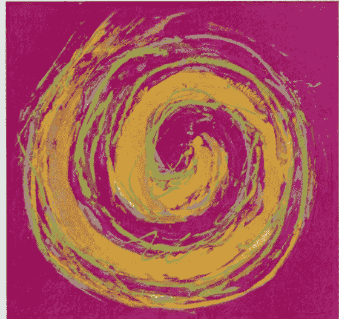

卡尔·巴克斯代尔
技术顾问，犹他州普罗沃
E·谢恩·特纳
软件工程师，犹他州奥勒姆

COURSE TECHNOLOGY
CENGAGE Learning

澳大利亚 • 巴西 • 日本 • 韩国 • 墨西哥 • 新加坡 • 西班牙 • 英国 • 美国


# COURSE TECHNOLOGY
CENGAGE Learning™

**HTML 与 JavaScript 基础，第三版**
作者：卡尔·巴克斯代尔 和 E·谢恩·特纳

学校出版与市场副总裁：
谢丽尔·科斯坦蒂尼

产品经理：大卫·里维拉
编辑助理：贾斯汀·布伦南
制作总监：帕蒂·斯蒂芬
高级策划编辑：简·马扎雷斯
高级市场经理：金·里特尔
学校市场专家：米根·普特尼
开发编辑：Custom Editorial Productions, Inc.

制作编辑：Custom Editorial Productions, Inc.
排版：GEX Publishing Services

© 2006 Course Technology, Cengage Learning

版权所有。未经出版商事先书面许可，不得以任何形式或任何方式（包括但不限于影印、录音、扫描、数字化、磁带录制、网络分发、信息网络或信息存储和检索系统）复制、传播、存储或使用本作品中受版权保护的任何部分，除非符合1976年美国版权法第107条或第108条的规定。

> 如需产品信息和技术协助，请联系
**Cengage Learning 客户与销售支持，1-800-354-9706**

如需使用本教材或产品的材料，请在线提交所有请求至 **www.cengage.com/permissions**
其他许可问题可发送电子邮件至
**permissionrequest@cengage.com**

ISBN-13: 978-0-619-26625-7
ISBN-10: 0-619-26625-2

**Course Technology**
20 Channel Center Street
Boston, MA 02210
USA

Cengage Learning 是全球领先的定制学习解决方案提供商，在全球设有办事处，包括新加坡、英国、澳大利亚、墨西哥、巴西和日本。查找您当地的办事处，请访问：
**international.cengage.com/region**

Cengage Learning 产品在加拿大由 Nelson Education, Ltd. 代理。

要了解更多关于 Course Technology 的信息，请访问 **www.cengage.com/coursetechnology**

要了解更多关于 Cengage Learning 的信息，请访问 **www.cengage.com**。

在您当地的大学书店或我们首选的在线商店 **www.ichapters.com** 购买我们的任何产品

印刷于美国
3 4 5 6 7 8 9 11 10 09

# 回归基础...

# 体验这些*激动人心的新产品*

我们激动人心的新系列简短编程和应用套件书籍将提供学习此软件所需的一切。其他书籍包括：

**全新！HTML 基础，第3版** 作者：巴克斯代尔 和 特纳
*为初级到中级学习者提供20多小时的教学*

- 0-619-26626-0 教科书，平装
- 0-619-26628-7 教师资源
- 0-619-26629-5 复习包（数据光盘）

**全新！HTML、JavaScript 和高级互联网技术** 作者：巴克斯代尔 和 特纳
*为初级到中级学习者提供35多小时的教学*

- 0-619-26627-9 教科书，平装
- 0-619-26628-7 教师资源
- 0-619-26629-5 复习包（数据光盘）

**编程基础，使用 Microsoft Visual Basic、C++、HTML 和 Java** 作者：诺尔顿 & 巴克斯代尔
*为初级到中级学习者提供35多小时的教学*

- 0-619-05803-X 教科书，精装
- 0-619-05801-3 教科书，平装
- 0-619-05802-1 教师资源
- 0-619-05800-5 活动手册
- 0-619-05949-4 复习包（数据光盘）

**互联网基础** 作者：巴克斯代尔, 拉特, & 蒂特
*为初级到中级学习者提供35多小时的教学*

- 0-619-05905-2 教科书，平装，活页装订
- 0-619-05906-0 教师资源

**全新！Microsoft Office 2003 基础** 作者：帕塞沃克 和 帕塞沃克
*为初级到中级学习者提供35多小时的教学*

- 0-619-18335-7 教科书，精装，活页装订
- 0-619-18337-3 教师资源
- 0-619-18336-5 活动手册
- 0-619-18338-1 复习包（数据光盘）

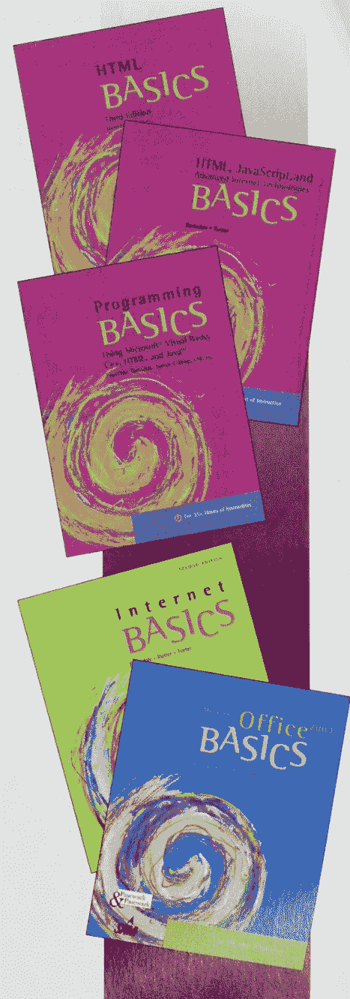

加入我们，访问互联网 www.course.com

# 目录

- vi 如何使用本书
- ix 前言
- xii 本书使用指南

# 单元 1 HTML 基础

- 3 第1课：HTML 快速入门
  - 3 在网络上交流
  - 9 以传统方式输入您的神秘标签
  - 11 保存并查看您的 HTML 页面
  - 16 使用标题
  - 19 编号和项目符号列表
  - 25 总结

- 33 第2课：HTML 组织技巧
  - 33 创建更好的网页
  - 38 线条和背景颜色
  - 42 文档内的超链接
  - 46 创建指向网络的超文本链接
  - 51 链接到您已创建的页面
  - 54 为文本着色
  - 57 总结

- 63 第3课：HTML 强力技巧
  - 63 令人兴奋的网络
  - 67 下载并插入图形
  - 73 各种尺寸的图片
  - 78 有序的表格
  - 83 非凡的附加功能
  - 86 总结

- 91 第4课：HTML 结构设计技巧
  - 91 创建 HTML 框架集
  - 94 创建导航栏
  - 96 创建网站欢迎页
  - 97 创建嵌套框架集
  - 99 创建标题栏
  - 101 使用高级 HTML 选项
  - 105 总结
  - 111 单元复习

# 单元 2 JavaScript 的精彩世界

- 123 第5课：什么是 JavaScript？
  - 123 你好，万维网
  - 126 增强您的网页
  - 128 JavaScript 中的条件语句
  - 133 使用 JavaScript Alert() 方法
  - 136 访问浏览器状态行
  - 139 总结

- 145 第6课：在 JavaScript 中使用图像
  - 145 让图形图像活起来
  - 149 事件处理逻辑
  - 153 创建循环横幅
  - 157 显示随机图像
  - 160 创建 JavaScript 幻灯片放映
  - 164 总结

- 171 第7课：使用 JavaScript 创建表单
  - 171 让 HTML 表单功能更强大
  - 172 创建披萨订单表单
  - 175 让提交订单按钮起作用
  - 178 让清除条目按钮起作用
  - 182 验证文本字段
  - 186 验证单选按钮
  - 190 总结

- 197 第8课：在框架中使用 JavaScript
  - 197 高级 JavaScript 编程
  - 200 将 JavaScript 代码添加到您的框架集
  - 204 创建基于框架的幻灯片放映
  - 207 让您的幻灯片放映按钮起作用
  - 213 创建顶级 JavaScript 函数
  - 218 总结
  - 223 单元复习
  - 233 词汇表
  - 237 索引

# 如何使用本书

什么构成了一本关于 HTML 和 JavaScript 的好书？扎实的指导和动手技能的构建与强化。这就是您将在 *HTML 与 JavaScript 基础* 中找到的。您不仅会发现一个色彩丰富、引人入胜的版面，还有许多增强学习的功能。

**目标——** 每节课开头都列出了目标，以及建议的完成时间。这使您可以提前了解将要学习的内容，并安排您的学习进度。

**分步练习——** 这些练习前面有一个简短的主题讨论，是课程的“动手实践”部分。只需按照步骤操作，以巩固您所学的技能和概念。

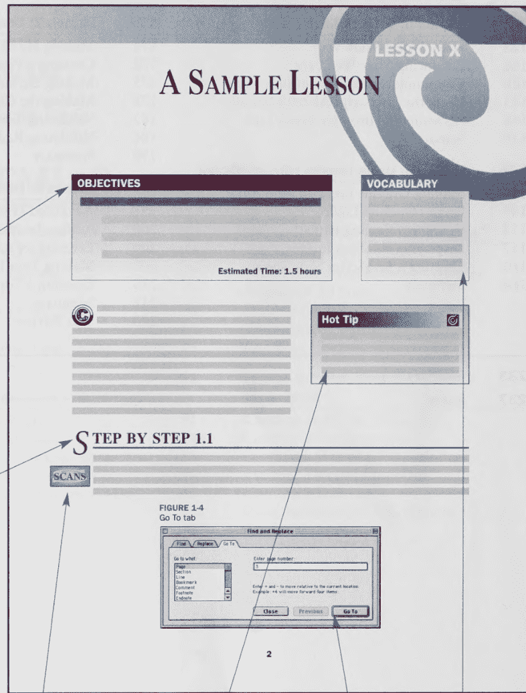

**SCANS（实现必要技能的部长委员会）——** 美国劳工部已确定了从学校到职业的能力要求。

**边注框——** 这些框提供了关于课程主题的额外信息。

**词汇——** 课程中以粗体标识的术语，并在课程结束时进行总结。

**增强的屏幕截图——** 屏幕截图现在通过色彩和深度在每一页上栩栩如生。

**特色功能框**——这些框提供了关于职业机会、如何创建更好网页的技巧以及互联网历史里程碑的有趣额外信息。

**总结**——在每节课结束时，您会找到一个总结，为您完成课后活动做准备。

**词汇/复习题**——每节课和每个单元结束时的复习材料使您能够为评估所呈现的内容做好准备。

**课程项目**——将您在课程中学到的内容进行动手应用，使您能够应用所涵盖的技术和概念。

**批判性思维活动**——每节课都为您提供机会，运用创造性分析并使用帮助系统来解决问题。

**命令摘要**——在每个单元结束时，提供命令摘要以供快速参考。

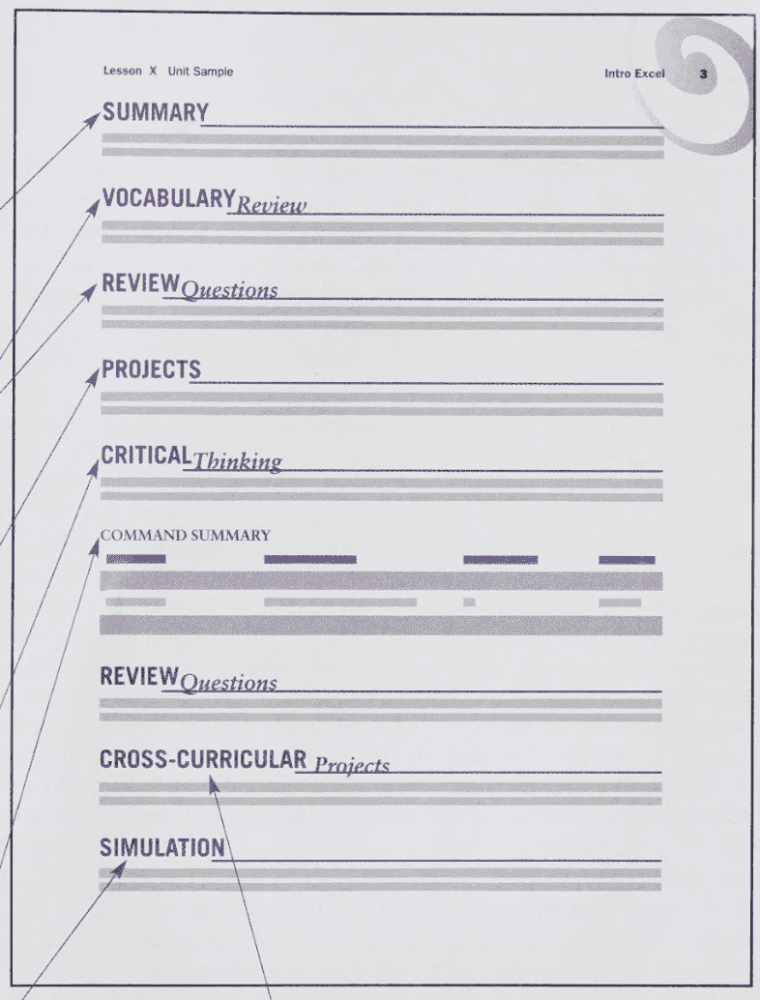

**模拟**——单元结束时的动手任务为您的未来提供了全面复习和实践的机会。

**跨学科项目**——单元结束时的项目将互联网概念应用于整个课程的主题。

# 前言

众所周知，互联网非常普及，但很少有人知道其背后的原因。使互联网运行的技术已存在超过三十年。那么，为什么万维网会突然一夜之间取得成功呢？

互联网的巨大增长归功于超文本标记语言（HTML）以及万维网创造的开放平台环境。这个开放的HTML平台使得用JavaScript等语言编写的程序能够在Macintosh、Windows、Linux或任何其他连接到网络的计算机系统上运行。HTML和JavaScript的组合对于网站开发者来说是无敌的。

HTML是一种让文档和在线内容看起来很棒的相对简单的方法！HTML赋予了万维网引人注目的吸引力。1995年，许多强大的企业注意到了这一点，并意识到他们可以在线做广告、推广产品，甚至销售产品——于是开发在线网站的热潮开始了。

然而，尽管HTML有许多出色的特性，但它是一种有限的语言。许多有用的任务仅靠HTML无法完成，因此许多专业网页都使用补充技术。虽然有几种不同的技术可以扩展HTML的基础功能，但没有比JavaScript更好的选择了。与HTML一样，JavaScript的创建无需使用复杂或昂贵的开发软件。事实上，JavaScript源代码是通过标准文本编辑器或文字处理程序直接输入到相应的HTML网页文件中的。但也许JavaScript语言最有价值的特点是它建立在坚实的面向对象编程概念之上。这意味着你不仅可以快速掌握令人印象深刻的编程技能，还可以将这些技能应用于其他几种流行的编程语言，如Java、C++、Visual Basic甚至Pascal。

HTML和JavaScript协同工作。HTML是万维网的支柱。它是通过互联网分发数据的主要机制。JavaScript在HTML语言的基础上增加了交互性和新功能；然而，如果不了解HTML的结构，用JavaScript编写程序可能会令人困惑。对于任何想要创建像专业网页设计师开发的那样丰富多彩、支持JavaScript的交互式网页的人来说，学习HTML的功能和结构至关重要。

幸运的是，HTML和JavaScript相对容易学习。HTML标签和JavaScript代码可以使用标准文本编辑器或文字处理程序创建，无需购买昂贵的软件编译器。这些是HTML和JavaScript如此迅速普及的额外原因。

Course Technology被公认为互联网相关教学的领导者。我们的使命是改变人们教授和学习技术的方式。在过去的十年里，HTML和JavaScript等补充工具对社会产生了与500多年前古腾堡印刷机同样巨大的影响。它们创造了一个你应该学习的交流环境。通过本书，你将改变对互联网的看法，并了解如何为网络做出积极贡献。

# 本书的结构与特点

《HTML与JavaScript基础》的编写旨在让你能够快速、轻松地掌握HTML和JavaScript技能。分步讲解部分配有完整的插图，易于遵循，让你能够掌握基础知识。

本书分为八个互动实践课程：

课程1——HTML快速入门介绍了HTML的基本结构，并让你创建第一个基本网页。

课程2——HTML组织技巧教你如何格式化网页，并提供创建超链接所需的技术。

课程3——HTML高级技巧教你如何插入图形、整合表格，以及调整字体的大小、样式和颜色。

课程4——HTML结构设计技巧教你如何让多个网页和导航系统协同工作。

课程5——什么是JavaScript？解释了JavaScript的历史和目的，并展示了如何将JavaScript集成到HTML网页中。本课还定义了JavaScript的核心术语，并描述了JavaScript语法的一些最基本部分，包括关键字、运算符、对象和方法。

课程6——在JavaScript中使用图像向你展示如何结合JavaScript事件和函数使用图形图像，为网页添加一些令人印象深刻的视觉效果。这些效果包括图像翻转、超链接翻转、循环广告横幅、随机图像显示和电子幻灯片。

课程7——使用JavaScript创建表单在课程3介绍的表单基础上进行扩展。它演示了如何使用JavaScript增强HTML表单的功能。本课将教你如何布局电子表单、验证用户输入数据，并向用户提供适当的反馈。

课程8——在JavaScript中使用框架教你如何创建带参数列表的JavaScript函数、启用影响其他框架的超链接、启用影响其他框架的按钮，以及创建顶级JavaScript函数。这教你如何让多个网页框架相互交互。

当你进一步学习其他网页设计教程（如《网页设计基础》）或高级编程教程时，这些技能将被证明非常有价值。

《HTML与JavaScript基础》逐步讲解了HTML和JavaScript的基础知识。每课包括以下内容：

- 课程目标，明确学习目标。
- 预计完成时间。
- 词汇表，介绍本课使用的新术语。
- 分步练习，教授你需要掌握的基础知识。
- 屏幕插图，为你所学内容提供视觉强化。
- 侧边栏，提供与课程主题相关的互联网技巧。
- 特色内容，如“互联网里程碑”和“网络礼仪”，提供有关网络历史的信息。
- SCANS关联。

课后练习侧重于巩固你在本课中学到的技能，并全面回顾你可以应用这些技能的方式。课后特色内容包括：

- 课程摘要。
- 本课新术语的词汇复习。
- 复习题，评估你对所学内容的理解。
- 应用本课所学概念的项目。
- 批判性思维活动，要求你分析并表达自己对各种HTML和JavaScript挑战的看法。

单元复习旨在评估你对各课的整体理解。单元复习包括：

- HTML标签和属性、命令摘要以及JavaScript代码摘要。
- 复习题。
- 跨学科活动，将HTML技能应用于语言艺术、科学、社会研究和数学领域。
- 特殊的SCANS项目，帮助你掌握所学技能。
- 职业模拟活动，帮助你将HTML技能应用于与工作相关的情境。

书末提供了术语表，为你提供那些我们都需要学习的棘手HTML标签和术语的定义。

# 本书使用指南

## 软件

- 用于查看网页的Internet Explorer或Netscape Navigator。
- 用于创建HTML文档的Windows记事本或Macintosh SimpleText。

目前，这些工具几乎都预装在所有标准计算机上。你可以用能够将文本文件保存为.htm或.html文档的文字处理程序替代记事本或SimpleText。

## 教师资源工具包CD-ROM

*教师资源工具包* CD-ROM包含丰富的教学支持内容，将帮助教师教授*《HTML与JavaScript基础》*。使用Internet Explorer阅读和访问*教师资源工具包*，就像你在实时上网冲浪一样。只需使用Internet Explorer打开*begin_html_teacher.htm*文件，然后点击浏览*教师资源工具包*的各个部分。

这些文件可以直接从CD复制到计算机的硬盘驱动器或网络驱动器。这些资源也可在*www.course.com*在线获取。

单独的学生指南也可以在线或从CD获取。打开学生文件夹，通过使用Internet Explorer选择*begin_html_student.htm*来访问学生模拟文件。

## SCANS

美国劳工部的“必要技能获取委员会”（SCANS）被要求考察工作场所的需求以及新学习者是否有能力满足这些需求。具体而言，该委员会被指示就进入就业所需的技能水平向部长提供建议。

SCANS的工作场所能力和基础技能已融入*《HTML与JavaScript基础》*。工作场所能力被确定为：1）使用资源的能力，2）人际交往能力，3）处理信息的能力，4）对系统的理解，以及5）对技术的知识和理解。基础技能被确定为：1）基本沟通技能，2）思维技能，以及3）个人品质。

学习者必须使用多项SCANS能力和基础技能的练习在文中用SCANS图标标出。

## 关于作者

卡尔·巴克斯代尔先生是犹他州普罗沃市法勒中学的教师。他为 Course Technology 撰写了多本关于互联网、网站、语音识别、PDA 等主题的教科书，并且是《*DigiTools*》一书的合著者。巴克斯代尔先生曾是 WordPerfect 公司的员工，目前在全国各地举办关于新技术的研讨会。他的研讨会涵盖语音识别、手写识别、平板电脑和 PDA 的使用等主题；每个研讨会都为中学生、高中生和教师精心设计。

E·谢恩·特纳先生目前是犹他州一家福利实践管理公司的高级软件工程师。他为 Course Technology 撰写了多本教科书，并为三家在线计算机杂志撰写了大量软件评论。特纳先生于 1994 年在杨百翰大学攻读计算机科学硕士学位时首次接触 HTML。他曾在韦伯州立大学和科罗拉多技术大学教授计算机科学。除了在计算机技术领域担任专业人员和作家外，特纳先生还是一位有成就的音乐家，作为犹他州首屈一指的铜管乐团成员演奏小号。特纳先生与妻子和九个孩子居住在犹他州。

## 致谢

作者们在此公开感谢许多为本书的完成和成功做出贡献的人士。

首先，我们要感谢学校出版与营销副总裁谢丽尔·科斯坦蒂尼和高级策划编辑简·马扎雷斯。他们富有远见的指导、把握市场需求的能力以及与我们合作的能力是无价的。

接下来，我们要感谢产品经理大卫·里维拉、高级营销经理金·里特尔、学校市场专家梅根·普特尼以及编辑助理/副产品经理贾斯汀·布伦南。感谢你们所有人帮助推广我们的产品并管理出版流程。我们非常幸运能有你们作为我们出版团队的一部分，并且深知我们的成功很大程度上归功于你们的努力。

我们还要感谢质量保证团队，特别是苏珊·惠伦，她在确保文本、分步活动和单元末项目中的准确性和一致性方面表现出色。

最后，我们要感谢来自 Custom Editorial Productions, Inc. 的开发编辑罗斯玛丽·库宾、生产编辑埃里卡·麦金泰尔和补充材料开发员简·克拉维。我们感谢你们所有人确保“所有细节都完美无缺”的努力。感谢你们所有的耐心和勤奋工作，确保我们的写作反映了我们试图传达的信息。我们也感谢你们为将本书推向市场所做的努力。

## HTML 基础

### 单元 1

-   第 1 课：快速掌握 HTML 知识（1.5 小时）
-   第 2 课：HTML 组织技巧（1.5 小时）
-   第 3 课：HTML 高级技巧（1.5 小时）
-   第 4 课：HTML 结构设计技巧（1.5 小时）

单元预计时间：6 小时

## 第 1 课
快速掌握 HTML 知识

### 学习目标

完成本课后，你应该能够：

-   发现 HTML 标签。
-   输入起始标签。
-   正确保存。
-   将标题级别整合到网页中。
-   创建无序列表、有序列表和嵌套列表。

预计时间：1.5 小时。

### 词汇表

-   尖括号
-   Flash
-   主页
-   HTML 页面
-   超文本标记语言（HTML）
-   Internet Explorer
-   Java
-   JavaScript
-   Mosaic
-   Netscape Navigator
-   Web 浏览器
-   网页
-   网站
-   欢迎页面

## 在网络上交流

每次你上网并开始点击链接时，你都会打开一个又一个新的*网页*。网页可以由图片、文本和多媒体效果组成。它们的目的是与网络访客共享信息。网页由称为*Web 浏览器*的特殊软件程序显示，其工作是查找和显示网络信息。两种最受欢迎的浏览器是 *Internet Explorer* 和 *Netscape Navigator*。

*超文本标记语言*，或 *HTML*，允许你创建网页。HTML 组织文档并告诉 Web 浏览器网页在你的计算机屏幕上应如何显示。网页上的颜色、图片和背景由 HTML 标签决定。

HTML 标签适用于任何 Web 浏览器。如果你创建了一个网页，并且操作正确，你的 Web 浏览器就能读取它。事实上，HTML 是万维网的官方语言！

网络空间中还使用了许多其他语言，例如 *Java*，一种广泛用于互联网应用程序的编程语言；*Flash*，一种高影响力的多媒体创作工具；以及 *JavaScript*，一种类似 Java 的脚本语言，用于创建小型应用程序和多媒体效果。HTML 是这些网页开发工具中使用最广泛的。HTML 创建了其他程序可以构建的基础。

## HTML 如何工作

HTML 标签在 Web 上无处不在。HTML 标签可以在 Macintosh 或 Windows 计算机上显示网页。它们在 Linux 和 UNIX 计算机上也能工作。它们甚至可以在支持网络的手机、掌上设备和带有网络设备的电视上工作。

HTML 标签非常简单，任何人都可以快速学习一些基本标签。它们通常成对出现，包含在*尖括号*中。这些括号可以在键盘的逗号和句点键上找到。按住 Shift 键并按下这两个键中的任意一个即可创建尖括号。

为了更清楚地理解 HTML 标签的工作原理，请分析以下示例。如果你想将本书的标题在网页上居中显示，你只需输入：

```
<CENTER>HTML and JavaScript BASICS</CENTER>
```

请注意，有一个起始标签 `<CENTER>` 和一个结束标签 `</CENTER>`。这两个标签之间的唯一区别是结束标签中的第一个尖括号后有一个斜杠（/）。`<CENTER></CENTER>` 形成一对标签，如果你还没猜到的话，这些标签被称为居中标签。这些标签之间的任何内容都将在页面上居中显示。这些标签之外的任何内容都不会受到该命令的影响。没有比这更简单的了！

## 揭开页面之下的页面

网络上充满了网页。有些非常有趣，有些非常令人兴奋，有些过于繁忙，有些则乏味无聊。

一个页面是有趣还是乏味并不重要；所有页面都具有相同的特征。让我们看看这意味着什么。

例如，你在图 1-1A 中看到的所有单词、图片和颜色都是由你在图 1-1B 中看到的 HTML 标签组织和创建的。图 1-1A 和图 1-1B 实际上是同一个页面，只是以不同的方式查看。

### 图 1-1A
www.course.com 上的 Course Technology 主页

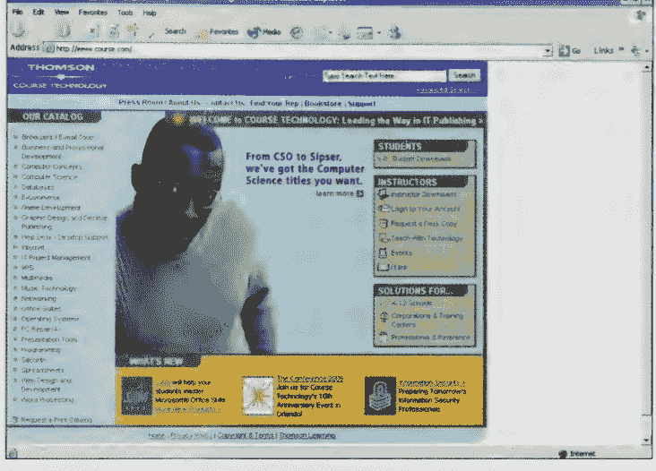

### 图 1-1B
图 1-1A 所示主页的 HTML 标签

```html
<!DOCTYPE HTML PUBLIC "-//W3C//DTD HTML 4.0 Transitional//EN">
<html>
<head>
    <title>Course Technology - Leading the Way in IT Publishing</title>
    <link rel="stylesheet" type="text/css" href="/apps/styles/structure.css">
    <link rel="stylesheet" type="text/css" href="/apps/styles/formatting.css">
    <script name="Redirect" language="JavaScript1.2">
    <!--
    function exploreTo(form) {
        var myindex=form.dest.selectedIndex;
        window.location.href= form.dest.options[myindex].value;
    }
    // -->
    </script>
    <script language="javascript">
    <!--
    function launch() {
        window.open('/apps/webreference/wrd_start.cfm','_crd_win','height=480,width=620,scrollbars=yes,resizable=no');
    }
    function launchcrd() {
        window.open('/apps/centreference/wrd_start.cfm','_crd_win','height=480,width=620,scrollbars=yes,resizable=no');
    }
    function launchOfficeClosed() {
        window.open('office_closed_temp.cfm','_crd_win','height=535,width=480,scrollbars=yes,resizable=yes');
    }
    // -->
    </script>
</head>
<body marginheight="0" marginwidth="0" topmargin="0" leftmargin="0">
    <div align="center" id="banner">
    <table cellpadding="0" cellspacing="0" border="0" width="750">
        <tr>
```

请注意，图1-1B并不十分美观。它展示了创建图1-1A中更精彩页面的HTML标签。图1-1B精确地显示了那个多彩页面背后的真实样貌。网页浏览器会解释这些标签，并创建普通网络浏览者所看到的网页。

标签种类繁多，使用方法也多种多样。这个提示应该能让你免于困惑：*HTML标签只是给网页浏览器的指令。*它们告诉浏览器如何显示信息。很多时候，你可以查看最终的网页，并猜测是哪些标签产生了这种效果。如果你记住这个提示，学习HTML会容易得多。

现在轮到你了。以下步骤将让你能够打开一个自选的网页。查看页面背后的页面，就像在浏览器的“查看”菜单中选择“源文件”或类似命令（如“页面源文件”）一样简单（参见图1-3A和1-3B）。

## 分步操作 1.1

1.  双击图标打开你的网页浏览器，如图1-2A和1-2B所示。


## 分步操作 1.1 续

2.  当页面出现时，使用鼠标将指针移动到“查看”菜单上，如图1-3A和1-3B所示。

图1-3A
Internet Explorer中的“查看源文件”命令

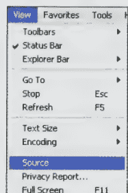

图1-3B
Netscape Navigator中的“查看页面源文件”命令

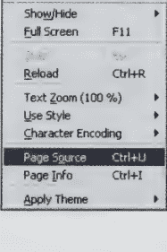

3.  在你的Internet Explorer (IE) 浏览器中，选择**查看**，然后选择**源文件**；或者在你的Netscape浏览器中，选择**查看**，然后选择**页面源文件**。

> **注意**
> 不同的浏览器可能使用不同的词语来表示此命令。请留意查找；该选项会出现在那里。

4.  检查在多彩页面下方出现的页面上的标签。这些标签看起来会有点像你在图1-1B中看到的标签。

5.  跳转到另外三四个网页，并查看源文件。列出你反复遇到的七个标签。猜测并记录它们的作用，填写在下面的表格中。

## 表1-1
常见标签

| 编号 | 标签 | 它在网页上产生的效果 |
| :--- | :--- | :--- |
| 示例 | `<CENTER></CENTER>` | 使网页上的文本居中 |
| 1 | | |
| 2 | | |
| 3 | | |
| 4 | | |
| 5 | | |
| 6 | | |
| 7 | | |

6.  如果你今天的学习到此结束，请退出软件并关闭计算机。否则，请继续下一节。

## 互联网里程碑

## 商业发现网络

万维网（WWW）于20世纪80年代末在欧洲诞生。在接下来的大约五年里，它仅在学术界有限地使用。然而，直到1994年，一款名为**Mosaic**的网页浏览器问世，它才真正激发了公众的想象力。这是第一款允许图片和文字一起出现在网页上的浏览器。

这种呈现和分享信息的新方式引发了越来越多的兴奋。随后，网景通信公司发布了其名为Netscape Navigator的浏览器。网景在1995年抓住了商界的心，从那时起，一切都变得不同了。

在短短几年内，万维网成为了我们今天所见的新型广告和商业媒介。公司和企业投入了数十亿美元，希望从这个新的黄金信息共享系统中获利。突然间，成千上万的企业网页创作者开始学习HTML，以便将他们的商业网页上线。

## 以传统方式输入你的神秘标签

在开始输入标签之前，你需要了解许多用于描述用HTML标签创建的页面的术语。事实是，这些名称被如此互换地使用，以至于大多数人完全没有意识到它们的含义存在细微差别。

-   **网页：** 也称为Web文档，指任何用HTML创建并可以放置在万维网上的页面。
-   **主页：** 公司、组织或个人的主要或首要网页。个人主页是你启动网页浏览器时看到的第一个页面。当你点击浏览器中的“主页”图标时，你将直接跳转到你的起始主页。
-   **欢迎页：** 专为网站新访客设计的页面。
-   **HTML页面：** 也称为HTML文档，指任何用HTML创建并可以在万维网上显示的文档。
-   **网站：** 可以包含由特定公司、组织、学院或大学、政府机构或个人组织的许多相互链接的网页集合。网站存储在Web服务器上。有许多网站，每个网站上有数千个HTML页面。

现在都清楚了吗？不要让这些细微的差别妨碍你理解网络是如何工作的。

## 利用标签创造强大优势

创建HTML标签的方法有很多。你可以使用专业软件，如微软的FrontPage、Adobe的GoLive或Macromedia的Dreamweaver，来创建超级网页。这些程序可以帮助你组织HTML页面、输入文本、移动元素并创建卓越的网页效果，而无需输入任何HTML标签。你也可以使用许多较新版本的文字处理程序，如Microsoft Word和Corel WordPerfect，来完成同样的工作。这些文字处理器内置了HTML标签。

对于大多数网页，你会想使用这些程序之一。然而，在接下来的活动中，你将采用传统方式输入HTML标签。学会以传统方式输入一些HTML标签，将为你在第二单元开始学习JavaScript时带来巨大优势。让我们快速涵盖基础知识。首先，通过输入一些标签，你将对HTML的实际工作原理有更深入的理解。其次，当出现微小错误时，你将能够对网页进行故障排除。第三，你将能够查看其他页面并学习它们如何实现某些效果。第四，你将更好地理解网络计算机上的文件和文件夹结构。最后，也是最重要的，你将理解HTML和JavaScript如何协同工作。

## 使用什么工具

几乎任何文字处理程序或文本编辑器都可以用于创建HTML和JavaScript。这是HTML和JavaScript如此流行的原因之一。你不需要任何专门的软件工具来创建像Java、Shockwave或其他一些软件密集型选项那样令人兴奋的网页。

我们建议使用最简单、最基本的工具。在Windows中，你可以使用记事本。在Macintosh上，你可以使用SimpleText。这些程序易于使用，并且几乎在地球上的每台计算机上都可用。使用你最喜欢的文字处理程序，如Microsoft Word、Corel WordPerfect或AppleWorks。然而，你需要对每种文字处理程序进行一些试验，以了解其特性。本文提供了Microsoft Word和AppleWorks的说明作为示例。许多其他文字处理器具有类似的HTML创建功能。如果遇到任何困难，请查看软件的帮助系统，或者使用记事本或SimpleText来完成分步操作活动。

> **网络提示**
> 复杂的软件程序，如Dreamweaver、GoLive和FrontPage，确实简化了快速创建高级网页的工作。这些程序提供了允许你查看标签的选项。如果你正在使用这些程序之一，请选择HTML源代码选项，以便直接输入标签。

## 分步操作 1.2

1.  打开记事本、SimpleText或你最喜欢的文字处理软件。
2.  如果需要，创建一个新文档。
3.  按照图1-4所示的精确顺序输入标签。不要遗漏任何尖括号（<）或斜杠（/）。一切都至关重要。

**图1-4**
完全按照此处所示输入这些标签

```
<HTML>
<TITLE></TITLE>
<BODY>
<CENTER></CENTER>
<P></P>
<P></P>
<P></P>
<P></P>
<P></P>
</BODY>
</HTML>
```

## 分步教程 1.2 续

4.  你刚刚输入的标签被称为基本标签。它们包含大多数网页中出现的标准标签集。但如果没有一些文本，你的页面会显得非常单调。在标签之间输入文本，如图 1-5 所示。请注意，要输入的新文本以粗体显示。

图 1-5
完全按照此处所示在标签之间输入文本

```
<HTML>
<TITLE>HTML and JavaScript</TITLE>
<BODY>
<CENTER>Creating HTML and JavaScript</CENTER>
<P>Learning to create HTML tags can help you in many ways:</P>
<P>You will develop a deeper understanding of how HTML really works.</P>
<P>You will be able to troubleshoot Web pages when errors occur.</P>
<P>You will be able to view other pages and learn how certain effects were created.</P>
<P>You will understand how HTML and JavaScript work together.</P>
</BODY>
</HTML>
```

5.  保持文本编辑器打开，继续分步教程 1.3，你将学习如何保存 HTML 文件。

## 保存并查看你的 HTML 页面

HTML 文档是文本文件。这意味着它们以最简单的方式保存。在大多数情况下，文本文件只保存你在键盘上看到的字母。所有复杂的文字处理命令都被清除，只留下字母。

以文本形式保存允许 HTML 文件在 Web 上快速传输。然而，文本文件的问题在于大多数人不知道如何保存它们。在保存之前，你需要先了解一些事情。

为了区分一种文件与另一种文件，计算机通常在文件名中添加文件扩展名。有时你可以在计算机上看到这些扩展名，有时则看不到。根据计算机的设置，扩展名可能可见也可能不可见，但计算机上的软件知道它可以打开哪些文件类型。

扩展名被广泛使用。例如，在 Windows 中，文本文件以 .txt 结尾或扩展名保存。如果你经常使用文字处理器，你可能见过这些常见的扩展名：

> 网络提示
HTML 不区分大小写。你可以使用大写 <TAGS>，也可以使用小写 <tags>。大写 <TAGS> 更容易看到。如果你要强调标签，请使用大写 <TAGS>。如果你更愿意强调文档中的单词，请使用小写 <tags>。
你甚至可以将大写 <TAGS> 和小写 <tags> 混合使用，如 <Tag> 或 <TAG></tag>。但是，混合大小写不被认为是好的做法。

- .doc Microsoft Word 文档
- .rtf Microsoft 的富文本格式
- .wpd Corel WordPerfect 文档
- .txt 文本文件
- .html HTML 文件
- .htm 在某些计算机系统上的 HTML 文件

HTML 文件是带有 .html 或 .htm 扩展名的文本文件。虽然你需要的 HTML 格式称为文本，但结尾或扩展名必须是 .html（或者如果你使用的是较旧的基于 Windows 的软件程序，则为 .htm）。.html 或 .htm 扩展名向 Web 浏览器表明这是一个 HTML 文本文件。.html 扩展名就像竖起一个标志说：“嘿，浏览器，读我。我是一个 HTML 文档。”

跟着做。我们将向你展示如何使用不同的软件程序保存。使用与你计算机系统上的软件最相似的软件说明。它们是 Notepad、Microsoft Word、SimpleText 和 AppleWorks。

## 分步教程 1.3

1.  从 **文件** 菜单中选择 **另存为**。（Microsoft Word 用户注意！不要从文件菜单中选择“另存为网页”！使用常规的“另存为”命令。）
2.  在“另存为”对话框中，创建一个新文件夹来保存你的 HTML 和 JavaScript 作品。
3.  对于 Windows 中的 Notepad 和 Macintosh 的 SimpleText，步骤非常相似。Word 和 AppleWorks 用户应跳到步骤 5。
4.  选择你希望保存文件的文件夹。
5.  将你的文件命名为 one.html，如图 1-6 所示。与你的讲师确认以确保你正确保存文件。单击“保存”。如果一切保存正常，继续步骤 6。

> 注意
与你的讲师确认你应该将作品保存在哪里。

> 注意
较旧的 Windows 系统只接受 .htm 扩展名。

图 1-6
将文本文件命名为 .html 扩展名


## 分步教程 1.3 续

在你的文字处理软件中，还有一些额外的步骤。虽然 Notepad 和 SimpleText 自动保存为纯文本，但文字处理器以其自己独特的格式保存。你必须从保存选项中选择正确的文本格式。此处提供了 Word 和 AppleWorks 的说明，以帮助你学习这一重要步骤。其他文字处理器可能有自己的文本保存选项。与你的讲师确认以确保你正确遵循了软件的步骤。

如果你是 **Microsoft Word** 用户，请执行以下步骤。

a. 找到你希望放置文件的文件夹。
b. 选择 **纯文本** 作为 **保存类型** 或格式类型，如图 1-7 所示。
c. 将你的文件命名为 **one.html**。
d. 选择 **保存**。

> **注意**
在较旧的 Windows 程序中，名称将被截断或缩短为 one.htm。

**图 1-7**
在 Microsoft Word 中保存文本文件


如果你是 **AppleWorks** 用户，请执行以下步骤。

a. 找到你希望放置文件的文件夹。
b. 选择 **纯文本** 作为 **文件格式**。
c. 将你的文件命名为 **one.html**，如图 1-8 所示。
d. 选择 **保存**。

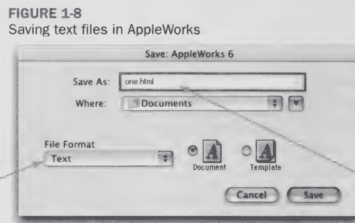

6.  在 Web 浏览器中查看你的 HTML 页面很容易。我们将向你展示如何在 Netscape 和 Internet Explorer 中执行此操作。

如果你是 **Internet Explorer** 用户，请执行以下步骤。

a. 打开你的 Web 浏览器。
b. 选择 **文件**，然后选择 **打开**。
c. 找到你保存文件的文件夹。选择 **浏览** 按钮来执行此操作。
d. 在“打开”文本框中选择你的 HTML 文件，然后选择 **打开**。
e. 单击 **确定**，如图 1-9 所示。


如果你是 **Netscape Navigator** 用户，请执行以下步骤。

a. 打开你的 Web 浏览器。
b. 从 **文件** 菜单中，选择 **打开文件**。
c. 如果需要，在“文件类型”选项下选择 **所有文件**。
d. 浏览到你保存文件的文件夹。
e. 选择你的 HTML 文件，然后单击 **打开**，如图 1-10 所示。

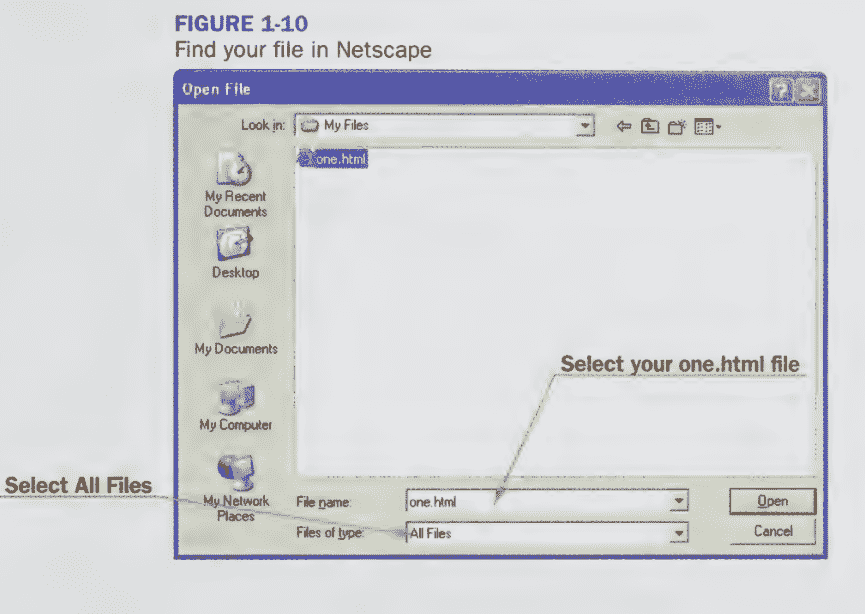

7.  查看你的文件。它应该看起来像图 1-11。

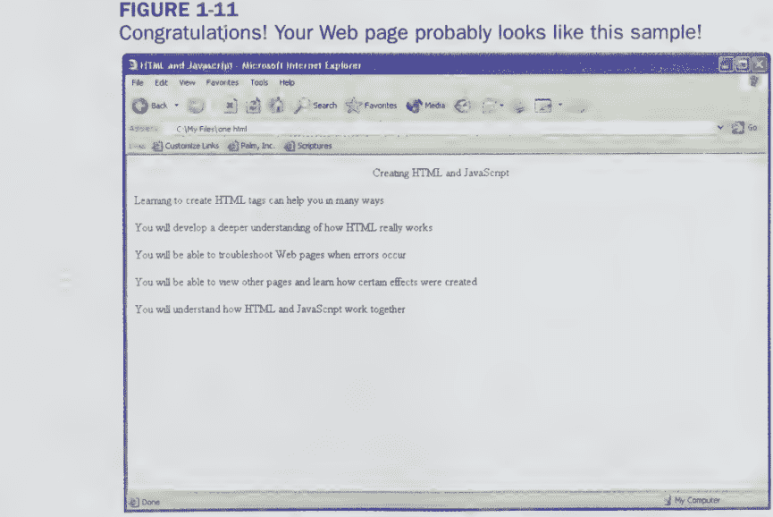

8.  你的网页看起来怎么样？进行必要的更正，再次保存，返回浏览器，然后单击 **重新加载** 或 **刷新** 以查看你所做的更改。

## 使用标题

大多数印刷文档使用标题来帮助读者找到重要的文本部分。想想你为学校写的一份报告。主标题通常出现在页面的顶部和中心。副标题或二级标题通常出现在纸张的侧面。它们通常以粗体显示。

HTML 为你提供了六个标准标题或标题大小供选择。在后续的分步教程中，你将学习更复杂的方法来操作文本的大小和外观。然而，标题标签提供了一种简单的方法来控制文本的大小，使其突出，以便读者可以清楚地查看标题。

标题标签很容易记住。它们使用字母 H 加上 1 到 6 的数字来表示标题的级别。标题数字表示标记标题的重要性级别，1 最突出，6 最不突出。查找：

```
<H1></H1>
<H2></H2>
<H3></H3>
<H4></H4>
<H5></H5>
<H6></H6>
```

## 互联网里程碑

## 浏览器大战

在过去的几年里，Netscape 和 Internet Explorer 一直在为 Web 浏览器世界的霸主地位而战。但这并不是第一次浏览器之战。1994 年，占主导地位的浏览器叫做 Mosaic。它是伊利诺伊大学香槟-厄巴纳分校国家超级计算中心的免费软件。在 Netscape 出现时，Mosaic 每月新增 60 万用户。但情况很快发生了变化。

在 1995 年的前三个月，Netscape 的 Navigator 浏览器以速度更快而闻名。到年中，它占据了 50% 的浏览器用户，到年底，它占据了惊人的 80% 的浏览器市场。

Netscape 的主导地位很快受到了竞争对手微软的挑战，微软推出了其 Internet Explorer 浏览器。微软免费提供其浏览器副本，希望削减 Netscape 的领先优势。微软还有一个优势，即其 Windows 操作系统在超过 90% 的个人计算机上运行。通过使 Windows 和 Internet Explorer 协同工作，微软创建了一个更用户友好的 Web 系统。

然而，微软的优势导致了许多法律诉讼。几起反垄断诉讼认为微软利用其在 Windows 上的主导地位来打压 Netscape 并不公平地消除竞争。微软声称它只是通过使其 Internet Explorer 浏览器更容易访问来为其客户增加更多价值。

浏览器大战今天仍在继续。虽然微软的 Internet Explorer 在大多数市场仍然是主导者，但 Netscape 的 Navigator 在许多领域仍然非常受欢迎。此外，还有其他新的 Web 浏览器正在进入网络空间。这些浏览器包括 Firefox、Camino、Opera 和 Safari。最终谁会获胜？

## 分步操作 1.4

标题标签内的内容会根据数字变大或变小。例如：

```
<H1>VERY BIG</H1>
<H3>In the Middle</H3>
<H6>Very Small</H6>
```

在本分步操作中，你将打开你一直在处理的 HTML 文件，并添加标题或标题标签。

1.  打开你的文本编辑器。
2.  如果需要，打开你的 **one.html** 或 **one.htm** 文件。如果你使用的是记事本，请在 **文件类型** 选项下选择 **所有文件**，如图 1-12A 所示。否则，你将无法查看你的 .html 或 .htm 文件！如果你使用的是 Microsoft Word，当你打开 .html 文件时，Word 可能会像在 Web 浏览器中一样显示你的网页。为了查看 HTML 标签，请从 **视图** 菜单中选择 **HTML 源代码**，如图 1-12B 所示。

> **小贴士**
> 当你在 Word 的视图菜单中选择 HTML 源代码时，可能会出现一个对话框，说明 HTML 源代码编辑器功能尚未安装。你可能需要插入 Office CD 并安装此功能，然后才能查看 HTML 源代码。

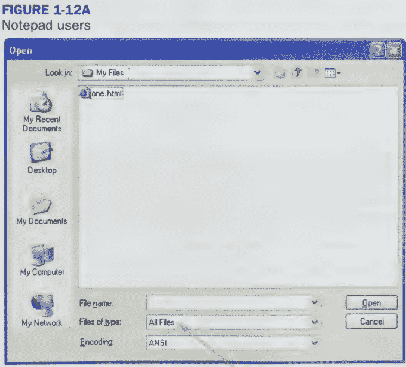

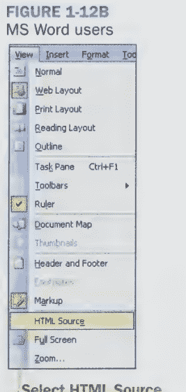

## 分步操作 1.4 续

3.  输入图 1-13 中粗体所示的标题标签。

**图 1-13**
添加标题标签

```
<HTML>
<TITLE>HTML and JavaScript</TITLE>
<BODY>
<CENTER><H1>Creating HTML and JavaScript</H1></CENTER>
<P><H2>Learning to create HTML tags can help you in many ways: </H2></P>
<P><H3>You will develop a deeper understanding of how HTML really works. </H3></P>
<P><H4>You will be able to troubleshoot Web pages when errors occur. </H4></P>
<P><H5>You will be able to view other pages and learn how certain effects were created. </H5></P>
<P><H6>You will understand how HTML and JavaScript work together. </H6></P>
</BODY>
</HTML>
```

4.  将你的新 HTML 页面保存为 **two.html** 或 **two.htm**。
5.  打开你的 Web 浏览器。打开你的 **two.html** 或 **two.htm** 文件，并查看它。它应该看起来像图 1-14。（Navigator 用户可能会看到“弹出窗口阻止程序”选项被开启和关闭。只需单击按钮即可切换当前设置。）标题标签确实会改变页面的外观。然而，在我们的图 1-14 示例中，标题标签被误用了。最多只有三个信息层级：
    - <H1></H1> 顶部的标题
    - <H2></H2> 后跟冒号 ( : ) 的介绍性行
    - <H3></H3> 学习 HTML 标签的原因列表

**图 1-14**
网页中的标题

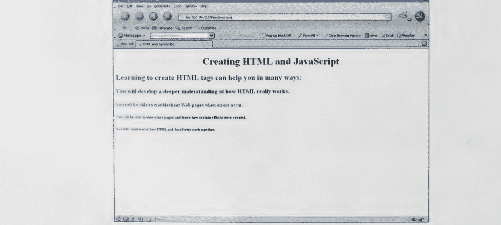

## 分步操作 1.4 续

6.  返回你的文档并重新组织标题标签。使用不超过三个 <H></H> 标签。花点时间思考一下你的标签选择，然后使你的文档易于阅读，强调本文档规定的三个层级。重新保存文件以使你的更改生效。
7.  如果你今天完成了，请退出软件并关闭计算机。否则，请继续下一节。

## 编号和项目符号列表

在上一个分步操作中，你被要求重新组织你的 two.html 文件，并以更一致的方式使用 <H> 标签。在本分步操作中，我们将进一步整理内容。

组织网页信息最有效的方法之一是使用列表。有几种类型的列表，包括以下几种：
- 无序（或项目符号）列表 <UL></UL>
- 有序（或编号）列表 <OL></OL>

无序列表标签 <UL></UL> 创建项目符号列表。以开始的 <UL> 无序列表标签开始你的列表，用列表 <LI></LI> 标签标记要列出的项目，并在列表末尾放置一个 </UL> 标签。试试看！

## 分步操作 1.5

1.  打开你的 two.html 或 two.htm 文件进行文本编辑。

## 分步操作 1.5 续

2.  在列表的开头和结尾输入 `<UL></UL>` 标签以创建无序列表，如图 1-15 所示。

**图 1-15**
输入无序列表标签

```
<HTML>
<TITLE>HTML and JavaScript</TITLE>
<BODY>
<CENTER><H1>Creating HTML and JavaScript</H1></CENTER>
<P><H2>Learning to create HTML tags can help you in many ways: </H2></P>

<UL>
<LI><H3>You will develop a deeper understanding of how HTML really works.
</H3></LI>
<LI><H3>You will be able to troubleshoot Web pages when errors occur.
</H3></LI>
<LI><H3>You will be able to view other pages and learn how certain effects were
created. </H3></LI>
<LI><H3>You will understand how HTML and JavaScript work together.
</H3></LI>
</UL>

</BODY>
</HTML>
```

3.  将列表中每个句子的 `<P>` 和 `</P>` 标签替换为 `<LI>` 和 `</LI>` 标签，如图 1-15 所示。
4.  将你的文件保存为 **three.html** 或 **three.htm**。

## 分步操作 1.5 续

5.  在浏览器中查看你的页面，看看它的样子。它应该类似于图 1-16。

**图 1-16**
无序列表


6.  如果需要，打开你的 **three.html** 或 **three.htm** 文件进行文本编辑。

## 分步操作 1.5 续

7.  将一对 `<UL></UL>` 标签更改为 `<OL></OL>` 标签，将你的列表从无序列表更改为有序列表，如图 1-17 所示。无需其他更改。

> **注意**
> 不要使用零；使用字母 O 表示有序。

**图 1-17**
输入有序列表标签

```
<HTML>
<TITLE>HTML and JavaScript</TITLE>
<BODY>
<CENTER><H1>Creating HTML and JavaScript</H1></CENTER>
<P><H2>Learning to create HTML tags can help you in many ways: </H2></P>

<OL>
<LI><H3>You will develop a deeper understanding of how HTML really works.
</H3></LI>
<LI><H3>You will be able to troubleshoot Web pages when errors occur.
</H3></LI>
<LI><H3>You will be able to view other pages and learn how certain effects were created.
</H3></LI>
<LI><H3>You will understand how HTML and JavaScript work together.
</H3></LI>
</OL>

</BODY>
</HTML>
```

8.  将你的文件保存为 **four.html** 或 **four.htm**。

## 分步操作 1.5 续

9.  在浏览器中查看你的页面，看看它的样子。它应该看起来类似于图 1-18。

**图 1-18**
有序或编号列表

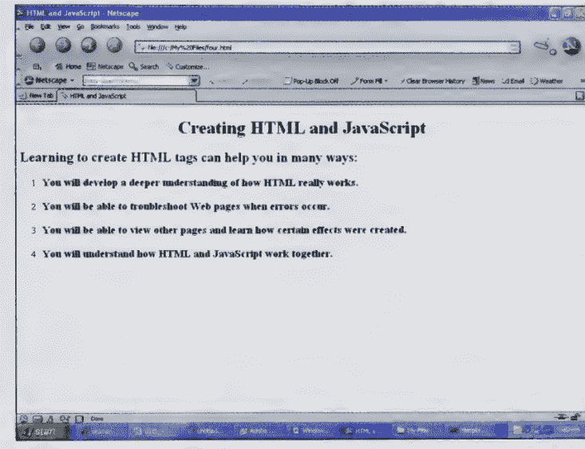

10. 如果需要，打开你的 **four.html** 或 **four.htm** 文件进行文本编辑。

## 分步操作 1.5 续

11. 在列表中间添加两对 `<UL></UL>` 标签，如图 1-19 所示。

**图 1-19**
输入无序列表标签

```
<HTML>
<TITLE>HTML and JavaScript</TITLE>
<BODY>
<CENTER><H1>Creating HTML and JavaScript</H1></CENTER>
<P><H2>Learning to create HTML tags can help you in many ways: </H2></P>

<OL>
<LI><H3>You will develop a deeper understanding of how HTML really works.
</H3></LI>

<UL>
<LI><H3>You will be able to troubleshoot Web pages when errors occur. </H3></LI>
<UL>
<LI><H3>You will be able to view other pages and learn how certain effects were created.
</H3></LI>
</UL>
</UL>

<LI><H3>You will understand how HTML and JavaScript work together.
</H3></LI>
</OL>
</BODY>
</HTML>
```

12. 将你的文件保存为 **five.html** 或 **five.htm**。

## 分步操作 1.5 续

13. 查看你的页面，看看它的样子。它应该看起来类似于图 1-20。

**图 1-20**
嵌套和缩进列表

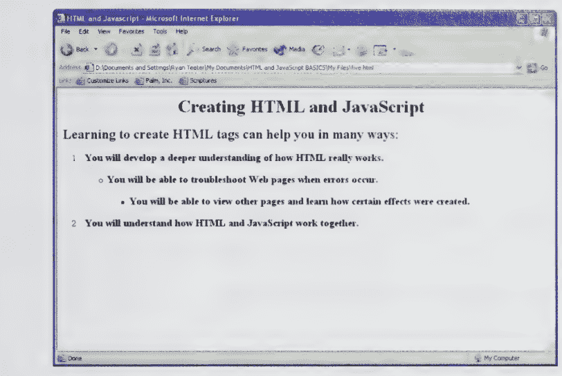

14. 如果你今天完成了，请退出软件并关闭计算机。否则，请继续到总结部分。

## 总结

在本课中，你学到了：

- 你可以识别 HTML 标签。
- 你可以输入你的起始标签。
- 你可以正确保存你的 HTML 文件。
- 你可以在网页中整合层级标题。
- 你可以创建无序、有序和嵌套列表。

## 词汇复习

定义以下术语：

- 尖括号
- Flash
- 主页
- HTML 页面
- 超文本标记语言 (HTML)
- Internet Explorer
- Java
- JavaScript
- Mosaic
- Netscape Navigator
- Web 浏览器
- 网页
- 网站
- 欢迎页面

## 复习题

### 判断题

如果陈述正确，请圈出 T；如果陈述错误，请圈出 F。

1.  <LI> 标签定义一个列表项。
2.  <OL> 标签创建一个项目符号列表。
3.  <CENTER> 标签格式化文本，使其在页面上居中。
4.  学习 HTML 非常困难。
5.  <UL> 标签创建一个没有特定顺序的列表。

### 填空题

通过在提供的空白处填写正确的单词或短语来完成以下句子。

1.  无序或 __________ 列表以无特定顺序显示项目。
2.  有序或 __________ 列表以数字顺序显示项目。
3.  文件 __________ 是三个字母的后缀，用于说明文件的类型。
4.  __________ 是 Netscape 竞争的第一个 Web 浏览器。
5.  HTML 由 __________ 组成，这些是包含在尖括号 ( < > ) 中的命令。

## 书面问题

请简要回答以下问题：

1.  设想一种方法，向从未创建过网页的人解释HTML标签是如何工作的。你如何向新手解释HTML的工作原理？
2.  解释查看HTML网页源代码的过程。
3.  解释如何保存HTML文本页面。
4.  什么是文件扩展名？请举例说明。
5.  什么是Mosaic、Netscape Navigator和Internet Explorer？它们各自对网络的发展做出了什么贡献？

## 项目

### 项目 1-1

你刚刚被聘为GreatApplications, Inc.的网站管理员，这是一家主要的软件和网站开发商，但你的HTML技能有限。你需要快速找到一些好的HTML资料！你会怎么做？

答案显而易见。上网。选择一个搜索门户网站，如Yahoo!、Excite、Lycos或其他搜索网站，输入以下搜索词：

- 超文本标记语言
- HTML
- HTML指南
- 学习HTML

使用下表记录你找到的有用的HTML网页的标题和URL或网址，并写一个简要的描述：

#### 表 1-2
有用的网页

| 标题栏中显示的标题 | 网址或URL | 描述 |
| :--- | :--- | :--- |
| | | |

### 团队项目

GreatApplications, Inc.正在为其新网站的欢迎页面寻找设计创意。以三到四人为一组，列出你最喜欢的网页。找出七个很棒的网页，并讨论它们为何如此出色。进行投票，并根据你的投票将七个欢迎页面从第一名到第七名进行排名。将你们团队的选择列在下面，以备将来参考。

#### 表 1-3
设计精良的网页

| 排名 | 标题栏中显示的标题 | 网址或URL |
| :--- | :--- | :--- |
| 1. | | |
| 2. | | |
| 3. | | |
| 4. | | |
| 5. | | |
| 6. | | |
| 7. | | |

### 网络项目

网站对许多公司、团体和个人都很重要。我们都知道，许多公司如果没有高质量的网站就会倒闭。但是，对于非营利组织和政府机构来说，外观精美的网站到底有多重要？

列出这些组织需要网站的原因：

政府机构：

非营利组织：

大学：

## 批判性思维

请为以下每个问题准备一个100到250字的回答。

### 活动 1-1

万维网是一个庞大的计算机网络，共享HTML文件。你可以在余生的每一分钟访问一个新的网页，却永远无法阅读到现有网页的一小部分。网络空间中存在多少百万或数十亿个网页？虽然HTML让人们可以轻松地分享网页，但HTML是否也导致了信息过载？如果是，如何导致的？

### 活动 1-2

以下标签集中有一个错误，你需要找出并修复它。当前的标签会对你的页面产生什么影响？修正后它看起来是什么样子？

```
<OL>
<LI>Item A</LI>
<UL>
<LI>Item A1</LI>
<LI>Item A2</LI>
</UL>
<LI>Item B</LI>
<UL>
<LI>Item B1</LI>
<LI>Item B2</LI>
</UL>
</UL>
```

### 活动 1-3

如何在HTML中创建一个复杂的提纲（你知道，就像你上次写研究论文时必须做的那种）？你的研究论文在网上以HTML形式呈现时，可以在哪些方面得到增强？

## 总结项目

所有优秀的作者都知道，在开始一个大型写作项目之前，通常最好先创建一个他们希望呈现的信息的提纲。提纲可以非常有效地帮助作者组织他们的思想，并确保他们的写作遵循一个逻辑的思想流。使用你在本课中学到的HTML技能，为一个由单元、章节和部分组成的书籍创建一个提纲。下面的图1-21将让你了解完成的提纲应该是什么样子。

#### 图 1-21
书籍提纲示例

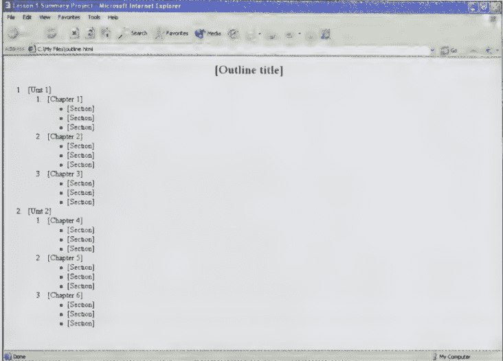

### 项目要求

- 你的提纲必须有一个居中显示在页面顶部的标题。
- 你的提纲必须包含至少两个单元，使用有序列表。
- 你的提纲必须包含每个单元至少三个章节，同样使用有序列表。
- 你的提纲必须包含每个章节至少三个部分——不使用有序列表。

## HTML组织技巧

**目标**
完成本课后，你应该能够：
- 使用单倍行距和双倍行距组织页面信息。
- 使用线条组织页面信息。
- 实现属性和值。
- 通过更改属性和值来更改网页颜色默认值。
- 更改网页文本颜色。
- 创建指向网页内另一个位置的超链接。
- 创建指向WWW上任何位置的URL或网页的超链接。
- 创建指向你自己计算机上另一个网页的超链接。

预计时间：1.5小时

**词汇**
- 属性
- 字体
- 十六进制
- 超链接
- 超文本链接
- 超文本传输协议（HTTP）
- 统一资源定位符（URL）
- 值

## 创建更好的网页

万维网是由成千上万的人不断创造、改进和发布令人兴奋的网页而创建的。网络是一个可以完全发挥创造力的地方。你加入这个乐趣只需要一点HTML和JavaScript的知识。掌握了这些工具，你将只受限于你的想象力。

当你在网上冲浪时，你看到过非常令人兴奋的网页，也看到过其他平淡无奇的页面。一个精彩页面和一个乏味页面之间的主要区别归结于细节——字体颜色、图片的选择，以及有助于页面整体组织的元素的选择。

你可以使用许多HTML技术使你的页面完美得体。这些是单倍行距和双倍行距技术以及其他专门的组织标签，可以使任何网页易于阅读。例如，可以通过在段落之间添加空格或在网页的不同部分之间放置线条来使网页更具吸引力。更改文本和页面背景的颜色也可以使HTML文档更具吸引力。颜色的选择极其重要。网络空间中没有什么比一个混合了所有错误颜色的网页更丑陋的了。使用恰到好处的颜色，你的页面将会非常出色。

*字体*，或字母的样式，是可以更改的。每种字体都有自己独特的风格。以下是一些最常见字体的示例：

This is Times New Roman.
This is Arial.
This is Courier.

*超文本链接*有助于使网页有趣且易于导航。*超链接*，正如它们通常被称呼的那样，允许用户点击并快速跳转到网络上的另一个位置、用户创建的另一个页面，或当前文档中的某个位置。如果你在一个页面上有大量信息，创建一个索引可以帮助你的读者超链接跳转到他们正在寻找的确切信息。

当你学习本课中教授的新HTML元素时，你将接触到关于如何组织网页的新想法。

## 单倍行距和双倍行距

大多数1995年之前的早期网页，最好被描述为冗长、乏味的文字集合。早期版本的HTML只提供了将文本分成可读部分的最简单方法。

这种情况已经改变。再也没有理由创建一个乏味、难以阅读的网页了。在下面的分步指南中，你将亲眼看到如何提高页面的可读性和组织性。

### 分步指南 2.1

1.  打开记事本、SimpleText或你的文字处理软件。
2.  完全按照图2-1所示输入HTML网页信息。

> **注意**
> 如果你使用的是记事本，请在输入文本之前从**格式**菜单中选择**自动换行**选项。

**图 2-1**
完全按照所示输入这些标签和文字

```
<HTML>
<TITLE>HTML and JavaScript</TITLE>

<BODY>
<CENTER><H1>Organizing Tags</H1></CENTER>

There are many ways to organize a Web page. This Web page will organize text, hypertext links, colors, and fonts. You'll also demonstrate single spacing, double spacing, and the use of line breaks.

This Web page will display how to organize Web pages in a number of ways using:

Powerful Lines
Hyperlinks to HTML and JavaScript Sources
Hyperlinks to Previously Created Web Pages
Fancy Fonts
Perfect Pictures
Orderly Tables
Extraordinary Extras

</BODY>
</HTML>
```

3.  按照你在分步指南1.3中学到的方法保存文件，文件名为**six.html**或**six.htm**。

## 分步操作 2.1 续

4.  打开你的网页浏览器并查看你的页面。它看起来应该很杂乱，如图 2-2 所示。（如果需要回顾如何在网页浏览器中查看 HTML 文件，请参考分步操作 1.3。）请注意，虽然你在 HTML 中输入时页面可能看起来很有条理，但如果没有一些组织标签，页面的结构在网页上就会变得混乱。使用一些精选的标签确实可以清理页面。你可以用来组织页面的两个最简单的标签是 `<P></P>`（段落）标签和 `<BR>`（换行）标签。`<P></P>` 标签会在文本周围创建双倍间距。`<BR>` 标签创建单倍间距的换行。

**图 2-2**
一个未组织的网页

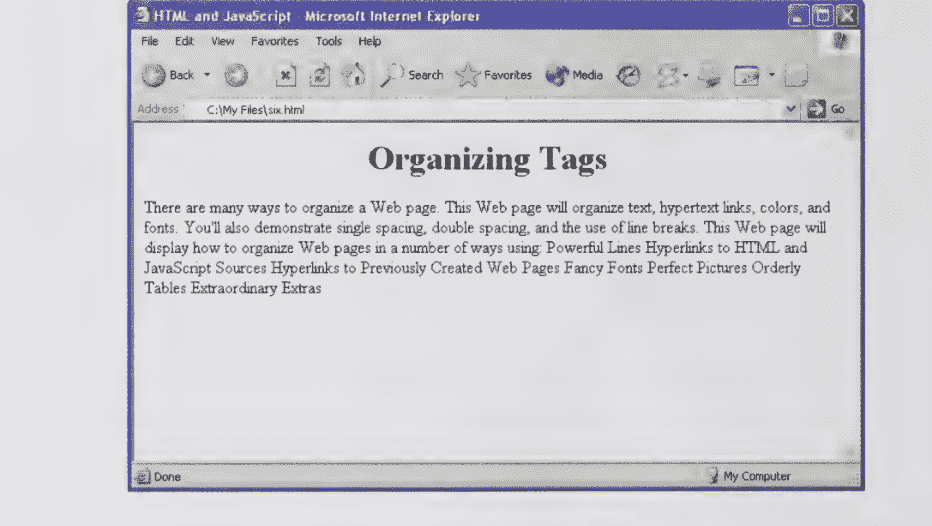

5.  如果需要，在你的文字处理器、记事本或 SimpleText 中打开你的 **six.html** 或 **six.htm** 文件。

> **注意**
> 如果你使用的是记事本，请在打开文件时从 **格式** 菜单中选择 **自动换行** 选项，以便在屏幕上看到所有文本。

6.  添加 `<P></P>` 和 `<BR>` 标签，如图 2-3 中粗体所示。

**图 2-3**
输入 `<P></P>` 和 `<BR>` 标签。

```html
<HTML>
<TITLE>HTML and JavaScript</TITLE>

<BODY>
<CENTER><H1>Organizing Tags</H1></CENTER>

<P>There are many ways to organize a Web page. This Web page will organize text, hypertext links, colors, and fonts. You'll also demonstrate single spacing, double spacing, and the use of line breaks. </P>

<P>This Web page will display how to organize Web pages in a number of ways using: </P>

<BR>Powerful Lines
<BR>Hyperlinks to HTML and JavaScript Sources
<BR>Hyperlinks to Previously Created Web Pages
<BR>Fancy Fonts
<BR>Perfect Pictures
<BR>Orderly Tables
<BR>Extraordinary Extras

</BODY>
</HTML>
```

7.  使用 **另存为** 选项，将你重新组织的文件保存为 **seven.html** 或 **seven.htm**。

8.  检查你的作品。这次它应该看起来好多了，类似于图 2-4。

**图 2-4**
`<P></P>` 和 `<BR>` 标签清理了网页

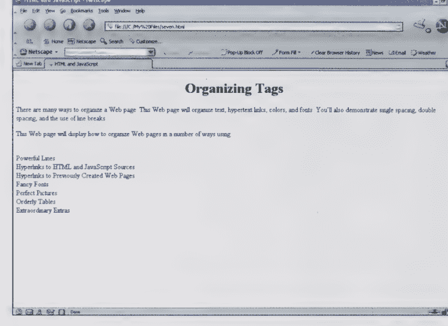

9.  继续下一节，或者如果你今天完成了，就关闭你的软件并关闭计算机。

## 线条和背景颜色

HTML 标签可以增强。以 `<BODY>` 标签为例。你可以向 body 标签添加命令，这些命令将显著改变你的网页外观。例如，要更改网页的背景颜色，你可以添加背景 *属性*（或特殊品质）并为标签赋予一个颜色 *值*（或属性的定义），如图 2-5 所示。

属性和值是帮助你组织网页的强大工具。最广泛使用的标签之一是 `<HR>` 或水平线。此标签只是在页面上创建一条水平线。你也可以添加属性来更改水平线的大小和形状。

**图 2-5**
更改背景颜色


## 分步操作 2.2

1.  如果需要，打开你的 **seven.html** 或 **seven.htm** 文件进行文本编辑。
2.  在网页顶部附近的 BODY 标签内输入 **BGCOLOR=YELLOW**，如图 2-5 中粗体所示。
3.  将你的作品保存为 **eight.html** 或 **eight.htm**。
4.  在网页浏览器中查看这些更改。你的页面应该变成黄色。
5.  尝试实验。将背景颜色值更改为 **BLUE**、**GREEN**、**RED**、**WHITE** 或你选择的其他颜色。

6.  切换回你的 **eight.html** 或 **eight.htm** 文件。在页面底部 `</BODY>` 标签之前，如图 2-6 中粗体所示，输入各种 `<HR>` 标签、属性和值。

**图 2-6**
添加背景颜色和线条

```html
<HTML>
<TITLE>HTML and JavaScript</TITLE>

<BODY BGCOLOR=YELLOW>
<CENTER><H1>Organizing Tags</H1></CENTER>

<P>There are many ways to organize a Web page. This Web page will organize text, hypertext links, colors, and fonts. You'll also demonstrate single spacing, double spacing, and the use of line breaks. </P>

<P>This Web page will display how to organize Web pages in a number of ways using: </P>

<BR>Powerful Lines
<BR>Hyperlinks to HTML and JavaScript Sources
<BR>Hyperlinks to Previously Created Web Pages
<BR>Fancy Fonts
<BR>Perfect Pictures
<BR>Orderly Tables
<BR>Extraordinary Extras
<HR>

<P><H2>Powerful Lines</H2></P>

A Horizontal Rule tag 50% wide and 10 pixels high.
<HR WIDTH=50% SIZE=10>

A Horizontal Rule tag 25% wide and 20 pixels high.
<HR WIDTH=25% SIZE=20>

A Horizontal Rule tag 10% wide and 30 pixels high.
<HR WIDTH=10% SIZE=30>

A Horizontal Rule tag without attributes and values.
<HR>

</BODY>
</HTML>
```

7.  将你的文件保存为 **nine.html** 或 **nine.htm**。

8.  在网页浏览器中查看水平线。你的页面应该看起来像图 2-7。

**图 2-7**
强大的线条

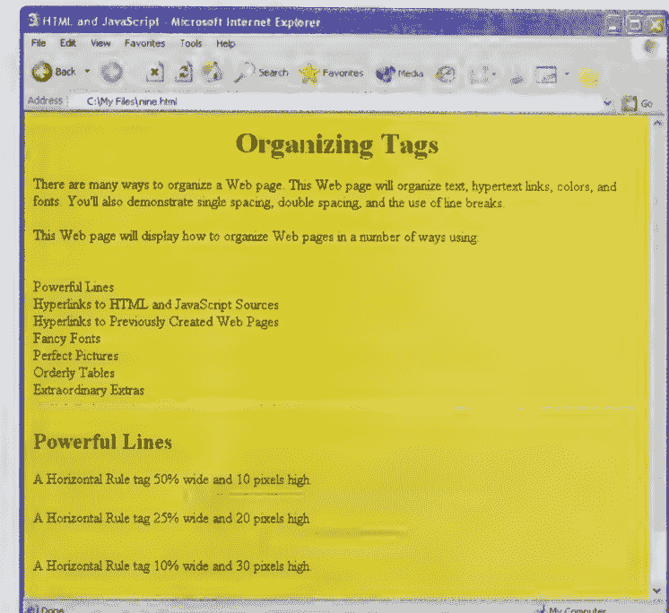

9.  继续下一节，或者如果你今天完成了，就关闭你的软件并关闭计算机。

### 网络礼仪

#### 糟糕的颜色选择

一些网页制作者选择的背景和颜色使网页更难阅读。创建这些难以阅读的网页被认为是不礼貌的。在将你的网页发布到 WWW 之前，请测试你的页面，确保所有文本在页面上清晰显示，并且你的颜色选择不会削弱你试图表达的内容。

此外，在做出选择时，考虑视力障碍者和可能患有色盲的人也是一个好主意。以不正确的方式混合红色和绿色色调可能会导致色盲者阅读文本困难。将字体大小设置得太小可能会给视力不佳的人带来麻烦。使用深色背景和深色字母可能会使页面对任何人都难以阅读。

## 文档内的超链接

网页之所以流行，是因为它们可以以电子的速度轻松链接到其他页面或文档内的各个部分。超链接易于使用，但起初有点难以理解。

要使用超链接，只需单击链接即可。链接可以是图片或带下划线并以不同颜色显示的单词，如图 2-8 所示。

## 互联网里程碑

## 十六进制颜色

计算机只使用数字进行交流。值以计算机理解的数字表示。通过使用特定颜色的特殊数字或 **十六进制** 值，可以仔细控制和更改颜色值，以匹配彩虹中几乎所有的颜色。十六进制的发明是计算领域最伟大的进步之一。十六进制数字基于 16 进制数制运行，而不是我们人类通常使用的 10 进制数制。十六进制数字使用字母 A、B、C、D、E、F 以及数字 0 到 9 来创建 16 个不同的数字。例如，查看以下以数字表示的颜色值：

-   白色 = #FFFFFF
-   绿色 = #00FF00
-   黑色 = #000000
-   蓝色 = #0000FF
-   红色 = #FF0000
-   黄色 = #FFFF00

这些颜色的色调是通过更改数字来创建的。例如，在你的 HTML 页面上，可以使用十六进制数字 00CCFF 创建一个非常棒的天蓝色。你想要一个漂亮的浅紫色吗？试试 FF95FF。一个难看的绿色可以用 AAFF00 创建。在你的网页中用数字替换文本颜色值，看看会发生什么。例如，在 `<BODY>` 标签中尝试以下内容，看看会发生什么：

```
BGCOLOR=#AAFF00 VLINK=#FF95FF TEXT=#00CCFF LINK=#FFFF00
```

## 第 2 课 HTML 组织技术

**图 2-8**
超链接文本

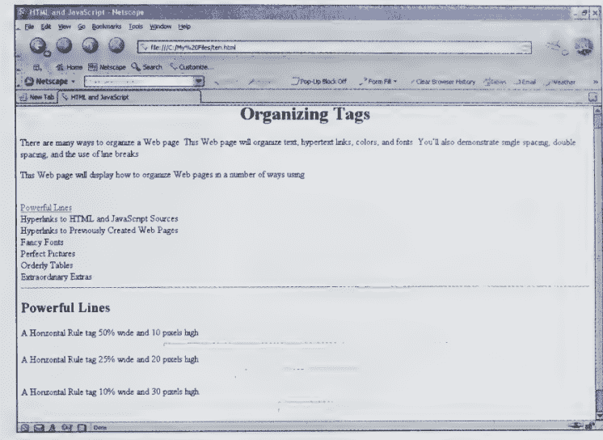

超链接是用称为锚点标签的特殊标签创建的。该标签有几个部分。开始和结束标签称为锚点或链接标签，如下所示：

```html
<A HREF="insert location of file"></A>
```

链接或锚点标签除非你定义了链接的目标位置，否则相当无用。有几种使用锚点标签的方法。你可以：

-   链接到你自己文档内的另一个位置。
-   链接到 WWW 上任何位置的 URL 或网页。
-   链接到你自己计算机上的另一个网页。

在分步操作 2.4 中，你将链接到 WWW，在分步操作 2.5 中，你将为你迄今为止创建的所有网页创建超链接。在这个活动中，我们将开始在你的 HTML 页面内进行链接。

这些内部超链接可帮助用户在网页的重要部分之间导航。你插入的第一个 `<A>` 标签将创建一个指向文档内某个位置的超文本链接。你将在步骤 3 中创建该标签。属性是 HREF=，值是 "#POWERFUL"。引号是必需的，#（井号）也是必需的。

第二个锚点标签将标识你想要链接到的网页中的确切位置。在步骤 4 中，你将创建一个带有属性 NAME= 和一个名为 "POWERFUL" 的值（带引号）的标签。

## 分步操作 2.3

1.  如有必要，打开你的 **nine.html** 或 **nine.htm** 文件进行文本编辑。
2.  将 **BGCOLOR** 属性从 **YELLOW** 改为 **WHITE**，从而将背景颜色改回白色。
3.  在第一个 Powerful Lines 列表项前后添加以下锚点 `<A></A>` 标签，如图 2-9 所示。
    `<BR><A HREF="#POWERFUL">Powerful Lines</A>`
4.  在第二个 Powerful Lines 列表项周围插入以下锚点 `<A></A>` 标签，如图 2-9 中所示并以粗体标记。
    `<P><H2><A NAME="POWERFUL">Powerful Lines</A></H2></P>`
5.  将你的新文件保存为 **ten.html** 或 **ten.htm**。

> **注意**
> 井号 # 可以通过按住 Shift 键并按数字 3 键来创建。引号 (") 则通过按住 Shift 键并按单引号 (') 键来创建。

## 网络道德

## 尊重万维网

你在网页中写的内容不应冒犯他人。你对自己在万维网 (WWW) 上创建和发布的内容负责。请尊重网络。在创建你的网页时，请考虑以下准则：

-   **R** = 责任 (Responsibility)：承担个人责任，只创建合乎道德且适当的页面。
-   **E** = 每个人 (Everybody)：尝试创建每个人都能享受、欣赏并认为有价值的网页。
-   **S** = 简洁 (Simplicity)：让你的网页易于导航。让信息易于查找。
-   **P** = 目的 (Purpose)：为你放在网上的每个网页设定明确的目的。不要发布不必要的页面。
-   **E** = 道德 (Ethical)：确保你发布的每个网页的所有内容都符合你的价值观，并具有有益的目的。
-   **C** = 正确 (Correct)：确保你页面上的所有单词拼写正确，所有句子书写正确，并且所有超链接都能正常工作。
-   **T** = 完全值得访问 (Totally worth visiting)：尝试创建别人会认为完全值得花时间访问的页面。

## 分步操作 2.3 续

6.  在你的网页浏览器中查看更改。你的链接应如图 2-8 中的示例所示。当你点击此链接时，你应该会跳转到文档中的 Powerful Lines 标题处。
7.  继续下一节，或者如果你今天完成了，就关闭你的软件并关闭计算机。

图 2-9
插入背景颜色和内部链接标签

```
<HTML>
<TITLE>HTML and JavaScript</TITLE>

<BODY BGCOLOR=WHITE>
<CENTER><H1>Organizing Tags</H1></CENTER>

<P>There are many ways to organize a Web page. This Web page will organize text, hypertext links, colors, and fonts. You'll also demonstrate single spacing, double spacing, and the use of line breaks. </P>

<P>This Web page will display how to organize Web pages in a number of ways using: </P>

<BR><A HREF="#POWERFUL">Powerful Lines</A>
<BR>Hyperlinks to HTML and JavaScript Sources
<BR>Hyperlinks to Previously Created Web Pages
<BR>Fancy Fonts
<BR>Perfect Pictures
<BR>Orderly Tables
<BR>Extraordinary Extras
<HR>

<P><H2><A NAME="POWERFUL">Powerful Lines</A></H2></P>

A Horizontal Rule tag 50% wide and 10 pixels high.
<HR WIDTH=50% SIZE=10>

A Horizontal Rule tag 25% wide and 20 pixels high.
<HR WIDTH=25% SIZE=20>

A Horizontal Rule tag 10% wide and 30 pixels high.
<HR WIDTH=10% SIZE=30>

A Horizontal Rule tag without attributes and values.
<HR>

</BODY>
</HTML>
```

## 创建指向网络的超文本链接

最初让万维网 (WWW) 流行起来的是能够从一个页面跳转到世界上任何地方的另一个页面的能力。然而，在你能够做到这一点之前，你必须了解关于 URL 的一切。*URL* 代表 *统一资源定位符*。URL 允许网页浏览器精确定位网络上的一个确切文件。这个概念其实相当简单。你见过类似这样的 URL 吗？

http://www.course.com/webpagefolder/anotherfolder/afile.html

当你在 HTML 网页中输入一个 URL 时，你是在标识一个指向位于在线某处的特定 HTML 文件的路径。这个文件可能在你的本地计算机上，也可能在网络上的某个地方。

你通常可以在 URL 的末尾看到文件名。看看我们示例 URL 的末尾。文件名 *afile.html* 是一个 HTML 文件 (afile) 的名称。.html 扩展名标识该文件为一个你的网页浏览器可以显示的 HTML 文档。

然而，在你能够访问 *afile.html* 之前，你需要知道通往这个文件名的路径或方式。找到文件名路径的关键是查看它的 URL 或网址。让我们通过将示例 URL 分解成各个部分来看看这是什么意思。

在某些 URL 中，你可能会看到字母 *http* 后跟一个冒号和两个斜杠。*http://* 告诉你的网络如何传输或移动你请求的文件。**HTTP** 代表 **超文本传输协议**。协议是一种用于通过网络传输数据的通信系统。它就像一种秘密的数字语言，Web 服务器用它来与网页浏览器通信。

地址的第二部分，*www.course.com*，是托管你正在寻找的网页的服务器（或网络计算机）的实际名称。*www* 代表万维网。www 告诉你该服务器使用 Web 技术。*.course* 部分是维护 Web 服务器的公司名称。在这种情况下，course 是 Course Technology 的缩写。*.com* 表示这是一个商业或企业站点。你可能会看到其他地址标记为 *.edu*（教育）、*.gov*（政府网站）或 *.biz*（商业站点）。

URL 其余部分中的斜杠和名称（/webpagefolder/anotherfolder/）代表 Web 服务器上的文件夹。这些也称为子目录。你的计算机上也有子目录。图 2-10 显示了 Windows 计算机上文件夹的组织方式。所有计算机都使用某种文件夹系统来组织文件。如果你想在计算机上找到一个文件，你需要知道通过文件存储的众多可能文件夹的路径。知道路径是找到你想要的网页的关键。

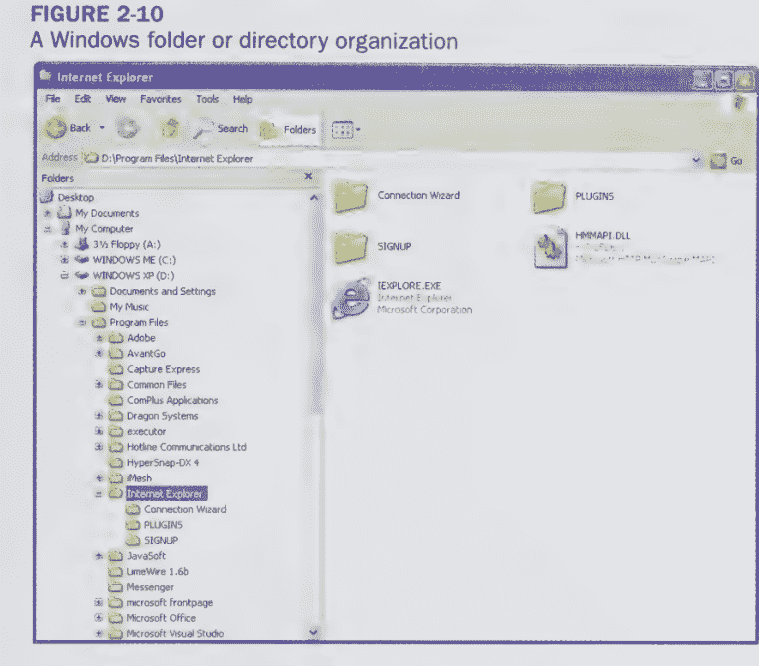

在你能够找到一个网站的欢迎页面之前，你需要知道 URL。在这个分步操作中，你将输入一些在创建更好、更令人兴奋的网络竞赛中最重要的公司的 URL。许多网站都有关于 HTML、JavaScript 和其他重要 Web 工具的信息。它们包括：

-   http://www.microsoft.com
-   http://www.sun.com
-   http://home.netscape.com
-   http://www.oracle.com

## 分步操作 2.4

1.  如有必要，打开你的 **ten.html** 或 **ten.htm** 文件进行文本编辑。
2.  从页面顶部的列表到你正在创建的新部分，创建一个超文本链接（如图 2-11 中所示并以粗体标记）。

```
<BR><A HREF="#HYPERLINKS">Hyperlinks to HTML and JavaScript Sources</A>
```

## 分步操作 2.4 续

3.  在你的网页最后一个 <HR> 标签下方和 </BODY> 标签之前，添加一个新的二级标题，标题文字为 **Hyperlinks to HTML and JavaScript Sources**，如图 2-11 所示。包含 <A NAME> 标签，以便你可以从你在步骤 2 中创建的链接创建一个内部超文本链接。

```
<P><H2><A NAME="HYPERLINKS">Hyperlinks to HTML and JavaScript Sources</A></H2></P>
```

4.  在你的新标题下方和 </BODY> 标签之前，完全按照此处所示和图 2-11 中粗体标记的方式创建以下超文本链接。

```
<BR><A HREF="http://www.microsoft.com">Microsoft</A>
<BR><A HREF="http://home.netscape.com">Netscape</A>
<BR><A HREF="http://www.sun.com">Sun</A>
<BR><A HREF="http://www.oracle.com">Oracle</A>
<HR>
```

## 分步操作 2.4 续

图 2-11
超文本链接标签

```
<HTML>
<TITLE>HTML and JavaScript</TITLE>

<BODY BGCOLOR=WHITE>
<CENTER><H1>Organizing Tags</H1></CENTER>

<P>There are many ways to organize a Web page. This Web page will organize text, hypertext links, colors, and fonts. You'll also demonstrate single spacing, double spacing, and the use of line breaks. </P>

<P>This Web page will display how to organize Web pages in a number of ways using: </P>

<BR><A HREF="#POWERFUL">Powerful Lines</A>
<BR><A HREF="#HYPERLINKS">Hyperlinks to HTML and JavaScript Sources</A>
<BR>Hyperlinks to Previously Created Web Pages
<BR>Fancy Fonts
<BR>Perfect Pictures
<BR>Orderly Tables
<BR>Extraordinary Extras
<HR>

<P><H2><A NAME="POWERFUL">Powerful Lines</A></H2></P>

A Horizontal Rule tag 50% wide and 10 pixels high.
<HR WIDTH=50% SIZE=10>

A Horizontal Rule tag 25% wide and 20 pixels high.
<HR WIDTH=25% SIZE=20>

A Horizontal Rule tag 10% wide and 30 pixels high.
<HR WIDTH=10% SIZE=30>

A Horizontal Rule tag without attributes and values.
<HR>

<P><H2><A NAME="HYPERLINKS">Hyperlinks to HTML and JavaScript Sources</A></H2></P>

<BR><A HREF="http://www.microsoft.com">Microsoft</A>
<BR><A HREF="http://home.netscape.com">Netscape</A>
<BR><A HREF="http://www.sun.com">Sun</A>
<BR><A HREF="http://www.oracle.com">Oracle</A>
<HR>

</BODY>
</HTML>
```

## 分步教程 2.4 续

5.  你整个页面的标签应如图 2-11 所示。将你的作品保存为 **eleven.html** 或 **eleven.htm**。

6.  在你的 Web 浏览器中查看你的作品。你的新链接应如图 2-12 所示。

### 图 2-12
Web 浏览器中的超链接

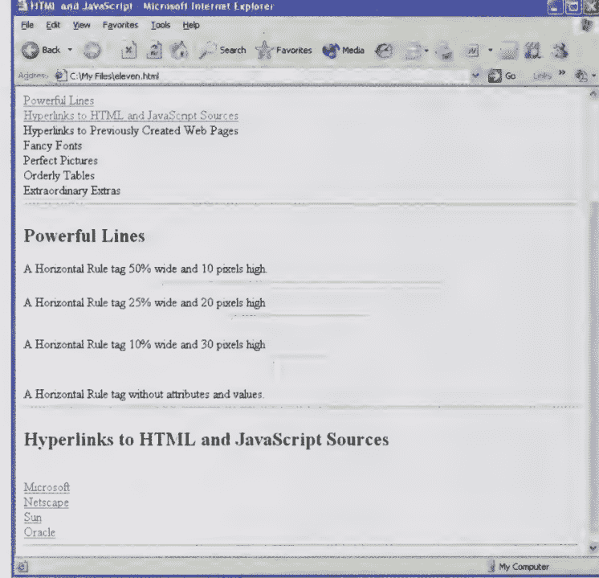

7.  如果你有实时的网络连接，试试你的链接，看看它们是否有效！如果你的链接不能正常工作，请仔细检查你的标签并进行必要的更正。再次保存你的作品。然后在你的 Web 浏览器中重新加载或刷新页面，再试一次。

8.  继续下一节，或者如果你今天完成了，就关闭你的软件并关闭计算机。

> **网络提示**
> 除非你告诉浏览器，否则它不会去查找你新修正的网页。你可以通过几种方式做到这一点。你可以再次打开该页面，或者只需点击 **重新加载** 或 **刷新** 按钮，将网页的更新副本加载到你的浏览器中。

## 链接到你已创建的页面

在这个分步教程中，你将链接到你在本书中创建的前 11 个 HTML 页面。以这种方式跟踪你的所有页面将帮助你快速回顾你所取得的进展。

## 分步教程 2.5

1.  如果需要，打开你的 **eleven.html** 或 **eleven.htm** 文件。
2.  从页面顶部的列表创建一个指向你正在创建的新部分的超文本链接。要输入的文本如下所示，并在图 2-13 中以粗体显示。
3.  如图 2-13 所示，在你上一个练习中添加的 HR 标签下方，以及 `</BODY>` 标签之前，添加一个名为 **指向先前创建的网页的超链接** 的二级标题。包含 `<A NAME>` 标签，以便你可以从你在步骤 3 中创建的标签链接到这个确切位置。
4.  在文档末尾的新标题下方，完全按照此处所示和图 2-13 中的粗体文本创建超文本链接。

```
<BR><A HREF="#PREVIOUS">Hyperlinks to Previously Created Web Pages</A>
```

```
<P><H2><A NAME="PREVIOUS">Hyperlinks to Previously Created Web Pages </A></H2></P>
```

```
<BR><A HREF="one.html">one</A>
<BR><A HREF="two.html">two</A>
<BR><A HREF="three.html">three</A>
<BR><A HREF="four.html">four</A>
<BR><A HREF="five.html">five</A>
<BR><A HREF="six.html">six</A>
<BR><A HREF="seven.html">seven</A>
<BR><A HREF="eight.html">eight</A>
<BR><A HREF="nine.html">nine</A>
<BR><A HREF="ten.html">ten</A>
<BR><A HREF="eleven.html">eleven</A>
<HR>
```

## 分步教程 2.5 续

5.  你整个页面的标签现在应如图 2-13 所示。将你的作品保存为 **twelve.html** 或 **twelve.htm**。

### 图 2-13
创建指向你已创建的网页的链接

```
<HTML>
<TITLE>HTML and JavaScript</TITLE>

<BODY BGCOLOR=WHITE>
<CENTER><H1>Organizing Tags</H1></CENTER>

<P>There are many ways to organize a Web page. This Web page will organize text, hypertext links, colors, and fonts. You'll also demonstrate single spacing, double spacing, and the use of line breaks. </P>

<P>This Web page will display how to organize Web pages in a number of ways using: </P>

<BR><A HREF="#POWERFUL">Powerful Lines</A>
<BR><A HREF="#HYPERLINKS">Hyperlinks to HTML and JavaScript Sources</A>
<BR><A HREF="#PREVIOUS">Hyperlinks to Previously Created Web Pages</A>
<BR>Fancy Fonts
<BR>Perfect Pictures
<BR>Orderly Tables
<BR>Extraordinary Extras
<HR>

<P><H2><A NAME="POWERFUL">Powerful Lines</A></H2></P>

A Horizontal Rule tag 50% wide and 10 pixels high.
<HR WIDTH=50% SIZE=10>

A Horizontal Rule tag 25% wide and 20 pixels high.
<HR WIDTH=25% SIZE=20>

A Horizontal Rule tag 10% wide and 30 pixels high.
<HR WIDTH=10% SIZE=30>

A Horizontal Rule tag without attributes and values.
<HR>

<P><H2><A NAME="HYPERLINKS">Hyperlinks to HTML and JavaScript Sources</A></H2></P>

<BR><A HREF="http://www.microsoft.com">Microsoft</A>
<BR><A HREF="http://home.netscape.com">Netscape</A>
<BR><A HREF="http://www.sun.com">Sun</A>
<BR><A HREF="http://www.oracle.com">Oracle</A>
```

## 分步教程 2.5 续

### 图 2-13（续）
创建指向你已创建的网页的链接

```
<HR>

<P><H2><A NAME="PREVIOUS">Hyperlinks to Previously Created Web Pages
</A></H2></P>

<BR><A HREF="one.html">one</A>
<BR><A HREF="two.html">two</A>
<BR><A HREF="three.html">three</A>
<BR><A HREF="four.html">four</A>
<BR><A HREF="five.html">five</A>
<BR><A HREF="six.html">six</A>
<BR><A HREF="seven.html">seven</A>
<BR><A HREF="eight.html">eight</A>
<BR><A HREF="nine.html">nine</A>
<BR><A HREF="ten.html">ten</A>
<BR><A HREF="eleven.html">eleven</A>
<HR>

</BODY>
</HTML>
```

## 分步教程 2.5 续

6.  在你的 Web 浏览器中查看你的作品。你的新链接应如图 2-14 所示。测试每个链接并确保它们都有效。进行任何必要的更正。

> **注意**
> 你所有的 HTML 文件必须位于同一个文件夹中，超链接才能正常工作。

### 图 2-14
指向先前创建的网页的链接

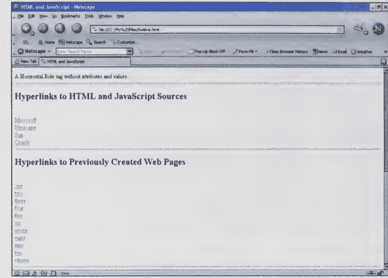

7.  继续下一节，或者如果你今天完成了，就关闭你的软件并关闭计算机。

## 为文本着色

在浏览网页时，你是否注意到文本颜色经常从一页到另一页发生变化？在分步教程 2.1 中，你通过在 <BODY> 标签的 BGCOLOR= 属性中插入 YELLOW 值来更改网页的背景颜色。然后你将背景更改为其他几种颜色。更改文本颜色同样简单。

表 2-1 显示了你可以更改的三种基本文本颜色类型。

### 表 2-1
文本颜色

| 文本类型 | 属性 |
| :--- | :--- |
| 1. 文本本身 | TEXT= |
| 2. 超文本链接颜色 | LINK= |
| 3. 已访问链接的颜色（或你已选择的链接） | VLINK= |

## 分步教程 2.6

1.  如果需要，打开你的 **twelve.html** 或 **twelve.htm** 文件。
2.  在网页开头的 body 标签中，将 BGCOLOR 保留为 WHITE，但插入 **TEXT=BLUE**、**LINK=RED** 和 **VLINK=GREEN**，如图 2-15 所示。

### 图 2-15
更改网页上的文本颜色

```
<HTML>
<TITLE> HTML and JavaScript </TITLE>

<BODY BGCOLOR=WHITE TEXT=BLUE LINK=RED VLINK=GREEN>
```

3.  将你的作品保存为 **thirteen.html** 或 **thirteen.htm**。在你的 Web 浏览器中查看你的作品。你的页面应显示为白色背景上的蓝色文本、红色超链接和绿色已访问链接，如图 2-16 所示。
4.  继续到总结部分，或者如果你今天完成了，就关闭你的软件并关闭计算机。

### 图 2-16
更改文本颜色

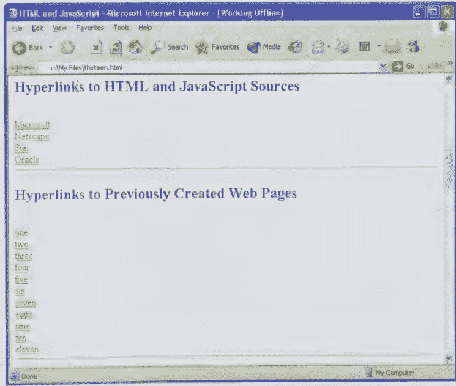

## 完美的校对技巧

校对 HTML 标签可能很困难。即使是最轻微的错误也会极大地改变网页的外观。以下是一些需要检查的常见错误：

-   确保你所有的尖括号 < > 都朝向正确的方向。
-   通常，网页作者在创建尖括号或斜杠时会误用 Shift 键。这会导致在应该出现斜杠或尖括号的地方出现逗号、句号或问号。
-   如果所有文本都居中显示，也许你忘记使用关闭标签 </CENTER>。
-   如果你想要双倍行距而不是单倍行距，请使用 <P></P> 标签而不是 <BR> 标签。
-   如果项目符号出现在列表之后很远的地方，也许你忘记了关闭无序列表标签 </UL>。

> **网络乐趣**
> 另一个有趣的标签是 marquee 标签。你放在 marquee 标签 <MARQUEE></MARQUEE> 之间的任何内容都会像股票行情自动收录器一样在屏幕上滚动。该标签是微软为 Internet Explorer 浏览器设计的，并非在所有浏览器上都有效。尝试一下，看看会发生什么！

## 互联网里程碑

## HTML 标准

HTML 是一个强大的工具，因为它允许各种计算机显示网页。使用 HTML，无论你运行的是 Macintosh 还是 Windows 机器都无关紧要。你甚至可以使用 Linux 或 UNIX 工作站或其他类型的计算机。HTML 网页可以被所有类型的计算机查看的原因是存在所有 Web 浏览器都理解的标准。新的标准以及新的 HTML 标签和命令一直在添加。每个新标签都会提交给标准委员会进行审查。每隔一段时间，HTML 中会添加足够多的新命令，从而开发出新版本的 HTML。这些版本用数字标记：HTML 1、HTML 2、HTML 3、HTML 4 等。你可以在线了解更多关于 HTML 标准的信息，并获得扩展 HTML 技能的帮助。访问你的搜索门户，尝试以下搜索词：

-   HTML
-   HTML 标准
-   HTML 标准委员会
-   HTML 学习
-   HTML 指南

## 总结

在本课中，你学习了：

- 你可以使用单倍和双倍间距来组织页面信息。
- 你可以使用线条来组织页面信息。
- 你可以使用属性和值来改进网页设计。
- 你可以更改颜色默认值、属性和值。
- 你可以创建指向网页文档中某个位置的超文本链接。
- 你可以创建指向万维网上另一个页面的超文本链接。
- 你可以创建指向你自己计算机上网页的超文本链接。

## 词汇复习

| 定义以下术语： | | |
| --- | --- | --- |
| 属性 | 超文本链接 | 统一资源定位符 (URL) |
| 字体 | 超文本传输协议 (HTTP) | 值 |
| 十六进制 | | |
| 超链接 | | |

## 复习题

### 判断题

如果陈述正确，请圈出 T；如果陈述错误，请圈出 F。

- T F 1. 十六进制数基于十进制数制运行。
- T F 2. `<BR>` 标签会在文本周围创建双倍间距。
- T F 3. HREF 是 `<A></A>` 锚点标签的一个属性。
- T F 4. 你可以更改网页上几乎所有文本的颜色。
- T F 5. `<HR>` 标签创建单倍间距分隔。

### 填空题

通过在提供的空白处填写正确的单词或词组来完成以下句子。

- 1. __________ 标签创建在屏幕上滚动的文本。
- 2. 你可以使用 `<P>` 标签在 HTML 文档中 __________ 间距。
- 3. __________ 是一种用于通过网络传输数据的通信系统。
- 4. __________ 数字允许你使用数字和字母定义颜色。
- 5. __________ 属性更改网页的背景颜色。

## 书面题

简要回答以下问题。

1. 哪个标签允许文本在屏幕上重复滚动？
2. 哪个十六进制值会创建黄色？
3. 你知道哪些标签不需要结束标签就能有效工作？
4. 三种常见的 HTML 错误是什么？
5. 为什么 HTML 有不同的版本？

## 项目

### 项目 2-1

在第 1 课的团队活动中，你确定了你能找到的最棒的网页。在这个项目中，GreatApplications, Inc. 希望你找出你能找到的五个最差的网页。这些将用于培训研讨会，帮助新员工学习如何创建高质量的网页。你的经理建议你上网冲浪，找到五个难以阅读、组织混乱或枯燥的网页示例，向新实习生展示哪些事情不该做。

上网寻找糟糕的网页示例。记录每个页面的标题和 URL，并列出几个这些页面糟糕的原因！

#### 表 2-2
组织混乱的网页示例

| 出现在标题栏中的标题 | 网址或 URL | 此页面糟糕的原因 |
|---|---|---|
| 1. | | |
| 2. | | |
| 3. | | |
| 4. | | |
| 5. | | |

### 团队项目

GreatApplications, Inc. 正在举办一场设计竞赛，看谁能构建信息最丰富、组织最有序的网页。具体来说，他们正在寻找一个能够创建网页向客户介绍新产品的团队。

比赛给三到五人的团队两个小时的时间来创建一个关于他们选择的产品的信息丰富的网页。组建你的团队，集思广益想一个要介绍的新产品。它可以是新的 DVD 或新的电脑游戏。它可以是新的时尚或新的汽车。就本次比赛而言，你选择什么产品并不重要，所以不要花太多时间决定你将使用什么产品。

创建你团队的网页竞赛作品。分配写作职责。让一个人输入基本标签并担任网页管理员。每个团队成员必须研究并撰写网页的一部分。通过编辑和修改彼此的写作和 HTML 标签来协作。使用你在本课中学到的技术来组织你希望呈现的信息。

### 网络项目

我们都知道团队合作很重要。然而，是否有团队合作比单独工作更困难的时候？回答以下关于团队一起创建网页的问题。

- 1. 当你们一起进行团队项目时，遇到了什么问题？
- 2. 你们如何组织团队？如何分配工作？哪些团队成员负责哪些活动？
- 3. 团队合作是否创建了更好的网页？如果是，如何做到的？
- 4. 你会给其他试图创建网页的团队什么建议？

## 批判性思维

为以下每个问题准备一个 100 到 250 字的答案。

#### 活动 2-1

你能弄清楚如何创建一个内部超链接，让你从文档底部移动到最顶部吗？使用你在分步指南 2.3 中学到的步骤，在 `</BODY>` 标签之前创建一个链接，该链接将链接到页面顶部。你的链接应该看起来像这样：页面顶部。你认为一个链接回页面顶部为什么有价值？

#### 活动 2-2

你最重要的 10 个网站是什么？它们对你为什么重要？创建一个新的 HTML 页面，索引并列出你最重要的个人网页。将该页面命名为“我的网络资源”。在你学习本教材的过程中，不断添加到你的网络资源页面。

## 总结项目

无论你将来选择什么职业，培养良好的沟通技巧都非常重要。例如，每个人都可以从学习如何撰写格式良好的商务信函中受益。使用你在本课中学到的 HTML 文本格式化技巧，给你的老师写一封商务信函。完成后，你的信函应具有图 2-17 所示示例信函的一般外观。

#### 图 2-17
商务信函示例

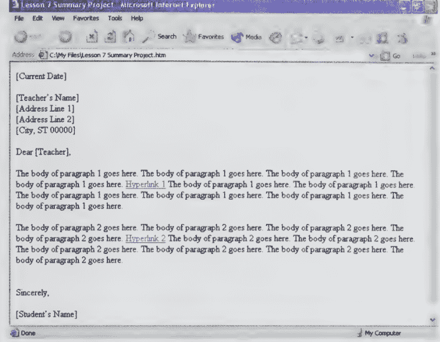

### 项目要求

- 你的信函应在页面顶部包含日期。
- 日期之后应是地址和称呼。
- 信函正文必须包含至少两个完整的段落。
- 你的信函应以结束语和你自己的名字结尾。
- 你必须在信函的每个段落中包含至少一个超链接。
- 文本应显示为蓝色，超链接应为红色。
- 确保在调整浏览器窗口大小时，你的信函保持其格式。（段落之间的间距应保持一致。）

## HTML 高级技巧

**目标**
完成本课后，你应该能够：
- 控制字体的大小、样式和颜色。
- 从网络下载图片。
- 将图片插入你的网页。
- 更改图形的大小。
- 使用表格组织信息。
- 将图片转换为超链接。
- 将各种数据输入选项插入网页。

预计时间：1.5 小时

**词汇**
- .gif
- .jpg 或 .jpeg
- 图形交换格式
- 联合图像专家组
- 表格单元格

### 令人兴奋的网络

网络充满了为网页增添趣味的图片、声音和电影。通常，万维网上有两种图片，称为图形或图像。它们包括 .gif 文件（图形交换格式）和 .jpg 或 .jpeg（联合图像专家组）文件。扩展名 .gif 和 .jpg 有助于告诉你的浏览器这些文件是图片，而不是 .html 文本文件，需要特殊处理。我们将在本课后面更详细地讨论和定义这些文件。

你对 HTML 了解得越多，你就能为你的网页添加越多令人兴奋的新效果和样式。正如我们在第 2 课中提到的，字体或字母的样式可以更改。每种字体都有其独特的样式。

通过使用 `<FONT>` 标签的许多属性和值，你可以以无限的方式操作字体，正如你将在本课中很快体验到的那样。

表格允许将网页的各个部分划分开，为你可能想包含的每个新元素或信息片段创建特殊空间。

表格、字体和图片可以为你的页面增添力量。在本课中，你将学习操作特殊的 HTML 功能。你还将学习一些非凡的输入标签，这些标签将允许访问你网页的访客与你的网页进行交互。

## 字体属性与值

当你在 `<BODY>` 标签中更改文本颜色时（就像你在第2课的步骤式教学2.6中所做的那样），你更改的是整个页面文字的颜色。如果你想要更精细的控制（即，如果你想更改单个段落、单个句子甚至单个单词的大小、颜色或样式），请使用 `<FONT>` 标签。

使用 `<FONT>` 标签属性来控制：

-   使用 SIZE 属性 `<FONT SIZE=#>` 控制文字大小
-   使用 FACE 属性 `<FONT FACE=#>` 控制文字样式
-   使用 COLOR 属性 `<FONT COLOR=#>` 控制文字颜色

## 步骤式教学 3.1

1.  打开你的 **thirteen.html** 或 **thirteen.htm** 文件（来自第2课）进行文本编辑。

2.  在页面顶部的列表中创建一个超文本链接，该链接将指向你将在本步骤式教学中创建的新部分。要输入的文本在此处和图3-1中以粗体显示。

```
<BR><A HREF="#FONTS">Fancy Fonts</A>
```

3.  如图3-1所示，在你于第2课步骤式教学2.6末尾创建的 `<HR>` 标签下方、`</BODY>` 标签上方，添加一个名为 **Fancy Fonts** 的二级标题。这将完成你在本步骤式教学第2步中开始的内部超文本链接。

```
<P><H2><A NAME="FONTS">Fancy Fonts</A></H2></P>
```

4.  在新标题下方，靠近文档末尾处，完全按照此处和图3-1中粗体所示输入字体标签、属性和值。

```
<BR><FONT FACE=HELVETICA SIZE=4 COLOR=RED>This is the Helvetica font at Size 4</FONT>
<BR><FONT FACE=TIMES SIZE=6 COLOR=GREEN>This is the Times font at Size 6</FONT>
<BR><FONT FACE=ARIAL SIZE=8 COLOR=ORANGE>This is the Arial font at Size 8</FONT>
<BR><FONT FACE=COURIER SIZE=2 COLOR=BLACK>This is the Courier font at Size 2</FONT>
<HR>
```

## 步骤式教学 3.1 续

5.  你的标签应如图3-1所示。将你的工作保存为 **fourteen.html** 或 **fourteen.htm**。

**图 3-1**
应用字体样式、大小和颜色

```
<HTML>
<TITLE> HTML and JavaScript </TITLE>

<BODY BGCOLOR=WHITE TEXT=BLUE LINK=RED VLINK=GREEN>
<CENTER><H1>Organizing Tags</H1></CENTER>

<P>There are many ways to organize a Web page. This Web page will organize text, hypertext links, colors, and fonts. You'll also demonstrate single spacing, double spacing, and the use of line breaks. </P>

<P>This Web page will display how to organize Web pages in a number of ways using:</P>

<BR><A HREF="#POWERFUL">Powerful Lines</A>
<BR><A HREF="#HYPERLINKS">Hyperlinks to HTML and JavaScript Sources</A>
<BR><A HREF="#PREVIOUS">Hyperlinks to Previously Created Web Pages</A>
<BR><A HREF="#FONTS">Fancy Fonts</A>
<BR>Perfect Pictures
<BR>Orderly Tables
<BR>Extraordinary Extras

<HR>
<P><H2><A NAME="POWERFUL">Powerful Lines</A></H2></P>

A Horizontal Rule tag 50% wide and 10 pixels high.
<HR WIDTH=50% SIZE=10>

A Horizontal Rule tag 25% wide and 20 pixels high.
<HR WIDTH=25% SIZE=20>

A Horizontal Rule tag 10% wide and 30 pixels high.
<HR WIDTH=10% SIZE=30>

A Horizontal Rule tag without attributes and values.
<HR>

<P><H2><A NAME="HYPERLINKS">Hyperlinks to HTML and JavaScript Sources</A></H2></P>

<BR><A HREF="http://www.microsoft.com">Microsoft</A>
<BR><A HREF="http://home.netscape.com">Netscape</A>
<BR><A HREF="http://www.sun.com">Sun</A>
<BR><A HREF="http://www.oracle.com">Oracle</A>
<HR>
```

## 步骤式教学 3.1 续

图 3-1（续）
应用字体样式、大小和颜色

```
<P><H2><A NAME="PREVIOUS">Hyperlinks to Previously Created Web Pages
</A></H2></P>

<BR><A HREF="one.html">one</A>
<BR><A HREF="two.html">two</A>
<BR><A HREF="three.html">three</A>
<BR><A HREF="four.html">four</A>
<BR><A HREF="five.html">five</A>
<BR><A HREF="six.html">six</A>
<BR><A HREF="seven.html">seven</A>
<BR><A HREF="eight.html">eight</A>
<BR><A HREF="nine.html">nine</A>
<BR><A HREF="ten.html">ten</A>
<BR><A HREF="eleven.html">eleven</A>
<HR>

<P><H2><A NAME="FONTS">Fancy Fonts</A></H2></P>

<BR><FONT FACE=HELVETICA SIZE=4 COLOR=RED>This is the Helvetica font at Size 4</FONT>
<BR><FONT FACE=TIMES SIZE=6 COLOR=GREEN>This is the Times font at Size 6</FONT>
<BR><FONT FACE=ARIAL SIZE=8 COLOR=ORANGE>This is the Arial font at Size 8</FONT>
<BR><FONT FACE=COURIER SIZE=2 COLOR=BLACK>This is the Courier font at Size 2 </FONT>
<HR>

</BODY>
</HTML>
```

## 步骤式教学 3.1 续

6.  在你的网页浏览器中查看你的作品。你的更改应如图3-2所示。进行任何必要的修正。

图 3-2
各种字体样式、大小和颜色


7.  继续下一节，或者如果你今天的工作已完成，请关闭你的软件并关闭计算机。

## 下载和插入图形

> **网络提示**
还有其他方法可以改变文本的外观。尝试在某些单词周围使用这些标签，看看它们会产生什么效果。你能猜出它们的作用吗？
`<B></B>`
`<EM></EM>`
`<STRONG></STRONG>`
`<I></I>`

图片可以在很多地方找到。你可以在你的剪贴画收藏中找到图片，用扫描仪将图片扫描到你的计算机中，绘制你自己的图片，或者从网络上复制它们。然而，在你能够轻松地在网页中使用图片之前，你需要将它们转换为可接受的网页格式之一。常见的格式是 .gif 和 .jpg 或 .jpeg。

第一种图形或图像格式 *.gif* 最初是由最早的在线公司之一 CompuServe 创建的，目的是提供一种压缩的图形格式，可以轻松地通过低速调制解调器传输。*图形交换格式* 通常缩写为 GIF。关于如何读 GIF 存在一些争议。在美国的一些地区，它的发音是硬 *g*，就像 Kathie Lee GIFford 中的发音。在美国的其他地区，它的发音是软 *g*，就像 JIFfy 花生酱中的发音。两种发音都可以。毕竟，发音丝毫不会改变文件格式。

第二种常用格式是 *.jpg* 或 *.jpeg*。它被圈内网页艺术家读作 *J-Peg*。JPEG 是 *联合图像专家组* 的缩写。这种格式遵循一套国际图形标准。JPEG 图形，像 GIF 图片一样，足够紧凑，适合互联网使用。

其他图形文件格式正在兴起。但如果你知道如何处理这两种格式，你就会知道如何处理万维网上的任何其他图片格式。

> **网络提示**
要复制和下载本课所需的图形，请访问 www.course.com，搜索本书的 ISBN，然后按照步骤式教学3.2中概述的其余步骤操作。（ISBN 可以在本书的封底找到。）

## 步骤式教学 3.2

1.  打开你的网页浏览器。
2.  在你的网页浏览器中输入网址 **www.course.com**。
3.  如图3-3所示，点击搜索框并输入本书的 ISBN。


4.  选择 **搜索** 并等待结果出现。
5.  点击本书的标题，然后选择名为 Student Online Companion 的链接。
6.  点击 **Lesson 3** 链接，然后从出现的列表中选择 **Data Files & Graphics** 链接。向下滚动直到你看到一条龙。

## 步骤式教学 3.2 续

7.  如果你使用的是 Windows 计算机，请在龙的鼻子上（如图3-4所示）点击鼠标右键。如果你使用的是 Macintosh，请在龙的鼻子上点击并按住鼠标按钮。

**图 3-4**
复制并保存图形

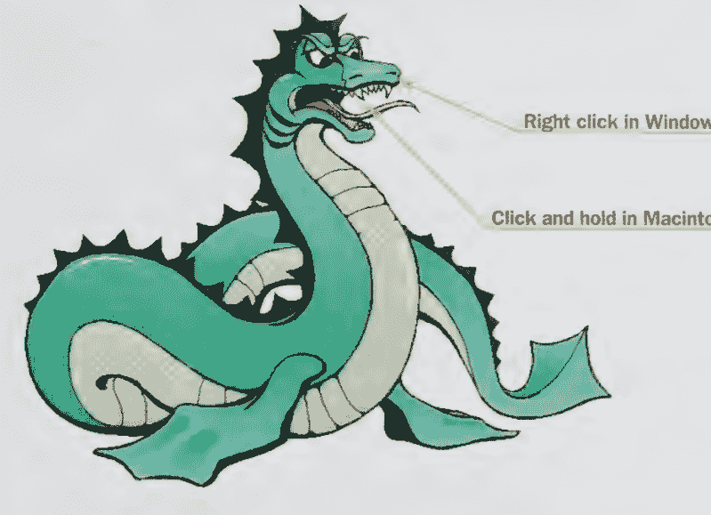

8.  从出现的列表中选择 **Save Image As...** 或 **Save Picture As...** 命令，如图3-5A和3-5B所示。（注意：你浏览器上的命令措辞可能不同。请尝试出现的各种命令，直到找到正确的命令。）

**图 3-5A**
使用 Netscape 时，选择 Save Image

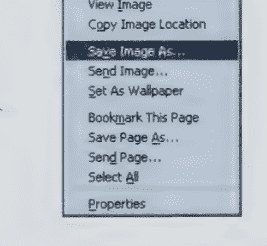

**图 3-5B**
使用 Internet Explorer 时，选择 Save Picture As

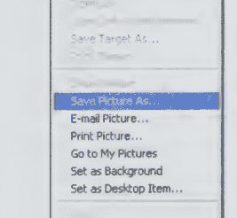

9.  将你的文件（名为 *levy.gif*）保存在与你保存网页完全相同的文件夹中。

## 分步操作 3.2 续

10. 在您的文字处理器或文本编辑器中打开您的 **fourteen.html** 或 **fourteen.htm** 网页。

11. 在页面顶部附近的列表中创建一个超文本链接，该链接将指向您即将创建的新部分。要输入的文本在此处和图 3-6 中以粗体显示。
`<BR><A HREF="#PICTURES">Perfect Pictures</A>`

12. 如图 3-6 所示，在您之前创建的最后一个 `<HR>` 标签下方、`</BODY>` 标签之前，添加一个名为 **Perfect Pictures** 的二级标题。包含 `<A NAME>` 标签，以便完成您在步骤 11 中开始的内部超文本链接。
`<P><H2><A NAME="PICTURES">Perfect Pictures</A></H2></P>`

13. 在新标题下方，靠近文档末尾处，输入图像源 `` 标签，如下所示及图 3-6 所示。请注意，您刚刚下载的文件名出现在引号之间。
``
`<HR>`

14. 您的标签现在应该看起来像图 3-6 中的那样。如果一切正确，请将您的工作保存为 **fifteen.html** 或 **fifteen.htm**。

## 图 3-6
插入图形或图像文件

```
<HTML>
<TITLE> HTML and JavaScript </TITLE>

<BODY BGCOLOR=WHITE TEXT=BLUE LINK=RED VLINK=GREEN>
<CENTER><H1>Organizing Tags</H1></CENTER>

<P>There are many ways to organize a Web page. This Web page will organize text, hypertext links, colors, and fonts. You'll also demonstrate single spacing, double spacing, and the use of line breaks. </P>

<P>This Web page will display how to organize Web pages in a number of ways using: </P>

<BR><A HREF="#POWERFUL">Powerful Lines</A>
<BR><A HREF="#HYPERLINKS">Hyperlinks to HTML and JavaScript Sources</A>
<BR><A HREF="#PREVIOUS">Hyperlinks to Previously Created Web Pages</A>
<BR><A HREF="#FONTS">Fancy Fonts</A>
<BR><A HREF="#PICTURES">Perfect Pictures</A>
<BR>Orderly Tables
<BR>Extraordinary Extras

<HR>
<P><H2><A NAME="POWERFUL">Powerful Lines</A></H2></P>
A Horizontal Rule tag 50% wide and 10 pixels high.
<HR WIDTH=50% SIZE=10>
A Horizontal Rule tag 25% wide and 20 pixels high.
<HR WIDTH=25% SIZE=20>
A Horizontal Rule tag 10% wide and 30 pixels high.
<HR WIDTH=10% SIZE=30>
A Horizontal Rule tag without attributes and values.
<HR>

<P><H2><A NAME="HYPERLINKS">Hyperlinks to HTML and JavaScript Sources</A></H2></P>

<BR><A HREF="http://www.microsoft.com">Microsoft</A>
<BR><A HREF="http://home.netscape.com">Netscape</A>
<BR><A HREF="http://www.sun.com">Sun</A>
<BR><A HREF="http://www.oracle.com">Oracle</A>
<HR>

<P><H2><A NAME="PREVIOUS">Hyperlinks to Previously Created Web Pages</A></H2></P>

<BR><A HREF="one.html">one</A>
<BR><A HREF="two.html">two</A>
<BR><A HREF="three.html">three</A>
<BR><A HREF="four.html">four</A>
<BR><A HREF="five.html">five</A>
<BR><A HREF="six.html">six</A>
<BR><A HREF="seven.html">seven</A>
<BR><A HREF="eight.html">eight</A>
<BR><A HREF="nine.html">nine</A>
<BR><A HREF="ten.html">ten</A>
<BR><A HREF="eleven.html">eleven</A>
<HR>

<P><H2><A NAME="FONTS">Fancy Fonts</A></H2></P>

<BR><FONT FACE=HELVETICA SIZE=4 COLOR=RED>This is the Helvetica font at Size 4</FONT>
<BR><FONT FACE=TIMES SIZE=6 COLOR=GREEN>This is the Times font at Size 6</FONT>
<BR><FONT FACE=ARIAL SIZE=8 COLOR=ORANGE>This is the Arial font at Size 8</FONT>
<BR><FONT FACE=COURIER SIZE=2 COLOR=BLACK>This is the Courier font at Size 2 </FONT>
<HR>

<P><H2><A NAME="PICTURES">Perfect Pictures</A></H2></P>


<HR>

</BODY>
</HTML>
```

15. 在您的 Web 浏览器中查看您的作品。您的图片应该看起来像图 3-7，但在您的浏览器中它可能显得更大或更小。

## 图 3-7
在浏览器中看到的 GIF 图像

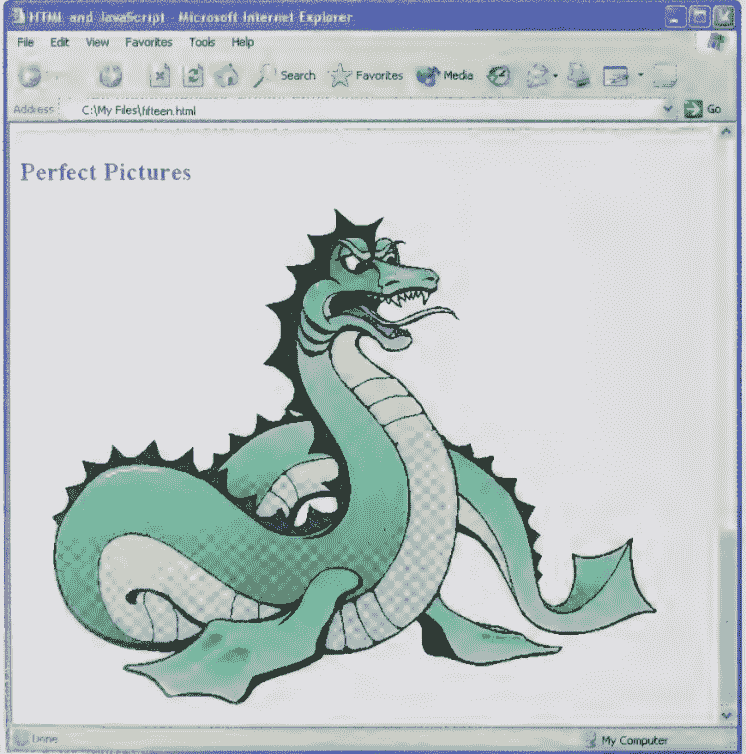

16. 继续下一节，或者如果您今天的工作已完成，请关闭您的软件并关闭计算机。

## 各种尺寸的图片

可以通过更改标签的值以多种方式修改图片。图片可以用作壁纸来覆盖网页的整个背景。它们可以居中对齐，也可以对齐到页面的左侧或右侧。它们可以根据您的需要变大或变小。

> 网络提示
一个常见的错误是在 `` 标签中颠倒了 R 和 C 的顺序。可以将其想象为 **IM**a**G**e **S**ou**RC**e 标签，这样您就不会忘记按正确的顺序放置字母。

您还可以使用 HEIGHT 和 WIDTH 属性来更改图片的大小。精确控制图片的大小对于使页面看起来清晰和有趣非常有帮助。

> 网络提示
让您的网页访客只需点击一下就能给您发送电子邮件的一个简单方法是创建以下标签：
`<A HREF=mailto:your_email @address>Your Name</A>`。

在分步操作 3.3 的第一部分，您将把图片对齐到页面的右侧并使其变小。在第二部分，您将把三个不同大小的龙横向排列在页面上，然后通过操作几个标签将三个龙垂直放置在网页上。

## 分步操作 3.3

1. 打开您的 fifteen.html 或 fifteen.htm 文件进行文本编辑。
2. 在文档末尾附近，将以下信息添加到您的 `` 标签中，如下所示及图 3-8 中的粗体所示。

```
<P></P>
```


## 网络上的艺术家

网站开发公司对艺术家的需求量很大。曾几何时，网页完全由文字或文本构成。如今，图片主导着网页，吸引了比以往更多的访客。
如果您正在考虑从事艺术职业，请考虑网络。您可能会发现您的许多艺术作品最终会出现在网络上。拥有网站的大公司和网站开发者一直在寻找优秀的艺术家。
您可以使用任何您喜欢的媒介或方法来创作您的艺术作品。扫描仪可以将您的图片转换为数字图像。数字文件可以转换为适用于网络的格式，例如 .gif 或 .jpg。您还可以使用各种艺术软件来创作您的艺术作品，或改进您已扫描成网络图像的任何艺术作品。
网络艺术家的最佳培训是尽可能多地参加艺术课程。您需要用来转换艺术作品的图形工具很容易学习。艺术家的技能则需要更多时间来培养。

## 分步操作 3.3 续

3. 将您的更改保存为 **sixteen.html** 或 **sixteen.htm**。

4. 在您的 Web 浏览器中查看您的更改。龙应该显得更小并且右对齐，如图 3-9 所示。

5. 接下来，创建三个横跨屏幕显示的图像，每个图形显示为不同的大小。为此，在您的第一个 IMG SRC 标签下方输入以下标签，如下所示及图 3-8 所示。

```


```

6. 使用相同的 **sixteen.html** 或 **sixteen.htm** 文件名重新保存您的更改，并在您的 Web 浏览器中查看您的添加内容。您的更改应该类似于图 3-9 中显示的三个图像。如果您的图形没有显示，请进行必要的更正，重新保存，然后再次查看。

7. 就在您在上一步中输入的三个标签下方，再添加两个 IMG SRC 标签，使用 `<P>` 标签使多个图形垂直显示。完全按照此处和图 3-8 所示输入这些标签。

```
<P></P>
<P></P>
```

8. 再次将您的更改保存为 **sixteen.html** 或 **sixteen.htm**，并在您的 Web 浏览器中查看结果。查看图 3-8 和图 3-9 以评估标签和图形应如何显示。在必要时进行更正，并在浏览器中查看任何更改。

9. 继续下一节，或者如果您今天的工作已完成，请关闭您的软件并关闭计算机。

## 图 3-8
到处都是龙

```
<HTML>
<TITLE> HTML and JavaScript </TITLE>

<BODY BGCOLOR=WHITE TEXT=BLUE LINK=RED VLINK=GREEN>
<CENTER><H1>Organizing Tags</H1></CENTER>

<P>There are many ways to organize a Web page. This Web page will organize text, hypertext links, colors, and fonts. You'll also demonstrate single spacing, double spacing, and the use of line breaks. </P>

<P>This Web page will display how to organize Web pages in a number of ways using: </P>

<BR><A HREF="#POWERFUL">Powerful Lines</A>
<BR><A HREF="#HYPERLINKS">Hyperlinks to HTML and JavaScript Sources</A>
```

## 分步教程 3.3 续

图 3-8（续）
到处都是龙

```
<BR><A HREF="#PREVIOUS">指向先前创建的网页的超链接</A>
<BR><A HREF="#FONTS">花式字体</A>
<BR><A HREF="#PICTURES">完美图片</A>
<BR>有序表格
<BR>非凡的额外内容

<HR>
<P><H2><A NAME="POWERFUL">强大的线条</A></H2></P>

一个宽度为50%、高度为10像素的水平线标签。
<HR WIDTH=50% SIZE=10>

一个宽度为25%、高度为20像素的水平线标签。
<HR WIDTH=25% SIZE=20>

一个宽度为10%、高度为30像素的水平线标签。
<HR WIDTH=10% SIZE=30>

一个没有属性和值的水平线标签。
<HR>

<P><H2><A NAME="HYPERLINKS">指向HTML和JavaScript资源的超链接</A></H2></P>

<BR><A HREF="http://www.microsoft.com">Microsoft</A>
<BR><A HREF="http://home.netscape.com">Netscape</A>
<BR><A HREF="http://www.sun.com">Sun</A>
<BR><A HREF="http://www.oracle.com">Oracle</A>
<HR>

<P><H2><A NAME="PREVIOUS">指向先前创建的网页的超链接</A></H2></P>

<BR><A HREF="one.html">one</A>
<BR><A HREF="two.html">two</A>
<BR><A HREF="three.html">three</A>
<BR><A HREF="four.html">four</A>
<BR><A HREF="five.html">five</A>
<BR><A HREF="six.html">six</A>
<BR><A HREF="seven.html">seven</A>
<BR><A HREF="eight.html">eight</A>
<BR><A HREF="nine.html">nine</A>
<BR><A HREF="ten.html">ten</A>
<BR><A HREF="eleven.html">eleven</A>
<HR>
```

```
<P><H2><A NAME="FONTS">花式字体</A></H2></P>

<BR><FONT FACE=HELVETICA SIZE=4 COLOR=RED>这是4号大小的Helvetica字体</FONT>
<BR><FONT FACE=TIMES SIZE=6 COLOR=GREEN>这是6号大小的Times字体</FONT>
<BR><FONT FACE=ARIAL SIZE=8 COLOR=ORANGE>这是8号大小的Arial字体</FONT>
<BR><FONT FACE=COURIER SIZE=2 COLOR=BLACK>这是2号大小的Courier字体 </FONT>
<HR>

<P><H2><A NAME="PICTURES">完美图片</A></H2></P>

<P></P>


<P></P>
<P></P>
<HR>

</BODY>
</HTML>
```

## 网络道德

## 图片盗版

网络上的一个大问题是图片盗版。由于从网络上抓取图片非常容易，许多人在未经许可的情况下就这么做了。许多图片都是有版权的；也就是说，有人拥有它们。要使用它们，你需要获得许可或向所有者或艺术家付费。

例如，迪士尼拥有许多受版权保护的图像。他们已经对那些抓取并非法使用或修改迪士尼受版权保护图像的网站创建者采取了法律行动。

请考虑你从网络上下载和使用的图片。它们是供你免费使用的吗？许多地方允许免费下载图片。例如，你从本书的网站借用的图片是授权给你使用的。

## 分步教程 3.3 续

图 3-9
更改属性和值后的GIF图像

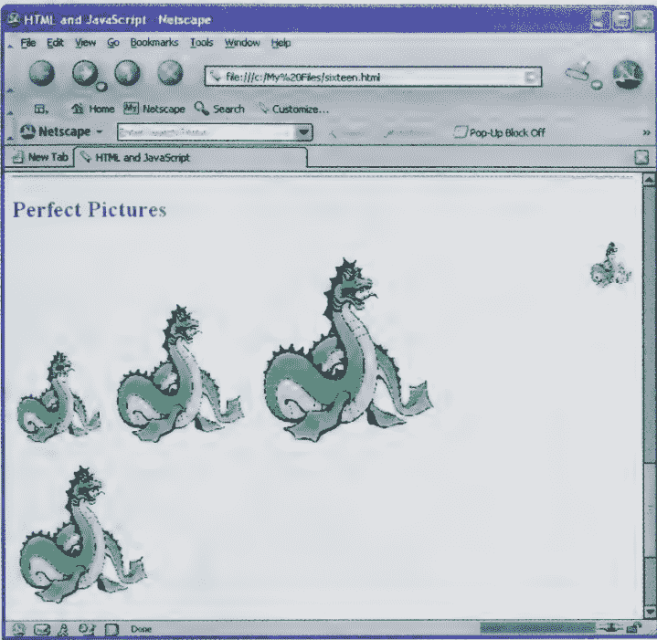

> **网络提示**
要将图片变成超链接，请尝试使用这一系列标签、属性和值！

`<A HREF="http://www.course.com"></A>`

> **网络提示**
要让图片成为你的背景，请在 `<BODY>` 标签中插入 BACKGROUND 属性，如下所示：

`<BODY BACKGROUND="levy.gif">`

## 有序表格

当你想到一张摆放整齐、准备好迎接盛大节日晚餐的餐桌时，你会想到一切是多么井然有序。所有的餐具、盘子、杯子和银器都排列有序，各就各位。

电子表格也是如此。表格创建了小方框，你可以在其中放置物品以保持它们的有序。在分步教程 3.4 中，你将创建一个表格，然后将你已经学过的许多标签插入到称为**表格单元格**的小方框中。

使用 `<TABLE>` 标签创建表格非常容易。通过添加 BORDER 属性和一个数字值，单元格可以有边框。你还可以使用 CELLPADDING 属性使单元格在图片和文本周围显得更大。在单元格内，你可以将图片和文本居中、左对齐或右对齐。

## 分步教程 3.4

1.  如果需要，请打开你的 **sixteen.html** 或 **sixteen.htm** 文件。
2.  在页面顶部的列表中创建一个超文本链接，该链接将超链接到你正在创建的新部分。要输入的文本在此处和图 3-10 中以粗体显示。
3.  如图 3-10 所示，在你上一个分步教程中创建的 `<HR>` 标签下方、`</BODY>` 标签之前，添加一个名为**有序表格**的二级标题。包含 `<A NAME>` 标签，以便你可以完成在步骤 2 中开始的内部超链接。
4.  在新标题下方，靠近文档末尾，按照此处和图 3-10 中粗体所示，输入 `<TABLE>` 标签、属性和值。

```
<BR><A HREF="#TABLES">有序表格</A>
```

```
<P><H2><A NAME="TABLES">有序表格</A></H2></P>
```

```
<TABLE BORDER=5 CELLPADDING=10 ALIGN=CENTER>
<TR>
    <TH>龙</TH>
    <TH>颜色</TH>
    <TH>字体</TH>
</TR>
<TR>
    <TD></TD>
    <TD BGCOLOR=RED ALIGN=CENTER>红色</TD>
    <TD ALIGN=CENTER><FONT FACE=TIMES SIZE=7 COLOR=GREEN>Times</TD>
</TR>
<TR>
    <TD></TD>
    <TD BGCOLOR=GREEN ALIGN=CENTER>绿色</TD>
    <TD ALIGN=CENTER><FONT FACE=COURIER SIZE=10 COLOR=GREEN>Courier</TD>
</TR>
</TABLE>
<HR>
```

## 分步教程 3.4 续

5.  你的标签现在应该看起来像图 3-10 中的那样。将你的工作保存为 **seventeen.html** 或 **seventeen.htm**。

**图 3-10**
在HTML中创建表格

```
<HTML>
<TITLE> HTML and JavaScript </TITLE>

<BODY BGCOLOR=WHITE TEXT=BLUE LINK=RED VLINK=GREEN>
<CENTER><H1>组织标签</H1></CENTER>

<P>组织网页的方式有很多种。这个网页将组织文本、超文本链接、颜色和字体。你还将演示单倍行距、双倍行距和换行符的使用。</P>

<p>这个网页将展示如何使用以下方式以多种方式组织网页：</p>

<BR><A HREF="#POWERFUL">强大的线条</A>
<BR><A HREF="#HYPERLINKS">指向HTML和JavaScript资源的超链接</A>
<BR><A HREF="#PREVIOUS">指向先前创建的网页的超链接</A>
<BR><A HREF="#FONTS">花式字体</A>
<BR><A HREF="#PICTURES">完美图片</A>
<BR><A HREF="#TABLES">有序表格</A>
<BR>非凡的额外内容

<HR>
<P><H2><A NAME="POWERFUL">强大的线条</A></H2></P>

一个宽度为50%、高度为10像素的水平线标签。
<HR WIDTH=50% SIZE=10>

一个宽度为25%、高度为20像素的水平线标签。
<HR WIDTH=25% SIZE=20>

一个宽度为10%、高度为30像素的水平线标签。
<HR WIDTH=10% SIZE=30>

一个没有属性和值的水平线标签。
<HR>

<P><H2><A NAME="HYPERLINKS">指向HTML和JavaScript资源的超链接</A></H2></P>

<BR><A HREF="http://www.microsoft.com">Microsoft</A>
<BR><A HREF="http://home.netscape.com">Netscape</A>
<BR><A HREF="http://www.sun.com">Sun</A>
<BR><A HREF="http://www.oracle.com">Oracle</A>
<HR>

<P><H2><A NAME="PREVIOUS">指向先前创建的网页的超链接</A></H2></P>

<BR><A HREF="one.html">one</A>
<BR><A HREF="two.html">two</A>
<BR><A HREF="three.html">three</A>
<BR><A HREF="four.html">four</A>
<BR><A HREF="five.html">five</A>
<BR><A HREF="six.html">six</A>
<BR><A HREF="seven.html">seven</A>
<BR><A HREF="eight.html">eight</A>
<BR><A HREF="nine.html">nine</A>
<BR><A HREF="ten.html">ten</A>
<BR><A HREF="eleven.html">eleven</A>
<HR>

<P><H2><A NAME="FONTS">花式字体</A></H2></P>

<BR><FONT FACE=HELVETICA SIZE=4 COLOR=RED>这是4号大小的Helvetica字体</FONT>
<BR><FONT FACE=TIMES SIZE=6 COLOR=GREEN>这是6号大小的Times字体</FONT>
<BR><FONT FACE=ARIAL SIZE=8 COLOR=ORANGE>这是8号大小的Arial字体</FONT>
<BR><FONT FACE=COURIER SIZE=2 COLOR=BLACK>这是2号大小的Courier字体 </FONT>
<HR>

<P><H2><A NAME="PICTURES">完美图片</A></H2></P>

<P></P>


<P></P>
<P></P>
<HR>

<P><H2><A NAME="TABLES">有序表格</A></H2></P>
```

## 分步教程 3.4（续）

图 3-10（续）
在 HTML 中创建表格

```html
<TABLE BORDER=5 CELLPADDING=10 ALIGN=CENTER>
<TR>
    <TH>Dragons</TH>
    <TH>Colors</TH>
    <TH>Fonts</TH>
</TR>
<TR>
    <TD></TD>
    <TD BGCOLOR=RED ALIGN=CENTER>Red</TD>
    <TD ALIGN=CENTER><FONT FACE=TIMES SIZE=7 COLOR=GREEN>Times</TD>
</TR>
<TR>
    <TD></TD>
    <TD BGCOLOR=GREEN ALIGN=CENTER>Green</TD>
    <TD ALIGN=CENTER><FONT FACE=COURIER SIZE=10 COLOR=GREEN>Courier</TD>
</TR>
</TABLE>
<HR>
</BODY>
</HTML>
```

6.  在你的网页浏览器中查看你的作品。你的新页面应该看起来像图 3-11。进行任何必要的修正。

图 3-11
在浏览器中看到的 HTML 表格

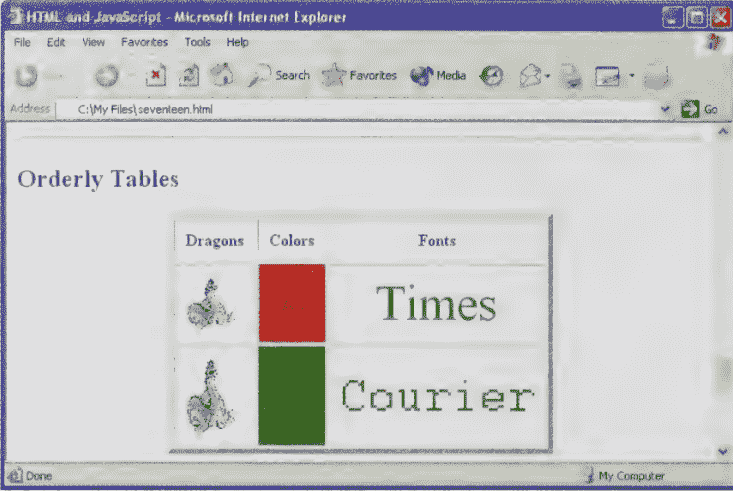

7.  继续下一节，或者如果你今天的工作已完成，请关闭你的软件并关闭计算机。

> ## 互联网里程碑

### 网络商务

多年来，网络一直是一个难以谋生的地方。事实是，网络的商业潜力花了多年才被认识到。最早开始在网上获得可观利润的一些网络公司是美国在线、雅虎和亚马逊。

一些公司通过敢于涉足无人敢去的领域而在网上取得了成功。许多人说网络永远不会取代书店。亚马逊的人们不同意这一理论，并开始在网上销售书籍。他们售出了如此多的书籍，以至于其他图书公司很快意识到他们必须上网，否则就会将大部分业务拱手让给亚马逊。巴诺书店是最早加入亚马逊在万维网上的主要书商之一。

索尼发现网络是销售音乐 CD 的绝佳场所。领先的电子产品公司 Egghead.com 发现网络是销售软件的绝佳场所。你还能想到哪些其他类型的东西可以成为网上的畅销品？你能建立一个网络业务并从网络上赚大钱吗？

## 非凡附加内容

在分步教程 3.5 中，你将学习一些额外的标签，它们能为你的网页增添非凡的力量。这些标签将允许访问你网页的人与文档进行交互。

HTML 中添加了许多数据输入或 `<FORM>` 标签选项。这些选项为你提供了多种方式来向访问你网页的访客提问。这些标签为你的网页提供了额外的功能，可以使你的网页更加精彩和非凡。

你将在整个课程中使用以下四个基本输入标签：

- *文本框* – 网站访客可以口述或键入回复的框。
- *下拉列表* – 显示一个选项和一个特殊的箭头符号，允许用户查看其他可能的回复。
- *单选按钮* – 有时称为选项按钮，允许你从一组选项中选择一个。
- *复选框* – 当用户从一组中选择一个选项时，其中心会打勾的框。

当你完成本课程的最后一个分步活动时，思考一下你应该如何将新标签整合到你的网页中。别担心；你会以出色的字体颜色通过的！如果你有任何问题，请回顾前面活动中的步骤。下一页的图 3-12 展示了你将添加到网页中的新标签。

图 3-12
各种数据输入标签

```html
<FORM>

Enter your first name:
<INPUT TYPE="TEXT" SIZE="25">
<BR>
Enter your last name:
<INPUT TYPE="TEXT" SIZE="25">
<P>

<SELECT>
<OPTION SELECTED>Pick your favorite team from the list:
<OPTION>Chicago Bulls
<OPTION>Utah Jazz
<OPTION>Los Angeles Lakers
<OPTION>Indiana Pacers
<OPTION>New Jersey Nets
<OPTION>Phoenix Suns
</SELECT>
<P>

The best place to eat is:
<BR>
<INPUT TYPE="RADIO" NAME="BEST">Wendy's<BR>
<INPUT TYPE="RADIO" NAME="BEST">McDonald's<BR>
<INPUT TYPE="RADIO" NAME="BEST">Taco Bell<BR>
<INPUT TYPE="RADIO" NAME="BEST">Burger King<BR>
<INPUT TYPE="RADIO" NAME="BEST">Kentucky Fried Chicken<BR>
<P>

I like to eat:
<BR>
<INPUT TYPE="CHECKBOX">Hamburgers<BR>
<INPUT TYPE="CHECKBOX">Tacos<BR>
<INPUT TYPE="CHECKBOX">Chicken Strips<BR>
<INPUT TYPE="CHECKBOX">Fries<BR>
<INPUT TYPE="CHECKBOX">Hot Dogs<BR>
<P>

</FORM>
<HR>
```

## 分步教程 3.5

1.  如果需要，打开你的 **seventeen.html** 或 **seventeen.htm** 文件。
2.  在你的网页末尾附近创建一个名为 **非凡附加内容** 的部分。
3.  在你网页顶部的索引列表中创建一个内部超文本链接，该链接将链接到你正在创建的新部分。将此链接命名为 **非凡附加内容**。
4.  以你认为合适的任何方式更改新部分标题的颜色、字体大小和字体。
5.  在你新的非凡附加内容部分中，紧接在最后一个 `<HR>` 标签之后和页面底部的 `</BODY>` 标签之前，输入图 3-12 中所示的标签。
6.  将你的作品保存为 **eighteen.html** 或 **eighteen.htm**。
7.  打开你的网页浏览器并尝试所有输入选项。它们应该看起来像图 3-13 中的那些。哪些有效？更正你发现的任何错误，重新保存，然后再次尝试。

图 3-13
使用表单创建的非凡附加内容

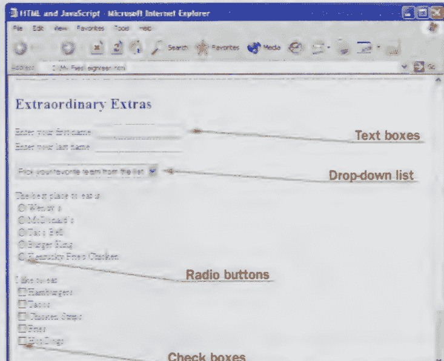

8.  修改你的表单选项。返回你的网页并更改所有选择项。
9.  将你的作品保存为 **eighteen-2.html** 或 **eighteen-2.htm** 并测试你的更改。它们工作得如何？
10. 继续到总结部分，或者如果你今天的工作已完成，请关闭你的软件并关闭计算机。

## 总结

在本课中，你学到了：

- 你可以控制字体的大小、样式和颜色。
- 你可以从网络上下载图片。
- 你可以将图片插入到你的网页中。
- 你可以更改图形的大小。
- 你可以使用表格来组织信息。
- 你可以将图片变成超链接。
- 你可以将各种数据输入选项插入到网页中。

> **网络提示**
> 将不打算使用的图片下载到你的学校网络被认为是不礼貌的。图形在计算机上占用大量空间。下载成百上千张图片而不使用它们是对网络服务器驱动器空间的浪费。考虑删除你实际未使用的任何图片。

## 词汇复习

| 定义以下术语： | |
|---|---|
| .gif | 图形交换格式 |
| .jpg 或 .jpeg | 联合图像专家组 |
| | 表格单元格 |

## 复习题

### 判断题

如果陈述为真则圈出 T，如果为假则圈出 F。

- T F 1. 你只能通过放在 `<BODY>` 标签中的属性和值来更改字体的颜色。
- T F 2. 你可以将图像设置为你喜欢的任意大小。
- T F 3. GIF 代表“更大图像格式”。
- T F 4. 所有图像都可以在互联网上免费使用。
- T F 5. `CELLPADDING` 属性使表格单元格之间的区域变大或变小。

### 填空题

通过在提供的空白处填写正确的单词或词组来完成以下句子。

1. 你可以使用 __________ 标签在网页上有序地放置图片和文本。
2. __________ 标签允许你收集有关访问你网站的人的信息。
3. __________ 图像格式由 CompuServe 创建。
4. __________ 标签在表单中创建下拉列表中的一个项目。
5. __________ 图像格式是一个国际标准。

## 书面题

简要回答以下问题。

1. 为什么艺术家在万维网上如此受欢迎？
2. 从网络上获取图片在什么情况下是非法的？
3. 如果你不打算使用，为什么不要将图片下载到你的学校或工作场所网络很重要？
4. 你将如何以及为何使用以下标签或属性？

```html
<B></B>
```

```html
<EM></EM>
```

```html
<STRONG></STRONG>
```

```html
<I></I>
```

```html
<ALIGN=CENTER>
```

5. 你会使用哪些标签来插入图形或超链接？

## 项目

### 项目 3-1

GreatApplications, Inc. 想要进入在线电子游戏业务。然而，在开始编程下一个伟大的在线电子游戏之前，它希望调查潜在客户，看看他们想玩和购买哪种类型的在线游戏。

头脑风暴 10 个问题，帮助 GreatApplications, Inc. 了解其客户在电子游戏程序中想要什么。使用你的 `<FORM>` 标签技能，创建一个在线调查，从潜在客户那里收集信息，例如受访者的姓名和电子邮件地址。提出利用下拉列表、单选选项和复选框的问题。

### 团队项目

GreatApplications, Inc. 要求你的团队规划一次世界巡演，向五个主要城市的人们展示其新的软件电子游戏。你的团队被要求使用 `<TABLE>` 标签为巡演创建一个活动日历。巡演必须在一个月内进行，并应涉及五个主要城市。

在创建日历时，为你将访问的巡演城市创建旅游信息链接。使用 cellpadding 和单元格边框使表格有趣。你甚至可以在单元格中放置图片，以说明你为软件发布选择的五个城市。

### 网络项目

你能多快将 levy.gif 图形替换为另一个图形？想想你喜欢的另一个图形。你如何操作属性和值来以各种尺寸显示你的新图形？动手试试吧！进行更改！将修改后的文件保存为 **web-project.html** 或 **web-project.htm**。

## 批判性思维

## 活动 3-1

为以下每个问题准备一个 100 到 250 字的回答。

- 1. 万维网和 HTML 对世界经济有多重要？是什么让它们如此重要？
- 2. 网络如何使小企业受益，例如一家家庭经营的花店、一家本地古董店或一家高档美发沙龙？
- 3. 500 多年前，约翰内斯·古腾堡发明了活字印刷术，这导致普通人可获得的印刷品数量激增，并改变了世界历史。但是 500 年后呢？人们将如何看待 HTML 的发明？

## 活动 3-2

为以下每个问题准备一个 100 到 250 字的回答。

- 1. 除了改变字体大小，你还可以对字体做些什么来使你的网页更有趣？
- 2. 如何使用表格在 HTML 页面中显示信息？使用表格标签可以创建哪些类型的内容？
- 3. 你希望看到 HTML 添加哪些额外的功能或标签？你认为应该添加哪些标签来赋予 HTML 更强大的功能？

## 活动 3-3

这些特殊的输入框要求用户提供不同类型的信息。对于以下 FORM 属性，你期望得到什么样的响应？

- TEXT
- OPTION
- RADIO
- CHECKBOX

## 总结项目

当地城市动物园聘请你创建一个网页，描述他们目前展出的一些动物。他们希望你的网页组织良好，同时也希望你包含动物的图片以及每个动物的简短描述段落。使用你在本课中学到的关于表格、字体和图像的知识来完成这项任务。完成后，你的网页应该看起来像下面图 3-14 所示的那样。

### 图 3-14
当地城市动物园的示例网页

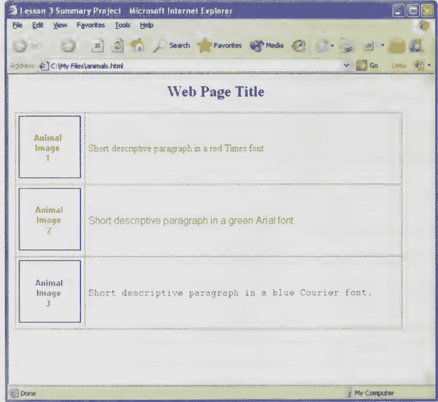

### 项目要求

- 你的网页顶部应有一个合适的标题。
- 你的动物图片在网页中应保持合适的尺寸。
- 每个动物的描述段落应使用多种字体和颜色显示。
- 段落宽度应约为 500 像素。
- 你的表格应有一个可见的边框来分隔每个单元格。

> **网络提示**
可能找到用于你网页的动物图片的最佳方式是上网浏览。一旦找到你想要使用的动物图片，请按照本课中的说明将图像下载到你的工作站。但是请记住，从网络下载受版权保护的图片是不合适的。请避免使用任何在其上或在其所在的网页上显示版权信息的图像。

## HTML 结构设计技术

### 目标
完成本课后，你应该能够：
- 创建框架集。
- 添加导航栏。
- 制作欢迎页面。
- 创建嵌套框架集。
- 包含标题栏框架和页面。
- 利用框架和框架集选项。

预计时间：1.5 小时。

### 词汇
- 框架
- 框架集标签
- 左侧导航
- 导航栏
- 嵌套框架集
- 像素
- 标题栏

## 创建 HTML 框架集

在第 2 课中，你学习了如何通过使用超链接让网页浏览器从一个网页链接到另一个页面。现在是时候学习如何让你的网页浏览器在屏幕上同时显示两个或更多网页了！帮助你实现这一点的 HTML 标签是 <FRAMESET> 标签和 <FRAME> 标签。

顾名思义，*框架集标签* 允许你在屏幕上定义一组称为 *框架* 的矩形区域（见图 4-1）。每个框架都能够显示不同的网页。在某种程度上，你可以让你的网页浏览器表现得好像你的计算机上同时运行着多个浏览器。然而，框架集允许一个框架中的网页与另一个不同框架中的网页进行通信。你将在本课后面更多地了解这个概念。

### 图 4-1
网页上的三个框架

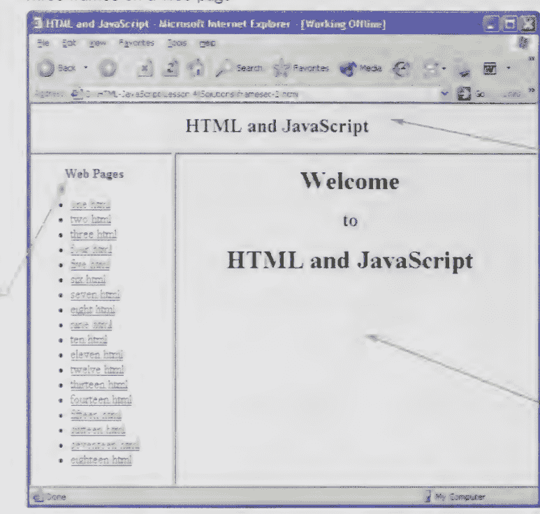

当你创建第一个 HTML 框架集文件时，你会注意到它与你在前面课程中创建的其他 HTML 页面有许多共同之处。然而，你也应该认识到一个重要的区别。具体来说，你会看到框架集页面不包含标准网页中如此重要的熟悉的 <BODY> 和 </BODY> 标签。相反，框架集页面将包含 <FRAMESET> 和 </FRAMESET> 标签，它们标记框架定义的开始和结束。

此外，框架集标签可以包含 ROWS 属性或 COLS 属性。ROWS 属性的目的是为你提供定义水平框架并指定每个框架高度的方法。类似地，COLS 属性允许你创建垂直框架并指定每个框架的宽度。由于在任何给定的框架集中只能定义水平或垂直框架，因此 <FRAMESET> 标签可以包含 ROWS 属性或 COLS 属性，但不能同时包含两者。

正如你将在下面的分步操作中看到的，框架集标签将封装两个或更多 <FRAME> 标签。反过来，<FRAME> 标签将至少包含两个重要属性，称为 NAME 和 SRC，它们允许你为每个框架命名，并分别指定你希望在每个框架中显示的源网页。SRC（源）属性的目的非常明显，但 NAME 属性的功能并不立即显现。别担心。你将在分步操作 4.4 中了解更多关于此属性的信息。

## 分步操作 4.1

- 1. 打开记事本、SimpleText 或你最喜欢的文本编辑器。
- 2. 按照图 4-2 所示精确输入 HTML 文本。

> **重要提示**
正如你已经了解的，你可以使用 .htm 或 .html 扩展名保存文件。小心！如果你使用了 .htm 扩展名，你必须相应地更改图 4-2 中的所有文件名。例如，在框架集文件中将 navbar.html 更改为 navbar.htm。

> **注意**
星号 (*) 表示“剩下的所有内容”。

### 图 4-2
将文本文件命名为 .html 扩展名

```
<HTML>
<TITLE>HTML and JavaScript</TITLE>

<FRAMESET COLS="180,*">
<FRAME NAME="LeftFrame" SRC="navbar.html">
<FRAME NAME="RightFrame" SRC="welcome.html">
</FRAMESET>
</HTML>
```

- 3. 将新创建的文件保存为 **frameset-1.html** 或 **frameset-1.htm**。继续下一个分步操作部分，或者如果今天到此为止，请关闭你的系统。

> **重要提示**
伴随 ROWS 和 COLS 属性的数字可以是绝对 *像素* 值或百分比值。像素是计算机监视器或屏幕内的一个微小光点。在步骤 2 中，你将框架集列设置为 180 像素宽。典型的计算机屏幕上有数千个像素，多得数不清。因此，有时计算屏幕的百分比值比计算像素更容易。百分比值在决定将多少屏幕分配给框架时，会自动计算屏幕的 5%、10%、50% 或更多。例如，<FRAMESET COLS="20%,*">。

## 创建导航栏

专业网页设计师非常常用的一种设计是将网页放置在一个狭窄的左侧框架中，其中包含许多超链接。当用户单击这些链接中的任何一个时，相应的网页就会在较大的右侧框架中显示。这种设计技术通常被称为 *左侧导航*，包含超链接的网页称为导航栏。*导航栏* 是一系列超链接，通常在网页或框架中水平或垂直组织。它用于导航网站。图 4-3 显示了一个带有导航栏的网页示例。

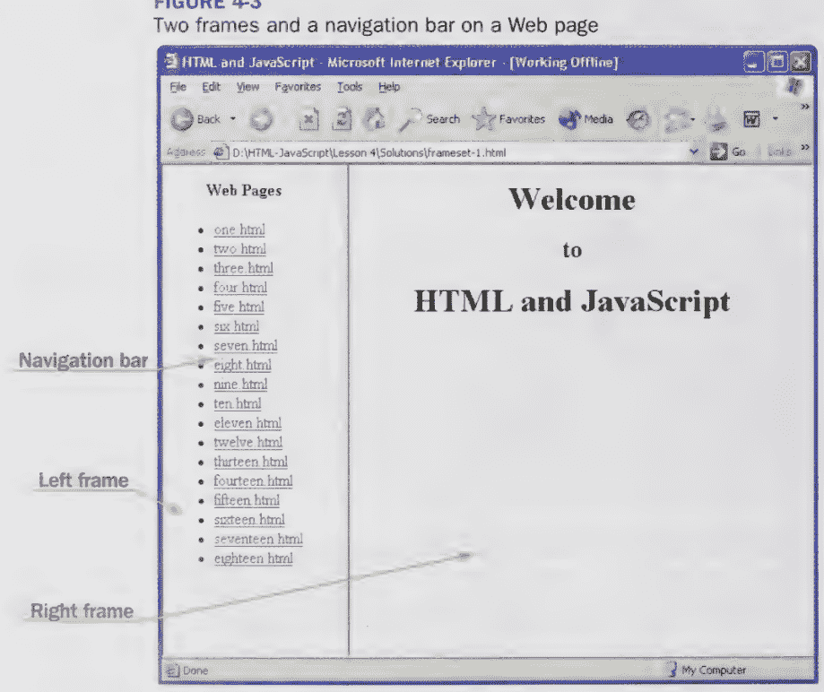

在本课的这一点上，我们将向你展示如何创建自己的导航栏，并利用你在第 1、2 和 3 课中创建的前十八个网页。你的导航栏将包含一个包含十八个超链接的无序列表，这些链接将指向你之前保存为 one.html、two.html、three.html 等的网页。

你将用于创建导航栏的 HTML 标签没有什么特别的。事实上，它们都是你在前面课程中已经使用过的标签。但是，你会在定义指向将在右侧框架中显示的网页的超链接的 `<A>` 标签中看到一个新属性。这个属性称为 TARGET，其目的是告诉浏览器它应该使用哪个框架来显示目标网页。你还应该注意 TARGET 属性使用了你在分步操作 4.1 中 `<FRAME>` 标签的 NAME 属性定义的框架名称。

## 分步操作 4.2

1.  如果尚未打开，请打开记事本、SimpleText或您喜爱的文本编辑器。
2.  按照图4-4所示，准确输入HTML文本。

**图 4-4**
框架页面中的导航标签

```html
<HTML>
<TITLE>HTML and JavaScript</TITLE>

<BODY>
<CENTER><B>Web Pages</B></CENTER>
<UL>
<LI><A HREF="one.html" TARGET="RightFrame">one.html</A></LI>
<LI><A HREF="two.html" TARGET="RightFrame">two.html</A></LI>
<LI><A HREF="three.html" TARGET="RightFrame">three.html</A></LI>
<LI><A HREF="four.html" TARGET="RightFrame">four.html</A></LI>
<LI><A HREF="five.html" TARGET="RightFrame">five.html</A></LI>
<LI><A HREF="six.html" TARGET="RightFrame">six.html</A></LI>
<LI><A HREF="seven.html" TARGET="RightFrame">seven.html</A></LI>
<LI><A HREF="eight.html" TARGET="RightFrame">eight.html</A></LI>
<LI><A HREF="nine.html" TARGET="RightFrame">nine.html</A></LI>
<LI><A HREF="ten.html" TARGET="RightFrame">ten.html</A></LI>
<LI><A HREF="eleven.html" TARGET="RightFrame">eleven.html</A></LI>
<LI><A HREF="twelve.html" TARGET="RightFrame">twelve.html</A></LI>
<LI><A HREF="thirteen.html" TARGET="RightFrame">thirteen.html</A></LI>
<LI><A HREF="fourteen.html" TARGET="RightFrame">fourteen.html</A></LI>
<LI><A HREF="fifteen.html" TARGET="RightFrame">fifteen.html</A></LI>
<LI><A HREF="sixteen.html" TARGET="RightFrame">sixteen.html</A></LI>
<LI><A HREF="seventeen.html" TARGET="RightFrame">seventeen.html</A></LI>
<LI><A HREF="eighteen.html" TARGET="RightFrame">eighteen.html</A></LI>
</UL>
</BODY>

</HTML>
```

3.  将新创建的文件保存为 **navbar.html** 或 **navbar.htm**。
4.  继续进行下一个分步操作部分，以学习如何创建网站欢迎页面，或者如果您今天已完成，请关闭系统。

> **网络提示**
> 通常，当用户点击超链接时，目标网页将加载到与链接相同的框架中。TARGET属性会覆盖此行为，并将适当的网页发送到“目标”框架。

## 创建网站欢迎页面

通常，专业的网站开发者会创建一个欢迎页面，用户首次访问网站时会看到该页面。正如您在第1课中所学，欢迎页面的主要目的仅仅是给用户留下良好的第一印象，并确保他们认识到网站的目的。例如，一家希望通过网络销售书籍、音乐或其他产品的公司，希望创建一个花哨的欢迎页面，以吸引用户的眼球，强调公司名称，并方便用户访问网站的各个部分。

在接下来的分步操作部分，您将创建一个非常简单的欢迎页面。实际上，该页面中不会包含您在前面课程中未见过的HTML标签。但您应该认识到，这个页面有其特定的目的，并且可以进行大幅增强，以使您的网站更加生动，并给用户留下难忘的体验。商业网站的主要目标之一就是给用户一个反复访问网站的理由。

## 分步操作 4.3

1.  如果尚未打开，请打开记事本、SimpleText或您喜爱的文本编辑器。
2.  按照图4-5所示，准确输入HTML文本。

**图 4-5**
创建一个简单的欢迎页面

```html
<HTML>
<TITLE>HTML and JavaScript</TITLE>

<BODY>
<CENTER><FONT SIZE=6><B>Welcome</B></FONT></CENTER>
<BR>
<CENTER><FONT SIZE=5><B>to</B></FONT></CENTER>
<BR>
<CENTER><FONT SIZE=6><B>HTML and JavaScript</B></FONT></CENTER>
</BODY>

</HTML>
```

3.  将新创建的文件保存为 **welcome.html** 或 **welcome.htm**。

## 分步操作 4.3 续

4.  打开您的Web浏览器，查看您在分步操作4.1中创建的frameset-1.html文档。您应该会看到类似图4-6的内容。

> **注意**
> 请记住，您在之前的分步操作中创建的文件（one.html、two.html等）必须与您在此分步操作中创建的文件位于同一文件夹中。如果它们不在同一文件夹中，您的超链接将无法正常工作。

**图 4-6**
带有导航栏的欢迎页面


5.  继续进行下一个分步操作部分，以学习如何创建嵌套框架集，或者如果您今天已完成，请关闭系统。

## 创建嵌套框架集

有时，您可能希望在框架集中放置第三个框架，该框架将导致浏览器在浏览器窗口顶部显示一个水平框架。然后，您可以将一个新的网页放入这个新框架中，该网页可以作为网站的固定标题。

如果您仔细关注了本课第一部分的内容，您现在应该会问自己一个重要的问题。具体来说，我们早先指出，框架集只能包含水平框架或垂直框架，但不能同时包含两者。那么，如果您已经在现有框架集中定义了垂直框架，您应该如何创建一个水平框架来显示标题页呢？

*嵌套框架集*解决了这个问题。术语*嵌套*是程序员和Web开发人员用来描述包含一个或多个相同项目附加实例的结构、关键字或标签的词语。在这种情况下，您将使用一个`<FRAMESET>`标签嵌套在另一个`<FRAMESET>`标签内，以同时创建垂直和水平框架。

## 分步操作 4.4

1.  如果尚未打开，请打开记事本、SimpleText或您喜爱的文本编辑器。
2.  找到您在分步操作4.1中创建的 **frameset-1.html** 或 **frameset-1.htm** 文件。
3.  通过添加图4-7中所示的粗体文本，修改HTML文档。

**图 4-7**
使用.html扩展名命名文本文件

```html
<HTML>
<TITLE>HTML and JavaScript</TITLE>

<FRAMESET ROWS="60,*">
<FRAME NAME="UpperFrame" SRC="title.html">

<FRAMESET COLS="180,*">
<FRAME NAME="LeftFrame" SRC="navbar.html">
<FRAME NAME="RightFrame" SRC="welcome.html">
</FRAMESET>

</FRAMESET>
</HTML>
```

4.  将新创建的文件保存为 **frameset-2.html** 或 **frameset-2.htm**。
5.  继续进行下一节，为您的嵌套页面创建标题页，或者如果您今天已完成，请关闭系统。

## 创建标题栏

正如您在分步操作4.2中创建的网页被称为导航栏一样，专门用于显示网站固定标题的页面通常被称为*标题栏*。在本节中，您将创建一个标题栏，显示在您在上一个练习中定义的新框架中。图4-8显示了一个带有标题栏的网页示例。

**图 4-8**
包含导航栏、标题栏和欢迎页面的三个框架

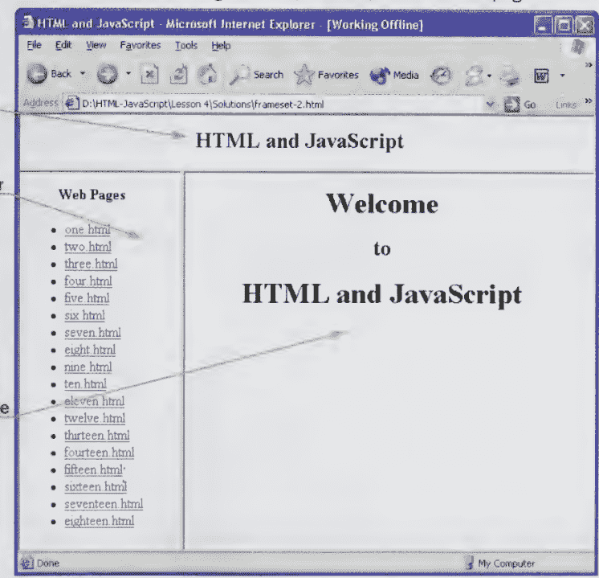

与您在分步操作4.3中创建的welcome.html或welcome.htm页面一样，这个标题栏网页将不包含任何新的HTML标签。但是，与欢迎页面一样，专业的Web开发人员通常会不遗余力地创建一个引人注目且令人难忘的标题栏。然而，您的标题栏将非常简单，以便您更容易地掌握这个新概念。

## 分步操作 4.5

1.  如果尚未打开，请打开记事本、SimpleText或您喜爱的文本编辑器。
2.  按照图4-9所示，准确输入HTML文本。

**图 4-9**
标题页的标签

```html
<HTML>
<TITLE>HTML and JavaScript</TITLE>

<BODY>
<CENTER><FONT SIZE=5><B>HTML and JavaScript</B></FONT></CENTER>
</BODY>

</HTML>
```

3.  将新创建的文件保存为 **title.html** 或 **title.htm**。
4.  打开您的Web浏览器，查看您在分步操作4.4中创建的 **frameset-2.html** 或 **frameset-2.htm** 文档。您应该会看到类似图4-10的页面。
5.  框架页面可以由用户自定义。将鼠标缓慢地移过框架之间的栏（称为框架分隔符），如图4-10所示。当出现双箭头时，单击并将栏向左或向右，或向上和向下拖动。

**图 4-10**
拖动框架分隔符以自定义页面


6.  继续进行下一节，或者如果您今天已完成，请关闭系统。

> **网络提示**
> 框架是学习如何将网页组织成部分或段落的好方法。表格提供了另一种将页面分割成部分的方法，用于艺术和组织目的。

## 使用高级HTML选项

让我们花一点时间，对您迄今为止创建的框架和框架集进行几点观察。首先，您的Web浏览器正在显示框架分隔符，这使得一个框架在哪里结束、另一个框架从哪里开始变得非常明显。其次，如果您将鼠标光标直接定位在这些框架分隔符中的任何一个上，您会看到鼠标指针改变形状，表明框架分隔符可以移动。这意味着用户只需单击并将框架分隔符拖动到不同的位置，就可以更改网页的外观，正如您在上一个练习中所体验的那样。

## 图 4-11
消除页面上的框架分隔符

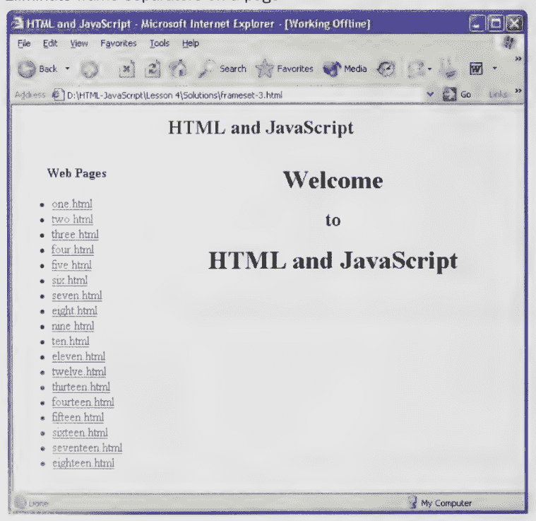

我们刚刚描述的框架和框架集特性在某些情况下可能是理想的。然而，在许多情况下，专业的 Web 开发人员不希望浏览器显示框架分隔符，也不希望用户能够随意更改屏幕布局。当开发人员在其网页中包含定制的图形图像时，尤其如此。这些图像通常被设计为特定尺寸，并适合精确尺寸的框架。如果浏览器显示框架分隔符，或者用户更改了框架的大小，整个页面的布局可能会被打乱，由此产生的图像混乱将非常不美观。

幸运的是，可以使用两个重要的 HTML 属性与 `<FRAMESET>` 和 `<FRAME>` 标签来解决这些问题，如图 4-11 所示。首先，你可以在 FRAMESET 标签中使用 BORDER 属性来调整框架分隔符的外观。此外，你还可以在 `<FRAME>` 标签中使用 NORESIZE 属性来指示浏览器用户不应能够更改框架的大小。这两个属性可以单独使用或一起使用，以获得你想要的外观和行为。

## 分步操作 4.6

1.  如果尚未打开，请打开记事本、SimpleText 或你最喜欢的文本编辑器。
2.  找到你在分步操作 4.4 中创建的 frameset-2.html 或 frameset-2.htm 文件。
3.  通过添加下图 4-12 所示的粗体文本来修改 HTML 文档。

### 图 4-12
向扩展名为 .html 的文本文件添加内容

```html
<HTML>
<TITLE>HTML and JavaScript</TITLE>

<FRAMESET BORDER=0 ROWS="60,*">
<FRAME NAME="UpperFrame" NORESIZE SRC="title.html">

<FRAMESET BORDER=0 COLS="180,*">
<FRAME NAME="LeftFrame" NORESIZE SRC="navbar.html">
<FRAME NAME="RightFrame" NORESIZE SRC="welcome.html">
</FRAMESET>

</FRAMESET>
</HTML>
```

4.  将新创建的文件保存为 **frameset-3.html** 或 **frameset-3.htm**。
5.  打开你的 Web 浏览器，查看你刚刚保存的 frameset-3.html 文档。你应该会看到与图 4-11 非常相似的内容。
6.  如果你今天完成了，请继续到总结部分或关闭你的系统。

### 图 4-13
Dreamweaver 中的 HTML 标签

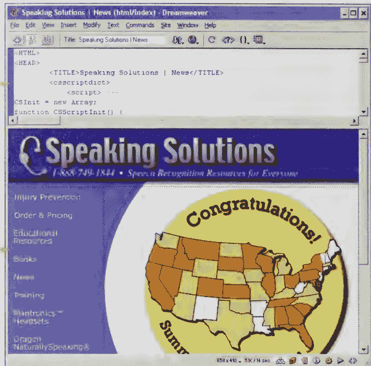

## 互联网里程碑

## HTML 创建工具

HTML 功能强大，但手动输入所有标签可能需要很长时间。有人终于问道：“有没有办法让 HTML 创建更简单？” HTML 成为在线通信标准几年后，有进取心的程序员创建了软件工具，免去了输入所有尖括号和标签的痛苦。一些最受欢迎的网页开发工具包括 Macromedia Dreamweaver、Adobe GoLive 和 Microsoft FrontPage。这些工具中的每一个都以与专业人员在文字处理或桌面发布软件中创建文档大致相同的方式帮助你创建网页。

在像 Dreamweaver 这样的程序中，当你设计页面时，大多数标签会自动为你创建。但是，不要以为使用这些强大而令人兴奋的网页创建工具就不需要了解 HTML 标签！有时你需要编辑或更正这些产品创建的标签。标签视图始终可用。

例如，图 4-13 显示了使用 Dreamweaver 创建的网页。请注意，在屏幕的底部，你可以看到网页在线显示时的样子。然而，在 Dreamweaver 工具的顶部，你仍然可以查看标签。了解标签的工作原理将帮助你成为专业的 Dreamweaver 网页开发者和编辑者。

## 总结

在本课中，你学到了：

- 你可以创建一个框架集。
- 你可以解释框架集属性和值。
- 你可以在框架中创建一个导航栏。
- 你可以为框架页面创建一个简单的欢迎页面。
- 你可以插入嵌套标签和属性。
- 你可以在网页上插入一个标题栏框架。

## 词汇复习

| 定义以下术语： | | |
| --- | --- | --- |
| 框架 | 导航栏 | 像素 |
| 框架集标签 | 嵌套框架集 | 标题栏 |
| 左侧导航 | | |

## 复习题

### 判断题

如果陈述正确，请圈出 T；如果陈述错误，请圈出 F。

1.  框架集可以显示行或列。
2.  框架集页面可以省略 `<BODY>` 标签。
3.  当你使用 FrontPage、Dreamweaver 或 GoLive 等程序时，必须手动输入标签。
4.  计算框架宽度的唯一方法是计算像素。
5.  TARGET 属性使框架分隔符消失。

### 填空题

通过在提供的空白处填写正确的单词或短语来完成以下句子。

1.  __________ 属性将网页指向在特定框架中显示。
2.  __________ 属性创建垂直分隔的框架。
3.  __________ 属性创建水平分隔的框架。
4.  __________ =0 属性使框架分隔符消失。
5.  __________ 属性阻止网页查看者更改框架的大小。

## 书面题

简要回答以下问题。

1.  本课中描述的欢迎页面的目的是什么？
2.  什么是左侧导航？解释如何创建左侧导航栏。
3.  从本课描述的程序员角度来看，什么是嵌套？
4.  什么是像素值和百分比值，它们在框架集中是如何定义的？
5.  为什么网站开发人员希望阻止网站访问者调整框架页面上的行和列分隔符？

## 项目

在项目 1-1 中，你使用了你的 Web 搜索技能来查找有关 HTML、HTML 指南以及学习 HTML 的信息。你的经理要求你将收集的信息组织成一个新的框架网页，仅使用两列。

GreatApplications, Inc. 要求你创建一个具有左侧导航的网站，该网站将组织你在项目 1-1 和表 1-2 中收集的信息。这样，这些有用的网页就可以在线提供给公司中的每个人。在框架集页面的左侧创建一个导航框架，并让你链接的信息出现在右侧框架中。你可以使用本书中学到的所有标签来完成这一切。

### 团队项目

在这个团队项目中，你要进行一项调查。为了完成调查，你和你的团队成员必须访问至少 100 个不同的网站。通过团队合作，这不会像最初看起来那么困难。在第 1 课的团队项目中，你确定了你能找到的最好的网页。在批判性思维活动 2-2 中，你组织了你喜欢的页面，以便在你保存为“我的 Web 资源”的网页中轻松参考。在项目 2-1 中，你确定了你在网络上能找到的五个最差的页面。在你团队的所有成员之间，你们一定已经访问了超过 100 个网站。

作为一个团队，重新访问你列出的最佳和最差页面。如果需要，请访问其他网站。你们必须作为一个团队，正好调查 100 个网站，并在过程中收集数据。分配任务，每个成员负责查看一定百分比的网站，同时记录将以下问题应用于每个网站的结果。

### 调查问题

1.  调查。查看你的 100 个网页的源 HTML 代码，有多少使用框架标签或某种类型的框架组织来组织他们的网页？
2.  计算。查看你的网页源代码，这些页面中有多少使用表格标签来组织他们的网页？
3.  制表。这些好网站和坏网站中有多少百分比使用左侧导航系统？
4.  记录。有多少网站在网页顶部使用导航系统？
5.  这些网站中有多少在网页顶部的标题栏区域使用了有吸引力的图形或徽标？
6.  根据你团队成员的意见，访问的网站中有多少百分比拥有有效的欢迎页面？

### Web 项目

在项目 4-1 中，你创建了一个左侧导航系统，该系统将允许你与 GreatApplications, Inc. 的同事分享有关 HTML 的信息。在这个 Web 项目中，挑战你自己。将你在项目 4-1 中创建的网页更改为从页面顶部栏导航的网站。在你的框架集中创建两行。在顶部框架中，使用屏幕的 20% 创建你的导航系统。在底部框架中，显示信息。将此项目保存为 WebProject-4.html 或 WebProject-4.htm。

## 批判性思维

## 活动 4-1

在你看来，完成前四课的学习后，关于 HTML 和创建网页，你学到的最重要的十件事是什么？准备一份 100-250 字的报告，解释为什么这十项内容被列入你的清单。将你的答案保存为 **活动 4-1**。

## 活动 4-2

在结束 HTML 学习之际，请思考你认为 HTML 存在的三大弱点。你最想改变 HTML 的哪三个方面？哪些是你认为可以改进的弱点或不足？请撰写一份 100-250 字的报告，详细说明你希望 HTML 如何变得更好、更易于使用，并对你作为网站开发者更有帮助。将你的答案保存为 **活动 4-2**。

## 总结项目

专业的网页设计师通常需要理解并利用 HTML 框架的灵活性，以使网站呈现理想的外观。例如，一些商业网站设计了顶部、底部或右侧的导航栏，而不是本课中介绍的左侧导航栏。运用你所学的关于框架和框架集的知识，重新组织图 4-10 所示的网站，使其展示右侧导航的使用。同时，改变网站框架的结构，使导航栏跨越浏览器窗口的整个高度，而标题栏不跨越整个宽度。你重新组织的网页应类似于图 4-14。

图 4-14
一个带有右侧导航的示例网站


### 项目要求

-   你可以使用本课中创建的 title.html、welcome.html 和 navbar.html 文件来为你的新框架集提供内容。
-   上方（标题）框架应约为 60 像素高，右侧（导航）框架应约为 180 像素宽。
-   每个框架之间应由不可调整大小的框架边框分隔。
-   你可能需要运用之前课程的概念（如字体和图像）来改善标题页和欢迎页的外观。

## HTML 基础

## HTML 标签和属性总结

| 标签或属性 | 结果 | 课程 |
| :--- | :--- | :--- |
| `<A>` `</A>` | 创建用于创建超链接的锚点标签 | 2 |
| `<B>` `</B>` | 使文本加粗 | 3 |
| `<BODY>` `</BODY>` | 标记文本以显示在网页浏览器的主体部分 | 1 |
| `<BR>` | 在文本之间创建换行或单倍行距分隔 | 2 |
| `<CENTER>` `</CENTER>` | 在网页上居中文本或图形 | 1 |
| `<EM>` `</EM>` | 强调或加粗文本 | 3 |
| `<FONT>` `</FONT>` | 更改网页文本的大小、字体和颜色 | 3 |
| `<FORM>` `</FORM>` | 在网页中插入一个表单集 | 3 |
| `<FRAME>` `</FRAME>` | 在网页的框架集中定义框架 | 4 |
| `<FRAMESET>` `</FRAMESET>` | 标记框架集的开始和结束 | 4 |
| `<H1>` `</H1>` | 标记文本以最大标题字体大小显示 | 1 |
| `<H2>` `</H2>` | 标记文本以第二大标题字体大小显示 | 1 |
| `<H3>` `</H3>` | 标记文本以第三大标题字体大小显示 | 1 |
| `<H4>` `</H4>` | 标记文本以第三小标题字体大小显示 | 1 |
| `<H5>` `</H5>` | 标记文本以第二小标题字体大小显示 | 1 |
| `<H6>` `</H6>` | 标记文本以最小标题字体大小显示 | 1 |
| `<HR>` | 在网页各部分之间创建一条水平线 | 2 |
| `<HTML>` `</HTML>` | 表示网页的开始和结束 | 1 |
| `<I>` `</I>` | 使文本倾斜 | 3 |
| `` | 在网页中显示图像 | 3 |
| `<INPUT>` `</INPUT>` | 为表单定义一个输入控件。例如，单选按钮、复选框、文本字段等。 | 3 |
| `<MARQUEE>` `</MARQUEE>` | 创建一个类似股票市场的滚动字幕 | 2 |
| `<OL>` `<LI>` `<LI>` `</OL>` | 标记文本用于有序或编号（1, 2, 3）列表 | 1 |
| `<OPTION SELECTED>` | 允许网页开发者定义选项列表中默认应选中的项。 | 3 |
| `<OPTION>` | 在选择列表中定义一个选项 | 3 |

## HTML 基础单元

| 标签或属性 | 结果 | 课程 |
| :--- | :--- | :---: |
| `<P>` `</P>` | 在文本之间创建段落或双倍行距分隔 | 1 |
| `<SELECT>` `</SELECT>` | 在表单中定义一个选择选项列表 | 3 |
| `<STRONG>` `</STRONG>` | 强调或加粗文本 | 3 |
| `<TABLE>` `</TABLE>` | 用于在网页中定义表格和表格单元格 | 3 |
| `<TITLE>` `</TITLE>` | 标记文本以显示在网页浏览器的标题栏中 | 1 |
| `<TR>` `</TR>` | 定义表格中的一行 | 3 |
| `<UL>` `<LI>` `<LI>` `</UL>` | 标记文本用于无序或项目符号（•）列表 | 1 |
| `ALIGN=` | 将文本和图形与网页的左、右或中心对齐 | 3 |
| `BACKGROUND=` | 将图形作为网页的背景输入 | 3 |
| `BGCOLOR=` | 定义网页的背景颜色 | 2 |
| `BORDER=` | 在表格单元格周围创建边框 | 3 |
| `CELLPADDING=` | 确定表格中分隔单元格的线条宽度 | 3 |
| `COLOR=` | 更改网页文本的颜色 | 3 |
| `COLS=` | 定义框架集中的列数 | 4 |
| `FACE=` | 更改所显示字体的样式或字体。例如，Times New Roman、Arial 或 Helvetica | 3 |
| `HEIGHT=` | 更改图形的高度 | 3 |
| `HREF=` | 超文本引用属性。定义到网页、互联网位置或其他在线资源的路径或位置 | 2 |
| `LINK=` | 更改超链接的颜色 | 2 |
| `NAME=` | 定义页面上位置或为每个框架命名的超文本引用属性 | 2, 4 |
| `NORESIZE` | 关闭用户调整框架大小的选项 | 4 |
| `ROWS=` | 定义框架集中的行数 | 4 |
| `SIZE=` | 更改水平线的高度或字体的大小 | 2, 3 |
| `SRC=` | 指定资源的来源，例如要插入网页的图像，或指定要在框架中显示的源网页 | 3, 4 |
| `TARGET=` | 将网页或图形指向框架集中的特定框架 | 4 |
| `TEXT=` | 更改网页上文本的颜色 | 2 |
| `TYPE=` | 定义表单使用的输入类型 | 3 |
| `VLINK=` | 更改已访问或选中的超链接的颜色 | 2 |
| `WIDTH=` | 更改水平线的宽度、图形的宽度或表格单元格的宽度 | 2, 3 |

## 复习题

## 配对题

将右栏中的正确术语与其左栏中的描述相匹配。

1.  用于指示网页浏览器应如何显示网页元素的专用网页语言。
2.  一种类似 Java 的脚本语言，用于创建小型应用程序和多媒体效果。
3.  通常成对出现，包含在尖括号中。
4.  以 16 为基数运算，该系统使用字母和数字来表示值。
5.  属性的定义。
6.  用于将数据从网页服务器传输到网页浏览器的协议。
7.  符合国际标准的图形格式；足够紧凑，适合互联网使用。
8.  由一家名为 CompuServe 的公司创建的图形格式。该格式压缩图形以便通过低速调制解调器传输。
9.  程序员使用的术语，描述包含一个或多个相同项目附加实例的结构、关键字或标签。
10.  使避免手动输入每个标签成为可能的软件程序。

A. Dreamweaver
B. gif
C. HTML
D. HTTP
E. 十六进制
F. 标签
G. 嵌套
H. 值
I. jpeg
J. JavaScript

## 书面题

简要回答以下每个问题。将答案保存在名为 HTML 单元总结 的单个文件中。

1.  列出并解释你认为可以在大多数网页上找到的六个标签的功能。
2.  列出并解释以下每种文件格式的来源。在你的解释中，指出哪些格式用于网页。
    A. .doc
    B. .rtf
    C. .wpd
    D. .txt
    E. .htm
    F. .html
3.  解释至少两种增加或减小字体大小的方法。此外，描述至少两种其他更改字体的方法。
4.  解释锚点标签如何用于创建指向网站和你个人计算机上单个网页的超链接，并说明如何编写。在你的解释中，说明如何将图形转换为超链接。
5.  解释框架集如何工作，以及如何将网页定向到不同的框架中显示。

## 跨学科项目

在这个练习中，你将展示 HTML 的实际应用。你将设计一个框架页面，帮助你组织至少五个学科领域的优秀信息资源。四个必需领域是语言艺术、科学、社会研究和数学。再选择一个你自己选择的其他学科领域，例如外语、音乐、艺术、体育或技术。使用网络搜索工具，如 www.yahoo.com 或 www.google.com，查找这些学科领域的合法学术资源。选择那些你会希望反复访问以获取信息的网站。

这需要你进行一些仔细的思考和规划。诀窍是——创建一个左侧导航栏，用于访问这些学科领域的资源页面。为你自己的框架集和导航栏页面发明文件名。标题栏页面是可选的。测试所有链接以确保每个链接都有效。

## 语言艺术 1

查找五个与语言艺术学习相关的网站，并将它们放置在一个目标页面上，该页面将显示在你的跨学科框架页面的右侧框架中。将此文件命名为 **la-1.html** 或 **la-1.htm**。

## 科学 1

查找五个与科学学习相关的网站，并将它们放置在一个目标页面上，该页面将显示在你的跨学科框架页面的右侧框架中。将此文件命名为 **sci-1.html** 或 **sci-1.htm**。

## 社会研究 1

查找五个与社会研究学习相关的网站，并将它们放置在一个目标页面上，该页面将显示在你的跨学科框架页面的右侧框架中。将此文件命名为 **ss-1.html** 或 **ss-1.htm**。

## 数学 1

查找五个与数学学习相关的网站，并将它们放置在一个目标页面上，该页面将显示在你的跨学科框架页面的右侧框架中。将此文件命名为 **m-1.html** 或 **m-1.htm**。

## 你的自选科目 1

查找五个与你自选科目学习相关的网站，并将它们放置在一个目标页面上，该页面将显示在你的跨学科框架页面的右侧框架中。将此文件命名为 **mychoice-1.html** 或 **mychoice-1.htm**。

## 复习项目

### 项目 1-1

你可能一直在想，我已经创建了几十个网页，但什么时候我才能拓展开来，创建一个完全属于自己的网站呢？那么，现在就是你发挥所有网页设计创造力的机会了。

为你的网站选择一个合适的主题或题材。运用你在本单元学到的所有技能，创建一个出色的网站。发明你自己的 HTML 文件名。

### 项目 1-2

到现在，你可能认为你的网页是网络上最棒的网站。它很可能确实是！然而，是时候验证一下这是否属实了！三到四人一组。与你的队友分享你在跨学科项目和项目 1-1 中创建的网页。如果任何团队成员在使其页面元素正常工作方面遇到问题，请作为一个小组来解决这些问题。就如何改进页面互相提出建议。

## 模拟

### 任务 1-1

想象一下，你刚刚成为 GreatApplications, Inc. 网站的首席网页设计师和网页开发团队经理。为了提高团队在尖端技术方面的技能，你决定创建一个网页，收录一些网站，这些网站将帮助你的团队成员了解更多关于 HTML、JavaScript、Flash 以及其他网页创建工具（如 Dreamweaver、FrontPage 或 GoLive）的知识。查看你在本单元中处理过的涉及收录 HTML 学习网站的页面。将这些添加到你的新网站中。然后，参考一些主要的网站开发公司，包括 Dreamweaver 和 Flash 的创建者 Macromedia；FrontPage 的创建者 Microsoft；GoLive 和其他在线多媒体工具的创建者 Adobe。使用像 www.yahoo.com 或 www.google.com 这样的网络搜索引擎来查找你需要的资源。发明你自己的文件名。

### 任务 1-2

你想在高科技在线行业谋职吗？如果是，你最好先了解有哪些类型的工作可供选择，以及它们是否合你的心意。

上网访问一些主要的求职网站，如 www.flipdog.com 或 www.monster.com，搜索十个与网页开发相关的工作。如果你在这些网站上难以找到这类工作，尝试在搜索引擎中输入 **在线求职**。

创建一份简短的报告，列出你找到的所有十个工作，并简要解释一下在高科技网页设计行业从事这些工作所需的资格。将你的工作保存为 **任务 1-2**。

## 总结项目

这是你展示已掌握本单元所有主要概念的机会。参考表 U1-1 中的信息。该表总结了前三课中介绍的各种 HTML 主题。

你的任务是将这些信息组织成一个网页，布局如图 U1-1 所示。框架 A 将包含一个超链接列表，代表书中的前三课。框架 B 将包含自己的超链接列表，对应于其中一课涵盖的主题。每次用户点击框架 A 中的超链接时，框架 B 都会更新。框架 C 将包含一个网页，说明框架 B 中列出的主题之一，当用户点击框架 B 中的不同链接时，该网页会发生变化。图 U1-2 展示了一个示例，说明如果用户在框架 A 中点击第 1 课，并在框架 B 中点击标题，完成的网页可能是什么样子。

### 表 U1-1

| 课程编号 | 涵盖的主题 |
|---|---|
| 1 | 标题 |
| | 有序列表 |
| | 无序列表 |
| 2 | 水平线 |
| | 背景颜色 |
| | 超链接 |
| | 文本/超链接颜色 |
| 3 | 字体 |
| | 图像 |
| | 表格 |
| | 输入控件 |

### 图 U1-1

一个包含三个框架的网页

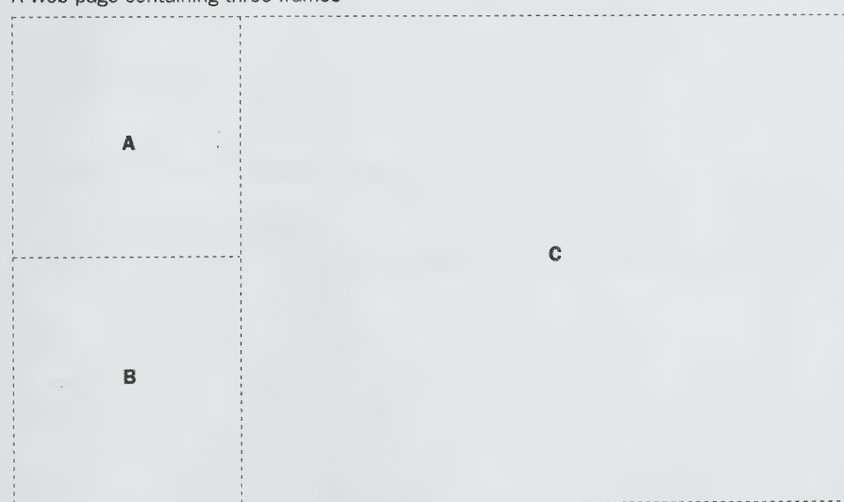

布局

### 图 U1-2

一个选择了第 1 课和标题的示例网页

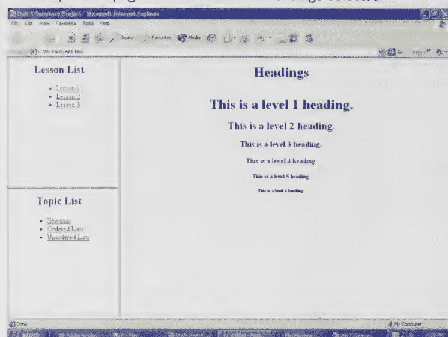

### 项目要求

- 你必须使用嵌套框架集来创建正确的网页布局。
- 使左侧的两个框架约占屏幕宽度的 25%。
- 左侧的两个框架应各占屏幕高度的约 50%。
- 将你的主框架集页面命名为 **unit1.html**。
- 你需要为你的主题列表创建三个网页。将你的三个文件命名为 **topics1.html**、**topics2.html** 和 **topics3.html**。
- 你需要为你的示例页面创建十一个网页。将你的文件命名为 **example1.html**、**example2.html**、**example3.html** 等。

## 作品集检查清单

将本单元的以下文件包含在你的学生作品集中：

- HTML 单元总结问题
- 语言艺术 1
- 科学 1
- 社会研究 1
- 数学 1
- 你的自选科目 1
- 项目 1-1
- 项目 1-2
- 任务 1-1
- 任务 1-2

## JavaScript 的精彩世界

### 单元 2

- **第 5 课** 什么是 JavaScript？ 1.5 小时。
- **第 6 课** 在 JavaScript 中使用图像 1.5 小时。
- **第 7 课** 使用 JavaScript 创建表单 2 小时。
- **第 8 课** 在框架中使用 JavaScript 2 小时。

单元预计时间：7 小时

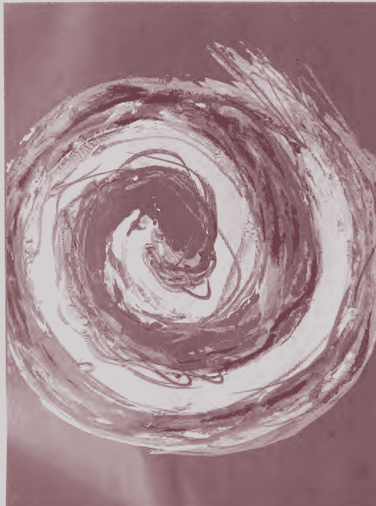

## 第 5 课
什么是 JavaScript？

**学习目标**

完成本课后，你应该能够：

- 理解 JavaScript 的目的。
- 使用 <SCRIPT> 和 </SCRIPT> 标签。
- 使用 JavaScript 对象。
- 使用 JavaScript 方法。
- 理解 JavaScript 语法。

预计时间：1.5 小时

**词汇**

- <SCRIPT> 和 </SCRIPT> 标签
- 二进制代码
- 编译器
- 条件
- 解释
- 关键字
- 方法
- 对象
- 运算符
- 参数列表
- 编程语言
- 属性
- 脚本语言
- 状态行
- 语法
- 标记

### 你好，万维网

JavaScript 有时被称为一种*编程语言*，但更准确地说，它是一种*脚本语言*。编程语言和脚本语言之间的区别很微妙，但理解这一点很重要。这两种语言都必须从人类可读的形式转换为机器可读的形式。

对于编程语言，这个过程是在程序运行之前，由一种称为*编译器*的高度专业化的软件执行的。程序员控制这个转换过程。

然而，对于脚本语言，程序员不需要显式地启动代码转换过程。当源代码被目标程序处理时，它会自动发生。更具体地说，HTML 文档必须由人编写，然后由 Web 浏览器处理。当该文档包含嵌入的 JavaScript 代码时，该代码由浏览器解释，并“即时”转换为其机器可读的形式。*解释*是程序员用来描述这种在运行时自动发生的逐行转换过程的术语。

在正常情况下，JavaScript 函数的输出不过是一段或几段文本字符串，这些字符串被插入到宿主网页中。生成的 HTML 页面随后由浏览器处理，就像它是通过人工输入到源文档中一样。

## 124 单元 2 JavaScript 的精彩世界

将 JavaScript 代码嵌入网页的真正威力在于，生成的文本可以日复一日，甚至分分秒秒地变化。完全有可能一个人在浏览器中输入某个 URL，看到的网页与另一个人输入完全相同 URL 所看到的网页截然不同。这些外观不同的网页可能是由于时间差异、位置差异，甚至是浏览器差异造成的。JavaScript 能够检测当前操作环境中的各种条件，并做出相应反应。这个概念将在分步教程 5.3 中进行更详细的探讨。

Web 浏览器很容易检测特定的 HTML 页面是否包含嵌入的 JavaScript 代码。文档创建者只需使用 `<SCRIPT>` 标签来标记 JavaScript 部分的开始，使用 `</SCRIPT>` 标签来标记该部分的结束。Web 浏览器会将这两个标签之间的所有内容解释为 JavaScript 源代码，而不是标准的 HTML 文本。然后，浏览器会将脚本（通过解释过程）转换为等效的机器可读形式，称为**二进制代码**。这个二进制代码随后会被执行，其输出（如果有的话）将被插入到 HTML 文本流中，并显示出来，就好像它是被人工输入到原始 HTML 文档中一样。

你需要理解的是，你将嵌入在 `<SCRIPT>` 和 `</SCRIPT>` 标签之间的脚本，不能是你随意放进去的任何旧文本。相反，文本必须符合某些规则，否则当你尝试查看页面时，Web 浏览器会在屏幕上显示令人不快的错误消息。这正是 JavaScript 被称为脚本语言的原因——因为它必须遵守称为程序**语法**的特定语法规则。在本课中，你将学习 JavaScript 对象和方法，以及 JavaScript 关键字和运算符。一旦掌握了这些基本的编程元素，你就能很快开始构建大型、复杂的脚本。

JavaScript 的主要目的是生成将被插入标准 HTML 文本流的文本。JavaScript 本质上由许多称为**对象**的不可见实体组成，这些对象包含一组定义明确的功能。为了让 JavaScript 程序员能够利用这些功能，他们必须调用这些对象中称为**方法**的一个或多个专用函数的服务。程序员通过键入对象名称，后跟一个句点（. 字符），再后跟方法名称来调用这些方法的服务。

方法名称后面总是跟着一个**参数列表**，即使该列表有时为空。理解方法参数的最佳方式或许是将其想象成一份食谱的配料清单。参数列表只是为方法提供其正确执行功能所需的信息。参数列表的语法包括一个左括号、零个或多个参数项以及一个右括号。例如，如果你想调用名为 "document" 的 JavaScript 对象的 "write" 方法，你需要键入以下代码行：

```
document.write("A string of text.");
```

既然你已经看到了一个简单的 JavaScript 编码示例，现在让我们给你一个机会，在一个包含嵌入式 JavaScript 的实际 HTML 文档中应用这个概念。

> **重要提示**
如果你的 Windows XP 版本安装了 Service Pack 2，在尝试完成以下 JavaScript 活动时，你可能会遇到各种警告消息。如果收到此类警告，只需单击启用 JavaScript 的选项即可。本书中的任何活动都不会以任何方式损坏你的系统。

## 分步教程 5.1

1.  打开记事本、SimpleText 或你最喜欢的文本编辑器。
2.  完全按照图 5-1 所示输入 HTML 和 JavaScript 文本。

**图 5-1**
一个包含嵌入式 JavaScript 的 HTML 文件

```
<HTML>
<HEAD>
<TITLE>HTML and JavaScript</TITLE>
</HEAD>
<BODY>
<SCRIPT>
    document.write("Hello World Wide Web!");
</SCRIPT>
</BODY>
</HTML>
```

3.  将新创建的文件保存为 **js-one.html** 或 **js-one.htm**。
4.  在 Web 浏览器中查看你的作品。生成的网页应如图 5-2 所示。继续下一节，或者如果今天到此为止，请关闭计算机。

> **重要提示**
如果你是安装了 Service Pack 2 的 Windows XP 用户，你的浏览器可能会显示关于阻止活动内容的警告消息。如果发生这种情况，请单击警告并按照后续提示启用 JavaScript。你可能还想禁用活动内容警告，这样就不必为每个活动都执行此操作。

**图 5-2**
你用 JavaScript 创建的第一个页面


## 分析你刚刚输入的代码

此时你可能在想，这个网页看起来并不那么令人印象深刻。但先别放弃 JavaScript，因为我们才刚刚开始。当你完成更多分步教程后，你将开始看到 JavaScript 的能力远不止这个简单网页所展示的。

## 增强你的网页

正如我们在本章前面提到的，名为 document.write() 的 JavaScript 方法只是将一串字符插入到标准 HTML 文本流中。另一种思考方式是，在浏览器处理完 HTML 文档后，最终结果是 `<SCRIPT>` 标签、`</SCRIPT>` 标签以及两者之间的所有内容都将从页面中剥离，并被 write() 方法参数中出现的任何字符串所替换。这意味着你放在脚本标签之前或之后的任何 HTML 格式化标签，都将像在没有任何嵌入式 JavaScript 代码的页面中一样被处理。为了更清楚地说明这一点，让我们修改在分步教程 5.1 中创建的网页。让我们添加一些 HTML 格式化标签，使我们的 Hello World Wide Web! 消息在屏幕上看起来更吸引人一些。我们还要在页面上添加第二条消息，以确保你理解 HTML 和 JavaScript 之间的交互。

> **网络礼仪**
> **注意你的花括号！**
>
> 初级程序员往往难以掌握的 JavaScript 语言特征之一是花括号的使用。左花括号 ( { ) 表示语句块的开始，右花括号 ( } ) 标记该块的结束。
>
> 虽然 JavaScript 语法规则在花括号放置方面有一定的灵活性，但我们强烈建议你遵循本书中展示的风格。如果你开始在花括号放置方式上变得马虎或不一致，很容易给自己造成严重问题。当左花括号的数量与右花括号的数量不对应时，你的 Web 浏览器将报告语法错误。然而，花括号也可能以不发生语法错误的方式放置，但脚本将无法正确执行。
>
> 关键在于，遵循一些简单的规则可以为你省去很多麻烦：
>
> 1.  始终将左花括号直接放在其所属关键字的下方。
> 2.  始终缩进包含在语句块中的语句。
> 3.  始终放置右花括号，使其与其对应的左花括号垂直对齐。

## 分步教程 5.2

1.  打开记事本、SimpleText 或你最喜欢的文本编辑器（如果尚未打开）。
2.  找到你在分步教程 5.1 中创建的 **js-one.html** 或 **js-one.htm** 文件。完全按照图 5-3 所示添加加粗的 HTML 和 JavaScript 代码。

**图 5-3**
包含两个嵌入式 JavaScript 代码的 HTML 页面

```
<HTML>
<HEAD>
<TITLE>HTML and JavaScript</TITLE>
</HEAD>
<BODY>
<CENTER>
<H1>
<SCRIPT>
    document.write("Hello World Wide Web!");
</SCRIPT>
</H1>
<H3>
<SCRIPT>
    document.write("Welcome to the exciting world of JavaScript");
</SCRIPT>
</H3>
</CENTER>
</BODY>
</HTML>
```

3.  将新创建的文件保存为 **js-two.html** 或 **js-two.htm**。
4.  在 Web 浏览器中查看你的作品。生成的网页应如图 5-4 所示。继续下一节，或者如果今天到此为止，请关闭计算机。

**图 5-4**
一个格式精美的 JavaScript 网页


## 分析你刚刚输入的代码

如果你对第 1 课中介绍的 HTML 材料有了清晰的理解，你应该能理解我们添加到本文档中的居中和标题标签的用途。你还应该理解，第一次出现的 document.write() 方法生成的输出字符串将被插入到 HTML 文本流中 `<CENTER>` 和 `</CENTER>` 标签之间，以及 `<H1>` 和 `</H1>` 标签之间。同样，输出字符串第二次调用 `document.write()` 产生的内容将出现在 `<CENTER>` 和 `</CENTER>` 标签之间，以及 `<H3>` 和 `</H3>` 标签之间。

换句话说，`<H1></H1>` 标签对只会影响第一个输出字符串的显示，而 `<H3></H3>` 标签对只会影响第二个字符串。但是，`<CENTER>` 和 `</CENTER>` 标签会影响两个字符串的显示位置。你明白了吗？

**警告**：你可能会想把 HTML 格式标签（如 `<CENTER>`、`<H1>`、`<H3>` 等）放在 `<SCRIPT>` 和 `</SCRIPT>` 标签里面，但千万别这么做！你需要记住，Web 浏览器会将你在脚本标签之间输入的所有内容都解释为 JavaScript 源代码。即使这些格式标签在 HTML 上下文中是有效的，它们也不是有效的 JavaScript 语句。如果你错误地在 JavaScript 代码块中输入了 HTML 标签，你的浏览器会返回一条令人不快的错误信息。

## JavaScript 中的条件语句

敏锐的学生可能会看着前两个分步教程问：“为什么我们还要用 JavaScript 在屏幕上显示文本消息？直接把文本输入到 HTML 文档中，省去对 `document.write()` 方法的调用，岂不是更容易？”

嗯，诚实的回答是：是的！那样做确实更容易。事实上，如果我们去掉脚本标签，Web 浏览器会稍微快一点地显示结果，因为它不需要调用 JavaScript 解释器。然而，不要忘记 JavaScript 能够执行的功能远不止将文本写入屏幕这么简单。

在下一个分步教程中，你将使用 JavaScript 语言最强大的特性之一：条件语句。每种编程语言都具有做出决策的能力。或者用更专业的术语来说，每种语言都赋予程序员评估特定*条件*，然后根据评估结果执行不同操作的能力。

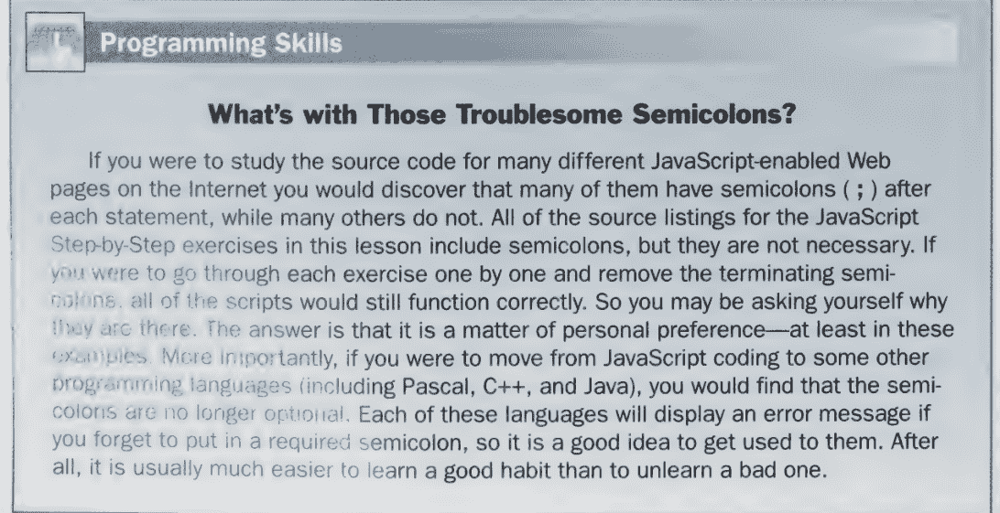

## 那些麻烦的分号是怎么回事？

如果你去研究互联网上许多不同启用了 JavaScript 的网页的源代码，你会发现许多网页在每个语句后面都有分号（ ; ），而许多则没有。本课中所有 JavaScript 分步练习的源代码清单都包含分号，但它们并非必需。如果你逐一进行每个练习并去掉结尾的分号，所有脚本仍然会正常运行。所以你可能会问自己，为什么它们还在那里。答案是，这至少在这些示例中是一个个人偏好的问题。更重要的是，如果你从 JavaScript 编码转向其他一些编程语言（包括 Pascal、C++ 和 Java），你会发现分号不再是可选的。如果你忘记输入必需的分号，这些语言中的每一种都会显示错误信息，所以养成使用分号的习惯是个好主意。毕竟，养成一个好习惯通常比改掉一个坏习惯容易得多。

## 注意你的语法！

JavaScript 中条件语句的语法非常重要。该语句以关键字 *if* 开头，然后在一对括号内指定一个条件。*关键字*被识别为语言定义的一部分。它由语言保留，不能用作变量。关键字的一些例子有 *if*、*else* 和 *return*。

条件后面是一个语句块，由一个左花括号（ { ）、一个或多个 JavaScript 语句以及一个右花括号（ } ）组成。JavaScript 条件语句的框架如下所示：

```
if ( <condition> )
{
    statement 1;
    statement 2;
    statement 3;
    .
    .
    .
    statement N;
}
```

JavaScript 的 *if* 语句还支持一个可选的 *else* 子句，它定义了在指定条件不为真时要执行的操作。*else* 关键字紧跟在 *if* 子句的语句之后出现，并且它有自己的语句块。一个包含可选 *else* 子句的 JavaScript 条件语句示例如下：

```
if ( <condition> )
{
    statement i1;
    statement i2;
    statement i3;
    .
    .
    .
    statement iN;
}
else
{
    statement e1;
    statement e2;
    statement e3;
    .
    .
    .
    statement eN;
}
```

既然你已经了解了 JavaScript *if* 和 *if-else* 语句的基本结构，让我们稍微谈谈语法中的条件部分（在上面的 JavaScript 示例中显示为 `<condition>`）。一个 JavaScript 条件总是由两个*标记*（token）和一个关系运算符组成。标记可以是变量名（如 *x* 或 *count*），也可以是字面常量（如 *10* 或 "*Hello*"）。关系运算符可以是以下符号中的任何一个：

| 运算符 | 含义 |
| :--- | :--- |
| == | 等于 |
| != | 不等于 |
| < | 小于 |
| > | 大于 |
| <= | 小于或等于 |
| >= | 大于或等于 |

既然你已经学会了如何在 JavaScript 中创建条件语句，让我们在实际程序中运用这些知识。在下一个分步教程中，我们将在一个 Web 文档中包含一个简单的条件语句，并在此过程中教你一个有用的编程技巧。互联网内容开发者通常希望根据特定用户拥有的浏览器类型来执行不同的任务，这是相当常见的。你即将创建的 JavaScript 程序将确定网络冲浪者是否在使用 Netscape Navigator，然后相应地做出反应。

> **注意**
确保你使用两个等号来测试相等性。如果你忘记使用，只用了一个等号，你的浏览器会用一条错误信息来责备你。

## 互联网里程碑

## 脚本语言

当网景通信公司于 1995 年向世界推出 JavaScript 时，他们并不是第一家为 Web 内容开发者提供新技术以增强 HTML 功能的公司。然而，他们是第一家提供功能齐全的脚本语言的公司，而且其他公司很快就认识到了这项技术的优势。

虽然脚本语言并不提供完整编程语言的所有功能，但它也不需要使用复杂或昂贵的编译器软件。这使得它成为初学者程序员、教育机构或其他财力有限的组织的理想选择。

因此，在 1996 年，微软公司迅速加入了脚本语言的行列，提供了 JScript 和 VBScript 作为行业标准 JavaScript 的替代品。这些脚本语言在提供的功能方面与 JavaScript 大致相当，但它们也为在 Windows 平台上运行微软 Internet Explorer 的用户提供了一些额外的功能。与 JavaScript 一样，JScript 基于 Java 编程语言的语法，而 VBScript 基于 Visual Basic 的编程语法。

专业 Web 开发者选择的脚本语言取决于他们特定的偏好和编程需求。但无论他们选择哪种语言，他们都可以感谢 JavaScript 开启了脚本语言运动。


第二次调用 `document.write()` 产生的内容将出现在 `<CENTER>` 和 `</CENTER>` 标签之间，以及 `<H3>` 和 `</H3>` 标签之间。

换句话说，`<H1></H1>` 标签对只会影响第一个输出字符串的显示，而 `<H3></H3>` 标签对只会影响第二个字符串。但是，`<CENTER>` 和 `</CENTER>` 标签会影响两个字符串的显示位置。你明白了吗？

**警告**：你可能会想把 HTML 格式标签（如 `<CENTER>`、`<H1>`、`<H3>` 等）放在 `<SCRIPT>` 和 `</SCRIPT>` 标签里面，但千万别这么做！你需要记住，Web 浏览器会将你在脚本标签之间输入的所有内容都解释为 JavaScript 源代码。即使这些格式标签在 HTML 上下文中是有效的，它们也不是有效的 JavaScript 语句。如果你错误地在 JavaScript 代码块中输入了 HTML 标签，你的浏览器会返回一条令人不快的错误信息。

## JavaScript 中的条件语句

敏锐的学生可能会看着前两个分步教程问：“为什么我们还要用 JavaScript 在屏幕上显示文本消息？直接把文本输入到 HTML 文档中，省去对 `document.write()` 方法的调用，岂不是更容易？”

嗯，诚实的回答是：是的！那样做确实更容易。事实上，如果我们去掉脚本标签，Web 浏览器会稍微快一点地显示结果，因为它不需要调用 JavaScript 解释器。然而，不要忘记 JavaScript 能够执行的功能远不止将文本写入屏幕这么简单。

在下一个分步教程中，你将使用 JavaScript 语言最强大的特性之一：条件语句。每种编程语言都具有做出决策的能力。或者用更专业的术语来说，每种语言都赋予程序员评估特定*条件*，然后根据评估结果执行不同操作的能力。


## 那些麻烦的分号是怎么回事？

如果你去研究互联网上许多不同启用了 JavaScript 的网页的源代码，你会发现许多网页在每个语句后面都有分号（ ; ），而许多则没有。本课中所有 JavaScript 分步练习的源代码清单都包含分号，但它们并非必需。如果你逐一进行每个练习并去掉结尾的分号，所有脚本仍然会正常运行。所以你可能会问自己，为什么它们还在那里。答案是，这至少在这些示例中是一个个人偏好的问题。更重要的是，如果你从 JavaScript 编码转向其他一些编程语言（包括 Pascal、C++ 和 Java），你会发现分号不再是可选的。如果你忘记输入必需的分号，这些语言中的每一种都会显示错误信息，所以养成使用分号的习惯是个好主意。毕竟，养成一个好习惯通常比改掉一个坏习惯容易得多。

## 注意你的语法！

JavaScript 中条件语句的语法非常重要。该语句以关键字 *if* 开头，然后在一对括号内指定一个条件。*关键字*被识别为语言定义的一部分。它由语言保留，不能用作变量。关键字的一些例子有 *if*、*else* 和 *return*。

条件后面是一个语句块，由一个左花括号（ { ）、一个或多个 JavaScript 语句以及一个右花括号（ } ）组成。JavaScript 条件语句的框架如下所示：

```
if ( <condition> )
{
    statement 1;
    statement 2;
    statement 3;
    .
    .
    .
    statement N;
}
```

JavaScript 的 *if* 语句还支持一个可选的 *else* 子句，它定义了在指定条件不为真时要执行的操作。*else* 关键字紧跟在 *if* 子句的语句之后出现，并且它有自己的语句块。一个包含可选 *else* 子句的 JavaScript 条件语句示例如下：

```
if ( <condition> )
{
    statement i1;
    statement i2;
    statement i3;
    .
    .
    .
    statement iN;
}
else
{
    statement e1;
    statement e2;
    statement e3;
    .
    .
    .
    statement eN;
}
```

既然你已经了解了 JavaScript *if* 和 *if-else* 语句的基本结构，让我们稍微谈谈语法中的条件部分（在上面的 JavaScript 示例中显示为 `<condition>`）。一个 JavaScript 条件总是由两个*标记*（token）和一个关系运算符组成。标记可以是变量名（如 *x* 或 *count*），也可以是字面常量（如 *10* 或 "*Hello*"）。关系运算符可以是以下符号中的任何一个：

| 运算符 | 含义 |
| :--- | :--- |
| == | 等于 |
| != | 不等于 |
| < | 小于 |
| > | 大于 |
| <= | 小于或等于 |
| >= | 大于或等于 |

既然你已经学会了如何在 JavaScript 中创建条件语句，让我们在实际程序中运用这些知识。在下一个分步教程中，我们将在一个 Web 文档中包含一个简单的条件语句，并在此过程中教你一个有用的编程技巧。互联网内容开发者通常希望根据特定用户拥有的浏览器类型来执行不同的任务，这是相当常见的。你即将创建的 JavaScript 程序将确定网络冲浪者是否在使用 Netscape Navigator，然后相应地做出反应。

> **注意**
确保你使用两个等号来测试相等性。如果你忘记使用，只用了一个等号，你的浏览器会用一条错误信息来责备你。

## 互联网里程碑

## 脚本语言

当网景通信公司于 1995 年向世界推出 JavaScript 时，他们并不是第一家为 Web 内容开发者提供新技术以增强 HTML 功能的公司。然而，他们是第一家提供功能齐全的脚本语言的公司，而且其他公司很快就认识到了这项技术的优势。

虽然脚本语言并不提供完整编程语言的所有功能，但它也不需要使用复杂或昂贵的编译器软件。这使得它成为初学者程序员、教育机构或其他财力有限的组织的理想选择。

因此，在 1996 年，微软公司迅速加入了脚本语言的行列，提供了 JScript 和 VBScript 作为行业标准 JavaScript 的替代品。这些脚本语言在提供的功能方面与 JavaScript 大致相当，但它们也为在 Windows 平台上运行微软 Internet Explorer 的用户提供了一些额外的功能。与 JavaScript 一样，JScript 基于 Java 编程语言的语法，而 VBScript 基于 Visual Basic 的编程语法。

专业 Web 开发者选择的脚本语言取决于他们特定的偏好和编程需求。但无论他们选择哪种语言，他们都可以感谢 JavaScript 开启了脚本语言运动。

## 分步教程 5.3

1.  打开记事本、SimpleText 或你最喜欢的文本编辑器（如果尚未打开）。
2.  找到你在分步教程 5.2 中创建的 **js-two.htm** 或 **js-two.html** 文件。按照图 5-5 所示，完全添加加粗的 HTML 和 JavaScript 代码。

**图 5-5**
包含 *if-else* 条件语句的 HTML/JavaScript 文档

```
<HTML>
<HEAD>
<TITLE>HTML and JavaScript</TITLE>
</HEAD>
<BODY>
<CENTER>
<H1>
<SCRIPT>
    document.write("Hello World Wide Web!");
</SCRIPT>
</H1>
<H3>
<SCRIPT>
    document.write("Welcome to the exciting world of JavaScript");
</SCRIPT>
</H3>
<SCRIPT>
    if (navigator.appName == "Netscape")
    {
        document.write("You are using Netscape Navigator");
    }
    else
    {
        document.write("You are not using Netscape Navigator.<BR>");
        document.write("I'll bet you are using Microsoft Internet Explorer.");
    }
</SCRIPT>
</CENTER>
</BODY>
</HTML>
```

3.  将新创建的文件保存为 **js-three.html** 或 **js-three.htm**。

## 分步操作 5.3 续

4.  打开你的网页浏览器，查看刚刚创建的 **js-three.html** 文档。你应该会看到类似图 5-6A 或图 5-6B 的内容。继续下一节，或者如果今天的学习到此结束，请关闭计算机。


## 分析你刚刚输入的代码

尽管我们没有向 JavaScript 程序添加大量代码，但我们确实引入了几个重要的概念。让我们花点时间回顾一下这些概念，以确保你对这里发生的事情有扎实的理解。

首先，这段 JavaScript 代码段中正在评估的条件是：

```
(navigator.appName == "Netscape")
```

我们在本章前面提到过，JavaScript 对象包含称为方法的特殊函数，用于执行各种任务。嗯，碰巧的是，JavaScript 对象也包含程序员可以访问以获取对象信息的*属性*。在这种情况下，我们利用了 `navigator` 对象的 `appName` 属性来确定当前网页浏览器的应用程序名称。（请注意，在此上下文中，单词 *navigator* 可以与单词 *browser* 互换使用。）如果该名称是 Netscape，那么我们就知道用户正在运行 Netscape Navigator。否则，我们知道用户没有运行 Netscape Navigator，因此他或她可能正在运行 Microsoft 的 Internet Explorer（尽管也有可能是其他浏览器）。

这里要学习的第二个重要概念是，一旦条件被评估，要么执行 *if* 语句块，要么执行 *else* 块——永远不会两者都执行。如果条件的结果为真，则运行 *if* 块。如果条件为假，则运行 *else* 块。就这么简单。

在这个例子中，你需要认识到最后一点。到目前为止，我们反复提到了在 HTML 文档中嵌入 JavaScript 源代码的概念。嗯，事实证明，在 JavaScript 文本字符串中嵌入 HTML 标签也是可能的，更不用说很有用了！仔细看看 `else` 语句块中的第一个 `document.write()` 调用。注意 HTML `<BR>` 标签嵌入在输出文本字符串中。这个标签存在的原因是我们希望第二段文本出现在单独的行上，而不是与第一段文本在同一行上。为了实现这一点，我们必须在输出文本流中放置一个 `<BR>` 标签，以便浏览器能够识别 BREAK 命令。你跟上了吗？

## 使用 JavaScript alert() 方法

在前面的三个活动中，我们使用了 `document.write()` 方法，这可能是 JavaScript 程序与用户通信最常用的方式。然而，脚本还有其他方式可以引起用户的注意。其中一种方式是通过 JavaScript 的 `alert()` 方法。

`alert()` 方法的目的是允许程序显示一个特殊的对话框，该对话框会提醒用户发生了预期事件或需要某种用户输入。与 `write()` 方法和 `appName` 属性一样，`alert()` 方法是称为 `window` 对象的一部分。JavaScript 解释器将 `window` 对象视为默认对象。脚本中出现的任何没有明确引用对象的方法或属性，都会自动假定是 `window` 对象的一部分。因此，在调用它时，不需要包含对象名称和句点（.）字符。让我们试试 `alert()` 方法，好吗？

## 分步操作 5.4

1.  打开记事本、SimpleText 或你最喜欢的文本编辑器（如果尚未打开）。
2.  找到你在分步操作 5.3 中创建的 `js-three.html` 或 `js-three.htm` 文件。
3.  通过添加图 5-7 中所示的粗体文本，修改 HTML/JavaScript 文档。

图 5-7
包含对 `alert()` 方法调用的 HTML/JavaScript 源代码

```
<HTML>
<HEAD>
<TITLE>HTML and JavaScript</TITLE>
</HEAD>
<BODY>
<CENTER>
<H1>
<SCRIPT>
    document.write("Hello World Wide Web!");
</SCRIPT>
</H1>
<H3>
<SCRIPT>
    document.write("Welcome to the exciting world of JavaScript");
</SCRIPT>
</H3>
<SCRIPT>
    if (navigator.appName == "Netscape")
    {
        document.write("You are using Netscape Navigator");
        alert("Netscape Navigator detected.");
    }
    else
    {
        document.write("You are not using Netscape Navigator.<BR>");
        document.write("I'll bet you are using Microsoft Internet Explorer.");
        alert("Netscape Navigator required.");
    }
</SCRIPT>
</CENTER>
</BODY>
</HTML>
```

4.  将新创建的文件保存为 **js-four.html** 或 **js-four.htm**。
5.  打开你的网页浏览器，查看刚刚保存的 **js-four.html** 或 **js-four.htm** 文档。你应该会看到类似图 5-8A 或图 5-8B 的内容。继续下一节，或者如果今天的学习到此结束，请关闭计算机。

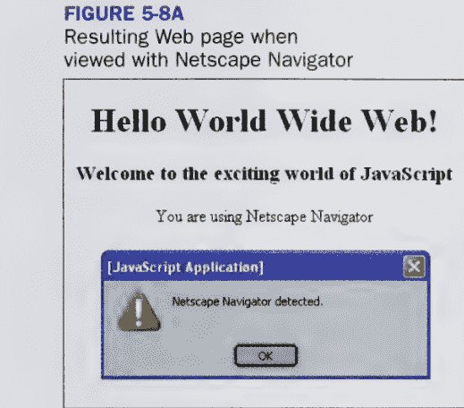

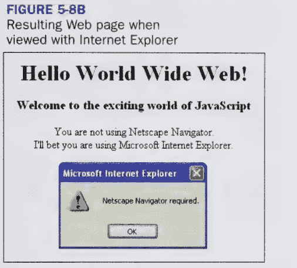

## 分析你刚刚输入的代码

希望这个活动能帮助你看到 `alert()` 方法在某些情况下可能很有用。它通常在 JavaScript 程序中使用，当需要让用户意识到发生了某些意外的错误情况时。当程序在继续之前需要某种用户确认时，也可以使用它。无论哪种情况，`alert()` 方法都是 JavaScript 软件生成输出的另一种方式。

## 访问浏览器状态行

你可能已经注意到，当你的网页浏览器加载包含许多对象的 HTML 文档时，它会在窗口底部显示各种消息。屏幕的这个区域称为*状态行*，可以从 JavaScript 程序内部访问。除了 `document.write()` 方法和 `alert()` 方法之外，这是 JavaScript 网页向用户传达信息的另一种方式。

你现在应该问自己的问题是，“我如何访问浏览器状态行？”同样，这个问题的答案非常简单。状态行中显示的消息不过是存储在 `window` 对象的 `status` 属性中的字符串值。这意味着你可以在 JavaScript 程序中随时通过包含如下语句来更改消息：

```
window.status = "A string of text";
```

既然你明白了这有多容易，让我们在你上一个活动中编写的 JavaScript 程序中添加两行新代码。这段代码将简单地强化 `alert()` 方法显示的消息。

## 分步操作 5.5

1.  打开记事本、SimpleText 或你最喜欢的文本编辑器（如果尚未打开）。
2.  找到你在分步操作 5.4 中创建的 **js-four.html** 或 **js-four.htm** 文件。

## 互联网里程碑

#### 谁先出现——Java 还是 JavaScript？

许多对互联网技术只有粗略了解的人倾向于认为 Java 编程语言和 JavaScript 脚本语言是同一回事。即使那些知道它们*不是*同一回事的人，也可能不知道它们如何相互关联，或者哪个是先创建的。答案是 Java 是由 Sun Microsystems, Inc. 先创建的。Sun 于 1995 年将其跨平台编程语言发布给公众，此后其受欢迎程度以前所未有的速度持续增长。

但 Sun 并不是唯一一家寻求增强标准 HTML 功能的公司。Netscape Communications Corporation 也在忙于寻找将用户可编程脚本嵌入静态 HTML 网页的方法，他们需要在其设计中融入一个定义良好的语法。当 Netscape 的开发者看到 Java 语言变得如此流行时，他们决定从 Sun 获得 Java 名称的许可，并在自己的脚本语言中使用 Java 语法。Netscape 努力的结果被称为 JavaScript，它在互联网开发领域也取得了巨大的成功。

## 分步教程 5.5 续

3.  通过添加图 5-9 中所示的粗体文本，修改 HTML/JavaScript 文档。

**图 5-9**
设置浏览器状态行的 HTML/JavaScript 源代码

```html
<HTML>
<HEAD>
<TITLE>HTML and JavaScript</TITLE>
</HEAD>
<BODY>
<CENTER>
<H1>
<SCRIPT>
    document.write("Hello World Wide Web!");
</SCRIPT>
</H1>
<H3>
<SCRIPT>
    document.write("Welcome to the exciting world of JavaScript");
</SCRIPT>
</H3>
<SCRIPT>
    if (navigator.appName == "Netscape")
    {
        document.write("You are using Netscape Navigator");
        window.status = "Netscape Navigator detected.";
        alert("Netscape Navigator detected");
    }
    else
    {
        document.write("You are not using Netscape Navigator.<BR>");
        document.write("I'll bet you are using Microsoft Internet Explorer.");
        window.status = "Netscape Navigator required.";
        alert("Netscape Navigator required");
    }
</SCRIPT>
</CENTER>
</BODY>
</HTML>
```

4.  将新创建的文件保存为 **js-five.html** 或 **js-five.htm**。

5.  打开你的 Web 浏览器，查看你刚刚保存的 **js-five.html** 或 **js-five.htm** 文档。你应该会看到类似图 5-10A 或图 5-10B 的内容。（警告：某些版本的 Internet Explorer 可能会在状态栏消息之前显示警告框。）关闭你的计算机。

**图 5-10A**
使用 Netscape Navigator 查看时生成的网页

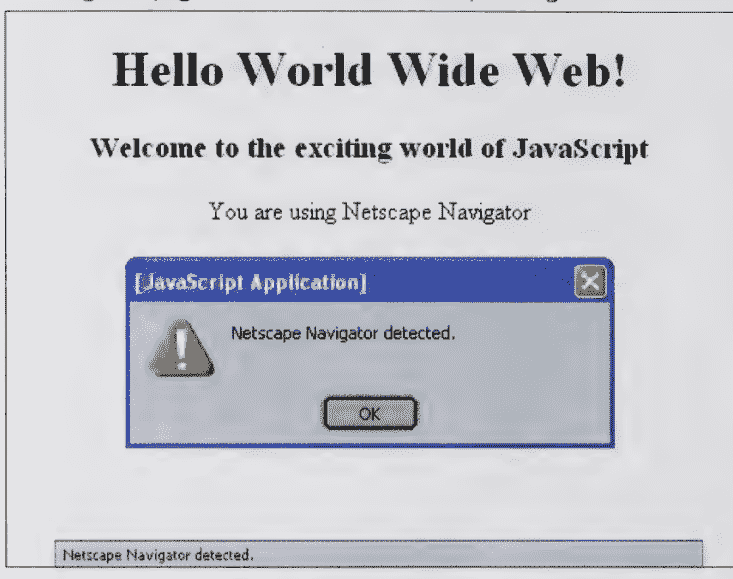

**图 5-10B**
使用 Internet Explorer 查看时生成的网页


## 分析你刚刚输入的代码

正如我们在本课前面提到的，JavaScript 与 Web 用户交互的最常见方式是通过 `document.write()` 方法。但浏览器状态行也可以是向用户传达信息的有效方式。在本例中，我们只是简单地使用状态行来回显警告对话框中显示的消息。然而，更常见的是看到 JavaScript 程序使用状态行让用户知道它正在做什么。每当你的脚本即将启动一个可能耗时的过程时，例如下载一个大的图形图像，在状态行中显示一条适当的消息是个好主意。这可以大大有助于确保用户知道她的计算机系统没有崩溃。

## 总结

在本课中，你学到了：

- 你可以解释 JavaScript 的用途。
- 如何使用 `<SCRIPT>` 和 `</SCRIPT>` 标签。
- 你可以使用 JavaScript 对象。
- 你可以使用 JavaScript 方法。
- 你可以理解并应用 JavaScript 语法。

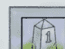

## 互联网里程碑

### Hello, World!

下次你去当地书店时，花几分钟时间浏览几本不同编程书的前几章。在许多情况下，你会看到这些书中介绍的第一个编程示例都演示了如何用该特定语言显示短语 *Hello, World!*。你认为为什么作者以这种方式开始他们的书如此普遍？嗯，答案很简单。

1978 年，贝尔实验室的两位员工 Brian Kernighan 和 Dennis Ritchie 出版了一本名为 *The C Programming Language* 的书。这本书已被证明是计算机软件史上最持久的编程教程之一。在过去的二十年里，这本书只修订过一次，第二版仍在印刷中！这本书中的第一个编程练习解释了如何使用名为 `printf()` 的 C 函数来显示短语 *Hello, World*。虽然 Kernighan 和 Ritchie 不太可能打算在编程书作者中开创一个非正式的传统，但这正是他们所做的！尽管我们擅自稍微修改了这个短语（改为 *Hello World Wide Web!*），但它仍然基于这个来自二十五年前的简单示例。

## 词汇复习

定义以下术语：

- `<SCRIPT>` 和 `</SCRIPT>` 标签
- 二进制代码
- 编译器
- 条件
- 解释
- 关键字
- 方法
- 对象
- 运算符
- 参数列表
- 编程语言
- 属性
- 脚本语言
- 状态行
- 语法
- 标记

## 复习题

### 判断题

如果陈述正确，请圈出 T；如果陈述错误，请圈出 F。

1.  JavaScript 是一种编程语言。
2.  JavaScript 需要编译器。
3.  你在 HTML 文档中的 `<SCRIPT>` 和 `</SCRIPT>` 标签之间插入 JavaScript。
4.  方法名后面总是跟着一个参数列表。
5.  分号 (;) 在 JavaScript 语句中并非总是必需的。

### 填空题

通过在提供的空白处填写正确的单词或词组来完成以下句子。

1.  符号 { 和 } 被称为 __________ 花括号。
2.  JavaScript 的 `if` 语句支持一个可选的 __________ 子句，该子句定义了在指定条件不成立时要采取的操作。
3.  JavaScript 条件总是由两个 __________ 组成，中间用关系运算符分隔。
4.  __________ Communications Corporation 于 1995 年向世界介绍了 JavaScript。
5.  `alert()` 方法允许程序显示一个特殊的对话框，警告用户发生了意外事件，或者需要某种用户输入。

## 书面问题

简要回答以下问题。

1.  JavaScript 如何增强 HTML 的功能？
2.  什么是 JavaScript 对象？什么是对象方法和对象属性？
3.  最常用于生成输出的 JavaScript 方法是什么？
4.  JavaScript 中条件语句的语法是什么？
5.  `alert()` 方法与 `write()` 方法在哪些方面有所不同？

## 项目

### 项目 5-1

GreatApplications, Inc. 正在寻找熟练的 Internet 程序员，他们需要对 HTML 编程和 JavaScript 有很好的理解。为了测试潜在员工的知识，GreatApplications 正在进行一系列 HTML/JavaScript 测试。以下是测试中的第一个问题：

如你所知，分步教程 5.1（**js-one.htm** 或 **js-one.html**）中使用的短语 *Hello World Wide Web!* 没有什么特别之处。将此短语替换为 **Welcome to GreatApplications**。更改 `write()` 方法中的消息。只需记住，你要显示的字符串必须用双引号字符 ( " ) 括起来。将更改后的文件保存为 **js-test1.html**。

### 团队项目

团队合作是 GreatApplications, Inc. 在其员工中始终寻找的品质之一。GreatApplications, Inc. 的职位候选人被分成两到三人的团队。每个团队被要求一起解决以下问题。未来的员工不仅根据正确的答案来评判，还根据团队成员如何以友好和创造性的方式沟通和合作来解决问题。在小组面试中，你所在的团队被分配了以下两个项目。

**问题 1：** 显然 `<BR>` 不是唯一可以嵌入 JavaScript 输出字符串的 HTML 格式化标签。你可以在 `document.write()` 语句中使用任何你想要的格式化标签。尝试发挥一下创造力，看看在这个练习的 JavaScript 代码中你还能放入多少其他标签。它们对生成的网页有什么影响（如果有的话）？将 HTML 标签放在 `<SCRIPT></SCRIPT>` 标签之外更好，还是将它们嵌入 JavaScript 文本字符串中更好？有没有你想同时做这两件事的时候？思考一下！将此文件保存为 **js-test2.htm** 或 **js-test2.html**。

**问题 2：** 你应该清楚，你可以将任何 HTML 标签与 JavaScript 一起使用，而不仅仅是标题和居中标签。尝试将前四课中描述的一些其他 HTML 标签插入到这个第 5 课团队项目中，看看它们会产生什么效果。具体来说，尝试使用影响网页前景和背景颜色的标签。看看你是否能让 JavaScript 网页显示为蓝色背景上的黄色文本。或者尝试让 `<H1>` 文本的颜色与 `<H3>` 文本不同。将此文件保存为 **js-test3.htm** 或 **js-test3.html**。

### Web 项目

在分步教程 5.3 中，你创建了一个 JavaScript 程序来识别你的浏览器是否是 Netscape Navigator。GreatApplications, Inc. 刚刚指派你重新编写这个程序，使其面向 Microsoft Internet Explorer (IE) 而不是 Netscape 的 Navigator。这意味着你必须更改 JavaScript 条件语句，以及 **js-four.htm** 或 **js-four.html** 文件中 *if* 和 *else* 语句块内的文本字符串措辞。

完成更改后，如果你同时拥有 Netscape Navigator 和 Microsoft Internet Explorer，请使用两者查看新文件，以确保其正常运行。每个浏览器都可以从各自的制造商处免费下载并安装在你的计算机上。将你的文件保存为 **js-test4.htm** 或 **js-test4.html**。

## 批判性思维

在分步教程 5.3 的介绍中，我们提到条件语句是 JavaScript 最强大的功能之一。这一说法只是对 20 多年前伟大的计算机科学家 Joseph Weizenbaum 所做陈述的回应。1976 年，Weizenbaum 先生写了一本名为 *Computer Power and Human Reason* 的书，他在书中提出了计算机系统的真正力量在于其决策能力的观点。思考一下这个想法，然后回答以下问题：

1.  如果计算机不能做决定，它们会有多大用处？

## 活动 5-2

尝试解决以下一个或两个思维活动：

**思维活动 5-2A：** 一些 JavaScript 程序员利用浏览器状态栏的一种方式是向用户显示指令。在这种情况下，当警告对话框出现时，显示一条告诉用户该做什么的消息可能是有意义的。也就是说，状态栏可以包含一条消息，告诉用户单击“确定”按钮以继续处理脚本。你为什么不继续进行此更改呢？尝试使消息尽可能信息丰富，而无需使用大量文字。将你的文件保存为 **js-test5.htm** 或 **js-test5.html**。（如果你使用的 Internet Explorer 版本在清除警告框之前不显示状态栏，你可能需要使用不同的方法。）

**思维活动 5-2B：** 在此活动中，我们演示了如何定义一个条件语句，该语句评估 `navigator.appName` 属性的内容以确定它是否包含值“Netscape”。但是，如果 `appName` 属性不包含值 Netscape，它包含什么值？你如何找出？嗯，思考一下 `document.write()` 方法。它是否可以用来显示不仅仅是字面字符串（在双引号中）？当然可以。它也可以用来显示 JavaScript 变量或对象属性的内容。现在你能写一条显示 `appName` 值的 JavaScript 语句吗？当然可以。将你的文件保存为 **js-test6.htm** 或 **js-test6.html**。

## 总结项目

通过重新访问之前的活动，将你新获得的 JavaScript 知识付诸实践。检索你在第 1 课的“分步操作 1.2”中创建并保存为文件 **one.html** 的 HTML 文件（在第 1 课中）。用 JavaScript 代码替换此文件中的所有句子。更具体地说，使用 `document.write()` 方法将这五个句子输出到你的网页。你完成的网页应如图 5-11 所示。

## 图 5-11
使用 JavaScript 生成的简单网页

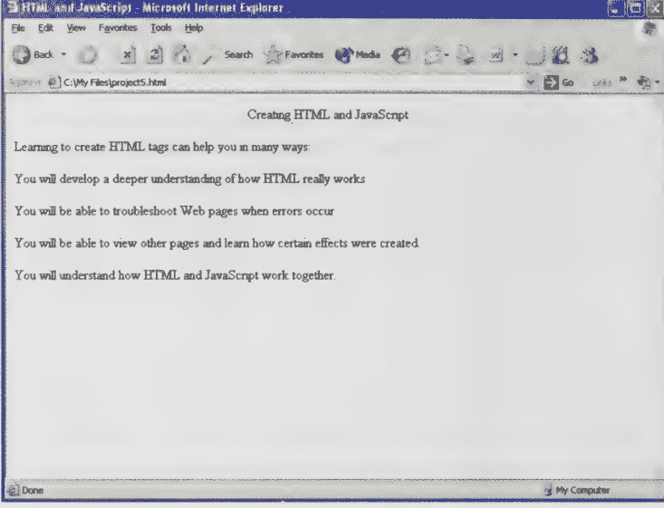

### 项目要求

- 使用你在第 1 课的“分步操作 1.2”中创建的 HTML 代码。
- 用 JavaScript `document.write()` 语句替换文本（句子）。
- 将你的新文件保存为 **project5.html** 或 **project5.htm**。
- 在 Web 浏览器中查看你的新文件，以确保其外观正确。
- 使用浏览器的“查看源代码”命令查看页面源代码。将你看到的内容与你在文件 **one.html** 中创建的页面源代码进行比较。

## 第 6 课
在 JavaScript 中使用图像

### 目标
完成本课后，你应该能够：
- 理解 JavaScript 事件的名称和用法。
- 创建图像翻转效果。
- 创建超链接翻转效果。
- 构建循环横幅。
- 显示随机图像。
- 创建 JavaScript 幻灯片放映。

预计时间：1.5 小时

### 词汇表
- 数组
- 循环横幅（广告横幅）
- 递减
- 事件
- 函数
- 超链接翻转
- 图像翻转
- 递增
- 索引
- 实例化
- 实数（浮点数）
- 幻灯片放映
- 变量

## 让图形图像活起来

在第 3 课中，我们提到了有效使用图形图像对于网页整体成功的重要性。嗯，无论网页是基于 HTML 还是 JavaScript 技术，这一原则都适用。标准 HTML 使你能够对图像进行一些有趣的操作，但 JavaScript 为你提供了一些额外的功能。

在本课中，我们将重点介绍通常用于让图形图像在网页上活起来的 JavaScript 功能。一旦你学会了这些新技术，你很快就会在万维网上到处识别出它们的用法。然后你将不再需要想知道这些有趣页面的设计师是如何创造出如此引人注目的效果的。

在你能够用图像完成任何壮观的事情之前，你需要理解 JavaScript 事件。就本书而言，你可以将*事件*视为对某些特定条件发生的系统级响应。其中一些条件是由 Web 浏览器软件本身生成的，但大多数是由用户执行某些操作引起的。这些操作可能包括移动鼠标、单击按钮，甚至在屏幕上选择一段文本。但无论特定事件是如何生成的，JavaScript 都使你能够创建对此做出反应的网页。当这些反应被巧妙地实现时，用户一定会对你的网页印象深刻。

在使用图像时，你需要掌握的另一个重要概念是 JavaScript 函数的概念。*函数*不过是一段 JavaScript 代码，可以像第 5 课中使用的 `document.write()` 和 `alert()` 方法一样被调用或调用。事实上，方法和函数之间确实没有区别，只是方法已经被定义为 JavaScript 编程环境的一部分。另一方面，函数是由程序员编写的，可以包含任意数量的 JavaScript 语句，包括对 JavaScript 方法或其他函数的调用。

此时，JavaScript 事件和函数如何与网页中图形图像的使用相关联可能对你来说并不明显。但请耐心等待，你很快就会看到联系。事实上，这正是本课活动的目的。我们将使用事件和函数与图像一起创建一些有趣的效果，这些效果将极大地提高你的网页质量。所以，如果你准备好开始了，让我们开始工作吧！

## 教会图像翻转

在第 3 课中，你学习了如何在网页中包含图形图像，你还学习了如何将图像变成超链接。现在我们将向你展示如何利用 JavaScript 的力量使图形超链接响应鼠标移动。

更具体地说，我们将向你展示当用户将鼠标指针移到图像上时，如何更改图像的外观。这种 JavaScript 编程技术称为*图像翻转*。

要实现翻转，你需要知道的第一件事是如何利用称为 `onMouseOver` 和 `onMouseOut` 的 JavaScript 事件。当用户将鼠标移到特定对象上时，会生成 `onMouseOut` 事件。同样，当用户将鼠标指针移开对象时，会生成 `onMouseOut` 事件。你需要学习的是如何使用 JavaScript 来检测这些事件何时发生，然后采取适当的行动。在“分步操作 6.1”中，我们将在屏幕上显示一个蓝色箭头，然后当鼠标指针移到其上时将箭头更改为红色。然后，当鼠标指针移开图像时，我们将箭头颜色改回蓝色。听起来很简单？

## 分步操作 6.1

1. 在你的 Web 浏览器中输入 URL **www.course.com**。
2. 单击搜索框并输入本书的标题（*HTML and JavaScript BASICS*）。
3. 单击 **Search** 并等待搜索结果出现。然后从结果列表中找到正确的书名并单击它。
4. 选择名为 **Student Online Companion** 的链接。
5. 单击 **Lesson 6** 链接，然后从出现的列表中选择 **Data Files & Graphics** 链接。
6. 将 **bluearrow.gif** 和 **redarrow.gif** 文件（如图 6-2A 和 6-2B 所示）下载到你保存网页的完全相同的文件夹中。如果你需要复习如何下载这些文件，请返回“分步操作 3.2”寻求帮助。

## 分步操作 6.1 续

7. 打开你的文本编辑器或文字处理器，并完全按照图 6-1 所示输入 HTML/JavaScript 代码。

### 图 6-1
创建图像翻转的 JavaScript 代码

```html
<HTML>
<HEAD>
<TITLE>HTML and JavaScript</TITLE>
<SCRIPT>
var blueArrow = new Image;
blueArrow.src = "bluearrow.gif";
var redArrow = new Image;
redArrow.src = "redarrow.gif";

function turnBlue()
{
    document.arrow.src = blueArrow.src;
    return;
}

function turnRed()
{
    document.arrow.src = redArrow.src;
    return;
}
</SCRIPT>
</HEAD>
<BODY>
<CENTER>
<A HREF="webpage.html" onMouseOut="turnBlue()" onMouseOver="turnRed()">

</A>
</CENTER>
</BODY>
</HTML>
```

8. 将此文件保存在适当的文件夹中，命名为 **js-six.html**。
9. 如果你的 Web 浏览器尚未打开，请打开它。

## 分步操作 6.1 续

10. 查看你的 **js-six.html** 页面。你的网页最初应如图 6-2A 所示，但当鼠标指针移到箭头图像上时，其外观应变为图 6-2B 所示的样子。

11. 继续下一节，或者如果今天的学习到此结束，请关闭计算机。

> **重要提示**
> 如果你是安装了 Service Pack 2 的 Windows XP 用户，你的浏览器可能会显示一条关于阻止活动内容的警告消息。如果发生这种情况，请点击警告并按照后续提示启用 JavaScript。


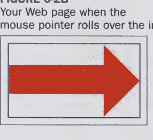

## 分析你刚刚输入的代码

尽管图 6-1 中的 HTML/JavaScript 源代码不是很长，但它确实引入了几个你以前没见过的新功能。让我们花点时间确保你理解所有这些概念，因为你将在整个课程中看到它们。

首先，你应该注意到 `<SCRIPT>` 和 `</SCRIPT>` 标签出现在 HTML 文档的头部部分，而不是主体部分。这意味着 Web 浏览器将在开始在屏幕上显示文档内容之前处理 JavaScript 代码。对于这个特定的文档来说，这是一个重要的点，因为我们希望浏览器在显示网页主体之前，将蓝色和红色箭头图像都加载到内存中。如果我们没有这样做，浏览器将不知道当 *onMouseOver* 和 *onMouseOut* 事件发生时它应该加载哪些图像，结果将是一个 JavaScript 错误消息。

接下来，理解 JavaScript 代码（图 6-1 的第 5 到 8 行）实际做什么很重要。第 5 行的语句（`var blueArrow = new Image;`）告诉 JavaScript 解释器创建一个新的 Image 对象，然后将该对象的引用保存在一个我们称为 *blueArrow* 的变量中。记住，JavaScript *变量* 不过是分配给一个字面值或一个对象的名称。一旦进行了此赋值，就可以在整个 HTML 文档中使用该名称来引用该特定值或对象。

第 6 行的语句（`blueArrow.src = "bluearrow.gif";`）告诉 JavaScript，*blueArrow* 对象的源（src）属性将包含存储在文件 *bluearrow.gif* 中的图形图像。正是这个语句实际上导致浏览器将蓝色箭头图像加载到内存中。一旦此任务完成，接下来的两个 JavaScript 语句执行的功能与前两个语句基本相同。

第 7 行的语句（`var redArrow = new Image;`）导致解释器创建一个新的 Image 对象并将其命名为 *redArrow*。第 8 行的语句（`redArrow.src = "redarrow.gif";`）将对象的 src 属性设置为文件 *redarrow.gif* 中包含的图像，因此浏览器也会将此图像加载到内存中。你理解了吗？

## 事件处理逻辑

我们需要讨论的下一个概念是 JavaScript 事件处理逻辑。这是 JavaScript 的一个重要特性，因为它展示了 JavaScript 代码与标准 HTML 标签交互的另一种方式。

到目前为止，你使用过的所有 JavaScript 语句都位于 `<SCRIPT>` 和 `</SCRIPT>` 标签之间，对吧？JavaScript 事件处理语句实际上放置在一个标准 HTML 标签内。在这种情况下，处理 *onMouseOver* 和 *onMouseOut* 事件的语句位于开始锚点（`<A>`）标签内。当 *onMouseOver* 事件发生时，调用名为 `turnRed()` 的 JavaScript 函数，该函数将文档对象中包含的箭头对象的源（src）属性设置为 *redArrow* 对象的 src 属性。

同样，当 *onMouseOut* 事件发生时，调用 `turnBlue()` 函数；该函数将文档箭头对象的 src 属性设置为 *blueArrow.src* 属性的值。

因此，当鼠标指针滚过箭头图像时，*onMouseOver* 事件触发（发生），图像源被分配为 *redarrow.gif* 文件的内容。

类似地，将鼠标指针移出箭头图像会导致 *onMouseOut* 事件触发，图像源被分配为 *bluearrow.gif* 文件的内容。这说得通吗？

我们想讨论的最后一点是 *document.arrow* 对象的来源。当我们使用名称 *arrow* 时，浏览器如何知道我们指的是哪个对象？幸运的是，答案非常简单。如果你仔细查看我们用来定义原始图像的 `` 标签，你会看到我们包含了一个你以前没有使用过的新属性。

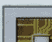

## 技术职业

### 客户端/服务器应用程序工程师

无论你在美国企业界走到哪里，你都会发现对能够创建快速、可靠的客户端/服务器应用程序的软件开发人员有很高的需求。客户端/服务器应用程序背后的主要思想是，一个进程（或程序）将在中心位置运行，然后多个客户端进程在许多不同的位置运行，向服务器进程发出请求并等待响应。

二十年前，这种类型的分布式系统只能在大型公司、银行或航空公司预订机构中找到，因为它难以安装且维护成本高昂。如今，客户端/服务器架构对于小企业、政府机构甚至学区来说都已触手可及。然而不幸的是，拥有创建客户端/服务器软件系统的手段并不意味着很容易找到能够实际创建和编写此类系统正常工作所需程序的人。这就是为什么今天掌握扎实的 JavaScript 知识可能对你未来非常重要。JavaScript 经常用于客户端/服务器应用程序的客户端，所以你可以肯定有很多公司正等着雇佣你。不要错过这个绝佳的机会！

这个属性被称为 NAME，其目的是允许你为 Image 对象分配一个变量名。在这个例子中，我们给 Image 对象命名为 *arrow*，并且由于这个图像是我们 HTML 文档的一部分，它可以在 JavaScript 代码中被引用为 *document.arrow*。现在开始变得有趣了，不是吗？

## 教会超链接实现悬停效果

现在你知道如何制作图像悬停效果了，让我们学习如何创建超链接悬停效果。正如你可能预料的那样，超链接悬停效果与图像悬停效果非常相似。唯一的区别是，*超链接悬停效果* 是在用户将鼠标移到超链接上时触发，而不是在鼠标滚过图像时触发。有道理，对吧？

如果你期望制作超链接悬停效果所需的 JavaScript 代码与图像悬停效果的代码相似，你不会失望的。事实上，如果我们没有告诉你需要做哪些改变，你可能需要看两遍新的源代码才能确定区别在哪里。准备好尝试一下了吗？我们开始吧。

## 分步操作 6.2

1. 打开你的文本编辑器或文字处理器，并检索你在上一个分步操作中创建的 **js-six.html** 文件。

## 编程技巧

### 使用 JavaScript 事件

本课中的所有活动都使用了一个或多个 JavaScript 事件。然而，有几个 JavaScript 事件在本课中没有讨论。但这并不意味着你不能进行一些独立学习并自己学习如何使用它们。以下是可用的 JavaScript 事件的字母顺序列表，以及触发该事件的条件的简要描述。

| 事件名称 | 事件触发条件 |
|---|---|
| onAbort | 用户中止了网页的加载。 |
| onBlur | 用户使一个对象失去焦点（对象失去焦点）。 |
| onChange | 用户以某种方式更改了对象。 |
| onClick | 用户在对象上点击了鼠标。 |
| onError | JavaScript 解释器遇到了脚本错误。 |
| onFocus | 用户激活了一个对象（对象获得焦点）。 |
| onLoad | Web 浏览器完成页面加载。 |
| onMouseOver | 鼠标指针经过一个对象。 |
| onMouseOut | 鼠标指针移出一个对象。 |
| onSelect | 用户选择（高亮显示）了对象的内容。 |
| onSubmit | 用户提交了一个 HTML 表单。 |
| onUnload | Web 浏览器从内存中卸载了一个页面。 |

## 分步操作 6.2 续

2.  接下来，按照图6-3中**粗体**所示，在HTML和JavaScript源代码中输入更改。你需要删除一些JavaScript代码和几个HTML标签，使你的新文件看起来与图6-3完全一致。

图6-3
创建超链接悬停效果的JavaScript代码

```
<HTML>
<HEAD>
<TITLE>HTML and JavaScript</TITLE>
<SCRIPT>
var blueArrow = new Image;
blueArrow.src = "bluearrow.gif";
var redArrow = new Image;
redArrow.src = "redarrow.gif";

function turnBlue()
{
    document.arrow.src = blueArrow.src;
    return;
}

function turnRed()
{
    document.arrow.src = redArrow.src;
    return;
}
</SCRIPT>
</HEAD>
<BODY>
<CENTER>
<A HREF="webpage.html" onMouseOut="turnBlue()" onMouseOver="turnRed()">
Next Page
</A>
<P>

</CENTER>
</BODY>
</HTML>
```

3.  将此文件保存在适当的文件夹中，命名为 **js-seven.html**。

4.  如果你的Web浏览器尚未打开，请打开它。

5.  查看你的 **js-seven.html** 页面。你的网页初始状态应如图6-4A所示，但当你将鼠标指针移动到“Next Page”超链接上时，其外观应变为图6-4B所示。继续下一节，或者如果今天的学习到此结束，请关闭计算机。


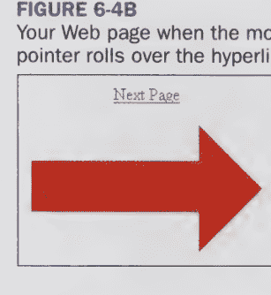

## 分析你刚刚输入的代码

如果你是一个敏锐的观察者，你会注意到这个HTML文档（*js-seven.html*）中的JavaScript语句与前一个文档（*js-six.html*）中的完全相同。因此，让我们确保你充分理解HTML标签中所做的更改，以及这些更改如何与JavaScript代码相关联。

> **网络提示**
> 当你有空闲时间时，花一个小时在网上搜索包含有趣图像或超文本悬停效果的网站。列出你最喜欢的网站，并尝试自己实现相同类型的悬停效果。

首先，`<A>` 和 `</A>` 锚点标签不再包含 `` 标签，因此箭头图像不再是超链接引用的一部分。相反，锚点标签现在包含你刚刚添加的“Next Page”文本。这意味着当鼠标悬停在新的超链接上时，*onMouseOver* 和 *onMouseOut* 事件将被触发，而不是当鼠标悬停在箭头图像上时。然而，JavaScript代码执行的操作与之前相同，因此图像会像以前一样改变颜色。

你可能想知道为什么我们在超文本和箭头图像之间插入了段落标签。我们这样做是因为段落标签会将图像强制推到“Next Page”超链接的下方。否则，图像将出现在超文本的右侧。（如果你想看看我们是什么意思，可以随意删除 `<P>` 标签并再次查看文件。）

你可能也想知道为什么箭头图像在上一个分步操作中被蓝色矩形包围，但在这个操作中却没有。这个问题的答案是，在分步操作6.1中，图像被定义为超链接，而超链接图像通常由Web浏览器显示为蓝色边框。这就是为什么当箭头图像从蓝色变为红色时，蓝色边框仍然可见。但在分步操作6.2中，图像没有被定义为超链接，所以蓝色边框消失了。相反，“Next Page”文本被定义为超链接，因此无论箭头图像的颜色如何，它都显示为蓝色并带下划线。明白了吗？（如果你想了解如何在分步操作6.1中消除蓝色矩形，请完成本课末尾的Web项目。）

## 创建循环横幅

当你在网上冲浪时，你很可能经常遇到包含不断变化的广告的商业网站。事实证明，这些循环横幅（也称为广告横幅）可以使用不同的互联网技术以多种方式创建。然而，创建此类广告最简单、最有效的方法之一是使用JavaScript事件和函数。

*循环横幅*实际上就是一系列图形图像，这些图像一个接一个地显示，每次图像切换之间有短暂的停顿。在序列中的所有图像都显示完毕后，浏览器将循环回到第一张图像并重新开始整个序列。这就是为什么这种特定的网页增强功能被称为循环横幅。

你可能认为创建循环横幅需要大量的时间和精力，但使用JavaScript并非如此！在下一节中，我们将向你展示，只需几分钟就可以将有效的广告展示集成到你的网页中。通过利用单个JavaScript事件，并定义一个简单的JavaScript函数，你将在循环横幅设计的世界中迈向名声和财富。你准备好了吗？

## 分步操作 6.3

1.  在此活动中，你需要四个图形，你可以从学生指南中下载。在你的Web浏览器中输入网址 **www.course.com**。
2.  点击搜索框并输入本书的标题（*HTML and JavaScript BASICS*）。
3.  点击 **Search** 并等待搜索结果出现。然后从结果列表中找到正确的书名并点击它。
4.  选择名为 **Student Online Companion** 的链接。
5.  点击 **Lesson 6** 链接，并从出现的列表中选择 **Data Files & Graphics** 链接。
6.  将 *lions.gif*、*tigers.gif*、*bears.gif* 和 *ohmy.gif*（见图6-6A、6-6B、6-6C和6-6D）图像下载到与你保存网页完全相同的文件夹中。如果你不小心将文件下载到不同的文件夹，你的网页将无法正常工作。（如果你需要复习如何下载这些文件，请返回第3课的分步操作3.2寻求帮助。）

7.  打开你的文本编辑器或文字处理器，并完全按照图6-5所示输入HTML/JavaScript代码。

图6-5
创建循环横幅的JavaScript代码

```
<HTML>
<HEAD>
<TITLE>HTML and JavaScript</TITLE>
<SCRIPT>
var imgArray = new Array(4);
imgArray[0] = new Image;
imgArray[0].src = "lions.gif";
imgArray[1] = new Image;
imgArray[1].src = "tigers.gif";
imgArray[2] = new Image;
imgArray[2].src = "bears.gif";
imgArray[3] = new Image;
imgArray[3].src = "ohmy.gif";
var index = 0;

function cycle()
{
    document.banner.src = imgArray[index].src;
    index++;
    if (index == 4)
    {
        index = 0;
    }
    setTimeout("cycle()", 2000);
    return;
}
</SCRIPT>
</HEAD>
<BODY onLoad="cycle()">
<CENTER>

</CENTER>
</BODY>
</HTML>
```

8.  将此文件保存在适当的文件夹中，命名为 **js-eight.html**。

9.  打开你的Web浏览器并查看你的 **js-eight.html** 页面。你的网页初始状态应如图6-6A所示，但经过两秒延迟后，应变为图6-6B所示。再经过两秒延迟后，应变为图6-6C所示，最后变为图6-6D所示。继续下一节，或者如果今天的学习到此结束，请关闭计算机。


## 分析你刚刚输入的代码

我们再次在相对少量的源代码中引入了几个重要的JavaScript概念。让我们仔细查看图6-5中的源代码列表，以确保你完全理解这里发生的事情。

> **网络提示**
> 当一个图形被定义为超链接时，浏览器将在其周围显示一个矩形边框。如果这个边框影响了页面的外观，请使用BORDER属性调整超链接边框的大小。在 `` 标签中使用 BORDER = 0 语句将移除边框。

首先，看看第5行（`var imgArray = new Array(4);`）。这里我们创建了一个新的JavaScript对象，你以前没有使用过，称为数组。*数组*只是一组相似对象的集合，可以通过变量名和索引来访问。*索引*只是一个整数变量，用于标识正在引用数组的哪个元素。

数组在几乎每种现代计算机语言中都可用，因此熟悉它们对你来说很重要。在本例中，我们的数组被定义为最多包含四个元素，其变量名叫做 *imgArray*。在这种情况下，数组将包含四个Image对象，但数组也可以包含任何其他类型的JavaScript对象。

其次，考虑第6到13行的JavaScript语句。这些语句对你来说应该有些熟悉，因为它们本质上与分步操作6.2中第5到8行的语句相同。第6行创建了一个新的Image对象，并将其命名为 *imgArray*，索引为0。第7行然后将这个新对象的源（src）属性设置为包含名为 *lions.gif* 的文件的内容。类似地，第8、10和12行的JavaScript语句也创建了Image类型的新对象，这些新对象被命名为 *imgArray*，索引值分别为1、2和3。第9、11和13行的语句分别将这三个新对象的src属性设置为文件*tigers.gif*、*bears.gif*和*ohmy.gif*的内容。现在，这四个图形图像可以通过其他JavaScript语句非常快速地显示出来，我们稍后将对此进行描述。

第三，第14行的语句（var index = 0;）只是创建了一个名为index的JavaScript变量，并为其赋值0。这个变量将用于访问*imgArray*数组中的各个元素。

第四，第16到26行的JavaScript语句定义了一个名为*cycle()*的函数，该函数将使循环横幅中的图像依次显示。这是通过将*document.banner*对象的src属性设置为*imgArray*数组当前元素的src属性来实现的。然后，我们递增存储在index变量中的值（使用++运算符），以便访问图像数组的下一个元素。术语**递增**意味着将值加1。由于此数组的有效索引仅为0到3，我们必须测试index的值，看它是否超出了可接受的范围。换句话说，如果index包含值4，我们必须将其重置为0，以使横幅图像循环回到序列的开头。然后，我们的最后任务是设置一个计时器，该计时器将在2000毫秒（2000毫秒等于2秒）后再次调用*cycle()*函数。到目前为止，你还能跟上吗？

最后，我们需要解释的是整个循环横幅过程是如何启动的。如果你仔细查看我们HTML文档的<BODY>标签（在源代码清单的第29行），你会看到我们插入了一个新的JavaScript事件。这个事件名为*onLoad*，它在Web浏览器完成加载HTML网页主体时触发。在这个例子中，浏览器加载名为*lions.gif*的图像（通过NAME属性将其分配给变量名*banner*），然后触发*onLoad*事件，这反过来导致*cycle()*函数被调用。然后，*cycle()*函数将根据JavaScript的*setTimeout()*方法（在同一个函数内部调用）每2秒被持续调用一次。你现在都弄明白了吗？在这次活动中你学到了很多东西！

## 互联网里程碑

## 通过零基数组改进编程语言

数组的发明是为了解决定义程序元素时的复杂问题。几乎每种编程语言都支持数组的概念，但它们实现数组索引的方式并不相同。例如，如果你在其他编程语言（如Basic、Fortran或Pascal）中定义一个包含10个元素的数组，你会使用索引值1、2、3、... 10来访问这10个元素。但其他一些语言（包括C++、Java和JavaScript）并不使用这种基于1的索引技术。相反，它们实现了一种基于零的技术，使得一个包含10个元素的数组的有效数组索引为0、1、2、... 9。起初你可能认为基于1的方法更有意义，因为它对新手程序员来说更容易理解。然而，如果你查看不同语言编译器生成的底层机器代码，你会看到基于1的方法对于计算机硬件处理来说效率较低。这就是专业程序员倾向于使用基于零的语言进行软件开发项目的原因之一。

## 显示随机图像

在之前的活动中，你学习了如何按特定顺序显示一系列图形图像。有时，网页设计者希望他们的图像以随机顺序出现。这种方法通常用于特定网站包含大量图形图像集合，并且网站所有者希望系统随机选择一张图像进行显示的情况。

起初，你可能认为按固定顺序显示图像比随机顺序显示要容易得多。但当你用JavaScript编程时，情况并非如此。事实上，显示随机图像实际上比创建循环横幅所需的代码行数更少。这主要是由于JavaScript内置的随机数生成功能。

由于本次活动的大部分源代码与上一次活动相同，你将能够使用之前的文件并进行一些修改。事实上，你所需要做的就是用一个类似的名为*select()*的函数替换cycle()函数。你甚至不需要担心将图形文件下载到正确的文件夹，因为我们将使用与上一次活动相同的图像。你准备好开始了吗？

## 分步指南 6.4

1.  打开你的文本编辑器或文字处理器，并检索你在上一个分步指南中创建的**js-eight.html**文件。

2.  接下来，修改HTML和JavaScript源代码。用**select()**函数替换**cycle()**函数，并如图6-7中粗体所示修改<BODY>标签中的onLoad事件。

图6-7
显示随机图像的JavaScript代码

```
<HTML>
<HEAD>
<TITLE>HTML and JavaScript</TITLE>
<SCRIPT>
var imgArray = new Array(4);
imgArray[0] = new Image;
imgArray[0].src = "lions.gif";
imgArray[1] = new Image;
imgArray[1].src = "tigers.gif";
imgArray[2] = new Image;
imgArray[2].src = "bears.gif";
imgArray[3] = new Image;
imgArray[3].src = "ohmy.gif";
var index = 0;

function select()
{
    index = Math.floor(Math.random() * 4);
    document.banner.src = imgArray[index].src;
    setTimeout("select()", 2000);
    return;
}
</SCRIPT>
</HEAD>
<BODY onLoad="select()">
<CENTER>

</CENTER>
</BODY>
</HTML>
```

3.  将此文件保存在适当的文件夹中，命名为**js-nine.html**。

4.  如果你的Web浏览器尚未打开，请打开它。

5.  查看你的**js-nine.html**页面。你的网页最初应如图6-6A、6-6B、6-6C或6-6D所示，然后图像应每两秒更改一次。与上一个分步指南不同，图像不会以可预测的顺序出现。继续下一节，或者如果你今天完成了，请关闭计算机。

## 分析你刚刚输入的代码

让我们快速回顾一下分步指南6.4中介绍的JavaScript概念。

首先，我们将函数名从cycle()更改为select()，因为它更准确地反映了函数的目的和行为。由于这个名称的更改，我们还需要修改HTML <BODY>标签中的*onLoad*事件语句，以便它调用正确的函数名称。如果我们没有进行此更改，Web浏览器将响应一条令人不快的错误消息。

其次，我们需要包含适当的JavaScript代码来生成一个随机数，然后将该数字转换为0到3范围内的有效数组索引。JavaScript方法random()是Math对象的一部分，它保证返回一个大于或等于0.0且小于1.0的实数。*实数*，也称为浮点数，是包含小数部分的数值。由于此受限范围内的数字不能用作数组索引，我们需要将它们缩放到适当的范围。在这种情况下，我们的数组中有四个元素，因此我们将随机值乘以4（使用*运算符）。现在我们得到一个保证大于或等于0.0且小于4.0的实数。最后一步是调用Math.floor()方法，该方法将消除结果数字的小数部分。这意味着唯一可能的值是0、1、2和3，这些正是我们需要用作数组索引的值。

为了确保你对这个过程感到满意，让我们通过一个例子来演示。假设select()函数被调用的前三次，Math.random()方法生成的随机值分别为0.137、0.8312和0.54。当我们将这些数字乘以4时，结果值分别为0.548、3.3248和2.16。然后，当我们通过Math.floor()方法处理这些新的实数时，存储在index变量中的最终数字将是0、3和2。

显然，这些都是有效的数组索引值，因此显示的图像将是文件*lions.gif*的内容，接着是*ohmy.gif*，最后是*bears.gif*。或者换句话说，你将在屏幕上看到图6-6A，接着是图6-6D，最后是图6-6C。你明白了吗？

> **网络提示**
> HTML不区分大小写。浏览器将以相同的方式解释、或。然而，对于像JavaScript这样的编程语言，情况并非如此。在命名JavaScript对象、变量或函数时，你必须确保每次使用相同的大小写，因为JavaScript解释器会将INDEX、index和Index视为三个不同的变量。这将导致每次运行脚本时变量名被不同地解释。

## 创建 JavaScript 幻灯片

在前两个分步教程中，我们向你展示了如何创建能每两秒自动更换屏幕图像的 JavaScript 程序。但有时，让用户自己决定何时更换图像更为理想。当你允许用户通过点击鼠标上的某个对象来更换图像时，最终效果类似于电子*幻灯片*。

在下一个分步教程中，你将创建一个 JavaScript 程序，为用户提供两个分别标记为<u>上一张</u>和<u>下一张</u>的超链接。当用户点击其中一个链接时，显示的图像将相应地改变。

为了完成此任务，你需要修改在上一个分步教程中创建的 *js-nine.html* 文件。你将移除 select() 函数，并插入两个名为 doBack() 和 doNext() 的新函数。然后，你将添加一些额外的 HTML 标签，使屏幕看起来更美观，并为用户提供适当的超链接，以触发幻灯片图像的更改。你可能已经迫不及待地想开始这个练习了，那么我们开始吧！为了简单起见，我们将使用与前两个练习中相同的图形图像。

## 分步教程 6.5

1.  打开你的文本编辑器或文字处理器，并调出你在上一个活动中创建的 **js-nine.html** 文件。
2.  删除 **select()** 函数，并用两个名为 **doBack()** 和 **doNext()** 的新函数替换它。
3.  修改 <BODY> 标签，删除 **onLoad** 事件和对 **select()** 函数的调用。
4.  在居中标签之间，你需要添加如图 6-8 所示的额外 HTML 标签和文本，以使你的幻灯片在屏幕上看起来更美观。
5.  完成编辑后，生成的文件应与图 6-8 所示的源代码清单完全一致。

### 图 6-8
创建幻灯片所需的 JavaScript 代码

```
<HTML>
<HEAD>
<TITLE>HTML and JavaScript</TITLE>
<SCRIPT>
var imgArray = new Array(4);
imgArray[0] = new Image;
imgArray[0].src = "lions.gif";
imgArray[1] = new Image;
imgArray[1].src = "tigers.gif";
imgArray[2] = new Image;
imgArray[2].src = "bears.gif";
imgArray[3] = new Image;
imgArray[3].src = "ohmy.gif";
var index = 0;

function doBack()
{
    if (index > 0)
    {
        index--;
        document.slideshow.src = imgArray[index].src;
    }
    return;
}

function doNext()
{
    if (index < 3)
    {
        index++;
        document.slideshow.src = imgArray[index].src;
    }
    return;
}
</SCRIPT>
</HEAD>
<BODY>
<CENTER>
<H2>My JavaScript Slide Show</H2>
<P>

<P>
<A HREF="javascript:doBack()">Back</A>
&nbsp;&nbsp;&nbsp;
<A HREF="javascript:doNext()">Next</A>
</CENTER>
</BODY>
</HTML>
```

6.  将你的新文件保存为 **js-ten.html**。
7.  打开你的 Web 浏览器并查看你的 **js-ten.html** 文件。你的屏幕最初应如图 6-9A 所示。然而，当你持续点击“下一张”超链接时，图像将改变，看起来像图 6-9B、6-9C 和 6-9D。继续下一节，或者如果你今天的学习到此结束，请关闭计算机。

## 分析你刚刚输入的代码

我们再次在上一个分步教程中引入了新的 JavaScript 概念，所以让我们快速回顾一下，确保你没有遗漏任何内容。JavaScript 代码的前几行（第 5 到 14 行）与前两个分步教程中的相同，所以你现在应该对它们感到熟悉了。但你可能对 doBack() 和 doNext() 函数中的所有内容并不完全熟悉。让我们逐步讲解。

我们在 doBack() 函数中做的第一件事是测试 index 变量的值。如果它大于 0，那么我们知道当前显示的不是幻灯片中的第一张图像，因此我们需要退回到序列中的上一张图像。这是通过递减存储在 index 中的值（使用 -- 运算符）然后将新的图像源加载到我们 HTML 文档的 slideshow 对象中来完成的。正如你可能预料的那样，术语*递减*意味着从变量的当前值中减去 1。但你应该知道，如果 index 的当前值为 0，那么 doBack() 函数将不执行任何操作。

doNext() 函数的内容当然与 doBack() 函数非常相似。我们首先检查 index 的值，看其当前值是否小于 3。如果是，那么我们知道当前显示的不是幻灯片序列中的最后一张图像，因此我们需要更改屏幕上的图像。这是通过递增 index 变量，然后将 slideshow 对象的 src 属性设置为列表中的下一张图像来完成的。但如果 index 的值为 3，那么 doNext() 函数将不执行任何操作。

如果你对第 1 至 4 课的内容有扎实的理解，那么你应该对这个网页 body 标签中的大部分 HTML 代码感到完全适应。然而，有几样东西你以前没见过，所以我们也来解释一下。

你可能已经注意到，“上一张”超链接的 HREF 属性并不包含我们对另一个 HTML 文档的引用。相反，它包含对名为 doBack() 的 JavaScript 函数的引用。这意味着当用户点击此超链接时，Web 浏览器将执行指定的函数，而不是加载新的 HTML 页面！这很巧妙，不是吗？

我们想在本课中讨论的最后一个问题是源代码清单图 6-8 第 44 行出现的三个神秘符号 &nbsp;。简单来说，这些符号是 HTML 命令，告诉 Web 浏览器在“上一张”超链接和“下一张”超链接之间放置一些额外的空间。它们对于此 JavaScript 程序的正确运行并非必需，但它们在一定程度上改善了页面的外观。如果你愿意，可以随意从你的文件中删除这一行。

## 网络道德

### 版权代码侵权

我们在第 3 课中提到，网页开发者从商业网站下载受版权保护的图像然后将其用于自己的目的是非常不道德的。无论图像是用于标准 HTML 页面还是 JavaScript 页面，这显然都成立。但当你开始开发 JavaScript 增强型网页时，你也应该意识到，脚本盗版与图片盗版一样不道德。事实上，这不仅是不道德的，而且是非法的！尽管下载和研究其他人创建的脚本有时是学习 JavaScript 的好方法，但你必须记住，版权法仍然适用。你可以自由地使用公开可访问的 JavaScript 代码用于教育目的，但你不应该简单地从别人的网站上复制脚本用于自己的网站，除非你得到所有者的许可。

## 总结

在本课中，你学到了：

- 你可以理解 JavaScript 事件的名称和用途。
- 创建图像翻转效果。
- 创建超链接翻转效果。
- 构建循环横幅。
- 显示随机图像。
- 创建 JavaScript 幻灯片。

## 词汇复习

| 定义以下术语： | | |
| --- | --- | --- |
| 数组 | 图像翻转 | 实数（浮点数） |
| 循环横幅（广告横幅） | 递增 | 幻灯片 |
| 递减 | 索引 | 变量 |
| 事件 | 实例化（参见第 165 页的 Web 项目） | |
| 函数 | | |
| 超链接翻转 | | |

## 复习题

判断正误

如果陈述正确，请圈出 T；如果陈述错误，请圈出 F。

- T F 1. 触发或启动事件的条件总是由用户引起的。
- T F 2. <SCRIPT></SCRIPT> 标签可以出现在 HTML 文档的头部部分。
- T F 3. 变量被命名后，可以在整个 HTML 文档中使用它来引用该特定值或对象。
- T F 4. 所有翻转效果都是超链接图像。
- T F 5. JavaScript 方法 random() 将返回一个实数或浮点数。

### 填空题

请在提供的空白处填写正确的单词或短语，完成下列句子。

1.  __________ 是对特定条件发生时的系统级响应。
2.  __________ 不过是一段可以被调用的 JavaScript 代码，就像 document.write() 方法一样。
3.  图像 __________ 是借助 onMouseOver 和 onMouseOut 事件创建的。
4.  JavaScript __________ 不过是赋予一个字面值或一个对象的名称。
5.  __________ 横幅也被称为广告横幅。

### 简答题

请简要回答下列问题。

1.  什么是 JavaScript 事件？事件是如何产生的？
2.  什么是 JavaScript 函数？函数与方法有何不同？
3.  图像翻转与超链接翻转有何不同？
4.  什么是循环横幅？为什么称之为“循环”？
5.  Math 对象的 random() 和 floor() 方法有什么用途？
6.  什么是 JavaScript 电子幻灯片？

## 项目

### 项目 6-1

在这个项目中，GreatApplications, Inc. 刚刚聘请你来接替一位最近为了更高薪水而离开公司的 JavaScript 程序员。不幸的是，你的前任留下了一个未完成的重要项目。你必须修复在“分步指南 6.1”中创建的脚本。你可能已经注意到，当鼠标指针悬停在箭头图像上时点击鼠标按钮，你的 Web 浏览器会显示一条错误消息。你认为为什么会发生这种情况？嗯，如果你思考一下，箭头图像在这个文档中被定义为一个超链接，而超链接的目的是告诉浏览器在用户点击它时加载一个新的 HTML 文档。

仔细查看你的 `<A HREF=>` 标签和属性中的 HREF 属性。如果你点击这个特定的超链接，浏览器将尝试加载哪个网页文件？显然，答案是 webpage.html 文件。但这个文件真的存在吗？当然不存在；需要有人来创建它，对吧？我们认为那个人应该是你！

继续创建一个令人兴奋的 HTML 页面，并将其保存为 **webpage.html**。然后，再次查看你的 js-six.html 页面，并通过点击箭头图像（当它变色时）来验证你的浏览器是否真的会显示你的新页面。别忘了你的新文件必须保存在与你的 js-six.html 文件相同的文件夹中。

### 团队项目

GreatApplications, Inc. 的管理团队决定创建一个电子动物园，并希望在其公司网站上向公众开放。因此，他们给你的团队布置了创建一个 JavaScript 幻灯片的任务，其中包含许多不同类型动物的图像。组建并组织三到四名成员的团队。每个成员应该花一些时间在网上搜索合适的动物图像，然后你们必须创建一个 JavaScript 幻灯片程序来展示它们。从图 6-8 中列出的源代码开始，然后进行必要的修改，使程序能够显示你们收集的动物图像。你可能需要更改的一些内容包括：

-   网页标题
-   图像文件名
-   幻灯片窗口的大小（尺寸）

将你们团队的工作保存为 **js-test7.html**。

### Web 项目

在团队项目中，你发现了替换图形和改变幻灯片外观和感觉是多么容易。让我们假设一下，你的收藏品从仅仅四张图形图像增加到了八张。你需要对你的 JavaScript 程序进行哪些更改才能使其与八张图像正常工作？首先，你需要将数组大小从四更改为八。然后，你需要学习一个新词，**实例化**，这是创建一个新对象并为其赋值的过程。你需要像在“分步指南 6.5”中为前四个元素所做的那样，实例化四个新的数组元素。你认为这四个新数组元素的有效索引值是多少？如果你猜的是 4、5、6 和 7，那就完全正确了！不过，在完成这一步之后，你仍然需要进一步修改代码。你能识别出需要更改的地方吗？比如更改 doNext() 函数中的最后一个索引值？

将你的工作保存为 **js-test8.html**。

## 批判性思维

### 活动 6-1

在“分步指南 6.3”中，我们向你展示了如何创建循环横幅，或者有时也称为广告横幅。我们还提到，许多商业网站都包含广告横幅，通常位于其网页的顶部。但有一件事我们没有解释，那就是为什么网上有这么多这样的网站。这基本上归结为一个金钱问题。网站的所有者将向公司收取一定的费用，以便在其托管网页上包含他们的广告。通过这种方式，许多网站可以向用户提供服务，同时也能覆盖自己的运营成本。通过考虑以下问题来分析其中一些网站：

1.  哪些类型的企业可能会选择付费让其他公司托管他们的广告横幅？
2.  哪些类型的产品和服务最有可能以这种方式进行广告宣传？
3.  你认为为什么大多数广告横幅都被定义为超链接？
4.  哪些类型的网站最有可能托管广告横幅？

### 活动 6-2

在“分步指南 6.1”中，我们向你展示了如何创建一个当鼠标经过图像时做出反应的翻转效果。在“分步指南 6.2”中，我们向你展示了如何创建一个当鼠标指针经过超链接时改变箭头颜色的翻转效果。但现在我们想知道你是否能创建一个对任一条件都能做出反应的翻转效果。

你能否对你的 js-seven.html 文件进行一个小修改，使得当鼠标经过超链接或箭头时，箭头图像都会改变颜色？当然可以！你所需要做的就是将一个 HTML 标签从其当前位置移动到一个新位置。但是是哪一个呢？通过检查和思考代码，你能找出需要移动哪个标签以及它需要移到哪里吗？试一试吧！

将你的工作保存为 **js-test9.html**。

### 活动 6-3

在“分步指南 6.3”（js-eight.html）中，你使用了 2000 毫秒的超时值。但有时不同的值可能更有效。尝试更改调用的 setTimeout() 方法中的延迟值，看看不同的数字会产生什么效果。

将你的工作保存为 **js-test10.html**。

如果你非常聪明，可以将这个练习更进一步。你可能认识到这样一个事实：有时为横幅序列中的每张图像提供不同的延迟值可能是可取的。如果你准备好迎接挑战，尝试在 HTML 文档的头部部分创建一个名为 delay 的第二个四元素数组。然后为新数组中的每个元素分配不同的值（例如 1000、4000、3000 和 2000），并在 setTimeout() 方法调用中使用这些值。也就是说，用变量名 delay[index] 替换常量值 2000。如果你能正确完成这个任务，那么你就已经走上了理解 JavaScript 数组基础知识的正轨。你应该为自己感到骄傲！

将你更高级的工作保存为 **js-test10advanced.html**。

### 活动 6-4

有时 Web 设计师喜欢创建以循环方式而非线性方式运行的幻灯片。这意味着每当用户到达图像序列的任一端时，程序将跳转到另一端并继续显示图像。换句话说，如果用户当前正在查看幻灯片序列中的第一页，并且她点击了“后退”超链接，那么下一张显示的图像将是该集合中的最后一张图像。同样，当用户正在查看序列中的最后一张图像，然后点击“前进”超链接时，她将立即看到第一张幻灯片图像。你认为你可以修改你的 js-ten.html 文件使其以这种方式运行吗？我们相信你能做到！如果答案对你来说不是显而易见的，请返回研究“分步指南 6.3”中的 JavaScript cycle() 函数。它应该会告诉你所有你需要知道的信息！

将你的工作保存为 **js-test11.html**。

## 总结项目

在本课中，你学习了许多有价值的 JavaScript 技能，这些技能使你能够创建循环横幅、随机图像显示和电子“幻灯片”。然而，你应该认识到这些技术并非相互排斥。换句话说，对于给定的网页，你不一定必须只选择其中一种技术。如果你愿意，你可以同时使用所有三种技术。通过创建一个使用所有这三种 JavaScript 图像技术的网页，来证明你已经掌握了本课中介绍的所有概念。完成后，你的网页应该看起来像图 6-10。

## 图 6-10

包含三种 JavaScript 图像技术的网页


### 项目要求

- 使用你在“分步操作 6.3”中下载的相同图像文件。
- 在网页的上三分之一区域创建一个循环横幅。
- 在网页的中间三分之一区域创建一个随机图像显示。
- 在网页的下三分之一区域创建一个幻灯片放映。
- 设计一种方法，使循环横幅和随机图像显示在网页加载时同时启动。

## 第 7 课
使用 JavaScript 创建表单

### 学习目标
完成本课后，你应该能够：
- 理解 JavaScript 输入控件的用途和用法。
- 理解数据验证的好处。
- 创建一个 HTML 表单。
- 使用 JavaScript 增强 HTML 表单的功能。

预计时间：2 小时

### 词汇表
- 复选框
- 控件/组件
- 数据验证
- 单选按钮
- 文本字段

## 使 HTML 表单功能更强大

在第 3 课中，你已经对 HTML 表单有了初步了解。在本课中，我们将首先回顾第 3 课介绍的内容，然后向你展示如何使用 JavaScript 来增强 HTML 表单的功能。

我们开始创建一个功能齐全、健壮的表单的过程，首先是在网页上定义表单的总体布局。这一步是通过使用第 3 课中描述的相应 HTML 标签来完成的。下一步是识别 HTML 表单中用户将与之交互的各种对象。每个这样的交互对象（也称为*控件*或*组件*）都必须被赋予一个名称，以便在 JavaScript 代码中引用它。最后一步是编写 JavaScript 函数，这些函数将在用户触发特定的 JavaScript 事件时被调用。

你将在本课中学到的最重要的概念之一是数据验证的思想。*数据验证*就是检查用户输入数据以确保其完整性和准确性的过程。虽然并不总是能捕捉到用户在填写表单时可能犯的每一个错误，但有许多种错误是可以被检测到的。例如，如果用户忘记填写表单的某一部分，JavaScript 很容易就能检测到必要数据的缺失并相应地提醒用户。

为了让你有效地学习这些 JavaScript 表单处理概念，我们希望你假装自己在一家名为“The JavaScript Pizza Parlor”的新成立的披萨公司工作。作为这家新公司的员工，你的工作将是创建一个网页，允许客户通过互联网订购披萨。在你完成以下分步操作的过程中，你将学习如何让你的电子订单表单变得越来越好。

我们确信你已经迫不及待地想要开始了，那么我们开始吧！

## 创建披萨订单表单

为 The JavaScript Pizza Parlor 创建有效订单表单的第一步是使用适当的 HTML 标签在网页上定义其外观。在下面的分步操作中，你将使用第 3 课中介绍的几个标签和属性，使你的表单看起来美观且组织良好。完成的表单将仅由标题、标签和用户输入控件组成，但要让它们在屏幕上都看起来很好需要时间和练习。请注意标题、字体和换行标签的使用方式，它们控制着披萨订单表单的最终外观。

你还应该密切关注在分步操作 7.1 中使用的几个 HTML 标签中出现的 NAME 属性。虽然这些名称完全不影响表单的外观，但它们是文档的关键元素。它们将在你后续分步操作中创建的 JavaScript 函数中被广泛使用。

## 分步操作 7.1

1. 打开你的文本编辑器或文字处理器，完全按照图 7-1 所示输入 HTML 代码。

**图 7-1**
创建披萨订单表单的 HTML 代码

```
<HTML>
<HEAD>
<TITLE>HTML and JavaScript</TITLE>
</HEAD>
<BODY>
<FORM NAME="PizzaForm">
<H1>The JavaScript Pizza Parlor</H1>
<BR>
<H4>Step 1: Enter your name, address, and phone number:</H4>
<FONT FACE="Courier">
Name: &nbsp;&nbsp;&nbsp;<INPUT NAME="customer" TYPE="TEXT" SIZE=50><BR>
Address: <INPUT NAME="address" TYPE="TEXT" SIZE=50><BR>
City: &nbsp;&nbsp;&nbsp;<INPUT NAME="city" TYPE="TEXT" SIZE=16>
State: <INPUT NAME="state" TYPE="TEXT" SIZE=4>
Zip: <INPUT NAME="zip" TYPE="TEXT" SIZE=8><BR>
Phone: &nbsp;&nbsp;<INPUT NAME="phone" TYPE="TEXT" SIZE=50><BR>
</FONT>
<BR><BR>
<H4>Step 2: Select the size of pizza you want:</H4>
<FONT FACE="Courier">
<INPUT NAME="size" TYPE="RADIO">Small
<INPUT NAME="size" TYPE="RADIO">Medium
<INPUT NAME="size" TYPE="RADIO">Large<BR>
</FONT>
<BR><BR>
<H4>Step 3: Select the pizza toppings you want:</H4>
<FONT FACE="Courier">
<INPUT NAME="toppings" TYPE="CHECKBOX">Pepperoni
<INPUT NAME="toppings" TYPE="CHECKBOX">Canadian Bacon
<INPUT NAME="toppings" TYPE="CHECKBOX">Sausage<BR>
<INPUT NAME="toppings" TYPE="CHECKBOX">Mushrooms
<INPUT NAME="toppings" TYPE="CHECKBOX">Pineapple
<INPUT NAME="toppings" TYPE="CHECKBOX">Black Olives<BR>
</FONT>
<BR><BR>
<INPUT TYPE="BUTTON" VALUE="Submit Order">
<INPUT TYPE="BUTTON" VALUE="Clear Entries">
</FORM>
</BODY>
</HTML>
```

2. 将此文件保存在适当的文件夹中，命名为 **js-eleven.html**。

3. 如果你的网页浏览器尚未打开，请打开它。

## 分步操作 7.1 续

4. 查看你的 **js-eleven.html** 文件。你的网页应该如图 7-2 所示。

**图 7-2**
一个 HTML 披萨订单表单


5. 继续下一节，或者如果你今天的工作已完成，请关闭软件并关闭计算机。

## 分析你刚刚输入的代码

正如我们之前指出的，分步操作 7.1 中使用的所有 HTML 标签都在第 3 课中介绍过。但是，为了确保你完全理解所有内容，让我们在继续本课的 JavaScript 部分之前，回顾一下这些概念。由于表单本身分为三个部分（或步骤），让我们仔细看看每个部分，了解它具体是如何工作的。

我们称为步骤 1 的部分由一个标题和六个带标签的文本字段组成。*文本字段*是一种输入控件，允许用户在网页上的特定位置键入字符串值。每个文本字段都被分配了一个名称和一个大小。`&nbsp;` 符号用于对齐姓名、地址、城市和电话字段的左边缘。

步骤 2 部分由一个标题和三个带标签的单选按钮组成。*单选按钮*是一种输入控件，允许用户从一组选项中只选择一个选项。在本例中，单选按钮被标记为小、中、大，以对应可用的披萨尺寸。网页浏览器会将这三个选项视为一组，因为它们都被赋予了相同的名称（*size*）。

最后一部分，称为步骤 3，由标题和六个带标签的复选框组成。*复选框*是一种输入控件，允许用户从一组选项中选择任意数量的选项。与步骤 2 一样，这些复选框被赋予了与六种可用披萨配料相对应的标签。网页浏览器也会将这六个选项视为一组，因为它们都被分配了名称 *toppings*。

这个披萨订单表单的最后一部分包含两个位于页面底部的按钮，分别标记为“提交订单”和“清除条目”。这些输入控件与其他控件一样使用 `<INPUT>` 标签定义，但 TYPE 属性被设置为 BUTTON，而不是 TEXT、RADIO 或 CHECKBOX。如果你尝试点击这些控件中的任何一个，你会发现它们目前不执行任何操作。使这些按钮功能化是接下来两个分步操作的目标。

## 使“提交订单”按钮功能化

现在我们已经有了坚实的 HTML 基础来构建披萨订单表单，让我们开始使用 JavaScript 添加一些额外的功能。我们要做的第一件事是添加一个 JavaScript 函数，当用户点击“提交订单”按钮时，该函数将被调用。在这种情况下，我们将简单地显示一个警报框，让用户知道他或她的披萨订单已提交给 The JavaScript Pizza Parlor。这是我们表单的重要组成部分，因为通常最好让用户知道程序正在做什么。

为了使“提交订单”按钮在被点击时调用一个 JavaScript 函数，你需要使用一个新的 JavaScript 事件。正如你可能预料的那样，这个事件被称为 *onClick*，每当类型为 BUTTON 的输入控件被点击时，它就会被触发。

现在你知道需要做什么了，那就开始做吧！

## 分步操作 7.2

1. 打开你的文本编辑器或文字处理器，检索你在上一个活动中创建的 **js-eleven.html** 文件。
2. 添加 **doSubmit()** JavaScript 函数定义，如图 7-3 中粗体所示。

## 分步指南 7.2 续

3.  在定义“提交订单”按钮的 `<INPUT>` 标签中添加 **onClick** 事件语句。此更改在图 7-3 中也以粗体显示。

## 图 7-3

一个带有功能性“提交订单”按钮的披萨订单表单

```html
<HTML>
<HEAD>
<TITLE>HTML and JavaScript</TITLE>
<SCRIPT>
function doSubmit()
{
    alert("Your pizza order has been submitted.");
    return;
}
</SCRIPT>
</HEAD>
<BODY>
<FORM NAME="PizzaForm">
<H1>The JavaScript Pizza Parlor</H1>
<BR>
<H4>Step 1: Enter your name, address, and phone number:</H4>
<FONT FACE="Courier">
Name: &nbsp;&nbsp;&nbsp;<INPUT NAME="customer" TYPE="TEXT" SIZE=50><BR>
Address: <INPUT NAME="address" TYPE="TEXT" SIZE=50><BR>
City: &nbsp;&nbsp;&nbsp;<INPUT NAME="city" TYPE="TEXT" SIZE=16>
State: <INPUT NAME="state" TYPE="TEXT" SIZE=4>
Zip: <INPUT NAME="zip" TYPE="TEXT" SIZE=8><BR>
Phone: &nbsp;&nbsp;<INPUT NAME="phone" TYPE="TEXT" SIZE=50><BR>
</FONT>
<BR><BR>
<H4>Step 2: Select the size of pizza you want:</H4>
<FONT FACE="Courier">
<INPUT NAME="size" TYPE="RADIO">Small
<INPUT NAME="size" TYPE="RADIO">Medium
<INPUT NAME="size" TYPE="RADIO">Large<BR>
</FONT>
<BR><BR>
<H4>Step 3: Select the pizza toppings you want:</H4>
<FONT FACE="Courier">
<INPUT NAME="toppings" TYPE="CHECKBOX">Pepperoni
<INPUT NAME="toppings" TYPE="CHECKBOX">Canadian Bacon
<INPUT NAME="toppings" TYPE="CHECKBOX">Sausage<BR>
<INPUT NAME="toppings" TYPE="CHECKBOX">Mushrooms
<INPUT NAME="toppings" TYPE="CHECKBOX">Pineapple
<INPUT NAME="toppings" TYPE="CHECKBOX">Black Olives<BR>
</FONT>
<BR><BR>
<INPUT TYPE="BUTTON" VALUE="Submit Order" onClick="doSubmit()">
</FORM>
</BODY>
</HTML>
```

图 7-3（续）

```html
<INPUT TYPE="BUTTON" VALUE="Clear Entries">
</FORM>
</BODY>
</HTML>
```

4.  将你的新文件保存为 **js-twelve.html**。
5.  打开你的 Web 浏览器并查看你的 **js-twelve.html** 文件。你的屏幕最初应如图 7-2 所示，但当你点击“提交订单”按钮时，应显示一个警告框，如图 7-4 所示。

> **重要提示**
安装了 Service Pack 2 的 Windows XP 用户可能会看到有关活动内容的警告。只需单击“确定”以确认警告，然后按照提示启用 JavaScript。

## 图 7-4

点击“提交订单”按钮后的披萨订单表单


6.  继续下一节，或者如果你今天的学习到此结束，请关闭你的软件并关闭计算机。

## 分析你刚刚输入的代码

如果你花点时间思考一下你刚刚输入的代码，你应该会认识到其中并没有太多新内容。你刚刚添加的 `doSubmit()` 函数除了调用 JavaScript 的 `alert()` 方法外，什么也没做，而这个方法在第 5 课中已经描述过。并且在第 6 课中也详细介绍了定义 JavaScript 函数的概念。因此，你应该对这部分程序感到非常熟悉。

至于你添加到提交按钮 `<INPUT>` 标签中的 *onClick* 事件，它的外观和行为也与你在第 6 课中使用的 *onMouseOver*、*onMouseOut* 和 *onLoad* 事件完全一样。换句话说，你在理解分步指南 7.2 中介绍的概念时应该毫无困难。至少我们希望你没有遇到困难！

## 使“清除条目”按钮功能化

你可能从个人经验中知道，人们在填写纸质表格时犯错是非常普遍的。不幸的是，电子表格也是如此，尤其是当它们需要输入大量信息时。因此，网页设计者通常会包含某种清除按钮，允许用户单击即可擦除表单条目。

在我们的披萨订单表单中，最好能让客户在提交订单后清除表单。然后，无需逐个字段更改所有现有数据，就可以下第二个订单。

为了完成此任务，你需要向你的 HTML/JavaScript 文档添加另一个名为 *doClear()* 的函数。接下来，你应该像在上一个分步指南中为“提交订单”按钮所做的那样，为“清除条目”按钮的 `<INPUT>` 标签添加一个 *onClick* 事件。此事件将调用 *doClear()* 函数以擦除任何现有的表单数据。明白了吗？

## 分步指南 7.3

1.  打开你的文本编辑器或文字处理器，并检索你在上一个分步指南中创建的 **js-twelve.html** 文件。

> **网络礼仪**
在过去的二十年里，许多软件开发人员已经认识到给予用户充分反馈的重要性。换句话说，程序员必须向用户提供某种视觉（有时是音频）线索，以表明程序正在做什么或何时完成其操作，这一点至关重要。想一想。你认为一个普通的计算机用户如果在电子表单上点击“提交订单”按钮而没有任何反应，会怎么做？

除非出现一条消息确认订单已实际提交，否则用户可能会再次点击该按钮。也许客户可能会再点击几次，希望能收到一些响应。其他一些用户甚至可能错误地认为他们的计算机已停止响应，需要重新启动！

当程序必须执行需要很长时间才能完成的操作时，这是一个特别重要的问题。例如，当你的 Web 浏览器通过缓慢的 Internet 连接下载大型图形图像时，JavaScript 程序提供某种视觉反馈以让你知道它确实在做一些事情是至关重要的。否则，你会看到很多不耐烦的用户毫无理由地重新启动他们的计算机。所以，请体谅用户，并设计你的 JavaScript 程序以提供大量适当的反馈。

## 分步指南 7.3 续

2.  在结束脚本标签的正上方，添加 **doClear()** 函数的 JavaScript 代码，如图 7-5 中的粗体所示。
3.  接下来，为“清除条目”按钮的 `<INPUT>` 标签添加 **onClick** 事件，同样在图 7-5 中以粗体显示。

## 图 7-5

一个带有功能性“清除条目”按钮的披萨订单表单

```html
<HTML>
<HEAD>
<TITLE>HTML and JavaScript</TITLE>
<SCRIPT>
function doSubmit()
{
    alert("Your pizza order has been submitted.");
    return;
}

function doClear()
{
    document.PizzaForm.customer.value = "";
    document.PizzaForm.address.value = "";
    document.PizzaForm.city.value = "";
    document.PizzaForm.state.value = "";
    document.PizzaForm.zip.value = "";
    document.PizzaForm.phone.value = "";
    document.PizzaForm.size[0].checked = false;
    document.PizzaForm.size[1].checked = false;
    document.PizzaForm.size[2].checked = false;
    document.PizzaForm.toppings[0].checked = false;
    document.PizzaForm.toppings[1].checked = false;
    document.PizzaForm.toppings[2].checked = false;
    document.PizzaForm.toppings[3].checked = false;
    document.PizzaForm.toppings[4].checked = false;
    document.PizzaForm.toppings[5].checked = false;
    return;
}
</SCRIPT>
</HEAD>
<BODY>
<FORM NAME="PizzaForm">
<H1>The JavaScript Pizza Parlor</H1>
<BR>
<H4>Step 1: Enter your name, address, and phone number:</H4>
<FONT FACE="Courier">
Name: &nbsp;&nbsp;&nbsp;<INPUT NAME="customer" TYPE="TEXT" SIZE=50><BR>
Address: <INPUT NAME="address" TYPE="TEXT" SIZE=50><BR>
City: &nbsp;&nbsp;&nbsp;<INPUT NAME="city" TYPE="TEXT" SIZE=16>
State: <INPUT NAME="state" TYPE="TEXT" SIZE=4>
Zip: <INPUT NAME="zip" TYPE="TEXT" SIZE=8><BR>
Phone: &nbsp;&nbsp;<INPUT NAME="phone" TYPE="TEXT" SIZE=50><BR>
</FONT>
<BR><BR>
<H4>Step 2: Select the size of pizza you want:</H4>
<FONT FACE="Courier">
<INPUT NAME="size" TYPE="RADIO">Small
<INPUT NAME="size" TYPE="RADIO">Medium
<INPUT NAME="size" TYPE="RADIO">Large<BR>
</FONT>
<BR><BR>
<H4>Step 3: Select the pizza toppings you want:</H4>
<FONT FACE="Courier">
<INPUT NAME="toppings" TYPE="CHECKBOX">Pepperoni
<INPUT NAME="toppings" TYPE="CHECKBOX">Canadian Bacon
<INPUT NAME="toppings" TYPE="CHECKBOX">Sausage<BR>
<INPUT NAME="toppings" TYPE="CHECKBOX">Mushrooms
<INPUT NAME="toppings" TYPE="CHECKBOX">Pineapple
<INPUT NAME="toppings" TYPE="CHECKBOX">Black Olives<BR>
</FONT>
<BR><BR>
<INPUT TYPE="BUTTON" VALUE="Submit Order" onClick="doSubmit()">
<INPUT TYPE="BUTTON" VALUE="Clear Entries" onClick="doClear()">
</FORM>
</BODY>
</HTML>
```

4.  将此文件保存在适当的文件夹中，命名为 **js-thirteen.html**。
5.  如果你的 Web 浏览器尚未打开，请打开它。
6.  查看你的 **js-thirteen.html** 页面。你的网页最初应如图 7-2 所示。
7.  接下来，在步骤 1 的文本字段中输入你的信息。
8.  在在线表单的步骤 2 中选择一个披萨尺寸。
9.  在在线表单的步骤 3 中选择几种配料。
10. 现在点击表单底部的 **Clear Entries** 按钮。整个表单应立即变为空白，然后再次看起来像图 7-2。
11. 继续下一节，或者如果你今天的学习到此结束，请关闭你的软件并关闭计算机。

## 分析你刚刚输入的代码

如你所见，使“清除条目”按钮生效所需的步骤，与我们之前激活“提交订单”按钮所用的步骤非常相似。然而，`doClear()` 函数中引入了一些新概念，理解它们对你很重要。因此，让我们仔细看看这些 JavaScript 语句的作用。

`doClear()` 函数的第一条语句利用了文本输入控件对象的 *value* 属性。在这个特定案例中，文本控件被命名为 *customer*，并且它是我们在名为 *PizzaForm* 的 FORM 对象内的一个元素。而 FORM 对象本身，又包含在我们在第 5 课首次介绍的 document 对象中。因此，我们可以通过将空字符串 ("") 赋值给 *document.PizzaForm.customer.value* 属性，来轻松清除该文本字段中存储的值。

`doClear()` 函数的接下来五条语句执行的操作基本相同，只是它们引用的是名为 *address*、*city*、*state*、*zip* 和 *phone* 的文本控件对象。由于这五个控件也属于 HTML 文档中的 FORM 对象，因此它们通过 *document.PizzaForm* 前缀来引用。此外，我们通过将空字符串赋值给它们的 value 属性来清除这五个控件，就像我们处理 *customer* 字段一样。

步骤 2 中清除披萨尺寸值的操作方式类似，但这里有一个新概念在起作用。由于我们为所有三个 RADIO 输入控件赋予了相同的名称 (*size*)，JavaScript 解释器会将它们视为一个对象数组。这意味着我们必须使用索引值来指明我们希望访问哪个单选按钮。分配给数组元素的索引值总是从 0 开始，并且对于遇到的每个新元素会顺序递增。在这个案例中，标记为 *Small*、*Medium* 和 *Large* 的单选按钮将分别被分配索引值 0、1 和 2。每个这样的对象都包含一个名为 *checked* 的属性，该属性指示该选项是否被选中。我们只需将其 checked 属性设置为逻辑值 *false*，即可清除所有这些选项。

> 技术职业

当你完成本课中的各种活动时，你可能会想知道一家真正的披萨店如何通过网页接收订单。毕竟，这些程序中的 JavaScript 代码所做的不过是在屏幕上显示各种信息。这些示例中没有包含任何实际会导致输入到表单中的数据被发送到其他位置的程序化指令，对吧？嗯，你可以放心，JavaScript 是能够将信息发送到另一个位置的。这种数据传输通常通过位于某处 Web 服务器上的通用网关接口 (CGI) 进行。当服务器接收到表单数据时，它会由另一个通常用 CGI 脚本编写的程序进行处理。

CGI 脚本看起来很像 JavaScript 代码，并且它也是以解释方式处理的，就像 JavaScript 一样。CGI 脚本程序能够执行许多不同的功能，但它们最常用于更新数据库系统。这意味着披萨公司，或者任何其他类型的企业，都可以使用任何数量的软件包来收集通过 Web 分发的电子表单中的信息。但我们这里要强调的主要观点是，CGI 脚本程序并非凭空出现。必须有人编写它们，而那个人可能就是你！那些能够将 CGI 脚本知识添加到其 JavaScript 编码技能中的人，在软件领域找到工作应该相对容易。想想看！

步骤 3 中的披萨配料选项的工作方式与步骤 2 中的披萨尺寸选项相同。由于我们定义了六个具有相同名称 (*toppings*) 的 CHECKBOX 对象，它们被视为一个六元素数组。它们的索引值当然被分配为 0 到 5，并且当它们的 checked 属性被设置为 false 时，它们就被清除了。明白了吗？

## 验证文本字段

几乎每一个为客户提供电子表单的企业，都需要以某种方式验证客户输入的数据。以 JavaScript 披萨店为例。如果一家披萨店收到一份地址字段留空的订单表单，这有什么用？他们怎么可能将披萨送到一个未知的地址？或者更糟的是，如果一个不考虑后果的恶作剧者决定提交几十份完全空白的披萨订单怎么办？这样的场景对企业的弊大于利。

为了进行下一个分步操作，我们假设 JavaScript 披萨店的老板希望你的 JavaScript 程序只接受在客户、地址、城市和电话字段中包含有效数据的订单。如果客户试图提交其中任何一个字段留空的订单，程序将显示相应的错误信息。

这就是我们在本课中承诺过你会学到的一种数据验证类型。那么，让我们开始编码吧。

## 分步操作 7.4

1.  打开你的文本编辑器或文字处理器，并检索你在上一个分步操作中创建的 **js-thirteen.html** 文件。
2.  如图 7-6 中粗体所示，向 *doSubmit()* 函数添加一个 **if** 语句。
3.  接下来，就在结束的 script 标签之前，添加如图 7-6 中粗体所示的 **validateText()** JavaScript 函数。

**图 7-6**
一个验证文本字段的 JavaScript 表单

```html
<HTML>
<HEAD>
<TITLE>HTML and JavaScript</TITLE>
<SCRIPT>
function doSubmit()
{
    if (validateText() == false)
    {
        alert("Required data missing in Step 1");
        return;
    }
    alert("Your pizza order has been submitted.");
    return;
}
</SCRIPT>
</HEAD>
<BODY>
</BODY>
</HTML>
```

## 分步操作 7.4 续

图 7-6（续）

```javascript
function doClear()
{
    document.PizzaForm.customer.value = "";
    document.PizzaForm.address.value = "";
    document.PizzaForm.city.value = "";
    document.PizzaForm.state.value = "";
    document.PizzaForm.zip.value = "";
    document.PizzaForm.phone.value = "";
    document.PizzaForm.size[0].checked = false;
    document.PizzaForm.size[1].checked = false;
    document.PizzaForm.size[2].checked = false;
    document.PizzaForm.toppings[0].checked = false;
    document.PizzaForm.toppings[1].checked = false;
    document.PizzaForm.toppings[2].checked = false;
    document.PizzaForm.toppings[3].checked = false;
    document.PizzaForm.toppings[4].checked = false;
    document.PizzaForm.toppings[5].checked = false;
    return;
}

function validateText()
{
    if (document.PizzaForm.customer.value == "") return false;
    if (document.PizzaForm.address.value == "") return false;
    if (document.PizzaForm.city.value == "") return false;
    if (document.PizzaForm.phone.value == "") return false;
    return true;
}
</SCRIPT>
</HEAD>
<BODY>
<FORM NAME="PizzaForm">
<H1>The JavaScript Pizza Parlor</H1>
<BR>
<H4>Step 1: Enter your name, address, and phone number:</H4>
<FONT FACE="Courier">
Name: &nbsp;&nbsp;&nbsp;<INPUT NAME="customer" TYPE="TEXT" SIZE=50><BR>
Address: <INPUT NAME="address" TYPE="TEXT" SIZE=50><BR>
City: &nbsp;&nbsp;&nbsp;<INPUT NAME="city" TYPE="TEXT" SIZE=16>
State: <INPUT NAME="state" TYPE="TEXT" SIZE=4>
Zip: <INPUT NAME="zip" TYPE="TEXT" SIZE=8><BR>
Phone: &nbsp;&nbsp;<INPUT NAME="phone" TYPE="TEXT" SIZE=50><BR>
</FONT>
<BR><BR>
<H4>Step 2: Select the size of pizza you want:</H4>
<FONT FACE="Courier">
<INPUT NAME="size" TYPE="RADIO">Small
<INPUT NAME="size" TYPE="RADIO">Medium
<INPUT NAME="size" TYPE="RADIO">Large<BR>
</FONT>
<BR><BR>
<H4>Step 3: Select the pizza toppings you want:</H4>
<FONT FACE="Courier">
<INPUT NAME="toppings" TYPE="CHECKBOX">Pepperoni
<INPUT NAME="toppings" TYPE="CHECKBOX">Canadian Bacon
<INPUT NAME="toppings" TYPE="CHECKBOX">Sausage<BR>
<INPUT NAME="toppings" TYPE="CHECKBOX">Mushrooms
<INPUT NAME="toppings" TYPE="CHECKBOX">Pineapple
<INPUT NAME="toppings" TYPE="CHECKBOX">Black Olives<BR>
</FONT>
<BR><BR>
<INPUT TYPE="BUTTON" VALUE="Submit Order" onClick="doSubmit()">
<INPUT TYPE="BUTTON" VALUE="Clear Entries" onClick="doClear()">
</FORM>
</BODY>
</HTML>
```

4.  将此修改后的文件保存为 **js-fourteen.html**。

5.  打开你的 Web 浏览器并查看你的 **js-fourteen.html** 文件。如果你为所有必填字段输入一个值并点击“提交订单”按钮，你应该会看到一条确认消息，如图 7-4 所示。然而，如果任何一个必填文本字段留空，你将看到一条错误消息，如图 7-7 所示。

**图 7-7**
文本字段验证错误消息


## 分步操作 7.4（续）

- 6. 继续下一节，或者如果你今天的工作已完成，请关闭软件并关机。

## 分析你刚刚输入的代码

通常情况下，我们向网页添加了相对少量的 JavaScript 代码，但这段代码阐述了几个重要的概念。

首先，*validateText()* 函数与你迄今为止编写的任何其他函数都略有不同，因为它会返回一个值。返回一个值意味着，每当任何其他函数（本例中是 *doSubmit()* 函数）被调用时，其名称本质上会被它返回的值所替换。*validateText()* 函数只能返回两个可能值中的一个：*false* 或 *true*。如果 *customer* 对象、*address* 对象、*city* 对象或 *phone* 对象的 value 属性是空字符串，则返回 *false* 值。也就是说，如果这些字段中的任何一个留空，就会返回 *false* 值。如果所有必填文本字段都不为空，则函数返回 *true* 值。

其次，*validateText()* 函数的返回值会与 *doSubmit()* 函数中新的 *if* 语句中的值 *false* 进行比较。如果返回值为 false，则 *doSubmit()* 函数会显示一个警告框，让用户知道他或她留下了一个必填的文本字段为空。否则，用户将看到一个不同的警告框，确认披萨订单已提交。这个概念现在对你清楚了吗？

> 互联网里程碑

**赋值与比较**

你可能已经注意到，本课中的许多 JavaScript 语句使用单个等号 (=)，而其他语句使用两个等号 (==)。这样做的原因是，所有编程语言都必须区分将值赋给变量和将变量的内容与其他值进行比较。在 C、C++、Java 和 JavaScript 的情况下，赋值操作使用 "=" 字符完成，而比较操作则通过两个 "==" 字符执行。

那么，如果你混淆了这两个运算符会发生什么？嗯，答案取决于你使用的语言。多年来，C 和 C++ 语言一直受到批评，因为它们允许程序员轻易地将赋值运算符与比较运算符混淆。这类错误通常很难发现，因为程序可以正常编译和运行，但会产生意想不到的结果。

然而，Java 语言设计者在定义其语法规则时考虑到了这个常见的陷阱。因此，如果你试图使用错误的运算符，你会看到编译错误。不幸的是，JavaScript 的架构师在这方面没有效仿 Java 专家。与 C 和 C++ 一样，JavaScript 会毫无怨言地使用错误的运算符。当你犯这种错误时，唯一能得到的线索就是程序行为异常或不稳定，所以请在这方面格外小心！

## 验证单选按钮

既然你知道了如何检查空白文本字段，让我们考虑另一种类型的数据验证。在我们的披萨订单表单的第 2 步中，我们要求客户选择他或她想要的披萨尺寸。但如果客户没有这样做会发生什么？目前，无论此信息是否可用，订单都会被提交。这意味着在 JavaScript 披萨店接收订单的人将不知道客户想要什么尺寸的披萨。

幸运的是，我们将在下一个分步操作中添加一些新的 JavaScript 代码来防止这种情况发生。我们所要做的就是向程序添加另一个数据验证函数，并向现有的 doSubmit() 函数添加一个新的 *if* 语句。

你准备好完成本课的最后一个活动了吗？那么让我们开始吧！

## 分步操作 7.5

- 1. 打开你的文本编辑器或文字处理器，并检索你在上一个分步操作中创建的 **js-fourteen.html** 文件。
- 2. 向 doSubmit() 函数添加一个新的 **if** 语句，如图 7-8 中的粗体所示。
- 3. 接下来，在文件中的 </SCRIPT> 标签之前插入一个名为 **validateRadio()** 的新函数，如图 7-8 中的粗体所示。

**图 7-8**
一个验证单选按钮选择的 JavaScript 表单

```
<HTML>
<HEAD>
<TITLE>HTML and JavaScript</TITLE>
<SCRIPT>
function doSubmit()
{
    if (validateText() == false)
    {
        alert("Required data missing in Step 1");
        return;
    }
    if (validateRadio() == false)
    {
        alert("Required data missing in Step 2");
        return;
    }
    alert("Your pizza order has been submitted.");
    return;
}

function doClear()
{
    document.PizzaForm.customer.value = "";
    document.PizzaForm.address.value = "";
    document.PizzaForm.city.value = "";
    document.PizzaForm.state.value = "";
    document.PizzaForm.zip.value = "";
    document.PizzaForm.phone.value = "";
    document.PizzaForm.size[0].checked = false;
    document.PizzaForm.size[1].checked = false;
    document.PizzaForm.size[2].checked = false;
    document.PizzaForm.toppings[0].checked = false;
    document.PizzaForm.toppings[1].checked = false;
    document.PizzaForm.toppings[2].checked = false;
    document.PizzaForm.toppings[3].checked = false;
    document.PizzaForm.toppings[4].checked = false;
    document.PizzaForm.toppings[5].checked = false;
    return;
}

function validateText()
{
    if (document.PizzaForm.customer.value == "") return false;
    if (document.PizzaForm.address.value == "") return false;
    if (document.PizzaForm.city.value == "") return false;
    if (document.PizzaForm.phone.value == "") return false;
    return true;
}

function validateRadio()
{
    if (document.PizzaForm.size[0].checked) return true;
    if (document.PizzaForm.size[1].checked) return true;
    if (document.PizzaForm.size[2].checked) return true;
    return false;
}
</SCRIPT>
</HEAD>
<BODY>
<FORM NAME="PizzaForm">
<H1>The JavaScript Pizza Parlor</H1>
<BR>
<H4>Step 1: Enter your name, address, and phone number:</H4>
<FONT FACE="Courier">
Name: &nbsp;&nbsp;&nbsp;<INPUT NAME="customer" TYPE="TEXT" SIZE=50><BR>
Address: <INPUT NAME="address" TYPE="TEXT" SIZE=50><BR>
City: &nbsp;&nbsp;&nbsp;<INPUT NAME="city" TYPE="TEXT" SIZE=16>
State: <INPUT NAME="state" TYPE="TEXT" SIZE=4>
Zip: <INPUT NAME="zip" TYPE="TEXT" SIZE=8><BR>
Phone: &nbsp;&nbsp;<INPUT NAME="phone" TYPE="TEXT" SIZE=50><BR>
</FONT>
<BR><BR>
<H4>Step 2: Select the size of pizza you want:</H4>
<FONT FACE="Courier">
<INPUT NAME="size" TYPE="RADIO">Small
<INPUT NAME="size" TYPE="RADIO">Medium
<INPUT NAME="size" TYPE="RADIO">Large<BR>
</FONT>
<BR><BR>
<H4>Step 3: Select the pizza toppings you want:</H4>
<FONT FACE="Courier">
<INPUT NAME="toppings" TYPE="CHECKBOX">Pepperoni
<INPUT NAME="toppings" TYPE="CHECKBOX">Canadian Bacon
<INPUT NAME="toppings" TYPE="CHECKBOX">Sausage<BR>
<INPUT NAME="toppings" TYPE="CHECKBOX">Mushrooms
<INPUT NAME="toppings" TYPE="CHECKBOX">Pineapple
<INPUT NAME="toppings" TYPE="CHECKBOX">Black Olives<BR>
</FONT>
<BR><BR>
<INPUT TYPE="BUTTON" VALUE="Submit Order" onClick="doSubmit()">
<INPUT TYPE="BUTTON" VALUE="Clear Entries" onClick="doClear()">
</FORM>
</BODY>
</HTML>
```

- 4. 将此文件另存为 **js-fifteen.html**。
- 5. 打开你的 Web 浏览器并查看你的 **js-fifteen.html** 文件。你的网页最初应如图 7-2 所示。但是，如果在选择披萨尺寸之前点击“提交订单”按钮，你将看到图 7-9 所示的警告框。

**图 7-9**
单选按钮验证错误消息


- 6. 继续下一节，或者如果你今天的工作已完成，请关闭软件并关机。

> **互联网里程碑**

**逻辑非运算符**

与 C、C++ 和 Java 一样，JavaScript 允许你使用非运算符 (!) 反转逻辑变量的值。换句话说，你可以在变量前放置一个 ! 来将 true 值反转为 false，或将 false 值反转为 true。当程序员想要测试 false 条件时，此运算符最常用。这意味着，每当一个变量（或函数返回值）与 false 值 (== false) 进行比较时，可以通过使用 ! 运算符来缩短比较。这里有一个具体的例子：

`If (validateText() == false) 等价于 If (!validateText())`

测试 false 值的首选方式是个人品味问题。然而，经常可以看到新手程序员使用前一种方法，而专业编码人员则倾向于使用后一种技术。两种方式都可以正常工作。

## 分析你刚刚输入的代码

你刚刚完成的这一节的主要思想与之前的分步教程类似，但让我们确保你理解其中的细微差别。

为了验证文本字段的内容，我们检查对象的 *value* 属性的内容，看它是否包含空字符串。要验证一组单选按钮，我们需要测试每个对象的 *checked* 属性的值，看它被设置为 *true* 还是 *false*。因此，validateRadio() 函数随后测试对象集中每个 checked 属性的值，如果遇到选中的单选按钮，则返回 *true* 值。但是，如果该组中没有一个单选按钮被选中，则该函数返回 *false* 值。

validateRadio() 函数返回的 true/false 值由 doSubmit() 函数进行评估，就像 validateText() 函数一样。如果返回值为 false，那么用户将看到一个适当的警告框，让他或她知道第 2 步没有正确完成。此活动的最终结果是，客户将无法在未先选择披萨大小的情况下向 The JavaScript Pizza Parlor 提交订单。

## 总结

在本课中，你学到了：

- 你可以理解 JavaScript 输入控件的目的。
- 如何使用 JavaScript 输入控件。
- 你可以理解数据验证的好处。
- 如何创建一个接受 JavaScript 代码的 HTML 表单。
- 如何用 JavaScript 增强 HTML 表单。

> **互联网里程碑**

***单选按钮*一词的起源**

*单选按钮*一词自微软在 20 世纪 80 年代末推出其 Windows 操作系统以来，就一直存在于软件行业中。但很少有人知道这个词的起源或它的确切含义。设计 Windows 界面的微软程序员认识到，通常需要将一组选项视为互斥的。换句话说，在任何给定时间只能选择一个选项。他们还想给这种类型的操作一个特殊的名称，以帮助用户理解这种行为。他们选择使用的术语是 *radio button*，因为这些选项的行为类似于老式立体声系统上的功能选择按钮。这些老式立体声系统通常包含几个标有 AM、FM、FM STEREO、PHONO、TAPE 和 AUX 的按钮，允许用户选择音乐源。而且由于一次只能听一个音乐源，按下这些按钮中的任何一个都会导致任何其他被选中的按钮弹出。这些机械单选按钮通常是圆形的，所以 Windows 程序员也将圆形赋予了他们的单选按钮。

## 词汇复习

定义以下术语：
- 复选框
- 数据验证
- 文本字段
- 控件/组件
- 单选按钮

## 复习题

### 判断题

如果陈述为真，则圈出 T；如果陈述为假，则圈出 F。

- T F 1. 数据验证是检查用户输入数据以确保其完整和准确的过程。
- T F 2. NAME 属性有助于在 HTML 表单中定义选择选项。
- T F 3. 单选按钮一词源自 radial 一词，意思是圆形的。
- T F 4. 要让按钮在被点击时调用 JavaScript 函数，你需要使用 onClick 事件。
- T F 5. 由于用户现在在互联网上有如此多的经验，程序员为 Web 表单事件的进度提供视觉或音频反馈被认为是烦人的。

### 填空题

通过在提供的空白处填写正确的单词或词组来完成以下句子。

- 1. 文本字段是一种 __________ 控件，允许用户在网页上的特定位置键入字符串值。
- 2. __________ 按钮是一种输入控件，允许用户从一组选项中只选择一个选项。
- 3. __________ 是一种输入控件，允许用户从一组选项中选择任意数量的选项。
- 4. JavaScript 语句使用单个等号 (=) 进行 __________ 操作。
- 5. JavaScript 语句使用双等号 (==) 进行 __________ 操作。

## 书面问题

简要回答以下问题。

- 1. 什么是输入控件或组件？
- 2. 在 HTML 中如何定义文本字段、单选按钮、复选框和按钮？
- 3. 什么是数据验证？为什么它很重要？
- 4. 如何验证文本字段的内容？
- 5. 如何验证一组单选按钮？

## 项目

### 项目 7-1

GreatApplications, Inc. 刚刚与一家名为 The Four Corners Pizza Palace 的披萨公司签订了一份重要的商业合同。该公司希望 GreatApplications 创建一个基于 Web 的披萨订单表单，就像你在本课的分步教程中为 The JavaScript Pizza Parlor 创建的那个一样。

The Four Corners Pizza Palace 在美国著名的“四角”地区开展业务。四角地区是一个地理区域，位于亚利桑那州 (AZ)、科罗拉多州 (CO)、新墨西哥州 (NM) 和犹他州 (UT) 的交界处。因此，The Four Corners Pizza Palace 需要一个下拉列表，其中包含每个州的两个字母缩写。这些信息将帮助公司计算每个州的销售税。你需要创建一个披萨订单表单，并添加州代码下拉列表选择框。如果你不记得如何创建下拉列表控件，请参考第 3 课的分步教程 3.5。创建表单后，使用“清除”按钮清除此新元素的内容，并在选择“提交”按钮时检查输入。

将你的工作保存为 **js-test12.html**。

### 网络项目

你在本课中一直在处理的披萨订单表单显然是为教育目的而非商业目的设计的。然而，你认为是否有一些披萨公司确实在网上销售披萨？在互联网上搜索拥有自己网页的披萨企业。以百分比列出，你当地有多少家披萨店提供了在线订购披萨的能力？列出他们为使客户订购体验轻松而做的一些事情。

将你的工作保存为 **js-research1.txt**。

### 团队项目

你在 GreatApplications, Inc. 的主管对你在本课中为 The JavaScript Pizza Parlor 开发的电子订单表单相当满意。然而，她要求进行一些更改！作为一个团队进行这些更改。首先，在第 1 步的 *Phone:* 字段正下方添加一个标有 *E-mail:* 的新文本字段。接下来，在第 2 步的 Large 单选按钮右侧添加一个新的披萨尺寸单选按钮，标为 *Jumbo*。最后，在表单区域的第 3 步部分添加两个新的披萨配料选项，将你的两个新配料标记为 *Anchovies* 和 *Extra Cheese*，并将它们定位在现有配料的右侧（每行一个）。你能做到吗？

将你的工作保存为 **js-test13.html**。

## 批判性思维

#### 活动 7-1

在本课中，我们详细讨论了数据验证的概念。在分步教程 7.4 和 7.5 中，你学习了实现简单的验证技术。但是，如果你被要求向同学解释这个概念，包括为什么使用这些技术很重要的原因，你能做到吗？数据验证是几乎所有专业计算机程序的基本组成部分，无论程序类型如何或使用何种编程语言编写。因此，你必须对这个概念有扎实的理解。为确保你做到这一点，请回答以下问题。

- 1. 对于典型的表单，必须验证哪些类型的数据？
- 2. 检查空白字段是否总是足以进行文本验证？请解释。
- 3. 可以测试邮政编码字段的哪些特征以验证其有效性？
- 4. 计算机程序是否总是可以验证表单上的每个字段？为什么或为什么不？

#### 活动 7-2

你永远无法提供太多的反馈。返回并复习分步教程 5.5 中关于浏览器状态栏的信息。然后在 The JavaScript Pizza Parlor 程序（保存为 **js-fifteen.html**）的 doSubmit() 函数中添加一条语句，该语句将导致在状态栏中显示一条适当的消息，作为警告框的补充。这应该是一个相对容易完成的任务，你不觉得吗？

将你的工作保存为 **js-test14.html**。

#### 活动 7-3

你的主管仍然不完全满意 The JavaScript Pizza Parlor 表单，因为一个或多个数据验证函数可能会失败。例如，如果第 1 步中的一个必填文本字段留空，她希望出现一条错误消息，指明哪个字段为空。此外，她希望当用户关闭警告框时，光标出现在该特定文本字段中。她还希望第 2 步的错误消息重新措辞，使其以某种方式包含 *pizza size* 一词。

为了完成这项任务，你需要从 doSubmit() 函数中删除通用错误消息，并在 validateText() 函数中插入特定的错误消息。你还需要使用 focus() 方法将光标置于适当的文本字段中。你能完成这项工作吗？

将你的工作保存为 **js-test15.html**。

> **实用技巧**
要将文本光标置于名称字段，请使用以下 JavaScript 语句：
**document.PizzaForm.customer.focus();**

## 总结项目

如果你已经牢固掌握了本课所讲授的内容，你应该能够为几乎任何情况创建一份看起来专业的订单表。通过为虚构的 JavaScript 计算机公司创建一个订单表，来展示你已掌握了第 7 课的概念。这家公司希望你构建一个支持 JavaScript 的网页，允许客户订购包含他们所需确切组件的定制计算机系统。影响计算机系统性能和价格的一些特性包括 CPU 速度、RAM 和硬盘容量。创建一个计算机订单表，其外观应类似于图 7-10 所示的表格。

图 7-10
计算机系统订单表示例


### 项目要求

-   为你的订单表添加一个合适的标题。
-   包含一个客户信息部分，其中包含客户姓名、公司名称、地址行 1、地址行 2、城市、州和邮政编码的文本字段。除公司名称和地址行 2 外，所有这些字段都应为必填项。
-   包含一个计算机信息部分，其中包含 CPU 速度、RAM 大小、硬盘容量以及至少三个你选择的其他类别的单选按钮选项。前三个选项应为必填项，但最后三个可以是可选项。
-   为你的订单表添加两个按钮。一个按钮应验证表单，并在通过验证后提交订单。另一个按钮应完全清空表单。

## 第 8 课
在框架中使用 JavaScript

### 目标
完成本课后，你应该能够：
-   创建带有参数列表的 JavaScript 函数。
-   创建影响框架的 JavaScript 启用超链接。
-   创建影响框架的 JavaScript 启用按钮。
-   创建顶级 JavaScript 函数。

预计时间：1.5 小时

### 词汇
-   子文档
-   函数参数
-   参数列表
-   父文档
-   父对象
-   顶级对象

## 高级 JavaScript 编程

你在第 5、6 和 7 课中编写的所有 JavaScript 代码，其作用范围都仅限于单个 HTML 文档。但如果你回想一下第 4 课中讲授的内容，你应该意识到并非所有网页都只由一个文件组成。事实上，任何包含框架集的网页总是由多个文件组成。必须有一个文件定义框架集，以及两个或更多额外的文件定义该框架集中的框架。框架集文件被称为 *父文档*，而框架集中包含的框架文件被称为 *子文档*。

那么问题就变成了，网页用户是否可以在一个框架中执行操作，从而影响另一个不同框架的外观？答案是肯定的。构成网页的所有框架都可以通过 JavaScript 函数相互通信，因为 Web 浏览器提供了一个框架可以交互的公共环境。实现这种跨框架协作的 JavaScript 代码比单文档代码稍微复杂一些，但你仍然完全有能力掌握。你可能已经迫不及待地想要开始了，那么让我们开始吧。

## 创建支持 JavaScript 的框架集

在编写允许不同框架交互的 JavaScript 代码之前，你必须创建定义框架集的 HTML 文档。在接下来的分步操作中，我们将向你展示如何创建一个框架集，其中一个框架包含图像，另一个框架包含标准 HTML 表格。该表格最初将包含无功能的文件名，你稍后会将其转换为超链接。但目前的目标只是创建一个合适的基于框架的网页。

## 分步操作 8.1

1.  打开你的文本编辑器或文字处理器，完全按照图 8-1 所示输入 HTML 代码。

图 8-1
创建框架集的 HTML 代码

```
<HTML>
<HEAD>
<TITLE>HTML and JavaScript</TITLE>
</HEAD>
<FRAMESET ROWS="140,*">
<FRAME NAME="upperFrame" SRC="upper1.html">
<FRAME NAME="lowerFrame" SRC="lower1.html">
</FRAMESET>
</HTML>
```

2.  将此文件保存在适当的文件夹中，命名为 **js-sixteen.html**。

3.  清除编辑器或文字处理器的内容，完全按照图 8-2 所示输入 HTML 代码。

> **注意**
第 8 课中的分步操作将引用第 6 课分步操作 6.3、6.4 和 6.5 中使用的相同图像文件。如果你不再能访问 lions.gif、tigers.gif、bears.gif 和 ohmy.gif 图像文件，你需要重新下载它们。如果需要回顾下载这些文件的过程，请参考分步操作 6.3。

图 8-2
创建上框架的 HTML 代码

```
<HTML>
<HEAD>
<TITLE>HTML and JavaScript</TITLE>
</HEAD>
<BODY>
<CENTER>

</CENTER>
</BODY>
</HTML>
```

4.  将此文件保存在适当的文件夹中，命名为 **upper1.html**。

## 分步操作 8.1 续

5.  清除编辑器或文字处理器的内容，完全按照图 8-3 所示输入 HTML 代码。

图 8-3
创建下框架的 HTML 代码

```
<HTML>
<HEAD>
<TITLE>HTML and JavaScript</TITLE>
</HEAD>
<BODY>
<CENTER>
<H2>IMAGE LIST</H2>
<TABLE>
<TR><TD>1: LIONS.GIF</TD></TR>
<TR><TD>2: TIGERS.GIF</TD></TR>
<TR><TD>3: BEARS.GIF</TD></TR>
<TR><TD>4: OHMY.GIF</TD></TR>
</TABLE>
</CENTER>
</BODY>
</HTML>
```

6.  将此文件保存在适当的文件夹中，命名为 **lower1.html**。

7.  打开你的 Web 浏览器并查看你的 **js-sixteen.html** 文件。你的屏幕应如图 8-4 所示。

图 8-4
基于框架的网页


8.  继续下一节，或者如果你今天的学习到此结束，请关闭软件并关闭计算机。

## 分析你刚刚输入的代码

你应该对前面分步操作中的所有 HTML 代码感到非常熟悉。但为了确保没有遗漏任何内容，让我们回顾一下前面三个 HTML 文件中呈现的最重要概念。

第一个文件定义了一个框架集，正如它最初在第 4 课中介绍的那样。这个特定的框架集包含两个水平框架，分别名为 *upperFrame* 和 *lowerFrame*。你创建的第二个文件 *upper1.html* 将被加载并显示在上框架中，而第三个文件 *lower1.html* 将在下框架中呈现给用户。

第二个文件也非常简单，因为它只是显示一个在屏幕上水平居中的图像。请注意，此图像的 NAME 属性是 *upperImage*。

第三个文件定义了一个简单的表格，该表格也在屏幕上水平居中。该表格包含四行，每行包含一个图像文件的名称。目前，这些文件名只是纯文本，但它们可以很容易地转换为超链接。事实上，这是你将在下一个分步操作中执行的任务之一。

## 向你的框架集添加 JavaScript 代码

既然你已经创建了一个基于框架的网页可供操作，我们就可以向你展示如何使用 JavaScript 使你的框架集变得功能化。你要做的第一件事是向显示在下框架中的 HTML 文档添加一个 JavaScript 函数。此函数的目的是更改上框架文档中显示的图像。

一旦你定义了此函数，你就可以将 HTML 表格中列出的纯文本文件名转换为超链接。然后，当用户单击这些链接时，它们将调用 JavaScript 函数。你准备好开始了吗？

## 分步操作 8.2

1.  打开你的文本编辑器或文字处理器，并检索你在上一个分步操作中创建的 **js-sixteen.html** 文件。
2.  如图 8-5 中粗体所示，修改将加载到下框架中的文件名。

图 8-5
定义框架集的 HTML 代码

```
<HTML>
<HEAD>
<TITLE>HTML and JavaScript</TITLE>
</HEAD>
<FRAMESET ROWS="140,*">
<FRAME NAME="upperFrame" SRC="upper1.html">
<FRAME NAME="lowerFrame" SRC="lower2.html">
</FRAMESET>
</HTML>
```

## 分步操作 8.2 续

3.  将此修改后的文件保存为 **js-seventeen.html**。
4.  使用你的文本编辑器或文字处理软件，检索你在上一个分步操作中创建的 **lower1.html** 文件。
5.  按照图 8-6 中粗体所示，添加 JavaScript 函数和超链接锚点（`<A>`）标签。

## 图 8-6

为你的框架集添加功能的 HTML/JavaScript 代码

```html
<HTML>
<HEAD>
<TITLE>HTML and JavaScript</TITLE>
<SCRIPT>
function setImage(number)
{
    if (number == 1)
    {
        parent.upperFrame.document.upperImage.src = "lions.gif";
    }
    if (number == 2)
    {
        parent.upperFrame.document.upperImage.src = "tigers.gif";
    }
    if (number == 3)
    {
        parent.upperFrame.document.upperImage.src = "bears.gif";
    }
    if (number == 4)
    {
        parent.upperFrame.document.upperImage.src = "ohmy.gif";
    }
    return;
}
</SCRIPT>
</HEAD>
<BODY>
<CENTER>
<H2>IMAGE LIST</H2>
<TABLE>
<TR><TD><A HREF="javascript:setImage(1)">1: LIONS.GIF</A></TD></TR>
<TR><TD><A HREF="javascript:setImage(2)">2: TIGERS.GIF</A></TD></TR>
<TR><TD><A HREF="javascript:setImage(3)">3: BEARS.GIF</A></TD></TR>
<TR><TD><A HREF="javascript:setImage(4)">4: OHMY.GIF</A></TD></TR>
</TABLE>
</CENTER>
</BODY>
</HTML>
```

6.  将文件保存为 **lower2.html**。

7.  打开你的 Web 浏览器并查看你的 **js-seventeen.html** 文件。你的屏幕最初应如图 8-7A 所示。但当你点击其中一个可用的超链接时，上框架中的图像应根据你点击的文件名，变为图 8-7B、8-7C 或 8-7D 所示的样子。

> **重要提示**
> 安装了 Service Pack 2 的 Windows XP 用户可能会看到有关活动内容的警告。如果发生这种情况，请单击“确定”以确认警告，然后按照提示启用 JavaScript。

**图 8-7A**
点击 LIONS.GIF 超链接后的基于框架的网页


**图 8-7B**
点击 TIGERS.GIF 超链接后的基于框架的网页


**图 8-7C**
点击 BEARS.GIF 超链接后的基于框架的网页


**图 8-7D**
点击 OHMY.GIF 超链接后的基于框架的网页


8.  继续下一节，或者如果你今天的工作已完成，请关闭你的软件并关闭计算机。

## 分析你刚刚输入的代码

尽管这个基于框架的网页在外观或行为上与你在第 6 课中创建的网页没有太大不同，但这里运用了一些重要的新概念。我们将详细解释它们，以确保你理解。

首先，仔细看看名为 *setImage* 的 JavaScript 函数。所有 JavaScript 函数定义都包含一个 *参数列表*，这仅仅是函数执行其预期操作所需的数据项列表。到目前为止你编写的所有 JavaScript 函数都具有空的参数列表，但这个最新的函数包含一个名为 *number* 的参数。*setImage* 函数使用此参数来确定使用哪个图形文件作为上框架图像的源。

你应该理解的另一个重要概念是，*setImage* 函数中的 *number* 参数的值来自下框架中定义的四个超链接之一。请注意，锚点标签内的所有四个 HREF 属性都包含对同一个 JavaScript 函数的调用，但传递给该函数的参数对于每个图形文件名都是不同的。如果我们不利用 JavaScript *函数参数* 来区分一个超链接与另一个超链接，那么就有必要定义四个不同的函数。参数方法更高效，特别是当有十个、二十个或一百个不同的超链接，而不仅仅是四个时。

最后一点值得注意的是在 setImage 函数中使用了 JavaScript *父对象*。要了解更多信息，请阅读名为 *父子关系* 的 *互联网里程碑*。

## 创建基于框架的幻灯片放映

在第 6 课中，你创建了一个电子幻灯片放映，允许用户通过点击超链接或按钮来更改屏幕上显示的图像。在本课中，我们将向你展示如何创建一个执行基本相同功能的基于框架的网页。稍后，我们将教你如何编写使此网页功能化的 JavaScript 代码。但现在，我们将像在分步操作 8.1 中所做的那样。也就是说，我们将首先帮助你创建基本的框架集及其包含的框架。

你将在下一个分步操作的上框架中使用的 HTML 文档将与你在前两个分步操作中使用的相同（*upper1.html*），但下框架将包含一个带有两个控制按钮的新文档。最初这些按钮将不起作用，但我们将稍后解决这个问题。我们开始吧？

> **互联网里程碑**
>
> **父子关系**
>
> 如果你回顾在第 6 课中编写的用于操作图像的 JavaScript 函数，你应该意识到这些函数是在与其访问的图像相同的文件中定义的。然而，在分步操作 8.2 中，setImage 函数是在 lower2.html 文件中定义的，而它访问的图像则是在 upper1.html 文件中定义的。
>
> 为了使 JavaScript 函数能够访问不同文件中的对象，这两个文件必须以某种方式链接。在这个特定的例子中，upper1.html 和 lower2.html 文件都包含在一个共同的父框架集中，并且这个框架集可以通过名为 parent 的 JavaScript 对象来引用。还要记住，框架集文件定义了两个子框架，这些框架被命名为 upperFrame 和 lowerFrame。上框架包含一个 HTML 文档，该文档包含一个名为 upperImage 的图像对象（如图 8-2 中的 upper1.html 文件所定义）。将所有这些信息放在一起，应该能帮助你理解图像对象的 src 属性是如何通过以下 JavaScript 代码设置的：
>
> `parent.upperFrame.document.upperImage.src = "<filename>";`
>
> 还要记住，图像对象并不是 JavaScript 函数可以跨框架引用的唯一对象类型。同样的技术可用于访问文本字段对象、下拉列表对象、按钮对象等。

## 分步操作 8.3

1.  打开你的文本编辑器或文字处理软件，检索你在上一个分步操作中创建的 **js-seventeen.html** 文件。

2.  按照图 8-8 中粗体所示，修改将加载到下框架中的文件名。

**图 8-8**
定义框架集的 HTML 代码

```html
<HTML>
<HEAD>
<TITLE>HTML and JavaScript</TITLE>
</HEAD>
<FRAMESET ROWS="140,*">
<FRAME NAME="upperFrame" SRC="upper1.html">
<FRAME NAME="lowerFrame" SRC="lower3.html">
</FRAMESET>
</HTML>
```

3.  将此修改后的文件保存为 **js-eighteen.html**。

4.  清除文本编辑器或文字处理软件的内容，然后完全按照图 8-9 所示输入以下 HTML 代码。

**图 8-9**
用于电子幻灯片放映的 HTML 代码

```html
<HTML>
<HEAD>
<TITLE>HTML and JavaScript</TITLE>
</HEAD>
<BODY>
<CENTER>
<H2>WELCOME</H2>
<H3>to my</H3>
<H3>Electronic Slide Show</H3>
<BR>
<INPUT TYPE="BUTTON" VALUE="Prev Image">
<INPUT TYPE="BUTTON" VALUE="Next Image">
</CENTER>
</BODY>
</HTML>
```

5.  将此文件保存为 **lower3.html**。

6.  打开你的 Web 浏览器并查看你的 **js-eighteen.html** 文件。你的屏幕应如图 8-10 所示。

**图 8-10**
用于电子幻灯片放映的基于框架的网页


7.  继续下一节，或者如果你今天的工作已完成，请关闭你的软件并关闭计算机。

## 分析你刚刚输入的代码

与分步操作 8.1 的情况一样，你刚刚创建的 HTML 代码不包含任何在前面课程中未介绍过的内容。分步操作 8.3 的主要目的是确保你能够熟练地使用框架集和框架。下一个分步操作将向你展示如何通过使用 JavaScript 事件和函数使 *Prev Image* 和 *Next Image* 按钮功能化。

## 让幻灯片按钮生效

接下来的分步操作的主要目的是向你展示如何让幻灯片按钮生效。请注意，实现这一目标的方法不止一种。事实上，当你使用框架集时，总会存在多种解决特定问题的方法。


## 互联网里程碑

## 编程语言的发展

既然你已经对 JavaScript 有了初步了解，你可能对从事编程职业感兴趣。现在是成为程序员的好时机，因为编程语言已经取得了许多进步。编程语言有着悠久的历史，每一种语言的开发都是为了让编程任务变得越来越容易。

机器语言是程序员与计算机交流的最早方式之一。机器语言命令看起来像二进制数。例如：

```
01010101
100001011 11101100
01001100
01001100
```

机器语言是计算机能够理解的系统。然而，它对程序员来说很难学习。随后出现了汇编语言，它使用单词作为汇编命令，然后将这些命令转换为特定于机器的指令。以下是汇编语言的一个示例：

```
PUSH BP
MOV BP,SP
DEC SP
DEC SP
```

汇编语言也非常困难，因此出现了一整套新的语言来简化编程，包括 Basic、Fortran、Pascal 和 Cobol。Pascal 代码的一个示例如下所示：

```
program AddIt;
var
i, j, k : integer;
begin
i := 3;
j := 2;
k := i + j;
```

Pascal 开始看起来有点像你一直在学习的 JavaScript。然而，JavaScript 更像其他更高级的语言，包括 C++、Visual Basic 和 Java。你在学习 JavaScript 过程中掌握的大部分知识都可以应用于这些其他语言。事实上，这些高级语言中的许多概念对你来说都会非常熟悉。

回想一下你在分步操作 8.2 中创建的基于框架的网页的整体设计。在那个例子中，我们选择在下方框架文档中创建一个 JavaScript 函数，该函数由同一文档中的超链接调用，但访问上方框架文档中的图像对象。在下一个分步操作中，我们将采用略有不同的方法。具体来说，我们将在上方框架文档中创建两个 JavaScript 函数，这些函数将访问同一文档中的图像对象，但将由下方框架文档中的按钮调用。

遵循前一种方法或使用后一种技术实现 JavaScript 代码，不一定有任何优势或劣势。我们只是想让你明白，你有多种选择可用，并且你可以以不同的方式生成 JavaScript 解决方案。选择哪种方法取决于你。

## 分步操作 8.4

1.  打开你的文本编辑器或文字处理器，并检索你在上一个分步操作中创建的 **js-eighteen.html** 文件。
2.  如图 8-11 中粗体所示，修改将加载到上方框架和下方框架中的文件名。

**图 8-11**
定义框架集的 HTML 代码

```
<HTML>
<HEAD>
<TITLE>HTML and JavaScript</TITLE>
</HEAD>
<FRAMESET ROWS="140,*">
<FRAME NAME="upperFrame" SRC="upper2.html">
<FRAME NAME="lowerFrame" SRC="lower4.html">
</FRAMESET>
</HTML>
```

3.  将此修改后的文件保存为 **js-nineteen.html**。
4.  使用你的文本编辑器或文字处理器检索你在分步操作 8.1 中创建的 **upper1.html** 文件。

## 分步操作 8.4 续

5.  如图 8-12 中粗体所示，添加 JavaScript 图像数组和函数代码。

**图 8-12**
实现幻灯片的 HTML/JavaScript 代码

```
<HTML>
<HEAD>
<TITLE>HTML and JavaScript</TITLE>
<SCRIPT>
var images = new Array(4);
images[0] = new Image;
images[0].src = "lions.gif";
images[1] = new Image;
images[1].src = "tigers.gif";
images[2] = new Image;
images[2].src = "bears.gif";
images[3] = new Image;
images[3].src = "ohmy.gif";
var index = 0;

function prevImage()
{
  if (index > 0)
  {
    index--;
    document.upperImage.src = images[index].src;
  }
  return;
}

function nextImage()
{
  if (index < 3)
  {
    index++;
    document.upperImage.src = images[index].src;
  }
  return;
}
</SCRIPT>
</HEAD>
<BODY>
<CENTER>

</CENTER>
</BODY>
</HTML>
```

6.  将文件保存为 **upper2.html**。
7.  使用你的文本编辑器或文字处理器检索你在上一个分步操作中创建的 **lower3.html** 文件。
8.  如图 8-13 中粗体所示，添加 JavaScript 事件。

**图 8-13**
使两个按钮生效的 HTML/JavaScript 代码

```
<HTML>
<HEAD>
<TITLE>HTML and JavaScript</TITLE>
</HEAD>
<BODY>
<CENTER>
<H2>WELCOME</H2>
<H3>to my</H3>
<H3>Electronic Slide Show</H3>
<BR>
<INPUT TYPE="BUTTON" VALUE="Prev Image"
    onClick="parent.upperFrame.prevImage()">
<INPUT TYPE="BUTTON" VALUE="Next Image"
    onClick="parent.upperFrame.nextImage()">
</CENTER>
</BODY>
</HTML>
```

9.  将文件保存为 **lower4.html**。

## 分步操作 8.4 续

10. 打开你的 Web 浏览器并查看你的 **js-nineteen.html** 文件。你的屏幕最初应如图 8-14A 所示。但当你点击“下一张图片”按钮时，你应该会看到你的屏幕变为图 8-14B、8-14C 和 8-14D 所示的样子。

**图 8-14A**
幻灯片中的第一张图片


**图 8-14B**
幻灯片中的第二张图片


**图 8-14C**
幻灯片中的第三张图片


**图 8-14D**
幻灯片中的第四张图片


11. 继续下一节，或者如果你今天的工作已完成，请关闭你的软件并关闭计算机。

## 分析你刚刚输入的代码

让我们通过仔细查看我们添加到上方框架文档中的新 JavaScript 代码，开始分析之前的分步操作活动。

首先，我们创建了一个包含四个元素的图像数组，用于存放构成我们幻灯片的四张图片。我们还添加了两个新的 JavaScript 函数，分别名为 `prevImage()` 和 `nextImage()`，用于更改当前显示在屏幕上的图像。这段代码与你在第 6 课中创建的 JavaScript 代码几乎相同。（如果你忘记了 JavaScript 数组和数组索引的细节，请参考那一课。）

接下来，我们在下方框架文档中定义的两个按钮上各添加了一个 *onClick* 事件。你应该注意到，当点击相应的按钮时，这些 *onClick* 事件将导致 Web 浏览器调用上方框架文档中的相应函数。同样，这些 JavaScript 函数利用 JavaScript 的 `parent` 对象来访问父框架集，并使用 *upperFrame* 框架名称来访问上方框架中的 HTML 文档。

## 创建顶级 JavaScript 函数

正如你在之前的分步操作中所看到的，如果两个文档包含在同一个框架集中，一个 HTML 文档访问另一个文档中的对象并不是特别困难。然而，你应该认识到，如果你在包含嵌套框架集的网页中工作，这个过程可能会变得有点复杂。（如果你不记得什么是嵌套框架集，请回顾第 4 课。）

如果你有一个框架集嵌套在第二个框架集中，而第二个框架集又嵌套在第三个框架集中，以此类推，你可以通过使用正确的 JavaScript `parent` 对象序列来访问你想要的任何框架。换句话说，如果一个 HTML 文档想要访问其父框架集，它可以使用 `parent` 对象来实现。如果该页面需要访问其自身父级的父框架集，它可以使用两个 `parent` 对象实例。要访问向上三级的框架集，则需要使用三个 `parent` 对象，依此类推。例如：

```
onClick="parent.parent.parent.someFrame.someFunction()"
```

这种方法的问题在于，如果你多次引用 `parent` 对象，你的 JavaScript 代码会变得冗长、混乱且难以维护。在许多情况下，你可能会发现将许多 JavaScript 函数定义放在顶级框架集文件中要方便得多，这样每个 HTML 文档——无论它在网页框架中嵌套多深——都可以通过使用 JavaScript 的 *top 对象*轻松访问这些函数。

在最后一个分步操作中，我们将向你展示如何创建顶级 JavaScript 函数，以及如何从低级文档中访问该函数。在一种情况下，你将把上方框架中的图像对象转换为一个调用该函数的超链接。此外，你将在下方框架文档中添加一个新按钮，该按钮也将调用顶级函数。我们确信你渴望学习这些新概念，所以让我们开始吧！

> **网络礼仪**

我想你不得不承认 JavaScript 是一个有价值的工具。然而，就像任何工具一样，如果落入错误的人手中，它可能会变成具有破坏性的东西。不幸的是，许多黑客使用 JavaScript 创建病毒，这些病毒会感染计算机并对计算机数据造成相当大的损害。这种行为不仅是极其非法的，而且是不道德的，并且对人们在计算机上进行的重要工作有害。想一想。如果你知道你的一个朋友正在使用 JavaScript 编写病毒并在网上分发，你会怎么做？

## 分步操作 8.5

1.  打开你的文本编辑器或文字处理软件，找到你在上一个分步操作中创建的 **js-nineteen.html** 文件。
2.  添加 JavaScript 函数，并如图 8-15 中粗体所示，修改将加载到上框架和下框架中的文件名。

**图 8-15**
定义框架集的 HTML 代码

```html
<HTML>
<HEAD>
<TITLE>HTML and JavaScript</TITLE>
<SCRIPT>
function message()
{
    alert("We're off to see the wizard!");
    return;
}
</SCRIPT>
</HEAD>
<FRAMESET ROWS="140,*">
<FRAME NAME="upperFrame" SRC="upper3.html">
<FRAME NAME="lowerFrame" SRC="lower5.html">
</FRAMESET>
</HTML>
```

3.  将此修改后的文件保存为 **js-twenty.html**。
4.  使用你的文本编辑器或文字处理软件，找到你在上一个分步操作中创建的 **upper2.html** 文件。
5.  通过添加图 8-16 中粗体所示的锚点标签，将图像转换为超链接。

**图 8-16**
从图像超链接调用顶层函数的 HTML/JavaScript 代码

```html
<HTML>
<HEAD>
<TITLE>HTML and JavaScript</TITLE>
<SCRIPT>
var images = new Array(4);
images[0] = new Image;
images[0].src = "lions.gif";
images[1] = new Image;
images[1].src = "tigers.gif";
images[2] = new Image;
images[2].src = "bears.gif";
images[3] = new Image;
images[3].src = "ohmy.gif";
var index = 0;

function prevImage()
{
    if (index > 0)
    {
        index--;
        document.upperImage.src = images[index].src;
    }
    return;
}

function nextImage()
{
    if (index < 3)
    {
        index++;
        document.upperImage.src = images[index].src;
    }
    return;
}
</SCRIPT>
</HEAD>
<BODY>
<CENTER>
<A HREF="javascript:top.message()"></A>
</CENTER>
</BODY>
</HTML>
```

6.  将文件保存为 **upper3.html**。
7.  使用你的文本编辑器或文字处理软件，找到你在上一个分步操作中创建的 **lower4.html** 文件。
8.  如图 8-17 中粗体所示，添加新按钮。

**图 8-17**
从按钮调用顶层函数的 HTML/JavaScript 代码

```html
<HTML>
<HEAD>
<TITLE>HTML and JavaScript</TITLE>
</HEAD>
<BODY>
<CENTER>
<H2>WELCOME</H2>
<H3>to my</H3>
<H3>Electronic Slide Show</H3>
<BR>
<INPUT TYPE="BUTTON" VALUE="Prev Image"
    onClick="parent.upperFrame.prevImage()">
<INPUT TYPE="BUTTON" VALUE="Next Image"
    onClick="parent.upperFrame.nextImage()">
<BR><BR>
<INPUT TYPE="BUTTON" VALUE="Show Message"
    onClick="top.message()">
</CENTER>
</BODY>
</HTML>
```

9.  将生成的文件保存为 **lower5.html**。
10. 打开你的 Web 浏览器，查看你的 **js-twenty.html** 文件。你的屏幕最初应如图 8-18A 所示。如果你点击上框架中的图像，或点击下框架中的“显示消息”按钮，你应该会看到如图 8-18B 所示的警报框。

**图 8-18A**
网页初始显示状态


**图 8-18B**
调用顶层 JavaScript 函数后的网页状态


## 分析你刚刚输入的代码

首先，让我们看看我们添加到 *js-twenty.html* 文件中的名为 *message()* 的 JavaScript 函数。这个函数本身没什么特别的。事实上，它只不过是调用了 JavaScript 的 *alert()* 方法来显示其消息。然而，这个函数不同寻常之处在于，它包含在一个框架集文件中，而不是标准的 HTML 文档中。并且由于这个特定的框架集文件恰好定义了顶层框架集，因此通过使用 JavaScript 的 top 对象，这个函数可以被任何下层文档访问。

其次，我们将上框架文档中的图像转换为超链接，以向你展示我们的顶层函数可以从图像超链接访问。我们还在下框架文档中添加了一个新按钮，以说明相同的顶层函数可以通过点击按钮来调用，并且这个按钮可以位于与图像超链接不同的 HTML 文档中。

我们想要介绍的最后一个概念是，这个顶层函数，以及任何其他 JavaScript 函数，都可以从任何 HTML 超链接（文本或图像）或任何 JavaScript 事件调用。（如果需要复习 JavaScript 事件的名称和用法，请参考第 6 课。）

## 总结

在本课中，你学到了：

-   你可以创建一个带有参数列表的 JavaScript 函数。
-   你可以创建启用 JavaScript 的超链接，这些超链接可以影响其他框架。
-   你可以创建启用 JavaScript 的按钮，这些按钮可以影响其他框架。
-   你可以创建顶层 JavaScript 函数。

## 词汇复习

| 定义以下术语： | | |
| :--- | :--- | :--- |
| 子文档 | 参数列表 | 父对象 |
| 函数参数 | 父文档 | 顶层对象 |

## 复习题

### 判断题

如果陈述正确，请圈出 T；如果陈述错误，请圈出 F。

1.  T F 任何包含框架集的网页总是由多个文件组成。
2.  T F 必须有一个文件定义框架集，以及一个额外的文件定义框架集内的框架。
3.  T F 框架集文件被称为子文件或子文档。
4.  T F JavaScript 函数定义包含一个参数列表，这是函数执行其预期操作所需的数据项列表。
5.  T F JavaScript 函数可以从任何 HTML 超链接调用，即使该超链接是文本或图像。

### 填空题

通过在提供的空白处填写正确的单词或词组来完成以下句子。

1.  框架集文件也被称为 ________ 文档。
2.  框架集内包含的框架文件被称为 ________ 文档。
3.  ________ 列表是函数执行其预期操作所需的数据项列表。
4.  如果一个页面需要访问其自身父级的父框架集，它可以使用两次 JavaScript 的 parent ________。
5.  在分步操作 8.2 中使用了一个四元素图像 ________ 来包含构成幻灯片的四个图形。

### 简答题

简要回答以下问题。

1.  框架集文件中的父文档做什么或实现什么？
2.  你如何在框架集文件中识别或定义子文档？
3.  编写一个简短的 HTML 代码示例，该示例将创建四行，每行包含一个图像的名称。
4.  onClick 事件做什么？
5.  当 *alert()* 方法被调用时，它做什么？

## 项目

### 项目 8-1

GreatApplications, Inc. 正在完成与 The Four Corners Pizza Palace 的重要合同。在最后一刻，它决定重新审视该项目。你能否通过创建框架集并使用额外的 JavaScript 代码来处理一些信息来增强该项目？

重新审视你在分步操作 7.5 中完成的项目，并在本项目中改进它。确定将内容转换为集成额外 JavaScript 的框架式网站需要什么。特别是，思考如何使用 JavaScript 重新设计列出亚利桑那州 (AZ)、科罗拉多州 (CO)、新墨西哥州 (NM) 和犹他州 (UT) 的四角地区信息。你实际上不需要创建该网站，只需在纸上规划并勾勒出你的想法。然后，将你的设计带到以下团队项目中的团队会议。

### 团队项目

你和团队的其他成员已经在纸上规划了为 The Four Corners Pizza Palace 重新设计网站的方案，整合了本课学到的新 JavaScript 元素。作为一个团队，将你们的想法整合起来，在分析了团队提出的所有不同选项后，重新创建该项目。看看你们能否作为一个团队重新设计该网站，将项目的不同部分分配给不同的团队成员。该项目必须至少有两个框架，并且数据必须由一个框架访问，并使用 JavaScript 显示在另一个框架中。

将你的父页面保存为 **js-test16.html**，并将其他文件按你认为合适的方式命名。

### Web 项目

搜索五个支持 JavaScript 的网页。使用“查看源代码”命令，看看你能从这些网页资源中学到什么新想法。你能找到什么新的代码片段？你能观察到什么新方法？JavaScript 在这些网页中完成了哪些类型的事情？在将来创建自己的 JavaScript 页面时，是否有任何想法可以使用？

将你的研究保存为 **js-test17.html**。

## 批判性思维

## 活动 8-1

在本课中，你学习了许多新技术。你已经成为编码专家了！GreatApplications, Inc. 的一位新员工对某些代码的功能感到困惑。请向这位新员工解释以下代码段。用你自己的话解释这段代码的功能。将你的描述保存为 **js-test18.html**。

```
<TABLE>
<TR><TD>1: LIONS.GIF</TD></TR>
<TR><TD>2: TIGERS.GIF</TD></TR>
<TR><TD>3: BEARS.GIF</TD></TR>
<TR><TD>4: OHMY.GIF</TD></TR>
</TABLE>
```

## 活动 8-2

GreatApplications, Inc. 团队需要分析另一段代码。评估接下来的这段代码，并用你自己的话解释它实现了什么功能。将你的解释保存为 **js-test19.html**。

```
<INPUT TYPE="BUTTON" VALUE="Prev Image"
       onClick="parent.upperFrame.prevImage()">
<INPUT TYPE="BUTTON" VALUE="Next Image"
       onClick="parent.upperFrame.nextImage()">
<BR><BR>
<INPUT TYPE="BUTTON" VALUE="Show Message"
       onClick="top.message()">
```

## 活动 8-3

这是最后一段需要解释的代码。评估接下来的这段代码，并解释这段代码是什么、它做了什么以及它实现了什么功能。将你的解释保存为 **js-test20.html**。

```
var images = new Array(4);
images[0] = new Image;
images[0].src = "lions.gif";
images[1] = new Image;
images[1].src = "tigers.gif";
images[2] = new Image;
images[2].src = "bears.gif";
images[3] = new Image;
images[3].src = "ohmy.gif";
var index = 0;
```

## 总结项目

回想一下第 6 课团队项目中描述的电子动物园。GreatApplications, Inc. 现在希望你创建一个利用 HTML 框架和 JavaScript 的电子动物园。你的新网页应在左侧显示一个导航栏，其中包含电子动物园中动物的列表。右侧框架将显示相应的标题，以及用户从列表中选择的任何动物的图片。当用户点击左侧的动物超链接时，将调用一个 JavaScript 函数来更改右侧显示的图片。你完成的网页应类似于图 8-19 所示的页面。


### 项目要求

- 你的导航栏（左侧）应占据屏幕宽度的大约 25%。
- 你的导航栏应包含一个合适的标题和至少五个动物超链接。
- 你的主页面（右侧）应显示一个网页标题和当前所选动物的图片。
- 你的导航栏和主网页都不应包含 JavaScript 函数定义。你的 JS 函数应在父（框架集）页面中定义。
- 使用 JavaScript **top** 对象来访问你的 JavaScript 函数。

## JavaScript 的精彩世界

### JavaScript 标签、方法和函数总结

| 标签或属性 | 结果 | 课程 |
| :--- | :--- | :--- |
| != | 表示 *不等于* 的符号。 | 5 |
| < | 表示 *小于* 的符号。 | 5 |
| <= | 表示 *小于或等于* 的符号。 | 5 |
| <FRAMESET ROWS="140,*"> <FRAME NAME="upperFrame" SRC="upper1.html"> <FRAME NAME="lowerFrame" SRC="lower1.html"> </FRAMESET> | 用于建立框架集的示例 HTML 代码。 | 8 |
| <INPUT NAME=" " TYPE="TEXT" SIZE=number> | 用于创建用于数据输入的文本框的示例 HTML 标签。 | 7 |
| <INPUT NAME="size" TYPE="RADIO"> | 用于创建单选按钮的示例 HTML 标签。 | 7 |
| <INPUT NAME="toppings" TYPE="CHECKBOX"> | 用于创建复选框的示例 HTML 标签。 | 7 |
| <INPUT TYPE="BUTTON" VALUE="The string of text"> | 用于创建按钮的示例 HTML 标签。 | 7 |
| <SCRIPT> </SCRIPT> | 表示嵌入在网页中的 JavaScript 代码开始和结束的 HTML 标签。 | 5 |
| == | 表示 *等于* 的符号。 | 5 |
| > | 表示 *大于* 的符号。 | 5 |
| >= | 表示 *大于或等于* 的符号。 | 5 |
| alert("A string of text"); | 允许程序显示一个特殊对话框的方法，当预期事件发生或需要某种用户输入时，该对话框会提醒用户。 | 5 |
| document.write("A string of text."); | JavaScript 对象 `document` 的 write 方法。 | 5 |
| else { statement e1; statement e2; statement e3; statement eN; } | 一个示例 JavaScript *else* 子句，定义了当指定条件不为真时执行的操作。 | 5 |
| `function cycle() { document.banner.src = imgArray[index].src; index++; if (index == 4) { index = 0; } setTimeout("cycle()", 2000); return; }` | 用于定义名为 `cycle()` 的函数的 JavaScript 代码示例，该函数设置一个计时器，将在 2000 毫秒后触发一个操作。 | 6 |
| `function doBack() { if (index > 0) { index--; document.slideshow.src = imgArray[index].src; } return; }` | 用于创建名为 `doBack()` 的函数的 JavaScript 代码示例，该函数测试 index 变量的值。如果 index 变量大于 0，该函数将递减或从当前值中减去 1。 | 6 |
| `function doClear() { document.PizzaForm.customer.value = ""; return; }` | 用于创建名为 `doClear()` 的函数的代码示例，该函数清除输入框的内容。 | 7 |
| `function doNext() { if (index < 3) { index++; document.slideshow.src = imgArray[index].src; } return; }` | 用于创建名为 `doNext()` 的函数的 JavaScript 代码示例，该函数测试 index 变量的值。如果 index 变量小于 3，该函数将递增或向当前值加 1。 | 6 |
| `function nextImage() { if (index < 3) { index++; document.upperImage.src = images[index].src; } return; }` | 用于创建名为 `nextImage()` 的函数的 JavaScript 代码示例，该函数将图像更改为数组中定义的下一张图像。 | 8 |
| `function prevImage() { if (index > 0) { index--; document.upperImage.src = images[index].src; } return; }` | 用于创建名为 `prevImage()` 的函数的 JavaScript 代码示例，该函数将图像更改为数组中定义的上一张图像。 | 8 |
| `function select() { index = Math.floor(Math.random() * 4); document.banner.src = imgArray[index].src; setTimeout("select()", 2000); return; }` | 用于创建名为 `select()` 的函数的 JavaScript 代码示例，该函数允许随机选择图像。 | 6 |
| `function setImage(number) { if (number == 1) { parent.upperFrame.document.upperImage.src = "lions.gif"; } if (number == 2) { parent.upperFrame.document.upperImage.src = "tigers.gif"; } if (number == 3) { parent.upperFrame.document.upperImage.src = "bears.gif"; } if (number == 4) { parent.upperFrame.document.upperImage.src = "ohmy.gif"; } return; }` | 用于创建名为 `setImage(number)` 的函数的 JavaScript 代码示例，该函数根据输入参数（number）的值设置图像的源（src）属性。 | 8 |
| `function validateText() { if (document.PizzaForm.customer.value == "") return false; return true; }` | 用于创建名为 `validateText()` 的函数的 JavaScript 代码示例，如果用户未能输入数据，该函数会提醒用户。只能返回 true 或 false 答案。 | 7 |
| `if ( <condition> ) { statement 1; statement 2; statement 3; ... statement N; }` | JavaScript 条件 `if` 语句的框架或示例。 | 5 |
| `if (validateRadio() == false) { alert("Required data missing in Step 2"); return; } function validateRadio() { if (document.PizzaForm.size[0].checked) return true; if (document.PizzaForm.size[1].checked) return true; if (document.PizzaForm.size[2].checked) return true; return false; }` | 用于创建名为 validateRadio() 的函数的 JavaScript 代码示例，如果用户未能选择单选按钮，该函数会提醒用户。 | 7 |
| math.random() | 一种能够生成随机数的方法。 | 6 |
| onAbort | 用户中止网页加载时触发的 JavaScript 事件。 | 6 |
| onBlur | 用户停用某个对象（对象失去焦点）时触发的 JavaScript 事件。 | 6 |
| onChange | 用户以某种方式更改对象时触发的 JavaScript 事件。 | 6 |
| onClick | 用户在对象上点击鼠标时触发的 JavaScript 事件。 | 6 |
| onError | JavaScript 解释器遇到脚本错误时触发的 JavaScript 事件。 | 6 |
| onFocus | 用户激活某个对象（对象获得焦点）时触发的 JavaScript 事件。 | 6 |
| onLoad | 网页浏览器完成页面加载时触发的 JavaScript 事件。 | 6 |
| onMouseOut | 用户将鼠标指针移出对象时触发的 JavaScript 事件。 | 6 |
| onMouseOver | 用户将鼠标移到特定对象上时触发的 JavaScript 事件。 | 6 |
| onSelect | 用户选择（高亮显示）对象内容时触发的 JavaScript 事件。 | 6 |
| onSubmit | 用户提交 HTML 表单时触发的 JavaScript 事件。 | 6 |
| onUnload | 网页浏览器从内存中卸载页面时触发的 JavaScript 事件。 | 6 |
| var | 用于表示程序员定义的变量。 | 6 |

## 复习题

## 匹配题

将右栏中的正确术语与左栏中的描述进行匹配。

- 1. 将人类可读的代码转换为机器可读形式的软件。
- 2. 浏览器将 JavaScript 代码转换为机器可读形式的过程。
- 3. 一组定义明确的功能或不可见的实体，由一个或多个称为方法的专用函数调用。
- 4. 可以被调用或执行的一段 JavaScript 代码。
- 5. 系统对某些特定条件发生时的响应。
- 6. 一组相似的对象，可以通过索引中的变量名进行访问。
- 7. 检查用户输入数据以确保其完整和准确的过程。
- 8. 一种输入控件，允许用户在网页的特定位置输入字符串值。
- 9. 一个定义框架集的文件，以及两个或多个定义该框架集中框架的附加文件。
- 10. 包含在框架集中的框架文件。

- A. 解释
- B. 数组
- C. 对象
- D. 数据验证
- E. 函数
- F. 编译器
- G. 父文档
- H. 子文档
- I. 事件
- J. 文本框

## 书面题

简要回答以下每个问题。将答案保存在名为 **单元 2 总结** 的单个文件中。

- 1. 解释编译型和解释型编程语言与脚本语言之间的区别。
- 2. 解释参数列表的概念。
- 3. 什么是数组？请用 JavaScript 给出一个例子。
- 4. 什么是函数？请用 JavaScript 给出一个例子。
- 5. 解释框架集中父文档和子文档之间的关系，以及如何使用 JavaScript 让这些文档相互交互。

## 跨学科项目

在本练习中，你将使用 HTML 和 JavaScript 为语言艺术、科学、社会研究、数学以及你选择的学科的学习者创建一个在线网页测验。诀窍在于——你只需创建一个测试表单，然后为每个学科添加不同的问题。换句话说，创建一个主测验，然后为每个学科领域更改问题。将每个测验单独保存，这样最终你将拥有五个独立的测验。

创建一个包含十个问题的在线测验表单。结合 HTML 和 JavaScript 创建你的主问答 HTML/JavaScript 文档。使用多种问题类型：文本框，用于允许简短的书面回答；复选框，允许学习者从多个可能的答案中选择；以及单选按钮，允许学习者从备选列表中选择一个响应。使用 JavaScript 创建一个 *清除* 按钮，在测试结束时清除每个测验的所有答案。

回顾你在单元 1 复习跨学科项目中列出的网站。想象你要访问你在那些项目中推荐的每个网站。你的任务是创建一个测验，以测试学习者是否真正访问过这些网站并从这些页面的内容中学到了东西。为以下学科领域添加问题到你的主在线测验表单中。将每个测验单独保存。

### 语言艺术 2

编写十个问题并将其插入你的 HTML/JavaScript 测验中。将此文件命名为 **la-quiz.html** 或 **la-quiz.htm**。

### 科学 2

编写十个问题并将其插入你的 HTML/JavaScript 测验中。将此文件命名为 **sci-quiz.html** 或 **sci-quiz.htm**。

### 社会研究 2

编写十个问题并将其插入你的 HTML/JavaScript 测验中。将此文件命名为 **ss-quiz.html** 或 **ss-quiz.htm**。

### 数学 2

编写十个问题并将其插入你的 HTML/JavaScript 测验中。将此文件命名为 **m-quiz.html** 或 **m-quiz.htm**。

### 你的自选学科 2

编写十个问题并将其插入你的 HTML/JavaScript 测验中。将此文件命名为 **mychoice-quiz.html** 或 **mychoice-quiz.htm**。

## 复习项目

### 项目 2-1

这是你创建一个结合 HTML 和 JavaScript 的 JavaScript 项目，让某些事情发生的机会！例如，考虑左侧导航框架中的超链接。你能否使用 JavaScript 的 *onMouseOver* 事件，在鼠标指针经过时在浏览器状态栏中显示每个网页的简要描述？你还能创建什么？你可以设计什么类型的开放式项目来增强你在网页中对 JavaScript 的使用和理解？将你的作品保存为 **项目 2-1**。

### 项目 2-2

是时候向你的同伴展示你的手艺了，他们也在项目 2-1 中使用 JavaScript 创建了一些创新功能。组成三到四人的小组。演示你为跨学科项目创建的其中一个 HTML/JavaScript 测验。

如果任何团队成员在使其页面元素正常工作方面遇到问题，请作为一个小组解决这些问题。就如何改进这些支持 JavaScript 的页面相互提出建议。

## 模拟

### 任务 2-1

在网上搜索五个以某种方式使用 JavaScript 来增强网站的站点。列出这些站点，并在名为 **任务 2-1** 的单个文字处理文件中包含每个站点使用的 JavaScript 代码的简短示例。

### 任务 2-2

你想了解更多关于 JavaScript 的知识吗？在网上搜索，看看是否有任何在线教程可以帮助你学习更多关于将 JavaScript 实现到你的网页中的知识。学习至少一种新技术，并使用你新学到的 JavaScript 代码创建一个网页。将你的作品保存为 **任务 2-2**。

## 总结项目

在本单元中，你学习了如何使用 JavaScript 操作图像。此外，你还学习了如何使用 JavaScript 函数来验证用户在订单表单中输入的信息。现在，你可以通过创建一个实现图像处理 *和* 表单验证逻辑的网页来证明你已经掌握了所有这些概念。

GreatApplications, Inc. 希望开始通过互联网销售计算机系统，他们需要你为他们创建一个在线订单表单。你的订单表单应允许客户选择不同类型的计算机机箱、显示器和打印机。并且当客户进行选择时，系统总价应自动更新。订单表单还应允许客户输入他们的姓名、送货地址、电话号码和电子邮件地址，并且在提交给 GreatApplications 之前，整个表单应经过验证。当你的整个订单表单完成时，它应该看起来像图 U2-1 中的那个。

### 图 U2-1
一个示例计算机系统订单表单

### 项目要求

- 为你的订单表单指定一个合适的标题。
- 为客户提供至少三种机箱样式、显示器和打印机的选择。
- 显示客户所选项目的 125x125 像素图像。
- 你可以使用教师资源 CD 上提供的计算机组件图像，或者你可以从互联网下载自己的图像。
- 当客户选择系统组件时，系统总价应自动更新，但不应由用户更新。（提示：为此文本字段使用 <INPUT> 标签中的 READONLY 属性。）
- 当客户单击“提交订单”按钮时，应调用一个 JavaScript 函数来验证表单。除地址字段的第二行外，所有字段都应为必填项。（此字段应为可选。）
- 如果订单表单的任何部分未通过验证检查，应显示相应的错误消息。
- 如果表单通过所有验证检查，应向客户发出一条消息，提示他们的订单已成功提交。
- 单击“清除值”按钮时，应清除整个订单表单。

> **小贴士**
在每个单选按钮的 <INPUT> 标签中使用 **onClick** 事件来更新图像。

> **小贴士**
使用提供的 **blank.gif** 图像来清除计算机组件图像。

## 作品集清单

请将本单元的以下文件纳入你的学生作品集：

-   JavaScript 单元总结问题
-   语言艺术测验
-   科学测验
-   社会研究测验
-   数学测验
-   自选科目测验
-   项目 2-1
-   作业 2-1
-   作业 2-2

## 术语表

### A

**广告横幅** *参见* 循环横幅。

**尖括号** HTML 标签成对出现，并被尖括号包围。这些括号可以在键盘上的逗号 (,) 和句号 (.) 键上找到。

**数组** 一组相似对象的集合，通过变量名和索引来访问。当你给多个控件赋予相同的名称时，它们就被视为一个对象数组。数组必须有一个索引值，该值始终从零开始，并为数组中的每个元素递增。

**属性** 属性标签用于增强 HTML 标签。<BODY> 标签被认为是一个属性标签，因为许多不同类型的值被用来改变网页主体或背景的外观。

### B

**二进制代码** JavaScript 代码经过解释翻译后，会变成二进制代码，或称机器可读代码。

**按钮** 使用 TYPE 属性而非 INPUT 标签定义的输入控件。

### C

**复选框** 一种输入控件，允许用户从一组选项中选择任意一个或所有列出的选项。

**编译器** 一种高度专业化的软件，它将人类可理解的编程语言转换为计算机可理解的语言。

**组件** *参见* 控件。

**条件** 由两个标记和一个关系运算符组成。条件语句告诉浏览器，如果满足此条件，则执行此函数；否则（ELSE），执行不同的函数。

**控件/组件** JavaScript 表单中的一个交互式对象。控件或组件必须被赋予一个名称，以便在 JavaScript 代码中引用。

**跨框架交互** 当一个框架中的操作影响另一个框架的外观时执行的动作。构成网页的所有框架都可以通过 JavaScript 函数相互通信。

**循环横幅** 几个图形依次显示，图像之间有停顿。图形按固定或随机顺序滚动显示。

### D

**数据验证** 检查用户输入数据以确保其完整和准确的过程。

**递减** 从一个值中减去一个数字。

### E

**事件** 操作系统对特定条件发生时的响应。

### F

**Flash** 一种用于创建网页内容的高影响力多媒体创作工具。

**字体** 也称为字母样式，字体决定了 Web 文档中文本的外观。字体有三个可以更改的属性：文本的大小、样式和颜色。

**框架** 一个矩形区域，是浏览器屏幕的一个子集，能够显示一个独立于屏幕上其他框架的网页。

**框架集** 允许在网页上定义一组称为框架的矩形区域，每个框架能够显示不同的网页。

**函数** 一段可以被调用来执行特定任务的 JavaScript 代码。函数由程序员编写，可以包含任意数量的 JavaScript 语句，包括对其他函数或方法的调用。

**函数参数** 将参数传递给函数的一种高效方式，特别是当有十个、二十个或一百个不同的参数时。

### G

**.gif** Graphics Interchange Format（图形交换格式）的首字母缩写。GIF 文件体积紧凑，是 Web 文档中使用的两种流行图形格式之一。扩展名 .gif 有助于告诉 Web 浏览器这些文件是图片，而不是 Web 文档。

**图形** 可以放置在 Web 文档中的图片。

**图形交换格式** 紧凑的图形，也称为 .gifs，其尺寸足够小，可用于 Web 文档。

### H

**十六进制** 十六进制数字基于 16 进制数制运行，而不是大多数人使用的 10 进制数制。十六进制数字使用字母 A、B、C、D、E、F 以及数字 0 到 9 来创建 16 个不同的数字。

**主页** 公司、个人或组织的主要网页。主页通常是你启动 Web 浏览器时看到的第一个页面。

**HTML** Hypertext Markup Language（超文本标记语言）的首字母缩写。

**HTML 页面** HTML 页面或 HTML 文档，是指任何用 HTML 创建的、可以在万维网上显示的文档。

**HTTP** Hypertext Transfer Protocol（超文本传输协议）的首字母缩写。在你的 Web 浏览器的位置栏中，通常会看到以下格式：http://www.course.com。

**超链接悬停效果** 当鼠标指针点击或移动到超链接图形上时，图像会发生变化。

**超链接** 允许用户点击 Web 文档中的特定位置，并将其链接到他们创建的另一个页面、万维网上的另一个网页，或当前文档中的另一个位置。

**超文本链接** 将 Web 访问者传送到选定信息的链接。链接可以指向文档内的信息、同一计算机上另一个文档中的信息，或指向 Internet 上任何 Web 服务器上的文档。链接通常用于使网页更有趣且更易于导航。

**超文本标记语言** 在 Web 文档中创建的标签，为 Web 浏览器提供指令。这些指令决定了 Web 文档在 Internet 上的外观和感觉。

**超文本传输协议** Web 服务器用于与 Web 浏览器通信的数字语言类型。协议是一种用于通过网络传输数据的通信系统。

### I

**图像** 用于指代 Web 文档中图形的术语。该词中的字母 IMG 是用于确定万维网上图像属性的 HTML 标签的一部分。

**图像悬停效果** 当鼠标指针移动到图像上时，图像的外观会发生变化。

**递增** 向一个值添加一个数字。

**索引** 一个通常被赋予零值的变量。索引变量用于访问有关数组的信息。

**实例化** 创建一个新对象并为其赋值的过程。

**Internet Explorer** 用于在万维网上查看信息的两种主要 Web 浏览器之一。Internet Explorer 由 Microsoft Corporation 创建。

**解释** 程序员用来描述在运行时或 Web 浏览器启动 Web 文档中启用的 JavaScript 命令时自动发生的逐行转换过程的术语。

## J

**Java** 一种创建称为小程序的程序的编程语言。小程序可以使用类似于 HTML 文本的标签添加到 Web 文档中。

**JavaScript** 比 HTML 更强大，JavaScript 允许网页开发人员在 Web 文档中添加编程功能，而无需了解编程语言。

**联合图像专家小组** 称为 JPEG 的紧凑图形，其尺寸足够小，可用于 Web 文档。

**.jpg 或 .jpeg** Joint Photographic Experts Group（联合图像专家小组）的首字母缩写。.jpg 或 .jpeg 文件体积紧凑，是 Web 文档中使用的两种流行图形格式之一。扩展名 .jpg 和 .jpeg 告诉 Web 浏览器这些文件是图片。

## K

**关键字** 编程语言识别为其语言一部分的单词。关键字，如 IF、ELSE 或 RETURN，不能用作变量。

## L

**左侧导航** 一个狭窄的左侧框架，包含可用于导航网站的超链接。

## M

**方法** 对象内部的专用函数，调用对象的服务。在输入对象名称后跟一个句点即可调用方法。

**Mosaic** 第一个允许图片和声音与网页上的文本一起显示的 Web 浏览器。Mosaic 于 1992 年在伊利诺伊大学创建。

## N

**导航栏** 一系列超文本链接，通常在网页或框架中水平或垂直组织。用于导航网站。

**嵌套框架集** 程序员用来描述包含一个或多个相同项目附加实例的结构、关键字或标签的术语。

**Netscape Navigator** 今天在 Internet 上使用的两种主要 Web 浏览器之一。Navigator 创建于 1994 年，在 Mosaic 强大功能的基础上增加了动画图形等附加功能到 Web 文档中。

## O

**对象** 具有定义功能集的不可见实体。

**运算符** 放置在条件语句中两个标记之间。

## P

**参数列表** 为编程方法提供正确执行特定功能所需信息的列表。

**父对象** 为了使 JavaScript 函数能够访问不同文件中的对象，这两个文件必须链接。“父”框架集可以通过 JavaScript 对象引用。框架集文件定义“子”框架，这些框架被赋予名称。

**像素** 计算机显示器内部的一个微小光点。

**编程语言** 一种必须从人类可读格式转换为机器可读格式的语言。此过程通过使用编译器来完成操作。

**属性** 程序员访问以获取有关对象信息的对象。

## R

**单选按钮** 一种输入控件，允许用户从一组选项中仅选择一个选项。

**实数**（浮点数）具有小数部分的实数。

**返回值** 每当调用一个函数时，其名称会被它返回的值替换。

## S

**<SCRIPT> 和 </SCRIPT> 标签** Web 文档中执行 JavaScript 语句所必需的开始和结束标签。所有 JavaScript 代码都必须放在开始和结束标签内。

## 术语表

**脚本语言** 一种无需通过编译器运行即可被理解的语言。Web 浏览器获取人类可读的格式，并“即时”将其转换为机器可读的格式。

**幻灯片放映** 一组图像，当用户点击图像时会发生变化。

**状态行** 浏览器窗口底部显示各种消息的屏幕区域，可以从 JavaScript 程序内部访问。

**语法** 脚本语言的语法规则。

## T

**表格单元格** 用于放置内容以保持 Web 文档组织有序的方框。每个表格框或单元格可以对文本应用不同的属性，可以有不同的背景颜色，或者可以包含不同的图形。

**文本字段** 一种输入控件，允许用户在网页的特定位置输入字符串值。

**标题栏** 在打开的窗口或 Web 页面顶部使用的框架中最顶部的栏。

**标记** 变量名或字面常量，后跟关系运算符。JavaScript 条件始终由两个标记组成。

**顶层对象** JavaScript 函数可以在顶层框架集文件中定义，无论它在 Web 页面框架中嵌套多深。这些函数可以使用 JavaScript 的 "top" 对象来访问。

## U

**统一资源定位符** 缩写为 URL，是一种互联网寻址方案，定义了访问文件或程序的路由或路径。URL 用作访问在线资源的初始方式。

## V

**值** 用于定义属性。值与属性结合使用。例如，在标签 `<BODY BGCOLOR = RED>` 中，Red 是一个值，用于定义 body 标签中的背景颜色属性。该值可以更改为十六进制数，如 #0000ff，或单词如 BLUE。

**变量** 被赋予字面值或对象的名称。一旦赋值，该名称就可以在整个 HTML 文档中用于引用该特定值或对象。

**VRML** 虚拟现实标记语言的缩写。一种在万维网上使用的语言，允许人们查看和搜索三维景观和模型。

## W

**Web 浏览器** 通常称为 Web 客户端，它允许用户与不同的操作系统交互并查看万维网上的信息。它允许 Web 页面开发人员“即时”编译和解释 JavaScript。

**网页** 任何用 HTML 创建的、可以放置在万维网上的页面。

**网站** 包括一系列可以链接到互联网上其他网站的网页。网站存储在 Web 服务器上。

**网站管理员** 被指派维护网站网页的人员。

**欢迎页面** 网站的介绍页面。欢迎页面通常包括网页所有者的电子邮件地址和姓名。

# 索引

A
广告横幅, 153–157, 233
Adobe, 9, 10, 104
alert() 方法, 133–135, 217, 223
Amazon.com, 82
美国在线, 82
代码分析。参见 代码分析
锚点标签 (<A>), 43, 149, 152
尖括号 (<>), 4, 56, 233
appName 属性, 132
数组, 155, 212, 233
艺术家, Web, 73
汇编语言, 207
赋值与比较, 185
星号 (*), 93
属性, 38, 64–67, 73, 78, 92, 94, 150, 163, 172, 200, 203, 233

B
背景颜色, 38–41
横幅, 153–157, 233
Barnes & Noble, 82
Basic 编程语言, 207
基本标签, 11
贝尔实验室, 139
二进制代码, 233
.biz 站点, 46
语句块, 126
主体部分, 148
正文文本 (<BODY> 标签), 38, 64
边框属性, 78
花括号 ({ }), 126, 129
尖括号 (<>), 4, 56
换行标签 (<BR>), 36, 133
浏览器。参见 Web 浏览器
<BR> 标签, 133
项目符号列表, 19–25
Web 上的业务, 8, 82

按钮, 233
清除条目, 178–182
框架中的, 207–213
图像, 206
单选, 174, 186–180
提交订单, 175–178

C
职业, 73, 149, 181
大小写敏感性, 11, 159
单元格内边距属性, 78
单元格, 表格, 78
蜂窝电话, 4
</CENTER> 标签, 4, 127
复选框, 83–85, 175, 182, 233
子文档, 204
清除条目按钮, 178–182
客户端-服务器应用工程师, 149
Cobol 编程语言, 207
代码分析
alert() 方法, 135
浏览器状态行, 139
清除条目, 181–182
条件语句, 132–133
循环横幅, 155–156
表单, 174–175
框架, 200–204, 206
HTML 标签更改, 152
嵌入 JavaScript 的 HTML, 126
图像翻转, 146–148
单选按钮, 190
随机图像, 159
幻灯片放映, 162–163, 212
提交订单, 177–178
文本验证, 185
顶层函数, 217–218
色盲, 41
颜色
背景, 38–41
字体, 64
十六进制, 42
文本, 54–56

Cols 属性, 92
通用网关接口 (CGI), 181
通信, 1–8
比较与赋值, 185
编译器, 123, 130, 233
组件, 171, 233
.com 站点, 46
条件语句, 128–133, 233
确认消息, 178
控件, 171, 233
版权, 76, 163
Corel WordPerfect, 9
C++ 编程语言, 207
《C 程序设计语言》 (Kernighan 和 Ritchie), 139
跨框架交互, 233
网络业务, 82
cycle() 函数, 156, 224
循环横幅, 153–157, 233

D
数据验证, 171, 233
递减, 163, 233
数字图像, 73
分布式系统, 149
doBack() 函数, 162, 224
doClear() 函数, 178, 224
document.arrow 对象, 149
文档超链接, 42–45
文档, 父与子, 197, 204
Document.write() 方法, 133
doNext() 函数, 162
doSubmit() 函数, 177, 185, 186
双倍行距, 34–38
下载图形, 67–72
Dreamweaver 软件, 9, 10, 104
驱动器空间, 网络服务器, 86
下拉列表, 83–86

E
电子商务, 8, 82
.edu 站点, 46
Egghead.com, 82
电子表格, 78–82
Else 语句, 129, 132, 223
电子邮件, 73
嵌入式 JavaScript。参见 JavaScript
嵌入式列表, 25
工程师, 客户端-服务器应用, 149
等号 (=), 185
错误消息, 128
伦理, 互联网, 44, 76
事件, 145–152, 178, 213, 226, 233
扩展名, 文件, 11

F
反馈, 178
文件扩展名, 11
文件名, 11
文件, 文本, 11
Flash, 233
浮点数, 159
<FONT COLOR> 标签, 64
<FONT FACE> 标签, 64
<FONT SIZE> 标签, 64
<FONT> 标签, 59, 64–67
字体, 34, 64–67, 233
表单, 171–195
清除条目按钮, 178–182
示例, 172–175
功能, 171–172
单选按钮验证, 186–190
提交订单按钮, 175–178
文本字段验证, 182–185
Fortran 编程语言, 207
框架集, 234
<FRAME> 标签, 91–93
<FRAMESET> 标签, 91–93, 98–99, 223
框架, 91–93, 197–221, 233
高级选项, 101–104
按钮, 209–213
代码, 200–204
嵌套, 98–102
编程, 197–200
幻灯片放映, 204–206
顶层函数, 213–218
免费软件, 16
FrontPage 软件, 9, 10, 104
函数参数, 204, 234
函数, 145, 234
alert(), 223
cycle(), 156, 159, 224
doBack(), 162, 224
doClear(), 178, 224
doNext(), 162
doSubmit(), 177, 185, 186
math.random(), 226
message(), 217
nextImage(), 206, 212, 224
prevImage(), 206, 212, 225
select(), 157, 159, 225
setImage(), 203, 225
顶层, 213, 218
validateRadio(), 190
validateText(), 225

G
.gif 文件, 63, 67, 234
术语表, 233–236
GoLive 软件, 9, 10
.gov 站点, 46
图形, 63–77, 145–168, 234
循环横幅, 153–157
下载和插入, 67–72
字体属性, 64–67
JavaScript 事件, 145–152
随机, 157–159
调整大小, 73–77
幻灯片放映, 160–163
图形交换格式 (.gif), 63, 67, 234
古腾堡, 约翰内斯, 89

H
黑客, 213
头部部分, 148
标题 (<H> 标签), 16–19, 127
高度属性, 73
十六进制颜色, 42
十六进制数字, 234
主页, 9, 234
水平线 (<HR> 标签), 38
HREF 属性, 163, 203
.htm 扩展名, 12, 93
HTML, 234
HTML 创建工具, 104
.html 扩展名, 12, 93
HTML 页面, 234
HTML 源代码选项, 10
HTML 标准, 56
HTTP, 234
超链接, 218, 234
文档中的, 42–45
来自图像的, 146–148
悬停, 150–153, 234
超文本, 34, 46–50, 234
超文本标记语言 (HTML), 1–30, 234。另见 JavaScript
表单, 171–172
标题, 16–19
介绍, 1–8
列表, 19–25
标签, 9–11, 133
查看页面, 9, 11–15
超文本传输协议 (HTTP), 46, 234

I
if 语句, 129, 132, 225–226
图像, 234
图像数组, 212
图像翻转, 146–148, 234
图像。参见 图形
图像标签 (), 149
 标签, 73
递增, 234
缩进列表, 25
索引, 155, 156, 234
索引, 34
侵权, 版权, 163
<INPUT> 标签, 178
<INPUT NAME= 标签, 223
插入图形, 67–72
实例化, 165, 234
互联网伦理, 44, 76
Internet Explorer, 3, 14, 16, 130, 234
互联网里程碑
赋值与比较, 185
电子商务, 8, 82
"Hello, world," 139
十六进制颜色, 42
HTML 创建工具, 104
HTML 标准, 56
Java 与 JavaScript, 136
逻辑“非”运算符, 189

索引 239

父文档与子文档, 204
编程语言, 207
单选按钮, 190
脚本语言, 130
零基数组, 156
解释, 123, 234
值反转, 189

message() 函数, 217
方法, 124, 234
alert(), 133–135, 217
document.write(), 133
math.floor(), 159
math.random(), 159
random(), 159
setTimeout(), 157
微软公司, 104, 130, 190
微软 Word, 9
Mosaic 浏览器, 8, 16, 234
鼠标, 101, 146
活字印刷, 89

onChange 事件, 150, 226
onClick 事件, 150, 178, 213, 226
onError 事件, 150, 226
onFocus 事件, 150, 226
onLoad 事件, 150, 159, 178, 226
onMouseOut 事件, 146, 150, 178, 226
onMouseOver 事件, 146, 150, 178, 226
onSelect 事件, 150, 226
onSubmit 事件, 150, 226
onUnload 事件, 150, 226
Opera 浏览器, 16
运算符, 关系, 129–130, 234
选项按钮, 83–85
选项, 高级, 101–104
有序列表 (<OL> 标签), 19–25
有序表格, 78–82
输出字符串, 127–128

## J

Java 编程语言, 3, 9, 234
JavaScript, 3, 123–143, 234
    其中的 alert() 方法, 133–135
    浏览器状态行与, 136–139
    其中的条件语句, 128–133
    其中的事件, 145–152
    作为编程语言, 123–126
    通过其增强网页, 126–128
联合图像专家小组 (.jpg, .jpeg), 63, 67, 234
JScript, 130

## N

NAME 属性, 92, 94, 150, 172, 200
国家超级计算中心, 16
导航栏, 94–95, 234
嵌套框架集, 97–98, 213, 234
网络伦理, 44, 76, 163
网络礼仪, 44, 126, 178, 213
网景通信公司, 8, 130, 136
网景导航者, 3, 8, 14, 16, 234
网络提示
    大小写敏感性, 11, 159
    doClear() 函数, 185
    下载图形, 68
    电子邮件, 73
    超文本翻转效果, 152
     标签, 73
    网络服务器驱动器空间, 86
    重新加载和刷新按钮, 50
    表格, 101
    target 属性, 95
    文本属性, 67
    网页软件, 10
网络服务器驱动器空间, 86
nextImage() 函数, 206, 212, 224
记事本, 10
“非”运算符, 逻辑, 189
数字参数, 203
编号列表, 19–25
数字, 实数, 159

## K

克尼汉, 布莱恩, 139
关键字, 126, 129, 234

## L

左侧导航, 94, 234
行, 38–41
链接标签, 48
链接, 超文本, 34, 46–50
Linux 计算机, 4
列表, 参数, 124, 203, 234
列表, 19–25
逻辑, 事件处理, 149–152
逻辑“非”运算符, 189
lowerFrame, 200, 218

## P

页面。参见超文本标记语言；网页
页面源代码, 6
掌上设备, 4
段落标签 (<P>), 36
参数列表, 124, 203, 234
父文档, 197, 204
父对象, 234
Pascal 编程语言, 207
PDA, 4
百分比值, 93
互联网盗版, 76
像素, 93, 234
prevImage() 函数, 206, 212, 225
printf() 函数, 139
编程, 128, 150, 183–186
编程语言, 123–126, 150, 234
校对, 56
属性, 132, 234

## M

机器语言, 207
MacIntosh 计算机, 4
Macromedia, 9, 10, 104
主标题, 16
<MARQUEE> 标签, 56
math.floor() 方法, 159
Math 对象, 159
math.random() 函数, 159, 226

## O

对象, 124, 132, 159, 213, 234
onAbort 事件, 150, 226
onBlur 事件, 150, 226

## R

单选按钮, 83–85, 174, 186–190, 234
随机图形, 157–159
random() 方法, 159
可读性, 34

# 索引

实数, 159, 234
刷新按钮, 50
关系运算符, 129–130
重新加载按钮, 50
返回语句, 129
返回值, 234
RFunctions, 145
里奇, 丹尼斯, 139
翻转, 146–148, 150–152, 234
rows 属性, 92
水平线 (<HR> 标签), 38

## S

保存 HTML 页面, 11–15
扫描仪, 73
脚本语言, 123, 130, 236
<SCRIPT> 标签, 124, 148, 228, 235
select() 函数, 157, 159, 225
分号 (;), 128
集, 框架, 197–199
集, 嵌套, 213
setImage() 函数, 203, 225
setTimeout() 方法, 157
Shift 键, 56
Shockwave, 9
SimpleText, 10
单倍行距, 34–38
调整图形大小, 73–77
斜杠, 56
幻灯片放映, 160–163, 204–206, 236
软件, 网页创建, 9
source 属性, 92
源代码, 6, 10
间距, 行, 34–38
标准, HTML, 56, 145
语句块, 126
状态行, 236
子目录, 47
子标题, 16
提交订单按钮, 175–178

太阳微系统公司, 136
语法, 126, 129–132, 236

## T

表格单元格, 78, 236
表格, 78–82, 101
标签, HTML, 4, 9–11, 133。另见特定标签类型
target 属性, 94, 95
文本
    其属性, 67, 73
    着色, 54–56
    文本文件, 11
    字体, 34
    JavaScript 字符串, 133
文本框, 83–86
文本字段, 174, 182–185, 236
标题栏, 99–101, 236
标记, 129–130, 236
工具, HTML 创建, 104
顶层函数, 213–218
top 对象, 213, 236
类型, 活字, 89

## U

统一资源定位符 (URL), 43, 46, 124, 236
UNIX 计算机, 4
无序列表 (<UL> 标签), 19–25
upperFrame, 200, 213

## V

validateRadio() 函数, 190
validateText() 函数, 225
验证
    数据, 169, 233
    单选按钮, 186–190
    文本字段, 182–185
值, 38, 42, 64–67, 93, 189, 236
变量, 148, 226–227, 236

VBScript, 130
查看 HTML 页面, 11–15
病毒, 213
Visual Basic 编程语言, 130, 207
视障人士, 41
VRML, 236

## W

网页浏览器, 3, 6, 8, 16, 234, 236
    Internet Explorer 作为, 130
    其解释, 123–124
    单选按钮与, 174
    其状态行, 136–139
网站管理员, 236
网页, 9, 33–62, 236。另见图形
    艺术家与, 73
    创建, 33–38
    文档超链接与, 42–45
    示例, 51–54
    “附加功能”, 83–86
    其中的超链接, 42–45
    指向其的超文本链接, 46–50
    JavaScript 与, 126–128
    其中的线条和背景颜色, 38–41
    校对, 56
    其中的表格, 78–82
    其中的文本颜色, 54–56
    欢迎页, 9, 45, 96–97, 236
网站, 9, 236
欢迎页, 9, 47, 96–97, 236
width 属性, 73
Windows 计算机, 4
Windows 界面, 190
window.status, 227
文字处理器, 9

## Y

Yahoo!.com, 82

# HTML 和 JavaScript
## 基础 第三版

我们 *BASICS* 系列的这本新书提供了关于 HTML 和 JavaScript 编程各个方面的分步指导。内容涵盖了从基本的 HTML 概念和技能到 JavaScript 的定义、创建和使用。无需昂贵的编译器；只需使用 Microsoft® Internet Explorer 或 Netscape® Navigator 即可教授和学习这些基本的在线编程技能。本书是每个网页设计课程的必备之选。

## 翻开看看，
你会发现：

- 大量分步活动，以巩固所学概念
- 动手练习和项目，既能提供信息、教授 Web 编程概念，又能吸引学生
- 有趣的话题，如学习、组织和探索 HTML 和 JavaScript 的强大功能
- 文本特色，包括 *互联网里程碑*、*网络提示*、*Web*、*团队合作* 和 *批判性思维项目*，以及 *网站* 支持，以丰富学习体验

## 我们的辅助材料
让事情变得简单：

- 教师资源工具包 CD-ROM 包含解决方案、ExamView® 测试软件和题库、SCANS、课程计划等等！

## 本系列的其他书目：


网页设计基础
0-619-05964-8

编程基础
0-619-05803-X