# HTML 和 JavaScript 基础

## 本书所有权归属

州_________________________ 书号______________

省_______________________________________

县________________________________________

教区________________________________________

学区________________________________________

其他________________________________________

请按指示在左侧空白处填写信息。

| 发放给 | 使用年份 | 发放时状况 | 归还时状况 |
| :--- | :--- | :--- | :--- |
| | | | |
| | | | |
| | | | |
| | | | |
| | | | |
| | | | |
| | | | |
| | | | |
| | | | |

领取本教材的学生不得在任何页面上书写或以任何方式标记其任何部分；消耗性教材除外。

1. 教师应确保在每本发放的教材中，学生的姓名用墨水清晰地写在上述空白处。
2. 记录教材状况时应使用以下术语：新、良好、一般、较差、破损。

## 出版信息

- 执行编辑：唐娜·格里德利
- 产品经理：艾莉森·奥梅拉·麦克唐纳
- 开发编辑：雷切尔·比勒·布宁
- 副产品经理：阿曼达·莱昂斯
- 编辑助理：金·克拉斯纳
- 高级内容项目经理：吉尔·布赖瓦
- 副营销经理：朱莉·舒斯特
- 生产总监：丹尼斯·鲍尔斯
- 文本设计师：肖恩·格斯伯格
- 稿件质量保证负责人：杰夫·施瓦茨
- 稿件质量保证审稿人：约翰·弗雷塔斯，塞尔日·帕拉迪诺，丹妮尔·肖
- 文字编辑：凯伦·安尼特
- 校对员：约翰·博斯科，绿笔质量保证
- 索引员：伊丽莎白·坎宁安
- 艺术总监：费思·布罗斯南
- 封面设计师：韩·卢
- 封面图片：Influx Productions/Getty Images, Dieter Spannknebel/Getty Images
- 排版：GEX Publishing Services

- ISBN-13：978-1-4390-7853-2
- ISBN-10：1-4390-7861-0

这本修订的第三版《计算机素养基础篇》全面涵盖了新的 2009 年互联网和计算核心认证（IC3）标准。这个经 Certiport 批准的课件非常适合准备 IC3 认证的人，也适用于任何以提供当今最新计算机主题概述为目标的入门级计算机素养课程。

- 快速掌握 HTML
- 基本组织技巧
- 高级技巧
- HTML 结构设计技巧
- 层叠样式表简介


预计时间：1.5 小时

# 第 1 课：快速掌握 HTML

## 学习目标

完成本课后，你应该能够：

- 查看 HTML 标签。
- 正确保存。
- 创建无序列表、有序列表和嵌套列表。

创建网页从来都不是一件难事，正如你将在本书中看到的。设计动态网页因众多为此创造性任务而设计的软件工具而变得更加容易。在每个网页的根源，你会发现一系列标签和代码。本课将帮助你理解所有在线访问的网页背后标签和代码的奥秘。

## 词汇表

- 尖括号
- 层叠样式表（CSS）
- 小工具
- HTML 页面
- Java
- 着陆页
- 网页浏览器
- 网站
- XHTML
- XML
- JavaScript

<center>HTML and JavaScript BASICS</center>

### 尖括号

> **专家补充**

2. （Internet Explorer 用户，请阅读“专家补充”并显示菜单栏。）当页面出现时，使用鼠标单击“视图”菜单（Internet Explorer 和 Firefox）或单击工具栏上的“页面”按钮（Internet Explorer），如图 1–3A 和 1–3B 所示。

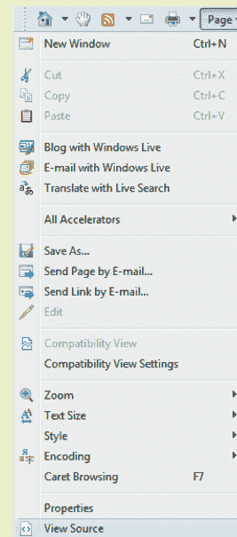

**图 1–3A**

Mozilla Firefox 中的“视图”、“页面源代码”命令。

3. 如果你使用的是 Internet Explorer，请单击工具栏上的“页面”按钮，然后单击“查看源文件”（参见图 1–3A），或者如果你已解锁菜单栏，请单击菜单栏上的“视图”，然后单击“源文件”。

一个新窗口打开，显示页面背后的页面。

5. 使用你的浏览器查看另外三四个网页，并查看每个页面的源页面。列出你在这些页面中反复发现的七个标签。在表 1–1 中猜测并记录你认为它们的作用。

**表 1–1** 常见标签

| 编号 | 标签 | 在网页上产生的效果 |
| :--- | :--- | :--- |
| 示例 | `<center></center>` | 使网页上的文本居中 |
| 2 | | |
| 4 | | |
| 6 | | |

围绕这种呈现和分享信息的新方式，人们的兴奋感与日俱增。随后，Netscape Communications Corporation 发布了其名为 Netscape Navigator 的浏览器。Netscape 在 1995 年抓住了企业的想象力，从那时起，一切都不同了。

- **主页：** 公司、组织或个人的主要或首要网页。个人主页是你启动 Web 浏览器时看到的第一个页面。当你单击浏览器中的“主页”图标时，你将直接转到你的起始主页。
- **着陆页：** Web 广告商使用的有针对性的“欢迎”页面。这是某人点击网络广告后出现的页面，例如在 Google 搜索或 AdWords 活动中，或在 AdSense 广告商的页面上。
- 其次，当出现挑剔的小错误时，你将能够对网页进行故障排除。
- 第四，你将能够更好地理解 Web 服务器上的文件和文件夹结构。

- 网页
- 欢迎页
- 网站

> **警告**

2. 如果需要，创建一个新文档。

```html
<html>

<body>

<p></p>

<p></p>

<p></p>

</html>
```

```html
html

<title>HTML and JavaScript</title>

<center>Creating HTML and JavaScript</center>

<p>You will develop a deeper understanding of how HTML really works. </p>

<p>You will be able to view other pages and learn how certain effects were created. </p>

</body>
```

5. 保持文本编辑器打开，继续进行步骤 1.3，你将学习如何保存 HTML 文件。

> **警告**

| 扩展名 | 说明 |
| :--- | :--- |
| `.rtf` | Microsoft 的富文本格式 |
| `.html` | 某些计算机系统上的 HTML 文件 |
| `.jpg` 或 `.jpeg` | Web 上常用的一种图像格式 |

> **警告**

2. 导航到保存文档的文件夹，然后在“另存为”对话框中单击“新建文件夹”按钮，创建一个新文件夹来保存你的 HTML 和 JavaScript 作品。

4. 单击“保存类型”箭头，单击“所有文件 (*.*)”，然后键入 `one.html` 来命名你的文件，如图 1-6 所示。然后单击“保存”。如果一切保存正确，请继续步骤 5。与你的讲师确认以确保你正确保存了文件。

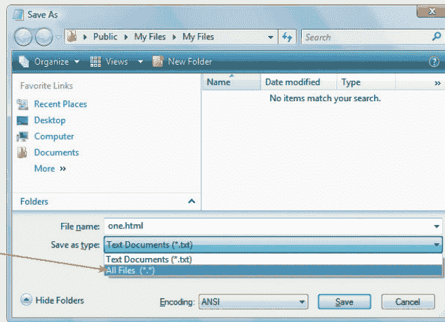

**图 1-6**

b. 单击工具栏上的“工具”，指向“工具栏”，然后单击“菜单栏”，如图 1-7 所示。

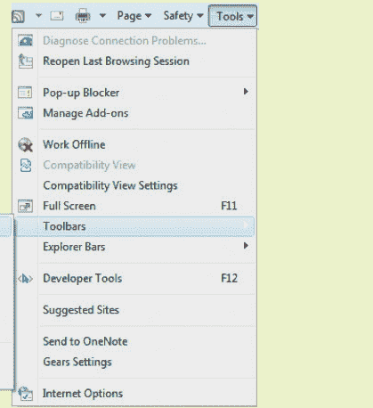

**图 1-7**

d. 单击“浏览”按钮，然后导航到保存 `one.html` 文件的文件夹。

f. 在“打开”对话框中，单击“确定”。

**图 1-8**

b. 单击菜单栏上的“文件”，然后单击“打开文件”，如图 1-9 所示。

**图 1-9**

d. 浏览到保存 `one.html` 文件的文件夹。

### 在 Firefox 中找到你的文件

6. 查看你的文件。它应该看起来像图 1-11。

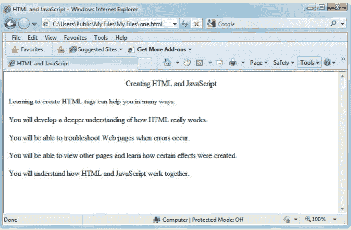

**图 1-11**

```html
<h1></h1>
<h3></h3>
<h5></h5>
```

## 第 1 课：快速掌握 HTML 知识

标题标签内的内容会根据数字变大或变小。例如：

```html
<h3>中等大小</h3>
```

### 分步操作 1.4

在本分步操作中，你将打开之前一直在处理的 HTML 文件，并添加标题或标题标签。

1. 打开你的文本编辑器。

如果你使用的是记事本，请单击菜单栏上的“文件”，单击“打开”，单击“文件类型”箭头，然后单击“所有文件”，如图 1-12 所示。否则，你将无法查看你的 `.html` 或 `.htm` 文件。

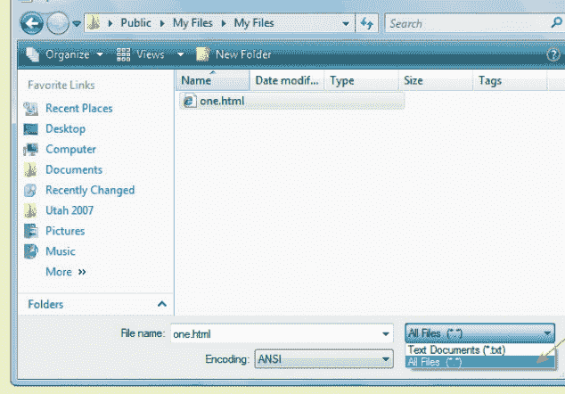

**图 1-12**

```html
<html>

<body>

<p><h2>Learning to create HTML tags can help you in many ways:</h2></p>

</p>

</p>

<p><h6>You will understand how HTML and JavaScript work together.</h6></p>

</html>
```

5. 启动你的 Web 浏览器，然后打开你的 `two.html` 或 `two.htm` 文件，在浏览器窗口中查看它。它应该看起来像图 1-14。

**图 1-14** 网页中不同大小的标题

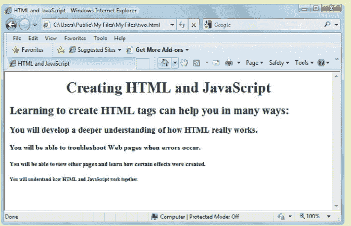

> **警告**

- `<h1></h1>`：顶部的标题
- `<h3></h3>`：学习 HTML 标签的原因列表
- `<ul></ul>`：无序（或项目符号）列表

### 分步操作 1.5

无序列表标签 `<ul></ul>` 创建项目符号列表。以开始的 `<ul>` 无序列表标签开始你的列表，用列表 `<li></li>` 标签标记要列出的项目，并在列表末尾放置一个 `</ul>` 标签。试试看！

1. 打开你的 `two.html` 或 `two.htm` 文件进行文本编辑。
3. 将列表中每个句子的 `<p>` 和 `</p>` 标签替换为 `<li>` 和 `</li>` 标签，如图 1-15 所示。

**图 1-15** 输入无序列表标签

```html
<title>HTML and JavaScript</title>

<center><h1>Creating HTML and JavaScript</h1></center>

<li><h3>You will develop a deeper understanding of how HTML really works.</h3></li>

<li><h3>You will be able to view other pages and learn how certain effects were created.</h3></li>

</ul>

</body>
```

4. 将你的文件保存为 `three.html` 或 `three.htm`，保存到你为本课保存其他 HTML 文件的文件夹中。

一个无序列表。

6. 打开你的 `three.html` 或 `three.htm` 文件进行文本编辑，如果它还没有打开的话。

> 不要使用零；使用字母 O 表示有序。

**图 1-17** 输入有序列表标签

```html
<title>HTML and JavaScript</title>

<center><h1>Creating HTML and JavaScript</h1></center>

<li><h3>You will develop a deeper understanding of how HTML really works.</h3></li>

<li><h3>You will be able to view other pages and learn how certain effects were created.</h3></li>
```

*续下页 >>*

**图 1-17** 输入有序列表标签

« 续上页

```html
<li><h3>You will understand how HTML and JavaScript work together.

</ol>

</body>
```

8. 将你的文件保存为 `four.html` 或 `four.htm`。

一个有序或编号列表。

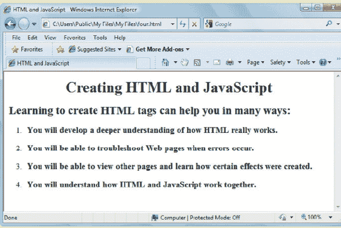

10. 打开你的 `four.html` 或 `four.htm` 文件进行文本编辑，如果它还没有打开的话。

```html
<html>
<body>
<p><h2>Learning to create HTML tags can help you in many ways: </h2></p>
<ol>
</h3></li>
<ul>
<ul>
<li><h3>You will be able to view other pages and learn how certain
</h3></li>
</ul>
<li><h3>You will understand how HTML and JavaScript work together.
</ol>
</html>
```

13. 在浏览器中查看你的 `five.html` 或 `five.htm` 网页，看看它的样子。它应该看起来类似于图 1-20。

**图 1-20**

- 如何输入起始标签。
- 如何将标题级别整合到网页中。

## 词汇表

- 应用程序
- Flash
- 主页
- 超文本标记语言（HTML）
- JavaScript
- 标签
- 网页
- 欢迎页
- XML

## 复习题

### 判断题

如果陈述正确，请圈出 T；如果陈述错误，请圈出 F。

1. `<li>` 标签定义一个列表项。
3. `<center>` 标签格式化文本，使其在页面上居中。
5. `<ul>` 标签创建一个没有特定顺序的列表。
7. `<h5>` 创建最大的标题；`<h1>` 创建最小的标题。
9. 如果你碰巧漏掉了 `/` 或 `<`，浏览器仍然能够弄清楚你想要显示什么。

### 填空题

2. __________ 列表以数字顺序显示项目。
4. __________ 是网景公司最初竞争的 Web 浏览器。
6. HTML 文件通常以 __________ 标签开始。
8. __________ 页面被设计为访问者点击网络广告后看到的第一个页面。

### 书面题

简要回答以下每个问题：

1. 想出一种方法，向从未创建过网页的人解释 HTML 标签是如何工作的。你如何向新手解释 HTML 的工作原理？
3. 解释你必须如何保存 HTML 文本页面。
4. 什么是文件扩展名？请举例说明。
5. 尝试过三四种不同的浏览器后，你最喜欢哪一种？为什么？

## 项目

### 项目 1–1：自学 HTML、XHTML 和 CSS

你刚刚被聘为 GreatApplications, Inc. 的网站管理员，这是一家主要的软件和网站开发商，但你的 HTML/XHTML 技能有限。你需要快速找到一些好的 HTML 或 XHTML 信息！你会怎么做？

答案显而易见。上网。选择一个搜索工具，如 Google、MSN 或 Yahoo!，或者像维基百科这样的其他网站，输入搜索词：

- HTML
- HTML 指南
- 学习 HTML
- XHTML
- XHTML 指南
- 学习 XHTML

使用下表记录标题和 URL 或网址，并简要总结你找到的有用的 HTML 和 XHTML 网页：

**表 1–3** 有用的网页

| 标题栏中显示的标题 | 网址或 URL | 描述 |
| :--- | :--- | :--- |
| | | |
| | | |
| | | |

| | | |
| :--- | :--- | :--- |
| 2. | | |
| 4. | | |
| 6. | | |

政府机构：

大学：

## 批判性思维

### 活动 1–1

准备一个 100 到 250 字的答案来回答以下问题。

万维网是一个共享 HTML 文件的大型计算机网络。在你有生之年的每一分钟，你都可以访问一个新的网页，却永远无法接近阅读所有可用网页的哪怕一小部分。有数十亿个网页。虽然 HTML 让人们能够轻松地分享网页，但 HTML 是否也导致了信息过载？如果是这样，如何以及可以做些什么来解决这个问题？

## 第一单元：HTML 基础

### 活动 1–2

### 活动 1–3

以下标签集中有一个错误，你需要找出并修复它。当前的标签会对你的页面产生什么影响？修正后它看起来是什么样子？

绘制标签图，这些标签将允许你在 HTML 中创建一个复杂的提纲（你知道，就像你上次写研究论文时必须做的那样）。你的研究论文可以通过 HTML 在线以哪些方式得到增强？

```html
<li>Item A</li>

<li>Item A1</li>

</ul>

<ul>

<li>Item B2</li>

</ul>
```

- 你的提纲必须包含至少两个有序列表中的单元。
- 你的提纲必须包含每个章节至少三个节——无序。

预计时间：1.5 小时

# 第 2 课：基本组织技术

## 目标

完成本课后，你应该能够：

- 使用单倍行距和双倍行距格式化页面信息。
- 实现属性和值。
- 创建指向网页内另一个位置的超链接。
- 链接到你自己计算机上的另一个网页。


万维网是由成千上万的人创造的，他们不断地开发、改进、发布和出版令人惊叹的在线网页。网络是一个你可以完全发挥创造力的社区。加入其中所需要的只是对`HTML`、`XHTML`、`CSS`和`JavaScript`的一点了解。有了这些开发工具在你的工具包中，当你构建自己的在线世界时，你将只受限于你的想象力。

### 词汇表

- 属性
- 十六进制
- 超文本链接
- 标准
- 值

## 第一单元 HTML 基础

### 构建更好的网页

当你浏览网络时，你看到过富有创意和令人兴奋的网页，也看到过其他缺乏想象力的网页。一个精彩页面和一个乏味页面之间的主要区别归结为细节——字体、颜色和图片的选择，以及有助于页面整体组织的元素的选择。

你可以使用许多`HTML/XHTML`技术使你的页面完美地呈现。这些是单倍行距和双倍行距技术以及其他专门的组织标签，可以使任何网页更易于阅读。可以通过在段落之间添加空格或在网页的不同部分之间放置线条来使网页更具吸引力。居中和加粗的标题当然可以帮助读者。颜色选择极其重要。更改文本和页面背景的颜色不仅可以使文档更具吸引力，而且更易于阅读。使用正确的颜色，你的页面将会非常出色。

`超文本链接`有助于使网页有趣且易于导航。`超链接`，正如它们通常被称为的那样，可以被点击，允许用户导航到另一个网站、当前网站上的另一个网页，或当前文档中的特定位置。如果你在一个页面上有大量信息，创建一个索引可以帮助你的读者跳转到他们正在寻找的确切信息。

### 弃用

`HTML`正在变化，随着新的`XHTML`标准的出现，它正在成为一个更加严格的开发环境。许多久经考验的标签现在已不被重视。更准确地说，它们正在被`弃用`，这意味着它们正在被降级、贬值，甚至变得过时！尽管这看起来很令人难过，但第 1 课中引入的简单`<center></center>`标签可能在未来某个时候会被淘汰。不要太担心——它不会很快消失。然而，尽管所有浏览器仍然识别旧的`<center>`标签和其他类似的标签，但今天你应该居中标题的方式是将其作为样式包含在一个受支持的标签中，例如`<h></h>`，如下所示：

```html
```

### 单倍行距和双倍行距

当你学习本课中教授的新`HTML`元素时，你将接触到关于如何组织网页的新想法。大多数早期网页是冗长、乏味的文字集合。这一切都改变了，正如你将在下一个分步活动中看到的那样。再也没有理由创建乏味、难以阅读的网页了。你可以借助一些新标签轻松地组织文本：`<p></p>`用于段落，`<br />`用于换行。

#### 分步 2.1

在以下分步中，你将亲眼看到如何提高页面的可读性和组织性。

1. 打开记事本、SimpleText 或你的文本编辑器。

> **专家补充**
>
> 超文本链接
>
> 已弃用

```html
<html>

<title>HTML and JavaScript</title>

<h1 style="text-align:center">Organizing Tags</h1>

There are many ways to organize a Web page. This Web page will organize text, hypertext links, colors and fonts. You'll also demonstrate single spacing, double spacing, and the use of line breaks.

This Web page will display how to organize Web pages in a number of ways using:

Powerful Lines

Hyperlinks to Previously Created Web Pages

Perfect Pictures

Extraordinary Extras

</body>
```

3. 点击菜单栏上的**文件**，点击**保存**，然后按照在“循序渐进 1.3”中学到的相同方法，将文件保存为`six.html`或`six.htm`。
4. 打开你的网页浏览器，查看`six.html`页面。它应该看起来像一个单独的文本块，如**图 2-2**所示。（如果需要复习如何在网页浏览器中查看`HTML`文件，请回顾“循序渐进 1.3”。）

> **警告**
>
> 一个未组织的网页

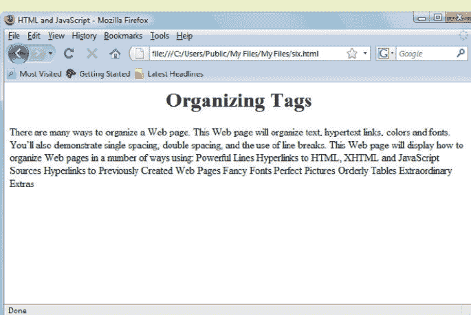

5. 在记事本、SimpleText 或你的文本编辑器中打开你的`six.html`或`six.htm`文件。

```html
<html>
<title>HTML and JavaScript</title>

<h1 style="text-align:center">Organizing Tags</h1>
<p>There are many ways to organize a Web page. This Web page will organize text, hypertext links, colors and fonts. You'll also demonstrate single spacing, double spacing, and the use of line breaks. </p>
<p>This Web page will display how to organize Web pages in a number of ways using: </p>
Powerful Lines <br />
Hyperlinks to Previously Created Web Pages <br />
Perfect Pictures <br />
Extraordinary Extras <br />
</body>
```

7. 使用**另存为**命令，将更新后的文件保存为`seven.html`或`seven.htm`。

```html
<h1 style="text-align:center">Organizing Tags</h1>
```

### 属性

- `cornflowerblue`
- `deepskyblue`
- `lightskyblue`

你可以在线查找`HTML`颜色名称及其所有变体。

#### 十六进制数字颜色

虽然你可以将颜色名称作为文本值输入，但计算机理解代码和数字。因此，值必须转换为计算机理解的代码，这样单词`yellow`将被浏览器转换为相应的数字颜色值（黄色为`#FFFF00`）。

使用颜色的通用名称有些局限。通过使用特殊的数字或`十六进制`值，可以仔细控制和更改颜色值，以匹配彩虹中的几乎每一种颜色。十六进制编码的发明是计算领域最伟大的进步之一。十六进制数字基于 16 进制数制运行，而不是我们通常使用的 10 进制数制。十六进制数字使用字母 A、B、C、D、E、F 以及数字 0 到 9 来创建 16 个不同的数字。例如，查看**表 2-1**中以十六进制数字表示的以下颜色值。

**词汇** 十六进制

**表 2-1** 以十六进制数字表示的颜色值

| 颜色 | 十六进制数字 |
|---|---|
| 白色 | `#FFFFFF` |
| 黑色 | `#000000` |
| 红色 | `#FF0000` |

```html
<body style="background-color:#AAFF00">
```

2. 在网页顶部附近的`body`标签内输入`style="background-color:yellow"`，如下所示，并在**图 2–6**中以粗体标出。
3. 将你的工作保存为名为`eight.html`或`eight.htm`的文件。
5. 进行实验。切换回`eight.html`文件，然后将背景颜色值更改为**蓝色**、**绿色**、**红色**、**白色**或你选择的其他颜色。在浏览器中查看颜色变化，然后将背景颜色改回黄色。

```html
<html>

<title>HTML and JavaScript</title>

Hyperlinks to HTML, XHTML and JavaScript Sources <br />

Fancy Fonts <br />

Orderly Tables <br />

<hr />

<hr style="height:10px" />

A Horizontal Rule 30 pixels high.

<hr style="width:50%" />

A Horizontal Rule width set at 25% and height set at 20 pixels.

<hr />

</body>
```

7. 将你的文件保存为`nine.html`或`nine.htm`。
9. 为了有趣以及查看颜色如何影响网页，请将`nine.html`文件中的颜色值从颜色单词（例如`yellow`）更改为以井号（`#`）开头的数值，例如：
10. 重新保存你的`nine.html`或`nine.htm`文件。在浏览器中打开该文件并查看变化。

**图 2–7 强力线条**

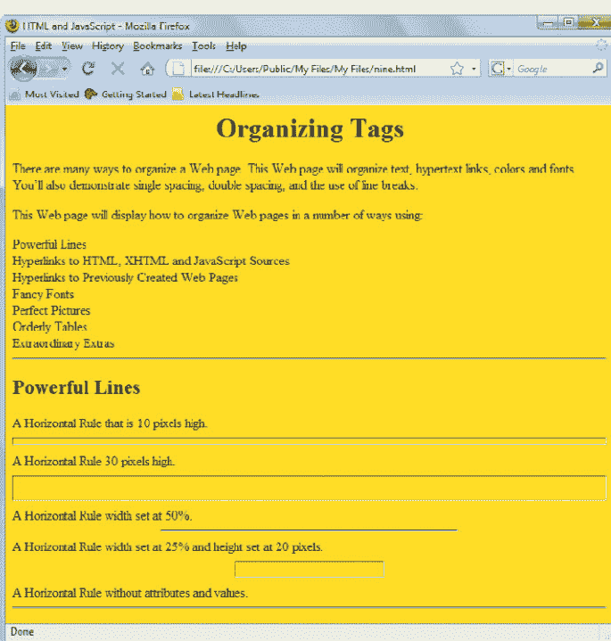

> **专家补充**

```html
<a href="insert location of file"></a>
```

- 链接到网络上任何位置的网页

第二个锚点标签标识了你想要链接到的网页中的确切位置。你将创建一个带有属性`name=`和值`"powerful"`（带引号）的标签。

### 分步操作 2.3

在本分步操作部分，你将学习在`HTML`文档中插入链接，这是一项重要且有用的技能。

1. 如果需要，请打开你的`nine.html`或`nine.htm`文件进行文本编辑。

```html
<a href="#powerful">Powerful Lines</a><br />
<h2><a name="powerful">Powerful Lines</a></h2>
```

5. 在 Web 浏览器中查看更改。当你点击 Powerful Lines 链接时，如**图 2–8**所示，它会改变颜色，并且你应该会跳转到文档中的 Powerful Lines 标题处。

> **警告**

```html
<html>
<title>HTML and JavaScript</title>

Hyperlinks to HTML, XHTML and JavaScript Sources <br />
Fancy Fonts <br />
Orderly Tables <br />
<hr />
<h2><a name="powerful">Powerful Lines</a></h2>
<hr style="height:10px" />
A Horizontal Rule 30 pixels high.

<hr style="width:50%" />
A Horizontal Rule width set at 25% and height set at 20 pixels.

<hr />
</body>
```

### 技术伦理

### 尊重万维网

网页不应具有冒犯性。你对自己创建并在线发布或发布的内容负责。尊重网络。创建网页时，请考虑以下准则：

- `E = 每个人`：尝试创建每个人都能享受、欣赏并认为有价值的网页。
- `P = 有目的`：为你放在网上的每个网页设定明确的目的。不要发布或上传不必要的页面。
- `C = 正确`：确保你页面上的所有单词拼写正确，所有句子语法正确，并且所有超链接都能正常工作。

### 统一资源定位符（URL）

你通常可以在`URL`的末尾看到文件名。看看我们示例`URL`的末尾。文件名`afile.html`是一个文件（`afile`）的名称。`.html`扩展名标识该文件为你的 Web 浏览器可以显示的`HTML`文档。

在某些`URL`中，你可能会看到字母`http`后跟一个冒号和两个斜杠。`http://`告诉你的计算机网络如何传输或移动你请求的文件。`HTTP`代表超文本传输协议。（你也可能会看到`https://`。`s`代表安全。）协议是一种用于通过计算机网络传输数据的通信系统。它是 Web 服务器用于与 Web 浏览器通信的数字语言。

- `http://sites.google.com`
- `http://www.facebook.com`
- `http://www.wikipedia.org`

### 分步指南 2.4

这是一个关键的分步部分，你将在此应用指向全球任何地方的网站和网页的链接。

1. 如果你的`ten.html`或`ten.htm`文件尚未打开，请在文本编辑器中打开它。

```html
<a href="http://sites.google.com">Google</a><br />

<a href="http://www.facebook.com">Facebook</a><br />

<a href="http://www.wikipedia.org">Wikipedia</a><br />
```

```html
<html>

<title>HTML and JavaScript</title>

<body style="background-color:#E6E6FA">

<a href="#hyperlinks">Hyperlinks to HTML, XHTML and JavaScript Sources</a><br />

Hyperlinks to Previously Created Web Pages <br />

Perfect Pictures <br />

Extraordinary Extras <br />

A Horizontal Rule that is 10 pixels high.

<hr style="height:30px" />

A Horizontal Rule width set at 50%.

<hr style="width:25%;height:20px" />

A Horizontal Rule without attributes and values.

<a href="http://www.microsoft.com">Microsoft</a><br />

<a href="http://www.mozilla.org">Mozilla</a><br />

<a href="http://www.w3.org">W3</a><br />

<hr />

</html>
```

7. 如果你的计算机已连接到 Web，请点击你网页中的链接，看看它们是否有效。如果你的链接无法正常工作，请仔细检查你的标签并进行必要的更正。再次保存你的工作。然后在你的 Web 浏览器中重新加载或刷新页面以查看页面并测试链接。

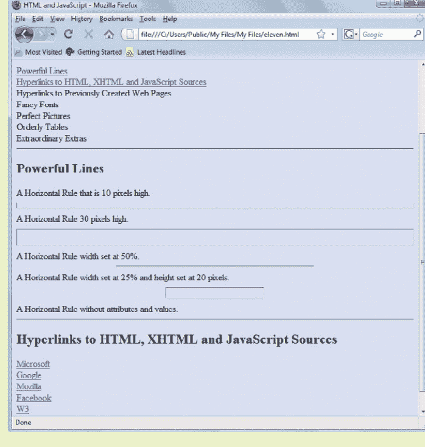

**图 2–12** 你的 Web 浏览器中的超链接

> **警告**

2. 从页面顶部创建一个指向你将在本练习中创建的新部分的超文本链接。在你已经创建的“强力线条”和“指向 HTML、XHTML 和 JavaScript 资源的超链接”链接下方，将标签作为列表中的第三个项目输入。要输入的文本在此处和**图 2–13**中以粗体显示。

4. 在新标题下方、文档末尾附近的`</body>`标签上方，完全按照此处和**图 2–13**中粗体所示，为你的每个`HTML`文件创建超文本链接。

```html
<a href="#previous">指向先前创建的网页的超链接</a><br />

<h2><a name="previous"> 指向先前创建的网页的超链接</a></h2>

<a href="one.html">One</a><br />

<a href="three.html">Three</a><br />

<a href="five.html">Five</a><br />

<a href="seven.html">Seven</a><br />
```

- [指向 HTML、XHTML 和 JavaScript 源的超链接](#hyperlinks)
- 花式字体
- 有序表格

```html
<hr style="height:10px" />
```

一个高度为 30 像素的水平线。

```html
<hr style="width:50%" />
```

一个宽度设置为 25%、高度设置为 20 像素的水平线。

```html
<hr />
```

#### 指向 HTML、XHTML 和 JavaScript 源的超链接

- [微软](http://www.microsoft.com)
- [Mozilla](http://www.mozilla.org)
- [W3](http://www.w3.org)
- [二](two.html)
- [四](four.html)
- [六](six.html)
- [八](eight.html)
- [十](ten.html)

7. 点击**指向先前创建的网页的超链接**链接以获取网页文件索引。点击**一**链接在网页浏览器中打开`One.html`文件。如果无法打开，请查看**图 2–13**并进行必要的更正。

9. 修复你可能发现的任何错误。如果你犯了错误，请对照**图 2–13**中的示例检查你的代码。

**图 2–14** 指向先前创建的网页的链接

> **警告**

| 操作 | 样式定义 |
|---|---|
| 2. 更改`h2`文本的颜色 | `h2 {color:blue}` |

2. 在网页开头的`<head></head>`标签之间，使用`<style type=>`标签和属性（值为`"text/css"`）输入样式定义。然后，如本步骤所示并在**图 2–15**中以粗体显示的那样，为`h1`、`h2`和`p`标签标记的文本段添加颜色定义。

```css
h1 {color:Red}
p {color:Green}
```

**图 2–15** 更改网页上的文本颜色

```html
<head>
<style type="text/css">
h2 {color:Blue}
</style>
```

3. 将你的工作保存为`thirteen.html`或`thirteen.htm`。


5. 切换回文本编辑器中的`thirteen.html`文件。使用常用的颜色名称更改你的`h1`、`h2`和`p`颜色值。重新保存你的文档，并查看你是否喜欢新的颜色选择。

**图 2–16** 使用 CSS 定义更改的文本颜色

### 词汇

标准

### 技术职业

### 变化的标准

如果你选择从事网页设计职业，你需要尽可能多地学习关于`HTML`、`XHTML`、`XML`和`CSS`标准的知识。标准很强大，因为它们告知网页浏览器开发者和程序员，为了正确开发和显示网页，他们需要遵守的规则。

当浏览器开发者正确应用网页标准时，查看网页的人使用的是 Macintosh、Windows 机器还是 Linux 工作站都无关紧要。HTML 网页能被世界各地不同平台上的人们查看的原因是，每个人都必须遵守相同的标准。

新的标准、新的标签和新的命令一直在增加。在足够多的更改被提出并批准后，标准委员会将认证一个所有浏览器都必须理解的新版本标准。每隔几年就会发布一套新的标准。如果你想进入这个行业，跟上变化的步伐非常重要。

新批准的标准版本用数字表示，例如 HTML 1、HTML 2、HTML 3、HTML 4 等。你可以在网上了解更多关于 HTML、CSS 和 XHTML 标准的信息。事实上，在本课结束时，有一个项目正是让你做这件事。如果你正在考虑在这个领域发展，这将是你需要完成的一项关键活动。

### 网络商务

### 完美的校对技巧

校对 HTML 标签可能很困难。即使是最轻微的错误也可能极大地改变网页的外观。以下是一些需要检查的常见错误：

- 确保你所有的尖括号`< >`都朝向正确的方向。
- 如果所有定义的文本都没有改变，请确保你的 CSS 定义出现在`<head> </head>`标签之间。
- 检查你所有的标签，确保它们已正确关闭，例如`<hr />`。如果项目符号在列表之后出现很长时间，也许你忘记了关闭无序列表标签`</ul>`。

### 总结

在本课中，你学习了：

- 如何使用单倍行距和双倍行距组织页面信息。
- 如何使用属性和值来改进网页设计。
- 如何创建指向网页文档中特定位置的超文本链接。
- 如何创建指向你自己计算机上网页的超文本链接。

### 词汇复习

定义以下术语：

- 属性
- 十六进制
- 超文本链接
- 标准
- 值

### 复习题

#### 判断题

如果陈述正确，请圈出 T；如果陈述错误，请圈出 F。

- T F 1. 十六进制数基于十进制数系统运行。
- T F 3. 字母`href`是`<a></a>`锚点标签的一个值。
- T F 5. 新的 HTML、XHTML 和 CSS 标准每隔几年就会达成一致并公开发布。
- T F 7. 你必须在记事本中使用自动换行功能，以确保你的段落在以后在浏览器中查看时能在每行末尾换行。
- T F 9. 十六进制数`FF0000`是绿色的值。

2. 你可以使用`<p>`标签在 HTML 文档中创建一个 _______________ 空格。

4. _______________ 数允许你用数字和字母定义颜色。

2. 哪个十六进制值会创建黄色？

4. 创建网页时可能犯的三个常见错误是什么？

| :--- | :--- | :--- |
| 2. | | |
| 4. | | |

2. 你们是如何组织团队的？如何分配工作？哪些团队成员负责哪些活动？

4. 你会给其他试图创建网页的团队什么建议？

#### 项目 2–4：理解标准

是否曾想过管理 HTML、XHTML 和 CSS 的标准即将发生的变化？需要知道你网页的当前标准是什么吗？这很容易了解。访问 Google、Yahoo!、Bing 或其他搜索工具，尝试这些搜索词。创建一个网页设计文件夹，并收藏可以教你更多关于以下内容的关键网站：

- HTML 标准
- CSS 标准

### 批判性思维

#### 活动 2–1：移动到顶部

你能想出如何创建一个内部超链接，让你从文档底部移动到最顶部吗？使用你在步骤-by-步骤 2.3 中学到的步骤，在`</body>`标签之前创建一个链接，该链接将链接到页面顶部。（提示：反转过程。）你的链接应该看起来像这样：返回页面顶部。

#### 活动 2–2：按数字填色

使用十六进制数值颜色值更改你的`h1`、`h2`和`p`标签的颜色。不要忘记添加`#`号。重新保存你的页面并再次查看。

#### 活动 2–3：更新你的作品集

保持你的作品集列表最新。在你完成之前，从你的`thirteen.html`页面添加一个指向你的`twelve.html`页面的链接。

### 综合模拟

你最重要的十大技术参考网站是什么？它们对你为什么重要？创建一个新的 HTML 页面，列出你最重要的个人网页。在你学习本教材的过程中，不断添加到你的网页资源页面。

- 你的页面标题应为“收藏站点”。
- 为你的链接创建一个编号列表。（你可能需要回顾第 1 课以获取此技能的帮助。）


预计时间：1.5 小时

## 第 3 课

# 高级技巧

### 目标

完成本课后，你应该能够：

- 控制字体的大小、样式和颜色。
- 将图片插入你的网页。
- 使用表格组织信息。
- 插入各种数据输入选项。

### 词汇

-`.gif`
-`.png`
- 联合图像专家组
- 这是 Verdana。
- 这是 Courier。
- 使用`<style="font-family:">`控制字体的样式

2. 参考此处加粗的代码以及**图 3–1**顶部加粗的代码，对你的 CSS 代码进行以下调整。将`p`的颜色值更改为黑色。为紫色创建一个新的`h3`颜色定义。使用十六进制数（如`#E6E6FA`）将背景颜色调整为柔和的蓝色，以便你可以清楚地看到你的更改。（注意：如果你已经将此背景颜色更改为柔和的蓝色，很好，你现在不必更改它！）

> **警告**

```html
<html>

<title>HTML and JavaScript</title>

h1 {color:red}

h3 {color:purple}

</style>

<body style="background-color:#E6E6FA">

<a href="#fonts">Fancy Fonts</a><br />

<h2><a name="fonts">Fancy Fonts</a></h2>

<p style="font-family:verdana">This is the Verdana font.</p>

<p style="font-family:courier">This is the Courier font.</p>

<p style="font-size:150%">This is 150% normal size.</p>

<p style="font-size:75%">This is 75% normal size.</p>

<p style="color:red">This is Red.</p>

<p style="color:blue">This is Blue.</p>

<p style="font-family:verdana;font-size:110%;color:green">This is a sample of Verdana at 110% and colored green.</p>

<p style="font-family:arial;font-size:70%;color:orange">This is a sample of Arial at 70% and colored orange.</p>
```

> **警告**

```html
<html>
<title>HTML and JavaScript</title>
h1 {color:red}
h3 {color:purple}
</style>

<p>This Web page will display how to organize Web pages in a number of ways using: </p>
<a href="#powerful">Powerful Lines</a><br />
<a href="#previous">Hyperlinks to Previously Created Web Pages</a><br />

Orderly Tables <br />
<hr />
<h2><a name="powerful">Powerful Lines</a></h2>
<hr style="height:10px" />
A Horizontal Rule 30 pixels high.

<hr style="width:50%" />
A Horizontal Rule width set at 25% and height set at 20 pixels.

<hr />
<h2><a name="hyperlinks">Hyperlinks to HTML, XHTML and JavaScript Sources</a></h2>
<a href="http://sites.google.com">Google</a><br />
<a href="http://www.facebook.com">Facebook</a><br />
<a href="http://www.wikipedia.org">Wikipedia</a><br />

<a href="one.html">One</a><br />
<a href="three.html">Three</a><br />
<a href="five.html">Five</a><br />
<a href="seven.html">Seven</a><br />
<a href="nine.html">Nine</a><br />
<a href="eleven.html">Eleven</a><br />

<h3>Font Style Samples</h3>
<p style="font-family:times">This is the Times font.</p>

<p style="font-size:150%">This is 150% normal size.</p>
<p style="font-size:75%">This is 75% normal size.</p>
<h3>Font Color Samples</h3>
<p style="color:white">This is White.</p>

<p style="font-family:verdana;font-size:110%;color:green">This is a sample of Verdana at 110% and colored green.</p>
<p style="font-family:arial;font-size:70%;color:orange">This is a sample of Arial at 70% and colored orange.</p>

</html>
```

2. 使用你最喜欢的搜索引擎，例如 Google，在网络上搜索你可以在网页中使用的无版权图像。如有必要，请向你的导师寻求帮助。在**图 3–3**中，正在保存的图像来自 Cengage Learning 网站。对于这些步骤，图像已由你的导师提供。

> **警告**

要在网页中使用的图像

3. 要从在线源下载图片，如果你使用的是 Windows 计算机，请右键单击图像，如**图 3–4**和**图 3–5**中的示例所示。如果你使用的是 Macintosh，请单击并按住鼠标按钮在图像上。

5. 将文件保存在与你保存网页完全相同的文件夹中。

> **专家补充**

使用 Firefox 时，选择**“将图像另存为...”**

> **警告**

使用 Internet Explorer 时，选择**“将图片另存为...”**

6. 在你的文本编辑器中打开`fourteen.html`或`fourteen.htm`文件。

```html
<a href="#pictures">Perfect Pictures</a><br />

<h2><a name="pictures">Perfect Pictures</a></h2>
<hr />
```

> 一个常见的错误是在``标签中颠倒了 R 和 C 的顺序。可以将其视为 IMaGe SouRCe 标签，这样你就不会忘记按正确的顺序放置字母。

### 网络业务

### Mozilla：垄断终结者

在我们的示例中，步骤 3.2 里我们使用了一个名为`levy.gif`的简单 GIF 图形文件，上面是一条龙。为什么是名为 Levy 的龙？在古老的互联网历史中，网景通信公司为了击败第一款强大的图形浏览器 Mosaic，着手开发一款更好的浏览器。Mozilla 是网景浏览器的代号。最初的 Mozilla 图像是一个造型奇特的龙，被称为“Mosaic 终结者 Mozilla”。网景在与 Mosaic 的竞争中获胜，但随着网景的 Navigator 浏览器在 Web 主导权上遇到了新的竞争对手——微软的 Internet Explorer，竞争升级了。这两大浏览器巨头之间的较量被形象地称为浏览器战争。

网景与 Internet Explorer 浏览器之间的竞争是件好事。它激发了创造力和创新，从而改善了 Web 体验。而在浏览器市场近乎垄断、竞争消失的时期，创造力和创新则会放缓。

我们在这项活动中使用一条龙，象征着保持浏览器竞争持续进行的必要性！例如，秉承初代 Mozilla 的精神，Mozilla 组织创建了 Firefox 来与 Internet Explorer 竞争。他们成功地为 Web 社区提供了新的选择和令人兴奋的解决方案。其他公司，如 Google 和 Apple，也试图通过 Google Chrome 和 Apple Safari 浏览器来挑战微软的主导地位。幸运的是，其他新的浏览器也将脱颖而出，崭露头角。

我们的龙名为 Leviathan Levy。如果你想了解更多关于为何选择这个名字的信息，请使用你最喜欢的搜索工具，如 Google 或 Bing，查找托马斯·霍布斯及其 1660 年的著作《利维坦》。

### 专家补充

让你的网页访客能够一键给你发送电子邮件的一个简单方法是创建以下标签：

```html
<a href="mailto:youremail@address.com">Your Name</a>
```

当访客点击该标签时，如果他或她的电脑上有电子邮件程序，将会打开一个新的电子邮件撰写窗口。

### 创建各种尺寸的图片

通过更改标签的值，可以以多种方式修改图片。图片可以用作壁纸来覆盖整个网页的背景。它们可以居中对齐，也可以靠左或靠右对齐。根据你的需要，它们可以被放大或缩小。

你也可以使用高度和宽度属性来改变图片的大小。精确控制图片的大小对于传达额外信息非常有帮助。正确使用图片可以使页面看起来清晰且有趣。

在步骤 3.3 的第一部分，你将图片对齐到页面的右侧并使其变小。在第二部分，你将三个不同大小的龙横向排列在页面上，然后通过操作相应的值，将三个龙垂直放置在网页上。

### 步骤 3.3

七个；数一数。在这个步骤结束时，你将拥有七张图片。而且一种尺寸并不适合所有情况。在这个步骤中，学习控制图片的大小和位置。

1. 打开你的`fifteen.html`或`fifteen.htm`文件进行文本编辑。

```html
<p></p>


<p></p>
<hr />
```

```html
<html>
<title>HTML and JavaScript</title>
h1 {color:red}
h3 {color:purple}
</style>
<body style="background-color:#E6E6FA">
<p>There are many ways to organize a Web page. This Web page will organize text, hypertext links, colors and fonts. You'll also demonstrate single spacing, double spacing, and the use of line breaks. </p>
<a href="#powerful">Powerful Lines</a><br />
<a href="#previous">Hyperlinks to Previously Created Web Pages</a><br />
<a href="#pictures">Perfect Pictures</a><br />
Extraordinary Extras <br />
```

我们跳过了代码中的“强力线条”、“超链接”和“花式字体”部分，直接跳到需要添加到你更新后的 HTML 文件底部的新代码。如果你需要回顾这些早期部分的代码，请参见图 3-1。将此代码添加到你在上一步练习中最后输入的内容下方。

```html


<p></p>
</body>
```

8. 再次将你的更改保存为`sixteen.html`或`sixteen.htm`，并在 Web 浏览器中查看结果。你的图片现在看起来应该类似于图 3-9。在必要时进行更正，并在浏览器中查看任何更改。

## 第三课：高级技巧

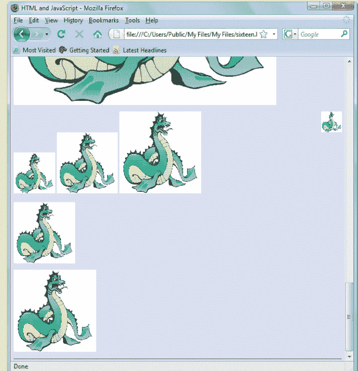

图 3–9

如果你想让一张图片作为超链接，请尝试使用以下标签、属性和值的组合：


要将图片用作网页的背景，请在`<body>`标签中插入`background`属性，如下所示：`<body background="levy.gif">`

### 创建有序表格

电子表格是极佳的组织工具。表格是由列和行组成的网格，形成可以放置文本和图像的单元格，以保持内容的条理性。每一列和每一行的交叉点形成一个单元格。在分步教程3.4中，你将使用标签创建一个包含多个单元格的表格。要创建一个表格，你需要添加以下三个重要的标签：行标签、表头标签和单元格标签。

- `<tr>`定义表格行。
- `<td>`定义表格单元格。

在单元格内部，你可以插入许多已经学过的标签，以便文本和图形显示在表格的单元格内。通过添加带有数字值的`border`属性，表格可以拥有边框。你还可以使用`cellpadding`属性使单元格内的图片和文本周围出现更大的空间。在单元格内，你可以将图片和文本居中、左对齐或右对齐。

### 分步教程3.4

表格是组织单个网页上各个元素的强大工具。在这个分步教程中，你将创建一个表格并用图像和文本填充它。

1. 如果你的文本编辑器尚未打开，请打开`sixteen.html`或`sixteen.htm`文件。
2. 参考**图3–10**，在你上一个分步教程中创建的最后一个`<hr />`标签下方、`</body>`标签之前，添加一个名为**有序表格**的二级标题。包含`<a name>`标签，以便你可以完成在步骤2中开始的内部超链接。

```html
<a href="#tables">Orderly Tables</a><br />

<h2><a name="tables">Orderly Tables</a></h2>

<table border="5" cellpadding="10" align="center">
    <th>Images</th>
    <th>Fonts</th>
    <tr>
        <td bgcolor="red" align="center">Red</td>
    </tr>
    <td></td>
    <td align="center"><font face="courier" size="10" color="green">Courier</td>
</table>
```

5. 你的标签现在应该与**图3–10**中的匹配。将你的工作保存为`seventeen.html`或`seventeen.htm`。

#### 图3–10 在HTML中创建表格

```html
<html>

<title>HTML and JavaScript</title>

h1 {color:red}

h3 {color:purple}

</style>

<a href="#hyperlinks">Hyperlinks to HTML, XHTML and JavaScript Sources</a><br />

<a href="#fonts">Fancy Fonts</a><br />

<a href="#tables">Orderly Tables</a><br />

Extraordinary Extras <br />
```

> 我们跳过了代码中的“强力线条”、“超链接”、“花式字体”和“完美图片”部分，直接跳到需要添加到更新后的HTML文件底部的新代码。将此代码添加到你在上一个分步练习中最后输入的内容下方。

```html
<h2><a name="tables">Orderly Tables</a></h2>
```

接下页 »

#### 图3–10 在HTML中创建表格

« 续上页

```html
<th>Images</th>

<th>Fonts</th>

<tr>

<td bgcolor="red" align="center">Red</td>

</tr>

<td></td>

<td align="center"><font face="courier" size="10" color="green">Courier</font></td>

</table>

</body>
```

6. 使用你最喜欢的Web浏览器打开`seventeen.html`文件，以网页形式查看你的作品。点击**有序表格**链接。你的新页面将显示包含文本和图像的表格，其外观应与**图3–11**相似。进行必要的修正。

#### 图3–11

- **下拉列表**：当网站访问者点击箭头时出现的列表，显示可供查看和选择的选项列表。
- **复选框**：允许用户点击在其中心放置勾选标记的框，以便网站访问者可以从一组选项中选择多个选项。

### 分步教程3.5

在本课的最后步骤中，你将使用HTML标签创建四种不同类型的输入选项。

1. 如果你的文本编辑器尚未打开，请打开`seventeen.html`或`seventeen.htm`文件。
2. 从你的网页顶部创建一个内部超文本链接，链接到你正在为输入选项创建的新部分。将此链接命名为**非凡附加功能**，如图**3–12**中粗体所示。

3. 在页面末尾，紧接在你创建的最后一个`<hr />`标签之后、`</body>`标签之前，添加一个名为**非凡附加功能**的二级标题。然后，完全按照此处和图**3–12**中粗体所示输入属性和值。

```html
<h3>文本输入框</h3>

输入你的名字: <input type="text" size="25" /><br />

<input type="submit" />

<h3>选择列表输入</h3>

<form>

<option>芝加哥公牛队</option>

<option>洛杉矶湖人队</option>

<option>新泽西篮网队</option>

</select><br />

</form>

<h3>单选按钮输入</h3>

<form>

<input type="radio" name="best">Five Guys<br />

<input type="radio" name="best">汉堡王<br />

<input type="submit" />

我喜欢吃:<br>

<input type="checkbox" />汉堡<br />

<input type="checkbox" />鸡柳<br />

<input type="checkbox" />热狗<br />

</form>
```

4. 将你的工作保存为`eighteen.html`或`eighteen.htm`。

#### 图3–12 各种数据输入标签

```html
<head>

<style type="text/css">

h2 {color:blue}

p {color:black}

</head>

<body style="background-color:#E6E6FA">

<h1 style="text-align:center">组织标签</h1>

<p>组织网页的方式有很多种。这个网页将组织文本、超文本链接、颜色和字体。你还将演示单倍行距、双倍行距以及换行符的使用。</p>

<p>这个网页将展示如何使用以下方式以多种方法组织网页：</p>

<a href="#powerful">强力线条</a><br />

<a href="#previous">指向先前创建的网页的超链接</a><br />

<a href="#pictures">完美图片</a><br />

<a href="#extras">非凡附加功能</a><br />
```

> 我们跳过了代码中的强力线条、超链接、花式字体和完美图片部分，直接跳到需要添加到更新后的HTML文件底部的新代码。将此代码添加到你在上一步骤中输入的最后一个`<hr />`标签下方。

```html
<h3>文本输入框</h3>

输入你的名字: <input type="text" size="25" /><br />

<input type="submit" />

最喜欢的球队是:<br />

<select>

<option>犹他爵士队</option>

<option>克利夫兰骑士队</option>

<option>菲尼克斯太阳队</option>

<input type="submit" />
```

接下一页 »

#### 图3–12 各种数据输入标签

« 接上一页

```html
最佳用餐地点是:<br />

<input type="radio" name="best">温蒂汉堡<br />

<input type="radio" name="best">塔可钟<br />

<input type="radio" name="best">肯德基<br />

</form>

<h3>复选框输入</h3>

<form>

<input type="checkbox" />墨西哥卷饼<br />

<input type="checkbox" />薯条<br />

<input type="submit" />

<hr />

</body>
```

5. 在你最喜欢的网页浏览器中打开`eighteen.html`文件。点击“非凡附加功能”链接，并尝试所有输入选项。它们应该看起来像图3–13中所示的那样。全部尝试一遍。它们是否都按你预期的方式工作？纠正你发现的任何错误，重新保存，然后再次尝试。

> 警告

#### Safari浏览器中的输入标签

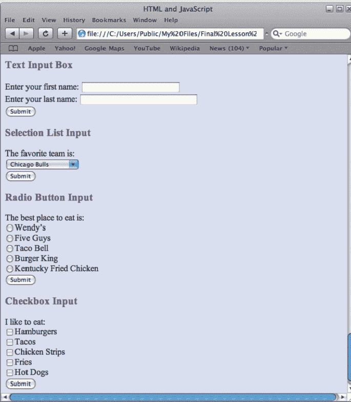

### 技术职业

#### 网络艺术家

曾几何时，网页完全由文字或文本构成。如今，图片和图形主导着网页，吸引了比以往任何时候都多的访问者。因此，网站开发公司对艺术家的需求量很大。

如果你正在考虑从事艺术职业，可以考虑网络。你可能会发现你的许多艺术作品最终会出现在网络上。拥有网站的大公司和网站开发者总是在寻找优秀的艺术人才。

你可以使用任何你喜欢的媒介或方法来创作你的艺术。扫描仪可以将你的图片转换为数字图像。数字文件可以转换为适用于网络的格式，如GIF、PNG或JPG。你还可以使用各种图形软件来创作你的艺术作品，或改进你已扫描成网络图像的任何艺术作品。

网络艺术家的最佳培训是尽可能多地参加艺术课程。你需要用来转换艺术作品的图形工具很容易学习，而艺术家的技能则需要更长的时间来培养。

### 总结

在本课中，你学到了：

- 如何控制字体的大小、样式和颜色。
- 如何更改图形的大小和位置。
- 如何在网页中插入各种数据输入选项。

### 词汇复习

定义以下术语：

- `.gif`
- `.png`
- 联合图像专家组

- T F 2. 你可以使图像变大或变小。
- T F 4. 所有图像都可以在互联网上免费使用。
- T F 6. `.png`格式旨在取代`.gif`文件，但到目前为止，两者在网上仍然运行良好。
- T F 8. GIF图像可以是动画的。
- T F 10. 你只能通过使用CSS标签来更改字体的颜色。

#### 填空题

通过在提供的空白处填写正确的单词或词组来完成以下句子。

- 1. 你可以使用`<img________________>`在网页上有条理地放置图片和文本。
- 3. ________________图像格式允许透明或透明图像。
- 5. ________________图像格式是由摄影专家建立的国际标准，可以进行压缩。

### 书面问题

请简要回答以下每个问题：

1. 用150-200字说明，为什么艺术家在网络上如此受欢迎？
2. 用不超过20个字说明，如果不打算使用，为什么不要将图片下载到学校或工作场所的网络？
3. 不回顾课程内容，写出一行创建指向在线网页链接的示例代码。

### 项目

#### 项目3–1：有游戏吗？

GreatApplications, Inc.公司希望进入在线视频游戏业务。然而，在开始编程下一个出色的在线视频游戏之前，它希望调查潜在客户，了解他们想玩和购买哪些类型的在线游戏。

头脑风暴提出10个问题，帮助GreatApplications, Inc.公司了解客户在视频游戏程序中想要什么。运用你的新技能，创建一个在线调查，从潜在客户那里收集信息，例如受访者的姓名和电子邮件地址。提出使用下拉列表、单选按钮、选择项和复选框的问题。为每个问题包含一个提交按钮。

#### 项目3–2：团队合作项目

GreatApplications, Inc.公司要求你的团队规划一次世界巡演，向五个主要城市的人们展示其新的软件视频游戏。你的团队被要求使用`<table>`标签为巡演创建一个活动日历。巡演必须在一个月内进行，并应涉及五个主要城市。

在创建日历时，为你将访问的巡演城市创建旅游信息链接。使用单元格内边距和单元格边框使表格更有趣。你甚至可以在单元格中放置图片（确保你有权使用这些图片）来说明你为软件发布选择的五个城市。

#### 项目3–3：网络项目

你能多快地将`levy.gif`图形替换为另一个图形？想想另一个你喜欢的图形。你如何操作属性和值来以各种尺寸显示你的新图形？动手吧！进行更改！

### 批判性思维

#### 活动3–1：网络在历史中的地位

为以下每个问题准备一个100到250字的回答。

1. 网络和HTML对世界经济有多重要？
2. 500多年前，约翰内斯·古腾堡发明了活字印刷术，这导致了普通人可获得的印刷材料数量激增。他改变了世界的历史。想象500年后的世界；你认为人们将如何看待网络和HTML的发明？

#### 活动3–2：思考HTML和CSS

使用示例代码或简短列表回答以下每个问题。

1. 使用CSS和`<style=>`代码示例，如何更改字体使网页上的文本更有趣？
2. 你希望看到HTML添加哪些额外功能或标签？你认为应该添加哪些标签来赋予HTML更多功能？

#### 活动3–3：主题问题

这些特殊的输入框要求用户提供不同类型的信息。你期望从以下`<form>`属性中得到什么样的响应？

- 文本：
- 单选按钮：

- 你的动物图片在网页内应保持适当的尺寸。
- 每种动物的描述性段落应以多种字体和颜色显示。

- 添加导航栏。
- 创建嵌套框架集。
- 利用框架和框架集选项。

HTML提供了许多功能，帮助网页开发者组织信息。你现在熟悉HTML表格，但在本课中，你将学习HTML框架。框架类似于表格，因为它们帮助网页设计师将浏览器屏幕空间划分为两个或多个矩形区域。然而，框架提供了额外的功能；它们允许设计师改变网页通常的行为方式。框架允许网页开发者将两个或多个网页组合在同一屏幕上，并且这些页面可以以各种方式相互交互。框架还支持多个属性，这些属性可能允许（或在某些情况下不允许）用户调整最终网页的外观。

### 词汇

- 边框属性
- 框架
- 框架集标签
- 名称属性
- 嵌套框架集
- 像素
- 源属性
- 标题栏

## 单元一 HTML基础

### 创建HTML框架集

在第2课中，你学习了如何通过使用超链接让网页浏览器从一个网页链接到另一个页面。现在是时候学习如何让你的网页浏览器同时在屏幕上显示两个或更多网页了。帮助你完成此任务的HTML标签是`<frameset>`标签和`<frame>`标签。

顾名思义，*框架集标签*允许你在浏览器屏幕上定义一组称为*框架*的矩形区域（参见**图4–1**）。每个框架能够显示不同的网页。在某种程度上，你可以让你的网页浏览器表现得好像你的计算机上同时运行着多个网页浏览器。然而，框架集允许一个框架中的网页与另一个不同框架中的页面进行通信。例如，一个框架中的超链接可以导致一个网页被加载到另一个不同的框架中。你将在本课后面更多地了解这个概念。

**词汇**

- 框架集标签
- `rows`属性
- `src`属性

2. 如有必要，创建一个新的空白文档。

正如你已经了解到的，你可以使用`.htm`或`.html`扩展名保存文件。小心！如果你使用了`.htm`扩展名，你必须相应地更改**图4-2**中的所有文件名。例如，在`frameset`文件中将`navbar.html`更改为`navbar.htm`。

#### 图4-2 你的第一个frameset文件

```html
<title>HTML and JavaScript</title>

<frame name="LeftFrame" src="navbar.html">

</frameset>

</html>
```

星号（*）表示“剩余的所有部分”。

## 单元一 HTML基础

### 添加导航栏

专业网页设计师常用的一种设计是将网页放在一个狭窄的左侧框架中，该框架包含许多超链接。当用户点击这些链接中的任何一个时，相应的网页会显示在较大的右侧框架中。这种设计技术通常被称为*左侧导航*，包含超链接的网页被称为导航栏。*导航栏*是一系列超链接，通常在网页或框架中水平或垂直组织。它用于导航网站。**图4-3**显示了一个带有导航栏的网页示例。

### 词汇表

- 导航栏
- 像素

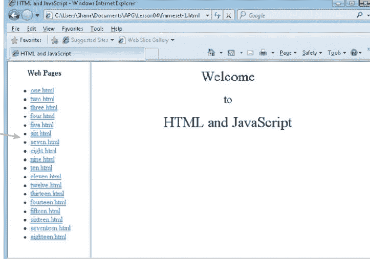

**图4-3** 双框架网页

### `target`属性

你不需要学习任何新的HTML标签来创建你的导航栏。导航栏是通过使用你在前几课中已经用过的标签创建的。然而，你将在`<a>`标签中使用一个新属性，该属性将左侧框架中的链接与右侧框架中的网页关联起来。*target属性*告诉浏览器应该使用哪个框架来显示目标网页。重要的是要注意，`target`属性使用的是你在分步指南4.1中用`<frame>`标签的`name`属性定义的框架名称。

> 专家补充

2. 按照**图4-4**所示精确输入HTML文本。

```html
<html>

<title>HTML and JavaScript</title>

<body>

<ul>

<li><a href="two.html" target="RightFrame">two.html</a></li>
```


```html
<li><a href="four.html" target="RightFrame">four.html</a></li>
<li><a href="six.html" target="RightFrame">six.html</a></li>
<li><a href="eight.html" target="RightFrame">eight.html</a></li>
<li><a href="ten.html" target="RightFrame">ten.html</a></li>
<li><a href="twelve.html" target="RightFrame">twelve.html</a></li>
<li><a href="fourteen.html" target="RightFrame">fourteen.html</a></li>
<li><a href="sixteen.html" target="RightFrame">sixteen.html</a></li>
<li><a href="eighteen.html" target="RightFrame">eighteen.html</a></li>
</body>
```

### 创建导航栏

3. 将你新创建的HTML文件保存为`navbar.html`或`navbar.htm`，放在与你在这些课程中创建的其他文件相同的文件夹中。

> 互联网

2. 单击菜单栏上的**文件**，然后单击**新建**以创建一个新的空白文档。

```html
<html>
<head>
</head>
<body>
<br>
<br>
</body>
</html>
```

5. 在你的Web浏览器中打开文件`frameset-1.html`，并查看你在分步指南4.1中创建的`frameset-1.html`文档。你的屏幕应类似于**图4-6**。左侧框架显示HTML文件`navbar.html`，而右侧框架显示HTML文件`welcome.html`。这些HTML文件是在框架集文件`frameset-1.html`中用`src`属性指定的文件。

> 注意

带有导航栏的欢迎页面

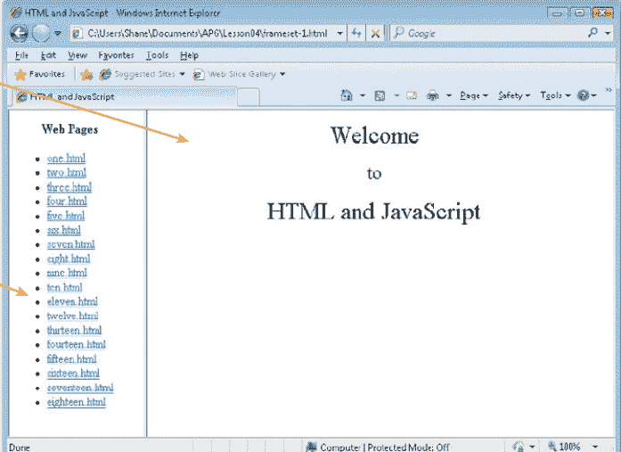

> **注意**
>
> 如果你需要帮助回忆如何在浏览器中打开文件，请回顾分步指南1.3。

### 创建嵌套框架集

有时，我们希望在框架集中放置第三个框架，以在浏览器窗口顶部显示一个水平框架。然后，你可以将一个新的网页放入这个新框架中，该框架将作为网页的固定标题。

如果你还记得本课第一部分关于水平和垂直框架的讨论，你应该会问自己一个重要的问题。具体来说，我们早先已经说明，一个框架集只能包含水平框架或垂直框架，而不能同时包含两者。那么，你可能会好奇：如果你现有的框架集中已经定义了垂直框架，你该如何创建一个水平框架来显示你的标题页呢？

*嵌套框架集*解决了这个问题。术语*嵌套*是程序员和Web开发人员用来描述一种结构、关键字或标签，其中包含一个或多个相同项目的额外实例。在这种情况下，你将使用一个`<frameset>`标签嵌套在另一个`<frameset>`标签内部，以同时创建垂直和水平框架。

**词汇**

- 嵌套框架集

### 分步指南4.4

在本分步指南中，你将通过向现有文档添加额外的`<frameset>`标签来创建一个嵌套框架集。这些标签定义了新的框架。然后，你将使用新的文件名保存HTML文件，同时保留原始HTML文件。

1. 如果尚未打开，请打开记事本、SimpleText或你最喜欢的文本编辑器。
2. 单击**文件类型**箭头，单击**所有文件**，然后导航到你为本书存储HTML文件的文件夹。
3. 通过添加此处和**图4-7**中以粗体显示的标签来修改HTML文档。

```html
<frame name="UpperFrame" src="title.html">

<frame name="LeftFrame" src="navbar.html">

</frameset>
```

**图4-7** 创建嵌套框架集

```html
<title>HTML and JavaScript</title>

<frame name="UpperFrame" src="title.html">

<frame name="LeftFrame" src="navbar.html">

</frameset>
```

6. 使用**另存为**命令，将更改保存到一个新文件中，文件名为`frameset-2.html`或`frameset-2.htm`，保存在你一直用于保存本书课程文件的文件夹中。

### 创建标题栏

正如你在分步指南4.2中创建的网页被称为导航栏一样，一个专门用于显示网站固定标题的页面通常被称为**标题栏**。在本分步指南中，你将创建一个标题栏，显示在你在分步指南4.4中定义的新框架中，文件为`frameset-2.html`。**图4-8**显示了一个带有标题栏的网页示例。

**词汇**

- 标题栏

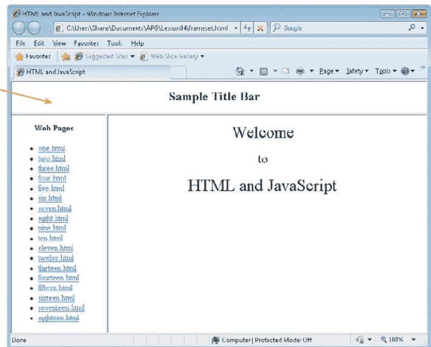

**图4–8** 带有导航栏、标题栏和欢迎页面的三个框架

与你在分步指南4.3中创建的`welcome.html`或`welcome.htm`页面HTML文件一样，你不需要使用任何新的HTML标签来创建这个标题栏网页。但是，与欢迎页面一样，专业的Web开发人员通常会不遗余力地创建一个引人注目且令人难忘的标题栏。然而，你的标题栏将非常简单，以便你更容易掌握这个新概念。

关于基于框架的网页，这里还有另一个值得一提的方面。默认情况下，浏览器会在每个框架之间显示半粗线，这些线被称为*框架分隔线*。当用户将鼠标移到框架分隔线上时，指针会改变形状，表明框架分隔线可以移动。用户只需单击并拖动分隔线到新位置即可。正如你将在下一节中学到的，根据你的网页设计，这可能是也可能不是框架的一个理想特性。

**词汇**

- 框架分隔线

### 分步指南4.5

框架有助于组织网页。在本分步指南中，你将创建一个有助于组织网页的标题框架。你还将看到如何通过拖动框架分隔线来调整框架大小。

1. 如果尚未打开，请打开记事本、SimpleText或你最喜欢的文本编辑器。
2. 创建一个新的空白文档。
3. 按照图4–9中粗体所示，准确输入HTML文本。

**图4–9** 标题页的HTML文本

```html
<html>
<head>
<title>HTML and JavaScript</title>
</head>
<body>
<div align="center"><font size="5"><b>HTML and JavaScript</b></font></div>
</body>
</html>
```

4. 将新创建的HTML文件保存为`title.html`或`title.htm`。
5. 打开你的Web浏览器，打开`frameset-2.html`或`frameset-2.htm`文件，将你在分步指南4.4中创建的`frameset-2.html`文档作为网页查看。你应该会看到一个类似于**图4–10**所示的网页。

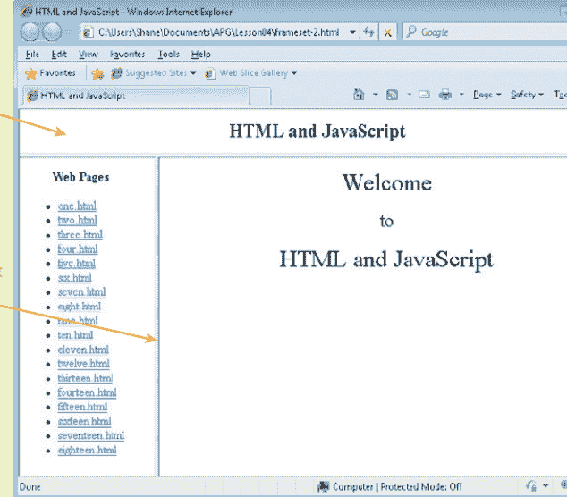

**图4–10** 拖动框架分隔线以自定义页面

6. 框架页面可以由用户自定义。如**图4–10**所示，慢慢将鼠标滚过框架之间的栏（称为框架分隔线）。当鼠标指针变为双箭头时，单击并将栏向左或向右（对于垂直框架）或向上或向下（对于水平框架）拖动。

> **互联网**
>
> 框架是学习如何将网页组织成不同部分或区域的好方法。表格提供了另一种将页面分割成不同部分的方法，用于艺术和组织目的。

### 使用高级HTML选项

让我们花一点时间，对你到目前为止创建的框架和框架集进行几点观察。首先，你的Web浏览器正在显示框架分隔线，这使得一个框架在哪里结束、另一个框架在哪里开始变得非常明显。其次，如果你将鼠标光标直接放在这些框架分隔线中的任何一个上，你会看到鼠标指针改变形状，表明框架分隔线可以移动。这意味着用户可以通过单击并将框架分隔线拖动到不同的位置来更改网页的外观，正如你在上一个分步指南中所体验到的那样。

我们刚刚描述的框架和框架集特性在某些情况下可能是理想的。然而，有时专业的Web开发人员不希望浏览器显示框架分隔线，也不希望用户随意更改屏幕布局。当开发人员在其网页中包含定制的图形图像时，尤其如此。这些图像通常被设计为特定尺寸，并适合放在框架内。如果浏览器显示框架分隔线，或者用户更改了框架的大小，整个页面的布局可能会被打乱，由此产生的图像混乱将非常不美观。

幸运的是，两个重要的HTML属性可以在`<frameset>`和`<frame>`标签中使用来解决这些问题，如**图4–11**所示。首先，你可以在`<frameset>`标签中使用**border属性**来调整框架分隔线的外观。此外，你还可以在`<frame>`标签中使用**noresize属性**来指示浏览器用户不应能够更改框架的大小。这两个属性可以单独使用或一起使用，以获得你想要的外观和行为。

**词汇**

- `border`属性
- `noresize`属性

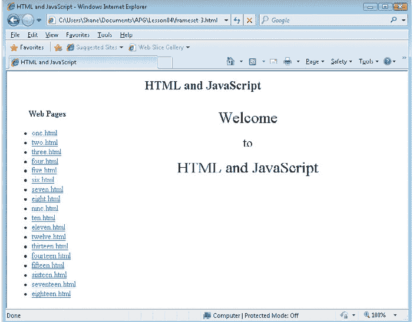

**图4–11** 在网页上消除框架分隔线

### 分步操作4.6

在本分步操作中，你将输入一些标签，这些标签将使用户无法更改你网页中框架的大小。

1. 如果尚未打开，请打开记事本、SimpleText或你最喜欢的文本编辑器。
2. 打开你在分步操作4.4中创建的用于文本编辑的HTML文件`frameset-2.html`或`frameset-2.htm`。
3. 通过添加此处和**图4–12**中以粗体显示的HTML文本来修改HTML文档。

```html
<frameset border="0" rows="60,*">

<frame name="UpperFrame" noresize src="title.html">

<frameset border="0" cols="180,*">

<frame name="LeftFrame" noresize src="navbar.html">

<frame name="RightFrame" noresize src="welcome.html">

</frameset>

</frameset>
```

**图4–12** 使用`<frameset>`和`<frame>`属性

```html
<html>
<head>
<title>HTML and JavaScript</title>
</head>
<frameset border="0" rows="60,*">
<frame name="UpperFrame" noresize src="title.html">
<frameset border="0" cols="180,*">
<frame name="LeftFrame" noresize src="navbar.html">
<frame name="RightFrame" noresize src="welcome.html">
</frameset>
</frameset>
</html>
```


4. 将你的更改保存为一个新的 HTML 文件，命名为`frameset-3.html`或`frameset-3.htm`，并保存在你一直保存这些课程中创建的其他文件的文件夹中。
5. 打开你的 Web 浏览器，并将你刚刚保存的`frameset-3.html`文档作为网页查看。你浏览器中的网页不应有框架分隔符。请回顾**图 4–11**。

### 技术时间线

### HTML 创建工具

HTML 功能强大，但手动输入所有标签可能需要很长时间。有人终于问道：“有没有办法让创建 HTML 文件变得更简单？”

在 HTML 成为在线通信标准方式几年后，有进取心的程序员创建了软件工具，免去了输入所有那些尖括号和标签的麻烦。一些最受欢迎的网页开发工具包括 Adobe Dreamweaver、Adobe GoLive 和 Microsoft Expression。这些工具中的每一个都以与专业人员在文字处理或桌面出版软件中创建文档大致相同的方式帮助你创建网页。

在像 Dreamweaver 这样的程序中，当你设计页面时，大多数标签都是自动为你创建的。但是，不要以为使用这些强大而令人兴奋的网页创建工具就不需要了解 HTML 标签。有时你需要编辑或更正这些产品创建的标签。标签视图始终可用。

### 总结

在本课中，你学到了：

- 如何创建框架集。
- 如何解释框架集属性和值。
- 如何在框架中创建导航栏。
- 如何在框架中创建一个简单的欢迎页面。
- 如何插入嵌套标签和属性。
- 如何向框架集添加标题栏框架。
- 如何移除框架集中的边框。

### 词汇复习

定义以下术语：

- `border` 属性
- `cols` 属性
- `frame`
- `frame separator`
- `frameset` 标签
- `left-hand navigation`
- `name` 属性
- `navigation bar`
- `nested frameset`
- `noresize` 属性
- `pixel`
- `rows` 属性
- `src` 属性
- `target` 属性
- `title bar`

### 复习题

#### 判断题

如果陈述正确，请圈出 T；如果陈述错误，请圈出 F。

1. 框架集可以显示行或列，但不能同时显示两者。
2. `rows` 属性用于定义垂直框架。
3. 框架集页面中需要`<body>`和`</body>`标签。
4. 框架集页面中允许使用`<head>`和`</head>`标签。
5. 当你使用 Dreamweaver、Expression 或 GoLive 等程序时，你必须键入所有 HTML 标签。
6. 如果你使用网页设计软件创建网页，了解和理解 HTML 标签没有价值。
7. 计算框架宽度的唯一方法是计算像素。
8. 默认情况下，用户可以移动 Web 浏览器显示的框架分隔符。
9. `border` 属性使框架分隔符消失。
10. `noresize` 属性使框架分隔符消失。

#### 填空题

通过在提供的空白处填写正确的单词或词组来完成以下句子。

1. `rows` 属性创建水平框架。
2. `cols` 属性创建垂直框架。
3. `src` 属性指定要在框架中显示的网页的文件名。
4. `name` 属性标识特定的框架。
5. `target` 属性在锚点`<a>`标签内使用。
6. `border` 属性可用于使框架分隔符消失。
7. `noresize` 属性可防止网页查看者更改框架的大小。
8. 计算机屏幕上的单个“点”光称为`pixel`。
9. 在另一个框架集内定义的框架集称为`nested`框架集。
10. `frame separator`是 Web 浏览器在框架之间显示的半粗线。

#### 简答题

简要回答以下每个问题：

1. 根据本课的描述，导航栏的目的是什么？
2. 什么是欢迎页面？此页面的主要目标是什么？
3. 什么是嵌套框架集？网页设计师为什么使用它？
4. 什么是像素值和百分比值？它们如何在`<frameset>`标签内指定？
5. 为什么允许用户调整基于框架的网页上的行和/或列分隔符并不总是一个好主意？

### 项目

#### 项目 4–1：组织研究信息

在项目 1-1 中，你使用了你的 Web 搜索技能来查找有关 HTML、XHTML 和 CSS 的信息。你的经理要求你使用仅两列的新基于框架的网页来组织你收集的信息。

GreatApplications, Inc. 要求你创建一个带有左侧导航的网站，该网站将组织你在项目 1-1 和表 1-3 中收集的信息。这样，这些有用的网页就可以在线提供给公司中的每个人。在你的框架集页面的左侧创建一个导航框架，并让你链接的信息出现在右侧。你可以使用你在本课中学到的所有标签来完成所有这些操作。

#### 项目 4–2：团队进行调查

在这个团队合作项目中，你要进行一项调查。为了完成调查，你和你的团队成员必须访问至少 100 个不同的网站。通过团队合作，这不会像最初看起来那么困难。例如，如果你的团队由五名成员组成，那么你们每人只需要访问 20 个网站。

作为一个团队，重新访问你列出的最佳和最差页面。如有必要，请访问其他网站。你必须作为一个团队，正好调查 100 个网站，并在过程中收集数据。分配任务，每个成员负责查看一定百分比的网站，同时记录将以下问题应用于每个网站的结果。

#### 项目 4–3：顶部导航

在项目 4-1 中，你创建了一个左侧导航系统，该系统将允许你与 GreatApplications, Inc. 的同事分享有关 HTML 的信息。在这个 Web 项目中，挑战你自己。将你在项目 4-1 中创建的网页更改为从页面顶部栏导航的网站。

在你的框架集中创建两行。在顶部框架中，使用屏幕的 20% 创建你的导航系统。在底部框架中，显示信息。将此项目保存为`Project 4-3.html`或`Project 4-3.htm`。

### 调查问题

1. 查看你 100 个网页的源代码，有多少个使用`<frame>`标签或某种类型的框架组织来组织其网页？
2. 查看你网页的源代码，这些网站中有多少个使用`<table>`标签来组织其网页？
3. 这些网站中有多少百分比使用左侧导航？
4. 这些网站中有多少个在网页顶部使用导航系统？
5. 这些网站中有多少个在网页顶部的标题栏区域使用了有吸引力的图形或徽标？
6. 根据你团队成员的意见，访问的网站中有多少百分比拥有有效的欢迎页面？

### 批判性思维

#### 活动 4–1：你学到了什么？

在你看来，在完成前四节课的过程中，关于 HTML 和创建网页，你学到的最重要的 10 件事是什么？准备一份 100-250 字的报告，解释为什么这 10 项中的每一项都出现在你的列表中。将你的答案（在文本文件中）保存为`Activity 4-1`。

#### 活动 4–2：改变 HTML

在你结束 HTML 学习时，思考一下你看到的 HTML 的三大弱点。关于 HTML，你会改变的最重要的三件事是什么？你认为有哪些弱点或可以改进的地方？在一份 100-250 字的报告中详细解释你希望看到 HTML 如何变得更好、更易于使用，并对你作为 Web 开发人员更有帮助。将你的答案保存为`Activity 4-2`。

#### 综合模拟项目

专业网页设计师通常需要理解并运用 HTML 框架的灵活性，以赋予网站所需的外观。例如，一些商业网站采用顶部、底部或右侧导航栏，而非本课中介绍的左侧导航栏。运用你所学的框架和框架集知识，重新组织图 4-10 所示的网站，使其展示右侧导航的使用方式。

同时，调整网站框架的结构，使导航栏跨越浏览器窗口的整个高度，而标题栏则*不*跨越整个宽度。你重新组织的网页应与图 4-13 类似。

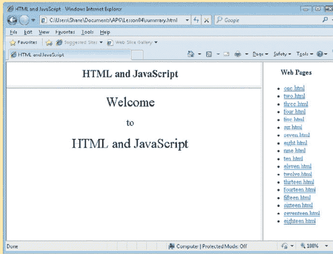

**图 4-13** 带有右侧导航的示例网站

项目要求：

- 你可以使用本课中创建的`title.html`、`welcome.html`和`navbar.html`文件，为新的框架集提供内容。
- 上方（标题）框架的高度应约为 60 像素，右侧（导航）框架的宽度应约为 180 像素。
- 每个框架应定义为不可调整大小。
- 你可能需要运用前面课程中的概念（如字体和图像）来改善标题页和欢迎页的外观。

此页有意留白


预计时间：1.5 小时

## 第 5 课

## 层叠样式表简介

### 学习目标

完成本课后，你应该能够：

- 创建层叠样式表。
- 使用 CSS 控制超链接行为。
- 创建样式类。
- 在网页间共享样式类。
- 使用 CSS 控制 HTML 表格外观。

### 词汇表

- 活动
- 层叠样式
- 层叠样式表
-`.css`
- CSS 文件
- 悬停
- 外观和感觉
- 普通
- 样式
- 样式类
- 样式表
- 已访问

## 单元一：HTML 基础

几乎每个 HTML 标签都支持包含一个或多个可选属性。一些属性影响标签的操作方式或 Web 浏览器处理它的方式。其他属性不影响功能，而是影响网页上元素的外观。

在旧版本的 HTML 标准中，Web 开发人员常常需要学习和记住所有可能影响浏览器渲染网页视觉组件方式的各种属性，这常常是一个挑战。但随着最新的 HTML 4.01 标准，所有这些属性已被整合到一个名为`style`的全局可访问属性中。

在第 2 课和第 3 课中，你已经简要了解了 HTML 样式的概念。*样式*只是应用于网页视觉组件的一个或多个属性的集合。这些组件可能包括文本、图形、输入按钮和网页元素。使用样式最简单的方法是将它们包含在单个 HTML 标签中，在你在第 2 课和第 3 课中创建的页面中有几个这样的实例。考虑以下示例：

```html
<body style="background-color:#E6E6FA">
```

此样式将背景颜色应用于整个网页主体。如果你想为此网页应用另一个属性（例如特定字体），你可以创建如下标签：

```html
<body style="background-color:#E6E6FA;
font-family:New York">
```

这种使用样式的方法在某些情况下效果很好，但它并不总是最佳选择。例如，考虑一个网页上的有序或无序列表，其中包含数十个甚至数百个列表项。为列表中的每个`<li>`标签应用样式很快就会变得难以应付。

你可以看到，将相同的样式属性输入到数十个甚至数百个`<li>`标签中，或者甚至复制粘贴，将是非常繁琐的。因此，HTML 支持层叠样式的概念。*层叠样式*是一组可以在网页头部指定一次，然后应用于特定标签多个实例的一个或多个属性。

考虑以下示例：

```html
<style type="text/css">
li {font-family:Verdana;font-color:red}
</style>
```

使用此层叠样式，`font-family`和`font-color`属性将应用于当前 HTML 文档中*每个*出现的`<li>`标签。正如你在第 3 课中学到的，多个标签可以包含在层叠样式定义中。**图 5-1** 中显示的标签为网页的许多部分创建了层叠效果。层叠样式为网页设计师节省了大量时间！

### 词汇表

- 样式
- 层叠样式

## 第 5 课：层叠样式表简介

**图 5-1** 层叠样式定义

```html
<style type="text/css">
  h1 {color:red}
  h2 {color:blue}
  h3 {color:purple}
  p {color:black}
</style>
```

现在你已经对 HTML 样式和层叠样式有了基本的了解，让我们通过讨论层叠样式表（或 CSS）的概念来进一步增加你的知识。

### 创建层叠样式表

*层叠样式表*是一组从网页头部提取出来并以特定（CSS）格式存储在单独文件中的一个或多个层叠样式代码。按照惯例，层叠样式表文件总是以`.css`扩展名命名，以便 Web 开发人员可以立即将它们识别为层叠样式表（通常简称为*CSS 文件或样式表*）。

使用样式表的两个主要动机是简化 HTML 文档的头部部分，并将所有样式定义保存在一个易于查找和修改的地方。

Web 开发公司可以创建一个完整的网站，然后将其出售给不同的客户。CSS 使得通过简单地更改样式表中的值来为每个客户定制网站的外观和行为（通常称为*外观和感觉*）成为可能。这是公司通过最小化支持多个客户所需的努力来最大化利润的好方法。

### 词汇表

- 层叠样式表
-`.css`
- CSS 文件或样式表
- 外观和感觉

### 专家补充

几乎每个专业开发的网页都包含两个部分：头部和主体。严格来说，头部部分是可选的，但许多 HTML 配套技术（如 CSS，以及你将在单元二中学到的 JavaScript）需要它。头部部分包括在`<head>`和`</head>`标签之间定义的所有内容。

### 分步操作 5.1

在这个分步操作中，你将创建你的第一个 CSS 文件。为了让你快速开始并看到努力的结果，你首先对在第 3 课分步操作 3.5 中创建的网页进行微小修改。你修改`<head>`和`</head>`标签之间的代码。然后，你使用文本编辑器创建一个 CSS 文件。保存 CSS 文件时，你必须小心添加`.css`文件扩展名。

1. 打开记事本、SimpleText 或你最喜欢的文本编辑器。
2. 单击菜单栏上的**文件**，然后单击**打开**，在文本编辑器中打开你在分步操作 3.5 中创建的`eighteen.html`或`eighteen.htm`文件。
3. 单击菜单栏上的**文件**，单击**另存为**，然后将 HTML 文件保存为`nineteen.html`或`nineteen.htm`，保存在与前面课程文件相同的文件夹中，以保留`eighteen.html`文件。
4. 通过删除删除线标记的行并添加此处粗体显示的行来修改此 HTML 文件的头部。生成的网页头部应如**图 5-2**所示。

```html
<head>
<title>HTML and JavaScript</title>
<style type="text/css">
h1 {color:red}
h2 {color:blue}
h3 {color:purple}
p {color:black}
</style>
<link href="nineteen.css" rel="stylesheet" type="text/css"></link>
</head>
```

**图 5-2**`nineteen.html`文件头部

```html
<head>
<title>HTML and JavaScript</title>
<link href="nineteen.css" rel="stylesheet" type="text/css"></link>
</head>
```

> ### 专家补充
>
> 确保不要忘记在`<link>`标签中包含`rel`和`type`属性。`stylesheet`和`text/css`值告诉 Web 浏览器，`href`属性指定的文件将是 CSS 格式的层叠样式表。仅凭文件名以`.css`扩展名结尾是不够的。此外，*不要*忘记包含结束的`</link>`标签。如果你忘记了，结果将不会很好！

5. 在 HTML 文件`nineteen.html`或`nineteen.htm`中保存你的更改。
6. 单击菜单栏上的**文件**，然后单击**新建**以创建一个新的空白文档。
7. 完全按照**图 5-3**所示输入 CSS 文本。

## 第 5 课：层叠样式表简介

**图 5–3** 你的第一个层叠样式表（CSS 文件）

```css
h1 {color:red}
h2 {color:blue}
h3 {color:purple}
p {color:black}
```


8. 点击菜单栏上的“文件”，点击“保存”，然后将你新创建的 CSS 文件保存为 `nineteen.css`，放在你为这些课程保存文件的同一文件夹中。
9. 启动你常用的网页浏览器，然后打开 `nineteen.html` 或 `nineteen.htm` 文件，以网页形式查看该文件。你屏幕上的网页应如图 5–4 所示。

> **警告**
>
> 输入文件名时，请务必输入 `.css` 文件扩展名。不要覆盖 `nineteen.html` 文件。

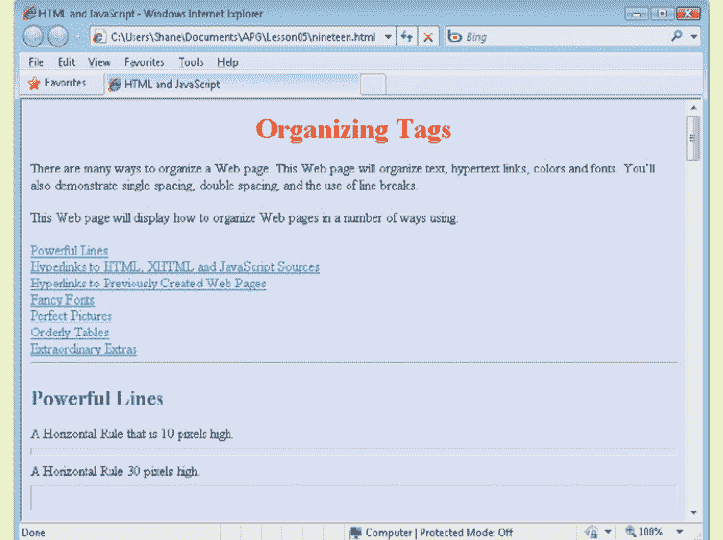

### 探索超链接样式

至此，你应该已经熟悉了网页中超链接的用途以及创建它们的 HTML 标签。然而，你也应该意识到，超链接的外观和行为可以通过层叠样式表进行修改。默认情况下，Internet Explorer 浏览器以及许多流行的浏览器以带下划线的蓝色字体显示文本超链接。你在第 4 课创建的 `navbar.html` 网页文件（如图 5–5 所示）就是一个使用这种默认字体和样式格式化文本链接的好例子。

## 第一单元 HTML 基础

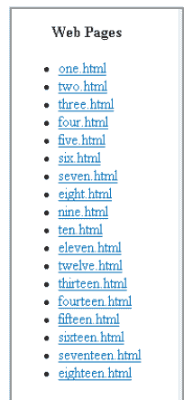

图 5–5 使用默认样式链接的导航栏

如果你将鼠标指针移到这 18 个超链接中的任何一个上，指针形状会变为手形指针，但文本链接本身不会改变。链接仍然显示为带下划线的蓝色文本。此外，如果你指向一个链接（例如 `eighteen.html`），然后按住鼠标左键不放，文本链接仍然显示为带下划线的蓝色文本；它不会改变。然而，一旦你释放鼠标按钮（即点击该链接），你就会在浏览器中打开关联的网页。当你返回到包含链接的页面时，链接文本将从带下划线的蓝色变为紫色（仍然带下划线），如图 5–6 所示。这种外观变化表明该链接已被访问过。

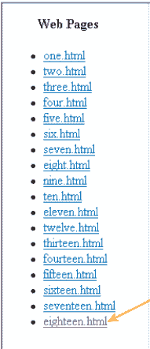

图 5–6 使用默认已访问链接的导航栏

## 第 5 课 层叠样式表简介

刚刚描述的默认超链接场景说明了链接的四种可能状态：普通、悬停、活动和已访问。超链接的“普通”状态是当鼠标指针不在其上且从未被点击时的显示方式。“悬停”状态定义了当鼠标指针在其上但尚未点击时链接的外观。链接的“活动”状态是当它在网页上获得焦点时，按下鼠标按钮会使其获得焦点。最后，正如你可能预料的那样，“已访问”状态指定了链接在至少被点击一次后的外观。

### 词汇表

- 普通
- 悬停
- 活动
- 已访问

### 分步操作 5.2

在这个分步操作中，你将创建一个样式表，为所有四种超链接状态定义文本属性。你还将把这个样式表应用到你在第 4 课创建的 `navbar.html` 文件。生成的网页是基于框架的，因此你需要检索并修改几个文件。在网页开发中，一旦你知道某些文件可以正常工作，最好对这些文件进行修改，而不是重新创建新的类似文件，以免引入错误。你对每个文件所做的修改都很小，应该只需要很少的时间。

1. 如果尚未打开，请打开记事本、SimpleText 或你常用的文本编辑器。
2. 在文本编辑器中打开 `frameset-1.html` 或 `frameset-1.htm` 文件。这是你在分步操作 4.1 中创建的文件。
3. 点击菜单栏上的“文件”，点击“另存为”，然后将 HTML 文件保存为 `frameset-4.html` 或 `frameset-4.htm`，放在你保存前几课文件的同一文件夹中，以保留 `frameset-1.html` 文件。
4. 修改 `frameset-4.html` 或 `frameset-4.htm` 文件，更改左框架源文件的名称，如本步骤所示并在图 5–7 中以粗体显示。

```html
<frame name="LeftFrame" src="navbar-2.html">
```

图 5–7 `frameset-4.html` 文件

```html
<html>

<head>

<title>HTML and JavaScript</title>

</head>

<frameset cols="180,*">

<frame name="LeftFrame" src="navbar-2.html">

<frame name="RightFrame" src="welcome.html">

</frameset>

</html>
```

## 第一单元 HTML 基础

5. 保存对 `frameset-4.html` 或 `frameset-4.htm` 的更改。
6. 在文本编辑器中打开 `navbar.html` 或 `navbar.htm` 文件。这是你在分步操作 4.2 中创建的文件。
7. 点击菜单栏上的“文件”，点击“另存为”，然后将 HTML 文件保存为 `navbar-2.html` 或 `navbar-2.htm`，放在你保存前几课文件的同一文件夹中，以保留 `navbar.html` 文件。
8. 通过添加标签行修改此 HTML 文件的头部，如本步骤所示并在图 5–8 中以粗体显示。

```html
<link href="navbar-2.css" rel="stylesheet" type="text/css"></link>
```

**图 5–8** 层叠样式表 `navbar-2.html` 文件头部

```html
<head>

<title>HTML and JavaScript</title>

<link href="navbar-2.css" rel="stylesheet" type="text/css"></link>

</head>
```

9. 在 `navbar-2.html` 文件中为新的 `nineteen.html` 或 `nineteen.htm` 文件（你在分步操作 5.1 中创建的）添加一个新的超链接。指向 `nineteen.html` 文件的链接出现在指向 `eighteen.html` 文件的链接下方。你通过添加本步骤所示并在图 5–9 中以粗体显示的代码来创建链接。

```html
<li><a href="nineteen.html" target="RightFrame">nineteen.html</a></li>
```

**图 5–9** 层叠样式表 `navbar-2.html` 文件

```html
<html>

<head>

<title>HTML and JavaScript</title>

<link href="navbar-2.css" rel="stylesheet" type="text/css"></link>

</head>

<body>

<div align="center"><b>Web Pages</b></div>

<ul>
```

## 第 5 课 层叠样式表简介

图 5–9 层叠样式表 `navbar-2.html` 文件

```html
<li><a href="one.html" target="RightFrame">one.html</a></li>

<li><a href="two.html" target="RightFrame">two.html</a></li>

<li><a href="three.html" target="RightFrame">three.html</a></li>

<li><a href="four.html" target="RightFrame">four.html</a></li>

<li><a href="five.html" target="RightFrame">five.html</a></li>

<li><a href="six.html" target="RightFrame">six.html</a></li>

<li><a href="seven.html" target="RightFrame">seven.html</a></li>

<li><a href="eight.html" target="RightFrame">eight.html</a></li>

<li><a href="nine.html" target="RightFrame">nine.html</a></li>

<li><a href="ten.html" target="RightFrame">ten.html</a></li>

<li><a href="eleven.html" target="RightFrame">eleven.html</a></li>

<li><a href="twelve.html" target="RightFrame">twelve.html</a></li>

<li><a href="thirteen.html" target="RightFrame">thirteen.html</a></li>

<li><a href="fourteen.html" target="RightFrame">fourteen.html</a></li>

<li><a href="fifteen.html" target="RightFrame">fifteen.html</a></li>

<li><a href="sixteen.html" target="RightFrame">sixteen.html</a></li>

<li><a href="seventeen.html" target="RightFrame">seventeen.html</a></li>

<li><a href="eighteen.html" target="RightFrame">eighteen.html</a></li>

<li><a href="nineteen.html" target="RightFrame">nineteen.html</a></li>

</ul>

</body>

</html>
```

10. 将你的更改保存在 `navbar-2.html` 或 `navbar-2.htm` 文件中，放在与 `frameset-4.html` 文件相同的文件夹中。
11. 点击菜单栏上的“文件”，然后点击“新建”以创建一个新的空白文档。
12. 完全按照图 5–10 中粗体所示输入 CSS 文本。

图 5–10 定义四种超链接样式

```css
a:link {color:blue;text-decoration:none}

a:visited {color:purple;text-decoration:none}

a:hover {color:green;text-decoration:underline}

a:active {color:red;text-decoration:underline}
```

## 第一单元 HTML 基础

> **警告**
>
> 输入文件名时，请务必输入 `.css` 文件扩展名。不要覆盖 `navbar-2.html` 文件。

13. 将你新创建的 CSS 文件保存为 `navbar-2.css`，放在与你本课创建的其他文件相同的文件夹中。

14. 启动你常用的网页浏览器，并在浏览器中打开你的 `frameset-4.html` 或 `frameset-4.htm` 文件。生成的网页应如图 5–11 所示。

注意：如果你在上一个分步操作中点击过 `nineteen.html` 链接，它在你的网页中可能显示为紫色或已访问状态。

**图 5–11**  
带有 CSS 导航栏的双框架网页

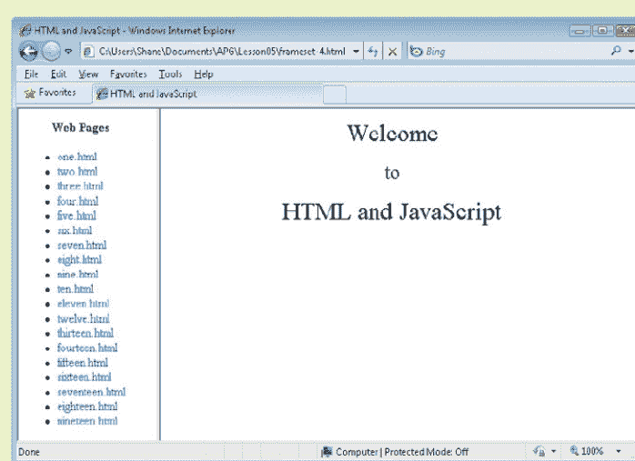

15. 将鼠标移到导航栏中的超链接上。当鼠标指针经过每个链接时，它应该变为带下划线并改变颜色。

16. 指向一个超链接，然后按住鼠标左键不放。链接文本的颜色应该变为另一种颜色。

17. 点击该链接。你点击的链接的网页将在右框架中打开。链接被点击后，在失去焦点之前应显示为活动状态。然后，颜色应变为紫色，表示它已被访问过，如图 5–12 所示。

## 第五课 层叠样式表简介

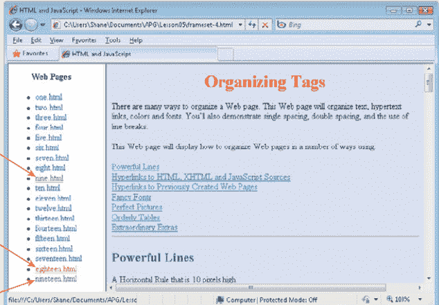

图 5–12  
带有悬停、活动和已访问链接的导航栏

### 使用样式类

层叠样式对于将多个属性应用于许多不同的显示元素非常有用，无需多次输入这些属性。然而，在设计网页时，这种方法并不总是你想要的解决方案。例如，假设你的网页上有多个文本部分（或分区），并且你想为每个分区应用不同的属性集。显然，将单一样式全局应用于整个页面不会产生你想要的结果。幸运的是，CSS 技术允许你定义样式类，这些样式类可以应用于网页中的某些标签，而不会影响相同类型的其他标签。“样式类”是在层叠样式表中定义的命名属性组，可以应用于 HTML 文档中的指定标签。

### 词汇

- 样式类

### 分步操作 5.3

在这个分步操作中，你将创建三个不同的样式类，这些样式类将应用于网页上的三个不同文本分区。类名可以防止一个类应用于所有三行文本。

1. 如果尚未打开，请打开记事本、SimpleText 或你最喜欢的文本编辑器。
2. 在文本编辑器中打开 `frameset-4.html` 或 `frameset-4.htm` 文件。这是你在上一个分步操作中创建的文件。
3. 单击菜单栏上的“文件”，单击“另存为”，然后将 HTML 文件保存为 `frameset-5.html` 或 `frameset-5.htm`，保存在与上一课文件相同的文件夹中，以保留 `frameset-4.html` 文件。
4. 更改右框架的源文件名称，如本步骤所示，并在图 5–13 中以粗体显示。

```html
<frame name="RightFrame" src="welcome-2.html">
```

图 5–13 `frameset-5.html` 文件

```html
<html>

<head>

<title>HTML and JavaScript</title>

</head>

<frameset cols="180,*">

<frame name="LeftFrame" src="navbar-2.html">

<frame name="RightFrame" src="welcome-2.html">

</frameset>

</html>
```

5. 将更改保存到 `frameset-5.html` 或 `frameset-5.htm` 文件。
6. 在文本编辑器中打开 `welcome.html` 或 `welcome.htm` 文件。这是你在分步操作 4.3 中创建的文件。
7. 单击菜单栏上的“文件”，单击“另存为”，然后将 HTML 文件保存为 `welcome-2.html` 或 `welcome-2.htm`，保存在与上一课文件相同的文件夹中，以保留 `welcome.html` 文件。
8. 通过添加样式表链接修改此文件的头部。同时通过更改 `<div>` 标签并移除 `<font>` 标签来修改文件的主体，如本步骤所示，并在图 5–14 中以粗体显示。

```html
<html>

<head>

<title>HTML and JavaScript</title>

<link href="welcome-2.css" rel="stylesheet" type="text/css"></link>

</head>

<body>

<div class="text1">Welcome</div>

<br>

<div class="text2">to</div>

<br>

<div class="text3">HTML and JavaScript</div>

</body>
```

图 5–14 `welcome-2.html` 文件

```html
<html>

<head>

<title>HTML and JavaScript</title>

<link href="welcome-2.css" rel="stylesheet" type="text/css"></link>

</head>

<body>

<div class="text1">Welcome</div>

<br>

<div class="text2">to</div>

<br>

<div class="text3">HTML and JavaScript</div>

</body>

</html>
```

9. 将更改保存到 `welcome-2.html` 或 `welcome-2.htm` 文件，保存在与 `frameset-5.html` 文件相同的文件夹中。
10. 单击菜单栏上的“文件”，然后单击“新建”以创建一个新的空白文档。
11. 完全按照图 5–15 所示输入 CSS 文本。

图 5–15 你的第一个样式类

```css
.text1 {color:red;font-size:32;text-align:center}

.text2 {color:green;font-size:24;text-align:center}

.text3 {color:blue;font-size:32;text-align:center}
```


12. 将新创建的 CSS 文件保存为`welcome-2.css`，保存在与本课中创建的其他文件相同的文件夹中。

13. 启动你最喜欢的 Web 浏览器，并在浏览器中打开你的`frameset-5.html`或`frameset-5.htm`文件。生成的网页应如图 5–16 所示。

> **警告**
>
> 输入文件名时，请务必输入`.css`文件扩展名。不要覆盖`welcome-2.html`文件。

**图 5–16**  
使用 CSS 类的欢迎页面

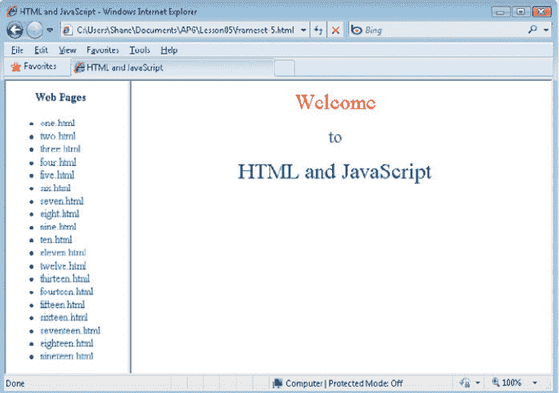

> **互联网**
>
> 你的 Web 浏览器如何区分层叠样式和样式类？层叠样式被赋予与已定义的 HTML 标签（如`body`、`h2`或`li`）对应的名称。样式类可以被赋予任何任意名称，但名称前面必须始终带有句点（`.`）字符。当你通过`class`属性在 HTML 标签中调用样式类时，你需要指定不带句点的类名。

### 共享样式类

如上一节所示，单个网页可以使用多个样式类。然而，同样真实的是，单个样式类可以被多个网页使用。两个或多个网页共享一个样式类只需要这些网页链接到定义该样式类的样式表。当共享该类的网页都在一个公共框架集中显示时，通常会这样做。然而，这不是必需的。两个或多个彼此完全无关的网页仍然可以共享一个样式类定义，只要它们可以访问相应的 CSS 文件。

### 分步操作 5.4

在这个分步操作中，你将创建一个公共样式表，该样式表被公共框架集中的两个不同网页链接。此 CSS 文件包含一个样式类，该样式类为网页提供共同的淡黄色背景色。

1. 如果尚未打开，请打开记事本、SimpleText 或你最喜欢的文本编辑器。
2. 在文本编辑器中打开`frameset-5.html`或`frameset-5.htm`文件。这是你在上一个分步操作中创建的文件。
3. 单击菜单栏上的**文件**，单击**另存为**，然后将 HTML 文件保存为`frameset-6.html`或`frameset-6.htm`，保存在与上一课文件相同的文件夹中，以保留`frameset-5.html`文件。
4. 更改左框架和右框架的源文件名称，如本步骤所示，并在图 5–17 中以粗体显示。

```html
<frame name="LeftFrame" src="navbar-3.html">

<frame name="RightFrame" src="welcome-3.html">
```

**图 5–17** `frameset-6.html`文件

```html
<html>

<head>

<title>HTML and JavaScript</title>

</head>

<frameset cols="180,*">

<frame name="LeftFrame" src="navbar-3.html">

<frame name="RightFrame" src="welcome-3.html">

</frameset>

</html>
```

5. 将更改保存到文件`frameset-6.html`或`frameset-6.htm`，保存在与本课其他文件相同的文件夹中。
6. 在文本编辑器中打开`navbar-2.html`或`navbar-2.htm`文件。这是你在分步操作 5.2 中创建的文件。
7. 单击菜单栏上的**文件**，单击**另存为**，然后将 HTML 文件保存为`navbar-3.html`或`navbar-3.htm`，保存在与上一课文件相同的文件夹中，以保留`navbar-2.html`文件。
8. 通过添加第二个样式表链接修改此文件的头部。同时为`<body>`标签添加一个`class`属性，如本步骤所示，并在图 5–18 中以粗体显示。

```html
<link href="common.css" rel="stylesheet" type="text/css"></link>

<body class="bgcolor1">
```

**图 5–18** `navbar-3.html`文件

```html
<html>

<head>

<title>HTML and JavaScript</title>

<link href="navbar-2.css" rel="stylesheet" type="text/css"></link>

<link href="common.css" rel="stylesheet" type="text/css"></link>

</head>

<body class="bgcolor1">

<div align="center"><b>Web Pages</b></div>

<ul>

<li><a href="one.html" target="RightFrame">one.html</a></li>

<li><a href="two.html" target="RightFrame">two.html</a></li>

<li><a href="three.html" target="RightFrame">three.html</a></li>

<li><a href="four.html" target="RightFrame">four.html</a></li>

<li><a href="five.html" target="RightFrame">five.html</a></li>

<li><a href="six.html" target="RightFrame">six.html</a></li>

<li><a href="seven.html" target="RightFrame">seven.html</a></li>

<li><a href="eight.html" target="RightFrame">eight.html</a></li>

<li><a href="nine.html" target="RightFrame">nine.html</a></li>

<li><a href="ten.html" target="RightFrame">ten.html</a></li>

<li><a href="eleven.html" target="RightFrame">eleven.html</a></li>

<li><a href="twelve.html" target="RightFrame">twelve.html</a></li>

<li><a href="thirteen.html" target="RightFrame">thirteen.html</a></li>

<li><a href="fourteen.html" target="RightFrame">fourteen.html</a></li>

<li><a href="fifteen.html" target="RightFrame">fifteen.html</a></li>

<li><a href="sixteen.html" target="RightFrame">sixteen.html</a></li>

<li><a href="seventeen.html" target="RightFrame">seventeen.html</a></li>

<li><a href="eighteen.html" target="RightFrame">eighteen.html</a></li>

<li><a href="nineteen.html" target="RightFrame">nineteen.html</a></li>

</ul>

</body>

</html>
```

9. 将更改保存到文件`navbar-3.html`或`navbar-3.htm`，保存在与`frameset-6.html`文件相同的文件夹中。
10. 在文本编辑器中打开`welcome-2.html`或`welcome-2.htm`文件。这是你在分步操作 5.3 中创建的文件。
11. 单击菜单栏上的**文件**，单击**另存为**，然后将 HTML 文件保存为`welcome-3.html`或`welcome-3.htm`，保存在与上一课文件相同的文件夹中，以保留`welcome-2.html`文件。
12. 通过添加第二个样式表链接来修改此文件的头部。同时，如本步骤所示并在图 5–19 中以粗体标出的那样，为`<body>`标签添加一个`class`属性。

```html
<link href="common.css" rel="stylesheet" type="text/css"></link>

<body class="bgcolor1">
```

**图 5–19** `welcome-3.html`文件

```html
<html>

<head>

<title>HTML and JavaScript</title>

<link href="welcome-2.css" rel="stylesheet" type="text/css"></link>

<link href="common.css" rel="stylesheet" type="text/css"></link>

</head>

<body class="bgcolor1">

<div class="text1">Welcome</div>

<br>

<div class="text2">to</div>

<br>

<div class="text3">HTML and JavaScript</div>

</body>

</html>
```

13. 将您的更改保存到与`frameset-6.html`文件同一文件夹中的`welcome-3.html`或`welcome-3.htm`文件。

14. 单击菜单栏上的**File**，然后单击**New**以创建一个新的空白文档。

15. 完全按照图 5–20 所示输入 CSS 文本。

**图 5–20** `common.css`文件

```css
.bgcolor1 {background-color:#EFEFCF}
```

## 单元 I HTML 基础

16. 将您新创建的文件保存为`common.css`，放在与`navbar-3.html`和`welcome-3.html`相同的文件夹中。

17. 启动您喜欢的 Web 浏览器，并在浏览器中打开您的`frameset-6.html`或`frameset-6.htm`文件。您屏幕上的网页应与图 5–21 中显示的网页相似。

**图 5–21**  
两个共享通用样式类的网页

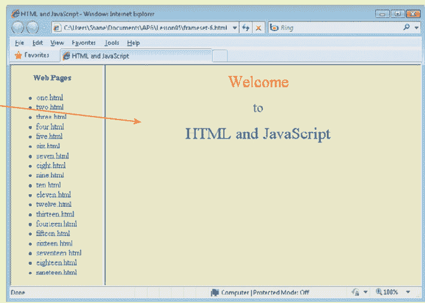

### 探索表格样式

到目前为止，您获得的所有 HTML 样式经验都与以某种方式格式化文本有关。您在本课及前面课程中创建的所有样式、层叠样式和样式类都与字体颜色、背景颜色、文本对齐等元素有关。但请放心，样式可用于管理各种 HTML 标签属性，而不仅仅是与文本相关的属性。以 HTML 表格为例。表格支持多种属性，用于定义列宽、边框粗细和样式、单元格边距以及其他表格功能。由于网页设计师通常希望其网页上的不同表格具有不同的属性，因此这是利用样式类的绝佳机会。

### 分步操作 5.5

在本分步操作中，您将修改在本课第一部分创建的`nineteen.html`文件中的“有序表格”部分。您将学习如何设置表格属性以及单个表格单元格属性。

1. 如果尚未打开，请打开记事本、SimpleText 或您喜欢的文本编辑器。
2. 如果尚未打开，请在文本编辑器中打开`frameset-6.html`或`frameset-6.htm`文件。这是您在上一个分步操作中创建的文件。
3. 单击菜单栏上的**File**，单击**Save As**，然后将 HTML 文件保存为`frameset-7.html`或`frameset-7.htm`，放在您保存上一课文件的同一文件夹中，以保留`frameset-6.html`文件。
4. 如本步骤所示并在图 5–22 中以粗体标出的那样，更改左框架的源文件名称。

```html
<frame name="LeftFrame" src="navbar-4.html">
```

**图 5–22** `frameset-7.html`文件

```html
<html>

<head>

<title>HTML and JavaScript</title>

</head>

<frameset cols="180,*">

<frame name="LeftFrame" src="navbar-4.html">

<frame name="RightFrame" src="welcome-3.html">

</frameset>

</html>
```

5. 将更改保存到文件`frameset-7.html`或`frameset-7.htm`。
6. 在文本编辑器中打开`navbar-3.html`或`navbar-3.htm`文件。这是您在上一个分步操作中创建的文件。
7. 单击菜单栏上的**File**，单击**Save As**，然后将 HTML 文件保存为`navbar-4.html`或`navbar-4.htm`，放在您保存上一课文件的同一文件夹中，以保留`navbar-3.html`文件。
8. 如本步骤所示并在图 5–23 中以粗体标出的那样，通过在`nineteen.html`文件的链接下方添加一个指向`twenty.html`文件的新链接来修改此`navbar-4.html`文件的主体。

```html
<li><a href="twenty.html"

target="RightFrame">twenty.html</a></li>
```

**图 5–23** `navbar-4.html`文件主体标签

```html
<body class="bgcolor1">

<div align="center"><b>Web Pages</b></div>

<ul>

<li><a href="one.html" target="RightFrame">one.html</a></li>

<li><a href="two.html" target="RightFrame">two.html</a></li>

<li><a href="three.html" target="RightFrame">three.html</a></li>

<li><a href="four.html" target="RightFrame">four.html</a></li>

<li><a href="five.html" target="RightFrame">five.html</a></li>

<li><a href="six.html" target="RightFrame">six.html</a></li>

<li><a href="seven.html" target="RightFrame">seven.html</a></li>

<li><a href="eight.html" target="RightFrame">eight.html</a></li>

<li><a href="nine.html" target="RightFrame">nine.html</a></li>

<li><a href="ten.html" target="RightFrame">ten.html</a></li>

<li><a href="eleven.html" target="RightFrame">eleven.html</a></li>

<li><a href="twelve.html" target="RightFrame">twelve.html</a></li>

<li><a href="thirteen.html" target="RightFrame">thirteen.html</a></li>

<li><a href="fourteen.html" target="RightFrame">fourteen.html</a></li>

<li><a href="fifteen.html" target="RightFrame">fifteen.html</a></li>

<li><a href="sixteen.html" target="RightFrame">sixteen.html</a></li>

<li><a href="seventeen.html" target="RightFrame">seventeen.html</a></li>

<li><a href="eighteen.html" target="RightFrame">eighteen.html</a></li>

<li><a href="nineteen.html" target="RightFrame">nineteen.html</a></li>

<li><a href="twenty.html" target="RightFrame">twenty.html</a></li>

</ul>

</body>
```


9. 将您的更改保存到与`frameset-7.html`文件同一文件夹中的`navbar-4.html`或`navbar-4.htm`文件。

10. 在文本编辑器中打开`nineteen.html`或`nineteen.htm`文件。这是您在分步操作 5.1 中创建的文件。

11. 单击菜单栏上的`File`，单击`Save As`，然后将 HTML 文件保存为`twenty.html`或`twenty.htm`，放在您保存上一课文件的同一文件夹中，以保留`nineteen.html`文件。

12. 如此处所示并在**图 5–24**中以粗体标出的那样，通过更新`<link>`标签中指定的 CSS 文件来修改此文件的头部。

```html
<link href="twenty.css" rel="stylesheet" type="text/css"></link>
```

13. 如此处所示并在**图 5–24**中以粗体标出的那样，修改此文件主体中的“有序表格”部分。

```html
<h2><a name="tables">Orderly Tables</a></h2>

<table class="table1">

<tr>

    <th>Images</th>

    <th>Colors</th>

    <th>Fonts</th>

</tr>

<tr>

    <td class="row1"></td>

    <td class="row1">Red</td>

    <td class="row1"><font face="times"

    size="7" color="red">Times</td>

</tr>

<tr>

    <td class="row2"></td>

    <td class="row2">Green</td>

    <td class="row2"><font face="courier"

    size="10" color="green">Courier</td>

</tr>

</table>

<hr />
```

**图 5–24** `twenty.html`文件

```html
<html>

<head>

<title>HTML and JavaScript</title>

<link href="twenty.css" rel="stylesheet" type="text/css"></link>

</head>

<body style="background-color:#E6E6FA">

    <em>Because the only changes to the code from this point on are in the Orderly Tables section, skip the Powerful Lines, Hyperlink, Fancy Fonts, and Perfect Pictures sections of the code and jump down to the Orderly Tables section of your HTML file. Make the changes as shown below in bold to the Orderly Tables section. Do not make any changes to the Extraordinary Extras section.</em>

<h2><a name="tables">Orderly Tables</a></h2>

<table class="table1">
```

续下页 »

**图 5–24** `twenty.html`文件

接上页

```html
<tr>

  <th>Images</th>

  <th>Colors</th>

  <th>Fonts</th>

</tr>

<tr>

  <td class="row1"></td>

  <td class="row1">Red</td>

  <td class="row1"><font face="times" size="7" color="red">Times</font></td>

</tr>

<tr>

  <td class="row2"></td>

  <td class="row2">Green</td>

  <td class="row2"><font face="courier" size="10" color="green">Courier</font></td>

</tr>

</table>

<hr />
```

14. 将您的更改保存到与`frameset-7.html`文件同一文件夹中的`twenty.html`或`twenty.htm`文件。

15. 在文本编辑器中打开文件`nineteen.css`。这是您在分步操作 5.1 中创建的文件。

16. 单击菜单栏上的`File`，单击`Save As`，然后将 HTML 文件保存为`twenty.css`，放在您保存上一课文件的同一文件夹中，以保留`nineteen.css`文件。

17. 完全按照本步骤所示并在**图 5–25**中以粗体标出的那样输入 CSS 文本。

```css
.table1 {border-color:black;border-style:solid;border-width:5}

.row1 {background-color:#EFCFCF;padding:10;text-align:center}

.row2 {background-color:#CFEFCF;padding:10;text-align:center}
```

#### 图 5–25 `twenty.css`文件

```css
h1 {color:red}

h2 {color:blue}

h3 {color:purple}

p {color:black}

.table1 {border-color:black;border-style:solid;border-width:5}

.row1 {background-color:#EFCFCF;padding:10;text-align:center}

.row2 {background-color:#CFEFCF;padding:10;text-align:center}
```


18. 将你的更改保存到 `twenty.css` 文件中，该文件应与 `twenty.html` 文件位于同一文件夹。

19. 启动你常用的 Web 浏览器，并在浏览器中打开你的 `frameset-7.html` 或 `frameset-7.htm` 文件。点击左侧框架中的 `twenty.html` 链接，然后点击右侧框架中的 `Orderly Tables` 链接。你的网页应与图 5–26 类似。

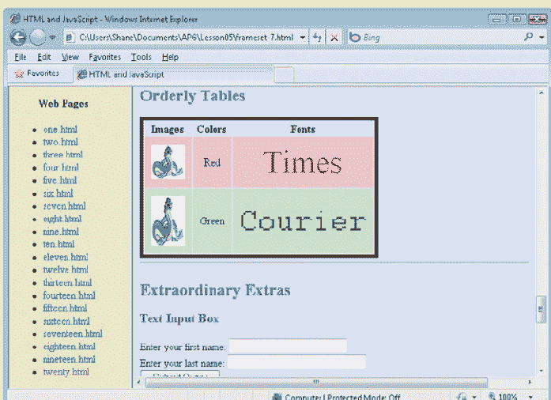

#### 图 5–26 使用样式类的 HTML 表格

> **互联网**
>
> 当你创建一个打算用于单个网页的层叠样式表时，最好给 HTML 文件和 CSS 文件起相同的名字（例如，`twenty.html` 和 `twenty.css`）。然而，这只是一个编程惯例；HTML 或 CSS 并不要求这样做。

### 总结

在本课中，你学习了：

- 如何创建层叠样式表。
- 如何使用 CSS 控制超链接行为。
- 如何创建样式类。
- 如何在网页之间共享样式类。
- 如何使用 CSS 控制 HTML 表格的外观。

### 词汇复习

定义以下术语：

- 活动
- 层叠样式
- 层叠样式表
- `.css`
- CSS 文件
- 悬停
- 外观和感觉
- 普通
- 样式
- 样式类
- 样式表
- 已访问

### 复习题

#### 判断题

如果陈述正确，请圈出 T；如果陈述错误，请圈出 F。

1. 样式、层叠样式和层叠样式表的创建方式完全相同。
2. 术语“层叠样式表”、“样式表”和“CSS 文件”是同义词。
3. 层叠样式表通过 `<style>` 标签链接到网页。
4. CSS 文件使用 `style` 关键字来定义层叠样式。
5. 网页超链接的外观和行为可以通过 CSS 进行修改。
6. HTML 超链接恰好保持两种状态：普通和已访问。
7. 你可以在一个 CSS 文件中定义任意数量的样式类。
8. 一个样式类定义可以被两个或多个网页共享。
9. 一个样式类定义可以被两个或多个网页共享，但前提是这些页面位于同一个框架集中。
10. CSS 文件可以包含层叠样式或样式类，但不能同时包含两者。

#### 填空题

通过在提供的空白处填写正确的单词或词组来完成以下句子。

1. 一个 __________ 被定义为单个 HTML 标签内的一个属性。
2. 层叠样式通过使用 __________ 标签来定义。
3. __________ 属性用于 `<link>` 标签内，以指定层叠样式表的文件名。
4. __________ 属性标识链接样式表的文件格式。
5. 当鼠标指针经过超链接时，应用其 __________ 状态。
6. 当点击鼠标按钮时，调用超链接的 __________ 状态。
7. 当链接至少被点击过一次后，调用超链接的 __________ 状态。
8. 一个 _______________ 可以在 HTML 文件的头部或 CSS 文件中定义。
9. _______________ 属性可用于任何 HTML 标签中，以调用样式类。
10. 样式类名称前总是有一个 _______________ 字符。

#### 简答题

简要回答以下问题：

1. 解释样式、层叠样式和层叠样式表之间的区别。
2. 列出并简要描述超链接的四种状态。
3. 什么是样式类？它与层叠样式有何不同？
4. 解释样式类如何在网页之间共享。
5. 描述 CSS 如何影响 HTML 表格的外观。

### 项目

#### 项目 5–1：回顾你的工作

回顾你在前面课程中创建的 HTML 文件（`one.html` 到 `eighteen.html`）。找出哪些文件包含了层叠样式。修改这些网页，使其改用层叠样式表。如果你想保留原始的 HTML 文件，请给修改后的文件起新名字（例如，`eighteen-2.html`）。用样式表替换层叠样式的基本步骤如下：

- 从 HTML 文件中删除层叠样式代码（`<style>` 标签）。
- 添加一个带有适当 `href`、`rel` 和 `type` 属性的 `<link>` 标签。
- 创建一个包含已删除样式代码的 CSS 文件。
- 确保 CSS 文件名与 HTML 文件 `<link>` 标签中 `href` 属性的值匹配（例如，`eighteen.css`）。

请注意，并非你最初的 18 个 HTML 文件都使用了层叠样式。

#### 项目 5–2：更多超链接样式体验

回顾你在“分步指导 5.2”中创建的 `navbar-2.html` 文件。修改相应的样式表，使你的导航超链接表现不同。例如，当链接处于悬停状态时使用粗体字体，或为已访问的链接使用斜体字体。你还可以更改字体颜色，以增强网页外观并提升用户体验。看看你能有多大的创意！

为了保留你原始的 `navbar-2.css` 文件，请给你的新样式表起一个新名字，并相应地更新 HTML 文件中的 `<link>` 标签。

#### 项目 5–3：创建通用背景

返回到你在第 2、3 和 5 课中创建的 `one.html` 到 `twenty.html` 文件。插入适当的 HTML 标签，使所有这些文件都使用你在“分步指导 5.4”中创建的 `common.css` 文件。让所有这些页面都显示淡黄色背景色，以便更好地匹配最左侧导航框架的背景颜色（就像 `welcome-3.html` 文件那样）。*提示：* 这只需要在你的文件的 `<body>` 标签中添加一个 `class` 属性。

### 批判性思维

#### 活动 5–1：有什么好处？

GreatApplications, Inc. 的主管被要求修改公司网站，使其使用层叠样式表。他请你解释公司从这一改变中可能获得哪些好处。找出并简要描述 GreatApplications 通过使用 CSS 可以受益的至少三种方式。

#### 活动 5–2：有缺点吗？

每当向软件和 Web 开发人员引入新技术时，它们都旨在提供某些好处。然而，新技术几乎总是有其缺点。CSS 技术可能会引入哪些潜在问题？

#### 综合模拟

本课中所有基于框架的网页都恰好显示两个框架——左和右。回顾你在第 4 课中创建三框架网页的工作。修改相应的 HTML 和/或 CSS 文件，将你本课的最终项目转变为三框架网页。确保上方框架中的页面使用其自己的新 CSS 文件，以及你在“分步指导 5.4”中创建的 `common.css` 文件。同时确保显示的文本和背景颜色与框架集中的其他文件匹配。为了保留你原始的 HTML 和 CSS 文件，请给你的新样式表起一个新名字，并相应地更新 HTML 文件中的 `<link>` 标签。

## 第一单元复习

### HTML 基础

### HTML 标签和属性总结

| 标签或属性 | 用途 | 课程 |
|---|---|---|
| `<a>` `</a>` | 用于定义超链接的锚点标签 | 2 |
| `align` | 用于指定表格水平对齐方式的属性 | 3 |
| `bgcolor` | 用于指定表格单元格背景颜色的属性 | 3 |
| `<body>` `</body>` | 用于定义 HTML 文档主体开始和结束的标签 | 1 |
| `border` | 用于指定表格或框架边框宽度的属性 | 3, 4 |
| `<br />` | 用于表示单倍行距换行的标签 | 2 |
| `cellpadding` | 用于为表格单元格添加内边距的属性 | 3 |
| `<center>` `</center>` | 用于在网页上水平居中文本的标签 | 1 |
| `class` | 用于指定特定样式类的属性 | 5 |
| `color` | 用于指定文本字体颜色的属性 | 3 |
| `cols` | 用于在框架集中定义列的属性 | 4 |
| `<div>` | 用于界定文本区域开始和结束的标签 | 5 |
| `face` | 用于指定文本字体的属性 | 3 |
| `<font>` `</font>` | 用于界定文本字体设置开始和结束的标签 | 3 |
| `<form>` `</form>` | 用于定义用户输入表单开始和结束的标签 | 3 |
| `<frame>` `</frame>` | 用于标记框架定义开始和结束的标签 | 4 |
| `<frameset>` `</frameset>` | 用于标记框架集定义开始和结束的标签 | 4 |

续表

## 第一单元 HTML 基础

| 标签或属性 | 用途 | 课程 |
|---|---|---|
| `<h1>` `</h1>` | 用于标记一级标题开始和结束的标签 | 1 |
| `<h2>` `</h2>` | 用于标记二级标题开始和结束的标签 | 1 |
| `<h3>` `</h3>` | 用于标记三级标题开始和结束的标签 | 1 |
| `<h4>` `</h4>` | 用于标记四级标题开始和结束的标签 | 1 |
| `<h5>` `</h5>` | 用于标记五级标题开始和结束的标签 | 1 |
| `<h6>` `</h6>` | 用于标记六级标题开始和结束的标签 | 1 |
| `<head>` `</head>` | 用于定义 HTML 文档头部开始和结束的标签 | 2 |
| `height` | 用于指定图像高度的属性 | 3 |
| `<hr />` | 用于标记水平线（分隔线）的标签 | 2 |
| `href` | 用于指定目标网页或 CSS 文件的属性 | 2, 5 |
| `<html>` `</html>` | 用于定义 HTML 文件开始和结束的标签 | 1 |
| `` | 用于指示图形图像放置位置的标签 | 3 |
| `<input />` | 用于定义用户输入控件的标签 | 3 |
| `<li>` `</li>` | 用于指定有序或无序列表中列表项的标签 | 1 |
| `<link>` `</link>` | 用于将 CSS 文件链接到网页的标签 | 5 |
| `name` | 用于命名锚点和框架的属性 | 2, 4 |
| `noresize` | 用于防止用户调整框架大小的属性 | 4 |
| `<ol>` `</ol>` | 用于指定有序（按顺序编号）列表的标签 | 1 |
| `<option>` `</option>` | 用于定义下拉选择框中选项的标签 | 3 |
| `<p>` `</p>` | 用于定义段落开始和结束的标签 | 1 |
| `rel` | 在 `<link>` 标签内使用的属性，用于指定文档之间的关系 | 5 |
| `rows` | 用于定义框架集中行的属性 | 4 |
| `<select>` `</select>` | 用于定义下拉选择框开始和结束的标签 | 3 |
| `size` | 用于指定文本字体大小的属性 | 3 |
| `src` | 用于指定图像或框架来源的属性 | 3, 4 |
| `style` | 用于修改各种标签的样式属性 | 2, 5 |
| `<style>` `</style>` | 用于定义层叠样式的标签 | 2, 5 |
| `<table>` `</table>` | 用于定义表格开始和结束的标签 | 3 |
| `target` | 在锚点标签内使用的属性，用于指定目标框架 | 4 |
| `<td>` `</td>` | 用于分隔行内表格单元格的标签 | 3 |
| `<th>` `</th>` | 用于分隔行内表头单元格的标签 | 3 |
| `<title>` `</title>` | 用于定义网页标题的标签 | 1 |
| `<tr>` `</tr>` | 用于分隔表格行的标签 | 3 |
| `type` | 用于定义样式类型或输入控件类型的属性 | 2, 3 |
| `<ul>` `</ul>` | 用于指定无序（项目符号）列表的标签 | 1 |
| `width` | 用于指定图像宽度的属性 | 3 |

### 复习题

#### 匹配题

将右栏中的正确术语与左栏中的描述进行匹配。

- 1. 用于指导 Web 浏览器如何显示 Web 元素的专用 Web 语言
- 2. 一种流行的脚本语言，用于创建小型应用程序和多媒体效果
- 3. 网页上两个或多个框架的集合
- 4. 通常成对出现，包含在尖括号中
- 5. 以 16 为基数运行，一种使用字母和数字来表示值的系统
- 6. 网站主页上垂直或水平超链接列表的通用名称
- 7. 属性的定义
- 8. 用于将数据从 Web 服务器传输到 Web 浏览器的协议
- 9. 用于将层叠样式表附加到网页的 HTML 标签
- 10. 符合国际标准的图形格式；足够紧凑，适合互联网使用
- 11. 旨在足够小以便通过低速调制解调器传输的图像文件格式
- 12. 用于定义一个或多个层叠样式的 HTML 标签
- 13. 程序员使用的术语，描述包含一个或多个相同项目附加实例的结构、关键字或标签
- 14. 使避免手动输入每个标签成为可能的软件程序
- 15. 用于将特定 CSS 样式应用于各种 HTML 标签的属性

- A. Dreamweaver
- B. 框架集
- C. GIF
- D. HTML
- E. 导航栏
- F. HTTP
- G. 十六进制
- H. `<link>`
- I. 标签
- J. 嵌套
- K. `<style>`
- L. 值
- M. JPEG
- N. 类
- O. JavaScript

#### 书面题

简要回答以下每个问题。将答案保存在名为 **HTML 单元总结** 的单个文档文件中。

1. 列出并解释你认为在大多数网页上都能找到的五个 HTML 标签的功能。
2. 列出并解释以下每种文件格式的来源。在你的解释中，指出哪些格式用于网页。
   - A. `.txt`
   - B. `.docx`
   - C. `.htm`
   - D. `.html`
   - E. `.css`
3. 解释锚点标签如何使用和编写，以创建指向网站和个人计算机上单个网页的超链接。在你的解释中，说明如何将图形转换为超链接。
4. 解释框架集的工作原理，以及如何将网页定向到不同的框架中显示。
5. 解释样式、层叠样式和层叠样式表之间的区别。

### 跨学科项目

在本练习中，你将展示 HTML 的实际应用。你将设计一个框架页面，帮助你组织至少五个学术学科领域的优秀信息源。四个必需领域是语言艺术、科学、社会研究和数学。选择另一个你感兴趣的学科领域，例如外语、音乐、艺术、体育或技术。使用 Web 搜索工具，如 `www.yahoo.com` 或 `www.google.com`，在这些学科领域中寻找合法的学术资源。选择那些你会希望反复访问以获取信息的网站。

这需要你进行一些仔细的思考和规划。诀窍是——创建一个左侧导航栏，用于访问这些学科领域的资源页面。为你自己的框架集和导航栏页面发明文件名。标题栏页面是可选的。在你的项目中包含至少一个层叠样式表。测试所有链接以确保每个链接都能正常工作。

#### 语言艺术 1

找到五个与语言艺术学习相关的网站，并将它们放在一个目标页面上，该页面将出现在你的跨学科框架页面的右框架中。将此文件命名为 `la-1.html` 或 `la-1.htm`。

#### 科学 1

找到五个与科学学习相关的网站，并将它们放在一个目标页面上，该页面将出现在你的跨学科框架页面的右框架中。将此文件命名为 `sci-1.html` 或 `sci-1.htm`。

#### 社会研究 1

找到五个与社会研究学习相关的网站，并将它们放在一个目标页面上，该页面将出现在你的跨学科框架页面的右框架中。将此文件命名为 `ss-1.html` 或 `ss-1.htm`。

#### 数学 1

找到五个与数学学习相关的网站，并将它们放在一个目标页面上，该页面将出现在你的跨学科框架页面的右框架中。将此文件命名为 `m-1.html` 或 `m-1.htm`。

#### 你的自选学科 1

找到五个与你选择的学科学习相关的网站，并将它们放在一个目标页面上，该页面将出现在你的跨学科框架页面的右框架中。将此文件命名为 `mychoice-1.html` 或 `mychoice-1.htm`。

### 复习项目

#### 项目 1–1：创建网站

你可能一直在想，“我已经创建了几十个网页，但什么时候才能扩展出去，完全创建一个自己的网站呢？” 好吧，现在是你发挥所有网页设计创造力的机会了。

为你的网站选择一个合适的主题或主题。运用你在本单元学到的所有技能，创建一个很棒的网站。发明你自己的 HTML 文件名，并使用 CSS 文件来设置样式。

#### 项目 1–2：评估网站

到现在，你可能认为你的网页构成了网络上最棒的网站。这很可能是真的！然而，是时候验证一下了。三到四人一组。与你的队友分享你在跨学科项目和项目 1-1 中制作的网页。如果任何团队成员在使其页面元素正常工作方面遇到问题，请作为一个小组来解决这些问题。就如何改进页面互相提出建议。

### 模拟

#### 工作 1–1：HTML 参考资源

想象一下，你刚刚成为 GreatApplications, Inc. 网站的首席网页设计师和 Web 开发团队经理。为了提高团队在尖端技术方面的技能，你决定创建一个网页，列出能帮助团队成员了解更多关于 HTML、JavaScript、Flash 和其他网页创建工具（如 Dreamweaver 或 Expression Web 2）的网站。查看你在本单元中处理过的涉及编排 HTML 学习网站的页面。将这些添加到你的新网站中。然后，参考一些主要的网站开发公司，包括 Adobe（Dreamweaver 的创建者）、Microsoft（Expression Web 2 的创建者）以及其他在线多媒体开发工具。使用搜索引擎，如 `www.yahoo.com` 或 `www.google.com`，来找到你需要的资源。发明你自己的文件名。

#### 作业 1–2：网页开发工作

你想在高科技在线行业谋得一份职业吗？如果是，你最好先了解有哪些类型的工作可供选择，以及它们是否符合你的喜好。

请上网访问一些主要的职业网站，例如 `www.flipdog.com` 或 `www.monster.com`，并搜索 10 个与网页开发相关的工作。如果你在这些网站上难以找到这类工作，请尝试在搜索引擎中使用关键词 **在线求职**。

创建一份简短的报告，列出你找到的 10 个工作，并简要说明在高科技网页设计行业接受这些工作所需的资格。将你的作业保存为 **Job 1-2**。

### 总结项目

这是你展示已掌握本单元所有主要概念的机会。请参考表 U1–1 中的信息。该表总结了前三课中介绍的各种 HTML 主题。

你的任务是将这些信息组织成一个网页，布局如图 U1–1 所示。框架 A 将包含一个超链接列表，代表本书的前三课。框架 B 将包含自己的超链接列表，对应于某一课涵盖的主题。每次用户点击框架 A 中的超链接时，框架 B 都会更新。框架 C 将包含一个网页，展示框架 B 中列出的主题之一，当用户点击框架 B 中的不同链接时，该网页会发生变化。图 U1–2 展示了一个示例，说明如果用户在框架 A 中点击第 1 课并在框架 B 中点击“标题”，完成的网页可能是什么样子。

#### 表 U1–1

| 课程编号 | 涵盖主题 |
|---|---|
| 1 | 标题<br>有序列表<br>无序列表 |
| 2 | 水平线<br>背景颜色<br>超链接<br>文本颜色 |
| 3 | 字体<br>图像<br>表格<br>输入控件 |

## 单元 I HTML 基础

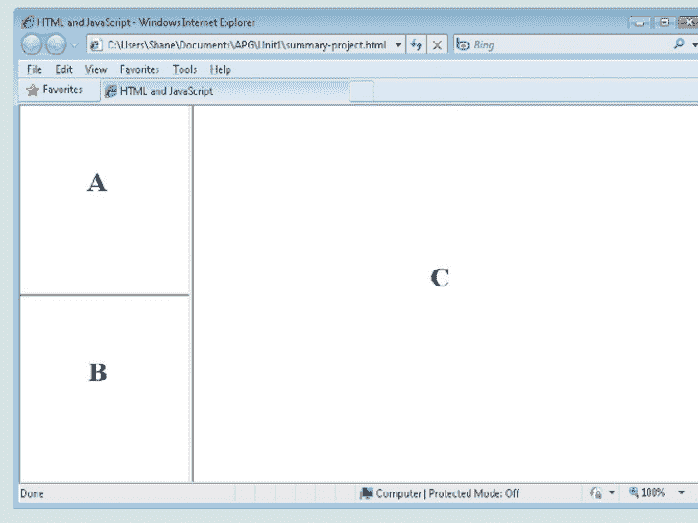

图 U1–1 三框架页面布局

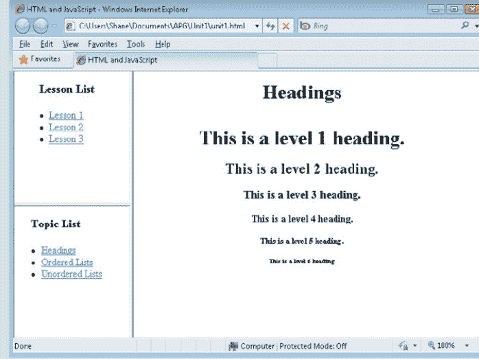

图 U1–2 单元 1 总结项目示例网页

#### 项目要求

- 你必须使用嵌套框架集来创建正确的网页布局。
- 将左侧两个框架的宽度设置为屏幕宽度的约 25%。
- 左侧两个框架的高度应各占屏幕高度的约 50%。
- 创建一个 CSS 文件，包含你希望在网页中融入的所有各种样式元素。
- 将你的主框架集页面命名为 `unit1.html`。
- 你需要为你的主题列表创建三个网页。将你的三个文件分别命名为 `topics1.html`、`topics2.html` 和 `topics3.html`。
- 你需要为你的示例页面创建 11 个网页。将你的文件分别命名为 `example1.html`、`example2.html`、`example3.html`，依此类推。

#### 作品集检查清单

将本单元的以下文件包含在你的学生作品集中：

- HTML 单元总结问题
- 语言艺术 1
- 科学 1
- 社会研究 1
- 数学 1
- 你的自选科目 1
- 项目 1-1
- 项目 1-2
- 作业 1-1
- 作业 1-2
- 总结项目

## 单元 II JavaScript 基础

- **第 6 课** 1.5 小时。JavaScript 简介
- **第 7 课** 1.5 小时。在 JavaScript 中使用图像
- **第 8 课** 1.5 小时。使用 JavaScript 创建表单
- **第 9 课** 1.5 小时。在框架中使用 JavaScript
- **第 10 课** 1.5 小时。在样式中使用 JavaScript

## 第 6 课 JavaScript 简介

### 学习目标

完成本课后，你应该能够：

- 使用 JavaScript 显示网页文本。
- 在 JavaScript 代码内部和周围使用 HTML 格式标签。
- 使用 JavaScript 创建条件语句。
- 使用 JavaScript 的 `alert()` 方法。
- 使用 JavaScript 访问浏览器状态行。

HTML 无疑是万维网上使用最广泛的技术。它是所有网页的基础。然而，HTML 有其局限性，因此随着时间的推移，开发者创建了各种其他技术来增强和扩展标准 HTML 的基本功能。其中一种广泛使用的配套技术是 JavaScript。JavaScript 为网页开发者提供了为静态网页添加功能和些许亮点的工具。

### 词汇表

- 二进制代码
- 编译器
- 条件
- 条件语句
- 解释
- 关键字
- 方法
- 对象
- 运算符
- 参数列表
- 编程语言
- 属性
- `<script> </script>` 标签
- 脚本语言
- 状态行
- 语法
- 标记
- 变量

## 单元 II JavaScript 基础

### 你好，万维网

JavaScript 有时被称为*编程语言*，但更准确地说，它是一种*脚本语言*。编程语言和脚本语言之间的区别很微妙，但理解它很重要。这两种语言都必须从人类可读的形式转换为机器可读的形式。

对于编程语言，这个过程是在程序运行之前由一种称为*编译器*的专用软件执行的。程序员控制这个转换过程。

然而，对于脚本语言，程序员不需要显式启动代码转换过程。当源代码被目标程序处理时，它会自动发生。更具体地说，HTML 文档必须由人编写，然后由网页浏览器处理。当该文档包含嵌入的 JavaScript 代码时，该代码会在页面加载时被浏览器解释并转换为其机器可读的形式。*解释*是程序员用来描述在运行时自动发生的逐行转换过程的术语。

在许多情况下，JavaScript 函数的输出不过是一行或几行文本，这些文本被插入到宿主网页中。生成的 HTML 页面随后由浏览器处理，就像它是被人输入到源文档中一样。

将 JavaScript 代码嵌入网页的真正威力在于，生成的文本可以从一天到下一天，甚至从一分钟到下一分钟发生变化。完全有可能一个人在他的网页浏览器中输入一个特定的 URL，看到的网页与另一个输入完全相同 URL 的人看到的网页完全不同。这些外观不同的网页可能是由于时间差异、位置差异，甚至是网页浏览器差异造成的。JavaScript 能够检测当前操作环境中的各种条件并做出相应反应。这个概念将在循序渐进 6.3 中更详细地探讨。

网页浏览器很容易检测特定网页是否包含嵌入的 JavaScript 代码。只需要文档创建者使用 `<script>` 标签标记 JavaScript 部分的开始，并使用 `</script>` 标签表示该部分的结束。网页浏览器会将这两个标签之间的所有内容解释为 JavaScript 源代码，而不是标准 HTML 文本。然后，浏览器会将脚本（通过解释过程）转换为其等效的机器可读形式，称为*二进制代码*。然后，该二进制代码将被执行，其输出（如果有）将被插入到 HTML 文本流中，并显示为好像是被人输入到原始 HTML 文档中一样。

你需要理解，你嵌入在 `<script>` 和 `</script>` 标签之间的脚本不能是你随意放入的任何文本。相反，文本必须符合某些规则，否则当你尝试查看页面时，网页浏览器会在屏幕上显示令人不快的错误消息。这正是 JavaScript 被称为脚本语言的原因——因为它必须遵守称为程序*语法*的特定语法规则。在本课中，你将学习 JavaScript 对象和方法，以及 JavaScript 关键字和运算符。一旦你掌握了这些基本的语言元素，你将能够很快开始构建有用的、复杂的脚本。

JavaScript 的主要目的是生成将被插入标准 HTML 文本流的文本。JavaScript 本质上由许多称为*对象*的不可见实体组成，这些实体包含一组定义明确的功能。JavaScript 程序员要利用这些功能，必须调用这些对象中一个或多个称为*方法*的专用函数。程序员通过输入对象名称，后跟一个句点（`.` 字符），再后跟方法名称来调用这些方法的服务。

### 词汇表

- 编程语言
- 脚本语言
- 编译器
- 解释
- 二进制代码
- 语法
- 对象
- 方法

> 专家补充
>
> 什么是字符串？*字符串*是一个经验丰富的程序员和网页开发者非常熟悉，但对初学者来说可能很新的术语。在 HTML 和 JavaScript 的上下文中，字符串不过是一个或多个字符的序列。字符串可以由一个单词、一个完整的句子或一本书的一整章组成。通常，字符串包含有意义的文本，但这并不是必需的。一串无意义的乱码或神秘符号也可以是一个字符串，而且字符串的长度实际上没有限制。

## 第 6 课 JavaScript 简介

方法名后面总是跟着一个参数列表，即使这个列表有时是空的。理解方法参数的最佳方式或许是将其想象成一份食谱的配料清单。*参数列表*只是为方法提供其正确执行功能所需的信息。参数列表的语法由一个左括号、零个或多个参数项以及一个右括号组成。例如，如果你想调用名为“document”的 JavaScript 对象的 `write` 方法，你需要输入以下代码行：

```javascript


```javascript
document.write("A string of text.");
```

既然你已经看到了一个简单的JavaScript编码示例，你就可以将这个概念应用到包含嵌入式JavaScript的实际HTML文档中。

## 词汇

- 参数列表

> **警告**
>
> 当你尝试完成以下JavaScript活动时，你特定的Web浏览器可能会显示各种警告消息。如果看到此类警告，只需点击启用JavaScript的选项即可。本书中的任何活动都不会以任何方式损坏你的计算机系统。

### 分步操作 6.1

在这个分步操作中，你将创建一个包含嵌入式JavaScript的非常简单的HTML文件。请特别注意`<script>`、`</script>`标签以及出现在它们之间的JavaScript代码。

1. 打开记事本、SimpleText或你最喜欢的文本编辑器。
2. 如果需要，创建一个新的空白文档。
3. 完全按照**图6–1**所示输入HTML和JavaScript文本。

**图6–1** `js-one.html`文件

```html
<html>
<head>
<title>HTML and JavaScript</title>
</head>
<body>
<script>
    document.write("Hello World Wide Web!");
</script>
</body>
</html>
```

## 第二单元 JavaScript基础

4. 将你新创建的HTML文本文件保存为`js-one.html`或`js-one.htm`，放在你保存前几课文件的同一文件夹中。
5. 启动你最喜欢的Web浏览器，然后打开`js-one.html`或`js-one.htm`文件，将文件作为网页查看。你屏幕上的网页应如**图6–2**所示。

**图6–2** 你的第一个包含嵌入式JavaScript的网页

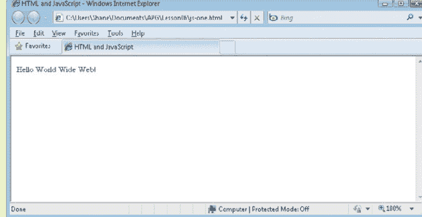

> **警告**
>
> 如果你的浏览器显示消息：“为帮助保护你的安全，Internet Explorer已限制此网页运行可能访问你计算机的脚本或ActiveX控件。单击此处获取选项。”请单击消息栏，单击“允许阻止的内容”，然后在“安全警告”对话框中单击“是”。

此时，你可能会觉得这个网页看起来并不那么令人印象深刻。但先别放弃JavaScript，因为你才刚刚开始。当你完成更多分步操作后，你将开始看到JavaScript的能力远不止这个简单网页所展示的。

### 增强你的网页

正如本课前面提到的，JavaScript方法`document.write()`只是将一串字符插入到标准HTML文本流中。另一种理解方式是，在浏览器处理完HTML文档后，最终结果是`<script>`标签、`</script>`标签以及两者之间的所有内容都将从页面中剥离，并被`write()`方法的输出所取代。这就是`write()`方法的参数。你在`<script>`、`</script>`标签之前或之后放置的任何HTML格式标签，都将像在没有任何嵌入式JavaScript代码的页面中一样被处理。为了说明这一点，请修改你在分步操作6.1中刚刚创建的网页。HTML格式标签可以增强“Hello World Wide Web!”消息，使其在屏幕上看起来更具吸引力。

### 分步操作 6.2

在这个分步操作中，你将添加HTML格式标签和第二个嵌入式脚本。格式标签将使生成的网页看起来更美观一些。页面上的第二条消息有助于你理解HTML和JavaScript之间的交互。

1. 如果文本编辑器尚未打开，请打开记事本、SimpleText或你最喜欢的文本编辑器。
2. 如果`js-one.html`或`js-one.htm`文件尚未在文本编辑器中打开，请单击菜单栏上的“文件”，然后单击“打开”以打开你在上一个分步操作中创建的`js-one.html`或`js-one.htm`文件。
3. 单击菜单栏上的“文件”，单击“另存为”，然后将HTML文件保存为`js-two.html`或`js-two.htm`，放在同一文件夹中以保留`js-one.html`文件。
4. 在`<body>`标签之后以及`</script>`标签之后，完全按照本步骤和**图6–3**中粗体所示添加两段HTML和JavaScript代码。

```html
<div align="center">
<h1>
</h1>
<h3>
<script>
    document.write("Welcome to the exciting world of JavaScript");
</script>
</h3>
</div>
```

### 专家补充

JavaScript语言的一个特点是初学程序员往往难以掌握“花括号”的使用。左花括号（`{`）表示语句块的开始，右花括号（`}`）标记该块的结束。尽管JavaScript语法规则在花括号放置方面有一定的灵活性，但我们强烈建议你遵循本书所示的风格。如果你开始随意或不一致地放置花括号，很容易在脚本中引起问题。当左花括号的数量与右花括号的数量不对应时，你的Web浏览器将报告语法错误。然而，也有可能以不发生语法错误的方式放置花括号，但脚本无法正确执行。这类问题令人沮丧，且通常很难发现和纠正。遵循一些简单的规则可以为你节省大量时间和避免头痛：

1. 始终将左花括号直接放在其所属关键字的下方。
2. 始终缩进包含在语句块中的语句。
3. 始终放置右花括号，使其与对应的左花括号垂直对齐。

## 第二单元 JavaScript基础

**图6–3** `js-two.html`文件

```html
<html>
<head>
<title>HTML and JavaScript</title>
</head>
<body>
<div align="center">
<h1>
<script>
    document.write("Hello World Wide Web!");
</script>
</h1>
<h3>
<script>
    document.write("Welcome to the exciting world of JavaScript");
</script>
</h3>
</div>
</body>
</html>
```

5. 将更改保存到文件`js-two.html`或`js-two.htm`。
6. 启动你最喜欢的Web浏览器，然后打开`js-two.html`或`js-two.htm`文件，在浏览器中将文件作为网页查看。你屏幕上的网页应如**图6–4**所示。

**图6–4** 格式化的JavaScript网页

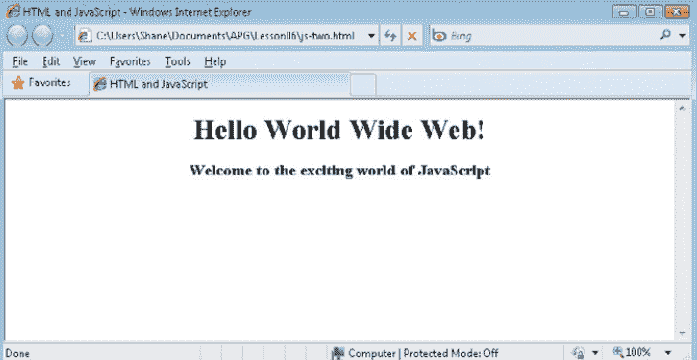

## 第6课 JavaScript简介

如果你理解了第一单元中介绍的HTML材料，你应该能够清楚地看到添加到本文档中的`<div>`和标题标签的目的。你还应该理解，第一次出现的`document.write()`方法生成的输出字符串被插入到HTML文本流中`<div>`、`</div>`标签之间以及`<h1>`、`</h1>`标签之间。同样，第二次出现的`document.write()`产生的输出字符串出现在`<div>`、`</div>`标签和`<h3>`、`</h3>`标签之间。

换句话说，`<h1>`、`</h1>`标签只影响第一个输出字符串的外观，而`<h3>`、`</h3>`标签只影响第二个输出字符串的外观。`<div>`、`</div>`标签对将影响两个输出字符串的显示位置。

### 在JavaScript中创建条件语句

敏锐的学生可能会看着前两个分步操作并问：“为什么要用JavaScript在屏幕上显示文本消息？直接将文本输入到HTML文档中，而不必使用脚本标签和`document.write()`方法，岂不是更容易？”

嗯，是的，使用HTML输入可以在浏览器中显示简单静态文本消息的代码会更容易。事实上，Web浏览器显示生成的网页会稍微快一些，因为它不需要调用JavaScript解释器的服务。然而，JavaScript能够执行的功能远不止将文本写入屏幕。因此，你通过一个简单的例子来学习，然后通过创建必须使用JavaScript的更令人兴奋的网页来扩展你的知识和能力。

在下一个分步操作中，你将使用JavaScript语言最强大的特性之一：条件语句。每种编程语言都具有做出决策的能力。或者，用更技术性的术语来说，每种语言都赋予程序员评估特定条件的能力，然后根据评估结果执行不同的操作。

JavaScript中条件语句的语法非常重要。该语句以关键字`if`开始，然后在一对括号内指定一个条件。关键字被识别为语言定义的一部分。它被语言保留，不能用作变量——一个用户定义的内存位置名称，其值可以随时间变化。关键字的一些例子是`if`、`else`和`return`。

条件之后是一个语句块，由一个左花括号（`{`）、一个或多个JavaScript语句以及一个右花括号（`}`）组成。JavaScript条件语句的框架如下：

```javascript
if (<condition>)
{
    statement 1;
    statement 2;
    statement 3;
    .
    .
    .
    statement N;
}
```

> **警告**
>
> 你可能很想在`<script>`和`</script>`标签内放置HTML格式标签（如`<div>`、`<h1>`、`<h3>`等）。不要这样做！你需要记住，Web浏览器会将你在脚本标签之间输入的所有内容解释为JavaScript源代码。HTML标签不符合JavaScript语法规则；因此，JavaScript解释器无法处理它们。如果你错误地在JavaScript代码块中输入HTML标签，你的浏览器将响应一条令人不快的错误消息。

## 词汇

- 条件语句
- 关键字
- 变量

## 第二单元 JavaScript基础

JavaScript的`if`语句还支持一个可选的`else`子句，用于定义当指定条件不成立时应执行的操作。`else`关键字紧跟在`if`子句的语句块之后，并伴随有自己的语句块。下面是一个包含可选`else`子句的JavaScript条件语句示例：

```javascript
if (<condition>)
{
    statement i1;
    statement i2;
    statement i3;
    .
    .
    .
    statement iN;
}
else
{
    statement e1;
    statement e2;
    statement e3;
    .
    .
    .
    statement eN;
}
```

现在你已经了解了JavaScript`if`和`if-else`语句的基本结构，可以进一步学习语法中的条件部分（在前面的JavaScript示例中显示为`<condition>`）。JavaScript条件总是由两个标记（token）和一个关系运算符组成。标记可以是变量名（如`x`或`count`）或字面常量（如`10`或`"hello"`）。关系运算符可以是**表6–1**中所示的任意符号。

#### 表6–1 关系运算符

| 运算符 | 含义 |
| :--- | :--- |
| `==` | 等于 |
| `!=` | 不等于 |
| `<` | 小于 |
| `>` | 大于 |
| `<=` | 小于或等于 |
| `>=` | 大于或等于 |

## 第六课 JavaScript简介

既然你已经学会了如何在JavaScript中创建条件语句，就可以将这些知识应用到实际程序中。

### 分步操作 6.3

在本分步操作中，你将在Web文档中添加一个简单的条件语句，并在此过程中学习一个有用的编程技巧。Web内容开发者通常希望网页能根据特定用户查看网页所使用的浏览器类型执行不同的任务，这是相当常见的。你将输入一个JavaScript程序来确定当前浏览器是否为Internet Explorer，并根据判断结果做出相应反应。

1. 如果尚未打开，请打开记事本、SimpleText或你最喜欢的文本编辑器。
2. 如果文本编辑器中尚未打开文件，请单击菜单栏上的“文件”，然后单击“打开”以打开你在上一个分步操作中创建的文件`js-two.html`或`js-two.htm`。
3. 单击菜单栏上的“文件”，单击“另存为”，然后将文件保存为`js-three.html`或`js-three.htm`，保存在与上一个分步操作相同的文件夹中，以保留`js-two.html`文件。
4. 完全按照此处所示以及**图6–5**中粗体部分输入JavaScript代码。

```javascript
<script>
  if (navigator.appName == "Microsoft Internet Explorer")
  {
    document.write("You are using Internet Explorer.");
  }
  else
  {
    document.write("You are not using Internet Explorer.<br>");
    document.write("Perhaps you are using Firefox or Safari.");
  }
</script>
```

**图6–5** `js-three.html`文件

```html
<html>
<head>
<title>HTML and JavaScript</title>
</head>
<body>
<div align="center">
<h1>
<script>
    document.write("Hello World Wide Web!");
</script>
</h1>
<h3>
<script>
    document.write("Welcome to the exciting world of JavaScript");
</script>
</h3>
<script>
    if (navigator.appName == "Microsoft Internet Explorer")
    {
        document.write("You are using Internet Explorer.");
    }
    else
    {
        document.write("You are not using Internet Explorer.<br>");
        document.write("Perhaps you are using Firefox or Safari.");
    }
</script>
</div>
</body>
</html>
```

5. 将更改保存到`js-three.html`或`js-three.htm`文件。
6. 启动你最喜欢的Web浏览器，然后打开你的`js-three.html`或`js-three.htm`文件，在浏览器中将文件作为网页查看。根据你使用的浏览器，屏幕上的网页应类似于**图6–6**或**图6–7**所示。

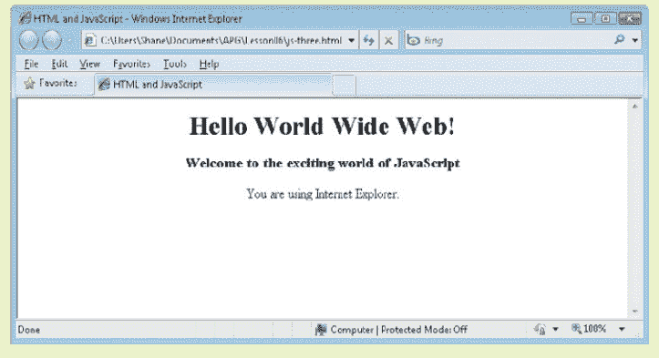

**图6–6** 使用Internet Explorer 8查看的网页

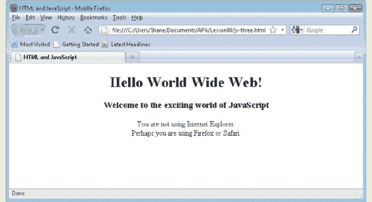

**图6–7** 使用Firefox 3.5查看的网页

尽管你没有向JavaScript程序添加大量代码，但你确实应用了几个重要概念。花点时间回顾这些概念，确保你对正在发生的事情有扎实的理解。

首先，这段JavaScript代码片段中被评估的条件是：

```javascript
(navigator.appName == "Microsoft Internet Explorer")
```


在本课前面，你了解到 JavaScript 对象包含称为方法的特殊函数，用于执行各种任务。同样，JavaScript 对象也包含属性，程序员可以访问这些属性以获取有关对象的信息。在这种情况下，你利用`navigator`对象的`appName`属性来确定当前 Web 浏览器的应用程序名称。在此上下文中，术语 navigator 可以与术语 browser 互换使用。如果该名称是 Microsoft Internet Explorer，程序就知道用户正在运行某个版本的 Internet Explorer。否则，它就知道用户没有运行 Internet Explorer，而是使用其他类型的浏览器。

这里要学习的第二个重要概念是，一旦条件被评估，`if`语句块或`else`语句块将被执行——永远不会同时执行两者。如果条件结果为真，则`if`块将运行。如果条件为假，则`else`语句块将运行。就这么简单。

在这个例子中，你还需要认识到最后一点。到目前为止，你已经学习了将 JavaScript 代码嵌入 HTML 文档的概念。但事实证明，在 JavaScript 文本字符串中嵌入 HTML 标签也是可能且有用的。仔细查看`else`语句块内的第一个`document.write()`调用。注意`<br>`标签嵌入在输出文本字符串中。此标签的目的是告诉浏览器执行换行命令，以便第二个文本字符串将出现在单独的行上，而不是与第一个文本字符串在同一行。当你的网页在浏览器中显示时，消息显示在两行上。

> **技术时间线**

#### 那些分号是怎么回事？

如果你研究许多支持 JavaScript 的网页的源代码，你会发现大多数网页在每条语句末尾都包含分号（`;`），但并非全部。严格来说，JavaScript 语法规则并不要求在每行末尾使用分号。然而，本书中的所有示例以及大多数其他 JavaScript 参考资料都包含终止分号。这是因为许多其他编程语言（如 C、Pascal、Java 等）要求使用分号，如果找不到分号则会报告语法错误。在你的 JavaScript 代码中使用分号将帮助你习惯这种编码标准，并在将来需要转向其他语言时简化过渡。毕竟，养成一个好习惯比改掉一个坏习惯更容易，对吧？

#### 使用 JavaScript `alert()`方法

在本课的前三个分步操作中，你使用了`document.write()`方法，这是 JavaScript 程序向查看网页的用户传达消息的常用方式。然而，脚本也可以通过其他方式引起网页访问者的注意。其中一种方式是通过 JavaScript`alert()`方法。

`alert()`方法的目的是允许 JavaScript 程序显示一个特殊的对话框，通知用户发生了意外事件或需要某种用户输入。就像`write()`方法是`document`对象的一部分，`appName`属性是`navigator`对象的一部分一样，`alert()`方法也是一个名为`window`的对象的一部分。`window`对象在大多数方面与其他所有 JavaScript 对象一样，但它确实有一个独特的特点。具体来说，`window`被认为是 JavaScript 的默认对象，这意味着不需要显式使用其名称。换句话说，脚本中任何没有显式引用对象的方法或属性都被自动假定为`window`对象的一部分。因此，JavaScript 程序员可以通过调用`window.alert()`或简单地调用`alert()`来提醒用户。大多数开发者使用后者，即更简短的形式。

### 分步操作 6.4

在本分步操作中，你将向 JavaScript 文件添加代码，该代码会向用户提示他或她正在使用哪个 Web 浏览器来查看网页。除了你在分步操作 6.3 中创建的 Web 浏览器文本消息外，此警告对话框也会显示在屏幕上。

1. 如果尚未打开，请打开记事本、SimpleText 或你喜爱的文本编辑器。
2. 如果`js-three.html`或`js-three.htm`文件尚未在文本编辑器中打开，请单击菜单栏上的**文件**，然后单击**打开**以打开你在上一个分步操作中创建的`js-three.html`或`js-three.htm`文件。
3. 单击菜单栏上的**文件**，单击**另存为**，然后将文件保存为`js-four.html`或`js-four.htm`，以保留`js-three.html`文件。
4. 在每个`document.write()`方法下方输入 JavaScript 代码以创建警告，如本步骤所示，并完全按照图 6–8 中粗体所示。

```javascript
alert("Internet Explorer detected.");

alert("Internet Explorer not found.");
```

图 6–8 `js-four.html`文件

```html
<html>

<head>

<title>HTML and JavaScript</title>

</head>

<body>

<div align="center">

<h1>

<script>

document.write("Hello World Wide Web!");

</script>

</h1>

<h3>

<script>

document.write("Welcome to the exciting world of JavaScript");

</script>

</h3>

<script>

if (navigator.appName == "Microsoft Internet Explorer")

{

    document.write("You are using Internet Explorer.");

    alert("Internet Explorer detected.");

}

else

{

    document.write("You are not using Internet Explorer.<br>");

    document.write("Perhaps you are using Firefox or Safari.");

    alert("Internet Explorer not found.");

}

</script>

</div>

</body>

</html>
```

5. 将更改保存到`js-four.html`或`js-four.htm`文件。
6. 启动你喜爱的 Web 浏览器，然后打开`js-four.html`或`js-four.htm`文件，以在浏览器中将该文件作为网页查看。根据你用于查看网页的浏览器，屏幕上的网页应如图 6–9 或图 6–10 所示。

图 6–9 使用 Internet Explorer 8 查看的网页

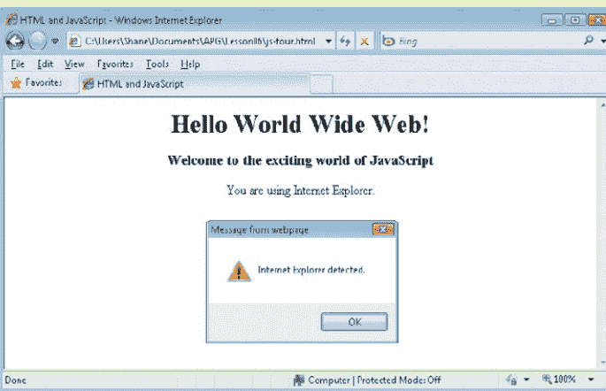

图 6–10 使用 Firefox 3.5 查看的网页

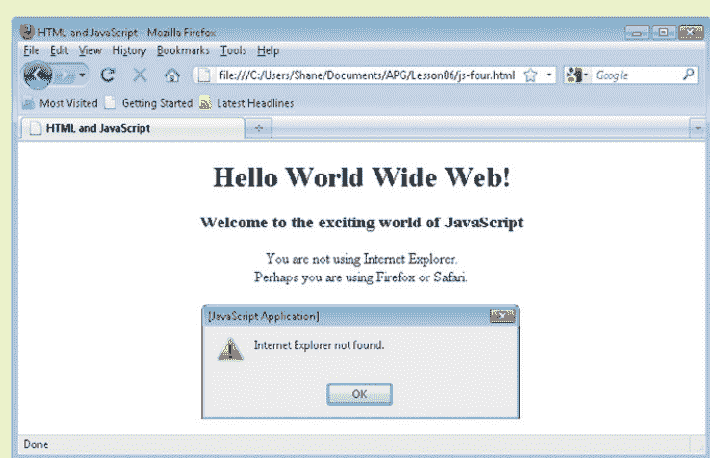

7. 单击警告框中的**确定**以关闭它。

希望本分步操作能帮助你了解`alert()`方法在各种网页开发场景中的实用性。它通常在 JavaScript 程序中用于让用户意识到发生了某些意外的错误情况。当程序在继续之前需要某种用户确认时，也可以使用它。例如，你可能会使用一个警告框，上面写着“以下过程可能需要几分钟才能完成。单击确定继续。”无论哪种情况，`alert()`方法都是向用户传达消息的有效方式。

### 技术时间线

#### 谁先出现——Java 还是 JavaScript？

许多对互联网技术只有粗略了解的人倾向于认为 Java 编程语言和 JavaScript 脚本语言是同一回事。即使那些知道它们不是同一回事的人，也可能不知道它们之间的关系或哪一个先被开发出来。这些语言的历史很有趣。Java 最初由 Sun Microsystems, Inc. 创建。Sun 于 1995 年向公众发布了其跨平台编程语言，此后其受欢迎程度以前所未有的速度增长。

但 Sun 并不是唯一一家寻求增强标准 HTML 功能的公司。Netscape Communications Corporation 也在忙于开发技术，为 Web 开发人员提供一种将用户可编程脚本嵌入静态 HTML 文档的方法。他们知道需要在设计中融入一个定义良好的语法。Netscape 的员工观察到 Java 语言变得多么受欢迎，因此他们从 Sun 获得了 Java 名称的许可，并在自己的脚本语言中使用了 Java 语法。Netscape 努力的结果被称为 JavaScript，它在互联网软件开发领域也取得了巨大成功。

### 访问浏览器状态行

你可能已经注意到，当你的 Web 浏览器加载包含许多对象（如文本和图形）的 HTML 文档时，它会在浏览器窗口底部的栏中显示各种消息。此区域称为状态行，可以从 JavaScript 程序内部访问。除了`document.write()`方法和`alert()`方法之外，状态行是 JavaScript 网页向用户传达信息的另一种方式。

访问浏览器的状态行是一项非常简单的任务。浏览器在状态行中显示的消息（如果有）存储在一个名为`status`的`window`对象属性中，作为简单的文本字符串。当 JavaScript 程序为`status`属性分配新的字符串值时，浏览器会通过在状态行上显示此值作为消息来响应。

**词汇**

状态行

> **警告**
>
> 某些版本的 Firefox 默认禁用 JavaScript 对状态行的访问。要允许访问状态行，请单击菜单栏上的**工具**，然后单击**选项**以打开选项对话框。在选项对话框中，单击**内容**选项卡，并确保选中“启用 JavaScript”选项。接下来，单击**高级**按钮以打开高级 JavaScript 设置对话框。确保选中“更改状态栏文本”选项，然后保存你的 JavaScript 设置。

### 分步操作 6.5

在本分步操作中，你将添加两个新的 JavaScript 语句，这些语句将文本字符串分配给`window`对象的`status`属性。`Window`是默认的 JavaScript 对象。这些语句只是强化了`alert()`方法已经显示的消息。

1. 如果尚未打开，请打开记事本、SimpleText 或你喜爱的文本编辑器。
2. 如果`js-four.html`或`js-four.htm`文件尚未在文本编辑器中打开，请单击菜单栏上的**文件**，然后单击**打开**以打开你在上一个分步操作中创建的`js-four.html`或`js-four.htm`文件。
3. 单击菜单栏上的**文件**，单击**另存为**，然后将文件保存为`js-five.html`或`js-five.htm`，以保留`js-four.html`文件。
4. 在`document.write()`方法代码下方和`alert()`方法代码上方输入状态 JavaScript 代码，完全按照本步骤和图 6–11 中粗体所示。

```javascript
window.status = "Internet Explorer detected.";

window.status = "Internet Explorer not found.";
```

图 6–11 `js-five.html`文件

```html
<html>

<head>

<title>HTML and JavaScript</title>

</head>

<body>

<div align="center">

<h1>

<script>

    document.write("Hello World Wide Web!");

</script>

</h1>

<h3>

<script>

    document.write("Welcome to the exciting world of JavaScript");

</script>

</h3>

<script>

    if (navigator.appName == "Microsoft Internet Explorer")

    {

        document.write("You are using Internet Explorer.");

        window.status = "Internet Explorer detected.";

        alert("Internet Explorer detected.");

    }

    else

    {

        document.write("You are not using Internet Explorer.<br>");

        document.write("Perhaps you are using Firefox or Safari.");

        window.status = "Internet Explorer not found.";

        alert("Internet Explorer not found.");

    }

</script>

</div>

</body>

</html>
```


5. 将更改保存到`js-five.html`或`js-five.htm`文件。
6. 启动你喜爱的 Web 浏览器，然后打开`js-five.html`或`js-five.htm`文件，以在浏览器中将该文件作为网页查看。根据你使用的浏览器，屏幕上的网页应如**图 6–12**或**图 6–13**所示。

## 第二单元 JavaScript 基础

### 图 6–12

使用 Internet Explorer 8 查看的网页

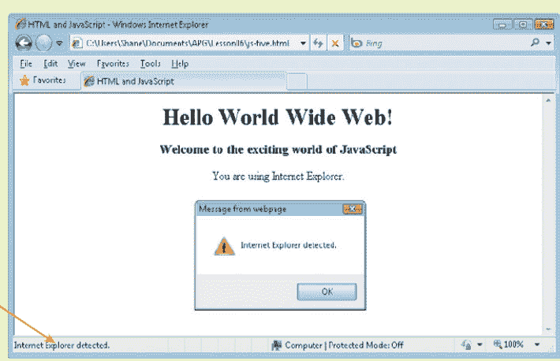

### 图 6–13

使用 Firefox 3.5 查看的网页

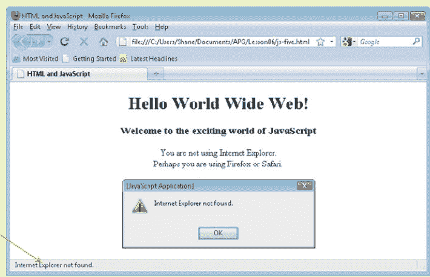

7. 在警告框中点击**确定**以关闭它。

在这个分步指南中，你使用了浏览器的状态栏来仅仅回显与警报对话框中显示的相同消息。这样做是为了简单起见，但专业的 Web 开发人员通常不会这样做。通常，状态栏用于让用户了解浏览器正在做什么。这在浏览器即将执行可能需要异常长时间才能完成的操作时尤其有帮助。例如，当浏览器开始下载大型图形图像、大型程序或大型数据文件时，通常会看到“正在加载...”或类似的消息。显示此类消息有助于用户了解浏览器确实在执行某些操作，而系统并未崩溃。

### 技术时间线

### Hello World!

下次你去当地书店时，花几分钟时间浏览几本不同编程书籍的第一章。在许多情况下，你会看到这些书中的第一个编程示例将演示如何用该特定计算机语言显示短语“Hello, World!”。你认为作者为什么如此普遍地以这种方式开始他们的书呢？嗯，答案很简单。

1978年，贝尔实验室的两位员工 Brian Kernighan 和 Dennis Ritchie 出版了一本名为*The C Programming Language*的书。这本书已被证明是计算机软件史上最持久的编程教程之一。在过去的30年里，这本书只修订过一次，第二版至今仍在印刷中！这本书中的第一个编程练习解释了如何使用 C 函数`printf()`来显示短语“Hello, World!”。虽然 Kernighan 和 Ritchie 不太可能打算在编程书籍作者中开创一个非正式的传统，但这正是他们所做的！我们擅自将短语稍作修改为“Hello World Wide Web!”，但本书中的第一个 JavaScript 程序仍然是基于他们30多年前的简单示例。

### 总结

在本课中，你学到了：

- JavaScript 的目的。
- 如何使用 JavaScript 显示网页文本。
- 如何使用 JavaScript 对象。
- 如何使用 JavaScript 方法。
- 如何在 JavaScript 代码内部和周围使用 HTML 格式标签。
- 如何使用 JavaScript 创建条件语句。
- 如何使用 JavaScript 的`alert()`方法。
- 如何使用 JavaScript 访问浏览器状态栏。

### 词汇复习

定义以下术语：

- 二进制代码
- 编译器
- 条件
- 条件语句
- 解释
- 关键字
- 方法
- 对象
- 运算符
- 参数列表
- 编程语言
- 属性
- `<script>` `</script>`标签
- 脚本语言
- 状态栏
- 语法
- 标记
- 变量

### 复习题

#### 判断题

如果陈述正确，请圈出 T；如果陈述错误，请圈出 F。

1. 严格来说，JavaScript 是一种编程语言，而不是脚本语言。
2. 编译器将人类可读的源代码转换为机器可读的二进制代码。
3. JavaScript 需要编译器。
4. JavaScript 代码嵌入在 HTML 文档的`<script>`和`</script>`标签之间。
5. Web 浏览器可以处理放置在`<script>`和`</script>`标签之间的 HTML 标签。
6. 在 JavaScript 输出字符串中嵌入 HTML 标签会导致语法错误。
7. JavaScript 对象包括属性和方法。
8. JavaScript 方法名称后面总是跟着一个包含零个或多个参数的列表。
9. 默认的 JavaScript 对象称为`document`。
10. JavaScript 要求在每个语句的末尾使用分号。

#### 填空题

通过在提供的空白处填写正确的单词或短语来完成以下句子。

1. 符号`{`和`}`被称为____________。
2. JavaScript 的____________对象包含一个名为`write()`的方法。
3. JavaScript 的`if`语句支持一个可选的____________子句。
4. JavaScript 条件由两个____________组成，中间用关系运算符分隔。
5. ____________关系运算符表示“不等于”。
6. JavaScript 脚本语言包含了____________编程语言的语法。
7. `appName`属性属于 JavaScript 的____________对象。
8. `status`属性和`alert()`方法属于 JavaScript 的____________对象。
9. JavaScript 的`window`对象被认为是____________对象。
10. `appName`和`status`都是 JavaScript 对象____________的例子。

#### 简答题

简要回答以下每个问题：

1. JavaScript 如何增强 HTML 的功能？
2. 什么是 JavaScript 对象？什么是方法和属性？
3. 描述 JavaScript 条件语句的语法。
4. JavaScript `window`对象的独特特征是什么？
5. 简要描述 JavaScript 程序向用户传达信息的三种方式。

### 项目

#### 项目 6–1：基础 JavaScript 知识

回顾你为分步指南 6.1 创建的启用 JavaScript 的网页。GreatApplications, Inc. 希望你修改此页面，将短语“Hello World Wide Web!”替换为“Welcome to GreatApplications!”。将你的新网页保存为`Project 6-1.html`或`Project 6-1.htm`，并通过在 Web 浏览器中查看来确保其功能正常。

#### 项目 6–2：HTML 格式标签

回顾你为分步指南 6-3 创建的启用 JavaScript 的网页。此文档包含位于`<script>`和`</script>`标签外部的 HTML 格式标签，以及嵌入在输出文本字符串中的标签（`<br>`标签）。通过增强此网页的外观，展示你以这两种方式处理 HTML 格式标签的能力。为页面设置合适的背景颜色，并通过外部 HTML 标签使输出文本显示为新颜色（黑色以外）。然后，通过在 JavaScript 代码中嵌入`<font>`标签，使输出文本显示为不同的字体。将你生成的网页保存为`Project 6-2.html`或`Project 6-2.htm`，并在你喜欢的浏览器中查看。

#### 项目 6–3：浏览器类型

回顾你为分步指南 6-5 创建的启用 JavaScript 的网页。此页面是“面向 Internet Explorer 的”，这意味着它正在检查 Internet Explorer 是否是当前浏览器。Internet Explorer 浏览器由`if`语句块处理，而任何其他类型的浏览器则在`else`语句块内处理。更改此网页，使其不再面向 Internet Explorer，而是面向其他浏览器，例如 Firefox、Safari 或 Chrome。在你的新网页中，你选择的浏览器将在`if`子句内处理，而 Internet Explorer 和所有其他浏览器则由`else`子句处理。确保除了`if`语句条件外，你还适当地更改了输出文本。将你的结果保存为`Project 6-3.html`或`Project 6-3.htm`，并在至少两个不同的浏览器中查看该文件以确保其功能正常。

### 批判性思维

#### 活动 6–1：做出决策

在分步指南 6-3 的介绍中，我们提到条件语句是 JavaScript 最强大的功能之一。这一说法仅仅是30多年前伟大的计算机科学家 Joseph Weizenbaum 所做陈述的回声。1976年，Weizenbaum 写了一本名为*Computer Power and Human Reason*的书，他在书中提出了计算机系统的真正力量在于其做出决策的能力（尽管它们永远无法完全取代人类的同情心和智慧）。花几分钟思考一下这个想法，然后回答以下问题：

1. 如果计算机不能做出决策，它们会有多大用处？
2. 描述 JavaScript 决策结构的一般结构。
3. “评估条件”意味着什么？
4. 你认为为什么`if-else`语句的`else`子句是可选的？

#### 活动 6–2：JavaScript 的`appName`属性

让我们再次回顾一下你为分步指南 6-3 创建的网页。在这个练习中，我们检查`navigator`对象的`appName`属性，以查看活动浏览器是否是“Microsoft Internet Explorer”。如果`appName`属性不包含此值，它包含什么？你能想到一种方法来找出吗？尝试重写此网页，使其不再检查`appName`属性的值，而是简单地显示该值。然后在不同的浏览器中查看你的新网页，看看它显示什么。将你的新网页命名为`Activity 6-2.html`或`Activity 6-2.htm`。

#### 综合模拟

通过回顾你在第1课（在分步指南 1.2 中）创建并命名为`one.html`或`one.htm`的网页，将你新获得的 JavaScript 知识付诸实践。修改此网页，使所有输出文本都使用`document.write()`方法生成。生成的网页应与`one.html`页面生成的完全相同，如**图 6–14**所示。

项目要求：

- 从你在第1课分步指南 1.2 中创建的 HTML 代码开始。
- 用 JavaScript `document.write()`语句替换 HTML 文本字符串。
- 将你的新网页命名为`capstone-6.html`或`capstone-6.htm`。
- 在浏览器中查看你的新网页并确认结果。

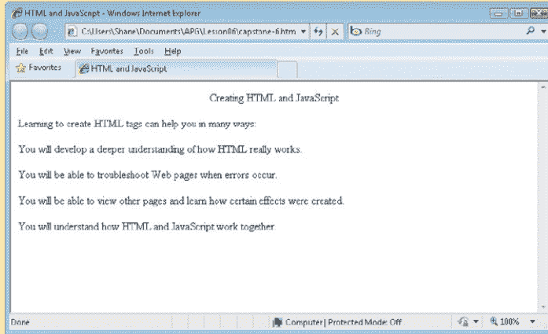

**图 6–14** `capstone-6.html`的结果

## 第7课：在 JavaScript 中使用图像

### 学习目标

完成本课后，你应该能够：

- 命名并描述 JavaScript 事件。
- 创建图像翻转效果。
- 制作超链接翻转效果。
- 构建循环横幅。
- 显示随机图像。
- 创建 JavaScript 幻灯片放映。

有效使用图形图像对于网页的整体成功至关重要。无论网页是基于 HTML 还是 JavaScript 技术，这一原则都成立。标准 HTML 使你能够结合图像实现有趣的视觉效果，而 JavaScript 则提供了一些额外的功能来增强网页的视觉吸引力。

### 词汇表

- 广告横幅
- 数组
- 循环横幅
- 递减
- 实体代码
- 事件
- 浮点数
- 函数
- 超链接翻转
- 图像翻转
- 递增
- 索引
- 实数
- 幻灯片放映
- 变量

## 第二单元：JavaScript 基础

### 让图形图像活起来

本课重点介绍 JavaScript 的特性，这些特性通常用于让图形图像在网页上“活起来”。一旦你学会了这些新技术，你将能够快速识别出在万维网各处页面上使用的这些 JavaScript 功能。你不再需要好奇这些有趣页面的设计师是如何创造出如此引人注目的效果的。

在能够使用图像完成任何出色的工作之前，你需要理解 JavaScript 事件。就本书而言，你可以将*事件*视为系统对某些特定条件发生的响应。其中一些条件是由 Web 浏览器软件生成的，但大多数是由用户执行某些操作引起的。这些操作可能包括移动鼠标、点击按钮，甚至是在屏幕上选择一段文本。但无论特定事件是如何产生的，JavaScript 都使你能够创建能够响应它的网页。此外，当这些反应被巧妙地实现时，用户就能够成功地使用和与你的网页进行交互。

### 词汇表

- 事件
- 函数
- 图像翻转

> **警告**
>
> 要完成本课的分步练习，你需要从讲师那里获取本课的数据文件。这些文件包括`lions.gif`、`tigers.gif`、`bears.gif`、`ohmy.gif`、`blueArrow.gif`和`redArrow.gif`。你必须将这些文件保存在你为本书保存 HTML 文件的文件夹中。如有必要，请向老师寻求帮助。

在使用图像时，你需要掌握的另一个重要概念是如何使用 JavaScript 函数。*函数*不过是一段 JavaScript 代码，可以像你在第6课中使用的`document.write()`和`window.alert()`方法一样被调用或执行。事实上，方法和函数之间真的没有区别，只是方法已经被定义为构成 JavaScript 编程环境的对象的一部分。另一方面，函数是由程序员编写的，可以包含任意数量的 JavaScript 语句，包括对 JavaScript 方法和其他函数的调用。

此时，JavaScript 事件和函数如何与网页中图形图像的使用相关联，对你来说可能并不明显。当你学习本课时，你将开始看到它们之间的联系。事实上，这正是本课活动的目的。你将使用事件和函数与图像一起创建一些有趣的效果，极大地提高你的网页质量。

### 教会图像翻转

在第3课中，你学习了如何在网页中包含图形图像，还学习了如何将图像转换为超链接。在本课中，你将学习如何利用 JavaScript 的力量使图形超链接响应鼠标移动。

更具体地说，你将学习使用一种称为*图像翻转*的 JavaScript 编程技术，当网站访问者将鼠标指针移到图像上时，改变图像的外观。要实现翻转效果，你首先需要知道如何使用称为`onMouseOver`和`onMouseOut`的 JavaScript 事件。每当用户将鼠标指针移到特定对象上时，就会生成`onMouseOver`事件。同样，当用户将鼠标指针移开对象时，就会生成`onMouseOut`事件。你需要学习的是如何使用 JavaScript 来检测这些事件何时发生，然后采取适当的行动。在分步练习 7.1 中，你将在屏幕上显示一个蓝色箭头，然后当鼠标指针移到箭头上时，将箭头改为红色。然后，当鼠标指针移开图像时，再将箭头颜色改回蓝色。听起来很简单，对吧？

### 分步练习 7.1

在这个分步练习中，你将使用 JavaScript 创建一个非常简单的图像翻转效果。这涉及编写一些 JavaScript 函数来响应`onLoad`、`onMouseOver`和`onMouseOut`事件。

1. 确保图像文件**blueArrow.gif**和**redArrow.gif**已正确保存在你保存网页的同一文件夹中。
2. 打开记事本、SimpleText 或你最喜欢的文本编辑器，然后根据需要创建一个新的空白文档。
3. 按照**图7-1**所示，准确输入 HTML 和 JavaScript 文本。

#### 图 7-1：js-six.html 文件

> **警告**
>
> 要完成下一个分步练习，你需要访问讲师将提供给你的以下数据文件：`blueArrow.gif`和`redArrow.gif`。这些文件必须存储在你为本书保存 HTML 文件的文件夹中。如有必要，请向老师寻求帮助。

```html
<html>

<head>

<title>HTML and JavaScript</title>

<script>

var blueArrow = new Image;

var redArrow = new Image;

function startup()

{

    blueArrow.src = "blueArrow.gif";

    redArrow.src = "redArrow.gif";

    return;

}

function turnBlue()

{

    document.arrow.src = blueArrow.src;

    return;

}

function turnRed()

{

    document.arrow.src = redArrow.src;

    return;

}

</script>

</head>
```

#### 接上页

```html
<body onLoad="startup()">

  <div align="center">

    <a href="webpage.html"

       onMouseOut="turnBlue()" onMouseOver="turnRed()">

      

    </a>

  </div>

</body>

</html>
```


4. 将新创建的文件保存为`js-six.html`或`js-six.htm`，放在你保存前几课文件的同一文件夹中。
5. 启动你最喜欢的 Web 浏览器，然后打开`js-six.html`或`js-six.htm`文件，将文件作为网页查看。屏幕上的网页最初应如图 7-2 所示。
6. 将鼠标指针移到箭头图像上。屏幕上的网页现在应如图 7-3 所示。

### 图 7-2

“鼠标移出”状态下的网页

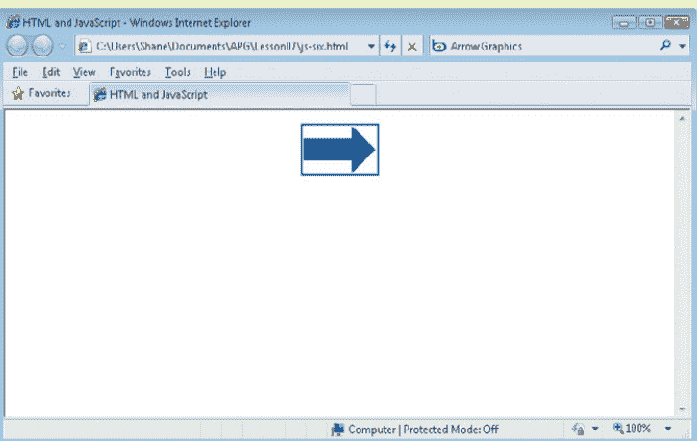

> **警告**
>
> 如果你的浏览器显示消息：“为帮助保护您的安全，Internet Explorer 已限制此网页运行可能访问您计算机的脚本或 ActiveX 控件。单击此处获取选项。”请单击消息栏，单击“允许阻止的内容”，然后在“安全警告”对话框中单击“是”。

## 第 7 课 在 JavaScript 中使用图像

167

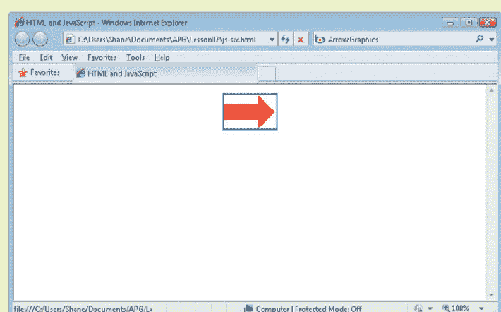

### 图 7–3

“鼠标悬停”状态下的网页

你刚刚输入的用于创建图 7–1 中`js-six.html`文件的 HTML/JavaScript 源代码引入了几个你以前未见过的新功能。理解这些新概念很重要，因为你在整个课程中都会用到它们。

首先，你可能已经注意到`<script>`和`</script>`标签位于 HTML 文档的头部部分，而不是主体部分。这种放置方式确保了 Web 浏览器在开始在屏幕上显示文档内容之前处理 JavaScript 代码。对于这个特定的文档来说，这是一个重要的点，因为你希望浏览器在加载网页主体之前为`blueArrow`和`redArrow`变量创建图像对象。然后，当网页加载完成后，`onLoad`事件被处理，`startup()`函数被调用。`startup()`函数将相应的图像文件名分配给图像对象的`src`属性。

网页显示在屏幕上后，浏览器会持续监控鼠标指针的位置。如果指针经过箭头图像的位置，`onMouseOver`事件将触发，`turnRed()`函数将被调用。此函数将图像的`src`（源）属性更改为`redArrow`对象的属性，图像在屏幕上变为红色。同样，如果鼠标指针移开箭头图像，`onMouseOut`事件将触发，`turnBlue()`函数被调用。此函数将图像的`src`（源）属性更改为`blueArrow`对象的属性，图像在屏幕上恢复为蓝色。

浏览器如何知道在响应`onMouseOver`和`onMouseOut`事件时要修改哪个图像？在这个网页中，`turnRed()`和`turnBlue()`函数设置了一个名为`arrow`的文档对象的`src`（源）属性。这个名称来自 HTML 代码中的``标签。请注意，它包含一个名为`name`的属性。就 JavaScript 而言，这是网页图像对象的名称。假设这个网页包含多个图像而不是单个图像。大多数网页都有多个图像。对于包含多个图像的网页，你需要为每个图像提供一个唯一的名称。然后，你就可以在 JavaScript 函数中引用页面上的任何图像。

### 词汇表

变量

### 专家补充

JavaScript 变量不过是一个被赋予字面值或对象的名称。

### 专家补充

**图像边框。** 当图形被定义为超链接时，浏览器会在图像周围显示一个矩形边框。如果这个默认边框影响了页面的外观，你可以使用名为`border`的图像属性调整其大小。在``标签中包含`border="0"`语句可以完全移除边框。

## 第二单元 JavaScript 基础

### 教会超链接实现鼠标悬停效果

既然你已经知道如何制作图像的鼠标悬停效果，现在可以学习如何创建超链接的鼠标悬停效果。正如你可能预料的那样，超链接的鼠标悬停效果与图像的鼠标悬停效果非常相似。唯一的区别在于，超链接的鼠标悬停效果是在用户将鼠标指针移到超链接上时触发，而不是在鼠标指针移到图像上时触发。如果你预期实现超链接鼠标悬停效果所需的 JavaScript 代码与图像鼠标悬停效果的代码相似，那么你不会失望。你在分步指南 7.2 中所做的修改相当细微。准备好尝试一下了吗？

### 分步指南 7.2

在这个分步指南中，你将修改你的网页，使得当鼠标指针经过超链接时触发 JavaScript 事件，而不是经过图像时触发。然而，箭头图像仍然像在上一个分步指南中一样改变颜色。

1. 如果尚未打开，请打开记事本、SimpleText 或你最喜欢的文本编辑器。
2. 如果`js-six.html`或`js-six.htm`文件尚未在文本编辑器中打开，请单击菜单栏上的“文件”，然后单击“打开”以打开你在分步指南 7.1 中创建的`js-six.html`或`js-six.htm`文件。
3. 单击菜单栏上的“文件”，单击“另存为”，然后将 HTML 文件保存为`js-seven.html`或`js-seven.htm`，保存在同一文件夹中以保留`js-six.html`文件。
4. 按照本步骤中粗体显示的 HTML 代码以及图 7–4 中粗体显示的代码进行修改，使生成的 HTML 文件看起来与图 7–4 完全一致。

```html
<a href="webpage.html"
    onMouseOut="turnBlue()"
    onMouseOver="turnRed()">
    Next Page
</a>

<p>
    
</p>
```

### 图 7-4 `js-seven.html`文件

```html
<html>
<head>
<title>HTML and JavaScript</title>
<script>
var blueArrow = new Image;
var redArrow = new Image;

function startup()
{
    blueArrow.src = "blueArrow.gif";
    redArrow.src = "redArrow.gif";
    return;
}

function turnBlue()
{
    document.arrow.src = blueArrow.src;
    return;
}

function turnRed()
{
    document.arrow.src = redArrow.src;
    return;
}
</script>
</head>

<body onLoad="startup()">
    <div align="center">
        <a href="webpage.html" onMouseOut="turnBlue()" onMouseOver="turnRed()">
            Next Page
        </a>

        <p>
            
        </p>
    </div>
</body>
</html>
```

5. 将更改保存到文件`js-seven.html`或`js-seven.htm`。
6. 启动你最喜欢的 Web 浏览器，然后打开`js-seven.html`或`js-seven.htm`文件，将文件作为网页查看。你屏幕上的网页应看起来像图 7–5 所示。暂时不要移动鼠标。

### 图 7–5

处于“鼠标移出”状态的网页

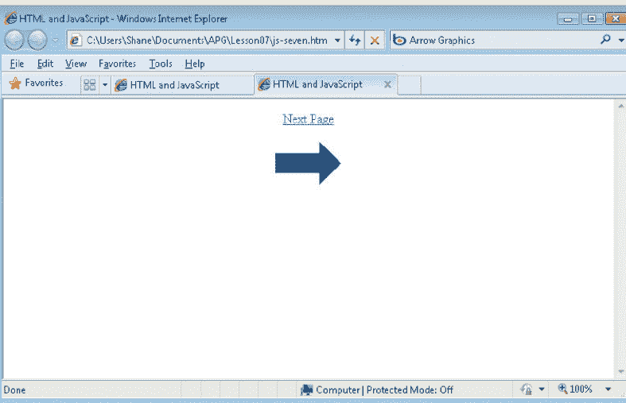

7. 现在，将鼠标指针移到`Next Page`链接上；箭头颜色变为红色，你屏幕上的网页应看起来像图 7–6。

### 图 7–6

处于“鼠标悬停”状态的网页

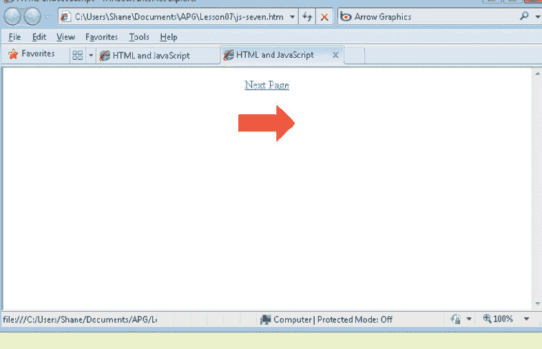

## 第 7 课 在 JavaScript 中使用图像

如果你是一个敏锐的观察者，你会注意到`js-seven.html` HTML 文档中的 JavaScript 代码与`js-six.html`文件中的代码完全相同。重要的是，你要透彻理解在 HTML 主体中所做的更改，以及这些更改如何与 JavaScript 代码相关联。

首先，`<a>`和`</a>`锚点标签不再包含``标签，因此箭头图像不再是超链接引用的一部分。相反，锚点标签现在包含新添加的“Next Page”文本。这意味着`onMouseOver`和`onMouseOut`事件在鼠标指针移到新的“Next Page”超链接上时触发，而不是在移到箭头图像上时触发。然而，JavaScript 代码执行的操作与之前相同，因此图像像以前一样改变颜色。

虽然从技术上讲，在箭头图像周围包含`<p>`和`</p>`段落标签并非必要，但这样做是为了改善页面的外观。`<p>`标签使箭头图像显示在`Next Page`链接下方，而不是其右侧。

你是否注意到，在上一个分步指南中查看`js-six.html`文件时，箭头图像周围有一个蓝色矩形，但在查看`js-seven.html`文件时却没有？在分步指南 7.1 的`js-six.html`文件中，图像被定义为超链接，而超链接图像通常由 Web 浏览器显示为蓝色边框。当箭头图像从蓝色变为红色时，蓝色边框仍然可见。但是，当你在分步指南 7.2 中将`js-seven.html`文件作为网页查看时，图像未被定义为超链接，因此蓝色边框消失了。相反，`Next Page`文本被定义为超链接，因此无论箭头图像的颜色如何，它都显示为蓝色并带有下划线。

### 专家补充

使用 JavaScript 事件。本课中的所有活动都使用了一个或多个 JavaScript 事件。然而，本课并未讨论几个 JavaScript 事件。但这并不意味着你不能进行一些独立学习并自己学习如何使用它们。表 7-1 提供了 JavaScript 事件的字母顺序列表，以及触发每个事件的条件的简要说明。

#### 表 7-1 JavaScript 事件

| 事件名称 | 事件触发条件 |
|---|---|
| `onAbort` | 用户中止了网页的加载。 |
| `onBlur` | 用户使一个对象失去焦点（对象失去焦点）。 |
| `onChange` | 用户以某种方式更改了对象。 |
| `onClick` | 用户将鼠标指针单击在一个对象上。 |
| `onError` | JavaScript 解释器遇到脚本错误。 |
| `onFocus` | 用户激活了一个对象（对象获得焦点）。 |
| `onLoad` | Web 浏览器完成页面的加载。 |
| `onMouseOver` | 鼠标指针经过一个对象。 |
| `onMouseOut` | 鼠标指针移出一个对象。 |
| `onSelect` | 用户选择（高亮显示）了对象的内容。 |
| `onSubmit` | 用户提交了一个 HTML 表单。 |
| `onUnload` | Web 浏览器将页面从内存中卸载。 |

## 第二单元 JavaScript 基础

### 创建循环横幅

当你上网冲浪时，通常会遇到包含不断变化的广告的商业网站。事实证明，这些循环横幅（也称为广告横幅）可以使用不同的互联网技术以多种方式创建。然而，创建能够循环或持续变化的广告的最简单、最有效的方法之一是使用 JavaScript 事件和函数。

循环横幅实际上不过是一系列图形图像，这些图像一个接一个地显示，每张图像之间有短暂的停顿。在序列中的所有图像都显示完毕后，浏览器将循环回到第一张图像并重新开始序列。这就是为什么这种特定的网页效果被称为循环横幅。

你可能认为创建循环横幅需要大量的时间和精力，但使用 JavaScript 并非如此。在下一个分步指南中，你将输入简单的代码，将有效的广告展示集成到你的网页中。通过利用单个 JavaScript 事件并定义一个简单的 JavaScript 函数，你将在循环横幅设计领域迈向名声和财富。你准备好了吗？

### 分步指南 7.3

在下一个分步指南中，你将利用 JavaScript 数组和超时函数来创建一个循环横幅。序列中的每张图像在两秒延迟后显示，然后在最后一张图像显示后，序列循环回到开头。

1. 确保图像文件`lions.gif`、`tigers.gif`、`bears.gif`和`ohmy.gif`已正确保存在你为这些课程保存网页的同一文件夹中。
2. 如果尚未打开，请打开记事本、SimpleText 或你最喜欢的文本编辑器，单击菜单栏上的`File`，然后单击`New`以创建一个新的空白文档。
3. 按照图 7-7 所示，准确输入 HTML 和 JavaScript 文本。

### 图 7-7 `js-eight.html`文件

```javascript
<html>

<head>

<title>HTML and JavaScript</title>

<script>

var imgArray = new Array(4);

var index = 0;
```

## 第 7 课 使用 JavaScript 处理图像

### 图 7-7 `js-eight.html`文件

*接上一页*

```javascript
function cycle()
{
    document.banner.src = imgArray[index].src;
    index++;

    if (index > 3)
    {
        index = 0;
    }

    setTimeout("cycle()", 2000);
    return;
}

function startup()
{
    imgArray[0] = new Image;
    imgArray[0].src = "lions.gif";

    imgArray[1] = new Image;
    imgArray[1].src = "tigers.gif";

    imgArray[2] = new Image;
    imgArray[2].src = "bears.gif";

    imgArray[3] = new Image;
    imgArray[3].src = "ohmy.gif";

    cycle();
    return;
}

</script>

</head>

<body onLoad="startup()">
    <div align="center">
        
    </div>
</body>

</html>
```


## 第二单元 JavaScript基础

4. 将你新创建的文件保存为`js-eight.html`或`js-eight.htm`，放在你为本书保存文件的同一文件夹中。

## 第7课 使用JavaScript处理图像

5. 启动你常用的Web浏览器，打开`js-eight.html`或`js-eight.htm`文件，以网页形式查看该文件。生成的网页最初应如图7–8所示。经过连续的两秒延迟后，图像应依次变为图7–9、图7–10和图7–11所示的样子。然后，整个序列将重复。

> **警告**  
> 如果你的浏览器显示消息“为帮助保护你的安全，Internet Explorer已限制此网页运行可能访问你计算机的脚本或ActiveX控件。单击此处获取选项。”，请单击消息栏，单击“允许阻止的内容”，然后在“安全警告”对话框中单击“是”。

### 图7–8

初始网页

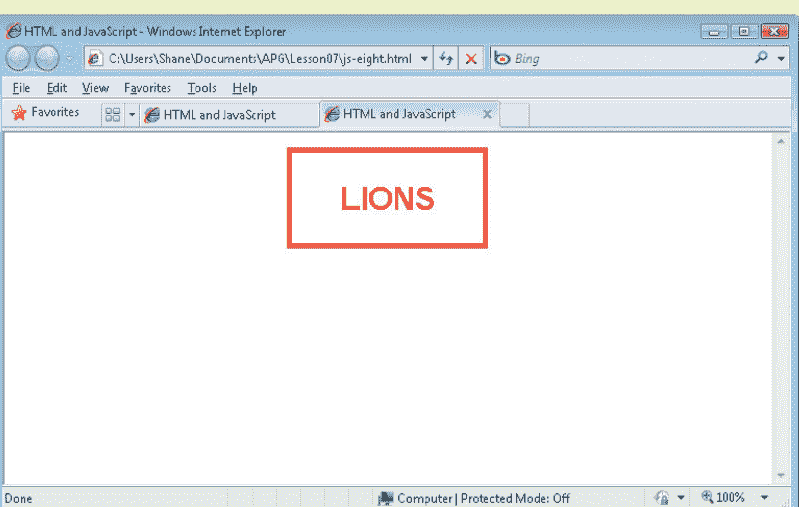

### 图7–9

两秒延迟后的网页

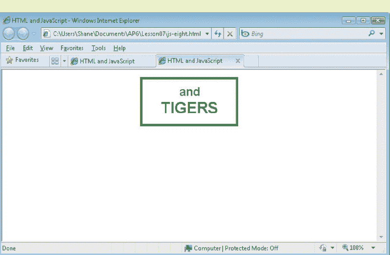

## 第7课 使用JavaScript处理图像

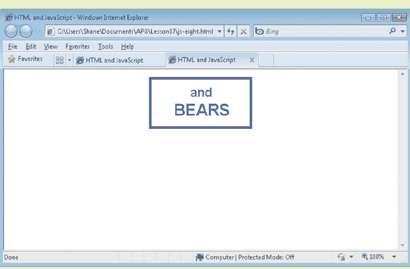

### 图7–10

四秒延迟后的网页

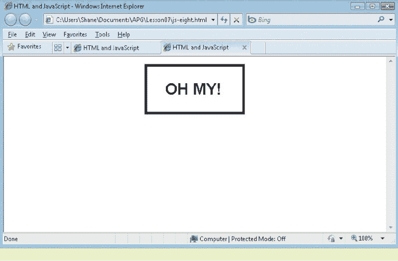

### 图7–11

六秒延迟后的网页

前面的分步指南在相对少量的源代码中介绍了几个重要的JavaScript概念。花时间仔细查看图7-7中的源代码清单，确保你完全理解代码是如何创建循环效果的。

首先，看看第6行（`var imgArray = new Array(4);`）。这一行包含一个你以前未使用过的JavaScript对象：一个数组。数组是一组相似对象的集合，可以通过变量名和索引来访问。索引是一个整数变量，用于标识正在引用数组的哪个元素。数组在几乎所有现代计算机语言中都可用，因此熟悉它们对你来说很重要。在本例中，数组被定义为最多包含四个（4）个元素，其变量名是`imgArray`。这个数组包含四个`Image`对象，但数组也可以包含任何其他类型的JavaScript对象。

### 词汇

- 数组
- 索引
- `imgArray`

## 第二单元 JavaScript基础

其次，考虑`startup()`函数中第23到30行的JavaScript语句。这些语句你应该看起来很熟悉，因为你在分步指南7.1和7.2的`startup()`函数中使用过类似的语句。第23行创建一个新的`Image`对象并将其赋值给图像数组的索引0处。然后，第24行将这个新图像对象的`src`（源）属性设置为包含名为`lions.gif`的文件的内容。类似地，第25和26行的JavaScript语句创建一个新的图像对象并将其源属性设置为包含`tigers.gif`的内容。然后，第27和28行为`bears.gif`执行相同的任务，第29和30行则为`ohmy.gif`执行相同的操作。

第三，在初始化了相应的图像对象之后，`startup()`函数调用`cycle()`函数。顾名思义，`cycle()`函数包含使图像在网页上以循环方式显示的逻辑。`index`变量（在第7行初始化为0）决定了`imgArray`数组中的哪个元素显示在屏幕上。网页图像对象被赋予了名称`banner`，如``标签的`name`属性所指定。然后，索引递增1（`index++`）并检查确保其值不超过3（因为在JavaScript中，四元素数组的有效索引是0、1、2和3）。最后，`cycle()`函数休眠两秒（如`setTimeout()`方法中指定的2000毫秒），然后再次调用`cycle()`函数以移动到循环中的下一张图像。现在程序对你来说有意义了吗？

### 词汇

- 递增

### 技术时间线

#### 使用数组编程

数组的发明是为了帮助程序员通过单个变量名访问可能大量的数据元素。几乎每种编程和脚本语言都支持数组的概念，但它们实现数组索引的方式并不完全相同。如果你在某些编程语言（如Basic、Fortran或Pascal）中定义一个10元素数组，你会使用索引值1、2、3、...10来访问这10个元素。但其他语言（包括C、C++和Java）不使用这种基于1的索引技术。相反，它们实现了一种基于0的方法，使得10元素数组的有效数组索引为0、1、2、...9。乍一看，你可能认为基于1的方法更有意义，因为它对新手程序员来说更容易理解。然而，如果你查看不同语言编译器生成的底层机器代码，你会看到基于1的方法对计算机硬件处理来说效率略低。这是许多专业程序员在软件开发项目中更喜欢使用基于0的语言的原因之一。

#### 显示随机图像

在前面的分步指南中，你学习了如何按特定顺序显示一系列图形图像。有时，网页设计者希望他们的图像以随机顺序出现。这种方法通常用于特定网站包含大量图形图像，并且网站所有者希望系统随机选择一张图像进行显示的情况。

起初，你可能认为按固定顺序显示图像比按随机顺序显示要容易得多。但当你使用JavaScript时，情况并非如此。事实上，显示随机图像实际上比创建循环横幅所需的代码行数更少。这主要是由于JavaScript内置了对随机数生成的支持。

## 第7课 使用JavaScript处理图像

由于此活动的大部分源代码与前一个活动相同，你可以从上一个分步指南中创建的`js-eight.html`文件开始，只需进行一些更改。事实上，你所需要做的就是用一个类似的名为`select()`的函数替换`cycle()`函数。你甚至不需要担心获取新的图形文件，因为我们将使用与前一个活动相同的图像。

### 分步指南7.4

在这个分步指南中，你将创建一个以随机顺序显示图像的JavaScript函数。要使网页中的图像随机显示而不是按指定顺序显示，你只需要用一个我们称为`select()`的新函数替换`cycle()`函数。

1. 如果尚未打开，请打开记事本、SimpleText或你常用的文本编辑器。
2. 如果`js-eight.html`或`js-eight.htm`文件尚未在文本编辑器中打开，请单击菜单栏上的“文件”，然后单击“打开”以打开你在分步指南7.3中创建的`js-eight.html`或`js-eight.htm`文件。
3. 单击菜单栏上的“文件”，单击“另存为”，然后将网页文档保存为`js-nine.html`或`js-nine.htm`，放在你为本书保存所有文件的同一文件夹中，以保留`js-eight.html`文件。
4. 将HTML代码从`cycle()`函数更改为`select()`函数，完全按照本步骤和图7-12中粗体所示进行更改。

```javascript
function select()
{
    index = Math.floor(Math.random() * 4);
    document.banner.src = imgArray[index].src;
    setTimeout("select()", 2000);
    return;
}

function startup()
{
    imgArray[0] = new Image;
    imgArray[0].src = "lions.gif";
    imgArray[1] = new Image;
    imgArray[1].src = "tigers.gif";
    imgArray[2] = new Image;
    imgArray[2].src = "bears.gif";
    imgArray[3] = new Image;
    imgArray[3].src = "ohmy.gif";
    select();
    return;
}
```

## 第7课 在JavaScript中使用图像

本步骤中用于创建随机图像效果的JavaScript代码，你应该能看懂，因为它与上一步中用于创建图像顺序循环的代码类似。不过，有几个新概念可能需要解释一下。

首先，你将函数名从`cycle()`改为了`select()`，因为它更准确地反映了该函数的目的和行为。由于这个名称的更改，你必须修改`startup()`函数中的调用，使其调用正确的函数名。如果你没有进行这个更改，Web浏览器会返回一个脚本错误。

其次，你包含了适当的JavaScript代码来生成一个随机数，然后将该数字转换为0到3范围内的有效数组索引。JavaScript方法`random()`是`Math`对象的一部分，它保证返回一个大于或等于0.0且小于1.0的实数。实数（也称为浮点数）是包含小数部分的数值。由于这个受限范围内的数字不能用作数组索引（索引必须始终是整数），你需要将它们缩放到适当的范围。在这种情况下，数组中有四个元素，因此你将随机值乘以4（使用`*`运算符）。现在，你得到一个保证大于或等于0.0且小于4.0的实数。最后一步是调用`Math`对象的`floor()`方法，该方法会消除结果数字的小数部分。这意味着唯一可能的值是整数0、1、2和3，这些正是你需要用作数组索引的值。

为了确保你对这个过程感到满意，我们来看另一个例子。假设`select()`函数被调用的前三次，`Math.random()`方法生成的随机值分别为0.137、0.8312和0.54。当代码将这些数字乘以4时，结果值分别为0.548、3.3248和2.16。然后，当你将这些新的实数通过`Math.floor()`方法处理后，存储在`index`变量中的最终数字将是0、3和2。这些都是有效的数组索引值，因此显示的图像依次是文件`lions.gif`的内容，接着是`ohmy.gif`，最后是`bears.gif`。换句话说，你的屏幕上将依次显示图7-8、图7-11和图7-10。

### 创建JavaScript幻灯片放映

在前两个步骤中，你创建了包含JavaScript函数的HTML文件，这些函数每两秒钟自动更改屏幕上的图像。但有时让用户决定何时更改图像更为理想。允许用户通过点击他们选择的Web页面对象来更改图像，就构成了一个电子幻灯片放映。

在下一个步骤中，你将编写JavaScript代码，为用户提供两个分别标记为“后退”和“前进”的超链接。当用户点击其中任何一个链接时，Web页面中显示的图像会相应地更改。为了简单起见，你使用与前两个练习相同的图形图像。

### 步骤7.5

在这个步骤中，你将修改在上一步中创建的Web文档。你将移除`select()`函数，并插入两个名为`doBack()`和`doNext()`的新函数来响应用户的输入。你还将添加一些额外的HTML代码，使Web页面看起来更美观。

1. 如果尚未打开，请打开记事本、SimpleText或你最喜欢的文本编辑器。

### 词汇

- 实数
- 浮点数
- 幻灯片放映

### 专家提示

注意大小写！HTML不区分大小写。浏览器将以完全相同的方式解释标签``、``和``。然而，对于许多编程和脚本语言（如JavaScript）来说，情况并非如此。在命名JavaScript对象、变量或函数时，你必须确保每次使用相同的大小写。JavaScript解释器会将`INDEX`、`Index`和`index`视为三个不同的变量名。这通常会导致你的代码功能不正确或因脚本错误而崩溃。

## 第二单元 JavaScript基础

2. 如果`js-nine.html`或`js-nine.htm`文件尚未在文本编辑器中打开，请单击菜单栏上的“文件”，然后单击“打开”以打开你在上一步中创建的`js-nine.html`或`js-nine.htm`文件。

3. 单击菜单栏上的“文件”，单击“另存为”，然后将文件保存为`js-ten.html`或`js-ten.htm`（保存在同一文件夹中），以保留`js-nine.html`文件。

4. 按照本步骤和图7-13中粗体所示，将JavaScript代码中的`select()`函数替换为`doBack()`和`doNext()`函数。

```javascript
function doBack()
{
    if (index > 0)
    {
        index--;
        document.slideshow.src =
            imgArray[index].src;
    }
    return;
}

function doNext()
{
    if (index < 3)
    {
        index++;
        document.slideshow.src =
            imgArray[index].src;
    }
    return;
}
```

5. 按照本步骤和图7-13中粗体所示，在`<div> </div>`标签之间添加增强Web页面的HTML代码。

```html
<h2>My JavaScript Slide Show</h2>

<p>
    
</p>

<p>
    <a href="javascript:doBack()">Back</a>
    &nbsp;&nbsp;&nbsp;
    <a href="javascript:doNext()">Next</a>
</p>
```

### 图7-13 js-ten.html文件

```html
<html>

<head>
    <title>HTML and JavaScript</title>

    <script>
        var imgArray = new Array(4);
        var index = 0;

        function doBack()
        {
            if (index > 0)
            {
                index--;
                document.slideshow.src = imgArray[index].src;
            }
            return;
        }

        function doNext()
        {
            if (index < 3)
            {
                index++;
                document.slideshow.src = imgArray[index].src;
            }
            return;
        }

        function startup()
        {
            imgArray[0] = new Image;
            imgArray[0].src = "lions.gif";

            imgArray[1] = new Image;
            imgArray[1].src = "tigers.gif";

            imgArray[2] = new Image;
            imgArray[2].src = "bears.gif";

            imgArray[3] = new Image;
            imgArray[3].src = "ohmy.gif";

            return;
        }
    </script>
</head>

<body onLoad="startup()">
    <div align="center">
        <h2>My JavaScript Slide Show</h2>

        <p>
            
        </p>

        <p>
            <a href="javascript:doBack()">Back</a>
            &nbsp;&nbsp;&nbsp;
            <a href="javascript:doNext()">Next</a>
        </p>
    </div>
</body>

</html>
```


6. 将更改保存到`js-ten.html`或`js-ten.htm`文件。

7. 启动你最喜欢的 Web 浏览器，然后打开`js-ten.html`或`js-ten.htm`文件，以便在浏览器中将该文件作为 Web 页面查看。生成的 Web 页面应如图 7-14 所示。

图 7-14 JavaScript 幻灯片放映

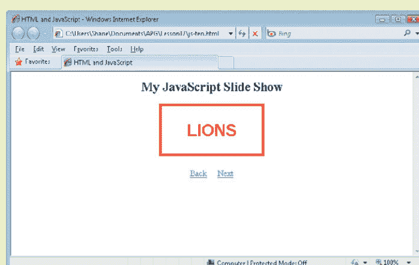

> **警告**
>
> 如果你的浏览器显示消息“为帮助保护您的安全，Internet Explorer 已限制此网页运行可能访问您计算机的脚本或 ActiveX 控件。单击此处查看选项。”，请单击消息栏，单击“允许阻止的内容”，然后在“安全警告”对话框中单击“是”。

8. 单击**后退**和**前进**超链接，确保幻灯片放映图像相应地更改。

## 第 7 课：在 JavaScript 中使用图片

在上一个分步教程中，你又学习了一些新的 JavaScript 概念，因此花点时间过一遍新代码，确保你理解幻灯片放映是如何工作的。`startup()`函数中的代码与前两个分步教程中的相同，所以你现在应该已经熟悉这段代码的工作方式了。但是，你可能对`doBack()`和`doNext()`函数还不完全熟悉。

`doBack()`函数的首要任务是测试`index`变量的值。如果它大于 0，你就知道当前活动的幻灯片图片不是第一张图片，因此浏览器需要“回退”到序列中的前一张图片。这是通过递减存储在`index`中的值（`index--`），然后将新的图片源加载到我们 HTML 文档的幻灯片图片对象中来完成的。正如你可能预料到的，术语**递减**意味着从变量的当前值中减去 1。如果`index`的当前值是 0，`doBack()`函数将不执行任何操作。

`doNext()`函数的内容当然与`doBack()`函数非常相似。代码首先检查`index`的值，确保其当前值小于 3。如果是，你就知道浏览器没有显示幻灯片中的最后一张图片，因此需要更改屏幕上的图片。这是通过递增`index`变量，然后将幻灯片对象的`src`属性设置为列表中的下一张图片来完成的。如果`index`的值是 3，`doNext()`函数将不执行任何操作。

如果你对第 1 单元中介绍的材料有扎实的理解，你应该能完全理解这个`js-ten.html`网页`<body>`标签中包含的大部分 HTML 代码。然而，有一些你以前没有使用过的 HTML 项目，你可能不完全理解。

你应该注意到，<u>Back</u>超链接的`href`属性不包含对另一个 HTML 文档的引用。相反，它包含一个对名为`doBack()`的 JavaScript 函数的引用。这意味着当用户点击这个超链接时，浏览器将执行指定的函数，而不是加载一个新的 HTML 页面。<u>Next</u>超链接的`href`属性当然是类似的。

你可能还注意到了图 7-13 所示的`js-ten.html`文件源代码清单第 52 行出现的三个神秘字母和符号`&nbsp;`。从技术上讲，这个符号被称为*实体代码*，它代表一个“不间断空格”，它强制 Web 浏览器在你的网页中插入一个空格字符。当然，还有许多其他实体代码，但你现在不需要担心它们。只需知道这些代码只是在<u>Back</u>和<u>Next</u>超链接之间插入一点额外的空间，并且可以删除而不会影响网页的行为。

### 词汇

- 递减
- 实体代码

> **互联网**
>
> #### JavaScript 版权侵权
>
> 我们在第 3 课中提到，网页开发者从商业网站下载受版权保护的图片然后将其用于自己的目的是非常不道德的。无论图片是用于标准 HTML 页面还是 JavaScript 页面，这显然都是正确的。但是，当你开始开发 JavaScript 增强的网页时，你也应该意识到脚本盗版与图片盗版一样不道德。事实上，这不仅是不道德的，而且是非法的！虽然下载和研究其他人创建的脚本有时是学习 JavaScript 的好方法，但你必须记住版权法仍然适用。你可以自由地使用公开可访问的 JavaScript 代码用于教育目的，但你不应该简单地从别人的网站复制脚本到你自己的网站上使用，除非你得到所有者的许可。

### 总结

在本课中，你学习了：

- 如何使用 JavaScript 事件。
- 如何创建图片翻转效果。
- 如何创建超链接翻转效果。
- 如何创建循环横幅。
- 如何显示随机图片。
- 如何创建 JavaScript 幻灯片放映。

### 词汇复习

定义以下术语：

- 广告横幅
- 数组
- 循环横幅
- 递减
- 实体代码
- 事件
- 浮点数
- 函数
- 超链接翻转
- 图片翻转
- 递增
- 索引
- 实数
- 幻灯片放映
- 变量

### 复习题

#### 判断题

如果陈述正确，请圈出 T；如果陈述错误，请圈出 F。

1. 所有 JavaScript 事件都是由用户输入触发的。
2. JavaScript 事件名称在 HTML 标签中使用，而不是在 JavaScript 代码中。
3. `<script></script>`标签可以出现在 HTML 文档的头部部分和/或主体部分。
4. JavaScript 事件在用户点击鼠标时触发，但在鼠标指针移动时不触发。
5. 具有名称的 HTML 对象可以在 JavaScript 代码中被引用。
6. 网页上的图片只有在被定义为图片翻转效果时才能更改。
7. 超链接翻转效果可以包含图片或标准文本或两者兼有。
8. JavaScript 数组只能包含 JavaScript Image 对象。
9. JavaScript 数组中第一个元素的索引总是 1。
10. JavaScript 的`Math.random()`方法总是返回一个整数值。

#### 填空题

通过在提供的空白处填写正确的单词或词组来完成以下句子。

1. JavaScript __________是由用户输入或系统级函数触发的。
2. 当网页被 Web 浏览器加载时，会调用 JavaScript __________事件。
3. JavaScript __________类似于方法，但不附加到 JavaScript 对象。
4. 图片或超文本 __________是通过使用 JavaScript 的`onMouseOver`和`onMouseOut`事件创建的。
5. JavaScript __________不过是一个与常量值或对象相关联的名称。
6. JavaScript _______________是一个能够包含多个数据元素的对象。
7. 通过使用(n) _______________来访问数组中的特定数据元素。
8. 广告横幅也称为(n) _______________横幅。
9. JavaScript 方法`random()`和`floor()`是_______________对象的一部分。
10. JavaScript _______________方法总是返回一个介于 0.0（包含）和 1.0（不包含）之间的实数。

#### 简答题

简要回答以下每个问题：

1. 什么是 JavaScript 事件？事件是如何产生的？
2. 什么是 JavaScript 函数？函数与方法有何不同？
3. 什么是循环横幅？为什么它被称为“循环”？
4. `Math`对象方法`random()`和`floor()`的目的是什么？
5. 什么是 JavaScript 电子幻灯片放映？

### 项目

#### 项目 7-1：JavaScript 维护

在这个项目中，GreatApplications 公司刚刚聘请你来接替一位最近离开公司的 JavaScript 程序员。不幸的是，你的前任留下了一个未完成的重要项目。你必须修复在分步教程 7.1（`js-six.html`）中创建的脚本。你可能已经注意到，当你的鼠标指针悬停在箭头图片上时点击鼠标，你的 Web 浏览器会显示一条错误消息。作为 GreatApplications 的新员工，你的首要任务是找到这个问题的根源并纠正它。

继续创建一个合适的 HTML 页面，并将其保存为`webpage.html`。然后，再次查看你的`js-six.html`页面，并通过点击箭头图片（当它变色时）来验证你的浏览器将显示你的新页面。别忘了你的新 HTML 网页文件必须与你的`js-six.html`文件保存在同一文件夹中。

#### 项目 7-2：团队项目

GreatApplications 公司的管理团队决定他们想创建一个电子动物园，并希望在其公司网站上向公众开放。因此，他们给你的团队分配了创建一个包含四种不同动物图片的 JavaScript 广告横幅的任务。组成三到四人的团队。每个成员应该花一些时间在网上搜索合适的动物图片（非版权图片），然后你们必须创建一个 JavaScript 横幅程序来显示它们。从图 7-7（`js-eight.html`）中列出的源代码开始，然后进行必要的修改，使程序显示你们收集的动物图片。你们可能想做的一些事情包括：

- 添加一个网页标题。
- 更改图片文件名。
- 调整图片显示大小。
- 确保图片没有版权！

将你们团队的工作保存为`Project 7-2.html`或`Project 7-2.htm`。

#### 项目 7–3：网页项目

GreatApplications, Inc. 的管理团队决定将他们的动物广告横幅改为幻灯片展示。他们还希望将动物图片的数量从四张增加到八张。以下是完成此任务需要做的一些事情：

- 复习分步指南 7.5，识别幻灯片展示的关键组件。
- 使用四张动物图片使幻灯片展示功能正常。
- 将你的图片数组大小增加到 8，并添加四张新的动物图片。
- 修改你的`doBack()`和`doNext()`函数，以处理 0 到 7 范围内的索引值。
- 确保图片没有版权问题！

将你的作品保存为`Project 7-3.html`或`Project 7-3.htm`。

### 批判性思维

#### 活动 7–1：图片和超链接悬停效果

在分步指南 7.1 中，你学习了如何创建当鼠标指针经过图片时产生反应的悬停效果。在分步指南 7.2 中，你学习了如何创建当鼠标指针经过超链接时改变箭头颜色的悬停效果。此活动测试你是否知道如何创建能对任一条件产生反应的悬停效果。

修改你的`js-seven.html`文件，使得当鼠标指针经过超链接或箭头时，箭头图片都会改变颜色。只需进行一处小的修改即可完成此操作。将你的作品保存为`Activity 7-1.html`或`Activity 7-1.htm`。

#### 活动 7–2：广告横幅

在分步指南 7.3 中，你学习了如何创建循环横幅，或通常所说的广告横幅。你可能已经注意到，许多商业网站都包含广告横幅，通常位于其网页的顶部或右侧。网上有这么多这样的网站，原因归结为一个金钱问题。网站所有者向公司收取一定费用，以便在其托管网页上展示他们的广告。通过这种方式，许多网站可以向用户提供免费服务，同时仍能覆盖自身的运营成本。分析其中几个网站，并思考以下问题：

1. 哪些类型的企业可能会选择向网站所有者付费以托管他们的广告横幅？
2. 哪些类型的产品和服务最有可能以这种方式进行广告宣传？
3. 你认为为什么大多数广告横幅被定义为超链接？
4. 哪些类型的网站最有可能托管广告横幅？

#### 综合模拟

在本课中，你学习了许多宝贵的 JavaScript 技能，这些技能使你能够创建循环横幅、随机图片展示和电子幻灯片。然而，你应该认识到，这些技术并非相互排斥。换句话说，对于给定的网页，你不一定必须只选择其中一种技术。如果愿意，你可以同时使用所有三种技术。通过创建一个使用所有这三种 JavaScript 图片技术的网页，来展示你已掌握本课中介绍的所有概念。完成后，你的网页应与图 7–15 相似。

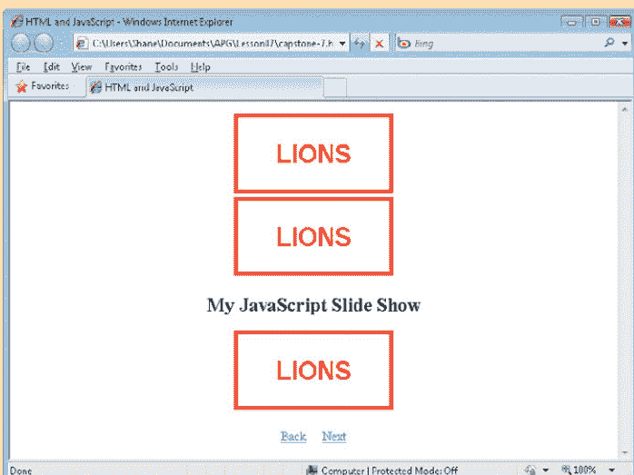

项目要求：

- 使用你在分步指南 7.3、7.4 和 7.5 中使用的相同图片文件。
- 在网页的上三分之一部分创建一个循环横幅。
- 在网页的中间三分之一部分创建一个随机图片展示。
- 在网页的下三分之一部分创建一个幻灯片展示。
- 为你的两个横幅图片使用不同的名称。
- 为你的三个数组索引变量使用不同的名称。
- 将你最终的网页命名为`capstone-7.html`或`capstone-7.htm`。

## 第 8 课：使用 JavaScript 创建表单

### 学习目标

完成本课后，你应该能够：

- 创建一个 HTML 表单。
- 使表单提交按钮功能正常。
- 使表单清除按钮功能正常。
- 使用 JavaScript 验证文本字段。
- 使用 JavaScript 验证单选按钮。

在第 3 课中，你对 HTML 表单有了一个简要的介绍。在本课中，你将首先复习第 3 课中介绍的信息，然后学习如何使用 JavaScript 来增强 HTML 表单的功能。有几种 JavaScript 事件可用于为简单的 HTML 表单组件添加一些“智能”。

### 词汇表

- 复选框
- 组件
- 控件
- 数据验证
- 单选按钮
- 文本字段

## 第二单元：JavaScript 基础

### 使 HTML 表单功能更强大

你通过定义网页上表单的整体布局，开始创建一个功能齐全、健壮的表单的过程。第一步是通过使用第 3 课中描述的适当 HTML 标签来完成的。下一步是识别 HTML 表单中用户与之交互的各种对象。你必须为每个这些交互对象（也称为*控件*或*组件*）命名，以便它们可以在 JavaScript 代码中被引用。最后一步是编写当用户触发特定 JavaScript 事件时被调用的 JavaScript 函数。

你在本课中学到的最重要的概念之一是数据验证的思想。*数据验证*是检查用户输入数据以确保其完整和准确的过程。虽然并不总是能够捕捉到用户在填写表单时可能犯的每一个错误，但有许多种错误是可以被检测到的。例如，如果用户忘记填写表单的某一部分，JavaScript 很容易就能检测到必要数据的缺失并相应地提醒用户。

为了让你有效地学习这些 JavaScript 表单处理概念，本课基于一个虚构的案例。你假装自己在一家新成立的披萨公司——JavaScript Pizza Parlor 工作。作为这家新公司的员工，你的工作是创建一个网页，允许客户通过互联网下披萨订单。在完成以下分步指南的过程中，你将学习如何使基于网络的订单表单对想要订购披萨的用户更好，也对想要销售更多披萨的公司所有者更好。

### 创建披萨订单表单

为 JavaScript Pizza Parlor 创建有效订单表单的第一步是使用适当的 HTML 标签在网页上定义其外观。在下面的分步指南中，你将使用第 3 课中介绍的几个标签和属性，使你的表单既吸引人又组织良好。完成的表单不过是由标题、标签和用户输入控件组成，但要让这些元素在屏幕上看起来美观需要时间和练习。注意标题、字体和换行标签是如何被用来控制披萨订单表单的最终外观的。

你还应该密切关注在分步指南 8.1 中使用的几个 HTML 标签中出现的`name`属性。虽然这些名称完全不影响表单的外观，但它们是文档的关键元素。在本课后续的分步指南中，当你继续增强表单时，你创建的 JavaScript 函数会广泛使用它们。

#### 分步指南 8.1

在这个分步指南中，你将为虚构的 JavaScript Pizza Parlor 创建一个简单的披萨订单表单。你使用文本字段、单选按钮和复选框控件来定义表单的外观和基本功能。

1. 打开记事本、SimpleText 或你最喜欢的文本编辑器。
2. 如果需要，创建一个新的空白文档。

> **词汇表**
>
> - 控件
> - 组件
> - 数据验证

> **警告**
>
> 当你尝试完成以下 JavaScript 活动时，你特定的 Web 浏览器可能会显示各种警告消息。如果看到这样的警告，只需单击启用 JavaScript 的选项即可。本书中的任何活动都不会以任何方式损坏你的计算机系统。

3. 按照图 8-1 所示，准确输入 HTML 文本。

**图 8-1 `js-eleven.html`文件**

```html
<html>

<head>

    <title>HTML and JavaScript</title>

</head>

<body>

    <form name="PizzaForm">

        <h1>The JavaScript Pizza Parlor</h1>

        <p>

            <h4>Step 1: Enter your name, address, and phone number:</h4>

            <font face="Courier New">

                Name: &nbsp;&nbsp;&nbsp;<input name="customer" size="50" type="text"><br>

                Address: <input name="address" size="50" type="text"><br>

                City: &nbsp;&nbsp;&nbsp;<input name="city" size="15" type="text">

                State: <input name="state" size="2" type="TEXT">

                Zip: <input name="zip" size="5" type="text"><br>

                Phone: &nbsp;&nbsp;<input name="phone" size="50" type="text"><br>

            </font>

        </p>

        <p>

            <h4>Step 2: Select the size of pizza you want:</h4>

            <font face="Courier New">

                <input name="sizes" type="radio">Small

                <input name="sizes" type="radio">Medium
```


```html
<input name="sizes" type="radio">Large<br>

</font>

</p>

<p>

<h4>Step 3: Select the pizza toppings you want:</h4>

<font face="Courier New">

<input name="toppings" type="checkbox">Pepperoni

<input name="toppings" type="checkbox">Canadian Bacon

<input name="toppings" type="checkbox">Sausage<br>

<input name="toppings" type="checkbox">Mushrooms

<input name="toppings" type="checkbox">Pineapple

<input name="toppings" type="checkbox">Black Olives<br>

</font>

</p>

<input type="button" value="Submit Order">

<input type="button" value="Clear Entries">

</form>

</body>

</html>
```

## 第二单元 JavaScript 基础

4. 将新创建的文件保存为`js-eleven.html`或`js-eleven.htm`，放在与之前课程文件相同的文件夹中。

5. 启动你常用的 Web 浏览器，然后打开`js-eleven.html`或`js-eleven.htm`文件，以网页形式查看。屏幕上的网页应与**图 8–2**所示的类似。

如前所述，分步教程 8.1 中使用的 HTML 标签在第 3 课中已介绍过。但是，为确保你理解这些标签的工作原理，在继续学习本课的 JavaScript 部分之前，你应该复习其中的一些概念。由于表单分为三个部分（或步骤），让我们仔细看看每个部分，了解其具体工作方式。

标记为步骤 1 的部分包含一个标题和六个带标签的文本字段。*文本字段*是一种输入控件，允许用户在网页的特定位置输入字符串值。每个文本字段都分配了一个名称和一个大小。`&nbsp;` 符号用于对齐姓名、地址、城市和电话字段的左边缘。

- 词汇
- 文本字段
- 单选按钮
- 复选框

步骤 2 部分由一个标题和三个带标签的单选按钮组成。*单选按钮*（也称为选项按钮）是一种输入控件，允许用户从一组选项中仅选择一个选项。在本例中，单选按钮标记为小、中、大，对应可用的披萨尺寸。Web 浏览器将这三个选项视为一组，因为它们都被赋予了相同的名称`sizes`。

最后部分，标记为步骤 3，包含标题和六个带标签的复选框。*复选框*是一种输入控件，允许用户从一组选项中选择任意数量的选项。与步骤 2 一样，这些复选框被赋予了与六种可用披萨配料相对应的标签。Web 浏览器也将这六个选项视为一组，因为它们都被分配了名称`toppings`。

## 第 8 课 使用 JavaScript 创建表单

这个披萨订单表单的最后一部分包含两个位于页面底部的按钮，分别标记为提交订单和清除条目。这些输入控件与其他控件一样使用`<input>`标签定义，但`type`属性设置为`"button"`，而不是`"text"`、`"radio"`或`"checkbox"`。如果你尝试点击这些控件中的任何一个，你会发现它们目前不执行任何操作。在接下来的两个分步教程中，你将输入使这些按钮功能化的必要代码。

### 使提交订单按钮功能化

现在你已经有了披萨订单表单的坚实 HTML 基础，可以开始使用 JavaScript 添加一些额外功能。第一个任务是添加一个 JavaScript 函数，当用户点击提交订单按钮时将调用（调用）该函数。在本例中，你只需输入代码来显示一个警报框，让用户知道他或她的披萨订单已提交给 JavaScript 披萨店。这是我们表单的重要组成部分，因为通常最好让用户知道程序正在做什么。你还想让他们知道他们的披萨正在路上！

要使提交订单按钮在被点击时调用 JavaScript 函数，你需要使用 JavaScript 事件。正如你所料，这个事件称为`onClick`，每当类型为`button`的输入控件被点击时就会触发。

### 分步教程 8.2

在这个分步教程中，你将向按钮输入标签添加一个`onClick`事件。你还将向 HTML 文档的头部部分添加一个 JavaScript 函数。

1. 如果尚未打开，请打开记事本、SimpleText 或你常用的文本编辑器。
2. 如果`js-eleven.html`或`js-eleven.htm`文件尚未在文本编辑器中打开，请单击菜单栏上的**文件**，单击**打开**，浏览到包含本书文件的文件夹，然后打开你在上一个分步教程中创建的`js-eleven.html`或`js-eleven.htm`文件。
3. 单击菜单栏上的**文件**，单击**另存为**，然后将 HTML 文件保存为`js-twelve.html`或`js-twelve.htm`，放在同一文件夹中以保留`js-eleven.html`文件。
4. 将`doSubmit()`函数添加到 HTML 文件的头部部分，如本步骤所示，并在**图 8–3**中以粗体显示。

```html
<script>
function doSubmit()
{
    alert("Your pizza order has been submitted.");
    return;
}
</script>
```

### 专家补充

什么是字符串？*字符串*是一个经验丰富的程序员和 Web 开发人员非常熟悉但对初学者来说可能很新的术语。在 HTML 和 JavaScript 的上下文中，字符串不过是一个或多个字符的序列。字符串可以由一个单词、一个完整的句子或一本书的整个章节组成。通常，字符串包含有意义的文本，但这不是必需的。一串无意义的乱码或神秘符号也可以是字符串，而且字符串的长度实际上没有限制。

5. 将`onClick`事件添加到提交订单`<input>`标签，如本步骤所示，并在**图 8-3**中以粗体显示。

```html
<input type="button" value="Submit Order"
onClick="doSubmit()">
```

**图 8-3** `js-twelve.html`文件

```html
<html>
<head>
<title>HTML and JavaScript</title>
<script>
function doSubmit()
{
    alert("Your pizza order has been submitted.");
    return;
}
</script>
</head>

<body>
    <form name="PizzaForm">
        <h1>The JavaScript Pizza Parlor</h1>

        <p>
            <h4>Step 1: Enter your name, address, and phone number:</h4>

            <font face="Courier New">
                Name: &nbsp;&nbsp;&nbsp;<input name="customer" size="50"
                type="text"><br>

                Address: <input name="address" size="50" type="text"><br>

                City: &nbsp;&nbsp;&nbsp;<input name="city" size="15" type="text">
                State: <input name="state" size="2" type="TEXT">
                Zip: <input name="zip" size="5" type="text"><br>

                Phone: &nbsp;&nbsp;<input name="phone" size="50" type="text"><br>
            </font>
        </p>

        <p>
            <h4>Step 2: Select the size of pizza you want:</h4>

            <font face="Courier New">
                <input name="sizes" type="radio">Small
                <input name="sizes" type="radio">Medium
                <input name="sizes" type="radio">Large<br>
            </font>
        </p>

        <p>
            <h4>Step 3: Select the pizza toppings you want:</h4>

            <font face="Courier New">
                <input name="toppings" type="checkbox">Pepperoni
                <input name="toppings" type="checkbox">Canadian Bacon
                <input name="toppings" type="checkbox">Sausage<br>

                <input name="toppings" type="checkbox">Mushrooms
                <input name="toppings" type="checkbox">Pineapple
                <input name="toppings" type="checkbox">Black Olives<br>
            </font>
        </p>

        <input type="button" value="Submit Order" onClick="doSubmit()">
        <input type="button" value="Clear Entries">
    </form>
</body>
</html>
```

6. 将更改保存到文件`js-twelve.html`或`js-twelve.htm`。
7. 启动你常用的 Web 浏览器，然后打开`js-twelve.html`或`js-twelve.htm`文件，在浏览器中以网页形式查看。屏幕上的网页应与**图 8–2**所示的类似。
8. 单击**提交订单**按钮，并验证结果网页是否与**图 8–4**相符。
9. 在警报框中单击**确定**以关闭它。

> **警告**
>
> 如果你的浏览器显示消息：“为帮助保护您的安全，Internet Explorer 已限制此网页运行可能访问您计算机的脚本或 ActiveX 控件。单击此处获取选项。”请单击消息栏，单击允许阻止的内容，然后在安全警告对话框中单击是。

## 第二单元 JavaScript 基础

如果你稍加思考刚才输入的代码，应该会发现其中几乎没有新内容，因为大部分代码在之前的课程中已经介绍过。你刚刚添加的`doSubmit()`函数不过是调用了 JavaScript 的`alert()`方法，这在第 6 课的分步教程中已经使用过。定义 JavaScript 函数的概念在第 7 课中已有详细讲解。因此，你应该对这部分程序的工作原理有很好的理解。

至于你添加到提交按钮`<input>`标签上的`onClick`事件，它的外观和行为也与你在第 7 课中使用的`onMouseOver`、`onMouseOut`和`onLoad`事件非常相似。换句话说，你应该对本分步教程中介绍的概念相当熟悉。

### 使清除条目按钮生效

你可能从个人经验中知道，人们在填写纸质表格时犯错是非常普遍的。如果使用钢笔，表格可能会变得相当凌乱；如果使用铅笔，即使使用橡皮擦也会让表格变得不整洁。人们在在线或电子表格中输入数据时也会犯错，尤其是当表格要求输入大量信息时。幸运的是，可以在电子表格中内置一些简单的功能，帮助人们在填写表格时纠正错误。除了使用退格键或删除键来纠正错误外，网页设计者通常还会包含某种清除按钮，允许用户单击一次即可清除所有表格条目并重新开始。

清除表格不仅有助于纠正错误。以披萨订单表格为例，如果能让客户在提交订单后清除表格，那就太好了。这样，就可以下第二个订单，而无需逐个更改所有现有数据。

要完成此任务，你需要将`doClear()`函数添加到你的 HTML/JavaScript 文档中。你还必须像在上一个分步教程中为提交订单按钮所做的那样，为清除条目按钮的`<input>`标签添加一个`onClick`事件。此事件将调用`doClear()`函数以清除任何现有的表格数据。

### 技术时间线

在过去的二三十年里，许多软件开发人员已经认识到给予用户充分反馈的重要性。换句话说，程序员必须向用户提供某种视觉（有时是听觉）线索，以表明程序正在做什么或何时完成操作。想一想，如果一个普通计算机用户在电子表格上单击提交订单按钮后什么也没发生，你认为他会怎么做？

除非出现一条消息确认订单确实已提交，否则用户可能会再次单击该按钮。也许客户可能会再单击几次，希望能得到一些响应。其他用户甚至可能错误地认为他们的计算机停止响应，需要重新启动！

当程序必须执行需要很长时间才能完成的操作时，这是一个特别重要的问题。例如，当你的 Web 浏览器通过缓慢的 Internet 连接下载大型图形图像时，JavaScript 程序必须提供某种视觉反馈，让你知道它确实在执行某些操作。否则，你会看到很多不耐烦的用户提交多个订单，甚至可能毫无理由地重新启动他们的计算机。因此，请体谅用户，并设计你的 JavaScript 程序以提供大量适当的反馈。

### 分步教程 8.3

在本分步教程中，你将向第二个按钮输入标签添加另一个`onClick`事件。你还将向 HTML 文档的头部部分添加一个新的 JavaScript 函数。

1. 如果尚未打开，请打开记事本、SimpleText 或你最喜欢的文本编辑器。
2. 如果`js-twelve.html`或`js-twelve.htm`文件尚未在文本编辑器中打开，请单击菜单栏上的**File**，单击**Open**，浏览到包含本书文件的文件夹，然后打开你在分步教程 8.2 中创建的`js-twelve.html`或`js-twelve.htm`文件。
3. 单击菜单栏上的**File**，单击**Save As**，然后将 HTML 文件另存为`js-thirteen.html`或`js-thirteen.htm`（保存在同一文件夹中），以保留`js-twelve.html`文件。
4. 将`doClear()`函数添加到 HTML 文件的头部部分，如本步骤所示，并在**图 8–5**中以粗体显示。

```javascript
<script>
function doClear()
{
    document.PizzaForm.customer.value = "";
    document.PizzaForm.address.value = "";
    document.PizzaForm.city.value = "";
    document.PizzaForm.state.value = "";
    document.PizzaForm.zip.value = "";
    document.PizzaForm.phone.value = "";

    document.PizzaForm.sizes[0].checked = false;
    document.PizzaForm.sizes[1].checked = false;
    document.PizzaForm.sizes[2].checked = false;

    document.PizzaForm.toppings[0].checked = false;
    document.PizzaForm.toppings[1].checked = false;
    document.PizzaForm.toppings[2].checked = false;
    document.PizzaForm.toppings[3].checked = false;
    document.PizzaForm.toppings[4].checked = false;
    document.PizzaForm.toppings[5].checked = false;

    return;
}

function doSubmit()
{
    alert("Your pizza order has been submitted.");
    return;
}
</script>
```


### 5. 添加清除条目事件

将`onClick`事件添加到清除条目`<input>`标签，如本步骤所示，并在**图 8–5**中以粗体显示。

```html
<input type="button" value="Clear Entries" onClick="doClear()">
```

**图 8–5** `js-thirteen.html`文件

```html
<html>
<head>
<title>HTML and JavaScript</title>
<script>
function doClear()
{
    document.PizzaForm.customer.value = "";
    document.PizzaForm.address.value = "";
    document.PizzaForm.city.value = "";
    document.PizzaForm.state.value = "";
    document.PizzaForm.zip.value = "";
    document.PizzaForm.phone.value = "";
    document.PizzaForm.sizes[0].checked = false;
    document.PizzaForm.sizes[1].checked = false;
    document.PizzaForm.sizes[2].checked = false;
    document.PizzaForm.toppings[0].checked = false;
    document.PizzaForm.toppings[1].checked = false;
    document.PizzaForm.toppings[2].checked = false;
    document.PizzaForm.toppings[3].checked = false;
    document.PizzaForm.toppings[4].checked = false;
    document.PizzaForm.toppings[5].checked = false;
    return;
}

function doSubmit()
{
    alert("Your pizza order has been submitted.");
    return;
}
</script>
</head>

<body>
  <form name="PizzaForm">
    <h1>The JavaScript Pizza Parlor</h1>

    <p>
      <h4>Step 1: Enter your name, address, and phone number:</h4>
      <font face="Courier New">
        Name: &nbsp;&nbsp;&nbsp;<input name="customer" size="50" type="text"><br>
        Address: <input name="address" size="50" type="text"><br>
        City: &nbsp;&nbsp;&nbsp;<input name="city" size="15" type="text">
        State: <input name="state" size="2" type="TEXT">
        Zip: <input name="zip" size="5" type="text"><br>
        Phone: &nbsp;&nbsp;<input name="phone" size="50" type="text"><br>
      </font>
    </p>

    <p>
      <h4>Step 2: Select the size of pizza you want:</h4>
      <font face="Courier New">
        <input name="sizes" type="radio">Small
        <input name="sizes" type="radio">Medium
        <input name="sizes" type="radio">Large<br>
      </font>
    </p>

    <p>
      <h4>Step 3: Select the pizza toppings you want:</h4>
      <font face="Courier New">
        <input name="toppings" type="checkbox">Pepperoni
        <input name="toppings" type="checkbox">Canadian Bacon
        <input name="toppings" type="checkbox">Sausage<br>
        <input name="toppings" type="checkbox">Mushrooms
        <input name="toppings" type="checkbox">Pineapple
        <input name="toppings" type="checkbox">Black Olives<br>
      </font>
    </p>

    <input type="button" value="Submit Order" onClick="doSubmit()">
    <input type="button" value="Clear Entries" onClick="doClear()">
  </form>
</body>
</html>
```

> **警告**
>
> 如果你的浏览器显示消息：“为帮助保护您的安全，Internet Explorer 已限制此网页运行可能访问您计算机的脚本或 ActiveX 控件。单击此处获取选项。”，请单击消息栏，单击“允许阻止的内容”，然后在“安全警告”对话框中单击“是”。

### 6. 保存文件

将更改保存到文件`js-thirteen.html`或`js-thirteen.htm`。

### 7. 查看网页

启动你最喜欢的 Web 浏览器，然后打开`js-thirteen.html`或`js-thirteen.htm`文件，将文件作为网页查看。网页最初应如**图 8–2**所示。

### 8. 测试清除条目功能

在表格的“姓名”字段中输入你的名字，单击一个**选项按钮**选择披萨的大小，单击两个**复选框**选择你的配料，然后单击**清除条目**按钮。表格条目应该消失，网页应再次如**图 8–2**所示。

如你所见，使清除条目按钮生效所需的代码与你用于激活提交订单按钮的代码非常相似。然而，`doClear()`函数中引入了一些新概念，这些概念对你理解很重要。因此，让我们仔细看看这些 JavaScript 语句的作用。

`doClear()`函数的第一条语句利用了`text`输入控件对象的`value`属性。在这个特定情况下，文本控件被命名为`customer`，并且它是你命名为`PizzaForm`的`form`对象中的一个元素。而`form`对象又包含在第 6 课中首次介绍的`document`对象中。因此，你可以通过将空字符串（`""`）赋给`document.PizzaForm.customer.value`属性来轻松清除该文本字段中存储的值。

`doClear()`函数的接下来五条语句执行基本相同的操作，只是它们引用了名为`address`、`city`、`state`、`zip`和`phone`的文本控件对象。因为这五个控件也属于 HTML 文档中的`form`对象，所以它们使用`document.PizzaForm`前缀来引用。此外，你通过将空字符串赋给它们的`value`属性来清除这五个控件，就像你对`customer`字段所做的那样。

清除步骤 2 中的披萨大小值以类似的方式执行，但这里有一个新概念在起作用。因为你给所有三个`radio`输入控件赋予了相同的名称（`sizes`），JavaScript 解释器将它们视为一个对象数组。

## 第 8 课 使用 JavaScript 创建表单

这意味着你必须使用索引值来指定要访问哪个单选按钮。分配给数组元素的索引值总是从`0`开始，并且每遇到一个新元素就顺序递增。在这种情况下，标记为`小号`、`中号`和`大号`的单选按钮分别被分配了索引值`0`、`1`和`2`。每个对象都包含一个名为`checked`的属性，用于指示该选项是否被选中。你只需将它们的`checked`属性设置为逻辑值`false`，就可以清除所有这些选项。

第 3 步的披萨配料选项的工作方式与第 2 步的披萨尺寸选项完全相同。因为你定义了六个具有相同名称（`toppings`）的**复选框**对象，所以它们被视为一个包含六个元素的数组。它们的索引值当然被分配为`0`到`5`，并且当它们的`checked`属性被设置为`false`时，它们就会被清除。

> **技术职业**
>
> 当你完成本课中的各种活动时，你可能会想知道一家真正的披萨店如何通过网页接收订单。毕竟，这些程序中的 JavaScript 代码所做的不过是在屏幕上显示各种信息。这些示例中没有包含任何实际会导致输入到表单中的数据被发送到其他位置的程序指令。那么这是如何工作的呢？嗯，你可以放心，JavaScript 能够将信息发送到其他位置。这种数据传输通常通过 HTTP 连接进行，最终到达某处的 Web 服务器。当服务器接收到表单数据时，它会由另一个程序进行处理，该程序通常用 ASP、JSP、PHP 或其他服务器端脚本/编程语言编写。
>
> 服务器端脚本看起来很像 JavaScript 代码，并且处理方式也类似。服务器脚本程序能够实现许多不同的功能，但它们最常用于更新数据库系统。这意味着披萨公司，或者任何其他类型的企业，都可以使用任何数量的软件包来收集通过网络分发的电子表单中的信息。服务器脚本程序不会凭空出现。必须有人来编写它们，而那个人可能就是你！那些能够将服务器脚本知识添加到其 JavaScript 编码技能中的人，在软件领域找到工作应该相对容易。

### 验证文本字段

几乎每个向客户提供收集数据的电子表单的企业，都有验证数据的需求，以确保客户输入了适当且完整的信息。以 JavaScript 披萨店为例。如果一个从披萨店订购外卖的客户填写并提交了一份地址字段留空的订单表单，可能会发生什么？他们怎么可能将披萨送到一个未知的地址？或者更糟的是，如果一个不体贴的恶作剧者决定提交数十份要送到虚假地址的披萨订单，会怎么样？这样的场景对企业的弊大于利。

要完成下一个分步操作，假设 JavaScript 披萨店的老板希望你的 JavaScript 程序只接受在客户、地址、城市和电话字段中有数据的订单。如果客户尝试提交其中任何一个字段留空的订单，程序将显示相应的错误消息。请注意，这是非常基本的数据验证。可以执行更广泛和更复杂的数据验证，但这超出了本课的范围。

### 分步操作 8.4

在这个分步操作中，你将创建一个新的 JavaScript 函数，用于验证披萨订单表单第 1 步中的文本字段。你还需要在`doSubmit()`函数中添加一个`if`语句来调用这个新函数。

1. 如果尚未打开，请打开记事本、SimpleText 或你最喜欢的文本编辑器。
2. 如果`js-thirteen.html`或`js-thirteen.htm`文件尚未在文本编辑器中打开，请单击菜单栏上的“文件”，单击“打开”，浏览到保存文件的文件夹，然后打开你在分步操作 8.3 中创建的`js-thirteen.html`或`js-thirteen.htm`文件。
3. 单击菜单栏上的“文件”，单击“另存为”，然后将 Web 文档另存为`js-fourteen.html`或`js-fourteen.htm`，保存在同一文件夹中以保留`js-thirteen.html`文件。
4. 按照此步骤和**图 8-6**中粗体所示，在`doSubmit()`函数中添加一个`if`语句。
5. 按照此步骤和**图 8-6**中粗体所示，将`validateText()`函数添加到 Web 文档的脚本部分。

```javascript
function doSubmit()
{
    if (validateText() == false)
    {
        alert("Required data missing in Step 1");
        return;
    }

    alert("Your pizza order has been submitted.");
    return;
}
```

```javascript
function validateText()
{
    var customer = document.PizzaForm.customer.value;
    if (customer.length == 0) return false;

    var address = document.PizzaForm.address.value;
    if (address.length == 0) return false;

    var city = document.PizzaForm.city.value;
    if (city.length == 0) return false;

    var phone = document.PizzaForm.phone.value;
    if (phone.length == 0) return false;

    return true;
}
```

**图 8-6** `js-fourteen.html`文件

```html
<html>
<head>
<title>HTML and JavaScript</title>
<script>
function doClear()
{
    document.PizzaForm.customer.value = "";
    document.PizzaForm.address.value = "";
    document.PizzaForm.city.value = "";
    document.PizzaForm.state.value = "";
    document.PizzaForm.zip.value = "";
    document.PizzaForm.phone.value = "";
    document.PizzaForm.sizes[0].checked = false;
    document.PizzaForm.sizes[1].checked = false;
    document.PizzaForm.sizes[2].checked = false;
    document.PizzaForm.toppings[0].checked = false;
    document.PizzaForm.toppings[1].checked = false;
    document.PizzaForm.toppings[2].checked = false;
    document.PizzaForm.toppings[3].checked = false;
    document.PizzaForm.toppings[4].checked = false;
    document.PizzaForm.toppings[5].checked = false;
    return;
}

function doSubmit()
{
    if (validateText() == false)
    {
        alert("Required data missing in Step 1");
        return;
    }

    alert("Your pizza order has been submitted.");
    return;
}

function validateText()
{
    var customer = document.PizzaForm.customer.value;
    if (customer.length == 0) return false;

    var address = document.PizzaForm.address.value;
    if (address.length == 0) return false;

    var city = document.PizzaForm.city.value;
    if (city.length == 0) return false;

    var phone = document.PizzaForm.phone.value;
    if (phone.length == 0) return false;

    return true;
}
</script>
</head>

<body>
  <form name="PizzaForm">
    <h1>The JavaScript Pizza Parlor</h1>

    <p>
      <h4>Step 1: Enter your name, address, and phone number:</h4>
      <font face="Courier New">
        Name: &nbsp;&nbsp;&nbsp;<input name="customer" size="50" type="text"><br>
        Address: <input name="address" size="50" type="text"><br>
        City: &nbsp;&nbsp;&nbsp;<input name="city" size="15" type="text">


```html
State: <input name="state" size="2" type="TEXT">

Zip: <input name="zip" size="5" type="text"><br>

Phone: &nbsp;&nbsp;<input name="phone" size="50" type="text"><br>

</font>

</p>

<p>

<h4>Step 2: Select the size of pizza you want:</h4>

<font face="Courier New">

<input name="sizes" type="radio">Small

<input name="sizes" type="radio">Medium

<input name="sizes" type="radio">Large<br>

</font>

</p>

<p>

<h4>Step 3: Select the pizza toppings you want:</h4>

<font face="Courier New">

<input name="toppings" type="checkbox">Pepperoni

<input name="toppings" type="checkbox">Canadian Bacon

<input name="toppings" type="checkbox">Sausage<br>

<input name="toppings" type="checkbox">Mushrooms

<input name="toppings" type="checkbox">Pineapple

<input name="toppings" type="checkbox">Black Olives<br>

</font>

</p>

<input type="button" value="Submit Order" onClick="doSubmit()">

<input type="button" value="Clear Entries" onClick="doClear()">

</form>

</body>

</html>
```

## 第8课 使用 JavaScript 创建表单

6. 将您的更改保存到`js-fourteen.html`或`js-fourteen.htm`文件。

7. 启动您喜欢的 Web 浏览器，并打开`js-fourteen.html`或`js-fourteen.htm`文件，以网页形式查看该文件。

8. 在向表单输入任何数据之前，点击**提交订单**按钮。验证屏幕上是否弹出文本为“步骤1缺少必填数据”的警告框，并且网页看起来像**图8–7**。

> **警告**
>
> 如果您的浏览器显示消息“为帮助保护您的安全，Internet Explorer已限制此网页运行可能访问您计算机的脚本或ActiveX控件。单击此处获取选项。”，请单击消息栏，单击“允许阻止的内容”，然后在“安全警告”对话框中单击“是”。

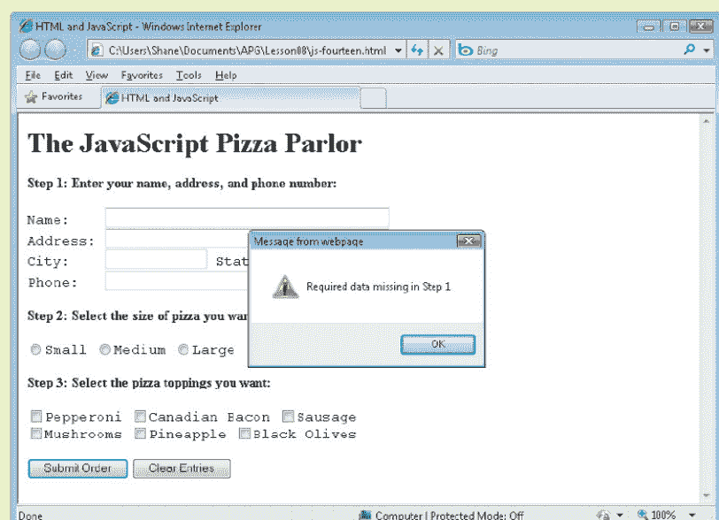

**图8–7** 数据验证 – 文本字段

9. 单击**确定**关闭警告框。

您向网页添加了相对少量的 JavaScript 代码来验证表单中的输入。这段代码说明了一些重要的概念。

首先，`validateText()`函数与您迄今为止输入的任何其他函数略有不同，因为它返回一个值。返回值意味着每当任何其他函数调用此函数（本例中为`doSubmit()`函数）时，其名称本质上会被它返回的值所替换。`validateText()`函数只能返回两个可能值中的一个：`false`或`true`。如果`customer`对象、`address`对象、`city`对象或`phone`对象的`value`属性是空字符串，则返回`false`值。也就是说，字段中没有输入任何内容。如果这些字段中任何一个的`length`为0，则返回`false`值。如果所有必填文本字段都不为空，意味着用户在每个字段中都输入了内容，则函数返回`true`值。

其次，`doSubmit()`函数中的新`if`语句将`validateText()`函数的返回值与值`false`进行比较。如果返回值为`false`，`doSubmit()`函数会显示一个警告框，让用户知道他或她留下了一个必填的文本字段为空。否则，用户将看到一个不同的警告框，确认披萨订单已提交。

## 第二单元 JavaScript 基础

### 技术时间线

#### 赋值与比较

您可能已经注意到，本课中的许多 JavaScript 语句使用单个等号（`=`），而其他语句使用两个等号（`==`）。所有编程语言都必须区分将值赋给变量和将变量的内容与某个其他值进行比较。在 C、C++、Java 和 JavaScript 的情况下，赋值操作使用“=”字符完成，而比较操作则通过两个“=”字符执行。

那么，如果您混淆了这两个运算符会发生什么？嗯，答案取决于您使用的语言。多年来，C 和 C++ 语言一直受到批评，因为它们允许程序员轻易地将赋值运算符与比较运算符混淆。这类错误通常很难发现，因为程序可以正常编译和运行，但会产生意外和/或不正确的结果。

然而，Java 语言设计者在定义其语法规则时考虑到了这个常见的陷阱。因此，如果您尝试使用错误的运算符，您会看到编译错误。不幸的是，JavaScript 的架构师在这方面没有效仿 Java 专家。与 C 和 C++ 一样，JavaScript 会毫无怨言地使用错误的运算符。当您犯这种错误时，意外或不稳定的程序行为是您能得到的唯一线索，因此在使用这些运算符编程时请务必小心！

#### 验证单选按钮

既然您知道如何检查空白文本字段，让我们考虑另一种数据验证。在披萨订单表单的步骤2中，客户必须选择他或她想要的披萨尺寸。如果客户未能这样做并且没有选择任何选项会发生什么？根据 JavaScript 代码的当前情况，无论客户是否选择尺寸，订单都会被提交。这意味着在 JavaScript 披萨店接收订单的店员将不知道客户想要什么尺寸的披萨。

幸运的是，您将在下一个分步指南中添加一些新的 JavaScript 代码来防止这种情况发生。为了确保客户的订单包含披萨尺寸的选择，您只需向程序添加另一个数据验证函数，并向现有的`doSubmit()`函数添加一个新的`if`语句。

### 技术时间线

术语*单选按钮*自微软在1980年代末推出 Windows 操作系统以来，就一直存在于软件行业中。但很少有人知道这个术语的起源或确切含义。设计 Windows 界面的微软程序员认识到，通常需要将一组选项视为互斥的。换句话说，在任何给定时间只能选择一个选项。他们还想给这种类型的操作一个特殊的名称，以帮助用户理解这种行为。他们选择使用的术语是*单选按钮*，因为这些选项的行为类似于老式立体声系统上的功能选择按钮。这些立体声系统通常包含几个标有 AM、FM、FM STEREO、PHONO、TAPE 和 AUX 的按钮，允许用户选择音乐源。因为一次只能听一个音乐源，按下这些按钮中的任何一个都会导致任何其他被选中的按钮弹出。这些机械单选按钮通常是圆形的，所以 Windows 程序员将他们的单选按钮设计成圆形。

### 分步指南 8.5

在这个分步指南中，您将添加一个新的 JavaScript 函数来验证披萨订单表单步骤2中的单选按钮。您还将向`doSubmit()`函数添加第二个`if`语句来调用新函数。

1. 如果尚未打开，请打开记事本、SimpleText 或您喜欢的文本编辑器。
2. 如果`js-fourteen.html`或`js-fourteen.htm`文件尚未在文本编辑器中打开，请单击菜单栏上的**文件**，单击**打开**，浏览到保存文件的文件夹，然后打开您在分步指南8.4中创建的`js-fourteen.html`或`js-fourteen.htm`文件。
3. 单击菜单栏上的**文件**，单击**另存为**，然后将 HTML 文件另存为`js-fifteen.html`或`js-fifteen.htm`，以保留`js-fourteen.html`文件。
4. 向`doSubmit()`函数添加一个新的`if`语句，如本步骤所示，并在**图8–8**中以粗体显示。

```javascript
function doSubmit()
{
    if (validateText() == false)
    {
        alert("Required data missing in Step 1");
        return;
    }

    if (validateRadio() == false)
    {
        alert("Required data missing in Step 2");
        return;
    }

    alert("Your pizza order has been submitted.");
    return;
}
```

5. 将`validateRadio()`函数添加到 Web 文档的脚本部分，如本步骤所示，并在图8–8中以粗体显示。

```javascript
function validateRadio()
{
    if (document.PizzaForm.sizes[0].checked) return true;
    if (document.PizzaForm.sizes[1].checked) return true;
    if (document.PizzaForm.sizes[2].checked) return true;

    return false;
}
```

**图8–8** `js-fifteen.html`文件

```html
<html>
<head>
<title>HTML and JavaScript</title>

<script>
function doClear()
{
    document.PizzaForm.customer.value = "";
    document.PizzaForm.address.value = "";
    document.PizzaForm.city.value = "";
    document.PizzaForm.state.value = "";
    document.PizzaForm.zip.value = "";
    document.PizzaForm.phone.value = "";

    document.PizzaForm.sizes[0].checked = false;
    document.PizzaForm.sizes[1].checked = false;
    document.PizzaForm.sizes[2].checked = false;

    document.PizzaForm.toppings[0].checked = false;
    document.PizzaForm.toppings[1].checked = false;
    document.PizzaForm.toppings[2].checked = false;
    document.PizzaForm.toppings[3].checked = false;
    document.PizzaForm.toppings[4].checked = false;
    document.PizzaForm.toppings[5].checked = false;

    return;
}

function doSubmit()
{
    if (validateText() == false)
    {
```

## 第二单元 JavaScript 基础

## 第8课 使用 JavaScript 创建表单

**图8–8** `js-fifteen.html`文件

```javascript
alert("Required data missing in Step 1");
return;
}

if (validateRadio() == false)
{
    alert("Required data missing in Step 2");
    return;
}

alert("Your pizza order has been submitted.");
return;
}

function validateText()
{
    var customer = document.PizzaForm.customer.value;
    if (customer.length == 0) return false;

    var address = document.PizzaForm.address.value;
    if (address.length == 0) return false;

    var city = document.PizzaForm.city.value;
    if (city.length == 0) return false;

    var phone = document.PizzaForm.phone.value;
    if (phone.length == 0) return false;

    return true;
}

function validateRadio()
{
    if (document.PizzaForm.sizes[0].checked) return true;
    if (document.PizzaForm.sizes[1].checked) return true;
    if (document.PizzaForm.sizes[2].checked) return true;

    return false;
}
</script>
</head>

<body>
<form name="PizzaForm">
<h1>The JavaScript Pizza Parlor</h1>

<p>
<h4>Step 1: Enter your name, address, and phone number:</h4>

<font face="Courier New">
Name: &nbsp;&nbsp;&nbsp;<input name="customer" size="50" type="text"><br>
Address: <input name="address" size="50" type="text"><br>
City: &nbsp;&nbsp;&nbsp;<input name="city" size="15" type="text">
State: <input name="state" size="2" type="TEXT">
Zip: <input name="zip" size="5" type="text"><br>
Phone: &nbsp;&nbsp;<input name="phone" size="50" type="text"><br>
</font>
</p>

<p>
<h4>Step 2: Select the size of pizza you want:</h4>

<font face="Courier New">
<input name="sizes" type="radio">Small
<input name="sizes" type="radio">Medium
<input name="sizes" type="radio">Large<br>
</font>
</p>

<p>
<h4>Step 3: Select the pizza toppings you want:</h4>

<font face="Courier New">
<input name="toppings" type="checkbox">Pepperoni
<input name="toppings" type="checkbox">Canadian Bacon
<input name="toppings" type="checkbox">Sausage<br>

<input name="toppings" type="checkbox">Mushrooms
<input name="toppings" type="checkbox">Pineapple
<input name="toppings" type="checkbox">Black Olives<br>
</font>
</p>


```html
<input type="button" value="Submit Order" onClick="doSubmit()">

<input type="button" value="Clear Entries" onClick="doClear()">

</form>

</body>

</html>
```

> **警告**  
> 如果您的浏览器显示消息“为帮助保护您的安全，Internet Explorer 已限制此网页运行可能访问您计算机的脚本或 ActiveX 控件。单击此处获取选项。”，请单击消息栏，单击“允许阻止的内容”，然后在“安全警告”对话框中单击“是”。

6. 将您的更改保存到`js-fifteen.html`或`js-fifteen.htm`文件。
7. 启动您喜欢的 Web 浏览器，并打开`js-fifteen.html`或`js-fifteen.htm`文件，将其作为网页查看。
8. 在披萨订单表单的步骤 1 中，将您的名字、街道地址、城市、州、邮政编码和电话号码输入到必填的文本字段中。（提示：您可以按 Tab 键在字段之间移动。）
9. 在未选择披萨尺寸的情况下单击“提交订单”按钮。警报框将打开，生成的网页应如图 8-9 所示。
10. 单击“确定”关闭警报框。

您刚刚完成的分步操作背后的主要思想与之前的分步操作类似，但重要的是您要理解其中的细微差别。

要验证文本字段的内容，程序会检查对象的`value`属性的内容，看它是否包含空字符串。要验证一组单选按钮，您需要测试每个对象的`checked`属性的值，看它是否设置为`true`或`false`。因此，`validateRadio()`函数随后会测试对象集中每个`checked`属性的值，如果遇到选中的单选按钮，则返回`true`值。但是，如果集合中没有选中任何单选按钮，则该函数返回`false`值。

`validateRadio()`函数返回的`true/false`值由`doSubmit()`函数进行评估，就像对`validateText()`函数一样。如果返回值为`false`，用户将看到一个适当的警报框，让他或她知道步骤 2 未正确完成。此活动的最终结果是，客户将无法在未先选择披萨尺寸的情况下向 JavaScript 披萨店提交订单。

### 专家补充

#### 逻辑非运算符

与 C、C++ 和 Java 一样，JavaScript 允许您使用非运算符（`!`）反转逻辑变量的值。您可以通过在变量前放置单个`!`将`true`值反转为`false`，或将`false`值反转为`true`。当程序员想要测试`false`条件时，此运算符最常用。每当变量（或函数返回值）与`false`值（`== false`）进行比较时，可以使用`!`运算符代替来缩短比较。这是一个具体的例子：

```javascript
if (validateText() == false)
```

等同于：

```javascript
if (!validateText())
```

测试`false`值的首选方式是个人喜好问题。然而，经常看到新手程序员使用前一种方法，而专业编码人员倾向于使用后一种技术。两种方式都可以正常工作。

### 总结

在本课中，您学习了：

- 如何创建 HTML 表单。
- 如何使表单提交按钮具有功能。
- 如何使表单清除按钮具有功能。
- 如何使用 JavaScript 验证文本字段。
- 如何使用 JavaScript 验证单选按钮。

### 词汇复习

定义以下术语：

- 复选框
- 组件
- 控件
- 数据验证
- 单选按钮
- 文本字段

### 复习题

#### 判断题

如果陈述为真，请圈出 T；如果陈述为假，请圈出 F。

1. 数据验证是检查用户输入数据以确保其完整和准确的过程。
2. 使用 JavaScript 验证的表单必须以与标准 HTML 表单完全不同的方式定义。
3. `name`属性有助于定义 HTML 表单中的选择选项。
4. 单选按钮集中的每个输入控件都必须分配一个唯一的名称。
5. 术语“单选按钮”源自单词“radial”，意思是圆形的。
6. 单选按钮控件和复选框控件在 HTML 代码中的唯一区别是`<input>`标签中使用的`type`属性的值。
7. 要使按钮在单击时调用 JavaScript 函数，您需要使用`onClick`事件。
8. 一些 JavaScript 函数返回值，而另一些则不返回。
9. 由于当今用户拥有如此多的 Web 经验，因此认为 JavaScript 程序员提供有关表单错误的视觉或音频反馈是不必要的。
10. 在 JavaScript 中，无法确定用户是否选择了特定的单选按钮。

#### 填空题

通过在提供的空白处填写正确的单词或词组来完成以下句子。

1. 文本字段、单选按钮和复选框是输入 ____________ 的示例。
2. 可以通过使用其 ____________ 属性在 JavaScript 中访问 HTML 表单。
3. 可以通过使用 ____________ 事件从按钮调用 JavaScript 函数。
4. 可以通过将其 ____________ 属性设置为空字符串（`""`）来清除文本字段。
5. 可以通过将其 ____________ 属性设置为`false`来清除单选按钮和复选框。
6. 如果其`value`属性的 _______________ 为 0，则文本字段为空。
7. 如果其`checked`属性设置为 _______________，则单选按钮或复选框被选中。
8. 如果两个或多个输入控件被赋予相同的名称，JavaScript 会创建一个 _______________。
9. 一组 JavaScript _______________ 是互斥的，这意味着只能选择其中的一个。
10. 一组 JavaScript _______________ 不是互斥的，这意味着可以选择零个或多个。

#### 简答题

简要回答以下每个问题：

1. 如何为与 JavaScript 一起使用定义 HTML 表单？
2. 什么是用户反馈？为什么它很重要？
3. 描述如何使用 JavaScript 清除文本字段。
4. 解释如何设置或清除单选按钮和复选框。
5. 什么是数据验证？为什么它很重要？

### 项目

#### 项目 8-1：四角披萨

GreatApplications, Inc. 刚刚与一家名为 The Four Corners Pizza Palace 的披萨公司签订了一份重要的商业合同。该公司希望 GreatApplications 创建一个基于 Web 的披萨订单表单，就像您在本课中为 JavaScript 披萨店创建的那样。

The Four Corners Pizza Palace 在美国著名的“四角”地区开展业务。四角是一个地理区域，位于亚利桑那州（AZ）、科罗拉多州（CO）、新墨西哥州（NM）和犹他州（UT）四州交汇处。因此，The Four Corners Pizza Palace 将需要一个包含每个州的两个字母缩写的下拉列表。此信息将帮助公司计算每个州的销售税。您需要创建一个披萨订单表单并添加州代码下拉列表选择框。（如果您不记得如何创建下拉列表控件，请参考第 3 课的分步操作 3.5。）确保用户在下单时选择一个州，并确保在单击“清除条目”按钮时清除州控件。

将您的工作保存为`Project 8-1.html`或`Project 8-1.htm`。

#### 项目 8-2：Web 项目

GreatApplications, Inc. 的管理团队决定需要您增强为 JavaScript 披萨店创建的披萨表单。完成对表单的以下更改：

- 在`Phone`字段正下方添加一个标记为`Email`的新文本字段。
- 在`Large`尺寸的右侧添加一个名为`Jumbo`的新披萨尺寸。
- 在表单的新行上添加两个新的配料。将配料标记为`Green Peppers`和`Extra Cheese`。

确保您的新表单组件在单击“清除条目”按钮时正确清除。将您的工作保存为`Project 8-2.html`或`Project 8-2.htm`。

#### 项目 8–3：团队项目

本课中你创建的披萨订单表单显然是为教学目的而非商业用途设计的。不过，你认为是否真的有一些披萨公司会在网上接受披萨订单呢？以团队为单位，列出你们能想到的所有本地披萨店。然后，使用你最喜欢的搜索引擎在互联网上研究这些披萨店，看看有多少家（如果有的话）提供了基于网页的订单表单。看看你能从这些网站中获得多少灵感，用于改进你自己的订单表单。

### 批判性思维

#### 活动 8–1：数据验证

在本课中，我们已经详细讨论了数据验证的概念。在步骤详解 8.4 和 8.5 中，你学习了如何实现简单的验证技术。但是，如果要求你向一位同学解释这个概念，包括为什么使用这些技术很重要，你能做到吗？数据验证是几乎所有专业计算机程序的基本组成部分，无论程序类型如何或使用何种编程语言编写。因此，你必须对这个概念有扎实的理解。为确保你理解，请回答以下问题：

1. 对于一个典型的表单，哪些类型的数据必须进行验证？
2. 对于文本验证，检查空白字段是否总是足够的？请解释。
3. 计算机程序是否总是能够验证表单上的每个字段？为什么能或为什么不能？

#### 活动 8–2：更好的反馈

你在 GreatApplications, Inc. 的主管仍然对 JavaScript 披萨店表单不完全满意，因为它没有提供足够详细的反馈。修改你网页文档的`doSubmit()`函数，使其能够识别出具体是哪个文本字段缺少数据（如果适用）。同时，修改第 2 步的反馈消息，以表明如果用户未能选择披萨尺寸，则必须选择一个。将你的作品保存为`Activity 8-2.html`或`Activity 8-2.htm`。

#### 综合模拟

如果你已经牢固掌握了本课所讲授的内容，你应该能够为几乎任何情况创建一个看起来专业的订单表单。通过为虚构的 JavaScript 计算机公司创建一个订单表单，来证明你已经掌握了第 8 课的概念。这家公司希望你构建一个支持 JavaScript 的网页，允许客户订购包含他们所需确切组件的定制计算机系统。创建一个如图 8-10 所示的计算机订单表单。

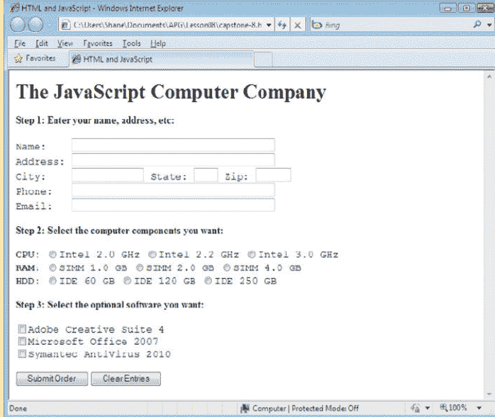

图 8-10 一个计算机系统订单表单示例

项目要求：

- 创建一个合适的标题。
- 创建文本字段以收集客户信息。
- 使用单选按钮表示必需的计算机组件选项。
- 使用复选框表示可选的软件选项。
- 将你最终的网页命名为`capstone-8.html`或`capstone-8.htm`。

# 第 9 课：在框架中使用 JavaScript

## 学习目标

完成本课后，你应该能够：

- 创建带有参数列表的 JavaScript 函数。
- 创建影响框架的 JavaScript 启用超链接。
- 创建影响框架的 JavaScript 启用按钮。
- 创建顶级 JavaScript 函数。

在第 4 课中，你学习了如何创建 HTML 框架，以更好地组织网页上的信息。在本课中，你将学习如何创建能够跨框架集访问信息的 JavaScript 函数。确保一个框架中显示的信息与另一个框架中的信息正确关联非常重要。JavaScript 是一种可以帮助你实现此目的的技术。

### 词汇表

- 子文档
- 函数参数
- 参数列表
- 父文档
- 父对象
- 顶级对象

# 第二单元：JavaScript 基础

### 高级 JavaScript 编程

你在第 5、6 和 7 课中编写的用于创建网页的 JavaScript 代码仅限于单个 HTML 文档。正如你从第 4 课创建的网页中所了解的，并非所有网页都只由一个 HTML 文件组成。事实上，任何包含框架集的网页总是由多个文件组成。必须有一个文件定义框架集，以及两个或更多额外文件定义该框架集中的框架。框架集文件被称为*父文档*，而框架集内包含的框架文件被称为*子文档*。

那么问题就变成了，网页用户是否可以在一个框架中执行操作，从而影响另一个不同框架的外观？答案是肯定的。组成网页的所有框架都可以通过 JavaScript 函数相互通信，因为 Web 浏览器提供了一个框架可以交互的公共环境。实现这种跨框架协作的 JavaScript 代码比单文档代码稍微复杂一些，但作为新的 JavaScript 程序员，这完全在你的能力范围之内。

在编写允许不同框架交互的 JavaScript 代码之前，你必须创建定义框架集的 HTML 文档。在本课的第一个步骤详解中，你将学习如何创建一个框架集，其中一个框架包含图像，另一个框架包含一个标准 HTML 表格。该表格最初包含无功能的文件名，你稍后会将其转换为超链接。但目前的目标只是创建一个合适的基于框架的网页。

要完成下一个步骤详解，你需要访问你的讲师将提供给你的以下数据文件：`lions.gif`、`tigers.gif`、`bears.gif`和`ohmy.gif`。这些文件必须存储在你为本书保存 HTML 文件的文件夹中。如有必要，请向老师寻求帮助。

#### 步骤详解 9.1

在这个步骤详解中，你将创建一个简单的 HTML 框架集。一个框架包含一个图像，另一个框架包含一个简单的表格。

1. 打开记事本、SimpleText 或你最喜欢的文本编辑器。
2. 如果需要，创建一个新的空白文档。
3. 完全按照**图 9–1**所示输入 HTML 文本。

**图 9–1** `js-sixteen.html`文件

```html
<html>
<head>
    <title>HTML and JavaScript</title>
</head>
<frameset rows="150,*">
    <frame name="UpperFrame" src="upper1.html">
    <frame name="LowerFrame" src="lower1.html">
</frameset>
</html>
```

4. 将你新创建的文件保存为`js-sixteen.html`或`js-sixteen.htm`，放在你保存前几课文件的同一文件夹中。
5. 单击菜单栏上的**文件**，然后单击**新建**以创建一个新的空白文档。
6. 完全按照**图 9–2**所示输入 HTML 文本。

**图 9–2** `upper1.html`文件

```html
<html>
<head>
    <title>HTML and JavaScript</title>
</head>
<body>
    <div align="center">
        
    </div>
</body>
</html>
```

7. 将你新创建的文件保存为`upper1.html`或`upper1.htm`，放在你保存前几课文件的同一文件夹中。
8. 单击菜单栏上的**文件**，然后在文本编辑器中单击**新建**以创建一个新的空白文档。
9. 完全按照**图 9–3**所示输入 HTML 文本。

**图 9-3** `lower1.html`文件

```html
<html>
<head>
    <title>HTML and JavaScript</title>
</head>
<body>
    <div align="center">
        <h2>IMAGE LIST</h2>
        <table>
            <tr><td>1: LIONS.GIF</td></tr>
            <tr><td>2: TIGERS.GIF</td></tr>
            <tr><td>3: BEARS.GIF</td></tr>
            <tr><td>4: OHMY.GIF</td></tr>
        </table>
    </div>
</body>
</html>
```


10. 将你新创建的文件保存为`lower1.html`或`lower1.htm`，放在你保存前几课文件的同一文件夹中。
11. 启动你的 Web 浏览器，然后打开你的`js-sixteen.html`或`js-sixteen.htm`文件，将该文件作为网页查看。你屏幕上的网页应如**图 9-4**所示。

**图 9-4** 基于框架的网页

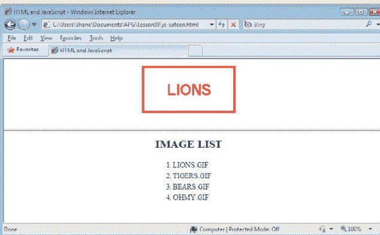

## 第 9 课 在框架中使用 JavaScript

你应该对本步骤中的 HTML 代码很熟悉，因为它没有包含第 4 课中未介绍过的新内容。但为了确保你对这一切的工作原理有良好的理解，回顾这三个 HTML 文件中呈现的最重要概念非常重要。

第一个文件定义了一个框架集，正如第 4 课最初介绍的那样。这个特定的框架集包含两个水平框架，分别命名为`UpperFrame`和`LowerFrame`。你创建的第二个文件`upper1.html`在上部框架中加载并显示，第三个文件`lower1.html`在下部框架中加载。

第二个文件也很简单，它只是显示一个在屏幕上水平居中的图像。请注意，这个图像的`name`属性是`UpperImage`。文件中需要`name`属性，以便 JavaScript 可以通过名称访问该图像。

第三个文件定义了一个简单的表格，该表格也在屏幕上水平居中。表格包含四行，每行包含一个图像文件的名称。目前，这些文件名只是纯文本，但它们可以很容易地转换为超链接。事实上，这是你在下一个步骤中执行的任务之一。

### 向框架集添加 JavaScript 代码

既然你已经创建了一个基于框架的网页，你就可以用 JavaScript 使你的框架集具有功能性。你必须做的第一件事是向显示在下部框架中的 HTML 文档添加一个 JavaScript 函数。这个函数的目的是更改上部框架文档中显示的图像。

一旦你定义了这个函数，你就可以将 HTML 表格中列出的纯文本文件名转换为超链接。当用户在网页中点击这些链接时，它们会调用 JavaScript 函数。

### 步骤 9.2

在这个步骤中，你将修改显示在下部框架中的网页的文件名。你还将向你的下部框架文档添加一个 JavaScript 函数，并创建调用该新函数的超链接。

1. 如果尚未打开，请打开记事本、SimpleText 或你最喜欢的文本编辑器。
2. 单击菜单栏上的**文件**，单击**打开**，浏览到包含本书文件的文件夹，单击**箭头**显示所有文件类型，然后打开你在步骤 9.1 中创建的`js-sixteen.html`或`js-sixteen.htm`文件。
3. 单击菜单栏上的**文件**，单击**另存为**，然后将 HTML 文件保存为`js-seventeen.html`或`js-seventeen.htm`，保存在同一文件夹中以保留`js-sixteen.html`文件。
4. 将要在下部框架中显示的文件名更改为`lower2.html`，如本步骤和**图 9–5**所示。

```html
<frame name="LowerFrame" src="lower2.html">
```

**图 9-5** `js-seventeen.html`文件

```html
<html>

<head>

    <title>HTML and JavaScript</title>

</head>

<frameset rows="150,*">

    <frame name="UpperFrame" src="upper1.html">

    <frame name="LowerFrame" src="lower2.html">

</frameset>

</html>
```

5. 将对`js-seventeen.html`文件的更改保存在与保存上一步骤文件相同的文件夹中。
6. 单击菜单栏上的**文件**，单击**打开**，浏览到保存文件的文件夹，然后在文本编辑器中打开你在步骤 9.1 中创建的`lower1.html`或`lower1.htm`文件。
7. 单击菜单栏上的**文件**，单击**另存为**，然后将 HTML 文件保存为`lower2.html`或`lower2.htm`，保存在同一文件夹中以保留`lower1.html`文件。
8. 添加一个名为`setImage(index)`的 JavaScript 函数，如本步骤和**图 9-6**中粗体所示。

```html
<script>

    function setImage(index)

    {

        if (index == 1)

        {

            parent.UpperFrame.document.UpperImage.

            src = "lions.gif";

        }

        if (index == 2)

        {

            parent.UpperFrame.document.UpperImage.

            src = "tigers.gif";

        }

        if (index == 3)

        {

            parent.UpperFrame.document.UpperImage.src = "bears.gif";

        }

        if (index == 4)

        {

            parent.UpperFrame.document.UpperImage.src = "ohmy.gif";

        }

        return;

    }

</script>
```

9. 向`lower2.html`文件主体中定义的表格添加`<a></a>`超链接标签，如本步骤和**图 9-6**中粗体所示。

```html
<tr><td><a href="javascript:setImage(1)">1: LIONS.GIF</a></td></tr>

<tr><td><a href="javascript:setImage(2)">2: TIGERS.GIF</a></td></tr>

<tr><td><a href="javascript:setImage(3)">3: BEARS.GIF</a></td></tr>

<tr><td><a href="javascript:setImage(4)">4: OHMY.GIF</a></td></tr>
```

**图 9-6** `lower2.html`文件

```html
<html>

<head>

    <title>HTML and JavaScript</title>

    <script>

        function setImage(index)

        {

            if (index == 1)

            {

                parent.UpperFrame.document.UpperImage.src = "lions.gif";

            }

            if (index == 2)

            {

                parent.UpperFrame.document.UpperImage.src = "tigers.gif";

            }

            if (index == 3)

            {

                parent.UpperFrame.document.UpperImage.src = "bears.gif";

            }

            if (index == 4)

            {

                parent.UpperFrame.document.UpperImage.src = "ohmy.gif";

            }

            return;

        }

    </script>

</head>

<body>

    <div align="center">

        <h2>IMAGE LIST</h2>

        <table>

            <tr><td><a href="javascript:setImage(1)">1: LIONS.GIF</a></td></tr>

            <tr><td><a href="javascript:setImage(2)">2: TIGERS.GIF</a></td></tr>

            <tr><td><a href="javascript:setImage(3)">3: BEARS.GIF</a></td></tr>

            <tr><td><a href="javascript:setImage(4)">4: OHMY.GIF</a></td></tr>

        </table>

    </div>

</body>

</html>
```

10. 将对文件`lower2.html`或`lower2.htm`的更改保存在同一文件夹中。
11. 启动你的 Web 浏览器，然后打开`js-seventeen.html`或`js-seventeen.htm`文件，以便在浏览器中将该文件作为网页查看。你屏幕上的网页应如**图 9-7**所示。

## 第 9 课 在框架中使用 JavaScript


**图 9–7** 具有功能性超链接的网页

> **警告**
>
> 如果你的浏览器显示消息“为帮助保护你的安全，Internet Explorer 已限制此网页运行可能访问你计算机的脚本或 ActiveX 控件。单击此处获取选项。”，请单击消息栏，单击“允许阻止的内容”，然后在“安全警告”对话框中单击“是”。

12. 单击`LIONS.GIF`，单击`TIGERS.GIF`，单击`BEARS.GIF`，然后单击`OHMY.GIF`，以验证当你在下部框架中单击超链接时，上部框架中的图像会相应更改。
13. 如果链接无法正常工作，请检查你的文件是否准确，然后重试。

尽管这个基于框架的网页在外观和行为上与你在第 7 课中创建的网页没有太大不同，但这里有一些重要的新概念在起作用。详细回顾 JavaScript 以确保你理解它。

首先，看看名为`setImage`的 JavaScript 函数。所有 JavaScript 函数定义都包含一个**参数列表**，这是函数执行其预期操作所需的数据项列表。你在过去课程中编写的所有 JavaScript 函数都有空的参数列表，但这个最新的函数包含一个名为`index`的参数。`setImage`函数使用此参数来确定使用哪个图形文件作为上部框架图像的源。

你应该理解的另一个重要概念是，`setImage`函数中的`index`参数的值来自下部框架中定义的四个超链接之一。请注意，锚点标签内的所有四个`href`属性都包含对同一个 JavaScript 函数的调用，但传递给该函数的参数对于每个图形文件名都是不同的。通过使用 JavaScript**函数参数**来区分一个超链接与另一个超链接，就没有必要定义四个不同的函数。函数参数只是在函数内通过指定名称访问的对象或数据元素。参数方法是高效的，特别是当有 10 个、20 个或 100 个不同的超链接，而不仅仅是四个时。

最后一个值得注意的重要点是 JavaScript**父对象**在`setImage()`函数中的使用。**父**对象是 JavaScript 中的一个保留字，指的是父框架集。本课中的“使用父/子关系”部分进一步解释了这种关系。

**词汇表**

- 参数列表
- 函数参数
- 父对象

## 第二单元 JavaScript 基础

### 创建基于框架的幻灯片放映

在第 7 课中，你创建了一个电子幻灯片放映，允许用户通过点击超链接或按钮来更改屏幕上显示的图像。在本课中，你将创建一个基于框架的网页，它执行本质上相同的功能。你将学习如何编写使该网页功能化的 JavaScript 代码。首先，创建基本的框架集及其包含的框架。

你在分步操作 9.3 中创建的页面上框架所使用的 HTML 文档，与你在前两个分步操作中使用的文档相同（`upper1.html`），但下框架包含一个带有两个控制按钮的新文档。最初，这些按钮将不起作用，但你将在本课后面使它们工作。

### 使用父/子关系

如果你回顾一下你编写的用于操作图像的 JavaScript 函数，你应该意识到这些函数是在与它们访问的图像相同的文件中定义的。然而，在分步操作 9.2 中，`setImage()`函数是在`lower2.html`文件中定义的，而它访问的图像则是在`upper1.html`文件中定义的。

为了让 JavaScript 函数访问不同文件中的对象，这两个文件必须链接起来。在这个特定的例子中，`upper1.html`和`lower2.html`文件都包含在一个公共的父框架集中，并且这个框架集可以通过名为`parent`的 JavaScript 对象来引用。还要记住，框架集文件定义了两个子框架，这些框架被命名为`UpperFrame`和`LowerFrame`。上框架包含一个 HTML 文档，该文档包含一个名为`UpperImage`的图像对象（如图 9–2 中`upper1.html`文件所定义）。将所有这些信息结合起来，应该能帮助你理解图像对象的`src`属性是如何通过以下 JavaScript 代码设置的：

```javascript
parent.upperFrame.document.upperImage.src = "<filename>";
```

还要记住，图像对象并不是 JavaScript 函数可以跨框架引用的唯一对象类型。同样的技术也可以用于访问文本字段对象、下拉列表对象、按钮对象等等。

### 分步操作 9.3

在这个分步操作中，你将创建另一个基于框架的网页。上框架与你在本课前一个分步操作中使用的网页相同，但你将为下框架创建一个新的 HTML 文件。

1. 打开记事本、SimpleText 或你最喜欢的文本编辑器。
2. 点击菜单栏上的**File**，点击**Open**，浏览到保存文件的文件夹，然后打开你在分步操作 9.2 中创建的`js-seventeen.html`或`js-seventeen.htm`文件。
3. 点击菜单栏上的**File**，点击**Save As**，然后将 HTML 文件另存为`js-eighteen.html`或`js-eighteen.htm`，保存在同一文件夹中以保留`js-seventeen.html`文件。
4. 更改要在下框架中显示的文件名，如本步骤和**图 9–8**所示。

```html
<frame name="LowerFrame" src="lower3.html">
```

**图 9–8** `js-eighteen.html`文件

```html
<html>

<head>

    <title>HTML and JavaScript</title>

</head>

<frameset rows="150,*">

    <frame name="UpperFrame" src="upper1.html">

    <frame name="LowerFrame" src="lower3.html">

</frameset>

</html>
```

5. 将更改保存到文件`js-eighteen.html`或`js-eighteen.htm`，保存在与前几课文件相同的文件夹中。
6. 点击菜单栏上的**File**，然后点击**New**在文本编辑器中创建一个新的空白文档。
7. 完全按照**图 9–9**所示输入 HTML 文本。

**图 9–9** `lower3.html`文件

```html
<html>

<head>

    <title>HTML and JavaScript</title>

</head>

<body>

    <div align="center">

        <h2>WELCOME</h2>

        <h3>to my</h3>

        <h3>Electronic Slide Show</h3>

        <p>

            <input type="button" value="Prev Image">

            <input type="button" value="Next Image">

        </p>

    </div>

</body>

</html>
```

8. 将新创建的文件另存为`lower3.html`或`lower3.htm`，保存在与本课文件相同的文件夹中。
9. 启动你的 Web 浏览器，然后打开`js-eighteen.html`或`js-eighteen.htm`文件，在浏览器中将该文件作为网页查看。你屏幕上的网页应如**图 9–10**所示。

**图 9–10** 基于框架的幻灯片放映网页


与分步操作 9.1 的情况一样，你刚刚创建的 HTML 代码不包含任何在前几课中未介绍过的内容。分步操作 9.3 的主要目的是确保你能够熟练地使用框架集和框架。下一个分步操作将向你展示如何通过使用 JavaScript 事件和函数使`Prev Image`和`Next Image`按钮功能化。

### 技术时间线

#### 编程语言的发展

既然你已经对 JavaScript 有了初步了解，你可能对从事编程职业感兴趣。现在是成为程序员的好时机，因为编程语言已经取得了许多进步。编程语言有着悠久的历史，每一种语言的开发都是为了让编程任务变得越来越容易。

机器语言是程序员与计算机交流的最早方式之一。机器语言命令看起来像二进制数。例如：

```text


```text
01010101

100001011 11101100

01001100

01001100
```

机器语言是计算机能够理解的系统。然而，它对程序员来说很难学习。汇编语言随之出现，它使用单词作为汇编命令，然后将这些命令转换为特定于机器的命令。以下是汇编语言的一个示例：

```assembly
PUSH BP
MOV BP,SP
DEC SP
DEC SP
```

汇编语言也非常难学，因此出现了一整套新的语言来简化编程，包括 BASIC、FORTRAN、Pascal 和 COBOL。Pascal 代码的一个示例如下所示：

```pascal
program AddIt;

var
  i, j, k : integer;

begin
  i := 3;
  j := 2;
  k := i + j;
```

Pascal 开始看起来有点像你一直在学习的 JavaScript。然而，JavaScript 更像其他更高级的语言，包括 C++、Visual Basic 和 Java。你在学习 JavaScript 过程中所学到的大部分内容都可以应用于这些其他语言。事实上，这些高级语言中的许多概念对你来说会非常熟悉。

### 使你的幻灯片放映按钮功能化

下一个分步操作的主要目的是向你展示如何使幻灯片放映按钮功能化。请注意，实现此目标的方法不止一种。事实上，当你使用框架集时，总有多种方法可以解决特定问题。

回想一下你在分步操作 9.2 中创建的基于框架的网页的整体设计。在那个例子中，你在下框架文档中创建了一个 JavaScript 函数，该函数由同一文档中的超链接调用，但访问上框架文档中的图像对象。在下一个分步操作中，你将采取略有不同的方法。具体来说，你将在上框架文档中创建两个 JavaScript 函数，这些函数访问同一文档中的图像对象，但由下框架文档中的按钮调用。

遵循前一种方法，或者使用后一种技术实现 JavaScript 代码，不一定有任何优势或劣势。通过学习不同的方法，你了解到你有多种选择可用，并且你可以以不同的方式生成 JavaScript 解决方案。在实际的编程情况中，你选择哪种方法取决于你自己。

### 分步操作 9.4

在这个分步操作中，你将使电子幻灯片放映的按钮功能化。你通过修改框架集中上框架和下框架显示的 HTML 文件来实现这一点。

1. 如果尚未打开，请打开记事本、SimpleText 或你最喜欢的文本编辑器。
2. 点击菜单栏上的 **File**，点击 **Open**，浏览到保存文件的文件夹，然后打开你在分步操作 9.3 中创建的 `js-eighteen.html` 或 `js-eighteen.htm` 文件。
3. 点击菜单栏上的 **File**，点击 **Save As**，然后将 HTML 文档另存为 `js-nineteen.html` 或 `js-nineteen.htm`，保存在同一文件夹中以保留 `js-eighteen.html` 文件。
4. 更改要在上框架和下框架中显示的文件名，如本步骤和图 9-11 中粗体所示。

```html
<frame name="UpperFrame" src="upper2.html">
<frame name="LowerFrame" src="lower4.html">
```

**图 9-11** `js-nineteen.html` 文件

```html
<html>
<head>
    <title>HTML and JavaScript</title>
</head>

<frameset rows="150,*">
    <frame name="UpperFrame" src="upper2.html">
    <frame name="LowerFrame" src="lower4.html">
</frameset>
</html>
```

## 第9课 在框架中使用JavaScript

5. 将此修改后的文件保存为 `js-nineteen.html`，并将其与本课的其他文件放在同一文件夹中。
6. 点击菜单栏上的 **文件**，点击 **打开**，浏览到保存文件的文件夹，然后在文本编辑器中打开你在分步操作 9.1 中创建的 `upper1.html` 或 `upper1.htm` 文件。
7. 点击菜单栏上的 **文件**，点击 **另存为**，然后将 HTML 文件保存为 `upper2.html` 或 `upper2.htm`（保存在同一文件夹中），以保留 `upper1.html` 文件。
8. 在 HTML 文件的头部添加一个 `<script></script>` 部分，其中包含三个名为 `prevImage()`、`nextImage()` 和 `startup()` 的 JavaScript 函数，如本步骤所示，并在 **图 9-12** 中以粗体显示。

```javascript
<script>
var imgArray = new Array(4);
var index = 0;

function prevImage()
{
    if (index > 0)
    {
        index--;
        document.UpperImage.src = imgArray[index].src;
    }
    return;
}

function nextImage()
{
    if (index < 3)
    {
        index++;
        document.UpperImage.src = imgArray[index].src;
    }
    return;
}

function startup()
{
    imgArray[0] = new Image;
    imgArray[0].src = "lions.gif";

    imgArray[1] = new Image;
    imgArray[1].src = "tigers.gif";

    imgArray[2] = new Image;
    imgArray[2].src = "bears.gif";

    imgArray[3] = new Image;
    imgArray[3].src = "ohmy.gif";

    return;
}
</script>
```

9. 在 HTML 文件的 `<body>` 标签中添加一个 `onLoad` 事件，如本步骤粗体所示，并在 **图 9-12** 中显示。

```html
<body onLoad="startup()">
```

**图 9-12** `upper2.html` 文件

```html
<html>
<head>
    <title>HTML and JavaScript</title>

    <script>
    var imgArray = new Array(4);
    var index = 0;

    function prevImage()
    {
        if (index > 0)
        {
            index--;
            document.UpperImage.src = imgArray[index].src;
        }
        return;
    }

    function nextImage()
    {
        if (index < 3)
        {
            index++;
            document.UpperImage.src = imgArray[index].src;
        }
        return;
    }

    function startup()
    {
        imgArray[0] = new Image;
        imgArray[0].src = "lions.gif";

        imgArray[1] = new Image;
        imgArray[1].src = "tigers.gif";

        imgArray[2] = new Image;
        imgArray[2].src = "bears.gif";

        imgArray[3] = new Image;
        imgArray[3].src = "ohmy.gif";

        return;
    }
    </script>
</head>

<body onLoad="startup()">
    <div align="center">
        
    </div>
</body>
</html>
```

10. 将对文件 `upper2.html` 或 `upper2.htm` 的更改保存到同一文件夹。
11. 点击菜单栏上的 **文件**，点击 **打开**，浏览到保存文件的文件夹，然后在文本编辑器中打开你在分步操作 9.3 中创建的 `lower3.html` 或 `lower3.htm` 文件。
12. 点击菜单栏上的 **文件**，点击 **另存为**，然后将 HTML 文件保存为 `lower4.html` 或 `lower4.htm`（保存在同一文件夹中），以保留 `lower3.html` 文件。
13. 在两个 `<input>` 标签中添加 `onClick` 事件，如本步骤粗体所示，并在 **图 9–13** 中显示。

```html
<input type="button" value="Prev Image"
    onClick="parent.UpperFrame.prevImage()">

<input type="button" value="Next Image"
    onClick="parent.UpperFrame.nextImage()">
```

**图 9–13** `lower4.html` 文件

```html
<html>
<head>
    <title>HTML and JavaScript</title>
</head>

<body>
    <div align="center">
        <h2>WELCOME</h2>
        <h3>to my</h3>
        <h3>Electronic Slide Show</h3>

        <p>
            <input type="button" value="Prev Image"
                onClick="parent.UpperFrame.prevImage()">

            <input type="button" value="Next Image"
                onClick="parent.UpperFrame.nextImage()">
        </p>
    </div>
</body>
</html>
```

> **警告**
>
> 如果你的浏览器显示消息“为帮助保护你的安全，Internet Explorer 已限制此网页运行可能访问你计算机的脚本或 ActiveX 控件。单击此处查看选项。”，请单击消息栏，单击“允许阻止的内容”，然后在“安全警告”对话框中单击“是”。

14. 将对文件 `lower4.html` 或 `lower4.htm` 的更改保存到同一文件夹。
15. 启动你的 Web 浏览器，然后打开 `js-nineteen.html` 或 `js-nineteen.htm` 文件，以便在浏览器中将其作为 Web 页面查看。生成的 Web 页面应如 **图 9–14** 所示。
16. 单击 **“下一张图片”按钮** 三次，单击 **“上一张图片”按钮** 三次，单击 **“下一张图片”按钮**，然后单击 **“上一张图片”按钮**，以验证当你在下方框架中单击按钮时，上方框架中的图像是否相应地更改。（请注意，图像不会循环回绕。）


通过仔细查看你添加到上方框架文档中的新 JavaScript 代码，开始分析之前的分步活动。

首先，你定义了一个包含四个元素的图像数组，用于存放构成幻灯片放映的四个图形。你还添加了两个新的 JavaScript 函数，分别名为 `prevImage()` 和 `nextImage()`，用于更改上方框架中当前显示的图像，以及一个 `startup()` 函数用于初始化图像数组。这段代码与你在第 7 课中创建的 JavaScript 代码非常相似。如果需要复习定义、初始化和访问 JavaScript 数组的细节，可以参考第 7 课（`js-eight.html`）。

接下来，你在下方框架文档中定义的两个按钮上各添加了一个 `onClick` 事件。你应该注意，这些 `onClick` 事件将导致 Web 浏览器在单击相应按钮时调用上方框架文档中的适当函数。同样，这些 JavaScript 函数利用 JavaScript `parent` 对象来访问父框架集，并使用 `UpperFrame` 框架名称来访问上方框架中的 HTML 文档。

### 创建顶级 JavaScript 函数

正如你在之前的分步操作中所学到的，如果两个 HTML 文档包含在一个公共框架集中，那么一个 HTML 文档访问另一个文档中的对象是很容易的。但是，你应该认识到，如果你在包含嵌套框架集的网页中工作，这个过程可能会变得稍微复杂一些。要回顾嵌套框架集，请参考第 4 课中的 `frameset-2.html`。

如果你有一个框架集嵌套在第二个框架集中，而第二个框架集又嵌套在第三个框架集中，依此类推，你可以通过构建正确的 JavaScript `parent` 对象序列来访问任何你想要的框架。换句话说，如果一个 HTML 文档想要访问其父框架集，它可以使用 `parent` 对象来实现。如果该页面需要访问其自身父级的父框架集，它可以使用两个 JavaScript `parent` 对象实例。要访问向上三级的框架集需要使用三个 `parent` 对象，依此类推。例如：

```javascript
onClick="parent.parent.parent.someFrame.someFunction()"
```

这种方法的问题在于，如果你多次引用 `parent` 对象，JavaScript 代码会变得冗长、混乱且难以维护。在许多情况下，你可能会发现将许多 JavaScript 函数定义放在顶级框架集文件中要方便得多，这样每个 HTML 文档——无论它在网页框架中嵌套多深——都可以通过 JavaScript `top` 对象轻松访问这些函数。JavaScript 关键字 `top` 将始终引用最高级别的框架集。

**词汇**

`top` 对象

> **技术伦理**
>
> 你应该认识到 JavaScript 是一个有价值的工具。然而，就像任何工具落入错误的人手中一样，它也可能被用于破坏性目的。不幸的是，许多黑客使用 JavaScript 创建感染计算机并造成计算机数据重大损失的病毒。这种行为不仅是极端非法的，而且是不道德的，对人们在计算机上进行的重要工作有害。试想一下，如果你知道你的一个朋友正在编写 JavaScript 病毒并在网上分发，你会怎么做？

### 分步操作 9.5

在这个分步操作中，你将创建一个顶级 JavaScript 函数，并从低级文档中访问该函数。首先，你将上方框架中的图像对象转换为一个调用该函数的超链接。然后，你将在下方框架文档中添加一个新按钮，该按钮也将调用顶级函数。

1. 如果尚未打开，请打开记事本、SimpleText 或你最喜欢的文本编辑器。
2. 点击菜单栏上的 **文件**，点击 **打开**，浏览到保存文件的文件夹，然后在文本编辑器中打开你在分步操作 9.4 中创建的文件 `js-nineteen.html` 或 `js-nineteen.htm`。
3. 点击菜单栏上的 **文件**，点击 **另存为**，然后将文件保存为 `js-twenty.html` 或 `js-twenty.htm`，以保留 `js-nineteen.html` 文件。
4. 在文件的头部添加一个 `<script></script>` 部分，如本步骤粗体所示，并在 **图 9–15** 中显示。
5. 更改要在上方和下方框架中显示的 HTML 文件的名称，如本步骤粗体所示，并在 **图 9–15** 中显示。

```javascript
<script>
function message()
{
    alert("We're off to see the wizard!");
    return;
}
</script>
```

```html
<frame name="UpperFrame" src="upper3.html">
<frame name="LowerFrame" src="lower5.html">
```

## 第9课 在框架中使用JavaScript

**图 9-15** `js-twenty.html` 文件

```html
<html>
<head>
    <title>HTML and JavaScript</title>

    <script>
    function message()
    {
        alert("We're off to see the wizard!");
        return;
    }
    </script>
</head>

<frameset rows="150,*">
    <frame name="UpperFrame" src="upper3.html">
    <frame name="LowerFrame" src="lower5.html">
</frameset>
</html>
```


6. 将更改保存到`js-twenty.html`或`js-twenty.htm`文件。

7. 单击菜单栏上的“文件”，单击“打开”，浏览到保存文件的文件夹，然后在文本编辑器中打开你在分步操作9.4中创建的`upper2.html`或`upper2.htm`文件。

8. 单击菜单栏上的“文件”，单击“另存为”，然后将HTML文件另存为`upper3.html`或`upper3.htm`，保存在同一文件夹中以保留`upper2.html`文件。

9. 在HTML文件的主体中添加一个`<a></a>`超链接，如本步骤和图9-16中粗体所示。

```html
<body onLoad="startup()">
  <div align="center">
    <a href="javascript:top.message()">
      
    </a>
  </div>
</body>
```

图9-16 `upper3.html`文件

```html
<html>
<head>
  <title>HTML and JavaScript</title>
  <script>
    var imgArray = new Array(4);
    var index = 0;

    function prevImage()
    {
      if (index > 0)
      {
        index--;
        document.UpperImage.src = imgArray[index].src;
      }
      return;
    }

    function nextImage()
    {
      if (index < 3)
      {
        index++;
        document.UpperImage.src = imgArray[index].src;
      }
      return;
    }

    function startup()
    {
      imgArray[0] = new Image;
      imgArray[0].src = "lions.gif";

      imgArray[1] = new Image;
      imgArray[1].src = "tigers.gif";

      imgArray[2] = new Image;
      imgArray[2].src = "bears.gif";

      imgArray[3] = new Image;
      imgArray[3].src = "ohmy.gif";
      return;
    }
  </script>
</head>

<body onLoad="startup()">
  <div align="center">
    <a href="javascript:top.message()">
      
    </a>
  </div>
</body>
</html>
```

10. 将更改保存到文件`upper3.html`或`upper3.htm`，保存位置与本课其他文件相同。

11. 单击菜单栏上的“文件”，单击“打开”，浏览到保存文件的文件夹，然后在文本编辑器中打开你在分步操作9.4中创建的`lower4.html`或`lower4.htm`文件。

12. 单击菜单栏上的“文件”，单击“另存为”，然后将HTML文件另存为`lower5.html`或`lower5.htm`，保存在同一文件夹中以保留`lower4.html`文件。

13. 在HTML文件的主体中添加一个新按钮，如本步骤和图9–17中粗体所示。

```html
<body>
  <div align="center">
    <h2>WELCOME</h2>
    <h3>to my</h3>
    <h3>Electronic Slide Show</h3>
    <p>
      <input type="button" value="Prev Image"
        onClick="parent.UpperFrame.prevImage()">

      <input type="button" value="Show Message"
        onClick="top.message()">

      <input type="button" value="Next Image"
        onClick="parent.UpperFrame.nextImage()">
    </p>
  </div>
</body>
```

## 第二单元 JavaScript基础

图9–17 `lower5.html`文件

```html
<html>
<head>
  <title>HTML and JavaScript</title>
</head>

<body>
  <div align="center">
    <h2>WELCOME</h2>
    <h3>to my</h3>
    <h3>Electronic Slide Show</h3>
    <p>
      <input type="button" value="Prev Image"
        onClick="parent.UpperFrame.prevImage()">

      <input type="button" value="Show Message"
        onClick="top.message()">

      <input type="button" value="Next Image"
        onClick="parent.UpperFrame.nextImage()">
    </p>
  </div>
</body>
</html>
```


14. 将更改保存到文件`lower5.html`或`lower5.htm`，保存位置与本课其他文件相同。

15. 启动你的 Web 浏览器，打开`js-twenty.html`或`js-twenty.htm`文件，在浏览器中将其作为网页查看。生成的网页应与**图9–18**中显示的网页相似。

**图9–18** 带有顶级 JavaScript 函数的基于框架的网页


16. 单击上方框架中的图像；“We're off to see the wizard!”消息框将打开。

17. 单击**确定**关闭消息框，然后单击下方框架中的**显示消息按钮**再次显示消息，如**图9–19**所示。


**图9–19** 单击显示消息按钮后的网页

> **警告**
>
> 如果你的浏览器显示消息：“为帮助保护你的安全，Internet Explorer 已限制此网页运行可能访问你计算机的脚本或 ActiveX 控件。单击此处获取选项。”请单击消息栏，单击“允许阻止的内容”，然后在“安全警告”对话框中单击“是”。

检查你添加到`js-twenty.html`文件中的 JavaScript 函数`message()`会很有帮助。函数本身没有什么特别之处，它不过是调用 JavaScript `alert()`方法来显示其消息。然而，这个函数不同寻常之处在于它包含在一个框架集文件中，而不是标准的 HTML 文档中。并且由于这个特定的框架集文件恰好定义了顶级框架集，因此通过使用 JavaScript `top`对象，此函数可以被任何低级文档访问。

进一步检查代码，回顾你在上一个分步操作中学到的内容。你将上方框架文档中的图像转换为超链接，这说明了如何从图像超链接访问顶级函数。你向下方框架文档添加了一个新按钮，以说明可以通过单击按钮调用同一个顶级函数，并且此按钮可以位于与图像超链接不同的 HTML 文档中。

你学到的最后一个概念是，这个顶级函数，以及任何其他 JavaScript 函数，都可以从任何 HTML 超链接（文本或图像）或任何 JavaScript 事件调用。如果需要复习 JavaScript 事件的名称和用法，可以参考第 7 课。

### 总结

在本课中，你学习了：

- 如何创建带有参数列表的 JavaScript 函数。
- 如何创建影响框架的启用 JavaScript 的超链接。
- 如何创建影响框架的启用 JavaScript 的按钮。
- 如何创建顶级 JavaScript 函数。

### 词汇复习

定义以下术语：

- 子文档
- 函数参数
- 参数列表
- 父文档
- 父对象
- 顶级对象

### 复习题

#### 判断题

如果陈述正确，请圈出 T；如果陈述错误，请圈出 F。

- T F 1. 任何包含框架集的网页总是由多个文件组成。
- T F 2. 框架集文件被称为子文档，每个框架文件被称为父文档。
- T F 3. 参数列表始终是 JavaScript 函数定义的一部分，即使列表为空。
- T F 4. JavaScript 函数可以通过 JavaScript 事件调用，但不能通过超链接调用。
- T F 5. 在一个框架中定义的 HTML 超链接可以访问在不同框架中定义的 JavaScript 函数。
- T F 6. 在一个框架中定义的 HTML 按钮可以访问在不同框架中定义的 JavaScript 函数。
- T F 7. 在一个框架中定义的 JavaScript 函数不能访问在另一个框架中定义的图像对象。
- T F 8. JavaScript 父对象在每个语句中只能被引用一次。
- T F 9. JavaScript 函数只能在框架文件中定义，不能在框架集文件中定义。
- T F 10. JavaScript 顶级对象可以被任何框架文件访问，无论框架嵌套有多深。

#### 填空题

通过在提供的空白处填写正确的单词或词组来完成以下句子。

- 1. 框架集文件也被称为_______________文档。
- 2. 框架集中包含的框架文件被称为_______________文档。
- 3. _______________列表是 JavaScript 函数执行其预期操作所需的数据项列表。
- 4. JavaScript _______________对象可用于访问框架的定义框架集文件。
- 5. HTML `<a>`标签的_______________属性可以调用 JavaScript 函数。
- 6. 要被 JavaScript 函数访问，HTML ``标签必须包含_______________属性。
- 7. HTML 按钮的_______________事件可用于调用 JavaScript 函数。
- 8. JavaScript _______________可以从任何 HTML 超链接或 JavaScript 事件调用。
- 9. JavaScript _______________对象可用于访问最高级别的框架集。
- 10. 顶级 JavaScript 函数在_______________文件中定义。

### 书面问题

请简要回答以下问题：

1. 在框架集中，父文档的用途是什么？
2. 如何在框架集文件中定义和识别子文档？
3. JavaScript `parent`对象和 JavaScript `top`对象有什么区别？
4. 描述 JavaScript `onClick`事件的用法。
5. 如何定义一个顶层 JavaScript 函数？

### 项目

#### 项目 9–1：从 4 到 6

回顾你在“分步指导 9.2”中创建的`js-seventeen.html`文件。通过向你的图像集中再添加两张图片，来展示你已掌握本课所介绍的概念。这意味着你需要创建或下载两个图像文件，以配合现有的四个图像文件。然后，你需要修改下方框架中的 HTML 代码，以显示一个六行的表格，其中第五行和第六行显示两个新图像文件的名称。

将你的作品保存为`Project 9-1.html`或`Project 9-1.htm`。

#### 项目 9–2：Web 项目

修改你在项目 9-1 中创建的基于框架的网页，使其由三个框架而非两个组成。你的新网页应在上方框架中显示标题，在下方框架中显示图像，并在左侧的导航框架中显示超链接。确保你在框架集文件以及子框架文件中的 HTML/JavaScript 代码中进行适当的调整。

将你的作品保存为`Project 9-2.html`或`Project 9-2.htm`。

#### 项目 9–3：团队项目

与三到四名同学组成一个团队，修改你在项目 9-2 中创建的基于框架的网页，使所有 JavaScript 函数都在父框架集文件中定义。同时修改所有超链接和 JavaScript 事件，使其使用`top`对象而非`parent`对象。

将你的作品保存为`Project 9-3.html`或`Project 9-3.htm`。

### 批判性思维

#### 活动 9–1：代码重构

专业程序员经常需要更改他们实现代码的方式。这被称为“重构”代码。**代码重构**是指在不修改计算机程序的外部*功能*行为或现有功能的情况下，改变其内部结构，以改善软件的内部*质量属性*。在“分步指导 9.4”中，你被要求创建一个网页，其中下方框架中的 HTML 按钮访问上方框架中定义的 JavaScript 函数。重构你的代码，使 JavaScript 函数在下方框架中定义，但生成的网页功能应与更改前保持一致。

将你的作品保存为`Activity 9-1.html`或`Activity 9-1.htm`。

#### 活动 9–2：再次重构

假设你在 GreatApplications, Inc. 的主管希望你（再次）修改你为上一个活动（活动 9-1）创建的 HTML/JavaScript 代码。现在，他希望你重构代码，使所有 JavaScript 函数都在顶层框架集文件中定义。进行适当的更改，并确保你生成的网页功能仍然正确。

将你的作品保存为`Activity 9-2.html`或`Activity 9-2.htm`。

#### 综合模拟

回想一下第 6 课团队项目中描述的电子动物园。GreatApplications, Inc. 现在希望你创建一个利用 HTML 框架和 JavaScript 的电子动物园。你的新网页应在左侧显示一个导航栏，其中包含你的电子动物园中的动物列表。右侧框架将显示一个适当的标题以及用户从列表中选择的任何动物的图片。当用户点击左侧的动物超链接时，将调用一个 JavaScript 函数来更改右侧显示的图像。你完成的网页应如**图 9-20**所示。


**图 9–20** 一个使用框架和 JavaScript 的电子动物园

项目要求：

- 你的导航栏（左侧）应占据屏幕宽度的大约 20%。
- 你的导航栏应包含一个适当的标题和至少六个动物超链接。
- 你的主页面（右侧）应显示当前所选动物的图片。
- 你的导航栏和主网页都不应包含 JavaScript 函数定义。你的 JavaScript 函数应在父（框架集）页面中定义。
- 使用 JavaScript `top`对象来访问你的 JavaScript 函数。
- 将你的作品保存为`capstone-9.html`或`capstone-9.htm`。

## 第 10 课：将 JavaScript 与样式结合使用

### 学习目标

完成本课后，你应该能够：

- 定义一个简单的基于框架的样式查看器。
- 使你的样式查看器具有功能性。
- 定义一个简单的基于框架的文档查看器。
- 使你的文档查看器具有功能性。
- 创建一个动态样式类查看器。

在第 5 课中，你学习了如何创建样式、层叠样式、层叠样式表（CSS）和样式类。在本课中，你将回顾其中的一些概念，并通过学习如何使用 JavaScript 动态影响网页上的样式来扩展你的知识。你在本课中使用的编程技术与你在网页上更改图像所使用的技术类似。但在本课中，你不是在更改图像，而是在更改 HTML 文档的样式组件。

### 词汇表

- 元素
- `getElementById()`
- `getElementsByTagName()`
- `id`
- 位置
- 渲染
- 样式
- 样式查看器

## 第二单元：JavaScript 基础

### 定义样式查看器

HTML `style`属性可以应用于几乎任何 HTML 标签，以描述你希望 Web 浏览器如何显示网页的该部分。虽然样式绝不仅限于文本，但将样式应用于 HTML 标签是应用样式最常见的方式之一。每当浏览器在屏幕上显示文本时，总是有许多样式属性必须考虑，因为它们会影响文本的外观。例如，假设你创建一个简单的 HTML 文档来显示短语“Hello World Wide Web!”。在浏览器渲染此短语之前，它必须首先确定当前的字体系列、字体大小、字体颜色和其他属性。术语*渲染*仅指应用适当的属性进行显示。

在编写影响网页样式的 JavaScript 代码之前，你必须首先识别需要修改的 HTML 元素。样式术语中的*元素*就是一个 HTML 标签。一旦你识别出需要修改的元素，你必须通过`id`属性为其分配一个标识名，使其可供 JavaScript 访问。这基本上与在 JavaScript 代码中定义变量相同。元素的`id`的功能与你在前面课程中使用的标签的`name`属性非常相似。

#### 分步指导 10.1

在这个分步指导中，你将创建一个简单的 HTML 框架集。左侧框架包含两个下拉列表组件，允许用户选择前景（文本）颜色和背景（单元格）颜色。它还包含一个按钮，供用户点击以将选定的样式应用于右侧框架中定义的样式查看器。

1. 打开记事本、SimpleText 或你最喜欢的文本编辑器。
2. 如果需要，创建一个新的空白文档。
3. 完全按照**图 10–1**所示输入 HTML 文本。

**图 10–1** `js-twentyone.html`文件

```html
<html>
<head>
<title>HTML and JavaScript</title>
</head>
<frameset cols="20%,*">
    <frame name="LeftFrame" src="left1.html">
    <frame name="RightFrame" src="right1.html">
</frameset>
</html>
```

4. 将你新创建的文件保存为`js-twentyone.html`或`js-twentyone.htm`，放在你保存前面课程文件的同一文件夹中。
5. 单击菜单栏上的**文件**，然后单击**新建**以创建一个新的空白文档。
6. 完全按照**图 10-2**所示输入 HTML 文本。

**图 10-2** `left1.html`文件

```html
<html>
<head>
<title>HTML and JavaScript</title>
</head>
<body bgcolor="#EFEFEF">
    <form name="StyleForm">
        <table align="center">
            <tr>
                <td align="center" height="40" valign="top">
                    <b>STYLES</b>
                </td>
            </tr>
            <tr>
                <td>
                    <p>
                        <font size="2">Text Color:</font><br>
                        <select name="TextColor">
                            <option value="">- select -</option>
                            <option value="black">Black</option>
                            <option value="red">Red</option>
                            <option value="green">Green</option>
                            <option value="blue">Blue</option>
                            <option value="white">White</option>
                        </select>
                    </p>
                    <p>
                        <font size="2">Cell Color:</font><br>
                        <select name="CellColor">
                            <option value="">- select -</option>
                            <option value="black">Black</option>
                            <option value="red">Red</option>
                            <option value="green">Green</option>
                            <option value="blue">Blue</option>
```

## 第二单元：JavaScript 基础

**图 10–2** `left1.html`文件（接上一页）

```html
<option value="white">White</option>
</select>
</p>
<p>
<input type="button" value="Apply Style">
</p>
</td>
</tr>
</table>
</form>
</body>
</html>
```

7. 将新创建的文件保存为`left1.html`或`left1.htm`，存放在与上一课文件相同的文件夹中。
8. 点击菜单栏上的**File**，然后点击**New**，在文本编辑器中创建一个新的空白文档。
9. 按照**图 10–3**所示，准确输入 HTML 文本。

**图 10–3** `right1.html`文件

```html
<html>
<head>
<title>HTML and JavaScript</title>
</head>
<body>
<table align="center" border="1" bordercolor="black">
<tr>
<td align="center">
<font size="3"><b>STYLE VIEWER</b></font>
</td>
</tr>
<tr>
<td align="center" height="100" width="400" style="background-color:white">
```


## 第10课 结合样式使用 JavaScript

249

**图 10–3** `right1.html` 文件

接上一页

```html
<div style="color:black">
    <font size="5">Hello World Wide Web!</font>
<div>
</td>
</tr>
</table>
</body>
</html>
```

10. 将新创建的文件保存为 `right1.html` 或 `right1.htm`，存放在与上一课文件相同的文件夹中。

11. 启动你的 Web 浏览器，然后打开 `js-twentyone.html` 或 `js-twentyone.htm` 文件，以网页形式查看该文件。屏幕上的网页应如 **图 10–4** 所示。


**图 10–4** 基于框架的样式查看器

如你所见，这个基于框架的网页中的所有元素都在之前的课程中介绍过。创建此页面无需学习任何新知识。不过，在继续学习分步教程 10.2 之前，请花点时间识别此网页中最关键的方面。

第一个文件 `js-twentyone.html` 定义了一个简单的框架集。这个特定的框架集包含两个垂直框架，分别名为 `LeftFrame` 和 `RightFrame`。你创建的第二个文件 `left1.html` 在左框架中加载并显示，第三个文件 `right1.html` 则在右框架中呈现给用户。这些页面共同定义了一个样式查看器，这是一个简单的工具，允许用户指定样式、应用样式，然后查看结果。

**词汇**

样式查看器

第二个文件 `left1.html` 定义了两个下拉选择控件，用于确定样式查看器中文本的颜色以及显示文本的表格单元格的背景色。请注意，这两个控件的名称分别是 `TextColor` 和 `CellColor`。此 HTML 文件还包括一个标记为 *Apply Style* 的按钮，该按钮当前不执行任何操作。这将在分步教程 10.2 中解决。

第三个文件 `right1.html` 定义了一个简单的表格，用作样式查看器。下方表格单元格中显示的短语是 *Hello World Wide Web!*。请注意，表格单元格的 `style` 属性最初将背景色设置为白色。同样，包含该短语的 `<div>` 标签的 `style` 属性将文本颜色设置为黑色。这两个样式定义将在下一个分步教程中被修改，以使样式查看器发挥作用。

### 使你的样式查看器发挥作用

每当向基于框架的网页添加 JavaScript 函数时，你必须决定 JavaScript 代码应放置在哪个文件中。这始终是个人偏好的问题，但有一些准则可以帮助你保持代码尽可能简单。首先，如果一个 JavaScript 事件在一个框架中发生，而该事件的效果仅在同一框架内可见，那么你的 JavaScript 代码应位于同一框架文件中。这通常消除了访问 JavaScript 对象 `parent` 和 `top` 的需要。它也应该消除引用框架名称（如 `LeftFrame` 和 `RightFrame`）的需要。

然而，如果一个 JavaScript 事件在一个框架中发生，却影响另一个框架中的对象或元素，那么 JavaScript 代码的放置位置就不那么明显了。在许多情况下，如果将其定义在顶层框架集文件中，代码可以保持最简单的形式。如果你使用的是嵌套框架，这一点尤其正确。因此，这是本课剩余部分使用的惯例。

如本课前面所述，如果要修改特定 HTML 元素的样式，需要为该元素分配一个 `id`。这是通过向相应的 HTML 标签添加 `id` 属性来完成的。但是，有一个对应的 JavaScript 方法叫做 `getElementById()`，必须调用它，你的 JavaScript 代码才能通过 id 访问该元素。这个方法接受一个参数，可以预见，就是你要访问的 HTML 元素的 id。下面的分步教程将说明这一原理，你将添加一个顶层 JavaScript 函数，使你的简单样式查看器发挥作用。

**词汇**

`getElementById()`

### 分步教程 10.2

在这个分步教程中，你将修改样式查看器的所有三个文件，以使 *Apply Style* 按钮发挥作用。你将向框架集文件添加一个顶层 JavaScript 函数，并对左、右框架文件进行一些小的更改。

1. 如果尚未打开，请打开记事本、SimpleText 或你最喜欢的文本编辑器。
2. 点击菜单栏上的 **File**，点击 **Open**，浏览到包含本书文件的文件夹，点击 **arrow** 显示所有文件类型，然后打开你在分步教程 10.1 中创建的 `js-twentyone.html` 或 `js-twentyone.htm` 文件。
3. 点击菜单栏上的 **File**，点击 **Save As**，然后将 HTML 文件保存为 `js-twentytwo.html` 或 `js-twentytwo.htm`，存放在同一文件夹中，以保留 `js-twentyone.html` 文件。
4. 在框架集文件的头部添加一个 `<script></script>` 部分，如本步骤和 **图 10-5** 中的粗体所示。

```html
<script>
function apply_style()
{
    var textColor =
        LeftFrame.document.StyleForm.TextColor.
        value;

    var cellColor =
        LeftFrame.document.StyleForm.CellColor.
        value;

    var textElement =
        RightFrame.document.getElementById
        ("MessageText");

    var cellElement =
        RightFrame.document.getElementById
        ("MessageCell");

    textElement.style.color = textColor;

    cellElement.style.backgroundColor =
        cellColor;

    return;
}
</script>
```

5. 更改要在左、右框架中显示的文件名，如本步骤和 **图 10-5** 中的粗体所示。

```html
<frame name="LeftFrame" src="left2.html">
<frame name="RightFrame" src="right2.html">
```

**图 10-5** `js-twentytwo.html` 文件

```html
<html>
<head>
<title>HTML and JavaScript</title>

<script>
function apply_style()
{
    var textColor = LeftFrame.document.StyleForm.TextColor.value;

    var cellColor = LeftFrame.document.StyleForm.CellColor.value;

    var textElement = RightFrame.document.getElementById("MessageText");

    var cellElement = RightFrame.document.getElementById("MessageCell");

    textElement.style.color = textColor;
```

**图 10–5** `js-twentytwo.html` 文件

接上一页

```html
cellElement.style.backgroundColor = cellColor;

return;
}
</script>
</head>

<frameset cols="20%,*">
  <frame name="LeftFrame" src="left2.html">
  <frame name="RightFrame" src="right2.html">
</frameset>
</html>
```

6. 将更改保存到 `js-twentytwo.html` 文件，存放在与上一分步教程文件相同的文件夹中。
7. 点击菜单栏上的 **File**，点击 **Open**，浏览到保存文件的文件夹，然后在文本编辑器中打开你在分步教程 10.1 中创建的 `left1.html` 或 `left1.htm` 文件。
8. 点击菜单栏上的 **File**，点击 **Save As**，然后将 HTML 文件保存为 `left2.html` 或 `left2.htm`，存放在同一文件夹中，以保留 `left1.html` 文件。
9. 为 Apply Style 按钮添加一个 JavaScript `onClick` 事件，如本步骤和 **图 10–6** 中的粗体所示。

```html
<input type="button" value="Apply Style"
onClick="top.apply_style()">
```

**图 10–6** `left2.html` 文件

```html
<html>
<head>
<title>HTML and JavaScript</title>
</head>

<body bgcolor="#EFEFEF">
  <form name="StyleForm">
    <table align="center">
      <tr>
        <td align="center" height="40" valign="top">
          <b>STYLES</b>
```

#### 图 10-6 `left2.html` 文件

*接上一页*

```html
</td>
</tr>

<tr>
  <td>
    <p>
      <font size="2">文本颜色：</font><br>
      <select name="TextColor">
        <option value="">- 选择 -</option>
        <option value="black">黑色</option>
        <option value="red">红色</option>
        <option value="green">绿色</option>
        <option value="blue">蓝色</option>
        <option value="white">白色</option>
      </select>
    </p>

    <p>
      <font size="2">单元格颜色：</font><br>
      <select name="CellColor">
        <option value="">- 选择 -</option>
        <option value="black">黑色</option>
        <option value="red">红色</option>
        <option value="green">绿色</option>
        <option value="blue">蓝色</option>
        <option value="white">白色</option>
      </select>
    </p>

    <p>
      <input type="button" value="应用样式"
        onClick="top.apply_style()">
    </p>
  </td>
</tr>
</table>
</form>
</body>
</html>
```

10. 将更改保存到同一文件夹中的 `left2.html` 或 `left2.htm` 文件。
11. 单击菜单栏上的 **文件**，单击 **打开**，浏览到保存文件的文件夹，然后打开你在分步教程 10.1 中创建的 `right1.html` 或 `right1.htm` 文件。
12. 单击菜单栏上的 **文件**，单击 **另存为**，然后将 HTML 文件另存为同一文件夹中的 `right2.html` 或 `right2.htm`，以保留 `right1.html` 文件。
13. 如本步骤粗体所示以及 **图 10-7** 所示，为 `<td>` 和 `<div>` 标签添加 id 属性。

```html
<td id="MessageCell" align="center"
    height="100" width="400"
    style="background-color:white">

    <div id="MessageText" style="color:black">
        <font size="5">Hello World Wide Web!</font>
    <div>
</td>
```

**图 10-7** `right2.html` 文件

```html
<html>
<head>
<title>HTML and JavaScript</title>
</head>

<body>
    <table align="center" border="1" bordercolor="black">
        <tr>
            <td align="center">
                <font size="3"><b>样式查看器</b></font>
            </td>
        </tr>

        <tr>
            <td id="MessageCell" align="center" height="100" width="400"
                style="background-color:white">
                <div id="MessageText" style="color:black">
                    <font size="5">Hello World Wide Web!</font>
                <div>
            </td>
        </tr>
    </table>
</body>
</html>
```


14. 将更改保存到同一文件夹中的 `right2.html` 或 `right2.htm` 文件。

15. 启动你的 Web 浏览器，然后打开 `js-twentytwo.html` 或 `js-twentytwo.htm` 文件，以在浏览器中将文件作为网页查看。你屏幕上的网页应如图 10–8 所示。


**图 10–8**  
功能样式查看器——默认状态

> **警告**
>
> 如果你的浏览器显示消息“为帮助保护你的安全，Internet Explorer 已限制此网页运行可能访问你计算机的脚本或 ActiveX 控件。单击此处获取选项。”，请单击消息栏，单击“允许阻止的内容”，然后在“安全警告”对话框中单击“是”。

16. 单击左窗格中的“文本颜色”箭头，在列表中单击“白色”，单击“单元格颜色”箭头，在列表中单击“蓝色”，然后单击“应用样式”按钮。你屏幕上的网页应如图 10–9 所示。


**图 10–9**  
功能样式查看器——已应用样式

## 第二单元 JavaScript 基础

显然，你对左右框架文件所做的更改非常小，但它们对于支持你添加到框架集文件中的顶层 JavaScript 函数是必要的。你添加到左框架的 `onClick` 事件调用该函数，而你添加到右框架的 `id` 属性允许该函数访问相应 HTML 元素的 `style` 对象。

当然，样式查看器网页最重要的新增内容是 JavaScript 函数本身，理解它的作用对你很重要。首先，它检索用户在左框架中选择的文本和单元格颜色值。接下来，它使用 `getElementById()` 方法获取对两个 HTML 元素的引用。具体来说，它标识由 `<div>` 标签封装的文本字符串和由其中一个 `<td>` 标签定义的表格单元格。最后，它使用这两个引用来设置这些元素的相应样式属性。最终结果是，用户现在可以选择并应用不同的前景色和背景色到一个活动的网页。

### 定义基于框架的文档查看器

请思考一下你在第 3 课末尾创建的 `eighteen.html` 文件。这个 HTML 文档在网页顶部包含超链接，当单击时，允许用户跳转到文档中的特定位置。这些位置对应于文档各处的 H2 级标题。此外，此文件包含一个层叠样式定义，导致文档中所有 `<H2>` 标题都以蓝色字体显示，而不是默认的黑色。

此网页中的超链接和层叠样式定义提供了一些有用的功能和视觉组织。然而，页面的设计存在一些局限性。例如，假设你单击页面顶部的一个超链接，然后你想单击另一个链接。超链接可能不再显示在屏幕上，因此你无法单击它们，除非先返回到文档顶部。此外，如果活动的 H2 标题能以某种方式突出显示，以区别于其他 H2 标题，那将很好。但层叠样式定义以相同的方式影响所有 H2 标题，因此它们都以相同的字体、相同的大小和相同的颜色显示。没有应用任何区分属性到你当前正在查看的标题。

在接下来的两个分步教程中，你将创建一个简单的文档查看器，以解决 `eighteen.html` 网页设计的局限性。通过将超链接移出原始 HTML 文档并将其放入它们自己的框架中，避免了超链接的局限性。这种方法确保了指向 H2 标题的链接始终可访问，无论正在查看哪个文档部分。此外，活动部分的标题被突出显示以区别于所有其他标题。这是通过使标题比其他标题稍大并以不同颜色显示来实现的。

此过程的第一步是定义基于框架的网页，这正是你在以下分步活动中要做的。

### 技术时间线

#### 文档查看器

在过去的几十年里，许多软件出版公司已经开发并分发了文档查看器。一个很好的例子是 Adobe Reader，它多年来一直作为独立和基于浏览器的 PDF 文档查看器可用。这个文档查看器比你在本课中创建的简单 HTML/JavaScript 查看器复杂得多。然而，它确实提供了非常相似的设计。它在屏幕右侧显示 PDF 文档的可视化表示，在左侧显示文档的页面导航视图。当用户单击左侧的超链接时，右侧的文档会重新定位以显示与链接对应的文档部分。这些链接由创建 PDF 文档的人定义，在大多数情况下，代表文档的页面大纲或目录。你的简单文档查看器模拟了相同的行为。

### 分步教程 10.3

在这个分步教程中，你将创建另一个基于框架的网页。左框架包含一个无序列表，其中的章节标题对应于右框架中显示的文档中的 H2 标题。此文档与你在第 3 课中创建的 `eighteen.html` 文件非常相似。

1. 打开记事本、SimpleText 或你最喜欢的文本编辑器（如果尚未打开）。
2. 单击菜单栏上的“文件”，然后单击“新建”，在文本编辑器中创建一个新的空白文档。
3. 完全按照图 10–10 所示输入 HTML 文本。

**图 10–10** `js-twentythree.html` 文件

```html
<html>
<head>
<title>HTML and JavaScript</title>
</head>

<frameset cols="20%,*">
    <frame name="LeftFrame" src="left3.html">
    <frame name="RightFrame" src="right3.html">
</frameset>
</html>
```

4. 将新创建的文件保存为 `js-twentythree.html` 或 `js-twentythree.htm`，存放在与上一步骤文件相同的文件夹中。
5. 点击菜单栏上的“文件”，然后点击“新建”以创建一个新的空白文档。
6. 按照图 10–11 所示，准确输入 HTML 文本。

**图 10–11** `left3.html` 文件

```html
<html>
<head>
<title>HTML and JavaScript</title>
</head>

<body>
<p align="center">
<b>HEADINGS</b>
</p>

<p>
<li>Powerful Lines</li>
<li>Web Resources</li>
<li>Previous Pages</li>
<li>Fancy Fonts</li>
<li>Perfect Pictures</li>
<li>Orderly Tables</li>
<li>Extra Extras</li>
</p>
</body>
</html>
```

7. 将新创建的文件保存为 `left3.html` 或 `left3.htm`，存放在同一文件夹中。
8. 点击菜单栏上的“文件”，点击“打开”，浏览到包含本书文件的文件夹，点击箭头显示所有文件类型，然后打开你在步骤 3.5 中创建的 `eighteen.html` 或 `eighteen.htm` 文件。
9. 点击菜单栏上的“文件”，点击“另存为”，然后将 HTML 文件保存为 `right3.html` 或 `right3.htm`，存放在同一文件夹中，以保留 `eighteen.html` 文件。
10. 拖动以选择文档正文中的每个超文本链接，如本步骤中删除线所示，然后按 Delete 键从文档中删除超文本链接。生成的 `right3.html` 文件应如图 10–12 所示。

```html
~~<a href="#powerful">Powerful Lines</a><br />~~

~~<a href="#hyperlinks">Hyperlinks to HTML and JavaScript Sources</a><br />~~

~~<a href="#previous">Hyperlinks to Previously Created Web Pages</a><br />~~

~~<a href="#fonts">Fancy Fonts</a><br />~~

~~<a href="#pictures">Perfect Pictures</a><br />~~

~~<a href="#tables">Orderly Tables</a><br />~~

~~<a href="#extras">Extraordinary Extras</a><br />~~
```

**图 10–12** `right3.html` 文件

```html
<html>
<head>
<title>HTML and JavaScript</title>

<style type="text/css">
h1 {color:red}
h2 {color:blue}
h3 {color:purple}
p {color:black}
</style>
</head>

<body style="background-color:#E6E6FA">
<h1 style="text-align:center">Organizing Tags</h1>

<p>
    There are many ways to organize a Web page. This Web page will organize text, hypertext links, colors and fonts. You'll also demonstrate single spacing, double spacing, and the use of line breaks.
</p>

<p>
    This Web page will display how to organize Web pages in a number of ways using:
</p>

<hr />

<h2><a name="powerful">Powerful Lines</a></h2>

A Horizontal Rule that is 10 pixels high.

<hr style="height:10px" />

A Horizontal Rule 30 pixels high.

<hr style="height:30px" />

A Horizontal Rule width set at 50%.

<hr style="width:50%" />

A Horizontal Rule width set at 25% and height set at 20 pixels.

<hr style="width:25%;height:20px" />

A Horizontal Rule without attributes and values.

<hr />

<h2><a name="hyperlinks">Hyperlinks to HTML, XHTML and JavaScript Sources</a></h2>

<a href="http://www.microsoft.com">Microsoft</a><br />
<a href="http://sites.google.com">Google</a><br />
<a href="http://www.mozilla.org">Mozilla</a><br />
<a href="http://www.facebook.com">Facebook</a><br />
<a href="http://www.w3.org">W3</a><br />
<a href="http://www.wikipedia.org">Wikipedia</a><br />

<hr />

<h2><a name="previous">Hyperlinks to Previously Created Web Pages</a></h2>

<a href="one.html">One</a><br />
<a href="two.html">Two</a><br />
<a href="three.html">Three</a><br />
<a href="four.html">Four</a><br />
<a href="five.html">Five</a><br />
<a href="six.html">Six</a><br />
<a href="seven.html">Seven</a><br />
<a href="eight.html">Eight</a><br />
<a href="nine.html">Nine</a><br />
<a href="ten.html">Ten</a><br />
<a href="eleven.html">Eleven</a><br />

<hr />

<h2><a name="fonts">Fancy Fonts</a></h2>

<h3>Font Style Samples</h3>

<p style="font-family:verdana">This is the Verdana font.</p>
<p style="font-family:times">This is the Times font.</p>
<p style="font-family:courier">This is the Courier font.</p>

<h3>Font Size Samples</h3>

<p style="font-size:150%">This is 150% normal size.</p>
<p style="font-size:100%">This is 100% normal size.</p>
<p style="font-size:75%">This is 75% normal size.</p>

<h3>Font Color Samples</h3>

<p style="color:red">This is Red.</p>
<p style="color:white">This is White.</p>
<p style="color:blue">This is Blue.</p>

<h3>Multiple Font Style Samples</h3>

<p style="font-family:verdana;font-size:110%;color:green">
  This is a sample of Verdana at 110% and colored green.
</p>

<p style="font-family:courier;font-size:140%;color:yellow">
  This is a sample of Courier at 140% and colored yellow.
</p>

<p style="font-family:arial;font-size:70%;color:orange">
  This is a sample of Arial at 70% and colored orange.
</p>

<hr />

<h2><a name="pictures">Perfect Pictures</a></h2>


<p></p>


<p></p>
<p></p>

<hr />

<h2><a name="tables">Orderly Tables</a></h2>

<table border="5" cellpadding="10" align="center">
  <tr>
    <th>Images</th>
    <th>Colors</th>
    <th>Fonts</th>
  </tr>

  <tr>
    <td></td>
    <td bgcolor="red" align="center">Red</td>
    <td align="center"><font face="times" size="7" color="red">Times</td>
  </tr>

  <tr>
    <td></td>
    <td bgcolor="green" align="center">Green</td>
    <td align="center"><font face="courier" size="10"
    color="green">Courier</td>
  </tr>
</table>

<hr />

<h2><a name="extras">Extraordinary Extras</a></h2>

<h3> Text Input Box </h3>

<form>
Enter your first name: <input type="text" size="25" /><br />
Enter your last name: <input type="text" size="30" /><br />
<input type="submit" />
</form>

<h3> Selection List Input </h3>

The favorite team is:<br />

<form>
<select>
<option>Chicago Bulls</option>
```


```html
<option>Utah Jazz</option>

<option>Los Angeles Lakers</option>

<option>Cleveland Cavaliers</option>

<option>New Jersey Nets</option>

<option>Phoenix Suns</option>

</select><br />

<input type="submit" />

</form>

<h3>Radio Button Input</h3>

The best place to eat is:<br />

<form>

<input type="radio" name="best">Wendy's<br />

<input type="radio" name="best">Five Guys<br />

<input type="radio" name="best">Taco Bell<br />

<input type="radio" name="best">Burger King<br />

<input type="radio" name="best">Kentucky Fried Chicken<br />

<input type="submit" />

</form>

<h3>Checkbox Input</h3>

I like to eat:<br>

<form>

<input type="checkbox" />Hamburgers<br />

<input type="checkbox" />Tacos<br />

<input type="checkbox" />Chicken Strips<br />

<input type="checkbox" />Fries<br />

<input type="checkbox" />Hot Dogs<br />

<input type="submit" />

</form>

<hr />

</body>

</html>
```

## 11. 将更改保存到`right3.html`或`right3.htm`文件，存放在同一文件夹中。

## 12. 启动你的 Web 浏览器，然后打开`js-twentythree.html`或`js-twentythree.htm`文件，以在浏览器中将文件作为网页查看。屏幕上的网页应如**图 10-13**所示。

# 第二单元 JavaScript 基础

264

**图 10–13**

基于框架的文档查看器


此网页的基本组织结构与步骤 10.1 中的相同。框架集文件定义了一个简单的左/右框架布局。左框架包含一个无序列表，列出了右框架中显示文档的 H2 标题。这是简单文档查看器的常见配置。

### 使你的文档查看器功能化

使文档查看器网页功能化的过程与使你的样式查看器功能化的过程类似。第一步是向你的框架集文件添加一个顶级 JavaScript 函数。此函数执行定位特定 H2 标题并突出显示它所需的大部分工作。

你`js-twentytwo.html`文件中的 JavaScript 代码利用`getElementById()`方法来识别和访问被修改的 HTML 元素。类似地，你的新函数使用 JavaScript 的`getElementsByTagName()`方法来引用已应用层叠样式的 HTML 元素数组。然后，它确定哪个元素处于活动状态并突出显示它，而其他元素则以默认的层叠样式呈现。

与步骤 10.2 中创建的网页一样，左框架和右框架中显示的文档必须进行修改以支持主 JavaScript 函数。左框架中的章节标题列表必须转换为超链接以调用该函数。此外，右框架文档中的`<h2>`标签必须修改以包含`id`属性。这些属性必须与相应`<a>`标签中的`name`属性匹配，JavaScript 代码才能正常工作。

词汇

`getElementsByTagName()`

### 分步操作 10.4

在本分步操作中，你将修改文档查看器的所有三个文件。你将在框架集文件中添加一个顶级 JavaScript 函数，并在左侧框架文件中添加超链接。你还将为右侧框架文件添加`id`属性。

1. 打开记事本、SimpleText 或你喜爱的文本编辑器。
2. 单击菜单栏上的**文件**，单击**打开**，浏览到包含本书文件的文件夹，单击箭头以显示所有文件类型，然后打开你在分步操作 10.3 中创建的`js-twentythree.html`或`js-twentythree.htm`文件。
3. 单击菜单栏上的**文件**，单击**另存为**，然后将 HTML 文件另存为`js-twentyfour.html`或`js-twentyfour.htm`（保存在同一文件夹中），以保留`js-twentythree.html`文件。
4. 在框架集文件的头部添加一个`<script></script>`部分，如本步骤和**图 10–14**中的粗体所示。

```html
<script>
function locate(heading)
{
    var h2 =
        RightFrame.document.getElementsByTagName
        ("h2");
    var n = h2.length;
    for (i = 0; i < n; i++)
    {
        if (h2[i].id == heading)
        {
            h2[i].style.color = "red";
            h2[i].style.fontSize = "30";
        }
        else
        {
            h2[i].style.color = "blue";
            h2[i].style.fontSize = "24";
        }
    }
    var target = "right4.html#" + heading;
    RightFrame.document.location = target;
    return;
}
</script>
```

5. 更改要在左侧和右侧框架中显示的文件名，如本步骤和**图 10–14**中的粗体所示。

```html
<frame name="LeftFrame" src="left4.html">
<frame name="RightFrame" src="right4.html">
```

**图 10–14** `js-twentyfour.html`文件

```html
<html>
<head>
<title>HTML and JavaScript</title>
<script>
function locate(heading)
{
    var h2 = RightFrame.document.getElementsByTagName("h2");
    var n = h2.length;
    for (i = 0; i < n; i++)
    {
        if (h2[i].id == heading)
        {
            h2[i].style.color = "red";
            h2[i].style.fontSize = "30";
        }
        else
        {
            h2[i].style.color = "blue";
            h2[i].style.fontSize = "24";
        }
    }
    var target = "right4.html#" + heading;
    RightFrame.document.location = target;
    return;
}
</script>
</head>
<frameset cols="20%,*">
    <frame name="LeftFrame" src="left4.html">
    <frame name="RightFrame" src="right4.html">
</frameset>
</html>
```

6. 将更改保存到文件`js-twentyfour.html`。
7. 单击菜单栏上的**文件**，单击**打开**，浏览到包含已保存文件的文件夹，然后打开你在分步操作 10.3 中创建的`left3.html`或`left3.htm`文件。
8. 单击菜单栏上的**文件**，单击**另存为**，然后将 HTML 文件另存为`left4.html`或`left4.htm`（保存在同一文件夹中），以保留`left3.html`文件。
9. 在标题的无序列表中添加`<a>`超链接标签，如本步骤和**图 10–15**中的粗体所示。

```html
<li><a href="javascript:top.locate('powerful')">Powerful Lines</a></li>
<li><a href="javascript:top.locate('hyperlinks')">Web Resources</a></li>
<li><a href="javascript:top.locate('previous')">Previous Pages</a></li>
<li><a href="javascript:top.locate('fonts')">FancyFonts</a></li>
<li><a href="javascript:top.locate('pictures')">Perfect Pictures</a></li>
<li><a href="javascript:top.locate('tables')">Orderly Tables</a></li>
<li><a href="javascript:top.locate('extras')">Extra Extras</a></li>
```

**图 10–15** `left4.html`文件

```html
<html>
<head>
<title>HTML and JavaScript</title>
</head>
<body>
<p align="center">
<b>HEADINGS</b>
</p>
<p>
<li><a href="javascript:top.locate('powerful')">Powerful Lines</a></li>
<li><a href="javascript:top.locate('hyperlinks')">Web Resources</a></li>
<li><a href="javascript:top.locate('previous')">Previous Pages</a></li>
<li><a href="javascript:top.locate('fonts')">Fancy Fonts</a></li>
<li><a href="javascript:top.locate('pictures')">Perfect Pictures</a></li>
<li><a href="javascript:top.locate('tables')">Orderly Tables</a></li>
<li><a href="javascript:top.locate('extras')">Extra Extras</a></li>
</p>
</body>
</html>
```

# 第二单元 JavaScript 基础

10. 将更改保存到文件`left4.html`或`left4.htm`（保存在同一文件夹中）。
11. 单击菜单栏上的**文件**，单击**打开**，浏览到包含已保存文件的文件夹，然后打开你在分步操作 10.3 中创建的`right3.html`或`right3.htm`文件。
12. 单击菜单栏上的**文件**，单击**另存为**，然后将 HTML 文件另存为`right4.html`或`right4.htm`（保存在同一文件夹中），以保留`right3.html`文件。
13. 为`<h2>`标签添加`id`属性，如本步骤和**图 10–16**中的粗体所示。

```html
.... skip code ....

<h2 id="powerful"><a name="powerful">Powerful Lines</a></h2>

.... skip code ....

<h2 id="hyperlinks"><a name="hyperlinks">Hyperlinks to HTML, XHTML and JavaScript Sources</a></h2>

.... skip code ....

<h2 id="previous"><a name="previous">Hyperlinks to Previously Created Web Pages</a></h2>

.... skip code ....

<h2 id="fonts"><a name="fonts">Fancy Fonts</a></h2>

.... skip code ....

<h2 id="pictures"><a name="pictures">Perfect Pictures</a></h2>

.... skip code ....

<h2 id="tables"><a name="tables">Orderly Tables</a></h2>

.... skip code ....

<h2 id="extras"><a name="extras">Extraordinary Extras</a></h2>

.... skip code ....
```

**图 10–16** `right4.html`文件

```html
<html>
<head>
<title>HTML and JavaScript</title>
<style type="text/css">
h1 {color:red}
h2 {color:blue}
h3 {color:purple}
p {color:black}
</style>
</head>
<body style="background-color:#E6E6FA">
<h1 style="text-align:center">Organizing Tags</h1>
<p>
    There are many ways to organize a Web page. This Web page will organize
    text, hypertext links, colors and fonts. You'll also demonstrate single
    spacing, double spacing, and the use of line breaks.
</p>
<p>
    This Web page will display how to organize Web pages in a number of ways
    using:
</p>
<hr />
<h2 id="powerful"><a name="powerful">Powerful Lines</a></h2>
A Horizontal Rule that is 10 pixels high.
<hr style="height:10px" />
A Horizontal Rule 30 pixels high.
<hr style="height:30px" />
A Horizontal Rule width set at 50%.
<hr style="width:50%" />
A Horizontal Rule width set at 25% and height set at 20 pixels.
<hr style="width:25%;height:20px" />
A Horizontal Rule without attributes and values.
<hr />
<h2 id="hyperlinks"><a name="hyperlinks">Hyperlinks to HTML, XHTML and JavaScript Sources</a></h2>
<a href="http://www.microsoft.com">Microsoft</a><br />
<a href="http://sites.google.com">Google</a><br />
<a href="http://www.mozilla.org">Mozilla</a><br />
<a href="http://www.facebook.com">Facebook</a><br />
<a href="http://www.w3.org">W3</a><br />
<a href="http://www.wikipedia.org">Wikipedia</a><br />
<hr />
<h2 id="previous"><a name="previous">Hyperlinks to Previously Created Web Pages</a></h2>
<a href="one.html">One</a><br />
<a href="two.html">Two</a><br />
<a href="three.html">Three</a><br />
<a href="four.html">Four</a><br />
```


```html
<a href="five.html">Five</a><br />
<a href="six.html">Six</a><br />
<a href="seven.html">Seven</a><br />
<a href="eight.html">Eight</a><br />
<a href="nine.html">Nine</a><br />
<a href="ten.html">Ten</a><br />
<a href="eleven.html">Eleven</a><br />

<hr />

<h2 id="fonts"><a name="fonts">Fancy Fonts</a></h2>

<h3>Font Style Samples</h3>

<p style="font-family:verdana">This is the Verdana font.</p>
<p style="font-family:times">This is the Times font.</p>
<p style="font-family:courier">This is the Courier font.</p>

<h3>Font Size Samples</h3>

<p style="font-size:150%">This is 150% normal size.</p>
<p style="font-size:100%">This is 100% normal size.</p>
<p style="font-size:75%">This is 75% normal size.</p>

<h3>Font Color Samples</h3>

<p style="color:red">This is Red.</p>
<p style="color:white">This is White.</p>
<p style="color:blue">This is Blue.</p>
```

#### 图 10-16 right4.html 文件

*接上一页*

```html
<h3>多种字体样式示例</h3>

<p style="font-family:verdana;font-size:110%;color:green">
  这是 Verdana 字体在 110% 大小并显示为绿色的示例。
</p>

<p style="font-family:courier;font-size:140%;color:yellow">
  这是 Courier 字体在 140% 大小并显示为黄色的示例。
</p>

<p style="font-family:arial;font-size:70%;color:orange">
  这是 Arial 字体在 70% 大小并显示为橙色的示例。
</p>

<hr />

<h2 id="pictures"><a name="pictures">完美图片</a></h2>


<p></p>


<p></p>
<p></p>

<hr />

<h2 id="tables"><a name="tables">有序表格</a></h2>

<table border="5" cellpadding="10" align="center">
  <tr>
    <th>图片</th>
    <th>颜色</th>
    <th>字体</th>
  </tr>
  <tr>
    <td></td>
    <td bgcolor="red" align="center">红色</td>
    <td align="center"><font face="times" size="7" color="red">Times</td>
  </tr>
  <tr>
    <td></td>
    <td bgcolor="green" align="center">绿色</td>
    <td align="center"><font face="courier" size="10" color="green">Courier</td>
  </tr>
</table>

<hr />
```

## 图 10–16 right4.html 文件

*接上一页*

```html
<h2 id="extras"><a name="extras">非凡附加功能</a></h2>

<h3>文本输入框</h3>

<form>
请输入您的名字：<input type="text" size="25" /><br />
请输入您的姓氏：<input type="text" size="30" /><br />
<input type="submit" />
</form>

<h3>选择列表输入</h3>

最喜欢的球队是：<br />

<form>
<select>
  <option>芝加哥公牛队</option>
  <option>犹他爵士队</option>
  <option>洛杉矶湖人队</option>
  <option>克利夫兰骑士队</option>
  <option>新泽西篮网队</option>
  <option>菲尼克斯太阳队</option>
</select><br />

<input type="submit" />
</form>

<h3>单选按钮输入</h3>

最佳用餐地点是：<br />

<form>
<input type="radio" name="best">Wendy's<br />
<input type="radio" name="best">Five Guys<br />
<input type="radio" name="best">Taco Bell<br />
<input type="radio" name="best">Burger King<br />
<input type="radio" name="best">Kentucky Fried Chicken<br />
<input type="submit" />
</form>

<h3>复选框输入</h3>

我喜欢吃：<br />

<form>
<input type="checkbox" />汉堡<br />
<input type="checkbox" />墨西哥卷饼<br />
<input type="checkbox" />鸡柳<br />
<input type="checkbox" />薯条<br />
<input type="checkbox" />热狗<br />
<input type="submit" />
</form>

<hr />

</body>
</html>
```

14. 将更改保存到同一文件夹中的 `right4.html` 或 `right4.htm` 文件。

15. 启动您的 Web 浏览器，然后打开 `js-twentyfour.html` 或 `js-twentyfour.htm` 文件，以在浏览器中将该文件作为网页查看。您屏幕上的网页应如**图 10–17**所示。


**图 10–17** 功能性文档查看器——默认状态

> **警告**
>
> 如果您的浏览器显示消息“为帮助保护您的安全，Internet Explorer 已限制此网页运行可能访问您计算机的脚本或 ActiveX 控件。单击此处获取选项。”，请单击消息栏，单击“允许阻止的内容”，然后在“安全警告”对话框中单击“是”。

16. 单击左侧框架中的 `Fancy Fonts` 超链接。您屏幕上的网页应如**图 10–18**所示。


**图 10–18** 功能性文档查看器——已选择 Fancy Fonts

# 第二单元 JavaScript 基础

左侧框架中的文档显示了一个超链接的无序列表。当用户单击链接时，此页面会调用一个名为 `locate()` 的顶级 JavaScript 函数。它向该函数传递一个参数，即要在右侧框架显示的文档中定位的 `<h2>` 标签的 `id`。

`locate()` JavaScript 函数首先使用 `getElementsByTagName()` 方法创建右侧文档中所有 `<h2>` 标签元素的数组。然后，该函数测试每个标题，看它是否是活动标题。如果是，则将标题的样式设置为红色和 30 点大小。否则，将标题设置为默认的蓝色和 24 点大小。然后，该函数将文档对象的 `location` 属性设置为与所选标题对应。`location` 属性仅包含当前 HTML 文档的 URL。

**词汇**

`location`

### 使用 JavaScript 样式类创建动态内容

如果只需要更改一两个样式属性，前面分步练习中介绍的样式操作技术效果很好。但是，如果需要同时更改许多不同的属性，这种方法就会变得繁琐。通常，您需要为要更改的每个样式属性编写一行 JavaScript 代码。如果有一种方法可以用单个语句更改任意数量的样式属性，那将有助于保持 JavaScript 代码的简洁。

事实证明，确实有一种方法可以做到这一点。回想一下第 5 课，在级联样式表中，可以在样式类中定义许多不同的样式属性。实际上，您可以在 CSS 中定义任意数量的样式类。然后，通过 `class` 属性将样式类应用于 HTML 元素，该类中的所有属性将同时生效。JavaScript 可以通过更改分配给网页元素的样式类来实现相同的效果。这是您在下一个分步练习中学习的技术。

### 分步练习 10.5

在这个分步练习中，您将创建一个简单的网页和一个包含多个样式类的级联样式表。该网页使用一个样式类显示一个短语，然后一个 JavaScript 函数通过更改其分配的样式类来反复更改该短语的外观。

1. 如果尚未打开，请打开记事本、SimpleText 或您喜欢的文本编辑器。
2. 单击菜单栏上的**文件**，然后单击**新建**以创建一个新的空白文档。
3. 完全按照**图 10–19**所示输入 HTML 文本。

#### 图 10–19 js-twentyfive.html 文件

```html
<html>
<head>
<title>HTML and JavaScript</title>

<link href="js-twentyfive.css" rel="stylesheet" type="text/css"></link>

<script>
var index = 0;

function stylize()
{
    index++;

    if (index > 7) index = 1;

    var s = "myStyle" + index;
    var e = document.getElementById("MessageText");

    e.className = s;

    setTimeout("stylize()", 1500);

    return;
}
</script>
</head>

<body onLoad="stylize()">
    <table align="center" border="1" bordercolor="black">
        <tr>
            <td align="center">
                <font size="3"><b>样式类查看器</b></font>
            </td>
        </tr>
        <tr>
            <td align="center" height="100" width="400">
                <div id="MessageText" class="myStyle1">
                    Hello World Wide Web!
                </div>
            </td>
        </tr>
    </table>
</body>
</html>
```

4. 将新创建的文件保存为 `js-twentyfive.html` 或 `js-twentyfive.htm`，放在与之前分步练习保存文件相同的文件夹中。
5. 单击菜单栏上的**文件**，然后单击**新建**以创建一个新的空白文档。
6. 完全按照**图 10–20**所示输入 CSS 文本。

#### 图 10–20 js-twentyfive.css 文件

```css
.myStyle1 {color:black; font-size:12}

.myStyle2 {color:black; font-size:18}

.myStyle3 {color:black; font-size:24}

.myStyle4 {color:black; font-size:30}

.myStyle5 {color:red; font-size:30}

.myStyle6 {color:green; font-size:30}

.myStyle7 {color:blue; font-size:30}
```


```text
7. 将新创建的文件保存为`js-twentyfive.css`，放在同一文件夹中。

8. 启动您喜欢的 Web 浏览器，然后打开`js-twentyfive.html`或`js-twentyfive.htm`文件，以在浏览器中将该文件作为网页查看。您屏幕上的网页应如**图 10–21**所示。

**图 10–21** 功能性样式类查看器——第一状态


> **警告**
>
> 如果您的浏览器显示消息“为帮助保护您的安全，Internet Explorer 已限制此网页运行可能访问您计算机的脚本或 ActiveX 控件。单击此处获取选项。”，请单击消息栏，单击“允许阻止的内容”，然后在“安全警告”对话框中单击“是”。

9. 你屏幕上的网页应与图 10–22 所示的页面相似。短语“Hello World Wide Web”的外观应开始改变大小和颜色，并以 1.5 秒的间隔持续变化，直到最终具有与图 10–22 所示网页相同的样式。然后循环重新开始并持续运行。


**图 10–22** 功能性样式类查看器——最终状态

### 技术职业

回顾一下，看看你为本分步教程创建的层叠样式表。它只是定义了七个不同的样式类，每个类定义了两个样式属性。具体来说，每个类定义了一个字体大小和一个字体颜色属性。

接下来，检查你的网页如何使用这些样式类。当页面初始显示时，样式查看器以黑色、12 磅字体渲染`Hello World Wide Web!`短语。然后，调用`stylize()` JavaScript 函数，样式查看器以 1.5 秒的间隔持续使用不同的样式类渲染该短语。

`stylize()`函数在功能上类似于你在分步教程 10.2 中编写的`apply_style()`函数。该函数也使用`getElementById()`方法来访问需要修改的 HTML 元素。但在本例中，函数更改的是元素的样式类，而不是单个样式属性。然后它调用`setTimeout()`方法休眠 1500 毫秒（1.5 秒），之后再次调用`stylize()`函数。每次调用该函数时，它都会生成一个新的类名，并有效地同时更改多个样式属性。

### 总结

在本课中，你学习了：

- 如何定义一个简单的基于框架的样式查看器。
- 如何使你的样式查看器具有功能性。
- 如何定义一个简单的基于框架的文档查看器。
- 如何使你的文档查看器具有功能性。
- 如何创建一个简单的样式类查看器。

### 词汇复习

定义以下术语：

- 元素
- id
- 样式
- `getElementById()`
- location
- 样式查看器
- `getElementsByTagName()`
- 渲染

### 复习题

#### 判断题

如果陈述正确，请圈出 T；如果陈述错误，请圈出 F。

1. HTML 样式属性只能应用于少数 HTML 标签。
2. HTML id 属性允许 JavaScript 代码访问 HTML 元素。
3. JavaScript 函数的位置从来不是个人偏好的问题。
4. 在某些情况下，将 JavaScript 函数放在顶层框架集文件中可以简化你的 JavaScript 代码。
5. 有时将超链接放在与包含其影响文档的框架不同的框架中是个好主意。
6. 一旦将层叠样式应用于文档，就无法再修改其应用到的元素的样式属性。
7. 超链接不可能调用顶层 JavaScript 函数。
8. JavaScript 代码可以访问 HTML 控件，但不能访问 HTML 元素（标签）。
9. 样式类可以定义多个样式属性。
10. 层叠样式表可以包含多个样式类定义。

#### 填空题

通过在提供的空白处填写正确的单词或短语来完成以下句子。

1. 术语_______________意味着在应用了正确的样式属性后进行显示。
2. HTML 标签的另一个名称是 HTML _______________。
3. HTML _______________属性可以应用于几乎所有的 HTML 标签。
4. _______________属性允许 JavaScript 代码访问 HTML 标签。
5. JavaScript _______________属性包含当前文档的 URL。
6. _______________方法允许 JavaScript 代码通过 id 访问 HTML 标签。
7. _______________方法返回与指定名称匹配的 HTML 标签数组。
8. JavaScript _______________对象包含 HTML 元素的显示属性。
9. HTML _______________属性可用于指定多个样式属性。
10. JavaScript _______________方法可用于指定延迟间隔。

#### 简答题

简要回答以下每个问题：

1. 用一般性术语描述样式查看器的目的。
2. 解释 HTML **style** 属性与 JavaScript **style** 对象之间的关系。
3. 用一般性术语描述文档查看器的目的。
4. JavaScript 方法`getElementById()`和`getElementsByTagName()`之间有什么区别？
5. 解释 HTML **class** 属性与 JavaScript **className** 属性之间的关系。

### 项目

#### 项目 10–1：表单验证

回顾你为分步教程 10.2 创建的基于框架的网页。如果用户在未选择文本颜色或单元格颜色的情况下单击“应用样式”按钮会发生什么？目前，该按钮不执行任何操作。但假设你在 GreatApplications, Inc. 的经理希望你改变这种行为。假设他希望样式查看器在用户未能选择有效的文本和单元格颜色时显示一条简单的错误消息。你能做到吗？更改你的`js-twentytwo.html`文件中的顶层 JavaScript 函数，以便显示适当的警告。

将你的工作保存为`Project 10-1.html`或`Project 10-1.htm`。

#### 项目 10–2：斜体标题

你在 GreatApplications, Inc. 的主管希望你对在分步教程 10.4 中创建的文档查看器进行小幅修改。除了以 30 磅红色字体显示活动标题外，她还希望看到它是斜体的。鉴于控制此显示效果的 JavaScript 样式属性称为`fontStyle`，请修改你的`js-twentyfour.html`文件中的顶层函数，使其将活动的 H2 标题设置为斜体。（并确保你没有将其他标题也设置为斜体。）

将你的工作保存为`Project 10-2.html`或`Project 10-2.htm`。

#### 项目 10–3：更多样式类

你在分步教程 10.5 中创建的样式类查看器使用七个不同的样式类来渲染短语`Hello World Wide Web!`。通过添加三个新的样式类以三种新颜色渲染文本来证明你理解了本课中介绍的概念。你应该认识到，你必须同时修改 CSS 文件和基础 HTML 文件，才能使你的新查看器以 10 种不同的方式显示该短语。

将你的工作保存为`Project 10-3.html`或`Project 10-3.htm`和`Project 10-3.css`。

### 批判性思维

#### 活动 10–1：消失的文本

回顾你为分步教程 10.2 创建的基于框架的网页。如果用户在选择与单元格颜色匹配的文本颜色后单击“应用样式”按钮会发生什么？目前，此操作会导致文本有效地“消失”。假设你在 GreatApplications, Inc. 的经理希望你确保这种情况不会发生。假设他希望样式查看器在用户未能为文本和表格单元格选择相同颜色时显示一条简单的错误消息。你能做到吗？更改你的`js-twentytwo.html`文件中的顶层 JavaScript 函数，以便显示适当的警告。

将你的工作保存为`Activity 10-1.html`或`Activity 10-1.htm`。

#### 活动 10–2：新的 H2 标题

你在 GreatApplications, Inc. 的主管改变了主意，现在希望你修改在项目 10-2 中创建的文档查看器。她希望看到 H2 标题以带下划线的 32 磅绿色字体显示，而不是斜体的 30 磅红色字体。修改你的`Project 10-2.html`文件中的顶层函数，使其按照主管的要求运行。

将你的工作保存为`Activity 10-2.html`或`Activity 10-2.htm`。

#### 综合模拟

通过创建你在分步教程 10.5 中创建的样式类查看器的新版本，来证明你已掌握本课中介绍的概念。在这个新查看器中，你必须定义至少 20 个在字体系列、字体大小和字体颜色上各不相同的样式类。然后，你必须修改你的 JavaScript 函数，使其每次被调用时随机选择这些样式类之一。此外，你需要创建一个至少包含五种背景颜色的数组，你的`stylize()`函数也随机选择其中一种。使用你在分步教程 10.2 中获得的知识来设置表格单元格的背景颜色，以及设置文本短语的前景色。参考图 10-23。


**图 10–23** 随机化样式类查看器

项目要求：

- 你的 CSS 文件必须包含至少 20 个定义字体系列、大小和颜色的样式类。
- 你的单元格颜色数组必须包含至少五种背景颜色。
- 你的`stylize()`函数必须随机选择一个样式类。
- 你的`stylize()`函数必须随机选择一个单元格颜色。
- 将你的工作保存为`capstone-10.html`或`capstone-10.htm`和`capstone-10.css`。

## 第二单元复习

### JavaScript 基础

### JavaScript 标签、方法和关键字总结

| 标签或属性 | 用途 | 课程 |
|---|---|---|
| 广告横幅 | 网页中为广告预留的部分。 | 7 |
| `alert("...")` | 一种 JavaScript 方法，用于在 JavaScript 程序中显示警告对话框。 | 6 |
| 数组 | 一种可以包含多个值的 JavaScript 变量。 | 7 |
| 二进制代码 | 由编译器和解释器生成的机器可读代码。 | 6 |
| 复选框 | 一种输入控件，通常用于允许在一组选项中进行多项选择。 | 8 |
| 子文档 | 在框架集的一个框架中显示的网页。 | 9 |
| 编译器 | 一种专门的软件，将人类可读的源代码转换为二进制代码。 | 6 |
| 组件 | 网页输入对象。也称为控件。 | 8 |
| 条件 | 一种编程比较，其结果必须始终为两种状态之一：真或假。 | 6 |
| 条件语句 | 一种 JavaScript 程序语句，仅在关联条件评估为真时执行。 | 6 |
| 控件 | 网页输入对象。也称为组件。 | 8 |
| 循环横幅 | 一种每隔几秒就会变化的特殊广告横幅。 | 7 |
| 数据验证 | 验证 HTML 表单中用户输入的过程。 | 8 |
| 递减 | 将变量的值减少 1。 | 7 |

续表

283

## 第二单元 JavaScript 基础

| 标签或属性 | 用途 | 课程 |
|---|---|---|
| `document.write("...")` | 一种 JavaScript 方法，用于将一串文本写入 HTML 文档的主体。 | 6 |
| 元素 | HTML 标签的另一个术语。 | 10 |
| `else` | 一种 JavaScript 关键字，用于为`if`语句指定替代代码块。此关键字定义当条件评估为假时要执行的操作。 | 6 |
| 实体代码 | 用于在网页中插入特殊 HTML 字符或符号的代码。 | 7 |
| 事件 | 由用户操作或系统操作触发的 JavaScript 行为。 | 7 |
| 浮点数 | 包含小数点和小数部分的数字。也称为实数。 | 7 |
| 函数 | 一种用于定义函数的 JavaScript 关键字。 | 7 |
| 函数参数 | 传递给 JavaScript 函数的数据值。 | 9 |
| `getElementById()` | 一种 JavaScript 方法，用于访问具有指定 id 属性的 HTML 元素。 | 10 |
| `getElementsByTagName()` | 一种 JavaScript 方法，用于访问具有指定标签名称的 HTML 元素数组。 | 10 |
| 超链接悬停效果 | 当鼠标指针经过超链接时发生的视觉动作。 | 7 |
| id | 一种 JavaScript 属性，用于为 HTML 标签分配一个 id。 | 10 |
| `if` | 一种 JavaScript 关键字，用于定义条件语句块。如果条件评估为真，则执行该块。 | 6 |
| 图像悬停效果 | 当鼠标指针经过图像时发生的视觉动作。 | 7 |
| 递增 | 将变量的值增加 1。 | 7 |
| 索引 | 用于标识数组中特定元素的变量或常量。 | 7 |
| 解释 | 逐行将人类可读的源代码转换为机器可读的二进制代码的过程。 | 6 |
| 关键字 | JavaScript 语言保留的特殊词，不能用作变量名、函数名等。 | 6 |
| location | 一种 JavaScript 属性，包含当前网页的 URL。 | 10 |
| `Math.random()` | 一种 JavaScript 方法，用于生成随机数。 | 7 |
| 方法 | 属于 JavaScript 语言中预定义对象的专用函数。 | 6 |

续表

## 第二单元 JavaScript 基础

| 标签或属性 | 用途 | 课程 |
|---|---|---|
| 对象 | JavaScript 语言中定义的相关方法和属性的集合。 | 6 |
| `onAbort` | 当用户中止加载网页时触发的 JavaScript 事件。 | 7 |
| `onBlur` | 当网页控件失去焦点时触发的 JavaScript 事件。 | 7 |
| `onChange` | 当网页控件的值发生变化时触发的 JavaScript 事件。 | 7 |
| `onClick` | 当用户点击鼠标按钮时触发的 JavaScript 事件。 | 7 |
| `onError` | 当发生错误时触发的 JavaScript 事件。 | 7 |
| `onFocus` | 当网页控件获得焦点时触发的 JavaScript 事件。 | 7 |
| `onLoad` | 当浏览器完成加载网页时触发的 JavaScript 事件。 | 7 |
| `onMouseOut` | 当鼠标指针移出指定对象时触发的 JavaScript 事件。 | 7 |
| `onMouseOver` | 当鼠标指针移过指定对象时触发的 JavaScript 事件。 | 7 |
| `onSelect` | 当用户选择（高亮显示）对象或控件时触发的 JavaScript 事件。 | 7 |
| `onSubmit` | 当用户提交 HTML 表单时触发的 JavaScript 事件。 | 7 |
| `onUnload` | 当浏览器从内存中卸载网页时触发的 JavaScript 事件。 | 7 |
| 运算符 | 用于表示各种数学运算（如加法、减法、乘法等）的 JavaScript 符号。 | 6 |
| 参数列表 | 传递给 JavaScript 方法和函数的零个或多个数据值的列表。 | 6 |
| parent | 一种用于访问父文档的 JavaScript 对象。 | 9 |
| 父文档 | 定义框架集的 HTML 文档。 | 9 |
| 编程语言 | 一种通过编译器转换为二进制代码的计算机语言。 | 6 |
| 属性 | 存储在 JavaScript 对象中的值。 | 6 |
| 单选按钮 | 一种输入控件，通常用于允许在一组选项中进行单项选择。也称为选项按钮。 | 8 |
| 实数 | 包含小数点和小数部分的数字。也称为浮点数。 | 7 |
| 渲染 | 应用适当的样式属性来显示对象。 | 10 |

续表

## 第二单元 JavaScript 基础

| 标签或属性 | 用途 | 课程 |
|---|---|---|
| `<script></script>` | 定义 JavaScript 代码段开始和结束的 HTML 标签。 | 6 |
| 脚本语言 | 一种通过解释器转换为二进制代码的计算机语言。 | 6 |
| 幻灯片放映 | 按指定顺序显示的一系列图像。 | 7 |
| 状态行 | Web 浏览器底部显示状态消息的行。 | 6 |
| 语法 | 编程语言必须遵守的语法规则，以便正确编译或运行。 | 6 |
| 样式 | 一个或多个显示属性的集合。 | 10 |
| 文本字段 | 接受用户输入的 HTML 控件。 | 8 |
| 标记 | 一种 JavaScript 变量、对象名称或常量。 | 6 |
| top | 一种用于访问顶层父文档的 JavaScript 对象。 | 9 |
| `var` | 一种用于声明变量的 JavaScript 关键字。 | 7 |
| 变量 | 分配给特定程序值的名称。 | 6 |
| `window.status` | 一种用于访问浏览器状态行的 JavaScript 属性。 | 6 |

### 复习题

#### 匹配题

将右栏中的正确术语与左栏中的描述进行匹配。

- 1. 用于表示包含嵌入式 JavaScript 代码的 HTML 标签
- 2. 用于评估条件的 JavaScript 关键字
- 3. 用于访问 Web 浏览器状态行的 JavaScript 属性
- 4. 用于定义函数的 JavaScript 关键字
- 5. 用于生成随机数的 JavaScript 方法
- 6. 当网页加载时触发的 JavaScript 事件
- 7. 用于定义各种网页控件的 HTML 标签
- 8. 验证 HTML 表单中用户输入的过程
- 9. 允许在一组中进行多项选择的 HTML 输入控件
- 10. 在框架集的一个框架中显示的网页
- 11. 用于访问框架集文档的 JavaScript 对象
- 12. 用于访问顶层框架集的 JavaScript 对象
- 13. 应用适当的样式属性来显示对象
- 14. 一种用于访问具有特定 id 的特定 HTML 标签的 JavaScript 方法
- 15. 一种用于访问特定类型的所有 HTML 标签的 JavaScript 方法

- A. 子文档
- B. `<input>`
- C. `Math.random()`
- D. `getElementsByTagName()`
- E. `onLoad`
- F. `function`
- G. 数据验证
- H. 复选框
- I. `<script></script>`
- J. `if`
- K. `window.status`
- L. `parent`
- M. `top`
- N. `render`
- O. `getElementById()`

## 第二单元 JavaScript 基础

### 书面问题

请为以下每个问题撰写简要答案。将所有答案保存在一个名为 JavaScript 单元总结的文档文件中。

1. 解释编译型计算机语言与解释型计算机语言的区别。
2. 什么是数组？JavaScript 中数组的两个主要组成部分是什么？
3. 什么是函数？描述定义函数的 JavaScript 语法。
4. 解释父文档与子文档的区别。
5. 什么是 HTML 元素？列举两种 JavaScript 可以访问元素的方式。

### 跨学科项目

在本练习中，你将使用 HTML 和 JavaScript 为语言艺术、科学、社会研究、数学以及你自选的一个学科的学习者创建一个在线网页测验。诀窍在于——你只需创建一个测试表单，然后为每个学科添加不同的问题。换句话说，创建一个主测验，然后为每个学科领域更改问题。请分别保存每个测验，这样最终你将拥有五个独立的测验。

创建一个包含 10 个问题的在线测验表单。结合 HTML 和 JavaScript 创建你的主问答 HTML/JavaScript 文档。使用多种问题类型：文本字段，用于允许简短的书面回答；复选框，允许用户从多个可能的答案中选择；以及单选按钮，允许用户从一组选项中选择一个答案。使用 JavaScript 创建一个“清除”按钮，以便在测试结束时清除每个测验的所有答案。

回顾你在第一单元复习的跨学科项目中列出的网站。想象你要访问你在那些项目中推荐的每个网站。你的任务是创建一个测验，以测试用户是否真正访问了这些网站并从这些页面的内容中学到了东西。为以下学科领域向你的主在线测验表单添加问题。请分别保存每个测验。

#### 语言艺术 2

编写 10 个问题并将其插入你的 HTML/JavaScript 测验中。将此文件命名为`la-2.html`或`la-2.htm`。

#### 科学 2

编写 10 个问题并将其插入你的 HTML/JavaScript 测验中。将此文件命名为`sci-2.html`或`sci-2.htm`。

#### 社会研究 2

编写 10 个问题并将其插入你的 HTML/JavaScript 测验中。将此文件命名为`ss-2.html`或`ss-2.htm`。

#### 数学 2

编写 10 个问题并将其插入你的 HTML/JavaScript 测验中。将此文件命名为`m-2.html`或`m-2.htm`。

#### 你的自选学科 2

编写 10 个问题并将其插入你的 HTML/JavaScript 测验中。将此文件命名为`mychoice-2.html`或`mychoice-2.htm`。

### 复习项目

#### 项目 2–1：使用 CSS 创建令人兴奋的网页

这是你创建一个结合 HTML 和 JavaScript 的 JavaScript 项目的机会，让某些事情发生。例如，考虑第一单元复习中项目 1-1 左侧导航框架中的超链接。你能否使用 JavaScript 的`onMouseOver`事件，在鼠标指针经过时在浏览器状态栏中显示每个网页的简要描述？你还能创建什么？找到一种方法运用你对层叠样式表的知识，并将一个 CSS 文件整合到你的项目中。CSS 文件可以定义你的文本和背景颜色、超链接、表格单元格以及其他元素的样式。将你的作品保存为`Project 2-1.html`或`Project 2-1.htm`。

#### 项目 2–2：改进启用 JavaScript 的页面

现在是时候向你的同伴展示你的手艺了，他们也在项目 2-1 中使用 JavaScript 创建了一些创新功能，以三到四名学生为一组进行。演示你为跨学科项目创建的其中一个 HTML/JavaScript 测验。

如果任何团队成员在使其页面元素正常工作时遇到问题，请团队协作解决这些问题。就如何改进这些启用 JavaScript 的页面相互提出建议。

### 模拟

#### 任务 2–1：研究使用 JavaScript 增强的网站

在网上搜索五个以某种方式使用 JavaScript 来增强网站的站点。将这些站点列在一个名为`Job 2-1`的文字处理文件中，并包含每个站点上使用的 JavaScript 代码的简短示例。

#### 任务 2–2：寻找 JavaScript 资源

你想了解更多关于 JavaScript 的知识吗？在网上搜索，看看是否有在线教程可以帮助你学习更多关于在网页中实现 JavaScript 的知识。学习至少一项新技术，并创建一个包含你新学的 JavaScript 代码的网页。将你的作品保存为`Job 2-2`。

### 总结项目

在本单元中，你学习了如何使用 JavaScript 处理图像。你还学习了如何使用 JavaScript 验证网页表单以及应用样式、层叠样式和样式类。现在，你可以通过创建一个实现图像处理、表单验证和样式的网页来证明你已经掌握了这些概念。

GreatApplications, Inc. 想要开始通过互联网销售计算机系统，他们需要你为他们创建一个在线订单表单。你的订单表单应允许客户选择不同类型的计算机机箱、显示器和打印机。当客户进行选择时，系统总价应自动更新。订单表单还应允许客户输入他们的姓名、送货地址、电话号码和电子邮件地址。整个表单在提交给 GreatApplications 之前应经过验证。当订单表单完成时，它应看起来类似于图 U2–1 中的表单。将你完成的项目命名为`unit2-summary.html`或`unit2-summary.htm`。


**图 U2–1** 计算机系统订单表单

#### 项目要求

- 为你的订单表单指定一个合适的标题。
- 为客户提供至少三种机箱样式、显示器和打印机的选择。
- 显示客户所选项目的 125 × 125 像素图像。
- 你可以从互联网下载你的计算机组件图像。请避免下载受版权保护的图像。
- 当客户做出选择时，系统总价应自动更新。但客户不应能够手动更新价格。（这意味着文本字段应为只读。）
- 当客户点击“提交订单”按钮时，一个 JavaScript 函数应验证订单表单。除地址字段的第二行外，所有字段均为必填项。
- 如果订单表单的任何字段未通过验证检查，应显示相应的错误消息。
- 如果订单表单通过所有验证检查，应显示“订单已提交”消息。
- 如果用户点击“清除值”按钮，一个 JavaScript 函数应清除整个表单（并将系统总价重置为 $0.00）。
- 使用 CSS 文件定义订单表单的样式属性。

#### 作品集检查清单

将本单元的以下文件包含在你的学生作品集中：

- JavaScript 单元总结问题
- 语言艺术 2
- 科学 2
- 社会研究 2
- 数学 2
- 你的自选学科 2
- 项目 2-1
- 项目 2-2
- 任务 2-1
- 任务 2-2
- 总结项目

## 术语表

### A

**活动状态** 超链接获得焦点（鼠标按钮被点击）时的状态。

**广告横幅** 参见*循环横幅*。

**尖括号** HTML 标签成对出现，并包含在尖括号`< >`中。这些括号可以在键盘上的逗号（`,`）和句点（`.`）键上找到。

**应用程序** 通常作为相对较小的对象创建的应用程序，通常范围和目的较小且有针对性，可以在在线、计算机、手持设备和手机上运行。

**数组** 通过变量名和索引访问的相似对象的集合。当你给多个控件相同的名称时，它们被视为一个对象数组。数组必须有一个索引值，该值始终从零开始，并为数组中的每个元素递增。

**属性** 标签，例如`<body>`，用于通过分配不同类型的值来增强 HTML 标签，以更改网页主体或背景的外观。

### B

**二进制代码** 脚本或程序的机器可读版本。

**边框属性** 在`<frameset>`标签内使用，用于定义框架分隔符的宽度。

**按钮** 在`input`标签内使用`type="button"`属性定义的输入控件。

### C

**.css** 通常应用于层叠样式表文件的文件扩展名。

**层叠样式表（CSS）** 一种 HTML 增强功能，描述网页的外观。用于高效地为网站带来统一性和相似的样式。

**复选框** 一种输入控件，允许用户从一组选项中选择任意或所有列出的选项。

**子文档** 作为框架集一部分的 HTML 框架文件。

**cols 属性** 定义垂直框架的宽度（使用像素或百分比值）。

**编译器** 一种高度专业化的软件，它获取人类可以理解的编程语言并将其转换为计算机可以理解的语言。

**组件** 参见*控件*。

**条件** 由两个标记和一个关系运算符组成。条件语句告诉浏览器，如果满足此条件或为真，则执行此函数；如果不满足或为假（`else`），则执行不同的函数。

**控件/组件** JavaScript 表单中的交互式对象。控件或组件必须被赋予一个名称，以便可以在 JavaScript 代码中引用它们。

**跨框架交互** 当一个框架中的操作影响另一个框架的外观时执行的操作。构成网页的所有框架都可以通过 JavaScript 函数相互通信。

**CSS 文件** 指代层叠样式表的另一种方式。

**循环横幅** 几个图形一个接一个地显示，图像之间有停顿。图形以固定或随机顺序滚动。也称为广告横幅。

### D

**数据验证** 检查用户输入数据以确保其完整和准确的过程。

**递减** 从值中减去一个数；将变量的值减少 1。

**弃用** 当一个标签被降级或变得过时时。

## 术语表

### E

**元素** 一个 HTML 标签。

**实体代码** 一种在网页上表示特殊符号的 HTML 代码。

**事件** 操作系统对特定条件发生时的响应。

### F

**Flash** 一种高影响力的多媒体创作工具，用于创建网页内容。

**浮点数** 参见*实数*。

**字体** 决定网页文档中文本外观的字母样式。字体有三个可更改的属性：文本的大小、样式和颜色。

**框架** 一个矩形区域，是浏览器屏幕的一个子集，能够显示一个独立于屏幕上其他框架的网页。

**框架分隔线** 显示在框架之间的半粗线。

**框架集** 允许在网页上定义一组称为框架的矩形区域，每个框架能够显示不同的网页。

**函数** 一段可以被调用来执行特定任务的 JavaScript 代码。函数由程序员编写，可以包含任意数量的 JavaScript 语句，包括对其他函数或方法的调用。

**函数参数** 一种向函数传递参数的高效方式，特别是当有 10、20 或 100 个不同参数时。

### G

**小工具** 参见*应用*。

**`getElementById()`** 一个 JavaScript 方法，返回与指定 ID 匹配的 HTML 元素。

**`getElementsByTagName()`** 一个 JavaScript 方法，返回与指定标签名匹配的 HTML 元素数组。

**GIF** 图形交换格式的缩写。GIF 文件体积紧凑，是网页文档中使用的两种流行图形格式之一。扩展名`.gif`有助于告诉 Web 浏览器这些文件是图片，而不是网页文档。

**图形** 可以放置在网页文档中的图片。

**图形交换格式** 紧凑的图形，也称为 GIF，其尺寸足够小，可用于网页文档。

### H

**十六进制** 基于 16 进制数制而非 10 进制数制运行的数字；使用字母 A、B、C、D、E、F 以及数字 0-9 来创建 16 个不同的数字。

**主页** 公司、个人或组织的主要网页。主页通常是你启动 Web 浏览器时看到的第一个页面。

**悬停** 鼠标指针位于超链接上时的状态。

**HTML** 超文本标记语言的缩写。参见*超文本标记语言*。

**HTML 页面** HTML 页面或 HTML 文档，是指任何用 HTML 创建的、可以在万维网上显示的文档。

**HTTP** 超文本传输协议的缩写。在你的 Web 浏览器的位置栏中，通常会看到以下格式：`http://www.cengage.com`。

**超链接翻转** 当鼠标指针点击或移动到超链接图形上时会发生变化的图像。

**超链接** 允许用户点击网页文档中的特定位置，并将其链接到他们创建的另一个页面、万维网上的另一个网页、同一计算机上的另一个文档、位于 Internet 上任何 Web 服务器上的文档，或当前文档中的另一个位置。

**超文本链接** 参见*超链接*。

**超文本标记语言** 在网页文档中创建的标签，为 Web 浏览器提供指令。这些指令决定了网页文档在 Internet 上的外观和感觉。

**超文本传输协议** Web 服务器用于与 Web 浏览器通信的数字语言类型。协议是一种用于通过网络传输数据的通信系统。

### I

**id** 用于为标签分配 ID 的 HTML 属性。

**图像** 用于指代网页文档中图形的术语。字母`img`是用于确定万维网上图像属性的 HTML 标签的一部分。

**图像翻转** 当鼠标指针移动到图像上时，图像的外观会发生变化。

**递增** 将一个数字加到一个值上。

**索引** 一个通常被赋值为零的变量。索引变量用于访问有关数组的信息。

**Internet Explorer** 一种用于查看万维网信息的主要 Web 浏览器。Internet Explorer 由 Microsoft Corporation 创建。

**解释** 程序员用来描述在运行时或当 Web 浏览器启动网页文档中启用的 JavaScript 命令时自动发生的逐行转换过程的术语。

### J

**Java** 一种创建称为小程序的程序的编程语言。小程序可以使用类似于 HTML 文本的标签添加到网页文档中。

**JavaScript** 比 HTML 更强大，JavaScript 允许网页开发人员在无需了解编程语言的情况下为网页文档添加编程功能。

**联合图像专家小组** 称为 JPEG 的紧凑图形，其尺寸足够小，可用于网页文档。

**JPG 或 JPEG** 联合图像专家小组的缩写。JPEG 是体积紧凑的图片文件，是网页文档中使用的两种流行图形格式之一。

### K

**关键字** 编程语言识别为其语言一部分的单词。关键字，如`if`、`else`或`return`，不能用作变量。

### L

**着陆页** 网页广告商使用的有针对性的欢迎页面。

**左侧导航** 一个狭窄的左侧框架，包含可用于导航网站的超链接。

**位置** 包含当前网页 URL 的 JavaScript 属性。

**外观和感觉** 网页外观和行为的另一个术语。

### M

**方法** JavaScript 对象中调用对象服务的专用函数。在输入对象名称后跟一个句点即可调用方法。

**Mosaic** 第一个允许图片和声音伴随网页文本的 Web 浏览器。Mosaic 于 1992 年在伊利诺伊大学创建。

### N

**name 属性** 与`<frame>`标签一起用作框架标识符。

**导航栏** 一系列超文本链接，通常在网页或框架中水平或垂直组织。用于导航网站。

**嵌套框架集** 程序员用来描述包含一个或多个相同项目附加实例的结构、关键字或标签的术语。

**Netscape Navigator** 早期在 Internet 上流行的 Web 浏览器。创建于 1994 年，它允许将动画图形等强大功能引入网页文档。

**noresize 属性** 与`<frame>`标签一起使用，以防止用户更改框架的大小。

**正常** 鼠标指针未悬停且未被点击时超链接的状态。

### O

**对象** 具有定义功能集的不可见实体。封装的相关方法和属性的集合。

**运算符** 放置在条件语句中两个标记之间的专用符号，用于定义两者之间的关系。

**选项按钮** 一种允许用户从一组选项中仅选择一个选项的输入控件。也称为单选按钮。

### P

**参数列表** 为编程方法提供正确执行特定功能所需信息的列表。

**父文档** 一个 HTML 框架集文件。

**父对象** 为了使 JavaScript 函数能够访问不同文件中的对象，这两个文件必须链接。可以通过 JavaScript 对象引用“父”框架集。框架集文件定义了“子”框架，并且这些框架被赋予了名称。

**像素** 计算机显示器内的单个微小光点。

**便携式网络图形** 一种以`.png`文件扩展名保存的图像文件格式。也称为 PNG。

**编程语言** 一种必须从人类可读格式转换为机器可读格式的语言。此过程通过使用编译器来完成操作。

**属性** 程序员访问以获取有关对象信息的对象；包含有关对象信息的 JavaScript 对象的元素。

### R

**单选按钮** 一种允许用户从一组选项中仅选择一个选项的输入控件。也称为选项按钮。

**实数** 具有小数部分的实数。也称为浮点数。

**渲染** 应用样式属性来显示 HTML 对象或元素。

**返回值** 每当调用函数时，其名称将被其返回的值替换。

### S

**`<script>`和`</script>`标签** 网页文档中执行 JavaScript 语句所必需的开始和结束标签。所有 JavaScript 代码必须放置在开始和结束标签内。

**脚本语言** 一种无需通过编译器运行即可被理解的语言。Web 浏览器获取人类可读格式并“即时”将其转换为机器可读格式。

**幻灯片放映** 一组图像的集合，当用户点击图像时会发生变化。

**src 属性** 在`<frame>`标签内使用，用于指定源 HTML 页面的文件名。

**标准** 在 HTML、CSS、XML、XHTML 和其他社区内公开商定的规则或指南，用于指导浏览器和网页的设计、开发和功能。

**状态行** 屏幕底部显示各种消息的区域，可以从 JavaScript 程序内部访问。

**样式** 应用于 HTML 文件中任何特定标签的属性，影响 HTML 元素的显示方式。

**样式类** 可应用于 HTML 标签的命名样式属性集合。

**样式表** 指代层叠样式表的另一种方式。

**样式查看器** 一种简单的工具，允许用户指定样式、应用样式，然后查看结果。

**语法** 脚本语言的语法规则。

### T

**表格单元格** 可以放置文本和图形以保持网页文档组织有序的框。每个单元格可以对文本应用不同的属性，可以具有不同的背景颜色，或者可以包含不同的图形。

**标签** 标记网页元素的代码，由 Web 浏览器解释。

**target 属性** 在`<a>`标签内使用，用于标识显示目标网页的框架。

**文本字段** 一种允许某人在网页上的特定位置输入字符串值的输入控件。

**标题栏** 打开窗口或网页顶部框架中最顶部的栏；为网站提供恒定的标题。

**标记** 条件语句中使用的变量名或字面常量，后跟关系运算符。JavaScript 条件始终由两个标记组成。

**top 对象** JavaScript 函数可以在顶层框架集文件中定义，无论它在网页框架中嵌套多深。可以使用 JavaScript “top”对象访问这些函数。

### U

**统一资源定位符（URL）** 定义到文件或程序的路由或路径的 Internet 寻址方案。URL 用作对在线资源的初始访问。

### V

**值** 用于定义属性。例如，在标签`<body bgcolor=red>`中，red 是用于定义 body 标签中背景颜色属性的值。

**变量** 分配给字面值或对象的名称。一旦分配，该名称就可以在整个 HTML 文档中用于引用该特定值或对象。

**已访问** 超链接至少被点击一次后的状态。

**VRML** 虚拟现实标记语言的缩写。万维网上使用的一种语言，允许人们查看和搜索三维景观和模型。

### W

**Web 浏览器** 允许用户与不同操作系统交互并查看万维网信息的软件。它使网页开发者能够“即时”编译和解释 JavaScript。

**网页** 任何用 HTML 创建并可放置在万维网上的页面。

**网站** 包含一系列可链接到互联网上其他网站的网页。网站存储在 Web 服务器上。

**网站管理员** 被指派为网站创建和维护网页的人员。

**欢迎页** 网站的介绍页面。欢迎页通常包括网页所有者的电子邮件地址和姓名。

### X

**XHTML** 可扩展超文本标记语言的缩写，是 XML 和 HTML 的融合。

**XML** 可扩展标记语言的缩写，为在线页面提供格式化和数据共享标准。

## 索引

注意：粗体页码表示对关键术语的讨论。

- `<>`（尖括号），6，10–11，31，52，89
- `'`（撇号），39
- `*`（星号），89
- `{}`（花括号），49，144，147
- `"`（双引号），34，39
- `=`（等号），206，211
- `!`（感叹号），211
- `/`（正斜杠），6，10，31，52，89
- `()`（圆括号），143
- `.`（句点），118，142
- `#`（井号），37，39
- `;`（分号），60，152
- `[]`（方括号），49

## A

- `<a href>`标签，38，43，70，91
- `<a>`标签，39，171，223，237，264，267
- ActiveX 控件（Microsoft），144，166
- `advertisement`，8，9。另见广告横幅
- `alert()`方法，152，153–155，156，196，241
- 允许阻止的内容选项，144，166
- Amazon，77
- America Online，77
- 锚点标签，38–41
- 尖括号（`<>`），6，10–11，31，52，89
- 撇号（`'`），39
- 应用样式按钮，250–256
- `apply_style()`函数，277
- `appName`属性，151
- 应用程序，5
- 数组
  - 描述，175
  - 索引，175，176–181，183
  - 编程，176
- 箭头对象，167
- 艺术家，在网络上，82
- ASP（Active Server Pages），201
- 汇编语言，229
- 赋值操作，206
- 星号（`*`），89
- AT&T 贝尔实验室，159
- 属性。另见属性（按名称列出）
  - background，33–34
  - CSS 和，106
  - 描述，33
  - 字体和，58
- 属性（按名称列出）。另见属性
  - `background`属性，73
  - `border`属性，98，167
  - `class`属性，118
  - `cols`属性，89
  - `font-color`属性，106
  - `font-family`属性，106
  - `height`属性，70–73
  - `href`属性，108，225
  - `id`属性，236，250，264，265，268
  - `name`属性，89，167，176，190，221
  - `noresize`属性，98
  - `rel`属性，108
  - `rows`属性，89
  - `src`属性，89，93，167
  - `style`属性，246，250
  - `target`属性，90，91–92
  - `type`属性，108
  - `width`属性，70–73

## B

- 后退按钮，49
- `background`属性，73
- 背景颜色，33–38，49。另见颜色
  - CSS 和，106，118–119
  - 样式和，246–250
- 向后兼容性，30
- 横幅
  - 创建，172–176
  - 描述，172
- Barnes & Noble，77
- BASIC，176，229
- 贝尔实验室，159
- 二进制代码，142
- `<body>`标签，34，36，43，59，67–68，73，88，118–119，121，232
- 书签，65
- 书商，77
- `border`属性，98，167
- `<br>`标签，30–33，39，52，152
- 浏览按钮，14
- 浏览器
  - 描述，4
  - 字体和，63
  - 表单和，190
  - 框架和，88–89
  - HTML 标签和，关系，6
  - JavaScript 和，142–143，151，153–155，156–159，190
  - 重新加载网页，45
  - 安全警告，144，166
  - 状态栏，访问，156–159
  - 表格和，76
  - URL 和，142
  - 查看源代码，7–8，13–14
  - 警告消息，143
  - “战争”，16，70
- 项目符号列表，19–24，52
- 业务
  - 成功的，在网络上，77
  - 网页，历史，8
- 按钮。另见按钮（按名称列出）
  - 添加事件，193–201
  - 幻灯片放映，229–235
- 按钮（按名称列出）。另见按钮
  - 高级按钮，156
  - 应用样式按钮，250–256
  - 后退按钮，49
  - 浏览按钮，14
  - 清除条目按钮，196–201
  - 新建文件夹按钮，12
  - 下一张图片按钮，234
  - 上一张图片按钮，234
  - 刷新按钮，15，45
  - 重新加载按钮，15，45
  - 显示消息按钮，241
  - 提交订单按钮，193–197，200，210–211

## C

- C（高级语言），152，159，176，206，211
- *C 程序设计语言*（Kernighan 和 Ritchie），159
- C++（高级语言），176，206，211，229
- 职业，在技术领域，201，277
- 层叠样式。另见 CSS（层叠样式表）
  - 定义，示例，106–107
  - 描述，**106**
- 层叠样式表。见 CSS（层叠样式表）
- 大小写敏感性，11，179
- `CellColor`控件，250
- 单元格，73
- `<center>`标签，8
- 复选框
  - 添加，79，81，82
  - 定义，201
  - 描述，**77**
  - 概述，192
- `checked`属性，201，211
- 子文档，**218**
- Chrome（Google），4，16，70。另见浏览器
  - 字体和，63
  - 表格和，76
- `city`对象，205
- `class`属性，118
- 清除条目按钮，196–201
- COBOL，229
- 代码
  - 二进制，**142**
  - 实体，**183**
  - 源代码，查看，7，13–15
- 颜色。另见背景颜色
  - 不好的选择，35
  - 色盲，35
  - 十六进制，**34**，35，36–38，58–59
  - 链接，39，45，109–115
  - 名称，34
  - 文本，35，49–51，246–250
  - 值，35–38
- `cols`属性，**89**
- 编译器，**142**
- 组件，**190**
- CompuServe，64
- 条件语句
  - 描述，**147**
  - 概述，147–152
- 内容选项卡，156
- 控件，**190**
- 版权，64，183
- 封面流功能，65
- CSS（层叠样式表）。另见样式类；样式
  - 创建，107–109，111–115
  - 描述，**5**
  - 字体和，58–63
  - Google Sites 和，5–6
  - 概述，105–130
  - 校对和，52
  - 表格和，122–127
  - 文本颜色和，49–51
-`.css`文件扩展名，107，108，109，114，127
- 花括号（`{}`），49，144，147
- `customer`对象，205
- `cycle()`函数，176，177–179
- 循环横幅，**172**，173–176

## D

- 数据验证
  - 描述，**190**
  - 单选按钮和，206–211
  - 文本字段，201–207
- 递减，**183**
- 已弃用标签，**30**
- 迪士尼公司，64
- `<div>`标签，147，180，250，254，256
- `doBack()`函数，**179**，180，183
-`.doc`文件扩展名，12
- `doClear()`函数，**196**，200
- 文档查看器
  - 基于框架的，定义，256–264
  - 功能性的，制作，264–274
  - 概述，257
- `document.write()`方法，**144**，147，153，156
-`.docx`文件扩展名，12
- 域名，42
- `doNext()`函数，179，180
- `doSubmit()`函数，196，202，206–208
- 双引号（`"`），34，39
- Dreamweaver（Adobe），9，100
- 下拉列表，**77**。另见列表

## E

- eBay，77
- 元素，**246**
- `else`子句，**148**，152
- `else`关键字，147，148
- 电子邮件超链接，70
- 嵌入式列表，24。另见列表
- “启用 JavaScript”选项，156
- 实体代码，**183**
- 等号（`=`），206，211
- 错误，155，179
- 道德，41，64，236
- 事件。另见事件（按名称列出）
  - 描述，**164**
  - 列表，171
  - 使用，概述，171
- 事件（按名称列出）。另见事件
  - `onAbort`事件，171
  - `onBlur`事件，171
  - `onChange`事件，171
  - `onClick`事件，171，193–198，233，235，256
  - `onError`事件，171
  - `onFocus`事件，171
  - `onLoad`事件，171，196
  - `onMouseOut`事件，164–166，167，170，171，196
  - `onMouseOver`事件，164–167，170，171，196
  - `onSelect`事件，171
  - `onSubmit`事件，171
  - `onUnload`事件，171
- Excel（Microsoft），9
- 感叹号（`!`），211
- Expression（Microsoft），9，100

## F

- Facebook，42
- 反馈，为用户，197
- 文件菜单
  - 新建命令，91，93，108，113
  - 打开命令，14，94，107
  - 另存为命令，12，108，112
  - 保存命令，31，109
- 文件。另见文件扩展名
  - 名称，通用约定，13，127
  - 保存，12–13，31，108–109，112
- 文件扩展名。另见文件
  -`.css`，107，108，109，114，127
  -`.doc`，12
  -`.docx`，12
  -`.htm`，12，89
  -`.jpeg`，12，57，64，65–66
  - 概述，12
  -`.png`，57，64，65–66
  -`.rtf`，12
  -`.txt`，12
- Firefox（Mozilla），4，151，155，156，158。另见浏览器
  - 保存图像，66
  - 版本，156
  - 查看源代码，7–8，14–15

## 索引

**Flash（Adobe）**，**5**

浮点数。*另见*实数

`floor()`方法，179

文件夹

- 命名，13
- 在其中保存文件，13
- URL 与，42

字体。*另见*文本

- 颜色，58–63，106
- 文档查看器与，273
- 字体族，58–63，106
- 超链接与，109–116
- 概述，58–63
- 大小，58–63
- 样式类与，117

`<font>`标签，116

`font-color`属性，106

`font-family`属性，106

表单对象，200

`<form>`标签，77

表单

- 其中的复选框，**77**，79，81，82，192，201
- 创建，180–215
- 其中的单选按钮，**77**，79，81，82，192，200–201，206–211
- 其中的文本字段，**192**，201–206

Fortran，176，229

正斜杠（`/`），6，10，31，52，89

框架。*另见*框架集

- 基于框架的文档查看器，256–274
- 描述，**88**
- 水平框架，97
- JavaScript 与，217–224，226–229，246–250
- 限制框架大小，99–100
- 父子关系与，226–229
- 分隔条，**96**，97，98，99
- 样式与，246–274
- 标题，96–97
- 垂直框架，97

`<frame>`标签，90–91，98–100

框架集。*另见*框架

- 创建，88–89，94–97，218–221
- 文档查看器与，265–274
- JavaScript 与，218–225
- 导航栏与，90–92
- 嵌套框架集，**94**，95–97
- 保存，89
- 标题栏与，95–96
- 欢迎页面与，92–94
- 何时使用，98

`<frameset>`标签，**88**，89，94–95，98–100

函数。*另见*特定函数

- 描述，**164**
- 顶级函数，235–231
- 函数参数，**225**

# G

小工具，**5**

`getElementById()`方法，250，256，264，277

`getElementsByTagName()`方法，**264**，274

GIF（图形交换格式）文件。*另见*`.gif`文件扩展名

- 横幅与，172–176
- JavaScript 与，164–166，172–176
- 概述，64
- 大小，70–73

`.gif`文件扩展名，57，64，65–66，67，69

GoLive（Adobe），100

Google

- 日历，5
- 文档，9
- 着陆页与，9
- 使用 Google 搜索图片，65
- Sites，5–6，9
- 成功之道，77
- URL 与，42

图形。*另见*图像

- 下载，64–69，81
- 文件格式，64
- 占用的硬盘空间，82
- 插入，64–69
- 盗版与，64

指南，针对网页，41

# H

`<H1...H6>`标签，16–19，34，39，118，147，256，264，268，274

`<head>`标签，49，50，52，58

页眉，73

标题。*另见*`<H1...H6>`标签

- 对齐，34
- 概述，16–19

`height`属性，70–73

十六进制数，用于颜色，**34**，35，36–38，58–59

主页，**9**。*另见*网页；网站

水平线，35。*另见*`<hr>`标签

`<hr>`标签，35，36，43，52，59，67–68

`href`属性，**108**，225

`.htm`文件扩展名，12，89

HTML（超文本标记语言）。*另见*标签；标签（按名称列出）

- 高级选项，98–100
- 大小写敏感性与，11
- 颜色名称，34
- 描述，**4**
- 表单与，190
- Java 的历史与，155
- 与其他工具的接口，4–5
- 概述，3–23
- 学习理由，9–11
- 标准，11，30，52，106

`.html`文件扩展名，12，13，15，89，127

HTTP（超文本传输协议），**41**，201

超链接。*另见*超链接悬停效果

- 激活状态，**111**，113–115
- 应用，43–45
- 颜色，39，45，109–115
- 创建，41–45
- CSS 与，109–115
- 描述，**30**
- 文档查看器与，257–264
- 电子邮件，70
- 悬停状态，**111**，113–115
- 普通状态，**111**，113–115
- 在线作品集页面与，46–49
- 放置，在文档内，38–41
- 幻灯片放映与，179–183
- 样式，探索，109–115
- 测试，45
- 已访问状态，**111**，113–115

超链接悬停效果

- 创建，168–171
- 描述，**168**

# I

`id`属性，**246**，250，264，265，268

`if`关键字，147

`if`语句，**148**，152，207

`if-else`语句，**148**

图像。*另见*图形

- 背景，73
- 边框，167
- 版权与，183
- 显示随机图像，176–179
- 文件扩展名，12
- JavaScript 与，163–187
- 悬停效果，164
- 保存，从网页，65–66
- 大小，70–73
- 用作超链接，73

``标签，176

``标签，67，70–71

`imgArray`变量，**175**，176–178，181

递增，**176**

缩进，24，127

缩进列表，24。另见列表

索引变量，176，179，183

索引，**175**，176–181，183

输入选项，添加，77–82

`<input>`标签，193–194，196–197，233

Internet Explorer 浏览器（Microsoft），16，70。*另见*浏览器

- JavaScript 与，144，151，158，166
- 菜单栏，打开，13–14
- 主导地位，4
- 保存图像，66
- 查看源代码，7–8，13–14

解释，**142**

iTunes（Apple），65，77

# J

Java，152，176，206

- 描述，**5**
- 历史，155
- NOT 运算符与，211
- JavaScript 与 Java 的相似性，229
- 语法，155

# K

Kernighan，Brian，159

关键字。*另见*关键字（按名称列出）

- 描述，**147**
- JavaScript 与，145，147，148

关键字（按名称列出）。*另见*关键字

- `else`关键字，147，148
- `if`关键字，147
- `return`关键字，147
- `top`关键字，**236**

# L

着陆页，**9**

左侧导航，**90**

`<li>`标签，19–20，91–92，106，118

添加线条，33–38

`<link>`标签，108

链接。*另见*超链接

Linux，52

列表

- 无序列表，19–24，52
- 下拉列表，**77**
- 嵌套列表，24
- 有序/编号列表，19–24

`locate()`函数，274

`location`属性，**274**

逻辑 NOT 运算符，**211**

“外观和感觉”，描述，**107**

# M

机器语言，229

Macintosh，10，52。*另见*Safari 浏览器（Apple）

`Math`对象，179

`Math.random()`方法，179

菜单栏，打开，13–14

方法。*另见*方法（按名称列出）

- 描述，**142**
- 名称，143

方法（按名称列出）

- `alert()`方法，**152**，153–155，156，196，241
- `document.write()`方法，**144**，147，153，156
- `floor()`方法，179
- `getElementById()`方法，250，256，264，277
- `getElementsByTagName()`方法，**264**，274
- `Math.random()`方法，179
- `random()`方法，179
- `setTimeout()`方法，176，277
- `window.alert()`方法，164

Microsoft ActiveX 控件，144，166

Microsoft Excel，9

Microsoft Expression，9，100

Microsoft Internet Explorer 浏览器，16，70。*另见*浏览器

- JavaScript 与，144，151，158，166
- 菜单栏，打开，13–14
- 主导地位，4
- 保存图像，66
- 查看源代码，7–8，13–14

Microsoft Office，9

Microsoft PowerPoint，9

Microsoft Visual Basic，229

Microsoft 网站，42

Microsoft Windows，52，207

Microsoft Word，9，12

Mosaic 浏览器，4，8，16。*另见*浏览器

Mozilla Firefox。*另见*Firefox（Mozilla）

Mozilla 网站，42，70

# N

`name`属性，**89**，167，176，190，221

国家超级计算中心，16

导航栏

- 创建，91–92
- 描述，**90**
- 框架集与，90–92
- 欢迎页面与，93–94

`navigator`对象，151–152

Netscape Communications Corporation，155

Netscape Navigator 浏览器，4，8，16，70。*另见*浏览器

新建文件夹按钮，12

下一张图片按钮，234

`nextImage()`函数，231，235

`noresize`属性，**98**

NOT 运算符，**211**

记事本，10，30

- 标题标签与，17–19
- 保存 HTML/文本文件，12–13

编号（有序）列表，19–24。*另见*列表

数字

- 随机数，生成，176
- 实数，**179**

# O

对象，**142**。*另见*对象（按名称列出）

对象（按名称列出）

- `address`对象，205
- `arrow`对象，**167**
- `city`对象，205
- `customer`对象，205
- `form`对象，200
- `Math`对象，179
- `navigator`对象，151–152
- `parent`对象，225，226–229，235–236，250
- `phone`对象，205

Office（Microsoft），9

`<ol>`标签，19–24

`onAbort`事件，171

`onBlur`事件，171

`onChange`事件，171

`onClick`事件，171，193–198，233，235，256

`onError`事件，171

`onFocus`事件，171

`onLoad`事件，171，196

`onMouseOut`事件，164–166，167，170，171，196

`onMouseOver`事件，164–167，170，171，196

`onSelect`事件，171

`onSubmit`事件，171

`onUnload`事件，171

打开命令，14

# P

`<p>`标签，19–20，30–33，50，52，171

参数列表

- 描述，**143**
- JavaScript 与，225
- 方法名称与，143

父文档，**218**

`parent`对象，225，226–229，235–236，250

父子关系，226–229

圆括号，143

Pascal，152，176，229

PDF（便携式文档格式），257

句点（`.`），118，142

`phone`对象，205

像素，38，**90**

PNG（便携式网络图形）格式，57，64，65–66

`.png`文件扩展名，57，64，65–66

“弹出窗口被阻止”消息，18

井号（`#`），37，39

PowerPoint（Microsoft），9

上一张图片按钮，234

`prevImage()`函数，231，235

`printf()`函数，159

编程语言。*另见*特定语言

- 描述，**142**
- 发展历程，229

校对，52

属性。*另见*属性（按名称列出）

- 描述，**151**
- JavaScript 与，151–152

属性（按名称列出）。*另见*属性

- `appName`属性，**151**
- `checked`属性，201，211
- `location`属性，**274**
- `src`属性，183
- `status`属性，156
- `value`属性，200

# R

单选按钮，192，200–201

- 添加，79，81，82
- 描述，**77**
- 概述，207
- 验证，206–211

`random()`方法，179

随机数生成，176

实数，**179**

刷新按钮，15，45

`rel`属性，**108**

关系运算符，**148**

重新加载按钮，15，45

渲染，术语使用，**246**

`return`关键字，147

Ritchie，Dennis，159

行，73，74–76，89

`rows`属性，**89**

RTF（富文本格式），12

`.rtf`文件扩展名，12

# S

Safari 浏览器（Apple），4，16，70。*另见*浏览器

- 封面流功能，65
- 输入标签与，82

另存为对话框，12

保存命令，95

图片另存为命令，65

保存图片为命令，65–66

扫描仪，82

`<script>`标签，142–145，167，231，236–237，251

脚本语言，**142**

安全警告对话框，**144**，166

`select()`函数，177–179

分号（`;`），60，152

服务器

- 服务器端脚本程序，201
- URL 与，41

`setImage()`函数，222，225，226

`setTimeout()`方法，176，277

显示消息按钮，241

SimpleText，10

幻灯片放映

- 按钮，229–235
- 创建，179–183
- 描述，**179**
- 基于框架的，226–228
- JavaScript 与，226–228

源代码，查看，7，13–15

间距，单倍，30–33

方括号（`[]`），49

`src`属性，**89**，93，167

`src`属性，183

标准

- 描述，**52**
- HTML，11，30，52，106
- XHTML，11，30

`startup()`函数，167，176，183

`startupImage()`函数，231，232，235

`status`属性，156

字符串

- 空字符串，200
- 术语使用，142，193

样式。*另见*CSS（层叠样式表）；样式类

- 描述，**106**
- 字体与，58–63
- JavaScript 与，245–281
- 概述，236
- 表格样式，122–127
- 查看器，246–256

`style`属性，**246**，250

样式类。*另见*样式

- 使用样式类创建动态内容，274–277
- 描述，**115**
- 概述，274
- 共享，118–122
- 使用，115–118

`<style>`标签，49，58

样式表值，**108**

`stylize()`函数，277，281

提交订单按钮，193–197，200，210–211

Sun Microsystems，155

语法

- 描述，**142**
- HTML 与，6
- Java，155
- JavaScript，142，144，147

# T

表格

- 单元格，73
- 目录，46–49
- 创建，73–77
- 表头，73
- 行，73，74–76，89
- 样式，122–127

`<table>`标签，74–75

标签

- 尖括号与，6，10–11，31，52，89
- 浏览器与，关系，6
- 已弃用，**30**
- 描述，**5**
- 输入，9，10–11
- 校对，52

标签（按名称列出）

- `<a href>`标签，38，43，70，91
- `<a>`标签，39，171，223，237，264，267
- `<body>`标签，34，36，43，59，67–68，73，88，118–119，121，232
- `<br>`标签，30–33，39，52，152
- `<center>`标签，8
- `<div>`标签，147，180，250，254，256
- `<font>`标签，116
- `<form>`标签，77

## 索引

`<frame>`标签，90–91，98–100

`<frameset>`标签，**88**，89，94–95，98–100

`<H1...H6>`标签，16–19，34，39，118，147，256，264，268，274

`<head>`标签，49，50，52，58

`<hr>`标签，35，36，43，52，59，67–68

``标签，176

``标签，67，70–71

`<input>`标签，193–194，196–197，233

`<li>`标签，19–20，91–92，106，118

`<link>`标签，108

`<ol>`标签，19–24

`<p>`标签，19–20，30–33，50，52，171

`<script>`标签，142–145，167，231，236–237，251

`<style>`标签，49，58

`<table>`标签，74–75

`<td>`标签，73，254，256

`<th>`标签，73

`<tr>`标签，73，74–76

`<ul>`标签，19–24，52

`target`属性，**90**，91–92

目标框架，90，91–92

`<td>`标签，73，254，256

文本。*另请参阅*字体；文本框；文本编辑器；文本字段

- 对齐，34
- 颜色，35，49–51，246–250
- 输入控件对象，200
- 自动换行，激活，30

文本框

- 添加，78–82
- 描述，**77**

文本编辑器

- 使用其输入标签，10–11
- 标题标签与，17–19
- 使用其保存 HTML/文本文件，12–13

文本字段

- 描述，**192**
- 长度，205
- 验证，201–206

`TextColor`控件，250

`text/css`值，**108**

`<th>`标签，73

标题栏

- 描述，**95**
- 框架集与，95–96

令牌，148

`top`关键字，**236**

`top`对象，**236**，241

- 描述，**236**
- 样式与，250

`<tr>`标签，73，74–76

真/假值，211

`turnBlue()`函数，167

`turnRed()`函数，167

`.txt`文件名扩展名，12

`type`属性，**108**

## U

`<ul>`标签，19–24，52

伊利诺伊大学，16

无序（项目符号）列表，19–24，52。*另请参阅*列表

URL（统一资源定位符）。*另请参阅*超链接

- 描述，**41**
- JavaScript 与，142
- 组成部分，41–42

## V

`validateRadio()`函数，208–211

`validateText()`函数，202–204，206，211

数据验证

- 描述，**190**
- 单选按钮与，206–211
- 文本字段，201–207

值

- 颜色，33–38
- 描述，**33**
- 字体与，58

`value`属性，200

变量

- 描述，**147**
- JavaScript 与，147，167

病毒，236

Visual Basic（微软），229

视障人士，35

## W

Web 浏览器

- 描述，**4**
- 字体与，63
- 表单与，190
- 框架与，88–89
- HTML 标签与，关系，6
- JavaScript 与，142–143，151，153–155，156–159，190
- 使用其重新加载网页，45
- 安全警告，144，166
- 状态栏，访问，156–159
- 表格与，76
- URL 与，142
- 使用其查看源代码，7–8，13–14
- 警告消息，143
- “战争”，16，70

网页。*另请参阅*网站；欢迎页

- 构建更好的，30
- 描述，**4**
- 指南，41
- 主页，**9**
- 组织技术，29–56
- 概述，**9**
- 保存，12–16
- 查看，12–16

网站。*另请参阅*网页

- 描述，**4**
- 概述，**9**

欢迎页

- 创建，92–94
- 描述，**9**
- URL 与，42

`width`属性，70–73

维基百科，42

窗口

- 描述，**152**
- JavaScript 与，152–155
- 对象属性，156

`window.alert()`方法，164

Windows（微软），52，207

Word（微软），9，12

自动换行，激活，30

## X

XHTML（可扩展超文本标记语言）

- 大小写敏感性与，11
- 描述，**5**
- 标准，11，30

XML（可扩展标记语言），**5**

## Y

雅虎！，77
