# 视觉学习者的 HTML 与 JavaScript


# 引言

欢迎阅读*面向视觉学习者的 HTML 与 JavaScript*。如果您以前从未使用过 Visibook，您会发现它包含数百幅插图，而文字相对较少。它呈现基本任务，将其分解为步骤，然后通过插图引导您完成。

## 您将学到什么

您将学习如何使用 HTML 创建一个结构稳固、外观吸引人且易于导航的网站。您还将学习如何将其上传到 Web 服务器。

您不会成为网络出版专家——这需要实践和实际经验。但您将学习网站构建的基础知识，并为培养专业级技能打下良好的基础。

获取专家级 HTML 和 JavaScript 技能的附加资源可在本书末尾找到。

## 您将如何学习

本书分为五个部分：HTML 基础、布局与导航、交互性、高级布局和实用 JavaScript。

每个任务和部分的末尾都有练习。如果您无法在一两天内完成整本书，请不要担心。慢慢来，并尝试完成练习。您可以对照网上发布的示例来检查您的工作。

## 开始之前

在开始之前，你必须对 Windows 有充分的了解。掌握 Windows 的基本操作能让你更轻松地学习 HTML 和 JavaScript。你应该熟悉以下内容：

-   目录的工作原理
-   Windows 资源管理器
-   基本的文字处理

确保你能完成以下任务：

-   在电脑硬盘上创建一个文件夹
-   在文件夹内再创建一个文件夹
-   从一个文档中复制一段文字并粘贴到另一个文档中。

如果你在操作这些任务时遇到困难，请花几个小时学习 Windows 基础知识。找一位精通电脑的朋友或同事，让他带你熟悉 Windows 资源管理器、创建文件夹以及了解文件扩展名。

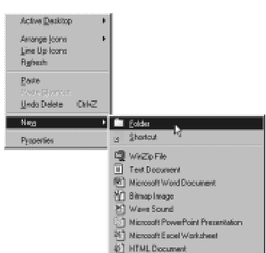

你还应该在标准的文字处理程序中练习使用“剪切”、“复制”和“粘贴”命令。当你能够独立完成这些操作时，你就准备好学习 HTML 和 JavaScript 了。

## HTML 基础

在本节中，你将学习如何：

-   创建主页
-   格式化文本
-   创建指向新页面的链接
-   创建电子邮件和外部链接
-   插入图形
-   创建导航系统
-   更改页面和链接颜色

你将构建一个看起来像这样的网站：

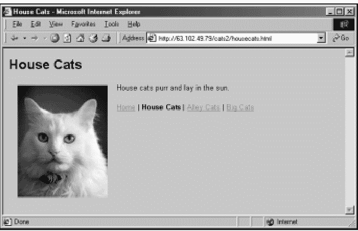

### 创建主页

### 创建主页

1.  打开一个浏览器，例如 Internet Explorer 或 Netscape Navigator。

2.  打开“记事本”程序。操作方法是：首先单击任务栏上的“开始”按钮，然后依次单击“程序”、“附件”，最后单击“记事本”。

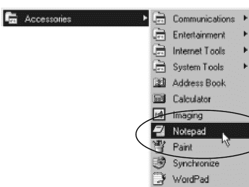

3.  在记事本屏幕的顶部，输入：

```
<HTML>
```

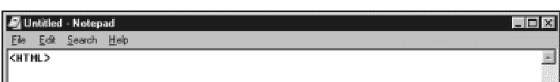

**提示：** `<HTML>` 是一个标签。标签是给 Web 浏览器的指令。这个特定的指令让 Web 浏览器知道，接下来的内容是一个用 HTML 编写的网页。

标签可以用大写字母或小写字母书写——使用哪种都可以。`<HTML>`、`<html>` 或 `<HtMl>` 都是有效的。

4.  保存文件。

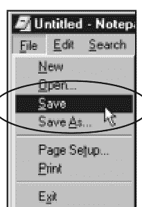

5.  当“另存为”窗口出现时，在“保存在”下拉列表中选择 C:\ 驱动器。

6.  单击  图标来创建一个新文件夹。

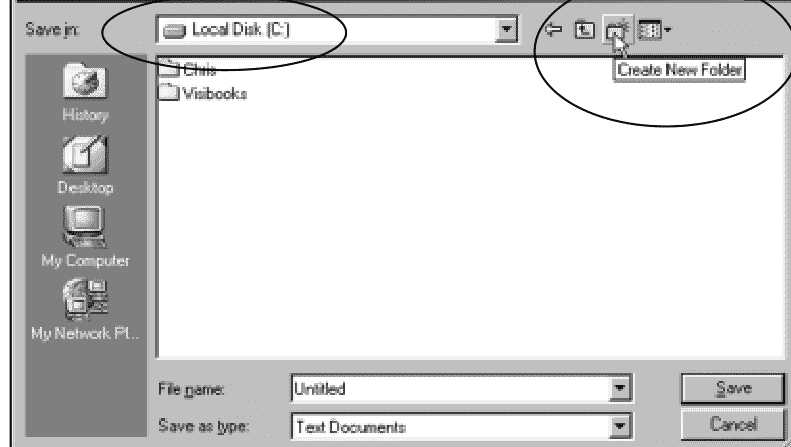

7.  将新文件夹命名为“Dogs”，然后双击它，使其出现在“保存在”框中。

8.  在“文件名”文本框中，输入 index.html。

9.  在“保存类型”下拉列表中，选择“所有文件”。完成后，窗口应如下所示：

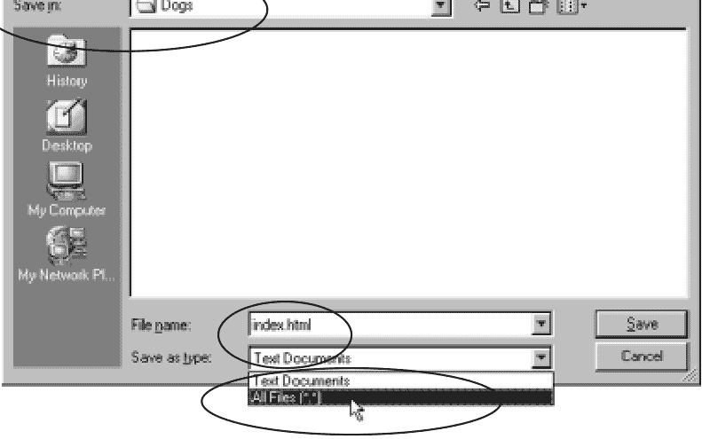

10. 单击“保存”按钮来保存页面。

> **主页文件名**

所有网页都有 .html 扩展名（或 .htm）。

所有主页的文件名都是 index.html。当在浏览器中输入其所在的域名或目录地址时，index.html 会自动显示。

例如，如果你访问 www.visibooks.com，主页会自动出现。这是因为它的文件名是 index.html。如果 Visibooks 主页的文件名是 homepage.html，你就必须输入 www.visibooks.com/homepage.html 才能使其显示。

*微软的例外情况：* 要让你的主页在运行微软 Internet Information Server 作为操作系统的 Web 服务器上自动显示，请将你的主页文件名设为 default.htm。

11. 在 `<HTML>` 标签下方，输入：

```
<HEAD>
<!--Created by Your Name-->
</HEAD>
```

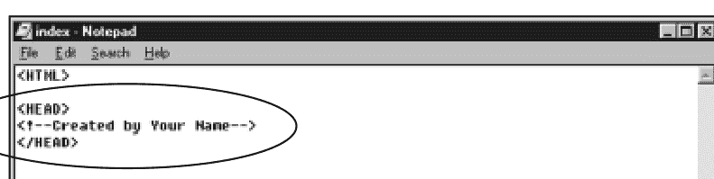

**提示：** `<HEAD>` 部分包含的信息在浏览器中查看页面时不会显示出来。注意结束标签 `</HEAD>`：在 HTML 中，你必须告诉浏览器何时开始以及何时结束某项内容。

提示：`<!--Created by Your Name-->` 被称为注释。破折号之间的任何文本都不会显示在浏览器的屏幕上——只有在查看页面的 HTML 代码时才可见。你需要包含 ! 才能使此功能生效。

12. 在 `</HEAD>` 标签下方，使用 `<TITLE>` 标签将页面标题设为“关于狗的主页”：

```
<TITLE>
A Home Page About Dogs
</TITLE>
```

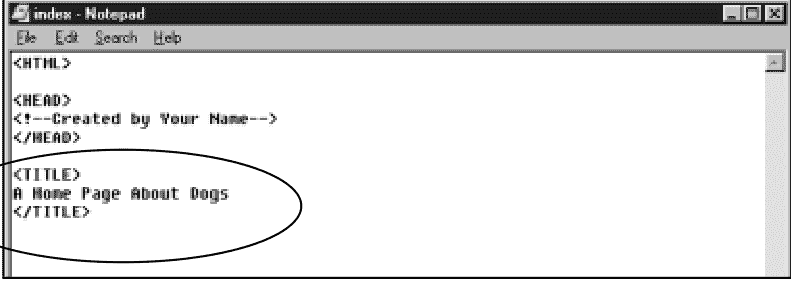

提示：请注意，文本“A Home Page About Dogs”不是一个标签。它是被标签包围的文本。`<TITLE>` 标签告诉浏览器如何处理该文本：将其作为页面的标题。

### 页面标题

网页的标题描述了该页面。它会出现在浏览器的历史记录列表中。当页面在搜索引擎中出现时，标题也会显示为一个链接。如果你的所有页面都有独特且描述性的标题，人们会更容易找到它们。

页面标题会显示在用于查看它的浏览器的顶部或“标题”栏中。此页面的标题是 Dogs。

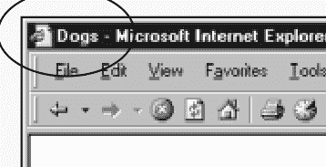

13. 在 `</TITLE>` 标签下方，添加：

```
<BODY>

</BODY>
```

> **提示：** *任何你希望在浏览器主窗口中显示的内容，都放在 `<BODY>` 和 `</BODY>` 标签之间。*

14. 在 `</BODY>` 标签下方，关闭 `</HTML>` 标签。完成后，代码应如下所示：

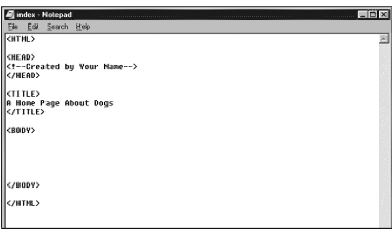

15. 在 `<BODY>` 和 `</BODY>` 标签之间，输入文字：

Dogs Home Page

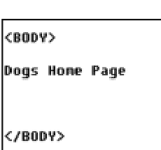

16. 保存页面。

### 在浏览器中查看页面

1.  转到浏览器，在其菜单栏上，单击“文件”，然后单击“打开”。

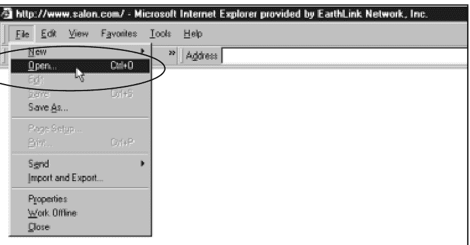

> **提示：** 如果你使用的是 Netscape Communicator 而不是 Internet Explorer，请单击“打开页面”，*然后*单击“选择文件”。

2.  当“打开”窗口出现时，单击“浏览”按钮。

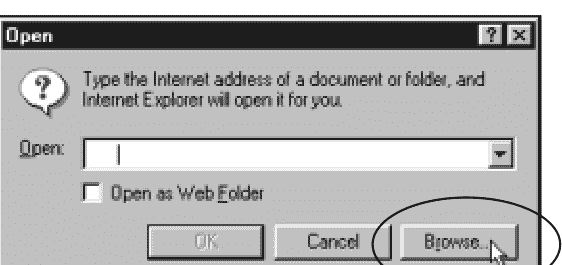

3.  当新窗口出现时，在“查找范围”下拉列表中导航到 Dogs 文件夹，然后选择主页：index.html。

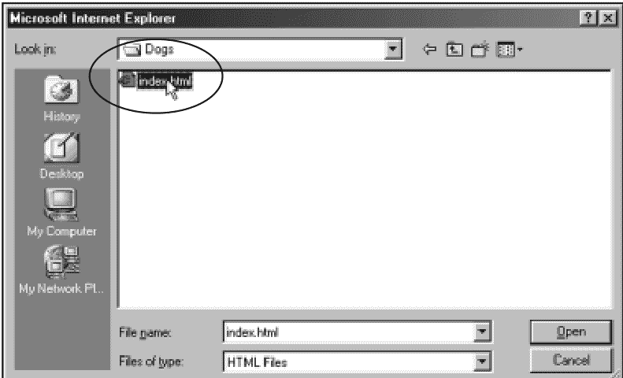

4.  单击“打开”按钮，然后单击“确定”按钮。页面应在浏览器中显示，如下所示：

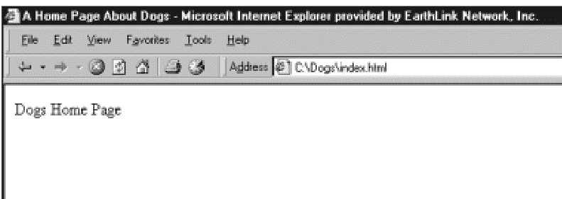

你已经创建了一个标题为“关于狗的主页”的主页。

主页的文件名是 index.html。

它位于 C:\ 驱动器上一个名为 Dogs 的文件夹中。

### 练习：创建主页

A. 主页的正确文件名是什么？

B. 为什么主页有特殊的文件名？

C. 为什么主页——以及网站中的所有其他页面——拥有准确的标题很重要？

D. 页面标题和文件名有什么区别？

答案

A. index.html

B. 它允许主页在浏览器中显示时无需将文件名作为网址的一部分输入。

C. 准确的标题使人们在收藏页面或在浏览器的历史记录列表中搜索时更容易找到页面。

D. 页面标题显示在浏览器顶部的标题栏中。它是纯文本，例如“史密斯一家：度假照片”，让人们可以轻松地跟踪页面。页面的文件名，例如 vacpics.html，是计算机跟踪它的方式。

## 格式化页面和文本

### 更改字体

1.  在“Dogs Home Page”这几个字前面，插入一个带有属性 FACE="arial" 的 `<FONT>` 标签：

   `<FONT FACE="arial">Dogs Home Page</FONT>`

2.  在这几个字后面，关闭 `<FONT>` 标签：

   `<FONT FACE="arial">Dogs Home Page</FONT>`

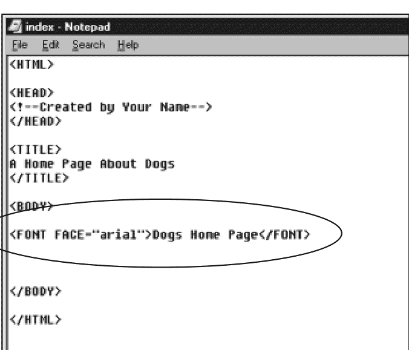

> **提示：** 可以将属性视为给浏览器的子指令。在这个例子中，`<FONT>` 标签告诉浏览器文本将被更改，而 FACE 属性告诉它如何更改，指定了 Arial 字体。

3.  在浏览器中查看页面。单击浏览器的“刷新”按钮，页面应如下所示：

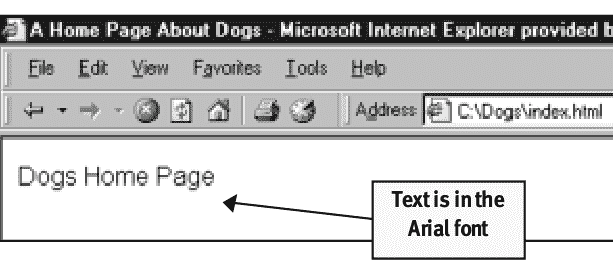

### Web 字体

在计算机上查看文本时，只能看到计算机上安装的字体。例如，如果有人创建了一个指定使用 Tekton 字体的页面，几乎没有人会看到它使用 Tekton 字体，因为很少有计算机安装了该字体。没有 Tekton 的计算机将使用默认字体显示文本：Times New Roman。

所有 Windows 计算机都安装了 Arial 字体。Windows 95 及更高版本的计算机有 Verdana。Macintosh 有 Helvetica，Arial 字体就是基于它设计的。

为了涵盖所有情况，请指定多种字体：

`<FONT FACE="verdana,arial,helvetica">`

**提示：** 如果页面看起来不像预期的那样——或者根本没有显示任何内容——请检查你编写的 HTML 代码。你可能漏掉了一个引号或犯了其他小错误。看似微不足道的东西可能会毁掉一个页面：

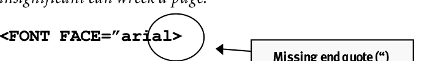

### 更改文本大小

1.  在记事本中，为 **\<FONT\>** 标签添加 **SIZE="+4"** 属性：

**\<FONT FACE="arial" SIZE="+4"\>Dogs Home Page\</FONT\>**

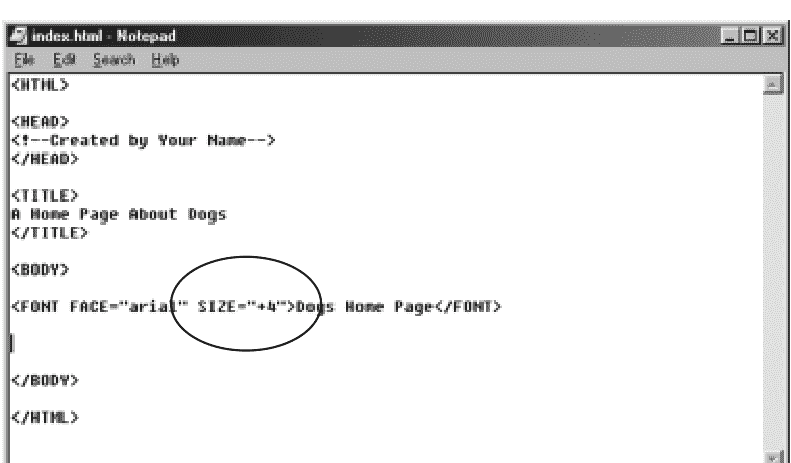

2.  保存页面并在浏览器中查看。它应该看起来像这样：

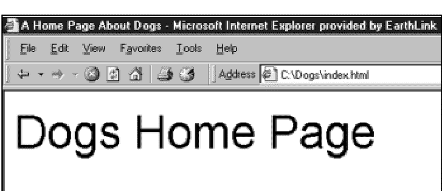

### 更改文本粗细

1.  在记事本中，在“Dogs Home Page”文字前添加 \<B\> 标签，并在其后关闭该标签：

```
<FONT FACE="arial" SIZE="+4"><B>Dogs Home Page</B></FONT>
```

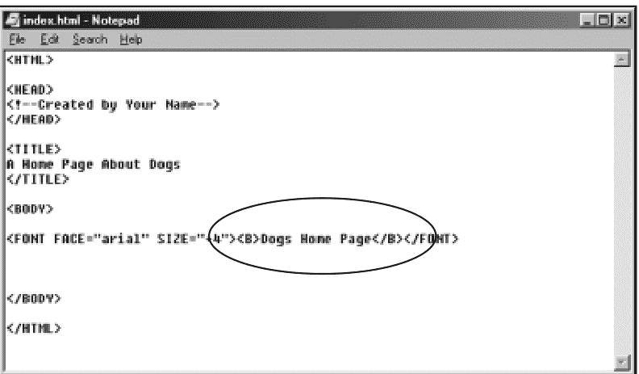

**提示：** 插入多个标签时，请按镜像顺序排列它们。上面的标签和文本就是一个很好的例子：因为它以 \<FONT\> 标签开头，所以以 \</FONT\> 标签结尾。未按镜像顺序排列的标签可能会在某些浏览器中导致显示问题。

2.  保存页面并在浏览器中查看。它应该看起来像这样：

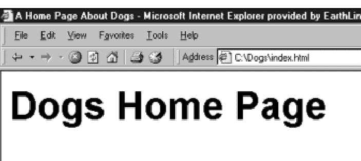

### 更改文本颜色

1.  在 \<FONT\> 标签中，添加属性 COLOR="red"：

```
<FONT FACE="arial" SIZE="+4" COLOR="red">
```

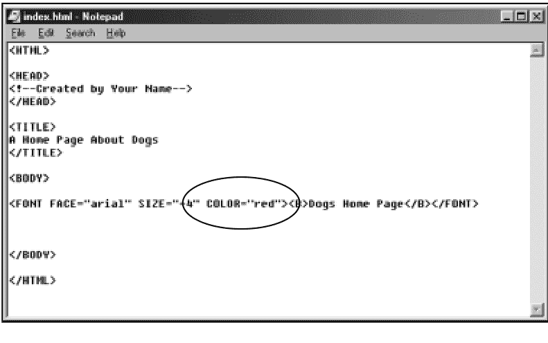

2.  保存页面。在浏览器中查看，文本应显示为红色。

3.  将文本颜色更改为黑色，然后保存页面。

```
<FONT FACE="arial" SIZE="+4" COLOR="black">
```

### 对齐文本

1.  在当前文本和标签下方，插入一个 \<P\> 标签以开始新段落。
2.  在 \<P\> 标签下方，插入标签 \<FONT FACE="arial" SIZE="-1"\> 和文字“These are my favorite breeds of dog:”

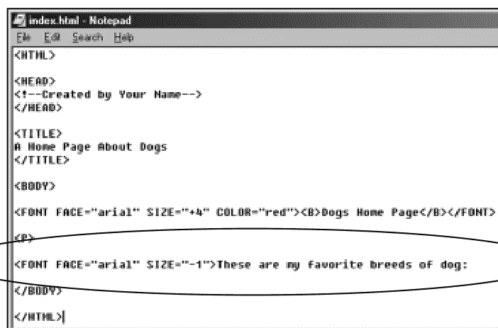

3.  在 \<P\> 标签内，添加属性 ALIGN="right"：
4.  在新段落后添加一个闭合的 \</P\> 标签。

```
<P ALIGN="right">
<FONT FACE="arial" SIZE="-1">These are my favorite breeds of dog:
</P>
```

**提示：** 在 HTML 中，通常 `<P>` 标签不需要闭合的 `</P>` 标签，但这里使用了 `ALIGN="right"` 属性。段落后的闭合 `</P>` 标签可以防止浏览器将其下方的所有内容都右对齐。

5.  保存页面，然后在浏览器中查看。它应该看起来像这样：

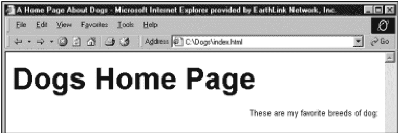

6.  从 `<P>` 标签中移除 `ALIGN="right"` 属性。

**提示：** 要生成单行换行而不是 `<P>` 标签生成的双倍间距，请使用 `<BR>` 标签。在两行文本之间放置 `<BR>` 或“Break”标签会将第二行推到下一行：

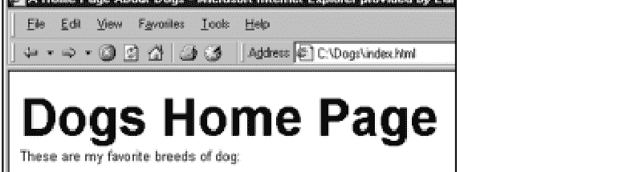

```
<FONT FACE="arial" SIZE="+4"><B>Dogs Home Page</B></FONT>
<BR>
<FONT FACE="arial" SIZE="-1">These are my favorite breeds of dog:</FONT>
```

### 缩进文本

1.  在文本“These are my favorite breeds of dog;”下方，插入三个新段落：

```
<P>Chesapeake Bay Retriever</P>
<P>German Shepherd</P>
<P>Yorkshire Terrier</P>
```

2.  将这些段落包裹在无序列表标签中以进行缩进：

```
<UL>
<P>Chesapeake Bay Retriever</P>
<P>German Shepherd</P>
<P>Yorkshire Terrier</P>
</UL>
```

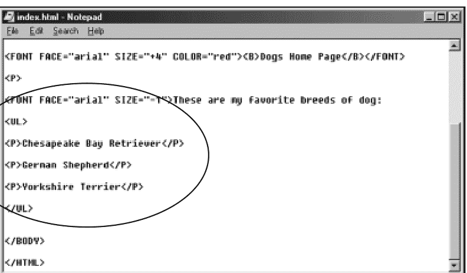

3.  保存页面并在浏览器中查看。它应该看起来像这样：

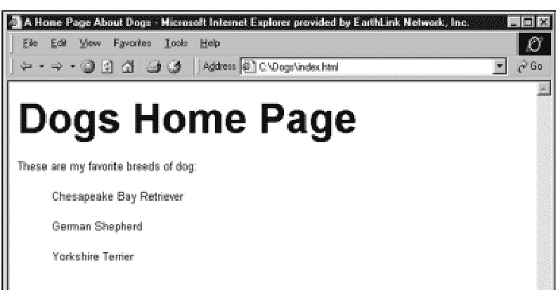

**提示：** 注意 `<FONT FACE="arial" SIZE="-1">` 标签下方的所有文本看起来都一样。在插入闭合的 `</FONT>` 标签之前，它将保持这种状态。

### 创建列表

1.  对于这三种狗，将 \<P\> 和 \</P\> 标签替换为 \<LI\> 标签，以在后续文本前生成项目符号：

```
<UL>
<LI>Chesapeake Bay Retriever
<LI>German Shepherd
<LI>Yorkshire Terrier
</UL>
```

2.  保存页面并在浏览器中查看。它应该看起来像这样：

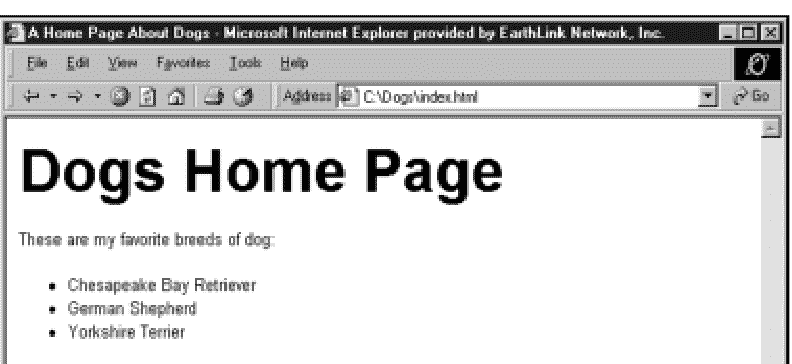

### 练习：格式化页面和文本

A. 为什么最常见的字体选择是 Arial、Verdana 和 Helvetica？

B. 哪些类型的计算机安装了 Arial 字体？哪些安装了 Helvetica？

1.  将主页标题更改为“My Favorite Dogs”。
2.  将项目符号列表更改为编号列表。
3.  将编号列表改回项目符号列表。
4.  使列表项加粗。在浏览器中查看时，页面应如下所示：

**提示：** 使用 `<OL>` 而不是 `<UL>` 来生成编号列表。

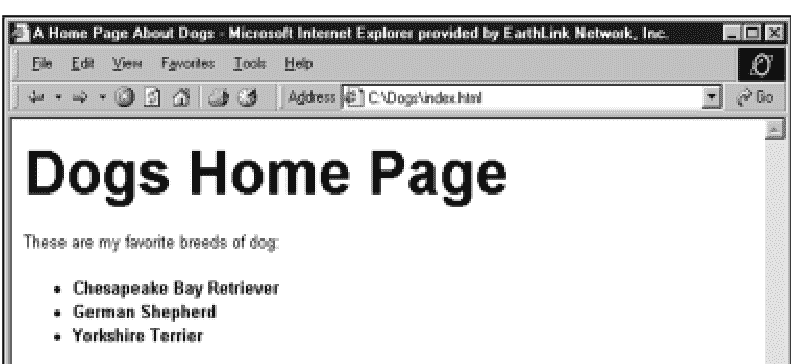

答案
A. 这些是大多数 Windows 计算机都安装的字体。
B. Windows 计算机有 Arial，Mac 有 Helvetica。

## 创建指向新页面的链接

### 步骤 1：创建新页面

1.  在记事本中，将页面标题更改为“Chesapeake Bay Retrievers”，然后删除 \<BODY\> 和 \</BODY\> 标签之间的所有标签和文本。
2.  在菜单栏上，单击“文件”，然后单击“另存为”。
3.  使用文件名 chesapeake.html 保存新页面。

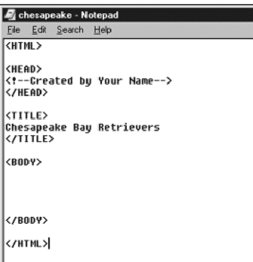

**提示：** 记得将“保存类型”设为“所有文件”。

### Web 的文件名

大多数 Web 服务器基于 Unix 或 Linux，它们无法很好地处理文件名中的空格。例如，如果你将文件命名为 fido page.html，它在浏览器的 URL 框中可能会显示为 fido%20page.html。

此外，Web 服务器区分大小写，因此将文件名保持为小写可以消除潜在的错误来源。

使网站中的所有文件名——页面、图形和文件夹——都小写，且不含空格。

正确的文件名：german.html

错误的：German Shepherds.html

4.  在 \<BODY\> 标签下方，输入“Chesapeake Bay Retrievers”。这是页面标题。将其设为 verdana 字体、加粗、大小 +3：

```
<BODY>
<FONT FACE="verdana" SIZE="+3"><B>Chesapeake Bay Retrievers</B></FONT>
</BODY>
```

5.  保存页面。

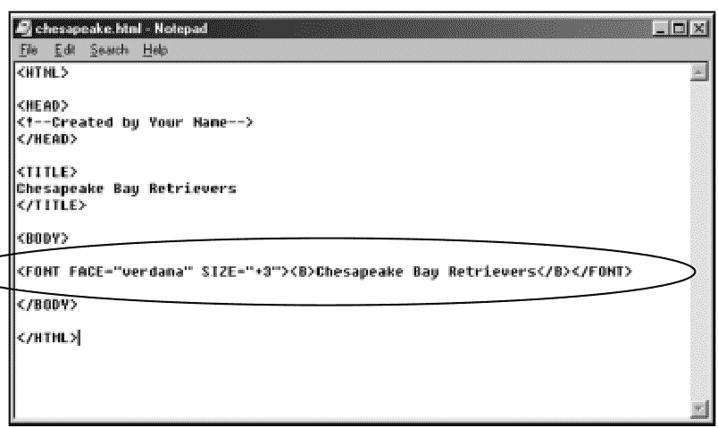

### 通过文本大小提供导航线索

Chesapeake Bay Retriever 页面的标题比主页的标题小一号。这是因为 CBR 页面在网站层次结构中低一级。

**第 1 级：Dogs**
（顶级标题；**SIZE="+4"**）

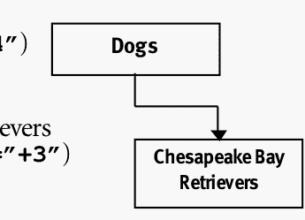

**第 2 级：Chesapeake Bay Retrievers**
（二级标题；**SIZE="+3"**）

使 CBR 页面的标题小于主页的标题有助于向用户展示他们在网站中的位置。

### 步骤 2：链接到新页面

1.  在记事本中打开主页 (index.html)。在第一个项目 Chesapeake Bay Retriever 前面，插入一个锚点标签。然后关闭锚点标签：

```
<LI><B><A HREF="chesapeake.html">Chesapeake Bay Retriever</A></B>
```

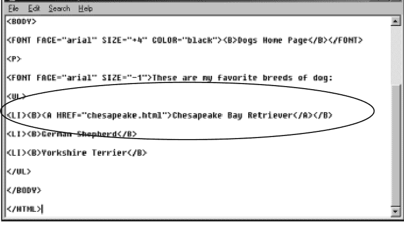

> **锚点标签的工作原理**

锚点标签创建一个指向另一个页面的可点击链接。

具有此文件名的页面... ...链接到这些文字。

`<a href="filename.html">New Page</a>`

2.  保存主页并在浏览器中查看。**Chesapeake Bay Retriever** 这几个字应该是一个链接，页面应如下所示：

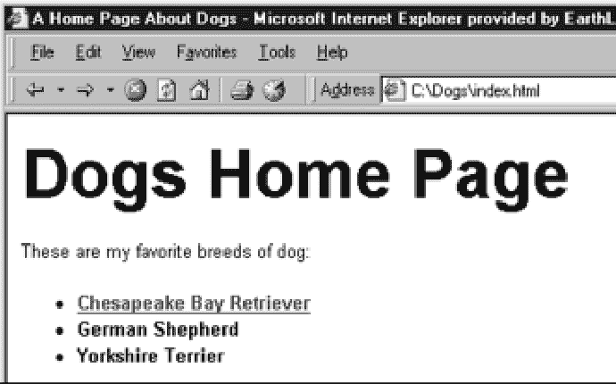

3.  单击 **Chesapeake Bay Retriever** 链接。Chesapeake Bay Retriever 页面应出现在浏览器中。

### 练习：创建指向新页面的链接

A. 为什么文件名应该是小写且不含空格的？

B. 为什么章节页面（Chesapeake Bay Retrievers、German Shepherds）上的标题应该比主页的标题小？

1.  为 German Shepherds 和 Yorkshire Terriers 创建新页面。

| 页面 | 标题 | 文件名 |
|---|---|---|
| German Shepherds | German Shepherds | german.html |
| Yorkshire Terriers | Yorkshire Terriers | yorkshire.html |

2.  在主页上，将文字 German Shepherd 和 Yorkshire Terrier 链接到它们各自的页面。

3.  在主页上，删除“**Dogs.**”后面的“**Home Page**”字样。

4.  在 Chesapeake Bay Retriever、German Shepherd 和 Yorkshire Terrier 页面上，将页面标题设置为与主页相同的字体和粗细（Verdana；加粗）。

5.  使这些页面的页面标题比主页的标题小一号，就像 Chesapeake Bay Retriever 页面一样。

6.  保存所有页面，然后单击主页上的链接以确保它们正常工作。

答案
A. 因为大多数 Web 服务器能更好地处理小写、无空格的文件名。
B. 它为网站用户提供了一级（主页）页面和二级（主要部分）页面之间的视觉区分。

## 创建电子邮件和外部链接

### 创建电子邮件链接

1.  在列表下方的新段落中，输入句子“如需更多信息，请联系 info@visibooks.com。”
2.  用锚点标签将电子邮件地址括起来，但不要将其链接到网页，而是使用 mailto 命令将其链接到电子邮件程序：

```
For more information, contact
<A HREF="mailto:info@visibooks.com">info@visibooks.com</A>
```

3.  保存页面。在浏览器中查看时，它应该如下所示：

> ### 电子邮件链接的工作原理

当有人访问网站并点击电子邮件链接时，它应该会打开该人计算机上的电子邮件程序，并将地址插入到新邮件中。

如果该人的电子邮件程序配置不正确，此功能将无法工作。这就是为什么电子邮件链接应使用电子邮件地址作为链接的原因：以便人们在必要时可以手动输入地址。

### 链接到外部网站

1.  在记事本中，在最后一句之后添加一个新句子。输入句子“也请访问 www.dogs.com。”
2.  用这些锚点标签将网址 www.dogs.com 括起来，以将其链接到外部网站：
3.  保存页面。
4.  在浏览器中预览页面，然后单击链接以查看它是否链接到外部网站 www.dogs.com。
5.  关闭浏览器。

```
<A HREF="http://www.dogs.com">www.dogs.com</A>
```

> 提示：要使外部链接正常工作，您必须将 http:// 作为网址的一部分输入。

## 插入和对齐图形

### 从网络捕获图形

1.  打开一个新的浏览器窗口。
2.  访问网站 www.visibooks.com/dogpics。
3.  将光标放在切萨皮克湾寻回犬的图片上，然后单击鼠标右键。
4.  单击“图片另存为”。
5.  当“保存图片”窗口出现时，在“保存在”下拉列表中选择“Dogs”文件夹。
6.  在 Dogs 内创建一个名为“graphics”的新文件夹。
7.  双击 graphics 文件夹，使其出现在“保存在”下拉列表中。
8.  单击“保存”按钮，将图形保存在 graphics 文件夹内。

> **提示：** 创建这个单独的子文件夹来存放您网站的图形，可以使网站更易于组织和更新。

### 插入图形

1.  在记事本中，打开切萨皮克湾寻回犬页面，文件名 chesapeake.html。
2.  在主标题下创建一个新段落。
3.  在新段落中，插入图像标签：

```

```

> **提示：** 注意，在这个图像标签中有一个“路径”。对于图像源，该标签首先指向 graphics 文件夹，然后指向其中的图像文件名。

4.  保存页面，然后在浏览器中查看。它现在应该如下所示：

### 对齐图形

1.  在图形下方的新段落中，输入：

切萨皮克湾寻回犬喜欢水。如果你把网球扔进水里，这些狗会追逐它们并把它们捡回来，直到你的手臂累得抬不起来。

2.  保存页面并在浏览器中查看。页面应如下所示：
3.  返回记事本，并在 `` 标签中添加 **ALIGN="left"** 属性：

```

```

4.  保存页面并在浏览器中查看（只需单击“刷新”或“重新加载”按钮）。它应该如下所示：

### 格式化图形

1.  在切萨皮克湾寻回犬页面中，向 **** 标签添加此 **ALT** 属性：

```

```

> “Alt”文本允许视力障碍者了解图形代表的内容。Alt 文本还允许搜索引擎对视觉内容进行索引。

2.  同时添加 **VSPACE="4"** 和 **HSPACE="12"** 属性：

```

```

3.  此外，添加 **BORDER="1"** 属性：

```

```

4.  保存页面并在浏览器中查看。它现在应该如下所示：

HSPACE 为 12 会在图形周围创建 12 像素的水平空间，任何内容都无法占据。

Border 为 1 会在图形周围创建 1 像素的边框。

5.  将光标移到图形上。“Alt”文本——图形的替代文本描述——应该会弹出。

文本应与图形顶部对齐。

**提示：** *如果您知道图形的尺寸，可以通过指定其宽度和高度（以像素为单位）使其加载更快：*

```

```

### 练习：插入图形

A. 为什么应该为插入的每个图形指定 Alt 文本？

1.  访问 **www.visibooks.com/dogpics**。将德国牧羊犬图形保存在 C:\dogs\graphics 中，文件名为 shepherds.gif。
2.  将约克夏梗犬图形保存在 C:\dogs\graphics 中，文件名为 yorkie.gif。
3.  在德国牧羊犬页面标题下方的新段落中插入 shepherds.gif。
4.  在约克夏梗犬页面标题下方的新段落中插入 yorkie.gif。
5.  在德国牧羊犬页面上，在图形下方的段落中输入“德国牧羊犬是聪明的狗”。
6.  在约克夏梗犬页面上，在图形下方的段落中输入“约克夏梗犬很可爱”。
7.  在两个页面上，将文本与图形的一侧对齐，就像在切萨皮克湾寻回犬页面上一样。
8.  在两个页面上，为图形设置边框为 1，垂直间距为 4，水平间距为 12。
9.  在所有三个“狗”页面上，将所有段落文本（非主标题）设置为 Arial 字体，大小为 -1。

答案

A. Alt 文本使视力障碍者更容易理解页面内容，并使搜索引擎更容易对其进行编目。

## 创建基本导航系统

### 链接回主页

1.  在记事本中，打开切萨皮克湾寻回犬页面 chesapeake.html。
2.  在第一个段落下方的新段落中输入单词“主页”。
3.  用锚点标签将其括起来，链接回主页：
   `<A HREF="index.html">Home</A>`
   **提示：** 请记住，index.html 是主页的文件名。
4.  保存页面，并在浏览器中查看。单词“主页”现在应该是一个链接，页面应如下所示：

```
<A HREF="index.html">Home</A>
```

5.  在德国牧羊犬页面上，创建一个链接回主页。操作方法与为切萨皮克湾寻回犬页面创建链接相同。
6.  在约克夏梗犬页面上，创建相同类型的链接回主页。

### 页面相互链接

1.  在记事本中，打开切萨皮克湾寻回犬页面。
2.  在“主页”链接之后，输入：
   | 切萨皮克湾寻回犬 | 德国牧羊犬 | 约克夏梗犬
3.  将“切萨皮克湾寻回犬”一词加粗，以向网站用户显示“您在此处”。
4.  将“德国牧羊犬”一词链接到德国牧羊犬页面：
   `<A HREF="german.html">German Shepherds</A>`
5.  将“约克夏梗犬”一词链接到约克夏梗犬页面。

### 显示“您在这里”

网站的导航系统应向用户展示两件事：他们当前所在的位置，以及他们可以前往的位置。

要向用户展示他们当前所在的位置，请将对应当前页面的链接设置为纯文本。这样用户就知道，如果他们无法跳转到该页面，那么他们一定正在浏览该页面。

首页 | **切萨皮克湾寻回犬** | 德国牧羊犬 | 约克夏梗犬

↑
**您在这里**

将文本设置为粗体可以强化“您在这里”的信息。

### 将图形用作链接

1.  在记事本中打开主页。在项目符号链接列表下方的新段落中，插入切萨皮克湾寻回犬、德国牧羊犬和约克夏梗犬的图形：

    ```html
    
    
    
    ```

2.  将第一个图像标签包裹在锚点标签内，使其链接到切萨皮克湾寻回犬页面：

    ```html
    <A HREF="chesapeake.html"></A>
    ```

3.  保存页面，然后在浏览器中预览。当您点击切萨皮克湾寻回犬图形时，它应该会带您跳转到切萨皮克湾寻回犬页面。

4.  返回记事本，为第一个图像标签添加 **BORDER="0"** 属性：

    ```html
    <A HREF="chesapeake.html"></A>
    ```

5.  保存页面并再次在浏览器中查看。切萨皮克湾寻回犬图形周围的蓝色链接边框应该消失了。

### 练习：创建导航系统

A. 向网站用户显示“您在这里”的好方法是什么？

**任务：** 使您的 Dogs 网站看起来像 **www.visibooks.com/dogs** 网站。

1.  在记事本中打开德国牧羊犬页面 german.html。
2.  在“首页”链接之后，输入：
    | 切萨皮克湾寻回犬 | 德国牧羊犬 |
    | 约克夏梗犬 |
3.  将“德国牧羊犬”这几个字设置为粗体。
4.  将“切萨皮克湾寻回犬”和“约克夏梗犬”这几个字链接到它们对应的页面。
5.  保存页面。
6.  使用相同的系统，为约克夏梗犬页面创建导航链接。然后保存页面。
7.  在主页上，将德国牧羊犬图形链接到德国牧羊犬页面。对约克夏梗犬图形执行相同操作。
8.  去掉这些图形的链接边框。
9.  完成后，在浏览器中预览您的 Dogs 网站。它应该看起来像 **www.visibooks.com/dogs** 网站。

**答案**

A. 将对应当前页面的链接设置为粗体，并且是纯文本（不再是链接）。

## 更改页面、链接颜色

### 更改页面背景颜色

1.  在记事本中打开主页。
2.  在 `<BODY>` 标签中，添加属性 `BGCOLOR="#ffffcc"`：
    ```html
    <BODY BGCOLOR="#ffffcc">
    ```
3.  保存页面并在浏览器中查看。页面的背景颜色现在应该是浅黄色。

### 十六进制颜色

代表浅黄色的 **ffffcc** 是一种十六进制颜色。十六进制颜色允许您比使用文字更精确地指定颜色。例如，您可以在 body 标签中使用属性 **BGCOLOR=yellow**，页面背景将变为亮黄色，但如果您使用 **BGCOLOR=pale yellow**，那将不起作用。

对于颜色的深浅，必须使用十六进制。它们的工作原理如下：

计算机通过混合红色、绿色和蓝色来显示颜色。在十六进制颜色中，第一对字母或数字表示红色，第二对表示绿色，第三对表示蓝色：

| 红色 | 绿色 | 蓝色 |
| --- | --- | --- |
| **ff** | **ff** | **cc** |

### 十六进制颜色（续）

颜色值从最大颜色量 (ff) 到完全没有颜色 (00)：

| 最大 | 中等 | 无 |
|---|---|---|
| ff | cc | 99 | 66 | 33 | 00 |

海军蓝在十六进制中表示为无红色 (00)、无绿色 (00) 和少量蓝色 (66)：

```
000066
```

十六进制颜色代码列表发布在：

www.webmonkey.com/reference/color_codes

### 更改链接颜色

1.  在主页中，为 `<BODY>` 标签添加属性 `LINK="#ff0000"`：

    ```html
    <BODY BGCOLOR="#ffffcc" LINK="#ff0000">
    ```

    这会使页面上的链接显示为红色。

2.  为 `<BODY>` 标签添加属性 `VLINK="#00ff00"`：

    ```html
    <BODY BGCOLOR="#ffffcc" LINK="#ff0000" VLINK="#00ff00">
    ```

    这会使已访问的链接显示为绿色。

    > **提示：** 已访问的链接是指在浏览器中已经查看过的页面的链接。

3.  保存页面并在浏览器中查看。页面上的链接应该是红色或绿色。

### 一致的链接颜色

链接颜色在整个网站中应保持一致。如果一个页面上的链接是红色的，那么它们在每个页面上都应该是红色的。

对于用户来说，学习一次“红色等于链接”比必须弄清楚网站每个页面或部分的链接颜色要容易得多。

### 练习：HTML 基础

**任务：** 创建一个关于猫的网站，使其看起来像 www.visibooks.com/cats 网站。

1.  创建一个新的主页，并将其标题命名为“The Wonderful World of Cats”。
2.  将其保存在 C:\ 驱动器上一个名为 Cats 的新文件夹中：
    ```
    C:\Cats
    ```
3.  使页面的标题显示为“The Wonderful World of Cats”。
4.  在主页主标题下方，插入一个项目符号列表：
    - 家猫
    - 流浪猫
    - 大型猫科动物
5.  将这些项目设置为 Arial 字体，大小为 -1。
6.  将每个列表项链接到一个关于它的新页面。例如，将“家猫”链接到一个关于家猫的新页面，文件名为 housecats.html。
7.  在每个新页面的顶部，放置一个描述性标题。例如，在家猫页面的顶部放置“家猫”这几个字。
8.  将所有四个页面的主标题设置为 Arial 字体。将它们设置为粗体。将主页标题的大小设置为 +3。将其他页面标题的大小设置为 +2。
9.  在每个页面上，在主标题下方的新段落中写一两句描述性句子。将其设置为 Arial 字体，大小为 -1。
10. 前往 www.visibooks.com/catpics 获取那里的三个猫图形。将它们放入 C:\Cats 文件夹中一个名为“graphics”的文件夹中。
11. 在 3 个页面中的每一个页面上，在主标题和下方的描述性文本之间插入相应的图形。
12. 将每个图形左对齐，然后指定 vspace 为 4，hspace 为 16。
13. 将三个“猫”页面中的每一个都链接回主页，并相互链接。在每个页面上，将“您在这里”链接设置为粗体纯文本。
14. 将每个页面的背景颜色设置为浅灰色。
15. 将每个页面上的链接颜色设置为亮红色。将已访问的链接颜色设置为橙色。
16. 在浏览器中预览该网站。它应该看起来像 www.visibooks.com/cats 网站。

## 布局与导航

在本节中，您将学习如何：

- 使用表格布局页面
- 创建导航栏
- 为网站添加子部分
- 在表格内放置表格
- 使用框架链接到外部网站

您将构建一个看起来像这样的网站：

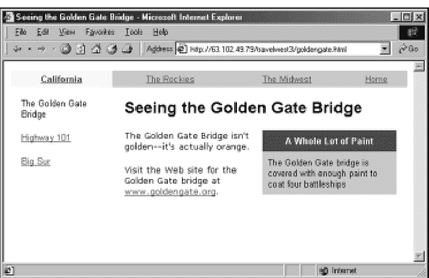

### 使用表格布局页面

#### 表格与网页布局

几乎所有专业质量的网站都是使用表格布局的。就像电子表格有包含数字的单元格一样，网页上的表格也有包含链接、图形和文本的单元格。

此页面上的线条清晰地显示了其表格单元格布局：

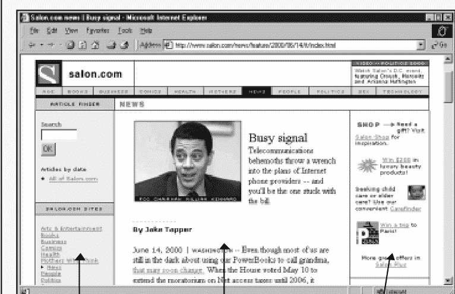

### 创建表格

1.  在 C:\ 驱动器上创建一个名为“Travel”的新文件夹。

2.  在记事本中创建一个主页（文件名 index.html），标题为“Traveling Down South”。将其保存在 Travel 文件夹中。

    > **提示：** 确保您的新主页具有正确的文件名——index.html——以及所有必要的标签：

    ```html
    <HTML>
    <HEAD>
    <!--Created by Your Name-->
    </HEAD>
    <TITLE>
    Traveling Down South
    </TITLE>
    <BODY>
    </BODY>
    </HTML>
    ```

3.  您将创建一个简单的一行两列表格，如下所示：

    | 链接 | 内容 |

4.  第一步是开始表格。在 `<BODY>` 标签下方，使用 `<TABLE>` 标签开始您的表格：

    ```html
    <BODY>
    <TABLE>
    ```

5.  在 `<TABLE>` 标签下方，使用 `<TR>`（表格行）标签开始一行：

    ```html
    <BODY>
    <TABLE>
    <TR>
    ```

#### 格式化表格

1.  现在你将扩展表格。在记事本中，为 **<TABLE>** 标签添加 **WIDTH="100%"** 属性：

```
<BODY>
<TABLE BORDER=1 WIDTH="100%">
<TR>
<TD>Links</TD>
<TD>Content</TD>
</TR>
</TABLE>
```

2.  保存页面并在浏览器中查看。它应该看起来像这样：

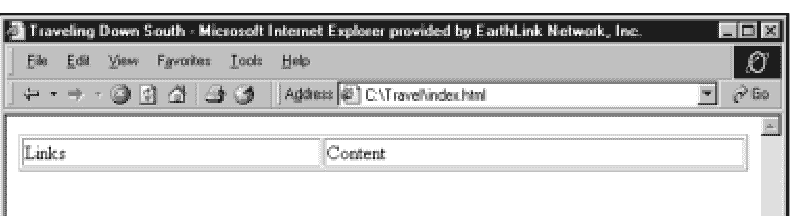

#### 百分比宽度与固定宽度表格

使用表格布局页面时，将表格宽度设置为 100%。这样，页面内容就可以拉伸以填满整个显示器，无论显示器的分辨率如何。

如果你想让固定宽度表格在所有显示器上都适配，那么表格宽度就只能限制在 580 像素：

**640 像素** 低分辨率显示器的宽度 **- 20 像素** 浏览器偏移量：页面内容距离浏览器两侧的缩进距离 **- 40 像素** 20 像素用于垂直滚动条，另外 20 像素作为额外空间 **= 580 像素** 可用于表格的宽度

创建固定宽度表格的页面可以提供精确控制，但在更高分辨率的显示器上会浪费空间：

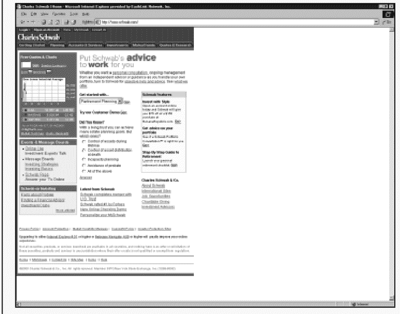

**页面：** 使用 580 像素宽的表格布局

**用于查看页面的显示器：** 1280 像素宽

3.  通过指定 BORDER="0" 来移除表格边框：

```
<BODY>
<TABLE BORDER="0" WIDTH="100%">
<TR>
<TD>Links</TD>
<TD>Content</TD>
</TR>
</TABLE>
```

4.  通过向第一个 <TD> 标签添加属性 BGCOLOR="#CCCCCC"，将第一个单元格设为浅灰色：

```
<BODY>
<TABLE BORDER="0" WIDTH="100%">
<TR>
<TD BGCOLOR="#CCCCCC">Links</TD>
<TD>Content</TD>
</TR>
</TABLE>
```

5.  保存页面并在浏览器中查看。它应该看起来像这样：

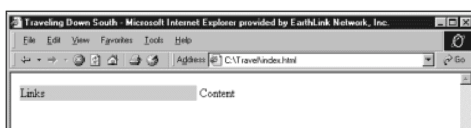

6.  你会注意到单词 "Links" 紧贴着左侧单元格的边缘。为了在单元格边缘和其内容之间添加 16 像素的边距，请向 **<TABLE>** 标签添加属性 **CELLPADDING="16"**：

```
<BODY>
<TABLE BORDER="0" WIDTH="100%" CELLPADDING="16">
<TR>
<TD BGCOLOR="#CCCCCC">Links</TD>
<TD>Content</TD>
</TR>
</TABLE>
```

7.  要消除单元格之间的间距，请向 **<TABLE>** 标签添加属性 **CELLSPACING="0"**：

```
<BODY>
<TABLE BORDER="0" WIDTH="100%" CELLPADDING="16" CELLSPACING="0">
<TR>
<TD BGCOLOR="#CCCCCC">Links</TD>
<TD>Content</TD>
</TR>
</TABLE>
```

8.  保存页面并在浏览器中查看。它应该看起来像这样：

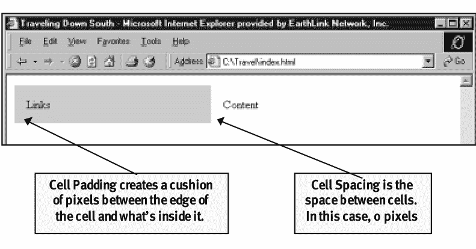

#### 创建基于表格的主页

1.  在硬盘驱动器上的 Travel 文件夹内创建一个名为 "graphics" 的文件夹。
2.  访问 www.visibooks.com/travelpic。捕获那里的图形 (uva.gif) 并将其保存在 graphics 文件夹中。
3.  在主页的右侧单元格中，将单词 "Content" 替换为标题 "**Traveling South**"。将标题大小设为 +3，使用 Verdana 字体，并加粗。
4.  在标题下方的新段落中插入该图形。

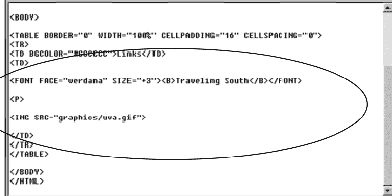

5.  在图形下方，将以下句子作为新段落添加：

如果你有几周的假期，你可能想去南方看看。里士满、威廉斯堡和查尔斯顿都是美丽的城市。

将文本设为 arial 字体，大小 -1。

6.  在左侧单元格中，将单词 "Links" 替换为本站主要部分的名称：Richmond, Williamsburg 和 Charleston。用 <P> 标签分隔它们，并使用 arial 字体，大小 -1。

页面的代码可以像这样：

```
<TABLE BORDER="0" WIDTH="100%" CELLPADDING="16" CELLSPACING="0">
<TR>
<TD BGCOLOR="#CCCCCC">
<FONT FACE="arial" SIZE="-1">
Richmond
<P>
Williamsburg
<P>
Charleston
</FONT>
</TD>
<TD>
<FONT FACE="verdana" SIZE="+3"><B>Traveling South</B></FONT>
<P>

<P>
<FONT FACE="arial" SIZE="-1">If you've got a couple of weeks for vacation, you might want to visit the South. Richmond, Williamsburg, and Charleston are all beautiful cities.</FONT>
</TD>
</TR>
</TABLE>
```

7.  保存页面并在浏览器中查看。它应该看起来像这样：

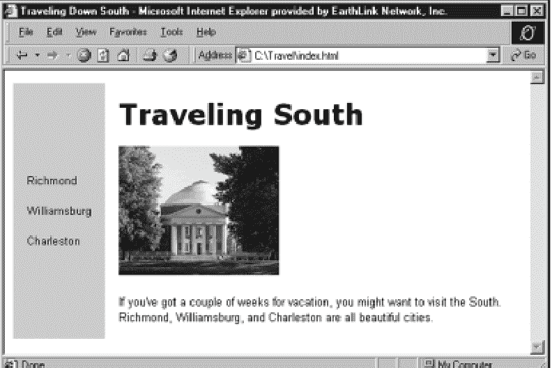

8.  要将左侧单元格的内容带到单元格顶部，请向第一个 <TD> 标签添加属性 VALIGN="top"。（为了全面起见，也向第二个 <TD> 标签添加该属性）：

```
<TABLE BORDER="0" WIDTH="100%"
CELLPADDING="16" CELLSPACING="0">
<TR>
<TD BGCOLOR="#CCCCCC" VALIGN="top">
<FONT FACE="arial" SIZE="-1">
Richmond
<P>
Williamsburg
<P>
Charleston
</FONT>
</TD>
<TD VALIGN="top">
<FONT FACE="verdana" SIZE="+3"><B>Traveling
South</B></FONT>
<P>

<P>
<FONT FACE="arial" SIZE="-1">If you've got a
couple of weeks for vacation, you might want
to visit the South. Richmond, Williamsburg,
and Charleston are all beautiful
cities.</FONT>
</TD>
</TR>
</TABLE>
```

9.  要控制表格单元格的宽度，请向第一个 <TD> 标签添加属性 **WIDTH="20%"**，向第二个添加属性 **WIDTH="80%"**：

```
<TABLE BORDER="0" WIDTH="100%"
CELLPADDING="16" CELLSPACING="0">
<TR>
<TD BGCOLOR="#CCCCCC" VALIGN="top">
<FONT FACE="arial" SIZE="-1" WIDTH="20%">
Richmond
<P>
Williamsburg
<P>
Charleston
</FONT>
</TD>
<TD VALIGN="top" WIDTH="80%">
<FONT FACE="verdana" SIZE="+3"><B>Traveling
South</B></FONT>
<P>

<P>
<FONT FACE="arial" SIZE="-1">If you've got a
couple of weeks for vacation, you might want
to visit the South. Richmond, Williamsburg,
and Charleston are all beautiful
cities.</FONT>
</TD>
</TR>
</TABLE>
```

10. 保存页面并在浏览器中查看。它现在应该看起来像这样：

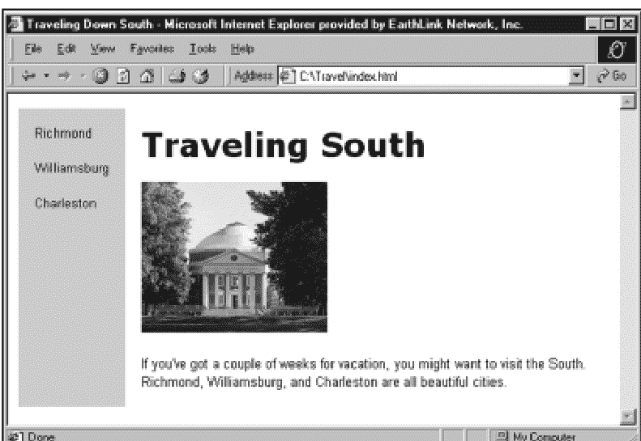

#### 创建新的基于表格的页面

1.  在记事本菜单栏上，单击“编辑”，然后单击“全选”。

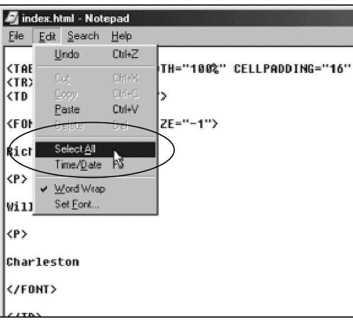

2.  选中页面上的所有代码后，单击“编辑”，然后单击“复制”。

3.  在菜单栏上，单击“文件”，然后单击“新建”。

4.  当新的空白页面出现时，单击“编辑”，然后单击“粘贴”。

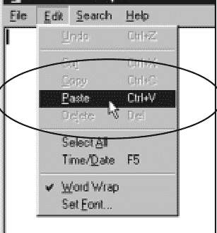

5.  将新页面保存在 C:\Travel，文件名为 richmond.html。

6.  将新页面标题设为 "Richmond, VA."。

7.  打开浏览器并访问 www.visibooks.com/travelpic/richpic。捕获那里的弗吉尼亚州里士满图形 (capitol.jpg) 并将其放入 graphics 文件夹。

8.  将 "**Traveling South**" 标题替换为 "**Richmond, Virginia.**"。将其大小设为 +2。

9.  将主页图形替换为里士满图形。在图形下方的新段落中，输入句子 "Richmond is the capital of Virginia."。

10. 在左侧单元格的单词下方添加单词 "Home"。完成后，页面应如下所示：

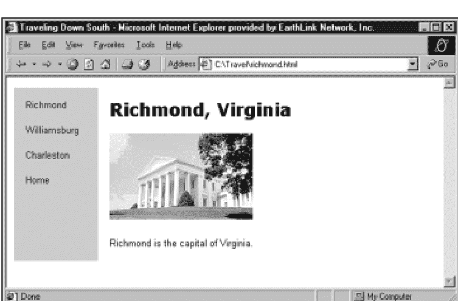

#### 练习：使用表格布局页面

A. *为什么你通常希望创建百分比宽度的表格，而不是固定像素宽度的表格？*

**任务：** 让你的 Travel 站点看起来和运行起来像 **www.visibooks.com/travel** 上的那个。

1.  像创建 Richmond 页面一样，为 Williamsburg 和 Charleston 创建页面。

   在 **www.visibooks.com/travelpic/willpic** 获取 Williamsburg 页面的图形和文本。在 **www.visibooks.com/travelpic/charlpic** 获取 Charleston 的图形和文本。

2.  在每个页面的左侧单元格中使用单词 Richmond, Williamsburg, Charleston 和 **Home**，将本网站的所有页面相互链接。

   ***提示：*** *不要忘记将显示 "You Are Here" 的链接转换为加粗的纯文本。*

3.  在相应的页面中插入文本和图形。

4.  将所有图形左对齐。为它们设置 vspace 为 4 像素，hspace 为 12 像素。为每个图形设置合适的 Alt 文本。

5.  完成后，在浏览器中预览该站点。它应该看起来和运行起来像 **www.visibooks.com/travel**。

**答案**

A. *固定宽度表格会浪费空间，并且在更高分辨率的显示器上查看时会使页面看起来有点稀疏。*

### 创建导航栏

#### 为首页创建导航栏

1.  在硬盘 C:\Travel West 上创建一个名为“Travel West”的文件夹。
2.  创建一个标题为“Traveling West for Vacation”的主页。将其保存在 Travel West 文件夹中。
3.  在 `<BODY>` 和 `</BODY>` 标签之间，创建一个包含一行三列的表格：
4.  为 `<TABLE>` 标签添加以下属性：
5.  在表格的第一个单元格中输入“California”，第二个单元格输入“The Rockies”，第三个单元格输入“The Midwest”。
6.  将每个单元格的宽度设为 33%（中间的单元格除外，它必须是 34%：它们的总和必须等于表格的 100% 宽度）。

```
<TABLE>
<TR>
<TD> </TD>
<TD> </TD>
<TD> </TD>
</TR>
</TABLE>
```

```
WIDTH="100%"
Border="0"
CELLPADDING="4"
CELLSPACING="0"
```

7.  使用 `<CENTER>` 标签将每个单元格中的文字居中：

```
<TD WIDTH="33%">
<CENTER>
California
</CENTER>
</TD>
<TD WIDTH="34%">
<CENTER>
The Rockies
</CENTER>
</TD>
<TD WIDTH="33%">
<CENTER>
The Midwest
</CENTER>
</TD>
```

8.  将每个单元格中的文本更改为 arial 字体，大小为 -1，并将所有单元格的背景色更改为浅灰色（#cccccc）。

9.  完成后，在浏览器中预览该页面。表格应如下所示：

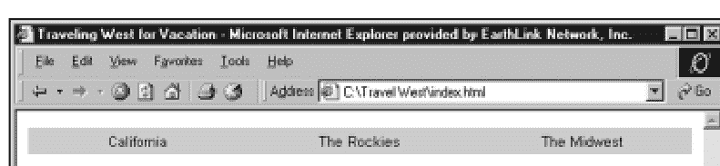

10. 在表格下方，新建一个段落，输入标题“Traveling West”。将其设置为 arial 字体，大小 +4，加粗。

11. 在其下方，添加一个新段落，内容如下：

当你前往西部时，一定要参观加利福尼亚的景点、落基山脉的自然奇观以及中西部的城市。

12. 将新段落设置为 verdana 字体，大小 -1，然后保存页面。

13. 在浏览器中查看该页面。它应如下所示：

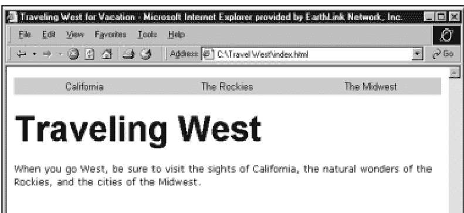

#### 为主分区页面创建导航栏

1.  创建一个新页面，文件名为 california.html。标题为“Vacationing in California”。
2.  创建与首页相同的表格，但改为 4 个单元格而不是 3 个。
3.  按照首页的格式设置表格和文本，但将 California 单元格设为亮黄色（BGCOLOR="#ffff00"）以显示“您在此处”。
4.  完成后，保存页面并在浏览器中查看。表格应如下所示：
5.  将“Home”一词链接到主页（`<A HREF="index.html">Home</A>`），然后保存页面。
6.  在记事本中打开主页。
7.  将“California”一词链接到 California 页面。
8.  保存页面。

> **提示：** 不要忘记更改单元格宽度。现在有四个单元格，它们的宽度总和必须为 100%。这意味着每个单元格占 25%。


#### 练习：创建导航栏

**任务：** 使您的 Travel West 网站看起来像 www.visibooks.com/travelwest 上的网站。

1.  创建一个新的空白页，并将其保存为文件名 midwest.html。它将是 The Midwest 页面，但现在先留空。
2.  创建一个新页面，文件名为 rockies.html。这是 The Rockies 页面。标题为“Nature in the Rocky Mountains”。使其导航栏表格与 California 页面的完全相同。
3.  将“您在此处”的黄色背景色从 California 单元格更改为 The Rockies 单元格。
4.  将 California、The Midwest 和 Home 分别链接到各自的页面。
5.  完成后，在浏览器中预览该页面。它应如下所示：


6.  对 California 和 Midwest 页面重复此过程，使它们拥有显示“您在此处”的功能导航栏。

7.  转到主页，在导航栏中将 The Rockies 和 The Midwest 分别链接到各自的页面。

8.  将所有对应当前页面的文本设置为加粗。（例如：在 The Rockies 页面上将“**The Rockies**”加粗。）

9.  完成后，在浏览器中预览该网站。它应看起来像 **www.visibooks.com/travelwest** 上的网站。

### 为网站添加子分区

#### 插入用于内容和子分区链接的表格

1.  在记事本中，打开 Traveling West 网站中的 California 页面。

2.  在导航栏表格下方，添加另一个表格，该表格包含一行两列。为表格添加以下属性：

```
WIDTH="100%"
BORDER="0"
CELLPADDING="16"
CELLSPACING="0"
```

3.  将第一个单元格宽度设为 25%，第二个单元格宽度设为 75%。

```
<TABLE BORDER="0" WIDTH="100%" CELLPADDING="16" CELLSPACING="0">
<TR>
<TD WIDTH="25%"> </TD>
<TD WIDTH="75%"> </TD>
</TR>
</TABLE>
```

4.  在左侧单元格中，放入 California 主分区的子分区：

The Golden Gate Bridge
Highway 101
Big Sur

5.  在右侧单元格中，输入标题“Places to visit in California”。在标题下方，新建一个段落，输入以下句子：

When in California, be sure to see the Golden Gate bridge, Highway 101, and Big Sur.

6.  将两个单元格的内容都对齐到顶部。

7.  将左侧导航单元格中的文本设置为 arial 字体，大小 -1。

8.  将右侧单元格中的标题设置为加粗、arial 字体、大小 +3。将标题下方的段落设置为 verdana 字体，大小 -1。

9.  完成后，保存页面并在浏览器中预览。该页面应如下所示：


#### 创建子分区页面

1.  为子分区 The Golden Gate Bridge、Highway 101 和 Big Sur 创建新的空白页：

| 页面 | 标题 | 文件名 |
|---|---|---|
| The Golden Gate Bridge | Seeing the Golden Gate Bridge | goldengate.html |
| Highway 101 | Driving Highway 101 | highway101.html |
| Big Sur | Staying in Big Sur | bigsur.html |

2.  从 California 页面复制表格并粘贴到 Golden Gate Bridge 页面。

3.  在 Golden Gate Bridge 页面上，将标题更改为“Seeing the Golden Gate Bridge”。将其大小设为 +2。

4.  在标题下方，将段落更改为：

The Golden Gate Bridge isn't golden--it's actually orange.

5.  将其设置为 verdana 字体，大小 -1。

6.  将 California、Highway 101 和 Big Sur 分别链接到各自的页面。将 The Golden Gate Bridge 保留为纯文本以显示“您在此处”。

7.  完成后，保存页面并在浏览器中查看。它应如下所示：


> **一致的页面布局**

从一个页面复制表格并粘贴到新页面中，可确保所有页面共享相同的布局。

这种一致性使网站导航更容易：无论查看网站中的哪个页面，用户都知道页面的链接和内容将位于何处。

#### 练习：为网站添加子分区

A. 保持表格在页面之间一致的最佳方法是什么？

任务：使您的 Travel West 网站的外观和功能与 www.visibooks.com/travelwest2 上的网站相同。

1.  在记事本中打开 California 页面。将 The Golden Gate Bridge、Highway 101 和 Big Sur 分别链接到各自的页面。
2.  打开 Golden Gate Bridge 页面。复制该页面上的两个表格。
3.  将这些表格粘贴到 Highway 101 页面。
4.  在 Highway 101 页面上，将 The Golden Gate Bridge 一词链接到 Golden Gate Bridge 页面。移除 Highway 101 周围的锚点标签，使其显示为纯文本。
5.  更改 Highway 101 页面的标题及其下方的描述性文本，使其如下所示：


6.  格式化 Big Sur 页面，使其布局和导航与 Golden Gate Bridge 和 Highway 101 页面保持一致。

标题：
**Staying in Big Sur**

段落：
There are many excellent hotels right on the ocean in Big Sur.

7.  保存所有页面。

8.  完成创建此网站 California 分区中的所有页面后，在浏览器中预览。它应看起来和运行起来像 www.visibooks.com/travelwest2。

答案
A. 从一个页面复制并粘贴表格到另一个页面。

#### 在表格内放置表格

1.  在记事本中，打开 Golden Gate Bridge 页面（goldengate.html）。
2.  在主标题下方的段落之前，开始一个新表格，包含：
    - 2 行
    - 每行 1 个单元格
    - WIDTH="200"
    - CELLPADDING="8"

> **提示：** 要创建包含多行的表格，只需在结束上一行后开始一个新行：

```
<TR>
<TD> </TD>
</TR>
<TR>
<TD> </TD>
</TR>
```

注意：宽度是一个数字——200——它以像素为单位渲染宽度，而不是百分比。

3.  将顶部单元格设为蓝色（#0000ff），底部单元格设为灰色（#cccccc）。
4.  在顶部单元格中，输入文字“A Whole Lot of Paint”。将文字居中并加粗。

### 使用框架链接到外部网站

### 如何使用框架

“框架”是一种在计算机屏幕上同时显示多个网页的方式：


可以在 www.visibooks.com/frames 看到框架的实际示例。

许多曾经使用框架的网站现在已经取消了它们，回到了单页布局。这是因为框架存在严重的缺点：

- 框架难以更新。每个屏幕都需要跟踪三个或更多页面：框架集本身，以及至少两个要放入框架的页面。
- 框架导航很棘手。链接需要特殊的“目标”来从页面指向框架。
- 框架通常要求用户在多个地方进行恼人的滚动。

然而，框架在一件事上很有用：它们允许用户在点击链接到其他网站时，只需单击一下即可返回到原始网站。可以在 www.charuhas.com/sites.html 的外部链接中看到一个例子。

以下练习演示了如何使用框架为外部网站提供便捷链接。

1. 在金门大桥页面上，在第一个段落下方的新段落中，输入：

访问金门大桥的网站 www.goldengate.org。

www.goldengate.org 将链接到框架集页面。

2. 创建一个新空白页，文件名为 framesetgg.html。这将是容纳另外两个页面的“框架集”页面。

3. 将以下 HTML 代码插入新空白页：

```
<HTML>

<HEAD></HEAD>

<TITLE>Golden Gate Frameset</TITLE>

<FRAMESET ROWS="50, *">

<FRAME NAME="topframe" SRC="backtogg.html">

<FRAME NAME="bottomframe"
SRC="http://www.goldengate.org">

</FRAMESET>

</HTML>
```

在 www.visibooks.com 免费下载其他 Visibooks

**提示：** `<FRAMESET>` 标签中的 `ROWS="50, *"` 属性告诉框架集将顶部框架设置为 50 像素高，并允许底部框架填充其下方剩余的所有可用空间。

顶部框架将包含返回金门大桥页面的链接。底部框架将包含一个外部网站：www.goldengate.org。


4. 保存 framesetgg.html。
5. 创建一个新页面，文件名为 backtogg.html。这是将包含返回金门大桥页面链接的页面。
6. 为新页面设置浅灰色背景，并在上面放置一个链接：[返回金门大桥页面](#)。
7. 使用带有 `TARGET="_top"` 属性的锚标签链接回金门大桥页面：

```
<A HREF="goldengate.html" TARGET="_top">Back to the Golden Gate Bridge page</A>
```

**提示：** **TARGET="_top"** 属性允许链接到当前框架之外的页面...


...这避免了点击链接后页面在同一个框架中打开的情况：

8. 将链接设置为 Arial 字体，大小 -1，并加粗。
9. 保存页面。

10. 在浏览器中打开 framesetgg.html。它应该看起来像这样：


11. 点击 **返回金门大桥页面** 链接。它应该带你返回金门大桥页面。

**提示：** 要使框架集看起来更清晰整洁，请尝试在 framesetgg.html 中使用以下属性：

```
<HTML>

<HEAD>
</HEAD>

<TITLE>Golden Gate Frameset</TITLE>

<FRAMESET ROWS="28, *" FRAMEBORDER="0">

<FRAME NAME="topframe" SRC="backtogg.html"
MARGINWIDTH="12" MARGINHEIGHT="4"
SCROLLING="NO" NORESIZE>

<FRAME NAME="bottomframe"
SRC="http://www.goldengate.org"
MARGINWIDTH="12" MARGINHEIGHT="12"
SCROLLING="AUTO" NORESIZE>

</FRAMESET>

</HTML>
```

### 练习：布局与导航

A. 为什么在整个网站的页面上，导航链接保持相同的位置和顺序很重要？

B. 要使框架集工作，必须使用的最少文件数量是多少？

**任务：** 让你的 Travel West 网站的外观和功能与 **www.visibooks.com/travelwest3** 上的网站一致。

1. 使用表格布局落基山脉页面，使其看起来像加利福尼亚页面。

*落基山脉页面的标题：*
**落基山脉的自然风光**

2. 为落基山脉主要部分的三个子部分创建页面：

- 溪流
- 雪
- 岩石构造

3. 确保这些页面的链接和布局与金门大桥、101 号公路和大苏尔页面完全相同。

| 页面 | 文件名 | 标题 |
| --- | --- | --- |
| 溪流 | streams.html | 山间溪流 |
| 雪 | snow.html | 落基山脉的雪 |
| 岩石构造 | rocks.html | 岩石构造 |

4. 对网站的中西部部分重复此过程。中西部部分的子部分是：

- 圣路易斯
- 芝加哥
- 得梅因

| 页面 | 文件名 | 标题 |
|---|---|---|
| 中西部 | midwest.html | 中西部城市 |
| 圣路易斯 | stlouis.html | 圣路易斯 |
| 芝加哥 | chicago.html | 芝加哥 |
| 得梅因 | demoines.html | 得梅因 |

5. 在芝加哥页面上，插入一个一行一列、固定宽度为 200 像素、单元格边距为 4 的表格。将其颜色设置为浅黄色（BGCOLOR="#ffffcc"）。

6. 在此表格中，输入句子：“过去，芝加哥是阿尔·卡彭、戴利市长和全国最大牲畜围栏的所在地。”

7. 在圣路易斯页面上，使用框架链接到外部网站 www.stlouis.com。

*圣路易斯页面的段落：*
在 www.stlouis.com 了解圣路易斯的最新动态。

8. 完成后，在浏览器中打开 Travel West 网站。它的外观和功能应该与 www.visibooks.com/travelwest3 上的网站一致。

## 交互性

在本节中，你将学习如何：

- 插入 META 标签
- 创建表单
- 使用样式表格式化文本
- 使用模板
- 将网站上传到 Web 服务器

你将构建一个看起来像这样的网站：


### 插入 META 标签

> **META 标签**

META 标签是 HTML 标签，可以包含页面的描述以及提供内容线索的“关键词”。META 标签使页面更容易被搜索引擎找到和索引。

META 标签不会显示在网页上。相反，它们隐藏在 HTML 代码中。

1. 在记事本中，打开 Travel West 网站的主页。
2. 在 `<HEAD>` 和签名（`<!--your name-->`）标签下方，插入第一个用于描述网站内容的 `<META>` 标签：

```
<HEAD>
<!--Created by Your Name-->
<META NAME="description" CONTENT="This is the Travel West Web site. It contains information about vacationing in California, the Rockies and the Midwest.">
</HEAD>
```

3. 在“description”元标签下方，插入一个新的 <META> 标签用于搜索关键词：

```
<HEAD>
<!--Created by Your Name-->
<META NAME="description" CONTENT="This is the Travel West Web site. It contains information about vacationing in California, the Rockies and the Midwest.">
<META NAME="keywords" CONTENT="traveling, travel, west, California, rockies, midwest, golden gate bridge, highway 101, Big Sur, streams, snow, rock formations, St. Louis, Chicago, De Moines">
</HEAD>
```


#### 创建表单

1. 创建一个新页面，文件名为 infoform.html。
2. 将页面标题设为“信息请求”，并将其保存在硬盘上的 Travel West 文件夹中。
3. 在 <BODY> 标签下方，输入句子：
   填写以下表格以获取更多关于西部旅行的信息：
4. 在句子下方，插入一个 <P> 标签，然后插入一个 <FORM> 标签：
   <BODY>
   填写以下表格以获取更多关于西部旅行的信息：
   <P>
   <FORM>
   </BODY>
5. 在 <FORM> 标签下方，创建一个包含 4 行、每行 2 个单元格的表格。将宽度设置为 50%，单元格边距为 4，边框为 1。

### 让表单生效

要让表单生效，必须为其分配一个操作。要向表单添加操作，请在 **<FORM>** 标签中添加 **ACTION** 属性。

请咨询您的 Web 服务器管理员，以确定应分配何种操作。例如，表单的操作可能类似于这样：

```
<FORM METHOD="POST"
ACTION="http://www.yourdomain.com/cgi-bin/formmail.pl">
```

这会指示表单将其数据发送到您域名上的一个名为 formmail.pl 的程序。该程序可能会获取表单数据，并将其通过电子邮件发送给您指定的任何人。

### 实践：创建表单

1.  创建一个新页面，文件名为 favoritesform.html。将其标题设为“My Favorite Places”。
2.  插入一个表单，然后插入一个包含四行、每行两个单元格的表格。按照下图所示，在单元格中填入文本和表单对象：


**提示：** 下拉列表的 HTML 代码如下所示：

```
<SELECT NAME="select">
<OPTION>First Choice</OPTION>
<OPTION>Second Choice</OPTION>
<OPTION>Third Choice</OPTION>
</SELECT>
```

单选按钮的 HTML 代码如下所示：

```
<input type="radio" name="radios" value="radio1" checked> This is radio button 1
<br>
<input type="radio" name="radios" value="radio2"> This is radio button 2
```

3.  在下拉列表中填入以下值：

-   California
-   The Rockies
-   The Midwest

4.  完成后，保存页面并在浏览器中预览。它应该看起来像这样：


### 使用样式表

#### 样式表的优缺点

样式表是用于布局和格式化网页的灵活而强大的工具。它们允许网站中的每个页面都从一个样式表获取显示指令。

例如，如果您使用样式表创建了一个包含 1,000 个页面的网站，并且您想更改每个页面上的链接颜色，您只需在一个样式表中更改链接颜色即可。如果没有样式表，您将不得不更改 1,000 个单独的页面。

样式表还可以创建显示效果。一个例子可以在 www.visibooks.com 上看到。当您将光标悬停在链接上时，它们会变成下划线——如果您使用的是 Internet Explorer 浏览器查看页面的话。

这就是使用样式表的缺点：不同的浏览器对它们的解释不同。在 Internet Explorer 中查看的基于样式表的页面，其外观可能与在 Netscape Navigator 或其他浏览器中查看时不同。

#### 创建样式表

1.  创建一个新页面，文件名为 format.css。
2.  将其保存在 C:\ 驱动器上一个名为 CSS Site 的新文件夹中。

> **提示：** 这是一个样式表，而不是一个网页。它是一个为网页提供格式化指令但永远不会被看到的文件。它不包含 HTML，并且具有不同的文件扩展名：.css 而不是 .html。

3.  在空白的 format.css 页面上，插入以下指令：

```
.bodytext {font-family:"Courier New", Courier, mono; font-size:11pt; font-weight:bold; color:"#ff0000"; background-color:#ccccff"}
```

以下是 .bodytext 样式的格式化指令的组成部分：

| .bodytext | ➡ 要格式化的文本类型。 |
| font-family | ➡ 文本应显示的字体。计算机会首先查找 Courier New，然后是 Courier，最后是等宽字体。 |
| font-size | ➡ 文本的大小。与 HTML 不同，样式表允许使用特定的磅值大小。 |
| font-weight | ➡ 粗体或普通文本。 |
| color | ➡ 文本的颜色。 |
| background-color | ➡ 更改文本正后方页面区域的颜色。 |

4.  保存 format.css。它应该看起来像这样：


#### 应用样式表

1.  在记事本中，创建一个新的主页，并将其放入 CSS Site 文件夹中。
2.  将主页标题设为“Style Sheet Demo Page”。
3.  在 <BODY> 标签下方，输入文本 CSS Site。使用 <H1> 标签将其设为一级标题：
4.  在其下方的新段落中，输入句子“Cascading Style Sheets are a powerful and flexible tool for formatting Web pages:”
5.  保存页面并在浏览器中查看。它应该看起来像这样：

```
<BODY>
<H1>CSS Site</H1>
```

```
<BODY>
<H1>CSS Site</H1>
<P>Cascading Style Sheets are a powerful and flexible tool for formatting Web pages</P>
```


6.  在 <HEAD> 标签下方，添加一个指向 format.css 的 <LINK> 标签：

```
<HTML>
<HEAD>
<LINK REL="stylesheet" HREF="format.css">
</HEAD>
<TITLE>Style Sheet Demo Page</TITLE>
```

7.  在 <P> 标签中，添加指向 .bodytext 样式的 CLASS 属性：

```
<P CLASS="bodytext">Cascading Style Sheets are a powerful and flexible tool for formatting Web pages.</P>
```

8.  保存主页并在浏览器中查看。它应该看起来像这样：


主页的 `<LINK REL="stylesheet" HREF="format.css">` 标签引用了 format.css 以获取格式化指令。

页面上的段落引用了 format.css 上的 .bodytext 样式以获取格式化指令。

**提示：** 要使用相同的样式表格式化整个网站中的页面，只需在每个网页中插入相同的 `<LINK>` 标签即可。例如，如果 CSS Site 中有 100 个页面，它们都可以包含相同的 `<LINK REL="stylesheet" HREF="format.css">` 标签，并通过使用 `<P CLASS="bodytext">` 标签以相同的方式格式化正文文本。

#### 使用样式表创建链接效果

#### “层叠”样式表

样式指令可以包含在网页本身中，而无需引用单独的样式表。这些指令将覆盖样式表的指令，因此得名“层叠样式表”：

页面文本中的一个指令...

```
<FONT
COLOR="#ff0000">
This is red
text.</FONT>
```

...覆盖了页面的样式指令...

```
<STYLE
TYPE="text/css">
.greentext { color:
"#00ff00" }
</STYLE>
```

```
<BODY>
<P
CLASS="greentext">
This is green text.
```

...而后者又覆盖了网站的样式指令。

```
<LINK REL="stylesheet"
HREF="format.css">
```

```
</HEAD>
```

```
<BODY>
```

```
<P CLASS="bodytext">
This is blue text.
```

以下练习将使用页面内样式。

#### 实践：使用样式表

1.  在记事本中打开 `format.css`。
2.  在 `.bodytext` 样式下方添加以下样式指令：
3.  保存 `format.css`。
4.  打开主页并替换：

```
.heading {font-family: Verdana, Arial, Helvetica, sans-serif; font-size: 48pt}
```

```
<STYLE TYPE="text/css">
<!--
A:link {color:"#ff0000"; text-decoration: none}
A:visited {color:"#ff0000"; text-decoration: none}
A:hover {color:"#00ff00"; text-decoration: underline}
-->
</STYLE>
```

为原始的 `<LINK>` 标签：

```
<LINK REL="stylesheet" HREF="format.css">
```

5.  为 `<H1>` 标签添加 `CLASS="heading"` 属性。

```
<H1 CLASS="heading">
```

6.  保存主页并在浏览器中查看。它应该看起来像这样：


### 将网站上传到 Web 服务器

> FTP

FTP 代表“文件传输协议”，是一种通过互联网在计算机之间传输文件的方式。将网站上传到 Web 服务器需要特殊的 FTP 软件。

用于从服务器上传和下载网页的最流行程序是 WS_FTP。LE 版本是免费的，可以从 www.download.com 或 www.tucows.com 下载。

专业版售价 39.95 美元，也可以在其制造商 www.ipswitch.com 的网站上找到。

以下是使用免费 LE 版本上传文件的说明。

1.  下载 WS_FTP LE 并安装它。
2.  打开程序。你应该会看到一个初始的会话属性窗口。它应该看起来像这样：


3.  单击“新建”按钮。

4.  在“配置文件名称”文本框中，输入你的上传过程的名称，例如“上传我的网站”。

5.  在“主机名/地址”文本框中，输入你的 Web 服务器的名称或 IP 地址。它可以是类似 www.visibooks.com、washington.patriot.net 或 207.176.7.217 的地址。

> **提示：** 联系你的 Web 服务器管理员以获取你的 Web 服务器的主机名或 IP 地址。Web 服务器管理员还可以提供你的用户 ID 和密码。

6.  将“主机类型”设置为“自动检测”，并输入你的用户 ID 和密码。

7.  勾选“保存密码”复选框，然后单击“应用”按钮。会话属性窗口现在应该看起来像这样：


8.  单击“确定”按钮，在联系到你的 Web 服务器后，WS_FTP 窗口将出现。它应该看起来像这样：


9.  在左侧“本地系统”窗口的顶部，双击绿色箭头图标以在文件层次结构中向上移动。再次双击它以进入 C:\ 驱动器。

10. 双击包含你网站的文件夹以将其打开。

11. 在右侧“远程系统”窗口中，双击 `public_html` 文件夹，或指向服务器上你网站的文件夹。

12. 你现在应该能在你的计算机和 Web 服务器上看到你的网页。要发送你的网页，请选中它们，然后单击  按钮将它们发送到 Web 服务器。


> **提示：** 如果你的 Web 服务器上已经有页面，你发送的新页面将替换具有相同文件名的旧版本。

### 实践：交互性

#### 创建新的主页和网站

1.  创建一个标题为“世界舞蹈”的新主页。将其保存在 `C:\Dance`。
2.  为网站创建一个主页，看起来像这样：


> **提示：** 在 www.visibooks.com/dancing 获取此页面的图形和文本。

3.  在此页面和网站中的每个其他页面的底部，放置一个指向 info@worlddance.org 的电子邮件链接。

#### 创建主要部分页面

1.  将导航栏中的“American”、“Latin”和“European”这些词分别链接到关于美洲、拉丁和欧洲舞蹈的新主要部分页面。

> **提示：** 在 www.visibooks.com/dancing 获取这些页面的图像和文本。

美洲舞蹈页面应该看起来像这样：


2.  使拉丁和欧洲页面与美洲舞蹈页面保持一致。

#### 创建子部分页面

1.  在美洲舞蹈页面上，将“Lindy Hop”和“Foxtrot”这些词链接到关于这些舞蹈的新子部分页面。Lindy Hop 页面应该看起来像这样：


**提示：** 在 www.visibooks.com/dancesub 获取此页面和其他子部分页面的图像和文本。

2.  使 Foxtrot 页面与 Lindy Hop 页面保持一致。

3.  为拉丁部分创建子部分页面 Tango、Merengue 和 Salsa。

4.  为欧洲部分创建子部分页面 Waltz 和 Contra Dancing。

#### META 标签

1.  在主页中包含此 META 描述：

   《世界舞蹈》包含有关美洲、拉丁和欧洲舞蹈的信息。

2.  在主页中包含这些 META 关键词：

   舞蹈，世界，探戈，梅伦格，萨尔萨，林迪跳，狐步舞，华尔兹，对舞。

#### 创建表单

1.  在主页上，插入一个看起来像这样的表单：


2.  完成后，在浏览器中预览整个网站。它应该看起来像 www.visibooks.com/worlddancing 上的网站。

## 高级布局

在本节中，你将学习如何：

-   使用背景图像
-   使用间隔 GIF
-   插入水平线
-   指定页边距

你将创建一个看起来像这样的页面：


### 使用背景图形

1.  打开记事本。
2.  创建一个包含所有必要 HTML 标签和一个两列表格的新页面：
    行数：1
    列数：2
    宽度：100%
    边框：0
    单元格边距：18
    单元格间距：0
3.  将文件保存在计算机桌面上，文件名为 `advlayout.html`。将其标题设为“高级布局”。


4.  将表格中的两个单元格都设置为深蓝色背景色（#000099）。
5.  使第一个单元格宽度为 10%，第二个单元格宽度为 90%。

6.  转到 www.visibooks.com/advlayout/pics 并将 `techtool.gif` 保存在计算机桌面上。将其插入左侧单元格。

7.  转到 www.visibooks.com/advlayout/pics 并将 `bkgd.gif` 保存在计算机桌面上。使用 `BACKGROUND` 属性将其设为右侧单元格的背景：

```
<TD WIDTH="90%" BGCOLOR="#000099" BACKGROUND="bkgd.gif">
```

8.  在右侧单元格中，输入文本“The Magazine for People Who Like Gadgets”。

9.  将文本设为 Arial 字体，大小 +1，加粗。

10. 将文本颜色设为白色。

11. 在浏览器中预览页面。它应该看起来像这样：


**提示：** 注意单元格底部附近 `bkgd.gif` 开始重复的那条线。它重复是因为背景图形会平铺以填充单元格中的所有可用空间。该单元格高 136 像素：`techtool.gif` 占 100 像素，加上单元格边距 36 像素（`techtool.gif` 上下各 18 像素）。

`bkgd.gif` 只有 123 像素高；因此，还剩下 13 像素的空间需要填充。要解决此问题，请使用图像编辑程序（如 Photoshop、Fireworks 或 Paint Shop Pro）将背景图像调整为 136 像素高。

### 使用间隔 GIF 图片

> **为什么使用间隔 GIF 图片？**

间隔 GIF 图片用于将表格单元格拉伸到精确宽度。它们是透明的，因此无论单元格背景颜色如何，它们都保持不可见。

下面的练习中使用了一个间隔 GIF 图片。无论用于查看它的屏幕大小或分辨率如何，它都能保持左侧单元格的宽度恒定。

1.  前往 **www.visibooks.com/advlout/pics** 并将 **spacer.gif** 保存到您计算机的桌面上。
2.  在顶部两个表格下方，插入第三个表格，与第一个表格相同。
3.  在左侧单元格中插入 **spacer.gif**。将其宽度设为 100，高度设为 1。

```
<TD WIDTH="10%" BGCOLOR="#000099"></TD>
```

**提示：** 大多数间隔 GIF 图片是 1x1 像素，在线加载非常快。这个图片最初是 50x50，以便更容易查看和保存。

4.  将包含 **spacer.gif** 的单元格背景颜色更改为亮黄色（**#ffff00**）。
5.  在右侧单元格中放入文本，使页面在浏览器中查看时如下所示：


6.  将浏览器设置为高分辨率——1024x768 像素。页面应如下所示：


请注意，无论用于查看它们的浏览器宽度如何，顶部和底部表格中的左侧单元格都保持相同的宽度。

### 插入水平线

1.  在右侧单元格的文本下方，插入一个 `<P>` 标签，然后是水平线的标签：

您可以阅读我们的产品评论，也可以对高科技产品发表您自己的意见和看法。
<P>
<HR>

2.  这会生成一条 3D 线条。为了使其外观更简洁，请在 `<HR>` 标签中添加 **NOSHADE** 和 **SIZE="1"** 属性：

<HR NOSHADE SIZE="1">

3.  在水平线下方放置文本，使其在浏览器中查看时如下所示：


### 指定页边距

1.  在 `<BODY>` 标签中，添加 **LEFTMARGIN**、**RIGHTMARGIN**、**TOPMARGIN**、**MARGINWIDTH** 和 **MARGINHEIGHT** 属性。将它们的值都设为零：

```html
<BODY LEFTMARGIN="0" RIGHTMARGIN="0" TOPMARGIN="0" MARGINWIDTH="0" MARGINHEIGHT="0">
```

> **提示：** **LEFTMARGIN**、**RIGHTMARGIN** 和 **MARGINWIDTH**（以及 **TOPMARGIN** 和 **MARGINHEIGHT**）属性是冗余的，以适应浏览器差异：Internet Explorer 识别 **LEFTMARGIN**、**RIGHTMARGIN** 和 **TOPMARGIN**，而 Netscape Navigator 识别 **MARGINWIDTH** 和 **MARGINHEIGHT**。

2.  为包含页面文本的单元格指定白色背景（`#ffffff`）。为页面本身指定深蓝色背景（`#000099`）。


3.  保存页面并在浏览器中查看。完成后，它应如下所示：


### 练习：高级布局

1.  给导航表格（包含笔记本电脑、手机和 PDA 的那个）五个单元格。
2.  在包含手机的单元格周围的单元格中放置 | 字符（与键盘上的反斜杠 \ 字符在同一键上）。
3.  将包含 | 字符的单元格宽度设为 1%，并将 | 字符在单元格内居中。
4.  将 | 字符颜色设为白色。完成后，页面应如下所示，如 www.visibooks.com/advancedlayout：


## 实用 JavaScript

在本节中，您将学习如何：

-   启用悬停图形
-   打开新窗口
-   验证表单输入

您将整合如下所示的函数：


创建悬停图形链接


打开新窗口


验证表单

### 启用悬停图形

什么是 JavaScript？

JavaScript 是一种嵌入在网页 HTML 代码中的编程语言。它不是像 C++、Java 或 Perl 那样用于编程 Web 服务器的工业级语言。相反，JavaScript 用于在网页内执行简单功能。

以下部分将向您展示如何使用 JavaScript 最有用的三个函数。它不会教您如何用 JavaScript 编写程序。学习一门编程语言就是学习一门新语言，这可能需要数月或数年才能掌握。相反，您将学习如何获取可用的 JavaScript 脚本并修改它们以实现您想要的功能。

这种方法快速有效。网络上有成千上万的免费 JavaScript 脚本，可以执行您想在网页上做的任何事情——您所要做的就是自定义它们。

使用源代码

有时您会看到一个网页，然后对自己说：“我想知道他们是怎么做到的？”通过查看页面的 HTML 和 JavaScript 源代码，您可以找到答案。

您还可以复制源代码，将其粘贴到您正在处理的页面中，并进行修改。由于这很容易做到，网页的源代码通常不受版权保护。

以下练习向您展示如何复制、粘贴和修改现有的 JavaScript，以便在您的网页上放置悬停图形链接。

### 查看源代码

1.  在您的硬盘驱动器上创建一个名为“rollover”的文件夹，路径为 C:/rollover。
2.  使用浏览器，访问 www.visibooks.com/advancedlayout。
3.  通过单击“查看”，然后单击“源代码”来查看页面的源代码。


### 复制源代码

1.  一个标题栏中带有 advancedlayout(1) 的记事本副本将出现。选择所有 HTML，然后复制它。


2.  在记事本中创建一个新的空白页面，并将所有复制的 HTML 代码粘贴到其中。
3.  将页面保存在 C:\rollover，文件名为 index.html。
4.  在 rollover 文件夹内创建一个名为 graphics 的文件夹：C:\rollover\graphics。
5.  前往 www.visibooks.com/rolloverpics。捕获那里的所有六个图形并将它们保存在 graphics 文件夹中。
6.  前往 **www.visibooks.com/rollover**。导航栏中的图形是悬停链接：


7.  查看其源代码，并突出显示 **<SCRIPT>** 和 **</SCRIPT>** 标签之间（包括这两个标签）的所有代码。它位于 **<HEAD>** 和 **</HEAD>** 标签之间：


8.  复制此 JavaScript 代码。
9.  将 JavaScript 代码粘贴到 index.html 中的 **<HEAD>** 和 **</HEAD>** 标签之间。

### 修改源代码

1.  您会注意到 JavaScript 中指定的图形名称（laptops2.gif、laptops.gif、cellphones2.gif...）与您 graphics 文件夹中的图形名称不对应。

修改源代码以指定您图形的正确文件名：


2.  返回浏览器中的 **www.visibooks.com/rollover**，并查看页面的源代码。向下滚动，直到看到第二个表格的代码，即定义黑色导航栏的那个表格。
3.  突出显示并复制带有 **onMouseOver** 和 **onMouseOut** 属性的锚点标签、结束锚点标签（`</a>`）以及它们内部的图像标签。它链接到 laptops.html：


4.  在 index.html 中，删除包含 | 字符的两个单元格。

### 实践：启用翻转图形

- 1. 在 index.html 的导航栏中，将“Cell Phones”和“PDAs”这两个词替换为翻转图形。使用图形 cellbright.gif、cell.gif、pdabright.gif 和 pda.gif。

**提示：** 修改第一个单元格中的锚点标签和图像代码，以便在其他两个单元格中使用。

```
<A HREF = "laptops.html"
onMouseOver = "imgOn('img1')"
onMouseOut = "imgOff('img1')"></A>
```

- 2. 完成后，保存页面并在浏览器中查看。它应该看起来像这样：


### 打开新窗口

- 1. 在记事本中，打开 Travel West 网站的主页：位于 C:\Travel West 的 index.html。
- 2. 在浏览器中，访问 www.visibooks.com/newwindow。
- 3. 查看该页面的源代码。高亮并复制 `<HEAD>` 和 `</HEAD>` 标签之间的 JavaScript 代码。


- 4. 将其粘贴到 index.html 中 `<META>` 标签的下方：


- 5. 修改 JavaScript 代码，使其在新窗口中打开 infoform.html：

从这个：

```
<SCRIPT LANGUAGE="JavaScript">
    function Contact()
    {
        OpenNewWindow =
            window.open('contact.html', 'help', 'toolbar=no,location=0,directories=no,status=yes,menubar=0,scrollbars=yes,resizable=yes,width=300,height=350');
    }
</SCRIPT>
```

改为这个：

```
<SCRIPT LANGUAGE="JavaScript">
    function Contact()
    {
        OpenNewWindow =
            window.open('infoform.html', 'help', 'toolbar=no,location=0,directories=no,status=yes,menubar=0,scrollbars=yes,resizable=yes,width=300,height=350');
    }
</SCRIPT>
```

**提示：** JavaScript 不是 HTML——它是一种编程语言。它在值周围没有引号时工作得更好。此外，不要更改脚本中有效单词的大小写。与 HTML 不同，JavaScript 区分大小写。

- 6. 再次在 www.visibooks.com/newwindow 查看源代码。
- 7. 在 `<BODY>` 和 `</BODY>` 标签之间找到引用 JavaScript 函数 `Contact()` 的锚点标签。

```
<FONT FACE="arial" SIZE="+1"><B><A HREF="javascript:Contact()">Open new window with form inside</A></B></FONT>
```

> 提示：函数是程序执行的一项任务。上面的函数名为 `Contact()`。它的任务是打开允许人们联系 Visibooks 的窗口。

- 8. 复制锚点标签，然后将其粘贴到 index.html 中，使其将第二句话链接到

从这个：

```
<A HREF="infoform.html">Get more information about Western travel mailed to you</A>
```

改为这个：

```
<A HREF="javascript:Contact()">Get more information about Western travel mailed to you</A>
```

- 9. 保存 index.html 并在浏览器中查看。
- 10. 单击链接的句子。应该会弹出一个包含表单的新窗口：


**提示：** 要更改弹出窗口的大小和外观，请更改 `window.open` 后的值：

```
OpenNewWindow = window.open('contact.html', 'help', 'toolbar=no, location=0, directories=no, status=yes, menubar=0, scrollbars=yes, resizable=yes, width=300, height=350')
```


### 验证表单输入

#### 了解其工作原理

- 1. 在记事本中，打开 Travel West 站点中的 infoform.html。
- 2. 在浏览器中，访问 www.visibooks.com/validate。
- 3. 单击“Send me info”按钮。执行此操作时，应出现一个警告窗口。当您输入姓名并单击按钮时，应出现另一个警告窗口，显示“Please input your address.”。这同样适用于电子邮件输入。


#### 插入验证脚本

- 1. 在 www.visibooks.com/validate 查看页面源代码，并复制 `<HEAD>` 标签之间的 JavaScript：

```
<script>
<!--
function validate()
{
if (document.info.name.value=="")
{
alert ("Please input your name.")
return false
}
if (document.info.address.value=="")
{
alert ("Please input your address.")
return false
}
if (document.info.email.value=="")
{
alert ("Please input your e-mail address.")
return false
}
}
// -->
</script>
```

> 注释标签将脚本隐藏在旧的、不支持 JavaScript 的浏览器中，这样它们就不会显示它。

**提示：** 这是一个解释 `if` 语句变量的图表：


- 2. 将其粘贴到 infoform.html 的 `<HEAD>` 标签之间。

#### 修改 `<FORM>` 标签

- 1. 为 `<FORM>` 标签添加一个 **NAME** 属性。将表单命名为“info”。

```html
<FORM NAME="info" METHOD="POST"
action="http://www.yourserver.com/cgi-bin/formmail.pl">
```

- 2. 为 `<FORM>` 标签添加 **ONSUBMIT** 属性。告诉表单，当单击提交按钮时，执行函数 **return validate()**：

```html
<FORM NAME="info" METHOD="POST"
ONSUBMIT="return validate()"
action="http://www.yourserver.com/cgi-bin/formmail.pl">
```

- 3. 保存页面。注意 JavaScript 的 `if` 语句输入变量如何与表单的输入字段同名：

```
<script>
<!--
function validate()
{
if(document.info.name.value=="")
{
alert ("Please input your name.")
return false
}
if(document.info.address.value=="")
{
alert ("Please input your address.")
return false
}
if(document.info.email.value=="")
{
alert ("Please input your e-mail address.")
return false
}
}
// -->
</script>
```

```
<TABLE WIDTH="50%"
CELLPADDING="4"
BORDER="0"><TR><TD
WIDTH="5%"><P
ALIGN="right">Name:</TD>
<TDWIDTH="45%"><INPUT
TYPE="text" NAME="name"
SIZE="20"></TD></TR>
<TD><P ALIGN="right">Address:</TD>
<TD><INPUT TYPE=TEXT
NAME="address" SIZE="20">
</TD></TR>
<TD><P ALIGN="right">E-
mail:</TD><TD><INPUT TYPE="text"
NAME="email" SIZE="20">
</TD></TR><TD></TD><TD><INPUT
TYPE="submit" VALUE="Send me
info"></TD></TR></TABLE>
```

- 4. 在浏览器中查看 infoform.html。它应该看起来和工作起来像 **www.visibooks.com/validate** 上的表单。

## 附加资源

**Webmonkey (www.webmonkey.com)**
一个为构建网站的人们提供的操作指南网站，充满了优秀的教程和资源。

**EchoEcho (www.echoecho.com)**
教程比 Webmonkey 更多，而且都清晰详细。包含有关浏览器使用情况、监视器设置、平台以及用于查看网页的其他技术的有用统计数据。

**Project Cool (www.projectcool.com)**
为构建网站的人们提供知识、指导和灵感。它包括一个很好的样式表指南，位于 projectcool.com/developer/reference/css_style.html。

**Web Review (www.webreview.com)**
一个面向 Web 开发者的敏锐且信息丰富的网站，包含创作、设计、开发、电子商务、多媒体和后端 Web 服务器编程等部分。

**HTML Help (www.htmlhelp.com)**
一个优秀的资源网站，包含大量关于样式表和 HTML 技术标准的信息。包括在线工具，如 HTML 验证器、链接检查器和 ASCII 字符指南。

**HTML & XHTML: The Definitive Guide (书籍)**
Chuck Musciano, Bill Kennedy, O’Reilly; ISBN: 059600026X
像大多数 O’Reilly 书籍一样，面向程序员。一本全面的 HTML 资源，但更好的是，一本关于如何让 HTML 与 XML——Web 开发中的“下一个大事件”——协同工作的指南。

**Voodoo’s Introduction to JavaScript (rummelplatz.uni-mannheim/~skoch/js/tutorial.htm)**
最早的 JavaScript 教程之一，至今仍然优秀。解释了 JavaScript 编程的“为什么”以及“如何”。

**HomeSite**
所有 HTML 编辑程序之母。允许在整个站点中进行搜索和替换，并包含许多其他有用的功能。在 www.allaire.com 下载 30 天试用版。

## HTML 标签速查表

| 任务 | 标签 | 示例 |
| :--- | :--- | :--- |
| 创建网页 | `<HTML>`<br>`<HEAD></HEAD>`<br>`<TITLE></TITLE>`<br>`<BODY></BODY>`<br>`</HTML>` | `<HTML>`<br>`<HEAD>`<br>*签名、元标签、JavaScript、样式表放在这里*<br>`</HEAD>`<br><br>`<TITLE>`<br>*页面标题放在这里*<br>`</TITLE>`<br><br>`<BODY>`<br>*任何你想在屏幕上显示的内容放在这里*<br>`</BODY>`<br><br>`</HTML>` |

格式化文本

| 任务 | 标签 | 示例 |
| :--- | :--- | :--- |
| 创建段落 | `<P>` | 这是一个段落。 |
| 段落右对齐；段落居中 | `<P ALIGN="right"></P>`<br><br>`<P ALIGN="center"></P>` | 此段落通过使用 ALIGN 属性在单元格中居中。 |
| 使文本加粗 | `<B></B>` | 此文本为粗体。 |
| 缩进文本 | `<UL></UL>` | 此文本已缩进 |
| 创建项目符号列表 | `<UL>`<br>`<LI>`<br>`</UL>` | • 列表项<br>• 列表项 |
| 创建编号列表 | `<OL>`<br>`<LI>`<br>`</OL>` | 1. 项目 #1<br>2. 项目 #2 |

| 任务 | 标签 | 示例 |
| :--- | :--- | :--- |
| **创建链接** | | |
| 链接到站内页面 | `<A HREF="x.html">x</A>` | 此句子链接到关于 X 主题的页面。 |
| 创建电子邮件链接 | `<A HREF="mailto:you@x.com">x</A>` | [you@x.com](mailto:you@x.com) |
| 链接到外部页面 | `<A HREF="http://www.x.com">x</A>` | [此句子链接到 www.x.com。](http://www.x.com) |
| **插入图形** | | |
| 插入图形 | `` |  |
| 图形右对齐或左对齐 | ``<br>`` | 当图形右对齐或左对齐时，文本会流入图形的侧面。 |
| 在图形周围添加垂直、水平间距 | ``<br>`` | 在图形周围创建垂直和水平空间，其他内容无法占据。 |
| 移除/添加边框 | ``<br>`` |  |
| **插入水平线** | | |
| 创建水平线 | `<HR>` | ------------------- |
| 移除 3D 效果，指定大小 | `<HR NOSHADE SIZE="1">` | ------------------- |

在 www.visibooks.com 免费下载其他 Visibooks

### 更改整个页面

| 任务 | 标签 | 示例 |
|---|---|---|
| 更改背景颜色 | `<BODY BGCOLOR="#cccccc">` | 灰色背景的页面 |
| 更改链接、已访问链接颜色 | `<BODY LINK="#ff0000" VLINK="#00ff00">` | 红色链接<br>绿色链接 |
| 更改页面边距 | `<BODY TOPMARGIN="0" LEFTMARGIN="0" RIGHTMARGIN="0" MARGINWIDTH="0" MARGINHEIGHT="0">` | 页面上的文本和图形延伸到其边缘。 |

### 创建表格

| 任务 | 标签 | 示例 |
|---|---|---|
| 插入表格 | `<TABLE><TR><TD></TD><TD></TD></TR></TABLE>` |  |
| 指定宽度 | `<TABLE WIDTH="100%"><TR><TD WIDTH="20%"></TD><TD WIDTH="80%"></TD></TR></TABLE>` | 20% | 80% |
| 指定边框 | `<TABLE BORDER="0">` |  |
| 单元格内边距 | `<TABLE CELLPADDING="16">` | 单元格内容距离单元格边缘内缩 | 16 像素 |
| 单元格间距 | `<TABLE CELLSPACING="24">` | 单元格之间分隔 | 24 像素 |

| 任务 | 标签 | 示例 |
| :--- | :--- | :--- |
| 更改单元格背景颜色 | `<TDBGCOLOR="#000000">` |  |
| 在单元格中插入背景图像 | `<TDBACKGROUND="x.gif">` |  |

### 使用框架

创建框架集

```
<HTML>
<HEAD></HEAD>
<TITLE></TITLE>
<FRAMESET ROWS="50,*">
<FRAME NAME="topframe"
SRC="x.html">
<FRAME NAME="bottomframe"
SRC="y.html">
</FRAMESET>
</HTML>
```

### 包含表单

建立表单

```
<FORM>
```

插入文本框

```
<FORM>
<INPUT TYPE="text">
```

指定大小

```
<INPUT TYPE="text" SIZE="20">
```

指定名称

```
<INPUT NAME="x">
```

插入复选框

```
<INPUT TYPE="checkbox">
```

插入单选按钮

```
<INPUT TYPE="radio">
```

使只有一个可点击

```
<INPUT TYPE="radio"
NAME="radiobut"
VALUE="radio1">

<INPUT TYPE="radio"
NAME="radiobut"
VALUE="radio2">
```

| 任务 | 标签 | 示例 |
| :--- | :--- | :--- |
| 插入下拉列表 | `<SELECT NAME="x">`<br>`<OPTION>x</OPTION>`<br>`<OPTION>x</OPTION>`<br>`<OPTION>x</OPTION>`<br>`</SELECT>` | `<SELECT NAME="x">`<br>`<OPTION>第一选择</OPTION>`<br>`<OPTION>第二选择</OPTION>`<br>`<OPTION>第三选择</OPTION>`<br>`</SELECT>` |
| 插入注释字段 | `<TEXTAREA NAME="x" COLS="22" rows="8"></TEXTAREA>` | |
| 插入提交按钮 | `<INPUT TYPE="submit">` | |
| 更改按钮上的文本 | `<INPUT TYPE="submit" VALUE="你的文本放在这里">` | |

| 任务 | 标签 | 示例 |
| --- | --- | --- |
| **使用样式表** | | |
| 创建样式表 | 将文件保存为 .css 扩展名。 | stylesheetname.css |
| 创建样式 | .stylename {} | |
| 指定字体族 | .stylename { font-family:"arial,sans-serif" } | |
| 指定字体大小 | .stylename { font-size:"32pt" } | |
| 指定字体粗细 | .stylename { font-wight:"bold" } | |
| 指定字体颜色 | .stylename { color:"#0000ff" } | |
| 指定背景颜色 | .stylename { background-color:"#cccc99" } | |
| 链接到样式表 | <LINK REL="stylesheet" HREF="stylesheetname.css"> | |
| 应用样式 | <P class="stylename"> <H2 class="stylename"> | |
| 创建悬停效果 | A:hover{ color:"#00ff00"; text-decoration: underline } | |

## 索引

+   - **浏览器**
    - Internet Explorer ........................................................................................................ 11
    - Netscape Communicator.............................................................................................. 11
    - 查看页面 .............................................................................................................. 11
- **颜色**
    - 十六进制................................................................................................................... 50
    - 链接................................................................................................................................... 52
    - 页面................................................................................................................................. 50
    - 表格单元格....................................................................................................................... 65
- **表单**.............................................................................................................................. **102**
    - 动作............................................................................................................................. 108
    - 验证...................................................................................................................... 154
- **框架**.............................................................................................................................. **91**
    - 框架集......................................................................................................................... 92
- **图形**
    - 对齐 .......................................................................................................................... 38
    - 背景................................................................................................................... 132
    - 捕获....................................................................................................................... 34
    - 版权....................................................................................................................... 35
    - 格式化..................................................................................................................... 41
    - 插入......................................................................................................................... 36
    - 悬停.......................................................................................................................... 142
    - 间隔符.......................................................................................................................... 135
    - 用作链接 ................................................................................................................ 47
- **主页**
    - 创建 .......................................................................................................................... 4
    - 文件名 ......................................................................................................................... 7
- **水平线**.............................................................................................................. **137**
- **JavaScript**....................................................................................................................... **141**
    - 表单验证............................................................................................................ 155
    - 打开新窗口..................................................................................................... 150
    - 编程.............................................................................................................. 142
    - 悬停效果........................................................................................................................ 149
- **链接**
    - 电子邮件.............................................................................................................................. 31
    - 外部站点 ................................................................................................................ 33
    - 目标 .............................................................................................................................. 94
    - 链接到新页面.................................................................................................................. 25
- **导航**
    - 导航栏.................................................................................................................................. 76
    - 线索............................................................................................................................... 27
    - 系统............................................................................................................................ 44
    - 当前位置.................................................................................................................. 46

### 软件

- 记事本 ............................................................................................................4

## 源代码 ............................................................................................................143

- 复制 ............................................................................................................144
- 修改 ............................................................................................................146

## 样式表 ............................................................................................................111

- 应用 ............................................................................................................114
- 创建 ............................................................................................................112
- 链接效果 ............................................................................................................117

## 表格 ............................................................................................................58

- 边框 ............................................................................................................62
- 创建 ............................................................................................................59
- 格式化 ............................................................................................................63
- 嵌套表格 ............................................................................................................88
- 宽度 ............................................................................................................63

### 标签

- <A>（锚点） ............................................................................................................28
- <BODY> ............................................................................................................9
- <FONT> ............................................................................................................15
- <HEAD> ............................................................................................................7
- <HTML> ............................................................................................................4
-  ............................................................................................................39
- <META> ............................................................................................................100
- <P> ............................................................................................................19
- <TABLE> ............................................................................................................59
- <TITLE> ............................................................................................................9

### 文本

- 对齐 ............................................................................................................19
- 居中 ............................................................................................................77
- 更改颜色 ............................................................................................................18
- 更改字体 ............................................................................................................14
- 更改大小 ............................................................................................................16
- 更改粗细 ............................................................................................................17
- 创建列表 ............................................................................................................23
- 缩进 ............................................................................................................21
- 网页字体 ............................................................................................................15

## 上传 ............................................................................................................121

- FTP ............................................................................................................121

### 网页

- 一致的布局 ............................................................................................................85
- 布局 ............................................................................................................58
- 页边距 ............................................................................................................138
- 合适的文件名 ............................................................................................................26
- 标题 ............................................................................................................8

## 网络服务器 ............................................................................................................123

在 www.visibooks.com 免费下载其他 Visibooks

## 免费下载 Visibooks

**所有 Visibooks 均可在 www.visibooks.com 下载。**
Visibooks 认为，在决定购买哪本计算机书籍时，您不应该依赖陌生人的评论或在书店里匆匆浏览。通过将我们的书籍在线提供给您下载和审阅，我们让找到合适的书籍变得更容易。

**Visibooks 是免费的。为什么要购买装订版？**
纸质版的 Visibooks 比数字文件更有用。如果您愿意用少量金钱换取大量时间，请购买您的 Visibook 的装订版：

| | 自行打印 | 购买装订版 |
|---|---|---|
| **打印** | 花 1-2 小时在家打印，或在工作时花 30 分钟试图不被发现使用办公室打印机。另外花 1-2 小时去 Kinko's，装订好，然后带回来。或者花 5 分钟捡起并整理用夹子装订后散落的页面。 | 2 分钟下单 |
| **装订** | 花 $1.50 买 150 张纸，加上 $2 的打印机墨盒损耗，再加上 $8 的塑料梳式装订。 | 不到 $20 即可获得一本螺旋装订的副本，印在重磅纸上，配有全彩封面。 |
| **总计** | 花 30 分钟到 4 小时。花费 $3.50 到 $11.50。 | 2 分钟，运费不到 $25。 |

**认识想免费下载 Visibooks 的人吗？**
告诉某人关于 Visibooks 的信息：www.visibooks.com/refer.html。

**想知道新 Visibooks 何时发布吗？**
注册通过电子邮件接收通知：www.visibooks.com/notify.html。

其他关于网络出版的书籍来自


### 面向视觉学习者的 FrontPage 2000

教授人们如何使用 FrontPage 2000 构建网站。涵盖了与之前版本相比的改进。


### 面向视觉学习者的 Dreamweaver 4

涵盖了这款最易于使用的网站构建程序之一的基础和高级功能。


### 视觉学习者的 Web 项目管理指南

超越网站构建的具体细节，向人们展示如何规划、组织、构建和管理有效的网站。