# HTML 和 JavaScript 快速启动指南

HTML 快速启动指南和 JavaScript 快速启动指南（HTML 5、JavaScript、HTML 和 CSS）

# HTML 快速入门指南

简化版 HTML 初学者指南

## 跳转至

[JavaScript 快速入门指南](#)

## 结论

## 术语表

## 您的免费礼物：免费有声书与 ClydeBank Media VIP 会员资格

### 什么是 ClydeBank Media VIP 会员资格？

ClydeBank Media VIP 会员将免费获得我们新发布书籍的 Kindle 版、平装版和有声书格式。作为回报，我们只需要您对书籍提供诚实、公正的反馈。

在阅读或聆听后，告诉我们您喜欢这本书的哪些方面，不喜欢哪些方面。就这么简单。

### 有什么附加条件吗？

没有附加条件。VIP 会员通过提供关于我们产品的重要反馈，在确保我们满足客户需求方面发挥着至关重要的作用。这种反馈使我们能够不断改进内容，以确保客户获得最好的产品。

来自 VIP 会员的反馈不仅为我们提供了宝贵的数据，而且对潜在客户的购买决策也有直接影响。

### 立即获取免费有声书！

当您今天注册时，您将**立即获得**我们来自 iTunes 和 Audible 的畅销有声书**《如何将阅读速度提高 5 倍》**，以及相关的配套 PDF 和练习指南，该指南将引导您完成有声书中讨论的不同速读和理解技巧的练习。

这本有声书在线通常售价**6.95 美元**，但如果您今天注册成为 VIP 会员，您可以获得一个*免费*的下载版本。

每个人都希望提高阅读速度并记住所有内容，对吧？

我们会向您展示如何做到。

*或者访问我们的网站*：[www.clydebankmedia.com/vip-kindle](http://www.clydebankmedia.com/vip-kindle)

## 第 1 章：HTML 简介

超文本标记语言，更广为人知的 HTML，是万维网（WWW）的语言。了解 HTML 是任何网页设计师的核心技能之一，因此应该是您最早掌握的技能之一。

在本书中，我们将学习关于 HTML 的所有知识，从理解 HTML 文档到编写完全符合 HTML5 标准的网页。首先，我们将专注于 HTML 语法、标签和属性的基础知识，并学习文档结构化的过程。接下来，我们将学习构成 HTML 语言主体的最常见元素，如段落、标题、列表和表格。最后，我们将探讨旨在创建更有意义文档的 HTML5 分节元素，这反过来将帮助我们创建具有更丰富语义的页面。

### HTML 术语

如前所述，HTML 是超文本标记语言的缩写。如果我们仔细观察这个全称，它的意思是*用于标记超文本的语言*，而“标记”是关键词。标记语言指的是一种纯文本语言，与编程毫无关系。单词“超”象征着这种语言的网络特性。在概念形成时，“超文本”是一个流行词，表示文档之间的链接。

### 元素与标签

尽管我们今天看到的网页可能充满了文本、图片和视频，但在这些表面之下，是一个充满 HTML 文本的单个长文件。当我们“请求”浏览器加载一个网页时，浏览器会检索一个用 HTML 编写的文档，这是一种我们的浏览器能够理解并解释的语言。文本中的“标记”指示浏览器内容从哪里开始、到哪里结束以及它们起什么作用。

为了准备一个用于网络的文档，我们需要通过一个简单的过程：使用一组称为标签的特定文本元素来标记文本。标签是网页的基本构建块，本质上是放置在`<`和`>`字符之间的保留字。例如，元素`<html>`就代表一个标签。

HTML 中所有的标签都是成对出现的，这意味着有一个标签表示元素的开始，也称为**开始标签**，还有一个标签表示元素的结束，称为**结束标签**。开始标签和结束标签具有相同的名称，唯一的区别是结束标签的名称前面总是有一个斜杠字符`/`。

例如，以下 HTML 代码：

```html
Carl <strong>Jung</strong>
```

将在页面上显示为：

Carl **Jung**

当网络浏览器读取 HTML 文档并遇到`<strong>`元素时，它不会在网页上显示文本`<strong>`。相反，当浏览器遇到一个标签时，它会将其解释为一个命令，以特定的、预定义的方式显示文本。在这个例子中，当遇到`<strong>`标签时，浏览器解释为从这一点开始，文本被标记为加粗的、更重要的文本，并将其显示为粗体，直到遇到结束标签`</strong>`。

> **注意：** 虽然标记的文本在浏览器中具有默认的“外观”，但 HTML 元素的实际视觉呈现是由另一组称为级联样式表（CSS）的规则控制的。

重申一下，在 HTML 术语中，一个**元素**指的是开始标签、结束标签以及它们之间编写的所有内容。开始标签和结束标签之间的内容称为**元素内容**。在上面的例子中，`<strong>Jung</strong>`是一个元素，‘Jung’是元素内容，‘<strong>’是该元素的开始标签，而‘</strong>’是该元素的结束标签。

### 空元素

一些 HTML 元素不包含任何元素内容，这意味着开始标签和结束标签之间确实没有任何内容，既没有文本，也没有其他元素。然而，这些元素仍然可以包含属性。空 HTML 元素的例子包括``元素（包含如何显示图像的信息）和`<br>`元素（仅表示换行）。

**空元素**可以按照常规方式编写，带有开始和结束标签，例如`<br></br>`。HTML 允许通过在开始标签的右尖括号之前直接包含结束斜杠来合并两个标签的选项，例如`<br />`。在 HTML5 中，空元素不再要求有结束标签，可以完全省略。

#### 属性

属性可以通过向 HTML 元素添加额外的属性来扩展标签的上下文和功能。属性以如下形式指定特定值：

```text
attributename=”attributevalue”
```

属性名/值对紧跟在开始标签的保留字之后。一些属性用于提供必要信息，例如图片的位置或链接应指向的位置，而另一些则只是帮助赋予元素含义。例如，假设我们希望之前的示例中的“Carl Jung”文本被定义为一个链接：

```html
<a>Carl Jung</a>
```

然而，要定义链接实际指向的网页，就需要使用`href`属性扩展`<a>`标签的功能。在我们的示例中，我们希望将文本链接到`www.carljung.com`网页。

```html
<a href=”http://www.carljung.com”>Carl Jung</a>
```

每个 HTML 元素都有一组有效的属性和这些属性的有效值。一个标签的属性可以通过多个属性来扩展。所有属性都包含在同一个元素的开始标签中，并用空格分隔。例如，下面的代码同时定义了图片的宽度和高度。

```html
</img>
```

> **注意：** 结束标签中从不包含任何属性。

一个常见的问题是关于标签和属性的区别。通常，当你需要描述数据本身时，会使用属性。换句话说，如果是希望最终用户看到的数据，最好将其标记在元素中。如果是描述文档中其他数据的数据，最好使用属性。

#### 文档结构概念

在我们深入探讨网络标记语言 HTML 的复杂性之前，让我们先看看标记文本结构的一般概念。

为了解释这个概念，我们将创建自己的标签，而不是使用预定义的 HTML 集合，因为这样更容易理解其基本思想。

让我们考虑以下文本：

The Fellowship of the Ring

我们可以将这段文本识别为 JRR Tolkien 所写书籍的标题，或者 Peter Jackson 执导的电影标题。其他人可能不熟悉这段文本，因此有必要正确地标记它。首先，让我们假设这段文本指的是一本书，并使用一个标签将这段文本标识为标题。

```html
<title>The Fellowship of the Ring</title>
```

之后，让我们添加关于作者的信息，这样读者就知道是哪位作者写了这本书。

```html
<title>The Fellowship of the Ring</title>

<author>J.R.R. Tolkien</author>
```

然后，我们可以继续添加关于这本书的更多信息。例如，我们可以按如下方式添加体裁和出版日期：

```html
<title>The Fellowship of the Ring</title>

<author>J.R.R. Tolkien</author>

<genre>Fantasy</genre>

<published>July 29th, 1954</published>
```

让我们更进一步，在同一个文档中编码更多书籍的信息。指环王实际上是 JRR Tolkien 写的三部曲，所以让我们把它们都记录下来。为了实现这一点并区分一本书与另一本书，我们需要将引用单本书的元素分组在一起，以清楚地标记一本书的结束和另一本书的开始。为了分组元素，我们将执行所谓的**嵌套**，这意味着我们将一个或多个元素放在另一个元素内部以创建有意义的分组。

```html
<book>
    <title>The Fellowship of the Ring</title>
    <author>J.R.R. Tolkien</author>
    <genre>Fantasy</genre>
    <published>July 29th, 1954</published>
</book>
```

通过这种方式，我们定义了一个`<book>`元素。由于这个元素包含了另外四个元素，我们可以称`<book>`元素为父元素，而`<title>`、`<author>`、`<genre>`和`<published>`为子元素。我们现在可以通过简单地复制标记标签并更改其内容来扩展此文档，使其包含三部曲中的所有书籍。

```html
<book>
    <title>The Fellowship of the Ring</title>
    <author>J.R.R. Tolkien</author>
    <genre>Fantasy</genre>
    <published>July 29th, 1954</published>
</book>
<book>
    <title>The Two Towers</title>
    <author>J.R.R. Tolkien</author>
    <genre>Fantasy</genre>
    <published>November 11th, 1954</published>
</book>
```

```html
<book>
    <title>The Return of the King</title>
    <author>J.R.R. Tolkien</author>
    <genre>Fantasy</genre>
    <published>October 20th, 1955</published>
</book>
```

子元素的缩进以及父元素的开始和结束标签分行放置严格是为了可读性。对于能够解释此标记的软件程序来说，将所有内容放在一行中具有完全相同的含义。此外，标记读取应用程序通常会忽略标签之间的所有空格，例如空格、缩进或换行符。该应用程序只是将任意数量的连续空格或制表符解释为单个空格。

```html
<book><title>The Lord of the Rings: The Fellowship of the Ring</title><author>J.R.R. Tolkien</author><genre>Fantasy</genre><published>July 29th, 1954</published></book>
```

然而，以这种方式编写标记不利于阅读和管理文本，因此建议将每个元素放在新的行中。

> **注意：** 有一种更高级别的标记语言允许我们像在这个示例中一样创建自己的标签。这种语言称为可扩展标记语言（XML）。

#### 一些背景知识

HTML 最初被设计为一种标记语言，用于描述网页文档的结构和语义。HTML 的元素和属性应该指示诸如文档标题、文本的哪部分是标题、哪部分是段落、哪些数据属于表格等等。在其最早的形式中，网络旨在传输科学文档，以便研究界能够快速便捷地访问已发表的作品。

> **注意：** *从未有过 HTML 1。第一个官方 HTML 规范是 HTML 2.0。*

当时，许多人看到了不断发展的网络的潜力。这些用户开始为各种不同的目的创建网页，从个人主页到宣传公司产品和服务的大型企业网站。不久之后，网页作者希望控制他们的网站外观，并期望对页面外观的控制水平与平面设计师对其创作的控制水平相同。网络设计师希望能够控制文档中使用的字体和颜色，以及他们的文本在页面上出现的位置。这些需求和愿望催生了所谓的呈现性或样式标记，因为它影响了页面的外观。样式标记并不描述文档的结构和语义，而这正是 HTML 的初衷。这些规范中的许多功能是由市场领先的浏览器的现有实现驱动的，作为对用户需求的回应。

#### XHTML 的兴衰

长话短说，HTML 语言从版本 2.0 发展到 4.01，此时其最初的结构化文档的目的已完全丧失。负责制定网络标准的万维网联盟（W3C）决定从 HTML 中移除所有样式标记，并使用 XML 语法完全重写它。这个新的主要修订版被称为 XHTML 1.0。

XHTML 1.0 规范的内容与 HTML 4.01 完全相同；没有添加任何新的元素或属性。事实上，所有的呈现性标签和属性都被移除了，因此 XHTML 1.0 比其前一版本拥有更少的标签和属性。

XHTML 1.0 和 HTML 4.01 之间唯一的主要区别在于语言的语法。HTML 允许作者在如何构建元素方面完全自由，而 XHTML 要求作者遵循更严格的 XML 规则，鼓励作者使用单一的写作风格。在此期间，网络设计师接受了网络标准的出现，因此更严格的 XHTML 语法被视为编写标记的“最佳实践”。

> **注意：** XHTML 1.0 的发布恰逢浏览器对 CSS 支持的兴起；因此，很容易将所有的样式标记完全从文档结构中移除。

然后，W3C 试图推动 XHTML 走向基于 XML 的未来。他们发布了 XHTML 1.1，并朝向 XHTML 2 发展，这将是一种新的、纯粹的语言，与现有的网络内容或以前版本的 HTML 都不向后兼容。W3C 开始制定理论上纯粹的标准，与网络设计师和供应商的需求无关，而后者希望强调网络应用程序的创建。这导致了 W3C 内部的分裂，不满意的人成立了自己的组织，即网络超文本应用程序技术工作组（WHATWG）。

从这里开始，故事变得如此复杂和技术化，我们将直接跳过 XHTML 2 从未实现的部分，而是 HTML5 规范成为 HTML 语言新的正式修订版。

### HTML5

为了避免重蹈覆辙，HTML5 在制定时遵循了一系列设计原则来指导其发展。首先，HTML5 需要具备足够的灵活性以支持现有内容，即使大部分现有内容可能杂乱无章。其次，规范需要足够强大以支持 Web 应用程序的开发。若向任一方向偏离过远，都可能导致其重蹈前代 HTML 4.01 和 XHTML 2 的覆辙。

HTML5 是超文本标记语言的最新版本，它是一种用于描述网页的代码。其设计目标是在无需依赖浏览器插件等额外软件的前提下，提供我们在网上几乎想做的一切功能。HTML5 能实现从动画到视频的各种效果，并可用于构建极其复杂的、可在浏览器中运行的应用程序。此外，这些 Web 应用在离线时依然可用，并且能够获取我们所在的真实位置信息。此版本还具备跨平台特性，这意味着只要浏览器支持 HTML5，它就能在从智能手机到电视的所有系统和设备上无缝运行。

阐述 HTML5 的特性和功能本身就能写满几本书。在接下来的章节中，我们将首先介绍那些在历次修订中基本保持不变的常见 HTML 元素。然后，我们将重点介绍一些更新的、HTML5 独有的元素和功能。

## 第 2 章：基本页面结构

HTML5 致力于让事物更直观，而不是增加 HTML 的复杂性。因此，尽管掌握更高级的概念存在一定的学习曲线，但 HTML5 在学习和理解上要容易得多。

HTML 文档本质上是简单的文本文件，可以使用任何文本编辑应用程序构建。你不需要任何特殊软件来创建网页。起步时，只需使用你能找到的最基本的文本编辑软件即可。在 Windows 机器上，这个应用程序可以是记事本。

- 在 Windows 中，点击“开始”菜单，选择“所有程序”>“附件”>“记事本”，打开纯文本编辑器记事本。
- 在记事本主菜单中，点击“文件”并选择“保存”。
- 在计算机上选择一个位置来保存你的第一个网页。默认情况下，可以选择“我的文档”文件夹。
- 在“另存为”对话框中，在“文件名”处输入`sampleCV.html`，并在“保存类型”菜单中选择“所有文件”，以将文档保存为网页而非`.txt`文件。
- 设置好所有参数后，点击“保存”按钮。

### 基本文档模板

无论内容如何，每个网页都拥有相同的基本文档结构基础。

### `<html>` 元素

在 HTML 文档中，一切都始于并终于`<html>`标签。此标签告知浏览器正在读取的是 HTML 文档，因此应将其作为网页进行处理。`<html>`标签也被称为 HTML 文档的根，意味着文档中的所有其他标签都将放置在此根元素内部。为了开始我们的网页，我们将输入`<html></html>`，并在其之间留出几行空间用于放置其他标签。

```html
<html>

</html>
```

> **注意：** 编写标签时，常见的做法是同时编写开始标签和结束标签，然后将内容置于两者之间。由于网页文档中会编写大量标签，这有助于确保所有已打开的标签都已关闭。

在新的 HTML5 规范中，`<html>`标签可以通过`manifest`属性进行扩展。此属性接受一个清单文件的位置，该清单文件又包含有关文档缓存的信息。这意味着浏览器被指示将清单中列出的文件存储在用户计算机本地，以便用户在没有互联网连接时也能访问该页面。属性中列出的清单文件是一个简单的文本文件，它列出了浏览器应为离线访问而缓存的资源。除了离线浏览外，缓存资源还有助于页面更快加载，并减少服务器的请求负载。

### Head 和 Body

网页分为两个部分：`head`和`body`，分别使用`<head>`和`<body>`标签定义。


`<head>`标签包含描述HTML文档的信息。放置在此标签内的信息不会在网页浏览器窗口中显示，而是用于定义适用于网页的特定功能。它可以包含大量信息，如文档标题、脚本、样式和元信息。此元素在一个网页中只能使用一次。它始于`<html>`开始标签之后，终于`<body>`标签之前。它不包含HTML5支持的特定属性。

我们HTML文档的`body`部分包含了网页的内容。这是访客将看到的部分，包括所有内容，如文本、链接、列表、表格和图像。它不包含HTML5支持的特定属性。我们将在下一章更深入地关注`body`元素及其后续内容。

要创建`head`和`body`部分：

- 在HTML开始标签后直接输入`<head>`。
- 留出几行空间用于`head`部分的内容。
- 输入`</head>`。
- 在第二个`<head>`标签后，输入`<body>`。
- 留出几行空间用于网页内容。
- 输入`</body>`。

此时你的文档应如下所示：

```html
<html>
<head>
</head>
<body>


</body>
</html>
```

## 附加的 Head 标签

HTML文档`head`部分中最重要的元素之一是`<title>`元素。它用于为文档设置标题，该标题在浏览器窗口的标题栏或查看页面的浏览器标签中可见。此外，当用户通过浏览器或第三方应用将页面加入书签时，文档标题是与该页面关联的默认名称。最后，标题也常用作搜索引擎（如Google）搜索结果中的标题，直接影响网页排名。

每个HTML文档都需要`<title>`元素，它不能使用超过一次，也不能包含任何额外的标签或格式规则。

网页`head`部分中另一个常用的HTML元素是`<meta>`元素。`<meta>`元素用于通过使用`name/value`对属性，提供有关文档本身的信息，如页面描述、关键词、文档作者和其他元数据。此信息不会显示在页面上，但可供浏览器、搜索引擎机器人或其他Web服务等其他应用程序访问。

`<meta>`标签中最常见的属性是`charset`属性。此属性指定HTML文档的字符编码，最常见的值是`utf-8`。此元信息告知浏览器，其内部内容使用Unicode（UTF-8）字符集编码。这反过来又允许Web浏览器使用最广泛的可用字符字形，因此，如果网页是使用不同文字书写的语言（如阿拉伯语或用于俄语的西里尔字母），实际的字母将可用并显示在屏幕上。

此外，`<head>`部分可以通过`<link>`标签包含指向样式表和JavaScript文件的链接，或者通过`<style>`标签将它们嵌入到文档中。样式表提供了关于网页应如何视觉显示的信息，而脚本则提供不同类型的交互性和高级功能。样式表和脚本都超出了本书的范围。

- 将光标置于开始和结束的`head`标签之间。
- 输入`<meta charset="utf-8" />`
- 输入`<title>`。
- 输入我们网页的标题（例如：简历）。
- 输入`</title>`。

## 文档声明

面对如此多的 HTML 规范，浏览器应该如何正确解析文档？任何 HTML 文档的最顶部都包含一个名为 DOCTYPE 声明的额外元素。DOCTYPE 声明是位于`<html>`开始标签上方的一条指令，它告诉 Web 浏览器文档使用的 HTML 版本。对于 HTML5，我们只需编写以下代码：

```html
<!doctype html>
<html>
<head>
```

DOCTYPE 声明并非一个严格的标签或元素。正如其名，它只是一个声明。

HTML5 大大简化了 DOCTYPE 声明，因为在以前的版本中，这是一段非常难读的代码。以下示例是 HTML 4.01 Strict 规范的 DOCTYPE 声明。

```html
<!DOCTYPE html PUBLIC "-//W3C//DTD HTML 4.01 Strict//EN" "http://www.w3.org/TR/html4/strict.dtd">
```

如果出于任何原因我们不想使用 HTML5 DOCTYPE，我们的第二个选择应该是 HTML 4.01 Strict DOCTYPE。“严格”部分指的是移除了所有已弃用的标签，它非常适合那些完全符合标准的页面。

话虽如此，我们的示例简历的主要文档结构应该如下所示：

```html
<!DOCTYPE html>
<html>
<head>
    <meta charset="utf-8" />
    <title>Curriculum Vitae</title>
</head>
<body>
</body>
</html>
```

# 第三章：页面内容

如前所述，所有可见内容都放置在`<body>`标签内。由于 HTML 全部是关于正确的文档标记，最初我们必须将文档中的文本视为标题、段落和列表。

## 段落和换行

要定义一段文本，我们将使用`<p>`元素。段落是网页文本的第一级也是最常见的结构层次。要定义一个段落，我们只需将文本包含在`<p>`开始标签和结束标签之间。

```html
<p>Name: Scott Johnson</p>
```

当我们连续放置几个段落时，浏览器默认会用大约半行文本的间距来分隔段落。然而，如果段落为空，浏览器将完全忽略该元素，并且不会将其显示为额外的换行符。

```html
<p>Name: Scott Johnson</p>
<p>Occupation: Web Designer</p>
<p></p>
<p>Date of birth: 09/09/1980</p>
```

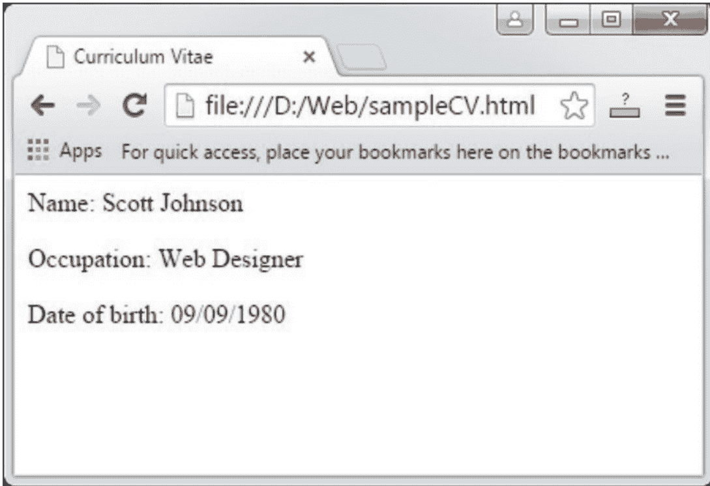

**图 2.** 段落的可视化表示

有时我们需要在不使用段落元素的情况下开始新的文本行。例如，我们想在简历中包含我们的地址，并且希望它是标准的单倍行距三行格式。在这种情况下，我们将使用独立的换行元素`<br>`。`<br>`元素告诉浏览器将文本移到下一行的开头。

```html
<p>Address:<br>
523 Beaumont Way<br>
Santa Rosa<br>
California 52409</p>
```

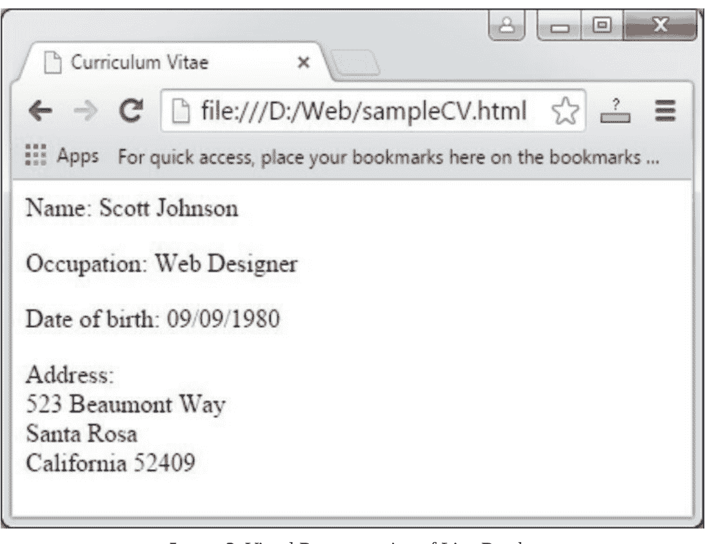

**图 3.** 换行的可视化表示

我们必须小心不要滥用换行符。我们不需要完美地安排我们的段落，因为浏览器会在不同的分辨率和浏览器窗口大小下重新排列文本。此外，我们不应担心普通段落之间的间距；这涉及外观，可以通过 CSS 来管理。使用换行符的一个好规则是避免在普通段落中使用它们，而使用它们来强制在地址、提纲、诗歌和其他在结构上需要更严格流程控制的文本类型中换行。

## 空格

我们已经知道浏览器会忽略 HTML 中的额外空格和换行符，那么在我们需要使用额外空格的罕见情况下会发生什么呢？在 HTML 中，空格被视为一个特殊字符，需要作为特殊代码输入，即`&nbsp;`。`&`符号向浏览器发出信号，表示一个特殊字符的代码将紧随其后；`nbsp`是该特殊字符的代码，在这种情况下是 non-breaking space（不间断空格）的简写，而分号（`;`）向浏览器发出信号，表示特殊字符的代码已结束，从此处开始，文本应被视为正常文本。

## 创建标题

标题通常用作段落上方的章节标题。它们有助于定义文档的层次结构，较大的标题标识更重要的主题，较小的标题表示在较大主题的上下文中重要性较低的问题。为了确保我们的文档遵循逻辑大纲，我们将始终从最大的标题（1 级）开始，然后逐步向下进行。

HTML 支持最多六级标题，从`<h1>`（最大）开始，到`<h6>`（最小）结束，尽管低于`<h4>`的标题很少使用。这有助于将文档分隔成合适且更具可读性的结构。默认情况下，浏览器会以各种大小的粗体显示标题，具体取决于标题级别。

> **注意：** 标题的实际外观可以通过样式表控制。

使用标题组织我们的网页：

1. 在 HTML 文档的`body`部分，输入`<hn>`，其中`n`是一个从 1 到 6 的数字，具体取决于我们想要创建的标题级别。
2. 输入标题的内容。
3. 输入`</hn>`，其中`n`与步骤 1 中使用的数字相同。

通过包含标题，我们的简历网页的示例内容将如下所示：

```html
<!DOCTYPE html>
<html>
<head>
    <meta charset="utf-8">
    <title>Curriculum Vitae</title>
</head>
<body>
<h1>Curriculum Vitae</h1>
```

### 个人信息

姓名：斯科特·约翰逊

职业：网页设计师

出生日期：1980年9月9日

地址：

523 Beaumont Way

Santa Rosa

California 52409

### 教育背景

### 技能

```html
</body>
</html>
```

**图 4.** 包含标题和段落的简历

## 列表

HTML 允许三种不同类型的列表。其中两种列表类型，有序列表和无序列表，在日常写作中很常见，而第三种类型，定义列表，则不太常见。

- **有序列表**用于在顺序很重要时按顺序呈现项目。每个项目前面都有一个序号或字母。
- **无序列表**，通常称为要点列表，是网页上最常用的列表。它们逐项列出事物，不暗示顺序，因此每个项目前面都有一个项目符号。
- **定义列表**显示需要跟随定义或描述的术语。它们旨在容纳词汇表项目（例如字典），并且不需要符号来引导。

### 有序列表

有序列表非常适合解释完成特定任务的分步说明。要创建有序列表，我们使用`<ol>`元素。由于此元素定义了整个列表，列表中的每个后续项目都必须用`<li>`元素定义，并且所有`<li>`元素都包含在`<ol>`元素内。

以下示例展示了有史以来排名前 5 的电影列表。

```html
<ol>
    <li>Avatar</li>
    <li>Titanic</li>
    <li>The Avengers</li>
    <li>Harry Potter</li>
    <li>Frozen</li>
</ol>
```

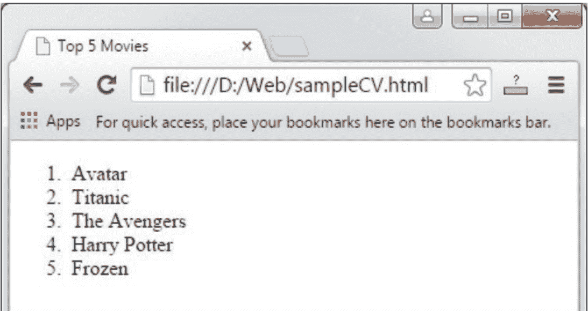

**图 5.** 排名前 5 的电影列表

在有序列表中，HTML 将从值“1”开始连续编号每个项目，除非另有指定。我们不需要提供数字；相反，浏览器会自动在每个列表项前面添加适当的数字。

### 有序列表属性

有序列表可以通过三个属性进行扩展：`start`、`type`和`reversed`。默认情况下，浏览器会对齐并缩进列表项，并在列表前的段落和列表本身之间插入一些间距。也可以在不打乱编号方案的情况下插入和删除列表项。

- **start**属性允许我们从一个不是 1 的值开始列表。但是，无法从先前的列表继续编号。
- **type**属性允许我们从数字、罗马数字和字母中选择编号样式。`type`属性的值在表 1 中列出。
- **reversed**属性是 HTML5 独有的，允许我们指定列表按降序编号。该属性没有值。

| 属性值 | 编号方式 | 示例 |
| :---: | :---: | :---: |
| 1 | 数字 | 1, 2, 3 |
| a | 小写字母 | a, b, c |
| A | 大写字母 | A, B, C |
| i | 小写罗马数字 | i, ii, iii |
| I | 大写罗马数字 | I, II, III |

**表 1.** 有序列表的类型

以下示例将反转“前 5 部电影”列表中的编号：

```html
<ol reversed>
  <li>Frozen</li>
  <li>Harry Potter</li>
  <li>The Avengers</li>
  <li>Titanic</li>
  <li>Avatar</li>
</ol>
```

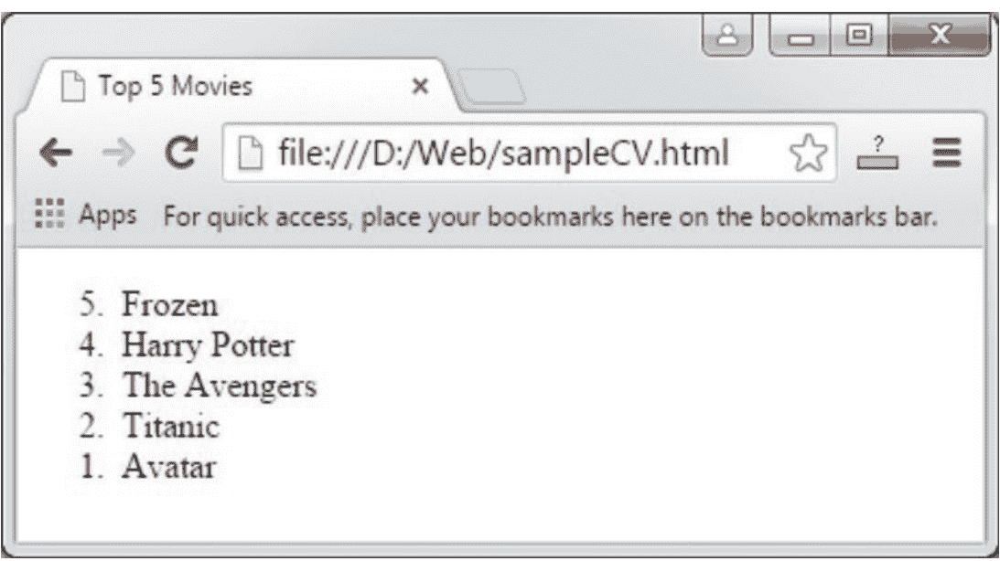

**图 6.** 前 5 部电影的降序列表

### 无序列表

无序列表与有序列表非常相似，但列表项前是项目符号而非数字。它们是网页上最常用的列表，用于一系列不需要特定顺序的项目。对于无序列表，我们使用`<ul>`元素作为`<ol>`元素的替代，但列表中的每个项目仍然由`<li>`元素定义。

例如，让我们使用无序列表来展示示例简历中的教育背景部分：

```html
<ul>
    <li>PhD in Computer Science at MIT</li>
    <li>Bachelor of Computer Science at MIT</li>
    <li>Santa Rosa High School</li>
</ul>
```

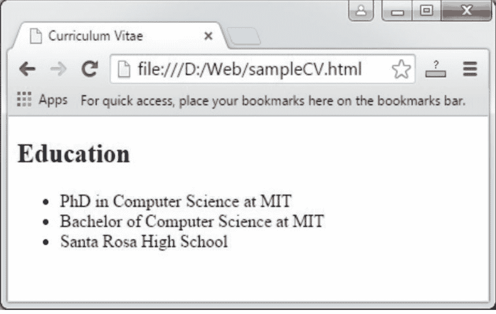

**图 7.** 教育背景部分的无序列表

无序列表没有 HTML5 支持的属性。

**注意：** 对于有序列表和无序列表，列表开始标签（`ol`或`ul`）和第一个`li`标签之间不允许有文本。

### 嵌套列表

虽然列表本身效果很好，但我们可以创建列表内的列表，也称为嵌套列表。这种技术使我们能够构建多层大纲和详细的指令序列。我们甚至可以混合使用有序和无序列表。

要嵌套列表，我们可以在现有列表的`<li>`元素内声明一个新列表，`<ol>`或`<ul>`。例如，我们可以按以下方式重新组织示例简历中的教育背景列表：

```html
<ul>
    <li>MIT</li>
    <ul>
        <li>PhD Degree in Computer Science</li>
        <li>Bachelor Degree in Computer Science</li>
    </ul>
    <li>Santa Rosa High School</li>
</ul>
```

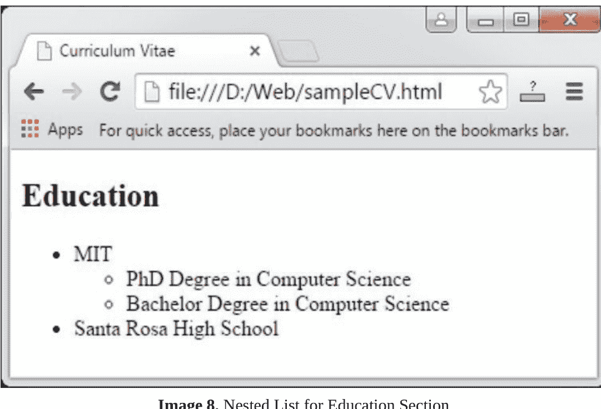

### 描述列表

HTML 提供了第三种类型的列表，称为描述列表。在之前的 HTML 版本中，使用了“定义列表”这个名称而不是“描述列表”。这种列表的结构与无序列表和有序列表略有不同，非常适合用于词汇表和词典。它可以很好地与任何需要将单词或短语与较长描述配对的文本结构一起使用。

描述列表由`<dl>`元素定义。每个描述列表项包含两部分：术语和描述。术语用于定义术语/名称，使用`<dt>`元素。定义元素`<dd>`紧随`<dt>`元素之后，用于描述该术语/名称。

在 HTML5 规范中，描述列表元素不支持任何附加属性。

> **注意：** 使用描述列表时，可以通过在附加的`<dd>`元素中添加每个描述来为一个项目定义多个描述。

以下描述列表示例定义了制备浓缩咖啡的不同方法：

```html
<dl>
    <dt>Cappuccino</dt>
    <dd>1 part espresso, 1 part hot milk, steamed milk foam</dd>
    <dt>Macchiato</dt>
    <dd>1 part espresso, 1 part foamed milk, shaved cocoa</dd>
    <dt>Espresso</dt>
    <dd>1 part espresso, 0 parts of anything else</dd>
</dl>
```

**卡布奇诺**

1 份浓缩咖啡，1 份热牛奶，蒸奶泡

**玛奇朵**

1 份浓缩咖啡，1 份奶泡，刨可可粉

**浓缩咖啡**

1 份浓缩咖啡，0 份其他任何东西

**图 9.** 不同浓缩咖啡饮品的定义列表

### 引文

我们可以使用`<blockquote>`元素来表明一段文本是从其他来源引用的。`<blockquote>`元素仅表明其内容来自其他地方，因此我们仍然需要使用标题和段落等元素来标记引文的内容。对于不需要额外文档结构的短引文，我们可以使用`<q>`元素。`<blockquote>`和`<q>`元素都可以用`cite`属性进行扩展。`cite`属性指定引文的 URL 来源。`<blockquote>`的一个示例是：

```html
<blockquote cite="http://www.worldwildlife.org/who/index.html">
<p>For 50 years, WWF has been protecting the future of nature. The world’s leading conservation organization, WWF works in 100 countries and is supported by 1.2 million members in the United States and close to 5 million globally.</p>
</blockquote>
```

短引文`<q>`的示例是：

```html
<p>WWF’s goal is to: <q cite="http://www.wwf.org">Build a future where people live in harmony with nature.</q> We hope they succeed.</p>
```

### 额外的文本元素

HTML5 规范包含额外的标签，这些标签赋予文本不同的语义含义。这些标签要么从之前的 HTML 版本继承并重新定义，要么是最新版本中全新引入的。以下是一些更常用的标签：

- `<em>`用于强调语气。这种强调是语言学上的；如果读出来，它会强调某个单词的发音，这将改变句子的细微差别。默认情况下，浏览器将`<em>`元素渲染为斜体文本。
- `<strong>`用于显示其内容对用户的重要性。默认情况下，浏览器将`<strong>`元素渲染为粗体文本。
- `<small>`用于旁注，如小字体印刷品、版权声明、免责声明等类似项目。


- `<mark>` 是一个新的 HTML5 元素，用于指示我们特别想要突出显示的文本，而不改变其重要性或强调。`mark` 元素表示文档中的一段文本，因其在另一个上下文中的相关性而被标记或高亮以供参考。
- `<sub>` 定义下标文本。下标文本主要用于数学和化学公式。它会出现在正常行下方，并且通常以较小的字体渲染。
- `<sup>` 定义上标文本。上标文本主要用于脚注或数学。它会出现在正常行上方约半个字符的位置，并且通常以较小的字体渲染。
- `<abbr>` 定义缩写。此元素通常使用 `title` 属性进行扩展，以便当我们将鼠标悬停在标记内容上时显示缩写的完整版本。
- `<hr>` 是水平分隔线，用于段落级别的主题分隔，表示主题的改变。默认情况下，浏览器将 `<hr>` 元素呈现为水平线。

在我们的简历示例中，我们可以使用 `<strong>` 元素来表示“个人信息”部分中文本标签的重要性。

```html
<h2>Personal Info</h2>

<p><strong>Name:</strong> Scott Johnson</p>

<p><strong>Occupation:</strong> Web Designer</p>

<p><strong>Date of birth:</strong> 09/09/1980</p>

<p><strong>Address:</strong><br>
523 Beaumont Way<br>
Santa Rosa<br>
California 52409</p>
```

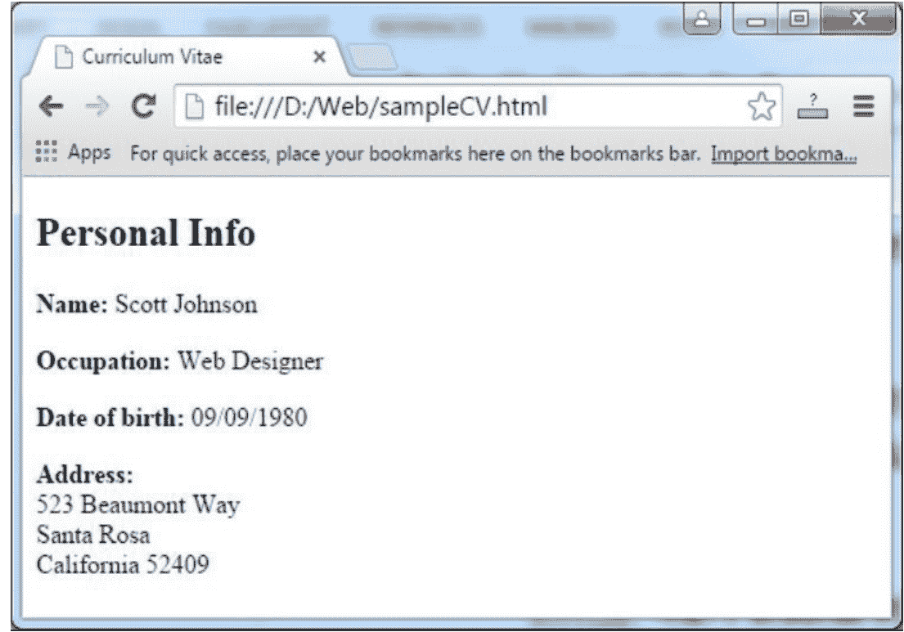

我们也可以使用 `<sup>` 和 `<sub>` 元素来注明特定公司的名称。

### 作品集

我曾为以下公司担任自由网页设计师：

- H₂O Wireless - 一家宽带互联网服务提供商
- DSQUARED² - 一家国际时装公司

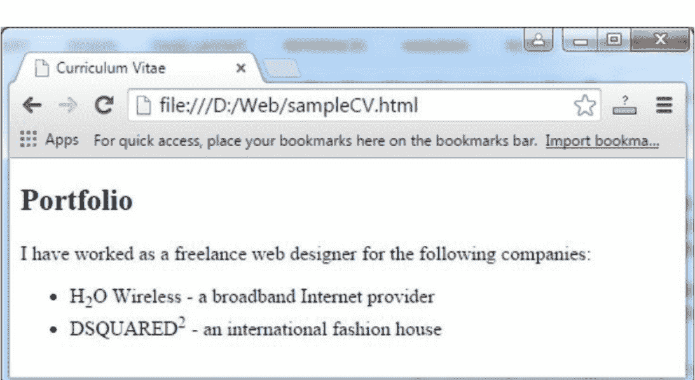

图 11. 作品集部分的上标和下标元素

我们可以使用 `<abbr>` 元素来定义技能部分中的首字母缩写词，包括 HTML 和 CSS。

```html
<h2>Skills</h2>
<p>I have expert coding knowledge in the core web technologies: <abbr title="HyperText Markup Language">HTML</abbr>, <abbr title="Cascading StyleSheets">CSS</abbr> and JavaScript.</p>
```

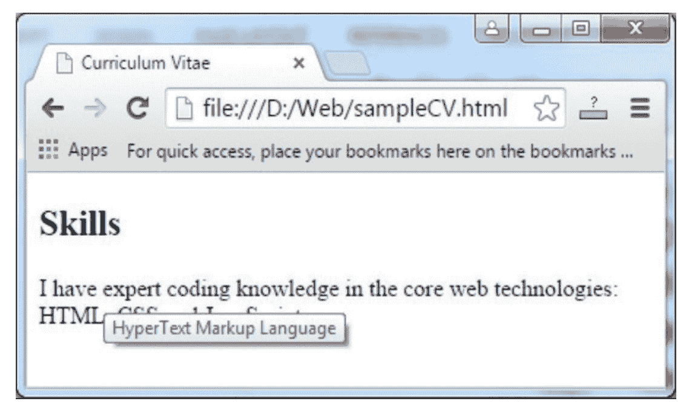

我们还可以用 `<hr>` 元素来分隔各个部分。

经过这些示例后，我们的示例简历大致将具有以下结构：

```html
<!DOCTYPE html>
<html>
<head>
    <meta charset="utf-8">
    <title>Curriculum Vitae</title>
</head>
<body>
<h1>Curriculum Vitae</h1>
<h2>Personal Info</h2>
<p><strong>Name:</strong> Scott Johnson</p>
<p><strong>Occupation:</strong> Web Designer</p>
<p><strong>Date of birth:</strong> 09/09/1980</p>
<p><strong>Address:</strong><br>
523 Beaumont Way<br>
Santa Rosa<br>
California 52409</p>
```

```html
<hr>
```

```html
<h2>Education</h2>
<ul>
    <li>MIT</li>
    <ul>
        <li>PhD Degree in Computer Science</li>
        <li>Bachelor Degree in Computer Science</li>
    </ul>
    <li>Santa Rosa High School</li>
</ul>
```

```html
<hr>
```

```html
<h2>Skills</h2>
<table>
    <tr>
        <th>Web Technology</th>
        <th>Skill Level</th>
    </tr>
    <tr>
        <td>HTML</td>
        <td>Expert</td>
    </tr>
    <tr>
        <td>CSS</td>
        <td>Expert</td>
    </tr>
    <tr>
        <td>JavaScript</td>
        <td>Advanced</td>
    </tr>
</table>
```

```html
<hr>
```

```html
<h2>Portfolio</h2>
<p>I have worked as a freelance web designer for the following companies:</p>
<ul>
    <li>H₂O Wireless - a broadband Internet provider</li>
    <li>DSQUARED² - an international fashion house</li>
</ul>
```

### 教育背景

- 麻省理工学院
  - 计算机科学博士学位
  - 计算机科学学士学位
- 圣罗莎高中

### 技能

我精通核心网络技术的编码知识：HTML、CSS 和 JavaScript。

### 作品集

我曾为以下公司担任自由网页设计师：

- H₂O Wireless - 一家宽带互联网服务提供商
- DSQUARED² - 一家国际时装公司

### 表格

当我们想要标记最适合以表格形式呈现的数据时，需要创建 HTML 表格。表格数据通常让我们想到电子表格，但 HTML 表格与电子表格表格略有不同，因为它们由行和行中的单元格组成。无需定义列数，因为每一行中的单元格数量决定了表格将有多少列。不过，标记表格数据相对容易，因为 HTML 为我们提供了大量的语义元素来组织数据。

每个 HTML 表格的起点都是 `<table>` 元素。让我们开始向示例简历的技能部分添加一个表格。

```html
<table>
</table>
```

仅使用 `<table>` 标签不足以创建表格；我们需要用 `<tr>` 元素添加表格行。

```html
<table>
    <tr>
    </tr>
</table>
```

最后，我们需要在该行中添加几个单元格，以便在浏览器中显示一个基本的表格。在讨论 HTML 表格语义时，我们必须知道有两种类型的元素来表示表格单元格：`<td>` 和 `<th>`。`<td>` 元素代表表格数据，表示一个包含数据的常规单元格。`<th>` 元素代表表头，定义一个包含表格行或列标题的单元格。

在我们的示例中，第一行我们将插入两个标题单元格，一个用于“网页技术”，另一个用于“技能水平”。

```html
<table>
    <tr>
        <th>Web Technology</th>
        <th>Skill Level</th>
    </tr>
</table>
```

为了完成表格，我们将再插入三行。在这些行中，我们将使用 `<td>` 元素而不是 `<th>` 来表示单元格，因为这些单元格将包含实际数据而非标题。我们最终的表格代码将如下所示：

```html
<table>
    <tr>
        <th>Web Technology</th>
        <th>Skill Level</th>
    </tr>
    <tr>
        <td>HTML</td>
        <td>Expert</td>
    </tr>
    <tr>
        <td>CSS</td>
        <td>Expert</td>
    </tr>
    <tr>
        <td>JavaScript</td>
        <td>Advanced</td>
    </tr>
</table>
```

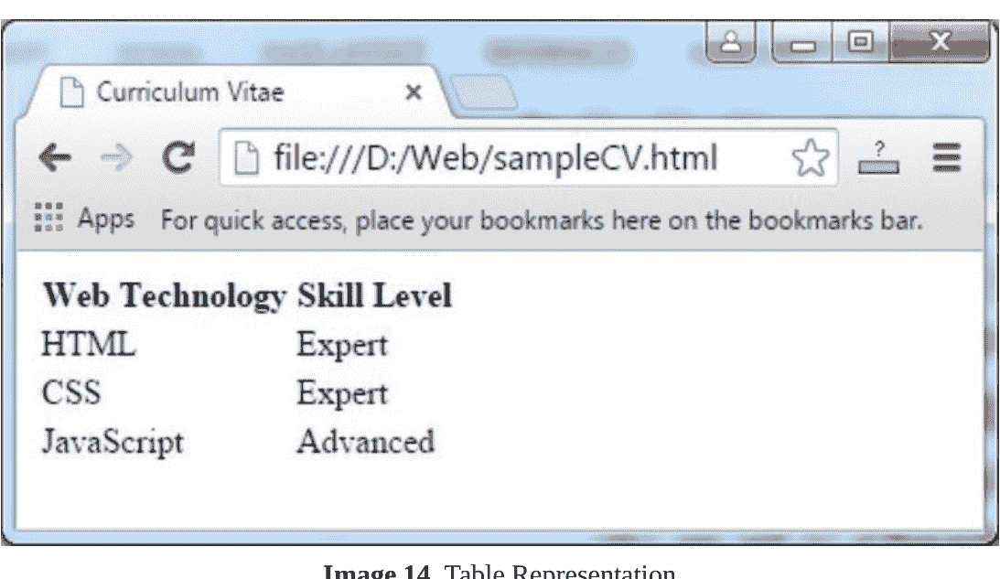

这个基础表格没有任何边框，但数据以整齐排列的行列形式呈现。边框和额外的视觉表格属性通过 CSS 来管理。

> **注意：** 表格有着悠久的网络历史。虽然最初仅为容纳表格数据而设计，但很快就被误用于一个更大的任务：作为复杂页面布局的基础，这些布局在 CSS 出现之前是不可能实现的。

我们的示例简历现在具有以下结构：

```html
<!DOCTYPE html>
<html>
<head>
    <meta charset="utf-8">
    <title>Curriculum Vitae</title>
</head>
<body>
<h1>Curriculum Vitae</h1>
<h2>Personal Info</h2>
<p><strong>Name:</strong> Scott Johnson</p>
<p><strong>Occupation:</strong> Web Designer</p>
<p><strong>Date of birth:</strong> 09/09/1980</p>
<p><strong>Address:</strong><br>
523 Beaumont Way<br>
Santa Rosa<br>
California 52409</p>
<hr>
<h2>Education</h2>
<ul>
    <li>MIT</li>
    <ul>
        <li>PhD Degree in Computer Science</li>
        <li>Bachelor Degree in Computer Science</li>
    </ul>
    <li>Santa Rosa High School</li>
</ul>
<hr>
<h2>Skills</h2>
<table>
    <tr>
        <th>Web Technology</th>
        <th>Skill Level</th>
    </tr>
    <tr>
        <td>HTML</td>
        <td>Expert</td>
    </tr>
    <tr>
        <td>CSS</td>
        <td>Expert</td>
    </tr>
    <tr>
        <td>JavaScript</td>
        <td>Advanced</td>
    </tr>
</table>
<hr>
<h2>Portfolio</h2>
<p>I have worked as a freelance web designer for the following companies:</p>
<ul>
    <li>H₂O Wireless - a broadband Internet provider</li>
    <li>DSQUARED² - an international fashion house</li>
</ul>
```

### 特殊字符

并非网络上所有可用的字符都存在于我们的键盘上。那么当我们想要添加像版权符号 (©) 或度数符号 (°) 这样的特殊字符时该怎么办呢？HTML 支持所有这些字符以及大约 250 个相关字符，包括数学符号和特殊字母。要将它们添加到我们的网页中，我们需要使用所谓的 HTML 字符实体。HTML 字符实体以与号 (&) 符号开始，后跟一个关键字（或 ASCII 码），并以分号 (;) 符号结束。例如，不间断空格的 HTML 字符代码将写作 `&nbsp;`。

其他 HTML 字符实体在下表中列出：

| 字符 | 字符名称 | 代码 |
| --- | --- | --- |
| < | 左尖括号 | `&lt;` |
| > | 右尖括号 | `&gt;` |
| & | 与号 | `&amp;` |
| " | 双引号 | `&quot;` |
| © | 版权 | `&copy;` |
| ® | 注册商标 | `&reg;` |
| ¢ | 分符号 | `&cent;` |
| £ | 英镑 | `&pound;` |
| € | 欧元符号 | `&euro;` |
| ° | 度符号 | `&deg;` |
| ± | 加减号 | `&plusmn;` |
| µ | 微符号 | `&micro;` |
| ½ | 二分之一 | `&frac12;` |

表 2. HTML 字符实体

### 插入图像

我们可以在网页上放置各种图像，从标志到照片。只要浏览器配置为查看它们，当访问者跳转到我们的页面时，网络图像会自动显示。

要在网页文档中放置图像，我们使用 `` 元素。图像并不驻留在网页中。它作为单独的文件存储，HTML 代码指向其位置。从技术上讲，图像元素是一个空元素，因为它将被实际引用的图像内容替换。作为一个空元素，它仅由属性组成，并在单个标签中打开和关闭。

为了指向我们想要显示的实际图像，我们使用 `src` 属性来插入图像的相对或绝对路径。

```html

```

当浏览器读取此 `` 元素时，它会从 `images` 文件夹中请求 `cv_picture.jpg` 文件。检索到文件后，浏览器将在 `` 标签的位置将该图片插入页面。

我们还强烈建议将 `alt` 属性与 `` 元素一起使用。`alt` 是替代文本的缩写，此属性用于用文字描述图像及其含义，以便在文档中为其提供上下文。

```html

```

通常，替代文本不会与图像一起显示在网页上，但它提供了几个重要功能。首先，遵循标记的语义重要性，它让图像为文档提供一些意义。如果 `` 元素中没有替代文本，图像基本上将是“无意义的”，文档也会失去一些语义价值。其次，从更实用的角度来看，如果浏览器由于任何原因无法显示图像本身，它将显示替代文本。最后，也是最重要的是，替代文本充当辅助工具，供使用屏幕阅读程序访问我们网站的视觉障碍访问者使用。

> **注意：** 虽然替代文本理论上可以随我们所愿地长，但大多数浏览器不会自动换行长行。因此，将其保持在 50 个字符以下是一个好主意。

处理网络图像时，我们必须考虑两个变量：图像尺寸、图像文件大小和图像尺寸决定图像在屏幕上以像素为单位占据的屏幕空间大小。图像文件大小将决定该图像从网络服务器传输到浏览器客户端所需的时间。在解析代码时，当浏览器遇到 `img` 标签时，必须先加载图像以查看其大小及其在屏幕上将占据的空间。如果我们指定了图像的尺寸，浏览器就可以在加载图像的同时预留部分屏幕空间并加载页面的其余内容。

`` 元素允许我们通过其可选的 `height` 和 `width` 属性来指定图像尺寸。如果我们想使用图像的原始尺寸，我们需要执行以下步骤：

1. 在 Windows 资源管理器中右键单击图像。
2. 从上下文弹出菜单中选择“属性”。将出现一个对话框，显示图像的像素尺寸。

一旦我们确定了图像的大小，就可以使用 `width` 和 `height` 属性以像素为单位指定图像的宽度和高度。`width` 和 `height` 属性不一定必须反映图像的实际大小，因为我们可以插入任何我们想要的值。

```html

```

在上面的示例中，我们告诉浏览器预留 100x150 像素的屏幕空间，用于从 `images` 文件夹加载 `cv_picture.jpg` 图像。

> **注意：** 一些 HTML 编辑器，如 Dreamweaver 和 Expression Web，在插入图像时会自动添加 `height` 和 `width` 属性。

### Web 图像

Web 浏览器无法显示所有图像类型。事实上，它们仅限于提供非常高压缩率的格式，以提供更小的图像尺寸。这限制了我们的选择只有三种格式：JPEG、GIF 和 PNG，以及部分 SVG。

**JPEG** 适用于可以容忍一定质量损失的照片。JPEG 格式压缩图像的文件大小以使其下载更快。如果图片包含文本或线条艺术，它效果不佳。

**GIF** 适用于颜色非常少的图形，如简单的徽标或剪贴画。它被限制为 256 种颜色，因此用于压缩摄影图像时效果很差。

**PNG** 是专门为网络创建的格式，适用于各种图像。它并不总是像 JPEG 那样压缩良好，但它特别适合小而清晰的图形，并且被用作 GIF 标准的更强大的替代品。

**SVG** 是矢量绘图的一个新兴标准，具有许多优势，包括小尺寸和灵活性，因为您可以调整 SVG 图像的大小而不会丢失细节或产生模糊图像。Internet Explorer 8 及更早版本不支持它，因此它还不是 Web 图形的可行选择。

### 链接

创建单个网页是构建网站的重要一步，但我们需要不止一个页面来完成网站，这些页面需要连接起来，以便访问者可以轻松地通过链接从一个页面跳转到另一个页面。此外，我们还希望创建到其他网站上的网页的链接。

所有链接，正式称为超链接，都通过所谓的锚元素 `<a>` 来管理。

```html
<a>Link to page</a>
```


`<a>` 元素本身没有功能。要成为功能齐全的链接，它必须有一个目标来指定当访问者单击链接时会发生什么。最常见的链接会加载新页面，但它们也可以显示图像、播放声音或电影、下载文件、打开新闻组、发送电子邮件消息、运行 CGI 程序等。要定义一个目的地，我们用 `href` 属性扩展 `<a>` 元素，该属性是“超文本引用”的缩写，并定义一个 URL。默认情况下，浏览器将文本链接显示为蓝色带下划线的文本。

```html
<a href="page.html">Link to page</a>
```

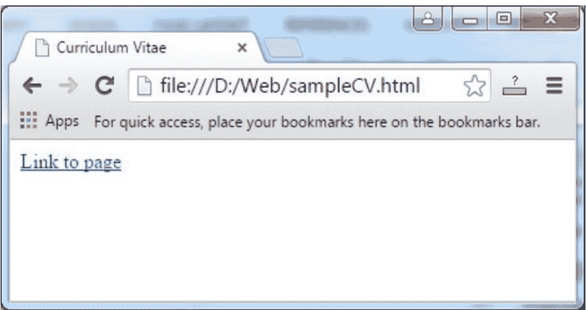

`<a>` 元素开始和结束标签之间的文本也称为标签，是访问者看到并单击以到达目的地的部分。这段文本本身非常重要，因为搜索引擎会以特殊方式索引它，并特别关注链接的实际内容。因此，建议使用描述性文本（例如，产品、注册、关于）而不是模糊的词语，如“点击这里”、“更多”或“此链接”。

扩展 `<a>` 元素功能的两个附加属性在链接方面非常有帮助：

- `Target`：`target` 属性指定我们希望在哪里打开链接的文档。我们最常用于 `target` 属性的值是 `_blank`，当我们希望链接在新选项卡或浏览器窗口中打开，而不是在当前窗口中打开时使用，例如：`<a href="sample_cv.html" target="_blank">`。
- `Download`：`download` 属性指定目标将在用户单击超链接时被下载，而不是在 Web 浏览器窗口中显示，例如：`<a href="thesis_document.pdf" download>Get the Thesis Document</a>`。

### 链接类型

我们显然不仅限于创建内部链接，或者指向我们自己网站上其他网页的链接。或者，我们可以创建外部链接，指向其他网站上的页面或资源。

要创建外部链接，我们需要使用绝对 URL，这意味着我们必须设置页面的完整地址，包括协议。例如，以下链接将指向解释 `<a>` 元素的 W3Schools 页面：

```html
<a href="http://www.w3schools.com/tags/tag_th.asp">More information about HTML links</a>
```

`mailto` 链接帮助用户发送电子邮件。当用户单击 `mailto` 链接时，Web 浏览器将打开默认电子邮件程序并开始创建新的电子邮件消息。

要创建 `mailto` 链接，我们需要在 `href` 属性中指定一个以单词“mailto”开头的值，后跟一个冒号（`:`）和我们的电子邮件地址。例如：

```html
<a href="mailto:contact@samplecv.com">contact@samplecv.com</a>
```

注意，我们使用了电子邮件地址作为此 `mailto` 链接的标签，而不是像“Email Us”这样模糊的内容。我们这样做是因为 `mailto` 链接并不总是对使用基于 Web 的电子邮件服务（如 Gmail）的用户有效。提供实际地址将帮助他们获取实际的电子邮件联系信息，以防他们无法单击链接。

如果我们创建指向浏览器不知道如何处理的文件的链接（例如，Word 或 Excel 文件），浏览器将尝试打开辅助程序来查看文件，或尝试将其下载到用户的硬盘驱动器。

### 书签

我们网站上的大多数链接将引导我们从一个页面跳转到另一个页面。当我们单击链接并加载新页面时，默认情况下我们会被带到所指示页面的顶部，但链接并不总是必须指向顶部。我们还可以创建指向页面特定部分的链接。当我们想要将用户定向到长的、滚动页面的特定部分时，这特别有用。我们发送用户到的页面上的位置是一个称为片段的特定标签。我们可以创建指向当前网页上片段的链接，或指向另一个网页上特定片段的链接。

创建指向片段的链接是一个两步过程。

首先，我们通过用 `id` 属性扩展标签来识别我们将指向的标签。`id` 属性为任何 HTML 元素分配唯一的名称。例如，假设在我们的 CV 示例中，我们想要创建一个导航菜单，该菜单将指向 CV 的不同片段。并且我们假设我们希望在每个 `<h2>` 标题处定义这些片段：个人信息、教育背景、技能和作品集。我们需要识别我们想要指向的标题，我们将这样做：

```html
<h2 id="education">Education</h2>
```

通过在 `<h2>` 标题中放置 `id` 属性，我们有效地创建了一个书签。

其次，我们创建一个指向此书签的链接。为此，我们在 `<a>` 元素的 `href` 属性中添加井号（`#`）后跟书签名。例如：

```html
<a href="#education">Education</a>
```

我们还可以创建指向不同页面上书签的链接。我们需要做的就是在 URL 的末尾附加书签。例如：

```html
<a href="sample_cv.html#education">Education</a>
```

当用户单击此链接时，浏览器将首先将他们带到 `sample_cv.html` 页面，然后向下滚动，直到他们到达 `#education` 书签。

> **注意：** 当我们的书签靠近页面底部时，如果页面内容不足以让浏览器将其滚动到窗口顶部，浏览器可能无法将书签滚动到其窗口的顶部。

### 个人信息

**姓名：** 斯科特·约翰逊

**职业：** 网页设计师

**出生日期：** 1980年9月9日

**地址：**

比尔蒙特路523号

加利福尼亚州，圣罗莎市

邮编 52409

---

### 教育背景

- 麻省理工学院
  - 计算机科学博士学位
  - 计算机科学学士学位
- 圣罗莎高中

### 技能

| 网络技术 | 技能水平 |
| :--- | :--- |
| HTML | 精通 |
| CSS | 精通 |
| JavaScript | 高级 |

### 作品集

我曾作为自由网页设计师为以下公司工作：

- H<sub>2</sub>O Wireless - 一家宽带互联网服务提供商
- DSQUARED<sup>2</sup> - 一家国际时装公司

**图 16.** 示例简历部分视图

## HTML 注释

注释是完全被任何网页浏览器忽略的代码片段。其存在的目的是为代码提供信息，或移除代码的某些部分但仍将其保留以供日后使用。注释甚至可以在你的 HTML 中充当通知和提醒。遵循良好实践，我们会在 HTML 代码中添加注释，尤其是在复杂文档中，以标示文档的各个部分。这将帮助我们和其他人更好地理解代码，并提高其可读性。

我们可以使用字符序列 `<!--` 标记注释的开始，使用字符序列 `-->` 标记注释的结束来创建 HTML 注释。在解析文档时，网页浏览器会自动忽略放在这两个标记之间的所有内容，无论它是纯文本内容还是 HTML 标记。以下示例在“教育背景”部分之前放置了一个 HTML 注释。

```html
<hr>

<!-- Starting Education section-->

<h2>Education</h2>
```

我们可以将注释放在多行中，只要 `<!--` 放在第一行之前，`-->` 放在最后一行之后。但是，双破折号序列“—”不能出现在注释内部，除非作为结束标记 `-->` 的一部分。这防止了注释嵌套，因为注释不能在没有双破折号的情况下嵌套在另一个注释中。此外，我们必须确保在注释开始字符串 `<` 和 `!` 之间没有空格，这意味着 `< !—` 将无法正确渲染。例如，如果我们在最终文档中将作品集部分的列表注释掉，浏览器将只显示段落文本。

```html
<h2 id="portfolio">Portfolio</h2>

<p>I have worked as a freelance web designer for the following companies</p>

<!--

<ul>

    <li>H<sub>2</sub>O Wireless - a broadband Internet provider</li>

    <li>DSQUARED<sup>2</sup> - an international fashion house</li>

</ul>

-->
```

**图 17.** 隐藏的已注释列表

### 作品集

我曾作为自由网页设计师为以下公司工作。

### 总结

HTML5 规范中还有更多的标签和属性，但本书的内容对于初学者来说已经足够。任何类型标记的目的都是为文档添加意义；我们甚至可以将用荧光笔划线阅读一本书的过程视为为文档添加标记。如前所述，当 HTML 首次出现时，标记的目的是解释文档的结构——哪些文本代表标题，什么是段落，什么是项目符号点等等。随着其日益普及，HTML 开始包含控制文档外观的标记。HTML5 旨在将标记功能恢复到仅描述文档的结构和语义。

几乎所有 HTML 元素都会被网页浏览器以不同的方式解释和呈现。例如，`<h1>` 到 `<h6>` 元素与 `<p>` 元素的内容呈现方式不同；`<ol>` 元素中的列表项与 `<ul>` 元素中的列表项呈现方式也不同。然而，所有这些元素都描述了文档的结构：什么是标题，什么是编号列表中的项目，等等。这些元素内容的呈现方式反映了标记所强加的结构，这就是为什么标题元素从 `<h1>` 到 `<h6>` 逐渐变小，以及为什么 `<li>` 元素根据它们是包含在 `<ol>` 还是 `<ul>` 元素内，会创建单独的编号项目或项目符号点。

描述文档结构的元素与那些仅影响文档呈现而不添加任何意义的元素非常不同。因此，HTML5 从 HTML 中移除了这些纯粹用于表现的元素和属性。

## 第四章：内容结构

HTML5 的核心在于语义。语义化元素通过让我们识别页面不同区域的逻辑目的，为页面内容添加意义和结构。

在定义规范之前，HTML5 的贡献者分析了现有的网页，以确定它们的共同元素。因此，HTML5 现在包含了仅用于定义意义和结构的新元素。这些元素用于将相关的内容分组在一起，定义内容的哪些部分是页眉、页脚或主体，描述导航菜单等。网站用户永远不会意识到这些信息，但许多工具会使用它。例如，搜索引擎使用语义化元素来更多地了解我们的页面。屏幕阅读程序更有效地呈现内容，因为语义化元素创建了更具可访问性的内容。其他工具可以用来从我们的页面提取数据，并以各种不同的方式使用它，例如在新闻源中呈现。

### 内容分节

内容分节用于将 HTML 文档划分为各个部分。文档的每个部分通常会有自己的页眉、主体内容，可能还有页脚。

在 HTML5 之前的 HTML 版本中，更具体地说是 HTML 4 和 XHTML 1，用于内容分节的选择相当有限。设计师唯一可用的分节元素是 `<body>` 和 `<div>` 标签；`<div>` 是一个通用元素，用于表示一个分区。这使得文档的语义化标记几乎不可能，并且使得屏幕阅读器和其他辅助设备难以评估页面。新的 HTML5 语义化标记使得机器和人都能轻松理解内容的意义和上下文，并提供了一种区分关键内容与侧边栏或无关信息的方法。

HTML5 的每个语义化元素都没有特定的输出、颜色或设计。除非使用了 CSS 进行样式设置，否则每个语义化元素在网页浏览器中查看时将是不可见的，其内容将显得单调乏味。

> **注意：** 理论上，分节元素允许我们使用标题、表单标题、表格标题以及任何其他合适的地标来创建文档大纲，这些地标可以勾勒出文档的轮廓。大纲算法已在 HTML5 规范中明确定义，但浏览器和辅助技术尚未实现它。

### `<section>` 和 `<article>` 元素

`<section>` 元素是用于划分内容的最通用元素，主要用于将具有相似含义的内容分组。当内容需要表示一组逻辑相关的主题内容时，它被用作具有额外语义含义的通用容器元素。在此上下文中，一个“节”是指内容的主题分组，通常以其自身的标题开始。此外，你可以使用 `<section>` 来定义页面分段。例如，在你的网页上，你可以将博客文章、新闻和侧边栏广告放入不同的 `<section>` 元素中。

与 `<section>` 类似，`<article>` 元素被引入是为了在文档中将相关信息组合在一起。将 `<article>` 元素视为 `<section>` 的一种具有更具体语义含义的专业类型是最合适的。这个元素代表了我们所认为的“文章”，即一段自包含的内容，如报纸文章、博客条目、论坛帖子或类似的内容项。例如，一个 `<article>` 元素将包含单篇博客文章，而一个 `<section>` 元素可以包含页面上的多篇（或所有）博客文章。

`<section>` 和 `<article>` 元素之间实际的区别是什么？`<section>` 是文档的逻辑部分，而 `<article>` 是实际的内容。以报纸为例。`<section>` 元素就像体育版块。体育版块包含许多文章，就像 `<section>` 可以包含许多 `<article>` 元素一样。从语义上讲，文章可能篇幅较长、内容丰富，需要划分为自己的若干部分。以下是几个展示 `<section>` 和 `<article>` 互换使用的示例。

一个简单的博客文章会有如下结构：

```html
<article>
    <h1>Blog Article Heading</h1>
    <p>Article Content</p>
</article>
```

反之，一个列出多篇博客文章的页面会有如下结构：

```html
<section>
    <article>
        <h1>Blog Article #1 Heading</h1>
        <p>Article Content</p>
    </article>
    <article>
        <h1>Blog Article #2 Heading</h1>
        <p>Article Content</p>
    </article>
    <article>
        <h1>Blog Article #3 Heading</h1>
        <p>Article Content</p>
    </article>
</section>
```

另一方面，一篇长文，比如我们的简历示例，可以包含多个子节，并遵循以下结构：

```html
<article>
    <h1>Curriculum Vitae</h1>
    <section>
        <h2>Personal Info</h2>
        <p>Content</p>
    </section>
    <section>
        <h2>Education</h2>
        <p>Content</p>
    </section>
    <section>
        <h2>Skills</h2>
        <p>Content</p>
    </section>
    <section>
        <h2>Portfolio</h2>
        <p>Content</p>
    </section>
</article>
```

### 这个 `<div>` 元素是什么？

在 HTML5 出现之前编写的文档充斥着 `<div>` 标签。在之前的 HTML 版本中，`<div>` 标签是语义标记的王者元素。它是划分内容唯一可用的容器，但与表格相比，它更适用于定义网页布局。结合通过 ID 和类使用的 CSS 样式，`<div>` 元素使我们能够创建视觉丰富且设计相当灵活的页面。

在 HTML5 中，`<div>` 具有一般元素的语义含义。由于现代 HTML 编码要求我们使用最合适或语义上最准确的元素，`<div>` 元素现在仅在没有其他更合适的元素时才使用。

### 导航和补充内容

`<nav>` 元素定义了页面中包含导航链接的部分。这些链接可能指向当前页面上的主题，也可能指向网站上的其他网页。一个页面包含多个 `<nav>` 部分并不罕见，例如一个用于主导航菜单，一个用于子菜单，另一个用于当前文章中的主题等等。网页上的所有链接都不需要包含在 `<nav>` 元素内。一般来说，`<nav>` 元素是为更重要的导航部分保留的。

在我们的简历示例中，我们可以使用 `<nav>` 元素来包裹初始导航菜单，该菜单链接到简历的不同部分。

```html
<nav>
    <p><a href="#personal">Personal Information</a></p>
    <p><a href="#education">Education</a></p>
    <p><a href="#skills">Skills</a></p>
    <p><a href="#portfolio">Portfolio</a></p>
</nav>
```

`<aside>` 元素非常适合用作侧边栏。侧边栏可以指物理上位于页面侧边的栏，或者提供“附加信息”的内容部分。本质上，`<aside>` 代表了一个与页面主要内容分离但仍然相关的完整内容块。例如，在主文章旁边使用 `<aside>` 创建包含相关内容或链接的侧边栏是有意义的。我们也可以使用 `<aside>` 来定义一个广告区块。

### 页眉和页脚

`<header>` 元素将介绍性内容分组，其中也可能包括导航链接。`<header>` 通常包裹网站的标题部分，包括标志、标语和导航菜单。它也可以出现在文章的开头，并包含诸如标题、署名以及可能还有一些指向文章子主题的链接等内容。传统上，当我们想到页眉时，我们想象每个页面只有一个页眉。在 HTML5 文档中，我们可以有多个 `<header>` 部分，只要每个 `<header>` 部分与不同的内容相关即可。

例如，在我们的简历示例中，我们可以将简历标题、图片和导航菜单包含在一个 `<header>` 元素中。


```html
<header>
    <h1>Curriculum Vitae</h1>
    <p></p>
    <nav>
        <p><a href="#personal">Personal Information</a></p>
        <p><a href="#education">Education</a></p>
        <p><a href="#skills">Skills</a></p>
        <p><a href="#portfolio">Portfolio</a></p>
    </nav>
</header>
```

`<footer>` 元素定义了页面或部分底部的页脚。`<footer>` 通常包含诸如版权、联系方式、站点地图、相关文档和类似项目等信息。就像 `<header>` 元素一样，我们可以在每个页面上有多个 `<footer>` 元素，每个元素都分组到不同的 `<section>` 中。

> **注意：** `<hgroup>` 元素是 HTML5 的一个新元素，用于组合多个标题级别，例如标题和副标题。然而，由于它“存在诸多可访问性问题且缺乏许多令人信服的用例”，该元素已被移除。

### 使用 `<figure>` 和 `<figcaption>` 的语义化图像

在网络上添加图像的能力推动了万维网从学术界向全球奇迹的发展。`` 元素自万维网早期就已存在。从语义角度来看，`` 元素在将解释性文本与图像关联方面存在很大局限性。虽然 `alt` 属性确实部分解决了这个问题，但这段文本除了其可访问性功能外，既不可见也无法实现其他功能。

为了解决这个问题，HTML5 提供了 `<figure>` 和 `<figcaption>` 元素。`<figure>` 元素将图形与其对应的说明文字组合在一起。例如，我们可以使用 `<figure>` 和 `<figcaption>` 元素为简历示例中的图像添加更丰富的语义含义。

```html
<figure>
    
    <figcaption>Scott Johnson</figcaption>
</figure>
```

从物理上讲，图形本身不一定必须是 `` 元素。它可以是 SVG 绘图、`<canvas>` 元素，甚至是 ASCII 图形，通常任何可以解释为图形的东西都可以。

> **注意：** `<canvas>` 元素是 HTML5 的一个新元素，用作图形的容器。图形本身是通过脚本创建或绘制的，该元素的实际应用超出了本书的范围。

### HTML5 兼容性

在使用本书中描述的 HTML5 元素时，必须认识到较旧的浏览器（如 IE8）缺乏识别这些元素的能力。当浏览器无法识别特定标签时，它们只是忽略该标签并将剩余内容渲染为简单文本。这在一定程度上是可以接受的，因为语义元素并非用于格式化，但忽略标签意味着浏览器不会将文本结构化为单独的行，而是将所有内容视为同一元素的一部分。除了不呈现无法识别的元素外，IE 甚至不承认它们的存在，从而阻止我们使用 CSS 为这些元素设置样式。

为了解决这个问题，我们将不得不通过 JavaScript 命令注册来“欺骗”较旧的 IE 浏览器以识别外部元素。由于 JavaScript 超出了本书的范围，也超出了许多网页设计师的范围，我们将不得不采用一种称为 HTML5 Shiv 的策略。HTML5 Shiv 是由 Sjoerd Visscher 开发的、已创建的完全兼容的 JavaScript 代码，可在网上通过 googlecode.com 获取。我们不需要获取或理解这段代码即可使用它。相反，我们只需要像这样在页面的 head 部分引用它：

```html
<head>
    <meta charset="utf-8">
    <title>Curriculum Vitae</title>
    <script src="http://html5shiv.googlecode.com/svn/trunk/html5.js"></script>
</head>
```

当我们想要向网页添加 JavaScript 代码时，我们使用 `<script>` 元素。在上面的示例中，通过使用 `src` 属性，此元素从 html5shiv.googlecode.com 的 Web 服务器获取 html5.js JavaScript 文件，并在浏览器开始处理页面其余部分之前运行它，从而正确呈现任何 HTML 元素。该脚本短小精悍，加载非常快，并使用代码为较旧的浏览器创建所有新的 HTML5 元素。然后，我们所要做的就是使用新元素并用适当的 CSS 规则为它们设置样式。

从技术上讲，我们可以使用 CSS 规则解决大多数较旧的非 IE 浏览器的 HTML5 问题。因此，如果我们只想让 HTML5 Shiv JavaScript 代码在 IE 浏览器中执行，我们可以将其放在条件注释中。条件注释是一种只有 Internet Explorer 可以读取的特殊注释类型；它甚至可以针对特定版本的 IE。

```html
<head>
```

### 验证网站的 HTML5 合规性

要验证网站对 HTML5 的支持程度，我们可以使用 HTML5 验证工具。虽然有许多在线工具可用，但最符合最新 HTML5 规范的是 W3C 标记验证服务，其网址为 `http://validator.w3.org`。W3C 标记验证服务使我们能够针对非英语字符编码类型，甚至更早的标记语言（如 HTML 4.01、3.2 和 2.0 版本、各种 XHTML 标准、MathML、可缩放矢量图形（SVG）和同步多媒体集成语言（SMIL））来验证网站。

使用 W3C 标记验证服务，需要被测试的网页必须已发布在线。使用此工具时，我们提交网页的 URL 地址，工具会下载该网站的 HTML 源代码，自动检测编码和文档类型，并分析页面的合规性。记录的违规行为被分类为错误和警告，并按严重程度评级。该工具甚至提供对所指出问题的解释和可能的解决方案。

即使一个 HTML5 网页未通过验证，它仍可能在网页浏览器中正确渲染。这是因为 HTML5 规范指出网页开发者必须避免使用已废弃的标签，但网页浏览器可能会支持它们。这是维护与早期 HTML 版本及未更新到最新标准的网页的向后兼容性的关键要求。

经过上述所有调整，我们的示例简历现在应具有以下 HTML 结构：

```html
<!DOCTYPE html>
<html>
<head>
    <meta charset="utf-8">
    <title>Curriculum Vitae</title>
    <!--[if lt IE 9]>
    <script src="http://html5shiv.googlecode.com/svn/trunk/html5.js"></script>
    <![endif]-->
</head>
<body>
<article>
<header>
    <h1>Curriculum Vitae</h1>
    <figure>
    
    <figcaption>Scott Johnson</figcaption>
    </figure>
    <nav>
    <p><a href="#personal">Personal Information</a></p>
    <p><a href="#education">Education</a></p>
    <p><a href="#skills">Skills</a></p>
    <p><a href="#portfolio">Portfolio</a></p>
    </nav>
</header>
<section>
    <h2 id="personal">Personal Info</h2>
    <p><strong>Name:</strong> Scott Johnson</p>
    <p><strong>Occupation:</strong> Web Designer</p>
    <p><strong>Date of birth:</strong> 09/09/1980</p>
    <p><strong>Address:</strong><br>
    523 Beaumont Way<br>
    Santa Rosa<br>
    California 52409</p>
</section>
<hr>
<section>
    <h2>Education</h2>
    <ul>
        <li>MIT
            <ul>
                <li>PhD Degree in Computer Science</li>
                <li>Bachelor Degree in Computer Science</li>
            </ul>
        </li>
        <li>Santa Rosa High School</li>
    </ul>
</section>
<hr>
<section>
    <h2 id="skills">Skills</h2>
    <table>
        <tr>
            <th>Web Technology</th>
            <th>Skill Level</th>
        </tr>
        <tr>
            <td>HTML</td>
            <td>Expert</td>
        </tr>
        <tr>
            <td>CSS</td>
            <td>Expert</td>
        </tr>
        <tr>
            <td>JavaScript</td>
            <td>Advanced</td>
        </tr>
    </table>
</section>
<hr>
<section>
    <h2 id="portfolio">Portfolio</h2>
    <p>I have worked as a freelance web designer for the following companies:</p>
    <ul>
        <li>H<sub>2</sub>O Wireless - a broadband Internet provider</li>
        <li>DSQUARED<sup>2</sup> - an international fashion house</li>
    </ul>
</section>
</article>
</body>
</html>
```

### 结语（HTML）

本书介绍了 HTML 作为网页语言的基本概念。无论网页复杂程度如何，HTML 都可用于创建任何网页。

在第一章中，我们介绍了 HTML 语言的基本术语和构建模块。我们学习了开始标签、结束标签和标签属性。在进一步了解 HTML 规范的历史发展及当今 HTML5 的诞生之前，我们还详细阐述了在学习更多内容之前使用标记语言定义适当文档结构的重要性。

HTML 和 HTML 标签的实际学习始于第二章。我们熟悉了 HTML 页面的一般标记结构。这种通用结构由一个 `<head>` 部分和一个 `<body>` 部分组成，其中 `<head>` 部分定义了页面的所有功能，而 `<body>` 部分则包含所有实际内容。此外，我们还接触了 `<head>` 部分中最常见的标签，即 `<meta>` 和 `<title>`。最后，我们学习了如何通过定义文档声明来帮助浏览器区分不同的 HTML 版本。

接下来，在第三章中，我们学习了最常见的 HTML 元素。我们学习了如何在网页上放置内容并使用适当的标签为其赋予结构。我们从段落和标题开始，接着是列表和表格，最后处理了图像和链接。我们还创建了注释，以帮助改进编码而不影响网页浏览器。

在最后一章中，我们介绍了 HTML5 中引入的最新语义标签。我们从使用简单的 `<section>` 和 `<article>` 标签对内容进行分区开始，然后转向更具体的结构，如导航菜单和侧边内容。我们处理了页眉和页脚，接着通过 `<figure>` 和 `<figcaption>` 标签扩展了图像的语义。最后，我们探讨了不同浏览器处理最新 HTML5 元素的能力，并研究了通过应用 JavaScript 和 CSS 来实现实际实施的一些替代方案。

### 术语表（HTML）

**无障碍性** - 残障人士（包括视力障碍、听力障碍、色盲用户或其他残障人士）使用网站的能力。

**锚点** - 链接用于引用我们网站的文本。

**浏览器** - 使用户能够查看我们网站的程序。

**层叠样式表（CSS）** - 定义网站外观和风格的规则。

**注释** - 包含在 HTML 代码中的一段信息，浏览器会忽略它。

**条件注释** - 一种特殊类型的注释，仅对 Internet Explorer 浏览器可见。

**已废弃** - 不再包含在语言规范中的代码。

**文档类型声明** - 指定网页中使用哪个 HTML 版本的声明。

**元素** - 任何 HTML 文档的核心构建模块。

**可扩展标记语言（XML）** - 用于编写自定义标记语言的标记语言。

**HTML5 Shiv** - 一段完全兼容的 JavaScript 代码，它重新创建所有新的 HTML5 元素，以实现与旧版浏览器的兼容性。

**超文本标记语言（HTML）** - 用于编写网页的主要语言。

**超文本** - 包含超链接的任何计算机文本。

**元数据** - 包含在网页 head 部分中的数据，提供关于该网页的附加信息。

**不间断空格** - 一种不会被 HTML 压缩的空白字符。

**脚本** - 一段代码（通常用 JavaScript 编写），使页面更具动态性和交互性。

**语义标记** - 为内容提供上下文的标记。

**标签** - 一组围绕元素的标记字符，用于指示其开始和结束位置。

**网页** - 用 HTML 编写的单个文档，旨在网页浏览器中查看。

## JavaScript® 快速入门指南

JavaScript 简化初学者指南

**跳转至：**

[HTML 快速入门指南](HTML快速入门指南)

## 关于 ClydeBank Technology

### 简介

HTML 并不太智能。它主要让人们查看文本和图像，并允许他们跳转到其他页面查看更多相同内容。为网页增添智能的是 JavaScript。它通过让页面在访客与内容交互时做出响应，使网站更具吸引力、更高效、更有用。

本书假设我们已了解如何使用 HTML 来指定网页结构和内容。如果我们还熟悉如何使用 CSS（独立于网页结构）为页面设置样式，那将额外有益。如果是这样，那么我们就准备好使用 JavaScript 为页面添加一些行为，使其更具动态性和交互性。否则，没有 HTML 和 CSS，JavaScript 对我们帮助不大。它们被视为网页的三大基本支柱：结构、表现和行为。

本书将从 JavaScript 和编程的入门开始。我们将逐步探索存在于 JavaScript 中的编程逻辑构建模块。在深入函数和对象等稍高级的领域之前，我们将基于这些基础高效地介绍交互性。最后，我们将介绍 DOM 模型，并学习如何有效地控制浏览器及其所有内容。

### 什么是 JavaScript？

JavaScript 是 Web 的脚本语言，其唯一目的是为我们的页面增加交互性。除了交互性，现代版本的 JavaScript 还可用于从外部来源甚至网站用户加载和解析信息。JavaScript 本质上是一段嵌入在网页 HTML 结构中的编程代码。当网页浏览器读取此代码时，它会激活一个内置解释器，该解释器知道如何解密这种语言并处理其命令。

尽管编码过程中涉及编程，但 JavaScript 并非编程语言。在传统的 Web 编程语言（如 Java 或 .NET）中，代码在执行前必须经过编译。编译意味着代码必须首先发送到服务器上运行的特殊程序。该程序（也称为应用服务器软件）翻译代码，创建所请求的页面和/或功能，并将其作为 HTML 返回。像 JavaScript 这样的脚本语言不是编译的，而是实时解释的。这意味着不需要特殊软件，因为用户的浏览器在遇到代码时就会运行和执行它。

> **注意：** JavaScript 诞生于 Java 非常流行的时代。除此之外，这两种语言并无关联，除了基本的编程逻辑外几乎没有共同之处。

### JavaScript 的诞生与发展

JavaScript 最初名为 LiveScript，由 Brendan Eich 于 1995 年在短短 10 天内创建。该语言最初的想法是通过为前端界面添加脚本功能来改进 Netscape Navigator 浏览器。然而，该语言大受欢迎，一年之内就被逆向工程并包含在 Internet Explorer 浏览器中。到 2000 年，该语言已广受欢迎并得到显著扩展，因此被提交给 ECMA 委员会进行标准化。

一旦标准化，JavaScript 的采用率和流行度就随着万维网的扩展和增长以及浏览体验的优化而持续增长。事实上，Google 在 2005 年发布 Google Maps 时，展示了 JavaScript 如何用于创建令人兴奋的动态交互，从而大力推动了它进入专业领域。

### 实现 JavaScript


现在我们对 JavaScript 有了大致了解，可以开始使用这种语言了。由于 JavaScript 代码是 HTML 文档的一部分，我们需要知道如何告诉浏览器运行脚本。当我们将 JavaScript 包含在 Web 文档中时，有两种常用选项，并且在这两种情况下，我们都将使用 `<script>` 元素。`<script>` 标签用于告诉浏览器 JavaScript 代码在 HTML 文档中的起始和结束位置。因此，此标签可以包含在页面的 head 或 body 部分。

第一个选项是将代码内联放置在文档结构中。为此，我们将首先打开一个 `<script>` 标签，输入 JavaScript 代码，然后使用 `</script>` 标签结束。理论上，我们可以将文档保留为这样，因为几乎所有浏览器默认都会假设 `<script>` 标签之间的脚本语言是 JavaScript。然而，为了最大限度地兼容性，我们将使用 `type` 属性和 `text/javascript` 值扩展此标签，以指示浏览器如何准确解释代码。

```html
<script type="text/javascript">
    //A JavaScript comment
</script>
```

第二个选项是从外部文件将 JavaScript 代码加载到我们的 HTML 文档中。为此，我们可以再次使用 `<script>` 元素，但这次除了 `type` 属性外，我们还将在 `<script>` 元素的 `src` 属性中包含外部文件的 URL。外部文件必须是仅包含纯 JavaScript 代码（不包含任何 HTML 元素或 CSS 规则）的文本文件，文件扩展名为 `.js`。例如，要将外部 `scripts.js` 文件调用到我们的浏览器中，我们将使用以下代码：

```html
<script src="script.js" type="text/javascript">
</script>
```

当我们希望在整个网站共享功能时，我们将 JavaScript 放在外部文件中并将其包含在网页中。否则，如果我们只需要添加一些本地交互行为，我们就会将代码嵌入到页面中。

> **注意：** 脚本文件按照它们在 HTML 代码中出现的顺序加载。

## 第 1 章：JavaScript 基本概念

通常，当我们听到编程这个词时，我们立即想到其他人输入一串难以理解的字母和数字。编程看起来像凡人无法企及的魔法。然而，编程的概念并不难掌握，因为它们总是有现实世界的应用。JavaScript 虽然不像 HTML 或 CSS 那样简单，但也不是一门过于复杂的语言。与其他语言不同，它的“语法”或多或少是描述性和直观的，使其适合作为第一门编程语言。基本上，学习 JavaScript 就像学习一门新语言，但一门类似于英语的新语言。一旦我们学会了新单词，并理解如何将它们组合成“句子”，我们就会学得很好。

### 语法

每种语言都有自己的一套字符和单词，以及一套关于如何将这些字符和单词组合成结构良好的句子的规则。这些规则也称为语言语法，正是语法将语言结合在一起并赋予其意义。

在开始学习一些 JavaScript 语法示例之前，让我们首先设置 JavaScript 环境。如前所述，JavaScript 代码始终是 HTML 代码的一部分。因此，要使用 JavaScript，我们首先需要创建一个基本的 HTML 文档。那么，让我们打开一个文本编辑器（如记事本）并输入最基础网页的 HTML 代码。除了基本的 HTML 标签外，我们还将在 `<head>` 部分包含一个 `<script>` 元素，我们将在其中开始放置 JavaScript 代码。

```html
<!doctype html>
<head>
<title>First Steps in JavaScript</title>
<script type="text/javascript">
</script>
</head>
<body>
</body>
</html>
```

让我们将此文档另存为 `firststeps.html`。如果我们使用记事本，必须记住将“另存为类型”字段更改为“所有文件”。

#### 语句

在日常交流中，我们使用句子作为基本的表达形式。同样，在 JavaScript 中，我们也通过形成句子来表达意图，这些句子更正式地被称为语句。JavaScript 语句是通信的基本单元，通常代表程序中的一个步骤。就像我们将句子组合起来表达一个观点一样，我们将语句组合起来创建一个程序。

让我们看一个简单的 JavaScript 语句，看看它的作用。在 HTML 文档的 `<script>` 标签的开始和结束之间放置以下文本：

```javascript
alert("JavaScript is starting to make a little sense.");
```

在后续示例中，除非必要，我们将不再展示完整的 HTML 代码，但作为初始参考，你的文档应该如下所示：

```html
<!doctype html>
<head>
<title>First Steps in JavaScript</title>
<script type="text/javascript">
    alert("JavaScript is starting to make a little sense.");
</script>
</head>
<body>

</body>
</html>
```

我们可以保存 `firststeps.html` 文档并在 Web 浏览器中打开它。页面打开后，我们将收到一个警报窗口，其中显示消息 `JavaScript is starting to make a little sense`。

现在我们知道它的效果了，让我们回到 JavaScript 语句，用通俗语言解释它，以便更好地理解。

```javascript
alert("JavaScript is starting to make a little sense.");
```

JavaScript 语句是由 Web 浏览器执行的指令。语句以命令开始，由关键字表示。该关键字标识需要执行的操作。在这种情况下，关键字 `alert` 使 Web 浏览器打开一个对话框并显示消息。如果我们只有语句 `alert();`，对话框将是空的，但在我们的例子中，该语句包含一个特定的输入，即实际的消息文本，也称为参数。最后，就像每个句子以句号结束一样，JavaScript 语句以分号结束。分号明确表示语句结束，一旦解释器执行完该语句，它就应该继续处理下一项。

现在我们准备翻译这个 JavaScript 语句。其英文的简单解释是：“打开一个对话框并在该框中显示文本 `JavaScript is starting to make a little sense`。”

> **注意：** 传递文本参数时，我们可以使用双引号（`"sense"`）或单引号（`'sense'`）来表示文本。

在继续之前，让我们看另一个 JavaScript 语句。在 `<script>` 元素中，用以下代码替换之前的代码，并在 Web 浏览器中预览结果：

```javascript
document.write("<p>JavaScript is starting to make a little sense.</p>");
```

**图 2.** `document.write` 语句示例

从结果中我们可以看到，先前为空的文档现在有了一段文本。根据之前对 JavaScript 工作方式的解释以及 Web 浏览器的结果，我们可以正确地推断出，`document.write` 关键字命令浏览器直接写入网页。类似于 `alert()`，它会写入放在开括号和闭括号之间的任何内容。

#### 变量

JavaScript 以及任何编程语言的一个基本方面是变量的概念。变量是一种声明和存储信息的方式，这些信息可以稍后使用。这些信息可以随情况变化，因此得名变量。

让我们看下面的语句。

```javascript
var name = "Martin";
```

用通俗的语言来说，这就像说“My name is Martin”（我的名字叫 Martin）。关键字 `var` 是 JavaScript 中用于“创建变量”的说法，或者用编程术语来说，“声明变量”。接下来是变量名，我们可以选择任何符合某些限制的名称。使用 `=` 符号为变量赋值，这并不一定需要立即完成，可以稍后进行。我们可以在一个语句中声明一个未定义的变量，然后在后面的语句中为其赋值。

例如：

```javascript
var name;
name = "Martin";
```

如前所述，变量名可以是任何名称，例如 `name`、`abc`、`R2D2`，但有一些规则。变量名可以包含字母、数字、美元符号（`$`）或下划线（`_`），不允许使用其他特殊字符。此外，变量名不能以数字开头，任何其他允许的值都是可以接受的。最后，变量名区分大小写，这意味着 Web 浏览器中的解释器区分大写字母和小写字母，使得 `score` 与 `Score` 不同。

> **注意：** 虽然我们几乎可以使用任何内容作为变量名，但明智的做法是使用有意义的名称，因为这将帮助我们和其他程序员更好地理解编写的代码。

#### 变量类型

根据数据类型，变量有不同的种类。三个最基本的类型是数字、字符串和布尔值。

**数字**变量由数字字符表示。该变量可以接受整数、负整数和小数。数字经常用于计算，因此我们的数字变量经常出现在数学运算中。以下语句声明了一个名为 `age` 的变量并为其赋值 35。

```javascript
var age = 35;
```

**字符串**变量用于表示任何一系列字母，如单词或句子。字符串表示为引号内的一系列字符，引号向解释器表明后面的内容是一个字符串变量。JavaScript 允许我们使用双引号（`"`）或单引号（`'`），但我们必须注意使用相同类型的引号。

```javascript
var location = "California";
```

**布尔**变量相当简单，因为它只能接受两个值之一：`true` 或 `false`。当我们创建希望对用户操作做出智能反应的 JavaScript 程序时，就会使用此变量。我们将在下一章开始讨论更复杂的程序时处理它们。

#### 用户变量

如果 JavaScript 不允许我们分享想法并直接创建或修改变量，它就不会那么有趣。“给出”我们输入的最简单方法之一是使用 `prompt()` 命令。

```javascript
var name = prompt("What is your name?", "")
document.write(name);
```

`prompt()` 命令的结果是一个对话框。与仅显示消息的 `alert` 对话框不同，`prompt` 对话框还可以接收答案。因此，在 `prompt` 对话框的语法中，有必要在括号内提供两个参数，用逗号分隔。第一个参数是显示在框中的提示文本，第二个参数是文本框的默认值，因此也是变量的默认值。

在上面的示例中，框中显示的提示文本将是 `What is your name?`，框中显示的默认值将是空的，因为引号之间显然没有内容。一旦我们在框中输入内容并单击确定或按 Enter 键，变量将接收在字段中输入的值。因此，名称将显示在网页上。否则，如果我们单击取消、按 Esc 键或关闭提示框，则返回的值将为空，屏幕上将没有文本。

> **注意：** 除了 `prompt()`，我们也可以使用更正式的 `window.prompt` 命令。

#### 运算符

将信息存储在变量中只是第一步，编程的魅力在于能够以多种创造性方式操作这些信息。为此，JavaScript 提供了不同的运算符，允许我们修改数据。运算符由符号或单词表示，可以将一个或多个值转换为其他内容。可用运算符的类型根据数据类型的不同而不同。

### 数学运算符

JavaScript 中直接提供了基本的数学运算符，如加法（`+`）、减法（`-`）、乘法（`*`）和除法（`/`）。它们可用于独立的语句中，也可在声明变量时使用。例如，通过对变量 `currentYear` 和 `yearofBirth` 进行“运算”，我们可以确定变量 `age` 的值。

```javascript
var currentYear = 2015;
var yearofBirth = 1979;
var age = currentYear - yearofBirth;
document.write(age);
```

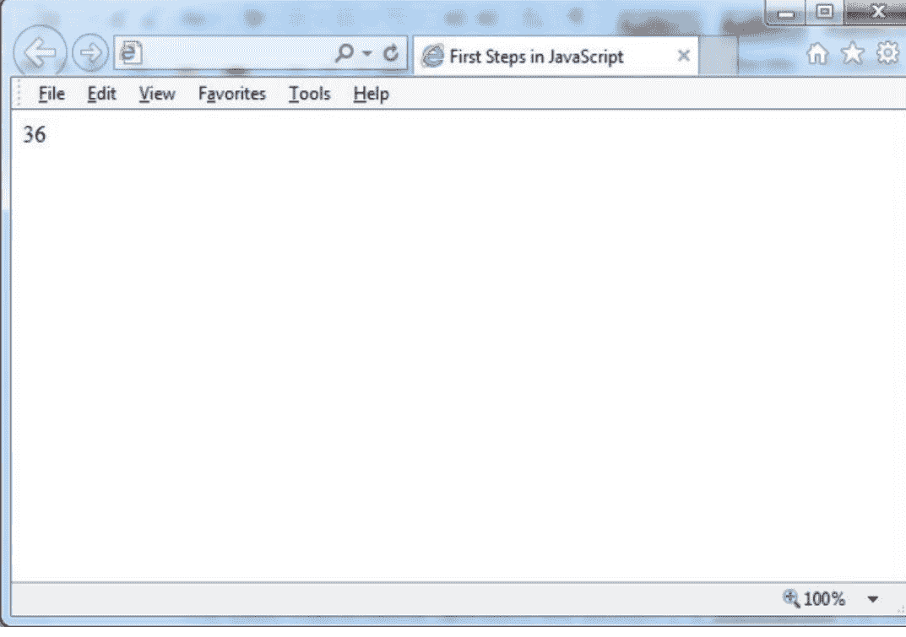

**图 4.** 使用变量计算年龄

> **注意：** 将变量“调用”到网页上显示很容易。只需使用 `document.write()` 命令即可。

数学运算符，特别是加法运算符，可用于组合两个或多个字符串。这种组合字符串的过程称为连接。在下面的例子中：

```javascript
var firstName = "Martwan";
var lastName = "Jenkins";
var fullName = firstName + lastName;
document.write(fullName);
```

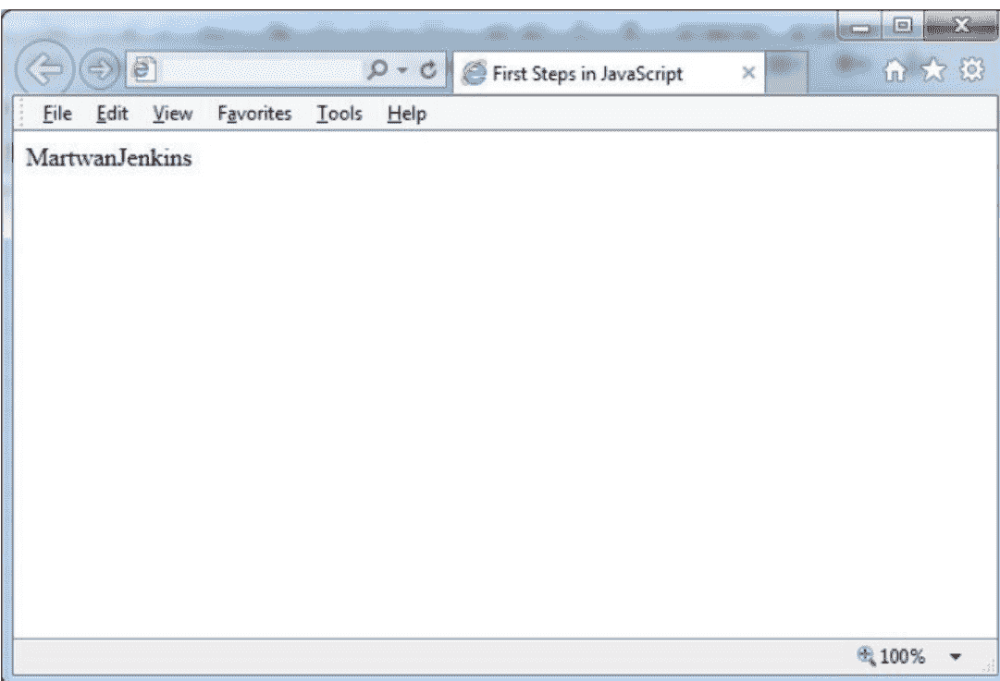

`fullName` 的值最终会是 `MartwanJenkins`。为了确保格式正确，我们需要在引号中包含空格作为字符串。例如，我们可以使用以下声明：

```javascript
var fullName = firstName + " " + lastName;
```

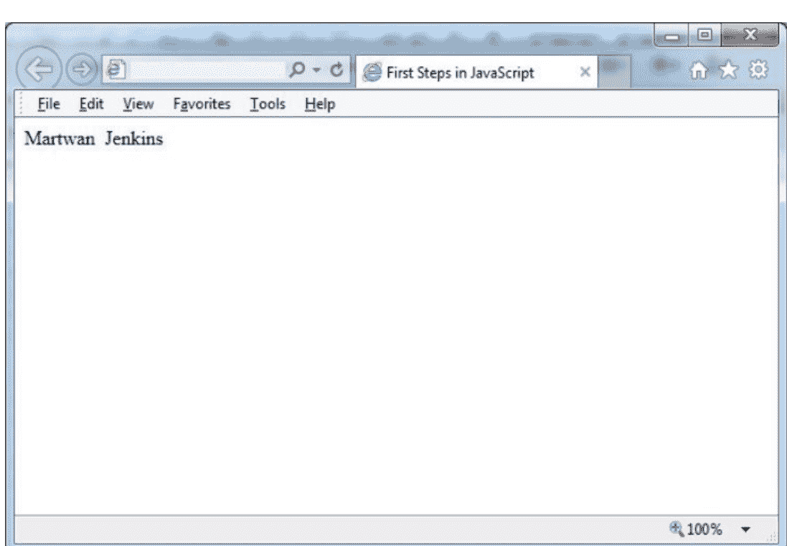

**图 6.** 连接带空格的字符串

我们可以看到，运算符在连接文本和/或组合变量时也非常有用。事实上，我们可以用它来构建更具逻辑性的句子。例如，我们可以将“My name is”文本与一个计算变量的值组合起来。

```javascript
var firstName = "Martwan";
var lastName = "Jenkins";
var fullName = firstName + " " + lastName;
document.write("My name is " + fullName);
```

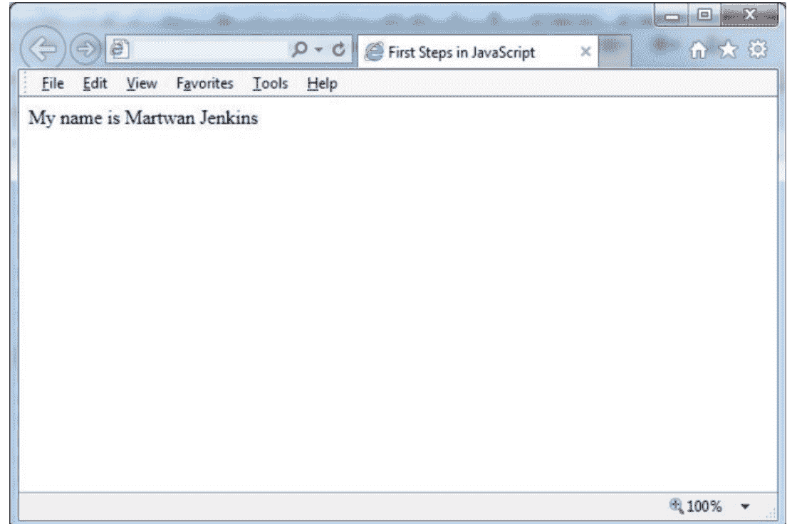

**图 7.** 连接完整的句子

> **注意：** 在一个语句中执行多个数学运算时，需要遵循运算优先级规则。

### 赋值运算符

就像现实生活中事物会变化一样，JavaScript 程序中的变量也会变化。为了在 JavaScript 中改变变量，我们将使用赋值运算符。我们已经熟悉基本的赋值运算符等号（`=`），它用于给变量赋予初始值或新值。还有其他赋值运算符也可以改变变量的值，但它们的方式略有不同。

例如，随着时间的流逝，我们年龄增长，年龄逐年递增变化。在 JavaScript 中实现这种变化有几种不同的方法，结果都是一样的。为了尝试改变变量的可能性，我们可以尝试下面的代码，其中 `age` 变量的值改变后会在浏览器中显示：

```javascript
var age = 35;
document.write("<p>My age is \"" + age + "\"</p>");
age = age + 1;
document.write("<p>A year has passed, so now I am \"" + age + "\"</p>");
age += 10;
document.write("<p>What? Are you telling me that I am a grandad now? But I am only \"" + age + "\"</p>");
```

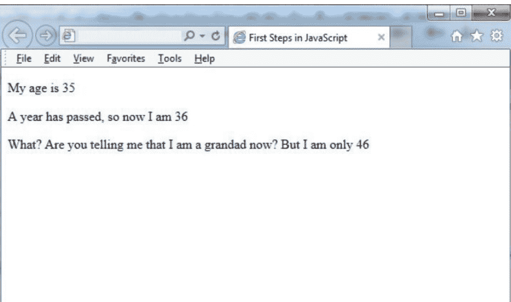

**图 8.** 使用赋值运算符改变变量

虽然这些操作起初看起来可能有点令人困惑，但从编程的角度来看，它们仍然是合乎逻辑的。例如，如果我们反向读取语句 `age = age + 1`，发生的事情是将值 1 加到当前年龄 35 上，这将使 36 成为 `age` 的新值。此外，我们可以在语句 `age += 10` 中使用复合赋值运算符（如 `+=`）来将变量的值增加 10。我们也可以将同样的逻辑应用于其他运算，如减法、除法和乘法。

```javascript
age -= 5;    等同于    age = age - 5;
age *= 5;    等同于    age = age * 5;
age /= 5;    等同于    age = age / 5;
```

此外，当我们想将变量的值增加/减少 1 时，也可以使用以下赋值运算符：

```javascript
age++;     等同于    age = age + 1;
age--;     等同于    age = age - 1;
```

### 比较运算符

顾名思义，比较运算符用于比较两个值。比较完成后，会返回一个 `true` 或 `false` 的值，具体取决于比较是否精确。比较运算符主要用于在循环或条件语句中评估条件，这将在下一章中讨论。

下表总结了最常见的比较运算符。

| 运算符 | 含义 | 示例 | 返回值 |
| ------ | ---- | ---- | ------ |
| `==` | 等于 | `4 == 4` | 真 |
| `>` | 大于 | `3 > 4` | 假 |
| `<` | 小于 | `3 < 4` | 真 |
| `>=` | 大于或等于 | `4 >= 4` | 真 |
| `<=` | 小于或等于 | `4 <= 5` | 真 |
| `!=` | 不等于 | `3 != 4` | 真 |

**表 1.** 比较运算符

### 逻辑运算符


逻辑运算符允许我们比较两个或多个条件语句。通过比较，我们可以确定哪个语句为真，从而相应地进行处理。与比较运算符一样，逻辑运算符返回一个`true`或`false`的值，具体取决于运算符两侧的值。三个最常见的逻辑运算符是`AND`、`OR`和`NOT`。

`AND`运算符由`&&`代码表示。只有当`&&`运算符两侧的语句都为真时，运算符才返回真值。如果其中一个或两个语句为假，运算符返回假值。这与日常语言的规则一致，例如，语句“这件夹克有所有美国的颜色，红、白和蓝”只有在夹克是红色的（真）、白色的（真）和蓝色的（真）时才为真。如果其中一种颜色不同（假），那么该语句也为假。在 JavaScript 语法中，它看起来类似于以下内容：

```javascript
(color1 == "red" && color2 == "white" && color3 == "blue")
```

`OR`运算符由`||`代码表示。如果运算符一侧或两侧的语句为真，它就返回真值。只有当两个语句都为假时，运算符才会返回假值。例如，语句“我的哥哥暑假要么去巴西，要么去泰国”如果我哥哥去了其中一个（或可能两个）地方，那就是真的。

```javascript
(destination1 == "Brazil" || destination2 == "Thailand")
```

`NOT`运算符由`!`代码表示，用于“声明”相反的语句为真。因此，对于除了明确陈述的条件之外的任何其他条件，运算符都会返回真值。例如，语句“布莱恩的体重不是 200 磅”对于除 200 以外的任何体重值都是真的。

```javascript
!(weight == 200)
```

我们将在下一章学习逻辑运算符更实际的应用，届时我们将重点介绍条件语句和循环。

## 数组

到目前为止我们检查过的变量一次只能记住一条信息。然而，我们经常需要跟踪多个值，比如一年的月份或购物清单。在这种情况下，JavaScript 提供了一种很好的方式来在单个变量下记住多个值，称为数组。让我们从定义一个数组变量开始，它将保存一年的前六个月。

```javascript
var months = ["January", "February", "March", "April", "May", "June"];
```

声明数组变量时，我们首先使用`var`关键字，后跟变量名，就像普通变量一样。由于数组包含多个项目，我们将在方括号`[]`之间为每个项目提供一个值。像普通变量一样，如果项目的值是字符串，我们会将其放在引号内。否则，如果值是数字或可能是另一个变量，我们不会使用任何引号字符。例如，我们可以声明以下随机项目的数组：

```javascript
var randomItems = ["ball", -0.5, "black pony", 333, true];
```

也可以定义一个空数组。我们将使用相同的语法，但省略任何项目的值。

```javascript
var hole = [];
```

### 处理数组元素

访问数组元素与访问普通变量不同。由于数组包含多个值，仅使用数组变量名是不够的，我们还需要指明元素在数组中的位置。数组中每个元素的位置由一个称为索引的数字表示。因此，要访问数组元素，必须使用数组变量名和索引号。例如，如果我们想显示`months`变量的第一个和最后一个元素，我们将使用数组名后跟方括号中的数字。

```javascript
var months = ["January", "February", "March", "April", "May", "June"];
document.write(months[0]);
document.write(months[5]);
```

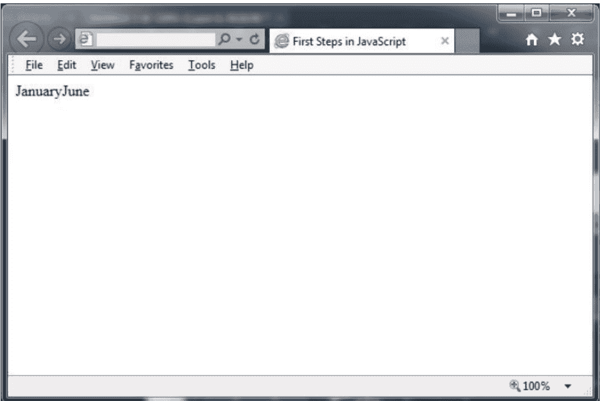

**图 9.** 定义和显示数组结果的示例

> **注意：** JavaScript会自动为每个数组元素编号。第一个元素的索引值始终是`0`，第二个元素的索引值始终是`1`，依此类推。

当我们想要更改特定数组元素的值时，我们将使用索引位置。例如，假设在我们的`months`数组中，我们想将月份名称替换为它们的缩写。我们可以使用以下语句来更改每个变量：

```javascript
months[0] = "Jan";
months[1] = "Feb";
months[2] = "Mar";
months[3] = "Apr";
months[4] = "May";
months[5] = "Jun";
```

### 管理数组元素

如果我们知道最后一个数组元素的索引值，我们只需为后续元素赋值就可以简单地添加更多元素。例如，以下语句将在索引值`6`下向数组中添加一个新元素。

```javascript
months[6] = "Jul";
```

然而，在编程中，我们几乎从不需要记住诸如最后一个索引值之类的琐事。相反，要向数组末尾添加一个或多个元素，我们可以使用`push`关键字。要将最后五个月添加到我们的`months`数组中，我们将`push`关键字与数组名组合，形成以下语句：

```javascript
months.push("Aug", "Sep", "Oct", "Nov", "Dec", "Jan");
```

嗯，看来我们多加了一个月。要删除数组的最后一个元素，我们将使用`pop`关键字。与之前一样，我们将`pop`关键字与数组名组合，形成以下语句：

```javascript
months.pop();
```

此语句将删除最后一个数组元素“Jan”，留下一个包含所有月份的数组。当我们想在数组开头而非末尾添加元素时，我们可以使用`unshift`关键字。或者，当我们想从数组开头删除元素时，可以使用`shift`关键字。以下两个语句将向我们的数组添加并随后删除一个虚假的第一个月份。

```javascript
months.unshift("Sext");
months.shift();
```

如果我们想随时检查数组中包含的元素数量，我们可以调用`months`数组的`length`属性`months.length`，并使用`document.write`语句将其打印出来。为了回顾我们涵盖的所有不同方面，我们的完整代码将是：

```javascript
var months = ["January", "February", "March", "April", "May", "June"];
months[0] = "Jan";
months[1] = "Feb";
months[2] = "Mar";
months[3] = "Apr";
months[4] = "May";
months[5] = "Jun";
months[6] = "Jul";
months.push("Aug", "Sep", "Oct", "Nov", "Dec", "Jan");
months.pop();
months.unshift("Sext");
months.shift();
document.write("The number of items in the array is: ", months.length);
```

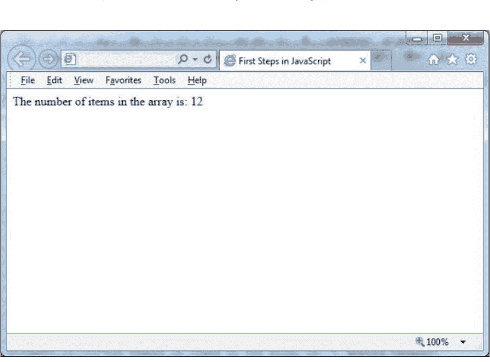

### 图 10. 操作和显示数组长度

## 注释

从处理HTML和CSS中，我们应该已经熟悉了注释。基本上，注释是一种告诉浏览器忽略某些代码段的方式。注释的目的是为我们或之后将阅读代码的人留下关于代码的笔记。由于JavaScript在日后修改时可能更难理解，因此注释甚至更为重要。

JavaScript识别两种不同的注释方法：将单行标记为注释和将多行标记为注释。无论使用哪种方法，被注释的行都不会被解释器执行。

单行注释由两个正斜杠创建。当解释器找到两个正斜杠时，它将忽略直到行尾的所有内容。

```javascript
//this is a single line comment
```

也可以编写一行包含代码和注释的行。在下面的示例中，在声明变量`year`之后，该行的其余部分将被视为注释。

```javascript
var year = 2015; //this is most likely the current year
```

当我们需要多行注释时，我们可以使用另一种方法。JavaScript中的多行注释与CSS中的多行注释相同。注释有一个由正斜杠和星号（`/*`）开始的开头，和一个由星号和正斜杠（`*/`）开始的结束。这些开始和结束注释标记之间的所有内容都将被解释器忽略。

```javascript
/*This is a comment that
is written in exactly
three lines */
```

# 第2章：条件与循环语句

创建变量并在变量中存储值并不是真正的成就，使用简单运算符更改这个变量也不是。要开始让事情变得有趣，我们需要做的是让我们的程序对我们的操作做出反应，让它们更智能。我们可以通过使用条件语句和循环来做到这一点。

## 条件语句

我们在日常活动中做出无数的选择：“我应该起床吗？”、“我应该吃什么？”、“我应该去哪里喝咖啡？”。这些选择取决于当前情况，因为我们的决策受到周围环境的影响。类似地，JavaScript也有称为条件语句的决策能力。从根本上讲，条件语句是一个简单的是或否问题，程序在答案为是时执行一件事，在答案为否时执行另一件事或什么都不做。

最基本的条件语句是所谓的`if`语句。此语句仅在问题的答案为真时执行任务。要理解`if`语句的语法，让我们看下面的示例：

```javascript
var age = prompt("What is your age?","");

if (age > 30) {
    document.write ("You are not so young anymore.");
}
```

`if`语句由三部分组成。`if`关键字表示后面是一个条件语句。圆括号`()`包含是/否问题，也称为条件。最后，花括号`{}`包含如果问题答案为正则需要执行的一个或多个语句。本质上，`{`括号标记了条件满足时将运行的代码的开始，`}`括号标记了其结束。

在我们的示例中，条件是两个值之间的比较。使用条件`(age>30)`，我们检查`age`变量是否具有大于30的值。如果条件为真，则执行将括号内的文本写入网页的语句；否则，如果为假，解释器将跳过花括号内的所有语句。

## 替代条件

在现实生活中，当一个条件失败时，我们总有一个替代方案。如果餐厅没有蛋糕，我们可以总是点一份水果沙拉作为甜点。类似地，在JavaScript中，我们也希望当条件为真和条件为假时发生一些事情。为此，我们可以用`else`子句扩展`if`语句。例如：

```javascript
var age = prompt("What is your age?", "");
if (age < 18) {
    document.write("You can enter the web site.");
}
else {
    document.write("You are too old to watch cartoons.");
}
```

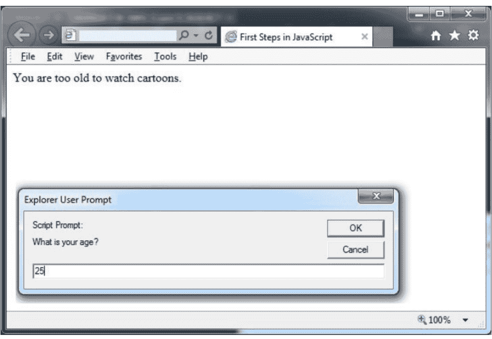

**图 11.** 使用条件语句响应用户输入

在上面的示例中，要求用户输入其年龄。然后，`if`语句评估`age`变量的值是否小于18。如果为真，则在页面上显示文本“You can enter the web site”。如果此条件为假，并且用户输入了等于或大于18的值，则启动`else`子句，并显示文本“You are too old to watch cartoons.”

网页上显示了“你年纪太大，不适合看卡通了”。

要启动一个`else`子句，我们只需在条件语句的结束大括号后添加它作为关键字。我们希望执行的语句也放在大括号`{}`中，就像我们有添加任意多行代码的选项一样。

通常情况下，一个情况会有不止两种可能的结果。在这种情况下，JavaScript允许我们使用级联的`else if`语句来提供针对多个选项的解决方案。我们从一个`if`语句开始处理第一个选项，然后添加一个或多个`else if`语句来触发其他选项。像以前一样，`else`子句在最后用作最终选项。

```javascript
var money = prompt("How much money do you have in your pocket?", "");

if (money < 20) {
    document.write("That is not enough. Go to the ATM to get some more.");
}

else if (money == 20) {
    document.write("Exactly 20? That's great, buy me a nice burger meal.");
}

else {
    document.write("You shouldn't carry so much money around. Give some to me.");
}
```

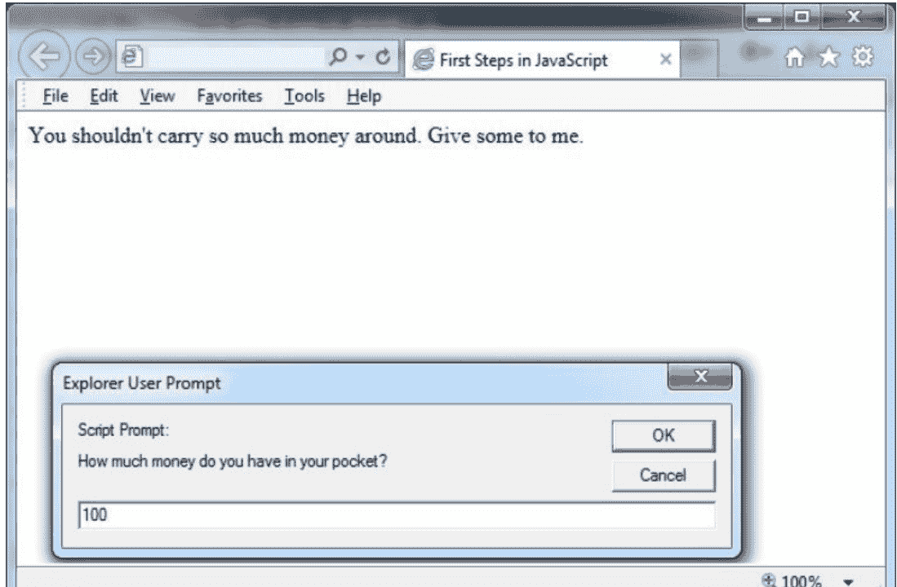

**图片 12.** 使用替代条件语句

在上面的例子中，用户被要求输入他/她拥有的金额。然后，JavaScript程序评估答案，并根据输入的金额从三个可用的响应中回复一个。

## 多重条件

现在我们已经介绍了所有替代方案，让我们看看当存在多个变量时会发生什么。当我们处理不同的变量时，我们需要构建更复杂的条件语句。例如，如果我们正在举行一个私人单身派对，我们必须确保不让任何人进来，除非他们是女性并且超过18岁。使用上一章的逻辑运算符和`if/else`条件语句，我们可以构建更复杂的比较。

```javascript
var gender = prompt("What is your gender?","");
var age = prompt("How old are you?","");
if ((gender == "female") && (age >= 18)) {
    document.write("Please enter. Hope you brought a nice gift.");
}
else if (gender == "male") {
    document.write("This is a bachelorette party. No guys allowed.");
}
else {
    document.write("You are probably too young to enter. Come back in a few years.");
}
```

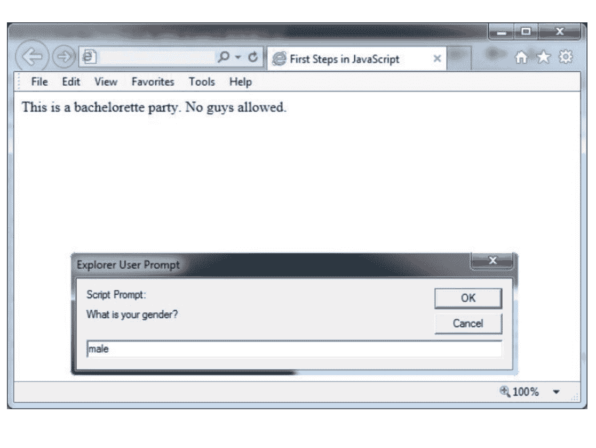

#### 图片 13. 检查多重条件

在上面的例子中，我们根据两个因素做出决定：性别和年龄。只有当两个条件都为真时，即这个人是年满18岁的女性，才会做出肯定的决定。在 JavaScript 中，我们使用逻辑运算符组合条件，在本例中是`AND`运算符，由双`&`符号（`&&`）表示。在单个条件语句中，当在两个条件之间使用此运算符时，我们将结果总结为一个条件。

## 循环语句

在我们日常完成一项任务的过程中，我们必须一遍又一遍地重复相同的步骤系列。为了洗碗，我们必须单独洗每一个盘子。为了下楼梯，我们必须一次走下一个台阶。在收银台，我们必须把购物车里的每件商品拿出来，扫描一下，然后放回袋子里。嗯，在编程中，重复性任务很容易完成。事实上，JavaScript非常擅长执行重复性任务，因为它拥有所有必要的工具来一遍又一遍地做同样的事情。在编程术语中，重复执行同一任务被称为循环。

有几种不同类型的循环。它们本质上做同样的事情，但方法略有不同。在本节中，我们将熟悉`while`循环和`for`循环。

### While循环

在`while`循环中，只要某个条件为真，相同的代码就会被重复执行。让我们看一个例子，它随着我们每年年龄的增长来检查我们的年龄。

```javascript
var age = 1;
while (age < 18) {
    document.write("Another year has passed. You are now "+age+" years old.<br>");
    age = age + 1;
}
document.write(age+"? Congratulations! You are now an adult.");
```

在这个例子中，在声明了`age`变量之后，我们引入了一个`while`语句。在`while`关键字之后，我们在括号中放置一个条件，在我们的例子中是`age<18`。如果条件为真，JavaScript解释器将运行出现在大括号之间的代码。与条件语句不同，当遇到`while`语句的结束大括号时，JavaScript不会继续执行程序的其余部分，而是再次启动`while`语句。只要存储在`age`变量中的数字小于18，脚本就会运行`document.write()`命令。

只有当条件为假时，解释器才会“退出”循环并继续解析代码的其余部分。这使得`while`循环的最后一行非常重要。它不仅改变了条件变量的值，还使测试条件最终可能为假。如果没有这种可能性，我们将“锁定”解释器一遍又一遍地执行相同的任务……永远。这就是所谓的无限循环，本质上是一个永远不会完成的循环。无限循环将一直运行，直到它使计算机崩溃，或者在一定时间后从现代解释器收到超时信号。

### For循环

在 JavaScript 中，有第二个选项来创建循环语句，它更紧凑但稍微更令人困惑。`for`循环可以用更少的代码行实现与`while`循环相同的功能，但对于初学者程序员来说，代码有点不直观。在`for`循环中，变量声明、条件和变量值的更改都在同一时间完成。例如，让我们用`for`循环语法编写之前的年龄增长`while`循环。


```javascript
for (var age = 1; age < 18; age++) {
    document.write("Another year has passed. You are now "+age+" years old.<br>");
}

document.write(age+"? Congratulations! You are now an adult.");
```

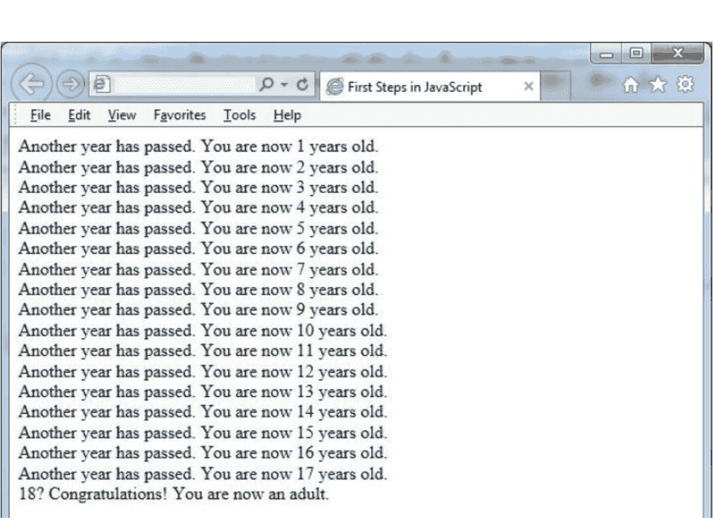

如图所示，在这两种情况下，生成的内容完全相同。每个循环都以`for`关键字开始。这后面跟着一组括号，其中包含三个部分。

1. 第一部分仅在语句开始时应用一次，声明条件变量`age`，并将其初始值设置为 1。初始值用作循环将重复次数的起点，可以是任何数字。如果该变量在脚本中已经初始化过，则`var`关键字将是不必要的。

2. 第二部分是条件本身，在每次执行循环之前都会进行评估。只要条件为真，`for`语句将不断重复代码。当条件为假时，循环将被告知停止运行，在我们的例子中，这发生在`age`变量变得大于或等于 18 时。

3. 最后，第三部分决定了条件变量的更改速率。在我们的例子中，条件变量在每个周期后增加 1，但这不是强制性的。条件变量可以变大或变小，并且可以按我们设置的任何数量增加/减少。

为了完成`for`循环的结构，我们有大括号，其中包含我们希望在循环中使用的代码，在我们的例子中是用`document.write()`在网页上写一行文本。

### 循环与数组

当我们想要处理数组变量时，循环语句非常有用。在 JavaScript 中，我们可以使用循环遍历数组项，并在必要时对每一项执行操作。

在本书前面，我们创建了一个名为`months`的数组，其中包含一年中的十二个月。

```javascript
var months = ["Jan", "Feb", "Mar", "Apr", "May", "Jun", "Jul", "Aug", "Sep", "Oct", "Nov", "Dec"];
```

使用`while`或`for`循环，我们将遍历数组中的每一项并将其打印到页面上。我们将通过使用它们的索引来访问数组项，并在每个循环周期中依次增加索引值。如果我们使用`while`语句，我们将有以下代码：

```javascript
var counter = 0;
while (counter < months.length) {
    document.write(months[counter] + " ");
    counter++;
}
```

我们启动一个计数器变量，它的起始值与第一个数组项的索引相同，即 0。接下来，我们开始一个`while`循环，该循环一直运行到计数器值小于数组的长度。条件`counter < months.length`通过将计数器变量的当前值与数组的`length`属性进行比较，询问当前值是否低于数组项的数量。每次`while`循环运行时，我们打印单个数组项的值，然后将计数器变量的值增加 1。

如果我们想用`for`循环执行相同的操作，我们可以使用以下代码：

```javascript
var months = ["Jan", "Feb", "Mar", "Apr", "May", "Jun", "Jul", "Aug", "Sep", "Oct", "Nov", "Dec"];
for (var counter = 0; counter < months.length; counter++) {
    document.write(months[counter] + " ");
}
```

## 第三章：函数

至此我们已经了解到，编写 JavaScript 代码实际上就是在编写详细的指令，这些指令将一步步指引计算机完成我们想要执行的操作。在现实生活中，我们通常只需要在第一次执行某项操作时遵循详细指令。随后，我们便熟悉了步骤并能自动完成操作。例如，让我们回想第一次使用触屏智能手机的情景。要开启手机，我们需要执行两个陌生的操作：点击一个按钮点亮屏幕，然后滑动屏幕解锁手机。此后每次想要开机时，我们都不再需要这些指令；因为我们已经记住了它们。

JavaScript 也有一种类似的机制，用于记忆常用操作的步骤，这种机制被称为函数。函数是我们预先在脚本中创建的一系列步骤，以便在需要时随时调用。我们只需编写一次代码，就可以在任何时候运行它。

本章将介绍使用函数的基础知识。我们将学习什么是函数、如何定义和构造函数，以及如何在脚本中调用函数。

### 创建函数

函数的主要目的是通过单一命令执行一系列操作。函数将执行的实际任务取决于其自身的代码。它可能像在浏览器中写入一行文本那样简单，也可能涉及复杂的计算，例如计算购物车最终价格（包含折扣和运费）。除了使脚本更具可移植性外，函数之所以实用，还在于它们的可复用性。我们无需重写代码块，只需在必要时多次调用函数即可。当函数较长且执行复杂任务时，这一点尤其有用。

要在 JavaScript 中定义一个基本函数，需要用名称和代码对其进行声明。为函数选择名称时，最好选择一个能反映其用途的名称。基本上，函数名称应该表明该函数的功能。

在我们的初始示例中，我们将使用关键字`function`，后跟函数名`writeText`和一对圆括号来声明一个函数：

```javascript
function writeText() {
    document.write("The answer is 42.");
}
```

通过使用关键字`function`，我们告知解释器，后续代码是一系列需要记忆的步骤。这些步骤列在两个花括号之间，它们标志着属于该函数的 JavaScript 代码的开始和结束。在上面的例子中，这些步骤将以函数的名称`writeText`被记忆。因此，每当我们要启动这一系列步骤时，只需写出函数名后跟空圆括号即可。这也被称为调用函数。

```javascript
writeText();
```

在这个基本示例中，每当我们在主脚本中调用该函数时，文本“The answer is 42.”就会被写入网页。为了给出一个更精确和实用的例子，让我们修改之前的脚本，创建一个检查用户年龄的函数。

```javascript
function checkAge() {
    if (age >= 18) {
        document.write("You have reached the age of wisdom, please enter and have some fun.");
    }
    else {
        document.write("Please come back in a few years.");
    }
}
```

放在函数中的 JavaScript 代码会存储在浏览器的内存中，等待我们在需要执行特定操作时调用该函数。在这个例子中，函数会检查`age`变量与 18 这个值的关系。如前所述，要调用该函数，我们只需写出函数名，后跟一对圆括号。我们还将添加一个`prompt()`，要求用户输入其年龄值。

```javascript
var age = prompt("How old are you?");
checkAge();
```

完整的脚本如下：

```javascript
function checkAge() {
    if (age >= 18) {
        document.write("You have reached the age of wisdom, please enter and have some fun.");
    }
    else {
        document.write("Please come back in a few years.");
    }
}
var age = prompt("How old are you?");
checkAge();
```

图片 16. 实现一个检查用户年龄的函数

此外，我们可以利用前面章节学到的知识，使这个函数更加智能。与其仅仅收到“Please come back in a few years.”这样的回复，我们可以计算出 18 与用户输入年龄之间的实际差值。为此，我们将在函数中引入一个名为`difference`的变量，然后如果输入的年龄值小于 18，则计算差值为`18 - age`，最后将`difference`变量与文本一起打印出来。

```javascript
function checkAge() {
    var difference;
    if (age >= 18) {
        document.write("You have reached the age of wisdom, please enter and have some fun.");
    }
    else {
        difference = 18 - age;
        document.write("Please come back in "+difference+" years.");
    }
}
var age = prompt("How old are you?","");
checkAge();
```

图片 17. 智能年龄检查

### 向函数发送信息

我们可以向函数发送一个或多个值，从而增强其通用性。当我们发送这些值时，函数能够在返回答案之前处理这些信息。我们发送的值也称为参数，而向函数发送信息的过程称为“传递参数”。一旦接收到参数，函数将在执行代码中指定的操作序列时使用这些数据。

基本语法如下所示：

```javascript
function functionName(argument) {
    //JavaScript code
}
```

参数设置在函数的第一行，即我们之前留空的那对圆括号内。作为参数传入的值会自动成为函数内声明的变量。这些变量使用圆括号内给出的名称，无需再用`var`关键字进一步声明。

作为最基本的示例，让我们创建一个函数，用于简化`document.write()`命令的语法。

```javascript
function print(message) {
    document.write(message);
}
print("<p>What are you doing? document.write is a perfect command.</p>");
print("<p>42 is the answer, but what is the question?</p>");
```

图片 18. 用带参数的函数替代`document.write`命令

这个名为`print()`的函数可以接受一个参数。当函数被调用时，这个参数被传递给函数，并存储为名为`message`的变量。当函数内部的`document.write()`命令启动时，它会将`message`变量的内容写入页面。

如前所述，函数不限于处理单个参数。只要每个参数在函数中被指定，并且函数在调用时传入了相同数量且顺序相同的参数，我们就可以根据需要向函数传递任意多个参数。

例如，让我们重新审视`checkAge()`函数，并尝试使其更加通用。我们将向函数提供`name`和`years`变量，并让它返回个性化的消息。

```javascript
function checkAge(name, years) {
    if (years < 18) {
        document.write(name+" you are too young to enter.<br>");
    }
    else {
        document.write(name+" you are above 18. Please come in.<br>");
    }
}
```

```javascript
checkAge("Jack", 80);
checkAge("Alicia", 8);
checkAge("Simonetta", 15);
checkAge("Geronimo", 30);
```

图片 19. 使用单个函数检查多个用户的年龄

在上面的例子中，我们多次调用`checkAge()`函数，每次传递两个不同的值，一个用于`name`，另一个用于`age`（在函数参数中对应`years`）。每次调用函数时，这两个值都作为参数传递给函数。第一个参数存储为`name`变量，第二个值存储为`years`变量。随后，`years`变量在一个条件语句中用于评估其是小于 18 还是大于 18。相应地，`name`变量用于通过`document.write()`命令显示的个性化消息中。我们每条个性化消息都以`<br>`标签结尾，以便让消息在单独的行中显示。

> 注意：你可以向函数发送任何类型的 JavaScript 变量或值：字符串、数字、布尔值、数组等。

### 从函数中检索信息

既然我们已经了解了如何传递信息，我们就可以更进一步，让函数把信息“带”回来。为了从函数中取回一个值到主脚本中，我们可以使用`return`语句。其通用语法如下所示：

```javascript
function functionName(argument1, argument2) {
    // JavaScript 代码
    return data;
}
```

举一个更具体的例子，假设我们想了解产品折扣后的价格。

```javascript
function checkPrice(price, discount) {
    var total = price - price * discount / 100;
    return total;
}

var actualprice = checkPrice(100, 20);
document.write("产品不含增值税的折扣价为 "+actualprice);
```

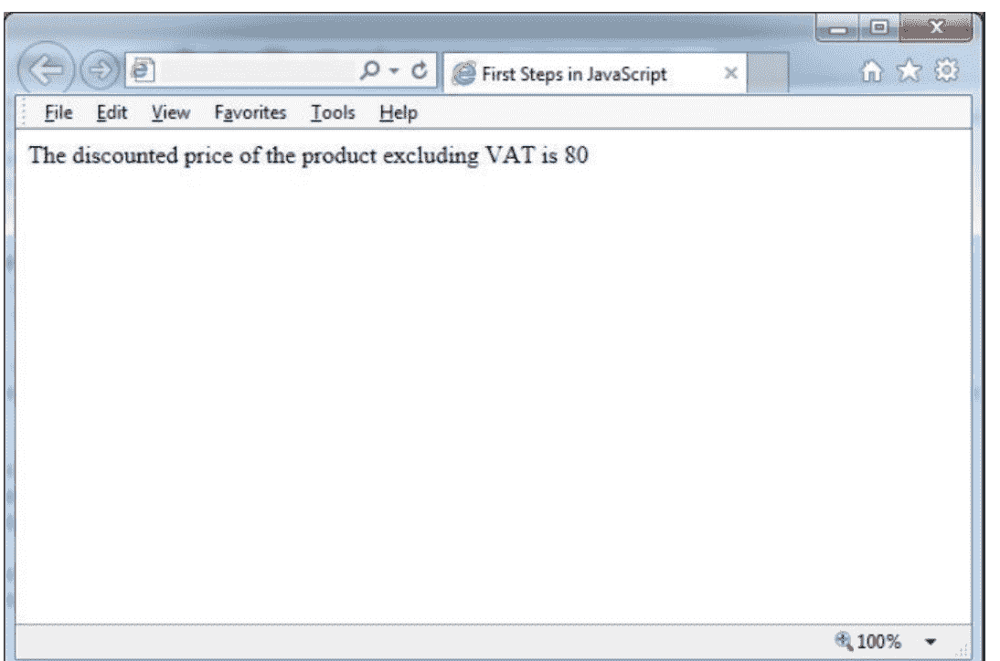

`checkPrice`函数接受两个值作为参数：产品的价格和需要应用的折扣。一旦这些值被接受，它们就分别存储在`price`和`discount`变量中。然后，函数计算折扣价并将这个计算出的值赋给变量`total`。数学公式`price-price*discount/100`正是用于进行此计算的公式。最后，变量`total`的值通过`return`语句返回给主脚本。

传递给脚本的是`total`变量的值，而不是变量本身。为了在脚本中使用这个“返回”的值，我们需要将它存储在一个变量中。在上面的例子中，我们调用`checkPrice()`函数来计算 100 美元价格打 20% 折扣后的值，并将结果赋给`actualprice`变量。然后这个变量在主脚本中使用，并可以通过`document.write()`命令显示在屏幕上。

我们不一定需要将返回值存储在变量中。我们也可以直接在`document.write()`命令中使用它。

```javascript
document.write("产品不含增值税的折扣价为 "+checkPrice(100, 20));
```

我们必须知道，一旦浏览器的 JavaScript 解释器遇到`return`语句，它就会退出该函数。这意味着`return`语句之后的任何代码行都不会被执行。因此，`return`语句应该是函数中的最后一行代码。

### 局部变量与全局变量

到目前为止，我们已经知道函数通过减少我们需要编写的代码量为我们提供了巨大的优势。然而，在继续之前，我们需要阐明另一个方面：函数内部变量与函数外部变量的行为。这些变量的处理方式存在差异，这对于我们编写代码的实践非常重要。

对于 JavaScript 解释器来说，在函数内部声明的变量与在函数外部声明的变量被区别对待。这些变量的所谓“作用域”在每种情况下是不同的。存在于函数内部的变量对脚本的其余部分不可见，它们只对该函数本身有效。这意味着函数变量具有局部作用域。另一方面，在 JavaScript 代码主体部分声明的变量对脚本的所有部分都有意义。这意味着脚本中的所有现有函数都可以访问在其主体中创建的变量。这些变量具有全局作用域。

为了阐明这种差异，让我们看几个例子，我们将计算一个有趣的外出夜晚中我们喝了多少饮料。

```javascript
var drinks = 0;

function nightOut() {
    drinks = 5;
    document.write("函数内的饮料数量 ", +drinks);
}

document.write("函数外的饮料数量 ", +drinks);
```

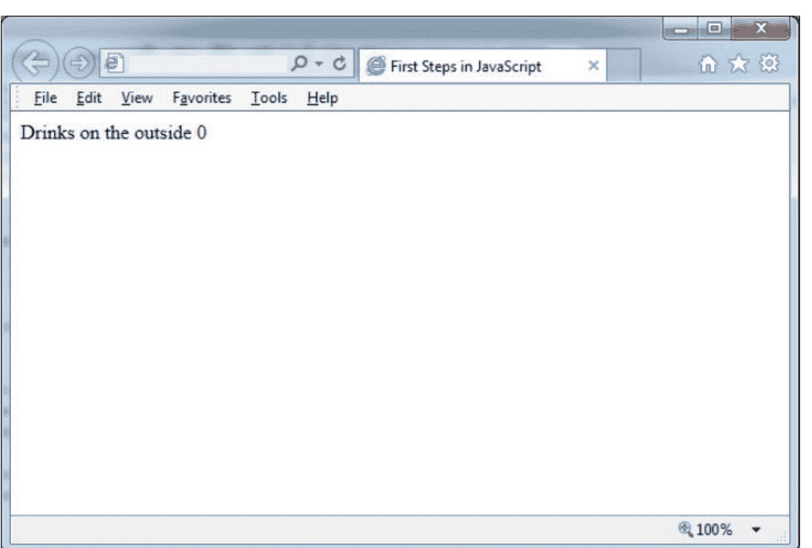

当我们以 0 杯饮料开始一天时，变量`drinks`在 JavaScript 代码的主体中声明，并赋值为 0。由于`drinks`变量在主体代码中声明，它具有全局作用域，这意味着它可以被所有其他函数访问。因此，当我们在函数和主代码中用`document.write`语句显示这个变量时，我们得到的是赋值后的值 5。

现在，让我们假设我们想要用以下代码跟踪我们在每个地方访问的饮料数量：

```javascript
var drinks=0;
var bardrinks = 0;
var clubdrinks = 0;
function nightOut() {
    var bardrinks = 3;
    var clubdrinks = 5;
    var drinks = bardrinks + clubdrinks;
    document.write("<p>函数内的酒吧饮料数量 ", +bardrinks);
    document.write("<p>函数内的俱乐部饮料数量 ", +clubdrinks);
    document.write("<p>函数内的饮料总数 ", +drinks);
}

nightOut();
document.write("<p>函数外的酒吧饮料数量 ", +bardrinks);
document.write("<p>函数外的俱乐部饮料数量 ", +clubdrinks);
document.write("<p>函数外的饮料总数 ", +drinks);
```


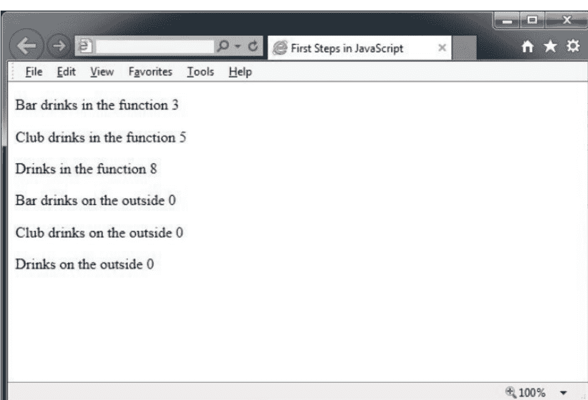

**图片 22.** 局部变量与全局变量的扩展示例

与前一个例子类似，变量`drinks`在脚本主体中声明，因此具有全局作用域。然而，在这个变体中，我们还在函数内部声明了两个额外的变量`bardrinks`和`clubdrinks`。这两个变量将具有局部作用域，只能在函数本身内部访问。因此，当我们在函数内用`document.write()`语句显示这些变量时，我们可以看到值，而当我们在主代码中显示这些变量时，则看不到任何值。

## 第四章：对象

现实世界充满了对象，随机举例如汽车、电视和玩偶。这些对象大多由许多不同的部分组成（例如，汽车有门，电视有屏幕，玩偶有头），并且可以执行一个或多个动作（例如，运输人，观看图像）。编程世界，特别是 JavaScript，也充满了对象。

我们已经到了需要将我们的 JavaScript 知识提升到更高水平的时候。为此，我们将从对象和面向对象编程开始，研究更高级的概念。理解这些概念将为我们提供一套重要的工具，我们甚至可以在学习其他编程语言时应用它们。

### 什么是对象？

要在编程世界中表示物理事物和概念，我们需要使用对象。但在我们使用编程对象之前，让我们先考察一个现实世界中的对象——汽车。如果我们想描述一辆汽车，我们会谈论它的特征，比如颜色、品牌和型号。我们可能会将描述扩展到车门数量、座椅数量、发动机类型、最高速度或任何其他特征集。我们还可以谈论我们如何使用汽车，从转动点火钥匙，到驾驶或听立体声，甚至如何使用汽车的某些部分，比如调节座椅。我们甚至可以根据这个大纲比较不同的汽车“版本”。

在编程中，汽车将被描述为一个对象。汽车的特征，如颜色、品牌、型号，将被定义为汽车对象的属性。我们可以对汽车做的事情，如驾驶或听音乐，由所谓的`方法`表示。最后，每辆汽车的实际表示称为`实例`。例如，在下面的图片中，你看到的是两辆汽车的两个实例。


**图片 23.** 两辆相同的汽车

### 创建对象

在 JavaScript 中创建对象有两种方法：我们可以使用`对象构造函数`或`字面量表示法`。让我们从一个对象构造函数的例子开始。

```javascript
var car = new Object();
```

这个语句的第一部分很熟悉，我们使用`var`关键字定义一个`car`变量。由于我们希望将变量定义为对象，所以我们使用`new`运算符，后跟`Object()`构造函数。这将指示 JavaScript 创建一个空对象并将其命名为`car`。

一旦空对象被创建，我们就可以开始定义它的属性。每个属性将有一个名称和一个值，每个名称/值对描述对象的一个特定实例。对于我们的汽车对象，我们可以分配属性`color`、`make`和`model`。

```javascript
var car = new Object();
car.color = "red";
car.make = "Ford";
car.model = "Mustang";
```

我们可以注意到，在定义属性时，我们使用对象名称，后跟一个点，然后是属性名称。这被称为`点语法`，其中点是连接属性（或方法）与对象的符号。

要为对象定义一个方法，我们需要创建一个将成为该对象一部分的函数。首先，让我们创建一个简单的方法，该方法将显示一条通知，表明汽车已经启动。

```javascript
car.startCar = function () {
    document.write("发动机已启动。<br>");
}
```

由于我们熟悉函数，我们可以看到`startCar`方法是用`function`关键字创建的，后跟一系列放在花括号内的语句。由于此代码仅创建了该方法，为了看到该方法的实际效果，我们必须在脚本中使用对象名称来调用它。

```javascript
car.startCar();
```

完整的代码如下：

```javascript
var car = new Object();
car.color = "red";
car.make = "Ford";
car.model = "Mustang";
car.startCar = function () {
    document.write("The engine has started.<br>");
    document.write("You are driving a " + car.color + " " + car.make + " " + car.model);
}

car.startCar();
```

**图24. 定义一个汽车对象**

我们可以将方法用于任何可以用函数完成的事情，也就是我们能想象的任何事情。我们甚至可以使用方法来改变对象本身的属性。举个例子，让我们创建一个能改变汽车颜色的方法。

```javascript
car.changeColor = function (othercolor) {
    this.color = othercolor;
    document.write("The car is now " + this.color);
}
```

我们可以注意到与前一个方法有两个不同之处：我们向方法传递了一个参数，并且使用了一个新的关键字`this`。关键字`this`用于引用对象本身，以便我们能够赋新的属性值，或者同时创建新的属性。完整的代码如下：

```javascript
var car = new Object();
car.color = "red";
car.make = "Ford";
car.model = "Mustang";
car.startCar = function () {
    document.write("The engine has started.<br>");
    document.write("You are driving a " + car.color + " " + car.make + " " + car.model);
}
car.changeColor = function (othercolor) {
    this.color = othercolor;
    document.write("<p>The car is now " + this.color);
}
car.startCar();
document.write("<p>The current color of the car is " + car.color + "<br>");
car.changeColor("green");
```

**图25. 改变对象的属性**

> 注意：我们总可以通过圆括号来区分一个方法和一个属性。方法名总是以圆括号结尾。

在 JavaScript 中创建对象的另一种方式是使用对象字面量表示法。这种方法我们使用花括号来包含对象的属性和方法。要用字面量表示法重现汽车对象，我们将编写以下代码：

```javascript
var car = {
    color: "red",
    make: "Ford",
    model: "Mustang",
    startCar: function () {
        document.write("The engine has started. <br>");
    },
    changeColor: function (othercolor) {
        this.color = othercolor;
        document.write("The car is now " + this.color);
    }
}
```

从示例中可以看出，在字面量表示法中，每个名称/值对（包括方法函数）都用冒号分隔。我们可以根据需要有任意多的名称/值对，只要每对之间用逗号分隔即可。

不知不觉中，我们一直在语句中使用 JavaScript 对象。例如，在所有示例中，我们最常用的语句就是`document.write()`语句。事实上，在使用这个语句时，我们实际上一直在访问`document`对象并告诉它执行`write()`方法。我们将在下一章中了解更多关于`document`对象的知识。

## 第5章：文档对象模型（DOM）

在上一章中，我们学习了对象的工作原理，甚至查看了 JavaScript 的一些预定义对象。现在我们准备研究最重要的 Web 对象——文档对象。文档对象将主要帮助我们收集关于网页的信息。

文档对象是浏览器为每个新 HTML 页面创建的一个对象。当它被创建时，JavaScript 允许我们访问这个对象的许多属性和方法，这些属性和方法可以以各种方式影响文档，例如管理或更改信息。事实上，我们一直在持续使用这个对象的一个方法`document.write()`，以便在网页上显示内容。尽管如此，在探索属性和方法之前，我们将首先了解文档对象模型（DOM）。

### DOM 基本概念

我们知道，当 Web 浏览器接收到一个 HTML 文件时，它会将其显示为屏幕上的一个网页，并附带所有相关的文件，如图像和 CSS 样式。然而，浏览器还会根据其 HTML 结构为该网页文档创建一个模型。这意味着浏览器会记住所有的标签、它们的属性以及它们出现的顺序。这种表示被称为文档对象模型（DOM），它用于向 JavaScript 提供如何与网页元素通信的信息。此外，DOM 提供了可用于浏览或修改 HTML 代码的工具。

文档对象模型是由万维网联盟（W3C）定义的一个标准，被大多数浏览器开发者使用。为了更好地理解 DOM，让我们首先看一个非常简单的网页：

```html
<!doctype html>
<html>
<head>
    <meta charset="utf-8">
    <title>Party Schedule</title>
    <style type="text/css">
        .current {
            color:red;
        }
        .finished {
            color:green;
        }
    </style>
</head>
<body>
    <h1 id="partytitle">Party Plan</h1>
    <ul id="partyplan">
        <li id="phase1">20:00 - Home warm-up</li>
        <li id="phase2">22:00 - Joe's Bar</li>
        <li id="phase3">00:00 - Nightclub 54</li>
    </ul>
</body>
</html>
```

在网页上，标签包裹着其他标签。`<html>`标签包裹着`<head>`和`<body>`标签。`<head>`标签包裹着`<title>`、`<meta>`和`<script>`等标签。`<body>`标签包裹着所有内容标签，如`<p>`、`<h1>`到`<h6>`、`<ul>`、`<table>`等等。

这种标签之间的关系可以用树状结构来表示，其中`<html>`标签作为树的根，而其他标签根据文档内的标签层次结构表示不同的树分支结构。除了标签，Web 浏览器还会记住标签的属性以及标签内的文本内容。在 DOM 中，这些项——标签、属性和文本——都被视为单独的单元，称为节点。

**图26. HTML文档的树状结构**

在我们基础 HTML 页面的树状结构中，`<html>`元素充当根元素，而`<head>`和`<body>`元素是节点。在定义这种关系时，我们也可以将`<html>`称为父节点，将`<head>`和`<body>`元素称为子节点。反过来，`<head>`和`<body>`元素都包含子节点，依此类推。当我们到达一个不包含其他子节点的项时，我们就终止了该节点的树结构，该节点也称为叶节点。

### 选择文档元素

有了 DOM 结构，JavaScript 可以通过多种不同的方式访问文档中的元素，具体取决于我们是要选择单个还是多个元素。在所有方法中，我们都必须首先定位代表我们需要访问的元素的节点，然后使用该节点的内容、子元素和属性。

### 选择单个元素

为了选择单个元素，我们最常使用`getElementById()`方法。这个方法让我们可以选择一个在其 HTML 标签上应用了特定 ID 属性的元素。如果我们遵循 ID 属性在页面内每个元素都是唯一的假设，那么这个方法是访问元素最有效的方式。在下面的示例中，我们将访问 ID 属性值为 ‘phase1’ 的元素：

```javascript
var firststop = document.getElementById("phase1");
```

通过在`document`对象上使用`getElementById()`方法，意味着我们在页面上的任何地方搜索具有此 ID 的元素。一旦获取了 ‘phase1’ 元素（在我们的例子中是第一个`<h1>`元素），该节点的引用就存储在`firststop`变量中，我们可以使用 JavaScript 进行更改。例如，我们将`class`属性赋值为 ‘current’ 给这个元素。我们将把这段代码放在文档`<head>`部分的`<script>`标签中。

```javascript
var firststop = document.getElementById("phase1");
firststop.className = "current";
```

**图27. 更改页面元素的样式**

#### 选择组元素

虽然有时选择单个元素就足够了，但在其他情况下，我们可能需要选择一组元素。例如，我们可能需要选择页面上的所有`<li>`标签，或所有共享某个类属性的元素。在这些情况下，JavaScript 提供了以下两种方法：

- `getElementsByTagName()` – 此方法允许我们选择特定标签的所有实例。
- `getElementsByClassName()` – 此方法检索所有共享特定类名的元素。

选择一组元素意味着该方法将返回多个节点。这个节点集合被称为`NodeList`，并将存储在一个类数组项中。每个节点都会被分配一个从 0 开始的索引号，而节点的顺序与它们在页面上出现的顺序相同。尽管`NodeList`看起来像数组且行为类似数组，但从语义上讲，它们是一种称为集合的对象。作为一种对象，集合拥有自己的属性和方法，这些在处理`NodeList`时非常有用。

以下示例将选择所有`<li>`元素，并将其节点引用分配给`schedule`变量。

```javascript
var schedule = document.getElementsByTagName("li");
```

如果我们想分别访问每个元素，可以使用数组语法。例如：

```javascript
var item1 = schedule[0];
var item2 = schedule[1];
var item3 = schedule[2];
```

但是，当我们选择一组项目时，通常希望与整个组进行交互。举个例子，让我们将`class`属性值设为`"finished"`，并将其应用于所有`<li>`元素。为此，我们可以使用循环遍历`NodeList`中的每个元素。

```javascript
var schedule = document.getElementsByTagName("li");
for (var i = 0; i < schedule.length; i++) {
    schedule[i].className = "finished";
}
```

**图片 29. 更改所有`<li>`元素的 class 属性**

类似于处理数组，处理集合时，我们可以使用`length`属性来确定集合的大小。然后，我们可以将此信息用于`for`循环中，以便有效地遍历每个`NodeList`项并分配`"finished"`类属性。

我们完全可以使用相同的逻辑来处理`getElementsByClassName()`方法。我们将获得一个存储在集合中的`NodeList`，每个节点都有一个索引号。与`getElementByTagName()`方法一样，我们可以通过其对象属性和方法来访问单个项目并管理集合。

#### 遍历 DOM

当我们使用前面讨论的任何方法选择一个元素节点时，我们也可以选择与此元素相关的其他元素。这种相对选择被视为元素属性。

#### `previousSibling` 和 `nextSibling`

`previousSibling`和`nextSibling`属性指的是同一 DOM 层级上的相邻元素。例如，如果我们选择`id`值为`"phase2"`的第二个`<li>`元素，那么`"phase1"` `<li>`元素将被视为`previousSibling`，而`"phase3"` `<li>`元素将是`nextSibling`。如果没有兄弟节点（例如`"phase1"`元素没有`previousSibling`），则此属性的值保持为`null`。

在下面的示例中，我们选择了`id`属性值为`"phase2"`的`<li>`元素，并更改了所选元素及其前一个兄弟元素的`class`属性。

```javascript
var secondstop = document.getElementById("phase2");
var prevstop = secondstop.previousSibling;
secondstop.className = "current";
prevstop.className = "finished";
```

#### 父级与子级

我们也可以使用选中的元素作为起点，遍历到 DOM 层次结构的不同层级。如果我们想向上移动一级，可以使用`parentNode`属性。例如，如果我们选择了第二个`<li>`元素，可以使用以下语法引用其父元素，即`<ul>`元素：

```javascript
var secondstop = document.getElementById("phase2");
var upperelement = secondstop.parentNode;
```


或者，如果我们想向下移动一级，可以使用`firstChild`或`lastChild`属性。在下面的示例中，我们选择了`id`属性值为"partyplan"的`<ul>`元素。使用`firstChild`属性，我们引用此列表的第一个`<li>`元素；而使用`lastChild`属性，我们引用此列表的最后一个`<li>`元素。

```javascript
var plan = document.getElementById("partyplan");
var child1 = plan.firstChild;
var child2 = plan.lastChild;
```

### 添加和管理内容

到目前为止，我们讨论了如何在 DOM 中查找元素。更有趣的方面是管理 DOM 内容的方法。

### 更改 HTML

我们之前已经讨论过`textContent`属性，但该属性只检索文本值，并忽略后续的 HTML 结构。如果我们想编辑页面 HTML，必须使用`innerHTML`属性。此属性可用于任何元素节点，并且能够检索和编辑内容。

```javascript
var liContent = document.getElementById("phase1").innerHTML;
```

当从`id`属性值为"phase1"的`<li>`元素中检索 HTML 时，`innerHTML`将元素的全部内容（文本和标记）捕获为一个字符串变量。如果我们将相同的语法应用于`<ul>`元素，`innerHTML`属性将捕获所有`<li>`项目。

我们还可以使用`innerHTML`属性来更改元素的内容。如果此内容包含额外的标记，这些新元素将被处理并添加到 DOM 树中。例如，让我们为派对列表中的第一个`<li>`项目添加`<em>`标签：

```javascript
var firstStop = document.getElementById("phase1");
firstStop.innerHTML = "<em>20:00 - Home warm-up</em>";
```

### DOM 操作

管理文档内容的更直接技术是使用 DOM 操作。这是一个 3 步过程，使用以下方法：

1. **`createElement()`** - 过程首先使用`createElement()`方法创建一个新的元素节点。此元素节点存储在一个变量中，它还不是 DOM 的一部分。
2. **`createTextNode()`** - 过程继续，使用`createTextNode()`方法创建一个新的文本节点。与上一步类似，此文本节点存储在一个变量中，它还不是文档的一部分。
3. **`appendChild()`** - 最后一步是使用`appendChild()`方法将创建的元素添加到 DOM 树中。该元素将作为子元素添加到现有元素中。相同的方法可用于将文本节点添加到元素节点。

例如，让我们创建一个新元素，并将其添加到现有的派对列表中。我们将使用`createElement()`方法，并将此元素添加到`newPlan`变量中。

```javascript
var newPlan = document.createElement("li");
```

接下来，我们将创建一个新的文本节点，并将其内容作为值添加到`newPlanText`变量中。

```javascript
var newPlanText = document.createTextNode("04:00 - Back to home");
```

我们现在可以使用`appendChild()`方法将文本节点的内容分配给`newPlan`元素。

```javascript
newPlan.appendChild(newPlanText);
```

最后，我们希望将此元素添加到列表中。我们将使用`getElementById()`方法通过其"partyplan" id 选择列表，并应用`appendChild()`方法将`newPlan`元素附加到列表。

```javascript
document.getElementById("partyplan").appendChild(newPlan);
```

完整的语法如下：

```javascript
var newPlan = document.createElement("li");
var newPlanText = document.createTextNode("04:00 - Back to home");
newPlan.appendChild(newPlanText);
document.getElementById("partyplan").appendChild(newPlan);
```

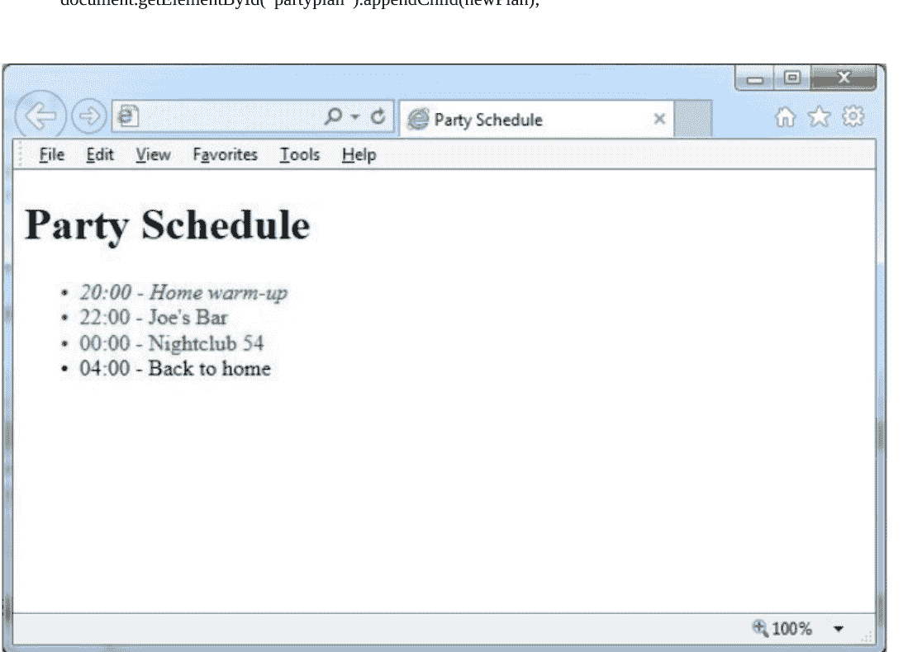

使用类似的过程，我们也可以通过 DOM 操作从页面中移除一个元素。举个例子，让我们移除作为页面主标题的`<h1>`元素。我们将首先通过其 id 属性（值为“partytitle”）来选择该元素，并将该元素节点存储在一个变量中。

```javascript
var removeHeading = document.getElementById("partytitle");
```

接下来，我们需要找到作为`<h1>`元素容器的父元素，在本例中就是`<body>`元素。我们可以直接选择此元素，或者使用先前选择元素的`parentNode`属性。无论哪种情况，我们都需要将父元素存储在另一个变量中。

```javascript
var containerForHeading = removeHeading.parentNode;
```

最后，我们将使用父元素上的`removeChild()`方法，以从页面中移除我们想要移除的元素。

```javascript
containerForHeading.removeChild(removeHeading);
```

完整的语法如下：

```javascript
var removeHeading = document.getElementById("partytitle");
var containerForHeading = removeHeading.parentNode;
containerForHeading.removeChild(removeHeading);
```

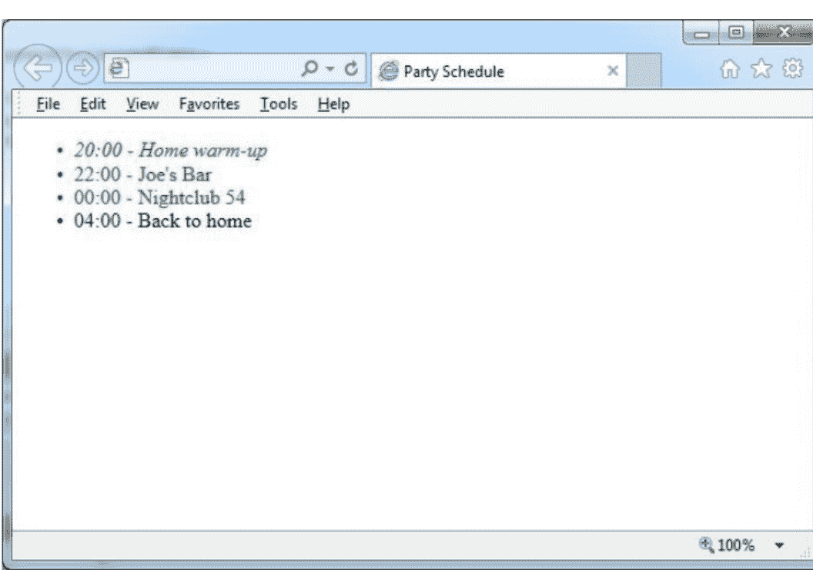

## 第 6 章：事件

JavaScript 中最重要的概念之一是事件的使用。事件就是发生的事情，比如在键盘上按键或点击页面上的某个位置。只要发生了某件事并且是预期的，我们就可以用特定的操作来响应它。我们可以通过在事件发生时调用一个函数来拦截预期事件并做出相应反应。正如我们将在本章最后看到的，要让 JavaScript 预期事件，我们将使用事件处理程序或事件监听器。但首先，让我们看看我们可以处理或监听的事件类型。

### 事件类型

当我们与网页交互时，我们会触发很多事件。我们点击链接、将鼠标悬停在元素上、输入文本、打开浏览器、关闭选项卡、复制/粘贴文本、填写表单等等。几乎我们做的每一件事都会触发一个事件，而当一个事件被触发时，我们通常希望编写一个函数来专门对该事件做出反应。

我们可以对许多类型的事件做出反应，但我们将只关注鼠标事件、键盘事件和浏览器/对象事件。以下三个表格简要描述了每种事件类型中最常用的事件。

**鼠标事件**发生在用户用鼠标做某些事情时，比如移动、点击、拖动等。

| 事件 | 描述 |
|---|---|
| `onclick` | 用户点击一个元素 |
| `ondblclick` | 用户双击一个元素 |
| `onmouseover` | 用户将鼠标指针定位在特定元素上 |
| `onmouseout` | 用户将鼠标指针移离特定元素 |
| `ondrag` | 用户点击并拖动一个元素 |

**表 2.** 鼠标事件

**键盘事件**更简单，因为它们发生在按键被按下或释放时。

| 事件 | 描述 |
|---|---|
| `onkeydown` | 用户正在按下一个键 |
| `onkeyup` | 用户已释放一个按下的键 |

**表 3.** 键盘事件

**浏览器/对象事件**是更通用的事件，在不同的时间发生，例如网页加载时。

| 事件 | 描述 |
|---|---|
| `onload` | 页面/对象已加载 |
| `onunload` | 页面/对象已卸载 |
| `onfocus` | 页面/元素获得焦点 |
| `onblur` | 页面/元素失去焦点 |
| `onerror` | 页面上发生错误 |
| `onresize` | 页面/对象被调整大小 |
| `onscroll` | 页面/对象的滚动条被使用 |

**表 4.** 浏览器/对象事件

鼠标事件是网页上最常见的基于用户的事件。然而，随着触摸设备的出现，触摸事件越来越受到重视。

> *注意：可能的事件完整列表相当庞大，超出了本书的范围。请访问 W3C Schools 网站获取完整列表（`http://www.w3schools.com/jsref/dom_obj_event.asp`）。*

### 响应事件

为了编写 JavaScript 以响应事件，我们必须通过事件处理程序将该事件绑定到页面上的元素。事件处理程序让我们可以在任何特定元素上指明我们正在监听的事件。为此，有三种不同的事件处理程序方法：

- **HTML 事件处理程序**是一组属性，可以响应添加它们的元素上的事件。尽管在旧的网页中仍然存在，但这种方法不再被使用，因为它将 JavaScript 集成到了 HTML 中，而实际上应该将它们分离。
- **DOM 事件处理程序**是原始 DOM 规范中引入的方法。它们与 HTML 文档分离，并在所有主要浏览器中得到很好的支持。它们的主要缺点是只能将单个函数附加到事件上。
- **DOM 事件监听器**是处理事件的首选方法，在 DOM 规范的更新中引入。它们允许一个事件触发多个函数，但是 IE8 及更早版本的浏览器不支持它们。

在处理事件时，我们首先必须选择将成为交互对象的元素。例如，如果这个元素是一个链接，那么我们需要指定该链接元素的 DOM 节点。在选择了元素之后，我们需要指明将作为触发器的事件。用程序员的话说，这叫做“将事件绑定到元素节点”。最后，我们必须声明代码，通常是一个函数，我们希望在事件发生时触发该函数。

在本章的剩余部分，我们将重点介绍事件处理程序和事件监听器，忽略已废弃的 HTML 方法。为了遵循本章的示例，我们将使用类似上一章聚会日程示例的 HTML 结构。唯一的区别是每个列表项都添加了链接元素。

```html
<!doctype html>
<html>
<head>
<meta charset="utf-8">
<title>Party Schedule</title>
<style type="text/css">
.current {
    color:red;
}
.finished {
    color:green;
}
</style>
</head>
<body>
<h1 id="partytitle">Party Plan</h1>
<ul id="partyplan">
  <li id="phase1">20:00 - <a href="#" id="testLink">Home warm-up</a></li>
  <li id="phase2">22:00 - Joe's Bar</li>
  <li id="phase3">00:00 - Nightclub 54</li>
</ul>
</body>
</html>
```

### 事件处理程序

使用传统 DOM 事件处理程序有许多非常相似的方法。有些非常紧凑，而另一些则有更多行代码，但可能更容易理解。举个例子，让我们写一个简短的脚本，在链接被点击时改变它的颜色。首先，我们将创建我们希望在事件发生时触发的函数。

```javascript
function linkClick(){
    this.className = "current";
}
```

通过使用`this.className`属性，我们指示调用此函数的对象将其`className`属性设置为“current”。现在我们已经有了函数，让我们通过使用`getElementById()`方法来调用触发事件的对象，并将其元素节点分配给一个变量。

```javascript
var firstLink = document.getElementById("testLink");
```

既然我们已经获取了对元素节点的引用，我们最终可以构建一个适当的事件处理程序。

```javascript
firstLink.onclick = linkClick;
```

完整的语法如下：

```javascript
function linkClick(){
    this.className = "current";
}
var firstLink = document.getElementById("testLink");
firstLink.onclick = linkClick;
```

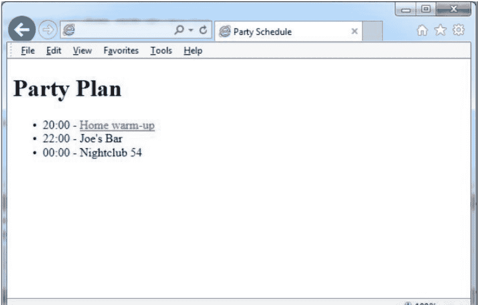

**图 33.** 使用事件处理程序改变链接颜色

考虑到 JavaScript 是一种非常灵活的语言，我们实际上可以将其压缩为两行代码，但我们会失去一些灵活性。

```javascript
document.getElementById("testLink").onclick = function linkClick() {
    this.className = "current";
}
```

由`onclick`事件触发的`linkClick`函数不必是简单的。我们可以改变不止一个属性，甚至可以编写处理不同情况的复杂脚本。例如，以下代码除了添加一个类之外，还会更改链接的文本。

```javascript
function linkClick(){
    this.className = "current";
    this.textContent = "Party Finished"
}
var firstLink = document.getElementById("testLink");
```

#### 事件监听器

处理事件的较新创新被称为事件监听器。事件监听器可以同时处理多个函数，尽管对较旧浏览器的支持有所欠缺。事件监听器通过`addEventListener()`方法附加到元素上，该方法接受三个属性。

举个例子，让我们重写之前的代码，将事件处理程序改为事件监听器。函数将保持不变。

```javascript
function linkClick(){
    this.className = "current";
    this.textContent = "Party Finished"
}

var firstLink = document.getElementById("testLink");
firstLink.addEventListener("click", linkClick, false);
```

我们可以看到，附加到`firstlink`变量上的不是事件属性，而是`addEventListener()`方法。在括号内，我们首先有事件（没有前面的"on"），然后是函数的名称，以及称为事件流的东西。事件流指示事件被捕获的顺序，通常设置为`false`。

我们可以看到，在我们的例子中，当函数被赋给事件时，函数名后面没有添加括号。原因是，如果我们使用带有括号的`linkClick()`语法，我们将执行该函数并将其值赋给`onclick`。当我们不使用括号时，我们将函数（而不是值）赋给`onclick`属性。我们不再控制事件处理函数如何执行，因为浏览器将通过自动传递一个`Event`对象给处理函数来为我们执行该函数。

### 结论（JavaScript）

当我们决定学习像 JavaScript 这样复杂的东西时，我们面前有一个漫长的过程。仅仅熟悉信息是不够的，我们必须在实际情况和现实例子中应用这些信息。

在本书中，我们介绍了 JavaScript 的基本概念及其编程方法。我们了解到 JavaScript 是一种脚本语言，它通过提供动态和交互式内容来增强网页。我们研究了解释网页时浏览器遵循的过程，因为它逐个元素地解析代码并处理 JavaScript 指令。我们看到 JavaScript 代码嵌入在网页本身中；它的存在以`<script>`元素为标志。

从基本语法和语句结构开始，在第二章中，我们通过 JavaScript 的数据类型和变量来构建我们的知识。特别是，我们现在知道 JavaScript 支持多种数据类型，例如数字、文本和布尔值。数字的行为就像数字应有的样子，文本由字符字符串表示并用引号括起来，布尔值是`true`或`false`。这些数据类型存储在变量中，使其值提交到内存中，以便稍后可以在我们的代码中使用。然而，在给变量赋值之前，我们现在意识到我们必须首先向 JavaScript 解释器声明它的存在。我们还熟悉了数组，这是一种特殊的变量类型，可以保存多条数据，并通过唯一的索引号进行管理。

在第三章中，我们继续学习 JavaScript 语言的核心及其语法。具体来说，我们研究了使用条件语句进行决策以及使用循环重复代码。我们从理解`if`、`else`和`else if`语句开始，因为做出决策的能力本质上赋予了代码其“智能”。确定条件是真还是假可以帮助我们决定要遵循的行动路线，使用这些语句我们可以选择将要执行的代码块。接下来，我们使用`while`和`for`循环来循环代码，因为经常需要重复执行代码块多次。我们了解到循环需要初始化、条件测试和递增，以便成功执行代码块指定次数。

在第四章中，我们通过观察作为可重用代码片段的函数来完成 JavaScript 核心脚本功能的讲解。虽然有主要的内置函数可用，但 JavaScript 使我们能够使用`function`关键字定义和使用自己的函数。我们看到函数可以有零个或多个参数传递给它们，并且如果这是它们的预期目的，它们可以返回一个值。关于函数，我们学习了变量作用域，其中在函数外部声明的变量是全局可用的，而在函数内部定义的变量是该函数的私有变量，不能被主代码访问。


在第五章中，我们转向了对象这一至关重要的概念。我们了解到`JavaScript`是一种基于对象的语言，因为它使用这个对象概念来表示事物，如字符串、日期和数组。我们使用对象构造函数函数或字面量表示法创建了新对象。我们还设置了这些对象的属性并定义了它们的方法。我们还学习了如何在需要时访问这些属性和调用这些方法。

在第六章中，我们研究了文档对象模型，在那里我们看到`DOM`如何提供访问网页元素的方法。我们了解到`DOM`将`HTML`文档表示为树结构。然后我们学习了这种树结构如何使其能够通过其“分支”导航到不同的元素，以使用它们的属性和方法。我们看到如何通过定位元素节点来选择单个元素和元素组。然后我们通过添加新元素或更改现有结构来操作内容。

我们现在具备了继续学习更高级概念的基础知识和理解。我们可以采取许多方向，因为`JavaScript`提供了我们可以采取的大量方向。我们可以专注于表单交互，看看我们如何使用`JavaScript`来评估和与表单数据交互。为此，我们还需要学习序列化以转换对象的结构和信息。然后我们可以通过学习如何在本地计算机上使用`cookies`存储信息来个性化用户体验。

我们可以通过`AJAX`更进一步，创建不需要页面刷新即可与服务器通信的无中断应用程序。我们可以探索`JavaScript`框架，如`jQuery`或`Modernizr`，看看如何将`JavaScript`发挥到极限并轻松创建复杂的高端应用程序。最后，我们可以学习如何通过使用高级错误处理和复杂的调试工具来创建完美的代码。

ClydeBank Media全体成员衷心感谢您购买我们的书。作为我们感激之情的表示，请利用本书开头提供的免费礼物——一本免费有声读物和终身[ClydeBank Media VIP会员资格](http://link)！


作为ClydeBank Media VIP会员，当我们的书籍以及我们合作伙伴出版公司的书籍在`Kindle`商店免费提供时，您将收到通知。激活您的ClydeBank Media VIP会员资格的链接如下。

### 术语表（`JavaScript`）

**参数** - 函数使用的变量，该变量已传递给该函数。

**数组** - 单一数据类型的值的集合。

**布尔值** - 接受`true/false`变量的数据类型。

**构造函数** - 创建对象新实例的一种方式。

**CSS** – 层叠样式表

**DOM** - 一组定义，允许用`JavaScript`编写的程序与网页上的对象进行交互。

**ECMAScript** - `JavaScript`语言的核心规范。

**事件** - 网页上发生的事情。

**函数** - 一组收集在一起并赋予名称的语句。

**HTML** – 超文本标记语言

**实例** - 对象的特定表示。

**JavaScript** - 一种脚本语言，允许增强用户与网页之间的交互。

**方法** - 附加到特定对象的函数。

**节点** - `DOM`树结构中的单元表示。

**对象** - 单个项。

**运算符** - 一种更改/求值变量内容的方法。

**解析** - 读取程序源代码以确定代码应执行什么操作的过程。

**属性** - 特定对象的特征。

**字符串** - 用于文本元素的数据类型。

**变量** – 用于存储值的命名位置。

**W3C** – 万维网联盟。

## 关于 ClydeBank Technology

ClydeBank Technology 是多媒体出版公司 ClydeBank Media LLC 的一个部门。ClydeBank Media 的目标是通过电子书、平装书和有声书等不同形式的媒体，为全球市场提供经济实惠、易于获取的信息。公司的部门基于主题划分，每个部门由一支由研究人员、作家、编辑和设计师组成的专属团队构成。

ClydeBank Media 的技术部门由各学科领域的专家撰稿人组成。撰稿人来自世界各地，以确保所提供的信息具有全球视野。

撰稿人在 IT 系统、网络、编程、网页开发与设计、数据库开发与管理、平面设计等多个学科领域拥有多年经验。

欲了解更多信息，请访问我们的网站`www.clydebankmedia.com`或通过`info@clydebankmedia.com`联系​​我们。

## 版权 – ClydeBank Media LLC - 保留所有权利

本文档旨在就所涵盖的主题和问题提供准确可靠的信息。出版物基于出版商无需提供会计、官方许可或其他合格服务的理念进行销售。如需法律或专业建议，应咨询该领域的专业人士。

- 摘自美国律师协会委员会和出版商及协会委员会共同接受和批准的原则声明。

严禁以电子方式或印刷格式复制、复制或传输本文档的任何部分。严禁录制本出版物，未经出版商书面许可，不得存储本文档任何内容。保留所有权利。

此处提供的信息据称是真实且一致的，对于任何由于疏忽或其他原因，对包含在其中的任何政策、流程或方向的任何使用或滥用，其全部和唯一责任在于接收读者。在任何情况下，出版商均不承担因本文信息直接或间接造成的任何赔偿、损害或金钱损失的法律责任或指责。

各自作者拥有出版商未持有的所有版权。

此处提供的信息仅供参考，并具有普遍性。信息的呈现不附带合同或任何形式的保证担保。

`Java`和`JavaScript`是`Oracle`和/或其附属公司的注册商标。

本书中的所有商标和品牌仅用于说明目的，归各自所有者所有，与本文档无关。
