# HTML 与 XHTML 解密指南


此页有意留白

# 关于作者

李·科特雷尔于1982年开始编程。自那时起，他使用过多种不同的编程语言。李拥有匹兹堡大学信息科学硕士学位。目前，李是匹兹堡布拉德福德学校计算机编程和计算机网络项目的项目经理。他的教学职责包括网络、硬件、编程、数据库设计和网页开发。李还为全国的布拉德福德学校开发和编写课程。在空闲时间，李为社区体育组织担任棒球、垒球和足球教练。

# 关于技术编辑

莱斯·格雷夫斯在各类学校担任技术讲师已有10年，教授编程（包括`HTML`）和网络课程。他还有17年的企业业务和编程经验。他获得了匹兹堡大学计算机科学学士学位和凤凰城大学信息系统硕士学位。他居住在宾夕法尼亚州匹兹堡市。

莱斯有幸与作者李·科特雷尔在布拉德福德学校并肩担任技术讲师，他可以证明李是一位多么出色的讲师，拥有深厚的经验和对学生成功的热情。


# 解密系列

## 化繁为简

解密系列丛书帮助学生掌握复杂而困难的学科。每本书都包含章节测验、最终考试和用户友好的内容。无论您是想精通西班牙语还是在化学中取得A，解密系列都将解开令人困惑的学科，使困难的内容变得易于理解。

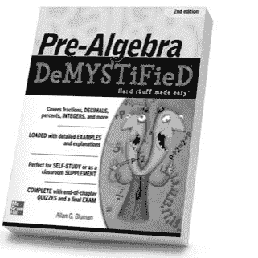

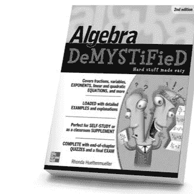

《代数预备》解密系列，第2版

艾伦·G·布鲁曼

ISBN-13: 978-0-07-174252-8 • $20.00

《代数》解密系列，第2版

朗达·休滕穆勒

ISBN-13: 978-0-07-174361-7 • $20.00

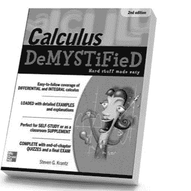

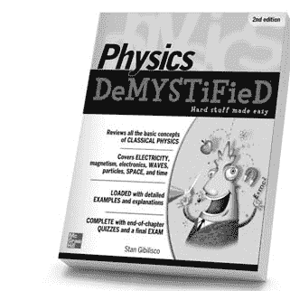

《微积分》解密系列，第2版

史蒂文·G·克兰茨

ISBN-13: 978-0-07-174363-1 • $20.00

《物理学》解密系列，第2版

斯坦·吉比利斯科

ISBN-13: 978-0-07-174450-8 • $20.00

学得更多。麦格劳-希尔。做得更多。

## 解密系列®

- 高级统计学解密
- 代数解密，第2版
- 替代能源解密
- `ASP.NET 2.0` 解密
- 天文学解密
- 生物学解密
- 生物物理学解密
- 生物技术解密
- 商业微积分解密
- 商业数学解密
- 商业统计学解密
- 微积分解密，第2版
- 化学解密
- 大学代数解密
- 数据结构解密
- 数据库解密，第2版
- 微分方程解密
- 数字电子学解密
- 地球科学解密
- 电学解密
- 电子学解密
- 环境科学解密
- 日常数学解密
- 法医学解密
- 遗传学解密
- 几何解密
- `HTML` 与 `XHTML` 解密
- `Java` 解密
- `JavaScript` 解密
- 精益六西格玛解密
- 线性代数解密
- 逻辑学解密
- 宏观经济学解密
- 数学证明解密
- 数学应用题解密
- `Mathematica` 解密
- `Matlab` 解密
- 微生物学解密
- 微观经济学解密
- 纳米技术解密
- 面向对象编程解密
- 操作系统解密
- 有机化学解密
- 药理学解密
- 物理学解密，第2版
- 生理学解密
- 代数预备解密，第2版
- 预微积分解密
- 概率论解密
- 项目管理解密
- 质量管理解密
- 量子力学解密
- 相对论解密
- 机器人学解密
- 信号与系统解密
- `SQL` 解密
- 统计过程控制解密
- 统计学解密
- 技术分析解密
- 技术数学解密
- 三角学解密
- `UML` 解密
- `Visual Basic 2005` 解密
- `Visual C# 2005` 解密
- 网页设计解密
- `XML` 解密

解密系列在所有学术研究领域出版了超过125种图书。如需完整书目列表，请访问`www.mhprofessional.com`。

# 致谢

无数人为本书的成功做出了贡献。似乎不可能感谢每一个人。如果我遗漏了某人，我深表歉意。

首先，我需要感谢Kerri Moriarty。Kerri鼓励我对写作的热爱，并持续向我们的图书代表推销我再写一本书的想法。Kerri将我介绍给了McGraw-Hill的代表Nancy Marr。

Nancy与我详细讨论了我想写的书。她提供了图书提案的格式，并提供了编辑Roger Stewart的电子邮件地址。Roger与我详细讨论了DeMYSTiFieD®系列。不久之后，我为本书撰写了一份提案。

McGraw-Hill的策划编辑Roger Stewart和组稿协调员Joya Anthony指导我成功完成了本书。他们提供了模板、见解以及关于如何完成本书的良好建议。Joya和Roger在整个完成过程中让我保持专注。

我的朋友Les Graves负责本书的技术编辑。Les发现了我在代码中犯的所有小错误。他简化了我的几个示例，并建议了几个显著改进本书的项目。

Kara Kleid，我在Bradford School的前同事和一位出色的艺术家，向我介绍了`JQuery`。没有`JQuery`，本书的`JavaScript`部分将会复杂得多。

我的语法编辑Bob Campbell将我那蹩脚的匹兹堡英语转换成了良好、可读的英语。他将笨拙的句子变成了优雅的陈述。

最后，我需要感谢Vince Graziano和Linda DeFalle。这两个人推动了我，使我成为了一个更好的员工和技术爱好者。

# 引言

恭喜！你购买本书表明你是一个积极性很高的学生。你希望从你的`HTML`课程中获得尽可能多的收获。本书将帮助你成为最好的`HTML`开发者。

## 谁应该阅读本书

当然，每个人都应该阅读本书！我的孩子需要牙套！不过说真的，`HTML`是我们这个时代的主要通信媒介。你做的几乎所有事情——无论是学习、娱乐还是工作——都有在线组成部分。理解这些在线组成部分如何工作至关重要。

本书不仅仅是关于`HTML`；它实际上很好地涵盖了三种语言。本书涵盖了`HTML`、它的近亲`XHTML`以及网络格式化语言`CSS`。你无法在不接触`CSS`的情况下学习`HTML`。本书无缝地整合了这三种技术。当你读完本书时，你将非常精通这三种语言。

## 如何使用本书

我记得大学时上过一位非常糟糕的教授的编程课。当我向他寻求帮助时，他说“去读书”。很好，谢谢你的帮助。嗯，我确实读了那本书。我发现阅读编程书有一个正确的方法。

阅读编程书的正确方法是浏览文本。了解该技术能做什么。然后你需要输入作者提供的代码。在代码运行之前不要继续。代码是最重要的

在第2章中，你将创建你的第一个网页。从这个页面开始，你将构建一个可用于后续章节的模板。你将首次接触标签和其他`HTML`元素。本章定义了标签的`HTML`属性。最后，你将了解`CSS`的概览。

第3章介绍颜色和图形。你将学习如何定义任何你想要的颜色。本章介绍了图形和颜色的最佳实践。最后以获取图像的合法方法结束本章。

第4章介绍超链接。你将学习如何构建指向外部网站的链接。本章涵盖了指向你自己网站页面的链接。最后以使用`CSS`格式化链接结束本章。

第5章展示如何创建列表。本章涵盖了三种当前的列表类型：有序列表、无序列表和定义列表。第5章还介绍了嵌套列表。最后以通过`CSS`格式化列表结束本章。

第6章将表格引入网页。表格允许呈现分列数据。第6章展示了用于行、列和标题的标签。其中包含了将多个单元格合并为一个单元格的方法。

第7章的重点是使用表单收集数据。你将学习如何创建文本字段、单选按钮和其他表单对象。控制数据发送的位置和方式是一个重点。本章不涉及接收数据的脚本语言。

第8章使用`CSS`来布局你的网页。盒模型用于在屏幕上对齐对象。你的页面通过`div`和`span`标签被分割成多个部分。通过将`div`标签与盒模型结合，你将开发出三种不同的页面布局。

第9章介绍`JavaScript`。`JavaScript`有许多用途。全面介绍`JavaScript`超出了本书的范围。因此，本章强调使用预先存在的脚本。

第10章是本书中少数几个需要先完成前面章节才能学习的章节之一。在尝试`DHTML`之前，你必须完成第8章和第9章。`DHTML`将脚本和页面布局结合起来，以实现非常酷的视觉效果。

第11章介绍如何将多媒体元素包含到网页中。由于这是一项容易被滥用的技术，你将学习每个多媒体对象的最佳实践。你将学习如何在页面上使用声音和电影。

第12章涵盖框架。框架是一种允许简单页面布局和功能的技术。框架不像以前那样流行了。本章涵盖了创建和控制框架的方法。

第13章通过教你如何获取和填充一个网络域名，结束了你对网页的探索。本章对比了Go Daddy和1&1的域名注册和托管服务。

## 如何联系我

联系我的最佳方式是通过电子邮件。我的主要电子邮件地址是`lee@leecottrell.com`。欢迎发送批评、赞扬、评论、错误或问题。我将尽力及时回复。

# 第1章：HTML与网络

本章定义了互联网的起源。此外，还介绍了构建网页时常用的工具和语言。

## 章节目标

在本章中，你将：

- 阅读互联网的简史
- 定义`HTML`
- 对比`HTML`的各个版本
- 列出网络开发语言和工具


互联网和万维网是我们生活中无处不在的因素。我们通过网络学习、工作和娱乐。通过Facebook和YouTube等服务，我们以父母从未想象过的方式与同龄人互动。许多人认为，如果没有互联网，他们的生活将是不完整的。

我大学时的一位教授曾说过，要理解一个人或事物的现状，就需要理解它的来源。要理解互联网为何以今天的方式运作，就需要对其起源有所了解。

互联网的起源可以追溯到冷战时期。美国国防部希望找到一种方式，在发生核战争或自然灾害时与其基地进行通信。1957年，国防部成立了高级研究计划局来解决这个问题。

## 互联网简史

经过12年，ARPANET——国防部问题的第一个可行解决方案——才得以开发。1969年，四所大学通过ARPANET以高达50 Kbps的速度相互连接。加州大学圣巴巴拉分校和洛杉矶分校、斯坦福大学和犹他大学是第一批“网民”。到1973年，ARPANET已拥有23台主机。1974年，Vint Cerf和Bob Kahn共同创造了“互联网”一词。

> **仍在困惑**
>
> TCP/IP地址包含四组称为八位字节的数字。一个非常流行的社交网络站点的IP地址是`69.63.189.16`。这非常难以记忆。DNS允许使用更简单的名称，例如`www.facebook.com`。
>
> 当你输入一个网址时，你的计算机会询问DNS服务器将其转换为TCP/IP地址。然后，你的计算机将使用转换后的地址来请求网页文档。
>
> 要查看实际操作，请打开一个网络浏览器。输入地址`www.facebook.com`。现在打开另一个浏览器窗口或标签页，输入IP地址`69.63.189.16`。两个地址都会带你到Facebook。
>
> 网页设计师并不需要深入理解DNS的工作原理。但你需要理解它是网络运作方式的一部分。

在1974年至1990年间，大量的技术发展改进了互联网。越来越多的主机加入网络。更高速的网络处理更大的消息和更多的用户。1983年，TCP/IP和DNS得以实施。TCP/IP为互联网计算机分配了数字地址。TCP/IP确保每个站点都有一个唯一的名称，而DNS则让人们更容易记住这些地址。此时的互联网流量是非商业性的。

1990年，日内瓦欧洲核子研究中心的研究员Tim Berners-Lee实现了一个可以在互联网上运行的超文本版本。该项目的目标是让人们更容易获取研究论文。1992年，欧洲核子研究中心将Berners-Lee的创造物更名为万维网，并将其发布给世界。次年，Marc Andreessen和NCSA发布了第一个图形浏览器Mosaic。这个浏览器是所有现代浏览器的鼻祖。

到1994年，商业网站开始出现在网络上。随着易于使用的互联网和强大而廉价的家庭电脑的结合，网络开始进入普通人的家庭。到1995年，互联网主机超过六百万台，提供了大量的服务。

1990年代中期到早期是.com时代。在此期间，成千上万的商业实体以.com的理念起步。扩展名.com代表营利性企业。在万维网出现之前，大多数新企业都有实体存在。网络企业常常试图在没有实体存在的情况下吸引客户。其中许多公司没有赚到任何钱就倒闭了。而一些公司，如`yahoo.com`和`amazon.com`，则取得了超乎任何人想象的成功。

> **提示**
>
> 看看1990年代的网页开发者设计网页有多糟糕，这很有趣。首先访问`www.yahoo.com`，看看它现在的样子。然后访问`www.archive.org`上的Wayback Machine，看看雅虎的第一个页面是什么样子。

互联网和万维网已牢固地扎根于我们的生活中。每天都有成千上万的新网站被开发出来。用户找到了网络实现者未曾想象的新用途。通过本书包含的内容，你将学习所有网站共用的基本语言。也许，你会利用这些材料开发出下一个大型网站。

> **提示**
>
> 要更详细地了解互联网的历史，请访问`www.zakon.org/robert/internet/timeline/`上的Hobbe互联网时间线。

## 什么是HTML？

HTML代表超文本标记语言。超文本是允许网络上存在链接的技术。每次访问网页时，很可能都有一个指向另一个资源的链接。这些链接包含一个指向另一个文档的统一资源定位符。URL就是网站名称和页面。一个示例URL是`www.google.com`。

HTML的后半部分是标记语言。标记语言为文档提供格式和结构。在HTML中，一系列标签控制着标记。每个标签都有其含义。浏览器会读取标签并相应地渲染页面。标签是由尖括号包围的字母或数字组合。一个示例标签是标题1标签，`<h1>`。考虑代码块1-1。其中有三个不同的标签：H1标签、有序列表（OL）和列表项（LI）。图1-1显示了此代码在Internet Explorer 8中渲染的输出。

### 代码块1-1

```html
<h1>Reasons to learn HTML</h1>
<ol>
<li>It is fun</li>
<li>It can lead to a great career</li>
</ol>
```

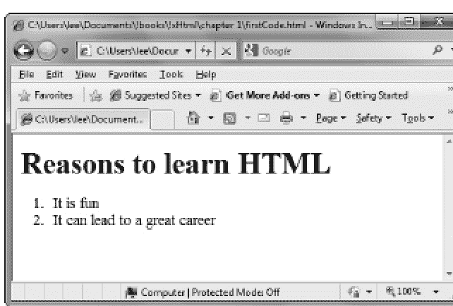

图1-1 · 代码块1-1在Internet Explorer 8中的输出

HTML的组成部分完全定义了它的本质。它为网页提供格式和结构。超链接用于访问其他元素。只要开发者为网络资源提供正确的地址，HTML就会检索它。只要HTML正确，浏览器就会渲染它。

## HTML版本

人类之间的交流在不断变化。写作风格会改变，新词汇会发展。当我们停止使用一个词时，就会从我们的词汇表中删除它。HTML也是如此。随着语言的每次修订，新标签会被开发出来，过时的标签会被移除。

万维网联盟，更广为人知的是W3C，维护着大多数网络语言。W3C发布定义语言应如何工作的建议。具体实现这些建议则由各个浏览器负责。建议并非规则，社区可以自由地根据自己的理解和需要来解释和实现这些建议。

当W3C希望从语言中移除一个元素时，他们会废弃该元素。废弃意味着该元素在未来的语言版本中将不再被支持。大多数教科书和所有网站都会清楚地标明已废弃的元素。网页开发者永远不应在网站上使用已废弃的元素。

截至本文撰写时，HTML的当前版本是4.01。W3C于1999年12月24日正式推荐了4.01版本。它添加了几个元素，纠正了版本3中的一些错误，并废弃了几个元素。

## 可扩展超文本标记语言（XHTML）

HTML是一种非凡的语言。然而，它有一些缺陷。这些缺陷允许开发者使用不良语法，而不遵循HTML规则。以这种方式编写的HTML可能在不同的浏览器和计算机上渲染不正确。XHTML解决了这个问题。

XHTML与HTML几乎完全相同，但要求开发者使用正确的语法编写所有页面。XHTML的语法比HTML严格得多。当网页设计师正确使用XHTML时，将生成一个格式良好的页面。

> **注意**
>
> “格式良好”意味着几件事：所有标签必须闭合；包含在另一个标签内的标签必须正确嵌套；所有标签均为小写；所有文档都有一个称为根元素的`<html>`标签；属性必须设置为一个值，并包含在引号内。

代码块1-2包含一个完整的XHTML文档。它包含一个根元素，即`<html>`标签。所有其他标签都嵌套在此标签内。要理解嵌套，可以想想那些可以相互套在一起的玩具娃娃。打开最大的娃娃会露出一个稍小的娃娃。这些娃娃就是嵌套的。最后一个`<p>`标签内正确嵌套了一个`<b>`标签。前两个`<p>`标签没有闭合。浏览器可能会正确渲染它，但这是不正确的。第二组`<p>`标签正确闭合了。

### 代码块1-2

```html
<html>
<!--There is one html tag.
Everything is contained inside of this tag-->
<head>
<title>xHTML examples</title>
</head>

<body>
<!--an improperly closed tag -->
<p>This is a paragraph.
<p>This is a second paragraph.

<!--the same code properly closed -->
<p>This is a paragraph.</p>
<p>This is a second paragraph.</p>

<p id="para5">This paragraph uses an attribute.</p>
<!--Improper nesting-->
<p><b>The b tag should be closed before the p.</p></b>

<!--proper nesting-->
<p><b>The b tag is closed before the p tag.</b></p>
</body>
</html>
```


XHTML是本书教授的语言。如果你是网页开发新手，从XHTML开始对你最有利。强烈建议有经验的开发者转向XHTML。如果你在所有开发项目中都使用XHTML，你的网站将在所有计算机的所有浏览器上运行良好。

> **提示**：XHTML的规则看似严格，但它们很容易实现。现代网页开发者使用的所有工具都将生成格式良好的文档。你必须刻意为之才能写出糟糕的XHTML。

### HTML 5

HTML 5是即将取代HTML 4.01的新版本。它融合了HTML和XHTML的特性。新标准废弃了几个标签，并引入了几个新标签和设计元素。

W3C尚未正式推荐HTML 5。它仍在变化中。包括`www.youtube.com`在内的几个商业网站已将其代码切换到HTML 5。在本书中，你将找到讨论HTML 5中可能与XHTML语法不同的提示。

### 其他网络语言

HTML是互联网上的主要语言。然而，它远非唯一的语言。还存在其他几种语言。有些是辅助语言，而另一些则允许开发者创建动态网页。其中大多数语言超出了本书的范围。然而，作为网页设计师，了解这些语言的功能是很重要的。

### 层叠样式表（CSS）

HTML最重要的辅助语言是CSS。CSS使网页看起来美观。理想情况下，HTML将保存网页的数据，而CSS将描述文档的外观。通常，每当W3C废弃一个标签时，就会有一个CSS元素来替代它。我将在本书中使用CSS来格式化网页。

> **提示**：CSS最好通过实践来体验。访问`www.csszengarden.com`，了解CSS能为网页设计师做什么。该网站包含一篇关于CSS的短文。不要阅读文章。相反，尝试不同的设计，看看CSS的强大功能。

### JavaScript

JavaScript是一种编程语言。网页开发者使用JavaScript创建在网页内运行的小程序。通常，JavaScript是一种客户端脚本语言。这意味着这些小程序在查看页面的计算机上运行。第9章和第10章将介绍如何在页面中使用JavaScript。

### 活动服务器页面（ASP）

ASP是一种构建动态网页的编程语言。ASP是微软的产品，运行在微软操作系统上。ASP在服务器上运行，并根据用户的请求创建HTML页面。ASP运行在线商店。由于代码在服务器上运行，ASP是一种服务器端脚本语言。

### PHP：超文本预处理器

PHP是另一种服务器端语言。它处理与ASP相同的所有任务。一个主要区别是能够运行PHP的系统。PHP可以在任何服务器上运行，而不仅仅是微软的服务器。

> **注意**：PHP既是一种业余爱好者的语言，也是一种严肃的开发语言。PHP既为在线游戏公会提供支持，也为网络商店提供支持。

### 网页编辑工具

当HTML刚出现时，开发者唯一能使用的工具是像`Notepad`或`vi`这样的文本编辑器。如今，你有许多HTML编辑工具可供选择。它们通常可以分为两类。第一类是代码编辑器。代码编辑器要求你输入HTML代码。第二类是所见即所得（WYSIWYG）编辑器。这些工具可以可视化地构建页面，而无需你编写代码。

这两类都不完美。代码编辑器要求你了解代码和正确的语法，但允许你完全控制你的设计。WYSIWYG编辑器虽然易于使用，但可能比编辑器提供的灵活性更少，并且经常生成不良的HTML。在本书中，我们将专注于代码编辑器。使用代码编辑器编写HTML将让你学习HTML，这也是你购买本书的初衷。

### 代码编辑器

代码编辑器允许你输入HTML页面的代码。大多数现代代码编辑器提供语法高亮和代码提示。语法高亮会在你编写代码时为其着色。这使得阅读代码更容易。语法错误会在你输入时被识别。代码提示会在你输入时出现。通常，你只需要输入标签或属性的前几个字母，编辑器就会为你补全其余部分。

### 记事本/简单文本

如图1-2所示的记事本包含在所有版本的Microsoft Windows中。简单文本包含在Mac OS X中。两者都允许你输入网页。然而，两者都不提供代码高亮或代码语法。除非万不得已，否则不要使用这些产品！

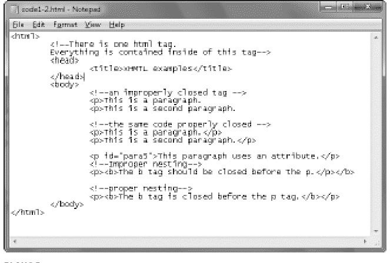

### Gedit

Gedit包含在大多数现代Linux发行版中。它提供代码高亮但不提供代码提示。Gedit适用于网页开发。

### 程序员记事本

程序员记事本是一个免费程序，可从`www.pnotepad.org`获取。它为几乎每种编程语言提供彩色代码高亮，以及一些代码提示。此外，它还提供了一个标签系统，允许你同时处理多个文档。我多年来一直在我的课程中使用程序员记事本。我的学生喜欢使用它。最新版本会自动为你闭合标签。图1-3显示了程序员记事本2.10.1010的截图。

### Taco HTML

尽管名字奇怪，Taco HTML是MAC OS X上一个功能齐全的编辑器。它提供代码补全、语法高亮和多标签页。不幸的是，它不是免费的，许可证费用为25美元。访问`www.tacosw.com`下载30天试用版。

### 所见即所得编辑器

所见即所得编辑器在网页设计师中非常流行。它们允许快速开发网页。然而，它们倾向于将HTML隐藏在一系列对话框之后。我建议在你对HTML非常熟悉之前，避免使用这些编辑器。

### Adobe Dreamweaver

如图1-4所示的Dreamweaver，可能是世界上使用最广泛的所见即所得编辑器。它速度非常快，能生成漂亮的页面，并能管理大多数网站的创建。它有适用于Windows和Mac OS X的版本。你可以从`www.adobe.com/products/dreamweaver/`购买一份。在出版时，该软件包售价399.00美元。你的学校可能提供学生优惠价。详情请咨询你的老师。

### Microsoft Expression Web

Expression Web是微软推出的一个相对较新的工具。虽然功能略逊于Dreamweaver，但它能满足你所有的网页创建需求。此外，它比Dreamweaver便宜得多。在出版时，该软件可在`www.microsoftstore.com`以79.00美元的价格购买。如果你的学校属于微软学术联盟，你可能可以获得该程序的免费副本。详情请咨询你的老师。

### 网页浏览器

构建网页所需的最后一样东西是网页浏览器。所有操作系统都预装了至少一个浏览器。作为网页设计师，你应该在你的系统上安装所有现代浏览器。最受欢迎的三种浏览器是Internet Explorer、Mozilla Firefox和Safari。实际上，它们都能出色地完成网页浏览的任务。

请记住，HTML是一个推荐标准。网页浏览器制造商可以自由地按照他们认为合适的方式渲染标签。因此，一个在Internet Explorer中看起来不错的网页，在Firefox中可能看起来很糟糕。为特定浏览器编写页面代码不是一个明智的举动。有些用户忠于他们的浏览器。一个只在Internet Explorer中渲染的页面会赶走Firefox用户。如果你的网站在销售产品，你就赶走了至少40%的潜在客户。

### Microsoft Internet Explorer

Internet Explorer（IE）仅在Windows平台上可用。它是一个不错的浏览器，具有许多可用性增强功能。它提供多标签页、隐私浏览模式和多项安全增强功能。IE因不安全而受到很多负面报道。虽然IE确实更容易被攻击，但它总体上是一个不错的浏览器。

### Mozilla Firefox

Firefox通常是计算机专业人士的首选浏览器。它是一个快速的浏览器，具有许多安全增强功能。Firefox与众不同之处在于它对附加组件的支持。附加组件会改变Firefox的工作方式。附加组件是由Firefox用户编写的免费程序。图1-5显示了位于`https://addons.mozilla.org/en-US/firefox`的附加组件页面。Firefox预装在大多数Linux平台上。对于其他操作系统，可以从`www.mozilla.org`获取Firefox。

### Safari

Safari是预装在OS X计算机上的浏览器。它是一个不错的基础浏览器。它的主要特点之一是能够跟踪你收藏的网站。打开Safari时，你会看到你收藏网站的预览。它具有合理的安全性和良好的功能。有Windows版本可用。在Linux上运行Safari是可能的，但需要安装一个名为`Wine`的辅助程序。

> **注意**：IE和Firefox是目前全球最流行的两种浏览器。很难确定哪个更受欢迎。一些网站会跟踪访问它们的浏览器。访问`www.w3schools.com/browsers/browsers_stats.asp`和`www.thecounter.com/stats/`可以了解一些关于浏览器使用情况的信息。

### 总结

本章简要介绍了互联网的历史和起源。它定义了HTML、其开发者及其目的。它讨论了几个不同的HTML版本，并确定了首选版本。最后，你熟悉了一系列开发工具和网络语言。

### 测验

1. ________是一种客户端脚本语言。
   - A. CSS
   - B. PHP
   - C. JavaScript
   - D. ASP

2. 这个组织控制着网络语言的开发。
   - A. W3C
   - B. CERN
   - C. DOD
   - D. ARPA

3. 网页的地址更准确地称为________。
   - A. 链接
   - B. 超文本
   - C. URL
   - D. 嵌套

4. ________开发了万维网的基本原理。
   - A. Vint Cerf
   - B. Tim Berners-Lee
   - C. 美国国防部
   - D. Bob Kahn

5. 以下哪行XHTML代码是正确嵌套和关闭的？
   - A. `<p><b>First line</p></b>`
   - B. `<b><p>Second line</p>`
   - C. `<p><b>Third Line</b></p>`
   - D. `<b>Fourth line</p>`

6. 这种辅助语言用于格式化网页。
   - A. CSS
   - B. JavaScript
   - C. PHP
   - D. Dreamweaver

7. 互联网最初在________年投入使用。
   - A. 1960
   - B. 1969
   - C. 1973
   - D. 1993

8. 这是我推荐使用的HTML版本。
   - A. HTML 5
   - B. HTML 4.01
   - C. XHTML
   - D. HTML 1

9. 以下哪项不是“格式良好”的定义的一部分？
   - A. 所有标签必须关闭。
   - B. 标签必须正确嵌套。
   - C. 属性可以为空。
   - D. 标签必须小写。

10. “在未来版本中不再支持”是________的定义。
    - A. 已过时
    - B. 已弃用
    - C. 可扩展
    - D. 嵌套

## 第2章：你的第一个网页

本章将创建你的第一个HTML页面。你将使用标准的HTML标签。最后，你将创建一个模板，供本书其余部分使用。

### 章节目标

在本章中，你将：

- 列出网页的组成部分
- 构建一个HTML模板
- 创建你的第一个网站
- 列出并使用常见的HTML标签
- 使用CSS进行格式化
- 执行验证

千里之行，始于足下。对于网页开发来说，第一个网页就是那第一步。在开始编写网页之前，你必须学习网页的组成部分。

在本章中，你将探索网页的基本组成部分。此外，你将构建一个模板以简化未来的开发。你将遇到标签和格式化规则。在本章结束时，你将拥有一个格式精美的页面，可以用它来让你的朋友和家人惊叹。

### 网页的组成部分

所有网页文档至少由相同的两个元素组成。所有网页文档都有一个头部和一个主体。*头部*描述文档的内容类型，而*主体*包含实际内容。你的文档将有一个头部和一个主体。无论网页文档的类型如何，这条规则都适用。图片、流媒体歌曲和标准网页都有页眉和页脚。

### 文档类型

网页有第三个组成部分。所有网页都应该有一行代码，指示页面使用的XHTML版本。这一行就是*文档类型*。对于所有XHTML页面，使用文档类型是强制性的。

文档类型可能是你的网页文档中最令人困惑的一行代码。文档类型指示了文档所使用的文档类型声明（DTD）的URL。DTD是此XHTML文档遵循的规则。一个很好的类比是特定垒球场的基本规则。每个球场对于死球、规则二垒安打和本垒打都有不同的规则。

你的文档中可以使用几种不同的DTD。最当前的是XHTML 1.1文档DTD。这个文档类型，最初被称为严格文档类型，严格应用XHTML的所有规则。这个DTD虽然更难使用，但能产生最正确的XHTML。使用此DTD的页面不能使用任何已弃用的元素或框架集。我建议你所有的文档都使用严格DTD。代码块2-1显示了严格XHTML DTD的正确文档类型。

```html
<!DOCTYPE html PUBLIC "-//W3C//DTD XHTML 1.1//EN"
"http://www.w3.org/TR/xhtml11/DTD/xhtml11.dtd">
```

过渡型DTD帮助网页开发者从旧版HTML迁移到XHTML。已弃用的标签和元素在此DTD下仍可使用。虽然此DTD易于使用，但您的页面可能无法在新版浏览器中正常工作。除非有特殊需求，否则请避免使用过渡型DTD。

框架集DTD的工作方式与过渡型DTD类似，但增加了框架支持。框架是XHTML中的一种方法，允许在网页浏览器中显示多个窗口。这种分割页面的技术在21世纪初已逐渐失宠。与过渡型DTD一样，除非需要使用框架，否则应避免使用。

> **仍然困惑**
>
> DOCTYPE声明行很难记住。每当需要输入DOCTYPE时，我都会从网上复制一个。`www.w3schools.com/tags/tag_DOCTYPE.asp`上的DOCTYPE页面是个不错的选择。

### Head

为网页创建head部分相当容易。各页面的头部结构相当一致。head包含一个必需元素和几个可选元素。

XHTML页面的head部分紧跟在DOCTYPE之后，位于head标签内。代码块2-2展示了XHTML文档的最小head结构。注意html标签已打开但尚未关闭。它将在代码块2-3的body标签之后关闭。

```html
<html>
<head>
    <title>This is your title</title>
</head>
```

如果您用英语编写网页，并且该页面将在将英语设为主要语言的计算机上查看，代码块2-2可以正常工作。如果您使用西里尔字母书写，页面渲染效果会很差。为了弥补地区差异，html标签使用属性来描述页面语言。

*属性*是HTML标签的一部分，用于进一步描述该标签。一个简单的类比是您的衣服。您今天可能看到过几个人穿着衬衫。衬衫相当于HTML标签。现在，每件衬衫都有颜色。这就是衬衫的属性。

属性写在标签的<>内。这是我在HTML文档中称为属性空间的位置。正确的XHTML规范要求所有属性都必须有值。代码块2-3展示了一个正确的`<html>`和`<head>`部分。`<html>`标签使用了两个属性。首先设置了XML命名空间。这与DOCTYPE一起，完全定义了文档使用的规则。其次，通过`xml:lang`属性指定了英语语言。完整的语言代码列表请访问`www.w3schools.com/tags/ref_language_codes.asp`。

> **注意**：未在html标签中列出`lang`标签将导致您的页面默认使用英语。

```html
<html xmlns="http://www.w3.org/1999/xhtml" xml:lang="en">
<head>
    <title>This is your title</title>
</head>
```

### Title

head可以包含多个元素。只有title是必需的。title元素的内容将显示在浏览器窗口的最顶部。图2-1展示了title在Internet Explorer 8中的显示位置。注意title出现在Explorer的标题栏和页面的标签页中。此外，如果您最小化页面，title可能会出现在任务栏中。

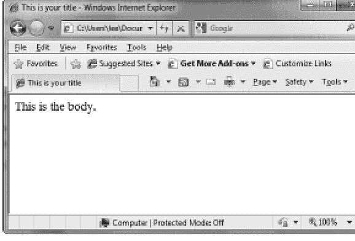

图2-1 · title元素在Internet Explorer 8中的显示

> **提示**：有两种方法可以在浏览器中打开计算机上的页面。第一种是将页面拖入浏览器。第二种是通过“文件 | 打开”来打开页面。对于Internet Explorer 8用户，如果您启用了“文件”菜单，它将是可见的。在“工具”下拉菜单下启用菜单，然后选择“工具栏”选项。选择“菜单栏”选项。

### Meta

meta标签用于保存有关网页的信息。meta标签中包含的信息不会显示在屏幕上。相反，计算机程序可以读取meta标签。meta标签需要`content`属性，并应具有`name`属性。虽然meta标签是完全可选的，但我建议使用meta标签来描述页面的作者。代码块2-4展示了meta标签的常见用法。

```html
<meta name="description" content="Brief description of the page"/>
<meta name="author" content="Lee M. Cottrell" />
```

### 可选Head元素

表2-1列出了网页head部分的其余可选元素。这些元素中的许多将在后续文本中使用。

### Body

页面的头部部分描述文档。body部分包含页面的实际内容。这是您HTML文档中需要重点关注的部分。您几乎所有的网页开发时间都将用于处理body部分。

表2-1 可选Head元素

| 元素 | 描述 |
| --- | --- |
| `style` | 保存当前页面的格式信息。 |
| `link` | 保存外部样式表文档的URL。 |
| `base` | 用于脚本语言设置脚本的主页。 |

### HTML模板

创建新网页可能相当令人畏惧。您必须输入正确的DOCTYPE，添加head元素，并创建body。由于所有网页都具有相同的元素，创建一个模板可以简化您的工作。代码块2-3列出了一个标准的XHTML模板。它包括正确的DOCTYPE、标题、语言选择以及保存您姓名和页面描述的meta标签。

您应该创建此文档。首先在计算机上创建一个名为HTML的文件夹。启动您选择的网页编辑器，并输入代码块2-5中的代码。为了便于以后查找此文档，请将其命名为`!template.html`并保存到您的HTML文件夹中。

> **提示**：文件名开头的`!`将确保它始终位于“文件打开”对话框的顶部。这是处理当前项目文档或文件夹的便捷技巧。


```html
代码块 2-5
<!DOCTYPE html PUBLIC "-//W3C//DTD XHTML 1.1//EN"
"http://www.w3.org/TR/xhtml11/DTD/xhtml11.dtd">
<html xmlns="http://www.w3.org/1999/xhtml" xml:lang="en">
    <head>
        <title>This is your title</title>
        <meta name="description" content="Page description"/>
        <meta name="author" content="Lee M. Cottrell" />
    </head>
    <body>
        <p>This is the body.</p>
    </body>
</html>
```

> **提示** *一些网站提供正确的 XHTML 模板。其中一个较好的网站是`www.webstandards.org/learn/reference/templates/xhtml11/`。*

此模板将创建一个基本的白底黑字网页，如图 2-2 所示。`title`标签出现在页面顶部，`body`的内容可见。`meta`标签不可见。

### 使用模板

现在您有了模板，创建网页将变得容易一些。您将不必过多担心网页的繁琐工作，而能够专注于有趣的部分——设计页面！然而，与所有好工具一样，您需要学习如何使用模板。

通过在网页编辑器中打开`!template.html`文件开始使用模板。然后选择“文件 | 另存为”。将文档命名为您希望的任何名称，但扩展名必须为`.html`。更改标题文本和描述。删除`body`标签的内容。再次保存文档，您就可以开始了。

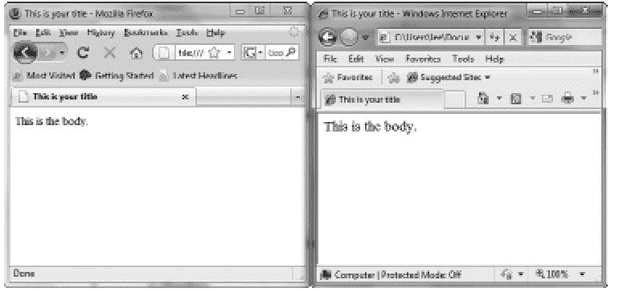

图 2-2 • 在 Firefox 和 Internet Explorer 中查看的模板

> **注意** *网页开发中最困难的事情之一是文件管理。为了您自己的理智，请将所有文件名保存为小写字母，并且不要包含空格。*

### 创建您的第一个网站

现在我们可以开始有趣的部分了。我们可以构建网页和网站。在教授 HTML 的过程中，我发现学生很难入门。我通过创建一个简单的清单来应对这个问题，每次创建网站时都可以遵循。通过遵循此清单，您将创建一个组织得当、有扩展空间且易于管理的网站。

网站通常有数十个文件。没有文件夹结构，您很可能会感到困惑。为您处理的每个项目创建一个文件夹。以项目名称命名此文件夹。这个习惯将帮助您保持项目文件的分离。

> **提示** *为每个项目创建一个文件夹在你生活的方方面面都很有用，而不仅仅是 HTML！*

每个网站加载的第一个文件都是`index.html`。无论你的项目叫什么名字，都请将你的第一个文件命名为`index.html`。这个习惯将使你以后能够构建链接，并且如果你购买了网络空间，也能让你的页面正常工作。

其他文件的名称你可以随意决定。但是，你应该坚持使用简短、易记且能描述页面内容的名称。使用小写字母，并避免使用空格。和索引页一样，它们将以`.html`扩展名结尾。例如，如果你正在创建一个关于你朋友 Dave 的页面，你应该将页面命名为`dave.html`或`friend.html`。

> **提示** *浏览网页时，你可能会看到使用`.html`以外扩展名的网站。这些扩展名大多指的是为网站生成 HTML 的脚本语言。*

### 练习创建网站

在接下来的步骤中，我们将创建一个关于我家人宠物的多页网站。目前我们有一只猫、一只狗和数量不定的鱼。这个网站将有四个页面。将有一个索引页，猫和狗各一个页面，还有一个关于所有鱼的页面。目前还没有任何内容。

1. 打开你的网页编辑器。
2. 选择 文件 | 打开。浏览到包含`!template.html`的文件夹。将其在编辑器中打开。
3. 在接下来的步骤中，你将重命名模板文件并为网页构建文件夹结构。首先使用编辑器的菜单选择 文件 | 另存为。
   1. 浏览到你的 HTML 文件夹。
   2. 如果你使用的是 Windows，请在列出文件的白色区域内右键单击。选择 新建文件夹。下图展示了在 Windows 7 中创建文件夹的过程：

      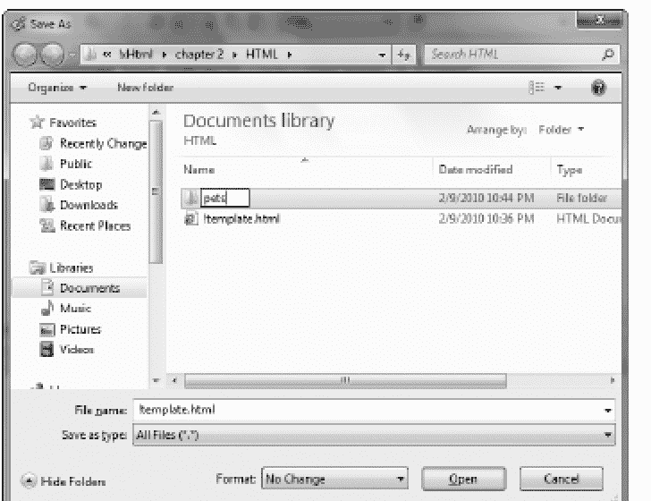

      如果你使用的是 OS X，请单击 Action 并选择 New Folder。

      无论哪种情况，都将文件夹命名为`pets`。

      > **提示** *你可以用任何你觉得舒服的方式创建文件夹。*

   3. 打开`pets`文件夹。
   4. 将文件保存在`pets`文件夹中，命名为`index.html`。
4. 将`title`标签更改为 Cottrell’s Pets，如下所示。

   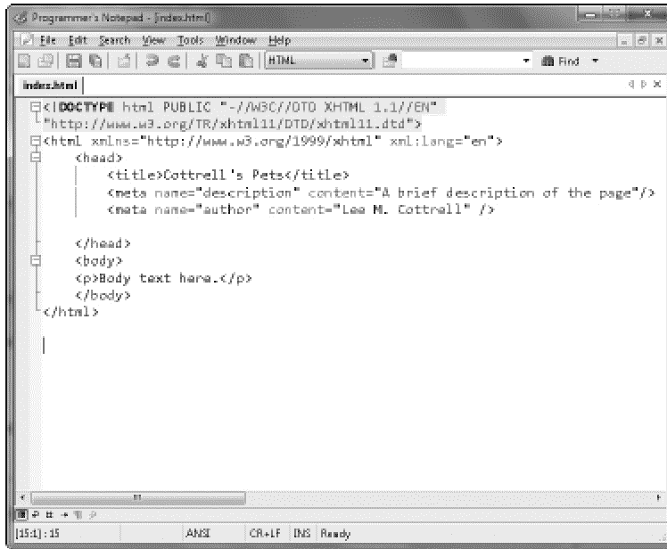

5. 将`meta description`更改为 “A site dedicated to Lee Cottrell’s pets”。

   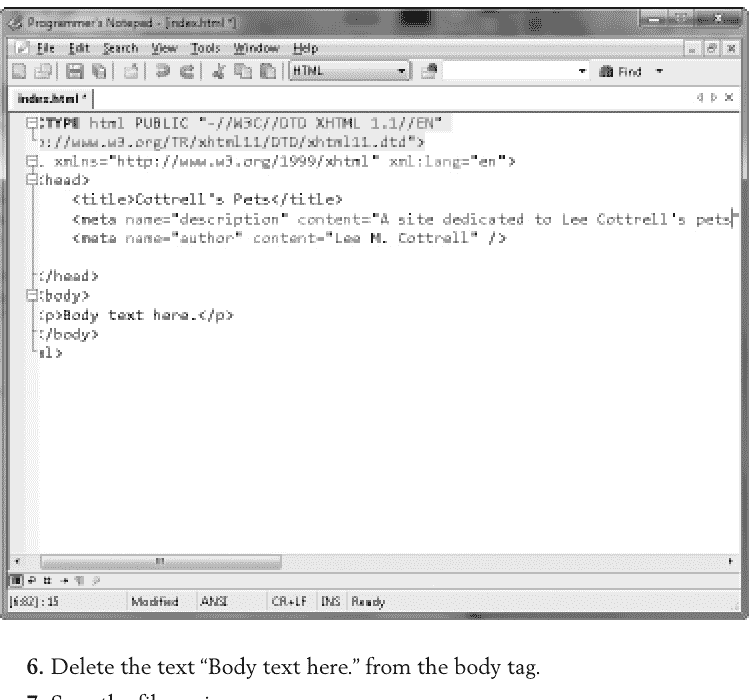

6. 从`body`标签中删除文本 “Body text here.”。
7. 再次保存文件。
8. 重新打开`!template.html`文件。将其另存为`cat.html`，保存在`pets`文件夹中。
9. 将文档标题更改为`Shadow Kitty`。将`meta description`更改为 “A page about Shadow Kitty”。
10. 再次保存文档。
11. 重复步骤 8 到 10 以创建`dog.html`和`fish.html`。使用 **Alex the dog** 作为`dog.html`文件的标题。使用 **School of Fish** 作为`fish.html`文件的标题。创建一个合适的`meta description`。

### 网站创建清单

练习引导你完成了一个四页网站的创建。为了创建这个网站，你遵循了一系列简短的步骤。遵循这些步骤将确保你的网站被正确创建。通过练习，这些步骤将变得自动化。

1. 为项目创建一个文件夹。
2. 打开`!template.html`文件。将其保存在文件夹中，命名为`index.html`。
3. 修改标题、描述和正文内容。
4. 为网站中的每个页面重复步骤 2 和 3。

> **提示** *学习某样东西的最佳方式是在你理解的东西上进行实践。*

> *我最成功的学生之一是动漫的忠实粉丝。每次他学到一项新技术，他都会将其应用到不同的动漫卡通中。他之所以成功，是因为他按照自己的方式、在自己的世界里学习并掌握了这项技术。*

> *通过这样做，他获得了对技术的全面理解。效仿这个学生。找一些你关心的东西，并为它建立一个网站。*

### 常用 HTML 标签

标签包含你文档的内容。段落、标题、图像、链接以及许多其他类别都有对应的标签。本节将重点介绍常用的 HTML 标签。学完本章后，你将能够为任何主题构建一个基本的网页！

回顾第 1 章，Tim Berners-Lee 开发 HTML 是作为一种分享研究论文的方法。大多数核心 HTML 标签使得在网页上发布研究论文变得更加容易。最常用的标签将侧重于文本处理。

### 正确使用标签

HTML 中的标签通常由三个元素组成。图 2-3 描述了一个典型标签的组成部分。首先是开始标签。标签所需的任何属性都在开始标签中。属性总是有一个值，包含在双引号中。在图中，值是`petName`。开始标签之后是内容。内容会根据标签的不同而不同。段落标签将包含文本，而表格标签将包含额外的标签。最后，标签被关闭。要关闭一个标签，请在标签名称前放置一个正斜杠。注意图 2-3 中的`</h1>`是如何关闭`<h1>`标签的。

注意图 2-3 中的标签都是小写的。这非常重要。正确的 XHTML 要求所有标签和属性名称都使用小写。如果你使用大写，HTML 可能仍然可以工作，但你的页面将无法通过验证。验证将在本章后面讨论。

有些标签有点不同。它们没有内容。这些标签称为空标签。空标签会自动关闭。三个空标签是`<br />`、`<hr />`和``。注意闭合斜杠`/`是放在标签名称之后的。

> **注意** *不关闭标签可能会导致你的网站出现不可预测的结果。*

### `<p>`

`<p>`标签用于存放你网站的段落。每个段落都将包含在开始和结束标签之间。HTML 会将段落渲染为一个完整的单元，后面跟着一个空行。如果你的网站需要五个段落，那么你的 HTML 代码将有五个`<p>`和`</p>`标签。代码块 2-6 展示了关于我的猫 Shadow 的两个段落。图 2-4 展示了段落标签在 Internet Explorer 中的输出。

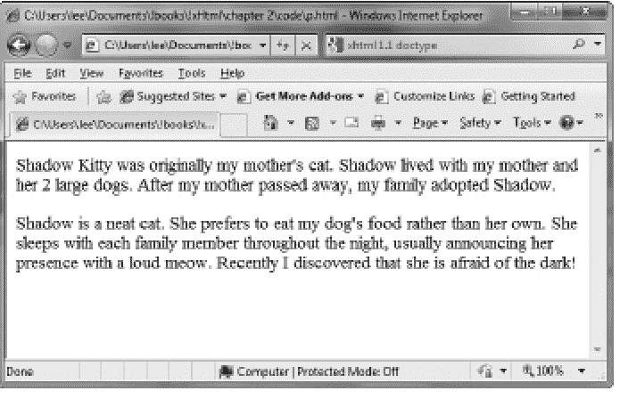

**图 2-4** · 两个段落标签的输出

#### 代码块 2-6

```html
<p>Shadow Kitty was originally my mother's cat. Shadow lived with my mother and her 2 large dogs. After my mother passed away, my family adopted Shadow.</p>
<p>Shadow is a neat cat. She prefers to eat my dog's food rather than her own. She sleeps with each family member throughout the night, usually announcing her presence with a loud meow. Recently I discovered that she is afraid of the dark!</p>
```

在图 2-4 中有两件重要的事情需要注意。首先，注意段落后面的空行。所有浏览器都会在`</p>`结束后添加两个换行符。其次，注意 Internet Explorer 是如何创建自己的换行符的。所有浏览器都会根据屏幕大小决定在哪里换行。在较大的窗口中，换行的位置会不同。在你网页开发生涯的这个阶段，你对浏览器如何渲染文本的控制非常有限。

除了控制换行外，浏览器还会忽略代码中的大部分空白。空白包括制表符、换行符和多个空格。多次按 ENTER、TAB 或空格键不会对浏览器中的输出产生任何影响。考虑代码块 2-7。它与代码块 2-6 相同，但我在`<p>`标签内添加了许多换行符和制表符。尽管有这些更改，Internet Explorer 中的输出与图 2-4 完全相同。

#### 代码块 2-7

```html
<p>
    Shadow Kitty was originally my mother's cat.
    Shadow lived with my mother and her
    2 large dogs.

    After
    my
    mother passed away, my family adopted Shadow.</p>
<p>Shadow is a neat cat. She prefers to eat my dog's food rather than her own. She sleeps with each family member throughout the night, usually announcing her presence with a loud meow. Recently I discovered that she is afraid of the dark!</p>
```

### `<br />`

有时你需要在文档中强制换行。`<br />`，或换行标签，可以在你放置它的任何地方提供一个新行。`<br />`标签是 XHTML 的空标签之一。它没有内容并且会自动关闭。代码块 2-8 展示了`<br />`标签的实际应用。输出如图 2-5 所示。

#### 代码块 2-8

```html
<p>Shadow Kitty was originally my mother's cat. <br />
<br />
Shadow lived with my mother and her
<br />
<br />
2 large dogs.
<br />
<br />
<br />
After<br />
my<br />
mother passed away, my family adopted Shadow.</p>
<p>Shadow is a neat cat. She prefers to eat my dog's food rather
than her own. She sleeps with each family member throughout the
night, usually announcing her presence with a loud meow. Recently
I discovered that she is afraid of the dark!</p>
```

### `<hr />`

`<hr />`标签，即水平线标签，会在屏幕上产生一条横线。与`<br />`标签类似，`<hr />`标签首先会在其放置的位置产生一个换行。然后，横线会绘制在`<hr />`下方。最后，横线之后会再跟一个换行。在代码块 2-9 中，`<hr />`标签被放置在两个`</p>`标签之间。图 2-6 展示了输出效果。

#### 代码块 2-9

```html
<p>Shadow Kitty was originally my mother's cat. Shadow lived with my mother and her 2 large dogs. After my mother passed away, my family adopted Shadow.</p>
<hr />
<p>Shadow is a neat cat. She prefers to eat my dog's food rather than her own. She sleeps with each family member throughout the night, usually announcing her presence with a loud meow. Recently I discovered that she is afraid of the dark!</p>
<hr />
```

### `<h1>`、`<h2>`、`<h3>`、`<h4>`、`<h5>`、`<h6>`

段落是网页上的重要元素。然而，段落过多的网页会非常难以阅读。由`<h#>`标签创建的标题提供了一种分割文本并提醒读者后续信息的方式。标题有六个级别。随着标题编号的增加，标题字体的大小会减小。图 2-7 展示了在 Explorer 和 Firefox 中标题的相对大小。

在 Firefox 和 Explorer 中，标题大小都会随着页面向下而减小。但是，请注意 Firefox 的字体比 Explorer 的稍小一些。这是你第一次真正体验到浏览器渲染 HTML 方式的差异。随着我们深入 HTML，这种差异将成为一个问题。

> **注意** *如果你忘记关闭标题标签，整个页面都将被渲染为标题。*

拥有六个级别的标题为你提供了极大的灵活性。从技术上讲，你可以以任何你认为合适的方式使用标题。传统上，每个标题都有其特定的角色。参见代码块 2-10 以了解这些角色的示例。通常，`<h1>`标签显示整个页面的标题；`<h2>`标签是标题下的子标题；`<h3>`标签是`<h2>`标签下的子子标题；以此类推。最后，`<h6>`标签包含页脚文本或法律免责声明。

#### 代码块 2-10

```html
<h1>Chapter 1</h1>
    <p>Brief description about chapter 1</p>
    <h2>Section 1</h2>
        <p>Paragraph about section 1</p>
        <h3>Subsection 1</h3>
            <p>Paragraph about subsection 1</p>
        <h3>Subsection 2</h3>
            <p>Paragraph about subsection 2</p>

    <h2>Section 2</h2>
        <p>Paragraph about section 1</p>
        <h3>Subsection 1</h3>
            <p>Paragraph about subsection 1</p>

    <h2>Summary</h2>
        <p>Summary Paragraph</p>
<h6>Copyright 2010 Lee Cottrell</h6>
```

标题绝不应直接相互跟随。应在标题之间放置段落或图像。如果这被证明是不可能的，请将标题合并在一起。代码块 2-10 中`<h1>`和`<h2>`之间的段落展示了标题的正确用法。示例中的缩进仅为清晰起见。请记住，HTML 会简单地忽略它们。

```html
<!-- -->
```

注释标签对初学者来说令人困惑。浏览器会忽略你的注释，对你的输出没有任何影响。鉴于此，你可能想知道为什么应该使用它们。注释描述了代码的某些部分，为未来的开发者提供注释，或者简单地标识页面上的内容来源。专业开发者使用注释来描述他们做了什么，更重要的是，他们为什么这样做。代码块 2-11 展示了两个注释。

#### 代码块 2-11


```html
<!-- Information found on w3.org, written by Eric Johnson.-->
<p>Big paragraph here.</p>
<!--This multiline comment hides paragraphs that are not working.
<p>Not complete paragraph</p>
<p>Another not complete paragraph</p>
-->
```

除了描述你的代码外，注释还可以帮助你修复代码。想象一下，你正在为你的老板制作一个大型网页，而第四和第五段尚未完成。你的老板打电话来“要求”你向她展示你已经完成的内容。要求只是措辞委婉的命令，因此你为她的到访做准备。与其向她展示部分完成的段落，不如使用注释标签将它们隐藏起来。代码块 2-11 中的第二组注释展示了这个技巧。

> **提示** 注释在你的编辑器中通常是绿色文本。

### 标签的属性

如前所述，属性是修改当前标签的代码。你早些时候在本章的`<meta>`标签中首次遇到它们。`name`和`content`是`<meta>`标签的属性。在你探索 HTML 的过程中，你将以多种方式使用它们。表 2-2 列出了所有标签共有的属性。

回顾图 2-3。`<h1>`标签使用了`class`属性。该属性位于标签的尖括号内，我称之为属性空间。所有属性的正确用法，如代码块 2-12 所示，是使用属性名称，后跟等号（`=`），然后是双引号（`"`）中的属性值。

图 2-8 展示了`style`和`title`属性的效果。注意`<h1>`标签是斜体的。`style`属性将文本样式更改为斜体。`lang`属性没有可见效果，但浏览器识别了`lang`并正确显示了文本。最后，`title`属性在屏幕底部显示为工具提示。当我将鼠标悬停在`<h6>`上时，提示出现了。

#### 表 2-2 所有 HTML 元素共有的属性

| 属性 | 描述 |
| :--- | :--- |
| `class` | 此属性将格式应用于元素 Class，并为元素设置一组格式规则。 |
| `dir` | 与`lang`属性一起使用时，这表示文本是从右到左还是从左到右读取。其值为`ltr`或`rtl`。 |
| `id` | Id 属性为 HTML 文档中的对象命名。Id 也可以应用格式规则。 |
| `lang` | 此属性标识对象的语言。当对象的语言与页面其余部分不同时，它非常重要。 |
| `style` | 此属性将格式应用于元素。当你有少量格式规则时，请使用`style`。 |
| `title` | 此属性为标签指定一个标题。在大多数浏览器中，它将渲染为工具提示。 |

### 代码块 2-12

```html
<h1 style="font-style:italic;">Important phrases when traveling.</h1>
<p>When traveling do not count on being able to find people speaking your language.</p>
<h4>English</h4>
<p lang="en">Where is the bathroom?</p>
<h4>French</h4>
<p lang="fr">Où sont les toilettes?</p>
<h4>German</h4>
<p lang="de" >Wo ist die Toilette?</p>
<h4>Spanish</h4>
<p lang="es">¿Dónde está el baño?</p>
<h6 title="Legal Disclaimer">Translation courtesy of translate.google.com</h6>
```

通常，你不应该使用修改元素外观或布局的属性。这些属性大多已被弃用，转而使用 CSS。如果你需要设置颜色或对齐元素，请在`style`或`class`属性中使用 CSS。下一节将介绍 CSS。

### CSS 格式化

层叠样式表（CSS）代表了格式化网页文档的正确方式。CSS 将一系列规则应用于你的网页文档。这些由你定义的规则将改变浏览器渲染代码的方式。你能够更改元素在页面上的位置、颜色、字体以及许多其他元素。

### CSS 属性和值

CSS 规则通过使用属性和值来设置。属性是预定义的 CSS 元素。此元素将改变标签的渲染方式。值代表你希望属性执行的操作。要使用该属性，你需要键入属性名称，后跟冒号（`:`），然后是值。规则以分号（`;`）结束。回顾代码块 2-12。`<h1>`被设置为使用斜体字体。代码`font-style:italic;`告诉浏览器以斜体显示此`<h1>`。

学习如何使用 CSS 最初意味着学习属性及其关联的值。大多数属性接受有限数量的值，而一些属性接受任何用户输入。CSS 虽然一开始具有挑战性，但将成为你在网页开发中值得信赖的盟友。

> **提示** 访问`devguru.com`，网址为`http://devguru.com/technologies/css2/index.asp`，以获取可用 CSS 属性的完整列表。

### CSS 字体族

字体描述了字母的外观。现代计算机有数百种不同的字体。不幸的是，你计算机上的字体可能不在其他人的计算机上。因此，你需要选择网页安全字体。图 2-9 展示了所有计算机共有的字体。如果你想要的字体未列出，可能存在等效字体。

### 字体与字体族

字体归属于字体族。网页上最常用的三种字体族是衬线体、无衬线体和等宽体。*衬线体*字体在字符的顶部和底部边缘有小线条作为装饰。请看图 2-9 中的 Georgia 字体。观察第一个单词“The”。“The”中的`T`在顶部线条的末端和底部都有衬线。`h`也有底脚。这些就是衬线。衬线使得印刷在纸上时更易于阅读。

> **提示** 访问`www.ampsoft.net/webdesign-l/WindowsMacFonts.html`，可以获取关于网页安全字体及其等效字体的详细说明。

图 2-9 中的 Courier New 字体是一种等宽字体。*等宽体*字体为每个字母使用相同的空间。除非你需要显示编程代码或希望页面看起来像打字机，否则应避免使用等宽字体。

网页上最常用的字体族是*无衬线体*字体。Sans 是法语，意为“没有”。因此，无衬线体字体在字符边缘没有那些小线条。无衬线体字体在计算机屏幕上更易于阅读。再次查看图 2-9。Verdana 和 Arial 字体非常简洁，没有衬线。

> **提示** 网页上字体的常见用法是：标题使用衬线体，其他所有内容使用无衬线体。这使得标题突出，同时保持网站段落更易于阅读。

CSS 字体属性控制文本的呈现方式。有八个属性直接与字体相关。我将在表 2-3 中列出四个常用属性。

#### 表 2-3 常用字体属性

| 属性 | 描述 | 允许的值 | 示例 |
| :--- | :--- | :--- | :--- |
| `font-family` | 此属性为元素设置所需的字体。你可以列出多个字体和一个默认字体。建议使用多种字体以确保页面按预期显示。 | 你可以使用计算机上的任何字体。但是，应将选择限制在网页安全字体内。最后一个条目是字体族。 | `font-family: "Times New Roman", Times, serif;` |
| `font-size` | `font-size`属性更改文本的大小。 | 可以使用多种不同的大小。为简便起见，使用数字后跟 pt。数值越大，字体越大。10 到 12 之间的点值最适合阅读。 | `font-size: 18pt;` |
| `font-style` | 此属性允许你设置字体为正常或斜体。 | Italic, normal, oblique。如果 italic 无效，请使用 oblique。 | `font-style: italic;` |
| `font-weight` | `font-weight`描述字母的粗细。 | Bold, bolder, lighter, normal, 100, 200, 300, 400, 500, 600, 700, 800, 900。数字代表字母的相对粗细。400 为正常。 | `font-weight: bold;` |

### 如何在网页上使用 CSS

应用 CSS 有三种方法。第一种方法是在`<head>`部分使用`<style>`标签。这种方法称为嵌入式样式，允许你为整个页面的标签设置规则。对于单页网站，这是最佳方法。

其次，你可以使用`style`属性，直接将规则应用于元素。当某个元素有独特的样式需求时，使用此方法。这种方法对于应用于整个页面来说过于繁琐。以这种方式应用的规则将覆盖在`style`标签中设置的规则。

对于多页网站，在每个页面上嵌入样式是繁琐的。正确的实现方法是创建一个样式文档。要访问这些规则，你需要在`<head>`部分放置一个`<link>`标签。样式文档将在第 4 章中介绍。

### 使用嵌入式样式

要将样式部分嵌入到 HTML 文档中，你需要在`<head>`部分添加一个新元素。新元素是`<style>`标签。在此标签内包含的是与规则相关的规则和标签。

嵌入式样式元素提供了一种非常高效的方式来格式化你的网页。你将为每个希望格式化的 HTML 标签在 CSS 中设置规则。一旦设置，HTML 文档中每个匹配的标签都将使用相同的规则。

考虑代码块 2-13。我为`<p>`和`<h1>`标签提供了一个规则。请注意语法。`p`标签存在，*没有*尖括号。CSS 属性和值在一组花括号（`{}`）内设置。这些花括号内设置的每个属性都将应用于文档中的每个`<p>`标签。

### 代码块 2-13

```html
<style>
    p
    {
        font-family:Verdana, sans-serif;
        font-size:12pt;
    }
    h1
    {
        font-family:Georgia, serif;
        font-variant:small-caps;
        text-align:center;
    }
</style>
```

图 2-10 显示了将此样式应用于 HTML 文档的结果。请注意，标题使用大写字母，但 Shadow 名字的开头使用了更大的大写字母。这是设置了 small-caps 值。回顾图 2-9。Shadow Kitty 确实是 Georgia 字体，段落是 Verdana 字体。Shadow Kitty 在页面上居中，正如 text-align 所指示的那样。

> **提示** `text-align`和`font-variant`在文中尚未介绍。CSS 属性比我能在文中涵盖的要多。我的建议是找一个列出这些属性的网站或 CSS 参考书。从这个起点开始，尝试使用这些属性。

### 使用 style 属性

`style`属性允许你为标签设置单独的规则。属性规则将合并或覆盖嵌入式规则。这种组合定义了*层叠*这个术语，即 CSS 中的 C。

理解层叠的一个好方法是考虑一个蹒跚学步的孩子的困境。想象一个孩子向爸爸要饼干。爸爸说“可以”，并让他去厨房拿。妈妈在厨房里，告诉孩子不行。由于妈妈是最后应用的规则，孩子没有得到饼干。然而，如果妈妈说可以，并允许孩子喝一杯牛奶，那么两条规则都适用，孩子既吃又喝。

在 HTML 中，像那个孩子一样，最后应用的规则获胜。在我们的`<style>`标签中，`font-family`设置为 Verdana。如果我们想更改第一个段落，我们可以在第一个`<p>`标签上添加一个`style`属性。代码块 2-14 为一个段落设置了`style`属性。图 2-11 显示了第一个段落的最终 CSS 规则：

- `font-family`保持为 Verdana。
- `font-size`增加到 14pt。
- `background-color`为浅灰色。

### 代码块 2-14

```html
<p style="font-size:14pt;background-color:lightGrey;">我一直很喜欢猫。我喜欢它们的个性，它们对世界独特的看法，以及它们表达情感的方式。</p>
```

图 2-11 • 使用`style`属性更改的第一个段落

### CSS 与 HTML 标签

几乎所有的 HTML 标签都有专门的 CSS 属性。如前文所述，CSS 处理任何格式化或更改标签布局的尝试。代码块 2-15 展示了如何将`<hr />`标签格式化为页面宽度的 50%、2 像素高、实心黑色。图 2-11 说明了该代码。

### 代码块 2-15

```css
hr
{
    width:50%;
    height:2px;
    color:lightGrey;
    background-color:lightGrey;
}
```

在本书的其余部分，标签和 CSS 属性将一起介绍。但是，不要等待我来介绍 CSS。访问`devguru.com`或其他在线参考页面来学习 CSS 标签。

### 综合运用

本章介绍了几个标签。我们学习了如何创建 HTML 文档。`<p>`、`<h1>`-`<h6>`、`<br />`和`<hr>`标签被单独介绍。CSS 作为应用于 HTML 文档的一组规则被引入。代码块 2-16 展示了完整的`cat.html`文档。我建议你自己完成`cat.html`。

### 代码块 2-16

```html
<!DOCTYPE html PUBLIC "-//W3C//DTD XHTML 1.1//EN"
"http://www.w3.org/TR/xhtml11/DTD/xhtml11.dtd">
<html xmlns="http://www.w3.org/1999/xhtml" xml:lang="en">
    <head>
        <title>Shadow Kitty</title>
        <meta name="description" content="关于我的猫的页面"/>
        <meta name="author" content="Lee M. Cottrell" />
        <style type="text/css">
            p
            {
                font-family:Verdana, sans-serif;
                font-size:12pt;
            }
        </style>
```

#### 影子猫

我一直很喜欢猫。我喜欢它们的个性，它们对世界独特的看法，以及它们表达喜爱的方式。

影子猫最初是我母亲的猫。影子和我母亲以及她的两只大狗住在一起。我母亲去世后，我们家收养了影子。

影子是一只爱干净的猫。它更喜欢吃我狗的狗粮，而不是它自己的猫粮。它整晚都和不同的家庭成员一起睡觉，通常会用一声响亮的喵喵叫来宣告它的到来。最近我发现它怕黑！

## 验证

编写 HTML 文本既耗时又容易出错。更麻烦的是，不同的浏览器会以不同的方式渲染你的代码。为了帮助解决这个问题，你需要编写完美的 HTML 代码。

完美的，或者说有效的 HTML 代码是网页开发的理想状态。为了实现这一点，你需要避免使用任何已弃用的标签。此外，你使用的所有标签和属性都必须正确输入。最后，使用正确的文档类型。本书中提供的所有完整代码块都将通过验证。

为了确保你的代码通过验证，W3C 在`validator.w3.org`提供了免费的验证服务。这个网站允许你检查你的 HTML 或 XHTML。

你的代码中的错误会连同解决方案一起显示出来。图 2-12 显示了一个未能将文本放在`<p>`标签内的 HTML 文档的输出结果。

要验证你的代码，你需要访问`validator.w3.org`。然后，点击适用于你情况的选项卡。我通常使用“直接输入验证”。使用此选项卡，我需要将我的代码复制并粘贴到框中。一旦代码在他们的网站上，点击“检查”。一次一个地阅读并修复错误。

> **提示** 仅仅因为你的代码能运行，并不意味着它是有效的。在描述代码完成之前，请检查所有代码！

这个过程可能需要很长时间。许多初学者认为没有必要。他们大错特错了。首先，经过验证的页面可以在所有操作系统的所有浏览器中运行。有效的代码在不同浏览器之间的不一致性最少。其次，验证你的页面是专业性的体现。最后，经过验证的页面可以显示炫酷的 W3C 按钮。图 2-13 显示了一些可能的按钮。

| 文档类型 | “金色” | 蓝色 |
| :--- | :--- | :--- |
| HTML 2.0 |  |  |
| HTML 3.2 |  |  |
| HTML 4.0 |  |  |
| HTML 4.01 |  |  |

| 文档类型 | “金色” | 蓝色 |
| :--- | :--- | :--- |
| XHTML 1.0 |  |  |
| XHTML 1.1 |  |  |
| XHTML Basic 1.0 |  |  |
| XHTML-Print 1.0 |  |  |

图 2-13 · W3C 的验证按钮

### 总结

本章介绍了如何创建网页。你学习了网页的基本组成部分。你创建了一个可供将来重复使用的模板。介绍了最常用的 HTML 标签并进行了使用。最后，你学习了如何将 CSS 应用于常见的 HTML 标签。

### 测验

1. 已弃用的标签和属性已被 _______ 替代。
   - A. CSS 属性
   - B. 更新的 HTML
   - C. 严格的 DTD
   - D. JavaScript

2. head 的 _______ 元素在浏览器的标题栏中显示页面的名称。
   - A. `<meta>`
   - B. `<style>`


- C. `<title>`
- D. `<link>`

## 3. CSS 规则使用此格式设置

- A. `property = value`
- B. `property:value;`
- C. `property = value;`
- D. `property:value`

## 4. 要在页面上显示水平线，请使用 _______ 标签

- A. `<h1>`
- B. `<p>`
- C. `<br />`
- D. `<hr />`

## 5. 自关闭的标签被称为 _______ 标签

- A. 已弃用的
- B. 空
- C. 方便的
- D. 属性

## 6. 以下哪项是设置在 `<p>` 标签上的属性的正确语法？

- A. `<p>id="para1"</p>`
- B. `<p id=para1></p>`
- C. `<p id="para1"></p>`
- D. `<p id='para1'></p>`

## 7. 要创建一个段落，请使用 _______ 标签

- A. `<br />`
- B. `<p>`
- C. `<h1>`
- D. `<!-- -->`

## 8. 网站中加载的第一个页面的名称是 ________

- A. `head.html`
- B. `first.html`
- C. `index.html`
- D. `begin.html`

## 9. ________ 标签用于创建页面上的第一组子标题

- A. `<h1>`
- B. `<h2>`
- C. `<h3>`
- D. `<h4>`

## 10. 嵌入式样式表是通过 ________ 创建的

- A. 使用 `style` 属性
- B. 使用 `style` 标签
- C. 使用 `link` 标签
- D. 使用 `head` 标签

# 第 3 章：颜色与图形

你将学习如何在网页上使用颜色和图像。除了学习如何在网站上放置图像外，你还将学习如何格式化图像，以便所有用户都能理解其内容。

## 章节目标

在本章中，你将：

- 将颜色应用于网页
- 向网站添加图像
- 获取网络图形

最初的 HTML 规范只允许黑白文本，没有图像。幸运的是，HTML 2 增加了颜色和图像。想象一下，没有图片和颜色的网络会多么无聊！

互联网现在是一个非常丰富多彩的地方。网站有效地使用颜色和图像。商店使用旨在刺激你购买欲望的颜色。修改过的图像在几个网站上提供了幽默感。

## 为你的页面着色

我小学时最喜欢的活动是涂色。倒不是说我是个伟大的艺术家，我喜欢我母亲在每个学年开始时买的一大盒蜡笔。我喜欢它的气味和无数的颜色。我打开一盒新的蜡笔，感觉没有什么能阻止我。

HTML 颜色有点像那一大盒蜡笔。然而，不是 64 种蜡笔，而是有 16,777,216 种可能的颜色组合。我们现在将列出所有这些。开个玩笑！但是，你需要学习如何构建这些颜色。

## HTML 颜色代码

计算机显示器上的颜色是红色、绿色和蓝色的组合。大多数开发者称它们为 RGB 颜色。通过组合这些颜色，可以创造出几乎任何颜色。例如，混合红色和蓝色会得到紫色，而混合红色和绿色则产生黄色。混合所有三种颜色会产生白色。

> **提示** HTML 颜色是加色。由于它们光波相互作用的方式，混合红色和绿色会产生黄色。维基百科上有一篇关于加色的好文章。

RGB 颜色由三组值组成：一组红色、一组绿色和一组蓝色。每个值的范围可以从 0 到 255。不幸的是，这些值不是像人类使用的十进制数那样书写的。RGB 值使用十六进制。因此，值的范围是从 0 到 FF。

## 十六进制入门

你能够流利地阅读十六进制并不是特别重要。重要的是你要对数字的工作原理有基本的了解。人类通常处理 10 个个位数（0–9）。十六进制数字系统，或称十六进制，包含 16 个个位数（0–F）。表 3-1 包含了一些十六进制值及其十进制等效值的示例。注意，在十六进制中 9 之后，出现了数字 A。A 到 F 是额外的六个数字，当与 0 到 9 结合时，构成了十六进制数字系统。

**表 3-1 十六进制值及其十进制等效值示例**

| 十六进制 | 十进制 |
| --- | --- |
| 0 | 0 |
| 1 | 1 |
| 9 | 9 |
| A | 10 |
| B | 11 |
| C | 12 |
| D | 13 |
| E | 14 |
| F | 15 |
| 10 | 16 |
| 1A | 26 |
| A5 | 165 |
| BB | 187 |
| FF | 255 |

## RGB 颜色代码

RGB 颜色包含一个井号（`#`）和六个十六进制数字。前两个位置表示颜色中的红色量。接下来的两个位置表示绿色量，最后两个位置表示蓝色量。紫红色的 RGB 颜色代码是 `#FF00FF`。这表示全部的红色，没有绿色，以及全部的蓝色。通过改变颜色可以得到不同的颜色。深李子色是 `#660099`。黑色的定义是颜色的缺失，简单地表示为 `#000000`。白色结合了所有颜色，表示为 `#FFFFFF`。

> **提示** 要在十六进制和英文之间转换，请使用 Windows 中的计算器。在 Vista 或更早版本中切换到科学模式，在 Windows 7 中切换到程序员模式。

如前所述，有超过 1600 万种颜色组合。数十个网站提供了 HTML 颜色代码的示例。最好的网站之一是 Webmonkey 的颜色图表，网址为`www.webmonkey.com/reference/Color_Charts`。

## 仍在挣扎

RGB 颜色可能看起来很难。你只需要学习如何使用这些颜色。任何在线颜色图表都会提供所需颜色的 RGB 代码。将所需颜色复制并粘贴到你的代码中。

你可能会看到 HTML 颜色使用英文名称而不是 RGB。这是可以接受的，尽管不推荐。有些名称相当明显。名称 `red` 等同于 `#FF0000`。问题在于那些不那么明显的名称。矢车菊蓝（`#151B8D`）就是一个不那么明显的颜色名称的例子。我不知道玉米会开花，更不用说蓝色的花了。我以为玉米是白色或黄色的。

> 提示 Computerhope.com 有一个全面的页面，列出了颜色名称及其等效的 RGB 代码。访问`www.computerhope.com/htmcolor.htm`查看列表。

虽然使用颜色名称可能很诱人，但 W3C 建议使用 RGB 值。RGB 值在浏览器和图形程序中是一致的。

> 提示 HTML 颜色代码不区分大小写。因此，`#FFFFFF` 和 `#ffffff` 效果一样。

## 为 HTML 元素着色

既然你知道了 HTML 颜色的工作原理，现在是时候为你的页面着色了。我们将为页面的背景和文本元素应用颜色。我们将使用 CSS 来执行此任务。

用于更改背景颜色的 CSS 属性是`background-color`。`Background-color`适用于许多 HTML 标签，包括`body`、`p`标签和标题标签。我们第一次颜色实验将是一个演示文档，只是为了尝试颜色。要更改文本颜色，正确的 CSS 属性是`color`。所有 CSS 颜色元素都以相同的方式编写。属性：`#颜色代码`；。通过以下示例来练习使用颜色。

### 练习 HTML 背景颜色

你将创建一个名为`colorPlay.html`的页面，演示 HTML 中颜色的使用。

1. 创建一个名为`chapter3`的文件夹。
2. 在你的编辑器中，打开你在第 2 章创建的模板。
3. 将此模板另存为`colorPlay.html`到你的`chapter3`文件夹中。
4. 将`title`标签内容更改为`Color Play`。
5. 在`body`标签中，输入此标签：

   `<h1>Color Play</h1>`

6. 在`<h1>`之后，创建一个段落。

   `<p>HTML has over 16 million colors.</p>`

7. 代码块 3-1 显示了完成的 HTML 文档。更改的项目已加粗。切换到你的浏览器，使用“文件 | 打开”打开文档。在继续之前，确保它看起来像下面的插图。

```html
<!DOCTYPE html PUBLIC "-//W3C//DTD XHTML 1.1//EN"
"http://www.w3.org/TR/xhtml11/DTD/xhtml11.dtd">
<html xmlns="http://www.w3.org/1999/xhtml" xml:lang="en">
    <head>
        <title>Color Play</title>
        <meta name="description"
        content="Experimenting with color"/>
        <meta name="author" content="Lee M. Cottrell" />
    </head>
    <body>
        <h1>Color Play</h1>
        <p>HTML has over 16 million colors.</p>
    </body>
</html>
```

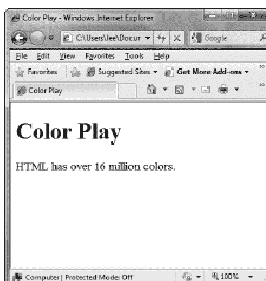

8. 现在滚动到`head`标签。在最后一个`meta`标签之后和`</head>`之前，使用以下代码创建一个嵌入式样式：

```html
<style type="text/css">

</style>
```

9. 在`</style>`上方按几次 ENTER 键。所有 CSS 条目都将位于`style`标签之间。

10. 首先为 HTML 文档本身着色。你将把`background-color`属性添加到`body`。让你的样式文档看起来像下面的代码。我选择了紫色作为背景。选择任何你喜欢的颜色。

```css
<style type="text/css">
    body
    {
        background-color:#9999ff;
    }
</style>
```

11. 保存你的文档，然后通过点击浏览器中的刷新按钮刷新你的页面。背景颜色应该会改变。如果失败，不要惊慌。重新检查第 10 步中的每一行代码。确保颜色有六位数字。确保颜色后面有一个冒号，数字后面有一个分号。大多数情况下，错误都很小。此插图显示我的背景已更改。

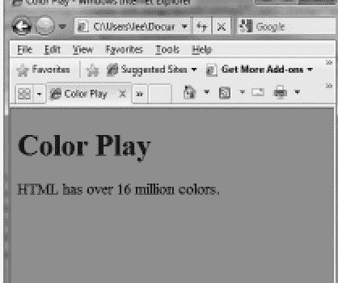

12. 现在你将为文档上的文本着色。将以下代码行添加到`body` CSS 中。我选择使用白色。同样，选择任何你喜欢的颜色。它在`background-color`上方还是下方并不重要。

```css
color:#ffffff;
```

13. 保存你的文档，然后刷新你的页面。前景颜色应该会改变。同样，如果失败，请系统地确保你的代码看起来像我的。永远不要惊慌。此插图显示了文本颜色的变化。

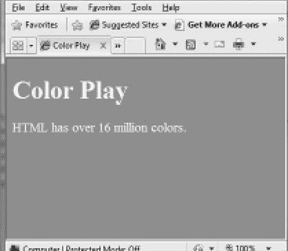

14. 现在，仅仅因为我们能，我们将更改`h1`的颜色。我们将翻转颜色。使用`body`的前景色作为`h1`的背景色，反之亦然。在`body`的结束大括号`}`之后和`</style>`之前输入此处显示的代码。

```css
h1
{
    background-color:#ffffff;
    color:#9999ff;
}
```

15. 你的页面现在应该看起来类似于下面的插图。最终代码包含在代码块 3-2 中。

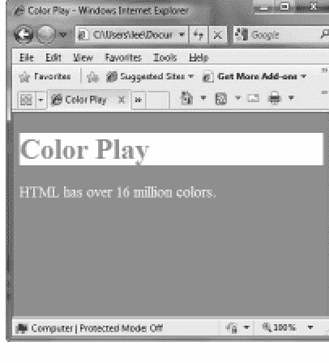

### 代码块 3-2

```html
<!DOCTYPE html PUBLIC "-//W3C//DTD XHTML 1.1//EN"
"http://www.w3.org/TR/xhtml11/DTD/xhtml11.dtd">
<html xmlns="http://www.w3.org/1999/xhtml" xml:lang="en">
    <head>
        <title>Color Play</title>
        <meta name="description"
        content="Experimenting with color"/>
        <meta name="author" content="Lee M. Cottrell" />
    <style type="text/css">
        body
        {
            background-color:#9999ff;
            color:#ffffff;
        }
        h1
        {
            background-color:#ffffff;
            color:#9999ff;
        }
    </style>
    </head>
    <body>
    <h1>Color Play</h1>
    <p>HTML has over 16 million colors.</p>
    </body>
</html>
```

## 网站上的图像

图像在网站上有许多用途。图像可以是背景、菜单项、导航辅助工具，或者仅仅是说明页面的图片。这些用途中的每一种都是有效的，并且在适当使用时非常有效。

## 插入内联图像

直接将图像插入到你的网站是通过``标签完成的。像`<br />`和`<hr />`一样，它是一个空标签。然而，`img`需要几个属性才能正常工作。

`img`标签的第一个也是最重要的属性是`src`属性。此属性向浏览器描述图像的位置。它可以是网络图片的 URL，也可以是与网页在同一文件夹中的图片。代码块 3-3 显示了两个图像。第一个`src`是与网页在同一文件夹中的文件。第二个`src`是网络上的 URL。

> **提示** *除非你有一张我的狗在雪地里行走的照片，否则第一张图像将无法工作。第二张图像将加载。但是，代码对于从同一文件夹加载图像是正确的。*

```html
<br />

```

注意`<br />`标签在第一张图像之后使用。使用`img`标签插入的图像是内联图像。内联元素之后不会立即换行。由于图像是内联的，文本可以围绕它们绘制。代码块 3-3 中的代码将成功地将图像放置到你的页面上。然而，它并不完整。你需要使用四个额外的属性。它们是`height`、`width`、`alt`和`title`。

> **提示** *使用`height`和`width`属性将稍微加快页面的加载速度。浏览器将为图像保留所需的空间，并在图像下载时继续加载页面。*

`height`和`width`属性为页面上的图像保留空间。它们应设置为图像的确切大小。有几种方法可以获取图像的大小。你可以在 Photoshop 或 MS Paint 等图像编辑器中打开它。更简单的方法是在 Internet Explorer 中打开图像。在 IE 中右键单击图像，然后读取属性。高度和宽度已给出。此插图显示了 IE 中图像的宽度和高度。

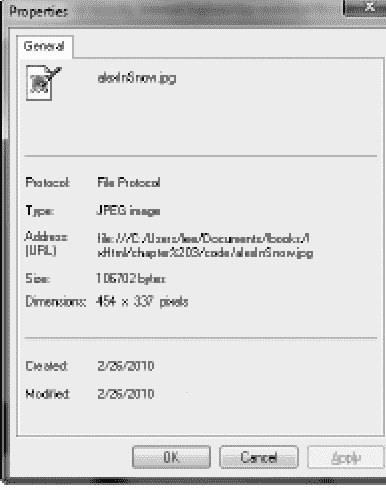

> **注意** *不要使用`height`和`width`标签来调整图像大小。如果需要调整图像大小，请使用编辑器。Photoshop、MS Paint 和 GIMP 都是有效的编辑器。Paint 和 GIMP 是免费的。*

`alt`和`title`属性稍微复杂一些。Alt 是 alternative information（替代信息）的缩写。当用户禁用图像或图像加载失败时，浏览器会显示`alt`标签。此外，为视障人士设计的浏览器也会使用它。系统会向用户朗读`alt`文本。Google 图像会读取`alt`文本以帮助对图像进行分类。你应该在`alt`属性中包含图像的描述和任何版权信息。

`title`属性为图片命名。你应该在`title`中放置一个吸引人的短语。`title`属性的内容在现代浏览器中成为工具提示。将鼠标悬停在图像上以查看`title`。代码块 3-4 显示了插入图像的完整代码。属性的顺序对结果没有影响。请记住，你的浏览器将忽略换行符。仅为了可读性而包含它们。

**注意** *如上所示的代码将无法通过验证。`img`标签应包含在另一个标签内。*

### 代码块 3-4

```html

<br />

```

**提示** *《美国残疾人法案》要求所有技术都必须可供所有美国人使用，无论其身体能力如何。`alt`和`title`标签有助于确保您的页面对所有人无障碍。*

## 图片应本地化

回想第 2 章，当我们建立第一个网站时，我建议您为每个项目创建一个文件夹。其目的是帮助您组织项目。图片也应如此。每个项目都应该有一个图片文件夹。


为您的每个网站在项目文件夹下创建一个图片文件夹。一旦此文件夹存在，请将与您网站相关的所有图片放入此文件夹。您的图片代码将略有更改，以包含文件夹的名称。代码块 3-5 中加粗的代码显示了使用图片文件夹时的调整。

> **注意** 避免在文件夹名称或图片名称中使用空格。

#### 代码块 3-5

```html

```

对于专业页面，您应避免引用其他网站上的图片。引用其他网站上的图片有几个问题。首先，它会减慢您页面的加载速度。代码块 3-4 中的 Photobucket 图片在我的家庭系统上加载需要近两秒钟。相比之下，本地图片会立即加载。第二个问题是使用他人图片的合法性。您不拥有这些图片的权利。最后，将其他网站的图片嵌入到您的网站中是不礼貌的。它会消耗那些网站的速度。

### 内联图片实践

在下一个示例中，我们将创建一个包含两张内联图片的页面。如果您希望使用我的图片，可以从`www.mhprofessional.com/computingdownload`获取。请随意使用您选择的任何图片。

1. 打开您的`chapter3`文件夹。
2. 创建一个名为`images`的文件夹。
3. 将您希望使用的两张图片放入`images`文件夹。确保您知道图片的完整名称。
4. 打开您在第 2 章创建的模板。
5. 将其保存到`chapter3`文件夹中，命名为`auction.html`。
6. 适当地更改标题和第一个`meta`标签。
7. 创建一个`h1`标签，如下所示。
8. 创建两个段落标签，简要描述每个物品及其价格。
9. 保存您的文档并在浏览器中预览。
10. 现在我们将图片插入到段落标签中。在第一个段落的价格之后，但在`</p>`标签之前，按回车键。输入毛衣的代码：
11. 在第二个段落的价格之后，但在`</p>`之前，按回车键。输入裤子的代码：

```html
<h1>Winter Auction Items</h1>
```

```html
<p>The first item is a brand new pink sweater jacket. Started bid is $4.99.</p>
<p>The second item are gently used blue snow pants. Starting bid is $2.99.</p>
```

```html

```

```html

```

12. 保存您的文件并在浏览器中预览。下图显示了输出结果。

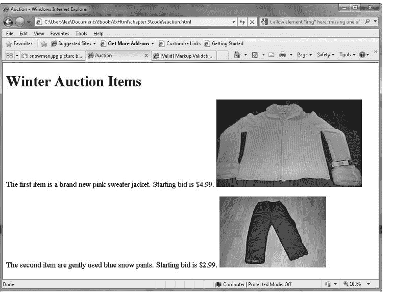

13. 如果需要，您可以在 W3 的验证器上验证此页面。最终版本在代码块 3-6 中。

#### 代码块 3-6

```html
<!DOCTYPE html PUBLIC "-//W3C//DTD XHTML 1.1//EN"
"http://www.w3.org/TR/xhtml11/DTD/xhtml11.dtd">
<html xmlns="http://www.w3.org/1999/xhtml" xml:lang="en">
    <head>
        <title>Auction</title>
        <meta name="description"
        content="Winter Auction Items"/>
        <meta name="author" content="Lee M. Cottrell" />

    </head>
    <body>
    <h1>Winter Auction Items</h1>
    <p>The first item is a brand new pink sweater jacket.
    Starting bid is $4.99.
    </p>
    <p>The second item are gently used blue snow pants.
    Starting bid is $2.99.
    
    </p>
    </body>
</html>
```

### 将图片用作背景

将图片设置为背景需要使用 CSS。CSS 属性`background-image`可以设置页面的背景，或多个其他标签的背景。背景属性需要使用 CSS 函数`url`。`url`提供文件的位置。文件的位置包含在一组括号内，并再次包含在双引号内。

```css
background-image:url("images/grayback.gif");
```

选择背景图片时，您希望选择能增强页面但不会分散读者注意力的图片。图 3-1 展示了一个好的背景选择。

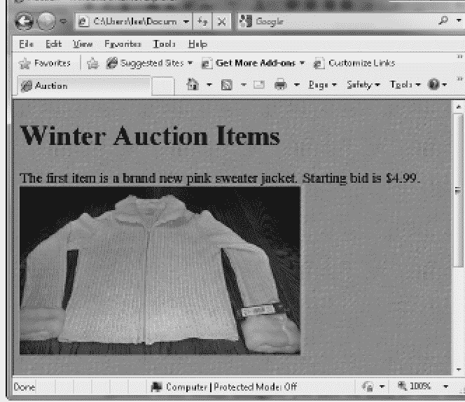

图 3-1 · 好的背景选择

图 3-2 展示了一个糟糕的选择。通常，图片很小，并在页面上平铺。*平铺*是指用小图片完全填充屏幕，但看不到图片之间的接缝。好的背景图片具有相似的特征。

> **注意** 请谨慎选择您的背景图片。确保它不会分散读者对页面的注意力！

- 好的背景图片颜色数量较少。
- 图片中的任何颜色都不与 HTML 文档中的颜色匹配。
- 图案柔和且一致。
- 背景图片中没有文字。
- 背景图片文件大小较小。
- 图片平铺效果良好。

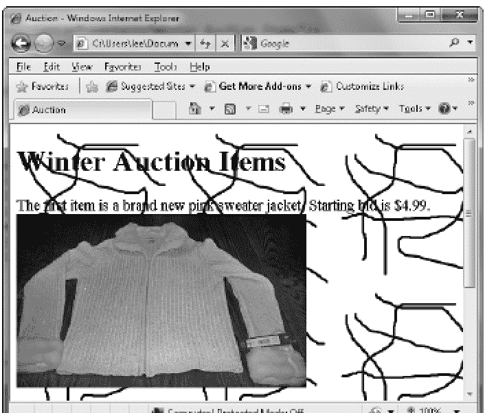

图 3-2 • 糟糕的背景选择

> **提示** 有几个网站专门提供好的背景图片。我经常在我的课堂上使用`www.webpagebackground.com/`。

设置背景图片时，您还应该设置背景颜色。您应该选择与背景图片中主要颜色匹配的背景颜色。在图 3-1 中，我会选择深灰色。在图 3-2 中，如果您坚持使用它，白色将是正确的选择。选择与图片匹配的背景颜色可确保即使背景图片加载失败，您的页面仍然看起来不错。

> **提示** 要获取图片的 RGB 颜色，您需要使用 MS Paint 或类似程序中的取色器工具。用取色器点击颜色，然后编辑颜色。RGB 值将以英文显示。使用计算器进行转换。

### 设置背景图片实践

在此实践中，您将把背景图片放置到网页上。

1. 找到或创建一张您喜欢的图片作为背景图片。如果您希望使用我使用的图片，可以从`www.mhprofessional.com/computingdownload`下载。
2. 将您的背景图片保存到`chapter3/images`文件夹中。
3. 打开您在本章前面创建的`auction.html`文件。
4. 在`head`中创建一个如下所示的`style`标签：

    ```html
    <style type="text/css">
    </style>
    ```

5. 在`style`部分内，创建一个`body`元素。
6. 在`body`元素中，输入`background-image`属性，其 URL 值指向您的图片。以我的示例作为指导。将`bg20.jpg`替换为您的文件名。

    ```css
    body{
        background-image:url("images/bg20.jpg");
    }
    ```

7. 保存并在浏览器中打开页面。您的背景将可见。
8. 现在获取与您背景图片中主要颜色匹配的颜色。将`background-color`属性添加到`body`。最终的`body`格式部分如下所示，更改部分已加粗。

    ```css
    body{
        background-image:url("images/bg20.jpg");
    }
    ```

### 背景图像格式化

默认情况下，背景图像会平铺以填满页面。通常，这正是你希望页面呈现的效果。然而，CSS 提供了多种方式来改变背景图像的默认行为。表 3-2 描述了与背景图像相关的 CSS 样式属性。

#### 表 3-2 CSS 背景属性

| 属性 | 描述 | 常用值 |
| :--- | :--- | :--- |
| `background-attachment` | 决定背景在页面滚动时是否移动。Fixed 值会使背景保持不动。 | Scroll, fixed |
| `background-color` | 设置元素的背景颜色。 | 任何 RGB 值 |
| `background-image` | 从提供的 URL 加载背景图像。如果未提供，则不加载背景图像。 | URL("filename"), none |
| `background-position` | 提供 x-y 坐标来放置背景图像。 | Top, center, bottom, left, center, right, %, length. |
| `background-repeat` | 决定背景图像如何重复。可以设置为水平重复、垂直重复、两者都重复或不重复。 | Repeat, repeat-x, repeat-y, no-repeat |

### 练习使用背景属性

我们将修改本章前面创建的`auction.html`文件。我们将创建一个美元符号位于页面左侧的背景颜色，而不是灰色背景。

1. 从`www.mhprofessional.com/computingdownload`下载`dollarsign.png`文件。将其保存到`chapter3/images`文件夹中。
2. 打开`chapter3`文件夹中的`auction.html`文件。
3. 将`auction.html`文件另存为`auctionBackground.html`。
4. 更改`body`部分中`background-image`和`color`的 CSS 属性。更改的值以粗体标出。

    ```css
    body{
        background-image:url("images/dollarsign.png");
        background-color:#000000;
    }
    ```

5. 保存并在浏览器中打开页面。你应该看到如图所示的效果。这很糟糕。背景太杂乱，与前景文本冲突。

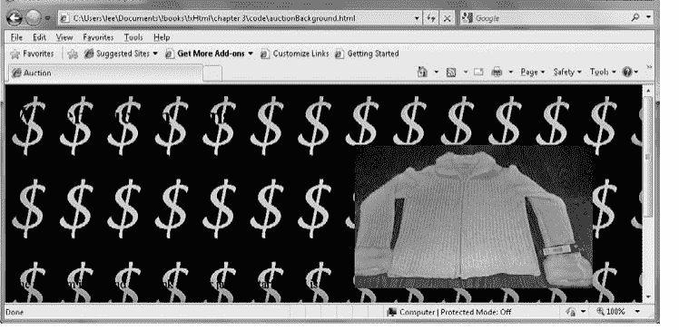

6. 现在我们将更改背景重复模式。将以下代码添加到样式元素的`body`部分。你的页面现在将如下图所示。

    ```css
    background-repeat:repeat-y;
    ```

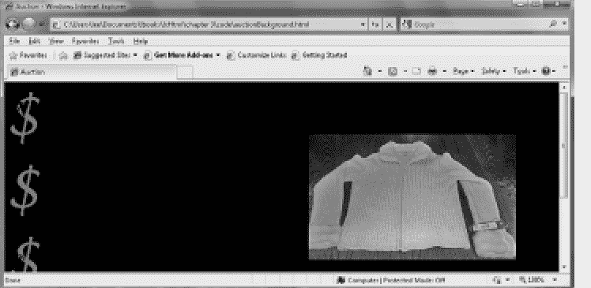

7. 然而，现在文本无法阅读。我们将把文本移到右边并更改文本颜色。在 CSS 的`body`部分添加以下行，以完成如图所示的页面。代码块 3-8 显示了完整的代码清单。

    ```css
    margin-left:80px;
    color:#22b14c;
    ```

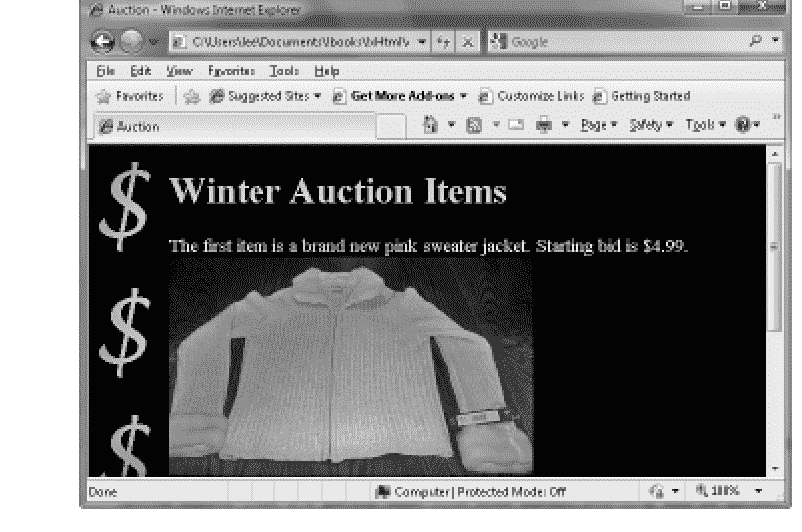

> **提示** `margin-left`属性告诉浏览器从哪里开始显示内容。我选择 80 像素是因为我的美元符号宽度为 73 像素。

#### 代码块 3-8

```html
<!DOCTYPE html PUBLIC "-//W3C//DTD XHTML 1.1//EN"
"http://www.w3.org/TR/xhtml11/DTD/xhtml11.dtd">
<html xmlns="http://www.w3.org/1999/xhtml" xml:lang="en">
    <head>
        <title>Auction</title>
        <meta name="description"
            content="Winter Auction Items"/>
        <meta name="author" content="Lee M. Cottrell" />
        <style type="text/css">
            body{
                background-image:url("images/dollarsign.png");
                background-color:#000000;
                background-repeat:repeat-y;
                margin-left:80px;
                color:#22b14c;
            }
        </style>
    </head>
    <body>
        <h1>Winter Auction Items</h1>
        <p>The first item is a brand new pink sweater jacket.
        Starting bid is $4.99.
        </p>
        <p>The second item are gently used blue snow pants.
        Starting bid is $2.99.
        
        </p>
    </body>
</html>
```

### 获取网页图形

你的网站上会有图片。你可能为你的孩子创建一个个人网站，或者为雇主创建一个产品页面。在构建网站时，你需要获取图片。

网络上有几个网站提供图片。显而易见的地方是`www.google.com`和`www.bing.com`。如果你是为了练习而获取图片，这些网站是可以的。然而，你需要非常小心来自这些和其他搜索引擎的图片。你可能没有适当的许可证在你的网站上使用这些图片。一般来说，除非你或你的公司创建了该图片，否则你可能没有权限在网站上使用该图片。

为了在网站上使用图片，你需要获得使用该图片的合法许可。有几个网站提供价格低廉的图片供你的网站使用。例如，`www.corbis.com`和`www.istockphoto.com`提供非常便宜的专业质量图片。有许多网站提供免费图片。你通过引用图片的来源来“支付”图片费用。`www.freedigitalphotos.net`和`www.freefoto.com`就是这类网站的两个例子。

有些网站提供预制的或定制的 GIF 或 PNG 图像。网站`www.free-graphics.com`拥有超过七百万张免费供你使用的图片。与`freefoto.com`一样，你只需要提供对该网站的引用。如果你需要定制图像，`www.flamingtext.com`可以为你的网站创建定制的横幅和按钮。

### 网页图像格式

图像对你的网站非常重要。它们必须正确插入并且格式正确。目前，网络支持三种图像格式。它们是 JPG、GIF 和 PNG 文件。

JPG 是联合图像专家小组的缩写。正如缩写所示，JPG 最适合照片。尽管名称奇怪，但 JPG 文件无处不在。你的数码相机很可能以 JPG 格式存储其照片。

JPG 格式允许使用有损压缩算法存储图像。该算法会丢失照片的次要细节以减小其文件大小。图像的文件大小越小，加载速度就越快。

虽然 JPG 文件存储照片，但有时也需要非照片图像。徽标、地图和手绘图表可能需要显示。GIF 和 PNG 文件解决了这一需求。GIF 是图形交换格式的缩写。CompuServe 在 1990 年代初开发了 GIF 格式，以在其网络上分发图形。

除了支持手绘图像外，GIF 还支持简单动画。动画 GIF 是一个包含多个嵌入图片的图像文件。GIF 内部的图像每隔几秒就会变化一次。如果使用得当，这种效果可以增强网站。

> **提示** 虽然你可以在网站中包含动画，但要非常节制地使用它们。过多的动画会让你的页面显得不专业。

GIF 存在一些超出本书范围的法律和技术限制。PNG 文件格式解决了这些限制。PNG 文件可以在所有可以使用 GIF 文件的地方使用。在实践中，PNG 文件看起来比 GIF 文件稍好一些，但 PNG 文件从不包含动画。

### 总结

在本章中，你学习了如何为网站增添光彩。你学习了 HTML 如何描述颜色以及如何构建自定义颜色代码。此外，你还学习了如何在页面上将图像与文本内联放置。还介绍了通过 CSS 设置背景图像和颜色。

### 测验

1. 选择用于插入内联图像的 HTML 标签。
   - A. `<p>`
   - B. ``
   - C. `<pic>`
   - D. `<src>`

2. 用于设置背景颜色的 CSS 属性是 ________。


- A. `background-color`
- B. `bgcolor`
- C. `back-color`
- D. `color`

3. 此 HTML 颜色代码是绿色。

- A. `#ff0000`
- B. `#00ff00`
- C. `#0000ff`
- D. `#000000`

4. 对于图像，________ 属性用于描述图像。

- A. `alt`
- B. `title`
- C. `src`
- D. `tip`

5. 设置背景图像时，你还应该设置一个与之 ________ 的背景颜色。

- A. 互补的背景图像
- B. 覆盖背景图像
- C. 与前景色匹配
- D. 与背景图像中的主要颜色匹配

6. 此图像类型最适合照片。

- A. `PNG`
- B. `GIF`
- C. `JPG`
- D. `BMP`

7. 要在页面上为图像预留空间，你需要使用 ________ 和 ________ 属性。

- A. `length`
- B. `height`
- C. `width`
- D. `size`

8. `img` 标签的 ________ 属性指定图像的位置。

- A. `alt`
- B. `title`
- C. `src`
- D. `tip`

9. 一个小的背景图像会重复以填充屏幕。这是 ________ 的定义。

- A. 平铺
- B. 缩放
- C. 拉伸
- D. 填充

10. 在 CSS 中，________ 函数描述文件的位置。

- A. `file`
- B. `location`
- C. `url`
- D. `place`

# 第四章：使用超链接

你将学习链接到外部页面、创建导航系统以及使用外部样式表。此外，你还将学习如何为可用性格式化链接。

## 章节目标

在本章中，你将：

- 创建超链接
- 创建指向你网站上页面的链接
- 创建有效的网站导航
- 构建页内链接
- 格式化链接
- 创建样式文档


早在 1945 年，计算机科学家们就在设想一种更简单的与计算机交互的方法。万尼瓦尔·布什提出了一个名为 Memex 的图书馆系统理论，该系统中的文档相互链接。这篇文章极大地启发了鼠标的发明者道格拉斯·恩格尔巴特，他构建了第一个可工作的超文本系统，称为 NLS。NLS 是第二台连接到 ARPANET 的机器。

快进到八十年代中期。苹果公司首先推出了 Lisa，然后是 Macintosh 电脑，其设计采用了鼠标界面，而不仅仅是键盘输入界面。在此期间，用户通过输入晦涩的命令来浏览互联网。

蒂姆·伯纳斯-李为了分享他的研究论文，开发了一个超文本系统，以便于检索其他论文并在文档内创建活动链接。这个超文本系统与 HTML 和用于传输论文的协议相结合，造就了我们今天所知的万维网。

如今，这些超链接在互联网上无处不在。网络搜索引擎返回的页面充满了可能包含你问题答案的链接。网站拥有复杂的导航系统，基于链接，提供面包屑导航，告诉你当前所在的页面以及你到达当前页面所经过的页面。你需要学习如何利用超链接的力量。

## 创建超链接

*超链接*就像通往互联网上文件的快捷方式。该链接包含指向网页的 URL。点击时，URL 会在你的浏览器中打开。创建超链接的标签是 `<a>` 标签。

## 外部链接

*外部*链接是指向不在你网站内的页面的超链接。例如，你网站上指向 `www.google.com` 的链接就是一个外部链接。要构建一个链接，你需要开始一个 `<a>` 标签，提供网站的 URL，并给用户一些可点击的内容。考虑下面显示的代码。注意 `<br />` 标签用于分隔行。与 `` 标签一样，`<a>` 是一个内联标签。此特性允许在页面的任何部分放置超链接。

```html
<a href="http://www.google.com">Google.com</a><br />
<a href="http://www.youtube.com/mrcottrellbradford">My YouTube Channel</a><br />
```

这段代码有几个需要解释的组件。Href 是 hypertext reference（超文本引用）的首字母缩写。`<a>` 标签的 `href` 属性包含网站的确切 URL。记得在 URL 中包含 `http://`。包含在 `<a> </a>` 元素内的是用户可以点击的文字。元素内的文字在浏览器中会显示为下划线。带下划线的文字就是可点击的内容。

> **提示**：*始终为用户提供可点击的内容。确保链接告诉用户他们将通过点击链接前往何处。*

前面显示的代码将提供一个可工作的链接。然而，这个标签存在一些问题。首先，链接将在当前窗口中打开，替换当前网页。这非常糟糕。想象一下，你的页面正在销售产品，你提供了一个指向制造商网站的链接。如果这个链接覆盖了你的页面，你可能会失去一个客户。通过打开一个新窗口，你可以让客户在另一个页面上查看相关信息，同时你的页面仍然保留在屏幕上。

> **提示**：*在输入 `href` 属性之前，先在浏览器中打开该页面。然后将 URL 复制并粘贴到 `href` 属性中。*

在新窗口中打开链接需要使用 `target` 属性。`target` 将创建一个新的浏览器窗口。你给 `target` 的值将改变你的链接的工作方式。XHTML 有一些内置的 `target` 值。最常用的是 `_blank`。设置此 `target` 将导致每次点击时打开一个新的浏览器窗口。

> **提示**：*`target` 属性在 HTML 4.01 和 XHTML 1.1 中已弃用。但是，在 HTML 5 中并未弃用。我建议使用 `target` 属性，即使你无法通过验证。*

我不喜欢使用 `_blank`。它倾向于在我的客户的机器上打开太多窗口。图 4-1 显示了多次点击 `_blank` 链接时会发生什么。相反，我选择 `target` 的不同值。我使用单词“new”，尽管你可以使用任何你喜欢的单词。使用你为 `target` 指定的单词将导致每次点击只打开一个窗口。以下代码块展示了 `_blank` 和 `new` 的使用。

```html
<a href="http://w3.org" target="_blank">W3.org</a><br />
<a href="http://www.webstandards.org" target="new">Webstandards</a>
```

76 HTML & XHTML DeMYSTiFieD

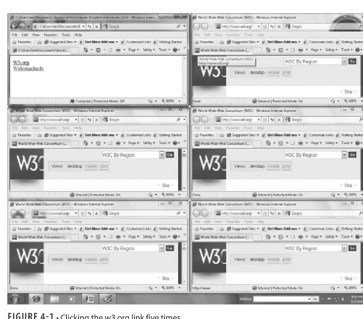

构建链接时，你还应该使用 `title` 属性。与图像的 `title` 属性类似，`title` 属性将为你的链接创建一个工具提示。当用户将鼠标悬停在网站上时，工具提示可见。如第 3 章所述，你的页面需要对所有人可访问。`title` 属性使你的页面可访问。为用户朗读的浏览器将向用户朗读 `title` 文本。为了完全可访问，此属性应传达链接打开的网站名称，并在链接将在新窗口中打开时提醒用户。以下代码演示了三个链接的 `title` 属性。最后一个链接在当前窗口中打开。

```html
<a href="http://w3.org" target="_blank"
title="Link to www.w3.org, opens in a new window">W3.org</a><br />
<a href="http://www.webstandards.org" target="window"
title="Link to www.webstandards.org, opens in a new window">Webstandards</a><br />
<a href="http://www.w3schools.com"
title="Link to www.w3schools.com, opens in the current window">W3Schools</a><br />
```

## 练习构建外部链接

你将构建一个列出搜索引擎的页面。你将看到 `target` 和 `title` 属性是如何工作的。

1. 创建一个 `chapter4` 文件夹。

2. 打开你的 `!template.html` 并将其另存为 `externallink.html`。

3. 将 `title` 标签更改为 **搜索引擎**。

4. 在 `body` 元素中，创建一个类似于我的标题。

   ```html
   <h1>搜索引擎</h1>
   ```

5. 在 `<h1>` 下方，创建此段落。

   ```html
   <p>有数百个搜索引擎。其中最受欢迎的是谷歌。新秀微软必应的人气日益增长。最后，老牌的雅虎依然强劲。</p>
   ```

6. 你将使单词 Google、Bing 和 Yahoo 分别链接到相应的网站。从 Google 链接开始。

   a. 在浏览器中，输入 **`http://www.google.com`**。页面加载后，从地址栏复制地址。

   b. 点击段落标签内，在 Google 之前。输入以下代码。将地址粘贴到 `href` 属性中。

      ```html
      <a href="http://www.google.com">
      ```

   c. 在 Google 之后，用 `</a>` 关闭 `<a>` 标签。提醒一下，Programmer's Notepad 会自动为你关闭标签。

   d. 对 `www.bing.com` 和 `www.yahoo.com` 重复步骤 a 到 c。

## 7. 保存并在浏览器中打开页面。Google 应该显示为下划线。如果没有，请检查你的代码并找出错误。下图展示了在 Internet Explorer 中的输出效果。

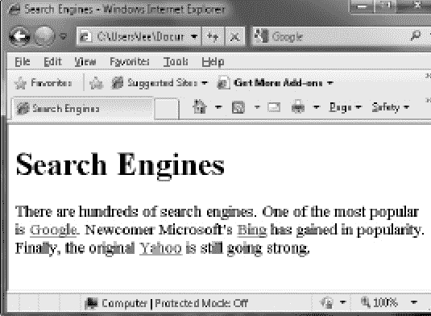

> 提示：*如果整个页面都显示为下划线，说明你没有正确关闭 `<a>` 标签。*

## 8. 点击 Google 链接。注意 Google 页面如何替换了你的页面。外部链接应该始终在新窗口中打开。你将修改链接以实现此效果。

## 9. 点击指向 Google 的链接内部的属性空间。输入以下 `target` 和 `title` 属性。

```html
target="_blank" title="Link to www.google.com opens in a new window."
```

## 10. 保存并在浏览器中刷新页面。多次点击该链接。每次点击都应该出现一个指向 Google 的新窗口。

## 11. 将 `target` 的值更改为 `"window"`。保存你的文档。

```html
target="window" title="Link to www.google.com opens in a new window."
```

## 12. 关闭所有浏览器窗口。重新打开浏览器并打开此页面。多次点击 Google 链接。应该只出现一个额外的窗口。

## 13. 为 `www.bing.com` 和 `www.yahoo.com` 链接应用 `target` 和 `title` 属性。

## 14. 完成的代码见代码块 4-1。输出效果如步骤 7 的插图所示。

```html
CODE BLOCK 4-1

<!DOCTYPE html PUBLIC "-//W3C//DTD XHTML 1.1//EN"
"http://www.w3.org/TR/xhtml11/DTD/xhtml11.dtd">
<html xmlns="http://www.w3.org/1999/xhtml" xml:lang="en">
    <head>
        <title>Search Engines</title>
        <meta name="description"
              content="Search engines"/>
        <meta name="author" content="Lee M. Cottrell" />
    </head>
    <body>
    <h1>Search Engine</h1>
    <p>There are hundreds of search engines. One of the most
    popular is <a href="http://www.google.com"
    target="window" title="Link to www.google.com opens in a
    new window.">Google</a>. Newcomer Microsoft's
    <a href="http://www.bing.com" target="window"
    title="Link to www.bing.com opens in a new window.">
    Bing</a> has gained in popularity. Finally, the original
    <a href="http://www.yahoo.com" target="window"
    title="Link to www.yahoo.com opens in a new window.">
    Yahoo</a> is still going strong.</p>
    </body>
</html>
```

> 提示：如果外部链接不起作用，请确保你拼写正确了链接。务必在 URL 前正确输入 `http://`。

# 链接到你网站上的页面

链接到外部页面是一项重要技能。它使网络用户能够轻松访问网络上的几乎所有内容。链接到你网站上的页面，即*内部*链接，实际上比链接到外部网站更容易。

构建内部链接与创建外部链接非常相似。有两个区别。首先，`href` 不再使用指向页面的 URL。其次，无需使用 `target` 属性。你希望你的页面出现在同一个浏览器窗口中。代码块 4-2 展示了两个内部链接。一个链接指向一个网页；另一个指向一张图片。

# 代码块 4-2

```html
<a href="family.html" title="Link to family.html in the same window">Family</a><br />
<a href="images/lizzieHomeRun.jpg" title="Link to a picture of Lizzie's first home run!">Home run Picture</a>
```

代码块 4-2 说明了内部链接的工作原理。指向 `family.html` 的 `href` 只列出了页面本身。这些页面很可能位于同一文件夹中，因此 `href family.html` 就能找到该页面。请记住，图片应该放在它们自己的文件夹中。这反映在第二个 `href` 中。路径 `images/lizzieHomeRun.jpg` 应该能找到该图片。

# 站点导航

站点导航是内部链接最常见的用途。你希望访问你网站的访客能够找到信息。为了浏览，用户需要导航辅助工具。你通过每个页面上的链接来提供这些辅助工具。

创建导航辅助工具有许多不同的策略。最初的方法是有一个主页面链接到其他页面。这种方法被称为*层级式*，对于较小的网站效果很好。用户最初会落在主页上。主页有指向网站上每个其他页面的链接。每个其他页面都有一个返回主页的链接。偶尔，一个页面会有指向其下方子页面的链接。图 4-2 展示了一个体育页面的层级布局。

图 4-2 展示了一个相当复杂的页面。主页 `index.html` 包含指向 `baseball.html`、`football.html`、`hockey.html` 和 `soccer.html` 页面的链接。`Football.html` 包含指向名为 `flag.html` 和 `tackle.html` 的子页面的链接，以及返回 `index.html` 的链接。类似地，`hockey.html` 包含指向 `deck.html`、`ice.html` 和 `index.html` 的链接。`Soccer.html` 有一个名为 `worldcup.html` 的子页面。`Baseball.html` 没有子页面，但确实链接回 `index.html`。

层级布局对于小型网站效果很好。然而，网状布局已经取代了层级布局。在网状布局中，大多数页面都链接到其他页面。现代实现使用菜单栏来构建网状布局。你将在下一节中创建一个网状布局。

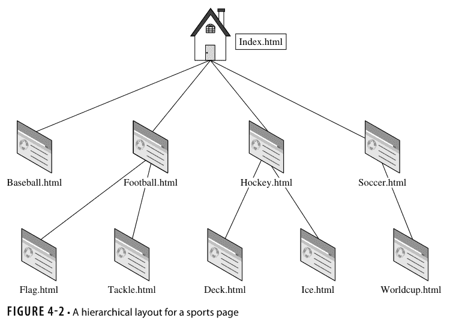

**图 4-2** • 体育页面的层级布局

# 练习创建网状布局

你将构建图 4-2 所示的网站。你将构建 `index.html` 和包含 `baseball.html` 的第一级页面。每个页面将只是一个包含 `<h1>` 标签和几个链接的框架。

1. 打开第 2 章创建的 `!template.html` 文件。

2. 将此文件保存为 `index.html`，放在一个名为 **sports** 的新文件夹中。

3. 将 `index.html` 的 `title` 标签更改为 **Sports Page**。相应地调整 `meta` 标签。

4. 在 `body` 部分添加以下 `<h1>` 元素。保存你的文档。

   ```html
   <h1>Sports Pages</h1>
   ```

5. 现在你将创建 `baseball.html` 页面。技巧是将 `index.html` 另存为 `baseball.html`，然后进行修改。

   a. 将 `index.html` 文件另存为 **baseball.html**。

   b. 将标题更改为 **Baseball Page**。

   c. 相应地更改 `meta` 标签。

   d. 将 `h1` 更改为 **Baseball Page**。

   e. 保存文档。

6. 在浏览器中打开页面以确保其外观正确。下图展示了在 Internet Explorer 中应有的样子。


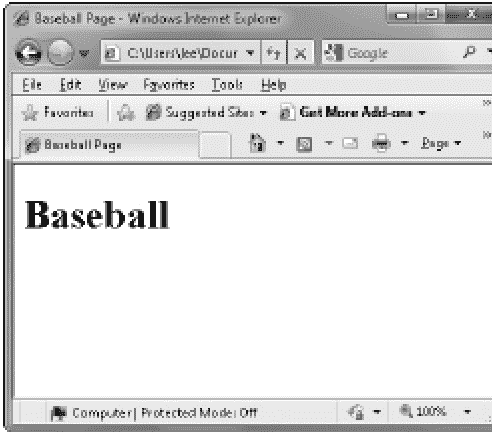

7. 对`football.html`、`hockey.html`和`soccer.html`重复步骤 5。

> **提示**：将 Baseball 更改为 Football 可以使用编辑器的查找和替换功能完成。

8. 在编辑器中打开所有页面。要一次打开所有页面，在“文件打开”屏幕中，使用鼠标在所有文件名周围绘制一个选择框。

9. 切换到`index.html`。

10. 现在你将创建指向各个体育页面的链接。

11. 首先创建一个指向`baseball.html`的链接。在`<h1>`标签下方输入代码。

```html
<p>
<a href="baseball.html" title="Link to baseball.html. The link opens in the same window">Baseball</a><br />
</p>
```

> **注意**：包含`<p>`标签是为了确保页面通过验证检查。不包含`<p>`标签仍然允许页面工作，只是无法通过验证。

12. 在浏览器中验证链接是否有效。

13. 在`<p>`标签内`<br />`之后，为剩余页面重复链接。请务必按字母顺序构建页面链接。

```html
<a href="football.html" title="Link to football.html. The link opens in the same window">Football</a><br />
<a href="hockey.html" title="Link to hockey.html. The link opens in the same window">Hockey</a><br />
<a href="soccer.html" title="Link to soccer.html. The link opens in the same window">Soccer</a><br />
```

14. 在 Baseball 链接上方添加一个指向`index.html`页面的链接。使用文本“home”作为链接文本。

```html
<a href="index.html" title="Link to the home page. The link opens in the same window">Home</a><br />
```

15. 在浏览器中打开一个页面，确保所有链接都有效。

> ## 仍然感到困惑
>
> 包含主页链接有两个原因。首先，该链接提供了从`baseball.html`和其他页面返回主页的途径。其次，一旦你开始构建菜单栏，它们总是包含返回主页的方式。

16. 复制并粘贴段落标签和所有五个指向你网站中其他页面的链接。你的页面应类似于下图。

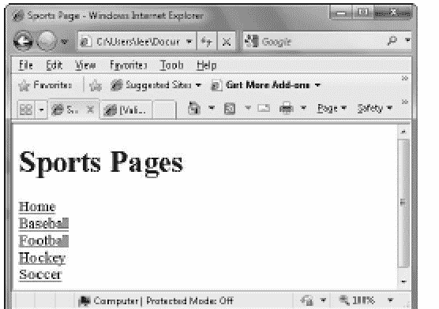

17. `index.html`的最终代码见代码块 4-3。

## 代码块 4-3

```html
<!DOCTYPE html PUBLIC "-//W3C//DTD XHTML 1.1//EN"
"http://www.w3.org/TR/xhtml11/DTD/xhtml11.dtd">
<html xmlns="http://www.w3.org/1999/xhtml" xml:lang="en">
    <head>
        <title>Sports Page</title>
        <meta name="description" content="Sports pages"/>
        <meta name="author" content="Lee M. Cottrell" />
    </head>
    <body>
        <h1>Sports Pages</h1>
        <p>
            <a href="index.html" title="Link to the home page
            opens in the same window">Home</a><br />
            <a href="baseball.html" title="Link to baseball.html
            opens in the same window">Baseball</a><br />
            <a href="football.html" title="Link to football.html
            opens in the same window">Football</a><br />
            <a href="hockey.html" title="Link to hockey.html
            opens in the same window">Hockey</a><br />
            <a href="soccer.html" title="Link to soccer.html
            opens in the same window">Soccer</a>
        <br />
        </p>
    </body>
</html>
```

## 页内链接

内部链接用于构建页面之间的导航。*页内*链接则提供单个页面内的导航。当页面内容非常庞大时，页内链接就显得尤为重要。它允许读者从页面顶部直接跳转到页面下方很远的某个主题。如果页面配置得当，读者还可以跳回页面顶部。

通常，包含页内链接的页面会在顶部设有一个目录。目录中会包含指向页面各部分的链接。你需要使用`id`属性来标识各个部分。正如第 2 章所定义的，`id`属性允许开发者为页面上的标签命名。

要创建一个带有页内链接的页面，你需要比创建内部链接多做一些工作。首先，你需要为页面的每个部分设置一个`id`。`id`应该是描述该部分的简短单词，使用全小写字母且不含空格。我建议将`id`属性用在标题元素中。每个部分的末尾将包含一个返回目录的链接。

```html
<h2 id="pony">Pittsburgh Pony Baseball</h2>
```

一旦各部分被赋予了`id`，就需要构建目录。目录将包含跳转到各部分`id`的链接。这种链接略有不同。其`href`属性指向的不是页面或 URL，而是`id`。正确的语法是在`id`前加上`#`。

```html
<a href="#pony" title="Link to Pony Baseball section.">Pony</a>
```

> **提示**：HTML 在页面上提供了两个特殊的 ID。`#top`指向页面顶部，`#bottom`指向页面底部。

## 构建页内链接

你将创建一个带有页内链接的页面。与其输入这类页面通常伴随的大量文本，你将使用占位符文本来模拟效果。你将创建一些虚构的青少年棒球队用于练习。

1. 打开之前创建的`baseball.html`页面。如果你没有创建此页面，请从你的模板新建一个页面。

2. 在链接下方，为 Allentown Alligators 创建一个标题。将`id`属性设置为`alligators`。

   ```html
   <h2 id="alligators">Allentown Alligators</h2>
   ```

3. 为 Elliott Eagles、Mt. Washington Presidents 和 Sheraden Sluggers 创建另外三个标题。相应地设置它们的`id`。

   ```html
   <h2 id="eagles">Elliott Eagles</h2>
   <h2 id="presidents">Mt. Washington Presidents</h2>
   <h2 id="sluggers">Sheraden Sluggers</h2>
   ```

4. 现在你需要生成文本。为了正确看到效果，你需要在每个标题之间插入许多段落。输入一个类似我的`<p>`标签，并在每个标题后复制至少十次。我使用了标准的拉丁文占位文本“Lorem ipsum dolor sit amet.”。你可以自由使用自己设计的文本。

   **提示**：此处使用的占位文本没有实际意义。它是出版行业在需要展示格式时使用的标准文本。

   ```html
   <h2 id="alligators">Allentown Alligators</h2>
   <p>Lorem ipsum dolor sit amet. </p>
   <p>Lorem ipsum dolor sit amet. </p>
   <p>Lorem ipsum dolor sit amet. </p>
   <p>Lorem ipsum dolor sit amet. </p>
   <p>Lorem ipsum dolor sit amet. </p>
   <p>Lorem ipsum dolor sit amet. </p>
   <p>Lorem ipsum dolor sit amet. </p>
   <p>Lorem ipsum dolor sit amet. </p>
   <p>Lorem ipsum dolor sit amet. </p>
   <p>Lorem ipsum dolor sit amet. </p>
   ```

5. 在浏览器中查看你的页面。确保它看起来与这里显示的图片类似：

   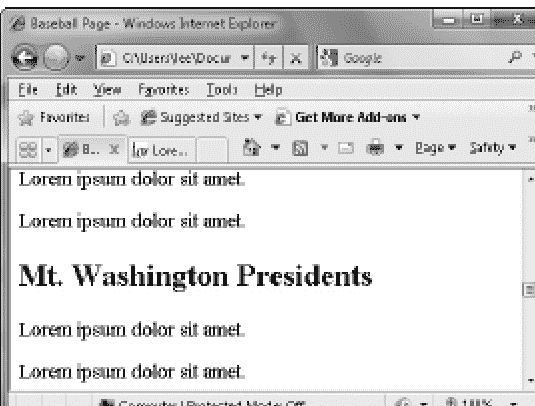

6. 滚动到 Allentown Alligators 的`<h2>`标题上方。

7. 为 League Baseball Teams 创建一个`<h2>`标题。将标题的`id`设置为`teams`。

   ```html
   <h2 id="teams">League Baseball Teams</h2>
   ```

8. 在`<h2>`下方，创建一个段落。在段落内部，使用`id`作为`href`创建一个指向`alligators`的链接。

   ```html
   <a href="#alligators"
   title="Intra page link to lower on the page">Allentown Alligators</a><br />
   ```

9. 保存文件并在浏览器中查看。确保链接能跳转到 Alligators 部分。如果你没有看到效果，请缩小浏览器窗口以模拟页面上有更多文本。

   > **提示**：Sheraden Sluggers 可能不会像其他球队那样跳转到页面顶部。这是正常的，因为该球队之后没有其他内容来填充页面。

10. 在段落内为其他三个球队重复此链接。

    ```html
    <a href="#eagles" title="Intra page link to lower on the page">Elliott Eagles</a><br />
    <a href="#presidents" title="Intra page link to lower on the page">Mt. Washington Presidents</a><br />
    <a href="#sluggers" title="Intra page link to lower on the page">Sheraden Sluggers</a><br />
    ```

11. 验证每个球队的链接都有效。

12. 现在你需要创建一个返回球队列表的链接。滚动到你的代码中 Elliott Eagles 标题的正上方。

13. 添加一个返回球队列表的链接。

    ```html
    <a href="#teams" title="Intra page link to higher on the page">Back to the team list</a>
    ```

14. 保存文件并在浏览器中查看页面。点击链接跳转到 Eagles 部分。滚动到该部分末尾，点击返回球队列表的链接。你的球队列表应该会出现。

15. 对其他每个部分重复此操作。

16. 完整的代码清单见代码块 4-4。

## 代码块 4-4


```html
<!DOCTYPE html PUBLIC "-//W3C//DTD XHTML 1.1//EN"
"http://www.w3.org/TR/xhtml11/DTD/xhtml11.dtd">
<html xmlns="http://www.w3.org/1999/xhtml" xml:lang="en">
    <head>
        <title>Baseball Page</title>
        <meta name="description" content="Baseball pages"/>
        <meta name="author" content="Lee M. Cottrell" />
    </head>
    <body>
        <h1>Baseball</h1>
        <p>
            <a href="index.html" title="Link to the home page. The link opens in the same window">Home</a><br />
            <a href="baseball.html" title="Link to baseball.html. The link opens in the same window">Baseball</a><br />
            <a href="football.html" title="Link to football.html. The link opens in the same window">Football</a><br />
            <a href="hockey.html" title="Link to hockey.html. The link opens in the same window">Hockey</a><br />
            <a href="soccer.html" title="Link to soccer.html. The link opens in the same window">Soccer</a><br />
        </p>

        <h2 id="teams">League Baseball Teams</h2>
        <p>
            <a href="#alligators" title="Intra page link to lower on the page">Allentown Alligators</a><br />
            <a href="#eagles" title="Intra page link to lower on the page">Elliott Eagles</a><br />
            <a href="#presidents" title="Intra page link to lower on the page">Mt. Washington Presidents</a><br />
            <a href="#sluggers" title="Intra page link to lower on the page">Sheraden Sluggers</a><br />
        </p>

        <h2 id="alligators">Allentown Alligators</h2>
        <p>Lorem ipsum dolor sit amet. </p>
        <p>Lorem ipsum dolor sit amet. </p>
        <p>Lorem ipsum dolor sit amet. </p>
        <p>Lorem ipsum dolor sit amet. </p>
        <p>Lorem ipsum dolor sit amet. </p>
        <p>Lorem ipsum dolor sit amet. </p>
        <p>Lorem ipsum dolor sit amet. </p>
        <p>Lorem ipsum dolor sit amet. </p>
        <p>Lorem ipsum dolor sit amet. </p>
        <p>Lorem ipsum dolor sit amet. </p>
        <a href="#teams" title="Intra page link to higher on the page">Back to the team list</a>

        <h2 id="eagles">Elliott Eagles</h2>
        <p>Lorem ipsum dolor sit amet. </p>
        <p>Lorem ipsum dolor sit amet. </p>
        <p>Lorem ipsum dolor sit amet. </p>
        <p>Lorem ipsum dolor sit amet. </p>
        <p>Lorem ipsum dolor sit amet. </p>
        <p>Lorem ipsum dolor sit amet. </p>
        <p>Lorem ipsum dolor sit amet. </p>
        <p>Lorem ipsum dolor sit amet. </p>
        <p>Lorem ipsum dolor sit amet. </p>
        <p>Lorem ipsum dolor sit amet. </p>
```

## 从其他页面访问页内链接

页内 ID 可以从其他页面访问。`<a>` 标签的 `href` 代码是合并在一起的。要从 `soccer.html` 页面链接到 Elliott Eagles，使用以下代码。

```html
<a href="baseball.html#eagles" title="Link to eagles on baseball.html The link opens in the window">Eagles Baseball</a><br />
```

## 格式化链接

`<a>` 标签，与几乎所有其他 HTML 标签一样，可以进行格式化以匹配你的页面设计。使用 CSS，可以更改颜色、字体和字体装饰。使用 CSS 伪类，可以实现简单的动画效果。

## 设置链接样式

默认情况下，Internet Explorer 将链接颜色设置为蓝色。一旦你访问过该页面，颜色会变为紫色。这种颜色变化对浏览者很有帮助。它让他们知道哪些页面已经访问过。不幸的是，这种颜色选择并非适用于所有页面。

你可以开始使用 CSS 格式化链接。在你的样式部分创建一个“a”元素。然后像我们之前做的那样设置颜色和字体属性。完成后，已访问和未访问的链接颜色将相同。

> **提示**：网页设计惯例是更改已访问链接的颜色。然而，许多网站打破了这一规则，保持已访问和未访问链接颜色相同。如何格式化你的网站取决于你的偏好。

要更改已访问链接的颜色，需要使用伪类。伪类的一个很好的类比是对象可能处于的状态。考虑交通信号灯。一个正常工作的交通信号灯可能处于三种可能的状态：绿色、黄色或红色。这些状态中的每一个都是信号灯的一个类别，并为每个类别分配了相应的规则。

伪类将此应用于 HTML 标签。存在几种用于链接的伪类。表 4-1 列出了 `a` 标签更常用的伪类。

## 使用 CSS 练习格式化链接

你将修改 `baseball.html` 页面，使其具有格式良好的链接。你还将为链接应用不同的格式。你将配置页面，使链接在鼠标悬停时显示下划线，而不是始终显示下划线。

**表 4-1　`a` 标签的常用伪类**

| 伪类 | 描述 |
|---|---|
| `a:active` | 用于格式化当前正在使用的链接。 |
| `a:link` | 用于格式化未访问的链接。 |
| `a:hover` | 当鼠标悬停在链接上时应用规则。 |
| `a:visited` | 为已访问的链接设置规则。 |

1. 在编辑器中打开 `baseball.html` 页面。

2. 滚动到 `head` 部分，在 `</title>` 标签之后。

3. 创建一个 `style` 元素。

```html
<style type="text/css">

</style>
```

4. 在 `<style>` 元素内部，为 `body` 创建规则。你将背景颜色设置为 `#610b0b`，前景色设置为 `#ffffff`。保存你的页面。

```css
body{
    background-color:#610b0b;
    color:#ffffff;
}
```

5. 在浏览器中打开你的页面，验证页面是否具有深红色背景和白色文本。

6. 为 `<a>` 标签创建一个规则。你将前景色设置为 `#fe2e2e`，并通过将 `text-decoration` 属性设置为 `none` 来关闭下划线。

```css
a{
    color:#fe2e2e;
    text-decoration:none;
}
```

7. 保存并刷新你的页面。验证你的链接是否已变为亮红色且没有下划线。

8. 为 `a:visited` 伪类创建一个规则。你将前景色设置为 `#df0101`。

```css
a:visited{
    color:#df0101;
}
```

9. 保存并刷新你的页面。验证已访问的链接是否为较深的红色。

10. 现在为 `a:hover` 伪类创建一个规则。你将使用 `text-decoration` 属性为链接添加下划线。

```css
a:hover{
    text-decoration:underline;
}
```

11. 保存并刷新你的页面。将鼠标悬停在浏览器中的任何链接上。验证下划线是否出现在鼠标下方，类似于此插图：

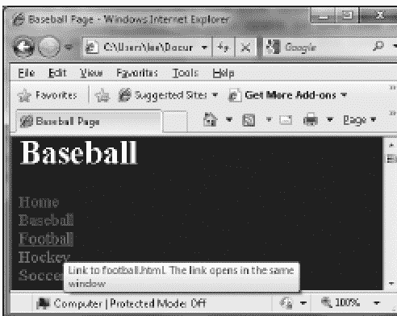

12. 完整的 `style` 标签出现在代码块 4-5 中。

```html
<style type="text/css">
body{
    background-color:#610B0B;
    color:#ffffff;
}
a{
    color:#FE2E2E;
    text-decoration:none;
}
a:visited{
    color:#df0101;
}
a:hover{
    text-decoration:underline;
}
</style>
```

## 使用图像作为链接

创建超链接时，用户需要点击某些内容。前面的示例使用了文本。图像可以用来代替文本。要使用图像作为链接，你只需在 `<a>` 标签内使用 `` 标签。`img` 标签仍应使用 `height` 和 `width` 属性。需要 `alt` 图像属性。但是，不需要使用 `title` 属性。链接的 `title` 属性将覆盖图像属性。

链接图像将像任何其他图像一样显示，但浏览器会在图像周围放置一个边框。边框是 HTML 尝试将图像标识为链接的方式。CSS 的 `border` 属性将允许你根据需要格式化边框。

## 练习使用图像作为链接

你将为 index 页面创建一个菜单栏，该菜单栏绘制在页面的顶部或侧面。菜单包含指向你网站中每个主要页面的链接。菜单栏是为网站创建导航的最常用方法。

我在 Flamingtext.com 上为菜单栏创建了五个 GIF 图像。每个图像宽 150 像素，高 35 像素。它们的名称代表它们的运动项目，如这里的 `soccer.gif` 文件示例所示。这些图像可以从 `www.mhprofessional.com/computingdownload` 下载。


1. 在你的 sports 文件夹下创建一个 `images` 文件夹。

2. 从 `www.mhprofessional.com/computingdownload` 将图像下载到 `images` 文件夹中。

3. 在编辑器和浏览器中打开 sports 文件夹中的 `index.html` 文件。

4. 在编辑器中，将 `<h1>Sports Pages</h1>` 移动到链接之后。

5. 找到文档中的第一个 `<a>` 标签。这应该是 Home 链接。

6. 删除链接文本“home”。将其替换为显示 `home.gif` 文件的 `` 标签。记住设置 `width`、`height` 和 `alt` 属性。确保 `` 标签位于 `<a>` 标签的开始和结束标签之间。

```html

```

7. 保存并刷新页面。你的页面将有一个带边框的图像。它应该类似于以下插图。

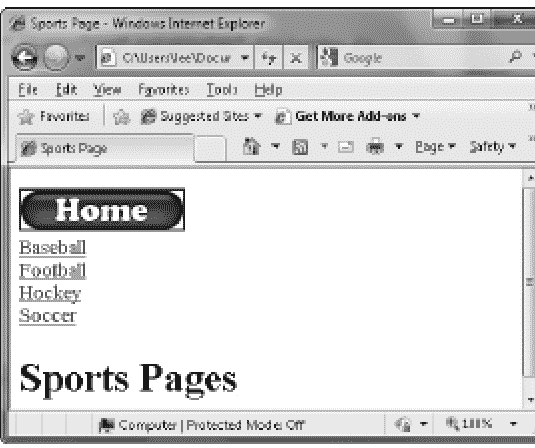

8. 现在你将更改其余的链接。如步骤 6 所示，删除链接文本并替换为 `img` 标签。其余图片的图像代码如下。

```html


```

9. 保存并刷新你的页面。你应该看到每行一张图片，每张图片都有边框。将你的文档与这里显示的图片进行比较：

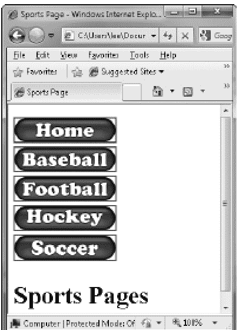

10. 移除每个链接末尾的 `<br />` 标签。这将使我们的菜单栏渲染在页面顶部。点击任意图片；链接应该可以正常工作。

11. 菜单栏在网页上非常常见。你不需要图片周围的方框。在页面的 `<head>` 部分创建一个 `<style>` 元素。

```html
<style type="text/css">
</style>
```

12. 在样式中添加一个 `img` 部分。将 `border` 属性设置为 `0`。

```css
img{
    border:0;
}
```

13. 保存并刷新你的页面。你的文档现在应该在页面顶部显示图片。边框消失了。插图展示了完成后的项目。代码块 4-6 包含了完整的代码。为了保持一致性，你应该将修改后的链接复制到其余的体育页面。

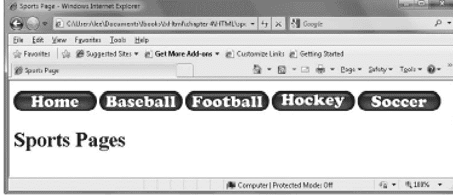


## 代码块 4-6

```html
<!DOCTYPE html PUBLIC "-//W3C//DTD XHTML 1.1//EN"
"http://www.w3.org/TR/xhtml11/DTD/xhtml11.dtd">
<html xmlns="http://www.w3.org/1999/xhtml" xml:lang="en">
    <head>
        <title>Sports Page</title>
        <meta name="description" content="Sports pages"/>
        <meta name="author" content="Lee M. Cottrell" />
        <style type="text/css">
            img{
                border:0;
            }
        </style>
    </head>
    <body>
        <p>
        <a href="index.html" title="Link to the home page.
        The link opens in the same window"> </a>
        <a href="baseball.html" title="Link to baseball.html.
        The link opens in the same window"></a>
        <a href="football.html" title="Link to football.html.
        The link opens in the same window"></a>
        <a href="hockey.html" title="Link to hockey.html.
        The link opens in the same window"></a>
        <a href="soccer.html" title="Link to soccer.html.
        The link opens in the same window"></a>
        </p>
        <h1>Sports Pages</h1>
    </body>
</html>
```

# 创建样式文档

你刚刚花了很多时间来格式化你的网站。不幸的是，每个页面上都有样式元素。随着网页变得越来越大，这可能会导致问题。由于样式信息嵌入在每个页面中，修改变得非常困难。在你的体育网站上，要更改所有页面上链接的颜色，就需要修改五个页面。这显然不切实际。

CSS 允许开发者将格式与内容分离。创建一个包含网站所有规则的 CSS 文档。将 HTML 页面中的任何 CSS 剪切并粘贴到 CSS 文档中。最后，通过`<head>`部分的`<link>`标签将 CSS 文档链接到网页。`rel`属性告诉浏览器将插入一个样式表文档。`href`是文档的位置。

```html
<link rel="stylesheet" href="sports.css" />
```

> **提示**：`href`不必在你的站点上。你可以链接到另一个站点上的 CSS 文档。如果你使用的是商业站点，请确保你已获得这样做的许可。

# 练习创建样式文档

你将把 CSS 元素从你的体育页面移动到一个新的外部 CSS 页面。

1. 在你的编辑器中打开体育文件夹中的所有 HTML 文件。
2. 创建一个新文件。将其保存在体育文件夹中，命名为`sports.css`。
3. 切换到`index.html`文件。从样式部分剪切`img`规则。将其粘贴到 CSS 文档中。
4. 切换到`baseball.html`文件。剪切样式部分内的所有代码，并将其粘贴到 CSS 文档中`img`规则之后。不要在剪切内容中包含`<style type="text/css">`。
5. 从`index.html`和`baseball.html`文件中移除`<style type="text/css"></style>`。
6. 保存所有文件。
7. 切换到`index.html`文件。在`<head>`部分中，紧接在`</title>`之后，输入链接到 CSS 页面的代码。
8. 保存`index`文件并在浏览器中打开它。确保你的页面有深红色背景，并且图片没有边框。
9. 将`<link>`标签复制到其他页面。确保将其放在`</title>`标签之后。
10. 保存所有页面。在浏览器中打开任何页面。每个页面都将具有相同的格式。代码块 4-7 包含了完成的 CSS 代码。

## 代码块 4-7

```css
body{
    background-color:#610B0B;
    color:#ffffff;
}

a{
    color:#FE2E2E;
    text-decoration:none;
}

a:visited{
    color:#df0101;
}

a:hover{
    text-decoration:underline;
}

img{
    border:0;
}
```

### 仍然感到困惑

我的学生经常看不到外部文档的必要性。为了证明其有效性，请将 CSS 文档中的`background-color`代码从`#610b0b`更改为`#000000`。一旦你刷新，所有页面现在都有黑色背景。如果没有外部 CSS 文档，你需要编辑每一个页面。

### 总结

本章全部关于链接。你学习了如何链接到网站内部和外部的页面。此外，你还学习了如何控制链接的打开位置。对比了广泛的网站导航技术。你使用 CSS 来格式化链接。最后，你学习了如何创建外部样式表。

### 测验

1. `<a>`标签的这个属性指定了所需文档的 URL。

   A. `href`

   B. `title`

   C. `alt`

   D. `link`

2. 要访问外部样式表，请使用 ________ 标签。

   A. `<a>`

   B. `<style>`

   C. `<link>`

   D. `<head>`

3. 页内链接用 ________ 符号标识。

   A. `#`

   B. `$`

   C. `%`

   D. `!`

4. 这个 HTML 目标值会在每次点击链接时创建一个新窗口。

   A. `new`

   B. `_popup`

   C. `_blank`

   D. `window`

5. 术语`a:visited`和`a:link`是 CSS ________ 的例子。

   A. 属性

   B. 类

   C. 特性

   D. 伪类

6. ________ 是指向不同站点上页面的链接。

   A. 内部链接

   B. 外部链接

   C. 页内链接

   D. 目标链接

7. ________ 是指向当前网站上页面的链接。

   A. 内部链接

   B. 外部链接

   C. 页内链接

   D. 目标链接

8. `<a>`标签的这个属性为链接创建一个工具提示。

   A. `href`

   B. `title`

   C. `alt`

   D. `link`

9. 样式表文档应以 ________ 扩展名结尾。

   A. `.css`

   B. `.format`

   C. `.html`

   D. `.fmt`

10. 这个 CSS 在鼠标悬停在链接上时生效。

    A. `a:hover`

    B. `a:link`

    C. `a:mouse`

    D. `a:active`

# 第 5 章

## 使用列表

你将学习如何创建 HTML 当前支持的三种类型的列表。你将创建一个有序列表、一个无序列表和一个定义列表。最后，你将学习如何使用 CSS 格式化列表。

### 章节目标

在本章中，你将：

- 定义 HTML 列表
- 创建有序和无序列表
- 创建定义列表

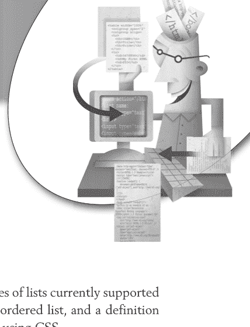

回想一下，HTML 旨在简化研究材料的交付。研究文档通常需要一个大纲。HTML 列表功能提供了此功能。

在当前实践中，列表的作用远不止简单大纲。列表生成方向、创建项目符号，甚至生成导航辅助工具。列表是你的 HTML 工具箱中一个非常强大的补充。

### 列表

列表是我们文化中根深蒂固的一部分。我们带着购物清单去商店，阅读烹饪说明列表，我们可能有一个“待办事项”列表，我们甚至在一年中的不同时间创建愿望清单。

列表通常包含简短的信息片段，每条信息各占一行。说明在列表开头有序列信息。在食谱中，这些通常是编号的。图 5-1 中的第一个列表显示了一个有序列表。

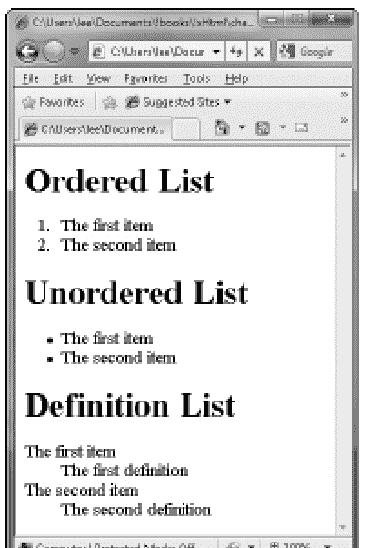

图 5-1 • HTML 列表的三种类型

成分列表没有顺序，但在信息前会包含一个项目符号或其他小图形。图 5-1 中的第二个列表展示了无序列表的默认项目符号。

定义列表则有些不同。定义列表至少包含两条信息，每条信息各占一行。被定义的词语显示在页面的边距处。定义内容在词语下方缩进约½英寸。图 5-1 中的最后一个列表展示了被定义术语与定义之间的关系。代码块 5-1 展示了创建图 5-1 的代码。

#### 代码块 5-1

```html
<h1>Ordered List</h1>
<ol>
    <li>The first item</li>
    <li>The second item</li>
</ol>

<h1>Unordered List</h1>
<ul>
    <li>The first item</li>
    <li>The second item</li>
</ul>

<h1>Definition List</h1>
<dl>
    <dt>The first item</dt>
    <dd>The first definition</dd>
    <dt>The second item</dt>
    <dd>The second definition</dd>
</dl>
```

#### 有序列表

图 5-1 中的第一个列表是一个有序列表。当你有一个遵循特定顺序的列表时，就会使用有序列表。例如食谱、解决问题的步骤或章节标题。默认情况下，HTML 会使用阿拉伯数字（1, 2, 3, ...）来渲染有序列表。

`<ol>`标签开始一个有序列表。这个标签告诉浏览器接下来是列表项，并使用序列值来渲染它们。在`<ol>`内部，一个`<li>`标签描述每个列表项。`<li>`标签是像`<p>`标签一样的容器标签。因此，它们可以容纳其他 HTML 标签。像所有 HTML 标签一样，`<li>`和`<ol>`标签都需要闭合。在列表项后闭合`<li>`标签，在最后一个列表项后闭合`<ol>`标签。代码块 5-2 展示了一个提供制作花生酱和果冻三明治步骤的有序列表。

##### 代码块 5-2

```html
<ol>
    <li>Open the peanut butter and jelly jars</li>
    <li>Place 2 pieces of bread on the table</li>
    <li>Spread some peanut butter on one slice of bread</li>
    <li>Spread some jelly on the other slice of bread</li>
    <li>Place the peanut buttered side on top of the jelly</li>
    <li>Eat and enjoy</li>
</ol>
```

如前所述，`<ol>`标签会自动使用数字渲染每个列表项。然而，有几种不同的样式可供选择。要更改列表项的样式，请将`list-style-type`应用于`ol`标签。表 5-1 列出了`<ol>`标签当前支持的值。

> **提示**：互联网研究会让你发现`list-style-type`属性的更多特殊值。截至出版时，只有表 5-1 中列出的值在浏览器中受支持。

##### 练习使用有序列表

本章的示例将创建一个关于自行车的列表页面。页面的第一部分将创建调整自行车变速器和刹车的步骤。

1. 使用你的模板创建一个名为`bicycle.html`的新文件。将其保存在`chapter5`文件夹中。
2. 将页面标题设置为**自行车骑行指南**。创建适当的元信息。

##### 表 5-1 `<ol>`标签支持的列表样式类型值

| 值 | 示例 |
| :--- | :--- |
| `upper-roman` | I. Item 1<br>II. Item 2 |
| `lower-roman` | i. Item 1<br>ii. Item 2 |
| `upper-alpha` | A. Item 1<br>B. Item 2 |
| `lower-alpha` | a. Item 1<br>b. Item 2 |
| `decimal` | 1. Item 1<br>2. Item 2 |

3. 创建`<h1>`标签和介绍性段落。

```html
<h1>Bicycling</h1>
<p>Bicycling is more than a kid's pastime. Across the world,
bikes are used for pleasure, transportation, and competition.
This page holds a variety of resources for the cyclist.</p>
```

4. 保存文件并在浏览器中查看。
5. 创建一个用于调整后变速器的`<h2>`。

```html
<h2>Adjusting the Rear Derailleur</h2>
```

6. 创建一个描述变速器的段落和一个详细说明调整变速器步骤的有序列表。

```html
<p>The derailleur changes the gears on the bike. Most
derailleurs are set properly and only need tweaks. Consult
your bike store for a complete adjustment.</p>
<ol>
    <li>Shift to the smallest cog on the rear wheel.</li>
    <li>Twist the barrel connector on the cable until the cable
    is loose.</li>
    <li>Shift to the highest cog on the rear wheel.</li>
    <li>Look at the chain. If it is not centered on the cog, or
    looks like it will fall off the top, adjust the H screw on
    the derailleur. <br/>As you turn the screw, the derailleur
    will shift with the turn.</li>
    <li>Tighten the barrel connector until the cable becomes
    tight.</li>
    <li>Shift down to the smallest cog on the rear wheel.</li>
    <li>Look at the chain. If it is not centered on the cog, or
    looks like it will fall off the bottom, adjust the L screw on
    the derailleur. <br/>As you turn the screw, the derailleur
    will shift with the turn.</li>
    <li>Now try shifting up and down. If the cable sticks while
    going to larger gears, increase the tension. If the shift
    does not want to go to smaller gears, decrease the tension.
    Continue until each gear is easily accessible.</li>
</ol>
```

7. 保存文件并在浏览器中查看。你的列表应该类似于这里显示的图片：

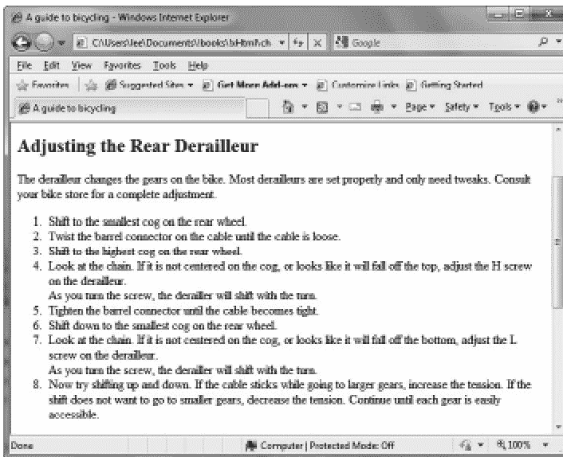

> **提示**：如果你多了一个数字，这意味着你在多出的数字上方添加了一个额外的`<li>`而不是`</li>`。

8. 创建一个用于检查座椅高度的`<h2>`。


## Checking Seat Height

9. 创建一个段落和一个详细说明如何确定合适座椅高度的有序列表。

```html
<p>Proper seat height is crucial for best performance and the health of your knees. When purchasing a new bike have the bike store do a proper fitting. The following steps work when a bike professional is not nearby.</p>
<ol>
    <li>Ensure the seat is level.</li>
    <li>Sit on the seat.</li>
    <li>Pedal backwards. If your knee is fully extended at the bottom of the stroke, your seat is at the proper height.</li>
</ol>
```

10. 保存文件并在浏览器中查看。你的第二个列表应该类似于以下插图。

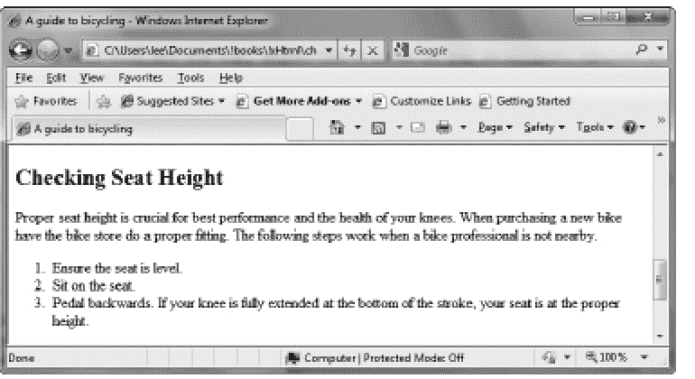

11. 完整的代码如代码块 5-3 所示。

> **提示** 如果你的第二个`<h2>`和列表被缩进了，这意味着你没有正确闭合第一个`<ol>`标签。

### 代码块 5-3

```html
<!DOCTYPE html PUBLIC "-//W3C//DTD XHTML 1.1//EN"
"http://www.w3.org/TR/xhtml11/DTD/xhtml11.dtd">
<html xmlns="http://www.w3.org/1999/xhtml" xml:lang="en">
    <head>
        <title>A guide to bicycling</title>
        <meta name="description"
              content="A site dedicated to bicycling"/>
        <meta name="author" content="Lee M. Cottrell" />
    </head>
    <body>
        <h1>Bicycling</h1>
        <p>Bicycling is more than a kid's pastime. Across the
        world, bikes are used for pleasure, transportation,
        and competition. This page holds a variety of
        resources for the cyclist.</p>
        <h2>Adjusting the Rear Derailleur</h2>
        <p>The derailleur changes the gears on the bike. Most
        derailleurs are set properly and only need tweaks. Consult
        your bike store for a complete adjustment.</p>
        <ol>
            <li>Shift to the smallest cog on the rear wheel.</li>
            <li>Twist the barrel connector on the cable until the
            cable is loose.</li>
            <li>Shift to the highest cog on the rear wheel.</li>
            <li>Look at the chain. If it is not centered on the cog,
            or looks like it will fall off the top, adjust the H screw on
            the derailleur. <br/>As you turn the screw, the derailleur
            will shift with the turn.</li>
            <li>Tighten the barrel connector until the cable becomes
            tight.</li>
            <li>Shift down to the smallest cog on the rear wheel.
            </li>
            <li>Look at the chain. If it is not centered on the cog,
            or looks like it will fall off the bottom, adjust the L screw
            on the derailleur. <br/>As you turn the screw, the derailleur
            will shift with the turn.</li>
            <li>Now try shifting up and down. If the cable sticks
            while going to larger gears, increase the tension. If the
            shift does not want to go to smaller gears, decrease the
            tension. Continue until each gear is easily accessible. </li>
        </ol>
        <h2>Checking Seat Height</h2>
        <p>Proper seat height is crucial for best performance
        and the health of your knees. When purchasing a new bike have
        the bike store do a proper fitting. The following steps work
        when a bike professional is not nearby.</p>
        <ol>
            <li>Ensure the seat is level.</li>
            <li>Sit on the seat.</li>
            <li>Pedal backwards. If your knee is fully extended at
            the bottom of the stroke, your seat is at the proper height.
            </li>
        </ol>
    </body>
</html>
```

## 无序列表

图5-1中的第二个列表是一个无序列表。当你有一个没有特定顺序的项目列表时，就使用无序列表。无序列表的好例子包括成分列表和购物清单。默认情况下，HTML会使用实心圆点（`disc`）来渲染无序列表。

> **提示** 将无序列表按字母顺序排列是让页面显得井井有条的好方法。

`<ul>` 标签用于开始无序列表。此标签告知浏览器后续将出现列表项，并将其渲染为带项目符号的列表。与 `<ol>` 标签类似，`<li>` 标签用于描述每个列表项。代码块 5-4 展示了一个列出花生酱果冻三明治配料的无序列表。

### 代码块 5-4

```html
<ul>
<li>A jar of peanut butter</li>
<li>A jar of jelly</li>
<li>Two slices of bread</li>
<li>A butter knife</li>
</ul>
```

默认情况下，`<ul>` 使用实心圆点进行渲染。但是，CSS 属性 `list-style-type` 可以更改浏览器渲染列表项的方式。`circle`、`disc` 和 `square` 的值在所有浏览器中都受支持。下图展示了在 Internet Explorer 和 Firefox 中渲染的圆圈、实心圆点和方块。请注意，圆圈在两个浏览器中的渲染效果略有不同。

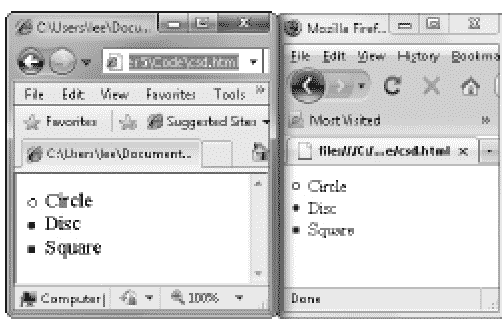

除了 `list-style-type`，`ul` 标签还可以使用图像作为项目符号。使用图像文件作为项目符号可以为你的页面提供极大的自定义空间。但是，图像必须是 `.gif` 文件，并且应该很小，大约 32 × 32 像素或更小。

> **注意** 不要使用动画 GIF 作为项目符号！这非常分散注意力。

要将图像放入列表中，你需要使用 `list-style-image` 属性。`list-style-image` 需要使用 `URL` 函数并传递图像的位置。除了设置图像外，你还应该设置一个 `list-style-type`。如果项目符号图像加载失败，`list-style-type` 的值将生效。代码块 5-5 展示了使用 `bullet.gif` 作为项目符号图像的正确语法。

### 代码块 5-5

```css
ul{
    list-style-type:circle;
    list-style-image:URL("images/bullet.gif");
}
```

> **仍然感到困惑？**
>
> 构建列表可能很困难。请访问 `www.htmlbasix.com/list.shtml` 获取自动列表构建器。

## 练习使用无序列表

你将向本章前面创建的页面添加一个无序列表。你将使用自定义图像而不是默认值来格式化列表。

1. 在 `chapter5` 文件夹下创建一个 `images` 文件夹。
2. 从 `www.mhprofessional.com/computingdownload` 下载 `bicycle.gif` 文件。将其保存到 `chapter5/images` 文件夹中。
3. 在你的编辑器和浏览器中打开之前创建的 `bicycle.html` 文件。
4. 在编辑器中，滚动到文档末尾，紧靠 `</body>` 标签上方。
5. 创建一个 `<h2>` 标题，内容为“自行车链接”。

   ```html
   <h2>Bicycling Links</h2>
   ```

6. 创建一个 `<ul>` 标签。确保关闭该标签。
7. 在 `<ul>` 标签内，输入三个 `<li>` 标签，其中包含指向网络上自行车参考资料的链接。

   ```html
   <ul>
   <li><a href="http://www.bicycling.com"
   title="link to bicycling.com opens in a new window"
   target="new">Bicycling Magazine</a></li>
   <li><a href="http://http://www.dirtragmag.com/"
   title="link to dirtragmag.com opens in a new window"
   target="new">DirtRag Magazine</a></li>
   <li><a href="http://maps.google.com/biking"
   title="link to Google's biking directions opens in a new
   window" target="new">Google Biking Directions</a></li>
   </ul>
   ```

8. 保存你的文档。刷新浏览器。你的页面应如下图所示：

   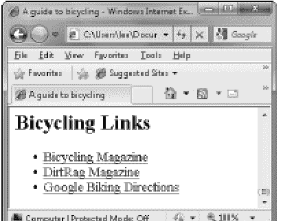

9. 现在你将把项目符号更改为自行车。在页面顶部的 `<head>` 部分创建一个样式部分。

   ```html
   <style type="text/css">
   </style>
   ```

10. 在样式部分添加一个 `ul` 条目。
11. 创建规则以使用 `circle` `list-style-type` 并渲染 `bicycle.gif` 文件作为项目符号。

   ```css
   ul{
       list-style-type:circle;
       list-style-image:URL("images/bicycle.gif");
   }
   ```

12. 保存你的页面。刷新浏览器。你的文档应如下图所示：

   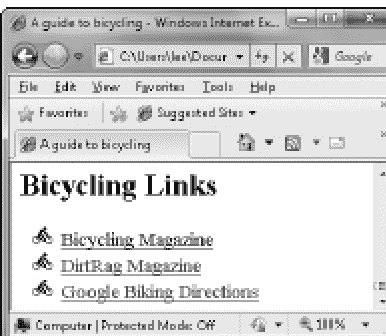

13. 完整的代码包含在代码块 5-6 中。

### 代码块 5-6


```html
<!DOCTYPE html PUBLIC "-//W3C//DTD XHTML 1.1//EN"
"http://www.w3.org/TR/xhtml11/DTD/xhtml11.dtd">
<html xmlns="http://www.w3.org/1999/xhtml" xml:lang="en">
    <head>
        <title>A guide to bicycling</title>
        <meta name="description" content="A site dedicated
to bicycling"/>
        <meta name="author" content="Lee M. Cottrell" />
        <style type="text/css">
            ul{
                list-style-type:circle;
                list-style-image:URL("images/bicycle.gif");
            }
        </style>
    </head>
    <body>
        <h1>Bicycling</h1>
        <p>Bicycling is more than a kid's pastime. Across the
        world, bikes are used for pleasure, transportation,
        and competition. This page holds a variety of
        resources for the cyclist.</p>

        <h2>Adjusting the Rear Derailleur</h2>
        <p>The derailleur changes the gears on the bike. Most derailleurs are set
        properly and only need tweaks. Consult your bike store for a complete
        adjustment.</p>

        <ol>
            <li>Shift to the smallest cog on the rear wheel.</li>
            <li>Twist the barrel connector on the cable until the cable is loose.</li>
            <li>Shift to the highest cog on the rear wheel.</li>
            <li>Look at the chain. If it is not centered on the cog, or looks like it will fall off the top, adjust the H screw on the derailleur. As you turn the screw, the derailleur will shift with the turn.</li>
            <li>Tighten the barrel connector until the cable becomes tight.</li>
            <li>Shift down to the smallest cog on the rear wheel.</li>
            <li>Look at the chain. If it is not centered on the cog, or looks like it will fall off the bottom, adjust the L screw on the derailleur. As you turn the screw, the derailleur will shift with the turn.</li>
            <li>Now try shifting up and down. If the cable sticks while going to larger gears, increase the tension. If the shift does not want to go to smaller gears, decrease the tension. Continue until each gear is easily accessible.</li>
        </ol>

        <h2>Checking Seat Height</h2>
        <p>Proper seat height is crucial for best performance and the health of your knees. When purchasing a new bike have the bike store do a proper fitting. The following steps work when a bike professional is not nearby.</p>

        <ul>
            <li>Ensure the seat is level.</li>
            <li>Sit on the seat.</li>
            <li>Pedal backwards. If your knee is fully extended at the bottom of the stroke, your seat is at the proper height.</li>
        </ul>

        <h2>Bicycling Links</h2>
        <ul>
            <li><a href="http://www.bicycling.com">Bicycling Magazine</a></li>
            <li><a href="http://http://www.dirtragmag.com/">DirtRag Magazine</a></li>
            <li><a href="http://maps.google.com/biking">Google Biking Directions</a></li>
        </ul>
    </body>
</html>
```

## 定义列表

图 5-1 中的第三个列表是定义列表。当你有一组需要定义的词语时，请使用定义列表。默认情况下，HTML 会将术语渲染在左边距，定义则在该词下方缩进约 ½ 英寸。

定义列表需要两个额外的标签。与 `<ol>` 和 `<ul>` 标签不同，不使用 `<li>` 标签。相反，`<dt>` 和 `<dd>` 替代了 `<li>` 标签。`<dt>`（数据术语）标签用于渲染要定义的术语。与 `<ol>` 和 `<ul>` 标签不同，没有与 `<dl>`、`<dt>` 或 `<dd>` 相关的专用 CSS 属性。代码块 5-7 定义了花生酱果冻三明治中使用的一些物品。

**提示**：将术语按字母顺序排列，以便用户更容易找到它们。

### 代码块 5-7

```html
<dl>
<dt>Butter knife</dt>
<dd>A dull knife used to spread food</dd>
<dt>Peanut butter</dt>
<dd>A food product containing crushed peanuts and vegetable oil</dd>
</dl>
```

## 练习使用定义列表

在最后一个练习环节，你将创建一个定义列表。这个列表将定义自行车运动中常见的术语。

1. 在浏览器和编辑器中打开文件 `bicycle.html`。
2. 在编辑器中，滚动到页面底部，紧靠 `</body>` 上方。
3. 创建一个 `<h2>` 标签，内容为 **自行车术语**。

   ```html
   <h2>Bicycling Terms</h2>
   ```

4. 打开一个 `<dl>` 标签。确保关闭该标签。

   ```html
   <dl>
   ```

   ```html
   </dl>
   ```

5. 为“cog”一词创建一个术语和定义。Cog 是自行车运动中对后轮齿轮的称呼。

   ```html
   <dt>cog</dt>
   <dd>the gear on the rear wheel</dd>
   ```

6. 保存并在浏览器中刷新你的页面。
7. 对以下单词和术语重复此操作。

   - `derailleur`—移动链条的机构
   - `downtube`—从车把延伸到踏板的管子
   - `seatstay`—从后轮毂延伸到座杆的管子
   - `shifter`—用于移动变速器的杠杆

```html
<dt>derailleur</dt>
<dd>mechanism that moves the chain</dd>
<dt>downtube</dt>
<dd>the tube that runs from the handlebars to the pedals</dd>
<dt>seatstay</dt>
<dd>tubes that run from the rear hub to the seatpost</dd>
<dt>shifter</dt>
<dd>lever to move the derailleur</dd>
```

8. 保存并刷新你的浏览器。页面应如下图所示。

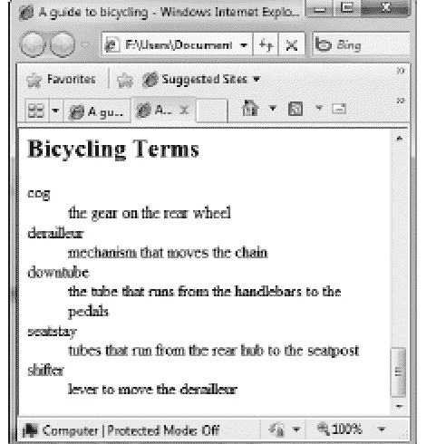

9. 现在你将使用 CSS 来格式化列表。向上滚动到 `<style>` 部分。
10. 创建一个 `dt` 条目。在花括号内，使用 `font-weight` 属性创建一条规则，为 `dt` 设置粗体字体。

```css
dt{
    font-weight:bold;
}
```

11. 创建一个 `dd` 条目。在花括号内，使用 `font-style` 属性创建一条规则，为 `dd` 设置斜体字体。

```css
dd{
    font-style:italic;
}
```

12. 定义列表的最终版本如下图所示。最终的代码清单见代码块 5-8。

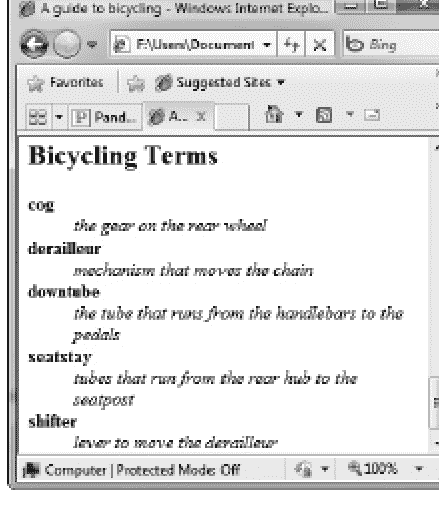

### 代码块 5-8

```html
<!DOCTYPE html PUBLIC "-//W3C//DTD XHTML 1.1//EN"
"http://www.w3.org/TR/xhtml11/DTD/xhtml11.dtd">
<html xmlns="http://www.w3.org/1999/xhtml" xml:lang="en">
    <head>
        <title>A guide to bicycling</title>
        <meta name="description"
          content="A site dedicated to bicycling"/>
        <meta name="author" content="Lee M. Cottrell" />
        <style type="text/css">
ul{
    list-style-type:circle;
    list-style-image:URL("images/bicycle.gif");
}
dt{
    font-weight:bold;
}
dd{
    font-style:italic;
}
</style>
</head>
<body>
<h1>Bicycling</h1>
<p>Bicycling is more than a kid's pastime. Across the world, bikes are used for pleasure, transportation, and competition. This page holds a variety of resources for the cyclist.</p>
<h2>Adjusting the Rear Derailleur</h2>
<p>The derailleur changes the gears on the bike. Most derailleurs are set properly and only need tweaks. Consult your bike store for a complete adjustment.</p>
<ol>
<li>Shift to the smallest cog on the rear wheel.</li>
<li>Twist the barrel connector on the cable until the cable is loose.</li>
<li>Shift to the highest cog on the rear wheel.</li>
<li>Look at the chain. If it is not centered on the cog, or looks like it will fall off the top, adjust the H screw on the derailleur.<br/>As you turn the screw, the derailleur will shift with the turn.</li>
<li>Tighten the barrel connector until the cable becomes tight.</li>
<li>Shift down to the smallest cog on the rear wheel.</li>
<li>Look at the chain. If it is not centered on the cog, or looks like it will fall off the bottom, adjust the L screw on the derailleur.<br/>As you turn the screw, the derailleur will shift with the turn.</li>
<li>Now try shifting up and down. If the cable sticks while going to larger gears, increase the tension. If the shift does not want to go to smaller gears, decrease the tension. Continue until each gear is easily accessible.</li>
</ol>
<h2>Checking Seat Height</h2>
<p>Proper seat height is crucial for best performance and the health of your knees. When purchasing a new bike have the bike store do a proper fitting. The following steps work when a bike professional is not nearby.</p>
<ol>
<li>Ensure the seat is level.</li>
<li>Sit on the seat.</li>
<li>Pedal backwards. If your knee is fully extended at the bottom of the stroke, your seat is at the proper height.</li>
</ol>
<h2>Bicycling Links</h2>
<ul>
<li><a href="http://www.bicycling.com" title="link to bicycling.com opens in a new window" target="new">Bicycling Magazine</a></li>
<li><a href="http://www.dirtragmag.com/" title="link to dirtragmag.com opens in a new window" target="new">DirtRag Magazine</a></li>
<li><a href="http://maps.google.com/biking" title="link to google's biking directions opens in a new window" target="new">Google Biking Directions</a></li>
</ul>
<h2>Bicycling Terms</h2>
<dl>
<dt>cog</dt>
<dd>the gear on the rear wheel</dd>
<dt>derailleur</dt>
<dd>mechanism that moves the chain</dd>
<dt>downtube</dt>
<dd>the tube that runs from the handlebars to the pedals</dd>
<dt>seatstay</dt>
<dd>tubes that run from the rear hub to the seatpost</dd>
<dt>shifter</dt>
<dd>lever to move the derailleur</dd>
</dl>
</body>
</html>
```

## 总结

本章内容是关于列表。你构建了三种类型的列表：有序列表、无序列表和定义列表。与其他章节一样，你使用 CSS 来格式化这些列表。


### 测验

1. 有序列表和无序列表都使用此标签来指定列表项。

   A. `<li>`

   B. `<ol>`

   C. `<ul>`

   D. `<dt>`

2. 要创建有序列表，请使用 ________ 标签。

   A. `<ul>`

   B. `<ol>`

   C. `<dl>`

   D. `<li>`

3. 以下哪项是无序列表的默认项目符号？

   A. `circle`

   B. `disc`

   C. `triangle`

   D. `square`

4. 要更改有序列表的编号样式，请在样式部分使用 ________ 属性。

   A. `number-style`

   B. `list-type`

   C. `list-style-type`

   D. `counter-style`

5. 有序列表的默认样式是。

   A. `upper-alpha`

   B. `decimal`

   C. `upper-roman`

   D. `numeric`

6. 要创建定义列表，请使用 ________ 标签。

   A. `<ul>`

   B. `<ol>`

   C. `<dl>`

   D. `<li>`

7. 明天要带去学校的物品清单最好使用 ________ 来呈现。

   A. 有序列表

   B. 无序列表

   C. 段落

   D. 定义列表

8. 要创建无序列表，请使用 ________ 标签。

   A. `<ul>`

   B. `<ol>`

   C. `<dl>`

   D. `<li>`

9. ________ 标签在定义列表中定义一个术语。

   A. `<li>`

   B. `<dd>`

   C. `<dl>`

   D. `<dt>`

10. 海盗的藏宝图最好使用 ________ 来呈现。

    A. 有序列表

    B. 无序列表

    C. 段落

    D. 标题

# 第 6 章：构建表格

表格有许多用途。你将使用表格来组织数据、分组信息并简化页面导航。表格的常见用途包括列出产品、日程表、销售数据和简单的页面布局。

### 章节目标

在本章中，你将：

- 定义和创建表格
- 跨行和跨列
- 使用 CSS 格式化表格


前面的章节重点介绍了作为标题或段落内文本的内容。这对于页面上的大多数文本元素都适用。然而，通常需要创建以行和列形式存在的结构化数据。这就是表格标签的工作。

表格标签允许你创建数据的行和列。它在屏幕上排列数据的效果非常好。无需你的任何指导，浏览器就能很好地渲染文本，创建出非常易读的布局。

## 表格

表格是一种将数据排列成行和列的方式。每一行中的信息相互关联。同一列中的项目属于同一类别。图 6-1 显示了一个简单的表格。该表格有四行四列。第一行中的所有信息都与 8:00 的课程有关。第三列描述了课程的教室编号。行和列的交集是一个“单元格”。代码块 6-1 包含了创建该表格的 HTML。

> **提示**  
> HTML 中的表格类似于 Microsoft Excel 等电子表格程序中的工作表。

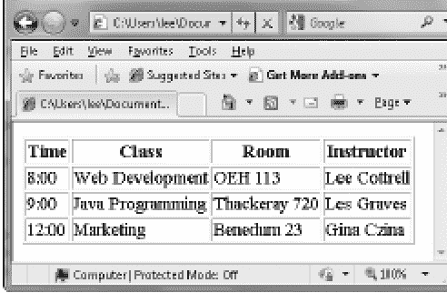

图 6-1 · 在 HTML 中创建的表格

#### 代码块 6-1

```html
<table border="1">
<tr>
    <th>Time</th>
    <th>Class</th>
    <th>Room</th>
    <th>Instructor</th>
</tr>
<tr>
    <td>8:00</td>
    <td>Web Development</td>
    <td>OEH 113</td>
    <td>Lee Cottrell</td>
</tr>
<tr>
    <td>9:00</td>
    <td>Java Programming</td>
    <td>Thackeray 720</td>
    <td>Les Graves</td>
</tr>
<tr>
    <td>12:00</td>
    <td>Marketing</td>
    <td>Benedum 23</td>
    <td>Gina Czina</td>
</tr>
</table>
```

与列表一样，表格需要几个标签来构建。`<table>` 标签创建表格。`<table>` 标签包含几个组成表格结构的附加标签。图 6-1 中的表格周围有一个边框。边框是表格标签的一个属性。

> **提示**  
> 边框值大于五的边框看起来真的很糟糕。

代码块 6-1 的第一行构建了表格。其中包含了 `border` 属性。`border` 属性需要一个描述边框宽度的数值。较大的边框值会导致更粗的边框。此图显示了 `border` 属性为 5 的同一表格。表格有几个附加属性，定义在表 6-1 中。

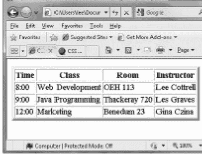

### 常用表格属性

| 属性 | 描述 | 值 |
| :--- | :--- | :--- |
| `border` | 设置边框的像素宽度。 | 0–1000<br>0 表示无边框 |
| `cellspacing` | 表格中单元格之间的距离（像素）。 | 0–1000<br>0 表示无间距 |
| `cellpadding` | 单元格边框与单元格内容之间的距离（像素）。 | 0–1000<br>0 表示无间距 |
| `frame` | 描述表格外部边框出现的位置。此属性可包含多个值。 | `above`—仅顶部边框<br>`below`—仅底部边框<br>`box`—所有四边边框<br>`hsides`—仅顶部和底部边框<br>`lhs`—仅左侧边框<br>`rhs`—仅右侧边框<br>`vsides`—仅左右两侧边框 |
| `rules` | 描述单元格边框出现的位置。此属性可包含多个值。 | `all`—所有行和列之间都显示边框<br>`cols`—仅在列之间显示边框<br>`groups`—在行组和列组之间显示边框<br>`rows`—仅在行之间显示边框 |
| `summary` | 提供表格的摘要。供屏幕阅读器使用。 | 描述表格的文本 |

> **提示**  
> `frame` 和 `rules` 属性有对应的 CSS 等效属性。

图 6-1 中的表格有四行。`<tr>` 标签用于创建行。你需要为每一行创建一个 `<tr>` 标签。代码块 6-1 中有四个 `<tr>` 标签，每行一个。如果我的课程表有十门课，我就需要十个 `<tr>` 标签。

第一行包含表格的表头。`<th>` 标签用于创建列标题。浏览器会将 `<th>` 标签渲染为居中且加粗的字体。图 6-1 中的表格有四个 `<th>` 标签，每列一个。如果我有七列，我就需要七个 `<th>` 标签。

> **提示**  
> 显示表格数据的表格应始终包含列标题。

第二到第四行包含表格的数据。`<td>` 标签用于存储表格数据。行中的每一列对应一个 `<td>` 标签。`<td>` 标签中的数据左对齐，使用常规字体。浏览器决定列的宽度。浏览器会确定每个 `<th>` 或 `<td>` 标签中的最长值。列的宽度将设置为该列中的最长值。

> **提示**  
> 你可以使用 CSS 来调整表格和列的宽度。

图 6-1 展示了一个普通表格。然而，表格内容没有明确说明。表格应有一个标题来描述其内容。放置在 `<table>` 内的 `<caption>` 标签将在网页上渲染一个标题。代码块 6-2 展示了在表格中使用 `<caption>` 标签的位置。图 6-2 展示了代码的输出结果。

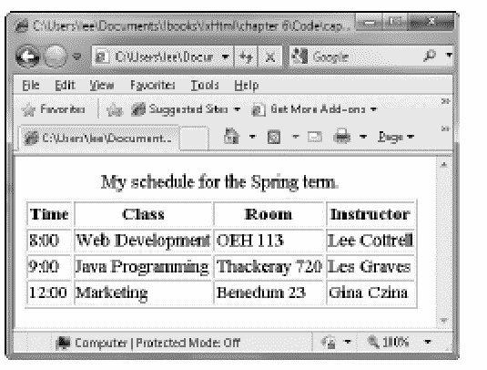

**图 6-2** · 带标题的表格

### 代码块 6-2

```html
<table border="1">
<caption>My schedule for the Spring term.</caption>
<tr>
    <th>Time</th>
    <th>Class</th>
    <th>Room</th>
    <th>Instructor</th>
</tr>
<tr>
    <td>8:00</td>
    <td>Web Development</td>
    <td>OEH 113</td>
    <td>Lee Cottrell</td>
</tr>
<tr>
    <td>9:00</td>
    <td>Java Programming</td>
    <td>Thackeray 720</td>
    <td>Les Graves</td>
</tr>
<tr>
    <td>12:00</td>
    <td>Marketing</td>
    <td>Benedum 23</td>
    <td>Gina Czina</td>
</tr>
</table>
```

图 6-2 中的标题渲染在表格上方。使用 CSS，标题可以渲染在顶部或底部。`caption-side` 属性用于控制其位置。代码块 6-3 修改了 `<caption>` 标签，将标题放置在表格下方，如下所示：

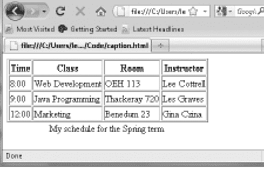

### 代码块 6-3

```html
<caption style="caption-side:bottom;">My schedule for the Spring term.</caption>
```

不幸的是，`caption-side` 属性在 Internet Explorer 8 中不起作用。要实现此效果，你需要使用 `<caption>` 标签已弃用的 `align` 属性。假设此属性保持弃用状态，Explorer 最终将停止支持 `align` 属性。为了同时支持 Firefox 和 Internet Explorer 8，你需要在标题中同时包含 `align` 属性和 `style`。代码块 6-4 展示了同时设置了两种对齐方式的标题。

### 代码块 6-4

```html
<caption style="caption-side:bottom;" align="bottom">My schedule for the Spring term.</caption>
```

> **仍然感到困惑**

Internet Explorer 和 Firefox 在渲染 HTML 方面存在许多不一致之处。请记住第 1 章的内容：HTML 不是一个标准，而是一个建议。如何处理 HTML 代码取决于各个浏览器开发者。你需要在所有浏览器中查看你的 HTML，并确保你的代码在每个浏览器中都能良好渲染。

## 练习：创建表格

你将创建一个详细描述晚宴菜单的表格。

1. 使用你的模板创建一个名为 **`dinner.html`** 的新文件。将其保存在 `chapter6` 文件夹中。

2. 将页面标题设置为 **Faculty dinner assignments**。创建适当的元信息。

3. 创建一个带边框和标题的表格。

```html
<table border="1">
<caption>Faculty dinner assignments</caption>
</table>
```

4. 紧接在 `</caption>` 之后，创建包含两列的列标题行，分别为“Recipe Name”和“Person Providing”。

```html
<tr>
    <th>Recipe Name</th>
    <th>Person Providing</th>
</tr>
```

5. 保存文件。在浏览器中打开该文件。它应类似于下图：

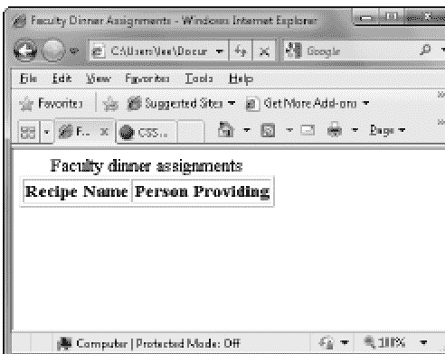

6. 创建三行，包含三种开胃菜和一位教师的名字。为了与后续练习兼容，请确保同一位教师提供所有开胃菜。

```html
<tr>
    <td>Spicy Chicken Wings</td>
    <td>Gina Czina</td>
</tr>
<tr>
    <td>Chicken Dumplings</td>
    <td>Gina Czina</td>
</tr>
<tr>
    <td>Cheesy Nachos</td>
    <td>Gina Czina</td>
</tr>
```

7. 保存并在浏览器中刷新页面。它应类似于此处显示的图像：

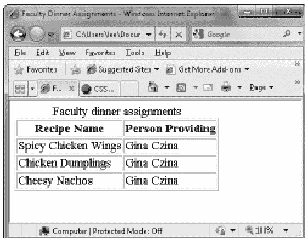

8. 再创建三行用于主菜。同样，包括主菜名称和一位教师。为了与后续练习兼容，让一位教师提供其中两道菜。

```html
<tr>
    <td>Chicken Cordon Bleu</td>
    <td>Lee Cottrell</td>
</tr>
<tr>
    <td>Spaghetti with Marinara</td>
    <td>Les Graves</td>
</tr>
<tr>
    <td>Bacon wrapped filet mignon</td>
    <td>Les Graves</td>
</tr>
```

9. 保存并在浏览器中刷新页面。它应类似于这张图片：

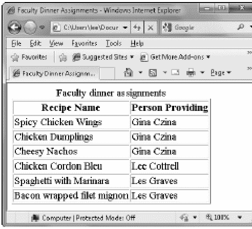

10. 创建两道甜点主菜。根据你的判断将甜点分配给教师。

```html
<tr>
    <td>Cheesecake</td>
    <td>Les Graves</td>
</tr>
<tr>
    <td>Apple Pie</td>
    <td>Lee Cottrell</td>
</tr>
```

11. 保存并刷新。你的文档应看起来像接下来显示的图像。最终的代码清单包含在代码块 6-5 中。

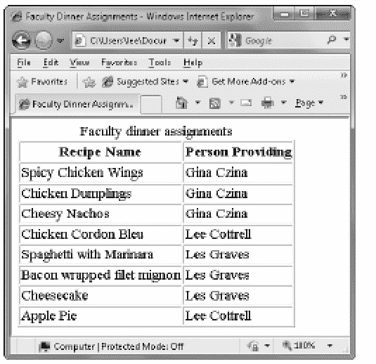

### 代码块 6-5

```html
<!DOCTYPE html PUBLIC "-//W3C//DTD XHTML 1.1//EN"
"http://www.w3.org/TR/xhtml11/DTD/xhtml11.dtd">
<html xmlns="http://www.w3.org/1999/xhtml" xml:lang="en">
    <head>
        <title>Faculty Dinner Assignments</title>
        <meta name="description" content="This month's faculty dinner assignments"/>
        <meta name="author" content="Lee M. Cottrell" />
    </head>
    <body>
    <table border="1">
    <caption>Faculty dinner assignments</caption>
    <tr>
        <th>Recipe Name</th>
        <th>Person Providing</th>
    </tr>
    <tr>
        <td>Spicy Chicken Wings</td>
        <td>Gina Czina</td>
    </tr>
    <tr>
        <td>Chicken Dumplings</td>
        <td>Gina Czina</td>
    </tr>
    <tr>
        <td>Cheesy Nachos</td>
        <td>Gina Czina</td>
    </tr>
    <tr>
        <td>Chicken Cordon Bleu</td>
        <td>Lee Cottrell</td>
    </tr>
    <tr>
        <td>Spaghetti with Marinara</td>
        <td>Les Graves</td>
    </tr>
    <tr>
        <td>Bacon wrapped filet mignon</td>
        <td>Les Graves</td>
    </tr>
    <tr>
        <td>Cheesecake</td>
        <td>Les Graves</td>
    </tr>
    <tr>
        <td>Apple Pie</td>
        <td>Lee Cottrell</td>
    </tr>
</table>
</body>
</html>
```

## 跨行与跨列

`<td>` 标签包含表格的数据。通常，一个单元格保存一条数据。然而，有时可能需要多个单元格来保存一条数据。另一种思考方式是将多个单元格合并为一个单元格。在 HTML 中，这被称为“跨行跨列”。

> **提示**  
> 跨行跨列与 Microsoft Excel 中的合并单元格非常相似。

合并单元格有两种方式。你可以跨行合并，也可以跨列合并。两种方式都会导致一个 `<td>` 标签被用于跨越多个单元格。`<td>` 标签的 `rowspan` 属性用于创建行合并。行合并的效果是使单元格看起来更高。

考虑图 6-3 所示的表格。该表格销售一支运动队的多种产品。有三件球衣和两顶帽子在售。请注意，商品名称重复了多次，价格也重复了。这些是行合并的良好候选对象。

代码块 6-6 中的代码创建了图 6-3。

### 代码块 6-6

```html
<table border="1">
<caption>Team products for sale</caption>
<tr>
    <th>Product</th>
    <th>Team</th>
    <th>Price</th>
</tr>
<tr>
    <td>Home Jersey</td>
    <td>Elliott Eagles</td>
    <td>$35.99</td>
</tr>
```


图 6-3 · 行合并前的产品表格


```html
<tr>
    <td>Home Jersey</td>
    <td>Allentown Alligators</td>
    <td>$35.99</td>
</tr>
<tr>
    <td>Home Jersey</td>
    <td>Mt. Washington Presidents</td>
    <td>$35.99</td>
</tr>
<tr>
    <td>Hat</td>
    <td>Elliott Eagles</td>
    <td>$19.99</td>
</tr>
<tr>
    <td>Hat</td>
    <td>Mt. Washington Presidents</td>
    <td>$19.99</td>
</tr>
</table>
```

再次注意，有三件球衣和两顶帽子。这些数字在行合并时变得很重要。跨行合并的步骤如下：

1. 计算要合并的行数。
2. 在第一个`<td>`标签中添加属性`rowspan="行数"`。
3. 移除其他`<td>`标签。

代码块 6-7 和下面的图示展示了行合并后的表格。球衣、帽子和价格已分别合并到一个单元格中。这个表格比图 6-3 中的表格更易于阅读。


### 代码块 6-7

```html
<table border="1">
<caption>Team products for sale</caption>
<tr>
    <th>Product</th>
    <th>Team</th>
    <th>Price</th>
</tr>
<tr>
    <td rowspan="3">Home Jersey</td>
    <td>Elliott Eagles</td>
    <td rowspan="3">$35.99</td>
</tr>
<tr>
    <td>Allentown Alligators</td>
</tr>
<tr>
    <td>Mt. Washington Presidents</td>
</tr>
<tr>
    <td rowspan="2">Hat</td>
    <td>Elliott Eagles</td>
    <td rowspan="2">$19.99</td>
</tr>
<tr>
    <td>Mt. Washington Presidents</td>
</tr>
</table>
```

与`rowspan`类似，`colspan`属性允许一个单元格占据多列。实际上，该列现在比标准单元格更宽。列合并的步骤与行合并类似：

1. 计算要合并的列数。
2. 在第一个`<td>`单元格中添加`colspan`属性。
3. 移除额外的`<td>`。
4. 可选地，让第一个`<td>`单独占一行。

图 6-4 和代码块 6-8 展示了一个包含投影仪使用时间表的表格。请注意，Cottrell 先生在周二、周三和周四的 8:00 到 10:00 需要使用投影仪。每个时间段都有一位讲师连续几天使用投影仪。在最后一个时间段，Czina 女士每天都需要投影仪。列合并将简化此表格并使文本更易读。

138 HTML & XHTML DeMYSTiFieD


图 6-4 • 列合并前的投影仪时间表

### 代码块 6-8

```html
<table border="1">
    <caption>Projector Schedule</caption>
    <tr>
        <th>Time</th>
        <th>Monday</th>
        <th>Tuesday</th>
        <th>Wednesday</th>
        <th>Thursday</th>
        <th>Friday</th>
    </tr>
    <tr>
        <td>8:00 - 10:00</td>
        <td>Mrs. Czina</td>
        <td>Mr. Cottrell</td>
        <td>Mrs. Czina</td>
    </tr>
    <tr>
        <td>10:00 - 12:00</td>
        <td>Mr. Graves</td>
        <td>Mr. Graves</td>
        <td>Mr. Cottrell</td>
        <td>Mr. Cottrell</td>
        <td>Mrs. Czina</td>
    </tr>
    <tr>
        <td>12:00 - 2:00</td>
        <td>Mrs. Czina</td>
        <td>Mrs. Czina</td>
        <td>Mrs. Czina</td>
        <td>Mrs. Czina</td>
        <td>Mrs. Czina</td>
    </tr>
</table>
```

下面的图示展示了列合并后的投影仪表格。请注意，任何连续几天使用投影仪的讲师都被合并了。生成合并的代码列在代码块 6-9 中。


### 代码块 6-9

```html
<table border="1">
    <caption>Projector Schedule</caption>
    <tr>
        <th>Time</th>
        <th>Monday</th>
        <th>Tuesday</th>
        <th>Wednesday</th>
        <th>Thursday</th>
        <th>Friday</th>
    </tr>
    <tr>
        <td>8:00 - 10:00</td>
        <td>Mrs. Czina</td>
        <td colspan="3">Mr. Cottrell</td>
        <td>Mrs. Czina</td>
    </tr>
    <tr>
        <td>10:00 - 12:00</td>
        <td colspan="2">Mr. Graves</td>
        <td colspan="2">Mr. Cottrell</td>
        <td>Mrs. Czina</td>
    </tr>
    <tr>
        <td>12:00 - 2:00</td>
        <td colspan="5">Mrs. Czina</td>
    </tr>
</table>
```

### 练习行合并与列合并

本章前面创建的`dinner.html`文档是一个典型的表格。行合并和列合并将改进该文档。你将为提供多道菜的员工合并行，并为餐点类别合并列。

1. 在编辑器和浏览器中打开`dinner.html`文档。
2. Gina Czina 提供三道开胃菜。你将为这些开胃菜合并行。在包含 Gina 姓名的第一个`<td>`标签中，输入属性`rowspan="3"`。

   ```html
   <td rowspan="3">Gina Czina</td>
   ```

3. 移除接下来两个包含 Gina Czina 的`<td>`。
4. 保存并在浏览器中刷新页面。它应该看起来像这里显示的图片。
5. 找到 Les Graves 提供的主菜“Spaghetti with Marinara”。通过在包含 Les 姓名的相应`<td>`中添加属性`rowspan="2"`，开始合并 Les 对餐点的贡献。
6. 移除“Bacon wrapped filet mignon”条目下方`<td>`中包含 Les 姓名的下一个`<td>`。


7. 保存并刷新后，你的页面应类似于此图示：


这个表格很好地标识了谁提供了哪道菜。然而，它没有区分开胃菜、主菜或甜点。添加一个标识餐点类别的新行将使表格更易于阅读。

1. 点击表头行第一个`</tr>`之后。添加一个新行。

   ```html
   <tr>
   </tr>
   ```

2. 在新行内，添加一个跨两行的`<td>`标签。使此`<td>`标签的内容为“Appetizers”（开胃菜）。

   ```html
   <td colspan="2">Appetizers</td>
   ```

3. 保存并刷新页面。它将如下图所示：


4. 你将为主菜和甜点重复此操作。找到“Cheesy Nachos”条目之后的`</tr>`。在此`</tr>`之后添加以下用于主菜的行和跨列单元格。

   ```html
   <tr>
       <td colspan="2">Entrees</td>
   </tr>
   ```

5. 在“Bacon wrapped filet mignon”的`</tr>`之后添加以下用于甜点的跨列单元格。

   ```html
   <tr>
       <td colspan="2">Desserts</td>
   </tr>
   ```

6. 在浏览器中保存并刷新页面。它将有三个跨列行，如图所示。最终代码显示在代码块 6-10 中。


### 代码块 6-10

```html
<!DOCTYPE html PUBLIC "-//W3C//DTD XHTML 1.1//EN"
"http://www.w3.org/TR/xhtml11/DTD/xhtml11.dtd">
<html xmlns="http://www.w3.org/1999/xhtml" xml:lang="en">
    <head>
        <title>Faculty Dinner Assignments</title>
        <meta name="description"
            content="This month's faculty dinner assignments"/>
        <meta name="author" content="Lee M. Cottrell" />

    </head>
    <body>
    <table border="1">
    <caption>Faculty dinner assignments</caption>
    <tr>
        <th>Recipe Name</th>
        <th>Person Providing</th>
    </tr>
    <tr>
        <td colspan="2">Appetizers</td>
    </tr>
    <tr>
        <td>Spicy Chicken Wings</td>
        <td rowspan="3">Gina Czina</td>
    </tr>
    <tr>
        <td>Chicken Dumplings</td>
    </tr>
    <tr>
        <td>Cheesy Nachos</td>
    </tr>
    <tr>
        <td colspan="2">Entrees</td>
    </tr>
    <tr>
        <td>Chicken Cordon Bleu</td>
        <td>Lee Cottrell</td>
    </tr>
    <tr>
        <td>Spaghetti with Marinara</td>
        <td rowspan="2">Les Graves</td>
    </tr>
    <tr>
        <td>Bacon wrapped filet mignon</td>
    </tr>
    <tr>
        <td colspan="2">Desserts</td>
    </tr>
    <tr>
        <td>Cheesecake</td>
        <td>Les Graves</td>
    </tr>
    <tr>
        <td>Apple Pie</td>
        <td>Lee Cottrell</td>
    </tr>
</table>
</body>
</html>
```

### 格式化表格

本章中生成的表格相当朴素。每个表格都有一个简单的边框，并且根据表格的需要调整大小。除了合并单元格外，没有花时间让表格看起来更好。

格式化表格有两种方法。有多种表格属性可用于格式化表格。此外，CSS 还为表格提供了高级格式化选项。

### 表格属性

本章开头的表 6-1 列出了可用于表格的属性。`width`属性指定表格的宽度。它接受像素、百分比、英寸等多种度量单位的值。像素和百分比是最有用的。

将`width`属性设置为 100% 将使表格宽度与浏览器文档一样宽。表格的高度将根据需要自动调整。同样，将`width`属性设置为 50%，表格宽度将是页面宽度的一半。百分比值会生成一个根据浏览器窗口自动调整大小的表格。有时表格需要固定大小。使用像素值作为`width`属性可以生成固定大小的表格。

> **提示** 如果列或表格的宽度设置得太小，浏览器将忽略宽度值，并按必要的大小渲染表格。

`width`属性可以应用于`<tables>`、`<td>`和`<th>`标签。如果用于调整列的宽度，只需在任意一列中设置一次该属性即可。代码块 6-11 展示了一个宽度设置为 300 像素的表格，其中第一列宽 200 像素，另外两列各宽 50 像素。输出结果如图所示。


### 代码块 6-11

```html
<table width="300">
    <tr>
        <th width="200">Food Name</th>
        <th width="50">Calories</th>
        <th width="50">Fat grams</th>
    </tr>
    <tr>
        <td>Apple Pie</td>
        <td>405</td>
        <td>18</td>
    </tr>
    <tr>
        <td>Cake Donut</td>
        <td>210</td>
        <td>12</td>
    </tr>
    <tr>
        <td>Shortbread Cookie</td>
        <td>75</td>
        <td>4</td>
    </tr>
</table>
```

没有边框和线条的表格很难阅读。如前所述，`border`属性在表格和每个单元格周围设置边框。这样可读性较好，但可能不够美观。应用于表格标签的`rules`和`frame`属性分别设置单元格和表格的边框。代码块 6-12 和下面的插图展示了带有行间分隔线和表格底部边框的卡路里表格。请注意 Explorer 8 和 Firefox 3 处理边框的方式有所不同。

### 代码块 6-12

```html
<table width="300" rules="rows" frame="below">
```


`cellspacing`和`cellpadding`属性控制`<td>`或`<th>`内容周围的间距。这两个属性的默认值都是 1。将值设置为 0 会使表格看起来更小。较大的值会扩展表格。`cellspacing`控制单元格之间的间距。`cellpadding`控制单元格内容与单元格边框之间的间距。

此间距将包含在单元格的宽度中。下面的插图和代码块 6-13 说明了在我们的卡路里表格中使用`cellspacing`的情况。

> **注意** `cellspacing`属性在 Internet Explorer 和 Firefox 中的行为不同。Firefox 似乎忽略该属性，强制其保持为 0。Internet Explorer 则应用该属性。将属性设置为 0 会导致 Explorer 以类似于 Firefox 的方式渲染边框和分隔线。


### 代码块 6-13

```html
<table width="300" rules="rows" frame="below" cellspacing="5">
```

### 使用 CSS 格式化表格

使用 CSS 格式化表格提供了更多选择和更美观的表格。表格的`border`、`rules`和`frame`属性可以使用 CSS 设置。你可以选择颜色、线条粗细和线条样式，而不是单调的黑线。除了改变线条样式外，CSS 还可以轻松更改表格的颜色。


> **提示**：HTML 包含三个用于格式化表格的标签。它们是 `thead`、`tbody` 和 `tfooter`。这些标签最好与 CSS 结合使用，为大型表格提供格式化。不幸的是，浏览器的支持相当零散。

### 使用 CSS 更改边框

考虑图 6-2。`border` 属性设置为值 5。虽然这个表格看起来相当不错，但 CSS 会让它看起来更好。图 6-5 展示了使用 CSS 的表格边框可能性。代码块 6-14 展示了生成图 6-5 的代码。


图 6-5 • CSS 边框示例

### 代码块 6-14

```html
<table cellpadding="5px" cellspacing="10px" style="border-color:#000000;">
<tr>
    <td style="border-style:dashed;">dashed border</td>
    <td style="border-style:dotted;">dotted border</td>
    <td style="border-style:double;">double border</td>
</tr>
<tr>
    <td style="border-style:groove;">groove border</td>
    <td style="border-style:hidden;">hidden border</td>
    <td style="border-style:inset;">inset border</td>
</tr>
<tr>
    <td style="border-style:outset;">outset border</td>
    <td style="border-style:ridge;">ridge border</td>
    <td style="border-style:solid;">solid border</td>
</tr>
</table>
```

> **提示**：只有虚线、点线和实线边框可以接受宽度值。

CSS 边框属性的功能远不止样式。你可以设置多种样式的颜色和宽度。代码块 6-13 使用 `border-color` 属性将每个边框的颜色设置为黑色。显然，你可以选择任何你想要的颜色。可能不太明显的是，你可以设置每一边的颜色。如果你愿意，你可以有一个黑色的上边框、红色的右边框、绿色的左边框和蓝色的下边框。这个例子很极端，但它展示了可能性。

表 6-2 列出了 CSS 的常用边框属性。每个属性最多接受三个值。第一个值是粗细。第二个是图 6-5 中的样式之一。最后一个是颜色。

> **提示**：CSS 边框受 `cellspacing` 的影响。要实现连续的边框，请将 `cellspacing` 设置为 0。

图 6-2 只需要行之间的分隔线。要进行此更改，请从表格中移除 `border` 属性。向表格添加 `cellspacing="0"` 和 `cellpadding="2"` 属性。最后，添加代码块 6-15 中所示的 CSS。下面的插图展示了新格式化的表格。

```html
代码块 6-15
<style type="text/css">
    th{
        text-align:left;
        background-color:#000000;
        color:#ffffff;
    }
    td{
        border-bottom:2px solid #000000;
    }
</style>
<table cellspacing="0" cellpadding="2">
<!--表格其余部分省略-->
</table>
```

表 6-2 CSS 常用边框属性

| CSS 属性 | 描述 | 示例 |
| :--- | :--- | :--- |
| `border` | 为整个表格设置边框 | `border:double;` |
| `border-bottom` | 设置下边框 | `border-bottom:1px solid #00ffff;` |
| `border-left` | 设置左边框 | `border-left:1px solid #00ffff;` |
| `border-right` | 设置右边框 | `border-right:1px solid #00ffff;` |
| `border-top` | 设置上边框 | `border-top:1px solid #00ffff;` |


### 格式化表格实践

晚餐菜单需要格式化。要格式化表格，你将使用前面定义的属性。要应用这些格式，你需要使用一个标签级类。

一个*标签级*类是一组命名的 CSS 规则。根据需要将规则应用于标签。它消除了 CSS 条目应用到不需要的地方的问题。

1. 在浏览器和编辑器中打开 `dinner.html` 文档。
2. 从 `<table>` 中移除 `border="1"` 属性。
3. 在文档的 head 部分添加一个 style 部分。
4. 你将为不同讲师带来的菜品之间添加分隔线。首先在 style 部分创建一个 `td` 条目，设置一个 1 像素的下边框，使用实线样式，颜色为 `#0000ff`。

```html
<style type="text/css">
</style>
```

```css
td{
    border-bottom:1px solid #0000ff;
}
```

5. 保存并刷新后，你的文档应如下图所示：


6. 你只想让分隔线分隔不同老师带来的菜品。例如，你希望在 Chicken Cordon Bleu 和 Cheesecake 之后有分隔线。修改 CSS 部分中的 `td` 条目，将其改为 `td.border`。这会创建一个名为 `border` 的标签级类。

```css
td.border{
    border-bottom:1px solid #0000ff;
}
```

7. 保存并刷新页面，所有分隔线都消失了。
8. 找到包含 Chicken Cordon Bleu 的行。在该行每个 `td` 标签的属性空间内，添加属性 `class="border"`。这个类应用了你命名为 `border` 的标签级类。

```html
<tr>
    <td class="border">Chicken Cordon Bleu</td>
    <td class="border">Lee Cottrell</td>
</tr>
```

### 9. 为芝士蛋糕所在行的两个 `<td>` 重复添加 `class="border"`。

```html
<tr>
    <td class="border">Cheesecake</td>
    <td class="border">Les Graves</td>
</tr>
```

### 10. 保存并刷新页面。页面应如下图所示，在“蓝带鸡胸”和“芝士蛋糕”下方出现线条：


### 11. 仔细观察每条线。线条中有一个小断点。要消除这个断点，请为表格添加 `cellspacing="0"` 属性。

```html
<table cellspacing="0">
```

### 12. 现在你需要让菜品分类更易于识别。同样，我们将使用标签级类来格式化所需的 `<td>`。在样式部分添加一个新的 `td.course` 条目。将其格式设置为背景颜色 `#0000ff`，文字颜色 `#ffffff`，字体大小 `16pt`。

### 13. 为包含“开胃菜”、“主菜”和“甜点”的 `<td>` 添加属性 `class="course"`。

### 14. 保存并在浏览器中刷新页面。页面应如下图所示，菜品分类名称格式美观：


### 15. 表头行现在显得多余。删除包含 `<th>` 标签的整个 `<tr>` 和 `</tr>`。

### 16. 保存并刷新页面。页面应如下图所示。最终代码包含在代码块 6-16 中。


## 代码块 6-16

```html
<!DOCTYPE html PUBLIC "-//W3C//DTD XHTML 1.1//EN"
"http://www.w3.org/TR/xhtml11/DTD/xhtml11.dtd">
<html xmlns="http://www.w3.org/1999/xhtml" xml:lang="en">
    <head>
        <title>Faculty Dinner Assignments</title>
        <meta name="description" content=
        "This month's faculty dinner assignments"/>
        <meta name="author" content="Lee M. Cottrell" />
        <style type="text/css">
            td.border{
                border-bottom:1px solid #0000ff;
            }
            td.course{
                background-color:#0000ff; color:#ffffff;
                font-size:16pt;
            }
        </style>
    </head>
    <body>
        <table cellspacing="0">
            <caption>Faculty dinner assignments</caption>
            <tr>
                <td colspan="2" class="course">Appetizers</td>
            </tr>
            <tr>
                <td>Spicy Chicken Wings</td>
                <td rowspan="3">Gina Czina</td>
            </tr>
            <tr>
                <td>Chicken Dumplings</td>
            </tr>
            <tr>
                <td>Cheesy Nachos</td>
            </tr>
            <tr>
                <td colspan="2" class="course">Entrees</td>
            </tr>
            <tr>
                <td class="border">Chicken Cordon Bleu</td>
                <td class="border">Lee Cottrell</td>
            </tr>
            <tr>
                <td>Spaghetti with Marinara</td>
                <td rowspan="2">Les Graves</td>
            </tr>
            <tr>
                <td>Bacon wrapped filet mignon</td>
            </tr>
            <tr>
                <td colspan="2" class="course">Desserts</td>
            </tr>
            <tr>
                <td class="border">Cheesecake</td>
                <td class="border">Les Graves</td>
            </tr>
            <tr>
                <td>Apple Pie</td>
                <td>Lee Cottrell</td>
            </tr>
        </table>
    </body>
</html>
```

### 总结

本章介绍了 HTML 表格。你学习了如何使用表格以及何时适合使用表格。你学习了几种格式化表格的方法。首先，你学习了基本的 HTML 格式化表格属性。然后，你学习了如何合并行和列。最后，你使用 CSS 对表格进行了格式化。

### 测验

1. 此 HTML 标签用于创建结构化数据。
   - A. `td`
   - B. `th`
   - C. `table`
   - D. `h1`

2. 此标签用于在表格中创建一行。
   - A. `tr`
   - B. `td`
   - C. `th`
   - D. `caption`

3. 表格的 ________ 属性控制单元格边框在外部显示的位置。
   - A. `frame`
   - B. `border`
   - C. `rules`
   - D. `width`

4. 表格的 ________ 属性控制单元格内容与单元格边框之间的距离。
   - A. `cellspacing`
   - B. `cellpadding`
   - C. `border`
   - D. `width`

5. ________ 标签在所有浏览器中默认居中且加粗。
   - A. `td`
   - B. `tr`
   - C. `th`
   - D. `caption`

6. ________ 在表格上方生成表格标题。
   - A. `td`
   - B. `tr`
   - C. `th`
   - D. `caption`

7. 你想将一行中的三个单元格合并为一个。以下哪项是正确的属性和值？
   - A. `rowspan="3"`
   - B. `rowspan="2"`
   - C. `colspan="3"`
   - D. `colspan="2"`

8. ________ 标签在表格中创建一个单元格。
   - A. `td`
   - B. `tr`
   - C. `th`
   - D. `caption`

9. ________ 属性在表格周围和所有单元格之间绘制线条。
   - A. `frame`
   - B. `border`
   - C. `rules`
   - D. `width`

10. 在 CSS 代码 `td.border` 中，`border` 是一个 ________。
    - A. 标签级类
    - B. `td` 类
    - C. 通用类
    - D. 表格类

# 第 7 章

## 使用表单


本章将介绍表单的 HTML 部分。未涵盖的是表单的后端：如何处理发送的数据。这超出了本书的范围。

### 章节目标

在本章中，你将：

- 描述表单的目的并创建一个表单
- 使用 `input` 标签在表单上放置控件
- 创建下拉列表
- 使用文本区域
- 格式化表单

HTML 非常擅长向用户传递数据。这种单向传递类似于电视的模式，在 Web 早期非常有效。然而，Web 已经从数据传递机制发展成为更具协作性、交互性的体验。

像 MySpace、FaceBook 和 YouTube 这样的网站依赖于用户提交。HTML 表单允许用户向网站发送数据。表单允许用户订购产品、发送消息，甚至发布视频。

### 表单

在你的一生中，你已经填写过许多表单。标准化测试、就业申请和社交网络网站的注册都是一种表单。表单是收集数据的一种机制。该机制按固定顺序提出问题，并可能限制对问题的回答。例如，如果你所在地区工作的最低年龄是 16 岁，那么求职申请表将拒绝任何低于 16 岁的输入。

每当你需要从用户那里收集信息时，你都会使用表单。你可以收集任何你认为必要的信息。你将使用 HTML 来生成表单，而不是创建纸质表单。

### HTML 表单

创建表单类似于创建表格。你从一个容器标签开始，然后在容器内放置其他标签。

要学习的第一个标签是 `<form>` 标签。此标签开始构建表单的过程。构建表单时，表单标签必须定义三个属性。这些属性在表 7-1 中定义，控制表单的工作方式。

#### 表 7-1 三个必需的表单属性

| 表单属性 | 描述 | 值 |
| :--- | :--- | :--- |
| `action` | 定义数据将被发送到的位置。 | 指向接受数据的程序的 URL |
| `method` | 描述发送数据的 HTTP 工具。 | `GET`, `POST` |
| `name` | 为表单命名。程序员在代码中用于标识表单。 | |

表 7-1 中的每个属性都很重要。`name` 属性为表单提供了一个唯一标识符。这个名称对于处理表单的程序员非常重要。除非你有特定的说明，否则你可以随意命名你的表单。


`method` 属性描述你的网站将如何发送数据。有两种选择：表单可以通过 `POST` 或 `GET` 发送数据。`POST` 和 `GET` 之间存在几个技术差异。两者都会将表单数据传递到 `action` URL。但是，`POST` 比 `GET` 更安全。`POST` 会向用户隐藏表单内容，而 `GET` 会显示这些内容。

下图显示了登录表单使用 `POST` 和 `GET` 时结果之间的差异。在 `GET` 结果中，表单中的数据包含在 URL 中。请注意，密码清晰可见。`POST` 方法隐藏了数据。除非我另有说明，否则我建议对所有表单事务使用 `POST`。


`action` 属性描述了将处理数据的程序。这通常是指向用 PHP、ASP 或其他编程语言编写的程序的 URL。`action` 将接收数据并以某种方式响应。虽然这个主题超出了本书的范围，但你确实需要了解这个过程是如何工作的。表单和 `action` 脚本之间的交互称为通用网关接口（CGI）。

代码块 7-1 展示了一个将数据 `POST` 到我网页上 PHP 脚本的表单。请注意这些属性。

#### 代码块 7-1

```html
<form name="example" method="POST"
    action="http://leecottrell.com/phpclass/postback.php">
</form>
```

### 表单交互

表单收集数据。然而，除非数据有用途，否则它是无用的。订单需要处理，推文需要发送，消息需要撰写。这就是 `action` 属性中列出的程序的工作。

表单与操作以标准方式交互：

1. 用户输入数据。
2. 网站将数据发送给操作。
3. 操作接收数据并进行处理。
4. 操作返回一个 HTML 页面给用户，显示操作结果。

图 7-1 展示了通过网页下单的过程。

## 仍然困惑

创建操作超出了本书的范围。如果你过去有编程经验，那么你可以学习如何创建操作。PHP 和 ASP 都可用于编写操作代码。购买一本麦格劳-希尔出版社的书籍，例如 Vikram Vaswani 所著的《PHP：初学者指南》（2008 年），并开始编码。

# 输入标签

要创建一个表单，你需要从 `<form>` 标签开始。你需要添加表 7-1 中定义的必要属性。一旦这个容器标签构建完成，你就需要开始向表单添加数据收集项。这些项通常被称为控件。向表单添加控件需要更多标签。最常用的是 `<input>` 标签。

`<input>` 标签有多种形式。通过其 `type` 属性，输入标签可以接受类型化数据、隐藏密码数据、复选框和单选按钮。除了收集数据，输入标签还创建将数据发送到操作的按钮。表 7-2 列出了 `type` 属性的允许值。

除了 `type` 属性，`<input>` 标签还需要一个 `name`。类似于表单的 `name` 属性，`<input>` 标签的 `name` 允许程序员处理来自控件的数据。

从技术上讲，HTML 中的输入标签不需要闭合标签，但 XHTML 要求它必须闭合。最好的解决方案是像我们处理 `<br />` 和 `` 标签那样进行自闭合。我所有的示例都将对 `<input>` 标签进行自闭合。

渲染时，浏览器将在不换行的情况下显示 `<input>`。如果你希望你的控件位于不同的行上，可以在需要的地方编码一个 `<br />`，或者将你的控件放在一个表格中。推荐使用表格。在本章后面，你将向表单添加一个表格。

## 表 7-2 输入标签的 `type` 属性允许值

| 值 | 描述 |
|---|---|
| `checkbox` | 创建一系列允许多选的控件。用户通过在框中打勾来选择他们的选项。 |
| `file` | 允许用户浏览其计算机上的文件以提交到网站。 |
| `hidden` | 用于存储表单需要但用户不需要看到的数据。 |
| `image` | 创建一个将表单数据发送到操作的图像。 |
| `password` | 创建一个允许用户输入文本的框。文本对用户隐藏。 |
| `radio` | 创建一系列控件，用户只能从中选择一个选项。 |
| `reset` | 创建一个清除表单的按钮。 |
| `submit` | 创建一个将表单数据发送到操作的按钮。 |
| `text` | 创建一个允许用户输入文本的框。 |

> **提示**：除非你正在使用通用操作或自己编写了操作，否则会有人告诉你控件的有效名称。

# 创建文本控件

输入控件最常见的用途是创建文本控件。通常称为文本框或密码框，这些是用户输入其用户名、密码、地址或任何其他形式数据的控件。

文本框的最基本形式是编码一个输入标签，使用 `type` 属性，并提供一个 `name`。代码块 7-2 显示了两个文本框，插图显示了在 Explorer 中的表单。

#### 代码块 7-2

```html
<input type="text" name="username"/><br />
<input type="password" name="password"/>
```

代码块 7-2 有几个问题。首先，用户不知道在框中输入什么。其次，用户可以在框中输入任意多的信息。这在网站中是一个巨大的安全漏洞。向网页表单中放入过多数据可能会使 Web 服务器崩溃。

解决这些问题需要两个补充。首先，在 `<input>` 标签之前添加一个简单的文本标签，为用户提供提示。这个提示告诉他们应该在框中放置什么数据。

修复第二个问题需要两个额外的属性。`maxlength` 属性限制输入到文本框中的字符数。仅此属性就能保护你的网站。第二个属性用于美观目的。`size` 属性将调整文本框中可见的字符数。对于小于 50 的值，将 `maxlength` 和 `size` 设置为相同的值是合适的。对于超过 50 的 `maxlength`，将 `size` 保持在 50。代码块 7-3 和下面的插图显示了更正后的代码。

> **注意**：`maxlength` 可以保护你的网站。没有这个属性，你的网站将接受任意数量的字符。如果发送到网站的字符过多，其运行的服务器可能会崩溃。

#### 代码块 7-3

```html
Enter username <input type="text" name="username" maxlength="8"
size="8"/><br />
Enter password <input type="password" name="password"
maxlength="12" size="12" />
```

> **提示**：处理 `size` 有两种可能的方式。我通常使文本框大小与 `maxlength` 匹配。我的设计师朋友使所有文本框大小相同。他们声称这样可以使表单看起来更好。我们都是对的。

# 创建复选框

复选框允许向用户呈现多个选项。用户可以选择他想要的任何选项。复选框在屏幕上渲染为一个小框。当框被选中时，里面会出现一个标记。

要创建复选框，再次使用 `<input>` 标签。设置 `type="checkbox"` 并设置一个 `name`。代码块 7-4 显示了一组复选框，为一家自助餐厅提供晚餐选择。插图显示了在 Explorer 中的输出，其中选择了两个选项。

#### 代码块 7-4

```html
Steak <input type="checkbox" name="steak"/>
Chicken <input type="checkbox" name="chicken"/>
Fish <input type="checkbox" name="fish"/>
Vegetables <input type="checkbox" name="vegetables"/>
```

# 创建单选按钮

单选按钮允许向用户呈现多个选项。然而，与复选框不同，用户只能选择其中一个选项。单选按钮在屏幕上渲染为一个小圆圈。当被选中时，它将包含一个更小的圆圈。

要创建单选按钮，再次使用 `<input>` 标签。设置 `type="radio"` 并设置一个 `name`。为确保单选按钮按预期工作，每个按钮必须具有相同的 `name`。除了 `name`，每个单选按钮还必须设置一个 `value` 属性。`value` 属性保存发送到服务器的数据。除非另有说明，否则将 `value` 设置为等于单选按钮的提示文本。代码块 7-5 显示了一组单选按钮，提供颜色选择，插图显示了在 Explorer 中的输出。

#### 代码块 7-5

```html
Red <input type="radio" name="favoriteColor" value="red"/>
Green <input type="radio" name="favoriteColor" value="green"/>
Blue <input type="radio" name="favoriteColor" value="blue"/>
Purple <input type="radio" name="favoriteColor" value="purple"/>
```

# 创建按钮

HTML 支持两种表单按钮：提交按钮和重置按钮。表单创建后，用户需要一种将数据发送到操作的方法。输入标签的 `submit` 类型正是做这个的。一旦点击，提交按钮将使用表单的 `method` 将所有表单数据发送到操作。所有表单都必须有一个提交按钮。重置按钮清除所有表单内容。

要构建一个提交按钮，从输入标签开始，并将 `type` 设置为 `submit`。这将在网页上创建一个灰色按钮。没有任何其他属性的情况下，按钮将显示“Submit Query”。虽然这完全没问题，但你确实有更多的控制权。`value` 属性可以更改按钮中的文本。按钮通常不需要 `name`。

构建重置按钮与提交按钮相同。只需将 `submit` 替换为 `reset`，你的按钮就完成了。代码块 7-6 和下面的插图显示了输入按钮。

#### 代码块 7-6

```html
<input type="submit" value="Send Data" /><br />
<input type="reset" value="Clear Form" />
```

# 创建图像控件

`image` 类型为提交按钮提供了一种图形替代方案。你可以使用自定义图像，而不是一个无聊的灰色按钮。与 `img` 属性一样，你需要 `src` 属性来描述图像位置。此外，高度宽度属性用于在表单上提供足够的空间。Alt 和 title 标签并非必需。插图和代码块 7-7 展示了一个图像控件。

> **提示**：该按钮是在 flamingtext.com 上生成的。

#### 代码块 7-7

```html
<input type="image" src="images/send.gif" height="43" width="163"/>
```


## 练习：创建表单

你将为一家披萨店创建一个简单的表单。你的表单将允许订购一个披萨。你可以选择尺寸和配料。为了练习，你将使用我简单的回传脚本。实际上，你可能会有一个定制的 CGI 脚本。

> **提示**：我的回传脚本可在 `http://leecottrell.com/phpclass/postback.php` 获取。这是一个简单的脚本，它只会返回你表单中的信息。它不跟踪任何使用数据。

1. 从你的模板创建一个新文件，命名为 `pizza.html`。将其保存在 `chapter7` 文件夹中。
2. 为页面创建适当的标题和元信息。
3. 在 `body` 内部，创建一个新的表单。使用 `POST` 方法，并将 `action` 设置为 `http://www.leecottrell.com/phpclass/postback.php`。

   ```html
   <form name="example" method="POST"
   action="http://www.leecottrell.com/phpclass/postback.php">

   </form>
   ```

4. 为了让表单看起来美观，你需要在表单内使用一个表格。该表单将有两列：第一列用于标签，第二列放置实际的表单控件。在你的表单内添加一个表格。

   ```html
   <table>

   </table>
   ```

5. 创建一个包含两个 `td` 标签的行。

   ```html
   <tr>
       <td>
       </td>
       <td>
       </td>
   </tr>
   ```

6. 在第一个 `td` 标签内，输入文本 **Your name**。
7. 在第二个 `td` 标签内，输入一个名为 `customer` 的文本输入控件。设置合适的 `maxlength` 和 `size`。完整的行如下所示：

   ```html
   <tr>
       <td>
       Your name
       </td>
       <td>
       <input type="text" name="customer" maxlength="30"
       size="30" />
       </td>
   </tr>
   ```

8. 为地址创建另一行和输入控件。

   ```html
   <tr>
       <td>
       Delivery address
       </td>
       <td>
       <input type="text" name="address" maxlength="100"
       size="50" />
       </td>
   </tr>
   ```

9. 保存并在浏览器中打开页面。它应该类似于此处显示的图像：

   

10. 为电话号码创建另一行和输入控件。

    ```html
    <tr>
        <td>
            Phone number
        </td>
        <td>
            <input type="text" name="phone" maxlength="15"
                   size="15" />
        </td>
    </tr>
    ```

11. 现在你将为披萨本身创建控件。由于单个披萨只能选择一个尺寸，你将使用单选按钮控件。创建一个名为 `size` 的单选按钮。将控件后的值和文本设置为 `small`。

    ```html
    <tr>
        <td>
            Size
        </td>
        <td>
            <input type="radio" name="size" value="small" />Small
        </td>
    </tr>
    ```

12. 创建另外两个名为 `size` 的单选按钮。将它们的值和文本分别设置为 `medium` 和 `large`。

    ```html
    <input type="radio" name="size" value="medium" />Medium
    <input type="radio" name="size" value="large" />Large
    ```

13. 保存并在浏览器中刷新页面，它应该类似于这张图片：

    

14. 现在你需要配料。一个披萨可以有多种配料。创建一个新的两列行，在第一个 `td` 中写入 Toppings。

    ```html
    <tr>
        <td>
            Toppings
        </td>
        <td>
        </td>
    </tr>
    ```

15. 在第二个 `td` 内部，创建一个名为 `pepperoni` 的复选框控件。将 `name`、`value` 和文本都设置为 `pepperoni`。在文本 pepperoni 后添加一个 `<br />`。

    ```html
    <input type="checkbox" name="pepperoni" value="pepperoni" />Pepperoni<br />
    ```

16. 创建几个额外的配料，类似于 pepperoni 控件。

    ```html
    <input type="checkbox" name="sausage" value="sausage" />Sausage<br />
    <input type="checkbox" name="mushrooms" value="mushrooms" />Mushrooms<br />
    <input type="checkbox" name="onion" value="onion" />Onion<br />
    ```

    **提示**：复选框的 `value` 和 `name` 会根据 `action` 脚本中的代码而有所不同。

17. 保存并在浏览器中打开页面。它将看起来像这张图片：

    

18. 现在表单完成了。你需要测试 `action`。在表格之后、`</form>` 之前，添加一个提交按钮和一个重置按钮。

    ```html
    <input type="submit" value="Order pizza" />
    <input type="reset" value="Cancel pizza" />
    ```

19. 在字段中输入数据并按下提交按钮。如果一切正确，那么你应该看到此插图中显示的内容。这是我的回传脚本的输出。如果你得到 404 错误，请验证 `action` URL 是否正确。完整的代码显示在代码块 7-8 中。

    

#### 代码块 7-8


```html
<!DOCTYPE html PUBLIC "-//W3C//DTD XHTML 1.1//EN"
"http://www.w3.org/TR/xhtml11/DTD/xhtml11.dtd">
<html xmlns="http://www.w3.org/1999/xhtml" xml:lang="en">
    <head>
        <title>Cottrell's Pizza</title>
        <meta name="description" content="An order
            form for Cottrell's Pizza"/>
        <meta name="author" content="Lee M. Cottrell" />
    </head>
    <body>
    <form name="example" method="POST" action="http://
        leecottrell.com/phpclass/postback.php">
    <table>
    <tr>
<td>
Your name
</td>
<td>
<input type="text" name="customer" maxlength="30"
size="30" />
</td>
</tr>
<tr>
<td>
Delivery address
</td>
<td>
<input type="text" name="address" maxlength="100"
size="50" />
</td>
</tr>
<tr>
<td>
Phone number
</td>
<td>
<input type="text" name="phone" maxlength="15"
size="15" />
</td>
</tr>
<tr>
<td>
Size
</td>
<td>
<input type="radio" name="size"
value="small" />Small
<input type="radio" name="size"
value="medium" />Medium
<input type="radio" name="size"
value="large" />Large
</td>
</tr>
<tr>
<td>
Toppings
</td>
<td>
<input type="checkbox" name="pepperoni"
value="pepperoni" />Pepperoni<br />
<input type="checkbox" name="sausage"
value="sausage" />Sausage<br />
<input type="checkbox" name="mushrooms"
value="mushrooms" />Mushrooms<br />
<input type="checkbox" name="onion"
value="onion" />Onion<br />
</td>
</tr>
</table>
<input type="submit" value="Order pizza" />
<input type="reset" value="Cancel pizza" />
</form>
</body>
</html>
```

## 下拉列表

`input` 标签创建了大多数表单控件。然而，其他控件也在表单中工作。`<select>` 标签为用户创建一个选项下拉列表。下拉列表是一种很好的方法，可以在不占用大量屏幕空间的情况下提供大量选项。下拉列表的一个常见用途是创建一个州列表。

要创建一个下拉列表，开始、命名并关闭一个 `<select>` 标签。在 `<select>` 标签内部，添加 `<option>` 标签。你需要为列表中的每个选项添加一个。`<option>` 标签的内容将显示在列表中。通常，第一个选项为用户提供指引。将剩余的选项按字母顺序排列，以便用户更容易找到。代码块 7-9 显示了一个包含颜色的列表框。

**代码块 7-9**

```html
<select name="favColors">
<option>Pick your favorite color</option>
<option>Black</option>
<option>Blue</option>
<option>Green</option>
<option>Orange</option>
<option>Red</option>
<option>Purple</option>
<option>White</option>
</select>
```

默认情况下，HTML 会将所选 `<option>` 的内容发送到 action 脚本。每个 `<option>` 值可以包含一个 `value` 属性。当表单需要发送列表显示内容以外的数据时，请使用 `value` 属性。

action 脚本的开发者会告诉你在列表中使用哪些值。在代码块 7-10 中，有效的颜色从 0 开始。值 -1 表示用户未选择颜色。以下图像显示了 `<select>` 标签：


**代码块 7-10**

```html
<select name="favColors">
<option value="-1">Pick your favorite color</option>
<option value="0">Black</option>
<option value="1">Blue</option>
<option value="2">Green</option>
<option value="3">Orange</option>
<option value="4">Red</option>
<option value="5">Purple</option>
<option value="6">White</option>
</select>
```

> **提示**：当 action 脚本连接到数据库时，你将使用该值。该值将保存显示值的主键。

## 文本区域

标准的 HTML `input` 文本框允许你输入一行文本。如果你希望你的表单接受段落或多行文本，文本框就无法满足需求。`textarea` 满足了这一需求。

`textarea` 控件在表单上提供了一个大的文本框。你可以控制可见的行数和列数。行数等同于可见的行数。

## 练习使用文本区域和下拉列表

你的披萨表单还需要一些改进。店主希望提供不同的酱料选择。送货司机需要一个特殊说明框，以便他们找到客户的家。你将为酱料添加一个下拉列表，并为说明添加一个文本区域。

1. 在浏览器和编辑器中打开 `pizza.html`。

2. 你将把一个文本区域放在地址和电话输入框之间。在你的编辑器中，向下滚动到电话条目上方的 `<tr>` 标签正前方。

3. 遵循相同的表格结构。创建一个包含两个 `<td>` 标签的新行。

4. 在第一个 `td` 中放置短语 **配送说明**。

5. 在第二个 `td` 中，添加一个名为 `directions` 的 2 行 50 列的文本区域。

```html
<tr>
    <td>
        Delivery Instructions
    </td>
    <td>
        <textarea name="directions" rows="2"
            cols="50"></textarea>
    </td>
</tr>
```

6. 保存并在浏览器中查看页面。它应包含如下所示的文本区域：


7. 在编辑器中，向下滚动到配料（toppings）的 `<tr>` 标签正前方。

8. 添加另一个两列的行。

9. 在第一个 `<td>` 中放置短语 **选择酱料**。

10. 在第二个 `<td>` 中放置一个名为 `sauce` 的 `<select>` 选项。至少包含三个不同的酱料选项。记住将第一个 `<option>` 设为给用户的指示。无需包含 `value` 属性。

```html
<tr>
    <td>
        Choose a sauce
    </td>
    <td>
        <select name="sauce">
            <option>Choose a sauce</option>
            <option>Buffalo</option>
            <option>Barbeque</option>
            <option>No sauce</option>
            <option>Red</option>
            <option>White</option>
        </select>
    </td>
</tr>
```

11. 保存并在浏览器中刷新页面。你应该会看到一个类似于图中所示的下拉框。代码块 7-12 包含了该表单的完整代码。


### 代码块 7-12

```html
<!DOCTYPE html PUBLIC "-//W3C//DTD XHTML 1.1//EN"
"http://www.w3.org/TR/xhtml11/DTD/xhtml11.dtd">
<html xmlns="http://www.w3.org/1999/xhtml" xml:lang="en">
<head>
<title>Cottrell's Pizza</title>
<meta name="description" content="An order
form for Cottrell's Pizza"/>
<meta name="author" content="Lee M. Cottrell" />
</head>
<body>
<form name="example" method="POST" action="http://
leecottrell.com/phpclass/postback.php">
<table>
<tr>
    <td>
    Your name
    </td>
    <td>
    <input type="text" name="customer" maxlength="30"
    size="30" />
    </td>
</tr>
<tr>
    <td>
    Delivery address
    </td>
    <td>
    <input type="text" name="address" maxlength="100"
    size="50" />
    </td>
</tr>
<tr>
    <td>
    Delivery Instructions
    </td>
    <td>
    <textarea name="directions" rows="2"
    cols="50"></textarea>
    </td>
</tr>
<tr>
    <td>
    Phone number
    </td>
    <td>
    <input type="text" name="phone"
    maxlength="15" size="15" />
    </td>
</tr>
<tr>
    <td>
    Size
    </td>
    <td>
    <input type="radio" name="size"
    value="small" />Small
    <input type="radio" name="size"
    value="medium" />Medium
    <input type="radio" name="size"
    value="large" />Large
    </td>
</tr>
<tr>
    <td>
        Choose a sauce
    </td>
    <td>
        <select name="sauce">
            <option>Choose a sauce</option>
            <option>Buffalo</option>
            <option>Barbeque</option>
            <option>No sauce</option>
            <option>Red</option>
            <option>White</option>
        </select>
    </td>
</tr>
<tr>
    <td>
        Toppings
    </td>
    <td>
        <input type="checkbox" name="pepperoni" value="pepperoni" />Pepperoni<br />
        <input type="checkbox" name="sausage" value="sausage" />Sausage<br />
        <input type="checkbox" name="mushrooms" value="mushrooms" />Mushrooms<br />
        <input type="checkbox" name="onion" value="onion" />Onion<br />
    </td>
</tr>
</table>
<input type="submit" value="Order pizza" />
<input type="reset" value="Cancel pizza" />
</form>
</body>
</html>
```

## 格式化表单

用于布局的表格效果很好，但被认为是不恰当的。两个新的 HTML 标签，`label` 和 `fieldset`，与 CSS 一起使用时，可以用 CSS 布局取代表格布局。CSS 提供了美化表单的能力。你可以添加边框、颜色，甚至可以让对象在用户点击时产生反应。

替换表单中的表格需要一些工作。首先，你需要移除所有表格元素。第二步是将提示和输入控件放入一个段落标签中。最后，你需要将提示标识为输入控件的标签。`label` 标签包含 `for` 属性。`for` 属性保存该标签所关联控件的名称。`for` 属性将标签链接到控件。代码块 7-13 展示了两个控件及其关联标签的示例。

### 代码块 7-13

```html
<p>
<label for="directions">Delivery Instructions</label>
<textarea name="directions" rows="2" cols="50"></textarea>
</p>
<p>
<label for="phone">Phone number</label>
<input type="text" name="phone" maxlength="15" size="15" />
</p>
```

一旦每个提示都被标记，就可以使用 CSS 来格式化标签。间距、颜色和文本对齐都是可能的。代码块 7-14 展示了一个布局元素的 CSS 布局示例。对于 `width` 属性，我使用了 `em` 单位，而不是前面章节中使用的 `px`。`em` 会随着字体大小的变化而缩放。`float: left` 将标签放置在输入控件的左侧。`display: block` 强制元素作为一个大的单元显示。

### 代码块 7-14

```css
label
{
    width: 8em;
    float: left;
    text-align: left;
    margin-right: 2em;
    display: block;
}
```

除了格式化标签外，每个控件也可以被格式化。通用的 `input` 样式为表单中的所有 `input` 标签创建一个样式。你也可以为每种输入元素类型指定样式。要仅为文本框指定格式，你需要创建一个样式头 `input[type="text"]`。单词 `text` 指定了你是在格式化文本框、单选按钮还是其他输入元素。代码块 7-15 创建了一个具有米色背景、红色边框和黑色文本的文本框。

### 代码块 7-15

```css
input[type="text"]
{
border: 1pt solid #ff0000;
background-color:#F5F6CE;
color: #000000;
}
```

CSS 在表格上控制的最后一个元素是 `fieldset` 标签。`fieldset` 对表单控件进行分组。在视觉上，表单被一个浅灰色的边框包围。使用 `fieldset`，你可以在整个表单或部分表单周围创建边框和颜色。默认情况下，`fieldset` 会扩展以适应整个页面。将 CSS 的 `display` 属性设置为 `inline` 将使 `fieldset` 仅与最大的表单对象一样大。

可选的 `legend` 标签为 `fieldset` 创建一个可见的标题。代码块 7-16 展示了一个格式化的 `fieldset` 和一个表单的 `legend`。

### 代码块 7-16

```html
<form name="example" method="POST" action=" postback.php">
<fieldset>
<legend>Order form for Cottrell's Pizza</legend>
<p>
<label for="customer">Your name</label>
<input type="text" name="customer" maxlength="30" size="30" />
</p>
<input type="submit" value="Order pizza" />
<input type="reset" value="Cancel pizza" />
</fieldset>
</form>
```


本节中的代码块修改了本章前面创建的`pizza.html`文件，以使用标签、字段集和图例。下图展示了完成后的效果。


## 表单伪类

格式化表单不仅仅是改变视觉外观。表单可以对用户做出反应。大部分反应是通过 JavaScript 或某种自定义 CGI 脚本实现的。CSS 允许使用`hover`和`focus`伪类。

表单对象的`hover`伪类的工作方式与`<a>`标签的伪类类似。当鼠标悬停在对象上时，CSS 会改变表单控件的格式。这个伪类通过高亮显示鼠标位置来帮助用户在表单中导航。

在表单中，`focus`意味着当前选中的对象。你正在输入的框就是具有焦点的对象。通过格式化焦点对象，用户可以轻松看到当前对象。代码块 7-17 展示了应用于`input`和`textarea`的`hover`和`focus`伪类的代码。`hover`将对象格式化为红色背景，而`focus`将背景色设置为黄色。插图显示了第一个文本框上的`hover`效果和第二个文本框上的`focus`效果。


**提示**：`select`对象不会对`hover`或`focus`伪类做出反应。需要使用 JavaScript 才能实现相同的效果。

```css
CODE BLOCK 7-17

input:hover, textarea:hover{
    background-color:#ff0000;
}

input:focus, textarea:focus, select:focus{
    background-color:#ffff00;
}
```

## 练习格式化表单

披萨店的老板们决定创建一个常客俱乐部。用户将通过他们网站上的表单加入。他们希望你来构建这个注册表单。该表单将收集顾客的姓名、街道地址和电子邮件地址。你将使用`label`、`fieldset`和`legend`标签来格式化表单。此外，你将使用 CSS 使表单看起来非常漂亮。

1. 基于你的模板创建一个新文件。将其保存为`enroll.html`，放入你的`chapter7`文件夹中。
2. 适当地设置标题和元数据。
3. 创建一个名为`enroll`的新表单。设置`POST`方法，`action`设置为`http://leecottrell.com/phpclass/postback.php`。

   ```html
   <form name="enroll" method="POST"
         action="http://leecottrell.com/phpclass/postback.php">
   </form>
   ```

4. 创建一个`fieldset`和`legend`条目。将`legend`文本设置为 "Frequent Eaters Enrollment Form"。步骤 4 到 9 的代码将放在表单标签之间。

   ```html
   <fieldset>
   <legend>Frequent Eaters Enrollment Form</legend>
   </fieldset>
   ```

5. 你现在需要开始收集信息。你将使用输入框和一个提交按钮来收集信息。每个框都将放在一个段落标签中并带有标签。在`fieldset`内部和`legend`结束标签之后，创建一个新的`<p>`标签，要求输入客户姓名。

   ```html
   <p>Your Name</p>
   ```

6. 在结束的`</p>`之前，创建一个名为`customer`的文本输入控件。将`maxlength`和`size`设置为 40。

   ```html
   <input type="text" name="customer" maxlength="40" size="40" />
   ```

7. 现在你将创建标签。在 "Your Name" 文字之前打开一个`label`标签。在 "Name" 之后和`<input>`之前关闭`label`标签。将`label`的`for`属性设置为`customer`。以下代码显示了完整的段落标签。

   ```html
   <p><label for="customer">Your Name</label> <input type="text" name="customer" maxlength="40" size="40" /></p>
   ```

8. 为街道地址和电子邮件地址重复步骤 5 到 7。使用适当的名称、`maxlength`和`size`。

   ```html
   <p><label for="streetAddress">Street Address</label>
   <input type="text" name="streetAddress" maxlength="100" size="50" /></p>
   <p><label for="emailAddress">Email Address</label> <input type="text" name="emailAddress" maxlength="50" size="50" /></p>
   ```

9. 添加一个提交按钮。将`name`设置为`btnEnroll`，`value`设置为 "Enroll in the club"。提交按钮不需要包含在`<p>`标签中。

   ```html
   <input type="submit" name="btnEnroll" value="Enroll in the club" />
   ```

10. 在浏览器中打开页面。它应该类似于这张图片：

    

11. 在页面的头部创建一个 CSS 部分。或者，你可以创建一个新的 CSS 文件并在头部链接它。
12. 我们将首先格式化标签。这将允许我们为文本框创建一个实心的左边距。在 CSS 中创建一个`label`部分。
    - 将`width`属性设置为一个合适的大小。我使用了 7 em。
    - 将`text-align`属性设置为`right`。
    - 标签和输入框有点拥挤。设置一个右边距以增加对象之间的空间。我将其设置为 1em。
    - 将`float`属性设置为`left`，`display`属性设置为`block`。
    - 将`text-weight`属性设置为`bold`。如果需要，增加宽度直到你的文本适合一行。

    ```css
    label
    {
        width: 7em;
        float: left;
        text-align: right;
        margin-right: 1em;
        display: block;
        font-weight:bold;
    }
    ```

13. 保存并在浏览器中刷新页面。它应该类似于这里显示的图片：

    

14. 现在你想给表单着色。创建一个`fieldset` CSS 条目。
    - 将背景色设置为黄色，或你选择的其他颜色。将前景色设置为蓝色，或其他颜色。
    - 为了消除拥挤，设置 2px 的内边距。
    - 关闭边框。

    ```css
    fieldset
    {
        background-color:#ffff00;
        color:#0000ff;
        display:inline;
        padding:2px;
        border:0pt;
    }
    ```

15. 在浏览器中刷新页面。它将看起来像这样：

    

16. 图例需要被格式化。在 CSS 部分创建一个`legend`条目。
    - 将颜色设置为蓝色。
    - 将字体大小设置为 14pt。
    - 创建一个蓝色的双线边框。
    - 将左右内边距设置为 1 em。

    ```css
    legend
    {
        color:#0000ff;
        border:double #0000ff;
        font-size:14pt;
        padding-left:1em;
        padding-right:1em;
    }
    ```

17. 保存并在浏览器中刷新页面。它将看起来像这里显示的图片：

    

18. 你希望输入对象有一个蓝色的边框。创建一个`input` CSS 部分，并设置一个 1px 的实线蓝色边框。

    ```css
    input{
        border:1pt solid #0000ff;
    }
    ```

19. 你需要将文本框的背景色设置为浅蓝色。为文本框创建一个 CSS 部分，并将背景色设置为浅蓝色。我使用了`#A0CFEC`。

    ```css
    input[type="text"]
    {
        background-color:#A0CFEC;
    }
    ```

20. 保存并刷新浏览器以查看下图所示的内容：

    

21. 最后，你想更改具有焦点的项目的格式。创建一个`input:focus` CSS 条目，并将`background-color`设置为稍深的蓝色。我使用了`#82CAFA`。

    ```css
    input:focus
    {
        background-color:#82CAFA;
    }
    ```

22. 保存并在浏览器中刷新页面。点击一个文本框内部，蓝色应该会改变。
23. 最终的 CSS 和 HTML 列在代码块 7-18 中。

    ```html
    CODE BLOCK 7-18
    <!DOCTYPE html PUBLIC "-//W3C//DTD XHTML 1.1//EN"
    "http://www.w3.org/TR/xhtml11/DTD/xhtml11.dtd">
    <html xmlns="http://www.w3.org/1999/xhtml" xml:lang="en">
        <head>
            <title>Cottrell's Pizza Enrollment Form</title>
            <meta name="description" content="An enrollment
    form for Cottrell's Pizza"/>
            <meta name="author" content="Lee M. Cottrell" />

    <style type="text/css">
    label
    {
        width: 7em;
        float: left;
        text-align: right;
        margin-right: 1em;
        display: block;
        font-weight:bold;
    }

    fieldset
    {
        background-color:#ffff00;
        color:#0000ff;
        display:inline;
        padding:2px;
        border:0pt;
    }

    legend
    {
        color:#0000ff;
        border:double #0000ff;
        font-size:14pt;
        padding-left:1em;
        padding-right:1em;
    }

    input{
        border:1pt solid #0000ff;
    }

    input[type="text"]
    {
        background-color:#A0CFEC;
    }

    input:focus
    {
        background-color:#82CAFA;
    }
    </style>
    </head>
    <body>
    <form name="enroll" method="POST" action="http://leecottrell.com/phpclass/postback.php">
    <fieldset>
    <legend>Frequent Eaters Enrollment Form</legend>
    <p><label for="customer">Your Name</label> <input type="text" name="customer" maxlength="40" size="40" />
    </p>
    ```

## 总结

本章介绍了 HTML 表单。你学习了如何创建用于数据收集的表单。介绍了文本框、单选按钮、复选框、下拉列表、文本区域和按钮。你学习了如何格式化表单表格以及较新的`label`标签。

## 测验

1. 此标签用于创建单选按钮、提交按钮和文本框。
   - A. `input`
   - B. `control`
   - C. `form`
   - D. `data`

2. 表单的 ________ 属性描述了如何将数据发送到 CGI 脚本。
   - A. `action`
   - B. `name`
   - C. `method`
   - D. `encoding`

3. 输入控件的 ________ 属性保存发送到 CGI 脚本的数据。
   - A. `name`
   - B. `data`
   - C. `value`
   - D. `POST`

4. 表单的 ________ 属性描述了 CGI 脚本的 URL。
   - A. `action`
   - B. `name`
   - C. `method`
   - D. `encoding`

5. 你希望给用户提供一系列选择，但他们只能选择其中一个。以下哪个控件是最佳选择？
   - A. `checkbox`
   - B. `submit button`
   - C. `text box`
   - D. `radio button`

6. 此标签用于包围一组表单控件。
   - A. `legend`
   - B. `label`
   - C. `fieldset`
   - D. `div`

7. 此标签将提示与其对应的控件关联起来。
   - A. `legend`
   - B. `label`
   - C. `fieldset`
   - D. `div`

8. 要使单选按钮正常工作，________ 属性必须具有相同的数据。
   - A. `value`
   - B. `name`
   - C. `data`
   - D. `class`

9. 当程序员需要捕获段落数据时，会使用 ________。
   - A. `radio button`
   - B. `drop-down list`
   - C. `textarea`
   - D. `submit button`

10. 要限制发送到脚本的字符数，HTML 表单应为其输入框使用 ________ 属性。
    - A. `size`
    - B. `length`
    - C. `maxlength`
    - D. `value`

# 第 8 章：使用 CSS 进行页面布局

在本章中，你将使用 CSS 来放置页面元素。你将掌握使用 CSS 盒模型进行定位、浮动和分层。

## 章节目标

在本章中，你将：

- 创建类
- 使用`span`和`div`标签
- 应用 CSS 盒模型
- 构建复杂的页面布局


我记得我的第一个网页。它有一个标题、几个段落和一张我女儿的照片。我通过将段落和图片放在一个表格中，尽可能地让它看起来花哨，这让我可以把图片放在文本旁边。在当时，这是表格的一种前沿用法。

如今，这种布局仍然有效，但在网页设计行业中通常被避免使用。取而代之的是使用 CSS。通过 CSS，我可以复制并改进我原始页面的布局。到目前为止，你已经使用 CSS 来格式化页面元素。你已经设置了字体、颜色和图片。

## 类

理解类的最简单方法是使用一个类比。想想汽车。汽车有不同的类别，每个类别都有自己独特的属性。跑车小巧、流线型且速度快。SUV 更大，而且往往耗油量大。家用车宽敞、安全且相对便宜。仅仅说出一种汽车类别，就能在大多数听众脑海中产生该汽车的形象。

想象一下未来的汽车。它不是固定的形状，而是可塑的。在你上车之前，你能够选择那天要驾驶的汽车类型。你可以在跑车、SUV、卡车或豪华轿车之间进行选择。一旦选定，相应的属性就会应用到车辆上。

CSS 类允许 HTML 标签实现此功能。只需选择不同的类，你的元素就会接收不同的属性。同一页面上的相同类型的元素可以有不同的格式。CSS 中存在两种类型的类：标签级类和通用类。

## 标签级类

*标签级*类是与特定标签一起工作的类。你创建该类并列出其属性和值。设置好之后，你就可以将该类应用于所需的标签。


汽车有几个只适用于特定类型汽车的类。想想扰流板。在跑车上添加扰流板会为汽车增加一组属性。它会变得更快，牵引力更好。将扰流板添加到皮卡车上就行不通了。

创建 CSS 标签级类的代码非常直接。首先，使用标签创建一个新的 CSS 条目。通过添加一个句点，然后是类的名称来创建类。打开和关闭花括号，并设置属性及其值。代码块 8-1 展示了为`<h1>`元素创建标签级类。

**提示** 为你的类选择有意义的名称。确保名称描述了它们的功能或外观。

代码块 8-1：

```html
<style type="text/css" >
    h1.bookTitle{
        font-size:36pt;
        font-style:italic;
    }
</style>
```

一旦类被创建，你需要将其应用到需要的地方。要应用该类，你需要向元素添加`class`属性。将值设置为类的名称。代码块 8-2 展示了将标签级类应用于`<h1>`元素。代码的结果显示在此图像中：


代码块 8-2：

```html
<h1 class="bookTitle">HTML Demystified</h1>
<p>Author: Lee Cottrell</p>
<h1>Chapter 1</h1>
```

### 通用类

标签级类被设计为与一个类一起工作。有时你希望相同的格式应用于几种不同类型的类。创建多个标签级类可以工作，但效率低下。通用类名允许你构建一个格式，并根据需要多次重用。

标签级类在 CSS 部分创建。类名使用句点作为名称的第一个字母。它们的应用方式与标签级类相同，通过所需标签的`class`属性。代码块 8-3 展示了此插图中显示的通用类的创建和应用。


代码块 8-3：

```html
<style type="text/css" >
.boldItalic
{
    font-weight:bold;
    font-style:italic;
}
</style>
</head>
<body>
<p class="boldItalic">This is a paragraph formatted with a generic class.</p>
<p>This is a paragraph formatted with the defaults.</p>
<a href="http://www.google.com" class="boldItalic">Google.com</a>
</body>
```

### Span 和 Div

类应用于特定标签时，只会影响该标签。很多时候，你想格式化页面的区域。`<span>`和`<div>`标签允许你一次将格式应用于多个标签。通过使用这些标签，可以在页面上创建命名的区域。此外，可以实现非常复杂的格式。

### Span

`<span>`标签用于对少量文本应用格式。它通常用于在段落或标题内创建特殊格式或强调格式。一个通用类将应用于`<span>`标签的`class`属性。类中的格式规则将应用于`<span>`内包含的文本。

**提示** 使用`span`类似于在 Microsoft Word 中突出显示一个区域并应用格式。

要使用`<span>`标签，你首先必须创建一个通用类。一旦创建了这个类，在要格式化的文本之前打开`span`标签。在`span`的属性空间中，添加一个`class`属性。将其值设置为类的名称。在文本之后关闭`span`。

Span 是格式化的重要标签。代码块 8-4 展示了应用于`<p>`标签内的 span。应用了代码块 8-3 中的`boldItalic`通用类。以下插图显示了格式化的结果。

代码块 8-4：

```html
<p>Classes, when applied to a particular tag,
<span class="boldItalic">affect only that tag</span>. Quite often you
want to format regions of a page. The div and span tag allow you to apply
formats to <span class="boldItalic">multiple tags at one time</span>.
Through the use of these tags, named regions can be created on the page.
Additionally, very complex format can be achieved.</p>
```


### Division

`span`标签是一个内联标签，它将通用类应用于文本区域。相比之下，`<div>`标签（division 的缩写）允许你将格式应用于页面上的大区域。许多标签可以包含在`<div>`内。

页面的划分允许创建非常高级的布局。可以轻松创建多列文本。元素可以相互堆叠。使用`div`可以实现独立滚动的区域。简而言之，你希望应用的大多数页面布局都是用`div`标签创建的。

**提示** 使用`div`标签来格式化页面的大部分内容。常见的格式包括边距、字体样式、背景色和边框。单个样式仍然可以应用于`div`内的对象。

使用`div`标签与使用`span`标签几乎相同。`div`标签不是内联的。这意味着在`div`之后会创建一个新行。第二个区别是`div`的大小。许多标签可以包含在`div`中。代码块 8-5 展示了在`div`标签中使用我们的`.boldItalic`类。

代码块 8-5：

```html
<div class="boldItalic">
<h1>HTML Demystified</h1>
<p>Author: Lee Cottrell</p>
<h2>Chapter 1</h2>
<p>HTML is cool!</p>
</div>
<p>Out of the div tag. Default format is applied</p>
```

一个`h1`标签、两个`p`标签和一个`h2`标签被包含在`div`标签中。请注意，在此示例中，除最后一段外的所有文本都加粗并斜体显示。


### 页面上的标准分区

现代网页有三个分区：页眉、内容区和页脚。页眉位于网页顶部。页眉通常包含网页的图像。此外，菜单栏通常也位于页眉中。通过将页眉放在`<div>`内，你可以对其应用与页面其余部分不同的格式。

内容区紧随页眉之后。内容区包含页面的大部分主体内容。内容区通常具有与页眉不同的字体和边距。内容区的常见格式包括将内容在页面上居中以及创建多列布局。


最后一个部分是页脚。页脚包含许多与网页相关的项目。页面的最后更新日期、版权信息、设计致谢和电子邮件联系信息都存在于页脚中。

大多数现代网页都使用页眉、内容区和页脚布局的某种变体。在本章的剩余部分中，每个页面都将使用此配置进行格式化。代码块 8-6 展示了一个页眉、内容区和页脚样式表，为每个部分设置了不同的颜色，此图展示了输出结果。

代码块 8-6：

```html
<style type="text/css">
    .header{
        background-color:#ff0000;
    }
    .content{
        background-color:#00ff00;
    }
    .footer{
        background-color:#0000ff;
        color:#ffffff;
    }
</style>
```

```html
</style>
</head>
<body>
<div class="header">
<p>Header</p>
</div>
<div class="content">
<p>Content</p>
<p>Content</p>
<p>Content</p>
<p>Content</p>
<p>Content</p>
<p>Content</p>
<p>Content</p>
<p>Content</p>
</div>
<div class="footer">
<p>Footer</p>
</div>
</body>
```

### 实践页面布局

你将构建一个利用标准页面布局类的页面。你将创建一个包含页眉、页脚和内容区的 HTML 页面和一个 CSS 文档。内容区将包含一张图片和一段描述图片的段落。在开始之前，请为网站获取一张图片。

1. 在你的编辑器中基于模板创建一个新页面。将其保存为`layout.html`，放在名为`chapter8`的文件夹中。
2. 创建一个合适的标题和 meta 标签信息。
3. 创建一个新的`.css`文档，命名为`layout.css`。将其保存在`chapter8`文件夹中。
4. 在你的`chapter8`文件夹中创建一个`images`文件夹。
5. 将你的图片保存在`images`文件夹中。
6. 在`boxImage.html`的 head 中放置适当的 link 标签。
7. 在你的`chapter8`文件夹中，为`.header`、`.content`和`.footer`创建通用类。

```html
<link rel="stylesheet" href="layout.css" type="text/css"></link>
```

8. 为`header`类添加`text-align`属性以居中文本。

```css
.header{
    text-align:center;
}
```

9. 对于`footer`，将`text-align`属性设置为居中文本。将字体大小设置为 6pt。

```css
.footer{
    text-align:center;
    font-size:6pt;
}
```

10. 对于`content`类，将`font-size`设置为 14pt。将`margin`属性设置为 2em。

```css
.content{
    font-size:14pt;
    margin:2em;
}
```

11. 保存你的文档并切换到`boxImage.html`文档。
12. 在 body 部分的顶部创建一个应用`header`类的 div。

```html
<div class="header">

</div>
```

13. 在 div 内部，创建一个`<h1>`作为页面标题。
14. 保存并在浏览器中打开你的页面。你的页眉应该在窗口中居中。
15. 在你的 HTML 代码中，在页眉的`</div>`之后，创建一个应用`content`类的 div class。

```html
<div class="content">

</div>
```

16. 使用``标签显示你的图片。确保设置 alt、title、width 和 height 属性。

```html

```

17. 使用`<p>`标签创建一个关于你图片的段落。至少写三句话描述你的图片。

```html
<p>The first day of school is always an exciting time. My children are excited to meet their teachers and see their friends. The smiles on their faces say it all.</p>
```

18. 保存并在浏览器中刷新页面。它应该类似于下面的插图。你应该能看到左边缘与图片和段落之间有明显的间距。


19. 在`content`类的`</div>`之后，创建一个应用`footer`类的新 div。
20. 添加一个`<hr />`并创建一个段落，注明版权年份和你的名字。

```html
<div class="footer">
<hr />
<p>Copyright 2010 Lee M. Cottrell</p>
</div>
```

21. 保存并在浏览器中刷新页面。页脚文本将类似于下面插图所示。最终的 CSS 代码在代码块 8-7 中。最终的 HTML 代码在代码块 8-8 中。


#### 代码块 8-7

```css
/*Layout.css*/
.header{
    text-align:center;
}
.content{
    font-size:14pt;
    margin:2em;
}
.footer{
    text-align:center;
    font-size:6pt;
}
```

#### 代码块 8-8

```html
<!DOCTYPE html PUBLIC "-//W3C//DTD XHTML 1.1//EN"
"http://www.w3.org/TR/xhtml11/DTD/xhtml11.dtd">
<html xmlns="http://www.w3.org/1999/xhtml" xml:lang="en">
<head>
<title>First day of school</title>
<meta name="description" content="First day of school"/>
<meta name="author" content="Lee M. Cottrell" />
<link rel="stylesheet" href="layout.css"
 type="text/css"></link>
</head>
<body>
<div class="header">
<h1>First day of school</h1>
</div>
<div class="content">

<p>The first day of school is always an exciting time. My
children are excited to meet their teachers and see their
friends. The smiles on their faces say it all.</p>
</div>
<div class="footer">
<hr />
<p>Copyright 2010 Lee M. Cottrell</p>
</div>
</body>
</html>
```

### CSS 盒模型

所有 HTML 元素都有一个围绕它们的虚拟框。这个框控制着元素周围的屏幕空间。盒模型允许你控制对象的大小、边距、边框样式和对象周围的内边距。表 8-1 列出了修改 CSS 盒子的 CSS 属性。

理解盒模型对于实现良好的页面布局至关重要。理解盒子组件之间的关系将使你能够调整页面，直到它接近或达到完美。良好地应用该模型将产生一个漂亮的页面。

#### 表 8-1 CSS 盒模型属性

| CSS 属性 | 描述 | 常用值 |
|---|---|---|
| `width` | 控制盒子占用的水平空间。 | 尺寸—以 px、em、in 或 mm 为单位的测量值<br>百分比—屏幕的百分比 |
| `height` | 控制盒子占用的垂直空间。 | 尺寸—以 px、em、in 或 mm 为单位的测量值<br>百分比—屏幕的百分比 |
| `visibility` | 控制元素是否对用户可见。 | Visible—对象可见<br>Hidden—对象不可见但仍占用空间 |
| `margin` | 控制边框与其他元素之间的空间。可以控制所有四边：`margin-top`、`margin-bottom`、`margin-left`、`margin-right`。 | 尺寸—以 px、em、in 或 mm 为单位的测量值<br>`margin: 2em;` |
| `border` | 控制边框宽度、样式和颜色。 | `border: 2pt solid #ffff00;`<br>边框样式有 dotted、dashed、solid、double、groove、ridge、inset 和 outset。 |
| `padding` | 控制元素与边框之间的空间。可以设置 `padding-top`、`padding-bottom`、`padding-left`、`padding-right`。 | 尺寸—以 px、em、in 或 mm 为单位的测量值<br>`padding: 2em;` |
| `float` | 允许你将元素并排对齐。 | Left、right、none |
| `clear` | 结束浮动元素。 | None、left、right、both |
| `display` | 控制盒子的渲染方式。 | Block—整个盒子由 CSS 格式控制<br>None—整个盒子被隐藏且不占用空间 |

### 仍然感到困惑

CSS 盒子模型在纸面上很难直观理解。它需要良好的可视化展示。要看到盒子模型实际运作的最佳场所是访问`www.csszengarden.com`。这个网站展示了 CSS 艺术家们的实际作品。网站包含关于 CSS 的样板文本以及多个指向不同 CSS 格式的链接。每个 CSS 格式都使用相同的类，只是应用方式独特。

### 练习使用盒子模型


你将修改本章前面创建的`layout.html`页面。你会将段落浮动到图片旁边。此外，你还会为图片添加边框和内边距。

1. 在浏览器和编辑器中打开`layout.html`页面。在编辑器中打开`layout.css`页面。

2. 切换到`layout.css`页面。为`img`创建一个标签级类`img.border`。

```css
img.border{

}
```

3. 在`img.border`中，将 CSS 属性`border`设置为 4pt 实心黑色。创建 1em 的内边距。最后，将背景颜色设置为与图片相配的颜色。我选择了深绿色`#003300`。这些属性将在图片周围创建一个“衬垫和边框”。

```css
img.border{
    border: 4pt solid #000000;
    padding:1em;
    background-color:#003300;
}
```

4. 切换到`layout.html`。将`border`类应用到你的图片上。

```html

```

5. 保存并在浏览器中刷新页面。你的图片应该有一个类似于这里所示的边框：


6. 切换回你的 CSS 文档。

7. 你将浮动图片，使文本出现在其右侧。向`img.border`类添加`float:left`属性。`float:left`意味着图片将出现在后续对象的左侧。

```css
float:left;
```

> **提示** `float`属性具有粘性。它会持续生效，直到被关闭。

8. 保存并在浏览器中刷新页面。你的段落将位于图片的右侧。不幸的是，你的页脚也出现在了图片的右侧，并且段落离图片太近。下图突出了这些错误：


9. 为了解决拥挤问题，向`img.border`类添加`margin-right:1em`。

10. 要将页脚放置在图片和段落下方，需要使用盒子模型的`clear`属性。向`footer`类添加`clear:left`。保存并在浏览器中刷新页面。页脚回到了它应在的位置。代码块 8-9 显示了最终的 CSS 代码。代码块 8-10 显示了最终的 HTML 代码。

```css
.header{
    text-align:center;
}

.content{
    font-size:14pt;
    margin:2em;
}

.footer{
    text-align:center;
    font-size:6pt;
    clear:left;
}

img.border{
    border: 4pt solid #000000;
    padding:1em;
    margin-right:1em;
    background-color:#003300;
    float:left;
}
```

### 代码块 8-10

```html
<!DOCTYPE html PUBLIC "-//W3C//DTD XHTML 1.1//EN"
"http://www.w3.org/TR/xhtml11/DTD/xhtml11.dtd">
<html xmlns="http://www.w3.org/1999/xhtml" xml:lang="en">
<head>
<title>First day of school</title>
<meta name="description" content="First day of school"/>
<meta name="author" content="Lee M. Cottrell" />
<link rel="stylesheet" href="layout.css"
 type="text/css"></link>
</head>
<body>
<div class="header">
<h1>First day of school</h1>
</div>

<div class="content">

<p>The first day of school is always an exciting time. My
children are excited to meet their teachers and see their
friends. The smiles on their faces say it all.</p>
</div>
<div class="footer">
<hr />
<p>Copyright 2010 Lee M. Cottrell</p>
</div>
</body>
</html>
```

### 复杂页面布局

页眉、内容和页脚的布局设计并不比标准网页更好。`div`和类允许对每个区域进行格式化，但没有花哨的格式。通过使用额外的类和`div`标签，可以实现非常复杂的格式化。

在本章的剩余部分，你将使用同一个页面，但以几种不同的方式进行格式化。下一个练习部分将使用拉丁占位文本 lorem ipsum 来创建这个页面。你应该专注于`div`标签和类，而不是页面的内容。

### 创建练习页面

在这个练习中，你将构建一个 HTML 页面，该页面将用于接下来的两个示例。完成此练习后，你的页面将包含用于页眉、内容和页脚的`div`标签，但不会应用任何格式。

1. 创建一个名为`complex.html`的新页面。将其保存在你的`chapter8`文件夹中。

2. 创建一个名为`complex.css`的新 CSS 页面。将其保存在同一文件夹中。

3. 在你的 CSS 页面中，创建标准的页面布局类`.header`、`.content`和`.footer`。

4. 切换到你的 HTML 页面。在`body`中，创建三个`div`标签，分别应用`header`、`content`和`footer`类。

5. 在`header div`中创建一个`<h1>`标签，内容为“Complex Page Layout”。

6. 在`footer div`中，创建一个`<p>`标签，包含版权日期和你的名字。

```css
.header{
}
.content{
}
.footer{
}
```

```html
<div class="header">
</div>
<div class="content">
</div>
<div class="footer">
</div>
```

```html
<div class="header">
<h1>Complex Page Layout</h1>
</div>
```

```html
<div class="footer">
<p>Copyright 2010 Lee M. Cottrell</p>
</div>
```

7. 访问`www.lipsum.com/`。在第二列底部附近有一个表单。输入 40 并选择“words”单选按钮。点击“Generate Lorem Ipsum”按钮。

8. 复制页面上的结果。

9. 在内容部分，创建一个`<p>`标签。将生成的文本粘贴到`<p>`标签中。

```html
<p>Lorem ipsum dolor sit amet, consectetur adipiscing elit. Mauris metus lectus, congue vel posuere eget, euismod in tellus. Nullam luctus libero et nulla sollicitudin non aliquet diam congue. Sed lectus justo, sollicitudin ac pretium quis, ullamcorper vel enim. Sed nec.</p>
```

10. 在浏览器中，点击后退按钮并重复步骤 7 到 9 三次。你的`content div`将包含四个段落。

11. 在 HTML 页面的`head`部分，为`complex.css`样式表添加一个`<link>`标签。

```html
<link rel="stylesheet" href="complex.css" type="text/css"></link>
```

12. 保存并在浏览器中查看页面。它应该看起来像这里显示的图片：


### 多列布局

更常见的布局之一是使用多列。页面的内容部分被分成两列或多列。每列包含页面的内容。多列网页的示例包括`youtube.com`和`msn.com`。

列的用途多种多样，就像使用列的页面一样多。有些页面像报纸一样处理列，每列都包含内容。其他页面有一个主要内容列和一个包含相关链接的侧边栏。还有一些页面使用列来布局链接类别。

### 练习使用多列页面

你将把`complex.html`分成两个等宽的列。每列将包含两个段落。列将由名为`.left`和`.right`的通用类控制。

1. 在编辑器和浏览器中打开`complex.html`。将`complex.html`另存为`complex2column.html`。在编辑器中打开`complex.css`。

2. 向你的 CSS 文档添加两个通用类，名为`.left`和`.right`。

3. 将 CSS 文档另存为`complex2column.css`。

4. 切换到`complex.html`。编辑`<link>`的`href`属性，使其指向`complex2column.css`而不是`complex.css`。

5. 找到文档中的第一个`<p>`标签。打开一个应用了`.left`类的`<div>`标签。

6. 在第二个段落结束之后、第三个段落开始之前关闭此`<div>`。你的`div`将包含两个段落。以下代码显示了`<div>`和`<p>`标签之间的关系。为了清晰起见，我缩写了段落。

```css
.left
{
}
.right
{
}
```

```html
<link rel="stylesheet" href="complex2column.css" type="text/css"></link>
```

```html
<div class="left">
```

```html
<div class="left">
<p>Lorem ipsum dolor sit amet, </p>
```

### 浮动布局

另一种复杂的布局是*浮动*布局。这种布局会使用背景图像。该图像通常是那种不易与文字搭配使用的图片。网页内容被放置在一个居中于页面的区块中。这个区块通常具有与背景图像相辅相成的纯色背景。我称之为浮动图像，因为该区块看起来像是漂浮在背景之上。

> ### 仍然感到困惑

在 CSS 中居中元素并不像看起来那么困难。有关居中多种不同元素的技巧以及许多其他 CSS 技巧，请访问`www.w3.org/Style/Examples/007/`。

关于居中还需要说明一点。`<center>`标签已弃用。要实现居中，需要使用一个 CSS 技巧。这个技巧是将区块的宽度设置为小于 100% 的值。然后，将`margin-left`和`margin-right`属性都设置为`auto`。将两者都设置为`auto`会指示浏览器在区块两侧创建相等的边距，从而使图像居中。区块内的文本不会居中。

### 创建浮动布局实践

你将修改`complex.html`文件以使用浮动布局。我会将内容和页脚放入一个新的`div`中。这个新的`div`将包裹内容和页脚部分。该区块将在浏览器内居中。这个框将在所有浏览器中居中。另一种布局方式是将页眉也包含在`div`中。

**提示** 本节中的代码使用百分比来创建一个区块。其他页面则使用固定宽度和高度，而不是百分比。

1. 在你的编辑器中打开`complex.html`和`complex.css`文档。

2. 将`complex.html`文档另存为`complexfloat.html`。将`complex.css`文档另存为`complexfloat.css`。

3. 更改`.html`文档头部`link`标签的`href`属性，使其指向`complexfloat.css`。

```html
<link rel="stylesheet" href="complexfloat.css" type="text/css"></link>
```

4. 切换到 CSS 文档。

5. 添加一个`body`元素。将`background-image`属性设置为读取你下载的背景图像。我使用了`wall.gif`文件。同时设置一个与图像主色调匹配的背景颜色。我使用了深灰色`#434a3a`。

```css
body{
background-image:url("images/wall.gif");
background-color:#434a3a;
}
```

6. 保存并在浏览器中预览你的页面。验证你的背景图像是否已加载。

7. 你的页眉文本需要一些格式化。在 CSS 的`header`类中，设置字体格式使其与背景协调。我选择了白色。

```css
color:#ffffff;
```

8. 在你的 CSS 文档中，创建一个名为`.floatBox`的新通用类。

```css
.floatBox{
}
```

9. 将`floatBox`的`width`属性设置为 80%。

```css
width:80%;
```

10. 将`floatBox`的`margin-left`和`margin-right`设置为`auto`。

```css
margin-left:auto;
margin-right:auto;
```

11. 将`floatBox`的`background-color`和`color`设置为与你的背景协调的颜色。我使用了较浅的灰色作为背景，深绿色作为文本颜色。

```css
background-color:#c0c0c0;
color:#009933;
```

12. 为`floatBox`创建一个 2pt 的实线边框，使用与你的页面协调的颜色。我使用了相同的深绿色作为边框颜色。

```css
border:2pt solid #009933;
```

13. 为`floatBox`添加 1em 的内边距。

```css
padding:1em;
```

14. 保存你的`.css`文档。

15. 切换到`.html`文档。

16. 在内容`div`的上方创建一个新的`div`，应用上面的`floatBox`类。在关闭页脚的`</div>`之后、`</body>`之前立即关闭这个`div`。下图显示了在我的 Programmer's Notepad 编辑器中的放置位置。


17. 保存并在浏览器中刷新你的页面。你的内容和页脚应该被包含在一个居中于页面的框内。下一张图片显示了我的页面效果。


### 创建你自己的布局

这里介绍的布局只是两种常见的布局。你的想象力和编写 CSS 的愿望是唯一的限制。通常，你看到的任何 CSS 技巧都可以在你的页面中使用。例如，下图展示了启用了两列的浮动布局。CSS 布局的种类之多，远非本章所能涵盖。


如需更多布局帮助，请在网上搜索你喜欢的页面。查看源代码并阅读 CSS。找到驱动你喜欢的功能的 CSS 代码，并在你自己的网站上实现它。在代码注释中注明你的页面设计灵感来源被认为是礼貌的做法。

> ### 仍然感到困惑

如果你不想创建自己的自定义布局，网上有几个网站可以提供帮助。我个人最喜欢的是`freecsstemplates.com`。

### 总结

你了解到 CSS 是实现页面布局的最佳方式。通过创建通用类和标签级类，你可以创建许多不同的布局。新的`div`和`span`类允许你在网页的任何部分应用格式。两列布局和浮动布局证明了使用 CSS 实现复杂布局是可能的。

### 测验

1. 以下哪项是 CSS 中正确命名的通用类？

   A. `header`

   B. `.header`

   C. `body.header`

   D. `class="header"`

2. 要使一个块居中，需将`margin-left`和`margin-right`属性设置为 ________。

   A. `center`

   B. `dynamic`

   C. `auto`

   D. `fixed`

3. 此 HTML 标签用于为页面的大部分区域应用格式。

   A. `div`

   B. `span`

   C. `body`

   D. `class`

4. CSS 的 ________ 属性在文本和边框之间提供空间。

   A. `space`

   B. `z-index`

   C. `margin`

   D. `padding`

5. 此 HTML 标签用于为页面上的少量文本应用格式。

   A. `div`

   B. `span`

   C. `body`

   D. `class`


6. 我们将一个普通的HTML页面分成了 ________ 个不同的区域。

A. 2

B. 3

C. 4

D. 5

7. `float`属性是粘性的。要关闭它，请使用CSS属性 ________。

A. `float`

B. `clear`

C. `padding`

D. `reset`

8. 要在不占用任何空间的情况下隐藏一个元素，需要 ________ 属性。

A. `display`

B. `hidden`

C. `visibility`

D. `show`

9. CSS的 ________ 控制屏幕对象的格式化方式。

A. `layout`

B. `formatting`

C. `rendering`

D. `box`

10. 以下CSS代码行展示了一个 ________ 的示例。

```css
p .layout {
}
```

A. `layout`

B. 标签级类

C. 通用类

D. 错误

## 第9章 JavaScript

本章将向你展示如何使用JavaScript。它并非编程入门教程。本章不会教你如何编程，而是展示如何将JavaScript包含在你的页面中。

### 章节目标

在本章中，你将：

- 定义JavaScript
- 创建JavaScript语句
- 使用现有的脚本库

HTML是向用户传递信息的绝佳选择。它能够格式化数据、显示图片并捕获输入。然而，它本身无法对用户做出反应。HTML依赖其他语言来实现此功能。

JavaScript是可用于编写HTML页面脚本的语言中最流行的一种。JavaScript允许你创建用户可以与之交互的对象。JavaScript允许你更改颜色、在鼠标悬停时更改图片，并验证表单数据是否正确。

### JavaScript

JavaScript是一种轻量级的脚本语言。它之所以轻量级，是因为其功能有限。出于安全原因，JavaScript只能影响网页。它的设计目的是允许你为网页添加交互性。

JavaScript是一种客户端脚本语言。这意味着程序将在用户浏览器中的用户网页上运行。通过在客户端计算机上运行，你的网站加载速度会更快。

JavaScript可用于网页上的许多功能。JavaScript可以处理的一项功能是响应事件。事件是用户执行的操作。单击按钮、加载页面或悬停在图片上都是JavaScript可以响应的事件。事件驱动编程是现代编程的基础之一。

除了处理事件，JavaScript还可以读取和创建Cookie。Cookie是由网页创建的文件。Cookie保存有关用户与网页会话的信息。订购的项目、上次访问的日期，甚至页面偏好都可以保存在Cookie文件中。

最后，JavaScript可以修改页面上的HTML。通过对JavaScript、HTML和CSS的创造性使用，你可以创建非常独特的网页。这种组合被称为动态HTML（DHTML）。DHTML是下一章的主题。

### JavaScript对象

对象有多种含义。在物理世界中，对象是你能触摸和使用，并且具有属性的东西。汽车收音机就是一个对象。它可以被打开，可以更换频道，可以调节音量。收音机有几个你可以交互的功能。你可以调节音量、设置频道和调整声音特性。收音机的属性包括它产生的瓦数和当前频道。请注意，你能够更改其中一个属性。

计算机对象在功能上与汽车收音机类似。主要区别在于你无法触摸计算机对象。考虑一下你计算机桌面上的图标。双击图标将运行关联的程序。图标具有影响其工作方式的属性。

在JavaScript中，你将使用多个对象。在每种情况下，你都将像操作收音机一样操作它们。你将利用对象的功能并修改其属性。要在代码中使用对象，你需要输入其名称。名称后面是一个句点，然后是你希望使用的函数或属性。表9-1列出了常见的JavaScript对象。

> **提示**：有关JavaScript对象的更多信息，请访问`devguru.com`。

### 文档对象模型

文档对象模型（DOM）是一个标准化的平台，旨在统一所有浏览器的JavaScript编写。浏览器会将HTML读取为DOM可以操作的格式。每个JavaScript脚本都以某种方式使用DOM。

重要的是你要知道DOM的存在并提供JavaScript功能。重要的是你要知道如何编写JavaScript代码来利用DOM。除非你是一个硬核的Web程序员，否则理解关于DOM的一切并不重要。

**表9-1 常见JavaScript对象**

| 对象 | 描述 |
| :--- | :--- |
| `Date` | 处理日期和时间。 |
| `Document` | 访问和控制内存中的当前页面。 |
| `Form` | 提供对表单和表单数据的访问。 |
| `History` | 保存浏览器会话访问过的每个页面的列表。 |
| `Image` | 允许程序员调整图像。 |
| `Navigator` | 提供有关用户浏览器的信息。 |
| `String` | 字符串是单词和段落。 |
| `Window` | 用于修改浏览器窗口。 |

### 仍在困惑

大多数HTML书籍都花费大量篇幅讲解DOM。放松点。除非你是计算机程序员，否则你使用DOM的时间会非常少。很可能，你要么会从经验丰富的程序员那里获得可工作的JavaScript代码，要么会从在线代码库中借用JavaScript并在你的代码中使用它。

### 创建脚本

脚本在你的网页内部运行。你需要学习将脚本放置在哪里。脚本放置有两个选择。第一个选择是*内联*脚本。内联脚本写在HTML代码中。有时你希望脚本在单击按钮后运行。这类脚本称为*事件*脚本。

你的脚本的实际JavaScript代码可能存在于三个位置之一。对于简单的脚本，代码放置在运行它的地方。例如，内联脚本将完全写在`<body>`内部。脚本存在的第二个位置是页面标题中的JavaScript部分。使用标题部分时，你将创建称为函数的命名JavaScript代码块。函数可以通过内联方式或通过事件调用。

> **提示**：函数对于初学者来说很难理解。函数只是一个运行大块代码的名称。例如，在你的文字处理程序中，有一个按钮运行拼写检查器。拼写检查器就是一个命名的代码块。

脚本可以存放的最后一个位置是脚本库。脚本库是扩展名为`.js`的文本文件。它们包含你的HTML页面可以运行的函数。互联网上存在许多免费的脚本库。最受欢迎的之一是JQuery库。你将在本章后面遇到更多关于它的内容。

### 创建内联脚本

创建内联脚本需要`<script>`标签。此标签包含JavaScript代码。`<script>`需要`type`属性。`type`保存脚本语言的名称。对于JavaScript，你将该属性设置为`text/JavaScript`。

```html
<script type="text/JavaScript">
```

代码块9-1展示了两个内联脚本的放置位置。两者都将HTML内容显示到页面上。`Document`对象用于将输出写入屏幕。`write`是`Document`对象的一个方法。`write`将`()`中的文本放置到浏览器屏幕上。

> **提示**：`write`是`Document`对象的一个方法。方法为文档提供功能。

### 代码块9-1

```html
<body>
<h1>A sample JavaScript</h1>
<script type="text/JavaScript">
document.write("<p>Welcome to JavaScripting!</p>");
</script>
<h2>More scripts below</h2>
<script type="text/JavaScript">
document.write("<p>Document.write places output on the screen.</p>");
</script>
</body>
```

代码块9-1并不十分令人兴奋。这个脚本中的任何内容都不是纯HTML无法做到的。该代码块的目的是展示如何编写内联脚本。我们的下一个例子将更令人兴奋。它将识别浏览器。

> **提示**：如果你编写此脚本并将其保存在计算机上，Internet Explorer会向你抛出安全警告。允许脚本运行。

### 纠正错误

输入JavaScript非常困难。你的JavaScript代码必须完美。从缺少分号到忘记双引号的最小错误都会导致你的程序崩溃，并显示如下图所示的错误。要查看对话框，你需要双击黄色感叹号。

### 仍在挣扎

我强烈建议使用Firefox来编写JavaScript。它的错误控制台比Internet Explorer的强大得多。此外，Firefox更严格地遵循文档对象模型。

请记住，你不是在学习如何编写JavaScript程序，而是在学习如何在HTML中使用它。你应该能够非常自如地从网站上找到JavaScript并将其用在你的代码中。

当你遇到错误时，放松。所有程序员都会遇到错误。关键在于知道如何修复它们。对于本书中的代码块，请确保你代码中的*每一个字符、空格和符号*都与我的代码完全匹配。从互联网上复制和粘贴代码时，请务必遵循JavaScript附带的任何说明。

### 在JavaScript中做决策

表9-1中定义的`Navigator`对象为用户提供有关浏览器的信息。可以使用`Navigator`对象识别浏览器的名称和版本。`Navigator.appName`将返回浏览器的简称。`Navigator.userAgent`将返回关于用户网络环境的几乎所有信息。一个常见的用途是检查浏览器与网站的兼容性。例如，YouTube.com会检查你的浏览器，看它是否能显示其网站上的视频。

JavaScript中的决策是使用`if`语句做出的。`if`语句检查一个条件，并根据条件是真还是假做出反应。我们每天在生活中都在使用`if`语句。如果下雨，我们就打开雨伞；否则，我们就收起雨伞。你的`if`语句也会类似。如果浏览器是Internet Explorer，就执行一段代码；否则，就执行其他操作。代码块9-2根据用户使用的浏览器向其显示一条消息。如果浏览器是Internet Explorer，则向Internet Explorer用户显示一条消息。否则，向非Internet Explorer用户显示一条消息。以下插图分别显示了在Internet Explorer（左）和Firefox（右）中的输出。


#### 代码块9-2

```html
<body>
<h1>Browser Detect</h1>
<script type="text/JavaScript">
if(navigator.appName == "Microsoft Internet Explorer"){
    document.write("You are using Internet Explorer!");
}
else
{
    document.write("You are <b>not</b> using Internet Explorer!");
}
</script>
</body>
```

### 变量

程序员经常需要在程序中保存数据。数据保存在变量中。变量，类似于代数课，可以保存许多东西。JavaScript变量可以保存任何东西，从你的名字、年龄到表单中的文本框。JavaScript程序使用变量来保存和存储数据以备将来使用。通过使用变量，你可以减少需要输入的代码量。

在JavaScript中创建变量比在其他编程语言中容易得多。JavaScript不关心其变量中存储的数据类型。你所要做的就是使用`var`关键字创建变量，后跟一个标识该变量的单词。

> **提示**：变量名应反映你打算让它们保存的内容。此外，它们不能包含空格，也不能以数字开头。

变量存在许多不同的示例。代码块9-3展示了JavaScript创建三个变量，分别保存我的名字、我的年龄以及我的狗龄。狗龄是通过将我当前的年龄乘以7计算得出的。我在`document.write`行中显示了`name`、`age`和`dogAge`变量。

#### 代码块9-3

```javascript
<script type="text/JavaScript">
var name="Lee Cottrell";
var age = 40;
var dogAge = age * 7;
document.write("<p>" + name +" is " + age + " years old. ");
document.write("If he were a dog, he would be " + dogAge +
" years old!</p>");
</script>
```

为了显示变量的内容，我创建了一个`<p>`标签。在其中，我将想要显示的单词放在一对双引号内。变量放在引号之外，由加号（`+`）包围。加号将变量的值添加到段落中的单词中。请注意，显示的是变量的值。输出如本插图所示。


### 练习创建内联脚本

在本节中，你将创建一个问候脚本。将创建一个名为`today`的变量，用于保存当前日期和时间。变量`today`将使用`Date`对象创建。`Date`对象将生成当前时间并将其放入`today`变量中。最后，`getHours`方法将返回军用时间。如果时间在12点之前，将返回一条早上好的消息。12点到17点之间的时间将返回一条下午好的消息。17点之后的时间将返回一条晚上好的消息。

1. 创建一个名为`chapter9`的新文件夹。创建一个名为`greet.html`的新HTML文档。将其保存在`chapter9`文件夹中。
2. 在body部分内，创建一个`<script>`标签。包含`type`属性等于`text/JavaScript`。
3. 创建一个名为`today`的变量，并将其设置为等于`new Date()`。

   ```javascript
   var today = new Date();
   ```

4. 创建一个`if`语句，比较`today.getHours() >= 0`和`< 12`。使代码块显示早上好。

   ```javascript
   if ((today.getHours() >= 0) && (today.getHours() < 12))
   {
       document.write("Good morning from Lee Cottrell! ");
   }
   ```

5. 添加`else if`语句，比较`today.getHours() >= 12`和`< 17`。使代码块显示下午好。

   ```javascript
   else if ((today.getHours() >= 12) && (today.getHours() < 17))
   {
       document.write("Good afternoon from Lee Cottrell! ");
   }
   ```

6. 最后添加一个`else`语句。使代码块显示晚上好。

   ```javascript
   else if ((today.getHours() >= 17) && (today.getHours() <= 23))
   {
       document.write("Good evening from Lee Cottrell! ");
   }
   ```

7. 保存并在浏览器中查看页面。它将类似于以下插图。代码的最终版本出现在代码块9-4中。


#### 代码块9-4

```html
<!DOCTYPE html PUBLIC "-//W3C//DTD XHTML 1.1//EN"
"http://www.w3.org/TR/xhtml11/DTD/xhtml11.dtd">
<html xmlns="http://www.w3.org/1999/xhtml" xml:lang="en">
<head>
<title>Greeting</title>
<meta name="description" content="Template"/>
<meta name="author" content="Lee M. Cottrell" />
</head>
<body>
<script type="text/javascript">
    var today = new Date();
    if((today.getHours() >= 0) && (today.getHours() <12))
    {
        document.write("Good morning from Lee Cottrell! ");
    }
    else if((today.getHours() >= 12) && (today.getHours() <17))
    {
        document.write("Good afternoon from Lee Cottrell! ");
    }
    else if ((today.getHours() >= 17) &&
    (today.getHours() <=23))
    {
        document.write("Good evening from Lee Cottrell! ");
    }
</script>
</body>
</html>
```

### 在Head中使用脚本


代码块 9-4 中展示的问候脚本是一个很好的脚本。它根据一天中的时间生成个性化的问候语。然而，作为内联脚本，它使得 HTML 难以阅读。大多数程序员不会将这么长的脚本内联放置；相反，他们会将其移动到文档的 head 部分，将其创建为命名函数，并在需要的地方调用该函数。

哇！上一句话包含了很多内容。我们需要将那句话拆开，描述其组成部分。我将使用代码块 9-3 作为我们的示例。按顺序开始，在 head 中创建脚本部分很简单。在 head 部分，创建一个`<script>`标签，与你在`<body>`中创建的相同。确保关闭`</script>`标签！

```html
<script type="text/JavaScript">
</script>
```

一旦创建了脚本部分，你需要定义一个函数。函数是一段有名称的 JavaScript 代码块。你可以使用`function`关键字后跟一个名称来创建一个 JavaScript 函数。名称后面是一组括号，括号可以为空，也可以包含值。我们的示例中括号将为空。

```javascript
function oldAuthor()
```

这个函数有名称但没有主体或内容。在右括号之后，打开一个花括号（`{`）。按几次回车键，然后关闭花括号（`}`）。与 CSS 类似，JavaScript 函数存储在代码块中。当前位于主体中的代码需要移动到函数内部。将代码从主体拖动到开闭花括号之间。

> **提示**：拖动代码是剪切和粘贴的更快方式。它几乎在所有编辑器和文字处理器中都有效。

```javascript
function oldAuthor()
{
var name="Lee Cottrell";
var age = 40;
var dogAge = age * 7;
document.write("<p>" + name + " is " + age + " years old. ");
document.write("if he were a dog, he would be " + dogAge + " years old!</p>")
}
```

现在你需要调用这个函数。调用函数类似于呼唤狗的名字。除非你叫出狗的名字，否则它不会来到你身边。在 JavaScript 中调用函数意味着在你希望代码出现的位置输入函数的名称。在我们的例子中，我们将在主体内联调用该函数，即代码最初出现的位置。

```html
<h1>Old author</h1>
<script type="text/JavaScript">
oldAuthor();
</script>
```

除了使页面主体部分更具可读性外，函数还使你的代码可重用。你可以根据需要多次调用该函数，它每次都会运行。代码块 9-5 展示了最终版本，其中函数`oldAuthor`被调用了五次。下图显示了所有五次调用的输出。


### 代码块 9-5

```html
<!DOCTYPE html PUBLIC "-//W3C//DTD XHTML 1.1//EN"
"http://www.w3.org/TR/xhtml11/DTD/xhtml11.dtd">
<html xmlns="http://www.w3.org/1999/xhtml" xml:lang="en">
    <head>
        <title>9-5</title>
        <meta name="description" content="Template"/>
        <meta name="author" content="Lee M. Cottrell" />
        <script type="text/JavaScript">
        function oldAuthor()
        {
            var name="Lee Cottrell";
            var age = 40;
            var dogAge = age * 7;

            document.write("<p>" + name + " is " + age + " years old. ");
            document.write("if he were a dog, he would be " + dogAge +
            " years old!</p>");
        }
        </script>
    </head>
    <body>
        <h1>Old author</h1>
        <script type="text/javascript">
            oldAuthor();
            oldAuthor();
            oldAuthor();
            oldAuthor();
            oldAuthor();
        </script>
    </body>
</html>
```

### 创建脚本文件

页面头部的脚本部分创建了一个可重用于该页面的脚本。然而，如果你想让脚本可重用于一个网站甚至一系列网站，这并没有帮助。要创建可跨多个网站重用的脚本，你需要创建一个脚本文件。

脚本文件是一个扩展名为`.js`的文本文档。正如 CSS 文件只包含 CSS 代码一样， JS 文件只包含 JavaScript。该文件通过头部的`<script>`部分访问。需要`<script>`标签的一个新属性。`src`属性告诉浏览器 JavaScript 文件的存储位置。

### 练习创建脚本文件

在本节中，你将创建一个包含一个名为`pageDate`的新函数的脚本文件。`PageDate`将显示页面最后修改的日期。此脚本在你的网站上非常重要。它允许你的访问者知道你的内容最后更新的时间。

此脚本将使用 Document 对象。Document 对象的`lastModified`属性检索页面保存的日期和时间。此属性是一个 Date 对象。因此，与 greet 脚本一样，Date 方法将生成所需的输出。

输出取决于一个称为*连接*的编程概念。连接只是意味着将文本行连接在一起。这些行，称为字符串，可以通过连接形成一个更长的字符串。JavaScript 中连接的符号是加号（`+`）。

1. 在你的编辑器和浏览器中打开本章前面创建的`greet.html`文档。
2. 在你的编辑器中创建一个新文档。将其保存在`chapter9`文件夹中，命名为`script.js`。
3. 在`script.js`中创建一个名为`pageDate()`的函数。

```javascript
function pageDate()
{
}
```

4. 在函数内部，创建一个名为`lastMod`的 Date 类型变量。

```javascript
var lastMod = new Date();
```

5. 你需要让`lastMod`保存页面最后修改的日期。将`document.lastModified`放在`date`后的`()`内。通过将对象放在`()`内，你将导致`lastModified`被转换为 Date 对象，从而允许你使用 Date 方法。

```javascript
var lastMod = new Date(document.lastModified);
```

6. 现在你需要打印出页面最后修改的日期。首先使用`document.write`方法开始一个包含“Document Last Modified”的段落。

```javascript
document.write("<p>Document last modified ");
```

7. 你将以美国风格打印日期。首先使用`getMonth`方法在`document.write`中显示日期的月份。

```javascript
document.write(lastMod.getMonth());
```

8. 在`()`之后和闭括号`)`之前，添加一个`+`然后添加一个“-”以将连字符连接到日期上。在“-”之后，添加另一个`+`和`lastMod.getDate()`。

```javascript
document.write(lastMod.getMonth() + "-" + lastMod.getDate());
```

9. 使用另一个`+"-" +`和`lastMod.getFullYear()`完成日期。

```javascript
document.write(lastMod.getMonth() + "-" + lastMod.getDate() +
"-" + lastMod.getFullYear());
```

10. 通过添加另一个包含“`</p>`”的`document.write`来结束段落。

```javascript
document.write("</p>");
```

11. 你仍然需要调用该函数。切换到你的 HTML 文件。
12. 在头部部分，在你现有的脚本条目之前，创建一个使用`src`属性包含`script.js`的`<script>`部分。

```html
<script type="text/javascript" src="script.js"></script>
```

13. 现在滚动到主体部分的末尾。作为主体的最后一行，创建一个调用`pageDate()`函数的脚本部分。
14. 保存并在浏览器中查看页面。注意日期已显示在浏览器中。还要注意它少了一个月。这在下图中显示。这是因为编程语言从 0 开始计数。因此一月是第 0 个月，而十二月是第 11 个月。简单的修复方法是将返回的月份加一。


15. 切换回你的`.js`文件。
16. 用一组括号包围现有的`lastMod.getMonth()`。

```javascript
(lastMod.getMonth() )
```

17. 在`getMonth()`之后添加数学运算`+ 1`。括号允许这是一个数学运算，而不是字符串连接。完整的代码行如下所示：

```javascript
document.write((lastMod.getMonth() +1) + "-" + lastMod.getDate() + "-" + lastMod.getFullYear());
```

18. 正确的输出如下图所示。最终代码清单在代码块 9-6 中。


### 代码块 9-6

```javascript
/*script.js*/
function pageDate()
{
    var lastMod = new Date(document.lastModified);

    document.write("<p>Document last modified ");
    document.write((lastMod.getMonth() +1) + "-" +
    lastMod.getDate() + "-" + lastMod.getFullYear());
    document.write("</p>");
}
```

```html
<!--Final html code-->
<!DOCTYPE html PUBLIC "-//W3C//DTD XHTML 1.1//EN"
"http://www.w3.org/TR/xhtml11/DTD/xhtml11.dtd">
<html xmlns="http://www.w3.org/1999/xhtml" xml:lang="en">
    <head>
        <title>Greeting</title>
        <meta name="description" content="Template"/>
        <meta name="author" content="Lee M. Cottrell" />
        <script type="text/javascript" src="script.js"></script>
        <script type="text/javascript">
        /*code hidden for clarity */
        </script>
    </head>
    <body>
```

### 使用现有脚本

正如前文多次所述，本章重点在于**使用** JavaScript，而非学习 JavaScript。我的目标是向你展示如何在网页中嵌入 JavaScript。我假设你会将实际的 JavaScript 编码工作交给他人完成。

世界上有成千上万优秀的 JavaScript 程序员。许多人编写脚本并将其发布到互联网上的各种代码库中。一个获取高质量 JavaScript 的绝佳来源是`javascript.internet.com`。截至本文撰写时，该网站提供了 1420 个可免费下载的脚本。网站提供 JavaScript 代码。你需要将脚本复制并粘贴到你的代码中。如果需要调整，网站会清楚地说明调整方法。

### JQuery

另一个优秀的在线 JavaScript 来源是 JQuery 代码库。它托管在`JQuery.com`，他们称其代码库为“写得更少，做得更多，JavaScript 库”。该库拥有数千个现成的脚本，可以完成非凡的任务。我的平面设计师朋友们每当需要 JavaScript 时，都对这个网站赞不绝口。

> **提示**：JQuery 接受来自多个来源的脚本。其代码由广大的互联网社区生成。因此，你会发现许多不同类别的 JQuery 脚本。

JQuery 为初学 JavaScript 的人提供了几个教程。在你目前的阶段，我推荐“JQuery 工作原理”、“JQuery 入门”和“面向设计师的 JQuery”这三个教程。它们都向你展示如何充分利用该库。其他教程则教你如何构建新的插件以添加到 JQuery 库中。

### 使用 JQuery

JQuery 需要一点时间来适应。阅读他们的教程非常重要。他们的入门教程侧重于 ready 函数。ready 函数允许你在 DOM 准备就绪时调用一个事件。这解决了事件在应该运行之前就运行的问题。

由于 JQuery 是一个库，你需要拥有一份`jquery.js`文件。他们建议你下载他们的库以提高速度。推荐使用生产版或压缩版。如果你依赖 JQuery，我建议你至少每周更新一次下载。

要获取 JQuery，请使用 Internet Explorer 访问`JQuery.com`。点击“立即下载”按钮，并将文件保存为`jquery.js`。如果你使用 Firefox，链接将在一个新窗口中打开。从那里，将文件保存为`jquery.js`。

使用 JQuery 插件有点特别。你首先需要在文档的 head 部分末尾包含一个指向`jquery.js`文件的链接。然后，你将创建另一个 script 部分。这个部分将创建 JQuery 调用。通常的语法是`(html对象).plugin(参数)`。代码块 9-7 使用了 JQuery 的 ready 函数来使一张图片变大。

#### 代码块 9-7

```html
<script type="text/javascript" src="jquery.js"></script>
<script type="text/javascript">
    $(document).ready(function(){
        $("img").click(function(event){
            $('img').animate({left:0,width:"50%",top:0,
            height: "50%"},"slow");
        });
    });
</script>
```

这个脚本会在点击时调整图片大小。`$(document).ready(function()`这一行让页面完全加载。`$("img").click(function(event){`为用户点击图片时创建事件代码。`$('')`可以包含任何 HTML 对象。下一行调用了 JQuery 插件`animate`。`animate`使图片改变大小。对象的宽度和高度被设置为页面的 50%。`slow`属性告诉`animate`缓慢地增长。完整的代码出现在代码块 9-8 中。调整前后的图片如下图所示。

248 HTML & XHTML 揭秘


#### 代码块 9-8

```html
<!DOCTYPE html PUBLIC "-//W3C//DTD XHTML 1.1//EN"
"http://www.w3.org/TR/xhtml11/DTD/xhtml11.dtd">
<html xmlns="http://www.w3.org/1999/xhtml" xml:lang="en">
<head>
<title>Image Resize</title>
<meta name="description" content="JQuery Example"/>
<meta name="author" content="Lee M. Cottrell" />
<script type="text/javascript" src="jquery.js"></script>
<script type="text/javascript">
$(document).ready(function(){
$("img").click(function(event){
$('img').animate({left:0,width:"50%",top:0,height: "50%"},"slow");
});
});
</script>
</head>
<body>
</img>
</body>
</html>
```

### 仍然感到困惑？


jQuery 拥有出色的文档。它甚至拥有一个更好的用户社区。每次我需要某种效果时，我都会在谷歌上搜索“jQuery effect”。几乎每次，我都能在第一个链接中找到一个可用的例子，通常是在 jQuery 的论坛里。我向那个社区脱帽致敬，他们为我节省了无数的时间。

### 总结

本章展示了如何使用 JavaScript。它演示了如何创建内联脚本、头部脚本和 JavaScript 文件。还花了一点时间讨论了编程的艺术。你应该理解如何在网页中包含 JavaScript。你也应该在网上寻找可用的 JavaScript。本章讨论了两个代码库：JavaScript.internet.com 和 jQuery，它们被作为编写自己代码的有效替代方案。

### 测验

1. JavaScript 被称为 ________ 脚本语言，因为它在用户的浏览器中运行。
   - A. 服务器端
   - B. 解释型
   - C. 客户端
   - D. 自动化

2. JavaScript 依赖 ________ 来创建跨浏览器的统一编程体验。
   - A. 对象
   - B. DOM
   - C. jQuery
   - D. JS 文件

3. 大多数 JavaScript 语句以 ________ 结尾。
   - A. 句点 (`.`)
   - B. 破折号 (`-`)
   - C. 感叹号 (`!`)
   - D. 分号 (`;`)

4. JavaScript 文件的扩展名是 .________。
   - A. js
   - B. jp
   - C. css
   - D. java

5. ________ 是“写得更少，做得更多”的库。
   - A. JavaScript.Internet.com
   - B. jQuery.com
   - C. DevGuru.com
   - D. Google.com

6. ________ 是一个命名的 JavaScript 代码块。
   - A. 变量
   - B. 函数
   - C. 元素
   - D. 对象

7. 要使用 JavaScript 在页面上显示文本，需要使用 `document` 类的 ________ 方法。
   - A. `display`
   - B. `page`
   - C. `load`
   - D. `write`

8. 为了让我们的 `greet` 和 `pageDate` 脚本运行，你创建了一个 ________ 类型的变量。
   - A. `Time`
   - B. `Calendar`
   - C. `Date`
   - D. `Clock`

9. 在 JavaScript 中做出决策需要使用 ________ 语句。
   - A. `if`
   - B. `decision`
   - C. `then`
   - D. `function`

10. 程序员使用 ________ 来存储程序的数据。
    - A. 对象
    - B. 类
    - C. 变量
    - D. 函数

# 第 10 章：动态 HTML

本章将作为一本实用手册，介绍简单的 DHTML 技术。与前一章一样，这不是一个完整的参考手册。相反，你应该对 DHTML 能为你的网站做些什么有所了解。鼓励你进一步学习这项技术。

### 章节目标

在本章中，你将：

- 在 JavaScript 中创建函数
- 向 JavaScript 函数传递参数
- 使用 DOM 调整页面格式
- 使用 DOM 调整页面内容
- 创建一个鼠标悬停效果

计算机世界喜欢融合技术。DHTML 是 HTML、CSS 和 JavaScript（或其他编程语言）的组合。DHTML 允许设计者创建交互式网页。通过 DHTML，用户可以自定义字体、颜色甚至页面布局。Web 开发人员可以使用 DHTML 根据用户选择更改页面内容，并创建简单的动画。

DHTML 这个术语可能有点过时了。一些书将 DHTML 称为 DOM 脚本。概念是相同的；只是名称变了。无论你怎么称呼它，这些技术都适用于所有现代浏览器。

### 在 JavaScript 中使用函数

DHTML 将结合你在本书中学到的三项技能。HTML 和 CSS 相对容易。JavaScript 是困难的部分。你不仅要知道你想做什么，还需要学习如何去做。教程中展示的大多数 DHTML 都会利用 JavaScript 函数的强大功能。

第 9 章介绍了一个基本的 JavaScript 函数。这里我将增加参数的概念。参数是传递给函数的数据。这些数据使得函数可以完全重用。代码块 10-1 展示了一个带有两个参数的 JavaScript 函数。

#### 代码块 10-1

```html
<!DOCTYPE html PUBLIC "-//W3C//DTD XHTML 1.1//EN"
"http://www.w3.org/TR/xhtml11/DTD/xhtml11.dtd">
<html xmlns="http://www.w3.org/1999/xhtml" xml:lang="en">
    <head>
        <title>Function Example</title>
        <meta name="description" content="Function Example"/>
        <meta name="author" content="Lee M. Cottrell" />
        <script type="text/javascript">
        function addEm(num1, num2)
        {
            var sum;
            sum = num1 + num2;
            document.write("<p>" + num1);
            document.write(" + " + num2);
            document.write(" = " + sum);
            document.write("</p>");
        }
        </script>
```

函数 `addEm` 有两个参数，分别名为 `num1` 和 `num2`。该函数接收这两个值并将它们相加。然后，它在一个段落中显示这两个数字及其总和。该函数被调用了两次，使用了两组不同的值。在第一次调用中，`num1` 接收到值 7，`num2` 接收到 3。第二次调用将 20 发送给 `num1`，将 30 发送给 `num2`。通过使用参数，你可以根据需要多次重用这些参数。下图展示了两行输出。


> **提示**：你本可以不用 JavaScript 就产生那个输出。函数 `addEm` 仅仅是为了展示函数和参数的语法。

### DHTML 可视化示例

大多数开发者初次接触 DHTML 是通过改变页面上的颜色。这个脚本将演示通过 DOM 调整文档样式的基础知识。DOM 包含一个名为 `body` 的对象。这个对象代表 HTML 文档的主体。

`body` 对象包含一个名为 `style` 的属性。不幸的是，`style` 并不是你之前学过的 CSS 样式。它是一个特殊的样式属性，包含数十个子属性。其中两个属性是 `background` 和 `color`。`background` 如其名所示。它改变页面的背景颜色。`color` 属性改变前景色。设置该属性的代码是：

```javascript
document.body.style.background='red';
```

> **提示**：要获取样式子属性的完整列表，请访问 `www.w3schools.com/jsref/dom_obj_style.asp`。

### 练习：更改页面样式

在这个练习中，你将创建一个 HTML 表单，用于选择页面上的颜色和字体。每个表单对象将使用 `onclick` 事件，而不是提交到服务器。每当用户点击该对象时，此事件就会运行，并更改页面上的一个属性。第 9 章介绍了事件。本章将充分利用它们。

1. 创建一个名为 `chapter10` 的新文件夹。
2. 创建一个名为 `colorChange.html` 的新文档，并将其保存在 `chapter10` 文件夹中。
3. 在 `body` 元素内，创建一个名为 `control` 的新表单。将 `action` 设置为 `null`，将 `method` 设置为 `post`。
4. 在表单内，创建一个段落标签。在 `<p>` 内，输入单词 **Red** 并创建一个名为 `optColor` 的单选按钮。
5. 为至少另外两种颜色重复此操作。
6. 创建另外三个名为 `optFont` 的单选控件。将提示分别设置为 Arial、Times 和 Verdana。

```html
<form id="control" method="post" action="">
</form>
```

```html
<p>Red <input type="radio" name="optColor" /></p>
```

```html
<p>Yellow<input type="radio" name="optColor" /></p>
<p>White<input type="radio" name="optColor" /></p>
```

```html
<p>Arial <input type="radio" name="optFont" /></p>
<p>Times <input type="radio" name="optFont" /></p>
<p>Verdana <input type="radio" name="optFont" /></p>
```

7. 在表单之后，创建一个包含几句话的段落标签。内容无关紧要；我再次使用了 lorem ipsum 内容。

```html
<p>Lorem ipsum dolor sit amet, consectetur adipiscing elit. Integer viverra leo quis lectus faucibus et iaculis quam blandit. Mauris quam elit, vestibulum quis auctor non, viverra at libero. Sed blandit dictum libero id mattis. Cras mauris sapien, consequat non hendrerit a, mattis a purus. Aenean elit eros, posuere vel volutpat in, scelerisque sit amet nunc. Etiam quis turpis sed enim volutpat aliquet. </p>
```

8. 保存并在浏览器中查看页面。它应该类似于下图：


9. 在文档的 `head` 中创建一个 Script 部分。将 `type` 设置为 `text/javascript`。
10. 创建一个名为 `changeBackcolor` 的新函数，它接受一个名为 `bgColor` 的参数。

```javascript
function changeBackcolor(bgColor)
{
}
```

11. 为函数添加功能。编写一行代码，将 `document.body.style.background` 属性设置为传入的参数。

```javascript
document.body.style.background=bgColor;
```

12. 现在你需要调用该函数。在第一个单选按钮中创建一个 `onclick` 事件。

```html
<input type="radio" name="optColor" onclick=""/>
```

13. `onclick` 将调用 `changeBackcolor` 函数。它将传递第一个单选按钮的颜色。

```html
<input type="radio" name="optColor"
onclick="changeBackcolor('#ff0000');"/>
```

14. 保存并在浏览器中刷新页面。点击红色单选按钮。你的页面应该变成红色。
15. 为其他两种颜色重复 `onclick` 调用。

```html
<p>Yellow <input type="radio" name="optColor"
onclick="changeBackcolor('#ffff00');"/></p>
<p>White <input type="radio" name="optColor"
onclick="changeBackcolor('#ffffff');"/></p>
```

16. 现在你将调整页面上的字体。你将设置 `fontFamily` 为一个字体名称，而不是使用背景。添加一个名为 `changeFont` 的新函数，参数名为 `fontName`。

```javascript
function changeFont(fontName)
{
}
```

17. 向函数添加一行代码，将 `document.body.style.fontFamily` 属性设置为 `fontName` 参数。

```javascript
document.body.style.fontFamily=fontName;
```

18. 现在你需要调用该函数。找到 Arial 的单选按钮。为此对象创建一个 `onclick` 事件。

```html
<input type="radio" name="optFont" onclick=""/>
```

19. `onclick` 将调用 `changeFont` 函数。让它传入字符串 `Arial`。

```html
<input type="radio" name="optFont"
onclick="changeFont('Arial');"/>
```

20. 保存并在浏览器中预览页面。点击 Arial 单选按钮。你的字体应该会改变。
21. 为其他两种字体重复 `onclick` 调用。使用字符串 `Times` 和 `Verdana`。

```html
<p>Times <input type="radio" name="optFont"
onclick="changeFont('Times');"/></p>
<p>Verdana <input type="radio" name="optFont"
onclick="changeFont('Verdana');"/></p>
```

22. 保存并在浏览器中预览你的页面。你的字体单选按钮应该会改变字体。
23. 最终代码列在代码块 10-2 中。运行程序的示例如此图所示：


### 代码块 10-2


```html
<!DOCTYPE html PUBLIC "-//W3C//DTD XHTML 1.1//EN"
"http://www.w3.org/TR/xhtml11/DTD/xhtml11.dtd">
<html xmlns="http://www.w3.org/1999/xhtml" xml:lang="en">
    <head>
        <title>Color Change</title>
        <meta name="description" content="Color Change"/>
        <meta name="author" content="Lee M. Cottrell" />
        <script type="text/javascript">
        function changeBackcolor(bgColor)
        {
            document.body.style.background=bgColor;
        }

        function changeFont(fontName)
        {
            document.body.style.fontFamily=fontName;
        }
        </script>
    </head>
    <body>
    <form id="control" method="post" action="">
    <p>Red <input type="radio" name="optColor"
    onclick="changeBackcolor('#ff0000');"/></p>
    <p>Yellow <input type="radio" name="optColor"
    onclick="changeBackcolor('#ffff00');"/></p>
    <p>White <input type="radio" name="optColor"
    onclick="changeBackcolor('#ffffff');"/></p>

    <p>Arial <input type="radio" name="optFont"
    onclick="changeFont('Arial');"/></p>
    <p>Times <input type="radio" name="optFont"
    onclick="changeFont('Times');"/></p>
    <p>Verdana <input type="radio" name="optFont"
    onclick="changeFont('Verdana');"/></p>
    </form>

    <p>Lorem ipsum dolor sit amet, consectetur adipiscing
    elit. Integer viverra leo quis lectus faucibus et iaculis
    quam blandit. Mauris quam elit, vestibulum quis auctor
    non, viverra at libero. Sed blandit dictum libero id mattis.
    Cras mauris sapien, consequat non hendrerit a, mattis a
    purus. Aenean elit eros, posuere vel volutpat in,
    scelerisque sit amet nunc. Etiam quis turpis sed enim
    volutpat aliquet. </p>
    </body>
</html>
```

## 鼠标悬停效果

鼠标悬停效果在网页上很常见。鼠标悬停效果通常是指网页上的一个按钮，当鼠标悬停在其上时会产生反应。这种反应通常是一种视觉效果，改变颜色或字体。这种效果类似于文本前面提到的`a:hover`代码。

在这个练习中，你将创建几个不同颜色的按钮，例如红色和蓝色。页面加载时将显示红色图像。每当用户将鼠标悬停在红色按钮上时，它将变成蓝色。每当鼠标离开按钮时，它将恢复为红色。这些图像将用于为网站创建菜单系统。你的`<a href>`将指向`#`，而不是创建多个页面。这将使链接认为它们正在工作。

一个名为`changePic`的 JavaScript 函数将处理鼠标悬停效果。`changePic`将接受两个参数。第一个是你希望更改的``的`id`。第二个参数是新图像的路径。JavaScript 将更改``的`src`属性。

> **提示**：我用于代码的图像可从 www.mhprofessional.com/computingdownload 下载。

1. 在你的`chapter10`文件夹中创建一个`images`文件夹。
2. 访问 www.flamingtext.com 并点击按钮链接。选择你喜欢的按钮样式。
3. 使用蓝色文本创建三个按钮。每个按钮的文本将是 Home、Softball 和 Baseball。将每个按钮保存在`images`文件夹中，文件名分别为`homeblue.gif`、`softballblue.gif`和`baseballblue.gif`。
4. 使用红色文本再创建三个按钮。与上一步一样，每个按钮的文本将是 Home、Softball 和 Baseball。将每个按钮保存在`images`文件夹中，文件名分别为`homerred.gif`、`softballred.gif`和`baseballred.gif`。
5. 创建一个名为`rollover.html`的新页面。将其保存在你的`chapter10`文件夹中。
6. 在`body`部分的顶部，创建一个名为`header`的`div`。
7. 在`div`标签内，创建三个指向`#`的`<a>`标签。将`title`属性分别设置为“Link to home”、“Link to baseball”和“Link to softball”。标签之间不放置任何内容。

```html
<a href="#" title="Link to home"></a>
<a href="#" title="Link to baseball"></a>
<a href="#" title="Link to softball"></a>
```

### 在主页的`<a>`标签内部，使用`img`标签显示`homeblue.gif`图片

根据你的图片，适当设置宽度、高度和替代文本。

```html
<a href="#" title="Link to home"></a>
```

### 对棒球和垒球图片重复上述操作

```html
<a href="#" title="Link to baseball"></a>
<a href="#" title="Link to softball"></a>
```

### 保存并在浏览器中预览

你的屏幕应类似于以下图片：


### 创建样式部分

图片周围的蓝色边框既不必要又难看。在页面的头部创建一个样式部分。

```html
<style type="text/css">
</style>
```

在样式部分内部，添加一个`img`元素，将 CSS 的`border`属性设置为 0。

```css
img{
    border:0;
}
```

保存并在浏览器中刷新页面。线条将会消失。

### 设置图片的`id`属性

为了简化鼠标悬停代码，你将使用`img`标签的`id`属性为每张图片命名。在`homeblue.gif`图片的属性空间内，添加`id="home"`。

```html

```

为棒球和垒球图片设置`id`属性。

```html


```

### 创建 JavaScript 脚本

在页面的头部，`</style>`之后，为 JavaScript 创建一个`script`标签。

```html
<script type="text/javascript">
</script>
```

在脚本部分内部，创建一个名为`changePic`的新函数。将`changePic`设置为接受两个参数，分别名为`imgObject`和`newPic`。

```javascript
function changePic(imgObject, newPic)
{
}
```

在`{}`内部添加一行 JavaScript 代码，将`src`属性设置为`newPic`参数。

```javascript
imgObject.src=newPic;
```

### 设置主页图片的鼠标事件

现在你需要在`homeblue.gif`图片的`onmouseover`和`onmouseout`事件中调用该函数。`onmouseover`将传入`home`和`images/homered.gif`作为参数。`onmouseout`将传入`home`和`images/homeblue.gif`作为参数。在第一张图片的属性空间内，添加以下两个事件。

```html
onmouseover="changePic(home, 'images/homered.gif');"
onmouseout="changePic(home, 'images/homeblue.gif');"
```

> **提示**：第二个参数被单引号包围。这是必需的，因为整个事件代码被双引号包围。

保存并在浏览器中预览你的页面。当鼠标悬停在图片上和离开图片时，你的主页图片应该会做出反应。以下插图显示了我的第一张图片的反应。


### 设置棒球图片的事件

使用`images/baseballred.gif`和`images/baseballblue.gif`。

```html
onmouseover="changePic(baseball, 'images/baseballred.gif');"
onmouseout="changePic(baseball, 'images/baseballblue.gif');"
```

### 设置垒球图片的事件

使用`images/softballred.gif`和`images/softballblue.gif`。

```html
onmouseover="changePic(softball, 'images/softballred.gif');"
onmouseout="changePic(softball, 'images/softballblue.gif');"
```

### 最终代码

最终的代码清单出现在代码块 10-3 中。

```html
<!DOCTYPE html PUBLIC "-//W3C//DTD XHTML 1.1//EN"
"http://www.w3.org/TR/xhtml11/DTD/xhtml11.dtd">
<html xmlns="http://www.w3.org/1999/xhtml" xml:lang="en">
    <head>
        <title>Rollover</title>
        <meta name="description" content="Rollover"/>
        <meta name="author" content="Lee M. Cottrell" />
        <style type="text/css">
            img{
                border:0;
            }
        </style>
        <script type="text/javascript">
            function changePic(imgObject, newPic)
            {
                imgObject.src=newPic;
            }
        </script>
    </head>
    <body>
        <div id="header">
            
            
            
        </div>
    </body>
</html>
```

## DHTML 内容示例

鼠标悬停和颜色变化示例演示了如何使用 DHTML 来改变页面的外观。虽然这很重要，但这并非 DHTML 的唯一用途。DHTML 还可以改变页面上的内容。

通过利用 JavaScript 事件和 HTML`id`属性，可以根据需要更改标题和段落。通过 cookies，用户的偏好设置会被保存以供将来访问。虽然这不是本书的主题，但 DHTML 可以与 PHP 交互以从数据库中读取数据。总之，你可以用 DHTML 做任何你想做的事情。

## 更改段落内容

在这个练习中，你将通过点击一个对象来更改页面的内容。你将更改一个标题和一个段落的内容。用 JavaScript 实现这一点需要大量复杂的代码。与其费力编写这些代码，我们将使用 JQuery 库中的一个函数。

JQuery 脚本将利用对象的`html`属性。`html`属性设置对象的文本。我们将修改本章中创建的`rollover.html`页面。为了使这个 JQuery 函数工作，你需要创建一个`<h1>`元素和一个`<p>`元素，两者都带有适当的`id`标签。你还需要移除每个`<a>`标签。

1. 在编辑器中打开`rollover.html`文档。
2. 将其保存到`chapter10`文件夹中，命名为`contentChange.html`。
3. 从 jquery.com 下载最新版本的 JQuery 仓库。将其保存为`chapter10`文件夹中的`jquery.js`。
4. 由于此页面实际上不会链接到另一个页面，请移除每个`<a>`和`</a>`标签。确保保留``标签不变。
5. 在`body`内部，`</div>`之后，创建一个名为`content`的新`div`。
6. 在此`div`内部，为 home 创建一个`<h1>`和一个描述你主页的简短段落。我的文档是关于一个体育组织的。
7. 保存并在浏览器中预览你的页面。它应该看起来像这张图片：


```html
<div id="content">
<h1>Home Page</h1>
<p>The Community Youth Sports League supports the development of young minds and bodies. Through our programs we teach leadership, team work, and the value of fun.</p>
</div>
```


8. 为使`jQuery`工作，你需要给标题和段落一个`id`。将`<h1>`标签的`id`设置为`heading`，将`<p>`标签的`id`设置为`paragraph`。

```html
<div id="content">
<h1 id="heading">Home Page</h1>
<p id="paragraph">The Community Youth Sports League supports the development of young minds and bodies. Through our programs we teach leadership, team work, and the value of fun.</p>
</div>
```

9. 现在 HTML 已经完成，你需要处理 JavaScript。在头部现有的`<script>`标签之前，添加一个`<script>`标签，其`src`指向`jquery.js`。

```html
<script type="text/javascript" src="jquery.js"></script>
```

10. 在现有函数的`}`之后，为`$(document).ready(function(){});`创建一个条目。回顾第 9 章，`ready`函数驱动页面何时准备好运行 DOM 事件。

```javascript
$(document).ready(function() {
});
```

11. 你将首先为棒球链接编写代码。回想一下，你将图片的`id`属性设置为`"baseball"`。

12. 在`ready`函数的`{}`内部，为棒球图片创建一个新的 jQuery`click`事件。`$("#baseball")`是 jQuery 引用棒球图片的方式。

```javascript
$("#baseball").click(function() {
});
```

13. 在`click`函数的`{}`内部，创建用于更改标题条目 HTML 的 jQuery 代码。

```javascript
$("#heading").html("Baseball");
```

14. 在标题代码之后，创建用于更改段落条目 HTML 的 jQuery 代码。

```javascript
$("#paragraph").html("Baseball is America's game. We offer leagues for players from 4 to 18.");
```

15. 保存并在浏览器中预览。点击棒球图片，你的页面应如下所示发生变化：


16. 现在，你将为垒球创建点击事件。位置至关重要。你目前有两组像这样的标点符号`});`。它们标记了函数的结束。你将在两组标点之间开始垒球的点击事件。将你的光标置于两组`});`之间。

17. 使用`$(#softball)`对象，创建一个点击事件来更改标题和段落。

```javascript
$("#softball").click(function() {
  $("#heading").html("Softball");
  $("#paragraph").html("Softball is anything but soft. We offer leagues for players from 4 to 18.");
});
```

18. 最后，你需要为“主页”按钮编写代码。使用`$(#home)`对象并创建一个点击事件来更改标题和段落。

```javascript
$("#home").click(function() {
  $("#heading").html("Home Page");
  $("#paragraph").html("The Community Youth Sports League supports the development of young minds and bodies. Through our programs we teach leadership, team work, and the value of fun.");
});
```

19. 保存并在浏览器中刷新你的页面。每个按钮在点击时都应做出反应。

20. 最终代码如代码块 10-4 所示。

## 代码块 10-4

```html
<!DOCTYPE html PUBLIC "-//W3C//DTD XHTML 1.1//EN"
"http://www.w3.org/TR/xhtml11/DTD/xhtml11.dtd">
<html xmlns="http://www.w3.org/1999/xhtml" xml:lang="en">
    <head>
        <title>Rollover</title>
        <meta name="description" content="Rollover"/>
        <meta name="author" content="Lee M. Cottrell" />
        <style type="text/css">
            img{
                border:0;
            }
        </style>
        <script type="text/javascript" src="jquery.js"></script>
        <script type="text/javascript">
            function changePic(imgObject, newPic)
            {
                imgObject.src=newPic;
            }
            $(document).ready(function() {
                $("#baseball").click(function() {
                    $("#heading").html("Baseball");
                    $("#paragraph").html("Baseball is America's game. We offer leagues for players from 4 to 18.");
                });

                $("#softball").click(function() {
                    $("#heading").html("Softball");
                    $("#paragraph").html("Softball is anything but soft. We offer leagues for players from 4 to 18.");
                });

                $("#home").click(function() {
                    $("#heading").html("Home Page");
                    $("#paragraph").html("The Community Youth Sports League supports the development of young minds and bodies. Through our programs we teach leadership, team work, and the value of fun.");
                });
            });
        </script>
    </head>
    <body>
        <div id="header">
            
            
            
        </div>
        <div id="content">
            <h1 id="heading">Home Page</h1>
            <p id="paragraph">The Community Youth Sports League supports the development of young minds and bodies. Through our programs we teach leadership, team work, and the value of fun.</p>
        </div>
    </body>
</html>
```

## Cookies

Cookies！美味！！等等，是另一种 Cookie。网页的 Cookie 是一个为网页保存信息的小文件。与普遍看法相反，大多数 Cookie 是无害的。它们不会拖慢你的计算机速度，也无法窃取你的所有信息。

网站会设置 Cookie，或称为持久性 Cookie，来跟踪数据。你的本地计算机用于保存这些数据。Cookie 会保存有关创建它的域、Cookie 的持续时间以及你希望保存的任何信息。一旦设置了 Cookie，生成该 Cookie 的网站就可以读取和使用 Cookie 数据。

大多数网站都以某种方式使用 Cookie。亚马逊会记住你上次访问时查看过的商品。一些在线零售商的购物车依赖 Cookie 来存储你的选择。

**提示** 浏览器允许你清除 Cookie。在 Internet Explorer 8 中，通过选择“工具”菜单 | “Internet 选项”，然后在“浏览历史记录”下点击“删除”来清除 Cookie。对于 Firefox，选择“工具” | “清除最近的历史记录”。

你将为`colorChange.html`页面编写一个 Cookie。我们的代码将编写两个 Cookie。通常，你需要为每个要设置的数据值设置一个 Cookie。第一个 Cookie 将保存颜色，第二个 Cookie 将保存字体选择。`document.cookie`属性将保存内容和过期日期。Cookie 的语法是`variable=data;expirationDate`。你将编写一个名为`setCookie`的 JavaScript 函数来写入 Cookie。

一旦设置了 Cookie，浏览器就可以读取该信息。你的计算机在请求网页时会随请求一起发送 Cookie。一个名为`readCookie`的 JavaScript 函数将解析 Cookie 的内容。

`ReadCookie`将调用第三个名为`getCookieData`的函数，该函数将提取由`setCookie`设置的变量。`GetCookie`接受一个参数，该参数包含你要读取的数据的名称。`GetCookie`将其发送回`ReadCookie`函数。然后`ReadCookie`将该值设置到页面上。

## 练习编写 Cookie

在这个练习中，你将为一个 DHTML 网页创建一个 Cookie。该 Cookie 将记住你上次访问页面时选择的颜色。

1. 在编辑器中打开`colorChange.html`文件。
2. 将文件另存为`colorCookie.html`。
3. 在 JavaScript 部分内，创建一个名为`setCookie()`的新函数。

```javascript
function setCookie()
{
}
```

> ### 仍然感到困惑
>
> 这是本书中最复杂的代码。我提供此代码是为了完整性。如果你对代码感到畏惧，请不要沮丧。你不是一个人！Cookie 非常奇怪。
>
> 如果在分步操作过程中感到困惑，请参考本节末尾的代码清单。
>
> 与其在分步输入中挣扎，你可以从`www.mhprofessional.com/computingdownload`下载完整代码。

4. `SetCookie`需要获取当前日期作为 Cookie 的过期值。创建一个名为`expire`的变量，保存当前日期和时间。

```javascript
var expire=new Date();
```

5. 你的 Cookie 将在一年后过期。修改`expire`变量为从现在起一年后。

```javascript
expire.setDate(expire.getDate()+365);
```

6. 再创建两个名为`colorChoice`和`fontChoice`的变量，它们被设置为适当的`document.body.style`属性。

```javascript
var colorChoice = document.body.style.background;
var fontChoice = document.body.style.fontFamily;
```

7. 为`colorChoice`设置`document.cookie`值。将变量设置为`backColor`。

```javascript
document.cookie="backColor=" +escape(colorChoice) + ";expires="+expire.toUTCString();
```

8. 为`fontChoice`设置`document.cookie`值。将变量设置为`optColor`。

```javascript
document.cookie="optFont=" +escape(fontChoice) + ";expires="+expire.toUTCString();
```

9. 通过在现有函数`changeBackColor`和`changeFont`中添加第二行语句`setCookie();`来调用`setCookie`函数。

10. 现在你必须读取 Cookie 内容。创建一个名为`getCookieData`的新函数，该函数接受一个名为`cookVar`的参数。

```javascript
function getCookieData(cookVar){
}
```

11. 函数`getCookieData`将读取 Cookie 并找到该值。它通过提取 Cookie 中`=`之后和`;`之前的数据来找到该值。首先验证 Cookie 是否包含数据。如果 Cookie 为空，则停止函数。将此代码放在`getCookieData`的花括号内。

```javascript
if (document.cookie.length>0)
{
}
return "";
```

12. 在 Cookie 中找到`=`号。将`=`的位置设置为`cookStart`变量。在`if`语句的`{}`内添加以下内容。

```javascript
cookStart=document.cookie.indexOf(cookVar + "=");
```

## 13. 检查`cookStart`是否确实找到了`=`号。如果值不等于`-1`，则表示找到了`=`。在`cookStart`行之后放置以下代码：

```javascript
if (cookStart!=-1)
{
}
```

## 14. 在你刚刚添加的`if`语句的花括号内，将 Cookie 变量名的长度加到`cookStart`的位置。这将找到值开始的确切位置。

```javascript
cookStart=cookStart + cookVar.length+1;
```

## 15. 在`cookStart`行之后，确定值后面是否跟有`;`。然后调整值的结束位置。

```javascript
cookEnd=document.cookie.indexOf(";",cookStart);
if (cookEnd==-1)
{
    cookEnd=document.cookie.length;
}
```

## 16. 将 Cookie 的值返回给浏览器。将此代码放在你刚刚添加的`if`语句的结束`}`之后。


```javascript
return unescape(document.cookie.
substring(cookStart,cookEnd));
```

## 17. 为清晰起见，`getCookieData` 的完整代码清单如下：

```javascript
function getCookieData(cookVar)
{
    if (document.cookie.length>0)
    {
        cookStart=document.cookie.indexOf(cookVar + "=");
        if (cookStart!=-1)
        {
            cookStart=cookStart + cookVar.length+1;
            cookEnd=
            document.cookie.indexOf(";",cookStart);
            if (cookEnd==-1)
            {
                cookEnd=document.cookie.length;
            }
            return
            unescape(document.cookie.
            substring(cookStart,cookEnd));
        }
    }
    return "";
}
```

## 18. 现在你将把从 cookie 读取的值赋给页面

创建一个名为 `readCookie()` 的新函数。确保它在任何花括号之外。

```javascript
function readCookie()
{
}
```

## 19. 在 `{ }` 内部，创建一个名为 `bgColor` 的变量

将其值设置为对 `backColor` 调用 `getCookieData` 的结果。

```javascript
var bgColor = getCookieData('backColor');
```

## 20. 创建另一个名为 `fontName` 的变量

将其值设置为对 `optFont` 调用 `getCookieData` 的结果。

```javascript
var fontName = getCookieData('optFont');
```

## 21. 设置页面的背景和字体

将 `document.body.style` 的 `background` 和 `fontFamily` 属性分别设置为 `bgColor` 和 `fontName`。

```javascript
document.body.style.background=bgColor;
document.body.style.fontFamily=fontName;
```

## 22. 调用 `readCookie()`

为 `body` 标签创建一个 `onload` 事件。在那里调用 `readCookie()`。`onload` 事件在页面加载到内存或刷新时触发。

```html
<body onload="readCookie();">
```

## 23. 保存并在浏览器中刷新你的页面

选择一种颜色和一种字体。刷新页面，颜色应该会改变。

## 24. 完整的 JavaScript 部分如代码块 10-5 所示

### 代码块 10-5

```html
<script type="text/javascript">
function changeBackcolor(bgColor)
{
    document.body.style.background=bgColor;
    setCookie();
}
function changeFont(fontName)
{
    document.body.style.fontFamily=fontName;
    setCookie();
}
function readCookie()
{
    var bgColor = getCookieData('backColor');
    var fontName = getCookieData('optFont');
    document.body.style.background=bgColor;
    document.body.style.fontFamily=fontName;
}
function setCookie()
{
    var expire=new Date();
    expire.setDate(expire.getDate()+365);
    var colorChoice = document.body.style.background;
    var fontChoice = document.body.style.fontFamily;
    document.cookie="backColor=" +escape(colorChoice) +
    ";expires="+expire.toUTCString();
    document.cookie="optFont=" +escape(fontChoice) +
    ";expires="+expire.toUTCString();
}
function getCookieData(cookVar)
{
    if (document.cookie.length>0)
    {
        cookStart=document.cookie.indexOf(cookVar + "=");
        if (cookStart!=-1)
        {
            cookStart=cookStart + cookVar.length+1;
            cookEnd=document.cookie.indexOf
            (";",cookStart);
            if (cookEnd==-1)
            {
                cookEnd=document.cookie.length;
            }
            return
            unescape(document.cookie.substring
            (cookStart,cookEnd));
        }
    }
    return "";
}
</script>
```

### 总结

在本章中，你编写了几个函数。每个函数都访问了文档对象模型（DOM）并修改了页面。你学习了如何允许用户更改网站上的颜色和字体。然后你创建了一个带有悬停效果的页面。这个悬停页面被修改为使用 JQuery 对象的 `.html` 属性来更改页面内容。最后，你设置并读取了 cookie，以创建持久的用户设置。

### 测验

1. DOM 代表 ________。

   A. 文档对象模型

   B. 文档方向模式

   C. 文档对象维护

   D. 文档对象模式

2. 要更改网页中的格式，你需要访问 ________ 对象的 `style` 属性。

   A. `body`

   B. `document`

   C. `document.body`

   D. `page`

3. 当页面加载到浏览器中时，________ 事件会触发。

   A. `onload`

   B. `onpageload`

   C. `onbrowserload`

   D. `onloadpage`

4. 当鼠标悬停在对象上时，________ 事件会触发。

   A. `onhover`

   B. `onmouseover`

   C. `onmouse`

   D. `onmousemove`

5. JQuery 的 ________ 属性允许你更改标签的内容。

   A. `text`

   B. `src`

   C. `contents`

   D. `html`

6. 当你点击一个对象时，________ 事件会触发。

   A. `onclick`

   B. `onmouse`

   C. `onmousepress`

   D. `onmousebutton`

7. ________ 是传递给函数的数据。

   A. 变量

   B. 参数

   C. 常量

   D. 值

8. 要使 `<a href>` 指向当前页面，请使用 ________ 符号。

   A. `$`

   B. `#`

   C. `@`

   D. `%`

9. Cookie 包含两部分数据。哪个是 cookie 的正确语法？

   A. `expirationData;variable=data`

   B. `variable=data;expirationDate`

   C. `data;variable;exiprationDate`

   D. `variable;data; exiprationDate`

10. 使用 ________ 属性为 HTML 对象命名，以便在 JavaScript 中使用。

    A. `name`

    B. `title`

    C. `id`

    D. `alt`

# 第 11 章：有效使用多媒体

在本章中，你将学习如何将常见的多媒体元素嵌入到你的页面中。你将从声音开始。从声音，你将转向 Flash 动画，最后是电影。在每一节中，我都强调了技术的正确使用。

### 章节目标

在本章中，你将：

- 在网页上播放声音
- 嵌入 Flash 视频
- 在网页上播放电影


多媒体是一个来自旧时代的术语。这个术语是在计算机首次能够同时播放真实声音和显示高质量图形时创造的。虽然这个术语已经过时，但概念仍然有效。多媒体网站是指同时播放声音、图像甚至视频的网站。

当多媒体首次出现时，很少有人知道如何使用这些技术。许多开发者认为多媒体越多越好。他们在每个页面上都扔上声音、图片、动画和电影。值得庆幸的是，这项技术已经发展成为一个强大的工具。

## 声音

计算机可以播放最逼真的声音。几乎每台计算机都内置了高质量的声卡。大多数声卡能够通过至少五个独立的声道播放完整的环绕声。计算机将声音存储在一种特殊类型的文件中。

有几十种不同类型的声音文件。最常见的三种是波形（WAV）文件、乐器数字接口（MIDI）和 MP3 文件。每种文件类型都有其适当的用途。

> **提示**  
> 在网站上使用声音时要非常小心。绝大多数可用的声音都受他人版权保护。在使用任何声音之前，请确保你拥有该声音或拥有该声音的完全合法权利。至于 MP3 文件，除非你恰好是拥有该歌曲版权的乐队成员，否则切勿使用它们。

通常，WAV 声音播放短促的声音。声音录音、人声和一些计算机动画声音以 WAV 文件形式存储。在 Windows 计算机上，Windows 播放的所有声音都是 WAV 文件。

MIDI 文件保存计算机生成的声音版本。MIDI 文件包含实际乐器的实际录音。因此，由专业音乐家制作的 MIDI 文件听起来可能非常出色。在线获取 MIDI 文件的一个好来源是 `www.mididb.com/`。

最后是 MP3 文件。MP3 文件保存歌曲的录音。MP3 是通过以特定间隔对歌曲进行采样创建的。这种采样会降低声音的质量，但使其足够小，可以存储在你的计算机上。没有理由在你的页面上直接播放 MP3 文件。

> **提示**  
> MP3 和 WAV 文件都可以在你的电脑上存储歌曲。区别在于音质和文件大小。WAV 文件听起来更逼真，但每秒歌曲大约占用 1MB 空间。MP3 文件音质较低，但每分钟歌曲大约只占用 1MB 空间，即空间占用减少了约 60 倍。实际上，一个 1GB 的 MP3 播放器大约能存储 5 首三分钟的 WAV 歌曲，或者大约 300 首三分钟的 MP3 歌曲。

## 嵌入声音

嵌入的声音是指在页面加载时自动播放的声音。如果处理不当，它可能会让访问者感到非常恼火。只有在声音确实能为页面增色时才使用嵌入声音。一个好的例子是一个恐怖主题的网站。页面加载时播放恐怖音乐可能会增强体验。然而，音乐可能会干扰用户正在播放的其他声音。

嵌入的声音将通过一个辅助对象播放。根据你的系统设置，这个辅助对象可能是 Windows Media Player、Winamp、QuickTime 或其他媒体播放器。虽然每个播放器都有自己的粉丝，但它们都能满足播放声音的需求。

> **提示**  
> 选择背景声音就像选择背景图片一样。它不应干扰页面。极其响亮或烦人的声音会导致用户离开你的页面。

在网站中嵌入声音有两种方法。当前推荐的方法是使用 `<object>` 标签。`object` 标签允许包含几乎任何类型的文件。然而，它的编码相当复杂。代码块 11-1 展示了播放一个名为 `rhapsody.mid` 的 MIDI 文件的嵌入代码示例。

### 代码块 11-1

```html
<body>
<object classid="clsid: 22D6F312-B0F6-11D0-94AB-0080C74C7E95">
<param name="FileName" value="rhapsody.mid" />
</object>
</body>
</html>
```

哇，看看所有这些随机数字。这些数字并非随机；它们是特定版本 Microsoft Windows Media Player 的标识号。不同的对象有不同的编号。在 `<object>` 标签内部是 `param` 标签。这个标签向 `<object>` 标签传递信息；类似于参数向 JavaScript 函数传递信息。我正在播放的文件是一个名为 `rhapsody.mid` 的 MIDI 文件。

下图展示了代码块 11-1 的视觉输出。注意，出现了一个媒体播放器栏，允许用户停止音乐。如果你选择嵌入音乐，应该提供停止音乐的方式。


`object` 标签是在页面中嵌入音乐的正确且可验证的方法。然而，它并非在所有浏览器上都有效。真正有效的是 `<embed>` 标签。

`<embed>` 标签在 HTML 社区中已经存在多年。每个主要浏览器都支持它。然而，它并未包含在当前的 HTML 推荐标准中。这意味着使用 `<embed>` 会导致页面无法通过验证。

> **提示**  
> 请记住，W3C 代表万维网联盟。W3C 创建并维护 HTML 规范。

你可能会想，为什么要使用一个不被 W3C 认可的标签呢？原因是 W3C 已经在即将发布的 HTML 5 标准中包含了 `<embed>` 标签。HTML 5 简化了所有多媒体对象的使用，包括声音、Flash 动画和电影。Embed 是一个官方认可的标签。现代浏览器支持 HTML 5 版本。除非你的公司坚持严格的验证要求，否则请使用 `embed` 标签而不是 `<object>` 标签。

代码块 11-2 展示了使用 `embed` 标签播放同一个 MIDI 文件。它比 `object` 标签简洁得多。没有随机字母，只有一行简单的标签。此图显示了 `embed` 标签在 Internet Explorer 中的效果：


### 代码块 11-2

```html
<body>
<embed src="rhapsody.mid"/>
</body>
```

> **提示**  
> 为 Firefox 安装 QuickTime 插件以允许代码块 11-2 运行。

`Embed` 有三个额外的有用属性。`height` 和 `width` 属性设置屏幕上对象的大小。将两者都设置为 0 将有效地向用户隐藏对象，但声音仍会播放。我发现高度为 10 会使播放条足够小，可以塞进页面页眉或页脚的角落，同时又足够大以控制文件。`loop` 属性设置为 `true` 时，将连续播放声音。

## 按需播放声音

这是播放声音的首选方法。让用户点击一个链接，声音就会播放。像 `itunes.com` 和 `amazon.com` 这样的音乐销售网站在每首歌曲上都包含此功能。点击一个按钮，歌曲的一部分就会播放。

按需播放声音最简单的方法是使用超链接。创建一个指向声音的 `<a>` 标签。当链接被点击时，浏览器将提供播放或保存声音文件的选项。下图显示了 Internet Explorer 保存或打开声音的选择。打开文件将为辅助对象创建一个新窗口。Firefox 将在 Firefox 窗口中播放 WAV 或 MIDI 声音。对于 MP3 文件，它将启动一个辅助应用程序。


### 练习：按需播放声音

开始之前，收集三个声音文件：一个 WAV 文件、一个 MP3 文件和一个 MIDI 文件。我使用了 `intro.wav`、`rhapsody.mid` 和 `dollars.mp3`。有许多专门提供声音文件的网站。

1. 创建一个名为 `chapter11` 的文件夹。
2. 在 `chapter11` 下，创建一个名为 `sounds` 的文件夹。
3. 将你的三个声音文件放入 `chapter11\sounds` 文件夹。
4. 创建一个名为 `ondemand.html` 的新文档。保存在 `chapter11` 文件夹中。
5. 创建合适的标题和 `meta` 标签信息。
6. 创建一个包含“按需播放声音”的 `<h1>` 标签。

   ```html
   <h1>Sounds On Demand</h1>
   ```

7. 在 `<h1>` 下，创建一个指向第一个声音的链接。确保适当设置链接的 `title` 属性。

   ```html
   <a href="sounds/intro.wav" title="link that plays intro.wav">intro.wav</a>
   ```

8. 保存并在浏览器中查看页面。点击链接。选择“打开”以播放文件。
9. 对你的其他文件重复此操作。验证每个文件在点击时都能正常工作。下图显示了 Firefox 使用我的默认辅助应用程序 QuickTime 在窗口中播放 `rhapsody.mid`。

   

10. 最终的代码清单出现在代码块 11-3 中。


```
代码块 11-3

<!DOCTYPE html PUBLIC "-//W3C//DTD XHTML 1.1//EN"
"http://www.w3.org/TR/xhtml11/DTD/xhtml11.dtd">
<html xmlns="http://www.w3.org/1999/xhtml" xml:lang="en">
    <head>
        <title>OnDemand Sounds</title>
        <meta name="description"
        content="OnDemand Sounds"/>
        <meta name="author" content="Lee M. Cottrell" />
    </head>
    <body>
        <h1>Sounds On Demand</h1>
        <a href="sounds/intro.wav"
        title="link that plays intro.wav">intro.wav</a>
        <a href="sounds/dollars.mp3"
        title="link that plays dollars.mp3">dollars.mp3</a>
        <a href="sounds/rhapsody.mid"
        title="link that plays rhapsody.mid">rhapsody.mid</a>
    </body>
</html>
```

### Flash

网络上最常见的多媒体应用类型之一是 Flash 文件。Flash 是 Adobe 的商标。Flash 文件通常使用 Adobe Flash Professional 创建。

Flash 可以创建多种类型的动画。我见过用 Flash 制作的菜单、电影、游戏，甚至整个页面。在训练有素的设计师手中，Flash 可以创造出奇妙的东西。Flash 文件以`.swf`扩展名存储。

> **提示**：SWF 有多种含义。Small Web Format 是其正确含义。然而在实践中，它代表 ShockWave Flash。

要创建 Flash，你需要 Adobe Flash Professional。Flash Professional 单独零售价接近 700 美元。或者，Flash 是 Adobe Creative Suite 的一部分，该套件零售价接近 1800 美元。在为这个产品投入这笔钱之前，先试用一下。Adobe 提供几乎所有产品的试用版。可以从`www.adobe.com/downloads/`获取。要在你的网站上使用 Flash，你需要在系统上安装免费的 Flash Player。Flash 插件可从`www.adobe.com/products/flashplayer/`获取。

创建 Flash 动画超出了本书的范围。不过，它是网页设计的绝佳第二门课程。如果你想尝试使用 Flash，w3schools 在`www.w3schools.com/flash/flash_howto.asp`提供了一个很好的基础教程。

> **提示**：我的`demystified.swf`文件可从`www.mhprofessional.com/computingdownload`下载。

### 嵌入 Flash

通常，Flash 视频被嵌入页面中，在页面加载后自动播放。视频将出现在一个按你代码设置大小的播放器框中。代码块 11-4 列出了嵌入 Flash 视频所需的最低限度代码。要运行此代码，请将`moviename.swf`替换为你的电影名称。相应地设置宽度和高度。

```
代码块 11-4
<object width="300" height="400">
<param name="movie" value="movieName.swf">
<embed src="movieName.swf" width="300" height="400">
</embed>
</object>
```

### 图 11-1 • 在 Internet Explorer 中播放的解密

这相当复杂。出现了两种不同的嵌入标签。`object`标签在 Internet Explorer 中有效，而`embed`标签在其他所有地方都有效。`width`和`height`属性设置 Flash 窗口的大小。`src`或`value`属性设置要播放的 SWF 文件的名称。图 11-1 展示了我在 Explorer 中播放的简单 Flash 视频。

代码块 11-4 是播放 Flash 的最小代码。你可以使用其他参数。第一个`object`标签的`clsid`参数完全将对象标识为 Flash 文件。此外，如果未安装播放器，`clsid`会指示 Internet Explorer 下载播放器。第二个`object`指示 Firefox 播放 Flash 文件。代码块 11-5 展示了一个简单但完整的 SWF 文件嵌入。与前面的示例一样，将`movieName.swf`替换为你的 SWF 文件名。

```
CODE BLOCK 11-5
<div><object classid="clsid:d27cdb6e-ae6d-11cf-96b8-444553540000"
width="300" height="400">
<param name="movie" value="movieName.swf">
<param name="play" value="true" />
<object type="application/x-shockwave-flash" data="movieName.swf"
width="300" height="400"></object>
</object>
</div>
```

这有很多代码。然而，你可能不需要全部记住。Flash Professional 会为你的影片生成完整的代码。当你在 Flash Professional 中发布影片时，它会创建`.SWF`文件和一个 HTML 文件。HTML 包含`width`、`height`、`clsid`和`pluginpage`属性的正确值。还可以设置其他参数，如颜色深度、质量和循环。将代码从 HTML 复制并粘贴到你的页面中。

> **提示**：Flash Professional 的代码将无法通过验证。要解决此问题，请从第一个`object`中移除`align`属性。

### 练习嵌入 Flash 动画

你将把一个 SWF 文件嵌入到网页中。你将设置首选大小、设置高质量，并使其在加载时播放。你将确保该文件在所有浏览器中播放。如果你还没有下载我的`demystified.swf`文件，可以在`www.mhprofessional.com/computingdownload`下载。

1. 基于你的模板创建一个名为`flash.html`的新页面。将其保存在`chapter11`文件夹中。
2. 设置适当的标题和 meta 标签信息。
3. 创建一个`div`标签。对象应包含在另一个标签内。`div`仅用于验证。
4. 在`div`标签中，为 Internet Explorer 创建`object`标签。使用`clsid`为`D27CDB6E-AE6D-11cf-96B8-444553540000`。将`width`设置为 600，`height`设置为 300。
5. 在`object`内部，创建一个`param`标签。将`name`属性设置为`movie`，`value`属性设置为`demystified.swf`。

```html
<object classid="clsid:d27cdb6e-ae6d-11cf-96b8-444553540000"
width="600" height="300">
</object>
```

```html
<param name="movie" value="demystified.swf" />
```

6. 创建另一个`param`标签。将`name`属性设置为`play`，`value`设置为`true`。

```html
<param name="play" value="true" />
```

7. 最后，设置高质量的参数。

```html
<param name="quality" value="high" />
```

8. 保存并在 Internet Explorer 中查看你的页面。它应该看起来像图 11-1。
9. 此文件在 Firefox 或 Chrome 中将无法加载。你需要使用另一个`object`。在当前的`</object>`标签之前，创建另一个`object`标签。将`type`设置为`application/x-shockwave-flash`。如果你正确放置了`object`，你将会有连续的关闭`object`标签。

```html
<object type="application/x-shockwave-flash">
</object>
```

10. Shockwave 对象比 IE 对象接受更多参数。在新`object`的属性空间内，创建一个`data`属性，其值为`demystified.swf`。

```html
<object type="application/x-shockwave-flash"
data="demystified.swf" >
</object>
```

11. 为你的`object`添加`height`和`width`属性。最终的`object`如下：

```html
<object type="application/x-shockwave-flash"
data="demystified.swf"
width="600" height="300">
</object>
```

12. 在你的 Shockwave`object`内部，像步骤 7 一样设置高质量的参数。

```html
<param name="quality" value="high" />
```

13. 保存并在 Firefox 中打开你的文件。它将类似于下图所示。最终代码在代码块 11-6 中。

### 代码块 11-6

```html
<!DOCTYPE html PUBLIC "-//W3C//DTD XHTML 1.1//EN"
"http://www.w3.org/TR/xhtml11/DTD/xhtml11.dtd">
<html xmlns="http://www.w3.org/1999/xhtml" xml:lang="en">
    <head>
        <title>Flash</title>
        <meta name="description" content="Flash"/>
        <meta name="author" content="Lee M. Cottrell" />
    </head>
    <body>
    <div>
    <object classid="clsid:d27cdb6e-ae6d-11cf-96b8-444553540000" width="600" height="300">
                <param name="movie" value="demystified.swf" />
                <param name="play" value="true" />
                <param name="quality" value="high" />
                <object type="application/x-shockwave-flash" data="demystified.swf"
                width="600" height="300">
<param name="quality" value="high" />
</object>
</object>
</div>
</body>
</html>
```

### 视频

就在几年前，网络上的视频还非常罕见。然后 YouTube.com 上线了，数百万人（包括我自己）找到了展示他们视频的方式。随着 YouTube 的推出，视频开始出现在许多网站上。

在为互联网创建视频时，你需要做出许多决定。你的第一个选择是在哪里托管视频。你可以在自己的网站上托管视频，也可以在像 YouTube 这样的第三方托管网站上托管。在自己的网站上托管视频有几个优点。首先是速度。你自己服务器上的网站可能比从不同服务器启动得更快。其次，你完全控制视频。一些第三方网站会在视频上添加广告。自托管的缺点是服务器空间和带宽问题。视频在服务器上占用大量空间。拥有大量视频将需要大量的磁盘空间。带宽问题有点模糊。许多网络托管计划包括带宽上限。此上限控制从你的服务器发送的数据量。超出上限将产生额外费用。

外部或第三方托管非常流行。然而，对于自托管视频，其优点和缺点是相反的。加载时间可能较慢，并且你可能会被强制在页面上放置广告。但是，空间和带宽问题不存在。

对于专业级别的页面，你应该在自己的服务器上托管视频。通过在自己的服务器上托管文件，你可以让观众以最高速度欣赏视频。对于其他网站，自托管视频文件不是必需的。通过 YouTube 或其他在线视频托管服务进行外部托管是合适的。

> **仍在挣扎**
>
> 带宽上限与手机套餐的分钟限制非常相似。超出你的分钟数，你将付出高昂的代价。

你需要做出的第二个选择是视频类型。最常用的视频类型是 Windows Media、RealVideo 和 QuickTime 视频。不幸的是，每种类型都需要不同的`object`类型和不同的参数。我建议决定使用一种一致的视频类型，并为视频生成一个模板页面。这样，你只需要学习一种形式的视频对象代码。

### 点击播放视频

在你的网站上使用视频的最简单方法是链接到它们。你提供一个指向要播放的视频的链接。一旦点击，视频将在用户机器上的辅助对象中播放。此辅助对象可以是 Windows Media Player、Winamp、QuickTime、VLC 或其他视频播放器。一旦点击，用户可以选择下载或播放视频。此处的插图显示了在 Winamp 中播放的`demystified.wmv`文件。代码块 11-7 显示了播放视频所需的`<a>`标签。

### 代码块 11-7

```html
<a href="mymovie.wmv" title="Link to a movie">Play Movie</a>
```

链接到视频有许多缺点。首先是假设用户拥有适当的播放器和编解码器。编解码器是一个小程序，它告诉你的视频播放器如何访问和使用视频。其次是用户可能不信任链接的视频。有许多木马嵌入在视频中的实例。最后，当你的视频在另一个窗口中打开时，你的客户会离开你的页面。

### 嵌入视频

实际上，将视频嵌入到你的网站需要更多的工作。就像之前的 Flash 视频一样，你需要创建对象来运行视频。与 Flash 一样，Internet Explorer 使用与 Firefox 不同的辅助程序。这要求你编写两个单独的`object`。

回想一下之前的选择。如果你在 YouTube.com 上托管了你的视频，那么他们已经为你完成了所有工作。显示所需视频的页面包含一个链接，指向将视频嵌入到你的网站的正确 HTML 代码。

### 练习嵌入 YouTube 视频

在这个练习中，你将把一个 YouTube 视频直接嵌入到你的网页中。这些步骤将链接到我为本书创建的一个视频。但是，你可以用你喜欢的东西替换我的视频。

1. 基于你的模板创建一个名为`youTubeEmbed.html`的新文件。将其保存在`chapter11`文件夹中。
2. 设置适当的标题和 meta 标签信息。
3. 在`body`内部创建一个`div`标签。

   ```html
   <div>
   </div>
   ```

4. 浏览到 YouTube.com。搜索“mrcottrellbradford demystified”。
5. 点击视频开始播放。

### 练习播放托管在您网站上的影片

您将使用一个第三方网站来生成播放托管在您网站上的视频所需的复杂代码。我的代码将使用`demystified.wmv`，也就是您之前从 YouTube 播放过的同一个视频。您应该注意到，图 11-2 中可见的 YouTube 标志并未包含在此视频中。

加州大学旧金山分校的教学技术中心创建了一个嵌入式媒体 HTML 生成器。该网站托管在`cit.ucsf.edu/embedmedia/step1.php`，它会询问几个问题，然后生成播放您影片的代码。

在开始此练习之前，请从`www.mhprofessional.com/computingdownload`下载`demystified.wmv`文件。将影片文件保存在`chapter11`文件夹中。您可以使用任何您选择的视频，但您将需要调整说明。

> **提示**：以下示例中生成的代码将在 Explorer 和 Firefox 上播放。两个浏览器中的播放器看起来会有些不同。

1. 基于您的模板创建一个新文件。将其保存在`chapter11`文件夹中，命名为`movieEmbed.html`。
2. 创建适当的标题和 meta 标签信息。
3. 使用您的浏览器导航到`cit.ucsf.edu/embedmedia/step1.php`。
4. 对于`demystified.wmv`文件，选择 Windows Media。
5. 第二页需要一些输入。不要在服务器字段中填写任何内容。在文件路径字段中输入`demystified.wmv`。视频的最佳尺寸是 640 × 480，尽管较小的尺寸也可以。根据您的需要设置最后的属性，尽管我勾选了自动开始。准备好后点击提交按钮。下图显示了我填写完成的表单。
6. 第三页显示了完成的代码。测试按钮将不起作用，因为您的视频在您的硬盘驱动器上，而不是在网站上。复制生成的代码，从第一行`<?>`之后开始。
7. 将代码粘贴到您的 HTML 文件的`body`标签之间。


8. 保存并在浏览器中预览。点击播放按钮。您的影片应该会像下图所示那样播放。

9. 最终代码在代码块 11-9 中。

#### 代码块 11-9

```html
<!DOCTYPE html PUBLIC "-//W3C//DTD XHTML 1.1//EN"
"http://www.w3.org/TR/xhtml11/DTD/xhtml11.dtd">
<html xmlns="http://www.w3.org/1999/xhtml" xml:lang="en">
    <head>
        <title>Movie embed</title>
        <meta name="description" content="Movie embed"/>
        <meta name="author" content="Lee M. Cottrell" />
    </head>
    <body>
    <!-- begin embedded WindowsMedia file... -->
    <table border='0' cellpadding='0' align="left">
    <tr><td>
    <OBJECT id='mediaPlayer' width="640" height="525"
    classid='CLSID:22d6f312-b0f6-11d0-94ab-0080c74c7e95'
    codebase='http://activex.microsoft.com/activex/controls/mplayer/en/nsmp2inf.cab#Version=5,1,52,701'
    standby='Loading Microsoft Windows Media Player components...' type='application/x-oleobject'>
    <param name='fileName' value="demystified.wmv">
    <param name='animationatStart' value='true'>
    <param name='transparentatStart' value='true'>
    <param name='autoStart' value="false">
    <param name='showControls' value="true">
    <param name='loop' value="true">
    <EMBED type='application/x-mplayer2'
    pluginspage=
    'http://microsoft.com/windows/mediaplayer/en/download/'
    id='mediaPlayer' name='mediaPlayer' displaysize='4'
    autosize='-1'
    bgcolor='darkblue' showcontrols="true" showtracker='-1'
    showdisplay='0' showstatusbar='-1' videoborder3d='-1'
    width="640" height="525"
    src="demystified.wmv" autostart="false"
    designtimesp='5311' loop="true">
    </EMBED>
    </OBJECT>
    </td></tr>
    <!-- ...end embedded WindowsMedia file -->
    <!-- begin link to launch external media player... -->
    <tr><td align='center'>
    <a href="demystified.wmv"
    style='font-size: 85%;' target='_blank'>
    Launch in external player</a>
    <!-- ...end link to launch external media player... -->
    </td></tr>
    </table>
    </body>
</html>
```

### HTML 5 预览

正如本书中复杂的代码所示，HTML 4.01 在处理视频方面做得非常糟糕。需要在最流行的浏览器中使用不同的播放器是非常低效的。

HTML 5（尽管在本次印刷时尚未正式发布）将简化视频播放。HTML 5 引入了 `video` 标签，而不是依赖通过 `object` 标签控制的独立播放器。代码块 11-9 中生成的复杂代码被简化为：

```html
<video src="demystified.wmv" controls="controls" width="640" height="480" />
```

不要尝试此代码。目前仅在 Internet Explorer 9、Firefox 3.5、所有版本的 Safari、Chrome 和 Opera 中支持。我在这里非常宽泛地使用“支持”一词。该标准虽然接近完成，但仍在变化中。此外，HTML 5 视频将需要利用一种名为 WebM 转码的新技术。没有这项技术，视频播放将像目前一样复杂。

### 总结

如果处理得当，为您的网站添加多媒体将对用户体验产生积极影响。声音文件是您学习如何包含的第一种多媒体文件类型。您学会了在点击时播放声音，并将歌曲嵌入为背景声音。从声音开始，您转向了网络上最普遍的动画形式——Flash 视频。与声音一样，您学会了按需播放视频。最后，您学会了嵌入来自 YouTube 和您自己网站托管的影片。

### 测验

1. 这是最常见的动画类型。

   A. Flash

   B. MP4

   C. WMV

   D. Ogg

2. `________` 标签是创建背景声音的简便方法。

   A. `object`

   B. `wav`

   C. `winamp`

   D. `embed`

3. 要在 Internet Explorer 中播放视频，您需要正确的 `________`，它被设置为一串看似随机的字母和数字。

   A. `object`

   B. `clsid`

   C. `src`

   D. `name`

4. 将值传递给 `object` 标签是 `________` 标签的工作。

   A. `value`

   B. `param`

   C. `data`

   D. `send`

5. Flash 文件以 `________` 扩展名存储。

   A. `fla`

   B. `swf`

   C. `wmv`

   D. `fsh`

6. 要在点击时播放声音，您应该使用 `________` 标签。

   A. `sound`

   B. `embed`

   C. `a`

   D. `link`

7. 在 HTML 5 中，`______` 标签将用于播放影片。

   A. `embed`

   B. `video`

   C. `flash`

   D. `movie`

8. 在 Internet Explorer 中播放 flash、声音或影片的推荐标签是 `________` 标签。

   A. `object`

   B. `embed`

   C. `video`

   D. `link`

9. 创建 Flash 文件需要 `________`。

   A. Adobe Creative Suite

   B. Adobe Illustrator

   C. Adobe Flash Professional

   D. Adobe Dreamweaver

10. 将您的影片存储在 `________` 上需要大量空间和高带宽。

    A. YouTube

    B. Hulu

    C. your web site

    D. Google

# 第 12 章：使用框架

## 章节目标

在本章中，您将：

- 定义框架
- 创建框架
- 在框架中导航
- 格式化框架
- 使用 iFrames

到目前为止，你已经为每个浏览器窗口创建了一个 HTML 页面。框架允许你在单个窗口中显示多个页面。如果使用得当，框架可以为网页创建高效的导航结构。

框架在现代 HTML 中很少使用。原因有很多。首先，对于视障人士来说，导航框架页面很困难。其次，框架页面的加载速度比单个页面慢。最后，CSS 布局技术已经取代了框架布局。

简而言之，框架是一种组织网站的优秀且简单的方法。尽管如此，网页设计社区已经抛弃了框架，转而支持 CSS。在阅读完本章后，你可以自己做出判断。

## 定义框架

*框架*将你的浏览器窗口分割成多个窗格。每个窗格包含一个独立的 HTML 文档。框架最常见的用途是创建页面导航。一个窗格（通常是左侧窗格或顶部窗格）包含链接。这些链接会更改内容窗格中加载的页面。窗格本身需要一个框架集文档来定义窗格的位置和大小。

使用框架设计布局比使用 CSS 更容易。我们在本书前面介绍的 CSS 布局需要彻底理解 CSS 盒模型。开发者需要编写多个 CSS 属性才能使 `div` 浮动。框架通过将布局简化为行和列来简化布局。这种简单性确实有其缺点。框架文档只包含矩形窗格。CSS 文档能够创建各种大小和形状的部分。

## 创建框架

在 HTML 中创建框架与创建标准页面有很大不同。第一个区别是需要创建的页面数量。对于一个包含两个框架的页面，你需要创建三个文档。你需要为框架的内容创建两个 HTML 文档，以及一个描述框架的框架集文档。

这个框架集文档提供了与创建标准网页的第二个主要区别。框架集页面没有 `body`。在 `body` 标签的位置，你创建 `<frameset>` 标签。`<frameset>` 标签描述了窗口中行和列的数量和大小。框架集标签将包含一个属性：`rows` 或 `cols`。无论选择哪个属性，其值都将是窗格大小的列表。值的数量表示窗格的数量。代码块 12-1 展示了三列框架集的框架集标签。第一列和最后一列各占页面的 25%，而中间列占剩余的 50%。

> **提示**：行或列的大小可以用像素表示。

### 代码块 12-1

```html
<frameset cols="25%, 50%, 25%">
</frameset>
```

> **提示**：如果你在大小值的列表中使用星号（`*`），浏览器将使用剩余空间作为对应的行或列。

框架集标签内将包含 `<frame>` 标签。`frame` 标签包含多个属性，其中最重要的列在表 12-1 中。作为最低要求，`frame` 标签应包含 `src` 属性。与 `` 标签类似，`src` 提供了要在框架中显示的 HTML 页面的 URL。

查看代码块 12-1 将在你的浏览器中显示一个空白页面。框架集标签需要嵌套三个 `frame` 标签，每列一个。每个 `frame` 标签将指向一个唯一的 HTML 文档。该文档将为窗格提供内容。代码块 12-2 展示了三个 `frame` 标签。特别注意每个 `frame` 标签的 `src` 属性。注意每个都有一个唯一的文件名。

### 表 12-1：Frame 标签的属性

| 属性 | 描述 | 值 |
| :--- | :--- | :--- |
| `frameborder` | 切换边框的开或关。 | 1 = 边框开<br>0 = 边框关 |
| `marginheight` | 框架边框与文本之间的边距宽度。 | 像素 |
| `marginwidth` | 框架边框与文本之间的边距宽度。 | 像素 |
| `name` | 窗格的名称。确保你的名称非常具有描述性。 | |
| `noresize` | 切换描述框架是否可以调整大小。 | |
| `src` | 页面内容的 URL。 | |

### 代码块 12-2

```html
<frameset cols="25%, 50%, 25%">
    <frame src="leftFrame.html" name="leftFrame"></frame>
    <frame src="middleFrame.html" name="middleFrame"></frame>
    <frame src="rightFrame.html" name="rightFrame"></frame>
</frameset>
```

> **提示**：`frame` 标签应按你希望框架出现的顺序列出。

并非所有浏览器都显示框架。你的代码需要反映这一点。在最后一个 `frame` 标签之后，你需要包含一个 `noframe` 标签。该标签将包含一个有效的 HTML `body`。`body` 将包含一条描述框架布局的消息，并包含指向框架内页面的链接。代码块 12-3 展示了完整的框架集页面。此图展示了在 Internet Explorer 中的框架。


### 代码块 12-3

```html
<!DOCTYPE html PUBLIC "-//W3C//DTD XHTML 1.0 Frameset//EN"
"http://www.w3.org/TR/xhtml1/DTD/xhtml1-frameset.dtd">
<html xmlns="http://www.w3.org/1999/xhtml" xml:lang="en">
<head>
    <title>Frame Example</title>
    <meta name="description" content="Code Block 12-1"/>
    <meta name="author" content="Lee M. Cottrell" />
</head>
<frameset cols="25%, 50%, 25%">
    <frame src="leftFrame.html" name="leftFrame"></frame>
    <frame src="middleFrame.html" name="middleFrame"></frame>
    <frame src="rightFrame.html" name="rightFrame"></frame>
    <noframes>
        <body>
            <p>This page contains frames. Your browser is not displaying them. The page contents follow.</p>
            <ul>
                <li><a href="leftFrame.html" title="Link to left frame"></a></li>
                <li><a href="middleFrame.html" title="Link to middle frame"></a></li>
                <li><a href="rightFrame.html" title="Link to right frame"></a></li>
            </ul>
        </body>
    </noframes>
</frameset>
</html>
```

代码块 12-3 展示了普通网页和框架集文档之间的最终区别。第一行的 `doctype` 与本书中介绍的 `doctype` 不同。到目前为止，我们一直使用的是严格型 `doctype`。严格型 `doctype` 不支持框架。虽然页面可以工作，但它不会通过验证。对于你的框架集文档，请确保使用此处显示的 `doctype`：

```html
<!DOCTYPE html PUBLIC "-//W3C//DTD XHTML 1.0 Frameset//EN"
"http://www.w3.org/TR/xhtml1/DTD/xhtml1-frameset.dtd">
```

## 嵌套框架集

代码块 12-3 展示了一个三列框架集。通过将框架集中的 `cols` 属性更改为 `rows`，你的页面将按行显示，如下图所示。我保留了原始的 `frame src` 条目，以证明更改布局非常容易。


如果你想要同时包含行和列，则需要嵌套框架集。嵌套意味着将一个框架集标签放置在另一个框架集标签内。你将把框架集标签精确地放置在你想要添加额外框架集的位置。代码块 12-4 中的代码生成了此图中显示的三列两行框架集。我想修改中间列，因此我在第一列之后立即放置了嵌套的框架集标签。这个嵌套的框架集在第二列内生成了两行。在内部框架集内，我包含了两个 `frame` 标签，创建了水平框架元素。


### 代码块 12-4


```html
<!DOCTYPE html PUBLIC "-//W3C//DTD XHTML 1.0 Frameset//EN"
"http://www.w3.org/TR/xhtml1/DTD/xhtml1-frameset.dtd">
<html xmlns="http://www.w3.org/1999/xhtml" xml:lang="en">
    <head>
        <title>Nested Frame Example</title>
        <meta name="description" content="Code Block 12-4"/>
        <meta name="author" content="Lee M. Cottrell" />
    </head>
    <frameset cols="25%, 50%, 25%">
        <frame src="leftFrame.html" name="leftFrame"></frame>
        <frameset rows="50%, *">
            <frame src="middleFrameTop.html" name="midTop">
                </frame>
            <frame src="middleFrameBottom.html" name="midBottom">
                </frame>
        </frameset>
        <frame src="rightFrame.html" name="rightFrame"></frame>
        <noframes>
            <body>
                <p>This page contains frames. Your browser is not displaying
                    them. The page contents follow.</p>
                <ul>
                    <li><a href="leftFrame.html" title="Link to left frame">
                            </a></li>
                    <li><a href="middleFrameTop.html"
                            title="Link to middle top frame"></a></li>
                    <li><a href="middleFrameBottom.html"
                            title="Link to middle Bottom frame"></a></li>
                    <li><a href="rightFrame.html"
                            title="Link to right frame"></a></li>
                </ul>
            </body>
        </noframes>
    </frameset>
</html>
```

### 练习：创建嵌套框架集

在这个练习中，你将创建一个关于音乐的框架集，包含三个窗格。你将有两行。顶部行将包含一个横幅。第二行被分成两个窗格。左侧窗格将处理页面的导航。

右窗格将显示页面的内容。本练习仅配置框架。在本章后续部分，你将实际创建其功能。

1. 创建一个名为`chapter12`的新文件夹。
2. 基于你的模板创建四个新文件。将它们保存为`frameset.html`、`banner.html`、`navigation.html`和`content.html`。将它们保存在`chapter12`文件夹中。
3. 切换到`banner.html`文件。创建一个包含“音乐类型”的`<h1>`标签。
4. 切换到`navigation.html`文件。目前只需放置一个包含“链接”的`<h3>`标签。
5. 切换到`content.html`文件。目前只需放置一个包含“内容”的`<h1>`标签。
6. 切换到`frameset.html`文档。
7. 将文档顶部的文档类型更改为框架集文档类型。
8. 将标题更改为“音乐类型”。适当设置`meta`标签。
9. 删除开始和结束的`<body>`标签。
10. 创建一个定义两行的`<frameset>`标签。第一行高 100 像素。第二行占据页面的剩余部分。
11. 在`<frameset>`内部创建一个`<frame>`标签。将`src`设置为`banner.html`，`name`设置为`banner`。
12. 在结束的`<frame>`标签之后，创建一个定义两列的嵌套`<frameset>`。将第一列设置为 10%。第二列使用剩余空间。

```html
<h1>Music Types</h1>
```

```html
<h3>Links</h3>
```

```html
<h1>Content</h1>
```

```html
<!DOCTYPE html PUBLIC "-//W3C//DTD XHTML 1.0 Frameset//EN"
"http://www.w3.org/TR/xhtml1/DTD/xhtml1-frameset.dtd">
```

```html
<frameset rows="100, * ">
</frameset>
```

```html
<frame src="banner.html" name="banner"></frame>
```

```html
<frameset cols="10%, *">
</frameset>
```

13. 在嵌套的`<frameset>`内部创建两个`<frame>`标签。将第一个的`src`设置为`navigation.html`并命名为`navigation`。将第二个的`src`设置为`content.html`并命名为`content`。

```html
<frame src="navigation.html" name="navigation"></frame>
<frame src="content.html" name="content"></frame>
```

14. 在嵌套的`<frameset>`标签结束后，创建`<noframes>`标签。

```html
<noframes>
</noframes>
```

15. 在`<noframes>`标签内部，创建一个`<body>`标签。

```html
<body>
</body>
```

16. 在`<body>`标签内部，创建一个描述框架文档的段落。我们将在本章后面添加链接。

```html
<p>This page requires frames</p>
```

17. 保存并在浏览器中查看`frameset.html`。它应如下图所示。`frameset.html`的最终代码清单在代码块 12-5 中。


312 HTML & XHTML DeMYSTiFieD

### 代码块 12-5

```html
<!DOCTYPE html PUBLIC "-//W3C//DTD XHTML 1.0 Frameset//EN"
"http://www.w3.org/TR/xhtml1/DTD/xhtml1-frameset.dtd">
<html xmlns="http://www.w3.org/1999/xhtml" xml:lang="en">
    <head>
        <title>Music Types</title>
        <meta name="description"
        content="Music types frameset"/>
        <meta name="author" content="Lee M. Cottrell" />
    </head>
    <frameset rows="100,* ">
    <frame src="banner.html" name="banner"></frame>
    <frameset cols="10%, *">
    <frame src="navigation.html" name="navigation"></frame>
    <frame src="content.html" name="content"></frame>
    </frameset>
    <noframes>
    <body>
    <p>This page requires frames</p>
    </body>
    </noframes>
    </frameset>
</html>
```

> **仍然感到困惑**

框架是一个难以学习的概念。我的学生感到困难的是他们需要创建的页面数量。请记住，你的框架网站将有一个定义框架的页面，以及每个框架至少一个页面。因此，在一个有五个框架的网站中，你将需要至少六个`.html`文档——一个包含框架集，其余的是标准 HTML 文档。

### 在框架中导航

理论上，上一节中创建的框架可以包含独立的内容。但这并非框架的典型用法。最常见的是，框架有一个*控制*框架和一个*内容*框架。控制框架是一系列目标链接。目标就是内容框架的名称。考虑代码块 12-6 中的两列框架：

### 代码块 12-6

```html
<frameset cols="175, *">
<frame src="links.html" name="links"></frame>
<frame src="home.html" name="content"></frame>
</frameset>
```

每个框架都有一个唯一的名称。通过命名右窗格，链接可以将 HTML 内容放入该窗格。代码块 12-7 展示了可以控制内容窗格的链接。请密切关注每个链接的`target`。目标就是内容窗格的名称。该图显示了单击“第 2 页”链接后的输出。


> **提示** 与第 4 章介绍的页内锚点一样，你的框架名称区分大小写。请务必选择易于拼写且有意义的名称。

### 代码块 12-7

```html
<h2>Links to pages</h2>
<ul>
<li><a href="page1.html" target="content">Page 1</a></li>
<li><a href="page2.html" target="content">Page 2</a></li>
<li><a href="page3.html" target="content">Page 3</a></li>
</ul>
```

### 练习：在框架中导航

在本节中，你将修改之前创建的框架音乐页面。你将创建四个关于四种不同音乐类型的网页。然后，你将修改导航页面，以便在内容窗格中查看这些页面。

1. 基于你的模板创建四个页面，分别命名为`rock.html`、`rap.html`、`pop.html`和`country.html`。将它们保存在`chapter12`文件夹中。
2. 编辑每个文件，使其包含一个显示该页面所代表音乐类型的`<h1>`标签。输入一个简短的段落来描述该音乐。这里我提供一个我的`rock.html`页面的示例：

```html
<h1>Rock and Roll</h1>
<p> The original music of rebellion, rock has defined the modern music scene for over 60 years. Artists ranging from Chuck Berry to Pink Floyd to Daughtry have defined their own version of rock. Most modern music has a rock influence.</p>
```

> **提示** 无需为框架的内容页面设置标题。框架集的标题将覆盖整个页面。

3. 打开你之前创建的`navigation.html`页面。
4. 你将创建四个链接。将`href`设置为相应的音乐页面。务必将`target`的值设置为`content`。在文档中的`<h3>`标签之后添加你的链接。

```html
<p><a href="country.html" target="content">Country</a></p>
<p><a href="pop.html" target="content">Pop</a></p>
<p><a href="rap.html" target="content">Rap</a></p>
<p><a href="rock.html" target="content">Rock</a></p>
```

5. 保存并在浏览器中查看你的`frameset.html`页面。单击 rock 链接后，你将看到一个类似于下图所示的页面。


6. 导航页面的完整代码清单在代码块 12-8 中。

### 代码块 12-8

```html
<!DOCTYPE html PUBLIC "-//W3C//DTD XHTML 1.0 Frameset//EN"
"http://www.w3.org/TR/xhtml1/DTD/xhtml1-frameset.dtd">
<html xmlns="http://www.w3.org/1999/xhtml" xml:lang="en">
    <head>
        <title>Template</title>
        <meta name="description" content="Template"/>
        <meta name="author" content="Lee M. Cottrell" />
    </head>
    <body>
        <h3>Links</h3>
        <p><a href="country.html" target="content">Country</a></p>
        <p><a href="pop.html" target="content">Pop</a></p>
        <p><a href="rap.html" target="content">Rap</a></p>
        <p><a href="rock.html" target="content">Rock</a></p>
    </body>
</html>
```

### 格式化框架

框架与 HTML 中的其他所有内容一样，必须进行格式化。不幸的是，CSS 对框架本身没有影响。CSS 只能影响框架的内容。CSS 格式化框架内的文档，但框架本身需要在框架集文档中进行格式化。

请回顾表 12-1。除了`src`和`name`之外，所有其他属性都用于格式化框架。其中最重要的是`frameborder`和`noresize`属性。`frameborder`设置为 0 时，将不显示边框。不幸的是，你无法控制边框出现在框架的哪一侧。此外，要关闭相邻框架之间的边框，两个框架都必须将`frameborder`设置为 0。未能同时设置这两个属性将导致出现透明边框。下图展示了错误隐藏`frameborder`的情况。


下一张图展示了正确的输出。我设置了页面的颜色以更好地说明框架。两个`frameborder`属性都已设置为 0。代码块 12-9 列出了此图的框架集代码。在一个三列框架中，无法关闭前两个框架之间的边框，在最后两个框架之间保留边框。中间的框架不能同时开启和关闭边框。


### 代码块 12-9

```html
<frameset cols="175, *">
<frame src="links.html" name="links" frameborder="0" ></frame>
<frame src="home.html" name="content" frameborder="0" ></frame>
</frameset>
```

框架的`noresize`属性决定了用户是否可以调整你的窗格大小。默认情况下，窗格是可调整大小的。只需在框架中添加`noresize`即可启用此属性。从设计角度来看，正确的选择是禁止调整大小。通过保持框架大小恒定，你可以确保页面的外观。从可用性角度来看，创建可调整大小的框架允许用户调整他们关心的框架。没有绝对正确的方法。我通常不允许调整标题栏的大小，但允许调整导航和内容窗格的大小。你需要根据网站的需求来决定。代码块 12-10 展示了在此框架集的链接窗格中添加`noresize`选项。

### 代码块 12-10

```html
<frameset cols="175, *">
<frame src="links.html" name="links" frameborder="0" noresize ></frame>
<frame src="home.html" name="content" frameborder="0" ></frame>
</frameset>
```

> **提示** 原始的 HTML 标准支持`scrolling`选项。这在 XHTML 中已被弃用。

### 练习：格式化框架

在本练习中，你将为本章前面创建的音乐网站设置`noresize`和`frameborder`格式。

1. 在浏览器和编辑器中打开`frameset.html`文件。


2. 关闭每个框架的边框。为每个框架添加`frameborder="0"`。

3. 保存并在浏览器中查看你的页面。你的框架边框应该像此图中一样不可见：


4. 不允许标题窗格调整大小。为横幅框架添加`noresize`属性。

5. 保存并刷新你的页面。插图显示内容和导航框架是可调整大小的。


6. 最终的框架集代码出现在代码块 12-11 中。

```
<!DOCTYPE html PUBLIC "-//W3C//DTD XHTML 1.0 Frameset//EN"
"http://www.w3.org/TR/xhtml1/DTD/xhtml1-frameset.dtd">
<html xmlns="http://www.w3.org/1999/xhtml" xml:lang="en">
    <head>
        <title>Music Types</title>
        <meta name="description"
        content="Music types frameset"/>
        <meta name="author" content="Lee M. Cottrell" />
    </head>
    <frameset rows="100,* ">
        <frame src="banner.html" name="banner" frameborder="0"
        noresize></frame>
        <frameset cols="10%, *">
            <frame src="navigation.html" name="navigation"
            frameborder="0"></frame>
            <frame src="content.html" name="content"
            frameborder="0"></frame>
        </frameset>
        <noframes>
            <body>
                <p>This page requires frames</p>
            </body>
        </noframes>
    </frameset>
</html>
```

### iFrames

框架在将页面分割成不同部分方面做得很好。然而，你的选择是有限的。处理超过四个框架是困难的。此外，将框架放置在你需要的任何位置可能是一个挑战。iFrames 解决了所有这些问题。

iFrame 在你的页面上创建一个独立的对象。这个对象包含一个网页。它可以使用传统的 CSS 方法放置在页面的任何位置。iFrame 可以使用像素宽度和高度进行调整大小。

> **提示**：Firefox 要求你使用结束标签来关闭 iFrames。iFrames 不能自关闭。

要使用 iFrame，你从一个标准的 HTML 文档开始。本章中的框架集消失了，再次被`body`标签取代。将`iframe`标签放在`body`内你希望它出现的任何地方。根据需要设置`width`和`height`属性。将`src`属性设置为你希望出现的页面的 URL。可选的`id`标签在你打算用链接指向 iframe 时很有帮助。确保使用结束标签关闭。代码块 12-12 展示了生成以下插图的代码。


```
<body>
<h1>iFrame Examples</h1>
<iframe src="http://www.google.com" width="300" height="200"
id="google"></iframe>
<iframe src="http://www.yahoo.com" width="300" height="200"
id="yahoo"></iframe>
</body>
```

### 练习创建 iFrames

在本节中，你将创建一个包含四个 iFrames 的网页。每个 iFrame 将包含前面创建的音乐页面之一。你将把 iframe 放在一个使用 CSS 定位的`div`内。

1. 基于你的模板创建一个名为`iframes.html`的新文档。将其保存在`chapter12`文件夹中。

2. 创建一个名为`chapter12.css`的新 CSS 文档。

3. 将`iframes.html`文件链接到`chapter12.css`文件。

```
<link rel="stylesheet" href="chapter12.css" type="text/css"></link>
```

4. 在 CSS 文件内，创建两个通用类，名为`.left`和`.right`。

```
.left{
}
.right{
}
```

5. 将`.left`类的宽度和高度设置为页面的 50%。将`float`属性设置为`left`。将`clear`选项设置为`clear both`。

```
float:left;
width:50%;
height:50%;
clear:both;
```

6. 将`.right`类的宽度和高度设置为 50%。将`float`属性设置为`right`。

```
float:right;
width:50%;
height:50%;
```

7. 保存你的 CSS 文档。

8. 在编辑器中切换到`iframes.html`文件。

9. 使用`.left`类创建一个`div`标签。

```
<div class="left">
</div>
```

10. 在此`div`内，创建一个利用`div`大小 80% 的 iframe。将`src`设置为`country.html`。

```
<iframe src="country.html" width="80%" height="80%"></iframe>
```

11. 使用`.right`类创建一个`div`标签。在此`div`内，创建一个利用`div`大小 80% 的 iframe。将`src`设置为`pop.html`。

```
<div class="right">
<iframe src="pop.html" width="80%" height="80%"></iframe>
</div>
```

12. 使用`.left`类创建一个`div`标签。在此`div`内，创建一个利用`div`大小 80% 的 iframe。将`src`设置为`rap.html`。

```
<div class="left">
<iframe src="rap.html" width="80%" height="80%"></iframe>
</div>
```

13. 使用`.right`类创建一个`div`标签。在此`div`内，创建一个利用`div`大小 80% 的 iframe。将`src`设置为`rock.html`。

```
<div class="right">
<iframe src="rock.html" width="80%" height="80%"></iframe>
</div>
```

14. 保存并在浏览器中查看你的页面。它将看起来像此图：


15. iFrames 的最终代码清单出现在代码块 12-13 中。

```
<!DOCTYPE html PUBLIC "-//W3C//DTD XHTML 1.0 Frameset//EN"
"http://www.w3.org/TR/xhtml1/DTD/xhtml1-frameset.dtd">
<html xmlns="http://www.w3.org/1999/xhtml" xml:lang="en">
    <head>
        <title>iFrames for Music</title>
        <meta name="description" content="iFrames for Music"/>
        <meta name="author" content="Lee M. Cottrell" />
        <link rel="stylesheet" href="chapter12.css" type="text/css">
    </head>
    <body>
        <div class="left">
            <iframe src="country.html" width="80%" height="80%">
        </iframe>
        </div>
        <div class="right">
            <iframe src="pop.html" width="80%" height="80%">
        </iframe>
        </div>
        <div class="left">
            <iframe src="rap.html" width="80%" height="80%">
        </iframe>
        </div>
        <div class="right">
            <iframe src="rock.html" width="80%" height="80%">
        </iframe>
        </div>
    </body>
</html>
```

### 总结

在本章中，你创建并格式化了框架。框架允许你将浏览器分割成几个部分。作为开发者，你对框架的大小和位置的控制是有限的。框架集可以是简单的或嵌套的。最后，iFrames 提供了一种在页面上创建独立滚动区域的简单方式。

### 测验

1. ________标签定义了网站的框架，而不是`body`标签。

   A. windows

   B. panels

   C. frameset

   D. panes

2. 框架的________属性控制边框的存在。

   A. border

   B. frameborder

   C. borderpane

   D. windowframe

3. ________属性为框架命名。

   A. name

   B. id

   C. content

   D. identification

4. 要更改框架中的内容，`<a>`标签必须使用________属性。

   A. src

   B. target

   C. id

   D. title

5. 以下哪项不需要在框架内显示的文档上设置？

   A. body

   B. head

   C. meta

   D. title

6. 框架或 iframe 的________属性描述了内容的位置。

   A. src

   B. href

   C. page

   D. content

7. 要支持不支持框架的浏览器，你需要________。

   A. 编写 JavaScript

   B. 使用 CSS 代替框架

   C. 创建一个`noframes`部分

   D. 要求你的用户升级他们的浏览器

## 第 13 章：创建网站


在本章中，你将实践购买、确保主机安全以及发布一个在线网站的步骤。本章以流行的托管服务 Go Daddy 和 1&1 为例进行说明。你可以将本章学到的技能应用于任何网络托管提供商。

### 章节目标

在本章中，你将：

- 理解域名
- 获取网络托管
- 推广网站

恭喜！你已经读完了本书。你完全有理由为自己的成就感到自豪，并展示你新获得的技能。推广你 HTML 技能的最好方式莫过于创建一个网站。

在整本书中，我使用了“网站”这个术语。在此上下文中，网站指的是其他人可以访问的网页。想象一下，在谷歌上搜索你的网站名称并看到一个链接。本书的最后一章将讨论如何获取域名、选择网络托管、将你的页面发布到网络上，以及如何推广你的页面。

本章讨论的技能非常有利可图。人们愿意支付数百美元来将一个页面发布到网络上。这还不包括创建页面的费用。你将能够为你的朋友、家人和雇主提供这项服务。

### 域名

域名是你的网站的名称。这是大多数人访问你网站的方式。你应该仔细选择它。

域名有几个组成部分。下图展示了一个典型的域名。该名称有三个组成部分。实际的域名是`htmldemystified.com`。`www`代表万维网。如今，这个名称的存在是为了遵循惯例。最右边的部分是顶级域名，或后缀。后缀`.com`表示这是一个商业实体，而`htmldemystified`是二级域名，或网站名称。


> **提示**：有关顶级域名的完整列表，请访问互联网号码分配机构网站`www.iana.org/domains/root/db/`。

后缀是最令人困惑的部分。以`.com`结尾的域名是新域名最受欢迎的选择。然而，还有数百种其他选择。后缀可以表示页面的国家、政府隶属关系或教育状态。表 13-1 列出了可用于你网页的更常见的后缀。

#### 表 13-1 常见顶级域名

| 顶级域名 | 描述 |
| :--- | :--- |
| `.biz` | 商业实体的后缀。 |
| `.ca` | 在加拿大托管并由加拿大公民拥有的页面的域名。 |
| `.com` | 最受欢迎的顶级域名。用于商业实体或任何希望其域名具有高可见性的人。 |
| `.info` | 旨在向读者传递信息的网站的后缀。 |
| `.me` | 用于个人页面的顶级域名。 |
| `.net` | `.com`后缀的替代品，通常保留给互联网提供商和网络服务公司。 |
| `.org` | 此后缀通常由慈善或非营利组织保留。 |
| `.tv` | 用于关于电视节目的页面的域名后缀。 |
| `.us` | 在美国托管并由美国公民拥有的页面的域名。 |

### 子域名

网站通常有几个子组件。组织网站子组件的一个极好方法是通过子域名。子域名是你网站的逻辑划分。它由域名前的一个单词表示。在下一张图中，`css`和`tables`是`htmldemystified.com`的子域名。在你认为合适的时候使用子域名。


### 选择域名

马克·吐温曾说，正确的词和几乎正确的词之间的区别，就像闪电和萤火虫之间的区别。选择网站名称也是如此。首先，你想要一个容易记住并传达你网站精髓的名称。其次，你需要选择一个合适的顶级域名。请参考表 13-1 查看顶级域名的选择。如有疑问，请选择`.com`作为你的后缀。最后，你需要确定该域名是否可用。下一节将讨论如何确定你的域名是否可用。

### 获取域名

获取域名需要访问域名注册商并申请一个名称，以及支付年费。存在许多注册商；我推荐`1and1.com`或`godaddy.com`。要警惕那些看起来好得令人难以置信的注册商。

访问`1and1.com`或`godaddy.com`。输入所需的域名，选择顶级域名，并检查其可用性。`Godaddy.com`允许从主页进行域名搜索；`1and1.com`需要你点击“域名”按钮来搜索域名。下一张图显示了`1and1.com`域名搜索的结果。如果不可用，请尝试另一个域名，直到找到你喜欢且可用的域名。如果你必须拥有该域名，可以从当前所有者那里购买。此类交易是合法的，但可能相当昂贵。


通常，你想要的域名不可用但未被使用。通常，网络抢注者拥有这些域名。网络抢注者购买域名以备日后转售。网络抢注是一门利润丰厚的生意。根据域名的受欢迎程度，网络抢注者可以通过转让域名收取 1000 美元或更多的费用。网络抢注是完全合法的，除非你拥有你试图注册的名称。在这种情况下，抢注者就违法了。互联网名称与数字分配机构（ICANN）将帮助你解决此案。

最早涉及网络抢注的案件之一涉及域名`jimihendrix.com`。吉米·亨德里克斯是一位吉他手，于 1970 年去世。他的名声长存。一位名叫丹尼·哈默顿的美国人购买了`jimihendrix.com`，然后提出以数百万美元的价格将其卖给吉米·亨德里克斯遗产基金会。2000 年 8 月，联合国裁定哈默顿先生对该名称没有权利，必须将其转让给吉米·亨德里克斯基金会。

通常，你需要购买不止一个域名。我的第一个网络客户是我所在地区的一家制造公司。由于其公司结构的特殊性，该公司以几个名称为人所知。我注册了每个名称，并将它们全部重定向到他们的主要公司网站。

购买多个域名的另一个原因是保护你的品牌。购买`htmlmystified.com`将允许我在线宣传这本书。但是，如果我不同时购买`htmldemystified.info`、`.com`、`.biz`、`.us`和`.net`，就无法阻止书籍竞争对手这样做。如果你希望在网络上建立独特的存在，你应该购买所有你能负担得起的顶级域名。

当你注册一个域名时，你还有其他选择要做。第一个选择是域名信息是公开可用还是私有。私有注册费用更高，但可以保护网站所有者的身份。第二个选择是获得认证域名。认证域名提供两个好处。首先，它向访问者证明你的网站是合法的。其次，这是获取数字证书的第一步。如果你的网站将处理安全的表单处理，你需要一个数字证书。

### 练习获取域名


在这个练习中，你将为一个垒球队寻找一个域名。你将检查两个注册商以比较价格。

1. 垒球队的名字是 Elliott Eagles。为这个网站决定一个域名。我将使用`elliotteagles.com`作为起点。
2. 访问`www.godaddy.com`。输入`elliotteagles`，并选择`.com`作为顶级域名。
3. 截至发稿时，`elliotteagles.com`已被占用。其他几个后缀是可用的。Go Daddy 提供了几个不错的替代方案。下图显示了这些替代方案。

8. 在屏幕上创建独立滚动对象需要 ________ 标签。

   A. `iframe`

   B. `frameset`

   C. `region`

   D. `frame`

9. 框架的 ________ 属性决定了用户是否可以更改其大小。

   A. `alterable`

   B. `morphable`

   C. `sizable`

   D. `noresize`

10. 要使框架通过验证，需要将 doctype 更改为 ________。

   A. `xhtml1-frameset.dtd`

   B. `xhtml1-strict.dtd`

   C. `xhtml1-traditional.dtd`

   D. `xhtml1-frame.dtd`

### 获取域名托管

要将您的网页发布到互联网上，您需要托管服务。托管服务会存储您的页面并提供多项服务来支持您的页面。根据您的需求，托管费用可能非常低廉。选择合适的网络托管商至关重要。您需要做出多项选择。下图展示了两个`1&1`托管套餐的部分功能。

您需要做出的第一个选择是托管商将使用哪种操作系统。您的两个选择通常是 Windows 或 Linux。两者都提供优秀的托管套餐，价格通常相同。任一操作系统都将支持本书讨论的技术。区别在于它们提供的支持服务。Windows 托管商通常支持 SQL Server 数据库和 ASP.Net 脚本环境。Linux 托管商支持 MySQL 数据库以及 PHP 和 Perl 脚本环境。如果您需要处理表单，请与编写后端 CGI 脚本的人员沟通。他们会告诉您该使用什么。如果您不需要脚本功能，两者都可以。

> **提示**：请记住，创建交互式网站需要脚本功能。

第二个考虑因素是空间大小。初学者或家庭套餐通常提供 `10GB` 的空间。这相当于 100 亿个字母。虽然与您的家用电脑相比这似乎很小，但实际上对于网页来说空间相当大。网页极其小巧。`10GB` 的空间可以轻松容纳数十万个网页。

第三个考虑因素是服务提供的电子邮件。比较提供的电子邮件地址数量、每个账户的存储大小以及提供的反垃圾邮件服务。初学者套餐的最低标准是 100 个电子邮件地址。虽然这对您的家庭页面来说似乎过多，但托管一个企业网站很可能需要 100 个或更多电子邮件地址。

第四个考虑因素是传输量或带宽限制。这是对可以从您的网站传输的数据量的限制。数值越大越好。然而，对于个人网站，每月 `300GB` 已经足够。对于企业网站，建议不低于每月 `1000GB`，无限流量是最佳选择。下图显示了我其中一个网站 12 个月的使用情况。

### 仍在困惑

理解传输量可能比较棘手。我曾从个人网站为我的课程运行在线组件。我提供测试、作业和网络论坛。在高峰期，80 名学生每天访问网站 7 小时，每周 5 天。我经历过的最高传输率是 `150GB`。在比较带宽限制时，可以此作为基准。

另一个考虑因素是价格。1 美元的差异看似微不足道，但积少成多。理想情况下，您会将网页保留数年。五年内每月少花 1 美元就能节省 60 美元。虽然这不算多，但对我来说，这够一家四口外出吃一顿饭了。

最后，考虑在托管网站注册域名的费用。`1and1.com` 和 `godaddy.com` 都提供注册域名和托管网站的优惠。计算一下，确定在不同于您托管商的网站注册是否划算。

> **提示**：如果您计划为朋友、家人和客户创建多个网站，请选择一个托管服务并坚持使用。

### 比较网络托管

Elliott Eagles 队已确定域名名为`elliotteaglessoftball.com`。现在您需要寻找托管服务。与注册域名一样，您将比较`godaddy.com`和`1and1.com`提供的入门级托管套餐。两家服务都很优秀；您将根据自己的需求决定哪个最合适。

1. 打开网络浏览器，访问`www.1and1.com`。点击托管链接并选择 Linux 托管。
2. 找到基础或初学者套餐。确定以下项目的数值。

   - 月费
   - 月传输量
   - 电子邮件账户
   - MySQL 数据库大小
   - FTP 用户数
   - 优惠或促销活动
   - 提供的网站服务

3. 访问`www.godaddy.com`。确定 Linux 托管的以下项目数值：

   - 月费
   - 月传输量
   - 电子邮件账户
   - MySQL 数据库大小
   - FTP 用户数
   - 优惠或促销活动
   - 提供的网站服务

4. 比较`1and1.com`和`godaddy.com`。选择看起来更好的那家托管公司。

### 免费网络托管

您可能无法获得免费午餐，但您可以获得免费网络托管。有许多网站专门提供免费托管服务。表 13-2 列出了一些较受欢迎的网站。

免费网络托管并非真正免费。虽然您不用付钱，但您需要用广告来回报托管商。托管服务通过在您的网站上投放广告来赚钱。这对于个人展示页面来说没问题；但对于专业网站来说，这是完全不可接受的。此图显示了`myspace.com`上的广告。

免费托管的另一个问题是公众对该网站的看法。`Myspace.com`和`facebook.com`虽然是优秀的服务，但存在安全问题。两者都非常适合个人页面，但不要将它们用于任何专业用途。

免费托管网站并非全无希望。少数网站提供无附加条件的托管服务。其中之一可能是您就读的学院或大学。许多学校为学生提供个人网络空间。另一个来源是您的互联网服务提供商。Verizon 和 Comcast 曾为客户提供个人网络空间。请咨询您的互联网提供商了解更多详情。

**表 13-2 热门免费托管网站**

| 网站 | 描述 |
| :--- | :--- |
| `Blogger.com` | 一个免费的、由广告支持的博客网站。 |
| `Facebook.com` | 一个最初面向大学生的社交网站。它在成年人中也获得了极高的人气。 |
| `Geocities.com` | 由 Yahoo 提供的免费、由广告支持的服务。 |
| `Myspace.com` | 一个最初为乐队设计的社交网站，MySpace 在青少年中广受欢迎。 |
| `Webs.com` | 一个免费的、由广告支持的托管服务。 |

### 发布您的页面

大多数托管套餐期望您在家庭计算机上开发网站，然后将其传输到托管服务器。传输文件最常用的工具是`FTP`。

> **提示**：`FTP`可能会导致您的安全软件询问 FTP 是否可以访问互联网。`FTP`需要打开端口 21，可能还需要额外的端口。允许`FTP`访问它请求的所有内容。

`FTP`代表文件传输协议。它是一种用于将文件传输到其他计算机的旧协议。所有现代操作系统都自带`FTP`。但是，Windows 自带的`FTP`客户端难以使用。下图展示了 Windows 7 `FTP` 的实际操作。Windows `FTP` 是基于命令行的。

我不建议使用计算机内置的`FTP`程序。有几款优秀的免费`FTP`客户端可用。过去几年，我一直在使用`CoreFTPLite`来满足我的网络传输需求。`CoreFTPLite`对家庭和教育用途免费。可在`www.coreftp.com`获取。此图展示了`CoreFTPLite`的实际操作。

当你将网站转移到主机时，你需要转移所有内容。你的主机提供商应提供如何使用`FTP`的说明。你需要`FTP`用户名和密码。请妥善保管这些信息。如果他人获取了你的`FTP`账户和密码，他们就能更改你的网站。

一旦获得用户名和密码，启动`CoreFTPLite`。很可能`CoreFTPLite`会默认到正确的目录。开始传输所有`.html`文件。除了 HTML 文件，你必须传输你的图片文件夹和所有图片。要特别注意保持相同的文件夹结构。最后，你还必须上传 JavaScript 和 CSS 文件。

上传文件后，你应该测试网站。在浏览器中访问你的域名，测试每个链接，并查看每个页面。至关重要的是，你要确保网站在向公众发布前 100% 功能正常。

### 自动发布你的页面

像 Dreamweaver 和 Expression Web 这样的网页制作工具提供了内置工具来将你的网站传输到主机。你需要从你的托管公司获取`FTP`用户名和密码。在你的软件中启动发布工具。输入域名、用户名和密码。一旦上传开始，你的整个网站就会自动上传。

### 宣传你的网站

你花了时间创建你的网站。现在你希望人们能找到你的网站。你需要宣传你的网站。根据你网站的内容，你的宣传方式会有所不同。

在你惊慌之前，请放心。如果你不采取任何措施宣传你的网站，主要的搜索引擎最终会找到你。问题是“最终”可能需要很长时间。你需要采取措施让你的客户找到你。

第一步是告诉人们你的网站。告诉你的朋友，分发印有你网站的新名片，并给你的客户提供电子邮件。提供一些激励措施让人们使用你的网站。你的许多客户可能精通网络，可能更喜欢使用网站而不是实际与你打交道。如果你的网站设计精良且具有实用功能，那么人们就会使用它。

第二步是遵循传统的广告路线。电视和广播广告是有效的。路边广告牌已成为宣传网站的流行方式。

这些步骤最终会将人们带到你的网站。然而，如果你是一家企业，你希望人们*现在*就访问你的网站。你需要比口碑更好的方法。此外，你希望搜索你的网站时，你的链接能获得一个良好的位置。良好的位置是指在链接的第一页上。

`1and1.com`和`godaddy.com`都提供服务和激励措施来帮助你推广你的网站。这些服务会让你的网站被列入主要搜索引擎，并保证在搜索结果中获得良好位置。不同托管服务的费用各不相同，但这些工具确实有效。

获得良好搜索结果的另一种方式是付费。Google 和 Yahoo 都提供付费计划，保证搜索你的网站时，你的页面会出现在结果的顶部。Google 提供`AdWords`。访问`adwords.google.com`获取完整详情。简而言之，你提供一系列描述你网站的关键词。每当有人用 Google 搜索你的关键词之一时，你的网站就会以阴影框的形式列在顶部。每当有人点击你的链接，你就向 Google 支付少量费用。下图展示了 Google AdWords 的 AdWords 赞助网站链接。此外，Google 在页面右侧列出其他赞助链接。


Yahoo!和 Bing 提供赞助搜索。赞助搜索的工作原理与`AdWords`非常相似。访问`advertising.yahoo.com`获取完整详情。你选择描述你网站的关键词。你的链接出现在搜索结果页面的顶部。同样，你只在用户点击链接时付费。下图展示了 Yahoo!赞助搜索链接在搜索结果页面顶部的情况。


### 总结

这是本书的最后一章。你学习了如何获取域名，并比较了域名托管服务。特别是，你研究了`1and1.com`和`godaddy.com`提供的服务。你理解了通过`FTP`将页面上传到主机的过程。最后，你学习了如何在主要搜索引擎中宣传你的网站。

### 测验

1. 这是用于非营利公司的顶级域名。

   A. `.biz`

   B. `.be`

   C. `.com`

   D. `.org`

2. 在域名`softball.leecottrell.com`中，`softball`是一个________。

   A. 域名

   B. 顶级域名

   C. 子域名

   D. URL

3. 在域名`softball.leecottrell.com`中，`com`是一个________。

   A. 域名

   B. 顶级域名

   C. 子域名

   D. URL

4. 在域名`softball.leecottrell.com`中，`leecottrell.com`是一个________。

   A. 域名

   B. 顶级域名

   C. 子域名

   D. 错误

5. ________购买域名，明确意图是为了高价转售。

   A. 黑客

   B. 网络抢注者

   C. 托管服务

   D. 注册商

6. ________协议将页面上传到你的主机。

   A. `FTP`

   B. `PGP`

   C. `CSS`

   D. `HTTP`

7. 托管服务的这个属性描述了你的网站在给定月份可以发送的数据量。

   A. 带宽

   B. 网页空间

   C. 电子邮件地址

   D. 协议

8. 如果你需要在网站上使用 SQL Server 和 ASP.Net，那么你需要选择________托管。

   A. `1and1.com`

   B. Microsoft Windows

   C. Linux

   D. `godaddy.com`

9. Google 提供________作为公司宣传其网站的一种方式。

   A. 赞助搜索

   B. 地图

   C. `AdWords`

   D. 链接

10. 以下哪项提供免费的网络托管？

    A. `godaddy.com`

    B. `myspace.com`

    C. `1and1.com`

    D. `ICANN.com`

## 期末考试


1. 网页的地址更准确地称为_______。

   A. 链接

   B. 超文本

   C. URL

   D. 嵌套

2. _______开发了万维网的基本原理。

   A. Vint Cerf

   B. Tim Berners-Lee

   C. 美国国防部

   D. Bob Kahn

3. 以下哪行 XHTML 代码是正确嵌套和关闭的？

   A. `<p><b>First line</p></b>`

   B. `<b><p>Second line</p>`

   C. `<b><p>Third line</p></b>`

   D. `<b>Fourth line</p>`

4. 这种辅助语言用于格式化网页。

   A. `CSS`

   B. `JavaScript`

   C. `PHP`

   D. Dreamweaver

5. 互联网最初在______年投入使用。

   A. 1960

   B. 1969

   C. 1973

   D. 1993

6. 这是我推荐使用的 HTML 版本。

   A. HTML 5

   B. HTML 4.01

   C. XHTML

   D. HTML 1

7. 以下哪项不是格式良好定义的一部分？

   A. 所有标签必须关闭。

   B. 标签必须正确嵌套。

   C. 属性可以为空。

   D. 标签必须小写。

8. “在未来版本中将不再支持”是______的定义。

   A. 已过时

   B. 已弃用

   C. 可扩展

   D. 嵌套

9. 已弃用的标签和属性已被______取代。

   A. CSS 属性

   B. 更新的 HTML

   C. 严格的 DTD

   D. JavaScript

10. `head`的______元素在浏览器的标题栏中显示页面的名称。

    A. `<meta>`

    B. `<style>`

    C. `<title>`

    D. `<link>`

11. CSS 规则使用此格式设置。

    A. `property = value`

    B. `property:value;`

    C. `property = value;`

    D. `property:value`

12. 要在页面上显示水平线，请使用______标签。

    A. `<h1>`

    B. `<p>`

    C. `<br />`

    D. `<hr />`

13. 自关闭的标签被称为______标签。

    A. 已弃用

    B. 空

    C. 方便

    D. 属性

14. 以下哪项是设置在`<p>`标签上的属性的正确语法？

    A. `<p>id="para1"></p>`

    B. `<p id=para1></p>`

    C. `<p id="para1"></p>`

    D. `<p id='para1'></p>`

15. 要创建段落，请使用______标签。

    A. `<br />`

    B. `<p>`

    C. `<h1>`

    D. `<!-- -->`

16. 这是网站中加载的第一个页面的名称。

    A. `head.html`

    B. `first.html`

    C. `index.html`

    D. `begin.html`

17. 这种 HTML 颜色代码是绿色。

    A. `#ff0000`

    B. `#00ff00`

    C. `#0000ff`

    D. `#000000`

18. 对于图像，______属性描述图像。

    A. `alt`

    B. `title`

    C. `src`

    D. `tip`

19. 设置背景图像时，你还应该设置一个______的背景颜色。

    A. 与背景图像相辅相成

    B. 覆盖背景图像

    C. 与前景色匹配

    D. 与背景图像中的主要颜色匹配

20. 这种图像类型最适合照片。

    A. `PNG`

    B. `GIF`

    C. `JPG`

    D. `BMP`

## 21. 要在页面上为图像预留空间，你需要使用 ______ 和 ______ 属性。

A. 长度

B. 高度

C. 宽度

D. 尺寸

## 22. `img` 标签的 ______ 属性指定了图像的位置。

A. 替代文本

B. 标题

C. 源

D. 提示

## 23. 一个小的背景图像会重复以填满屏幕。这是 ______ 的定义。

A. 平铺

B. 缩放

C. 拉伸

D. 填充

## 24. 在 CSS 中，______ 函数描述了文件的位置。

A. 文件

B. 位置

C. 网址

D. 地点

## 25. `<a>` 标签的此属性指定了所需文档的 URL。

A. 超链接引用

B. 标题

C. 替代文本

D. 链接

## 26. 要访问外部样式表，请使用 ______ 标签。


- `A. <a>`

- `B. <style>`

- `C. <link>`

- `D. <head>`

## 27. 页内链接由 ______ 符号标识。

- `A. #`
- `B. $`
- `C. %`
- `D. !`

## 28. 此 HTML 目标值会在每次点击链接时创建一个新窗口。

- `A. new`
- `B. _popup`
- `C. _blank`
- `D. window`

## 29. `a:visited` 和 `a:link` 是 CSS ______ 的示例。

- A. 属性
- B. 类
- C. 特性
- D. 伪类

## 30. ______ 是指向不同站点上页面的链接。

- A. 内部链接
- B. 外部链接
- C. 页内链接
- D. 定向链接

## 31. ______ 是指向当前网站上页面的链接。

- A. 内部链接
- B. 外部链接
- C. 页内链接
- D. 定向链接

## 32. `<a>` 标签的此属性为链接创建工具提示。

- A. 超链接引用
- B. 标题
- C. 替代文本
- D. 链接

## 33. 有序列表和无序列表使用此标签来指定列表项。

- `A. <li>`
- `B. <ol>`
- `C. <ul>`
- `D. <dt>`

## 34. 要创建有序列表，请使用 ______ 标签。

- `A. <ul>`
- `B. <ol>`
- `C. <dl>`
- `D. <li>`

## 35. 以下哪项是无序列表的默认项目符号？

- A. 圆圈
- B. 圆盘
- C. 三角形
- D. 方块

## 36. 要更改有序列表的编号样式，请在样式部分使用 ______ 属性。

- `A. number-style`
- `B. list-type`
- `C. list-style-type`
- `D. counter-style`

## 37. 这是有序列表的默认样式。

- A. 大写字母
- B. 十进制数
- C. 大写罗马数字
- D. 数字

## 38. 要创建定义列表，请使用 ______ 标签。

- `A. <ul>`
- `B. <ol>`
- `C. <dl>`
- `D. <li>`

## 39. 明天要带去学校的物品清单最好使用 ______ 来呈现。

- A. 有序列表
- B. 无序列表
- C. 段落
- D. 定义列表

## 40. 要创建无序列表，请使用 ______ 标签。

- `A. <ul>`
- `B. <ol>`
- `C. <dl>`
- `D. <li>`

## 41. 此 HTML 标签创建结构化数据。

- `A. td`
- `B. th`
- `C. table`
- `D. h1`

## 42. 此标签在表格中创建一行。

- `A. tr`
- `B. td`
- `C. th`
- `D. caption`

## 43. 表格的 ______ 属性控制单元格边框在外部出现的位置。

- A. 框架
- B. 边框
- C. 规则
- D. 宽度

## 44. 表格的 ______ 属性控制单元格内容到单元格边框的距离。

- A. 单元格间距
- B. 单元格边距
- C. 边框
- D. 宽度

## 45. ______ 标签在所有浏览器中默认居中且加粗。

- `A. td`
- `B. tr`
- `C. th`
- `D. caption`

## 46. ______ 标签在表格上方生成表格标题。

- `A. td`
- `B. tr`
- `C. th`
- `D. caption`

## 47. 你想将一行中的三个单元格合并为一个。以下哪项是正确的属性和值？

- `A. rowspan="3"`
- `B. rowspan="2"`
- `C. colspan="3"`
- `D. colspan="2"`

## 48. ______ 标签在表格中创建一个单元格。

- `A. td`
- `B. tr`
- `C. th`
- `D. caption`

## 49. 此标签创建单选按钮、提交按钮和文本框。

- `A. input`
- `B. control`
- `C. form`
- `D. data`

## 50. 表单的 ______ 属性描述了如何将数据发送到 CGI 脚本。

- A. 动作
- B. 名称
- C. 方法
- D. 编码

## 51. 输入控件的 ______ 属性保存发送到 CGI 脚本的数据。

- A. 名称
- B. 数据
- C. 值
- D. POST

## 52. 表单的 ______ 属性描述了 CGI 脚本的 URL。

- A. 动作
- B. 名称
- C. 方法
- D. 编码

## 53. 你希望给用户提供一系列选择，他们只能选择其中一个。以下哪种控件最合适？

- A. 复选框
- B. 提交按钮
- C. 文本框
- D. 单选按钮

## 54. 此标签围绕一组表单控件。

- A. 图例
- B. 标签
- C. 字段集
- D. `div`

## 55. 此标签将提示与其对应的控件连接起来。

- A. 图例
- B. 标签
- C. 字段集
- D. `div`

## 56. 要使单选按钮正常工作，______ 属性必须具有相同的数据。

- A. 值
- B. 名称
- C. 数据
- D. 类

## 57. 以下哪项是 CSS 中正确命名的通用类？

- A. `header`
- B. `.header`
- C. `body.header`
- D. `class="header"`

## 58. 要使块居中，请将 `margin-left` 和 `margin-right` 属性设置为 ______。

- A. `center`
- B. `dynamic`
- C. `auto`
- D. `fixed`

## 59. 此 HTML 标签为页面的大部分区域应用格式。

- A. `div`
- B. `span`
- C. `body`
- D. `class`

## 60. CSS 的 ______ 属性在文本和边框之间提供空间。

- A. `space`
- B. `z-index`
- C. `margin`
- D. `padding`

## 61. 此 HTML 标签为页面上的少量文本应用格式。

- A. `div`
- B. `span`
- C. `body`
- D. `class`

## 62. 我们将一个普通的 HTML 页面分成了 ______ 个不同的区域。

- A. `2`
- B. `3`
- C. `4`
- D. `5`

## 63. `float` 属性是粘性的。要关闭它，请使用 CSS 属性 ______。

- A. `float`
- B. `clear`
- C. `padding`
- D. `reset`

## 64. 要隐藏一个元素而不占用任何空间，需要 ______ 属性。

- A. `display`
- B. `hidden`
- C. `visibility`
- D. `show`

## 65. 大多数 JavaScript 行以 ______ 结尾。

- A. 句点 (`.`)
- B. 短划线 (`-`)
- C. 感叹号 (`!`)
- D. 分号 (`;`)

## 66. JavaScript 文件的扩展名是 .______。

- A. `js`
- B. `jp`
- C. `css`
- D. `java`

## 67. ______ 是“写得更少，做得更多”的库。

- A. `Javascript.internet.com`
- B. `Jquery.com`
- C. `Devguru.com`
- D. `Google.com`

## 68. ______ 是一个命名的 JavaScript 代码块。

- A. 变量
- B. 函数
- C. 元素
- D. 对象

## 69. 要使用 JavaScript 在页面上显示文本，需要使用 `document` 类的 ______ 方法。

- A. `display`
- B. `page`
- C. `load`
- D. `write`

## 70. 为了使我们的 `greet` 和 `pageDate` 脚本运行，你创建了一个 ______ 类型的变量。

- A. `Time`
- B. `Calendar`
- C. `Date`
- D. `Clock`

## 71. 在 JavaScript 中做出决策需要使用 ______ 语句。

- A. `if`
- B. `decision`
- C. `then`
- D. `function`

## 72. 程序员使用 ______ 来存储程序的数据。

- A. 对象
- B. 类
- C. 变量
- D. 函数

## 73. DOM 代表 ______。

- A. 文档对象模型
- B. 文档方向模式
- C. 文档对象维护
- D. 文档对象模式

## 74. 要更改网页中的格式，你需要访问 ______ 对象的 `style` 属性。

- A. `body`
- B. `document`
- C. `document.body`
- D. `page`

## 75. 当页面进入浏览器时，______ 事件触发。

- A. `onload`
- B. `onpageload`
- C. `onbrowserload`
- D. `onloadpage`

## 76. 当鼠标悬停在对象上时，______ 事件触发。

- A. `onhover`
- B. `onmouseover`
- C. `onmouse`
- D. `onmousemove`

## 77. JQuery 的 ______ 属性允许你更改标签的内容。

- A. `text`
- B. `src`
- C. `contents`
- D. `html`

## 78. 当你点击一个对象时，______ 事件触发。

- A. `onclick`
- B. `onmouse`
- C. `onmousepress`
- D. `onmousebutton`

## 79. ______ 是传递给函数的数据。

- A. 变量
- B. 参数
- C. 常量
- D. 值

## 80. 要使 `<a href>` 指向当前页面，请使用 ______ 符号。

- A. `$`
- B. `#`
- C. `@`
- D. `%`

## 81. 最常见的动画类型。

- A. `Flash`
- B. `MP4`
- C. `Wmv`
- D. `Ogg`

## 82. ______ 标签是创建背景声音的简便方法。

- A. `object`
- B. `wav`
- C. `winamp`
- D. `embed`

## 83. 要在 Internet Explorer 中播放视频，你需要正确的 ______，它被设置为看似随机的字母和数字序列。

- A. `object`
- B. `clsid`
- C. `src`
- D. `name`

## 84. 将值传递给 `object` 标签是 ______ 标签的工作。

- A. `value`
- B. `param`
- C. `data`
- D. `send`

## 85. Flash 文件以 ______ 扩展名存储。

- A. `fla`
- B. `swf`
- C. `wmv`
- D. `fsh`

## 86. 要在点击时播放声音，你应该使用 ______ 标签。

- A. `sound`
- B. `embed`
- C. `a`
- D. `link`

## 87. 在 HTML 5 中，______ 标签将用于播放电影。

- A. `embed`
- B. `video`
- C. `flash`
- D. `movie`

## 88. 在 Internet Explorer 中播放 flash、声音或电影的推荐标签是 ______ 标签。

- A. `object`
- B. `embed`
- C. `video`
- D. `link`

## 89. ______ 标签代替 `body` 标签，为你的网站定义框架。

- A. `windows`
- B. `panels`
- C. `frameset`
- D. `panes`

## 90. 框架的 ______ 属性控制边框的存在。

- A. `border`
- B. `frameborder`
- C. `borderpane`
- D. `windowframe`

## 91. 属性 ______ 为框架命名。

- A. `name`
- B. `id`
- C. `content`
- D. `identification`

## 92. 要更改框架中的内容，`<a>` 标签必须使用 ______ 属性。

- A. `src`
- B. `target`
- C. `id`
- D. `title`

## 93. 这是非营利公司的顶级域名。

- A. `.biz`
- B. `.be`
- C. `.com`
- D. `.org`

## 94. 在域名 `softball.leecottrell.com` 中，`softball` 是一个 ______。

- A. 域名
- B. 顶级域名
- C. 子域名
- D. URL

## 95. 在域名 `softball.leecottrell.com` 中，`com` 是一个 ______。

- A. 域名
- B. 顶级域名
- C. 子域名
- D. URL

## 96. 在域名 `softball.leecottrell.com` 中，`leecottrell.com` 是一个 ______。

- A. 域名
- B. 顶级域名
- C. 子域名
- D. 错误

## 97. ______ 购买域名，明确意图是为了高价转售。

- A. 黑客
- B. 网络抢注者
- C. 托管服务
- D. 注册商

## 98. ______ 协议将页面上传到你的主机。

- A. `FTP`
- B. `PGP`
- C. `CSS`
- D. `HTTP`

## 99. 托管服务的这一属性描述了你的网站在给定月份内可以发送的数据量。

- A. 带宽
- B. 网页空间
- C. 电子邮件地址
- D. 协议

## 100. 如果你需要在网站上使用 SQL Server 和 ASP.Net，那么你需要选择 ______ 托管。

- A. `1and1.com`
- B. Microsoft Windows
- C. Linux
- D. `godaddy.com`

# 测验与期末考试答案

## 第1章

- 1. C
- 2. A
- 3. C
- 4. B
- 5. C
- 6. A
- 7. B
- 8. C
- 9. C
- 10. B

## 第2章

- 1. A
- 2. C
- 3. B
- 4. D
- 5. B
- 6. C
- 7. B
- 8. C
- 9. B
- 10. B

## 第3章

- 1. B
- 2. A
- 3. B
- 4. A
- 5. D
- 6. C
- 7. B, C
- 8. C
- 9. A
- 10. C

## 第4章

- 1. A
- 2. C
- 3. A
- 4. C
- 5. D
- 6. B
- 7. A
- 8. B
- 9. A
- 10. A

## 第5章

- 1. A
- 2. B
- 3. B
- 4. C
- 5. B
- 6. C
- 7. B
- 8. A
- 9. B
- 10. A

## 第6章

- 1. C
- 2. A
- 3. C
- 4. B
- 5. C
- 6. D
- 7. C
- 8. A
- 9. B
- 10. A

## 第7章

- 1. A
- 2. C
- 3. C
- 4. A
- 5. D
- 6. C
- 7. B
- 8. B
- 9. C
- 10. C

## 第8章

- 1. B
- 2. C
- 3. A
- 4. D
- 5. B
- 6. B
- 7. B
- 8. A
- 9. D
- 10. B

## 第9章

- 1. C
- 2. B
- 3. D
- 4. A
- 5. B
- 6. B
- 7. D
- 8. C
- 9. A
- 10. C

## 第10章

- 1. A
- 2. C
- 3. A
- 4. B
- 5. D
- 6. A
- 7. B
- 8. B
- 9. B
- 10. C

## 第11章

- 1. A
- 2. D
- 3. B
- 4. B
- 5. B
- 6. C
- 7. B
- 8. A
- 9. C
- 10. C

## 第12章

- 1. C
- 2. B
- 3. A
- 4. B
- 5. D
- 6. A
- 7. C
- 8. A
- 9. D
- 10. A

## 第13章

- 1. D
- 2. C
- 3. B
- 4. A
- 5. B
- 6. A
- 7. A
- 8. B
- 9. C
- 10. B

## 期末考试

- 1. C
- 2. B
- 3. C
- 4. A
- 5. B
- 6. C
- 7. C
- 8. B
- 9. A
- 10. C
- 11. B
- 12. D
- 13. B
- 14. C
- 15. B
- 16. C
- 17. B
- 18. A
- 19. D
- 20. C
- 21. B, C
- 22. C
- 23. A
- 24. C
- 25. A
- 26. C
- 27. A
- 28. C
- 29. D
- 30. B
- 31. A
- 32. B
- 33. A
- 34. B
- 35. B
- 36. C
- 37. B
- 38. C
- 39. B
- 40. A
- 41. C
- 42. A
- 43. C
- 44. B
- 45. C
- 46. D
- 47. C
- 48. A
- 49. A
- 50. C
- 51. C
- 52. A
- 53. D
- 54. C
- 55. B
- 56. B
- 57. B
- 58. C
- 59. A
- 60. D
- 61. B
- 62. B
- 63. B
- 64. A
- 65. D
- 66. A
- 67. B
- 68. B
- 69. D
- 70. C
- 71. A
- 72. C
- 73. A
- 74. C
- 75. A
- 76. B
- 77. D
- 78. A
- 79. B
- 80. B
- 81. A
- 82. D
- 83. B
- 84. B
- 85. B
- 86. C
- 87. B
- 88. A
- 89. C
- 90. B
- 91. A
- 92. B
- 93. D
- 94. C
- 95. B
- 96. A
- 97. B
- 98. A
- 99. A
- 100. B

# 索引

`<!-- -->` 标签, 34–35

`1and1.com`, 330–332, 340

`height`, 167–168

`href`, 75, 85, 97

`maxlength`, 164–165

`method`, 161

`noresize`, 316, 317

`rel`, 97

`rowspan`, 135–137

`rules`, 146

`src`, 167

`style`, 41–42

用于表格, 126, 145–147

`title`, 58, 76–77, 93

`type`, 163

`width`, 145–146, 168

## A


- `action` 属性, 161
- Active Server Pages。*参见* ASP
- `addEm` 函数, 254
- Adobe Dreamweaver, 10–11, 339
- Adobe Flash。*参见* Flash
- Advanced Research Projects Agency。*参见* ARPA
- 推广你的网站, 339–341
- `alt` 属性, 58
- `alt` 图像属性, 93
- Americans with Disabilities Act, 59
- Andreesen, Marc, 3
- 动画
  - 嵌入, 286–291
  - *另见* Flash
- ARPA, 2
- ARPANET, 2
- ASP, 7
- 属性, 19–20, 28–29, 35–37
  - `action`, 161
  - `alt`, 58
  - `alt` 图像, 93
  - `border`, 146
  - `cellpadding`, 146–147
  - `cellspacing`, 146–147, 149
  - `for`, 182
  - 用于表单, 160–161
  - `frame`, 146
  - `<frame>` 标签的, 305
  - `frameborder`, 316

## B

- 背景
  - 颜色, 53–56
  - 格式化背景图像, 65–66
  - 声音, 281–283
  - 使用图像作为, 62–69
- 带宽限制, 291, 334
- Berners-Lee, Tim, 3, 28
- Bing, Sponsored Search, 340–341
- `_blank`, 75–76
- `body`, 18, 21
- `body` 对象, 254–255
- `border` 属性, 146
- `border` 属性, 93, 149
- 边框, 125
- 盒模型, 208–213
  - 属性和值, 209
- `<br/>` 标签, 30–31
- 浏览器, 11
  - 清除 cookies, 270
  - Microsoft Internet Explorer, 12, 13
  - Mozilla Firefox, 12, 13
  - Safari, 13
- 项目符号
  - 使用图像作为, 111–112
  - *另见* 无序列表
- 按钮, 167
  - *另见* 单选按钮

## C

- `<caption>` 标签, 127–129
- Cascading Style Sheets。*参见* CSS
- `cellpadding` 属性, 146–147
- 单元格, 124
- `cellspacing` 属性, 146–147, 149
- `<center>` 标签, 220
- 居中项目, 220
- Cerf, Vint, 2
- CERN, 3
- `ChangePic` 函数, 261
- 复选框, 165–166
- 类
  - 通用类, 199–200
  - 概述, 198
  - 标签级类, 150, 198–199
- 代码编辑器, 8
  - Gedit, 9
  - Notepad/Simpletext, 8–9
  - Programmer’s Notepad, 9, 10
  - Taco HTML, 9
- 编解码器, 293
- 颜色
  - 背景颜色, 53–56
  - 颜色名称, 52
  - 为 HTML 元素着色, 52–56
  - HTML 颜色代码, 50–52
  - RGB 颜色代码, 51–52
- `colspan` 属性, 137–140
- 列
  - 多列, 216–219
  - 跨列, 134–144
  - *另见* 表格
- 注释标签, 34–35
- 连接, 242
- 内容框架, 312
- 内容部分, 203
- 控制框架, 312
- cookies, 270–275
  - 清除 cookies, 270
- CoreFTPLite, 338–339
- CSS, 7, 37
  - 背景属性, 66–69
  - `background-color` 属性, 52–53
  - `background-image` 属性, 62
  - 盒模型, 208–213
  - 盒模型属性, 209
  - 居中项目, 220
  - 颜色属性, 52–53
  - 嵌入式样式, 40–41
  - `float` 属性, 211
  - 字体族, 37–39
  - 格式化超链接, 90–92
  - 使用 CSS 格式化表格, 147–155
  - 和 HTML 标签, 43
  - iFrames, 320–324
  - 属性和值, 37
  - `style` 属性, 41–42
  - 样式文档, 97–99
  - 标签级类, 150, 198–199
  - 在网页上使用, 40–43
- 网络抢注, 330–331

## D

- `Date` 对象, 242
- `<dd>` 标签, 116
- 定义列表, 105, 116–120
- DHTML, 254
  - 更改页面样式, 256–260
  - 更改段落内容, 265–270
  - cookies, 270–275
  - JavaScript 函数, 254–255
  - 悬停效果, 261–265
  - 视觉示例, 254–265
- 数字证书, 331
- `<div>` 标签, 201–204
- 区域, 201–204
- `<dl>` 标签, 116
- DNS，和 IP 地址, 2, 3
- `doctype`, 18–19
- `Document` 对象, 242
- 文档对象模型, 231–232, 254
- 文档类型声明 (DTD), 18–19
- DOD。*参见* U.S. Department of Defense
- DOM, 231–232, 254
- 域名托管, 332–335
  - 带宽限制, 334
  - 比较域名主机, 335–336
  - 注册费用, 335
  - 电子邮件, 334
  - 免费网页托管, 336–337
  - 和操作系统, 333–334
  - 价格, 335
  - 发布你的页面, 337–339
  - 空间考虑, 334
  - 传输速率, 335
- 域名
  - 选择, 329–330
  - 获取, 330–332
  - 概述, 328
  - 子域名, 329
  - 顶级域名, 328–329
- Dreamweaver, 10–11, 339
- 下拉列表, 175–176
  - 练习使用, 177–181
- `<dt>` 标签, 116
- DTD。*参见* 文档类型声明 (DTD)
- Dynamic HTML。*参见* DHTML

## E

- 编辑工具, 8
  - 代码编辑器, 8–10
  - 网页浏览器, 11–13
  - 所见即所得编辑器, 10–11
- `<embed>` 标签, 282
- Embedded Media HTML Generator, 296
- 嵌入式样式, 40–41
- Error Console, 234–235
- 错误，纠正, 233–235
- Explorer。*参见* Internet Explorer
- Expression Web, 11, 339
- Extensible HTML。*参见* XHTML
- 外部链接, 74–79
  - *另见* 内部链接; 页内链接

## F

- Facebook, 2
- `<fieldset>` 标签, 183
- File Transfer Protocol。*参见* FTP
- 文件名, 23
- Firefox, 12, 13
  - 清除 cookies, 270
  - 和 iFrames, 320
- Flash
  - 嵌入 Flash 视频, 286–291
  - 概述, 286
- `float` 属性, 211
- 浮动布局, 220–223
- 文件夹, 23–24
- 字体
  - 常见字体属性, 39
  - CSS 字体族, 37–39
  - 等宽字体, 38
  - 无衬线字体, 38, 39
  - 衬线字体, 38, 39
- 页脚, 203
- `for` 属性, 182
- `<form>` 标签, 160–161
- 格式化
  - `<div>` 标签, 201–204
  - 表单, 181–193
  - 框架, 316–320
  - 超链接, 90–92
  - `<span>` 标签, 200–201
  - *另见* 布局
- 格式化表格, 147–155
- 表单, 160
  - 按钮, 167
  - 复选框, 165–166
  - 下拉列表, 175–176
  - 表单交互, 161–162
  - 格式化, 181–193
  - HTML 表单, 160–161
  - 图像控件, 167–168
  - `<input>` 标签, 163
  - 练习创建, 168–175
  - 练习格式化, 186–193
  - 伪类, 184–186
  - 单选按钮, 166
  - 文本控件, 164–165
  - 文本区域, 176–181
- `frame` 属性, 146
- `<frame>` 标签, 305–307
- `frameborder` 属性, 316
- 框架
  - 和大小写敏感性, 313
  - 内容框架, 312
  - 控制框架, 312
  - 创建, 304–307
  - 定义, 304
  - 格式化, 316–320
  - iFrames, 320–324
  - 在框架中导航, 312–315
  - 嵌套框架集, 307–312
- `frameset` doctype, 19
  - *另见* doctype
- `<frameset>` 标签, 304–307
- 框架集，嵌套, 307–312
- FTP, 337–339
- 函数, 232, 240–241, 254–255
  - `addEm` 函数, 254
  - `changePic` 函数, 261

## G

- Gedit, 9
- 泛型类, 199–200
- GIF 格式, 70
- godaddy.com, 330–332, 340
- Google AdWords, 340
- 图形
  - 获取网页图形, 69–70
  - *另请参阅* 图像
- 图像控件, 167–168
- 图像
  - 获取网页图形, 69–70
  - `` 标签, 57
  - 内联插入, 57–62
  - 用作背景, 62–69
  - 用作项目符号, 111–112
  - 用于超链接, 92–97
  - 网页图像格式, 70
- `` 标签, 57, 93
- 索引页，链接, 83
- `index.html` 文件, 24
- 内联图像, 57–62
- 内联脚本, 233
  - 创建实践, 237–239
- `<input>` 标签, 163
- 内部链接, 79–80
  - *另请参阅* 外部链接; 页内链接
- 互联网，历史, 2–3
- 互联网名称与数字地址分配机构。*参见* ICANN
- Internet Explorer, 12, 13
  - 清除 Cookie, 270
- 页内链接, 84–89
  - *另请参阅* 外部链接; 内部链接
- IP 地址，与 DNS, 2

## H

- `<h#>` 标签, 32–34
- Hammerton, Denny, 331
- 头部, 18, 19–21
  - 可选元素, 21
- 标题, 32–34, 203
- 高度属性, 167–168
- Hendrix, Jimi, 331
- 十六进制值, 50–51
- 层级布局, 80–81
- Hobbe 的互联网时间线, 3
- 水平线, 32
- 悬停伪类, 184–186
- `<hr/>` 标签, 32
- `href` 属性, 75, 85, 97
- HTML
  - 颜色代码, 50–52
  - 表单, 160–161
  - 概述, 4–5
  - 版本 5, 7
  - 版本, 5–7
  - *另请参阅* Taco HTML
- HTML 5, 7, 299–300
- 超链接
  - 定义, 74
  - 外部链接, 74–79
  - 格式化, 90–92
  - 内部链接, 79–80
  - 页内链接, 84–89
  - 使用图像, 92–97
- 超文本, 4
- 超文本标记语言。*参见* HTML
- 超文本预处理器。*参见* PHP

## I

- ICANN, 331
- IE。*参见* Internet Explorer
- `if` 语句, 235–236
- iFrames, 320–324
  - *另请参阅* 框架

## J

- JavaScript, 7
  - 连接, 242
  - 纠正错误, 233–235
  - 创建脚本文件, 242–246
  - `Date` 对象, 242
  - `Document` 对象, 242
  - 文档对象模型 (DOM), 231–232
  - 函数, 232, 254–255
  - `if` 语句, 235–236
  - 内联脚本, 233, 237–239
  - `Navigator` 对象, 235
  - 对象, 230–231
  - 概述, 230
  - 脚本库, 232
  - 脚本, 232
  - 使用现有脚本, 246–249
  - 在头部使用脚本, 239–242
  - 变量, 236–237
- JPG 格式, 70
- JQuery 库, 232, 246–249
  - 使用 JQuery 脚本更改段落内容, 265–270

## K

- Kahn, Bob, 2

## L

- `<label>` 标签, 182
- `lang` 标签, 20
- 布局
  - 居中项目, 220
  - 创建练习页面, 214–215
  - 创建自己的布局, 223–224
  - 浮动布局, 220–223
  - 层级布局, 80–81
  - 网格布局, 80, 81–84
  - 多列, 216–219
  - 练习页面布局, 204–208
  - *另请参阅* 格式化
- `<legend>` 标签, 183
- `<li>` 标签, 105
- 换行, 30–31
- 链接。*参见* 超链接
- 列表
  - 自动列表构建器, 112
  - 定义列表, 105, 116–120
  - 有序列表, 104, 105–110
  - 概述, 104–105
  - 无序列表, 105, 110–115

## M

- 标记语言, 4
- `maxlength` 属性, 164–165
- 网格布局, 80, 81–84
- `meta` 标签, 21
- `method` 属性, 161
- Microsoft Expression Web, 11, 339
- Microsoft Internet Explorer, 12, 13
  - 清除 Cookie, 270
- MIDI 文件, 280
- Mosaic, 3
- 影片
  - 嵌入 YouTube 视频, 293–295
  - 与 HTML 5, 299–300
  - 概述, 291–292
  - 播放, 292–293
  - 播放托管在您网站上的影片, 296–299
- Mozilla Firefox, 12, 13
  - 清除 Cookie, 270
  - 与 iFrames, 320
- MP3 文件, 280–281
- 多媒体。*参见* Flash; 影片; 声音

## N

- 命名空间, 20
- 导航
  - 层级布局, 80–81
  - 网格布局, 80, 81–84
- `Navigator` 对象, 235
- `Navigator.appName`, 235
- `Navigator.userAgent`, 235
- 嵌套框架集, 307–312
- 嵌套标签, 6
- 换行符, 30
- `noresize` 属性, 316, 317
- Notepad, 8–9

## O

- `<object>` 标签, 281
- 八位字节, 2
- `<ol>` 标签, 105–106
- 操作系统，与域名托管, 333–334
- `<option>` 标签, 175–176
- 有序列表, 104, 105–110

## P

- `<p>` 标签, 29–30
- 段落, 29–30
- PHP, 8
- PNG 格式, 70
- Programmer's Notepad, 9, 10
- 伪类, 90
  - 用于表单, 184–186

## R

- 单选按钮, 166
  - *另请参阅* 按钮
- `rel` 属性, 97
- RGB 颜色, 50
  - 颜色代码, 51–52
- 翻转效果, 261–265
- 根元素, 5
- 行
  - 跨行, 134–144


- `rowspan` 属性, 135–137
- 水平线, 32
- `rules` 属性, 146

## S

- Safari, 13
- 脚本库, 232
- `<script>` 标签, 233
- 脚本, 232
  - 连接, 242
  - 纠正错误, 233–235
  - 创建脚本文件, 242–246
  - 内联脚本, 233, 237–239
  - 使用现有脚本, 246–249
  - 在头部使用, 239–242
  - 变量, 236–237
- 滚动选项, 318
- `<select>` 标签, 175–176
- Simpletext, 8–9
- 站点导航。*参见* 导航
- `size` 属性, 164–165
- 声音
  - 嵌入声音, 281–283
  - 概述, 280–281
  - 按需播放声音, 283–285
- `<span>` 标签, 200–201
- 跨行和跨列, 134–144
- Sponsored Search, 340–341
- `src` 属性, 167
- 严格文档类型, 18
  - *另请参阅* 文档类型
- `style` 属性 (CSS), 41–42
- 样式文档, 97–99
- 子域, 329
  - *另请参阅* 域名
- 后缀。*参见* 顶级域
- SWF 文件, 286
  - *另请参阅* Flash

## T

- `<table>` 标签, 125
- 表格
  - 属性, 126, 145–147
  - 边框属性, 149
  - 边框, 125
  - 单元格, 124
  - `cellspacing` 和 `cellpadding`, 146–147
  - 使用 CSS 格式化, 147–155
  - 概述, 124–129
  - 创建实践, 129–134
  - 跨行和跨列, 134–144
- Taco HTML, 9
- 标签级类, 150, 198–199
- 标签, 4
  - `<!-- -->` 标签, 34–35
  - 属性, 19–20, 28–29, 35–37
  - `<br/>` 标签, 30–31
  - `<caption>` 标签, 127–129
  - 与大小写, 29
  - `<center>` 标签, 220
  - 闭合标签, 29
  - 与 CSS, 43
  - `<dd>` 标签, 116
  - `<div>` 标签, 201–204
  - `<dl>` 标签, 116
  - `<dt>` 标签, 116
  - `<embed>` 标签, 282
  - `<fieldset>` 标签, 183
  - `<form>` 标签, 160–161
  - `<frame>` 标签, 305–307
  - `<frameset>` 标签, 304–307
  - `<h#>` 标签, 32–34
  - `<hr/>` 标签, 32
  - `` 标签, 57, 93
  - `<input>` 标签, 163
  - `<label>` 标签, 182
  - `lang` 标签, 20
  - `<legend>` 标签, 183
  - `<li>` 标签, 105
  - `meta` 标签, 21
  - 嵌套标签, 6
  - `<object>` 标签, 281
  - `<ol>` 标签, 105–106
  - `<option>` 标签, 175–176
  - `<p>` 标签, 29–30
  - `<script>` 标签, 233
  - `<select>` 标签, 175–176
  - `<span>` 标签, 200–201
  - `<table>` 标签, 125
  - `<tbody>` 标签, 147
  - `<td>` 标签, 127
  - `<textarea>` 标签, 177
  - `<tfoot>` 标签, 147
  - `<th>` 标签, 126
  - `<thead>` 标签, 147
  - `<tr>` 标签, 126
  - `<ul>` 标签, 111
  - 使用, 28–29
- `<tbody>` 标签, 147
- TCP/IP, 3
- `<td>` 标签, 127
- 模板, 22–23
- 文本控件, 164–165
- `<textarea>` 标签, 177
- 文本区域, 176–177
  - 使用实践, 177–181
- `<tfoot>` 标签, 147
- `<th>` 标签, 126
- `<thead>` 标签, 147
- `title` 属性, 58, 76–77, 93
- 标题, 20–21
- 顶级域, 328–329
- `<tr>` 标签, 126
- 传输速率, 335
- 过渡文档类型, 19
  - *另请参阅* 文档类型
- `type` 属性, 163

## U

- `<ul>` 标签, 111
- 统一资源定位符。*参见* URLs
- 无序列表, 105, 110–115
- URLs, 4
- 美国国防部, 2

## V

- 验证, 44–46
- 变量, 236–237
- 视频
  - 嵌入, 286–291
  - 与 HTML 5, 299–300
  - *另请参阅* Flash; 影片

## W

- W3C, 5, 282
- WAV 文件, 280–281
- Wayback Machine, 3
- 网页浏览器, 11
  - 清除 Cookie, 270
  - Microsoft Internet Explorer, 12, 13
  - Mozilla Firefox, 12, 13
  - Safari, 13
- 网页
  - 自动发布您的页面, 339
  - 组成部分, 18–21
  - 在浏览器中打开, 21
  - 发布您的页面, 337–339
  - 在网页上使用 CSS, 40–43
  - 格式良好, 5
- 网站
  - 推广您的网站, 339–341
  - 创建清单, 28
  - 文件夹结构, 23–24
  - 索引页, 24
  - 创建网站实践, 24–28
  - *另请参阅* 域名托管; 域名
- WebM 转码, 300
- 空白, 30
- `width` 属性, 145–146, 168
- 万维网, 3
- 万维网联盟, 5, 282
- WWW。*参见* 万维网
- 所见即所得编辑器, 10
  - Adobe Dreamweaver, 10–11
  - Microsoft Expression Web, 11

## X

- XHTML
  - 概述, 5–6
  - 滚动选项, 318

## Y

- Yahoo!, Sponsored Search, 340–341
- YouTube, 291
  - 嵌入 YouTube 视频, 293–295
  - *另请参阅* 影片
