# HTML、CSS 和 JavaScript 一站式教程：涵盖 HTML5、CSS3 和 ES6，Sams 自学指南


**主编**
Mark Taub

**编辑**
Mark Taber

**执行编辑**
Sandra Schroeder

**高级项目编辑**
Lori Lyons

**文字编辑**
Kitty Wilson

**项目经理**
Suganya Karuppasamy

**索引员**
Ken Johnson

**校对**
Abigail Manheim

**技术编辑**
Julie Meloni

**编辑助理**
Cindy Teeters

**封面设计师**
Chuti Prasertsith

**排版**
codemantra


## 关于作者

**詹妮弗·基宁** 专业咨询网页设计和网络开发。她构建和维护了各种规模的网站，从小型单页网站到面向国际受众的大型百万页数据库驱动网站。自 1997 年以来，她一直在线教授 HTML、XML 和网页设计，并著有 *《Sams 自学 HTML5 移动应用开发》*、*《Sams 自学响应式网页设计》* 和 *《Sams 自学 Bootstrap》*。

**朱莉·梅洛尼** 是一位居住在华盛顿特区的软件开发经理和技术顾问。她撰写了几本关于基于 Web 的编程语言和数据库主题的书籍和文章，包括畅销书 *《Sams 自学 PHP、MySQL 和 Apache 全合一》*。

## 献辞

_献给马克和杰里斯。像往常一样，你们启发了我，让我坚持写作。_

## 致谢

我要感谢马克·泰伯在新版本出版时想到了我。没有我的优秀文字编辑基蒂·威尔逊，我不可能拥有一本好看的书。任何错误都不是她的错。同时也要感谢朱莉·梅洛尼相信我能有效地接管她的书。我希望我不辜负她的声誉。

### 访问免费网络版

你购买本书的任何格式，印刷版或电子版，都包含对相应网络版的访问权，该版本提供了一些特殊功能以帮助你学习：

- 书籍的完整在线文本
- 互动测验和练习，以测试你对材料的理解
- 随时可用的更新和更正

网络版可以在所有类型的计算机和移动设备上使用任何支持 HTML5 的现代网络浏览器查看。

要获得 *《Sams 自学 HTML、CSS 和 JavaScript 全合一（第三版）》* 的网络版，你只需注册本书：

1.  访问 www.informit.com/register。
2.  登录或创建一个新账户。
3.  输入 ISBN：**9780672338083**。
4.  回答问题作为购买证明。

网络版将出现在你账户页面的“数字购买”选项卡下。

单击“启动”链接以访问该产品。


## 读者服务

在 informit.com 注册您的 *Sams Teach Yourself HTML, CSS, and JavaScript All in One* 副本，以便在下载、更新和勘误可用时方便地获取。要开始注册过程，请访问 informit.com/register 并登录或创建账户。输入产品 ISBN，9780672338083，然后点击提交。流程完成后，您可以在“已注册产品”下找到任何可用的附加内容。

*请务必勾选您希望收到我们消息的方框，以便获取未来版本此产品的独家折扣。

## 第1课
### 了解网络工作原理

**本课您将学到：**

- 万维网的简要历史
- 术语 *网页* 的含义，以及为何该术语并不总能反映所有涉及的内容
- 内容如何从您的个人计算机传输到他人的网络浏览器
- 如何选择网络托管服务提供商
- 不同的网络浏览器和设备类型如何影响您的内容
- 如何使用 FTP 将文件传输到网络服务器
- 文件应放置在网络服务器上的哪个位置
- 如何在没有网络服务器的情况下分发网络内容
- 如何使用其他发布方法，例如博客
- 测试网络内容外观和功能的技巧

在您学习 HTML（超文本标记语言）、CSS（层叠样式表）和 JavaScript 的复杂性之前，牢固理解帮助将纯文本文件转换为您在浏览万维网时在计算机或手持设备上看到的丰富多媒体显示的技术非常重要。

例如，一个包含 HTML 和 CSS 的文件，如果没有网络浏览器来查看它是无用的，并且除了您自己之外，除非涉及网络服务器，否则没有人会看到您的内容。网络服务器使您的内容可供他人使用，而他们反过来又使用他们的网络浏览器和其他设备导航到一个地址并等待服务器向他们发送信息。您将深入参与这个发布过程，因为您必须创建文件并将其放在服务器上以便首先使其可用，并且您必须确保您的内容将按照您的意图呈现给最终用户，无论用户拥有的是手表表盘大小的屏幕还是广告牌大小的屏幕。

#### HTML 和万维网简史

很久以前，当月球上还没有任何足迹时，一些有远见的人决定看看是否可以连接几个主要的计算机网络。我们将省略名称和故事（两者都很多），但最终的结果是“所有网络之母”，我们现在称之为互联网。

直到 1990 年，通过互联网访问信息还是一件相当技术性的事情。事实上，它非常困难，即使是拥有博士学位的物理学家在尝试交换数据时也常常感到沮丧。其中一位物理学家，如今著名（并被授予爵位）的蒂姆·伯纳斯-李爵士，想出了一种通过超文本链接轻松交叉引用互联网上文本的方法。

这不是一个新想法，但他简单的超文本标记语言 (HTML) 在更雄心勃勃的超文本项目举步维艰时却蓬勃发展起来。*超文本* 最初指的是以电子形式存储的文本，页面之间有交叉引用链接。现在它是一个更广泛的术语，指几乎任何可以链接到其他对象的对象（文本、图像、文件等）。*超文本标记语言* 是一种用于描述文本、图形和包含其他信息的文件如何组织和链接的语言。

到 1993 年，全世界只有大约 100 台计算机能够提供 HTML 页面。这些相互链接的页面被称为 *万维网 (WWW)*，并且已经编写了几个网络浏览器程序，使人们能够查看网页。由于网络日益普及，一些程序员很快编写了能够同时查看图形图像和文本的网络浏览器。从那时起，网络浏览器软件的持续发展和 HTML 的标准化将我们带到了今天生活的世界，这个世界拥有数十亿个网站，提供数十亿个文本和多媒体文件。

> **注意**

有关万维网历史的更多信息，请参阅维基百科上关于此主题的文章：http://en.wikipedia.org/wiki/History_of_the_Web。

这几段文字提供了对这一非凡时期的非常简要的历史回顾。今天的大学生从未经历过万维网不存在的时代，而随时随地获取信息和普适计算的理念将塑造我们生活的方方面面。不要将网络内容的创建和管理视为只有少数技术导向的人才拥有的技能（好吧，如果你愿意，可以称他们为极客），在这些课程结束时，您会发现这些技能是任何人都能掌握的，无论天生是否是极客。

#### 创建网络内容

您可能已经注意到我们使用了 *网络内容* 而不是 *网页* 这个术语；这是有意为之。尽管我们谈论的是“访问一个网页”，但我们真正的意思是类似“在我们计算机上的一个地址查看所有文本和图像”的东西。我们阅读的文本和看到的图像由我们的网络浏览器渲染，浏览器根据特定文件中找到的某些指令进行操作。

那些文件包含用 HTML 代码标记或包围的文本，这些代码告诉浏览器文本的结构——作为标题、段落、引用等等。一些 HTML 标记告诉浏览器显示图像或视频文件，而不是纯文本，这让我们回到了这一点：不同类型的内容被发送到您的网络浏览器，所以简单地说 *网页* 根本无法涵盖它。这里我们使用术语 *网络内容*  instead，以涵盖在线上发现的文本、图像、音频、视频和其他媒体的全部范围。

其他文件包含 CSS，它告诉浏览器页面应该是什么样子——粗体文本、蓝色边框、红色等等。CSS 定义了浏览器应如何显示 HTML 中定义的内容结构。

此外，JavaScript 告诉浏览器页面应如何与用户交互——点击时改变颜色、页面加载时发出声音等等。HTML 描述结构，CSS 描述设计，而 JavaScript 定义内容的行为，或它如何对不同的条件做出反应。

在后面的课程中，您将学习链接到或创建网站中各种类型的多媒体网络内容的基础知识。您还将学习如何使用 CSS 为该内容设置样式，以及如何使用 JavaScript 使其具有交互性。您现在需要记住的是，*您* 控制着用户访问您网站时看到的内容。从包含要显示的文本或告诉服务器向用户的网络浏览器发送图形的代码的文件开始，您必须计划、设计和实施所有最终将构成您的网络存在的部分。正如您将在整个课程中学到的，只要您理解沿途的所有小步骤，这个过程并不困难。

从最基本的形式来看，网络内容始于一个包含 HTML 标记的简单文本文件。在这些课程中，您将学习并编写符合标准的 HTML5 标记。然后您将学习如何使用 CSS 和现代样式属性来装饰它，以及如何使用不显眼的 JavaScript 和现代 JavaScript 框架来影响页面行为。编写现代、符合标准代码的众多好处之一是，在未来，您不必担心必须回到代码中进行根本性修改。相反，只要网络浏览器遵循标准（希望是很长时间），您的代码就会（可能）始终有效，并且您的代码将在任何运行符合标准浏览器的设备上工作（希望是大多数设备）。

#### 了解网络内容交付

几个过程在许多不同的地方发生，最终产生您可以看到的网络内容。这些过程发生得非常快——以毫秒为单位——并且发生在幕后。

场景。换句话说，尽管我们可能认为所做的不过是打开一个网页浏览器，输入一个网址，然后瞬间看到请求的内容，但其背后的技术正努力为我们工作。图1.1展示了浏览器和服务器之间的基本交互。

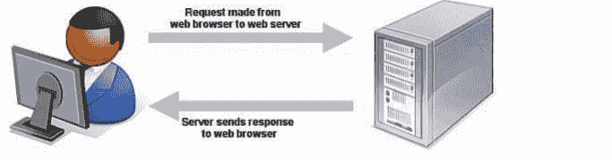

**图 1.1**
浏览器请求与服务器响应。

然而，在您看到所请求网站的全部内容之前，这个过程涉及几个步骤——并且可能需要在浏览器和服务器之间进行多次往返。

假设您想进行一次谷歌搜索，于是您忠实地在地址栏中输入 **www.google.com** 或从书签列表中选择谷歌书签。几乎立刻，您的浏览器就会向您显示类似图1.2所示的内容。

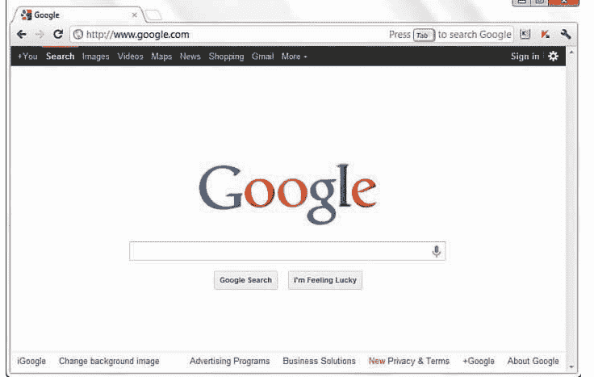

**图 1.2**
访问 www.google.com。

图1.2显示了一个包含文本和一张图片（谷歌标志）的网站。从网络服务器检索该文本和图片并在您的屏幕上显示的简化过程如下：

1.  您的网页浏览器发送一个位于 `http://www.google.com` 地址的 `index.html` 文件的请求。`index.html` 文件不一定是您在地址栏中输入的地址的一部分；您将在本课程后续内容中了解更多关于 `index.html` 文件的信息。
2.  在收到对特定文件的请求后，网络服务器进程会在其目录内容中查找该特定文件，打开它，并将该文件的内容发送回您的网页浏览器。
3.  网页浏览器接收到 `index.html` 文件的内容，这是用HTML代码标记的文本，并根据这些HTML代码呈现内容。在呈现内容时，浏览器会遇到Google标志的HTML代码，您可以在图1.2中看到。HTML代码大致如下所示：
4.  浏览器查看 `` 标签中的 `src` 属性以找到源位置。在这种情况下，图像 `logo4w.png` 可以在同一网址（`www.google.com`）的 `images` 目录中找到，该网址正是浏览器检索HTML文件的来源。
5.  浏览器请求位于网址 `http://www.google.com/images/srpr/logo4w.png` 的文件。
6.  网络服务器解释该请求，找到文件，并将该文件的内容发送给发出请求的网页浏览器。
7.  网页浏览器在您的显示器上显示该图像。

```html

```

`` 标签提供了告诉浏览器显示标志所需的文件源位置（`src`）、替代文本（`alt`）、宽度（`width`）和高度（`height`）的属性。（您将在后续课程中了解更多关于属性的知识。）

正如您在网页内容交付过程的描述中所看到的，网页浏览器不仅仅充当您可以查看内容的画框。浏览器组装网页内容组件，并根据文件中的HTML命令排列这些部分。

可以在本地查看网页内容——即在您自己的硬盘驱动器上——而无需网络服务器。内容检索和显示的过程与前面步骤中列出的过程相同，即浏览器查找并解释HTML文件的代码和内容。然而，行程更短：浏览器在您自己的计算机硬盘驱动器上查找文件，而不是在远程机器上。需要网络服务器来解释文件中嵌入的任何基于服务器的编程语言，但这超出了本课程的范围。事实上，您可以在没有自己的网络服务器的情况下完成所有课程，但那样除了您自己，就没有人能看到您的杰作了。

#### 选择网站托管服务提供商

尽管我刚刚告诉您可以在没有网络服务器的情况下完成所有这些课程，但拥有一个网络服务器是继续学习的推荐方法。别担心；获得一个托管服务提供商通常是一个快速、无痛且相对便宜的过程。实际上，您只需花费比您正在阅读的这些课程略高一点的费用，就可以拥有自己的域名和一年的网站托管服务。

如果您在您选择的搜索引擎中输入 **web hosting provider**，您将获得数百万条点击结果和无尽的赞助搜索结果列表（也称为 *广告*）。即使您查看的是托管服务提供商的托管列表，也可能让人应接不暇——尤其是当您只想为自己或您的公司或组织找一个托管简单网站的地方时。

在寻找提供商时，您需要缩小搜索范围，并选择一个最符合您需求的提供商。以下是选择网站托管服务提供商的一些标准：

-   **可靠性/服务器“正常运行时间”** ——如果您有在线存在，您希望确保人们能够始终如一地访问。
-   **客户服务** ——寻找多种联系客户服务的方法（电话、电子邮件、聊天），以及针对常见问题的在线文档。
-   **服务器空间** ——托管套餐是否包含足够的服务器空间来容纳您计划包含在网站中的所有多媒体文件（图像、音频、视频）（如果有的话）？
-   **带宽** ——托管套餐是否包含足够的带宽，使得所有访问您网站和下载文件的人无需额外付费即可完成？
-   **域名购买和管理** ——该套餐是否包含自定义域名，或者您是否必须单独购买和维护您的域名？
-   **价格** ——不要为托管服务多付钱。您会看到各种各样的价格，并应该立即想：“有什么不同？”通常，这种差异与服务质量关系不大，而与公司管理费用以及公司认为可以向人们收取的费用有关。一个经验法则是，如果您每年为基本托管套餐和域名支付的费用超过75美元，那么您可能付得太多了。

以下是三个可靠的网站托管服务提供商，它们的基本套餐包含了大量的服务器空间和带宽（以及域名和额外福利），成本相对较低：

作者们多年来使用过所有这些提供商（以及其他一些），并且可以毫无问题地推荐其中任何一个。Julie主要使用DailyRazor作为网站托管服务提供商，尤其是在高级开发环境中，而Jennifer倾向于使用Bluehost。

-   **A Small Orange (www.asmallorange.com)** ——Tiny和Small共享托管套餐是新的网页内容发布者的完美起点。
-   **DailyRazor (www.dailyrazor.com)** ——其网站托管套餐功能齐全且可靠。
-   **Bluehost (www.bluehost.com)** ——Basic共享托管套餐适用于许多个人和小型企业网站。

如果您不选择这些网站托管服务提供商中的任何一个，您至少可以使用它们的基本套餐描述作为您货比三家的指南。

一个好的托管服务提供商的一个特点是，它为您提供一个“控制面板”来管理您账户的各个方面。图1.3显示了DailyRazor上托管账户的控制面板。许多网站托管服务提供商提供这种特定的控制面板软件（称为cPanel）或另一个设计相似的控制面板——带有清晰标记的图标，引导您执行可以配置和管理账户的任务。

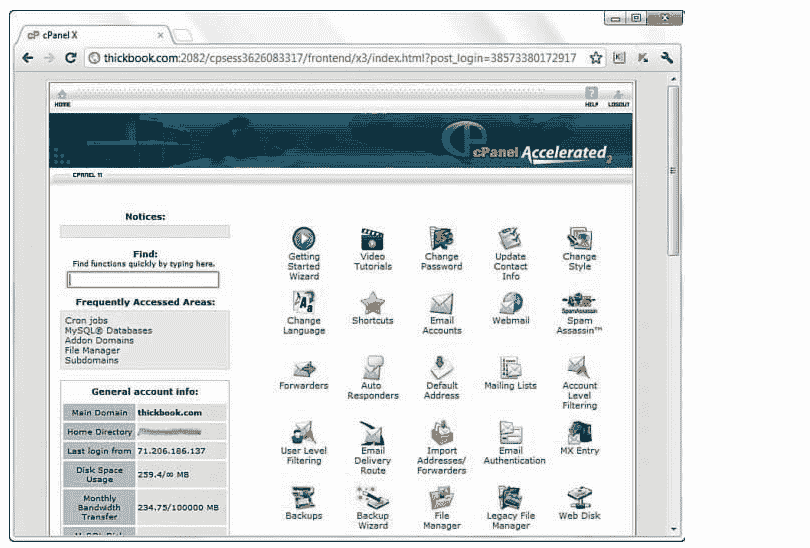

**图 1.3**
示例控制面板。

您可能永远不需要使用您的控制面板，但拥有它可以简化数据库和其他软件的安装、网站统计数据的查看以及电子邮件地址的添加（以及许多其他功能）。如果您能遵循说明，您就可以管理自己的网络服务器——无需特殊培训。

#### 使用多种网页浏览器和设备进行测试

既然我们刚刚讨论了网页内容交付和获取网络服务器的过程，现在回过头来谈论使用多种网页浏览器和设备测试您的网站，可能看起来有点奇怪。然而，在您开始全面学习如何使用HTML和CSS创建网站之前，请记住这个非常重要的声明：访问您网站的每一位访问者都可能使用与您不同的硬件和软件配置，包括他们的设备类型（台式机、笔记本电脑、平板电脑、手机）、操作系统（Windows、Mac、Android、iOS）、屏幕分辨率、浏览器类型、浏览器窗口大小以及连接速度。请记住，您无法控制访问者在查看您的网站时所使用的任何方面。因此，正如您设置网络托管环境并准备开始工作时，考虑下载几种网页浏览器，以便您拥有一套本地测试工具。让我们解释一下为什么这很重要。

尽管所有网页浏览器都以大致相同的方式处理和处理信息，但它们之间的一些特定差异导致在不同浏览器中显示的效果并不总是相同。即使是相同版本相同网页浏览器的用户，也可以通过选择不同的显示选项和/或更改其查看窗口的大小来改变页面的显示方式。所有主要的网页浏览器都允许用户用自己选择的背景颜色和字体覆盖网页作者指定的颜色和字体。屏幕分辨率、窗口大小和可选工具栏也会改变人们首次在屏幕上看到页面时所能看到的内容。您只能确保您编写的是符合标准的HTML和CSS。

> 注意
在第四部分“响应式网页设计”中，您将了解响应式网页设计的概念，其中网站的设计会根据用户的行为和查看环境（屏幕大小、设备等）自动调整和变化。

无论如何，不要花费数小时设计一个仅在您自己的计算机上看起来完美的东西——除非您愿意在朋友的电脑、街角咖啡店的电脑或您的iPhone上查看时感到失望。

您应该始终尽可能多地使用以下网页浏览器测试您的网站：

-   Apple Safari (https://www.apple.com/safari/) 适用于Mac
-   Google Chrome (https://www.google.com/chrome/) 适用于Mac、Windows和Linux/UNIX


#### 创建示例文件

在你实际创建文件之前，先来看一下代码清单 1.1。这个清单代表一个简单的网页内容——几行HTML代码，在浏览器窗口中央以大号粗体分两行打印出 "Hello World! Welcome to My Web Server ."。随着后续课程的学习，你将更深入地了解这个文件中使用的HTML和CSS。

```
代码清单 1.1  我们的示例 HTML 文件
<!doctype html>
<html lang="en">
  <head>
    <meta charset="utf-8">
    <title>Hello World!</title>
  </head>
  <body>
    <h1 style="text-align: center;">Hello World!<br>
      Welcome to My Web Server.</h1>
  </body>
</html>
```

要使用此内容，请打开你选择的文本编辑器，例如 Windows 上的记事本 (Notepad) 或 Mac 上的文本编辑 (TextEdit)。不要使用写字板 (WordPad)、Microsoft Word 或其他功能齐全的文字处理软件，因为这些程序创建的文件类型与我们用于网页内容的纯文本文件不同。

大多数网页设计师并不使用记事本或文本编辑来编写网页。相反，他们使用专门为此目的设计的编辑器。这些编辑器提供更多功能，使编写和设计网页变得更加容易。以下是一些最受欢迎的编辑器：

- **Coda** (https://panic.com/coda/)——专为Mac设计的网页编辑文本编辑器。
- **HTML-Kit** (https://www.htmlkit.com)——Windows 上流行的文本编辑器。旧版本是免费的。
- **Komodo Edit** (https://www.activestate.com/komodo-edit)——流行 Komodo IDE 的免费开源版本。它可在 Windows、Mac 和 Linux 上运行。
- **Notepad++** (https://notepad-plus-plus.org)——适用于 Windows 的免费开源编辑器。
- **Sublime Text** (https://sublimetext.com)——适用于所有平台的流行编辑器，同时拥有丰富的免费插件生态系统。

一旦你决定了要使用的编辑器，请输入你在代码清单 1.1 中看到的内容，然后将文件保存为 `sample.html`。`.html` 扩展名告诉 Web 服务器你的文件是用 HTML 编写的。当文件内容被发送到请求它的 Web 浏览器时，浏览器也会知道它是 HTML 并会相应地渲染它。

现在你有了一个示例 HTML 文件可供使用——并且希望也有地方放置它，例如虚拟主机账户——让我们开始发布你的网页内容。

#### 使用 FTP 传输文件

正如你迄今为止所了解的，你必须将你的网页内容放在 Web 服务器上，才能让其他人访问。这个过程通常通过使用*文件传输协议 (FTP)*来完成。要使用 FTP，你需要一个 FTP 客户端——一个用于将文件从你的计算机传输到 Web 服务器的程序。

FTP 客户端需要三块信息来连接到你的 Web 服务器；这些信息会在你设置账户后由托管服务商发送给你：

- 你将要连接到的主机名或地址
- 你的账户用户名
- 你的账户密码

当你拥有这些信息时，就可以使用 FTP 客户端将内容传输到你的 Web 服务器了。

##### 选择 FTP 客户端

所有 FTP 客户端通常使用相同类型的界面。图 1.4 屏幕显示了 FireFTP 的示例，这是一个与 Firefox 网页浏览器一起使用的 FTP 客户端。本地计算机（你的计算机）的目录列表出现在屏幕左侧，远程计算机（Web 服务器）的目录列表出现在右侧。通常，你会看到向右箭头和向左箭头按钮，如图 1.4 所示。向右箭头将选定的文件从你的计算机发送到你的 Web 服务器；向左箭头将文件从 Web 服务器发送到你的计算机。许多 FTP 客户端还允许你简单地选择文件，然后将其拖放到目标计算机上。

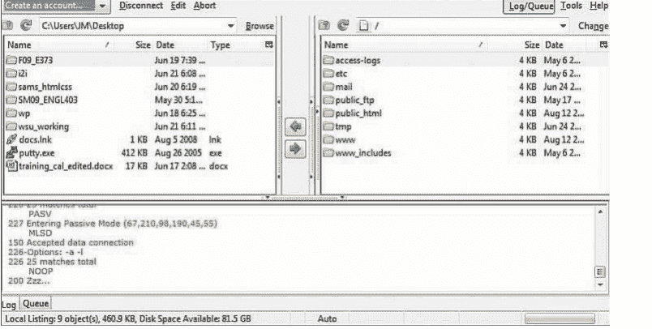

**图 1.4**
FireFTP 界面。

> **注意**
许多网页编辑程序都包含内置的 FTP 客户端。如果你计划使用网页编辑程序，请在下载（或购买）另一个 FTP 客户端之前，先查明它是否已包含此功能。

许多 FTP 客户端对你来说是免费可用的，但你也可以通过基于网页的文件管理器工具来传输文件，该工具通常是你的 Web 服务器控制面板的一部分。然而，那种文件传输方法通常会在过程中引入更多步骤，并且不如在自己的计算机上安装 FTP 客户端的过程那样精简（或简单）。

以下是一些流行的免费 FTP 客户端：

- 适用于 Mac 和 Windows 的 Classic FTP (https://www.nchsoftware.com/classic/)
- 适用于 Mac 的 Cyberduck (https://cyberduck.io)
- 适用于所有平台的 FileZilla (https://filezilla-project.org)
- 适用于 Mac 的 Transmit (https://panic.com/transmit)

当你选择了一个 FTP 客户端并将其安装在你的计算机上后，你就可以准备从你的 Web 服务器上传和下载文件了。在下一节中，你将看到这个过程是如何使用代码清单 1.1 中的示例文件工作的。

##### 使用 FTP 客户端

以下步骤展示了如何使用 Transmit 连接到你的 Web 服务器并传输文件。但是，所有 FTP 客户端都使用类似的界面，因此如果你理解了以下步骤，你应该能够使用任何 FTP 客户端。

记住，你首先需要主机名、账户用户名和账户密码。当你拥有它们时，请按照以下步骤操作：

1.  启动 Transmit 程序并单击 FTP 选项卡。你会被提示填写有关你要连接的站点的信息，如图 1.5 所示。

    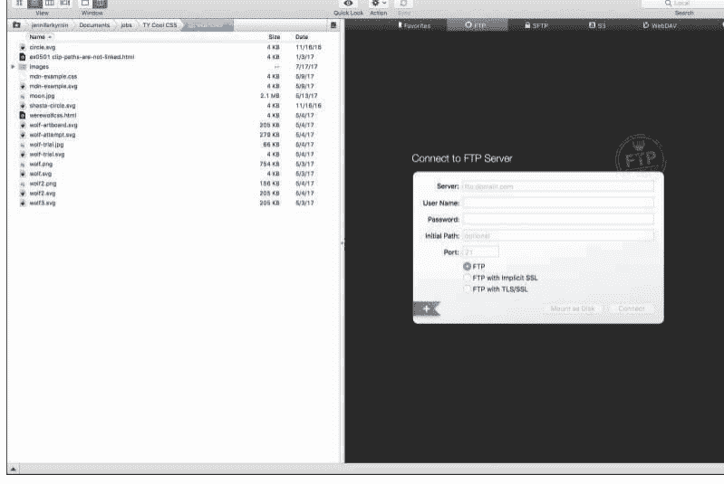

    **图 1.5** 在 Transmit 中连接到新站点。

2.  填写图 1.5 中显示的每个项目，说明如下：
    * “服务器 (Server)” 是你需要发送网页的 Web 服务器的 FTP 地址。你的托管服务商会提供这个地址。它很可能是 *yourdomain.com*，但请查看你注册服务时收到的信息。
    * 使用你的托管服务商提供的信息填写“用户名 (User Name)”字段和“密码 (Password)”字段。
    * 现在暂时将“初始路径 (Initial Path)”字段留空。你将在本课后面更多地了解此内容。
    * 将“端口 (Port)”字段设置为 21 并选择 FTP，除非你的托管服务商指定使用 SSL 或 TLS/SSL。
    * 完成设置后，单击“连接 (Connect)”以连接到 FTP 服务器。如果你想将此服务器添加到收藏夹中，可以单击加号图标。

你现在在右下角看到一个倒计时计时器，表明 Transmit 正在尝试连接到 Web 服务器。连接成功后，你会看到如图 1.6 所示的界面，左侧显示本地目录的内容，右侧显示你的 Web 服务器的内容。

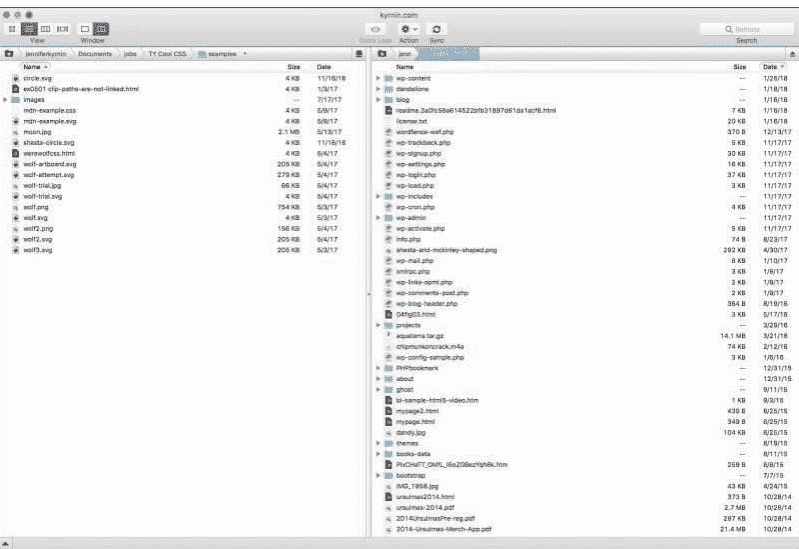

**图 1.6**
通过 Transmit 成功连接到远程 Web 服务器。

现在你几乎准备好将文件传输到你的 Web 服务器了。剩下的就是切换到所谓的 Web 服务器文档根目录的目录。你的 Web 服务器的文档根目录是被指定为你网页内容的顶级目录的目录——这是目录结构的起点，你将在本课后面更多地了解。通常，这个目录名为 public_html、www（因为 www 已被创建为 public_html 的别名）或 htdocs。你不需要创建这个目录；你的托管服务商会为你创建它。

**3.** 双击文档根目录名称以打开它。FTP 客户端界面右侧显示的更改以显示此目录的内容。（此时它可能是空的，除非你的虚拟主机提供商已代表你在该目录中放入了占位符文件。）

**4.** 目标是将你之前创建的 `sample.html` 文件从你的计算机传输到 Web 服务器，因此在 FTP 客户端界面左侧的目录列表中找到该文件（如果需要，请导航）。

**5.** 单击该文件并将其拖动到窗口右侧以将文件发送到 Web 服务器。（或者，你可以双击该文件进行传输。）当文件传输完成时，客户端界面右侧会刷新以向你显示文件已到达其目的地。

**6.** 转到“文件 (File)”菜单并选择“断开连接 (Disconnect)”以关闭连接，然后退出 Transmit 程序。

这些步骤在概念上类似于你任何时候想通过 FTP 将文件发送到 Web 服务器时所采取的步骤。你还可以使用你的 FTP 客户端在远程 Web 服务器上创建子目录。要使用 Transmit 创建子目录，请在你希望文件夹所在的目录中右键单击并选择“新建文件夹 (New Folder)”。不同的 FTP 客户端有不同的界面选项来实现相同的目标。

##### 理解文件在 Web 服务器上的放置位置

维护网页内容的一个重要方面是确定你将如何组织这些内容——不仅是为了用户查找，也是为了你在服务器上维护。将文件放在目录中有助于你管理这些文件。

你如何命名和组织 Web 服务器上的目录，以及是否为文件维护制定规则，完全取决于你自己。从长远来看，维护一个组织良好的服务器可以使你更高效地管理其内容。

#### 基本文件管理

当你浏览网络时，你可能已经注意到，当你在网站之间导航时，URL 会发生变化。例如，如果你正在查看一个公司的网站，并且你点击了指向该公司产品或服务的图形导航，URL 可能会从

    http://www.companyname.com/

变为

    http://www.companyname.com/products/


#### 使用索引页

当你想到索引时，你可能想到的是书本后面的章节，它告诉你在哪里可以找到各种关键词和主题。Web服务器目录中的索引文件可以起到类似的作用——如果你这样设计的话。事实上，这就是这个名称的由来。

`index.html`文件（或通常被称为*索引文件*）是你赋予页面的名称，当人们浏览你网站中的特定目录时，你会希望他们看到这个默认文件。

索引页的另一个功能是，访问你网站中某个有索引页的目录但未指定该页面的用户，仍然会进入该部分或整个网站的主页面。

例如，你可以输入以下任一URL并跳转到苹果公司的iPhone信息页面：

- http://www.apple.com/iphone/
- http://www.apple.com/iphone/index.html

如果iphone目录中没有index.html页面，结果将取决于Web服务器的配置。如果服务器配置为禁止目录浏览，用户在尝试访问未指定页面名称的URL时，会看到“目录列表被拒绝”的消息。但是，如果服务器配置为允许目录浏览，用户将看到该目录中的文件列表。

你的托管服务提供商已经确定了这些服务器配置选项。如果你的托管服务提供商允许你通过控制面板修改服务器设置，你可以更改这些设置，以便你的服务器根据你自己的要求响应请求。

索引文件不仅在子目录中使用，也在你网站的顶层目录（或文档根目录）中使用。你网站的首页——或者你喜欢称之为*主页*或*主页面*，即你希望用户首次访问你的域名时看到的网页内容——应该命名为index.html，并放置在你的Web服务器的文档根目录中。这确保了当用户在他们的Web浏览器中输入**http://www.yourdomain.com/**时，服务器会响应你希望他们看到的内容（而不是“目录列表被拒绝”或其他一些意外结果）。

#### 无需Web服务器分发内容

在线发布HTML和多媒体文件显然是学习HTML和创建网页内容的主要原因。然而，在某些情况下，其他形式的发布也可能会有用。例如，你可能想在贸易展上分发CD-ROM、DVD-ROM或USB驱动器，其中包含设计为网页内容的营销材料——也就是说，可以通过Web浏览器查看的超文本，但不涉及Web服务器。你还可能想在培训研讨会上，通过可移动介质向学生提供基于HTML的指导手册。这些只是HTML页面如何在不涉及互联网的出版场景中使用的两个例子。

这个过程被称为创建*本地*网站；即使不涉及Web服务器，这些超文本内容的集合仍然被称为*网站*。*本地*这个词之所以适用，是因为你的文件是在本地访问的，而不是远程访问（通过Web服务器）。

##### 本地发布内容

假设你需要创建一个本地网站，并希望通过USB驱动器分发。如今，即使是最便宜的USB驱动器也能容纳如此多的数据——而基本的超文本文件相当小——你可以在一个小小的驱动器上分发整个网站*以及一个功能完整的Web浏览器*。

**注意**：创建和分发本地网站时，分发Web浏览器并非必需，尽管这是个不错的选择。你可以合理地假设用户有自己的Web浏览器，并且会打开目录中的`index.html`文件来开始浏览超文本内容。但是，如果你想在USB驱动器上分发Web浏览器，请访问 https://portableapps.com/ 并查找Portable Firefox或Portable Chrome。

你可以像考虑Web服务器的目录结构一样考虑USB驱动器的目录结构。USB驱动器目录结构的顶层可以是你的文档根目录。或者，如果你在分发内容的同时还附带了Web浏览器，你可能有两个目录——例如，一个名为`browser`，另一个名为`content`。在这种情况下，`content`目录将是你的文档根目录。在文档根目录内，你可以有额外的子文件夹，用于放置内容和其他多媒体资产。

保持本地网站的良好组织与维护远程网站同样重要，这样可以避免HTML文件中的链接失效。你将在第7课中了解更多关于链接文件的具体细节。

##### 在博客上发布内容

你可能有一个由第三方托管的博客，例如WordPress、Tumblr或Blogger，因此你可能在没有专用Web服务器甚至不了解任何HTML的情况下就已经发布了内容。这些服务除了提供*源代码编辑器*外，还提供*可视化编辑器*，这意味着你可以输入文字并添加如粗体、斜体或字体颜色等格式，而无需了解这些操作的HTML代码。当你在这些编辑器中点击“发布”按钮时，内容就会变成实际的HTML。

然而，通过这些课程你将学到的知识，你的博客写作将得到增强，因为你将能够使用博客文章内容和博客模板的源代码编辑器，这将让你对内容的外观和感觉有更多控制权。这些操作的过程与你学习创建HTML文件并通过FTP上传到自己专用Web服务器的过程不同，但如果我们不指出博客实际上是网络发布的一种形式，那将是我们的疏忽。

#### 测试网页内容的技巧

每当你将文件传输到Web服务器或将其放置在可移动介质上进行本地浏览时，你都应该彻底测试每个页面。以下列表有助于你确保网页内容的行为符合你的预期。请注意，其中一些术语在此时可能对你来说有些陌生，但随着你继续这些课程的学习并创建更大的项目，请回到这个列表：

- 在传输文件之前，请在你的本地机器上测试它们，以确保链接有效且内容反映了你预期的视觉设计。在将页面传输到Web服务器或可移动设备后，请再次全部测试。


#### 课程1：理解网络工作原理

► 尽可能使用多种浏览器和设备执行这些测试——Chrome、Firefox、Microsoft Edge、Opera 和 Safari 是不错的组合——并在 Mac 和 Windows 平台以及手机和平板电脑等移动设备上进行。如果可能，请在低分辨率（800 × 600）和高分辨率（1920 × 1080）下检查。
► 在开始测试前，关闭网页浏览器中的自动图像加载功能，以便查看没有图形时每个页面的样子。检查你的替代文本（alt text），然后重新打开图像加载以加载图形并再次仔细检查页面。
► 使用浏览器的字体大小设置，以各种字体大小查看每个页面，确保当用户用他们自己的字体规范覆盖你的字体规格时，你的布局不会散架。
► 等待每个页面完全加载完毕，然后一路向下滚动，确保所有图像都出现在它们应有的位置。
► 计时每个页面加载所需的时间。使用 Google Page Speed (https://developers.google.com/speed/) 等工具来确保页面不会太慢。加载缓慢的页面会惹恼用户，并可能导致你的网站被搜索引擎惩罚。

如果你的页面通过了所有这些测试，你就可以放心了：你的网站已准备好向公众展示。

### 总结

本课程向你介绍了使用 HTML 标记文本文件以生成网页内容的概念。你了解到 HTML 生成结构，CSS 创建外观，JavaScript 控制页面的行为。你还了解到网页内容不仅仅是“页面”；网页内容还包括图像、音频和视频文件。所有这些内容都存储在 Web 服务器上——一台通常远离你电脑的远程机器。在你的电脑或其他设备上，你使用网页浏览器来请求、检索并最终在屏幕上显示网页内容。

你了解了在决定网络托管提供商是否符合你的需求时需要考虑的标准。选择了网络托管提供商后，你可以开始使用 FTP 客户端将文件传输到你的 Web 服务器，你也学到了如何操作。你还了解了 Web 服务器目录结构和文件管理，以及 `index.html` 文件在给定 Web 服务器目录中的非常重要的作用。此外，你了解到你可以在可移动介质上分发网页内容，并且你学会了如何组织文件和目录以实现无需使用远程 Web 服务器即可查看内容的目标。

最后，你了解到将内容放置到 Web 服务器后，在多个浏览器中测试你的作品的重要性。编写有效的、符合标准的 HTML 和 CSS 有助于确保你的网站在所有访问者看来大致相似，但你仍然不应该在没有来自开发团队之外的潜在用户反馈的情况下进行设计；*尤其*是在你是一个独立设计团队时，获取他人的反馈至关重要！

### 问与答

**问：** 我查看了一些网页的 HTML 源代码，看起来学起来可怕地困难。我必须像计算机程序员一样思考才能学习这些内容吗？

**答：** 尽管复杂的 HTML 页面看起来确实令人生畏，但学习 HTML 比学习实际的软件编程语言（如 C++ 或 Java）要容易得多。HTML 是一种标记语言，而不是编程语言；你标记文本是为了让浏览器能够以某种方式渲染文本。它需要一套与开发计算机程序完全不同的思维过程。你实际上不需要任何作为计算机程序员的经验或技能就能成为网页内容创作者。

**问：** 运行你推荐的所有测试将比创建我的页面花费更长时间！我不能少做些测试吗？

**答：** 如果你的页面不打算赚钱或提供重要服务，那么当它们对某些用户看起来奇怪或偶尔出错时，可能也不是什么大问题。在这种情况下，只需用几种不同的浏览器测试每个页面就完事了。然而，如果你需要树立专业形象，严格的测试是必不可少的。

**问：** 说真的，谁在乎我如何组织我的网页内容？

**答：** 信不信由你，你网页内容的组织确实对搜索引擎和你网站的潜在访问者很重要。但总的来说，拥有一个有组织的 Web 服务器目录结构可以帮助你跟踪可能经常更新的内容。例如，如果你有一个专门用于图像或多媒体的目录，你就能准确地知道去哪里找你想要更新的文件——无需在包含其他内容的目录中搜寻。

### 研讨会

研讨会包含测验题和练习，以帮助你巩固对所涵盖材料的理解。

### 测验

1. 要在 Web 服务器上存储多少个文件才能创建一个包含一些文本和两张图像的网页？
2. 浏览器需要向服务器发出多少次请求才能显示一个包含一些文本和两张图像的网页？
3. 在网络托管提供商中应该寻找哪些特性？
4. 你应该使用多少种浏览器来测试你的网页？
5. 你应该使用哪种类型的编辑器来创建网页？
6. 通过 FTP 连接到你的 Web 服务器需要哪三条信息？
7. 什么是文档根（document root）？
8. 是否可以将网页发布到 USB 驱动器上？
9. `index.html` 文件的目的是什么？
10. 你的网站是否必须包含目录结构？

> **注意**

仅提醒那些在印刷版或电子版阅读这些内容的读者：如果你访问 www.informit.com/register 并注册本书（使用 ISBN 9780672338083），你可以免费访问在线网络版，其中不仅包含本书的完整文本，还具有本测验的交互式版本。

### 答案

1. 你需要三个文件：一个用于网页本身，包含文本和 HTML 标记，另外两个分别用于两张图像。
2. 需要向服务器发出三次请求：一次用于 HTML 本身，另外两次分别用于两张图像。
3. 寻找可靠性、客户服务、网络空间和带宽、域名服务、网站管理附加功能以及价格。
4. 你应该在尽可能多的浏览器和设备上测试你的网站。
5. 你应该使用文本编辑器，例如 Notepad 或 TextEdit。你也可以使用专门用于编写 HTML 的编辑器，例如 Komodo Edit 或 Coda。
6. 你需要主机名、你的账户用户名和账户密码。
7. 文档根是 Web 服务器上的顶级目录——域名后的尾随斜杠。
8. 是的。这称为在本地发布内容。
9. `index.html` 文件通常是 Web 服务器中目录的默认文件。它使用户可以在不使用尾随文件名的情况下访问 http://www.yourdomain.com/somedirectory/，并仍然到达正确的位置。
10. 不是。使用目录结构进行文件组织完全由你决定，但强烈建议使用，因为它简化了内容维护。

### 练习

- 安排好你的网络托管：你是打算通过在自己的计算机上本地查看文件来完成课程，还是打算使用网络托管提供商？请注意，大多数网络托管提供商在你购买托管计划的当天就能让你启动并运行。列出三个可能的托管提供商。
- 如果你使用的是外部托管提供商，那么使用你的 FTP 客户端在你的网站文档根目录中创建一个子目录。将 sample.html 文件的内容粘贴到另一个名为 index.html 的文件中，将 `<title>` 和 `</title>` 标签之间的文本更改为新的内容，并将 `<h1>` 和 `</h1>` 标签之间的文本更改为新的内容。保存文件并将其上传到新的子目录。使用你的网页浏览器导航到你的 Web 服务器上的新目录，并确保 index.html 文件中的内容显示出来。然后，使用你的 FTP 客户端从远程子目录中删除 index.html 文件。使用你的网页浏览器返回该 URL，重新加载页面，看看没有 index.html 文件时服务器如何响应。列出两个 FTP 客户端。
- 使用上一个练习中创建的相同文件集，将这些文件放置在可移动介质设备上——例如 CD-ROM 或 USB 驱动器。使用你的浏览器导航到你的示例网站的这个本地版本，并思考你必须随此可移动介质分发哪些说明，以便其他人可以使用它。


## 第2课

### 构建 HTML 文档

### 本课学习内容：

-   如何用 HTML 创建一个简单的网页
-   如何包含每个网页必须具备的所有 HTML 标签
-   如何使用段落和换行来组织页面
-   如何使用标题来组织内容
-   如何使用 HTML5 的语义化元素
-   如何使用语义化标签来标识页眉和页脚内容
-   如何使用语义化标签来标识导航和次要内容
-   如何使用语义化标签来更好地构建正文内容

在第一课中，你对创建网页内容并在线上（或者本地，如果你还没有网络托管服务商）查看它的基本流程有了初步了解。在本课中，我们将正式着手解释必须出现在 HTML 文件中的各种元素，以便你的网页浏览器能够正确地显示它们。

总的来说，本课对 HTML 基础知识进行了总结，并提供了一些实用的技巧，以帮助你作为网页开发者更高效地利用时间。随着你学习那些能够增强标记文本中信息的语义——即其含义——的 HTML5 元素，你将开始更深入地探究其背后的理论。你将仔细审视六个对文档进行可靠语义化结构化至关重要的元素：`<header>`、`<section>`、`<article>`、`<nav>`、`<aside>` 和 `<footer>`。

在本系列课程的后续部分，你将看到这些标签在代码示例中被恰当地使用，因此本课旨在确保你在继续学习之前，对它们的含义有很好的理解。

### 准备工作

以下是你准备好继续学习本课前需要做的事情回顾：

1.  **准备一台电脑。** 我们使用 Mac 电脑来测试示例网页内容并截取本课中的图片，但你可以使用任何 Windows、Mac 或 Linux/UNIX 机器来创建和查看你的网页内容。你甚至可以使用平板电脑或智能手机，但这会更困难一些。为了本课程的学习，最好准备一台电脑或笔记本电脑。
2.  **接入互联网。** 对于创建和查看你的网页内容，无论是拨号、无线还是宽带连接，影响不大，但连接速度越快，整体体验越好。为你提供互联网连接的互联网服务提供商、学校或企业可以帮助你完成正确设置的详细事宜。此外，许多公共场所，如咖啡店、书店和图书馆，都提供免费的无线互联网服务，如果你有一台支持 Wi-Fi 的笔记本电脑，就可以使用。
3.  **获取网络浏览器软件。** 这是你的计算机用于检索和显示网页内容所需的软件。正如你在第一课中所学到的，最流行的浏览器（按字母顺序排列）有 Apple Safari、Google Chrome、Microsoft Edge、Mozilla Firefox 和 Opera。安装几个这样的浏览器是一个好主意，这样你可以进行试验并确保你的内容在所有浏览器中看起来一致；你无法假设其他人使用的是什么浏览器。
4.  **去探索！** 使用网络浏览器在互联网上查找与你想要创建的网站在内容或外观上相似的网站。注意哪些页面会让你感到沮丧，哪些页面能吸引你并让你继续阅读，以及是什么让你一遍又一遍地回到某些页面。如果某个特定主题让你感兴趣，可以考虑使用流行的搜索引擎，如 Google (www.google.com) 或 Bing (www.bing.com) 进行搜索。

> **注意**
> 尽管所有网络浏览器处理和呈现信息的方式大体相同，但它们之间的一些具体差异意味着内容在不同的浏览器中看起来并不总是相同的。务必在多个浏览器中检查你的网页，以确保它们看起来大致一致。
> 对于移动设备尤其如此。越来越多的人使用手机和平板电脑等移动设备访问网页，而这些设备上的浏览器可能会以令人意想不到的方式显示你的页面。请务必在尽可能多的不同设备和屏幕尺寸上，以及不同的网络浏览器中测试你的页面。

> **注意**
> 正如第一课所讨论的，如果你计划将你的网页内容放到互联网上（而不是发布在 CD-ROM 或本地内联网上），你需要将其传输到一台每天 24 小时连接互联网的计算机上。为你提供互联网接入的同一公司或学校也可能提供网络空间；如果没有，你可能需要向托管服务商付费获取服务。

### 创建一个简单的网页

在第一课中，你了解到网页只是一个文本文件，它被 HTML 代码标记（或包围），这些代码告诉浏览器如何显示文本。要创建这些文本文件，请使用文本编辑器，如 Notepad（在 Windows 上）、TextEdit（在 Mac 上）或任何其他建议的编辑器；不要使用写字板、Microsoft Word 或其他功能齐全的文字处理软件，因为它们创建的文件不同于我们用于网页内容的纯文本文件。

> **注意**
> 我们重申这一点，因为它对于最终结果和学习过程本身都非常重要：不要使用 Microsoft Word 或任何其他兼容 HTML 的文字处理器来创建你的第一个 HTML 文件；大多数这些程序会试图以奇怪的方式重写你的 HTML，可能会让你完全困惑。当你使用 Microsoft Word 并“另存为” HTML 时也是如此：你很可能会得到一个冗长且不合规、充满无法验证的 HTML 的文件，编辑它会让你头疼不已。
>
> 此外，我们建议你*不要*使用图形化、所见即所得（WYSIWYG）的编辑器，如 Adobe Dreamweaver。在你开始学习 HTML 时，从简单的文本编辑器开始，你可能会觉得更容易也更有教育意义。

> **注意**
> 正如第一课中提到的，大多数专业网页开发人员使用专为构建网页和 Web 应用程序设计的网页编辑器。我们更喜欢使用 Coda（适用于 Mac），但 Komodo Edit (https://www.activestate.com/komodo-edit) 是一款免费的编辑器，它具有许多编写 HTML、CSS 和 JavaScript 的有用功能。并且它适用于 Windows、Mac 和 Linux/UNIX。这些都是文本编辑器，没有前面“注意”部分提到的 WYSIWYG 编辑器的缺点。

在开始工作之前，你应该从一些你想要放到网页上的文本开始：

1.  找到（或写）几段关于你自己、你的家人、你的公司、你的垒球队或其他你感兴趣的某些主题的文字。
2.  将此文本保存为纯的、标准的 ASCII 文本。Notepad（在 Windows 上）和大多数其他简单的文本编辑器会自动将文件保存为纯文本，但如果你使用其他程序，你可能需要在选择“文件”->“另存为”后，将文件类型选择为此选项。

> **注意**
> 如果你选择在 Mac 电脑上使用 TextEdit，你需要进入“偏好设置”对话框，并在“新文档”窗格中选择“纯文本”。关闭智能拷贝/粘贴、智能引号和智能破折号也是一个好主意，这样你的网页文件才能正确编写。

在学习本课的过程中，你将向文本文件添加 HTML 标记（称为*标签*），从而将其转变为网页内容。

当你保存包含 HTML 标签的文件时，务必给它们一个以 `.html` 结尾的名称。这很重要；如果你在保存文件时忘记在文件名末尾输入 `.html`，大多数文本编辑器会为其赋予其他扩展名（如 `.txt`）。如果发生这种情况，当你尝试用网络浏览器查看它时，可能找不到该文件；即使找到了，它肯定也无法正确显示。换句话说，网络浏览器期望网页文件的文件扩展名为 `.html` 并且是纯文本格式。

访问网站时，你可能还会遇到扩展名为 `.htm` 的页面，这也是一个可接受的文件扩展名。你可能会在网上看到其他文件扩展名，如 `.jsp`（Java Server Pages）、`.asp`（Microsoft Active Server Pages）或 `.php`（PHP：超文本预处理器），但这些文件类型使用的是超出 HTML 和本课程范围的服务器端技术。然而，这些文件除了包含编程语言外，也包含 HTML。这些文件中的编程代码是在服务器端编译的，如果你在网络浏览器中查看源代码，你只能看到 HTML 输出。如果你查看源文件，你可能会看到编程和标记代码的复杂交织。

**代码清单 2.1** `<html>`、`<head>`、`<title>` 和 `<body>` 标签

```
<!doctype html>
<html lang="en">
  <head>
    <meta charset="utf-8">
    <title>The First Web Page</title>
  </head>
  <body>
    <p>
      In the beginning, Tim created the HyperText Markup Language.
      The Internet was without form and void, and text was upon the
      face of the monitor and the Hands of Tim were moving over the
      face of the keyboard. And Tim said, Let there be links; and
      there were links. And Tim saw that the links were good; and
      Tim separated the links from the text. Tim called the links
```

### 第二课：构建HTML文档

当你将代码清单 2.1 中的文本保存为 HTML 文件，并使用网页浏览器查看时，只会显示实际的标题和正文文本。

**图 2.1**

在代码清单 2.1 中，与每个 HTML 页面一样，以 `<` 开头并以 `>` 结尾的单词实际上是编码命令。这些编码命令被称为 *HTML 标签*，因为它们“标记”文本片段，并告诉网页浏览器这是什么类型的文本。这使得网页浏览器能够恰当地显示文本。HTML 标签可以用大写字母、小写字母或两者的组合来编写。但最佳实践建议你应该使用全小写字母编写标签。

文档的第一行是文档类型声明；你正在 *声明* 这是 html（具体来说是 HTML5），因为在 `<!doctype>` 标签中，用于将文档声明为 HTML5 的值就是 html。我们用全小写字母编写了这个标签，但许多人写成 `<!DOCTYPE>` 以区别于文档中的实际 HTML。

**自己试试 ▼**

#### 创建和查看基本网页

在你学习代码清单 2.1 中使用的 HTML 标签的含义之前，你可能想确切地看看我们是如何创建和查看文档本身的。请按照以下步骤操作：

1.  在 Windows 记事本（或 Mac 上的 TextEdit 或你选择的其他文本编辑器）中，键入代码清单 2.1 中的所有文本，包括 HTML 标签。
2.  选择“文件”，“另存为”。务必选择纯文本（或 ASCII 文本）作为文件类型。
3.  将文件命名为 `firstpage.html`。
4.  选择你硬盘上存放网页的文件夹——并记住你选择的文件夹！单击“保存”或“确定”按钮保存文件。
5.  现在启动你最喜欢的网页浏览器。（也让你的文本编辑器保持运行，这样你可以轻松地在查看和编辑页面之间切换。）

在 Microsoft Edge 中，选择“文件”，“打开”，然后单击“浏览”。如果你使用的是 Firefox 或 Safari，请选择“文件”，“打开文件”。导航到相应的文件夹并选择 `firstpage.html` 文件。一些浏览器和操作系统也支持你将 `firstpage.html` 文件拖放到浏览器窗口中进行查看。

*看！* 你应该能看到如图 2.1 所示的页面。

如果你已经获得了网络托管账户，此时你可以使用 FTP 将 `firstpage.html` 文件传输到网络服务器。事实上，从本课开始，说明都假设你有一个托管提供商，并且熟悉通过 FTP 来回发送文件；如果不是这种情况，你应该在继续之前复习第一课。或者，如果你有意识地选择在本地处理文件（没有网络托管），请准备好根据你的特定需求调整说明（例如忽略“传输文件”和“输入 URL”的说明）。

> **注意**
> 查看存储在你自己计算机上的网页不需要连接到互联网。默认情况下，你的网页浏览器每次启动时都会尝试连接到互联网，这在大多数情况下是有意义的。然而，如果你在硬盘上本地开发页面（离线），并且不断收到找不到页面的错误，这可能会很麻烦。如果你通过局域网、有线调制解调器、Wi-Fi 或 DSL 拥有全天候网络连接，这就不是问题了，因为浏览器永远不会抱怨离线。否则，适当的行动取决于你使用的浏览器类型；请查看浏览器“工具”菜单下的选项。

#### 每个网页必须具有的 HTML 标签

现在是时候向你揭示 HTML 标签的秘密语言了。当你理解了这种语言，你将拥有远超其他人的创造力。别告诉其他人，但这真的很容易。

第一行代码是文档类型声明；在 HTML5 中，这就是

`<!doctype html>`

这个声明将文档标识为 HTML5，从而确保网页浏览器知道预期并准备以 HTML5 渲染内容。

许多 HTML 标签有两个部分：一个 *开始标签*，表示文本片段的开始，和一个 *结束标签*，表示文本片段的结束。结束标签在 `<` 符号之后以 `/`（正斜杠）开始。

另一种类型的标签是 *空标签*，它不同之处在于不包含成对的开始标签和结束标签。相反，空标签由一个单独的标签组成，该标签以 `<` 开头，可以在 `>` 符号之前以 `/` 结尾。虽然在 HTML5 中不再明确要求结束斜杠，但它确实有助于与 XHTML 兼容：如果你的网站中有一堆旧的 XHTML，在你升级过程中它不会中断。在这些课程中，除非明确需要，否则我们将在空标签中省略 `/`。

以下是这三种标签的快速摘要，以确保你理解每个标签的作用：

-   *开始标签* 是一个 HTML 标签，表示 HTML 命令的开始；受命令影响的文本出现在开始标签之后。开始标签总是以 `<` 开头，以 `>` 结尾，例如 `<html>`。
-   *结束标签* 是一个 HTML 标签，表示 HTML 命令的结束；受命令影响的文本出现在结束标签之前。结束标签总是以 `</` 开头，以 `>` 结尾，例如 `</html>`。
-   *空标签* 是一个 HTML 标签，在页面中不包围任何文本的情况下发出 HTML 命令。空标签总是以 `<` 开头，以 `>` 结尾，并且没有结束标签，例如 `<meta>`。一些设计者在空标签中添加结束 `/>`，例如 `<meta />`，但这在 HTML5 中不是必需的。

> **注意**
> 你无疑在代码清单 2.1 中注意到，`<html>` 标签有一些额外的代码。这段代码包含语言属性（`lang`），用于指定与标签相关的附加信息。在这种情况下，它指定 HTML 中文本的语言是英语。如果你使用不同的语言编写，请将 `en`（英语）替换为你相关的语言标识符。`<meta>` 标签还有一个属性（`charset`）及其值（`utf-8`）。

例如，代码清单 2.1 中的 `<body>` 标签告诉网页浏览器页面实际正文内容从哪里开始，而 `</body>` 表示它在哪里结束。`<body>` 和 `</body>` 标签之间的所有内容都会显示在网页浏览器窗口的主显示区域中，如图 2.1 所示。

浏览器窗口的顶部（参见图 2.1）显示标题文本，即位于 `<title>` 和 `</title>` 之间的任何文本。标题文本也根据你使用的浏览器，在浏览器的“书签”或“收藏夹”菜单中标识该页面。为页面提供标题很重要，这样访问该页面的人可以正确地将它们添加为书签以备将来参考；搜索引擎也使用标题来提供搜索结果的链接。

你使用标签 `<meta charset="utf-8">` 定义页面使用的字符集。此标签定义页面将用什么字符集编写——在本例中为 UTF-8。此标签应始终紧跟在 HTML 文档中开始的 `<head>` 标签之后。没有它，你的页面可能容易受到黑客攻击。在这些课程中你创建的大多数网页即使没有这一行也是安全的，但始终包含它是一个好习惯。这样当你开始创建可能容易受到攻击的 Web 应用程序时，你就不会忘记它。

你将在创建的每个 HTML 页面中使用 `<body>` 和 `<title>` 标签对，因为每个网页都需要标题和正文文本。你还将使用 `<html>` 和 `<head>` 标签对，这是代码清单 2.1 中显示的另外两个标签。将 `<html>` 放在文档的最开头，仅仅表示该文档是一个网页。末尾的 `</html>` 表示网页的结束。

> **注意**
> 大多数网页浏览器会尝试显示开始 `<body>` 标签之后出现的任何内容——即使它出现在结束 `</html>` 标签之后。不要以为可以通过将内容放在 `<html>` 标签对外来隐藏内容。你将在后面的课程中学习如何隐藏内容不被显示。

在页面内部，有一个头部部分和一个主体部分。每个部分由 `<head>` 和 `<body>` 标签标识。其理念是头部中的信息以某种方式描述页面，但实际并不被网页浏览器显示。然而，放在主体中的信息会被网页浏览器显示。`<head>` 标签总是出现在页面 HTML 代码的开头附近，紧跟在开始的 `<html>` 标签之后。

> **注意**
> 你可能会发现创建和保存一个基本页面（也称为 *骨架页面* 或 *模板*）很方便，其中只包含 `doctype`、字符集以及开始和结束的 `<html>`、`<head>`、`<title>` 和 `<body>` 标签，类似于代码清单 2.1 中的文档。然后，每当你想创建一个新网页时，你可以打开该文档作为起点，省去每次输入所有那些必要标签的麻烦。

用于标识页面标题的 `<title>` 标签对位于页面头部，这意味着它放在开始的 `<head>` 标签之后，结束的 `</head>` 标签之前。在接下来的课程中，你将了解一些其他可以放在 `<head>` 和 `</head>` 之间的高级头部信息，例如用于设置页面样式的样式表规则。

代码清单 2.1 中的 `<p>` 标签包裹了一段文本。你应该尽可能将你的文本块放在适当的容器元素中；你将在未来的课程中了解更多关于容器元素的知识。


### 使用段落和换行符组织页面

当网页浏览器显示HTML页面时，它不会在意行尾或单词间的空格数量。例如，图2.2中显示的诗的顶部版本，每个单词后只有一个空格，即使代码清单2.2中的输入方式并非如此。这是因为HTML代码中多余的空白字符会自动缩减为一个空格。此外，当文本到达浏览器窗口边缘时，它会自动换行到下一行，无论原始HTML文件中换行符位于何处。

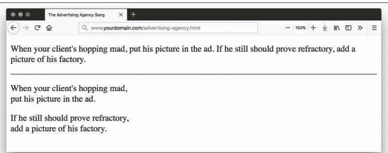

**图 2.2**
当代码清单2.2中的HTML作为网页查看时，只有在出现 `<br>` 和 `<p>` 标签的地方才会显示换行和段落分隔。

#### 代码清单 2.2 包含段落和换行符的HTML

```html
<!doctype html>
<html lang="en">
  <head>
    <meta charset="utf-8">
    <title>The Advertising Agency Song</title>
  </head>
  <body>
    <p>
      When your client's hopping mad,
      put his picture in the ad.

      If he still should prove refractory,
      add a picture of his factory.
    </p>
    <hr>
    <p>
        When your client's hopping mad,<br>
        put his picture in the ad.
    </p>
    <p>
        If he still should prove refractory,<br>
        add a picture of his factory.
    </p>
  </body>
</html>
```

如果你想控制换行和段落分隔实际出现的位置，必须使用HTML标签。当文本被包含在 `<p></p>` 容器标签内时，会在结束标签后自动假定一个换行符。在后续课程中，你将学习如何使用CSS来控制换行的高度。`<br>` 标签用于在段落内强制换行。与你目前见过的其他标签不同，`<br>` 不需要闭合的 `</br>` 标签；这是之前讨论过的那些空标签之一。

**注意**

对于空元素，如果没有要求必须使用闭合斜杠，你可能会问为什么许多人仍然包含它。一个原因是多年来，闭合标签经历了从不需要，到需要，再到（再次）不需要的过程，许多人已经习惯了使用这个完全有效但不再必需的闭合斜杠。另一个原因是，由于中间那个需要的时期相对较长，*大量*的代码编辑器、代码生成器和模板都使用闭合斜杠，所以你会看到它使用得更频繁。选择哪种方式编写并不重要，因为两种方式都是有效的；只要确保你遵循的编码风格在其使用上保持一致即可。

代码清单2.2和图2.2中的这首诗展示了 `<br>` 和 `<p>` 标签如何用于分隔一首广告公司歌曲的行和节。你可能还注意到代码清单中的 `<hr>` 标签，它会导致页面上出现一条水平线（或设计术语中的“分隔线”，参见图2.2）。使用 `<hr>` 标签插入水平分隔线也会导致换行，即使你没有在旁边包含 `<br>` 标签。与 `<br>` 一样，`<hr>` 水平分隔线标签也是一个空标签，因此永远不会带有 `</hr>` 闭合标签。

**注意**

在HTML5中，段落标签不再要求必须包含闭合的 `</p>` 标签。当出现另一个开始的 `<p>` 标签或其他块级元素时，会假定闭合。但就像空标签中的闭合斜杠一样，许多人更喜欢在他们的段落中包含闭合的 `</p>`。选择哪种方式编写段落并不重要，因为两种方式都是有效的。在这些课程中，我们会闭合段落，以便在HTML中有一个视觉提醒，表明任何应用的样式应在哪里结束。

### 在HTML中格式化文本

尝试动手将一段文本格式化为正确的HTML：

- 1. 在文本开头添加 `<html><head><meta charset="utf-8"><title>My Title</title></head><body>`（为你自己的页面使用你自己的标题，而不是 *My Title*）。同时在页面顶部包含文档类型声明，以满足标准HTML的要求。
- 2. 在文本的最后添加 `</body></html>`。
- 3. 在每个段落的开头添加一个 `<p>` 标签，在每个段落的结尾添加一个 `</p>` 标签。
- 4. 在任何需要单行距换行的地方使用 `<br>` 标签。
- 5. 使用 `<hr>` 来绘制水平分隔线，分隔文本的主要部分或任何你想在页面上看到横线的地方。
- 6. 将文件保存为 *mypage*.html（使用你自己的文件名，而不是 *mypage*）。

> **注意**
如果你正在使用文字处理软件创建网页，请务必将HTML文件保存为纯文本或ASCII格式。但正如我们多次重申的，你真的应该使用文本编辑器，如Notepad或TextEdit，或网页编辑器，如Komodo Edit或Coda。

- 7. 在网页浏览器中打开文件以查看你的网页内容。（如果你有，可以通过FTP将文件发送到你的网络托管账户。）
- 8. 如果有什么地方看起来不对，回到文本编辑器进行修正并再次保存文件（如果适用，再次发送到你的网络托管账户）。在浏览器中点击重新加载/刷新以查看你所做的更改。

### 使用标题组织你的内容

当你在互联网上浏览网页时，你会注意到许多网页顶部都有一个标题，它看起来比其余文本更大、更粗体。代码清单2.3是一个简单网页的示例代码和文本，包含一个与普通段落文本相比的标题示例。在 `<h1>` 和 `</h1>` 标签之间的任何文本都将显示为一个大标题。此外，`<h2>` 和 `<h3>` 等等，一直到 `<h6>`，会创建依次变小的标题。

#### 代码清单 2.3 标题标签

```html
<!doctype html>
<html lang="en">
  <head>
    <meta charset="utf-8">
    <title>My Widgets</title>
  </head>
  <body>
    <h1>My Widgets</h1>
    <p>My widgets are the best in the land. Continue reading to learn more about my widgets.</p>

    <h2>Widget Features</h2>
    <p>If I had any features to discuss, you can bet I'd do it here.</p>

    <h3>Pricing</h3>
    <p>Here, I would talk about my widget pricing.</p>

    <h3>Comparisons</h3>
    <p>Here, I would talk about how my widgets compare to my competitor's widgets.</p>
  </body>
</html>
```

**注意**

到现在为止，你可能已经注意到，HTML代码通常会被其作者缩进，以揭示HTML文档不同部分之间的关系，同时为了简单易读。这种缩进完全是可选的；你同样可以将所有标签连在一起，没有空格或换行，当在浏览器中查看时，它们仍然会显示正常。你经常会看到这种紧凑风格用于为速度优化的页面上。缩进是为了你和其他人类编辑，以便你能快速查看充满代码的页面，并理解它是如何组合在一起的。将代码缩进是另一个良好的网页设计习惯，最终使你的页面更易于维护，无论是对你自己还是对任何可能接手你工作的人都一样。

正如你可以在图2.3中看到的，创建标题的HTML非常简单。在这个例子中，短语"My Widgets"使用 `<h1>` 标签醒目地显示。要创建第一个（一级）标题，只需在你想要用作标题的文本开头放置一个 `<h1>` 标签，在结尾放置一个 `</h1>` 标签。对于第二个（二级）标题——用于比标题次要的信息——在你的文本周围使用 `<h2>` 和 `</h2>` 标签。对于比二级标题显示效果更不突出的内容，在你的文本周围使用 `<h3>` 和 `</h3>` 标签。

**注意**

大多数人根据标题标签的大小来理解它们：一级标题比二级标题大，二级标题比三级标题大，依此类推。但最好是像理解页面大纲一样来思考它们。一级标题定义整个页面。二级标题定义页面内的各个部分。三级标题定义二级标题部分内的区域。你还可以使用四级、五级和六级标题来更深入地定义。它们分别使用 `<h4>`、`<h5>` 和 `<h6>` 标签。通过思考HTML代表的是什么，而不仅仅是它在页面上的样子，你将能够使用CSS让它们看起来随心所欲。在后续课程中，你将学习如何使用CSS实现这个目的。

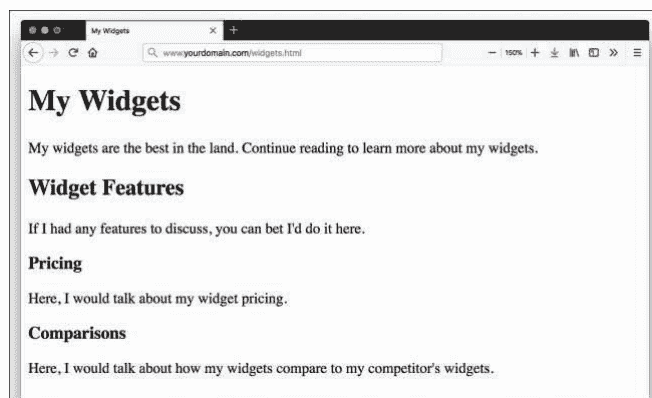

**图 2.3**
使用三级标题显示了这个示例产品页面上的内容层次结构。

然而，请记住，你的标题应遵循内容层次结构；只使用一个一级标题，在一级标题后有一个（或多个）二级标题，直接在二级标题后使用三级标题，依此类推。不要陷入这样的陷阱：仅仅为了让内容以某种方式显示就为其分配标题。相反，确保你适当地对内容进行分类（作为主标题、次标题等），同时使用显示样式让这些文本在网页浏览器中以特定方式呈现。

理论上，你也可以使用 `<h4>`、`<h5>` 和 `<h6>` 标签来创建重要性依次降低的标题，但这些并不常用。网页浏览器很少显示这些标题与 `<h3>` 标签之间有显著差异——尽管你可以用自己的CSS来控制这一点——而且内容通常不会以需要六级标题来显示层次结构的方式呈现。


记住*标题*（title）和*标头*（heading）之间的区别很重要。这两个词在日常英语中经常互换使用，但当你谈论HTML时，`<title>`为整个页面提供一个识别名称，该名称不会显示在页面本身上；它仅显示在浏览器窗口的标题栏、书签中，有时也显示在搜索引擎结果中。另一方面，标头标签显示在页面上，并且通常在CSS之外有某种视觉强调。每个页面只能有一个`<title>`，并且它必须出现在`<head>`和`</head>`标签内；另一方面，你可以根据自己的喜好，以任何顺序拥有任意数量的`<h1>`、`<h2>`和`<h3>`标头。然而，正如我们之前提到的，你应该使用标头标签来严格控制内容层次结构；不要使用标头来实现特定的外观，因为那是CSS的用途。HTML标签定义内容*是什么*，而不是它看起来像什么。

> **注意**

不要忘记，放在网页头部的任何内容都不打算在页面上查看，而页面主体中的所有内容*都是*打算用于查看的。

#### 窥探其他设计师的页面

考虑到许多流行网页中存在的视觉效果，有时还有音频效果，你可能已经意识到本课描述的简单页面只是HTML冰山的一角。既然你已经了解了基础知识，你可能会惊讶地发现，通过查看互联网上其他人的页面，你可以自行掌握其余部分的大部分内容。你可以在任何网页浏览器中右键单击并选择“查看源文件”来查看任何页面的HTML。

如果你还不太能破译某些HTML标签的作用或如何使用它们，请不要担心。你将在未来的课程中了解所有这些内容。然而，现在抢先预览一下，将让你看到你已知的标签的实际应用，并让你尝到你很快就能用你的网页实现的成果的滋味。

### 理解语义元素

HTML5包含一些标签，使你能够描述标记文本中所提供信息的语义——即含义。现代HTML的目标之一是分离呈现、含义和行为，而不是像早期那样简单地将HTML用作呈现语言（当时使用`<b>`表示粗体，`<i>`表示斜体是常态）。虽然使用CSS来提供呈现指南，但HTML的编写者可以在其标记中为各个元素提供有意义的名称——不仅通过使用ID和类名（你将在后续课程中学习），还通过使用语义元素。

以下是HTML5中可用的一些语义元素：

-   `<header></header>`——这可能看起来有违直觉，但你可以在单个页面中使用多个`<header>`标签。`<header>`标签应用作介绍性信息的容器，因此它可能只在你的页面中出现一次（可能在顶部）——但如果你的页面内容被分成几个部分，你也可能会多次使用它。任何容器元素都可以包含一个`<header>`元素；只需确保你使用它来包含其所在元素的介绍性信息。
-   `<footer></footer>`——`<footer>`标签用于包含其包含元素（页面或部分）的附加信息，如版权和作者信息或相关资源的链接。就像`<header>`标签一样，你可以在页面的任何部分定义页脚，也可以为整个页面定义。
-   `<nav></nav>`——如果你的站点有导航元素，如指向站点内甚至页面本身其他部分的链接，这些链接应放在`<nav>`标签中。`<nav>`标签通常出现在第一个`<header>`标签中，只是因为人们倾向于将导航放在顶部并将其视为介绍性信息，但这不是必须的。你可以将你的`<nav>`元素放在任何地方（只要它包含导航），并且你可以在页面上根据需要放置任意多个。
-   `<section></section>`——`<section>`标签包含任何在主题上相关的内容；它也可以包含用于介绍性信息的`<header>`标签，可能还包含用于其他相关信息的`<footer>`标签。你可以将`<section>`视为比标准`<p>`（段落）或`<div>`（分区）标签承载更多含义，这些标签通常不传达任何含义；使用`<section>`传达了它所包含的内容元素之间的关系。
-   `<article></article>`——`<article>`标签类似于`<section>`标签，因为它可以包含`<header>`、`<footer>`和其他容器元素，如段落和分区。但`<article>`标签承载的额外含义是，它，嗯，就像报纸或其他出版物中的一篇文章。在博客文章、新闻文章、评论和其他符合此描述的项目周围使用此标签。`<article>`和`<section>`的一个关键区别在于，`<article>`是一个独立的作品，而`<section>`是信息的主题分组。
-   `<aside></aside>`——使用`<aside>`标签表示次要信息；如果`<aside>`标签在`<section>`或`<article>`内，则关系将针对这些容器；否则，次要关系将针对整个页面或站点本身。将`<aside>`视为侧边栏——无论是针对页面上的所有内容还是针对文章或其他信息主题容器——可能是有意义的。

随着你练习使用这些语义元素，它们会变得更加清晰。总的来说，使用语义元素是个好主意，因为它们不仅为你、其他设计师和程序员阅读和处理你的标记提供额外含义，也为机器提供含义。

Web浏览器和屏幕阅读器会响应你的语义元素，使用这些元素来确定文档的结构；屏幕阅读器会向用户报告更深层次的含义，从而提高你材料的可访问性。但在大多数情况下，浏览器不会改变语义元素在页面上的显示方式。正如我们之前提到的，这是设计的一部分，由CSS控制。

理解HTML5语义元素的最佳方式之一是看到它们的实际应用，但当这些元素的主要目的是提供*含义*而非设计时，这可能有点困难。这并不是说你不能为这些元素添加设计；你当然可以，并且你会在后面的课程中做到。但语义元素的“动作”是通过持有内容并以此提供含义来实现的，如图2.4所示，该图展示了语义元素在基本网页中的常见用法。

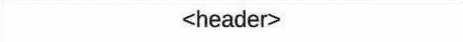

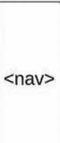

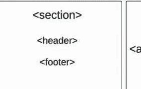

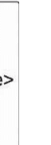

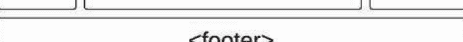

**图 2.4**
展示了网页中的基本语义元素。

最初，你可能会想，“*当然*，这完全讲得通，标头在顶部，页脚在底部”，并为自己能一目了然地理解语义元素而感到相当自豪——你确实应该这样！再看一眼，应该会提出一些问题：如果你希望你的导航在标头下方水平排列怎么办？侧边栏（aside）是否必须（从字面上）在侧面？如果你不想要任何侧边栏怎么办？再次在主体部分内使用`<header>`和`<footer>`又是怎么回事？这还只是列举了一小部分！你可能会问的另一个问题是`<article>`元素在哪里适用；它没有在这个例子中显示，但它是本课的一部分。

这时，将页面概念化——特别是*你*想要创建的页面——就派上用场了。如果你理解了你想要标记的内容，并且你理解你可以使用任何、所有或不使用语义元素，并且仍然创建一个有效的HTML文档，那么你就可以开始以对内容和你（以及希望对你的读者）最有意义的方式组织你的页面内容。


### 第二课：构建 HTML 文档

虽然你不需要使用语义元素来创建一个有效的 HTML 文档，但建议至少使用一个最小集合，以便网络浏览器和屏幕阅读器能够确定你的文档结构。屏幕阅读器能够向用户报告更深层次的含义，从而提高你内容的可访问性。

（如果这段注释要标记在 HTML 文档中，它将使用 `<aside>` 元素。）

在继续看第二个示例，并更深入地探讨各个元素本身之前，我们先来看看图 2.4 中使用的元素。在图 2.4 中，你看到页面顶部有一个 `<header>`，底部有一个 `<footer>`——正如前面已经提到的，这很直接明了。页面左侧使用 `<nav>` 元素，对应于常见的导航显示区域；页面右侧使用 `<aside>` 元素，对应于常见的用于次要笔记、引文、辅助文本和关于内容的“更多信息”链接的显示区域。在图 2.5 中，你会看到其中一些元素被移动了位置，所以别担心；图 2.4 并不是语义标记的不可改变的范例。

在图 2.5 中，你可能会惊讶地看到 `<header>` 和 `<footer>` 出现在 `<section>` 元素内部。正如前面已经提到的，页面顶部有一个 `<header>`，底部有一个 `<footer>`，这很直接明了。页面左侧使用 `<nav>` 元素与它之后的内容相匹配，并且 `<header>` 元素本身在文档大纲中并不传达任何层级。因此，你可以根据需要使用任意多个 `<header>` 元素来适当地标记你的内容；页面开头的 `<header>` 可能包含关于整个页面的介绍性信息，而 `<section>` 元素内的 `<header>` 元素同样可以且恰当地包含关于其内部内容的介绍性信息。此示例中多次出现的 `<footer>` 元素情况也是如此。

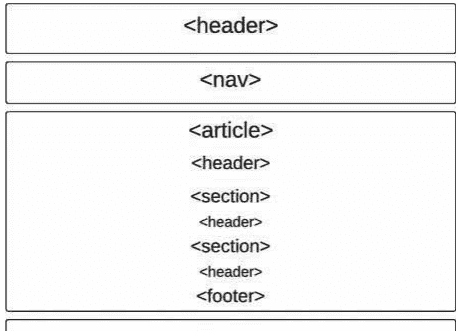

**图 2.5**
使用嵌套语义元素为内容添加更多含义。

让我们继续看图 2.5，该图移动了 `<nav>` 元素的位置，并引入了 `<article>` 元素的使用。

在图 2.5 中，页面开头的 `<header>` 和 `<nav>` 元素，以及页面底部的 `<footer>` 元素，对你来说应该非常清楚。而且，虽然我们还没有讨论过 `<article>` 元素，但如果你将其视为一个容器元素，它包含若干个节（甚至使用 `<section>` 标签！），并且每个节都有自己的标题，那么图中间那部分语义元素也应该说得通了。

如你所见，没有单一的方式来概念化页面内容；不过，你应该能够概念化每个独立页面的内容。

如果你按照图 2.5 所示的结构来标记一些内容，其效果可能像代码清单 2.4 中的标记。

#### 代码清单 2.4 基本内容的语义标记

```html
<!doctype html>
<html lang="en">
  <head>
    <meta charset="utf-8">
    <title>Semantic Example</title>
  </head>
  <body>
    <header>
      <h1>SITE OR PAGE LOGO GOES HERE</h1>
    </header>
    <nav>
      SITE OR PAGE NAVIGATION GOES HERE.
    </nav>
    <article>
      <header>
        <h2>Article Heading</h2>
      </header>
      <section>
        <header>
          <h3>Section 1 Heading</h3>
        </header>
        <p>Section 1 content here.</p>
      </section>
      <section>
        <header>
          <h3>Section 2 Heading</h3>
        </header>
        <p>Section 2 content here.</p>
      </section>
    </article>
    <footer>
      <p>Article footer goes here.</p>
    </footer>
  </body>
</html>
```

如果你在 Web 浏览器中打开这个 HTML 文档，你会看到类似于图 2.6 所示的内容——一个完全没有样式的文档，但具有语义含义（即使没有人能“看到”它）。

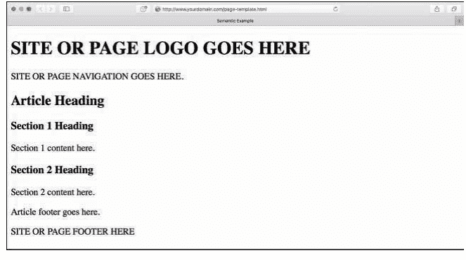

**图 2.6**
代码清单 2.4 的输出结果。

没有可见的样式并不意味着含义丢失；正如本节前面指出的，机器可以通过语义元素来解释所提供的文档结构。你可以在图 2.7 中看到这个基本文档的大纲，它显示了该文件在 HTML5 Outliner 工具（可在 http://gsnedders.html5.org/outliner/ 获取）检查后的输出结果。

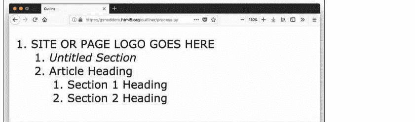

**图 2.7**
此文档的大纲遵循语义标记。

使用 HTML5 Outliner 工具是检查你是否正确创建了标题、页脚和节的好方法；如果你检查文档时看到任何地方出现“无标题节”，并且这些无标题节与 `<nav>` 或 `<aside>` 元素不匹配（这些元素对于包含标题的要求更宽松），那么你就还有一些额外的工作要做。

现在你已经看到了一些概念化文档中所表示信息的示例，你已更好地准备好开始标记这些文档了。接下来的几节将逐一探讨各个语义元素。

#### 在多种场景下使用 `<header>`

在最基本的层面上，`<header>` 元素包含介绍性信息。这些信息可以是实际的 `<h1>`（或其他级别）元素的形式，也可以是包含在 `<p>` 或 `<div>` 元素中的徽标图像或文本。内容的*含义*应该是介绍性的，以证明其包含在 `<header></header>` 标签对中的合理性。

`<header>` 元素中的信息不一定非得出现在它所介绍的节的最前面。那是最常见的位置，但它也可以显示在你页面上任何合理的位置。显示位置由 CSS 定义。

正如你在本课迄今为止的示例中所见，`<header>` 元素的一个常见位置是在页面开头。当以这种方式使用时，包含徽标或 `<h1>` 级别的标题是有意义的，例如此处：

```html
<header>
    
</header>
```

甚至这样：

```html
<header>
    
    <h1>The finest widgets are made here!</h1>
</header>
```

这两个代码片段都是 `<header>` 的有效用法，因为它们包含的信息是关于整个页面的介绍。

正如你在本课中也看到的，你并不局限于只使用一个 `<header>`。只要它们充当介绍性信息的容器，你可以随意使用 `<header>` 元素。代码清单 2.4 展示了在 `<article>` 内的多个 `<section>` 元素中使用 `<header>` 元素的情况，这是该元素的一个完全有效的用法：

```html
<section>
    <header>
        <h3>Section 1 Heading</h3>
    </header>
    <p>Section 1 content here.</p>
</section>
<section>
    <header>
        <h3>Section 2 Heading</h3>
    </header>
    <p>Section 2 content here.</p>
</section>
```

`<header>` 元素可以包含任何属于它所属的流内容类别（HTML5 内容模型之一）的其他元素。这意味着，如果你愿意，一个 `<header>` *可以*包含一个 `<section>` 元素，并且是完全有效的标记。但是，在你构思内容时，在贸然行动之前，请思考这种嵌套是否合理。

一般来说，*流内容*元素是包含文本、图像或其他多媒体嵌入内容的元素；HTML 元素属于多个类别。如果你想了解更多关于元素按内容模型分类的信息，请参阅 http://www.w3.org/TR/2011/WD-html5-20110525/content-models.html。

`<header>` 内允许的内容的唯一例外是：`<header>` 元素不能包含*其他* `<header>` 元素，也不能包含 `<footer>` 元素。同样，`<header>` 元素不能被包含在 `<address>` 或 `<footer>` 元素中。


#### 理解 `<section>` 元素

`<section>` 元素有一个简单的定义：它是“文档的一个通用部分”，同时也是“内容的主题分组，通常带有标题。” 这对我们来说听起来非常简单，对你可能也是如此。所以你可能会惊讶地发现，如果你在首选的搜索引擎中输入 **HTML5 中 section 和 article 的区别**，你会找到成千上万讨论差异的条目，因为这些定义总是让人困惑。我们首先讨论 `<section>` 元素，然后介绍 `<article>` 元素——并希望能避免那些似乎困扰着新网页开发者的误解。

在代码清单 2.4 中，你看到了一个在 `<article>` 中使用 `<section>` 的直接示例（此处重复）；在这个例子中，你可以很容易地想象 `<section>` 元素包含了“内容的主题分组”，这从它们各自都有标题这一事实得到了支持：

```html
<article>
    <header>
        <h2>Article Heading</h2>
    </header>
    <section>
        <header>
            <h3>Section 1 Heading</h3>
        </header>
        <p>Section 1 content here.</p>
    </section>
    <section>
        <header>
            <h3>Section 2 Heading</h3>
        </header>
        <p>Section 2 content here.</p>
    </section>
    <footer>
        <p>Article footer goes here.</p>
    </footer>
</article>
```

但这里有一个完全有效使用 `<section>` 的例子，其中没有 `<article>` 元素：

```html
<section>
    <header>
        <h1>Super Heading</h1>
    </header>
    <p>Super content!</p>
</section>
```

那么开发者该怎么做呢？假设你有一些通用内容，你知道想将其划分为带有各自标题的部分。在这种情况下，请使用 `<section>`。如果你只需要在视觉上分隔内容块（例如使用段落分隔），而不需要额外的标题，那么 `<section>` 不适合你；应改用 `<p>` 或 `<div>`。

由于 `<section>` 元素可以包含任何其他流内容元素，也可以被任何其他流内容元素（`<address>` 元素除外）包含，因此很容易理解，如果没有其他限制并且使用指南比较通用，`<section>` 元素有时会被误解。

#### 使用 `<article>`

我们相信，关于使用 `<section>` 与 `<article>` 的很多误解都与 `<article>` 元素的名称有关。当我们想到文章时，我们特别想到的是报纸或杂志上的文章。我们不会自然而然地想到“任何独立的作品”，而这正是 `<article>` 元素通常的定义方式。HTML5 推荐规范将其定义为“文档、页面、应用程序或站点中的一个完整或自包含的组合，原则上可独立分发或可重用”，例如“论坛帖子、杂志或报纸文章、博客条目、用户提交的评论、交互式小部件或工具，或任何其他独立的内容项目。”

换句话说，一个 `<article>` 元素可以用来包含整个网页（无论它是否是出版物中的一篇文章）、出版物中的一篇实际文章、任何地方的博客文章、论坛中线程讨论的一部分，或者博客文章上的评论，也可以用作显示你所在城市当前天气的容器。难怪搜索“HTML5 中 section 和 article 的区别”会有成千上万的结果。

当你试图确定何时使用 `<article>` 何时使用 `<section>` 时，一个很好的经验法则是简单地回答以下问题：这个内容本身有意义吗？如果是这样，那么无论对你来说内容似乎是什么（例如，一个静态网页，而不是《纽约时报》上的一篇文章），都先使用 `<article>` 元素。如果你发现自己需要将其拆分，就在 `<section>` 元素中进行。如果你发现你的“文章”实际上是更大部分的一部分，那么请将 `<article>` 标签更改为 `<section>` 标签，找到文档的开头，并从那里开始用更合适的 `<article>` 标签在更高层级将其包围。

#### 实现 `<nav>` 元素

`<nav>` 元素看起来如此简单（`<nav>` 暗示着 *导航*），它最终确实如此——但它经常被误用。在本节中，你将学习一些基本用法以及一些应避免的错误用法。如果你的网站有任何导航元素，无论是全站范围的还是在长内容页面内，你都有有效使用 `<nav>` 元素的场景。

对于全站范围的导航，你通常在主要 `<header>` 元素内找到一个 `<nav>` 元素。如果你希望你的导航内容具有引导性（并且在你的模板中无处不在），你可以很容易地论证将主要 `<nav>` 元素放在主要 `<header>` 内，尽管你并非必须将其放在那里。更重要的是你的 HTML 要有效（就像 `<nav>` 在 `<header>` 外部一样有效），而不是你的 `<header>` 元素必须包含所有允许的内容。`<nav>` 元素可以出现在任何流内容中，也可以包含任何流内容。

以下代码片段展示了网站的主要导航链接，放置在 `<header>` 元素内：

```html
<header>
    
    <h1>The finest widgets are made here!</h1>
    <nav>
        <ul>
            <li><a href="#">About Us</a></li>
            <li><a href="#">Products</a></li>
            <li><a href="#">Support</a></li>
            <li><a href="#">Press</a></li>
        </ul>
    </nav>
</header>
```

你并不限于在文档中使用单个 `<nav>` 元素，这对创建包含主要和次要导航的模板的网站开发者来说是件好事。例如，你可能会在页面顶部看到水平的主要导航（通常包含在 `<header>` 元素中），然后在页面的左栏看到垂直导航，代表主要部分内的次要页面。在这种情况下，你只需使用第二个 `<nav>` 元素，不包含在 `<header>` 内，通过不同的放置和样式在视觉上和语义上区分这两种类型。

请记住，`<nav>` 元素用于 *主要* 导航内容；主要和次要导航都算在内，页面内包含目录也算。为了良好且有效地使用 `<nav>` 元素的语义，不要简单地将其应用于允许用户导航到任何地方的每个链接。请注意，我们说的是“良好且有效”的语义使用，不一定是“有效”的使用；确实，你可以将 `<nav>` 应用于任何链接列表，并且根据 HTML 规范它是有效的，因为链接是流内容。但是，将社交媒体分享工具的链接列表用 `<nav>` 元素包围起来并不是特别 *有用*，因为它不会增加准确或有用的意义。

#### 何时使用 `<aside>`

根据本课程中笔记和侧边栏的数量，你可能已经猜到，我们非常喜欢最适合在 `<aside>` 元素内标记的内容类型。`<aside>` 元素旨在包含任何与其周围内容间接相关的内容——额外的解释、相关资源的链接、引文、辅助文本等。你可能会认为 `<aside>` 元素是一个侧边栏，但要小心，不要只把它看作 *视觉上的* 侧边栏或页面一侧可以随意粘贴任何东西的栏，无论是否与手头的内容或网站相关。

在图 2.8 中，你可以看到如何使用 `<aside>` 中的内容来创建 *引文*，或专门留出以引起注意的内容摘录。在这种情况下，`<aside>` 用于突出显示文本的重要部分，但它也可用于定义术语或链接到相关文档。


**图 2.8**
使用 `<aside>` 创建有意义的引文。


在决定是否使用 `<aside>` 元素时，请考虑您要添加的内容。它是否与包含它的内容直接相关，但对理解该内容并非绝对关键，例如文章中使用的术语定义或相关链接列表？如果答案是简单的“是”，那就太好了！请尽情使用 `<aside>`。如果您考虑在包含大量内容的父元素之外放置一个 `<aside>`，请确保 `<aside>` 的内容与您的网站整体有合理的关联，而不仅仅是为了视觉效果使用 `<aside>` 元素。

### 有效使用 `<footer>`

作为 `<header>` 元素的对应部分，`<footer>` 元素包含其父元素的附加信息。`<footer>` 元素最常见的用法是在页面底部包含版权信息，如下所示：

```html
<footer>
  <p>&copy; 2014 Acme Widgets, LLC. All Rights Reserved.</p>
</footer>
```

与 `<header>` 元素非常相似，`<footer>` 元素可以包含流内容类别中的任何其他元素（它本身也是该类别的成员），但不能包含其他 `<footer>` 或 `<header>` 元素。此外，`<footer>` 元素不能包含在 `<address>` 元素中，但 `<footer>` 元素可以包含 `<address>` 元素；实际上，`<footer>` 元素是 `<address>` 元素常见的存放位置。

将有用的 `<address>` 内容放置在 `<footer>` 元素中是 `<footer>` 元素（更不用说 `<address>` 元素）最有效的用途之一，因为它提供了页面或其所属章节的具体上下文信息。以下代码片段展示了在 `<footer>` 中使用 `<address>` 的情况：

```html
<footer>
  <p>&copy; 2014-2018 Acme Widgets, LLC. All Rights Reserved.</p>
  <p>Copyright Issues? Contact:</p>
  <address>
    Our Lawyer<br>
    123 Main Street<br>
    Somewhere, CA 95128<br>
    <a href="mailto:lawyer@richperson.com">lawyer@richperson.com</a>
  </address>
</footer>
```

与 `<header>` 元素一样，您并不限于只使用一个 `<footer>`，并且这些元素不必全部显示在其修改的内容下方。您可以根据需要使用任意数量的 `<footer>` 元素，只要它们是父元素附加信息的容器即可。清单 2.4 展示了为页面和 `<article>` 使用 `<footer>` 元素的示例，两者都是有效的。

### 总结

本课介绍了网页的基础知识及其工作原理。您了解到编码的 HTML 命令包含在文本文件中，并且您看到自己键入 HTML 文本比使用为您创建 HTML 命令的图形编辑器更好——尤其是在学习 HTML 时。

您接触了最基本和最重要的 HTML 标签。通过将这些编码命令添加到任何纯文本文档，您可以快速将其转变为一个真正的网页。您了解到创建网页的第一步是在开头和结尾添加一些必需的 HTML 标签，包括为页面添加一个标题。然后，您可以标记段落和行的结束位置，并根据需要添加水平线和标题。您还初步了解了 HTML5 中的一些语义化标签，它们通过界定页面包含的内容类型（而不仅仅是内容本身）来提供额外的意义。表 2.1 总结了本课介绍的所有标签。

**表 2.1** 第 2 课涵盖的 HTML 标签

| 标签 | 功能 |
| :--- | :--- |
| `<html>...</html>` | 包围整个 HTML 文档。 |
| `<head>...</head>` | 包围 HTML 文档的头部。在 `<html>` 标签对内使用。 |
| `<meta charset="utf-8">` | 将文档的字符集定义为 UTF-8。在 `<head>` 标签对内使用，紧跟在开始的 `<head>` 标签之后。 |
| `<title>...</title>` | 指示文档的标题。在 `<head>` 标签对内使用。 |
| `<body>...</body>` | 包围 HTML 文档的主体。在 `<html>` 标签对内使用。 |
| `<p>...</p>` | 包围一个段落；在段落之间跳过一行。 |
| `<br>` | 指示换行。 |
| `<hr>` | 显示水平线。 |
| `<h1>...</h1>` | 包围一级标题。 |
| `<h2>...</h2>` | 包围二级标题。 |
| `<h3>...</h3>` | 包围三级标题。 |
| `<h4>...</h4>` | 包围四级标题（很少使用）。 |
| `<h5>...</h5>` | 包围五级标题（很少使用）。 |
| `<h6>...</h6>` | 包围六级标题（很少使用）。 |
| `<header>...</header>` | 包含介绍性信息。 |
| `<footer>...</footer>` | 包含其父元素的补充材料（通常是版权声明或作者信息）。 |
| `<nav>...</nav>` | 包含导航元素。 |
| `<section>...</section>` | 包含主题相似的内容，例如书的一章或页面的一个部分。 |
| `<article>...</article>` | 包含作为独立作品的内容，例如新闻文章。 |
| `<aside>...</aside>` | 包含其父元素的次要信息。 |
| `<address>...</address>` | 包含与其最近的 `<article>` 或 `<body>` 元素相关的地址信息，通常包含在 `<footer>` 元素中。 |

### 问与答

**问：** 我创建了一个网页，但当我在网页浏览器中打开该文件时，我看到了所有文本，包括 HTML 标签。有时我甚至在页面顶部看到奇怪的乱码字符。我做错了什么？

**答：** 您没有将文件保存为纯文本。请尝试重新保存文件，注意将其保存为“纯文本”或“ASCII 文本”。如果您不太清楚如何让您的文字处理程序做到这一点，请不要担心。只需在记事本或 TextEdit 中键入您的 HTML 文件即可，一切应该都能正常工作。另外，请始终确保网页文件名以 `.html` 或 `.htm` 结尾。一些文本编辑器在您保存后会添加 `.txt`，导致文件名类似于 `filename.html.txt`。如果发生这种情况，您应该重命名文件，删除 `.txt` 扩展名。

**问：** 我必须使用语义化标记吗？您不是在整个课程中都提到，无论是否使用它们，页面都是有效的吗？

**答：** 没错，这些元素都不是有效 HTML 文档所必需的。您不必使用其中任何一个，但我敦促您超越仅用于视觉显示的标记用途，也考虑其语义意义。视觉显示对于屏幕阅读器毫无意义，但语义化元素为这些应用程序传达了大量信息。

**问：** 我仍然完全搞不清楚什么时候用 `<section>`，什么时候用 `<aside>`。您能解释得更清楚些吗？

**答：** 我们不怪您。HTML5 Doctor 网站上有一个资源，是我们见过的消除这种困惑的最佳资源之一。它是一个用于 HTML5 分节的流程图，可在 http://html5doctor.com/downloads/h5d-sectioning-flowchart.png 找到。这个流程图会针对您的内容提出正确的问题，并帮助您确定要使用哪个正确的容器元素。

### 练习

练习部分包含测验题和练习，帮助您巩固对所涵盖材料的理解。

### 测验

1.  每个 HTML 页面都需要哪六个标签？
2.  为什么 `<meta charset>` 标签很重要，它应该在 HTML 文档的什么位置？
3.  您使用哪些 HTML 标签和文本来生成以下主体内容：
    *   一个包含文字 `We are Proud to Present...` 的标题
    *   一个包含单词 `Orbit` 的二级标题
    *   一个重要性较低的标题，包含文字 `The Geometric Juggler`
4.  您会使用什么代码来创建一个完整的 HTML 网页，标题为 `Foo Bar`，顶部有一个标题写着 `Happy Hour at the Foo Bar`，然后以普通字体显示文字 `Come on down!`？尝试使用您刚学到的一些语义化元素。
5.  本课讨论的哪个语义化元素适合包含文章中使用的单词定义？
6.  是什么使一个元素具有语义化？
7.  您是否必须在 `<header>` 元素内使用 `<h1>`、`<h2>`、`<h3>`、`<h4>`、`<h5>` 或 `<h6>` 元素？
8.  文档的 `<footer>` 的内容必须出现在页面的什么位置？
9.  在单个页面中您可以有多少个不同的 `<nav>` 元素？
10. `<article>` 元素可能包含哪些类型的内容？


### 第2课：构建HTML文档结构

**注意**
在此提醒本书印刷版或电子版的读者：如果您访问 www.informit.com/register 并注册本书（使用ISBN 9780672338083），即可免费在线访问网络版。该版本不仅包含本书全文，还提供交互式测验。

### 答案

1. 每个HTML页面都需要`<html>`、`<head>`、`<title>`和`<body>`标签（及其对应的闭合标签`</html>`、`</head>`、`</title>`和`</body>`），此外首行需要声明`<!doctype html>`，并在`<head>`起始标签后添加`<meta charset>`。严格来说，`<!doctype html>`并非标签而是文档类型声明，因此若说仅需五个必备标签也是正确的。
2. `<meta charset>`标签定义了页面使用的字符集，它应始终紧跟在文档`<head>`起始标签之后。
3. 主体部分的代码应如下所示：
   ```
   <h1>We are Proud to Present...</h1>
   <h2>Orbit</h2>
   <h3>The Geometric Juggler</h3>
   ```
4. 您的代码可以这样编写：
   ```
   <!doctype html>
   <html lang="en">
     <head>
       <meta charset="utf-8">
       <title>Foo Bar</title>
     </head>
     <body>
       <header>
         <h1>Happy Hour at the Foo Bar</h1>
       </header>
       <section>
         <p>Come on Down!</p>
       </section>
     </body>
   </html>
   ```
5. 此处适合使用`<aside>`元素。
6. 语义化元素是指描述其所含信息意义的HTML元素。
7. 不需要。`<header>`元素可以包含除`<header>`或`<footer>`元素以外的任何流内容。但`<header>`元素中并非必须包含标题元素（`<h1>`至`<h6>`）。
8. `<footer>`标签的内容可以出现在页面任何合理的位置。虽然大多数设计者会将页脚内容置于页面末端或底部，但并无强制要求。
9. 您可以根据需要使用多个`<nav>`元素。关键是确保真正"需要"的数量（例如仅用于主导航和次级导航），否则会削弱其语义价值。
10. `<article>`元素用于封装完整或自包含的、可独立分发或复用的内容。这可以包括博客文章、杂志或报刊文章、论坛帖子、用户评论、交互式组件或其他任何独立内容项。

### 练习

- 即使您阅读本课程的主要目的是为商业项目创建网页内容，也可以尝试制作个人网页作为练习。输入几段文字介绍自己，并运用本课所学的HTML标签将其制作成网页。
- 在整个学习过程中，您将跟随代码示例并创建自己的页面。现在请花点时间设置基本文档模板，包含文档类型声明和核心HTML结构标签。这样在需要时即可随时复制粘贴。
- 基于单页模板，创建更多相关内容页面。请记住，某些页面可能只包含不含分节的`<article>`元素，而其他页面则可能包含带有`<header>`和`<footer>`元素的`<section>`分节。

## 第3课
### 理解层叠样式表

**本课学习内容：**

- 如何创建基础样式表
- 如何使用样式类
- 如何使用样式ID
- 如何构建内部样式表与内联样式

在前一课中，您已了解HTML基础知识，包括如何为所有网页内容设置基本HTML模板。本课将学习如何使用*层叠样式表*（CSS）来精细调整网页内容的显示效果。

样式表背后的原理很简单：您创建一个样式表文档，其中指定字体、颜色、间距等特性，从而为网站建立独特的视觉风格。随后将所有需要应用该风格的页面链接到该样式表，而不是在每个独立文档中重复指定所有样式。这样当您决定更改企业官方字体或配色方案时，只需修改样式表中的一两处条目，就能一次性更新所有网页，无需逐个修改静态网页文件。因此，*样式表*是一组格式化指令的集合，用于同时控制多个HTML页面的外观。

样式表支持设置大量格式特性，包括精确的字体控制、字母与行间距、页边距和页面边框等。此外，样式表允许使用英寸、毫米、点、皮卡等常用单位来指定尺寸。更重要的是，通过样式表可以精确地在网页上定位图形和文本，既可指定具体坐标，也可相对于页面其他元素进行定位。

简言之，样式表为网络展示带来了更精妙的层次，且如您所见，它确实做到了"风格化"呈现。

### CSS工作原理

样式表背后的技术称为CSS，即层叠样式表。这是一种定义样式构造的语言，包括字体、颜色、定位等，用于描述网页信息的格式化与显示方式。CSS样式可直接存储在HTML网页中，也可放在独立的样式表文件中。无论采用何种方式，样式表都包含将样式应用于特定类型元素的规则。作为外部文件时，样式表规则会被置于扩展名为`.css`的独立文档中。

样式规则是可应用于网页元素（如文字段落或链接）的格式化指令，由一个或多个样式属性及其关联值组成。内部样式表直接置于网页中，而外部样式表存在于独立文档中，通过特殊标签与网页关联——这个标签稍后会详细讲解。

CSS名称中的"层叠"指的是样式表规则应用于HTML文档元素的方式。更具体地说，CSS样式表中的样式形成层级结构，其中更具体的样式会覆盖更通用的样式。CSS负责根据此层级结构确定样式规则的优先级，从而产生层叠效果。如果这听起来有些复杂，不妨将CSS的层叠机制比作遗传继承：通用特征由父母传递给子女，但子女也具有完全独特的个性化特征。基础样式规则应用于整个样式表，但会被更具体的样式规则覆盖。

> **注意**
> 您可能注意到本课（及后续课程）频繁使用"元素"这个术语。元素就是网页中的一段信息（内容），比如图片、段落或链接。标签用于标记元素，您可以将元素理解为标签，其中包含描述性信息（属性、文本、图像等）。

快速示例能帮助理解。请查看以下代码，观察文本颜色如何变化：

```
<div style="color:green;">
  This text is green.
  <p style="color:blue;">This text is blue.</p>
  <p>This text is still green.</p>
</div>
```

在此示例中，绿色通过`color`样式属性应用于`<div>`标签。因此`<div>`标签内的文本呈绿色。由于两个`<p>`标签都是`<div>`标签的子元素，绿色文本样式会层叠继承。但第一个`<p>`标签覆盖了颜色样式，将其改为蓝色。最终效果是：第一行文本（无段落标签包裹）为绿色，第一个段落为蓝色，第二个段落保留继承的绿色。

如果您能独立理解这段描述，恭喜您——这已经成功了一半。理解CSS并不困难，练习越多就会越清晰。真正的挑战在于培养审美设计能力，然后通过CSS将其应用于网站视觉呈现。

与其他网络技术一样，CSS多年来不断发展。最初的CSS版本称为*层叠样式表第一级（CSS1）*，创建于1996年。后来的CSS2标准制定于1998年，至今仍在广泛使用。最新的CSS3版本在继承前代坚实基础的同时，添加了增强在线体验的高级功能。现代浏览器完全支持CSS2，并支持大部分CSS3特性。在整个系列课程中，您将学习核心CSS知识，包括适用于本教材基础设计与功能的CSS3新特性。因此，当我们讨论CSS时，实际指的是CSS3。

您可以在www.w3.org/Style/CSS/找到完整的CSS参考指南。本课后续内容将讲解有效使用CSS的基础知识。

### 基础样式表

尽管功能强大，样式表却易于创建。参考图3.1和图3.2所示的网页，它们具有若干可纳入公共样式表的视觉属性：

- 标题使用粗体Verdana大字体，正文使用常规Verdana字体
- 页面内容区右侧浮动显示名为`logo.gif`的图片
- 所有文本为黑色，子标题为紫色
- 页面左侧和顶部保留边距
- 文本行间保持垂直间距
- 包含居中显示的小字号页脚


### 第58课 第三讲：理解层叠样式表

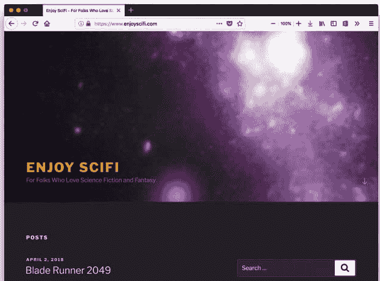

#### **图 3.1**

此页面使用样式表来微调文本和图像的外观与间距。

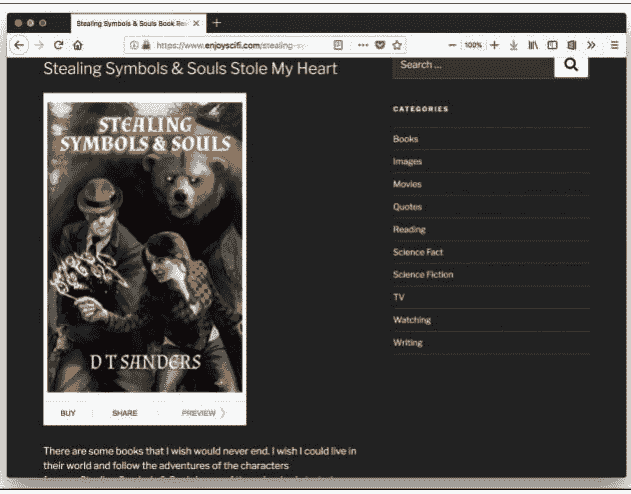

#### **图 3.2**

此页面使用了与图3.1相同的样式表，因此保持了统一的外观和风格。

代码清单3.1展示了样式表中用于指定这些属性的CSS。

#### 代码清单3.1 一个外部样式表

```
body {
  font-size: 10pt;
  font-family: Verdana, Geneva, Arial, Helvetica, sans-serif;
  color: black;
  line-height: 14pt;
  padding-left: 5pt;
  padding-right: 5pt;
  padding-top: 5pt;
}

h1 {
  font: 14pt Verdana, Geneva, Arial, Helvetica, sans-serif;
  font-weight: bold;
  line-height: 20pt;
}

p.subheader {
  font-weight: bold;
  color: #593d87;
}

img {
  padding: 3pt;
  float: right;
}

a {
  text-decoration: none;
}

a:link, a:visited {
  color: #8094d6;
}

a:hover, a:active {
  color: #FF9933;
}

footer {
  font-size: 9pt;
  font-style: italic;
  line-height: 12pt;
  text-align: center;
  padding-top: 30pt;
}
```

第三讲：理解层叠样式表

这初看起来可能代码量很大，但如果你仔细观察，会发现每行代码的信息量并不多。将每条独立的样式规则放在单独一行是相当常见的做法，这有助于提高样式表的可读性，但这属于个人偏好；只要用分号分隔每条规则，你也可以将所有规则放在一行中；稍后你会了解到更多。说到代码可读性，也许你首先注意到的是这段样式表代码与普通的HTML代码看起来完全不同。CSS使用其特有的语法来指定样式表。

当然，代码清单中包含了一些熟悉的HTML标签（尽管并非所有标签都需要在样式表中配置条目）。正如你可能猜测的那样，样式表中的 `body`、`h1`、`p`、`img`、`a` 和 `footer` 指的是样式表将要应用到的HTML文档中的相应标签。这些被称为*选择器*。每个标签名后的花括号描述了该标签内所有内容应该如何显示——使用的是*样式规则*。

在这种情况下，样式表规定所有 `body` 文本应以10点的大小、Verdana字体（如果可能）渲染，颜色为黑色，行距为14点。如果用户没有安装Verdana字体，样式表中的字体列表代表了浏览器应按顺序查找使用的字体：首先是Geneva，然后是Arial，接着是Helvetica。如果用户没有这些字体中的任何一种，浏览器将使用任何可用的默认无衬线字体。此外，页面的左侧、右侧和顶部内边距应各为5点。

代码清单3.1中每个测量值后的 `pt` 意思是*磅*（1英寸有72磅）。如果你愿意，你可以用英寸（`in`）、厘米（`cm`）、像素（`px`）或“字母*m*的宽度”（称为*em*（`em`）或*rem*（`rem`））来指定样式表中的任何测量单位。还有一些单位用于相对于数字0的宽度（`ch`）、相对于视口宽度或高度的1%（`vw` 或 `vh`）以及相对于容器（`%`）的大小。CSS中的长度测量被定义为固定或相对的。固定长度——如英寸、像素或磅——不会改变大小，而相对长度——如 `em`、`ch` 或百分比——可以变化。

> **注意**

在CSS中，`rem` 测量单位的大小相对于字母 *m* 的宽度，但它相对于初始字体大小，而不是可能应用的任何已更改的字体大小。最佳实践建议使用相对字体大小（如 `rem` 或 `em`）而不是固定字体大小（如英寸或磅），这样你的设计可以更优雅地缩放。选择 `rem` 还是 `em` 主要取决于你是需要文本在整个页面范围内缩放（使用 `rem`），还是需要对文档的某些部分进行更明确的控制（使用 `em`）。

你可能已经注意到，代码清单中的每条样式规则都以分号（;）结尾。分号用于将样式规则彼此分隔开。因此，通常的做法是将每条样式规则以分号结尾，这样你就可以轻松地在其后添加另一条样式规则。回顾代码清单3.1中样式表的其余部分，查看应用于其他标签的呈现格式。别担心：你将在本课程的后续课程中了解更多关于这些条目的信息。

> **注意**

请记住，10pt是一个较小的字体大小。并非所有查看你页面的人都会觉得这样小的字体大小清晰易读。虽然一些较旧的显示设备和打印机无法正确处理大于200点的字体，但你可以用样式表指定任意大小的字体。请务必在尽可能多的浏览器和设备上测试你的页面。

要将此样式表链接到HTML文档，请在每个文档的 `<head>` 部分包含一个 `<link>` 标签。代码清单3.2展示了包含以下 `<link>` 标签的页面HTML代码：
`<link rel="stylesheet" href="styles.css">`

这假设样式表以 styles.css 的名称存储在与HTML文档相同的文件夹中。只要网络浏览器支持样式表——所有现代浏览器都支持——样式表中指定的属性就会应用于页面内容，无需任何特殊的HTML格式化代码。这满足了HTML的目标之一，即提供网页内容与显示该内容所需的特定格式之间的分离。

#### 代码清单3.2 使用外部样式表的页面的HTML代码

```
<!doctype html>
<html lang="en">
  <head>
    <meta charset="utf-8">
    <title>About BAWSI</title>
    <link rel="stylesheet" href="styles.css">
  </head>
  <body>
    <section>
      <header>
        <h1>About BAWSI</h1>
      </header>

      <p>The Bay Area Women's
Sports Initiative (BAWSI) is a public benefit, nonprofit
corporation with a mission to create programs and
partnerships through which women athletes bring health, hope
and wholeness to our community. Founded in 2005 by Olympic
and World Cup soccer stars Brandi Chastain and Julie Foudy and Marlene Bjornsrud, former general manager of the San Jose CyberRays women's professional soccer team, BAWSI provides a meaningful path for women athletes to become a more visible and valued part of the Bay Area sports culture.</p>

<p class="subheader">BAWSI's History</p>

<p>The concept of BAWSI was inspired by one of the most spectacular achievements in women's sports history and born out of one its biggest disappointments...</p>

<p><a href="secondpage.html">[continue reading]</a></p>
</section>

<footer>
Copyright &copy; 2005-2013 BAWSI (www.bawsi.org).
All rights reserved. Used with permission.
</footer>
</body>
</html>
```

在大多数网络浏览器中，你可以通过右键单击页面并选择“检查”或“检查元素”来查看样式表中的样式规则。在那里，你可以看到HTML以及与所高亮显示元素相关的特定样式。你甚至可以进行临时编辑，看看页面可能会如何变化。要编辑你自己的样式表，只需使用文本编辑器；大多数设计师使用与HTML相同的编辑器来编辑CSS。

代码清单3.2中的代码很有趣，因为它不包含任何类型的样式格式。换句话说，HTML代码中没有任何内容规定文本和图像应如何显示——没有颜色，没有字体，什么都没有。然而，得益于链接到外部样式表 styles.css，页面被仔细地格式化并渲染到屏幕上。这种方法的真正好处在于，你可以轻松创建一个具有多个页面的网站，同时保持一致的外观和风格。而且你可以将页面的视觉样式隔离到单个文档（样式表）中，这样一次更改就能影响所有页面。

并非每个浏览器对CSS的支持都是完美的。如果你想了解对某个特定CSS属性（或HTML标签或其他Web技术）的支持情况，请查看网站 CanIUse (www.caniuse.com)。


### 自己动手试试 ▼

### 创建自己的样式表

从零开始，创建一个名为 `mystyles.css` 的新文本文件，并为以下基本 HTML 标签添加一些样式规则：`<body>`、`<p>`、`<h1>` 和 `<h2>`。创建样式表后，新建一个包含这些基本标签的 HTML 文件。尝试不同的样式规则，亲眼看看仅通过样式表文件中的一个简单更改，就能改变整个文本块是多么简单。

### CSS 样式入门

你现在对 CSS 样式表有了基本的了解，知道它们是如何基于描述网页信息外观的样式规则。本课程接下来的几节将快速概述一些最重要的样式属性，让你开始在自己的样式表中使用 CSS。

CSS 包含多种用于控制字体、颜色、对齐和边距等的样式属性。CSS 中的样式属性通常可分为两大类：

- 布局属性——影响网页上元素定位的属性，如边距、内边距和对齐
- 格式属性——影响网站中元素视觉显示的属性，如字体类型、大小和颜色

### 基本布局属性

CSS 布局属性决定内容在网页上的放置方式。最重要的布局属性之一是 `display` 属性，它描述了元素相对于其他元素的显示方式。`display` 属性有五个基本值：

- `block`——元素在新行上显示，就像一个新段落。
- `list-item`——元素在新行上显示，旁边带有列表项标记（项目符号）。
- `inline`——元素与当前段落内联显示。
- `inline-block`——元素作为块级元素与周围的块元素内联显示。
- `none`——元素不显示；它是隐藏的。

### 第 3 课：了解层叠样式表

> 注意
`display` 属性依赖于一个称为*相对定位*的概念，这意味着元素相对于页面上其他元素的位置进行定位。CSS 也支持*绝对定位*，这使你能够将元素放置在页面上的确切位置，而不依赖于其他元素。你将在第 10 课“了解 CSS 盒模型和定位”中更详细地了解这两种定位类型。

如果想象网页上的每个元素在显示时占据一个矩形区域，就更容易理解 `display` 属性；`display` 属性控制这个矩形区域的显示方式。例如，`block` 值导致元素自身独占一行，而 `inline` 值将元素放置在紧随其后的内容旁边。`inline-block` 值将元素视为块，但将其定位在紧随其后的内容旁边，而 `img` 标签是最常用的 `inline-block` 元素。`display` 属性是少数可以在大多数样式规则中应用的样式属性之一。以下是如何设置 `display` 属性的示例：

```
display:block;
```

> 注意
`display` 属性还有其他几个值，包括 `table`、`flex` 和 `grid`，以及它们的内联对应项 `inline-table`、`inline-flex` 和 `inline-grid`。这些提供强大布局和显示功能的值将在第 12 课“使用现代 CSS 技术创建布局”中更详细地介绍。

你使用 `width` 和 `height` 属性来控制元素矩形区域的尺寸。与许多其他与尺寸相关的 CSS 属性一样，`width` 和 `height` 属性值可以用几种不同的测量单位来指定：

- `in`——英寸
- `cm`——厘米
- `em`——字体高度单位
- `mm`——毫米
- `%`——百分比
- `px`——像素
- `pt`——点
- `rem`——根字体高度单位

你可以在样式表中任意混合搭配单位，但通常最好在一组相似的样式属性中保持一致。例如，你可能希望字体属性使用 rem，尺寸使用百分比。以下是使用像素单位设置元素宽度的示例：
`width: 200px;`

### 基本格式属性

CSS 格式属性用于控制网页上内容的外观，而不是控制内容的物理位置。最受欢迎的格式属性之一是 border 属性，它在元素周围建立一个可见的边界框或部分框。请注意，边框总是存在的，因为总是会为它留出空间，但除非你设置使其可见的属性（如颜色），否则边框不会以你可见的方式出现。以下边框属性提供了描述元素边框的方法：

- border-width——边框边缘的宽度
- border-color——边框边缘的颜色
- border-style——边框边缘的样式
- border-left——边框的左侧
- border-right——边框的右侧
- border-top——边框的顶部
- border-bottom——边框的底部
- border——所有边框边

border-width 属性设置边框边缘的宽度。它通常以像素为单位，如以下代码所示：
`border-width:5px;`

不出所料，border-color 和 border-style 属性设置边框颜色和样式。以下是设置这两个属性的示例：
`border-color:blue;`
`border-style:dotted;`

border-style 属性可以设置为以下任意基本值：

- solid——单线边框
- double——双线边框
- dashed——虚线边框
- dotted——点线边框
- groove——具有凹槽外观的边框
- ridge——具有凸脊外观的边框
- inset——具有内嵌外观的边框
- outset——具有外凸外观的边框
- none——无边框
- hidden——实际上与 none 相同

你将在本课程后面了解更多高级边框技巧。

`border-style` 属性的默认值是 `none`，这就是为什么元素没有边框，*除非*你将 `border-style` 属性设置为不同的样式。虽然 `solid` 是最常见的边框样式，但你也会看到其他样式在使用。

`border-left`、`border-right`、`border-top` 和 `border-bottom` 属性使你能够为元素的每一边单独设置边框。如果你想让边框在所有四边看起来都一样，可以单独使用 `border` 属性，它期望以下样式，用空格分隔：`border-width`、`border-style` 和 `border-color`。以下是使用 `border` 属性设置一个由两条 (`double`) 红线组成、总宽度为 10 像素的边框的示例：

```
border:10px double red;
```

你还可以通过以下属性调整框的曲线，改变边框圆角：

- **border-top-left-radius**——左上角圆角
- **border-top-right-radius**——右上角圆角
- **border-bottom-left-radius**——左下角圆角
- **border-bottom-right-radius**——右下角圆角
- **border-radius**——所有四个角的圆角

`border-radius` 属性接受一个或两个值。这些值定义描述角落形状的四分之一椭圆的两个半径。第一个值是水平半径，第二个是垂直半径。如果只有一个值，则两者都使用该值。此属性会使边框和放置在元素上的任何背景的圆角。以下是将 `border-radius` 属性设置为 `1rem` 的示例：

```
border-radius: 1rem;
```

元素边框的颜色通过 `border-color` 属性设置，而元素内部区域的颜色则使用 `color` 和 `background-color` 属性设置。`color` 属性设置元素中文本的颜色（前景），`background-color` 属性设置文本后面背景的颜色。以下是将两个颜色属性都设置为预定义颜色的示例：
`color:black;`
`background-color:orange;`

你还可以通过以十六进制（在第 8 课“处理颜色、图像和多媒体”中详细介绍）或 RGB（红、绿、蓝）十进制值指定颜色，为这些属性分配自定义颜色：
`background-color:#999999;`
`color:rgb(0,0,255);`

你甚至可以用 RGBa（红、绿、蓝、alpha 通道）十进制值设置颜色的透明度：
`background-color:rgba(0,0,0,0.8);`
`color:rgba(0,0,255,1.0);`

你也可以不太麻烦地控制网页内容的对齐和缩进。这是通过 `text-align` 和 `text-indent` 属性完成的，如以下代码所示：
`text-align:center;`
`text-indent:12px;`

> 注意
`text-align` 属性应用于块级元素的内容，而不是元素本身。如果你想居中一个块元素（或一个内联块元素，如图像），你需要使用其他方法，如第 9 课“处理边距、内边距、对齐和浮动”中所讨论的。

当你正确对齐和缩进一个元素时，你可能有兴趣设置它的字体。以下基本字体属性设置与字体相关的各种参数（你将在第 6 课“处理字体、文本块、列表和表格”中了解一些更高级的字体用法）：

- **font-family**——字体的字型
- **font-size**——字体的大小
- **font-style**——字体的样式（正常或斜体）
- **font-weight**——字体的粗细（正常、较细、粗体、较粗等）


### 使用样式类

这是一门“自学”课程，因此你无需去上课就能学会如何为页面赋予出色的样式——尽管你*确实*需要了解什么是样式类。每当页面中的部分文本需要与其他文本呈现不同外观时，你可以创建一种相当于自定义的 HTML 标签。你所定义的每种特殊格式文本被称为一个**样式类**。样式类是一组可应用于网页中任何元素的自定义格式规范。

在研究样式类之前，我们需要快速回顾并澄清一些 CSS 术语。首先，**CSS 样式属性**是你可为其赋值的特定样式，例如 `color` 或 `font-size`。你通过选择器将样式属性及其对应的值与网页上的元素关联起来。选择器用于标识页面上需要应用样式的标签。以下是一个基本样式规则中同时包含选择器、属性和值的示例：

```css
h1 { font: 36pt Courier; }
```

在此代码中，`h1` 是选择器，`font` 是样式属性，`36pt Courier` 是值。选择器很重要，因为它意味着字体设置将应用于网页中所有 `h1` 元素。但如果你想区分某些 `h1` 元素呢？答案就在于样式类。

假设你希望在文档中使用两种不同的 `<h1>` 标题。你可以通过将以下 CSS 代码放入样式表来为每种创建一个样式类：

```css
h1.silly { font: 36pt Comic Sans; }
h1.serious { font: 36pt Arial; }
```

请注意，这些选择器在 `h1` 之后包含一个句点（.），后面跟着一个描述性的类名。要在这两个样式类之间进行选择，请使用 `class` 属性，如下所示：

```html
<h1 class="silly">Marvin's Munchies Inc.</h1>
<p>Text about Marvin's Munchies goes here.</p>
```

或者你可以这样使用：

```html
<h1 class="serious">MMI Investor Information</h1>
<p>Text for business investors goes here.</p>
```

在 HTML 代码中引用样式类时，只需在元素的 `class` 属性中指定类名即可。在前面的示例中，假设你在网页顶部包含了对样式表的 `<link>` 引用，并且用户安装了 Comic Sans 字体，那么单词 "Marvin's Munchies Inc." 将以 36 点 Comic Sans 字体显示。而单词 "MMI Investor Information" 则会以 36 点 Arial 字体显示。你可以在清单 3.2 中看到另一个正在运行的类示例；注意子标题 `<p>` 类。

如果你想创建一个可以应用于任何元素（而不仅仅是标题或其他特定标签）的样式类，该怎么办？在你的 CSS 中，只需使用一个句点（.），后面跟着你起的任何样式类名以及你选择的任何样式规则。该类可以一次性指定任意数量的字体、间距和页边距设置。无论你想在页面中的哪个位置应用自定义标签，只需使用一个 HTML 标签加上 `class` 属性，然后是类名即可。

例如，清单 3.1 中的样式表包含以下样式类规范：

```css
p.subheader {
    font-weight: bold;
    color:#593d87;
}
```

清单 3.2 中使用以下标签应用了此样式类：

```html
<p class="subheader">
```

> **注意**

你可能已经注意到，当样式规则包含多个属性时，编码风格发生了变化。对于只有单个样式的样式规则，你通常会看到属性与规则位于同一行，如下所示：

`p.subheader { font-weight: bold; }`

然而，当样式规则包含多个样式属性时，如果你将属性逐行列出，代码的可读性和理解性会大大提高，如下所示：

`p.subheader {`  
`    font-weight: bold;`  
`    color:#593d87;`  
`}`

在清单 3.2 中，从该标签到结束 `</p>` 标签之间的所有内容都会以粗体紫色文本显示。

样式类如此有价值的原因在于它们将样式代码与网页隔离开来，使你能够将 HTML 代码集中在页面的实际内容上，而不是它在屏幕上的显示方式上。然后，你可以通过微调样式表来决定内容如何呈现到屏幕上。你可能会惊讶于样式表中相对少量的代码如何在整个网站上产生显著效果。样式类使你的页面更易于维护和操作。

### 使用样式 ID

当你创建自定义样式类时，你可以根据需要多次使用这些类；它们不是唯一的。然而，在某些情况下，你需要出于布局或格式设置目的（或两者兼有）对唯一元素进行精确控制。在这种情况下，请使用 ID 而不是类。

**样式 ID** 是一组可应用于网页中仅一个元素的自定义格式规范。你可以在一组页面中使用 ID——但在每个页面中只能使用一次。

例如，假设你在所有页面的正文内都有一个标题。每个页面只有一个标题，但每个页面都包含该标题的一个实例。以下是一个指定了 ID 的选择器示例，以及属性和值：

```css
p#title {font: 24pt Verdana, Geneva, Arial, sans-serif}
```

请注意，此选择器在 `p` 之后包含一个井号或磅符号（`#`），后面跟着一个描述性的 ID 名称。在 HTML 代码中引用样式 ID 时，只需在元素的 `id` 属性中指定 ID 名称即可，如下所示：

```html
<p id="title">Some Title Goes Here</p>
```

从开始 `<p>` 标签到结束标签之间的所有内容将以 24 点 Verdana 文本显示——但在任何给定页面上仅显示一次。你经常会看到样式 ID 用于定义页面的特定部分以用于布局目的，例如页眉区域、页脚区域、主体区域等。这些类型的区域在页面中每页只出现一次，因此使用 ID 而不是类是合适的选择。

### 内部样式表和内联样式

在某些情况下，你希望指定仅用于一个网页的样式。你可以将样式表包含在 `<style>` 和 `</style>` 标签之间，并将其直接包含在 HTML 文档中。以这种方式使用的样式表必须出现在 HTML 文档的 `<head>` 部分。不需要 `<link>` 标签，并且你不能从任何其他页面引用该样式表（除非你也将其复制到该文档的开头）。这种样式表被称为**内部样式表**，正如你在本课前面所学到的。

> **注意**
在许多网页中，你会在 `<style>` 标签上看到属性 `type="text/css"`。这过去对于有效的 HTML 是必需的，但大多数现代浏览器默认假定它是该类型，除非另有说明。因此，在 HTML5 中，该属性不再是必需的。

#### 清单 3.3  带有内部样式表的网页

```html
<!doctype html>
<html lang="en">
  <head>
    <meta charset="utf-8">
    <title>Some Page</title>
    <style>
      footer {
        font-size: 9pt;
```


### 内部样式表和内联样式

```
line-height: 12pt;
    text-align: center;
  }
</style>
</head>
<body>
  ...
  <footer>
    Copyright 2018 Acme Products, Inc.
  </footer>
</body>
</html>
```

在清单 3.3 中，`footer` 样式类在页面头部的内部样式表中定义。这个样式类现在可以在页面主体中使用。事实上，它被用于页面主体来为版权声明设置样式。

内部样式表在你需要创建在一个页面内多次使用的样式规则时很方便。然而，在某些情况下，你可能需要为某个特定元素应用唯一的样式。这就需要内联样式规则，它使你能够为页面的一小部分（如单个元素）指定样式。例如，你可以通过 `style` 属性在 `<p>`、`<div>` 或 `<span>` 标签内创建并应用样式规则。这种类型的样式被称为内联样式，因为它直接在 HTML 代码中指定。

> **注意**
> `<span>` 和 `</span>` 标签是虚拟标签，它们本身不起任何作用，只是指定要应用你添加的任何 `style` 属性的内容范围。`<div>` 和 `<span>` 之间的唯一区别是 `<div>` 是一个块级元素，因此会强制换行，而 `<span>` 不会。因此，你应该使用 `<span>` 来修改出现在句子或段落中间的文本部分的样式，而不会产生任何换行。

以下是一个示例 `style` 属性的外观：

```
<p style="color:green;">
    This text is green, but <span style="color:red;">this text
    is red.</span>
    Back to green again, but...
</p>
<p>
    ...now the green is over, and we're back to the default color
    for this page.
</p>
```

这段代码利用 `<span>` 标签展示如何在内联样式规则中应用颜色样式属性。实际上，这个例子中的 `<p>` 标签和 `<span>` 标签都使用了 `color` 属性作为内联样式。重要的是要理解，对于 `<span>` 和 `</span>` 标签之间的文本，`color:red;` 样式属性会覆盖 `color:green;` 样式属性。然后在第二个段落中，由于这是一个全新的段落，遵循整个页面的默认颜色，因此两种颜色样式都不适用。

> **注意**
> 使用内联样式在超出页面级调试或在受控环境中尝试新事物的范围时，不被认为是最佳实践。最佳实践是让你的页面链接到一个集中维护的样式表，这样更改会立即反映在所有使用它的页面中。

### 验证你的样式表

就像验证你的 HTML 或 XHTML 标记很重要一样，验证样式表也很重要。你可以在 https://jigsaw.w3.org/css-validator/ 找到特定的 CSS 验证工具。你可以将该工具指向一个网页地址、上传文件或将内容粘贴到提供的表单字段中。最终目标是得到像图 3.3 这样的结果：有效！

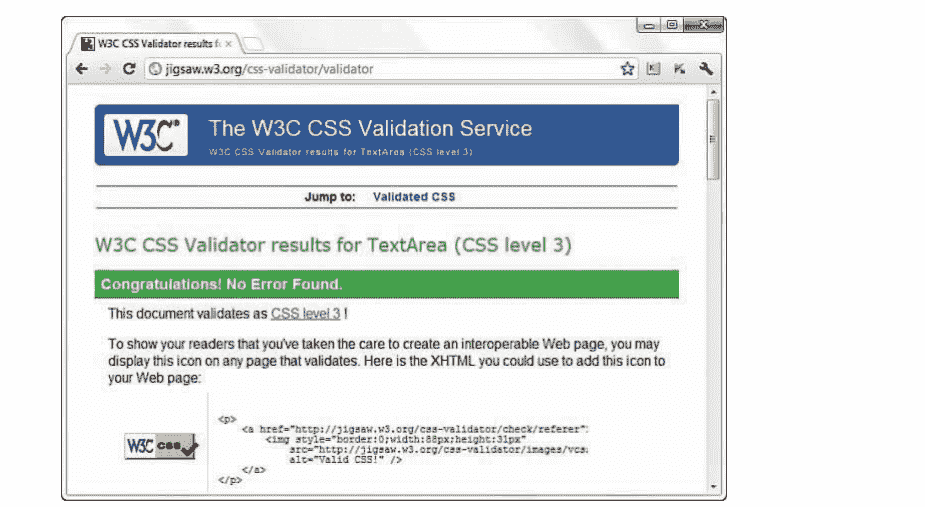

**图 3.3**
W3C CSS 验证器显示清单 3.1 的样式表内容没有错误。

### 总结

在本课中，你了解到样式表可以同时控制许多 HTML 页面的外观。它还可以让你对 HTML 元素的排版、间距和定位进行极其精确的控制。你还学到，通过向几乎任何 HTML 标签添加 `style` 属性，你可以在不引用单独样式表文档的情况下控制 HTML 页面任何部分的样式。

你了解了在网站中包含样式表的三种主要方法：一个单独的样式表文件，扩展名为 `.css`，在你的文档的 `<head>` 中链接；一组放在文档 `<head>` 内 `<style>` 标签中的样式规则；以及直接通过 `style` 属性放在 HTML 标签中的规则（尽管后者不是长期使用的最佳实践）。

表 3.1 总结了本课中讨论的标签。有关 `<style>` 标签或 `style` 属性后可以包含哪些选项的详细信息，请参考 CSS 样式表标准 www.w3c.org。

**表 3.1 第 3 课涵盖的 HTML 标签和属性**

| 标签 | 属性 | 功能 |
| :--- | :--- | :--- |
| `<style>...</style>` | | 允许在文档中包含内部样式表。用于 `<head>` 和 `</head>` 之间。 |
| | `type="contenttype"` | 互联网内容类型。对于 HTML5 不再需要。 |
| `<link>` | | 链接到外部样式表（或其他文档类型）。用于文档的 `<head>` 部分。 |
| | `href="url"` | 样式表的地址。 |
| | `type="contenttype"` | 互联网内容类型。对于 HTML5 不再需要。 |
| | `rel="stylesheet"` | 链接类型。 |
| `<span>...</span>` | | 除了提供放置 `style` 或其他属性的地方外，不做任何事情。（类似于 `<div>...</div>`，但不会导致换行。） |
| | `style="style"` | 包含内联样式规范。（可用于 `<span>`、`<div>`、`<body>` 和大多数其他 HTML 标签。） |

### 问答

**问：** 假设我将一个样式表链接到我的页面，该样式表说所有文本都应该是蓝色的，但页面某处有一个 `<span style="font-color:red;">` 标签。那段文本会显示为蓝色还是红色？

**答：** 红色。本地的内联样式总是优先于外部样式表。你在页面顶部 `<style>` 和 `</style>` 标签之间放置的任何样式规范也优先于外部样式表（但不优先于同一页面后面出现的内联样式）。这就是本课前面提到的样式表的层叠效果。你可以将层叠样式效果想象为从外部样式表开始，被内部样式表覆盖，再被内联样式覆盖。

**问：** 我可以将多个样式表链接到单个页面吗？

**答：** 当然可以。例如，你可能有一个用于格式化（文本、字体、颜色等）的样式表，另一个用于布局（边距、填充、对齐等）；你只需要为每个样式表包含一个 `<link>`。从技术上讲，CSS 标准要求网络浏览器在通过多个 `<link>` 标签呈现多个样式表时，给用户提供在样式表之间选择的选项。然而，在实践中，所有主要的网络浏览器都只是包含每个样式表，除非它有一个 `rel="alternate"` 属性。最佳实践建议你限制链接的样式表数量。这会导致更少的服务器调用，因此页面加载时间更快。

### 工作坊

工作坊包含测验题和练习，以帮助你巩固对所涵盖材料的理解。

### 测验

1.  你会使用什么代码来创建一个样式表，指定 30 磅蓝色 Arial 标题和所有其他文本为 10 磅蓝色 Times Roman（或默认浏览器字体）？
2.  如果你将为问题 1 创建的样式表保存为 `corporate.css`，你将如何将其应用于名为 `intro.html` 的网页？
3.  有多少种不同的方法可以确保样式规则可以应用于你的内容？
4.  你如何将所有网站页面连接到名为 `mystyles.css` 的样式表？
5.  在以下 HTML 中，文本“To come to the aid of their country”会是什么颜色？

```
<div style="color:purple;">
    Now is the time
    <p style="color:orange;">for all good people</p>
    <p>To come to the aid of their country.</p>
</div>
```

6.  `display: block;` 属性有什么作用？
7.  术语 `px` 是什么意思？
8.  样式 `border-right: dashed red 2px;` 是什么作用？
9.  样式 `border-radius: 1em 1.5em;` 是什么作用？
10.  样式规则 `.main { color: purple; }` 是什么作用？

**注意**
仅提醒那些在本书印刷版或电子书版中阅读这些文字的读者：如果你访问 www.informit.com/register 并注册本书（使用 ISBN 9780672338083），你可以免费访问在线网络版，其中不仅包含本书的完整文本，还具有此测验的交互式版本。

### 答案

1.  你的样式表将包含以下内容：

```
h1 { font: 30pt blue Arial; }
body { font: 10pt blue "Times New Roman"; }
```

2.  将以下标签放在 intro.html 文档的 `<head>` 和 `</head>` 标签之间：

```
<link rel="stylesheet" href="corporate.css">
```

3.  三种：外部、内部和内联。

4.  要将所有网站页面连接到名为 mystyles.css 的样式表，请使用以下代码：

```
<link href="mystyles.css" rel="stylesheet">
```

5.  它会是紫色。
6.  它在一个新行上显示元素。
7.  它是一个度量单位——像素。


8.  它在元素的右侧添加一条虚线边框，颜色为红色，宽度为2像素。
9.  它为元素设置圆角，水平半径为1-em，垂直半径为1.5-em。
10. 它将所有具有 `main` 类的元素的文本颜色设置为紫色。

### 练习

-   使用你在本课程前面创建的样式表，为你的样式表添加一些样式类。为了看到效果，将这些类也应用到你创建的HTML页面上。将类与你的 `<h1>` 和 `<p>` 标签一起使用，以熟悉这些操作。
-   为你的网站开发一个标准样式表，并将其链接到你所有的页面。（对于需要偏离标准的页面，使用内部样式表和/或内联样式。）如果你为一家公司工作，那么它很可能已经为印刷材料制定了字体和样式规范。获取这些规范的副本，并将它们也应用于公司的网页。
-   务必探索 www.w3.org/Style/CSS/ 上的官方样式表规范，并尝试本课程未涵盖的一些更专业的样式属性。

*此页有意留白*

## 第4课
### 理解JavaScript

**本课你将学到：**

-   什么是Web脚本以及它的用途
-   脚本和编程的区别（以及相似之处）
-   JavaScript是什么以及它的起源
-   如何在网页中包含JavaScript命令
-   JavaScript能为你的网页做什么
-   脚本的开始和结束
-   格式化JavaScript语句
-   脚本如何显示结果
-   在网页文档中包含脚本
-   在浏览器中测试脚本
-   修改脚本
-   处理脚本中的错误
-   将脚本移动到单独的文件中

万维网（WWW）最初只是一个纯文本媒介；最早的浏览器甚至不支持网页中的图像。自早期以来，Web已经取得了长足的进步。今天的网站除了有用的内容外，还包含了丰富的视觉和交互功能：图形、声音、动画和视频。使用Web脚本语言，如JavaScript，是为网页增添趣味并以新的方式与用户交互的最简单方法之一。

本课的第一部分介绍了Web脚本和JavaScript语言的概念。随着课程的深入，你将学习如何将JavaScript命令直接包含在HTML文档中，以及当页面在浏览器中查看时脚本将如何执行。你将使用一个简单的脚本，编辑它，并在浏览器中测试它，同时学习创建和使用JavaScript脚本所涉及的基本任务。

#### 学习Web脚本基础

你已经知道如何使用两种类型的计算机语言：HTML和CSS。你使用HTML标签来描述文档的格式。然后使用CSS来描述文档的显示方式，浏览器会向用户显示经过修饰的内容。但由于HTML和CSS是简单的基于文本的语言，它们无法响应用户、做出决策或自动化重复性任务。像这样的交互式任务需要一种更复杂的语言：编程语言或脚本语言。

尽管许多编程语言很复杂，但脚本语言通常很简单。它们语法简单，可以用最少的命令执行任务，并且易于学习。JavaScript是一种Web脚本语言，使你能够将脚本与HTML和CSS结合使用，创建交互式网页。

#### 脚本与程序

一部电影或戏剧遵循脚本——一系列供演员执行的动作（或台词）。网页脚本为网页浏览器提供相同类型的指令。JavaScript脚本可以从单行代码到完整的应用程序。（在这两种情况下，JavaScript脚本通常都在浏览器中运行。）

一些编程语言必须先*编译*或翻译成机器代码，然后才能执行。而JavaScript是一种*解释型*语言：浏览器逐行执行脚本。

解释型语言有一个主要优点：编写或更改脚本非常简单。更改JavaScript脚本就像更改典型的HTML文档一样容易，并且更改会在浏览器中重新加载文档时立即生效。

> 注意
> 解释型语言也有缺点：它们无法真正快速地执行，因此不太适合复杂的工作，如图形处理，并且它们需要解释器（对于JavaScript来说，通常是浏览器）才能运行。

#### JavaScript简介

JavaScript由网景通信公司（Netscape Communications Corporation）于1995年开发，该公司是现已不复存在的网景网络浏览器的制造者。JavaScript是第一个被浏览器支持的Web脚本语言，并且至今仍是最流行的。

> 注意
> 历史小知识：JavaScript最初名为LiveScript，于1995年首次在Netscape Navigator 2.0中引入。不久后更名为JavaScript，以表示与Sun公司Java语言的营销关系，尽管Java和JavaScript在结构或其他方面没有其他关系。

JavaScript几乎和HTML一样容易学习，并且可以直接包含在HTML文档中。以下是你可以用JavaScript做的一些事情：

-   作为网页的一部分，在浏览器的状态栏或警报框中向用户显示消息
-   验证表单内容并进行计算（例如，通过让订单表单在你输入物品数量时自动显示总金额）
-   为图像添加动画效果，或创建鼠标悬停时变化的图像
-   创建与用户交互而不仅仅是显示图形的广告横幅
-   检测正在使用的浏览器或浏览器具有的功能，并仅在支持这些功能的浏览器上执行高级功能
-   检测已安装的插件，并在需要插件时通知用户
-   无需用户重新加载即可修改网页的全部或部分
-   显示或与从远程服务器检索的数据进行交互

你可以用JavaScript完成所有这些以及更多事情，包括创建完整的应用程序。我们将在整个课程中探讨JavaScript的用途。

#### JavaScript如何融入网页

通过使用 `<script>` 标签（如清单4.1所示），你可以向网页文档添加一个简短的脚本（在这种情况下，只有一行）。`<script>` 标签告诉浏览器开始将文本视为脚本，而结束的 `</script>` 标签则告诉浏览器返回到HTML模式。在大多数情况下，除了在 `<script>` 标签内，你不能在HTML文档中使用JavaScript语句。例外情况是事件处理程序，将在本课后面描述。

**清单4.1 包含简单脚本的HTML文档**

```html
<!doctype html>
<html lang="en">
  <head>
    <meta charset="utf-8">
    <title>The American Eggplant Society</title>
  </head>
  <body>
    <h1>The American Eggplant Society</h1>
    <p>Welcome to our site. Unfortunately, it is still under construction.</p>
    <p>We last worked on it on this date:
    <script>
    <!-- // Hide the script from old browsers
    document.write(document.lastModified);
    // Stop hiding the script -->
    </script>
    </p>
  </body>
</html>
```

JavaScript的 `document.write` 语句（你将在后面了解更多）将输出作为网页文档的一部分发送。在这种情况下，它会显示文档的修改日期，如图4.1所示。

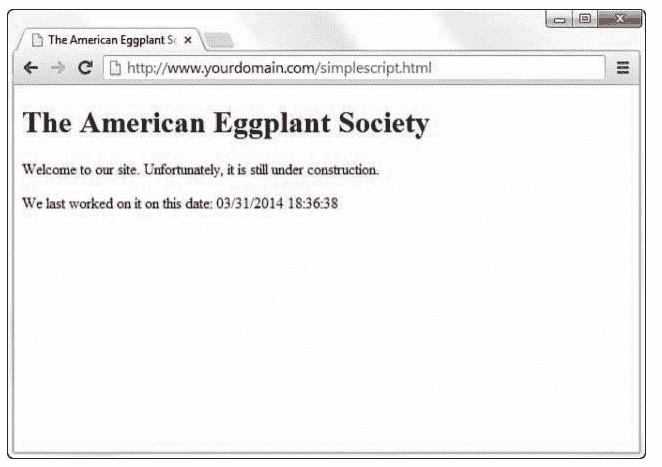

**图4.1**
使用 document.write 显示最后修改日期。

在这个例子中，我们将脚本放在了HTML文档的主体中。实际上，你可能会在四个地方使用脚本：

-   **在页面主体中**——在这种情况下，当浏览器加载页面时，脚本的输出将作为HTML文档的一部分显示。
-   **在页面头部，在 `<head>` 标签之间**——头部中的脚本不应用于在HTML文档的 `<head>` 部分内创建输出，因为这可能导致格式不良和无效的HTML文档，但这些脚本可以在此处和其他地方被其他脚本引用。`<head>` 部分通常用于存放函数——可以作为一个单元使用的JavaScript语句组。你将在第20课“JavaScript编程入门”中学习更多关于函数的知识。
-   **在HTML标签内，如 `<body>` 或 `<form>`**——这称为事件处理程序，它使脚本能够与HTML元素协同工作。在事件处理程序中使用JavaScript时，你不需要使用 `<script>` 标签。你将在第20课中了解更多关于事件处理程序的知识。
-   **完全在单独的文件中**——JavaScript支持使用扩展名为 .js 的文件来包含脚本；可以通过在 `<script>` 标签中指定文件来包含它们。虽然使用 .js 扩展名是一种约定，但脚本实际上可以具有任何文件扩展名，或者没有扩展名。

正如你将在第25课“JavaScript最佳实践”中了解到的，将JavaScript放在 `<body>` 标签内，紧接在结束的 `</body>` 标签之前是最好的位置。这确保了JavaScript是最后加载的东西，因此不会影响页面其余部分显示的速度。

#### 使用单独的JavaScript文件

当你创建更复杂的脚本时，你会很快发现你的HTML文档变得庞大而混乱。为了避免这个问题，你可以使用一个或多个外部JavaScript文件。这些是扩展名为 .js 的文件，包含JavaScript语句。

所有现代浏览器都支持外部脚本。要使用外部脚本，你需要在 `<script>` 标签中指定其文件名，如下所示：

```html
<script src="filename.js"></script>
```

> 注意
> `type` 属性过去是必需的。但在HTML5中，如果引用的脚本是JavaScript，则可以省略。

因为在这种情况下你会将JavaScript语句放在单独的文件中，所以不需要在开始和结束的 `<script>` 标签之间放任何东西；事实上，它们之间的任何内容都会被浏览器忽略。

你可以使用编写HTML和CSS的同一个文本编辑器来创建 .js 文件。此文件应包含一个或多个JavaScript命令，并且只包含JavaScript；它不应包含 `<script>` 标签、其他HTML标签、CSS或HTML注释。将 .js 文件保存在与引用它的HTML文档相同的目录中。


外部 JavaScript 文件有一个显著的优势：你可以从两个或多个 HTML 文档链接到同一个 .js 文件。浏览器会将其存储在缓存中，这可以减少网页显示所需的时间。但请记住，每个链接的文件都需要向服务器发出额外的请求。因此，请尽量将你所有的脚本保存在尽可能少的文件中。

### 理解 JavaScript 事件

JavaScript 能做的许多有用事情都涉及与用户交互，这意味着要响应事件——例如，点击链接或按钮。你可以在 HTML 标签内定义事件处理程序，告诉浏览器如何响应事件。例如，代码清单 4.2 定义了一个按钮，点击时会显示一条消息。

#### 代码清单 4.2  一个简单的事件处理程序

```html
<!doctype html>
<html lang="en">
  <head>
    <meta charset="utf-8">
    <title>Event Test</title>
  </head>
  <body>
    <h1>Event Test</h1>
    <button type="button"
            onclick="alert('You clicked the button.')">
            Click Me!</button>
  </body>
</html>
```

在本教程的各个地方，你将了解更多关于 JavaScript 事件模型以及如何创建简单和复杂事件处理程序的知识。

### 探索 JavaScript 的能力

如果你曾花时间浏览过网络，那么毫无疑问你已经看到过许多 JavaScript 运行的实例。以下部分简要描述了一些 JavaScript 的典型应用，所有这些你都将在后续课程中探索。

### 改善导航

JavaScript 最常见的用途之一是在网站的导航系统中。你可以使用 JavaScript 创建导航工具——例如，一个下拉菜单用于选择下一个要阅读的页面，或者一个当鼠标悬停在导航链接上时弹出的子菜单。

如果做得好，这种 JavaScript 交互性可以使网站更易于使用，即使对于不支持 JavaScript 的浏览器也是如此。

### 验证表单

表单验证是 JavaScript 的另一个常见用途，尽管 HTML5 的表单验证功能在这里也抢走了 JavaScript 的不少风头。一个简单的脚本可以读取用户在表单中输入的值，并确保它们格式正确，例如邮政编码、电话号码和电子邮件地址。这种类型的客户端验证使用户能够在不等待 Web 服务器响应（告知其表单提交无效）的情况下，修复常见错误。你将在第 27 课“使用基于 Web 的表单”中学习如何处理表单数据。

### 特效

JavaScript 最早且最令人讨厌的用途之一是创建引人注目的特效——例如，在浏览器的状态行滚动显示消息，或使页面的背景颜色闪烁。

幸运的是，这些技术已经过时了，但得益于 W3C DOM 和最新的浏览器，JavaScript 可以实现一些更令人印象深刻的特效——例如，创建可以在页面上拖放的对象，或在幻灯片放映中实现图像之间的淡入淡出过渡。一些开发者正在协同使用 HTML5、CSS3 和 JavaScript 来创建功能完整的交互式游戏。

### 远程脚本（AJAX）

长期以来，JavaScript 最大的局限性是它无法与 Web 服务器通信。例如，你可以使用 JavaScript 验证电话号码的位数是否正确，但无法根据号码在数据库中查找用户的位置。

现在，大多数浏览器支持 JavaScript 的一些高级功能，情况已不再是这样了。你的脚本可以在不加载页面的情况下从服务器获取数据，或者可以将数据发送回服务器进行保存。这些功能统称为 AJAX（异步 JavaScript 和 XML），或远程脚本。

### 使用 JavaScript 显示时间

JavaScript 的一个常见用途是在浏览器中显示日期和时间，这也是我们将开始将一些脚本片段组合在一起的地方。由于 JavaScript 在浏览器上运行，它显示的时间将是用户当前时区的时间。但是，你也可以使用 JavaScript 计算“通用”（UTC）时间。

**注意**
UTC 代表世界标准时间（协调世界时），是基于旧的 GMT（格林威治标准时间）标准的原子时间标准。这是本初子午线的时间，该线穿过英国伦敦的格林威治。

你的脚本，像大多数其他 JavaScript 程序一样，以 HTML 的 `<script>` 标签开始。正如你在本课程前面学到的，你使用 `<script>` 和 `</script>` 标签将脚本包含在 HTML 文档中。

**注意**
请记住，在开始和结束的 `<script>` 标签之间只包含有效的 JavaScript 语句。如果浏览器在 `<script>` 标签内找到任何非有效 JavaScript 语句的内容，它将显示一条 JavaScript 错误消息。你应该在任何非 JavaScript 行的前面使用注释指示符（//）。

要开始创建脚本，请打开你喜欢的文本编辑器并输入开始和结束的 `<script>` 标签，如下所示：
`<script></script>`

在这个脚本中，你将使用 JavaScript 确定本地时间和 UTC 时间，然后将它们显示在浏览器中。幸运的是，所有困难的部分，例如在不同日期格式之间转换，都内置在 JavaScript 解释器中；这也是为什么显示日期和时间对于初学者来说是一个很好的起点的原因之一。

### 在变量中存储数据

要开始脚本，你将使用一个 *变量* 来存储当前日期。你将在第 22 课“使用 JavaScript 变量、字符串和数组”中了解更多关于变量的知识，但现在只需要理解 *变量* 是一个可以容纳值的容器——一个数字、一些文本，或者在本例中是一个日期。

要开始编写脚本，请在第一个 `<script>` 标签后添加以下行，确保在你的版本中使用相同的大小写组合，因为 JavaScript 命令和变量名区分大小写：
`now = new Date();`

此语句创建一个名为 `now` 的变量，并将当前日期和时间存储在其中。此语句以及你将在本脚本中使用的其他语句都使用了 JavaScript 内置的 `Date` 对象，该对象使你能够方便地处理日期和时间。你将在第 22 课中了解更多关于处理日期的知识。

> **注意**

注意创建名为 `now` 的变量的代码片段末尾的分号。这个分号告诉浏览器它已经到达语句的末尾。分号是可选的，但使用它们可以帮助你避免一些常见错误。为了清晰起见，我们将在整个课程中使用它们。

### 计算结果

在内部，JavaScript 将日期存储为自 1970 年 1 月 1 日以来的毫秒数。幸运的是，JavaScript 包含许多以各种方式转换日期和时间的函数，因此你不必自己计算如何将毫秒转换为天、日期或时间。

要继续你的脚本，请在最后的 `</script>` 标签前添加以下两条语句：

```javascript
localtime = now.toString();
utctime = now.toGMTString();
```

这些语句创建了两个新变量：`localtime`，以一种易于阅读的格式包含当前时间和日期；以及 `utctime`，包含等效的 UTC 时间。

> **注意**

`localtime` 和 `utctime` 变量存储一段文本，例如 2001 年 1 月 1 日 下午 12:00。在编程术语中，一段文本被称为 *字符串*。

### 创建输出

你现在有两个变量——`localtime` 和 `utctime`——它们包含了你脚本想要的结果。当然，除非你能看到它们，否则这些变量对你没有太大用处。JavaScript 包含几种显示信息的方法，最简单的方法之一是使用 `document.write` 语句。

`document.write` 语句显示一个文本字符串、一个数字或你传给它的任何其他内容。因为你的 JavaScript 程序将被用于网页中，输出将作为页面的一部分显示。要显示结果，请在最后的 `</script>` 标签前添加这些语句：

```javascript
document.write("<p><strong>Local time:</strong> " + localtime + "</p>");
document.write("<p><strong>UTC time:</strong> " + utctime + "</p>");
```

这些语句告诉浏览器将一些文本添加到包含你脚本的网页中。输出将包括一些简要介绍结果的字符串，以及 `localtime` 和 `utctime` 变量的内容。

注意引号中的 HTML 元素，例如 `<p>` 和 `<strong>`；因为 JavaScript 的输出出现在网页中，所以需要使用 HTML 进行格式化。


### 将脚本添加到网页

你现在应该有一个能计算并显示结果的完整脚本了。你的脚本应该与清单4.3匹配。

**清单 4.3 完整的日期和时间脚本**

```html
<script>
  now = new Date();
  localtime = now.toString();
  utctime = now.toGMTString();
  document.write("<p><strong>Local time:</strong> " + localtime + "</p>");
  document.write("<p><strong>UTC time:</strong> " + utctime + "</p>");
</script>
```

要使用你的脚本，你需要将其添加到HTML文档中。如果你使用的是目前课程中见过的通用模板，你应该会得到类似清单4.4的结果。

**清单 4.4 包含日期和时间脚本的HTML文档**

```html
<!doctype html>
<html lang="en">
  <head>
    <meta charset="utf-8">
    <title>Displaying Times and Dates</title>
  </head>
  <body>
    <h1>Current Date and Time</h1>
    <script>
      now = new Date();
      localtime = now.toString();
      utctime = now.toGMTString();
      document.write("<p><strong>Local time:</strong> "
          + localtime + "</p>");
      document.write("<p><strong>UTC time:</strong> " + utctime
          + "</p>");
    </script>
  </body>
</html>
```

既然你有了一个完整的HTML文档，将其保存为`.html`扩展名。

**注意**
请注意`document.write()`代码片段中文本和变量之间使用的加号（+）。在这种情况下，每个加号都告诉浏览器将这些值组合成一个文本字符串。如果你在两个不在引号中的数字之间使用加号，它们会被相加。

### 测试脚本

要测试你的脚本，你只需在网页浏览器中加载你创建的HTML文档。如果你正确输入了脚本，你的浏览器应该会显示脚本的结果，如图4.2所示。（当然，你的结果不会和我的一样，但它应该与你计算机时钟的设置一致。）

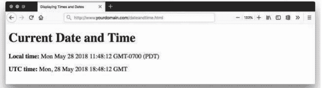

**图 4.2**
使用JavaScript显示日期和时间。

> **注意**
> 对于Internet Explorer，根据你的安全设置，脚本可能不会执行，你的浏览器可能会显示安全警告。在这种情况下，请按照浏览器的说明允许你的脚本运行。（这是因为默认安全设置允许在线文档中的JavaScript，但不允许本地文件中的JavaScript。）

### 修改脚本

尽管当前脚本确实显示了当前日期和时间，但其显示效果远不如你墙上的或桌上的时钟那么美观。为了改善这种情况，你可以使用一些额外的JavaScript功能和一点HTML来显示一个大时钟。

要显示一个大时钟，你需要将小时、分钟和秒放在单独的变量中。同样，JavaScript有内置函数来完成大部分工作：

```javascript
hours = now.getHours();
mins = now.getMinutes();
secs = now.getSeconds();
```

这些语句使用JavaScript的内置日期函数将时间组件加载到`hours`、`mins`和`secs`变量中。

一旦小时、分钟和秒放在单独的变量中，你就可以创建`document.write`语句来显示它们：

```javascript
document.write("<p><strong>");
document.write(hours + ":" + mins + ":" + secs);
document.write("</strong></p>");
```

第一条语句显示一个HTML `<h2>`标题标签，将时钟显示为二级标题元素。第二条语句显示`hours`、`mins`和`secs`变量，用冒号分隔，第三条语句添加结束的`</h2>`标签。

你可以将前面的语句添加到原始的日期和时间脚本中，以添加大时钟显示。清单4.5显示了脚本的完整修改版本。

**清单 4.5 带大时钟显示的日期和时间脚本**

```html
<!doctype html>
<html lang="en">
  <head>
    <meta charset="utf-8">
    <title>Displaying Times and Dates</title>
  </head>
  <body>
    <h1>Current Date and Time</h1>
    <script>
      now = new Date();
      localtime = now.toString();
      utctime = now.toGMTString();
      document.write("<p><strong>Local time:</strong> "
          + localtime + "</p>");
      document.write("<p><strong>UTC time:</strong> "
          + utctime + "</p>");
      hours = now.getHours();
      mins = now.getMinutes();
      secs = now.getSeconds();
      document.write("<h2>");
      document.write(hours + ":" + mins + ":" + secs);
      document.write("</h2>");
    </script>
  </body>
</html>
```

既然你已经修改了脚本，保存HTML文件并在浏览器中打开修改后的文件。如果你让浏览器保持运行，你可以简单地使用刷新按钮来加载新版本的脚本。尝试一下，验证窗口上部和新的大时钟是否显示相同的时间。图4.3显示了结果。

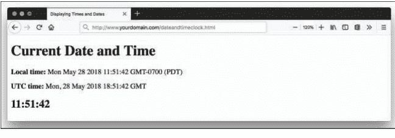

**图 4.3**
显示修改后的日期和时间脚本。

> **注意**
> 此脚本生成的时间格式并不完美：午后的小时使用24小时制，并且没有前导零，所以12:04会显示为12:4。有关这些问题的解决方案，请参见第22课。

### 处理JavaScript错误

随着你开发更复杂的JavaScript应用程序，你将不时遇到错误。JavaScript错误通常是由输入错误的JavaScript语句引起的。

要查看JavaScript错误消息的示例，你可以修改你在上一节中添加的语句。在这个例子中，我们使用一个常见的错误：省略一个括号。将清单4.5中的最后一条`document.write`语句改为：

`document.write("</h2>";`

再次保存你的HTML文档并将文档加载到浏览器中。根据你使用的浏览器版本，会发生以下两种情况之一：要么显示错误消息，要么脚本根本无法执行。

如果显示错误消息，那么你已经完成了一半的修复工作，只需添加缺少的括号即可。如果没有显示错误消息，你应该配置浏览器以显示错误消息，以便你诊断未来的问题：

- 在Firefox中，你可以选择Tools（工具），Web Developer（Web开发人员），Web Console（Web控制台）。控制台会显示你在此示例中创建的错误消息，如图4.4所示。
- 在Chrome中，从选项菜单（浏览器栏右侧的三个水平点）中选择More Tools（更多工具），Developer Tools（开发者工具）。一个控制台会显示在浏览器窗口的底部。如果未选中控制台选项卡，请选择它。

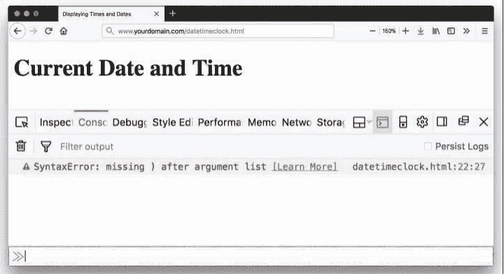

这种情况下你得到的错误是**SyntaxError: missing ) after argument list**（语法错误：参数列表后缺少）），它指向第22行。在这种情况下，点击文档名称会直接带你到包含错误的突出显示行，如图4.5所示。

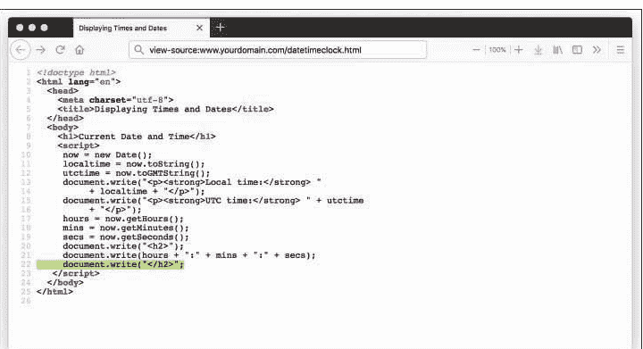

大多数现代浏览器都包含JavaScript调试工具，就像你刚刚看到的那样。你将在下一课中了解更多相关信息。

### 总结

在本课中，你已经了解了什么是Web脚本以及什么是JavaScript。你还学习了如何将脚本插入HTML文档或引用外部JavaScript文件，JavaScript能做什么，以及JavaScript与其他Web语言有何不同。你还编写了一个简单的JavaScript程序，并使用网页浏览器对其进行了测试。你还学习了如何修改和测试脚本，并看到了当JavaScript程序遇到错误时会发生什么。

在编写此脚本的过程中，你使用了JavaScript的一些基本功能：变量、`document.write`语句以及处理日期和时间的函数。

既然你已经学到了一些JavaScript语法，你就可以继续学习关于Web开发的各种知识，然后开始编写使用客户端脚本的交互式网站。

### 问答

**问：我需要在不止一个浏览器上测试我的JavaScript吗？**

**答：** 在理想情况下，你编写的任何符合JavaScript标准的脚本都应该在所有浏览器中工作，在现实世界中，大约98%的情况下（或多或少）确实如此。但浏览器确实有其特性，你应该在Chrome、Internet Explorer和Firefox以及运行iOS和Android的移动设备上测试你的脚本——至少应该如此。

**问：如果我计划学习PHP、Ruby或其他服务器端编程语言，JavaScript对我还有用吗？**

**答：** 当然有。JavaScript是基于Web应用程序许多部分的理想语言，例如基本的交互性。虽然PHP、Ruby和其他服务器端语言有其用途，但它们无法直接与客户端的用户交互。

**问：当我尝试运行我的脚本时，浏览器在浏览器窗口中显示实际的脚本，而不是执行它。我做错了什么？**

**答：** 这很可能是由以下三种错误之一引起的。首先，你可能缺少开始或结束的`<script>`标签。检查它们，如果你使用了`type`属性，请验证它是否为`type="text/javascript"`。其次，你的文件可能以`.txt`扩展名保存，导致浏览器将其视为文本文件。将其重命名为`.htm`或`.html`扩展名以解决问题。第三，确保你的浏览器支持JavaScript，并确保它没有在首选项中被禁用。

**问：为什么允许在打印时间的语句中使用`<strong>`和`<p>`标签？我以为`<script>`标签内不允许使用HTML标签。**

**答：** 因为这些标签在引号内，所以它们被认为是脚本的有效部分。脚本的输出，包括任何HTML标签，都由浏览器解释和显示。你可以在引号内使用其他HTML标签来添加格式，例如你为大时钟显示添加的`<h2>`标签。


### 练习

练习包含测验题和练习，旨在帮助你巩固对所涵盖材料的理解。

### 测验

1.  当用户查看包含JavaScript程序的页面时，实际上执行该脚本的是哪台机器？
    a. 运行Web浏览器的用户机器
    b. Web服务器
    c. 位于网景公司办公室深处的中央机器
    d. 专用的JavaScript服务器
2.  你使用什么软件来创建和编辑JavaScript程序？
    a. 浏览器
    b. 文本编辑器
    c. 铅笔和纸
    d. JavaScript编辑器
3.  在JavaScript程序中，变量用于什么？
    a. 存储数字、日期或其他值
    b. 随机变化
    c. 引发高中代数回忆
    d. 改变脚本的输出
4.  嵌入HTML文件的JavaScript脚本的末尾应该出现什么？
    a. `<script>` 标签
    b. `</javascript>` 标签
    c. **END** 语句
    d. `</script>` 标签
5.  以下哪项不是你可以用JavaScript做的事情？
    a. 检测正在使用的浏览器功能
    b. 无需刷新页面即可修改页面的一部分
    c. 将数据写入远程服务器
    d. 与远程服务器的数据交互
6.  你可以在哪里放置脚本？
    a. 在页面主体中
    b. 在HTML标签内
    c. 在单独的文件中
    d. 以上所有位置
7.  你使用什么来将单独的脚本文件包含在页面中？
    ```
    a. <link src="filename.js">
    b. <script src="filename.js"></script>
    c. <javascript src="filename.js">
    d. <include src="filename.js"></include>
    ```
8.  以下哪项是事件处理器？
    ```
    a. <button>
    b. type="button"
    c. onclick="alert('You clicked the button.')"
    d. </button>
    ```
9.  JavaScript中的 `now = new Date();` 这行代码是做什么的？
    a. 它创建一个名为 `now` 的变量，并在其中存储当前日期。
    b. 它创建一个名为 `new` 的变量，并在其中存储当前日期。
    c. 它显示当前时间。
    d. 什么也不做；它不是有效的JavaScript。
10. 更正这行JavaScript：
    ```
    document.write("<p><strong>Dinner Time:</strong> " + localtime + "</p>");
    ```
    ```
    a. document.write("<p><strong>Dinner Time:</strong> " + localtime + "</p>");
    b. document.write("<p><strong>Dinner Time:</strong> " + localtime + "</p>");
    c. document.write("<p><strong>Dinner Time:</strong> " + localtime + "</p>");
    d. 这行代码本身是正确的。
    ```

### 第4课：理解JavaScript

注意
仅为阅读本书印刷版或电子版的读者提醒：如果你访问 www.informit.com/register 并注册本书（使用ISBN 9780672338083），你可以免费访问在线网络版，该版本不仅包含本书的完整文本，还提供此测验的交互式版本。

### 答案

1.  a. JavaScript程序在Web浏览器中执行。（实际上存在服务器端版本的JavaScript，但那是另一回事了。）
2.  b. 你可以使用任何文本编辑器来创建脚本。
3.  a. 变量用于存储数字、日期或其他值。
4.  d. 你的脚本应该以 `</script>` 标签结束。
5.  c. 由于安全问题，JavaScript永远无法将数据写入远程服务器。
6.  d. JavaScript可以添加在主体中、标签中或单独的文件中。
7.  b. 使用 `<script src="filename.js"></script>` 这行代码。
8.  c. `onclick` 属性及其值是点击事件处理器。
9.  a. 它创建一个名为 `now` 的变量，并在其中存储当前日期。
10. a. 缺少最后的引号。

### 练习

- ▸ 在大型时钟中添加一个毫秒字段。你可以使用 `getMilliseconds` 函数，它的工作方式与 `getSeconds` 类似，但返回的是毫秒。
- ▸ 修改脚本以显示时间（包括毫秒）两次。注意在加载页面时，两次时间显示之间是否有任何时间流逝。

## 第5课
验证和调试你的代码

### 在本课中你将学到：

- 如何验证你的HTML和CSS
- 如何使用开发者工具调试HTML和CSS
- 如何使用JavaScript控制台调试JavaScript

无论你是初学者还是经验丰富的专家——错误都会发生。错误是所有技能水平的开发者生活中无法避免的事实，我们甚至可以冒险说，如果你的代码在创建过程中的某个时刻没有包含错误，那么你只是还不够努力。所以不要担心错误；只担心在客户或用户体验到其副作用之前识别并修复它们。

在本课中，你将学习如何在开发HTML和CSS时验证和调试它们，以及如何使用一些直接内置在Web浏览器中的便捷工具来识别和调试JavaScript问题。

### 验证你的Web内容

在本系列课程的第一课中，我讨论了测试你创建的网页的方法；测试页面的一种非常重要的方法是 *验证* 它们。可以这样想：设计和绘制一套漂亮的房屋平面图是一回事，但建筑师将其盖章为适合建造的安全结构则是另一回事。验证你的网页是类似的过程；然而，在这种情况下，建筑师是一个基于Web的应用程序，而不是人。

简而言之，验证是使用特殊应用程序测试你的页面的过程，该程序搜索错误并确保页面符合当前的HTML和CSS标准。验证很简单。事实上，负责制定Web标准的标准机构——万维网联盟（W3C）——提供了一个在线验证工具供你使用，地址是 https://validator.w3.org。图5.1展示了使用W3C标记验证服务的选项。

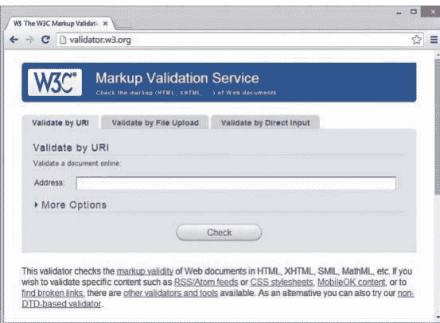

**图5.1**
W3C标记验证服务使你能够验证HTML文档，以确保其编码准确。

如果你已经在线发布了页面，可以使用“通过URI验证”选项卡。使用“通过文件上传验证”选项卡来验证存储在本地计算机文件系统上的文件。“通过直接输入验证”选项卡允许你粘贴来自文本编辑器的文件内容。如果一切顺利，你的页面将获得一份通过报告，如图5.2所示，该图验证了第2课“结构化HTML文档”中的代码清单。

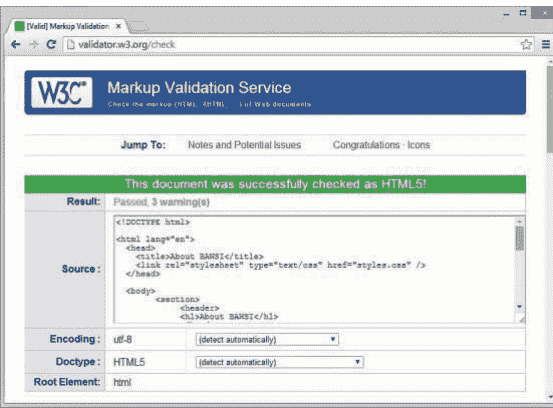

**图5.2**
如果页面通过了W3C标记验证服务，你就知道该代码已经准备好投入生产了。

W3C还提供了一个验证CSS的工具；访问 https://jigsaw.w3.org/css-validator/ 并使用提供的选项输入URL或上传文件。如果W3C标记或CSS验证服务遇到错误，它会提供详细信息（包括违规代码的行号）。图5.3显示了一个错误报告示例；在此示例中，我们故意使用了CSS属性 `padding-up`——一个不存在的属性——而不是 `padding-top`。

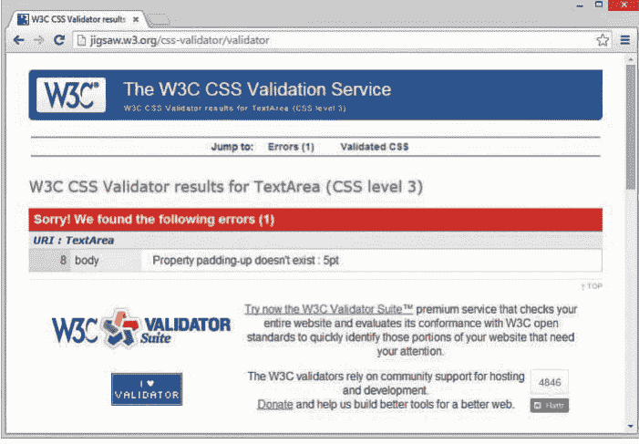

**图5.3**
W3C CSS验证服务，与W3C标记验证服务一样，提供了有用的错误报告。

使用基本的验证服务是查找问题并清除HTML和CSS中无效代码（如错误命名的CSS属性和不匹配的HTML标签）的好方法。验证不仅会通知你的页面构建是否正确，还能在你发布页面供全世界查看之前，帮助你找到并修复代码中的问题。

### 使用开发者工具调试HTML和CSS

你可以通过使用大多数主流浏览器内置的更高级工具，将调试工作扩展到基本验证之外。图5.4、图5.5和图5.6展示了某些主要浏览器在打开开发者工具时的样子；在每个图中，你都会注意到某些工具的名称和功能具有一致性。


**第五课：验证与调试你的代码**

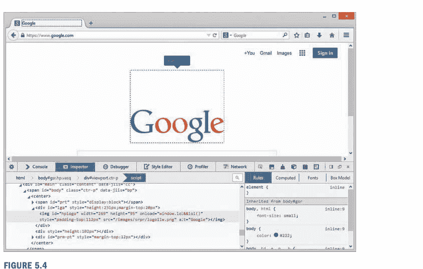

**图 5.4** 使用 Firefox 开发者工具检查包含 Google 徽标的元素。

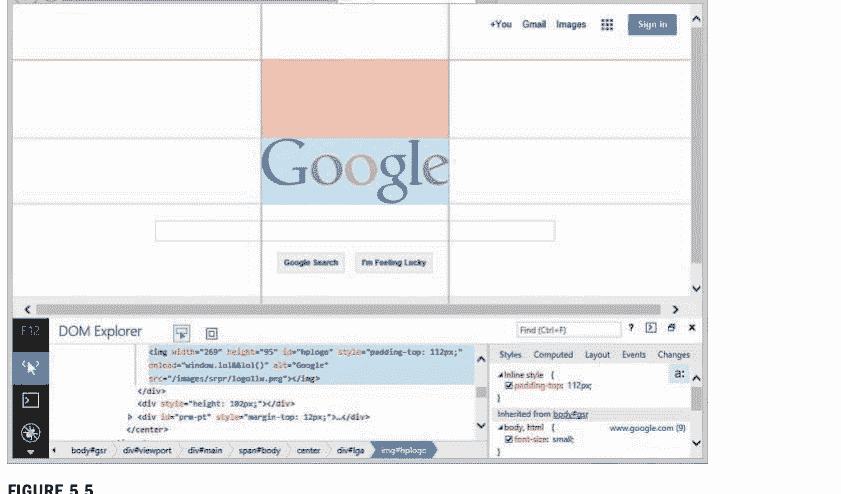

**图 5.5** 使用 Microsoft Internet Explorer 开发者工具检查包含 Google 徽标的元素。

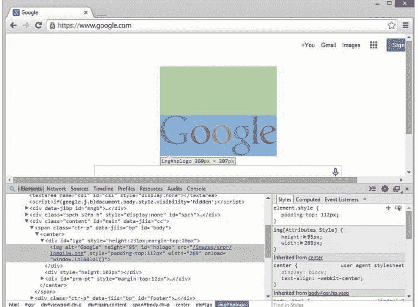

**图 5.6** 使用 Chrome 开发者工具检查包含 Google 徽标的元素。

尽管本节将介绍的示例使用的是 Chrome 开发者工具，但你可以看到之前展示的所有开发者工具（以及 Safari 等其他浏览器）都有相似之处。具体来说，检查元素的功能在所有三套工具中都存在。当你在屏幕上用鼠标选择一个元素时，开发者工具中的额外窗口面板会显示用于渲染该元素的确切 HTML，以及当前应用于该元素的样式规则。

检查器的这一功能非常有用，因为它提供了一种可视化的方式来查看 DOM 树中的节点与渲染的网页之间的关系；此外，请注意每套工具中都使用了面包屑导航，它显示了从根 html 节点到 img 节点（ID 值为 #hplogo）的节点层次结构。这种面包屑导航的使用有助于进一步理解渲染的视觉元素出现在 DOM 中的位置（而不仅仅是在你的屏幕上）。

接下来的几节将引导你了解使用这些工具的一些实际应用。

### 使用检查器调试 HTML

为了说明如何使用检查器调试 HTML，请考虑清单 5.1 中的代码，它只是一个包含电影列表的基本 HTML 文档，其中标题中的“Favorite”一词应该是斜体。然而，如果你查看图 5.7 中的渲染版本，你会看到一些问题：*所有内容*都是斜体，并且第一个列表项目前没有项目符号。这些问题仅仅是由所有文本中的两个字符引起的。

**清单 5.1** 图 5.7 中所示的一些 HTML 语法错误的简单 HTML 文档

```html
<!doctype html>
<html lang="en">
    <head>
        <meta charset="utf-8">
        <title>Favorite Movies</title>
    </head>
    <body>
        <h1><i>Favorite<i> Movies</h1>
        <ul>
            <li>Lord of the Rings</li>
            <li>Harry Potter</li>
            <li>Narnia</li>
            <li>Hot Lead and Cold Feet</li>
        </ul>
    </body>
</html>
```

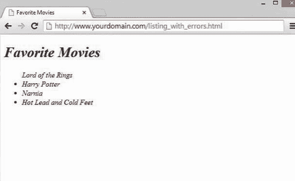

**图 5.7** 此网页有两个问题：只有“Favorite”这个词应该是斜体，并且第一个列表项目前没有项目符号。

按照以下步骤，使用开发者工具中的检查器来查找并修复 HTML 语法问题：

1. 将清单 5.1 中的代码添加到一个新文件中，保存文档，然后在你喜欢的现代浏览器（Chrome、Firefox、Safari 或 Edge）中打开它。你可以将文档保存在本地计算机上，也可以放在 Web 服务器上；对于本示例来说这并不重要，只要你能在 Web 浏览器中打开该文件即可。

2. 右键单击屏幕并选择“检查元素”。你应该会看到类似图 5.8 所示的内容，其中“元素”选项卡被预先选中。

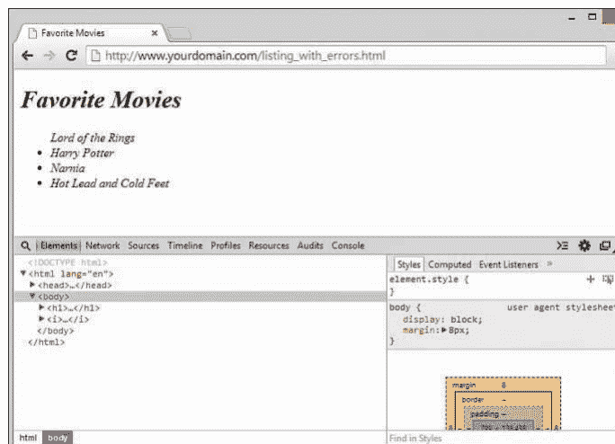

**图 5.8** “元素”选项卡默认被选中。

3. 单击“元素”面板中的箭头以展开 `<h1>` 标签，如图 5.9 所示。注意 `<h1>` 元素下有一个 `<i>` 元素，并且还有另一个 `<i></i>` 标签对。这是不对的：你记得（并且可以在源文件中看到）你没有在代码中到处放置 `<i>` 元素，那么它们为什么会出现在这里呢？好吧，如果你仔细查看“元素”面板和源代码，你会发现缺少了一个 `/`，它会使第二个 `<i>` 标签成为你想要的闭合 `</i>` 标签。这意味着浏览器正在渲染（并且检查器正在显示）看似围绕你代码中每个元素的 `<i></i>` 元素，因为第一个 `<i>` 元素从未被关闭；渲染引擎正在解释所有这些虚幻的 `<i>` 元素都存在。

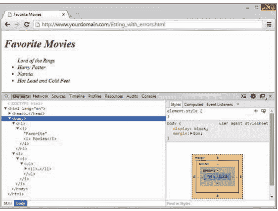

**图 5.9** 此 HTML 检查器在 DOM 中显示的 `<i>` 元素比你的源代码中的更多。

4. 在你的源文件中，将第二个 `<i>` 标签更改为闭合 `</i>` 标签并保存文档。如果你最初将它放在 Web 服务器上，请将其放回服务器。

5. 在浏览器中刷新文档。注意，如图 5.10 所示，单词“Favorite”现在已正确显示为斜体，并且检查器中所有虚幻的 `<i>` 元素都消失了；但是，浏览器的显示中第一个列表项仍然缺少项目符号。

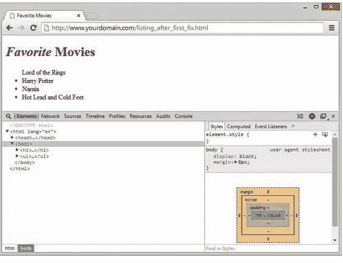

**图 5.10** 此网页现在只有一个问题：第一个列表项没有项目符号。

6. 返回“元素”面板，展开 `<ul>` 元素，然后展开 `<ll>`，如图 5.11 所示。注意，在 `<ul>` 元素下，不是一组四个正确打开和关闭的 `<li>` 元素，而是一个打开的 `<ll>` 标签，其后是三个 `<li>` 元素，然后是一个闭合的 `</li>` 标签。虽然我们还没有介绍 HTML 列表项标签（我们将在下一课中介绍），但你可能可以推断出，因为带有打开和闭合 `<li>` 标签的三行显示了项目符号，并且在源代码中 `<ll>` 元素由一个 `</li>` 标签关闭，所以打开标签应该是一个 `<li>` 标签。

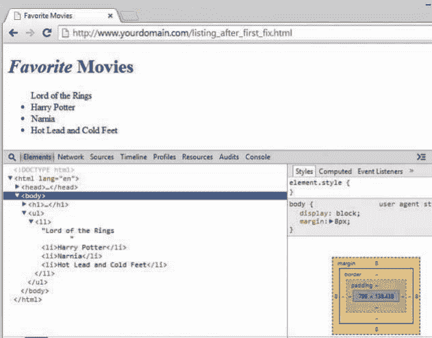

**图 5.11** 查看 DOM 可发现，浏览器看到的是 `<ul>` 标签下的 `<ll>` 标签，而不是一组 `<li>` 标签。

7. 在你的源文件中，将 `<ll>` 标签更改为 `<li>` 标签并保存文档。如果你最初将它放在 Web 服务器上，请将其放回服务器。

8. 在浏览器中重新加载网页。现在它已正确显示，如图 5.12 所示。

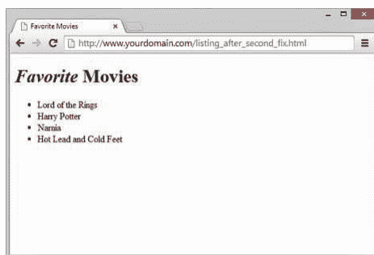

**图 5.12** Chrome 现在按预期格式显示该网页。

尽管像你刚才那样完成所有步骤向你展示了检查器可用于帮助发现问题的一些方式，但你可能想知道，与仅使用验证器相比，该过程实际上更高效和更有帮助多少。毕竟，之前看到的问题纯粹是验证错误，使用你之前学过的 W3C 验证器可以很容易地发现它们。图 5.13 显示了原始清单中存在的一些验证错误。

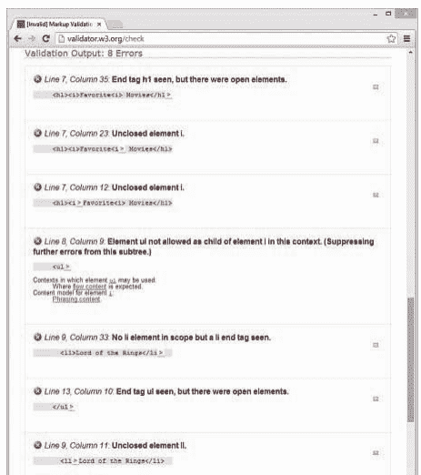

**图 5.13** W3C 验证器清楚地显示了错误。

### 注意

当你使用验证器时，最好按问题出现的顺序进行检查。通常，修复一个错误会导致列出的许多后续错误消失。例如，修复图 5.13 中的第一个“未闭合元素 i”错误也会修复第二个错误。它还将修复“看到结束标签 h1……”错误。通常，修复一个错误并重新验证以查看会发生什么是很好的做法。

验证器确实会更快地识别纯粹的语法问题，而使用检查器则需要你具备相应的知识和经验，以便在问题以不同于原始源代码的上下文呈现时直接发现它。我们建议初学者首先通过验证器运行他们的代码，但查看 DOM 渲染的替代视图对于持续的学习过程非常有用。

### 使用检查器调试 CSS

你刚刚学到的关于使用检查器调试 HTML 的所有内容在 CSS 方面也同样适用：你可以使用开发者工具来发现样式定义和继承方面的问题。这些内置工具在你使用更高级的开发时特别有用，例如当你使用 JavaScript 修改特定元素的 CSS（超出其在源代码中的原始状态）时，但它们在开发的初始阶段也很有用。

本节中的步骤将通过一个使用检查器处理 CSS 的简短示例——具体来说，是一些格式不正确但有效的 CSS，如清单 5.2 所示。尽管你很早（因此这些示例）就在你的开发过程中遇到了这一课，但我们非常肯定，在几节课之内，你将记住你在这里学到的步骤，并将在本课程的剩余部分中使用开发者工具来增强你的调试和开发。

**清单 5.2** 显示不正常的有效 HTML 和 CSS

```html
<!doctype html>
<html lang="en">
  <head>
    <meta charset="utf-8">
    <style>
      #container {
        margin: 30px;
        padding: 5px;
        width: 300px;
      }

      #tabs {
        padding: 0px;
        width: 50px;
      }
    </style>
```

### 108 第5课：验证和调试你的代码

```css
#content {
    border: 1px solid #000000;
    height: 100px;
    width: 300px;
    clear: both;
}

span {
    margin: 5px;
    width: 100px;
    background-color: #C0C0C0;
    font-weight: bold;
    border-color: #C0C0C0;
    border: 1px solid #000000;
    border-radius: 5px 5px 0px 0px;
    padding: 3px;
    float: left;
    text-align: center;
}

span:hover {
    background-color: #3030FF;
    color: #FFFFFF;
    cursor: pointer;
}

p {
    font-weight: bold;
    text-align: center;
}
</style>
<title>示例页面</title>
</head>
<body>
    <div id="container">
        <div id="tabs">
            <span>姓名/标题</span>
            <span>联系信息</span>
            <span>个人简介</span>
        </div>
        <div id="content">
            <p>吉姆博·琼斯</p>
            <p>惹是生非者</p>
        </div>
    </div>
</body>
</html>
```

如果你通过验证器运行这段 HTML 和 CSS，它将不会产生错误，因为它是有效的 HTML 和 CSS。然而，正如你在图5.14中看到的，它看起来就是不对。这些选项卡本应沿着包含文本的方框顶部对齐。如果我们能解决这个初始布局问题，用户就能点击选项卡，方框中的内容也会随之改变。但在这种初始显示按我们期望的方式工作之前，我们无法继续前进并实现这一目标。这是一个经典的 HTML 和 CSS 调试问题的例子——它没有错误（无效），但就是不对（没有按我们想要的方式显示）。

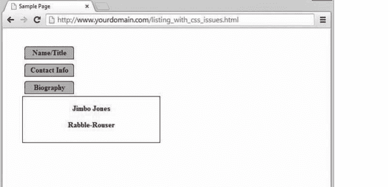

**图5.14**
需要进一步调试以改善外观的有效 HTML 和 CSS 的结果。

请按照以下步骤，使用检查器来发现并修复一些问题：

1.  将清单5.2中的代码添加到一个新文件中，保存文档，然后在你的网页浏览器中打开它。你可以将文档保存在本地机器上，或者放在你的网络服务器上；只要能在浏览器中打开文件，对于这个示例来说，放哪里都无所谓。
2.  右键单击页面，选择“检查元素”以打开开发者工具。
3.  单击“元素”面板中的箭头，展开ID为“container”的`<div>`元素，然后展开ID为“tabs”的`<div>`元素。单击ID为“tabs”的`<div>`元素，使其在屏幕上高亮显示，如图5.15所示。将显示这个特定`<div>`的宽度；在本例中，它是50像素宽。这应该会让你怀疑这个特定`<div>`的宽度（它比其内部任何`<span>`元素的宽度都要小——点击其中一个可以看到它们是100像素宽——更不用说三个加在一起了）是否是导致你布局问题的原因。

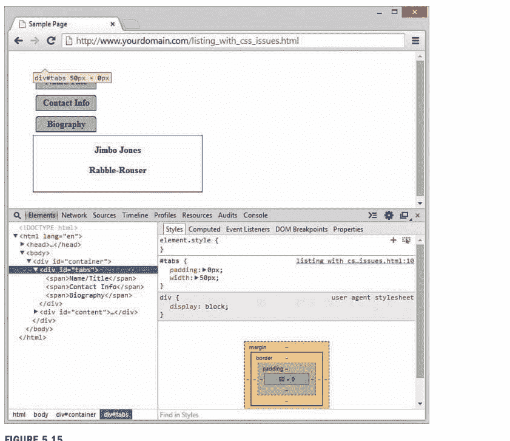

**图5.15**
选中的`<div>`元素只有50像素宽。

4.  根据你上一步的直觉，单击ID为“container”的`<div>`元素，使其在屏幕上高亮显示，并使样式在样式面板中获得焦点。请注意，这个特定`<div>`元素的宽度是300像素。
5.  在“元素”面板中，再次单击ID为“tabs”的`<div>`元素，使其样式在样式面板中获得焦点。在样式面板中，双击宽度值使字段可编辑，并将该值更改为300px，如图5.16所示。

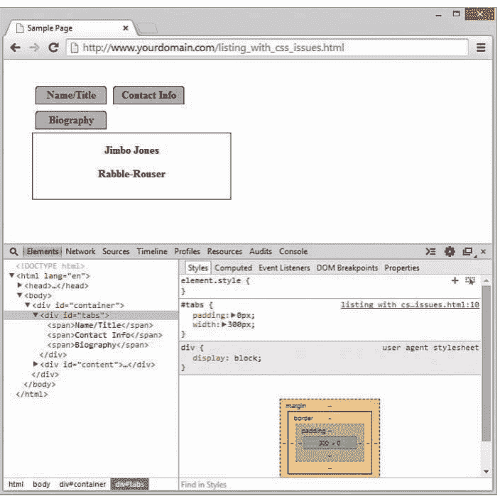

**图5.16**
布局立即改变了，尽管仍然不正确。

无需对本地或网络服务器上的底层源代码进行任何更改，你可以将检查器用作一种编辑器，来审查对 HTML 和 CSS 的可能修改。尽管这个示例中的代码离“好”还差得很远，但你可以继续自己进行更改，并观察显示如何反应。在完成后续课程后，你可能会取得更好的效果，但即使没有详细的对齐、边距和填充知识，你也可以体验一种无需在代码中提交更改就能进行的试错调试。

> **注意**
你可以使用开发者工具中的检查器，而不仅仅针对你自己的代码。你可以打开开发者工具，查看任何页面的源代码，了解页面是如何构建的——并且你可以更改 HTML 和 CSS 的值，看看这些更改如何影响显示，就像你刚才做的那样。

你是否想知道为什么三个100像素宽的选项卡无法放入一个300像素宽的容器中？这与 CSS 盒子模型有关。你将在第10课“理解 CSS 盒子模型和定位”中了解更多相关信息。

### 使用开发者工具调试 JavaScript

大多数主流浏览器中的开发者工具都可以帮助你调试 JavaScript，从在控制台捕获基本语法错误，到使用源代码面板及其包含的所有内容进行高级调试步骤。在本节介绍这些工具时，我们将使用清单5.3中的代码。

**清单5.3** 一个包含几个不同 JavaScript 错误的简单 HTML 文档

```html
<!doctype html>
<html lang="en">
  <head>
    <meta charset="utf-8">
    <title>示例页面</title>

    <script src="http://code.jquery.com/jquery-latest.min.js"></script>

    <script>
    function incCount(){
      var count = 0;
      count += 1;
      return count;
    }

    function countIt(){
      $("#counter").html(incCount);
    }
    </script>

    <style>
    button {
      background-color: #0066AA;
      color: #FFFFFF;
      font-weight: bold;
      border: 2px solid #C0C0C0;
      width: 100px;
    }
    </style>
  </head>

  <body>
    <button onclick="countIt()">点击我</button>
    <div id="counter"></div>
  </body>
</html>
```

如果你将清单5.3中的代码添加到一个新文件中，保存文档，然后从你的本地机器或服务器在网页浏览器中打开它，你将看到图5.17中所示的毫不起眼的小按钮。

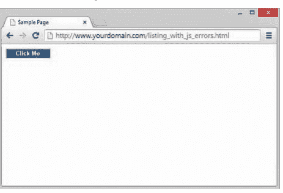

**图5.17**
显示清单5.3的初始输出。

然而，如果你按照这些步骤操作，你将很快使用控制台发现这段代码中的问题：

1.  在网页上右键单击并选择“检查元素”。
2.  通过单击开发者工具中的“控制台”选项卡切换到控制台面板。
3.  单击浏览器渲染出的“点击我”按钮。你应该会看到一个如图5.18所示的错误，这表明代码中存在错误。

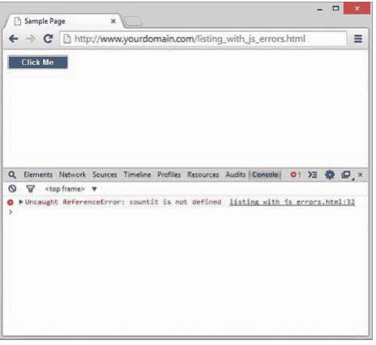

**图5.18**
控制台显示代码中存在语法错误的位置。

4.  单击将带你到文件中包含错误的确切行的链接（在此示例中，链接是 `listing_with_js_errors.html:32`），你会看到被调用的 JavaScript 函数是 `countIt()`，而该函数最初在第15行定义为 `countIt()`。正如你在前一课中学到的，JavaScript 是区分大小写的。

如果你通过将第32行的 `countit()` 更正为 `countIt()` 来修正底层源文件，然后重新加载文档并单击“点击我”按钮，你将不再在控制台中看到错误。然而，正如你将很快看到的，这个文档还有更多问题。

在文档的 `<head>` 部分有一个指向外部存储的 JavaScript 库（实际上是 jQuery）的链接，以及一些定义了两个函数的 JavaScript 代码。`<body>` 部分包含一个带有 `onclick` 事件的 `<button>` 标签，用于调用 `countIt()` JavaScript 函数，以及一个用于显示包含当前按钮点击次数字符串的 `<div>` 元素。这一切都很好，除了如果你实际点击“点击我”按钮超过一次，数字不会增加超过1，并且控制台中不会出现错误。这种情况需要更高级的调试。

> **注意**
始终对你的网页进行多次测试。在清单5.3的 JavaScript 中，修复第一个错误使页面似乎正常工作了。但如果你只点击按钮一次，你永远不会意识到在后续点击中存在问题。只要你在网页上处理交互，你就应该在你希望页面运行的每个浏览器/设备上至少测试三次。

### 仔细查看源代码面板

源代码面板（Firefox 中的调试器面板，Safari 中的调试器）包含一组工具，使你能够暂停、恢复和逐步执行在网页浏览器中加载的代码。通过设置断点，你可以监视代码的各个部分执行，当你试图追踪与基本语法无关的问题时，这尤其有帮助（控制台会主动显示这些问题，无需你干预）。

将清单5.3中的代码加载到你的浏览器中，并启用开发者工具，然后单击“源代码”选项卡以查看源代码面板及其相关工具。它看起来应该类似于图5.19所示的内容。


### 使用开发者工具调试JavaScript

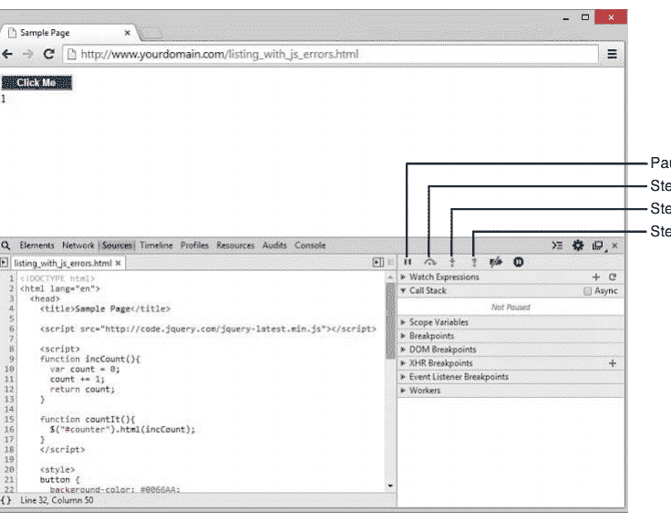

图 5.19
展示了 Chrome 开发者工具中的 Sources 面板，以及本示例中一些重要的工具。

> 注意
要彻底理解 Sources 面板中的所有图标，请参阅 https://developers.google.com/web/tools/chrome-devtools/。Firefox (https://developer.mozilla.org/en-US/docs/Tools/Debugger)、Safari (https://developer.apple.com/safari/tools/) 和 Edge (https://docs.microsoft.com/en-us/microsoft-edge/devtools-guide/debugger) 也有类似的页面。

要调试脚本，我们将重点使用图 5.19 中突出显示的工具来设置断点和逐行执行代码。但首先，解释一些术语：

-   断点——断点使你能够指定希望停止 JavaScript 执行的位置。当你设置一个断点时，浏览器会停止执行，并在执行该行代码之前中断到调试器。这使你能够查看该特定点处的代码状态。通过点击代码列表中的行号来设置断点，再次点击行号则移除断点；断点由高亮的蓝色箭头图标指示。Breakpoints 标签页显示了已设置的断点列表。你可以通过取消选中其旁边的复选框来禁用断点。
-   **单步跳过**——当你点击单步跳过图标时，代码前进一行。如果该行代码要执行另一个函数，则执行该函数，并将你带到当前函数的下一行代码。如果在跳过函数时遇到断点，浏览器将在脚本的该位置停止执行。
-   **单步跳入**——当你点击单步跳入图标时，代码前进一行。如果该行代码要执行另一个函数，则你将进入该函数的第一行代码。
-   **单步跳出**——当你点击单步跳出图标时，当前函数执行完成，你将进入调用函数的下一行代码。

现在，让我们开始调试清单 5.3 中的脚本，看看为什么计数器无法超过 1：

1.  通过点击行号左侧在第 10 行设置一个断点。应该会出现一个蓝色箭头，如图 5.20 所示。同时请注意，最右侧面板的 Scope Variables 部分已打开。我们打开这个部分是为了观察脚本前进时 `count` 的值如何变化。毕竟，问题就在于这个值，因为它在第一次点击后没有改变。

    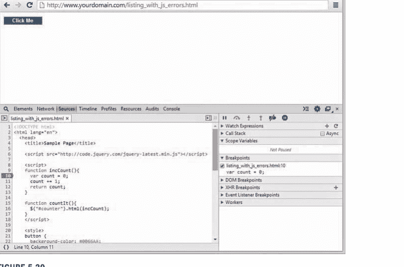

    图 5.20
    脚本第 10 行设置了断点。

2.  现在点击网页上的按钮。你应该会看到网页正文中出现一个黄色箭头，表示脚本已在调试器中暂停，并且代码列表中的第 10 行会高亮显示。在脚本中，第 11 行是 `incCount()` 函数的第一行；`incCount()` 函数旨在确定由变量 `count` 表示的计数器字符串的值。在 Scope Variables 区域，你应该会看到 `count` 的值当前是 undefined。

3.  点击单步跳过图标。在 Scope Variables 区域，你应该会看到 `count` 的值变为 **0**，因为该值已被定义为起始数字 **0**。

4.  再次点击单步跳过图标。现在 `count` 的值是 **1**，正如预期的那样，这是由 `count += 1;` 这行代码更改的，意思是“取 `count` 的当前值并加一”。

5.  点击单步跳出图标四次，以跳出此函数以及中间的 jQuery 函数。注意网页上的值已变为 **1**。

6.  点击继续或恢复图标（一旦脚本开始，暂停图标会更改为继续图标或 Firefox 中的恢复图标），让脚本完成执行。到目前为止一切顺利。

7.  再次点击网页上的按钮。调试器应该再次激活，并停止在与步骤 2 相同的位置。注意 `count` 的值又是 undefined，而常识（但不是我们的代码）认为它应该是 **1**。

8.  点击单步跳过图标；`count` 变为 **0**。再次点击单步跳过，`count` 变为 **1**。随着按钮的点击，`count` 被重置为 undefined，设置为 **0**，然后递增到 **1**。这不是期望的行为。

9.  要修复这个问题，返回源代码并交换第 10 行和第 11 行，使 `count` 的定义发生在使用它的函数（`incCount()`）定义之前。此更改在脚本加载时以及函数定义之前定义了变量 `count` 并仅设置一次值。

如果你加载新调试过的文件，你会发现计数器按预期递增。如果断点没有自动移除，你可能需要手动移除它。清单 5.4 显示了更正后的 JavaScript。

### 清单 5.4  更正后的脚本

```javascript
var count = 0;
function incCount(){
  count += 1;
  return count;
}

function countIt(){
  $("#counter").html(incCount);
}
```

本节提供了一个基础示例，该示例足够简单，易于理解，并帮助你熟悉调试器的工作原理。请记住这些基本步骤：设置断点，并在逐行执行代码时观察变量。

### 总结

在本课中，你学习了验证和调试 HTML、CSS 和 JavaScript 中问题的各种方法。你学习了如何使用浏览器开发者工具中的检查器来查看浏览器在加载网页时渲染的 HTML 元素以及 CSS 样式和属性。此外，你还学习了在控制台审查 JavaScript 语法错误的基础知识，以及设置断点并系统地逐行执行代码以调试更复杂问题的方法。

你在本课中学到的方法将在你完成本课程时非常有帮助，更不用说在未来的项目中了，因为它们将为你节省大量时间并避免因那些似乎总会悄悄混入代码的简单验证和语法错误而带来的挫败感，无论你经验多么丰富。

### 问答

**问：** 我见过一些网页开头没有 `<!doctype>` 标签，但它们看起来完全正常。这怎么可能？

**答：** 许多网页浏览器会原谅你忘记包含 `<!doctype>` 标签，并仍然通过使用它们的最佳猜测来确定遵循哪个标准来显示页面。然而，包含适当的 `<!doctype>` 标签是个好主意，这不仅是因为你希望你的页面是符合最新网络标准的、真正的有效 HTML 页面，还因为如果你不包含它，并且浏览器应用了一个不包含你在代码中所用标签的默认标准，显示效果将会不正确。

**问：** 开发者工具看起来功能非常丰富。我还能用这些工具调试什么？

**答：** 你说得对：Chrome 中开发者工具的很多元素并未在此涵盖，其他主要浏览器对开发者工具的实现也有许多独特之处。通常，你可以使用开发者工具调试存储在 cookies 中的值、脚本使用的外部资源的状态（它们是否被找到/未找到、加载是否缓慢等），以及页面及其脚本使用的内存量，等等。

### 练习

练习部分包含测验题和练习，以帮助你巩固对所涵盖材料的理解。

### 测验

1.  使用 Chrome 开发者工具，你如何查找文档中特定 `<div>` 标签的当前 `background-color` CSS 属性值？
2.  使用调试器，你如何让代码在特定行停止执行？
3.  Chrome 开发者工具的哪个部分使你能够在逐步执行脚本时查看变量的值？
4.  你可以使用 W3C 验证器验证哪些网络语言？
5.  哪些浏览器有开发者工具？
6.  调试损坏的 HTML 代码有什么方法？
7.  何时使用开发者工具检查器特别有用？
8.  当你在 CSS 检查器中更改样式值（或添加样式规则）时会发生什么？
9.  网页调试器中的单步跳过命令的作用是什么？
10. 如何在开发者工具中设置断点？

> **注意**

提醒那些阅读本书印刷版或电子书版的读者：如果你前往 **www.informit.com/register** 并注册本书（使用 ISBN 9780672338083），你可以免费访问在线网络版，其中不仅包含本书的完整文本，还包含此测验的交互式版本。

### 答案

1.  点击 Elements 标签页打开 Elements 面板，然后选择你感兴趣的具体 `<div>`。当前的样式值将出现在最右侧面板中。
2.  你可以通过设置断点来让脚本在特定行停止执行。这适用于大多数调试工具，并非 Chrome 开发者工具所特有。
3.  Sources 面板的 Scope Variables 部分使你能够查看脚本中使用的变量值。
4.  本课提到了 W3C 的 HTML 验证器和 CSS 验证器。W3C 还提供其他验证服务，例如链接检查、RSS 和 Atom 源检查，甚至移动内容检查。
5.  几乎每个现代桌面浏览器都内置了某种形式的开发者工具。本课提到了 Chrome、Firefox、Safari 和 Internet Explorer 中的工具。Edge 和 Opera 中也有开发者工具。
6.  你可以使用 HTML 验证器查找错误，或使用浏览器中的开发者工具查看代码。或者你可以逐行检查你的 HTML。


### 7. 开发者工具中的检查器在处理修改了HTML原始状态的CSS的JavaScript时特别有用。

### 8. 网页会发生变化以反映新的CSS规则，但该规则不会应用于当前页面之外。如果你不将更改添加到CSS文件中，这些更改将不会永久应用于网页。

### 9. “逐行执行”命令会将JavaScript代码向前推进一行。

### 10. 要设置断点，请单击希望设置断点的行号。然后该行上会出现一个蓝色箭头并设置断点。要关闭断点，请再次单击该行号。要临时禁用断点，请在“断点”选项卡中取消选中断点旁边的复选框。

### 练习

- ▶ 继续调试清单5.2，直到元素以你认为有吸引力的方式排列。由于你还没有明确学习这些技能，我们将给你一个提示：尝试修改CSS中宽度值和内边距值。

- ▶ 使用控制台日志在脚本的不同位置输出特定字符串。你可以通过在JavaScript中插入如下代码将日志记录到控制台，然后在脚本执行过程中在控制台面板中查看这些字符串：

```
console.log("Some string.");
```

## 第6课
### 处理字体、文本块、列表和表格

### 本课你将学到：

- ▸ 如何使用粗体、斜体和特殊文本格式
- ▸ 如何调整字体
- ▸ 如何使用特殊字符
- ▸ 如何在页面上对齐文本
- ▸ 如何使用三种类型的HTML列表
- ▸ 如何在列表内嵌套列表
- ▸ 如何创建简单的表格
- ▸ 如何控制表格的大小
- ▸ 如何在表格内对齐内容以及跨行和跨列
- ▸ 如何使用CSS列

在Web的早期，文本仅以一种字体和一种大小显示。然而，HTML和CSS的结合现在可以控制文本的外观（字体、大小、颜色）以及它在网页上的对齐和显示方式。在本课中，你将学习如何更改字体的视觉显示——其字体族（字体）、大小和字重——以及如何将粗体、斜体、上标、下标和删除线文本整合到你的页面中。你还将学习如何更改字体和字体大小，以及如何使用Web字体。

然后，在熟悉这些文本方面之后，你将学习文本对齐的基础知识以及其他一些文本技巧和窍门，例如使用列表。因为列表非常常见，HTML提供了自动缩进文本并在每个列表项前添加数字、项目符号或其他符号的标签。你将学习如何格式化不同类型的列表。

在本课中，你将学习如何构建HTML表格，用于控制Web内容中表格数据的间距、布局和外观。虽然使用CSS可以实现类似的结果，但有时使用表格是呈现行列信息的最佳方式。你还会在本课中了解设计师过去如何不得不使用表格进行页面布局——以及如何在未来避免这样做。

最后，你将学习一种显示大块文本的新技术——CSS列。你将了解如何从内容中创建报纸风格的列，以及如何使列在页面上看起来美观。

> **注意**
> 在查看其他设计师的Web内容时，你可能会注意到与本系列教授的标记文本方法不同的方法。一些旧式格式文本的明显标志包括使用`<b></b>`标签对表示单词应加粗，`<i></i>`标签对表示单词应为斜体，以及`<font></font>`标签对指定字体族、大小和其他属性。然而，这种方法正在从HTML中逐步淘汰，而CSS要强大得多。

▼ **自己动手试试**

### 准备示例文本

如果你有一些可以用于显示不同字体和颜色、可以缩进、居中或以其他方式操作的示例文本，你将能充分利用整个课程学习如何设置文本样式。使用什么类型的文本并不重要，因为有太多样式可能性需要尝试，它们永远不会全部出现在同一个网页上（除非你想让你的访客抓狂）。借此机会感受一下文本级别的更改如何影响内容的外观。

- • 如果你要使用的文本来自文字处理或数据库程序，请确保将其以纯文本或ASCII格式保存到新文件中。然后，你可以在学习本课的过程中添加适当的HTML标签和样式属性来格式化它。
- • 任何文本都可以，但尽量找到（或输入）一些你想放到网页上的文本。来自公司手册或你简历的文本可能是一个不错的选择。
- • 任何类型的提纲、演示文稿中的项目符号、编号步骤、词汇表或来自数据库的文本信息列表都可以作为很好的练习材料。
- • 在使用本课介绍的代码格式化正文文本之前，添加你在前几课中使用过的一套骨架HTML标签（至少包括`<!doctype>`、`<html>`、`<head>`、`<title>`和`<body>`标签）。

### 处理特殊字符

在我们急于更改字体之前，让我们花一点时间谈谈字体中的特殊字符。大多数字体包含用于欧洲语言的特殊字符，例如café中的带重音的é。你还会发现一些数学符号和特殊标点符号，例如圆点•。

你可以通过使用适当的代码在HTML文档的任何位置插入这些特殊字符（参见表6.1）。你可以在以下URL找到更广泛的多字符集代码列表：

https://www.webstandards.org/learn/reference/charts/entities/namedentities/

HTML使用一种称为字符实体的特殊代码来表示特殊字符，例如©和®。字符实体总是以&开头，以;结尾。表6.1列出了最常用的字符实体，尽管HTML支持更多。

表6.1包含尖括号、引号和与号的代码。如果你想让这些符号出现在你的页面上，必须使用这些代码；否则，Web浏览器会将它们解释为HTML命令。

清单6.1和图6.1展示了表6.1中几个正在使用的符号。

例如，你可以通过以下任一方式生成单词café：

`caf&eacute;`
`caf&#233;`

> **注意**
> 在HTML中使用`<meta charset="utf-8">`行的一个好理由是，它减少了对这些特殊字符代码的需求。通过将字符集设置为UTF-8，你告诉浏览器期望这些字符而无需任何特殊编码。换句话说，在UTF-8网页中，你可以写`<h1>Café</h1>`而不是`<h1>Caf&eacute;</h1>`，它将正确显示。
>
> 你仍应使用HTML中使用的字符的编码，例如`&lt;`表示<，`&gt;`表示>，以及`&amp;`表示&。这确保浏览器知道这些字符是文本的一部分，而不是HTML。

**表6.1 常用的英语特殊字符**

| 字符 | 数字代码 | 代码名称 | 描述 |
| :---: | :---: | :---: | :--- |
| “ | &#34; | &quot; | 引号 |
| & | &#38; | &amp; | 与号 |
| < | &#60; | &lt; | 小于 |
| > | &#62; | &gt; | 大于 |
| ¢ | &#162; | &cent; | 分符号 |
| £ | &#163; | &pound; | 英镑 |
| ¦ | &#166; | &brvbar; | 断竖线 |
| § | &#167; | &sect; | 节符号 |
| © | &#169; | &copy; | 版权 |
| ® | &#174; | &reg; | 注册商标 |
| ° | &#176; | &deg; | 度符号 |
| ± | &#177; | &plusmn; | 正负号 |
| ² | &#178; | &sup2; | 上标二 |
| ³ | &#179; | &sup3; | 上标三 |
| · | &#183; | &middot; | 中点 |
| ¹ | &#185; | &sup1; | 上标一 |
| ¼ | &#188; | &frac14; | 分数四分之一 |
| ½ | &#189; | &frac12; | 分数二分之一 |
| ¾ | &#190; | &frac34; | 分数四分之三 |
| Æ | &#198; | &AElig; | 大写AE连字 |
| æ | &#230; | &aelig; | 小写ae连字 |
| É | &#201; | &Eacute; | 带重音的大写E |
| é | &#233; | &eacute; | 带重音的小写e |
| × | &#215; | &times; | 乘号 |
| ÷ | &#247; | &divide; | 除号 |

尽管你可以用数字指定字符实体，但每个符号也有一个助记名称，通常更容易记忆。

> **注意**
> 寻找版权（©）和注册商标（®）符号？它们的代码分别是`&copy;`和`&reg;`。
>
> 要创建未注册商标（™）符号，请使用`&trade;`。

### 清单6.1 特殊字符代码

```
<!doctype html>
<html lang="en">
  <head>
    <meta charset="utf-8">
    <title>Punctuation Lines</title>
    <style>
      section {
        margin-bottom: 20px;
      }
    </style>
  </head>
```


### 粗体、斜体与特殊文本格式

早在打字机时代，我们满足于纯文本显示，并偶尔使用下划线来表示强调。如今，**粗体**和*斜体*文本已成为所有纸质通信中的标准格式。当然，你也可以为网页内容添加粗体和斜体文本。多种标签和样式规则使文本格式化成为可能。

> 注意
虽然应尽可能使用样式来控制呈现效果，但对于粗体和斜体文本，除了使用样式规则外，另一种方法是使用 `<strong></strong>` 和 `<em></em>` 标签对。在大多数浏览器中，`<strong>` 标签的作用与 `<b>` 标签相同，而 `<em>` 标签则与 `<i>` 标签作用相同，可将文本格式化为斜体。当然，你可以根据需要为这些标签设置样式，但以上述默认效果为主。

`<strong>` 和 `<em>` 标签被视为对 `<b>` 和 `<i>` 的改进，因为它们仅暗示文本应获得特殊强调，并不规定具体如何实现这种效果。换句话说，浏览器不一定必须将 `<strong>` 解释为粗体，或将 `<em>` 解释为斜体。这使得 `<strong>` 和 `<em>` 更适合在 HTML5 中使用，因为它们不仅影响文本的显示方式，还为文本添加了语义。

为文本添加粗体和斜体格式的老派方法——此处简要提及，因为如果你查看许多较旧网站的源代码，无疑会看到它——涉及使用 `<b></b>` 和 `<i></i>` 标签对。对于粗体文本，你将 `<b>` 和 `</b>` 标签包裹在文本周围。同样，要使任何文本显示为斜体，你将其包含在 `<i>` 和 `</i>` 标签内。虽然这种方法在浏览器中仍然有效，但它不如用于文本格式化的 CSS 样式规则灵活或强大，应避免使用。

第 III 部分“使用 CSS 进行高级网页设计”将更深入地介绍 CSS 样式规则，但在此先做一些铺垫，以便你了解一些基本的文本格式化选项。`font-weight` 样式规则允许你通过样式规则设置字体的粗细或轻重。`font-weight` 的标准设置包括 `normal`、`bold`、`bolder` 和 `lighter`（其中 `normal` 是默认值）。斜体文本由 `font-style` 规则控制，你可以将其设置为 `normal`、`italic` 或 `oblique`。如果你想应用多个规则，也可以一起指定样式规则，如下例所示：

```
<p style="font-weight:bold; font-style:italic;">This paragraph is bold and italic!</p>
```

在此示例中，两个样式规则都指定在 `<p>` 标签的 `style` 属性中。使用多个样式规则的关键是它们必须用分号 (;) 分隔。

然而，你不仅限于在段落中使用字体样式。以下代码展示了如何在项目符号列表中将文本设置为斜体：

```
<ul>
  <li style="font-style:italic;">Important Stuff</li>
  <li style="font-style:italic;">Critical Information</li>
  <li style="font-style:italic;">Highly Sensitive Material</li>
  <li>Nothing All That Useful</li>
</ul>
```

你也可以在标题中使用 `font-weight` 样式规则，但较粗的字体通常对标题没有影响，因为标题默认就是粗体。

尽管使用 CSS 可以应用更丰富的格式，但有一些 HTML5 标签适用于在不需要像 CSS 那样精确控制时为文本添加特殊格式。以下是一些此类标签：

- `<sup></sup>` — 上标文本
- `<sub></sub>` — 下标文本
- `<em></em>` — 强调（通常为斜体）文本
- `<strong></strong>` — 强烈（通常为粗体）文本
- `<pre></pre>` — 等宽文本，保留空格和换行

清单 6.2 和图 6.2 演示了每个标签的实际使用。

> **注意**
过去，`<u>` 标签可用于创建下划线文本，但现在你不想使用它，原因有二。首先，用户期望带下划线的文本是链接，因此如果你给不是链接的文本添加下划线，可能会造成混淆。其次，`<u>` 标签已过时，这意味着它已从 HTML 语言中淘汰（`<strike>` 标签也是如此）。这两个标签在网页浏览器中仍然受支持，并且很可能在相当长的时间内继续受支持，但使用 CSS 是创建下划线和删除线文本的首选方法。

### **清单 6.2** 特殊格式标签

```
<!doctype html>
<html lang="en">
  <head>
    <meta charset="utf-8">
    <title>The Miracle Product</title>
  </head>
  <body>
    <p>
        New <sup>Super</sup><strong>Strength</strong> H<sub>2</sub>0
        <em>plus</em> will knock out any stain.<br>Look for new
        <sup>Super</sup><strong>Strength</strong>
        H<sub>2</sub>0 <em>plus</em> in a stream near you.
    </p>
    <pre>
        NUTRITION INFORMATION (void where prohibited)
        Calories    Grams    USRDA
        /Serving    of Fat   Moisture
        Regular     3        4        100%
        Unleaded    3        2        100%
        Organic     2        3        99%
        Sugar Free  0        1        110%
    </pre>
  </body>
</html>
```

**图 6.2**
清单 6.2 中字符格式化的效果。

`<pre>` 标签使文本以等宽字体显示——并且它还做了其他独特而有用的事情。正如你在第 2 课“结构化 HTML 文档”中所学，HTML 文件中通常会忽略多个空格和换行符，但 `<pre>` 会保留精确的空格和换行。例如，如果没有 `<pre>`，图 6.2 末尾的文本将如下所示：

```
calories grams usrda /serving of fat moisture regular 3 4 100% unleaded 3 2 100% organic 2 3 99% sugar free 0 1 110%
```

即使你在每行末尾添加 `<br>` 标签，列也无法正确对齐。但是，当你在开头放置 `<pre>`，在结尾放置 `</pre>` 时，列会正确对齐，因为精确的空格被保留了；不需要 `<br>` 标签。`<pre>` 标签为你提供了一种快速简便的方法，以最小的努力将任何你可能想转移到网页上的等宽文本文件保留其对齐方式。

CSS 提供了更强大的方法来对齐文本（实际上是处理任何文本），你将在第 III 部分中了解更多相关内容。

### 调整字体

有时，你希望对文本的大小和外观有更多控制，而不仅仅是加粗或斜体。在我们讨论使用 CSS 调整字体的适当方法之前，让我们简要看看在 CSS 出现*之前*是如何处理的；当你查看其他网站的源代码时，可能仍然会看到这种方法的例子。请记住，仅因为这些旧方法仍在使用，并不意味着你应该效仿。

在样式表出现之前，现已淘汰的 `<font>` 标签被用于控制网页文本中的字体。

> 注意
我们无法强调 `<font>` 标签不应使用！此处提及仅用于说明和历史目的。

例如，以下 HTML 曾用于更改页面上某些文本的大小和颜色：

```
<font size="5" color="purple">This text will be big and purple.</font>
```

如你所见，`<font>` 标签的 size 和 color 属性使得无需太多努力即可更改文本的字体。虽然这种方法效果良好，但它已被更优越的字体格式化方法所取代，这得益于 CSS 样式规则。以下是用于控制字体的一些主要样式规则：

- **font-family** — 设置字体系列（字体）
- **font-size** — 设置字体大小
- **color** — 设置字体颜色


### 第130课 第六课：处理字体、文本块、列表和表格

> **注意**
> 你将在第八课“处理颜色、图像和多媒体”中了解更多关于控制页面文本颜色的内容。该课还会展示如何创建自定义颜色以及如何控制文本链接的颜色。

`font-family` 样式规则使你能够设置用于显示文本的字体。你可以，而且通常应该为此样式指定多个值（用逗号分隔），这样如果用户的系统上没有第一种字体，浏览器可以尝试其他字体。

提供备选字体系列很重要，因为每个用户可能安装了不同的字体集，至少超出了核心常用基础字体（如 Arial、Times New Roman 等）的范围。通过提供备选字体列表，当找不到理想字体时，你的页面有更大的机会优雅地回退到已知字体。

以下是使用 `font-family` 样式为一段文本设置字体的示例：

```html
<p style="font-family:arial, sans-serif, 'times roman';">
```

这个例子有几个有趣的地方。首先，`arial` 被指定为主字体。大小写不影响字体系列，因此 `arial` 与 `Arial` 或 `ARIAL` 没有区别。这段代码的另一个有趣之处在于，`times roman` 字体名称周围使用了单引号，因为它包含空格。然而，由于 `'times roman'` 出现在通用规范 `sans-serif` 之后，因此不太可能使用 `'times roman'`。因为 `sans-serif` 位于第二位，它告诉浏览器“如果此机器上没有 Arial，则使用默认的无衬线字体。”每个浏览器都有默认的衬线字体、无衬线字体、草书字体、等宽字体和幻想字体。然而，它们可能看起来与你预期的完全不同，因此最好定义一个包含两到三个特定字体系列的列表，然后将通用系列名称放在最后。

`font-size` 和 `color` 样式规则也常用于控制字体的大小和颜色。`font-size` 样式可以设置为预定义的大小（例如 `small`、`medium` 或 `large`），也可以设置为特定的点大小（例如 `12pt` 或 `14pt`）。`color` 样式可以设置为预定义的颜色（例如 `white`、`black`、`blue`、`red` 或 `green`），也可以设置为特定的十六进制颜色（例如 `#ffb499`）。以下是上一个段落示例的更好版本，并指定了字体大小和颜色：

```html
<p style="font-family:arial, 'times roman', sans-serif; font-size:14pt; color:green;">
```

> **注意**
> 你将在第八课中了解十六进制颜色。目前，只需理解 `color` 样式规则使你能够指定精确的颜色，而不仅仅是使用颜色名称，如 `green`、`blue`、`orange` 等。

清单 6.3 和图 6.3 中所示的示例网页内容使用了一些字体样式规则来创建一个基本在线简历的开头。

#### 清单 6.3 使用字体样式规则创建基本简历

```html
<!doctype html>
<html lang="en">
<head>
  <meta charset="utf-8">
  <title>Résumé for Jane Doe</title>
  <style>
    body {
      font-family: Verdana, sans-serif;
      font-size: 12px;
    }
    header {
      text-align: center;
    }
    h1 {
      font-family:Georgia, serif;
      font-size: 28px;
      text-align: center;
    }
    p.contactinfo {
      font-size: 14px;
    }
    p.categorylabel {
      font-size: 12px;
      font-weight: bold;
      text-transform: uppercase;
    }
    div.indented {
      margin-left: 25px;
    }
  </style>
</head>
<body>
  <header>
    <h1>Jane Doe</h1>
    <p class="contactinfo">1234 Main Street, Sometown,
    CA 93829<br>
    tel: 555-555-1212, e-mail: jane@doe.com</p>
  </header>
  <section>
    <p class="categorylabel">Summary of Qualifications</p>
    <ul>
      <li>Highly skilled and dedicated professional offering a solid background in whatever it is you need.</li>
      <li>Provide comprehensive direction for whatever it is
that will get me a job.</li>
      <li>Computer proficient in a wide range of industry-related
computer programs and equipment. Any industry.</li>
    </ul>
  </section>
  <section>
    <p class="categorylabel">Professional Experience</p>
    <div class="indented">
      <p><strong>Operations Manager,
      Super Awesome Company, Some City, CA [Sept 2002 - present]</strong></p>
      <ul>
        <li>Direct all departmental operations</li>
        <li>Coordinate work with internal and external resources</li>
        <li>Generally in charge of everything</li>
      </ul>
      <p><strong>Project Manager,
      Less Awesome Company, Some City, CA [May 2000 - Sept 2002]</strong></p>
      <ul>
        <li>Direct all departmental operations</li>
        <li>Coordinate work with internal and external resources</li>
        <li>Generally in charge of everything</li>
      </ul>
    </div>
  </section>
  <section>
    <p class="categorylabel">Education</p>
    <ul>
      <li>MBA, MyState University, May 2002</li>
      <li>B.A, Business Administration, MyState University, May 2000</li>
    </ul>
  </section>
  <section>
    <p class="categorylabel">References</p>
    <ul>
      <li>Available upon request.</li>
    </ul>
  </section>
</body>
</html>
```

**图 6.3**
这是清单 6.3 中使用的代码呈现的效果。

使用 CSS（如你在第三课“理解层叠样式表”中所学，它将样式集组织为类），你可以看到文本格式是如何应用于此内容的不同区域的。如果你仔细查看 `div.indented` 类的定义，你会看到 `margin-left` 样式的使用。这个样式（你将在第三部分中进一步了解）在元素左侧应用了一定数量的空间（本例中为 25 像素）。这个空间构成了图 6.3 中所示的缩进。

### 使用 Web 字体

在上一节中，你看到了我们确信每个人计算机上都存在的字体系列的用法。也就是说，你可以确信大多数计算机会渲染 Arial 或 Times New Roman，或者如果您的样式表要求的话，会有一个默认的衬线字体和无衬线字体。但随着 CSS3 中 `@font-face` 功能的引入，你可以对放置在线的内容施加更大的设计控制力。

简而言之，`@font-face` 规则使你能够定义用于 HTML5 标记的字体，以便无论用户计算机上是否安装了这些字体，它们都能显示给用户（而且用户计算机上拥有你选择的花哨字体的可能性极低）。字体的定义可以是本地的（如果你愿意将字体文件包含在你的 Web 服务器上），也可以是远程的（如果你链接到存储许多字体的位置）。

在你的样式表中，要定义一个在整个页面中使用的新字体，你可以简单地使用以下结构：

```css
@font-face {
    font-family: 'some_name_goes_here';
    src: url('some_location_of_the_font_file');
}
```

定义后，你可以在样式表中的任何地方引用 `font-family`，例如在这里：

```css
h1 {
    font-family: 'some_name_goes_here';
    font-size: 28px;
    text-align: center;
}
```

但是你从哪里获得字体呢？你可以从许多地方获取字体——有些免费，有些则不免费。一个广受欢迎的地方是 Google Fonts (www.google.com/fonts)，不仅因为字体免费，还因为 Google 被广泛认为提供了一个稳定的平台，如果你的 Web 排版依赖于别人 Web 服务器上的字体，这一点很重要。其他一些可靠的付费字体获取网站是 Adobe Typekit (https://typekit.com) 和 Fontspring (www.fontspring.com)。付费网站不一定是坏的——艺术家也必须赚钱。我们使用过 Typekit，但也为许多项目使用 Google Fonts。

让我们看看如何修改清单 6.3 中的代码，为 `h1` 元素包含一个来自 Google Fonts 的字体。如果你访问 www.google.com/fonts 并选择一个你喜欢的字体，Google 会为你提供包含在 HTML 和 CSS 中的代码。我们选择了一个名为 Cherry Swash 的字体，Google 建议我们在 HTML 模板的 `<head>` 部分包含以下内容：

```html
<link href="http://fonts.googleapis.com/css?family=Cherry+Swash:400,700"
      rel="stylesheet">
```

> **注意**
> 如果你查看 Google 链接位置的文件，你可以看到这是 Google 的 `@font-face` 定义，已经为你准备好了。具体来说，它是这样说的：

```css
@font-face {
    font-family: 'Cherry Swash';
    font-style: normal;
    font-weight: 400;
    src: local('Cherry Swash'), local('CherrySwash-Regular'),
    url(http://themes.googleusercontent.com/static/fonts/cherryswash/v1/
```

### 页面上的文本对齐

在阅读网页信息时，我们很容易将大多数段落自动左对齐视为理所当然。然而，在某些情况下，您可能需要将内容右对齐或使文本两端对齐。HTML允许您对单个HTML块级元素（例如包含在`<p>`或`<div></div>`标签对内的文本）进行对齐。不过，在深入了解块级元素对齐的细节之前，我们先简要了解一下属性的工作原理。

### 使用 style、class 和 ID 属性

属性提供了与HTML标签相关的附加信息。*属性*是HTML标签内使用的特殊代码词，用于精确控制标签的功能。即使在最简单的网页内容中，它们也非常重要，因此熟练掌握它们至关重要。

属性通过调用应用于特定标签的样式、类或ID来发挥作用。如果您在样式表中定义了特定的类或ID（如您在第3课中学到的），那么您可以通过在标签内使用`class="someclass"`或`id="someid"`来调用该类或ID。当浏览器渲染内容进行显示时，它会参考样式表，根据关联的样式定义来确定内容的确切显示方式。同样，您可以使用`style`属性为特定元素包含样式规则，而无需将元素连接到实际的样式表；这就是您在第3课中学习的内联样式格式。

在下面的示例中，每个段落都可以是左对齐的：

```
<p style="text-align: left;">Text goes here.</p>
<p class="leftAlignStyle">Text goes here.</p>
<p id="firstLeftAlign">Text goes here.</p>
```

在第一个段落中，样式直接出现在`style`属性中。这对于调试或短期格式测试很有用——但对于网页内容的持续维护则不太理想。在第二个段落中，如果`.leftAlignStyle`类的样式表条目包含`text-align`语句，那么该段落将是左对齐的；请记住，使用类意味着其他标签可以重用该类。同样，第三个段落将是左对齐的，如果`#firstLeftAlign`id的样式表条目包含`text-align`语句；请记住，使用`id`意味着这些样式只能应用于那个被标识的标签。

### 对齐块级元素

要将块级元素（如`<p>`）中的文本对齐到右页边距，而无需在样式表中创建单独的类或ID，只需将`style="text-align:right;"`放在段落开头的`<p>`标签内（或在类或id中定义它）。同样，要使元素中的文本居中，请使用`<p style="text-align:center;">`。要将段落中的文本左对齐，请使用`<p style="text-align:left;">`。

`style`属性中的`text-align`部分被称为*样式规则*，这意味着它设置HTML元素的特定样式方面。您可以使用许多样式规则来仔细控制网页内容的格式。

> **注意**

HTML中的每个属性和样式规则都有一个默认值，当您不自行设置属性时，就会假定使用该值。对于`<p>`标签的`text-align`样式规则，默认值是*left*，因此使用基本的`<p>`标签与使用`<p style="text-align:left;">`效果相同。学习常见样式规则的默认值是成为优秀网页开发人员的重要组成部分。

`text-align`样式规则不仅限于`<p>`标签。实际上，您可以将`text-align`样式规则与任何块级元素一起使用，包括语义元素（如`<section>`和`<header>`），以及`<h1>`、`<h2>`、其他标题级标签和`<div>`标签等。`<div>`标签特别方便，因为它可以包含其他块级元素，从而允许您一次性控制网页内容的大部分对齐方式。`<div>`标签中的div代表division（分区）。

#### 清单 6.4 将 `text-align` 样式规则与 `style` 属性一起使用

```
<!doctype html>
<html lang="en">
  <head>
    <meta charset="utf-8">
    <title>Bohemia</title>
  </head>
  <body>
    <section style="text-align:center;">
      <header>
        <h1>Bohemia</h1>
        <h2>by Dorothy Parker</h2>
      </header>
    </section>
    <section>
      <p style="text-align:left;">
        Authors and actors and artists and such<br>
        Never know nothing, and never know much.<br>
        Sculptors and singers and those of their kidney<br>
        Tell their affairs from Seattle to Sydney.
      </p>
      <p style="text-align:center;">
        Playwrights and poets and such horses' necks<br>
        Start off from anywhere, end up at sex.<br>
        Diarists, critics, and similar roe<br>
        Never say nothing, and never say no.
      </p>
      <p style="text-align:right;">
        People Who Do Things exceed my endurance;<br>
        God, for a man that solicits insurance!
      </p>
    </section>
  </body>
</html>
```

**图 6.5**
使用清单 6.4 中文本对齐的结果。

`<section style="text-align:center;">`的使用确保了内容区域（包括两个标题）是居中的。但是，应用于`<section>`内单个段落的内联样式会覆盖该设置，并确保第一个段落的文本是左对齐的，第二个段落是居中的，第三个段落是右对齐的。

`text-align`属性还允许您两端对齐文本，使左右边距都是直的。这可能会导致一行中单词之间出现奇怪的间距，但它是对齐文本块的另一种方式。只需为您的样式规则编写`text-align:justify;`即可。

### HTML 列表的三种类型

为了清晰起见，将网页信息以项目列表的形式呈现通常很有用。HTML有三种基本列表类型：

- **有序列表** — 一个缩进列表，每个列表项前有数字或字母。有序列表以`<ol>`标签开头，以闭合标签`</ol>`结束。列表项包含在`<li></li>`标签对中，并且在每个开始`<li>`标签处会自动出现换行符。整个列表会缩进。
- **无序列表** — 一个缩进列表，每个列表项前有项目符号或其他符号。无序列表以`<ul>`标签开头，以`</ul>`结束。与有序列表一样，其列表项包含在`<li></li>`标签对中。在每个开始`<li>`标签处会出现换行符和符号，并且整个列表会缩进。
- **定义列表** — 一个术语及其含义的列表。这种列表在每个项目前没有特殊的数字、字母或符号，它以`<dl>`开头，以`</dl>`结束。`<dt></dt>`标签对包含每个术语，`<dd></dd>`标签对包含每个定义。换行符和缩进会自动出现。

这三种类型的列表如图 6.6 所示，清单 6.5 显示了用于构建它们的HTML。

#### 清单 6.5 无序列表、有序列表和定义列表

```
<!doctype html>
<html lang="en">
  <head>
    <meta charset="utf-8">
    <title>How to Be Proper</title>
  </head>
  <body>
    <article>
      <header>
        <h1>How to Be Proper</h1>
      </header>
      <section>
        <header>
          <h1>Basic Etiquette for a Gentleman Greeting a
            Lady Acquaintance</h1>
        </header>
```


第六课：字体、文本块、列表与表格

-   等她点头致意后再脱帽。
-   用离她较远的那只手抬起帽子。
-   如果她表示想交谈，就陪她走一段；切勿让女士站在街上说话。
-   行走时，女士应始终走在靠墙的一侧。

### 女士应对纠缠不休、执意行礼男士的对策
1.  在大多数情况下，简单冷漠的注视就足够了。
2.  冷淡的回礼能打消对方的亲近企图，又不失礼节。
3.  作为最后手段："先生，我不幸与您相识。"

### 对王室成员的恰当称呼
-   **陛下：** 对国王或女王使用。
-   **殿下：** 对君主的配偶、子女和兄弟姐妹使用。
-   **殿下：** 对君主的侄子、侄女和堂表亲使用。

注意代码清单6.5中使用的语义元素（`<article>`、`<section>` 和 `<header>`）以提供更好的内容大纲感知，包括文本块之间的相互关系。这些元素中的每一个都可以应用自己的样式，从而为这些元素提供进一步的视觉分隔。

### HTML列表的三种类型

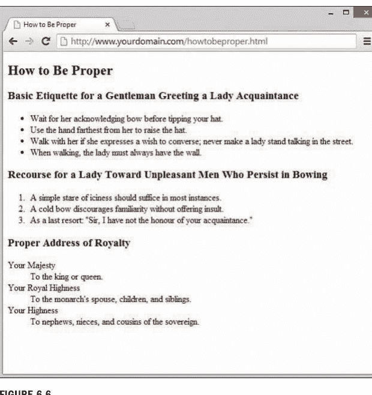

**图6.6**
三种基本的HTML列表类型。

> 注意
请记住，不同的Web浏览器显示Web内容的方式可能大相径庭。HTML标准并未精确规定Web浏览器应如何格式化列表，因此使用较旧Web浏览器的用户看到的缩进效果可能与你所见不完全一致。你可以使用CSS来精确控制列表项，本课程的后续内容将介绍这方面的知识。

> 警告
虽然定义列表在官方上应用于定义术语，但许多网页作者会在任何需要缩进的地方使用它们。实际上，你只需在文本开头添加 `<dl><dd>`，在结尾添加 `</dd></dl>`，并跳过 `<dt></dt>` 标签对，即可缩进任何文本。这是一种不良习惯，因为它会降低你对设计的控制力，并为这些缩进区域赋予不应有的语义含义。相反，你应该使用CSS来缩进内容。

### 列表嵌套

列表中嵌套列表称为*嵌套列表*。过去，设计者常用嵌套列表来快速缩进内容。由于使用CSS时，你可以精确控制列表项的显示效果，因此无需使用嵌套列表来实现缩进的视觉效果。应将嵌套列表保留用于内容本身需要体现层次结构的情况。换言之，使用嵌套列表来展示信息层次，如代码清单6.6所示。

> 注意
*嵌套*指的是完全出现在另一个标签内部的标签。嵌套标签也被称为包含它们的（父）标签的*子标签*。在HTML代码中，为嵌套标签添加缩进是一种常见（但非必需）的编码实践，以便轻松查看它们与父标签的关系。

有序列表和无序列表可以相互嵌套，嵌套层级可任意设定。在代码清单6.6中，一个复杂的缩进大纲由多个无序列表构建而成。注意图6.7中，Web浏览器自动为前三级缩进使用了不同类型的项目符号，使列表非常易读。这在现代浏览器中很常见。

#### 代码清单6.6 使用列表构建大纲

```html
<!doctype html>
<html lang="en">
  <head>
    <meta charset="utf-8">
    <title>Vertebrates</title>
  </head>
  <body>
    <section>
      <header>
        <h1>Vertebrates</h1>
      </header>
      <ul>
        <li><strong>Fish</strong>
          <ul>
            <li>Barramundi</li>
            <li>Kissing Gourami</li>
            <li>Mummichog</li>
          </ul>
        </li>
        <li><strong>Amphibians</strong>
          <ul>
            <li>Anura
              <ul>
                <li>Goliath Frog</li>
                <li>Poison Dart Frog</li>
                <li>Purple Frog</li>
              </ul>
            </li>
            <li>Caudata
              <ul>
                <li>Hellbender</li>
                <li>Mudpuppy</li>
              </ul>
            </li>
          </ul>
        </li>
        <li><strong>Reptiles</strong>
          <ul>
            <li>Nile Crocodile</li>
            <li>King Cobra</li>
            <li>Common Snapping Turtle</li>
          </ul>
        </li>
      </ul>
    </section>
  </body>
</html>
```

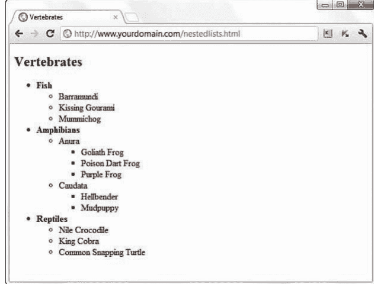

**图6.7**
多级无序列表整洁缩进并添加项目符号，提高了可读性。

如图6.7所示，Web浏览器通常对第一级项目符号使用实心圆盘，对第二级项目符号使用空心圆圈，对所有更深层次的项目符号使用实心方块。但是，你可以通过使用 `<ul style="list-style-type:disc;">`、`<ul style="list-style-type:circle;">` 或 `<ul style="list-style-type:square;">` 代替 `<ul>`（可以内联使用，也可以在特定样式表中使用），来显式选择任意级别使用的项目符号类型。

你甚至可以通过在 `<li>` 标签中使用 `list-style-type` 样式规则来更改无序列表中任何单个项目的符号。例如，以下代码在单词 *extra* 和 *super* 前显示空心圆圈，在单词 *special* 前显示实心方块：

```html
<ul style="list-style-type:circle;">
    <li>extra</li>
    <li>super</li>
    <li style="list-style-type:square;">special</li>
</ul>
```

`list-style-type` 样式规则也适用于有序列表，但此时不是选择项目符号类型，而是选择放在每个项目前的数字或字母类型。代码清单6.7展示了如何在多级列表中使用罗马数字（`list-style-type:upper-roman;`）、大写字母（`list-style-type:upper-alpha;`）、小写字母（`list-style-type:lower-alpha;`）和普通数字（`list-style-type:decimal;`）。图6.8显示了生成的大纲，其格式清晰美观。

尽管代码清单6.7仅将 `list-style-type` 样式规则用于 `<ol>` 标签，但你也可以将其用于列表中的特定 `<li>` 标签（尽管很难想象何时需要这样做）。你也可以显式指定普通编号 `list-style-type:decimal;`，或使用 `list-style-type:lower-roman;` 生成小写罗马数字。

#### 代码清单6.7 在多层列表中使用带有style属性的list-style-type样式规则

```html
<!doctype html>
<html lang="en">
<head>
    <meta charset="utf-8">
    <title>Advice from the Golf Guru</title>
</head>
<body>
    <article>
        <header>
            <h1>How to Win at Golf</h1>
        </header>
        <ol style="list-style-type:upper-roman;">
            <li><strong>Training</strong>
                <ol>
                    <li>Mental prep
                      <ol style="list-style-type:upper-alpha;">
                        <li>Watch golf on TV religiously</li>
                        <li>Get that computer game with Tiger whatsisname</li>
                        <li>Rent "personal victory" subliminal tapes</li>
                      </ol>
                    </li>
                    <li>Equipment
                      <ol style="list-style-type:upper-alpha;">
                        <li>Make sure your putter has a pro autograph on it</li>
                        <li>Pick up a bargain bag of tees-n-balls at Costco</li>
                      </ol>
                    </li>
                    <li>Diet
                      <ol style="list-style-type:upper-alpha;">
                        <li>Avoid junk food
                          <ol style="list-style-type:lower-alpha;">
                            <li>No hotdogs</li>
                          </ol>
                        </li>
                        <li>Drink wine and mixed drinks only, no beer</li>
                      </ol>
                    </li>
                </ol>
            </li>
            <li><strong>Pre-game</strong>
                <ol>
                    <li>Dress
                      <ol style="list-style-type:upper-alpha;">
                        <li>Put on shorts, even if it's freezing</li>
                        <li>Buy a new hat if you lost last time</li>
                      </ol>
                    </li>
                    <li>Location and Scheduling
                      <ol style="list-style-type:upper-alpha;">
                        <li>Select a course where your spouse or boss won't
                          find you</li>
                        <li>To save on fees, play where your buddy works</li>
                      </ol>
                    </li>
                    <li>Opponent
                      <ol style="list-style-type:upper-alpha;">
                        <li>Look for: overconfidence, inexperience</li>
                        <li>Buy opponent as many pre-game drinks as possible</li>
                      </ol>
                    </li>
                </ol>
            </li>
        </ol>
    </article>
</body>
</html>
```


### 第六课：处理字体、文本块、列表和表格

### 如何赢得高尔夫比赛

### I. 训练
1. 心理准备
   - A. 狂热地观看电视上的高尔夫节目
   - B. 搞到那个有泰格·什么什么名字的电脑游戏
   - C. 租借“个人胜利”潜意识磁带
2. 装备
   - A. 确保你的推杆上有职业选手的签名
   - B. 在Costco买一包便宜的球座和球
3. 饮食
   - A. 避免垃圾食品
      - a. 不吃热狗
   - B. 只喝葡萄酒和混合饮料，不喝啤酒

### II. 赛前
1. 着装
   - A. 穿上短裤，即使天气冰冷刺骨
   - B. 如果上次输了，就买顶新帽子
2. 地点与时间安排
   - A. 选择一个你配偶或老板找不到的球场
   - B. 为节省费用，在你朋友工作的地方打球
3. 对手
   - A. 寻找这样的对手：过度自信、缺乏经验
   - B. 尽可能多地为对手购买赛前饮料

### III. 在球场上
1. 首先开球，然后患上严重的枯草热
2. 驾驶球车碾过对手的球，以降低其空气动力学性能
3. 在球即将击中对手前说“Fore”
4. 推杆时总是填补草皮
5. 饮水区是纠正任何球位错误的好时机

图6.8
一个格式良好的大纲几乎能让任何计划看起来更可信。

### 创建简单表格

控制网页信息布局的另一种方法是在表格中显示这些信息。表格由包含单个单元格的信息行组成。要制作表格，必须以 `<table>` 标签开头。当然，用 `</table>` 标签结束表格。CSS包含许多属性，可以让你修改表格，比如你在前面课程中学到的各种边框属性。

有了 `<table>` 标签后，接下来你需要 `<tr>` 标签。`<tr>` 标签创建一个表格行，该行在结束的 `</tr>` 之前包含一个或多个信息单元格。要创建这些单独的单元格，请使用 `<td>` 标签（`<td>` 代表 *表格数据*）。将表格信息放在 `<td>` 和 `</td>` 标签之间。一个 *单元格* 是一个矩形区域，可以包含任何文本、图像和HTML标签。表格中的每一行至少包含一个单元格。一行中的多个单元格构成表格中的列。

构建表格还涉及另一个基本标签。`<th>` 标签的工作方式与 `<td>` 标签完全相同，只是 `<th>` 表示该单元格是表格标题的一部分。大多数网页浏览器会自动将 `<th>` 单元格中的文本渲染为居中加粗，你可以在图6.9的Chrome浏览器中看到这一点。但是，如果你的浏览器没有通过内置样式自动渲染此元素，你可以使用CSS为该元素设置样式，而无需使用类来区分不同类型的表格数据元素。

**图6.9** 代码清单6.8创建了一个包含四列和六行的表格。

你可以创建任意多的单元格，但表格中的每一行应该具有与其他行相同数量的列。代码清单6.8中的HTML代码仅使用迄今为止提到的四个表格标签创建了一个简单的表格。

### 代码清单6.8 使用 `<table>`、`<tr>`、`<td>` 和 `<th>` 标签创建表格

```html
<!doctype html>
<html lang="en">
  <head>
    <meta charset="utf-8">
    <title>Baseball Standings</title>
  </head>
  <body>
    <h1>Baseball Standings</h1>
    <table>
      <tr>
        <th>Team</th>
        <th>W</th>
        <th>L</th>
        <th>GB</th>
      </tr>
      <tr>
        <td>San Francisco Giants</td>
        <td>54</td>
        <td>46</td>
        <td>8.0</td>
      </tr>
      <tr>
        <td>Los Angeles Dodgers</td>
        <td>62</td>
        <td>38</td>
        <td>-</td>
      </tr>
      <tr>
        <td>Colorado Rockies</td>
        <td>54</td>
        <td>46</td>
        <td>8.0</td>
      </tr>
      <tr>
        <td>Arizona Diamondbacks</td>
        <td>43</td>
        <td>58</td>
        <td>19.5</td>
      </tr>
      <tr>
        <td>San Diego Padres</td>
        <td>39</td>
        <td>62</td>
        <td>23.5</td>
      </tr>
    </table>
  </body>
</html>
```

> **注意**
> 你可能会发现，如果你使用空格缩进 `<tr>` 和 `<td>` 标签（如代码清单6.8所示），你的HTML表格会更容易阅读（也更不容易出现浪费时间的错误）。请记住，浏览器在渲染HTML时会忽略空格，因此代码的布局不会影响人们看到的表格布局。

示例中的表格包含棒球排名，非常适合用行和列表进行排列——但这个表格有点朴素。例如，这个示例甚至没有任何边框！你马上就会学到如何让它更花哨一些。表格中的标题显示了排名中的球队、胜场数（W）、负场数（L）和胜差（GB）。

你可以添加以下样式表条目，为表格及其单元格添加基本的边框：

```css
table, tr, th, td {
    border: 1px solid black;
    border-collapse: collapse;
    padding: 3px;
}
```

你可能会想知道为什么必须为创建表格所用的所有四个元素指定这些样式，而不仅仅是针对整个表格元素本身。基本上，这是因为表格由其元素组成，每个元素都可以应用这些样式。为了强调这一点，以下图形演示了当不同元素被设置样式和未设置样式时表格的样子。

图6.10显示了刚刚列出的样式的输出。`border-collapse` 属性，值为 `collapse`，使得 `<table>`、`<tr>` 以及 `<th>` 或 `<td>` 元素的所有边框合并为一个共享边框。内边距为单元格内容添加了一点呼吸空间。

**图6.10**
为表格添加一些CSS样式，包括使用 `border-collapse`。

在图6.11中，你可以看到未指定 `border-collapse` 属性时表格的样子。（然后默认值生效，在此例中为 `separate`，即分离边框。）

图6.11 移除 `border-collapse` 属性会导致所有元素都显示边框。

在图6.12中，你可以看到如果未为 `<th>` 和 `<td>` 元素指定任何先前样式时表格的样子。注意缺少表示列的边框。

图6.12 移除 `<th>` 和 `<td>` 元素的样式。

> **注意**
> 创建简单表格时，你可以使用其他三个有用但并非必需的表格相关标签：
> - `<thead></thead>`——将你的标题行包装在此元素中，可以为分组添加更多含义，并且还允许这些标题行在所有页面上打印（如果你的表格很长的话）。然后你可以整体设置 `<thead>` 元素的样式，或者设置个别 `<th>` 单元格的样式，或者两者都做。
> - `<tfoot></tfoot>`——与 `<thead>` 元素类似，用它来包装你的页脚行（如果你有的话），以增加分组的含义并整体设置其样式。页脚行的一个示例可能是列中呈现的数据的总和，例如财务总额。为了有效，你的 `<tfoot>` 行应在HTML中位于 `<tbody>` 行之前列出，但浏览器会在 `<tbody>` 行之后渲染它们。这确保在加载长表格时，页脚数据会在表格其余部分加载的同时显示。
> - `<tbody></tbody>`——将构成表格“主体”的行（除了标题行和页脚行之外的所有内容）包装在此元素中，以增加分组的含义。你还可以整体设置 `<tbody>` 元素的样式，或者设置个别 `<td>` 单元格的样式，或者两者都做。

### 控制表格大小

当未指定表格宽度时，表格及其各个单元格的大小会自动扩展以适应你放入的数据。这与其他HTML元素（如 `<div>` 和 `<p>`）不同，它们会拉伸以适应其容器的宽度。但是，你可以通过为 `<table>` 元素定义 `width` CSS 属性来控制整个表格的宽度；你也可以通过为 `<td>` 元素分配 `width` CSS 属性来定义每个单元格的宽度。`width` 属性可以指定为任何长度单位，例如像素、em或百分比。

要使表格的第一个单元格占表格总宽度的20%，第二个单元格占80%，你可以使用以下属性定义：

```html
<table style="width:100%;">
  <tr>
    <td style="width:20%;">skinny cell</td>
    <td style="width:80%;">fat cell</td>
  </tr>
</table>
```

注意表格的大小设置为100%，这确保它填充浏览器窗口的整个宽度。当你使用百分比而不是固定的像素大小时，表格会自动调整大小以适应任何尺寸的浏览器窗口，同时保持你所追求的美学平衡。在这种情况下，表格中的两个单元格会自动调整大小，分别占表格总宽度的20%和80%。

在代码清单6.9中，代码清单6.8中的简单表格（加上边框相关的样式）被扩展，以展示对表格单元格宽度的精确控制。（此外，还添加了边框相关的样式。）


### 清单 6.9 指定表格单元格宽度

```html
<!doctype html>
<html lang="en">
  <head>
    <meta charset="utf-8">
    <title>Baseball Standings</title>
    <style>
      table, tr, th, td {
        border: 1px solid black;
        border-collapse: collapse;
        padding: 3px;
      }
    </style>
  </head>
  <body>
    <h1>Baseball Standings</h1>
    <table>
      <tr>
        <th style="width: 200px;">Team</th>
        <th style="width: 25px;">W</th>
        <th style="width: 25px;">L</th>
        <th style="width: 25px;">GB</th>
      </tr>
      <tr>
        <td>San Francisco Giants</td>
        <td>62</td>
        <td>38</td>
        <td>--</td>
      </tr>
      <tr>
        <td>Los Angeles Dodgers</td>
        <td>54</td>
        <td>46</td>
        <td>8.0</td>
      </tr>
      <tr>
        <td>Colorado Rockies</td>
        <td>54</td>
        <td>46</td>
        <td>8.0</td>
      </tr>
      <tr>
        <td>Arizona Diamondbacks</td>
        <td>43</td>
        <td>58</td>
        <td>19.5</td>
      </tr>
      <tr>
        <td>San Diego Padres</td>
        <td>39</td>
        <td>62</td>
        <td>23.5</td>
      </tr>
    </table>
  </body>
</html>
```

你可以在图 6.13 中看到一致的列宽。

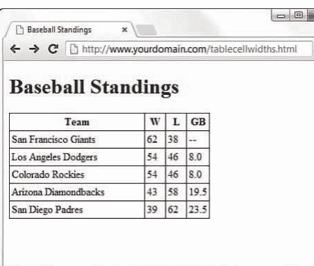

**图 6.13**
清单 6.9 中的代码创建了一个包含四列六行的表格，每列都使用了特定的宽度。

通过为第一行中的每个 `<th>` 元素添加特定的宽度样式，定义了各列的宽度。第一列定义为 200px 宽，第二、第三和第四列各为 25px 宽。在图 6.13 中，你可以看到第一列文本后的空白区域，这表明指定的宽度确实大于如果表格在没有明确宽度指示的情况下渲染时该列应有的宽度。

还要注意，这些宽度并未在后续行的 `<td>` 元素中重复。从技术上讲，你只需要在第一行定义宽度；其余行会效仿，因为它们都是同一个表格的一部分。但是，如果你使用了另一种格式样式（例如改变字体大小或颜色的样式），你就必须为每个应该具有这些显示属性的元素重复该样式。

### 表格内的对齐与跨越

默认情况下，放置在表格单元格内的任何内容都左对齐并垂直居中。到目前为止，本课程中的所有图形都显示了这种默认对齐方式。但是，你可以使用 `text-align` 和 `vertical-align` 样式属性来水平和垂直对齐表格单元格的内容。

你可以将这些对齐属性应用于任何 `<tr>`、`<td>` 或 `<th>` 标签。分配给 `<tr>` 标签的对齐属性会应用于该行中的所有单元格。根据表格的大小，通过在 `<tr>` 级别而非每个 `<td>` 或 `<th>` 标签中应用这些属性，你可以节省一些时间和精力。

清单 6.10 中的 HTML 代码使用了文本对齐样式的组合来为一行应用默认对齐，但在一些单独的单元格中覆盖了它。图 6.14 显示了清单 6.10 中代码的结果。

### 清单 6.10 表格中的对齐、单元格间距、边框和背景色

```html
<!doctype html>
<html lang="en">
  <head>
    <meta charset="utf-8">
    <title>Dandelions</title>
    <style>
      table {
        border: 2px solid black;
        border-collapse: collapse;
        padding: 3px;
        width: 100%;
      }
      tr, th, td {
        border: 2px solid black;
        border-collapse: collapse;
        padding: 3px;
      }
      thead {
        background-color: #ff0000;
        color: #ffffff;
      }
      .aligntop {
        vertical-align: top;
      }
      .description {
        font-size: 14px;
        font-weight: bold;
        vertical-align: middle;
        text-align: center;
      }
      .size {
        text-align: center;
      }
    </style>
  </head>
  <body>
    <h1>Things to Fear</h1>
    <table>
      <thead>
        <tr>
          <th colspan="2">Description</th>
          <th>Color</th>
          <th>Size</th>
        </tr>
      </thead>
      <tbody>
        <tr class="aligntop">
          <td></td>
          <td class="description">Flower</td>
          <td>Yellow</td>
          <td class="size">1-2 inches</td>
        </tr>
        <tr class="aligntop">
          <td></td>
          <td class="description">Seeds</td>
          <td>White</td>
          <td class="size">1-2 inches</td>
        </tr>
        <tr class="aligntop">
          <td></td>
          <td class="description">Leaves</td>
          <td>Green</td>
          <td class="size">3-4 inches</td>
        </tr>
      </tbody>
    </table>
  </body>
</html>
```

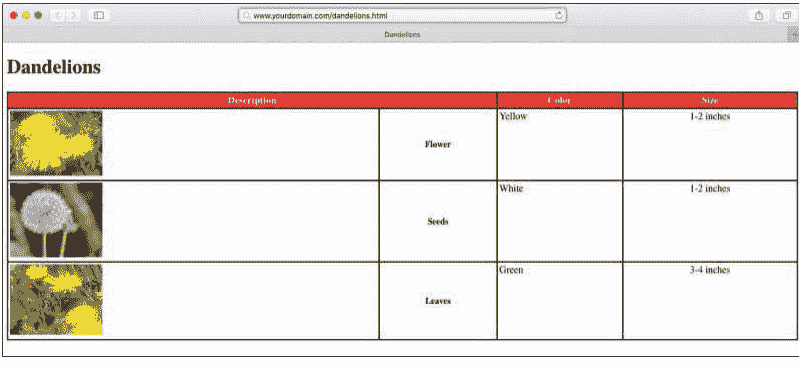

**图 6.14**
清单 6.10 中的代码展示了 `colspan` 属性和一些对齐样式的使用。

以下是一些最常用的 `vertical-align` 样式属性值：`top`、`middle`、`bottom`、`text-top`、`text-bottom` 和 `baseline`（用于文本）。这些属性值为你在垂直对齐表格数据时提供了极大的灵活性。

**注意**
在创建跨越多列或多行的表格单元格时，在脑海中保持行和列结构的条理性可能是最困难的部分。最小的错误也常常会使整个结构陷入混乱。通过在开始编写 HTML 实现之前，在纸上绘制复杂表格的草图，你可以节省时间和避免挫折感。

*跨越* 是强制一个单元格拉伸以跨越表格中多于一行或一列的过程。`colspan` 属性使单元格跨越多列；`rowspan` 对行有相同的效果。

在图 6.14 的顶部，一个单元格（描述）跨越了两列。这是通过该单元格 `<th>` 标签中的 `colspan` 属性实现的。正如你可能猜测的那样，你也可以使用 `rowspan` 属性来创建一个跨越多行的单元格。

此外，样式表中定义了文本样式，并应用于描述列中的单元格，创建了加粗的文本，该文本既垂直居中对齐，又水平居中对齐。

清单 6.10 中的一些技巧尚未解释。你可以为整个表格以及表格中的每个单独行或单元格赋予自己的背景，该背景不同于你可能在网页本身上使用的任何背景。你可以通过将 `background-color` 或 `background-image` 样式放置在 `<table>`、`<tr>`、`<td>`、`<th>`、`<thead>`、`<tbody>` 或 `<tfoot>` 标签中（或在这些元素的样式表中赋值）来实现这一点，这与你在 `<body>` 标签中所做的一样。在清单 6.10 中，只有顶行有背景色；样式表将 `<thead>` 元素定义为具有红色背景和该行单元格中的白色文本。

> 注意
你经常看到表格中交替的行颜色。例如，一行可能有灰色背景，而下一行可能有白色背景。交替行颜色有助于用户更清晰地阅读表格内容，尤其是在表格较大时。你可以通过 CSS 自动实现这一点，正如你将在第 13 课“控制背景和边框”中将学到的那样。

类似于 `background-image` 属性（本例中未显示）用于设置表格背景图像。如果你想将图像 `leaves.gif` 设置为表格背景，你需要在 `<table>` 元素的样式表条目中使用 `background-image:url(leaves.gif);`。注意图像文件放在括号内，并以前缀 `url` 开头，这表示你正在描述图像文件的位置。

调整表格不仅仅是使用样式属性。如清单 6.10 所示，你可以通过为单元格添加一些内边距来控制单元格边框内内容周围的间距。如果你想在单元格边框之间添加一些间距，可以使用 `border-spacing` CSS 属性，它允许你定义水平和垂直间距，如下所示：

`border-spacing: 2px 4px;`

在这个例子中，间距被定义为水平边框之间有 2 像素的空间，垂直边框之间有 4 像素的空间。如果你只使用一个值，该值将应用于所有四个边框。

### 使用表格进行页面布局

在本课程开始时，我们指出设计者已经使用表格进行页面布局，以及显示表格信息。如果你浏览网页，你仍然会找到许多基于表格的布局的例子。


你参考了另一位设计师的源代码。这种设计方法源于1990年代中期至2000年代初浏览器对CSS支持的不一致性。因为所有浏览器都支持表格，并且通常以相同的方式支持，网页设计师们便采用了基于表格的内容布局方法，以在所有浏览器中实现相同的视觉页面显示。然而，现在所有主要浏览器对CSS的支持已相对相似，设计师可以遵循长期以来基于标准的建议，即*不*使用表格进行页面布局。

> **注意**
> HTML5再次修改了这一建议。使用表格进行布局仍然不是一个好主意，但是，只要您将包含表格定义为布局表格，并在表格上使用 `border="0"` 或 `role="presentation"` 属性，您就符合了建议。不过，使用表格进行布局仍然不是个好主意。在第12课“使用现代CSS技术创建布局”中，您将学习几种比表格好用得多的CSS替代方案。

万维网联盟（W3C）——负责监督网络未来的标准制定机构，长期以来一直推广使用样式表作为页面布局的正确方式（而不是使用表格）。样式表最终比表格强大得多，这就是为什么本课程的大部分内容都教您如何使用样式表进行页面布局。

避免使用表格进行布局的主要原因包括：

-   **将呈现与内容混合**——CSS和符合标准的网页设计的一个目标是将呈现层与内容层分离。
-   **造成不必要的重新设计困难**——要更改基于表格的布局，您必须更改网站每个页面上的基于表格的布局（除非它是复杂的、动态驱动的网站的一部分，这种情况下您必须撤销所有动态部分并重新创建）。
-   **解决可访问性问题**——屏幕阅读软件会从表格中查找内容，并且通常会尝试将布局表格当作内容表格来读取。
-   **在移动设备上渲染**——表格布局通常不够灵活，无法向下缩放到小屏幕（参见第17课“为移动设备设计”）。

### 使用CSS列

如果您有大量的纯文本信息，您可能希望像实体报纸那样呈现它：分栏。超过100年的研究表明，行的长度与阅读速度之间存在关联。存在一个“最佳点”或最佳行长度，可以实现快速且愉快的阅读体验。这个最佳点——大约4英寸长的行——持续存在，这就是为什么实体报纸仍然以分栏方式呈现信息。

如果您有很多信息要呈现给读者，或者您只是想模仿报纸布局的美感，您可以使用CSS列。当然，您也可以使用表格，因为表格由行和列组成，但前面的部分已经解释了避免使用基于表格布局的一些原因。此外，列不仅仅用于文本；您可以在定义的列中放入任何您想要的东西，例如广告或边栏中的相关文本。

在图6.15中，您可以看到CSS列用于定义传统报纸式布局的基本用法。代码清单6.11展示了创建这个三列布局的代码。

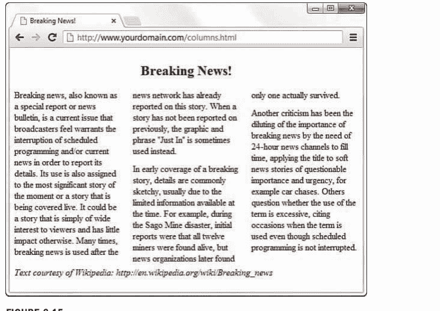

图6.15
代码清单6.11中的代码展示了一个三列布局。

代码清单6.11   表格中的对齐、单元格间距、边框和背景颜色

```html
<!doctype html>
<html lang="en">
    <head>
        <meta charset="utf-8">
        <title>Breaking News!</title>
        <style>
            article {
                column-count: 3;
                column-gap: 21px;
            }
            h1 {
                text-align: center;
                column-span: all;
            }
            p {
                margin-top: 0px;
                margin-bottom: 12px;
            }
            footer {
                column-span: all;
            }
        </style>
    </head>
    <body>
        <article>
            <header>
                <h1>Breaking News!</h1>
            </header>
            <p>Breaking news, also known as a special report or news bulletin, is a current issue that broadcasters feel warrants the interruption of scheduled programming and/or current news in order to report its details. Its use is also assigned to the most significant story of the moment or a story that is being covered live. It could be a story that is simply of wide interest to viewers and has little impact otherwise. Many times, breaking news is used after the news network has already reported on this story. When a story has not been reported on previously, the graphic and phrase "Just In" is sometimes used instead.</p>
            <p>In early coverage of a breaking story, details are commonly sketchy, usually due to the limited information available at the time. For example, during the Sago Mine disaster, initial reports were that all twelve miners were found alive, but news organizations later found only one actually survived.</p>
            <p>Another criticism has been the diluting of the importance of breaking news by the need of 24-hour news channels to fill time, applying the title to soft news stories of questionable importance and urgency, for example car chases. Others question whether the use of the term is excessive, citing occasions when the term is used even though scheduled programming is not interrupted.</p>
            <footer>
                <em>Text courtesy of Wikipedia: http://en.wikipedia.org/wiki/Breaking_news</em>
            </footer>
        </article>
    </body>
</html>
```

代码清单6.11中的代码来自一篇假新闻文章，我们使用了 `<article>` 元素来容纳所有内容。在 `<article>` 元素内部是一个 `<header>` 元素，其中包含“突发新闻！”标题（在 `<h1>` 级别），后跟三个段落文本和一个 `<footer>` 元素。所有的样式都在清单开头的样式表中处理；样式针对刚刚提到的四个元素提供：`<article>`、`<h1>`、`<p>` 和 `<footer>`。

在样式表中，我们正在应用 `<article>` 元素内列的主要定义。我们使用了 `column-count` 来定义三列，并使用了 `column-gap` 来将列之间的空间定义为21像素宽。接下来，我们为 `<h1>` 元素添加了一个定义，首先使文本在页面中居中对齐，其次确保文本跨越所有列。出于同样的原因，我们对 `<footer>` 元素的条目应用了相同的 `column-span` 属性。

在 `<h1>` 元素的条目之后，我们为 `<p>` 元素添加了一些特定的边距——即，顶部边距为0像素，底部边距为12像素。我们本可以保持原样，只是让 `<p>` 元素按照默认样式显示，但这会在每个段落顶部创建一个边距。“这有什么大不了的？”你可能会问，因为看起来我们已经在段落之间手动添加了空间——确实如此。然而，我们在每个段落*之后*添加了空间，并去掉了每个段落*之前*的空间，这样第一列就不会以一个空格开头，从而导致三列的顶部不对齐。

> **注意**
> 有时您会看到带有 `-webkit`、`-o`、`-ms` 和 `-moz` 前缀的相关条目，例如 `-webkit-column-count: 2;`。当属性未被浏览器完全支持时，会将这些前缀添加到样式表中。`-webkit` 前缀用于 Chrome 和 Safari（及其移动版本 Android 和 iOS），`-o` 用于 Opera，`-ms` 用于 Microsoft Edge 和 Internet Explorer，`-moz` 用于 Firefox。虽然您可以为 CSS 列使用这些前缀，但现在浏览器支持基本上是通用的，因此只有在需要支持旧版浏览器版本时才需要这些前缀。一个参考可能需要哪些前缀的好网站是 www.caniuse.com。

您甚至可以在列之间添加垂直线，如图6.16所示。我们为此外观添加的样式表条目如下所示：

```css
column-rule-width: 1px;
column-rule-style: solid;
column-rule-color: #000;
```

请注意，这些样式表条目看起来与您用于定义边框的条目非常相似（您将在第13课中学习）。


### 第六课：处理字体、文本块、列表和表格

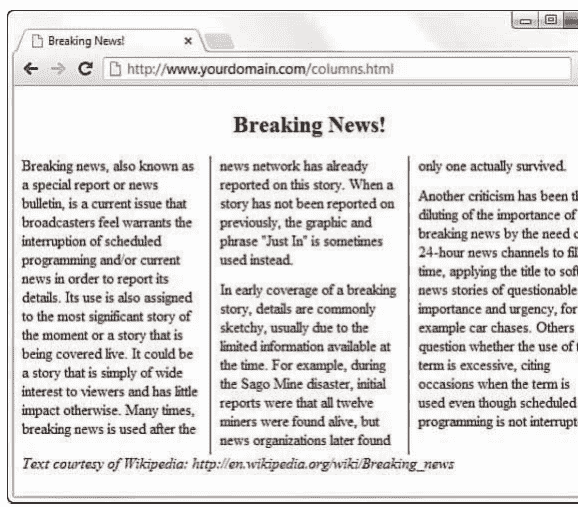

**图 6.16**
清单 6.11 中的代码，列与列之间添加了垂直线。

你将在第17课中学习更多关于如何使用 CSS 列进行响应式布局的内容。

### 总结

在本课中，你学习了如何让文本显示为粗体或斜体，以及如何编码上标、下标、特殊符号和带重音的字母。你看到了如何控制网页上任何文本部分的大小、颜色和字体，包括如何使用 Web 字体以获得更有趣的字体效果。你还了解到属性用于指定许多 HTML 标签的选项和特殊行为，并且学会了如何将 `style` 属性与 CSS 样式规则一起使用以影响文本的外观。你还认识了如何创建和组合三种基本类型的 HTML 列表：有序列表、无序列表和定义列表。列表可以嵌套在其他列表中，以创建大纲和其他复杂的文本排列。

最后，你学习了如何将文本和图像组织成称为表格的行和列。你学习了创建表格的基本标签以及几个用于控制表格对齐、间距和外观的 CSS 属性。你还认识到表格不应该用于布局目的，但你可以通过使用 CSS 列来实现多列布局。

表 6.2 总结了本课中讨论的 HTML 标签和属性。顺便说一句，不要觉得必须记住所有这些标签！

### 表 6.2 第六课涵盖的 HTML 标签和属性

| 标签/属性 | 功能 |
| --- | --- |
| `<em>...</em>` | 添加强调（通常为斜体）。 |
| `<strong>...</strong>` | 添加更强的强调（通常为粗体）。 |
| `<pre>...</pre>` | 表示预格式化文本（保留精确的行尾和空格——通常以等宽字体渲染）。 |
| `<sub>...</sub>` | 表示下标。 |
| `<sup>...</sup>` | 表示上标。 |
| `<div>...</div>` | 指定要格式化的文本区域。 |
| `<dl>...</dl>` | 表示定义列表。 |
| `<dt>...</dt>` | 表示定义列表中的定义术语。 |
| `<dd>...</dd>` | 指定定义列表中定义术语对应的定义。 |
| `<ol>...</ol>` | 表示有序（编号）列表。 |
| `<ul>...</ul>` | 表示无序（项目符号）列表。 |
| `<li>...</li>` | 表示列表项，与 `<ol>` 或 `<ul>` 一起使用。 |
| `<table>...</table>` | 创建一个可包含任意数量行和列的表格。 |
| `<thead>...</thead>` | 定义表格的标题行。 |
| `<tbody>...</tbody>` | 定义表格的主体行。 |
| `<tfoot>...</tfoot>` | 定义表格的页脚行。 |
| `<tr>...</tr>` | 定义包含一个或多个单元格（`<td>` 标签）的表格行。 |
| `<th>...</th>` | 定义表格标题单元格。（接受与 `<td>` 相同的所有样式。） |
| `<td>...</td>` | 定义表格数据单元格。 |
| *属性* | *功能* |
| `style="font-family: typeface;"` | 指定字体的字体族，即字体的名称，如 Arial。（也可与 `<p>`、`<h1>`、`<h2>`、`<h3>` 等一起使用。） |
| `style="font-size:size;"` | 指定字体的大小，可设置为 small、medium 或 large，以及 x-small、x-large 等。也可设置为特定大小（如 12pt 或 2em）。 |
| `style="color:color;"` | 更改文本颜色。 |
| `style="text-align: alignment;"` | 将文本居中、左对齐或右对齐。（也可与 `<p>`、`<h1>`、`<h2>`、`<h3>` 等一起使用。） |
| `style="list-style-type:numtype;"` | 指定用于标记列表的数字类型。可能的值包括 `decimal`、`lower-roman`、`upper-roman`、`lower-alpha`、`upper-alpha` 和 `none`。 |
| `style="list-style-type:bullettype;"` | 指定用于标记列表项的项目符号形状。可能的值包括 `disc`、`circle`、`square` 和 `none`。 |
| `style="list-style-type:type;"` | 指定用于标记此项的项目符号或数字类型。可能的值包括 `disc`、`circle`、`square`、`decimal`、`lower-roman`、`upper-roman`、`lower-alpha`、`upper-alpha` 和 `none`。 |

### 问答

**问：** 如何找出我电脑上某个字体的确切名称？
**答：** 在 Windows 10 电脑上，打开控制面板，进入外观和个性化部分。然后单击字体文件夹，你就能看到系统上的字体列表。在 Mac 上，打开应用程序文件夹中的字体册，即可找到系统上的字体列表。在 `font-family` 样式规则中指定字体时，请使用每个字体名称的确切拼写。不过，字体名称不区分大小写。

**问：** 如何在我的网页上显示汉字、阿拉伯文、中文和其他非欧洲字符？
**答：** 首先，需要阅读你网页上这些字符的用户必须安装相应的语言字体。如果你的浏览器已设置为 UTF-8 字符集，你应该可以直接将字符输入到网页上，就像输入英文字符一样。

你也可以使用 Windows 中的字符映射表程序（或其他操作系统中的类似程序）来获取任何语言字体中字符的数字代码。要找到字符映射表，请单击“开始”、“所有程序”、“附件”，然后单击“系统工具”。（在 Mac 上，查找任何应用程序“编辑”菜单中的“表情与符号”选项。）如果你想要的字符代码是 214，请使用 `&#214;` 将其放置在网页上。如果找不到字符映射表程序，请使用操作系统内置的帮助功能来查找其具体位置。

**问：** 我见过一些网页使用小的三维球体或其他特殊图形作为项目符号。他们是怎么做到的？
**答：** 这个技巧有点超出本课的范围。你将在第8课中学习如何做到这一点。

**问：** 我制作了一个大表格，当加载页面时，页面上很长时间都没有任何内容出现。为什么这么慢？
**答：** 复杂的表格可能需要一段时间才能显示在屏幕上。网络浏览器必须先计算出表格中所有内容的大小，才能显示其中的任何部分。你可以通过为表格中的每个图像定义 `width` 和 `height` 属性来加快显示速度。为 `<table>` 和 `<td>` 元素定义特定宽度也有帮助。你可能需要将非常大的表格拆分成更小的表格，以便它们单独渲染。

### 实践环节

实践环节包含测验题和活动，帮助你巩固对所学内容的理解。

### 测验

1.  你将如何创建一个段落，其中前三个单词是粗体，使用样式而不是 `<b>` 或 `<strong>` 标签？
2.  你将如何表示水的化学式？
3.  如何在网页上显示 "© 2018, Webwonks Inc."？
4.  你将如何使页面上的所有文本居中？
5.  如何创建一个简单的两行两列表格，并带有一个单像素的黑色边框勾勒出表格轮廓？
6.  为什么在网页上书写 3 < 6 时应该使用字符代码？
7.  使用此样式属性 `font-family: Geneva, Arial, helvetica, sans-serif;` 时，大多数浏览器将使用哪种字体？
8.  定义 Web 字体的 CSS 命令是什么？
9.  嵌套在另一个列表中的列表叫什么？
10. 在网页上创建三栏报纸版式的 CSS 属性是什么？

> 注意
> 仅提醒那些在印刷版或电子书版本中阅读这些文字的人：如果你访问 www.informit.com/register 并注册本书（使用 ISBN 9780672338083），你将免费获得一个在线网络版，该版本不仅包含本书的完整文本，还包含本测验的交互式版本。

### 答案

1.  你可以使用此代码：
`<p><span style="font-weight: bold;">前三个单词</span>是粗体。</p>`
2.  你可以使用 H<sub>2</sub>O。
3.  你可以使用以下任一方式：
`&copy; 2018, Webwonks Inc.`
`&#169; 2018, Webwonks Inc.`


4. 如果你想到在页面顶部的 `<body>` 标签之后立即放置一个 `<div style="text-align:center;">`，并在页面末尾的 `</body>` 标签之前放置 `</div>`，那么你是对的。然而，`text-align` 样式也可以直接在 `<body>` 标签中使用，这意味着你可以省略 `<div>` 标签，直接将 `style="text-align:center;"` 样式放在 `<body>` 标签中。看，整个页面就居中了！

5. 使用以下 HTML：

```html
<table style="border: 1px solid #000000; border-collapse: collapse;">
  <tr>
    <td>左上...</td>
    <td>右上...</td>
  </tr>
  <tr>
    <td>左下...</td>
    <td>右下...</td>
  </tr>
</table>
```

6. 因为 `<` 字符也是 HTML 标签的开始字符，通过编写 `3 &lt; 6`，你可以确保浏览器知道要显示小于号，而不是认为 `<` 是 HTML 标签的开始。

7. 这将在大多数浏览器中以 Geneva 字体显示。如果浏览器没有该字体，它将依次以 Arial、Helvetica 字体显示，然后以默认的无衬线字体显示。

8. 你使用 `@font-face` 规则来定义网络字体的名称和源 URL。

9. 一个列表嵌套在另一个列表中被称为嵌套列表。

10. 使用 `column-count: 3;` 在页面上定义三栏布局。

### 练习

-   将本课中你学到的字体级样式属性应用于各种块级元素，例如 `<p>`、`<div>`、`<ul>` 和 `<li>` 项。尝试嵌套你的元素，以感受样式如何（或不）通过内容层次结构进行传递。
    使用文本对齐样式属性将文本块放置在网页上的不同位置。尝试嵌套你的段落和 divisions（`<p>` 和 `<div>`），以感受样式如何（或不）通过内容层次结构进行传递。
-   尝试制作一个有序列表，概述你想要放在网页上的信息。这将让你练习格式化 HTML 列表，并为你思考后续课程中涵盖的问题提供一个良好的开端。

## 第 7 课 使用外部和内部链接

本课你将学到：

- 如何使用锚点链接
- 如何链接到你自己网站上的其他页面
- 如何链接到外部内容
- 如何链接到非 Web 文档，例如 PDF 和 Word 文档
- 如何链接到电子邮件地址
- 如何在链接中使用窗口目标
- 如何使用 CSS 为链接设置样式
- 如何为链接添加描述
- 网页链接的最佳实践

到目前为止，你已经学习了如何使用 HTML 标签创建一些基本的网页。然而，在这一点上，这些内容片段本身是孤立的，与其他任何内容都没有连接。要将你的作品转化为真正的 Web 内容，你需要将其连接到 Web 的其余部分——或者至少连接到你自己网站内的其他页面。

本课将向你展示如何创建指向你自己文档内内容的超文本链接，以及如何链接到其他外部文档。此外，你将学习如何为超文本链接设置样式，使其以你期望的颜色和装饰显示——而不是默认的蓝色下划线显示。你还将学习设计师从超过 20 年的网页链接中总结出的一些最佳实践。

### 使用网页地址

为单个网站存储网页内容的最简单方法是将所有文件放在同一个文件夹中。当文件像这样存储在一起时，你只需在 `<a>` 标签的 `href` 属性中提供文件名即可链接到它们。

> 注意

在你深入本课之前，你可能需要回顾一下基础知识，即在服务器上放置文件的位置以及如何在一组目录中管理文件。在创建网页内容中的链接时，理解这些信息很重要。请参考第 1 课“了解网络是如何工作的”，特别是标题为“了解在 Web 服务器上放置文件的位置”的部分。

一个*属性*是与标签相关联的信息，它提供了关于标签的进一步细节。例如，`<a>` 标签的 `href` 属性标识了你正在链接到的页面或文档的地址。

当你拥有超过几个页面，或者当你开始为网站中的内容建立组织结构时，你应该将你的文件放入目录（或者，如果你愿意的话，*文件夹*）中，其名称反映了其中的内容。例如，你所有的图像可能在一个 **images** 目录中，公司信息可能在 about 目录中，依此类推。无论你如何在自己的 Web 服务器上组织文档，你都可以使用相对地址，这些地址只包含从一个页面找到另一个页面所需的足够信息。

*相对地址*描述的是从一个网页到另一个网页的路径，而不是完整的（或*绝对*）Internet 地址。

正如你在第 1 课中回忆的那样，Web 服务器的文档根目录是指定为 Web 内容顶级目录的目录。在 Web 地址中，该文档根目录由正斜杠 (`/`) 表示。所有后续级别的目录都用同类型的正斜杠分隔，如下例所示：`/directory/subdirectory/subsubdirectory/`。

> 警告

在 HTML 中始终使用正斜杠 (`/`) 分隔目录。不要使用反斜杠 (`\`)，它通常用于 Windows 操作系统中分隔目录。你可以通过这样来记住：网络上的一切都是*向前*移动的，所以使用正斜杠。

假设你正在文档根目录中创建一个名为 `zoo.html` 的页面，并且你想要包含一个指向 elephants 子目录中名为 `african.html` 和 `asian.html` 页面的链接。这些链接将如下所示：

```html
<a href="/elephants/african.html">了解非洲象。</a>
<a href="/elephants/asian.html">了解亚洲象。</a>
```

这些特定的地址实际上被称为*相对根地址*，因为它们是缺少整个域名但相对于正斜杠指定的文档根目录的相对地址。

使用常规相对地址，你可以省略开头的正斜杠。这种类型的地址允许链接相对于它们所在的任何目录变得相对——无论那是文档根目录，还是文档根目录下一级或多级目录中的另一个目录。以下是常规相对地址的示例：

```html
<a href="elephants/african.html">了解非洲象。</a>
<a href="elephants/asian.html">了解亚洲象。</a>
```

你在 elephants 子目录中的 african.html 和 asian.html 文档可以通过以下任一方式链接回主 zoo.html 页面：

```html
<a href="http://www.yourdomain.com/zoo.html">返回动物园。</a>
<a href="/zoo.html">返回动物园。</a>
<a href="../zoo.html">返回动物园。</a>
```

第一个链接是一个绝对链接。使用绝对链接，链接应该去哪里是*绝对*没有疑问的，因为提供了完整的 URL——包括域名。

第二个链接是一个相对根链接。它相对于你当前正在浏览的域名，因此不需要协议类型（例如 *http://*）或域名（例如 *www.yourdomain.com*）；提供开头的正斜杠以表示地址从文档根目录开始。

> 注意
关于相对寻址 (elephants/african.html) 与绝对寻址 (http://www.takeme2thezoo.com/elephants/african.html) 的一般规则是：当链接到存储在一起的文件时，例如所有属于同一网站的文件，你应该使用相对寻址。当你链接到其他地方的文件——另一台计算机、另一个磁盘驱动器，或者更常见的是 Internet 上的另一个网站——时使用绝对寻址。

在第三个链接中，*双点* (*..*) 是一个特殊的命令，表示包含当前文件夹的文件夹——换句话说，是*父文件夹*。每当你看到双点，只需想到：“在目录结构中向上一级。”

相对寻址的优点是，只要页面仍在同一站点上，链接就会有效。如果你在整个网页中始终使用相对寻址，你可以将页面目录移动到另一个文件夹、磁盘驱动器或 Web 服务器，而无需更改链接。

如果需要，相对地址可以跨越相当复杂的目录结构。第 28 课“组织和管理网站”提供了有关组织和链接大量网页的更详细建议。


### 自己动手试试

#### 创建一个简单的网站架构

希望你在学习这些课程时已经创建了一两个自己的页面。按照以下步骤添加更多页面并建立链接：

- 1. 将主页作为主要入口和中心枢纽，所有其他页面都与之相连。如果你创建了一个关于自己或你业务的页面，可以将该页面用作主页。你也可以现在创建一个新页面用于此目的。
- 2. 在主页上，放置一个指向你已创建的其他HTML文件（或你计划很快创建的HTML文件的占位符）的链接列表。请确保在每个链接中，文件名的准确拼写，包括任何大写字母，都是正确的。

> 注意
大多数网络服务器运行UNIX或Linux，这些系统区分大小写，但Windows在本地查看页面时不区分大小写。这意味着指向`african.html`和`African.html`的链接在Windows机器上都会指向同一个页面，但在网络服务器上它们会指向不同的页面。最好坚持使用一种大小写形式——最好是小写——来命名你的所有网页文件。

- 3. 在除主页之外的每个其他页面的底部（或顶部）包含一个链接，指回你的主页。这使得在你的网站中导航变得简单轻松。
- 4. 你可能还想在主页上或一个单独的链接页面上包含一个指向相关或有趣网站的链接列表。人们通常会在自己的主页上包含朋友个人页面的链接列表。然而，企业应该小心，不要过快地引导潜在客户转向其他网站，因为无法保证他们离开后会返回你的网站，而且其他网站可能没有链接回来。

#### 使用锚点在页面内链接

`<a>`标签——负责网页上的超链接——其名称源于单词*锚点*，因为链接充当网页中某个位置的标记。到目前为止，在这些课程的示例中，你已经学习了如何使用`<a>`标签链接到其他地方，但这只是它用途的一半。让我们开始使用锚点链接，这些链接指向同一页面内的内容。

#### 使用锚点在页面中识别位置

`<a>`标签可用于将页面上的一个点标记为锚点，使你能够创建一个指向该确切位置的链接。清单7.1（稍后在本课中展示）演示了链接到页面内锚点的链接。为了了解这种链接是如何制作的，让我们快速预览清单中的第一个`<h1>`标签：

```html
<h1 id="top">First Lines of Shakespearean Sonnets</h1>
```

`<a>`标签使用`href`属性指定超链接目标。`<a href>`是你点击的内容，而具有相应`id`属性的元素是你点击后跳转到的地方。在这个例子中，`<h1>`标签指定了一个目标，但它也是该页面部分的标题。`id`属性给标签所在页面上的特定点起了一个名字，在这个例子中是`top`。必须为`id`属性分配一个唯一的名称，但它可以放置在页面中你希望链接落到的任何元素上。

> **注意**
你可以在HTML5中的任何容器元素上使用`id`属性，也可以使用`<a>`标签指向这些元素作为锚点链接。最佳实践建议你不要向文档添加额外的标签，而只需将`id`属性添加到已存在的相关标签上。

#### 链接到锚点位置

清单7.1展示了一个网站，其中单个页面中放置了多个锚点。查看清单7.1中的最后一个`<a>`标签以查看示例：

```html
<a href="#top">Return to Index.</a>
```

`#`符号表示`top`这个词指的是当前文档中的一个命名锚点，而不是一个单独的页面。当用户点击"Return to Index"时，网页浏览器会显示从具有`id="top"`属性的标签开始的页面部分。

#### 清单7.1 使用带id属性的`<a>`标签设置锚点

```html
<!doctype html>
<html lang="en">
  <head>
    <meta charset="utf-8">
    <title>Alphabetical Shakespeare</title>
  </head>
  <body>
    <article>
      <header>
        <h1 id="top">First Lines of Shakespearean Sonnets</h1>
      </header>
      <p>Don't you just hate when you go a-courting, and you're down on one knee about to rattle off a totally romantic Shakespearean sonnet, and zap! You space it. <em>"Um... It was, uh... I think it started with a B..."</em></p>
      <p>Well, appearest thou no longer the dork. Simply refer to this page, click on the first letter of the sonnet you want, and get an instant reminder of the first line to get you started. <em>"Beshrew that heart that makes my heart to groan..."</em></p>

      <p style="text-align:center"><strong>Alphabetical Index</strong></p>
      <div style="text-align:center">
        <a href="#A">A</a> <a href="#B">B</a> <a href="#C">C</a>
        <a href="#D">D</a> <a href="#E">E</a> <a href="#F">F</a>
        <a href="#G">G</a> <a href="#H">H</a> <a href="#I">I</a>
        <a href="#J">J</a> <a href="#K">K</a> <a href="#L">L</a>
        <a href="#M">M</a> <a href="#N">N</a> <a href="#O">O</a>
        <a href="#P">P</a> <a href="#Q">Q</a> <a href="#R">R</a>
        <a href="#S">S</a> <a href="#T">T</a> <a href="#U">U</a>
        <a href="#V">V</a> <a href="#W">W</a> <a href="#X">X</a>
        <a href="#Y">Y</a> <a href="#Z">Z</a>
      </div>

      <section>
        <header>
          <h1 id="A">A</h1>
        </header>
        <ul>
          <li>A woman's face with nature's own hand painted,</li>
          <li>Accuse me thus, that I have scanted all,</li>
          <li>Against my love shall be as I am now</li>
          <li>Against that time (if ever that time come)</li>
          <li>Ah wherefore with infection should he live,</li>
          <li>Alack what poverty my muse brings forth,</li>
          <li>Alas 'tis true, I have gone here and there,</li>
          <li>As a decrepit father takes delight,</li>
          <li>As an unperfect actor on the stage,</li>
          <li>As fast as thou shalt wane so fast thou grow'st,</li>
        </ul>
        <p><a href="#top">Return to Index.</a></p>
      </section>

      <!-- continue with the alphabet -->

      <section>
        <header>
          <h1 id="Z">Z</h1>
        </header>
        <p>(No sonnets start with Z.)</p>
        <p><a href="#top"><em>Return to Index.</em></a></p>
      </section>
    </article>
  </body>
</html>
```

> **注意**
在清单7.1的末尾附近，你会看到以下行：

`<!-- continue with the alphabet -->`

此文本（一个HTML注释）将出现在源代码中，但不会被浏览器显示。你将在第28课中学习更多关于注释代码的知识。

清单7.1中的每个`<a href>`链接都会创建一个下划线链接，指向相应的`<a id>`锚点——或者如果所有文本都已填充的话，它会这样做。在这个例子中，只有A和Z会起作用，因为只有A和Z链接有对应的文本可供链接，但你可以自行填充其余部分！例如，点击图7.1中字母索引下的字母Z，会将你带到图7.2所示的页面部分。

> **注意**
在HTML4中，通过标签中`id`属性指定的锚点名称必须以字母开头。但HTML5不那么严格。ID必须包含至少一个字符且没有空格字符。最佳实践建议最好避免在HTML、CSS、JavaScript和HTTP（网络服务器用于加载页面的协议）中有意义的字符。这些包括句点（`.`）、冒号（:`）、分号（`;`）、井号（`#`）、斜杠（`/`）和反斜杠（`\`）。我们建议在你的`id`属性中仅使用标准键盘上的数字和字母。


**图7.1**
清单7.1中的`<h1 id>`标签与标准`<h1>`标签外观无异。`<a href>`标签显示为带下划线的链接。

174 第7课：使用外部和内部链接


**图7.2**
在图7.1所示的页面上点击字母Z，会将你带到同一页面的相应部分。

掌握了链接到单个页面内文本部分的概念后，你现在将学习链接其他网络内容。

#### 在你自己的网络内容之间建立链接

正如你在本课前面学到的，在链接到你域内（或同一台计算机上，如果你在本地查看网站）的内容时，你不需要在`href`属性中指定的每个地址前包含`http://`。当你从一个文件创建链接到同一域或同一台计算机上的另一个文件时，你不需要指定完整的Internet地址。事实上，如果这两个文件存储在同一个文件夹中，你可以简单地使用HTML文件名本身：

```html
<a href="pagetwo.html">Go to Page 2.</a>
```

例如，清单7.2和图7.3显示了一个测验页面，其中包含一个指向清单7.3和图7.4所示答案页面的链接。答案页面包含一个返回测验页面的链接。因为清单7.2中的页面链接到同一目录中的另一个页面，所以文件名可以用来代替完整的地址。


### 清单 7.2 historyanswers.html 文件

```html
<!doctype html>
<html lang="en">
    <head>
        <meta charset="utf-8">
        <title>History Quiz</title>
    </head>
    <body>
        <section>
            <header>
                <h1>History Quiz</h1>
            </header>
            <p>Complete the following rhymes. (Example: William the Conqueror played cruel tricks on the Saxons in... ten sixty-six.)</p>
            <ol>
                <li>Columbus sailed the ocean blue in...</li>
                <li>The Spanish Armada met its fate in...</li>
                <li>London burnt like rotten sticks in...</li>
            </ol>
            <p style="text-align: center;">
                <a href="historyanswers.html">Check Your Answers!</a>
            </p>
        </section>
    </body>
</html>
```


**图 7.3** 这是清单 7.2 中列出的 historyquiz.html 文件，也是清单 7.3 中链接所指向的文件。

### 清单 7.3 historyquiz.html 链接所指向的 historyanswers.html 文件

```html
<!doctype html>
<html lang="en">
  <head>
    <meta charset="utf-8">
    <title>History Quiz Answers</title>
  </head>
  <body>
    <section>
      <header>
        <h1>History Quiz Answers</h1>
      </header>
      <ol>
        <li>...fourteen hundred and ninety-two.</li>
        <li>...fifteen hundred and eighty-eight.</li>
        <li>...sixteen hundred and sixty-six.</li>
      </ol>
      <p style="text-align: center;">
        <a href="historyquiz.html">Return to the Questions</a>
      </p>
    </section>
  </body>
</html>
```


**图 7.4** 图 7.3 中的“Check Your Answers!”链接会带你来到这个答案页面。而“Return to the Questions”链接则会带你回到图 7.3 所示的页面。

使用文件名代替完整的互联网地址可以节省你大量的输入。更重要的是，无论这组页面存储在何处，页面之间的链接都能正常工作。你可以在文件仍在计算机硬盘上时就测试这些链接。然后，你可以将它们移动到 Web 服务器、CD-ROM、DVD 或 USB 驱动器上，所有链接仍将正确工作。这种简化网页标识的方法没有什么神奇之处；这完全与网页寻址有关，正如你已经了解的那样。

> **注意**
在清单 7.2 和清单 7.3 中，你会看到在大部分内容周围使用了 `<section></section>` 标签对。你可能会想这是否完全必要——毕竟，它是页面上唯一的内容。答案是，不，这并非完全必要。如果没有 `<section></section>` 标签，HTML 代码验证也会很好，查看此代码的人也不会对其组织结构感到困惑。这里使用这些标签只是为了确保你在整个代码示例中习惯于看到它们，并借此机会提供此注释，说明你将来可能会如何使用 `<section></section>` 标签。例如，如果你将问题部分和答案部分都放在一个页面上，并应用样式和一些基于 JavaScript 的交互性，你可以隐藏一个部分（问题部分），直到读者点击一个链接，然后显示另一个部分（答案部分）。此操作超出了这些课程的范围，但它是一个例子，说明了最简单的标记如何为你未来更大的发展奠定基础。

### 链接到非 HTML 文件

一旦你知道如何链接到 HTML 文档，你就可以用同样的方式链接到非 HTML 文档。像文字处理文档和 PDF 文件这样的项目就是网络上其他文件的例子。要链接到它们，你只需将 `href` 属性中的 URL 替换为文档的位置，如以下示例所示：

```html
<a href="myWordDoc.doc">my word-processed document</a>
<a href="myPDFfile.pdf">my PDF file</a>
```

第一个示例链接到一个文字处理文档（.doc），第二个示例链接到一个 PDF 文件（.pdf）。当这些链接被点击时，浏览器将执行以下两种操作之一：它将在窗口中打开文档，或者打开一个下载对话框，要求用户下载文件。

有时要求链接的文档被下载到用户的本地计算机是有意义的。但网络浏览器通常会尝试在不下载的情况下尽可能多地显示内容，因为下载可能很慢，而且某些操作系统不允许下载。为了强制浏览器打开下载对话框，请在链接中添加 `download` 属性。这被称为布尔属性，因为它要么开启，要么关闭。有时你会看到它们被写成具有自引用值，例如 `download="download"`。此属性在 HTML5 中是新的，并且在所有现代浏览器（Internet Explorer 除外，但它在 Edge 中有效）和 iOS Safari 中都有良好的支持。

要强制前两个链接成为下载链接，请编写以下内容：

```html
<a href="myWordDoc.doc" download>my word-processed document</a>
<a href="myPDFfile.pdf" download>my PDF file</a>
```

### 链接到外部 Web 内容

链接到你自己网站内的页面与链接到外部 Web 内容的唯一区别在于，当链接到外部时，你需要包含该内容的完整地址。完整地址包括域名前的 `http://` 或 `https://`，然后是文件的完整路径名（例如，HTML 文件、图像文件、多媒体文件等）。这被称为*完全限定域名 (FQDN)*。

例如，要从你自己的一个网页中包含指向 Google 的链接，你需要在 `<a>` 链接中使用这种绝对寻址方式：

```html
<a href="https://www.google.com/">Go to Google</a>
```

> **注意**
如今，更常见的是看到网页 URL 使用 `https://` 作为协议。这是因为越来越多的服务器使用安全的 SSL 证书来确保其网站的安全。你将在第 27 课“使用基于 Web 的表单”中了解更多相关信息。

> **警告**
正如你可能知道的，在大多数网络浏览器中输入地址时，你可以省略开头的协议（`http://` 或 `https://`）。但是，当在网页的 `<a href>` 链接中输入互联网地址时，你*不能*省略这部分。

你可以将之前学到的内容应用到创建指向其他页面上命名锚点的链接。链接的锚点不限于同一页面。你可以通过包含地址或文件名后跟 `#` 和锚点名称来链接到另一个页面上的命名锚点。例如，以下链接将带你到虚构的域名 `www.takeme2thezoo.com` 上 `elephants` 目录内 `african.html` 页面中名为 `photos` 的锚点：

```html
<a href="http://www.takeme2thezoo.com/elephants/african.html#photos">
Check out the African Elephant Photos!</a>
```

如果你是从 www.takeme2thezoo.com 域上的另一个页面链接（因为你实际上是站点维护者），你的链接可能简单如下：

```html
<a href="/elephants/african.html#photos">Check out the African Elephant Photos!</a>
```

正如你已经了解的，在这种情况下，协议和域名将不是必需的。

### 链接到电子邮件地址

除了在页面之间以及单个页面的不同部分之间进行链接外，`<a>` 标签还使你能够链接到电子邮件地址。这是让网页访问者与你交谈的最简单方式。当然，你可以只向访问者提供你的电子邮件地址，并相信他们会将其输入到他们使用的任何电子邮件程序中，但这会增加出错的可能性。通过提供一个指向你的电子邮件地址的可点击链接，你让他们发送消息变得几乎毫不费力，并消除了拼写错误的可能性。

指向电子邮件地址的 HTML 链接如下所示：

```html
<a href="mailto:yourusername@yourdomain.com">Send me an email message.</a>
```

单词 `Send me an email message` 将像任何其他 `<a>` 链接一样显示。

如果你想让人们看到你的实际电子邮件地址（以便他们可以记录下来或使用不同的电子邮件程序发送消息），请在 `href` 属性中包含它，并在 `<a>` 和 `</a>` 标签之间的消息中包含它，如下所示：

```html
<a href="mailto:you@yourdomain.com">you@yourdomain.com</a>
```

> **警告**
许多垃圾邮件发送者使用自动化工具通过查找 mailto 链接和电子邮件地址来从网页中收集电子邮件地址。有一些方法可以尝试将电子邮件地址隐藏起来不被垃圾邮件发送者发现，但一般来说，如果电子邮件地址在网页中有效，垃圾邮件发送者就能获取它。因此，请确保你指向的任何地址都有强大的垃圾邮件过滤器。

在大多数网络浏览器中，当用户点击该链接时，会得到一个窗口，他或她可以在其中输入一条消息，该消息会立即发送到 mailto 电子邮件地址——并且该用户用于发送和接收电子邮件的电子邮件程序将自动被使用。

你可以在链接中提供一些额外信息，以便消息的主题和正文也有默认值。你可以通过向 `mailto` 链接添加 `subject` 和 `body` 变量来实现这一点。你用问号 (?) 将变量与电子邮件地址分开，并用


### 在新浏览器窗口中打开链接

现在你已经掌握了如何创建链接地址——无论是站内（网站内部）还是站外（其他网站）——还有一种额外的链接方法：强制用户在新窗口中打开链接。

你肯定听说过*弹出窗口*，这是浏览器窗口——通常用于广告产品或服务——旨在未经用户同意的情况下自动打开和显示。许多现代浏览器禁止这种行为。然而，在某些情况下，打开另一个窗口或指向另一个位置的概念有其合理用途。例如，你可能希望在一个较小的辅助浏览器窗口中呈现信息，但仍允许用户在主窗口中查看信息。当用户点击动画演示、电影片段或其他多媒体元素的链接时，通常就是这种情况。在链接到站外内容时，你可能也想将链接指向新的浏览器窗口。

`target` 这个词很重要，因为它是与 `<a>` 标签一起使用的属性名称。`target` 属性指向一个有效的浏览上下文，或“要打开的新窗口”。

一个在新窗口中打开的有效 HTML 链接构造如下：

```
<a href="/some/file.html" target="_blank">打开一个窗口！</a>
```

关键字 `_blank` 是一个特殊的目标名称，告诉浏览器在一个没有名称的新窗口中打开。开头的下划线（_）不是拼写错误，而是名称的一部分。你也可以通过指定任何文本标识符来给窗口命名，如下所示：

```
<a href="/some/file.html" target="newWindow">打开一个新窗口！</a>
```

在这种情况下，新窗口将被称为 `newWindow`。任何其他以相同名称为目标的链接将在同一个窗口中打开。

请记住，强制链接在新浏览器窗口中打开——尤其是当它是一个全尺寸的新窗口时——违背了一些可用性和无障碍性的原则。最佳实践建议，除非没有其他选择，否则应避免这样做。

### 为链接添加标题

许多网页设计师忽略的链接的一个功能是 `title` 属性。此属性允许你为链接添加描述，这些描述在网页上并不立即可见。例如，以下 HTML 创建了一个显示为 `来看看我的页面` 的链接：

```
<a href="myPage.html" title="这是本站最好的页面">
来看看我的页面</a>
```

当人们查看页面时，它将显示为一个标准链接，但如果他们将鼠标悬停在链接上或聚焦在链接上，浏览器将显示消息 `这是本站最好的页面`。

为链接添加标题对于依赖屏幕阅读器的人尤其有用，因为他们可以在点击链接之前获得更多信息。你也可以将 `title` 属性用作样式钩子。要引用每个具有 `title` 属性的链接，你可以编写以下代码：

```
a[title] { /* 将样式放在这里 */ }
```

将 `title` 属性视为在不占用页面空间的情况下提供有关链接的更多信息的方式。它不应该重复链接文本，因为那样做没有意义且令人厌烦。它对搜索引擎可见性没有任何作用，所以不要用垃圾关键词短语填充它。用它来提供更有用的信息。如果你没有更有用的信息，就不要使用 `title` 属性。

### 使用 CSS 为超链接设置样式

网页上基于文本的超链接的默认显示是带下划线的蓝色文本。你可能还注意到，以前访问过的链接显示为带下划线的紫色文本；该颜色也是默认值。如果你在互联网上花过任何时间，你还会注意到并非所有链接都是蓝色或紫色的——对此我们都感到欣慰。只需一点点 CSS 和对 `<a>` 链接的各种伪类的了解，你就可以让你的链接看起来随心所欲。

> **注意**
你可以通过将 `` 标签放在开始的 `<a>` 和结束的 `</a>` 标签之间，使用图形作为链接（而不是使用文本作为链接）。

*伪类*是一个描述适用于特定情况的元素的样式的类，例如用户与该元素交互的各种状态。

例如，以下是 `<a>` 标签的常见伪类：

- **a:link**—描述尚未访问过的超链接的样式。
- **a:visited**—描述已访问过并存在于浏览器内存中的超链接的样式。
- **a:hover**—描述当用户的鼠标悬停在超链接上（且在单击之前）时的样式。
- **a:focus**—描述当用户激活链接时超链接的样式。这通常用于没有鼠标的设备，因此无法点击。
- **a:active**—描述正在被单击但尚未释放的超链接的样式。

> **注意**
记住要为 `:focus` 属性设置样式很重要，因为如今许多人使用没有鼠标的设备查看网页。大多数人查看网页是在平板电脑和智能手机上，而不是在带有鼠标的电脑上。而且 `:focus` 对于使用键盘浏览网页的用户进行无障碍访问也很重要。

例如，假设你想制作一个具有以下样式的链接：

- 字体为粗体且为 Verdana（并且没有下划线，意味着没有文本装饰）
- 基础颜色为浅蓝色
- 当用户悬停、聚焦或单击时显示红色
- 用户访问过后显示灰色

你的样式表条目可能如下所示：

```
a {
    font-family: Verdana, sans-serif;
    font-weight: bold;
    text-decoration: none;
}
a:link {
    color: #6479A0;
}
a:visited {
    color: #cccccc;
}
a:hover {
    color: #e03a3e;
}
a:focus {
    color: #e03a3e;
}
a:active {
    color: #e03a3e;
}
```

> 注意
本示例中的颜色由其十六进制值表示。

因为示例链接将是 Verdana 粗体（并且没有下划线），无论其处于何种状态，这三个属性和值对都可以放在 **a** 选择器的规则中。但是，因为每个伪类必须与特定颜色相关联，所以我们为每个伪类使用一个规则，如代码示例所示。除非伪类的规则特别覆盖该规则，否则伪类继承父规则的样式。换句话说，前面示例中的所有伪类都将是 Verdana 粗体（并且没有下划线）。但是，如果我们对悬停伪类使用以下规则，那么当用户将鼠标悬停在链接上时（如果实际上他们安装了 Comic Sans 字体），文本将以 Comic Sans 显示：

```
a:hover {
    font-family: "Comic Sans MS";
    color: #e03a3e;
}
```


此外，由于 `active`、`focus` 和 `hover` 伪类使用相同的字体颜色，你可以将它们的样式规则合并：

```css
a:hover, a:focus, a:active {
    color: #e03a3e;
}
```

清单 7.4 将这些代码片段组合起来，创建了一个使用样式化伪类的页面；图 7.5 展示了这段代码的效果。

### 清单 7.4 使用样式显示链接伪类

```html
<!doctype html>
<html lang="en">
  <head>
    <meta charset="utf-8">
    <title>Sample Link Style</title>
    <style>
      a {
        font-family: Verdana, sans-serif;
        font-weight: bold;
        text-decoration: none;
      }
      a:link {
        color: #6479a0;
      }
      a:visited {
        color: #cccccc;
      }
      a:hover, a:active {
        color: #ff0000;
      }
    </style>
  </head>
  <body>
    <h1>Sample Link Style</h1>
    <p><a href="simplelinkstyle.html">The first time you see me, I should be a light blue, bold, non-underlined link in the Verdana font</a>.</p>
  </body>
</html>
```


**图 7.5** 链接可以使用特定样式来控制视觉显示。

如果你在 Web 浏览器中查看此示例，链接确实应该显示为浅蓝色、粗体、无下划线的 Verdana 字体。如果你将鼠标悬停在链接上或点击链接但不释放，它应该变成红色。如果你点击并释放链接，页面只会重新加载，因为该链接指向同名的文件。但是，在那时，该链接已存在于浏览器的内存中，因此会显示为已访问链接——它显示为灰色而不是蓝色。

你可以使用 CSS 为链接应用各种与文本相关的更改。你可以更改字体、大小、字重、装饰等。有时你可能希望在样式表中包含几组链接样式。在这种情况下，你可以创建类；你不受限于只能为 `<a>` 标签使用一组样式。以下示例是一组用于 `footerlink` 类的样式表规则，该类用于你可能想放置在网站页脚区域的链接：

```css
a.footerlink {
    font-family: Verdana, sans-serif;
    font-weight: bold;
    font-size: 75%;
    text-decoration: none;
}
a.footerlink:link,
a.footerlink:visited {
    color: #6479a0;
}
a.footerlink:hover,
a.footerlink:active,
a.footerlink:focus {
    color: #e03a3e;
}
```

正如你将在后续示例中看到的，类名 (`footerlink`) 出现在选择器名称 (`a`) 之后，由点分隔，并位于伪类名称 (`hover`) 之前，由冒号分隔：

`selector.class:pseudo-class`
`a.footerlink:hover`

### 有效使用链接

在本课中，我们提到了一些有效使用链接的最佳实践，但还有更多你应该了解的内容：

- **让你的链接脱颖而出**——链接应从页面上的文本中脱颖而出，这样用户才知道他们可以对这些链接进行操作。你可以通过更改链接颜色、背景色、添加下划线（大多数浏览器的默认样式）、增大字体、使其加粗或其他方式让链接脱颖而出。重要的是，为了使链接起作用，你的用户必须知道它们是链接。
- **链接只使用链接样式**——这是第一条规则的推论。如果你的链接要脱颖而出，它们必须看起来与周围的文本不同。如果你给链接加了下划线，那么你不应该给非链接文本加下划线。同样的想法也适用于链接颜色：如果你把链接设为红色，那么你不应该在其他非链接文本上使用红色。
- **为已访问链接设置样式**——让人们知道他们之前访问过某个页面很重要。当用户最终陷入链接循环时，他们会感到沮丧，因为已访问链接看起来与未访问链接相同。一个好的经验法则是，为你用于标准链接的颜色使用稍深一点的色调。这可以提供一个视觉提示，表明链接已被访问，而不会打乱你的设计。
- **为链接文本使用描述性内容**——写“点击这里”并将这两个字设为链接很诱人，但这种链接更难使用。“点击这里”没有任何信息能说明用户点击后会得到什么。它迫使读者扫描其余内容以确定是否值得点击，你让读者做的工作越多，他们就越有可能去访问其他人的网站。注意，这并不意味着你不能说“点击这里”；只是不要让这成为唯一可点击的文本。
- **为文本链接添加内边距**——内边距是链接周围的空白区域。通过添加内边距，你可以确保你的链接更容易被点击，即使文本很小。要添加一些内边距，你可以这样写：`a { padding: 3px; }`。这对于导航链接尤其重要。你将在第 9 课“处理边距、内边距、对齐和浮动”中了解更多关于内边距的知识。
- **链接图片**——可用性研究表明，人们会注意到并点击图片，即使它们不是链接。因此，如果你的网页上有图片，将它们设为链接是合理的。至少，你应该将你的 logo 链接到你的主页，但你页面上的任何其他图片也应该被链接。
- **使用图标辅助理解**——你可以为链接添加图标，以帮助人们快速了解它们的去向。有各种各样的图标，涵盖社交媒体、文件类型、娱乐等。
- **避免过小的链接**——小链接难以点击，在触摸屏设备上几乎不可能轻触。文本越小，读者使用起来就越困难。如果你的网站面向老年人，你所有文本的字体大小至少应为 12 点。

### 总结

`<a>` 标签是让超文本变得“超”的关键。借助它，你可以在页面之间创建链接，也可以链接到任何页面上的特定锚点。本课重点介绍了如何通过使用相对或绝对寻址来标识页面，从而创建和样式化指向其他页面的简单链接。

你了解到，在创建指向他人页面的链接时，在 `<a href>` 标签中包含每个页面的完整 Internet 地址非常重要。对于你自己页面之间的链接，只需包含文件名和足够的目录信息即可从一个页面跳转到另一个页面。

你还学习了如何在页面内创建命名锚点，以及如何创建指向特定锚点的链接。你学习了如何链接到你的电子邮件地址，以便用户可以轻松地向你发送消息。你还学习了如何保护你的电子邮件地址免受垃圾邮件发送者的侵扰。最后，你学习了使用 CSS 控制链接显示的方法，以及基于 20 多年 Web 设计经验的一些链接最佳实践。

### 表 7.1 第 7 课涵盖的 HTML 标签和属性

| 标签/属性 | 功能 |
| :--- | :--- |
| `<a>...</a>` | 使用 `href` 属性，创建指向另一个文档或锚点的链接。<br>使用 `id` 属性，创建一个可以被链接的锚点。 |
| *属性* | *功能* |
| `href="address"` | 指定要链接到的文档或锚点的地址。 |
| `id="name"` | 指定此锚点在文档中的名称。 |

### 问与答

**问：** 如果我链接到 Internet 上的一个页面，然后该页面的所有者删除或移动了它，会发生什么？

**答：** 这取决于该外部页面的维护者如何设置其 Web 服务器。通常，当你点击一个已被移动或删除的链接时，你会看到一个“页面未找到”消息（有时称为 404 页面，引用服务器返回的 HTTP 错误代码）。你仍然可以点击“后退”按钮返回到你的页面。作为站点维护者，你可以定期运行链接检查程序，以确保你的内部和外部链接有效。例如，https://validator.w3.org/checklink 上的 Link Checker 服务。

**问：** 我网站上的一个内部链接在我的电脑上运行正常，但当我将页面放到 Internet 上时，链接不再工作了。这是怎么回事？

**答：** 以下是最可能的原因：

- **大小写问题**——在 Windows 计算机上，使用 `<a href="myfile.html">` 链接到名为 `MyFile.html` 的文件是可以的。在大多数 Web 服务器上，链接必须是 `<a href="MyFile.html">`，或者你必须将文件名更改为 `myfile.html`。更糟糕的是，一些文本编辑器和文件传输程序实际上会在不通知你的情况下更改大小写。最好的解决方案是坚持为网页使用全小写的文件名。
- **文件名中的空格**——大多数 Web 服务器不允许文件名包含空格。例如，你永远不应该将网页命名为 `my page.html`。相反，将其命名为 `mypage.html`，甚至 `my_page.html` 或 `my-page.html`（使用下划线或连字符代替空格）。
- **本地绝对地址**——如果你使用本地绝对地址（例如 `C:\mywebsite\news.html`）链接到一个文件，当你将文件放到 Internet 上时，该链接将无法工作。你永远不应该使用本地绝对地址；发生这种情况通常是由于创建了用于测试页面某部分的临时链接而意外造成的。因此，请务必在将页面发布到 Web 之前删除任何测试链接。

**问：** 我可以在同一个 `<a>` 标签中同时使用 `href` 和 `id` 吗？我有什么理由要这样做吗？

**答：** 你可以，如果你有一个命名锚点和一个链接紧挨着，这可能会节省你一些输入。然而，通常最好在另一个完全不同的元素上使用 `id` 属性，以避免混淆。请记住，它们在 HTML 文档中扮演着非常不同的角色。


**问：** 如果我不小心拼错了锚点的名称，或者忘记在前面加上 # 号，会发生什么？

**答：** 如果你链接到一个页面中不存在的锚点名称，或者拼错了锚点名称，链接会跳转到该页面的顶部。如果你编写了一个没有 URL 或 # 号在前的锚点，浏览器会尝试带你到一个同名的页面，这通常会导致“页面未找到”错误。

### 实践环节

实践环节包含测验和练习，旨在帮助你巩固对所涵盖材料的理解。

### 测验

1.  你小学时最好的朋友在网上找到了你，并表示想交换主页链接。你该如何在他的网站 www.supercheatsuits.com/~billybob/ 上为你的页面添加一个链接？
2.  你会使用什么 HTML 代码，使得当有人点击页面顶部的“关于作者”这几个字时，能够跳转到页面其他地方的致谢列表？
3.  如果你的电子邮件地址是 bon@soir.com，你该如何将文本“晚安问候”变成一个链接，让人们点击后可以撰写并发送电子邮件给你？
4.  你可以为 HTML 元素添加什么属性，将其变成一个锚点？
5.  你会使用哪个字符来链接到一个锚点？
6.  如何告诉浏览器，链接的目标文档应该被下载，而不是在窗口中加载？
7.  何时应该在链接中包含 `http://`？
8.  在邮件链接中可以使用哪些邮件功能？
9.  在什么情况下是强制链接在新窗口打开的最佳选择？
10. 你会使用哪个伪类来设置已访问链接的样式？

**注意**

提醒那些在本书印刷版或电子版中阅读这些文字的读者：如果你访问 **www.informit.com/register** 并注册本书（使用 ISBN 9780672338083），你可以免费访问在线网络版，该版本不仅包含本书的完整文本，还提供了此测验的互动版本。

第 7 课：使用外部和内部链接

### 答案

1.  在你的页面上添加以下内容：
    ```html
    <a href="http://www.supercheapsuits.com/~billybob/">Billy Bob's site</a>
    ```
2.  在页面顶部输入以下内容：
    ```html
    <a href="#credits">About the Authors</a>
    ```
    在致谢部分的开头输入以下内容：
    ```html
    <anytag id="credits">
    ```
3.  在你的网页上输入以下内容：
    ```html
    Send me a <a href="mailto:bon@soir.com">goodnight greeting</a>!
    ```
4.  `id` 属性可用于任何 HTML 元素作为锚点。
5.  你使用井号 (#) 来链接到页面上的命名锚点。
6.  使用 `download` 属性告诉浏览器链接目标应该被下载。
7.  当你链接到当前站点之外的页面时，应该包含 `http://` 和完全限定域名的其余部分。
8.  你必须指向消息要发送到的电子邮件地址。可选值包括主题、正文、抄送和密送。
9.  你应该不惜一切代价避免强制链接在新窗口打开。
10. 使用 `a:visited` 伪类来设置已访问链接的样式。

### 练习

- ▶ 创建一个由你最喜欢的网站格式化列表组成的 HTML 文件。你可能已经在你的网络浏览器中收藏了这些站点，在这种情况下，你可以访问它们，在浏览器的地址栏中找到确切的 URL。
- ▶ 如果你已经为某个网站创建了任何页面，请查看它们，并考虑是否在文本中任何地方希望让人们更容易联系你。在那里包含一个指向你电子邮件地址的链接。你永远无法提供太多让人们联系你并告诉你他们的需求或对你的产品看法的机会——尤其是如果你在经营一项业务。

## 第 8 课：使用颜色、图像和多媒体

在本课中你将学到：

-   如何为你的网站选择适合网络使用的颜色
-   如何使用 CSS 设置背景、文本和边框颜色
-   如何选择要使用的图形软件包
-   如何准备用于在线的照片
-   如何创建横幅和按钮
-   如何减少图像中的颜色数量
-   如何创建透明图像
-   如何为平铺背景准备图像
-   如何创建动态网页图形
-   如何将图像放置在网页上
-   如何用文本描述图像
-   如何指定图像的高度和宽度
-   如何对齐图像
-   如何使用背景图像
-   如何使用图像映射
-   如何链接或嵌入多媒体文件
-   如何使用 HTML5 音频和视频元素

本课涵盖很多主题，但别担心，因为其中每一项任务都是简短而精炼的。本课将帮助你将网页开发经验从本系列迄今为止的白底黑字示例，提升到更有趣（或至少更多彩）的示例。但这并不是说浅色背景上的深色文本不好；事实上，这是你在网络上能找到的最常见的颜色组合。

关注配色方案并制作一个视觉上吸引人的网站很重要，但你不必是职业艺术家就能在你的网站中实施高影响力的配色方案，或者在原本沉闷、方正的世界里添加一些吸引人的点缀。你也不需要花费数百或数千美元购买软件包来处理你可能想使用的数码照片或其他源图形。本课中的主题将帮助你理解色彩理论的基础知识以及如何使用 CSS 修改颜色，以及如何创建可用于你网站的图像。

> **注意**
> 尽管本课中的示例图形使用了一款流行的、适用于 Windows、Mac 和 Linux 用户的免费图形程序（GNU 图像处理程序 [GIMP]），但你可以将本课学到的知识应用于任何主要的 Windows 或 Mac 图形应用程序——尽管菜单和选项当然会有所不同。

在你学会创建图形本身之后，你就可以将它们包含在你的网站中。除了使用 HTML `` 标签在网页浏览器中显示图像的基础知识外，你还将学习如何提供这些图像的描述（以及为什么）。你还将了解图像放置，包括如何将图像用作不同元素的背景。你将学习如何使用图像映射，它使你能够使用单个图像作为多个位置的链接。

最后，你将学习一点关于多媒体的知识。*多媒体*这个术语涵盖了我们在网页上看到和听到的一切：音频、视频和动画，以及静态图像和文本。虽然你不会学习如何创建任何特定的音频或视频，但你将学习如何将此类文件包含在你的网站中，通过链接或嵌入内容。

### 选择颜色的最佳实践

我们无法确切告诉你该在你的网站中使用哪种颜色，但我们可以帮助你在自行选择颜色时理解某些考虑因素。你使用的颜色会极大地影响你的访问者；例如，如果你经营一个电子商务网站，你想使用的颜色要能吸引用户查看你的目录并最终购买东西。如果你正在创建一个文本密集的网站，你需要确保配色方案有助于创建易于阅读的文本。总体而言，你需要确保谨慎且尊重地使用颜色。

你可能想知道在谈论颜色时，尊重是如何融入其中的。记住，万维网是一个国际社区，人们的解释各不相同。例如，粉色在日本非常受欢迎，但在东欧国家却非常不受欢迎。同样，绿色在美国是金钱的颜色，但绝大多数其他国家都有彩色的纸币——因此“金钱的颜色”根本不是一种单一的颜色，所以这个比喻对国际访问者来说毫无价值。

除了使用具有文化敏感性的颜色外，其他最佳实践包括：

-   **使用自然的调色板**——这并不意味着你应该使用大地色调；相反，你应该使用你在城镇中随意漫步时自然会看到的颜色，并避免使用会导致眼睛疲劳的超亮颜色。
-   **使用无障碍的颜色组合**——色盲并不少见，你应该避免将颜色用作重要信息的唯一区分方式。例如，如果你需要显示警告，你可以更改文本或背景颜色，但也应该添加一个图标或其他辅助手段来指示问题。为了无障碍性，你可以考虑使用 Toptal 色盲网页过滤器工具（www.toptal.com/designers/colorfilter）来查看你的网站在色盲人士眼中的样子。
-   **使用对比度良好的颜色，尤其是大段文本**——黑底白字之所以如此受欢迎，是因为它对比度高，易于阅读。避免使用对比度太低的背景/前景颜色组合。你可以在 https://webaim.org/resources/contrastchecker/ 测试两种颜色的对比度。
-   **使用小调色板**——你不需要使用 15 种颜色来实现你的目标。事实上，如果你的页面包含了 15 种颜色的文本和图像，你可能需要重新评估你试图传达的信息。专注于 3 到 4 种主要颜色，最多搭配 1 到 2 种互补色。
-   **考虑你的人口统计数据**——你可能无法控制你的人口统计数据，所以你必须找到一个适合所有人的折衷方案。年轻人喜欢的颜色不一定与老年人欣赏的颜色相同，男性和女性之间、不同地理区域和文化背景的人们之间也存在颜色偏好差异。

你现在可能在想，你的颜色选择很有限。并非如此。你只需要在做出决定之前思考一下你正在做的决定。在你喜欢的搜索引擎中搜索“色彩理论”，应该会给你带来更多思考的素材，使用色轮也会如此。

*色轮*是一个图表，它以圆形方式展示颜色的组织结构。它的显示方式旨在帮助你可视化原色、二次色和互补色之间的关系。配色方案是通过使用色轮发展而来的；理解配色方案可以帮助你确定在整个网站中始终如一使用的调色板。例如，了解一些颜色关系的知识，希望你能避免在浅蓝色背景上使用橙色文本，或在棕色背景上使用亮蓝色文本。

这里给出了一些网页设计中常见的配色方案：

-   **类似色**——使用在色轮上彼此相邻的颜色，例如黄色和绿色。一种颜色是主色，它的类似色朋友丰富了显示效果。


- **互补色**——使用色轮上彼此相对的颜色，例如暖色（红色）与冷色（绿色）。
- **单色系**——使用全部基于同一主色调的颜色。辅助色通过向主色中添加白色和黑色来生成。
- **三色组**——使用色轮上等距分布的三种颜色。三色组配色方案在保持平衡的同时仍允许丰富的色彩运用。

关于色彩理论的书籍和课程可谓汗牛充栋，因此在本课中深入探讨确实会偏离主题。然而，如果你打算从事网页设计与开发工作，扎实掌握色彩理论的基础知识将大有裨益。不妨花些时间阅读相关资料；一次在线搜索就能提供海量信息。

此外，建议亲自动手操作色轮。配色方案设计工具 Paletton（网址：http://paletton.com）能让你从一种基色开始，生成单色系、互补色、三色组、四色组、类似色以及强调类似色等配色方案。

### 理解网页颜色

为网页设置非白色的背景色比你想象的要容易。例如，要将页面背景色设为蓝色，只需在 `<body>` 标签内或 body 元素的样式表规则中添加 `style="background-color:blue;"`。当然，你可以使用除蓝色外的许多颜色。实际上，W3C 标准列出了 16 种颜色：aqua（水绿）、black（黑）、blue（蓝）、fuchsia（品红）、gray（灰）、green（绿）、lime（酸橙）、maroon（褐红）、navy（藏青）、olive（橄榄）、purple（紫）、red（红）、silver（银）、teal（青）、white（白）和 yellow（黄）。

> 注意
标准文件中 CSS 颜色 gray 使用了美式拼写。但大多数网页浏览器也支持 grey 作为替代拼写。不过，CSS 样式属性 `color` 和 `background-color` 必须使用美式拼写。

显然，网页上显示的颜色远不止这 16 种。事实上，你可以使用 140 种颜色名称，并确信所有浏览器都能以相似方式显示这些颜色。以下是 140 种描述性颜色名称的部分列表：azure（天蓝）、bisque（橙白）、cornflowerblue（矢车菊蓝）、darksalmon（暗鲑红）、firebrick（耐火砖红）、honeydew（蜜瓜白）、lemonchiffon（柠檬绸白）、papayawhip（番木瓜白）、peachpuff（桃肉白）、saddlebrown（马鞍棕）、thistle（蓟紫）、tomato（番茄红）、wheat（小麦黄）和 whitesmoke（白烟）。

> 注意
要查看 140 种描述性颜色名称的完整列表及其十六进制代码，以及浏览器中显示的颜色示例，请访问 www.w3.org/TR/SVG/types.html#ColorKeywords。

但颜色名称是主观的。例如，如果你查看 140 种跨浏览器颜色名称的色卡，会发现无法区分 fuchsia 和 magenta。这两种颜色 fuchsia 和 magenta 关联的 RGB 颜色值也完全相同：rgb(255, 0, 255)。你将在下一节了解 RGB 颜色值，但现在只需知道，如果你想符合标准并使用 W3C 标准规定的 16 种颜色名称之外的颜色，应该使用 RGB 或十六进制颜色值。

> **注意**
颜色名称不区分大小写。因此 Black、black 和 BLACK 都是黑色，尽管大多数网页设计师坚持使用小写或混合大小写（如果他们使用颜色名称的话；大多数设计师使用十六进制表示法以获得更细腻的颜色运用）。

十六进制颜色代码可实现 1600 万种颜色，大多数现代计算机显示器都能显示所有颜色。但请注意，并非所有计算机显示器都以相同的色调显示颜色。在你显示器上看起来漂亮的浅蓝色背景色，在另一用户的显示器上可能更偏紫色。中性土调色（如中灰、棕褐和象牙白）在许多计算机显示器上可能产生更难预测的结果。这些颜色在单个显示器上甚至可能看似变色，具体取决于房间的照明条件或一天中的时间。

除了将页面背景改为非白色外，你还可以更改文本链接的颜色，包括链接的各种属性（例如，用户悬停在链接上时的颜色与用户点击链接时的颜色——如你在前几课所学）。你还可以设置容器元素（如段落、章节、块引用和表格单元格）的背景色，并使用颜色来指定这些元素周围的边框。你将在本课后面看到颜色和容器元素的一些示例。

有很多非常糟糕的网站，有些是由真诚的人创建的，毫无讽刺意味。然而，图 8.1 中的“世界最差网站”是故意创建来展示一些更严重的网站设计错误的，尤其是在颜色使用方面。不过，截图无法完全展现它（尤其是在本书的黑白印刷版中），因此请自行访问并体验该网站：www.angelfire.com/super/badwebs/main.htm。为了获得完整效果，请确保打开声音。

如果你在搜索引擎中搜索“糟糕网站示例”，会找到许多收集糟糕设计示例并解释为何此类网站应进入“耻辱堂”而非“名人堂”的网站。许多网站因其视觉展示而被认为糟糕，而视觉展示始于颜色选择。因此，理解颜色，包括其规范和使用的细微差别，是创建优秀网站的关键步骤。


**图 8.1**
世界最差网站的局部截图。

### 使用十六进制值表示颜色

为了保持符合标准，并对网站中的颜色保持精确控制，你可以通过十六进制值引用颜色。颜色的十六进制值表示应混合多少红、绿、蓝光到每种颜色中。它的工作原理有点像橡皮泥：只需混合你想要的红、蓝、绿的量，以获得相应的颜色。

十六进制颜色格式为 *#rrggbb*，其中 *rr*、*gg* 和 *bb* 是颜色的红（*rr*）、绿（*gg*）和蓝（*bb*）分量的两位十六进制值。如果你不熟悉十六进制数，别担心。只需记住 *ff* 是最大值，*00* 是最小值。对每个分量使用以下代码之一：

- *ff* 表示全亮度。
- *cc* 表示 80% 亮度。
- *99* 表示 60% 亮度。
- *66* 表示 40% 亮度。
- *33* 表示 20% 亮度。
- *00* 表示没有该颜色分量。

例如，亮红色是 #ff0000，深绿色是 #003300，蓝紫色是 #660099，中灰色是 #999999。要制作一个红色背景和深绿色文本的页面，你可以在内联样式中使用以下 HTML 代码：

```
<body style="background-color:#ff0000; color:#003300;">
```

虽然这里只显示了 6 个两位十六进制值的例子，但实际上两位十六进制值有 256 种组合：0–9 和 a–f 配对。例如，f0 是一个可能的十六进制值（十进制值 240），62 是一个可能的十六进制值（十进制值 98），依此类推。

如前所述，#rrggbb 十六进制颜色代码格式中的 *rr*、*gg* 和 *bb* 代表颜色的红、绿、蓝分量。每个分量的十进制值范围从 0（无色）到 255（全色）。

因此白色（或 #ffffff）对应红色值 255、绿色值 255 和蓝色值 255。类似地，黑色（#000000）对应红色值 0、绿色值 0 和蓝色值 0。纯红色是 #ff0000（全红、无绿、无蓝），纯绿色是 #00ff00（无红、全绿、无蓝），纯蓝色是 #0000ff（无红、无绿、全蓝）。所有其他十六进制表示法都对应三种颜色 255 种可能值中的某种变化。跨浏览器兼容的颜色名称 cornflowerblue（矢车菊蓝）对应十六进制表示法 #6495ed——红色值 100、绿色值 149 和蓝色值 237（几乎使用了所有可用的蓝色值）。

选择颜色时，无论是通过图形程序还是在线找到你喜欢的东西，你可能会看到颜色以十六进制或十进制表示。如果你在搜索引擎中输入“hexadecimal color converter”（十六进制颜色转换器），会找到众多选项来帮助你将颜色值转换为可在样式表中使用的形式。

### 使用 RGB 和 RGBa 值表示颜色

十六进制代码定义了数百万种颜色中每种颜色的红、绿、蓝百分比。但你也可以用 RGB 值定义这些颜色。RGB 格式为 rgb(red, green, blue)，其中 *red*、*green* 和 *blue* 是 0 到 255 的值——就像十六进制一样，但以十进制（十进制）而非十六进制（十六进制）编写。你只需要记住 255 是最大值，0 是最小值。


在您的RGB颜色中使用以下数值：

- 255 表示全亮度。
- 204 表示 80% 亮度。
- 153 表示 60% 亮度。
- 102 表示 40% 亮度。
- 51 表示 20% 亮度。
- 0 表示不包含此颜色分量。

要创建一个使用RGB的红色背景和深绿色文本的页面，您可以使用以下CSS：

```css
background-color:rgb(255,0,0); color:rgb(0,51,0);
```

每个十六进制颜色代码都有一个对应的RGB代码。因此，白色（或 #ffffff）等同于 rgb(255,255,255)。黑色 (#000000) 是 rgb(0,0,0)。纯红色是 rgb(255,0,0)，纯绿色是 rgb(0,255,0)，纯蓝色是 rgb(0,0,255)。所有其他十六进制表示法都转换为三种颜色中每种颜色的255个可能值中的某种变体。跨浏览器兼容的颜色名矢车菊蓝（cornflowerblue）与十六进制表示法 #6495ed 和 RGB 表示法 rgb(100,149,237) 相关联。网上有许多颜色转换应用程序。

设计师经常使用RGB代码，因为许多图形程序都设置为使用RGB。但使用RGB更好的原因是RGBA——带有alpha透明度的RGB。RGBA允许您设置颜色的不透明度或透明度。颜色越透明，显示的背景颜色就越多。

要定义alpha透明度，您需要在RGB颜色中添加一个额外的值：rgba(红, 绿, 蓝, 透明度)。透明度值是一个介于0和1之间的数字，代表透明度百分比。0表示完全透明，意味着您看到的全是背景；1表示完全不透明，意味着背景被完全覆盖；0.5表示50%透明。

要创建一个白色背景上带有淡矢车菊蓝文本的页面，您可以使用此CSS：

```css
body { color: rgba(100,149,237,0.5); }
```

然后，您可以使用以下CSS将粗体文本的透明度更改为1，使其更加突出：

```css
strong { color: rgba(100,149,237,1); font-weight: normal; }
```

使用RGBA时请记住，前景色取决于背景色。虽然 `rgba(100, 149, 237, 0.5)` 在白色背景上是浅蓝色，但在黑色背景上看起来会更暗。

### 使用CSS设置背景、文本和边框颜色

使用CSS时，最常见的是在三种情况下使用颜色值：指定背景颜色、文本颜色或元素的边框颜色。在第7课“使用外部和内部链接”中，您学习了如何为各种链接状态使用颜色，在本课中，我们专注于基本的元素显示。

图8.2展示了一个很容易被放进网页设计“耻辱堂”的颜色使用示例。我们无法想象在任何一个严肃的网站中使用这些颜色和样式的组合，但它在此作为一个示例，说明颜色样式*可能*如何应用于各种元素。这里印刷的图像很可能无法真实呈现所使用的可怕颜色（尤其是如果您正在阅读本书的黑白印刷版），因此请务必打开示例文件或键入清单8.1中的代码并在您的浏览器中加载。


**图8.2**
您可以使用CSS设置背景、文本和边框颜色。

清单8.1展示了用于生成图8.2的HTML和CSS样式。

#### 清单8.1 使用样式生成背景、文本和边框颜色

```html
<!doctype html>
<html lang="en">
  <head>
    <meta charset="utf-8">
    <title>Background, Text, and Border Colors</title>
    <style>
    #uglyparagraph {
        background-color: #cccccc;
        color: #ff0000;
        border:1px solid #000000;
    }
    .orange {
        color: #ffa500
    }
    #uglydiv {
        width: 300px;
        height: 75px;
        margin-bottom: 12px;
        background-color: #000000;
        border: 2px dashed #ff0000;
        color: #ffffff;
    }
    table {
        border: 1px solid #000;
        border-spacing: 2px;
        border-style: outset;
        border-collapse: collapse;
    }
    .greencell {
        background-color: #00ff00;
    }
    .redcell {
        background-color: #ff0000;
    }
    .bluecell {
        background-color: #0000ff;
    }
    .yellowcell {
        background-color: #ffff00;
    }
    #uglybq {
        background-color: #0000ff;
        border:4px dotted #ffff00;
        color:#ffffff;
    }
    </style>
  </head>
  <body>
    <h1>Background, Text, and Border Colors</h1>
    <p id="uglyparagraph">Grey paragraph, black border, red text with an <span class="orange">orange span</span>.</p>
    <div id="uglydiv">Black div, red border, white text. </div>
    <table>
      <tr>
        <td class="greencell">Green Table Cell</td>
        <td class="redcell">Red Table Cell</td>
      </tr>
      <tr>
        <td class="bluecell">Blue Table Cell</td>
        <td class="yellowcell">Yellow Table Cell</td>
      </tr>
    </table>
    <blockquote id="uglybq">
        Blue blockquote, yellow border, white text.
    </blockquote>
  </body>
</html>
```

查看清单8.1中的样式，您应该能弄清楚几乎所有内容，除了一些边框样式。在CSS中，您不能在指定边框颜色时不同时指定宽度和类型。在清单8.1的第一个示例（针对uglyparagraph）中，边框宽度为1px，边框类型为solid。在uglydiv的示例中，边框宽度为2px，边框类型为dashed。在uglybq示例中，边框宽度为4px，边框类型为dotted。

为您的网站选择颜色时，请记住点睛之笔往往事半功倍。如果您真的很喜欢一种明亮而炫目的颜色，请将其用作强调色，而不是贯穿于主要的设计元素中。此外，请记住，深色文本搭配浅色背景要比浅色文本搭配深色背景容易阅读得多。

### 选择图形软件

您可以使用几乎任何图形程序来为您的网站创建和编辑图像，从通常随计算机操作系统免费附带的简单绘画或绘图程序，到昂贵的专业程序（如Adobe Photoshop）。同样，如果您的计算机连接了数码相机或扫描仪，它可能附带了能够创建适合在线使用的图像的图形软件。还有几种免费的图像编辑器可供下载——甚至作为Web应用程序在线使用——专门用于处理摄影元素的编辑。

> **注意**
> 毫无疑问，Adobe Photoshop是图像编辑程序中的佼佼者。然而，它价格昂贵且相当复杂，因此对于没有计算机图形处理经验的人来说可能不是最佳选择。有关Adobe产品的更多信息，请访问Adobe网站 www.adobe.com。如果您想购买该公司的产品，可以从该网站下载免费试用版。

如果您已有您认为可能适合创建网页图形的软件，请尝试用它来完成接下来的几个部分中描述的所有操作。如果您的软件无法处理此处涵盖的某些任务，那么它可能不是适合网页图形的好工具。在这种情况下，请从 www.gimp.org 下载并安装GIMP。这个功能齐全的图形程序完全免费，绝对可以执行本课中展示的操作。

### 使用在其他地方找到的图像

当然，节省为网页创建图形和媒体文件时间的最佳方法之一，就是完全避免创建它们。从任何网页获取图形非常简单：右键单击它（或使用Apple鼠标Option+单击），然后选择“将图像另存为”或“将图片另存为”（取决于浏览器）。从页面中提取背景图像同样简单：右键单击它，然后选择“将背景另存为”。

但是，您应该*永远不要*在没有获得所有者明确许可的情况下使用图像，无论是通过请求还是寻找知识共享许可。未经明确许可使用图像是侵犯版权的行为（并且也令人反感）。要了解更多关于版权的信息，我们推荐德克萨斯大学的“版权速成课程”在线教程，网址为 http://guides.lib.utexas.edu/copyright。

您可能还想考虑使用免版税的剪贴画，这不需要您获得版权许可。一个获取无版权照片和图像的好来源是 Pixabay (https://pixabay.com)。这些图像根据知识共享CC0许可发布，这意味着您可以自由使用，无需许可或署名，即使是出于商业目的。Clipart.com 是一个流行的剪贴画网站；只需支付少量费用，您就可以访问数千张库存图像。

如果GIMP不适合您，可以考虑下载适用于Windows或Macintosh的CorelDRAW试用版 (www.coreldraw.com) 或适用于Macintosh的Acorn (https://flyingmeat.com/acorn/)。如果仅用于照片处理，有许多免费选项，都具有实用功能。Pixlr (https://pixlr.com) 是一个不错的选择。它更适合编辑图像，而不是从头开始创建图像。这类程序不一定能帮助您设计网站的横幅或按钮图像；但是，它们可以帮助您处理一些补充图像，而且功能强大，值得一看。

### 关于图形您至少需要了解的知识

当您在互联网上发布图形和多媒体时，总有两种力量在相互抗衡。用户的眼睛和耳朵希望您所有的内容都尽可能详细和准确，他们也希望信息能够立即显示。复杂、多彩的图形意味着较大的文件大小，这会增加传输时间——即使是通过快速连接也是如此。如何在最大化展示质量的同时最小化文件大小？要做出这些选择，您需要理解颜色和分辨率如何共同作用来创造主观的质量感受。

图像的分辨率是组成图像的单个点或像素的数量（通常为每英寸72点，或72dpi）。大型、高分辨率的图像通常比小型、低分辨率的图像需要更长的传输和显示时间。图像尺寸通常指定为图像宽度乘以高度，以像素为单位；例如，一个300 × 200的图像宽300像素，高200像素。


### 注意
有多种类型的图像分辨率被使用，包括像素分辨率、空间分辨率、光谱分辨率、时间和辐射分辨率。你可能要花好几个小时才能了解每一种类型——如果你正在上图形设计课，或许你真会这样做。不过，目前你需要记住的只是：较大的图像下载时间更长，并且在显示时也会占用大量空间。在设计网站时，显示尺寸以及存储或传输大小是需要考虑的因素。

你可能会惊讶地发现，分辨率并不是决定图像文件存储大小（和传输时间）的最重要因素。这是因为网页上使用的图像总是以压缩形式存储和传输的。图像压缩是对图像进行的数学处理，旨在挤出重复的模式。图像压缩的数学原理很复杂，但其基本思想是，当图像存储在磁盘上时，重复的模式或大面积的相同颜色可以被“挤出”。这使得图像文件变得更小，从而可以在互联网上更快地传输。然后，网络浏览器在显示图像时会恢复其原始外观。

在接下来的章节中，你将学习如何创建具有强大视觉冲击力但文件大小较小的图形。你为此所采用的技巧取决于每幅图像的内容和用途。网页图形的用途如同网页的数量一样多，但以下四种类型是最常见的：

- ▶ 人物、产品和地点的照片
- ▶ 图形横幅和徽标
- ▶ 用于指示操作和提供链接的按钮或图标
- ▶ 容器元素的背景纹理

### 准备摄影图像

要将照片放到你的网页上，你需要将基于印刷的照片转换为数字图像，或者使用数码相机（例如你智能手机中的相机）以数字方式创建照片。对于一些较旧型号的硬件，你可能需要使用设备附带的专用软件将图像传输到硬盘驱动器，但在大多数情况下，你应该能够连接设备，然后将文件拖放到硬盘驱动器上。如果你正在使用扫描仪将印刷照片转换为数字版本，你可以直接从你选择的图形程序控制几乎任何扫描仪；详情请参阅你的软件文档。

### 注意
如果你没有扫描仪或数码相机，请注意，几乎所有的胶片冲洗店都提供将 35 毫米胶片照片转换到 CD-ROM 或 DVD-ROM 的服务，只需支付少量费用。然后你可以将文件复制到你的硬盘驱动器，并使用你的图形程序打开和修改图像文件。

将数字图像文件传输到计算机后，你可以使用你的图形程序进行裁剪、调整大小、颜色校正和压缩，使其准备好用于你的网站。

### 裁剪图像

由于你希望网页图形尽可能紧凑，通常需要裁剪你的数码照片。裁剪照片时，你要选择想要显示的区域，并裁掉其余部分。

### 动手试试

### 在 GIMP 中进行裁剪

GIMP 工具箱可快速访问裁剪工具及其可能的属性。找一个图像文件——可以是你用相机拍摄并存储在硬盘上的数字图像，也可以是网上找到的图像。在 GIMP 中打开图像后，执行以下步骤以在 GIMP 中对其进行裁剪：

1.  在 GIMP 工具箱中，单击裁剪工具（参见图 8.3）。根据你选择的工具，可能会有额外的属性可供选择。例如，图 8.3 显示了裁剪工具的属性（如纵横比、位置、大小等）。

    

    **图 8.3**
    从工具箱中选择裁剪工具。

2.  在要裁剪的图像中，围绕选区绘制一个框：单击要保留部分图像的左上角，按住鼠标左键向下拖动到右下角。参见图 8.4。

    

    **图 8.4** 选择要显示的图像区域。*（来源：Scott Prokop/Shutterstock）*

3.  单击选区的任意一个角以应用裁剪。

你的图形程序可能采用与示例不同的方法，但概念是相同的：选择要保留的区域，然后裁剪掉其余部分。

即使图像被裁剪后，其尺寸对于网页来说可能仍然过大。对于大多数响应式设计，你的图像宽度无需超过 2000 像素。这将允许图像在大屏幕上扩展到 2000px 宽而不会损失质量。如果你从不打算在页面上单独使用该图像，你可以将其裁剪得更小，但初始图像越大，它能支持的屏幕就越多。

### 注意
你的图形软件很可能在图像窗口本身的某个地方有一个无处不在的尺寸显示。在 GIMP 中，你可以在窗口标题栏中看到当前图像的大小。其他程序可能会在右下角或左下角显示它。你可能还会在窗口中看到缩放比例，并且可能能够通过放大或缩小来更改它。

良好裁剪的关键是移除图像中不需要的细节。一种方法是使用三分法则。将有趣的元素放置在图像的上、右、下或左三分之一处，可以使整个图像在视觉上更有趣。其他可以应用的裁剪规则包括黄金比例、黄金螺旋、三角形和对角线裁剪。

### 调整图像大小

更改图像大小所需的确切工具取决于你所使用的程序。在 GIMP 中，转到“图像”菜单，单击“缩放图像”以打开“缩放图像”对话框（参见图 8.5）。


**图 8.5**
使用“缩放图像”对话框更改图像大小。

你几乎总是希望使用现有的纵横比来调整大小，这意味着当你输入图像的期望宽度时，高度会自动计算（反之亦然），以防止图像被挤压变形。在 GIMP 中，纵横比默认是锁定的，如图 8.5 中“宽度”和“高度”选项旁显示的链接图标所示。单击一次链接可将其解锁，允许你自行指定像素宽度和高度——无论是否变形。

### 注意
与 GIMP 中的许多其他功能一样，“缩放图像”对话框会出现在包含正在调整大小的图像的窗口前面。这种布局使你可以在对话框中进行更改，应用它们，并立即看到结果。

在大多数（如果不是全部）图形程序中，你也可以基于百分比而不是提供特定的像素尺寸来调整图像大小。例如，如果一张图像的原始尺寸是 1815 × 1721，而你不想进行数学计算来确定显示为一半尺寸所需的值，你可以简单地选择“百分比”（在此示例中，从图 8.5 中像素显示旁边的下拉菜单中选择），并将默认设置从 100 更改为 50。然后图像就变成了 908 像素宽 × 861 像素高——你无需进行任何计算就能实现这一点。

> **注意**
你绝不应该将图像调整得比原始尺寸更大。虽然大多数图像编辑器允许你放大图像，但它们通常做得并不好。这是因为将图像放大到超出起始尺寸需要编辑器对额外的像素应该是什么进行猜测。这可能导致图像难看、模糊。相反，你应该从比你认为可能需要的要大得多的图像开始，然后进行调整和裁剪以适应你的网页设计。

为网页图像决定合适的大小可能具有挑战性。你需要始终考虑下载速度、查看页面的设备或屏幕的大小，以及设计中可用于图像的空间。一个经验法则是创建比它们可能显示的最大宽度稍大的图像。虽然人们确实拥有大型 4K 显示器，但 1920 × 1080 是最常见的大型显示器尺寸。因此，将图像宽度调整为不超过 2000 像素，将确保它们即使在大显示器上也能看起来不错，同时保持文件大小较小。在本课的后面，你将学习如何在响应式网页设计中以多种尺寸使用同一图像。

> **注意**
将图像裁剪和调整得尽可能小是很诱人的，为了获得最佳速度，你也应该这样做。但始终保留一份原始、全尺寸文件的副本，将其离线存储或放在备份位置。这样，如果两年后你想将网站调整为更大尺寸，你不会因为旧设计所创建的 640 × 480 图像而受到限制。

### 调整图像颜色

如果你正在编辑摄影图像而不是创建自己的图形，你可能需要使用一些颜色校正工具来使照片恰到好处。与许多其他图像编辑程序一样，GIMP 提供了多种选项来调整图像的亮度、对比度和颜色平衡，以及一个用于减少令人头疼的红眼的滤镜。要使用 GIMP 去除红眼，请转到“滤镜”，单击“增强”，然后单击“红眼去除”。

大多数这些选项都非常直观。如果你想让图像更亮，就调整亮度。如果你想让图像中有更多红色，就调整颜色平衡。在 GIMP 中，“颜色”菜单使你可以访问众多工具。与上一节描述的“缩放图像”对话框一样，每个工具都会在你工作区的前景中显示一个对话框。当你调整时


### 控制 JPEG 压缩

网页上的照片图像以 JPEG 文件格式保存比 GIF 更合适；JPEG 能让你在保持文件总体大小可控的同时，保留文件中的颜色数量。当你完成照片大小和外观的调整后，选择“文件”、“导出”，并将文件类型选为 JPEG。你的图形软件很可能会弹出另一个对话框，用于控制各种 JPEG 选项，例如压缩。

图 8.7 展示了在 GIMP 中导出 JPEG 时会出现的“将图像导出为 JPEG”对话框。你可以在这里通过调整“质量”滑块（范围从 1（低质量，小文件）到 100（高质量，大文件）），来控制保存 JPEG 文件的压缩比。


**图 8.7**
通过保存为 JPEG 格式，GIMP 能帮助你在减小文件大小的同时保留图像质量。

你可能想做些实验，看看不同的 JPEG 压缩级别如何影响图像质量，但对于大多数照片图像来说，85% 的质量（或 15% 的压缩）通常是在文件大小（因此也影响下载速度）和质量之间取得的良好折衷。如果你的网站更多面向移动设备，你应该选择较低质量/较高压缩的选项以缩短下载时间。

### 创建横幅和按钮

你从零开始创建的图形，如横幅和按钮，需要你做出与应用于照片时截然不同的考量。

制作横幅或按钮时，你需要做的第一个决定是它应该有多大。现在大多数访问网络的人使用的电脑，其屏幕分辨率至少为 1024 × 768 像素，甚至更大。其他常见的分辨率是 1440 × 900 和 1366 × 768 像素。

将你的图形设计为适配移动设备非常重要。2017 年底，最常见的分辨率是 360 × 640。尽管人们拥有更大的台式机和笔记本电脑屏幕，但他们越来越频繁地在手机上查看网页。但总的来说，你应该更少关注图像的尺寸，而更多关注文件大小。一张 2000 × 3000 像素但仅有 80Kb 大小的图像，在移动设备和台式机屏幕上都会加载迅速且看起来很棒。

> 注意
多年来，为 800 × 600 的屏幕分辨率进行设计曾是常态。现在，人们倾向于在分辨率低至 360 × 640 的手机上浏览网页。通过响应式网页设计（RWD），你可以创建同时支持小屏幕和大屏幕的设计。你将在第 16 课“理解响应式网页设计的重要性”中了解更多关于 RWD 的内容，并在第 17 课“为移动设备设计”中学习如何实现它。

假设你针对的最高分辨率是 1920 × 1080 像素，全尺寸横幅和标题图形的宽度不应超过 2000 像素。这样，图像就有空间根据设计和查看设备的需要，比浏览器窗口略大或略小。

要在 GIMP 中创建新图像，请转到“文件”并选择“新建”。“创建新图像”对话框会显示（参见图 8.8）。如果你不确定图像需要多大，只需接受默认的 640 × 480 大小即可。或者，你可以从“模板”下拉菜单中选择其他预设尺寸之一，例如“网络横幅 常规 468 × 60”或“网络横幅 巨大 728 × 90”。这两个设置对于横幅来说，是对“常规”和“巨大”的保守但完全可以接受的诠释。在此对话框中，你还可以输入新图像的自定义宽度和高度。

对于图像的背景色，你通常应该选择白色，以匹配大多数网络浏览器用于网页的背景（尽管，如你之前所学，该颜色可以更改）。当你知道要创建一个背景非白色的页面时，你可以为图像选择不同的背景色。或者，你可能想创建一个完全没有背景的图像，此时应选择“透明”作为背景色。当最终的、可用于网络的图像包含透明背景时，图像后面的网页（及其背景色）就可以显示出来。在 GIMP 中，通过打开“创建新图像”对话框中的“高级选项”来为新图像选择背景色。


**图 8.8**
在开始处理图像之前，你必须确定其大小，但之后总可以调整大小。

在你以像素为单位输入图像的宽度和高度并点击“确定”后，你面对的是一块空白画布——如果你和我们大多数人一样对艺术感到恐惧，这景象可能令人望而生畏！然而，有如此多的图像创建教程（更不用说整本书籍）可以指导你完成这个过程，所以我们放心地让你自由发挥。本节主要向你介绍在为网站创建图形时需要牢记的事项。本节不一定确切地教你如何操作，因为熟练掌握*你*选择的工具是精通它的第一步。

### 通过减少或移除颜色来优化图像

在创建图像时，很容易过于关注其尺寸，但更应该关注文件大小。越来越多的人使用智能手机等移动设备浏览网页，而带宽限制和费用使得大图像的加载速度在最好情况下也令人恼火地缓慢。通过尽可能优化图像，你可以使你的页面更易于移动设备访问。同时，它们在台式机和笔记本电脑上的加载速度也会*更快*。

减小图像大小——从而减小其下载时间——最有效的方法之一就是减少图像中使用的颜色数量。这可能会严重降低某些照片图像的视觉质量，但对于大多数横幅、按钮和其他图标来说效果很好。

你会高兴地知道，有一种专为颜色数量有限的图像设计的特殊文件格式：图形交换格式（GIF）。当你将图像保存或导出为 GIF 时，系统可能会提示你拼合图层或通过转换为索引图像来减少颜色数量，因为这些是 GIF 的要求；请查阅你软件的帮助文件，了解关于图层和索引颜色的完整信息，以便知道你需要做什么。

请记住，GIF 图像格式是为包含纯色区域的图像设计的，例如网页标题和其他说明性图形；GIF 格式不适合照片；照片请使用 JPEG 或 PNG 文件。

PNG（发音为“ping”）是一种有用的文件格式，所有主要网络浏览器都支持它。与 GIF 图像格式允许你指定单一透明色（这意味着网页的背景将显示在图像的那些区域）不同，PNG 格式更进一步，允许你指定不同程度的透明度。

你可能见过一些网站在其容器元素中使用背景色或背景图像，但同时也包含前景图像，这些前景图像允许背景显示在前景图形的部分区域。在这些情况下，前景图像的部分区域是透明的，这样图像本身（始终位于矩形画布上）就不会显示画布上没有设计内容的区域。你通常希望使用这些部分透明的图像，以便图形在任何背景色或背景图像上都看起来很好。

要使图像的部分区域透明，该图像必须保存为 GIF 或 PNG 文件格式。正如本课前面提到的，大多数支持 GIF 格式的图形软件允许你指定一种颜色为透明色，而 PNG 图像则允许一定范围的透明度。很大程度上正是因为这种透明度范围，PNG 格式优于 GIF。所有最新的网络浏览器都已支持 PNG 图像。

创建透明图像的过程取决于你要创建的图像类型（GIF 或 PNG）以及你用来创建它的图形软件。有关说明，请查看你图形程序的帮助文件，或在搜索引擎中输入“使用[你的程序名]创建透明图像”。

### 创建平铺背景图像

你可以将任何 GIF、JPEG 或 PNG 图像用作容器元素内的背景平铺图案，但在你动手创建平铺背景，尤其是高度图案化的平铺背景之前，请问问自己，这个平铺背景为你的网站的整体外观和感觉增添了什么。更重要的是，问问自己，当网站文本放置在那个图案上时，是否还能轻松阅读。

想想你每天访问的网站，并考虑到很少有网站在整个页面上使用平铺、高度图案化的背景。如果你只浏览公司、产品、运动队或其他以信息（主要是文本）为主的网站，那么使用平铺、高度图案化背景的网站数量会进一步减少。网络赋予每个人在设计上的个性权利，但如果你是为企业创建网站，你可能希望避免使用带有对比色文本的高度图案化背景。


如果你确实为整个网站使用平铺背景图像，请记住，平铺图像的最佳效果出现在你看不出它们是平铺的情况下。换句话说，当你知道背景图块的顶部边缘与底部边缘无缝衔接，左侧边缘与右侧边缘无缝衔接时，你就拥有了一个优秀的背景图像。

图 8.9 和图 8.10 展示了使用中的背景图块，两者都是无缝背景，但效果各有不同。


**图 8.9**
这是一个无缝背景图像的示例，你可以看出背景是平铺的，因为你能看到几个相同的形状。


**图 8.10**
这是另一个无缝背景图像的示例，但你看不出它是平铺的。

在本课的后面，你将学习如何将背景图像放置在容器元素中。尽管我们在本节中一直发出警告，但背景图像可以成为你设计武器库中的强大武器——只是不能使用图案过于复杂的。你可以在 Subtle Patterns 网站（www.toptal.com/designers/subtlepatterns/）上找到一些很棒的（且免费可用的）背景图像示例——通常被称为纹理。

### 在网页上放置图像

要开始在你的网站上放置图像，首先将图像文件移动到与 HTML 文件相同的文件夹中，或者移动到一个名为 images 的目录中（为了便于组织，你可能想使用这个目录名）。

> 注意
对于 Web 服务器、Web 浏览器或最终用户来说，图像放在哪里并不重要，只要你清楚它们的位置并在 HTML 代码中使用正确的路径即可。我们更喜欢将所有图像放在一个单独的 images 目录中，或者放在一个通用 assets 目录（例如 assets/images）的子目录中，以便所有的图像或其他资产（如多媒体和 JavaScript 文件）都能被整齐地组织起来。

在这个第一个示例中，我们假设你已将一个名为 myimage.gif 的图像文件放置在与你要用来显示它的 HTML 文件相同的目录中。要显示它，请在文本中你希望图像出现的位置插入以下 HTML 标签，使用你的图像文件名代替 myimage.gif：

```

```

如果你的图像文件位于文档根目录下的 images 目录中，你将使用以下代码，现在你可以看到其中包含了 images 目录中 myimage.gif 的完整路径：

```

```

`` 标签的 `src` 和 `alt` 属性对于有效的 HTML 网页都是必需的。`src` 属性标识图像文件，而 `alt` 属性使你能够指定关于图像的描述性文本。`alt` 属性旨在作为图像无法显示时的替代文本，原因可能是图像不可用，或者用户正在使用纯文本浏览器或屏幕阅读器。你将在后面的“用文本描述图像”一节中阅读更多关于 `alt` 属性的内容。

**注意**
`` 标签是也支持 `title` 属性的 HTML 标签之一；你可以使用此属性来描述图像，类似于 `alt` 属性。但是，虽然 `alt` 属性旨在描述图像，而 `title` 提供有关图像的附加信息。你可能会看到 `title` 属性的使用，但请不要用它来代替 `alt` 属性；这样做会限制你的网站在许多类型设备上的有用性。并且，如果你不包含 `alt` 属性，你的 HTML 将不是有效的。

作为如何使用 `` 标签的示例，清单 8.2 在页面顶部、文本段落之前插入了一个图像。每当 Web 浏览器显示清单 8.2 中的 HTML 文件时，它会自动检索并显示图像文件，如图 8.11 所示。

#### 清单 8.2 使用 `` 标签在网页上放置图像

```
<!doctype html>
<html lang="en">
  <head>
    <meta charset="utf-8">
    <title>A Spectacular Yosemite View</title>
  </head>
  <body>
    <section>
      <header>
        <h1>A Spectacular Yosemite View</h1>
      </header>
      
      <p><strong>Half Dome</strong> is a granite dome in Yosemite National Park, located in northeastern Mariposa County, California, at the eastern end of Yosemite Valley. The granite crest rises more than 4,737 ft (1,444 m) above the valley floor.</p>
      <p>This particular view is of Half Dome as seen from Washburn Point.</p>
    </section>
  </body>
</html>
```

如果你猜 `img` 代表 “image”（图像），你猜对了。同样，`src` 代表 “source”（源），即对图像文件位置的引用。正如前几课所讨论的，图像总是存储在与网页文本（你的 HTML 文件）分开的文件中，即使在浏览器中查看时它看起来像是同一页面的一部分。

第 8 课：处理颜色、图像和多媒体


**图 8.11** 当 Web 浏览器显示清单 8.2 中的 HTML 时，它会渲染 hd.jpg 图像。*（图片来源：Bernhard Richter/Shutterstock）*

> **注意**

你可以将来自任何网站的图像包含在你自己的页面中。在这些情况下，每当你的页面显示时，图像都会从另一个页面的 Web 服务器检索。虽然你可以这样做，但你不应该这样做！这不仅是不礼貌的（并且可能侵犯版权），因为你为了个人利益使用了他人的带宽，而且还会使你的页面显示变慢。此外，你无法控制图像何时可能被更改或删除。

如果你被授予从另一个网页重新发布图像的许可，请务必将该图像的副本传输到你的计算机上，并使用本地文件引用，例如 `` 而不是 ``。但是，当你将图像（如照片）托管在专门用作图像存储库的服务上（如 Flickr (www.flickr.com)）时，此建议不适用。像 Flickr 这样的服务会为每张图像提供一个 URL，并且每个 URL 的地址中都包含 Flickr 的域。如果你想链接到你使用移动应用程序（如 Instagram）拍摄的图像也是如此；这些类型的服务也提供给你一个完整的图像 URL，然后你可以在自己的网站中链接它。

与用于超链接的 `<a>` 标签一样，你可以在 `` 标签的 `src` 属性中指定任何完整的 Internet 地址作为图像文件的位置。你也可以使用相对地址，例如 `/images/birdy.jpg` 或 `../smiley.gif`。

### 用文本描述图像

清单 8.2 中的 `` 标签包含一个简短的文本描述——在这种情况下，是 `alt="Half Dome"`。`alt` 代表*替代文本*，这是在图像本身未加载时出现的信息。图像可能无法加载，原因可能是其地址不正确、Internet 连接非常慢且数据尚未传输，或者用户正在使用纯文本浏览器或屏幕阅读器。图 8.12 显示了使用替代文本代替图像的一个示例。每个 Web 浏览器渲染替代文本的方式都不同，但当它作为你的 HTML 文档的一部分时，信息仍然会被提供。


**图 8.12** 当图像未出现时，用户将看到替代文本消息。

即使图形已完全加载并在 Web 浏览器中可见，当鼠标指针悬停在图像上时，替代文本消息也可能显示在一个小框中（称为*工具提示*）。替代文本消息也有助于任何有视觉障碍（或使用基于语音的界面来阅读网页）的用户。

你必须在网页上的每个 `` 标签中包含一个合适的 `alt` 属性，同时要考虑到人们可能看到该消息的各种情况。通常最好对图像进行非常简短的描述，但网页作者有时会在其替代文本消息中放置简短的广告信息、用于 SEO 的关键词短语或巧妙的幽默；过多的幽默和信息不足会因不够有用而受到批评。搜索引擎可能会将过多的关键词视为 SEO 垃圾信息。对于小型或不重要的图像，很容易完全省略替代文本消息，但 `alt` 属性是 `` 标签的必需属性。如果你省略它，并不意味着你的页面无法正常显示，但它确实意味着你违反了 HTML 标准。我们建议，如果你绝对不需要它，则为空的文本消息分配 `alt`（`alt=""`），对于小型或装饰性图像有时就是这种情况。

### 指定图像高度和宽度

因为文本在 Internet 上传输的速度比图形快得多，大多数 Web 浏览器最终会在显示图像之前先显示页面上的文本。这给用户提供了一些在等待查看图片时阅读的内容，使整个页面看起来加载更快。

你可以通过明确声明每个图像的高度和宽度，确保页面上的所有内容都尽快出现并且位于正确的位置。这样，Web 浏览器可以在布局页面时以及等待图像传输完成时立即且准确地为每个图像腾出空间。

对于你想包含在网站中的每张图像，你可以使用你的图形程序来确定其精确的高度和宽度（以像素为单位）。你也可以使用系统工具来查找这些图像属性。例如，在 Windows 中，你可以通过右键单击图像、选择“属性”，然后选择“详细信息”来查看图像的高度和宽度。当你知道图像的高度和宽度后，你可以将尺寸包含在 CSS 中，如下所示：

```

```

> 注意
为图像指定的高度和宽度不必与图像的实际高度和宽度匹配。Web 浏览器会尝试压缩或拉伸图像以显示你指定的任何尺寸。调整图像尺寸的最佳方法是将 `width` 设置为容器的百分比，将 `height` 设置为 `auto`，如下所示：`style="width:100%; height:auto;"`。这确保了图像将适应设计宽度，并且纵横比将与原始尺寸保持相同。

就像其他设计元素（如背景颜色或字体大小）一样，你不应在 HTML 中指定图像的精确尺寸。相反，你应该通过以下方式设置宽度和高度

使用 CSS 样式表。你可以为宽度和高度使用任何你想要的度量单位，但为确保图片看起来不糟糕，最好将其中一个维度设置为 `auto`。

> 注意
HTML5 引入了 `<picture>` 元素以及 `srcset` 和 `sizes` 属性。`<picture>` 元素允许设计师控制向哪种浏览器显示哪种图像。而 `srcset` 和 `sizes` 属性则为不同尺寸的浏览器定义了多个图像资源。这些将在第 17 课中更详细地讨论。这些新功能在现代浏览器中得到了良好支持，并为设计师提供了更多图像选项。

### 对齐图像

就像你可以对齐页面上的文本一样，你也可以通过使用特殊属性来对齐页面上的图像。你可以将图像相对于周围的文本和其他图像进行水平和垂直对齐。

### 水平图像对齐

正如第 6 课“使用字体、文本块、列表和表格”中所讨论的，你可以使用 `text-align` CSS 属性将元素内的内容对齐为居中、右对齐或左对齐。这些样式设置会影响文本和图像，它们可以在任何块级元素（如 `<p>`）中使用。

与文本一样，图像通常与左边缘对齐，除非有另一个对齐设置指示它们应居中或右对齐。换句话说，`left` 是 `text-align` CSS 属性的默认值。

你还可以通过将 `float` CSS 属性应用于 `` 标签，使文本环绕图像。在代码清单 8.3 中，`` 将第一张图像左对齐，正如你所料，文本环绕在其右侧。类似地，`` 将第二张图像右对齐，文本环绕在其左侧。图 8.13 展示了这些图像在网页上的对齐方式。没有将图像浮动到中间的概念，因为无法确定如何在图像两侧环绕文本。

```
代码清单 8.3 使用 `float` 样式属性在网页上对齐图像
<!doctype html>
<html lang="en">
    <head>
        <meta charset="utf-8">
        <title>更多壮观的优胜美地景色</title>
    </head>
    <body>
      <section>
        <header>
          <h1>更多壮观的优胜美地景色</h1>
        </header>
        <p><strong>酋长岩</strong>是优胜美地国家公园内一块 3000 英尺（910 米）高的垂直岩石构造，位于优胜美地山谷北侧，靠近其西端。这座花岗岩独石是世界上最受攀岩者喜爱的挑战之一。该构造在 1851 年马里波萨营探索山谷时被命名为“酋长岩”。</p>
        <p><strong>隧道观景点</strong>是 41 号州道上的一个观景点，位于从南边进入优胜美地山谷时穿过瓦沃纳隧道的正东方向。该观景点向东眺望优胜美地山谷，包括酋长岩的西南面、半圆顶和新娘面纱瀑布。对许多人来说，这是首次看到优胜美地著名景点。</p>
      </section>
    </body>
</html>
```


展示代码清单 8.3 中的图像对齐效果。

对齐图像 221

> 注意
注意代码清单 8.3 中两个 `` 标签的样式属性中添加的 padding。这个 padding 在图像和文本之间提供了一些呼吸空间——图像四周各有 12 像素。你将在第 9 课“使用边距、填充、对齐和浮动”中了解更多关于 padding 的知识。

### 垂直图像对齐

有时你想在文本行中间插入一个小图像，或者你想在图像旁边放一行文本作为说明文字。在这两种情况下，能对文本和图像如何垂直对齐进行一些控制会很方便。是图像底部与字母底部对齐，还是文本和图像全部排列使它们的中点对齐？你可以在这几种以及另外几种选项之间选择：

- 要将图像顶部与同一行中最高图像或字母的顶部对齐，使用：
  ``
- 要将图像底部与文本底部对齐，使用：
  ``
- 要将图像中点与行中所有内容的整体垂直中心对齐，使用：
  ``
- 要将图像底部与文本基线对齐，使用：
  ``

> 注意
`vertical-align` CSS 属性还支持 `top` 和 `bottom` 值，它们可以将图像与行中元素的顶部或底部对齐，无论行上有什么文本。

代码清单 8.4 中使用了所有这四种选项，并在图 8.14 中显示。四张缩略图现在垂直列在页面上，每张图片旁边都有描述性文本。使用了 `vertical-align` CSS 属性的各种设置来对齐每张图片及其相关文本。这当然不是最美的页面，但它应该有助于使各种对齐方式清晰。

### 代码清单 8.4 使用 vertical-align 样式对齐文本与图像

```
<!doctype html>
<html lang="en">
  <head>
    <meta charset="utf-8">
    <title>小巧但强大的壮观优胜美地景色</title>
  </head>
  <body>
    <section>
      <header>
        <h1>小巧但强大的优胜美地景色</h1>
      </header>
      <p><strong>酋
长岩</strong>是优胜美地国家公园内一块 3000 英尺（910 米）高的垂直岩石构造。</p>
      <p>
   <strong>隧道观景点</strong>向东眺望优胜美地山谷。</p>
      <p><strong>上
优胜美地瀑布</strong>高 1430 英尺，是世界二十大最高瀑布之一。</p>
      <p>
   <strong>悬岩</strong>位于冰川点外，过去是人们，嗯，悬挂的热门地点。疯狂的人们。</p>
    </section>
  </body>
</html>
```

> 注意
如果你在 `` 标签或用于 `` 标签的类中没有分配任何 vertical-align CSS 属性，图像的底部将与其旁边任何文本的基线对齐。这意味着你永远不必使用 `vertical-align:baseline;`，因为它是默认假设的。但是，如果你为图像指定了 margin，并且希望对齐方式与文本的关系更精确一些，你可能需要将 `vertical-align` 属性显式设置为 `text-bottom`。


图 8.14
展示代码清单 8.4 中使用的垂直图像对齐选项。

### 将图像转换为链接

你可能在图 8.11 中注意到页面上的图像相当大。在这个特定示例中没问题，但当你试图展示多张图像时，这并不理想。更合理的做法是创建较小的图像缩略图，并链接到每张图像的较大版本。然后你可以将缩略图排列在页面上，这样访问者就能轻松看到所有文本内容，即使他们只看到实际（较大）图像的较小版本。使用缩略图是你可以用图像链接为页面增添趣味的众多方式之一。

要将任何图像转换为指向另一个页面或图像的可点击链接，你可以使用你在第 7 课中学到的 `<a>` 标签来制作文本链接。代码清单 8.5 包含在文本内显示图像缩略图的代码，这些缩略图链接到图像的较大版本。为确保用户知道要点击缩略图，图像和一些辅助文本被包含在 `<div>` 中，如图 8.15 所示。


### 清单 8.5 使用缩略图创建有效的图片链接

```html
<!doctype html>
<html lang="en">
  <head>
    <meta charset="utf-8">
    <title>More Spectacular Yosemite Views</title>
    <style>
      div.imageleft {
        float: left;
        text-align: center;
        font-size: 10px;
        font-style: italic;
      }
      div.imageright {
        float: right;
        text-align: center;
        font-size: 10px;
        font-style: italic;
      }
      img {
        padding: 6px;
        border: none;
      }
    </style>
  </head>
  <body>
    <section>
      <header>
        <h1>More Spectacular Yosemite Views</h1>
      </header>
      <div class="imageleft">
        <a href="http://www.flickr.com/photos/nofancname/614253439/"></a>
        <br>click image to enlarge
      </div>
      <p><strong>El Capitan</strong> is a 3,000-foot (910 m) vertical rock
      formation in Yosemite National Park, located on the north side of
      Yosemite Valley, near its western end. The granite monolith is one
      of the world's favorite challenges for rock climbers. The formation
      was named "El Capitan" by the Mariposa Battalion when it explored
      the valley in 1851.</p>
      <div class="imageright">
        <a href="http://www.flickr.com/photos/nofancname/614287355/"></a>
        <br>click image to enlarge
      </div>
      <p><strong>Tunnel View</strong> is a viewpoint on State Route 41 located directly east of the Wawona Tunnel as one enters Yosemite Valley from the south. The view looks east into Yosemite Valley including the southwest face of El Capitan, Half Dome, and Bridalveil Falls. This is, to many, the first views of the popular attractions in Yosemite.</p>
    </section>
  </body>
</html>
```


**图 8.15**
使用缩略图作为链接可以改善使用大图片页面的布局。

清单 8.5 中的代码使用了一些额外的样式，这些样式将在其他课程中有更详细的解释，但你应该能够理解其基本原理：

- `<a>` 标签将这些特定图片链接到更大的版本，在本例中，这些大图存储在外部服务器（Flickr）上。
- `<div>` 标签及其样式用于对齐这些图形组和说明文字（并包含一些内边距）。

除非另有指示，否则网页浏览器会在每个图片链接的边缘显示一个彩色边框。与文本链接类似，对于最近未访问过的链接，矩形通常显示为蓝色，对于最近访问过的链接则显示为紫色——除非你在样式表中指定了不同颜色的链接。因为你很少，甚至从不，希望你的链接图片周围有这条难看的线，所以你应该在链接内的任何 `` 标签中包含 `style="border: none;"`。在本例中，`border: none` 样式被作为 `img` 元素的样式表条目的一部分，因为我们两次使用了相同的样式。

当你点击示例页面上显示的缩略图之一时，链接会在浏览器中打开，如图 8.16 所示。


**图 8.16**
点击链接的缩略图图像会打开链接的目标。

### 使用背景图片

正如你在本课程前面学到的，你可以使用背景图片作为容器元素中的一种壁纸，这样文本或其他图片就会出现在这个底层设计之上。

以下是一些协同工作以创建背景的基本 CSS 属性：

- `background-color` —— 指定元素的背景颜色。虽然它与图像无关，但它是背景相关属性集的一部分。如果图像透明或未加载，用户将看到背景颜色。
- `background-image` —— 指定用作元素背景的图像，使用以下语法：`url('imagename.gif')`。
- `background-repeat` —— 指定图像在水平和垂直方向上应如何重复。默认情况下（未指定任何内容），背景图像在水平和垂直方向上都会重复。其他选项有 **repeat**（与默认相同）、**repeat-x**（水平重复）、**repeat-y**（垂直重复）和 **no-repeat**（图形只出现一次）。
- `background-position` —— 指定图像相对于其容器应初始放置的位置。选项包括 **top-left**、**top-center**、**top-right**、**center-left**、**center-center**、**center-right**、**bottom-left**、**bottom-center**、**bottom-right**，以及特定的像素和百分比位置。

指定背景图像时，你可以将所有这些规格组合到 **background** 属性中，如下所示：

```css
body {
    background: #ffffff url('imagename.gif') no-repeat top right;
}
```

在上述样式表条目中，网页的 **body** 元素将为白色，并在右上角包含一个名为 `imagename.gif` 的图形。**background** 属性的另一个用途是为你的无序列表创建自定义项目符号。要使用图像作为项目符号，首先如所示定义 `<ul>` 标签的样式：

```css
ul {
    list-style-type: none;
    padding-left: 0;
    margin-left: 0;
}
```

接下来，将 `<li>` 标签的声明更改为此：

```css
li {
    background: url(mybullet.gif) left center no-repeat
}
```

确保 **mybullet.gif**（或你为图形命名的任何名称）在 Web 服务器上并可访问；在这种情况下，所有无序列表项将显示你的自定义图像，而不是标准的实心圆盘项目符号。

我们将在第三部分“使用 CSS 进行高级网页设计”中，当使用 CSS 进行整体页面布局时，返回到背景属性的具体使用。

### 使用图像映射

有时你想使用图像作为导航——而不仅仅是网站中常见的基于按钮或链接的简单导航。例如，假设你有一个提供医疗信息的网站，你想显示一张人体图像，该图像链接到提供身体各部位信息的页面。或者你可能有一个提供世界地图的网站，用户可以点击地图获取有关国家的信息。你可以将图像划分为多个区域，根据用户在图像中的点击位置链接到不同的文档。这被称为 *图像映射*，任何图像都可以制作成图像映射。

### 为什么图像映射并非总是必要

关于图像映射，首先要知道的是，你可能根本不需要使用它们，除非在非常特殊的情况下。使用多个直接并排放置的普通图像并为每个图像提供单独的链接几乎总是更容易、更高效。

例如，图 8.17 显示了一个展示 12 个不同公司标志的网页；这个示例在商业世界中是一种常见的网页类型，你可以在其中为合作伙伴提供一点免费广告。你 *可以* 将这些标志呈现为一个大图像，并创建一个图像映射，为这 12 家公司提供链接。用户可以点击图像中的每个标志来访问每家公司的网站。但每次你想向图像映射添加新标志时，你都必须修改整个图像并重新映射热点——这对任何人来说都不是很好的时间利用。在这种情况下，当不需要图像映射时，你只需使用 12 个独立的图像（每个公司一个）将图像显示在页面上，如本示例所示，并让每个图像包含指向特定公司的链接。


**图 8.17** 一个包含 12 个不同标志的网页；这可以作为一个单一的图像映射呈现，也可以分成 12 个独立的部分。

当图像包含大量部分、排列不规则，或者其设计本身就过于复杂而无法分割成单独的图像时，使用图像映射是最佳选择。图 8.18 显示了一个最适合用作图像映射的图像——由美国中央情报局提供的世界标准时区公共领域图像。


**图 8.18**
这张图像如果被切割成完全相等的部分，效果不会很好；最好将其制作为图像映射。

### 在图像中映射区域

要创建任何类型的图像映射，你需要找出图像中你想要转换为可点击链接的每个区域的数值像素坐标。这些可点击的链接也称为 *区域*。你的图形程序可能提供了一种简单的方法来找到这些坐标。或者你可能想使用独立的图像映射工具，例如 Mapedit (https://boutell.com/mapedit/) 或在线图像映射制作器，例如 www.image-maps.com 上的那个。除了帮助你映射坐标外，这些工具还提供使映射工作所需的 HTML 代码。

使用图像映射工具通常就像使用鼠标在你想要成为链接的区域周围绘制一个矩形（或自定义形状）一样简单。图 8.19 显示了其中一个矩形选择的结果，以及用于添加此链接的 URL、标题或替代文本的界面。创建图像映射的 HTML 需要多条信息：坐标、目标 URL 和链接的替代文本。


### 创建你自己的图像映射

如果获取一张你自己的图片，并在本课程中将其转换为图像映射，你将更有可能记住如何制作图像映射：

-   首先，最简单的方法是选择一个相当大的图像，该图像在视觉上大致被划分为矩形区域。
-   如果手头没有合适的图像，请使用你最喜欢的图形程序制作一张。也许可以使用一张显示几个人的单张照片。你可以将每个人作为图像映射的一个区域。
-   尝试几种不同的图像映射工具，以确定你最喜欢哪一种。从独立软件（如 Mapedit (https://boutell.com/mapedit/)）开始，然后使用在线图像映射制作工具 www.image-maps.com。还有其他工具；使用你选择的搜索引擎来查找图像映射软件主题的各种变体。（一些网页编辑器和图形编辑器也可以制作图像映射。）

### 创建图像映射的 HTML

如果你使用图像映射生成器，它将提供创建图像映射所需的 HTML。但是，了解代码的各个部分是一个好主意，以便你可以检查其准确性。启动任何图像映射都需要以下 HTML 代码：

```
<map name="mapname">
```

请记住，你可以为 `<map>` 标签的 name 属性使用任何你想要的名称，尽管尽可能使其具有描述性会有所帮助。接下来，你需要为图像的每个区域添加一个 `<area>` 标签。以下是一个单独的 `<area>` 标签示例，它是由图 8.19 所示的操作生成的：

```
<area shape="rect" coords="1,73,74,163"
    href="http://en.wikipedia.org/wiki/Alaska"
    alt="Alaska"    title="Alaska">
```

这个 `<area>` 标签有五个属性，你在描述图像映射中的每个区域时都会用到它们：

-   **shape** — 指示该区域是矩形（`shape="rect"`）、圆形（`shape="circle"`）还是不规则多边形（`shape="poly"`）。
-   **coords** — 给出该区域的精确像素坐标。对于矩形，给出左上角的 x,y 坐标，然后是右下角的 x,y 坐标。对于圆形，给出中心点的 x,y 坐标，然后是半径（以像素为单位）。对于多边形，按连线顺序列出所有顶点的 x,y 坐标。
-   **href** — 指定该区域链接到的位置。你可以使用任何在普通 `<a>` 链接标签中使用的地址或文件名。
-   **alt** — 使你能够提供描述该形状的文本；正如你之前所学，提供此文本对于使用纯文本浏览器或屏幕阅读器的用户来说非常重要。
-   **title** — 确保当用户访问指定区域时，包含信息的工具提示也可见。

这是一个映射多边形的示例（看起来可能会有点复杂）：

```
<area shape="poly"
coords="233,0,233,20,225,22,225,101,216,121,212,154,212,167,212,181,222,195,220,209,226,214,226,234,232,252,224,253,223,261,231,264,232,495,254,497,274,495,275,482,258,463,275,381,270,348,257,338,266,329,272,313,271,301,258,292,264,284,262,262,272,263,272,178,290,172,289,162,274,156,274,149,285,151,281,134,272,137,274,3"
href="http://en.wikipedia.org/wiki/Eastern_Time_Zone"
alt="Eastern Time Zone" title="Eastern Time Zone">
```

图像映射中的每个不同的可点击区域都必须被描述为一个单独的区域，这意味着一个典型的图像映射由一组区域组成。在你编写了 `<area>` 标签后，就完成了图像映射的定义，因此用结束标签 `</map>` 来结束它。

创建图像映射的最后一步是将其连接到实际的映射图像。映射图像使用普通的 `` 标签放置在页面上。但是，需要编码一个额外的 `usemap` 属性，如下所示：

```

```

指定 `usemap` 属性的值时，使用你放在 `<map>` 标签的 `id` 中的名称（不要忘记 # 符号）。同时包含 `style` 属性以指定图像的高度和宽度，并关闭图像映射周围的边框，你可能会或可能不会选择在自己的图像映射中保留此边框。

### 清单 8.6 使用 `<map>` 和 `<area>` 标签定义图像映射的区域

```
<!doctype html>
<html lang="en">
  <head>
    <meta charset="utf-8">
    <title>Testing an Image Map</title>
  </head>
  <body>
    <section>
      <header>
        <h1>Testing an Image Map</h1>
      </header>
      <div style="text-align:center;">
        Click on an area to learn more about
        that location or time zone.<br>
        
      </div>
    </section>
    <map name="timezonemap" id="timezonemap">
      <area shape="poly" coords="233,0,233,20,225,22,225,101,216,121,212,
        154,212,167,212,181,222,195,220,209,226,214,226,234,232,252,224,
        253,223,261,231,264,232,495,254,497,274,495,275,482,258,463,275,
        381,270,348,257,338,266,329,272,313,271,301,258,292,264,
        284,262,262,272,263,272,178,290,172,289,162,274,156,274,
        149,285,151,281,134,272,137,274,3"
        href="http://en.wikipedia.org/wiki/eastern_time_zone"
        alt="Eastern Time Zone" title="Eastern Time Zone">
      <area shape="rect" coords="1,73,74,163 "
        href="http://en.wikipedia.org/wiki/Alaska"
        alt="Alaska" title="Alaska">
</map>
</body>
</html>
```

图 8.20 显示了清单 8.6 中的图像映射正在运行。当你将鼠标悬停在一个区域上时，该区域的 `alt` 或 `title` 文本（在本示例中为 Eastern Time Zone）会显示在图像映射上。

> **注意**
有一种制作映射图像的方法完全依赖于 CSS，而不是 HTML `<map>` 标签。你将在第 11 课“使用 CSS 对列表、文本和导航做更多操作”中了解更多相关信息。

### 链接到多媒体文件

让我们暂时离开静态图像，转向更令人兴奋的多媒体，如音频和视频。将视频或音频文件纳入你网站的最简单、最可靠的方法是简单地用 `<a>` 标签链接它，就像链接到另一个 HTML 文件一样。

例如，你可以使用以下代码行来提供一段可爱的山雀的 MOV 视频：
`<a href="chickadee.mov">View a cute chickadee!</a>`

当用户点击 `View a cute chickadee!` 这些词时，`chickadee.mov` QuickTime 视频文件将从你的 Web 服务器传输到他或她的计算机。无论用户安装了哪个辅助应用程序或插件，一旦文件下载完成，它就会自动启动。如果找不到兼容的辅助程序或插件，Web 浏览器会为用户提供下载相应插件或将视频保存到硬盘以供以后查看的机会。

> 注意
如果你不熟悉*辅助应用程序*（简称 *helper apps*），它们是 Web 浏览器调用来显示其本身无法处理的任何类型文件的外部程序。通常，当 Web 浏览器无法自行显示某种类型的文件时，就会调用与该文件类型关联的辅助应用程序。
*插件*是一种直接安装到 Web 浏览器中的特殊辅助应用程序。它们使你能够在浏览器窗口中直接查看多媒体内容。大多数浏览器默认安装了视频插件。

### 动手实践：创建或查找一些多媒体用于你的网站

在学习如何将多媒体放置到你的网页上之前，你需要有一些多媒体内容。
创建任何类型的多媒体都可能是一项具有挑战性和复杂的任务。如果你计划从头开始创建自己的内容，你需要远不止这些课程才能成为下一个出色的多媒体开发者。但是，当你有一些内容时，你可以使用本课程中的技巧来了解如何将你的新创作放入你的网页中。

如果你在艺术方面有所欠缺，你可以通过几种替代方式获取有用的多媒体资源。除了显而易见的方法（例如雇佣艺术家）之外，这里有一些建议：

-   互联网上的许多材料都是免费的。当然，与内容的作者或当前所有者进行仔细核实仍然是一个好主意；你不想因侵犯版权而被起诉。此外，美国政府的各种办公室生成的内容，根据法律，属于所有美国人。（例如，在网上找到的任何 NASA 镜头都可以免费使用。）
-   许多搜索引擎具有查找多媒体文件的特定搜索功能。只要你注意版权问题，这可以成为查找与特定主题相关的多媒体的简单方法。简单搜索 "sample MP4 movie" 或 "sample audio files" 将产生超出你处理能力的结果。
-   如果你有创作天赋，确定你最喜欢的媒介——例如视频制作、音频制作或动画。当你有一个起点时，研究各种类型的软件，这些软件将使你能够创建这样的艺术杰作。许多公司，包括 Adobe (www.adobe.com) 和 Apple (www.apple.com)，都提供多媒体软件。一个适用于 Windows 和 Macintosh 的流行工具是 Camtasia (www.techsmith.com/video-editor.html)。


清单8.7包含一个网页的代码，该网页使用简单的图片链接来播放Windows媒体文件格式的视频。除了图片链接外，文本中还放置了一个链接，为用户提供上下文。

### 清单8.7 将图片链接到Windows媒体视频

```html
<!doctype html>
<html lang="en">
  <head>
    <meta charset="utf-8">
    <title>This Chickadee Thinks It's a Hummingbird!</title>
  </head>

  <body>
    <h1>This Chickadee Thinks It's a Hummingbird!</h1>
    <div style="border-style:none; float:left; padding:12px;">
      <a href="chickadee.wmv"></a>
    </div>
    <p>Chickadees have to eat too! But most don't eat hummingbird nectar.</p>
    <p>Click <a href="chickadee.wmv">here</a> or on the projector graphic to see a movie clip of this chickadee in action.</p>
  </body>
</html>
```

这段代码简单地使用projector.gif GIF图像作为指向chickadee.wmv视频片段的链接。图8.21显示了山雀示例页面，其中可以看到投影仪图像。点击该图像时，会调用Windows Media Player并开始播放影片。


**图8.21**
projector.gif GIF图像被用作指向Windows媒体文件的图像链接，该文件会启动一个外部辅助应用程序。请注意，并非所有计算机都支持WMV文件。

### 第8课：处理颜色、图像和多媒体

要查看视频，您只需点击动画投影仪（或段落中的文本链接）。此操作会导致浏览器要么借助插件（如果找到可以播放该片段的插件）播放视频，要么交给合适的辅助应用程序处理，或者将图像下载到硬盘驱动器。

如果您将链接从`chickadee.wmv`（Windows媒体）更改为`chickadee.mov`（QuickTime），您的浏览器会以不同的方式处理该链接。QuickTime插件不是启动另一个程序，而是使您能够直接在浏览器窗口中查看视频片段（参见图8.22）。


**图8.22** 当您遵循图像链接时，使用QuickTime浏览器插件播放`chickadee.mov` QuickTime影片。

> **注意**

如果您的浏览器不支持QuickTime，您可以从Apple网站www.apple.com/quicktime/免费下载QuickTime播放器。即使您已安装QuickTime，某些浏览器根据是否安装了插件，播放QuickTime影片的方式也会有所不同。例如，在我的Windows计算机上，Internet Explorer和Firefox都通过插件直接在浏览器窗口中播放QuickTime影片，而Opera则将QuickTime作为辅助应用程序启动。

您可能已经猜到，这种使用简单链接播放多媒体文件的方法提供了最佳的向后兼容性，因为浏览器承担了弄清楚如何播放多媒体片段的所有责任。这样做的缺点是，您无法控制片段的播放方式，并且片段不会直接在页面的上下文中播放。

### 嵌入多媒体文件

HTML5引入了两个用于在网页中嵌入媒体文件的新标签：`<video>`和`<audio>`。这些标签在桌面和移动浏览器中得到了广泛支持，其使用方式类似于``标签，用于嵌入视频或音频文件。这些标签还使用`<source>`标签来定义要播放的视频或音频的源文件。

#### 使用`<video>`元素在网页上播放视频

将视频文件嵌入网页会产生一组软件控件，使文件能够直接播放；无需辅助窗口，也无需离开您所在的页面。以下是使用`<video>`标签嵌入山雀视频的代码：

```html
<video controls style="width: 400px; height: auto;"
    src="chickadee.wmv" type="video/x-ms-wmv">
    <p>Your browser does not support HTML5 video.</p>
</video>
```

`<video>`元素包含后备文本"Your browser does not support HTML5 video."（您的浏览器不支持HTML5视频。），仅当该标签无法显示时才显示——这与``标签中的`alt`属性非常相似。在大多数浏览器中，视频都会显示，许多设计者不包含此替代文本。

这就是嵌入视频文件所需的全部内容，但该HTML在不同计算机上不能可靠地工作，因为视频是作为Windows媒体文件嵌入的。您可以将HTML更改为仅指向MP4文件，可以将文件转换为MP4文件，或者可以使用`<source>`标签定义替代方案，如下所示：

```html
<video controls>
    <source src="images/chickadee.wmv" type="video/x-ms-wmv">
    <source src="images/chickadee.mp4" type="video/mp4">
    <p>Your browser does not support HTML5 video.</p>
</video>
```

> **注意**

市场上有许多视频编解码器和容器，包括MOV、AVI、Flash和WMV。但只有三种在网页中能可靠地工作：
- MP4或H264具有最好的支持，所有现代浏览器都能播放这些文件。
- WebM得到了Firefox和Chrome的良好支持。它在Edge中得到部分支持，并且在Safari和InternetExplorer中通过安装的编解码器可以工作。
- Ogg或Ogg/Theora得到了Firefox和Chrome的支持，Edge也将支持它，但在其他浏览器中支持不佳。

最好将您拥有的任何视频文件转换为MP4。使用您喜欢的搜索引擎查找免费的在线转换器。

您可以在图8.23中看到此代码的结果。`<source>`元素允许您根据需要或想要定义任意数量的源文件。您仍然需要创建和上传这些视频，但浏览器只会下载和使用它们支持的那一个。这使得您的视频具有更好的跨平台兼容性。

> **注意**

您可以使用许多不同的视频格式。大多数设计者使用MP4，因为它在所有现代浏览器（包括移动设备）中都得到支持。您可能在网页上看到的其他格式包括WebM、HEVC和OggTheora或OggV。


**图8.23**
`<video>`标签使您能够将视频片段嵌入网页。

`<video>`元素的`width`和`height`样式属性确定嵌入播放器的大小。如果您省略这些属性，某些浏览器会自动调整嵌入播放器的大小以适应内容，而其他浏览器则不显示任何内容。为安全起见，请始终定义视频尺寸以适合正在播放的多媒体内容。与图像一样，您可以将宽度设置为相对值（如容器宽度的100%），然后将高度设置为`auto`，以避免失真。

设计者在`<video>`标签上使用的另一个属性是`controls`。这告诉浏览器显示带有播放/暂停控制按钮的视频。但还有其他几个属性也很有用：

- **preload**—有三个可能的值：`none`、`auto`和`metadata`。如果您不想缓冲文件，请使用`none`；要缓冲文件，请使用`auto`；如果您只想缓冲文件的元数据，请使用`metadata`。
- **loop**—告诉浏览器在视频结束时从头开始播放。
- **poster**—指向一个图像文件，该文件在视频不可用时（例如仍在下载时）显示。
- **autoplay**—导致视频在准备好时立即开始播放。

清单8.8显示了山雀网页的相关代码，您可以在上下文中看到`<video>`元素。

### 清单8.8 使用`<video>`元素直接嵌入视频片段

```html
<!doctype html>
<html lang="en">
<head>
    <meta charset="utf-8">
    <title>Chickadee Wants Food!</title>
    <style>
        video {
            width: 50%; height: auto; float: left; padding: 1rem;
        }
    </style>
</head>
<body>
    <h1>Chickadee Wants Food!</h1>
    <video controls>
        <source src="images/chickadee.wmv" type="video/x-ms-wmv">
        <source src="images/chickadee.mp4" type="video/mp4">
        <p>Your browser does not support HTML5 video.</p>
    </video>
    <p>All birds eat, but this chickadee would like you to know
    that it's not happy with hummingbird food as the only option.
    </p>
    <p>Chickadees also drink the hummingbird water at times, so if
    you want to feed only hummers, you should watch the other birds.
    </p>
</body>
</html>
```


### 使用 `<audio>` 元素进行音频播放

在上一节中，你已经学习了如何使用 HTML5 的 `<video>` 元素嵌入视频文件。`<audio>` 元素的工作方式与此非常相似。你只需将 `<audio>` 元素放置在希望播放器显示的位置，浏览器就会将其包含进来。

代码清单 8.9 展示了如何使用 `<audio>` 元素嵌入一个将被浏览器播放的音频文件。`<audio>` 元素相当简单，只需要一个属性：`src`，即你想要播放的资源的路径。然而，正如你在代码清单 8.9 中看到的，你可能还会想使用其他一些方便的属性。

**代码清单 8.9** 使用 `<audio>` 元素嵌入并播放音频文件

```
<!doctype html>
<html lang="en">
  <head>
    <meta charset="utf-8">
    <title>Let's Hear Some Music</title>
  </head>
  <body>
    <h1>Let's Hear Some Music</h1>
    <p>Better yet, let's use the HTML5 &lt;audio&gt; element to do so!</p>
    <audio
      src="manhattan_beach.mp3"
      preload="auto"
      controls
      autoplay
      loop>
      <p>Your browser does not support the audio element.</p>
    </audio>
  </body>
</html>
```

> **注意**
请注意 `<audio>` 元素内部包含了一条给用户的消息。尽管目前所有主要浏览器的版本都支持 `<audio>` 元素，但就像 `<video>` 元素一样，如果用户的浏览器不支持它，用户将看到 `<p></p>` 标签内的消息。该消息可以是 HTML 的任意组合，包括链接、图像或脚本。

除了 `src` 属性（在本例中，其值为 `manhattan_beach.mp3`，因为这是我们想要播放的音频文件的名称）外，我们在这个 `<audio>` 元素中还使用了四个其他属性：

-   `preload`——有三个可能的值：`none`、`auto` 和 `metadata`。如果你不想缓冲文件，使用 `none`；如果想缓冲文件，使用 `auto`；如果只想缓冲文件的元数据，则使用 `metadata`。
- `controls`——如果存在，将显示音频播放器的控件。
- `autoplay`——如果存在，文件加载后立即播放。
- `loop`——如果存在，将重复播放文件，直到手动停止。

图 8.24 显示了代码清单 8.9 中的页面在 Chrome 网页浏览器中的渲染效果。


**图 8.24**
使用 `<audio>` 元素播放声音文件。

在实践中，你可能不希望在你的网站上自动播放并循环播放声音文件，因为这样做通常被认为是一种特别糟糕的用户体验。然而，如果你*确实*自动播放了一个声音文件（请不要这样做！），请务必包含播放器控件，以便用户可以立即关闭声音。

就像处理视频一样，你应该为你想要包含的音频文件定义 MIME 类型。以下是你可能想在网页中使用的几种流行音频格式的 MIME 类型：

- WAV 音频—audio/vnd.wave
- MP3 音频—audio/mpeg
- MP4 音频—audio/mp4

第 8 课：处理颜色、图像和多媒体

### 使用多媒体的附加技巧

在将视频、音频或动画添加到你的网站之前，问问自己是否真的应该这样做。当你使用这些类型的多媒体时，请确保是有理由地使用。无端的声像，就像无端的图像一样，会削弱你的整体信息传达。不过，如果你的信息是“看看我制作的视频”或“听听我的音乐并下载一些歌曲”，那么多媒体绝对必须在你的网站中发挥作用。

请牢记一些附加技巧：

-   不要在页面中包含多媒体并将其设置为页面加载时自动播放。始终给用户提供启动（和停止）你的声音或视频的选项。如果你使用视频背景，请确保声音被静音或移除；视频本身令人分心，而声音往往更是如此。
- 在提供直接下载的文件时，给用户提供文件类型的选择。不要将自己限制为只提供一种播放器在一种操作系统上可播放的多媒体内容。使用 `<source>` 标签为你嵌入的媒体提供多个选项。
- 多媒体文件比典型的图形和文本文件更大，这意味着你需要有足够的网络服务器空间来存储它们，并且需要有足够的带宽分配来将它们传输给通过你的网站请求它们的任何人。如果你计划在你的网站上提供超过几个视频，请咨询你的托管服务提供商；它可能有相关的限制，或者为大文件提供更好的托管优惠。
- 如果你的网站完全是音频或视频，几乎没有文本或图形，请理解，由于系统或带宽的限制，你的部分受众将无法看到或听到你想要呈现的内容。为这些用户提供额外的选项来获取你的信息。这对可访问性也很有帮助。
- 利用免费的在线视频托管服务，例如 YouTube (www.youtube.com)。YouTube 不仅为你的视频片段提供存储，还为你提供了将视频嵌入自己网页所需的代码。

### 总结

在本课中，你学习了颜色使用的一些最佳实践，以及如何使用色轮找到与你的文本互补的颜色。此外，你了解了颜色的十六进制表示法——所有颜色都以与其红、绿、蓝含量相关的表示法来表达——并看到了十六进制表示法如何让你能够为元素应用细微的颜色。你还学习了如何使用 RGBa 颜色模型为颜色添加透明度。更重要的是，你了解了三个与颜色相关的样式属性，可以使用它们通过 CSS 为容器背景、边框和文本应用颜色。此外，你学习了为网页使用准备图形的基础知识。你看到这是一个复杂的话题，并且在本课中学习了足够多的内容以激发你的兴趣。本课中的示例使用了流行（且免费！）的 GIMP 软件包，但请随意使用最适合你需求的图形软件。你学到的操作包括如何裁剪、调整大小和微调图像颜色，你还了解了不同的文件格式。在将图形包含到你的网站中时，你必须记住许多考虑因素，包括图形大小和分辨率，以及如何使用透明度、动画 GIF 和平铺背景。

创建图像后，你还学习了如何在网页中使用图像。你学习了如何使用 `` 标签将它们放置在页面中，以及如何包含一个简短的文本消息，该消息在图像加载时显示以代替图像，并且在用户将鼠标指针移到图像上时也会显示。你还学习了如何控制每个图像的水平和垂直对齐，以及如何使文本环绕在图像的左侧或右侧。为了让你的页面更具交互性，你学习了如何将图像用作链接——要么通过在图像周围使用 `<a>` 标签，要么通过创建图像映射。最后，你学习了如何在网页中嵌入视频和声音。你学习了如何使用指向多媒体文件的简单链接，这是播放媒体内容支持最广泛但最不灵活的选择。然后你学习了如何使用 `<video>` 和 `<source>` 元素将媒体播放器直接嵌入网页。你还了解了 HTML5 中的 `<audio>` 元素，它使浏览器能够渲染音频文件。此外，你还获得了一些关于在页面中包含多媒体的技巧。

表 8.1 总结了本课中介绍的标签和属性。

**表 8.1 第 8 课中介绍的标签和属性**

| 标签 | 功能 |
| :--- | :--- |
| `` | 在页面内放置图像文件。 |
| **属性/样式** | **功能** |
| `style="background-color:color;"` | 设置元素（如 `<body>`、`<p>`、`<div>`、`<blockquote>` 和其他容器）的背景颜色。 |
| `style="color:color;"` | 设置元素内文本的颜色。 |
| `style="border:size type color;"` | 设置元素周围四条边框的颜色。不指定边框的宽度和类型就无法使用边框颜色。 |
| `src="address"` | 提供图像的地址或文件名。 |
| `alt="altdescription"` | 提供图像的替代描述，当图像无法显示时显示，主要针对无法查看图像本身的用户。 |


### 第八课：处理颜色、图像和多媒体

| 标签 | 功能 |
| --- | --- |
| `title="title"` | 指定一个文本消息，该消息将作为图像标题显示，通常在图像上方的一个小弹出框（工具提示）中。 |
| `style="width:length;"` | 指定图像的宽度（以像素为单位）。 |
| `style="height:length;"` | 指定图像的高度（以像素为单位）。 |
| `style="border:size type color;"` | 如果图像用作链接，则去除图像周围的边框。 |
| `style="vertical-align:alignment;"` | 将图像垂直对齐到 `text-top`、`top`、`text-bottom`、`bottom`、`middle` 或 `baseline`。 |
| `style="float:location;"` | 将图像浮动到一侧，以便文本可以环绕它。可能的值是 `left`、`right` 和 `none`（默认值）。 |

| 标签 | 功能 |
| --- | --- |
| `<map>...</map>` | 定义一个客户端图像映射，由 `` 引用。包含一个或多个 `<area>` 标签。 |
| `<area>` | 定义客户端图像映射内的一个可点击链接。 |
| **属性/样式** | **功能** |
| `usemap="name"` | 定义用于客户端图像映射的图像映射名称。与 `<map>` 和 `<area>` 一起使用。 |
| `shape="value"` | 在 `<area>` 标签内，指定可点击区域的形状。此属性的有效选项是 `rect`、`poly` 和 `circle`。 |
| `coords="values"` | 在 `<area>` 标签内，指定图像内可点击区域的坐标。其含义和设置根据区域类型而变化。 |
| `href="linkurl"` | 在 `<area>` 标签内，指定点击该区域时应加载的 URL。 |

| 标签 | 功能 |
| --- | --- |
| `<audio>...</audio>` | 在浏览器中原生播放音频文件。 |
| **属性/样式** | **功能** |
| `src="mediaurl"` | 提供要嵌入文件的 URL。 |
| `preload="preloadtype"` | 指示是否预加载媒体文件。选项是 `none`、`auto` 和 `metadata`。 |
| `controls` | 指示浏览器显示音频播放器控件。 |
| `autoplay` | 指示浏览器在文件加载完毕后播放。 |
| `loop` | 指示浏览器循环播放文件，直到被明确停止。 |

| 标签 | 功能 |
| --- | --- |
| `<video>...</video>` | 在浏览器中原生播放视频文件。 |
| **属性/样式** | **功能** |
| `src="mediaurl"` | 提供要嵌入文件的 URL。 |
| `preload="preloadtype"` | 指示是否预加载媒体文件。选项是 `none`、`auto` 和 `metadata`。 |
| `style="width:length;"` | 指定嵌入对象的宽度（以像素为单位）。 |
| `style="height:length;"` | 指定嵌入对象的高度（以像素为单位）。 |
| `controls` | 指示浏览器显示视频播放器控件。 |
| `autoplay` | 指示浏览器在文件加载完毕后播放。 |
| `loop` | 指示浏览器循环播放文件，直到被明确停止。 |

### 问答

**问：** 我曾为纸质印刷制作过图形。网页图形有什么不同吗？

**答：** 是的。事实上，许多印刷图形的规则在网络上被反转了。网页图形应该是低分辨率的，以保持文件大小较小，而印刷图形应该是尽可能高的分辨率。白色在计算机屏幕上会冲淡黑色，而黑色在纸上会渗入白色。此外，当只下载了一半的图形时，有人可能会停止加载网页，而查看印刷图像时则不存在这种考虑。如果你做过很多印刷图形设计，请尽量避免陷入旧习惯。

**问：** 我按照你的建议使用了 `` 标签，但当我查看页面时，只看到一个小框，里面有一些形状。哪里出错了？

**答：** 你看到的图像缺失图标可能意味着两种情况：要么是网页浏览器找不到图像文件，要么是图像未保存为浏览器能识别的格式。要解决这些问题，首先检查图像是否在它应该在的位置。如果它在，那么在你的图形编辑器中打开图像，重新将其保存为 GIF、JPEG 或 PNG 格式。

**问：** 如果我在图像映射上重叠区域会发生什么？

**答：** 允许在图像映射上重叠区域。请记住，在确定要跟随哪个链接时，一个区域优先于另一个区域。优先级根据图像映射中列出的区域顺序来分配。例如，映射中的第一个区域优先于第二个区域，这意味着在区域的重叠部分点击将链接到第一个区域。如果你有一个不链接到任何内容的图像映射区域（称为*无效区域*），你可以利用这种重叠技巧来故意阻止该区域链接到任何内容。要做到这一点，只需将无效区域放在其他区域之前，使其覆盖它们，然后将其 `href` 属性设置为 ""（空白）。

**问：** 我经常听说流式视频和音频。这是什么意思？

**答：** 过去，通过大多数调制解调器检索视频和音频文件需要几分钟甚至几个小时，这严重限制了网页中视频和音频的包含。大家正在努力实现的目标是流式视频或音频，即在数据接收时播放。换句话说，你不必完全下载片段就可以开始观看或收听它。

流式播放现在在大多数媒体播放器（无论是独立版本还是插件）中都得到广泛支持。当你使用 `<video>` 元素嵌入媒体对象时，你可以对多媒体资源的缓冲和播放进行细粒度控制，如果播放器支持流式传输，底层媒体播放器会自动流式传输媒体片段。

对于直播流媒体，大多数现代浏览器都支持媒体源扩展 (MSE) 规范（www.w3.org/TR/media-source/）。这扩展了 `<audio>` 和 `<video>` 元素，让你无需使用插件即可动态更改源文件。这允许直接从网页进行直播流媒体、拼接和视频编辑。

### 实践

实践包含测验题和练习，帮助你巩固对所涵盖材料的理解。

### 测验

1.  你如何给网页设置黑色背景并使所有文字亮绿色？基于你在本课中学到的内容，你甚至会想使用那种颜色组合吗？
2.  你会使用哪些 CSS 属性和值来确保段落有白色背景、橙色文本和 3 像素宽的绿色虚线边框？
3.  如果你有一个蓝色花朵的方形图像，背景是透明的，而包含元素的背景是灰色，你的花朵图像在页面上会显示为方形还是其他形状？
4.  如果你有一个名为 `myimage.png` 的图像，并且你想对齐它，使一行文本与图像的中间对齐，你应该使用哪个样式属性？
5.  为你的网站上提供视频访问，以覆盖最广泛受众的最简单方法是什么？
6.  创建红色背景并具有 50% 透明度的 CSS 是什么？
7.  有效裁剪图像的规则是什么？
8.  对于网页来说，图像最重要的方面是什么：尺寸、文件大小、颜色还是内容？
9.  垂直对齐图像的两种方法是什么？
10.  你使用哪个元素来定义在 `<video>` 标签中播放的文件？

> 注意

提醒一下那些正在阅读本书印刷版或电子书版的读者：如果你前往 **www.informit.com/register** 并注册本书（使用 ISBN 9780672338083），你可以免费访问在线 Web 版，该版本不仅包含本书的完整文本，还包含此测验的互动版本。

### 答案

1.  虽然强烈建议你不要这样做，但你可以将以下内容放在网页开头或为 body 元素使用样式规则：

   `<body style="background-color:#000000; color:#00FF00">`

2.  以下属性和值会起作用：

   `background-color: #ffffff;`
   `color: #ffa500;`
   `border: 3px dashed #00ff00;`

3.  它将显示为花朵的形状，因为图像具有透明背景。包含元素的灰色背景将显示出来。

4.  你可以使用 `vertical-align:middle` 来确保文本与图像的中间对齐。

5.  只需链接到它：

   `<a href="myvideo.mov">my video</a>`

6.  `background-color: rgba(255, 0, 0, 0.5);` 属性使用 RGBa 定义具有 50% alpha 透明度的红色。


### 第8课：处理颜色、图像与多媒体

- 7. 你可以应用裁剪规则，例如三分法、黄金比例、黄金螺旋、三角形和对角线裁剪。
- 8. 网页图像最重要的方面是文件大小：你需要它在尽可能不牺牲质量的情况下快速下载。
- 9. 你可以将图像在垂直方向上与文本顶部、文本底部、中间、基线、顶部和底部对齐。
- 10. 你可以使用 `<source>` 元素来定义要播放的文件。你也可以直接在 `<video>` 标签本身上使用 `src` 属性。

### 练习

- 选择一个你喜欢的基础颜色——也许是一个可爱的蓝色或一种大地色调——然后使用 http://paletton.com 上的配色方案设计器来生成一套可以在网站中使用的颜色。我推荐使用四色组或强调型类似色方案类型。
- 当你有了一套颜色——或者几套颜色的选项——创建一个基本的HTML页面，包含一个 `<h1>` 元素、一段文本，也许还有一些列表项。使用你在本课中学到的颜色相关样式来更改页面的背景颜色和各种块级元素的文本颜色，看看这些颜色组合在一起的效果如何。观察它们的相互作用，并确定哪些颜色最适合用于容器，哪些最适合用于纯文本、标题文本和链接文本。
- 练习本课中的任何图像放置方法，将大大有助于你确定图像在你设计的网站中能够并且将会扮演的角色。使用一些示例图像，练习使用 `float` 样式来放置图像和文本，使它们彼此关联。请记住，`float` 的可能值是 `left`、`right` 和 `none`（默认值）。
- 在网络上找到一些免费可用的音频和视频片段，并练习使用HTML5的 `<audio>` 和 `<video>` 元素将它们放置在你的文本中。

## 第9课：处理外边距、内边距、对齐与浮动

**本课你将学到：**

- 如何在元素周围添加外边距
- 如何在元素内部添加内边距
- 如何保持所有内容对齐
- 如何使用 `float` 属性

既然你已经学习了创建网络内容的一些基础知识，在本课中，你将学习使用CSS来增强这些内容显示的详细内容。在接下来的课程中，你将深入学习使用CSS来控制整个网页的各个方面，而不仅仅是单个文本或图形。

然而，在开始处理页面布局之前，重要的是先单独理解四个特定的CSS属性，然后再将它们组合在一起：

- `margin` 和 `padding`——用于在元素周围添加空间
- `align` 和 `float`——用于放置你的元素，使其与其他元素关联

本课中提供的示例并非有史以来最时尚的网页内容示例，它们也无意如此。相反，这些示例清晰地展示了HTML5和CSS如何协同工作。尽管本课在页数上很短，但其中的概念值得仔细阅读和动手实践。当你通过本课程的这部分以及其他部分掌握CSS，并通过持续练习你所学到的知识时，你就能够运用自己的设计技能来增强那些可以（并且通常是）相对基础的底层框架。

### 使用外边距

样式表的 *外边距* 允许你在网页上元素矩形区域的 *外部* 添加空白空间。重要的是要记住，`margin` 属性作用于元素外部的空间。

以下是设置外边距的样式属性：

- `margin-top`——设置顶部外边距
- `margin-right`——设置右侧外边距
- `margin-bottom`——设置底部外边距
- `margin-left`——设置左侧外边距
- `margin`——作为一个属性设置顶部、右侧、底部和左侧外边距

你可以使用任何单独的外边距属性或使用 `margin` 属性来指定外边距。外边距可以指定为 `auto`，表示浏览器以特定长度（像素、点或em等）或百分比来设置外边距。如果你决定将外边距设置为百分比，请记住该百分比是基于包含元素的大小计算的。因此，如果你将body内某个元素的 `margin-left` 属性设置为25%，该元素的最终左边距将是整个页面宽度的25%。然而，如果你将该元素内另一个元素的 `margin-left` 属性设置为25%，那么它将是前一个元素左边距（即页面宽度的25%）的25%。

清单9.1中的代码在页面上生成四个矩形，每个矩形宽250像素，高100像素，带有5像素的实心黑色边框（见图9.1）。每个矩形——或者在这种情况下是 `<div>` ——都有不同的背景颜色。如果你想让每个 `<div>` 四周的外边距都是15像素，你可以使用以下代码：

```css
margin-top: 15px;
margin-right: 15px;
margin-bottom: 15px;
margin-left: 15px;
```

> 注意
> 你可以至少通过两种不同的方式来记住简写的顺序。首先，如果你把元素想象成一个矩形，从顶部开始顺时针绕着边走：上边、右边、下边、左边。或者你可以使用首字母助记法TRBL（发音为“trouble”，如果你是《星际迷航》粉丝，也可以发音为“tribble”），如果你忘记了外边距属性的顺序，这恰好代表了你可能陷入的一种状态。
> 另请注意，TRBL顺序对于内边距属性和边框属性同样有效。

你也可以使用 `margin` 属性简写：

```css
margin: 15px 15px 15px 15px;
```

当你使用 `margin` 属性（或 `padding` 或 `border`）并且希望四个值都相同时，你可以进一步简化，使用以下代码：

```css
margin: 15px;
```

在使用简写设置外边距、内边距或边框时，有三种方法适用，具体取决于设置属性时使用的值的数量：

- 一个值——所有外边距的大小
- 两个值——上下外边距和左右外边距的大小（按此顺序）
- 三个值——顶部外边距、左右外边距（两者值相同）和底部外边距的大小（按此顺序）
- 四个值——顶部、右侧、底部和左侧外边距的大小（按此顺序）

你可能会发现最容易的做法是始终使用一个值或始终使用四个值，但这绝对不是必须的。

### 清单9.1 生成带有边框和边距的彩色 `<div>` 元素的简单代码

```html
<!doctype html>
<html lang="en">
  <head>
    <meta charset="utf-8">
    <title>Color Blocks</title>
    <style>
      div {
        width: 250px;
        height: 100px;
        border: 5px solid #000000;
        color: black;
        font-weight: bold;
        text-align: center;
      }
      div#d1 {
        background-color: red;
        margin: 15px;
      }
      div#d2 {
        background-color: green;
        margin: 15px;
      }
      div#d3 {
        background-color: blue;
        margin: 15px;
      }
      div#d4 {
        background-color: yellow;
        margin: 15px;
      }
    </style>
  </head>
  <body>
    <div id="d1">DIV #1</div>
    <div id="d2">DIV #2</div>
    <div id="d3">DIV #3</div>
    <div id="d4">DIV #4</div>
  </body>
</html>
```

你可以在图9.1中看到清单9.1的输出。


**图9.1** 基本的色块示例页面显示了四个色块，每个都有相等的边距。

接下来，仅使用清单9.1样式表条目中的 `margin` 属性，让我们改变边距。在这个例子中，你实际上看不到这些 `<div>` 元素右侧的任何边距，因为它们的右侧没有任何内容，而且它们也没有右对齐。考虑到这一点，你可以将所有这些元素的 `margin-right` 设置为 `0px`。除此之外，下一组目标是实现以下效果：

- 第一个色块周围没有外边距
- 第二个色块左侧边距为15像素，顶部边距为5像素，没有底部边距
- 第三个色块左侧边距为75像素，没有顶部或底部边距
- 第四个色块左侧边距为250像素，顶部边距为25像素

这看起来似乎很简单——没有为第一个色块设置边距。但是，如果第二个色块的顶部有外边距，那么即使你没有为第一个色块指定边距，在第一和第二个色块之间*确实会*有一个可见的边距。

现在，四个命名的 `<div>` 元素的新样式表条目如下所示：

```css
div#d1 {
    background-color: red;
    margin: 0px;
}
div#d2 {
    background-color: green;
    margin: 5px 0px 0px 15px;
}
div#d3 {
    background-color: blue;
    margin: 0px 0px 0px 75px;
}
div#d4 {
    background-color: yellow;
    margin: 25px 0px 0px 250px;
}
```

代码更改的结果（见图9.2）看起来是随机的，但实际上对于指出其他几个要点非常有用。例如，回想一下目标之一是为第一个色块产生无外边距，你可能期望色块的边框与浏览器窗口齐平。但如图9.2所示，页面内容和浏览器窗口框架之间有一个明显的间隙。


### # 填充元素

添加填充类似于使用外边距，两者都为元素增加额外空间。主要区别在于这些空间的位置。回顾一下，外边距是添加到元素外部的。另一方面，填充在元素的矩形区域*内部*添加空间。由于元素的填充出现在元素的内容区域内，它会采用与元素内容相同的样式，包括背景颜色。

**注意**

大多数设计者假设，如果你创建一个宽度为50像素、高度为30像素的元素，然后设置填充为5像素，剩余的内容区域将是40像素乘以20像素。但*这不是大多数网页浏览器或HTML/CSS规范中的默认行为*。相反，内容区域的宽度将是50像素，但整个盒子在渲染时将占据60像素的宽度（50像素 + 左填充5像素 + 右填充5像素）。如果定义了任何边框，它们也会被添加到总渲染宽度中。高度的处理方式相同。在第10课“理解CSS盒模型和定位”中，你将学习如何处理这个问题并让盒子按预期工作。

你可以使用`padding`属性之一来指定样式规则的填充，这些属性的工作方式与`margin`属性非常相似。以下属性可用于设置样式规则的填充：

- `padding-top`—设置顶部填充
- `padding-right`—设置右侧填充
- `padding-bottom`—设置底部填充
- `padding-left`—设置左侧填充
- `padding`—作为单个属性设置顶部、右侧、底部和左侧填充

与外边距一样，你可以使用单独的填充属性或`padding`属性来设置样式规则的填充。你也可以使用度量单位或百分比来表示填充。

以下是如何设置样式规则的左右填充的示例，使得元素内容两侧各有10像素的填充：

```
padding-left: 10px;
padding-right: 10px;
```

与外边距一样，你可以使用单个属性（`padding`属性）设置元素的所有填充。要设置`padding`属性，你可以使用与`margin`属性相同的三种方法。以下是如何在样式规则中将垂直填充（顶部/底部）设置为12像素，水平填充（左侧/右侧）设置为8像素的示例：

```
padding: 12px 8px;
```

以下是更明确的代码，通过指定所有四个填充值来执行相同的任务：

```
padding: 12px 8px 12px 8px;
```

在本课目前为止的所有图表中，请注意文本“DIV #1”、“DIV #2”等出现在彩色块的顶部，边框和文本之间只有很小的空间。这个空间量没有通过任何填充值来指定，但它作为元素内的一种默认值出现。清单9.2展示了你可以对元素填充进行的一些具体控制示例。所有色块都是250像素宽、100像素高，有5像素的纯黑色边框，并且有25像素的外边距（见图9.5）。有趣的部分在于每个单独`<div>`的填充值。

### 清单 9.2  生成四个带边框、外边距和填充的彩色`<div>`元素的简单代码

```
<!doctype html>
<html lang="en">
  <head>
    <meta charset="utf-8">
    <title>Color Blocks</title>
    <style>
      body {
        margin: 0px;
      }
      div {
        width: 250px;
        height: 100px;
        border: 5px solid #000000;
        color: black;
        font-weight: bold;
        margin: 25px;
      }
      div#d1 {
        background-color: red;
        text-align: center;
        padding: 15px;
      }
      div#d2 {
        background-color: green;
        text-align: right;
        padding: 25px 50px 6px 6px;
      }
      div#d3 {
        background-color: blue;
        text-align: left;
        padding: 6px 6px 6px 50px;
      }
      div#d4 {
        background-color: yellow;
        text-align: center;
        padding: 50px;
      }
    </style>
  </head>
  <body>
    <div id="d1">DIV #1</div>
    <div id="d2">DIV #2</div>
    <div id="d3">DIV #3</div>
    <div id="d4">DIV #4</div>
  </body>
</html>
```

**图 9.5**
基本色块示例页面显示了四个具有可变填充的色块。

你应该立即认识到这个例子中有些地方不对劲。色块本应都是250像素宽、100像素高。图9.5中的色块大小不一，因为`width`和`height`声明仅适用于内容框。任何填充或边框长度都会在最终渲染显示中添加到这些尺寸上。


如果你将文本放在一个 `<p>` 元素中，并为该元素设置白色背景（参见图 9.6），你就能看到内边距相对于文本的位置。你将在第 10 课详细学习这个效果，以及如何修复它。


**图 9.6**
展示内边距与文本的关系。

在网页设计中，使用 CSS 进行的大多数调整或微调都与外边距和内边距有关。请记住：外边距在元素外部；内边距在元素内部。

### 保持一切对齐

因为网页上的内容并不总是填满其显示所在的矩形区域的整个宽度，所以控制内容的对齐方式通常很有帮助。即使矩形区域内的文本延伸到多行，对齐方式也变得重要，因为你可能希望文本左对齐、右对齐或居中。有两种样式属性可以让你控制盒内元素的对齐方式：`text-align` 和 `vertical-align`。

你在第 8 课“使用颜色、图像和多媒体”中见过这些样式属性的实际应用示例（对齐图像时），但在这里再次提及这些属性并无坏处，因为对齐在整体页面设计中也起着作用。

作为复习，使用 `text-align` 可以在其边界区域内水平对齐元素，它可以设置为 `left`、`right`、`center` 或 `justify`。

`vertical-align` 属性类似于 `text-align`，但用于垂直对齐元素。`vertical-align` 属性指定一个元素如何与其父元素对齐，或者在某些情况下，与页面上的当前行元素对齐。“当前行”指的是出现在同一父元素内的元素的垂直位置——换句话说，就是行内元素。如果几个行内元素出现在同一行，你可以设置它们的垂直对齐方式相同，使它们垂直对齐。一个很好的例子是一行接一行出现的图像；`vertical-align` 属性使你能够将它们垂直对齐。

以下是 `vertical-align` 属性常用的值：

- **top**—将元素的顶部与当前行对齐
- **middle**—将元素的中间与其父元素的中间对齐
- **bottom**—将元素的底部与当前行对齐
- **text-top**—将元素的顶部与其父元素的顶部对齐
- **baseline**—将元素的基线与其父元素的基线对齐
- **text-bottom**—将元素的底部与其父元素的底部对齐

对齐与外边距、内边距以及（你很快会学到的）`float` 属性协同工作，使你能够保持对设计的控制。

### 居中内容块

你在上一节操作时可能注意到的一件事是，居中，特别是居中内容块，可能具有挑战性。虽然你可以用 `text-align: center;` 来居中文本和其他行内元素（如链接或按钮），但让图像或文本框之类的东西居中却很困难。许多初级网页设计师会退而求其次，使用那个老旧且非常过时的 `<center>` 标签。但请：*不要使用 `<center>` 标签*。

正如我们刚才提到的，它已经过时了；它也已被*弃用*，这意味着它已从 HTML 规范中移除。浏览器制造商如果愿意，可以支持它（以及其他弃用的语法），但他们没有义务这样做，而且将来它可能完全停止工作。但更重要的是，`<center>` 标签只做一件事：它将内容的呈现定义为居中。它不提供任何语义含义，也不影响文档的结构。你应该使用 CSS 来代替 `<center>` 标签。

如果你试图在设计中居中一个图像或一个内容块，最简单的方法是将水平（左和右）外边距设置为 `auto`，如下所示：

```
margin-left: auto;
margin-right: auto;
```

你也可以使用 `margin` 简写属性：

```
margin: 0 auto;
```

这仅适用于设置了宽度且宽度小于当前容器宽度的元素。如果你尝试居中一个没有设置宽度的 `<div>`，将不会发生任何事情。但是，如果你添加一个 `width` 或最大宽度值，然后添加 `margin: 0 auto;` 样式，浏览器会自动在左右两侧添加空间使其居中。你将在第 12 课“使用现代 CSS 技术创建布局”中学习居中块级元素的其他方法。

### 理解 float 属性

`float` 属性是理解一种流行的基于 CSS 的布局和设计的重要工具。简而言之，`float` 属性允许元素在设计中移动，以便其他元素可以环绕它们。你经常发现 `float` 与图像一起使用（正如你在第 8 课中所见），但你可以——而且许多设计师确实——在布局中浮动各种元素。

元素是水平浮动，而不是垂直浮动，所以你只需要考虑两个可能的值：`right` 和 `left`。浮动的元素会尽可能向右或向左浮动（取决于 `float` 的值），直到达到包含元素允许的极限。例如，如果你有三个 `<div>` 元素，其 `float` 设置为 `left`，它们将全部排列在包含 body 元素的左侧。如果你将这些 `<div>` 元素放在另一个 `<div>` 内，它们将排列在*那个*元素的左侧，即使那个元素本身被浮动到右侧。

你最好通过看几个例子来理解浮动，所以看一下清单 9.3。这个清单只是定义了三个矩形的 `<div>` 元素，并将它们彼此相邻地浮动（向左浮动）。

#### 清单 9.3 使用 float 放置 <div> 元素

```html
<!doctype html>
<html lang="en">
  <head>
    <meta charset="utf-8">
    <title>Color Blocks</title>
    <style>
      body {
        margin:0px;
      }
      div {
        width: 250px;
        height: 100px;
        border: 5px solid #000000;
        color: black;
        font-weight: bold;
        margin: 25px;
      }
      div#d1 {
        background-color: red;
        float: left;
      }
      div#d2 {
        background-color: green;
        float: left;
      }
      div#d3 {
        background-color: blue;
        float: left;
      }
    </style>
  </head>

  <body>
    <div id="d1">DIV #1</div>
    <div id="d2">DIV #2</div>
    <div id="d3">DIV #3</div>
  </body>
</html>
```

图 9.7 显示了生成的页面。你已经可以看到一个问题：这三个色块本应彼此相邻浮动。嗯，实际上它们*确实*彼此相邻浮动，但浏览器窗口不够宽，无法显示这三个宽度为 250 像素且之间有 25 像素边距的色块。因为它们是浮动的，第三个只是浮动到下一行。

理解 **float** 属性 265


你可以想象，在专门设计的视觉布局中，这可能是一个问题，因此在目标浏览器窗口大小内测试时，请注意你的外边距、内边距、对齐和浮动。诚然，图 9.7 中的浏览器窗口很小，以说明当浮动元素没有足够空间适合其应有位置时会移动到下这一点。换句话说，如果你用更大的浏览器窗口打开同一个 HTML 文件，你可能看不到这个问题；这就是为什么你应该始终在不同分辨率下检查你的网站，看看是否需要修复。这里的修复方法是调整你的 `<div>` 元素的外边距和其他与大小相关的属性。

图 9.8 显示了使用 `float` 属性时的另一种有趣可能性。此图显示了对清单 9.3 中的代码进行一些小改动后的结果：将色块宽度改为仅 100 像素，将边距减少到 10px，并将第二个色块的 `float` 对齐方式从 `left` 改为 `right`。


### 图 9.8

使用 `float` 来放置色块。

然而，有趣的事情发生了。第二个色块现在在视觉上呈现为第三个色块，因为它右对齐了。第二个色块的 `float` 值为 `right`，因此它一直浮动到了右侧。第一个和第三个色块尽可能向左浮动，无论 `<div>` 代码在 HTML 中以何种顺序出现，如下所示：

```
<div id="d1">DIV #1</div>
<div id="d2">DIV #2</div>
<div id="d3">DIV #3</div>
```

习惯浮动需要大量的练习，尤其是当你的页面包含额外的元素，而不仅仅是几个色块时。例如，当在混合布局中添加一个基本段落时会发生什么？所有放置在浮动元素之后的元素都会围绕该浮动元素排列。为避免此问题，请使用 `clear` 属性。

`clear` 属性有五个可能的值：`left`、`right`、`both`、`none` 和 `inherit`。最常见的值是 `left`、`right` 和 `both`。指定 `clear: left;` 可确保左侧不允许有其他浮动元素，`clear: right;` 可确保右侧不允许有其他浮动元素，以此类推。使用浮动和清除是一个在实践中学习的过程，因此请在本课末尾的练习室中寻找更多情境。

### 总结

本课向你介绍了一些基于 CSS 设计中最基本的样式属性：`margin`、`padding` 和 `float`。你学习了 `margin` 属性如何控制元素外部的空间，以及 `padding` 属性如何与元素内部的空间配合工作。

在回顾了你在前一课中学到的 `text-align` 和 `vertical-align` 属性之后，你学习了 `float` 属性。`float` 属性允许对元素及其周围额外内容进行特定的放置。

### 问与答

**问：** 本课中关于外边距和内边距的示例都与盒子和文本有关。我能对图片应用外边距和内边距吗？

**答：** 可以，你可以对任何块级元素应用外边距和内边距，例如 `<p>`、`<div>`、``，以及像 `<ul>` 和 `<ol>` 这样的列表，还有列表项（`<li>`）——仅举几例。你也可以对内联元素应用外边距和内边距，但结果可能不如你所愿，因此务必在多个浏览器中测试你的页面。

**问：** 对于何时使用外边距与内边距，有没有一个好的经验法则？

**答：** 你需要了解 CSS 外边距和内边距之间的两个区别。第一个区别是，链接上的内边距可以被点击或轻触以进行交互，而外边距则不能。因此，你应该在链接周围使用内边距，而不是外边距，使其更易于点击。

你还应该意识到另一个区别。对于块级元素，垂直外边距会合并成一个等于最大个体外边距的单一外边距。你在本课中已经看到了这一点。在清单 9.1 中，每个 `<div>` 元素都有 15 像素的上外边距和下外边距，但元素之间的垂直空间不是 30 像素；而只是 15 像素。如果你将其中一个元素的下外边距或上外边距更改为 20 像素，元素之间的空间只会增加 5 像素。垂直内边距位于元素内部，因此不会合并。因为垂直内边距不会合并，所以当你希望元素周围有固定的空间量时，无论它在页面上的显示位置如何，都应该使用 `padding` 属性。否则，你应该使用外边距。

### 练习室

练习室包含测验题和练习，以帮助你巩固对所涵盖材料的理解。

### 测验

- 1. 要将两个 <div> 元素并排放置，但之间有 30 像素的外边距，你可以在样式表中使用哪个或哪些条目？
- 2. 使用哪个 CSS 样式属性和值来确保内容不会出现在浮动元素的左侧？
- 3. 使用哪个样式表条目可以将 <div> 内的文本放置在距元素顶部 12 像素的位置？
- 4. 用于将垂直外边距设置为 1rem，水平外边距设置为 2rem 的简写属性是什么？
- 5. 内边距应用于元素的哪个部分？
- 6. 你将使用哪些非简写属性来将元素的内边距设置为顶部 1 像素、右侧 2 像素和左侧 6 像素？
- 7. 你将使用哪个属性将文本垂直居中对齐到行中？
- 8. `text-align: justify;` 属性有什么作用？
- 9. 如何将一个宽度为 50% 的段落定位到屏幕右侧（文本左对齐）？
- 10. 在下面的 HTML 中，在 640 × 480 的屏幕上，文本 YOU ARE HERE 会显示在哪里？

```
<!doctype html>
<html lang="en">
  <head>
    <meta charset="utf-8">
    <title>Where does the text go?</title>
    <style>
      div {
        width: 100px;
        height: 100px;
        border: solid red 2px;
      }
      p {
        width: 300px;
        text-align: center;
      }
      .left { float: left; }
      .right { float: right; }
    </style>
  </head>
  <body>
    <div class="left"></div>
    <div class="right"></div>
    <p>YOU ARE HERE</p>
  </body>
</html>
```

注意

提醒那些阅读本书印刷版或电子书版的读者：如果你访问 www.informit.com/register 并注册本书（使用 ISBN 9780672338083），你可以免费访问一个在线网络版，该版本不仅包含本书的完整文本，还具有本测验的交互式版本。

### 答案

- 1. 你可以使用多个条目。第一个 <div> 使用样式属性 `margin-right:15px`。第二个 <div> 使用样式属性 `margin-left:15px`。或者你可以将完整的 30 像素分配给其中一个 <div>，使用 `margin-right` 或 `margin-left`（视情况而定）。此外，至少第一个 <div> 需要设置 `float:left`。
- 2. 在这种情况下，使用 `clear:left`。
- 3. 你将使用 `padding-top:12px`。
- 4. 你将使用 `margin: 1rem 2rem;`。
- 5. 内边距应用于元素的内部。
- 6. 你将使用 `padding-top: 1px;`、`padding-right: 2px;` 和 `padding-left: 6px;`。
- 7. 你将使用 `vertical-align: middle;`。
- 8. 它将文本对齐，使左右边缘都对齐，没有参差不齐。
- 9. 你将使用 `p { float: right; }`。
- 10. 文本会出现在两个盒子之间，但更靠近左边的那个。

### 练习

- 完全理解外边距、内边距、对齐和浮动需要练习。在进入下一课之前，请使用你自己的色块代码或 <div> 元素，练习各种方式和类型的间距与浮动。下一课将整体讨论 CSS 盒模型，它涵盖了本课讨论的各个项目。
- 趁此机会，对你目前学过的每个块级元素练习应用外边距和内边距。习惯将图像放入文本块中，并在图像周围设置外边距，这样文本就不会紧贴着图形的边缘。

## 第 10 课
### 理解 CSS 盒模型与定位

### 本课你将学到：

- 如何概念化 CSS 盒模型
- 如何更改浏览器使用的盒模型
- 如何定位元素
- 如何控制元素的堆叠方式
- 如何管理文本流

在前面的课程中，我们几次提到了 CSS 盒模型。本课从讨论盒模型开始，并解释你在前一课中学到的信息如何帮助你理解这个模型。花一些时间专注于盒模型并练习使用它非常重要，因为如果你很好地掌握了盒模型的工作原理，那么当你创建一个设计并意识到元素没有对齐或看起来有点“偏差”时，你不会抓狂。你会知道，几乎在所有情况下，都需要稍微调整一下外边距、内边距、边框，或者你可能只需要检查你的页面使用的是哪种盒模型。

你还将了解更多关于 CSS 定位的知识，包括以三维方式（而不是垂直方式）将元素相互堆叠。最后，你将学习更多关于使用 `float` 属性控制文本围绕元素流动的知识。

### CSS 盒模型

HTML 中的每个元素都被视为一个“盒子”，无论是段落、`<div>`、图像还是其他东西。盒子具有一致的属性，无论我们是否看到它们，也无论样式表是否指定它们。它们始终存在，作为设计者，我们在创建布局时必须牢记它们的存在。

图 10.1 是盒模型的示意图。盒模型描述了每个 HTML 块级元素都有边框、内边距和外边距的可能性，具体来说，它描述了边框、内边距和外边距的应用方式。换句话说，所有元素都有一些内边距

内容与元素边框之间的空间。此外，边框可能可见也可能不可见，但其空间是存在的，正如元素边框与外部其他内容之间存在边距一样。


**图 10.1**
HTML中的每个元素都由CSS盒模型表示。

以下是盒模型的另一种解释，从外向内说明：

- *外边距*是元素外部的区域。它永远没有颜色；它始终是透明的。
- *边框*环绕元素，位于任何内边距的外边缘。边框可以有多种类型、宽度和颜色。
- *内边距*存在于内容周围，并继承内容区域的背景颜色。
- *内容*被内边距包围。

以下是棘手的部分：在默认盒模型中，要了解元素的真实或渲染高度与宽度，必须考虑盒模型的所有元素。回想一下前一节课的示例：尽管明确指定了`<div>`应为250像素宽和100像素高，但该`<div>`必须增大以适应使用的内边距。如果添加了边框，这些尺寸也会增加渲染元素的宽度和高度。

你已经知道如何使用`width`和`height`属性设置元素的宽度和高度。以下示例展示了如何定义一个宽250像素、高100像素、具有红色背景和黑色1像素边框的`<div>`：

```
div {
    width: 250px;
    height: 100px;
    background-color: #ff0000;
    border: 1px solid #000000;
}
```

图10.2展示了这个简单的`<div>`。


**图 10.2**
这是一个简单的`<div>`。

如果我们定义第二个具有相同属性但添加了特定大小的`margin`和`padding`属性的元素，我们就开始看到元素的大小如何变化。这是因为盒模型。

第二个`<div>`定义如下，仅为元素添加了10像素的外边距和10像素的内边距：

```
div#d2 {
    width: 250px;
    height: 100px;
    background-color: #ff0000;
    border: 5px solid #000000;
    margin: 10px;
    padding: 10px;
}
```

图10.3所示的第二个`<div>`被定义为与第一个相同的高度和宽度，但当外边距和内边距发挥作用时，围绕元素本身的整个盒子的整体高度和宽度要大得多。


**图 10.3**
这是另一个简单的`<div>`，但盒模型影响了第二个`<div>`的渲染大小。

元素在页面上占据的总*宽度*是以下各项之和：
`width + padding-left + padding-right + border-left + border-right + margin-left + margin-right`

元素在页面上占据的总*高度*是以下各项之和：
`height + padding-top + padding-bottom + border-top + border-bottom + margin-top + margin-bottom`

因此，第二个`<div>`的实际宽度为300（250 + 10 + 10 + 5 + 5 + 10 + 10），实际高度为150（100 + 10 + 10 + 5 + 5 + 10 + 10）。

> **注意**
在整个课程中，你一直在学习使用`doctype`声明，并且每个示例代码都包含一个`doctype`。继续这种实践不仅是为了让你的代码有效，还因为一些旧版本的Internet Explorer和CSS盒模型之间存在一个非常具体的问题：如果未定义`doctype`，一些旧版本的Internet Explorer会以你未预料到的方式操作元素的高度和宽度。这会导致浏览器与你的布局不兼容的问题。所以，记得包含`doctype`。

至此，你可以开始看到盒模型如何影响你的设计。假设你只有250像素的水平空间，但你希望所有边都有10像素的外边距、10像素的内边距和5像素的边框。为了在你想要的和你能够显示的空间之间取得平衡，你必须将`<div>`的`width`指定为仅200像素，这样200 + 10 + 10 + 5 + 5 + 10 + 10加起来就是250像素的可用水平空间。

模型的数学计算也很重要。在动态驱动的网站或用户交互驱动客户端显示的网站中（例如通过JavaScript事件），你的服务器端或客户端代码可以即时绘制和重绘容器元素。换句话说，你的代码会产生数字，但你必须提供边界。

> **注意**

CSS盒模型中还有一组属性：轮廓属性：
- outline
- outline-width
- outline-style
- outline-color
- outline-offset

轮廓属性的作用类似于边框属性，但它们在盒模型中不占用任何空间。它们也可能不是矩形的。

如果你想在不影响布局或改变盒模型的情况下为元素添加可见边缘，请使用这些属性。注意，轮廓没有圆角（使用`border-radius`属性），因为它们不是边框。

### 更改盒模型

此时，你可能想知道设计CSS盒模型的人是怎么想的。在大多数设计模型中，你从一个给定的空间开始，在其中工作以定位元素。但在默认盒模型中，你可能完全在无意中大大超出了给定的空间。

这在使用灵活宽度（如百分比、rems或ems）的布局中尤其如此。看这个例子：

```
div {
    width: 50%;
    height: 300px;
    float: left;
    padding: 0.25rem;
    border: solid 1px aqua;
}
```

如果你在HTML中放置两个`<div>`元素，你会期望它们并排排列，因为它们都应该占据50%。但它们没有。这是因为，正如你在上一节中学到的，元素占用的空间包括内边距、边框和外边距。幸运的是，CSS3给了我们一个改变这一点的工具：`box-sizing`属性。

此属性接受以下两个值之一：

- **content-box**——`width`和`height`值仅分配给内容框，`padding`和`border`在之后添加。这是默认值。
- **border-box**——任何定义的`padding`和`border`都包含在指定的`width`和`height`值内。这过去被称为“怪异模式”。

要使前面的示例工作，只需添加`box-sizing: border-box;`，两个`<div>`元素就会像预期的那样并排浮动。

> 注意
`box-sizing`属性没有“margin-box”值。如果你需要创建具有可变宽度或高度以及固定外边距的布局，你需要使用不同的布局样式，例如弹性盒子。你将在第12课“使用现代CSS技术创建布局”中了解更多关于这些的内容。

既然你已经掌握了盒模型的知识，请在接下来的这些课程和你的网页设计工作中记住它。其中，它将影响元素定位和内容流，这是我们接下来要讨论的两个主题。

### 定位的全貌

相对定位是HTML使用的默认定位类型。你可以将相对定位想象成在棋盘上摆放棋子：棋子从左到右排列，当到达棋盘边缘时，就移到下一行。样式属性`display`值为`block`的元素会自动放置在新的一行，而`inline`元素则放置在同一行，紧接在前一个元素之后。例如，`<p>`和`<div>`标签被认为是块级元素，而`<span>`和`<code>`标签被认为是内联元素。还有第三种类型的元素——`inline-block`元素。``标签是最常用的此类元素。内联块元素与其他内联元素放置在同一行，但它们可以关联宽度和高度，而内联元素不能。

CSS支持的另一种定位类型是*绝对定位*，因为它允许你设置HTML内容在页面上的确切位置。尽管绝对定位使你可以自由指定元素出现的位置，但位置仍然是相对于任何

出现在页面上的父级元素。换句话说，绝对定位使你能够相对于父元素区域，精确指定元素矩形区域的确切位置，这与相对定位有很大不同。

由于能够将元素放置在页面的任意位置，你可能会遇到元素重叠的问题，即一个元素占用了另一个元素的空间。没有任何机制阻止你指定元素的绝对位置，从而导致它们重叠。在这种情况下，CSS 依赖于每个元素的 `z-index` 来确定哪个元素在顶部，哪个在底部。你将在本课的后续部分了解更多关于元素 `z-index` 的知识。现在，让我们看看如何精确控制样式规则使用相对定位还是绝对定位。

特定样式规则使用的定位类型由 `position` 属性决定，该属性可以具有以下四个值中的任何一个：

-   `relative`—元素相对于其在文档流中的当前位置进行定位。
-   `absolute`—元素基于其容器元素进行定位。
-   `fixed`—元素相对于浏览器窗口进行定位。
-   `static`—元素按照其在正常流中出现的位置放置。这是默认值。

> **注意**

还有另一个值 `position: sticky;`，它会使元素在 `relative` 和 `fixed` 之间切换，具体取决于滚动位置。在达到滚动偏移位置之前，它是 `relative`，之后则变为 `fixed`。为了获得最广泛的支持，你应该使用带有 `-webkit` 浏览器前缀的属性（`position: -webkit-sticky;`）。

指定定位类型后，你需要使用以下属性来提供具体位置：

-   `left`—左侧位置偏移
-   `right`—右侧位置偏移
-   `top`—顶部位置偏移
-   `bottom`—底部位置偏移

你可能会认为这些位置属性只对绝对定位有意义，但它们实际上适用于除 `static` 之外的所有定位类型。对于相对定位，元素的位置被指定为相对于其原始位置的偏移。因此，如果你将一个元素的 `left` 属性设置为 25px，该元素的左侧将从其原始（相对）位置向右移动 25 像素。另一方面，绝对位置是相对于应用该样式的元素的父元素来指定的。所以，如果你在绝对定位下将一个元素的 `left` 属性设置为 25px，该元素的左侧将出现在父元素左边缘右侧 25 像素处。另一方面，使用相同值的 `right` 属性会将元素定位，使其 `right` 边位于父元素 `right` 边缘右侧 25 像素处。

你不能在同一个元素上同时设置水平或垂直的位置属性。如果你在同一个元素上同时设置了 `left` 和 `right` 位置（或同时设置了 `top` 和 `bottom`），那么在从左到右的文档中，`left` 和 `top` 属性将优先。

让我们回到色块示例，看看定位是如何工作的。在清单 10.1 中，四个色块被指定为相对定位。如图 10.4 所示，这些色块垂直排列。

#### **清单 10.1** 使用四个色块展示相对定位

```html
<!doctype html>
<html lang="en">
<head>
<meta charset="utf-8">
<title>定位色块</title>
<style>
div {
    position: relative;
    width: 250px;
    height: 100px;
    border: 5px solid #000;
    color: black;
    font-weight: bold;
    text-align: center;
}
div#d1 {
    background-color: red;
}
div#d2 {
    background-color: green;
}
div#d3 {
    background-color: blue;
}
div#d4 {
    background-color: yellow;
}
</style>
</head>
<body>
<div id="d1">DIV #1</div>
<div id="d2">DIV #2</div>
<div id="d3">DIV #3</div>
<div id="d4">DIV #4</div>
</body>
</html>
```


### **图 10.4**

色块垂直定位，一个叠在另一个之上。

`<div>` 元素的样式表条目将 `<div>` 元素的 `position` 样式属性设置为 `relative`。由于其余的样式规则是从 `<div>` 样式规则继承的，因此它们继承了其相对定位。实际上，`div` 规则与其他 `div#d1` 到 `div#d4` 规则之间的唯一区别是不同的背景颜色。

注意图 10.4 中，`<div>` 元素是一个接一个显示的，这正是你期望的相对定位效果。但为了让事情更有趣——这也是我们在这里的目的——你可以将定位改为绝对定位，并显式指定色块的位置。在清单 10.2 中，样式表条目被更改为使用绝对定位来排列色块。

#### **清单 10.2** 使用色块的绝对定位

```html
<!doctype html>
<html lang="en">
  <head>
    <meta charset="utf-8">
    <title>定位色块</title>
    <style>
    div {
        position: absolute;
        width: 250px;
        height: 100px;
        border: 5px solid #000;
        color: black;
        font-weight: bold;
        text-align: center;
    }
    div#d1 {
        background-color: red;
        left: 0px;
        top: 0px;
    }
    div#d2 {
        background-color: green;
        left: 75px;
        top: 25px;
    }
    div#d3 {
        background-color: blue;
        left: 150px;
        top: 50px;
    }
    div#d4 {
        background-color: yellow;
        left: 225px;
        top: 75px;
    }
    </style>
  </head>
  <body>
    <div id="d1">DIV #1</div>
    <div id="d2">DIV #2</div>
    <div id="d3">DIV #3</div>
    <div id="d4">DIV #4</div>
  </body>
</html>
```

这个样式表将 `position` 属性设置为 `absolute`，这是样式表使用绝对定位所必需的。此外，每个继承的 `<div>` 样式规则都设置了 `left` 和 `top` 属性。然而，这些规则的位置被设置为使元素显示时相互重叠，如图 10.5 所示。


**图 10.5**
使用绝对定位显示的色块。

现在我们开始讨论布局了！图 10.5 展示了绝对定位如何使你能够将元素精确放置在你想要的位置。它也揭示了安排元素使其重叠是多么容易。你可能很好奇，当元素重叠时，网页浏览器如何知道哪些元素要绘制在顶部。

固定定位将元素放置在浏览器窗口内部并保持不变。这通常被用作网页上的一种水印类型，因为元素将保持在页面上定位的位置，而其他页面元素会滚动经过它。其他元素会覆盖固定元素，但你可以控制该元素在堆栈中的出现位置。下一节将介绍如何控制堆叠顺序。

### 控制元素的堆叠方式

在某些情况下，你需要仔细控制网页上元素相互重叠的方式。`z-index` 样式属性使你能够设置元素在堆叠顺序上的相对顺序。`z-index` 这个名称听起来可能有点奇怪，但它指的是除了跨越屏幕水平（x）和垂直（y）的两个维度之外，指向计算机屏幕内部的第三个维度（z）的概念。理解 `z-index` 的另一种方式是考虑一叠杂志中单本杂志的相对位置。靠近堆叠顶部的杂志比靠近底部的杂志具有更高的 `z-index`。类似地，具有较高 `z-index` 的重叠元素会显示在具有较低 `z-index` 的元素之上。

`z-index` 属性用于设置一个数值，该数值表示样式规则的相对 `z-index`。分配给 `z-index` 的数字仅相对于样式表中的其他样式规则有意义，这意味着为单个规则设置 `z-index` 属性意义不大。另一方面，如果你为几个应用于重叠元素的样式规则设置了 `z-index`，那么具有较高 `z-index` 值的元素会出现在具有较低 `z-index` 值的元素之上。如果你没有为元素设置 `z-index`，则相对于其他设置了 `z-index` 值的元素，假定其值为 0。

> **注意**
无论你为样式规则设置的 `z-index` 值是多少，使用该规则显示的元素将始终出现在其父元素之上。

清单 10.3 包含了另一个版本的色块样式表和 HTML，该版本使用 `z-index` 设置来改变元素的自然重叠顺序。

#### **清单 10.3** 使用 z-index 改变色块示例中元素的显示顺序

```html
<!doctype html>
<html lang="en">
  <head>
    <meta charset="utf-8">
    <title>定位色块</title>
    <style>
    div {
      position: absolute;
      width: 250px;
      height: 100px;
      border: 5px solid #000;
      color: black;
      font-weight: bold;
      text-align: center;
    }
    div#d1 {
      background-color: red;
      left: 0px;
      top: 0px;
      z-index: 0;
    }
    div#d2 {
      background-color: green;
      left: 75px;
      top: 25px;
      z-index: 3;
    }
    </style>
  </head>
  <body>
    <div id="d1">DIV #1</div>
    <div id="d2">DIV #2</div>
    <div id="d3">DIV #3</div>
    <div id="d4">DIV #4</div>
  </body>
</html>
```


div#d3 {
    background-color: blue;
    left: 150px;
    top: 50px;
    z-index: 2;
}
div#d4 {
    background-color: yellow;
    left: 225px;
    top: 75px;
    z-index: 1;
}
</style>
</head>
<body>
    <div id="d1">DIV #1</div>
    <div id="d2">DIV #2</div>
    <div id="d3">DIV #3</div>
    <div id="d4">DIV #4</div>
</body>
</html>
```

与你在清单 10.2 中看到的代码相比，这段代码唯一的改动是在每个带编号的 div 样式类中添加了 z-index 属性。请注意，第一个带编号的 div 的 z-index 设置为 0，这应该使其在 z-index 层面成为最低的元素，而第二个 div 则具有最高的 z-index。图 10.6 展示了使用此样式表显示的色块页面，清晰地显示了 z-index 如何影响显示内容，并使得精确控制元素的重叠成为可能。


图 10.6
使用 z-index 来改变色块的显示效果。

> 注意
> `z-index` 属性可以是正值也可以是负值。因此，如果你想强制一个项目位于另一个项目下方，你可以将 `z-index` 更改为负整数，例如 `-1`。这使你可以将定位元素放置在其他元素下方，而无需为所有元素显式设置 `z-index`。

尽管示例显示的是简单的 `<div>` 元素色块，但 `z-index` 样式属性可以影响任何 HTML 内容，包括图像。

### 控制文本流

既然你已经看到了一些将元素相对于其他元素放置或将它们绝对定位的示例，现在是时候重新审视内容在元素周围的流动了。概念上的*当前行*是一条用于在页面上放置元素的不可见线。这条线与页面上元素的流动有关；当元素在页面上并排和上下排列时，它就会发挥作用。元素流动的一部分是页面上的文本流动。当你将文本与其他元素（如图像）混合时，控制文本如何围绕这些其他元素流动非常重要。

你已经在第 9 课“使用边距、内边距、对齐和浮动”中看到了其中两个样式属性。以下是一些让你能控制文本流动的样式属性：

- `float`—决定文本如何围绕元素流动
- `clear`—停止文本围绕元素流动
- `overflow`—当元素太小而无法包含所有文本时，控制文本的溢出

`float` 属性控制文本如何围绕元素流动。它可以设置为 `left` 或 `right`。这些值决定了元素相对于流动文本的定位方式。因此，将图像的 `float` 属性设置为 `left` 会将图像定位到流动文本的左侧。

正如你在上一课中所学，你可以通过使用 `clear` 属性来防止文本在元素旁边流动，你可以将其设置为 `none`、`left`、`right` 或 `both`。`clear` 属性的默认值是 `none`，表示文本流动时不需要考虑该元素。`left` 值会导致文本停止围绕元素流动，直到页面左侧没有该元素。同样，`right` 值意味着文本不会围绕元素的右侧流动。`both` 值表示文本不会围绕元素的任一侧流动。

`overflow` 属性处理溢出文本，即不适合其矩形区域的文本；如果你将元素的 width 和 height 属性设置得太小，就可能发生这种情况。`overflow` 属性可以设置为 `visible`、`hidden` 或 `scroll`。`visible` 设置会自动扩大元素，使溢出的文本能容纳其中；这是该属性的默认设置。`hidden` 值保持元素大小不变，使溢出的文本在视图中隐藏。也许最有趣的是 `scroll` 值，它会为元素添加滚动条，这样你就可以移动并查看文本。

### 总结

本课首先讨论了一个重要话题，即 CSS 盒模型以及如何在考虑边距、内边距和边框时计算元素的宽度和高度。你还学习了如何使用 `box-sizing` 属性改变默认的盒模型。课程继续讲解了元素的绝对定位，你学习了使用 `z-index` 进行定位。然后你了解了一些精巧的样式属性，使你能够控制页面上的文本流动。

本课内容虽简短，但充满了关于控制网站设计的基础信息。值得反复阅读并实践示例，以便为你的工作打下坚实的基础。

### 问答

**问：有很多网页讨论关于边距和内边距的“盒模型 hack”。你确定我不需要使用 hack 吗？**

**答：在本课开始时，你了解到本课（及其他课程）中的 HTML 和 CSS 在当前版本的主流网页浏览器中看起来都是一样的。这是多年网页开发者不得不进行代码 hack 和使用其他技巧的结果，之后现代浏览器才开始按照 CSS 规范而非其自身的特性来处理事物。此外，还有一股日益增长的运动，旨在让互联网用户摆脱那些最早需要这些 hack 的非常古老的网页浏览器。因此，尽管我们不一定建议你*仅*针对当前版本的主流网页浏览器进行设计，但我们也不建议你花费大量时间为旧版本浏览器实现 hack——顺便说一句，目前互联网上使用这些旧版本浏览器的用户比例不到 2%。你应该继续编写经过验证且符合设计原则的健壮代码，在最能反映你受众的一系列浏览器和设备上测试你的页面，然后将你的网站发布到世界上。**

**问：我该如何确定何时使用相对定位，何时使用绝对定位？**

**答：尽管关于使用相对定位还是绝对定位没有固定的准则，但一般认为，只有当你想要对内容的定位施加更精细的控制时，才需要绝对定位。这与绝对定位使你能够将内容精确定位到具体像素有关，而相对定位在定位内容方面则不那么可预测。这并不是说相对定位不能很好地在页面上定位元素；只是意味着绝对定位更精确。当然，这也使得绝对定位可能更容易受到屏幕尺寸变化的影响，而这你确实无法完全控制。**

**问：如果我没有为两个相互重叠的元素指定 z-index，我怎么知道哪个元素会显示在上面？**

**答：如果重叠元素没有设置 z-index 属性，那么在网页中出现较晚的元素将显示在上方。一个简单的记忆方法是，想象网页浏览器在读取 HTML 文档时绘制页面上的每个元素；在文档中较晚读取的元素会绘制在较早读取的元素之上。**

### 研讨会

研讨会包含测验问题和练习，以帮助你巩固对所涵盖材料的理解。

### 测验

- 1. 相对定位和绝对定位有什么区别？
- 2. 哪个 CSS 样式属性控制元素相互重叠的方式？
- 3. 你可以使用什么 HTML 代码来显示文字“Where would you like to start”，使其正好从浏览器窗口的左上角开始，并显示大号文字“GO TODAY?”，其位置在距离同一角落向下 80 像素、向右 20 像素处？
- 4. 如何放置一个元素，使其保持在浏览器窗口的垂直中央右侧，并且不随滚动而移动？
- 5. border-box 盒模型的另一个术语是什么？
- 6. 盒模型的四个部分是什么？
- 7. 默认的 box-sizing 值是什么？
- 8. 在绝对定位中，你能同时指定 left 和 right 或 top 和 bottom 位置吗？


9.  如何阻止文本环绕左浮动元素？

10. 当设置了 `overflow: hidden;` 属性时，超出内容区域的内容会发生什么？

> **注意**
> 仅供提醒那些在本书印刷版或电子书版中阅读这些文字的读者：如果您访问 www.informit.com/register 并注册本书（使用 ISBN 9780672338083），您将获得免费访问在线网络版的权限，该版本不仅包含本书的完整文本，还提供了此测验的交互式版本。

### 答案

1.  在相对定位中，内容根据页面流显示，每个元素在物理上出现在其在 HTML 代码中前一个元素的后面。另一方面，绝对定位使您能够设置内容在页面上的精确位置。

2.  `z-index` 样式属性控制元素彼此重叠的方式。

3.  您可以使用以下代码：
`<span style="position:absolute;left:0px;top:0px;">`
`Where would you like to</span>`
`<h1 style="position:absolute;left:80px;top:20px;">GO TODAY?</h1>`

4.  使用以下 CSS：
`position: fixed;`
`top: 50%;`
`right: 0;`

5.  `border-box` 盒模型有时被称为“怪异模式”。

6.  盒模型的四个部分是外边距、边框、内边距和内容。

7.  默认的 `box-sizing` 值是 `content-box`。

8.  不会，如果您同时设置了两者，在从左到右的文档中，`left` 或 `top` 声明将具有优先权。

9.  设置 `clear: left;` 属性。

10. 内容从屏幕上的视线中消失。然而，它在 HTML 代码中仍然可见。

### 练习

-   通过创建一系列具有不同外边距、内边距和边框的元素，并观察这些属性如何影响其高度和宽度，来练习处理 CSS 盒模型的复杂性。
-   找到一组您喜欢的图像，使用绝对定位，甚至可能使用一些 `z-index` 值，将它们排列成一种画廊。尝试将图像放置成形成一种设计（例如正方形、三角形或圆形）。
-   使用 `position: fixed;` 和 `z-index` 属性为页面添加水印图像。

## 第 11 课
### 使用 CSS 让列表、文本和导航发挥更多作用

**本课您将学到：**

-   CSS 盒模型如何影响列表
-   如何自定义列表项标记
-   如何使用列表项和 CSS 创建图像地图
-   导航列表与普通列表有何不同
-   如何使用 CSS 创建垂直导航
-   如何使用 CSS 创建水平导航

在第 6 课“处理字体、文本块、列表和表格”中，您已经了解了三种类型的 HTML 列表，在第 9 课“处理外边距、内边距、对齐和浮动”中，您学习了元素的外边距、内边距和对齐。在本课中，您将学习如何将外边距、内边距和对齐样式应用于不同类型的 HTML 列表，这将帮助您仅使用 HTML 和 CSS 就能生成一些强大的设计元素。

具体来说，您将学习如何修改列表元素的外观——超越您在第 6 课中学习的 `list-style-type` 属性的使用——以及如何使用 CSS 样式化的列表来替换您在第 8 课“处理颜色、图像和多媒体”中学习的客户端图像地图。您将实践迄今为止学到的许多 CSS 样式，而您在本课中获得的知识将直接引导您使用列表不仅仅是为了简单地呈现项目符号或编号的项目集合。您将学习使用列表进行垂直或水平导航的多种方法中的一些，包括如何使用列表创建下拉菜单。

本课解释的方法代表了使用列表可以创建的众多且多样化的导航方法中非常小的一部分。然而，这些概念都是相似的；不同的结果来自您自己的创造力以及对这些基本概念的应用。为了帮助您激发创意，我们将在本课末尾提供指向其他基于 CSS 的导航示例的指引。

### HTML 列表复习

正如您在第 6 课中所学，HTML 列表有三种基本类型。每种类型根据其类型和上下文以略有不同的方式呈现内容：

-   **有序列表** — 这种类型的列表是缩进列表，在每个列表项前显示数字或字母。有序列表由 `<ol>` 和 `</ol>` 标签包围，列表项包含在 `<li></li>` 标签对中。这种列表类型通常用于显示编号的步骤或内容级别。
-   **无序列表** — 这种类型的列表是缩进列表，在每个列表项前显示项目符号或其他符号。无序列表由 `<ul>` 和 `</ul>` 标签包围，列表项包含在 `<li></li>` 标签对中。这种列表类型通常用于提供视觉提示，表明后续会有简短但具体的信息片段。
-   **定义列表** — 这种类型的列表通常用于显示术语及其含义，从而在列表本身的上下文中提供信息层次结构——很像有序列表，但没有编号。定义列表由 `<dl>` 和 `</dl>` 标签包围，其中 `<dt>` 和 `</dt>` 标签包含术语，`<dd>` 和 `</dd>` 标签包含定义。

当内容需要时，您可以嵌套有序和无序列表——或将列表放在其他列表内。嵌套列表会产生内容层次结构，因此请将其保留用于您的内容确实具有您想要显示的层次结构的情况（例如内容大纲或目录）。或者，正如您将在本课后面学到的，当您的站点导航包含子导航元素时，您可以使用嵌套列表。

### CSS 盒模型如何影响列表

特定于列表的样式包括 `list-style-image`（用于将图像放置为列表项标记）、`list-style-position`（指示将列表项标记放置在何处）和 `list-style-type`（列表项标记本身的类型）。但是，虽然这些样式控制着列表和列表项的结构，但您可以使用 `margin`、`padding`、`color` 和 `background-color` 样式来实现列表更具体的显示。

> **注意**
> 一些较旧的浏览器对边距和内边距的处理方式不同，尤其是在列表和列表项周围。然而，在撰写本文时，本书及其他课程中的 HTML 和 CSS 在当前主要的网页浏览器（Apple Safari、Google Chrome、Microsoft Edge、Mozilla Firefox 和 Opera）版本中显示完全相同。当然，在您在线发布网页内容之前，仍然应该在所有浏览器中检查您的网页内容，但为了适应浏览器渲染特性而需要“hack”样式表的情况实际上已经成为过去。

在第 9 课中，您了解到每个元素在内容和元素边框之间都有一些内边距；您还了解到在元素的边框和任何其他内容之间有一个外边距。这对列表同样适用，当您为列表设置样式时，必须记住一个“列表”实际上由两个元素组成：父列表元素类型（`<ul>` 或 `<ol>`）和各个列表项本身。这些元素中的每一个都有可能被样式表影响的外边距和内边距。

本课中的示例向您展示了不同的 CSS 样式如何影响 HTML 列表和列表项的视觉显示。在本课练习处理列表时，请记住这些基本区别，您将能够使用列表在站点导航中实现高级视觉效果。

### 清单 11.1 创建带有颜色和边框样式的基本列表

```html
<!doctype html>
<html lang="en">
  <head>
    <meta charset="utf-8">
    <title>List Test</title>
    <style>
      ul {
        background-color: #6666ff;
        border: 1px solid #000000;
        width: 100px;
      }
      li {
        background-color: #cccccc;
        border: 1px solid #ffff00;
      }
    </style>
  </head>
  <body>
    <h1>List Test</h1>
    <ul>
      <li>Item #1</li>
      <li>Item #2</li>
      <li>Item #3</li>
    </ul>
  </body>
</html>
```


### 第11课：使用CSS增强列表、文本和导航功能


**图 11.1**
使用颜色和边框为列表和列表项设置样式。

如图 11.1 所示，`<ul>` 创建了一个用于放置各个列表项的框。在此示例中，整个框具有蓝色背景 (`background-color: #6666ff;`)。但还要注意各个列表项——在此示例中，它们使用灰色背景 (`background-color: #cccccc;`) 和黄色边框 (`border: 1px solid #000000;`)——并没有延伸到 `<ul>` 创建的框的左边缘。

这是因为浏览器会自动在 `<ul>` 的左侧添加一定量的内边距 (padding)。浏览器不会为外边距 (margin) 添加内边距，因为那将出现在框的外部。它们在框内部且仅在左侧添加内边距。该内边距值大约为 40 像素。

> **注意**
> 你可以通过创建一个简单的测试文件（如清单 11.1 所示），然后在样式表中为 `ul` 选择器的声明添加 `padding-left: 40px;`，来测试不同浏览器显示的默认 `padding-left` 值。如果你重新加载页面且显示没有变化，你就知道你的测试浏览器使用 40 像素作为 `padding-left` 的默认值。

默认的左侧内边距值保持不变，无论列表类型如何，也无论你使用什么盒模型（参见第 10 课“理解 CSS 盒模型和定位”中的 `box-sizing`）。如果你在样式表中添加以下行，创建一个没有项目符号的列表，你会发现内边距保持不变（参见图 11.2）：

```css
list-style-type: none;
```


**图 11.2**
无论有无列表项指示符，默认的左侧内边距都保持不变。

当你创建包含任何类型列表的页面布局时，尝试调整内边距，以便在页面上“恰到好处”地放置这些项目。同样，仅仅因为列表没有默认的外边距，并不意味着你不能为它们分配一些；在 `ul` 选择器的声明中添加 `margin` 值可以提供额外的布局控制。

但请记住，到目前为止，我们只处理了列表定义本身；我们还没有处理将样式应用于各个列表项。在图 11.1 和 11.2 中，列表项的灰色背景和黄色边框没有显示默认的内边距或外边距。图 11.3 显示了将内边距或外边距值应用于列表项而非整体列表“框”本身所产生的不同效果。


**图 11.3**
不同的值会影响列表项上的内边距和外边距。

第一个列表项是基准项，没有对其应用内边距或外边距。第二个列表项使用一个名为 `padded` 的类，在样式表中定义为 `padding: 6px;`，你可以看到在所有侧面都有 6 像素的内边距（在内容和包围该元素的黄色边框之间）。注意项目符号的放置位置与第一个列表项相同。第三个列表项使用一个名为 `margined` 的类，在样式表中定义为 `margin: 6px;`，以在列表项周围应用 6 像素的外边距；这个外边距允许 `<ul>` 的蓝色背景透视显示。

### 放置列表项指示符

所有关于外边距和内边距的讨论引出了另一个问题：列表项指示符（如果使用）的控制以及文本应该如何环绕它们（或不环绕）。`list-style-position` 属性的默认值是 `outside`。这种放置意味着项目符号、数字和其他指示符位于文本的左侧，在 `<li></li>` 标签对创建的框之外。当文本在列表项内换行时，它会在该框内换行并与元素的左边界保持左对齐。

但当 `list-style-position` 的值为 `inside` 时，指示符位于 `<li></li>` 标签对创建的框内部。列表项指示符不仅会进一步缩进（它们本质上变成了文本的一部分），而且文本会在每个指示符下方换行。

图 11.4 展示了 `outside` 和 `inside` 两种列表样式位置的示例。清单 11.1 和用于生成图 11.4 示例的代码（不包括添加到项目 #2 和项目 #3 的填充文本）之间的唯一区别是，第二个列表项使用了一个名为 `outside` 的类，在样式表中定义为 `list-style-position: outside;`，第三个列表项使用了一个名为 `inside` 的类，在样式表中定义为 `list-style-position: inside;`。


**图 11.4**
`list-style-position` 的 `outside` 和 `inside` 值之间的区别。

用于第二个列表项的额外填充文本显示了当列表的宽度定义得太窄以至于无法在一行内显示所有内容时，文本是如何换行的。你可以在不使用 `list-style-position: outside;` 的情况下实现相同的效果，因为那是 `list-style-position` 的默认值，无需在代码中显式声明。

然而，当使用 `inside` 位置时，你可以清楚地看到区别。在第三个列表项中，项目符号和文本都在由黄色边框界定的灰色区域内——即列表项本身。当 `list-style-position` 的值为 `inside` 时，外边距和内边距对列表项的影响不同（参见图 11.5）。


**图 11.5**
外边距和内边距改变了使用 `list-style-position` 的 `inside` 值的项目的显示方式。

在图 11.5 中，第二个和第三个列表项的 `list-style-position` 值都是 `inside`。然而，第二个列表项有一个 `margin-left` 值为 12 像素 (12px)，第三个列表项有一个 `padding-left` 值为 12 像素。尽管两个内容块（列表指示符加上文本）都显示文本环绕项目符号，并且这些块在定义列表项的灰色区域内的放置位置相同，但受影响的区域是列表内的列表项。

正如你所料，具有 `margin-left` 值为 12 像素的列表项在列表项周围的透明外边距中显示 12 像素的蓝色。类似地，具有 `padding-left` 值为 12 像素的列表项在内容开始之前显示 12 像素的灰色背景（列表项的背景）。内边距在元素内部；外边距在元素外部。

通过理解外边距和内边距影响列表项及其所在列表的方式，你可以创建网站中纯粹由 CSS 构成且不依赖外部图像的导航元素。在本课后面，你将学习如何创建垂直和水平导航菜单，以及下拉菜单。

> **注意**
> 请记住，在测试设计时，你总是可以使用背景颜色来提醒自己哪些外边距和内边距影响了列表中的哪些部分。一旦设置正确，就可以移除背景颜色或更改它们以适应你的设计。

### 使用列表项和 CSS 创建图像映射

在第 8 课中，你学习了如何使用 HTML 中的 `<map>` 元素创建客户端图像映射。图像映射使你能够定义图像的一个区域并将链接分配给该区域（而不是必须将图像切成小块，将链接应用于各个小块，然后在 HTML 中将图像重新拼接起来）。但是，你也可以仅使用有效的 HTML 和 CSS 创建一个图像映射。

清单 11.2 中的代码生成了图 11.6 所示的图像映射。当代码在 Web 浏览器中呈现时，它看起来就像一个包含图像的网页。当你的鼠标悬停在一个“热点”区域上时，操作就会发生，如图 11.6 所示：粗的虚线黄色边框和图像 `alt` 文本显示了鼠标悬停的区域，在浏览器窗口的左下角，你可以看到分配给该热点的 URL。

```
清单 11.2 使用 CSS 创建图像映射
<!doctype html>
<html lang="en">
  <head>
    <meta charset="utf-8">
    <title>CSS Image Map Example</title>
    <style>
      #theImg {
        width: 400px;
        height: 500px;
        background: url(pets-collage.jpg) no-repeat;
        position: relative;
        border: 1px solid #000000;
        margin: 0 auto;
      }
      #theImg ul {
        margin: 0px;
        padding: 0px;
        list-style: none;
      }
      #theImg a {
        position: absolute;
        text-indent: -1000em;
      }
      #theImg a:hover {
        border: 4px dashed #ffff00;
      }
      #mc a {
        top: 0px;
        left: 0px;
```


width: 231px;
height: 146px;
}
#su a {
    top: 0px;
    left: 236px;
    width: 164px;
    height: 250px;
}
#st a {
    top: 150px;
    left: 0px;
    width: 231px;
    height: 100px;
}
#di a {
    top: 255px;
    left: 0px;
    width: 160px;
    height: 245px;
}
#sh a {
    top: 255px;
    left: 165px;
    width: 235px;
    height: 110px;
}
#au a {
    top: 370px;
    left: 165px;
    width: 235px;
    height: 130px;
}
</style>
</head>
<body>
    <div id="theImg">
      <ul>
        <li id="mc"><a href="[some URL]" title="McKinley">McKinley</a></li>
        <li id="su"><a href="[some URL]" title="Suni">Suni</a></li>
        <li id="st"><a href="[some URL]" title="Stormageddon">Stormageddon</a></li>
        <li id="di"><a href="[some URL]" title="Diamond">Diamond</a></li>
        <li id="sh"><a href="[some URL]" title="Shasta">Shasta / Inara</a></li>
        <li id="au"><a href="[some URL]" title="Auto">Suni / Auto</a></li>
      </ul>
    </div>
</body>
</html>


### 图 11.6

CSS 允许您在图像映射中定义热点区域。

如代码清单 11.2 所示，样式表中有很多条目，但实际的 HTML 代码却很短。列表项被用来创建多个不同的可点击区域；这些“区域”是被赋予特定高度和宽度的列表项，然后放置在背景图像之上。如果从包裹列表的 `<div>` 的背景中移除该图像，这些列表项仍然存在并且仍然可以点击。

让我们逐步分析这个样式表，以便您理解构成这个 HTML 和 CSS 图像映射的各个部分——从最基本的层面来说，它只是一个链接列表。

这个链接列表被包含在一个名为 `theImg` 的 `<div>` 中。在样式表中，这个 `<div>` 被定义为一个块级元素，宽度为 400 像素，高度为 500 像素，并带有 1 像素宽的实线黑色边框。该元素的背景是一张名为 `pets-collage.jpg` 的图片，该图片被放置在一个位置且不重复（`background: url ('pets-collage.jpg') no-repeat;`）。您接下来看到的 HTML 部分是无序列表（`<ul>`）的开始。在样式表中，这个无序列表的四周外边距和内边距都被设置为 0 像素，且 `list-style` 设置为 `none`——列表项前面不会出现任何图标。

由于样式表中针对 `<div>` 内所有 `<a>` 标签的这个技巧，列表项文本本身永远不会显示给用户：
`text-indent: -1000em;`

通过将文本缩进*负* 1000 em，您可以确保该文本永远不会出现。它确实存在，但存在于浏览器窗口左侧 1000 em 的一个不可见区域。换句话说，如果您抬起左手并将其放在电脑显示器旁边，`text-indent: -1000em;` 会将文本放置在您小指左侧的某个位置。但这是我们想要的，因为我们不需要看到文本链接。我们只需要定义一个区域作为链接，这样当用户的光标悬停在其上时，它就会像网站上的任何其他链接一样发生变化。

当用户的光标悬停在一个包含链接的列表项上时，该列表项会显示一个 4 像素宽的黄色虚线边框，这得益于样式表中的这个条目：
`#theImg a:hover { border: 4px dashed #ffff00; }`

然后，列表项本身被定义并放置在特定的位置，这些位置基于图像中应作为可点击区域的部分。例如，带有 `di` ID 的列表项（对应图中显示的名称 `Diamond`）的左上角被放置在距离 `<div>` 顶部 255 像素、距离 `<div>` 左边缘 0 像素的位置。该列表项宽度为 160 像素，高度为 245 像素。对于 `#mc`、`#su`、`#st`、`#sh` 和 `#au` 列表项也做了类似的样式声明，以便与这些 ID 关联的链接区域出现在相对于图像的特定位置。

### 导航列表与普通列表的区别

当我们谈论使用列表创建导航元素时，我们实际上是指使用 CSS 以网站访问者期望的导航方式来显示内容——简而言之，*不同于*简单的项目符号或编号列表。尽管一组导航元素本质上是一个链接列表是事实，但这些链接的显示方式通常旨在明确表示用户应该与内容进行交互：

- 用户的鼠标光标会改变以指示该元素是可点击的。
- 当鼠标悬停在元素上时，该元素周围的区域外观会发生变化。
- 内容区域在视觉上与普通文本区分开来。

创建导航的旧方法往往依赖于图像——例如带有斜边的图形以及用于背景和文本的对比色——加上使用 JavaScript 进行客户端编程来处理基于鼠标操作的图像切换。但使用纯 CSS 从列表元素创建导航，可以产生更易用、更灵活、且对搜索引擎友好的显示效果，并且可以被使用各种类型设备的用户访问。

无论您的导航元素是水平布局还是垂直布局，本课都讨论了两个层级的导航：主导航和次级导航。*主导航*将用户引导至网站主要部分的介绍页面；*次级导航*将用户引导至网站特定部分内的页面。

### 使用 CSS 创建垂直导航

根据您的网站架构——包括您创建的显示模板以及您对网站中信息进行分类的方式——您可能会发现需要将垂直导航用于主导航或次级导航。

例如，假设您为您的公司创建了一个网站，主要部分包括关于我们、产品、支持和媒体。在主要的“关于我们”部分内，您可能还有其他几个页面，例如使命、历史、管理团队和联系我们；这些其他页面就是主要“关于我们”部分内的次级导航。

代码清单 11.3 设置了一个基本的次级页面，侧边有垂直导航，页面中间是内容。侧边链接和页面内容区域中的链接都是基本的 HTML 列表元素。

代码清单 11.3 和图 11.7 所示的示例提供了一个起点，展示了 CSS 如何使您能够将两个相似的 HTML 结构转换为两个不同的视觉显示（从而形成两个不同的上下文）。

### 代码清单 11.3  带垂直导航列表的基础页面

```
<!doctype html>
<html lang="en">
  <head>
    <meta charset="utf-8">
    <title>About Us</title>
    <style>
      body {
        font: 12pt Verdana, Arial, Georgia, sans-serif;
      }
      nav {
        width: 150px;
        float: left;
        margin-top: 12px;
        margin-right: 18px;
      }
      section {
        width: 550px;
        float: left;
      }
    </style>
  </head>
  <body>
    <nav>
      <ul>
        <li><a href="#">Mission</a></li>
        <li><a href="#">History</a></li>
        <li><a href="#">Executive Team</a></li>
        <li><a href="#">Contact Us</a></li>
      </ul>
    </nav>
    <section>
      <header>
        <h1>About Us</h1>
      </header>
      <p>On the introductory pages of main sections, it can be useful to repeat the secondary navigation and provide more context, such as:</p>
      <ul>
        <li><a href="#">Mission</a>: Learn more about our corporate mission and philanthropic efforts.</li>
        <li><a href="#">History</a>: Read about our corporate history and learn how we grew to become the largest widget maker in the country.</li>
        <li><a href="#">Executive Team</a>: Our team of executives makes the company run like a well-oiled machine (also useful for making widgets).</li>
        <li><a href="#">Contact Us</a>: Here you can find multiple methods for contacting us (and we really do care what you have to say).</li>
      </ul>
    </section>
  </body>
</html>
```


本页面的内容分为两个部分：一个包含导航的 `<nav>` 元素，以及一个包含页面主要文本的 `<section>` 元素。在这个基础页面中，为各元素分配的唯一样式是与其关联的 `width`、`margin` 和 `float` 值。列表元素未应用任何样式。

为了区分内容区域列表中的链接和侧边导航列表中的链接，请在样式表中添加以下样式：

```
nav a {
    text-decoration: none;
}
section a {
    text-decoration: none;
    font-weight: bold;
}
```

这些样式仅仅规定，`<nav>` 中的所有 `<a>` 链接没有下划线，而 `<section>` 中的所有 `<a>` 链接没有下划线且为粗体。图 11.8 展示了其中的差异。

**图 11.8**
使用 CSS 区分列表元素。

但要真正让侧边导航列表看起来与众不同，您需要更深入地研究样式表。

### 为单级垂直导航设置样式

这组特定导航元素的目标是将它们呈现为一组链接块：没有项目符号，背景色和文本颜色会根据链接状态（常规链接、已访问链接、鼠标悬停链接或激活链接——详见第 7 课“使用外部和内部链接”）而变化。该过程的第一步已经完成：将导航与内容分离。我们已通过将导航放在 `<nav>` 元素中实现了这一点。

接下来，我们需要修改定义 `<nav>` 元素内链接的 `<ul>`。让我们移除列表指示符，并确保除了顶部边距外没有多余的边距或内边距。这个顶部边距用于将导航的顶部与页面内容区域中“关于我们”标题文本的顶部对齐：

```
nav ul {
    list-style: none;
    margin: 12px 0px 0px 0px;
    padding: 0px;
}
```

### 第 11 课：使用 CSS 增强列表、文本和导航功能

由于导航列表项本身将显示为彩色区域，我们为每个列表项添加底部边框，以便实现内容的视觉分隔：

```
nav li {
    border-bottom: 1px solid #ffffff;
}
```

现在来构建列表项的其余部分。其想法是，当列表项仅仅作为链接存在时，它们是一种特殊的蓝色阴影，并带有粗体白色文本（尽管它们的字体比正文本身要小）。为了实现这种效果，我们添加以下内容：

```
nav li a:link, nav li a:visited {
    font-size: 10pt;
    font-weight: bold;
    display: block;
    padding: 3px 0px 3px 3px;
    background-color: #628794;
    color: #ffffff;
}
```

除了样式表条目中的 `display: block;` 可能外，所有先前使用的样式您应该都很熟悉。将 `display` 属性设置为 `block` 可确保当用户将鼠标悬停在 `<li>` 元素上时，整个元素都处于激活状态。图 11.9 展示了应用这些新样式的垂直列表菜单。

**图 11.9**
垂直列表开始看起来像一个导航菜单。

当用户的鼠标悬停在导航列表元素上时，其想法是发生一些视觉变化，以便用户知道该元素是可点击的。这类似于大多数软件菜单在用户光标悬停在菜单项上时改变颜色的情况。在这种情况下，我们将更改列表项的背景色和文本颜色，使其与之前显示的蓝色和白色不同：

```
nav li a:hover, nav li a:active {
    font-size: 10pt;
    font-weight: bold;
    display: block;
    padding: 3px 0px 3px 3px;
    background-color: #c1a02e;
    color: #000000;
}
```

图 11.10 展示了目前所有样式工作的结果。样式表中的几个条目已将简单的列表转换成视觉上有所区分的菜单。

**图 11.10**
当鼠标悬停时，列表项现在会变色。

### 为多级垂直导航设置样式

如果网站架构要求另一个级别的导航，并且我们希望用户始终看到它呢？这由嵌套列表（您在前面的课程中已经学过）和更多的样式表条目来表示。在这种情况下，假设在“执行团队”链接下有四个导航元素。在 HTML 中，按如下方式修改列表：

```
<ul>
    <li><a href="#">Mission</a></li>
    <li><a href="#">History</a></li>
    <li><a href="#">Executive Team</a>
        <ul>
            <li><a href="#">&raquo; CEO</a></li>
            <li><a href="#">&raquo; CFO</a></li>
            <li><a href="#">&raquo; COO</a></li>
            <li><a href="#">&raquo; Other Minions</a></li>
        </ul>
    </li>
    <li><a href="#">Contact Us</a></li>
</ul>
```

此代码会在“执行团队”链接下生成一个嵌套列表（参见图 11.11）。`&raquo;` HTML 实体生成了在新链接文本前显示的向右箭头。

**图 11.11** 创建嵌套导航列表（但样式尚未完善）。

新项目作为块元素出现在列表中，但信息的层次结构并未在视觉上呈现。为了添加某种视觉元素来标识这些项目是附加在“执行团队”链接下的子导航元素，我们再次修改样式表以添加一些缩进。

但在这样做之前，我们还需要修改一些其他的样式表条目。在上一节中，我们添加了诸如 `nav ul` 和 `nav li` 的选择器，它们分别表示“`<nav>` 元素中的所有 `<ul>`”和“`<nav>` 元素中的所有 `<li>`”。然而，我们现在在 `<nav>` 元素中有两个 `<ul>` 实例和另一组 `<li>` 元素，我们希望它们都与原始集合显示不同。

为确保两组列表项都得到适当的样式设置，请确保样式表选择器清楚地表明列表的层次结构。为此，对第一级列表使用诸如 `nav ul` 和 `nav ul li` 的条目，对第二级列表使用 `nav ul ul` 和 `nav ul ul li` 的条目。清单 11.4 展示了新的样式表条目版本和生成图 11.12 所示菜单的 HTML。

#### 清单 11.4   列表中的多级垂直导航

```
<!doctype html>
<html lang="en">
  <head>
    <meta charset="utf-8">
    <title>About Us</title>
    <style>
      body {
        font: 12pt Verdana, Arial, Georgia, sans-serif;
      }
      nav {
        width: 150px;
        float: left;
        margin-top: 12px;
        margin-right: 18px;
      }
      section {
        width: 550px;
        float: left;
      }
      nav a {
        text-decoration: none;
      }
      section a {
        text-decoration: none;
        font-weight: bold;
      }
      nav ul {
        list-style: none;
        margin: 12px 0px 0px 0px;
        padding: 0px;
      }
      nav ul li {
        border-bottom: 1px solid #ffffff;
      }
      nav ul li a:link, nav ul li a:visited {
        font-size: 10pt;
        font-weight: bold;
        display: block;
        padding: 3px 0px 3px 3px;
        background-color: #628794;
        color: #ffffff;
      }
      nav ul li a:hover, nav ul li a:active {
        font-size: 10pt;
        font-weight: bold;
        display: block;
        padding: 3px 0px 3px 3px;
        background-color: #c1a02e;
        color: #000000;
      }
      nav ul ul {
        margin: 0px;
        padding: 0px;
      }
      nav ul ul li {
        border-bottom: none;
      }
      nav ul ul li a:link, nav ul ul li a:visited {
        font-size: 8pt;
        font-weight: bold;
        display: block;
        padding: 3px 0px 3px 18px;
        background-color: #628794;
        color: #ffffff;
      }
      nav ul ul li a:hover, nav ul ul li a:active {
        font-size: 8pt;
        font-weight: bold;
        display: block;
        padding: 3px 0px 3px 18px;
        background-color: #c1a02e;
        color: #000000;
      }
    </style>
  </head>
  <body>
    <nav>
        <ul>
            <li><a href="#">Mission</a></li>
            <li><a href="#">History</a></li>
            <li><a href="#">Executive Team</a>
                <ul>
                    <li><a href="#">&raquo; CEO</a></li>
                    <li><a href="#">&raquo; CFO</a></li>
                    <li><a href="#">&raquo; COO</a></li>
                    <li><a href="#">&raquo; Other Minions</a></li>
                </ul></li>
            <li><a href="#">Contact Us</a></li>
        </ul>
    </nav>
    <section>
        <h1>About Us</h1>
        <p>This is the primary content area of the page.</p>
    </section>
  </body>
</html>
```


### 关于我们

在主要部分的介绍页面上，重复二级导航并提供更多背景信息会很有用，例如：

- **使命**：了解更多关于我们企业使命和慈善努力的信息。
- **历史**：阅读我们的企业历史，了解我们如何成长为全国最大的小工具制造商。
- **管理团队**：我们的管理团队使公司像一台运转良好的机器一样运行（对于制造小工具也很有用）。
- **联系我们**：在这里您可以找到多种联系我们的方式（我们真的很在意您要说什么。）

图 11.12
使用 CSS 创建两级垂直导航。

垂直导航的样式化方式只受您创造力的限制。您可以使用颜色、外边距、内边距、背景图像以及任何其他有效的 CSS 来创建相当灵活且易于修改的垂直导航。如果您在搜索引擎中输入 **CSS 垂直导航**，您会找到成千上万的示例——它们都基于您在本课中学习的简单原则。

### 使用 CSS 创建水平导航

关于导航的课程从垂直导航开始，因为在导航看起来仍然像你可能会垂直写在纸上的项目列表（如购物清单）时，将列表转换为导航的概念更容易掌握。创建水平导航时，您仍然使用 HTML 列表元素，但不是通过将 `<ul>` 和 `<li>` 元素的 `display` 属性都设置为 `inline` 值来实现垂直显示，而是使用 `display` 属性的 `block` 值。它真的就像那样简单。

代码清单 11.5 展示了一个具有水平导航页面的起点。该页面包含一个用于徽标和导航的 `<header>` 元素，以及一个用于内容的 `<section>` 元素。在 `<header>` 元素内，一个包含徽标的 `<div>` 浮动到包含导航链接的 `<nav>` 元素旁边。出现在 `<nav>` 元素中的列表，其列表和列表项的 display 属性值均为 `inline`。您可以在图 11.13 中看到这些元素及其布局。

代码清单 11.5 来自列表的基本水平导航

```html
<!doctype html>
<html lang="en">
  <head>
    <meta charset="utf-8">
    <title>ACME Widgets LLC</title>
    <style>
      body {
        font: 12pt Verdana, Arial, Georgia, sans-serif;
      }
      header {
        width: auto;
      }
      #logo {
        float: left;
      }
      nav {
        float: left;
      }
      nav ul {
        list-style: none;
        display: inline;
      }
      nav li {
        display: inline;
      }
      section {
        width: auto;
        float: left;
        clear: left;
      }
      section a {
        text-decoration: none;
        font-weight: bold;
      }
    </style>
  </head>
  <body>
    <header>
      <div id="logo">
        
      </div>
      <nav>
        <ul>
          <li><a href="#">About Us</a></li>
          <li><a href="#">Products</a></li>
          <li><a href="#">Support</a></li>
          <li><a href="#">Press</a></li>
        </ul>
      </nav>
    </header>
    <section>
      <p><strong>ACME Widgets LLC</strong> is the greatest widget-maker in all the land.</p>
      <p>Don't believe us? Read on...</p>
      <ul>
        <li><a href="#">About Us</a>: We are pretty great.</li>
        <li><a href="#">Products</a>: Our products are the best.</li>
        <li><a href="#">Support</a>: It is unlikely you will need support, but we provide it anyway.</li>
        <li><a href="#">Press</a>: Read what others are saying (about how great we are).</li>
      </ul>
    </section>
  </body>
</html>
```

图 11.13
使用内联列表元素创建功能性的——但不一定是美观的——水平导航。
(图片来源：Kjargreter/Shutterstock)

修改此列表的显示纯粹是通过 CSS 完成的；HTML 内容本身的结构已经设定。要实现所需的显示，请使用以下 CSS：

```css
nav {
    float:left;
    margin: 85px 0px 0px 0px;
    width: 400px;
    background-color: #628794;
    border: 1px solid black;
}
```

首先，将 `<nav>` 元素修改为特定宽度，它显示背景颜色和边框，并使用 85 像素的上边距（以便它显示在徽标底部附近）。

`<ul>` 的定义与代码清单 11.5 中的保持不变，只是边距和内边距发生了变化：

```css
nav ul {
    margin: 0px;
    padding: 0px;
    list-style: none;
    display: inline;
}
```

`<li>` 的定义与代码清单 11.5 中的保持不变，只是为其指定了一个 `line-height` 值 1.8em：

```css
nav li {
    display: inline;
    line-height: 1.8em;
}
```

链接样式与垂直导航中使用的类似；这些条目具有不同的内边距值，但颜色和字体大小保持不变：

```css
nav ul li a:link, nav ul li a:visited {
    font-size: 10pt;
    font-weight: bold;
    text-decoration: none;
    padding: 7px 10px 7px 10px;
    background-color: #628794;
    color: #ffffff;
}
nav ul li a:hover, nav ul li a:active {
    font-size: 10pt;
    font-weight: bold;
    text-decoration: none;
    padding: 7px 10px 7px 10px;
    background-color: #c6a648;
    color: #000000;
}
```

将这些样式组合在一起，会产生如图 11.14 所示的显示效果。

图 11.14
创建带有样式的水平导航。*(图片来源：Kjpargeter/Shutterstock)*

当用户将鼠标悬停在导航元素上时，背景和文本颜色会发生变化，方式与之前本课中用户将鼠标悬停在垂直导航菜单上时相同。此外，就像垂直导航菜单一样，您可以使用嵌套列表在水平菜单中实现下拉功能。自己试试吧！

### 总结

本课以列表和列表元素如何受内边距和外边距样式影响的示例开始。您首先了解了与列表关联的默认内边距以及如何控制该内边距。接下来，您学习了如何修改内边距和外边距值，以及如何将列表项目指示符放置在列表项内部或外部，从而您可以开始思考样式和列表如何影响您的整体网站设计。最后，您学习了如何利用列表和列表元素创建纯 HTML 和 CSS 的图像地图，从而减少了对链接图像切片或使用 `<map>` 元素的需求。

在学习了“跳出（列表）框框思考”之后（如果您愿意这么说），您学习了如何使用无序列表在您的网站内创建水平或垂直导航。通过使用 CSS 而不是图形，您在网站的显示和维护方面获得了更大的灵活性。在本课中，您了解到只需在样式表中添加几行条目，就可以将简单的带下划线的文本链接转换为带有边框、背景颜色和其他文本样式的区域。此外，您还学习了如何在菜单中呈现嵌套列表。

### 问与答

**问：创建 CSS 图像地图似乎需要做很多工作。`<map>` 元素真的那么糟糕吗？**

**答：** `<map>` 元素一点也不糟糕，并且它是有效的 HTML5。然而，确定客户端图像地图中使用的坐标可能很困难，尤其是在没有图形软件或用于创建客户端图像地图的专用软件的情况下。CSS 版本为您定义和显示可点击区域提供了更多选项，这里您只看到了其中一种。

**问：我可以在导航菜单中使用图形作为自定义列表指示符吗？**

**答：** 可以。您可以在列表项的 HTML 文本中使用图形，或者在 `<li>` 元素内使用背景图像。您可以像样式化任何其他列表元素一样样式化您的导航元素。HTML 无序列表和基于 CSS 的水平或垂直导航列表之间的唯一区别是，您将其称为导航列表，并且您将无序列表用于正文之外的特定目的。此外，您样式化列表以向用户表明它确实是不同的东西——您可以用小图形来强调您的列表。


**问：** 我在哪里可以找到更多关于使用列表的示例？
**答：** 我们上次查看时，在搜索引擎中输入 **CSS navigation** 大约返回了8800万条结果。这里有几个起点：
A List Apart的CSS文章，网址是 www.alistapart.com/topics/css/；Maxdesign的CSS Listamatic，网址是 http://css.maxdesign.com.au/listamatic/；以及Vitaly Friedman的CSS Showcase，网址是 www.alvit.de/css-showcase/。

### Workshop

本节包含测验问题和活动，帮助你巩固对所涵盖材料的理解。

### Quiz

1.  `list-style-position` 的 `inside` 和 `outside` 值有什么区别？哪个是默认值？
2.  值为 `none` 的 `list-style` 是否会生成结构化列表，无论是有序还是无序？
3.  在创建基于列表的导航时，可以使用多少级嵌套列表？
4.  在创建任何类型的导航列表时，`a` 选择器的伪类是否可以具有相同的值？
5.  大多数浏览器默认对 `<ul>` 和 `<ol>` 元素应用什么样式？
6.  测试列表上的外边距和内边距的好方法是什么？
7.  在从链接列表创建图像映射时，如何隐藏列表内容？
8.  在使用列表构建的图像映射中，图像位于何处？
9.  导航列表与常规列表在哪些方面有所不同？
10. 创建水平列表需要做的一件事是什么？

> **提示**
提醒那些在本书印刷版或电子书版中阅读这些文字的读者：如果您访问 www.informit.com/register 并注册本书（使用ISBN 9780672338083），您可以免费访问在线网络版，其中不仅包含本书的完整文本，还具有此测验的交互式版本。

### Answers

1.  `list-style-position` 值 `inside` 将列表项标记置于列表项创建的块内。值 `outside` 将列表项标记置于块外。使用 `inside` 时，内容会在列表项标记下方换行。默认值是 `outside`。
2.  是的。唯一的区别是列表项内容前没有列表项标记。
3.  从技术上讲，您可以将列表嵌套到任意深度。但从可用性角度来看，您*想要*使用的嵌套级别数量是有限的。通常三级是上限。超过这个级别，您就有创建组织混乱的网站或仅仅给用户提供了超出其需要看到的选项的风险。
4.  当然可以，但这样做的风险是用户可能没有意识到您漂亮的菜单确实是菜单（因为鼠标操作不会产生视觉显示）。
5.  大多数浏览器默认给列表应用40像素的左内边距，写作 `padding-left: 40px;`。
6.  使用CSS为列表和列表项设置背景颜色。
7.  使用 `text-indent: -1000em;` 将文本向左推到屏幕外。
8.  图像作为列表元素本身的背景。
9.  导航列表通过改变光标、改变元素周围的区域以及将其与常规内容区分开来，明确表明用户应该与之交互。
10. 要创建水平列表，请将 `<ul>` 和 `<li>` 元素的 `display` 属性设置为 `inline`。

### Exercises

-   找一张图片，尝试使用本课所示的技术来映射区域。选择一个具有可以使用热点或可点击区域的区域的图像，这些区域可以链接到您网站上的其他网页或其他人的网站。然后创建HTML和CSS来定义可点击区域以及它们应该链接到的URL。
-   使用多级垂直列表所示的技术，为本课结束时创建的垂直列表添加子导航项。
-   查看网站中使用的众多基于CSS的导航示例，并找出一些看起来比较棘手的操作。使用Web浏览器的“查看源代码”功能，查看这些网站使用的CSS，并尝试为自己实现类似的效果。

## LESSON 12
### 使用现代CSS技术创建布局

**本课您将学到：**

-   固定布局的工作原理
-   流体布局的工作原理
-   如何创建固定/流体混合布局
-   如何创建CSS弹性盒布局
-   如何使用CSS网格布局

到目前为止，您已经学到了很多关于设置网页内容样式的方法，从字体大小和颜色到图像、块级元素、列表等等。但我们还没有讨论页面布局的高级概览。*页面布局*是指整个网页对观众的呈现方式。大多数初级网页设计师将其视为静态特性，并以在每种查看它的Web浏览器和设备上创建看起来完全相同的网页为目标。但这只是设计网页的一种方式，而且不是一种很好的方式。

布局有两种基本类型：固定和流体。但也可能将两者结合使用，其中一些元素固定，其他元素流体。在本课中，您将首先了解这两种布局类型的特征，并查看几个使用它们的网站示例。然后您将看到一个结合了两种布局类型元素的模板，使用的是较老的网页设计风格。

现代CSS为您构建网页布局提供了更多工具，在本课中，您将学习如何使用CSS弹性盒布局模块和CSS网格布局模块来设计页面。

最终，选择哪种布局取决于您；只要您的网站遵循HTML和CSS标准，就很难出错。

### TRY IT YOURSELF

### 寻找您喜欢的布局示例

流体布局示例的一个好去处是WordPress主题目录，网址是 https://wordpress.org/themes/。WordPress最初是一个博客平台，但近年来作为非博客内容或站点管理工具的使用有所增加。WordPress主题目录显示了数百个固定宽度和流体布局的示例，为您提供了关于可以创建什么的灵感，即使不是全部代码。即使您不在这些课程的练习中使用WordPress博客或网站，主题目录也是一个您可以查看并交互许多设计变体的地方。

花些时间查看WordPress示例，或许还有CSS Zen Garden（网址是 www.csszengarden.com）。这将帮助您感受您喜欢的布局类型，而不会被布局中的内容所左右。

一旦您找到了一些喜欢的布局，就可以使用本课中学到的技术在您的网站上重新创建它们。

### 准备进行页面布局

在前面的课程中，您已经学习了如何构建HTML和CSS网页，但为了创建有效的布局，您需要对以下内容非常清楚：

-   **CSS盒模型**——如果您对边距、内边距、边框和内容框不是完全熟悉，您应该重新学习第9课“处理外边距、内边距、对齐和浮动”和第10课“理解CSS盒模型和定位”。这两课是大多数页面布局技术的基础，对于构建本课前几节中的固定和液体布局尤为重要。
-   **渐进增强**——渐进增强的理念是，您应该从创建具有最低要求的网页开始，然后可以用设计和交互元素增强它们。为此，您需要将注意力集中在您网站上每个页面到底需要做什么上。这一件事需要可见、功能正常且可访问——无论发生什么。一旦您拥有了这个元素，您就可以添加CSS样式使其看起来更好，并添加JavaScript脚本使其具有交互性，但这些步骤绝不应该妨碍该页面的主要目的。
-   **结构与设计和交互分离**——您的目标应该是创建HTML仅包含结构和内容、CSS仅包含设计、JavaScript仅包含交互的网页。


### 优先考虑移动设备的重要性

许多设计师忽略的一个网页布局方面是，大多数人查看网页的方式与设计师查看它们的方式不同。大多数设计师使用大尺寸电脑显示器（有时是多个显示器），其浏览器窗口即使未最大化，也至少占据了很大空间。例如，我当前的默认浏览器窗口大约为1500像素宽、900像素高，而我使用的显示器分辨率为5120 × 2880，因此我本可以让它更大。

然而，根据StatCounter的数据，截至本文撰写时，全球最受欢迎的屏幕分辨率是360 × 640，占比23%。即使在美国，虽然最流行的分辨率是1920 × 1080，但它只占用户总数的10.4%，而像360 × 640和375 × 667这样的较小分辨率紧随其后，分别占用户数的10.2%和9.8%。使用移动设备消费网络内容正变得越来越普遍，你的网页设计应反映出这一趋势。

在上一节中，你了解了渐进增强，你的页面布局在应对移动设备时使用这种技术至关重要。你应该首先为最小的设备设计页面，然后为越来越大的屏幕添加增强功能。

> **注意**
忽略这条建议可能很容易，因为为小屏幕设计可能很繁琐，你的页面看起来可能不太美观。但如果你的任何流量依赖搜索引擎，就需要牢记这一点。谷歌和其他搜索引擎开始优先考虑那些在移动设备上运行良好的网站，而不是那些不好的网站。

在本课中，你将了解到一些可能对移动设备不友好或未优先考虑移动设计的特定布局技术。但你需要了解如何实现它们，以便能够应用移动优先技术。你将在第四部分“响应式网页设计”中学习更多关于如何使你的设计更具移动友好性的内容。

### 理解固定布局

固定布局，或称固定宽度布局，顾名思义：即页面主体被设置为特定宽度的布局。该宽度通常由一个包含所有内容的主“包裹器”元素控制。包裹器元素（如`<div>`）的`width`属性在样式表条目中设置，前提是该`<div>`被赋予了一个ID值，例如`main`或`wrapper`（尽管名称由你决定）。

### 提示
如果你一直在留意，你可能会意识到，一旦你给一个HTML元素赋予诸如`wrapper`这样的ID，你就将页面设计融入了HTML，而不是将其保留在CSS中。一种评估方法是问自己：“如果布局改变，这个元素的ID的含义或功能会改变吗？”如果答案是肯定的，那么你赋予它的ID更多是设计性的而非结构性的。最好使用更具语义性的ID，例如`main`，它告诉浏览器包含的内容是页面的主要部分。这样，即使布局改变，该内容仍然是页面的主要部分，只是可能在布局中的位置不同。

创建固定宽度布局时，最重要的决策是确定要适应的最小屏幕分辨率。决定如何设置固定宽度布局的最佳方法是查看你网站访问者的统计数据。如果你的大多数观众使用的是像800 × 600这样的小屏幕，那么你的布局应该反映这一点。但如果你的网站是新的或因其他原因没有统计数据，你可以使用像StatCounter（http://gs.statcounter.com/screen-resolution-stats/）这样的服务来获得一个更通用的视角。

多年来，800 × 600一直是网页设计师的“最低公分母”，导致典型的固定宽度约为760像素。然而，现在使用800 × 600屏幕分辨率查看非移动浏览器的比例已低于1%。许多网页设计师现在认为1280 × 800是最小屏幕分辨率，因此如果他们创建固定宽度布局，固定宽度通常在1100到1200像素之间。

### 注意
请记住，网络浏览器窗口包含不可见区域，包括滚动条。因此，如果你的目标是1280像素宽的屏幕分辨率，实际上你无法使用所有这些1280像素。

创建固定宽度布局的主要原因之一是为了能够精确控制内容区域的外观。然而，如果用户访问你的固定宽度网站时使用的屏幕分辨率比你在设计时设想的要小或大得多，他们将会遇到滚动条（如果分辨率较小）或大量空白区域（如果分辨率较大）。在当今最受欢迎的网站中，很难找到固定宽度布局，因为网站设计师知道他们需要迎合尽可能多的观众（因此不对浏览器大小做任何假设）。然而，固定宽度布局仍然被广泛采用，特别是对于使用具有严格模板的内容管理系统的网站管理员。

下图展示了圣何塞州立大学的这样一个网站。大学网站通常使用严格的模板和内容管理系统，因此这是一个容易找到的例子。它有一个固定为960像素宽的包裹器元素。在图12.1中，浏览器窗口宽度略低于900像素。在图像右侧，重要内容被截断（并且在图的底部，浏览器中显示了一个水平滚动条）。


屏幕尺寸较小的固定宽度示例（注意水平滚动条）。

图12.2显示了当浏览器窗口宽度超过1500像素时该网站的样子：你会看到主体内容两侧有大量的空白区域（或“房地产”），有些人认为这在美学上不令人愉悦。


屏幕尺寸较大的固定宽度示例。

除了决定是否首先创建固定宽度布局外，你还需要确定是将固定宽度内容左对齐还是居中放置。左对齐内容只在右侧产生额外空间；居中内容区域则在两侧都产生额外空间。然而，居中至少提供了平衡感，而左对齐设计可能最终看起来像一个塞在浏览器角落的小矩形，这取决于用户显示器的大小和分辨率。

### 理解流式布局

流式布局——也称为弹性布局——是一种页面主体不使用特定像素宽度的布局，尽管它可能被一个使用百分比宽度的主包裹器元素所包含。流式布局的理念是，即使用户使用非常小或非常宽的屏幕，它也能完美可用，并保持整体设计美感。

图12.3、12.4和12.5展示了三个流式布局实际应用的例子。


理解流式布局 323


图12.4

在非常小的屏幕上查看的流式布局。


图12.5

在宽屏幕上查看的流式布局。

在图12.3中，浏览器窗口大约770像素宽。这个例子显示了在出现水平滚动条之前一个合理的最小屏幕宽度。事实上，直到浏览器窗口宽度为735像素时，滚动条才会出现。另一方面，图12.4显示了一个非常小的浏览器窗口（宽度小于600像素）。

在图12.4中，你可以看到一个水平滚动条；在页面内容的页眉区域，标志图形开始覆盖文本并出现在其上方。但页面的大部分仍然相当可用。页面左侧的信息内容仍然清晰可读，并与右侧的输入表单共享可用空间。

图12.5显示了同一页面在非常宽的屏幕上的样子。在图12.5中，浏览器窗口大约1330像素宽。有足够的空间让页面上的所有内容展开。这个流式布局之所以能实现，是因为所有设计元素都指定了百分比宽度，而不是固定宽度。这样，布局就利用了所有可用的浏览器空间。

流式布局方法乍一看可能是最好的方法；毕竟，谁不想利用所有可用的屏幕空间呢？但在利用空间和不给内容留下呼吸空间之间有一条微妙的界限。内容过多会令人不知所措；在开放空间中内容过少则显得单薄。此外，如果屏幕变得太宽，文本将更难阅读。

纯粹的流式布局可能相当令人印象深刻，但它需要大量的测试，以确保其在各种屏幕分辨率的浏览器中都可用。你可能没有足够的时间和精力来制作这样的设计；在这种情况下，一个合理的折衷方案是固定/流式混合布局，或完全响应式设计，我们将在后文讨论。

### 创建固定/流式混合布局

固定/流式混合布局包含两种布局的元素。例如，你可以有一个流式布局，其中在主体区域内或作为锚点元素（例如左侧列或顶部导航条）包含固定宽度的内容区域。你甚至可以创建一个充当框架的固定内容区域，即使用户滚动浏览内容，该内容区域也保持固定。

### 从基本布局结构开始

在这个例子中，你将学习创建一个模板，该模板是流式的，但在主体区域（如果你这样想的话，这是第三列，只是比其他列宽得多）的两侧有两个固定宽度的列。该模板还有一个清晰界定的页眉和页脚区域。代码清单12.1展示了该布局的基本HTML结构。


### 清单 12.1 基本的固定/流体混合布局结构

```html
<!doctype html>
<html lang="en">
  <head>
    <meta charset="utf-8">
    <title>Sample Layout</title>
    <link href="layout.css" rel="stylesheet">
  </head>
  <body>
    <header>HEADER</header>
    <section id="main">
      <article id="main_content">CONTENT</article>
      <aside id="secondary_content">LEFT SIDE</aside>
      <aside id="tertiary_content">RIGHT SIDE</aside>
    </section>
    <footer>FOOTER</footer>
  </body>
</html>
```

首先，请注意，此布局的样式表是通过 `<link>` 标签链接的，而不是直接包含在模板中。模板会被多个页面使用，而你希望尽可能有组织地控制模板的显示元素。这意味着你需要在唯一的地方——样式表中更改这些元素的定义。

其次，请注意，这个基本 HTML 结构就是：极其基础。说实话，这个基本的 HTML 结构可以用于固定布局、流体布局，或者本例中的固定/流体混合布局，因为使布局成为固定、流体或混合样式的实际样式定义，都发生在样式表中。

甚至元素上的 ID 也没有说明内容应在布局中的位置；它们只提供关于内容本身的语义信息。目前，`secondary_content` 这个 `<aside>` 元素显示在左侧（根据内容本身），但没有理由你不能将其移动到右侧、页脚下方或页面上任何其他你想要放置的地方。

通过清单 12.1 中的 HTML 结构，你实际上确定了要包含在站点中的内容区域。这种规划对于任何开发都至关重要；在考虑你将使用的布局类型之前，你必须先知道想要包含什么内容，更不用说将要应用于该布局的具体样式了。

在此阶段，`layout.css` 文件仅包含以下条目：

```css
body {
    margin: 0;
    padding: 0;
}
```

如果你查看清单 12.1 中的 HTML 并对自己说，“但是这些元素在没有任何样式的情况下，只会垂直堆叠起来”，你说得对。如图 12.6 所示，根本谈不上有布局。


**图 12.6**
一个未应用任何容器元素样式的基础 HTML 模板。

### 在固定/流体混合布局中定义两列

由于此布局应为流体式，我们知道无论窗口变窄还是变宽，放在页眉和页脚区域的内容都会扩展浏览器窗口的宽度。

在样式表中添加以下代码，为页眉和页脚区域分别设置 100% 的宽度，以及相同的背景色和文字颜色：

```css
header, footer {
    float: left;
    width: 100%;
    background-color: #7152f4;
    color: #ffffff;
}
```

现在情况变得有些棘手。我们需要定义页面两侧的两列固定宽度区域，以及中间的列。在我们这里使用的 HTML 中，请注意，一个名为 `main` 的 `<section>` 元素包裹着所有列。该元素在样式表中的定义如下：

```css
#main {
    float: left;
    padding-left: 200px;
    padding-right: 125px;
}
```

两个 `padding` 定义本质上为页面左右两侧的两列固定宽度区域预留了空间。左侧列宽将为 200 像素，右侧列宽将为 125 像素，并且每列都有不同的背景色。但我们还必须相对于这些列在 HTML 未设置样式时的位置（参考图 12.6）来定位它们。这意味着需要为样式表中的每个列条目添加 `position: relative;`。

但在 `secondary_content` 这个 `<aside>` 的情况下，我们还指定了希望其最右边的边距边缘距离边界 200 像素。（除了将该列定义为 200 像素宽之外。）我们还希望左侧边距为完整的负边距；这将把它拉到位（你很快就会看到）。`tertiary_content` 这个 `<aside>` 没有包含 `right` 值，但包含了右侧的负边距：

```css
#secondary_content {
    position: relative;
    float: left;
    width: 200px;
    background-color: #52f471;
    right: 200px;
    margin-left: -100%;
}

#tertiary_content {
    position: relative;
    float: left;
    width: 125px;
    background-color: #f452d5;
    margin-right: -125px;
}
```

此时，让我们也定义内容区域，使其拥有白色背景、占据可用区域的 100% 宽度，并相对于其位置向左浮动：

```css
#main_content {
    position: relative;
    float: left;
    background-color: #ffffff;
    width: 100%;
}
```

此时，基本布局应如图 12.7 所示，各个区域清晰分明。


**图 12.7**
应用了一些样式后的基础 HTML 模板。

但是，如果窗口调整到小于某个宽度，此模板会出问题。因为左列宽 200 像素，右列宽 125 像素，并且你希望内容区域至少显示*一些*文本，可以想象如果窗口只有 350 到 400 像素宽，页面将会错乱。如果浏览器窗口太宽，也会有问题。我们将在下一节解决这些问题。

### 设置布局的最小和最大宽度

尽管用户不太可能使用显示宽度小于 400 像素的桌面浏览器访问你的网站，但许多人可能会在尺寸这么小的手机上查看它。你可以推而广之：即使在固定/流体混合网站中，如果不采取措施防止，你的布局在某个临界点总会崩溃。

其中一种“措施”是使用 `min-width` CSS 属性。`min-width` 属性设置元素的最小宽度，不包括内边距、边框或外边距。图 12.8 展示了当 `min-width` 应用到 `<body>` 元素时发生的情况。


**图 12.8**
应用了最小宽度后，调整到 400 像素以下的基础 HTML 模板。

图 12.8 显示了屏幕向右滚动后，右列的一小部分，但关键点是，当窗口宽度调整到小于最小宽度时，布局并未崩溃。在此例中，最小宽度为 525 像素：

```css
body {
    margin: 0;
    padding: 0;
    min-width: 525px;
}
```

此例中出现水平滚动条，是因为浏览器窗口本身宽度小于 500 像素。当窗口宽度略大于 525 像素时，滚动条就会消失。

你可以同样使用 `max-width` CSS 属性，来确保页面中使用百分比宽度的元素不会变得过宽。此属性允许元素扩展到某个点后停止。

### 处理固定/流体混合布局中的列高度

这个例子虽然不错，但有一个问题：它没有内容。当向各个元素添加内容后，更多问题就会出现。如图 12.9 所示，列的高度会变得与其包含的内容一样高。


**图 12.9**
列的高度仅与其内容一样高。*(来源：Kjpargeter/Shutterstock)*

### 注意

在图 12.9 中，我们已经超越了基本布局示例。因此，我们也顺便移除了页眉和页脚的背景和文字颜色属性，这就是为什么示例不再显示深色背景上的白色文字。此外，我们已将 `<footer>` 元素中的文本居中，该元素现在具有浅灰色背景。

由于你无法保证用户的浏览器具有特定高度，或者内容长度总是相同，你可能会认为这给固定/流体混合布局带来了问题。其实不然。如果你稍微跳出固有思维，可以再应用一些样式将所有部分整合起来。

首先，在样式表中 `secondary_content`、`tertiary_content` 和 `main_content` ID 的条目里添加以下声明：

```css
margin-bottom: -2000px;
padding-bottom: 2000px;
```


这些声明添加了过多的内边距，并为所有三个元素的底部分配了过大的外边距。你还必须在样式表中的页脚元素定义中添加`position:relative;`，以便页脚在存在此内边距的情况下仍然可见。

此时，页面如图12.10所示，虽然仍不是我们想要的，但已经更接近了。


**图12.10**
尽管列中的内容量很大，但各列现在延伸到了页面底部。
*（图片来源：Kjargenter/Shutterstock）*

要裁剪掉列的底部，请在`main` ID的样式表中添加以下内容：
`overflow: hidden;`

图12.11显示了最终结果：一个固定宽度/弹性混合布局，并带有必要的列间距。这里我们擅自设置了导航链接的样式，并调整了欢迎消息周围的边距。你可以在清单12.3中看到完整的样式表。


**图12.11**
恭喜！这是一个固定宽度/弹性混合布局。*（图片来源：Kjargenter/Shutterstock）*

完整的HTML代码见清单12.2，清单12.3显示了最终的样式表。

### 清单12.2 基本的固定/弹性混合布局结构（包含内容）

```
<!doctype html>
<html lang="en">
  <head>
    <meta charset="utf-8">
    <title>Sample Layout</title>
    <link href="layout.css" rel="stylesheet">
  </head>
  <body>
    <header>
      
    </header>
    <section id="main">
      <article id="main_content">
        <h1>Welcome to ACME Widgets!</h1>
        <p>Lorem ipsum dolor sit amet, consectetur adipiscing elit.
Nam tincidunt posuere malesuada. Suspendisse ac felis ac ante
tincidunt ullamcorper. Nulla vitae ligula vitae mi rhoncus
adipiscing. Etiam congue felis id ante semper at imperdiet massa tempor. Nullam hendrerit fermentum ligula, sit amet pellentesque purus faucibus in. Sed molestie lacus mauris, ultrices accumsan sem. Phasellus facilisis malesuada sem, nec ornare ipsum dictum consectetur.</p>

<p>Nulla libero nisl, consectetur eget accumsan vel, interdum vitae enim vitae nulla feugiat dignissim ut sit amet odio. Nunc non enim id sem faucibus congue. Integer ac mi in justo euismod sodales. Aenean imperdiet vestibulum auctor. Sed ullamcorper congue ipsum, eget vulputate sem scelerisque in. Donec ornare vestibulum congue. Etiam sapien nulla, rutrum mattis ut, pellentesque eget augue. Proin nisl mauris, suscipit quis elementum ac, vestibulum quis lacus. Ut eget justo vitae urna varius sodales.</p>
```

```
</article>
<aside id="secondary_content">
  <ul>
    <li><a href="#">Mission</a></li>
    <li><a href="#">History</a></li>
    <li><a href="#">Executive Team</a></li>
    <li><a href="#">Contact Us</a></li>
  </ul>
</aside>
<aside id="tertiary_content">
  <p><strong>SPECIAL WIDGET DEAL!</strong></p>
  <p>Buy three widgets and get a fourth for free. Act now!</p>
</aside>
</section>
<footer>Copyright information usually goes here in the footer.</footer>
</body>
</html>
```

### 清单12.3 固定/弹性混合布局的完整样式表

```
body {
  margin:0;
  padding:0;
  min-width: 525px;
}
header {
  float: left;
  width: 100%;
}
footer {
  position:relative;
  float: left;
  width: 100%;
background-color: #cccccc;
text-align:center;
font-style: italic;
}
#main {
  float: left;
  padding-left: 200px;
  padding-right: 125px;
  overflow: hidden;
}
#secondary_content {
  position: relative;
  float: left;
  width: 200px;
  background-color: #52f471;
  right: 200px;
  margin-left: -100%;
  margin-bottom: -2000px;
  padding-bottom: 2000px;

}
#tertiary_content {
  position: relative;
  float: left;
  width: 125px;
  background-color: #f452d5;
  margin-right: -125px;
  margin-bottom: -2000px;
  padding-bottom: 2000px;

}
#main_content {
  position: relative;
  float: left;
  background-color: #ffffff;
  width: 100%;
  margin-bottom: -2000px;
  padding-bottom: 2000px;

}
h1 {
  margin: 0;
}
#secondary_content ul {
  list-style: none;
  margin: 12px 0px 0px 12px;
  padding: 0px;
}
#secondary_content li a:link, #secondary_content li a:visited {
    font-size: 12pt;
    font-weight: bold;
    padding: 3px 0px 3px 3px;
    color: #000000;
    text-decoration: none;
    display: block;
}

#secondary_content li a:hover, #secondary_content li a:active {
    font-size: 12pt;
    font-weight: bold;
    padding: 3px 0px 3px 3px;
    color: #ffffff;
    text-decoration: none;
    display: block;
}
```

### 使用现代CSS布局技术

在前面的章节中，你了解了网页设计师过去如何构建网页布局——许多设计师至今仍在使用这些方法。但CSS3提供了几种处理网页布局的新方法，大多数现代浏览器都能很好地支持它们。以下是最常用的三种：

- **CSS表格**—将页面元素的显示更改为表格、表行和表列的CSS属性。
- **CSS弹性盒子布局**—使容器中的元素更容易进行布局、对齐和分配空间的CSS属性。
- **CSS网格布局**—基于网格的布局系统，包含行和列。

这些CSS布局系统都从`display`属性开始。在CSS3之前，`display`属性的值是`inline`、`block`和`none`。这意味着你可以改变元素在正常流中的显示方式，或者完全隐藏它们。CSS3添加了一些新值，包括`list-item`（表示元素是列表项）和`inline-block`（表示元素像``元素一样，兼具行内和块级元素的特征）。在接下来的几节中，你将了解更多有助于布局的`display`属性值。

### 如何使用CSS `display: table;`

与HTML表格不同，CSS `display: table;`属性在HTML中并不是一个结构性的表格。这意味着你可以将任何元素转换为表格，并使用它来构建你的布局。

`display`属性有几个表格相关的选项：

- `table`—表现得像一个`<table>`元素
- `inline-table`—表现得像一个内联渲染的`<table>`元素
- `table-row`—表现得像一个表行（`<tr>`）元素
- `table-cell`—表现得像一个表单元格（`<td>`）元素
- `table-column`—表现得像一个`<col>`元素
- `table-caption`—表现得像一个`<caption>`元素
- `table-row-group`—表现得像一个`<tbody>`元素
- `table-header-group`—表现得像一个`<thead>`元素
- `table-footer-group`—表现得像一个`<tfoot>`元素
- `table-column-group`—表现得像一个`<colgroup>`元素

> **注意**
有些人对使用CSS表格样式进行布局感到担忧，因为他们了解到永远不应该使用表格进行布局。然而，尽管名称如此，CSS表格属性并不是HTML表格标签。当你使用CSS表格样式时，可访问性方面的问题会得到缓解，因为HTML可以以可访问的方式进行结构化，无论布局如何。

通过使用CSS表格，你可以创建类似于网页设计师在“糟糕的旧时代”使用真实表格创建的布局。例如，你可以使用清单12.2中的HTML，并更改CSS以创建类似的三列布局。

首先，将`main <section>`定义为表格，并设置其宽度为100%：

```
#main {
  width: 100%;
  display: table;
}
```

这告诉浏览器该元素包含表格内容，应该像表格一样显示。

然后将三个内容区域定义为表格单元格：

```
#main_content, #secondary_content, #tertiary_content {
  display: table-cell;
}
```

如果你设置背景颜色和其他样式，最终得到清单12.4中的CSS，页面将如图12.12所示。


### 清单 12.4 使用 `display: table;` 的三栏布局

```
#main {
    width: 100%;
    display: table;
}
#main_content, #secondary_content, #tertiary_content {
    display: table-cell;
}
footer {
    width: 100%;
    background-color: #cccccc;
    text-align:center;
    font-style: italic;
}
#secondary_content { width: 200px; background-color: #52f471; }
#tertiary_content { width: 125px; background-color: #f452d5; }
#secondary_content ul {
    list-style: none;
    margin: 12px 0px 0px 12px;
    padding: 0px;
}
#secondary_content li a:link, #secondary_content li a:visited {
    font-size: 12pt;
    font-weight: bold;
    padding: 3px 0px 3px 3px;
    color: #000000;
    text-decoration: none;
    display: block;
}
#secondary_content li a:hover, #secondary_content li a:active {
    font-size: 12pt;
    font-weight: bold;
    padding: 3px 0px 3px 3px;
    color: #ffffff;
    text-decoration: none;
    display: block;
}
```

你可能会注意到，`secondary_content` 列现在位于三栏的中间。这是因为其在 HTML 源代码中的位置所致。这种布局方法的一个缺点是，要更改不同元素的位置，你需要修改实际的 HTML。但正如你将在后续章节中看到的，CSS3 也对此提供了解决方案。

338  第 12 课：使用现代 CSS 技术创建布局


**图 12.12** 使用 `display: table;` 创建布局。*（来源：Kjpargeter/Shutterstock）*

▼ 动手试一试

### 使用 CSS `display: table;` 垂直对齐内容

`display: table-*;` 属性能提供的一项非常有用的功能是，允许你将内容在空间中垂直居中。这是因为表格单元格具有垂直对齐功能。

要将内容在空间中垂直居中，只需将 `display: table-cell;` 属性添加到具有明确高度的元素上，然后将 `vertical-align` 设置为 `middle`。

### 理解 CSS 弹性盒子布局模块

CSS 弹性盒子模块为你提供了一种方式来定位容器中显示在一行上的元素。容器可以调整其内部元素的尺寸，以最好地适应可用的空闲空间。弹性盒子容器（或称弹性容器）会扩展项目以填充可用的空闲空间，或收缩它们以防止在较小空间中溢出。

> 注意
> 虽然你可以将弹性盒子布局用于任何网页，但此模型最适合应用程序组件和小规模布局。如果你正在设计一个完整的网站或其他更大规模的项目，你应该使用本课后面描述的网格布局模型。

网页中的正常布局基于块级元素和内联元素在*正常流*中相互作用。网页设计中的正常流从左向右（或在 RTL 格式页面上从右向左）流动，填满可用空间的宽度，然后向下移动文档，直到所有内容都在页面上可用。使用弹性盒子布局，布局中的项目可以更灵活地放置在页面上。如果设计者希望项目从上到下垂直堆叠，弹性盒子可以适应这种需求。这种布局，正如其名所承诺的那样，是灵活的。

### 构建弹性盒子容器

创建弹性布局时，你需要的第一件事是一个容器元素。这是容纳所有将在页面上布局的项目的元素。你使用 `display` 属性定义弹性容器：

```
.container {
  display: flex;
}
```

这将为该容器的所有直接子元素启用弹性上下文。

定义容器后，你需要确定容器中的元素将按什么方向流动。为此，你可以使用 `flex-direction` 属性，其值为以下之一：

- `row`—弹性项目在 `ltr`（从左到右）布局中从左向右流动，在 `rtl`（从右到左）布局中从右向左流动。这是默认值。
- `row-reverse`—项目在 `ltr` 布局中从右向左流动，在 `rtl` 布局中从左向右流动。这与 `row` 相反。
- `column`—项目在列中从上到下流动。
- `column-reverse`—项目在列中从下到上流动。这与 `column` 相反。

确定流动方向后，你需要考虑当项目到达边界时如何换行。默认情况下，弹性项目会尝试适应单行。但你可以使用 `flex-wrap` 属性和以下值来更改此行为：

- `nowrap`—所有弹性项目都在一行上（水平或垂直）。这是默认值。
- `wrap`—弹性项目从上到下换行到多行。
- `wrap-reverse`—弹性项目从下到上换行到多行。这与 `wrap` 相反。

你可以使用 `flex-flow` 简写属性同时定义弹性方向和换行方式：

```
flex-flow: flex-direction || flex-wrap;
```

你需要了解的最后三个弹性容器属性是 `justify-content`、`align-items` 和 `align-content`。这些属性控制项目在容器内的显示方式。

`justify-content` 属性定义了当容器中的空间大于项目所需空间时，项目如何间隔排列。你可以分配额外的空闲空间，使其位于项目之间或周围。可能的值有：

- `flex-start`—项目放置在容器的起始处，任何额外的空间放置在所有项目之后。这是默认值。
- `flex-end`—这与 `flex-start` 相同，只是额外的空间放在开头，并将所有项目推到末尾。
- `center`—项目放置在容器的中心，额外的空闲空间均匀地放置在起始和结束处。
- `space-between`—项目在线条上均匀分布，第一个项目紧靠起始处，最后一个项目紧靠结束处。额外的空间在所有项目之间均匀分布。
- `space-around`—项目在线条上均匀分布，每个项目周围都有相等的空间。然而，这种间距看起来并不相等，因为内部项目之间的空间将是第一个和最后一个项目在外边缘所拥有空间的两倍。

图 12.13 展示了不同的 `justify-content` 值的效果。


**图 12.13**
使用 `justify-content` 属性。

`justify-content` 属性定义了项目如何沿容器的主轴（水平或垂直）布局。但你也可以定义项目如何沿容器的交叉轴定位。换句话说，如果你有一个水平的弹性盒，`align-items` 将定义项目在垂直轴上的定位方式。如果你有一个垂直的弹性盒，`align-items` 属性将定义它们在水平轴上的定位方式。此属性具有以下可能的值：

- `stretch`—项目应拉伸以填充整个容器，同时遵守 `min-width` 和 `max-width` 规则。这是默认值。
- `center`—项目沿交叉轴居中。
- `baseline`—项目对齐，使其基线对齐。
- `flex-start`—项目定位在元素的起始处（对于水平布局是顶部，对于垂直 ltr 布局是左侧）。
- `flex-end`—项目定位在元素的末尾（对于水平布局是底部，对于垂直 ltr 布局是右侧）。

如果容器中有多个行，你需要使用 `align-content` 属性来确定行之间的任何额外空间如何分配。此属性可以具有以下值：

- `stretch`—行拉伸以占据剩余空间。这是默认值。
- `center`—行打包在容器的中心，额外的空间均匀地放置在之前和之后。
- `space-between`—第一行放置在容器的起始处，最后一行在末尾，其余行在它们之间均匀分布。
- `space-around`—行均匀分布，每行前后都有额外的空间。
- `flex-start`—行被推到容器的起始处，额外的空间放置在之后。
- `flex-end`—行被推到容器的末尾，额外的空间放置在之前。

### 修改弹性项目

一旦你有了一个容器，放置在其中的任何元素都是一个弹性盒子项目。但你可以做一些事情来控制它们在容器中的显示方式。

通常，弹性盒子项目在页面上出现的顺序与它们在 HTML 中的顺序相同，但使用 `order` 属性，你可以更改这一点。此属性接受一个整数。数字越小（包括负数），项目就越靠近起始位置。如果项目

如果它们具有相同的排序值，则将按照在HTML源代码中出现的顺序进行排序。（这有助于解决图12.12所示的问题。）从清单12.4的CSS开始，将`#main`元素更改为`display: flex;`，并从内容块中移除`display: table-cell;`。这将给你一个与图12.12所示布局相同的布局，但现在你可以重新排序列。通过以下CSS更改列的顺序：

```css
#secondary_content {
    order: -1;
}
```

这个简单的CSS将`#secondary_content`置于列表顺序的最后，因此它会首先显示。其他两列按照它们在HTML中的列出顺序显示，因为我们没有为它们指定顺序。清单12.5展示了我们用于获得图12.14布局的CSS。我们使用了与清单12.2完全相同的HTML。

### 清单12.5 使用弹性盒布局更改布局列的顺序

```css
#main {
    width: 100%;
    display: flex;
}
#secondary_content {
    order: -1;
}
footer {
    width: 100%;
    background-color: #cccccc;
    text-align: center;
    font-style: italic;
}
#secondary_content { width: 200px; background-color: #52f471; }
#tertiary_content { width: 125px; background-color: #f452d5; }
#secondary_content ul {
    list-style: none;
    margin: 12px 0px 0px 12px;
    padding: 0px;
}
#secondary_content li a:link, #secondary_content li a:visited {
    font-size: 12pt;
    font-weight: bold;
    padding: 3px 0px 3px 3px;
    color: #000000;
    text-decoration: none;
    display: block;
}
#secondary_content li a:hover, #secondary_content li a:active {
    font-size: 12pt;
    font-weight: bold;
    padding: 3px 0px 3px 3px;
    color: #ffffff;
    text-decoration: none;
    display: block;
}
```


**图12.14**
使用弹性盒子获得所需布局。（*图片来源：Kjargeter/Shutterstock*）

> 注意
如果弹性盒布局的排序功能不能让你兴奋，我真不知道什么能。由于`order`属性，你可以为各种依赖于基于数据内容条目的布局创建设计。通常，你必须将显示顺序编程到数据库功能本身中，但现在你可以用CSS控制它。现在，如果你卖鞋子，并想通过首先显示来突出某种款式，你只需在CSS中更改顺序——无需数据库编程或服务器端脚本。

弹性盒布局模块非常复杂且难以使用，还有更多功能，但在某些情况下它可能非常有用。有很多地方可以让你了解更多关于CSS弹性盒子的知识，但一个有趣的在线游戏是Flexbox Zombies（https://flexboxzombies.com）。它很长但值得一试。

### 理解CSS网格布局模块

你可能不熟悉CSS网格布局模块，但如果你做过任何网页设计，你很可能已经使用过网格。大多数网页都是使用某种形式的不可见网格构建的。如果你使用表格进行布局，你就是在使用网格。而前面章节中使用的三列布局也是在网格上布局的。

通过CSS3网格布局模块，你可以将任何容器元素定义为具有特定行和列大小的网格，然后将子元素放入网格中。就像弹性盒布局一样，HTML中项目的顺序并不重要。一旦它们在网格中，你就可以将它们放置在任何你想要的地方。就像弹性盒子一样，网格布局系统在现代浏览器中得到完全支持。只有Internet Explorer 11需要前缀（-ms），例如`display: -ms-grid;`。

要使用CSS网格布局系统，你将容器元素定义为`display: grid;`，然后使用`grid-template-columns`和`grid-template-rows`属性定义你的列和行。定义网格后，你使用`grid-template-areas`和`grid-area`属性将子元素放入网格中。

#### 使用网格容器

创建网格布局时，你要做的第一件事是将容器元素定义为网格。你通过与弹性盒子相同的方式，使用`display`属性来完成此操作。网格有三个可能的值：

-   `grid`——生成一个块级网格
-   `inline-grid`——生成一个内联网格
-   `subgrid`——用于嵌套网格，表示嵌套网格应该从父网格获取其行和列的尺寸，而不是要求设计师指定新的尺寸。

然后你使用`grid-template-columns`和`grid-template-rows`属性定义网格的列和行，这两个属性都使用以空格分隔的值列表。

理解在CSS网格布局模块中创建的网格的最佳方式是想象你正在CSS中以文本形式创建你的网格。`grid-template-columns/rows`属性的值表示轨道大小，它们之间的空间表示网格线。一种构建方式是编写你的CSS以表示网格，如下所示：

```css
/* column1 column 2 column 3 column 4 */
grid-template-columns: 100px auto 100px 200px;
grid-template-rows:
/* row 1 */ 100px
/* row 2 */ 300px
/* row 3 */ 100px;
```

浏览器将忽略空白，但你可以立即看到这个网格将是4×3（即四列三行）。

> 注意
CSS网格系统的一个有用特性是它增加了一个新的测量单位——`fr`。这指的是容器内的可用空间。浏览器首先移除非弹性项目占用的任何空间，然后将剩余空间分配给具有`fr`单位的元素。例如，你可能有一个三列布局，左列占15%，其余列分别占剩余可用空间的四分之三和四分之一。这可以这样写：
`grid-template-columns: 15% 3fr 1fr;`

虽然你可以使用前面描述的间距和注释来定义你的列和行，但更简单的方法是使用`grid-template-areas`属性。要使用此属性，你需要使用`grid-area`属性命名不同的项目。例如，你可以像这样命名你的布局元素：

```css
header { grid-area: header; }
footer { grid-area: footer; }
section { grid-area: main; }
aside { grid-area: sidebar; }
nav { grid-area: navigation; }
```

然后你使用`grid-template-areas`属性定义你的布局网格。你通过在希望它们显示的单元格中引用网格区域的名称来引用它们。如果你重复它，内容将跨越这些列或行。而句点是布局中的空单元格。

要复制本课开头的三列布局，首先我们将样式表应用于清单12.2的HTML。在其中，我们将`#main`部分定义为网格容器：

```css
#main {
    display: grid;
}
```

然后我们使用`grid-area`属性命名网格元素：

```css
#main_content {
    grid-area: main_content;
}
#secondary_content {
    grid-area: secondary_content;
    background-color: #52f471;
}
#tertiary_content {
    grid-area: tertiary_content;
    background-color: #f452d5;
}
```

这里我们移除了所有`width`样式，因为这些将在网格本身中定义。接下来，我们为`#main`元素添加列和行：

```css
grid-template-columns: 200px auto 125px;
grid-template-rows: auto;
```

然后我们用`grid-template-areas`布局设计。请记住，区域的名称应该在引号中：

```css
grid-template-areas:
    "secondary_content main_content tertiary_content";
```

清单12.6展示了此示例的完整CSS，图12.15展示了结果。

### 清单12.6 使用CSS网格模块布局网页

```css
#main {
    display: grid;
    grid-template-columns: 200px auto 125px;
    grid-template-rows: auto;
    grid-template-areas:
        "secondary_content main_content tertiary_content";
}
#main_content {
    grid-area: main_content;
}
footer {
    background-color: #cccccc;
    text-align: center;
    font-style: italic;
}
#secondary_content {
    grid-area: secondary_content;
    background-color: #52f471;
}
```


#tertiary_content {
    grid-area: tertiary_content;
    background-color: #f452d5;
}
#secondary_content ul {
    list-style: none;
    margin: 12px 0px 0px 12px;
    padding: 0px;
}
#secondary_content li a:link, #secondary_content li a:visited {
    font-size: 12pt;
    font-weight: bold;
    padding: 3px 0px 3px 3px;
    color: #000000;
    text-decoration: none;
    display: block;
}
#secondary_content li a:hover, #secondary_content li a:active {
    font-size: 12pt;
    font-weight: bold;
    padding: 3px 0px 3px 3px;
    color: #ffffff;
    text-decoration: none;
    display: block;
}

> 注意
当您将一个容器元素转换为网格容器时，网格元素仅限于该容器的直接子元素。在本课的示例中，容器是主要的 `<section>` 元素。如果您在这些示例中将 `<body>` 元素转换为容器，那么网格项将是 `<header>`、`<section>` 和 `<footer>` 元素，因为它们是 `<body>` 元素的直接子元素。

与弹性盒模块一样，CSS网格模块的内容远不止本课所能涵盖的。您可以做很多事，例如命名网格线、控制“额外”项目如何适应布局、跨越行和列等等。我们发现一个对理解CSS网格工作原理非常有用的网站是 Grid by Example (https://gridbyexample.com/examples/)，此外还有许多其他优秀的教程——只需搜索 **CSS Grid Layout**。


**图 12.15**
使用 CSS 网格模块创建与之前相同的布局。*(图片来源：Kjpargeter/Shutterstock)*

### 总结

在本课中，您了解了三种主要的布局类型：固定布局、流动布局以及固定/流动混合布局。课程中途，通过一个扩展示例，您逐步了解了如何创建一个HTML和CSS都能正确验证的固定/流动混合布局。接着，您看到了如何使用现代CSS布局（弹性盒和网格）来创建类似的布局。在本课中，您了解到创建布局最重要的部分是弄清楚您认为在设计中可能需要考虑的各个内容区块。

### 问与答

**问：** 为什么我想使用CSS弹性盒或CSS网格，而不是更“久经考验”的布局方法？

**答：** 和网络设计的许多其他领域一样，您选择什么完全取决于您自己，但新的CSS弹性盒和网格方法让您拥有更大的灵活性，可以直接在CSS内更改布局，而完全无需更改HTML。这意味着您可以专注于页面的设计，甚至创建多个版本，而不会影响底层结构。如果您尝试的第一个布局行不通，只需将CSS替换为其他内容即可。

**问：** 我读到弹性盒常被称为 *一维布局系统*。这是什么意思？

**答：** 从本质上讲，弹性盒布局系统旨在允许您控制单个项目在单一方向（水平或垂直）上的布局。虽然弹性盒项目可以流动到第二行或第二列，但其主要意图是单一维度。相比之下，CSS网格布局同时定义了行和列，并允许您将项目放置在预定义网格内的任何位置。

**问：** 我听说过一种叫做 *弹性布局* 的东西。它和流动布局有什么不同？

**答：** *弹性布局* 是一种其内容区域在用户调整文本大小时会相应缩放的布局。弹性布局使用em单位，em单位本质上与文本和字体大小成比例。一个em是一个排版计量单位，等于当前字体的字号大小。在弹性布局中使用em时，如果用户通过按住Ctrl键并滚动鼠标滚轮来强制文本大小增大或减小，包含文本的区域会按比例增大或减小。弹性布局通常很难实现。

**问：** 是否有某种布局系统比其他更好？

**答：** *更好* 是一个主观术语；这些课程的目标是帮助您创建符合标准的代码。大多数设计师会告诉您，流动布局需要更长时间来创建（和完善），但其带来的可用性提升是值得的，尤其是当该过程最终导向一个响应式设计时。网格和弹性盒布局为您在控制内容展示方面提供了更多选项，但由于它们很新，许多设计师还不习惯使用它们。总的来说，大多数设计师避免使用固定布局设计，因为它们不具备响应性，并且可能让移动端用户难以导航。您将在第四部分学习更多关于如何构建响应式网站的内容。

### 练习室

练习室包含测验问题和活动，以帮助您巩固对所涵盖材料的理解。

### 测验

-   1. 一般来说，哪种布局是最佳选择：固定、流动还是混合？
-   2. 您能将固定布局定位在页面的任何位置吗？
-   3. `min-width` 的作用是什么？
-   4. 要显示一组待售产品，使用哪种布局更好：CSS网格还是弹性盒布局？
-   5. 为什么在创建设计时考虑移动设备很重要？
-   6. 对于一个元素，哪个ID更好：`container` 还是 `primary`？
-   7. 如果您的目标受众使用的是800 × 600像素的标准浏览器窗口，那么最大固定宽度（以像素为单位）应该是多少？为什么？
-   8. 如何将容器定义为表格？
-   9. 列举三种现代CSS布局技术。
-   10. `display: inline-grid;` 的作用是什么？

> 提醒
仅供那些在印刷版或电子书版本中阅读到此内容的读者注意：如果您访问 [www.informit.com/register](http://www.informit.com/register) 并注册本书（使用ISBN 9780672338083），您将获得免费访问在线网络版的权限，其中不仅包含本书的完整文本，还包含本测验的交互式版本。

### 答案

-   1. 这是个陷阱题；没有“最佳”布局。最佳选择取决于内容以及受众的需求。请注意，我们最终倾向于将响应式网格布局视为“最佳”，并建议除非在非常有限的情况下，否则不要使用固定布局。
-   2. 可以。虽然大多数固定布局是左对齐或居中的，但您可以在x,y轴上分配一个固定位置，并放置一个包含所有其他布局 `<div>` 元素的 `<div>`。
-   3. `min-width` 属性设置元素的最小宽度，不包括内边距、边框或外边距。
-   4. 弹性盒是专门为这种布局类型设计的，即需要将一系列对象（待售产品）整齐地显示在一个容器内。
-   5. 越来越多的人主要通过移动设备访问网页，如果您的布局在这种设备上难以阅读，他们就不会停留。
-   6. ID `primary` 更好，因为它不定义布局的一部分，而是定义所包含的内容是主要的。
-   7. 应不超过780像素左右，以考虑浏览器的非可视区域。
-   8. 使用 `display: table;` 属性。
-   9. 本课讨论的三种现代布局技术是CSS表格、弹性盒和网格布局。
-   10. 它指示该容器是一个网格，应以内联方式与周围内容一起显示。

### 练习

-   图12.15展示了最终的CSS网格布局，但有几个区域可以改进。例如，右侧列中的文本周围没有任何空间，正文与任一列之间没有边距，页脚条有点稀疏，等等。花些时间修复这些设计元素。
-   图12.14展示了最终的弹性盒布局，但它也存在一些问题。除了上述问题外，列的大小不一定合适，颜色也刺眼。运用您在本课中学到的知识来修改这个布局，以更好地反映您的设计技能。不要编辑HTML；仅使用CSS来完成。


## 第13课
### 掌控背景与边框

**本课学习内容：**

- 如何叠加背景
- 如何将渐变作为背景使用
- 如何使用CSS属性自动创建“斑马纹”表格
- 如何为元素创建圆角
- 如何将图像用作边框
- 轮廓与边框有何不同

在之前的课程中，你已经学习了如何为元素添加基本的边框和背景，但为了美化现代网页，你还可以做更多。在许多方面，CSS背景定义了现代设计。在本课中，你将学习如何在元素上叠加背景图像，以及如何使用CSS自身创建的渐变作为背景。

边框同样至关重要。每个元素都有边框，即使它不可见。在本课中，你将学习如何调整元素的边框，使你的设计更有趣。你将学习如何创建圆角以及如何将图像用作边框。此外，你将更深入地了解CSS的outline属性及其与边框的区别。

### 回顾背景与边框基础

为了更深入地探讨边框和背景，你需要确保自己掌握了基础知识。

`background`是一个简写属性，允许你同时定义多个背景属性。使用此属性，你可以设置以下属性：

- **background-image**——用作背景的图像
- **background-position**——图像在元素上的位置，可以写为长度、百分比或关键字（top、bottom、center、right和left）
- **background-size**——图像在元素中的大小，可以是宽度、宽度和高度，或关键字（cover或contain）
- **background-repeat**——图像是否以及如何在元素中平铺，使用repeat、repeat-x、repeat-y、no-repeat、space或round中的一个值
- **background-origin**——背景图像从哪里开始平铺；可能的值是border-box、padding-box和content-box
- **background-clip**——背景如何在元素的内容或填充之外显示；可能的值是border-box、padding-box或content-box
- **background-attachment**——背景如何相对于视口移动；可能的值是scroll、fixed或local
- **background-color**——背景的颜色，使用颜色关键字或颜色代码

你不必按照此处显示的顺序包含属性，但最佳实践建议使用此顺序以保持CSS清晰。某些属性，如`background-position`和`background-size`，可以省略。许多设计师仅使用一两个元素与`background`属性，如以下示例：

```css
background: #dfdfdf;
background: url('paper.png') #dfdfdf;
```

你可以将`background`属性应用于任何HTML元素。

`border`属性是设置`border-width`、`border-style`和`border-color`的简写属性，如下所示：

```css
border: border-width border-style border-color;
```

对于`border-width`和`border-color`属性，你可以使用10个不同的边框样式关键字：

- **solid**——绘制一条实线、连续的线（这是默认值。）
- **none**——不绘制边框线
- **hidden**——绘制一条边框线但不显示它
- **dashed**——绘制一条虚线
- **dotted**——绘制一条点线
- **double**——在元素周围绘制两条线，占据整个边框宽度
- **groove**——添加斜角使元素看起来被压入页面
- **ridge**——添加斜角使元素看起来从页面上凸起
- **inset**——添加轻微的斜角使元素看起来略微凹陷
- **outset**——添加轻微的斜角使元素看起来略微凸起

### 使用多重边框和背景

处理边框和背景时，很容易忘记你并不局限于使用单一的一个。你可以以不同方式设置元素的四个边框样式，甚至可以将多个背景叠加在一起，一层叠一层，以创造不同的效果。

> **注意**
> 目前CSS不支持为一个元素添加多个边框。但是，你可以通过使用伪元素、使用`outline`属性、使用`box-shadow`属性或更改`background-clip`属性来模拟。你可以在网上搜索**CSS多重边框**以了解更多关于如何实现此功能的信息。

虽然最常见的是使用`border`属性以完全相同的方式设置元素的所有四个边框样式，但这并非唯一选择。还有其他四个简写属性，它们的工作方式相同，但每个仅应用于元素的一侧：`border-top`、`border-right`、`border-bottom`和`border-left`。例如，如果你想为所有四个边框设置不同的样式，你需要为所有四个边编写CSS，如下所示：

```css
border-top: 2px solid red;
border-right: 2px dashed aqua;
border-bottom: 5px dashed red;
border-left: 5px solid aqua;
```

但看到一个元素四个边框都截然不同的情况并不常见。相反，你可能会看到一个元素需要三个边框相同，第四个不同。你可以将你的CSS中的四个边框属性分开编写，或者你可以利用级联的优势。为此，先定义所有边框相同，然后添加不同的那一个：

```css
border: 2px solid aqua;
border-bottom: 5px dashed red;
```

在同一元素上使用多个背景略有不同。使用CSS3，你现在可以将边框图像叠加在元素上以创建分层效果。如果你的图像具有透明或裁剪区域，允许下面的图像或颜色透出来，这尤其有用。你可以在一个逗号分隔的列表中指定多个背景，其中每个项目是一个背景层。项目的顺序与层的顺序相关：第一个项目是顶层，依次向下。

> **注意**
> 设计师在使用多个背景时最常遇到的问题之一是确定它们在CSS中的放置顺序。我们无法计算有多少次我们精心创建的设计，最终却因为忘记某个背景在层列表中的位置而导致它没有显示出来或被裁剪掉。*请记住，位于顶层的层排在最前面。*

356 第13课：掌控背景与边框

要创建具有多个背景的元素，我们需要多张图像。图13.1展示了一张嚎叫的狼的图像和一张月亮的图像。


图13.1
两张将要组合成背景的独立图像。（来源：claudiodivizia/123RF）

这两张图像都有透明区域和纯色区域，因此它们非常适合作为分层背景。我们还需要添加一个元素来放置背景。background属性可以应用于任何块级HTML元素，因此我们可以在HTML中添加一个带有类`box`的`<div>`：

```html
<div class="box"></div>
```

因为`<div>`元素当前没有内容，我们需要设置其高度和宽度，这样背景才会显示：

```css
.box {
  width: 500px;
  height: 400px;
}
```

然后我们可以添加第一张背景图像：

```css
background: url(images/wolf.svg)
```

请记住，这张图像将位于顶层，任何其他图像都将层叠在其下方。我们可以将此背景图像定位在`<div>`的中间和底部，这样看起来就像狼在对着月亮嚎叫：

```css
background: url(images/wolf.svg) center bottom
```

然后，为了确保它看起来不会太糟，我们可以使用cover和no-repeat关键字设置图像以填满元素：

```css
background: url(images/wolf.svg) center bottom / cover no-repeat
```

要添加第二张背景图像，我们添加一个逗号，然后是第二张图像的URL：

```css
background: url(images/wolf.svg) center bottom / cover no-repeat,
            url(images/moon.png)
```

我们需要将月亮放在右上角，并使其占元素的45%，同时还需要确保它只显示一次（并务必包含结束分号）：

```css
background: url(images/wolf.svg) center bottom / cover no-repeat,
            url(images/moon.png) right top / 45% no-repeat;
```

完成所有这些步骤后，代码应如清单13.1所示，它创建了图13.2所示的图像。


### 第13课：掌握背景与边框

### 清单 13.1 添加多重背景

```
<!doctype html>
<html lang="en">
  <head>
    <meta charset="utf-8">
    <title>Layering Backgrounds on an Element</title>
    <style>
      .box {
        margin: 0 auto;
        width: 500px;
        height: 400px;
        background: url(images/wolf.svg) center bottom / cover no-repeat,
                   url(images/moon.png) right top / 45% no-repeat;
      }
    </style>
  </head>
  <body>
    <div class="box"></div>
  </body>
</html>
```


### 图 13.2

一个元素上的多重背景图像。*（来源：claudiodivizia/123RF）*

在网页中使用多重背景的最佳理由之一，是你可以通过编程方式修改背景。例如，我们可以通过脚本修改图 13.2 中的背景，使得月亮图像在一天的不同时间显示在元素的不同位置。如果只有一张背景图像，我们就不得不为不同的时间创建多张图片。但通过叠加多重背景图像，我们只需要用 CSS 移动月亮图片即可。

### 使用常被遗忘的背景属性

CSS 中有几个背景属性，设计师们常常忘记或几乎不使用。但如果你使用这些属性，你将能更精细地控制背景的显示方式，并为你的网页动画和交互提供更多工具。

### 选择如何放置背景

背景图像被放置在盒子上，而网页中的盒子受到盒模型的影响。正如你在第10课“理解 CSS 盒模型与定位”中学到的，盒模型定义了盒子的外边距、边框、内边距和内容区域。但当你将背景放置在那个盒子上时，它会去哪里呢？默认情况下，背景位于内容之后，紧贴边框，覆盖内边距。

`background-clip` 属性允许你更改背景覆盖盒子的哪些部分。以下是你的选择：

- **border-box**—这将背景一直延伸到边框下方。如果你的边框是透明的，背景会透过它显示出来。
- **padding-box**—这将背景裁剪到内边距区域内，但边框没有背景。
- **content-box**—这将背景仅裁剪到内容区域。内边距和边框将没有背景。

与所有其他 CSS 属性一样，你也可以对 `background-clip` 属性使用 `initial`、`inherit` 和 `unset` 值。这些值分别将背景设置为默认或初始状态、与父元素相同以及移除设置。

还有另一个属性可用于调整图像在背景中的显示方式：`background-origin` 属性。这个属性看起来似乎与 `background-clip` 做同样的事情，但略有不同。它决定背景的定位区域。`background-clip` 属性指定背景是否会延伸到元素的边框或内边距下方。`background-origin` 属性使用相同的三个值：`border-box`、`padding-box` 和 `content-box`。

思考这两个属性差异的另一种方式是：`background-origin` 定义背景图像从哪里开始，而 `background-clip` 定义背景图像在哪里结束。

如果你有多个背景，你可以通过用逗号分隔值来为所有背景设置 `background-clip` 和 `background-origin`。就像多重背景一样，第一个值对应最顶层，以此类推。

### 更改背景尺寸

当 `background-size` 属性在浏览器中得到支持时，我们欣喜若狂。终于有了一种无需启动图形程序就能调整元素中背景尺寸的方法。但尽管你不需要编辑图形，背景尺寸的设置却很复杂。定义 `background-size` 有四种方式：

- 使用关键字
- 使用一个值
- 使用两个值
- 使用多个值

### 使用 background-size 关键字

有三个关键字可以与 `background-size` 一起使用：`auto`、`cover` 和 `contain`。`auto` 关键字将背景设置为其正常大小。`cover` 将背景图像设置为覆盖整个容器。图像可能会被拉伸或裁剪，但整个盒子都会有背景。`contain` 会调整图像大小，使其完全适合盒子内部。这意味着小图像会被拉伸以适应，而大图像会被缩小。但如果有多余空间（并且 `background-repeat` 属性允许），背景将会平铺。

### 使用 background-size 值

你可以通过输入一个或两个长度值来指定背景图像的确切尺寸。当你使用一个长度时，该数字被视为背景的宽度，高度设置为 `auto`。当你使用两个数字时，第一个是宽度，第二个是高度。你可以使用任何 CSS 长度值，包括像素、百分比、rem/em、长度单位（厘米、英寸等）以及视口相对单位，如 `vw` 和 `vh`。

如果你在一个元素上叠加了多个背景，你可以通过用逗号分隔值来设置它们的尺寸：

```
background-size: 400px 400px, cover;
```

### 定位你的背景图像

一旦你将背景图像调整到适合元素的尺寸，你可能希望不仅仅控制其放置在左上角，而是进行更精确的控制。`background-position` 属性允许你定义背景相对于元素左上角的绘制位置。你可以使用关键字 `top`、`bottom`、`right`、`left` 和 `center`。或者你可以使用两个百分比或长度值。一个值将背景向右移动，两个值则分别向右和向下移动。

但如果你想根据右边或底边来定位背景呢？有两种方法：使用带边偏移的 `background-position` 或使用 `calc()`。

要使用边偏移，你首先要指明要从哪个边进行偏移：`top`、`bottom`、`right` 或 `left`。然后跟上一个长度值。例如：
`background-position: top 2rem right 1rem;`

这种四值语法在所有现代浏览器中都得到良好支持。但如果你不知道元素的确切长度——例如，在响应式设计中——那么使用 `calc()` 作为值会更有意义。描述 `calc()` 的工作原理超出了本书的范围，但你可以在任何搜索引擎中搜索更多信息。

### 更改背景的滚动方式

在大多数网页上，背景被设置为随浏览器窗口滚动。当用户向下滚动时，背景会与其他内容一起向上移动。但使用 `background-attachment` 属性，你可以改变这一工作方式。随着视差设计的流行，这是一个值得了解的有用属性。

以下是 `background-attachment` 属性的值：

- `scroll`
- `fixed`
- `local`

大多数设计师熟悉前两个：`scroll` 和 `fixed`。设置为 `scroll` 的背景会随主视图（通常是浏览器窗口）滚动，但在本地视图（通常是容器元素）内保持固定。设置为 `fixed` 的背景无论怎样都会保持固定。第三个值 `local` 是为了让你能够同时随主视图和本地视图滚动背景而创建的。

理解这一点最简单的方法是跟随我们构建一个具有不同背景附着方式的页面。首先，我们创建三个将具有不同附着方式的 `<div>` 元素：

```
<div class="inner"><h1>scroll</h1></div>
<div class="inner"><h1>fixed</h1></div>
<div class="inner"><h1>local</h1></div>
```

然后，我们用另一个 `<div>` 包裹每个这些 `<div>` 元素，并将类分别设置为 `scroll`、`fixed` 和 `local`：

```
<div class="scroll">
    <div class="inner"><h1>scroll</h1></div>
</div>
<div class="fixed">
    <div class="inner"><h1>fixed</h1></div>
</div>
<div class="local">
    <div class="inner"><h1>local</h1></div>
</div>
```

接着，我们在文档底部添加一个带有类 `addscrollbar` 的段落，以应对较大的浏览器窗口：

```
<p class="addscrollbar"></p>
```

我们需要为所有 `<div>` 元素设置样式：高度 300px，宽度 60%，最大宽度 500px，上下外边距 1rem 并居中，隐藏水平溢出，以及为垂直溢出添加滚动条。我们可以为 `.inner` 的 `<div>` 元素添加样式：100% 宽度，600px 高度，以及隐藏垂直溢出。我们还可以为 `.addscrollbar` 元素添加 50rem 的下外边距：

```
div {
    height: 300px;
    width: 60%;
    max-width: 500px;
    margin: 1rem auto;
    overflow-x: hidden;
    overflow-y: scroll;
}
.inner {
    width: 100%;
    height: 600px;
    overflow-y: hidden;
}
.addscrollbar { margin-bottom: 50rem; }
```

为了影响附着方式，你需要在 `.scroll`、`.fixed` 和 `.local` 元素上设置背景图像。我们可以使用 LoremPixel (http://lorempixel.com) 或其他随机图像生成器来获取图像，如下所示：

```
.scroll, .fixed, .local {
    background-image: url('http://lorempixel.com/600/400/nature/');
}
```


然后，我们在 `.scroll`、`.fixed` 和 `.local` 元素上分别设置 `background-attachment` 的值为 `scroll`、`fixed` 和 `local`：

```css
.scroll { background-attachment: scroll; }
.fixed { background-attachment: fixed; }
.local { background-attachment: local; }
```

如果你在浏览器中加载此页面，随着页面滚动，背景可能会滚动，也可能不会滚动。请注意不同的值如何影响背景是随着主浏览器滚动条、元素滚动条还是两者一起滚动。清单 13.2 展示了此示例完整的 HTML 和 CSS。

### 清单 13.2 `background-attachment` 值的区别

```html
<!doctype html>
<html lang="en">
  <head>
    <meta charset="utf-8">
    <title>Learning the Difference Between background-attachment
           Values</title>
    <style>
    div {
      height: 300px;
      width: 60%;
      max-width: 500px;
      margin: 1rem auto;
      overflow-x: hidden;
      overflow-y: scroll;
    }
    .scroll, .fixed, .local {
      background-image: url('http://lorempixel.com/600/400/nature/');
    }
    .scroll {
      background-attachment: scroll;
    }
    .fixed {
      background-attachment: fixed;
    }
    .local {
      background-attachment: local;
    }
    .inner { width: 100%; height: 600px; overflow-y: hidden; }
    .addscrollbar { margin-bottom: 50rem; }
    </style>
  </head>
  <body>
    <div class="scroll">
      <div class="inner"><h1>scroll</h1></div>
    </div>
    <div class="fixed">
      <div class="inner"><h1>fixed</h1></div>
    </div>
    <div class="local">
      <div class="inner"><h1>local</h1></div>
    </div>
    <p class="addscrollbar"></p>
  </body>
</html>
```

### 交替背景色

当你构建表格，特别是包含大量数据的大型表格时，为行设置背景色可以使它们更易于阅读。为此，你不会使用 `background-*` CSS 属性，而是使用 `:nth-child()` 伪类。

过去，设计师有时会在 CSS 中创建一个带有背景色的类，然后将该类添加到表格的每隔一行。但使用 `:nth-child()` 伪类，你可以根据它们在源 HTML 中出现的顺序来选择一个或多个元素。这意味着，如果表格今天有 10 行，明天有 13 行，你不必进去编辑每一行的类。CSS 会自动更新。

`:nth-child()` 选择器在括号中接受一个属性。此属性可以是以下之一：

- **单个整数**——只选择该元素，例如表格中的第四行，像这样：`tr:nth-child(4)`
- **even**——只选择偶数编号的元素
- **odd**——只选择奇数编号的元素
- **公式**——选择与公式 `an+b` 匹配的元素，其中 `a` 是一个整数，`n` 是字母 *n*，`+` 是一个运算符，可以是 `+` 或 `-`，`b` 是另一个整数

要创建斑马条纹表格，你可以直接使用 `even` 或 `odd` 关键字，像这样：

`tbody tr:nth-child(odd) { background-color: #dfdfdf; }`

这告诉浏览器检查 `<tbody>` 元素内的每一行，并为第一行、第三行、第五行等添加灰色背景。

使用 :nth-child 选择器的真正威力在于公式。它允许你进行复杂的选择，例如：

- 从第五个元素开始，每隔一个元素——`:nth-child(2n+5)`
- 从第二个元素开始，每隔六个元素——`:nth-child(6n+2)`

你还可以使用其他伪类选择器在 DOM 树中选择特定元素，包括以下内容：

- `:nth-of-type()`——基于元素类型进行选择，例如 `<p>`、`<li>`、`<tr>` 等。
- `:nth-last-child()`——选择方式与 `:nth-child()` 相同，但从父元素的底部开始，向上选择 DOM 树
- `:nth-last-of-type()`——基于类型选择，但从 DOM 树的底部向上工作

要使用一个有用的测试器来尝试不同的公式以查看它们的工作方式，请访问 http://lea.verou.me/demos/nth.html。

### 使用渐变作为背景

渐变在网页上一直很受欢迎，只要网页上有图片。添加它们过去非常困难。你必须愿意使用带有大量颜色和非常少压缩的巨型图片。如果你不这样做，你会得到带有条纹的色块，条纹会向下延伸到你的页面。带有平滑渐变的网站加载速度保证会更慢。大多数设计师完全放弃了它们。现在，现代 CSS 和现代浏览器的结合允许网页设计师在没有任何图片的情况下创建漂亮的渐变。

> **注意**
>
> 这可能看起来违反直觉，但当你将渐变添加到背景时，你是通过 `background-image` 或 `background` 简写属性将它们作为背景图片添加的。你可以将这些属性用作不支持渐变的旧浏览器的后备方案。只需同时定义带有渐变的 `background-image` 和带有默认颜色的 `background-color`。支持渐变的浏览器会将渐变放置在背景颜色之上，而旧浏览器只会显示颜色并忽略渐变。

渐变有两种类型：线性渐变和径向渐变。

#### 创建线性渐变

线性渐变是沿直线改变颜色的渐变。它们可以水平地从左到右移动，垂直地从上到下移动，或者沿你选择的任何对角线角度移动。默认是垂直的，即从上到下。你使用 `linear-gradient()` 表达式设置线性渐变，括号内是逗号分隔的颜色列表。例如，你可以创建一个从粉色（#ff00d5）到绿色（rgba(39, 164, 0, 0.5)）再到蓝色的渐变，像这样：

```css
background-image:
  linear-gradient( #ff00d5, rgba(39, 164, 0, 0.5), blue );
```

颜色可以是 CSS 中有效的任何颜色值，包括命名颜色、RGBa、十六进制、HSL（色调、饱和度和亮度）等。你至少需要两种颜色才能创建渐变。

定义颜色后，你可以指示它们开始的位置。这称为色标。如果你不包含任何色标，渐变将均匀地应用于整个空间。在每个颜色值之后，但在分隔下一个颜色的逗号之前添加色标，像这样：

```css
background-image:
  linear-gradient(
    red,
    green 35%
  );
```

你在颜色后添加色标的位置作为长度表示。

如果你想改变渐变的方向，你在颜色前添加一个参数，即单词 `to` 和方向。以下是一些示例：

- `to right`——渐变从左到右移动。
- `to left`——渐变从右到左移动。
- `to top`——渐变从下到上移动。
- `to top left`——渐变从右下角对角线移动到左上角。
- `45deg`——渐变沿 45° 角移动，其中 0deg 是完全垂直的，90deg 是水平的，等同于 `to right`。

线性渐变可以制作非常好看的背景，而且它们不会为页面增加太多下载时间。

#### 构建径向渐变

径向渐变与线性渐变类似。它们采用两种或多种颜色，并从一种颜色淡出到下一种颜色。但是，线性渐变沿一条线淡出，而径向渐变从单个点开始并向外扩散。默认的径向渐变正好从元素的中心开始，并向外移动到边缘。它的写法就像线性渐变，但使用 `radial-gradient()` 表达式。一个从中心的浅蓝色（#9ad6e9）淡出到黄色的基本径向渐变这样写：

```css
background-image: radial-gradient(
    #9ad6e9,
    yellow
);
```

除非你将其放置在正方形元素上，否则渐变默认形成椭圆。图 13.3 显示了两个不同形状的 `<div>` 元素上的相同渐变。清单 13.3 展示了此图的 HTML 和 CSS。


**图 13.3**
两个不同元素上的径向渐变。


### 清单 13.3 在两个不同元素上应用径向渐变

```html
<!doctype html>
<html lang="en">
  <head>
    <meta charset="utf-8">
    <title>A Radial Gradient on Two Different Elements</title>
    <style>
      .container {
        width: 45rem;
        margin: 0 auto;
      }
      .grad { background-image: radial-gradient(
        orange,
        white);
        border: solid 1px black;
        margin: 1rem;
        float: left;
      }
      .one {
        width: 30rem;
        height: 30rem;
      }
      .two {
        width: 10rem;
        height: 30rem;
      }
    </style>
  </head>
  <body>
    <div class="container">
      <div class="grad one"></div>
      <div class="grad two"></div>
    </div>
  </body>
</html>
```

渐变在方形元素上看起来不同，因为它呈现圆形，而元素本身是方形的。你可以通过在开头添加形状来强制渐变为圆形，如下所示：

```css
background-image: radial-gradient(
  circle,
  #9ad6e9,
  yellow
);
```

否则，默认值是 `ellipse`（椭圆）。

你还可以通过定义尺寸来调整椭圆的大小，使用以下值：

- **closest-side**（最接近边）——渐变形状的大小调整为与中心最近的边相切。
- **closest-corner**（最接近角）——渐变形状的大小调整为与中心最近的角相切。
- **farthest-side**（最远边）——渐变形状的大小调整为与元素中心最远的边相切。
- **farthest-corner**（最远角）——渐变形状的大小调整为与元素中心最远的角相切。

理解这些关键词的一种方法是将它们补充到这句话中：“我希望我的径向渐变从中心点开始，向___淡出，并相应地填充元素的其余部分。”将它们添加到第一个参数中，如本例所示：
`circle closest-side,`

> **注意**
CSS规范的早期草案包含了另外两个用于定义径向渐变的关键词：`contain` 和 `cover`。它们原本分别作为 `closest-side` 和 `farthest-corner` 的同义词。这些关键词后来从规范中移除，并且大多数现代浏览器已移除了对它们的支持（即使它们曾经支持过）。请改用 `closest-side` 和 `farthest-corner` 关键词。

如果你想更精确地控制渐变中心的位置，可以使用 `at` 关键词以及定位关键词或值。你可以使用的关键词有：

- `left`
- `center`
- `right`
- `top`
- `bottom`

以下示例展示了如何使用 `at` 关键词和参数：
`circle at bottom right,`

你也可以使用长度或百分比来精确指定距元素顶部和左侧的距离。例如，图 13.4 展示了两个相邻放置的渐变。一个起点在左下角，另一个在右下角。清单 13.4 展示了用于创建此效果的 CSS。

### 第13课：掌控背景与边框


**图 13.4**
径向渐变创造了一种有趣的效果。

### 清单 13.4 两个径向渐变创造有趣效果

```css
.one {
  background-image: radial-gradient(
    at bottom left,
    orange,
    white
  );
}
.two {
  background-image: radial-gradient(
    at bottom right,
    orange,
    white
  );
}
```

就像线性渐变一样，对于径向渐变，你也可以定义色标来精确指定颜色发生变化的位置。例如，这是一个以元素右下部分为中心的三色圆形渐变：

```css
.gradient {
  background-image: radial-gradient(
    circle at 70% 64%,
    orange,
    #25b25d 18%,
    gray 77%
  );
}
```

### 为 HTML 元素添加圆角

正如你在前面课程中学到的，HTML 元素都是矩形块，这可能使网页看起来非常方正和生硬。但通过使用 `border-radius` 属性，你可以让角变得尽可能圆润或方正。只需定义你希望角具有的曲线程度，如下所示：

```css
border-radius: 1rem;
```

> 注意
记住样式属性 `border-radius` 的一个简便方法是，想象每个角内都有一个圆。该圆的半径决定了曲线的大小。

只要存在某种颜色变化，圆角就会可见，并会使元素的四个角都弯曲。清单 13.5 展示了三个带有圆角的 `<div>` 元素，它们除了第一个有背景色、第二个有边框、第三个有背景图像外，其他都相同。图 13.5 展示了它们的外观。

### 清单 13.5 三个带有圆角的 `<div>` 元素

```html
<!doctype html>
<html lang="en">
  <head>
    <meta charset="utf-8">
    <title>Three DIVs with Rounded Corners</title>
    <style>
      div {
        border-radius: 1rem;
        width: 10rem;
        height: 15rem;
        float: left;
        margin: 1rem;
        box-sizing: border-box;
      }
      .one { background-color: aqua; }
      .two { border: solid 0.25rem aqua; }
      .three { background: url(images/mckinley.jpg)
        center top / cover no-repeat; }
    </style>
  </head>
  <body>
    <div class="one"></div>
    <div class="two"></div>
    <div class="three"></div>
  </body>
</html>
```


**图 13.5**
三个带有圆角的 `<div>` 元素。

通过 `border-radius` 属性，你可以同时设置所有四个角，或者为它们设置不同的值。此属性可以接受一到四个值。

你可以使用一个值来将所有四个角设置为相同。如果使用两个值，第一个值将设置左上角和右下角，第二个值将设置右上角和左下角。如果使用三个值，第一个值设置左上角，第二个值设置右上角和左下角，第三个值设置右下角。你可以使用四个值来分别设置所有四个角，顺序为：左上角、右上角、右下角和左下角。参考以下示例：

- `border-radius: 1rem;` —所有四个角的半径都是 1rem。
- `border-radius: 1rem 0.5rem;` —左上角和右下角是 1rem。右上角和左下角是 0.5rem。
- `border-radius: 1rem 0.5rem 0.25rem;` —左上角是 1rem。右上角和左下角是 0.5rem。右下角是 0.25rem。
- `border-radius: 1rem 0.75rem 0.5rem 0.25rem;` —左上角是 1rem。右上角是 0.75rem。右下角是 0.5rem，左下角是 0.25rem。

一件有趣的事情是，你可以使用 `border-radius: 50%;` 样式属性将任何元素变成圆形或椭圆形。如果元素的高度和宽度相等，它将显示为圆形。如果高度和宽度不同，它将显示为椭圆形。

### 将图像用作边框

边框可以不仅仅是纯色。正如你在上一节中学到的，你可以通过弯曲边缘来实现很多边框效果，也可以像在第10课中学到的那样改变它们的宽度和样式。然而，你无法用边框实现你可能想要的每一种效果。

许多设计师寻找的一种方式是用另一张图像来为图像添加边框。与其围绕元素制作纯色边框，你可能想要一个就像在绘画周围看到的那样的相框。为此，你需要一张相框的图片。

### 定义边框图像：border-image-source

CSS 允许你使用 `border-image` 属性将任何图片定义为边框。这是一个简写属性，定义了其他几个属性。其中一个属性是将成为边框的图像的 URL，它被定义为 `border-image-source`。`border-image-source` 的默认值是 `none`，但如果你指定了一个图像 URL，那么该图像将被用作元素的边框，如下所示：

```css
.myBorder {
    border-image-source: url(border.png);
}
```

### 裁剪边框图像：border-image-slice

`border-image` 属性还定义了 `border-image-slice` 属性。为了创建合适的边框，你需要通过将边框切成九个部分来告诉浏览器每个边框部分的位置。这些部分如图 13.6 所示。


**图 13.6**
将图像切片用作边框。

`border-image-slice`属性最多接受四个正值（数字或百分比）和一个可选的`fill`关键字。数字没有单位，其像素值用于衡量JPEG或PNG等光栅图像的切片坐标，而对于SVG图像则使用坐标值。如果使用百分比，则是相对于图像本身的大小。这四个值从图像的上、右、下、左边缘向内测量：

```
border-image-slice: *top right bottom left*;
```

这会将图像划分为九个区域：四个角、四条边和中心区域。在大多数情况下，中心区域会被丢弃，只有角和边用于边框。

> **注意**
> `border-image-slice`属性可以设置距离边缘为0像素的切片。这允许你创建仅应用于元素一侧或两侧而非全部四边的图像边框。例如，如果你想添加一个看起来像尺子的边框，你可能只将其放置在元素的顶部或右侧。当你切片边框图像时，左侧和底部的边距为零，因此它们不会应用到边框上。

如前所述，`border-image-slice`属性也可以接受关键字`fill`。这告诉浏览器保留图像的中间部分，并将该部分作为背景图像显示在元素上。因此，你可以为元素添加带有精美边框的背景图像，并且无论元素大小如何，边框都会重复出现。要使用`fill`关键字，请将其添加在偏移量之后，如下所示：

```
border-image-slice: 10 5 8 7 fill;
```

图13.7展示了一个简单的图像如何被切片，并用于填充元素或仅创建边框。对于此图像，我们使用了Pixabay上的一张系列花朵图片，并进行了切片，使只有外部的行和列成为边框的一部分。


**图 13.7**
使用切片图像作为边框和填充边框。

### 定义边框图像宽度

当人们刚开始使用边框图像时，一个令人困惑的属性是`border-image-width`。这与切片偏移量不同，因为它定义了边框图像的宽度，而与偏移量无关。其初始值为`1`，因此如果你需要边框在一边或多边留白，你应该将这些边的`border-image-width`指定为`0`。否则，如果元素上设置了`border`或`border-width`，该边框将会显示。

此属性的值遵循`top`、`right`、`bottom`、`left`的顺序。你可以使用相对于边框图像区域大小的百分比，或者使用乘以`border-width`的无单位非负数。

### 将边框图像扩展到边框边缘之外

如果你想让边框图像延伸到边框框区域之外，可以使用`border-image-outset`属性。边框图像不影响边框的宽度，更宽的边框是内缩的，会覆盖内边距甚至元素的内容区域。当你添加一个外扩值时，这会告诉浏览器在元素的外边距上显示外扩的边框图像。

### 使边框适应

开始使用边框图像时，你会注意到的一点是它们并不总是适应每个元素。浏览器会自动重复图像，就像平铺背景图像一样，使边框图像适应可用的空间。浏览器可以通过`border-image-repeat`属性以四种方式实现这一点：

- `stretch`—边框图像被简单地拉伸以适应空间。如果空间太宽，该切片会被拉伸；如果太窄，切片会被压缩。这是默认值。
- `repeat`—此关键字平铺图像以填充区域。必要时，图块会被切割以适应空间。
- `round`—此关键字平铺图像以填充区域，但图像会被调整大小和缩放以适应，这样图块就不会被分割或切割。
- `space`—此关键字平铺图像以填充区域，但如果无法使用完整的图块，则会在图块周围插入空间以创建均匀的适配。此关键字可能不被Chrome、Android或Opera浏览器支持。但是，当我们在Chrome中测试时，它似乎有效。

图13.8展示了四个元素上的`border-image-repeat`属性。对于此图，我们裁剪了花朵边框图像，使其只有九朵花（3×3网格），并将其调整大小为100×100像素。如果你使用的边框图像大于你正在添加边框的元素，可能会得到意想不到的结果，尤其是使用`round`和`space`关键字时。前者最终可能看起来与`stretch`相同，而后者则可能完全是空白，因为切片中没有足够的空间包含整个图块。


**图 13.8**
边框图像上不同的重复样式。

### 注意

大多数新手网页设计师认为`border-image`及相关属性应该允许你在不切片图像的情况下创建围绕元素的重复边框。但这些属性并非如此工作。为了创建重复图像，你需要创建一个9×9的图像网格（你可以省略中心图像），然后使用`border-image-slice`属性进行切片。图13.9展示了我们用来在图13.7中创建重复花朵边框的9×9花朵网格。


**图 13.9**
一个9×9的花朵网格可用于创建重复的花朵边框。

### 理解CSS轮廓

轮廓是网页上可见对象周围的一条线，旨在使对象突出显示。根据W3C的说法，轮廓在三个方面与边框不同：

- 轮廓不占据空间。
- 轮廓可能是非矩形的。
- 浏览器和其他用户代理通常在元素处于:focus状态时渲染轮廓。

因为轮廓不占据空间，它们可以覆盖内容，通常绘制在元素边框的外部，并且不会增加元素的尺寸。它们不是框模型的一部分。

因为轮廓可能是非矩形的，它们在不同的浏览器中可能显示不同。当轮廓应用于内联元素（如`<span>`）时尤其如此。有些浏览器会遵循字母的实际轮廓来绘制轮廓，而其他浏览器则将内联元素视为一个矩形框。两种显示方法都是有效的，但使用CSS轮廓属性时，你应该意识到这些差异。

另一些浏览器会做的是，当链接和其他元素获得焦点但尚未被点击时，显示它们的轮廓。这使用户可以看到即将被点击的链接；这对于可访问性尤为重要。

### 注意

你绝不应该在链接、按钮或其他接收键盘焦点的元素上使用`outline: none;`或`outline: 0;`。这样的轮廓告诉键盘用户哪个链接当前具有焦点，如果没有它，他们就无法导航你的网站。如果你必须移除轮廓，那么请务必使用其他方式重新定义任何:focus状态，以识别状态变化，例如颜色变化、字体变化或其他指示器。

有五个轮廓属性：`outline-style`、`outline-color`、`outline-width`、`outline-offset`和`outline`。它们的工作方式与边框属性相同，其中`outline`是一个简写属性，你可以一次性定义`outline-style`、`outline-color`和`outline-width`，如下所示：

```
outline: 8px ridge yellow;
```

`outline-offset`属性定义轮廓与边缘或边框之间的空间量。默认值为0，它可以接受任何长度值，包括负数，如果你想让轮廓显示在内容或边框上方。这是一个例子：

```
outline-offset: .4rem;
```


### 总结

本节课你学习了多种用于背景图像和边框的高级技巧。首先，你学会了如何调整任意元素的四条边框，并可以分别设置它们，从而创建一个具有多种不同边框的元素。你还学会了如何在单个元素上叠加多层背景以创建有趣的视觉效果。本节课涵盖了如何使用 `background-clip` 属性定位背景元素，如何使用 `background-size` 改变背景大小，以及如何使用 `background-position` 和 `background-attachment` 属性。你还了解了如何使用一些其他不太常见的 CSS 属性来创建斑马条纹表格。在渐变部分，你学习了线性渐变和径向渐变。本节课还讲解了如何使用 `border-radius` 属性为元素创建圆角，以及如何使用 `border-image` 属性将图像用作边框。最后，你了解了 CSS 的 `outline` 属性及其与 `border` 属性的区别。

### 问与答

**问：** 为网页创建响应式背景图像的最佳方式是什么？

**答：** 响应式网页需要足够大的背景图像以覆盖大尺寸显示器，同时也需要足够小以便在移动设备上快速下载。你有几种选择来创建一个不错的背景图像，包括使用小尺寸的 PNG 作为重复背景或无缝平铺、使用纯色或渐变，或者使用可以适当缩放的 SVG 文件。你将在第四部分“响应式网页设计”中了解更多关于响应式网页设计的内容。

**问：** 在使用 `` 标签和使用背景图像时，有没有什么规则可以参考？

**答：** `` 标签是 HTML 的一部分，因此也是页面内容的一部分。它可以被打印和添加动画效果，但它被视为页面内容，即使用户代理不是可视化设备（如屏幕阅读器），也应以某种方式呈现。

背景图像是背景的一部分。它们通常不被视为内容，并且会被可视化用户代理忽略。它们通常用作现有内容的装饰或增强。精灵图通常是使用背景图像创建的。

### 实践环节

实践环节包含测验题和活动，旨在帮助你巩固对所学材料的理解。

### 测验

1. 哪些类型的 HTML 元素（如块级或行内）可以拥有背景图像？
2. 用于创建使元素看起来像是被压入页面的边框的关键字是什么？
3. 为元素设置顶部为红色、点状、2px 边框，左右两侧为蓝色、双线、10px 边框，底部无边框，有哪两种方法？
4. 当将多个背景图像叠加在一个元素上时，如何在 `background` 属性中分隔它们？
5. 当 `background-clip` 设置为 `content-box` 时，背景显示在哪里？
6. 选择器 `li:nth-child(even)` 会选择什么？
7. CSS 样式 `border-radius: 10px 5px 15px;` 会使哪些角变圆？
8. 哪个 CSS 属性定义了用作边框图像的 URL？
9. `border-image-slice` 属性中的 `fill` 关键字有什么作用？
10. CSS 轮廓（outline）与边框（border）有哪三个主要区别？

> **注意**
> 提醒一下正在阅读本书印刷版或电子版的你：如果你访问 www.informit.com/register 并注册本书（使用 ISBN 9780672338083），你将可以免费访问在线网络版，该版本不仅包含本书的完整文本，还提供此测验的互动版本。

### 答案

1. 背景可以应用于任何 HTML 元素。
2. 边框样式关键字 `groove` 会使元素看起来像是被压入页面。
3. 你可以分别定义四条边框，如下所示：

    border-top: 2px dotted red;
    border-right: 10px double blue;
    border-bottom: none;
    border-left: 10px double blue;

    或者，你可以先将四条边框定义为相同，然后仅更改不同的两条，如下所示：

    border: 10px double blue;
    border-top: 2px dotted red;
    border-bottom: none;

4. 你使用逗号来分隔叠加的背景图像。
5. 背景将仅显示在内容后面。内边距和边框将没有背景。
6. 它选择 DOM 中每个偶数位置的 `<li>` 元素。
7. 左上角是 10px，右上角和左下角是 5px，右下角是 15px。
8. `border-image-source` 属性定义了任何边框图像的图像源。
9. 它告诉浏览器将图像的中间部分保留为元素上的背景图像。
10. 它们不占用空间，可能是非矩形的，并且浏览器通常在元素处于 `:focus` 状态时渲染它们。

### 练习

- 运用你在本节课所学的知识，为你的网页或页面上的某个元素添加线性渐变背景。请记住，渐变在具有明确尺寸的元素上效果最好，因此请务必在 CSS 中设置它们。
- 一旦你在某个元素上设置了渐变，在其上方的背景层中叠加一张图像。这是使用分层背景最常见的方式之一。你设置顶层为图像，底层为渐变，而不是设置多张图像。

## 第14课
### 使用 CSS 变换与过渡

#### 你将在本课中学到：

- 如何通过旋转、缩放、移动和倾斜来变换元素
- 如何在三维空间中处理变换
- 如何对单个元素应用多个变换
- 如何使用 `transition` 属性创建简单动画

在本课中，你将开始学习如何让元素真正在屏幕上移动。你将从学习二维变换开始：使元素变大或变小、移动它们、旋转它们，甚至改变倾斜角度。`transform` 属性将帮助你使元素看起来更有趣。你还将学习如何在三维平面上变换元素。

本课真正有趣的部分是你开始使用 `transition` 属性为这些元素添加动画。你将学习如何让浏览器将鼠标悬停在元素上时的突兀即时变化，转换为从起点到终点的平滑过渡。本课需要大量实践才能真正理解材料，所以请打开你的编辑器，准备亲自尝试这些动画。

### 理解 CSS 2D 变换

CSS 允许你通过多种方式变换一个元素。以下是一些最常用的变换函数：

- `rotate` — 在 x,y 平面上旋转元素
- `scale` — 缩小或放大元素
- `translate` — 将元素放置在屏幕上的新位置
- `skew` — 沿水平轴或垂直轴扭曲元素

你通过使用 `transform` 属性及其11个变换函数来完成所有这些变换：`rotate`、`scale`、`scalex`、`scaley`、`skew`、`skewx`、`skewy`、`translate`、`translatex`、`translatey` 和 `matrix`。

### 使用 `rotate()` 旋转元素

要旋转元素，你需要将 `rotate()` 的值设置为一个从 0deg 到 360deg（或从 -360deg 到 0deg）的度数。然后，对于正数，元素将顺时针旋转该度数；对于负数，则逆时针旋转。

要尝试一下，在页面上放置两个 `<div>` 元素：

```html
<div class="one"></div>
<div class="two"></div>
```

为两个元素添加样式，使它们在屏幕上可见：

```css
div {
  width: 20rem;
  height: 30rem;
  border: solid 1px black;
  background: linear-gradient(#f5ea70 0%, #ffffff 100%);
  margin: 1rem;
  float: left;
}
```

最后，为第二个带有类 `two` 的元素添加一个10度的旋转：

```css
.two {
  transform: rotate(10deg);
}
```

图 14.1 展示了在 Firefox 中的效果。第二个 `<div>` 元素唯一不同的是变换，但它在屏幕上的显示效果却大不相同。


**图 14.1**
对 `<div>` 元素进行简单旋转。


### 使用 transform: scale(); 放大和缩小元素

你可以使用 `scale()` 值通过放大或缩小来变换元素。`scale()` 内的数字是*缩放因子*——一个与元素当前尺寸相乘的数字。例如，`1` 等同于不缩放，`0.5` 是当前尺寸的一半，而 `3` 则是三倍大。

标准用法是将一个值同时应用于水平和垂直维度。但你也可以使用 `scalex()` 仅调整水平维度，或使用 `scaley()` 仅调整垂直方向。你还可以通过用逗号分隔两个值，在 `scale()` 函数中同时设置两者，如下所示：

```
transform: scale(horizontal,vertical);
```

> **注意**
> 当你变换一个元素时，浏览器不会改变或移动周围的元素。被变换的元素可能会重叠甚至隐藏页面上的其他元素。

改变元素的大小看起来可能毫无意义，但在某些情况下，这是强调或弱化元素的好方法。例如，如果你想让顾客点击一个按钮，你可以在他们将鼠标悬停在按钮上时使其略微变大。清单 14.1 展示了如何实现这一点。

#### 清单 14.1 在悬停状态下放大按钮

```html
<!doctype html>
<html lang="en">
  <head>
    <meta charset="utf-8">
    <title>Make the Button Bigger</title>
    <style>
      button {
        font-size: 1.5rem;
        border-radius: 10px;
        border: solid 1px #940c94;
        background: linear-gradient(#cb2ff6 0%, #ffffff 100%);
        padding: 0.25rem;
        margin: 1rem;
      }
      button:hover {
        transform: scale(1.2);
      }
    </style>
  </head>
  <body>
    <button>Click Me</button>
  </body>
</html>
```

当你将鼠标悬停在按钮上时，它会变得稍微大一些，吸引注意力并鼓励顾客点击。

> **注意**
> 请记住，当你变换一个元素时，它会影响该元素内的所有内容。因此，如果你使用 `transform: scale(2);` 将一个 200 × 200 像素、带有 15px 内边距的方框尺寸加倍，它将显示为 400 × 400 像素，并带有 30px 内边距。变换适用于元素上的其他样式，例如字体大小、外边距、边框和轮廓。

许多设计师没有意识到关于 `transform: scale();` 属性的一点是，负值会导致元素以镜像方式缩放。请记住，`scale()` 值中的 **1** 告诉浏览器保持图像大小不变。因此，如果你想让文本显示为镜像文字，只需告诉浏览器将水平方向缩放到 -1，如下所示：

```css
p { transform: scalex(-1); }
```

你也可以使用 `scaley()` 将其完全上下颠倒，如下所示：

```css
p { transform: scaley(-1); }
```

这不会对搜索引擎机器人隐藏文本，也不会以任何其他方式影响内容。它只是让文本反向显示，在某些情况下可能会很有趣。

### 使用 `transform: translate();` 移动元素

`transform` 属性的 `translate()` 函数将元素从其在页面上的默认位置移动到定义的水平或垂直距离。它接受两个用逗号分隔的值，如下所示：

```
transform: translate(horizontal,vertical);
```

你可以使用 `translatex()` 仅在水平平面上移动元素，使用 `translatey()` 仅在垂直平面上移动。因此，你可以将一个元素从页面上的正常显示位置向右移动 50 像素并向下移动 20 像素，如下所示：

```
transform: translate(50px,20px);
```

你可以定义像素、rems 或其他单位的明确值来移动元素。但你也可以将移动量定义为元素宽度（`transalex()`）和高度（`translatey()`）的百分比。如果你想将元素垂直和水平居中，这会非常方便。

从一个你想要居中的简单元素开始：

```html
<div class="center"><h1>Center Me</h1></div>
```

给它一些样式：

```css
div {
  width: 15rem;
  border: solid 1px black;
  padding: 0.25rem 1.2rem;
  background: linear-gradient(#f5ea70 0%, #ffffff 100%);
  text-align: center;
}
```

使用绝对定位，你可以将元素定位到容器的一半高度和一半宽度处：

```css
.center {
  position: absolute;
  top: 50%;
  left: 50%;
}
```

这会将元素的左上角置于中心位置。如果你想让它真正居中，请添加一个变换，将其向右移动 50% 并向上移动 50%：

```css
transform: translate(-50%, -50%);
```

该元素现在在垂直和水平方向上都居中显示。

> **注意**
> 虽然使用 `translate()` 垂直居中元素确实有效，但在某些情况下会失败。首先，它使用绝对定位，这可能会影响复杂页面的整体布局。其次，如果内容太长而无法容纳在现有视口中，内容将被裁剪且不可读。图 14.2 演示了这种情况。

第 14 课：使用 CSS 变换和过渡 388


图 14.2 垂直居中的元素高于视口，因此顶部被裁剪且不可见。

在网页中使用 `translate()` 的另一种方式是在按钮上。计算机操作系统上的按钮在被点击时通常会稍微向下和向左移动。这是为了模拟物理按钮被按下的效果。你可以通过在按钮处于活动状态时添加 `translate()` 函数来实现这种效果，如下所示：

```css
button:active {
  transform: translate(2px,1px);
}
```

`translate()` 函数在你开始使用 CSS 过渡为页面制作动画时会大显身手，这将在本课后面介绍。否则，使用第 10 课“理解 CSS 盒模型和定位”中介绍的 `position` 属性来定位元素更有意义。

### 使用 transform: skew(); 倾斜元素

你可以在元素上使用 `transform: skew();` 使其在水平和垂直轴上倾斜。与其他 `transform` 函数类似，你可以使用 `skewx()` 仅影响水平轴，使用 `skewy()` 仅影响垂直轴。如果你给 `skew()` 一个值，它定义了在水平（`skewx()`）轴上的倾斜；否则，你需要用逗号分隔水平和垂直值，如下所示：

```
transform: skew(horizontal,vertical);
```

你将倾斜量定义为元素在该轴上应倾斜的角度数（介于 0 到 360 之间）。

> **注意**
> 你还可以使用弧度（rad）以及度来定义元素的倾斜和旋转。大多数设计师不使用弧度，因为他们更熟悉角度表示法。你也可以使用负角度逆时针旋转或倾斜元素。因此，例如，值 315deg 等同于 -45deg。

请记住，当你变换一个元素时，你不仅是在改变容器，你也在变换包含的元素。要理解这一点，请创建一个包含一些内容的 `<div>`：

```html
<div class="one">
  <p>Lorem ipsum dolor sit amet, consectetur adipiscing elit,
    sed do eiusmod tempor incididunt ut labore et dolore magna
    aliqua. Ut enim ad minim veniam, quis nostrud exercitation
    ullamco laboris nisi ut aliquip ex ea commodo consequat.
    Duis aute irure dolor in reprehenderit in voluptate velit
    esse cillum dolore eu fugiat nulla pariatur. Excepteur sint
    occaecat cupidatat non proident, sunt in culpa qui officia
    deserunt mollit anim id est laborum.</p>
</div>
```

创建第二个具有不同类名但包含相同内容的 `<div>`：

```html
<div class="two">
  ...
</div>
```

为两个 `<div>` 元素添加背景色（例如渐变）和窄宽度，使它们在屏幕上不占用太多空间。你会希望它们一个堆叠在另一个上方。以下是一个示例：

```css
div {
  width: 50%;
  background: linear-gradient(#4138f5 0%, #59c4e4 100%);
  padding: 1rem;
  color: white;
  margin: 0 auto;
}
```

然后，将其中一个 `<div>` 元素进行轻微的倾斜，大约15度：

```css
.two {
    transform: skew(15deg);
}
```

在图14.3中，你可以看到第二个 `<div>` 及其所有内容都发生了倾斜。文本变得稍难阅读，并且线性渐变也沿角度在元素上向下移动。


**图14.3**
`transform: skew();` 属性会使内容以及它所应用的容器元素一起倾斜。

请注意，该元素会自动沿精确的中线（水平或垂直）倾斜。你可以通过使用 `transform-origin` 属性来调整倾斜应用的位置。默认值是 `transform-origin: 50% 50%;`，但你可以将其设置为任何你想要的水平（第一个值）和垂直（第二个值）值，包括像 `top`、`bottom`、`left` 和 `right` 这样的关键字。图14.4使用了 `transform: skew();` 和背景渐变来创建一个看起来像在三处折叠的纸张形状。


**图14.4**
玩转 `transform: skew();` 和背景渐变。

图14.4的HTML由四个 `<div>` 元素组成，而清单14.2中的CSS改变了两个内部元素的变换原点，并添加了skew以使它们在屏幕上倾斜。

#### 清单14.2 创建折叠纸张效果的CSS

```css
div {
    width: 50%;
    height: 3rem;
    background: linear-gradient(#4138f5 0%, #59c4e4 100%);
    padding: 1rem;
    color: white;
    margin: 0 auto;
    text-align: center;
}
.two {
    background: linear-gradient(#59c4e4 0%, #4138f5 100%);
    transform-origin: top right;
    transform: skew(15deg);
}
.three {
    transform-origin: bottom right;
    transform: skew(345deg);
}
.four {
    background: linear-gradient(#59c4e4 0%, #4138f5 100%);
}
```

### 使用多个变换

前面的所有示例一次只使用一种变换，但你可以根据需要使用任意多种，每种方法用空格分隔。例如，要缩放图像并使其倾斜，你可以这样编写CSS：

```css
img {
    transform: scale(1.2) skew(5deg);
}
```

或者，要对图像应用旋转、缩放、平移和倾斜，你可以这样编写CSS：

```css
img {
    transform: rotate(30deg) scale(1.2) translate(15px, 0) skew(5deg);
}
```

需要记住的是，你在CSS中放置函数的顺序就是它们被应用的顺序。改变顺序可能会改变元素在页面上的外观。这主要适用于 `translate()`，但根据你的操作，也可能影响其他函数。请大量测试你的设计。

> **注意**
> 还有另一种变换方法你可以使用：`transform: matrix();`。此方法让你可以像素级精确地控制元素的变换方式。理解它需要大量的数学知识，但可以使用工具——如 CSS Transform Generator (http://angrytools.com/css-generator/transform/)——来为你构建矩阵。

### 三维变换元素

到目前为止，本节讨论的所有属性都适用于二维空间中的元素。但CSS的 `transform` 函数也可以影响三维空间中的元素。大多数 `transform` 函数都有3D版本，包括以下几种：

- `rotatex()`、`rotatey()` 和 `rotate3d(x, y, z, angle)` — 允许你定义一个三维空间中的点，元素将围绕该点进行旋转。
- `scale3d(x, y, z)` 和 `scalez()` — 在三个维度上调整元素的大小。
- `translate3d(x, y, z)` 和 `translatez()` — 在三个维度上移动元素。

在三维空间中变换元素的关键是定义从哪个视角（透视）观察第三维度。最好的方法是在父元素上设置 `perspective` 属性。此属性的值决定了效果的强度；例如，距离越远，效果越不明显。你可以使用任何长度值作为透视距离，如下所示：

```css
perspective: 40cm;
```

另一件需要记住的事情是，如果没有透视，那么在三维平面上被变换的元素看起来与在二维平面上倾斜或进行其他变换的元素没有什么不同。为了让三维变换显现出来，你需要一个参考框架。图14.5通过一个围绕每个内部元素（该元素在3D中旋转）的空容器元素演示了这一点。


**图14.5**
带轮廓的正方形包含了旋转的内部元素。

### 使用CSS过渡

一旦你知道如何变换元素，你就可以通过使用 `transition` 属性来创建简单的动画。这些属性允许浏览器控制动画，同时接受CSS的指导。`transition` 属性是其他几个属性的简写：

- `transition-property` — 指示哪些CSS属性应该过渡。
- `transition-duration` — 定义过渡所需的时间。
- `transition-timing-function` — 指定用于确定动画中间值计算方式的函数。
- `transition-delay` — 定义过渡何时开始。

`transition` 属性的简写形式如下所示：
`transition: property duration timing-function delay;`

理解过渡的最佳方式是创建一些。静态截图只能暗示这些动画的样子，因此请务必跟着操作，以便在浏览器中看到效果。

首先，在页面上创建一个 `<div>` 元素并为其添加一些样式，使其可见：

```css
div {
  width: 10rem;
  height: 10rem;
  background: linear-gradient(#6058ef 0%, #ffffff 100%);
  border: solid 5px #0096ff;
}
```

然后创建一个元素的新的版本，当鼠标悬停时显示：

```css
div:hover {
  width: 20rem;
}
```

如果你现在在浏览器中查看此效果并将鼠标悬停在 `<div>` 元素上，该元素会瞬间从10rem高变为20rem高。但你可以使用 `transition` 属性（应用于父元素而非 `:hover` 状态）来减慢这个速度并动画化这个变化：

```css
transition: width 2s linear;
```

现在，当你将鼠标悬停在方块上时，它会在两秒钟内缓慢变大。当你将鼠标移开方块时，它会以相同的速度变回原状。你可以添加多个属性进行过渡，每对属性用逗号分隔。将样式添加到 `:hover` 状态，然后添加第二个过渡，如下所示：

```css
transition: width 2s linear, height 2s ease;
```

当你将过渡与变换结合使用时，过渡会变得有趣。要看到这一点，请将 `<div>` 的悬停状态更改为将元素变换得更大并旋转：

```css
div:hover {
  transform: translate(10rem, 11rem) scale(2) rotate(45deg);
}
```

这些样式将元素向左移动10rem，向下移动11rem，使其大小加倍，并旋转45度。如果你不包含过渡，效果充其量可能很突兀，最坏的情况甚至可能无法工作。当用户将鼠标定位在初始位置，导致它不再悬停在最终位置（如左上角）的元素上时，它将无法工作。当你添加一个过渡时，如这里所示，变化就不那么突兀了，并且当鼠标停止时，用户可以跟随变化：

```css
transition: transform 3s ease-in-out;
```

清单14.3展示了这个旋转立方体的完整HTML和CSS。

#### 清单14.3 一个旋转的立方体

```html
<!doctype html>
<html lang="en">
  <head>
    <meta charset="utf-8">
    <title>一个旋转的立方体</title>
    <style>
      div {
        width: 10rem;
        height: 10rem;
        background: linear-gradient(#6058ef 0%, #ffffff 100%);
        border: solid 5px #0096ff;
        transition: transform 3s ease-in-out;
      }
      div:hover {
        transform: translate(10rem, 11rem) scale(2) rotate(45deg);
      }
    </style>
  </head>
  <body>
    <div></div>
  </body>
</html>
```

你可以使用 `transition-property` 属性来选择几乎任何你想要过渡的CSS属性。你也可以使用关键字 `all` 来告诉浏览器对每个发生变化的属性应用过渡。关于哪些可以过渡、哪些不可以过渡，有几条通用规则：

- 你应该在绝对值之间进行过渡。这意味着，例如，你可以从高度10%过渡到高度30%，但不能从10rem过渡到auto。


### 第14课：使用CSS变换与过渡

> 注意：CSS3规范规定，不能对百分比长度值使用过渡。但大多数浏览器仍支持此功能。规范还指出，不能对 `auto` 值进行过渡到或过渡出操作，但WebKit浏览器（Safari和Chrome）也支持此功能，尽管有时会产生奇怪的效果。一如既往，请务必彻底测试你的设计。

-   在伪元素（`:before` 和 `:after`）上添加过渡效果并不总是有效，但在CSS3规范中，如果一个元素具有 `animatable` 属性，那么过渡也应该对其生效。
-   大多数浏览器不支持对背景渐变使用过渡。

有关可以使用过渡的属性列表，请参见 http://oli.jp/2010/css-animatable-properties/。要查看一个真正有趣的、展示如何通过多种方式改变一个简单元素的示例，请访问 Animatable 网站 (http://leaverou.github.io/animatable/)。

### 更改过渡的时间

一旦你为某个属性设置了过渡，你需要控制过渡所需的时间、过渡的方式以及过渡开始的时间。为了实现这些效果，你需要使用 `transition-duration`、`transition-timing-function` 和 `transition-delay` 属性。`transition-duration` 和 `transition-delay` 属性应该相当直观：你设置过渡所需的时间量（以分钟、秒、毫秒等为单位） (`transition-duration`) 以及动画开始前的延迟时间 (`transition-delay`)。

`transition-timing-function` 属性则更难理解。这个属性接受一个函数，该函数告诉浏览器在转换元素时如何执行动画。它接受以下值：

-   `ease` — 使动画开始缓慢，然后快速加速，在结束时再次减慢。这是默认值。
-   `ease-in` — 使动画开始缓慢，然后逐渐加速。
-   `ease-out` — 使动画以一定速度开始，在结束时减慢。
-   `ease-in-out` — 使动画开始缓慢，加速，然后在结束时减慢。它与 `ease` 的不同之处在于，它不会那么快达到最高速度。
-   `linear` — 使动画在整个过程中以稳定的速度移动。

你也可以使用 `cubic-bezier()` 函数定义自己的自定义时间函数。一个可以帮助你构建时间函数的工具是 CSS Easing Animation Tool (https://matthewlein.com/tools/ceaser)。

注意：理解这些时间函数的最佳方式是亲自尝试。尝试将清单14.3中的 `ease-in-out` 值更改为其他值，例如 `linear`，看看动画会如何变化。

### 使用JavaScript触发过渡

过渡使得在网页中添加动画变得简单，但在某些情况下，你可能需要动画，却没有合适的CSS选择器。例如，CSS有 `:hover` 类，但没有 `:click` 伪类，所以如果你想在用户点击某个元素时触发过渡，就需要使用JavaScript来实现。

一种方法是定义可以在元素被点击时分配的类。你会为元素本身定义一个类，并为点击状态定义一个类，如下所示：

```
div {
    width: 10rem;
    height: 10rem;
    background: #ff0000;
    transition: transform 3s linear;
}
div.clicked {
    transform: rotate(230deg);
}
```

然后，使用 jQuery（你将在第26课“使用第三方JavaScript库和框架”中更详细地学习），你添加并移除 `clicked` 类，如下所示：

```
$(function() {
    $("div").click(function(){
        $(this).toggleClass('clicked');
    });
});
```

你也可以不使用库，通过纯JavaScript来实现。清单14.4展示了这个示例的完整功能版本的脚本和CSS。（你将在第20课“JavaScript编程入门”中更详细地学习这部分内容。）

### 清单14.4：点击时旋转的方框

```
<!doctype html>
<html lang="en">
<head>
    <meta charset="utf-8">
    <title>Spin Box on Click</title>
    <style>
div {
  width: 10rem;
  height: 10rem;
  background: #ff0000;
  transition: transform 3s linear;
}
div.clicked {
  transform: rotate(230deg);
}
</style>
<script src="https://ajax.googleapis.com/ajax/libs/jquery/3.3.1/jquery.min.js"></script>
</head>
<body>
  <div></div>
  <script>
    $(function() {
      $("div").click(function(){
        $(this).toggleClass('clicked');
      });
    });
  </script>
</body>
</html>
```

### 总结

本课教你如何通过变换元素，然后让浏览器缓慢而平滑地过渡这些变换，从而为网页添加基本动画。在第一部分，你学习了如何使用 `transform` 属性。你学习了如何使用 `rotate()` 围绕轴旋转元素。然后，你学习了如何使用 `scale()` 函数使元素变大或变小。通过 `translate()` 函数，你学习了可以将元素从其正常放置的位置移动开。`skew()` 函数则向你展示了如何使元素在水平和垂直轴上倾斜。但也存在三维变换。在本课中，你学习了如何使用 `rotatex()`、`rotatey()` 和 `rotate3d(x, y, z, angle)` 函数围绕空间中的一个点旋转元素。你学习了 `scale3d(x, y, z)` 和 `scalez()` 函数可以在三个维度上调整元素的大小，而 `translate3d(x, y, z)` 和 `translatez()` 可以在三个维度上移动元素。没有透视就无法进行3D操作，因此本课也介绍了 `perspective()` 属性。

本课真正变得有趣的地方是你学习了如何使用 `transition` 属性为变换添加动画。你学习了如何定义要过渡的属性、如何定义过渡所需的时间以及如何设置过渡延迟使其不会立即开始。你还学习了可以用来影响过渡在屏幕上呈现效果的不同时间函数。本课还非常简要地介绍了如何使用JavaScript触发过渡；你将在未来的课程中更深入地学习这部分内容。

### 问答

**问：** 如果我想只变换段落的一部分，例如一个代码块，使用 `transform` 属性可以实现吗？

**答：** 变换属性仅适用于块级元素和少数表格元素。如果你需要变换一个内联元素，如 `<code>` 块，你应该先为它添加 `display: block;` 或 `display: inline-block;` 样式，这样浏览器就知道需要将其视为块级元素来处理。然后你就可以对它进行变换了。

**问：** 如果我想为多个属性设置不同的过渡值，该怎么做？

**答：** 你可以用逗号分隔多个过渡，如下所示：`transition: transform 3s linear, background 1s ease;`

这将以 `linear` 方式在三秒内过渡 `transform` 属性，同时在一秒内使用 `ease` 函数过渡 `background` 属性。

### 研讨会

研讨会包含测验题和练习，旨在帮助你巩固对所涵盖材料的理解。

### 测验

-   1. 如何旋转一个元素使其上下颠倒？
-   2. `transform: scale(3);` 对一个元素会起到什么效果？
-   3. 使用 `translate()` 与使用CSS定位有何不同？
-   4. 将元素倾斜5度有哪两种方法？
-   5. 可以使用什么样式规则来使带有 `special` 类的段落变换为正常大小的一半，并逆时针倾斜45度？
-   6. 哪个值会使3D变换更强烈：`perspective: 1m;` 还是 `perspective: 1in;`？
-   7. 如何将一个元素在z轴上移动15像素？
-   8. 如何定义在过渡中将改变哪个特性？
-   9. 在简写的 `transition` 属性中，属性的正确顺序是什么？
-   10. 哪个时间函数使过渡在整个时间段内均匀进行？


### 第14课：使用CSS变换与过渡

### 注意

提醒购买本书印刷版或电子书版的读者：如果您访问www.informit.com/register并注册本书（使用ISBN 9780672338083），可以免费获取在线网页版访问权限，其中不仅包含本书完整文本，还提供本测验的交互式版本。

### 答案

1.  您可以使用`transform: rotate(180deg);`属性将元素倒置。
2.  它会将元素放大为原始尺寸的三倍，同时使其与周围内容重叠。
3.  它将元素从默认位置移开，但周围所有元素保持原位。
4.  您可以使用`transform: slant(5deg);`或`transform: slantx(5deg);`。
5.  使用此样式规则：

    ```css
    p.special {
        transform: scale(0.5) skew(-45deg);
    }
    ```

    或使用此规则：

    ```css
    p.special {
        transform: scale(0.5) skew(320deg);
    }
    ```

6.  越小的值看起来效果越强烈，因此`perspective: 1in;`（距离1英寸而非1米）会显得更强烈。
7.  将`transform: translatez(15px);`与`perspective: 50px;`配合使用。perspective的值不如其被设置的事实重要。
8.  使用`transition-property`定义要过渡的CSS属性。
9.  它们应按此顺序编写：`transition-property`、`transition-duration`、`transition-timing-function`和`transition-delay`。
10. `linear`时间函数在整个时间段内均匀地为过渡添加动画。

### 练习

-   ▶ 创建一个简单的照片画廊，其中的图像随意散落在页面上。使用CSS `transform`属性改变图像在屏幕上的显示方式。HTML应为图像列表。设计应使用CSS创建。
-   ▶ 在第11课“使用CSS为列表、文本和导航做更多事”中，您创建了一个当鼠标悬停时背景和文本颜色会发生变化的菜单。返回那个菜单，为这些变化添加过渡效果。

## 第15课：使用CSS和Canvas制作动画

**本课您将学到：**

-   如何生成CSS动画
-   CSS动画与过渡的区别及相似之处
-   创建关键帧来保存和控制动画
-   使用HTML5 `<canvas>`元素创建独立动画

在第14课“使用CSS变换与过渡”中，您学习了如何为网站上的触发操作制作动画。虽然这很有趣且能为网页增添价值，但它与基于帧的动画不同。正如您将在本课中学到的，过渡只是CSS动画的起点。

本课将带您超越过渡的双帧状态（开始帧和结束帧），教您如何为动画添加关键帧。这允许您添加所需数量的状态变化，并在其间制作动画以创建完整的动画序列。您将了解什么是关键帧以及如何使用它们，同时还将学习如何控制动画的其他方面，包括迭代次数、方向和时间。

本课还介绍了一个通常用于创建独立动画的HTML元素`<canvas>`，可结合可缩放矢量图形（SVG）元素和其他元素使用。您将学习如何在画布上绘制形状和文本以及添加图像。您还将接触到画布元素的动画制作。

### 理解CSS动画

CSS动画允许您以独立的方式制作第14课中学到的变换和过渡的动画。您不需要在文档中设置某些触发事件来启动动画。CSS动画包含两部分：被制作动画的样式以及指示每个动画样式开始和结束状态的关键帧。共有八个动画属性：

-   `animation-delay`—指定从元素加载到动画开始之间的延迟。
-   `animation-direction`—确定动画是否应在每次序列中交替方向或从头开始。
-   `animation-duration`—设置完成一次动画循环的时间长度。
-   `animation-iteration-count`—配置动画应重复的次数。关键字`infinite`表示动画应永远重复。
-   `animation-name`—定义动画中使用的`@keyframes`规则的名称。
-   `animation-play-state`—允许暂停和恢复动画。
-   `animation-timing-function`—定义动画在关键帧之间过渡的加速曲线。
-   `animation-fill-mode`—定义动画执行前后应用的值。

您可以在简写`animation`属性中组合所有这些属性。顺序无关紧要。

但为了使用这些属性，您需要在CSS中设置`@keyframes`规则，您将在下一节中学习到。

### 定义关键帧

通过关键帧，您可以定义动画的状态变化。您在CSS的`@keyframes`规则中定义关键帧，如下所示：

```css
@keyframes myAnimation {
    from {
        transform: scale(0.5);
        background: red;
    }
    to {
        transform: scale(1);
        background: blue;
    }
}
```

此示例定义了一个名为`myAnimation`的动画。它将以默认元素一半的大小开始，并具有红色背景颜色。它将过渡到全尺寸和蓝色背景颜色的结束状态。此动画执行与过渡规则相同的变化，但它自动应用于元素。您无需触发动画。清单15.1展示了如何应用此动画。

### 清单15.1：一个简单动画

```html
<!doctype html>
<html lang="en">
  <head>
    <meta charset="utf-8">
    <title>A Simple Animation</title>
    <style>
      div {
        width: 10rem;
        height: 10rem;
        margin: 3rem auto;
        animation: myAnimation 5s infinite;
      }

      @keyframes myAnimation {
        from {
          transform: scale(0.5);
          background: red;
        }
        to {
          transform: scale(1);
          background: blue;
        }
      }
    </style>
  </head>
  <body>
    <div></div>
  </body>
</html>
```

清单15.1中的动画使用关键字`from`和`to`来定义动画的开始和结束点。您可以对过渡执行类似操作。动画关键帧真正变得有用的地方在于当您使用百分比设置帧时，如下所示：

```css
@keyframes {
    0% {
    }
    50% {
    }
    100% {
    }
}
```

如果动画的开始和/或结束状态与元素的默认状态相同，您可以省略0%和100%样式，如下所示：

```css
@keyframes {
    50% {
    }
}
```

清单15.2展示了如何使标题动画化，使其从顶部飞入。如果您查看`@keyframes`规则，您会看到唯一的动画在开始（0%）时将标题平移出屏幕100像素。然后浏览器会自动将元素动画化到其最终位置。

### 清单15.2：制作标题动画

```html
<!doctype html>
<html lang="en">
    <head>
        <meta charset="utf-8">
        <title>Animating a Headline</title>
        <style>
            body {
                background: #efefef;
            }
            h1 {
                font-family: geneva, arial, helvetica, sans-serif;
                font-size: 2rem;
                text-align: center;
                padding: 2rem 0;
                color: red;
                animation: myAnimation 2s;
            }
            @keyframes myAnimation {
                0% {
                    transform: translateY(-100px);
                }
            }
        </style>
    </head>
    <body>
        <h1>My Headline</h1>
    </body>
</html>
```

### 调整动画

一旦设置了动画，您就可以使用CSS `animation`属性来更好地控制其外观。在前面的示例中，您看到了如何设置动画持续时间（`animation: myAnimation 2s;`）以及如何让动画永远循环（`animation: myAnimation 5s infinite;`）。如果您已经学习过第14课，动画属性对您来说应该相当熟悉。

### 控制动画时间

首先要查看的属性是`animation-timing-function`属性。就像等效的`transition-timing-function`属性一样，此属性告诉浏览器如何沿曲线加速和减速动画。它接受相同的可能值：`ease`、`linear`、`ease-in`、`ease-out`、`ease-in-out`和`cubic-bezier(P1x, P1y, P2x, P2y)`。`cubic-bezier()`函数接受四个值，它们映射到贝塞尔曲线的四个点：P0、P1、P2和P3（见图15.1）。P0始终是`0, 0`，P3始终是`1, 1`。其他两个值定义曲线起点和终点的曲线半径点。


每个标准时间函数都有一个等效的`cubic-bezier()`函数：

-   `linear`等同于`cubic-bezier(0, 0, 1, 1)`
-   `ease`等同于`cubic-bezier(0.25, 0.1, 0.25, 1)`


### ease-in、ease-out 和 ease-in-out

- ease-in 等同于 cubic-bezier(0.42,0,1,1)
- ease-out 等同于 cubic-bezier(0,0,.58,1)
- ease-in-out 等同于 cubic-bezier(0.42,0,0.58,1)

但这个函数之所以如此有用，是因为你可以用它来创建自己的曲线。一个流行的效果是让一个元素在结束时弹跳。要创建这种效果，首先在网页上放置一个 `<div>` 并将其样式设置为看起来像一个球：

```
.ball {
  position: relative;
  left: 75%;
  background-color: #ffb33a;
  width: 20rem;
  height: 20rem;
  border-radius: 10rem;
}
```

构建一个 `@keyframes` 规则来让球水平地在屏幕上移动：

```
@keyframes bounce {
  0% {
    left: 0%;
  }
  100% {
    left: 75%;
  }
}
```

将弹跳动画添加到球上：

```
animation: bounce 3s infinite;
```

动画现在使用的是默认的 timing function，即 ease。要让它弹跳，你需要使用更像 ease-out 的东西。你可以通过将 timing function 添加到球的 CSS 中来查看 ease-out 的效果：

```
animation-timing-function: ease-out;
```

但这看起来仍然不像一个弹跳的球。要在末尾创建弹跳效果，你需要使用 `cubic-bezier()` 函数。第一个点 (P1) 可以和原点相同，即 0, 0，但第二个点 (P2) 需要比目标点高。在这个例子中，我们使用值 0.5, 1.5：

```
animation-timing-function: cubic-bezier(0, 0, 0.5, 1.5);
```

清单 15.3 提供了此示例的完整 HTML 和 CSS。如果你在浏览器中尝试，你会看到一个大橙球从屏幕左侧开始向右移动，然后在右侧滑入到位。

### 清单 15.3 弹跳球

```
<!doctype html>
<html lang="en">
  <head>
    <meta charset="utf-8">
    <title>Bouncy Ball</title>
    <style>
      .ball {
        position: relative;
        left: 75%;
        background-color: #ffb33a;
        width: 20rem;
        height: 20rem;
        border-radius: 10rem;
        animation: bounce 3s;
        animation-timing-function: cubic-bezier(0, 0, 0.5, 1.5);
      }
      @keyframes bounce {
        0% {
          left: 0%;
        }
        100% {
          left: 75%;
        }
      }
    </style>
  </head>
  <body>
    <div class="ball"></div>
  </body>
</html>
```

> **注意**
虽然可以通过简单地输入数字来构建自己的贝塞尔曲线，但有一个网站可以帮助你更有效地构建它们：http://cubic-bezier.com。使用此网站，你可以导入正在尝试的曲线，并与标准曲线进行比较。该网站使得为动画和过渡创建自定义 timing function 变得更加容易。

你可能会想知道为什么球的位置是左 75% 而不是 100%。当元素定位为左 100% 时，它大部分位于屏幕外。如果你想让它紧贴左边框放置而不超出，你需要使用 CSS `calc()` 函数。这会进行计算以创建你想要的结果。在这种情况下，你可以让球最终位于左 100% 但减去其自身宽度 (20rem)，这样它就完全在屏幕上了，像这样：

```
left: calc(100% - 20rem);
```

另一种影响动画 timing 的方法是使用 `animation-delay` 属性。这与第 14 课中提到的 `transition-delay` 属性完全相同。你设置一个时间间隔，让浏览器在开始动画前等待。这个间隔可以是任何时间，从毫秒 (ms) 到秒 (s)、秒的几分之一等等。

当你为动画设置延迟时，你可能会注意到动画元素的行为与预期不同。这是因为动画在第一个关键帧播放之前或最后一个关键帧播放之后不会影响元素。你可以使用 `animation-fill-mode` 属性来改变此行为，该属性可以采用以下值：

- none — 动画在运行之前或之后都不影响元素的样式。
- forwards — 动画元素保留最后一个关键帧设置的样式。
- backwards — 元素获得第一个关键帧设置的样式，包括在 animation-delay 期间。
- both — 同时应用 forwards 和 backwards 的值。

### 使动画重复播放

弹跳球动画很有趣，但如果你错过了它，你就永远看不到它了，因为它只发生一次。通过改变 `animation-iteration-count`，你可以改变动画重复的次数。输入一个数字让它重复特定次数，或者输入关键词 infinite 让它无限重复，像这样：

```
animation-iteration-count: infinite;
```

当你将这行添加到弹跳球动画时，会有一个刺眼的点，动画突然跳回起点。要解决这个问题，你可以将 `animation-direction` 属性调整为 `alternate`。这告诉浏览器改变方向，对于任何迭代次数为 2 或更多的动画，它会先正向运行，然后反向运行，再正向运行。

`animation-direction` 属性可以采用四个可能的值：

- normal — 从开始到结束播放动画。这是默认值。
- reverse — 反向播放动画，从结束到开始。
- **alternate** — 首先从开始到结束播放动画，然后反向播放，如此循环直到达到迭代次数。
- **alternate-reverse** — 首先从结束到开始播放动画，然后反向播放，如此循环直到达到迭代次数。

要修复弹跳球，添加交替方向，像这样：

```
animation-direction: alternate;
```

完整的弹跳球动画如清单 15.4 所示。为了使弹跳更有趣，我们在动画开始时的 timing function 中添加了一个弹跳。

### 清单 15.4 改进的弹跳球

```
<!doctype html>
<html lang="en">
  <head>
    <meta charset="utf-8">
    <title>Bouncy Ball</title>
    <style>
      .ball {
        position: relative;
        left: calc(100% - 20rem);
        background-color: #ffb33a;
        width: 20rem;
        height: 20rem;
        border-radius: 10rem;
        animation: bounce 3s;
        animation-timing-function: cubic-bezier(0.5,-0.5, 0.5,1.5);
        animation-iteration-count: infinite;
        animation-direction: alternate;
      }
      @keyframes bounce {
        0% {
          left: 0%;
        }
        100% {
          left: calc(100% - 20rem);
        }
      }
    </style>
  </head>
  <body>
    <div class="ball"></div>
  </body>
</html>
```

**警告**
就像网页上的任何移动内容一样，请谨慎使用你的动画和过渡。大量的动作，尤其是重复性的动作，可能会令人烦恼和分心。在大多数情况下，微妙的变化比大幅度的变化更好。

### 命名和暂停你的动画

许多设计师忘记的一件事是，你可以通过使用 CSS 的 `animation-play-state` 属性来暂停动画。该属性接受 `paused` 和 `running` 值。当动画处于 `paused` 状态时，它没有在动画播放；当它处于 `running` 状态时，它就在运行。让用户停止动画的一种方法是将其添加到伪类（如 `:hover`）中，像这样：

```
.ball:hover {
    animation-play-state: paused;
}
```

最后，最后一个动画属性是 `animation-name` 属性，它定义了要用于动画的 `@keyframe` 规则。这个名称是每个动画的自定义标识符。你也可以使用关键词 `none` 来关闭动画。

### 使用 CSS Canvas

HTML `<canvas>` 元素在网页上创建一个矩形区域，你可以使用 JavaScript 在其中绘制任何你想要的内容。你可以使用它来添加图像、创建幻灯片、构建游戏和显示动画。

### 如何使用 Canvas

当你将 `<canvas>` 元素添加到文档中时，它会在浏览器中创建一个空白的画布。因为画布没有宽度、高度或内容，所以 `<canvas>` 元素不会在屏幕上显示任何内容。大多数时候，你还希望指定宽度和高度，并为你的画布提供一个 ID，以便你可以在脚本中引用它，如本例所示：

```
<canvas id="myCanvas" width="350" height="450"></canvas>
```

当然，如果你只写这些，你的 HTML 中将只有一个 350 x 450 像素的空白区域。你可以在 CSS 中为所有画布添加边框，以便你在页面上看到它们：

```
canvas { border: solid thin black; }
```

> **注意**
虽然大多数现代浏览器支持 `<canvas>` 元素，但你可以在该元素内部包含备用内容，以便在无法显示画布内容时显示。它的工作方式与其他 HTML5 元素（如 `<video>` 和 `<audio>` 元素）中的备用内容相同。


画布（canvas）为你提供了一个可以绘制、添加图片，并通过动画让图片动起来的区域。要在画布上绘制，你需要添加一些 JavaScript。在 HTML 文档的底部，就在 `</body>` 标签结束前，添加一个 `<script>` 元素。在其中，你可以定义画布和绘制上下文，如下所示：

```
<script>
    var canvas = document.getElementById('myCanvas');
    var context = canvas.getContext('2d');
</script>
```

> **注意**
要在 `<canvas>` 元素上绘制，你必须向 `getContext()` 方法传递字符串 `2d`。否则，你的 `<canvas>` 元素将不会显示任何内容。如果你在一个 `<canvas>` 元素上绘制，但画布是空白的，请确保你已经设置了上下文。

### 在画布上绘制形状

在画布上绘制形状很容易。只需几行 JavaScript，你就可以绘制矩形、圆形、多边形和线条。

### 绘制矩形或正方形

要创建一个填充的矩形或正方形，你可以使用 `fillRect()` 函数，如下所示：
`context.fillRect(30, 30, 150, 150);`

前两个值指示矩形应该从哪里开始绘制。它们是相对于画布左上角的 x 和 y 坐标。然后，你用最后两个值设置宽度和高度。上面的这行代码应该在画布左上角向右 30、向下 30 的位置创建一个 150 × 150 的正方形。正方形默认是黑色的，但你可以通过在 `fillRect()` 行之前添加一行来设置填充颜色，从而改变它，如下所示：
`context.fillStyle = "rgb(13, 118, 208)";`

如果你只想绘制正方形的轮廓，你可以使用 `strokeRect()` 函数，如下所示：
`context.strokeRect(35, 35, 150, 150);`

你可以使用 `strokeStyle()` 方法来定义描边的颜色，如下所示：
`context.strokeStyle = 'blue';`

### 绘制圆形

绘制圆形涉及到使用 `arc()` 方法。要理解如何绘制圆形，可以想象一下你正在用一个量角器在物理上画它。你将量角器的顶点放在圆的中心，弯曲角度，使笔位于半径上，从一个点开始绘制，并在第二个点提起笔。你可以顺时针或逆时针绘制圆形。

你可以用同样的方式使用 `<canvas>` 元素来绘制圆形：设置圆心的 x 和 y 坐标、半径、圆上的起始点（以弧度为单位）、圆上的结束点（以弧度为单位），最后是绘制方向——顺时针（`true`）或逆时针（`false`）。此方法的语法如下：

```
arc(x, y, radius, startAngle, endAngle, clockwise);
```

> **注意**
`<canvas>` 元素中的弧线是以弧度而不是度数来测量的。但因为我们大多数人觉得用度数来思考更容易（12 点钟方向 = 0°，3 点钟方向 = 90°，以此类推），所以有一个转换工具会很有帮助。在 JavaScript 中，你可以用以下表达式将度数转换为弧度：

`var radians = (Math.PI/180)*degrees;`

绘制圆形最简单的方法是首先将起始点和结束点设置为变量，如下所示：

```
var startPoint = (Math.PI/180)*0;
var endPoint = (Math.PI/180)*360;
```

圆形是作为路径绘制的，因此你使用 `beginPath()` 方法设置起始点，然后使用 `arc()` 方法将路径定义为圆形：

```
context.beginPath();
context.arc(200,200,100,startPoint,endPoint,true);
```

但在路径位于画布上之后，页面上仍然看不到任何东西，直到你使用 `fill()` 方法或 `stroke()` 方法对其进行填充或描边：

```
context.fill();
```

除非你在 `fill()` 行之前添加新的 `fillStyle` 属性，否则填充将保持相同的样式。如果你正在描边圆形，那么你需要调整 `strokeStyle`。清单 15.5 将一个描边的圆形添加到画布中，图 15.2 显示了它的样子。

```
<!doctype html>
<html lang="en">
  <head>
    <meta charset="utf-8">
    <title>A Canvas with Shapes</title>
    <style>
      canvas { border: solid thin black; }
    </style>
  </head>
  <body>
    <canvas id="myCanvas" width="350" height="450"></canvas>
    <script>
      var canvas = document.getElementById('myCanvas');
      var context = canvas.getContext('2d');
      context.fillStyle = "rgb(13, 118, 208)";
      context.fillRect(30, 30, 150, 150);
      context.strokeStyle = 'blue';
      context.strokeRect(35, 35, 150, 150);

      var startPoint = (Math.PI/180)*0;
      var endPoint = (Math.PI/180)*360;
      context.beginPath();
      context.arc(200,200,100,startPoint,endPoint,true);
      context.fillStyle = "rgba(155, 0, 0, 0.5)";
      context.fill();
      context.strokeStyle = "rgb(255, 0, 0)";
      context.stroke();
    </script>
  </body>
</html>
```


**图 15.2**
一个包含正方形和圆形的画布。

### 绘制线条和多边形

与圆形一样，线条和多边形也是使用路径来绘制的。你可以使用五种方法来绘制和使用路径：

- `beginPath()`—此方法在画布上创建一个路径。
- `closePath()`—此方法从当前点绘制一条直线到起点。当路径已经闭合或路径上只有一个点时，它不会执行任何操作。
- `stroke()`—这会绘制路径的轮廓。
- `fill()`—这会填充路径的形状。
- `moveTo()`—这不绘制任何内容，只是将绘制位置移动到画布上的新位置。

> **注意**
绘制路径时，你应该始终做的第一件事是使用 `moveTo()` 命令指定路径的起始位置。`<canvas>` 元素会以这种方式处理你的第一个构造，无论该方法实际是什么，这将防止你得到意外的结果。

要在画布上绘制一条线，用 `beginPath()` 方法开始一个路径，并用 `moveTo()` 将指针移动到起始点，如下所示：

```
context.beginPath();
context.moveTo(0,0);
```

`lineTo()` 方法接受线上下一个点的 x 和 y 坐标：

```
context.lineTo(60,60);
```

但就像圆形一样，如果你不描边或填充路径，什么也不会显示。线条的默认宽度是 1 像素，但你可以使用 `lineWidth` 属性来改变它。然后你描绘线条，如下所示：

```
context.lineWidth = 15;
context.stroke();
```

> **注意**
如果你不闭合路径并选择填充形状，形状会自动闭合，从路径的最后一个点到第一个点画一条直线。你不需要使用 `closePath()` 方法来闭合路径。

要绘制一个三角形，你做与绘制线条相同的事情——首先开始一个新的路径并移动到起点：

```
context.beginPath();
context.moveTo(20,30);
```

然后绘制一条线到三角形的第一个点：

```
context.lineTo(350,100);
```

以及第二条线到三角形的第二个点：

```
context.lineTo(250,400);
```

如果你不打算描边三角形，你不需要将路径画回原点，因为 `fill()` 方法会沿着一条直线填充到原点：

```
context.fill();
```

你只需定义路径上的点，就可以创建任意复杂的多边形。
清单 15.6 将一条线和一个三角形添加到画布中，如图 15.3 所示。

### 清单 15.6  向画布添加更多形状

```
<!doctype html>
<html lang="en">
  <head>
    <meta charset="utf-8">
    <title>A Canvas with Multiple Shapes</title>
    <style>
      canvas { border: solid thin black; }
    </style>
  </head>
  <body>
    <canvas id="myCanvas" width="350" height="450"></canvas>
    <script>
      var canvas = document.getElementById('myCanvas');
      var context = canvas.getContext('2d');
      context.fillStyle = "rgb(13, 118, 208)";
      context.fillRect(30, 30, 150, 150);
      context.strokeStyle = 'blue';
      context.strokeRect(35, 35, 150, 150);

      var startPoint = (Math.PI/180)*0;
      var endPoint = (Math.PI/180)*360;
      context.beginPath();
      context.arc(200,200,100,startPoint,endPoint,true);
```


### 将图像添加到画布

要在 `<canvas>` 元素中显示图像，你需要引用一个图像对象作为源文件，然后使用 `drawImage()` 方法将图像绘制到画布上。

对于第一步，你有两个选择：你可以访问页面上已有的图像（在 `` 元素中），或者你可以用 JavaScript 创建一个新图像。要用 JavaScript 创建图像，首先你需要将一个新图像添加到 DOM 中，并为其设置源文件，如下所示：

```
var img = new Image();
img.src = "images/mckinley.jpg";
```

一旦图像加载完成，就运行一个函数，将其绘制在 `drawImage()` 方法指定的 x 和 y 坐标处，如下所示：

```
img.onload = function() {
    context.drawImage(img, 10,10);
}
```

清单 15.7 创建了一个包含名为 McKinley 的狗照片的画布。但正如你在图 15.4 中所看到的，显示的只是图像的左上角——看不到狗。

### 清单 15.7 向画布添加图像

```
<!doctype html>
<html lang="en">
<head>
    <meta charset="utf-8">
    <title>McKinley on Canvas</title>
    <style>
        #myCanvas {
            width: 800px;
            height: 600px;
            margin: 0 auto;
            display: block;
        }
    </style>
</head>
<body>
    <canvas width="800" height="600" id="myCanvas"></canvas>
    <script>
        var canvas = document.getElementById('myCanvas');
        var context = canvas.getContext('2d');
        var img = new Image();
        img.src = "images/mckinley.jpg";
        img.onload = function() {
            context.drawImage(img, 10,10);
        }
    </script>
</body>
</html>
```

**图 15.4** 向画布添加图像。

你可以通过使用 `drawImage()` 方法来更改绘制图像的大小或对其进行裁剪以适应特定区域。要更改大小，你需要包含四个参数：

`context.drawImage(x, y, width, height);`

`x` 和 `y` 坐标指定你希望图像在画布上放置的位置。`width` 和 `height` 参数是图像的新宽度和高度。你可以放大或缩小图像，但放大会导致大量失真并使图像看起来很糟糕。

你可以通过在 `drawImage()` 方法上包含裁剪路径来裁剪图像：

`context.drawImage(clipx, clipy, clipwidth, clipheight, gox, goy, gowidth, goheight);`

此语法中的参数涵盖了开始裁剪的坐标、宽度和高度，然后是在画布上放置裁剪部分的坐标及其宽度和高度。清单 15.8 展示了如何两次添加图像——首先是完整的 780 × 680 图像，然后是在左下角裁剪的 McKinley 的头部特写。图 15.5 展示了其效果。

### 清单 15.8 在画布上绘制、缩放和裁剪图像

```
<!doctype html>
<html lang="en">
<head>
<meta charset="utf-8">
<title>McKinley on Canvas</title>
<style>
  #myCanvas {
    width: 800px;
    height: 600px;
    margin: 0 auto;
    display: block;
  }
</style>
<body>
  <canvas width="800" height="600" id="myCanvas"></canvas>
  <script>
    var canvas = document.getElementById('myCanvas');
    var context = canvas.getContext('2d');
    var img = new Image();
    img.src = "images/mckinley2.jpg";
    img.onload = function() {
      context.drawImage(img, 10,10, 780, 680);
      context.drawImage(img, 842,344,532,594, 0,300,200,200);
    }
  </script>
</body>
</html>
```

**图 15.5** 通过缩放和裁剪图像，你现在可以看到主角 McKinley 了。

### 动画画布

在将内容添加到画布后，你可以移动它们。事实上，你已经掌握了足够的知识来创建一个简单的精灵动画。精灵动画取一个包含多个合成图像的图形，并显示该图形的裁剪部分。通过改变显示的裁剪区域来使其动画化。这种精灵动画有一个很大的优点：当完整图像加载时，所有动画部分都已加载。

首先，你需要创建一个精灵图像。例如，你可以创建狗照片的第二个版本，使其嘴巴张开，然后创建一个包含嘴巴张开和闭合的合成图像，如图 15.6 所示。

**图 15.6** 狗 McKinley 的精灵文件。

在这个例子中，精灵中的两个图像大小相同——1262 × 1209。创建大小相等的精灵使得精灵动画的编程要容易得多。

由于这将是一个 `<canvas>` 动画，因此添加 `<canvas>` 元素并创建定义了画布的脚本，如下所示：

```
<canvas id="myCanvas" width="1262" height="1209"></canvas>
<script>
    var canvas = document.getElementById("myCanvas");
    var context = canvas.getContext('2d');
</script>
```

像之前一样，用 JavaScript 添加图像：

```
var mckinleyImage = new Image();
mckinleyImage.src = "images/mckinley-talking-sprite.jpg";
```

单张图像的宽度和高度是 1262 × 1209，因此在 JavaScript 中将这些值设置为变量：

```
var width = 1262;
var height = 1209;
```

现在你需要开始考虑动画了。精灵动画类似于帧动画：在特定的间隔，屏幕从一个帧（精灵）切换到下一个。因此，你需要设置帧数以及当前帧号的变量。记住 JavaScript 是从零开始计数的，所以对于这个动画，有两张精灵图像，`frames` 变量应该是 1。要从 McKinley 嘴巴张开开始，`currentFrame` 应该是 0：

```
var frames = 1;
var currentFrame = 0;
```

然后你像之前一样，在 `<canvas>` 元素中构建图像。你使用 `drawImage()` 方法。但这次你需要将其放在一个函数中以便进行动画，如下所示：

```
var draw = function() {
    context.drawImage(
        mckinleyImage,
        width * currentFrame,
        0,
        width,height,
        0,0,
        width,height
    );
};
```

要添加动画，你需要增加 `currentFrame`。但如果它达到了总帧数，则应重置为 0。在 `draw` 函数中绘制图像的位置下方放置以下代码：

```
if (currentFrame == frames) {
    currentFrame = 0;
} else {
    currentFrame++;
}
```

然后你可以使用 `setInterval()` 调用 `draw` 函数来为图像添加动画：

```
setInterval(draw, 200);
```

你可能还需要最后一行代码，在帧之间清除画布。`<canvas>` 元素有一个 `clearRect` 方法，它可以清除画布的矩形区域，为新的绘制做好准备。通过调用此方法并将其设置在位置 0,0，同时使用整个画布的宽度和高度，你可以清除整个空间：

`context.clearRect(0, 0, width, height);`

最好将其作为 `draw` 函数的第一行。

这个动画的完整代码在清单 15.9 中，你可以在 https://htmljenn.com/mckinley-talking.html 查看其效果。

### 清单 15.9 动画的狗

```
<!doctype html>
<html lang="en">
  <head>
    <meta charset="utf-8">
    <title>McKinley Has a Lot to Say</title>
    <style>
      canvas {
        transform: scale(0.5) translateY(-600px);
      }
    </style>
  </head>
  <body>
    <canvas id="myCanvas" width="1262" height="1209"></canvas>
    <script>
      var canvas = document.getElementById("myCanvas");
      var context = canvas.getContext('2d');
      var mckinleyImage = new Image();
      mckinleyImage.src = "images/mckinley-talking-sprite.jpg";

      var width = 1262;
      var height = 1209;

      var frames = 1;
      var currentFrame = 0;

      var draw = function() {
        context.clearRect(0, 0, width, height);
        context.drawImage(
          mckinleyImage,
          width * currentFrame,
          0,
```


### 选择 CSS 动画还是 Canvas 动画

在本课程的这个阶段，你可能会想知道为什么有人会想使用 CSS 动画或 HTML `<canvas>` 动画。它们各有优缺点，如果你对 CSS 或 JavaScript 更熟悉，你可能觉得其中一个优于另一个。但如果你两者都是新手，它们可能同样令人望而生畏。那么，你如何决定哪个更好呢？

普遍认为 CSS 动画比 Canvas 上的 JavaScript 动画更快。这是因为当你在 3D 上下文中使用变换（如 `transform: translate3d();`）时，浏览器会使用 GPU，因此渲染更快。JavaScript 中也有 3D 方法，但大多数设计师都忘了使用它们。

有些事情你可以用 JavaScript 做，却无法用 CSS 做到。例如，你无法在 CSS 动画中定位到特定时间点，也无法在中途平滑地反转。如果不创建全新的动画，你也无法改变动画的速度或时间比例。

大多数动画师觉得 CSS 动画中一个恼人的方面是关键帧是以百分比定义的。但大多数动画师思考的是时间而不是百分比。例如，你可能想：“标题需要淡入 3 秒，然后弹跳一次，1 秒后完全不透明地静止。” 你如何用百分比来定义这个？而且，如果你花了一段时间调整百分比后，客户回应说：“看起来不错，但淡入需要 5 秒。” 怎么办？

在 CSS 动画中，我们缺少的是向 `cubic-bezier()` 值添加多个控制点的能力。你可以用 JavaScript 做到这一点。你也可以用 JavaScript 添加基于物理的运动。

我们并不是说你不应该使用 CSS 动画。CSS 动画非常适合基本的过渡和悬停效果，以及为你的网站添加有趣的功能和游戏。你可以用 CSS 动画构建非常复杂的游戏。此外，如果你需要将所有表现层细节保留在 CSS 中，那么你就必须使用 CSS 动画。

JavaScript 动画更难学习：JavaScript 能做的事情要多得多，而你在本节课中学到的 JavaScript 只是冰山一角。

### 总结

本课程涵盖了如何通过两种方式制作动画：使用 CSS 和在 HTML `<canvas>` 上使用 JavaScript。你学会了如何通过定义 `@keyframes` 规则并使用 `animation` 属性将其应用于元素来创建关键帧动画。然后你进一步了解了动画的时间控制、循环和暂停。

本课程还涵盖了 HTML `<canvas>` 元素，包括如何使用它来绘制形状，如圆形、矩形和多边形。你还学会了如何向画布添加图像，然后通过简单的精灵动画对图像进行动画处理。最后，你了解了选择 CSS 动画或 JavaScript 动画的一些原因。

### 问答

-   **问：我应该在什么时候使用 CSS 动画，什么时候使用 CSS 过渡？**

    **答：** 请记住，CSS 过渡是一种动画，但它的范围非常有限。如果你需要一个具有起始状态和结束状态之外更多内容的动画，你应该使用 CSS 动画。另外，如果你需要更精细地控制动画关键帧，那么 CSS 动画就是合适的工具。

-   **问：那 SVG 动画呢？**

    **答：** 使用可缩放矢量图形（SVG）动画来创建运动是为你的网站创建动画的另一种方式。你可以使用许多程序来构建 SVG 图形并使其动画化。一个流行的工具是 Inkscape (https://inkscape.org/en/)。

### 实践环节

实践环节包含测验问题和活动，以帮助你巩固对所涵盖材料的理解。请在查看后面的“答案”部分之前，尝试回答所有问题。

### 测验

-   1. 创建一个具有起始状态和结束状态的 `@keyframes` 规则的两种方法是什么？
-   2. 创建一个在 50% 处改变为新状态，然后在结束时返回原始状态的动画需要哪些关键帧？
-   3. 哪个属性定义了动画在一次迭代中应该播放多长时间？
-   4. `cubic-bezier()` 值中定义了多少个贝塞尔曲线点？
-   5. 时间函数值 `cubic-bezier(0,0,1,1)` 的关键字是什么？
-   6. 动画 `animation: threeTimes 5s 4;` 将播放多少次？
-   7. 哪个函数可以根据 CSS 属性中的百分比计算出精确值？
-   8. `arc()` 方法接受哪些参数？
-   9. 哪个方法可以将图像放置到画布上？
-   10. 如果精灵图中的第一张图像是 100 × 100，那么精灵图中的其他图像最大可以是多大？

**注意**
仅为那些在印刷版或电子版中阅读到这些文字的人提醒：如果你访问 www.informit.com/register 并注册本书（使用 ISBN 9780672338083），你可以免费访问在线网络版，其中不仅包含本书的完整文本，还包含此测验的交互式版本。

### 答案

1.  你可以使用以下任一种方式：

    ```
    @keyframes myAnimation {
      from { ... }
      to { ... }
    }
    ```

    或者：

    ```
    @keyframes myAnimation {
      0% { ... }
      100% { ... }
    }
    ```

2.  只需要以下内容：

    ```
    @keyframes {
      50% { }
    }
    ```

3.  `animation-duration` 属性定义了动画在一次迭代中应该播放多长时间。
4.  `cubic-bezier()` 值定义了曲线上两个点的 x 和 y 坐标。
5.  这是一个 `linear` 时间函数值。
6.  动画将播放四次然后停止。
7.  `calc()` 函数在 CSS 中计算精确值。
8.  `arc()` 方法以圆心的 x 和 y 坐标，以及起始和结束角度（以弧度为单位），以及绘制路径的方向为参数。
9.  `drawImage()` 方法将 DOM 中的图像绘制到画布上。
10. 精灵文件中的所有图像应该大小相同，因此它们都应该是 100 × 100。

### 练习

-   为你的网页上的其中一个元素添加一个 CSS 动画。使用至少两个关键帧，并尝试使用几种不同的样式进行动画处理。
-   在你的网页上放置一个画布，并在上面放一张大图像。但不要裁剪图像或调整其大小以适应，而是通过动画循环它，每隔几秒改变所显示的图像部分。

## 第 16 课
### 理解响应式网页设计的重要性

### 本课你将学到：

-   什么是响应式网页设计（RWD）
-   为什么我们需要 RWD
-   什么是渐进增强
-   如何编写适应 RWD 的 HTML

在这些课程的这个阶段，你已经学习了构建网页的非常具体的技术。事实上，你现在就可以停下来，拥有足够的知识来构建和维护基本网站。但要构建真正卓越的网站，你需要了解更多关于网页设计的理论以及如何构建为客户带来价值的网站。

响应式设计涉及观察客户如何与网站互动，并尝试创建一个对所有客户都效果最佳的网站，*无论他们何时访问网站*。在本课中，你将学习什么是响应式网页设计以及为什么它很重要。你将了解渐进增强的理论，以及你编写的 HTML 如何影响你的页面能否实现响应式。但最重要的是，你将开始成为一个负责任的网页设计师的道路，创建的页面无论在什么类型的设备上查看，都能良好运行并呈现出色效果。

### 什么是响应式网页设计？

响应式网页设计（RWD）是一种考虑客户设备并为获得最佳观看效果而调整设计的网页设计方法。RWD 通过创建一个“编辑一次，随处显示”的网站来帮助网页设计师和网站所有者。网页设计师构建一个页面，该页面随后可以在宽屏桌面显示器或小屏手机上查看，而无需切换到另一个网站或打开另一个页面。页面上的内容会根据用于查看页面的设备在设计中移动位置。

使用响应式设计的网站会根据用于查看它的设备改变网站的布局。但与旧解决方案不同，RWD 不使用脚本或编程来实现这些更改。相反，RWD 使用 CSS 媒体查询，你将在

第18课，“使用媒体查询和断点”，用于定义流体网格、可变字体大小和灵活的图像。媒体查询根据用于查看设计的设备来定义将应用哪些样式。

### 响应式网页设计简史

最初的网页只不过是单色计算机之间共享的文本文档。页面的外观次于其提供的信息。但随着彩色显示器价格下降以及图像被添加到HTML中，页面的外观开始变得重要起来。

> 注意
你可能没意识到计算机屏幕曾经只有两种颜色。但它们并非白底黑字。通常是黑底上的霓虹绿色（用于文本）。

CSS直到1996年才出现，直到1999年才在浏览器中获得广泛支持。CSS2直到2000年代中期才获得广泛支持，直到CSS3在2012年获得广泛支持，响应式设计才真正成为可能。

CSS3添加了媒体查询功能。这允许网页设计师为具有不同媒体特性的设备创建单独的CSS文档。最常用的特性是浏览器宽度。例如，一个小型智能手机的宽度可能为640px，而一个宽屏显示器的宽度可能超过4000px。通过媒体查询，你可以检测宽度并构建适合各种尺寸的设计——无需更改HTML或执行任何脚本。

在2000年代中后期，如果你在移动设备上访问网站，通常会被强制跳转到网站的“移动友好”版本。这些版本通常具有完全不同的URL、布局甚至内容，网页设计师不得不为网站构建两个或更多版本。网站所有者不想维护两个独立的网站，因此移动网站通常只保留最少的内容，而主要的业务则在网站的桌面版本上进行。

这催生了“优雅降级”的理论。其理念是设计师可以构建具有最酷新功能的网站，但即使没有这些功能，网站仍然可以有限地运行。另一个理论是“渐进增强”的概念。这里的想法是设计师从网站成功所需的最低要求开始，确保所有设备都能查看该内容。然后，一旦网站可以工作，设计师就会为更现代的浏览器添加新的令人兴奋的功能。这最终导致了今天大多数人使用的“移动优先”设计理论。“移动优先”涉及首先为移动设备设计网站，然后为更大的屏幕和计算机进行增强。你将在第17课“为移动设备设计”中了解更多关于移动优先的内容。

### 为什么我们需要响应式网页设计？

响应式网页设计是许多设计技术的组合，包括以下方面：

- CSS——特别是媒体查询
- 干净、有效的HTML代码
- 渐进增强
- 使用脚本进行功能、设备和浏览器检测
- 用于创建更快网站的服务器端组件

网页设计需要支持的浏览器和设备类型数量不断增长，越来越多的人使用移动设备访问网络。每天都有具有有限功能的新设备上市。但当一位顾客在她的冰箱上浏览网页时，她希望能够做她在手机或笔记本电脑上能做的同样的事情。或者当另一位顾客要求Alexa为他朗读你网站上的最新文章时，你希望你的网站能够处理该请求。

响应式网页设计试图响应查看页面的设备，并为该设备提供尽可能最佳的体验。如图16.1所示，网页在移动电话上显示时与在台式计算机上显示时可能看起来非常不同，但内容保持不变。


**图 16.1** 同一网页的桌面版和手机版。（图续下页）


**图 16.1**（续）

本系列前面的课程已经教过你如何编写干净、有效的HTML代码和CSS，你将在第18课中学习媒体查询。本课程后面将介绍渐进增强，你将在后面的课程中学习使用脚本和服务器组件来改进你的网站。

### 为什么响应式网页设计对移动设计很重要？

响应式设计对移动用户很重要，因为它允许他们看到与非移动用户相同的网站。在响应式网页设计出现之前，网页设计师经常为移动用户创建完全独立的网站，而这样的网站总是完整网站的一个子集。

响应式网页设计允许设计师创建在不同设备上运行的网站，而无需多次重新发布内容。在全球范围内，移动设备比计算机更受欢迎用于浏览网页。并且根据市场情况，移动设备在美国和欧洲也已经超过计算机。

响应式网页设计让设计师构建一个不关心客户使用什么设备的网站。设计师无需为移动设备、桌面设备和智能设备分别构建网站，而只需创建一个足够灵活以支持所有这些设备及更多设备的网站。

此外，响应式网页设计比标准网页设计更具前瞻性。响应式网页设计不看设备，而是看其特性。例如，检查Retina显示屏的响应式网页设计网站不关心设备是苹果iPhone 4S还是三星Galaxy S9。它只是注意到屏幕可以处理高分辨率Retina图像并显示它们。

2015年，谷歌和其他搜索引擎宣布，他们将开始对未针对移动用户优化的网站进行降权。实现这一目标的最佳方法之一就是采用响应式网页设计。

### 什么是渐进增强？

渐进增强是在网站上创建坚实基础，然后根据浏览器和设备的处理能力在该基础上添加增强功能的过程。

渐进增强是对优雅降级的一种反应。优雅降级是从软件工程中延续下来的，其中的标准做法是测试故障并创建尽可能容错的系统。在网页设计领域，优雅降级变成了网页设计师在他们选择的浏览器上创建尽可能惊艳的网站的借口，然后将他们能拼凑起来的任何零散内容传递给那些功能不够强大的浏览器。

问题在于，整个理念违背了网络作为可访问媒介的目标，无论人们处于何种状况，都应该能够访问信息。正如蒂姆·伯纳斯-李爵士在1996年7月的《技术评论》中所说：“任何在网页上贴上‘此页面最好使用浏览器X查看’标签的人，似乎都在渴望Web出现之前的糟糕旧时光，那时你几乎不可能读到写在另一台计算机、另一个文字处理器或另一个网络上的文档。”如果你使用优雅降级，即使你没有在页面上贴标签，你也是在对你的客户这样说。

但当你转向渐进增强的思维方式时，你的关注点就从客户使用什么浏览器和设备上转移开了。相反，你关注的是内容。当你致力于使用渐进增强构建网站时，你首先关心的是内容——内容是什么，如何在网站上操作它，以及网站从哪里获取它。

渐进增强让你创建包容且可访问的网站，这是万维网的最终目标。

### 如何在网站上使用渐进增强

你可以相当快地为网页添加渐进增强。但要将其良好地应用于整个网站，你需要从战略上思考。

#### 将内容与表现和功能分离

在网站上添加渐进增强时，你应该首先考虑内容。一个网站有三个层次：

- 存储在HTML中的内容
- CSS定义的表现
- 像JavaScript这样的脚本编写的逻辑

虽然可以在HTML中内联添加CSS和脚本，但最好的网站将它们分离到三个不同的文件中，并严格区分它们。

#### 编辑内容层

你应该从内容和标记它的HTML开始。你的HTML应该是有效的、格式良好的和语义化的。

有效的HTML意味着使用当前最新版本的HTML编写，并且不使用已弃用或过时的元素。目前最新的HTML版本是HTML5。

格式良好的HTML是正确编写的HTML。你的HTML应该在需要的地方有闭合标签，以及带引号的属性和良好的嵌套。当你的HTML编写不正确时，它可能会混淆一些浏览器，而混淆的浏览器无法正确显示网页。HTML5不要求所有属性值都加引号，并且允许你省略`<p>`和`<li>`等元素的闭合标签，但尽可能使用引号和闭合标签将使你的HTML更整洁。

最后，语义化HTML根据使用的标签提供有关内容的信息。例如，如果内容包含日期或时间，你可以使用`<time>`元素来向浏览器表明这是一个时间。使用语义化HTML的优点是，当内容被标记时，它可以更广泛地被使用。当你使用`<time>`元素时，用户代理可以提议将该事件添加到日历中，因为它知道这是一个日期或时间。有很多语义化标签。

当为响应式网页设计网站构建HTML时，你应该始终力求使其尽可能干净和清晰。这在技术上称为格式良好。格式良好的HTML具有以下特点：


### 使用CSS调整内容外观

一旦你将所有内容以有效、格式良好且语义化的HTML形式呈现出来，就可以通过CSS来调整页面的外观了。与内容一样，你需要确保CSS尽可能有效且最新，以获得最广泛的支持。

CSS由于其编写方式，为渐进增强提供了大量机会。以下是你需要注意的一些要点：

-   **层叠性**——请记住CSS代表*层叠*样式表，层叠意味着CSS应按顺序评估，后出现的特性具有优先权。层叠的含义不止于此，但在渐进增强方面，你应该利用层叠特性，将最前沿的功能放在最后，而在样式表中它们的上方提供备用选项。
-   **浏览器前缀**——并非所有用户代理都立即支持CSS的所有新功能，但大多数浏览器提供了前缀以在过渡期间提供支持。通过在样式规则中首先放置带浏览器前缀的样式属性版本，你可以确保在可能的情况下支持最终的、官方的版本。
-   **用户代理忽略无法识别的内容**——这意味着如果浏览器看到一个对它来说是新的属性，它会忽略该属性，而完全不改变样式。

将你的CSS放在外部样式表中，并在那里进行更改，以一次性更改整个网站。

### 使用JavaScript添加交互性

交互性通常是网站中最有趣的部分，因为它将网站变成一个应用程序或完整的体验。通过最后添加脚本，你可以知道你的网站无论是否有脚本都能正常工作。添加JavaScript的最佳方式是不显眼地添加。

不显眼的JavaScript有四个原则：

-   脚本应该可以在用户未察觉其存在的情况下使用。
-   脚本在*即使失败时*也不应生成错误消息。它应该直接消失，而不妨碍内容。
-   脚本绝不应阻止访问页面的核心内容。
-   脚本应保存在HTML和CSS之外的单独文档中。

不显眼的JavaScript允许你在不更改HTML或CSS的情况下为网页添加交互性。这意味着你知道在添加交互元素之前，页面已经可以正常工作并且看起来很好。不显眼的JavaScript在第25课“JavaScript最佳实践”中有更详细的介绍。

### 渐进增强有哪些好处？

渐进增强最明显的受益者是使用过时浏览器的人。过去，当设计师主要使用优雅降级时，过时的浏览器通常优先考虑“防止崩溃”，如果这意味着从这些浏览器中移除大部分内容，那么就会这样做。

但使用渐进增强还有其他好处，例如：

-   基本手机可以毫无问题地显示HTML内容。由于渐进增强的重点是内容，因此无论使用什么设备查看，一个渐进增强的网站都会显示内容。
-   屏幕阅读器也是如此。这些设备能很好地处理结构良好的HTML，因此更有可能毫无问题地读取这些页面。
-   使用渐进增强构建的页面比相应的页面更容易维护，因为内容、设计和功能是分开的。
-   最后，使用渐进增强构建的网站将比没有使用的网站获得更多的观众，因为其设计不排斥任何设备。

一个渐进增强的网站甚至可能不需要对CSS进行任何更改就能实现响应式。根据你编写CSS的方式，它可以是移动友好的，而不需要任何额外的样式。

### 为响应式网页设计编写HTML

响应式设计不会添加任何新的HTML标签或属性，这使其易于学习。你只需如前所述编写你的HTML，使其格式良好、有效且语义化。

你应该从HTML5开始，这是HTML的最新版本，它为希望使用渐进增强和RWD的网页设计师提供了最多的帮助。虽然你可以使用其他版本的HTML来构建RWD网站，但最好尽可能保持最新。本书使用HTML5代码示例。

### 使用每个页面应包含的标签

每个网页都应包含几个HTML标签：

-   `<!doctype>`
-   `<html>`
-   `<head>`
-   `<meta charset>`
-   `<title>`
-   `<body>`

这些标签可能不是有效HTML所必需的，但它们为浏览器提供了关于页面的信息，使其更易于使用。这些标签在第2课“构建HTML文档”中有更详细的介绍。

如果你的网页包含这些元素，它就包含了开始构建响应式页面所需的最低限度HTML。清单16.1提供了一个标准模板，你可以用于启动任何网页。请注意，上面列出的标签都有开始和结束标签，以及一些属性。

#### 清单16.1  一个基本的HTML模板

```
<!doctype html>
<html>
  <head>
    <meta charset="utf-8">
    <title> </title>
  </head>
  <body>
  </body>
</html>
```

所有这些元素都在第2课中涵盖。

### 为网页内容编写标签

虽然上一节中的标签是你创建网站所需的全部，但网站将非常简陋且难以阅读。虽然你可以使用数十个HTML标签，但要开始创建一个像样的网页，你只需要了解其中几个：

-   标题元素，包括`<h1>`、`<h2>`和`<h3>`
-   内容元素，如`<p>`和`<br>`
-   使用`<a>`的链接
-   语义元素，如`<strong>`和`<em>`
-   通用容器元素，如`<div>`和`<span>`
-   多媒体元素，如``、`<audio>`和`<video>`

你还应该包含HTML5分区元素来定义页面的各个部分。这样的元素很多，但以下是最常用的分区元素：

-   `<article>`
-   `<aside>`
-   `<section>`
-   `<nav>`
-   `<header>`
-   `<footer>`

这些元素定义了网页上常见的内容区域。一个网页通常有一个定义页面的主要文章（`<article>`）；通常有关于文章、页面或整个网站的侧边栏信息（`<aside>`）；导航至关重要（`<nav>`）；许多网页被划分为具有不同语义含义的独立部分，这些部分不属于上述类别（`<section>`）。

`<header>`和`<footer>`标签在技术上不是分区元素，但它们的使用方式类似。你可以为上面列出的任何分区元素添加页眉或页脚，可以为整个页面添加，也可以两者都添加。

### 理解基本属性

HTML中几乎每个标签都有属性。这些是定义在标签本身内的关键词，为浏览器提供更多关于该标签的信息。你已经在``标签和`<a href="">`标签中使用过属性。另外两个你应该熟悉的属性是`id`和`class`。这些属性可以添加到文档中的任何HTML标签上，提供关于该元素的额外信息。

`id`属性用于为元素命名。`id`必须在其所在的页面上是唯一的。但你可以为页面上的每个标签赋予一个唯一的`id`。此属性用于标识元素。然后，你可以通过在URL中使用井号（`#`）后跟`id`值来链接到该元素。例如，如果你有元素`<article id="main">`，你可以通过编写`<a href="#main">link to main</a>`来添加到该元素的链接。

你还可以将`id`属性用作样式和脚本的钩子，例如使用`getElementById()`方法。因为它在页面上必须是唯一的，所以你知道当你将样式附加到该`id`时，你将只影响一个元素。此属性还使使用它的样式规则更具特异性，这意味着它更有可能被应用。


### `class` 属性

与 `id` 属性类似，`class` 属性用于为元素应用样式和脚本。但它不必在页面上唯一。这意味着你可以将一个类应用于页面上的多个元素，并且为该类编写的任何样式规则都将应用于所有这些元素。例如，假设你希望一些 `<h1>` 标题是红色的，但其他标题应保持默认颜色。你可以给红色标题一个特殊的类，并在你的 CSS 中将其样式设置为红色：`<h1 class="highlight">`。

> **注意**
> 在 `class` 的示例中，我们建议你可能希望将一些标题设置为红色。但在代码中，我们给它赋予的类名是 "highlight"。给元素赋予精确描述其功能的类名和 ID 是很诱人的，例如 `<h1 class="red">`。但这样做可能会在未来引起问题。如果两年后，你决定所有高亮标题都需要变成蓝色而不是红色呢？最快的方法是直接在 CSS 中更改类规则，将字体颜色改为蓝色。但任何编辑该网站的人看到这个规则都会认为这是一个错误。类名是 "red"，却把颜色改成蓝色了？通过给你的元素起更通用的 `class` 和 `id` 名称，你可以避免这个问题，并让你的代码更具未来适应性。

使用类的好处之一是你并不局限于只使用一个。你可以在任何元素上包含多个类名，以为元素添加样式或与脚本挂钩。要向元素添加第二个类，只需用空格分隔各个类即可，像这样：
`<h1 class="highlight fancy">`

### 验证 HTML、CSS 和 JavaScript

当你在构建一个采用渐进增强的网站，并为响应式网页设计做准备时，你应该首先验证 HTML，然后是 CSS，最后是 JavaScript。

验证 HTML 很简单，只需片刻。只需访问 https://validator.w3.org 并填入要验证的页面的 URL。如果页面尚未上线，你可以通过上传文件或将 HTML 直接粘贴作为输入来进行验证。如果你操作得当，你应该会看到一行绿字，显示“此文档已成功验证为 HTML5！”。

以同样的方式使用 Jigsaw 验证器 (https://jigsaw.w3.org/css-validator/) 验证 CSS。你可以检查的一项是浏览器厂商扩展，如图 16.2 所示。厂商扩展可以为你提供关于浏览器扩展的线索，并帮助你确保它们与标准 CSS 属性一起正确。


**图 16.2**
使用 Jigsaw 验证器验证 CSS。

验证 JavaScript 则稍微困难一些。你可以使用许多在线验证器。你也可以使用现代浏览器中的 Web 开发人员工具来确保你的 JavaScript 正常工作。

### 总结

在本课中，你学习了比实际编码更多的网页设计理论，但你为创建可在大多数设备上良好运行的专业网页打下了良好的基础。你了解了什么是响应式网页设计 (RWD) 以及使其诞生的网页设计历史。本课解释了 RWD 对设计很重要的一些原因，包括更好的内容交付和对移动设备的支持。

本课教你如何使用渐进增强来设计页面。渐进增强包括确定页面上最重要的内容，并确保其可被最多的设备查看。你学习了首先关注有效、格式良好且具有语义的 HTML。然后你看到了如何添加样式使其看起来美观。最后，你学习了添加脚本以为页面添加行为。但目标是让所有用户都能查看核心内容。

本课重温了编写良好 HTML 以为 RWD 做准备的关键点。你学习了需要包含的标签和属性，以及如何验证所有代码。

本课只是浅尝了 RWD 是什么以及为什么你应该使用它。如果你想学习关于 RWD 更完整的课程，请查看 Jennifer 的著作《Sams Teach Yourself Responsive Web Design in 24 Hours》。还有一门基于该书的视频课程——"Learning Responsive Web Design LiveLessons"。你可以在 www.html5in24hours.com 找到关于这些资源的更多信息。

### 问与答

**问：** 我更喜欢写 XHTML 而不是 HTML。我能用 XHTML 写响应式页面吗？

**答：** 只要你的 XHTML 是有效的、格式良好的并且具有语义的，你就可以使其具有响应性。

**问：** RWD 不就是媒体查询吗？

**答：** 大多数人认为 RWD 是媒体查询，它根据查看网站的设备宽度来影响网站的布局。但还有其他方法可以使网站具有响应性。在第 17 课中，你将学习一些不需要媒体查询的响应式技术。许多早期的响应式网站使用了基于百分比和你在第 12 课“使用现代 CSS 技术创建布局”中学习到的 `max-width` CSS 属性的灵活布局。

### 练习室

练习室包含测验题和活动，以帮助你巩固对所涵盖材料的理解。在查看后面的“答案”部分之前，请尝试回答所有问题。

### 测验

-   1. 对或错：响应式网页设计只是渐进增强的一种形式。
-   2. 下面的 HTML 格式良好吗？
    `<strong><em>My dog is</strong> big</em>`
-   3. 在标记段落时，使用 `<p>` 标签还是 `<div>` 标签更好？
-   4. `<header>` 元素是语义化的吗？
-   5. 使用现代响应式网页设计，要创建移动版本和计算机版本，你应该构建几个版本的网站？
-   6. 列出四个不是分节元素的语义化 HTML 元素。
-   7. 哪种语言修改表现层？
-   8. 网页上的样式和脚本应该存储在哪里？
-   9. 每个网页应该包含哪六个标签？
-   10. 你应该验证哪些 Web 语言？

> **注意**
> 仅为那些在本书印刷版或电子书版中阅读这些文字的人提个醒：如果你访问 www.informit.com/register 并注册本书（使用 ISBN 9780672338083），你可以免费访问在线网络版，其中不仅包含本书的完整文本，还包含此测验的互动版本。

### 答案

-   1. 错。渐进增强通常用于响应式设计中，但使用它的网站不一定是响应式的——反之亦然。
-   2. 不，这格式不良好，因为 `<strong>` 和 `<em>` 标签嵌套不正确。这是设计师在想要先关闭最外层标签时犯的一个常见错误。以下是你更正 HTML 的方法：

    `<em><strong>My dog is</strong> big</em>`

-   3. 当你标记段落时，你应该使用 `<p>` 标签，因为它从语义上定义了段落。
-   4. `<header>` 元素是语义化的，因为它将内容描述为网页、部分或元素的页眉部分。
-   5. 最好的网站为移动设备和台式电脑只使用一个版本的网站，但使其具有响应性。
-   6. 有很多语义化元素；一些常用的包括 `<abbr>`、`<blockquote>`、`<cite>`、`<code>`、`<q>` 和 `<time>`。
-   7. CSS 修改表现层。
-   8. 样式和脚本应存储在外部文件中，并在 HTML 中链接。
-   9. 每个网页应包含 `<body>`、`<!doctype>`、`<head>`、`<html>`、`<meta charset>` 和 `<title>`。
-   10. 你应该验证你的 HTML、CSS 和 JavaScript，以及你在网站上使用的任何其他语言。

### 练习

-   思考你的网站的哪些方面不具备响应性，并决定你将更改哪些元素使其具有响应性。考虑诸如布局、字体选择，甚至颜色和背景等方面。
-   检查你正在评估的网站的 HTML。尽可能将其转换为语义化 HTML5。删除不必要的标签，然后用 HTML5 验证器验证。如果验证器发现错误，请修复它们直到页面有效。


## 第 17 课
为移动设备设计

### 本课学习内容：

-   移动设备设计与标准网页设计的区别
-   什么是“移动优先”设计哲学
-   “移动优先”对响应式网页设计的重要性
-   如何为移动设备构建响应式表格和图像
-   如何使用 CSS 多列布局创建无需媒体查询的响应式设计

根据 Statcounter 的数据，全球移动设备的使用量在 2016 年 10 月左右超过了桌面设备。虽然在北美，桌面电脑的使用量仍超过移动设备，但移动设备已占据近 40% 的市场份额。如果将平板电脑与手机合并计算，这个数字更接近 50%。这意味着，如果你忽视或轻视移动设备，你将疏远近一半的北美受众和全球大多数受众。不为移动设备设计网站是一个糟糕的策略。

在本课中，你将全面学习移动网页设计——为什么要设计、如何设计，以及一些具体的设计技巧。移动网页设计与响应式网页设计不完全相同，但当你尝试构建响应式网站时，它是一个重要的考量因素。

### 为移动设备设计

为移动设备设计网站，不仅仅是在网站上线后在手机上测试一下那么简单。最优秀的移动设计方案会将移动设备视为与桌面电脑同等重要，甚至更为重要。对于许多网页设计师来说，这是一个艰难的跨越。毕竟，他们很可能是用电脑而不是平板或手机来构建页面的，并且大多数网页设计课程（在某种程度上，本课程也不例外）都以电脑作为主要设计平台。

### 理解移动设计的重要性

移动设计之所以重要，主要是因为越来越多的人使用移动设备访问网络。人们随时随地使用手机处理一切事务。如果你的网页在智能手机上看起来不好，甚至无法正常工作，那么你肯定会失去客户。当市场上有成百上千的竞争对手时，没有客户会愿意费力地使用一个对移动设备不友好的网站。

另一个重要因素是搜索引擎。如果你的网站有很大一部分流量来自搜索引擎，那么你就应该重视移动设计。谷歌在 2015 年开始将“移动友好度”作为其索引排名的标准，其他搜索引擎提供商也纷纷效仿。这意味着，任何未对移动设备进行优化的网站都会在搜索结果中受到惩罚。

幸运的是，你不需要去猜测谷歌是否认为你的网页对移动设备友好。你可以使用 https://search.google.com/test/mobile-friendly 上的工具进行检测。图 17.1 展示了一个对移动设备友好的页面的测试结果。


### 设计有效的移动界面

如果你测试了你的网站，结果显示它对移动设备不友好，你可能想知道该怎么做。谷歌在评估网站的移动友好度时，会关注几个特定方面：

-   使用 Flash
-   视口配置
-   固定宽度设计
-   图像和其他元素框的尺寸
-   字体大小
-   可点击元素

在构建移动友好网站时，你还需要考虑关于移动设备的几个其他事项：

-   简化布局和导航
-   保持较短的下载时间
-   在真实设备上进行测试

#### Flash 对移动设备不友好

Flash 与移动设备无法兼容。如果你的网站以任何方式使用了 Flash，那么你就立刻失去了所有移动设备的用户，包括平板电脑。事实上，如果你的客户使用的是 Mac 电脑，他们必须下载并安装 Flash 播放器才能使用 Flash。虽然这并非完全不可行——一些客户会这样做——但事实是，大多数人会选择更简单的途径，去访问其他不使用 Flash 的网站。

与其使用 Flash，不如考虑使用动画，正如第 15 课“使用 CSS 和 Canvas 制作动画”中讨论的那样。HTML5 和 CSS3 中的动态网页技术，以及非侵入式 JavaScript，可以为你提供与 Flash 类似的体验，而没有其缺点。

#### 如何配置视口

视口是查看网页的窗口。在移动设备上，视口通常是整个屏幕，而在电脑上，它是浏览器窗口，不包括 *UI 界面*（滚动条、菜单和边框）。一些设备的像素密度尺寸与实际尺寸不同。例如，iPhone X 的屏幕尺寸为 1125 × 2436 像素，但设备宽度却是 375 × 812 像素。如果你不设置视口，你的 CSS 会读取到 1125px 的屏幕宽度，这和一台小型笔记本电脑的宽度差不多大。如果你使用基于屏幕宽度的媒体查询，那么你的大屏幕设计将会显示出来，而不是你设计的更易于阅读的移动屏幕。你将在第 18 课“使用媒体查询和断点”中学习更多关于如何设置的知识，但现在请记住，一个为大约 10 英寸宽的浏览器窗口设计的页面，在只有大约 3 英寸宽的设备上使用起来不会特别好用。

> **注意**

宽度与设备宽度之间的这种差异，是因为设备制造商制造的设备具有越来越高的像素密度。过去，设备的分辨率是每英寸 72 点。后来出现了 Retina 显示屏，在标准显示屏的 1 个点上放置了 2 个点。更新的设备出现了每 1 点对应 3 个点的情况，以此类推。屏幕上实际像素的数量保持不变，但可以传输到这些像素的数据量增加了。

解决这个问题的方法是设置你的视口。这可以通过 `<meta viewport>` 标签轻松实现，如下所示：

```
<meta name="viewport" content="width=device-width, initial-scale=1">
```

将此标签放在文档的 `<head>` 部分。

`width=device-width` 规则告诉浏览器，页面应使用实际的设备宽度作为宽度来显示，而不是使用渲染宽度。最佳值是 `device-width`，因为它会将宽度设置为当前用户设备的实际宽度。

`initial-scale=1` 规则告诉浏览器，设备独立像素和 CSS 像素之间应保持 1:1 的关系。这还允许页面在设备横向旋转时充分利用完整的横向宽度。

你可以分配的其他视口规则包括 `minimum-scale`、`maximum-scale` 和 `user-scalable`。你可以使用这些设置来改变用户可以缩放页面的程度，也可以完全禁用缩放功能。

> **小心**

使用除 `initial-scale` 之外的缩放规则不是一个好主意，因为它可能会影响无障碍访问。你可以通过将 `minimum-scale` 和 `maximum-scale` 设置为与 `initial-scale` 相同的值，或者设置 `user-scalable=no` 来禁用网页的缩放功能。但是，如果你禁用了缩放功能，你将使你的页面对许多人来说非常难以使用。

#### 避免使用固定宽度设计

使用固定宽度设计非常诱人，因为你可以设置所有元素，使它们按照你想要的方式和位置显示，并且你可以确保它们在所有浏览器中都以相同的方式显示。这回到了印刷设计的思路，在印刷设计中，可以控制大多数变量，因此你的设计在所有情况下看起来几乎完全相同。但在网页上，这是不可能的。如果你想使用固定宽度设计，你应该确保至少有两种不同的设计——一种用于小设备，一种用于更大的设备——而且你拥有的设计越多，你的网站就越具有响应性。

同样，虽然可以通过 `<meta viewport>` 标签将视口设置为特定宽度，但你不应该这样做。一些设计师将视口的宽度设置为特定的像素数，试图强制设备正确显示页面。但如果你这样做，谷歌和其他搜索引擎会将你的页面定义为对移动设备不友好。相反，你应该按照上一节提到的方式设置视口，并使用响应式设计技术，让页面在不同尺寸下都能有效显示。

#### 确保你的元素适应设计

在移动设备上查看网页时，你可能会遇到的一个问题是图像太大。如果一个图像设置了特定的宽度和高度，而这些值没有针对移动设备进行调整，那么图像可能无法适应窗口。例如，如前所述，iPhone X 的 CSS 宽度为 375 像素。这意味着，假设你已正确设置视口，一个 400 × 400 的图像对于窗口来说太大了，会强制出现水平滚动才能看到右侧的 25 像素。任何具有绝对尺寸值的块级元素都可能出现这种情况。

为了解决这个问题，你应该使用相对宽度和定位值，例如百分比或 rem 单位。你还应该确保你的图像能够随设备缩放，这样它们才不会超出边界。

#### 保持字体大小清晰可读

大多数智能手机的一个特点是可以通过捏合来缩放。例如，这样做是为了使文本或其他元素更大、更清晰可读。用户能够通过捏合进行缩放，并不意味着网页设计师就有理由使用极小的字体大小来编写页面，以至于大多数人无法阅读。

相反，你应该专注于通过响应式设计使你的页面易于阅读。在使文本清晰可读方面，有几件事需要考虑：

-   以 16px 或更大的基础字体大小开始。
-   根据基础字体大小定义各种元素的大小。
-   调整行高以保持文本在垂直方向上的可读性。
-   调整行宽，保持每行 8 到 10 个单词。
-   不要使用超过三到四种字体族和字体大小。


### 第17课：为移动设备设计

基础字体大小是指页面在没有其他规则定义时默认使用的大小。你可以使用`*`选择器来选择所有元素，或者使用`body`标签选择器来仅选择`body`标签，或者两者都定义，如下所示：

```css
*, body {
    font-size: 16px;
}
```

一旦确定了基础字体大小，你就可以使用百分比字体大小或`rem`或`em`来调整内部元素的大小，使其更大或更小，如下所示：

```css
h1 {
    font-size: 250%;
}
h2 {
    font-size: 2rem;
}
h3 {
    font-size: 1.8rem;
}
p {
    font-size: 1.2rem;
}
```

> **注意**
> 不要害怕为正文使用更大的字体大小。虽然大多数网页设计师拥有更年轻、更敏锐的视力，但有很多视力较弱的老年人在阅读网页。因此，虽然你可能认为16px已经很大，并且可能会倾向于减小正文的字体大小，但请记住，根据你网站的主题，你的大部分用户可能会认为那个字体大小难以阅读。坚持使用16px作为基础字体大小或使基础大小更大是一个好主意。

行高或行距是许多初级网页设计师容易忽略的一点。但如果你不调整它，你的文本可能会离标题太远或离得太近而难以阅读。行高由`line-height`属性定义。它接受一个字体大小的倍数作为值。你也可以使用长度单位，但这对于良好的设计来说通常过于死板。典型的行高是1.2，但你可以为不同的元素进行更改，如下所示：

```css
h1, h2, h3 {
    line-height: 0.8;
}
p {
    line-height: 1.1;
}
```

没有明确的字体属性来控制行长度。相反，你应该通过`width`属性调整容器的宽度，以保持行长度的可读性。如前所述，理想的行长度在8到10个单词之间，或大约70到80个字符。当行长度超过这个范围时，你应该添加一个断点或更改列宽。

字体可读性的最后一个方面是你页面上字体变化的数量。多种字体大小和字体类型会使页面更难阅读。此外，使用多种网络字体会增加下载时间。一个经验法则是将你的页面限制为不超过五种不同的字体大小和字体类型。

### 使链接可点击

大多数移动设备使用触摸屏，这意味着链接需要是可点击的。如果你的链接太小或彼此太靠近，它们将不容易被点击。可以轻松点击的最小尺寸约为48px × 48px。因此，你应该做的第一件事是确保所有链接和按钮至少为48px高和48px宽。导航栏中的菜单链接等应该在整个区块内都可点击，而不仅仅是文本。创建此类链接的最佳方法是调整导航链接的`display`属性，如下所示。

```css
nav a {
    display: block;
}
```

### 简化布局和导航而不牺牲内容

为移动设备设计布局可能具有挑战性，因为大多数网页设计师使用台式机和笔记本电脑来构建他们的页面。当你有大量空间可用时，很容易添加新功能和有趣的设计元素。

要简化布局，首先从列数开始。大多数智能手机的理想列数是一列。单列在较大的屏幕上可能难以阅读，但响应式网页设计的重点是首先为网站的移动版本进行设计，例如将网站的移动版本设为一列，然后随着屏幕变大而添加列。

同样，网站的移动版本应包含与桌面版本相同部分的导航，但应进行简化。子菜单在移动设备上通常难以使用，因此避免超过一级的子菜单是一个好主意。将导航作为链接放在页面本身上，或在主要内容下方添加第二个导航菜单。

### 下载速度至关重要

移动网页应该尽可能小。虽然高速互联网在家庭中很普遍，但移动设备通常使用蜂窝网络，并且有带宽限制的数据套餐。而且尽管你的许多客户可能没有限制，但蜂窝网络——即使是快速的——也很慢。

图片是大多数网页上最大的带宽消耗者。在为移动设备编写内容时，请确保你的图片尽可能小。考虑以下最佳实践：

- 始终对照片使用JPEG或PNG格式。
- 对纯色剪贴画和插图使用GIF或PNG格式。
- 裁剪图片以保持尺寸尽可能小。
- 对于PNG和GIF图片，使用有限的调色板颜色——尽可能少。
- 使用图像编辑程序中的“为Web保存”选项。

### 测试移动网页

测试移动设计可能具有挑战性，因为存在许多不同的手机和平板电脑。测试时，首先从你的桌面浏览器开始。现代浏览器通常具有响应式设计模式。图17.2显示了在Firefox中开启响应式设计模式的网站。


**图17.2** 在Firefox的响应式设计模式中查看网站Kyrnin.com。

这是测试你设计的一个很好的第一步。但为了最终测试，你应该在移动设备上测试你的移动设计。你可以先从你自己的设备开始测试。你不太可能拥有几十种不同的移动设备，并且你希望在尽可能多的设备上进行测试。有三种方法可以在多种移动设备上进行测试：购买或租用设备、借用设备或使用移动模拟器。

你应该考虑在几种类型的设备上进行测试，包括以下几种：

- 小型翻盖手机
- iOS手机
- Android手机
- Windows手机
- iOS和Android系统上的较小平板电脑

租用移动设备可能很困难，但你可以使用几种模拟器。模拟你的网站的最简单方法是前面提到的方法——在现代网络浏览器中使用响应式设计模式。但还有其他几种针对特定设备和操作系统的模拟器：

- Android Studio——https://developer.android.com/studio/index.html
- Apple Xcode模拟器——https://developer.apple.com/download/
- BlackBerry 10设备模拟器——https://developer.blackberry.com/devzone/develop/simulator/sim_index.html
- Opera——https://www.opera.com/
- Windows移动模拟器——www.microsoft.com/en-us/download/details.aspx?id=9263

还有一些在线模拟器可用于测试实时页面，其中一些是免费的，一些是付费的：

- Cowemo手机模拟器——www.mobilephoneemulator.com
- Sigos应用体验——https://appexperience.sigos.com

### 理解移动优先设计

传统上，网页设计师首先为桌面用户构建网站，然后为移动用户修改该网站。移动优先设计颠覆了这一公式：它主张首先为移动用户构建网站，然后调整它以适用于桌面用户。

### 在计算机之前为移动设备设计

许多设计师在构建网站时忘记的一件事是，他们不是客户。你很可能在计算机上构建网站，但你的许多客户（即使不是大多数）将通过移动设备访问你的网站。如果你从关注移动设备开始你的设计，你立即就将注意力转向了一个更大的市场——全球。全球手机的普及率在89%到97%之间。因此，如果你希望你的网站能被世界各地的人访问，移动优先设计策略是非常明智的。

### 如何使用移动优先

移动优先要做的第一件事是为你的所有页面创建适用于移动设备的默认设计。考虑可能用于查看你页面的最小屏幕。如果你不为移动设备做其他任何事情，这可能就足够了。但你还可以做另外两件事：专注于你的内容，并考虑移动设备使用的技术。

### 将焦点转向内容

当你首先为移动设备设计时，你必须首先专注于内容。你必须确定哪些内容是页面的核心内容，因为移动设备上的屏幕尺寸比大多数台式计算机小得多。（考虑到有些人甚至在智能手表的小屏幕上查看网页。）如果你不知道你网站上每个页面的核心内容或功能是什么，那么你的移动客户也不会知道。

你可以做的一件事是为不同的设备突出显示不同的内容。例如，移动客户可能对餐厅的营业时间和位置更感兴趣，而计算机用户可能首先想要菜单。这并不是说移动客户不想要菜单，但菜单可能不是他们的首要关注点。

虽然为不同的用户突出显示不同的内容是好的，但你应该为所有用户提供访问所有内容的方式。如果你为移动用户减少了主导航或删除了链接或其他元素，你需要决定将它们放在哪里，以便在需要时可以找到这些页面。

### 尝试新技术

许多新技术首先出现在移动设备上，或者仅在移动设备上可用，包括以下内容：

- 地理位置
- 触摸屏界面
- 网络存储
- 离线应用
- 移动网络应用


虽然其中越来越多的技术出现在桌面电脑上，但它们在移动设备上的应用场景要多得多。例如，地理位置定位对于一台从不移动的电脑来说就没什么大用。

### 为何“移动优先”有效

移动优先主要是**渐进增强**的一种实现方式。你专注于将必要的内容和功能传递给尽可能多的用户，然后再为更多样化的设备增强网站。目前有许多不同的设备可以呈现网页，包括：

-   移动设备（智能手机、基础手机和平板电脑）
-   智能手表
-   智能音箱和其他音频设备（如 Amazon Echo、Google Home 和 Sonos One）
-   特殊用途设备（游戏机、电子书阅读器、电视、冰箱以及其他物联网设备）
-   传统计算设备（上网本、笔记本电脑和台式电脑）

> 注意

**什么是“物联网”？**

物联网（IoT）是指给一个物体、一只动物或一个人赋予一个唯一的标识，并使其具备通过网络传输数据的能力，而无需人工发起任何操作。它可以是一个心脏监测器，或者一只植入了微芯片的农场动物，甚至是一台能传输其内容信息的冰箱，这样你就知道牛奶快喝完了。

物联网的第一个“物品”是20世纪80年代卡内基梅隆大学的一台可乐机。它连接到互联网，程序员可以访问其数据来判断是否有冷饮供应——再也不用跑到机器前却发现根汁汽水卖光了！

除了目前使用的这些常见设备列表之外，新的设备还会不断被发明出来。通过秉持移动优先的思维方式并使用渐进增强，你可以确保任何支持网络的设备至少能够基本访问你网站的内容和功能——无论那是什么设备。

### 移动优先的局限性

移动优先的最大缺点之一是**难以实施**。你一开始设计就面临一个巨大的障碍——可供设计的屏幕尺寸。例如，如果你是为智能手表设计，你需要确保页面在不超过320像素见方的屏幕上看起来正常。对于一些资深设计师来说，这可能感觉像是一个巨大的倒退：我们在20世纪90年代设计的屏幕是640 × 480，而手表屏幕甚至比那更小。你不仅在屏幕尺寸上受限，在可用的设计元素数量、布局、功能、图像大小等方面也受到限制。

移动优先设计可能让设计师陷入一种“匮乏心态”。他们不再想象网站可以实现的所有可能性，而是专注于移动设备**不能**做的事情。也许在你开始为更大屏幕的设备设计后，你发现了网站可以添加的其他内容。但没有什么能阻止你添加它。仅仅因为你在设计大屏版本时想到了一个适合移动网站的功能，并不意味着你不能在以后添加它。

最好的解决方案是在考虑设计（无论是移动优先还是其他）之前，先规划你的网站架构。如果你对网站需要哪些页面有清晰的理解，就可以创建导航菜单并定义每个页面或部分所需的内容。一旦你知道了这些，就可以开始设计了。

### 那么，只设计移动版或开发应用程序呢？

另一种日益流行的网页设计方法是**仅移动版**设计。与其构建一个既适用于桌面用户又适用于移动用户的网站，你只专注于移动用户，让桌面用户自求多福。

这种方法的好处是，相比于创建一个需要多断点响应的网页设计，你创建一个能有效工作的设计所需的工作量要少一些。你还可以将内容定制为100%适合移动设备。

但大多数客户并不满足于仅运营一个针对移动设备优化的网站。很可能他们最终会从宽屏桌面显示器访问网站，然后对极简风格感到非常失望。

然而，如果你有75%或更多的客户使用移动设备访问你的网站，那么仅移动版设计就非常有意义了。在这种情况下，最后才考虑桌面用户，或者完全不考虑，是合理的。毕竟，大多数桌面浏览器都能处理任何在移动浏览器上运行的设计和脚本。

一些网站所有者为其移动用户专门创建了移动应用程序。应用程序可以比网站更有效地留住移动用户。移动应用程序在某些特定情况下最有用，例如：

-   移动游戏
-   个性化内容
-   复杂的报告
-   使用移动功能，如GPS
-   离线访问

所有这些功能都可以构建到网站中，但使用应用程序可能更有意义。

### 使用响应式表格和图像

网站中两个难以实现响应式的方面是**表格**和**图像**。数据表格通常非常大，因此在响应式设计中可能很难处理，尤其是在小型设备上。图像也可能令人头疼，因为它们在小屏幕上会占用太多空间，而在大屏幕上又几乎看不清。而且它们会导致页面加载缓慢，下载时间过长。

### 如何让表格响应化

要让表格响应化，你需要做的不仅仅是调整表格大小。有几件事需要考虑：

-   表格中哪些数据是**必不可少**的，必须在每台设备上显示？
-   用户如何比较表格中的数据？
-   在哪些尺寸下，表格在屏幕上无法清晰显示？

移动优先设计要求你即使在最受限的设备上也应以某种方式包含相同的数据，但你可以隐藏那些不那么关键的信息，直到用户需要它。因此，你需要知道哪些信息是最重要的。

如果用户需要比较不同的行或列，例如在一个功能列表中，那么你的响应式设计需要反映这一点。但如果表格是为了让信息更易于理解，例如列出图书及其出版信息的表格，那么响应式设计就不必让比较变得容易。

最后，你需要考虑表格的**断点**在哪里。你在需要重新思考表格显示方式的地方插入*断点*。你将在第18课中了解更多关于断点的知识。

一旦考虑了这些问题，你就可以决定如何构建数据表格使其响应化。网页设计师在响应式设计（RWD）中处理数据表格有三种方式：

-   调整单元格大小
-   重新排列表格
-   移除或隐藏内容

### 调整数据表格中的单元格大小

调整数据表格中的单元格大小是处理表格最简单的方法，因为这是表格默认重新排列自身的方式。清单17.1展示了一个简单表格的HTML。这个表格宽度为100%，因此它会自动调整以适应浏览器的宽度。

#### 清单17.1 基本HTML表格

```
<!doctype html>
<html lang="en">
  <head>
    <meta charset="utf-8">
    <title>Basic HTML Table</title>
    <meta name="viewport"
          content="width=device-width,initial-scale=1">
  </head>
  <body>
    <table width="100%" border="1">
      <thead>
        <tr>
          <th>Name</th>
          <th>URL</th>
          <th>RWD?</th>
          <th>Windows</th>
          <th>Macintosh</th>
        </tr>
      </thead>
      <tbody>
        <tr>
          <td>Adobe Dreamweaver</td>
          <td>http://www.adobe.com/products/dreamweaver.html</td>
          <td>yes</td>
          <td>yes</td>
          <td>yes</td>
        </tr>
        <tr>
          <td>Macaw</td>
          <td>http://macaw.co/</td>
          <td>yes</td>
          <td>yes</td>
          <td>yes</td>
        </tr>
        <tr>
          <td>Coffee Cup Responsive Layout Maker Pro</td>
          <td>http://www.coffeecup.com/responsive-layout-maker-pro/</td>
```


这张表格的问题在于，当宽度变得非常窄时，它就变得难以阅读。在约650px宽的浏览器窗口中，表格会变得过大，超出屏幕范围，导致出现水平滚动条。如果将字体大小从默认的16px减小到14px，水平滚动条要到约480px宽时才会出现。

### 重新排列表格的行列

响应式表格的另一个解决方案是重新排列数据的显示方式。要使用此方案，你需要了解客户将如何使用表格中的数据。

清单17.1展示了一个数据需要相互比较的表格。清单17.2展示了一个每行数据可以独立存在的表格。

#### 清单17.2 联系信息表格

```html
<!doctype html>
<html lang="en">
  <head>
    <meta charset="utf-8">
    <title>Contact Information Table</title>
    <meta name="viewport"
        content="width=device-width,initial-scale=1">
  </head>
  <body>
    <table width="100%" border="1">
      <thead>
        <tr>
          <th>Name</th>
          <th>Title</th>
          <th>Home Page</th>
          <th>Email</th>
        </tr>
      </thead>
      <tbody>
        <tr>
          <td>Jennifer Kyrnin</td>
          <td>Chief Dandyllion Officer</td>
          <td>https://htmljenn.com/</td>
          <td>htmljenn@gmail.com</td>
        </tr>
        <tr>
          <td>McKinley</td>
          <td>Dandelion Observation Officer</td>
          <td>http://responsivewebdesignin24hours.com/mckinley</td>
          <td>mckinley@rwdin24hours.com</td>
        </tr>
        <tr>
          <td>Rambler</td>
          <td>Chief Taste Tester</td>
          <td>http://responsivewebdesignin24hours.com/rambler</td>
          <td>rambler@rwdin24hours.com</td>
        </tr>
      </tbody>
    </table>
  </body>
</html>
```

由于包含了网址，这个表格在约720px宽度时就会撑破容器，而且因为它包含联系信息，我们不想改变字体大小，所以我们需要调整表格的显示方式。

一种方法是将表格从水平列表项改为垂直列表，每项单独显示。清单17.3展示了用于显示表格的CSS，图17.3展示了其效果。

#### 清单17.3 用于重新排列表格的CSS

```css
table {
  border-collapse: collapse;
}
table { border: none; }
/* display the whole table as a block */
table, thead, tbody, th, td, tr {
  display: block;
}
/* Hide the headers */
thead tr {
  position: absolute;
  top: -9999px;
  left: -9999px;
}
tr { border: 1px solid #ccc; margin-bottom: 1em; }
tr:nth-of-type(odd) {
  background: #eee;
}
td {
  /* Behave like a "row" */
  border: none;
  border-bottom: 1px solid #eee;
  position: relative;
  padding-left: 20%;
}
td:before {
  /* Now like a table header */
  position: absolute;
  /* Top/left values mimic padding */
  top: 1px;
  left: 6px;
  width: 45%;
  padding-right: 10px;
  white-space: nowrap;
}
/* Label the data */
td:nth-of-type(1):before { content: "Name"; }
td:nth-of-type(2):before { content: "Title"; }
td:nth-of-type(3):before { content: "Home Page"; }
td:nth-of-type(4):before { content: "Email"; }
```

我们是在Chris Coyier的CSS-Tricks网站上找到这个技巧的 (https://css-tricks.com/responsive-data-tables/)。这个技巧涉及将表格元素（`<table>`、`<tr>`、`<td>` 等）转换为块级元素，隐藏 `<th>` 元素（但不是用 `display:none;` 移除它们，以便表格仍然可访问），并为表格中的每一行添加一个单独的行标题。


图17.3
使用CSS重新排列表格单元格。

但你不仅限于重新排列表格：你还可以改变数据的显示方式，例如从表格改为图形或图表。只要数据对移动用户可用，用图形图表代替表格就可以奏效。你可能会发现图表对于大屏设备也很有用。

### 隐藏表格内容

显示表格的另一个选项是隐藏行或列。但要做到这一点，你需要知道表格中哪些项目是最重要的。你可以从HTML中移除不太重要的数据，或者可以使用 `display: none;` CSS属性通过CSS移除不太重要的数据。

隐藏数据的问题在于，有些客户会希望看到这些数据，即使在他们的设备上更难阅读。大多数表格之所以破坏了布局设计，是因为数据对于布局来说太宽了，因此整个设计必须水平滚动。但是，虽然整个页面的水平滚动是不好的，但大多数智能手机用户在看到表格下方的滚动条时，明白发生了什么，并且可以轻松地在该表格内从右向左滚动。

诀窍是使用一个 `<div>` 标签包围表格，并在其上设置滚动条。首先，用 `<div>` 标签包围整个表格，如下所示：

```html
<div class="responsive">
  <table width="100%" border="1">
    ...
  </table>
</div>
```

不要直接设置表格样式，而是向 `<div>` 本身添加 `overflow` 值，如下所示：

```css
.responsive-table {
    width: 100%;
    margin-bottom: 15px;
    overflow-y: hidden;
    overflow-x: scroll;
    -ms-overflow-style: -ms-autohiding-scrollbar;
    border: 1px solid #ddd;
    -webkit-overflow-scrolling: touch;
}
```

这会使表格占据其可读性所需的全部空间，任何溢出部分都会被 `<div>` 上的滚动条隐藏。这样，即使在小屏幕设备上，客户也可以左右滚动以查看整个表格。

### 如何使图像具有响应性

许多网页设计师会在HTML中自动包含图像的宽度和高度，如下所示：
``

`` 标签有一个 `src` 属性定义图像的位置，一个 `alt` 属性在图像因某种原因无法显示时提供替代文本，以及 `width` 和 `height` 属性定义图像在设计中应占据的空间大小。

但是，如果你在HTML或CSS中明确设置了图像的高度和宽度，那么即使设计的其余部分是响应式的，图像的大小也会保持不变。而在较小的窗口中，大图像的效果并不好。

许多图像的主要问题是它们对于移动屏幕来说太大了。图像不会随着设计而调整大小。事实上，它们根本不具备响应性。在响应式网页设计中，有三种处理图像的方式：

-   像往常一样使用图像。
-   将图像宽度设置为灵活的值。
-   根据设备属性更改显示的图像。

第一种方案只有一个优点：很简单。另外两种方案要好得多，因为它们允许图像具有响应性。

#### 使用灵活宽度的图像

使用灵活宽度的图像通常是大多数网站的最佳解决方案，因为它几乎和什么都不做一样简单，并且能使图像随着浏览器宽度调整大小。你只需要将图像的 `width` 和 `max-width` 设置为 `100%`，将 `height` 设置为 `auto`，如下所示：

```css
img { width: 100%; max-width: 100%; height: auto; }
```

注意

对于大多数网页编辑器，当你添加图像时，编辑器会自动在 `` 标签上包含 `width` 和 `height` 属性。CSS会覆盖这些值，但如果你没有为图像设置 `height`，你最终会得到一些非常难看的图像。将 `height` 设置为 `auto` 会告诉浏览器使用与原始图像相同比例的高度。

要使用移动优先策略，请在任何媒体查询之前，在全局样式表中设置 `img` 规则，使其适用于所有设备。然后，在几种浏览器宽度下测试你的设计，看看会发生什么。你很可能需要添加一些容器宽度信息，以防止图像在某些尺寸下撑破整个浏览器窗口。

设置宽度使图像与其容器一起调整效果很好，但你会想要上传较大的图像，以便它们在大屏显示器上看起来不错。但图像越大，下载所需的时间就越长。

#### 使用srcset和sizes更改显示的图像

虽然大多数响应式解决方案是通过CSS完成的，但你也可以直接在HTML中创建响应式图像解决方案。`` 元素有两个属性——`srcset` 和 `sizes`——你可以用来定义在不同设备上显示的不同图像。

`srcset` 属性被添加到 `` 元素，用于定义在不同像素密度设备上使用的图像列表。例如，正如本课前面提到的，Apple设备上的Retina显示屏每个非Retina显示屏像素对应至少2个像素。

你可以定义一个逗号分隔的列表，在不同像素密度下显示不同的图像，如下所示：

```html

```

在这个例子中，`1x`、`2x` 和 `3x` 定义了前面图像应显示的密度。你可以使用 `x` 描述符定义任意数量的密度，也可以使用值 `hd` 来选择高密度设备。`src` 属性用于不支持 `srcset` 属性的旧版浏览器。

但你也可以使用 `w` 描述符基于设备宽度定义图像。这描述了所引用图像的宽度。你可以像前面一样定义它，如下所示：

```html

```

然后，如果你想改变图像占用的空间，可以使用`sizes`属性。如果你只定义了一个尺寸，比如`sizes="50vw"`，那么图像将在所有设备上占用那么多空间——在这种情况下是视口窗口的50%。当你在`sizes`中添加媒体查询时，它就特别有用，像这样：

```
sizes="(max-width: 40em) 100vw, 50vw"
```

媒体查询在第18课中有更详细的介绍，但目前，你可以将它们视为一个简单的if语句。在这种情况下，浏览器会查看设备的最大宽度，如果它小于或等于40em（`(max-width: 40em)`），那么图像大小应该是视口窗口的100%（`100vw`）。否则，它应该是视口窗口的50%（`50vw`）。

当你需要同一图像在不同分辨率下的多个版本时，可以单独使用`srcset`属性，在这种情况下，使用`x`描述符。当你需要图像在不同尺寸下的多个版本时，可以将`srcset`与`sizes`一起使用，在这种情况下，使用`w`描述符。

### 使用 `<picture>` 元素来更换图像

如果你需要在不同的设备上使用不同的图像，并且还想根据分辨率来调整这些图像呢？这时你需要使用`<picture>`和`<source>`元素。这些元素定义图像的方式类似于你用`<video>`和`<audio>`元素定义视频和音频的方式。

你可以使用`<picture>`元素来包含不同的`<source>`元素。每个`<source>`都在`media`属性中内置了一个媒体查询，告诉浏览器何时使用这些定义的图像。此外，每个`<source>`都使用一个`srcset`属性（如果你愿意，还可以加上`sizes`）来为每个分辨率定义图像：

```
<picture>
    <source srcset="images/myImage.jpg 1x,
                     images/myImage-2x.jpg 2x,
                     images/myImage-3x.jpg hd"
            media="(max-width: 30rem)">
    <source srcset="images/myImage.jpg 1x,
                     images/myImage-2x.jpg 2x,
                     images/myImage-3x.jpg hd"
            media="(max-width: 50rem)">
    
</picture>
```

和之前一样，`src`属性定义了浏览器不支持`<picture>`和`<source>`标签时的后备方案。

### 决定何时使用不同的图像

到处使用不同的图像很有诱惑力，哪怕只是为了证明你能做到。但最好的网站会调整图像以适应设计，而不是设计师。通过使用相同但分辨率不同的图像，你可以让浏览器下载最适合特定设备的图像版本。这意味着你可以为高密度小屏幕创建一个高分辨率但物理尺寸小的图像。然后你可以为更大的屏幕创建相同但物理尺寸更大（因此下载时间更长）的图像。

当设备屏幕的尺寸使图像难以理解时，你应该创建一个全新的图像。例如，你可能有一张巨大风景的照片，远处站着一个人。在大型4K屏幕上，整个风景在页面上看起来会非常壮观。但是，虽然iPhone可以毫无问题地显示图像，但远处的人在较小的屏幕上可能太小而不易看清。在这种情况下，使用HTML或CSS来显示一个完全不同的图像是有意义的。你可以放大照片的主题，使图像中重要的内容更加明显，或者简单地显示一个提供相同信息的完全不同的图像。

### 无需媒体查询创建响应式布局

使用媒体查询是在不同尺寸的设备上创建不同布局的最常见方式，但一种许多人忽视的技术是使用CSS列。在第6课“处理字体、文本块、列表和表格”中，你学习了如何编写CSS列来创建布局。你可能没有意识到的是，你可以使用CSS列来创建响应式布局。

你可以通过声明列数或列宽来创建列。但如果你同时声明两者，例如使用`columns`属性，你将创建一个会根据浏览器宽度调整的列布局。

清单17.4展示了一些使用列的HTML。

```
<!doctype html>
<html lang="en">
  <head>
    <meta charset="utf-8">
    <title>A Responsive Column Layout without Media Queries</title>
    <meta name="viewport"
          content="width=device-width,initial-scale=1">
    <style>
      article {
        columns: 2 20rem;
      }
    </style>
  </head>
  <body>
    <h1>A Responsive Column Layout without Media Queries</h1>
    <article>
      <p>Lorem ipsum dolor sit amet, consectetur adipisicing el</p>
      <p>... additional content here</p>
    </article>
  </body>
</html>
```

在全尺寸下，如图17.4所示，页面以两列显示，填满屏幕。但如果浏览器宽度小于20rem，页面将以一列显示，如图17.5所示。


**图17.4**
页面以全尺寸显示，有两列。


**图17.5**
页面以响应式设计模式显示，宽度为320px，有一列。

此页面的另一个响应式特性是它使用rem作为列宽单位。rem长度单位取决于页面上字体的大小。因此，如果客户在浏览器中更改字体大小，布局大小也会随之改变。

重要的是要记住，响应式设计不仅仅是媒体查询。通过考虑移动设备并花时间为其设计，你可以使你的页面具有响应性。

### 除RWD之外的移动设计替代方案

RWD并非移动设计的唯一解决方案。你可以做其他事情来创建移动网站——并且有充分的理由使用它们。最常见的替代方案是使用自适应设计和动态服务，以及为移动设备使用完全独立的站点。一些设计师还创建一个在移动设备上运行的应用程序作为网站的替代品。

#### 为什么RWD可能不是答案

响应式网页设计可能难以做好。很容易创建一个巨大且加载缓慢的站点。这恰恰是移动网站所不希望的。在大多数情况下，当你使用RWD时，特别是使用媒体查询时，相同的内容、CSS和脚本会在每个设备上加载。这会使页面加载变得异常缓慢。

RWD的另一个难以做好的方面是内容管理。如前所述，移动客户在访问网站时的目标和需求与桌面客户不同。通过创建一个“一刀切”的网站，你会使一些客户很难完成他们想做的事情。

最后，虽然大多数人使用现代、最新的浏览器和设备查看网页，但有些人并非如此。而RWD主要依赖于需要现代、最新浏览器和设备的技术。在旧设备和浏览器上，页面可能加载更慢，或者根本无法加载。

### 什么是自适应设计和动态服务？

在自适应设计中，设计师会创建网站的多个版本，以更好地适应查看它的设备。可以说，RWD是一种自适应网页设计形式，因为它根据查看设备来改变网站。当你使用Web服务器检测查看页面的设备信息，然后相应地提供不同的设计时，事情就变得有趣了。

在自适应设计中，页面是针对常见的屏幕宽度设计的，例如：

- 320px
- 480px
- 760px
- 960px
- 1200px
- 1600px

与响应式设计一样，你应该从最小的屏幕开始，然后逐步增大。使用你所学的所有相同技术来创建良好的网站，但调整设计以最适合设备尺寸。

自适应设计的第二部分是页面的交付。这也是它被称为动态服务的原因。在动态服务中，服务器根据请求页面的设备，在相同的URL上返回不同的HTML、CSS和JavaScript。

设计师在设置动态服务时常犯以下错误：

- **被阻止的内容**——你应该让你的所有内容——包括JavaScript、CSS和图像——被每个设备看到，尤其是搜索引擎机器人。你也不应该只向某些设备显示404页面。
- **无法播放的内容**——某些类型的媒体在各种移动设备上无法播放，如果你提供了这种内容，你会让很多客户感到沮丧。


### 使用独立 URL 或域名

许多人认为，为移动用户使用独立域名（如 `m.*yourdomain*.com`）是一种过时的移动处理方式。但它确实有效。一些非常受欢迎的网站也在使用移动域名，包括 Facebook 和 Home Depot。

为移动端创建一个独立的、并行的网站似乎工作量巨大，但如果你有一个由数据库驱动、拥有成百上千甚至数百万页面的网站，那么简单地将所有移动用户重定向到一个不同的域名可能会容易得多。

你应该意识到，为你的移动用户创建一个独立的网站/域名可能会导致搜索引擎优化受到惩罚。大多数网站链接到的是桌面版本而非移动版本，当这种情况发生时，你就失去了反向链接。你还必须为移动网站创建一个单独的网站地图，以便搜索引擎能正确地找到并索引页面。你将在第28课“组织和管理网站”中了解更多关于搜索引擎优化的内容。

### 总结

在本课中，你学到了很多关于移动网页设计的知识。你了解了如何设计有效的移动页面，以及应该避免哪些设计特性，比如加载缓慢的页面、图片和 Flash。

本课还涵盖了“移动优先”设计，即从网站的移动版本开始设计，并确保在进入越来越大的屏幕之前拥有所有必要的功能。你了解到你的关注点应该是内容而非功能，但你也应该留意移动设备所使用的技术。

本课还提供了一些使图片和表格具有响应性的技巧。你可以将本课所学与你将在第18课中学到的媒体查询结合起来，创建在移动和非移动屏幕上都能良好显示的表格和图片。

最后，你学到了一些无需媒体查询也能构建响应式页面的技术，以及一些响应式网页设计的替代方案。事实上，响应式网页设计并非在所有情况下都是最佳选择，你可以使用动态服务或完全独立的域名来确保移动用户获得他们需要和想要的功能与内容。

### 问与答

**问：** 如何实现动态服务？

**答：** 最常见的方法是使用服务器端浏览器嗅探或设备检测。大多数使用动态服务的企业网站会使用像 DeviceAtlas (https://deviceatlas.com/) 或 WURFL (http://wurfl.sourceforge.net/) 这样的服务。有些人建议使用用户代理字符串，但它们极其不准确。

**问：** “移动优先”自动就是响应式的吗？

**答：** 简短的回答是“不是”。“移动优先”是一种网页设计的思维方式。一个网站可以按照“移动优先”的目标来设计，但它可能不是响应式的。同样，一个响应式网站也可能是在没有优先考虑移动用户的情况下设计的。

### 研讨会

研讨会包含测验题和活动，以帮助你巩固对所涵盖材料的理解。在查看后面的“答案”部分之前，请尝试回答所有问题。

### 测验

- 1. 一个对移动设备友好的网站应该考虑哪三件事？
- 2. 在构建对移动设备友好的网站时，你应该始终做哪三件事？
- 3. 什么是“移动优先”设计？
- 4. 在首先为移动设备设计时，你应该专注于什么？
- 5. 哪些技术主要存在于移动设备上？
- 6. 哪些类型的情况适合使用移动应用程序？
- 7. 为什么数据表格在移动设备上会失效？
- 8. 你可以通过哪三种方式调整数据表格以适应较小的屏幕？
- 9. `srcset` 属性为图片提供了什么功能？
- 10. 哪个 CSS 属性可以根据设备宽度将布局从三列变为一列？

> **注意**
> 提醒一下阅读本书印刷版或电子书版的读者：如果你访问 www.informit.com/register 并注册本书（使用 ISBN 9780672338083），你可以免费获得在线网络版，其中不仅包含本书的完整文本，还包含此测验的互动版本。

### 答案

- 1. 移动友好设计涉及许多方面，但一些具体细节包括：不使用 Flash、配置视口、避免固定宽度设计、使元素适应设计、使用易读的字体大小，以及使链接和按钮易于点击。
- 2. 你应始终创建简洁的导航和布局，使页面尽可能快地加载，并在真实设备上测试设计。
- 3. “移动优先”设计是一种理念，你首先为最小的设备进行设计，并确保它们拥有查看和使用网站所需的一切。然后再创建网站的更大版本。
- 4. 你应主要关注内容。考虑查看和使用网站所需的内容，并确保即使是能访问到这些内容的最小的设备。
- 5. 有许多移动设备特有的技术，包括地理位置、触摸屏界面、网络存储、离线应用程序和移动网络应用程序。其中一些也可以在桌面计算机上使用。
- 6. 移动应用程序最适合用于移动游戏、个性化内容、复杂报告、仅在移动设备上可用的功能（例如 GPS）以及离线访问。
- 7. 数据表格失效最常见的原因是它们对屏幕来说太宽了。它们通常包含的信息量对于小设备来说不易消化。
- 8. 你可以更改表格单元格或内容的大小，重新排列表格，或者删除或隐藏内容，以使数据表格在小屏幕上更易用。
- 9. `srcset` 属性定义了一个图像列表，用于在不同的像素密度下显示。
- 10. CSS 属性 `columns` 允许你同时定义最大列数和这些列的最小宽度。你可以使用样式规则 `columns: 3 200px;` 来创建一个可以三列变一列的设计。

### 练习

▶ 考虑你正在构建的网站。它是否受益于一个独立的移动站点？为什么？有哪些原因可能让你不想使用响应式网页设计来设计它？

## 第18课 使用媒体查询和断点

**本课你将学到：**

- ▸ 如何编写 CSS 媒体查询
- ▸ 如何使用不同的媒体类型
- ▸ 如何创建媒体查询表达式
- ▸ 理解查询中的逻辑关键字
- ▸ 什么是 CSS 断点
- ▸ 如何定义断点
- ▸ 如何为你的网站找到最佳断点

对许多人来说，*响应式网页设计*这个术语与 CSS 媒体查询是同义词。虽然不使用媒体查询也可以创建一个响应式网站，但使用它们是最常见的实现响应式网页设计的方式。本课将带你了解如何编写媒体查询，以及不同类型的查询、关键字和表达式是什么。

*断点*是媒体查询调整设计的点。即使你只有一个断点，你的网页也会响应这个断点的存在，并对匹配的用户代理做出适当的响应。在本课中，你将了解什么是断点以及如何使用它们。此外，你还会了解是什么构成了好的断点，以支持各种各样的设备。

### 什么是媒体查询？

根据 W3C 的定义，媒体查询是“一个逻辑表达式，其结果为真或假。如果媒体查询的媒体类型与设备的媒体类型匹配，则该媒体查询为真……”。这意味着网页设计师可以使用媒体查询，根据查看页面的设备特性来定义“如果/那么”语句。

CSS 媒体类型在 CSS2 规范中被引入，而媒体查询是在 CSS3 中添加的。媒体查询在 2012 年 6 月成为一个成熟的推荐标准，但它们从 2010 年之前就得到了浏览器的支持。CSS 媒体查询是一个稳定的工具，网页设计师应该确信现代浏览器和用户代理都支持它们。


### 第18课：使用媒体查询与断点

构建媒体查询时，你需要使用 `@media` 规则。接着定义该规则适用的媒体类型，以及你想关注的该类型的特性。你可以使用以下语法，将这些规则直接放入CSS样式表中：
`@media mediaType and (mediaFeature) { }`

### 使用媒体类型

CSS媒体查询支持测试以下10种媒体类型：

- `all`——所有媒体
- `braille`——盲文及触觉反馈设备
- `embossed`——页式盲文打印机
- `handheld`——小屏幕、低带宽的移动设备
- `print`——分页媒体及打印预览模式下的文档
- `projection`——投影演示
- `screen`——彩色计算机屏幕
- `speech`——语音合成器
- `tty`——电传打字机及具有固定字符间距的媒体
- `tv`——电视

> 注意
`handheld` 媒体类型最初用于手机、PDA及其他手持设备，但大多数手机制造商将其设备设置为报告 `screen` 媒体类型，因为他们不希望用户因网页设计师不愿为手持设备用户提供完整体验而受到“惩罚”。因此，你不能依赖此媒体类型来检测移动设备。

网页设计师最常用的媒体类型是 `screen`，因为现代手机、平板电脑及所有计算机显示器都使用此标识符。

你可以使用 `print` 媒体类型来创建用于打印网页的样式表。这种常见的媒体类型使用方式，使网页设计师能够控制网页打印时的外观。

要创建打印样式表，请为你的打印样式打开一个新的CSS文档。最佳实践建议你进行一些操作，如移除广告、将链接颜色更改为文本颜色、如果链接移除了下划线则为其添加下划线，以及移除背景颜色使其不打印。

加载样式表的方式与加载普通样式表相同，只是需要在 `<link>` 元素中添加 `media` 类型，如下所示：

```
<link href="print.css" rel="stylesheet" media="print">
```

你可以通过在浏览器中打开页面并选择“打印预览”来测试打印样式是否已应用。

编写打印样式表的方式与编写任何其他样式表完全相同。然而，由于它是用于打印的样式表，你可以使用一些在屏幕样式表中可能会忽略的样式，例如 `page-break-before`、`page-break-after` 和 `page-break-inside`。因为网页没有分页符，所以这些样式在屏幕样式表中不会使用。

你可以在任何样式表链接中使用 `media` 属性来设置媒体类型。但大多数设计师会省略它，因为默认值是 `all`。

在 `<link>` 标签中设置 `media` 类型并不是定义 `media` 类型样式的最佳方式，因为它迫使浏览器请求和加载多个样式表。如果你使用 `@import` 规则，情况也是如此。表18.1展示了如何使用三种不同的方法来包含媒体查询。第一种方法在HTML中，另外两种则直接在CSS文档中。

**表18.1 添加媒体查询的三种方式**

| 方法 | 描述 |
| :--- | :--- |
| `<link media="type" href="url" rel="stylesheet">` | 使用链接标签上的 `media` 属性，在加载样式表时定义媒体查询。 |
| `@import url("url") type;` | 在 `@import` 命令中包含 `media` 类型，在导入样式表时定义媒体查询。 |
| `@media type { ... }` | 在另一个样式表中直接包含特定于媒体的样式，以限制所包含样式的范围。 |

最佳实践是使用 `@media` 规则，在同一个样式表文档中为不同的媒体类型定义样式，如下所示。

1.  在网页编辑器或文本编辑器中打开你的样式表文件。
2.  将你希望应用于所有媒体类型的样式添加到样式表的顶部。你不需要任何媒体规则来定义它们。
3.  使用 `@media` 规则添加特定于媒体的规则。要包含打印样式表，请编写以下内容：

```
@media print {
  // 将打印样式放在这里，例如：
  a:link {
    color: black;
    text-decoration: underline;
  }
}
```

4.  根据需要包含尽可能多的不同媒体类型。只需记住，将所有样式放在单独的花括号块（{ }）中。

> 注意
通过 `<link>` 元素或 `@import` 规则请求多个CSS文档会拖慢你的网站速度。将所有媒体查询保持在一个CSS文档中，可以减少对服务器的请求次数，从而提高网页加载速度。例如，如果你有三个1KB的CSS文件需要加载，如果你使用 `@import` 或 `<link>` 标签来包含它们，浏览器会为每个文件发送三个单独的请求，并且必须等待服务器的三个响应。如果每个请求和响应耗时半秒，那么下载所有三个文件的总时间就额外增加了两秒。
其过程看起来会是这样：
请求文件1 (.5s)
响应文件1 (.5s)
下载文件1 (1KB)
请求文件2 (.5s)
响应文件2 (.5s)
下载文件2 (1KB)
请求文件3 (.5s)
响应文件3 (.5s)
下载文件3 (1KB)
这总共耗费了下载3KB数据的时间，外加3秒的请求和响应时间。如果你将三个文件合并成一个3KB的文件，下载时间（针对3KB数据）是相同的，但只需要一次请求和响应（1秒）。是的，0.5秒的请求和响应时间极其缓慢，但即使快速的响应时间累积起来也很可观。如果你有10个CSS文件，另外还有10个JavaScript文件，再加上其他服务器请求（图片、媒体等），你的网站速度将会显著下降。

### 使用媒体特性

CSS媒体查询在媒体特性方面变得真正有趣起来。媒体特性让你能够查看媒体的具体特性，并据此为页面设置样式，而不仅仅是将你的设计限制于特定的媒体类型（例如屏幕与打印）。

以下是你可测试的13种媒体特性：

- `aspect-ratio`——设备宽度与高度的比率
- `color`——每个颜色分量的位数
- `color-index`——设备的颜色输入表中的颜色数量
- `device-aspect-ratio`——设备宽度与设备高度的比率
- `device-height`——渲染表面的高度
- `device-width`——渲染表面的宽度
- `grid`——设备是网格（如tty设备或仅有一种字体的手机）还是位图
- `height`——显示区域的高度
- `monochrome`——单色设备中每个像素的位数；如果设备不是单色，则值为0
- `orientation`——设备是纵向还是横向模式
- `resolution`——设备的像素密度，对于打印，则是打印机的每英寸点数（dpi）
- `scan`——电视输出设备的扫描过程，如逐行扫描
- `width`——显示区域的宽度

对于大多数网页设计师来说，**device-width** 和 **device-height** 特性一开始会令人困惑，因为它们似乎与相关的 **width** 和 **height** 特性没有区别，尤其是在移动设备上。但它们确实存在区别，而且很重要。**width** 是浏览器窗口的宽度，而 **device-width** 是设备本身的宽度。你可以在电脑上最有效地看到这一点。当你使用 **max-device-width** 设置媒体查询，然后调整浏览器窗口大小时，无论你如何调整，页面都不会改变。这是因为设备宽度是计算机显示器的宽度，它不会改变。
这在移动设备上似乎无关紧要，但在iOS设备上，**device-width** 始终是纵向模式下的宽度，*即使设备处于横向模式*。然而，在Android设备上，**device-width**（以及 **device-height** 和 **device-aspect-ratio**）会在设备旋转时改变。

几乎所有的媒体特性都有两个前缀可供使用：`min-` 和 `max-`。这些前缀根据特性是最小值（`min-`）还是最大值（`max-`）来进行评估。例如，要设置一个样式表应用于所有宽度至少为320px的浏览器，你可以这样写：

```
@media (min-width: 320px) { ... }
```

如果你想要针对浏览器宽度不超过1024px的设备，你可以这样写：

```
@media (max-width: 1024px) { ... }
```

### 第18课：使用媒体查询和断点

如你所见，你使用`and`关键词将媒体特性添加到`@media`规则中，然后将你的特性放在括号内。如果你想更精确一些，可以添加更多特性。例如，要针对宽度在640px到980px之间的浏览器，你可以这样写：
`@media (min-width: 640px) and (max-width: 980px) { ... }`

请注意，上面提到的表达式都没有使用媒体类型。这是因为如果省略媒体类型，它将适用于所有设备，无论类型如何。

### 使用媒体查询表达式

为了有效使用媒体查询，你需要知道如何编写表达式。在上一节中，你学习了三种基本表达式：针对宽度高于某个最小值的浏览器、针对宽度低于某个最大值的浏览器，以及针对宽度介于最小值和最大值之间的浏览器。但你可以创建更复杂的表达式。

媒体查询表达式使用逻辑运算符来定义复杂场景。以下是你可用的运算符：

- **and**——这会将特性和类型组合在一起。如果所有元素都存在，查询将匹配。例如，以下代码将匹配处于横向模式且浏览器窗口宽度为768px的设备：
  `@media (min-width: 760px) and (orientation: landscape) { ... }`

- **逗号分隔列表**——这等同于OR逻辑运算符。在特性或类型的逗号分隔列表中，如果其中任何一个为真，查询将匹配。例如，这将匹配480px宽度的横向浏览器和800px宽度的纵向浏览器：
  `@media (min-width: 760px), (orientation: landscape) { ... }`

- **not**——这会否定整个查询。如果查询通常返回false，那么它将匹配。例如，以下代码将匹配处于纵向模式的480px浏览器：
  `@media not (min-width: 760px) and (orientation: landscape) { ... }`

> **注意**
`not`运算符使用起来可能令人困惑，但有一点需要记住：它仅应用于整个表达式，而不是单个特性。换句话说，如果你写`@media not screen and (max-width:400px)`，你的查询将匹配所有既不是基于屏幕的设备且宽度大于400px的设备。记住最后评估`not`会有所帮助。所以，你写出与你想要相反的表达式，然后在前面应用`not`运算符。

- **only**——这可以防止不支持媒体查询的浏览器应用样式。例如，以下代码将阻止非常古老的浏览器使用该样式表：
  `@media only screen { ... }`

媒体查询表达式是响应式网页设计的基础。有了它们，你可以为样式表定义非常复杂的公式，并确保设计看起来完全符合你的预期。

### 什么是断点？

CSS断点是一个分配了媒体查询声明的设备特性。它们最常基于浏览器宽度，因此大多数设计师将断点视为设计宽度改变以适应不同设备的地方。

大多数响应式设计至少有一个断点来改变设计的外观。

> **注意**
大多数专家建议至少有两个断点，这样你的网站就有三个版本：一个用于小型移动设备，一个用于中型平板电脑，一个用于台式机屏幕。但为了获得最佳效果，你应该使用适合你网站的断点。

在你决定要有10个断点或其他任意数量之前，你需要记住，每个额外的断点都会增加构建和维护网站的成本。对于设计中的每个断点，你都需要为页面添加另一个样式版本。换句话说，即使你没有任何断点，你也必须为页面设置样式。当你添加一个断点时，你就有了第二个需要设置样式的页面版本，依此类推。

### 如何在CSS中定义断点

定义断点是通过CSS媒体查询完成的。最常见的断点类型是基于设备宽度的。清单18.1展示了一个采用移动优先策略的网站的CSS文件，该文件有三个断点：一个适用于所有浏览器（最小宽度），一个适用于宽度在480px到1200px之间（较大的智能手机和较小的平板电脑），另一个适用于宽度大于1200px的情况。

```
清单 18.1  一个包含两个断点的页面

<!doctype html>
<html lang="en">
  <head>
    <meta charset="utf-8">
    <title>一个包含两个断点的页面</title>
    <style>
      body {
        color: blue;
        font-family: "Handwriting - Dakota", Papyrus;
      }
      @media all and (min-width:480px) and (max-width:1200px){
        body { color: red; }
      }
      @media screen and (min-width:1201px){
        body { color: green; }
      }
    </style>
    <meta name="viewport"
          content="width=device-width,initial-scale=1">
  </head>
  <body>
    <p>Lorem ipsum dolor sit amet, consectetur adipiscing elit.
    Etiam id purus nec eros semper luctus. Proin nisl lectus,
    ullamcorper ultrices leo in, tristique rutrum risus. Morbi
    congue diam tempor lorem semper, congue tempor turpis pretium.
    Nunc eget dui ut lorem auctor ornare. Vivamus lectus purus,
    vehicula eu velit eu, iaculis ultrices dui. Aliquam consectetur
    risus non ligula blandit, et gravida lectus bibendum. Etiam
    laoreet luctus nibh. Nulla sit amet lorem quis arcu accumsan
    mollis.</p>
  </body>
</html>
```

清单18.1展示了非常简单的样式，这些样式仅仅根据浏览器的大小改变文本颜色——小屏幕为蓝色，中等屏幕为红色，大屏幕为绿色。在图18.1中，文本是红色的；在图18.2中，文本是蓝色的。


**图 18.1**
在宽度为1024像素的Firefox中查看的页面。


**图 18.2**
在宽度为320px设备上的Firefox设计模式中查看的页面。

### 定义对所有设备保持不变的样式

当你在为响应式网站编写样式表时，首先要定义的样式是那些无论哪种设备查看都保持不变的样式。这是使用移动优先理念的另一种方式。这些样式包括：

- 重置样式
- 颜色
- 字体系列
- 背景图片

虽然确实有可能根据设备使用不同的颜色、字体系列、重置和背景图片，但大多数网站希望保持一致的品牌形象。通过保持这些东西不变，你可以让客户放心，无论他们使用什么设备，他们看到的是同一个页面。

清单18.2展示了一个带有一些初始样式的基本样式表。

### 清单 18.2  网页的初始样式

```
@charset "UTF-8";
/* 在此处重置样式 */

/* 标准颜色 */
body { background-color: #fff; color: #000; }
h1, h2 { color: #fbd91f; /* 黄色 */ }
h3, h4, h5 { color: #000; }

/* 标准字体 */
h1, h2, h3 {
    font-family: Baskerville, "Times New Roman", serif;
}
h1 {
    text-shadow:2px 3px 3px #000000;
    margin-bottom: 0.5em;
}
h2 {
    text-shadow: 2px 2px 0 rgba(0,0,0,.5);
    margin-bottom: 0.5em;
}

/* 标头上的背景图片 */
header {
    width: 100%;
    padding: 0.5em 0 3em 0.25em;
    background-image: url(images/dandy-header-bg.png);
    background-repeat: no-repeat;
    background-size: cover;
    background-position: 0% 100%;
}
```

虽然这里设置的一些样式可能会为特定设备而更改，但这是一个良好的基线。我们为标题设置了基础字体系列。我们给文档设置了黑色文本和白色背景。我们还为页眉定义了一个背景图片。与任何其他设计一样，总有更多工作要做，但这只是一个开始。

### 为小屏幕添加特定样式

一旦你在样式表中为任何设备设置了基本样式，你就需要为最小的屏幕添加特定样式。你应该将它们放在适用于所有设备的样式下方，但*不要放在媒体查询内部*。由于CSS层叠特性，这些最小屏幕的样式在更大的屏幕上会被媒体查询中的样式覆盖。

你应该添加能让页面尽可能适合移动设备的样式，考虑以下因素：

- 每个内容元素的宽度应为100%以填充屏幕。
- 这意味着你将只有一列内容。
- 列表，特别是链接列表，列表项之间应留有很多空间，使其易于阅读和点击。

清单18.3展示了在此阶段添加的一些样式，图18.3展示了这在小屏幕手机上的效果。

### 清单 18.3  为小屏幕添加的CSS

```
/* ######### 移动设备特定样式 ######### */
/* 标题 */
h1 { font-size: 2em; }
h2 { font-size: 1.5em; }

/* 导航栏 */
nav { width: 100%; background-color: #000; color: #fbd91f; }
nav ul { padding-top: 0.15em; padding-bottom: 0.15em; }
nav ul li { margin: 0 0 0.5em 0.2em; }

/* 文章 */
article { width: 100%; padding: 0.25em; }
article img { width: 100%; height: auto; }

/* 侧边栏 */
aside { width: 100%; }
aside img { width: 100%; height: auto; }
```


### 为较大屏幕添加媒体查询

样式表最后要添加的是针对特定断点的媒体查询样式。图 18.3 所示的 Dandylion 页面有两个断点：一个适用于宽度在 481px 到 1200px 之间的中等尺寸设备，另一个适用于宽度大于 1201px 的大型设备。代码清单 18.4 展示了相关 CSS。

#### 代码清单 18.4 CSS 中的媒体查询

```css
/* ######### 中等尺寸设备 ######### */
@media (min-width: 481px) and (max-width: 1200px) {
}

/* ######### 大型尺寸设备 ######### */
@media (min-width: 1201px) {
}
```

> **注意**
请记住，这些样式表利用层叠（cascade）来设置初始样式，然后在文档后续部分用针对其他设备的样式覆盖它们。如果你没有使用所见即所得（WYSIWYG）编辑器或没有定期预览你的样式，很容易忘记哪些元素已经设置了样式。例如，你可能将 `article` 元素的宽度设置为 100%，但在大屏幕上你不会希望这样，因为这会使文本行过长，难以阅读。但如果你忘记在多种不同浏览器宽度下预览样式，可能会对结果感到意外。

你需要记住 CSS 文件的顺序。由于层叠的特性，最后出现的样式将优先于之前出现的样式。因此，如果你在第一部分将 `article` 元素的样式设置为 100% 宽度，然后在中等或大型设备媒体查询中将其更改为 80% 或其他值，那么生效的将是后设置的样式。

### 最佳断点

响应式网页设计（RWD）初学者通常想知道最佳的断点数值是多少。这取决于你的客户和你的设计。

你可以参考流行设备的宽度来制定适用于你网站的断点方案，但更好的解决方案是根据你的设计来选择断点。在不同宽度下查看你的网站，观察它在何处“断裂”。你可以使用响应式设计模式，慢慢调整窗口大小，直到设计“断裂”。当页面难以阅读、内容水平滚动、图像或文本重叠，或者整体看起来不对劲时，设计就“断裂”了。

#### 断点的最佳实践

- 选择断点的最佳实践包括以下几点：
    - **为设计选择断点，而非设备**——人们很容易倾向于为想要支持的设备的确切分辨率选择断点（例如，针对 iPhone 5S 设备设置 `min-width` 为 720px）。但这是一个错误。更好的做法是根据你的设计开始变得难以阅读或使用的位置来选择宽度。
    - **断点之间保持 1px 的差异**——当你使用多个断点时，确保第二个断点比第一个宽或窄恰好 1px。换句话说，如果你最小的断点针对宽度为 480px 或更小的浏览器，那么下一个断点的最小宽度应为 481px。如果你对每个断点使用相同的数字，可能会导致匹配该宽度的浏览器使用错误的样式。
    - **考虑设备方向，而不仅仅是宽度**——如果你有时间和资源，你应该考虑根据设备的方向（而不仅仅是宽度）来调整你的设计。
    - **不要忘记 Retina 设备**——如果在 Retina 显示屏和其他高像素密度设备上显示的页面中的图像没有针对它们进行优化，可能会显示效果不佳。

### 针对 Retina 设备的媒体查询

在第 17 课“为移动设备设计”中，你学习了如何使用 `srcset` 和 `sizes` 属性来为不同的像素密度显示不同的图像。还有一个媒体查询功能可以用来为高像素密度设备定义样式，这就是 `resolution` 特性。你使用它的方式与其他特性相同，在媒体查询中添加 `min-` 或 `max-` 前缀。唯一的浏览器例外是 Safari，它仍然使用 `-webkit-device-pixel-ratio` 特性。

Retina 显示屏具有 2 倍的像素比，因此你可以使用以下媒体查询为 Retina 设备定义样式：

```css
@media (-webkit-min-device-pixel-ratio: 2), /* Safari 和 iOS */
    (min-resolution: 192dpi) /* 其他浏览器 */ {
}
```

你可以通过更改匹配的 dpi 值来定义更高密度的最小分辨率。

### 总结

本课向你介绍了响应式网页设计的核心——带有断点的媒体查询。通过 CSS 媒体查询，你可以创建明确为所需设备编写的样式表。你可以仅为特定媒体类型创建样式表，或者通过媒体特性进行更细粒度的控制。你还学习了如何创建媒体查询表达式。

你了解了什么是断点，以及如何为响应式设计选择好的断点。你学习了围绕这些断点创建媒体查询的 CSS。你还学习了如何创建媒体查询来检测 Retina 和其他高像素密度设备。

### 问与答

**问：** CSS2 媒体查询和 CSS3 媒体查询有什么区别？

**答：** CSS2 没有媒体查询，但你可以为特定媒体类型定义样式表。直到 CSS3 才开发了媒体查询。媒体查询允许你定义围绕媒体类型和特性的测试结构，使得只有符合查询条件的用户代理才能使用这些样式。

**问：** 为什么首先为最小设备设计很重要？

**答：** 大多数最小的设备也是功能最不丰富的。为了构建一个采用渐进增强的网站，你应该专注于网站运行所需的最低要求。而这正是你应该向所有用户展示的内容——即使是使用小屏幕设备的用户，正如第 17 课“为移动设备设计”中更详细讨论的那样。

**问：** 我可以使用宽度以外的其他媒体特性来设置断点吗？为什么似乎每个人都只使用设备宽度？

**答：** 宽度是最容易理解和测试的断点类型。当你使用最小或最大宽度时，你可以通过简单地调整浏览器窗口大小来使用网页浏览器测试你的设计。只要你在相当大的屏幕上浏览，你几乎可以测试任何设备宽度。在台式电脑显示器上测试方向要困难得多。但你可以使用任何你需要的媒体特性来创建最适合你设计的断点。

### 练习场

练习场包含测验题和活动，以帮助你巩固对所涵盖材料的理解。请在查看后面的“答案”部分之前，尝试回答所有问题。

### 测验

1.  *媒体查询* 的官方定义是什么？
2.  媒体查询的语法是什么？
3.  五种媒体类型是什么？
4.  五种媒体特性是什么？
5.  两种逻辑运算符是什么？
6.  创建一个响应式设计需要多少个断点？
7.  最佳实践建议的最少推荐断点数是多少？
8.  捕获 400px 及以下设备的断点 CSS 是什么？
9.  捕获所有宽度在 800px 到 1600px 之间设备的断点 CSS 是什么？
10. 检测 Retina 设备的媒体查询是什么？

> **注意**
提醒那些阅读本书印刷版或电子书版的读者：如果你前往 [www.informit.com/register](http://www.informit.com/register) 并注册本书（使用 ISBN 9780672338083），你可以免费访问在线网络版，其中不仅包含本书的完整文本，还包含此测验的交互式版本。

### 答案

1.  根据 W3C 的定义，媒体查询是“一个要么为真要么为假的逻辑表达式。如果媒体查询的媒体类型与设备的媒体类型匹配，则该媒体查询为真。”
2.  媒体查询的语法如下所示：
    `@media *mediaType* and (*mediaFeature*)`
3.  10 种媒体类型是 `all`、`braille`、`embossed`、`handheld`、`print`、`projection`、`screen`、`speech`、`tty` 和 `tv`。
4.  13 种媒体特性是 `aspect-ratio`、`color`、`color-index`、`device-aspect-ratio`、`device-height`、`device-width`、`grid`、`height`、`monochrome`、`orientation`、`resolution`、`scan` 和 `width`。
5.  四种逻辑运算符是 `and`、逗号分隔的短语、`not` 和 `only`。
6.  一个响应式设计通常至少有一个断点，但它也可以没有。
7.  最佳实践建议你至少有两个断点，以覆盖小屏幕、中等屏幕和大屏幕。
8.  这是捕获所有 400px 及以下设备的断点 CSS：
    `@media screen and (max-width:400px) { }`
9.  这是捕获所有宽度在 800px 到 1600px 之间设备的 CSS：
    `@media screen and (min-width:800px) and (max-width:1600px) { }`
10. 这是检测 Retina 设备的媒体查询：
    `@media (-webkit-min-device-pixel-ratio: 2),(min-resolution: 192dpi) { }`

### 练习

- 开始练习编写 CSS 媒体查询。查看你在本书中一直评估的网站，并决定你想为你的样式关注哪些类型的媒体特性。例如，决定你是否需要针对不同宽度、不同方向或不同宽高比的设计。你的分析程序可以通过提供当前用户使用情况的信息来帮助你。
- 在响应式设计模式下，查看你当前正在设计的网站。调整窗口大小，看看设计在哪里“断裂”，并决定你想为你的设计使用哪些断点。然后创建一个带有媒体查询结构的 CSS 样式表来支持这些断点。不要忘记在样式表中添加适用于所有设备（无论设备大小）的 CSS 样式。


## 第19课
理解动态网站与HTML5应用程序

### 本课学习目标：
- 如何理解不同类型的动态内容
- 如何在HTML中包含JavaScript
- 如何使用JavaScript显示随机文本
- 如何通过JavaScript和用户事件切换图像
- 如何开始思考将各个部分组合起来创建HTML5应用程序

术语*动态*指的是活动的事物或激励他人采取行动的事物。动态网站是指在其功能和设计中融入交互性，并激励用户采取行动的网站——例如阅读更多内容、购买产品等。在本课中，你将学习能使网站动态化的交互类型，包括关于服务器端和客户端脚本的信息（以及一些后者的实际示例）。

你在第4课“理解JavaScript”中已经对客户端脚本有了初步了解，并在第11课“使用CSS进一步处理列表、文本和导航”中使用了一点，当时你使用了事件属性和JavaScript来更改特定元素的样式——这被称为操作文档对象模型（DOM）。在本课中，你将进行更多此类操作。具体来说，在学习了不同的技术之后，你将使用JavaScript在页面加载时显示随机引言，并根据用户交互切换图像。最后，在学习了至少用于组合HTML、CSS和JavaScript部分的关键字和基本概念后，你将了解创建HTML5应用程序时存在的各种可能性。

### 理解不同类型的脚本

在Web开发中，存在两种类型的脚本：服务器端和客户端。这两种类型的脚本——实际上是一种计算机编程形式——超出了本系列课程的范围。然而，它们并非*过于*超出本系列课程的内容。*Sams Teach Yourself*系列中两本非常有用且受欢迎的书籍是本系列课程的自然延伸：*Sams Teach Yourself PHP, MySQL, and JavaScript All in One*（用于服务器端脚本）和*Sams Teach Yourself JavaScript in 24 Hours*（用于客户端脚本）。

*服务器端*脚本指的是在Web服务器上运行的脚本，然后将结果发送到你的Web浏览器。如果你曾经在网站上提交过表单（包括使用搜索引擎），你就体验过服务器端脚本的结果。一些流行（且相对容易学习）的服务器端脚本语言包括以下（要了解更多，请访问列出的网站）：

- Perl——www.perl.org
- PHP（PHP: 超文本预处理器）——www.php.net
- Python——www.python.org
- Ruby——www.ruby-lang.org

另一方面，*客户端*脚本指的是在你的Web浏览器中运行的脚本；脚本运行不需要与Web服务器交互。迄今为止，最流行的客户端脚本语言是*JavaScript*。最近的研究表明，超过98%的Web浏览器都启用了JavaScript。而且，除了Opera Mini之外，移动操作系统支持90%到98%的所有JavaScript功能。

> **注意**
> 尽管名称如此，JavaScript并非面向对象编程语言Java的派生语言，甚至也不是其近亲。Java由Sun Microsystems于1995年发布，与服务器端脚本语言JSP密切相关。JavaScript也由Netscape Communications于1995年创建，其命名旨在表明其在外观上与Java相似，但与之并无直接关联。

本课以及本系列课程的其余部分均假定使用JavaScript进行客户端脚本；本系列课程中的所有编码示例都是JavaScript。还有其他脚本语言存在，但大多数Web开发者并不使用它们。

### 在HTML中包含JavaScript

JavaScript代码可以存在于你文件中的两个位置之一：

- 以其自己的文件存储，扩展名为.js
- 直接存储在你的HTML文件中

外部文件通常用于脚本库（可在多个页面中重复使用的代码），而直接出现在HTML文件中的代码则倾向于实现特定于这些单个页面的功能。无论你的JavaScript位于何处，你的浏览器都通过使用`<script></script>`标签对来了解其存在。

当你将JavaScript存储在外部文件中时，其引用方式如下：

```
<script src="/path/to/script.js"></script>
```

这些`<script></script>`标签通常放置在`<head></head>`标签之间，因为严格来说，它们不属于页面`<body>`中的内容。相反，`<script>`标签提供了一组JavaScript函数或其他信息，页面的其余部分可以随后使用。但是，你也可以根据需要，仅用`<script>`标签封装你的JavaScript函数或代码片段，并将它们放置在页面的任何位置。清单19.1显示了一个放置在HTML文档`<body>`中的JavaScript代码片段示例。

> **注意**
> 最佳实践是将脚本放在页面底部，紧靠在`<body>`元素关闭之前。这可确保你的页面无需等待加载脚本即可渲染。但是，如果你需要脚本将内容写入页面，则需要将该内容写入DOM，而不是在JavaScript中作为纯HTML编写，否则它会将该内容写在末尾，这很可能不是你的意图。

#### 清单19.1 使用JavaScript打印一些文本

```
<!doctype html>
<html lang="en">
<head>
    <meta charset="utf-8">
    <title>JavaScript Example</title>
    <meta name="viewport"
          content="width=device-width, initial-scale=1">
</head>
<body>
    <h1>JavaScript Example</h1>
    <p>This text is HTML.</p>
    <script>
        <!-- Hide the script from old browsers
        document.write('<p>This text comes from JavaScript.</p>');
        // Stop hiding the script -->
    </script>
    <p>And this text is HTML again.</p>
</body>
</html>
```

在`<script></script>`标签之间是一条JavaScript命令，该命令输出以下HTML：

```
<p>This text comes from JavaScript.</p>
```

当浏览器渲染此HTML页面时，它会看到`<script>`和`</script>`标签之间的JavaScript，暂停一毫秒执行该命令，然后返回渲染现在包含来自JavaScript命令的HTML输出的内容。接着，它继续渲染文档中的其余HTML。图19.1显示该页面的呈现方式与任何其他HTML页面相同。它是一个HTML页面，但只有一小部分HTML来自JavaScript命令。


**图19.1**
JavaScript代码片段的输出看起来与其他任何输出一样。

> **注意**
> 你可能注意到了清单19.1中的这两行：
> `<!-- Hide the script from old browsers`
> `// Stop hiding the script -->`
>
> 这是一个HTML注释。位于`<!--`开始和`-->`结束之间的任何内容都将在源代码中可见，但不会被浏览器渲染。在本例中，JavaScript代码被HTML注释包围，以防你的访问者使用非常古老的Web浏览器或关闭了JavaScript。如今，几乎所有浏览器都适当地使用或忽略JavaScript，但为了不支持JavaScript的非常古老的浏览器或屏幕阅读器，将其注释掉也无妨。你将在第28课“组织和管理网站”中了解更多关于注释的信息。

### 显示随机内容

你可以使用JavaScript在每次页面加载时显示不同的内容。也许你有一些有趣的文本或图片合集，你觉得值得将其包含在你的页面中。

许多人都对好的引言情有独钟。你可能会觉得在你的网页中加入一个不断变化的引言很有趣。要创建一个每次加载页面时引言都会变化的页面，你必须首先收集所有的引言及其各自的来源。然后，你将这些引言放入一个JavaScript数组中，数组是编程语言中一种特殊类型的存储单元，便于存储项目列表。

引言加载到数组后，用于随机提取引言的JavaScript相当简单（稍后解释）。你已经看到了将输出打印到HTML页面的代码片段。

清单19.2包含了一个每次加载时显示随机引言的网页的完整HTML和JavaScript代码。

#### 清单19.2 随机引言网页

```
<!doctype html>
<html lang="en">
  <head>
    <meta charset="utf-8">
    <title>Quotable Quotes</title>
    <script>
      <!-- Hide the script from old browsers
      function getQuote() {
      // Create the arrays
      quotes = new Array(4);
      sources = new Array(4);

      // Initialize the arrays with quotes
      quotes[0] = "When I was a boy of 14, my father was so " +
      "ignorant...but when I got to be 21, I was astonished " +
      "at how much he had learned in 7 years.";
      sources[0] = "Mark Twain";

      quotes[1] = "Everybody is ignorant. Only on different " +
      "subjects.";
      sources[1] = "Will Rogers";

      quotes[2] = "They say such nice things about people at " +
      "their funerals that it makes me sad that I'm going to " +
      "miss mine by just a few days.";
      sources[2] = "Garrison Keillor";
```


### 第19课：理解动态网站与HTML5应用程序

```javascript
quotes[3] = "What's another word for thesaurus?";
sources[3] = "Steven Wright";

// Get a random index into the arrays
i = Math.floor(Math.random() * quotes.length);

// Write out the quote as HTML
document.write("<p style='background-color: #ffb6c1' >\"");
document.write(quotes[i] + "\"");
document.write("<em>- " + sources[i] + "</em>");
document.write("</p>");
}
// Stop hiding the script -->
</script>
<meta name="viewport"
      content="width=device-width, initial-scale=1">
</head>
<body>
<h1>Quotable Quotes</h1>
<p>Following is a random quotable quote. To see a new quote
just reload this page.</p>

<script>
<!-- Hide the script from old browsers
getQuote();
// Stop hiding the script -->
</script>
</body>
</html>
```

虽然这段代码看起来有点长，但其中大部分只是用于在页面上显示四条引言的代码。

第一组 `<script></script>` 标签之间的大量行是在创建一个名为 `getQuote()` 的函数。函数定义后，可以在同一页面的其他地方调用它，正如你稍后在代码中看到的那样。请注意，如果函数存在于外部文件中，就可以从你的所有页面中调用该函数。

如果你仔细查看代码，会看到类似这样的行：

```javascript
// Create the arrays
```

以及这样的：

```javascript
// Initialize the arrays with quotes
```

这些是代码注释。开发人员使用这类注释在代码中留下说明，以便任何阅读代码的人都能了解该特定位置代码的功能。在第一个关于创建数组的注释之后，你可以看到创建了两个数组——一个名为 `quotes`，另一个名为 `sources`，每个数组包含四个元素：
`quotes = new Array(4);`
`sources = new Array(4);`

在第二个注释（关于用引言初始化数组）之后，四个项目被添加到数组中。让我们仔细看看其中一个，即马克·吐温的第一条引言：
`quotes[0] = "When I was a boy of 14, my father was so " + "ignorant…but when I got to be 21, I was astonished at " + "how much he had learned in 7 years.";`
`sources[0] = "Mark Twain";`

你已经知道数组被命名为 `quotes` 和 `sources`。但是被赋值的变量（在此实例中）被称为 `quotes[0]` 和 `sources[0]`。因为 quotes 和 sources 是数组，所以数组中的每个项目都有其自己的位置。当使用数组时，数组中的第一个项目不在位置1；它在位置0。换句话说，你从0而不是1开始计数，这在编程中是典型的。（就把这当作将来一个有趣且有用的笔记……或者一个好的冷知识答案。）因此，第一条引言的文本（一个值）被分配给 `quotes[0]`（一个变量）。同样，第一条来源的文本被分配给 `sources[0]`。

文本字符串用引号括起来。然而，在 JavaScript 中，换行符表示命令的结束，因此以下情况会在代码中引起问题：
`quotes[0] = "When I was a boy of 14, my father was so ignorant…but when I got to be 21, I was astonished at how much he had learned in 7 years.";`

因此，你会看到该字符串是作为一系列用引号括起来的字符串构建的，用加号 (+) 连接字符串。（这个加号被称为连接运算符。）

下一块代码绝对看起来最像编程。这行代码生成一个随机数并将该值赋给一个名为 `i` 的变量：
`i = Math.floor(Math.random() * quotes.length);`

但你不能只选择任意一个随机数；随机数的目的是确定应该打印哪条引言和来源，而且只有四条引言。所以，这行 JavaScript 执行以下操作：

- 使用 `Math.random()` 获取一个介于 0 和 1 之间的随机数。例如，0.5482749 可能是 `Math.random()` 的一个结果。
- 将该随机数乘以 `quotes` 数组的长度，当前长度为 4；数组的长度是数组中元素的数量。如果随机数是 0.5482749（如前所示），乘以 4 的结果是 2.1930996。
- 使用 `Math.floor()` 将结果向下舍入到最接近的整数。换句话说，2.1930996 变成 2。
- 将变量 `i` 赋值为 2（例如）。

函数的其余部分应该看起来很熟悉，但有几个例外。首先，正如你在本课前面学到的，`document.write()` 用于编写 HTML，然后由浏览器渲染。接下来，字符串被分开以清楚地表明何时需要以不同方式处理，例如在应该按字面打印引号时使用反斜杠转义（`\`）或当变量的值被替换时。实际打印的引言和来源是与 `quotes[i]` 和 `sources[i]` 匹配的那些，其中 `i` 是由前面提到的数学函数确定的数字。

但仅仅编写函数并不意味着会产生任何输出。在 HTML 的后面部分，你可以看到 `getQuote()` 位于两个 `<script></script>` 标签之间；这就是调用函数的方式。函数调用放置在哪里，函数的输出就将放置在哪里。在此示例中，输出显示在介绍引言的段落下方。这不是编写 JavaScript 的最佳方式，因为它是侵入式的，并将行为和交互性放置在 HTML 文档本身中。在本课后面，你将学习如何编写非侵入式 JavaScript 以及如何非侵入式地编写此脚本。

图 19.2 显示了 Quotable Quotes 页面在网页浏览器中加载时的样子。当页面重新加载时，有四分之一的概率会显示不同的引言——毕竟这是随机的！


**图 19.2**
Quotable Quotes 页面在每次加载时显示一条随机引言。

请记住，你可以轻松修改此页面以包含你自己的引言或其他你想要随机显示的文本。你还可以通过向代码中的 `quotes` 和 `sources` 数组添加更多条目来增加可供显示的引言数量。当然，你也可以修改 HTML 输出并随心所欲地设置其样式。

如果你以 Quotable Quotes 页面为起点，你可以轻松地修改脚本并创建你自己对该想法的有趣变体。如果你在过程中犯了错误，那也没关系。克服脚本代码错误的诀窍是耐心并仔细分析你输入的代码。你总是可以删除代码以简化脚本，直到它正常工作，然后一次添加一段新代码，以确保每一段都能工作。

### 理解文档对象模型

正如你所读到的，使用 JavaScript 的客户端交互性通常以某种方式操作文档对象模型的形式呈现。DOM 是所有文档的不可见结构；它不是 HTML 结构或你应用语义格式化的方式，而是一种整体框架或容器。如果这个描述看起来模糊，那是因为它确实如此；DOM 不是一个有形的对象。

整体容器对象被称为 `document`。你在文档中创建的任何你为其分配了 ID 的容器，都可以通过该 ID 引用。例如，如果你有一个 ID 为 `wrapper` 的 `<div>`，那么在 DOM 中该元素被引用如下：
`document.wrapper`

例如，你可以通过更改与之关联的 `style` 对象来更改特定元素的可见性。同样，如果你想访问 ID 为 `wrapper` 的 `<div>` 的 `background-color` 样式（以便随后对其执行某些操作），它将被引用如下：
`document.wrapper.style.background-color`

要将此样式的值更改为其他值，可能是基于交互式用户事件，使用以下代码将颜色更改为白色：
`document.wrapper.style.background-color="#ffffff"`

DOM 是引用元素及其关联对象的框架。显然，这是对相当复杂事物的简要概述，但至少你现在可以开始理解这个 document-dot-something 业务是关于什么的。要了解更多关于 DOM 的信息，请访问万维网联盟 (W3C) 关于 DOM 的信息：www.w3.org/DOM/。


### 什么是无侵入式JavaScript？

无侵入式JavaScript是一种编写JavaScript脚本的方法。你并不需要使用它来创建交互式网页，但最佳实践建议你至少考虑采用它。Web Standards Project制定了一般性的无侵入式JavaScript四大规则：

- **它应当可用**——JavaScript应该在不被用户察觉的情况下工作。用户应该能够自然而然地使用它。
- **它应当易于降级**——当无侵入式脚本失败时，不应产生错误信息。相反，它应该呈现功能或静默地消失。
- **确保可访问性**——页面不应依赖JavaScript来实现核心功能。
- **使其与结构和样式分离**——JavaScript应作为独立于HTML和CSS的单独文件来维护。

其中许多规则让人联想到移动优先的网页设计方法。通过使用无侵入式JavaScript，你将确保你的页面在移动设备和非移动设备上都能更有效地工作。

### 使用DOM使脚本无侵入式

清单19.2中的脚本是以标准风格编写的JavaScript。有几个因素阻碍了这个脚本成为无侵入式。最突出的是脚本与HTML没有分离。`getQuote()`这行代码必须直接放在HTML中要显示引文的地方。这意味着页面的核心功能——显示引文——仅存储在JavaScript中。如果脚本失败或浏览器无法加载脚本，引文将不会显示。这也意味着JavaScript与HTML没有分离。

要使“可引用的引文”页面成为无侵入式的，你需要进行一些更改。第一个更改是在文档中添加一个HTML元素来放置引文：

```
<blockquote id="quote">All cats are black after midnight.</blockquote>
```

它不必是`<blockquote>`，但由于这是一段引文，这似乎是最合适的HTML元素。注意`<blockquote>`元素内部有文本：“All cats are black after midnight.” 这使得脚本是无侵入式的，因为如果出于某种原因无法运行，用户仍然能看到一段引文。

因为`<blockquote>`元素有一个ID（`quote`），所以可以在JavaScript中引用它：

```
blockquote = document.getElementById("quote");
```

然后，你只需使用JavaScript的`innerHTML`属性更新该标签的内容：

`blockquote.innerHTML = quotes[i];`

你需要做的最后一件事是将脚本移动到外部JavaScript文件中，或者将其作为页面中`</body>`结束标签之前的最后一个HTML元素放置。这样做可以将脚本从HTML中移除。清单19.3显示了整个页面的外观，还包括要显示的每条引文的来源段落。

#### 清单19.3 无侵入式的“可引用的引文”页面

```
<!doctype html>
<html lang="en">
  <head>
    <meta charset="utf-8">
    <title>Quotable Quotes - Unobtrusively</title>
    <meta name="viewport"
          content="width=device-width, initial-scale=1">
  </head>
  <body>
    <h1>Quotable Quotes - Unobtrusively</h1>
    <p>Following is a random quotable quote. To see a new quote
    just reload this page.</p>
    <blockquote id="quote">All cats are black after
      midnight.</blockquote>
    <p id="source">Robert A. Heinlein</p>

    <script>
      <!-- Hide the script from old browsers
      function getQuote() {
        // Create the arrays
        quotes = new Array(4);
        sources = new Array(4);

        // get the elements to write to by their ID
        blockquote = document.getElementById("quote");
        source = document.getElementById("source");

        // Initialize the arrays with quotes
        quotes[0] = "When I was a boy of 14, my father was so " +
          "ignorant...but when I got to be 21, I was astonished " +
          "at how much he had learned in 7 years.";
        sources[0] = "Mark Twain";

        quotes[1] = "Everybody is ignorant. Only on different " +
          "subjects.";
        sources[1] = "Will Rogers";

        quotes[2] = "They say such nice things about people at " +
          "their funerals that it makes me sad that I'm going to " +
          "miss mine by just a few days.";
        sources[2] = "Garrison Keillor";

        quotes[3] = "What's another word for thesaurus?";
        sources[3] = "Steven Wright";

        // Get a random index into the arrays
        i = Math.floor(Math.random() * quotes.length);

        // Write the quote to the DOM
        blockquote.innerHTML = quotes[i];
        source.innerHTML = sources[i];
      }

      getQuote();
      // Stop hiding the script -->
    </script>
  </body>
</html>
```

此脚本的无侵入式版本也移除了引文的样式，但你可以像处理任何其他网页一样，使用样式表来添加它们。

### 根据用户交互更改图像

第4课向你介绍了用户交互事件的概念，例如`onclick`。在那一课中，你根据用户交互调用了窗口显示的更改；在本节中，你将看到一个既实用又动态的可见交互类型的示例。

图19.3显示了一个页面，其中包含一张大图像及其旁边的一些文本，以及页面下方更远处的三张小图像。如果你仔细观察小图像列表，你可能会注意到第一张小图像实际上是所显示大图像的较小版本。这是小型画廊的常见显示方式，例如你可能在在线目录中看到的，其中某个商品有描述和几个产品的不同视图。尽管产品的细节特写图像对潜在买家很重要，但在页面上使用几张大图像从显示和带宽角度来看都会变得笨重，因此使用这种画廊视图是显示替代图像的流行方式。我们个人没有产品可卖，但我们有大树的图片可以用作示例，如图19.3所示。


图19.3
一个包含主图像和可点击查看的替代图像的信息页面。

页面上的大图像是通过以下``标签调用的：

```

```

在现阶段，`style`、`src`和`alt`属性对你来说应该都很清楚。此外，如你所见，此图像被赋予了ID `large_photo`。因此，该图像在DOM中作为`document.images['large_photo']`存在（图像通过其ID引用）。这一点很重要，因为一些JavaScript功能使你能够动态更改`document.images['large_image'].src`的值，即图像的源（`src`）。

以下代码片段创建了图19.3底部显示的三张小图像中的第三张。`onclick`事件表明，当用户单击此小图像时，`document.images['large_image'].src`的值——即大图像的位置——将被填充为匹配的大图像的路径：

```
<a href="#"
    onclick="javascript:document.images['large_photo'].src =
    'mariposa_large_1.jpg'">
    </a>
```

第19课：理解动态网站和HTML5应用程序

图19.4显示了同一页面，但未由用户重新加载。当用户单击页面底部的其他小图像之一时，大图像的位置被不同的图像填充。


图19.4
当用户单击一个小图像时，大图像被替换。

如果你一直在注意，你就会意识到这个脚本不是无侵入式的。事实上，判断脚本是否是无侵入式的最简单方法是查看HTML属性中是否有JavaScript。在这种情况下，`onclick`属性包含了使页面工作的JavaScript，这使其成为侵入式JavaScript。

要使此脚本成为无侵入式的，你需要将JavaScript从链接中移出，放入一个单独的脚本文件中。有多种方法可以做到这一点，但它们超出了本课的范围。学习更多关于无侵入式JavaScript知识的一个好地方是《Sams Teach Yourself JavaScript in 24 Hours》这本书。


### 展望开发HTML5应用

我们直言不讳：用HTML、CSS和少量JavaScript搭建的基础网站，与利用HTML5高级特性和最新JavaScript框架构建的综合性应用之间，差异相当显著。但理解HTML（网络的语言）能将其扩展到何种程度至关重要——事实证明，它能扩展得很远。除了基础标记外，HTML5扩展了API（应用程序编程接口）以支持复杂应用，正如你在前面课程中所学，从音频和视频元素的原生集成开始，直至内置的离线存储机制，使得功能完备的应用即使在没有网络连接的情况下也能被访问、运行（并可在客户端存储数据）。

尽管HTML5极其丰富，但创建高度交互式的HTML5网站和应用——包括移动应用——并非孤立进行。交互性产生于HTML5与客户端语言（如JavaScript）的结合，后者再通过称为 **web socket** 的持久连接回连服务器并与服务器端语言（PHP、Ruby、Python等）通信。通过这个开放的连接，与（例如）访问数据库或执行某些计算的服务器端代码进行通信，浏览器可以中转一簇信息，这些信息经过JavaScript的额外处理，最终在HTML5中渲染呈现。无论是视频游戏、文字处理程序，还是电子邮件或Twitter客户端，仅举这几种流行的HTML5应用类型为例，HTML5高级特性与JavaScript——特别是功能丰富的JavaScript库如Angular (https://angular.io)、jQuery (http://jquery.com) 和 React (https://reactjs.org)——的结合，真正使得应用创建的可能性无限。我们将在第26课“使用第三方JavaScript库和框架”中更详细地介绍这些库。

HTML5应用创建所涉及技术的深度超出了本课程的范围，但你在符合标准的HTML5、CSS3和JavaScript方面的基础，将为你跳出基础网站的框架思考提供有力支持。要了解更多关于HTML5应用创建的知识，请参阅我的著作 *Sams Teach Yourself HTML5 Mobile Application Development in 24 Hours* ，以了解一些核心特性。通过这些课程，你已打下了HTML5基础知识的坚实基础。我们相信，通过额外的指导，你能够迈出下一步，开始学习并在HTML5应用中构建基本交互。

### 总结

在本课中，你学习了服务器端脚本与客户端脚本之间的区别，并学习了如何在HTML文件中包含JavaScript，为网站增添一点交互性。你还学习了如何使用JavaScript的 `document.write()` 方法在页面加载时显示随机引用。最后，你了解了文档对象模型（Document Object Model）以及如何编写非侵入式脚本。

通过应用你在前面课程中学到的知识，你学习了如何使用客户端脚本让网页上的图像响应鼠标移动。尽管它们的结构简单，但这类交互是一些基于JavaScript的交互基础，它们构成了Web应用的基石。希望这能激发你学习更多服务器端编程知识的欲望，从而为你的网站添加更复杂的交互特性，包括踏入创建HTML5应用的世界。

### 问答

**问：如果我想使用本课的随机引用脚本，但我想要一个包含大量引用的库，我是否必须将所有引用放在每个页面中？**

**答：** 是的。数组中的每个元素都必须存在。这里你可以开始看到一点分界线，即什么适合放在客户端，什么更适合在服务器端处理。如果你有一个真正的随机引用库，并且在任何给定时间只展示一个引用，那么最好将这些项存储在数据库表中，并使用一小段服务器端脚本连接到该数据库，检索文本，并将其打印在页面上。或者，你也可以继续将所有引用用JavaScript携带，但你至少应该将该JavaScript函数放入一个可以独立于文本进行维护的不同文件中。只需注意，JavaScript中的引用越多，页面完全加载所需的时间就越长。

**问：我见过一些在线目录，它们在网站内容上方显示一个大图像，看起来像是一个层。我可以看到下面的常规网站内容，但焦点在大图像上。这是如何实现的？**

**答：** 这听起来像是一个名为Lightbox的JavaScript库创建的效果。Lightbox库使你能够在置于站点内容之上的层中显示单张图像或图像集。这是一个非常流行的库，用于显示大图像的细节，或者仅仅是一组被认为值得“凌驾于”内容之上展示的图像。该库由其创建者Lokesh Dhakar免费提供，地址为 http://lokeshdhakar.com/projects/lightbox/ 。要安装和使用它，请遵循软件附带的说明；你将能够运用到目前为止在课程中学到的知识将其集成到你的网站中。

### 练习

练习部分包含测验题和活动，以帮助你巩固对所涵盖材料的理解。在查看后面的“答案”部分之前，请尝试回答所有问题。

### 测验

1.  你制作了一个按钮图像，并将其命名为 `button.gif`。你还制作了一个按钮的简单GIF动画，使其在绿色和白色之间闪烁。你将该GIF命名为 `flashing.gif`。当用户将鼠标指针移到按钮上时，以及当用户点击按钮时链接到名为 `gohere.html` 的页面，你可以使用什么HTML和JavaScript代码使按钮闪烁？

```
<a href="gohere.html"
onclick="javascript:document.images['flasher'].src='flashing.gif'"
onhover="javascript:document.images['flasher'].src='button.gif'">
</a>
```

```
<a href="gohere.html"
onmouse="javascript:document.images['flasher'].src='flashing.gif'"
onmouse="javascript:document.images['flasher'].src='button.gif'">
</a>
```

```
<a href="gohere.html"
onmouseover="javascript:document.images['flasher'].src='flashing.gif'"
onmouseout="javascript:document.images['flasher'].src='button.gif'">
</a>
```

```
<a href="gohere.html"
onover="javascript:document.images['flasher'].src='flashing.gif'"
onout="javascript:document.images['flasher'].src='button.gif'">
</a>
```

2.  如何修改你在问题1中编写的代码，使得按钮在用户将鼠标移过时闪烁，并且即使用户随后将鼠标移开，按钮也继续闪烁？

```
<a href="gohere.html"
onmouse="javascript:document.images['flasher'].src='flashing.gif'">
</a>
```

```
<a href="gohere.html"
onmouseover="javascript:document.images['flasher'].src='flashing.gif'">
</a>
```

```
<a href="gohere.html" 
onmouseout="javascript:document.images['flasher'].src='button.gif'">
</a>
```

```
<a href="gohere.html" 
onover="javascript:document.images['flasher'].src='flashing.gif'">
</a>
```

3.  问题1和2中的JavaScript是非侵入式的吗？为什么是或为什么不是？

- a. 是的，它是非侵入式的，因为它没有任何错误就能工作。
- b. 是的，它是非侵入式的，因为它使用了有效的HTML。
- c. 不，它不是非侵入式的，因为它使用了onmouseover属性将JavaScript直接放在HTML中。
- d. 它不是非侵入式的，因为它创建了一个闪烁的图像。

4.  服务器端脚本语言的两个例子是什么？

- a. JavaScript 和 Python
- b. Perl 和 ActiveX
- c. Perl 和 Ruby
- d. JavaScript 和 ActiveX

5.  JavaScript与Java有何关系？

- a. JavaScript是Java的一个子集。
- b. JavaScript使用Java方法。
- c. JavaScript是用于Java的脚本语言。
- d. JavaScript与Java无关。

6.  你可以将JavaScript存储在哪里？

- a. 在HTML中
- b. 在一个单独的文件中
- c. 在本地硬盘驱动器上
- d. A和B都是


### 答案

1. c. 你的代码可能类似这样：

```
<a href="gohere.html"
onmouseover="javascript:document.images['flasher'].src='flashing.gif'"
onmouseout="javascript:document.images['flasher'].src='button.gif'">
</a>
```

2. b. 你的代码可能类似这样：

```
<a href="gohere.html"
onmouseover="javascript:document.images['flasher'].src='flashing.gif'">
</a>
```

3. c. 不，它不是非侵入式的，因为它使用了 `onmouseover` 属性，将 JavaScript 直接放置在 HTML 中。

4. c. 一些服务器端脚本语言包括 Python、Ruby、PHP 和 Perl。

5. d. JavaScript 与 Java 无关。它有一个相似的名字，但这是它们唯一的联系。

6. d. JavaScript 可以存储在扩展名为 `.js` 的单独文件中，或者直接放在 HTML 的 `<script>` 标签内。

7. d. 要创建非侵入式 JavaScript，你应该将所有 `<script>` 标签尽可能靠近文档的底部放置。如果不能直接放在 `</body>` 标签之前，那么将它们放在 `<head></head>` 元素的最后也是可以接受的。

8. a. `Math.random()` 是用于生成随机数的 JavaScript 函数。

9. a. `Math.floor()` 函数将结果向下舍入到最接近的整数。

10. d. 加号 (`+`) 用于连接两个字符串。

### 练习

- ► 你是否有一些页面，如果导航图标或其他图像在鼠标悬停时发生变化，它们会看起来更炫酷或更容易理解？如果是这样，尝试创建这些图像的一些高亮版本，并根据本课中介绍的信息尝试修改你自己的页面。
- ► 你可以以与本课前面学习的使用 JavaScript 显示随机内容相同的方式显示随机图像——例如图形横幅或广告。只需打印你想要显示的图像的 `` 标签，而不是打印文本。

## 第 20 课
### JavaScript 编程入门

### 本课你将学到：

- 如何以及为何使用函数来组织脚本
- 对象是什么以及 JavaScript 如何使用它们
- JavaScript 如何响应事件
- 如何以及何时使用条件语句和循环
- 浏览器如何按正确顺序执行脚本
- 避免 JavaScript 错误的基本语法规则
- JSON 是什么以及如何使用它

前面的课程回顾了 JavaScript 的一些基本用法以及如何在 HTML 文档中包含 JavaScript。在本课中，你将学习更多基本的 JavaScript 概念和脚本组件，这些概念和组件你几乎会在编写的每一个 JavaScript 脚本中用到。此外，你还将了解 JSON（JavaScript 对象表示法），它提供了一种简单的结构化方式来存储可以在客户端使用的信息。理解这些组件将为你学习剩余的课程做好准备，在这些课程中，你将更深入地探索特定的 JavaScript 函数和特性。

### 基本概念

在这些课程中，你会遇到一些基本概念和术语。在以下部分中，你将了解 JavaScript 的基本构建块。

#### 语句

语句是 JavaScript 程序的基本单位。一条*语句*是执行单个动作的代码段。例如，以下四条语句来自第 4 课“理解 JavaScript”中的日期和时间示例：

```
now = new Date();
hours = now.getHours();
mins = now.getMinutes();
secs = now.getSeconds();
```

这些语句创建一个新的 `Date` 对象，然后将当前小时、分钟和秒的值分别赋给名为 `hours`、`mins` 和 `secs` 的变量。然后你可以在 JavaScript 代码中使用这些变量。

虽然语句通常是一行 JavaScript 代码，但这并不是必须的规则。将一条语句拆分到多行，或者在一行中包含多条语句是可能的（而且相当常见）。

分号标记一条语句的结束，但如果你在语句后开始新行，也可以省略分号——如果这是你的编码风格的话。例如，以下是三条有效的 JavaScript 语句：

```
hours = now.getHours()
mins = now.getMinutes()
secs = now.getSeconds()
```

> 注意
虽然省略分号是有效的，但许多 JavaScript 错误是由缺少分号引起的。最好养成始终在语句末尾使用分号的习惯以减少错误。

但是，如果你将多条语句合并到一行中，则必须使用分号来分隔它们。例如，以下这一行是有效的：

```
hours = now.getHours(); mins = now.getMinutes(); secs = now.getSeconds();
```

这一行是无效的：

```
hours = now.getHours() mins = now.getMinutes() secs = now.getSeconds();
```

#### 使用函数组合任务

函数是被视为一个单元的多条 JavaScript 语句。使用函数的语句称为函数调用。例如，你可能会创建一个名为 `alertMe` 的函数，该函数在调用时产生一个警报，如下所示：

```
function alertMe() {
    alert("I am alerting you!");
}
```

当调用此函数时，会弹出一个 JavaScript 警报框，并在一个框中显示文本“I am alerting you”，如图 20.1 所示。


**图 20.1**
网页上的警报框。

函数可以接受一个参数——括号内的表达式——来告诉函数要做什么。此外，函数可以向一个等待的变量返回一个值。例如，以下函数调用提示用户输入响应并将其存储在 `text` 变量中：

```
text = prompt("Enter some text.")
```

创建自己的函数主要有两个用途。首先，你可以将脚本的逻辑部分分开，使其更易于理解。其次，更重要的是，你可以多次使用该函数或使用不同的数据，以避免重复脚本语句。

#### 变量

如果你回想一下第 4 课中 JavaScript 的基本介绍，你会记得变量是一个可以存储数字、文本字符串或其他值的容器。例如，以下语句创建一个名为 `fred` 的变量，并为其赋值 `27`：

```
var fred = 27;
```

JavaScript 变量可以包含数字、文本字符串和其他值。你将在第 22 课“使用 JavaScript 变量、字符串和数组”中更详细地了解变量。

7. **如果你使用 `<script>` 标签来存储你的 JavaScript，为了创建非侵入式 JavaScript，最好将其放置在何处？**
   - a. 紧接在 `<html>` 标签之后
   - b. 紧接在 `</head>` 标签之前
   - c. 紧接在 `</head>` 标签之后
   - d. 紧接在 `</body>` 标签之前

8. **用于生成随机数的 JavaScript 代码是什么？**
   - a. `Math.random()`
   - b. `Math.randomNum()`
   - c. `MathRandom()`
   - d. `Rand()`

9. **`Math.floor()` 函数的作用是什么？**
   - a. 将结果向下舍入到最接近的整数
   - b. 将结果向下舍入到可能的最小数字
   - c. 将结果向上舍入到可能的最大数字
   - d. 将结果向上舍入到最接近的整数

10. **加号在以下上下文中是什么意思？**
    `document.write('This is a text string ' + 'that I have created.');`
    - a. 加号 (+) 将两个数字相加。
    - b. 加号 (+) 将两个字符串的值相加以生成一个数字。
    - c. 加号 (+) 连接一个字符串和一个数字。
    - d. 加号 (+) 连接两个字符串。

**注意**
只是为了提醒那些在本书印刷版或电子书版中阅读这些内容的读者：如果你访问 **www.informit.com/register** 并注册本书（使用 ISBN 9780672338083），你可以免费访问在线 Web 版，其中不仅包含本书的完整文本，还具有此测验的交互式版本。


### 理解对象

JavaScript 也支持*对象*。和变量一样，对象可以存储数据——但它们能一次存储两条或更多数据。正如你将在本课程的 JavaScript 专项课程中学到的，使用内置对象及其方法是 JavaScript 的基础；这是该语言运作的方式之一，通过提供一套预定义的操作让你执行。例如，使用你在第 19 课“理解动态网站和 HTML5 应用程序”中见过的 `document.write` 功能，你可以使用 `document` 对象的 `write` 方法将文本输出到浏览器以供最终渲染。

存储在对象中的数据被称为对象的*属性*。例如，你可以使用对象来存储通讯录中人员的信息。每个人员对象的属性可能包括姓名、地址和电话号码。

你应该非常熟悉与对象相关的语法，因为你会经常看到对象，即使你自己不构建对象。你肯定会发现自己使用内置对象，并且对象很可能成为你导入使用的任何 JavaScript 库的很大一部分。JavaScript 使用句点分隔对象名和属性名。例如，对于一个名为 `Bob` 的人员对象，其属性可能包括 `Bob.address` 和 `Bob.phone`。

对象还可以包含*方法*。方法是与对象数据一起工作的函数。例如，我们通讯录中的人员对象可能包括一个 `display()` 方法来显示人员信息。在 JavaScript 术语中，语句 `Bob.display()` 将显示 Bob 的详细信息。

如果这听起来令人困惑，请不要担心。你将在后续课程中更详细地探索对象。目前，你只需要了解基础知识。JavaScript 支持三种对象：

- **内置对象**——这些对象内置于 JavaScript 语言中。你已经在第 4 课中遇到过其中一种，`Date`。其他内置对象包括 `Array` 和 `String`，你将在第 22 课中探索它们；`Math`，也在第 22 课中解释；`Boolean`；`Number`；和 `RegExp`。
- **DOM（文档对象模型）对象**——这些对象代表浏览器和当前 HTML 文档的各种组件。例如，你本课中使用的 `alert()` 函数实际上是 `window` 对象的一个方法。你将在第 21 课“使用文档对象模型（DOM）”中更详细地探索这些对象。
- **自定义对象**——这些是你自己创建的对象。例如，你可以创建一个 `person` 对象，如本节前面提到的。

### 条件语句

虽然你可以使用事件处理程序在发生某事时通知你的脚本（并可能通知用户），但你可能需要在脚本运行时自己检查某些条件。例如，你可能想自己验证用户是否在网页表单中输入了有效的电子邮件地址。

JavaScript 支持*条件语句*，使你能够回答问题。典型的条件语句使用 `if` 语句，如本例所示：

```
if (count == 1) {
    alert("The countdown has reached 1.");
}
```

这将变量 count 与常量 1 进行比较，如果它们相等，则向用户显示警报消息。很可能你在大多数脚本中会使用一个或多个条件语句，因此整个一课都致力于这个概念：第 23 课“使用条件和循环控制流程”。

### 循环

JavaScript 和大多数其他编程语言的另一个有用特性是能够创建*循环*，即重复执行一定次数的语句组。例如，这些语句将相同的警报显示 10 次，极大地烦扰用户：

```
for (i=1; i<=10; i++) {
    alert("Yes, it's yet another alert!");
}
```

`for` 语句是 JavaScript 用于循环的几种语句之一。计算机擅长执行像循环这样的重复任务。你将在许多脚本中以比这个示例有用得多的方式使用循环，正如你将在第 23 课中看到的。

### 事件处理程序

正如在第 4 课中提到的，并非所有脚本都位于 `<script>` 标签内。你还可以将脚本用作*事件处理程序*。虽然这可能听起来像一个复杂的编程术语，但实际上它就是字面意思：事件处理程序是处理事件的脚本。你在第 19 课中对事件有了一点了解，但还没有达到你将在本课或第 24 课“响应事件和使用窗口”中读到的程度。

在现实生活中，事件是发生在你身上的事情。例如，你在日历上写的事情就是事件，比如*牙医预约*或*弗雷德的生日*。你在生活中也会遇到计划外的事件，比如交通罚单、IRS 审计或亲戚的意外礼物。

**LESSON 20**: 开始 JavaScript 编程

无论是计划内还是计划外的事件，你可能都有处理它们的常规方式。你的事件处理程序可能包括诸如*当弗雷德的生日到来时，送他一份礼物*或*当亲戚意外来访时，关灯假装没人在家*之类的事情。

JavaScript 中的事件处理程序类似：它们告诉浏览器当某个事件发生时该做什么。JavaScript 处理的事件不如你处理的那些令人兴奋；它们包括诸如*当鼠标按钮被按下*和*当此页面完成加载*之类的事件。尽管如此，它们是 JavaScript 中非常有用的一部分。

许多 JavaScript 事件（例如你之前见过的鼠标点击）是由用户引起的。你的脚本可以响应用户的操作，而不是按照固定顺序执行操作。其他事件不直接涉及用户；例如，当 HTML 文档完成加载时可以触发事件。

每个事件处理程序都与特定的浏览器对象相关联，你可以在定义对象的标签中指定事件处理程序。例如，图像和文本链接有一个事件 `onmouseover`，当鼠标指针移动到对象上时发生。这是一个带有事件处理程序的典型 HTML 图像标签：

```

```

你在 HTML 标签内将事件处理程序指定为属性，并在引号内包含处理事件的 JavaScript 语句。这是使用函数的理想选择，因为函数名称简短直接，并且可以引用一系列语句。

在 HTML 中使用事件处理程序相当容易。清单 20.1 显示了一个包含简单事件处理程序的 HTML 文档。

### 清单 20.1 带有简单事件处理程序的 HTML 文档

```
<!doctype html>
<html lang="en">
  <head>
    <meta charset="utf-8">
    <title>Event Handler Example</title>
    <meta name="viewport"
          content="width=device-width, initial-scale=1">
  </head>
  <body>
    <h1>Event Handler Example</h1>
    <div>
      <a href="http://www.google.com/"
         onclick="alert('A-ha! An Event!');">Go to Google</a>
    </div>
  </body>
</html>
```

事件处理程序在定义链接的 `<a>` 标签内通过以下 `onclick` 属性定义：
`onclick="alert('A-ha! An Event!');"`

此事件处理程序使用 DOM 内置的 `window` 对象的 `alert` 方法，在你单击链接时显示消息；在你单击“确定”关闭警报后，你的浏览器将继续访问 URL。在更复杂的脚本中，你通常会定义自己的函数作为事件处理程序。图 20.2 显示了实际操作中的一个例子。


**图 20.2**
当你单击链接时，浏览器会显示一个警报。

你将在整个课程中使用其他事件处理程序，尤其是在第 24 课中。

> 注意：在你单击“确定”按钮关闭警报后，浏览器会跟随 `<a>` 标签中定义的链接。你的事件处理程序也可以阻止浏览器跟随链接，正如你将在第 24 课中学到的。

正如前面课程中提到的，在 HTML 标签上使用属性并不是不显眼的。你将在后续课程中学习如何以不显眼的方式设置事件处理程序。

### 哪个脚本先运行？

你的网页文档不限于单个脚本：单个文档中可以使用一组或多组 `<script>` 标签、外部 JavaScript 文件以及任意数量的事件处理程序。面对所有这些脚本，你可能会想知道浏览器如何知道先执行哪个。幸运的是，这是以逻辑方式进行的：

HTML文档`<head>`元素中的一组`<script>`标签会被首先处理（按照它们在HTML中书写的顺序），无论它们包含内嵌代码还是引用JavaScript文件。由于`<head>`元素中的脚本不会在网页上创建输出，许多设计者使用放置在这里的脚本来定义后续使用的函数。

HTML文档`<body>`部分中的一组`<script>`标签，会在`<head>`部分中的脚本之后执行，同时网页会加载并显示。如果有两个或更多脚本，它们会按照在HTML中书写的顺序执行。

事件处理程序在其事件发生时执行。例如，`onload`事件处理程序在网页主体加载时执行。由于`<head>`部分在任何事件之前加载，您可以在其中定义函数并在事件处理程序中使用它们。

了解这一点很重要：每次浏览器遇到一个`<script>`标签时，它会停止并发下载，仅为下载和解析该脚本。所有其他HTML标签和元素都是*线程化的*，这意味着浏览器可以同时下载多个。这就是为什么在文档中尽可能少地使用`<script>`标签，并且如果可能，将它们放在HTML的最后加载很重要。采取这些步骤有助于确保页面上的其他所有内容都在脚本之前加载，从而使您的页面更快。

### JavaScript 语法规则

JavaScript是一种简单的语言，但您确实需要小心正确地使用其*语法*——定义如何使用该语言的规则。本课程的其余部分涵盖了许多JavaScript语法方面，本课讨论了一些基本规则，这些规则将在本课程中以及您自己工作时对您有所帮助。

### 大小写敏感

JavaScript中几乎所有内容都是*大小写敏感的*，这意味着您不能互换使用小写和大写字母。以下是一些通用规则：

- JavaScript关键字，如`for`和`if`，总是小写。
- 内置对象，如`Math`和`Date`，首字母大写。
- DOM对象名称通常为小写，但它们的方法通常是大小写的组合——有时称为驼峰命名法。通常，除第一个单词外的所有单词都使用大写字母开头，如`setAttribute`和`getElementById`。

如有疑问，请遵循本课程或另一个JavaScript参考中使用的精确大小写。如果使用了错误的大小写，浏览器通常会显示错误消息。

### 变量、对象和函数名称

当您定义自己的变量、对象或函数时，您可以选择它们的名称。名称可以包括大写字母、小写字母、数字和下划线（_）字符。名称必须以字母或下划线开头。

您可以选择在变量名中使用大写或小写，但请记住JavaScript是大小写敏感的，因此，例如，`score`、`Score`和`SCORE`将被视为三个不同的变量。请确保每次引用变量时都使用相同的名称。

### 保留字

还有一条规则适用于变量名：它们不能是*保留字*。这些包括组成JavaScript语言的单词，如`if`和`for`，DOM对象名称如`window`和`document`，以及内置对象名称如`Math`和`Date`。

有关JavaScript保留字的列表，请参见https://developer.mozilla.org/en-US/docs/Web/JavaScript/Reference/Lexical_grammar#Keywords。

### 空格

JavaScript忽略空格（程序员称之为`whitespace`）。您可以在一行中包含空格和制表符，或空行，而不会导致错误。空格通常使脚本更易于阅读，因此不要犹豫使用它。

### 使用注释

JavaScript*注释*使您可以在脚本中包含文档。如果其他人需要理解脚本，或者您在长时间中断后返回代码时试图理解它，简短的文档会很有用。要在JavaScript程序中包含注释，请以两个斜杠开始一行，如此示例所示：

```
//this is a comment.
```

您也可以在一行的中间以两个斜杠开始注释，这对于记录脚本很有用。在这种情况下，斜杠之后行上的所有内容都被视为注释，浏览器会忽略它。例如，以下行是一个有效的JavaScript语句，后跟一个解释代码中发生了什么的注释：

```
a = a + 1; // add 1 to the value of the variable a
```

JavaScript还支持C风格注释（也用于PHP），以/*开始，以*/结束。这些注释可以跨越多行，如以下示例所示：

```
/* This script includes a variety
of features, including this comment. */
```

因为注释中的JavaScript语句会被忽略，所以这种类型的注释通常用于*注释掉*代码部分。如果您有一些JavaScript行想要在调试时从脚本中暂时移除，您可以在该部分的开头添加/*，在结尾添加*/。

> **注意**

因为这些注释是JavaScript语法的一部分，它们仅在`<script>`标签内或外部JavaScript文件中有效。如果您尝试在HTML文档中`<script>`标签之外使用它们，浏览器将呈现这些字符串。

### JavaScript 最佳实践

既然您已经学习了一些编写有效JavaScript的基本规则，遵循一些*最佳实践*也是一个好主意。以下实践不是必需的，但如果您开始将它们集成到开发过程中，您将为自己和他人减少麻烦：

- **广泛使用注释**——注释使您的代码更容易被他人理解，也使您在稍后编辑时更容易理解。它们对于标记脚本的主要部分也很有用。
- **在每条语句的末尾使用分号，并且每行只使用一条语句**——尽管您在本课中学到不必在每条语句末尾使用分号（如果使用换行），但使用分号和每行只有一条语句将使您的脚本更易于阅读，也更易于调试。
- **尽可能使用外部JavaScript文件**——将JavaScript分离到外部文件有助于页面更快加载，并鼓励您编写可重用的模块化脚本。
- **避免特定于浏览器**——随着您对JavaScript了解更多，您将学习到一些仅在一个浏览器中有效的功能。除非绝对必要，否则避免使用此类功能，并始终在多个浏览器中测试您的代码，以确保一切正常。
- **保持JavaScript可选**——不要使用JavaScript来执行网站上的基本功能（例如，用于主要导航链接）。如果可能，没有JavaScript的用户应该能够使用您的网站，尽管没有JavaScript它可能不那么有吸引力或方便。此策略被称为*渐进增强*。

涉及JavaScript更高级方面的最佳实践还有很多。您不仅会在学习过程中了解它们，而且随着时间的推移，在您使用JavaScript以及与他人协作进行Web开发项目时也会了解它们。

### 理解 JSON

虽然JSON（*JavaScript对象表示法*）不是核心JavaScript语言的一部分，但使用它实际上是在客户端构建和存储JavaScript功能使用或创建的信息的一种常见方式。现在是熟悉JSON（发音为"Jason"）及其一些用途的好时机。

> 注意

JSON将编码数据的概念形式化。有关详情和多种语言的代码示例，请参见www.json.org。

JSON编码的数据表示为参数和值对的序列，每个参数及其值用冒号分隔。这些*“参数”* : *“值”*对用逗号分隔：

```
"param1":"value1", "param2":"value2", "param3":"value3"
```

最后，整个序列用花括号括起来形成一个JSON对象。以下示例创建一个名为`yourJSONObject`的变量：

```
var yourJSONObject = {
    "param1": "value1",
    "param2": "value2",
    "param3": "value3"
};
```

JSON对象可以直接使用通常的点表示法访问属性和方法，如下所示：

```
alert(yourJSONObject.param1); // alerts 'value1'
```

更一般地说，JSON具有一种用于以字符串格式交换数据的通用语法。通过称为*序列化*的过程，可以轻松地将JSON对象转换为字符串；序列化数据便于存储或在网络上传输。

如今，JSON最常见的用途之一是作为应用程序编程接口（API）和其他前端消费的数据馈送使用的数据交换格式。


### 第20课：JavaScript编程入门

使用JavaScript解析数据的应用程序。JSON之所以越来越多地取代XML等其他数据格式，原因如下：

- JSON易于阅读——对人和计算机都是如此。
- JSON概念简单。一个JSON对象不过是一系列用花括号括起来的"*参数*" : "*值*"对。
- JSON在很大程度上是自文档化的。
- 你可以快速创建和解析JSON。
- JSON是JavaScript的一个子集，这意味着不需要特殊的解释器或其他额外的包。

### 总结

在本课中，你学习了JavaScript编程和语法的几个组成部分，例如函数、对象、事件处理程序、条件和循环。你还学习了如何使用JavaScript注释使你的脚本更易于阅读，并查看了一个事件处理程序的简单示例。最后，你了解了JSON，这是一种基于JavaScript的应用程序常用的数据交换格式。

### 问答

**问：** 我听说过*面向对象*这个术语应用于C++和Java等语言。如果JavaScript支持对象，它是一种面向对象语言吗？

**答：** 是的，尽管它可能不符合某些人对*面向对象*的严格定义。JavaScript对象并不支持C++和Java等语言支持的所有特性，尽管最新版本的JavaScript已添加了更多面向对象的特性。

**问：** 有几个脚本在不同时间执行似乎令人困惑。为什么我想使用事件处理程序？

**答：** 使用事件处理程序是处理网页内高级交互的理想方式（在JavaScript中，也是唯一的方式），例如以超越简单填写表单并将其发送给接收者的方式使用按钮、复选框和文本字段。你无需编写一个脚本等待按钮被点击，而是可以创建一个事件处理程序，让浏览器为你等待，同时允许用户继续查看页面上的元素和文本。

### 实践环节

实践环节包含测验题和活动，以帮助你巩固对所涵盖材料的理解。在查看后面的“答案”部分之前，请尝试回答所有问题。

### 测验

1.  当用户点击鼠标按钮时执行的脚本是什么的示例？
    a. 对象
    b. 事件处理程序
    c. 不可能的
    d. 方法

2.  以下哪项是JavaScript函数可以做到的？
    a. 接受参数
    b. 返回一个值
    c. 将数据写入磁盘
    d. A和B都是

3.  浏览器首先执行以下哪项？
    a. `<head>`部分中的脚本
    b. `<body>`部分中的脚本
    c. 按钮的事件处理程序
    d. 点击链接

4.  一个有效的JavaScript语句由多少行组成？
    a. 一行
    b. 两行
    c. 三行
    d. 需要多少行就多少行

5.  你如何在脚本中分隔语句？
    a. 空格
    b. 换行符
    c. 分号
    d. B和C都是

### 第20课：JavaScript编程入门

6.  你如何编写一个语句，定义一个名为`myVariable`的变量并赋值为`27`？
    a. myVariable 27;
    b. var myVariable 27;
    c. var myVariable = 27;
    d. var myVariable == 27;

7.  绑定到`onmouseover`属性的脚本何时运行？
    a. 当用户点击元素时
    b. 当用户在触摸设备上轻触元素时
    c. 当鼠标悬停在元素上时
    d. 当鼠标离开页面时

8.  `var Date = "today";`是一个有效的变量语句吗？为什么是或为什么不是？
    a. 无效，因为“today”是字符串，不是日期对象。
    b. 无效，因为Date是内置对象，因此不能用作变量名。
    c. 无效，因为你赋值变量时没有使用任何运算符(=)。
    d. 这是一个有效的语句。

9.  编写JavaScript注释的两种方式是什么？
    a. 使用`//`进行单行注释，使用`/* */`进行多行注释。
    b. 使用`##`进行单行注释，使用`// //`进行多行注释。
    c. 使用`;`进行单行注释，使用`/* */`进行多行注释。
    d. 使用`//`进行单行注释，使用`&& &&`进行多行注释。

10. 你如何编写一个包含两个参数/值对的JSON变量？
    ```
    var myObject = {
      "param1" "value1",
      "param2" "value2"
    };
    ```

    ```
    var myObject = (
      "param1":"value1",
      "param2":"value2"
    );
    ```

    ```
    c.
    var myObject = {
        "param1":"value1",
        "param2":"value2"
    };
    ```

    ```
    d.
    var myObject = (
        "param1" "value1",
        "param2" "value2"
    );
    ```

> **注意**
> 提醒一下阅读本书印刷版或电子书版的读者：如果你访问**www.informit.com/register**并注册本书（使用ISBN 9780672338083），你可以免费访问在线Web版，其中不仅包含本书的完整文本，还包含本测验的交互式版本。

### 答案

1.  **b.** 当用户点击鼠标按钮时执行的脚本是事件处理程序。
2.  **d.** 函数既可以接受参数也可以返回值。
3.  **a.** 浏览器首先执行在HTML文档`<head>`部分定义的脚本。
4.  **a.** 语句只是一行JavaScript代码，执行一个动作。
5.  **d.** 语句可以用换行符分隔，但最好使用分号来分隔语句。
6.  **c.** 该语句是`var myVariable = 27;`。
7.  **c.** 它会在用户用鼠标指针悬停在元素上时运行。
8.  **b.** 无效，因为`Date`是内置对象，因此不能用作变量名。
9.  **a.** 你可以使用`//`进行单行注释，使用`/* */`进行多行注释。
10. **c.** 你会这样写：
    ```
    var myObject = {
        "param1":"value1",
        "param2":"value2"
    };
    ```

### 练习

- 检查你在第4课中创建的日期和时间脚本，寻找其中使用的方法和对象示例。
- 为日期和时间脚本添加JavaScript注释，使其更清晰地说明每行的作用。验证脚本是否仍能正常运行。

## 第21课

### 处理文档对象模型（DOM）

### 本课学习内容：

- W3C DOM标准如何使动态页面更易于控制
- 标准DOM对象的基础知识：window、document、history和location
- 如何处理DOM节点、父节点、子节点和兄弟节点
- 如何访问和使用DOM节点的属性
- 如何访问和使用DOM节点方法
- 如何使用JavaScript控制元素定位
- 如何使用JavaScript隐藏和显示元素
- 如何使用JavaScript在页面中添加和修改文本

上一课介绍了你JavaScript编程的基本概念；本课将帮助你更好地理解文档对象模型（DOM），它是Web浏览器中文档的结构化框架。使用JavaScript对象、方法和其他功能（以及基本HTML）时，控制DOM使你能够开发丰富的用户体验。

### 理解文档对象模型

JavaScript相比纯HTML的一个优势是，客户端JavaScript脚本可以在内容加载后直接在浏览器中操作Web浏览器和文档（包括其内容）。你的脚本可以向浏览器加载新页面、处理浏览器窗口和已加载文档的部分、打开新窗口，甚至修改页面中的文本——所有这些都是动态的，无需向服务器发出额外的请求。

为了处理浏览器和文档，JavaScript使用DOM中发现的父对象和子对象的层次结构。这些对象以树状结构组织，代表Web文档的所有内容和组件以及渲染它的浏览器。


### 第21课：使用文档对象模型（DOM）

> 注意
DOM并非JavaScript或其他编程语言的一部分，而是内置于浏览器中的一个应用编程接口（API）。

DOM中的对象拥有描述网络浏览器或文档的*属性*，以及*方法*，或称为内置代码，这些代码使你能够操作网络浏览器或文档的各个部分。在本课程中，你将更深入地了解这些属性和方法，并练习如何引用或使用它们。

你在之前的课程中已经见过DOM对象表示法，即使它没有被明确指出。当你引用一个DOM对象时，你使用父对象名后跟一个或多个子对象名，并用点号分隔。例如，如果你需要引用网络浏览器中加载的特定图像，它们就是`document`对象的子对象。但那个`document`对象本身，又是DOM的`window`对象的子对象。因此，要引用一个名为`logo_image`的图像，DOM对象表示法如下所示：

`window.document.logo_image`

#### 使用window对象

在浏览器对象层次结构的顶端是`window`对象，它代表一个浏览器窗口。你已经至少使用过`window`对象的一个方法，即`alert`，它在警告框中显示一条消息。

用户可能同时打开多个窗口，每个窗口都有其独特的`window`对象，因为每个窗口中可能加载了不同的文档。即使同一文档被加载到两个或多个窗口中，它们也被视为不同的`window`对象，因为它们实际上是浏览器的不同实例。然而，当在你的JavaScript中引用`window.document`（或简写为`document`）时，该引用被解释为当前处于焦点的窗口——即正在使用的那个窗口。你将在第24课“响应事件和使用窗口”中了解更多关于窗口的知识，包括如何引用非焦点窗口。

`window`对象是本课程中我们将要探讨的所有对象的父对象。图21.1展示了DOM对象层次结构中的`window`部分及其各种子对象。


**图21.1**
DOM对象层次结构中的`window`部分及其部分子对象。

#### 使用document对象

正如其名，文档对象代表一个网络文档。网络文档在浏览器窗口内显示，因此当你了解到文档对象是窗口对象的子对象时，不应感到惊讶。因为窗口对象始终代表当前窗口，正如你在前一节中学到的，你可以使用`window.document`来引用当前文档。你也可以简单地引用`document`，它会自动指向当前窗口。

> **注意**
在之前的课程中，你已经使用过`document.write`方法在网页文档中显示文本。早期课程中的示例只使用了单个窗口和文档，因此不需要使用`window.document.write`，但使用这种更长的语法同样有效。

在接下来的几节中，你将了解文档对象的一些属性和方法，它们将在你的脚本编写中非常有用。

##### 获取关于文档的信息

文档对象的几个属性包含了关于当前文档的一般信息：

- `document.URL`——指定文档的URL。你（或你的代码）无法更改此属性的值。
- `document.title`——指当前页面的标题，由HTML `<title>`标签定义。你可以更改此属性的值。
- `document.referrer`——返回用户在访问当前页面之前查看的页面的URL——通常是包含指向当前页面链接的页面。与`document.URL`一样，你无法更改`document.referrer`的值。请注意，如果用户直接访问了某个URL，`document.referrer`将为空。
- `document.lastModified`——指示文档最后修改的日期。此日期随页面一起从服务器发送。
- `document.cookie`——使你能够读取或设置文档中使用的cookie。
- `document.images`——返回文档中使用的所有图像的集合。

作为文档属性的一个示例，代码清单21.1展示了一个简短的HTML文档，它使用JavaScript显示其最后修改日期。

##### 代码清单21.1 显示最后修改日期

```html
<!doctype html>
<html lang="en">
  <head>
    <meta charset="utf-8">
    <title>Displaying the Last Modified Date</title>
    <meta name="viewport"
          content="width=device-width, initial-scale=1">
  </head>
  <body>
    <h1>Displaying the Last Modified Date</h1>
    <p>This page was last modified on:
    <script>
      document.write(document.lastModified);
    </script>
    </p>
  </body>
</html>
```

图21.2显示了代码清单21.1的输出结果。


**图21.2**
查看文档的最后修改日期。

如果你使用JavaScript来显示这个`document`属性的值，那么每次修改页面时，你都不必记得去更新日期（如果你选择向用户展示此信息的话）。（你也可以使用脚本始终打印当前日期而不是最后修改日期，但那将是一种作弊行为。）

> **注意**
你可能会发现`document.lastModified`属性在你的网页上不工作或返回错误的值。该日期是从网络服务器接收的，而某些服务器并未正确维护修改日期。

##### 在文档中写入文本

最简单的文档对象方法也是你最常用的方法。事实上，到目前为止，你已经在一些非常基础的示例中使用过其中一个方法。`document.write`方法作为文档窗口中HTML的一部分来打印文本。另一个替代语句`document.writeln`也打印文本，但它会在末尾包含一个换行符（`\n`）。当你希望你的文本成为源代码中当前行的最后一个元素时，这会很方便。

> **注意**
请记住，浏览器会将换行符显示为空格，但在可见页面上不会显示它，除非在`<pre>`容器内。如果你想在浏览器中显示实际的换行，需要使用`<br>`标签。

你只能在网页的主体（body）中使用这些方法；除非你重新加载页面，否则无法使用这些方法向已加载的页面添加内容。然而，你可以为文档编写新内容，如下一节所述。

> **注意**
你也可以通过使用DOM的更高级功能直接修改网页的文本，正如你将在本课程后面学到的。

`document.write`方法可以在HTML文档主体的`<script>`标签内使用。你也可以在函数中使用它，条件是你需要在文档主体中包含对该函数的调用，如代码清单21.1所示。

##### 使用链接和锚点

文档对象的另一个子对象是`link`对象。一个文档中可以有，而且很可能确实有多个`link`对象。每个`link`对象包含关于指向另一个位置或锚点的链接的信息。

你可以通过`links`数组访问`link`对象。该数组的每个成员都是当前页面中的一个`link`对象。`links`数组的一个属性`document.links.length`表示页面中链接的数量。你可以在脚本中使用`document.links.length`属性来首先确定有多少个链接，然后再执行其他任务，例如动态更改一定数量链接的显示。

每个`link`对象（或`links`数组的成员）都有一组属性，用于定义最终存储在该对象中的URL。`href`属性包含完整的URL，而其他属性则定义了URL的其他较小部分。链接对象使用与稍后在本课程中定义的`location`对象相同的属性名称，因此，在你记住其中一组属性后，你也会知道另一组。

你可以通过指定链接编号、在数组中的位置以及属性名来引用一个属性。例如，下面的语句将数组中第一个链接的整个URL赋值给变量`link1`：

```
var link1 = links[0].href;
```

`anchor`对象也是`document`对象的子对象。每个`anchor`对象代表当前文档中的一个锚点——一个可以直接跳转到的特定位置。

与链接一样，你可以通过数组来访问锚点。例如，对于一个名为`anchors`的数组，其每个元素都是一个`anchor`对象。`document.anchors.length`属性可以获取`anchors`数组中的元素数量。利用`anchors`数组的一个例子是使用JavaScript循环遍历给定页面上的所有锚点，从而在页面顶部动态生成一个目录。

### 访问浏览器历史

`history`对象是`window`对象的另一个子对象（属性）。此对象保存了当前URL之前和之后访问过的位置（URL）信息，并包含了用于跳转到上一个或下一个位置的方法。

`history`对象有一个你可以访问的属性：

- `history.length`——记录历史列表的长度——换句话说，就是用户访问过的不同位置的数量。

`history`对象有三个方法可用于在历史列表中移动：

- `history.go`——从历史列表中打开一个URL。使用此方法时，请在括号中指定一个正数或负数。例如，`history.go(-2)`等同于单击两次“后退”按钮。
- `history.back`——加载历史列表中的前一个URL。这等同于单击“后退”按钮或使用`history.go(-1)`。
- `history.forward`——如果存在，则加载历史列表中的下一个URL。这等同于单击“前进”按钮或使用`history.go(1)`。

你可以使用`history`对象的`back`和`forward`方法为网页文档添加自己的“后退”和“前进”按钮。当然，浏览器本身已经有后退和前进按钮，但有时包含具有相同功能的自定义链接很有用。

假设你想创建一个显示“后退”和“前进”按钮的脚本，然后使用这些方法来导航浏览器。以下是创建“后退”按钮的代码：

```
<button type="button" onclick="history.back();">Go Back</button>
```

在上面的代码片段中，`<button>`元素定义了一个标签为“Go Back”的按钮。`onclick`事件处理器使用`history.back`方法导航到浏览器历史记录中的前一个页面。“Go Forward”按钮的代码类似：

```
<button type="button" onclick="history.forward();">Go Forward</button>
```

让我们在一个完整的网页上下文中看看这些按钮。清单21.2显示了一个完整的HTML文档，图21.3显示了浏览器对此文档的展示。将此文档加载到浏览器后，请访问其他URL，并确保“Go Back”和“Go Forward”按钮按预期工作。

### 清单21.2 一个使用JavaScript包含后退和前进按钮的网页

```
<!doctype html>
<html lang="en">
  <head>
    <meta charset="utf-8">
    <title>Using Custom Go Back and Go Forward Buttons</title>
    <meta name="viewport"
          content="width=device-width, initial-scale=1">
  </head>
  <body>
    <h1>Using Custom Go Back and Go Forward Buttons</h1>
    <p>Buttons on this page allow you to go back or forward in
       your history list.</p>
    <p>These buttons should be the equivalent of the back
       and forward arrow buttons in your browser's toolbar.</p>
    <div>
      <button type="button"
              onclick="history.back();">Go Back</button>
      <button type="button"
              onclick="history.forward();">Go Forward</button>
    </div>
  </body>
</html>
```


**图21.3**
展示自定义的“Go Back”和“Go Forward”按钮。

### 使用 location 对象

`window`对象的另一个子对象是`location`对象。此对象存储了当前在浏览器窗口中加载的URL信息。例如，下面的JavaScript语句通过为该对象的`href`属性赋值，将一个URL加载到当前窗口中：
`window.location.href="http://www.google.com";`

`href`属性包含窗口当前位置的完整URL。使用JavaScript，你可以通过`location`对象的各种属性来访问URL的各个部分。为了更好地理解这些属性，请看下面的URL：
`https://www.google.com:443/search?q=javascript`

以下属性代表此URL的各个部分：

- `location.protocol`——URL的协议部分（本例中为`http`）
- `location.hostname`——URL的主机名（本例中为`www.google.com`）
- `location.port`——URL的端口号（本例中为`443`）
- `location.pathname`——URL的文件名部分（本例中为`search`）
- `location.search`——URL的查询部分（如果有），（本例中为`q=javascript`）

还可以使用以下属性，但它们不在此示例中：

- `location.host`——URL的主机名加端口号（例如，`www.google.com:443`）
- `location.hash`——URL中使用的锚点名称（如果有）（例如，www.google.com/#home）

本课前面介绍的`link`对象也使用此属性列表来访问`link`对象中URL的各个部分。

> **注意**

虽然`location.href`属性通常包含与本课前面描述的`document.URL`属性相同的URL，但你无法更改`document.URL`属性。始终使用`location.href`在给定窗口中加载新页面。

`location`对象有三个方法：

- `location.assign`——使用如下方式加载新文档：
  `location.assign("https://www.google.com")`
- `location.reload`——重新加载当前文档。这与使用浏览器工具栏上的“重新加载”按钮相同。如果你在调用此方法时可选择性地包含`true`参数，脚本会忽略浏览器缓存并强制重新加载，无论文档是否已更改。
- `location.replace`——用新的位置替换当前位置。这类似于你自己设置`location`对象的属性。区别在于`replace`方法不会影响浏览器的历史记录。换句话说，无法使用“后退”按钮返回到前一个位置。这对于启动画面或临时页面很有用，因为返回它们没有意义。请记住，大多数人期望能够使用后退按钮，因此应谨慎使用`location.replace`方法。

### 关于DOM结构的更多信息

在本课前面，你了解了一些最重要的DOM对象是如何组织的：`window`对象是`document`对象的父对象，依此类推。虽然这些对象是几年前DOM原始概念中仅有的对象，但现代DOM在`document`对象下为页面的每个元素添加了对象。

为了更好地理解为每个元素都存在一个`document`对象的概念，请看清单21.3中的简单HTML文档。该文档包含通常的`<head>`和`<body>`部分，以及一个标题和一个段落文本。

#### 清单21.3 一个简单的HTML文档

```
<!doctype html>
<html lang="en">
  <head>
    <meta charset="utf-8">
    <title>A Simple HTML Document</title>
    <meta name="viewport"
          content="width=device-width, initial-scale=1">
  </head>
  <body>
    <h1>This is a Level-1 Heading.</h1>
    <p>This is a simple paragraph.</p>
  </body>
</html>
```

与所有其他HTML文档一样，此文档由各种容器及其内容组成。`<html>`标签形成一个包含整个文档的容器，`<body>`标签包含页面的主体，依此类推。

在DOM中，页面内的每个容器及其内容都由一个对象表示。这些对象被组织成一个树状结构，文档对象本身位于树的根，而标题和文本段落等单个元素位于树的叶子。图21.4显示了这些关系的示意图。

以下部分将更仔细地研究DOM的结构。


**图21.4** DOM如何表示HTML文档。


### **节点**

文档中的每个容器或元素在DOM中被称为*节点*。在图21.4的示例中，方框中的每个对象都是一个节点，而线条则代表节点之间的关系。

在脚本中，你经常需要引用单个节点。你可以通过分配一个ID，或者使用节点之间的关系在树中导航来实现这一点。随着课程的深入，你将有大量的机会来实践操作节点。

### **父节点与子节点**

正如你已经学到的，一个对象可以有一个*父节点*——包含它的对象，也可以有*子节点*——它所包含的对象。DOM在这方面使用了与JavaScript相同的术语。

在图21.4中，`document`对象是其他所示对象的父对象，它本身没有明确列出父对象，尽管正如你之前学过的，`document`对象是`window`对象的子对象。`html`对象是`head`和`body`对象的父对象，而`h1`和`p`对象是`body`对象的子对象。

文本节点的工作方式略有不同。段落中的实际文本本身就是一个节点，它是`p`对象的子节点，而不是`body`对象的孙节点。同样，`<h1>`标签内的文本是`h1`对象的子节点。别担心：我们会在整个课程中回到这个概念。

### **兄弟节点**

DOM使用另一个术语来组织对象：*兄弟节点*。正如你可能预期的，这指的是具有相同父节点的对象——换句话说，是在DOM对象树中处于同一级别的对象。

在图21.4中，`h1`和`p`对象是兄弟节点，因为它们都是`body`对象的子对象。同样，`head`和`body`对象在`html`对象下也是兄弟节点。了解哪些对象是兄弟节点在实践中用处不大，但这里提供这一概念是为了完善家族树的知识。

### 操作DOM节点

正如你所看到的，DOM将网页中的对象组织成树状结构。这个树中的每个节点（对象）都可以在JavaScript中访问。在接下来的部分，你将学习如何使用节点的属性和方法来管理它们。

> 注意
以下部分仅描述节点最重要的属性和方法，以及当前浏览器支持的属性和方法。有关可用属性的完整列表，请参阅W3C的DOM规范：www.w3.org/TR/DOM-Level-3-Core/。

#### 基本节点属性

之前，你使用节点的style属性来更改其样式表值。每个节点还有一些你可以检查或设置的基本属性，包括以下内容：

- **nodeName**——节点的名称（不是ID）。对于基于HTML标签的节点，例如`<p>`或`<body>`，名称是标签名：`p`或`body`。对于文档节点，名称是一个特殊代码：`#document`。同样，文本节点的名称是`#text`。这是一个只读值。
- **nodeType**——一个描述节点类型的整数，例如1代表普通HTML标签，3代表文本节点，9代表文档节点。这是一个只读值。
- **nodeValue**——文本节点中包含的实际文本。对于其他类型的节点，此属性返回`null`。
- **innerHTML**——任何节点的HTML内容。你可以为这个属性赋值（包括HTML标签），从而动态地更改节点的DOM子对象。

> 注意
`innerHTML`属性不是W3C DOM规范的一部分。然而，主要浏览器都支持它，并且使用它通常是更改页面内容最简单的方法。你也可以通过后面描述的删除和创建节点的方式来更标准地实现这一点。如果你的网页必须100%符合标准，那么你不应该使用`innerHTML`，但在大多数情况下使用它是完全没问题的。

#### 节点关系属性

除了前面描述的基本属性外，每个节点还有各种描述其与其他节点关系的属性。这些包括以下只读属性：

- **firstChild**——节点的第一个子对象。对于包含文本的节点，例如`h1`或`p`，包含实际文本的文本节点是第一个子节点。
- **lastChild**——节点的最后一个子对象。
- **childNodes**——一个包含节点所有子节点的数组。你可以使用循环遍历这个数组来操作给定节点下的所有节点。
- **previousSibling**——当前节点之前的兄弟节点（同一级别的节点）。
- **nextSibling**——当前节点之后的兄弟节点。

> ### 注意
请记住，与所有其他JavaScript对象和属性一样，此处描述的节点属性和函数区分大小写。请确保你完全按照所示内容输入它们。

#### 文档方法

`document`节点本身有几个你可能觉得有用的方法。你已经在练习中使用过其中一个方法（`getElementById`）来通过ID属性引用DOM对象。`document`节点的方法包括以下内容：

- **getElementById(id)**——返回具有指定`id`属性的元素。
- **getElementsByTagName(tag)**——返回一个包含所有具有指定标签名的元素的数组。你可以使用通配符`*`来返回一个包含文档中所有节点的数组。
- **createTextNode(text)**——创建一个包含指定文本的新文本节点，然后你可以将其添加到文档中。
- **createElement(tag)**——为指定标签创建一个新的HTML元素。与`createTextNode`一样，你需要在创建后将该元素添加到文档中。你可以通过更改其子对象或`innerHTML`属性来为元素分配内容。

#### 节点方法

页面中的每个节点都有许多可用的方法。其中哪些方法有效取决于节点在页面中的位置以及它是否有父节点或子节点。这些方法包括以下内容：

- **appendChild(new)**——将指定的新节点追加到对象的所有现有节点之后。
- **insertBefore(new, old)**——在指定的旧子节点之前插入指定的新子节点，旧子节点必须已经存在。
- **replaceChild(new, old)**——用新节点替换指定的旧子节点。
- **removeChild(node)**——从对象的子节点集合中移除一个子节点。
- **hasChildNodes**——如果对象有一个或多个子节点，则返回布尔值`true`；如果没有，则返回`false`。
- **cloneNode**——创建现有节点的副本。如果提供`true`参数，副本还将包括原始节点的任何子节点。

### 创建可定位元素（层）

既然你对DOM的结构有了更深入的了解，你应该能够开始思考如何控制网页中的任何元素，例如段落或图像。例如，你可以使用DOM来更改元素的位置、可见性以及其他属性。

在W3C DOM和CSS2标准（记住，我们现在使用的是CSS3）之前，你只能重新定位*层*，或者使用专有标签定义的特殊元素组。虽然现在你可以单独定位任何元素，但在许多情况下，以组的形式处理元素仍然很有用。

你可以通过使用`<div>`容器元素（你在本课程早期就学过）来有效地创建一个层，或者一个可以作为一个整体进行控制的HTML对象组。

要使用`<div>`创建一个层，请将层的内容括在`<div>`和`</div>`标签之间，并在`<div>`标签的`style`属性中指定层的属性。下面是一个简单的例子：

```
<div id="layer1" style="position:absolute; left:100px; top:100px;">
This is the content of the layer.
</div>
```

这段代码定义了一个名为`layer1`的层。这是一个可移动的层，位于浏览器窗口左上角向右100像素、向下100像素的位置。

> 注意
正如你在之前的课程中学到的，你可以在`<style>`块、外部样式表或HTML标签的`style`属性中指定CSS属性（如`position`属性和其他层属性），然后你可以使用JavaScript来控制这些属性。这里显示的代码片段使用`style`属性中的属性而不是`<style>`块中的属性，仅仅因为这是一个示例片段，而不是完整的代码清单。

你已经在本课程的第二部分“实用网页设计的构建块”和第三部分“使用CSS的高级网页设计”中学习了定位属性并看到了它们的实际应用。这包括设置对象的大小（如`height`和`width`）和位置（如`absolute`或`relative`）、对象可见性以及对象背景和边框。本课程剩余的示例将像你已经看到的那样使用HTML和CSS，但会向你展示基于JavaScript的DOM交互的实际应用。


### 使用 JavaScript 控制定位

利用上一节的代码片段，本节将展示一个通过 JavaScript 控制对象定位属性的示例。

这是我们示例的图层（一个 `<div>`）：

```html
<div id="layer1" style="position:absolute; left:100px; top:100px;">
This is the content of the layer.
</div>
```

要使用 JavaScript 在页面内上下移动此图层，你可以更改其 `style.top` 属性。例如，以下语句将图层从其原始位置向下移动 100 像素：

```javascript
var obj = document.getElementById("layer1");
obj.style.top=200;
```

`document.getElementById` 方法返回与图层 `<div>` 标签对应的对象，第二条语句将对象的 `top` 定位属性设置为 200px；你也可以将这两条语句合并，如下所示：

```javascript
document.getElementById("layer1").style.top = 200;
```

这仅仅是为图层设置了 `style.top` 属性，而无需为图层对象分配变量。

> **注意**
> 某些 CSS 属性（如 `text-indent` 和 `border-color`）的名称中带有连字符。当在 JavaScript 中使用这些属性时，你需要将连字符部分合并并使用驼峰命名法：`textIndent` 和 `borderColor`。

现在，让我们创建一个定义图层的 HTML 文档，并将其与脚本结合，以便使用按钮移动、隐藏或显示该图层。清单 21.4 展示了定义按钮和图层的 HTML 文档。脚本本身（`position.js`）在清单 21.5 中。

### 清单 21.4 可移动图层示例的 HTML 文档

```html
<!doctype html>
<html lang="en">
  <head>
    <meta charset="utf-8">
    <title>Positioning Elements with JavaScript</title>
    <style>
    #buttons {
        text-align:center;
    }
    #square {
        position: absolute;
        top: 150px;
        left: 100px;
        width: 200px;
        height: 200px;
        border: 2px solid black;
        padding: 10px;
        background-color: #e0e0e0;
    }
    div {
        padding: 10px;
    }
    </style>
    <meta name="viewport"
          content="width=device-width, initial-scale=1">
</head>
<body>
    <h1>Positioning Elements</h1>
    <div id="buttons">
        <button type="button" name="left"
                onclick="pos(-1,0);">Left</button>
        <button type="button" name="right"
                onclick="pos(1,0);">Right</button>
        <button type="button" name="up"
                onclick="pos(0,-1);">Up</button>
        <button type="button" name="down"
                onclick="pos(0,1);">Down</button>
        <button type="button" name="hide"
                onclick="hideSquare();">Hide</button>
        <button type="button" name="show"
                onclick="showSquare();">Show</button>
    </div>
    <hr>
    <div id="square">
        This square is an absolutely positioned layer
        that you can move using the buttons above.
    </div>
    <script src="position.js"></script>
</body>
</html>
```

除了基本的 HTML 之外，清单 21.4 还包含以下内容：

-   `<style>` 部分是一个简短的样式表，定义了可移动图层的属性。它将 `position` 属性设置为 `absolute`，表示它可以被定位到精确的位置，在 `top` 和 `left` 属性中设置初始位置，并设置 `border` 和 `background-color` 属性使图层清晰可见。
-   `<button>` 标签定义了六个按钮：四个用于向左、向右、向上或向下移动图层，两个用于控制其可见或隐藏状态。
-   `<div>` 部分定义了图层本身。`id` 属性被设置为 "square"。此 `id` 在样式表中用于引用图层，也将在你的脚本中使用。
-   在 `</body>` 标签之前的 `<script>` 标签读取了一个名为 `position.js` 的脚本，该脚本如清单 21.5 所示。

如果你将 HTML 加载到浏览器中，你应该能看到按钮和 "square" 图层，但按钮目前还不会执行任何操作。清单 21.5 中的脚本添加了使用这些操作的功能。当你将清单 21.4 中的代码加载到浏览器时，它应该看起来如图 21.5 所示。


**图 21.5**
可移动图层，准备移动。

清单 21.5 展示了在清单 21.4 的 HTML 中调用的 JavaScript 变量和函数。预期此代码（由 `<script>` 标签指定）位于名为 `position.js` 的文件中。

### 清单 21.5 可移动图层示例的脚本

```javascript
var x=100,y=150;
function pos(dx,dy) {
    if (!document.getElementById) return;
    x += 30*dx;
    y += 30*dy;
    obj = document.getElementById("square");
    obj.style.top=y + "px";
    obj.style.left=x + "px";
}
function hideSquare() {
    if (!document.getElementById) return;
    obj = document.getElementById("square");
    obj.style.display="none";
}
function showSquare() {
    if (!document.getElementById) return;
    obj = document.getElementById("square");
    obj.style.display="block";
}
```

脚本开头的 `var` 语句定义了两个变量 `x` 和 `y`，用于存储图层的当前位置。`pos` 函数被所有四个移动按钮的事件处理器调用。

`pos` 函数的参数 `dx` 和 `dy` 告诉脚本图层应如何移动：如果 `dx` 为负数，则从 `x` 中减去一个数，将图层向左移动；如果 `dx` 为正数，则向 `x` 中添加一个数，将图层向右移动。类似地，`dy` 指示是向上还是向下移动。

`pos` 函数首先确保 `getElementById` 函数受到支持，这样它就不会尝试在旧浏览器中运行。然后将 `dx` 和 `dy` 乘以 30（以使移动更明显），并将它们应用于 `x` 和 `y`。最后，它将 `top` 和 `left` 属性设置为新位置（包括表示测量单位的 `px`），从而移动图层。

另外两个函数 `hideSquare` 和 `showSquare` 通过将其 `display` 属性设置为 "none"（隐藏）或 "block"（显示）来隐藏或显示图层。

要使用此脚本，将其保存为 `position.js`，然后将清单 21.4 中的 HTML 文档加载到浏览器中。图 21.6 展示了此脚本的运行效果——嗯，至少是在一次操作之后。图 21.6 显示了点击“Right”按钮四次和“Down”按钮五次后的脚本效果。


**图 21.6**
可移动图层已被移动。

### 隐藏和显示对象

在前面的示例中，你看到了一些可用于隐藏或显示“square”的函数。
在本节中，我们将更仔细地研究如何在页面中隐藏和显示对象。

作为回顾，对象有一个 `visibility` 样式属性，用于指定它们当前是否在页面内可见：

```javascript
Object.style.visibility="hidden"; // hides an object
Object.style.visibility="visible"; // shows an object
```

使用此属性，你可以创建一个脚本，在任一浏览器中隐藏或显示对象。
清单 21.6 展示了一个 HTML 文档，其中的脚本允许显示或隐藏两个标题。

### 清单 21.6 隐藏和显示对象

```html
<!doctype html>
<html lang="en">
<head>
    <meta charset="utf-8">
    <title>Hiding or Showing Objects</title>
    <meta name="viewport"
          content="width=device-width, initial-scale=1">
</head>
<body>
    <h1 id="heading1">This is the first heading</h1>
    <h1 id="heading2">This is the second heading</h1>
    <p>Using the W3C DOM, you can choose whether to show or hide
       the headings on this page using the checkboxes below.</p>
    <form name="checkboxform">
        <input type="checkbox" name="checkbox1"
               onclick="showHide();" checked>
        <span style="font-weight:bold;">Show first heading</span><br>
        <input type="checkbox" name="checkbox2"
               onclick="showHide();" checked>
        <span style="font-weight:bold;">Show second heading</span><br>
    </form>

    <script>
    function showHide() {
        if (!document.getElementById) return;
        var heading1 = document.getElementById("heading1");
        var heading2 = document.getElementById("heading2");
        var showheading1 = document.checkboxform.checkbox1.checked;
        var showheading2 = document.checkboxform.checkbox2.checked;
        heading1.style.visibility=(showheading1) ? "visible" : "hidden";
        heading2.style.visibility=(showheading2) ? "visible" : "hidden";
    }
    </script>
</body>
</html>
```

此文档中的 `<h1>` 标签定义了 id 为 `heading1` 和 `heading2` 的标题。在 `<form>` 元素内有两个复选框，分别对应这两个标题。当复选框被修改（选中或取消选中）时，`onclick` 方法会调用 JavaScript 的 `showHide` 函数来执行操作。

`showHide` 函数定义在文档底部的 `<script>` 标签内。此函数使用 `getElementById` 方法将两个标题的对象分配给名为 `heading1` 和 `heading2` 的两个变量。接下来，它获取复选框的值

在表单中将其传递给 `showheading1` 和 `showheading2` 变量。最后，该函数使用 `style.visibility` 属性来设置标题的可见性。

> 注意

设置可见性属性的代码行看起来可能有点奇怪。字符 `?` 和 `:` 创建了条件表达式，这是一种处理 `if` 语句的简写方式。你将在第23课“使用条件和循环控制流程”中学习更多关于这些条件表达式的内容。

图21.7展示了此示例的实际运行效果。在图中，第二个标题的复选框已被取消选中，因此只有第一个标题可见。


**图 21.7**
文本隐藏/显示示例的实际运行效果。

### 修改页面中的文本

你可以创建一个简单的脚本来修改网页中标题（或任何元素）的内容。正如本课前面所学，文本节点的 `nodeValue` 属性包含其实际文本，而标题的文本节点是该标题的子节点。因此，要更改标识符为 `heading1` 的标题的文本，可以这样做：

```
var heading1 = document.getElementById("heading1");
heading1.firstChild.nodeValue = "New Text Here";
```

这会将标题对象赋值给名为 `heading1` 的变量。`firstChild` 属性返回作为标题唯一子节点的文本节点，其 `nodeValue` 属性包含标题文本。

使用此技术，可以轻松创建一个允许动态更改标题的页面。清单21.7展示了执行此操作的脚本的完整HTML文档。

#### 清单 21.7 完整的文本修改示例

```
<!doctype html>
<html lang="en">
  <head>
    <meta charset="utf-8">
    <title>JavaScript中的动态文本</title>
    <meta name="viewport"
          content="width=device-width, initial-scale=1">
  </head>
  <body>
    <h1 id="heading1">JavaScript中的动态文本</h1>
    <p>使用W3C DOM，你可以动态更改此页面顶部的标题。</p>
    <p>输入新标题并点击“更改！”按钮。</p>

    <form name="changeform">
    <input name="newtitle" size="40">
    <button type="button" onclick="changeTitle();">更改！</button>
    </form>
    <script>
      function changeTitle() {
        if (!document.getElementById) return;
        var newtitle = document.changeform.newtitle.value;
        var heading1 = document.getElementById("heading1");
        heading1.firstChild.nodeValue=newtitle;
      }
    </script>
  </body>
</html>
```

此示例定义了一个表单，使用户能够为页面输入新标题。点击按钮会调用在文档底部的 `<script>` 标签中定义的 `changeTitle` 函数。此JavaScript函数获取用户在表单中输入的值，并通过将输入值赋给 `heading1.firstChild.nodeValue` 属性来将标题的值更改为新文本。

图21.8显示了在输入新标题并点击“更改！”按钮后，此页面的实际运行效果。


**图 21.8**
标题修改示例的实际运行效果。

### 向页面添加文本

接下来，你可以创建一个实际上向页面添加文本，而不仅仅是更改现有文本的脚本。为此，你必须首先创建一个新的文本节点。以下语句创建一个包含文本“this is a test”的新文本节点：

```
var node=document.createTextNode("this is a test");
```

接下来，你可以将此节点添加到文档中。为此，请使用 `appendChild` 方法。文本可以添加到任何可以包含文本的元素中，但在此示例中，我们只使用一个段落。以下语句将先前定义的文本节点添加到标识符为 `paragraph1` 的段落中：

```
document.getElementById("paragraph1").appendChild(node);
```

清单21.8展示了一个使用此技术的完整示例的HTML文档，该示例使用一个表单允许用户指定要添加到页面的文本。

#### 清单 21.8 向页面添加文本

```
<!doctype html>
<html lang="en">
  <head>
    <meta charset="utf-8">
    <title>向页面添加文本</title>
    <meta name="viewport"
          content="width=device-width, initial-scale=1">
  </head>
  <body>
<h1 id="heading1">创建你自己的内容</h1>
<p id="paragraph1"> 使用W3C DOM，你可以动态地向此段落添加句子。</p>
<p>输入一个句子并点击“添加！”按钮。</p>
<form name="changeform">
  <input name="sentence" size="65">
  <button type="button" onclick="addText();">添加！</button>
</form>
<script>
  function addText() {
    if (!document.getElementById) return;
    var sentence=document.changeform.sentence.value;
    var node=document.createTextNode(" " + sentence);
    document.getElementById("paragraph1").appendChild(node);
    document.changeform.sentence.value="";
  }
</script>
</body>
</html>
```

在此示例中，id为 `paragraph1` 的 `<p>` 元素是将容纳添加文本的段落。`<form>` 元素是一个表单，包含一个名为 `sentence` 的文本字段和一个“添加！”按钮，当点击该按钮时，会调用 `addText` 函数。此JavaScript函数在文档底部的 `<script>` 标签中定义。`addText` 函数首先将文本字段中输入的文本赋给 `sentence` 变量。接下来，脚本创建一个包含 `sentence` 变量值的新文本节点，并将该新文本节点附加到段落中。

将此文档加载到浏览器中进行测试，尝试输入几个句子并点击“添加！”按钮。图21.9显示了向段落添加几个句子后的文档效果。


### 总结

在本课中，你学习了关于文档对象模型（DOM）的许多知识，它创建了一个Web浏览器和文档对象的层次结构，你可以通过JavaScript访问它们。你学习了如何使用 `document` 对象处理文档，并使用了 `history` 和 `location` 对象来控制浏览器中显示的当前URL。

你还学习了可用于管理DOM对象的方法和属性，并创建了用于在页面中隐藏和显示元素、修改现有文本以及向现有文本添加内容的示例脚本。你还学习了如何使用HTML和CSS定义一个可定位的层，以及如何使用JavaScript动态设置定位属性。

这些关于DOM的基础知识为你的学习打下了基础（无意双关），使你能够在后续课程中更有效地以高级方式使用JavaScript。

### 问答

**问：我可以避免为每个需要用脚本处理的DOM对象分配id属性吗？**

**答：** 可以。虽然本课中的脚本通常为方便起见使用id属性，但你实际上可以通过使用节点属性（如 `firstChild` 和 `nextSibling`）的组合来定位页面中的任何对象。但是，请记住，你对HTML所做的任何更改都可能改变元素在DOM层次结构中的位置，因此id属性是处理此问题的可靠推荐方式。

**问：我可以使用 `history` 和 `document` 而不是 `window.history` 和 `window.document`。在其他情况下，我可以省略 `window` 对象吗？**

**答：** 可以。例如，你可以使用 `alert` 而不是 `window.alert` 来显示消息。`window` 对象包含当前脚本，因此它被视为默认对象。但是，需要注意的是，当你使用多个窗口或在事件处理程序中时，不应该省略 `window` 对象的名称。

**问：我可以更改历史记录条目或阻止用户使用后退和前进按钮吗？**

**答：** 你无法更改历史记录条目。你也无法阻止使用后退和前进按钮。但是，你可以使用 `location.replace` 方法加载一系列不会出现在历史记录中的页面。有一些技巧可以阻止后退按钮正常工作，但我不推荐使用它们，因为它们正是那种会败坏JavaScript名声的做法。


### 研讨会

研讨会包含测验题目和活动，旨在帮助你巩固对所涵盖材料的理解。在查看后面的“答案”部分之前，请尝试回答所有问题。

### 测验

1.  以下哪个 DOM 对象永远没有父节点？
    a. `body`
    b. `div`
    c. `document`
    d. `p`
2.  以下哪种语法是获取标识符为 `heading1` 的标题的 DOM 对象的正确方式？
    a. `document.getElementById("heading1")`
    b. `document.GetElementByID("heading1")`
    c. `document.getElementsById("heading1")`
    d. `documents.getElementsById("heading1")`
3.  以下哪个标签可用于创建一个层？
    a. `<layer>`
    b. `<div>`
    c. `<style>`
    d. `<p>`
4.  哪个属性控制元素的左右位置？
    a. `left`
    b. `width`
    c. `lrpos`
    d. `position`
5.  以下哪条 CSS 规则会创建一个当前页面上不可见的标题？
    a. `h1 {visibility: invisible;}`
    b. `h1 {display: none;}`
    c. `h1 {style: invisible;}`
    d. `h1 {display: invisible;}`
6.  `document.URL` 属性的作用是什么？
    a. 链接到定义的 URL
    b. 更改当前 URL
    c. 指定当前 URL
    d. 无作用。它是无效的。
7.  `nodeValue` 是什么？
    a. 节点的任何非文本内容
    b. 节点的函数
    c. 节点的方法
    d. 节点内的文本
8.  `<body>` 标签是否有一个关联的 `nodeValue`？
    a. 是的，与其关联的节点数量
    b. 是的，子节点的值
    c. 是的，但值为 null
    d. 否
9.  哪个方法将子节点从对象中移除？
    a. `removeNode`
    b. `removeChild`
    c. `deleteChild`
    d. `deleteNode`
10. 如何使用 JavaScript 获取网页的端口号？
    a. 使用 `location.port` 属性
    b. 使用 `location.host` 属性
    c. 使用 `location.port` 或 `location.host`
    d. 使用 `document.port` 属性

> **注意**
> 只是提醒那些阅读本书印刷版或电子书版本的读者：如果你访问 **www.informit.com/register** 并注册本书（使用 ISBN 9780672338083），你可以免费访问在线 Web 版，其中不仅包含本书的完整文本，还包含此测验的交互式版本。

### 答案

1.  **c.** `document` 对象是 DOM 对象树的根，没有父对象。
2.  **a.** `getElementById` 开头是小写 *g*，结尾是小写 *d*。
3.  **b.** `<div>` 标签是可用于创建可定位层的几种容器元素之一（但它是此列表中唯一有效的）。
4.  **a.** `left` 属性控制元素的左右位置。
5.  **b.** `display` 属性的 `none` 值使其不可见。也可以使用 `visibility` 属性，但其可能的值是 `visible` 或 `hidden`。
6.  **c.** 它指定当前文档的 URL，且不可更改。
7.  **d.** 它是文本节点内包含的实际文本。
8.  **c.** 从技术上讲，是的，但值为 `null`，因为它不是文本节点。
9.  **b.** `removeChild` 方法从对象中移除一个子节点。
10. **c.** 使用 `location.port` 或 `location.host` 属性获取网页的端口号。

### 练习

- 修改清单 21.2 中的示例，使其包含一个“重新加载”按钮以及“后退”和“前进”按钮。（此按钮将触发 `location.reload` 方法。）
- 修改清单 21.4 和 21.5 中的定位示例，使方块每次移动 1 像素，而不是每次移动 30 像素。
- 在清单 21.6 中添加第三个复选框，以允许显示或隐藏文本段落。你需要向 `<p>` 标签添加一个 `id` 属性，向表单添加一个复选框，并向脚本添加相应的行。

## 第 22 课
使用 JavaScript 变量、字符串和数组

本课你将学习：

- 如何命名、声明和赋值变量
- 如何选择使用局部变量还是全局变量
- 如何在不同数据类型之间转换
- 如何创建和使用字符串对象
- 如何创建和使用数字和字符串数组
- 如何定义、调用函数以及从函数返回值
- 如何使用对象属性和值
- 如何定义和使用对象方法
- 如何使用 Math 对象的方法
- 如何使用 `new` 和 `this` 关键字处理对象
- 如何使用 Date 对象处理日期

现在你已经学习了 JavaScript 和 DOM 的一些基础知识，是时候深入了解 JavaScript 语言的更多细节了。

在本课中，你将学习 JavaScript 中用于存储数据的三个工具：*变量*（用于存储数字或文本）、*字符串*（用于处理文本的特殊变量）和*数组*（你可以按编号引用的多个变量）。单独描述时，变量、字符串和数组可能不是任何编程语言中最令人兴奋的元素，但正如你将在本课程其余部分所看到的，变量、字符串和数组是你将开发的几乎所有复杂 JavaScript 的基础。

在本课中，你还将学习两个关键的 JavaScript 概念，这些概念将在你本课程的其余部分（以及你未来的 JavaScript 决心）中一直使用。你将了解创建和使用函数的细节，函数使你能够将任意数量的语句组合成一个块。函数对于创建可重用的代码部分非常有用，你可以创建接受参数并返回值以供以后使用的函数。

函数使你能够组合代码部分，而对象使你能够组合数据。你可以使用对象将相关的数据项以及处理该数据的函数组合在一起。你将学习如何定义和使用对象及其方法，并将专门使用 JavaScript 中两个最有用的内置对象：`Math` 和 `Date`。

### 使用变量

除非你到目前为止跳过了所有与 JavaScript 相关的课程，否则你已经使用过一些变量。你可能也能在没有任何额外帮助的情况下弄清楚如何使用更多变量。然而，变量的某些方面你还没有学到，这些将在接下来的几个部分中介绍。

### 选择变量名称

提醒一下，*变量*是命名的容器，可以存储数据（例如，数字、文本字符串或对象）。正如你之前所学到的，每个变量都有一个你选择的唯一名称。然而，选择变量名称时，你必须遵循一些规则：

- 变量名称可以包括字母表中的字母，包括大写和小写。它们也可以包括数字 0-9 和下划线（_）字符。
- 变量名称不能包括空格或任何其他标点字符。
- 变量名称的第一个字符必须是字母或下划线。
- 变量名称区分大小写；例如，`totalnum`、`Totalnum` 和 `TotalNum` 被解释为单独的变量名称。
- 对变量名称的长度没有官方限制，但它必须适合一行。坦率地说，如果你的变量名称比这更长——甚至超过 25 个字符左右，你可能应该考虑使用不同的命名约定。

使用这些规则，以下是有效变量名称的示例：

```
total_number_of_fish
LastInvoiceNumber
temp1
a
_var39
```

> **注意**
> 你可以选择使用友好、易读的名称，或者完全晦涩的名称。请帮自己一个忙：尽可能使用较长（但不要太长）、友好的名称。虽然你现在可能记得 `a`、`b`、`x` 和 `x1` 之间的区别，但在离开代码几天后你可能就不记得了，而别人肯定在没有文档的情况下无法理解你晦涩的命名约定。

### 使用局部和全局变量

一些计算机语言要求你在使用变量之前先声明它。JavaScript 包含 `var` 关键字，可用于声明变量。在许多情况下，你可以省略 `var`，变量仍然会在第一次赋值时被声明。

要理解在哪里声明变量，你需要理解 *作用域* 的概念。变量的作用域是该变量可在脚本中使用的区域。有两种类型的变量：

- *全局变量* 的作用域是整个脚本（以及同一 HTML 文档中的其他脚本）。它们可以在任何地方使用，甚至在函数内部。
- *局部变量* 的作用域是一个函数。它们只能在创建它们的函数内部使用。

要创建全局变量，你在主脚本中声明它，在任何函数之外。你可以使用 `var` 关键字来声明变量，如本例所示：

```
var students = 25;
```

此语句声明了一个名为 `students` 的变量并为其赋值 `25`。如果此语句在函数外部使用，它将创建一个全局变量。在这种情况下，`var` 关键字是可选的，因此此语句等同于前面的语句：

```
students = 25;
```

在你养成省略 `var` 关键字的习惯之前，请确保你完全理解什么时候需要它。实际上，最好始终使用 `var` 关键字；如果你始终使用它，你将避免错误并使你的脚本更易于阅读，并且通常不会引起任何麻烦。

局部变量属于一个特定的函数。你在函数中使用 `var` 关键字声明的任何变量都是局部变量。此外，函数参数列表中的变量始终是局部变量。

要在函数中创建局部变量，你*必须*使用 `var` 关键字。这会强制 JavaScript 创建一个局部变量，即使存在同名的全局变量。但是，即使你在不同的作用域中使用它们，也要尽量保持变量名称不同。

你现在应该理解局部变量和全局变量之间的区别了。如果你仍然有点困惑，别担心：如果你每次都使用 `var` 关键字，你通常会得到正确类型的变量。


### 第22课：使用 JavaScript 变量、字符串和数组

#### 为变量赋值

正如你在第4课“理解 JavaScript”中学到的，你使用等号 (=) 为变量赋值。例如，以下语句将值 40 赋给变量 `lines`：

```javascript
var lines = 40;
```

你可以在等号右侧使用任何表达式，包括其他变量。例如，之前你使用以下语法将变量加 1：

```javascript
lines = lines + 1;
```

因为对变量进行自增或自减操作非常普遍，JavaScript 为此类语法提供了两种简写形式。第一种是 `+=` 运算符，它使你能创建出比上例更简短的版本：

```javascript
lines += 1;
```

类似地，你可以使用 `-=` 运算符从变量中减去一个数字：

```javascript
lines -= 1;
```

如果你仍觉得这太长了，JavaScript 还包含自增和自减运算符 `++` 和 `--`。以下语句将 `lines` 的值增加 1：

```javascript
lines++;
```

类似地，以下语句将 `lines` 的值减少 1：

```javascript
lines--;
```

你也可以选择在变量名前使用 `++` 或 `--` 运算符，例如 `++lines`。但是，`++lines` 和 `lines++` 并不完全相同。区别在于自增或自减操作发生的时机：

-   如果运算符在变量名之后（例如，`lines++`），自增或自减操作发生在当前表达式求值 *之后*。
-   如果运算符在变量名之前（例如，`++lines`），自增或自减操作发生在当前表达式求值 *之前*。

这种差异只有在你将变量用于表达式中并在同一条语句中对其进行自增或自减时才会成为问题。例如，假设你已将 `lines` 变量的值设为 40。以下两条语句效果不同：

```javascript
alert(lines++);
alert(++lines);
```

第一条语句显示一个值为 40 的警告框，然后将 lines 自增到 41。第二条语句首先将 lines 自增到 41，然后显示一个值为 41 的警告框。

> **注意**
> 自增和自减运算符纯粹是为了方便你使用。如果坚持使用 `lines = lines + 1` 对你来说更合理，那就用吧；你的脚本不会因此受损。

#### 理解表达式和运算符

*表达式* 是变量和值的组合，JavaScript 解释器可以对其进行求值以得到单个值，例如 2 + 2 = 4。用于组合这些值的字符（如 + 和 /）被称为 *运算符*。

> **注意**
> 表达式除了变量和常量值之外，还可以包括返回结果的函数调用。

##### 使用 JavaScript 运算符

在目前这些课程的基本 JavaScript 示例中，你已经使用过一些运算符，例如加号 (+) 以及自增和自减运算符。表 22.1 列出了 JavaScript 表达式中一些最重要（且最常用）的运算符。

**表 22.1 常用 JavaScript 运算符**

| 运算符 | 描述 | 示例 |
| :--- | :--- | :--- |
| + | 连接（组合）字符串 | message="this is" + " a test"; |
| + | 加法 | result = 5 + 7; |
| - | 减法 | score = score - 1; |
| * | 乘法 | total = quantity * price; |
| / | 除法 | average = sum / 4; |
| % | 取模（余数） | remainder = sum % 4; |
| ++ | 自增 | tries++; |
| -- | 自减 | total--; |

除了这些，在条件语句中还使用了许多其他运算符。你将在第23课“使用条件和循环控制流程”中学习它们。

#### 运算符优先级

当在一个表达式中使用多个运算符时，JavaScript 使用 *运算符优先级* 规则来决定如何计算值。表 22.1 将运算符从最低到最高优先级列出，优先级最高的运算符最先求值。例如，考虑以下语句：

```javascript
result = 4 + 5 * 3;
```

如果你想计算这个结果，有两种方法。你可以先计算 `5 * 3`，然后加 `4`（结果：`19`），或者先计算 `4 + 5`，然后乘以 `3`（结果：`27`）。JavaScript 通过遵循优先级规则来解决这个难题：因为乘法的优先级高于加法，JavaScript 先计算 `5 * 3`，然后加 `4`，得到结果 `19`。有时运算符优先级不会产生你想要的结果。例如，考虑以下语句：

```javascript
result = a + b + c + d / 4;
```

这是试图通过将四个数字相加然后除以四来计算平均值。然而，因为 JavaScript 给予除法比加法更高的优先级，它会先将变量 `d` 除以 `4`，然后再加其他数字，从而产生不正确的结果。

你可以通过使用圆括号来控制优先级。以下是计算平均值的正确语句：

```javascript
result = (a + b + c + d) / 4;
```

圆括号确保先将四个变量相加，然后将和除以四。如果你对运算符优先级不确定，可以使用圆括号来确保事情按你期望的方式工作，并使你的脚本更易于阅读。

#### JavaScript 中的数据类型

在某些计算机语言中，你必须指定变量将存储的数据类型（例如，数字或字符串）。在 JavaScript 中，大多数情况下你不需要指定数据类型。然而，你应该了解 JavaScript 可以处理的数据类型。

以下是基本的 JavaScript 数据类型：

-   **Number** — 数字的例子有 `3`、`25` 和 `1.4142138`。JavaScript 支持整数和浮点数。
-   **Boolean** — 布尔值是逻辑值。布尔值可以是两个值之一：`true` 或 `false`，用于指示某个条件是否为真。
-   **String** — 字符串，例如 "I am a jelly doughnut"，由一个或多个文本字符组成。（严格来说，字符串是 `String` 对象，你将在本课后面学习。）
-   **Null** — 空值，由关键字 `null` 表示，是未定义变量的值。例如，如果变量 `fig` 之前未被使用或定义，语句 `document.write(fig)` 将导致一个空值（以及一条错误消息）。

尽管 JavaScript 会跟踪每个变量中当前存储的数据类型，但它并不限制你在中途更改类型。例如，假设你通过为一个变量赋值来声明它，如下所示：

```javascript
var total = 31;
```

此语句声明了一个名为 `total` 的变量，并赋予其值 `31`。这是一个数字变量。现在假设你更改 `total` 的值：

```javascript
total = "albatross";
```

这将一个字符串值赋给 `total`，替换了原来的数字值。当此语句执行时，JavaScript 不会显示错误；这是完全有效的，尽管它可能不是一个非常有用的“总计”。

> **注意**
> 虽然 JavaScript 的这一特性既方便又强大，但它也可能导致容易出错。例如，如果 `total` 变量后来被用于数学计算，结果将是无效的——但 JavaScript 不会警告你犯了这个错误。

#### 在数据类型之间转换

JavaScript 会在可能的情况下为你处理数据类型之间的转换。例如，你已经使用过这样的语句：

```javascript
document.write("The total is " + total);
```

此语句打印出消息 "The total is 40"。因为 `document.write` 函数处理字符串，JavaScript 解释器会在执行函数之前，自动将表达式中的任何非字符串（在本例中是 `total` 的值）转换为字符串。

这对浮点数和布尔值同样有效。然而，在某些情况下它可能不起作用。例如，如果 `total` 的值是 40，以下语句将正常工作：

```javascript
average = total / 3;
```

但是，`total` 变量也可能包含一个字符串；在这种情况下，上面的语句将导致错误。

在某些情况下，你可能最终得到一个包含数字的字符串，并需要将其转换为常规的数字变量。JavaScript 包含两个用于此目的的函数：

-   `parseInt` — 将字符串转换为整数。
-   `parseFloat` — 将字符串转换为浮点数。

这两个函数都会从字符串开头读取数字，并返回其数字版本。例如，以下语句将字符串 `"30 angry polar bears"` 转换为数字：

```javascript
var stringvar = "30 angry polar bears";
var numvar = parseInt(stringvar);
```

这些语句执行后，`numvar` 变量包含数字 `30`；字符串的非数字部分将被忽略。

> **注意**
> 这些函数会在字符串开头查找适当类型的数字。如果未找到有效的数字，函数将返回特殊值 `NaN`，表示 *不是数字*。

### 使用字符串对象

你在前面课程的简短 JavaScript 示例中已经使用过几个字符串。字符串存储一组文本字符，并与其他变量类似地命名。作为一个简单的例子，以下语句将字符串 `This is a test` 赋给一个名为 `stringtest` 的字符串变量：

```javascript
var stringtest = "This is a test";
```

在接下来的部分中，你将了解更多关于 `String` 对象的知识，并在一个完整的脚本中看到它的实际应用。


### 创建字符串对象

JavaScript 将字符串存储为 String 对象。通常你无需担心这个信息——即你的字符串实际上是对象——但这将解释一些你将会看到的用于处理字符串的常用技术，它们使用了 String 对象的方法（内置函数）。

有两种创建新 String 对象的方法。第一种是你已经使用过的方法，第二种涉及使用面向对象语法。以下两条语句创建了相同的字符串：

```
var stringtest = "This is a test";
stringtest = new String("This is a test");
```

第二条语句使用了 `new` 关键字，用于创建对象。这告诉浏览器创建一个新的 String 对象，其中包含文本 `This is a test`，并将其赋值给变量 `stringtest`。

> 注意
> 虽然你可以使用面向对象语法创建字符串，但标准 JavaScript 语法更简单，并且这两种方法创建的字符串没有区别。

### 赋值

你可以像赋值给任何其他变量一样给字符串赋值。上一节中的两个示例都为字符串分配了初始值。你也可以在字符串已经创建后为其赋值。例如，以下语句用一个新字符串替换 `stringtest` 变量的内容：

```
var stringtest = "This is only a test.";
```

你也可以使用连接运算符 (`+`) 来组合两个字符串的值。清单 22.1 展示了一个为字符串赋值并组合它们值的简单示例。

### 清单 22.1 为字符串赋值并组合它们

```
<!doctype html>
<html lang="en">
  <head>
    <meta charset="utf-8">
    <title>String Text</title>
    <meta name="viewport"
          content="width=device-width, initial-scale=1">
  </head>
  <body>
<h1>String Test</h1>
<script>
var stringtest1 = "This is a test. ";
var stringtest2 = "This is only a test.";
var bothstrings = stringtest1 + stringtest2;
alert(bothstrings);
</script>
</body>
</html>
```

此脚本为两个字符串变量 `stringtest1` 和 `stringtest2` 赋值，然后显示一个包含它们组合值（变量 `bothstrings`）的警告框。如果你在浏览器中加载此 HTML 文档，你的输出应类似于图 22.1 所示。


**图 22.1**
字符串示例脚本的输出。

除了使用 `+` 运算符连接两个字符串外，你还可以使用 `+=` 运算符向字符串添加文本。例如，以下语句向名为 `sentence` 的字符串变量的当前内容添加一个句号：
```javascript
sentence += ".";
```

> 注意
> 加号 (`+`) 在 JavaScript 中也用于数字相加。浏览器根据你与加号一起使用的数据的类型来决定是进行加法运算还是连接操作。如果你在数字和字符串之间使用它，数字会被转换为字符串并进行连接。

### 计算字符串长度

你有时可能会发现了解字符串变量包含多少个字符很有用。你可以通过 String 对象的 `length` 属性来实现这一点，该属性可用于任何字符串。要使用此属性，请输入字符串的名称，后跟 `.length`。

例如，`stringtest.length` 指的是 `stringtest` 字符串的长度。以下是使用此属性的一个示例：

```
var stringtest = "This is a test.";
document.write(stringtest.length);
```

第一条语句将字符串 `This is a test.` 赋值给 `stringtest` 变量。第二条语句显示字符串的长度——在这种情况下是 15 个字符。`length` 属性是一个只读属性，因此你不能为其赋值来改变字符串的长度。

> 注意
> 请记住，尽管 `stringtest` 指的是一个字符串变量，但 `stringtest.length` 的值是一个数字，可以在任何数值表达式中使用。

### 更改字符串的大小写

`String` 对象的两个方法使你能够将字符串的内容转换为全大写或全小写：

-   `toUpperCase` — 将字符串中的所有字符转换为大写
-   `toLowerCase` — 将字符串中的所有字符转换为小写

例如，以下语句以小写形式显示 `stringtest` 字符串变量的值：

```
document.write(stringtest.toLowerCase());
```

如果此变量包含文本 `This Is A Test`，结果将是以下字符串：

```
this is a test
```

请注意，该语句不会更改 `stringtest` 变量的值。这些方法返回字符串的大写或小写版本，但它们不会更改字符串本身。如果你想更改字符串的值，可以使用如下语句：

```
stringtest = stringtest.toLowerCase();
```

> 注意
> 请注意，这些方法的语法与前面介绍的 `length` 属性的语法相似。区别在于方法总是使用括号，而属性则不需要。`toUpperCase` 和 `toLowerCase` 方法不接受任何参数，但你仍然需要使用括号。

### 处理子字符串

在本课目前的简短示例中，你只处理了整个字符串。与大多数其他编程语言一样，JavaScript 也使你能够处理子字符串，即字符串的一部分。你可以使用 `substring` 方法检索字符串的一部分，或者使用 `charAt` 方法获取单个字符。这些将在以下部分中进行说明。

### 使用字符串的一部分

`substring` 方法返回一个由原始字符串中两个索引值之间的部分组成的字符串，你必须在括号中指定这两个索引。例如，以下语句显示 `stringtest` 字符串的第四到第六个字符：

```javascript
document.write(stringtest.substring(3,6));
```

此时，你可能想知道 3 和 6 是从哪里来的。无论何时使用索引参数，有三件事你需要理解：

-   索引从字符串的第一个字符 0 开始，所以第四个字符实际上是索引 3。
-   第二个索引是非包含的。第二个索引为 6 包括到索引 5（第六个字符）。
-   你可以以任意顺序指定这两个索引。较小的那个将被视为第一个索引。在前面的示例中，`(6, 3)` 将产生相同的结果。当然，几乎没有理由使用相反的顺序。

作为另一个示例，假设你定义了一个名为 `alpha` 的字符串，用于保存大写字母表：

```javascript
var alpha = "ABCDEFGHIJKLMNOPQRSTUVWXYZ";
```

以下是使用 `alpha` 字符串的 `substring` 方法示例：

-   `alpha.substring(0,4)` 返回 ABCD。
-   `alpha.substring(10,12)` 返回 KL。
-   `alpha.substring(12,10)` 也返回 KL。因为 10 是两个值中较小的一个，所以它被用作第一个索引。
-   `alpha.substring(6,7)` 返回 G。
-   `alpha.substring(24,26)` 返回 YZ。
-   `alpha.substring(0,26)` 返回整个字母表。
-   `alpha.substring(6,6)` 返回 null 值，一个空字符串。当两个索引值相同时，这是成立的。

### 获取单个字符

使用 `charAt` 方法是从字符串中指定位置获取单个字符的简单方法。要使用此方法，请在括号中指定字符的索引或位置。如你所学，索引从第一个字符 0 开始。以下是使用 `charAt` 方法于 `alpha` 字符串的几个示例：

-   `alpha.charAt(0)` 返回 A。
-   `alpha.charAt(12)` 返回 M。
-   `alpha.charAt(25)` 返回 Z。
-   `alpha.charAt(27)` 返回一个空字符串，因为该位置没有字符。

### 查找子字符串

子字符串的另一个用途是在另一个字符串中查找一个字符串。一种方法是使用 `indexOf` 方法。要使用此方法，请将 `indexOf` 添加到要搜索的字符串，并在括号中指定要搜索的字符串。此示例在 `stringtest` 字符串中搜索 `this`，并将结果赋值给一个名为 `location` 的变量：

```
var location = stringtest.indexOf("this");
```

> 注意
> 与大多数其他 JavaScript 方法和属性名称一样，`indexOf` 区分大小写。请确保在脚本中使用时完全按此处所示输入。

`location` 变量中返回的值是字符串中的一个索引，类似于 `substring` 方法中的第一个索引。字符串的第一个字符是索引 0。

你可以在此方法中指定一个可选的第二个参数，以指示开始搜索的索引值。例如，以下语句从 `moretext` 字符串的第 20 个字符开始搜索单词 `fish`：

```
var newlocation = moretext.indexOf("fish",19);
```

### 使用数字数组

一个`数组`是一组带编号的数据项，你可以将其视为一个整体。例如，你可能会使用一个名为`scores`的数组来存储一局游戏的多个分数。数组可以包含字符串、数字、对象或其他类型的数据。数组中的每个项被称为数组的*元素*。

### 创建数字数组

与大多数其他类型的 JavaScript 变量不同，你通常需要在使用数组之前先声明它。以下示例创建一个包含四个元素的数组：

`scores = new Array(4);`

要为数组赋值，你需要使用方括号中的索引。正如你在本课前面看到的，索引从`0`开始，因此本例中数组的元素编号为`0`到`3`。以下语句为数组的四个元素赋值：

`scores[0] = 39;`
`scores[1] = 40;`
`scores[2] = 100;`
`scores[3] = 49;`

你也可以在声明数组的同时指定元素的值。此语句在单行中创建了相同的`scores`数组：

`scores = new Array(39,40,100,49);`

你也可以使用简写语法来声明数组并指定其内容。使用以下语句是创建`scores`数组的另一种方式：

`scores = [39,40,100,49];`

### 理解数组长度

与字符串类似，数组有一个`length`属性。此属性告诉你数组中元素的数量。如果你在创建数组时指定了长度，该值将成为`length`属性的值。例如，以下语句将打印数字 30：

```
scores = new Array(30);
document.write(scores.length);
```

你可以声明一个没有指定长度的数组，然后通过为元素赋值或更改`length`属性来稍后改变其长度。例如，以下语句创建一个新数组并为其两个元素赋值：

```
test = new Array();
test[0]=21;
test[5]=22;
```

在此示例中，因为目前分配的最大索引号是 5，所以数组的`length`属性为 6。请记住，元素的编号从 0 开始。

### 访问数组元素

你可以使用与赋值时相同的表示法来读取数组的内容。例如，以下语句将显示`scores`数组前三个元素的值：

```
scoredisplay = "Scores: " + scores[0] + "," + scores[1] + "," + scores[2];

document.write(scoredisplay);
```

> **注意**
查看此示例，你可能想象显示大型数组的所有元素会很不方便。这是循环的理想工作，循环使你能够使用不同的值多次执行相同的语句。你将在第 23 课中全面了解循环。

### 使用字符串数组

到目前为止，你使用的是数字数组。JavaScript 还允许你使用*字符串数组*，即字符串的数组。这是一个强大的功能，使你能够同时处理大量字符串。

#### 创建字符串数组

你声明字符串数组的方式与数字数组相同——事实上，JavaScript 不对它们进行区分：

```
names = new Array(30);
```

然后你可以为数组元素赋字符串值：

```
names[0] = "John H. Watson";
names[1] = "Sherlock Holmes";
```

与数字数组一样，你也可以在创建字符串数组时指定其内容。以下任一语句都将创建与前面示例相同的字符串数组：

```
names = new Array("John H. Watson", "Sherlock Holmes");
names = ["John H. Watson", "Sherlock Holmes"];
```

你可以在任何使用字符串的地方使用字符串数组元素。你甚至可以使用前面介绍的字符串方法。例如，以下语句打印 `names` 数组第一个元素的前四个字符，结果为 John：

```
document.write(names[0].substring(0,4));
```

#### 分割字符串

JavaScript 包含一个名为 `split` 的字符串方法，它将字符串分割为其组成部分。要使用此方法，请指定要分割的字符串和用于分隔各部分的字符：

```
name = "John Q. Public";
parts = name.split(" ");
```

在此示例中，`name` 字符串包含名字 John Q. Public。第二条语句中的 `split` 方法在每个空格处分割 `name` 字符串，产生三个字符串。这些字符串存储在一个名为 `parts` 的字符串数组中。示例语句执行后，`parts` 的元素包含以下内容：

- parts[0] = "John"
- parts[1] = "Q."
- parts[2] = "Public"

JavaScript 还包含一个数组方法 `join`，它执行相反的功能。此语句将 `parts` 数组重新组合为字符串：

```
fullname = parts.join(" ");
```

括号中的值指定用于分隔数组各部分的字符。在本例中，使用空格，最终字符串为 John Q. Public。如果未指定字符，则使用逗号。

#### 对字符串数组排序

JavaScript 还包含一个用于数组的 `sort` 方法，它返回按字母顺序排序的数组版本。例如，以下语句初始化一个包含四个名字的数组并对其进行排序：

```
names[0] = "Public, John Q.";
names[1] = "Doe, Jane";
names[2] = "Duck, Daisy";
names[3] = "Mouse, Mickey";
sortednames = names.sort();
```

最后一条语句对 `names` 数组进行排序，并将结果存储在新数组 `sortednames` 中。

#### 对数字数组排序

因为 `sort` 方法是按字母顺序排序的，所以它对数字数组不起作用——至少不是你期望的方式。例如，如果一个数组包含数字 4、10、30 和 200，它会将它们排序为 10、200、30、4，这完全不对。幸运的是，有一个解决方案：你可以在 `sort` 方法的参数中指定一个函数，该函数用于比较数字。以下代码正确地对数字数组进行排序：

```
function numbercompare(a,b) {
    return a-b;
}
numbers = new Array(30, 10, 200, 4);
sortednumbers = numbers.sort(numbercompare);
```

此示例定义了一个简单的函数 `numbercompare`，它对两个数字进行减法运算。在 `sort` 方法中指定此函数后，数组将按正确的数字顺序排序：4、10、30、200。

> **注意**
JavaScript 期望比较函数在 a 应在 b 之前时返回负数，如果它们相同则返回 0，或者在 a 应在 b 之后时返回正数。这就是为什么 `a-b` 就是函数进行数字排序所需的全部。

要获得更多使用 JavaScript 字符串和数组功能的经验，你可以创建一个脚本，使用户能够输入名字列表并以排序形式显示该列表。因为这将是一个较大的脚本，你应该按照第 20 课所述创建单独的 HTML 和 JavaScript 文件。

### 清单 22.2 排序示例的 HTML 文档

```
<!doctype html>
<html lang="en">
  <head>
    <meta charset="utf-8">
    <title>Array Sorting Example</title>
    <meta name="viewport"
          content="width=device-width, initial-scale=1">
  </head>
  <body>
    <h1>Sorting String Arrays</h1>
    <p>Enter two or more names in the field below,
       and the sorted list of names will appear in the
       textarea.</p>
    <form name="theform">
      Name:
      <input name="newname" size="20">
      <input type="button" name="addname" value="Add"
      onclick="SortNames();">
      <br>
      <h2>Sorted Names</h2>
      <textarea cols="60" rows="10" name="sorted">
        The sorted names will appear here.
      </textarea>
    </form>
    <script src="sort.js"></script>
  </body>
</html>
```

因为脚本在单独的文档中，此文档中的 `<script>` 标签使用 `src` 属性来包含一个名为 `sort.js` 的 JavaScript 文件。此文档定义了一个名为 `theform` 的表单、一个名为 `newname` 的文本字段、一个 `addname` 按钮和一个名为 `sorted` 的 `<textarea>`。你的脚本将使用这些表单字段作为其用户界面。

### 清单 22.3 排序示例的 JavaScript 文件

```
// initialize the counter and the array
var numbernames=0;
var names = new Array();
function SortNames() {
```


// 从文本字段获取名称
thename=document.theform.newname.value;
// 将名称添加到数组
names[numbernames]=thename;
// 递增计数器
numbernames++;
// 对数组进行排序
names.sort();
document.theform.sorted.value=names.join("\n");
}

脚本开始时使用 `var` 关键字定义了两个变量：`numbernames` 是一个计数器，随着每个名称的添加而递增，`names` 数组用于存储名称。

当你在文本字段中输入一个名称并点击按钮时，`onclick` 事件处理程序会调用 `SortNames` 函数。该函数将文本字段的值存储在变量 `thename` 中，然后使用 `numbernames` 作为索引将名称添加到 `names` 数组。接着递增 `numbernames`，为下一个名称做准备。

脚本的最后一部分对名称进行排序并显示它们。首先，使用 `sort` 方法对 `names` 数组进行排序。接着，使用 `join` 方法将名称组合起来，用换行符分隔，并在 `<textarea>` 中显示。

要测试脚本，请将其保存为 `sort.js`，然后将之前创建的 `sort.html` 文件加载到浏览器中。接着你可以添加一些名称并测试脚本。图 22.2 显示了几个名称排序后的结果。


570 第 22 课：使用 JavaScript 变量、字符串和数组

### 使用函数

到目前为止，你看到的脚本都是简单的指令列表。浏览器从 `<script>` 标签后的第一条语句开始，按顺序执行每条指令，直到遇到 `</script>` 标签（或遇到错误）。

虽然对于短脚本来说，这是一种直接的方法，但阅读以这种方式编写的较长脚本可能会让人困惑。为了让你更容易组织脚本，JavaScript 支持函数，你在第 20 课中已经初步了解过。在本节中，你将学习如何定义和使用函数。

### 定义函数

函数是一组可以作为单个单元处理的 JavaScript 语句。要使用函数，必须先定义它。以下是一个简单的函数定义示例：

```
function Greet() {
    alert("Greetings!");
}
```

这段代码定义了一个向用户显示警告消息的函数。它以 `function` 关键字开头，后跟你为函数指定的名称——在本例中，函数名为 `Greet`。注意函数名后面的括号。你很快就会知道，括号并不总是像这里这样为空。

函数定义的第一行和最后一行包含花括号 (`{}`)。你使用这些花括号来括起函数内的所有语句。浏览器使用花括号来确定函数的开始和结束位置。

花括号之间是函数的核心 JavaScript 代码。这个特定的函数包含一行调用 `alert` 方法的代码，该方法向用户显示警告消息。消息包含文本 "Greetings!"。

> **注意**
函数名区分大小写。如果你定义了一个如 `Greet` 这样以大写字母开头的函数，请确保在调用函数时使用完全相同的名称。如果你用 `Greet` 定义了函数，但试图使用 `greet` 来调用它，这将不起作用。

现在，谈谈括号。当前版本的 `Greet` 函数总是做同样的事情：每次使用它时，它都在警报弹出窗口中显示相同的消息。

要使这个函数更灵活，你可以添加*参数*，也称为*实参*。这些是函数每次被调用时接收的变量。例如，你可以添加一个名为 **who** 的参数，该参数告诉函数要问候的人的名字，基于函数被调用时该参数的值。这是修改后的 **Greet** 函数：

```
function Greet(who) {
    alert("Greetings, " + who + "!");
}
```

当然，要实际调用此函数并查看其行为，你需要将其包含在 HTML 文档中。过去通常将所有函数包含在文档的 `<head>` 中，但现在的最佳实践建议将它们放在 HTML 的末尾，除非有特定原因需要将它们放置在文档中更高的位置。

清单 22.4 显示了嵌入在 HTML 文档头部部分但尚未被调用的 **Greet** 函数。

### 清单 22.4 HTML 文档中的 Greet 函数

```
<!doctype html>
<html lang="en">
    <head>
        <meta charset="utf-8">
        <title>Functions</title>
        <meta name="viewport"
              content="width=device-width, initial-scale=1">
    </head>
    <body>
        <p>This is the body of the page.</p>

        <script>
            function Greet(who) {
                alert("Greetings, " + who + "!");
            }
        </script>
    </body>
</html>
```

### 调用函数

你已经定义了一个函数并将其放置在 HTML 文档中。然而，如果你将清单 22.4 加载到浏览器中，你会注意到它除了显示文本 "This is the body of the page." 之外，什么也没做。这种缺乏操作是因为函数已定义——准备好被使用——但你还没有使用它。

利用函数被称为*调用*函数。要调用函数，请在脚本中使用函数名作为语句，或将其作为与事件关联的操作。要调用函数，需要包含括号和函数参数的值（如果有的话）。例如，以下是一个调用 Greet 函数的语句：

Greet("Fred");

这告诉 JavaScript 解释器开始处理 Greet 函数中的第一条语句。当你以这种方式调用函数时，在括号内指定参数，你将参数 "Fred" 传递给函数。这个 "Fred" 的值随后被分配给函数内部的 who 变量。

> **注意**
一个函数可以有多个参数。要定义具有多个参数的函数，请为每个参数列出一个变量名，用逗号分隔参数。要调用该函数，请指定参数的值，用逗号分隔。

清单 22.5 显示了一个完整的 HTML 文档，其中包含函数定义和页面内的几个按钮，这些按钮将函数作为与事件关联的操作调用。为了演示函数的实用性，我们将调用它两次来问候两个不同的人——使用两个不同的参数。

### 清单 22.5 完整的函数示例

```
<!doctype html>
<html lang="en">
  <head>
    <meta charset="utf-8">
    <title>Functions</title>
    <meta name="viewport"
          content="width=device-width, initial-scale=1">
  </head>
  <body>
    <h1>Function Example</h1>
    <p>Who are you?</p>
    <button type="button" onclick="Greet('Fred');">I am Fred</button>
    <button type="button" onclick="Greet('Ethel');">I am Ethel</button>

    <script>
      function Greet(who) {
        alert("Greetings, " + who + "!");
      }
    </script>
  </body>
</html>
```

这个清单包含两个按钮，每个按钮以略有不同的方式调用 Greet 函数——每个按钮的调用都关联了不同的参数。

既然你有了一个确实能做些事情的脚本，试着将它加载到浏览器中。如果你点击其中一个按钮，你应该会看到类似图 22.3 的屏幕，该图显示了点击其中一个按钮（在本例中是 I Am Ethel）时出现的警报。


图 22.3
Greet 函数示例的输出，其中一个按钮被点击。

### 返回值

你在前面的示例中创建的函数在警报弹出窗口中向用户显示一条消息，但函数也可以向调用它的脚本返回一个值。这意味着你可以使用函数来计算值。例如，让我们创建一个对四个数字求平均值的函数。

通常，你的函数应该以 `function` 关键字、函数名和它接受的参数开始。这里我们将使用变量名 `a`、`b`、`c` 和 `d` 表示要计算平均值的四个数字。这是函数的第一行：

```
function Average(a,b,c,d) {
```

> **注意**
这里我们在函数的第一行包含了左花括号 ({})。这是一种常见的风格，但你也可以将花括号放在下一行或单独一行。

接下来，函数需要计算四个参数的平均值。你可以通过将它们相加，然后除以参数数量（在本例中为 4）来计算。因此，这是函数的下一行：

```
var result = (a + b + c + d) / 4;
```

此语句创建一个名为 `result` 的变量，并通过将四个数字相加然后除以 4 来计算分配给 `result` 的值。（括号是必要的，以确保 JavaScript 在除法之前先执行加法。）


要将这个结果返回给调用该函数的脚本，你需要使用 `return` 关键字。以下是函数的最后一部分：
`return result;`
`}`

清单 22.6 展示了在 HTML 文档中完整的 `Average` 函数。此 HTML 文档还在 `<body>` 部分包含了一个调用 `Average` 函数并显示结果的小脚本。

### 清单 22.6 HTML 文档中的 `Average` 函数

```
<!doctype html>
<html lang="en">
  <head>
    <meta charset="utf-8">
    <title>Function Example: Average</title>
    <meta name="viewport"
          content="width=device-width, initial-scale=1">
    <script>
      function Average(a,b,c,d) {
          var result = (a + b + c + d) / 4;
          return result;
      }
    </script>
  </head>
  <body>
    <h1>Function Example: Average</h1>
    <p>The following is the result of the function call.</p>
    <p>
      <script>
        var score = Average(3,4,5,6);
        document.write("The average is: " + score);
      </script>
    </p>
  </body>
</html>
```

清单 22.6 中的脚本是一个示例，说明如果函数没有在文档的 `<head>` 中加载，脚本将无法工作。正如你在之前的课程中所学到的，这个脚本不是非侵入式的，但使其非侵入式需要更高级的 JavaScript。

如果你在网页浏览器中打开清单 22.6 中的脚本，你将看到平均值显示在屏幕上，这得益于 `document.write` 方法，如图 22.4 所示。


**图 22.4** Average 函数示例的输出。

你可以在函数调用中使用一个变量，如清单 22.6 所示。此语句计算数字 3、4、5 和 6 的平均值，并将结果存储在一个名为 **score** 的变量中：

```
var score = Average(3,4,5,6);
```

> **注意**
> 你也可以在表达式中直接使用函数调用。例如，你可以使用 `alert` 语句来显示函数 `alert(Average(1,2,3,4))` 的结果。

### 介绍对象

在本课前面，你学习了如何使用变量来表示 JavaScript 中不同类型的数据。JavaScript 还支持对象，这是一种更复杂的变量，可以存储多个数据项和函数。虽然一个变量一次只能有一个值，但一个对象可以包含多个值，这使你可以将相关的数据项分组到单个对象中。

在本课中，你将学习如何定义和使用自己的对象。你已经使用过其中一些对象，包括：

- **DOM 对象**—这些对象使你的脚本能够与 Web 浏览器和 Web 文档的元素进行交互。你在第 21 课“使用文档对象模型（DOM）”中学习了这些内容。
- **内置对象**—包括字符串和数组，你在本课前面已经学过。

处理所有三种类型对象——DOM 对象、内置对象和自定义对象——的语法是相同的，所以即使你最终不创建自己的对象，你也应该很好地理解 JavaScript 的对象术语和语法。

### 创建对象

当你创建一个数组时，你会使用以下 JavaScript 语句：

```
scores = new Array(4);
```

`new` 关键字告诉 JavaScript 解释器使用内置功能来创建一个 `Array` 类型的对象。对象有一个或多个*属性*——本质上，属性是存储在对象中的变量，带有值。例如，在第 21 课中，你学习了可以使用 `location.href` 属性来获取当前文档的 URL，因为值（URL）被分配给了该属性，就像值被分配给变量一样。`href` 属性是 DOM 中 `location` 对象的属性之一。

你还使用过 `String` 对象的 `length` 属性，如以下示例所示：

```
var stringtest = "This is a test.";
document.write(stringtest.length);
```

重申一下，与变量一样，每个对象属性都有一个*值*。要读取属性的值，你只需在任何表达式中引用对象名称和属性名称，用点分隔。例如，你刚刚看到的示例使用了 `stringtest.length`。你可以使用 `=` 运算符来更改属性的值，就像你可以更改值到变量的赋值一样。以下示例通过将一个新变量分配给 `location.href` 属性来使浏览器跳转到新的 URL：

```
location.href="http://www.google.com/";
```

> **注意**
> 对象也可以是另一个对象的属性。这被称为*子*对象。

### 理解方法

除了属性，每个对象还可以有一个或多个*方法*。这些是处理对象数据的函数。例如，正如你在第 21 课中学到的，以下 JavaScript 语句会重新加载当前文档：

```
location.reload();
```

当你使用 `reload` 方法时，你使用的是 `location` 对象的一个方法。与其他函数一样，方法可以在括号中接受参数，并且可以返回值。JavaScript 中的每种对象类型都有自己的内置方法列表。例如，可以在 https://developer.mozilla.org/en-US/docs/Web/JavaScript/Reference/Global_Objects/Array/prototype#Methods 找到 `Array` 对象的内置方法列表。

### 使用对象简化脚本编写

尽管 JavaScript 的变量和数组提供了存储数据的多功能方式，但有时你需要更复杂的结构，这时对象就派上用场了。例如，假设你正在创建一个用于处理名片数据库的脚本，其中包含各种人的姓名、地址和电话号码。

如果你使用的是常规变量，你需要为数据库中的每个人设置几个单独的变量：一个姓名变量、一个地址变量等等。这将非常混乱，更不用说定义起来相当冗长了。

数组会改善情况——但只是稍微好一点。你可以有一个姓名数组、一个地址数组和一个电话号码数组。数据库中的每个人在每个数组中都会有一个条目。这比拥有许多单独命名的变量更方便，但它仍然不完美。

使用对象，你可以使存储数据库的变量与它们应该表示的实际名片一样合乎逻辑。每个人可以由一个新的 `Card` 对象表示，该对象将包含姓名、地址和电话号码的属性。你甚至可以向对象添加方法来显示或处理信息，这才是使用对象的真正威力所在。

在以下部分，你将使用 JavaScript 创建一个 `Card` 对象以及一些属性和方法。在本课后面，你将使用 `Card` 对象在一个脚本中，该脚本将用于显示你通过使用对象创建的此数据存储中多个成员的信息。

#### 定义对象

创建对象的第一步是命名它及其属性。在这种情况下，你应该将你的对象命名为 `Card`，它将具有以下属性：

- `name`
- `email`
- `address`
- `phone`

要在 JavaScript 程序中使用此对象，你需要创建一个函数来生成 `Card` 对象的新实例。这个函数被称为对象的*构造函数*。以下是 `Card` 对象的构造函数：

```
function Card(name,email,address,phone) {
    this.name = name;
    this.email = email;
    this.address = address;
    this.phone = phone;
}
```

构造函数是一个简单的函数，它接受参数来初始化一个新对象，并将它们分配给相应的属性。你可以将其视为为对象设置一个模板。Card 函数特别接受从任何调用该函数的语句传递的参数，然后将这些参数分配为对象的属性。因为该函数名为 Card，所以创建的对象是一个 Card 对象。

注意 `this` 关键字。每当你创建对象定义时，你都会用到它。使用 `this` 来引用当前对象——即正在由该函数创建的对象。

#### 定义对象方法

接下来，你需要创建一个方法来处理 Card 对象。因为所有 Card 对象都将具有相同的属性，所以拥有一个以整洁格式打印属性的函数可能会很方便。你可以将此函数命名为 `printCard`。

你的 `printCard` 函数将被用作 Card 对象的方法，所以你不需要请求参数。相反，你可以再次使用 `this` 关键字来引用当前对象的属性。以下是 `printCard` 函数的定义：

```
function printCard() {
    var name_line = "Name: " + this.name + "<br>\n";
    var email_line = "Email: " + this.email + "<br>\n";
    var address_line = "Address: " + this.address + "<br>\n";
    var phone_line = "Phone: " + this.phone + "<hr>\n";
    document.write(name_line, email_line, address_line, phone_line);
}
```

这个函数只是从当前对象（`this`）读取属性，在每个属性前打印一个标签字符串，然后创建一个新行。

你现在有了一个打印卡片的函数，但它还不是 Card 对象的正式方法。你需要做的最后一件事是使 `printCard` 成为 Card 对象函数定义的一部分。以下是修改后的函数定义：

```
function Card(name,email,address,phone) {
    this.name = name;
    this.email = email;
    this.address = address;
    this.phone = phone;
    this.printCard = printCard;
}
```

添加的语句看起来就像另一个属性定义，但它引用了 `printCard` 函数。只要 `printCard` 在脚本的其他地方有自己的函数定义，这个新方法就可以工作。（方法本质上是一个定义函数而不是简单值的属性。）


> **注意**

上一个示例使用小写名称（如 `address`）表示属性，以及混合大小写的名称（`printCard`）表示方法。你可以为属性和方法名称使用任何大小写形式，但遵循此处展示的惯例是明确 `printCard` 是方法而非普通属性的一种方式。

### 创建对象实例

现在你可以使用刚刚创建的对象定义和方法。要使用对象定义，你需要使用 `new` 关键字来创建一个新对象。这与你之前用于创建 `Date` 和 `Array` 对象的关键字相同。以下语句创建了一个名为 `tom` 的新 `Card` 对象：

```
tom = new Card("Tom Jones", "tom@jones.com",
            "123 Elm Street, Sometown ST 77777",
            "555-555-9876");
```

如你所见，创建对象很简单。你只需调用 `Card` 函数（对象定义），并按照最初定义的顺序输入所需的属性（在此例中是参数 `name`、`email`、`address`、`phone`）。

在此语句执行后，你将获得一个用于保存 Tom 信息的新对象。这个新对象现在被命名为 `tom`，称为 `Card` 对象的一个*实例*。正如程序中可以有多个字符串变量一样，你也可以有多个所定义对象的实例。

你也可以在创建对象后（而非使用 `new` 关键字时指定所有信息）再为属性赋值。例如，以下脚本创建了一个名为 `holmes` 的空 `Card` 对象，然后为其属性赋值：

```
holmes = new Card();
holmes.name = "Sherlock Holmes";
holmes.email = "sherlock@holmes.com";
holmes.address = "221B Baker Street";
holmes.phone = "555-555-3456";
```

无论使用哪种方法创建了 `Card` 对象的实例后，你都可以使用 `printCard` 方法来显示其信息。例如，以下语句显示 `tom` 卡片的属性：

```
tom.printCard();
```

现在，你已经创建了一个存储名片的新对象和一个打印它们的方法。作为对象、属性、函数和方法的最终演示，你现在将在一个网页中使用此对象来显示几张卡片的数据。

### 第 22 课：使用 JavaScript 变量、字符串和数组

你的脚本需要包含 `printCard` 的函数定义，以及 `Card` 对象的函数定义。然后，你将创建三张卡片并在文档正文中打印它们。在此示例中，你将使用单独的 HTML 和 JavaScript 文件。清单 22.7 显示了完整的脚本。

### 清单 22.7 一个使用 Card 对象的示例脚本

```
// 定义函数
function printCard() {
    var name_line = "<strong>Name: </strong>" + this.name + "<br>\n";
    var email_line = "<strong>Email: </strong>" + this.email + "<br>\n";
    var address_line = "<strong>Address: </strong>" + this.address + "<br>\n";
    var phone_line = "<strong>Phone: </strong>" + this.phone + "<hr>\n";
    document.write(name_line, email_line, address_line, phone_line);
}

function Card(name,email,address,phone) {
    this.name = name;
    this.email = email;
    this.address = address;
    this.phone = phone;
    this.printCard = printCard;
}

// 创建对象
var sue = new Card("Sue Suthers",
                   "sue@suthers.com",
                   "123 Elm Street, Yourtown ST 99999",
                   "555-555-9876");
var fred = new Card("Fred Fanboy",
                    "fred@fanboy.com",
                    "233 Oak Lane, Sometown ST 99399",
                    "555-555-4444");
var jimbo = new Card("Jimbo Jones",
                     "jimbo@jones.com",
                     "233 Walnut Circle, Anotherville ST 88999",
                     "555-555-1344");

// 现在打印它们
sue.printCard();
fred.printCard();
jimbo.printCard();
```

请注意，`printCard` 函数已经过轻微修改以使显示效果良好，标签采用粗体。要使用此脚本，请将其保存为 `cards.js`。接下来，你需要在一个简单的 HTML 文档中包含 `cards.js` 脚本。清单 22.8 显示了此示例的 HTML 文档。

### 清单 22.8 Card 对象示例的 HTML 文件

```
<!doctype html>
<html lang="en">
  <head>
    <meta charset="utf-8">
    <title>JavaScript 名片</title>
    <meta name="viewport"
          content="width=device-width, initial-scale=1">
  </head>
  <body>
    <h1>JavaScript 名片</h1>
    <p>外部脚本输出即将开始...</p>
    <script src="cards.js"></script>
    <p>外部脚本输出已结束。</p>
  </body>
</html>
```

要测试完整的脚本，请将此 HTML 文档保存在与你之前创建的 `cards.js` 文件相同的目录中，然后将 HTML 文档加载到浏览器中。图 22.5 显示了此示例在浏览器中的效果。


### 图 22.5

显示名片示例的输出。

582 第 22 课：使用 JavaScript 变量、字符串和数组

### 扩展内置对象

JavaScript 包含一项功能，使你能够扩展内置对象的定义。例如，如果你认为 `String` 对象不完全符合你的需求，你可以通过添加新属性或方法来扩展它。例如，如果你想创建一个使用许多字符串并以独特方式操作这些字符串的大型脚本，这可能非常有用。

你可以使用 `prototype` 关键字向现有对象添加属性和方法。（`prototype` 是对象定义或构造函数的另一个名称。）`prototype` 关键字使你能够在构造函数外部更改对象的定义。

例如，你可以向 `String` 对象定义添加一个方法。你将创建一个名为 `heading` 的方法，该方法将字符串转换为 HTML 标题。以下语句定义了一个名为 `myTitle` 的字符串：

```
var myTitle = "Fred's Home Page";
```

以下语句将 `myTitle` 字符串的内容输出为 HTML 一级标题（`<h1>`）：

```
document.write(myTitle.heading(1));
```

清单 22.9 向 `String` 对象定义添加了一个 `heading` 方法，该方法将字符串显示为标题，然后使用新方法显示了三个标题。

### 清单 22.9 向 String 对象添加方法

```
<!doctype html>
<html lang="en">
  <head>
    <meta charset="utf-8">
    <title>heading 方法测试</title>
    <meta name="viewport"
          content="width=device-width, initial-scale=1">
  </head>
  <body>
    <script>
      function addHeading(level) {
        var html = "h" + level;
        var text = this.toString();
        var opentag = "<" + html + ">";
        var closetag = "</" + html + ">";
        return opentag + text + closetag;
      }
      String.prototype.heading = addHeading;
      document.write("This is a heading 1".heading(1));
      document.write("This is a heading 2".heading(2));
      document.write("This is a heading 3".heading(3));
    </script>
  </body>
</html>
```

> **警告**

清单 22.9 中的代码既不是非侵入式的，也不是特别易于访问的。你应该将其作为 `heading` 方法工作原理的示例，但在实际内容中使用此脚本并不是个好主意。

你需要定义 `addHeading` 函数，它将作为新的字符串方法。它接受一个数字来指定标题级别。`opentag` 和 `closetag` 变量用于存储 HTML“开始标题标签”和“结束标题标签”，例如 `<h1>` 和 `</h1>`。

定义函数后，使用 `prototype` 关键字将其添加为 `String` 对象的方法。然后，你可以在任何 `String` 对象或实际上任何 JavaScript 字符串上使用此方法。最后三条语句演示了这一点，它们将带引号的文本字符串显示为 1 级、2 级和 3 级标题。

如果你将此文档加载到浏览器中，它应该看起来类似于图 22.6 所示。


**图 22.6**
显示动态标题示例。

### 使用 **Math** 对象

`Math` 对象是一个内置的 JavaScript 对象，包含数学常量和函数。你永远不需要创建 `Math` 对象，因为它在任何 JavaScript 程序中都自动存在。`Math` 对象的属性表示数学常量，其方法是数学函数。如果你在 JavaScript 中以任何方式处理数字，`Math` 对象将成为你最好的新朋友。


### 舍入与截断

`Math` 对象中三个最实用的方法可以让你对小数值进行向上和向下舍入：

-   `Math.ceil`—将一个数字向上舍入到下一个整数
-   `Math.floor`—将一个数字向下舍入到下一个整数
-   `Math.round`—将一个数字舍入到最接近的整数

所有这些方法都只接受一个参数，即要舍入的数字。你可能注意到缺少一项功能：舍入到特定小数位，例如用于美元金额。幸运的是，你可以轻松模拟此功能，如下所示，这个简单的函数可以将数字舍入到两位小数：

```
function round(num) {
    return Math.round(num * 100) / 100;
}
```

这里显示的函数将值乘以 100 以移动小数点，然后将数字舍入到最接近的整数。最后，该值除以 100 以将小数点恢复到其原始位置。

### 生成随机数

`Math` 对象最常用的方法之一是 `Math.random` 方法，它生成一个随机数。此方法不需要任何参数。它返回的数字是介于零和一之间的一个随机小数。

通常你会想要一个介于一和某个预定值之间的随机数。你可以通过使用一个通用的随机数函数来生成这样的数字。以下函数生成介于一和你传递给它的参数之间的随机数：

```
function rand(num) {
    return Math.floor(Math.random() * num) + 1;
}
```

此函数将一个随机数乘以 `num` 参数中指定的值，然后使用 `Math.floor` 方法将其转换为介于一和该数字之间的整数。

### 其他数学方法

`Math` 对象包含许多你在这里看到的方法之外的方法。例如，`Math.sin` 和 `Math.cos` 计算正弦和余弦。`Math` 对象还包含各种数学常数的属性，例如 `Math.PI`。你可以在 https://developer.mozilla.org/en-US/docs/Web/JavaScript/Reference/Global_Objects/Math#Methods 查看可以与 **Math** 对象一起使用的所有内置方法的列表。

### 使用 **Math** 方法

`Math.random` 方法生成一个介于 **0** 和 **1** 之间的随机数。然而，计算机本质上不可能生成一个*真正*的随机数。（人类也很难做到，这就是骰子被发明的原因。）今天的计算机在生成随机数方面做得相当不错，但 JavaScript 的 `Math.random` 函数到底有多好呢？一种测试方法是生成大量随机数并计算它们的平均值。

从理论上讲，所有生成的数字的平均值应该接近 **.5**，即介于 **0** 和 **1** 的中间位置。你生成的随机值越多，平均值就越接近这个中间值。要真正进行此测试，你可以创建一个脚本，通过生成 5,000 个随机数并计算它们的平均值来测试 JavaScript 的随机数函数。

这个例子将使用一个 **for** 循环，你将在下一课中了解更多关于它的内容，但这个例子足够简单，你应该能够理解。在这种情况下，**for** 循环将生成随机数。你会惊讶于 JavaScript 执行此操作的速度有多快。

首先，初始化一个名为 `total` 的变量。此变量将存储所有随机值的累计总和，因此它从 **0** 开始非常重要，如下所示：

```
var total = 0;
```

接下来，开始一个将执行 5,000 次的循环。使用 **for** 循环是因为你希望它执行固定的次数（在此例中为 5,000）：

```
for (i=1; i<=5000; i++) {
```

在 **for** 循环内，你需要创建一个随机数并将其值添加到 `total` 变量。以下是执行此操作并继续循环下一次迭代的语句：

```
    var num = Math.random();
    total += num;
}
```

根据你的计算机速度，生成这 5,000 个随机数可能需要几秒钟。为了确保事情正在发生，你可以在每生成 1,000 个数字后让脚本显示一条状态消息：

```
if (i % 1000 == 0) {
    document.write("Generated " + i + " numbers...<br>");
}
```

> 注意
上一段代码中的 % 符号是*取模*运算符，它给出一个数字除以另一个数字后的余数。在这里，它用于查找 1,000 的偶数倍。

脚本的最后一部分通过将 `total` 变量的值除以 5,000 来计算平均值。为了好玩，它还将平均值舍入到三位小数：

```
var average = total / 5000;
average = Math.round(average * 1000) / 1000;
document.write("<h2>Average of 5000 numbers is: " + average + "</h2>");
```

要测试此脚本并查看数字的随机性，请将完整的脚本与 HTML 文档和 `<script>` 标签结合使用。清单 22.10 显示了完整的随机数测试脚本。

### 清单 22.10  测试 JavaScript 随机数函数的脚本

```
<!doctype html>
<html lang="en">
  <head>
    <meta charset="utf-8">
    <title>Math Example</title>
    <meta name="viewport"
          content="width=device-width, initial-scale=1">
  </head>
  <body>
    <h1>Math Example</h1>
    <p>How random are JavaScript's random numbers?<br>
    Let's generate 5000 of them and find out.</p>
    <script>
      var total = 0;
      for (i=1; i<=5000; i++) {
        var num = Math.random();
        total += num;
        if (i % 1000 == 0) {
          document.write("Generated " + i + " numbers...<br>");
        }
      }
      var average = total / 5000;
      average = Math.round(average * 1000) / 1000;
      document.write("<h2>Average of 5000 numbers is: " +
                     average + "</h2>");
    </script>
  </body>
</html>
```

要测试该脚本，请将 HTML 文档加载到浏览器中。短暂延迟后，你应该会看到结果。如果它接近 .5，则这些数字是相当随机的。我的结果是 .502，如图 22.7 所示。如果你重新加载页面，你可能会得到不同的结果，但它们都应该在 .5 左右。

> 注意

这里使用的平均值称为*算术平均值*。这种类型的平均值并不是测试随机性的完美方法。实际上，它只测试了数字在 .5 上下分布的均匀程度。例如，如果数字结果是 2,500 个 .4 和 2,500 个 .6，那么平均值将是完美的 .5——但这些数字不会非常随机。（谢天谢地，JavaScript 的随机数没有这个问题。）


**图 22.7**
运行中的随机数测试脚本。

### 使用日期

`Date` 对象是 JavaScript 的内置对象，使你可以更轻松地处理日期和时间。你可以在需要存储日期时创建一个 `Date` 对象，并使用 `Date` 对象的方法来处理该日期。

你在第 4 课中遇到过一个 `Date` 对象的例子，用于时间和日期脚本。`Date` 对象本身没有属性。要设置或从 `Date` 对象获取值，请使用下一节中描述的方法。

> 注意
JavaScript 的日期存储为自 1970 年 1 月 1 日午夜以来的毫秒数。这个日期称为纪元。1970 年之前的日期在早期版本中不被允许，但现在用负数表示。

### 创建 Date 对象

你可以使用 new 关键字创建一个 Date 对象。你还可以选择在创建对象时指定要存储的日期。你可以使用以下任何格式：

```
birthday = new Date();
birthday = new Date("November 1, 2014 08:00:00");
birthday = new Date(11,1, 2014);
birthday = new Date(11,1,2014, 8, 0, 0);
```

你可以根据要设置的值选择任何这些格式。如果使用无参数，如第一个示例所示，对象中将存储当前日期。然后，你可以使用下一节中描述的 set 方法来设置值。

### 设置日期值

各种 set 方法允许你将 Date 对象的组件设置为值：

-   `setDate`—设置月份中的日期。
-   `setMonth`—设置月份，从 0（一月）到 11（十二月）。
-   `setFullYear`—设置年份。
-   `setTime`—通过指定自 1970 年 1 月 1 日以来的毫秒数来设置时间（和日期）。
-   `setHours`、`setMinutes` 和 `setSeconds`—设置时间。

例如，以下语句将名为 holiday 的 Date 对象的年份设置为 2018：

```
holiday.setFullYear(2018);
```

### 读取日期值

你可以使用 get 方法从 Date 对象获取值。这是获取这些值的唯一方法，因为它们不能作为属性使用。以下是日期可用的 get 方法：

-   `getDate`—获取月份中的日期。
-   `getMonth`—获取月份。


- `getFullYear`—获取四位数的年份
- `getTime`—获取从1970年1月1日以来的毫秒数形式的完整时间（含日期）
- `getHours`、`getMinutes`、`getSeconds` 和 `getMilliseconds`—获取时间的各个组成部分

> **注意**
除了要求四位数年份的 `setFullYear` 和 `getFullYear` 外，JavaScript 还包含使用两位数年份值的 `setYear` 和 `getYear` 方法。

### 处理时区

最后，有一些函数可以帮助你的 `Date` 对象处理本地时间值和时区：

- `getTimezoneOffset`—给你本地时区相对于 UTC（协调世界时，基于旧的格林威治标准时间）的偏移量。这里的 `local` 指的是浏览器所在的位置。（当然，这只有在用户正确设置了系统时钟时才有效。）
- `toUTCString`—使用 UTC 将 `date` 对象的时间值转换为文本。
- `toLocalString`—使用本地时间将 `date` 对象的时间值转换为文本。

除了这些基本函数，JavaScript 还包含前面描述的几个函数的 UTC 版本。这些函数与常规命令相同，但处理的是 UTC 而不是本地时间：

- `getUTCDate`—获取 UTC 时间的月份中的某一天
- `getUTCDay`—获取 UTC 时间的星期几
- `getUTCFullYear`—获取 UTC 时间的四位数年份
- `getUTCMonth`—返回 UTC 时间的一年中的月份
- `getUTCHours`、`getUTCMinutes`、`getUTCSeconds` 和 `getUTCMilliseconds`—返回 UTC 时间的时间组成部分
- `setUTCDate`、`setUTCFullYear`、`setUTCMonth`、`setUTCHours`、`setUTCMinutes`、`setUTCSeconds` 和 `setUTCMilliseconds`—设置 UTC 时间

### 在日期格式之间转换

`Date` 对象的两个特殊方法使你能够在日期格式之间进行转换：

- `Date.parse`—将一个日期字符串（例如 `March 1, 2018`）转换为一个 `Date` 对象（自 1/1/1970 以来的毫秒数）
- `Date.UTC`—将一个 `Date` 对象值（毫秒数）转换为 UTC（GMT）时间

这些方法不是与你创建的 `Date` 对象一起使用，而是与内置对象 `Date` 一起使用。

### 总结

在本课中，我们重点关注了变量以及 JavaScript 如何处理它们。你已经学习了如何命名变量、如何声明它们，以及局部变量和全局变量之间的区别。你还探索了 JavaScript 支持的数据类型以及如何在它们之间进行转换。

你学习了 JavaScript 更复杂的变量类型——字符串和数组，并了解了可以对它们执行操作的特性，例如将字符串转换为大写和对数组进行排序。

在本课中，你学习了 JavaScript 的几个重要特性。首先，你学习了如何使用函数来组合 JavaScript 语句，以及如何调用函数和使用它们返回的值。接下来，你了解了 JavaScript 的面向对象特性——使用构造函数定义对象、创建对象实例，以及处理属性、属性值和方法。

作为这些面向对象特性的一个例子，你更仔细地研究了 `Math` 和 `Date` 这两个内置 JavaScript 对象，并了解了比你想要知道的更多关于随机数的知识。

### 问答

**问：** `var` 关键字的重要性是什么？我是否应该总是用它来声明变量？

**答：** 你只需要使用 `var` 在函数中定义一个局部变量。但是，如果你有任何不确定的地方，使用 `var` 总是安全的。一致地使用它将帮助你保持脚本的组织性和无错误性。

**问：** 我有什么理由想要使用 `var` 关键字来创建一个与全局变量同名的局部变量吗？

**答：** 不是故意的。使用 `var` 的主要原因是避免与你可能不知道的全局变量发生冲突。例如，你可能将来会添加一个全局变量，或者你可能会在页面上添加另一个使用类似变量名的脚本。这在大型、复杂的脚本中更是一个问题。

**问：** 布尔变量有什么好处？

**答：** 在脚本中，你经常需要一个变量来表示某事是否已经发生——例如，用户输入的电话号码是否格式正确。布尔变量非常适合这个用途；它们在处理条件时也很有用，正如你将在第23课中看到的。

**问：** 我可以在数组中存储其他类型的数据吗？例如，我可以有一个日期数组吗？

**答：** 当然可以。JavaScript 允许你在数组中存储任何数据类型。

**问：** JavaScript 中的许多对象，如 DOM 对象，包含父对象和子对象。我可以在我的自定义对象定义中包含子对象吗？

**答：** 是的。只需为子对象创建一个构造函数，然后在父对象中添加一个与之对应的属性。例如，如果你在名片文件示例中创建了一个 `Nicknames` 对象来存储一个人的几个昵称，你可以将它作为子对象添加到 `Card` 对象的构造函数中：`this.nick = new Nicknames();`。

**问：** 我可以创建一个自定义对象的数组吗？

**答：** 是的。首先，像往常一样创建对象定义，并定义一个具有所需元素数量的数组。然后为每个数组元素分配一个新对象（例如，`cardarray[1] = new Card();`）。你可以使用循环（如下一课所述）一次为整个数组分配对象。

**问：** 我可以修改对象的所有属性吗？

**答：** 对于自定义对象，是的——但这对于内置对象和 DOM 对象则有所不同。例如，你可以使用 `length` 属性来查找字符串的长度，但它是*只读属性*，无法修改。

### 练习室

练习室包含测验题和活动，以帮助你巩固对所涵盖材料的理解。在查看后面的“答案”部分之前，请尝试回答所有问题。

### 测验

1. 以下哪个选项*不是*有效的 JavaScript 变量名？
    a. 2names
    b. first_and_last_names
    c. FirstAndLast

2. 如果语句 `var fig=2` 出现在一个函数中，它声明的是哪种类型的变量？
   a. 全局变量
   b. 局部变量
   c. 常量变量

3. 如果字符串 `test` 包含值 `The eagle has landed .`，那么 `test.length` 的值会是多少？
   a. 4
   b. 21
   c. The

4. 使用相同的示例字符串，以下哪个语句会返回单词 eagle？
   a. `test.substring(4,9)`
   b. `test.substring(5,9)`
   c. `test.substring("eagle")`

5. JavaScript 表达式 `31 + " angry polar bears"` 的结果将是什么？
   a. 错误消息
   b. 32
   c. `"31 angry polar bears"`

6. 用于创建对象实例的 JavaScript 关键字是什么？
   a. `object`
   b. `new`
   c. `instance`

7. `this` 关键字在 JavaScript 中是什么意思？
   a. 它指的是当前对象。
   b. 它指的是当前脚本。
   c. 它没有意义。

8. 以下哪个对象`不能`与 `new` 关键字一起使用？
   a. `Date`
   b. `Math`
   c. `String`

9. JavaScript 如何在 Date 对象中存储日期？
    a. 自 1970 年 1 月 1 日以来的毫秒数
    b. 自 1900 年 1 月 1 日以来的天数
    c. 自 Netscape 首次公开发行股票以来的秒数

10. Math.random 函数生成的随机数范围是多少？
    a. 介于 1 和 100 之间
    b. 介于 1 和自 1970 年 1 月 1 日以来的毫秒数之间
    c. 介于 0 和 1 之间

> **注意**
提醒那些阅读本书纸质版或电子版的读者：如果你访问 www.informit.com/register 并注册本书（使用 ISBN 9780672338083），你可以免费访问在线 Web 版，其中不仅包含本书的完整文本，还具有此测验的交互式版本。

### 答案

1. a. 2names 是一个无效的 JavaScript 变量名，因为它以数字开头。其他选项是有效的，尽管它们可能不是理想的命名选择。
2. b. 因为该变量是在函数中声明的，所以它是一个局部变量。`var` 关键字确保创建一个局部变量。
3. b. 字符串的长度是 21 个字符。
4. a. 正确的语句是 `test.substring(4,9)`。请记住，索引从 0 开始，并且第二个索引是不包含在截取范围内的。
5. c. JavaScript 将整个表达式转换为字符串 "31 angry polar bears"。（我们无意冒犯北极熊，它们很少生气，也极少以如此大的群体出现。）
6. b. `new` 关键字创建对象实例。
7. a. `this` 关键字指的是当前对象。
8. b. `Math` 对象是静态的；你不能创建一个 `Math` 对象。
9. a. 日期存储为自 1970 年 1 月 1 日以来的毫秒数。
10. c. JavaScript 的随机数介于 0 和 1 之间。


**第22课：使用JavaScript变量、字符串和数组**

### 练习

-   修改代码清单22.3中的排序示例，将姓名转换为全大写，并在 `<textarea>` 中显示带编号的姓名列表。
-   修改 `Card` 对象的定义，增加一个名为 `personal_notes` 的属性，用于存储你对这个人的个人备注。修改代码清单22.7和22.8中的对象定义和 `printCard` 函数以包含此属性。
-   修改代码清单22.10中的随机数脚本，使其运行三次，总共计算15,000个随机数，然后分别显示每组5,000个数字的总数。（提示：你需要使用另一个 `for` 循环来包裹脚本的大部分内容。）

**第23课：使用条件和循环控制流程**

### 本课你将学到：

-   如何使用 `if` 语句测试条件
-   如何使用比较运算符比较值
-   如何使用逻辑运算符组合条件
-   如何使用 `else` 处理替代条件
-   如何使用条件运算符创建表达式
-   如何测试多个条件
-   如何使用 `for` 循环执行重复语句
-   如何使用 `while` 和 `do...while` 循环
-   如何创建无限循环（以及为什么不应该这样做）
-   如何从循环中退出和继续循环
-   如何遍历数组的属性

JavaScript程序中的语句通常按照它们出现的顺序依次执行。由于这种顺序并不总是实用的，大多数编程语言提供了*流程控制*语句，让你能够控制代码的执行顺序。你在前一课学到的函数就是一种流程控制；尽管函数可能在代码开头定义，但其语句可以在脚本中的任何位置执行。

在本课中，你将学习JavaScript中另外两种流程控制：条件，它允许根据测试的值选择不同的选项；以及循环，它允许语句根据特定条件重复执行。

### `if` 语句

计算机语言最重要的特性之一是能够测试和比较值，并根据测试结果或现有值执行不同的操作。这使得你的脚本能够根据变量的值或用户输入的不同而表现不同。

`if` 语句是JavaScript中主要的条件语句。这个语句在JavaScript中的含义与在英语中基本相同。例如，这是一个典型的英语条件语句：

如果电话响了，就接起来。

这个语句由两部分组成：一个条件（如果电话响了）和一个动作（接起来）。JavaScript中的 `if` 语句工作方式非常类似。下面是一个基本的 `if` 语句示例：

```javascript
if (a == 1) alert("I found a 1!");
```

这个语句包含一个条件（如果 `a` 等于 `1`）和一个动作（显示消息）。该语句检查变量 `a`，如果它的值是 `1`，则显示一个警告消息。否则，它什么也不做。

如果你像前面的示例一样将 `if` 语句写在一行中，你只能使用单个语句作为动作。但是，你也可以通过将整个 `if` 语句用花括号（`{}`）括起来，使用多个语句作为动作，如下所示：

```javascript
if (a == 1) {
    alert("I found a 1!");
    a = 0;
}
```

这个语句块再次检查变量 `a`。如果变量的值匹配 `1`，它会显示一条消息并将 `a` 设置为 `0`。

是否在流程控制结构中的单个语句使用花括号，这取决于个人风格。有些人认为，无论语句长短，所有流程控制结构都通过花括号清晰界定会更容易阅读；而其他开发者则完全习惯于混合使用单行条件语句和花括号内的语句。使用哪种方式其实并不重要；只需尽量保持一致，以便于后续维护。

### 条件运算符

`if` 语句的动作部分可以包含你已经学习过的任何JavaScript语句（以及你尚未学习的语句），但语句的条件部分使用其自己的语法。这被称为*条件表达式*。

条件表达式通常包括两个要比较的值（在前面的例子中，是值 `a` 和 `1`）。这些值可以是变量、常量，甚至它们本身就是表达式。

> **注意**
> 条件表达式的两侧可以是变量、常量或表达式。你可以比较一个变量和一个值，或者比较两个变量。（你也可以比较两个常量，但通常没有理由这样做。）

两个要比较的值之间是一个*条件运算符*。这个运算符告诉JavaScript如何比较这两个值。例如，你在上一节看到的 `==` 运算符用于测试两个值是否相等。

有多种可用的条件运算符：

-   `==` —— 等于
-   `!=` —— 不等于
-   `<` —— 小于
-   `>` —— 大于
-   `>=` —— 大于或等于
-   `<=` —— 小于或等于

> **注意**
> 确保不要将相等运算符（==）与赋值运算符（=）混淆，即使它们都可能被读作或称为“等于”。记住，在*赋值*给变量时使用 =，在*比较*值时使用 ==。混淆这两者是编程（无论是JavaScript还是其他语言）中最常见的错误之一。

### 使用逻辑运算符组合条件

通常，你可能需要检查一个变量是否有多个可能的值，或者一次检查多个变量。JavaScript为此包含了*逻辑运算符*，也称为布尔运算符。例如，下面两条语句检查不同的条件并使用相同的动作：

```javascript
if (phone == "") alert("error!");
if (email == "") alert("error!");
```

使用逻辑运算符，你可以将它们组合成一条语句：

```javascript
if ((phone == "") || (email == "")) alert("Something Is Missing!");
```

这条语句使用逻辑或运算符（||）来组合条件。翻译成英语就是，“如果电话号码为空或电子邮件地址为空，则显示错误消息。”

另一个逻辑运算符是逻辑与运算符 &&。考虑这条语句：
```javascript
if ((phone == "") && (email == "")) alert("Both Values Are Missing!");
```

在这种情况下，只有当电子邮件地址和电话号码变量都为空时，才会显示错误消息。

> **注意**
> 如果JavaScript解释器在到达条件表达式末尾之前就发现了答案，它就不会计算条件的其余部分。例如，如果由 || 运算符分隔的两个条件中的第一个为真，则第二个不会被计算，因为条件（一个或另一个）已经满足。因此，你可以使用运算符来提高脚本的速度。

第三个逻辑运算符是感叹号（!），表示“非”。它可以用来反转一个表达式——换句话说，使一个真表达式变为假，使一个假表达式变为真。例如，这是一个使用“非”运算符的语句：
```javascript
if (!phone == "") alert("phone is OK");
```

在这个语句中，!（非）运算符反转了条件，因此只有当电话号码变量不为空时，才会执行 if 语句的动作。你也可以使用 !=（不等于）运算符来简化这个语句：
```javascript
if (phone != "") alert("phone is OK");
```

如果 phone 变量被赋了值（即它不是空或 null），前面两条语句都会向你发出警告。

> **注意**
> 逻辑运算符功能强大，但很容易意外地创建出不可能的条件。例如，条件 `((a < 10) && (a > 20))` 乍一看可能看起来正确。然而，如果你大声读出来，就是“如果 a 小于 10 并且 a 大于 20”——这在我们宇宙中是不可能的。在这种情况下，应该使用 OR（||）来形成一个有意义的条件。

### else 关键字

if 语句的另一个特性是 else 关键字。就像其英语对应词一样，else 告诉JavaScript解释器如果 if 语句中的条件不满足该怎么办。以下是 else 关键字实际应用的一个简单示例：
```javascript
if (a == 1) {
    alert("Found a 1!");
    a = 0;
}
```


### 使用简写条件表达式

除了 `if` 语句，JavaScript 还提供了一种简写类型的条件表达式，可用于快速决策。它使用的是一种在其他语言（如 C）中也可见的独特语法。条件表达式如下所示：
`variable = (condition) ? (value if true) : (value if false);`

这种构造最终会将两个值中的一个赋给变量：如果条件为真，则赋一个值；如果为假，则赋另一个值。下面是一个条件表达式的示例：
`value = (a == 1) ? 1 : 0;`

这条语句可能看起来令人困惑，但它等价于以下 `if` 语句：

```
if (a == 1) {
    value = 1;
} else {
    value = 0;
}
```

换句话说，如果条件为真，则直接使用问号 (?) 后面的值；如果条件为假，则直接使用冒号 (:) 后面的值。冒号及其后面的内容代表了语句的 `else` 部分（如果写成 `if...else` 语句的话），并且与 `if` 语句的 `else` 部分一样，它是可选的。

这些简写表达式可以在 JavaScript 需要值的任何地方使用。它们提供了一种快速对值进行简单决策的方法。例如，这里有一种快速显示关于变量的语法正确消息的方法：

```
document.write("Found " + counter + 
    ((counter == 1) ? " word." : " words."));
```

如果 `counter` 变量的值为 1，则此代码打印消息 Found 1 word；如果其值为 2 或更大，则打印 Found 2 words。

事实上，你可能会发现条件表达式对你来说并不更快或更容易使用，这完全没问题。然而，你应该了解它们的外观以及如何阅读它们，以防将来在别人的代码中遇到它们。

### 使用 if 和 else 测试多个条件

你现在拥有了使用 `if` 和 `else` 语句控制流程来创建脚本所需的所有要素。在第 4 课“理解 JavaScript”中，你创建了一个显示当前日期和时间的简单脚本。你将运用这些知识来创建一个脚本，该脚本使用条件来显示取决于时间的问候语：“Good morning”、“Good afternoon”、“Good evening”或“Good day”。要完成此任务，你可以组合使用多个 `if` 语句，如下所示：

```
if (hour_of_day < 10)  {
    document.write("Good morning.");
}  else if ((hour_of_day >= 14) && (hour_of_day <= 17))  {
    document.write("Good afternoon.");
}  else if (hour_of_day >= 17)  {
    document.write("Good evening.");
}  else {
    document.write("Good day.");
}
```

第一个语句检查 `hour_of_day` 变量的值是否小于 `10`。换句话说，它检查当前时间是否在上午 10:00 之前。如果是，则显示问候语“Good morning”。

第二个语句检查时间是否在下午 2:00 到下午 5:00 之间，如果是，则显示“Good afternoon”。此语句使用 `else if` 表示仅当前面的条件测试失败时才会测试此条件；如果是早上，就无需检查是否是下午。同样，第三个语句检查下午 5:00 之后的时间，并显示“Good evening”。

最后一个语句使用简单的 `else`，这意味着如果前面的条件都不匹配，则执行它。这涵盖了上午 10:00 到下午 2:00 之间的时间段（被其他语句忽略），并显示“Good day”。

### HTML 文件

要在浏览器中尝试时间和问候示例，你需要一个 HTML 文件。在这种情况下，你可以将 JavaScript 代码分开保存。清单 23.1 是完整的 HTML 文件。将其保存为 `timegreet.html`，但在准备好下一节中的 JavaScript 文件之前，不要将其加载到浏览器中。

#### 清单 23.1  时间和问候示例的 HTML 文件

```
<!doctype html>
<html lang="en">
  <head>
    <meta charset="utf-8">
    <title>Time Greet Example</title>
    <meta name="viewport"
          content="width=device-width, initial-scale=1">
  </head>
  <body>
    <h1>Current Date and Time</h1>
    <script src="timegreet.js"></script>
  </body>
</html>
```

### JavaScript 文件

清单 23.2 展示了时间和问候示例的完整 JavaScript 文件。它使用内置的 `Date` 对象函数查找当前日期并将其存储在 `hour_of_day`、`minute_of_hour` 和 `seconds_of_minute` 变量中，正如你在上一课中所学。接下来，`document.write` 语句显示当前时间，而前面介绍的 `if` 和 `else` 语句则显示适当的问候语。

#### 清单 23.2  显示当前时间和问候语的脚本

```
// Get the current date
now = new Date();

// Split into hours, minutes, seconds
hour_of_day = now.getHours();
minute_of_hour = now.getMinutes();
seconds_of_minute = now.getSeconds();

// Display the time
document.write("<h2>");
document.write(hour_of_day + ":" + minute_of_hour +
              ":" + seconds_of_minute);
document.write("</h2>");

// Display a greeting
// open the paragraph
document.write("<p>");

// change the greetings
if (hour_of_day < 10) {
    document.write("Good morning.");
} else if ((hour_of_day >= 14) && (hour_of_day <= 17)) {
    document.write("Good afternoon.");
} else if (hour_of_day >= 17) {
    document.write("Good evening.");
} else {
    document.write("Good day.");
}
// close the paragraph
document.write("</p>");
```

要尝试此示例，请将此文件保存为 `timegreet.js`，然后将 `timegreet.html` 文件加载到浏览器中。图 23.1 显示了此脚本的结果。


**图 23.1**
时间和问候示例的输出。

### 使用 switch 处理多个条件

在清单 23.2 中，你使用了几个连续的 `if...else` 语句来测试不同的条件。下面是该技术的另一个示例：

```
if (button=="next") {
    window.location="next.html";
} else if (button=="previous") {
    window.location="previous.html";
} else if (button=="home") {
    window.location="home.html";
} else if (button=="back") {
    window.location="menu.html";
}
```

虽然使用这种结构是一种合理的处理方式，但如果每个 **if** 语句都有自己的代码块，其中包含多条语句，这种方法可能会变得混乱。作为替代方案，JavaScript 包含了 **switch** 语句，它使你能够将对同一变量或表达式的多个测试组合到一个语句块中。下面展示了转换为使用 **switch** 的相同示例：

```
switch(button) {
    case "next":
        window.location="next.html";
        break;
    case "previous":
        window.location="previous.html";
        break;
    case "home":
        window.location="home.html";
        break;
    case "back":
        window.location="menu.html";
        break;
    default:
        window.alert("Wrong button.");
}
```

**switch** 语句包含几个组件：

-   **初始 switch 语句**——此语句在括号中包含要测试的值（在本例中为 **button**）。
-   **花括号（{ 和 }）**——花括号包围 **switch** 语句的内容，其作用类似于函数或 **if** 语句。
-   **一个或多个 case 语句**——每个语句指定一个值与 **switch** 语句中指定的值进行比较。如果值匹配，则执行 **case** 语句之后的语句。否则，将尝试下一个 case。
-   **break 语句**——此语句用于结束每个 case，以跳转到 **switch** 语句的末尾。如果未包含 **break**，则可能会执行多个 case 中的语句，无论它们是否匹配。
-   **默认 case**——可选择包含 **default** case，后面跟一个或多个语句，这些语句在其他 case 都不匹配时执行。

> **注意**
在 **switch** 结构中，你可以在每个 **case** 语句后使用多条语句，而不仅仅是这里显示的单行语句。你不需要用花括号将它们括起来。如果 case 匹配，JavaScript 解释器会执行语句，直到遇到 **break** 或下一个 **case**。


使用 `switch` 语句而不是 `if...else` 语句的主要好处之一是可读性：你一眼就能看出所有的条件测试都是针对同一个表达式，因此你可以专注于理解条件测试的预期结果。但使用 `switch` 语句纯粹是可选的；你可能会发现自己更喜欢 `if...else` 语句，这没有任何问题。使用 `switch` 语句代替 `if...else` 语句所带来的任何效率提升，对人眼来说都是不可察觉的，即使真的存在的话。最重要的是：使用你喜欢的方式。

### 使用 `for` 循环

`for` 关键字是创建循环时首先考虑的工具，就像你在前面的课程中看到的随机数示例一样。`for` 循环通常使用一个变量（称为*计数器*或*索引*）来跟踪循环执行了多少次，当计数器达到某个数字时，它就会停止。一个基本的 `for` 语句看起来像这样：

```
for (var = 1; var < 10; var++) {
    // more code
}
```

`for` 循环中有三个参数，每个参数用分号分隔：

1.  **初始表达式** — 第一个参数（示例中的 `var = 1`）指定一个变量并为其分配一个初始值。这被称为*初始表达式*，因为它为循环设置了初始状态。
2.  **条件** — 第二个参数（示例中的 `var < 10`）是一个必须保持为真才能使循环继续运行的条件。这被称为循环的*条件*。
3.  **递增表达式** — 第三个参数（示例中的 `var++`）是一个在每次循环迭代时执行的语句。这被称为*递增表达式*，因为它通常用于递增计数器。递增表达式在每次循环迭代结束时执行。

在指定三个参数后，使用一个左花括号 (`{`) 来表示块的开始。在块的末尾使用一个右花括号 (`}`)。花括号之间的所有语句都将在每次循环迭代时执行。

`for` 循环的参数可能听起来有点令人困惑，但当你习惯了 `for`，你会经常使用 `for` 循环。这是一个这类循环的简单示例：

```
for (i=0; i<10; i++) {
    document.write("This is line " + i + "<br>");
}
```

这些语句定义了一个循环，使用变量 i，并将其初始化为值 0，并且只要 i 的值小于 10 就继续循环。递增表达式 i++ 在每次循环迭代时将 i 的值增加 1。因为这发生在循环结束时，输出将是九行文本。

当循环的花括号之间只包含单个语句时，如本例所示，你可以根据需要省略花括号。以下语句定义了一个没有花括号的相同循环：

```
for (i=0; i<10; i++)
    document.write("This is line " + i + "<br>");
```

> **注意**
一个良好的风格约定是，无论循环包含一个还是多个语句，都使用花括号。这使得以后向循环添加语句变得容易，而不会引起语法错误。

此示例中的循环包含一个将被重复执行的 `document.write` 语句。要查看此循环的作用，你可以将其添加到 HTML 文档的 `<script>` 部分，如清单 23.3 所示。

### 清单 23.3 使用 `for` 关键字的循环

```
<!doctype html>
<html lang="en">
    <head>
        <meta charset="utf-8">
        <title>Using a for Loop</title>
        <meta name="viewport"
              content="width=device-width, initial-scale=1">
    </head>
    <body>
        <h1>Using a for Loop</h1>
        <p>The following is the output of the <strong>for</strong> loop:</p>
        <script>
            for (i=1;i<10;i++) {
                document.write("This is line " + i + "<br>");
            }
        </script>
    </body>
</html>
```

此示例在每次迭代时显示包含循环计数器当前值的消息。清单 23.3 的输出如图 23.2 所示。

606 第 23 课：使用条件和循环控制流程


请注意，循环只执行了九次。这是因为条件是 i<10——也就是说，i 小于 10。当计数器 (i) 递增到 10 时，表达式不再为真。如果你想让循环计数到 10，你必须更改条件；`i<=10` 或 `i<11` 都可以正常工作。

`for` 循环传统上用于从一个数字数到另一个数字，但你几乎可以使用任何语句进行初始化、条件和递增。然而，对于其他类型的循环，使用 `while` 关键字通常有更好的方法，如下一节所述。

### 使用 `while` 循环

JavaScript 中另一个用于循环的关键字是 `while`。与 `for` 循环不同，`while` 循环不一定使用一个变量来计数。相反，只要条件为真，它们就会继续执行。事实上，如果条件一开始就是假的，语句根本就不会执行。

`while` 语句在括号中包含条件，后面是花括号中的一组语句，就像 `for` 循环一样。这是一个简单的 `while` 循环：

```
while (total < 10) {
    n++;
    total += values[n];
}
```

这个循环使用一个计数器 `n` 来遍历 `values` 数组。然而，它不是在特定的计数处停止，而是在值的总和达到 10 时停止。

你可能已经想到可以用 `for` 循环来完成同样的事情，你是对的：

```
for (n=0;total < 10; n++) {
    total += values[n];
}
```

事实上，`for` 循环不过是一种特殊的 `while` 循环，它为你处理初始化和递增，所有操作都在一行中完成。你通常可以使用 `while` 进行任何循环。然而，最好选择最适合该任务或需要最少输入的循环类型。

### 使用 `do...while` 循环

JavaScript 像许多其他编程语言一样，包含第三种循环：`do...while` 循环。这种循环类似于普通的 `while` 循环，有一个区别：条件在循环的*末尾*测试，而不是在开头，因此循环内的命令将始终至少执行一次。这是一个典型的 `do...while` 循环：

```
do {
    n++;
    total += values[n];
}
while (total < 10);
```

正如你可能注意到的，这基本上是前面 `while` 示例的颠倒版本。有一个区别：对于 `do` 循环，条件在循环的*末尾*测试。这意味着循环中的语句将始终至少执行一次，即使条件从不为真。

> **注意**
与 `for` 和 `while` 循环一样，`do...while` 可以包含不带花括号的单个语句，也可以包含包含在花括号中的多个语句。

### 循环实践

虽然你可以使用简单的 `for` 和 `while` 循环来完成直接的任务，但在使用更复杂的循环时，你应该考虑一些事项。在接下来的几节中，你将了解无限循环（应避免！）以及 `break` 和 `continue` 语句，它们为你提供对循环执行的更多控制。

### 创建无限循环

`for` 和 `while` 循环为你提供了相当多的控制循环的能力。在某些情况下，如果你不小心，这可能会导致问题。例如，看看以下循环代码：

```
while (i < 10) {
    n++;
    values[n] = 0;
}
```

这个示例中有一个错误。`while` 循环的条件引用了 `i` 变量，但该变量在循环中实际上并没有改变；改变的是 `n` 变量。这会产生一个*无限循环*，这意味着循环将继续执行，直到用户停止它或直到它产生某种错误——通常是因为浏览器内存不足。

无限循环并不总是能由用户停止，除非退出浏览器——有些循环甚至可能阻止浏览器退出或可能导致崩溃。

显然，你应该避免无限循环。它们可能很难被发现，因为 JavaScript 不会给你一个真正告诉你存在无限循环的错误。因此，每次你在脚本中创建循环时，都应该小心确保有退出途径。

> **注意**
根据所使用的浏览器版本，无限循环甚至可能使浏览器停止响应用户，因为所有内存都被用光了。请确保为无限循环提供一个逃生路径，并确保始终测试你的工作。

偶尔，你可能想故意创建一个长时间运行的、看似无限的循环。例如，你可能希望你的程序执行，直到用户明确停止它，或者直到你使用 `break` 语句（将在下一节中介绍）提供一个逃生路径。以下是创建无限循环的一种简单方法：

```
while (true) {
    //more code
}
```

因为值 `true` 是条件，所以这个循环将始终发现其条件为真。

### 从循环中退出

有一个方法可以从长时间运行的、看似无限的循环中退出。你可以在循环中的某个点使用 `break` 语句立即退出并继续执行循环后的第一条语句。以下是使用 `break` 的一个简单示例：

```
while (true) {
    n++;
    if (values[n] == 1) break;
}
```


### 继续循环

还有一个 JavaScript 语句可用于帮助你控制循环的执行。`continue` 语句会跳过循环的剩余部分，但与 `break` 不同的是，它会继续循环的下一次迭代。这里有一个简单的示例：

```
for (i=1; i<21; i++) {
    if (score[i]==0) continue;
    document.write("Student number "+ i + ", Score: "
                         + score[i] + "<br>");
}
```

此脚本使用 `for` 循环打印 20 位学生的成绩，这些成绩存储在 `score` 数组中（此处未显示）。`if` 语句用于检查值为 `0` 的成绩。该脚本假设 `0` 分表示学生未参加考试，因此会继续循环而不打印该成绩。

### 遍历对象属性

JavaScript 中还有另一种循环。`for..in` 循环不像普通的 `for` 或 `while` 循环那样灵活，但它专门设计用于对对象的每个属性执行操作。

例如，内置的 `navigator` 对象包含描述用户浏览器的属性。你可以使用 `for..in` 来显示该对象的属性：

```
for (i in navigator) {
    document.write("<p>Property: " + i + "<br>");
    document.write("Value: " + navigator[i] + "</p>");
}
```

与普通的 `for` 循环一样，这种循环使用一个索引变量（在示例中为 `i`）。在循环的每次迭代中，该变量被设置为对象的下一个属性。这使得在需要检查或修改对象的每个属性时变得容易。

虽然 `while` 语句被设置为无限循环，但 `if` 语句会检查数组的相应值，如果找到值 `1`，则退出循环。

当 JavaScript 解释器遇到 `break` 语句时，它会跳过循环的剩余部分，并从循环结束后的右花括号后的第一条语句继续执行脚本。你可以在任何类型的循环中使用 `break` 语句，无论是无限循环还是非无限循环。这提供了一种在发生错误或满足另一个条件时轻松退出的方法。

### 第23课：使用条件和循环控制流程

循环的一个常见用途是处理数组。没有循环，初始化数组可能会非常困难。以下脚本将提示用户输入一系列名称。在输入所有名称后，它将以编号列表的形式显示名称列表。首先，初始化一些变量：

```
names = new Array();
var i = 0;
```

`names` 数组将存储用户输入的名称。你不知道会输入多少个名称，因此无需为数组指定维度。变量 `i` 将用作循环中的计数器。

接下来，使用 `prompt` 语句提示用户输入一系列名称。`prompt` 语句的作用类似于 `alert`，只是它要求用户输入，而不仅仅是显示消息。使用循环为每个名称重复提示。你希望用户至少输入一个名称，因此 `do...while` 循环是理想的选择：

```
do {
    next = prompt("Enter the Next Name", "");
    if (next > " ") names[i] = next;
    i = i + 1;
} while (next > " ");
```

> 注意
如果你有兴趣使脚本尽可能简短，请记住可以使用自增运算符（++）将 `i = i + 1` 语句与前面的语句合并，如下所示：
`names[i++]=1`

此循环提示输入一个名为 `next` 的字符串。如果输入了一个名称且不为空，则将其存储为 `names` 数组中的下一个条目。然后计数器 `i` 递增。循环重复，直到用户不输入名称或在提示对话框中单击取消。

接下来，你的脚本可以显示已输入的名称数量：

```
document.write("<h2>" + (names.length) + " names entered.</h2>");
```

此语句显示 `names` 数组的 `length` 属性，并用二级标题标签包围以示强调。

接下来，脚本应按输入顺序显示所有名称。由于名称在数组中，`for...in` 循环是一个不错的选择：

```
document.write("<ol>");
for (i in names) {
    document.write("<li>" + names[i] + "</li>");
}
document.write("</ol>");
```

这里有一个 `for...in` 循环，它遍历 `names` 数组，将计数器 `i` 依次分配给每个索引。然后脚本在开始和结束的 `<li>` 标签之间打印名称，作为有序列表中的一个项目。在循环前后，脚本打印开始和结束的 `<ol>` 标签。

你现在拥有工作脚本所需的一切。清单 23.4 显示了此示例的 HTML 文件，清单 23.5 显示了 JavaScript 文件。

### 清单 23.4 提示输入名称并显示它们的 HTML

```
<!doctype html>
<html lang="en">
<head>
<meta charset="utf-8">
<title>Loops Example</title>
<meta name="viewport"
      content="width=device-width, initial-scale=1">
</head>
<body>
<h1>Loops Example</h1>
<p>Enter a series of names and JavaScript will display them
in a numbered list.</p>
<script src="loops.js"></script>
</body>
</html>
```

### 清单 23.5 提示输入名称并显示它们的 JavaScript

```
// create the array
names = new Array();
var i = 0;

// loop and prompt for names
do {
  next = window.prompt("Enter the Next Name", "");
  if (next > " ") names[i] = next;
  i = i + 1;
} while (next > " ");

document.write("<h2>" + (names.length) + " names entered.</h2>");

// display all of the names
document.write("<ol>");
for (i in names) {
  document.write("<li>" + names[i] + "</li>");
}
// close the list
document.write("</ol>");
```

要尝试此示例，请将 JavaScript 文件保存为 loops.js，然后将 HTML 文档加载到浏览器中。系统将一次提示你输入一个名称。输入多个名称，然后单击“取消”表示完成。图 23.3 显示了在浏览器中最终结果的外观。


**图 23.3**
名称示例的输出。

### 总结

在本课中，你学习了两种控制脚本流程的方法。首先，你学习了如何使用 `if` 语句来评估条件表达式并对其做出反应。你还学习了使用 `?` 运算符的条件表达式的简写形式，以及用于处理多个条件的 `switch` 语句。

你还学习了 JavaScript 使用 `for`、`while` 和 `do...while` 循环的功能，以及如何通过使用 `break` 和 `continue` 语句进一步控制循环。最后，你了解了用于处理对象每个属性的 `for...in` 循环。

### 问与答

> **问：** 如果在条件表达式中比较两个不同数据类型的项目（例如，数字和字符串），会发生什么？

**答：** JavaScript 解释器会尽力将值转换为通用格式并进行比较。在这种情况下，它会在比较之前将两者都转换为字符串。你可以使用特殊的相等运算符 `===` 来比较两个值及其类型。使用此运算符，仅当表达式具有相同的值 *并且* 相同的数据类型时，表达式才为真。

**问：** 为什么我不小心使用 `=` 而不是 `==` 时没有收到友好的错误消息？
**答：** 在某些情况下，使用 `=` 确实会导致错误。但是，不正确的版本通常看起来像是一个正确的语句。例如，在语句 `if (a=1)` 中，变量 `a` 被赋值为 `1`。`if` 语句被视为真，而 `a` 的值丢失了。

### 练习室

练习室包含测验题和活动，以帮助你巩固对所涵盖材料的理解。在查看后面的“答案”部分之前，请尝试回答所有问题。

### 测验

+   1. 以下哪个运算符在 JavaScript 中表示“不等于”？
   a. !
   b. !=
   c. <>

+   2. `switch` 语句的作用是什么？
   a. 测试一个变量或表达式是否等于多个不同的值
   b. 打开或关闭一个变量
   c. 使普通的 `if` 语句变得更长更混乱

+   3. 哪种类型的 JavaScript 循环在循环的*末尾*检查条件？
   a. `for`
   b. `while`
   c. `do...while`

+   4. 在循环中，`break` 语句的作用是什么？
   a. 使浏览器崩溃
   b. 重新开始循环
   c. 完全退出循环

+   5. 语句 `while (3==3)` 是以下哪项的示例？
   a. 排版错误
   b. 无限循环
   c. 非法的 JavaScript 语句


### 第23课：使用条件和循环控制流程

6. 你会如何用JavaScript来表达“如果J是10，那么M是40”这个语句？

- a. if (j == 10) m = 40;
- b. if (j == 10) then m = 40;
- c. if (j equals 10) m = 40;
- d. if (j equals 10) then m = 40;

7. 以下哪个是逻辑运算符？

- a. $$
- b. &*
- c. =
- d. !

8. 下面这条语句用英语怎么说？

```javascript
Wilma = (Barney == 50) ? 44 : 29;
```

- a. 如果Barney是50，则Wilma是44且Barney是50
- b. 如果Barney是50，则Wilma是44；否则，Wilma是29
- c. 如果Barney是50，则Wilma是29；否则，Wilma是44。
- d. 如果Barney是50，则Wilma比Barney少29；否则，Wilma是44。

9. 在JavaScript中，`scooby++`这个语句是什么意思？

- a. 函数`scoby`从参数中减去1。
- b. 函数`scoby`向参数中加上1。
- c. 变量`scoby`的值被减去1。
- d. 变量`scoby`的值被加上1。

10. 为什么你会想要创建一个无限循环？

- a. 为了让脚本运行，直到用户停止它。
- b. 为了让脚本运行，直到计算机结束它。
- c. 为了让脚本运行，直到服务器停止它。
- d. 你永远不应该创建无限循环。

注意

提醒一下在本书印刷版或电子书版中阅读到此内容的读者：如果你访问 www.informit.com/register 并注册本书（使用ISBN 9780672338083），你可以免费访问在线Web版，该版本不仅包含本书的完整文本，还提供此测验的交互式版本。

### 答案

1.  **b.** `!=` 运算符表示 *不等于*。
2.  **a.** `switch` 语句可以测试同一个变量或表达式与多个不同值的匹配情况。
3.  **c.** `do...while` 循环在循环结束时使用条件。
4.  **c.** `break` 语句用于跳出循环。
5.  **b.** 因为条件 (3==3) 始终为真，这条语句会创建一个无限循环。
6.  **a.** 该语句应按如下方式编写：

```javascript
if (j == 10)
  m = 40;
```

7.  **d.** JavaScript 有逻辑与（AND）、逻辑或（OR）和逻辑非（NOT）运算符，分别写作 `&&`、`||` 和 `!`。
8.  **b.** 该语句表示如果 Barney 是 50，则 Wilma 是 44；否则，Wilma 是 29。
9.  **d.** 这是一个递增表达式，它意味着 `scooby` 的值将被加上 1。
10. **a.** 通常创建无限或长时间运行的循环是为了让脚本持续运行，直到用户明确停止它，或者直到触发 `break` 或 `continue` 语句。

### 练习

- ► 修改代码清单 23.4，在显示名称之前按字母顺序对它们进行排序。你可以使用第 22 课“使用 JavaScript 变量、字符串和数组”中介绍的 `Array` 对象的 `sort` 方法。
- ► 修改代码清单 23.4，使其提示输入恰好 10 个名称。如果点击“取消”按钮而不是输入名称会发生什么？

### 第24课：响应事件与使用窗口

**本课你将学到：**

- 事件处理器的工作原理
- 事件处理器与对象的关系
- 如何创建事件处理器
- 如何检测鼠标和键盘操作
- 如何使用 `onclick` 来更改 `<div>` 的外观
- 如何使用 JavaScript 访问和使用 `window` 对象层次结构
- 如何使用超时来延迟脚本操作
- 如何显示警告框、确认框和提示框

到目前为止，在你使用 JavaScript 的经验中，你编写的大多数脚本都以一种平静、有序的方式执行，从第一条语句到最后一条语句，安静而有条不紊地运行。你已经在示例脚本中见过一些事件处理器，并且你可能已经注意到事件处理器的名称暗示了它们的含义。例如，`onclick` 的意思是“当发生点击时”。仅此一点就说明了在你的 HTML 中使用 JavaScript 事件处理器是相对容易和简单的。

在本课中，你将学习使用 JavaScript 支持的各种事件处理器。用户不是按照有条不紊的顺序执行语句，而是可以通过调用事件处理器直接与你脚本的不同部分进行交互。在本课程剩余的所有课程中，你几乎会在编写的每个脚本中使用事件处理器，并且事件处理器很可能会在你编写的大多数脚本中占据重要地位，特别是如果你想遵循最佳实践并使用非侵入式 JavaScript。

在本课中，我们还将回到文档对象模型（DOM）的某些具体方面。你将了解更多关于 DOM 中的一些结构对象——浏览器窗口和对话框——以及 JavaScript 如何使用事件与它们交互。

### 理解事件处理器

正如你在第 20 课“JavaScript 编程入门”中所学，JavaScript 程序不必按顺序执行。你还了解到 JavaScript 程序可以检测事件并对其做出反应。事件是发生在浏览器范围内的事情——用户点击按钮、鼠标指针移动，或者网页从服务器完成加载（仅举几例）。各种事件使你的脚本能够响应鼠标、键盘和其他情况。事件是 JavaScript 用于使网页文档具有交互性的关键方法。

你创建并用于检测和响应事件的脚本通常被称为 *事件处理器*。事件处理器是 JavaScript 最强大的功能之一。幸运的是，它们也是最容易学习和使用的特性之一；通常，一个有用的事件处理器只需要一条语句。

### 对象与事件

正如你在第 21 课“使用文档对象模型（DOM）”中所学，JavaScript 使用一组对象来存储有关网页各部分（按钮、链接、图像、窗口等）的信息。一个事件通常可能发生在多个地方（例如，用户可以点击页面上的任何一个链接），并且每个事件都与一个对象相关联。

每个事件都有一个名称。例如，当鼠标指针移动到页面上的某个对象上时，`onmouseover` 事件就会发生。当指针移动到特定链接上时，如果该链接有事件处理器，`onmouseover` 事件就会发送到该链接的事件处理器。在接下来的几节中，你将学习更多关于在你自己的代码中创建和使用事件处理器的知识。

### 创建事件处理器

你不需要使用 `<script>` 标签来调用事件处理器。相反，你可以将事件名称和代码用作单个 HTML 标签的属性来调用事件处理器。例如，这是一个链接，当鼠标悬停在链接上时调用一个事件处理器脚本：

```html
<a href="http://www.google.com/"
    onmouseover="alert('You moved over the link.');">
    This is a link.</a>
```

请注意，尽管这个代码片段为了可读性被分成了多行，但它整个是一个 `<a>` 元素。在这个例子中，`onmouseover` 属性指定了一个要调用的 JavaScript 语句——即当用户鼠标移动到链接上时显示的一个警告消息。

前面的例子使用单引号来包围文本。在事件处理器中这是必要的，因为双引号被用来包围事件处理器本身。你也可以使用单引号来包围事件处理器，而在脚本语句中使用双引号。只是不要使用相同类型的引号，因为那是一个 JavaScript 语法错误。

你可以像上面那样调用 JavaScript 语句来响应事件，但如果你需要调用多条语句，最好使用函数。只需在文档的其他地方或引用的文档中定义该函数，然后将该函数作为事件处理器调用，如下所示：

```html
<a href="#bottom" onmouseover="doIt();">Move the mouse over this link.</a>
```

当用户将鼠标移动到链接上时，此示例调用一个名为 `doIt()` 的函数。在这种情况下使用函数很方便，因为你可以使用更长、更具可读性的 JavaScript 例程作为事件处理器——而且你也可以在其他地方重用该函数，而无需复制其全部代码。

> **注意**
> 对于简单的事件处理器，你可以使用两条语句，只要用分号分隔它们。然而，在大多数情况下，使用一个函数来执行多条语句会更容易且更易于维护。

### 使用 JavaScript 定义事件处理器

你可以使用 JavaScript 将特定函数分配为事件的默认事件处理器，而不是每次想要调用事件处理脚本时都指定它。这使你能够有条件地设置事件处理器，打开和关闭它们，以及动态地处理事件的函数。

> **注意**
> 以这种方式设置事件处理器使你可以使用外部 JavaScript 文件来定义函数和设置事件，从而使 JavaScript 代码与 HTML 文件完全分离。

要以这种方式定义事件处理器，首先定义一个函数，然后将该函数分配为事件处理器。事件处理器存储为 `document` 对象或另一个可以接收事件的对象的属性。例如，这些语句定义了一个名为 `mousealert` 的函数，然后将其分配为当前文档中所有 `onmousedown` 实例的事件处理器：

```javascript
function mousealert() {
    alert("You clicked the mouse!");
}
document.onmousedown = mousealert;
```


你可以使用此技术为特定的 HTML 元素设置事件处理程序，但要实现该目标需要一个额外步骤：你必须首先找到与该元素对应的对象。为此，请使用 `document.getElementById` 函数。

首先，在 HTML 文档中定义一个元素并指定 `id` 属性：

```
<a href="http://www.google.com/" id="link1">
```

接下来，在 JavaScript 代码中找到该对象并应用事件处理程序：

```
var link1_obj = document.getElementById("link1");
link1_obj.onclick = myCustomFunction;
```

只要你在 HTML 文件中定义了对象并因此可以通过唯一的 `id` 属性引用它，你就可以对任何对象执行此操作。使用此技术，你可以轻松地将同一个函数分配给多个对象来处理事件，而不会在 HTML 代码中增加冗余。

### 支持多个事件处理程序

如果你希望点击一个元素时发生不止一件事怎么办？例如，假设你希望两个名为 `update` 和 `display` 的函数在点击按钮时都执行。很容易遇到语法错误或逻辑错误，导致分配给同一事件的两个函数无法按预期工作。一个实现清晰分离和执行的解决方案是定义一个单独的函数来调用这两个函数：

```
function updateThenDisplay() {
    update();
    display();
}
```

这并非总是理想的方式。例如，如果你使用两个第三方脚本，并且两者都希望向页面添加一个 `onload` 事件，那么应该有一种方法可以同时添加这两个事件。W3C DOM 标准为此定义了一个函数 `addEventListener`。此函数为特定事件和对象定义一个监听器，你可以根据需要添加任意数量的监听器函数。

你可以监听许多事件。以下是一些最常用的事件：

- `focus`—当元素通过鼠标或键盘（Tab键）获得焦点时
- `blur`—当元素失去焦点时
- `click`—当元素被点击时
- `dblclick`—当元素被双击时
- `keydown`—当一个键被按下时
- `keyup`—当一个键被释放时
- **keypress**—当一个键被按下时，传递该键的值
- **mouseover**—当鼠标指针位于元素上方时
- **mouseout**—当鼠标指针在悬停后移出元素时
- **mousemove**—当鼠标移动时
- **mousedown**—当鼠标按钮在元素上被按下时
- **mouseup**—当鼠标按钮在元素上被释放时
- **load**—当元素完全加载时

还有更多事件可供监听。你可以在 https://developer.mozilla.org/en-US/docs/Web/Events#Standard_events 上了解更多关于它们的信息。要监听一个事件，只需将事件监听器附加到你想要监听的元素上即可。例如，要在用户点击带有 `link1 id` 的链接时应用 `mousealert` 函数，你可以编写以下代码：

```
document.getElementById("link1").addEventListener("click",
    mousealert);
```

你也可以在完成监听后移除事件监听器：只需使用 `removeEventListener` 方法。与 `addEventListener` 方法一样，只需将其附加到你想要停止监听的元素上即可。

> **注意**
请记住，你可以将事件监听器附加到 DOM 中的任何元素，包括文档本身。当你编写 `document.addEventListener("click", myFunction);` 时，你告诉浏览器在用户点击文档的任何位置时运行函数 `myFunction`。

`addEventListener` 方法在现代浏览器中得到了很好的支持，但如果你必须支持非常旧版本的 Internet Explorer，你必须使用另一个函数 `attachEvent` 来支持它们。在第 25 课“JavaScript 最佳实践”中，你将创建一个结合了这两个函数的跨浏览器事件添加脚本。

### 使用 event 对象

当事件发生时，你可能想要或需要了解更多关于该事件的信息，以便你的脚本执行不同的操作；例如，对于键盘事件，你可能想知道按下了哪个键，尤其是当你的脚本根据按下的是 j 键还是 l 键执行不同操作时。DOM 包含一个 `event` 对象，它提供这种细粒度的信息。

### 第 24 课：响应事件和使用窗口

> **注意**
使用 `addEventListener` 时，请勿在监听器上包含 `on` 前缀。而应直接使用事件本身。例如，使用 `click` 而不是 `onclick`。这是一个常见错误，特别是如果你习惯于使用 HTML 属性而不是监听器。

要使用 `event` 对象，你可以将其传递给你的事件处理函数。例如，以下语句定义了一个 `keypress` 事件，该事件自动将 `event` 对象传递给 `getKey` 函数：
`document.addEventListener("keypress", getKey);`

然后你定义你的函数以接受事件作为参数：

```
function getKey(e) {
    // 更多代码
}
```

在现代浏览器中，`event` 对象会自动传递给事件处理函数。这就是为什么你不需要在函数中定义参数。

> **注意**
Internet Explorer 8 及更早版本处理事件的方式不同。如果你必须支持这些旧版本，你需要检查窗口对象上的事件属性。一种方法是检查属性是否存在于你的函数内部。例如，你可以在函数中添加一行代码 `if (!e) var e = window.event;`。

以下是现代浏览器中 `event` 对象的一些常用属性：

- `event.modifiers`—一个标志，指示在事件期间按住了哪些修饰键（Shift、Ctrl、Alt 等）。此值是一个整数，它组合了表示不同键的二进制值。
- `event.pageX`—事件在网页中的 x 坐标。
- `event.pageY`—事件在网页中的 y 坐标。
- `event.which`—键盘事件的键码（以 Unicode 表示）或鼠标事件中被按下的按钮。
- `event.button`—被按下的鼠标按钮。左键的值为 `0`，右键的值为 `2`。如果鼠标有中键，值为 `1`。
- `event.target`—事件发生的对象。

> **注意**
`event.pageX` 和 `event.pageY` 属性基于事件发生元素的左上角，而并不总是鼠标指针的精确位置。

### 使用鼠标事件

DOM 包含许多用于检测鼠标操作的事件处理程序。你的脚本可以检测鼠标指针的移动以及按钮何时被点击、释放或两者兼有。其中一些事件你应该已经熟悉，因为你在前面的课程中已经看到过它们的实际应用。

### 移入与移出

你已经见过第一个也是最常见的事件处理程序 `mouseover`，当用户的鼠标指针移动到链接或另一个对象上时调用它。请注意，`mouseout` 是相反的：当用户的鼠标指针移出对象的边界时调用它。除非发生奇怪的情况，用户的鼠标在查看特定文档时再也不移动，否则你可以肯定在 `mouseover` 之后的某个时间会发生 `mouseout`。

如果你的脚本在用户的鼠标指针移动到对象上时在文档内进行了视觉更改——例如，在状态栏中显示消息或更改图像——那么 `mouseout` 特别有用。当指针移开时，你可以使用 `mouseout` 事件处理程序来撤销该操作。

> **注意**
`mouseover` 和 `mouseout` 事件处理程序最常见的用途之一是创建翻转效果——当鼠标移动到图像上时发生变化的图像。你将在本课程的后面学习如何创建这些效果。

### 按下与释放（以及点击）

你也可以使用事件来检测鼠标按钮何时被点击。为此的基本事件处理程序是 `onclick`。当鼠标按钮在相应对象上被点击时调用此事件处理程序。

例如，你可以使用以下事件处理程序在点击链接时显示一个警告：

```
<a href="http://www.google.com/"
    onclick="alert('You are about to leave this site.');">
    Go Away</a>
```


### 第24课：响应事件与使用窗口

或者，你可以采用不显式绑定事件的方式，为链接指定一个`goAway`的`id`，并配合以下脚本：

```javascript
function goAway(e) {
  alert('You are about to leave this site.');
}
document.getElementById("goAway").addEventListener("click", goAway);
```

在这种情况下，点击事件处理函数会在链接页面加载到浏览器之前，调用JavaScript的`alert`方法。这对于创建条件链接或在将用户引导至链接页面前显示免责声明非常有用。

如果你的点击事件处理函数返回`false`值，则不会跟踪链接。例如，下面是一个会显示确认对话框的链接。如果点击取消，则不会跟踪链接；如果点击确定，则加载新页面：

```javascript
function goAway(e) {
  if (!confirm('Are you sure?'))
    e.preventDefault();
}
document.getElementById("goAway").addEventListener("click", goAway);
```

这个例子使用`confirm`方法来显示一个模态对话框。如果用户选择取消，则向事件添加`preventDefault`属性。这将阻止跟踪链接。

`dblclick`事件处理函数类似，但仅在用户双击对象时触发。由于链接通常只需要单击，你可以利用这一点，使一个链接根据点击次数执行两种不同的操作。（不用说，这可能会让用户感到困惑，但这在技术上是可行的。）你也可以检测图片和其他对象的双击。

为了让你对按下鼠标按钮时发生的事情有更多控制，还包含了另外两个事件：

- `mousedown`——当用户按下鼠标按钮时触发。
- `mouseup`——当用户释放鼠标按钮时触发。

这两个事件是鼠标单击的两个组成部分。如果你想检测一次完整的单击，可以使用`click`，但你可以使用`mouseup`和`mousedown`来仅检测其中一部分。

要检测哪个鼠标按钮被按下，你可以使用`event`对象的`button`属性。此属性的值为0表示左键，2表示右键。此属性适用于`click`、`dblclick`、`mouseup`和`mousedown`事件。

> **注意**
浏览器通常不会检测右鼠标的`click`或`dblclick`事件。如果你想检测右键，使用`mousedown`是最可靠的方法。

作为这些事件处理函数的一个例子，你可以创建一个脚本来显示关于鼠标按钮事件的信息，并确定哪个按钮被按下。

#### 清单 24.1  鼠标单击示例的JavaScript文件

```javascript
function mousestatus(e) {
    if (!e) e = window.event;
    btn = e.button;
    switch(btn) {
        case 0:
            whichone = "Left";
            break;
        case 1:
            whichone = "Middle";
            break;
        case 2:
            whichone = "Right";
            break;
        default:
            whichone = "UNKNOWN";
    }
    message=e.type + " : " + whichone + "<br>";
    document.getElementById('testarea').innerHTML += message;
    e.preventDefault();
}
obj=document.getElementById('testlink');

obj.addEventListener("click", mousestatus);
obj.addEventListener("mousedown", mousestatus);
obj.addEventListener("mouseup", mousestatus);
obj.addEventListener("dblclick", mousestatus);
```

这个脚本包含一个名为`mouseStatus`的函数，用于检测鼠标事件。该函数使用事件对象的`button`属性来确定按下了哪个按钮。它还使用`type`属性来显示事件类型，因为该函数将用于处理多种事件类型。

定义函数之后，脚本会找到`id`属性为`testlink`的链接对象，并将其`mousedown`、`mouseup`、`click`和`dblclick`事件分配给`mousestatus`函数。`mousestatus`函数使用`switch`语句来确定是左键、中键还是右键被单击，然后将该信息写入`testarea` `<div>`中。

将此脚本保存为`click.js`。接下来，你需要一个HTML文档来与该脚本配合工作；如清单24.2所示。

#### 清单 24.2  鼠标单击示例的HTML文件

```html
<!doctype html>
<html lang="en">
  <head>
    <meta charset="utf-8">
    <title>Mouse Click Test</title>
    <meta name="viewport"
          content="width=device-width, initial-scale=1">
  </head>
  <body>
    <h1>Mouse Click Test</h1>
    <p>
      Click the mouse on the test link below. A message will
      indicate which button was clicked.
    </p>
    <h2><a href="#" id="testlink">Test Link</a></h2>
    <div id="testarea"></div>
    <script src="click.js"></script>
  </body>
</html>
```

此文件定义了一个测试链接，其`id`属性为`testlink`，脚本中使用该属性来分配事件处理函数。它还定义了一个`id`为`testarea`的`<div>`，脚本使用它来显示有关事件的消息。要测试此文档，请将其与你之前创建的JavaScript文件保存在同一文件夹中，然后将HTML文档加载到浏览器中。一些示例结果如图24.1所示。


**图24.1** 正在运行的鼠标单击示例。

> **注意**
注意，单击左鼠标按钮会触发三个事件：`mousedown`、`mouseup`，然后是`click`，而单击右鼠标按钮只触发两个事件。

### 使用键盘事件

JavaScript也可以检测键盘操作。为此的主要事件处理函数是`keypress`，当一个键被按下并释放或按住不放时触发。与鼠标按钮一样，你可以使用`keydown`和`keyup`事件处理函数来检测按键的按下和释放部分。

> **注意**
`keypress`和`keydown`事件看起来可能是同一回事，但它们有细微的差别。`keydown`事件引用按键按下的确切时刻，而`keypress`事件引用按键被按下并将其值送回给脚本。`keydown`事件不会传递按下了哪个键的信息。

当然，你可能觉得知道用户按下了哪个键很有用。你可以通过事件对象来获取此信息，当事件发生时，该对象会发送到你的事件处理函数。`event.which`属性存储被按下按键的ASCII字符码。

> **注意**
ASCII（美国信息交换标准代码）是大多数计算机用来表示字符的标准数字代码。它将数字0到128分配给各种字符。例如，大写字母A到Z的ASCII值为65到90。

如果你更愿意处理实际字符而不是键码，可以使用`fromCharCode`字符串方法进行转换。此方法将数字ASCII码转换为相应的字符串字符。例如，以下语句将`event.which`属性转换为字符并存储在`key`变量中：

```javascript
var key = String.fromCharCode(event.which);
```

> **注意**
在旧版本的Internet Explorer中，`event.keyCode`存储被按下按键的ASCII字符码，而不是`event.which`。如果你必须支持Internet Explorer 8或更早版本，你应该包含对`e.keyCode`属性的检查，如下所示：

```javascript
if (e.keyCode) {
    var keycode = e.keyCode;
} else {
    var keycode = e.which;
}
```

下面的函数在每次输入时显示按键：

```javascript
function displayKey(e) {
    // which key was pressed?
    var keycode=e.which;
    character=String.fromCharCode(keycode);

    // find the object for the destination paragraph
    var keys_paragraph = document.getElementById('keys');

    // add the character to the paragraph
    keys_paragraph.innerHTML += character;
}
```

`displayKey`函数从事件处理函数接收`event`对象并将其存储在变量`e`中。它将`keycode`赋值为`e.which`属性。然后函数的剩余行将键码转换为字符，并将其添加到文档中`id`属性为`keys`的段落中。

> **注意**
`displayKey`函数的最后几行使用了`getElementById`函数和`innerHTML`属性，用于在页面上的一个段落中显示你输入的按键——在这个例子中，是一个`id`为`keys`的段落。

#### 清单 24.3  显示输入的字符

```html
<!doctype html>
<html lang="en">
  <head>
    <meta charset="utf-8">
    <title>Displaying Keypresses</title>
    <meta name="viewport"
          content="width=device-width, initial-scale=1">
  </head>
  <body>
    <h1>Displaying Typed Characters</h1>
    <p>
      This document includes a simple script that displays the keys
      you type as a new paragraph below. Type a few keys to try it.
    </p>
    <p id="keys"></p>

    <script>
    function displayKey(e) {
      // which key was pressed?
      var keycode=e.which;
      character=String.fromCharCode(keycode);

      // find the object for the destination paragraph
      var keys_paragraph = document.getElementById('keys');

      // add the character to the paragraph
      keys_paragraph.innerHTML += character;
    }
    document.addEventListener("keypress",displayKey);
    </script>
  </body>
</html>
```


第24课：响应事件与使用窗口

当你加载这个示例时，你可以输入内容，然后看着你输入的字符出现在文档的一个段落中。图24.2展示了一些输入后的结果，但你应该亲自尝试一下，看看完整效果！


**图24.2**
显示按下按键后的输出结果。

### 使用 `load` 和 `unload` 事件

另一个你可能会经常使用的事件是 `load`。这个事件在当前页面（包括其所有图像）从服务器加载完成后发生。

`load` 事件与 `window` 对象相关，要定义它，你需要在 `<body>` 标签中使用一个事件处理程序。例如，下面是一个 `<body>` 元素，它使用一个简单的事件处理程序，在页面加载完成时显示一个警告框：

```
window.addEventListener("load", function() {
    alert("Loading complete");
});
```

这个事件处理程序使用一个*匿名函数*来显示警告框。匿名函数通常用于函数的功能没有长期需求或不需要在多个位置使用的情况。

> **注意**
> 由于 `load` 事件发生在 HTML 文档完成加载和显示之后，因此你不应在 `load` 事件处理程序中使用 `document.write` 或 `document.open` 语句，因为这会覆盖当前文档。

图像也可以有一个 `load` 事件处理程序。当你为一个 `` 元素定义一个 `load` 事件处理程序时，它会在指定的图像完全加载后立即触发。

你也可以为 `<body>` 元素指定一个 `unload` 事件。这个事件会在浏览器卸载当前文档时触发——这发生在另一个页面被加载或浏览器窗口被关闭时。

### 使用 `click` 更改 `<div>` 的外观

正如你在本课程中已经学到的，`click` 事件可以用来调用各种操作。你可能认为鼠标点击是通过点击按钮来提交表单的一种方式，但你也可以捕获这个事件，并用它来在你的页面中提供交互性。在接下来的示例中，你将看到如何使用 `click` 事件来显示或隐藏 `<div>` 元素中包含的信息。

在这种情况下，你将通过允许用户点击一段文本来显示之前隐藏的信息，从而为网页添加交互性。我称它为*一段文本*，因为严格来说，这段文本不是一个链接。虽然对用户来说它看起来像一个链接，并且表现得像一个链接，但它不会被标记在 `<a>` 标签内。

清单24.4提供了这个示例的完整代码，我们稍后将逐步讲解。

```
清单24.4 使用 click 显示或隐藏内容
<!doctype html>
<html lang="en">
  <head>
    <meta charset="utf-8">
    <title>Steptoe Butte</title>
    <style>
      a {
        text-decoration: none;
        font-weight: bold;
      }
      img {
        margin-right: 12px;
        margin-bottom: 6px;
        border: 1px solid #000;
      }
      .mainimg {
        float: left;
        max-width: 35%;
        height: auto;
      }
      #eHide, #pHide, #elevation, #photos {
        display: none;
      }
      #eShow, #pShow {
        display: block;
      }
      #photos {
        clear: both;
      }
      #photos img { max-width: 20%; height: auto; clear: left; }
      .fakelink {
        cursor: pointer;
        text-decoration: none;
        font-weight: bold;
        color: #E03A3E;
      }
      section {
        margin-bottom: 6px;
      }
    </style>
    <meta name="viewport"
          content="width=device-width, initial-scale=1">
  </head>
  <body>
    <header>
      <h1>Steptoe Butte</h1>
    </header>
    <section>
      <p>
        Steptoe Butte 是一个石英岩孤丘，从华盛顿州惠特曼县的<a
        href="http://en.wikipedia.org/wiki/Palouse">帕卢斯</a>丘陵的粉砂质黄土中突起。形成这座孤丘的岩石有超过4亿年的历史，而构成帕卢斯地区其余部分的<a
        href="http://en.wikipedia.org/wiki/Columbia_River">哥伦比亚河</a>玄武岩只有1500万至700万年的历史（这种古老岩石构成的“孤岛”后来被称为孤丘，孤丘被定义为顶部平坦的小山，其顶部宽度不超过其高度）。
      </p>
      <p>
        由 Cashup Davis 建造的一家酒店于1888年至1908年间矗立在 Steptoe Butte 之巅，在关闭几年后被烧毁。1946年，Virgil McCroskey 捐赠了120英亩（0.49平方公里）土地，建立了 Steptoe Butte 州立公园，后来面积扩大到超过150英亩（0.61平方公里）。Steptoe Butte 目前因其独特的地质价值被认定为国家自然地标。它是为了纪念 <a href="http://en.wikipedia.org/wiki/Colonel_Edward_Steptoe">Edward Steptoe 上校</a> 而命名的。
      </p>
    </section>

    <section>
      <button class="fakelink" id="eShow">
        &raquo; 显示海拔
      </button>
      <button class="fakelink" id="eHide">
        &laquo; 隐藏海拔
      </button>
      <div id="elevation">
        3,612英尺（1,101米），比周围乡村高约1,000英尺（300米）。
      </div>
    </section>

    <section>
      <button class="fakelink" id="pShow">
        &raquo; 显示 Steptoe Butte 顶部的照片
      </button>
      <button class="fakelink" id="pHide">
        &laquo; 隐藏 Steptoe Butte 顶部的照片
      </button>

      <div id="photos">
        
        
        
      </div>
    </section>

    <footer>
      <p>
        <em>文字来自
        <a href="http://en.wikipedia.org/wiki/Steptoe_Butte">
        维基百科</a>，照片由 Julie C. Meloni 提供。</em>
      </p>
    </footer>

    <script>
      document.getElementById("eShow").addEventListener("click", function() {
        this.style.display = 'none';
        document.getElementById("eHide").style.display='block';
        document.getElementById("elevation").style.display='block';
      });
      document.getElementById("eHide").addEventListener("click", function() {
        this.style.display = 'none';
        document.getElementById("eShow").style.display='block';
        document.getElementById("elevation").style.display='none';
      });
      document.getElementById("pShow").addEventListener("click", function() {
        this.style.display = 'none';
        document.getElementById("pHide").style.display='block';
        document.getElementById("photos").style.display='block';
      });
      document.getElementById("pHide").addEventListener("click", function() {
        this.style.display = 'none';
        document.getElementById("pShow").style.display='block';
        document.getElementById("photos").style.display='none';
      });
    </script>
  </body>
</html>
```

图24.3展示了这段代码在浏览器中的渲染效果。


**图24.3**

清单24.4的初始显示。虽然你在这里看不到，但当鼠标悬停在按钮上时，鼠标指针会变成手形。

首先，看看样式表中的条目。第一个条目只是为被 `<a></a>` 标签对包围的链接设置样式；这些链接显示为无下划线、粗体的蓝色链接。你可以在图24.3的两个文字段落中（以及页面底部的行中）看到这些常规链接。接下来的两个条目确保页面中使用的图像具有适当的边距；`` 元素的条目设置了一些边距和边框，而 `.mainimg` 类允许你为页面上的主图像应用样式，但不影响页面底部的那组三张图像。

下一个条目是针对特定 ID 的，这些 ID 在页面初始加载时都被设置为不可见（`display: none;`）。相比之下，接下来的两个 ID 在页面初始加载时被设置为显示为块级元素。再次强调，严格来说，这两个 ID 不必定义为块级元素，因为这是默认的显示方式。然而，这个样式表包含了这些条目，以说明两组元素之间的差异。如果你数一下清单24.4中的 `<button>` 元素数量，你会在代码中找到四个：两个在页面加载时不可见，两个可见。还有两个 `<div>` 元素在页面加载时不可见：即 ID 为 `elevation` 和 `photos` 的元素。


### 使用对象控制窗口

在第21课中，你已经了解到可以使用DOM对象来表示浏览器窗口和当前HTML文档的各个部分。你也知道了`history`、`document`和`location`对象都是`window`对象的子对象。

现在，我们将更深入地探讨`window`对象本身。正如你可能已经猜到的，这意味着你将开始处理浏览器窗口。

`window`对象始终指的是当前窗口（即包含脚本的那个窗口）。`self`关键字也是当前窗口的同义词。正如你将在接下来的部分中了解到的，屏幕上可以同时存在多个窗口，并且可以通过不同的名称来引用这些窗口。

### window 对象的属性

尽管在一个浏览器会话中通常只有一个`window`对象可用，但用户可能会因为打开了多个标签页或网页打开了弹出窗口，而在其浏览器会话中有多个`window`对象可用。正如你在第21课中所学，`document`、`history`和`location`对象是`window`对象的属性（或子对象），每个打开的`window`对象都拥有这些可供脚本使用的属性。除了这些属性之外，每个`window`对象还有以下有用的属性：

- `window.closed`—指示窗口是否已被关闭。这仅在你处理多个窗口时有意义，因为当前窗口包含脚本，关闭它会结束脚本执行。
- `window.name`—指定由脚本打开的窗口的名称。
- `window.opener`—在脚本打开的新窗口中，提供对打开它的脚本所在窗口的引用。
- `window.outerHeight` 和 `window.outerWidth`—分别指定浏览器窗口外部的高度和宽度。
- `window.screen`—提供一个子对象，用于存储窗口所在屏幕的信息——包括其分辨率、颜色深度等。
- `window.self`—作为当前`window`对象的同义词。

> 注意

`window.screen`对象的属性包括`height`（高度）、`width`（宽度）、`availHeight`和`availWidth`（可用高度和宽度，而非总高度和总宽度）、`colorDepth`（指示显示器的颜色支持：8位颜色为8，32位颜色为32，以此类推）以及`pixelDepth`，它指示屏幕的颜色分辨率，单位为每像素位数。

你可以在 https://developer.mozilla.org/en-US/docs/Web/API/Window 找到完整的窗口属性（和方法）列表。

### 创建新窗口

window对象最便捷的用途之一是创建新窗口。你可以这样做来显示新文档——例如弹出广告或游戏说明——而无需清除当前窗口。你也可以为特定目的创建窗口，例如导航窗口。

你可以使用`window.open`方法创建一个新的浏览器窗口。一个典型的打开新窗口的语句如下所示：

本例的目标是在点击另一个ID时更改两个ID的显示值。但首先，你必须确保用户意识到一段文本是可点击的，这通常发生在用户看到他们的鼠标指针改变以反映当前链接时。虽然在图24.3中你看不到这一点，但如果你在自己的机器上加载示例代码并在浏览器中查看，鼠标指针会变成一个指向特定链接的手形。

此功能是通过为这个特定文本定义一个类来实现的；正如你在这段代码片段中看到的，该类名为`fakelink`：

```
<button class="fakelink" id="eShow">
    &raquo; Show Elevation
</button>
```

`fakelink`类确保按钮渲染为无下划线、加粗且为红色；`cursor: pointer;`导致鼠标指针改变，使用户认为该文本是一个通常包含在`<a>`元素中的链接类型。

但真正有趣的部分发生在我们将`click`事件与`<button>`关联时。为了非侵入式地实现这一点，我们通过元素上的事件监听器来完成，正如你在这段代码片段中看到的：

```
document.getElementById("eShow").addEventListener("click", function() {
    this.style.display = 'none';
    document.getElementById("eHide").style.display='block';
    document.getElementById("elevation").style.display='block';
});
```

在刚刚显示的示例代码片段中，当在`eShow`元素上检测到`click`事件时，一个函数会运行一系列命令来更改CSS元素的当前值。让我们分别看看它们：

```
this.style.display = 'none';
document.getElementById("eHide").style.display='block';
document.getElementById("elevation").style.display='block';
```

在代码片段的第一行，`this`关键字指的是元素本身。换句话说，`this`指的是ID为`eShow`的`<button>`元素（实际上是任何元素）。关键字`style`指的是`style`对象；`style`对象包含你分配给元素的所有CSS样式。在这种情况下，我们最感兴趣的是`display`样式。因此，`this.style.display`表示“`eShow` ID的`display`样式”，我们正在将`display`样式的值设置为`none`（当按钮被点击时）。

但`click`事件中还发生了其他三个操作。其他两个操作以`document.getElementById()`开头，并在括号内包含一个特定的ID名称。我们使用`document.getElementById()`而不是`this`，因为第二个和第三个操作设置的是非父元素的CSS样式属性。正如你从代码片段中看到的，在第二个和第三个操作中，我们正在设置元素ID `eHide`和`elevation`的display属性值。当用户点击当前可见的名为`eShow`的`<div>`时，会发生以下情况：

- `eShow` `<div>`变得不可见。
- `eHide` `<div>`变得可见并显示为块级元素。
- `elevation` `<div>`变得可见并显示为块级元素。

图24.4显示了这些操作的结果。


**图 24.4** 当点击“显示海拔”时，它和其他元素的可见性会根据click事件监听器函数中的命令而改变。

代码清单24.4中的另一组元素控制附加照片的可见性。这些元素不受与海拔相关的元素中的click事件的影响。也就是说，当你点击“显示海拔”或“隐藏海拔”时，与照片相关的`<div>`元素不会改变。你可以显示海拔而不显示照片（如图24.4所示），显示照片而不显示海拔，或者同时显示海拔和照片（参见图24.5）。


**图 24.5** 点击“显示海拔”和“显示Steptoe山丘顶部的照片”后的页面。

这个简单的例子向你展示了当你掌握CSS与事件结合时，等待你的布局和交互可能性的冰山一角。例如，你可以编写代码让你的用户更改样式表的元素，或者切换到完全不同的样式表，将文本块移动到布局中的其他位置，进行测验或提交表单，以及做更多、更多的事情。

在未经用户许可的情况下关闭浏览器窗口；此方法的主要目的是关闭你已经创建的窗口。例如，这条语句关闭一个名为`updateWindow`的窗口：
updateWindow.close();

再举一个例子，代码清单24.5展示了一个HTML文档，它使你能够通过点击按钮来打开一个小的新窗口。然后你可以点击另一个按钮来关闭新窗口。第三个按钮尝试关闭当前窗口，你将在本课后面看到效果如何。

### 代码清单 24.5 一个使用 JavaScript 来启用你创建和关闭窗口的 HTML 文档

```
<!doctype html>
<html lang="en">
<head>
  <meta charset="utf-8">
  <title>Create a New Window</title>
  <meta name="viewport"
        content="width=device-width, initial-scale=1">
</head>
<body>
  <h1>Create a New Window</h1>
  <p>
    Use the buttons below to open and close windows using
    JavaScript.
  </p>
  <button type="button" id="openNew">Open New Window</button>

  <button type="button" id="closeNew">Close New Window</button>

  <button type="button" id="closeSelf">Close Main Window</button>

  <script>
    document.getElementById("openNew").addEventListener("click", function() {
      newWin = window.open("", "NewWin", "toolbar=no,status=no,width=200,
                                          height=100");
    });

    document.getElementById("closeNew").addEventListener("click", function() {
      newWin.close();
    });

    document.getElementById("closeSelf").addEventListener("click", function() {
      window.close();
    });
  </script>
</body>
</html>
```


### 移动和调整窗口大小

DOM 使你能够移动或调整由脚本创建的窗口大小。你可以通过使用 `window` 对象的以下方法来实现：

- `window.moveTo(x, y)` — 将窗口移动到新位置。参数指定 `x`（列）和 `y`（行）位置。
- `window.moveBy(numX, numY)` — 相对于窗口当前位置移动 `numX` 或 `numY` 像素。`numX` 和 `numY` 参数可以是正数或负数，它们会加到当前位置值上以到达新位置。
- `window.resizeTo(width, height)` — 将窗口调整为参数指定的宽度和高度。
- `window.resizeBy(numX, numY)` — 相对于窗口当前大小调整其大小，改变量为 `numX` 或 `numY` 像素。这些参数用于修改当前宽度和高度。

例如，清单 24.6 展示了一个 HTML 文档，其中包含一个简单的脚本，该脚本允许你根据表单中输入的值来调整和移动新创建的窗口。

#### 清单 24.6 移动和调整新窗口大小

```html
<!doctype html>
<html lang="en">
  <head>
    <meta charset="utf-8">
    <title>Moving and Resizing Windows</title>
    <meta name="viewport"
          content="width=device-width, initial-scale=1">
  </head>
  <body>

    <h1>Moving and Resizing Windows</h1>

    <form name="changeform">
      <p>
        <strong>Resize to:</strong> <br>
        <input size="5" type="text" name="w"> pixels wide and
        <input size="5" type="text" name="h"> pixels high
      </p>
      <p><strong>-- AND/OR --</strong></p>
      <p>
        <strong>Move to:</strong> <br>
        X-position: <input size="5" type="text" name="x">
        Y-position: <input size="5" type="text" name="y">
      </p>
      <p><input type="button" value="Change Window" id="doIt"></p>
    </form>

    <script>
      function doIt() {
        if ((document.changeform.w.value) &&
            (document.changeform.h.value)) {
          NewWin.resizeTo(document.changeform.w.value,
                          document.changeform.h.value);
        }
        if ((document.changeform.x.value) &&
            (document.changeform.y.value)) {
          NewWin.moveTo(document.changeform.x.value,
                        document.changeform.y.value);
        }
      }
      window.addEventListener("load", function() {
          NewWin=window.open('','NewWin', 'width=200,height=100');
      });
      document.getElementById("doIt").addEventListener("click", doIt);
    </script>
  </body>
</html>
```

在此示例中，当你点击“Change Window”按钮时，**doIt** 函数会作为事件处理程序被调用。此函数检查你是否指定了宽度和高度值。如果指定了，该函数会使用 **self.resizeTo** 方法来调整当前窗口的大小。类似地，如果你指定了 x 和 y 值，它会使用 **NewWin.moveTo** 来移动窗口。如果你同时设置了这两组值，脚本将同时调整窗口大小并移动窗口。将此代码加载到 Web 浏览器中并亲自尝试一下吧！

### 使用超时

有时让脚本做最难的事情就是什么都不做——持续一段特定的时间。幸运的是，JavaScript 包含一个内置函数来执行这种“什么都不做”，这也被称为“休眠”。**window.setTimeout** 方法使你能够指定一个时间延迟和一个在延迟过后将要执行的命令。

> **注意**
超时不会让浏览器停止当前正在做的事情。虽然你在 **setTimeout** 方法中指定的语句要到延迟过后才会执行，但浏览器在等待期间会继续处理其他事情（例如，响应其他事件处理器和加载外部内容）。

你通过调用 **setTimeout** 方法来开始一个超时，该方法有两个参数。第一个参数是用引号括起来的 JavaScript 语句或一组语句。第二个参数是以毫秒（秒的千分之一）为单位的等待时间。例如，以下语句在 10 秒后显示一个警告对话框：
`timeoutID=window.setTimeout("alert('Time's up!')",10000);`

> **注意**
与事件处理器类似，超时使用引号内的 JavaScript 语句。确保在语句内每个字符串的两侧都使用单引号，如前面的代码片段所示。

一个变量（在此示例中是 `timeoutID`）存储超时的标识符。这使你可以设置多个超时，每个超时都有自己的标识符。在超时结束之前，你可以使用 `clearTimeout` 方法并指定要停止的超时的标识符来停止它：

`window.clearTimeout(timeoutID);`

通常，超时只会发生一次，因为你在 `setTimeout` 语句中指定的语句只执行一次。但通常你会希望一个语句反复执行。例如，你的脚本可能正在更新时钟或倒计时，可能需要每秒执行一次。

你可以通过在超时调用的函数中再次发出 `setTimeout` 方法调用来使超时重复。清单 24.7 展示了一个演示重复超时的 HTML 文档。

#### 清单 24.7 使用超时每两秒更新一次页面

```html
<!doctype html>
<html lang="en">
  <head>
    <meta charset="utf-8">
    <title>Timeout Example</title>
    <meta name="viewport"
          content="width=device-width, initial-scale=1">
  </head>
  <body>
    <h1>Timeout Example</h1>
    <p>The counter will update every two seconds.</p>
    <p>Press RESTART or STOP to restart or stop the count.</p>
    <p id="showText"></p>
    <section>
      <button type="button" id="restart">RESTART</button>
      <button type="button" id="stop">STOP</button>
    </section>

    <script>
      var counter = 0;

      // call Update function 2 seconds after first load
      timeoutID=window.setTimeout("Update();",2000);

      function Update() {
        counter++;
        var textField = document.getElementById("showText");
        textField.innerHTML = "The counter is now at " + counter;

        // set another timeout for the next count
        timeoutID=window.setTimeout("Update();",2000);
      }

      // set event listeners for the buttons
      document.getElementById("restart").addEventListener("click", function() {
        counter = 0;
        Update();
      });
      document.getElementById("stop").addEventListener("click", function() {
        window.clearTimeout(timeoutID);
      });
    </script>
  </body>
</html>
```

此脚本每两秒在一个特殊命名的 `<p>` 元素内显示一条消息，其中包含一个作为消息一部分显示的递增计数器。特定的 `<p>` 标签有一个 id 值为 showText，Update 函数包含两行代码，指示脚本将文本放置在这两个标签之间：

```javascript
textField = document.getElementById("showText");
textField.innerHTML = "The counter is now at " + counter;
```

第一行创建一个名为 textField 的变量，它保存了给定 id 值为 showText 的元素的值。第二行表示，给定该值，关于计数器和计数器编号的文本消息应该被放置在 id 值为 showText 的元素的起始和结束标签内；这就是 innerHTML 方法的用途，正如你之前所学的。

此脚本在页面加载时调用 setTimeout 方法，并在每次更新时再次调用。Update 函数执行更新，将计数器加一并设置下一个超时。点击 RESTART 按钮将计数器设置为零并重新调用 Update 函数，点击 STOP 按钮演示了 clearTimeout 方法。图 24.8 显示了计数器运行一段时间后超时示例的显示。


**图 24.8**
超时示例运行一段时间后的输出。


### 显示对话框

`window` 对象包含三个用于显示消息和与用户交互的有用方法。你已经在一些脚本中使用过它们。以下是摘要：

*   `window.alert(message)`—显示一个警告对话框。这个对话框只是向用户显示一条消息。
*   `window.confirm(message)`—显示一个确认对话框，其中包含一条消息以及“确定”和“取消”按钮。如果按下“确定”，此方法返回 `true`；如果按下“取消”，则返回 `false`。
*   `window.prompt(message, default)`—显示一条消息并提示用户输入。它返回用户输入的文本。如果用户没有输入任何内容，则使用默认值。

当使用 `confirm` 和 `prompt` 方法时，你应该使用一个变量来接收用户的响应。例如，下面的语句显示一个提示框，并将用户输入的文本存储在 `text` 变量中：

```
text = window.prompt("Enter some text","Default value");
```

> **注意**
> 在引用这些方法时，你通常可以省略对 `window` 对象的显式引用，因为它是脚本的默认上下文。例如，你可以使用 `alert("text")` 来代替 `window.alert("text")`。

为了进一步说明这些对话框类型，清单 24.8 展示了一个 HTML 文档，其中包含按钮和事件处理程序，以便你测试对话框。

### 清单 24.8 使用 JavaScript 显示警告、确认和提示的 HTML 文档

```
<!doctype html>
<html lang="en">
  <head>
    <meta charset="utf-8">
    <title>Alerts, Confirmations, and Prompts</title>
    <meta name="viewport"
          content="width=device-width, initial-scale=1">
  </head>
  <body>
    <h1>Alerts, Confirmations, and Prompts</h1>
    <p>
      Use the buttons below to test dialogs in JavaScript.
    </p>
    <button type="button" id="alert">
      Display an Alert
    </button>
    <button type="button" id="confirm">
      Display a Confirmation
    </button>
    <button type="button" id="prompt">
      Display a Prompt
    </button>
    <script>
      document.getElementById("alert").addEventListener("click",
        function() {
          alertVal = window.alert("This is a test alert.");
        });
      document.getElementById("confirm").addEventListener("click",
        function() {
          confirmVal = window.confirm("Would you like to confirm?");
        });
      document.getElementById("prompt").addEventListener("click",
        function() {
          promptVal = window.prompt("Enter Text:","This is the default.");
        });
    </script>
  </body>
</html>
```

此文档显示三个按钮，每个按钮都使用事件处理程序来显示三种对话框类型之一。

图 24.9 展示了清单 24.8 脚本的运行效果，其中提示对话框当前正在显示，并显示了默认值。


**图 24.9**
点击按钮后显示的提示对话框。

### 总结

在本课中，你学习了如何使用事件来检测鼠标操作、键盘操作以及其他事件，例如页面的加载。你可以使用事件处理程序在事件发生时执行简单的 JavaScript 语句，或者调用更复杂的函数。在学习过程中，你还了解了如何使你编写的几乎所有 JavaScript 脚本都不引人注目。通过监听事件，你可以将脚本放在 HTML 文档的最后，这样它就不会干扰页面其余部分的加载。

JavaScript 包含各种事件。其中许多与表单相关，你将在第 27 课“使用基于 Web 的表单”中了解更多。在本章的一个较长示例中，你看到了如何使用 `click` 事件在包含一些设计元素的页面中显示或隐藏文本。还介绍了一些新的 CSS：使用 `cursor` 属性。将 `cursor` 属性赋值为 `pointer`，可以向用户表明特定的文本或 HTML 元素充当链接，即使它没有被包裹在你习惯看到的 `<a></a>` 标签中。

在本课中，你学习了如何使用 `window` 对象来处理浏览器窗口，并使用其属性和方法来设置超时和显示对话框。你还通过几个示例，将前几课的所有拼图拼凑在一起：使用文档对象模型来更改内容和窗口显示，创建新函数，以及通过事件调用这些新函数。

### 问答

**问：你能在文本以外的元素上捕获鼠标或键盘事件吗，比如图像？**

**答：可以，这类事件同样适用于与点击或悬停在图像以及文本上相关的操作。** 然而，一些多媒体对象，例如嵌入式 YouTube 视频或 Flash 文件，则不是以相同方式使用的，因为这些对象是通过其他适用的鼠标或键盘操作的附加软件播放的。例如，如果你点击嵌入在你网页中的 YouTube 视频，那么用户是在与 YouTube 播放器交互，而不再是你的实际网页；该操作无法以相同方式被捕获。

**问：如果我同时定义了 `keydown` 和 `keypress` 事件处理程序会发生什么？当按下某个键时，它们都会被调用吗？**

**答：`keydown` 事件处理程序会首先被调用。** 如果它返回 `true`，则 `keypress` 事件会被调用。否则，不会生成 `keypress` 事件。

**问：** 当一个脚本在另一个脚本创建的窗口中运行时，它如何引用原始窗口？

**答：** JavaScript 包含 `window.opener` 属性，它允许你引用打开当前窗口的那个窗口。

**问：** JavaScript 中使用超时的例子有哪些？我不确定为什么要让代码“休眠”。

**答：** 理想情况下，你希望你的代码一直执行，但有时你需要等待用户输入，或者等待长时间运行的过程完成，甚至是为了确保用户不会因过于频繁地点击元素而使你的系统过载。在这种情况下，你可以包含一个超时，有效地禁用某些按钮一段时间，例如限制投票或每秒钟“点赞”某物超过一次。

### 练习

练习部分包含测验题和活动，以帮助你巩固对所涵盖内容的理解。请在查看后面的“答案”部分之前，尝试回答所有问题。

### 测验

1.  以下哪项是检测鼠标点击链接的正确事件处理程序？
    a. `mouseup`
    b. `link`
    c. `click`
2.  `<body>` 元素的 `load` 事件处理程序何时执行？
    a. 当图像加载完成时
    b. 当整个页面加载完成时
    c. 当用户尝试加载另一个页面时
3.  以下哪个 `event` 对象属性指示 `keypress` 事件中按下了哪个键？
    a. `event.which`
    b. `event.keyCode`
    c. `event.onKeyPress`
4.  以下哪个方法显示一个带有“确定”和“取消”按钮并等待响应的对话框？
    a. `window.alert`
    b. `window.confirm`
    c. `window.prompt`
5.  `window.setTimeout` 方法的作用是什么？
    a. 在延迟后执行一条 JavaScript 语句
    b. 在指定时间内锁定浏览器
    c. 设置浏览器自动退出前的时间量
6.  判断题：JavaScript 可以控制浏览器窗口并调整其大小，即使该脚本并未打开该窗口。
    a. 正确
    b. 错误
7.  什么是匿名函数？
    a. 一个只在其他函数无法运行时才运行的函数。
    b. 一个没有名称并用作默认值的函数。
    c. 一个取代其他函数的函数。
    d. 一个没有名称且除了在一个特定位置使用外，不需要在其他地方使用的函数。
8.  如何编写一个当用户离开页面时发生的事件？
    a. `window.addListener("unload", function() { });`
    b. `window.addEvent("unload", function() { });`
    c. `window.addEventListener("unload", function() { });`
    d. `window.addEventListener("leave", function() { });`
9.  `resizeBy` 方法的作用是什么，它使用什么参数？
    a. 根据窗口的当前大小调整大小，使用两个参数：`numX` 和 `numY`
    b. 根据浏览器的当前大小调整窗口大小，使用参数：`numX` 和 `numY`
    c. 使用参数：`numX` 和 `numY` 调整当前元素的大小
    d. 使用参数：`numX`、`numY` 和 `numZ` 调整当前元素的大小


### 10. `window.self` 的作用是什么？

- a. 当前窗口对象的同义词
- b. 重新加载当前窗口
- c. 将链接发送到当前打开的窗口
- d. 在新窗口中打开链接

> **注意**
> 对于正在阅读本书印刷版或电子书版的读者：请前往 **www.informit.com/register** 并注册本书（使用ISBN 9780672338083），即可免费访问在线网页版。该版本不仅包含本书全文，还提供了本测验的互动版本。

### 答案

1.  **c.** 鼠标点击的事件处理程序是 `click`。
2.  **b.** `<body>` 元素的 `load` 处理程序在页面及其所有图像加载完成后执行。
3.  **b.** `event.which` 属性存储每次按键的字符代码。
4.  **b.** `window.confirm` 方法显示一个包含“确定”和“取消”按钮的对话框，并等待响应。
5.  **a.** `window.setTimeout` 方法在延迟后执行一条 JavaScript 语句。
6.  **b.** 错误。只有由脚本创建的窗口才能被该脚本操作。
7.  **d.** 匿名函数是一个没有名称的函数，并且除了在定义位置外，不需要在其他任何地方使用。
8.  **c.** 当用户离开页面时，这些代码会执行某些操作：
9.  **a.** `window.resizeBy` 方法相对于窗口当前大小进行调整。它接受两个参数：`numX` 和 `numY`。
10.  **a.** `window.self` 属性是当前窗口对象的同义词。

```javascript
window.addEventListener("unload", function() {
    // 在此添加语句
});
```

### 练习

为了更多地练习在 JavaScript 中使用事件处理程序和控制窗口，请尝试以下练习：

- 扩展本课中的任何（或所有！）示例脚本，使其在执行其关联函数内的底层 JavaScript 语句之前，检查按键操作的特定值。
- 向清单 24.4 的 `click` 属性添加命令，使得同一时间只有一个元素——高度或照片——可见。
- 使用超时和 JavaScript 显示日期和时间（您在之前的课程中已经学过），创建一个脚本来显示一个“实时”时钟，显示时、分和秒。
- 修改清单 24.9，对 `window.prompt()` 对话框的结果执行某些操作——打印文本，根据特定文本执行另一个操作，或者执行结合两者的操作。

## 第 25 课
### JavaScript 最佳实践

**本课您将学到：**

- 创建非侵入式脚本的最佳实践
- 分离内容、呈现和行为的重要性
- 遵循 Web 标准以创建跨浏览器脚本的重要性
- 如何读取和显示浏览器信息
- 如何使用特性检测来避免错误
- 如何支持较旧、不太符合标准的浏览器版本
- 如何支持非 JavaScript 浏览器

在本课中，您将学习一些关于 *非侵入式脚本* 的指导原则——即创建易于维护和使用、并遵循 Web 标准的脚本和页面。非侵入式脚本在添加功能时，不会妨碍用户、维护代码的开发人员或构建网站布局的设计人员。您还将学习如何确保您的脚本能在多种浏览器中工作，并且不会因为新浏览器的出现而失效。此外，也许最重要的是，这些实践将帮助您成为一名更好的开发者，并更好地融入整个 JavaScript 开发者社区。

### 脚本编写最佳实践

当您开始开发更复杂的脚本时，了解一些脚本编写的 *最佳实践* 很重要。这些是经验丰富的程序员通过艰难实践总结出的 JavaScript 使用准则。遵循这些最佳实践的一些好处如下：

- 无论您是将代码交给其他人，还是试图回忆一年前做了什么，您的代码都将是可读且易于维护的。
- 您将创建遵循标准的代码，即使新版本的浏览器发布，代码也不会受损。
- 即使没有 JavaScript，您创建的页面也能正常工作。
- 您可以轻松地将为某个站点创建的代码适配到另一个站点或项目中。
- 您的用户会感谢您创建了一个易于使用且出错时易于修复的网站。

无论您是编写整个 AJAX Web 应用程序，还是仅仅使用三行脚本增强页面，了解那些以编写复杂脚本为生的人经常考虑的一些概念都是有用的。以下部分将介绍其中一些最佳实践。

### 避免过度使用 JavaScript

一个重要的最佳实践是避免过度使用 JavaScript。在教导您成为熟练 JavaScript 开发者的课程中，这可能看起来有违直觉，但确实如此。由于 HTML5 和 CSS3 已经成熟，并且浏览器对这些高级标准的支持也已完善，现在使用 JavaScript 来实现一些几年前还需要它的增强交互的理由已经大大减少。例如，一些开发人员花了数年时间编写基于 JavaScript 的有用表单验证脚本，但随着原生 HTML5 表单字段验证的引入，这些脚本都已变得过时。因此，当您思考用 JavaScript 构建什么时，请记住以下几点：

- 许多过去需要用 JavaScript 编码实现的视觉效果，现在使用 CSS 也能完美实现。当两种方法都可行时（例如，图像悬停效果、动画和某些类型的菜单），CSS 通常是首选。它在各浏览器中得到良好支持。在极少数 CSS 不被支持的情况下，页面会以标准 HTML 渲染，通常至少能创建一个功能完备的页面，即使它不那么美观。
- 用户可能在互联网上花费大量时间访问除您网站之外的其他网站。有经验的互联网用户习惯了流行的界面组件，如菜单、面包屑导航和选项卡式浏览。这些元素之所以流行，通常是因为它们效果良好、可以做得好看，并且不需要用户先阅读说明书。熟悉网站的操作很可能会比您全新 JavaScript 密集型炫酷设计的潜在好处更能提高用户的生产力。如果用户生产力更高，他们会更喜欢您的网站并停留更长时间。
- 世界各地许多地区的用户仍在使用过时、性能不足、淘汰下来的计算机，并且可能还有缓慢和/或不可靠的互联网连接以及旧版本的 Web 浏览器。不必要 JavaScript 代码占用的 CPU 周期对他们来说可能是宝贵的。
- 在某些情况下，您可能会损失搜索引擎页面排名，因为搜索引擎的蜘蛛程序并不总是能正确索引由 JavaScript 生成的内容或需要 JavaScript 进行导航的设计。此外，如果 JavaScript 使页面对移动设备不够友好，您肯定会受到搜索引擎的惩罚。

谨慎并经过深思熟虑地使用 JavaScript，它会是一个很棒的工具，但有时确实存在好事过犹不及的情况。

### 内容、呈现和行为

当您创建一个网页，尤其是整个网站或应用程序时，您需要处理三个关键领域：*内容*、*呈现* 和 *行为*，这些您在之前的课程中都已了解：

- *内容* 包含访问者在您页面上可以阅读的文字。您创建文本内容，并用 HTML 进行标记，以定义不同类型的内容——标题、段落、链接等。
- *呈现* 是页面上文字、图像和其他元素的外观和布局——文本格式、字体、颜色和图形。这正是 CSS 发挥其强大功能的地方。
- *行为* 是当您与页面交互时发生的事情——鼠标悬停时突出显示的项目、可以提交的表单等。这正是 JavaScript 用于增强前端交互性，以及与 PHP 和 Ruby 等服务器端语言结合发挥作用的地方。

在创建较大网站时，牢记这三个领域是个好主意。同样，尽可能保持内容、呈现和行为分离也是一个好主意。一个很好的方法是为呈现创建外部 CSS 文件，为行为创建外部 JavaScript 文件，并将它们链接到 HTML 文档。

这样保持事物分离使得维护大型网站变得更加容易。例如，如果您需要更改标题的颜色，可以快速编辑 CSS 文件，而无需浏览所有 HTML 标记来找到正确的编辑位置。这种分离也使您可以轻松地在网站的多个页面上重用相同的 CSS 和 JavaScript。最后但同样重要的是，这种分离鼓励您在每种语言的优势领域使用它，这最终会让您的工作变得更轻松。

### 速度与网页加载

JavaScript 可能会严重拖累网页速度，因为它需要单独下载。浏览器在脚本加载期间无法下载任何其他内容。这意味着如果您的页面上脚本之后还有其他页面元素需要下载，它们要等到脚本下载完成后才会开始下载。

有两种技术可以补救这个问题：只使用一个外部 JavaScript 文件，并将 `<script>` 标签放在 HTML 的最后。通过将 `<script>` 标签放在最后——就在结束的 `</body>` 标签之前——您可以确保整个页面即使在脚本加载时也能渲染并显示。

加载。并且将所有的脚本文件合并到一个 JavaScript 文件中，可以确保浏览器只需向服务器请求一次这些脚本。这并非总是可行——有时你需要加载托管在其他服务器上的库等资源——但你编写的任何脚本都应尽可能包含在同一个文件中。

### 优雅降级

一些早期的网页浏览器甚至不支持在 HTML 中包含图像。随着 `` 元素和其他标签的引入，对于这些纯文本浏览器来说，在遇到不支持的标签时向用户展示一些有用的信息变得非常重要。以 `` 标签为例，这一功能由 `alt` 属性提供。网页设计师可以为 `alt` 分配一段文本，纯文本浏览器会向用户显示该文本，而不是显示图像。根据页面设计师的意愿，`alt` 文本可能只是图像的标题、图像本应显示内容的描述，或是提供图像所包含信息的替代来源建议。

这是*优雅降级*的一个早期例子——这个过程确保了即使用户的浏览器缺少充分利用网页设计所需的技术功能（或者这些功能被禁用），他们仍然可以从网站内容中受益。

让我们以 JavaScript 本身作为另一个例子。几乎所有的浏览器都支持 JavaScript，只有一小部分用户会将其关闭。那么，你真的需要担心那 1% 可能禁用了 JavaScript 的访问者吗？答案很可能是肯定的。你网站的一类重要访问者无疑是来自搜索引擎的蜘蛛程序，它们忙于索引网络上的页面。蜘蛛程序会尝试跟踪你页面上的所有导航链接，以建立你网站内容的完整索引；如果这种导航需要 JavaScript 的服务，你可能会发现网站的某些部分未被索引。你的搜索排名很可能会因此受到影响。

另一个重要的例子在于无障碍访问领域。无论浏览器程序多么强大，总会有一些用户在访问你的网站时存在其他限制，例如无法使用传统鼠标或必须使用屏幕阅读软件。你可能希望你的网站对这部分用户也是可访问的，而这可能意味着要放弃你所有的 JavaScript 花哨功能。

与传统台式电脑相比，许多移动设备也存在局限性。最明显的限制是屏幕尺寸小。此外，移动设备没有鼠标或其他指针设备，因此点击和悬停事件在它们上面不起作用。移动设备在网页浏览用户中所占比例越来越大，忽视它们是一个非常糟糕的主意。

#### 渐进增强

优雅降级的对应概念是*渐进增强*，其主要开发原则是保持 HTML 文档尽可能简单，以便它们即使在最原始的浏览器中也绝对能工作。在你测试并确保基本功能始终可用之后，你可以动态地为那些使用新浏览器的用户添加使网站更易于使用或外观更好的功能。如果你以一种不显眼的方式添加这些功能，它们几乎没有机会阻止网站以其原始 HTML 形式工作。

以下是一些关于渐进增强的指南：

- 通过向独立的 CSS 文件添加样式规则来增强网站的外观呈现。尽量避免仅使用 HTML 标签进行样式呈现，例如使用 `<b>` 表示粗体或 `<blockquote>` 表示缩进区域。
- 通过向外部 JavaScript 文件添加脚本来增强行为。
- 不要使用内联事件处理器来添加事件，如本课后面以及第 24 课“响应事件和使用窗口”中所述。
- 使用本课后面介绍的功能检测，确保 JavaScript 代码仅在支持其所需功能的浏览器上执行。

### 添加事件处理器

在第 24 课中，你学习到设置事件处理器不止一种方法。最简单的方法是将它们直接添加到 HTML 标签上。例如，这个 `<body>` 标签有一个事件处理器，它调用一个名为 `Startup` 的函数：

```
<body onload="Startup();">
```

这种方法是可行的，但它确实涉及将 JavaScript 代码放在 HTML 页面中，这意味着你没有完全分离内容和行为。为了完全分离，你可以在 JavaScript 文件中设置事件处理器，像这样：

```
window.onload=Startup;
```

这是一种可接受的设置事件的方法：它让 JavaScript 独立于 HTML 文件，并且在所有现代浏览器中都有效。然而，它确实存在一个问题：你不能将多个事件附加到页面的同一元素上。例如，你不能有两个不同的 `load` 事件处理器在页面加载时都执行。

当你自己编写脚本时，这没什么大不了的；你可以将这两个函数合并为一个。但当你试图在页面上使用两三个第三方脚本，并且它们都想向 body 添加一个 `load` 事件处理器时，你就会遇到问题。

### W3C 事件模型

为了解决这个问题并标准化事件处理，W3C 在 DOM Level 2 标准中创建了一个事件模型。它使用一个名为 `addEventListener` 的方法，将处理器附加到任何元素的任何事件上。例如，以下代码使用 W3C 模型设置与前面示例相同的 `load` 事件处理器：

```
window.addEventListener('load', Startup, false);
```

`addEventListener` 的第一个参数是事件名称，不带 `on` 前缀——`load`、`click`、`mouseover` 等等。第二个参数指定处理事件的函数，第三个是一个高级标志，指示如何处理多个事件（对于大多数用途，`false` 是有效的）。

可以使用这种方式将任意数量的函数附加到一个事件上。因为一个事件处理器不会替换另一个，所以你需要使用一个单独的函数 `removeEventListener`，它使用相同的参数：

```
window.removeEventListener('load', Startup, false);
```

W3C 模型的一个问题是，尽管 Internet Explorer 9 支持它，但 Internet Explorer 8 不支持。相反，Internet Explorer 8 支持一种专有方法 `attachEvent`，它完成的功能大致相同。以下是用 Microsoft 风格定义的 `Startup` 事件处理器：

```
window.attachEvent('onload', Startup);
```

`attachEvent` 方法有两个参数。第一个是事件，带有 `on` 前缀——`onload`、`onclick`、`onmouseover` 等等。第二个是处理该事件的函数。Internet Explorer 还支持 `detachEvent` 方法，它使用相同的参数，用于移除事件处理器。

### 第 25 课：JavaScript 最佳实践

### 跨浏览器方式附加事件

如你所见，以这种新方式附加事件很复杂，并且需要针对不同浏览器使用不同的代码。在大多数情况下，你最好使用传统方法来附加事件，本课的大多数示例都使用了这种方法。但是，如果你确实需要支持多个事件处理器，可以使用一些 `if` 语句来使用 W3C 方法或 Microsoft 方法。例如，以下代码将 `ClickMe` 函数作为 `id` 属性为 `btn` 的元素的一个事件添加：

```
obj = document.getElementById("btn");
if (obj.addEventListener) {
    obj.addEventListener('click',ClickMe,false);
} else if (obj.attachEvent) {
    obj.attachEvent('onclick',ClickMe);
} else {
    obj.onclick=ClickMe;
}
```

这段代码检查 `addEventListener` 方法，如果找到就使用它。否则，它检查 `attachEvent` 方法并使用它。如果两者都未找到，则使用传统方法附加事件处理器。这种技术称为*功能检测*，将在本课后面详细解释。


许多通用函数可用于弥补事件附加方式不一致的不足。如果你使用第三方库，它很可能包含一个能简化此过程的事件函数。

> 注意
> 与许多其他第三方库一样，YUI库包含一个事件处理函数，该函数可以在任何浏览器中附加事件，同时将同一事件处理程序附加到多个对象，并执行其他实用功能。详情请访问https://yuilibrary.com，并参阅第26课“使用第三方JavaScript库和框架”了解有关使用其他可用库的信息。请注意，YUI库已不再维护，但你仍然可以使用其中的脚本和样式。

### Web标准：避免浏览器特定化

Web建立在标准之上，例如W3C开发的HTML标准。现在涉及JavaScript的标准有很多——CSS、W3C DOM以及定义JavaScript语法的ECMAScript标准。
微软、Mozilla项目、Google以及Opera Software等其他浏览器开发人员不断改进其浏览器对Web标准的支持，但总会存在一些浏览器特有的、非标准的功能，而且最新标准的某些部分在不同浏览器之间无法得到一致的支持。
尽管在多种浏览器中测试你的代码并采取一切必要措施使其正常工作完全没问题，但尽可能遵循标准而非浏览器特定技术是一个好主意。这将确保你的代码在未来改进其标准支持的浏览器上能够运行，而浏览器特定的功能可能会在新版本中消失。

> 注意
> 确保遵循标准的一个原因是，你的页面可以被搜索引擎更好地解读，这通常有助于你的网站获得搜索流量。将内容、表现和行为分离对搜索引擎也有好处，因为它们可以专注于你网站的HTML内容，而不必跳过JavaScript或CSS。

你可以前往一个地方了解哪些功能被哪些浏览器和浏览器版本所支持，那就是 Can I Use：www.caniuse.com。该网站提供有关桌面和移动浏览器的最新信息，以及它们支持的JavaScript、HTML、CSS和其他Web技术功能。

### 良好地处理错误

无论你的开发技能有多好或将来会变得多好，你的代码都会有错误。所有代码在某个时候都会有错误，良好地处理错误是细心开发者的标志。当你的JavaScript程序遇到某种错误时，JavaScript解释器内部会产生一个警告或错误，并显示在你的Web浏览器的JavaScript控制台中。是否以及如何向用户显示此错误取决于所使用的浏览器和用户的设置；用户可能会看到某种形式的错误消息，或者失败的程序可能只是保持静默但处于非活动状态。

这两种情况对用户都不好；他或她很可能不知道哪里出了问题或该怎么做。在你尝试编写代码以处理各种浏览器和情况时，有可能预见到一些可能产生错误的区域。例如：

1.  浏览器是否完全支持某个对象以及该支持是否符合标准的不确定性
2.  独立的过程是否已完成其执行，例如外部文件是否已加载

尝试拦截潜在错误并干净利落地处理它们的一个有用方法是使用try和catch语句。try语句使你能够尝试运行一段代码。如果代码没有错误地运行，那就很好；但是，如果发生错误，你可以在向用户发送错误消息之前使用catch语句进行干预，并确定程序接下来应该对此错误做什么。语法如下所示：

```javascript
try {
    doSomething();
}
catch(identifier) {
    doSomethingElse();
}
```

这里，identifier是在捕获错误时创建的一个对象。它包含有关错误的信息。例如，如果你想提醒用户JavaScript运行时错误的性质，你可以使用如下代码构造来打开一个包含错误详细信息的对话框：

```javascript
catch(err) {
    alert(err.description);
}
```

### 为你的代码添加文档

在创建更复杂的脚本时，不要忘记在代码中添加注释，以记录其功能，尤其是当某些代码看起来令人困惑或难以正常工作时。在一个较大的脚本中，记录所有使用的数据结构、变量和函数参数也是一个好主意。

使用注释是组织代码的好方法，并将帮助你在未来处理脚本。如果你以创建网站为生，你肯定需要使用注释，以便其他人可以像你一样轻松地处理你的代码。以下是一些如何使用注释的示例：

- 在任何包含超过几行简单代码的对象或函数之前使用注释作为序言。
- 在代码可能令人困惑或容易被误解的地方使用行内注释。
- 在原作者可以传递读者不太可能知道的专业知识的地方使用注释。
- 将注释用作常用代码修改的说明。

```javascript
function calculateGroundAngle(x1, y1, z1, x2, y2, z2) {
/**
* Calculates the angle in radians at which
* a line between two points intersects the
* ground plane.
* @author Jane Doe you@yourdomain.com
*/
if(x1 > 0) {
.... more statements
```

```javascript
// need to use our custom sort method for performance reasons
var finalArray = rapidSort(allNodes, byAngle) {
.... more statements
```

```javascript
// workaround for image onload bug in browser X version Y
if(!loaded(image1)) {
.... more statements
```

```javascript
// You can change the following dimensions to your preference:
var height = 400px;
```

### 确保可用性

在为你的网站添加很酷的功能时，不要忘记可用性——让你的网站对用户尽可能简单、合乎逻辑和方便。虽然有许多书籍和网站致力于可用性信息，但一点常识大有帮助。

例如，假设你提供一个下拉列表作为在网站页面之间导航的唯一方式。这是一个常见的界面元素，它工作得很好，但你的用户觉得它好用吗？尝试将其与在页面顶部使用一组简单的链接进行比较，你可能会发现以下情况：

- 链接列表让你一目了然地看到网站包含的内容；下拉列表则需要你点击才能看到相同的列表。
- 用户期望看到链接并能快速找到它们；下拉列表更可能是表单的一部分而非导航工具，因此当用户想要导航你的网站时，它不会是他们首先寻找的东西。
- 使用链接导航只需单击一次，而使用下拉列表导航至少需要两次点击。

记住，在向网站添加任何功能——尤其是可能具有侵入性的JavaScript功能时，要考虑用户的观点。确保你让网站更易于使用——或者至少不会更难使用。同时确保网站在没有JavaScript的情况下也易于使用；虽然这可能只适用于你的一小部分用户，但这部分用户很可能包括屏幕阅读器或其他视觉障碍人士所需软件的用户。

### 确保可访问性

作为开发者，你必须考虑*可访问性*——让你的网站对所有用户（包括残障用户）尽可能可访问。例如，盲人用户可能会使用一个文本阅读程序，该程序会忽略你网站上的图像和大多数脚本。可访问性不仅仅是礼貌；在一些国家，这是法律强制要求的。

可访问性是一个复杂的主题，但你可以通过遵循渐进增强的理念来提供大部分所需内容：保持HTML尽可能简单，将JavaScript和CSS分开，并让JavaScript成为增强功能而非使用你网站的先决条件。

> **注意**
> 确保网站在没有JavaScript的情况下也能运行是实现可访问性合规的第一步之一。有关可访问性的更多信息，请参阅www.w3.org/WAI/。

### 从设计模式中受益

如果你进一步了解可用性，你无疑会看到*设计模式*的提及。在计算机科学中，设计模式是对常见问题的最优解决方案。在Web开发中，你使用设计模式来设计和实现你反复遇到的网站部分。

例如，如果你有一个显示多页数据的网站，你会有“下一页”和“上一页”链接，可能还有每个页面的数字链接。这是一个常见的设计模式——许多Web设计者不得不解决的问题，而且有一个普遍认可的解决方案。


其他常见的网页设计模式包括登录表单、搜索引擎以及网站的导航链接列表。

当然，你也可以完全独创，打造一个与众不同的搜索引擎、购物车或登录表单。但除非你能找到让它们更易用的方法，否则最好还是遵循既有模式，为用户提供符合其预期的体验。

虽然你只需浏览与你类似的网站，留意它们如何解决特定问题，就能发现一些常见的设计模式，但也存在专门记录这些模式的网站，这些网站是寻找如何让你的网站更好运作的灵感的好去处。

> 提示
> Google Developers 提供了多种可供网页设计师使用的工具，以创建更高效的网站。有关一系列响应式设计模式，请访问 https://developers.google.com/web/fundamentals/design-and-ux/responsive/patterns。

### 尽可能重用代码

既然你已经有了所有这些 JavaScript 代码，请记住，代码的模块化程度越高、可重用性越强，就越好。看看这个函数：

```javascript
function getElementArea() {
    var high = document.getElementById("id1").style.height;
    var wide = document.getElementById("id1").style.width;
    return high * wide;
}
```

此函数试图返回特定 HTML 元素所覆盖的屏幕区域面积。不幸的是，它只能用于 `id` 值为 `id1` 的元素，这实际上毫无用处：它排除了你在其他任何地方使用此代码的可能性，而且如果你想做类似的事情，你将不得不在其他地方复制大约 98% 的此函数。

将你的代码收集到诸如函数和对象之类的模块中，以便你可以在代码中反复使用和重复使用，这个过程被称为*抽象*。你可以通过将操作应应用于的元素的 `id` 作为参数传递，为前面的函数提供更高层次的抽象，使其用途更通用：

```javascript
function getElementArea(elementId) {
    var element = document.getElementById(elementId);
    var high = element.style.height;
    var wide = element.style.width;
    return parseInt(high) * parseInt(wide);
}
```

现在，你可以通过在调用函数时将 `id` 的值作为参数传递，将此函数用于任何具有 `id` 的元素：

```javascript
var area1 = getElementArea("id1");
var area2 = getElementArea("id2");
```

### 读取浏览器信息

在第 21 课“使用文档对象模型 (DOM)”中，你学习了代表浏览器窗口和当前网页各部分的各种对象（如 `window` 和 `document`）。JavaScript 还包含一个名为 `navigator` 的对象，你可以使用它来读取有关用户浏览器的信息。了解更多关于浏览器的信息可以帮助你的脚本决定是否使用 JavaScript 的某些元素——例如，如果你的脚本能识别出正在使用像 Internet Explorer 8 这样的旧浏览器，它可能会尝试实施专门为该浏览器编写的代码，而不是可能失败的通用代码。

`navigator` 对象不是 DOM 的一部分，因此你可以直接引用它。它包含几个属性，每个属性都告诉你关于浏览器的一些信息：

- `navigator.appCodeName`——指定浏览器的内部代码名称，例如 `Mozilla`。你应该知道，所有现代浏览器都会返回 `Mozilla`，无论它们是否基于 Mozilla 的浏览器。
- `navigator.appName`——指定浏览器的名称，例如 `Firefox` 或 `Microsoft Edge`。
- `navigator.appVersion`——指定所使用的浏览器版本——例如 `5.0 (Windows)`。
- `navigator.userAgent`——指定用户代理头，这是浏览器在请求网页时发送给 Web 服务器的字符串。它包含所有版本信息——例如 `Mozilla/5.0 (Macintosh; Intel Mac OS X 10.13; rv:59.0) Gecko/20100101 Firefox/59.0`。
- `navigator.language`——指定浏览器的语言（如英语或西班牙语）。这以代码形式存储，例如 `en-US` 表示美国英语。
- `navigator.platform`——指定当前浏览器的计算机平台。这是一个简短的字符串，例如 `Linux i686`、`Win32` 和 `MacIntel`。你可以使用它来启用任何特定平台的功能——例如，Windows 机器上 Internet Explorer 的 ActiveX 组件。

> 提示
> `navigator` 对象以 Netscape Navigator 命名，该浏览器最初支持 JavaScript。幸运的是，尽管名称如此，该对象也受所有现代浏览器支持。

navigator 对象的许多其他属性也很有用。你可以在 https://developer.mozilla.org/en-US/docs/Web/API/Navigator 了解更多关于 navigator 对象的信息。

### 显示浏览器信息

作为读取 navigator 对象属性的示例，清单 25.1 展示了一个显示当前浏览器属性及其值的脚本。

**清单 25.1  用于显示浏览器信息的脚本**

```html
<!doctype html>
<html lang="en">
  <head>
    <meta charset="utf-8">
    <title>Browser Information</title>
    <meta name="viewport"
          content="width=device-width, initial-scale=1">
  </head>
  <body>
    <h1>Browser Information</h1>
    <p>
      The <strong>navigator</strong> object contains the
      following information about the browser you are using:
    </p>
    <ul id="info"></ul>

    <script>
      var txt = "";
      txt += "<li><strong>Code Name:</strong> " + navigator.appCodeName;
      txt += "<li><strong>App Name:</strong> " + navigator.appName;
      txt += "<li><strong>App Version:</strong> " + navigator.appVersion;
      txt += "<li><strong>User Agent:</strong> " + navigator.userAgent;
      txt += "<li><strong>Language:</strong> " + navigator.language;
      txt += "<li><strong>Platform:</strong> " + navigator.platform;

      document.getElementById("info").innerHTML = txt;
    </script>
  </body>
</html>
```

此脚本被包装在一个基本的 HTML 文档中。JavaScript 用于通过 id 为 `info` 的元素的 `innerHTML` 属性显示 `navigator` 对象的每个属性。

要尝试此脚本，请将其加载到你选择的浏览器中。如果你手头有多个浏览器或浏览器版本，请在每个浏览器中都尝试一下。Firefox 显示此脚本的效果如图 25.1 所示。


**图 25.1**
Firefox 显示浏览器信息脚本。

### 处理不诚实的浏览器

如果你在清单 25.1 中使用某些版本的 Internet Explorer 尝试了浏览器信息脚本，你可能会感到惊讶。图 25.2 展示了 Internet Explorer 6.0 如何显示该脚本。


**图 25.2**
Internet Explorer 6 如何显示浏览器信息脚本。

这个显示有几个意想不到的地方。首先，`navigator.language` 属性被列为未定义。这并不奇怪，因为 Internet Explorer 不支持此属性。

更重要的是，请注意 `Mozilla` 一词出现在代码名称和用户代理字段中。完整的用户代理字符串如下：

`Mozilla/4.0 (compatible; MSIE 6.0; Windows 98)`

信不信由你，微软这样做确实有充分的理由。在浏览器战争的高峰期，大约在 Netscape 3.0 和 Internet Explorer 3.0 发布时，“仅限 Netscape”的页面开始变得普遍。一些使用了框架和 JavaScript 等功能的网站管理员将他们的服务器设置为拒绝用户代理字符串中没有 `Mozilla` 的浏览器。这样做的问题在于，Internet Explorer 也支持大多数这些功能。

微软在 Internet Explorer 4.0 中解决了这个问题，方法是让 Internet Explorer 的用户代理读取 `Mozilla`，并在括号中加上单词 `compatible`。这允许 Internet Explorer 用户查看这些页面，同时仍包含足够的详细信息来告诉 Web 服务器正在使用哪个浏览器。

你可能已经注意到 Internet Explorer 6.0 用户代理字符串的另一个问题：读取 `Mozilla/4.0` 的部分。Internet Explorer 不仅声称自己是 Netscape，而且还伪装成 4.0 版本。为什么？

事实证明，这是微软为在浏览器战争中保持领先一步所做的又一次努力，尽管这次的做法不太合理。由于编写不佳的脚本专门检查动态 HTML 页面的“Mozilla/4”，微软担心其 5.0 版本将无法运行这些页面。因为以后更改只会造成更多混乱，这一传统在 Internet Explorer 6.0 中得以延续。

这是浏览器战争史上两个有趣的插曲，但这一切对你意味着什么呢？嗯，当你的脚本试图区分 Internet Explorer 和 Netscape 以及不同版本时，你需要小心。你需要检查特定的组合，而不仅仅是检查 `navigator.appVersion` 值。幸运的是，有一种更好的方法来处理这种情况，你将在下一节中了解到。

### 跨浏览器脚本

如果所有关于检测不同浏览器版本的细节看起来令人困惑，这里有个好消息：在大多数情况下，你可以编写跨浏览器脚本，而完全无需引用 `navigator` 对象。这不仅更容易，而且更好，因为浏览器检查代码通常会因新的浏览器版本而混淆，并且每次发布新浏览器时都必须更新。


### 特性感知

检查浏览器版本有时被称为*浏览器感知*。处理多种浏览器的更好方法是*特性感知*。在特性感知中，你不是检查特定的浏览器，而是检查特定的特性。例如，假设你的脚本需要使用 `document.getElementById` 函数。你可以以一个 `if` 语句开始脚本，检查该函数是否存在：

```javascript
if (document.getElementById) {
    // do stuff
}
```

如果 `getElementById` 函数存在，则执行花括号之间的代码块。使用特性感知的另一种常见方式是在使用某个特性的函数开头：

```javascript
function changeText() {
    if (!document.getElementById) return;
    // the rest of the function executes if the feature is supported
}
```

> 注意
`getElementById` 方法得到了所有现代浏览器的广泛支持。你只需要在你的脚本出现故障并且已经排除了所有其他可能性的情况下，才需要为它设置特性感知。

你不需要在使用每个特性之前都进行检查——例如，在大多数情况下，验证 `window` 对象是否存在没有多大意义。你还可以假设某个特性的存在意味着其他特性也得到了支持：如果支持 `getElementById`，那么很可能 W3C DOM 的其他功能也得到了支持。

特性感知是确保你的 JavaScript 代码不引人注目的非常可靠的方法：如果浏览器支持该特性，它就能工作；如果不支持，你的脚本也不会碍事。这比试图跟踪数百种不同的浏览器版本及其支持的内容要容易得多。

> 注意
当你使用第三方库时，特性感知也很方便，正如第 26 课所讨论的。你可以在脚本使用其特性之前，检查属于某个库的对象或函数是否存在，以验证库文件是否已加载。

### 处理浏览器怪癖

那么，如果特性感知比浏览器感知更好，为什么你还需要了解 `navigator` 对象呢？有一种情况下它仍然很方便，尽管如果你幸运的话，你不会遇到这种情况。

当你开发一个复杂的脚本并在多个浏览器中测试时，你可能会遇到这样一种情况：你完全标准的代码在一个浏览器中正常工作，而在另一个浏览器中却无法工作。假设你已经排除了脚本本身存在问题的可能性，你很可能遇到了浏览器的 bug，或者至少是浏览器之间特性的差异。以下是一些应对这种情况的建议：

- 仔细检查你自己的代码中是否有 bug。
- 如果问题是一个浏览器缺少某个特性，请使用特性感知来检查该特性。
- 当所有方法都失败时，使用 `navigator` 对象来检测特定的浏览器，并替换为在该浏览器中有效的代码。这应该是你最后的手段。

> 注意
Peter-Paul Koch 的 QuirksMode 网站（www.quirksmode.org）是你查找有关浏览器 bug 具体信息的一个不错的起点。

### 支持未启用 JavaScript 的浏览器

一些访问你网站的访客将使用根本不支持 JavaScript 的浏览器。正如本课中多次暗示的那样，这些不仅仅是少数使用古老浏览器的顽固分子。实际上，不支持 JavaScript 的浏览器比你想象的要多：

- 大多数现代浏览器，如 Safari、Firefox 和 Chrome，都包含关闭 JavaScript 的选项，有些用户确实会这样做。更常见的是，浏览器可能已被用户的 ISP 或雇主设置为默认关闭 JavaScript，这通常是为了增加安全性而做出的错误决定。
- 一些企业防火墙和个人防病毒软件会阻止 JavaScript。
- 一些广告拦截软件错误地阻止了脚本运行，即使它们与广告无关。
- 一些较旧的手机支持很少或根本不支持 JavaScript。
- 一些视力受损的用户使用不支持 JavaScript 的专用浏览器或纯文本浏览器。

如你所见，即使 99% 的流量来自启用了 JavaScript 的设备，假设所有访客都支持 JavaScript 也是愚蠢的。以下各节将讨论你可以用来确保这些用户仍然可以使用你的网站的两种技巧。

> 注意
搜索引擎是另一个会经常访问你网站的“浏览器”，它们通常不关注 JavaScript。如果你想让搜索引擎完全索引你的网站，那么避免将 JavaScript 设为浏览网站的必要条件至关重要。

### 使用 \<noscript\> 标签

对不支持 JavaScript 的浏览器友好的一种方法是使用 `<noscript>` 标签。这个标签在所有现代浏览器中都受支持，它会向不支持 JavaScript 的浏览器显示一条消息。支持 JavaScript 的浏览器会忽略 `<noscript>` 标签之间的文本，而不支持的浏览器则会显示它。下面是一个简单的例子：

```html
<noscript>
This page requires JavaScript. You can either switch to a browser
that supports JavaScript, turn your browser's script support on,
or switch to the <a href="nojs.html">Non-JavaScript</a> version of
this page.
</noscript>
```

一些较旧的浏览器不支持 `<noscript>`。使用 `<noscript>` 的一个替代方案是将支持 JavaScript 的用户重定向到另一个页面。这可以通过一条 JavaScript 语句来实现：

```html
<script>
window.location="JavaScript.html";
</script>
```

这个脚本会将用户重定向到另一个页面。当然，如果浏览器不支持 JavaScript，脚本就不会执行，页面的其余部分可以显示警告消息来解释情况。这是一个相当极端的选择，所以除非绝对必要，否则你应该避免使用它。

### 保持 JavaScript 的可选性

虽然你可以检测支持 JavaScript 的浏览器并向不支持 JavaScript 的浏览器显示消息，但最好的选择是简单地使你的脚本不引人注目。这意味着使用 JavaScript 来增强功能，而不是将其作为基本功能：如果你将 JavaScript 保持在单独的文件中，并在 JavaScript 文件而不是 HTML 中分配事件处理程序，不支持 JavaScript 的浏览器将简单地忽略你的脚本。

在极少数绝对需要 JavaScript 的情况下——例如，一个 JavaScript 游戏——你可以警告用户需要 JavaScript。然而，提供一个不使用 JavaScript 的替代方案来使用你的网站是一个好主意，特别是如果它是一个依赖该网站的电子商务或商业网站。不要因为懒惰的编程而赶走客户。

你绝对*不应该*要求 JavaScript 的一个地方是网站的导航。虽然你可以使用 JavaScript 创建下拉菜单和其他花哨的导航工具，但它们会阻止用户的非 JavaScript 浏览器查看你网站的所有页面。它们还会阻止搜索引擎查看整个网站，这会损害你获得搜索流量的机会。

> 注意
谷歌的 Gmail 应用程序（https://mail.google.com）要求使用 JavaScript 以获得其优雅的界面。然而，谷歌提供了一个可以在没有 JavaScript 的情况下使用的基本 HTML 视图。这使谷歌能够支持旧浏览器和手机，而不会损害那些使用现代浏览器的用户体验。

### 避免错误

如果你已经确保 JavaScript 只是对网站的增强，而不是必需品，那么那些出于任何原因使用不支持 JavaScript 的浏览器的用户仍然可以浏览你的网站。最后一点需要担心：JavaScript 可能会导致错误，或者使这些浏览器混淆，从而错误地显示你的页面。这对于部分支持 JavaScript 的浏览器（如旧的手机浏览器）尤其令人担忧。它们可能会解释 `<script>` 标签并启动脚本，但可能不支持完整的 JavaScript 语言或 DOM。

以下是一些避免错误的指南：

- 为每个脚本使用单独的 JavaScript 文件。这是确保浏览器在没有 JavaScript 支持的情况下完全忽略脚本的最佳方式。
- 当你的脚本尝试使用较新的 DOM 功能时，请使用特性感知。
- 在关闭浏览器 JavaScript 支持的情况下测试你的页面。确保没有奇怪的东西，并确保你仍然可以导航网站。

> 注意
Firefox 和 Chrome 的开发者工具栏提供了一种方便的方法来为测试关闭 JavaScript。


### 创建非侵入式脚本

作为非侵入式脚本的一个示例，您可以创建一个脚本，用 JavaScript 为页面添加功能，而不会影响其在旧版浏览器中的性能——在这个例子中，该脚本创建图形复选框作为常规复选框的替代方案。

让我们从最终结果开始：图 25.3 展示了此示例在 Chrome 中的效果。第一个复选框是普通的 HTML 复选框，第二个是由 JavaScript 管理的图形复选框。


**图 25.3** 图形复选框示例运行中，图形复选框已勾选。

图形复选框只是一个较大的图形，您可以点击它来显示已勾选或未勾选版本的图形。虽然这可以只是一个模拟复选框行为的简单 JavaScript 实现，但这里的实现更为复杂。请查看清单 25.2 中此示例的 HTML 代码。

#### 清单 25.2 图形复选框示例的 HTML 文件

```html
<!doctype html>
<html lang="en">
    <head>
        <meta charset="utf-8">
        <title>Graphic Checkboxes</title>
        <meta name="viewport"
              content="width=device-width, initial-scale=1">
    </head>
    <body>
        <h1>Graphic Checkbox Example</h1>
        <form name="form1">
            <p>
                <input type="checkbox" name="check1" id="check1">
                An ordinary checkbox.
            </p>
            <p>
                <input type="checkbox" name="check2" id="check2">
                A graphic checkbox, created with unobtrusive JavaScript.
            </p>
        </form>

        <script src="checkbox.js"></script>
    </body>
</html>
```

如果您仔细观察 HTML，会发现两个复选框的定义方式完全相同，都使用标准的 `<input>` 元素。此脚本并非替代一个复选框，而是实际上将常规复选框替换成了图形版本。此示例的脚本如清单 25.3 所示。

#### 清单 25.3 图形复选框示例的 JavaScript 文件

```javascript
function graphicBox(box) {
    // be unobtrusive
    if (!document.getElementById) return;

    // find the object and its parent
    obj = document.getElementById(box);
    parentobj = obj.parentNode;

    // hide the regular checkbox
    obj.style.display = "none";

    // create the image element and set its onclick event
    img = document.createElement("img");
    img.addEventListener("click", Toggle);
    img.src = "images/unchecked.png";

    // save the checkbox id within the image ID
    img.id = "img" + box;

    // display the graphic checkbox
    parentobj.insertBefore(img, obj);
}

function Toggle(e) {
    if (!e) var e = window.event;

    // find the image ID
    img = (e.target) ? e.target : e.srcElement;

    // find the checkbox by removing "img" from the image ID
    checkbox = img.id.substring(3);
    checkbox = document.getElementById(checkbox);

    // "click" the checkbox
    checkbox.click();

    // display the right image for the clicked or unclicked state
    if (checkbox.checked) {
        file = "images/checked.png";
    } else {
        file = "images/unchecked.png";
    }
    img.src = file;
}

// replace the second checkbox with a graphic
graphicBox("check2");
```

此脚本包含三个主要组成部分：

- **graphicBox** 函数将常规复选框转换为图形复选框。它首先通过更改 **style.display** 属性来隐藏现有的复选框，然后创建一个包含 **unchecked.png** 图形的新图像节点，并将其插入到原始复选框旁边的 DOM 中。它为图像设置了一个 **id** 属性，该属性包含文本 **img** 加上复选框的 **id** 属性，以便于后续查找复选框。
- **Toggle** 函数被 **graphicBox** 指定为新图像 **click** 事件的事件处理程序。此函数从图像的 **id** 属性中移除文本 img，以找到真实复选框的 **id**。它在复选框上执行 **click** 方法，切换其值。最后，它根据真实复选框的状态，将图像更改为 **unchecked.gif** 或 **checked.gif**。
- 脚本文件的最后一行运行 **graphicBox** 函数，将 **id** 属性为 **check2** 的第二个复选框替换为图形版本。

使用此技术有三个重要优势。首先，它是一个非侵入式脚本，因为 HTML 保持了简洁性，并且不支持 JavaScript 的浏览器将只显示普通的复选框。其次，因为真实的复选框仍然在页面上但被隐藏了，所以当表单提交到服务器端脚本时，它仍然能正常工作。最后但同样重要的是，您可以通过在 HTML 文件中定义常规复选框，并为每个复选框添加对 **graphicBox** 的调用来创建任意数量的图形复选框。

要尝试此示例，请将 JavaScript 文件保存为 checkbox.js，并确保 HTML 文件在同一文件夹中。您还需要在同一文件夹中放置两个大小相同的图形文件：unchecked.gif 和 checked.gif。

### 总结

在本课中，您学习了许多创建能在尽可能多的浏览器中工作的脚本的指南，并了解了如何在使用不同浏览器时避免错误和麻烦。最重要的是，您学习了如何使用 JavaScript 的同时，通过遵循网络标准来保持页面的小巧、高效和有效。

### 问与答

**问：**  是否可能创建 100% 非侵入式的 JavaScript，在增强页面的同时不给任何人带来任何麻烦？

**答：**  不完全是。例如，本课上一节中的非侵入式脚本就很接近：它能在最新的浏览器中工作，而常规复选框即使在非常古老的浏览器中也能正常显示和工作。但是，如果拥有现代浏览器的用户禁用了图像显示，它仍然可能失败：因为支持 JavaScript，脚本会隐藏复选框，但图像不会显示出来。这种情况很少见，但它说明了添加的任何功能都可能给一小部分用户带来问题。

**问：**  我可以通过使用 `navigator` 对象或其他技术来检测用户的电子邮件地址吗？

**答：**  不行。没有可靠的方法可以通过 JavaScript 检测用户的电子邮件地址。（如果有，那么当您浏览他们的网页时，每天会有数百条来自检测到您地址的公司的广告涌入您的邮箱。）

### 练习室

练习室包含测验题和活动，以帮助您巩固对所涵盖内容的理解。请在查看后面的“答案”部分之前，尝试回答所有问题。

### 测验

1.  以下哪个是放置 JavaScript 代码的最佳位置？
    a.  在 HTML 文件中
    b.  在 JavaScript 文件中
    c.  在 CSS 文件中

2.  以下哪项是使用 JavaScript 做不到的事情？
    a.  将不支持某项功能的浏览器重定向到另一个页面
    b.  将 Internet Explorer 用户重定向到另一个页面
    c.  将非 JavaScript 浏览器用户重定向到另一个页面

3.  将代码模块化为可重用的代码块以便更通用使用的术语是什么？
    a.  抽象
    b.  继承
    c.  非侵入式 JavaScript

4.  在 HTML 中调用脚本的最佳位置是哪里？
    a.  在 `<head>` 元素中
    b.  在 `<body>` 元素的顶部
    c.  在 `<body>` 元素的底部
    d.  调用脚本的位置无关紧要

5.  如果您可以通过脚本或 CSS/HTML 来构建某个功能，哪个是更好的选择？
    a.  先用 HTML，然后添加 CSS
    b.  只用 HTML
    c.  JavaScript
    d.  没有区别

6.  哪种方式更好：优雅降级还是渐进增强？
    a.  优雅降级
    b.  渐进增强
    c.  两者都用
    d.  两者都不用

7.  为什么像这样附加事件：`window.onload=start;` 不如使用事件监听器有效？
    a.  这些事件比事件监听器慢。
    b.  您只能为元素添加一个事件，如果其他库也需要附加事件，这可能会造成冲突。
    c.  并非所有浏览器都能理解事件监听器。
    d.  它并非不如事件监听器有效。这才是附加事件的正确方式。


### 核心问题

**使用 `navigator` 对象进行浏览器检测是个好主意吗？**
- a. 是的，它非常有效。
- b. 不是。它太慢了，无法有效使用。
- c. 不是。一些现代浏览器不支持它。
- d. 不是。所有浏览器发送的值都相同。

**解决跨浏览器脚本问题比使用 `navigator` 对象更好的方法是什么？**
- a. 特性检测
- b. 方法检测
- c. 对象检测
- d. 没有更好的方法

**为什么应该在禁用 JavaScript 的情况下测试你的页面？**
- a. 因为许多客户不使用 JavaScript
- b. 因为移动浏览器不使用 JavaScript
- c. 为了确保 JavaScript 不是必需的
- d. 你不需要这样做。

> **注意**
> 对于阅读本书印刷版或电子书版的读者：
> 如果你访问 **www.informit.com/register** 并注册本书（使用 ISBN 9780672338083），你可以免费访问在线 Web 版，其中不仅包含本书的完整文本，还包含此测验的交互式版本。

### 答案

1.  **b.** JavaScript 的最佳位置是在单独的 JavaScript 文件中。
2.  **c.** 你不能使用 JavaScript 将非 JavaScript 浏览器的用户重定向到不同的页面，因为脚本根本不会被执行。
3.  **a.** 抽象。
4.  **c.** 你应该将所有脚本放在 HTML 文档的最后，以确保页面在脚本开始之前完全加载。
5.  **a.** 你应该尝试使用基本 HTML 创建尽可能多的内容，然后使用 CSS。JavaScript 应该是最后的手段。
6.  **c.** 使用移动优先技术的人会声称渐进增强更好，但渐进增强和优雅降级都能让你的网页更有用，所以你应该在有意义的地方同时使用两者。
7.  **b.** 你只能给元素添加一个事件，如果你同时使用多个第三方脚本和自己的脚本，这会成为一个问题。
8.  **d.** 这不是一个好主意，因为虽然所有现代浏览器都支持 `navigator` 对象，但它们支持该对象时返回相同的值（“Mozilla”），无论使用的是哪种浏览器。
9.  **a.** 处理多种浏览器的更好方法是进行特性检测。如果某个特性在浏览器上不起作用，脚本将优雅地失败，用户将保留备用选项或只有 HTML 和 CSS。
10.  **c.** 你应该在禁用 JavaScript 的情况下测试你的页面，以确保页面不需要 JavaScript 也能工作。

### 练习

- 在清单 25.2 的 HTML 文档中添加几个复选框，并在清单 25.3 的脚本中添加相应的函数调用，以将所有这些复选框替换为图形复选框。
- 修改清单 25.3 中的脚本，将所有 `class` 值为 `graphic` 的复选框转换为图形复选框。你可以使用 `getElementsByTagName`，然后检查每个项目的 `className` 属性是否正确。你也可以使用 `getElementsByClassName`，然后遍历数组，正如你在第 23 课“使用条件和循环控制流程”中学到的那样。

### 第 26 课：使用第三方 JavaScript 库和框架

**你将在本课中学到什么：**

- 为什么你可能使用第三方 JavaScript 库或框架
- 库和框架之间的区别
- 你可能如何以及何时使用 Angular、jQuery、React 和其他第三方库
- 如何在应用程序中下载和使用流行的第三方 JavaScript 库
- JavaScript 框架的好处

第三方 JavaScript 库——即由另一方编写和维护的代码库，以便在自己的代码中轻松实现——提供了许多优势，而不是总是编写自己的代码。首先，使用这些库使你能够避免为常见任务重新发明轮子。此外，这些库允许你实现跨浏览器脚本和复杂的用户界面元素，而无需首先成为 JavaScript 专家。

有许多第三方 JavaScript 库可用，本课简要介绍了一些流行的库。此外，你还将了解一些 JavaScript 框架，正如其名称所示，它们为你的开发提供了一些底层结构，而不是仅仅构建自己的结构并使用来自其他地方的部分（库）。

### 使用第三方 JavaScript 库

当你使用 JavaScript 内置且常用的 **Math** 和 **Date** 函数时，JavaScript 执行大部分工作；你不必弄清楚如何在格式之间转换日期或计算余弦，而是可以使用 JavaScript 提供的函数。第三方库不是直接包含在 JavaScript 中的库，但它们具有类似的目的：它们使你能够仅用少量代码完成复杂的事情，因为少量代码指的是其他人已经创建的更大的底层内容。

尽管一般来说大多数人是第三方库的忠实粉丝，但你应该注意一些常见的反对意见：

- 你永远不会真正知道代码是如何工作的，因为你只是使用了其他人编写的算法和函数。
- JavaScript 库包含很多你永远不会使用的代码，但浏览器无论如何都必须下载。

盲目地实现代码从来不是一件好事。你应该努力了解使用任何库时幕后发生的事情。但这种了解可能仅限于知道其他人编写了一个你无法编写的复杂算法；如果你适当实现它并理解可能的弱点，那就没问题。

库包含很多无关代码这一事实应该是一个考虑因素，如果你知道你的目标用户带宽有限，或者库的大小与你使用的特性不成比例。例如，如果你的代码需要浏览器加载一个 1MB 的库只是为了使用一个函数，你应该研究如何分叉库（如果是开源的），以便只使用你需要的部分，找到你可以使用的库的其他功能使其值得，或者寻找另一个做同样事情但开销更少的库。

然而，尽管有反对意见，使用第三方 JavaScript 库有许多充分的理由，在我们看来，这些理由超过了负面的反对意见：

- 使用编写良好的库确实可以消除编写跨浏览器 JavaScript 的一些头痛问题。你不会一直拥有所有浏览器，但库的编写者——以及他们的用户社区——已经使用了所有主要浏览器的多个版本（现代和旧版）进行了测试。
- 为什么要发明别人已经写好的代码？流行的 JavaScript 库往往包含程序员经常需要使用的那种抽象——这意味着你也可能不时需要这些函数。最常用库的数千次下载和在线文档及评论页面几乎可以保证这些库包含的代码比普通用户的自制代码经过更彻底的测试和调试。
- 像拖放和基于 JavaScript 的动画这样的高级功能，嗯，非常高级。这类功能的真正跨浏览器解决方案一直是最棘手的代码效果，而开发良好且经过测试的库在节省你的时间和精力方面具有难以置信的价值。

使用第三方 JavaScript 库通常就像将一个或多个文件复制到你的服务器（或链接到外部但极其稳定的地址）并在你的文档中包含一个 `<script>` 标签来加载库一样简单，从而使你的脚本可以使用其代码。以下部分介绍了几个流行的 JavaScript 库。

### jQuery

jQuery 于 2006 年推出，已从一个简单、跨浏览器的 DOM 操作方式发展成为一个稳定、强大的库。该库不仅包含 DOM 操作工具，还包含许多其他功能，使跨浏览器 JavaScript 编码变得更加直接和高效。事实上，许多 JavaScript 框架（你将在本课后面了解到）依赖于 jQuery 库来实现其功能。

当前版本（撰写本文时）是 3.3.1，jQuery 还有一个名为 jQuery UI 的高级用户界面扩展库，可与现有库一起使用，以快速构建和部署丰富的用户界面或向现有组件添加各种吸引人的效果。此外，jQuery Mobile 是一个针对触摸优化的移动框架，可帮助设计师创建在移动设备以及笔记本电脑和桌面设备上运行的响应式应用程序和网站。

> **注意**
> 在 jQuery 主页 http://jquery.com 上，你不仅可以下载最新版本，还可以获得广泛的文档和示例代码。配套的 UI 库可以在 http://jqueryui.com 找到，jQuery Mobile 位于 https://jquerymobile.com。

如果你不想在自己的本地开发机器或生产服务器上下载和存储 jQuery 库，你可以使用内容分发网络（CDN）上的远程托管版本，例如 Google 托管的版本。不要在 HTML 文件中引用本地托管的 `.js` 文件，而是使用以下代码链接到稳定且压缩版本的代码：
```html
<script
  src="https://ajax.googleapis.com/ajax/libs/jquery/3.3.1/jquery.min.js">
</script>
```
在许多情况下，这比托管你自己的版本提供了更好的性能，因为 Google 的服务器针对低延迟、大规模并行内容传递进行了优化。此外，任何访问你页面的人，如果也访问了引用此相同文件的另一个页面，该文件将被缓存在他或她的浏览器中，而不需要再次下载。许多你可能想使用的库和框架都托管在 Google CDN 和其他类似的网络上。


jQuery 的核心是一个功能强大且跨浏览器的页面元素选择器。用于获取元素的选择器基于类 CSS 选择器样式的组合，因此凭借你在第三部分“使用 CSS 进行高级网页设计”中学到的 CSS 技术，你应该能轻松上手 jQuery。以下是几个简短的 jQuery 代码示例来说明这一点。

如果你想获取一个 id 为 someElement 的元素，只需使用以下代码：
`$("#someElement")`

就像在 CSS 中一样，你使用井号 (#) 来选择特定的 ID。
要返回所有类名为 someClass 的元素集合，你可以简单地使用以下代码：
`$(".someClass")`

你使用句点 (.) 来表示你要选择具有特定类的元素。
你可以非常轻松地获取或设置与所选元素关联的值。例如，假设你想隐藏所有类名为 hideMe 的元素。你可以通过一行代码，以完全跨浏览器的方式实现：
`$(".hideMe").hide();`

操作 HTML 和 CSS 属性也同样直接。例如，要将“powered by jQuery”这句话附加到所有段落元素，你只需编写以下代码：
`$("p").append(" powered by jQuery");`

然后，要更改这些相同元素的背景颜色，你可以直接操作它们的 CSS 属性，如下所示：
`$("p").css("background-color","yellow");`

此外，jQuery 包含简单的跨浏览器方法，用于判断一个元素是否具有某个类、添加和移除类、获取和设置元素的文本或 innerHTML、遍历 DOM、获取和设置 CSS 属性，以及以跨浏览器方式轻松处理事件。

相关的 UI 库添加了大量的 UI 小部件（例如日期选择器、滑块、对话框和进度条）、动画工具、拖放功能等等。

### 注意
你甚至可以通过编写更多插件来扩展 jQuery，或者使用其他开发者提交的成千上万个插件。浏览 http://plugins.jquery.com 查看可搜索类别中的大量示例。

### Prototype

Prototype 由 Sam Stephenson 创建，是一个简化诸如操作 DOM 对象、处理表单数据和远程脚本 (AJAX) 等任务的 JavaScript 库。只需在你的文档中包含一个 prototype.js 文件，你就能获得许多优于原生 JavaScript 的改进。

例如，在本课程的其他部分，你已经使用了 getElementById JavaScript 方法来获取网页中元素的 DOM 对象。Prototype 包含了这个方法的改进版本：`$` 函数。Prototype 的这个函数不仅更容易输入，而且比内置函数更强大，并支持多个对象。

将 Prototype 添加到你的页面只需要一个文件 prototype.js 和一个 `<script>` 标签，如下所示：

```html
<script src="prototype.js"></script>
```

或者，你可以从 CDN 获取 Prototype 并引用它，就像在上一节的 jQuery 示例中一样。

> 注意
Prototype 是免费、开源的软件。你可以从其官方网站 www.prototypejs.org 下载它。Prototype 也内置于服务器端语言 Ruby 的 Ruby on Rails 框架中；更多信息请参见 https://rubyonrails.org。

### script.aculo.us

在本课程结束时，你将学会使用 JavaScript 做一些有用的事情，这通常涉及复杂的代码。但你也可以通过使用预构建的库和仅仅几行代码，在页面中加入令人印象深刻的效果。

Thomas Fuchs 开发的 script.aculo.us 就是这样一个库。它包含简化拖放任务的函数，例如重新排列项目列表。它还包括一些组合效果，使你能够在页面中使用高亮和动画过渡。例如，页面的一个新部分可以短暂地以黄色高亮显示以引起用户的注意，或者页面的一部分可以淡出或滑出屏幕。

> 警告
虽然 script.aculo.us 仍被许多设计师广泛使用，但它自 2010 年以来就没有更新过，可能没有你想要的所有现代功能。

在你包含了适当的文件之后，使用效果就像使用任何 JavaScript 的内置方法一样简单。例如，以下语句使用 script.aculo.us 来淡出页面中一个 id 值为 test 的元素：

```javascript
obj = document.getElementById("test");
new Effect.Fade(obj);
```

script.aculo.us 建立在本节前面描述的 Prototype 框架之上，并且它包含了 Prototype 的所有功能；因此，你也可以通过使用 `$` 函数进一步简化上面的示例，如下所示：

```javascript
new Effect.Fade($("test"));
```

该库的名称 script.aculo.us 也是获取它的 URL。

> 注意
下一节将展示一个演示几个 script.aculo.us 效果的脚本。

### 其他流行的 JavaScript 库

还有更多的 JavaScript 库，并且随着 JavaScript 作为一种应用开发语言越来越受到重视，更多的库正在不断出现。以下是另外两个你可能想要探索的库：

-   Dojo (www.dojotoolkit.org)——这是一个开源工具包，它增强了 JavaScript 的能力，简化了构建应用程序和用户界面的过程。它添加的功能范围广泛，从额外的字符串和数学函数到动画和 AJAX。
-   MooTools (https://mootools.net)——这是一个开源的面向对象 JavaScript 库。其重点在于可重用性和模块化。

### 使用第三方库添加 JavaScript 效果

为了看看使用外部库有多简单，在本节中，你将创建一个示例脚本，该脚本包含 script.aculo.us 库并使用事件处理程序来演示几个可用的效果。

> 警告
此示例是使用 script.aculo.us 版本 1.9.0 和 Prototype 版本 1.7.3.0 创建的。该脚本应该适用于更新的版本，因为开发者通常会确保向后兼容性，但自本节编写以来，底层代码可能已经更改。如果遇到问题，你可能需要使用这些特定的版本。

此示例展示了如何通过利用 Google CDN 在 HTML 文档中包含 script.aculo.us 和 Prototype。为此，只需使用 `<script>` 标签来引用代码：

```html
<script
    src="http://ajax.googleapis.com/ajax/libs/prototype/1.7.2.0/prototype.js">
</script>
<script
    src="http://ajax.googleapis.com/ajax/libs/scriptaculous/1.9.0/scriptaculous.js">
</script>
```

> 注意
当然，你可以将 script.aculo.us 和 Prototype 下载到本地开发机器或 Web 服务器并相应地引用它们。如果选择这条路，请尝试将你所有的资源保存在单独的目录中，例如包含所有 JavaScript 库的 `js` 文件夹，并确保你的 `<script>` 标签相应地引用该路径。

如果你在文档的 `<head>` 部分包含这些语句，库函数将对页面中任何位置的其他脚本或事件处理程序可用。但请记住，当你将脚本放在前面时，浏览器在加载这些脚本之前不会加载任何其他内容——而且是一次加载一个。大多数开发者将库包含在文档的 `<head>` 中，但将它们放在最后。但这并不是必须放在那里。只要库的链接放在任何使用它的脚本上面，你就可以将它放在所有 HTML 的下方，就像放置任何其他脚本一样。

在你包含了外部代码之后，你只需要包含一点 JavaScript 来触发这些效果。本节使用页面中一个包裹在 `<p>` 标签内、`id` 值为 `testarea` 的部分来演示 script.aculo.us 能实现的一些效果。每个效果都通过按钮上的一个简单事件处理程序触发。例如，以下代码定义了“淡出”按钮：

```html
<button onclick="new Effect.Fade($('testarea'))">Fade Out</button>
```

此代码使用 Prototype 内置的 `$` 函数来获取 `id` 值为 `testarea` 的元素对象，然后将其传递给 script.aculo.us 内置的 `Effect.Fade` 函数。

> 注意
此示例演示了 6 种效果：`Fade`（淡出）、`Appear`（出现）、`SlideUp`（向上滑动）、`SlideDown`（向下滑动）、`Highlight`（高亮）和 `Shake`（摇晃）。该库中有超过 16 种效果，另外还有支持拖放和其他功能的方法。详情请参见 script.aculo.us。

一旦你包含了 script.aculo.us 库，你就可以将效果与事件处理程序和一些示例文本结合起来，以查看 script.aculo.us 效果的完整演示。此示例的完整 HTML 文档如清单 26.1 所示。


### 第26课：使用第三方JavaScript库与框架

### 清单26.1 完整的库效果示例

```html
<!doctype html>
<html lang="en">
  <head>
    <meta charset="utf-8">
    <title>Testing script.aculo.us effects</title>
    <style>
      #testarea {
        background-color:#CCC; margin:20px; padding:10px;
      }
    </style>
    <meta name="viewport"
          content="width=device-width, initial-scale=1">
    <script
      src="https://ajax.googleapis.com/ajax/libs/prototype/1.7.3.0/prototype.js">
    </script>
    <script
      src="https://ajax.googleapis.com/ajax/libs/scriptaculous/1.9.0/scriptaculous.js">
    </script>
  </head>
  <body>
    <h1>Testing script.aculo.us Effects</h1>
    <button onclick="new Effect.Fade($('testarea'))">Fade Out</button>
    <button onclick="new Effect.Appear($('testarea'))">Fade In</button>
    <button onclick="new Effect.SlideUp($('testarea'))">Slide Up</button>
    <button onclick="new Effect.SlideDown($('testarea'))">Slide Down</button>
    <button onclick="new Effect.Highlight($('testarea'))">Highlight</button>
    <button onclick="new Effect.Shake($('testarea'))">Shake</button>
    <hr>
    <h2>Testing Effects</h2>
    <p id="testarea">
      This section of the document is within a &lt;p&gt; element with
      the <strong>id</strong> value of <strong>testarea</strong>. The
      event handlers on the buttons above send this object to the
      <a href="http://script.aculo.us/">script.aculo.us</a> library
      to perform effects. Click the buttons to see the effects in action.
    </p>
  </body>
</html>
```

此文档以两个 `<script>` 标签开头，用于引入包含JavaScript代码的第三方文件，你自己的脚本将引用这些代码。效果本身由为六个按钮定义的事件处理程序触发。末尾的 `<p>` 部分定义了用于演示效果的 testarea 元素。

当你在网页浏览器中加载此脚本时，显示应如图26.1所示。加载完成后，你应该能够点击页面顶部的六个按钮中的任意一个，来触发 script.aculo.us JavaScript库提供的效果。


**图 26.1**
JavaScript效果示例，已准备就绪。

### 使用JavaScript框架

JavaScript库与JavaScript框架之间存在巨大差异：简单的库通常更小，提供现成的代码片段，用于增强你自定义架构的功能；而框架则更大、更复杂，并对你的应用程序施加一种架构模式，例如 *模型-视图-控制器* (MVC) 模式。在MVC模式中，一个应用程序被构想为由三个相互关联的组件构成：

- **模型**—作为核心组件（尽管在名称中排在首位），持有应用程序数据、业务规则、函数和其他逻辑元素
- **视图**—向模型请求信息以展示给用户
- **控制器**—通过用户交互向模型发送信息进行处理

你可以这样理解：在基于Web的应用程序中，用户与控制器交互，控制器操作底层模型，模型更新视图，然后用户在Web浏览器中看到该视图。

在传统的基于Web的应用程序中，你可能经历过这样的情况：模型和控制器组件都位于后端，远离浏览器，并通过表单元素或用户进行的其他交互来调用，这些交互会说：“嘿，后端脚本，根据我提供的输入，用逻辑和数据去做点什么，然后把结果发送回屏幕。”在这种情况下，屏幕将包含动态生成的HTML（即视图）。

在基于JavaScript的MVC应用程序中（很可能使用你即将学到的某个框架开发），所有三个组件都可以位于客户端；也就是说，用户可以与完全在前端存储和操作的数据进行交互，从不接触后端脚本或数据库。或者，*大部分*三个组件可以位于前端，并使用AJAX请求调用后端脚本，然后将结果发送回视图。

> 注意
>
> AJAX（异步JavaScript和XML），也称为远程脚本，使JavaScript能够与在Web服务器上运行的程序进行通信。这意味着JavaScript可以做一些传统上不可能的事情，例如从数据库动态加载信息或在不刷新页面的情况下将数据存储在服务器上。

AJAX需要一些复杂的脚本，特别是因为你用来与服务器通信的方法因所使用的浏览器而异。幸运的是，许多库已经被创建出来，以满足对简单使用AJAX方式的需求。

在结束这些关于HTML、CSS和JavaScript的入门课程时，我们并不指望你或其他人准备好创建自己的JavaScript框架——而且请不要这样做，因为市场上已经有30个或更多的竞争框架了！但我们希望你能够开始思考框架如何可能对你的工作有所帮助，并能够开始理解当今使用的一个或多个主要框架。

如果你正在构建一个主要为只读的网站，并使用少量JavaScript或jQuery来实现一些显示功能，那么框架将是相当过度的。但如果你开始思考如何扩展该网站以包含用户交互性，你可能会考虑引入一个框架来为你处理这项工作。以下是当今使用的一些主要JavaScript框架，它们都是进一步探索的良好起点：

- **Angular** (https://angular.io)—这是一个非常强大和灵活的框架，但学习曲线陡峭。然而，它有一个非常活跃的用户社区，随时准备帮助新开发者理解该框架。它是对同样流行的原始框架 AngularJS (https://angularjs.org) 的全面重写。
- **Backbone.js** (backbonejs.org)—这个框架已经存在了相当长的时间（相对而言），并启发了许多其他框架。它使新开发者能够快速入门，但对某些人来说，缺点是应用程序将包含大量未使用的模板代码。
- **Ember** (https://emberjs.com)—与Backbone.js类似，Ember使新开发者能够快速入门。尽管对某些人来说它显得“过于神奇”，但Ember对常见编程惯例的严格遵循对新开发者来说可能是一个优势。
- **Knockout** (knockoutjs.com)—虽然不如前面列出的框架流行，但Knockout仍然提供了一个强大的替代方案，并为新开发者提供了几个不错的教程。
- **React** (https://reactjs.org)—关于React是库还是框架存在一些争论，但无论它是什么，它都是创建交互式网页和应用程序的流行工具，而且人气一直在增长。

在撰写本文时，市面上的JavaScript框架远不止这几个，我们完全预期未来几年还会有更多。要保持最新状态或概览JavaScript框架和库的核心功能，你可以从收藏并定期访问 JavaScripting (www.javascripting.com) 开始。

### 总结

在本课中，你了解了许多可用于JavaScript的第三方库中的一部分，它们提供了许多优势，包括易于实现跨浏览器脚本、选择和编辑HTML与CSS值、动画以及更复杂的用户界面工具（如拖放）。你使用了 script.aculo.us 和 Prototype 库来将此类基本JavaScript效果付诸实践。

此外，你了解了一些流行的JavaScript框架，以及如何利用它们来开发功能丰富的Web应用程序，遵循标准的软件架构模式，例如模型-视图-控制器（MVC）模式。

### 问答

**问：我可以在同一个脚本中使用多个第三方库吗？**

**答：是的，理论上可以：**如果库编写良好且设计为不相互干扰，那么在同一个脚本中使用它们应该没有问题。在实践中，这取决于你需要的库以及它们的编写方式，但许多JavaScript库可以一起使用，或者会包含关于不兼容性的警告。

**问：我可以构建自己的库来简化脚本编写吗？**

**答：可以。**当你处理更复杂的脚本时，你会发现自己反复使用相同的函数，如果这些函数是你创建的，那么将它们存储在单独的库文件中可能是个好主意。这个过程很简单：用你的代码创建一个 `.js` 文件，将其放在服务器上，并像引用任何其他库一样，在 `<script>` 标签中引用它。


### 研讨会

研讨会包含测验问题和活动，旨在帮助你巩固对所涵盖材料的理解。请在查看后续的“答案”部分之前，尝试回答所有问题。

### 测验

- 1. 以下哪个对象*不是* JavaScript 库？
    - a. script.aculo.us
    - b. Yahoo! UI
    - c. AJAX

- 2. 如何自己扩展 jQuery？
    - a. jQuery 无法被扩展。
    - b. 你可以编写服务器端脚本。
    - c. 你可以编写插件或使用预先编写好的插件。

- 3. script.aculo.us 还使用了哪个其他的 JavaScript 第三方库？
    - a. Prototype
    - b. Dojo
    - c. jQuery

- 4. 使用 JavaScript 库的一个缺点是什么？
    - a. 你不知道代码是如何工作的，因为你没有编写它。
    - b. 代码通常包含比你需要的更多的内容，导致你的页面臃肿。
    - c. 许多库包含恶意代码。
    - d. A 和 B 都是

- 5. 如果你不想下载并在自己的服务器上存储库，你有什么选择？
    - a. 使用 CDN
    - b. 使用托管提供商
    - c. 使用另一个库
    - d. 使用 PHP

- 6. 以下 jQuery 代码片段的作用是什么？
    `$("em.bright").css("background-color","pink");`
    - a. 选择所有具有 `em` 和 `bright` 类的元素，并将其背景颜色更改为粉色。
    - b. 选择所有具有类 `bright` 的 `<em>` 元素，并将其背景颜色更改为粉色。
    - c. 选择所有具有 `bright` 类的元素，并将它们变为具有粉色背景的 `<em>` 元素。
    - d. 选择第一个具有类 `bright` 的 `<em>` 元素，并将其背景颜色更改为粉色。

- 7. 哪个 Prototype 函数替代了 `getElementById`？
    - a. 没有 Prototype 函数可以替代 getElementById。
    - b. `getElement` 函数
    - c. `byId` 函数
    - d. `$` 函数

- 8. 为什么要在文档的 `<head>` 中包含脚本库？
    - a. 这样它们就可以被页面上的任何脚本访问。
    - b. 这是它们被要求所在的位置。
    - c. 库是异步加载的，所以它们可以首先放置。
    - d. 你绝不应该将它们包含在 `<head>` 中。

- 9. 编程架构中的 MVC 代表什么？
    - a. 巨大的版本变更
    - b. 多用途-视图-控制器
    - c. 模型-视图-控制器
    - d. 移动端-视图-控制器

- 10. 当前使用的三个流行的 JavaScript 框架是什么？
    - a. Angular, JSEmber, and React
    - b. AngularJS, Ember, and React
    - c. AngularJS, Backbone.js, and Knockact
    - d. Backbone.js, Ember, and Knockact

### 第 26 课：使用第三方 JavaScript 库和框架

> **注意**
>
> 仅为那些阅读本书印刷版或电子书版的人们提个醒：如果你访问 **www.informit.com/register** 并注册本书（使用 ISBN 9780672338083），你可以免费访问一个在线网络版，该版本不仅包含本书的完整文本，还包含此测验的交互式版本。

### 答案

- 1. **c.** AJAX 是一种编程技术，它使你的脚本能够使用托管在你服务器上的资源。有许多库可以帮助你使用 AJAX 功能，但 AJAX 本身不是一个库。
- 2. **c.** jQuery 有一个文档齐全的方法来编写和使用插件。
- 3. **a.** script.aculo.us 使用 Prototype 库。
- 4. **d.** 你不知道代码是如何工作的，因为你没有编写它，而且库通常包含很多你不需要但浏览器无论如何都必须下载的额外代码。
- 5. **a.** 你可以使用内容分发网络（CDN）。
- 6. **b.** 此代码片段选择所有具有类 **bright** 的 `<em>` 标签，并为其设置背景颜色 **粉色**。
- 7. **d.** **$** 函数是 Prototype 中的一个改进版本。
- 8. **a.** 大多数设计者将其包含在那里，因为这样它们就可以被任何脚本访问。
- 9. **c.** MVC 是模型-视图-控制器模式。
- 10. **b.** 一些流行的框架包括 Angular（和 AngularJS）、Backbone.js、Ember、Knockout 和 React。

### 练习

- 访问 script.aculo.us 网站 (script.aculo.us) 查找效果的完整列表，然后修改清单 26.1 以添加一个或多个这些额外效果的按钮。
- 就像你在本课中使用 script.aculo.us 进行练习一样，选择另一个第三方 JavaScript 库，如 Dojo 或 MooTools，并自己在其中实现该库的一个或多个自定义功能。如果你不想使用这两个库中的任何一个，你可以从 www.javascripting.com 的列表中选择一个。

## 第 27 课：处理基于 Web 的表单

**本课你将学到：**

- HTML 表单如何工作
- 如何创建 HTML 表单的前端
- 如何命名表单数据的各个部分
- 如何在表单中包含隐藏数据
- 如何为不同情况选择正确的表单输入控件
- 如何验证表单数据
- 如何提交表单数据
- 如何在 JavaScript 中使用 `form` 对象

到目前为止，这些课程中的几乎所有内容都集中在向他人提供信息上。但你也可以使用你的网页从阅读并与之互动的人那里收集信息。

Web 表单使你能够从访问你网页的用户那里接收反馈、订单和其他信息。如果你曾使用过像 Google 或 Bing 这样的搜索引擎，你就熟悉 HTML 表单——那些单字段输入表单，每个表单都有一个按钮，点击时会给你所有你正在寻找的信息，甚至更多。产品订单表单也是表单的极其流行的用途；如果你曾从 Amazon.com 订购过任何东西或从 eBay 卖家那里购买过东西，你就使用过表单。在本课中，你将学习如何创建自己的表单，但你将只学习如何创建这些表单的前端。处理服务器端的表单需要编程语言知识，超出了这些课程的范围。

### HTML 表单如何工作

HTML 表单是网页的一部分，包含用户可以输入信息的区域，这些信息将被发回给你，发到你指定的另一个电子邮件地址，发到你管理的数据库，或者发到另一个完全不同的系统，例如用于你公司潜在客户生成表单的第三方管理系统，如 Salesforce.com。

在学习用于制作你自己的表单的 HTML 元素之前，你至少应该在概念上理解这些表单中的信息是如何回到你这里的。实际的后台处理过程（即*服务器端*或*后端*）需要至少一种编程语言的知识——或者至少在使用他人的服务器端脚本处理表单输入时，能够遵循特定的说明。在那个阶段，你应该与具备技术知识的人合作，或者自己学习基础知识。简单的表单处理并不困难，你的网络托管提供商可能提供了一些后端脚本，你可以稍作定制即可使用。

> **注意**
>
> PHP 是最流行的服务器端编程语言，任何称职的网络托管提供商都支持它。你可以在 www.php.net 上了解更多关于 PHP 的信息，或者你也可以直接从头开始学习这种编程语言（以及数据库交互），参见 *Sams Teach Yourself PHP, MySQL, and JavaScript All in One* (ISBN: 978-0-672-33770-3)。它面向 PHP 或任何其他编程语言的绝对初学者。

表单包含一个供用户提交表单的按钮；该按钮可以是你自己创建的图像，也可以是当创建表单 `<input>` 元素并将其 `type` 值设置为 `submit` 时创建的标准 HTML 表单按钮。当有人点击表单提交按钮时，在表单中输入的所有信息都会被发送到 `<form>` 元素的 `action` 属性中指定的 URL。该 URL 应该指向一个特定的脚本，该脚本将处理你的表单，通过电子邮件发送表单内容或执行交互式过程中的另一个步骤（例如从搜索引擎请求结果或将商品放入在线购物车）。

当你开始考虑对表单内容做更多处理，而不仅仅是简单地通过电子邮件将结果发送给自己时，你需要额外的技术知识。例如，如果你想创建一个接受信用卡并处理交易的在线商店，有一些既定的最佳实践可以做到这一点，所有这些都旨在确保你客户数据的安全。这不是一个你可以轻易涉足的操作；你需要比这些课程提供的更多的知识。

在你将表单上线之前，你应该查看你的网络托管提供商的用户指南，看看它提供了哪些表单处理脚本。你很可能会找到一个现成的 Perl 或 PHP 脚本，只需最少的配置即可使用。

### 创建表单

每个表单都必须以一个开始的 `<form>` 标签开始，它可以位于 HTML 文档主体中的任何位置。`<form>` 标签通常有三个属性：`name`、`method` 和 `action`：

```
<form name="my_form" method="post" action="myprocessingscript.php">
```


### 第27课：使用基于 Web 的表单

最常用的方法是 `post`，它将表单条目结果作为文档发送。在某些情况下，你需要使用 `method="get"`，它会将结果作为 URL 查询字符串的一部分提交。例如，当从网页表单向搜索引擎提交查询时，有时会使用 `get`。由于你还不是表单专家，请使用 `post`，除非你的网络托管服务商的文档另有说明。

> **注意**
> URL 查询字符串是 URL 中问号 (?) 之后的部分。它由名称=值对组成，并使用 (&) 符号分隔，例如此示例：
> https://www.yourdomain.com/path/to/page.html?this=that&a=anything

`action` 属性指定发送表单数据的地址。你在这里有两个选择：

- 你可以输入 Web 服务器上表单处理程序或脚本的位置，然后表单数据将被发送到该程序。这是目前最常见的场景。
- 你可以输入 `mailto:` 后跟你的电子邮件地址，当有人填写表单时，表单数据将直接发送给你。以下是一个示例：
  `<form name="my_form" method="post" action="mailto:me@mysite.com">`

但是，此方法完全取决于用户的计算机是否已正确配置电子邮件客户端。从没有电子邮件客户端的公共计算机访问你的网站的人将被拒之门外。

清单 27.1 中创建并在图 27.1 中显示的表单，包含了现代浏览器中 HTML 表单目前可用的几乎所有类型的用户输入组件。在阅读以下输入元素类型说明时，请参考此清单和图。

#### 清单 27.1 包含各种用户输入组件的表单

```html
<!doctype html>
<html lang="en">
<head>
    <meta charset="utf-8">
    <title>Guest Book</title>
    <meta name="viewport"
          content="width=device-width, initial-scale=1">
    <style>
        fieldset {
            width: 75%;
            border: 2px solid #9435d4;
        }
        legend {
            font-weight: bold;
            font-size: 125%;
        }
        label.question {
            width: 225px;
            float: left;
            text-align: left;
            font-weight: bold;
        }
        span.question {
            font-weight: bold;
        }
        input, textarea, select, button {
            border: 1px solid #000;
            padding: 3px;
        }
        #buttons {
            margin-top: 12px;
        }
        #errors {
            color: red;
            font-weight: bold;
            font-size: larger;
        }
    </style>
</head>
<body>
    <h1>My Guest Book</h1>
    <form name="gbForm" method="post" action="URL_to_script">
        <output id="errors"></output>
        <fieldset>
            <legend>Personal Information</legend>
            <p>
                <label class="question" for="the_name">
                    What is your name?</label>
                <input type="text" id="the_name" name="the_name"
                       placeholder="Enter your full name."
                       size="50" required autofocus>
            </p>
            <p>
                <label class="question" for="the_email">What is your email
                    address?</label>
                <input type="email" id="the_email" name="the_email"
                       placeholder="Please use a real one!"
                       size="50" required>
            </p>
        </fieldset>
        <fieldset>
            <legend>Survey Questions</legend>
            <p>
                <span class="question">Please check all that apply:</span><br>
                <input type="checkbox" id="like_it" name="some_statements[]"
                       value="I really like your web site.">
                <label for="like_it">I really like your web site.</label><br>
                <input type="checkbox" id="the_best" name="some_statements[]"
                       value="It's one of the best sites I've ever seen">
                <label for="the_best">It's one of the best sites I've ever seen.</label><br>
                <input type="checkbox" id="jealous" name="some_statements[]"
                       value="I sure wish my site looked as good as yours.">
                <label for="jealous">I sure wish my site looked as good as yours.</label><br>
                <input type="checkbox" id="no_taste" name="some_statements[]"
                       value="I have no taste and I'm pretty dense, so your site didn't do much for me.">
                <label for="no_taste">I have no taste and I'm pretty dense, so your site didn't do much for me.</label>
            </p>
            <p>
                <label for="choose_scale"><span class="question">Please rate my site on a scale of 1 (poor) to 10 (awesome):</span></label>
                <input type="number" id="choose_scale" name="choose_scale"
                       min="1" max="10" step="1" value="5">
            </p>
            <p>
                <span class="question">Please choose the one thing you love best about my web site:</span><br>
                <input type="radio" id="the_picture" name="best_thing"
                       value="me">
                <label for="the_picture">That amazing picture of you</label><br>
                <input type="radio" id="the_animals" name="best_thing"
                       value="animals">
                <label for="the_animals">All the animal photos, of course</label><br>
                <input type="radio" id="the_dandelions" name="best_thing"
                       value="dandelions">
                <label for="the_dandelions">The comprehensive dandelion facts, by far</label><br>
                <input type="radio" id="the_story" name="best_thing"
                       value="childhood story">
                <label for="the_story">The inspiring recap of your suburban childhood</label><br>
                <input type="radio" id="the_treasures" name="best_thing"
                       value="Elvis treasures">
                <label for="the_treasures">The detailed list of all your Elvis memorabilia</label>
            </p>
            <p>
                <label for="the_worst"><span class="question">
                    Please indicate the one thing I could improve about my web site:
                </span></label><br>
                <input type="text" id="the_worst" name="the_worst"
                       placeholder="There's nothing bad, is there?"
                       list="listOfBadChoices" size="50">
            </p>
            <p>
                <label for="how_improve"><span class="question">What else
                    would you like to see on my web site?</span></label><br>
                <select id="how_improve" name="how_improve" size="4" multiple>
                    <optgroup label="Preferred">
                        <option value="Nothing. It's perfect.">Nothing. It's perfect.</option>
                    </optgroup>
                    <optgroup label="Likely">
                        <option value="More about the animals.">More about the animals.</option>
                        <option value="More about the dandelions.">More about the dandelions.</option>
                    </optgroup>
                    <optgroup label="Unlikely">
                        <option value="More about Elvis.">More about Elvis.</option>
                    </optgroup>
                </select>
            </p>
        </fieldset>
        <fieldset>
            <legend>Free for All!</legend>
            <p>
                <label for="message"><span class="question">Feel free to send
                    more praise, gift offers, etc.:</span></label>
                <textarea id="message" name="message" rows="7" cols="55">
                </textarea>
            </p>
        </fieldset>
        <div id="buttons">
            <input type="submit" value="Click Here to Submit"> or
            <input type="reset" value="Erase and Start Over"> or
            <button type="button" id="standardValues">Fill in Standard Values</button>
        </div>
    </form>
    <datalist id="listOfBadChoices">
        <option value="nothing"></option>
        <option value="nada"></option>
        <option value="zip"></option>
        <option value="zilch"></option>
        <option value="I can't think of anything"></option>
    </datalist>
</body>
</html>
```


#### 图 27.1
清单 27.1 中的代码使用了许多常见的 HTML 表单元素。

清单 27.1 中的代码使用了一个 `<form>` 元素，其中包含相当多的 `<input>` 标签。每个 `<input>` 标签对应一个特定的用户输入组件，例如复选框或单选按钮。

`input`、`select`、`textarea` 和 `button` 元素在样式表中包含边框，因此很容易看到表单中每个元素的轮廓。请记住，你可以对这些元素应用各种 CSS。

接下来的几节将深入探讨 `<input>` 标签和其他表单相关标签的细节。

### 接受文本输入

要在表单中向用户询问特定信息，请使用 `<input>` 标签。虽然该标签不一定需要出现在 `<form>` 和 `</form>` 标签之间，但将其放在那里是良好的实践，可以使你的代码更易于理解。你可以将 `<input>` 元素放在页面的任何位置，与文本、图像和其他 HTML 标签并列。例如，要询问某人的姓名，你可以输入以下文本，后面立即跟一个 `<input>` 字段：

```html
<p><label class="question" for="the_name">What is your name?</label>
<input type="text" id="the_name" name="the_name"
       placeholder="Enter your full name."
       size="50" required autofocus></p>
```

`type` 属性指示要显示的表单元素类型——在本例中是一个简单的单行文本输入框。（本课将单独讨论每种元素类型。）在此示例中，请注意 `placeholder`、`required` 和 `autofocus` 属性的使用。你将在本课后面了解 `required` 属性；`autofocus` 属性会在浏览器渲染表单时自动将用户光标聚焦在此文本字段中。一个表单只能有一个 `autofocus` 字段。`placeholder` 属性使你能够定义一些出现在文本框中但在开始输入时消失的文本。使用此属性，你可以为用户提供更多完成表单的指导。

> **注意**
> 如果你希望用户输入文本但不在屏幕上显示该文本，可以使用 `<input type="password">` 而不是 `<input type="text">`。然后用户输入的文本将显示为星号 (***)。`size`、`maxlength` 和 `name` 属性在 `type="password"` 的工作方式与在 `type="text"` 中完全相同。请记住，这种隐藏密码的技术仅提供最低限度的保护以防止他人窥视屏幕；对于传输的密码，不涉及任何加密或其他保护措施。

`size` 属性指示文本输入框的大约字符宽度。如果你使用按比例调整间距的字体，输入框的宽度将根据用户输入的内容而变化。如果输入太长而无法放入框中，大多数 Web 浏览器会自动向左滚动文本。在许多现代表单中，此属性通常被省略，因为设计师在 CSS 中定义了框的宽度和高度。


`maxlength` 属性决定了用户在文本框中允许输入的字符数量。如果用户尝试输入超过指定长度的内容，多余的字符将不会显示。你可以指定一个比文本框物理尺寸更长、更短或相同的长度。`size` 和 `maxlength` 属性仅用于用于文本值的输入字段，例如 `type="text"`、`type="email"`、`type="URL"` 和 `type="tel"`，不适用于复选框和单选按钮，因为它们具有固定大小。

### 为每项表单数据命名

无论输入元素是什么类型，你都必须为其收集的数据命名。你可以为每个输入项使用任何喜欢的名称，只要表单中的每个名称都是唯一的即可（单选按钮和复选框的情况除外，本课稍后讨论）。当后端脚本处理表单时，每个数据项都通过名称来标识。这个名称成为一个变量，该变量会被赋予一个值。这个值要么是用户在表单中输入的内容，要么是与用户所选元素相关联的值。

例如，如果用户在前面定义的文本框中输入了 **Jane Doe**，一个变量就会被发送到表单处理脚本；这个变量是 `user_name`，变量的值是 **Jane Doe**。表单处理脚本正是通过这些类型的变量名和值来工作的。

> **注意**

为了在这些课程的讲解范围内解释清楚，这里的表单处理脚本被过度简化了。提供给你的处理脚本的变量的确切形式（或名称）取决于该脚本的编程语言。但从概念上讲，这样说是有道理的：输入元素的名称成为变量的名称，输入元素的值成为后端该变量的值。

要在 JavaScript 中使用此文本框（或其他文本框），请记住文本对象使用 `name` 属性；你可以这样引用前面代码片段中字段的值：

`document.formname.user_name.value`

### 为每项表单数据添加标签

为表单数据添加标签与使用 `name` 或 `id` 属性来标识表单元素以供后续使用不同。相反，`<label></label>` 标签对包围的文本充当表单元素的标题或说明。一个表单元素 `<label>` 为该元素提供额外的上下文信息，这对屏幕阅读器软件尤为重要。

你可以在代码清单 27.1 中看到两个不同的示例。首先，你可以看到 `<label>` 包围着向用户提出的第一个问题（你的名字是什么？）。`for` 属性的使用将这个标签与具有相同 `id`（在本例中是 `the_name`）的 `<input>` 元素关联起来：

```
<p><label class="question" for="the_name">What is your name?</label>
<input type="text" id="the_name" name="the_name"
       placeholder="Enter your full name."
       size="50" required autofocus></p>
```

> 注意
`<label>` 元素不仅仅用于屏幕阅读器。它使表单字段更易于使用，因为当用户点击标签时，焦点会移动到该表单字段。

屏幕阅读器会向用户朗读“你的名字是什么？”，然后还会说“文本框”，以提醒用户填写相应的信息。在代码清单 27.1 的另一个示例中，你看到 `<label>` 用于包裹复选框列表中的不同选项（以及列表后面的单选按钮列表）：

```
<p><span class="question">Please check all that apply:</span><br>
<input type="checkbox" id="like_it" name="some_statements[]"
       value="I really like your web site.">
<label for="like_it">I really like your web site.</label><br>
<input type="checkbox" id="the_best" name="some_statements[]"
       value="It's one of the best sites I've ever seen">
<label for="the_best">It's one of the best sites I've ever
       seen.</label><br>
<input type="checkbox" id="jealous" name="some_statements[]"
       value="I sure wish my site looked as good as yours.">
<label for="jealous">I sure wish my site looked as good as
       yours.</label><b>
<input type="checkbox" id="no_taste" name="some_statements[]"
       value="I have no taste and I'm pretty dense, so your site
       didn't do much for me.">
<label for="no_taste">I have no taste and I'm pretty dense, so your
       site didn't do much for me.</label></p>
```

在这种情况下，屏幕阅读器会朗读被 `<label>` 标签包围的文本，然后加上“复选框”，以提醒用户选择给定的选项之一。标签应用于所有表单元素，并且可以使用 CSS 以与其他容器元素相同的方式进行样式设置；样式设置不会影响屏幕阅读器，但有助于布局的美观性和可读性。

### 表单元素分组

在代码清单 27.1 中，你可以看到 `<fieldset>` 和 `<legend>` 元素被使用了三次，创建了三个不同的表单字段组。`<fieldset>` 元素包围一组表单元素，为用户提供额外的上下文信息，无论用户是直接在浏览器中访问表单，还是借助屏幕阅读器软件。`<fieldset>` 元素仅定义分组；`<legend>` 元素包含将显示或被朗读出来以描述此分组的文本，例如代码清单 27.1 中的以下内容：

```
<fieldset>
    <legend>Personal Information</legend>
    <p>
        <label class="question" for="the_name">
            What is your name?</label>
            <input type="text" id="the_name" name="the_name"
                   placeholder="Enter your full name."
                   size="50" required autofocus>
...
</fieldset>
```

在这种情况下，当屏幕阅读器朗读与表单元素相关的 `<label>` 时（正如你在前一节学到的），它还会附加 `<legend>` 文本。在上面的例子中，它会被朗读为“个人信息。你的名字是什么？文本框。” `<fieldset>` 和 `<legend>` 元素可以使用 CSS 进行样式设置，因此分组元素的视觉提示可以很容易地在网页浏览器中变得可见（正如你之前在图 27.1 中看到的）。

### 在表单中包含隐藏数据

想要将某些数据项发送到处理表单的服务器脚本，但又不想让用户看到这些数据项？使用带有 `type="hidden"` 属性的 `<input>` 标签。此属性对显示没有任何影响；它只是在提交时将你指定的任何名称和值添加到表单结果中。

如果你使用的是网络托管提供商提供的表单处理脚本，你可能会被指示使用此属性来告诉脚本将表单结果通过电子邮件发送到哪里。例如，包含以下代码会导致结果在表单提交后通过电子邮件发送到 me@mysite.com：

```
<input type="hidden" name="mailto" value="me@mysite.com">
```

你有时会看到脚本使用隐藏的输入元素来携带可能在接收表单提交结果时有用的附加数据；一些隐藏表单字段的示例包括电子邮件地址和电子邮件的主题。如果你使用的是网络托管提供商提供的脚本，请查阅该脚本附带的文档以了解有关可能需要的隐藏字段的详细信息。

第 27 课：使用基于 Web 的表单

### 探索表单输入控件

各种输入控件可用于从用户那里检索信息。你已经看过一种文本输入选项；接下来的几节将介绍大多数你可以用于设计表单的其余表单输入选项。

### 复选框

除了文本字段，最简单的输入类型之一是 `复选框`，它显示为一个小方块。用户可以单击复选框以选择或取消选择一组中的一个或多个项目。例如，代码清单 27.1 中的复选框显示在文本“请勾选所有适用的项目”之后，暗示用户确实可以勾选所有适用的项目。

代码清单 27.1 中复选框的 HTML 代码显示它们的 `name` 属性值都是相同的：

```
<span class="question">Please check all that apply:</span><br>
<input type="checkbox" id="like_it" name="some_statements[]"
       value="I really like your web site.">
<label for="like_it">I really like your web site.</label><br>
<input type="checkbox" id="the_best" name="some_statements[]"
       value="It's one of the best sites I've ever seen">
<label for="the_best">It's one of the best sites I've ever seen.</label><br>
<input type="checkbox" id="jealous" name="some_statements[]"
       value="I sure wish my site looked as good as yours.">
<label for="jealous">I sure wish my site looked as good as yours.</label><br>
<input type="checkbox" id="no_taste" name="some_statements[]"
       value="I have no taste and I'm pretty dense, so your site didn't do much for me.">
<label for="no_taste">I have no taste and I'm pretty dense, so your site didn't do much for me.</label>
</p>
```

`name` 属性中使用方括号（`[]`）向后端处理脚本表明，一系列值将被放入这一个变量中，而不是仅使用一个值。（嗯，如果用户只选择一个复选框，它可能只是一个值。）如果用户选择第一个复选框，文本字符串 `I really like your web site.` 就会被放入 `website_response[]` 桶中。如果用户选择第三个复选框，文本字符串 `I sure wish my site looked as good as yours.` 也会被放入 `website_response[]` 桶中。处理脚本随后会将该变量作为数据数组而不是单个条目来处理。


如果你发现某个输入元素的标签显示得离元素太近，只需在 `<input>` 标签关闭符和标签文本开头之间加一个空格即可，如下所示：

```html
<input type="checkbox" name="mini">
<label>Mini Piano Stool</label>
```

然而，你可能会看到一些复选框组确实为组中的每个变量使用了独立的名称。例如，下面这是编写复选框组的另一种方式：

```html
<p>
  <span class="question">Please check all that apply:</span><br>
  <input type="checkbox" id="like_it" name="liked_site" value="yes"
         value="I really like your web site.">
  <label for="like_it">I really like your web site.</label><br>
  <input type="checkbox" id="the_best" name="best_site" value="yes"
         value="It's one of the best sites I've ever seen">
  <label for="the_best">It's one of the best sites I've ever
  seen.</label><br>
  <input type="checkbox" id="jealous" name="my_site_sucks" value="yes"
         value="I sure wish my site looked as good as yours.">
  <label for="jealous">I sure wish my site looked as good as
  yours.</label><br>
  <input type="checkbox" id="no_taste" name="am_dense" value="yes"
         value="I have no taste and I'm pretty dense, so your site
         didn't do much for me.">
  <label for="no_taste">I have no taste and I'm pretty dense, so your
  site didn't do much for me.</label>
</p>
```

在第二个复选框列表中，第一个复选框的变量名是 `liked_site`，当由后端处理脚本处理时，其值（如果选中）为 `yes`。

如果你想在网页浏览器渲染表单时让某个复选框默认被选中，请包含 `checked` 属性。例如，下面的代码创建了两个复选框，第一个是默认选中的：

```html
<input type="checkbox" id="like_it" name="liked_site" value="yes"
       value="I really like your web site." checked>
<label for="like_it">I really like your web site.</label><br>
<input type="checkbox" id="the_best" name="best_site" value="yes"
       value="It's one of the best sites I've ever seen">
<label for="the_best">It's one of the best sites I've ever
seen.</label><br>
```

在这个例子中，标签为 *I really like your web site.* 的复选框是默认选中的。用户必须点击该复选框才能取消选中，从而表明他或她对你的网站有其他看法。标签为 *It's one of the best sites I've ever seen.* 的复选框初始时未选中，因此用户必须点击它才能选择它。未被选中的复选框不会出现在表单输出中。

要在 JavaScript 中处理来自 `checkbox` 对象的值，你可以使用以下四个属性：

-   `name` — 指定复选框的名称，也是对象名称。
-   `value` — 指定复选框的“真”值——通常是 `on`。此值由服务器端程序用于指示复选框是选中还是未选中。在 JavaScript 中，你应该使用 `checked` 属性。
-   `defaultChecked` — 指定复选框的默认状态，由 HTML 中的 `checked` 属性赋值。
-   `checked` — 指定当前值。这是一个布尔值：选中时为 `true`，未选中时为 `false`。

要操作复选框或使用其值，你需要使用 `checked` 属性。例如，以下语句将名为 `order` 的表单中一个名为 `same_address` 的复选框打开：`document.order.same_address.checked = true;`

复选框有一个方法：`click`。此方法模拟对复选框的点击。它还有一个事件 `onClick`，每当复选框被点击时都会触发。无论复选框是被选中还是取消选中，此事件都会发生，因此你需要通过 JavaScript 检查 `checked` 属性来了解实际发生了什么操作。

### 单选按钮

*单选按钮*与复选框几乎同样简单，但一次只能选择一个选项。单选按钮最简单的用途是用于是/否问题，或者在只能选择一个候选者的投票中使用。

要创建单选按钮，请使用 `type="radio"` 并为每个选项提供其自己的 `<input>` 标签。你为一组中的所有单选按钮使用相同的 `name`，但不像复选框那样使用 `[]`，因为你不需要处理多个答案：

```html
<input type="radio" id="vote_yes" name="vote" value="yes" checked>
<label for="vote_yes">Yes</label><br>
<input type="radio" id="vote_no" name="vote" value="no">
<label for="vote_no">No</label>
```

`value` 属性可以是你选择的任何名称或代码。如果你包含 `checked` 属性，则该按钮默认被选中。同一 `name` 的单选按钮不能有多个被选中。

在设计表单并选择复选框还是单选按钮时，请确定所问或暗示的问题是否只能以一种方式回答。如果是，请使用单选按钮。

> **注意**
> 单选按钮的名称源于其类似于老式按键收音机上的按钮。那些按钮使用机械装置，当你按下一个按钮时，任何其他被按下的按钮都会弹出。

在脚本方面，单选按钮与复选框类似，不同之处在于一整组单选按钮共享一个名称和一个对象。你可以引用 `radio` 对象的以下属性：

-   `name` — 指定单选按钮的通用名称。
-   `length` — 指定组中单选按钮的数量。

要在 JavaScript 中访问各个按钮，你需要将 `radio` 对象视为一个数组。按钮从 0 开始索引。每个单独的按钮具有以下属性：

-   `value` — 指定分配给按钮的值。
-   `defaultChecked` — 指示 `checked` 属性的值和按钮的默认状态。
-   `checked` — 指定当前状态。

例如，你可以使用以下语句选中 `form1` 表单上 `radio1` 组中的第一个单选按钮：

```javascript
document.form1.radio1[0].checked = true;
```

但是，如果你这样做，请务必根据需要将其他按钮的值设置为 `false`。这不会自动完成。你可以使用 `click` 方法一步完成这两个操作。

与复选框一样，单选按钮有一个 `click` 方法和一个 `onClick` 事件处理程序。每个单选按钮都可以为此事件编写单独的语句。

### 选择列表

你可以使用 `<select>` 标签创建滚动列表和下拉选择列表。你将此标签与 `<option>` 标签一起使用，如以下示例所示（摘自清单 27.1）：

```html
<p>
  <label for="how_improve"><span class="question">What else would you like to see on my web site?</span></label><br>
  <select id="how_improve" name="how_improve" size="4" multiple>
    <optgroup label="Preferred">
      <option value="Nothing. It's perfect.">Nothing. It's perfect.</option>
    </optgroup>
    <optgroup label="Likely">
      <option value="More about the animals.">More about the animals.</option>
      <option value="More about the dandelions.">More about the dandelions.</option>
    </optgroup>
    <optgroup label="Unlikely">
      <option value="More about Elvis.">More about Elvis.</option>
    </optgroup>
  </select>
</p>
```

与你在前一节简要学习过的文本输入类型不同，这里的 `size` 属性决定了选择列表中一次显示多少个项目。如果在前面的代码中使用 `size="2"`，则只有前两个选项可见，并且列表旁边会出现一个滚动条，以便用户可以向下滚动查看第三和第四个选项。

包含 `multiple` 属性允许用户一次选择多个选项；`selected` 属性使某个选项初始时默认被选中。当表单提交时，每个选项的 `value` 属性中指定的文本会随选中的选项一起提交。

> **注意**
>
> 如果你省略 `size` 属性或指定 `size="1"`，该列表会创建一个简单的下拉选择列表。下拉选择列表不允许进行多项选择；它在逻辑上等效于一组单选按钮。以下示例展示了为问题选择“是”或“否”的另一种方式：

```html
<select name="vote">
  <option value="yes">Yes</option>
  <option value="no">No</option>
</select>
```


### select 对象

用于选择列表的对象是 `select` 对象。该对象具有以下属性：

-   **name**—指定选择列表的名称。
-   **length**—指定列表中的选项数量。
-   **options**—指定选项数组。每个可选选项在此数组中都有一个条目。
-   **selectedIndex**—返回当前选中项的索引值。你可以用这个轻松地检查值。在多选列表中，这表示第一个选中的项。

`options` 数组自身有一个属性 `length`，它表示选择项的数量。此外，`options` 数组中的每个项目都有以下属性：

-   **index**—指定数组的索引。
-   **defaultSelected**—指示 `selected` 属性的状态。
-   **selected**—指定选项的当前状态。将此属性设置为 `true` 会选中该选项。如果 `<select>` 标签中包含 `multiple` 属性，用户可以选择多个选项。
-   **name**—指定 `name` 属性的值。服务器会使用此值。
-   **text**—指定在选项中显示的文本。

`select` 对象有两个方法—`blur` 和 `focus`—它们执行与 `text` 对象相应方法相同的目的。事件处理程序是 `onBlur`、`onFocus` 和 `onChange`，也与其他对象的事件处理程序类似。

> **注意**
> 你可以动态更改选择列表；例如，在一个列表中选择一个产品可以决定另一个列表中可用的选项。你也可以从列表中添加和删除选项。

读取选中项的值是一个两步过程。你首先使用 `selectedIndex` 属性，然后使用 `value` 属性来查找所选选项的值。这里有一个例子：

```
ind = document.mvform.choice.selectedIndex;
val = document.mvform.choice.options[ind].value;
```

此示例使用 `ind` 变量存储所选索引，然后将 `val` 变量赋值为所选选项的值。对于多选情况会复杂一些：你必须单独测试每个选项的 `selected` 属性。

在 `<select>` 和 `</select>` 标签之间不应出现除 `<option>` 和 `<optgroup>` 之外的任何 HTML 元素。使用 `<optgroup>`，如以下代码片段所示，使你能够创建一个带标签的选项组，该标签显示在列表中，但不能作为表单字段的“答案”被选中：

```
<select name="grades" size="8">
  <optgroup label="Good Grades">
    <option value="A">A</option>
    <option value="B">B</option>
  </optgroup>
  <optgroup label="Average Grades">
    <option value="C">C</option>
  </optgroup>
  <optgroup label="Bad Grades">
    <option value="D">D</option>
    <option value="F">F</option>
  </optgroup>
</select>
```

此代码片段生成的下拉列表看起来像图 27.2 中的示例。


**图 27.2**
一个下拉列表，其中的选项由 `<optgroup>` 元素分隔。

在这种情况下，只有 A、B、C、D 和 F 是可选的，但 `<optgroup>` 标签是可见的。

### 文本字段、文本区域和其他输入类型

本课程前面提到的 `<input type="text">` 属性允许用户只输入单行文本。当你想在一个输入项中允许多行文本时，请使用 `<textarea>` 和 `</textarea>` 标签创建一个文本区域，而不是仅仅使用文本字段。你包含在这两个标签之间的任何文本都将显示为该框中的默认条目。以下是清单 27.1 中的示例：

```
<textarea id="message" name="message" rows="7" cols="55">
</textarea>
```

> **注意**
> 如果你正在添加一个文本输入元素，则不需要 `type="text"` 属性。如果你省略它，Web 浏览器将默认假设它是一个文本字段。

正如你可能猜到的那样，`rows` 和 `cols` 属性控制输入框中适合的文本行数和列数。`cols` 属性不如 `rows` 精确，它近似于一行文本中适合的字符数。文本区域框确实有一个滚动条，因此用户可以输入比显示区域容纳的更多的文本。

`text` 和 `textarea` 对象也有一些你可以使用的 JavaScript 方法：

-   **focus**—将焦点设置到字段。这会将光标定位在字段中并使其成为当前字段。
-   **blur**—从字段移除焦点；与 focus 相反。
-   **select**—选择字段中的文本，就像用户可以用鼠标做的那样。所有文本都会被选中；没有办法只选择部分文本。

你还可以使用事件处理程序来检测文本字段的值何时发生变化。`text` 和 `textarea` 对象支持以下事件处理程序：

-   **onFocus**—当文本字段获得焦点时发生。
-   **onBlur**—当文本字段失去焦点时发生。
-   **onChange**—当用户更改字段中的文本然后移出该字段时发生。
-   **onSelect**—当用户选择字段中的部分或全部文本时发生。遗憾的是，没有办法确切地知道选择了文本的哪一部分。（如果文本是通过前面描述的 `select` 方法选择的，则不会触发此事件。）

第 27 课：处理基于 Web 的表单

如果使用这些事件处理程序，应将它们包含在 `<input>` 标签声明中。例如，以下是一个包含 `onChange` 事件的文本字段，该事件显示一个警报：`<input type="text" name="text1" onChange="window.alert('Changed.');">`

然而，让我们暂时回到基本的 `<input>` 元素，因为 HTML5 为输入提供了比简单的 `"text"` 更多的 `type` 选项，例如内置的日期选择器。以下是一些不同的输入类型（有些是新的，有些不是），它们*得到完全支持*，但我们在本课程中尚未详细讨论：

-   `type="email"`—这看起来像一个普通的文本字段，但当使用表单验证时，内置验证器会检查它是否是格式正确的电子邮件地址。某些移动设备默认显示相关键（例如 @ 符号），而不需要额外的用户交互。
-   `type="file"`—此输入类型会打开一个对话框，使你能够搜索计算机上的文件进行上传。
-   `type="number"`—此类型无需为每个数字创建带有 `<option>` 标签的 `<select>` 列表，而是允许你指定 `min` 和 `max` 值以及数字之间的 `step`，以便在浏览器端自动生成一个列表。你可以在清单 27.1 中看到这一点的应用。
-   `type="range"`—与刚介绍的 `number` 类型非常相似，此类型允许你指定 `min` 和 `max` 值以及数字之间的 `step`，但在这种情况下，它显示为一个水平滑块。
-   `type="search"`—这看起来像一个普通的文本字段，但具有有时显示的额外控件，允许用户清除搜索框，例如 x 或类似字符。
-   `type="url"`—此输入类型看起来像一个普通的文本字段，但当使用表单验证时，内置验证器会检查它是否是格式正确的 URL。某些移动设备默认显示相关键（例如 .com 虚拟键），而不需要额外的用户交互。

你可以通过使用 https://developer.mozilla.org/en-US/docs/Web/HTML/Element/input 上的图表来保持这些和其他 `<input>` 类型的最新状态。

### 向文本字段添加数据

一旦你有了一个文本字段，你就可以向该字段添加数据，为客户提供建议值列表。他们可以改用自己的值填写该字段，但无论哪种方式，它都给他们提供了选项。

要添加数据，你需要将一个 `<datalist>` 添加到页面，然后在你想让数据出现的字段中使用 `list` 属性链接到该列表。以下是清单 27.1 中的实现方式：

```
<p>
  <label for="the_worst"><span class="question">
    Please indicate the one thing I could improve about my web site:
  </span></label><br>
  <input type="text" id="the_worst" name="the_worst"
         placeholder="There's nothing bad, is there?"
         list="listOfBadChoices" size="50">
</p>
...
<datalist id="listOfBadChoices">
  <option value="nothing"></option>
  <option value="nada"></option>
  <option value="zip"></option>
  <option value="zilch"></option>
  <option value="I can't think of anything"></option>
</datalist>
```

`<datalist>` 由一个 `<option>` 元素列表组成。`<option>` 元素是可以在输入字段中使用的值列表。`<datalist>` 的 `id` 与 `<input>` 字段中的 `list` 值相匹配。

当用户到达该 `<input>` 字段时，支持的浏览器将显示一个选项下拉列表，如图 27.3 所示。`<datalist>` 元素的优点在于，不支持它的浏览器只会像往常一样显示一个文本字段。


**图 27.3**
一个下拉列表出现在应用了 `<datalist>` 的元素上。


### 使用 HTML5 表单验证

HTML5 中的许多特性让网页开发者们欣喜不已。其中最简单却最颠覆性的特性之一可能就是表单验证功能的加入。在 HTML5 表单验证出现之前，我们不得不编写复杂的基于 JavaScript 的表单验证代码，这让所有相关人员都头疼不已。

但现在不用了！HTML5 默认会验证表单，除非你在 `<form>` 元素中使用了 `novalidate` 属性。当然，如果你没有在表单字段本身使用 `required` 属性，或者没有使用特定的输入 `type` 选项（如 `email` 或 `url`），那就没什么可验证的了。正如你在前面章节中学到的，字段不仅会被验证内容（是否包含任何内容），还会根据其类型进行验证。例如，清单 27.1 包含一个电子邮件地址的必填字段：

```
<p>
    <label class="question" for="the_email">What is your email
        address?</label>
    <input type="email" id="the_email" name="the_email"
        placeholder="Please use a real one!"
        size="50" required>
</p>
```

在图 27.4 和 27.5 中，你可以看到表单会自动验证内容是否存在，但当你试图在字段中输入垃圾字符串而不是电子邮件地址时，它会警告你。


> **注意**
> 电子邮件地址的验证仅仅在于其输入内容看起来是否像一个电子邮件地址。这种模式匹配是唯一可以对电子邮件地址进行的“验证”，除非使用耗时的后端处理脚本。

你可以使用 `<input>` 字段的 `pattern` 属性来指定自己的模式匹配要求。`pattern` 属性使用正则表达式，这是一个足够庞大的主题，可以单独写一本书，但这里我们考虑一个基本示例。如果你想确保你的 `<input>` 元素只包含数字和字母（没有特殊字符），可以使用以下代码：

```
<input type="text" id="the_text" name="the_text"
       placeholder="Please enter only letters and numbers!"
       size="50" pattern="[a-z,A-Z,0-9]" required>
```

这里的模式表示，如果字段包含 `a` 到 `z` 之间的任何字母、`A` 到 `Z` 之间的任何字母（区分大小写）以及 `0` 到 `9` 之间的任何数字，则它是有效的。要了解更多关于正则表达式的知识而无需购买整本书，请查看在线教程 http://regexone.com。

### 提交表单数据

表单通常包含一个按钮，用于将表单数据提交到服务器上的脚本或调用 JavaScript 动作。你可以使用 `value` 属性在提交按钮上放置任何你喜欢的标签：

```
<input type="submit" value="Place My Order Now!">
```

除非你使用 CSS 更改样式，否则一个灰色按钮会根据你在 `value` 属性中输入的标签调整大小。当用户点击它时，表单上的所有数据项都会发送到表单 `action` 属性中指定的电子邮件地址或脚本。

你还可以包含一个重置按钮，用于清除表单上的所有条目，以便用户在改变主意或犯错时可以重新开始。使用以下代码：

```
<input type="reset" value="Clear This Form and Start Over">
```

如果标准的提交和重置按钮在你看来有点平淡无奇，请记住你可以使用 CSS 来设置它们的样式。如果这还不够好，你会很高兴知道有一个简单的方法可以用自己的图形替换这些按钮。要使用你选择的图像作为提交按钮，请使用以下代码：

```
<input type="image" src="button.gif" alt="Order Now!">
```

`button.gif` 图像会显示在页面上，当用户点击 `button.gif` 图像时，表单将被提交。你可以包含通常用于 `` 标签的任何属性，例如 `alt` 和 `style`。

另一种表单元素是通用按钮类型。在 `<input>` 标签中使用 `type="button"` 时，你会得到一个本身不执行任何操作的按钮，但可以通过 JavaScript 事件处理程序（如 `onclick`）为其分配一个动作。

### 理解 `<button>` 元素

使用表单时，你可以使用 HTML 的 `<button></button>` 元素在页面上创建一个可点击的按钮，该按钮包含元素内的任何内容。`<button>` 可以具有三种 `type` 值中的任何一种：`button`、`reset` 或 `submit`。`reset` 和 `submit` 值使按钮的行为类似于 `<input type="reset">` 和 `<input type="submit">` 元素的相应值。而 `type="button"` 值用于创建与 JavaScript 配合使用的独立按钮。清单 27.1 中的按钮如下所示：

```
<button type="button" id="standardValues">Fill in Standard Values</button>
```

这会创建一个带有文本“Fill in Standard Values”的按钮。如果你保持这样，点击时它不会执行任何操作，但你可以添加 JavaScript 来用你希望的值填充表单，然后用户只需提交表单即可。清单 27.2 显示了此功能的 JavaScript 代码。

#### 清单 27.2 使用值填充表单

```
document.getElementById("standardValues").addEventListener("click",
                           function() {
    document.getElementById("the_name").value = "Your Name";
    document.getElementById("the_email").value= "you@yourdomain.com";
    document.gbForm.like_it.checked = true;
    document.gbForm.choose_scale.value = "10";
    document.gbForm.the_best.checked = true;
    document.gbForm.best_thing[2].checked = true;
    document.getElementById("the_worst").value = "Nothing";
    document.gbForm.how_improve.value = "More about the dandelions."
    document.getElementById("errors").innerHTML =
         "<p>Don't forget to give your feedback and submit the form.</p>";
    document.gbForm.message.focus();
});
```

此脚本告诉浏览器，当点击 `standardValues` 按钮时，它应该更改各个表单字段的值。最后一行将光标置于 `message` 字段中，以便用户可以填写个人消息，然后提交表单。

你可能还会注意到，此表单将内容附加到 `errors` 字段。此字段是一个 `<output></output>` 元素，旨在描述表单的输出。错误消息似乎并不完全是表单的*输出*，但如果你有想动态添加到表单中的内容，这就是你应该使用的元素。在清单 27.1 中，`<output>` 元素位于表单顶部，但你可以将其放置在任何希望信息显示的位置。

> **注意**
> Internet Explorer 和 Edge 浏览器不支持 `<output>` 元素。因此，要最有效地使用它，你应该在其内部添加一个 `<div>` 或其他元素，并将输出放在其中。

### 使用 JavaScript 处理表单事件

`form` 对象有两个方法：`submit` 和 `reset`。你可以使用这些方法自己提交数据或重置表单，而无需用户点击按钮。例如，你可能希望在用户点击图像或执行通常不会提交表单的其他操作时提交表单。

> **注意**
> 如果你使用 `submit` 方法将数据发送到服务器或通过电子邮件发送，大多数浏览器会提示用户验证是否要提交信息。无法在用户不知情的情况下进行此操作。

`form` 对象有两个事件处理程序：`onSubmit` 和 `onReset`。你可以在定义表单的 `<form>` 标签内为这些事件指定一组 JavaScript 语句或一个函数调用。

如果你为 `onSubmit` 事件指定了一个语句或函数，该语句将在数据提交到服务器端脚本之前被调用。你可以通过从 `onSubmit` 事件处理程序返回值 `false` 来阻止提交发生。如果语句返回 `true`，数据将被提交。同样，你可以使用 `onReset` 事件处理程序来阻止重置按钮工作。

### 使用 JavaScript 访问表单元素

`form` 对象最重要的属性是 `elements` 数组，它包含每个表单元素的一个对象。你可以通过元素自身的名称或其在数组中的索引来引用该元素。例如，以下两个表达式都引用清单 27.1 中所示表单的第一个元素：

```
document.gbForm.elements[0]
document.gbForm.the_name
```

> **注意**
> 表单和元素都可以通过其自身的名称或作为 `forms` 和 `elements` 数组中的索引来引用。为了清晰起见，本课中的示例使用单独的表单和元素名称，而不是数组引用。你也会发现在自己的脚本中使用名称更容易。

如果你确实将表单和元素作为数组引用，你可以使用 `length` 属性来确定数组中的对象数量：`document.forms.length` 是文档中表单的数量，而 `document.gbForm.elements.length` 是 `gbForm` 表单中的元素数量。

你还可以使用 W3C DOM 访问表单元素。在这种情况下，你在 HTML 文档中的表单元素上使用 `id` 属性，并使用 `document.getElementById` 方法找到该表单的对象。例如，以下语句找到名为 `the_name` 的文本字段的对象并将其存储在 `name` 变量中：

```
name = document.getElementById("the_name");
```


### 显示表单数据

作为客户端纯表单交互的简单示例，清单 27.3 展示了一个包含姓名、地址和电话号码字段的表单，以及一个将表单数据显示在弹出窗口中的 JavaScript 函数。

清单 27.3 在弹出窗口中显示数据的表单

```html
<!doctype html>
<html lang="en">
  <head>
    <meta charset="utf-8">
    <title>Form Display Example</title>
    <meta name="viewport"
          content="width=device-width, initial-scale=1">
  </head>
  <body>
    <h1>Form Display Example</h1>
    <p>
      Enter the following information. When you press the Display
      button, the data you entered will be displayed in a pop-up.
    </p>
    <form name="form1" method="get" action="">
      <p>NAME: <input name="name" size="50"></p>
      <p>ADDRESS: <input name="address" size="50"></p>
      <p>PHONE: <input name="phone" size="50"></p>
      <p><input type="button" value="Display" id="display"></p>
    </form>
    <script>
    function display() {
      dispWin = window.open('','NewWin',
        'menubar=no,toolbar=no,status=no,width=400,height=100');

      message = "<ul><li>NAME:" +
        document.form1.name.value;
      message += "<li>ADDRESS:" +
        document.form1.address.value;
      message += "<li>PHONE:" +
        document.form1.phone.value;
      message += "</ul>";
      dispWin.document.write(message);
    }
    document.getElementById("display").addEventListener("click", display);
    </script>
  </body>
</html>
```

下面是对这个简单 HTML 文档和脚本工作原理的分解：

-   文档底部的 `<script>` 部分定义了一个名为 `display` 的函数，该函数打开一个新窗口并显示表单中的信息。它还在 `display` 元素上包含了事件监听器，以便在点击时运行 `display` 函数。
-   `<form>` 标签开始定义表单。由于此表单完全由 JavaScript 处理，因此表单的 `action` 属性没有值。`method` 被设置为 `post`，以确保不会向 URL 添加任何数据。
-   `<input>` 标签定义了表单的三个字段：`yourname`、`address` 和 `phone`。最后一个 `<input>` 标签定义了“Display”按钮，该按钮被设置为运行脚本中事件监听器里的 `display` 函数。

图 27.6 展示了此表单的实际运行效果。点击“Display”按钮后，弹出窗口显示了结果。虽然这不是客户端表单交互最令人兴奋的示例，但它清楚地展示了基础知识，为后续工作奠定了基础。


### 总结

在本课中，你学习了如何创建 HTML 表单，访问者可以在其中提供信息，当表单与后端处理脚本连接时，这些信息会发送给你（这超出了本系列课程的范围）。

你了解了所有主要的表单元素，包括一些关于表单处理脚本如何解释这些元素的 `name` 和 `value` 属性的知识。当你准备好尝试后端表单处理脚本时，你将对前端细节（包括如何在 JavaScript 中访问 `form` 对象）了如指掌。

本课没有涉及后端表单处理，因为服务器端表单处理需要外部脚本来处理表单。然而，在表单外观和行为方面有很多工作要做，包括表单验证，因此在下一步进入表单交互之前，你有很多练习要做。

表 27.1 总结了本课涵盖的 HTML 标签和属性。

### 表 27.1 第 27 课涵盖的 HTML 标签和属性

| 标签/属性 | 功能 |
| :--- | :--- |
| `<form>...</form>` | 表示一个输入表单。 |
| **属性** | **功能** |
| `action="scripturl"` | 给出处理此表单输入的脚本地址。 |
| `method="post/get"` | 指示表单输入将如何发送到服务器。通常设置为 `post` 而不是 `get`。 |
| `<label>...</label>` | 为与其关联的表单元素提供信息。 |
| `<fieldset>...</fieldset>` | 将一组相关的表单元素分组。 |
| `<legend>...</legend>` | 为一组相关的表单元素提供标签。 |
| `<input>` | 表示表单的一个输入元素。 |
| **属性** | **功能** |
| `type="controltype"` | 给出此输入控件的类型。一些可能的值包括 `checkbox`、`hidden`、`radio`、`reset`、`submit`、`text` 和 `image` 等。 |
| `name="name"` | 给出此项的唯一名称，该名称会传递给脚本。 |
| `value="value"` | 给出文本或隐藏项的默认值。对于复选框或单选按钮，它是随表单一起提交的值。对于重置或提交按钮，它是按钮的标签。 |
| `src="imageurl"` | 显示图像的源文件。 |
| `checked` | 用于复选框和单选按钮。表示此项被选中。 |
| `autofocus` | 在表单加载时将焦点置于该元素上。 |
| `required` | 表示应根据类型（在适当的情况下）验证该字段的内容。 |
| `pattern="pattern"` | 表示应根据此正则表达式验证该字段的内容。 |
| `size="width"` | 指定文本输入区域的宽度（以字符为单位）。 |
| `maxlength="maxlength"` | 指定可以在文本区域中输入的最大字符数。 |
| `<textarea>...</textarea>` | 表示多行文本输入表单元素。可以包含默认文本。 |
| **属性** | **功能** |
| `name="name"` | 指定要传递给脚本的名称。 |
| `rows="numrows"` | 指定此文本区域显示的行数。 |
| `cols="numchars"` | 指定此文本区域显示的列数（字符数）。 |
| `autofocus` | 在表单加载时将焦点置于该元素上。 |
| `required` | 表示应根据类型（在适当的情况下）验证该字段的内容。 |
| `pattern="pattern"` | 表示应根据此正则表达式验证该字段的内容。 |
| `<select>...</select>` | 创建一个可能项的菜单或滚动列表。 |
| **属性** | **功能** |
| `name="name"` | 显示传递给脚本的名称。 |
| `size="numelements"` | 指示要显示的元素数量。如果指定了 `size`，则选择变成滚动列表。如果未给出 `size`，则选择是下拉选择列表。 |
| `multiple` | 允许从列表中选择多个选项。 |
| `required` | 表示应验证该字段是否选择了内容。 |
| `<optgroup>...</optgroup>` | 表示 `<option>` 元素的分组。 |
| **属性** | **功能** |
| `label="label"` | 为该组提供标签。 |
| `<option>...</option>` | 表示 `<select>` 元素内的一个可能选项。 |
| **属性** | **功能** |
| `selected` | 当包含此属性时，在列表中默认选择 `<option>`。 |
| `value="value"` | 指定如果提交表单时选中此 `<option>` 则提交的值。 |
| `<button>...</button>` | 在表单中创建一个可点击的按钮。 |
| **属性** | **功能** |
| `name="name"` | 给出此项的唯一名称，该名称会传递给脚本。 |
| `<output>...</output>` | 表示表单的输出或结果。 |

### 问答

-   **问：** 有没有办法创建大量文本字段，而无需为所有字段处理不同的名称？
-   **答：** 有。如果你在表单中为多个元素使用相同的名称，它们的对象会形成一个数组。例如，如果你定义了 20 个名称为 `member` 的文本字段，你可以将它们引用为 `member[0]` 到 `member[19]`。这也适用于其他类型的表单元素。

-   **问：** 既然 HTML5 包含了表单验证，我是否还需要担心验证问题？
-   **答：** 是的，你需要。虽然 HTML5 表单验证很棒，但你仍然应该验证发送到你后端的表单信息。后端处理超出了本系列课程的范围，但作为一条规则，你永远不应相信任何用户输入；在执行使用该输入的操作之前（尤其是在与数据库交互时），务必检查它。

### 练习场

练习场包含测验题和活动，以帮助你巩固对所涵盖材料的理解。在查看后面的“答案”部分之前，请尝试回答所有问题。

### 测验

-   **1.** 你会使用哪些 HTML 元素来创建一个要求访客输入姓名和性别的留言簿表单？
    **a.** `<input type=name>` 用于姓名，`<input type=gender>` 用于性别
    **b.** `<input type=text>` 用于姓名，`<input type=radio>` 用于性别
    **c.** `<input type=name>` 用于姓名，`<input type=radio>` 用于性别
    **d.** `<input type=text>` 用于姓名，`<input type=gender>` 用于性别


2. 如果你创建了一个名为 `submit.gif` 的图像，如何将其用作表单的提交按钮？

- a. `<input type="button" src="submit.gif">`
- b. `<input type="image" src="submit.gif">`
- c. ``
- d. `<submit type="submit" src="submit.gif">`

3. `<form>` 标签的哪个属性决定了数据将发送到何处？

- a. `action`
- b. `method`
- c. `name`

4. 表单的 `method` 属性有两个可能的值是什么？

- a. `action` 和 `get`
- b. `action` 和 `post`
- c. `post` 和 `get`
- d. `get` 和 `action`

5. 以下是否是一个有效的输入字段？
`<input name="thisField">`

- a. 是。
- b. 不是。它需要一个 `type` 属性。
- c. 不是。它需要一个 `value` 属性。
- d. 不是。它需要一个 `width` 属性。

6. 表单的 `novalidate` 属性有什么作用？

- a. 表示没有有效的表单字段
- b. 指示浏览器不要验证表单的 HTML
- c. 指示浏览器不要验证页面的 HTML
- d. 指示浏览器不要验证表单字段

7. `<label>` 元素用于什么？

- a. 创建标签样式
- b. 指示表单字段的开始位置
- c. 指示表单字段的结束位置
- d. 定义要被屏幕阅读器朗读的文本

8. 为什么这个表单字段的 `name` 中有方括号？
`<input type="checkbox" id="cb1" name="answers[]" value="one">`

- a. 表示该字段将接受多个值
- b. 表示该字段是必填字段
- c. 表示该字段应使用外部正则表达式进行验证
- d. 没有原因，除了设计者想用方括号命名该字段。

9. 以下 JavaScript 代码的作用是什么？
`document.entries.homeAddress.checked = true;`

- a. 勾选 `homeAddress` 表单中名为 `entries` 的复选框
- b. 勾选 `entries` 表单中名为 `homeAddress` 的复选框
- c. 使 `homeAddress` 表单中的 `entries` 元素成为一个复选框
- d. 使 `entries` 表单中的 `homeAddress` 元素成为一个复选框

10. 如何编写一个用于收集大量文本、高度为 10 行、宽度为 60 列的字段？

- a. `<textarea id="text" name="text" rows="10" columns="60"></textarea>`
- b. `<textarea id="text" name="text" rows="10" cols="60"></textarea>`
- c. `<input type="text" id="text" name="text" rows="10" columns="60"></input>`
- d. `<text id="text" name="text" rows="10" cols="60"></text>`

> 注意
> 只是提醒一下，正在阅读本书印刷版或电子书版的读者：如果你访问 www.informit.com/register 并注册本书（使用 ISBN 9780672338083），你将可以免费访问在线网络版，该版本不仅包含本书的完整文本，还提供了本测验的交互式版本。

### 答案

1. b. 你使用文本字段输入姓名，使用单选按钮选择性别。整个表单的 HTML 代码将类似于以下内容（当然，需要包含适当的 `doctype` 和其他结构标记）：

```html
<form name="form1" method="post" action="/scripts/formscript">
<input type="hidden" name="mailto" value="you@yoursite.com">
<p><label for="name">Your Name:</label> <input type="text" id="name" name="name" size="50"></p>
<p>Your Gender:
<input type="radio" id="male" name="gender"
    value="male"> <label for="male">male</label>
<input type="radio" id="female" name="gender"
    value="female"> <label for="female">female</label>
<input type="radio" id="go_away" name="gender"
    value="mind your business"><label for="go_away">
    mind your business</label></p>
<p><input type="submit" value="Submit Form"></p>
</form>
```

2. b. 使用以下代码：
`<input type="image" src="submit.gif">`

3. a. action 属性决定了数据发送到何处。

4. c. 它们是 post 和 get。

5. a. 是，它是有效的。如果 `<input>` 标签没有 type，它默认为文本。

6. d. 它告诉浏览器不要执行任何验证操作。

7. d. 它定义了屏幕阅读器朗读的文本，并为用户提供更大的点击区域以聚焦表单字段。

8. a. 方括号告诉处理脚本，一系列值将被放入此值中，而不仅仅是一个。

9. b. 它勾选 entries 表单中名为 homeAddress 的复选框。

10. b. 编写以下代码：
`<textarea id="text" name="text" rows="10" cols="60"></textarea>`

### 练习

- ▶ 使用所有不同类型的输入元素和选择列表创建一个表单，以确保你理解它们各自的工作原理。
- ▶ 学习一些关于正则表达式的知识，并使用 pattern 属性实现一些自定义验证。
- ▶ 调查你的网络托管服务商提供的表单处理选项，并使用服务商为你提供的脚本来处理你在第一个练习中创建的表单。

## 第 28 课
### 组织和管理一个网站

**本课你将学到：**

- 如何确定一页是否足以处理所有内容
- 如何组织一个简单的网站
- 如何组织一个更大的网站
- 如何编写可维护的代码
- 如何优化你的网站以适应搜索引擎
- 如何开始使用版本控制

这些课程的大部分内容引导你完成了静态和动态网页内容的设计和创建，从文本到图形和多媒体，还加入了一些 JavaScript 交互性。在此过程中，我们提到了一些思考内容生命周期的方法。在本课中，你将学习如何整体地看待你的工作。

本课向你展示如何思考组织和呈现多个网页，以便访问者能够在它们之间轻松导航而不会感到困惑。你还将学习如何让你的网站令人难忘，以便访问者一再回访。网页开发者使用术语 *粘性* 来形容人们不愿离开的页面。希望本课能帮助你让你的网站变得相当“粘人”！你还将学习一些技术，让你的网页在搜索引擎结果中获得更好的曝光，以便访问者首先能找到你的页面。

由于网站可以（并且通常应该）频繁更新，因此创建易于维护的页面至关重要。本课向你展示如何向你的页面添加注释和其他文档，以便你或你团队中的任何其他人都能理解和修改你的页面。它还向你介绍版本控制，以便你可以独立或作为团队的一部分进行创新，而不会覆盖你可能希望保留的工作。

到目前为止，在这些课程中，你应该有足够的 HTML 和 CSS 知识来构建你的大部分网站。你可能已经创建了许多页面，甚至可能已经将它们发布到了网上。

在你继续学习本课时，思考一下你的页面现在是如何组织的，以及你如何改进这种组织。你是否在 HTML 中使用了注释，或者为未来的网站维护者创建了关于你内容组织的文档？如果没有，现在是一个开始的好时机。在此过程中，如果你决定进行重新设计，涉及更改几乎所有页面，不要感到惊讶。结果很可能是值得付出努力的！

### 当一页就足够时

构建和组织一个有吸引力且有效的网站并不总是一项复杂的任务。如果你为单个实体（例如本地活动）创建一个网络呈现，只需要少量非常具体的信息，你可以有效地将这些信息呈现在一个页面上，无论是否有大量花哨的图形和交互性。事实上，单页网络呈现有几个优点：

- ► 网站上的所有信息比在更广泛的网站上下载得更快。
- ► 整个网站可以用一个打印命令打印在纸上，即使它有好几页纸那么长。
- ► 访问者可以轻松地将网站保存到他们的硬盘上以供将来参考，特别是如果它使用最少的图形。
- ► 同一页面不同部分之间的链接通常比链接到其他页面响应更快。

图 28.1 展示了一个网页的第一部分，该网页作为单个长页面比作为多页网站更能为其目标受众服务。该页面以大多数介绍性页面应该有的方式开始，简洁地解释了页面的内容以及谁会想阅读它。详细的目录使访问者可以直接跳转到包含他们最感兴趣材料的部分。如果这个“页面”被打印出来，它将包含大约六页纸的文本，内容是关于如何为网站带来流量——访问者可能会考虑稍后打印并阅读，也许同时做笔记。


**图 28.1**
一个好的目录可以使长页面更易于浏览。

当页面包含一个目录来分隔信息区块时，每个短小的章节也通常会包含一个链接，用于快速返回顶部的目录。这样一来，在页面内导航的感觉，就和浏览一个多页面网站时差不多。由于这类长页面的内容旨在作为便捷的参考，访问者肯定会更喜欢收藏或保存单个页面的便利性，而不是不得不保存8到10个独立的页面。单页面信息网站最常见的例子就是维基百科（www.wikipedia.org）。如果你把每个内容丰富的词条看作一个独立的“网站”，那么维基百科里这些自带目录的单页面站点，就代表了数百万页的印刷内容。

在体验了许多美观且高效的在线图形布局后，你可能会忍不住忘记，使用一个简单明了、老式的提纲，往往是组织站点内大量基于文本内容的网页时最清晰、最高效的方式。随着单页面界面（也称为单页面*应用*）的兴起——这些应用试图将桌面应用的所有交互性带入网页浏览体验——这一点尤其正确。这些应用通常使用HTML和JavaScript框架构建，并包含重要的视觉设计元素；事实上，这些站点常被用来发布设计作品集，而不是你在这里看到的这类基于文本的内容。

### 组织一个简单的网站

除了前面提到的单页面应用和作品集网站这两个特殊情况外，单页面网站往往仅用于“即将上线”或占位目的。如果你在互联网上花费过任何时间，你很快就会发现，大多数公司和个人通过将网站划分为短小、易于阅读的页面，并辅以图形化导航，来最好地服务他们的读者。这种导航使用户能够在几次点击内获取他们可能需要的几乎所有信息。此外，使用多个页面而不是一系列非常长的页面，可以最大限度地减少页面滚动，这对于使用移动设备查看完整网站或使用相对较低分辨率显示器（低于800×600）的访问者来说尤其麻烦。

网站的基本目标是在互联网上使个人或组织可见，但另一个更重要——而且确实更重要——的目标是作为网站内部信息的门户。网站的主页应向用户提供足够的信息，以清晰地展现组织概况，以及传统的联系信息和提交问题或反馈的电子邮件地址。它还应该提供清晰的路径，引导用户进入网站其他页面中高度结构化的信息。图28.2所示的主页就提供了所有这些良好特性的示例：基本信息、联系信息，以及为多类受众提供的信息路径。


> **注意**
> 无论你的网站规模有多大，仔细组织你的资源都是一个好主意。例如，将网页的图片放在一个名为 images 的单独文件夹中，就是迈向组织化的一步。同样，如果你有可供下载的文件，将它们放在一个名为 downloads 的文件夹中。这使得根据特定类型（HTML页面、PNG图像等）来跟踪网页资源变得容易得多。此外，如果你将网站组织成不同的板块，如公司、产品和新闻稿，请将各个页面放入名称相似的目录（company、products、press等）中——出于同样的组织原因。

初学网站开发者最常犯的错误之一是，创建的页面与网站上的其他页面在外观上存在根本性差异。另一个同样严重的错误是使用成千上万其他网络作者也在使用的相同公共剪贴画。请记住，在互联网上，一次点击就可以带你环游世界。让你的页面令人难忘并能被识别为一个统一网站的唯一方法，就是让所有页面都遵循一个独特、无误的视觉主题。换句话说，要力求与其他网站相比独一无二，而在网站内部则保持统一性。

作为一个例子，思考一下统一性如何帮助网站更具凝聚力，想想你可能访问过的一些大型、受欢迎的网站，比如 ESPN.com。如果你访问 ESPN.com 的 MLB 版块（见图 28.3），然后再访问 NFL 版块（见图 28.4），你会注意到一个非常相似的结构。


**图 28.3**
ESPN.com 的 MLB 版块。


**图 28.4**
ESPN.com 的 NFL 版块。

在这两个示例中，你都能看到页面顶部的导航元素（包括一些子导航元素）、页面中间用于展示特色项目图形的大区域、右侧包含头条新闻链接的矩形区域，以及主图下方的一组次要矩形，引导读者阅读更多报道。MLB 版块和 NFL 版块唯一的区别在于内容。然而，在两个版块中，你都知道如果你想阅读热门新闻故事，就看向页面的右侧。如果你想导航到网站的另一个版块或网站主页，就查看页面顶部的导航元素。

一致的设计和组织元素的存在，有助于确保你的用户能够自信地在整个网站内容中进行导航。从维护的角度来看，一致的结构模板使你能够重用底层代码的部分片段。这种代码重用通常通过动态服务器端编程实现，这超出了本课程的范围，但一般来说，它意味着客户端代码只存在于一个地方，并动态应用于内容，而不是反复复制粘贴相同的HTML、CSS和JavaScript。因此，例如，如果想将背景从蓝色改为绿色，你只需修改一次，而不是修改成千上万个文件。

### 组织一个更大的网站

对于更复杂的网站，复杂的布局和图形如果在你所有的页面中保持一致地使用，可以帮助组织并改善网站的外观。为了看看如何让美学和组织相辅相成，让我们来看几个向大量不同受众呈现信息的网站的导航（以及潜在的组织结构）示例。

图 28.5 显示了 Amazon.com 的主页，特别选中了导航栏。亚马逊从事的是销售产品的业务，简单明了。因此，亚马逊将产品类别作为主要的导航元素是合理的。


**图 28.5** Amazon.com 将产品类别作为主要的导航元素。

尽管亚马逊从事的是销售产品的业务，但它也必须提供关于其身份、如何联系以及其他辅助但重要的信息，以加强企业对消费者的关系。这类信息的链接出现在 Amazon.com 网站的页脚或底部区域——超出本截图的可见范围。在创建你的网站模板时，你必须确定最重要的内容区域以及如何组织这些内容；同时也要记住为用户提供基本信息——特别是如果这些信息能提升你的形象并让用户觉得你重视他们的意见。

下一个示例是 Peet's Coffee 网站（www.peets.com）内的一个二级页面。Peet's 网站的所有页面都遵循一种常见的导航和子导航呈现类型：一条水平条带用于主导航，该部分的次要元素放置在左侧的垂直列中。如图 28.6 所示，二级导航会根据用户访问的页面而变化——在某些情况下它会完全消失。这些类型的视觉指示器帮助用户在网站内定位自己。使用像颜色变化或内容变化这样的视觉指示器是一种有用的策略，因为你的用户可能是通过搜索引擎或来自其他网站的链接到达某个页面的。用户到达后，你希望他们感到宾至如归——或者至少让他们知道自己相对于网站的位置。


**图 28.6**
这个 Peet's Coffee 的二级页面显示了主导航元素，以及页面左侧不同的二级导航。

从不同的主导航元素——手工制作、咖啡、茶、冷萃、装备、礼品、订阅和咖啡吧——可以看出，Peet's 网站必须服务于许多不同类型的用户，他们因许多不同的原因访问该网站。在你组织自己的网站内容时，确定对你最重要的信息，以及对你的用户最重要的信息，并创建一个能在两者之间找到平衡点的导航方案。


图28.7展示了另一种导航风格示例，这次对标准的顶部导航/左侧导航方案进行了调整。在本例中，左侧导航（此处为二级导航）也出现在主导航的下拉菜单中（相关信息请参阅第11课“使用CSS深入处理列表、文本和导航”）。将鼠标悬停在其他任何主导航元素上时，都会弹出类似的菜单。这种方案让用户只需点击一次即可到达网站的任何部分，相当于将整个网站地图置于指尖。


**图28.7**
BAWSI.org网站展示了附加在每个主导航元素上的子导航。

还要注意，导航中的“关于我们”链接样式与其他页面链接不同——采用亮橙色文本，向访问者表明他们当前所在的页面。这种视觉细节是一种不显眼的方式，让用户了解他们在当前导航结构中的位置。你也可以使用其他样式特性，如背景颜色、改变字体大小，甚至使用不同的字体族。有些网站还使用图标来表示在网站中的位置。

你可以从多种导航风格以及向用户展示其当前位置和下一步可能去向的方法中进行选择。请记住以下事实：研究反复表明，当人们一次面对超过七个选择时，会感到困惑和烦恼，而五个或更少的选择则让人感觉最舒适。因此，如果可能，你应该避免将超过五个链接（无论是列表形式还是图形图标）并排放置——而且绝对应避免一次呈现超过七个。亚马逊网站在这里是个例外，因为它是一家互联网超级商店，用户期望在那里能有大量“部门”可供选购。但当你需要在导航列表中呈现超过七个链接时，请将它们分成多个列表，每个列表包含五到七个条目，并为每个列表设置单独的标题。

如果你避免将任何页面放置在离主页超过两个（或最多三个）链接的位置，也能帮助读者在没有困惑的情况下浏览你的网站。你还应该在读者阅读完子页面后，总是将他们引导回一个主分类页面（或主页）。换句话说，尝试设计一个相对扁平的链接结构，其中大多数页面的链接深度不超过一到两层。你不希望访问者主要（甚至完全）依赖浏览器的“后退”按钮来浏览你的网站。

### 为搜索引擎优化你的网站

管理网站的一个主要部分是使其做好搜索引擎准备。虽然并非所有网站都依赖搜索引擎获取流量，但大多数网站都是如此，因此了解搜索引擎优化（SEO）的基础知识是个好主意，这样你就不会犯下损害流量的错误。

你需要做的是确保你的网站提供客户和搜索引擎都能用来找到你网站的信息。

市面上有数十种搜索引擎，它们都使用不同的方法来决定哪些网站首先出现在搜索结果中。但无论你的客户使用哪种搜索引擎，有一些事情你可以做来帮助提高网站排名：

-   **有趣的内容**——这是搜索引擎友好型网站最重要的特性。你需要拥有人们想要阅读和观看的文本、多媒体和图像。
-   **易于使用的导航**——你希望网站的访问者无论最终到达哪个页面，都能按自己的意愿停留足够长的时间。
-   **移动设备友好性**——移动设备友好的网站对于搜索引擎排名至关重要。越来越多的人使用移动设备，而谷歌和其他搜索引擎正在转向优先考虑移动设备友好设计的索引。

### 创建有趣的内容

过去，要在搜索引擎中获得良好排名，你的内容必须充满关键词。虽然关键词有一定重要性，但它们并不如内容本身重要。内容需要有趣、易于阅读且全面。你不能仅靠网站上短小乏味的文章混日子。你需要撰写结构完整的文档，深入探讨你所写的任何主题。

**注意**
并非你所有的页面都需要针对搜索引擎进行优化或包含长篇内容。像主页和导航页面这样的页面可以很短，并提供指向网站其他部分的链接和信息。将你的SEO精力集中在网站上实际发布的内容文章（以及视频和图像）上。

以下是一些确保你的页面拥有足够深入内容的技巧：

-   撰写长文章——2000字或以上。
-   使用正确的编号级别的标题，如`<h2>`、`<h3>`和`<h4>`，来创建文档大纲。
-   包含良好的内部导航。
-   不要忘记使用表格、图表和图形。

如果你执意要在文档中使用关键词，请关注潜在语义索引（LSI）关键词。这些是关键词短语，它们在不同上下文中往往具有相同的含义。如果这听起来太专业，不要太担心：只需撰写你的文章。但如果你确实想确保涵盖这一点，可以使用像LSIGraph (https://lsigraph.com) 这样的工具为你生成关键词。

### 保持导航可用性

搜索引擎导航你的网站的方式与人类用户非常相似（尽管它们通常快得多）。因此，你需要确保你的网站导航有效，并且能够将用户引导到任何可用的页面。永远不要只使用JavaScript作为到达网站导航的唯一方式——尤其是主导航。

但不要忘记内部导航。既然你撰写的是长篇、深入的文章，你应该在文档内部包含某种形式的导航。这可以是目录，也可以是页面内其他部分的额外链接。如果你不记得如何操作，现在是回顾第7课“使用外部和内部链接”的好时机。

### 为移动设备写作

谷歌和其他搜索引擎越来越优先考虑移动设备和移动设备友好的页面。如果你的页面在移动设备上无法显示、难以阅读或显示效果不佳，那么你在搜索引擎中的排名就不会好。越来越多的人首先或仅使用移动设备访问网络；通过使你的网站移动设备友好，你将获得更好的排名，并拥有更满意的客户。

### 第28课：组织和管理一个网站

如果你一直在遵循前面课程中关于如何为移动设备写作的说明，特别是第17课“为移动设备设计”中的“移动优先”信息，那么你已经朝着创建一个对移动设备和搜索引擎都有效的网站迈出了重要一步。但请记住以下关键提示：

-   编写有效的HTML、CSS和JavaScript代码。
-   使你的页面具有响应性。
-   请记住下载速度非常重要，因此保持你的页面尽可能小——但不要过度压缩。
-   永远不要对移动设备用户隐藏内容。改变显示方式是可以的，但内容应该无论客户使用何种设备都可用。
-   使用谷歌的“移动设备适合性测试”工具 (https://search.google.com/test/mobile-friendly) 来查看你的网站对移动设备用户的易用性。

### 编写可维护的代码

如果你在阅读这些课程之前有任何编码经验，你已经知道编写可维护代码的重要性——也就是说，你或其他人日后应该能够查看你的代码，而不会完全感到困惑。挑战在于让你的代码尽可能一目了然。总有一天，你会回顾自己写的某个页面，却完全想不起当时的想法或为什么那样写代码。幸运的是，有一种方法可以应对这种明显的记忆丧失问题。

### 用注释为代码添加文档

每当你开发一个HTML页面、CSS代码片段或JavaScript函数时，请记住你或其他人几乎肯定有一天需要对其进行修改。简单的文本网页通常易于阅读和修改，但包含图形、表格和其他布局技巧的复杂页面可能相当难以解读。

> **注意**
> 要在样式表中包含注释，请以 `/*` 开始注释，以 `*/` 结束注释（将注释的代码放在这两个字符之间）。
> HTML的 `<!--` 和 `-->` 注释语法在样式表中不起作用。

要了解我所说的内容，请在任何网页浏览器中访问几乎任何页面，并查看其源代码。在Microsoft Edge中，右键单击页面并选择“查看源代码”。在Chrome或Firefox中，


### 为代码添加注释

现在，花些时间浏览你目前创建的所有网页和样式表，为你或其他人在未来修订时可能觉得有帮助的地方添加注释，这将非常有价值。具体操作如下：

- 1. 在实现特定格式或布局的标签之前，插入一条注释来解释该格式或布局技巧。
- 2. 在 `` 标签之前使用注释，简要描述任何重要的图形，尤其是当其功能从 `alt` 信息中不明显时。
- 3. 考虑使用注释（或多个注释）来总结 `<table>` 单元格的预期对齐方式。
- 4. 如果你使用了十六进制颜色代码（例如 `<div style="color: #8040B0;">`），请插入注释说明该颜色的实际外观（例如蓝紫色）。
- 5. 缩进你的注释，使其更醒目，同时也让注释和 HTML 或 CSS 本身更易于阅读。不要忘记在 HTML、CSS 或 JavaScript 本身中也使用缩进，正如下一节将讨论的，这能提高代码的可读性。

你也可以用类似的方式为 CSS 和 JavaScript 添加注释。这是一个 CSS 注释：

```
/* these are the main reset styles */
```

这是一个 JavaScript 注释：

```
// This line is commented out
```

### 通过缩进代码提高清晰度

我们必须坦白。在这些课程中，我们一直在不动声色地向你灌输一种特定的 HTML 代码开发风格。现在是时候揭晓谜底了。你无疑已经注意到所有课程中 HTML 代码的缩进遵循着一致的模式。更具体地说，每个子标签都比其父标签向右缩进两个空格。此外，跨越多行的标签内的内容也会在标签内进行缩进。

学习缩进价值的最佳方式，是看一些没有缩进的 HTML 代码。正如那句歌词所唱——“你不曾了解，直到失去。”无论如何，这是一个没有任何缩进的非常简单的表格代码：

```
<table><tr><td>Cell One</td><td>Cell Two</td></tr>
<tr><td>Cell Three</td><td>Cell Four</td></tr></table>
```

这不仅没有缩进，表格内的行与列之间也没有空格。现在，将上面的代码与下面描述同一个表格的代码进行比较：

```
<table>
  <tr>
    <td>Cell One</td>
    <td>Cell Two</td>
  </tr>
  <tr>
    <td>Cell Three</td>
    <td>Cell Four</td>
  </tr>
</table>
```

这段缩进充分的代码，清晰地展示了如何通过 `<tr>` 和 `<td>` 标签来划分行与列。

在让 HTML 代码易于理解和维护方面，一致的缩进甚至可能比注释更重要。你不必完全接受这种特定的缩进策略。如果你更喜欢用三或四个空格代替两个，没问题。如果你想更紧凑一些，不缩进标签内的内容，也可以。本节的重点在于，培养你自己（或你的团队）的编码风格，并严格遵守它，这一点至关重要。

> **注意**
> 如果你与他人（或计划与他人）共同开发网站或基于 Web 的应用程序，考虑召集大家共同制定一套一致的编码风格。这样，每个人都能在同一页面上工作——双关语。

### 思考版本控制

如果你使用过 Google Docs，你就接触过一种版本控制形式；使用 Google Docs 时，Google 会在你输入时自动保存工作修订版本。这与简单地自动保存不同（尽管它也做这件事），因为你可以恢复到之前的任何一个修订版本。在使用流行的博客创作软件（如 Blogger 或 WordPress），甚至编辑维基时，你可能也遇到过这个概念——这类应用也允许用户修订其工作，而不会覆盖并因此永久删除之前的工作。

你可能在想，“嗯，这与开发 HTML、CSS 或 JavaScript 有什么关系？你谈论的只是文档而已。”答案很简单：正如你可能希望恢复一篇文章或一封信的先前版本一样，你也可能希望恢复 HTML、CSS 或 JavaScript 代码的先前版本。这可能是因为你沿着一个好的想法走到了最后，但你的标记语言被证明行不通，你不想完全重来——你只是想在修订路径上退回到某个特定点。或者说，你开发了一段相当复杂的 JavaScript，然后发现其中间部分与某些浏览器不兼容；你希望能够基于并扩展你所做的工作，而不是完全抛弃它，了解你过去做了什么将有助于你的未来。我们管理的每个网站、编写的每本书或每节课都使用版本控制。

版本控制涉及的不仅仅是修订历史。当你开始使用版本控制系统来维护代码时，你会听到这样的术语：

- **提交/签入和签出** —— 当你将一个对象放入代码仓库时，你就是在 *提交* 该文件；当你 *签出* 一个文件时，你就是在从仓库（存储所有当前和历史版本的地方）中获取它，并进行工作，直到你准备好再次 *提交* 或 *签入* 该文件。
- **分支或叉** —— 你版本控制下的文件可以在任何点 *分支* 或 *叉*，从而创建两条或更多开发路径。假设你想尝试一些新的显示布局或表单交互性，但又不想让现有网站看起来有任何修改。你可能从一套主文件开始，然后为新网站叉开那套文件，并继续独立开发它们。如果你继续开发原始文件集，那就是在处理 *主干*。
- **变更或差异** —— *变更* 和 *差异* 这两个术语都指在版本控制下进行的修改。你可能还会听到 *差异* 作为动词使用，例如 "I diffed the files"，指的是比较一个对象两个版本的操作（其背后有一个名为 *diff* 的 UNIX 命令）。
- **叉、推送、拉取和获取** —— 当你找到一个想要作为自己工作基础的开源 GitHub 仓库（或者你想为其做贡献），你可以 *叉* 这个仓库，然后创建一份你可以按自己节奏工作的副本。从叉出的仓库，你可以向你自己的版本 *推送* 提交，从原始仓库 *获取* 变更，如果你希望将你的变更贡献给你所叉出的原始仓库，可以向原始仓库的所有者发起 *拉取请求*。

你会听到的术语远不止这里列出的几个，但如果你能构想出仓库、（本地）工作副本以及签入和签出文件的过程，你就已经走上了为你的数字对象实施版本控制的正轨。

### 使用版本控制系统

有几种版本控制系统可供使用，有些是免费和开源的，有些是专有的。一些流行的系统包括 Subversion (subversion.apache.org)、Mercurial (www.mercurial-scm.org) 和 Git (www.git-scm.com)。如果你的网络托管服务允许你安装这些工具中的任何一个，你就可以创建自己的仓库，并使用图形用户界面或

---

右键点击页面并选择“查看页面源代码”。在 Safari 中，右键点击页面并选择“显示页面源代码”。你可能会看到一堆混乱的代码，其难以解读的程度不亚于纯 HTML。这可能是因为内容管理系统动态生成了标记，也可能是因为其人工维护者没有关注结构、易读性、代码注释以及其他使代码易于人类阅读的方法。为了维护你自己的页面，我建议你为你的 HTML 标记、样式表条目和 JavaScript 代码施加更多秩序。请记住：适当的缩进是你（以及你未来的开发伙伴）的朋友。

> **注意**
> 一些设计师使用压缩程序来压缩他们的 HTML、CSS 和 JavaScript，以确保其尽可能小。这可以加快页面下载速度，但会使代码难以阅读。一个解决方案是使用像 CodeKit (https://codekitapp.com) 这样的工具，在你编写完代码后、交付给线上站点之前立即压缩代码。CodeKit 仅适用于 Mac。如果你在寻找 Windows 的替代品，一个可能的选择是 Prepros (https://prepros.io)。你压缩代码是为了让页面加载更快，但只应在你完成开发并准备发布时才这么做。

正如你在本课程的多个地方所见，你可以使用 HTML 的开始和结束注释语法 `<!--` 和 `-->` 来为你自己或合著者添加注释。这些注释在浏览器中查看网页时不会显示，但任何在文本编辑器中查看 HTML 代码或通过浏览器的“查看源代码”（或“查看页面源代码”、“显示页面源代码”）功能查看的人都可以读到。以下示例稍微回顾了注释的编码方式：

```
<!-- This image needs to be updated daily. -->

```

> **注意**
> 注释的一个巧妙用法是隐藏网页中正在构建的部分。你不必让文本和图形可见并解释它们正在构建中，而是可以通过在不希望显示的 HTML 代码前后小心地放置开始和结束注释指示符，完全将其隐藏起来。这是一种逐步处理页面部分的好方法，并且只在完成时向外界展示最终结果。

正如这段代码所示，在 `` 标签之前的注释提供了关于该图像如何使用的线索。任何阅读这段代码的人都会立即知道，这是一个必须每天更新的图像。Web 浏览器会完全忽略注释中的文本。


命令行客户端来连接它。然而，对于那些想要开始使用代码仓库，但不一定想要、需要或理解随之而来的所有额外安装和维护开销的用户来说，有很多托管版本控制系统，甚至可以免费用于个人和开源项目。这些托管解决方案不仅适用于个人；各种规模的公司和组织都使用托管版本控制系统，例如 GitHub (www.github.com) 或 Bitbucket (www.bitbucket.org)。只需支付少量费用，你就可以将你的免费公共帐户转变为私人帐户，并保留自己的代码。

对于任何想要开始使用版本控制的人，我强烈推荐 GitHub，因为它相对易用且提供免费的跨平台工具。GitHub 帮助网站是一个很好的起点：请访问 http://help.github.com。这个本已免费的 GitHub 帐户还有一个额外好处，那就是可以使用 Gist (gist.github.com) 与他人共享代码片段（或整个页面）（这些片段本身就是 Git 仓库，因此本身也具有版本控制和分叉功能）。使用 GitHub 仓库，包括 Gist，也是开始对你自己的工作进行版本控制的绝佳方式。

### 使用 HTML 和 CSS 框架

如果你使用内容管理系统（CMS），如 WordPress (www.wordpress.org) 或 Drupal (www.drupal.org) 来运行你的网站，你最终会使用为其中一个系统设计的展示模板。但如果你*不想*使用 CMS，却*希望*有一个高级 HTML 和 CSS 展示的起点呢？在过去的几年里，网络开发领域见证了 HTML 和 CSS（或“前端”）框架的兴起，它们可以帮助解决这个问题。许多这些框架都是开源的，可以从 GitHub 仓库下载或分叉。这些框架通常还包括高级 JavaScript 库，就像你在第 26 课“使用第三方 JavaScript 库和框架”中学到的那样。

我推荐三个流行的 HTML 和 CSS 框架：

-   **Bootstrap**——由 Twitter 工程师内部开发，这个框架是开源软件，供任何想要使用它来入门现代设计元素的人使用。更多信息请访问 http://getbootstrap.com，其中包含一个简单的“入门”部分，解释了包含的内容以及如何使用。或者你可以购买 Jennifer 的书 *Sams Teach Yourself Bootstrap in 24 Hours*。
-   **Foundation**——另一个开源框架，Foundation 强调响应式设计，以便使用各种设备（从桌面电脑到手机）的人都能享受并使用你的网站。更多信息请访问 http://foundation.zurb.com，其中包含一个广泛的“入门”部分，详细介绍了你可以使用的展示模板的组件。
-   **HTML5 Boilerplate**——现存最精简的框架之一，它可能对初学者最有用，因为它提供了你需要的基础，而不会用过多的可能性压倒你。更多信息请访问 http://html5boilerplate.com，并查看在 GitHub 仓库中维护的文档。

尽管前端框架对于加速网络开发的一些基础工作非常有用，但你可能会陷入“千篇一律”的陷阱，即你的网站看起来和其他网站一样（至少是那些使用相同框架的网站）。然而，只要有一点创意，你就可以避免这个陷阱。

### 总结

本课为你提供了示例和解释，帮助你将网页组织成一个连贯的网站，使其信息丰富、有吸引力、易于在搜索引擎中找到且易于导航。网络用户已经变得非常精明，并期望设计良好的网站；如果他们遇到设计糟糕且难以导航的网站，他们会迅速放弃。

本课还讨论了通过大量使用注释和缩进使代码易于维护的重要性。注释不仅对你后来重新审视代码时是重要的提醒，而且对于将来继承你代码的人来说也是重要的指导。缩进可能看起来是一个次要的美学问题，但它可以帮助你一目了然地快速分析和理解网页的结构。

因为你很可能很快需要代码管理工具，无论是为自己使用还是为你自己和小组中的其他开发者使用，本课向你介绍了一些版本控制的概念。版本控制使你能够在不丢失你坚实的、生产质量工作成果的情况下进行创新，同时也为其他开发者在你的代码库中工作提供了更多机会。

最后，你了解了一点关于 HTML 和 CSS 框架的知识，这类框架有很多。这些框架可以为你提供已经包含现代且经过验证的标记的模板，从而帮助你加速网络开发项目。

### 问答

**问：添加大量注释和空格会不会导致别人查看我的页面时加载变慢？**

**答：** 简短的回答是不会，因为文本很小，对文件大小影响不大。但你仍然应该考虑这一点，因为搜索引擎在评估页面时会考虑这一点。如果你的网站比另一个排名相同的网站慢十分之一秒，那么在搜索引擎索引中，另一个网站将优先于你的网站。你可以做的一件事是在发布前通过删除所有注释和多余的空格来压缩你的代码。你可以从 https://developers.google.com/speed/docs/insights/MinifyResources 了解更多关于压缩 HTML、CSS 和 JavaScript 的概念。

**问：对于我这个小小的个人网站来说，使用版本控制似乎有些小题大做。我必须使用它吗？**

**答：** 当然不必。任何类型的网站，个人网站或其他网站，都不是必须使用版本控制或其他备份系统。然而，大多数人都经历过一些数据丢失或网站崩溃，所以如果你不使用版本控制，我强烈建议你至少执行某种自动备份，将文件备份到外部系统。所谓“外部系统”，我指的是任何外部驱动器，无论是连接到你电脑的物理驱动器，还是基于云的备份服务，如 Google Drive (https://drive.google.com)、Microsoft OneDrive (https://onedrive.live.com) 或 Apple iCloud (https://www.apple.com/icloud/)。

### 实践环节

实践环节包含测验问题和活动，以帮助你巩固对所涵盖材料的理解。在查看后面的“答案”部分之前，请尝试回答所有问题。

### 测验

1.  如何确保你所有的页面构成一个单一的、有凝聚力的网站？
    a. 使用一致的背景、颜色和字体。
    b. 在页面顶部重复单词或图形。
    c. 避免重复使用图片。
    d. A 和 B 都对。

2.  在你的主页中，应该始终包含哪些类型的信息？
    a. 网站名称和描述性信息
    b. 网站名称和联系表单
    c. 联系表单和产品列表
    d. A 和 C 都对。

3.  你想对网页的未来编辑者说：“不要更换我的这张照片。这是我获得不朽的唯一机会。”但你不希望查看该页面的用户看到这条消息。你能怎么做？
    a. 将消息放在 CSS 中
    b. 将消息放在 JavaScript 中
    c. 将消息放在注释中
    d. 你做不到。你发布的所有内容都会显示在页面上。

4.  单页面网站的好处是什么？
    a. 更适合移动设备
    b. 下载速度快
    c. 人们更愿意链接到它们
    d. A 和 B 都对。

5.  为了实现最大的可用性，导航栏中最多应该有多少个链接？
    a. 七个
    b. 六个
    c. 五个
    d. 四个

6.  SEO 的一个重要方面是什么？
    a. 有趣的内容
    b. 易于使用的导航
    c. 移动设备友好
    d. 以上所有

7.  编写可维护代码的一种方法是什么？
    a. 使用注释
    b. 使用代码模板
    c. 使用用户友好的标签
    d. A 和 B 都对。

8.  对版本控制文件执行“diff”是什么意思？
    a. 将新版本添加到仓库中
    b. 将该版本与仓库中的副本进行比较
    c. 修改仓库中的版本
    d. 回滚到以前的版本

9.  如何编写移动设备友好的网站？
    a. 根据需要制作尽可能大的页面。
    b. 编写有效的 HTML。
    c. 优先考虑图像质量而非速度进行优化。
    d. B 和 C 都对。


### 10.** 为什么使用像 Bootstrap 这样的 HTML 框架？

- a. 加快页面加载速度。
- b. 让你的代码更易于阅读。
- c. 利用一个编写高级设计的系统。
- d. 以上 A 和 B 都是

> **注意**
> 提示一下阅读本书印刷版或电子书版的读者：如果你访问 **www.informit.com/register** 并注册本书（使用 ISBN 9780672338083），可以免费访问在线网页版。该版本不仅包含本书的完整文本，还具有本测验的交互式版本。

### 答案

**1.** **d.** 使用一致的背景、颜色、字体和样式。在页面顶部重复使用相同的链接文本或图形，这些链接指向该页面。在网站的每个页面上重复使用相同的小标题、按钮或其他元素。

**2.** **a.** 使用足够的标识性信息，让用户能立即看到网站名称并理解其内容。同时，无论你最想向目标受众传达什么最重要的信息，都要直接简洁地陈述出来。无论是你的使命宣言还是注册商标的营销口号，都要确保它在这里清晰可见。

**3.** **c.** 在 `` 标签之前立即添加以下注释：
`<!-- Don't change this image of me. It's my only chance at immortality. -->`

**4.** **b.** 单页网站下载速度快，可以完全打印，可以保存在硬盘上，而且内部链接通常比外部链接响应更快。

**5.** **a.** 如果主导航中有超过七个链接，大多数人会感到困难，他们更喜欢看到五个或更少的链接。

**6.** **d.** 你的网站应该有有趣的内容、易于使用的导航，并且对移动设备友好。

**7.** **d.** 使用注释记录代码，并使用代码模板（缩进）来格式化代码，使其更易于阅读。

**8.** **b.** 这意味着你正在将其与仓库中的版本或另一个版本进行比较。

**9.** **b.** 编写有效的代码（HTML、CSS 和 JavaScript）。创建响应式页面。使页面尽可能小。不要仅仅因为用户使用移动设备就向其隐藏内容。在移动友好测试工具中测试你的页面。

**10.** **c.** 当你不想使用完整的 CMS，但又需要一个用于编写高级 HTML 和 CSS 表示的系统时，HTML 框架非常有用。

### 练习

- 打开构成你当前网站的 HTML、CSS 和 JavaScript 文件，检查它们是否有注释和代码缩进。是否存在需要向将来可能查看代码的人解释的区域？如果是，请添加解释性注释。你是否难以分辨代码的层次结构？也就是说，是否难以看到标题和章节？如果是，请缩进你的代码，使结构与层次结构相匹配，从而让你能快速跳转到需要编辑的章节。
- 在 GitHub 上创建一个账户，并为你的个人网站或其他基于代码的项目创建一个仓库。从现在开始，通过将更改提交到 GitHub 仓库来保持你的仓库与你在个人计算机上的工作同步。

## 索引

### 符号

### A

- @media 规则, 475–476
    - 定义媒体类型样式, 473–474
    - 非运算符, 476–477
- .. (双点), 目录, 169
- / (正斜杠), HTML 目录, 168
- < > 标签。请参阅按标签名称索引的各个条目
- ; (分号)
    - CSS, 61, 63
    - JavaScript
        - 最佳实践, 516
        - 语句, 508
- <a> HTML 标签, 170–180, 436
- 绝对链接, 169
- 绝对定位, 276–277
- 抽象, JavaScript, 665
- 可访问性
    - JavaScript, 664
    - 表格, 158
- 自适应设计。另见响应式网页设计（RWD）、动态服务, 467
- Adobe Photoshop, 201
- AJAX (远程脚本), 85, 690
- 对齐
    - 单元格（表格）, 154–156
    - 网页中的元素, 261–262
    - 网页中的图像, 219
        - 水平图像对齐, 219–221
        - 垂直图像对齐, 221–223
    - 文本, 136
        - 属性, HTML 标签, 136
        - 块级元素, 136–139
        - CSS, 67
- alpha 透明度 (RGB 颜色值), 198
- Amazon.com, 735

### 数字

- 2D 变换, 383
    - 移动元素, 386–388
    - 多重变换, 391–392
    - 旋转元素, 384
    - 缩放元素, 385–386
    - 倾斜（扭曲）元素, 388–391
- 3D 变换, 392–393
- 752 类似色配色方案 (参见：类似色配色方案)
- 类似色配色方案, 193
- **锚点 HTML 标签, 链接**
    - 到锚点位置, 171–174
    - 到电子邮件地址, 179–180
    - 到外部网页内容, 178–179
    - 在网页中识别锚点位置, 170–171
    - 到非 HTML 文件, 177–178
    - 在网页内容之间, 174–177
    - 在网页内部, 170
- **锚点对象 (DOM)**, 528
- **动画**, 401–402
    - canvas, 420–424
    - 关键帧, 定义, 402–404
    - 命名, 410
    - 暂停, 410
    - 重复, 408–410
    - 时间控制, 405–408
- 匿名函数, 事件处理器 (JavaScript) 和, 630
- 应用程序 (HTML5), 开发, 501
- **架构 (网站)**, 示例构建, 170
- 算术平均值, 587
- **数组 (JavaScript)**, 551
    - 访问元素, 565
    - 长度, 565
    - 数字数组, 564–565, 567–569
    - 字符串数组, 565–566
        - 排序, 567
        - 拆分, 566–567
- **属性, HTML 标签**, 136, 168
- **音频, 在网页中播放**, 240–241, 242

### B

- **不良网站示例**, 195
- **横幅**, 创建, 210–211
- **BAWSI.org 网站**, 737
- **伯纳斯-李, 蒂姆爵士**, 2, 431
- 块级元素, 在其中对齐文本, 136–139
- 博客, 将网页内容发布到, 18
- **粗体文本**, 126, 127, 157
- **布尔（逻辑）运算符 (JavaScript)**, 557, 597–598
- **边框 (表格)**
    - 合并, 149–150
    - 创建, 149
    - 间距, 157
- **边框 (网页)**, 354
- **背景 (单元格)**
    - 颜色, 157
    - 图像, 157
- **背景 (列表)**, 颜色和, 296
- **背景 (网页)**, 353–354
    - 颜色, 194
        - 交替颜色, 364–365
        - 使用 CSS 更改, 199–201
        - 十六进制颜色代码, 194, 195, 196–197
        - RGB 颜色值, 194, 197–198
    - 渐变, 365
        - 线性渐变, 366
        - 径向渐变, 367–371
    - 图像, 226–227
        - 在多个背景中, 355–359
        - 定位图像, 361
    - 多个背景, 355–359
    - 放置, 359–360
    - 滚动, 361–364
    - 调整大小, 360
    - 平铺背景图像, 创建, 212–214
- **盒模型 (CSS)**, 271–275, 318
    - box-sizing 属性, 更改, 275–276
- 图像映射, 创建, 296–299
- 图像映射, 创建, 296–299
- **Bootstrap 框架**, 745
- **断点**
    - 最佳实践, 483
    - 调试, 115, 116–118
    - 定义, 471, 477
    - 使用媒体查询定义, 477–479
    - 使用媒体查询添加大屏幕特定样式, 482–483
    - 最佳断点, 483
    - 脚本和, 115, 116–118
- **浏览器**
    - 不诚实浏览器, JavaScript 和, 668–669
    - 分发, 18
    - 历史记录, 访问, 528–530
    - history 对象 (DOM), 528–530
    - JavaScript
        - 跨浏览器附加事件, 660–661
        - 避免浏览器特异性, 661
        - 浏览器怪癖, 671
        - 跨浏览器脚本, 669–672
        - 不诚实浏览器, 668–669
        - 显示浏览器信息, 667–668
        - 功能检测, 670
        - 未启用 JavaScript 的浏览器, 671–672
    - 未启用 JavaScript 的浏览器, 671–672
    - 在新浏览器窗口中打开链接, 180–181
    - 前缀, 434
    - 搜索引擎, 672
    - 服务器交互, 3–6
    - 测试, 8–10
    - 超时, 645–647
    - 网页内容, 显示, 141
    - window 对象 (DOM), 524, 531
    - 窗口
        - 创建, 640
        - 对话框, 显示, 648–649
        - 移动, 643–645
        - 打开/关闭, 640–643
        - 超时, 645–647
- **内置对象 (JavaScript)**, 510
- **按钮**
    - 创建, 210–211
    - 单选按钮, 网页表单, 708–709

### C

- **canvas**, 410–411
    - 动画, 420–424
    - 绘制
        - 圆形, 411–413
        - 线/多边形, 414–416
        - 矩形/正方形, 411
        - 三角形, 415–416
    - 添加图像到, 417–419
- **层叠**, 434
- **大小写敏感性 (文本)**
    - 颜色名称, 195
    - JavaScript, 514
    - 网页服务器, 170
- **单元格 (表格)**
    - 对齐数据, 154–156
    - 背景
        - 颜色, 157
        - 图像, 157
    - 粗体文本, 157
    - 创建, 147
    - 在响应式表格中调整大小, 456–457
    - 合并, 156
    - 设置样式, 147
- **居中网页元素**, 262–263
- **字符实体**。*另见*特殊字符, 格式化, 123–125
- **复选框, 网页表单**, 706–708
- **子（嵌套）标签, HTML**, 142
- **子级 (DOM 对象)**, 533
- **Chrome (Google), 开发者工具**, 101, 114–118
- **圆形, 在 canvas 上绘制**, 411–413
- **清晰度, 为清晰度缩进代码**, 742–743
- **class 属性, HTML 标签**, 136
- **点击事件, 事件处理器 (JavaScript) 和**, 623–627, 631–638
- **客户端脚本**, 488
- **</闭合> HTML 标签**, 29
- **关闭/打开, 浏览器窗口**, 640–643
- **代码 (可维护性), 编写**
    - 用注释记录代码, 740–742
    - 为清晰度缩进, 742–743
    - 版本控制, 743–745
- **编解码器 (视频)**, 237


### CSS（层叠样式表）

**折叠边框（表格），** 149–150

#### 颜色

- 类比配色方案，193
- 背景（列表），296
- 背景（网页），194
- 交替颜色，364–365
- 使用 CSS 更改颜色，199–201
- 十六进制颜色代码，194, 195, 196–197
- RGB 颜色值，194, 197–198
- 边框，使用 CSS 更改颜色，199–201
- 选择（最佳实践），192–194
- 色轮，193
- 互补配色方案，194
- 字体颜色，更改，129, 130, 131–133
- 图形软件，选择，201–202
- 灰色，在 CSS 中的拼写，194
- 十六进制颜色代码，194, 195, 196–197
- 高亮文本，438
- 图像，在其中进行微调，207–208
- 单色配色方案，194
- 名称，大小写敏感性，195
- RGB 颜色值，195, 197–198
- 屏幕分辨率，210
- 文本，使用 CSS 更改颜色，199–201
- 文本链接，更改颜色，195
- 三元配色方案，194
- 网站，不良网站示例，195

#### 列

- CSS，158–162
- 表格，在响应式表格中重新排列，457–460

- 逗号分隔列表，媒体查询表达式，476

- 注释（JavaScript），515–516, 740–742

- 编译型脚本语言，80

- 互补配色方案，194

- 压缩（JPEG），209

- 条件表达式（JavaScript），596–597, 599–600

- 条件运算符（JavaScript），597

- 条件语句（JavaScript），511

- 内容/表现/行为，分离（JavaScript），657

- 目录，表格，730–731

- 继续循环（JavaScript），609

#### 转换

- 在数据类型之间（JavaScript），557–558
- 使用 Date 对象转换日期格式（JavaScript），590

- 版权，图像和，202

- 裁剪图像，204–206

- 对齐网页元素，261–262
- 动画，401–402
  - 画布，420–424
  - 关键帧，定义，402–404
  - 命名，410
  - 暂停，410
  - 重复，408–410
  - 计时，405–408
- 背景（网页），更改颜色，199–201
- 基础样式表，57–60
  - 选择器，60
  - 样式规则，60–61
- 边框，更改颜色，199–201
- 盒模型，271–275
  - box-sizing 属性，更改，275–276
  - 更改网页元素高度/宽度，272–274
  - 轮廓属性，275
  - 在布局中定位元素，276–281
  - 断点
    - 最佳实践，483
    - 定义，471, 477
    - 使用媒体查询定义，477–479
    - 使用媒体查询添加大屏特定样式，482–483
    - 最佳断点，483
- 浏览器前缀，434
- 画布，410–411
  - 动画，420–424
  - 绘制圆形，411–413
  - 绘制线条/多边形，414–416
  - 绘制矩形/正方形，411
  - 绘制三角形，415–416
  - 添加图像，417–419
- 层叠，434
- 居中网页元素，262–263
- 创建，63
- 使用开发者工具调试，107–112
- 定义，56
- display: table; 属性，335–338
- 外部样式表，56
- float 属性和网页元素，263–266
- 字体大小，60, 61
- 框架，745–746
- HTML 文档，链接到，61–62
- 超链接样式，182–186
- 内联样式，72–73
- 内部样式表，56, 71–73
- 边距，为网页元素添加，249–257
- 媒体查询
  - 添加，473
  - 基线样式，定义，479–480
  - 断点，最佳实践，483
  - 断点，定义，471, 477
  - 断点，使用媒体查询定义，477–479
  - 断点，使用媒体查询添加大屏特定样式，482–483
  - 断点，最佳断点，483
  - 定义，471–472
  - 定义媒体类型样式，473–474
  - 表达式，476–477
  - 手持设备媒体类型，472
  - 大屏特定样式，添加，482–483
  - 媒体特征，474–476
  - 打印媒体类型，472–473
  - 请求多个 CSS 文档，474
  - 视网膜设备和，484
  - 屏幕媒体类型，472
  - 小屏特定样式，添加，481–482
  - 类型，472–474
- 在布局中排列元素，281–284
- 轮廓，378
- 内边距，为网页元素添加，257–261
- 在布局中定位元素，63–65
  - 绝对定位，276–277
  - 流式文本，284–285
  - 排列元素，281–284
  - 相对定位，276
- 打印样式表，472–473
- 使用媒体查询请求多个 CSS 文档，474
- RWD，为 RWD 编写，438–439
- 选择器，60
- 分号（;），61, 63
- 样式类，68–70
- 样式 ID，70–71
- 样式入门，63
  - 格式化属性，63, 65–68
  - 布局属性，63–65
- 样式规则，56–57, 60–61
- 表格
  - 可访问性，158
  - 边框，折叠，149–150
  - 单元格，对齐数据，154–156
  - 单元格，背景色，157
  - 单元格，背景图像，157
  - 单元格，粗体文本，157
  - 单元格，合并，156
  - 单元格，设置样式，147
  - 布局，156, 157–158
  - 混合表现/内容，158
  - 移动设备，158
  - 页面布局，157–158
  - 预先规划，156
  - 调整大小，151–153
  - 不必要的重新设计，158
- 文本
  - 对齐，67
  - 更改颜色，199–201
  - 字体属性，67–68
  - 缩进，67
  - 缩进文本，67
- 变换
  - 2D 变换，383
  - 2D 变换，移动元素，386–388
  - 2D 变换，多重变换，391–392
  - 2D 变换，旋转元素，384
  - 2D 变换，缩放元素，385–386
  - 2D 变换，倾斜（错切）元素，388–391
  - 3D 变换，392–393
- 过渡，393–396
  - 计时，396–397
  - 使用 JavaScript 触发，397–398
- 验证，438–439
  - 样式表，73
  - 网页内容，99, 109–111
- z-index 属性，在布局中排列元素，281–284

### CSS 盒模型

- **CSS 盒模型**，318
- 图像映射，创建，296–299
- 列表，290–291
  - 创建，291–292
  - 图像映射，创建，296–299
  - 边距，293–294, 295
  - 导航列表，299–300
  - 导航列表，水平导航，310–314
  - 导航列表，多级垂直导航，305–310
  - 导航列表，主导航，300
  - 导航列表，单级垂直导航，303–305
  - 导航列表，垂直导航，300–303
  - 内边距，292–294, 295
  - 放置列表项指示符，294–296
  - 设置样式，291–292
- 转换大小写，561
- 获取单个字符，563
- 分割，566–567
- 字符串对象，558, 559
- 子串，562
- 子串，查找，563–564
- 子串，获取单个字符，563
- 子串，使用字符串的部分内容，562–563
- 使用字符串的部分内容，562–563
- **目录**，168
  - 绝对链接，169
  - 双点（..），169
  - 正斜杠（/），168
  - 层级，168
  - 相对地址，168, 169
  - 相对根地址，168
  - 网站架构，示例构建，170
  - 子目录，168

- **CSS 弹性盒子布局模块**，339–345

- **Date 对象（JavaScript）**，587–588
  - 转换日期格式，590
  - 创建，588
  - 日期值
    - 读取，588–589
    - 设置，588
  - 时区，589

- **不诚实的浏览器，JavaScript 和**，668–669

- **display: table; 属性（CSS）**，335–338

- **显示**
  - 网页内容，141
  - 网页表单数据，721–722

- **CSS 网格布局模块**，345–348

- **\<div\> 元素**，使用点击事件更改其外观，631–638

- **\<dd\> HTML 标签**，139, 141, 290

- **\<div\> HTML 标签**，136, 137, 436

- **\<dl\> HTML 标签**，139, 141, 290

- **自定义 JavaScript 对象**，510

- **调试面板（Firefox）**，114–118

- **\<!doctype\> HTML 标签**，435

- **调试器（Safari）**，114–118

- **文档对象（DOM）**，525, 531–532
  - 获取文档信息，525–526
  - 在文档中写入文本，527

- **调试**
  - 断点和，116–118
  - 使用开发者工具调试 CSS，107–112
  - 使用开发者工具调试 HTML，102–107
  - 使用开发者工具调试 JavaScript，112–114

### D

- **记录 JavaScript 代码**，662–663, 740–742

- **定义 HTML 列表**，139, 141, 290

- **Dojo**，686

- **设计模式，JavaScript**，664–665

- **DOM（文档对象模型）**，495
  - 子节点，533
  - DOM 对象（JavaScript），510
  - 事件处理程序，鼠标事件，623–627
  - jQuery，683–684
  - 节点，533, 534
    - 基本属性，534
    - 文档方法，535
    - 方法，535–536
    - 关系属性，534–535

- **数据类型（JavaScript）**，556, 557
  - 布尔值，557
  - 在它们之间转换，557–558
  - null 数据类型，557
  - 数字数据类型，556
  - 字符串，557
    - 为它们赋值，559–560
    - 计算长度，560–561

- **开发者工具**
  - 检查器，99–101
  - 调试 CSS，107–112
  - 调试 HTML，102–107
  - 调试 JavaScript，112–114
  - Sources 面板，114–118

- **对话框，显示**，648–649


外部样式表 **757**

- **对象**
  - 锚对象，528
  - 子对象，533
  - 文档对象（DOM），525–527，531–532
  - 事件对象，621–623
  - 事件与，618
  - 隐藏/显示，541–543
  - 历史对象，528–530
  - 链接对象，527–528
  - 位置对象，530–531
  - 方法，524
  - 表示法，524
  - 父对象，533
  - 属性，524
  - 同级对象，533
  - 窗口对象，524，531
- **双点号（..），目录**，169
- **do.while 循环（JavaScript）**，607
- **下载速度，移动界面与 RWD**，449–450
- **按下/抬起，鼠标事件**，623–627
- **绘制（canvas）**
  - 圆形，411–413
  - 线段/多边形，414–416
  - 矩形/正方形，411
  - 三角形，415–416
- **<dt> HTML 标签**，139，141，290
- **动态服务。另见 RWD，自适应设计**，467–468
- **动态网站**
  - HTML5 应用开发，501
  - 图像，基于用户交互变化，498–500
  - JavaScript，在 HTML 中，488–490
- **脚本**
  - 客户端脚本，488
  - 显示随机内容，491–495
  - DOM，495，496–498
  - 隐藏脚本，490
  - 脚本放置，489
  - 服务器端脚本，488
  - 类型，487–488
  - 不显眼 JavaScript，496
  - 不显眼 JavaScript 与 DOM，496–498
- **Ember 框架（JavaScript）**，691
- **<empty> HTML 标签**，29
- **纪元**，588
- **错误处理，JavaScript**，91–92，662
- **退出循环（JavaScript）**，608–609
- **ESPN.com**，733–734
- **事件处理程序**
  - HTML，511–513
  - JavaScript，511–513，618
    - 添加，659–661
    - 匿名函数，630
    - 跨浏览器附加事件，660–661
    - 点击事件，623–627，631–638
    - 创建，618–619
    - 定义，619–620
    - 事件对象，621–623
    - 键盘事件，627–630
    - 加载/卸载事件，630–631
    - 鼠标事件，623–627
    - 支持多个事件处理程序，620–621
    - 对象与事件，618
    - W3C 事件模型，659–660
    - 网页表单，文本字段/文本区域，713–714
- **事件对象（JavaScript）**，621–623
- **事件（JavaScript）**，84
  - 跨浏览器附加事件，660–661
  - W3C 事件模型，659–660
  - 网页表单，719–720
- **表达式（JavaScript）**，555
- **外部样式表**，56
- **父对象**，533
- **可定位元素（层）**，536，537–541
- **同级对象**，533
- **结构**，524，531–533
- **文本**
  - 添加到网页，545–546
  - 修改网页中的文本，543–545
- **不显眼 JavaScript**，496–498
- **窗口对象**，638–639
  - 属性，639
  - 创建窗口，640
  - 显示对话框的窗口，648–649
  - 移动窗口，643–645
  - 打开/关闭窗口，640–643
  - 窗口超时，645–647
- **域名，移动设备与 RWD**，468

### E

- **else 关键字，if 语句（JavaScript）**，598–599
- **<em> HTML 标签**，126，127，436
- **电子邮件地址，链接网页内容**，179–180

758 特性检测，JavaScript 跨浏览器脚本

### F

- **特性检测，JavaScript 跨浏览器脚本**，670
- **文件管理**，14–17
- **查找，子字符串（JavaScript）**，563–564
- **Firefox**
  - 调试面板，114–118
  - 开发者工具，100
  - JavaScript，错误处理，92
- **FireFTP**，10–11
- **固定网页布局**，319–322
- **固定/流体混合网页布局**
  - 创建，324–326
  - 定义两列，326–328
  - 高度设置，329–335
  - 宽度设置，328–329
- **Flash，移动界面与 RWD**，445
- **弹性盒布局模块（CSS）**，339–345
- **弹性宽度图像，响应式图像，移动设计**，461–462
- **float 属性，网页元素与**，263–266
- **流程控制（JavaScript）**
  - 条件表达式，596–597，599–600
  - 条件运算符，597
  - if 语句，595–596
    - 条件表达式，596–597
    - 条件运算符，597
  - else 关键字，598–599
  - 逻辑（布尔）运算符，597–598
  - if.else 语句
    - 测试多个条件，600
  - 测试多个条件，HTML 文件，600–601
  - 测试多个条件，JavaScript 文件，601–602
  - 逻辑（布尔）运算符，597–598
  - 循环
    - 继续，609
    - do.while 循环，607
    - 退出，608–609
    - 无限循环，608
    - 遍历对象属性，609–612
    - for 循环，604–606
    - while 循环，606–607
  - 简写条件表达式，599–600
  - switch 语句，多个条件与，602–604
- **网页中的流动文本**，284–285
- **<font> HTML 标签**，122，129
- **字体**
  - 颜色，更改，129，130，131–133
  - CSS
    - 属性，67–68
    - 大小，60，61
  - 字体族（字型），更改，130，131–133
  - Google Fonts，134–135
  - 移动界面与 RWD，447–449
  - 大小，60，61，129，130，131–133
  - 字型（字体族），更改，130，131–133
  - 网页字体，133–135
- **<footer> HTML 标签**，37，39，48–49，437
- **页脚（表格），换行**，151
- **格式属性（CSS）**，63，65–68
- **格式化文本**
  - 对齐文本，136
    - 属性，HTML 标签，136
    - 块级元素，136–139
  - 属性，HTML 标签，136，168
  - 粗体文本，126，127，157
  - 字符实体，123–125
  - 字体
    - 更改颜色，129，130，131–133
    - Google Fonts，134–135
    - 大小，129，130，131–133
    - 网页字体，133–135
  - 斜体文本，126–127
  - 等宽文本，127，128–129
  - 段落分隔，136
  - 示例文本，122
  - 使用 HTML 构建简单网页，33
  - 特殊字符，122–125
  - 下标文本，127
  - 上标文本，127
  - 字型（字体族），更改，130，131–133
  - 下划线文本，127–128
- **表单（基于网页）**，695–696
  - 接受文本输入，702–703
  - 使用 JavaScript 访问元素，720–721
  - <button> 元素，718–719
  - 复选框，706–708
  - 创建，696–702
  - 显示数据，721–722
  - 事件，719–720
  - 表单处理脚本，703
  - 元素分组，705
  - 隐藏数据，705
  - 输入控件，706–712
  - 标记数据，703–704
  - 命名数据，703
  - <output> 元素，719
  - 下拉选择列表，710–712
  - 单选按钮，708–709
  - 选择列表，710–712
  - 提交数据，718
  - 文本字段/文本区域，713–715
  - 验证，85，716–717
- **正斜杠（/），HTML 目录**，168
- **Foundation 框架**，745
- **框架**
  - Bootstrap 框架，745
  - CSS 框架，745–746
  - Foundation 框架，745
  - HTML 框架，745–746
  - HTML5 Boilerplate 框架，745
  - JavaScript，690，691
    - AJAX（远程脚本），690
    - Angular 框架，690
    - Backbone.js 框架，690
    - Ember 框架，691
    - Knockout 框架，691
    - MVC 模式，689–690
    - React 框架，691
- **FTP 客户端**，10
  - FireFTP，10–11
  - 选择，10–11
  - 传输文件，12–14
- **函数调用（JavaScript）**，508–509
- **函数（JavaScript）**，570
  - 调用，571–573
  - 定义，570–571
  - 命名，515
  - 返回值，573–575

### G

- **GIF 格式（图像）**，211–212
- **GIMP 图形软件**，201–202
  - 裁剪图像，204–205，206
  - JPEG 压缩，209
  - 调整图像大小，206
- **全局变量（JavaScript）**，553
- **Gmail**，673
- **Google Chrome，开发者工具**，101，114–118
- **Google Developers**，665
- **Google Docs，版本控制**，743
- **Google Fonts**，134–135
- **优雅降级，理论**，428，431，658
- **渐变，背景（网页）**，365
  - 线性渐变，366
  - 径向渐变，367–371
- **图形软件**，201。另见图像，Adobe Photoshop
  - 选择，201–202
  - GIMP，201–202
  - 裁剪图像，204–205，206
  - JPEG 压缩，209
  - 调整图像大小，206
- **灰色（颜色），在 CSS 中的拼写**，194
- **网格布局模块（CSS）**，345–348
- **网页表单元素分组**，705

### H

- **<h1> HTML 标签**，436
- **<h2> HTML 标签**，436
- **<h3> HTML 标签**，436
- **手持设备媒体类型（媒体查询）**，472
- **<head> HTML 标签**，30，435，489，514
- **<header> HTML 标签**，37，39–43，437
- **页眉（表格），换行**，151
- **标题，使用 HTML 构建简单网页**，33–36
- **高度/宽度**
  - 固定/流体混合网页布局，在其中设置，329–335
  - 图像，在其中指定，218–219
  - 网页元素，在其中更改，272–274
- **"Hello World!" 示例文件，创建**，9–10
- **辅助应用程序，定义**，234
- **十六进制颜色代码**，194，195，196–197
- **隐藏**
  - 响应式表格中的内容，460–461
  - DOM 对象，541–543
  - JavaScript 脚本，490
  - 网页表单数据，705
- **高亮文本**，438
- **历史对象（DOM）**，528–530
- **图像水平对齐**，219–221
- **导航列表中的水平导航，创建**，310–314
- **HTML（超文本标记语言）**
  - 背景（网页），更改颜色，199–201
  - 粗体文本，126，127
  - 边框，更改颜色，199–201
  - <button> 元素，网页表单，718–719
  - 颜色
    - 背景（网页），更改，199–201
    - 文本颜色，更改，199–201


### HTML（超文本标记语言）

CSS，链接到，61–62
使用开发者工具调试，102–107
目录，168
    绝对链接，169
    双点（..），169
    正斜杠（/），168
    相对地址，168，169
    相对根地址，168
网站架构，示例构建，170
子目录，168
事件处理程序，511–513
格式化文本
    文本对齐，136–139
    属性，HTML标签，136，168
    粗体文本，126，127
    字符实体，123–125
    字体颜色，更改，129，130，131–133
    字体大小，129，130，131–133
    Google字体，134–135
    斜体文本，126–127
    等宽文本，127，128–129
    示例文本，格式化示例，122
    特殊字符，122–125
    下标文本，127
    上标文本，127
    字体（字体系列），更改，130，131–133
    下划线文本，127–128
    网页字体，133–135
表单，695–696
    接受文本输入，702–703
    使用JavaScript访问元素，720–721
    `<button>` 元素，718–719
    复选框，706–708
    创建，696–702
    显示数据，721–722
    事件，719–720
    表单处理脚本，703
    元素分组，705
    隐藏数据，705
    输入控件，706–712
    标签数据，703–704
    命名数据，703
    `<output>` 元素，719
    下拉选择列表，710–712
    单选按钮，708–709
    选择列表，710–712
    提交数据，718
    文本字段/文本区域，713–715
    验证，716–717
框架，745–746
历史，2
if..else语句（JavaScript），测试多个条件，600–601
图像
    创建图像映射的HTML，230–233
    在网页中的放置，214–217
斜体文本，126–127
JavaScript及其，81–83，488–490
链接
    到锚点位置，171–174
    CSS样式，182–186
    到电子邮件地址，179–180
    到外部网页内容，178–179
    在网页中识别锚点位置，170–171
    命名链接，181–182
    到非HTML文件，177–178
    在新浏览器窗口中打开链接，180–181
    在网页内容之间，174–177
    在网页内，170
列表，139–140
    定义HTML列表，139，141，290
    嵌套HTML列表，142–146，290
    有序HTML列表，139，290
    无序HTML列表，139，290
等宽文本，127，128–129
`<output>` 元素，网页表单，719
伪类，182
圆角元素，371–373
RWD，为响应式设计编写，435
    基本属性，437–438
    每个网页应包含的标签，435–436
    验证HTML，438–439
    网页内容标签，436–437
语义化HTML，432，433
简单网页，构建，25–26
    创建基本页面，27–28
    格式化文本，33
    标题，33–36
    HTML标签，26–30
    换行，31–33
    段落分隔，31–33
    准备，24–25
    保存HTML文件，33
    语义化元素，36–42
    文本编辑器，选择，25
    查看基本页面，27–28
骨架页面/模板，30
子目录，168
下标文本，127
上标文本，127
表格
    无障碍访问，158
    表体，包裹，151
    边框，合并，149–150
    边框，创建，149
    边框，间距，157
    单元格，对齐数据，154–156
    单元格，背景颜色，157
    单元格，背景图像，157
    单元格，粗体文本，157
    单元格，创建，147
    单元格，跨列，156
    单元格，样式设置，147
    创建，147–151
    表尾，包裹，151
    表头，包裹，151
    布局，156，157–158
    混合表现/内容，158
    移动设备，158
    页面布局，157–158
    预先规划，156
    行，包裹，151
    调整大小，151–153
    不必要的重新设计，158
标签，26–28，30
    `<a>` HTML标签，170–174，436
    锚点HTML标签，170–174
    `<article>` HTML标签，37，40，45，437
    `<aside>` HTML标签，37，47–48，437
    属性，136，168
    `<audio>` HTML标签，436
    `<b>` HTML标签，122，126
    `<body>` HTML标签，29，30，436
    `<br>` HTML标签，32，129，436
    `<closing>` HTML标签，29
    `<dd>` HTML标签，139，141，290
    `<div>` HTML标签，136，137，436
    `<dl>` HTML标签，139，141，290
    `<!doctype>` HTML标签，435
    `<dt>` HTML标签，139，141，290
    `<em>` HTML标签，126，127，436
    `<empty>` HTML标签，29
    `<font>` HTML标签，122，129
    `<footer>` HTML标签，37，39，48–49，437
    `<h1>` HTML标签，436
    `<h2>` HTML标签，436
    `<h3>` HTML标签，436
    `<head>` HTML标签，30，435，489，514
    `<header>` HTML标签，37，39–43，437
    `<html>` HTML标签，30，435
    `<i>` HTML标签，122，126
    `` HTML标签，215–218，221，222，436，462–463
    `<li>` HTML标签，139，290
    `<link>` HTML标签，473
    `<map>` HTML标签，233
    `<meta charset>` HTML标签，436
    `<meta>` HTML标签，29
    `<nav>` HTML标签，37，40，45–46，437
    嵌套（子）标签，HTML，142
    `<ol>` HTML标签，139，290
    `<opening>` HTML标签，29
    `<p>` HTML标签，30，32，136，436，490
    `<pre>` HTML标签，127，128–129
    伪类，182
    必需标签，28–30
    `<script>` HTML标签，489，490，513–514
    `<section>` HTML标签，37，39，44–45，177，437
    `<span>` HTML标签，436
    `<strong>` HTML标签，126，127，436
    `<sub>` HTML标签，127
    `<sup>` HTML标签，127
    `<tbody>` HTML标签，151
    `<td>` HTML标签，147，149，150，154
    `<tfoot>` HTML标签，151
    `<th>` HTML标签，147，149，150，154
    `<thead>` HTML标签，151
    `<title>` HTML标签，29，30，436
    `<tr>` HTML标签，147，149，154
    `<u>` HTML标签，127–128
    `<ul>` HTML标签，139，290
    `<video>` HTML标签，237，238–239，436
    在其他网页中查看，36
模板/骨架页面，30
文本，更改颜色，199–201
下划线文本，127–128
有效的HTML，432
验证，97–98，106–107，109–111，438–439
格式良好的HTML，432–433
**`<html>` HTML标签，435**
HTML5，应用程序，开发，501
**HTML5样板框架，745**
**超链接**
    绝对链接，169
    锚点HTML标签
        在网页中识别锚点位置，170–171
        在网页内容之间链接，174–177
        链接到锚点位置，171–174
        链接到电子邮件地址，179–180
        链接到外部网页内容，178–179
        链接到非HTML文件，177–178
        在网页内链接，170
    颜色，更改，195
    CSS样式，182–186
    有效使用，186–187
    图像，转为链接，223–226
    图像和，187
    多媒体文件，233–234，235–236
    命名，181–182
    在新浏览器窗口中打开，180–181
    样式设置，182–187
    可点击链接，移动界面和RWD，449
超文本，定义，2

`<i>` HTML标签，122，126
**ID属性，HTML标签，136**
**if语句（JavaScript），595–596**
    条件表达式，596–597
    条件运算符，597
    else关键字，598–599
    逻辑（布尔）运算符，597–598
**if..else语句（JavaScript），测试多个条件，600**
    HTML文件，600–601
    JavaScript文件，601–602
**图像映射，列表项和CSS盒模型，使用其创建，296–299**
**图像**
    在网页中对齐，219
        水平图像对齐，219–221
        垂直图像对齐，221–223
    背景（网页）多张图像，355–359
    背景（网页），定位图像，361
    背景（网页），添加，226–227
    边框（网页），373
        裁剪边框图像，373–375
        定义图像宽度，375–376
        将边框图像扩展到边框边缘之外，376
        使图像适应边框，376–377
    画布，添加到，417–419
    根据用户交互更改，498–500
    减少/移除颜色，211–212
    调整，207–208
    版权，202
    裁剪，204–206
    弹性宽度图像，响应式图像，移动设计，461–462
    GIF格式，211–212
    **图形软件**
        Adobe Photoshop，201
        选择，201–202
        GIMP，201–202
    高度/宽度，指定，218–219
    超链接和，187
    **图像映射，227–228**
        创建，230
            创建图像映射的HTML，230–233
            映射图像内的区域，229–230
        需求，228–229
    JPEG压缩，209
    链接，将图像转为链接，223–226
    背景（网页）中的多张图像，355–359
    所有权，202
    在网页中的放置，214–217
    PNG格式，211–212
    在网页背景中定位，361
    调整大小，206–207
    分辨率，202–203
    **响应式图像，移动设计，461**
        弹性宽度图像，461–462
        `<picture>` 元素，463
        sizes属性，462–463
    `<srcset>` 元素，462–463
    使用不同的图像，463–464
    权限管理，202
    屏幕分辨率，210
    文本描述，217–218
    平铺背景图像，创建，212–214
    网页，添加到，203–204
        背景，226–227
        裁剪图像，204–206
        GIF格式，211–212
        高度/宽度，指定，218–219
        JPEG压缩，209
        在网页中的放置，214–217
        PNG格式，211–212
        减少/移除颜色，211–212
        调整图像大小，206–207
        文本描述，217–218
        平铺背景图像，创建，212–214
        将图像转为链接，223–226
        调整颜色，207–208
    网页，在其中对齐，219
        水平图像对齐，219–221
        垂直图像对齐，221–223
`` HTML标签，215–218，221，222，436
`<picture>` 元素，463
sizes属性，462–463
`<srcset>` 元素，462–463
为清晰度缩进代码，742–743
文本，CSS，67
索引页，文件管理，16–17
无限循环（JavaScript），608
内联样式（CSS），72–73
输入控件，网页表单，706–712
检查器（开发者工具），调试，99–101
    CSS，107–112
    HTML，102–107
    JavaScript，112–114
创建有趣的网页内容，738–739
界面（移动），RWD，445
    设计元素，适配，447
    下载速度，449–450
    固定宽度设计，446–447
    Flash和，445
    字体大小，可读性，447–449
    布局，简化，449
    移动网页，测试，450–451
    导航，简化，449
    可点击链接，449
    视口，配置，445–446
内部样式表，56，71–73
Internet Explorer，开发者工具，100
解释型脚本语言，80
斜体文本，126–127
长度，565
数字数组，564–565
数字数组，排序，567–569
字符串数组，565–566
字符串数组，排序，567
字符串数组，分割，566–567
Backbone.js框架，690
最佳实践，516–517，655–656
    无障碍访问，664
    避免浏览器特定性，661
    避免错误，673
    浏览器怪癖，671
    内容/表现/行为，分离，657
    跨浏览器脚本，669–672
    设计模式，664–665
    不诚实的浏览器，668–669
    显示浏览器信息，667–668
    记录代码，662–663
    错误处理，662
    事件处理程序，659–661
    特性检测，670
    优雅降级，理论，658
    未启用JavaScript的浏览器，671–672
    `<noscript>` 标签，672
    可选性，672–673
    过度使用JavaScript，656–657
    渐进增强，658–659
    读取浏览器信息，666–667
    重用代码，665–666

### JavaScript

JavaScript，80，488，507，523
    抽象，665
    无障碍访问，664
    AJAX（远程脚本），690
    Angular框架，690
    数组，551
        访问元素，565


### K-L

**JPEG压缩，209**

**jQuery，683-684**

**JSON (JavaScript对象表示法)，517-518**

**Knockout框架 (JavaScript)，691**

**Koch, Peter-Paul，671**

**标记网页表单数据，703-704**

**针对大屏幕的特定样式，使用媒体查询添加，482-483**

**大型网页**
- 导航，735-738
- 组织，735-738

**层 (可定位元素)，DOM，536, 537-541**

**布局属性 (CSS)，63-65**

**布局**
- CSS display: table; 属性，335-338
- CSS弹性盒子布局模块，339-345
- CSS网格布局模块，345-348
- 示例，318
- 固定布局，319-322
- 固定/流体混合网页布局
  - 创建，324-326
  - 在其中定义两列，326-328
  - 高度设置，329-335
  - 宽度设置，328-329
- 流体布局，322-324
- 移动设备与，319, 449
- 渐进增强，318
- 响应式布局，移动设计，464-466
- 将结构与设计/交互分离，318

**<li> HTML标签，139, 290**

**库 (第三方)，JavaScript，681-683**
- Dojo，686
- 添加特效，686-689
- jQuery，683-684
- MooTools，686
- Prototype，685, 687

**键盘事件，事件处理器 (JavaScript) 与，627-630**

**关键帧 (动画)，定义，402-404**

### JavaScript

- 布尔值，557, 597-598
- 浏览器
  - 跨浏览器附加事件，660-661
  - 避免浏览器特定性，661
  - 跨浏览器脚本，669-672
  - 不诚实的浏览器，668-669
  - 显示浏览器信息，667-668
  - 功能检测，670
  - 非JavaScript启用的浏览器，671-672
  - <noscript> 标签，672
  - 怪异模式，671
  - 读取浏览器信息，666-667
- 大小写敏感，514
- 注释，515-516
- 条件表达式，596-597, 599-600
- 条件运算符，597
- 条件语句，511
- 内容/表现/行为，分离，657
- 数据类型，556, 557
  - 布尔值，557
  - 类型转换，557-558
  - 空值数据类型，557
  - 数值数据类型，556
  - 字符串，557
    - 赋值，559-560
    - 计算长度，560-561
    - 转换大小写，561
    - 创建字符串对象，559
    - 查找子串，563-564
    - 获取单个字符，563
    - 分割，566-567
    - 字符串对象，558
    - 使用字符串的部分内容，562-563
- 使用开发工具调试，112-114
- 设计模式，664-665
- 显示随机内容，491-495
- 编写代码文档，662-663
- Dojo，686
- DOM，495
  - 向网页添加文本，545-546
  - 控制定位元素 (层)，537-541
  - 事件处理器，鼠标事件，623-627
  - 事件对象，621-623
  - 修改网页中的文本，543-545
  - 对象、事件与，618
  - 非侵入式JavaScript，496-498
  - 窗口对象，638-639
    - 创建窗口，640
    - 显示对话框，648-649
    - 移动窗口，643-645
    - 打开/关闭窗口，640-643
    - 属性，639
    - 超时，645-647
- Ember框架，691
- 纪元，588
- 错误处理，91-92, 662
- 事件处理器，511-513, 618
  - 添加，659-661
  - 匿名函数，630
  - 跨浏览器附加事件，660-661
  - 点击事件，623-627
  - 点击事件，更改<div>元素的外观，631-638
  - 创建，618-619
  - 使用JavaScript定义，619-620
  - 事件对象，621-623
  - 键盘事件，627-630
  - 加载/卸载事件，630-631
  - 鼠标事件，623-627
  - 支持多个事件处理器，620-621
  - 对象和事件，618
  - W3C事件模型，659-660
- 网页表单，文本字段/文本区域，713-714
- 事件，84
  - 跨浏览器附加事件，660-661
  - W3C事件模型，659-660
- 网页表单，719-720
- 表达式，555
- 外部脚本，83-84
- 特性，81
- 流程控制
  - 条件表达式，596-597, 599-600
  - 条件运算符，597
  - if语句，595-596
  - 简写条件表达式，599-600
- 表单验证，85
- 框架，690, 691
  - AJAX (远程脚本)，690
  - Angular框架，690
  - Backbone.js框架，690
  - Ember框架，691
  - Knockout框架，691
  - MVC模式，689-690
  - React框架，691
- 函数，570
  - 调用，508-509, 571-573
  - 与任务结合，508-509
  - 定义，570-571
  - 命名，515
  - 返回值，573-575
- 优雅降级，理论，658
- 隐藏脚本，490
- 历史，81
- HTML与，81-83, 488-490
- HTML5应用程序，开发，501
- if语句，595-596
  - 条件表达式，596-597
  - 条件运算符，597
  - else关键字，598-599
  - 逻辑 (布尔) 运算符，597-598
- if.else语句，测试多个条件，600
  - HTML文件，600-601
  - JavaScript文件，601-602
- jQuery，683-684
- JSON，517-518
- Knockout框架，691
- 库 (第三方)，681-683
  - Dojo，686
  - 添加特效，686-689
  - jQuery，683-684
  - MooTools，686
  - Prototype，685, 687
  - script.aculo.us，685-686, 687, 687-689
- 加载速度 (网页)，657-658
- 逻辑 (布尔) 运算符，557, 597-598
- 循环，511
  - 继续，609
  - do.while循环，607
  - 跳出，608-609
  - 无限循环，608
  - 遍历对象属性，609-612
  - for循环，604-606
  - while循环，606-607
- 方法，文本字段/文本区域，713
- 修改脚本，89-91
- MooTools，686
- <noscript> 标签，672
- 空值数据类型，557
- 数值数据类型，556
- 对象，510, 515, 575
  - 内置对象，510, 582-583
  - 创建，576
  - 自定义对象，510
  - Date对象，587-588
    - 转换日期格式，590
    - 创建，588
    - 读取日期值，588-589
    - 设置日期值，588
    - 时区，589
  - 定义，577-578
  - DOM对象，510
  - 事件对象，621-623
  - 创建实例，579-581
  - 遍历对象属性，609-612
  - Math对象，583
    - 生成随机数，584
    - 方法，584-587
    - 舍入，584
    - 截断，584
  - 方法，576, 578-579
  - 属性，576
  - 简化脚本，577
- 运算符，555
  - 常用运算符，555-556
  - 优先级，556
- 输出，创建，87-88
- 过度使用，656-657
- 脚本优先级，513-514
- 渐进增强，434, 658-659
- Prototype，685, 687
- React框架，691
- 远程脚本 (AJAX)，85
- 保留字，515
- 重用代码，665-666
- RWD，为RWD编写、验证JavaScript，438-439
- script.aculo.us，685-686, 687, 687-689
- 分号 (;)，516
- 简写条件表达式，599-600
- 空格，515
- 特效，85
- 语句，507-508
- 字符串，551, 557
  - 赋值，559-560
  - 计算长度，560-561
  - 转换大小写，561
  - 获取单个字符，563
  - 分割，566-567
  - 字符串对象，558
  - 创建字符串对象，559
  - 使用字符串的部分内容，562-563
  - 子串，562
    - 查找，563-564
    - 获取单个字符，563
    - 使用字符串的部分内容，562-563
- switch语句，多个条件与，602-604
- 语法规则，514-515
- 任务，与函数结合，508-509
- 测试脚本，89
- 第三方库，681-683
  - Dojo，686
  - 添加特效，686-689
  - jQuery，683-684
  - MooTools，686
  - Prototype，685, 687
  - script.aculo.us，685-686, 687, 687-689
- 时间，显示，85-91
- 超时，645-647
- 过渡，触发，397-398
- 非侵入式脚本，496-498, 674-677
- 可用性，663-664
- 验证，438-439
- 变量，509, 515, 551, 552
  - 赋值，554-555
  - 全局变量，553
  - 局部变量，553
  - 命名，552
  - 分号 (;;) 与，63
  - 存储数据，86-87
- W3C事件模型，659-660
- 网页表单
  - 访问元素，720-721
  - 事件，719-720
- 网页
  - 添加脚本，88
  - 适配，81-83
  - 加载速度，657-658
  - 修改文本，543-545
- 网站导航，84-85
- 窗口对象 (DOM)，638-639
  - 属性，639
  - 创建窗口，640
  - 显示对话框，648-649
  - 移动窗口，643-645
  - 打开/关闭窗口，640-643
  - 超时，645-647


### Math 对象 (JavaScript)

- 生成随机数，584
- 方法，584–587
- 四舍五入，584
- 截断，584

### 媒体查询

- 添加，473
- 定义基线样式，479–480
- 断点
    - 最佳实践，483
    - 定义，471，477
    - 使用媒体查询定义，477–479
    - 使用媒体查询添加大屏特定样式，482–483
    - 最优断点，483
- 定义，471–472
- 定义媒体类型样式，473–474
- 表达式，476–477
- 手持设备媒体类型，472
- 添加大屏特定样式，482–483
- 媒体特性，474–476
- 打印媒体类型，472–473
- 请求多个 CSS 文档，474
- 视网膜屏幕设备与媒体查询，484
- 屏幕媒体类型，472
- 添加小屏特定样式，481–482
- 类型，472–474

### `<meta>` HTML 标签，29

### `<meta charset>` HTML 标签，436

### 方法 (JavaScript)，文本字段/文本区域，713

### MLB 版块 (ESPN.com)，733–734

### 移动设备

- 自适应设计。另见 RWD、动态服务，467
- 动态服务。另见 RWD、自适应设计，467–468
- RWD
    - 替代方案，466
    - 困难，466–467
    - RWD 在设计中的重要性，430–431，443–444
    - 移动优先设计，451–454
    - 移动界面，445–451
    - 仅移动设计，454–455
    - 响应式图片，461–464
    - 响应式布局，464–466
    - 响应式表格，455–461
    - 独立 URL/域名，468
- 表格，158
- 网页布局，319
- 网站优化，739–740

#### 移动优先设计，451–454

#### 移动界面，RWD，445

- 适配设计元素，447
- 下载速度，449–450
- 固定宽度设计，446–447
- Flash 与移动界面，445
- 字体大小，可读性，447–449
- 简化布局，449
- 测试移动网页，450–451
- 简化导航，449
- 可点击链接，449
- 配置视口，445–446

#### 仅移动设计，454–455

- 测试移动网页，移动界面与 RWD，450–451

#### 修改，JavaScript 脚本，89–91

#### 单色配色方案，194

#### 等宽文本，127，128–129

#### MooTools，686

#### 鼠标事件，事件处理程序 (JavaScript) 与，623

- 点击事件，623–627
- 点击事件，改变 `<div>` 元素的外观，631–638
- 鼠标移入/移出，623
- 鼠标按下/释放，623–627

#### 移动

- 浏览器窗口，643–645
- 元素（二维变换），386–388

#### 多级垂直导航，样式设置，305–310

#### 多媒体文件

- 最佳实践，242
- 创建，234
- 定义，192
- 嵌入网页，237
- 链接到，233–234，235–236
- 在网页中播放音频，240–241
- 在网页中播放视频，237–239
- QuickTime 支持，236

#### 多个二维变换，391–392

#### 网页中的多重背景，355–359

#### 网页中的多重边框，355

#### 背景中的多重图片（网页），355–359

#### MVC 模式，JavaScript 框架，689–690

### N

### O

### P

#### 命名

- 动画，410
- HTML 表单数据，703
- 链接，181–182
- 变量 (JavaScript)，552
- 网页表单数据，703

#### `<nav>` HTML 标签，37，40，45–46，437

#### 导航

- 大型网页，735–738
- 网站优化，739

#### 导航，移动界面与 RWD，449

#### 导航列表，299–300

- 创建水平导航，310–314
- 主导航，300
- 创建垂直导航，300–303
- 多级导航，样式设置，305–310
- 单级导航，样式设置，303–305

#### 嵌套（子级）标签，HTML，142

#### 嵌套列表，142–146，290

#### NFL 版块 (ESPN.com)，733–734

#### 节点 (DOM)，533，534

- 基本属性，534
- 文档方法，535
- 方法，535–536
- 关系属性，534–535

#### 不支持 JavaScript 的浏览器，671–672

#### `<noscript>` 标签，672

#### not 运算符，@media 规则，476–477

#### 空值数据类型 (JavaScript)，557

#### 数字数据类型 (JavaScript)，556

#### 数字数组 (JavaScript)，564–565，567–569

#### 对象 (JavaScript)，510，515，575

- 内置对象，510，582–583
- 创建，576
- 自定义对象，510
- Date 对象，587–588
- 定义，577–578
- DOM 对象，510
- 创建实例，579–581
- 循环遍历对象属性，609–612
- Math 对象，583
    - 生成随机数，584
    - 方法，584–587
    - 四舍五入，584
    - 截断，584
- 方法，576，578–579
- 属性，576
- 简化脚本，577

#### `<ol>` HTML 标签，139，290

#### `<opening>` HTML 标签，29

#### 打开/关闭，浏览器窗口，640–643

#### 运算符 (JavaScript)，555

- 常用运算符，555–556
- 优先级，556

#### JavaScript 的可选性，672–673

#### 有序 HTML 列表，139，290

#### 组织网页

- 大型网页，735–738
- 简单网页，732–734

#### 轮廓属性 (CSS 盒模型)，275

#### 轮廓（网页），378

#### `<output>` 元素，网页表单，719

#### 过度使用 JavaScript，656–657

#### `<p>` HTML 标签，30，32，136，436，490

#### 内边距

- 为网页元素添加内边距，257–261
- 使用 CSS 盒模型设置列表样式，292–294，295

#### 页面布局

- CSS display: table; 属性，335–338
- CSS 弹性盒子布局模块，339–345
- CSS 网格布局模块，345–348
- 示例，318
- 固定布局，319–322
- 固定/流式混合网页布局
    - 创建，324–326
    - 定义其中的两列，326–328
    - 设置高度，329–335
    - 设置宽度，328–329
- 流式布局，322–324
- 移动设备与页面布局，319
- 渐进增强，318
- 将结构与设计/交互性分离，318
- 表格，157–158

#### 段落分隔，使用 HTML 构建简单网页，31–33，136

#### 父级 (DOM 对象)，533

#### 暂停动画，410

#### Peet's Coffee 网站，736–737

#### 图片

- 背景（网页），添加到，指定高度/宽度，226–227
- 屏幕分辨率，210
- 网页，添加到，203–204
- 裁剪图片，204–206
- GIF 格式，211–212
- 指定高度/宽度，218–219
- JPEG 压缩，209
- 在网页中的放置，214–217
- PNG 格式，211–212
- 减少/移除颜色，211–212
- 调整图片大小，206–207
- 文本描述，217–218
- 创建平铺背景图片，212–214
- 将图片转换为链接，223–226
- 调整颜色，207–208
- 在网页中对齐图片，219

#### 运算符优先级，JavaScript 运算符，556

#### React 框架 (JavaScript)，691

#### 主导航 (导航列表)，300

#### 矩形/正方形，在画布上绘制，411

#### 打印媒体类型 (媒体查询)，472–473

#### 减少/移除图片中的颜色，211–212

#### 打印样式表，472–473

#### 相对地址，168，169

#### 确定 JavaScript 脚本优先级，513–514

#### 相对定位，276

#### 渐进增强

- 优点，435
- 内容
    - 使用 CSS 调整外观，433–434
    - 与呈现/功能分离，432
- 内容层，编辑，432–433
- 定义，431
- JavaScript 交互性，434，658–659
- 网页设计，318

#### 远程脚本 (AJAX)，85

#### 重复，动画，408–410

#### 保留字 (JavaScript)，515

#### 调整大小

- 响应式表格中的单元格，456–457
- 图片，206–207

#### 分辨率

- 图片，202–203
- 屏幕，210
- 水平图片对齐，219–221
- 垂直图片对齐，221–223

#### Photoshop (Adobe)，201

#### 响应式图片，移动设计，461

- 弹性宽度图片，461–462
- `<picture>` 元素，463
- sizes 属性，462–463
- `<srcset>` 元素，462–463
- 使用不同图片，463–464

#### Prototype，685，687

#### 伪类，HTML 标签，182

#### 发布网页内容

- 博客，18
- 本地发布，17–18

#### 下拉选择列表，网页表单，710–712

#### `<picture>` 元素，响应式图片，移动设计，463

#### 插件，定义，234

#### PNG 格式 (图片)，211–212

#### 多边形/线段，在画布上绘制，414–416

#### 弹出窗口，在新窗口中打开链接，180–181

#### 定位元素

- 使用 JavaScript 控制定位，537–541
- DOM，536
- 在布局中定位，277–281
- 绝对定位，276–277
- CSS 布局，63–65
- 流动文本，284–285
- 元素排序，281–284
- 相对定位，276

### Q

#### QuickTime，支持，236

#### 怪异模式 (浏览器)，671

#### 响应式布局，移动设计，464–466

#### 响应式表格，移动设计，455

- 隐藏内容，460–461
- 重新排列行/列，457–460
- 调整单元格大小，456–457

#### 视网膜屏幕设备与媒体查询，484

### R

#### 径向渐变，背景（网页），367–371

#### 单选按钮，网页表单，708–709

#### 复用 JavaScript 代码，665–666

#### RGB 颜色值，195，197–198

#### 版权管理，图片与，202

#### 旋转元素 (二维变换)，384

#### `<pre>` HTML 标签，127，128–129

---

Math 对象 (JavaScript)   767

- script.aculo.us，685–686，687，687–689
- 定义其中的两列，326–328
- 创建本地站点，17–18
- 局部变量 (JavaScript)，553
- location 对象 (DOM)，530–531
    - 设置高度，329–335
    - 设置宽度，328–329
- 逻辑（布尔）运算符 (JavaScript)，557，597–598
- 换行，使用 HTML 构建简单网页，31–33
- 循环 (JavaScript)，511
    - 继续，609
- 线性渐变，背景（网页），366
- 逗号分隔列表，媒体查询表达式，476
- do.while 循环，607
- 线段/多边形，在画布上绘制，414–416
- 下拉选择列表，网页表单，710–712
    - 跳出，608–609
- link 对象 (DOM)，527–528
- 选择列表，网页表单，710–712
- for 循环，604–606
- `<link>` HTML 标签，473
- 链接
    - 列表 (CSS 盒模型)，290–291
    - 无限循环，608
    - 绝对链接，169
    - 背景颜色，296
    - 循环遍历对象属性，609–612
    - 锚点 HTML 标签
        - 创建，291–292
        - for 循环，604–606
        - 创建图像映射，296–299
        - 识别网页内的锚点位置，170–171
        - while 循环，606–607
        - 链接网页内容，174–177
    - 外边距，293–294，295
### M
- 编写可维护的代码，740
    - 创建水平导航，310–314
    - 链接到锚点位置，171–174
        - 使用注释记录代码，740–742
    - 多级导航，样式设置，305–310
    - 链接到电子邮件地址，179–180
        - 使用缩进提高清晰度，742–743
    - 主导航，300
    - 链接到外部网页内容，178–179
        - 版本控制，743–745
    - 单级导航，样式设置，303–305
    - 链接到非 HTML 文件，177–178
- 管理文件，14–17
    - 网页内链接，170
    - 创建垂直导航，300–303
- `<map>` HTML 标签，233
- 地图
    - 内边距，292–294，295


### S

Safari，调试器，114–118

示例文本，格式示例，122

保存，HTML文件，33

缩放元素（2D变换），385–386

屏幕媒体类型（媒体查询），472

屏幕分辨率，210

`<script>` HTML标签，489，490，513–514

script.aculo.us，685–686，687，687–689

脚本，80
- 断点与脚本，116–118
- 客户端脚本，488
- 编译型脚本语言，80
- 隐藏脚本，490
- 解释型脚本语言，80
- JavaScript，80
  - 添加脚本，88
  - 错误处理，91–92
  - 事件，84
  - 外部脚本，83–84
  - 特性，81
  - 表单验证，85
  - 历史，81
  - HTML与JavaScript，81–83
  - 修改脚本，89–91
  - 对象，简化脚本，577
  - 创建输出，87–88
  - 远程脚本（AJAX），85
  - 特效，85
  - 测试脚本，89
  - 显示时间，85–91
  - 变量，分号（;）与变量，63
  - 变量，存储数据，86–87
  - 网页适配，81–83
  - 网站导航，84–85
- 脚本放置，489
- 服务器端脚本，488
- 类型，487–488

背景滚动（网页），361–364

搜索引擎，网站优化，672，738
- 创建有趣内容，738–739
- 移动设备，739–740
- 导航，739

`<section>` HTML标签，37，39，44–45，177，437

选择列表，网页表单，710–712

选择器（CSS），60

语义元素
- 渐进增强，433
- 构建简单网页，使用HTML，36–42
- 语义化HTML，432，433

分号（;）
- CSS，61，63
- JavaScript
  - 最佳实践，516
  - 语句，508

服务器
- 浏览器交互，3–6
- 大小写敏感性（文本）与服务器，170
- 文件管理，14–16
- 脚本，488

简写条件表达式（JavaScript），599–600

兄弟节点（DOM对象），533

简单网页
- 使用HTML构建，25–26
  - 创建基本页面，27–28
  - 格式化文本，33
  - 标题，33–36
  - HTML标签，26–30
  - 换行，31–33
  - 段落分隔，31–33
  - 准备工作，24–25
  - 保存HTML文件，33
  - 语义元素，36–42
  - 选择文本编辑器，25
  - 查看基本页面，27–28
- 组织，732–734

单级垂直导航，样式设置，303–305

单页界面，730–731

网站架构，示例构建，170

`srcset`属性，响应式图片，移动设计，462–463

调整大小
- 背景（网页），360
- 字体，129，130，131–133
- 表格，151–153

骨架页面/模板，HTML，30

倾斜元素（2D变换），388–391

小屏幕专用样式，使用媒体查询添加，481–482

排序
- 数值数组（JavaScript），567–569
- 字符串数组（JavaScript），567

“源代码”面板（开发者工具），114–118

JavaScript中的间距，515

`<span>` HTML标签，436

跨越单元格（表格），156

特殊字符，格式化。*另请参阅* 字符实体，122–125

拆分，字符串数组（JavaScript），566–567

正方形/矩形，在Canvas上绘制，411

`srcset`元素，响应式图片，移动设计，462–463

Stephenson, Sam，685

固定式网页，729

存储网页内容
- 绝对链接，169
- 属性，HTML标签，168
- 目录，168
- 相对地址，168，169
- 相对根地址，168

字符串数组（JavaScript），565–566
- 排序，567
- 拆分，566–567

字符串（JavaScript），551，557
- 赋值，559–560
- 计算长度，560–561
- 转换大小写，561
- 获取单个字符，563
- 拆分，566–567
- 字符串对象，558，559
- 子字符串，562
  - 查找，563–564
  - 获取单个字符，563
  - 使用字符串部分，562–563

`<strong>` HTML标签，126，127，436

`style`属性，HTML标签，136

样式类（CSS），68–70

样式ID（CSS），70–71

样式规则（CSS），56–57，60–61

样式表。*请参见* CSS

`<sub>` HTML标签，127

子目录，168

提交网页表单数据，718

下标文本，127

子字符串（JavaScript），562
- 查找，563–564
- 获取单个字符，563
- 使用字符串部分，562–563

`<sup>` HTML标签，127

上标文本，127

`switch`语句（JavaScript），多条件与switch语句，602–604

### T

表格
- 可访问性，158
- 表体，包裹，151
- 边框
  - 合并，149–150
  - 创建，149
  - 间距，157
- 单元格
  - 对齐数据，154–156
  - 背景颜色，157
  - 背景图片，157
  - 粗体文本，157
  - 创建，147
  - 跨越，156
  - 设置样式，147
- 创建，147–151
- CSS `display: table;`属性，335–338
- 表尾，包裹，151
- 表头，包裹，151
- 布局，156，157–158
- 混合呈现与内容，158
- 移动设备，158
- 页面布局，157–158
- 预先规划，156
- 响应式表格，移动设计，455
  - 隐藏内容，460–461
  - 重排行/列，457–460
  - 调整单元格大小，456–457
- 行，包裹，151
- 调整大小，151–153
- 不必要的重新设计，158

目录，730–731

可点击链接，移动界面与RWD，449

`<tbody>` HTML标签，151

`<td>` HTML标签，147，149，149，150，154

技术评论，431

模板/骨架页面，HTML，30

测试
- 浏览器，8–10
- JavaScript脚本，89
- 网页内容，18–19

文本
- 对齐，136
- 属性，HTML标签，136
- 块级元素，136–139
- 粗体文本，126，127，157
- 大小写敏感性
  - 颜色名称，195
  - JavaScript，514
  - Web服务器，170
- 字符实体，123–125
- 更改颜色，199–201
- CSS
  - 对齐文本，67
  - 字体属性，67–68
  - 缩进文本，67
- DOM
  - 向网页添加文本，545–546
  - 修改网页中的文本，543–545
- 网页中的文本流，284–285
- 字体
  - 更改颜色，129，130，131–133
  - 移动界面与RWD，447–449
  - 调整大小，129，130，131–133
- 格式化
  - 对齐文本，136–139
  - 属性，HTML标签，136，168
  - 粗体文本，126，127，157
  - 斜体文本，126–127
  - 等宽文本，127，128–129
  - 段落分隔，136
  - 示例文本，122
  - 构建简单网页，使用HTML，33
  - 特殊字符，122–125
  - 下标文本，127
  - 上标文本，127
  - 带下划线文本，127–128
- 高亮文本，438
- HTML表单，接受文本输入，702–703
- 图像，用文本描述，217–218
- 斜体文本，126–127
- 链接，更改颜色，195
- 等宽文本，127，128–129
- 示例文本，格式示例，122
- 特殊字符，格式化，122–125
- 下标文本，127
- 上标文本，127
- 字体族（字体系列），更改，130，131–133
- 带下划线文本，127–128
- 网页表单
  - 接受文本输入，702–703
  - 文本字段/文本区域，713–715
- 网页
  - 添加文本，545–546
  - 修改文本，543–545
- 在文档中书写，文档对象（DOM），527

文本编辑器，选择，9–10

`<tfoot>` HTML标签，151

`<th>` HTML标签，147，149，150，154

`<thead>` HTML标签，151

优雅降级理论，428，431

第三方JavaScript库，681–683
- Dojo，686
- 添加特效，686–689
- jQuery，683–684
- MooTools，686
- Prototype，685，687
- script.aculo.us，685–686，687，687–689

平铺背景图片，创建，212–214

时间，用JavaScript显示，85–91


### U

<u> HTML 标签，127–128
<ul> HTML 标签，139, 290
带下划线的文本，127–128
卸载/加载事件，事件处理程序（JavaScript）与，630–631
非侵入式 JavaScript，496–498, 674–677
无序 HTML 列表，139, 290

### V

有效的 HTML，432
验证
- CSS，438–439
- 表单，JavaScript 与，85
- HTML，438–439
- JavaScript，438–439
- 样式表，73
- 网页内容
  - CSS，99, 109–111
  - HTML，97–98, 106–107, 109–111
- 网页表单，716–717
变量（JavaScript），509, 515, 551, 552
- 为变量赋值，554–555
- 全局变量，553
- 局部变量，553
- 命名，552
- 分号（;）与，63
- 在变量中存储数据，86–87
版本控制
- Google Docs，743
- 编写可维护的代码，743–745
垂直图像对齐，221–223
在导航列表中创建垂直导航，300–303
视频，242
- 编解码器，237
- 托管服务，242

### W

W3C 事件模型，659–660
网页内容
- 绝对链接，169
- 选择颜色（最佳实践），192–194
- 列（CSS），158–162
- 创建，2–3
- 定义，3
- 交付，3–6
- 显示，141
- 创建有趣的网页内容，738–739
- 链接
  - 链接到锚点位置，171–174
  - CSS 样式，182–186
  - 链接到电子邮件地址，179–180
  - 链接到外部网页内容，178–179
  - 在网页内识别锚点位置，170–171
  - 命名链接，181–182
  - 链接到非 HTML 文件，177–178
  - 在新浏览器窗口中打开链接，180–181
  - 在网页内容之间链接，174–177
  - 在网页内链接，170
- 发布
  - 博客，18
  - 本地发布，17–18
- 相对地址，168, 169
- 相对根地址，168
- 存储
  - 绝对链接，169
  - 属性，HTML 标签，168
  - 目录，168
  - 相对地址，168, 169
  - 相对根地址，168
- 表格
  - 无障碍访问，158
  - 主体，包装，151
  - 边框，合并，149–150
  - 边框，创建，149
  - 边框，间距，157
  - 单元格，对齐数据，154–156
  - 单元格，背景颜色，157
  - 单元格，背景图像，157
  - 单元格，粗体文本，157
  - 单元格，创建，147
  - 单元格，合并，156
  - 单元格，设置样式，147
  - 创建，147–151
  - 页脚，包装，151
  - 页眉，包装，151
  - 布局，156, 157–158
  - 混合呈现/内容，158
  - 移动设备，158
  - 页面布局，157–158
  - 预先规划，156
  - 行，包装，151
  - 调整大小，151–153
  - 不必要的重新设计，158
- 测试，18–19
- 验证
  - CSS，99, 109–111
  - HTML，97–98, 106–107, 109–111
- 网页字体，133–135
- 网页表单，695–696
  - 接受文本输入，702–703
  - 使用 JavaScript 访问元素，720–721
  - <button> 元素，718–719
  - 复选框，706–708
  - 创建，696–702
  - 显示数据，721–722
  - 事件，719–720
  - 表单处理脚本，703
  - 对元素进行分组，705
  - 隐藏数据，705
  - 输入控件，706–712
  - 为数据添加标签，703–704
  - 命名数据，703
  - <output> 元素，719
  - 下拉选择列表，710–712
  - 单选按钮，708–709
  - 选择列表，710–712
  - 提交数据，718
  - 文本字段/文本区域，713–715
  - 验证，716–717
- 选择网页托管提供商，6–8
- 网页
  - 绝对链接，169
  - 在网页中对齐元素，261–262
  - 对齐文本，136
  - 属性，HTML 标签，136
  - 块级元素，136–139
  - 音频，在网页中播放，240–241
  - 背景，353–354
    - 向背景添加图像，226–227
    - 交替颜色，364–365
    - 颜色，194
    - 颜色，使用 CSS 更改，199–201
    - 颜色，十六进制颜色代码，194, 195, 196–197
    - 颜色，RGB 颜色值，194, 197–198
    - 渐变，365
    - 渐变，线性渐变，366
    - 渐变，径向渐变，367–371
    - 多重背景，355–359
    - 放置，359–360
    - 在背景中定位图像，361
    - 滚动，361–364
    - 调整大小，360
    - 创建平铺背景图像，212–214
  - 创建横幅，210–211
  - 边框，354
    - 颜色，使用 CSS 更改，199–201
    - 图像，373
    - 图像，裁剪，373–375
    - 图像，定义宽度，375–376
    - 图像，将边框图像扩展到边框边缘之外，376
    - 图像，适应边框，376–377
    - 多重边框，355
  - 创建按钮，210–211
  - 居中网页元素，262–263
  - 选择颜色（最佳实践），192–194
  - 列（CSS），158–162
  - DOM
    - 添加文本，545–546
    - 修改文本，543–545
  - 浮动属性与网页元素，263–266
  - 在布局中流动文本，284–285
  - 高亮文本，438
  - HTML 标签，查看，36
  - 图像，向网页添加，203–204
    - 裁剪图像，204–206
    - GIF 格式，211–212
    - 指定高度/宽度，218–219
    - JPEG 压缩，209
    - 在网页中的放置，214–217
    - PNG 格式，211–212
    - 减少/移除颜色，211–212
    - 调整图像大小，206–207
    - 文本描述，217–218
    - 创建平铺背景图像，212–214
    - 将图像转换为链接，223–226
    - 调整颜色，207–208
  - 图像，在网页中对齐，219
    - 水平图像对齐，219–221
    - 垂直图像对齐，221–223
  - JavaScript
    - 向网页添加脚本，88
    - 适应网页，81–83
  - 大型网页
    - 导航，735–738
    - 组织，735–738
  - 布局
    - CSS display: table; 属性，335–338
    - CSS 弹性盒子布局模块，339–342
    - CSS 弹性盒子布局模块，修改弹性项，342–345
    - CSS 网格布局模块，345–348
    - 示例，318
    - 固定布局，319–322
    - 创建固定/弹性混合网页布局，324–326
    - 在固定/弹性混合网页布局中定义两列，326–328
    - 固定/弹性混合网页布局，设置高度，329–335
    - 固定/弹性混合网页布局，设置宽度，328–329
    - 弹性布局，322–324
    - 移动设备与布局，319
    - 渐进增强，318
    - 将结构与设计/交互性分离，318
  - 链接
    - 链接到锚点位置，171–174
    - CSS 样式，182–186
    - 链接到电子邮件地址，179–180
    - 链接到外部网页内容，178–179
    - 在网页内识别锚点位置，170–171
    - 命名链接，181–182
    - 链接到非 HTML 文件，177–178
    - 在新浏览器窗口中打开链接，180–181
    - 在网页内容之间链接，174–177
    - 在网页内链接，170
  - 加载速度，657–658
  - 为元素添加外边距，249–257
  - 移动网页，测试、移动界面和响应式网页设计，450–451
  - 多媒体文件
    - 嵌入网页，237
    - 在网页中播放音频，240–241
    - 在网页中播放视频，237–239
  - 在布局中排列元素，281–284
  - 轮廓，378
  - 为元素添加内边距，257–261
  - 段落分隔，136
  - 在布局中定位元素，277–281
    - 绝对定位，276–277
    - 流动文本，284–285
    - 排列元素，281–284
    - 相对定位，276
  - 相对地址，168, 169
  - 相对根地址，168
  - 使 HTML 元素圆角，371–373
  - 组织简单网页，732–734
  - 使用 HTML 构建简单网页，25–26
    - 创建基本页面，27–28
    - 格式化文本，33
    - 标题，33–36
    - HTML 标签，26–28
    - HTML 标签，必需标签，28–30
    - 换行，31–33
    - 段落分隔，31–33
    - 准备工作，24–25
    - 保存 HTML 文件，33
    - 语义元素，36–42
    - 选择文本编辑器，25
    - 查看基本页面，27–28
  - 单页界面，730–731
  - 固定网页，729
  - 表格
    - 无障碍访问，158
    - 主体，包装，151
    - 边框，合并，149–150
    - 边框，创建，149
    - 边框，间距，157
    - 单元格，对齐数据，154–156
    - 单元格，背景颜色，157
    - 单元格，背景图像，157
    - 单元格，粗体文本，157
    - 单元格，创建，147
    - 单元格，合并，156
    - 单元格，设置样式，147
    - 创建，147–149
    - 页脚，包装，151
    - 页眉，包装，151
    - 布局，156, 157–158
    - 混合呈现/内容，158
    - 移动设备，158
    - 页面布局，157–158
    - 预先规划，156
    - 行，包装，151
    - 调整大小，151–153
    - 不必要的重新设计，158
  - 目录，730–731
  - 使用 CSS 更改文本颜色，199–201
  - UTF-8 网页，格式化文本、特殊字符，122–125
  - 视频，在网页中播放，237–239
  - 网页服务器，区分大小写（文本）与，170

#### 网站

- 自适应设计。另见响应式网页设计（RWD），动态服务，467
- 网站反面案例，195
- 选择颜色（最佳实践），192–194
- 动态服务。另见响应式网页设计（RWD），自适应设计，467–468
- 动态网站
  - 基于用户交互更改图像，498–500
  - 开发 HTML5 应用程序，501
  - HTML 中的 JavaScript，488–490
  - 脚本，客户端脚本，488
  - 脚本，显示随机内容，491–495
  - 脚本，DOM，495, 496–498
  - 脚本，隐藏脚本，490
  - 脚本，脚本放置位置，489
  - 脚本，服务器端脚本，488
  - 脚本，类型，487–488
  - 脚本，非侵入式 JavaScript，496–498
- 优雅降级理论，428, 431
- 导航，JavaScript 与，84–85
- 渐进增强
  - 使用 CSS 调整内容外观，433–434
  - 优势，435
  - 内容层，编辑，432–433
  - 定义，431
  - JavaScript 交互性，434
  - 将内容与呈现/功能分离，432
- 响应式网页设计（RWD）
  - 替代方案，466
  - CSS，验证，438–439
  - 定义，427–428
  - 面临的困难，466–467
  - 历史，428
  - HTML，验证，438–439
  - JavaScript，验证，438–439
  - 移动设计，在设计中的重要性，430–431, 443–444
  - 移动设计，移动优先设计，451–454
  - 移动设计，移动界面，445–451
  - 移动设计，仅移动设计，454–455
  - 移动设计，响应式图像，461–464
  - 移动设计，响应式布局，464–466
  - 移动设计，响应式表格，455–461
  - 移动设计，独立 URL/域名，468
  - 必要性，429–430
  - 编写 HTML，435
  - 编写 HTML，基本属性，437–438
  - 编写 HTML，每个网页应包含的标签，435–436

774 时区，Date 对象（JavaScript）
- 时区，Date 对象（JavaScript）与，589
- 超时，645–647
- 计时
  - 动画，405–408
  - 过渡，396–397
<title> HTML 标签，29, 30, 436
<tr> HTML 标签，147, 149, 149, 154
变换
- 二维变换，383
  - 移动元素，386–388
  - 多重变换，391–392
  - 旋转元素，384
  - 缩放元素，385–386
  - 倾斜（歪斜）元素，388–391
- 三维变换，392–393
过渡，393–396
- 计时，396–397
- 使用 JavaScript 触发，397–398
三色配色方案，194
在画布上绘制三角形，415–416
字体（字体系列），
- 更改，130, 131–133
鼠标按下/抬起事件，623–627
URL，移动设备与响应式网页设计（RWD），468
可用性，JavaScript，663–664
UTF-8 网页，格式化文本、特殊字符，123
- 在网页中播放，237–239
<video> 元素，237–239
<video> HTML 标签，237, 238–239, 436
视口，移动界面与响应式网页设计（RWD），445–446
可视化编辑器，18


778 个网站
  - 编写 HTML、网页内容标签，436–437
  - 搜索引擎优化，738
    - 创建有趣内容，738–739
    - 移动设备，739–740
    - 导航，739
  - 单页界面，730–731
  - 优雅降级理论，428、431
  - **格式良好的 HTML，432–433**
  - **格式良好的 XHTML，433**
  - while 循环 (JavaScript)，606–607
  - 宽度/高度，
    - 固定/流动混合网页布局中的设置，328–329
    - 图像中的指定，218–219
    - 网页元素中的修改，272–274
  - **窗口对象 (DOM)，524、531、638–639**
    - 其属性，639
  - 窗口
    - 创建，640
    - 显示对话框，648–649
    - 移动，643–645
    - 打开/关闭，640–643
    - 超时，645–647
  - 窗口（浏览器）
    - 创建，640
    - 显示对话框，648–649
    - 移动，643–645
    - 打开/关闭，640–643
    - 超时，645–647
  - **万维网历史，2**
  - 换行，行（表格），151

### X-Y-Z
  - XHTML，格式良好的 XHTML，433
  - YUI 库，661
  - z-index 属性，布局中的元素排序，281–284

### 访问免费网络版

您以任何格式（印刷版或电子版）购买本书，即包含对相应网络版的访问权限。网络版提供多项特殊功能以助您学习：

  - 本书在线完整文本
  - 交互式测验和练习，以测试您对材料的理解
  - 内容发布后的更新与更正

网络版可在所有类型的计算机和移动设备上使用任何支持 HTML5 的现代网络浏览器查看。

要访问*《Sams 自学 HTML、CSS 和 JavaScript（第三版）》*的网络版，您只需注册本书：

  1. 前往 www.informit.com/register。
  2. 登录或创建新账户。
  3. 输入 ISBN：**9780672338083**。
  4. 回答问题作为购买凭证。

网络版将出现在您账户页面的“数字购买”标签页下。
点击“启动”链接即可访问该产品。
