# HTML、CSS 和 JavaScript 速成课程：从零开始学习并掌握

## 引言

HTML 代表超文本标记语言。这是一种网络浏览器能够理解的特殊语言。它基本上是一组关于文档结构的指令。

超文本可能是 HTML 字母中最重要的部分，因为它意味着你可以将一个文档链接到另一个文档。超文本是一个包含指向其他文本文件链接的文本文件。

这是网络的基石，最初它只不过是由链接相互连接的几个页面。如今，网络不再仅仅关于文本。大部分内容由超媒体创建，包括视频、照片和音乐。但如果你去掉所有花哨的功能，你仍然会发现文档之间相互链接的基本功能是现代任何网络应用的核心，包括 Twitter、Gmail，甚至我们即将构建的项目。

标记意味着 HTML 用特殊代码包围普通文本，这些代码告诉浏览器如何显示文档的内容。它告诉浏览器文档的结构是什么。

语言意味着 HTML 有一些特殊的语法或规则，你需要遵循这些规则来创建正确的内容。就像其他语言中主语和动词在句子中有特殊位置一样，HTML 标签也有你需要使用的特殊结构。例如，当你需要嵌套标签时，你必须正确放置标签的闭合部分。

当你构建一个 HTML 网站时，你实际上需要学习不同的编程语言（尽管它被称为 HTML 网站）。结构或核心由 HTML 提供，而 CSS 则负责设置外观和视觉感受，以使你的网站看起来吸引人且美观。为了使你的网站更具动态性并增加与用户的额外交互，你可以使用 JavaScript。正如你所看到的，为了创建一个有竞争力的网站，你至少应该学习这些语言的基础知识以及它们是如何工作的。

如今，人们使用许多不同屏幕尺寸和分辨率的设备来浏览互联网，因此能够根据用户当前使用的设备类型更改可见内容非常重要。这被称为响应式方法或响应性，我们将在讨论 CSS 时深入探讨。

CSS 为结构提供样式。假设你有一栋有三个房间的房子。一个房间是厨房，一个房间是卧室，一个房间是浴室。根据这个描述，你对房子的结构有了基本概念，但你不知道这些房间有多大，墙壁是什么颜色。这就是 CSS 所提供的。

对于现实世界的网站来说，内容的结构是不够的。你可能自己也有过这样的经历。当你在互联网上搜索一家餐厅时，你更愿意访问一个看起来非常专业、漂亮的网站，还是一个只有简单空白页面、带有一般未格式化文本的网站？

就内容而言，它们都可以提供相同的信息，如菜单、营业时间、联系方式等，但正如你所知，是包装在销售产品。

这就是为什么以令人愉悦且对网站访问者有用的方式关注内容样式至关重要的原因。

CSS（层叠样式表）是一种技术，它允许你在不改变 HTML 文档结构的情况下，让你的页面看起来随心所欲。

CSS 在改变网站样式方面非常强大，而无需触及内容及其 HTML 结构。

JavaScript 提供行为。它为 HTML 网页提供事件驱动的功能，例如当浏览器完成加载页面时会发生什么，或者当用户点击网店上的“购买”按钮时会发生什么。

JavaScript 是你在本书中将要学习的第三种语言。它是每个 Web 开发人员都必须知道和理解的三种语言之一。

正如你已经知道的，HTML 定义网页的内容，CSS 指定布局，而 JavaScript 编程行为。

人们通常不欣赏 JavaScript 的强大功能，这可能是由两个主要原因造成的。

首先，他们缺乏对语言基础的正确理解。其次，JavaScript 的名声不太好，因为在网络的早期，浏览器供应商随意实现了 JavaScript。这当然给 Web 开发人员带来了很多麻烦，因为他们无法确定他们的代码在不同浏览器中如何运行，甚至是否能够运行。

设置前端技术非常简单。要让所有三种前端技术运行起来，你只需要一个产品：一个网络浏览器。

此外，你还需要一个好用的纯文本编辑器。确保它不会在后台给你的代码添加任何额外内容。因此，你真的不应该使用像 Microsoft Word 或 Apple Pages 这样的文档处理器。这些工具完全是为其他用途设计的，它们内置的格式功能会破坏你的代码。

## 第 1 章 HTML 基础

### 什么是 HTML？

长期以来，`<div>` 被用于构建网页结构。然而，`<div>` 存在一个问题：它不提供语义值，导致难以判断其意图。不过，HTML5 引入了基于结构的新元素。这些元素包括 `<header>`、`<nav>`、`<article>`、`<section>`、`<aside>` 和 `<footer>`。

这些元素赋予了网页组织方式以意义，并改善了结构语义。它们都是块级元素，没有隐含的样式或位置。这些元素也可以在同一个网页中多次使用，只要每个元素都能正确反映其语义含义即可。下面我们逐一讨论。

### 头部

顾名思义，`<header>` 元素帮助我们标识网页、章节、文章或网页任何其他部分的顶部。`<header>` 元素可以包含标题、介绍性文本和导航。其创建方式如下：

`<header>...</header>`

不要将 `<header>` 元素与 `<head>` 元素或标题 `<h1>` 到 `<h6>` 混淆。它们在语义上具有不同的含义。

`<header>` 是一个结构元素，用于标识页面片段的头部。它应添加在 `<body>` 元素内部。

`<head>` 元素不会显示在网页上，因为它只提供网页的元数据。此类元数据的示例包括网页标题和指向外部文件的链接。它应直接添加到 `<html>` 元素中。

标题 `<h1>` 到 `<h6>` 帮助我们指定网页中多个级别的文本标题。

### 导航

`<nav>` 元素用于标识网页中主要导航链接的部分。`<nav>` 元素应仅用于主要导航部分，例如目录、全局导航、上一页/下一页链接以及其他导航链接组。其创建方式如下：

`<nav>...</nav>`

### 文章

我们使用 `<article>` 元素来标识独立且自包含的内容部分，这些内容可以独立使用或分发。使用 `<article>` 元素标记报纸文章、博客文章、用户提交的内容以及其他相关内容。

在使用 `<article>` 元素之前，你必须问自己：是否可以在不引起混淆的情况下将内容复制到其他地方？如果你移除 `<article>` 元素的内容并将其放置在其他地方（例如电子邮件中），`<article>` 元素的内容仍然应该有意义。其创建方式如下：

`<article>...</article>`

### 章节

我们使用 `<section>` 元素来标识具有相同主题的一组内容，通常带有标题。`<section>` 元素内内容的分组方式可以很通用，但最好确保内容相关。

使用 `<section>` 元素来分隔网页并创建层次结构。其创建方式如下：

`<section>...</section>`

有时，根据元素的语义含义来确定使用哪个元素可能仍然困难。诀窍很简单：考虑内容。诀窍很简单：考虑内容。

`<section>` 和 `<article>` 元素对文档结构有重要贡献，并有助于文档大纲的制定。如果分组内容只是为了样式目的而不增加文档结构价值，请使用 `<div>` 元素。

如果内容影响文档大纲并且可以独立重新分发，请使用 `<article>` 元素。

如果内容影响文档大纲并且代表一组具有主题的内容，请使用 `<section>` 元素。

### 侧边栏

使用 `<aside>` 元素来容纳与周围内容相关的插入内容、侧边栏和简短说明。当与 `<article>` 元素一起使用时，`<aside>` 元素可能适合标识文章的作者。

将 `<aside>` 元素视为显示在页面侧边（左侧或右侧）的元素。请记住，所有结构元素（如 `<aside>`）都是块级元素，它们会出现在新行中，并占据网页提供的整个宽度，或者覆盖其嵌套在父元素内的整个长度。

其创建方式如下：

`<aside>...</aside>`

### 页脚

`<footer>` 元素用于标识网页或网页任何其他部分的结尾或结束。通常，页脚添加在其父元素的底部。其创建方式如下：

`<footer>...</footer>`

### 实践

我们需要通过创建一个基本网站来将上述所有内容付诸实践。我们将使用超链接将网站的不同页面链接在一起。

步骤 1）首先，我们将 `<header>` 元素内 `<h1>` 元素中的“My Website”文本链接到 `index.html` 页面。这是用户打开网站时首先加载的页面，显示主页。这意味着当用户点击“My Website”文本时，他们将被带到网站的主页。

如下所示：

```
<h1>
<a href="index.html">My Website</a>
</h1>
```

步骤 2）为了能够浏览不同的网页，我们将在 header 元素内使用 `<nav>` 元素创建导航菜单。这将在 `<header>` 元素内完成。我们将添加“关于我们”、“服务”、“位置”和“联系我们”页面，与主页一起。我们必须为所有这些页面创建链接。导航菜单可以如下创建：

```
<header>
...
<nav>
<a href="index.html">Home</a>
<a href="about.html">About Us</a>
<a href="services.html">Services</a>
<a href="location.html">Location</a>
<a href="contact.html">Contact Us</a>
</nav>
</header>
```

步骤 3）为了方便起见，让我们将相同的导航添加到网站的页脚部分。可以如下操作：

```
<footer>
...
<nav>
<a href="index.html">Home</a>
<a href="about.html">About Us</a>
<a href="services.html">Services</a>
<a href="location.html">Location</a>
<a href="contact.html">Contact Us</a>
</nav>
</footer>
```

步骤 4）在介绍我们网站的 `<section>` 元素中，我们需要添加一个链接，鼓励他们立即联系我们。最好将此链接添加在段落下方：

```
<section>
...
<a href="contact.html">Contact us Now</a>
</section>
```

步骤 5）我们需要为所有预告其他页面的部分添加链接。在每个部分内部，我们将 `<h3>` 和 `<h5>` 元素包裹在一个指向正确页面的锚元素中。每个部分都应如此操作：

```
<section>
<section>
<a href="services.html">
<h5>Services</h5>
<h3>World-Class Services</h3>
</a>
<p>We served different customers from all over the world, and these are ready to share their testimonies.</p>
</section>
...
</section>
```

之后，你应该创建其他页面，并确保它们与 `index.html` 文件存储在同一个文件夹中。这些页面是 `about.html`、`services.html`、`location.html` 和 `contact.html`。

为了确保所有页面看起来一致，请对所有页面使用与 `index.html` 文件相同的文档结构，并使用 `<header>` 和 `<footer>` 元素。

你的组合代码应如下所示：

```
<!DOCTYPE html>
<html>
<header>
<h1>
<a href="index.html">My Website </a>
</h1>
<nav>
<a href="index.html">Home</a>
<a href="about.html">About Us</a>
<a href="services.html">Services</a>
<a href="location.html">Location</a>
```

```html
<a href="contact.html">联系我们</a>

</nav>

</header>

<body>

<section>

<section>

<a href="services.html">

<h5>服务</h5>

<h3>世界级服务</h3>

</a>

<p>我们服务过来自世界各地的不同客户，他们愿意分享自己的见证。</p>

...

</section>

<a href="contact.html">立即联系我们</a>

</section>

</body>

<footer>

<nav>

<a href="index.html">首页</a>

<a href="about.html">关于我们</a>

<a href="services.html">服务</a>

<a href="location.html">位置</a>

<a href="contact.html">联系我们</a>

</nav>

</footer>

</html>
```

应返回以下内容：

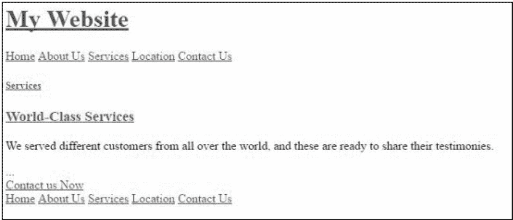

## 第 2 章 HTML 样式

### 文本样式

文本样式包括 `font-family`、`font-size`、`font-style`、`font-weight`、`font-variant`。

| 字体属性 | 值 |
| --- | --- |
| `font-family` | Arial, Times New Roman, Courier New, Georgia, Verdana |
| `font-size` | 9px, 10px……Large |
| `font-style` | normal, italic, oblique |
| `font-weight` | normal, bold, number |
| `font-variant` | normal, small-caps |

文本样式可以通过 `{ property: value }` 指定。

#### 示例 6.1

```html
<html>
<style type = "text/css">
#f{ font-family: Times New Roman; font-size: 28px; font-style: italic; font-weight: bold; font-variant: normal }
</style>
<div id = "f">这是一段使用不同样式的文本内容。</div>
</html>
```

输出：

这是一段使用不同样式的文本内容。

解释：

`font-family`、`font-size`、`font-style`、`font-weight`、`font-variant` 用于指定字体的文本样式。

### 间距

`line-height` 可以指定行间距。`word-spacing` 可以指定单词间距。`letter-spacing` 可以指定字母间距。

#### 示例 6.2

```html
<html>
<style type = "text/css">
#lineSpacing{ line-height:500% }
#wordSpacing{ word-spacing: 10px }
#letterSpacing{ letter-spacing: 5px }
</style>
<p id = "lineSpacing">行间距示例。</p>
<p id = "wordSpacing">单词间距示例。</p>
<p id = "letterSpacing">字母间距示例。</p>
</html>
```

输出：

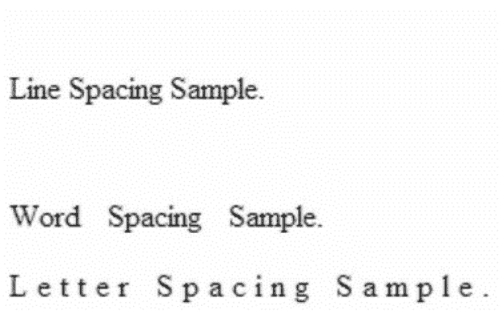

解释：

`line-height:500%` 指定行高为 500%。`word-spacing: 10px` 指定单词间距为 10px。`letter-spacing: 5px` 指定字母间距为 5px。

### 分区样式

分区标签 `<div></div>` 用于将其内容元素分组为块。`<div>` 标签对于样式设置非常有用。

```
<div class = "xxx"></div><div id = "xxx"></div>
```

`<div>` 标签可以在 CSS 样式中拥有 `id` 和 `class` 属性。

#### 示例 6.3

```html
<html>
<style type = "text/css">
.d1{font-style: italic; color: purple;}
#d2{font-family: arial black; color: blue;}
</style>
<body>
<div class = "d1"> <p>AAAAA</p> <p>BBBBB</p> <p>CCCCC</p> 
</div>
<div id = "d2"> <p>EEEEE</p> <p>FFFFF</p> <p>GGGGG</p>
</div>
</body>
</html>
```

输出：

AAAAA

BBBBB

CCCCC

EEEEE

FFFFF

GGGGG

解释：

`<div class = "d1"></div>` 被划分为第一组，包含三对 `<p>` 标签。它们使用 `.d1` 样式。`<div id = "d2"></div>` 被划分为第二组，包含另外三对 `<p>` 标签。它们使用 `#d2` 样式。

### 跨度样式

`<span></span>` 可用于对元素进行分组以实现样式设置（使用 `class` 或 `id` 属性）。

```
<span class = "xxx"></span><span id = "xxx"></span>
```

`<span>` 标签可以在 CSS 样式中拥有 `id` 和 `class` 属性。

#### 示例 6.4


```html
<html>
<style type = "text/css">
div{background-color: yellow}
.d1{font-style: italic;color: purple;}
#d2{font-family: arial black;color: blue;}
</style>
<body>
<div><p>这是 AAA 文本， 
<span class = "d1">这是 BBB 文本，</span>
这是 CCC 文本， 
<span id = "d2">这是 DDD 文本，</span>
这是 EEE 文本。</p></div> 
</body>
</html>
```

输出：

这是 AAA 文本，这是 BBB 文本，这是 CCC 文本，这是 DDD 文本，这是 EEE 文本。

解释：

上述代码使用`<span></span>`标签为段落中的两段文本设置了 CSS 样式，该段落包含在一个块中。`<span>`与`<div>`元素非常相似，但`<div>`是块级元素，而`<span>`是内联元素。

## 边框样式

`border-style: value`可以通过指定不同的值来设置边框样式。`value`可以是`solid`、`double`、`dashed`、`dotted`、`groove`、`ridge`、`inset`、`outset`。

### 示例 6.5

```html
<html>
<style type = "text/css">
#b1{border-style: solid; border-width: 10px;}
#b2{border-style: double; border-width: 10px;}
#b3{border-style: dashed; border-width: 10px;}
#b4{border-style: dotted; border-width: 10px;}
#b5{border-style: groove; border-width: 10px;}
#b6{border-style: ridge; border-width: 10px;}
#b7{border-style: inset; border-width: 10px;}
#b8{border-style: outset; border-width: 10px;}
</style>
<body>
<p id = "b1">这是实线边框。</p><br>
<p id = "b2">这是双线边框。</p><br>
<p id = "b3">这是虚线边框。</p><br>
<p id = "b4">这是点状边框。</p><br>
<p id = "b5">这是凹槽边框。</p><br>
<p id = "b6">这是脊状边框。</p><br>
<p id = "b7">这是内嵌边框。</p><br>
<p id = "b8">这是外凸边框。</p><br>
</body>
</html>
```

输出：

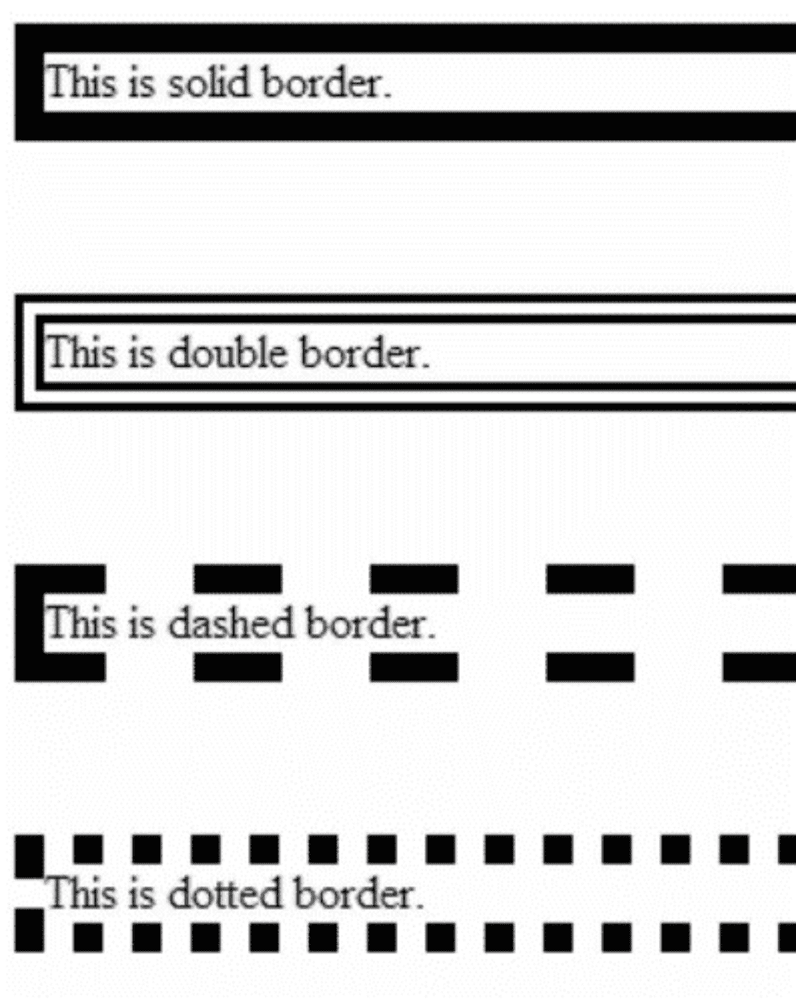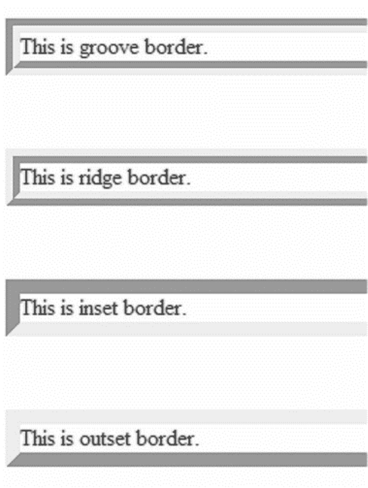

解释：

`border-style: value`可以是`solid`、`double`、`dashed`、`dotted`、`groove`、`ridge`、`inset`、`outset`。`border-width: 10px`指定边框宽度为 10px。

## 边框颜色

`border-color: value`可以设置边框的颜色属性。

### 示例 6.6

```html
<html>
<style type = "text/css">
#b5{border-style: groove;border-width: 20px; border-color:blue }
#b6{border-style: ridge;border-width: 20px; border-color:purple }
</style>
<p id = "b5">这是凹槽边框。</p>
<p id = "b6">这是脊状边框。</p>
</html>
```

输出：

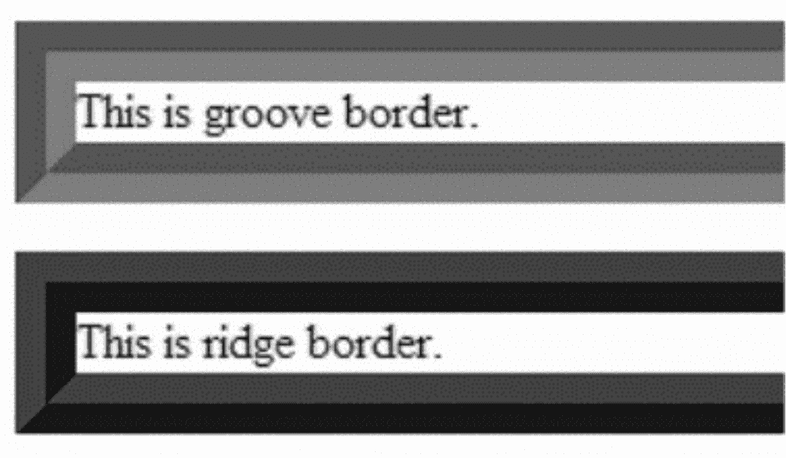

解释：`border-color: value`可以设置边框颜色。

## 内边距样式

内边距是内容框中文本内容周围的区域。内边距宽度可以通过`padding`属性指定。

```html
| padding: value |
```

### 示例 6.7

```html
<html>
<style type = "text/css">
#b1{border-style: solid; border-width: 5px; padding: 10px }
#b2{border-style: dotted; border-width: 5px; padding: 20px }
</style>
<p id = "b1">此内边距为 10px。</p>
<p id = "b2">此内边距为 20px。</p>
</html>
```

输出：

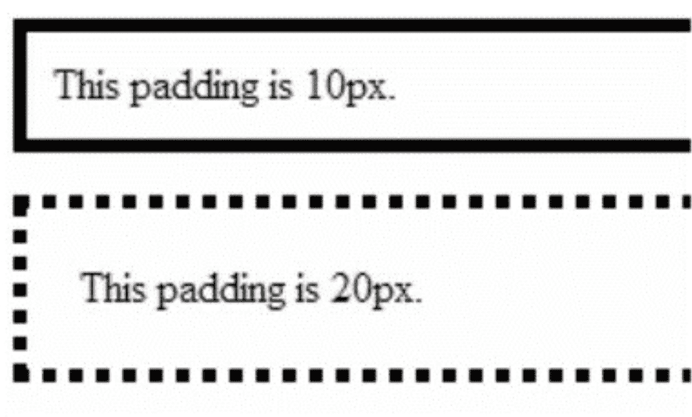

解释：`padding: value`可以设置内边距宽度。

## 外边距样式

边框边缘周围的区域称为外边距。外边距宽度可以通过`margin`属性指定。

```html
| margin: value; |
```

### 示例 6.8

```html
<html>
<style type = "text/css">
#b1{border-style: solid; border-width: 5px; margin: 30px }
#b2{border-style: dotted; border-width: 5px; margin: 0px }
</style>
<p id = "b1">此外边距为 30px。</p>
<p id = "b2">此外边距为 0px。</p>
</html>
```

输出：

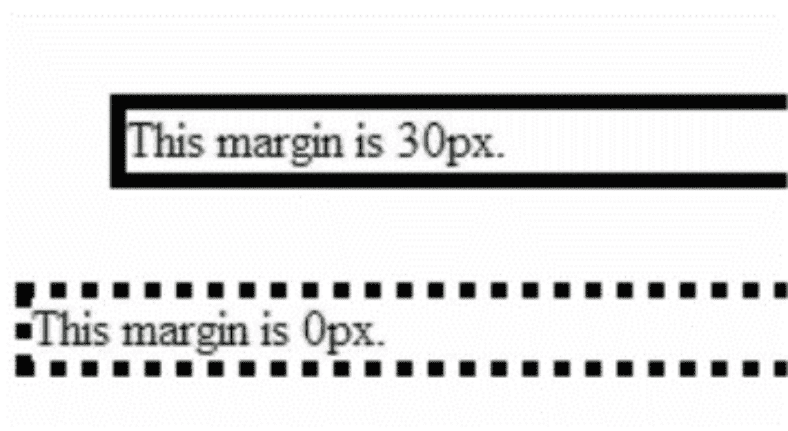

解释：`margin: value`可以设置外边距宽度。

## 绝对定位

内容位置可以通过`position`属性指定。

```html
| position: absolute;  top: value;  left: value; |
```

`position: absolute`设置内容的精确位置。`top: value`设置距离窗口顶边的距离。`left: value`设置距离窗口左边的距离。

### 示例 6.9

```html
<html>
<style type = "text/css">
#a1{ position:absolute; top: 0px; left: 30px }
#a2{ position:absolute; top: 30px; left: 60px }
</style>
<p id = "a1">这是位置 1。</p>
<p id = "a2">这是位置 2。</p>
</html>
```

输出：

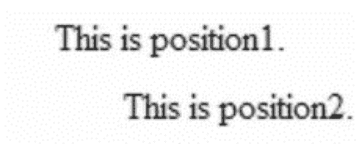

解释：`position: absolute; top: value; left: value;`指定相对于浏览器窗口边缘的绝对距离。

## 相对定位

```html
| position: relative;  top: percentage;  left: percentage; |
```

`position: relative`根据浏览器窗口分辨率或窗口大小设置内容的相对位置。`top: percentage`设置距离窗口顶边的距离。`left: percentage`设置距离窗口左边的距离。

### 示例 6.10

```html
<html>
```

```html
<style type = "text/css">

#r{ position:relative; top: 3%; left: 5% }

</style>

<p id = "r">这是相对定位。</p>

</html>
```

输出：

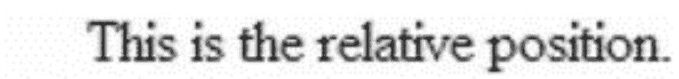

解释：

`position:relative; top: 3%; left: 5%`指定了基于浏览器窗口分辨率或大小的相对位置。

## HTML 符号

在 HTML 文档中，当遇到一些特殊符号如`&`、`<`、`>`和空格时，需要使用对应的代码：`&amp;` `&lt;` `&gt;` `&nbsp;`

| 符号 | 源代码 |
|------|--------|
| < | `&lt;` |
| > | `&gt;` |
| & | `&amp;` |
| “” | `&quot;` `&quot;` |
| © | `&copy;` |
| ® | `&reg;` |
| 空格 | `&nbsp;` |
| ! | `&#33;` |
| : | `&#59;` |

示例 6.11

```html
<html>
<body>
&lt; Java in 8 Hours &gt; &amp; &lt; Python in 8 Hours &gt; 是非常棒的书&#33;<br>  
Copyright &copy; 2016 by Ray Yao &nbsp; &nbsp; &nbsp;
All Rights Reserved&#33;
</body>
</html>
```

输出：

< Java in 8 Hours > & < Python in 8 Hours > 是非常棒的书！

Copyright © 2016 by Ray Yao       保留所有权利！

解释：

| 符号 | 代码 |
|------|------|
| <   > | `&lt;`    `&gt;` |
| > | `&gt;` |
| & | `&amp;` |
| © | `&copy;` |
| 空格 | `&nbsp;` |
| ! | `&#33;` |

# 第 3 章 HTML 中的表单

## Web 表单基础

网页不仅仅是用来阅读文档和文章的，还用于社交和商业应用。你几乎无法想象任何类型的 Web 应用不需要向用户索取数据——只需想想最常见的功能，比如登录和注册。

HTML 表单自早期版本起就是标记的一部分，如今，经过几次与 HTML-XHTML 争论相关的曲折之后，我们在 HTML5 中拥有了一个精炼的表单模型，它仍然能在旧版浏览器中工作。

## Web 表单的工作原理

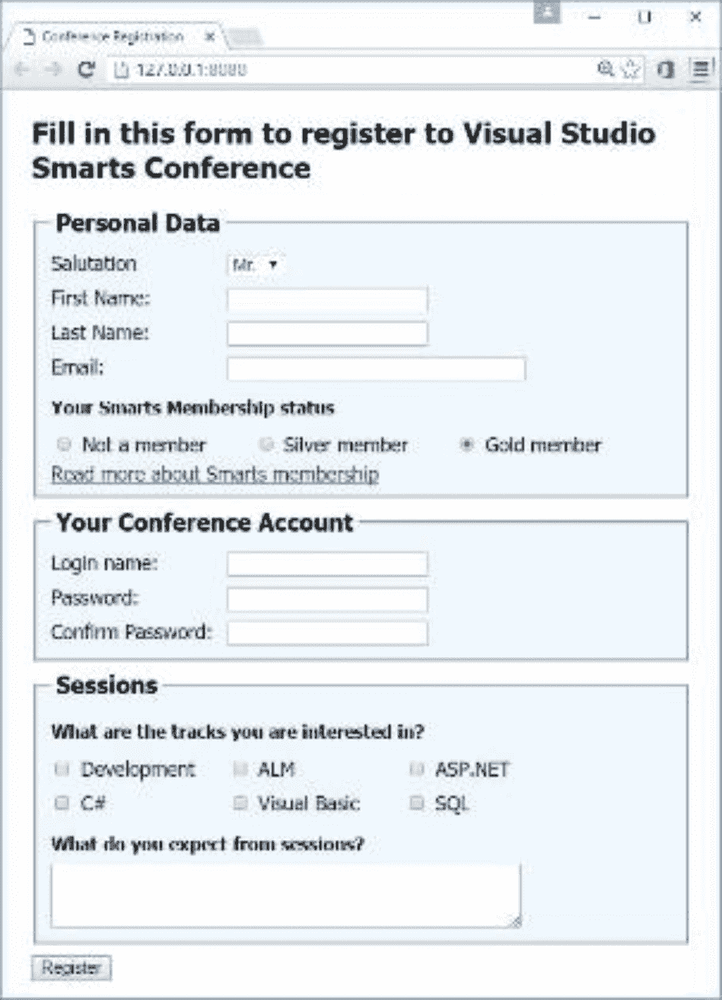 这展示了一个正在运行中的 Web 表单，其中包含用户界面组件——或者换个说法，控件。在这个表单中，不仅文本框、复选框和单选按钮是控件，标签、围绕各部分的边框以及注册按钮也都是控件。

运行中的 Web 表单

要设计和编写 Web 表单，你需要了解它们的工作原理。以下是一个简化的概述：

当浏览器显示一个 Web 表单时，它只是像渲染其他元素（如文本、菜单、图像等）一样渲染其控件。用户填写表单，然后点击提交按钮。表单的提交意味着浏览器收集用户输入的数据，将其放入 HTTP/HTTPS 请求中，并发送到服务器。当服务器端收到请求时，Web 服务器会找出要处理该请求的应用程序或模块类型，并将收集到的数据分派给它。接收请求的实体分析收集到的信息，并决定下一步做什么。

例如，如果请求包含注册数据，Web 服务器可能会将其存储在数据库中，并返回一条关于注册成功的消息。或者，如果数据无效（例如必填字段未填写），Web 服务器可能会返回原始表单，其中包含用户指定的数据，以及额外的标记，用于总结服务器应用程序发现的问题。

因此，这个过程包含以下基本步骤：

1. 浏览器收集表单数据，并将其发送到 Web 服务器。
2. Web 服务器处理数据，并将结果返回给浏览器。
3. 浏览器可视化结果（可能是一个网页、一条错误消息或其他类型的信息等）。

当然，这个过程最困难的部分是步骤 2，它在服务器端执行。有许多服务器技术可以处理 Web 表单，但在本书中我们不会深入探讨，只会浅尝辄止。

随着 Web 的发展以及用户对流畅体验的期望，出现了新的异步技术，例如 AJAX（异步 JavaScript 和 XML）。这些技术不期望 Web 服务器返回整个网页，而只返回页面的一部分——这部分受用户指定信息变化的影响。这种方法导致网络数据包更小，屏幕闪烁更少。异步技术的主要优点是它们可以在后台异步地向服务器发送数据和从服务器检索数据，而不会妨碍用户交互。

在本章中，你将专注于在客户端构建和使用 Web 表单。

## 在 HTML 中表示 Web 表单

关键的 HTML 元素是`<form>`，它定义了页面内的一个 Web 表单。最简单的 Web 表单只需要几行标记：

```html
<form action="ProcessAtServer.html">
<input type="submit" value="执行！"/>
</form>
```

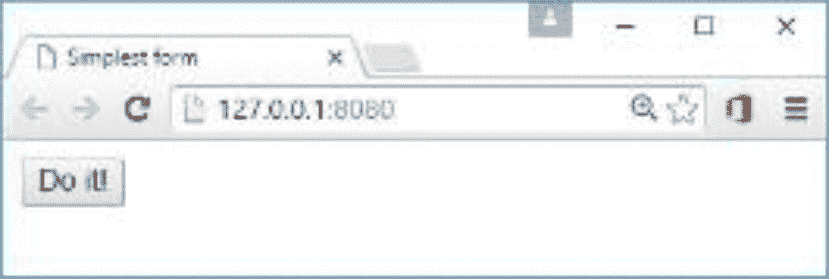 这个`<form>`包含一个带有`type="submit"`属性的`<input>`标签，它表示一个提交按钮。`<form>`的`action`属性设置为`ProcessAtServer.html`，因此当用户点击提交按钮时，表单的内容将被发送到该页面。当然，如下图所示，这个表单没有任何其他有用的元素，所以实际上没有信息要发送到 action 页面。

一个非常简单且无用的 Web 表单

那么，让我们创建一个带有几个实际输入字段的表单：

```html
<form action="#">
<input name="fname" />
<br />
<input name="lname" />
<br />
<input type="submit" value="执行！"/>
</form>
```

这个标记包含两个输入字段，名称分别为`fname`（名）和`lname`（姓）。它们对应的`<input>`标签没有`type`属性，因此这些字段将渲染为文本框。表单的`action`属性设置为`#`，这会将表单数据发送到页面本身。

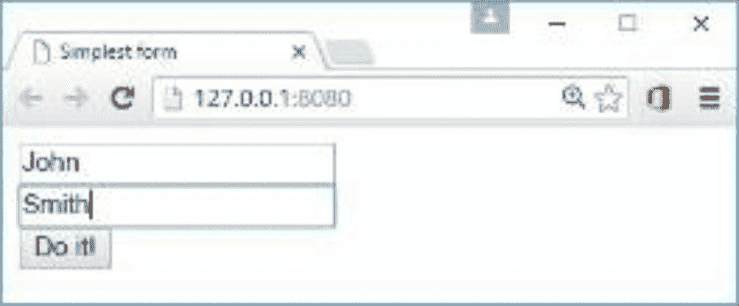 假设你将这段代码放入了`form.html`文件中。当你在浏览器中显示它时，你可以在文本框中输入数据，如下图所示。

一个带有两个输入字段的简单表单

当你点击提交按钮时，表单会通过 Web 请求将数据发送到`form.html`文件。页面会再次显示，输入字段为空。只有浏览器的地址栏会告诉你，该页面是作为表单 Web 请求的结果而显示的，其 URL 类似于：

`http://127.0.0.1:8080/?fname=John&lname=Smith#`

在 URL 中，你可以看到表单数据为`?fname=John&lname=Smith`，表明这些信息是通过 URL 传递的。

## 控件概述

在上面的这些小段标记中，你已经看到了一些控件，例如文本框和提交按钮，但还有更多。你将通过练习学习如何使用它们，但首先会给你一个简短的概述。

那么，正如你已经知道的，`<form>`是封装所有控件的标记元素。大多数控件可以使用带有`type`属性的`<input>`元素来渲染。该属性指定了控件的类型，它决定了控件在浏览器中的渲染方式及其行为。如果你没有指定`type`，控件将是一个文本框（这与将`type`设置为`text`相同）。你可以选择几种按钮类型，例如`button`（可点击按钮，通常与 JavaScript 一起使用）、`checkbox`、`radio`（单选按钮）、`submit`（提交表单）、`image`（作为提交按钮的图像）和`reset`（将所有表单值重置为默认值）。

还有几个预定义的文本控件，带有一些额外的语义，例如`password`（字符被掩码）、`email`（定义电子邮件地址的字段）、`url`（用于输入 URL 的字段）、`tel`（用于输入电话号码的字段）、`search`（用于搜索文本的字段）和`number`（用于输入数字的字段）。类型`file`提供了一个带有“浏览”按钮的文件选择字段，用于文件上传。你可以在表单中放置隐藏字段，用于通过编程方式设置表单值。

HTML5 通过`<input>`的`type`属性，在旧标记中增加了许多与日期和时间相关的控件：`date`（包含年、月、日，不含时间的日期控件）、`datetime`（基于 UTC 时区，精确到秒的小数部分的日期和时间控件）、`datetime-local`（不含时区的日期和时间控件）、`month`（月份和年份控件）、`time`（用于输入时间的控件，不含时区）以及`week`（周和年份控件，不含时区）。

注意：在网页中使用日期和时间相关控件意味着你正走在薄冰上。这些控件相对较新，并且——在撰写本文时——在大多数浏览器中它们仅渲染为文本框，而不是漂亮的日期和时间选择控件。

HTML5 还增加了另外两种类型：`color`（颜色选择器）和`range`（一种滑块，用于在指定范围内选择一个数字）。

除了`<input>`之外，还有一些其他 HTML 标签用于指定用户数据。使用`<select>`，你可以通过`option`值定义一个下拉列表。要输入较长的文本，请使用`<textarea>`元素。

`<fieldset>`元素允许你将相关控件分组到各个部分中，`<legend>`元素为`<fieldset>`元素添加标题。

输入字段不会向用户说明其角色。你可以使用`<label>`元素为输入控件提供名称。除了添加描述性文本外，`<label>`元素还为使用鼠标的用户提供了改进，因为当用户点击`<label>`内的文本时，它会触发控件（例如复选框或单选按钮），或将焦点移动到相关的输入字段。

与`button`、`submit`或`reset`类型一起使用时，`<input>`元素会渲染为按钮。使用`<button>`元素可以创建具有相同行为的可点击按钮，但你可以创建复合按钮内容，而不仅仅是简单文本。

# 第 4 章 HTML 的框架、颜色和布局

## HTML 框架


框架的使用日渐减少。目前框架并非毫无用处，因为使用框架打印完成的页面相当困难。除此之外，许多人也不喜欢它。取而代之的是，现在使用 CSS 将页面划分为多个部分。但为了丰富 HTML 的知识库，还是有必要对框架有所了解。

**示例程序**

```
<html>
<head>
<title> [www.lifeguruji.tk](http://www.tutohost.com/) </title>
</head>
<body bgcolor ="#00cc99">
<frameset rows ="12%,88%">
<frame src = "style.html" scrolling ="no">
<frameset cols ="27%,74%">
<frame src ="link.html">
<frame src ="textfor.html">
</frameset>
</frameset>
</body>
</html>
```

创建一个文件夹，任意命名，并将`style.html`、`link.html`和`textfor.html`三个 HTML 文件放入其中。打开记事本，输入上述代码，然后点击文件菜单中的“另存为”，保存为文件名：`index.html`，保存类型：所有文件，使用 Mozilla Firefox 或 Google Chrome 打开`index.html`文件，查看其效果……

**程序讨论**

首先，`frameset rows = "12%, 88%">`将整个页面沿行方向分成两部分。

通过`frameset cols = "27%, 74%">`将底部行沿列方向分成两个部分。

`<frame src = "style.html" scrolling = "no">`在第一个框架中显示`style.html`页面。

`<frame src = "link.html">`和`<frame src = "textfor.html">`分别安排在第 1 和第 2 个框架中显示`links.html`和`textfor.html`页面。

## 内联框架

内联框架是在一个网页中显示一个或多个网页的主要方式之一。它对于发布与演示主题相关的不同网页的链接很重要，而且如果能在较小的空间内滚动显示，那也不错。

**示例程序**

```
<html>
<head>
<title> [www.lifeguruji.tk](http://www.tutohost.com/)</title>
</head>
<body bgcolor=" #f00">
<center>
<h2 style="color:#f00">这是一个内联框架的示例。</h2><br/>
<iframe src="[`www.lifeguruji.tk/bangla/html/`](http://www.tutohost.com/bangla/html/)" width="350" height="170">
<p>此浏览器不支持内联框架。</p>
</iframe>
</center>
</body>
</html>
```

打开记事本，输入上述代码，然后点击文件菜单中的“另存为”，保存为文件名：`index.html`，保存类型：所有文件，使用 Mozilla Firefox 或 Google Chrome 打开`index.html`文件，查看其效果……

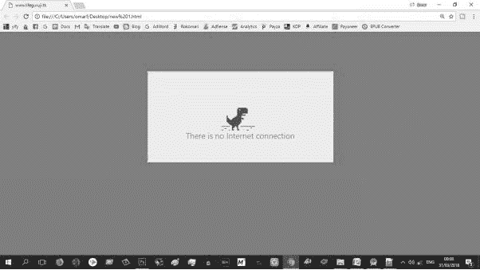

抱歉，我目前没有网络……

**程序讨论**

`<Iframe> </iframe>`标签用于创建内联框架。

`width = "350" height = "170"`这两个属性表示内联框架的大小。

如果浏览器不支持内联框架，则会显示`<P> 此浏览器不支持内联框架。 </P>`这段文本。

## 颜色与代码

在网页中使用颜色非常重要。一个网页由一个或多个段落、标题、表格、边框等组成。每个元素都需要使用一些颜色。要指定特定页面的背景颜色，在`<body>`标签中写入 body 后，应写`bgcolor = ""`，然后空格，接着是 black、silver、gray、white、marrow、red、purple、fuchsia、green、lime、OLIVE、YELLOW、NAVY、BLUE、TEAL 和 AQUA 这十六种颜色中的任意一种，该颜色将显示在页面背景中。由于不区分大小写，用小写书写没有问题，例如写成`<body bgcolor = "green">`。

除了十六进制代码，还可以选择背景颜色。例如，上述代码可以写成：`<body bgcolor = "# 00FF00">`

可以轻松收集不同颜色的十六进制代码的颜色选择器。除了下面的图表，你也可以完成这项工作。十六进制代码必须以`#`符号开头。

还有另一种有趣的设置背景颜色的方法。这三种颜色是红色、绿色和蓝色，所有其他颜色都由这三种颜色组成。如果你组合这三种颜色并创建新颜色，那也不错。要完成此任务，绿色背景可以写成如下形式：

`<body bgcolor = "rgb (0,255,0)">`

这里`rgb`代表红绿蓝`(0, 255,0)`，意思是红色、绿色、蓝色的颜色值分别为 0%、100%、0%，因为这里是纯绿色。任何颜色值都可以在 0-255 之间。由于 g 或绿色的值为 255，所以是 100%。通过将三种颜色的值在 0-255 之间变化，你可以根据需要创建新颜色。

**示例程序**

```
<html>
<head>
<title> [www.lifeguruji.tk](http://www.tutohost.com/)</title>
</head>
<body bgcolor="green">
<h2 style=" color:#ff0000" >
这是你网站的主体。
</h2>
<p style="color:#093">
这是一个段落。<br/>
这是一个段落。 <br/>
这是一个段落。<br/>
这是一个段落。<br/>
</p>
</body>
</html>
```

打开记事本，输入上述代码，然后点击文件菜单中的“另存为”，保存为文件名：`index.html`，保存类型：所有文件，使用 Mozilla Firefox 或 Google Chrome 打开`index.html`文件，查看其效果……

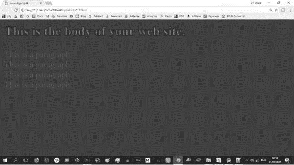

## 布局

页面的布局决定了网页的好坏程度。以前所有网站布局都只使用 HTML 制作。目前，CSS 与 HTML 一起使用。仅使用 HTML 创建布局时，会使用`<table>`的行和列。

**示例程序**

```
<html>
<head>
<title> [www.lifeguruji.tk](http://www.tutohost.com/)</title>
</head>
<body bgcolor="green">
<table width="400" border="0">
<tr>
<td colspan="3" style="background-color: #93C;">
<h1> 网页页眉</h1>
</td>
</tr>
<tr valign="top">
<td style="background-color: #C99;width:100px;text-align:top;">
<p><b>侧边栏</b><br />
<a href="#">PHP</a>
<br />
<a href="#">HTML</a>
<br />
<a href="#">CSS</a>
<a href="#">Wordpress</a>
</p></td>
<td style="background-color:#EEEEEE;height:200px;width:400px;text-align:top;"><h2 style="color:#900">这是标题。</h2>
<p style="color: #006">这是一个段落。这是一个段落。这是一个段落。<br />
```

这是一个段落。这是一个段落。这是一个段落。

这是一个段落。这是一个段落。这是一个段落。

这是一个段落。这是一个段落。这是一个段落。

版权所有 © 2018 奥马尔·法鲁克

打开记事本，输入上述代码，然后从“文件”菜单中选择“另存为”，将文件命名为：`index.html`，保存类型选择“所有文件”，使用 Mozilla Firefox 或 Google Chrome 打开`index.html`文件，查看其效果……

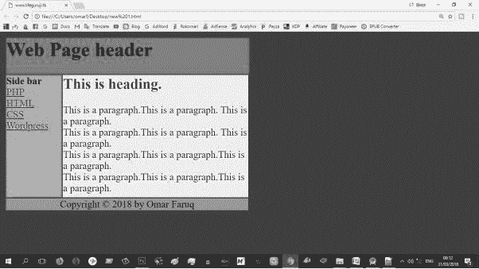

# 第 5 章 如何在 HTML 中插入图片？

有一句名言：“一图胜千言”。这句话展示了图片在传递信息方面的强大力量。网站通过展示图片来让网页更加精彩、生动和活泼。

我们如何在网页上显示图像或图片呢？

## 图片示例

让我们看一个网页上图片的例子。请访问维基百科的以下页面：<https://en.wikipedia.org/wiki/Albert_Einstein>。你会看到如下所示的图片：

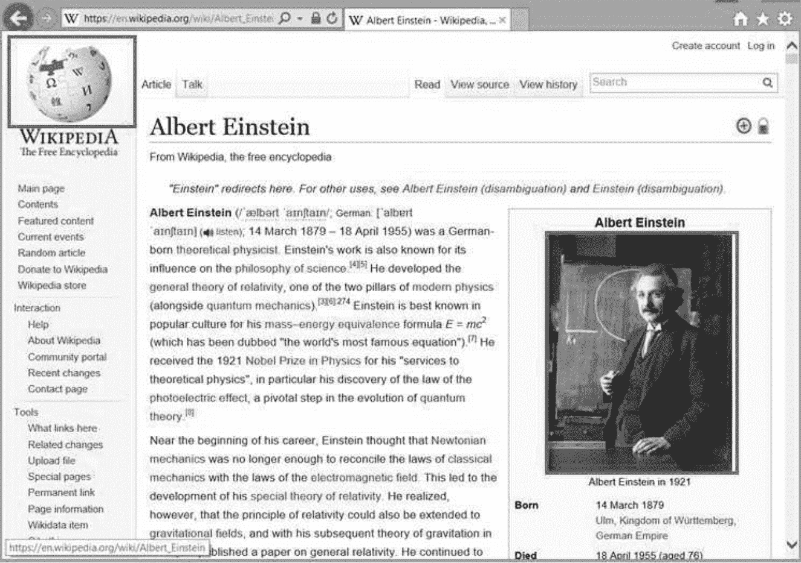

图片

**示例**

你可以看到我标记了两张图片——一张是阿尔伯特·爱因斯坦，另一张是维基百科的标志。你难道不认为这些图片让页面变得生动了吗？网页上的图片可以通过两种方式使用：

- 一种方式是仅显示图片。只显示，没有其他作用。

- 另一种方式是将图片用作超链接。这意味着当你点击图片时，它会带你跳转到其他页面。多么有趣！

## 学习细节

我们如何在网页上显示图片？我们使用``标签来实现。请查看下面的示例：

```
</img>
```

我们以``标签开始，然后像处理其他 HTML 标签一样，用`</img>`标签结束。但我们还会使用各种其他属性来确保图片在网页上正确显示。让我们在下表中查看这些属性。

**表 6.1：``标签的属性**

| ``标签属性 | 用途 |

|-------------------|------|

| `src` | `src`代表来源。与超链接类似，你需要为此属性输入图片的地址。地址是图片存储的位置。该地址可以是基于互联网的图片，即图片存储在互联网上的某个地方，比如某个网页。例如，存储在维基百科上的爱因斯坦图片。地址为：`https://upload.wikimedia.org/wikipedia/commons/thumb/3/3e/Einstein_1921_by_F_Schmutzer_-_restoration.jpg/220px-Einstein_1921_by_F_Schmutzer_-_restoration.jpg`。或者也可以是来自你电脑/笔记本电脑硬盘的地址，即图片存储在本地计算机硬盘的某个位置。你需要提供图片的文件夹路径。例如：`"file://C:/Books\HTMLforKids/mybook.jpg"`。你可以使用大多数类型的图片，如`jpg`、`jpeg`、`png`、`gif`和`bmp`。 |

| `alt` | `alt`代表替代文本。如果由于某种原因图片无法在网页上显示，则会显示此文本。这就像一个备用方案。当图片因某些问题无法显示时，你希望显示一些文本。 |

| `width` | 这表示图片的宽度。如果你不提供此值，则会以原始宽度显示图片。宽度以像素为单位。一个像素就像屏幕上的一个点。就像你用米或厘米测量距离一样，你同样用像素测量图片的长度。 |

| `height` | 表示图片的高度。与宽度类似，也以像素为单位。如果你不提供此值，则会以原始高度显示图片。 |

让我在 HTML 中展示图片。我将使用上表中给出的爱因斯坦图片地址，并将其显示在我的 HTML 页面中。我将设置高度为 200 像素，宽度也为 200 像素，使其呈正方形。HTML 代码如下：

```
<html>
<head>
<title></title>
</head>
<body>
<h2>阿尔伯特·爱因斯坦</h2>
</img>
</body>
</html>
```

HTML 页面将显示如下。

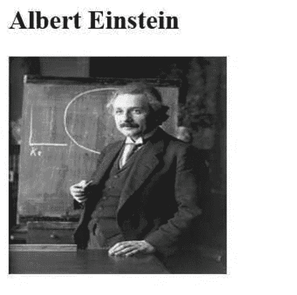

网页显示 你可以看到，图片以我指定的正方形尺寸（200 x 200）显示，正如我在``标签属性中设置的那样。

如果图片出现问题会怎样？例如，你给图片提供了错误的地址。我建议你自己尝试一下。

你观察得很对。它会在图片位置显示``标签属性中定义的替代文本。

接下来！将图片用作超链接怎么样？听起来很棒，对吧？以下是超链接标签的结构：

```
<a href="网页地址"> 超链接文本 </a>
```

要将图片用作超链接，你需要将超链接文本替换为``标签。例如，如果我想将爱因斯坦的图片设置为超链接，点击后跳转到维基百科页面，那么我的 HTML`<a>`标签将如下所示：

```
<a href="https://en.wikipedia.org/wiki/Albert_Einstein"> </img> </a>
```

这难道不简单直观吗？我相信你会同意我的看法。

# 第 6 章 HTML 表格

表格对于以网格格式表示数据非常有用。数据被划分为行和列。这有助于我们沿着两个轴理解数据。表格中的每个块称为表格单元格。让我们看看如何在 HTML 中创建表格。

## 表格创建

`<table>`元素用于创建表格。表格的内容逐行写出。`<tr>`元素用于表示每一行的开始。`<tr>`代表表格行。表格的每个单元格使用`<td>`元素表示。表格行也可以使用`<th>`标签划分为表头。让我们通过一个示例更详细地了解表格的创建。

```
<!DOCTYPE html>
<html>
<body>
<table>
<tr>
<td>A</td>
<td>X</td>
<td>1</td>
</tr>
<tr>
<td>B</td>
<td>Y</td>
<td>2</td>
</tr>
<tr>
<td>C</td>
<td>Z</td>
<td>3</td>
</tr>
</table>
</body>
</html>
```

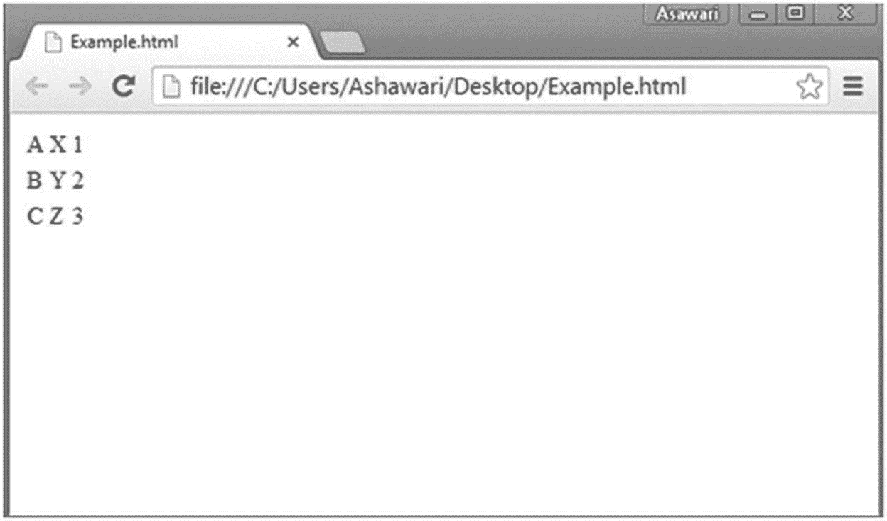

带边框的表格看起来不错。我们将学习如何使用 CSS 在表格周围绘制边框。

## 表头

行或列的标题使用`<th>`元素表示。`<th>`代表表格标题。对于空单元格，你应该使用`<td>`或`<th>`元素，否则表格将无法正确创建。`scope`属性可用于`<th>`元素，以指示它是行标题还是列标题。它接受值`row`表示行标题，`col`表示列标题。`<th>`元素的内容以粗体和居中的方式显示。表格还可以使用`<caption>`标签添加标题。

```
<!DOCTYPE html>
<html>
<body>
<table>
<caption><b>门票销售</b></caption>
<tr>
<th></th>
<th scope="col">星期六</th>
<th scope="col">星期日</th>
</tr>
<tr>
<th scope="row">售出门票</th>
<td>50</td>
<td>20</td>
</tr>
<tr>
<th scope="row">总销售额</th>
<td>100</td>
<td>150</td>
</tr>
</table>
</body>
</html>
```

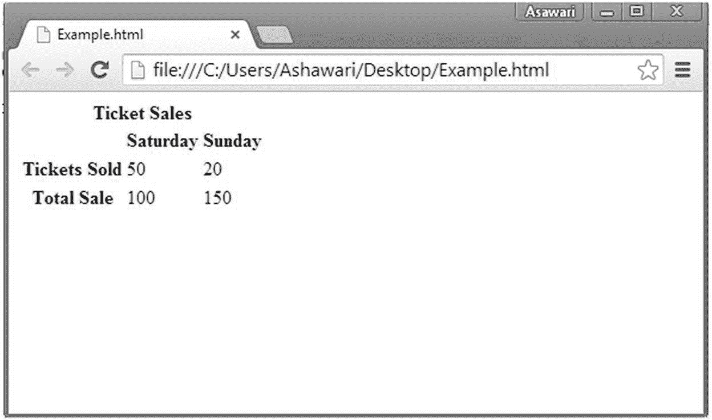

## 跨列

有时你可能需要表格中的条目跨越多列。为此，可以使用`colspan`属性。它指示单元格应跨越多少列。

```
<!DOCTYPE html>
<html>
<head>
<style>
table, th, td {
border: 1px solid black;
border-collapse: collapse;
}
th, td {
padding: 5px;
text-align: left;
}
</style>
</head>
<body>
<h2>跨两列的单元格：</h2>
<table style="width:100%">
<tr>
<th>姓名</th>
<th colspan="2">电话</th>
</tr>
<tr>
```

<td>Mr ABC</td>

<td>666 77 854</td>

<td>888 77 855</td>

</tr>

</table>

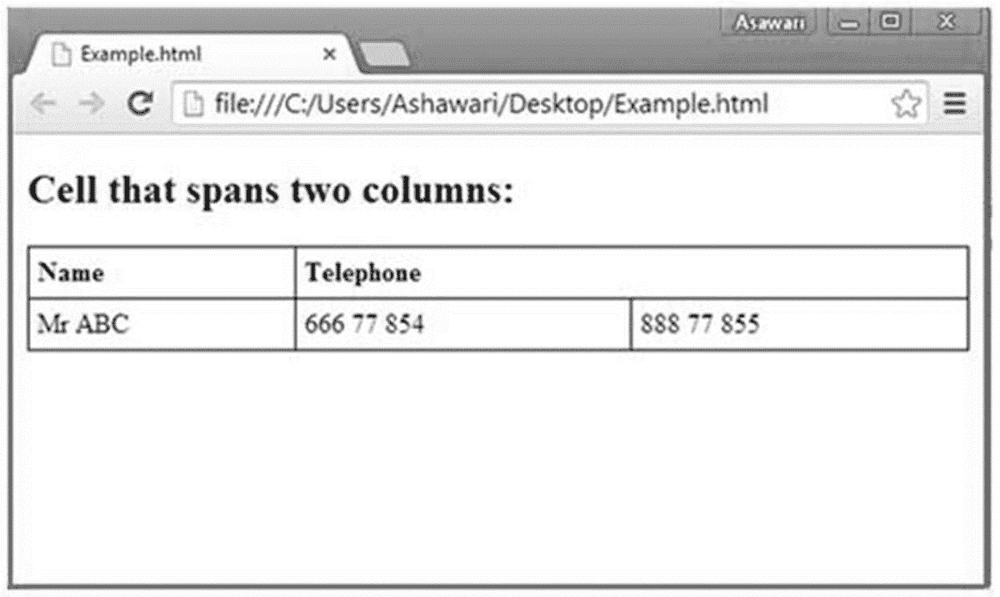

## 跨行合并

为了使一个单元格跨越多个行，你可以使用`rowspan`属性。请查看下面的示例。


```html
<html>
<head>
<style>
table, th, td {
border: 1px solid black;
border-collapse: collapse;
}
th, td {
padding: 5px;
text-align: left;   
}
</style>
</head>
<body>
<h2>跨两行的单元格：</h2>
<table style="width:100%">
<tr>
<th>Name:</th>
<td>Mr XYZ</td>
</tr>
<tr>
<th rowspan="2">Telephone:</th>
<td>222 77 854</td>
</tr>
<tr>
<td>888 77 855</td>
</tr>
</table>
</body>
</html>
```

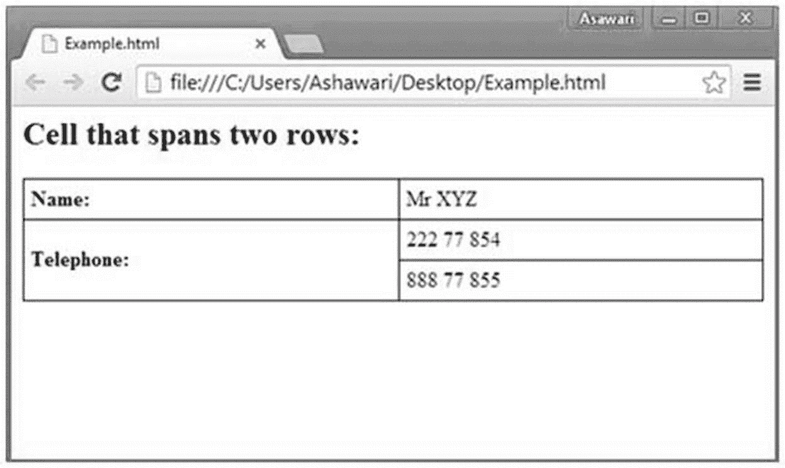

HTML 中有大量的代码用于格式化表格。但现在我们可以使用 CSS 来实现更好的格式化。因此，此处省略了关于 HTML 表格格式化的详细内容。

# CSS 基础

网页开发曾经相对简单。开发人员只需用 HTML 编写一个网页，其他类似的计算机即可访问。但时代在两个方面发生了变化。

首先，网站变得极其复杂，通常包含数百甚至数千个网页，具有可适应不同用户的动态 HTML，以及来自客户群体的更高要求。一次编写一个页面对于开发人员来说可能是一场噩梦，是维护上的难题，并且会导致网站内各页面之间出现不一致，从而令客户或浏览者感到厌烦。

其次，网页过去是通过带有显示器的计算机，甚至是具有合理显示区域的笔记本电脑来访问的。现在，我们使用平板电脑、小型电子书、手机，甚至黑白电子阅读器（如早期的 Amazon Kindle）来访问网页。使用非计算机设备的浏览者可能会感到非常沮丧，因为显示区域可能会超出屏幕数千个百分点，或者需要敲击键盘，或者存在没有便捷输入方式的数据输入项。目前市场上浏览器种类繁多，但 Web 开发人员往往坚持针对 1024 x 768 像素（或更大）的计算机显示器进行开发。

Web 开发人员或管理人员应尽量使他们的网页对浏览者或客户群具有尽可能广泛的可访问性和可用性，包括那些希望在较小设备上查看内容的人。这可以通过较新的技术、较新的格式以及出现时间不长的较新网页验证来实现。

早期的 HTML 版本（3.2 及之前版本）为每个 HTML 元素使用 `<font>` 标签和背景标签，因此页面顶部的表格可能（且经常）与页面底部的表格具有不同的格式。结果是，许多 HTML 3.2 网页的外观截然不同。研究表明，这让用户感到厌烦。习惯于一个页面的用户在点击链接后，会面对一个全新的页面，具有全新的格式、全新的表单和表格颜色，以及整体全新的外观。

HTML 4.0 试图通过标准化每个页面的外观来改变这一点，通常是通过使用层叠样式表（也称为 CSS）。这就是 HTML 3.2（及之前）与 HTML 4.0（及之后）之间的概念差异。

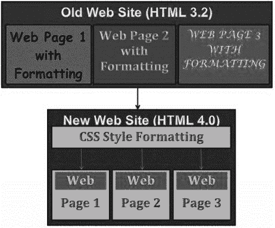

*Html 4.0 中的概念变化*

这展示了我们如何通过单个 CSS 来管理页面的格式。通过在网站的每个页面中使用同一个链接的 CSS，你不仅可以统一整个网站网页的外观，还可以通过仅定义一次页面元素（如表格、文本和列表）的格式，来简化维护并降低开发成本。

## Html 样式

在 20 世纪 90 年代和 21 世纪初被认可的网页格式化方式已经不再流行。

实现样式需要对 HTML 进行一些更改。为了使格式保持一致，你现在使用 `style` 属性来决定某个元素的外观。这导致了 HTML 语言的改变。旧的标签（如 `<font>` 标签）和旧的属性（如用于控制 HTML 元素外观的 `bgcolor` 或 `border`）现在被认为是已弃用或过时的。`style` 属性的格式如下：

```html
<tagname style="attribute1: value1;
                attribute2: value2;
                attribute3: value3;">
```

你通常可以将 `style` 属性应用于几乎任何 HTML 标签（如 `<li>`、`<td>`、`<p>` 等）。但是，如果你正在输入，并且想要更改下一个段落或句子剩余部分的字体、颜色等，你可以使用 `<div>` 或 `<span>` 标签。

`<div>` 标签在继续之前会换到下一行。`<span>` 标签则让你保持在同一行，并允许你使单行具有不同的字体、颜色等。例如，以下 `<div>` 标签展示了如何以红色显示文本：

```html
<div style="color: Red;">
This text will be red
</div>
```

## 字体

字体可以让你的页面拥有不同于默认字体的清爽外观。`style` 属性（或在 4.0 之前的旧版网页中使用 `<font>` 标签）用于控制 HTML 页面上显示的字体。表 1 显示了你可以使用 `style` 属性和大多数标签，或使用 `<span>` 标签或 `<div>` 标签（如果必须，也可以使用 `<font>` 标签）可以实现的一些操作。

| 当前/严格（新方式 -- HTML 4.0） | 已弃用/过渡（旧方式 -- HTML 3.2） |
| :--- | :--- |
| 更改字体（字体系列）<br>`<div style="font-family: Comic Sans MS, Arial, Helvetica;">浏览器将首先尝试 Comic Sans MS，然后是 Arial，最后是 Helvetica</div>` | `<font face="Comic Sans MS, arial,helvetica">浏览器将首先尝试 Comic Sans MS，然后是 Arial，最后是 Helvetica</font>` |
| 设置字体大小（绝对值）<br>`<span style="font-size: 18pt;">定义字体大小</span>` | `<font size="5">定义字体大小</font>` |
| 增大字体大小（相对值）<br>`<td style="font-size: 2em;">增大文本大小</td>` | `<font size="+3">增大文本大小</font>` |
| 减小字体大小（相对值）<br>`<span style="font-size: .6em;">减小文本大小</span>` | `<font size="-2">减小字体大小</font>` |

表 1. 设置字体

### pt vs. px vs. em

在指定字体大小时，你可以通过以下三种方式之一来指定大小：

- `pt` 提供绝对点大小，由用户的客户端机器定义。
- `px` 提供绝对像素高度，独立于机器（但会随分辨率降低而缩小，随分辨率提高而增大）。这通常用于设置边框和页边距。
- `em` 提供相对高度，将高度表示为当前高度的倍数。这是一个相对度量，取决于当前大小。

你可以根据需要选择。

## 颜色

计算机显示器上的颜色是由光而非颜料定义的，因此原色是红、绿、蓝。此外，与颜料不同，将所有光色结合在一起会产生白光，而 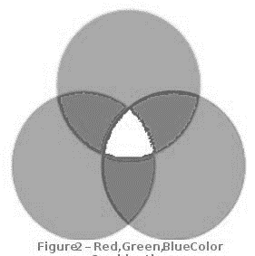 移除所有光色则会产生黑色。下图从一个非常高的层面展示了原色如何混合以及混合后的效果。

颜色有两种指定方式。第一，你可以使用实际的颜色名称（`red`、`blue`、`purple` 等）。第二，你可以通过提供红色分量、绿色分量和蓝色分量来使用颜色的 RGB（红、绿、蓝）表示法，每个分量是一个从 0（十六进制 `#00` – 黑色）到 255（十六进制 `#ff` – 亮色）的数字。

例如，要获得这种紫色，你指定 `<span style="color: #880088">`。你也可以使用带有 `RGB` 函数的十进制，例如 `<span style="color: rgb(133, 0, 133)">`。

与字体一样，颜色可以使用 `<font>` 标签来控制，但较新的标准建议使用 `style` 属性，可能结合 `<span>` 或 `<div>` 标签一起使用。表 6 显示了一些颜色操作的 HTML。

| 当前/严格（新方式 -- HTML 4.0） | 已弃用/过渡（旧方式 -- HTML 3.2） |
| :--- | :--- |
| 设置颜色<br>`<span style="color: red">将文本颜色改为红色</span>` | `<font color="red">将文本颜色改为红色</font>` |
| 设置背景<br>`<td style="background: rgb(221, 153, 221)">使用 RGB 将此背景更改为任意颜色</td>` | `<td bgcolor="#dd99dd">使用十六进制将此背景更改为任意颜色</td>` |

表 2. 使用颜色

## 对齐与边框

你可以使用样式来控制边框，或对齐图像与文本。使用 `float` 属性还可以让文本向左或向右浮动，其他文本环绕浮动对象。表 7 展示了对齐的一些用法。

```html
|  | 当前/严格（新方式——HTML 4.0） | 已弃用/过渡（旧方式——HTML 3.2） | 示例 |
| 文本右对齐 | <td style="text-align: right">929<div style="text-decoration: underline">+ 84</div>1013</td> | <td align="right">929<br><u>+ 84</u><br>1013</td> | 929+ 841013 |
| 文本居中 | <div style="text-align: center">居中 <br /> 文本</div> | <center>居中 <br> 文本</center> | 居中文本 |
| 文本垂直对齐（顶部、中间、底部） | <td style="vertical-align: top">垂直顶部</td> | <td valign="top"">垂直顶部</td> | 垂直顶部 |
| 表格居中 | <table style="margin-left:auto; margin-right:auto"><tr><th>表头 1</th><th>表头 2</th></tr><tr><td>单元格 1</td><td>单元格 2</td></tr></table> | <table align="center"><tr><th>表头 1</th><th>表头 2</th></tr><tr><td>单元格 1</td><td>单元格 2</td></tr></table> |  |
| 表头 1 | 表头 2 |
| 单元格 1 | 单元格 2 |
|  |
| 为文本（或其他元素）添加边框 | <divstyle="border-width: 5px;border-style: outset;border-color: blue;text-align: center">带边框的文本</div> | {不使用单单元格表格无法实现} | 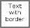 |
```

表 3a. 对齐与边框

（续……）

```html
|  | 当前/严格（新方式——HTML 4.0） | 已弃用/过渡（旧方式——HTML 3.2） | 示例 |
| 为表格添加边框 | <tablestyle="border-width: 1px;border-style: outset;"><tr><tdstyle="border-width: 1px;border-style: inset;">单元格 1</td><tdstyle="border-width: 1px;border-style: inset;">单元格 2</td></tr><tr><tdstyle="border-width: 1px;border-style: inset;">单元格 3</td><tdstyle="border-width: 1px;border-style: inset;">单元格 4</td></tr></table> | <table border="1"><tr><td>单元格 1</td><td>单元格 2</td></tr><tr><td>单元格 3</td><td>单元格 4</td></tr></table> |  |
| 单元格 1 | 单元格 2 |
| 单元格 3 | 单元格 4 |
|  |
```

表 3b. 对齐与边框（续）

# 第 8 章 CSS

样式表是一种包含格式化规则的文档。Web 浏览器会读取这些规则，并将格式应用到你的页面上。使用样式表可以控制页面元素，如边框、颜色和边距，甚至可以嵌入本地计算机上没有的字体。

样式表的正式名称是 CSS（层叠样式表）。CSS 是一种独立的语言，拥有自己的语法，但别被它吓到。这种语言是专门为格式化 Web 页面而开发的。它非常强大，只需一条命令就能改变整个 Web 页面的外观。

你应该始终将 CSS 规则放在一个单独的文件中，而不是直接嵌入到 Web 页面里。这样做的原因是为了将 HTML 代码与 CSS 规则分离，从长远来看，更新代码会更容易。

在 CSS 出现之前，Web 设计师们寻找其他方法来改变页面的布局。其中一种方法是使用表格标签——一组用于制作表格、表头、表格行等的独立 HTML 标签。但表格标签经常被滥用。它们不是用来给页面增加结构，而是常常被用来布局 Web 页面。

在 CSS 出现之前，使用表格标签或其他格式修改大型网站非常困难、耗时且昂贵，因为你必须逐个编辑网站的每个页面。

CSS 正是为了消除使用表格标签所带来的困难、成本和时间而开发的。只需编辑一个 CSS 文件，你就可以立即对大型复杂的网站进行修改。例如，你可以创建一个 CSS 规则来格式化字体大小，然后网站上的每个页面都会更新以反映这些具体变化。

## 你的第一个样式表

现在，我们应该把学到的所有东西整合起来，创建你的第一个 CSS（层叠样式表）。

如果你熟悉 Web 并访问过许多网站，你会知道浏览器默认将文本链接显示为蓝色并带有下划线。（这是浏览器对文本链接的默认（自动）格式显示。）但如果蓝色链接与你自己的 Web 页面的整体外观和感觉不协调呢？

你可以构建一条样式表规则来更改页面上链接的文本颜色。要做到这一点，只需使用 CSS 样式属性，并在 HTML 元素中声明它。下面是一个示例：

```html
<a href="#" style:"color: red;"> 点击这里 </a>
```

样式属性由两部分组成：属性名和值。以下是每个属性遵循的格式及其在代码中的样子：

```html
<style: property; name: value;>
```

在这个例子中，属性指定了应用于 HTML 元素的格式化类型。这里的 `color` 是属性，它设置了锚点链接的颜色。值是颜色的实际名称——`red`。在另一个 CSS 样式属性的例子中，属性名可能是 `font`，值可能是字体的大小。

这条 CSS 规则通常被称为语句。语句只是一段代码；在这里，它所做的就是指定样式属性为 `color`，并使锚点链接（“点击这里”）变为红色（颜色“值”）。

在 Sublime Text 2 中，选择 File | New 创建一个新文档。现在，按照你看到的代码精确输入：

```html
<!doctype html>
<html>
<head>
<title> 我的第一个样式表 </title>
<meta charset="UTF-8" />
</head>
<body>
<p> <a href="#" style="color:red; text-decoration:none;">
点击这里 </a> </p>
</body>
</html>
```

完成后，将文件以 `colors.html` 的名称保存到桌面上的 HTML 文件夹中。现在在 Web 浏览器中预览该文件，检查你的工作。

要移除锚点链接的标准下划线文本，请使用 `text-decoration` 属性，值为 `none`（参见上面 `color: red` 之后的示例）。`text-decoration` 用于设置文本的外观——你可以移除下划线、给标准文本添加下划线、在文本上方或中间添加线条，以及让文本闪烁。

`text-decoration` 属性有以下可能的值：`underline`、`line-through`、`overline`、`none` 和 `blink`。下面是一个文本装饰的代码示例，它使文本闪烁：

```css
text-decoration: blink;
```

打开我们刚刚处理的名为 `colors.html` 的网页，将其他值添加到 `text-decoration` 属性中。在 Web 浏览器中预览该文件，查看你的工作效果。

```html
<p> <a href="#" style="color:red; text-decoration:blink;">
点击这里 </a> </p>
```

尝试自己实验，将 `underline`、`line-through` 和 `overline` 值添加到 `text-decoration` 属性中，看看会发生什么。

## 内联样式

内联样式允许你将样式表的属性名和值直接插入到 HTML 标签中。但你应该尽量避免使用这种方法。因为内联样式将格式与 HTML 标记混合在一起，使得修改 Web 页面变得困难：页面上的每个样式都必须在源代码中逐一查找——你很快就会明白这一点。

下面是我们之前用于格式化锚点链接的示例：

```html
<a href="#" style="color:red; text-decoration:none;"> 点击这里 </a>
```

上述规则移除了锚点链接的默认下划线，并将文本颜色设为红色。内联样式看起来使用起来更简单——它很直观，而且你可以在页面任意位置应用它。但如果你这样格式化页面，会变得相当混乱和令人困惑。你很快就会明白为什么网页设计师通常不采用这种技术。在网页的每个 HTML 标签中添加内联样式，不仅让代码难以阅读，而且几乎不可能将呈现格式（样式表）与实际 HTML 分离开。例如，让我们考虑之前的例子，但在标签中添加了几条内联样式规则：


`<a href="#" style="color:red; text-decoration:none; border-style: solid; border-color:blue; text-align: left; font-size: 16"> Click Here </a>`

可以看到锚点标签已经开始变得有些杂乱无章。在上面的例子中，很难将内容（`"Click Here"`）与呈现格式分离开。因此，作为良好实践，HTML 标记应始终放在一个独立的、不含呈现格式的文档中。如果可能，尽量完全避免使用内联样式。

## CSS 规则的构成

样式表由规则组成。规则是一条格式化指令，告诉网页浏览器将特定样式应用到你的网页上。

下面是一个 CSS 规则的例子，它将`<p>`段落元素的颜色设置为红色：

```
p { color:red;}
```

然后，该 CSS 规则被应用到 HTML 文档中的`<p>`段落元素，如下所示：

```
</p>
```

这展示了该段落样式在标准网页浏览器中的实际效果。

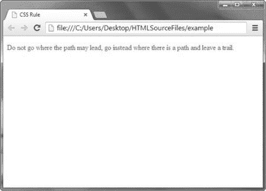

应用于段落元素的 CSS 规则

如果你在浏览器中打开样式表查看代码，你会发现 CSS 规则与 HTML 标记没有任何相似之处。每条 CSS 规则基本上由三部分组成：选择器、属性和值。通常，属性和值总是以分号（`;`）结尾。

以下是每条 CSS 规则遵循的格式：

```
Selector {property: value;}
```

以下是 CSS 规则各部分的具体含义：

*   **选择器**是你想要应用格式的 HTML 元素。例如，段落标签（`<p>`）可以用作选择器。网页浏览器会查找网页中所有与选择器匹配的常见元素，并将花括号内的代码应用到这些元素上。

*   **属性**只是标识你想要应用到 HTML 元素上的格式类型。因此，你可以在这里选择颜色、字体、大小等。

*   **值**为属性设置一个值。例如，如果属性是颜色，那么值可以是绿色或浅蓝色。

选择器、属性和值本质上是 CSS 规则的基本构建块。一旦你开始理解这些，你就离成为样式表大师不远了。

## 创建外部样式表

```
a {
color:red; text-decoration: none;
}

h1 {
font-family: arial, sans-serif
}
```

在继续之前，将文件保存为`style.css`，放在桌面上的主 HTML 文件夹中。样式表可以任意命名，但必须始终使用`.css`文件扩展名。记住，始终将样式表保存在与 HTML 页面相同的文件夹中，否则你的页面将无法显示格式。

你不需要将样式表直接嵌入到 HTML 标签中，而是要在文档的`<head>`部分添加一个指向外部`.css`样式表的链接。

在`colors.html`文件中，只需移除之前添加到锚点链接的内联样式。为了对比，下面是旧的带内联样式的`colors.html`文件和新的不带内联样式的`colors.html`文件：

带内联样式的`COLORS.HTML`文件——

```
<!doctype html>
<html>
<head>
<title> My First Style Sheet </title>
<meta charset="UTF-8" />
</head>
<body>
<h1> My First Style Sheet </h1>
<p> <a href="#" style="color:red; text-decoration:none;">
Click Here </a> </p>
</body>
</html>
```

不带内联样式的`COLORS.HTML`文件——

```
<!doctype html>
<html>
<head>
<title> My First Style Sheet </title>
<meta charset="UTF-8" />
</head>
<body>
<h1> My First Style Sheet </h1>
<p> <a href="#"> Click Here </a> </p>
</body>
</html>
```

保存文件后，在网页浏览器中查看以检查你的工作。你会看到样式表中的格式化规则尚未应用到你的网页上。这是因为我们还没有告诉浏览器指向（链接）样式表。

为此，你需要在 HTML 文档的`<head>`部分添加`<link>`元素。`<link>`元素只是将浏览器指向外部样式表，然后浏览器会将样式表的格式化规则应用到你的页面上。

以下是将`<link>`元素添加到页面`<head>`部分后的代码：

```
<!doctype html>
<html>
<head>
<title> My First Style Sheet </title>
<link rel="stylesheet" href="style.css" />
<meta charset="UTF-8" />
</head>
<body>
<h1> My First Style Sheet </h1>
<p> <a href="#"> Click Here </a> </p>
</body>
</html>
```

`<link>`元素包含两部分。`rel`属性定义了当前页面与链接文档之间的关系。实际上，你是在告诉网页浏览器这是一个样式表。

`href`属性（`href`代表超文本引用）指向外部样式表的实际位置。当链接到样式表时，`rel`属性应始终为`stylesheet`。

保存文件，然后在网页浏览器中打开以查看你的成果。恭喜！你已经创建了第一个外部样式表。

# 第 9 章 CSS 链接、表格和表单

你可以使用许多其他 CSS 属性来处理链接和表格。你将学习如何为图表的每一列添加颜色，使其脱颖而出。同样，你还会学习如何美化表单，例如提交表单、调查表单以及你在 HTML 中创建的任何其他表单。

你将能够创建漂亮的按钮，并将其集成到表单中。每个代码示例还包含代码的显示结果。你可以获取代码，重新创建、修改或运行它，以查看其工作原理。即使只是阅读，也能让你大致了解应该如何操作。

```
<html>
<head>
<style>
a {
color: green;
}
</style>
</head>
<body>
<h1> 让我给你讲个故事。</h1>
<h2><b><a href="default.asp" target="_blank">在此观看视频故事。</a></b></h2>
<p> 从前，有一只鹰在高空飞翔，
<br> 掠过山巅。
<br> 有一天，她发现了一枚戒指，卡在苹果树的树枝上。</p> 
<p>她叼起戒指飞回巢穴。玩耍时，她的头被戒指卡住了。
<br>她没有惊慌，也没有把头撞在树桩上试图摆脱它。
<br>有一天，她把头浸在油里，戒指从脖子上滑落了下来。</p>
</body>
</html>
```

上述样式的效果如下。你可以看到第二行代码中隐藏着一个链接。

让我给你讲个故事。

在此观看视频故事。

从前，有一只鹰在高空飞翔，

掠过山巅。

有一天，她发现了一枚戒指，卡在苹果树的树枝上。

她叼起戒指飞回巢穴。玩耍时，她的头被戒指卡住了。

她没有惊慌，也没有把头撞在树桩上试图摆脱它。

然后，有一天她把头浸在油里，戒指从脖子上滑落了下来。

------------------------

CSS 链接至关重要，因为很多时候你需要将网页连接到另一个网站，为用户提供精彩且富有成效的体验。根据不同的用途，你可以使用四种链接。它们分别命名为`a:link`、`a:hover`、`a:active`、`a:visited`。每个链接都有特定的用途。例如，`a:hover`用于让用户将鼠标悬停在链接上并使其打开。让我们尝试用这四种方法创建链接。

```html
<html>
<head>
<style>
/* 这是未访问的链接 */
a:link {
color: green;
}
/* 这是已访问的链接。 */
a:visited {
color: blue;
}
/* 这是悬停链接。 */
a:hover {
color: violet;
}
/* 这是选中的链接。 */
a:active {
color: red;
}
</style>
</head>
<body>
<h1> 让我给你讲个故事。</h1>
<h2><b><a href="default.asp" target="_blank">在此观看视频故事。</a></b></h2>
<p> 从前，有一只鹰在高空飞翔，
<br> 掠过山巅。
<br> 有一天，她发现一枚戒指卡在苹果树的树枝上。</p> 
<p>她叼起戒指飞回巢穴。玩耍时，她的头被卡在了戒指里。
<br>她没有惊慌，也没有把头撞在树桩上试图摆脱它。
<br>有一天，她把头浸在油里，戒指便从脖子上滑落了下来。</p>
</body>
</html>
```

你可能会想，我输入了四个链接，但如果你已经测试过代码，结果中只能看到一种颜色。链接会改变状态。一开始，它们是未访问的。然后你将鼠标悬停在它们上面。接着你点击打开它们，最后它们变成已访问状态。所以，从技术上讲，你可以根据链接的状态添加四种不同的颜色。让我们看看还能对链接做哪些其他操作。此外，我们还可以装饰链接的文本，并为背景添加颜色。让我们看看如何实现。

```html
<html>
<head>
<style>
/* 这是未访问的链接 */
a:link {
color: green;
text-decoration: none;
background-color: yellow
}
/* 这是已访问的链接。 */
a:visited {
color: blue;
text-decoration: none;
background-color: gray
}
/* 这是悬停链接。 */
a:hover {
color: violet;
text-decoration: underline;
background-color: pink
}
/* 这是选中的链接。 */
a:active {
color: red;
text-decoration: underline;
background-color: hotpink
}
</style>
</head>
<body>
<h1> 让我给你讲个故事。</h1>
<h2><b><a href="default.asp" target="_blank">在此观看视频故事。</a></b></h2>
<p> 从前，有一只鹰在高空飞翔，
<br> 掠过山巅。
<br> 有一天，她发现一枚戒指卡在苹果树的树枝上。</p> 
<p> 她叼起戒指飞回巢穴。玩耍时，她的头被卡在了戒指里。
<br> 她没有惊慌，也没有把头撞在树桩上试图摆脱它。
<br> 有一天，她把头浸在油里，戒指便从脖子上滑落了下来。</p>
</body>
</html>
```

## CSS 表格

CSS 允许你改变 HTML 中表格的外观。你可以为表头和列添加颜色。表格内文本的字体样式和字体大小也可以更改。让我们创建一个表格。

```html
<!DOCTYPE html>
<html>
<head>
<style>
#countries {
font-family: "Courier New", Gerogia, Helvetica, sans-serif;
border-collapse: collapse;
width: 80%;
}
#countries td, #countries th {
border: 2px solid green;
padding: 6px;
}
#countries tr:nth-child(even){background-color: violet;}
#countries tr:hover {background-color: #ddd;}
#countries th {
padding-top: 15px;
padding-bottom: 15px;
text-align: left;
background-color: #ffAc2b;
color: gray;
}
</style>
</head>
<body>
<table id="countries">
<tr>
<th>国家</th>
<th>首都</th>
<th>闻名原因</th>
</tr>
<tr>
<td>德国</td>
<td>柏林</td>
<td>宝马</td>
</tr>
<tr>
<td>美利坚合众国</td>
<td>华盛顿特区</td>
<td>漫威</td>
</tr>
<tr>
<td>中国</td>
<td>北京</td>
<td>廉价商品</td>
</tr>
<tr>
<td>巴基斯坦</td>
<td>伊斯兰堡</td>
<td>足球</td>
</tr>
<tr>
<td>日本</td>
<td>东京</td>
<td>机器人技术</td>
</tr>
<tr>
<td>英国</td>
<td>伦敦</td>
<td>泰晤士河</td>
</tr>
<tr>
<td>埃及</td>
<td>开罗</td>
<td>金字塔</td>
</tr>
<tr>
<td>印度</td>
<td>新德里</td>
<td>泰姬陵</td>
</tr>
<tr>
<td>巴西</td>
<td>圣保罗</td>
<td>耶稣雕像</td>
</tr>
<tr>
<td>沙特阿拉伯王国</td>
<td>利雅得</td>
<td>朝圣</td>
</tr>
</table>
</body>
</html>
```

上述代码示例的结果如下所示。你可以更改这些值，在互联网浏览器中产生不同的输出。表格是网页的基本元素。如果你运营一个显示股票市场价格涨跌信息的网站，就需要用到表格。如果不用 CSS 对它们进行适当的样式化，访问者就不会喜欢它们单调乏味的外观。适当着色的表格在网站上看起来效果很好，并能吸引访问者停留一段时间。

| 国家 | 首都 | 闻名原因 |
| --- | --- | --- |
| 德国 | 柏林 | 宝马 |
| 美利坚合众国 | 华盛顿特区 | 漫威 |
| 中国 | 北京 | 廉价商品 |
| 巴基斯坦 | 伊斯兰堡 | 足球 |
| 日本 | 东京 | 机器人技术 |
| 英国 | 伦敦 | 泰晤士河 |
| 埃及 | 开罗 | 金字塔 |
| 印度 | 新德里 | 泰姬陵 |
| 巴西 | 圣保罗 | 耶稣雕像 |
| 沙特阿拉伯王国 | 利雅得 | 朝圣 |

你可以通过对 HTML 文档进行细微修改来更改颜色、边框和内边距。也可以添加更多列或行以满足特定需求。在上面的例子中，我添加了背景颜色、内边距、边框颜色，并调整了列的宽度。你可以拿这个示例文档进行自定义，用于学习练习。

## CSS 表单

HTML 为我们提供了一种简单的方法来创建不同类型的表单，我们可以用它们收集用户信息，如用户名、密码和电子邮件地址。有些是订阅表单，有些是调查表单。当我们创建 HTML 表单时，它的外观是僵硬而单调的。多亏了 CSS，我们可以改变这一点。我们可以让它看起来非常出色。让我们创建一个表单，然后通过添加一些简单的 CSS 属性来改变它的外观。

```html
<!DOCTYPE html>
<html>
<style>
input[type=text], select {
width: 100%;
padding: 15px 25px;
margin: 10px 0;
display: inline-block;
border: 2px solid green;
border-radius: 6px;
box-sizing: border-box;
}
input[type=submit] {
width: 50%;
background-color: pink;
color: black;
padding: 12px 18px;
margin: 10px 0;
border: 2px solid green;
border-radius: 2px;
cursor: pointer;
font-size: 25px
}
input[type=submit]:hover {
background-color: #45b049;
}
div {
border-radius: 4px;
background-color: #f1f1f1;
padding: 15px;
}
</style>
<body>
<h1>我将使用 CSS 来样式化这个原始的 HTML 表单</h1>
<div>
<form action="/action_page.php">
<label for="name">请输入您的名字</label>
<input type="text" id="name" name="firstname" placeholder="请在此输入..">
<label for="lname">请输入您的姓氏</label>
<input type="text" id="lname" name="lastname" placeholder="请在此输入..">
<label for="country">您住在哪里？</label>
<select id="country" name="country">
<option value="USA">美国</option>
<option value="canada">加拿大</option>
<option value="UK">英国</option>
<option value="china">中国</option>
<option value="pakistan">巴基斯坦</option>
<option value="france">法国</option>
</select>
<input type="submit" value="提交">
</form>
</div>
</body>
</html>
```

结果如下：

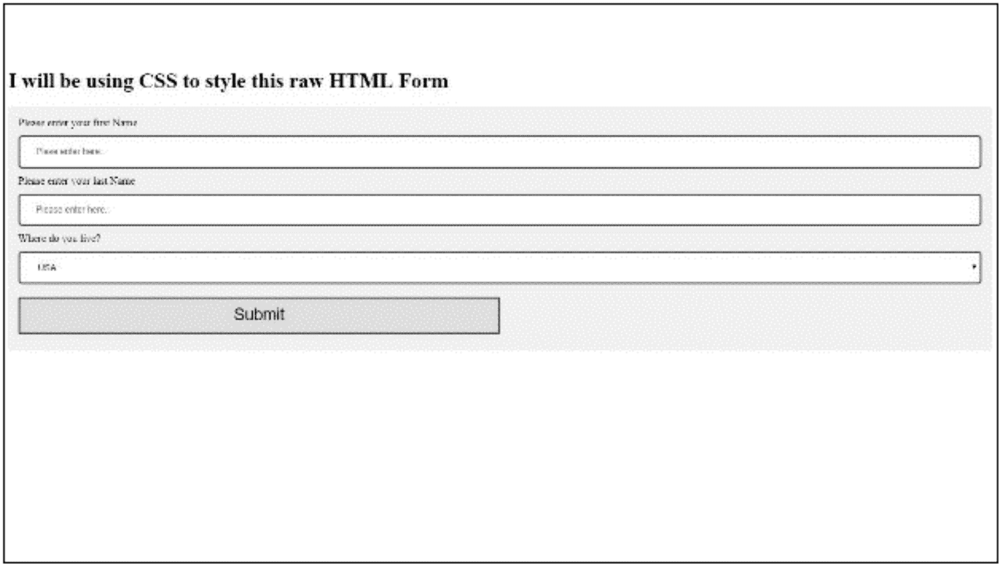

我设计了边框、输入字段、提交按钮等更多内容。让我们进一步学习如何设计按钮，因为它们是网页表单的重要组成部分。

```html
<!DOCTYPE html>
<html>
<head>
<style>
input[type=refresh], input[type=submit], input[type=process] {
```


```html
background-color: #4CAFBB;
border: 2px solid green;
color: white;
padding: 19px 34px;
text-decoration: none;
margin: 6px 4px;
cursor: pointer;
}
</style>
</head>
<body>
<h1>您正在查看样式化的输入按钮。</h1>
<input type="refresh" value="刷新">
<input type="process" value="处理">
<input type="submit" value="提交">
</body>
</html>
```

结果如下所示：

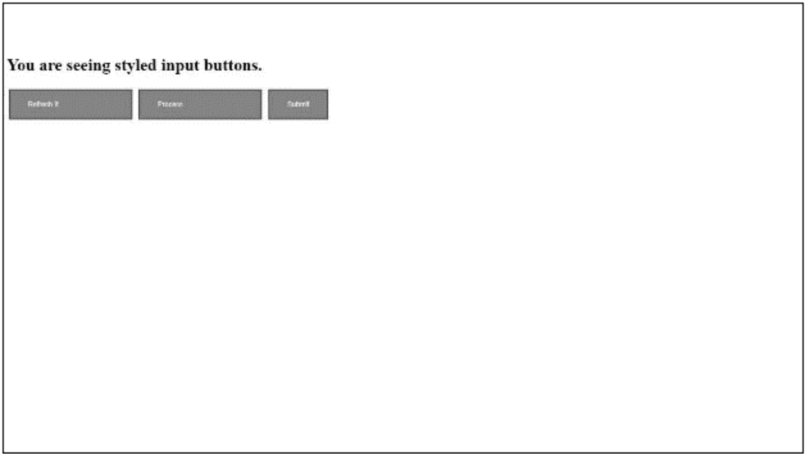

最后，让我们看一个完整表单的示例。

```html
<!DOCTYPE html>
<html>
<head>
<style>
* {
box-sizing: border-box;
}
input[type=text], select, textarea {
width: 50%;
padding: 8px;
border: 1px solid #bbb;
border-radius: 2px;
resize: vertical;
}
label {
padding: 10px 0;
display: inline-block;
}
input[type=submit] {
background-color: #4CAF50;
color: white;
padding: 10px 18px;
border: none;
border-radius: 4px;
cursor: pointer;
float: right;
}
input[type=submit]:hover {
background-color: #45a049;
}
.container {
border-radius: 7px;
background-color: #f2f2f2;
padding: 15px;
}
.col-25 {
float: left;
width: 50%;
margin-top: 4px;
}
.col-75 {
float: left;
width: 50%;
margin-top: 4px;
}
/* 清除浮动 */
.row:after {
content: "";
display: table;
clear: both;
}
/* 响应式布局 */
@media screen and (max-width: 400px) {
.col-25, .col-75, input[type=submit] {
width: 50%;
margin-top: 0;
}
}
</style>
</head>
<body>
<h2>这是一个响应式表单的示例</h2>
<p>您需要调整浏览器窗口大小才能看到效果。</p>
<div class="container">
<form action="/action_page.php">
<div class="row">
<div class="col-25">
<label for="nname">请输入您的名字</label>
</div>
<div class="col-75">
<input type="text" id="fname" name="firstname" placeholder="请在此输入...">
</div>
</div>
<div class="row">
<div class="col-25">
<label for="lname">请输入您的姓氏</label>
</div>
<div class="col-75">
<input type="text" id="lname" name="lastname" placeholder="请在此输入...">
</div>
</div>
<div class="row">
<div class="col-25">
<label for="country">请选择您的国家</label>
</div>
<div class="col-75">
<select id="country" name="country">
<option value="usa">美国</option>
<option value="canada">加拿大</option>
<option value="uk">英国</option>
</select>
</div>
</div>
<div class="row">
<div class="col-25">
<label for="bio">请在此输入您的个人简介。</label>
</div>
<div class="col-75">
<textarea id="bio" name="bio" placeholder="在此书写..." style="height:200px"></textarea>
</div>
</div>
<div class="row">
<input type="submit" value="提交">
</div>
</form>
</div>
</body>
</html>
```

您的表单将如下所示：

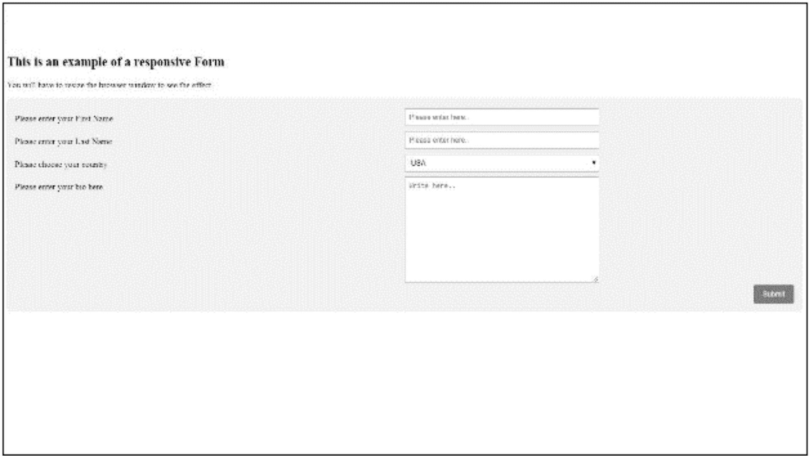

# 第 10 章 CSS 中的图像处理

您可以使用 `img` 标签向文档中添加图像，也可以为整个文档添加背景图像。

## 为网站设置背景图像

您可以使用 `body` 标签的 `background-image` 属性为整个页面设置背景图像。

```css
body { background-image: url('draft.gif'); }
```

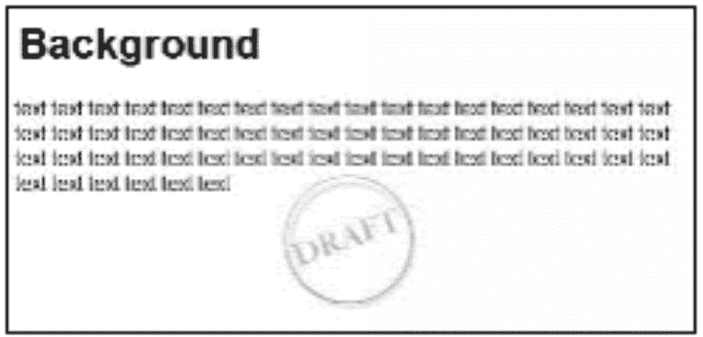

## 定位背景图像

使用 `background-position` 属性指定背景图像出现的位置。

```css
body {
background-image: url('draft.gif');
background-position: bottom right;
background-repeat: no-repeat;
}
```

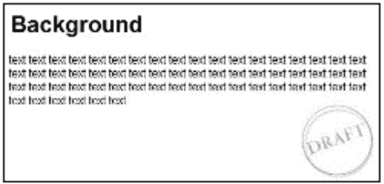

您可以将以下关键字组合与 `background-position` 属性一起使用：

| 关键字 | 关键字 | 关键字 |
| --- | --- | --- |
| 左上 | 中左 | 左下 |
| 中上 | 正中 | 中下 |
| 右上 | 中右 | 右下 |

这些关键字可以按任意顺序书写。例如，“top left”和“left top”都能正常工作。如果只指定一个值，另一个值将默认为 center。

您也可以使用百分比来设置位置。

`background-position: 30% 80%;`

如果要将图像定位在左上角，值为 `0% 0%`；`100% 100%` 则将其放置在右下角。将 `background-position` 设置为 `50% 50%` 会使图像居中，与 `center center` 效果相同。

以下列表显示了关键字设置与百分比设置的对应关系：

| 关键字 | 百分比 |
| --- | --- |
| 左上 | 0% 0% |
| 中上 | 50% 0% |
| 右上 | 100% 0% |
| 左中 | 0% 50% |
| 正中 | 50% 50% |
| 右中 | 100% 50% |
| 左下 | 0% 100% |
| 中下 | 50% 100% |
| 右下 | 100% 100% |

如果使用关键字或百分比，背景图像的位置会随窗口大小调整。您也可以使用像素来设置固定位置：

`background-position: 20px 20px;`

## 调整背景颜色或图像位置

您可以使用 `background-clip` 属性指定背景是否包含边框、内边距或仅包含内容区域。

| 示例 | 图片 |
| --- | --- |
| `div {padding:10px;border: 5px dotted #000;background-color: #f00;background-clip:border-box;}` | 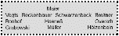 |
| `div {padding:10px;border: 5px dotted #000;background-color: #f00;background-clip:padding-box;}` | 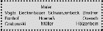 |
| `div {padding:10px;border: 5px dotted #000;background-color: #f00;background-clip:content-box;}` | 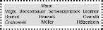 |

## 为背景添加多个图像

使用 CSS3，您可以指定多个背景图像。如果需要支持旧版浏览器，可以在 `html` 标签中指定一个背景图像，在 `body` 标签中指定另一个。

### CSS 方法

```css
body {
background-image: url('logo.gif'), url('draft.gif');
background-position: bottom right, 50% 50%; 
background-repeat: no-repeat;
}
```

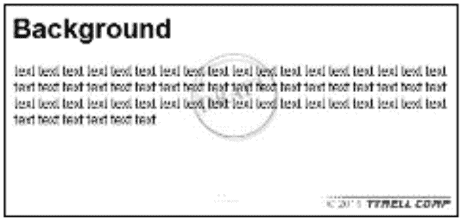

### 旧版浏览器方法

```css
html {
background-image: url('logo.gif');
background-position: bottom right;
background-repeat: no-repeat;
}
body {
background-attachment: fixed;
background-image: url('draft.gif');
background-position: 50% 50%;
background-repeat: no-repeat;
}
```

## 固定背景图像以避免滚动

您可以使用 `background-attachment` 属性将图像固定，防止其随页面其余内容滚动。

```css
body {
background-attachment: fixed;
background-image: url('draft.gif');
background-position: 50% 50%;
background-repeat: no-repeat;
}
```

| 值 | 描述 |
| --- | --- |
| `repeat` | 背景在水平和垂直方向重复。这是默认设置。 |
| `repeat-x` | 背景在水平方向重复，但垂直方向不重复。 |
| `repeat-y` | 背景在垂直方向重复，但水平方向不重复。 |
| `no-repeat` | 背景在水平和垂直方向均不重复。 |

## 如何调整背景图像大小以适配元素？

您可以使用 `background-size` 属性自动调整背景图像的大小，使其适配更大或更小的元素。

| 值 | 描述 |
| --- | --- |
| `contain` | 缩放图像，使高度和宽度都适合元素 |
| `cover` | 缩放图像，使高度或宽度（取较小者）适合元素 |
| `length` | 设置高度和宽度。如果只指定一个值，图像将按比例缩放。 |
| `percentage` | 将高度和宽度设置为父元素的百分比。如果只指定一个值，图像将按比例缩放。 |

## 为图像添加阴影

您可以使用 `box-shadow` 属性为图像添加阴影。

`img { box-shadow: 5px 5px 10px 10px #f00; }`

您可以为阴影指定以下选项：

| 值 | 描述 |
| --- | --- |
| `blur` | 阴影边缘的模糊量（以像素为单位） |
| `color` | 阴影的颜色 |
| `offset-x` | 阴影的水平偏移量（以像素为单位） |
| `offset-y` | 阴影的垂直偏移量（以像素为单位） |
| `inset` | 指定内阴影 |
| `spread` | 阴影的大小（以像素为单位）。0 – 阴影与元素大小相同 |

## 使用图像作为边框

您可以使用 `border-image` 属性将图像用作元素的边框。

`border-image:url(diamond.png) 20 20 round;`

以下属性可用于为元素的不同边指定边框图像：

- `border-top-image`
- `border-right-image`
- `border-bottom-image`
- `border-left-image`

| 值 | 描述 |
| --- | --- |
| `border-image-source` | 图像的路径 |
| `border-image-slice` | 图像的高度和宽度偏移 |
| `border-image-width` | 图像的宽度 |
| `border-image-outset` | 图像的高度 |
| `border-image-repeat` | 图像应重复还是拉伸 |

## 将文本环绕在图像周围

你可以使用 `float` 属性将文本环绕在图像周围。

### CSS 规则

```css
.caution {
  float: left;
  margin-right: 10px;
}
```

### 用法

```html
<p>
caution caution caution</p>
```

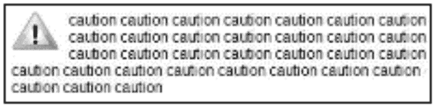

`margin-left` 属性可用于在图像和文本之间添加间距。

## 将文本放置在图像上方

你可以为 `position`、`top` 和 `left` 属性分配负值，以将文本定位在图像上方。如果版本位于图片下方，将其 `top` 属性设置为负值会将文本移动到图片上方。

### CSS 规则

```css
.overlap {
  position: relative;
  top: -200px;
  left: 180px;
  color: #ffffff;
}
```

### 用法

```html

<p class="overlap">floating text</p>
```

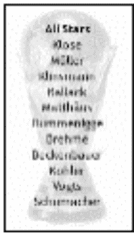

## 为图像添加边框

边框最常用于表格，但你也可以使用 `border` 属性为图像添加边框。

```css
img {
  border-width: 3px;
  border-style: solid;
  border-color: #000000;
}
```

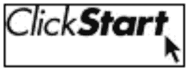

你也可以使用 CSS 简写来指定边框：

```css
img { border: 1px solid #000000; }
```

上面的示例将为所有图像添加边框。如果你只想将边框应用于指定的图像，可以创建一个类。

```css
.imgBorder { border: 1px solid #000000; }
```

```html

```

或者，你可以将边框应用于 `div` 标签内的所有图像：

### CSS 规则

```css
#menuBar img { border: 1px solid #000000; }
```

### 用法

```html
<div id=“menuBar”></div>
```

## 为图像添加投影

你可以使用 Internet Explorer 的 `filter` 属性为图像添加投影。

```css
img {
  filter: progid:DXImageTransform.Microsoft.dropShadow (offX='3', offY='5', color='#c0c0c0', positive='true');
}
```

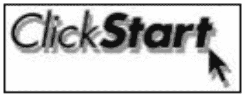

`filter` 属性由 Microsoft 创建，并非 CSS 推荐标准的一部分。它仅受 Internet Explorer 支持。

有关 Internet Explorer 滤镜的更多信息，请参阅“如何使用 Internet Explorer 的滤镜？”

对于其他浏览器，可以使用 `box-shadow` 属性为图像添加投影。但是，它不会在透明图像内部添加投影。

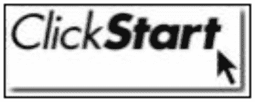

另一种选择是使用 HTML5 的 `canvas` 元素。有关示例，请参见以下网站：[philip.html5.org/demos/canvas/shadows/various.html](http://philip.html5.org/demos/canvas/shadows/various.html)

## 使图像透明

也可以使用 `opacity` 属性使图像透明。对于 Internet Explorer，你可以使用 IE 特有的 `alpha` 滤镜。

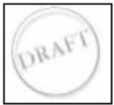

```css
img {
  filter:alpha(opacity=50);
  opacity:.50;
}
```

## 移除图像链接的边框

你可以将图像的 `border` 属性设置为“0”，以移除默认情况下出现在图像链接周围的边框。

```css
img { border: 0; }
```

## 如何在用户悬停时缩放图像？

你可以使用 `hover` 伪类来更改图像的 `width` 和 `height`。

首先，在图像周围包裹一个链接：

```html
<a href="javascript:void(0);">
  
</a>
```

然后，当用户悬停在图像链接上时，指定图像的 `width` 和 `height`：


```css
a:hover img { width: 800px; height: 400px; }
```

在此示例中，当用户悬停在图像上时，图像将扩展到 800x400，当鼠标移开图像时，它将恢复为原始大小。

## 使图像在悬停时展开

你可以使用`transition`属性使图像在用户悬停时展开，在失去焦点时缩小。例如，你可以提供一个图像的“缩略图”，当用户悬停时展开为完整大小。

### CSS 规则

```css
.thumbTrans {
  width: 50px;
  height: 50px;
  -moz-transition-property: width,height;
  -moz-transition-duration: 4s;
  -moz-transition-delay: 1s;
  -webkit-transition-property: width,height;
  -webkit-transition-duration: 4s;
  -webkit-transition-delay: 1s;
  -o-transition-property: width,height;
  -o-transition-duration: 4s;
  -o-transition-delay: 1s;
  transition-property: width,height;
  transition-duration: 4s;
  transition-delay: 1s;
}

.thumbTrans:hover {
  width: 100%;
  height: 100%;
  -moz-transition-property: width,height;
  -moz-transition-duration: 4s;
  -moz-transition-delay: 1s;
  -webkit-transition-property: width,height;
  -webkit-transition-duration: 4s;
  -webkit-transition-delay: 1s;
  -o-transition-property: width,height;
  -o-transition-duration: 4s;
  -o-transition-delay: 1s;
  transition-property: width,height;
  transition-duration: 4s;
  transition-delay: 1s;
}
```

## 使图像在悬停时“弹出”

你可以使用`hover`伪类来旋转图像并添加阴影。

```css
img:hover {
  box-shadow:1px 2px 5px #666666;
  -moz-transform:rotate(5deg) scale(1.5);
  -webkit-transform:rotate(5deg) scale(1.5);
  transform:rotate(5deg) scale(1.5);
}
```


## 使用 CSS 插入内容

也可以使用`content`属性在元素之前或之后插入内容。

要在页面顶部或底部插入内容：

```css
body:before {
  content: "Confidential";
  font-weight: bold;
}

body:after {
  content: "\000A Copyright 2012";
}
```

要在元素之前插入内容：

```css
h1:before {
  content: ">> ";
  color: silver;
}
```

要在元素前后添加引号：

```css
p.quotes:before { content: open-quote; }
p.quotes:after { content: close-quote; }
```

要添加花括号引号：

```css
p.boldCurlyQuotes { quotes: "\201C" "\201D"; }
p.boldCurlyQuotes:before { content: open-quote; }
p.boldCurlyQuotes:after { content: close-quote; }
```

下表提供了可使用`content`属性插入的常用字符的 Unicode 值。

| 符号 | 描述 | Unicode 值 |
| --- | --- | --- |
| `"` | 双引号 | `0022` |
| `'` | 单引号（撇号） | `0027` |
| `“` | 左双花括号引号 | `201C` |
| `”` | 右双花括号引号 | `201D` |
| `<` | 左单尖括号引号 | `003C` |
| `>` | 右单尖括号引号 | `003E` |
| `«` | 左双尖括号引号 | `00AB` |
| `»` | 右双尖括号引号 | `00BB` |
| `` ` `` | 重音符 | `0060` |
| `´` | 尖音符 | `00B4` |

# 第 11 章 长度单位

当你跟随本教程时，可能已经注意到，在使用 CSS 更改文本大小时，有多种选项。

你可以在 TopStyle 中亲自查看。

创建一个新的样式表，然后单击“新建选择器”按钮。选择“简单”选项卡，并从 HTML 元素列表中选择`h1`。接下来单击“添加”按钮，然后点击“确定”。

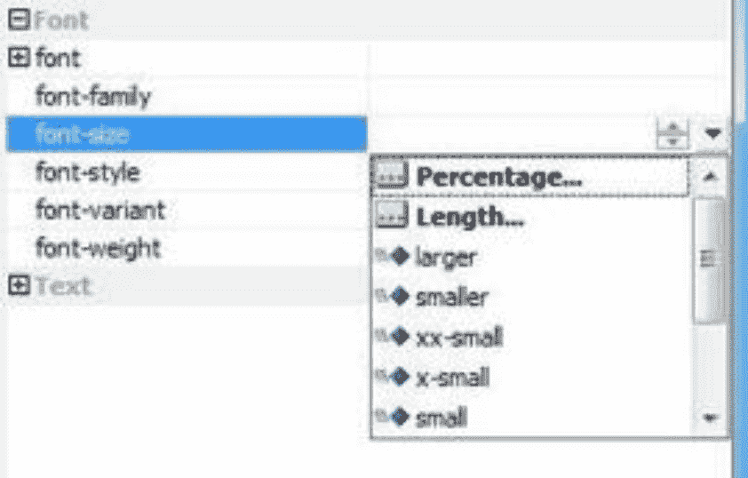

在样式检查器中，向下滚动到字体类别，并单击`font-size`属性。单击此行右侧的下拉箭头以查看可用选项。

在本书中，我们将重点介绍此列表中的前两项——百分比和长度。

百分比是相对度量（即，它定义了一个相对于另一个尺寸的大小）。

长度是绝对度量，因为它定义了精确的尺寸。然而，精确的度量需要单位。

绝对度量的单位是什么？

好吧，让我们来了解一下。单击`font-size`下拉箭头，然后选择长度。

另一个对话框打开，其中包含另一个下拉框（默认设置为`'px'`）。

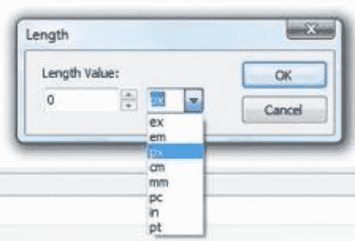

单击该下拉框的下拉箭头，你将看到更多选项：

哇！这么多不同的单位。

这些单位可以分为两组：

1. 相对单位（大小与某物可比）
2. 绝对单位（大小是精确度量）

“相对”单位包括：

- `ex`
- `em`
- `px`

（百分比单位也是相对的）。

“绝对”单位包括：

- `cm`
- `mm`
- `pc`
- `in`
- `pt`

使用绝对单位的主要目的是冻结网页的设计，使其无论以何种方式查看，外观始终如一。

当使用相对度量时，网页设计可能会因用户浏览器设置的不同而呈现差异。

让我们来看一个例子。

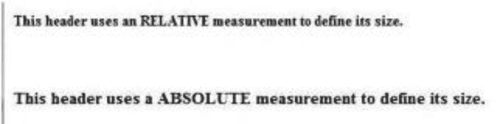

这里有两个标题，一个用绝对单位定义，另一个用相对单位定义。

旧版浏览器曾允许用户更改浏览器中的字体大小，选项包括：

- 最大
- 较大
- 中
- 较小
- 最小

问题在于，任何用绝对单位定义的字体大小都不会增大，因为它是用固定度量设置的，因此在屏幕上始终显示相同的大小。而用相对单位定义的字体大小则会增大。

如果你将字体大小改为“最大”，你会看到相对标题的尺寸增大，而绝对标题则保持不变。

在某种程度上，浏览器已经削弱了绝对度量的功能，因为它们引入了缩放功能，而不是字体大小功能。这会同等程度地放大所有文本（无论是绝对还是相对），从而打乱了一些网页设计师精心设计的布局。

好了，让我们来考虑一下度量单位及其含义。

五种绝对度量如下：

1. `cm` - 厘米
2. `mm` - 毫米
3. `in` - 英寸
4. `pc` - 派卡（1/6 英寸或 12 点）
5. `pt` - 点（1/72 英寸）

需要注意的是，即使绝对度量在具有新缩放功能的浏览器中能正常工作，也只有当浏览器知道屏幕尺寸以及屏幕显示的像素数时，才能按预期工作。在许多情况下，浏览器不得不进行猜测！再加上最近增加的缩放功能，这意味着绝对度量在设计页面时并非最佳单位，因此我们不会深入研究它们。

不过，在本书中提到绝对度量很重要，因为我确信你在探索自己（或他人）网页的 CSS 时一定会遇到它们。

因此，相对度量为我们提供了最佳解决方案，尤其是当我们不知道最终用户会用什么设备查看网站时。例如，如今他们可能用电脑、平板、智能手机甚至某些电子阅读器浏览。使用相对度量，字体大小将与屏幕尺寸成比例，从而为用户提供最佳的浏览体验。

以下是相对度量的详细介绍：

## EX

`ex`是一个相对于字体小写字母`x`大小的度量。我从未使用过这个度量，因此本书不会涉及。

## PX

`px`是屏幕像素的相对度量。

像素为设计师提供了对布局的最佳控制。你会看到它们常用于边框、边距、内边距，以及在创建无表格的 CSS 布局时用于屏幕区域的高度和宽度。

但不推荐将像素用于文本大小。大多数现代浏览器没有问题，但一些旧版浏览器无法调整基于像素的文本大小。

## 百分比

百分比度量总是相对于另一个值。例如，如果我们想增加段落行间距，可以定义`line-height`为百分比（它是字体大小的百分比）。

假设我们有：`line-height: 150%`。这将创建行间距为字体大小的 150%。因此，如果字体大小为`10px`，那么行间距就是`15px`。如果使用百分比，明智的做法是在 CSS 文件中定义`font-size`，否则不同浏览器的结果可能不可预测。这是因为`font-size`会取自浏览器的默认 CSS 文件。

以下是一个使用百分比显示行间距的例子：

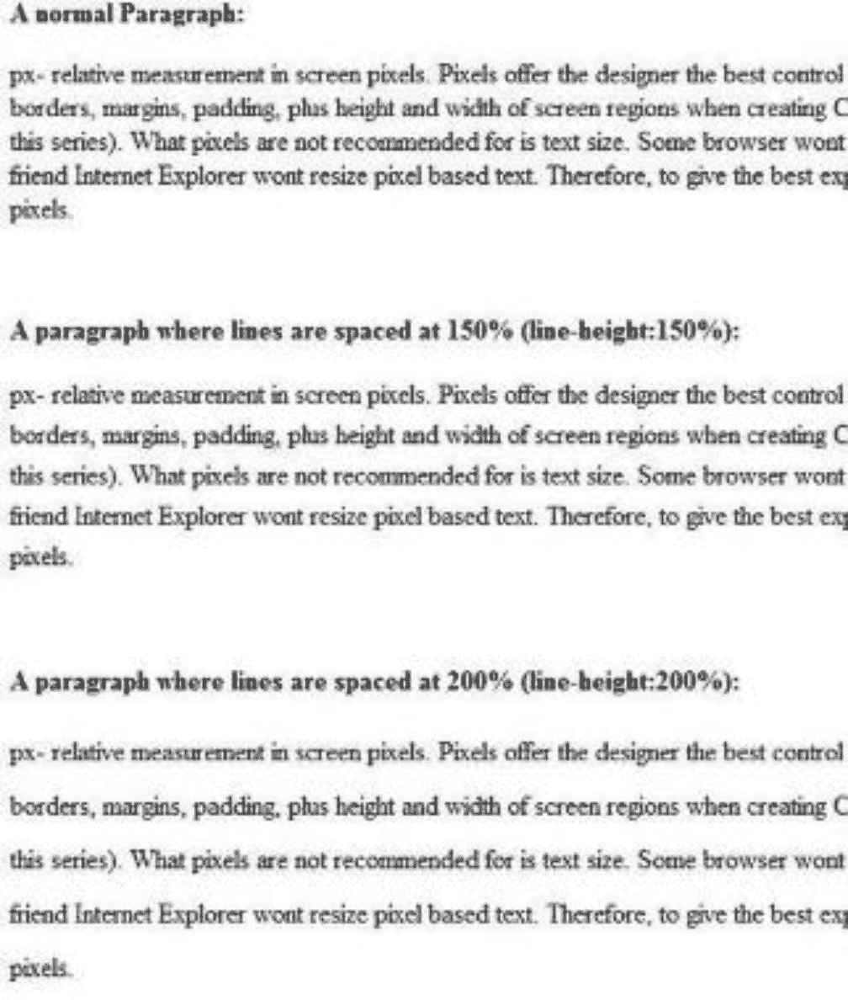

（9.1.html 和 9.1.css）

## EM

`em`是字体大小的相对度量。你可以把它想象成大写字母“M”的大小来帮助记忆，虽然这并不完全准确，但这是一个极好的记忆方法。

这是我定义文本大小的首选单位。因为它是一个相对于字体大小的度量，如果我们设置`font-size`为`10px`，那么`1 em`就等于`10px`。`2 em`相当于`20px`，`1.5 em`相当于`15px`。

为了尽可能简单，最好在样式表中按如下方式定义字体大小：

创建一个新的样式表。

点击“新建选择器”按钮，然后转到“简单”选项卡。

从 HTML 元素列表中选择`body`，然后点击“添加”按钮，接着点击“确定”。

你会在样式表中看到以下内容：

```
body {

}
```

你输入的任何属性都将成为页面中位于`<body></body>`标签之间的所有元素的默认属性，即所有内容。

我可以像这样定义一个默认的`font-size`：

```
body { font-size: 11px; }
```

这将使默认字体大小为`11px`。以下是一个以这种方式定义默认文本大小的网页：

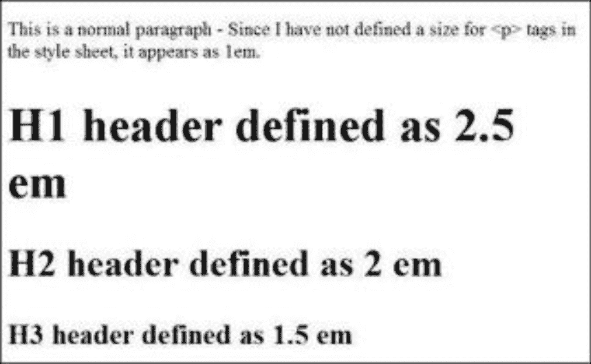

（9.2.html 和 9.2.css）

在一些旧版浏览器中，如果你选择更大的字体大小，这些大小将保持不变，因为我们定义了默认字体为`20px`——这是一个绝对度量。然而，由于大多数浏览器现在使用缩放功能，这个问题已不像过去那么严重。不过，为了安全起见，我们最好这样定义默认的`font-size`：

```
body { font-size: 0.7em; }
```

这将使默认文本大小为默认文本大小的 70%。那么默认文本大小到底是多少呢？

每个浏览器都有自己的默认 CSS 用于显示网页。如果你想看看不同浏览器中该大小是什么样子，可以创建一个样式表，将 body 文本大小设置为`1em`。

```
body { font-size: 1.0em; }
```

然后创建一个包含一些文本的网页，使用该样式表，并在几个不同的浏览器中查看，或者直接查看 9.3.html 和 9.3.css，我已经为你做好了。

这里有一篇关于使用`em`调整文本大小的优秀文章。Richard Rutter 使用百分比而不是`em`来定义默认的`font-size`：

[`clagnut.com/blog/348`](http://clagnut.com/blog/348)

# 第 12 章 CSS ID 和类

ID 选择器只能（或应该）在网页上使用一次，用于标识页面上的一个项目。

通过使用 ID 选择器引用页面上的两个图像，我违反了 CSS 规则。我应该使用 CLASS 代替。

ID 选择器和类的作用基本相同，但是，ID 在页面上只能使用一次，而类可以多次使用。

在我们讨论类之前，让我给你一个简单的方法来记住这一点：

你的 ID 指的是你，而且只指你一个人。没有其他人可以拥有你的 ID。

类是一群人，因此一个类可以指代多个个体。

因此，ID 只使用一次，而类可以多次使用。

出于这个原因，我们将 ID 用于只出现一次的页面元素，例如，当我们使用 CSS 进行页面布局时，我们会为页面头部区域、左右边距、主要内容区域和页脚定义 ID。这些是显而易见的选择，因为每个区域每页只出现一次。

当我们想要在页面上多次重用某个样式时，我们会使用类，例如图像对齐、字体样式和项目符号等。

好了，我们知道 ID 和类可以用来覆盖默认的显示属性，但我们还没有了解如何创建或使用它们。现在让我们来看看，这样你就可以开始在页面设计中使用它们了。

## ID 选择器

启动 TopStyle，点击“新建选择器”按钮。

切换到“高级”选项卡，你会看到一对单选按钮（也称为选项按钮），标记为“类”和“ID”。

选择 ID，然后在单选按钮下方的框中为你的 ID 输入一个名称。我输入了`"logo"`作为我的 ID，因为我将创建这个 ID 并应用于页面上的徽标（它只出现一次）。

你会注意到，在输入时，TopStyle 会在你的 ID 开头添加一个`#`。点击`"添加"`按钮（位于单选按钮上方），然后点击右下角的`"确定"`按钮。这样就会将这个选择器添加到你的样式表中。

在样式表中，`#`符号表示后面跟着的是一个 ID。这是我的样式：

```
#logo {

}
```

现在，你可以像我们在其他示例中那样，以完全相同的方式向 ID 添加一些样式。我给我的 ID 添加了一些样式，以下是完成的徽标 ID：

```
#logo {
font-size: 3em;
font-variant: small-caps;
font-weight: bolder;
background-color: Silver;
font-family: Verdana, Geneva, Arial, Helvetica, sans-serif;
}
```

这个 ID 的目的是更改页面徽标区域的文本属性，使其更加突出（`"em"`是一个度量单位）。我的示例使用了小型大写字母、粗体、银色背景，以及 Verdana、Geneva……字体族。你可能从样式表中已经看出来了，对吧？

你可以在这里看到它对页面产生的效果：

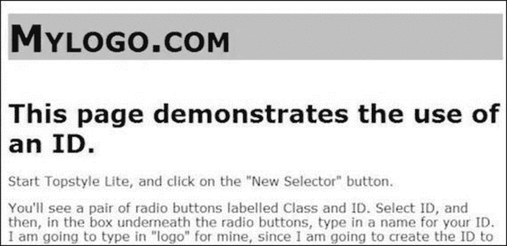

（8.1.html 和 8.1.css）

要在网页中使用这个 ID，只需修改 HTML 标签，包含：

`ID = "logo"`

以下是修改前的 HTML 代码：

`<p>Mylogo.com</p>`

在第一个右尖括号`">"`之前，插入你的 ID 代码：

`<p ID="logo">Mylogo.com</p>`

现在，`<p></p>`标签内的任何内容都将根据 ID`"logo"`的属性进行格式化。

你会注意到，在原始 HTML 中，文本除了首字母`"M"`外都是小写。而在网页预览（上方）中，文字显示为小型大写字母。这就是我们添加属性`font-variant: small-caps;`的效果。

类的使用方式非常相似，现在我们来看看：

## 类选择器

创建一个新的样式表，点击`"新建选择器"`按钮。再次进入`"高级"`选项卡，点击`"类"`单选按钮。在单选按钮下方为你的类输入一个名称。我使用的是`"yellowhighlight"`，因为这就是我的类要做的——即，将某些文本高亮为黄色。

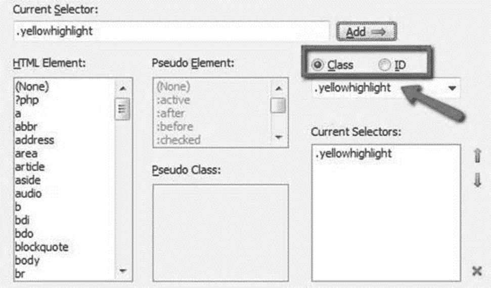

你会注意到，在输入时，TopStyle 会在你输入的文本前面添加一个`"."`。在 CSS 中，这个`"."`表示后面跟着的是一个类。

好了，完成后点击`"添加"`按钮，然后点击`"确定"`保存对样式表的更改。

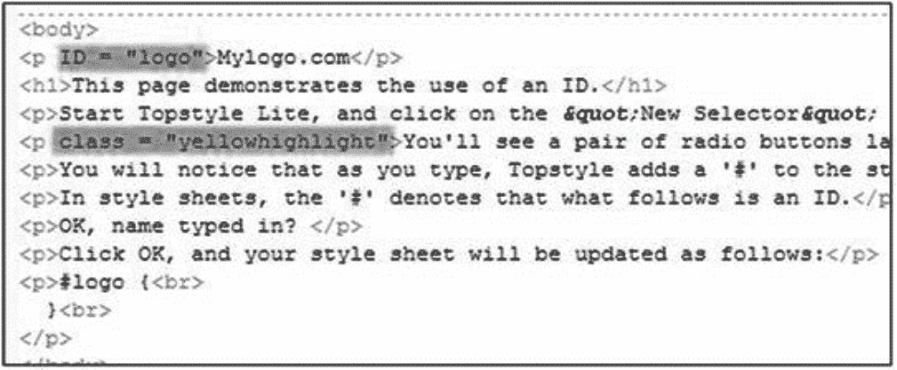

这是我的样式：

```
.yellowhighlight {

}
```

我只对背景颜色做一个样式更改：

```
.yellowhighlight { background-color: Yellow; }
```

现在，我只需在要更改的段落的 HTML 标签中添加以下代码，就可以将段落高亮为黄色：

`class="yellowhighlight"`

我们以与之前添加 ID 完全相同的方式添加它。将其插入到`<p>`标签的第一个`">"`之后。

以下是 HTML 代码：

`<p class="yellowhighlight">段落内容写在这里</p>`

现在看看这个页面：

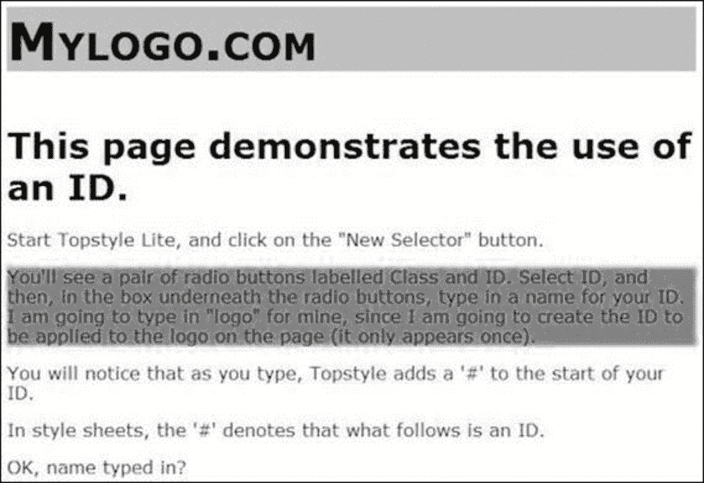

（8.2.html 和 8.2.css）

第二个段落现在被高亮为黄色。注意`<p>`标签是如何从`<p>`修改为`<p class = "yellowhighlight">`的：

以下是 HTML 代码。

因为我使用类来定义高亮，所以如果需要，我可以轻松地在多个段落上使用它：

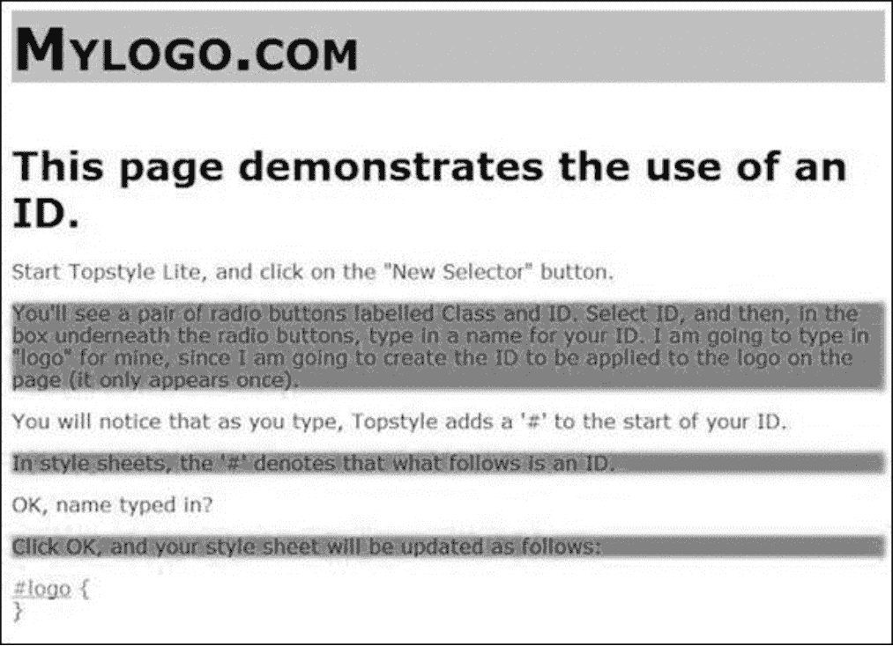

（8.3.html 和 8.3.css）

识别和使用类就是这么简单。

不过，在结束这个话题之前，我听到你在问：“但如果我们只想高亮段落中的某些文本，而不是整个段落呢？”

嗯，问题在于我们目前使用类的方式是修改整个 HTML 标签（整个段落），因为我们在`<p>`标签内声明了类。

然而，还有另一种选择。你可以使用`span`标签来包围一段选中的文本，并仅将类应用于被`span`包围的文本。要做到这一点，你需要用`<span></span>`标签包围你想要高亮的文本。让我们看一个例子：


`<p>我只想高亮 <span>这段文本</span> 这里。</p>`

现在，我们可以在开头的 `<span>` 标签内、`">"` 之前添加类，就像你之前在其他标签中看到的那样：

`<p>我只想高亮 <span class="yellowhighlight">这段文本 </span> 这里。</p>`

这是它在网页上的实际效果：


（8.4.html 和 8.4.css）

这是 CSS 课程中不可或缺的一部分，其中包含一些重要的知识点。我们学习了如何使用 ID 和类来修改网页元素，虽然关于类还有更多内容要讲，但我们现在先休息一下。

# 第 13 章 CSS 中的盒模型

CSS 布局的基础是盒模型，因为它决定了元素的显示方式以及它们之间的相互关系。将页面上的每个元素想象成一个矩形盒子。每个盒子都有特定的尺寸，并占据特定的空间。盒子所占的空间取决于其中的内容，以及内容周围的边距和内边距边框：


因此，盒模型决定了每个元素在页面上所占的空间大小。现在，让我们通过回顾构成 CSS 盒模型的主要组成部分，更深入地探讨这个概念。开始将页面上的每个 HTML 组件视为一个盒子。实际上，你可以应用一个全局样式规则，为页面上的所有元素添加红色轮廓。为此，只需在样式表顶部添加以下样式规则：

```
* {
outline: 2px solid red;
}
```

这将为页面上的所有元素添加轮廓，让我们可以轻松地将每个项目视为一个盒子：


每个元素都被设计成一个盒子或矩形。现在，要有效理解 CSS 盒模型的概念，我们必须了解元素可以显示的两种方式。每个细节都有一个显示属性，取决于它是什么类型的元素。大多数元素的默认值是内联或块级。块级元素由一个独立的块组成，必须占据可用的全部宽度。块级元素的几个例子包括：列表项、段落、`div` 和任何标题标签。

你可以观察到页面上的块级 `div`，以及列表和标题，它们都占据了一整行内容。它们还会在下一个元素之前和之后强制换行。另外，内联元素只占据它们所需的宽度。它们不强制换行，并且与其余文本保持在同一行。内联元素的几个例子包括：图像、锚元素和 `span` 标签。

在标题 `span` 元素中，注意它的宽度只消耗了其文本的空间，而它之所以显示在自己的行上，是因为下面有一个块级 `h1` 元素。块级 `h1` 强制了换行。现在，让我们检查边距、边框和内边距如何相互作用形成一个盒子，因为理解这一点至关重要。盒模型由四个不同的部分组成。


盒子的核心部分和最内层区域是内容区域。这是包含元素实际内容（如图像或文本）的区域。围绕文本区域的是内边距区域。内边距用于给元素一些呼吸空间。盒子的下一个最外层部分称为边框区域。可以将其视为盒模型的轮廓。边框有多种样式，如粗细和颜色。最后，边距区域位于盒子外部。这是元素周围的空间，用于将其与其他组件隔离开来。

内边距区域在盒子内部创造空间，而外边距区域则在盒子外部和周围创造空间。想象你有一个装满易碎物品的纸板箱，但你在它周围包裹了气泡膜来缓冲冲击。盒模型中的内边距类似于气泡膜，因为它被添加在盒子内部。Google Chrome 开发者工具为页面上的每个元素提供了非常清晰的盒模型视图。如果你点击“查看”>“开发者”>“开发者工具”：


它会在页面底部显示 Chrome 开发者工具面板：


打开开发者工具面板后，在左侧的“元素”选项卡中，展开 `header` 元素并点击 `h1` 元素。这将是 Chrome 开发者工具中选中的元素，你会看到页面上的 `h1` 被高亮显示：


选中 `h1` 元素后，你可以增大右侧“样式”选项卡的宽度，并向下滚动直到看到 `h1` 的盒模型：


从上面的截图可以看出，`h1` 元素的盒模型清晰可见。它的顶部和底部有默认的外边距，没有边框或内边距。希望这能让你更好地理解页面上的每个元素是如何表示的，以及它们如何根据显示类型相互交互。

# 第 14 章 逐步将 CSS 添加到 HTML 文档

## 将 CSS 添加到 HTML 文档的三种方式

你可能从 HTML 知识中记得，有三种方式可以将 CSS 添加到 HTML 文档中：作为内联样式、作为内部样式以及作为外部样式表的链接。在本书中，将使用内部样式方法，因为它更容易在学习目的下演示 CSS 如何在单个屏幕窗口中与 HTML 关联，并且使用简短经济的代码片段。然而，通常你会希望使用外部样式表中的 CSS 脚本，因为这是普遍推荐的方法。此外，为了视觉清晰，许多冗余元素将被省略，例如 `<!DOCTYPE html>`、`<html>` 和 `<body>`。只需假设，如果这些示例用在真实网页上，你会拥有所有必要的元素。

为了回顾，让我们提醒自己每种将 CSS 添加到 HTML 文档的方式的语法和方法。

## 内联样式

内联 CSS 出现在 HTML 开始标签内，其中 `style` 是一个全局属性，可以被任何 HTML 元素使用。任何应用的 `style` 属性的值是一个在引号内声明的 `property:value` 对，通过赋值运算符等号 `=` 附加到属性上。每个 `property:value` 对应以分号结尾，同样，当组合多个内联样式时，每个属性：值对之间应用分号分隔。

在层叠样式表出现之前，需要单独为每个 HTML 元素设置样式，工作量巨大。之后任何样式的更改都意味着每个应用了该样式的元素都必须手动调整。以下是内联 CSS 作为 HTML 文本文件一部分的示例：

`<h1 style="color:red; font-style:italic; font-weight:100;">红色标题排版</h1>`


上面应用了三种样式，使字体颜色为红色，样式为斜体，字重为 100（在从 100 到 900 的 9 级刻度上——注意并非所有字体都支持所有九个可用的 CSS 字重）。

## 内部样式

使用内部 CSS 时，样式被放置在 HTML 文档的 `<head>` 部分中，该部分始终位于 `<body>` 部分之上，你应该还记得。这种方法对整个 HTML 文档（即单个网页）是内部的，而不是特定于单个元素，这就是为什么它被称为内部样式。CSS 在 `<style>` HTML 开始和结束标签内应用，而不是在 `style` 属性声明中，并以标准 CSS 格式声明。基本的 CSS 语法是：

```
s ​{
​property : value;
​property: value;
​}
```

上面的“s”代表“选择器”，它是任何 HTML 元素（在此上下文中，“s”不是表示“删除线”的 HTML 标签！）。使用内部 CSS 时，`property:value` 对在大括号 `{ }` 内声明，而不是在引号内。`property:value` 对与大括号一起构成了 CSS 中的声明。从高层次来看，语法结构可以理解为：

```
选择器 {声明}  {声明}  {声明}
选择器 {声明}  {声明}
```

而每个声明又由以下组成：

```
{property:value; property:value; property:value;}
{property:value; property:value;}
```

等等。

一个选择器及其声明一起构成一个规则集：

`规则集 = 选择器 {声明}`

为了将这个语法放在一个典型示例中，让我们看看应用于单个选择器的多个声明的使用。注意，有时声明的顺序对视觉结果没有影响，但在其他情况下顺序确实有影响。

```
<style>
h2 {
text-align: center;
font-family: cursive;
color: orange;
}
</style>
```

```
<h2>
嗨，我被样式化了。
</h2>
```


对 `<h2>` 选择器的多个声明。

与内联 CSS 在同一行上逐个声明样式不同，使用内部 CSS 时，每个样式声明都开始新的一行，并以分号结束。即使最后一个声明也必须始终以分号结束，因为以后你或其他设计人员可能会添加新样式，而可能没有意识到代码中缺少分号，这会在渲染样式时导致错误。

下面的代码是我们在内联示例中应用的相同样式的内部 CSS 版本。CSS 现在位于大括号内，大括号位于 `<style>` 标签内，而 `<style>` 标签位于 `<head>` 部分内。CSS 首先在头部（在 body 之前）应用，因为浏览器会线性解析代码。这样，浏览器不会先加载一个未设置样式的页面版本，然后再重新设置所有样式——如果将内部 CSS 放在 `.html` 文件的底部就会发生这种情况。相反，浏览器首先在 `<head>` 中获取所需的样式信息，然后所有后续的 HTML 内容都以从内部样式声明中首先解析的样式进行渲染。

```
<head>
<style>
h1 {
color: red;
font-style: italic;
font-weight: 100;
}
</style>
</head>
<h1>红色标题排版</h1>
```


## 外部样式表

完善的样式由许多行代码组成，因此通常不切实际地在 `.html` 文档的 `<head>` 区域内创建太多作为内部 CSS 的样式语句。相反，CSS 代码通常放在具有 `.css` 文件扩展名的独立文本文件中。然后通过 `<link>` 元素在 `.html` 文档的 `<head>` 中链接这个外部样式。这个指向外部 `.css` 文件的链接将指示浏览器在继续加载和样式化后续 HTML 内容之前，先从外部文件获取样式信息。当使用代码编辑器编写 CSS 文件时，请确保将文件的语法设置为 CSS，尽管许多编辑器会自动检测你正在编写的语言。保存文件时，请确保它具有 `.css` 文件扩展名，以便浏览器可以将其用作样式表。

```
<html>
<head>
<link rel="stylesheet" href="css.css" type="text/css">
</head>
<body>
</body>
</html>
```

上面，我们定义了 `.html` 文档与外部资源之间的关系（`<link>` 中的 `rel` 属性）为样式表关系。定位外部样式表的 URL 是一个相对 URL 路径——在此示例中，CSS 文件与 `index.html` 文档位于同一目录。随着网站变得复杂，你最终会希望将 CSS 源代码文件放在各自的目录或文件夹中，此时 `href` 中的 URL 可能变为 `"CSS/css.css"` 或 `"scripts/css.css"` 等。这些正斜杠表示 `.css` 文件位于名为 `"CSS"` 或 `"scripts"` 的目录内，并且这些目录与 `.html` 文件位于同一目录。最后，样式表的媒体类型通过 `type` 属性声明。CSS 与所有源代码一样，始终只是一个文本文件，但不同于文本文件通常使用的 `.txt` 扩展名，这里使用 `.css` 以便浏览器知道要将代码解析为包含样式信息的内容。


将 `.css` 文件放在与 `.html` 文件相同的目录中，或者放在 `scripts` 目录中。`href` 属性的值必须指定查找外部样式文档所需的路径。

# 第 15 章 JavaScript 简介

HTML 用于开发网页，而网页可以成为定义页面内容的复杂文档。使用 HTML 制作的材料可以添加 CSS，并通过不同方式实现，例如附加背景颜色、更改字体大小、图像大小、字体、阴影、颜色强度等。HTML 和 CSS 可用于实现网页的静态美观。借助 JavaScript，你可以通过 JavaScript 效果（如表单验证、模态框、滑块、弹出窗口等）为网页注入活力。使用 HTML、CSS 和 JavaScript 开发网页或应用程序的实践称为前端开发，它增强了用户与网页的交互。JavaScript 是一种构建良好的客户端脚本语言。JavaScript 也常用于移动和游戏应用程序开发。

## JavaScript 简史

- 1995 年：在 Netscape 工作期间，Brendan Eich 创建了 "LiveScript"，后来更名为 "JavaScript"。
- 1996 年：微软发布了 JavaScript 的一个移植版本，用于 IE3。
- 1997 年：JavaScript 在 "ECMAScript" 规范中实现标准化。
- 2005 年："AJAX" 一词被提出，Web 2.0 时代开始。
- 2006 年：jQuery 1.0 发布。
- 2010 年：node.JS 发布。
- 2010 年：angular.JS 发布。
- 2012 年：ECMAScript Harmony 规范基本完成。

许多程序员倾向于认为 JavaScript 和 Java 属于同一类别，但这种观点是错误的，因为 Java 和 JavaScript 彼此不同。Java 是一种复杂的编程语言，而 JavaScript 只是一种脚本语言。C 编程语言影响了 JavaScript 的语法。

## JavaScript 的未来如何？

HTML5 和 JavaScript 技术可用于创建 Windows 8 桌面小部件、浏览器、Chrome OS 和 Firefox OS 应用程序的扩展。大量非网页相关的应用程序也采用了 JavaScript 脚本语言，它可以用于创建 HTML 模板（Mustache）、为 PDF 文档附加活动、数据库交互（MongoDB）以及控制（Cylon.js）。JavaScript 前景光明，因为 Web 平台不断成熟，并将其用途扩展到浏览器之外。这种脚本语言将继续成为未来开发中不可或缺的一部分。

## 如何运行 JavaScript？

JavaScript 是一种无法独立运行的脚本语言。浏览器负责执行 JavaScript 代码。当用户请求包含 JavaScript 的 HTML 页面时，浏览器接收脚本，然后决定其执行。所有现代浏览器都支持 JavaScript，这是该脚本语言的一大优势。JavaScript 也可以在 Linux、Mac 和 Windows 等操作系统上运行。

### 学习 JavaScript 的前提条件

- 基本的 HTML 和 CSS 知识
- 一个文本编辑器
- 一个浏览器
- 逻辑思维和毅力

## 编程

计算机编程是实施和创建一组不同规则以允许计算机执行特定任务的行为。它是用计算机语言说话的过程，涉及选择算法并将其编码为一种表示法，以便计算机能够执行它。

### 编程语言的类型

1. 低级语言
   - 机器码
   - 汇编语言
2. 高级语言

用不同的语言编写，如 Java、PHP、C、C++、JavaScript、C#、Python 等。计算机程序可以是解释型语言或编译型语言，尽管 JavaScript 是解释型的一个绝佳例子。

## 保持分离

- HTML：定义页面内容。
- CSS：决定内容的呈现方式。
- JavaScript：控制内容的行为。

当这些技术用于开发网页时，它们必须分开存储。

1. 为 HTML 创建一个单独的 `.html` 文件。
2. 为 CSS 创建一个单独的 `.css` 文件。
3. 为 JavaScript 创建一个单独的 `.js` 文件。

### 错误的方法

```
<p>
Whatever you do, <a href="666.html" style="color: red;" onclick="alert('I said dont
click')">don't click this link</a>!
</p>
```

### 正确的方法

```
<p>
Whatever you do, <a href="666.html" id="warning">don't click this link</a>! </p>
<style>
#warning{
color:red;
}
</style>
<script>
var warningLink=document.getElementById("warning");
warningLink.addEventListener('click',alerter, false);
function alerter(){
alert("I said don't click");
}
</script>
```

最佳方法是将样式和脚本分别保存到单独的 `.css` 文件和 `.js` 文件中，并通过 HTML 文档中的 `link` 标签和 `script` 标签将它们连接起来。本手册采用此方法。

```
<link rel="stylesheet" href="warning.css" /> <p>
Whatever you do, <a href ="666.html" id="warning">don't click this link</a>!
</p>
<script src="warning.js"></script>
```

## JavaScript 基础

### 语句

JavaScript 语法也称为 C 风格语法，与 PHP 使用的语法相关。一个 JavaScript 程序由 JavaScript 语言结构、命令和关键字组成。本手册将教你如何使用 JavaScript 语言结构、命令和关键字开发出令人惊叹的东西。每条语句必须以分号或换行符结束。按照普遍约定，JavaScript 程序员应每行写一条语句，并在末尾加上分号。


```javascript
document.write('Hello World') document.write('Here comes the JS Engineer')
document.write('Hello World'); document.write('Here comes the JS Engineer');
document.write('Hello World');
document.write('Here comes the JS Engineer');
```

### 注释

注释是计算机忽略的人类可读文本。JavaScript 包含两种类型的注释：

```javascript
//这是单行注释
/*
这是多行注释的第一行
这是多行注释的第二行
这是多行注释的第三行
*/
```

### 变量

要声明变量，请使用 `var` 关键字。

变量用于存储数据，并引用计算机内存（RAM）中的内存位置。变量可以执行三种操作，分别是：

1. 声明变量
2. 向变量中插入数据
3. 从变量中获取数据

为变量命名以便于区分非常重要。命名变量需遵循几条规则。

#### 变量命名规则

- 变量由以下字符组成：数字、字母、美元符号或下划线，但数字不能作为第一个字符。
- 变量区分大小写，因此 `'number-one'` 与 `'NumberOne'` 不同。
- 变量不能是 JavaScript 保留字。
- 变量应具有含义和清晰性。
- 变量不保存创建多个单词的空间，因此‘number one’写作 `numberone`，但为了易读性，`numberone` 常写作 `number_one` 或 `numberOne`。
- 选择一种命名约定并习惯它。

```javascript
var 2numberOne; //无效变量名，因为以数字开头

var numberOne!; //无效变量名，因为包含不允许的字符！

var x; //有效变量名，但不具描述性

var numberOne; //变量声明

var numberTwo; //变量声明

numberOne=5; //向变量赋值数据

numberTwo=10; //向变量赋值数据

document.write(numberOne); //调用变量中的数据

document.write(numberTwo); //调用变量中的数据

var numberOne=3; //变量声明并赋值

var numberOne, numberTwo, numberTwo; //多个变量声明

var numberOne=2, numberTwo=4, numberTwo=6; //多个变量声明并赋值
```

# 第 16 章 JavaScript 语法

我们终于开始看到 JavaScript 源代码了！到目前为止，本手册中看到的所有内容可能都显得非常理论化，但从现在开始，我们希望您能发现更多与编程直接相关的实践内容，并乐在其中。

JavaScript 语言的语法与 Java 非常相似，因为它基于 Java。它也与 C 语言的语法非常相似，因此如果读者了解这两种语言中的任何一种，处理代码就会很容易。

## 代码中的注释

注释是浏览器不解释的代码部分，其作用在于方便程序员阅读。程序员在开发脚本时，会留下一些单独的短语或单词，称为注释，这些注释有助于他或任何其他人在修改或调试脚本时更轻松地阅读。

之前已经看到过一些 JavaScript 注释，但现在我们将再次介绍它们。该语言有两种类型的注释。其中一种，双斜杠，用于注释一行代码。另一种注释可用于注释多行，并用符号 `/*` 开始注释，`*/` 结束注释。让我们看一些例子。

```html
<SCRIPT>

// 这是一行注释

/* 这个注释可以扩展

到多行。

任意多行 */

</SCRIPT>
```

## 大小写

在 JavaScript 中，必须区分大小写字母。如果使用错误，浏览器将返回错误消息，可能是语法错误或未定义引用。

例如，`alert()` 函数与 `Alert()` 函数不同。第一个在对话框中显示文本，而第二个（首字母大写 A）根本不存在，除非我们自己定义它。如您所见，要让函数被 JavaScript 识别，必须全部小写。当我们处理变量时，会看到另一个明显的例子，因为变量名也是区分大小写的。

通常，JavaScript 中的名称总是小写，除非使用多个单词的名称，在这种情况下，第一个单词之后的单词首字母大写。例如，`document.bgColor`（存储网页背景颜色的地方）中“C”大写，因为它是第二个单词的首字母。在某些情况下，第一个单词的首字母也可以大写，例如类名。

## 指令分隔

脚本中包含的不同指令必须适当分隔，以免浏览器指示相应的语法错误。JavaScript 有两种分隔指令的方式。第一种是通过分号（`;`）字符，第二种是通过换行。

因此，JavaScript 语句不需要以分号结尾，除非我们将两条指令放在同一行。

不过，养成每条指令后使用分号的习惯也不是坏事，因为其他语言如 Java 或 C 强制使用分号，这样我们就能逐渐适应高级编程环境中更常见的语法。

## JavaScript 中的变量

这是我们在 JavaScript 手册中专门介绍 JavaScript 变量的第一篇文章。我们将看到（如果还不知道的话）变量是编写程序时的基本元素之一，在 JavaScript 以及大多数现有编程语言中都是如此。

那么，让我们从了解变量的概念开始，学习如何在 JavaScript 中声明它们，并详细解释它们在语言中的使用。

### 变量的概念

变量是内存中存储数据的空间，是一个可以存储任何类型信息的区域，这些信息是我们执行程序操作所需的。我们可以把它想象成一个盒子，用来存储数据。这个盒子有一个名字，这样以后我们就可以引用变量、检索数据，并在任何时候给变量赋值。

例如，如果我们的程序执行加法，我们很可能会将参与运算的不同加数以及求和结果存储在变量中。效果如下所示：

```text
加数 1 = 23

加数 2 = 33

和 = 加数 1 + 加数 2
```

在这个例子中，我们有三个变量：`加数 1`、`加数 2` 和 `和`，用于保存结果。我们看到，它们的使用就像我们有一个保存数据的地方，只需输入它们的名称即可访问。

### JavaScript 中变量命名的规则

变量名必须由字母数字字符（数字和字母）、下划线（`_`）和美元符号（`$`）构成。除此之外，还有一些额外的规则用于构造变量名。最重要的是，变量名不能以数字字符开头。我们不能使用像加号、空格或减号这样的特殊符号。支持的变量名可以是：

- `年龄`
- `出生国家`
- `_ 名称`
- `$元素`
- `其他$_ 名称`

我们还必须避免使用保留字作为变量名，例如，我们不能将变量命名为 `return` 或 `for`，这些词用于语言自身的结构。现在让我们看一些不允许使用的变量名：

- `12 个月`
- `你的名字`
- `return`
- `for`
- `多或少`
- `pe%pe`

### JavaScript 中的变量名区分大小写

请记住，JavaScript 是一种区分大小写的语言，因此变量也受此区别的影响。因此，名为 `myname` 的变量与 `myName` 不同。`Age` 与 `age` 也不同。

请记住这个细节，因为它是代码问题的常见来源，有时很难检测。这是因为有时您认为正在使用一个应该具有特定数据的变量，但如果书写错误，在不该大写的地方用了大写，那么它将是另一个不同的变量，没有预期的数据。由于 JavaScript 不强制声明变量，程序会运行而不产生错误，但执行结果不会达到预期效果。

### JavaScript 中的变量声明

声明变量包括定义变量，并顺便告知系统您将要使用一个变量。在编程语言中，明确指定程序中要使用的变量是一种常见做法。在许多编程语言中，声明变量有一些严格的规则，但事实上 JavaScript 相当宽松。

JavaScript 作为一种相对自由的编程语言，在编程时会跳过许多规则，其中一个给予我们一定自由度的场景就是变量声明，因为我们不必强制声明变量，这与 Java、C、C# 等许多其他编程语言的情况相反。

## 使用 Var 声明变量

JavaScript 提供了 `var` 关键字，当我们想要声明一个或多个变量时会用到它。毫不意外，这个关键字用于在使用变量之前对其进行定义。

注意：尽管 JavaScript 并不强制我们显式声明变量，但建议在使用变量之前进行声明，而且从现在开始我们会看到这也是一个好习惯。此外，在后续的文章中我们会看到，在某些特殊情况下，声明了变量的脚本和未声明变量的脚本不会产生完全相同的结果，因为声明会影响变量的作用域。

`var operand1`

`var operand2`

你也可以在声明变量时为其赋值：

`var operand1 = 23`

`var operand2 = 33`

也允许在同一行声明多个变量，只需用逗号分隔即可。

`var operand1, operand2`

## 使用 Let 和 Const 声明 JavaScript 变量

从现代版本的 JavaScript 开始（请记住 JavaScript 是一个标准，并且会随着时间推移而发展），具体来说，在 ES6 版本的 JavaScript 中，还有其他声明变量的方式：

- `let` 声明：这种新的变量声明方式会影响其作用域，因为它们属于声明所在的块级作用域。
- `const` 声明：实际上 `const` 声明的不是变量，而是一个常量，在程序执行期间其值不能改变。

也许在 JavaScript 手册的这个阶段，没有必要深入探讨这些声明模型，对于正在学习的人来说，我们建议专注于使用 `var` 进行声明。不过，如果你想了解更多关于这些新类型变量的信息，我们在《Let 和 const：ECMAScript 2015 中的变量》一文中进行了说明。如果你想了解 2015 年发布的 JavaScript 标准的其他新特性，建议阅读《ES6 手册》。

# 第 17 章 JavaScript 中数组的定义

当我们使用这种语言时，还需要了解数组的概念。简单来说，数组就是一种能够包含一组元素的数据结构。在包括 JavaScript 在内的大多数编程语言中，数组中的元素通常是相同的数据类型，例如字符串或整数。集合用于帮助计算机程序或编程语言组织和排序数据，以便能够对一组相关的值进行良好的排序或搜索。

无论你使用哪种编程语言，你都会发现保持数据和对象的组织性是必要的。如果你不妥善处理这些对象和数据类型，它们就会在你所做的工作中四处飘散，导致代码中出现一些问题。你所处的系统部分将无法找到所需的对象和类，你的指令也将无法正常工作。

但是，当你使用包括 JavaScript 在内的许多现代编程语言时，你会依赖于比一些较旧语言更高级的组织方式。你需要确保事物井井有条，并且相关的值集合能够轻松地按你的意愿进行搜索和排序。

虽然程序可以为其中找到的所有结果创建新变量（如果需要的话），但这在你编写的某些代码中会占用大量时间和空间，而且这绝对不是你可以使用的最有效方法。相反，你会发现（以搜索引擎为例）将所有结果存储在一个数组中，是一种更高效的方法，既能提取所需结果，又能管理内存。

现在，你创建的数组会附带一些不同的参数和属性。能够将这些属性整合起来并按你的期望工作至关重要，而理解每个属性的含义将有助于你更好地掌握如何使用它们。数组对象附带的一些特性及其含义包括：

1. `Constructor`：这将帮助我们返回对数组函数的引用，即能够创建该对象的函数。
2. `Index`：这是数组中的一个属性，表示与字符串中某部分匹配的从零开始的索引。
3. `Input`：这是一个我们只在特定数组中才会看到的属性。当正则表达式创建了一个匹配的范围时，我们就会得到这个输入。
4. `Length`：这将显示我们能在数组中看到的元素数量。
5. `Prototype`：我们将在本指南中进一步讨论这一点，但这个特定属性允许我们向对象添加方法和特性。

现在可能还不太容易理解，但我们将在后续内容中进一步展开，了解更多关于数组及其各个部分的功能。不过，在继续之前，我们需要花些时间讨论一些对代码很重要的数组方法。数组对象有很多不同的操作方式，让我们来看看它们各自的含义。

1. `Concat`：该方法将返回一个新数组，该数组不仅包含当前数组，还包含我们需要的其他值或范围。
2. `Every()`：如果数组中的每个元素都满足我们提供的测试函数，则返回 `true`。
3. `Filter()`：该方法负责创建一个新数组，其中包含当前范围内所有满足提供的过滤函数（返回真值）的元素。
4. `forEach()`：该方法负责为数组中的每个元素调用一个函数。
5. `indexOf()`：该方法返回数组中第一个（或最小）与指定值相等的元素的索引；如果没有找到匹配项，则返回 `-1`。
6. `Join()`：该方法将数组中的所有元素连接起来，并可以将它们转换为字符串。
7. `lastIndexOf()`：该方法返回数组中最后一个（或最大）与指定值相等的元素的索引；如果没有找到匹配项，则返回 `-1`。
8. `Map()`：该方法负责创建一个全新的数组，其中包含对数组中所有元素调用提供的函数的结果。
9. `Pop()`：该方法帮助我们移除数组中的最后一个元素，并返回该元素。
10. `Push()`：该方法很实用，因为它能够向数组末尾添加至少一个（有时更多）元素，并返回数组的新长度。
11. `Reduce`：该方法将同时对数组的两个值应用指定的函数，从左到右进行，从而将数组缩减为一个值。
12. `reduceRight()`：该方法思路相同，但方向相反，从右到左进行。
13. `Reverse`：此方法将负责反转数组中元素的顺序。数组中的第一个元素将变为最后一个元素，而原本最后一个元素则会移到数组的开头。
14. `Shift()`：此方法会移除数组中的第一个元素，并返回该元素。
15. `Slice`：此方法会提取数组的一部分，并返回一个包含全新集合的新数组。
16. `Some()`：只要数组中有一个或多个元素能够满足你提供的测试函数，此方法就会返回 `true`。
17. `toSource()`：此方法帮助我们表示对象附带的源代码。
18. `Sort()`：此方法很有用，因为它能帮助我们排序数组中的所有元素。
19. `Splice`：此方法用于添加或删除数组中的元素。
20. `toString()`：此方法会返回一个字符串，表示数组及其中的所有元素。
21. `Unshift`：最后一个方法会在数组的开头添加一个或多个元素，然后返回添加后数组的新长度。

正如我们所见，在处理代码中出现的数组时，有很多可能性可供我们使用。这些数组能帮助我们更高效地保存数据，确保我们可以将所有数据整合在一起，并轻松提取出我们需要的元素，而不会遇到太多困难。请务必了解这些数组可用的方法和函数，尤其是在 JavaScript 中，这样你就能知道如何根据自己的需求使用它们。

# 第 18 章 接下来做什么？

希望到现在为止，你已经对 HTML 和 CSS 如何协同工作有了较为扎实的理解。重要的是要明白，我们只是触及了 HTML 和 CSS 的皮毛。

从本书中需要掌握的重点不是记住 HTML 中的所有元素和 CSS 中的所有属性，而是理解这两者以及它们如何协同工作。

没有必要学习每一个元素和属性。那样做弊大于利，而且你很可能无法吸收所有信息。这正是我不希望这本书成为一本 500 页的 HTML 元素和 CSS 属性手册的原因。当你学习英语时，你不会直接翻开字典开始阅读。编程也是如此。

希望你现在已经掌握的关键技能是，能够查看新的 HTML 元素和 CSS 属性，并从代码中推断和理解它们的功能。

## 调试

到目前为止，HTML 和 CSS 中最强大的工具是识别和修复错误的能力。如果你掌握了这项技能，那么你知道多少并不重要，你的初始代码是否充满错误也不重要，因为发现并修复错误的能力才能让你最终达成目标。正是通过这个过程，你才能真正吸收和理解概念。

在调试方面，你最好的朋友是浏览器开发者工具。所有主流浏览器都提供了开发者工具，让你可以查看加载的任何页面的 HTML 和 CSS。Safari 有 Web Inspector，Firefox 有 Firebug，Chrome 有检查元素。我们将以 Chrome 的检查元素为例。

假设你在编写代码，然后在浏览器中打开网页，发现有些地方不对劲。页面看起来不对，但你不知道哪里出了错。打开检查元素（右键点击 -> 点击检查元素）。

检查元素会精确显示代码为何以当前方式显示。当鼠标悬停在左侧 HTML 中的元素上时，它会高亮显示窗口中对应的区域。点击一个 HTML 元素，右侧会显示与之对应的 CSS 规则。如果你下拉“复合样式”选项卡，它会精确显示给定的属性值及其来源。很多时候，CSS 规则是从父元素继承下来的，通过这个功能，你可以看到哪个父规则导致了当前的值。

除了偶尔因粗心导致的错误（一旦意识到，只需几秒钟就能修复）之外，更棘手的错误通常与 CSS 的 `display` 和 `position` 属性有关。像 `font-size`、`colors`、`borders` 等都是一步就能修复的。而 `display` 和 `position` 则可能复杂得多。这是 HTML 和 CSS 中最难掌握的概念。如果你对 `display` 和 `position` 了如指掌，那你就是 HTML/CSS 大师了。

`display` 和 `position` 之所以复杂，是因为涉及多个变量。你的输出不仅取决于一个属性的值，而是多个属性的组合。兄弟元素的 `display`、`position` 和 `float` 属性相互协同。不仅如此，它们还与父元素的属性相关。调试这类问题不能只看一个元素，你必须从全局角度考虑。

以下是调试 `display` 和 `position` 错误的方法：

隔离错误。找出是哪个元素导致了错误的显示或位置。不仅要查看该元素的声明，还要查看其兄弟元素和父元素的声明。在调试 `display` 和 `position` 时，重要的是要意识到你必须超越特定元素本身来观察。

如果你对错误原因有想法，尝试在浏览器中修复它。记住，你可以在检查元素中更改和更新值，更改会实时反映。如果你是对的，更改修正了错误，那么回到你的代码中做同样的更改。


如果你完全摸不着头脑，不知道你的`position`或`display`为什么出错，那就做一些研究。打开 Google 搜索你的问题。简单的搜索如“绝对定位居中问题”或“看不到固定定位元素”会返回大量结果。实际上，你能想到的与 HTML 和 CSS 相关的每一个问题都有人在网上问过并回答过。教程和论坛是寻找答案的好地方。将它们结合使用。

至于论坛，与编程相关的一切都可以在`stackoverflow.com`上找到。你的答案很可能在那里，但如果没有，还有更多资源可用。

## 学习更多

你现在已经处于理解 HTML 和 CSS 语言的阶段。将你与 HTML 和 CSS 大师区分开来的只是经验。学习和擅长编程的方法就是编程。阅读关于所有具体规则的书籍或在线手册毫无意义。你应该做的是着手创建一个产品。即使你不完全确定如何完成它，也要先行动起来。你的一般性问题会变成具体问题，然后你就能找到答案。

最后要记住一点：

你可以在任何网站上查找任何代码，这就是 HTML 和 CSS 语言的美妙之处。你的浏览器是学习最强大的工具。当你遇到一个设计惊艳或包含你想实现的功能的网站时，你可以直接在浏览器中查看它是如何实现的。善用浏览器的强大功能。

你也可以用这个方法来调试。如果你在显示和定位错误时毫无头绪，不妨参考一些知名网站，看看它们是怎么做的。顶级科技网站花费大量资金聘请最优秀的人才来编写代码。好好利用这一点。去他们的网站看看他们是如何设计样式的。如果谷歌、脸书、亚马逊或推特有什么让你感兴趣的做法，学习他们的方式绝不会错。关于 HTML 和 CSS，已经没有什么隐藏的秘密和技巧了。一切都在明面上。

# 第 19 章 计算机编程的艺术

成为最优秀的程序员取决于许多因素，而不仅仅是在课堂上或通过互联网学习编程技巧。简单来说，这并不像大多数初学者认为的那样只是关于编程。根据我的经验，你的影响力水平在很大程度上决定了你的成功程度，或者你作为程序员有多优秀。确实，人们不会根据你在做编程项目时看起来有多快乐来衡量你的经验，而是根据你的编程项目如何影响社会中许多人的生活。例如，有些人整天不做任何编程任务就会感到快乐，而另一些人如果不处理任何项目就会感到不快乐。同样，每天喝酒也能让人感到快乐。因此，你的经验和知识水平并不取决于你有多快乐，而是取决于你如何运用所学的技能。

多项研究表明，在计算机编程中懈怠不仅会削弱一个人的编程逻辑，还会破坏他的节奏。通常，当我们不去上课时，我们会错过很多东西，就像每天喝可乐会损害我们的牙齿和内脏一样。就像酒精对我们的身体有影响一样，你在编程上的成功也是通过其影响来衡量的。如果你不运用所学的编程技能为自己或社会创造积极的影响，我们就会认为你是一个较弱的程序员。

## 编程带来的影响层次

理想情况下，我们可以通过不同的影响层次来判断你在编程方面的完美程度。是的，大多数程序员并不知道他们的编程知识是根据其对自身或社会的影响来评判的。以下是影响的层次：

### 第一层影响：你/个人

衡量影响的一个步骤是看编程对个人产生的影响。这不仅是最简单的方法，而且非常重要，因为所有程序员在开始编程之前心中都有目标。通常，你参与各种活动或工作是因为你想要一个结果，而不是一无所获。例如，我们送孩子上学有两个原因：（1）让他们将来能找到工作，过上更好的生活；（2）获得知识，帮助他们与社会中的其他人交往。重要的是要知道，做事情没有目的会让你在途中遇到意想不到的结果。因此，编程对你的影响显示了作为程序员你有多优秀和成功。

## 生活中的关系

你知道编程会对你的关系产生某些影响吗？为了确定编程对你关系的影响，我们通常会看你与爱人、朋友以及社会中其他人的亲密程度。有些人选择成为软件程序员是因为这是他们的热情所在，而另一些人则是因为同辈压力或父母的强迫。

人们选择编程的另一个主要原因是找工作。大多数情况下，我们参与项目、交付项目，并在用户使用后获得收入。作为程序员，我们只需要在项目出现崩溃或错误时进行维护。这给了我们更多时间处理关系。确实，人类生活是关于关系的，而不是我们每天赚多少钱。你可能月入五位数或六位数，但你一点也不快乐，因为你缺乏与人交往的自由，尤其是与你的爱人和亲戚。让我告诉你，当有人值得你去爱和关心时，人们会从生活中获得更多的满足感。你应该和你爱的人一起花掉你的收入。因此，工作应该改善你与爱人和亲戚的关系。

## 对你的健康和生活的影响

在现代生活中，你的思想和身体是你必须最珍视的两项主要资产。身体和思想在我们的生活中都是不可替代的。因此，你必须照顾好你的思想和身体，避免它们随着时间的推移而退化。当然，每个人都希望长寿，因此在衡量你作为程序员有多优秀时，考虑健康是很重要的。如果你不健康，那么你作为程序员的职业生涯也不会好。

与我们的思想和健康相比，金钱一文不值。我告诉你，当你培养出良好的思维时，金钱自然会来到你身边，这包括每天练习解决问题、寻找答案、深入和创造性地思考。你不仅要有充足的睡眠，还要养成训练思维的习惯，就像写书和读书一样。让编码成为你最喜欢的训练方式。最优秀的程序员每天至少花三十到四十分钟在编程上。这对他们的健康非常重要。我们可以说健康就是你的生命，你应该好好照顾它，以便活得更久。

## 享受充分的乐趣

我们之前已经看到，快乐并不是衡量一个人成功的标准；它只是其中的一部分，尽管我们需要它。你可以通过参与你喜欢的事情来提高编程的生产力。我是什么意思？我的意思是，如果一个人给自己享受生活的机会，他/她在编程工作中可以更有生产力。编程中更高的生产力也会带来更大的影响。此外，你应该知道热情和爱好之间有很大的区别。爱好指的是做你喜欢的事情，而热情指的是你一生都喜欢做的事情。例如，我的热情是编码，我的爱好是学习日语。当我对一些复杂的编码感到有点沮丧时，我经常学习日语。这给了我足够的时间来放松大脑，然后再回到编码的世界。

给自己足够的时间放松或休息，让你的大脑下意识地处理问题，这总是正确的做法。但是，如果你在放松后仍然觉得难以解决问题，该怎么办？很简单。给你的大脑足够的时间在后台解决问题。事实上，这就是为什么大多数想法会在我们吃饭、洗澡或喝茶时出现在脑海中的主要原因之一。

## 第二层影响

现在让我们讨论如何用第二层影响来衡量你的编程水平。

## 对他人的影响

在你认为自己是最优秀的程序员之前，重要的是问问自己，在编码时你对他人产生了什么影响。好吧，你可能觉得自己知道如何编码，因为它是积极影响许多人生活的最有用的工具。你可以通过让他人轻松获取数据、改进他们的网站或增加销售额来影响他们。编程的目标之一就是帮助他人实现他们的目标。当你帮助他人和组织成功，同时实现自己的目标时，你就会被公认为最优秀的程序员。我知道这对大多数程序员来说有时很难，但如果你能做到这一点，你就能成为最优秀的程序员。

## 赋予他人目标

每个人在生活中都有自己的目标（无论已知还是未知），当一个人致力于做某件事时，这一点就会显现出来。对于程序员来说，当他们投身于构建项目和软件时，目标便得以展现。现在，让我们问问自己，这种目标感从何而来。通常情况下，我们的目标来自周围环境、社会、朋友和互联网。例如，当我们遇到那些从事编程并在生活中取得巨大成就的人时，我们会对编程产生兴趣。准确地说，他们是能够激励你投身编程的主要人物。但如果这些人没能给我们启发，你该怎么办？你很可能就不会有正确的目标。我们每个人在生活中都有不同的目标，这也是我们从事不同工作的主要原因。我们并非生来就要做同样的工作。有些人天生就是开发者，而另一些人则天生是医生、教师或政治家。

根据马克·扎克伯格在哈佛毕业典礼上的演讲，人们必须有一个代际挑战，我们的社会才能继续前进。我们不仅应该为年轻人或我们的人民创造新的工作，还应该提升目标感。然而，为自己设定一个目标并不容易。你还应该为社会中的其他人创造目标感。让我们举以下例子。如果你创办一家公司，你需要雇佣员工。这些员工对你公司的发展起着重要作用。然而，作为雇主，你的责任不仅是给他们目标感，还要帮助他们在社会中成长。

# 结论

创建网页多年来一直笼罩在神秘主义和网络术语之中，但我希望我已经向你展示了它并不像你想象的那么可怕。事实上，HTML 实际上相当简单。如果你正在寻找一个既能真正有所成就又易于解释的爱好，那么你来对地方了。这些是你构建网页并迈向更伟大事物（如 CSS、Java、JavaScript、C++ 等等）的基础。记住，如果你掌握并真正理解当前正在处理的内容，你永远不会陷入无法应对的境地。

如果某些内容让你感到困惑或难以理解，我最好的建议是打开你的 TextEdit 或 Notepad，开始动手操作。在浏览器中打开它，看看它对页面有什么作用。一步一步地推进，最终会引导你走向成功之路。在完全理解你所做的事情之前，永远没有理由跳过。

所有这些编程语言本身都非常庞大。然而，由于它们也简单易学，掌握它们应该不会太困难。通过努力工作和一点时间，你将能够很快创建出完整的网站。这些概念将帮助你理解和应用不同的变量作用域、发明类型、循环和数组、表单结构、定位等等。

当然，这本书应该已经为你提供了足够的基础，让你掌握这三种语言。你应该已经看到了“Hello World”示例，并注意到它们是多么简单。因此，你应该对每种语言的基本语法没有问题。

你将接触到这些语言中常用的基本函数、语句和标签。更重要的是，你应该不再有任何问题将它们用于你自己创建的网页中。

在 HTML 中，你了解了如何编写一个简单的网页并用内容填充它。然后，通过 CSS，你能够美化那个网页，使其看起来有吸引力。最后，JavaScript 让你能够使网页更具交互性。因此，你的网页现在应该看起来和感觉上很像你之前欣赏的那些网页了。

到了最后，你已经学到了很多关于 Web 开发的知识，你学会了创建功能完善且结构良好的 HTML 文档，以及使用标签进行样式设计、颜色使用、布局和排版。练习你所学的内容，因为实践是最好的学习方法。

通过我向你展示的一切，你应该能够掌握网页的入门知识，而如果你能入门，接下来只需一步步地迈出下一步。所以祝你好运，去创建一个精彩的网页吧。

希望你能学到一些东西！

# 索引

## C

编码             8, 146, 147, 150, 151

编码             7

颜色             38, 40, 110

CSS              1, 57, 123, 124, 128, 129, 130, 131, 132, 143, 144, 145, 146, 147, 148

## D

设计             7, 133, 142, 145, 148

## E

元素              9, 10, 11, 13, 18, 19, 37, 40, 58, 68, 72, 109, 112, 115, 117, 122, 123, 124, 125, 126, 128, 138, 143, 146, 147

## H

HTML              1, 7, 9, 16, 28, 30, 31, 33, 123, 128, 129, 130, 131, 146, 147, 148

## I

图像              31, 45, 46, 47, 48, 95, 96, 98, 99, 100, 101, 103, 104, 105, 114, 125

## J

JavaScript              30, 32, 33, 133, 137, 143, 144, 145

## L

语言              7, 58, 68, 131, 133, 137, 138, 139, 140, 144, 145, 147, 151, 153

链接              11, 12, 30, 31, 32, 38, 39, 76, 77, 78, 79, 104, 128, 131, 132

## P

属性             109

## S

语义             9

样式              16, 18, 19, 20, 24, 25, 109, 115, 128, 129

样式             2, 3, 4, 16, 58, 70

## T

文本              9, 11, 16, 17, 18, 19, 20, 24, 25, 26, 27, 31, 33, 34, 35, 37, 40, 43, 46, 48, 78, 79, 80, 85, 86, 88, 89, 92, 101, 102, 109, 112, 114, 124, 125, 128, 130, 131, 132, 137

文本             2, 7, 16, 48, 63, 64, 69

## W

网页             9

web             7

website             7
