# HTML、CSS 和 JavaScript 轻松上手指南

## 学习 CSS

如何使用层叠样式表（CSS）编码网页表现：

```
margin
color
* { }
width
background
visibility
border
```

## 学习 JavaScript

如何使用 JavaScript（JS）编码网页交互：

```
let
if else
function( )
while
for in
return
true
```

## 如何使用本书

本书中的示例展示了主流网页浏览器所支持的 HTML、CSS 和 JavaScript 功能，截图说明了所列代码示例产生的实际结果。使用了颜色编码惯例来澄清步骤中列出的代码。

HTML 标签和标点符号为**蓝色**，属性值为**橙色**，字面文本为**黑色**：

```html
<p class="frame">HTML, CSS & JavaScript in easy steps</p>
```

CSS 选择器、属性和标点符号为**蓝色**，属性为**橙色**，指定值为**红色**：

```css
p.frame { color : White ; background : Green ; }
```

JavaScript 关键字和标点符号为**蓝色**，指定名称为**红色**，字面值为**黑色**：

```javascript
let greeting = 'Hello World!' ;
```

所有注释都显示为**绿色**：`<!-- HTML Comments -->`、`/* CSS & JS Comments */`

此外，为了识别步骤中描述的每个源代码文件，边栏中会出现一个文件图标和文件名。

本书示例中使用的**HTML**文档源代码并未完整列出，以避免不必要的重复——每个示例仅列出相关代码。您可以按照以下简单步骤下载一个包含所有示例文件的单个 ZIP 压缩包文件：

1. 浏览到[www.ineasysteps.com](http://www.ineasysteps.com)，然后导航到*Free Resources*（免费资源），选择*Downloads*（下载）部分。
2. 接着，在列表中找到*HTML, CSS, & JavaScript in easy steps*，然后点击名为*All Code Examples*（所有代码示例）的超链接以下载 ZIP 压缩包文件。
3. 现在，将压缩包内容解压到计算机上任何方便的位置。

> 如果您没有获得任何示例中所示的结果，只需将您的代码与下载的原始示例文件中的代码进行比较，即可发现错误所在。

# 1 开始学习 HTML


本章是通往激动人心的 HTML 世界的入门指南。它将展示如何创建一个有效的 HTML 文档，以及如何包含样式规则、脚本代码和链接资源。

- 12 认识 HTML
- 14 理解结构
- 16 创建文档
- 18 验证文档
- 20 赋予标题
- 22 提供元数据
- 24 描述内容
- 26 添加样式
- 28 包含脚本
- 30 链接资源
- 32 总结

## 认识 HTML

从历史上看，人们希望文本以特定格式印刷，这意味着原始手稿需要“标记”注释，以向图书印刷商说明作者希望如何排版文本的各个部分。这种注释必须简洁，并且需要让印刷商和作者都能轻松理解。因此，一系列公认的缩写词构成了标准标记语言的基础。

超文本标记语言（HTML）是一种现代的标准标记语言，它使用称为“标签”的常见缩写来向网页浏览器说明作者希望如何排版网页的各个部分。它最初由英国物理学家蒂姆·伯纳斯-李于 1989 年在瑞士的欧洲核子研究中心（CERN）设计，用于在 CERN 的物理学家之间共享所有计算机存储的信息。伯纳斯-李创建了一个文本浏览器，通过超文本在互联网上传输信息，提供点击式导航。1990 年 5 月，这个系统被命名为万维网，并在 1993 年得到增强，当时大学生马克·安德森添加了图像标签。既然 HTML 可以同时显示文本和图像，万维网迅速变得极受欢迎。

随着各种网页浏览器的开发，它们的制造商开始添加各自专有的标签——实际上创建了它们自己的 HTML 版本！万维网联盟（W3C）标准组织认识到 HTML 可能变得支离破碎的危险，因此他们创建了一个所有网页浏览器都应遵守的标准规范。这成功地鼓励了浏览器制造商支持标准标签。HTML5 的最终 W3C 标准规范现在由网页超文本应用技术工作组（WHATWG）继续维护，称为“HTML 活标准”。

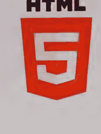

> 您可以在`whatwg.org`上在线查找 HTML 活标准规范以及其他相关规范。

万维网由一系列通过电话线和卫星连接到互联网的大容量计算机组成，这些计算机被称为“网络服务器”。每个网络服务器都使用超文本传输协议（HTTP）作为通用通信标准，允许任何连接到任何网络服务器的计算机访问网络上的文件。

HTML 网页只是以“.htm”或“.html”文件扩展名保存的纯文本文件，例如`index.html`。

为了通过互联网访问 HTML 文件，必须在其网页浏览器的地址字段中输入其网络地址。网络地址的正式名称是“统一资源定位符”（URL），通常包含三个部分：


- **协议**——任何使用 HTTP 协议的 URL 都首先指定协议为`http://`或安全的`https://`。
- **域名**——可以从中下载文件的计算机的主机名。例如：`www.example.com`。
- **路径**——文件名，前面可以加上父目录名称（如果适用）。例如：`/htdocs/index.html`。

通过协议、域名和路径描述文件位置的 URL 表明其完整的“绝对地址”。驻留在同一域中的文件可以通过其“相对地址”更简单地引用，这意味着位于同一目录中的文件可以仅通过其文件名进行引用。此外，相对地址可以通过在文件名前加上`../`来引用其父目录中的文件。例如，父目录中名为“higher.html”的文件可以被引用为`../higher.html`。

### 网络服务器是如何工作的？

当您在浏览器地址字段中输入 URL 时，浏览器首先检查协议。如果协议指定为 HTTP，或者未指定时假定为 HTTP，则浏览器会识别出正在从网络服务器请求文件。然后，它会联系域名服务器（DNS）来查找指定域名的数字互联网协议（IP）地址。接下来，会与该 IP 地址的网络服务器建立连接，以请求指定路径的文件。当文件被成功找到时，它会被复制回浏览器；否则，网络服务器会发送一个错误代码，例如“404 – 页面未找到”。


成功的响应会向网页浏览器发送 HTTP 头部，描述响应的性质以及请求文件的副本。HTTP 头部通常不可见，但可以使用各种开发工具进行检查，例如 Google Chrome 网页浏览器中的 F12 开发者工具功能。

## 理解结构

HTML 文档的骨架结构包含三个部分：

- **文档类型声明**——精确声明用于标记文档的 HTML 版本。
- **头部**——提供关于文档本身的描述性数据，例如文档的标题和使用的字符集。
- **主体**——包含当文档加载到网页浏览器中时要显示的内容。

### 文档类型声明

文档类型声明必须出现在每个 HTML 文档第一行的开头，以确保网页浏览器将“渲染”（显示）文档时遵循“标准模式”——即遵循 HTML 规范。所有 HTML 文档的文档类型声明标签如下所示：

```html
<!DOCTYPE HTML>
```

需要注意的是，HTML 不是区分大小写的语言——因此，文档类型声明标签以及所有其他标签都可以用大写和小写字符的任意组合来书写。例如，以下都是有效的：

```html
<!DOCTYPE html>
<!Doctype Html>
<!doctype html>
```

大写的选择由您决定，但建议您坚持使用所选的任何风格。本书中采用的文档类型声明标签大写风格使用全大写，以强调它作为每个页面第一个标签的重要性——但所有其他标签都使用全小写。

熟悉早期版本 HTML 的人可能会对 HTML 文档类型声明的简洁性感到惊讶。事实上，早期版本的文档类型声明实际上不是 HTML 语言的一部分——因此需要冗长地引用模式文档。相比之下，现代 HTML 文档类型声明是 HTML 本身的内在组成部分。


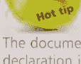

早期版本 HTML 中的文档类型声明是标准通用标记语言（SGML）的一部分，HTML 正是从 SGML 派生而来的。

整个文档的头部和主体部分可以包含在一对`<html> </html>`标签中，以容纳文档的其余部分。HTML 规范实际上指出这些标签是可选的，但提供单个“根”元素是合乎逻辑的。大多数 HTML 标签都像这样成对使用，充当“容器”，语法为`<tagname> 数据 </tagname>`。

### 头部

文档的头部以 HTML 开始标签`<head>`开始，以相应的结束标签`</head>`结束。描述文档的数据可以稍后添加在这两个标签之间，以完成 HTML 文档的头部。

### 主体

文档的主体以 HTML 开始标签`<body>`开始，以相应的结束标签`</body>`结束。要在浏览器中显示的数据内容可以稍后添加在这两个标签之间，以完成 HTML 文档的主体。

### 代码注释

注释可以在头部和主体部分的任何位置添加，包含在一对`<!--`和`-->`标签之间。出现在注释标签之间的任何内容都会被浏览器忽略。

### 基本结构

因此，创建每个 HTML 文档基本结构的标记标签如下所示：

```html
<!DOCTYPE HTML>
<html>
  <head>
    <!-- Data describing the document to be added here. -->
  </head>

  <body>
    <!-- Content to appear in the browser to be added here. -->
  </body>
</html>
```


HTML“元素”可以是任何匹配的开始和结束标签对，也可以是任何不需要结束标签的单个标签——如本书封底内页 HTML 元素标签列表中所述。

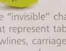

表示制表符、换行符、回车符和空格的“不可见”字符统称为“空白字符”。它们可以可选地用于缩进标签以增加清晰度。

## 创建文档

HTML 文档不应在 MS Word 等文字处理软件中创建，因为这些应用程序会在其文件格式中包含额外信息。

第 14 页描述的基本 HTML 文档结构，可用于在任何纯文本编辑器（如 Windows 的记事本应用程序）中创建简单的 HTML 文档。为了创建一个有效的“基本”HTML 文档，必须首先添加定义文档主要书写语言、字符编码格式和标题的信息。

文档的主要语言通过在`<html>`根标签的`lang`“属性”中分配标准语言代码来定义。对于英语，代码是`en`，因此完整的根开始元素如下所示：`<html lang="en">`。

文档的字符编码格式通过在文档头部部分的`<meta>`标签中分配标准字符集代码给`charset`属性来定义。推荐的编码是流行的 8 位 Unicode 转换格式，代码为`UTF-8`，因此完整的元素如下所示：`<meta charset="UTF-8">`。

最后，文档的标题由放置在文档头部部分的一对`<title> </title>`标签之间的文本定义。

请按照以下步骤创建一个有效的基本 HTML 文档：

1. 启动您喜欢的纯文本编辑器，然后使用 HTML 文档类型声明开始一个新文档：

   `<!DOCTYPE HTML>`

2. 在文档类型声明下方，添加一个根元素，将文档的主要语言定义为英语：

   ```html
   <html lang="en">
   <!-- Head and Body sections to be added here. -->
   </html>
   ```

   `<meta>`标签是一个单标签——它没有匹配的结束标签。请参阅本书封底内页的元素标签列表，以查找其他单标签。

3. 在根元素内，插入文档头部部分：

   ```html
   <head>
   <!-- Descriptive information to be added here. -->
   </head>
   ```

4. 在头部部分内，插入一个定义文档编码字符集的元素：

   `<meta charset="UTF-8">`

5. 接下来，在头部部分内，插入一个定义文档标题的元素：

   `<title>Get Started in HTML</title>`

6. 在头部部分之后，插入文档主体部分：

   ```html
   <body>
   <!-- Actual document content to be added here. -->
   </body>
   ```

7. 在主体部分内，插入一个一级大标题：

   `<h1>Hello World!</h1>`

   ```html
   <!DOCTYPE HTML>
   <html lang="en">
   <head>
   <meta charset="UTF-8">
   <title>Get Started in HTML</title>
   </head>
   <body>
   <h1>Hello World!</h1>
   </body>
   </html>
   ```

   **不要忘记**

   属性值周围的引号通常是可选的，但对于多个值则是必需的。为保持一致，本书所有示例中的属性值都用引号括起来。

8. 将文件的编码设置为 UTF-8 格式，然后将文档保存为`hello.html`。

9. 现在，在现代 Web 浏览器中打开 HTML 文档，查看标题栏或选项卡上显示的标题，以及以大标题形式显示的文档内容。

   **实用提示**

   您将在第 34–35 页发现更多关于标题的信息。

## 验证文档

正如文本文档可能包含拼写和语法错误一样，HTML 文档也可能包含各种错误，使其无法符合规范规则。为了验证 HTML 文档确实符合其指定文档类型声明的规则，可以使用验证器工具进行测试。只有成功通过验证测试的 HTML 文档才能确保是有效文档。

Web 浏览器不会尝试验证，因此在发布之前，即使内容在您的 Web 浏览器中看起来正常，也完全值得使用验证器工具验证每个 HTML 文档。当浏览器遇到 HTML 错误时，它会猜测意图是什么——但不同的浏览器可能会做出不同的解释，因此可能错误地显示文档。相反，有效的 HTML 文档在任何符合标准的浏览器中都应该始终正确显示。

万维网联盟（W3C）在`validator.w3.org`提供了一个免费的在线验证器工具，您可以使用它来检查 Web 文档的语法：

1. 连接互联网，打开您的 Web 浏览器，导航到 W3C 验证器工具`validator.w3.org`，然后单击**Validate by File Upload**（通过文件上传验证）选项卡。

   > 验证器中的其他选项卡允许您输入位于 Web 服务器上的 HTML 文档的 Web 地址以“Validate by URI”（通过 URI 验证），或将文档的所有代码复制粘贴以“Validate by Direct Input”（通过直接输入验证）。

2. 单击**Browse**（浏览）按钮，然后导航到您希望验证的 HTML 文档——选中后，其本地路径将出现在验证器的“File”（文件）字段中。

3. 接下来，单击验证器的**Check**（检查）按钮，上传 HTML 文档副本并运行验证测试——结果将随后显示。

   验证器会自动检测文档的字符集和 HTML 版本。

   如果验证失败，将列出错误，以便您轻松更正。当验证成功时，您可以选择在文档末尾包含一个合适的徽标以证明验证。

   验证徽标可以自定义，以描述网页使用的技术类别。在线徽章生成器（`w3.org/html/logo`）可让您生成代码，将其粘贴到 HTML 文档中，从而显示合适的徽标。

## 赋予标题

规范要求每个 HTML 文档都有一个标题，但其重要性常常被忽视。然而，应仔细考虑文档标题，因为它被广泛使用：

- **书签**——将文档标题保存为链接回其 URL。
- **标题栏**——Web 浏览器窗口可能会显示标题。
- **导航标签**——Web 浏览器标签页可能会显示标题。
- **历史记录**——保存文档标题为链接回其 URL。
- **搜索引擎**——读取文档标题并通常在搜索结果中显示它以链接回其 URL。

文档标题理想情况下应简短且有意义——现代标签式浏览器中的每个标签页可能仅显示 10 个字符。

整个网站中的文档标题应遵循一致的命名约定，并大写所有主要单词。一个流行的命名约定提供个人或公司名称以及由连字符分隔的简要页面描述。例如，“Amazon – C Programming in easy steps”。另一种方式是将描述放在前面，这样当标题被截断时，描述仍然可见。例如，“C Programming in easy steps - Amazon”。


文档标题和文档内容可能包含 HTML 中称为“实体”的特殊字符。每个实体引用以“&”开头，以分号结尾。例如，实体`&lt;`（小于）创建“<”字符，实体`&gt;`（大于）创建“>”字符。这些通常需要用于避免与围绕每个 HTML 标签的尖括号混淆。其他常用的实体包括`&nbsp;`（不间断空格）、`&bull;`（项目符号）、`&copy;`（©）、`&reg;`（®）、`&trade;`（™）和`&quot;`（引号）。然而，最好避免在文档标题中使用这些，因为视障观众使用的语音朗读器可能会将每个实体字符作为一个单词读出。

1. 使用类型声明开始一个新的 HTML 文档。

   ```html
   <!DOCTYPE HTML>
   ```

2. 添加一个包含头部和主体部分的根元素。

   ```html
   <html lang="en">
   <head>
   <!-- Data describing the document to be added here. -->
   </head>
   <body>
   <!-- Content to appear in the browser to be added here. -->
   </body>
   </html>
   ```

3. 在头部部分内，插入一个指定字符集的 `meta` 元素和一个空的 `title` 元素。

   ```html
   <meta charset="UTF-8">
   <title> </title>
   ```

4. 在 `title` 元素内插入一个包含实体的标题。

   `&lt;HTML in easy steps&gt;`

5. 保存文档，然后在 Web 浏览器中打开它。

   字符集可以定义为大写，如本例所示，也可以定义为小写“utf-8”。

6. 启动语音朗读器，听取标题可能被读作“小于-HTML-in-easy-steps-大于”。

7. 编辑文档标题，使其更用户友好。

   `&quot;HTML in easy steps&quot;`

8. 再次保存文档，然后在 Web 浏览器中打开它，听取朗读器现在将文档标题读作“HTML in easy steps”。

   在 Windows 10 中，按`WinKey + Ctrl + Enter`启动朗读器，然后单击标签页以听取标题。标签页上不可见的标题文本仍将被朗读器读出。Windows 10 会忽略标题中的尖括号，但在早期版本的 Windows 中，朗读器会按字面意思读取它们。

### 提供元数据

元数据仅仅是描述其他数据的数据。在 HTML 的上下文中，文档元数据描述的是文档本身，而不是文档的内容。

HTML 元数据是在 HTML 文档的`<head>`部分使用`<meta>`标签定义的。`<meta>`标签是一个“空”标签，不需要匹配的闭合标签来创建 HTML 元素——它仅用于通过其标签属性指定信息。前面的示例已使用此标签来指定文档的字符集。可以添加更多的`<meta>`标签来描述文档的其他方面。

考虑到可能有许多手持设备查看网页，通过在所有 HTML 文档的`<head>`部分包含此`<meta>`标签来优化页面以适应较小的屏幕是有用的：

```html
<meta name="viewport"
      content="width=device-width, initial-scale=1">
```

这将确保您的文档填充设备屏幕宽度，并设置初始缩放级别，使内容不会被缩放。

`<meta>`标签还可以将文档 HTTP 头属性分配给`http-equiv`属性，并指定该属性的值给`content`属性。您可以将 HTTP “refresh”属性分配给`http-equiv`属性，以在`content`属性指定的秒数后重新加载页面——例如，像这样在五秒后重新加载页面：

```html
<meta http-equiv="refresh" content="5">
```

此技术常用于网站以动态更新新闻或状态项，因为它不依赖于 JavaScript 支持。

另一种常见用途是在指定秒数后将浏览器重定向到新网页，像这样：

```html
<meta http-equiv="refresh" content="5; url='new-page.html'">
```

在这种情况下，`<meta>`标签的`content`属性同时指定了延迟的秒数和要加载的新 URL。

### ……续

1. 创建一个基本的 HTML 文档。

   ```html
   <!DOCTYPE HTML>
   <html lang="en">
   <head>
   <meta charset="UTF-8">
   <!-- 更多元数据将插入此处。 -->
   <title>Meta Refresh</title>
   </head>
   <body>
   <h1>Moving in 5 Seconds...</h1>
   </body>
   </html>
   ```

2. 插入另外两个元数据元素。

   ```html
   <meta name="viewport"
       content="width=device-width, initial-scale=1">
   <meta http-equiv="refresh"
       content="5; url='https://ineasysteps.com' ">
   ```

3. 保存文档，然后在您的网页浏览器中打开它，并等待五秒钟以查看浏览器重定向。

> **热门提示**
>
> 当您仅为`url`属性指定域名（如此例所示）时，浏览器将自动加载该域名位置的`index.html`页面。

### 描述内容

除了指定文档的字符集和过期日期外，`<meta>`标签还可用于提供搜索引擎可能使用的信息。然而，这并不能保证高排名，因为搜索引擎也使用其他页面信息来达到此目的——尤其是文档标题。通常，搜索引擎结果页（SERP）会在搜索结果中页面标题下方显示元描述。

搜索引擎优化（SEO）备受重视，以确保网页出现在 SERP 顶部，从而增加网站的访问量。不幸的是，没有万无一失的技术可以实现这一点，因为搜索引擎不断改变其页面排名算法。然而，提供描述页面内容的元数据是有用的。

所有搜索引擎都会找到要添加到其索引中的页面——即使该页面从未提交给它们。

描述性`<meta>`标签有一个`name`属性，其值为“description”，以及一个`content`属性，其值为页面内容的描述。

描述应在 50-160 个字符之间，因为过长的描述可能会被截断。描述应包含与文本内容相关的关键词。例如，搜索“意大利陶瓷”可能会返回所有描述中包含“意大利”和“陶瓷”的网页。

描述用作广告文案，因此一个可读、引人入胜并使用重要关键词的描述将鼓励用户从 SERP 访问该页面。您不应在描述中重复关键词，但应尝试使用关键词的复数形式——以匹配使用该单词单数和复数形式的搜索。此外，您不应在描述中包含双引号，因为 Google 可能会在双引号处截断描述。

始终在描述中包含三个最重要的关键词。

如果一个网站包含内容相同或非常相似的页面，您可以通过在 HTML 代码中包含“规范链接”来指定要索引哪个页面，以指示首选源。这使用一个包含`rel`（关系）属性的`<link>`标签来指定“canonical”值，以及一个`href`（超文本引用）属性来指定首选页面的 URL 地址。

### ……续

1. 创建一个基本的 HTML 文档。

   ```html
   <!DOCTYPE HTML>
   <html lang="en">
   <head>
   <meta charset="UTF-8">
   <!-- 更多元数据将插入此处。 -->
   <title>Tuscan Home Decor</title>
   </head>
   <body> <h1>Beautiful Tuscan Ceramics</h1> </body>
   </html>
   ```

2. 插入网页的元数据描述。

   ```html
   <meta name="description" content="Explore our extensive range of high quality italian ceramics including tuscan majolica, dinnerwares, vases, plates, and bowls">
   ```

3. 接下来，在`<head>`部分，添加一个元素来指定此页面是用于索引目的的首选页面。

   ```html
   <link rel="canonical"
   href="https://www.example.com/keywords.html" >
   ```

4. 保存文档，然后访问 Chrome 网上应用店`chrome.google.com/webstore/category/extensions`，并搜索“seo”以添加搜索引擎分析扩展。

5. 在 Google Chrome 网页浏览器中打开 HTML 文档，然后使用分析工具查看元数据。

#### 页面数据报告

| 标题 | Tuscan Home Decor | HTML | 17 个字符 |
|---|---|---|---|
| 描述 | Explore our extensive range of high quality italian ceramics, tuscan majolica, dinnerwares, vases, plates, and bowls | HTML | 117 个字符 |
| 规范 URL | https://www.example.com/keywords.html | 自规范 | |
| Robots 元标签 | index | | |
| X-Robots-Tag HTTP | --- | | |
| H1 | Beautiful Tuscan Ceramics | | |

网上有许多免费的元标签生成器——在搜索引擎中输入“免费元标签生成器”。

### 添加样式

层叠样式表（CSS）规则可以合并到 HTML 文档中，以控制页面上每个元素的呈现方面。样式表的使用已取代了 HTML 中以前所有与呈现相关的功能。例如，`<font>`标签已过时，因为字体系列、粗细、样式和大小现在由样式表规则指定。

使用`<style>`和`</style>`标签嵌入的样式表可以添加到 HTML 文档的`<head>`部分，以包含控制内容外观的规则。例如，一个包含确定所有一级标题外观规则的简单样式表可能如下所示：

```html
<style>
h1 { color : red ; background : yellow ; }
</style>
```

这是可接受的并且会通过验证，但根据 HTML 将内容与呈现分离的目标，样式表可以包含在单独的文件中。将样式表放在单独文件中的巨大优势在于，它们可以应用于多个 HTML 文档——从而使网站维护变得更加容易。编辑一个共享样式表会立即影响共享该文件的每个 HTML 文档。

外部样式表通过在文档的`<head>`部分添加一个`<link>`标签来合并到 HTML 文档中。此标签必须包含一个`rel`（关系）属性，其值为“stylesheet”，并且样式表的 URL 必须分配给其`href`（超文本引用）属性——例如，添加一个名为`style.css`的相邻样式表文件，像这样：

```html
<link rel="stylesheet" href="style.css">
```

您还可以在呈现性 HTML 标签的`style`属性中“内联”指定样式规则，像这样：

```html
<h1 style="color:red">
```

内联样式规则在某些情况下很有用，但会使页面维护变得更加困难。

当多个规则选择相同属性进行样式设置时，浏览器最后读取的规则通常会被应用，但内联规则优先于嵌入规则和外部规则。嵌入规则优先于外部规则。

### ……续

1. 创建一个基础的 HTML 文档。

   ```html
   <!DOCTYPE HTML>
   <html lang="en">
   <head>
   <meta charset="UTF-8">
   <title>样式表示例</title>
   </head>
   <body>
   <h1>带样式的标题</h1>
   </body>
   </html>
   ```

   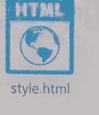

2. 接下来，在 `head` 部分，添加一个内嵌样式表。

   ```css
   <style>
   h1 { color : Red ; background : Yellow ; }
   </style>
   ```

3. 现在，在 `head` 部分，插入一个指向相邻外部样式表文件的链接。

   ```html
   <link rel="stylesheet" href="style.css">
   ```

   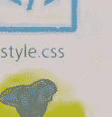

4. 保存 HTML 文档，然后打开一个新的文本编辑器窗口，并精确复制此样式表。

   ```css
   h1
   {
       border : 10px dashed Blue ;
       padding : 5px ;
       width : 500px ;
   }
   ```

   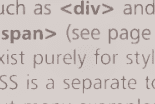

一些 HTML 元素，如`<div>`和`<span>`（见第 46 页），是纯粹为了样式化而存在的。CSS 是一个独立的主题，但本书中的许多示例都包含了内嵌的 CSS 样式表规则，以提供独立的示例文件来演示 HTML 元素的使用。一些示例还包括未列出的 CSS 规则，用于在截图中说明 HTML 元素及其内容的尺寸和位置。

5. 将层叠样式表文件保存在与 HTML 文档相同的目录中，然后在浏览器中打开该网页以查看应用的样式规则。

   

### 包含脚本

脚本可以嵌入到 HTML 文档中，以与用户交互并提供动态效果。随着能够动态更新页面部分内容的网页开发，这种能力变得越来越重要。以前，浏览器通常需要从网络服务器请求整个新页面，这效率较低且更麻烦。

用`<script>`和`</script>`标签包围的 JavaScript 代码可以嵌入到 HTML 文档中。最好将它们放在文档的 `body` 部分，紧靠`</body>`闭合标签之前，这样浏览器可以在读取脚本之前先处理文档的内容。

> 请记住，`<script>`标签总是需要一个匹配的闭合标签。

为了实现 HTML 将内容与表现分离的目标，脚本也可以包含在一个单独的文件中。在这种情况下，脚本文件的 URL 地址必须分配给`<script>`标签内的一个`src`属性。`</script>`闭合标签也是必需的。这些也可以放在 HTML 文档 `body` 部分的末尾，因为浏览器会将外部脚本视为嵌入在那里——例如，要添加一个名为`script.js`的相邻外部脚本文件，可以这样写：

```html
<script src="script.js"></script>
```

你也可以将脚本指定为 HTML 标签的 `on-event` 属性中的“内联”脚本。例如，要识别鼠标点击事件：

```html
<h1 onclick="alert('Clicked!')">
```

内联脚本在某些情况下很有用，但会使页面维护变得更加困难。可以在文档的 `body` 部分中，在`<noscript>`和`</noscript>`标签之间提供替代的后备内容，这些内容仅在脚本功能缺失或被禁用时才会显示。

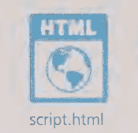

1. 创建一个基础的 HTML 文档。

   ```html
   <!DOCTYPE HTML>
   <html lang="en">
   <head>
   <meta charset="UTF-8">
   <title>JavaScript 示例</title>
   </head>
   <body>
   </body>
   </html>
   ```

2. 在 `body` 部分，插入一个后备消息和标题。

   `<noscript>JavaScript 未启用！</noscript>`

   `<h1 onclick="this.innerText='鼠标已点击！'; this.style.color='Red'">可交互标题</h1>`

3. 在 `body` 部分的末尾，添加一个内嵌脚本并指定一个外部脚本。

   ```javascript
   <script>
   document.getElementsByTagName('h1')[0].onmouseover = function () {
   this.innerText= '鼠标悬停' ; this.style.color='Blue' }
   </script>
   <script src="script.js"></script>
   ```

4. 保存 HTML 文档，然后打开一个新的文本编辑器窗口并创建外部脚本。

   ```javascript
   document.getElementsByTagName('h1')[0].onmouseout = function () {
   this.innerText= '可交互标题' ; this.style.color = 'Black' }
   ```

   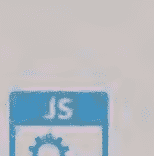

5. 将 JavaScript 文件保存为`script.js`，与 HTML 文档放在同一目录下，然后在浏览器中打开该网页并点击标题。

   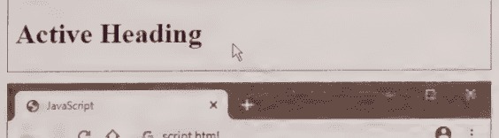

   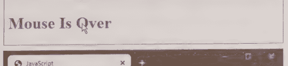

> 
>
> 一些 HTML 元素，如`<template>`和`<slot>`（见第 120 页），是纯粹为了脚本而存在的。JavaScript 是一个独立的主题，但本书中的许多示例都包含了内嵌的 JavaScript 代码，以提供独立的示例文件来演示 HTML 元素的使用。


### 链接资源


在早期示例中用于将样式表包含到 HTML 文档中的`<link>`标签，也可以用于将其他资源包含到文档中。

此标签只能出现在文档的`head`部分，但`head`部分可以包含许多`<link>`标签。每个`<link>`标签必须包含`rel`和`href`属性，以声明链接资源的关系和位置。在适当的情况下，它也可以包含一个`type`属性，以提示链接资源的 MIME 类型。


| 允许的`rel`（关系）值 |
| :--- |
| `alternate` |
| `author` |
| `bookmark` |
| `help` |
| `icon` |
| `license` |
| `next` |
| `nofollow` |
| `noreferrer` |
| `prev` |
| `search` |
| `stylesheet` |
| `tag` |
| `shortcut icon` |

MIME（多用途互联网邮件扩展）类型描述了文件类型——例如，HTML 文件使用`text/html`。你可以在 https://www.iana.org/assignments/media-types/media-types.xhtml 找到官方 MIME 类型列表。

上面的许多链接类型旨在帮助搜索引擎定位与该 HTML 文档关联的资源，并且`<link>`标签还可以包含一个`title`属性来进一步描述该资源——例如，以另一种语言编写的页面版本：

```html
<link rel="alternate" type="text/html" href="esp.html"
      title="Esta página en Español - This page in Spanish" >
```

在这种情况下，资源的位置是使用相对地址指定的，默认情况下，浏览器会在 HTML 文档所在的目录中查找。但是，可以通过在文档`head`部分的开头插入一个`<base>`标签，使浏览器在另一个目录中查找相对地址。然后，它的`href`属性可以指定绝对目录地址——例如，指定一个单独的“resources”目录，如下所示：

```html
<base href="http://localhost/resources/">
```

链接一个图标资源以在网页浏览器中显示是很常见的。该文件必须命名为`favicon.ico`，可以放在与 HTML 文档相同的目录中，或放在由`<base>`标签指定的目录中。所有浏览器都会识别`<base>`标签指定的目录中的任何其他资源。


使用`<base>`元素时，它必须放在`head`部分中所有`<link>`元素之前。

1. 创建一个新的 HTML 文档，其中包含元数据、一个链接资源以及用于样式规则和脚本代码的区域。

```html
<!DOCTYPE HTML>
<html lang="en">
<head>
<meta charset="UTF-8">
<meta name="viewport"
      content="width=device-width, initial-scale=1">
<link rel="shortcut icon" href="favicon.ico">
<title>文档标题</title>
<style>

</style>
</head>
<body>

<script>

</script>
</body>
</html>
```


这个模板是基础的 HTML 文档，在所有后续示例中都用于创建新的 HTML 文档——只有标题会根据每个示例进行更改。

2. 在`head`部分的开头，插入一个元素来指定基础的“resources”目录。

```html
<base href="http://localhost/resources/">
```


`favicon.html`

3. 将文档标题更改为“Favicon”，然后保存 HTML 文档。

4. 打开一个图标编辑器，创建一个 32 x 32 像素大小的图标，并将图标保存在 HTML 文档旁边，或保存在“resources”目录中，命名为`favicon.ico`。


`favicon.ico` 32px x 32px

5. 通过网络服务器在网页浏览器中打开 HTML 文档，以查看图标资源出现在浏览器中。

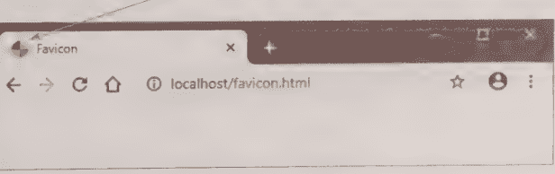


你可以通过将链接的`href`属性设置为`favicon.ico?v=2`来强制浏览器刷新 favicon。

### 总结

- 万维网超文本应用技术工作组（WHATWG）负责监督 HTML 活动标准。
- 超文本传输协议（HTTP）是 Web 服务器使用的通用通信标准。
- 统一资源定位符（URL）是一个绝对的网络地址，由协议、域名和路径组件组成。
- 相对地址可以通过文件名引用相邻文件，并且可以使用`../`语法来引用父目录。
- Web 服务器将响应头发回请求计算机，并返回所请求文件的副本，或错误代码。
- 每个 HTML 文档都应包含文档类型声明、`head`部分和`body`部分。
- 关于文档本身的信息包含在`head`部分中，而内容包含在`body`部分中。
- 文档的书写语言通过`<html>`根元素的`lang`属性指定。
- 文档的字符集编码通过`head`部分中`<meta>`标签的`charset`属性指定。
- 文档的标题在`head`部分的`<title> </title>`标签之间指定。
- 可以使用免费的在线 W3C 验证工具来验证 HTML 文档是否没有错误。
- 元数据描述文档，内容描述可被搜索引擎用于为网页建立索引。
- `<style> </style>`标签可用于将样式表嵌入到 HTML 文档中。
- `<script> </script>`标签可用于在 HTML 文档中包含内部和外部 JavaScript 代码。
- `<link>`标签可用于将外部样式表和其他资源嵌入到 HTML 文档中。

## 2 构建网页


本章演示如何将页面内容定位到组和部分中。

- 34 宣告标题
- 36 分组标题
- 38 包含导航
- 40 完整框架
- 42 创建部分
- 44 提供旁注
- 46 修改分区
- 48 总结

### 宣告标题

HTML 标题元素使用`<h1>`、`<h2>`、`<h3>`、`<h4>`、`<h5>`和`<h6>`标签创建。这些标签按其数字值表示重要性排序——其中`<h1>`最重要，`<h6>`最不重要。每个标题都需要一个匹配的结束标签，并且应仅包含标题文本。通常，标题的字体大小和字重会反映其重要性，但标题还有其他用途。

标题元素应通过正确排序来隐式传达文档结构——因此`<h2>`元素应位于`<h1>`元素之下，`<h3>`元素应位于`<h2>`元素之下，依此类推。这种结构帮助读者通过导航标题来快速浏览文档。搜索引擎爬虫可能会优先处理正确排序标题的文档，因为它们可以在索引中使用这些标题。它们假设标题很可能描述其内容，因此将文档`head`部分的元关键字包含在文档标题中特别有用。

`<h1>`元素是迄今为止最重要的标题，理想情况下应只出现一次以宣告文档标题。通常，这可以是文档标题的简洁版本。在此之下，可以使用多个`<h2>`标题来宣告长文档的主题标题。每个主题可能包含`<h3>`元素中的单独文章标题，随后是包含实际文章内容的段落`<p>`元素。

1. 创建一个 HTML 文档（如第 31 页的模板）。
2. 在`body`部分内，插入一个主文档标题`<h1>Document Heading</h1>`。
3. 接下来，在`body`部分内，插入一个主题标题`<h2>Topic Heading</h2>`。
4. 现在，在`body`部分内，插入一些文章标题，后跟包含文章内容的段落。

```html
<h3>Article Heading</h3>
<p>Article content...</p>
<h3>Article Heading</h3>
<p>Article content...</p>
```


切勿将标题元素用于其字体属性，因为这些属性可能会被样式表规则覆盖——始终考虑标题代表结构。


5. 最后，添加另一个主题，其中包含两篇文章。

```html
<h2>Topic Heading</h2>
<h3>Article Heading</h3>
<p>Article content...</p>
<h3>Article Heading</h3>
<p>Article content...</p>
```

你将在第 50 页了解更多关于`<p>`段落元素的内容。

6. 保存 HTML 文档，然后在 Web 浏览器中打开它，以查看标题和文档结构。

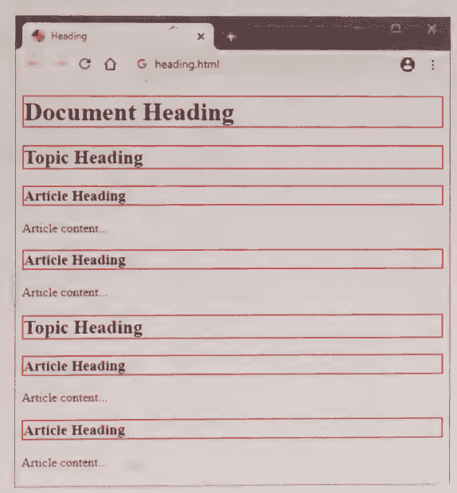

本章中所有屏幕截图都添加了（未列出的）样式规则，以更清晰地说明所描述的元素。

#### 结构大纲

```text
Document Heading
    Topic Heading
        Article Heading
        Article Heading
    Topic Heading
        Article Heading
        Article Heading
```

由排序标题创建的文档结构被称为文档“大纲”。正确构建的大纲允许页面的一部分（如单篇文章）可以轻松地联合到另一个站点中。上面文档的大纲在上方截图旁边进行了说明。

### 分组标题

标题有时会有副标题或标语。例如，一个文档标题可以这样标记：

```html
<h1>American Airlines</h1>
<h2>Doing What We Do Best</h2>
```

不幸的是，这严格要求所有后续标题都必须是`<h3>`到`<h6>`——以保持正确排序的大纲。幸运的是，HTML 提供了使用`<hgroup> </hgroup>`元素的分组解决方案。这可用于同时包围标题和副标题，如下所示：

```html
<hgroup>
  <h1>American Airlines</h1>
  <h2>Doing What We Do Best</h2>
</hgroup>
```


不能将`<header>`元素相互嵌套。

一个文档可以包含多个`<hgroup>`元素，并且每个`<hgroup>`元素都可以包含从`<h1>`到`<h6>`的标题。

完整的页眉可以包含在`<header> </header>`标签中，以包含一个标题元素或`<hgroup>`元素，以及其他引导性项目——例如横幅、标志或目录。

1. 创建一个 HTML 文档（如第 31 页的模板）。
2. 在`body`部分内，插入一个包含横幅图像的主文档标题。

```html
<header>
  
  <hgroup>
    <h1>HTML</h1>
    <h2>Building better websites</h2>
  </hgroup>
</header>
```

3. 接下来，在`body`部分内，插入一个主题和文章。

```html
<hgroup>
  <h2>Topic Heading</h2>
  <h3>Article Heading</h3>
</hgroup>
<p> Article Content…</p>
```


`header.html`


你将在第 98 页了解更多关于``图像元素的内容。

构建网页

36

4. 现在，在`body`部分内，插入第二个主题，其中包含一篇文章。

```html
<hgroup>
  <h1>CSS</h1>
  <h2>Cascading Style Sheets</h2>
  <h3>Article Heading</h3>
</hgroup>
<p>Article content...</p>
```

5. 保存 HTML 文档，然后在 Web 浏览器中打开它，以查看分组标题和文档页眉。

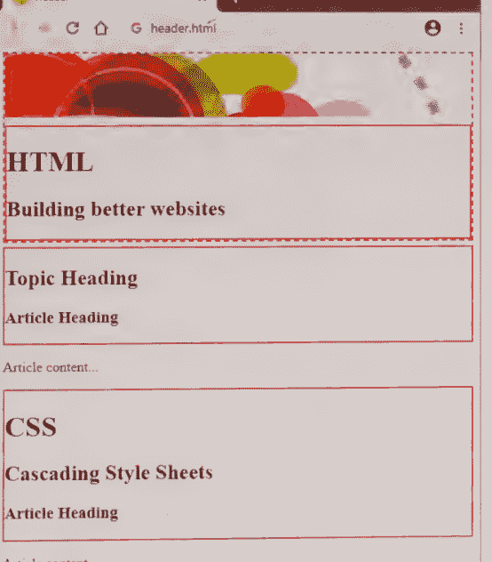

`<hgroup>`元素仅分组标题`<h1>`到`<h6>`，而`<header>`元素分组标题和附加项目。

#### 结构大纲

```text
HTML: Building better websites
Topic Heading: Article Heading
CSS: Cascading Style Sheets: Article Heading
```

### 包含导航

网页上的超链接组，使用户能够在页面或网站中导航，应包含在`<nav>` `</nav>`标签之间，或用于其他链接的`<menu>` `</menu>`标签之间。

这组链接通常是文档页眉中的水平菜单——通常称为导航栏（“nav bar”）——或者是页面边缘的垂直菜单。注意，`<nav>`元素只是菜单的包装器——它不替代任何结构元素。

1. 创建一个 HTML 文档（如第 31 页的模板）。
2. 在`body`内，插入一个包含标志、文档标题和水平页面导航栏的页眉。

```html
<header>
  
  <h1>Building better websites</h1>
  <nav id="horizontal">
    <h2>Site Links</h2>
    <p>
      <a href="#html">Markup</a> |
      <a href="#js">Scripting</a> |
      <a href="#css">Style Sheets</a>
    </p>
  </nav>
</header>
```

3. 接下来，在`body`内，插入一个垂直的站点导航菜单。

```html
<nav id="vertical">
  <h2>Page Links</h2>
  <p>Further Reading
    <br><br> <a href="nav-js.html">JavaScript</a>
    <br><br> <a href="nav-css.html">CSS</a>
  </p>
</nav>
```

4. 现在，添加主题标题和内容。

```html
<h2 id="html">HTML</h2>
<p>All about markup...</p>

<h2 id="js">JavaScript</h2>
<p>All about scripting...</p>

<h2 id="css">CSS</h2>
<p>All about style sheets...</p>
```


> 你将在第 72 页了解更多关于`<a>`锚点元素的内容，并在第 50 页找到关于`<br>`换行元素的详细信息。


> 并非每一组超链接都有资格包含在`<nav>`元素中——只有那些提供页面范围或站点范围导航的链接才合格。

### 完整框架


正如典型的 HTML 文档可能包含文档标题或头部组合一样，它也可以在页面底部包含页脚，或页脚组合。每个页脚的内容都包含在`<footer>`标签之间，并提供关于文档该部分的信息。

通常，一个`<footer>`元素可能包含作者姓名、作者在`<address>`元素内的联系方式，或在`<small>`元素内的版权和法律声明。与`<header>`元素类似，`<footer>`元素也可以在嵌套的`<nav>`元素中包含用于页面和站点导航的超链接。

文档标题和页脚可以通过一个`<main>`元素合理地分隔开来，该元素将包含页面内容。

1. 创建一个 HTML 文档（如第 31 页的模板）。
2. 在`body`内部，插入一个文档标题`<h1 id="top">有趣的文章</h1>`。
3. 接下来，添加一个主要内容容器`<main> <!-- 页面内容将插入此处。 --> </main>`。
4. 在主要内容容器中，插入两篇文章作为主要页面内容：

```html
<article>
  <h2 id="art-1">Sally 的文章</h2>
  <p>文章内容...</p>
</article>
<article>
  <h2 id="art-2">Terry 的文章</h2>
  <p>文章内容...</p>
</article>
```

HTML`<article>`元素也可以各自包含一个`<footer>`元素，提供文章作者的联系方式。

5. 最后，在`body`内部，插入一个包含页面导航超链接、版权详情和 URL 地址的文档页脚：

```html
<footer>
<nav>
<h3>信息</h3>
<a href="#art-1">Sally 的文章</a> -
<a href="#art-2">Terry 的文章</a> -
<a href="#top">页面顶部</a>
</nav>
<small>版权所有 &copy; 示例公司</small>
<address>www.example.com</address>
</footer>
```

6. 保存 HTML 文档，然后在浏览器中打开该网页，以查看文档结构包含标题、页面内容和页脚区域。

#### 结构大纲

- 有趣的文章
- Sally 的文章
- Terry 的文章
- 信息

### 创建部分

在 HTML 中，`<body>`元素内的所有内容都被视为“部分”的一部分。部分界限由文档大纲中按正确顺序排列的标题隐式定义。部分界限也可以通过将内容放置在如第 40-41 页所示的`<header>`、`<main>`和`<footer>`框架元素内来显式定义。

文档`body`或`<main>`元素内的页面内容也可以通过`<section>`标签在部分之间进行安排。每个部分通常可能以自己的标题开始，后跟文章。同样，每篇文章通常可能以自己的标题开始，后跟一个或多个段落。

在理解`<section>`和`<article>`元素时，考虑报纸如何包含各个部分（新闻、体育、房地产等）会有所帮助。每个部分包含各种文章。

1. 创建一个 HTML 文档（如第 31 页的模板）。
2. 在`body`内部，插入一个文档标题`<h1>报纸</h1>`。
3. 接下来，添加一个主要内容容器`<main> <!-- 页面内容将插入此处。 --> </main>`。
4. 现在，在主要内容容器中，插入一个包含两篇文章的部分：

```html
<section>
  <h2>新闻部分</h2>
  <article>
    <h3>文章 #1</h3>
    <p>文章内容...</p>
  </article>
  <article>
    <h3>文章 #2</h3>
    <p>文章内容...</p>
  </article>
</section>
```

`<section>`元素在此类短文档中不是必需的——除非你特别想添加部分标题和页脚。

5. 接下来，在主要内容容器中，插入另一个包含单篇文章的部分：

```html
<section>
<h2>体育部分</h2>
<article>
<h3>文章 #1</h3>
<p>文章内容...</p>
</article>
</section>
```

`<section>`只是一个分组元素，而`<article>`包含一个独立的作品。

6. 在主要内容容器之后，添加一个页脚：

```html
<footer>
<small>版权所有 &copy; 示例公司</small>
</footer>
```

7. 保存 HTML 文档，然后在浏览器中打开它，以查看按部分显示的文章内容。

文档、部分和文章标题在文档大纲中正确嵌套显示。

#### 结构大纲

- 报纸
  - 新闻部分
    - 文章 #1
    - 文章 #2
  - 体育部分
    - 文章 #1

### 提供旁注

HTML 有用提供了`<aside>`标签，可以嵌套在`<article>`元素内，以包含与该文章主要内容有些相关的内容。这允许包含补充性但独立的内容——通常显示为侧边栏或脚注。

`<aside>`元素内的内容应是独立的信息，且与文章相关，例如从关联文章中提取的引文、文章中使用的术语表，甚至是提供与该文章相关的进一步阅读页面的超链接。

或者，`<aside>`元素可以单独使用，无需`<article>`元素，以包含与整个页面相关的次要内容，例如相关广告或网络博客。

1. 创建一个 HTML 文档（如第 31 页的模板）。
2. 在`body`内部，插入一个文档标题`<h1>名人名言</h1>`。
3. 接下来，添加一个主要内容容器`<main>`。
4. 现在，在主要内容容器中，插入一篇文章，包含一个标题、一个段落和一个 aside 元素：

```html
<!-- 页面内容将插入此处。 -->
</main>
```

```html
<article>
  <h2>幸福</h2>
  <p><q>幸福的秘诀不是做自己喜欢的事，而是喜欢自己必须做的事。</q> <br>
  <cite>詹姆斯·M·巴里</cite></p>
  <aside>詹姆斯·M·巴里 (1860 - 1937) 是一位苏格兰作家和剧作家。</aside>
</article>
```

HTML`<aside>`和`<nav>`元素也可以各自包含一个`<footer>`元素。

5. 在主要内容容器中，插入第二篇类似的文章——包含一个用于侧边栏样式的`class`属性：

```html
<article class="sidebar">
    <h2>愤世嫉俗</h2>
    <p> <q>愤世嫉俗者是知道一切事物的价格<br>却不知道其价值的人。</q> <br> <cite>奥斯卡·王尔德</cite></p>
    <aside>奥斯卡·王尔德 (1854 – 1900)<br> 是一位爱尔兰作家和诗人。</aside>
</article>
```

避免使用`<aside>`元素来包含不相关的广告。

6. 在主要内容容器之后添加页脚，然后添加样式表以控制 aside 的位置：

```html
<footer>
    <small>版权所有 &copy; 示例公司</small>
</footer>

<style>
    article.sidebar > p,aside
    { display : table-cell ; padding-right : 20px ; }
</style>
```

不要使用`<aside>`元素来包含导航超链接——这些应始终包含在`<nav>`元素内。

7. 保存 HTML 文档和样式表，然后在浏览器中打开网页，查看旁注的显示效果。

#### 结构大纲

- 名人名言
  - 幸福
    - [无标题的 aside 元素]
  - 愤世嫉俗
    - [无标题的 aside 元素]

### 修订分部

早期 HTML 版本中广泛使用的`<div>`元素分隔标签，出于向后兼容性考量仍被支持——但`<div>`元素不提供任何语义含义，因此最好避免使用，转而采用更具意义的标签。

与其他有意义的元素（如`<header>`、`<main>`、`<section>`、`<article>`、`<nav>`和`<footer>`）不同，无意义的`<div>`元素是匿名的。例如，智能浏览器可能设有快捷键可跳转到页面的导航部分。当该部分包含在有意义的`<nav>`元素中时易于识别，但当包含在无意义的`<div>`元素中时则不那么明显。

> 仅在需要样式设置时使用`<div>`元素——务必寻找有意义的元素作为替代。

`<div>`元素在样式设置方面仍然有用，同样类似的匿名`<span>`元素标签也是如此。尽管`<div>`和`<span>`元素本身无意义，但它们可以包含用于应用样式规则的标识性`id`、`class`或`style`属性。

应将用于结构（而非样式）目的的`<div>`元素文档进行修订，改为使用有意义的元素——例如，针对以下文档元素：

```html
<body>
<div class="header">
<h1>Web Languages</h1>
</div>

<div class="nav">
<h2>Menu</h2>
<p><a href="nav-js.html">JavaScript</a></p>
<p><a href="nav-css.html">Cascading Style Sheets</a></p>
</div>

<div class="main">
<h2> <span style="font-style:italic" > HyperText</span> Markup Language</h2>
<p>All about HTML...</p>

<h2><span style="font-style:italic" >eXtensible </span>Markup Language</h2>
<p>All about XML...</p>
</div>

<div class="footer">
<p><small>Copyright &copy; Example Corporation</small></p>
</div>

</body>
```

`divided.html`

#### 结构大纲

- Web Languages
- Menu
- HyperText Markup Language
- eXtensible Markup Language

...续

1. 将带有`"header"`类的`<div>`替换为`<header>`元素。
2. 将带有`"nav"`类的`<div>`替换为`<nav>`元素。
3. 将带有`"main"`类的`<div>`替换为`<main>`元素。
4. 在标题和段落周围添加`<article>`元素，然后将`<span>`元素替换为`<em>`元素——以实现自动强调。

```html
<article>
<h2><em>HyperText</em> Markup Language</h2>
<p>All about HTML...</p>
</article>

<article>
<h2><em>eXtensible</em>Markup Language</h2>
<p>All about XML...</p>
</article>
```

5. 将带有`"footer"`类的`<div>`替换为`<footer>`元素。
6. 保存编辑后的文档，然后在浏览器中打开两个文档以查看它们外观相同——结构相同，但修订后赋予了语义含义。

### 总结

- 标题元素`<h1>`、`<h2>`、`<h3>`、`<h4>`、`<h5>`和`<h6>`按重要性从`<h1>`到`<h6>`依次排列。
- 正确排序的标题元素隐式传达了文档结构——以创建文档大纲。
- `<hgroup>`元素可用于包围标题和子标题——从`<h1>`到`<h6>`。
- 完整的页眉，包括徽标、横幅和标题`<h1>`到`<h6>`，可以包含在`<header>`元素中。
- 提供页面或网站导航的超链接组应包含在`<nav>`元素中。
- `<nav>`元素只是菜单的包装器，通常在页眉中水平显示或在侧边栏中垂直显示。
- 网页主体部分的框架可能包含`<header>`、`<main>`和`<footer>`元素。
- 通常，`<footer>`元素可能包含`<address>`元素中的联系信息或`<small>`元素中的法律信息。
- 每个文档`<section>`元素通常以章节标题开始，后跟一个或多个文章。
- 每个文档`<article>`元素通常以文章标题开始，后跟一个或多个段落。
- 与文章相关的独立信息可以包含在嵌套于`<article>`元素中的`<aside>`元素内。
- `<div>`和`<span>`元素本身无意义，但在样式设置方面很有用。

## 3 管理文本内容

本章演示如何在页面内容中包含文本和超链接。

1. **50** 插入段落
2. **52** 包含引用
3. **54** 添加强调
4. **56** 添加修改标记
5. **58** 添加短语
6. **60** 保留格式
7. **62** 使用上标
8. **64** 显示代码
9. **66** 提供建议
10. **68** 衡量数量
11. **70** 引导语言
12. **72** 创建超链接
13. **74** 访问键
14. **76** 片段链接
15. **78** 协议链接
16. **80** 总结

### 插入段落

所有文本内容传统上都分为句子和段落，以便于阅读和理解。HTML 文档中的文本内容也是如此，它们的段落包含在`<p>` `</p>`标签中。每个段落元素在视觉上由浏览器与下一个元素分隔——通常在它们之间留有两个空行。

段落中的文本在遇到元素边缘时通常会自动换行，但可以通过插入换行`<br>`标签来强制提前换行。

为了强调，可以在段落之间插入水平线`<hr>`标签以画一条分隔线。然而，`<hr>`标签不能插入段落内部以分隔句子。您可能会惊讶于在 HTML 中发现`<hr>`标签，因为它似乎执行纯粹的呈现功能。然而，在规范中它被描述为代表“段落级主题分隔”，例如故事中的场景转换。

`<br>`标签和`<hr>`标签都是单标签，不需要匹配的结束标签。

1. 创建一个 HTML 文档。
2. 在 body 部分内插入一个大标题：

   `<h1>The Statue of Liberty</h1>`

3. 接下来，在 body 部分内添加一个段落：

   `<p>The Statue of Liberty was built over nine years by French sculptor Auguste Bartholdi. Upon its completion in 1884 all 350 individual pieces of the statue were packed into 214 crates for the long boat ride from France to New York.</p>`

4. 在段落之后，添加一条水平分隔线：

   `<hr>`

5. 在水平分隔线之后，添加第二个段落：

   `<p>The statue arrived in America several months later and was reconstructed on Liberty Island. Auguste Bartholdi thought that the New York harbor was the perfect setting for his masterpiece because it was where immigrants got their first view of the New World.</p>`

...续

6. 现在，在段落中插入断行以控制其行长度：

```html
<p>The Statue of Liberty was built over nine years
<br>by French sculptor Auguste Bartholdi.
<br>Upon its completion in 1884 all 350 individual pieces
of the statue were packed into 214 crates for the long
boat ride from France to New York.</p>

<p>The statue arrived in America several months later
<br>and was reconstructed on Liberty Island.
<br>Auguste Bartholdi thought that the New York harbor
was the perfect setting for his masterpiece because it was
where immigrants got their first view of the New World.
</p>
```

`<hr>`元素可被视为 HTML 中相当于故事和散文中常见的 *** 章节分隔符。

7. 保存 HTML 文档，然后在 Web 浏览器中打开它以查看标题、段落、强制换行和水平分隔线。

### 包含引用

重要的是要认识到，某些 HTML 元素会在页面上生成一个矩形块区域以显示内容，而其他元素仅在外层包含块内的一行上生成一个小块。这些被称为“流”元素和“短语”元素。生成一行小块的短语元素必须始终被生成较大包含块的流元素（如`<p>` `</p>`）所包围。流元素和短语元素之间的区别可以通过对比 Web 浏览器如何显示用于在文档中包含引用的两种 HTML 元素来看出。


`<blockquote>`和`</blockquote>`标签旨在包围来自其他来源的长引用，可通过其`cite`属性指定。对于此元素，浏览器通常生成一个矩形块区域来包含引用，从新行开始并从周围内容缩进——因此`<blockquote>`是流元素。

另一方面，`<q>`和`</q>`标签旨在包围来自其他来源的短引用，可通过其`cite`属性指定。对于此元素，浏览器通常在当前行生成一个小块区域来包含引用——因此`<q>`是短语元素。

与`<blockquote>`流元素不同，`<q>`短语元素会使浏览器在页面上显示时自动在元素内容周围添加引号。理想情况下，这些应该是包围整个元素内容的双引号，以及在任何内部嵌套引用周围的单引号，但其实现可能有所不同。

1. 创建一个 HTML 文档。
2. 在`body`部分内插入一个段落：

   ```html
   <p>A Paragraph Flow Block!</p>
   ```

3. 在`body`部分内，插入一个包含两个小嵌套引用的`blockquote`：

   ```html
   <blockquote cite="http://www.example.com/origin.html">
   A Blockquote Flow Block!<br>Paul said, <q>I saw Emma
   at lunch, she told me <q>Susan wants you to get some
   ice cream on your way home.</q> I think I will get some
   at Ben and Jerry's on Main Street.</q> </blockquote>
   ```

默认情况下，段落元素块会填充其包含元素的宽度——就像第38页示例中的`<h1>`元素块一样。

将此样式表插入文档的`<head>`部分，然后重新加载页面以查看这些块的效果。

```html
<style>
p, blockquote { border : 2px solid Green ; }
q { background : LawnGreen ; }
</style>
```

HTML 支持`w3.org/TR/css-color-3/#svg-color`中描述的标准颜色名称和代码。这些名称不区分大小写，但使用首字母大写形式会更清晰——例如，`LawnGreen`比`lawngreen`更易读。流元素（flow elements）此处用绿色（`Green`）实线边框显示，短语元素（phrasing elements）则用草坪绿（`LawnGreen`）背景显示。

### 添加强调

HTML 提供了四种可用于在文档正文中强调文本的短语元素：

- 用`<b>`和`</b>`标签包围的文本被增强，但不表示额外的重要性，例如段落中的关键词——通常以粗体显示。
- 用`<i>`和`</i>`标签包围的文本被增强，但不表示额外的重要性，例如段落中的技术术语——通常以斜体显示。
- 用`<strong>`和`</strong>`标签包围的文本重要性增加，但不改变句子的原意——通常以粗体显示。
- 用`<em>`和`</em>`标签包围的文本应被强调，以刻意影响句子的含义——通常以斜体显示。

规范鼓励网页作者在网页设计的各个方面考虑可访问性问题。

令人有些惊讶的是，`<b>`和`<i>`标签在HTML中得以保留，因为它们表面上暗示内容应以粗体或斜体显示——这与HTML将结构与表现分离的目标相悖。然而，根据规范，它们的含义已被重新定义：`<b>`元素内的内容应“在样式上有所区分”，`<i>`元素内的内容则应被视为“另一种语调”。实际上，它们仍然通过粗体和斜体字体来表现，但应仅作为最后手段使用，因为它们不传达含义——应改用`<strong>`和`<em>`标签。

`<strong>`和`<em>`标签的优势在于，它们描述了其内容相对于周围文本的重要性，并让浏览器决定如何呈现。此外，这些标签在提示叙述者如何口头表达内容时也更相关。

与许多HTML标签一样，`<strong>`和`<em>`标签可以嵌套，但必须注意正确关闭嵌套元素。例如，`<strong><em>...</em></strong>`是正确的顺序，而`<strong><em>...</strong></em>`则是错误的，无法通过验证。

1. 创建一个HTML文档。
2. 在`<body>`部分内，添加一个段落，其中包含一些不影响句子原意的强调文本。

   ```html
   <p>
   <strong>Warning.</strong>
   This dungeon is dangerous.
   <strong>Avoid the ducks.</strong>
   Take any gold you find.
   <strong>Do not take any of the diamonds, they are explosive.</strong> You have been warned.
   </p>
   ```

3. 接下来，在`<body>`部分内，添加一些通过强调文本来影响句子含义的段落。

   ```html
   <p><em>Puppy dogs</em> are cute.</p>
   <p>Puppy dogs <em>are</em> cute.</p>
   <p>Puppy dogs are <em>cute.</em></p>
   ```

4. 将此样式表插入文档的`<head>`部分，以高亮显示强调的文本。

   > 应尽可能避免使用`<b>`标签，但其一个合理用途是标记文章的引言句。

   ```html
   <style>
   strong, em { background : LawnGreen ; }
   </style>
   ```

5. 保存HTML文档，然后在网页浏览器中打开它，查看文本是如何被强调的。

### 添加修改

HTML 提供了三种可用于在文档正文中格式化文本的元素：

- 用`<small>`和`</small>`标签包围的文本被视为对周围文本的旁注，例如版权信息——通常以较小字体显示。
- 用`<del>`和`</del>`标签包围的文本被视为已从文档中移除，例如待办事项列表中已完成的项目——通常以删除线显示。
- 用`<ins>`和`</ins>`标签包围的文本被视为已添加到文档中，例如“待办”列表中新增的项目——通常以下划线显示。

`<small>`标签仅用于包含补充周围内容的简短旁注。它不适用于大段文本，例如多个段落，因为那将远不止是一个旁注。

> `<del>`和`<ins>`标签可以选择性地包含一个`cite`属性，用于指定解释所做更改的文档的URL。

在显示`<small>`元素内的内容时，网页浏览器会考虑用于显示周围内容的字体大小，然后应用适当的缩小比例。因此，当周围内容使用12点字体显示时，`<small>`元素内的内容可能会使用10点字体显示——具体大小由浏览器决定。

`<del>`和`<ins>`元素都可用于内容段落中，以标记文本的更改片段，以及包裹整个更改内容的部分，例如被替换的段落。

1. 创建一个HTML文档。
2. 在`<body>`部分内，插入一个包含法律用途旁注的段落。

   ```html
   <p>Example Corp today announced record profits for the second quarter <small>(Full Disclosure: EG News is a subsidiary of Example Corp)</small>, leading to speculation about a merger with Demo Group.</p>
   ```

3. 接下来，插入一个大标题和一个普通段落。

   ```html
   <h1>To Do List</h1>
   <p>Empty the dishwasher</p>
   ```

4. 现在，插入一个已被删除的段落。

   ```html
   <del><p>Take out the trash</p></del>
   ```

5. 然后，插入一个已被添加的段落。

   ```html
   <ins><p>Sweep the yard</p></ins>
   ```

6. 最后，插入一个已被添加的段落，其中包含一段已更改的文本片段。

   ```html
   <ins>
   <p>Feed the <del>dog</del><ins> cat</ins></p>
   </ins>
   ```

7. 保存HTML文档，然后在网页浏览器中打开它，查看文本是如何被格式化的。

> `<small>`标签并不表示内容重要性较低，仅表示它是对周围文本的旁注。

### 添加短语处理

HTML 提供了四种可用于在文档正文中为文本标记特殊处理的短语元素：

- 用`<s>`和`</s>`标签包围的文本被标记为已被更准确或相关的最新内容所取代——通常以删除线显示。
- 用`<u>`和`</u>`标签包围的文本被标记为在某种程度上与正常文本内容不同——通常以下划线显示。
- 用`<mark>`和`</mark>`标签包围的文本被标记为具有特殊参考意义——通常以彩色背景块显示以突出文本。
- 用`<wbr>`标签分隔的文本被不可见地标记为适合换行的点——代表一个可换行的机会。

需要注意的是，规范指出`<s>`标签不应用于表示文档中的编辑内容。应使用`<del>`标签来表示文档编辑。

同样，`<mark>`标签不应用于强调文本内容的重要性，而仅应用于突出显示文本在文档中的相关性。应使用`<strong>`和`<em>`标签来表示强调。

`<u>`标签在HTML5.0规范中已被弃用，因为文档中的带下划线文本传统上表示超链接。尽管如此，`<u>`标签已被恢复用于标记拼写错误的单词或中文专有名词。强烈不建议作者使用`<u>`标签进行强调，以避免与超链接混淆。同样，应使用`<strong>`和`<em>`标签来表示强调。

当文档包含可能超出浏览器宽度的长内容时，你可能希望使用`<wbr>`标签来指示可以插入换行符的合适位置。

> **注意**
>
> 请使用样式表规则进行呈现，而不是使用`<u>`标签添加下划线。

### 标记与格式化文本

...（续）

1. 创建一个HTML文档。
2. 在`body`部分，添加一个标记换行机会的段落。

   ```html
   <p>Microsoft Surface Pro 7 <wbr>- 256GB / Intel Core i7</p>
   ```

3. 接下来，在`body`部分，添加一个标记划线价格和当前价格的段落。

   ```html
   <p><s>$1,499</s> $1,299</p>
   ```

4. 现在，在`body`部分，添加标记参考文本和拼写错误的段落。

   ```html
   <p>Memory: <mark>16GB</mark><br>Screen: <mark>12.3-inch</mark></p>
   <p>Surface <u>Penn</u> Included</p>
   ```

5. 保存HTML文档，然后在Web浏览器中打开，查看文本是如何被标记的。


`mark.html`

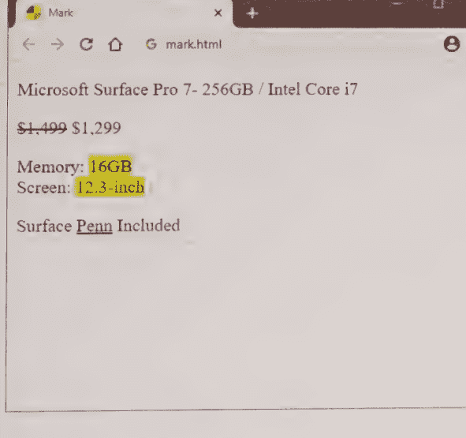


使用`<wbr>`建议换行机会特别适合小型设备，但其实施取决于浏览器对该特性的支持。

### 保留格式

在希望浏览器渲染“预格式化”的文本内容时，网页作者可以将该内容置于`<pre>`和`</pre>`流程元素标签之间。这些标签告知浏览器应应用以下指令：

- 保留空白。
- 使用固定宽度字体渲染所有文本。
- 禁用自动换行。
- 不禁用双向处理。

保留空白意味着保留所有空格、制表符和换行符。这对于显示每第二行都缩进的长诗非常有用——例如，使用这首诗：

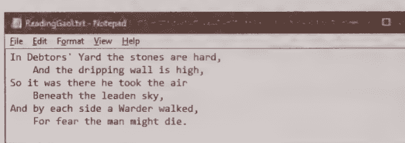

在这种情况下，每第二行缩进四个字符宽度——通过按四次空格键插入四个不可见的空格字符来实现。这些缩进将完全由`<pre>`元素保留为四个字符宽度。

另一方面，制表符可能会带来一些意外，因为它们通常被浏览器解释为八个字符宽度。这与Windows记事本应用程序中的制表符大小一致，但其他文本编辑器可能有所不同。这意味着包含制表符的预格式化文本可能因`<pre>`元素而出现对齐错误。因此，规范在创建预格式化文本内容时不鼓励使用制表符。

`<pre>`和`</pre>`标签也可用于确保“文本艺术”（有时用作网络论坛签名）能按预期显示。

1. 创建一个HTML文档。
2. 在`body`部分，插入一个文档标题`<h1>文本艺术签名</h1>`。

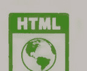

3. 确保文本编辑器中的字体设置为固定宽度字体，例如记事本中的Lucida Console。
4. 接下来，在`body`部分，插入一个`<pre>`元素，其中包含固定宽度字体的预格式化内容——并且不使用任何制表符。

   ```html
   <pre>
       ____  @
      _/\_(  
     (**) / (*)       MIKE'S PUSHBIKES
    ~~~~~~~~~~~~~~~~~~~~~~~~~~~~~~~~~~~~~~~~
   </pre>
   ```


5. 保存HTML文档，然后在Web浏览器中打开，确保内容保留预格式化。

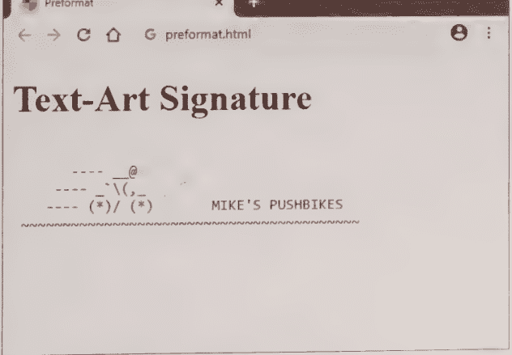

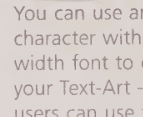

### 使用上标

网页段落区域中的常规文本显示在不可见的行内短语框中，该框由外部逻辑框和包含基线的内部字体框组成：

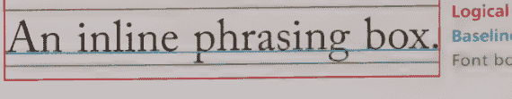

垂直行间距由字体高度决定，以允许在延伸到基线以下的字符（如“p”）和向上延伸的高字符（如“b”）之间留出空间，加上垂直边距区域。

> 在行内短语框中编写的段落中的文本。行间距使得字符不会重叠。™

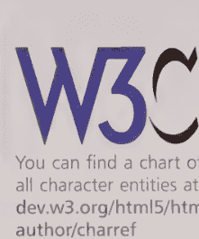

您可以在`dev.w3.org/html5/html-author/charref`找到所有字符实体的图表。

此外，字体框将容纳“上标”，例如由`&trade;`字符实体产生的商标符号™。上标是任何比常规文本小并设置在基线以上的文本、数字或符号。数学公式可以使用上标来表示数值幂，使用`&sup2;`表示²，`&sup3;`表示³。字体框还将容纳“下标”——它比常规文本小并设置在基线以下。

使用标准垂直行间距时，上标和下标的可用高度有限，因此字符大小受到限制。与其为此目的使用字符实体，通常更好的做法是使用HTML`<sup>`和`</sup>`标签表示上标，`<sub>`和`</sub>`标签表示下标。这些元素增加垂直行间距以允许更显眼的上标和下标字符。例如，`<sup>2</sup>`比`&sup2;`大。此外，任何内容都可以包含在这些元素中，因此您不受可用字符实体引用的限制。

> 行间距使得下方上标的字符不会重叠。包含`<sup>`上标`</sup>`和`<sub>`下标`</sub>`的段落中的文本行。行间距使得上方下标的字符不会重叠。

1. 创建一个HTML文档。


`modify.html`

2. 在`body`部分，插入一个包含通过字符实体产生的上标的段落。

   ```html
   <p>
   四的平方：4&amp;sup2; = 16 &lt;br&gt;
   四的立方：4&amp;sup3; = 64
   </p>
   ```

3. 现在，在`body`部分，插入一个类似的段落，包含通过HTML元素产生的上标。

   ```html
   <p>
   四的平方：4<sup>2</sup> = 16 &lt;br&gt;
   四的立方：4<sup>3</sup> = 64
   </p>
   ```

4. 最后，在`body`部分，插入一个包含通过HTML元素产生的下标的段落。

   ```html
   <p>
   水：H<sub>2</sub>O &lt;br&gt;
   硫酸：H<sub>2</sub>SO<sub>4</sub>
   </p>
   ```

5. 保存文档，然后在浏览器中打开以比较上标并查看下标文本。

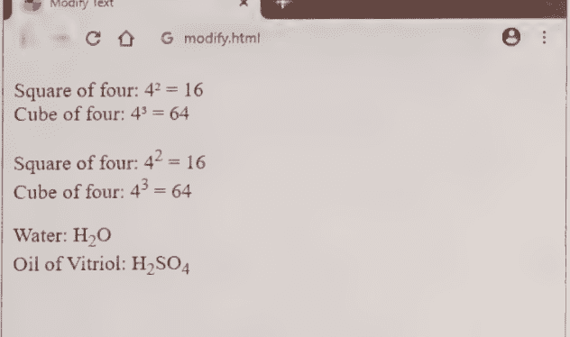

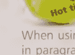

在段落中使用上标²表示面积（如10英尺²）时，您可能更喜欢使用实体`&amp;sup2;`而不是`<sup>2</sup>`以保持行间距相等。

### 显示代码

HTML提供五个短语元素，专门用于在文档主体中包含计算机程序代码：

- 完整的程序代码或代码片段可以置于`<code>`和`</code>`标签之间，以合适的字体显示。
- 程序变量实例可以置于`<var>`和`</var>`标签之间，以与常规文本区分。
- 示例程序输入和输出可以置于`<samp>`和`</samp>`标签之间，以与常规文本区分。
- 同时具有关联机器可读代码的内容可以置于`<data>`和`</data>`标签之间，并将代码指定为其必需的`value`属性。
- 日期和时间可以置于`<time>`和`</time>`标签中，并将机器可读版本指定为其`datetime`属性。

`<data>`元素可以，例如，描述一本书的标题及其机器可读的ISBN，然后`<time>`元素可以描述该书的出版日期：

1. 创建一个HTML文档。
2. 在`body`部分，插入一个包含变量、示例输入和示例输出的程序描述。
3. 现在，在`body`部分，声明程序代码来源。

   ```html
   <p>
   此程序将输入值分配给
   <var>degF</var>
   然后对该值执行转换，将结果分配给
   <var>degC</var>
   以进行输出。例如，输入
   <samp>98.6</samp>
   将输出
   <samp>37C</samp>。
   </p>
   ```


```html
<data value="978-1-84078-719-1">
C++ Programming in easy steps, 5th Edition</data>
<time datetime="2023-12-15">
（2023年12月25日）</time>
```


> `<time>`元素的`datetime`值必须采用有效格式——例如，完整日期时间如`2023-12-25 14:30`，或月份如`2023-12`，或日期如`2023-12-25`，或仅日期如`12-25`，或仅时间如`14:30`。

...接上文

## 4

接下来，在正文部分，插入预格式化的程序代码：

```html
<pre>
<code>
#include &lt;iostream&gt;
using namespace std;

int main()
{
    float degF, degC;
    cout &lt;&lt; "Enter Fahrenheit Temperature: ";
    cin &gt;&gt; degF;
    degC = ((degF - 32.0 ) * (5.0 / 9.0));
    cout &lt;&lt; degF &lt;&lt; "F is " &lt;&lt; degC &lt;&lt; "C";
    cout &lt;&lt; endl;
    return 0;
}
</code>
</pre>
```


> 请注意，程序代码中的所有尖括号字符都已替换为字符实体，以避免与 HTML 标签冲突。

## 5

保存 HTML 文档，然后在你的网页浏览器中打开它，查看程序描述、源文件细节和程序代码是如何显示的。

此程序将输入值赋给`degF`，然后对该值进行转换，并将结果赋给`degC`以输出。例如，输入 98.6 将输出 37c。

`C++ Programming in easy steps`。第五版（2023年12月25日）

```cpp
#include <iostream>
using namespace std;

int main()
{
    float degF, degC;
    cout << "Enter Fahrenheit Temperature: ";
    cin >> degF;
    degC = ((degF - 32.0 ) * (5.0 / 9.0));
    cout << degF << "F is " << degC << "C";
    cout << endl;
    return 0;
}
```


> 记住在`<pre>`流元素内插入`<code>`短语元素，以在 HTML 文档中保留程序代码布局。

### 给出建议

HTML 提供了四个短语元素，可用于在文档正文中指定建议短语：

- 文本可以包含在`<abbr>` `</abbr>`标签之间，表示它是一个缩写。
- 文本可以包含在`<cite>` `</cite>`标签之间，表示它是来自其他来源的引用或参考。
- 文本可以包含在`<dfn>` `</dfn>`标签之间，表示它是该术语的权威实例。
- 文本可以包含在`<kbd>` `</kbd>`标签之间，表示用户从键盘输入的内容。

每个可以合法出现在文档正文中的 HTML 元素都可以选择包含一个`title`属性。为`title`属性指定的值通常以工具提示的形式显示，当用户将光标放在元素上时弹出。这意味着上面列出的每个短语元素都可以包含一个`title`属性来扩展其内容的含义。


创建一个 HTML 文档。

在正文部分，插入一个包含带工具提示建议的缩写的段落：

```html
<p>
<abbr title="HyperText Markup Language">
HTML
</abbr> in easy steps</p>
```

接下来，插入一个带工具提示建议的引用：

```html
<p>
<cite title="Inventor of the HyperText Markup Language">Sir Tim Berners-Lee</cite></p>
```


记住对嵌套引号使用单引号——就像第 4 步中的‘HTML’一样。

现在，插入一个带工具提示建议的权威术语：

```html
<p>
<dfn title="The popular language of the World Wide Web. Commonly abbreviated to ‘HTML’">
HyperText Markup Language</dfn></p>
```

然后，插入一个带工具提示建议的键盘指令：

```html
<p>
<kbd title="Press the Y key on your keyboard to execute a script. This requires JavaScript to be enabled in your browser">Hit Y to Continue.</kbd></p>
```

最后，添加一个将响应键盘指令的脚本：

```html
<script>

function showkey( e ) {

    if( e.keyCode === 89 || e.keyCode === 121 )
    {
        alert( 'Y pressed. Thank You.' )
    }
}

document.onkeydown = showkey

</script>
```


该脚本会查看按键时的键码，并将响应小写`"y"`和大写`"Y"`。

保存 HTML 文档，然后在你的浏览器中打开它，并将光标放在元素上以查看工具提示。

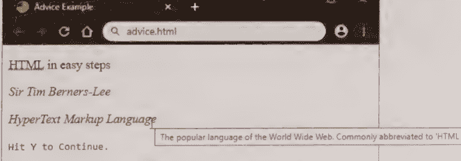

在你的浏览器中启用 JavaScript 后，按 Y 键查看脚本响应。


### 仪表量值


范围内的值可以使用 HTML `<meter>`元素在网页上直观地表示为仪表。

`<meter>`元素必须包含一个定义分数测量的`value`属性。可选地，`<meter>`标签还可以包含`min`和`max`属性来指定范围的最小和最大边界。如果省略这些属性，则假定默认范围为 0-1。

`<meter>`标签还可以包含`low`和`high`属性来指定范围内的低和高位置，并且一个`optimum`属性可以指定范围内的理想首选位置。

`low`和`high`属性可以指定由`min`和`max`属性指定的整体范围内的次优范围。这实际上可以将仪表分为三个部分——低、中、高。虽然未包含在 HTML 标准规范中，但这三个部分可以由网页浏览器使用不同的颜色表示。例如，Google Chrome 浏览器明智地对低部分使用红色，对中部分使用黄色，对高部分使用绿色。

建议`<meter>`元素应包含描述仪表状态的文本，该文本将仅在未直观显示此元素的浏览器中显示。

交互式`<details>`和`<summary>`元素可以响应用户操作而无需脚本，即可显示附加信息。通常，`<details>`元件在网页上提供一个由三角箭头表示的“disclosure widget”。嵌套的`<summary>`元素显示一个标题，描述隐藏在小部件内的信息。附加信息包含在`<details>`元素内嵌套的元素中，位于`<summary>`元素之后。

当用户单击`<summary>`元素时，小部件状态从“closed”变为“open”，隐藏的信息被揭示。再次单击`<summary>`元素将关闭小部件并再次隐藏信息。

> **热门提示**
>
> 三角箭头会旋转以表示小部件的打开和关闭状态——因此，这些小部件有时被称为“twisties”。

...接上文

1. 创建一个 HTML 文档。
2. 在正文部分，插入一个包含量程为 0-100、次优范围为 15-50、理想值为 100、当前值为 80% 的仪表的文章：

   ```html
   <article><h2>Gauge</h2>Fuel Level:
   <meter min="0" low="15" high="50" max="100"
   optimum="100" value="80" >80%</meter>
   <!-- Details to be inserted here. -->
   </article>
   ```

   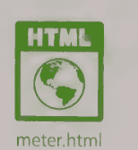

3. 插入描述仪表当前状态的细节：

   ```html
   <details>
   <summary>Status</summary>
   OK to Continue...
   </details>
   ```

4. 重复步骤 2 和 3 两次，以创建另外两个仪表，然后将其当前值分别编辑为 40 和 10，并提供适当的描述。
5. 保存 HTML 文档，然后在你的浏览器中打开它，并单击每个`<summary>`元素以查看其描述。

   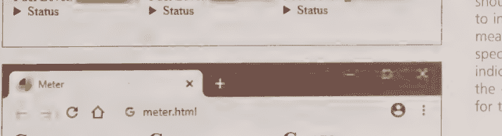

   

   

`<meter>`元素应仅用于表示指定范围内的分数测量值，而非表示进度——对此请使用`<progress>`元素（参见第 116 页）。

### 直接语言

推荐的 UTF-8 文档编码格式提供了对双向文本的支持，因此从右向左书写的语言（如希伯来语）的字符会自动按该方向书写，并可能与从左到右的文本（如英语）一起出现。应从右向左阅读的内容应包含在`<bdi>` `</bdi>`双向隔离标签内，以免混淆浏览器，因为浏览器期望从左向右读取。此外，HTML 提供了一个`<bdo>`双向覆盖元素，可以通过其`dir`属性明确指定文本方向为`"ltr"`或`"rtl"`。双向覆盖允许从右向左语言的字符以“逻辑”从左到右的顺序在 HTML 文档中书写为字符实体，但以“视觉”从右到左的顺序显示。例如，下面的`<bdo>`元素从左到右包含了五个字符实体，按输入顺序排列，但从右到左显示：

```html
<bdo dir="rtl">&#1497;&#1513;&#1512;&#1488;&#1500;</bdo>
```

....显示为 ישראל（拉丁字母中的 Yiśrā'ēl）。

### Ruby 注释

对于东方语言，HTML 支持“Ruby 注释”，它在文本旁边提供有用的发音。例如，在日语中，有不止一种字母表。用语义上的“汉字”字母表（有数千个字符）书写的文本通常用其在语音“平假名”语言（约有 50 个字符）中的等价物进行注释，以帮助发音。这在日语中称为“Furigana”，在英语中称为“Ruby”——以用于表示发音的小字体命名。为了方便西方人，日语文本可以用“Romaji”（其拉丁字母等价物）进行注释。同样，在中文中，用“Mandarin”字母表书写的文本可以用“Pinyin”（其拉丁字母等价物）进行注释。

HTML Ruby 注释完全包含在根`<ruby>` `</ruby>`标签内。然后，此元素可以将东方文本包含在`<rb>` `</rb>`标签（Ruby 基础）中，将发音包含在`<rt>` `</rt>`（Ruby 文本）标签之间。可选地，可以在`<rtc>` `</rtc>`标签内提供英语等价物。


如果没有双向覆盖，这些字符实体将按其逻辑顺序显示为 ????——这对从右到左的希伯来语来说是倒序的。

### Ruby 注解

1. 创建一个 HTML 文档类型。
2. 在 body 部分，为日语文本插入一个带有其适当发音注解`<ruby>`的元素。

   ```html
   <!-- Japanese Kanji text. -->
   <rb>東京</rb>
   <!-- Romaji annotation. -->
   <rt>tō kyō</rt>
   <!-- English equivalent text. -->
   <rtc>Tokyo</rtc>
   </ruby>
   ```

   

3. 接下来，为中文文本插入一个带有其适当发音注解`<ruby>`的元素。

   ```html
   <!-- Chinese Mandarin text. -->
   <rb>北京</rb>
   <!-- Pinyin annotation. -->
   <rt>běi jīng</rt>
   <!-- English equivalent text. -->
   <rtc>Beijing</rtc>
   </ruby>
   ```

   

> **注意**
>
> 不要将 Ruby 注解与毫无关联的 Ruby 编程语言混淆。

4. 保存 HTML 文档，然后在浏览器中打开它以查看文本和 ruby 注解。

   

### 创建超链接

当互联网仅传输文本内容时，“超文本”提供了轻松访问相关文档的能力，并且是万维网创建的基础。如今，图像也可用于此目的，因此网页的任何导航元素现在都被称为“超链接”（或简称为“链接”）。

超链接包含在`<a></a>`锚点标签内，该标签在 opening 标签中通过`href`（超文本引用）属性指定目标 URL。可选地，`<a>`标签也可以包含一个`title`属性，以指定当用户将光标置于超链接上时出现在“工具提示”中显示的文本。

网页浏览器将以区别于常规文本的方式显示超链接——通常，超文本会获得下划线，而基于图像的超链接会获得彩色边框。

每个网页超链接对三种交互状态敏感：

- **悬停（Hover）**——获得焦点，光标置于超链接上。
- **活动（Active）**——正在检索链接的资源，用户点击超链接。
- **已访问（Visited）**——链接的资源之前已被检索过。

可以使用样式规则来强调每个超链接状态：


1. 创建一个 HTML 文档。
2. 接下来，在 head 部分添加一个到样式表的链接：

   ```html
   <link rel="stylesheet" href="link.css">
   ```

3. 现在，在 body 部分，插入一个指向目标页面的超链接——包括工具提示建议：

   ```html
   <a href="link-target.html" title="A hyperlink to a target page">Visit Target</a>
   ```

   

4. 保存 HTML 文档，然后创建一个类似的第二个文档，该文档链接到相同的样式表并包含一个指向第一个文档的超链接：

   ```html
   <a href="link.html" title="A hyperlink to return">Return</a>
   ```

5. 将第二个 HTML 文档与第一个文档一起保存，然后创建一个样式表来强调每个超链接状态：

   ```css
   a:hover { background: Yellow; }
   a:active { background: Red; color: White; }
   a:visited { background: Aqua; }
   ```

   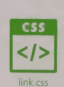

6. 将样式表与两个 HTML 文档一起保存，然后在浏览器中打开第一页以查看处于默认状态的超链接。

   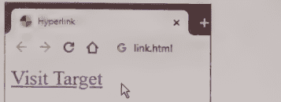

7. 将光标置于超链接上以查看处于悬停状态的超链接。

   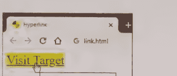

8. 在超链接上按住鼠标左键以查看处于活动状态的超链接。

   

9. 释放鼠标按钮以加载目标页面。
10. 点击目标页面中的超链接以重新加载第一页。


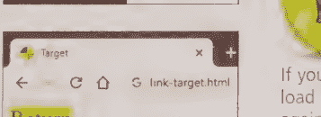

> 如果你再次点击链接加载目标页面，浏览器会识别出它之前已从第一页访问过。

11. 查看第一页上的超链接现在是否处于其已访问状态。

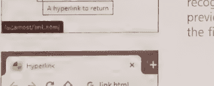

### 访问键


有三种方式可以访问超链接的目标：

- **指针（Pointer）** – 鼠标或类似设备将屏幕指针置于超链接上，然后用户点击以访问其目标。
- **Tab 键** – 反复按 Tab 键依次将焦点置于每个超链接上，然后按 Return 键访问当前选定超链接的目标。
- **访问键（Access Key）** – 按指定的字符键将焦点置于特定超链接上，然后按 Return 键访问其目标。

指定的字符键通过 `<a>` 锚点标签的 `accesskey` 属性为超链接指定。利用指定键的方法通常要求用户在大多数网页浏览器（如 Google Chrome）中按 `Alt + accesskey`，但在 Firefox 中是 `Alt + Shift + accesskey`。

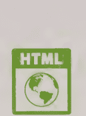

1. 创建一个 HTML 文档。
2. 接下来，在 head 部分添加一个样式表以移除默认的超链接样式。

```css
<style>
a { text-decoration: none; color: Black; }
a:focus { background: Red; color: White; }
</style>
```

3. 现在，在 body 部分，插入两个指定不同数字访问键字符的超链接。

```html
<a href="keys-home.html" accesskey="1">
Home Page</a> |
<a href="keys-catalog.html" accesskey="2">
Catalog Page</a>
```


4. 保存 HTML 文档，然后创建一个类似的第二个文档，其中包含相同的两个超链接——但不包含移除默认样式的样式表。

```html
<a href="keys-home.html" accesskey="1">
Home Page</a> |
<a href="keys-catalog.html" accesskey="2">
Catalog Page</a>
```

5. 将第二个 HTML 文档与第一个文档一起保存，然后在浏览器中打开第一个网页以查看没有默认样式的超链接。

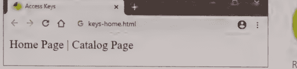

> **注意：** 移除默认超链接样式意味着它们不再容易被识别为链接——因此最好避免这样做，除非有其他提示使用户意识到它们可以用于导航。

6. 反复按 **Tab** 键，直到第二个超链接获得焦点，然后按 **Return** 键跟随该链接。

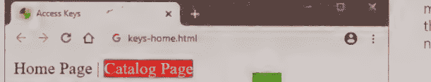

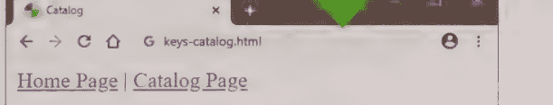

7. 按下访问键组合和数字 1 键（例如 **Alt + 1**），然后按 **Return** 键跟随第一个超链接。

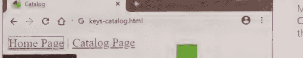

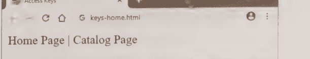

> **提示：** Mac 用户应在其 Safari 浏览器中按 CMD + accesskey。

### 片段链接


超链接可以指向使用“片段”标识符创建的文档中的特定点——该标识符是通过其 opening 标签中的 `id` 属性分配了唯一标识名的元素。在超链接内，片段标识符通过在 opening `<a>` 标签中指定 `href` 属性，并在前面加上 `#` 号字符来指定。例如，标签 `<a href="#top">` 指向同一文档中包含唯一片段标识符名称“top”的元素。

超链接也可以使用文档的 URL，后跟 `#` 号字符，然后是片段标识符，来指向不同文档中的特定点。例如，标签 `<a href="index.html#top">` 指向名为“index.html”的文档中包含唯一片段标识符名称“top”的元素。

跟随指向片段标识符的超链接将从片段标识符出现的位置开始显示文档：


1. 创建一个 HTML 文档。
2. 在 body 部分内，插入两个包含片段标识符并指向不同片段的超链接。

   `<a id="top" href="#btm">Skip to Page Foot</a> | <a id="next-btm" href="frag-next.html#btm">Skip to Next Page Foot</a>`

3. 接下来，在 body 中，插入一个代表内容的段落，后面跟一个包含片段标识符的超链接，该标识符指向文档中的第一个超链接。

   `<p style="height:700px;background:Yellow"></p> <a id="btm" href="#top">Skip to Page Head</a>`

4. 保存 HTML 文档，然后创建第二个类似的文档，其中超链接位于内容的上方和下方。

   `<a id="top" href="#btm">Skip to Page Foot</a> <p style="height:700px;background:Red">Content...</p> <a id="btm" href="#top">Skip to Page Head</a> | <a id="prev-top" href="frag.html#top">Skip to Previous Page Head</a>`

...接上文

5. 将第二个 HTML 文档保存在第一个文档旁边，然后在浏览器中打开第一个页面，点击第一个超链接以跳转到本页面底部。

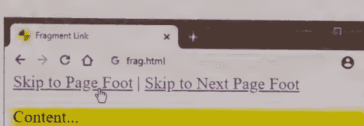

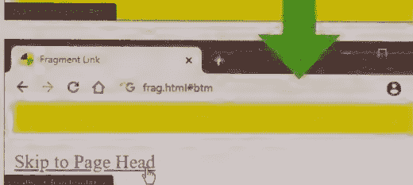

井号 `#` 在 HTML 中用于定位片段（fragment）和指定十六进制颜色值，在 CSS 中用于通过元素的 id 属性选择元素以进行样式设置。十六进制颜色值指定了组成颜色的红、绿、蓝分量——例如，红色十六进制值为 `#FF0000`。

6. 接下来，点击超链接返回到本页面顶部。
7. 现在，点击第二个超链接跳转到下一页的底部。


在较长页面的末尾，应包含一个指向页面顶部片段的超链接，这样用户就无需手动滚动回顶部。

### 协议链接

超链接的 `href` 属性通常使用超文本传输协议（`http:` 或安全的 `https:`）来定位资源，但它也可以使用其他协议来定位资源。

脚本函数可以通过 `javascript:` 协议来调用，而电子邮件客户端则可以通过 `mailto:` 协议来唤起：


1. 创建一个 HTML 文档。
2. 在 body 部分中，插入一张图表图片。
3. 接下来，插入一个段落，其中包含两个指向不同协议的超链接。
4. 现在，添加一个样式表，包含一条用于隐藏图片的规则，和一条用于设置段落样式的规则。
5. 最后，添加一个脚本，使得每次点击第一个超链接时，图表图片会交替显示和隐藏。
6. 保存 HTML 文档，然后在浏览器中打开它，并点击第一个链接以显示图表图片。

```html

```

```html
<p id="links">
<a href="javascript:toggle( )">Show/Hide Chart</a>
<br>
<a href="mailto:wendy@example.com">Email Wendy</a>
</p>
```

```css
<style>
img#chart { visibility : hidden ; height : 0px ; }
p#links { padding : 5px ; border : 1px solid ;
float : left ; width : 200px ; }
</style>
```

```javascript
<script>
function toggle( ) {
const chart = document.getElementById( 'chart' )
let hid = ( chart.style.visibility !== 'visible' )
chart.style.visibility = ( hid ) ? 'visible' : 'hidden'
chart.style.height = ( hid ) ? 'auto' : '0px'
}
</script>
```

> 此脚本首先检查图片元素的当前可见性状态，然后将其反转。


...接上文

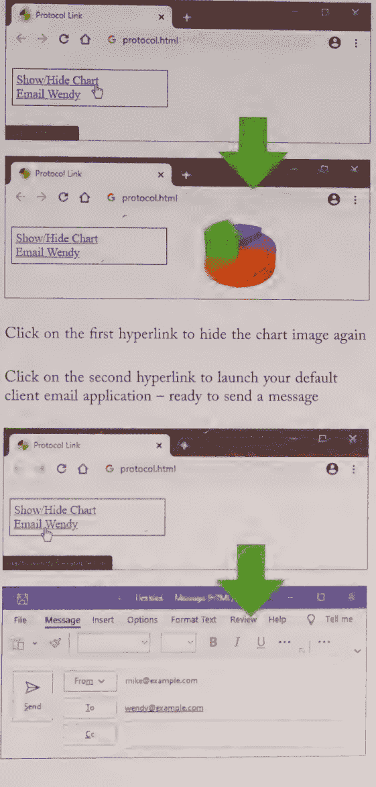

1. 点击第一个超链接再次隐藏图表图像。
2. 点击第二个超链接启动默认的客户端电子邮件应用程序——准备发送消息。

> **`mailto:` 协议会自动将收件人的电子邮件地址添加到电子邮件客户端的“收件人”字段中。**


### 总结

- 段落 `<p>` 元素可以包含 `<br>` 换行标签，段落之间可以用 `<hr>` 水平分隔线分开。
- 长引用可以包含在 `<blockquote>` 流元素中，短引用可以包含在 `<q>` 短语元素中。
- 强调文本时，优先使用 `<em>` 和 `<strong>` 短语元素，而非 `<b>` 和 `<i>` 短语元素。
- 旁注可以包含在 `<small>` 元素中，而 `<ins>` 和 `<del>` 元素可用于指示被替换的文本。
- `<s>` 元素表示已过时的内容，而 `<mark>` 元素用于高亮显示供参考的内容。
- `<u>` 元素表示不同的文本，而 `<wbr>` 元素可用于建议一个合适的换行点。
- 为避免对齐问题，在为 `<pre>` 元素创建预格式化文本时，应避免使用制表符间距。
- 上标和下标可以使用字符实体，或者使用 `<sup>` 和 `<sub>` 元素来包含。
- 程序代码可以使用 `<code>`、`<var>` 和 `<samp>` 元素包含在 HTML 文档中。
- 机器可读的代码可以指定到 `<data>` 标签的 `value` 属性和 `<time>` 标签的 `datetime` 属性。
- `<abbr>`、`<cite>`、`<dfn>` 和 `<kbd>` 元素提供建议。
- 许多元素可以包含 `title` 属性以提供工具提示。
- `<bdi>` 和 `<bdo>` 双向元素可用于包围以从右到左书写的语言的文本项目。
- Ruby 注音使用 `<ruby>`、`<rb>`、`<rt>`、`<rp>` 和 `<rtc>` 元素为东亚语言提供发音辅助。
- `<a>` 标签可以创建指向其他网页、页面片段或诸如 `javascript:` 和 `mailto:` 等协议的超链接。


## 4 编写列表和表格


本章演示如何在列表和表格单元格中显示项目。

82. 无序列表  
84. 有序列表  
86. 描述列表  
88. 基本表格  
90. 跨列单元格  
92. 增强表格  
94. 控制列  
96. 总结

### 无序列表

无序列表中，列表项的顺序不重要，通常在每个项目前放置一个项目符号，以将列表项与普通文本区分开来。

在 HTML 中，无序列表使用 `<ul>` `</ul>` 标签创建，它们为列表项提供了一个容器。每个列表项可以使用 `<li>` `</li>` 标签来包含项目，或者可选地仅使用 `<li>` 来置于项目之前——这两种形式的 `<li>` 元素都是有效的 HTML。一个无序列表 `<ul>` 元素可以包含多个列表项 `<li>` 元素。

区分无序列表项和普通文本的项目符号可能是以下三种标记类型之一：

- **圆点** – 一个实心的圆形项目符号（默认样式）。
- **圆圈** – 一个空心的圆形项目符号。
- **方块** – 一个实心的方形项目符号。

样式规则可以为无序列表的 `list-style-type` 属性指定上述任意一个值，或者可以为该属性指定一个 `none` 值以抑制项目符号。

每个 HTML 列表还有一个 `list-style-image` 属性，可以指定要用作列表项目符号的图像的 URL。这将替代任何标记类型的项目符号。如果 Web 浏览器无法使用指定的图像，则将使用其 `list-style-type` 属性指定的标记，或者在未指定标记时，将使用默认值。

1. 创建一个 HTML 文档。
2. 在 body 部分中，插入一个将显示默认圆点项目符号的无序列表。

```html
<ul>
<li>HTML</li>
<li>Cascading Style Sheets</li>
<li>JavaScript</li>
</ul>
```

...接上文

接下来，插入一个将显示圆圈项目符号的无序列表。

```html
<ul style="list-style-type:circle">
<li>C Programming</li>
<li>C++ Programming</li>
<li>C# Programming</li>
</ul>
```

现在，插入一个将显示方形项目符号的无序列表。

```html
<ul style="list-style-type:square" >
<li>Bash<li>PHP<li>Python</ul>
```

最后，插入一个将使用图像作为项目符号的无序列表。


`ulist-go.png` 21px x 21px

```html
<ul style="list-style-image:url(ulist-go.png)" >
<li>Access</li>
<li>Excel VBA</li>
<li>Visual Basic</li>
</ul>
```

保存 HTML 文档，然后在浏览器中打开它以查看无序列表项目符号。

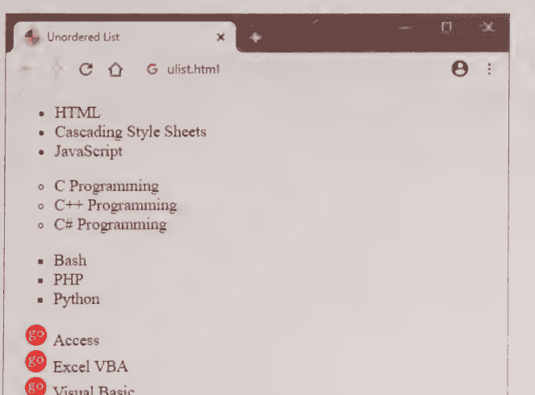


> 请注意，在 CSS 术语中，列表被写在内容框中，其项目符号绘制在左填充区域内。

### 有序列表

有序列表中，列表项的顺序很重要，会为每个项目编号，以将列表项与普通文本区分开来。

在 HTML 中，有序列表使用 `<ol>` `</ol>` 标签创建，它们为列表项提供了一个容器。与无序列表一样，每个列表项可以使用 `<li>` `</li>` 标签来包含项目，或者可选地仅使用 `<li>` 来置于项目之前——这两种形式的 `<li>` 元素都是有效的 HTML。一个有序列表 `<ol>` 元素可以包含多个列表项 `<li>` 元素。

区分有序列表项和普通文本的自动编号可能是以下六种编号类型之一：

- **十进制** – 传统数字（默认样式）。
- **罗马** – 古典数字。
- **拉丁** – 传统字母编号。
- **希腊** – 古典字母编号。
- **格鲁吉亚** – 传统格鲁吉亚编号。
- **亚美尼亚** – 传统亚美尼亚编号。

样式规则可以为列表的 `list-style-type` 属性指定以下值中的任意一种：

| 类型 | 值 |
| --- | --- |
| 十进制 | `decimal` 或 `decimal-leading-zero` |
| 罗马 | `lower-roman` 或 `upper-roman` |
| 拉丁 | `lower-latin` 或 `upper-latin`<br>`lower-alpha` 或 `upper-alpha` |
| 希腊 | `lower-greek` |
| 格鲁吉亚 | `georgian` |
| 亚美尼亚 | `armenian` |


此外，可以指定一个`none`值以抑制编号。列表项编号通常从 1 开始，但可以通过`<ol>`标签的`start`属性指定不同的起始点。


当未指定编号类型时，将使用默认值。

### 描述列表

描述列表是一种独特的列表类型，其中每个列表项包含两部分——第一部分是术语，第二部分是术语的描述。这被称为名值对。例如，术语"太阳"的名值对可以是"太阳/我们太阳系中心的恒星"。

在HTML中，描述列表通过`<dl> </dl>`标签创建，它们为列表项提供容器。每个列表项术语包含在`<dt> </dt>`定义术语标签中，每个列表项描述包含在`<dd> </dd>`定义描述标签中。可选地，`</dt>`和`</dd>`结束标签可以省略——`<dt>`和`<dd>`元素的两种形式都是有效的。

描述列表中的每个列表项可以包含多个`<dt>`定义术语元素和多个`<dd>`定义描述元素——这允许单个术语有多个描述，或者多个术语有单个描述。通常，浏览器会将定义描述显示为相对于术语缩进的形式。

描述列表也可用于包含一系列问题及相关答案，或任何其他名值数据组。

1. 创建一个HTML文档。
2. 在body部分，插入一个包含两个问答名值对的描述列表。

```html
<dl>
    <dt>What is HTML?</dt>
    <dd>The HyperText Markup Language</dd>

    <dt>What is it used for?</dt>
    <dd>Web page structure.</dd>
</dl>
```

3. 接下来，在body部分，插入一个描述术语用途、发音和含义的描述列表。

```html
<dl>
    <dt><dfn>Homonym</dfn></dt>
    <dd class="grammar">noun</dd>
    <dd class="spoken">[hom-uh-nim]</dd>
    <dd>a word the same as another in sound and spelling but different in meaning</dd>
</dl>
```

4. 现在，插入一个描述术语用途、发音和多个含义的描述列表。

```html
<dl>
  <dt><dfn>Mouse</dfn></dt>
  <dd class="grammar">noun</dd>
  <dd class="spoken">[mous]</dd>
  <dd>a small animal of various rodent families</dd>
  <dd>a palm-sized button-operated device used to move a computer cursor</dd>
  <dd>a quiet, timid person</dd>
</dl>
```

> 仅`<dt>`元素本身并不表示其内容是被定义的术语——必须使用嵌套的`<dfn>`元素来实现此目的。

5. 添加样式表，为列表中的问题和定义术语着色，并为某些特定描述着色。

```css
<style>
dt { color : Blue ; }
dfn { color : Red ; font-size : 20pt ; }
dd.grammar { color : Green ; }
dd.spoken { color : Purple ; }
</style>
```

6. 保存HTML文档，然后在浏览器中打开它以查看名值对。

> 不要使用定义列表来标记对话——应使用段落来标记每段对话。

### 基础表格

数据通常最好以表格形式呈现，按行列排列以逻辑地分组相关项目，从而易于理解。

在HTML中，表格通过`<table> </table>`标签创建，它们为表格行提供容器。每个表格行通过`<tr> </tr>`标签创建，它们为一行表格数据单元格提供容器。每个表格数据单元格通过`<td> </td>`标签创建，它们包含要呈现的实际数据。可选地，`</td>`和`</tr>`结束标签可以省略——`<td>`和`<tr>`元素的两种形式都是有效的。

`<table>`元素通常包含多个`<tr>`元素，以创建显示多行数据的表格。类似地，每个`<tr>`元素通常包含多个`<td>`元素，以创建多列数据的表格。但需要注意的是，表格中每个`<tr>`行必须包含完全相同数量的`<td>`单元格——因此，例如，如果第一个`<tr>`行包含五个`<td>`单元格，所有`<tr>`行都必须包含五个`<td>`单元格。

1. 创建一个HTML文档。
2. 在body部分，插入一个table元素。
3. 现在，在table元素内，插入三个表格行——每个包含三个表格数据单元格。
4. 添加样式表以设置表格宽度和边框、单元格边框，以及稍后将添加的标题边框。
5. 保存HTML文档，然后在浏览器中打开它以查看基础表格。

```html
<table>
  <!-- Table rows to go here. -->
</table>
```

```html
<tr> <td>Cell 1.1</td> <td>Cell 1.2</td> <td>Cell 1.3</td> </tr>
<tr> <td>Cell 2.1</td> <td>Cell 2.2</td> <td>Cell 2.3</td> </tr>
<tr> <td>Cell 3.1</td> <td>Cell 3.2</td> <td>Cell 3.3</td> </tr>
```

```css
<style>
  table { width: 500px; border: 5px solid Black; }
  td,th { border: 1px solid Black; }
</style>
```

> 省略结束`</td>`单元格标签但包含结束`</tr>`标签，可以更清晰地表示每个表格行的结束。

表格标题可以使用`<caption> <caption>`标签指定，行和列标题可以添加在`<th> <th>`标签之间。

1. 紧跟在开始table标签之后，插入一个标题。

   `<caption>A Basic Table</caption>`

2. 接下来，插入一行四个列标题。

   `<tr><th>Column 1</th><th>Column 2</th><th>Column 3</th></tr>`

3. 现在，在每个后续行的开头插入一个标题。

   `<tr><th>Row 1</th><td>Cell 1.1</td><td>Cell 1.2</td><td>Cell 1.3</td></tr>`

   `<tr><th>Row 2</th><td>Cell 2.1</td><td>Cell 2.2</td><td>Cell 2.3</td></tr>`

   `<tr><th>Row 3</th><td>Cell 3.1</td><td>Cell 3.2</td><td>Cell 3.3</td></tr>`

4. 保存编辑后的HTML文档，然后刷新浏览器以查看新增内容。

> 如果要包含`<caption>`元素，它必须紧跟在开始`<table>`标签之后。

> 结束`</th>`标签是可选的，但开始`<th>`标题的数量必须与行和列的数量完全匹配。

> 本章后续示例将在此简单表格示例的基础上构建，随着引入更多表格功能。

### 跨列单元格

单个表格单元格可以与其他单元格垂直组合，以跨越表格的多行。

跨越的行数在跨列单元格的`<td>`标签的`rowspan`属性中指定。被跨越行中的单元格必须被删除，以保持表格对称性。

1. 制作在第88-89页示例中创建的`table.html`文档的副本，并将其重命名为"rowspan.html"。
2. 更改文档和表格标题。

   `<title>Row Spanning Example</title>`

   `<caption>A Table Spanning Rows</caption>`

3. 在包含文本"Cell 1.1"的表格数据元素中，在其开始标签中插入一个属性并编辑其内容。

   `<td rowspan="2">Cell 1.1+2.1</td>`

4. 接下来，删除包含文本"Cell 2.1"的表格数据元素——因为此单元格现在已被跨越。
5. 现在，向样式表样式添加规则，为跨越行的单元格背景着色。

   `td[rowspan="2"] { background : Pink ; }`

   `td[rowspan="3"] { background : HotPink ; }`

6. 保存HTML文档，然后在浏览器中打开它以查看第1列中跨越两行的单元格。

### ...续

7. 接下来，在包含文本"Cell 2.2"的表格数据元素中插入一个属性，并编辑其内容为`<td rowspan="2">Cell 2.2+3.2</td>`。
8. 现在，删除包含文本"Cell 3.2"的表格数据元素——因为该单元格现在已被跨越合并。
9. 保存编辑后的HTML文档，然后刷新浏览器以查看第2列中跨两行的单元格。

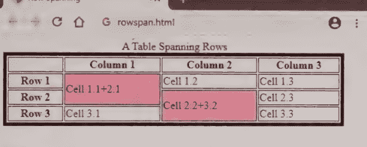

10. 接下来，在包含文本"Cell 1.3"的表格数据元素中插入一个属性，并编辑其内容为`<td rowspan="3">Cell 1.3+2.3+3.3</td>`。
11. 现在，删除包含文本"Cell 2.3"和"Cell 3.3"的表格数据元素——因为这些单元格现在已被跨越合并。
12. 保存编辑后的HTML文档，然后刷新浏览器以查看第3列中跨三行的单元格。

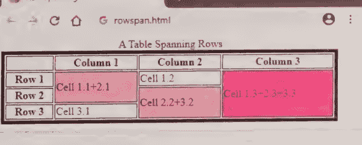

> 请注意，默认情况下，每个单元格中的文本是左对齐的，而在合并的单元格中是水平居中的。

### 增强表格


通过在常规表格内容的上方和下方添加特殊的页眉和页脚行，表格可以得到增强，从而提供额外的表格信息。

在HTML中，表格页眉信息包含在`<thead>`和`</thead>`标签之间，表格页脚信息包含在`<tfoot>`和`</tfoot>`标签之间。当表格具有`<thead>`和/或`<tfoot>`元素时，所有常规表格行必须包含在`<tbody>`和`</tbody>`标签之间。

在长表格中，可以使用多个`<tbody>`元素将行分组为独立的表格主体部分。当这些表格被打印时，每个纸质页面可以重复显示表格页眉和页脚信息。

需要注意的是，`<thead>`元素必须出现在`<table>`元素内的第一个`<tbody>`元素之前，但如果存在`<caption>`元素，则应在`<caption>`元素之后。


`enhance.html`

1. 创建一个在第88-89页创建的`table.html`文档的副本，并将其重命名为"enhance.html"。
2. 更改文档和表格标题为`<title>增强表格示例</title>`和`<caption>一个增强的表格</caption>`。
3. 向样式表添加规则以设置表格页眉、第二个表格主体标题和最终表格页脚的样式：

   `thead { background : Pink ; }`

   `th.next { background : DeepPink ; color : White ; }`

   `tfoot { background : HotPink ; }`

4. 在标题之后立即插入一个包含单行的表格页眉，该行跨越所有四列：

   ```html
   <thead>
   <tr><td colspan="4">页眉信息</td>
   </thead>
   ```

5. 在页眉之后，添加一个表格主体元素以包含所有现有的常规表格行：

   ```html
   <tbody>
   <!-- 现有的行元素放在这里。 -->
   </tbody>
   ```

### 6

在表格主体元素之后，插入一个包含另外四个表格行的第二个表格主体元素：

```html
<tbody>
<tr><th colspan="4" class="next">下一节</tr>
<tr>
<th>行 4<td>单元格 4.1<td>单元格 4.2<td>单元格 4.3</tr>
<tr>
<th>行 5<td>单元格 5.1<td>单元格 5.2<td>单元格 5.3</tr>
<tr>
<th>行 6<td>单元格 6.1<td>单元格 6.2<td>单元格 6.3</tr>
</tbody>
```

### 7

在第二个表格主体之后，插入一个包含单行的表格页脚，该行跨越所有四列：

```html
<tfoot>
<tr><td colspan="4">页脚信息</tr>
</tfoot>
```

### 8

保存HTML文档，然后在浏览器中打开它以查看增强后的表格。

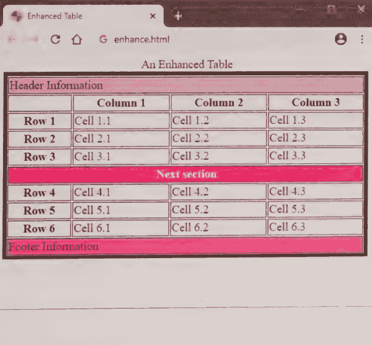

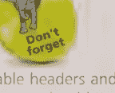

表格页眉和页脚应仅包含信息——所有表格数据都应出现在表格主体中。

### 控制列

当表格仅通过样式规则指定了整体宽度时，浏览器将默认根据其内容计算每列的宽度——内容较宽的列会比内容较窄的列更宽。通过使用`<col>`标签表示单个列，可以实现对列宽的更精确控制，这样样式规则就可以指定它们的大小和外观。

单个`<col>`元素也可以通过包含`span`属性来指定列数，从而表示多个列。因此，指定列宽的样式规则将应用于`<col>`元素所代表的所有列。或者，`<th>`或`<td>`标签可以包含`colspan`属性来指定要跨越的列数。

可以选择将`<col>`元素包含在`<colgroup>`和`</colgroup>`标签之间，以便对列组和单个列进行样式设置。


1. 创建一个HTML文档。
2. 在body部分内，插入一个包含标题的表格元素：

```html
<table>
<caption>早餐航班</caption>
<!-- 表格内容放在这里。 -->
</table>
```

3. 接下来，在表格中插入一个列组，该列组包含用于样式设置的类名，并包含一个列：

```html
<colgroup class="sidebar">
<col>
</colgroup>
```

4. 现在，再插入两个列组，它们包含用于组样式设置和单独样式设置的类名：

```html
<colgroup class="info">
<col class="stripe"> <col> <col class="stripe">
</colgroup>

<colgroup class="info">
<col> <col class="stripe">
</colgroup>
```

`<col>`标签是一个单标签——它没有匹配的结束标签。

5. 在列组之后，插入一个表格页眉、一个表格主体和一个表格页脚——每个都有六列：

```html
<thead><tr><th colspan="6"><!-- 页眉。 --></thead>
<tbody><!-- 每行包含六个单元格。 --></tbody>
<tfoot><tr><td colspan="6"><!-- 页脚。 --></tfoot>
```

6. 添加一个样式表，其中包含指定表格、其页眉、页脚和数据单元格外观的规则：

```css
table { width : 500px ; border-collapse : collapse ; }
tbody th { background : DeepPink ; color : White ; }
tbody td { padding : 3px ; text-align : center ; }
tfoot { font-size : small ; }
```

7. 接下来，添加规则以指定每列的宽度：

```css
colgroup.sidebar col { width : 70px ; }
colgroup.info col { width : 80px ; }
```

8. 现在，添加规则以设置列组和单个列的样式：

```css
colgroup.info { border-left : 2px solid White ; }
colgroup col.stripe { background : Pink ; }
```

9. 保存HTML文档，然后在浏览器中打开它以查看不同的列组。

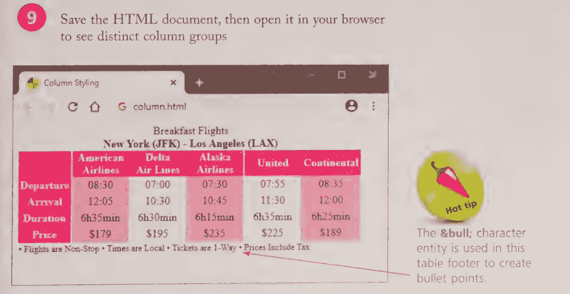

### 总结

- HTML`<ul>`元素创建一个无序项目符号列表，其中包含位于`<li>`元素内的各个列表项。
- `list-style-type`属性可以指定无序列表项应该使用**实心圆**、**空心圆**或**方块**项目符号，或者**无**。
- `list-style-image`属性可以指定一个图像的URL，该图像将显示在列表项项目符号的位置。
- `<ol>`元素创建一个有序编号列表，其中包含位于`<li>`元素内的各个列表项。
- `list-style-type`属性可以指定有序列表项应如何编号，例如**十进制**、**大写拉丁字母**或**无**。
- `<dl>`元素创建一个定义列表，其中术语位于`<dt>`元素中，其描述位于`<dd>`元素中。
- HTML`<table>`元素创建一个表格，可以选择先包含一个`<caption>`元素来为表格添加标题。
- 每个表格行由一个`<tr>`元素创建，其中包含多个`<th>`标题元素和`<td>`数据元素。


- 表格单元格可以使用`rowspan`属性向下跨越其他单元格，使用`colspan`属性向右跨越单元格。
- 在`<caption>`元素之后立即添加`<thead>`和`<tfoot>`元素，可以为表格添加页眉和页脚。
- 具有页眉和页脚的表格还必须将所有常规表格行包含在`<tbody>`元素内。
- 表格列可以使用`<colgroup>`元素进行分组以设置样式。
- 每个表格列可以由一个`<col>`元素表示，以便可以单独设置其样式。

## 5 包含媒体内容


本章演示如何在页面内容中包含图像和其他媒体。

1. **添加图像**
2. **图像映射**
3. **引用图形**
4. **选择图片**
5. **嵌入对象**
6. **嵌入矢量图形**
7. **嵌入框架**
8. **添加音频**
9. **添加视频**
10. **指示进度**
11. **使用模板**
12. **插入插槽**
13. **使用对话框**
14. **绘制画布**
15. **总结**

### 添加图像

将图像添加到HTML文档内容的能力带来了许多令人兴奋的可能性。使用``标签可以轻松地将图像添加到文档中，该标签最好始终包含以下属性：

- `src`属性是必需的，用于指定图像位置的URL，可以是绝对路径或相对路径。
- 建议使用`width`属性来指定图像将在页面上占据区域的像素宽度。
- 建议使用`height`属性来指定图像将在页面上占据区域的像素高度。
- 建议使用`alt`属性来指定描述图像的文本，以便在图像无法加载时使用。

分配给`width`和`height`属性的值会指示网页浏览器在网页上创建一个该尺寸的内容区域。这不一定是图像的实际尺寸，因为网页浏览器可以按另一个指定的尺寸渲染图像。必须小心避免失真，确保尺寸与实际图像尺寸成比例缩放。此外，图像应该只缩小，因为放大通常会导致像素化——即单个像素对肉眼可见。然而，依赖浏览器来缩放未显示为全尺寸的图像是低效的，因为这需要下载不必要的更大文件。最好使用图形编辑器（如Adobe Photoshop）将图像尺寸调整为它在网页上将占据的实际尺寸，这样它将更快地下载和显示。

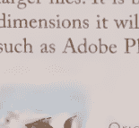

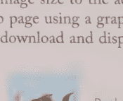

网页位图图形的最佳文件类型是流行的非专有便携式网络图形（PNG）格式，它生成紧凑的文件并支持透明度。

...续

1. 创建一个HTML文档。
2. 在body部分内，插入三个图像元素——用于显示一个全尺寸图形和两个缩放版本。

```html


```


3. 保存HTML文档，然后在浏览器中打开它，以查看全尺寸图像和两个缩放版本。


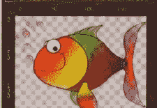

4. 现在，将此属性插入到每个图像元素中：

`style="background:Aqua"`

5. 刷新浏览器以查看彩色背景。


### 图像映射

如果添加了图像“映射”来为每个超链接定义“热点”区域，则单个图像可以定位多个超链接资源。要使用图像映射，``标签必须包含一个`usemap`属性来指定映射名称，并以`#`哈希字符为前缀。图像映射本身包含在`<map>`和`</map>`标签之间，其名称由`<map>`开始标签中的`name`属性指定。

图像中要成为超链接热点的每个区域由`<map>`元素内的`<area>`标签的四个属性定义。`shape`属性指定其形状为`rect`（矩形）、`circle`（圆形）或`poly`（多边形），而`coords`属性指定其x轴和y轴坐标的逗号分隔列表：

| 形状 | 坐标 |
| :--- | :--- |
| `rect` | 左上x，左上y，右下x，右下y |
| `circle` | 中心x，中心y，半径 |
| `poly` | x1, y1, x2, y2, x3, y3, 等等——每个点一对坐标。第一个和最后一个点必须具有相同的坐标以完成形状 |

此外，每个`<area>`标签必须有一个`href`属性来指定超链接的URL目标，以及一个`alt`属性来指定当图像未启用时显示的替代文本。

1. 创建一个HTML文档。
2. 在body部分内，插入一个图像和映射元素。
3. 在映射元素内，定义一个覆盖图像左上四分之一区域的矩形热点——从左上点xy:0,0到右下点xy:200,100。

```html

<map name="search">
<!-- 区域将放在这里。 -->
</map>
```

```html
<area shape="rect" coords="0,0,200,100"
      href="https://www.bing.com"
      alt="Bing Panel" title="Link to Bing">
```


...续

4. 现在，在映射元素内，定义三个相同大小的热点，覆盖图像的其他三个四分之一区域。

```html
<area shape="rect" coords="200,0,400,100"
    href="https://www.ask.com"
    alt="Ask Panel" title="Link to Ask">

<area shape="rect" coords="0,100,200,200"
    href="https://www.google.com"
    alt="Google Panel" title="Link to Google">

<area shape="rect" coords="200,100,400,200"
    href="https://www.yahoo.com" alt="Yahoo Panel"
    title="Link to Yahoo">
```

> 不要在逗号分隔的坐标列表中留下任何空格。

5. 保存HTML文档，然后在浏览器中打开它，以查看描述每个热点的工具提示，您可以点击以打开其关联的目标。


> 除非每个`<area>`标签都包含一个`alt`属性，否则验证将失败。

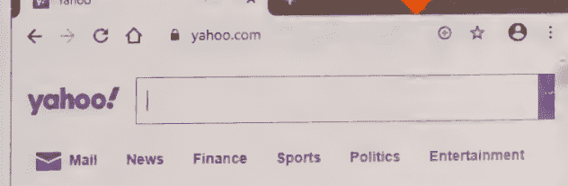

### 参考图形

根据最新的HTML规范，网页作者现在有了将图像插入网页的额外方法。``标签可以嵌套在`<figure>`和`</figure>`元素中，以嵌入与主要文本内容相关但移除后不会破坏文本含义的图像。


由于嵌套图像实际上现在是一个独立的“图形”，如果需要，可以将其定位在远离文本的地方，并通过嵌套的`<figcaption>`和`</figcaption>`元素中的标题进行引用：


1. 创建一个HTML文档。
2. 在body部分内，插入一个标题。

```html
<h1>Web Development Stacks</h1>
```

3. 接下来，插入一个带标题的图形。

```html
<figure id="front-stack" >

<figcaption class="reference">Figure 1:Front-end Technologies</figcaption>
</figure>
```

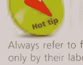

4. 现在，插入引用先前带标题图形的文本内容。

```html
<p>Front-end development, also known as client-side development, is the practice of producing HTML documents, CSS style sheets, and JavaScript script code <span class="reference">(Figure 1)</span> for a website or Web Application - so a user can see and interact with them directly.</p>
```

始终仅通过标签引用图形——避免使用“在右边的图中”之类的引用术语，以便在不造成混淆的情况下轻松更改文档布局。

5. 插入第二个带标题的图形。

```html
<figure id="back-stack" >

<figcaption class="reference" >Figure 2:Back-end Technologies</figcaption>
</figure>
```

...续

6. 现在，插入引用第二个带标题图形的文本内容。

```html
<p>Back-end development, also known as server-side development, is the practice of producing complex websites using programming languages such as SQL, Java, PHP, or .NET <span class="reference" >(Figure 2)</span> to provide features beyond front-end capabilities.</p>
```

7. 添加一个样式表来定位每个带标题的图形并指定一些字体样式。

```html
<style>
figure#front-stack { float : left ; margin-top : 0px ; }
figure#back-stack { float : right ; margin-top : 0px ; }
.reference { color : Red ; font-weight: bold ; }
p:first-letter { font-size : xx-large ; }
</style>
```

8. 保存HTML文档和样式表，然后在浏览器中打开网页以查看带标题的图形。


> 您可以通过www.ineasysteps.com上关于SQL、Java、PHP、Python和MySQL的本系列配套书籍了解更多关于后端技术的信息


### 选择图片

随着网络内容越来越多地通过小型手持设备访问，最新的HTML规范允许网页作者根据设备屏幕尺寸指定网页上显示的备选图片。

一个`<picture>`和`</picture>`元素用于包含多个图片源，浏览器可从中选择最合适的一个。每个图片源通过嵌套的`<source>`元素的`srcset`属性指定，并通过其`media`属性指定适合该图片的最小屏幕宽度。此赋值需要一种不寻常的语法，在`()`括号内为`min-width`属性指定大小——例如，要指定一个图片仅适用于屏幕宽度超过500像素的设备，使用`media="(min-width : 500px)"`。

值得注意的是，`<picture>`和`</picture>`元素可以包含一个常规的``元素，以指定在不支持此选择功能的旧版Web浏览器上显示的图片：

1. 创建一个HTML文档。
2. 在body部分内，插入一个容器元素。

```html
<picture>
<!-- 图片源将插入此处 -->
</picture>
```

3. 接下来，插入一个图片源，仅在屏幕宽度超过500像素的设备上显示。

```html
<source media="(min-width : 500px)" srcset="picture-large.png" >
```

4. 现在，插入一个图片源，仅在屏幕宽度超过200像素的较小设备上显示。

```html
<source media="(min-width : 200px)" srcset="picture-small.png" >
```

5. 最后，插入一个图片源，仅在不支持选择功能的旧版浏览器上显示。

```html

```

`<source>`元素不需要闭合标签。它也用于`<audio>`元素（见第112页）和`<video>`元素（见第114页）。

6. 保存HTML文档，然后在各种浏览器中打开它，以查看相应尺寸的图片。

本示例中的图片具有以下尺寸：

- `large` – 500px x 500px
- `medium` – 250px x 250px
- `small` – 125px x 125px

如果你检查浏览器缓存，应该会发现它只高效地下载了要显示的合适图片，而不是所有图片。

### 嵌入对象

可以使用`<object>`和`</object>`标签在HTML文档中嵌入外部资源来定义该资源。当资源是图片时，其处理方式将与``元素指定的图片非常相似；否则，系统可能会寻找一个插件来处理该资源。`<object>`元素可以将其`data`属性指定为资源的URL，并将其`type`属性指定为资源类型。资源类型必须是描述该资源的有效MIME类型。

| MIME类型 | 对象文件格式 |
| :--- | :--- |
| image/png | PNG图片资源 |
| image/jpeg | JPG, JPEG, JPE图片资源 |
| image/gif | GIF图片资源 |
| image/svg+xml | SVG矢量图资源 |
| text/plain | TXT纯文本资源 |
| text/html | HTM, HTML标记文本资源 |
| application/pdf | PDF便携式文档资源 |
| application/msword | DOC Word文档资源 |
| application/x-java-applet | CLASS Java小应用程序资源 |
| audio/x-wav | WAV声音资源 |
| audio/mpeg | MP3音乐资源 |
| video/mp4 | MP4视频资源 |
| video/x-mpeg | MPEG, MPG, MPE视频资源 |
| video/x-msvideo | AVI视频资源 |
| video/x-msv-wmv | WMV Windows视频资源 |
| video/quicktime | MOV Quicktime视频资源 |

此表格列出了一些流行的MIME类型。更多详细信息可在W3C网站`www.w3.org`上找到。

每个`<object>`元素可以使用其`width`和`height`属性指定显示可视内容的尺寸。当资源是图片时，`<object>`元素还可以包含一个`usemap`属性来指定图像映射的名称，就像为``元素生成的图像映射一样。

可选地，可以在`<object>`和`</object>`标签之间包含后备文本，该文本仅在资源无法嵌入文档时才会由浏览器显示——例如，当找不到合适的插件时。

所有`<object>`元素必须至少包含一个`data`属性或一个`type`属性。

### 嵌入媒体内容

1. 创建一个HTML文档。
2. 在body部分内，插入一个段落包装器。

```html
<p>这是主文档中的文本，它...<br>
<!-- 资源对象将嵌入此处。 -->
<br>...围绕一个嵌入资源继续。
</p>
```

3. 在段落内，插入一个PDF对象以嵌入。

```html
<object data="object-chart.pdf" type="application/pdf" width="500" height="350">
[ PDF文档 - 可能需要Adobe Reader插件 ]
</object>
```


## 4. 保存并查看嵌入对象

将 HTML 文档与指定的资源文件一起保存，然后在浏览器中打开该网页以查看嵌入的对象。

> 小提示：如果你可以禁用 PDF 支持，然后重新打开此示例，你将看到后备文本显示在嵌入的 PDF 文档的位置。

### 嵌入矢量图

HTML 的 `<embed>` 元素允许你集成一个外部资源以与 HTML 文档进行交互。

支持现代 HTML 的 Web 浏览器也支持可缩放矢量图（SVG）。与 PNG 等位图图形格式（它们将图形信息存储为每个像素的颜色）不同，矢量图将图形信息存储为一系列“路径”。这是一种描述图形的高效方式。

最重要的是，矢量图可以在不损失保真度的情况下进行缩放。这意味着它们可以无限放大，而不会出现放大 PNG、JPG 或 GIF 文件格式中的位图图像时所经历的像素化问题。

SVG 实际上不是 HTML 的一部分，而是基于可扩展标记语言（XML）的规范，因此它用文本文件描述矢量图像。这些文件可以手动创建，但使用矢量图编辑器（如 Adobe Illustrator）要简单得多。

SVG 图像可以无损定义地进行缩放，并且可以高质量打印而不会损失分辨率。

SVG 文件也可以添加脚本。为静态矢量图像添加 JavaScript 功能使得创建交互式 SVG 对象成为可能。这意味着 SVG 文件中的每个元素和每个属性都可以被动画化。

静态 SVG 图像和交互式 SVG 对象都可以通过将 MIME 类型 `"image/svg+xml"` 指定给 `<embed>` 元素的 `type` 属性来嵌入到 HTML 中。

静态 SVG 图像也可以使用 `` 元素嵌入——就像任何其他图像一样。

1. 创建一个 HTML 文档。
2. 在 `body` 部分内，插入一个元素以嵌入交互式可缩放矢量图：

   ```html
   <embed src="vector-picker.svg" type="image/svg+xml" width="280" height="200">
   ```

3. 将 HTML 文档与 SVG 文件一起保存，然后在浏览器中打开该网页以查看嵌入的交互式可缩放矢量图。
4. 通过点击图像中任何带圈的颜色样本来选择颜色，与矢量图进行交互。

> 你可以通过从 `www.ineasysteps.com/resource-centre/downloads` 下载示例存档来查看 JavaScript 是如何被整合到此 SVG 文档中的。

### 嵌入框架

外部资源可以通过 `<iframe> </iframe>` 标签嵌入 HTML 文档中的“内联框架”中。这会在页面上创建一个固定区域，用于显示嵌入的资源。内联框架的尺寸必须指定给 `<iframe>` 元素的 `width` 和 `height` 属性，外部资源的 URL 指定给其 `src` 属性。当外部资源的尺寸超过内联框架的尺寸时，浏览器会自动添加滚动条，以便用户查看全部内容。

每个 `<iframe>` 元素也可以选择性地包含一个 `name` 属性，用于为该框架指定一个唯一标识符。这允许超链接通过将框架名称赋值给 `<a>` 元素的 `target` 属性，将它们的 `href` 属性指定的 URL 加载到内联框架中（而不是替换整个页面）。例如，一个超链接可以指向名为 `"topbox"` 的内联框架，如下所示：

```html
<a href="some.html" target="topbox">
```

通常，内联框架在保持页面格式紧凑的同时，提供补充内容非常有用。

1. 创建一个 HTML 文档。
2. 在 `body` 部分内，插入一个包含标题和描述性段落的文章，并为定位样式指定一个类名。
3. 接下来，在 `body` 中，作为一个 `aside` 元素，插入一个内联框架，用于加载一个包含相关文本和水平并排展示的说明性照片的文档。

```html
<article class="left200">
<h3>概念车</h3>
<p>许多在最近车展上首次亮相的创意和创新概念车，让观众急切期盼它们的量产。</p>
</article>
```

```html
<aside>
<iframe src="concept.html" width="300" height="220">
</iframe>
</aside>
```

4. 现在，添加一个样式表来设置文章大小并将其定位在内联框架的左侧。

```css
article.left200 { width: 200px; float: left; margin-right: 10px; }
```

5. 将 HTML 文档与外部资源一起保存，然后在浏览器中打开它，以查看文章和内联框架内容。

可以在 `<iframe> </iframe>` 标签之间提供一个后备消息，以便在内联框架支持被禁用时显示。

6. 拖动滚动条以浏览内容。

在房产网站上，特别倾向于将文档嵌入内联框架中，以紧凑的页面格式将房产照片与房产描述并列展示。

### 添加音频

外部音频资源（如 MP3 音乐文件）可以使用 `<audio> </audio>` 标签嵌入 HTML 文档中。

`<audio>` 元素可以包含一个 `src` 属性，用于指定要嵌入的音频资源的 URL，并且可以包含其他属性来决定音频资源的使用方式：

- `autoplay` – 一个布尔属性，指定浏览器应立即开始播放音频资源。
- `loop` – 一个布尔属性，指定浏览器应重复播放音频资源。
- `controls` – 一个布尔属性，指定浏览器应显示用户控件以开始或停止播放音频。
- `preload` – 接受 `"auto"` 或 `"none"` 值，建议浏览器加载音频资源以便准备播放。

布尔属性，如 `autoplay`、`loop` 和 `controls` 属性，无需赋值——它们在元素内的存在本身就足以让浏览器理解其用途。

浏览器依赖内置的“编解码器”（编码器-解码器）来解码音频资源以便播放。遗憾的是，并非所有浏览器都集成了相同的音频编解码器：

- **高级音频编码（AAC）** – 编解码器 `"mp4a.40.2"`，由现代浏览器（如 Google Chrome、Firefox 和 Microsoft Edge）支持 MP3 音频。
- **Ogg 音频** – 编解码器 `"vorbis"`，由其他浏览器支持 OGG 格式的音频文件。

因此，这种不一致性要求音频资源需要编码两次才能在所有浏览器中播放。为此，可以将两个 `<source>` 元素嵌套在 `<audio>` 元素内，而不是在 `<audio>` 标签中指定单个资源 URL 给 `src` 属性。对于每种文件格式，`<source>` 元素可以将其资源 URL 指定给 `src` 属性，并将其 MIME 类型指定给 `type` 属性。浏览器将仅加载支持的音频资源进行播放。

布尔值只能是 True 或 False。默认情况下，表示布尔值的属性为 True，除非它们被赋值为 False。

可以在 `<audio> </audio>` 标签之间包含一个后备消息，以便在音频播放支持被禁用时显示。

1. 创建一个 HTML 文档。
2. 在 `body` 部分内，插入一个元素以嵌入 MP3 格式的音频资源用于自动播放。

```html
<audio src="audio.mp3" autoplay>
[ 备用消息 ]
</audio>
```

3. 保存 HTML 文档，然后打开网页，在支持的浏览器中听取自动音频播放。
4. 接下来，用一个显示用户音频播放控件的属性替换之前的两个属性。

```html
<audio controls>
<!-- 这里将插入源文件。 -->
</audio>
```

避免在网站上使用自动音频播放，因为许多用户讨厌自动播放功能。

5. 现在，在 `audio` 元素内，插入元素以指定要为所有浏览器嵌入的音频资源。

```html
<source src="audio.mp3" type="audio/mpeg">
<source src="audio.ogg" type="audio/ogg">
```

6. 再次保存 HTML 文档，然后在任何浏览器中打开网页，并使用控件听取播放。

### 添加视频

外部视频资源（如 MP4 视频文件）可以使用 `<video> </video>` 标签嵌入 HTML 文档中。

要确定视频资源的使用方式，`<video>` 元素可以包含 `src`、`autoplay`、`loop`、`controls` 和 `preload` 属性，就像上面示例中的 `<audio>` 元素一样。此外，可以为 `width` 和 `height` 属性指定页面上显示视频的区域尺寸。

主要有两种视频压缩标准：

- **高级视频编码（AVC）** – 一种受专利保护的标准，也称为 H.264 或 MPEG-4（`.mp4` 文件）。
- **WEBM 视频** – 一种免版税的替代方案，替代受专利保护的 H.264 和 MPEG-4 标准（`.webm` 文件）。

视频资源可以编码为每种格式以在所有浏览器中播放，并使用嵌套在 `<video>` 元素内的 `<source>` 元素嵌入。对于每种文件格式，`<source>` 元素可以将其资源 URL 指定给 `src` 属性，并且可以将每个视频文件的 MIME 类型指定给 `type` 属性。浏览器将仅加载支持的视频资源进行播放。

可以在 `<video>` 元素内嵌套一个 `<track>` 标签，用于将 Web 视频文本轨道（WebVTT）字幕文件的位置指定给其 `src` 属性。这可以包含一个 `kind` 属性来描述轨道，以及 `srclang` 来描述语言。该标签还必须包含一个布尔属性 `default` 来使用指定的文件。

字幕文件以 `WEBVTT` 开头。开始和结束时间提示以 `HH:MM:SS.sss` 格式添加在新的行上，并用 `-->` 分隔。相关的字幕标题出现在每个时间提示下方的新行上，如下所示：

```text
WEBVTT

00:00:01.000 --> 00:00:04.000
用“轻松步骤学 HTML”弹吉他

00:00:05.000 --> 00:00:06.000
感谢观看
```

请注意，毫秒用句点（`.`）分隔——而不是冒号。

### 指示播放进度

如果您不想提供浏览器的标准音视频播放控件，可以从 `<audio>` 和 `<video>` 标签中省略 `controls` 属性。然后可以通过嵌入媒体对象的 JavaScript `play()` 和 `pause()` 方法，从 `onclick` 事件处理脚本函数来控制播放。

使用 `<progress></progress>` 元素可以显示媒体播放的可视化指示器，呈现为“进度条”。在 `<progress>` 标签内，`value` 属性决定了向完成进度靠近的程度。这可以通过 `ontimeupdate` 事件处理脚本函数与媒体播放同步动态更新。

嵌入的媒体对象具有一个 `currentTime` 属性，用于存储自播放开始以来经过的时间，以及一个 `duration` 属性，用于存储总播放时间。这些属性可用于计算播放进度百分比：


1. 创建一个 HTML 文档。
2. 在 `body` 部分，插入元素以嵌入用于手动播放的音频资源：

   ```html
   <audio id="snd">
   <source src="audio.mp3" type="audio/mpeg">
   <source src="audio.ogg" type="audio/ogg">
   [ 回退信息 ]
   </audio>
   ```

3. 接下来，插入一个图像按钮来控制播放：

   ```html
   
   ```

4. 现在，插入元素以在播放过程中显示可视化指示器和计算出的百分比：

   ```html
   <progress id="bar" value="0"></progress>
   <span id="num">[Audio]</span>
   ```


> 在 `<audio>` 标签中包含一个 `id` 属性，以便从脚本中引用媒体对象，并在脚本需要引用的所有其他标签中也如此。

1. 添加一个脚本，其中包含一个函数，用于在 HTML 文档加载时初始化变量。
2. 插入一个控制播放的函数。
3. 插入一个显示播放进度的函数。
4. 保存 HTML 文档，然后在浏览器中打开它，并单击按钮以查看播放进度。

```javascript
<script>
( function () {

  const snd = document.getElementById( 'snd' )
  const ctl = document.getElementById( 'ctl' )
  const bar = document.getElementById( 'bar' )
  const num = document.getElementById( 'num' )
  let run = true

  /*  事件处理函数放在这里。 */

} )()
</script>
```

> 控件将根据 `run` 变量的布尔值来播放或暂停播放。

```javascript
ctl.onclick = function() {
  ( run ) ? snd.play() : snd.pause()
  run = !run }
```

> `currentTime` 和 `duration` 属性以秒为单位存储浮点数时间值，因此需要用 `Math.floor( )` 进行向下取整。

```javascript
snd.ontimeupdate = function() {
  bar.value = ( snd.currentTime / snd.duration )
  num.innerHTML = Math.floor( 100 * bar.value ) + '%' }
```


### 使用模板

HTML 的 `<template> </template>` 元素允许你包含在网页加载到浏览器时不会立即显示在页面上的内容。

存储在 `<template>` 元素内的内容可以稍后使用 JavaScript 加载，以在网页上显示内容。当你拥有可能需要重复添加的内容时，这非常有用。

模板内容是一个“DocumentFragment”对象，脚本可以复制它。然后可以将该副本作为现有内容的“子”元素附加。脚本也可以从内容中移除子元素。

1. 创建一个 HTML 文档。
2. 在 `body` 部分内，添加两个段落，当点击它们时会调用脚本函数：

   ```html
   <p id="hotel" style="cursor:pointer" onclick="addStar( this )">Hotel Mistrale</p>
   <p id="clear" style="cursor:pointer" onclick="removeStars( )">Clear</p>
   ```

3. 接下来，添加模板内容，该内容将由脚本函数附加到现有内容：

   ```html
   <template>
   
   </template>
   ```

4. 现在，添加一个脚本函数，用于复制模板内容并在点击时将其附加到第一个段落：

   ```html
   <script>
   function addStar( hotel ) {
     const temp = document.getElementById( 'star' )
     const copy = temp.content.cloneNode( true )
     hotel.appendChild( copy )
   }
   // 此处将插入第二个函数。
   </script>
   ```

然后，插入一个函数，用于在点击第二个段落时从第一个段落移除所有子元素：

```javascript
function removeStars() {
  const hotel = document.getElementById('hotel')
  while (hotel.ChildElementCount > 0)
  {
    hotel.removeChild(hotel.lastChild)
  }
}
```

将 HTML 文档与星形图片一起保存，然后在浏览器中打开它，点击以添加/移除内容。


在 HTML 引入 `<template>` 标签之前，脚本不得不创建 HTML 子元素内容，但使用模板则方便得多。

### 插入插槽

如第 118-119 页示例所示，`<template>` 元素只能附加在模板元素内定义的内容。然而，通过在 `<template>` 元素内包含 HTML `<slot> </slot>` 元素，可以使模板更加灵活，其内容在模板的每个实例中可以不同。

`<slot> </slot>` 标签可以选择性地包裹默认文本，但起始的 `<slot>` 标签必须包含一个 `name` 属性，该属性将该插槽标识为模板内的占位符。


`<slot>` 元素占位符通过在 HTML 元素中包含一个 `slot` 属性来填充内容，该属性指定了匹配的插槽 `name` 属性值。然后可以使用 JavaScript 将组合后的模板和插槽内容附加到网页。

1. 创建一个 HTML 文档。
2. 在 `body` 部分内，添加两个 `div`，每个 `div` 包含三个 `span`，并指定相同的三个插槽。

```html
<div class="homoymn">
  <span slot="word">Air</span>
  <span slot="def-1">A lilting tune</span>
  <span slot="def-2">What we breathe</span>
</div>

<div class="homoymn">
  <span slot="word">Current</span>
  <span slot="def-1">A flow of water</span>
  <span slot="def-2">Up to date</span>
</div>
```

3. 接下来，添加一个描述列表的模板，其术语和描述提供了指定的插槽。

```html
<template id="list-template">
<dl>
<dt><slot name="word">Term</slot></dt>
<dd><slot name="def-1">1st Definition</slot></dd>
<dd><slot name="def-2">2nd Definition</slot></dd>
</dl>
<style>
dl { width : 250px ; border : 1px solid ; }
dt { background : Orange ; color : White ; }
</style>
</template>
```

> 注意：样式表必须包含在模板内，否则其规则将不会应用于模板的元素。

### Shadow DOM 示例

4. 现在，添加一个脚本，以便在页面加载时将列表模板与指定插槽的文本内容组合起来。

```html
<script>
( function () {
  const homs =
      document.getElementsByClassName( 'homonym' )
  const temp = document.getElementById( 'list-template' )

  if( 'attachShadow' in homs[ 0 ] )
  {
    let i, copy, shadow

    for( i = 0 ; i < homs.length ; i++ )
    {
      copy = temp.content.cloneNode( true )
      shadow = homs[ i ].attachShadow( { mode: 'closed' } )
      shadow.appendChild( copy )
    }

  }

} )()
</script>
```

5. 保存 HTML 文档，然后在浏览器中打开它，查看组合后的模板和插槽内容。


**严格来说**，此示例创建了一个“影子文档对象模型”（ShadowDOM），然后由脚本将其附加到原始文档。`closed` 模式只是阻止通过 HTML 元素的 `shadowRoot` 属性进行脚本访问 ShadowDOM。


`slot` 属性只能出现在以下 HTML 标签中：`<article>`、`<aside>`、`<blockquote>`、`<body>`、`<div>`、`<footer>`、`<h1-6>`、`<header>`、`<main>`、`<nav>`、`<p>`、`<section>`、`<span>`。

### 使用对话框


你可以创建一个“模态”对话框，用户必须对其作出响应才能重新访问网页，方法是将对话框的内容封闭在 `<dialog>` 和 `</dialog>` 标签之间。

模态对话框出现在所有其他页面内容的上层，可以包含所有类型的内容（文本、图像等），但必须提供某种方式来关闭对话框并返回页面。通常，这将通过在模态对话框上包含一个或多个按钮来提供，这些按钮在被点击时会执行一个脚本函数以执行某些操作并关闭对话框。

可以使用 `<button>` 元素向网页或模态对话框添加一个可点击的按钮。`<button>` 和 `</button>` 标签之间的文本将作为其标签显示在按钮上。开始的 `<button>` 标签可以包含一个 `onclick` 属性，以指定在按钮被点击时要调用的脚本函数。或者，脚本可以动态地为每个按钮添加一个“事件监听器”，以识别用户何时单击按钮——创建一个“点击事件”。


1. 创建一个 HTML 文档。
2. 在 `body` 部分内，添加一个按钮和一个空段落，每个都有用于脚本的唯一 `id`。

```html
<button id="show">显示对话框</button>
<p id="info"></p>
```

3. 接下来，添加一个包含文本、图像和两个按钮的对话框，每个按钮都有用于脚本的唯一 `id`。

```html
<dialog id="dlog">
```

你的选择

```html

<br>
<button id="cncl">取消</button>
<button id="conf">确认</button>
</dialog>
```

4. 现在，添加一个脚本，为每个按钮添加事件监听器和事件处理函数。

```html
<script>
( function () {
  const dlog = document.getElementById( 'dlog' )
  const info = document.getElementById( 'info' )
  const show = document.getElementById( 'show' )
  const cncl = document.getElementById( 'cncl' )
  const conf = document.getElementById( 'conf' )

  show.addEventListener( 'click', function () {
    dlog.showModal()
    info.innerText = '模态对话框已打开' } )

  cncl.addEventListener( 'click', function () {
    dlog.close()
    info.innerText = '模态对话框已取消' } )

  conf.addEventListener( 'click', function () {
    dlog.close()
    info.innerText = '模态对话框已确认' } )
} ) ( )
</script>
```


虽然 `onclick` 和 `addEventListener` 技术都是正确的，但优先使用事件监听器有其优势。它可以清晰地将脚本与 HTML 代码分离，并且与 `onclick` 不同，它允许多个监听器处理同一事件。

5. 保存 HTML 文档，然后在浏览器中打开它并点击按钮以查看模态对话框。


在 Firefox 中，你可能必须打开 `about:config` 并设置 `dom.dialog_element` 为已启用才能看到模态对话框。


### 绘制画布


HTML `<canvas>` 和 `</canvas>` 标签在页面上创建一个位图画布区域，JavaScript 可以在其中绘制形状、文本和图像。默认情况下，画布区域宽 300 像素，高 150 像素，但可以为 `<canvas>` 元素的 `width` 和 `height` 属性指定其他尺寸。可以选择在 `<canvas>` 和 `</canvas>` 标签之间包含回退文本，这些文本仅会显示在不支持画布区域的浏览器中。

为了使用画布，脚本必须首先创建一个 `CanvasRenderingContext2D` 对象。这个名称响亮的上下文对象提供了在画布区域中绘制形状和文本所需的所有方法和属性。上下文对象是使用画布本身的 `getContext()` 方法创建的。例如，对于一个 `id` 为 `"canvas"` 的 `<canvas>` 元素，如下所示：

```javascript
const ctx = document.getElementById('canvas').getContext('2d')
```

然后可以将值分配给上下文对象的多个属性，并调用其多种方法在画布上绘制，例如下面列出的基本属性和方法：

| 属性 | 设置 |
|---|---|
| `fillStyle` | 填充颜色（默认黑色） |
| `strokeStyle` | 描边颜色（默认黑色） |
| `lineWidth` | 描边宽度（默认 1） |
| `font` | 字体大小和字体（默认 10px sans-serif） |

| 方法 | 绘制 |
|---|---|
| `fillRect()` | 一个填充矩形 |
| `strokeRect()` | 一个未填充矩形 |
| `fillText()` | 填充文本 |
| `strokeText()` | 未填充文本 |

> 你可以在 `html.spec.whatwg.org/multipage/canvas.html` 的 HTML Living Standard 规范中在线了解更多关于画布元素属性和方法的信息。


画布可以由脚本以频繁的间隔重绘以创建动画，并且画布可用于创建交互式游戏。事实上，画布提供的可能性几乎是无限的，因此对画布元素的全面探索可以填满另一本书。所列的示例仅使用上表中的基本属性和方法简要介绍了画布元素。

1. 创建一个包含 `canvas` 元素的 HTML 文档。

   ```html
   <canvas id="canvas" width="500" height="150">
   [回退文本]</canvas>
   ```


2. 添加一个包含自调用函数的脚本，该函数首先初始化上下文对象并设置两个属性。

```html
<script>
(function() {
  const ctx =
    document.getElementById('canvas').getContext('2d');
  ctx.lineWidth = 2;
  ctx.font = '5em Fantasy';

  // 语句将插入此处。

})();
</script>
```

3. 接下来，插入语句以填充和描边整个画布。

   ```javascript
   ctx.fillStyle = 'Bisque'
   ctx.fillRect(0, 0, 500, 150)
   ctx.strokeStyle = 'Red'
   ctx.strokeRect(0, 0, 500, 150)
   ```

这些参数指定了矩形左上角的 X、Y 坐标，后跟宽度和高度尺寸。

4. 现在，插入语句以填充和描边一些文本。

   ```javascript
   ctx.fillStyle = 'Orange'
   ctx.fillText('HTML Canvas', 30, 100)
   ctx.strokeStyle = 'Black'
   ctx.strokeText('HTML Canvas', 30, 100)
   ```

这些参数指定了文本以及文本左上角的 X、Y 坐标。

5. 保存 HTML 文档，然后在浏览器中打开它，查看绘制到画布上的填充和描边。


### 总结

- `` 标签用于在网页上放置图像，最好始终包含 `src`、`width`、`height` 和 `alt` 属性。
- `<map>` 和 `</map>` 标签用于包裹 `<area>` 元素，以定义图像映射的区域，并且必须包含 `name` 属性。
- `<figure>` 和 `<figcaption>` 标签可用于在 HTML 文档中嵌入带有说明文字的参考图像。
- `<picture>` 元素可以包含多个 `<source>` 标签，为不同的屏幕宽度提供多种图像尺寸。
- `<object>` 和 `</object>` 标签可用于在 HTML 文档中嵌入外部资源。
- 可以使用设置显示区域大小的 `<iframe>` 元素将外部资源嵌入到内联框架中。
- 外部音频资源可以使用 `<audio>` 和 `</audio>` 标签嵌入到 HTML 文档中，外部视频资源可以使用 `<video>` 和 `</video>` 标签嵌入。
- `<video>` 元素可以包含一个嵌套的 `<track>` 元素，用于指定 WebVTT 格式的字幕文件。
- `<progress>` 元素可用于提供媒体播放的视觉指示器。
- `<template>` 元素可以指定一组元素，这些元素可以被克隆以动态编写内容。
- 模板可以包含 `<slot>` 和 `</slot>` 元素，其内容在模板的每个实例中可以不同。
- `<dialog>` 和 `</dialog>` 标签在所有其他页面内容之上的一层创建模态对话框。
- `<button>` 和 `</button>` 标签创建一个可点击的按钮。
- `<canvas>` 元素可用于在网页上添加图形、动画和互动游戏。

## 6 创建本地域名

本章演示如何在您的 PC 上安装和配置 Web 服务器。

- 128 安装 Abyss
- 130 安装 Python
- 132 配置 Abyss
- 134 Echo 脚本
- 136 测试环境
- 138 总结

### 安装 Abyss

在您的系统上安装一个 Web 服务器对于网页开发非常有用。有几种免费的 Web 服务器可用，例如 Aprelium 的 Abyss Web Server X1。

1. 启动您的 Web 浏览器并访问 `aprelium.com`。
2. 单击 **Downloads** 菜单项，然后选择 **Free Download** 并下载适用于您系统的安装程序。

   Abyss 有适用于 Windows、macOS 和 Linux 的版本。

3. 运行安装程序，接受许可协议，并选择选项，例如 **64-bit** 版本、**SSL Support** 和 **Start Menu Shortcuts**。

   在 Windows 系统上，双击下载的 `.exe` 文件以运行安装程序。

4. 接受建议的安装位置，然后单击 **Install** 按钮。

   ……续

5. 选择您希望如何启动 Web 服务器，例如 **Install as a Windows Service** 以在后台自动持续运行。
6. 单击 **OK** 按钮打开 Abyss Web Server 控制台。
7. 选择您的语言（**English**），然后输入一个易于记住的登录名和密码——您稍后会需要它们！
8. 单击 **OK** 按钮保存您的凭据，然后单击下一个 **OK** 按钮以查看 Web 服务器正在运行。
9. 现在，在浏览器的地址栏中输入 `localhost`，然后按 **Return** 查看出现的默认索引网页。

### 安装 Python

Web 服务器可以运行服务器端脚本，以响应来自 Web 浏览器的请求。最流行的服务器端脚本语言包括 PHP、ASP.NET、Ruby、Perl 和 Python。

为了在您的 PC 上安装的 Abyss Web 服务器启用服务器端脚本，您必须首先安装服务器端脚本语言的解释器，例如 Python。

1. 启动您的 Web 浏览器并访问 `activestate.com`。
2. 登录（或创建帐户并登录），然后选择 **Featured Projects & Languages** 并下载适用于您系统的最新 Python 构建安装程序。
3. 运行安装程序，然后单击 **Next** 开始设置。
4. 单击 **Next** 接受许可协议。
5. 单击 **Next** 接受建议的安装位置和所有选项。

> 热门提示


> Python 是免费提供的，在 ActiveState 创建帐户也不收费。

> 不要忘记

> 建议的安装文件夹名称可能包含版本号，但您可以将其更改为`C:\Python\`。

### 安装 Python

现在，在下一个对话框上单击`Install`按钮开始安装过程 – 请稍坐，这需要一段时间。

安装过程较长，因为安装程序在运行时会动态编译 C 源代码。

安装完成后，单击`Finish`按钮关闭安装程序。

现在，打开命令提示符或终端窗口，然后输入`python`并按`Return`以打开 Python 控制台 – 在这里您可以与解释器交互。

您可以在 Windows 10 开始菜单的 Windows 系统文件夹中找到命令提示符启动器。

在 Python 控制台提示符下，精确输入这行 Python 代码并按`Return`以查看解释器在您系统上的位置：

`import sys ; print( sys.executable )`

```python
>>> import sys ; print( sys.executable )
C:\Python\python.exe
```

记下解释器的位置，因为您需要它来配置 Abyss 以进行 Python 脚本处理。

### 配置 Abyss

为了使 Abyss Web 服务器能够执行 Python 服务器端脚本，必须配置它以了解 Python 解释器（`python.exe`）在您系统上的位置，并识别文件扩展名为`.py`的文件是 Python 脚本。

1. 在 Abyss Web 服务器运行时，启动您的 Web 浏览器并在地址栏中输入`localhost:9999`，然后按`Return`打开 Abyss Web Server 控制台。
2. 输入您的凭据，然后单击`Configure`按钮。
3. 现在，单击`Scripting Parameters`图标。

> **热门提示**
>
> 域名`localhost`是 IP（互联网协议）地址`127.0.0.1`的别名 – 因此您可以输入`127.0.0.1:9999`来打开 Abyss Web Server 控制台。

4. 现在将出现一个“脚本参数”页面 – 勾选`Enable Scripts Execution`框。
5. 现在，单击解释器表中的`Add`按钮。

...续

6. 现在将出现一个“解释器”页面 – 将接口字段设置为`CGI/ISAPI`。
7. 现在，单击解释器字段中的`Browse`按钮，转到 Python 文件夹并选择`python.exe`文件。
8. 勾选`Use the associated extensions to automatically update the Script Paths`框。
9. 现在，单击关联扩展名字段中的`Add`按钮，并在扩展名字段中输入`py`。
10. 单击`OK`按钮，再次单击`OK`，然后单击`Restart`按钮以应用新配置。

### Echo 脚本

在配置了 Abyss Web 服务器以用于 Python 解释器和扩展名为`.py`的脚本文件后，您现在可以创建一个 Python 脚本，该脚本将执行以响应来自 Web 浏览器的请求。

许多请求以键值对的形式将数据发送到 Web 服务器，因此 Python 脚本可以简单地将这些键值对在一个 HTML 响应中回显出来，将键和值放在一个表格中。

1. 打开一个纯文本编辑器，例如 Windows 的记事本应用程序，然后在第一行开头输入一条指令以使用一个特殊的 Python 模块进行服务器端脚本编写：

```python
import cgi
```

2. 接下来，使用特殊 Python 模块提供的函数将所有键值对分配给一个变量：

```python
form = cgi.FieldStorage( )
```

3. 现在，使用 Python 内置的`print( )`函数编写将发送到浏览器的 HTML 头：

```python
print( 'Content-Type:text/html; charset=utf-8' )
```

4. 头信息必须与内容分开，因此添加这一行以写入两个回车和换行符：

```python
print( '\r\n\r\n' )
```

5. 以类型声明、标题和样式表开始编写 HTML 文档：

```python
print( """<!DOCTYPE HTML>
<html><title>Web Server Response</title>
<style>tr,th,td{border:2px solid Gray}</style>""" )
```

6. 接下来，开始一个包含两个标题单元格的表格：

```python
print( '<table style="width:500px"><tr><th>Key<th>Value' )
```

> Python 中使用缩进来对语句进行分组，而不是使用花括号，因此这三行的缩进必须一致。

7. 然后，添加一个循环来将任何键和值写入表格单元格：

```python
for i in form.keys( ) :
    key = str( i )
    val = str( form.getvalue( key ) )
    print( '<tr><td>' + key + '<td>' + val )
```

8. 最后，添加这些行以完成表格，显示服务器图标，并完成 HTML 文档：

```python
print('"</tr></table> </html>"')
```


你可以通过本系列的配套书籍《Python in easy steps》了解更多关于 Python 脚本编写的知识。

9. 确保你的脚本看起来像上面的截图。
10. 将文件保存为`echo.py`，放在你系统上 Abyss Web Server 位置的`htdocs`文件夹中——通常在 Windows 上是`C:\Abyss Web Server\htdocs`。
11. 在 Abyss Web Server 运行时，打开你的浏览器，然后在地址栏中输入`localhost/echo.py`并按下`Return`键，即可看到脚本用一个空表格作为响应。


`echo.py`脚本在第 7 章中被广泛用于演示向 Abyss Web Server 提交 HTML 表单。

#### 测试环境


现在，Abyss Web Server 已安装并配置为执行第 134-135 页的 Python 脚本，可以通过从浏览器向服务器发送数据来测试该环境。

数据可以通过在 Python 脚本的 URL 后附加一个“查询字符串”来发送到服务器。查询字符串以`?`问号分隔符开头，后跟一个`key=value`键值对——例如，要发送单个键值对，可以使用`http://localhost/echo.py?Forename=Mike`。

多个`key=value`键值对可以发送到服务器，每个键值对在查询字符串中用`&`和号分隔，例如`http://localhost/echo.py?Forename=Mike&Surname=McGrath`。

数据可以通过直接在浏览器的地址栏中输入 URL 和查询字符串来发送。也可以从指向该 URL 和查询字符串的超链接发送，或者从将`location`设置为该 URL 和查询字符串的 JavaScript 代码发送。


1. 创建一个 HTML 文档。
2. 接下来，在`<body>`部分内，添加一个超链接以向 Python 脚本发送数据：

   `<a href="http://localhost/echo.py?CSS=Style">Styling Web Pages</a>`

3. 现在，在`<body>`部分添加一个按钮：

   `<button id="sender">Scripting Web Pages</button>`

4. 最后，添加一个脚本，以便在用户点击按钮时向 Python 脚本发送数据：

   ```html
   <script>
   ( function () {
   const sender = document.getElementById( 'sender' )
   sender.addEventListener( 'click', function () {
   location = 'http://localhost/echo.py?JavaScript=Function' } ) } ( ) )
   </script>
   ```

5. 将 HTML 文档保存在服务器的`htdocs`文件夹中，然后在浏览器中打开它，并使用浏览器的地址栏、超链接或按钮发送数据。


> Python 脚本正在按预期工作。向查询字符串添加更多`key=value`键值对（每个键值对用`&`分隔），以查看响应在表格中添加更多行。


### 总结

- 免费的 Abyss Web Server X1 可以安装在你自己的 PC 上用于 Web 开发。
- Abyss 可以手动启动，也可以设置为在后台持续自动运行。
- 当 Abyss 运行时，它提供一个名为`localhost`的域名，该域名是 IP 地址`127.0.0.1`的别名。
- Web 服务器可以调用解释器来执行服务器端脚本，以响应来自 Web 浏览器的请求。
- 最流行的服务器端脚本语言包括 PHP、ASP.NET、Ruby、Perl 和 Python。
- 安装 Python 后，你可以通过 Python 控制台直接与其解释器（`python.exe`）交互。
- Abyss 必须配置为知道 Python 解释器（`python.exe`）的位置，并识别文件扩展名为`.py`的文件是 Python 脚本。
- URL`localhost:9999`和用户凭证是打开 Abyss Web Server 控制台所必需的。
- `CGI/ISAPI`接口允许数据在 Web 服务器和脚本解释器之间传输。
- 你系统上 Abyss Web Server 的位置包含一个`htdocs`文件夹，该文件夹被`localhost`域名识别。
- HTML 文档、服务器端脚本和其他资源文件应放在 Abyss`htdocs`文件夹中。
- 数据可以通过向请求的 URL 附加查询字符串来发送到 Web 服务器。
- 查询字符串以`?`问号分隔符开头。
- 查询字符串包含一个或多个`key=value`键值对，每个键值对用`&`和号分隔。
- Python 服务器脚本可以在 Web 服务器响应中回显从浏览器请求发送给它的数据。

## 7 创建输入表单


本章演示如何包含表单以向 Web 服务器提交数据。

1. **提交文本**
2. **输入类型**
3. **文本区域**
4. **复选框**
5. **隐藏数据**
6. **上传文件**
7. **按钮**
8. **图像按钮**
9. **添加徽标**
10. **选择选项**
11. **数据列表选项**
12. **标签控件**
13. **总结**

### 提交文本


网页表单由用于向 Web 服务器发送数据的 HTML 元素构成。每个元素包含一个`name`属性和一个`value`属性，以便分配给这些属性的数据可以作为`key=value`键值对进行处理。例如，如果一个元素的`name`属性被赋值为“Brand”，其`value`属性被赋值为“Ford”，则这个键值对表示的数据就是`Brand=Ford`。

表单元素包含在`<form> </form>`标签之间。每个起始`<form>`标签应包含一个`method`属性（指定用于提交表单的 HTTP 方法）和一个`action`属性（指定用于处理提交数据的服务器端脚本的 URL）。

`method`属性可以被赋值为“GET”或“POST”。通过首选的`GET`方法提交会将数据附加到 URL，而通过`POST`方法提交则以不同方式编码数据，当`GET`方法失败时可以使用此方法。

通常，HTML 表单会有一个“提交”按钮，用户点击它来发送数据进行处理。这是通过将值“submit”赋给`<input>`标签的`type`属性来创建的。此外，该标签可以包含`name`和`value`属性，以将分配给它们的数据作为`name=value`对提交。

HTML 表单可以提供文本框，用户可以在其中输入要提交的数据。这些是通过将值“text”赋给`<input>`标签的`type`属性，并为其`name`属性指定一个名称来创建的。文本框中的数据作为与文本框名称关联的值，以`key=value`键值对的形式发送。可选地，`<input>`标签可以包含一个`value`属性来指定默认值。通过将值“password”赋给`<input>`标签的`type`属性，可以创建用于输入密码的文本框。它的功能类似于任何其他文本框，但不会将其内容显示为可读文本。文本和密码类型的`<input>`元素都可以选择性地包含以下其他属性：

- **size** – 文本框的宽度（以平均字符宽度为单位）。
- **minlength**和**maxlength** – 允许的字符数。
- **min**和**max** – 允许的数字值范围。
- **placeholder** – 向用户提供数据输入提示。
- **readonly** – 文本框中的默认值无法更改。
- **disabled** – 文本框变灰且不会被提交。

> 通过 GET 方法发送的数据作为查询字符串附加到请求上，因此在 Web 服务器响应中可能在浏览器的地址栏中可见。你可以通过 POST 方法提交以防止敏感数据泄露。


#### 输入类型

HTML 表单的`<input>`标签可以通过包含`required`关键字来强制要求用户完成输入。它还可以通过其`type`属性所赋的值来控制允许用户提交的内容。下表中列出的许多输入类型，如果用户输入了不允许的值，则会禁止表单提交并发出错误通知。有些类型还提供了特殊的控件，允许用户轻松选择允许的值。

| 类型 | 允许的输入 |
| --- | --- |
| `text` | 文本字符串 |
| `password` | 文本字符串（浏览器会隐藏显示） |
| `url` | 有效的 URL 协议和域名地址 |
| `email` | 有效的电子邮件地址 |
| `date` | 格式为 mm/dd/yyyy 的日期 |
| `month` | 月份和年份 |
| `week` | 周数和年份 |
| `time` | 格式为 HH:MM 的时间 |
| `datetime-local` | 日期和时间，格式为 mm-dd-yy HH:MM |
| `number` | 数值整数 |
| `range` | 数值整数（滑块） |
| `color` | 格式为 #RRGGBB 的十六进制颜色值 |
| `file` | 文件路径地址（可浏览） |

1. 创建一个包含带提交按钮的表单的 HTML 文档：

   `<form method="GET" action="http://localhost/echo.py" >`

   `<!-- 输入元素将放在这里。 -->`

   `<p><input type="submit" value="提交表单"></p>`

   `</form>`

2. 现在，在表单中，插入四个控制输入元素：

   颜色：`<input type="color" name="color">`

   范围：`<input type="range" name="range" min="1" max="10">`

   时间：`<input type="time" name="time"> <br>`

   URL：`<input type="url" name="url" size="54" required >`

3. 将 HTML 文档保存到 Abyss`htdocs`文件夹中，然后尝试提交表单以查看其失败。
4. 在`url`类型的输入字段中输入一个有效的 URL。


5. 现在，使用其他输入的特殊控件输入允许的值，然后成功提交表单。

> 请注意，查询字符串中的特殊字符会被转换为百分比编码的 Unicode 值。这里，`#` 符号被转换为其 Unicode 值 `%23`。

#### 文本区域

HTML 表单可以提供一个多行文本字段，用户可以在其中输入数据以提交给 Web 服务器进行处理。这些字段由 `<textarea>` 和 `</textarea>` 标签创建，这些标签可以包含默认文本内容。

`<textarea>` 标签应包含一个 `name` 属性，该属性将在提交时作为键值对与元素内容关联。此外，此标签必须包含一个 `rows` 属性以指定可见文本行数，以及一个 `cols` 属性以指定以平均字符宽度表示的字段宽度。可选地，它也可以包含一个 `readonly` 属性，以防止用户编辑其内容。

提交大段文本时，必须了解 `GET` 方法的一些限制。这因浏览器而异，但可能仅允许 URL 追加约 200 个字符。`POST` 方法提供了大得多的容量，因为文本是作为“表单数据”与 HTTP 标头一起发送的，而不是简单地附加到 URL：

1. 创建一个 HTML 文档，其中包含一个表单元素，该元素包含一个提交按钮，用于通过 `POST` 方法发送表单数据：

   ```html
   <form method="POST" action="http://localhost/echo.py" >

   <!-- 文本区域元素将放在这里。 -->

   <p><input type="submit" value="提交表单"></p>

   </form>
   ```

2. 现在，在表单元素中，插入一个具有 10 行且宽度为 65 个平均字符宽度的文本输入区域：

   ```html
   <textarea name="The Future Web" rows="8" cols="70">
   </textarea>
   ```

3. 将 HTML 文档保存到 Abyss `htdocs` 文件夹中，然后在浏览器中打开网页，输入一些数据，并提交表单。

> 与文本 `<input>` 元素不同，`<textarea>` 元素没有 `value` 属性——因为其内容本身就被视为其值。

平均字符宽度可能因浏览器而异——因此文本区域字段的实际大小也可能不同。

文本并未附加到 URL，因此请检查响应标头以确认它是作为“表单数据”发送的。

你可以使用 Google Chrome 浏览器中的开发者工具来检查响应标头。按 F12，然后选择“网络”标签，并在左侧面板中选择 `echo.py` 项目。

### 复选框

HTML 表单可以提供一个可视的复选框“开/关”开关，用户可以切换它以包含或排除其关联数据，从而提交给服务器。当框被选中时，开关设置为“开”，其键值对将被提交。

复选框通过将值 `"checkbox"` 赋给 `<input>` 标签的 `type` 属性来创建。此标签还必须包含一个 `name` 属性和一个 `value` 属性，以指定键值对的值。可选地，此标签也可以包含一个布尔型 `checked` 属性，以将开关的初始状态设置为“开”——这样复选框中将自动出现一个勾选标记。

复选框名称可以是各个唯一的，也可以多个复选框共享一个公共名称，以允许用户为同一个命名属性选择多个值。在这种情况下，选定的值将由服务器作为逗号分隔的列表返回，格式为 `key=value,value,value`。

“单选按钮”类似于复选框，但它是通过将值 `"radio"` 赋给 `<input>` 标签的 `type` 属性来创建的。与复选框不同，共享公共名称的单选按钮是互斥的，因此当一个单选按钮被选中时，该组中的所有其他按钮都会自动关闭。

多个复选框和单选按钮可以通过用 `<fieldset>` 和 `</fieldset>` 标签包围其 `<input>` 元素来进行视觉分组。这些标签还可以包含 `<legend>` 和 `</legend>` 标签来声明公共的组名：

```html
<form method="GET" action="http://localhost/echo.py" >
<!-- 复选框和单选按钮将放在这里。 -->
<p><input type="submit"></p>
</form>
```

1. 创建一个包含带提交按钮的表单元素的 HTML 文档。

2. 现在，在表单元素中，插入一个包含两个复选框的段落：

   ```html
   <p>发送详情
   <input type="checkbox" name="Send" value="Details">
   发送价格
   <input type="checkbox" name="Send" value="Prices">
   </p>
   ```

3. 接下来，在表单元素中，插入一个带有图例的字段集：

   ```html
   <fieldset>
   <legend>HTML是什么类型的语言？</legend>

   <!-- 单选按钮将放在这里。 -->

   </fieldset>
   ```

4. 然后，在字段集中，插入单选按钮，并选中一个：

   ```html
   脚本语言 <input type="radio" name="Definition" value="Scripting"> <br>
   标记语言 <input type="radio" name="Definition" value="Markup"> <br>
   编程语言 <input type="radio" name="Definition" value="Programming" checked>
   ```

5. 将 HTML 文档保存到 Abyss `htdocs` 文件夹中，然后打开网页，选中两个复选框，选择正确的单选按钮答案，并提交表单。

> `<fieldset>` 元素仅为其包含的相关元素进行视觉分组——它不会在编程上将它们关联起来。

> 仅选中一个复选框并提交表单，以查看只有复选框的名称和值被发送到 Web 服务器。

#### 隐藏数据

HTML 表单可以提供隐藏元素，这些元素不创建可见的控件，但允许将附加数据提交到服务器。通过将 `<input>` 标签的 `type` 属性值设置为 `"hidden"` 来创建隐藏表单数据。此标签还必须包含一个 `name` 属性，并且可以包含一个 `value` 属性来指定将作为 `name=value` 对提交的静态数据。或者，`<input>` 标签可以包含一个 `id` 属性并省略 `value` 属性，以便其值可以通过脚本指定。

隐藏表单数据也可用于执行计算并在 `<output>` 元素中动态显示结果。`<output>` 标签必须包含一个 `id` 属性和一个 `for` 属性，以便在脚本中引用。`for` 属性可以指定多个元素标识符，以空格分隔的列表形式。这些可用于赋值给 `<form>` 标签的 `oninput` 属性，以执行一个计算，其结果将出现在 `<output>` 元素中——但不会被提交到服务器：


1. 创建一个 HTML 文档，其中包含一个显示带有销售价格详情的商品的图像：

   ```html
   
   ```

2. 接下来，插入一个表单元素：

   ```html
   <form method="GET" action="http://localhost/echo.py" >

   <!-- Hidden data, input, and output to go here -->

   <input type="submit" name="Offer"
       value="Buy Teddy Bears">
   </form>
   ```


3. 在表单元素内，插入一个用于用户输入数据的可见输入元素：

   ```html
   Qty (60 Available) <input type="number" id="qty" name="Quantity" min="1" max="60">
   ```

4. 现在，在表单元素中，插入一个用于隐藏数据的不可见元素和一个用于显示计算结果的元素：

   ```html
   <input type="hidden" id="price" name="Unit Price" value="24.99">
   <output name="sum" for="qty price"></output> <br>
   ```

5. 然后，在 `<form>` 标签中插入另一个属性：

   ```html
   oninput="sum.value=multiply( qty, price )"
   ```

6. 添加一个脚本来执行计算：

   ```javascript
   <script>
   function multiply( q, p ) {

   let result=parseFloat( q.value ) * parseFloat( p.value )

   if ( isNaN( result ) || result < 1 ) return ''
   else return `Total: $` + result.toFixed( 2 )
   }

   </script>
   ```

> **注意**

> JavaScript 区分大小写，因此复制脚本示例时必须使用正确的大小写。

7. 将 HTML 文档保存在 Abyss `htdocs` 文件夹中，然后在浏览器中打开该网页，输入数据并提交表单。


> **不要忘记**

> 隐藏的表单 `<input>` 数据会被提交到服务器，但 `<output>` 元素仅显示计算结果。


| 键 | 值 |
|---|---|
| Offer | Buy Teddy Bears |
| Unit Price | 24.99 |
| Quantity | 4 |

#### 上传文件


HTML 表单可以提供文件选择功能，该功能调用操作系统的“选择文件”对话框，允许用户浏览其本地文件系统并选择一个文件。

通过将 `<input>` 标签的 `type` 属性值设置为 `"file"` 并为其 `name` 属性指定一个名称来创建文件选择功能。此元素生成一个文本字段和一个“浏览”按钮，以启动“选择文件”对话框。选择文件后，其完整路径将出现在文本字段中。当表单被提交时，元素名称和所选文件的名称将作为 `name=value` 对发送到 Web 服务器。

如果要将选定的文件上传到 Web 服务器，`<form>` 标签必须包含一个 `enctype` 属性，将编码类型指定为 `"multipart/form-data"`。此外，其 `method` 属性必须指定 `POST` 方法——因为表单数据无法使用 `GET` 方法附加到 URL：


**upload.html**

1. 创建一个 HTML 文档，其中包含一个表单元素，该元素包含一个提交按钮，用于通过 `POST` 方法发送表单数据，并指定表单数据的编码类型。

2. 在表单元素中，插入一个文件元素和一个换行符。

3. 将 HTML 文档保存在 Abyss `htdocs` 文件夹中，然后在浏览器中打开该网页，在系统上选择一个文件，并提交表单。

4. 查看 Abyss `htdocs` 文件夹，会看到所选文件的副本现在已放置在那里。

   ```html
   <form method="POST"
         action="http://localhost/upload.py"
         enctype="multipart/form-data" >

       <!-- File input element to go here. -->

       <input type="submit">
   </form>
   ```

   ```html
   <input type="file" name="Upload" size="70" > <br>
   ```


此示例使用了一个名为 `upload.py` 的 Python 脚本，该脚本放置在 Abyss `htdocs` 文件夹中。此脚本包含在本书的下载存档中，可从 www.ineasysteps.com/resource-centre/downloads 免费获取。


### 按钮

HTML 表单可以提供用于脚本目的的按钮。当用户按下按钮时，会发生“点击事件”，脚本函数可以响应此事件。这允许用户与表单进行动态交互，并可用于设置属性值。当脚本指定要调用的函数时，每当按钮被按下，就称为将一个“行为”附加到该按钮。

通过将 `"button"` 值指定给 `<input>` 标签的 `type` 属性来创建按钮，并且还应包含一个 `id` 属性，以便脚本可以轻松识别该元素。分配给按钮 `value` 属性的文本将出现在按钮的表面上。

此外，任何 HTML 表单都可以通过按下重置按钮恢复到其原始状态，该按钮通过将 `"reset"` 值指定给 `<input>` 标签的 `type` 属性来创建：

1. 创建一个 HTML 文档，其中包含一个表单元素，该元素包含一个重置按钮、一个按钮和一个提交按钮。

2. 在表单元素内，插入一个包含图例和复选框组的字段集：

   ```html
   <form method="GET" action="http://localhost/echo.py" >
   <!-- Fieldset to go here. -->
   <input type="reset" value="Reset Form">
   <input type="button" value="Choose For Me" id="btn">
   <input type="submit" value="Submit Form">
   </form>
   ```

   ```html
   <fieldset>
   <legend>Pizza Toppings</legend>
   <input id="pepperoni" type="checkbox" name="Toppings" value="Pepperoni"> Pepperoni |
   <input id="mushroom" type="checkbox" name="Toppings" value="Mushroom"> Mushroom |
   <input id="bbqsauce" type="checkbox" name="Toppings" value="BBQ Sauce"> BBQ Sauce
   </fieldset>
   ```

3. 添加一个脚本，将行为附加到按钮：

   ```javascript
   <script>
   ( function () {

   const pep = document.getElementById( 'pepperoni' )
   const btn = document.getElementById( 'btn' )

   btn.addEventListener( 'click', function () {
                 pep.checked = true } )
   } ) ( )
   </script>
   ```

> 仅仅在 HTML 元素中存在布尔 `checked` 属性就会选中该复选框，但在脚本中，需要将该复选框的 `checked` 属性赋值为 `true` 值才能选中它。

4. 将 HTML 文档保存在 Abyss `htdocs` 文件夹中，然后在浏览器中打开该网页，按下按钮以选中一个复选框。


5. 现在，按下重置按钮以清除表单，然后选中另外两个复选框并提交表单。


#### 图像按钮

HTML 表单可以使用图像按钮来提交表单，代替常规的提交按钮。通过将 `"image"` 值指定给 `<input>` 标签的 `type` 属性并包含一个 `alt` 属性来创建图像按钮。当通过图像按钮提交表单时，点击发生点的 XY 坐标会自动作为键值对与其余表单数据一起提交。

此外，常规的 `` 标签可以通过脚本附加一个行为，将其用作图像按钮。如果该行为是提交表单，脚本函数可以有效地包含验证——例如，确保用户输入的电子邮件地址符合预期格式：

创建一个 HTML 文档，其中包含一个表单元素，该元素包含一个文本输入字段，并且两者都有用于脚本的标识符：

```html
<form id="my-form" method="GET" action="http://localhost/echo.py" >
```

请提供您的电子邮件地址：

```html
<input id="adr" name="Address" type="text" size="45"> <br>
```

```html
<!-- Image Buttons to go here. -->
```

```html
</form>
```

接下来，在表单元素中，插入一个将直接提交表单的图像按钮。


```html
<input type="image" src="ibutton.png" alt="Submit Button" title="Click to submit form">
```

现在，在表单元素中，插入一个图像按钮，该按钮将执行验证然后提交表单。

```html

```


#### 添加标志

HTML 可以使用 `<button>` `</button>` 标签创建显示小“标志”图像的按钮。这些标签可以包含一个指定标志图像 URL 的 `` 元素，以及将显示在按钮正面的文本。

每个 `<button>` 标签都应包含一个 `type` 属性，以指定该按钮是简单的脚本“按钮”类型、“提交”表单类型还是“重置”表单类型。脚本按钮可以在 `<button>` 标签中包含一个 `onclick` 属性，以指定按钮被点击时要调用的函数，或者直接指定要执行的脚本片段：

创建一个包含表单元素的 HTML 文档，该表单元素包含一个带有图例和文本输入字段的字段集：

```html
<form method="GET" action="http://localhost/echo.py">

<fieldset>

<legend>Favorite Color</legend>
<input type="text" name="Color">

<!-- Logo Buttons to go here. -->

</fieldset>

</form>
```

在字段集中，插入一个脚本标志按钮，指定按钮被点击时要执行的脚本片段：

```html
<button type="button"
onclick="alert('Enter your favorite color in the text box')">

<!-- Logo Image and Face Text to go here. -->

</button>
```

现在，在按钮元素内，插入一个图像元素和将显示在按钮正面的文本：

```html
Help
```

接下来，添加一个用于提交表单的按钮元素：

```html
<button type="submit">

Submit</button>
```

5. 最后，添加一个用于重置表单的按钮元素：

```html
<button type="reset">
Reset</button>
```

6. 将 HTML 文档保存在 Abyss `htdocs` 文件夹中，然后在浏览器中打开它，并点击“Help”按钮。

> 你可以通过 `<input>` 标签的 `value` 属性为文本输入指定默认值。

7. 在文本框中输入一种颜色，然后点击重置标志按钮以清空文本框。

8. 再次在文本框中输入一种颜色，然后提交表单。

### 选择选项

HTML 表单可以提供一个选择选项列表，用户可以从中选择一个选项，将其关联的数据提交到服务器。

选择选项列表使用 `<select>` `</select>` 标签创建。开始的 `<select>` 标签必须包含一个 `name` 属性，用于指定列表名称。`<select>` 元素包含定义每个选项的 `<option>` `</option>` 标签。每个开始的 `<option>` 标签必须包含一个 `value` 属性，用于指定选项值。当表单被提交时，列表名称和所选选项值将作为 `name=value` 对发送到服务器。

可选地，一个 `<option>` 标签也可以包含一个布尔 `selected` 属性以自动选择该选项，并且 `<option>` 元素可以通过包含在 `<optgroup>` `</optgroup>` 标签中进行分组。开始的 `<optgroup>` 标签可以通过 `label` 属性指定选项组名称。

选择选项列表通常显示为单行下拉列表，除非在 `<select>` 标签中包含 `size` 属性以指定要显示的行数：

1. 创建一个包含表单元素的 HTML 文档，该表单元素包含一个提交按钮：

```html
<form method="GET" action="http://localhost/echo.py" >

<!-- Select option lists to go here. -->

<p>
<input type="submit">
</p>

</form>
```

2. 现在，在表单元素中，插入一个固定高度的选择选项列表，其中一个选项被自动选中：

```html
<select name="HTML List Type Selector One" size="4">

<optgroup label="List Type 1">
<option value="UL">Unordered List</option>
<option value="OL" selected>Ordered List</option>
<option value="DL">Description List</option>
</optgroup>

</select>
```

3. 接下来，在表单元素中，插入一个下拉选择选项列表，其中一个选项被自动选中：

```html
<select name="HTML List Type Selector Two">
  <optgroup label="List Type 2">
    <option value="UL">Unordered List</option>
    <option value="OL">Ordered List</option>
    <option value="DL" selected>Description List</option>
  </optgroup>
</select>
```

4. 将 HTML 文档保存在 Abyss `htdocs` 文件夹中，然后在浏览器中打开它。

5. 打开下拉列表并提交表单，以查看默认选项值被提交。

> 始终包含 `selected` 属性以自动选择每个选项列表中的一个选项——以提供默认选择。

#### 数据列表选项

可以使用 `<datalist> </datalist>` 元素为文本 `<input>` 提供一个简单的“自动完成”功能，该元素包含多个预定义的 `<option>` 值。用户可以选择其中一个选项，或者直接在输入字段中输入文本。为了将 `<input>` 字段与列表关联，`<datalist>` 标签必须包含一个 `id` 属性来指定列表名称。然后必须在 `<input>` 标签的 `list` 属性中指定相同的名称以创建关联。`<input>` 标签还必须包含一个 `name` 属性，以便照常发送到服务器。

`datalist.html`

1. 创建一个包含表单元素的 HTML 文档，该表单元素包含一个提交按钮：

```html
<form method="GET" action="http://localhost/echo.py">

<!-- Form data list and input field to go here. -->

<p><input type="submit" value="Submit Form"></p>
</form>
```

提交到服务器的 `key=value` 对是指定的列表名称和从选项中选择或用户直接输入的 input 值。

2. 接下来，插入一个具有指定 `id` 名称的预定义选项数据列表：

```html
<datalist id="browsers">

<option value="Google Chrome">
<option value="Firefox">
<option value="Internet Explorer">
<option value="Opera">
<option value="Safari">
<option value="Microsoft Edge">

</datalist>
```

3. 现在，插入一个包含文本和与上述数据列表关联的输入字段的标签：

```html
<label>
Choose your browser from this list:
<input list="browsers" name="myBrowser">
</label>
```

4. 将 HTML 文档保存在 Abyss `htdocs` 文件夹中，然后在浏览器中打开该网页。

#### 标签控件

与 HTML 表单控件相关联的文本可以被包含在 `<label>` `</label>` 标签之间。开始的 `<label>` 标签可以包含一个 `for` 属性，用于指定分配给控件的 `id` 属性的值，以建立关联。

或者，`<label>` 元素可以简单地将文本和控件元素一起包含，以建立关联。这允许将样式应用于整个标签——包括文本和控件。这通常有助于区分与特定文本相关联的控件。

此外，每个表单控件元素都可以包含一个 `tabindex` 属性，以指定其在文档中的制表键顺序，其值为 0 到 32,767 之间的唯一值。使用制表键，用户可以从最低的 `tabindex` 值开始，然后依次经过更高的值，在文档中导航：

1. 创建一个包含一个带有图例的字段集的 HTML 表单文档：

```html
<form method="GET" action="http://localhost/echo.py">

<fieldset>

<legend>工具箱</legend>

<!-- 表单控件放在这里。 -->

</fieldset>

</form>
```

2. 现在，在字段集中，插入每个包含文本和一个具有指定制表顺序的复选框的标签：

```html
<label>锤子
<input type="checkbox" name="Toolbox" value="Hammer" tabindex="2" checked></label>

<label>螺丝刀
<input type="checkbox" name="Toolbox" value="Screwdriver" tabindex="3" ></label>

<label>扳手
<input type="checkbox" name="Toolbox" value="Wrench" tabindex="4" checked></label>

<label>钻头
<input type="checkbox" name="Toolbox" value="Drill" tabindex="5"></label>

<label>锯子
<input type="checkbox" name="Toolbox" value="Saw" tabindex="6" checked></label>
```

3. 接下来，插入一个带有图标的提交按钮——放在第一个制表位置：

```html
<button type="submit" tabindex="1">
提交</button>
```

表单“控件”是任何 `<input>`、`<button>` 或 `<textarea>` 元素。`tabindex` 属性可以包含在这些标签中，也可以包含在任何 `<a>`、`<area>`、`<object>` 或 `<select>` 标签中。

4. 将 HTML 文档保存到 Abyss `htdocs` 文件夹中，然后在浏览器中打开它，查看文本-控件关联不清晰。

5. 编辑 HTML 文档，为每个交替的标签标签添加一个用于样式的 `class` 属性：

```html
<label class="hilite">
```

6. 添加一个带有规则的样式表以区分标签：

```html
<style>

label.hilite { background : Red ; color : White ; }

</style>
```

7. 再次保存 HTML 文档，然后打开网页，查看文本-控件关联现在清晰了。使用制表键在控件之间移动，使用空格键选择复选框，然后提交表单。

### 总结

- HTML 表单将数据作为键=值对提交到 Web 服务器，由指定的服务器端脚本处理。
- 所有表单组件元素都包含在 `<form></form>` 标签之间，这些标签必须包含一个 `action` 属性，用于指定处理脚本的 URL，以及一个 `method` 属性，用于指定提交方法为 GET 或 POST。
- 每个 `<input>` 标签的 `type` 属性指定其组件类型，例如“text”、“password”、“checkbox”、“radio”等。
- `<input>` 标签可以包含 `name` 和 `value` 属性，以指定作为键=值对提交的数据。
- `<input>` 标签可以通过包含 `required` 关键字来强制完成，但许多控件会自动禁止用户输入不允许的值时进行提交。
- 多行文本字段由 `<textarea></textarea>` 标签创建，这些标签需要 `rows` 和 `cols` 属性来指定其大小。
- 单选按钮和复选框输入仅在其被选中时才提交其 `name` 和 `value` 属性数据。
- 表单可以包含“隐藏”元素，这些元素允许将静态或脚本生成的数据提交到服务器进行处理。
- 当表单要上传文件时，`<form>` 标签必须包含一个 `enctype` 属性，将编码指定为“multipart/form-data”。
- 表单可以通过常规提交 `<input>` 元素、图像 `<input>` 元素或 `<button>` 元素提交。
- 可以通过将 `` 元素包含在 `<button></button>` 标签之间，将图标图像添加到按钮界面上。
- 选项列表通过将多个 `<option>` 元素包含在 `<select></select>` 标签之间创建。
- 选项列表可以包含在 `<optgroup></optgroup>` 标签之间，这些标签可以指定一个选项组名称给 `label` 属性。
- `<input>` 标签可以包含一个 `list` 属性，以将其与 `<datalist>` 元素的 `id` 关联，提供预定义的选项。
- 每个表单控件可以包含在 `<label></label>` 标签之间，以便在视觉上将它们与文本分组，用于样式目的。

## 8 CSS 入门

本章介绍了令人兴奋的级联样式表（CSS）世界，并演示了如何创建样式规则并将其应用于 HTML 文档。

- 166 认识 CSS
- 168 创建规则
- 170 应用规则
- 172 选择类型
- 174 选择类
- 175 选择标识
- 176 选择相关元素
- 178 选择属性
- 180 权衡重要性
- 182 绘制颜色
- 184 设置背景
- 186 总结

### 认识 CSS

级联样式表（CSS）是一种用于控制超文本标记语言（HTML）文档中元素呈现方式的语言。呈现方式由“样式”指定，这些样式可以“内联”分配给 HTML 元素的 `style` 属性，或者通过 HTML 文档头部区域 `<style> </style>` 标签内的“规则”指定，或者作为独立样式表中的规则指定。每个样式规则选择指定的元素，然后将指定的样式应用于它们。

CSS 由万维网联盟（W3C）创建，目的是在 HTML 从最初仅定义文档结构元素（如标题、段落、超链接、列表等）的少数“标签”发展而来后，重新获得对文档标记的控制。随着控制图像、文本颜色、字体大小和背景颜色的更多标签被添加，人们认识到许多网页的源代码通常包含大量标记，但实际内容却很少。

W3C 提供了一个解决方案，通过将文档的结构和呈现方面分离来重新获得对文档标记的控制。HTML 标签将继续控制结构，但呈现方面现在将由用级联样式表（CSS）语言编写的“样式规则”控制。除了区分文档的结构和呈现方面之外，CSS 解决方案还带来了以下额外好处：

- **更易于维护** – 单个样式表可以控制多个 HTML 文档，因此只需编辑一个样式表即可更改整个网站的外观。
- **更小的文件大小** – 从 HTML 中移除所有呈现标记会产生更小的文件，下载更快。
- **更大的控制力** – 现在可以指定任何 HTML 元素的边距、边框、填充、背景颜色和背景图像，以及界面某些部分（如光标）的外观。

W3C 是一个国际联盟，其成员共同合作制定网络标准。CSS 主页可以在 W3C 网站 `www.w3.org/Style/CSS` 上找到。

最新的 CSS 规范（CSS3）被划分为模块，允许进行圆角边框、阴影、渐变颜色填充和动画效果等增强——这些以及更多内容都将在本书中通过示例进行演示。

CSS 是被所有现代网页浏览器普遍接受的样式表语言。

样式规则最终对同一元素的优先级由其“特异性”权重决定——参见第 180-181 页。

因此，级联意味着浏览器通常会应用作者样式表（如果存在）中的样式规则，否则会应用用户样式表（如果存在）中的样式规则，否则会应用浏览器默认样式表中的样式规则。

### 创建规则

在 CSS 中，每个样式规则由两个主要部分组成：

1. **选择器** —— 指定 HTML 文档中哪些元素是该规则的目标。
2. **声明块** —— 指定选中目标元素的属性应如何被样式化。

样式规则（或“样式规则集”）以选择器开始，后跟包含在一对花括号（大括号）内的声明块。花括号包含一个或多个声明，每个声明指定一个属性和该属性的有效值，如本例所示：

```css
h1 {
  color: Blue;
  background: Yellow;
}
```


通常，选择器用于选择特定的HTML元素进行样式设置——例如使用上述样式规则样式化文档中的所有`<h1>`标题元素。

上面示例中的声明块包含两个声明，用于指定所选目标元素的前景色和背景色。CSS`color`属性被赋予一个`Blue`值——因此每个`<h1>`标题元素将具有蓝色前景文本。类似地，CSS`background`属性被赋予一个`Yellow`值——因此每个`<h1>`标题元素将具有黄色背景。

注意CSS声明如何使用冒号（`:`）将值赋给属性。同时注意每个声明都以分号（`;`）终止。

严格来说，声明块中的最后一个声明不需要用分号终止，但大多数网页作者习惯性地终止所有CSS声明——这样在向现有样式规则集添加进一步声明时，就不必记住添加分隔用的分号。

> `background`属性是`background-color`和第184页描述的其他几个CSS属性的“简写”属性。

1.  当创建一个新的CSS样式规则时，作者必须首先指定一个选择器来定位将应用该规则的HTML元素——CSS选择器是出现在声明块开括号之前的所有内容：

    `h1`

2.  接下来，必须在选择器之后添加一对花括号来创建声明块：

    `h1 { }`

3.  现在，可以在声明块内插入一个声明，为属性赋值：

    `h1 { color : Blue ; background : Yellow ; }`

    空白字符（空格、制表符、换行符和回车符）允许出现在样式规则中，以便作者根据自己的偏好格式化样式规则。

4.  然后可以在声明块内添加第二个声明，与第一个声明用分号分隔：

    `h1 { color : Blue ; background : Yellow ; }`

5.  样式规则集现在已完成，但也可以通过扩展选择器使其成为逗号分隔的列表，从而应用于另一个HTML元素：

    `h1, h2 { color : Blue ; background : Yellow ; }`

6.  然后可以在第一个样式规则集下方添加更多样式规则集，以定位其他元素：

    ```css
    h1, h2 { color : Blue ; background : Yellow ; }
    p { color : Red ; }
    ```

    少于四个声明的样式规则集通常写在一行，否则为了清晰起见会写在多行——通常选择器和`{`开括号出现在第一行，随后是各声明独占一行，最后`}`闭括号在最后一行。由于页面空间有限，本书中的代码列表格式更为简洁。

### 应用规则

样式表只是应用于HTML文档的样式规则的集合。可以通过在HTML文档的`<head>`部分中将样式规则插入`<style>`和`</style>`标签之间来创建内部样式表。

此外，每个HTML文档的`<head>`部分都应包含一个`<meta>`标签，以设置页面的“视口”。此标签确定网页的可见区域以适应查看页面的设备，其形式如下：

```html
<meta name="viewport"
      content="width=device-width, initial-scale=1.0" >
```

- `width=device-width`部分将页面宽度设置为匹配查看设备的屏幕宽度。

- `initial-scale=1.0`部分将浏览器的初始缩放级别设置为网页首次加载时的100%。

1.  打开一个纯文本编辑器（如Windows的记事本应用程序），然后创建一个包含标题、副标题和段落元素的HTML文档：

    ```html
    <!DOCTYPE html>
    <html lang="en">
    <head>
    <meta charset="UTF-8">
    <meta name="viewport"
          content="width=device-width, initial-scale=1.0" >
    <title>应用样式规则</title>
    <!-- 内部样式表将插入此处。 -->
    </head>
    <body>
    <h1>标题</h1>
    <h2>副标题</h2>
    <p>段落 </p>
    </body>
    </html>
    ```

    > 视口的`<meta>`标签不需要分成两行。这里这样显示是因为空间限制。

2.  在文档的`<head>`部分，插入一个包含标题元素样式规则的内部样式表：

    ```html
    <style>
    h1 { color : Blue ; background : Yellow ; }
    </style>
    ```

3.  保存HTML文件，然后在网页浏览器中打开它，以查看应用于标题的内部样式表规则。

样式规则也可以通过为元素的`style`属性分配“内联”属性和值来应用：

内联规则可以覆盖其他样式表指定的规则，因为内联规则是浏览器最后应用的规则。

4.  编辑副标题标签以添加一个内联规则集：

    `<h2 style="color : White ; background : Green ;" >`

样式规则也可以从外部样式表应用：

5.  打开一个纯文本编辑器，然后输入以下样式规则并将其另存为名为`external.css`的外部样式表：

    `p { color : Yellow ; background : Red ; }`

6.  编辑HTML文件以链接外部样式表，在文档的`<head>`部分插入此标签：

    `<link rel="stylesheet" href="external.css" type="text/css">`

    外部样式表非常适合在多个网页之间保持一致的样式，因此作者可以更改单个规则，该规则将立即应用于所有页面。本书中的大多数示例使用内部样式表，以便每个HTML文档都是一个独立的示例。

7.  保存HTML文件，然后在网页浏览器中重新打开它，以查看应用于页面的内联和外部样式表规则。

### 类型选择器

样式规则的**选择器**部分会在 HTML 文档中选择需要根据该规则声明块中的值进行样式的元素。

“类型”选择器会选择页面中所有与该选择器匹配的元素。通过指定以逗号分隔的元素类型列表，一个类型选择器可以选择多个元素。

1.  创建一个 HTML 文档，其中包含一个标题和一个超链接的无序列表，并将它们放在一个`div`容器内。

```html
<div>
<h1>大标题</h1>
<ul>
<li><a href="https://google.com">Google</a></li>
<li><a href="https://yahoo.com">Yahoo</a></li>
<li><a href="https://mediafire.com">MediaFire</a></li>
</ul>
</div>
```

2.  添加一个样式表，其中包含一条样式规则，将容器元素的宽度设置为页面宽度的一半。

```css
div { width: 50%; }
```

3.  添加样式规则，设置所有超链接、标题和列表元素的背景色。

```css
a { background: Yellow; }
h1, ul { color: White; background: Blue; }
```

> 请记住，在针对多个元素类型的选择器中，元素类型之间必须用逗号分隔。

4.  保存 HTML 文件，然后在浏览器中打开该网页，查看由类型选择器设置的样式元素。

CSS 的`*`通配符选择器可用于选择 HTML 文档中的所有类型的元素——就好像它是一个列出了所有元素类型（以逗号分隔）的选择器：

5.  添加一条带有通配符选择器的样式规则，使所有文本变为斜体，然后再次保存 HTML 文件并刷新浏览器，查看标题和列表文本都变为斜体。

```css
* { font-style: italic; }
```

你将在本书的第 10 章中发现更多 CSS 字体属性。

`*`通配符选择器也可以用于选择包含在指定元素类型中的任何类型的元素：

6.  添加一条带有通配符选择器的样式规则，为`div`容器内的所有元素添加一个 2 像素宽的边框，然后再次保存 HTML 文件并刷新浏览器，查看元素周围的边框。

```css
div * { border: 2px solid Red; }
```

`div *`选择器会选择`div`容器内的所有类型的元素，但不包括`<div>`元素本身。

### 类选择器

除了按类型选择元素外，类选择器可以选择包含具有与选择器匹配的值的`class`属性的 HTML 元素。类选择器以`.`句点字符开头，后跟要匹配的`class`值。这对于将样式规则应用于多个不同类型的特定元素尤其有用。

此外，类选择器可以与类型选择器结合使用，以选择类的特定实例。在这种情况下，选择器首先指定元素类型，后跟一个`.`句点字符和要匹配的`class`值：

1.  创建一个 HTML 文档，其中包含一个段落和两个带有`span`的单词——它们都具有一个共同的`class`值。

    ```html
    <p class="frame">You can fool all the people <span class="frame">some</span> of the time, and <span class="frame">some</span> of the people all the time, but you cannot fool all the people all the time.</p>
    ```

2.  添加一个样式表，其中包含一条样式规则，使用`class`值在每个元素周围绘制红色边框。

    ```css
    .frame { border: 2px solid Red; }
    ```

3.  现在，添加一条样式规则，仅为段落元素覆盖之前的规则——在段落周围绘制蓝色边框并设置其宽度。

    ```css
    p.frame { border: 2px solid Blue; width: 50%; }
    ```

4.  保存 HTML 文档，然后在浏览器中打开该网页，查看由类选择器设置的样式元素。

> 如果两条规则选择同一个元素，样式表中靠下的规则将被应用。但这些规则在样式表中出现的顺序无关紧要。与类型选择器结合使用的类选择器将被应用，因为它更具体。请参阅第 180 页以了解如何计算特异性。

### ID 选择器

与类选择器类似，ID 选择器可以选择包含具有与选择器匹配的值的`id`属性的 HTML 元素。ID 选择器以`#`井号字符开头，后跟要匹配的`id`值。这主要用于将样式规则应用于一个特定元素，因为每个`id`属性值在 HTML 文档中必须是唯一的。

或者，ID 选择器可以与类型选择器结合使用，仅仅是为了标识元素类型。在这种情况下，选择器首先指定元素类型，后跟一个井号字符和要匹配的`id`值：

1.  创建一个 HTML 文档，其中包含一个段落和两个带有`span`的短语——它们都具有一个唯一的`id`值。

    ```html
    <p id="para1">You may only be someone
    <span id="span1">in the world</span><br>
    but to someone else you may
    <span id="span2">be the world</span></p>
    ```

2.  添加一个样式表，其中包含样式规则，在每个`span`元素中的文本后面绘制彩色背景。

    ```css
    #span1 { color: White; background: Red; }
    #span2 { color: White; background: Lime; }
    ```

3.  现在，添加一条样式规则，在段落其余部分的文本后面绘制彩色背景并设置其宽度。

    ```css
    p#para1 { background: Yellow; width: 70%; }
    ```

如果类选择器和 ID 选择器都试图设置同一个元素的同一个属性，则将应用 ID 选择器的值，因为它具有更高的重要性。有关选择器如何评定重要性，请参阅第 180 页。

4.  保存 HTML 文档，然后在浏览器中打开该网页，查看由 ID 选择器设置的样式元素。

### 关系选择器

除了通过类型、类或 ID 选择目标元素（如第 172-175 页所述）之外，CSS 还允许将选择器组合起来，以选择相对于 HTML 文档中其他元素的元素。这些“组合器”提供了四种选择：

#### 后代选择器（空格）

这会选择作为某个父元素后代的所有元素。CSS 选择器首先指定父元素，然后是一个空格，后跟后代元素。例如，要选择`<div>`division 元素内任何层级的所有`<p>`段落元素：

```css
div p { }
```

后代选择器会针对父元素的所有子元素——即使它们之间存在其他元素层级。

#### 子选择器（ > ）

这会选择作为某个父元素子元素的所有元素。CSS 选择器首先指定父元素，然后是一个`>`尖括号字符，后跟子元素。例如，要选择直接父元素是`<div>`division 元素的所有`<p>`段落元素：

```css
div > p { }
```

#### 相邻兄弟选择器（ + ）

这会选择紧随父元素之后的所有相邻兄弟元素。CSS 选择器首先指定父元素，然后是一个`+`加号字符，后跟兄弟元素。例如，要选择紧跟在每个`<div>`division 元素之后的所有`<p>`段落元素：

```css
div + p { }
```

兄弟元素必须具有相同的父元素。相邻兄弟必须紧跟在父元素之后，而普通兄弟是直接包含在父元素内的所有元素。

#### 普通兄弟选择器（ ~ ）

这会选择紧跟在父元素之后的所有兄弟元素。CSS 选择器首先指定父元素，然后是一个`~`波浪号字符，后跟兄弟元素。例如，要选择跟随在`<div>`division 元素之后的所有`<p>`段落元素：

```css
div ~ p { }
```

# 1

创建一个包含标题、多个`div`和段落，以及一个`aside`元素的HTML文档

```html
<h3>Heading</h3>
<div>Content</div> <div>More content</div>
<div>  <p>Para 1</p> <p>Para 2</p>
  <aside> <p>Para 3</p> </aside>
</div>
```


relative.html

# 2

添加一个样式表，其样式规则选择所有段落，以及紧接在标题元素之后的那个`div`元素

```css
<style>
div p { color : White ; background : Blue ; }
h3 + div { background : Yellow ; }
</style>
```


你可以指定多个后代以进一步细化后代选择器，例如`div p span { }`

# 3

保存HTML文档，然后在浏览器中打开该网页，查看由相对选择器设置的元素样式

相邻兄弟


## 4

编辑样式规则，仅选择直接父级是`div`元素的段落，以及所有跟在标题元素之后的`div`元素

```css
div > p { color : White ; background : Blue ; }
h3 ~ div { background : Yellow ; }
```

通用兄弟

## 5

再次保存HTML文档，然后刷新浏览器以查看更改

#### 属性选择器

除了通过类型、类、ID或关系（如第172-177页所述）选择目标元素外，CSS选择器还可以定位具有特定属性或特定属性值的HTML元素。属性选择器有七种选项：

**属性名选择器 [ *attribute* ]**

这会选择所有具有指定属性的元素，通过陈述一个元素后跟一个在`[]`括号中的属性名：

`ol[ attribute ]`

**属性值选择器 [ *attribute*="*value*" ]**

这会选择所有具有指定属性和指定值的元素，在`[]`括号内陈述：

`li[ class="value" ]`

**属性值项选择器 [ *attribute*~="*value*" ]**

这会选择所有具有指定属性和包含指定单词的值列表的元素：

`li[ class~="item" ]`

**属性首词选择器 [ *attribute*|="*value*" ]**

这会选择所有具有指定属性和以指定单词开头的值的元素：

`li[ class|="word" ]`

**属性子串选择器 [ *attribute*="*value*" ]**

这会选择所有具有指定属性和值中任意位置包含指定子串的值的元素：

`li[ class*="substring" ]`

**属性首子串选择器 [ *attribute*^="*value*" ]**

这会选择所有具有指定属性和值中任意位置以指定子串开头的值的元素：

`li[ class^="substring" ]`

**属性末子串选择器 [ *attribute*$="*value*" ]**

这会选择所有具有指定属性和值中任意位置以指定子串结尾的值的元素：

`li[ class$="substring" ]`

> **注意**

首词选择器仅当属性值是一个完整的单词或带连字符的单词时才会选择该元素——例如，选择`[class="top"]`，值为`topcat`或`top-cat`。

# 1

创建一个包含有序列表的HTML文档，其中所有元素都包含属性


```html
<ol id="list">
  <li class="reptile">Alligator</li>
  <li class="domestic animal">Dog</li>
  <li class="animal wild">Tiger</li>
  <li class="cat-family">Lion</li>
  <li class="sea fish">Barracuda</li>
  <li class="topcat">Cartoon</li>
  <li class="domestic bird">Budgerigar</li>
</ol>
```


`attribute.html`

## 2

添加一个样式表，其中包含一个通过其属性选择列表元素的样式规则。

```css
<style>
ol[ id ] { border: 2px solid Red; }
</style>
```

## 3

现在，添加样式规则，通过它们的属性值选择所有列表项。

```css
li[class="reptile"]       { background: Red; }
li[class~="animal"]       { background: Blue; }
li[class|="cat"]          { background: Green; }
li[class*="fi"]           { background: Yellow; }
li[class^="top"]          { background: Orange; }
li[class$="ird"]          { background: Purple; }
```


指定给三个子串选择器的值不需要是完整的单词。

## 4

保存 HTML 文档，然后在浏览器中打开该网页，查看由属性选择器设置的元素样式。


### 权重考量

当多个样式规则针对同一元素的属性时，CSS 层叠通过检查其选择器的“特异性”来评估它们的重要性——考虑每个选择器针对元素的具体程度，以确定它们的相对重要性。

有四个类别定义了选择器的重要性。按重要性降序排列如下：

- **内联：**直接在元素的 `style` 属性中声明的样式规则——例如，`style="color:White;"`
- **ID：**针对元素 `id` 属性的选择器——例如，`h2#header`
- **类、属性：**针对元素 `class` 或 `[attribute]` 的选择器——例如，`h2.head`
- **元素：**通过名称针对元素类型的选择器——例如，`h2`

特异性评估过程为每个选择器组件分配分数，这些分数存储在四个权重“寄存器”中，以便稍后与冲突选择器的特异性值进行比较。因此，特异性值可以表示为逗号分隔的列表——其中 `0,0,0,0` 是零特异性值。选择器组件分数分配如下：

- 对于内联 `style` 属性声明，加 `1,0,0,0`
- 对于选择器中的每个 `id` 属性，加 `0,1,0,0`
- 对于选择器中的每个 `class` 属性或属性值选择，加 `0,0,1,0`
- 对于选择器中的每个元素（或伪元素），加 `0,0,0,1`

如果两个选择器具有相同的特异性权重评级，则“后定义的规则优先”，因此样式表中位置靠后的规则将被应用。

> 嵌入式样式表规则优先于外部样式表中的规则，并且通用选择器的特异性值为零，即 `0,0,0,0`。

> 伪元素在第 230 页描述。


创建一个包含三个标题的 HTML 文档。

```html
<h2 style="color:White;" >Element Style</h2>
<h2 id="header">Identity Style</h2>
<h2 class="head">Class Style</h2>
```


`specificity.html`

添加一个样式表，其中包含一个通过类型选择所有标题元素的样式规则。

```css
<style>
h2 { color : Yellow ; }
</style>
```


现在，添加样式规则，每条规则以不同方式针对标题元素的 `background` 属性。

```css
h2      { background : Red ; }     /* 0,0,0,1 */
body h2 { background : Blue ; }    /* 0,0,0,2 */

#header     { background : Green ; }   /* 0,1,0,0 */
h2#header { background : Red ; }       /* 0,1,0,1 */

h2.head      { background : Red ; }    /* 0,0,1,1 */
body h2.head { background : Green ; }  /* 0,0,1,2 */
```

> `/* */` 语法可用于在 CSS 样式表中添加单行和多行注释。

保存 HTML 文档，然后在浏览器中打开该网页，查看在考虑特异性以评估其重要性后设置的元素样式。


> 注意，第一个标题的颜色来自内联声明——覆盖了样式表中的类型选择器。每个标题的背景由权重分数最高的规则应用。


### 颜色绘制

Web 浏览器识别这些表格中列出的所有颜色名称。你可以在 CSS 规则中使用这些名称来设置 HTML 元素的颜色。这些名称不区分大小写，因此也可以全小写书写——例如，`background : aqua ;`


颜色也可以写成构成该颜色的红、绿、蓝分量——例如，红色是 `rgb(255, 0, 0)`。或者，颜色可以写成十六进制数——例如，红色是十六进制的 `#FF0000`，即红色 FF（十进制 255），00（十进制 0）绿色，00（十进制 0）蓝色。


#### 颜色名称（续）

| 颜色名称 | 颜色名称 | 颜色名称 |
| :--- | :--- | :--- |
| 浅金菊黄 | 浅灰 | 浅绿 |
| 浅粉红 | 浅鲑肉色 | 浅海绿 |
| 浅天蓝 | 浅板岩灰 | 浅钢蓝 |
| 浅黄 | 酸橙绿 | 酸橙绿 |
| 亚麻色 | 品红 | 栗色 |
| 中海蓝宝石色 | 中蓝 | 中兰紫 |
| 中紫 | 中海绿 | 中板岩蓝 |
| 中春绿 | 中绿松石色 | 中紫红 |
| 午夜蓝 | 薄荷奶油色 | 雾玫瑰色 |
| 鹿皮色 | 纳瓦霍白 | 海军蓝 |
| 老蕾丝色 | 橄榄色 | 橄榄褐 |
| 橙色 | 橙红 | 兰花紫 |
| 苍金菊黄 | 苍绿 | 苍绿松石色 |
| 苍紫红 | 木瓜色 | 桃色 |
| 秘鲁色 | 粉色 | 梅色 |
| 粉蓝 | 紫色 | 丽贝卡紫 |
| 红色 | 玫瑰棕 | 皇家蓝 |
| 鞍棕 | 鲑肉色 | 沙棕 |
| 海绿 | 海贝色 | 赭色 |
| 银色 | 天蓝 | 板岩蓝 |
| 板岩灰 | 雪白 | 春绿 |
| 钢蓝 | 棕褐色 | 水鸭色 |
| 蓟色 | 番茄红 | 绿松石色 |
| 紫罗兰色 | 小麦色 | 白色 |
| 白烟 | 黄色 | 黄绿 |

**小贴士**

颜色也可以用其色相、饱和度、明度值来表示——例如，纯红色指定为 `hsl(0, 100%, 50%)`。

**小贴士**

可选地，可以向颜色规范添加第四个 Alpha 值来确定颜色的不透明度——例如，半透明的纯红色指定为 `rgba(255, 0, 0, 0.5)` 或 `hsla(0, 100%, 50%, 0.5)`。

### 设置背景

正如每个元素都可以通过其 `background` 属性指定背景颜色一样，也可以通过其 `background` 属性指定背景图像，其值为 `url(filename)`。这里的 `filename` 是图像文件的路径——例如，`background: url(bg.png);`

`background` 属性也可用于同时指定背景图像和颜色，值以空格分隔——例如，`background: LightBlue url(bg.png);` 背景图像位于背景颜色层之上，因此指定具有透明区域的图像将允许背景颜色透过图像显示。

任何指定的背景图像通常位于元素的左上角，浏览器默认会逐行重复“平铺”图像以覆盖整个元素区域。可以通过为 `background` 属性分配不同的值来修改此行为，其中 `repeat-x` 值将平铺模式限制为水平一行，`repeat-y` 值将平铺模式限制为垂直一列。也可以通过分配 `no-repeat` 值来防止平铺，这样图像的单个副本将出现在内容框的左上角。

> 选择背景图像时，请确保其不会使文本内容难以阅读。

背景图像的位置可以通过 `background` 属性指定，以使用 `left`、`center` 和 `right` 值控制其水平位置，使用 `top`、`center` 和 `bottom` 值控制其垂直位置。将水平和垂直值与 `no-repeat` 值结合使用，可以让你在元素区域内的给定位置设置单个图像版本——例如，`background: url(bg.png) no-repeat top right;`

`background` 属性默认具有一个与视口（而非元素）相关的 `scroll` 值，因此默认情况下背景图像会随页面滚动。如果你希望附加的背景图像不随页面滚动，可以为 `background` 属性指定一个 `fixed` 值，这样背景图像在页面滚动时将保持相对于视口的指定位置。

> 使用 `background` 简写属性而不是各个单独的属性——以保持样式表更简洁。值列表应按此处列出的顺序出现，但可以选择省略其中任何值。

所有背景值都可以在 `background` 简写属性中以空格分隔的列表形式指定，也可以单独指定给 `background-color`、`background-image`、`background-repeat`、`background-position` 和 `background-attachment` 属性。

#### 练习

1. 创建一个包含两个段落的 HTML 文档。

   ```html
   <p class="repeat"></p>
   <p class="repeat-y"></p>
   ```

2. 添加一个样式表，其中包含设置每个段落尺寸和背景属性的规则。

   ```html
   <style>
   p.repeat { width: 384px; height: 128px; background: LightBlue url(crab.png); }
   p.repeat-y { width: 384px; height: 128px; background: DeepSkyBlue url(crab.png) repeat-y top right; }
   </style>
   ```

3. 现在，添加一个样式规则，将背景图像以固定位置附加到页面。

   ```css
   body { background: url(crab.png) no-repeat bottom right fixed; }
   ```

4. 保存 HTML 文档，然后在浏览器中打开网页以查看背景——滚动页面以查看固定的页面背景图像。

### 总结

- CSS 是 W3C 提供的一种语言，旨在通过将文档结构与表现分离，重新获得对标记的控制。
- 层叠允许样式规则从一个样式表传递到另一个样式表，并决定将应用哪个样式规则。
- 每个样式规则由一个选择器和一个声明块组成。
- 每个声明指定一个属性和要应用于该属性的值——以冒号分隔。
- 一组样式规则可以包含多个声明——每个声明以分号结束。
- 样式规则可以指定在内部样式表中、内联到 HTML 元素的 `style` 属性中，或外部样式表中。
- 类型选择器选择与选择器匹配的所有元素。
- 类选择器选择所有包含 `class` 属性的元素，该属性被分配了与选择器匹配的值。
- 标识选择器选择所有包含 `id` 属性的元素，该属性被分配了与选择器匹配的值。
- 相对选择器是组合器，用于选择相对于其他元素（作为后代、子元素或兄弟元素）的元素。
- 属性选择器选择具有特定属性或特定属性值的元素。
- 层叠通过评估选择器的特异性，根据每个选择器针对元素的特定程度来评定重要性。
- 颜色值可以通过名称、十六进制值、红绿蓝值或色相、饱和度、明度值来指定。
- `background` 简写属性可以指定元素的背景颜色、图像、重复、位置和附件。

## 9. 管理盒模型

本章演示如何设置环绕所有 HTML 元素的内容框的样式。

1. 认识盒模型（第 188 页）
2. 显示内联（第 190 页）
3. 定义尺寸（第 192 页）
4. 控制边框（第 194 页）
5. 添加内边距（第 196 页）
6. 设置外边距（第 198 页）
7. 定位盒子（第 200 页）
8. 固定位置（第 202 页）
9. 堆叠盒子（第 204 页）
10. 浮动盒子（第 206 页）
11. 处理溢出（第 208 页）
12. 页面布局（第 210 页）
13. 总结（第 212 页）

### 认识盒模型

网页上的内容显示在许多由浏览器生成的不可见矩形框中。这些内容框可以是“块级”或“内联”。

块级内容框通常在框的前后有换行，例如段落、标题和 `div` 元素。

另一方面，内联内容框不添加换行，而是简单地在内容行内创建，例如 `span`、强调和超链接元素。

每个块级内容框包含一个核心内容区域，周围环绕着可选的内边距、边框和外边距区域。

样式规则可以指定 `padding`、`border` 和 `margin` 属性的值来控制内容框的外观。这些属性都适用于块级框，但某些属性（如 `width` 和 `height`）不适用于内联框。此外，内联框的 `margin` 和 `padding` 属性仅适用于内容的两侧——而不适用于内容的上方和下方区域。

当 `padding`、`border` 和 `margin` 属性的宽度都为零时，内容框的大小将与内容区域的大小相同，由内容的尺寸决定。

任何具有非零宽度的 `padding`、`border` 和 `margin` 区域都会添加到内容区域之外，因此内容大小保持不变，但框的大小会增加。

`padding` 属性扩展内容周围的区域，并继承内容区域的背景颜色。`border` 属性扩展内容和任何内边距周围的区域。`margin` 属性扩展内容、任何内边距和任何边框周围的区域，其背景是透明的。

### ...续

1. 创建一个包含四个简单段落的 HTML 文档，其中三个段落指定了 `class` 属性值。

   ```html
   <p>Content Box</p>
   <p class="pad">Content + Padding</p>
   <p class="pad bdr">Content + Padding + Border</p>
   <p class="pad bdr mgn">Content + Padding + Border + Margin</p>
   ```

   

   `box.html`

2. 添加一个样式表，其中包含一个规则，用于设置核心内容区域的背景颜色和宽度为 300 像素。

   ```css
   p { background : MistyRose ; width : 300px ; }
   ```

   

3. 接下来，添加一个样式规则，为内容的所有边添加 10 像素的内边距。

   ```css
   p.pad { padding : 10px ; }
   ```

   为了节省书籍页面空间，所有后续示例的步骤中都省略了 HTML 的 `<style>` 和 `</style>` 标签。如何将样式表添加到 HTML 文档的说明在第 170 页提供。

4. 现在，添加一个样式规则，为带有内边距的内容区域所有边添加 5 像素的边框。

   ```css
   p.bdr { border : 5px solid Tomato ; }
   ```

5. 最后，添加一个样式规则，为边框的所有边添加 20 像素的外边距。

   ```css
   p.mgn { margin : 20px ; }
   ```


6. 保存 HTML 文档，然后在浏览器中打开该网页，查看添加了内边距、边框和外边距的内容框。


如果你指定了元素的宽度和高度，你只是设置了内容区域的宽度和高度。你必须将任何内边距、边框和外边距区域添加到计算中，以得出元素占据的总空间。在这种情况下，元素占据的总宽度为 300px（宽度）+ 20px（左右内边距）+ 10px（左右边框）+ 40px（左右外边距）= 370 像素。

#### 行内显示


网页依赖于创建块级内容框来确定其整体布局，以及在块内创建行内内容框来确定其精确布局。

这非常强调一个元素是被视为块级还是行内，以确定其显示格式。通常，每个元素的默认显示格式将是最合适的。例如，通常希望在块级列表中将列表项显示在单独的行上。


元素的显示格式也可以通过一个样式规则来显式确定，该规则将`block`或`inline`关键字分配给该元素的`display`属性。这意味着内容可以以不同的格式显示，而无需更改 HTML 标签。例如，列表项可以通过`display: inline;`声明显示在单行上。

将非默认显示类型分配给元素只会更改其显示方式——在文档树中，行内元素始终是块级元素的后代。

此外，一个行内内容框可以将其`display`属性分配为`inline-block`值，允许它在一定程度上像块级内容框一样显示。`inline-block`仍然像往常一样以行内方式出现，但与常规行内内容框不同，它的`width`和`height`属性可以被赋值以控制其大小。


如果每个列表项元素都被设为`inline-block`，那么列表项可以水平显示，而不是垂直显示。这通常用于创建水平链接的导航栏——参见第 248 页。

使用`display:inline;`声明时，`top`和`bottom`外边距及内边距不会被应用——但`inline-block`会应用。此外，请注意`display: block;`声明会在元素后添加一个换行符——但`inline-block`不会。

### 管理盒模型

#### 行内显示

……续

1. 创建一个包含三个无序列表的 HTML 文档。

```html
<ul class="block">
  <li>Block</li><li>Block</li><li>Block</li></ul>
<ul class="inline" >
      <li>Inline</li><li>Inline</li><li>Inline</li></ul>
<ul class="inline-block" >
<li>Inline Block</li><li>Inline Block</li><li>Inline Block</li>
</ul>
```

`display.html`

2. 添加一个样式表，其中包含为每个列表及其列表项元素设置样式的规则。

```css
ul
{ border : 2px solid Tomato ; }
ul > li { background : MistyRose ; margin : 10px ;
   padding : 5px ; width : 100px ; height : 20px ; }
```

3. 现在，添加样式规则以指定每个列表项元素的显示类型。

```css
ul.block > li { display : block ; }
ul.inline > li { display : inline ; }
ul.inline-block > li { display : inline-block ; }
```

4. 保存 HTML 文档，然后在浏览器中打开该网页，查看以特定格式显示的内容。


**注意**

行内框不会包含顶部和内边距或外边距值。

行内块框会包含顶部和内边距或外边距值。


#### 定义尺寸

当为属性分配任何非零值时，声明必须包含一个双字母单位名称，以指定应用哪种度量单位。CSS 规范提供了以下代表真实世界度量的单位名称：

| 单位 | 描述 | 示例 |
| :--- | :--- | :--- |
| `in`（英寸） | 美国长度度量标准单位 | `div { width: 1in; }` |
| `cm`（厘米） | 公制长度单位，其中 2.54 厘米等于 1 英寸 | `div { height: 2.54cm; }` |
| `mm`（毫米） | 公制长度单位（一厘米的十分之一），其中 25.4 毫米等于 1 英寸 | `div { height: 25.4mm; }` |
| `pt`（点） | 字体高度的排版单位，其中 72 点等于 1 英寸 | `div { font-size: 12pt; }` |
| `pc`（派卡） | 字体高度的排版单位，其中 6 派卡等于 1 英寸 | `div { font-size: 2pc; }` |

CSS 规范还提供了以下代表根据查看设备相对值的单位名称：

| 单位 | 描述 | 示例 |
| :--- | :--- | :--- |
| `em`（字体大小） | 字体大小的抽象排版单位，其中 1em 等于给定字体的高度 | `div { font-size: 12pt; }`<br>（1em = 12pt） |
| `ex`（字体大小） | 字体大小的抽象排版单位，其中 1ex 等于字体中小写字母“x”的高度（通常是 1em 的 50%） | `div { font-size: 12pt; }`<br>（1ex = 6pt） |
| `px`（像素） | 代表计算机显示器上点的抽象单位，当显示器分辨率为 1024x768 时，每行有 1024 像素 | `div { height: 100px; }` |


零值可以只用一个“0”数字来赋值——无需指定单位名称。


百分比值也可以指定一个相对大小——其中 50% 的值使目标元素的大小是其包含元素的一半。

……续

```html
1
创建一个包含四个 division 元素的 HTML 文档
<div id="absolute">3in x &half;in</div>
<div id="container">400px x 150px
    <div id="percent">50% x 50%</div>
    <div id="relative">20em x 2em</div>
</div>
```


`dimensions.html`

```css
2
添加一个样式表，其中包含使用绝对单位设置元素大小的规则
div#absolute { width : 3in ; height : 0.5in ; background : Tomato ; }
```

```css
3
接下来，添加使用显示器分辨率设置元素大小的规则
div#container { width : 400px ; height : 150px ; background : MistyRose ; }
```

```css
4
现在，添加使用百分比设置元素大小的规则
div#percent { width : 50% ; height : 50% ; background : Tomato ; }
```

```css
5
然后，添加相对于字体高度设置元素大小的规则
div#relative { width : 20em ; height : 2em ; background : LightSalmon ; }
```

6. 保存 HTML 文档，然后在浏览器中打开该网页，查看元素大小。

> em 单位的名称起源于排版，在当前字体集中它表示字母“M”的宽度。但在 CSS 中有所不同，因为它表示当前字体的高度。通常认为尽可能使用 em 单位来设置文本大小是良好实践——以获得最大的灵活性。


### 控制边框

每个内容框都可以包含一个边框，该边框由`border-width`、`border-color`和`border-style`属性组成。可以为每个单独的属性指定一个值，以对内容框的所有四边应用统一的边框；也可以指定一个以空格分隔的值列表，为每边应用不同的边框：

- 当列出两个值时，第一个应用于顶部和底部边框。
- 当列出三个值时，第一个应用于顶部边框，第二个应用于左侧和右侧边框，第三个应用于底部边框。
- 当列出四个值时，它们按顺时针顺序分别应用于顶部、右侧、底部和左侧边框。

默认的`border-width`值是`medium`（一个计算值），默认的`border-color`值从元素的`color`属性继承而来，但默认的`border-style`是`none`。这意味着在赋值之前，边框将不可见——可能的`border-style`值包括`solid`、`double`、`dotted`、`dashed`、`groove`、`ridge`、`inset`、`outset`、`hidden`和`none`。

与其为`border-width`、`border-color`和`border-style`属性创建单独的样式规则，更简单的方法是使用 CSS 简写技术，将这三个属性的值作为以空格分隔的列表指定给一个`border`属性。这会用指定的宽度、颜色和样式统一地为内容框的每一边设置边框样式。例如，样式规则声明`border : 0.5in dotted Red`；将为内容框的所有四边应用半英寸宽的红色虚线边框。

如果希望有不同的样式，可以通过为元素的`border-top`、`border-right`、`border-bottom`和`border-left`属性创建规则，来单独设置内容框每边的边框样式。CSS 简写技术也可以与这些属性一起使用，为单独的边指定宽度、颜色和样式，作为一个以空格分隔的列表。例如，样式规则声明`border-bottom : 0.5in red dotted`将仅为内容框的底部边应用半英寸宽的红色虚线边框。

## 1

创建一个包含四个段落的 HTML 文档。

```html
<p id="no1">Solid - Inherit - Medium</p>
<p id="no2">Top: Dotted - LightSalmon - 0.5em
<br>Bottom: Dashed - DarkSalmon - 0.5em</p>
<p id="no3">Ridge Double - MistyRose - 1em</p>
<p id="no4">Outset - Tomato - 1em</p>
```

`border.html`

## 2

保存 HTML 文档，然后创建一个链接式样式表，其中包含添加继承颜色的边框的规则。

```css
p#no1 { color: Tomato; border: solid; }
```

## 3

接下来，添加使用简写声明的规则，仅在内容区域上方和下方创建边框。

```css
p#no2 { border-top: 0.5em dotted LightSalmon;
       border-bottom: 0.5em dashed DarkSalmon; }
```

## 4

现在，添加通过单独属性创建边框的规则。

```css
p#no3 { border-width: 1em;
       border-style: ridge double;
       border-color: MistyRose; }
```

## 5

然后，添加使用推荐的 CSS 简写技术在所有四边创建边框的规则。

```css
p#no4 { border: 1em outset Tomato; }
```

## 6

保存 HTML 文档，然后在浏览器中打开网页以查看边框。

> 注意浏览器如何在边框交汇处进行斜切处理——这提供了一些创造性的可能性。

### 小贴士

#### 添加内边距

每个内容框都可以通过将值赋给`padding`属性的样式规则，在核心内容区域周围添加“内边距”空间。可以指定一个值以对内容区域的所有四边应用统一的内边距宽度，也可以指定一个以空格分隔的值列表，为每边应用不同的内边距宽度：

- 当列出两个值时，第一个应用于顶部和底部边，第二个应用于左侧和右侧。
- 当列出三个值时，第一个应用于顶部边，第二个应用于左侧和右侧边，第三个应用于底部边。
- 当列出四个值时，它们按顺时针顺序分别应用于顶部、右侧、底部和左侧边。

内边距区域围绕核心内容区域，并延伸到边框区域的外部边缘（如果指定了边框）——一直到外边距区域的开始处。元素的背景会填充核心内容区域和内边距区域，因此任何指定的背景颜色都会自动应用于核心内容区域和内边距区域。

`padding`属性可以指定为单位值或百分比值。当指定百分比时，内边距宽度使用包含元素的宽度和高度来计算——并且如果包含元素的大小发生变化，内边距区域的大小也会进行调整。

通常，在向元素添加边框以增加内容和边框之间的空间时，会指定内边距区域。

如果希望内容框每边有不同的内边距宽度，可以通过为元素的`padding-top`、`padding-right`、`padding-bottom`和`padding-left`属性创建规则来单独设置内边距样式。例如，样式规则`padding-top : 0.5in ; padding-bottom : 0.5in ;`将在顶部和底部应用半英寸的内边距区域。或者，可以使用 CSS 简写`padding : 0.5in 0 0.5in 0 ;`来达到相同的效果。

当用户调整浏览器窗口大小时，将内边距设置为百分比可能会产生不理想的结果——您可以指定单位值来避免这种情况。

每边的内边距宽度始终可以通过 CSS`padding`简写来设置，将不需要内边距的边设置为零——始终使用简写。

1. 创建一个包含三个段落的 HTML 文档，每个段落都包含一个`span`元素，并用水平分隔线分隔。

```html
<p>Horizontally
<span id="pad-h">Padded</span> Content.</p> <hr>
<p>Vertically
<span id="pad-v">Padded</span> Content.</p> <hr>
<p>Horizontally and Vertically
<span id="pad-hv">Padded</span> Content.</p>
```

`padding.html`

2. 添加一个样式表，其中包含为段落和`span`元素着色的规则。

```css
p { background : LightSalmon ; }
span { background : MistyRose ;
       border : 0.3em dashed Tomato ; }
```

3. 接下来，添加一个样式规则，为第一个`span`内容框的左侧和右侧添加内边距。

```css
span#pad-h { padding : 0 3em 0 3em ; }
```

4. 现在，添加一个样式规则，为第二个`span`内容框的顶部和底部添加内边距。

```css
span#pad-v { padding : 1em 0 1em 0 ; }
```

5. 然后，添加一个样式规则，为第三个`span`元素的所有边添加统一的内边距。

```css
span#pad-hv { padding : 1em ; }
```

注意背景颜色如何填充内容区域和内边距区域——一直延伸到边框区域的外边缘。

6. 保存 HTML 文档，然后在浏览器中打开网页以查看添加的内边距。

197

### 设置外边距

每个内容框都可以通过将值赋给`margin`属性的样式规则，在整个内容、内边距和边框区域周围添加外部的透明“外边距”空间。可以指定一个值以对内容框的所有四边应用统一的外边距宽度，也可以指定一个以空格分隔的值列表，为每边应用不同的外边距宽度：

- 当列出两个值时，第一个应用于顶部和底部边，第二个应用于左侧和右侧。
- 当列出三个值时，第一个应用于顶部边，第二个应用于左侧和右侧边，第三个应用于底部边。


- 当列出四个值时，它们按顺时针顺序分别应用于顶部、右侧、底部和左侧边。

`margin` 属性的默认值为零，但实际上浏览器会应用其自身的固有默认值，以允许元素之间留有间距。例如，标题元素总是在其后的段落元素之前留有外边距区域。

`margin` 属性可以指定为单位值或百分比值，也可以使用 `auto` 关键字让浏览器计算合适的外边距。当为元素的 `margin` 属性指定 `auto` 关键字时，浏览器会首先计算该元素左侧和右侧到其包含元素边界的距离，然后将总距离除以二，以计算每边的边距值。例如，对一个宽度为 80px 的段落元素应用 `margin: auto;` 规则，该段落包含在一个宽度为 400px 的外部 division 元素中，浏览器会将 320px 的总差值除以二，然后为段落元素的每一边应用 160px 宽的外边距——因此它会被定位在包含 division 元素的中央。

每边的外边距宽度始终可以通过 CSS `margin` 简写来设置，将不需要外边距的边设置为零——始终使用简写。

如果希望内容框每边有不同的外边距宽度，可以通过为元素的 `margin-top`、`margin-right`、`margin-bottom` 和 `margin-left` 属性创建规则来单独设置外边距样式。例如，样式规则声明 `margin-top: 0.5in; margin-bottom: 0.5in;` 将在顶部和底部应用半英寸的外边距区域。或者，可以使用 CSS 简写 `margin: 0.5in 0 0.5in 0;` 来达到相同的效果。

### 管理盒模型

### 定位盒子


在布局网页的元素内容盒子时，CSS `position` 属性的默认值是 `static`——代表了普通流定位方案。为元素的 `position` 属性分配不同的值，可以使该元素的位置脱离普通流，从而能够独立定位。

可以通过使用 `absolute`、`relative`、`fixed` 和 `sticky` 关键字来指定替代的定位方案，以替代普通流布局的默认 `static` 值。

`absolute`、`relative`、`fixed` 和 `sticky` 定位方案各自使用一个或多个 CSS“偏移”属性 `top`、`right`、`bottom` 和 `left` 来定义元素的位置。


当页面滚动时，绝对定位的元素和相对定位的元素会随页面的其余部分一起移动。

当 `position` 属性指定为 `absolute` 时，定位方案将元素放置在其包含元素边界处指定的偏移距离处。例如，一个 `top` 和 `left` 值都设为 `100px` 的绝对定位 div 元素，将被定位在其包含元素边界下方和右侧各 100 像素处。

当 `position` 属性指定为 `relative` 时，定位方案会调整元素相对于其在普通流布局中原本应占据位置的位置。例如，指定 `top` 值为 `-18px` 会使选中的元素上移，指定 `left` 值为 `100px` 会使其右移——但关键在于，其原始布局位置所占的空间会被保留。将这些相对位置值应用于段落内的 span 元素会产生以下效果：


请注意原始内容是如何从其普通流布局位置移动到一个新的内容盒子中，该盒子定位在相对于其原始位置的指定距离处。即使外部包含元素的位置发生变化，这种相对位置也将保持不变。

因此，虽然 `absolute` 定位通常用于控制外部元素的位置，但 `relative` 定位方案对于控制嵌套内部元素的位置非常有用。

请注意这里使用了负值——这些值也可以与其他属性一起使用，但有时可能会产生意想不到的结果。


……接上文

1. 创建一个 HTML 文档，包含一个外层 division 元素，其中包含三个内部 division 元素：

```html
<div class="container">
    <div class="zero">Default Position</div>
    <div class="center">Centered Block</div>
    <div class="offset">Offset Block</div>
</div>
```


2. 添加一个样式表，其中包含将外层 division 在页面中居中以及为该 division 创建边框的规则：

```css
div.container {
    margin: auto;
    border: 0.3em dashed Tomato;
}
```

3. 接下来，添加样式规则，移除第一个内部 division 的所有边距，并为其背景着色：

```css
div.zero {
    margin: 0;
    width: 10em;
    background: LightSalmon;
}
```


自动计算边距大小的能力对于内容居中至关重要。

4. 现在，添加样式规则，使第二个内部 division 居中，为其添加边框，并为其背景着色：

```css
div.center {
    margin: auto;
    border: 0.3em dashed Tomato;
    width: 10em;
    background: MistyRose;
}
```

5. 然后，添加样式规则，为第三个内部 division 添加上边距和左边距，并为其背景着色：

```css
div.offset {
    margin: 20px 0 0 20px;
    background: LightSalmon;
}
```

6. 保存 HTML 文档，然后在浏览器中打开网页以查看边距样式。


请注意，`margin: auto;` 会使块居中，但不会使该块内的文本居中。有关文本对齐样式，请参见第 222 页。

1. 创建一个 HTML 文档，包含两个 division 元素，每个 division 元素内包含一个 span 元素：

```html
<div class="left">
    <span>Normal Flow Element</span>
</div>

<div class="right">
    <span class="offset">Relatively Positioned Element</span>
</div>
```


2. 添加一个样式表，其中包含指定 division 元素大小以及为所有元素添加边框的规则：

```css
div { width: 250px; height: 100px; }
div, span { border: 2px solid Tomato; }
```

3. 接下来，添加样式规则，绝对定位 division 元素：

```css
div.left { position: absolute; top: 20px; left: 20px; }
div.right { position: absolute; top: 80px; left: 245px; }
```

4. 现在，添加样式规则，相对定位一个 span 元素：

```css
span.offset { position: relative; top: 70px; left: 25px; }
```

5. 保存 HTML 文档，然后在浏览器中打开网页，查看 division 元素在页面上以绝对坐标定位，以及一个 span 元素相对于其容器边框定位的效果。


> 请记住，`position` 值指定的是目标元素左上角的位置。在这里，它向下偏移了 70 像素，向右偏移了 25 像素。

### 固定定位

固定定位方案类似于绝对定位方案，将选定元素的内容盒子完全移出普通流布局。但与绝对定位不同（其中偏移值与包含元素的边界相关），在固定定位中，偏移值与视口相关——位置是相对于浏览器窗口，而不是文档的任何部分。

有用的是，元素的位置可以固定，以模拟框架式界面，其中一些框架无论常规页面如何滚动都保持在恒定位置。例如，一个徽标框架可以固定在页面的底部角落，这样即使页面滚动，它也能持续可见。

粘性定位方案也可用于确保元素在用户滚动页面时保持可见。它最初将元素相对于页面上的其他元素放置，并在页面滚动时保持此位置，直到它达到视口中指定的偏移位置。此时，该元素会采用固定位置并粘在那里。滚动回指定的偏移位置会导致元素恢复其相对定位。


撰写本文时，Safari 网页浏览器不支持 `position: sticky;` 规则。在该功能在 Safari 中实现之前，你必须为该浏览器包含一个 `position: -webkit-sticky;` 规则。

与固定定位一样，元素的位置也可以使用粘性定位来模拟框架式界面。例如，一个横幅框架可以粘在视口顶部，这样即使页面滚动，它也能持续可见。

要使用 `sticky` 定位方案，你必须为元素的 `top`、`bottom`、`left` 或 `right` 属性中的至少一个指定阈值偏移位置，否则当用户滚动页面时，它将保持相对定位。


1. 创建一个 HTML 文档，包含一个标题、两个 division 和一个高图片：

```html
<h1>Fixing Elements</h1>
<div class="sticky">Sticky Banner Element</div>
<div class="fixed">Fixed Logo Element</div>

```

2. 添加一个样式表，其中包含指定 division 元素大小和颜色的规则：

```css
div {
  width: 150px;
  padding: 10px;
  background: Tomato;
  color: White;
}
```

### 堆叠盒子

通过将 `position` 属性设置为 `absolute` 值，可以从默认的 `static` 定位方案切换为绝对定位，这允许元素相互重叠——按照它们在 HTML 代码中列出的相同顺序一个堆叠在另一个上方。

但是，堆叠顺序可以在 CSS 中通过为每个元素的 `z-index` 属性分配整数值来显式指定。具有最高值的元素出现在最上层，其下是具有次高值的元素，以此类推。

因此，`absolute` 定位方案允许使用 XYZ 坐标在三个维度上精确控制元素位置——沿 X 轴使用 `left` 和 `right` 偏移属性，沿 Y 轴使用 `top` 和 `bottom` 偏移属性，沿 Z 轴使用 `z-index` 堆叠顺序属性。

为堆叠元素的 `z-index` 属性指定值，可以控制元素应该出现在其他元素的前面还是后面——无论它们在 HTML 文档中列出的顺序如何。

将包含文本的元素堆叠在图像元素上方，通常用于为图像添加文本标签，这非常有用。

1. 创建一个包含三个 division 元素和一个 image 元素的 HTML 文档：

```html
<div class="container">

<div class="btm-label">Street Scene</div>
<div class="top-label">Paris, 1966</div>
</div>
```

**小提示**

用于确定堆叠顺序的 `z-index` 属性值可以是正整数（如 `1`），也可以是负整数（如 `-1`）。

2. 添加一个样式表，其中包含将外部 division 元素定位在堆叠底部的规则：

```css
div.container {
    position: absolute;
    top: 0px;
    left: 0px;
    z-index: 0;
}
```

3. 接下来，添加将 division 元素定位在堆叠中下一层的规则：

```css
div.top-label {
    position: absolute;
    color: Red;
    top: 10px;
    right: 20px;
    z-index: 1;
}
```

4. 现在，添加将 division 元素定位在堆叠最顶层的规则：

```css
div.btm-label {
    position: absolute;
    color: Red;
    bottom: 10px;
    left: 220px;
    z-index: 2;
}
```

5. 保存 HTML 文档，然后在浏览器中打开网页，即可看到元素在所有三个维度上定位，为图像添加了文本标签。

### 浮动盒子

CSS 的 `float` 属性允许内容框被定位在其包含元素的侧边界——使用 `left` 或 `right` 关键字来指定首选的一侧。通常，此功能用于使文本环绕已浮动到包含段落元素侧面的图像。

你也可以使用 CSS 的 `clear` 属性显式地防止文本流动到浮动内容框的旁边——指定 `left`、`right` 或 `both` 关键字来确定必须清除哪一侧，这样文本将从浮动内容框下方开始。

1. 创建一个包含三个段落和两个图像的 HTML 文档：

```html
<p>Massive acceleration - the forbidden fruit! It's easy to avoid such unlawful  activities in a normal vehicle. But there is an evil serpent; a Viper that tempts you to take a bite out of the asphalt. With a tasty 500-hp V10 powering a mere 3,300-lb roadster, the Dodge Viper SRT-10 tricks you into playing music with the loud pedal.</p>

<p>This car is too excessive, too epic for most people to use on a daily basis.  But for otherwise nice couples who need only two seats this is the car that will shame those who come up against them.</p>

<p class="clear">If you can afford to...<br>Buy one. You'll like it.</p>
```

2. 添加一个样式表，其中包含为所有段落背景着色的规则：

```css
p {
    background: LightSalmon;
}
```

3. 接下来，添加样式规则，将第一个图像浮动到其包含段落元素的右侧并添加边框：

```css
img[src="viper-front.png"] {
    float: right;
    border: 2px dashed Tomato;
}
```

4. 现在，添加样式规则，将第二个图像浮动到其包含段落元素的左侧并添加边框：

```css
img[src="viper-rear.png"] {
    float: left;
    border: 2px dashed Tomato;
}
```

5. 保存 HTML 文档，然后在浏览器中打开网页以查看浮动图像。

**小提示**

浮动内容框不会从正常流布局中移除，而只是在其中重新定位——它们原始位置的空间会被周围的内容填充。

6. 编辑样式表，添加一条规则以防止最后一个段落流动到第二个浮动图像的旁边：

```css
p.clear {
    clear: both;
}
```

7. 再次保存 HTML 文档并刷新浏览器，即可看到最后一个段落现在位于第二个图像下方。

**别忘了**

通过设置任何元素的 `float` 属性，都可以使用 CSS 将其浮动到其包含元素的侧面。

### 处理溢出

尽管 CSS 提供了许多控件来精确指定内容框的大小和位置，但无法保证其内容在所有情况下都能整齐地容纳在其边界内。例如，考虑一下增加块级内容框内文本内容字号的效果——文本随后可能会“溢出”到框边界之外。


溢出内容默认情况下通常是`visible`（可见）的，但 CSS 的`overflow`属性可以使用`hidden`或`scroll`关键字来指定替代的处理行为。设置`overflow: hidden`时，溢出的内容将不可见；而设置`overflow: scroll`时，浏览器将提供水平和垂直滚动条，用户可以使用这些滚动条查看溢出的内容。

你可以通过`overflow-x`和`overflow-y`属性来控制浏览器是仅提供水平滚动条还是仅提供垂直滚动条，以便用户查看隐藏内容。这些属性接受`hidden`值以隐藏单个滚动条，或接受`scroll`值以提供单个滚动条。例如，使用样式规则`overflow-x: hidden`时，不提供水平滚动条；而使用`overflow-y: scroll`时，则提供垂直滚动条。

由于`whitespace`属性默认设置为`normal`，文本内容通常会在单词断点处换行到下一行，位于块级内容框内。但是，你可以使用样式规则`whitespace: nowrap`来禁用文本换行。由于溢出内容默认是`visible`（可见）的，因此文本将出现在单行上，延伸超出内容框的边界。

如果不想显示溢出文本，你可以像处理其他内容一样使用`overflow: hidden`规则将其隐藏。此外，你可以使用带有`text-overflow`属性的样式规则来指定如何处理溢出文本。它可以接受`clip`值，该值会在不考虑单词断点的情况下截断文本字符；也可以接受`ellipsis`值，该值会将最终截断的字母替换为 ... 省略号——以表示文本已溢出。

1. 创建一个包含六个 division 元素的 HTML 文档

```html
<div class="vis"></div>
<div class="hid"></div>
<div class="scr"></div>
<div class="ver"></div>
<div class="hor"></div>
<div class="txt">CSS for Cascading Style Sheets</div>
```

### 摘要

- 网页上的内容显示在不可见的矩形框中，这些框可以是块级元素或行内元素。
- 块级内容框会在其前后添加换行，并有可选的**内边距**、**边框**和**外边距**区域。
- 行内内容框不添加换行，也不支持宽度、高度、上下外边距和内边距的规则。
- 行内块元素在行内显示，但与普通行内内容框不同，它们支持**宽度**和**高度**的规则。
- 当为任何属性分配非零值时，声明中必须包含一个双字母的单位名称。
- 通过指定宽度、颜色和边框样式的规则，可以为内容框添加**边框**。
- 通过指定内边距大小的规则，可以在核心内容区域周围添加**内边距**空间。
- 内边距和边框添加在由指定元素**宽度**和**高度**的规则所设置的核心内容区域之外。
- 通过指定外边距大小的规则，可以在内容、**内边距**和**边框**周围添加透明的**外边距**空间。
- 内容框可以放置在网页的**绝对**、**相对**或**固定**位置。
- 重叠内容框的堆叠顺序可以通过指定`z-index`整数值的规则来确定。
- 通过指定左侧或右侧规则，可以将内容框定位在其包含元素的侧边界处。
- 溢出的内容通常是可见的，但可以通过指定`hidden`或`scroll`选项的规则使其不可见。
- 为了最好地实现网页布局，包含一个通用规则以覆盖浏览器默认的**外边距**大小非常重要。
- 通过指定`box-sizing`为`border-box`的规则，可以将内边距和边框包含在元素的宽度和高度中。

### 布局页面

网页上内容框的排列可以创建许多不同的布局，但最常见的布局方案之一是将网页分为页眉、导航栏、侧边栏、主内容区和页脚——如下图所示。


- **页眉** – 网站的名称，通常包含一个标志图片。
- **导航栏** – 指向网站各页面的超链接。
- **主内容区** – 网页最重要的部分。
- **侧边栏** – 补充信息或广告。
- **页脚** – 版权和联系信息等详细信息。

为了最好地实现网页布局，包含一个通用的`margin : 0px ;`样式规则以覆盖浏览器默认的外边距大小非常重要。

你还应该包含一个通用的`box-sizing : border-box ;`样式规则，该规则允许内容框的内边距和边框包含在每个元素的总宽度和高度内。这意味着边框和内边距不会添加到你为每个元素指定的尺寸之外——因此你有更好的控制力。

> 你可以在第282页了解更多关于`box-sizing`属性的内容。

1. 创建一个包含六个`div`元素的 HTML 文档

```html
<div>Header</div>

<div>Navigation Bar</div>

<div class="column side">Side<br>Bar</div>

<div class="column main">Main Content</div>

<div class="column side">Side<br>Bar</div>

<div class="footer">Footer</div>
```


`layout.html`

2. 添加一个包含通用覆盖规则的样式表

```css
* { margin : 0px ; box-sizing : border-box ; }
```

3. 接下来，添加样式规则为每个`div`元素添加内边距和边框——现在包含在它们的总尺寸内

```css
div { padding : 5px ; border : 1px solid Tomato ; }
```

4. 现在，添加规则来设置三个`div`元素的大小和浮动

```css
div.column { float : left ; height : 200px ; }

div.side { width : 15% ; }

div.main { width : 70% ; }
```

> 你可以调整三列`div`元素的百分比值，但它们加起来必须总计100%。

5. 最后，添加一个样式规则来定位最后一个`div`元素

```css
div.footer { clear : both ; }
```

6. 保存HTML文档，然后在浏览器中打开网页以查看布局


> 这是创建三列布局的传统CSS方法，但你将在本书后面发现更多现代的响应式布局方法。

## 10 操作文本内容


本章演示如何设置HTML元素内文本内容的样式。

- 214 建议字体
- 216 设置大小
- 218 变化样式
- 220 使用简写
- 222 对齐文本
- 224 控制间距
- 226 装饰文本
- 228 更改方向
- 230 增强文本
- 232 编号章节
- 234 摘要

### 建议字体

CSS样式规则可以通过将其`font-family`属性指定为字体名称，来建议浏览器为显示所选元素中的文本内容使用特定字体。如果用户系统上可用该字体，浏览器将使用指定字体；否则将使用其默认字体显示文本。

默认字体可能不是作者目的的最佳选择，因此CSS还允许`font-family`属性建议从下表所示的字体族中选择一个通用字体族：


上图是字母的衬线体（左）和无衬线体（右）版本——衬线装饰已圈出。衬线字体字符通常被认为更具可读性，但无衬线字体更适合小字体大小和面向儿童的文本。

| 字体族 | 描述 | 示例 |
| :--- | :--- | :--- |
| 衬线体 (serif) | 比例字体，字符宽度不同以适应其大小，并在字符笔画末端带有衬线装饰 | Times New Roman |
| 无衬线体 (sans-serif) | 没有衬线装饰的比例字体 | Arial |
| 等宽字体 (monospace) | 非比例字体，字符宽度固定，类似于打字机文本 | Courier |
| 手写体 (cursive) | 尝试模仿人类手写文本的字体 | Segoe Script |
| 艺术字体 (fantasy) | 具有高度图形化外观的装饰性字体 | Castellar |

浏览器将首先尝试应用指定的字体，但如果不可用，将从可用字体中选择最接近通用偏好特征的字体。通过这种方式，即使没有特定的字体匹配，文本的外观至少也能近似符合作者的意图。

在样式规则的`font-family`声明中，首选字体名称应出现在通用字体族偏好之前，用逗号分隔。可以指定多个命名字体作为逗号分隔的列表——全部放在通用字体族偏好之前。包含空格的字体名称必须用引号括起来，否则浏览器将无法识别。


> 养成将所有命名字体都用引号括起来的习惯。

```html
<p><span class="serif">纽约市</span>首次接触职业橄榄球运动，是在这座城市认识<span class="fantasy">纽约巨人队</span>的同一天。那是一个<span class="mono">1925年10月</span>晴朗的午后，巨人队走上球场，迎战<span class="cursive">弗兰克福德黄夹克队</span>。</p>
```

添加一个包含建议整段文字默认字体规则的样式表

```css
p { font-family: "Arial Narrow", sans-serif ; }
```

接下来，添加为带样式的文本指定字体的样式规则

```css
span.serif { font-family: "Times New Roman", serif ; }
span.fantasy { font-family: "Castellar", fantasy ; }
span.mono { font-family: "Courier", monospace ; }
span.cursive { font-family: "Segoe Script", cursive ; }
```

保存HTML文档，然后在浏览器中打开网页，查看各部分文字以其指定字体或通用字体族显示

> 不要忘记

在每个`font-family`声明中指定一个通用字体族偏好是良好的实践。

### 设置大小

CSS提供了多种在样式规则声明中通过给`font-size`属性赋值来指定文本大小的方式。最明显的方式是使用绝对大小，使用第192页列出的任何单位——例如，`font-size : 12pt ;`。此外，CSS提供了多个关键字来指定相对大小：

| 关键字 | 等效值 |
| :--- | :--- |
| xx-large | 24pt |
| x-large | 17pt |
| large | 13.5pt |
| medium | 12pt |
| small | 10.5pt |
| x-small | 7.5pt |
| xx-small | 7pt |

使用左侧表格中列出的关键字，`medium`大小是浏览器的默认字体大小，其余大小均相对于该大小计算。

在浏览器默认字体大小为`12pt`的情况下，计算值可能如表格所列。

更推荐使用`em`单位或百分比值来指定相对于浏览器默认字体大小的尺寸。例如，当浏览器默认字体大小为`12pt`时，`1em`（或`100%`）的值等同于12点的字体大小——因此在这种情况下，`1.5em`（或`150%`）将等同于18点的字体大小。

进一步的优化是使用`vw`（“视口宽度”）单位来指定`font-size`属性的值，其中`1vw`是当前视口宽度的1%。这允许文本大小根据查看设备或浏览器窗口的大小进行调整。

文本的粗细或“字重”可以使用CSS `font-weight`属性以及`bold`和`normal`关键字轻松调整。

为所选元素的`font-weight`属性指定一个`bold`值会导致常规字重的文本以更粗的字体显示，而指定一个`normal`值则会导致粗体文本以较细的字体显示。实际上，浏览器使用两种不同的字体来实现这种效果——对于`normal`文本，它使用常规字重的字体（例如“Verdana”），而对于`bold`文本，如果可用，它会切换到该字体更粗的变体（例如“Verdana Bold”）。

使用相对值而不是绝对值来指定字体大小以获得最大的灵活性。W3C建议使用`em`单位来设置字体大小。

1. 创建一个包含四个段落的HTML文档

```html
<p>Medium sized text at the default size</p>
<p class="lg">Large sized text at 150%</p>
<p class="sm">Small sized sans text at 60%</p>
<p class="huge">Bold text at double size</p>
```

`size.html`

2. 添加一个包含相对于视口指定浏览器默认字体大小规则的样式表

```css
body { font-size : 4vw ; }
```

3. 接下来，添加一条规则为第二个段落指定字体大小

```css
p.lg { font-size : 1.5em ; }
```

4. 现在，添加规则为第三个段落指定字体大小和通用字体族

```css
p.sm { font-size : 0.6em ; font-family : sans-serif ; }
```

5. 最后，添加规则为第四个段落指定字体大小和字重

```css
p.huge { font-size : 200% ; font-weight : bold ; }
```

对于较小的文本，无衬线字体被认为更易读。

6. 保存HTML文档，然后在浏览器中打开网页，查看每个段落的字体大小和字重

通过这个示例，你可以调整浏览器窗口大小，看到字体大小随当前视口区域变化而变化。

### 变化样式

CSS的`font-style`属性可以通过指定`italic`或`oblique`关键字来请求浏览器使用当前字体的倾斜变体——这两者有细微差别。当指定`italic`关键字时，浏览器会在其字体数据库中查找当前字体的斜体变体。这是一个实际的字体集，类似于当前直立字体，但在图形上有所不同，以产生每个直立字符的倾斜版本。

当指定`oblique`关键字时，浏览器会在其字体数据库中查找当前字体的倾斜变体。这可能是一个实际的字体集——当前直立字体的倾斜版本——或者，也可能是一个生成的版本，其中浏览器计算出了直立字体的倾斜版本。两者都可能在浏览器的字体数据库中映射到`oblique`关键字，并被CSS `font-style`属性调用。

实际上，使用`italic`或`oblique`关键字通常会产生相同的斜体文本外观，并且在任何情况下，都可以通过将`normal`关键字指定给元素的`font-style`属性来恢复直立文本。

一个名为`font-variant`的CSS属性可以指定一个`small-caps`值，允许文本字符以流行的小型大写字母格式显示，使用两种不同大小的大写字母。所选元素中的大写文本将显示为大写字符，但小写文本将以较小的大写字母显示。浏览器可能通过使用字体集中的较小大写字母，或通过生成计算的较小版本来实现小型大写字母效果。同样，可以通过将`normal`关键字指定为`font-variant`来恢复常规文本。

> 你可以为标题元素的`font-variant`属性指定`small-caps`值，以使文档标题更有趣。

1. 创建一个包含四个标题的HTML文档

```html
<h1>A Heading with Regular Font Style</h1>
<h1 class="ital">A Heading with Italic Font Style</h1>
<h1 class="caps">A Heading with Small Capitals</h1>
<h1 class="caps">A Heading <span class="norm">with Mixed</span> Variants</h1>
```

2. 添加一个包含为第二个标题指定斜体字体样式规则的样式表

```css
h1.ital { font-style : italic ; }
```

3. 接下来，添加一条规则为第三个标题指定小型大写字母字体变体

```css
h1.caps { font-variant : small-caps ; }
```

4. 现在，添加规则指定第四个标题的部分内容应从小型大写字母字体变体恢复为正常，并添加背景以强调变化

```css
span.norm { font-variant : normal ; background : LightGreen ; }
```

5. 保存HTML文档，然后在浏览器中打开网页，查看每个标题的字体样式和变体

### 使用简写


CSS提供了一个`font`属性，可以将各种字体偏好组合在单条规则中指定，格式如下：

`font-style | font-variant | font-weight | font-size | font-family`

可以为组合的`font`简写属性的每个部分分配适当的值——例如，像这样：

```css
p { font : italic small-caps bold medium "Times", serif ; }
```

`font-size`和`font-family`值是必需的，但`font-style`、`font-variant`和`font-weight`属性的前三个值是可选的，并且可以以任何顺序出现。这三个可选属性中任何一个的值都可以完全省略，系统会自动假定一个`normal`值。

重要的是要认识到，未明确指定的值仍将应用`normal`值——不会从包含元素继承任何值，这可能产生一些意想不到的结果。例如，一个选择由上述规则样式的包含段落元素内的`span`元素的样式规则可能如下所示：

```css
span { font : large cursive ; }
```

此规则中明确指定的值将应用于`span`元素的`font-size`和`font-family`属性，并且将对其`font-style`、`font-variant`和`font-weight`属性应用一个`normal`值——因此`span`元素内的文本不会从段落继承`italic`、`small-caps`或`bold`值。

使用组合`font`规则的另一个可能性是，可以通过在`font-size`值后添加斜杠和单位值来指定`line-height`（行与行之间的间距）。这在建立各种字体大小出现时的通用标准行距时非常有用。

1. 创建一个包含一个段落，其中有若干带样式的文本部分的HTML文档：

```html
<p>
<span class="head">The Sneakers Game</span><br>
In 1934 the
<span class="giant">New York Giants</span> beat the
<span class="bears">Chicago Bears</span>, by
<span class="score">30-13</span>,
in nine-degree temperatures [
```

> 请记住，除非明确指定，否则组合`font`规则的每个部分都会应用一个`normal`值——这将覆盖当前父元素的值。

### 对齐文本

段落中的英语文本通常水平对齐到段落的左边缘，这是在段落元素内容框中显示文本的默认行为。

此外，CSS提供了一个`text-align`属性，可以使用关键字`left`、`center`、`right`或`justify`来明确指定文本应在段落元素内容框内如何水平对齐。正如预期的那样，`left`值将每行对齐到段落的左边缘，`right`值将每行对齐到段落的右边缘，而`center`值将每行居中对齐于两个边缘之间。

或许更有趣的是，`justify`值将每行完整文本对齐到内容框的左右边缘，并调整字符和单词之间的间距，使每行长度相同。

在显示文本行时，浏览器会自动计算行高以适应内容大小——通常这是字体高度 x 1.2。然后，浏览器将文本垂直居中显示在计算高度的不可见“行框”中。

CSS`vertical-align`属性可以使用关键字`baseline`、`sub`和`super`来明确指定文本应如何垂直对齐。`baseline`值指定垂直居中对齐：这是默认行为。`sub`和`super`值会增加行框所在外部容器的边界，并分别将文本向下或向上移动以显示下标或上标。

内容也可以通过向`vertical-align`属性指定正或负的单位值或百分比值来向上或向下移动。或者，`top`、`middle`和`bottom`关键字可以指定与顶部、中部或底部内容的垂直对齐。

还可以向`vertical-align`属性指定另外两个关键字`text-top`和`text-bottom`，以便将其他内联内容框（例如图像元素的框）垂直对齐到行框的顶部或底部边缘。

**操作文本内容**

请记住：`text-align`属性仅控制内容框内文本的对齐——它不用于使内容框居中。有关如何使内容框居中的详细信息，请参见第198页。

实用提示：通常下标和上标比正文文本小得多——通过指定`sub`或`super`值创建垂直移动，然后应用`font`规则来减小移动后文本的大小。

1. 创建一个包含三个段落的HTML文档：

```html
<p>Enjoy the sunsets, the restaurants, the fishing, the diving... the lifestyle of the Florida Keys!</p>

<p class="just">Enjoy the sunsets, the restaurants, the fishing, the diving... the lifestyle of the Florida Keys!</p>

<p>Line <span class="up">Superscript</span> <span class="down">Subscript</span> <span class="top">Top</span></p>
```

`align.html`

2. 添加一个样式表，其中包含指定字体和颜色的规则：

```css
p, span { font : medium monospace ; background : LightGreen ; border : 1px solid LimeGreen ; }
```

3. 接下来，添加一条规则，使第二个段落内容框内的文本水平两端对齐：

```css
p.just { text-align : justify ; }
```

4. 现在，添加规则来调整第三个段落内跨越文本的垂直对齐：

```css
span.up { vertical-align : super ; }

span.down { vertical-align : sub ; }

span.top { vertical-align : top ; }
```

5. 保存HTML文档，然后在浏览器中打开网页以查看对齐效果。

注意`justify`关键字如何将每行完整文本对齐到内容框边缘，并调整字符和单词之间的间距。

### 控制间距

印刷文本最常见的特性之一是缩进每个段落的第一行以提高可读性。使用HTML段落中的`text-indent`属性指定缩进大小（例如`5em`），可以轻松实现这一点。

或者，缩进值可以指定为百分比，浏览器将根据总行长按比例缩进。例如，给定一个位于宽度为`500px`的division容器元素内的段落元素，指定`10%`的`text-indent`值将使第一行的开头缩进`50px`（500 x 10% = 50）。

也可以为`text-indent`属性指定负值，但这可能产生不一致的结果，因此最好避免使用。

每个单词之间的空格可以通过向CSS`word-spacing`属性显式指定值，从`normal`默认间距进行调整。请注意，指定的值是添加到默认间距上以增加间距。例如，指定`5em`的单位值会将间距增加到`normal+5em`，而不是整体`5em`的间距。

类似地，每个字母之间的空格可以通过向CSS`letter-spacing`属性显式指定值，从`normal`默认间距进行调整。这也会将指定值添加到默认间距上以确定总间距。例如，指定`5em`的单位值会将间距增加到`normal+5em`，而不是整体`5em`的间距。

`word-spacing`和`letter-spacing`属性都接受`normal`关键字以恢复正常间距。此外，它们都可能被`text-align`属性（在第222页描述）覆盖，该属性在决定整行外观方面具有优先权。

`word-spacing`和`letter-spacing`属性都可以接受负值——以产生一些有趣的效果。

1. 创建一个包含两个段落的HTML文档，其中包含跨越文本：

```html
<p>The Geologic Story at the <span class="spread">Grand Canyon</span> attracts the attention of the world for many reasons, but perhaps its greatest significance lies in the geologic record preserved and exposed here.</p>

<p>The rocks at <span class="spread">Grand Canyon</span> are not inherently unique but the <span class="space">variety of rocks clearly exposed present a complex geologic story.</span></p>
```

`space.html`

2. 添加一个样式表，其中包含缩进每个段落开头的规则：

```css
p { text-indent : 5em ; }
```

3. 接下来，添加样式规则以增加字母间距并为两个跨越的文本部分设置背景颜色：

```css
span.spread { letter-spacing : 1em ; background : LightGreen ; }
```

4. 现在，添加样式规则以增加单词间距并为另一个跨越的文本设置背景颜色：

```css
span.space { word-spacing : 1.5em ; background : LawnGreen ; }
```

5. 保存HTML文档，然后在浏览器中打开网页以查看缩进和间距效果。

注意增加的字母间距和增加的单词间距。

### 文本装饰

样式规则可以使用CSS`text-decoration`属性配合关键字`underline`（下划线）、`overline`（上划线）和`line-through`（删除线）为文本内容添加装饰线。它们的效果如预期所示，分别为文本下方、上方和贯穿文本添加一条线。

一个实用的技巧是，可以将`none`关键字指定给`text-decoration`属性，以防止出现不需要的装饰——这对于显示不带其默认下划线的超链接尤其有用。

可以将多个关键字以空格分隔列表的形式指定给`text-decoration`属性，从而为文本应用多种装饰。

另一种使用CSS增强文本的方法是利用`text-transform`属性，通过关键字`uppercase`（大写）、`lowercase`（小写）或`capitalize`（首字母大写）来指定所选元素中的大小写。

1. 创建一个HTML文档，包含一个带有内联文本的段落和另一个带有超链接的段落，并用水平线分隔：

```html
<p class="main">You know that it's

<span class="under caps">important</span>

when<br>it is

<span class="under">underlined</span>

<br>and that it's been

<span class="thru caps">canceled</span>

when<br>it has been

<span class="thru">struck through</span>

<br>but you also must remember to<br>

<span class="rails upper">read between the lines</span>

<br>

<span class="signature lower"> - MIKE MCGRATH</span>

</p>

<hr>

<p>

<a href="https://ineasysteps.com">Regular link</a> |

<a class="plain" href="https://ineasysteps.com">Plain link</a>

</p>
```

如果超链接的默认下划线被移除，一些用户可能无法识别它们。

2. 添加一个样式表，包含指定字体和颜色的规则：

```css
p.main { font: medium "Courier", monospace; background: LightGreen; }

span.signature { font: 2em "Lucida Handwriting", cursive; color: Green; }
```

3. 接下来，添加样式规则，为内联文本添加线条装饰：

```css
span.under { text-decoration: underline; }

span.thru { text-decoration: line-through; }

span.rails { text-decoration: overline underline; }
```

4. 现在，添加样式规则，转换内联文本的大小写：

```css
span.lower { text-transform: lowercase; }

span.upper { text-transform: uppercase; }

span.caps { text-transform: capitalize; }
```

5. 最后，添加一条样式规则，移除超链接的默认下划线：

```css
a.plain { text-decoration: none; }
```

6. 保存HTML文档，然后在浏览器中打开该网页，以查看文本装饰和大小写转换效果。

请注意小写如何被转换为大写，以及大写如何被转换为小写。

### 改变方向

文本内容中空白符的默认处理方式是将多个空格合并为一个空格，但这可以通过CSS`white-space`属性来控制。指定`pre`（保留）关键字会保留原始文本中的所有空格，包括任何换行符。相反，可以通过指定`no-wrap`关键字来阻止块级元素中文本的自动换行。此外，可以指定`pre-wrap`关键字以在保留空格的同时仍允许文本正常换行，或者指定`pre-line`关键字以在保留换行符的同时合并多个空格。

文本行的默认从左到右方向可以通过指定CSS`direction`属性的`rtl`关键字更改为从右到左，并使用`ltr`关键字恢复正常方向。

有趣的是，当使用`rtl`关键字更改行方向时，单词显示为从右到左，但英语字符的顺序得以保留，因此每个单词仍然从左到右正确阅读。

你可以在`www.unicode.org`在线了解更多关于Unicode的信息，在`www.w3.org`在线了解更多关于字符实体的信息。

这个智能功能还允许在一行中以不同方向呈现文本——例如，用于整合希伯来语和阿拉伯语等从右到左阅读的语言中的单词。浏览器使用复杂的双向算法检查每个字符的Unicode值，以确定每个单词应显示的方向——来自从右到左语言的字符会自动以该方向显示，即使它们在HTML源代码中逻辑上是从左到右书写的。然而，可以通过指定`unicode-bidi`属性的`bidi-override`关键字来关闭自动双向算法。

`direction.html`

1. 创建一个HTML文档，包含一个带有希伯来语字符实体和阶梯式空白符的段落：

```html
<p>Hebrew "Congratulations" with mazel tov:

&#1502;&#1494;&#1500; [mazel]

+ &#1496;&#1493;&#1489; [tov]

= &#1502;&#1494;&#1500; &#1496;&#1493;&#1489;</p>
```

2. 接下来，开始一个定义列表，使用相同的实体：

```html
<dl>

<dt>LTR Default Direction (lines begin at the LEFT):</dt>

<dd class="ltr">&#1502;&#1494;&#1500; [mazel]

&#1496;&#1493;&#1489; [tov]</dd>
```

3. 现在，添加另外两个定义以完成列表，同样使用相同的希伯来语字符实体：

```html
<dt>RTL Custom Direction (lines begin at the RIGHT):</dt>

<dd class="rtl">&#1502;&#1494;&#1500; [mazel] &#1496;&#1493;&#1489; [tov]</dd>

<dt>LTR Explicit Direction + Bidirectional Override:</dt>

<dd class="bidi-off ltr">No longer reads as mazel tov : &#1502;&#1494;&#1500; &#1496;&#1493;&#1489;</dd>

</dl>
```

通常，从右到左语言字符的默认处理方式就能达到预期效果。实际上，很少需要覆盖Unicode双向算法。

4. 添加一个样式表，包含为元素背景着色和保留段落中空白符的规则：

```css
p,dd { background: LightGreen; }
```


`p { white-space: pre; }`

5. 现在，添加样式规则，为列表中的每个定义设置文本方向

```css
dd.ltr { direction: ltr; }
dd.rtl { direction: rtl; }
dd.bidi-off { unicode-bidi: bidi-override; }
```

6. 保存 HTML 文档，然后在浏览器中打开该网页，以查看保留的空白符和文本方向的变化

请注意，`rtl`值显示字符的顺序是从右到左阅读的正确顺序。

### 增强文本

CSS 提供了五个“伪元素”：`::before`、`::after`、`::first-letter`、`::first-line` 和 `::selection`，可以将它们包含在样式规则选择器中，以增强所选元素的内容。

`::first-letter` 和 `::first-line` 伪元素用于在文本开头添加样式。`::selection` 伪元素用于为用户选定的文本添加样式。

`::before` 和 `::after` 伪元素用于在原始内容周围插入内容。例如，选择器 `p::before` 会在每个段落的开始之前插入内容。

`::before` 和 `::after` 伪元素将要插入的内容指定给样式规则声明中的 `content` 属性。最简单的做法是，可以指定要插入的文本字符串。字符串必须用引号括起来，但这些引号不会包含在插入的文本中——尽管字符串中的空格会保留在插入的文本中。不过，`content` 属性可以指定 `open-quote` 或 `close-quote` 关键字来显式插入引号。

生成的内容不限于文本字符串，因为 CSS `url()` 函数可以通过在括号内指定资源的路径，将非文本内容指定给 `content` 属性。

此外，CSS `attr()` 函数可以将所选元素中某个属性的名称指定给 `content` 属性，该属性的赋值应作为内容插入。

多个要插入的项目可以以空格分隔列表的形式指定给 `content` 属性——使用上述任何一种方式。

1. 创建一个 HTML 文档，包含一个标题和四个段落，每个段落都包含一个指向同一资源的链接

```html
<h1>Pseudo Elements</h1>
<p>Get more <a href="info.pdf">info</a> here</p>
<p>Get more
    <a href="info.pdf" class="quote">info</a> here</p>
<p>Get more
    <a href="info.pdf" class="pdf">info</a> here</p>
<p>Get more
    <a href="info.pdf" class="att">info</a> here</p>
```

### 为章节编号

第230页示例中介绍的CSS `::before` 伪元素，可以插入生成的内容，从而利用CSS `counter()` 函数为HTML文档的章节自动编号。该函数在其（）括号内指定要插入内容的计数器名称。

要统计选定元素的实例，必须首先通过向 `counter-increment` 属性指定一个选定的名称和一个增量值（以空格分隔的列表形式）来创建一个计数器。

计数器默认从零开始计数，并为选定元素的每个实例按指定的增量值递增。可选地，可以省略显式指定的增量值，此时将假定增量值为1。例如，声明 `counter-increment : num ;` 会创建一个名为“num”的计数器，它将从零开始计数，每次递增1。

此外，通过向 `counter-reset` 属性指定计数器名称和一个作为起点计数的整数值（以空格分隔的列表形式），可以使计数器从一个非当前计数值的数字开始恢复计数。通常，这里会指定一个零整数值以重新开始计数。

一旦创建了计数器，就可以通过CSS伪元素将其作为生成的内容插入到选定元素之前。

1. 创建一个包含两种不同大小标题的HTML文档
   ```html
   <h2>Topic</h2>
   <h3>Section</h3>
   <h3>Section</h3>
   <h3>Section</h3>
   <h2>Topic</h2>
   <h3 class="restart">Section</h3>
   <h3>Section</h3>
   <h3>Section</h3>
   ```
2. 添加一个样式表，其中包含一条为较大标题元素创建计数器的规则，该计数器将每次递增1
   ```css
   h2 { counter-increment : num 1 ; }
   ```
3. 接下来，添加样式规则，为较小标题元素创建一个计数器，该计数器也将每次递增1
   ```css
   h3 { counter-increment : sub 1 ; text-indent : 10% ; }
   ```
4. 现在，添加样式规则，在每个较大标题之前插入当前较大标题计数器的值，并设置计数器的前景色和背景色
   ```css
   h2::before { content : counter(num) " " ; background : Green ; color : White ; }
   ```
5. 然后，添加样式规则，在每个较小标题之前同时插入当前较大和较小标题计数器的值，并设置其背景色
   ```css
   h3::before { content : counter(num) "." counter(sub) " " ; background : LawnGreen ; }
   ```
6. 最后，添加一条样式规则，在每个较大标题元素之后重置较小标题计数器
   ```css
   h3.restart { counter-reset : sub 0 ; }
   ```
7. 保存HTML文档，然后在浏览器中打开该网页，查看插入在每个标题之前的生成计数器值。

请注意，本例中生成的内容包含一个用于格式化的空格。

### 总结

- 样式规则可以通过名称指定特定的`字体`，并通过`serif`、`sans-serif`、`monospace`、`cursive`或`fantasy`指定通用`字体族`。
- `字号`可以使用关键字或绝对大小指定，但建议使用相对大小以保持`灵活性`。
- `字重`可以指定为`bold`或`normal`。
- `字体样式`可以指定为`italic`或`normal`。
- `字体变体`可以指定为`small-caps`或`normal`。
- `font`简写属性可用于指定文本样式、变体、字重、字号和字体族的值。
- 使用`font`简写属性时，`字号`和`字体族`的值是必需的，其他值是可选的。
- 通过将`text-align`指定为`left`、`center`、`right`或`justify`，可以将文本在内容框中水平对齐。
- 通过将`vertical-align`指定为`top`、`middle`或`bottom`，可以将文本在内容框中垂直对齐。
- 文本间距可以作为单位值指定给`text-indent`、`word-spacing`和`letter-spacing`属性。
- 通过将`text-decoration`指定为`underline`、`overline`或`line-through`，可以装饰文本。
- 通过将`text-transform`指定为`uppercase`、`lowercase`或`capitalize`，可以转换文本。
- 文本中的多个空格通常会被折叠成一个空格，但可以使用`white-space`属性保留它们。
- 文本行的默认从左到右方向可以使用`direction`属性更改为从右到左。
- CSS伪元素可以包含在样式规则选择器之后，以增强选定元素的内容。
- 网页的章节可以使用CSS `counter()` 函数自动编号。

## 11. 组织表格与列表

本章演示如何在HTML文档中设置表格和列表的样式。

- 236 构建列
- 238 设置单元格间距
- 240 折叠边框
- 242 分配特性
- 244 选择标记
- 246 定位标记
- 248 提供导航
- 250 制作下拉菜单
- 252 总结

### 构建列

尽管现在不鼓励网页作者使用HTML表格进行页面布局（建议使用CSS），但表格仍然是页面内容中呈现信息的宝贵格式。

显示HTML表格时，浏览器默认会自动创建一个适合其内容的表格布局。这不可避免地会产生一个具有不同宽度的列的表格，其中每列的宽度由该列中任何单元格的最宽内容决定。这个过程需要浏览器在计算最佳表格布局之前，详细检查表格内容，尤其是对于大型表格，浏览器可能需要一些时间才能绘制出表格。

CSS提供了一种替代方案，允许浏览器无需检查整个表格的内容即可快速计算出合适的表格布局——可以通过为表格元素的`table-layout`属性指定`fixed`关键字来指定固定布局。

在`固定`布局中，浏览器只需考虑表格本身的`宽度`值以及其第一行中列和单元格的`宽度`值，即可确定表格布局，如下所示：

- 表格的总宽度将是其指定的`宽度`值或其列`宽度`值之和——取较大者。
- 指定的列`宽度`值设置该列的宽度。
- 当没有指定列`宽度`值时，指定的单元格`宽度`值将设置该列的宽度。
- 任何没有指定`宽度`值（无论是列还是单元格）的列，将在表格宽度内平均分配大小。

或者，样式规则可以明确指定应使用默认的表格布局方案，即浏览器通过为`table-layout`属性分配`auto`值，根据其内容计算列宽。

对于包含`caption`元素的表格，可以通过为表格元素的CSS `caption-side`属性指定`top`或`bottom`关键字来建议标题的位置。

### 自动布局

```html
<table><caption>Auto Layout</caption>
<tr><td>Text content</td>
<td>This is text content wider than 130px</td>
<td>Text content</td></tr></table>
```


columns.html

```html
<table class="fixed"><caption>Fixed Layout</caption>
<tr><td>Text content</td>
<td>This is text content wider than 130px</td>
<td>Text content</td></tr></table>
```


1. 创建一个包含两个内容相似表格的 HTML 文档。

2. 添加一个包含指定表格宽度及其特性的规则的样式表。

```css
table { width : 500px ; border : 2px dashed DeepPink ;
caption-side : top ; text-align : center ; margin : 0 0 30px ; }
```

3. 接下来，添加为每个表格单元格和标题着色的样式规则。

```css
td { border : 2px solid DeepPink ; }
caption { background : Pink ; }
```

`caption-side` 属性可以提示标题可能出现的位置，但标题的实际处理方式取决于浏览器。

4. 现在，添加一个样式规则，为第二个表格指定固定大小的列方案。

```css
table.fixed { table-layout : fixed ; }
```

5. 保存 HTML 文档，然后在浏览器中打开网页，查看分别使用自动和固定布局方案绘制的表格。


### 单元格间距


表格单元格边框之间的距离可以通过 CSS `border-spacing` 属性指定为一个单位值。这可以方便地让单元格在表格中散布开一定的距离。

指定一个 `border-spacing` 值会均匀地应用于所有单元格分隔——与 HTML 的 `cellspacing` 属性方式非常相似。

然而，CSS 提供了更大的灵活性，允许为 `border-spacing` 属性指定两个以空格分隔的值。第一个将应用于每个表格单元格左右两侧的水平间距，第二个将应用于每个单元格上下两侧的垂直间距。这意味着可以在整个表格中为水平和垂直间距指定不同的距离。


`border-spacing` 属性不能指定负值。

CSS 提供的另一个可能性是能够隐藏不包含内容的表格单元格。由于表格的网格格式，这种情况经常发生，而网格格式并不总是能方便地匹配所需的单元格数量——例如，在一个有五行两列的表格中显示九个内容项。

创建一个包含 `empty-cells` 属性并指定 `hide` 值的样式规则，将导致浏览器不显示任何完全不包含内容的单元格的边框和背景。包含任何内容的单元格，即使只是 `&nbsp;`（不换行空格实体），仍然会显示。


当 `border-collapse` 属性被指定为 `collapse` 值时，`empty-cells` 属性不适用——参见第 240 页。

相反，可以通过向 `empty-cells` 属性指定 `show` 值来显式确保空单元格被显示。

隐藏的空单元格在表格布局中仍然存在，因为它们的 `border-spacing` 值被保留了。例如，当 `border-spacing` 属性设置为 `20px`，且 `empty-cells` 属性指定 `hide` 值时，一个空单元格不会显示，但周围的单元格仍然相距 40 像素——而不是如果隐藏的单元格不存在时仅相距 20 像素。

创建一个包含两个内容相似表格（其中一个包含空单元格）的 HTML 文档。

```html
<table>
<tr><td>1</td><td></td><td>3</td></tr>
</table>
<table class="space">
<tr><td>1</td><td></td><td>3</td></tr>
</table>
```


hide.html

添加一个包含指定表格宽度及其特性的规则的样式表。

```css
table { width : 500px ;
        margin : 20px ; border : 2px dashed DeepPink ; }
```

接下来，添加一个为每个表格单元格和边框着色的样式规则。

```css
td { border : 2px solid DeepPink ; }
```

现在，添加样式规则以指定第二个表格的边框间距并隐藏空单元格。

```css
table.space { border-spacing : 20px ; empty-cells : hide ; }
```


保存 HTML 文档，然后在浏览器中打开网页，查看分别显示和隐藏空单元格的表格。


### 合并边框

通过向 CSS `border-collapse` 属性指定 `collapse` 关键字，可以使相邻表格边框和表格单元格边框“合并”成单一边框。这要求浏览器执行一系列评估，比较现有边框，以确定合并后的边框应如何显示：

* **可见性评估**：如果要合并的其中一个边框的 `border-style` 值为 `hidden`，则该值优先——因此该位置的合并边框将被隐藏。
* **宽度评估**：如果要合并两个 `border-width` 值不同的可见边框，则最高值优先——因此合并后的边框将是较大的宽度。
* **样式评估**：如果要合并两个宽度相等的可见边框，其 `border-style` 值按照 `double`、`solid`、`dashed`、`dotted`、`ridge`、`outset`、`groove`、`inset` 的降序状态顺序设置优先级——因此该位置的合并边框将采用状态最高的样式。例如，`double` 样式优先于 `solid` 样式。
* **颜色评估**：如果要合并两个宽度和样式都相同的可见边框，`border-color` 值按照单元格、行、行组、列、列组、表格的降序状态顺序确定——因此该合并边框将采用状态最高的颜色。例如，单元格的 `border-color` 优先于表格的 `border-color` 值。

当表格的 `border-width` 为 `2px` 而单元格的 `border-width` 为 `5px` 时，合并边框的效果意味着合并后的 `border-width` 将是 5 像素——即较大的宽度。

比较相邻的 `dotted` 和 `double` `border-style` 值时，合并后的 `border-style` 将是 `double`——状态更高。

类似地，比较相邻的 `dotted` 和 `solid` `border-style` 值时，合并后的 `border-style` 将是 `solid`——状态更高。

> 不要忘记

`border-collapse` 属性也可以指定 `separate` 关键字——以明确防止边框合并。

创建一个包含两个内容相似表格的 HTML 文档。

```html
<table>
  <tr>
    <td class="twin">1</td>
    <td class="dots">2</td>
    <td class="full">3</td>
  </tr>
</table>

<table class="fold">
  <tr>
    <td class="twin">1</td>
    <td class="dots">2</td>
    <td class="full">3</td>
  </tr>
</table>
```


添加一个包含指定表格宽度及其特性的规则的样式表。

```css
table {
  width: 500px;
  height: 60px;
  margin: 20px;
}
```

接下来，添加样式规则以指定表格边框和每个表格单元格的尺寸和颜色。

```css
table {
  border: 2px solid DeepPink;
}

td.twin {
  border: 5px double DeepPink;
}

td.dots {
  border: 5px dotted DeepPink;
}

td.full {
  border: 5px solid DeepPink;
}
```

现在，添加一个样式规则以合并第二个表格的边框。

```css
table.fold {
  border-collapse: collapse;
}
```

保存 HTML 文档，然后在浏览器中打开网页，查看分别使用常规边框和合并边框绘制的表格。


### 分配特性

CSS `display` 属性可以接受一系列值，以指定所选元素应被视为表格组件——模拟浏览器自动应用于表格组件的 HTML 标签的默认行为：

| HTML 标签 | CSS 等效值 |
|---|---|
| `<table>` | `table` |
| `<tr>` | `table-row` |
| `<thead>` | `table-header-group` |
| `<tbody>` | `table-row-group` |
| `<tfoot>` | `table-footer-group` |
| `<col>` | `table-column` |
| `<colgroup>` | `table-column-group` |
| `<th>` | `table-cell` |
| `<td>` | `table-cell` |
| `<caption>` | `table-caption` |

上表列出了可以指定给 `display` 属性的 CSS 值，以及它们最接近代表的 HTML 标签。这些值可用于为 XML 文档的元素指定表格特性，从而使浏览器能够像显示 HTML 表格一样显示其内容。

```xml
<?xml version="1.0" encoding="UTF-8"?>
<?xml-stylesheet href="xtable.css" type="text/css"?>

<league>
  <caption>La Liga Top 3</caption>

  <headers>
    <lbl>Position</lbl>
    <lbl>Team</lbl>
    <lbl>Points</lbl>
  </headers>

  <rows>
    <team>
      <pos>1</pos>
      <name>Barcelona</name>
      <pts>84</pts>
    </team>

    <team>
      <pos>2</pos>
      <name>Real Madrid</name>
      <pts>80</pts>
    </team>

    <team>
      <pos>3</pos>
      <name>Villareal</name>
      <pts>65</pts>
    </team>
  </rows>
</league>
```

### ……续上文

保存 XML 文档，然后创建一个样式表，其中包含将表格特性分配给 XML 标签的规则：

```css
caption {
  display: table-caption;
}

league {
  display: table;
}

headers {
  display: table-header-group;
}

rows {
  display: table-row-group;
}

team {
  display: table-row;
}

name,
pos,
pts,
lbl {
  display: table-cell;
}
```

接下来，添加指定表格特性的样式规则：

```css
league {
  margin: auto;
  margin-top: 20px;
  width: 300px;
  border-spacing: 3px;
  border: 8px ridge DeepPink;
}
```

现在，添加为表头和行单元格着色的样式规则：

```css
headers {
  background: DeepPink;
  color: White;
}

rows {
  background: Pink;
}
```

将样式表与 XML 文档一起保存，然后在浏览器中打开 XML 文档以查看表格。

| 西甲前三名 | | |
|---|---|---|
| 排名 | 球队 | 积分 |
| 1 | 巴塞罗那 | 84 |
| 2 | 皇家马德里 | 80 |
| 3 | 比利亚雷亚尔 | 65 |

### 选择标记符

列表“标记符”指示列表中项目的起始位置——通常是无序 `<ul>` 列表中的项目符号，或有序 `<ol>` 列表中的递增数字。浏览器在每种情况下都会进行项目计数，但通常仅用其为有序列表显示中的项目编号。

CSS 的 `list-style-type` 属性可以为任何列表指定替代的标记符类型——因此无序列表可以使用数字标记符，有序列表也可以根据需要使用项目符号。

关键字允许将项目符号标记符类型指定为 `disc`、`circle` 或 `square`，将数字标记符类型指定为 `lower-roman`、`upper-roman`、`decimal` 或 `decimal-leading-zero`。

字母标记符类型可以使用 `lower-latin`、`upper-latin` 和 `lower-greek` 关键字来指定。此外，CSS 规范还提供了其他字母表的关键字，如 `armenian` 和 `georgian`——但需要合适的字体，标记符才能被网页浏览器正确显示。

`list-style-type` 属性也可以指定 `none` 值以明确抑制标记符，使其不显示，尽管它们仍然计入项目计数。

或者，可以通过将图像路径指定在 CSS `url()` 函数的括号内，赋值给 `list-style-image` 属性来指定图像作为标记符。

1. 创建一个包含三个标题和多个有序列表的 HTML 文档：

```html
<h3>Alphabetical list marker types:</h3>

<ol id="list-0">
  <li>lower-latin</li>
  <li>...</li>
  <li>...</li>
</ol>

<ol id="list-1">
  <li>upper-latin</li>
  <li>...</li>
  <li>...</li>
</ol>

<ol id="list-2">
  <li>lower-greek</li>
  <li>...</li>
  <li>...</li>
</ol>
```

```html
<h3>Bullet list marker types:</h3>

<ol id="list-3">
  <li>disc</li>
  <li>...</li>
  <li>...</li>
</ol>

<ol id="list-4">
  <li>circle</li>
  <li>...</li>
  <li>...</li>
</ol>

<ol id="list-5">
  <li>square</li>
  <li>...</li>
  <li>...</li>
</ol>

<ol id="list-6">
  <li>image</li>
  <li>...</li>
  <li>...</li>
</ol>
```

```html
<h3>Numerical list marker types:</h3>

<ol id="list-7">
  <li>lower-roman</li>
  <li>...</li>
  <li>...</li>
</ol>

<ol id="list-8">
  <li>upper-roman</li>
  <li>...</li>
  <li>...</li>
</ol>

<ol id="list-9">
  <li>decimal</li>
  <li>...</li>
  <li>...</li>
</ol>

<ol id="list-10">
  <li>decimal-leading-zero</li>
  <li>...</li>
  <li>...</li>
</ol>
```

2. 添加一个包含指定标题和列表特性的规则的样式表：

```css
h3 {
  clear: left;
  margin: 0;
}

ol {
  margin: 0 5px 0 0;
  border: 2px solid DeepPink;
  float: left;
  background: Pink;
  padding: 0 0 0 10px;
}

li {
  margin: 0 0 0 20px;
  background: White;
}
```

3. 接下来，添加指定字母列表标记符的样式规则：

```css
ol#list-0 {
  list-style-type: lower-latin;
}

ol#list-1 {
  list-style-type: upper-latin;
}

ol#list-2 {
  list-style-type: lower-greek;
}
```

4. 现在，添加指定项目符号列表标记符的样式规则：

```css
ol#list-3 {
  list-style-type: disc;
}

ol#list-4 {
  list-style-type: circle;
}

ol#list-5 {
  list-style-type: square;
}

ol#list-6 {
  list-style-image: url(tick.png);
}
```

5. 最后，添加指定数字列表标记符的样式规则：

```css
ol#list-7 {
  list-style-type: lower-roman;
}

ol#list-8 {
  list-style-type: upper-roman;
}

ol#list-9 {
  list-style-type: decimal;
}

ol#list-10 {
  list-style-type: decimal-leading-zero;
}
```

6. 保存 HTML 文档，然后在浏览器中打开网页以查看列表标记符。

数字和字母标记符都会显示递增的项目计数。

### 定位标记符

通常，要显示列表，浏览器会为整个列表创建一个块级内容框，并为每个列表项创建行内内容框。通常，一个自动的左边距会内嵌列表项的内容框，每个标记符出现在该边距区域的右边缘——位于列表项内容框之外。

标记符的位置可以通过 `list-style-position` 属性使用 `inside` 或 `outside` 关键字来明确指定，以确定标记符是否应出现在列表项内容框内部。

与其为 `list-style-type`、`list-style-image` 和 `list-style-position` 属性创建单独的样式规则，更简单的方法是使用 CSS 简写技术，该技术可以将每个属性的值作为空格分隔的列表赋值给 `list-style` 属性。值可以按任意顺序出现，如果省略任何值，则假定该属性的默认值。

两种类型的列表都可以嵌套，并且可以独立指定其标记符的位置和类型：

1. 创建一个包含三个列表和一个嵌套列表的 HTML 文档：

```html
<ol class="outside-markers">
  <li>List</li>
  <li>Markers</li>
  <li>Outside content box</li>
</ol>

<ol class="inside-markers">
  <li>List</li>
  <li>Markers</li>
  <li>Inside content box</li>
</ol>

<ul>
  <li>List</li>
  <li>
    Style
    <ol class="inside-markers">
      <li>List</li>
      <li>Markers</li>
      <li>Inside content box</li>
    </ol>
  </li>
  <li>Shorthand</li>
</ul>
```

2. 添加一个包含显示列表边界规则的样式表：

```css
li {
  background: Pink;
}

ol,
ul {
  border: 2px solid DeepPink;
}
```

> 嵌套列表可以指定它们应采用包含元素的 `list-style`，使用 `inherit` 关键字，或使用 `none` 关键字抑制标记符。

3. 接下来，添加一个样式规则，指定某些有序列表的标记符应出现在列表项内容框之外：

```css
ol.outside-markers {
  list-style-position: outside;
}
```

4. 现在，添加一个样式规则，指定其他有序列表的标记符应出现在列表项内容框之内：

```css
ol.inside-markers {
  list-style-position: inside;
}
```

5. 最后，添加一个简写样式规则，为无序列表指定位置、图像和项目符号类型：

```css
ul {
  list-style: url(star.png) outside square;
}
```

6. 保存 HTML 文档，然后在浏览器中打开网页以查看列表。

star.png – 20px x 20px。  
灰色区域是透明的。

当指定的图像不可用时，将使用简写规则中指定的 `square` 标记符类型。

### 提供导航

导航栏只是一个应用了特定 CSS 样式规则的超链接列表，应用于 HTML 列表元素。不需要标记符，因此将 `list-style-type` 属性指定为 `none`，并移除浏览器的默认边距和内边距。列表中的超链接随后使用 `display: block;` 进行样式设置，使其整个内容框可点击（而不仅仅是链接文本），并使用 `text-decoration: none;`——移除默认下划线。

超链接可以通过添加用于样式的类来指示状态，以表示网站上的当前位置，并在选择器后添加 `:hover` 伪类。

垂直导航栏通常为列表指定固定的宽度值，而水平导航栏则可以改为浮动列表项并隐藏溢出内容，以保持导航栏的可见性。

`navigation.html`

1. 创建一个包含一个带有四个超链接项目的列表的 HTML 文档：

```html
<ul>
  <li><a href="#home" class="current">Home</a></li>
  <li><a href="#info">Information</a></li>
  <li><a href="#extra">Extra</a></li>
  <li><a href="#contact">Contact</a></li>
</ul>
```

2. 添加一个包含移除标记符、边距和内边距规则的样式表，然后指定颜色和固定宽度：

```css
ul {
  list-style-type: none;
  margin: 0;
```


```css
    padding : 0 ;
    background : Pink ;
    width : 150px ;
}
```

### 添加以块级显示超链接并指定其外观的样式规则

```css
li a {
    display : block ;
    text-align : center ;
    text-decoration : none ;
    color : Black ;
    padding : 10px ;
}
```

### 添加指示超链接状态的样式规则

```css
li a.current { background : HotPink ; }

li a:hover { background : DeepPink ; color : White ; }
```

伪类用于指示超链接的状态：`a:link`（默认）、`a:visited`、`a:hover` 和 `a:active`。

保存 HTML 文档，然后在浏览器中打开网页以查看垂直导航栏。

### 制作下拉菜单

下拉框是一个内容框，在用户将光标悬停在活动元素上之前是隐藏的，此时框会显示出来，提供更多信息，或者当光标悬停在缩略图上时显示更大的图像，或者显示一个可点击的选项列表。

活动元素应使用`position : relative`规则设置样式，以便下拉框可以使用`position : absolute`规则直接定位在其下方。此外，下拉框应具有指定的`z-index`值，以将其置于页面上任何现有内容之上。

包含一个通用的`box-sizing : border-box`规则也很有用，它允许内边距和边框包含在活动元素和下拉框的总宽度和高度内。


#### `dropdown.html`

1. 创建一个包含标题、一个包含两个内部划分的`div`元素和段落的 HTML 文档：

```html
<h1>Banner</h1>

<div class="container">
  <div class="active">Dropdown Menu</div>

  <div class="dropdown">
    <a href="#option-1">Option 1</a>
    <a href="#option-2">Option 2</a>
    <a href="#option-3">Option 3</a>
  </div>
</div>

<p>Random text content:
    Remains below the dropdown menu.</p>
```

2. 添加一个样式表，其中包含一条规则，将内边距和边框包含在所有元素的总宽度和高度内：

```css
* { box-sizing : border-box ; }
```


> 你可以在第282页了解更多关于`box-sizing`属性的信息。

3. 接下来，添加一条规则在标题周围创建边框，只是为了显示其整体宽度和高度：

```css
h1 { border : 2px dashed DeepPink ; }
```

4. 现在，添加规则将外部`div`定位为标题下方的内联块：

```css
div.container { position : relative ; display : inline-block ; }
```

5. 然后，添加规则设置第一个内部`div`的样式——这将是下拉菜单的活动元素：

```css
div.active { padding : 15px ; background : Pink ; }
```

6. 接下来，添加规则来定位和隐藏第二个内部`div`——这将是下拉菜单的内容：

```css
div.dropdown { position : absolute ; width : 100% ; border : 2px solid Pink ; background : White ; z-index : 1 ; display : none ; }
```


> 如果你没有为下拉内容指定背景值，它可能是透明的——这样下面的内容将保持可见。

7. 现在，添加规则使每个链接的内容框可点击：

```css
div.dropdown a { display : block ; padding : 15px ; text-decoration : none ; color : Black ; }
```

8. 然后，添加规则在用户将光标悬停在链接上时改变链接的外观：

```css
div.dropdown a:hover { background : DeepPink ; color : White ; }
```

9. 最后，添加一条样式规则，在用户将光标悬停在活动元素上时显示下拉框：

```css
div.container:hover div.dropdown { display : block ; }
```

10. 保存 HTML 文档，然后打开它并将光标悬停在活动元素上以查看下拉菜单出现。


### 总结

- 网络浏览器可以通过评估表格及其第一行单元格的宽度来快速绘制固定布局的表格。
- 表格`caption-side`可以指定为`top`或`bottom`。
- `border-spacing`可以将表格单元格边框之间的距离指定为统一距离或水平和垂直距离。
- `empty-cells`属性可以隐藏任何绝对没有内容的单元格。
- `border-collapse`属性可以将表格及其单元格的相邻边框合并为一个边框。
- `display`属性可以指定所选元素应被浏览器视为表格组件。
- `list-style-type`可以指定列表项目使用的标记类型，如项目符号、数字或字母。
- CSS`url()`函数可以指定用作列表标记的图像路径。
- `list-style-position`可以指定标记应出现在列表内容框的内部还是外部。
- 导航栏是一个超链接列表，应用于 HTML 列表元素的特定 CSS 样式规则。
- 当超链接显示为`block`时，其整个内容框都是可点击的。
- 伪类可用于指示超链接的状态。
- 垂直导航栏指定列表宽度，而水平导航栏`浮动`列表项目并隐藏`溢出`。
- 下拉框是一个内容框，在用户将光标悬停在活动元素上之前是`隐藏`的。
- 下拉菜单的活动元素应该是相对定位的，以便下拉框可以绝对定位在其下方。

## 12 生成效果


*本章演示如何在 HTML 文档中制作时尚效果。*

1. 254 选择光标
2. 256 显示焦点
3. 258 悬停效果
4. 260 按钮点击
5. 262 显示元素
6. 264 绘制圆角
7. 266 投射阴影
8. 268 混合渐变
9. 270 装饰边框
10. 272 变换形状
11. 274 制作过渡
12. 276 元素动画
13. 278 适配对象
14. 280 总结

### 选择光标

CSS`cursor`属性可以指定当指针悬停在所选元素上时显示的光标类型。其默认值`auto`允许浏览器决定显示哪种光标，但指定`default`关键字将明确强制浏览器使用操作系统的默认光标。

备选光标关键字及其在 Windows 操作系统中代表的光标图标如下所列：

| 关键字 | 光标 | 关键字 | 光标 |
|---|---|---|---|
| `default` |  | `n-resize` |  |
| `pointer` |  | `ne-resize` |  |
| `crosshair` |  | `e-resize` |  |
| `move` |  | `se-resize` |  |
| `text` |  | `s-resize` |  |
| `wait` |  | `sw-resize` |  |
| `progress` |  | `w-resize` |  |
| `help` |  | `nw-resize` |  |

传统上，`pointer`光标图标表示超链接，`move`光标图标表示可以拖动的项目，而`text`光标图标表示可以选择文本的组件。由于大多数用户熟悉这些光标约定，最好遵守它们。

除了系统光标图标外，`cursor`属性可以通过在 CSS`url()`函数的括号中声明其路径来指定用作自定义光标图标的图像。可以指定多个图像，作为逗号分隔的列表，但列表应始终以常规光标关键字结尾，以指定在指定图像不可用时使用哪种系统光标图标。

### ...续

1. 创建一个包含两个段落的 HTML 文档：

```html
<p class="help-cursor">Browser defined help cursor</p>

<p class="target-cursor">
    Custom cursor (or browser default)
</p>
```

2. 添加一个包含指定边框、段落高度和颜色规则的样式表：

```css
p {
    border : 2px solid DarkOrange ;
    height : 60px ;
    background : Bisque ;
}
```

3. 接下来，添加为段落指定光标的样式规则：

```css
p.help-cursor { cursor : help ; }

p.target-cursor { cursor : url(target.cur), default ; }
```

4. 保存 HTML 文档，然后将指针悬停在每个段落上以查看光标效果。


`target.cur` – 32像素 x 32像素

灰色区域是透明的。


### 显示焦点

HTML 文档的交互组件包括那些可以接受键盘输入的元素（如文本框），以及那些可以由用户操作激活的元素（如按钮或超链接）。当用户通过鼠标点击或 Tab 键选中这些交互组件之一时，它就准备好被激活，并被认为具有“焦点”。

CSS 提供了`:focus`伪类，可用于为文档中当前获得焦点的元素应用样式——以响应用户的选择。当焦点转移到另一个元素时（即用户选择不同的交互组件），该元素上的样式将被移除。

指示当前具有焦点的元素在包含多个输入字段的长表单中尤其有用，因为它作为一个标记，可以轻松识别在表单中的进度。

1. 创建一个包含多个交互组件表单的 HTML 文档：

```html
<form action="echo.py">
<fieldset>
<legend>Send for details</legend>
<label for="addr">Enter your email address: </label>
<input id="addr" type="text"><br>
<input type="submit" value="Send">
<a href="http://samples">Samples Page</a>
</fieldset>
</form>
```

2. 添加一个包含当输入元素获得焦点时为其着色的规则的样式表：

```css
input:focus { background : DarkOrange ; }
```

3. 接下来，添加当超链接获得焦点时为其着色的样式规则：

```css
a:focus { background : Orange ; }
```


### 保存文档并查看交互组件

4. 保存HTML文档，然后在浏览器中打开网页，并依次选择每个交互组件以查看应用的样式。


反复按Tab键在交互组件之间移动。


焦点仅与可以接收键盘输入或可以通过某种方式被用户激活的交互元素有关。


### 悬停

用户操作会引发界面“事件”，`:focus`、`:hover`和`:active`这三个动态伪类可以对此做出反应。例如，当用户点击一个文本输入框时，会发生“焦点”事件——`:focus`伪类可以通过应用样式来响应。也许更有趣的是，当用户将光标移动到任何元素上时，会发生“鼠标悬停”事件——`:hover`伪类可以通过应用样式来响应。当光标移开元素时，样式将被移除，此时发生“鼠标移出”事件，从而创建动态的“悬停”效果。

通常，悬停会通过改变内容的颜色或背景颜色来突出显示选定的元素，使其更加醒目。悬停还可以指定不同的背景图像以实现图像交换——但在较慢的连接上，这可能效果不佳，因为需要等待新图像下载。

更好的图像交换替代方案是将鼠标悬停和鼠标移出状态的图像组合到一个图像文件中，然后通过为每个状态指定不同的背景位置，让悬停效果显示图像的相应部分。


`prints.png`灰色区域是透明的。

1. 创建一个150x100像素的图像文件，包含在透明背景上的顶部和底部图像区域。


`rollover.html`

2. 接下来，创建一个包含两个带有`id`属性的空`div`元素的HTML文档，用于样式引用。

```html
<div id="active"></div>

<div id="prints"></div>
```

3. 添加一个包含设置`div`位置和大小规则的样式表——高度正好是图像高度的一半。

```css
div { position : absolute ; top : 10px ; width : 150px ; height : 50px ; }

div#active { left : 10px ; }

div#prints { left : 170px ; }
```

4. 接下来，添加样式规则，在光标不在`div`元素上时设置背景颜色，并将背景位置设置在图像的左上角。

```css
div#active { background : Bisque ; }

div#prints { background : url(prints.png) 0 0 Bisque ; }
```

5. 现在，添加样式规则，在光标悬停在`div`元素上时改变背景颜色，并将背景位置设置在图像的中左侧。

```css
div#active:hover { background-color : DarkOrange ; }

div#prints:hover {
    background : url(prints.png) 0 -50px DarkOrange ;
}
```

6. 保存HTML文档，然后在浏览器中打开网页，并将光标悬停在`div`元素上以查看其背景变化。


> **请注意**
>
> `:focus`伪类仅与可以接收输入的元素有关——但`:hover`伪类几乎与**任何**元素有关。

### 按钮

悬停效果（如第258页示例所述）可用于几乎任何HTML元素来创建CSS按钮——用于链接、脚本或表单提交。

1. 创建一个包含表单的HTML文档，其中包含三个内部元素，这些元素将被样式化为按钮。

```html
<a class="button" href="target.html">Link Button</a>

<button class="button"
    onclick="alert(this.innerText + ' Clicked')">
    Script Button</button>

<form method="GET" action="http://localhost/echo.py">
    <input class="button" type="submit"
        name="CSS" value="Submit Button">
</form>
```

2. 添加一个包含为这三个内部元素设置样式的规则的样式表——移除任何默认样式。

```css
.button { display: inline-block; font: 16px sans-serif;
    background: Orange; color: White;
    border: none; padding: 16px 32px; margin: 5px;
    text-align: center; text-decoration: none;
    cursor: pointer; }
```

3. 接下来，添加规则为每个按钮创建悬停效果，并简单地对齐表单。

```css
.button:link, .button:visited { color: White; }

.button:hover { background: Coral; }

.button:active { background: OrangeRed; }

form { display: inline-block; }
```

4. 保存HTML文档，然后在浏览器中打开它以查看每个按钮上的悬停效果。


> 注意在此示例中，选择器仅指定类，从而将相同的样式规则应用于不同类型的元素。

5. 点击链接按钮打开其目标页面，然后返回按钮页面。


> 此处的目标页面包含一个链接按钮，其样式与其他按钮使用相同的规则。

6. 点击脚本按钮执行分配给其`onclick`属性的代码片段，然后关闭对话框。


7. 点击提交按钮查看Web服务器的响应。


> 此示例在支持Python脚本`echo.py`的本地Web服务器上运行——该脚本处理表单提交并向Web浏览器提供响应。

### 显示元素


下拉框可用于显示缩略图的较大版本，以及可选的额外描述性文本。此技术与第250页用于显示下拉菜单的技术类似，因此缩略图元素应使用`position: relative;`规则进行样式设置，以便下拉框可以使用`position: absolute;`规则直接定位在其下方。此外，下拉框应指定一个`z-index`值，以将其置于页面上任何现有内容之上。


1. 创建一个HTML文档，其中包含一个包含缩略图的`div`，以及一个包含图像较大版本和一些描述性文本的内部`div`。

```html
<div class="thumbnail">
    

    <div class="dropdown">
        
        <span class="label">HyperText Markup Language</span>
    </div>
</div>
```


2. 接下来，复制并粘贴步骤1中的元素，然后在副本中将两个图像源替换为`css.png`，并将描述性文本替换为`Cascading Style Sheets`。

3. 再次复制并粘贴步骤1中的元素，然后在这些副本中将两个图像源替换为`js.png`，并将描述性文本替换为`JavaScript`。


如果你没有为下拉内容指定`background`值，它可能是透明的——因此其下方的内容将保持可见。

4. 添加一个样式表，包含用于定位缩略图的规则——这将是下拉框的活动元素。

```css
div.thumbnail { position : relative ; display : inline-block ; }
```

5. 接下来，添加用于定位和隐藏第二个内部`div`的规则——这将是下拉内容。

```css
div.dropdown { position : absolute ; padding : 2px ;
    border : 2px dashed DarkOrange ;
    background : White ;
    z-index : 1 ; display : none ; }
```

6. 现在，添加一条规则，当用户将光标悬停在缩略图上时显示下拉内容。

```css
div.thumbnail:hover div.dropdown { display : block ; }
```

7. 最后，添加用于设置描述性文本样式的规则。

```css
span.label { display : block ; padding : 15px ;
    text-align : center ;
    background : DarkOrange ; color : White ; }
```

8. 保存HTML文档，然后将光标悬停在每个缩略图上以显示下拉内容。


或者，可以使用`visibility: hidden;`规则隐藏元素，并使用`visibility: visible;`规则显示元素。使用这些规则时，内容即使隐藏也仍占据页面上的空间；而使用`display: none;`规则时，内容会从页面流布局中完全移除。


### 绘制圆角

可以通过使用CSS`border-radius`属性对其角进行圆角化来增强内容框边框的外观。当所有角需要相同的半径时，此属性可以指定半径大小为从角点在水平和垂直方向上的距离——例如，作为`20px`的值。


也可以通过为`border-top-left`、`border-top-right`、`border-bottom-right`和`border-bottom-left`属性指定半径大小来对单个角进行圆角化。


或者，可以使用`border-radius`作为简写属性来指定四个值，从而对单个角进行圆角化——按`border-top-left`、`border-top-right`、`border-bottom-right`、`border-bottom-left`的顺序为每个角指定一个值。如果为任何角指定了零值，则不会产生半径。也可以通过指定两个值来定义椭圆，从而对单个角进行弯曲，使水平和垂直方向获得不同的半径。第一个值指定水平x半径，第二个值指定垂直y半径。例如，`border-top-right-radius: 20px 50px`定义了一个椭圆。

可以通过将`border-radius`属性设置为正方形内容框大小（包括边框）的一半来创建圆形。

> 你可以在长方形内容框上将`border-radius`设置为50%来创建椭圆形。

1. 创建一个HTML文档，其中包含三个外部`div`，每个外部`div`包含一个内部`div`元素。

```html
<div class="outer all"><div class="inner">All Rounded Corners</div></div>

<div class="outer ind"><div class="inner">Individual Corners</div></div>

<div class="outer cir"><div class="inner">Circle</div></div>
```


`radius.html`

2. 接下来，添加一个样式表，包含用于指定每个元素位置和外观的规则。

```css
div.outer, div.inner { width : 120px ; height : 120px ; }

div.outer { display : inline-block ; margin : 10px ; border : 5px solid DarkOrange ; background : Bisque ; }

div.inner { display : table-cell ; text-align : center ; vertical-align : middle ; border : 2px dashed Orange ; }
```

注意这里`table-cell`显示样式如何允许文本水平和垂直居中。

3. 现在，添加规则以调整外部`div`的角。

```css
div.all { border-radius : 40px ; }

div.ind { border-radius : 50px 0 50px 0 ; }

div.cir { border-radius : 65px ; }
```

4. 保存HTML文档，然后在浏览器中打开它以查看圆角。


此示例中的第二个外部`div`也可以使用单独的规则`border-top-left-radius: 50px;`和`border-bottom-right-radius: 50px;`进行样式设置。

### 投射阴影

可以通过使用`box-shadow`属性添加投影效果来增强内容框的外观，并且文本可以使用`text-shadow`属性进行类似的增强。

必须指定水平和垂直偏移值来定位阴影。如果这些是正值，阴影将被定位在项目的右侧和下方。相反，可以指定负值将阴影分别定位在左侧和上方——例如，正值`20px 10px`。


可选地，`box-shadow`和`text-shadow`属性可以有第三个值来指定模糊距离，该距离决定阴影边缘的模糊程度——值越高，模糊程度越大。例如，模糊值`20px`会扩展阴影，使其在原始偏移两侧各10像素的区域内模糊其边缘。


此外，第四个可选值可以指定扩展距离，以确定阴影应超出偏移多远，并且可以使用`inset`关键字来创建内阴影。

你还可以通过为`text-shadow`属性指定逗号分隔的阴影值列表来为文本添加多个阴影。

1. 创建一个HTML文档，其中包含三个外部`div`，每个外部`div`包含一个内部`div`元素。

```html
<div class="outer drop">
    <div class="inner">HTML</div>
</div>

<div class="outer glow">
    <div class="inner">CSS</div>
</div>

<div class="outer inset">
    <div class="inner">JS</div>
</div>
```


`shadow.html`

2. 接下来，添加一个样式表，包含用于指定每个元素位置和外观的规则。


```css
div.outer, div.inner {
    width: 120px;
    height: 120px;
}

div.outer {
    display: inline-block;
    margin: 20px;
    border: 2px solid Black;
    background: White;
}

div.inner {
    display: table-cell;
    text-align: center;
    vertical-align: middle;
    font: bold 2em sans-serif;
}
```

3. 现在，添加规则以为框和文本应用阴影：

```css
div.drop {
    box-shadow: 10px 10px 10px DarkOrange;
}

div.drop > div.inner {
    text-shadow: 2px 2px DarkOrange;
}

div.glow {
    box-shadow: 0 0 10px 10px DarkOrange;
}

div.glow > div.inner {
    color: White;
    text-shadow: 2px 2px 4px Black;
}

div.inset {
    box-shadow: 10px 10px 30px DarkOrange inset;
}

div.inset > div.inner {
    color: Bisque;
    text-shadow: -1px 0 Black, 0 1px Black, 1px 0 Black, 0 -1px Black;
}
```

4. 保存 HTML 文档，然后在浏览器中打开它以查看阴影。


注意多个阴影规则如何在文本周围创建边框。

### 混合渐变

CSS 提供了四种创建渐变填充的函数，浏览器会将颜色从一种指定颜色平滑地混合过渡到另一种颜色：`linear-gradient()`、`repeating-linear-gradient()`、`radial-gradient()` 和 `repeating-radial-gradient()`。

`linear-gradient()` 函数创建沿直线路径从一个“颜色停止点”到另一个颜色停止点的颜色过渡。每个颜色停止点可以在函数的括号内简单地指定为逗号分隔的颜色值，或者作为逗号分隔的颜色和位置值——例如，可以指定为 `Red, Yellow` 或 `Red 50%, Yellow 100%`，以定义在路径中点和终点的颜色停止点。必须至少有两个颜色停止点，但你可以指定多个颜色停止点，以使用更多颜色创建更复杂的渐变效果。

`linear-gradient()` 函数路径的默认方向是从上到下，但你可以通过在可选的第一个值中包含 `top`、`bottom`、`left`、`right` 关键字的组合来定义不同的方向——例如，使用 `to bottom right` 关键字创建从左上角开始的对角线渐变。为了更精确地控制方向，可选的第一个值可以指定为一个角度，如 `45deg` 或 `90deg`。在这种情况下，该值指定了水平边与 `linear-gradient()` 路径之间的角度。例如，`45deg` 创建一条从左下角到右上角的对角线路径，而 `90deg` 则产生一条从左到右的水平路径。你也可以指定负值。例如，`-90deg` 创建一条从右到左的水平路径（`270deg` 效果相同）。

`radial-gradient()` 函数也从一个颜色停止点混合过渡到另一个颜色停止点，但其路径是从中心点向外扩散的。默认情况下，它从元素的中心开始，并且是圆形的。你可以选择指定 `ellipse` 关键字以及长度和位置值，以定义不同的径向形状和不同的中心点。你可以通过在可选的第一个值中包含 `closest-side`、`farthest-side`、`closest-corner`、`farthest-corner`、`at` 关键字的组合，以及 x 轴和 y 轴的百分比值来定义不同的中心点——例如，使用 `closest-side at 60% 60%` 创建一个从中心点右侧和下方开始的径向渐变。

每个渐变必须至少有两个颜色停止点。

`repeating-linear-gradient()` 和 `repeating-radial-gradient()` 函数接受与其非重复对应函数相同的值，但在达到最后指定的颜色停止点后会自动重复渐变。

### ...续

创建一个包含四个 `div` 元素的 HTML 文档：

```html
<div class="linear"></div>
<div class="linear-repeat"></div>
<div class="radial"></div>
<div class="radial-repeat"></div>
```

接下来，添加一个样式表，其中包含用于指定每个元素位置和外观的规则——包括一个默认的背景颜色：

```css
div {
    display: inline-block;
    width: 100px;
    height: 100px;
    margin: 10px;
    border: 2px solid Black;
    background: Orange;
}
```

现在，为支持渐变的浏览器添加应用渐变背景的规则：

```css
div.linear {
    background: linear-gradient(45deg, DarkOrange, Bisque);
}

div.linear-repeat {
    background: repeating-linear-gradient(
        DarkOrange 20%,
        Bisque 40%,
        OrangeRed 50%
    );
}

div.radial {
    background: radial-gradient(
        DarkOrange 20%,
        Bisque 40%,
        OrangeRed 50%
    );
}

div.radial-repeat {
    background: repeating-radial-gradient(
        DarkOrange 20%,
        Bisque 40%,
        OrangeRed 50%
    );
}
```

保存 HTML 文档，然后在浏览器中打开它以查看渐变效果。

某些浏览器可能不支持渐变，因此指定一个默认的单一颜色是有用的。

你可以在重复渐变中将第一个和最后一个颜色停止点指定为相同的颜色，以避免突兀的变化。

### 装饰边框

CSS 提供了一个 `border-image` 属性，允许你为 CSS `url()` 函数指定一个图像源，用于装饰边框。这是唯一必需的值，它会将图像定位在指定的边框区域内，位于内容框的每个角上。

`border-image` 属性可以在图像源之后指定额外的值，用于装饰角与角之间的边框区域——但其工作方式有些特殊。

`border-image` 属性将图像分割成九个部分，类似于井字棋棋盘。第一个额外值可以指定从顶部、右侧、底部和左侧边缘切割图像的点。例如，一个 `33%` 的值会从每条边缘切割三分之一。然后，四个角切片被放置在边框的每个角上，默认情况下，四个中间切片会被拉伸以装饰角与角之间的边框区域。

第二个额外值可以使用以下关键字明确指定如何装饰角与角之间的边框区域：

- `stretch` – 中间切片被拉伸以填充区域（默认值）。
- `repeat` – 中间切片平铺以填充区域，必要时进行分割。
- `round` – 中间切片平铺以填充区域，必要时会重新缩放以避免分割。

`border-image` 属性是 `border-image-source`、`border-image-slice` 和 `border-image-repeat` 这些单独属性的简写形式。还可以为 `border-image-width` 指定进一步的额外值，以指定边框图像的宽度，以及为 `border-image-outset` 指定值，以指定图像可以超出边框区域的距离。

所有支持 `border-image` 属性的浏览器也都支持渐变。这意味着，除了图像之外，你还可以指定任何类型的渐变来装饰边框。

> **注意**
>
> `border-image` 只有在指定了 `border` 属性时才会被应用。

### ...续

1. 创建一个包含四个 `div` 元素的 HTML 文档：

   ```html
   <div class="image"></div>
   <div class="round"></div>
   <div class="stretch"></div>
   <div class="gradient"></div>
   ```

2. 接下来，添加一个样式表，其中包含用于指定每个元素位置和外观的规则——包括一个边框：

   ```css
   div {
       display: inline-block;
       width: 175px;
       height: 100px;
       margin: 10px;
       border: 30px solid transparent;
       background: Bisque;
   }
   ```

3. 现在，添加规则来装饰每个 `div` 的边框：

   ```css
   div.image {
       border-image: url(stars.png);
   }

   div.round {
       border-image: url(stars.png) 33% round;
   }

   div.stretch {
       border-image: url(stars.png) 33% stretch;
   }

   div.gradient {
       border-image: repeating-linear-gradient(
           45deg,
           OrangeRed,
           Orange 20%
       ) 33%;
   }
   ```

4. 保存 HTML 文档，然后在浏览器中打开它以查看装饰后的边框。

### 变换形状

CSS 可以通过指定以下变换函数之一到 `transform` 属性，动态操作内容框以改变其大小、位置或方向。

| 函数 | 变换效果 |
| :--- | :--- |
| `scale(n1,n2)` | 按比例 n1 和 n2 缩放 X 和 Y 轴 |
| `scaleX(n)` | 按比例 n 缩放 X 轴 |
| `scaleY(n)` | 按比例 n 缩放 Y 轴 |
| `skew(n1,n2)` | 按角度 n1 和 n2 倾斜 X 和 Y 轴 |
| `skewX(n)` | 按角度 n 倾斜 X 轴 |
| `skewY(n)` | 按角度 n 倾斜 Y 轴 |
| `rotate(n)` | 按角度 n 旋转 |
| `rotateX(n)` | 按角度 n 旋转 X 轴 |
| `rotateY(n)` | 按角度 n 旋转 Y 轴 |
| `rotateZ(n)` | 按角度 n 旋转 Z 轴 |
| `translate(n1,n2)` | 按 n1 和 n2 的量移动 X 和 Y 轴 |
| `translateX(n)` | 按 n 的量移动 X 轴 |
| `translateY(n)` | 按 n 的量移动 Y 轴 |
| `matrix(n,n,n,n,n,n)` | 按 n, n 缩放，按 n, n 倾斜，按 n, n 平移 |

`matrix()` 函数很少使用，但它允许你同时旋转、缩放、移动和倾斜元素。它的六个值（顺序有点令人困惑）分别代表单独的函数 `scaleX()`、`skewY()`、`skewX()`、`scaleY()`、`translateX()` 和 `translateY()`。

“变换原点”是执行变换所围绕的点，默认是元素的中心。但是，你可以通过 `transform-origin` 属性指定一个替代值，使用单位、百分比值或关键字 `top`、`bottom`、`left`、`right` 和 `center`。例如，使用 `rotate()` 和 `transform-origin: top left`；元素将围绕其左上角旋转，而不是其中心点。

变换可以指定给元素的 `:hover` 伪类，这样当用户将光标放在元素上时将执行变换，当用户将光标移开时将恢复其正常状态。

#### 变换

1. 创建一个 HTML 文档，其中包含三个 `div` 元素：

   ```html
   <div class="rotate">Rotate</div>
   <div class="scale">Scale</div>
   <div class="skew">Skew</div>
   ```

2. 接下来，添加一个样式表，用规则来指定每个元素的位置和外观：

   ```css
   div {
       display: inline-block;
       margin: 50px 0 0 50px;
       padding: 15px;
       background: DarkOrange;
       color: White;
       font: 1.5em sans-serif;
   }
   ```

3. 现在，添加规则，当用户将鼠标悬停在内容框上时，对每个 `div` 进行变换：

   ```css
   div.rotate:hover {
       transform: rotate(45deg);
   }

   div.scale:hover {
       transform: scale(2.0, 2.0);
   }

   div.skew:hover {
       transform: skew(15deg, 15deg);
   }
   ```

4. 保存 HTML 文档，然后在浏览器中打开它，并将鼠标悬停在每个元素上以查看变换效果。

#### 制作过渡

CSS 可以在指定的时间段内动态修改属性值，以改变其颜色、大小、位置、方向等，从而通过 `transition` 属性创建简单的动画效果。

`transition` 属性必须指定要修改的 CSS 属性以及效果的持续时间——例如，样式规则 `transition: width 5s;` 用于在五秒的时间段内修改元素的宽度。可以指定多个属性，作为以逗号分隔的属性和持续时间对列表，例如 `transition: width 5s, height 3s;` 以同时修改宽度和高度。

你可以通过将以下函数之一赋值给 `transition-timing-function` 属性来控制效果的“加速度曲线”。

| 函数 | 过渡方式 |
| :--- | :--- |
| `linear` | 从开始到结束速度一致 |
| `ease` | 从开始加速，达到最高速度，然后在结束时减速（默认） |
| `ease-in` | 仅在开始时加速 |
| `ease-out` | 仅在结束时减速 |
| `ease-in-out` | 在开始时加速，在结束时减速 |
| `steps(n)` | 跳跃到 *n* 个间隔点 |
| `cubic-bezier(x1,y1,x2,y2)` | 在坐标之间进行弹性或弹跳 |

此外，你可以指定一个 `transition-delay` 时间值，例如 `1s` 表示一秒，这样效果就不会立即开始。

`transition` 属性是 `transition-property`、`transition-duration`、`transition-timing-function` 和 `transition-delay` 这些独立属性的简写属性。这些属性的值可以单独指定，也可以将全部四个属性的值按此顺序指定给简写属性——例如，`transition: width 5s linear 0.5s;` 表示以匀速、延迟半秒后，用五秒的时间修改宽度。你也可以在以逗号分隔的组合值列表中指定多个过渡。

要修改的属性的最终值可以指定给元素的 `:hover` 伪类——这样，当用户将鼠标悬停在元素上时，变换就会执行。

**1** 创建一个 HTML 文档，其中包含一个 `div` 元素：

```html
<div class="expand">Transition</div>
```

**2** 接下来，添加一个样式表，用规则来指定元素的位置和外观：

```css
div {
    margin: 50px;
    padding: 15px;
    color: White;
    font: 1.5em sans-serif;
    background: Orange;
    width: 100px;
    height: 30px;
}
```

**3** 现在，添加一条规则，以五秒的过渡效果修改背景、宽度和高度属性：

```css
div.expand {
    transition:
        background 5s linear 0.5s,
        width 5s ease-out 0.5s,
        height 5s steps(5) 0.5s;
}
```

**4** 然后，添加规则以指定效果结束时背景、宽度和高度的最终值：

```css
div.expand:hover {
    background: OrangeRed;
    width: 350px;
    height: 100px;
}
```

**5** 保存 HTML 文档，然后在浏览器中打开它，并将鼠标悬停在元素上以查看过渡效果。

当用户将鼠标移离活动元素时，该元素将恢复其原始值——自动反向运行过渡效果。

#### 动画元素

CSS 可以使用 `transition` 属性在指定的时间段内动态修改属性值，如第 274 页所述，但也可以为 `animation` 属性指定“关键帧”来确定特定时间点的属性值。

关键帧是通过 CSS `@keyframes`（“在关键帧”）规则创建的，该规则定义动画名称，并使用百分比或 `from`（0%）和 `to`（100%）关键字选择时间点——例如，将动画命名为“bounce”并选择三个点，如下所示：

```css
@keyframes bounce {
    from {
        top: 100px;
    }

    50% {
        top: 150px;
    }

    to {
        top: 300px;
    }
}
```


`animation` 属性可以按此顺序指定动画名称（由`@keyframes`规则定义）、持续时间、时间函数、延迟、迭代次数和方向。

持续时间和延迟的指定方式与过渡相同，其中`5s`的值表示五秒的时间段。

控制加速度曲线的时间函数与过渡相同，例如`ease-in-out`，迭代次数可以是整数或关键字`infinite`。

有趣的是，方向可以指定为`normal`（默认）、`reverse`或`alternate`——在后续迭代中交替播放正向和反向。

`animation`属性是`animation-name`、`animation-duration`、`animation-timing-function`、`animation-delay`、`animation-iteration-count`、`animation-direction`这些独立属性的简写属性。这些属性的值可以单独指定，也可以将全部六个属性的值按此顺序指定给简写属性——例如，`animation: bounce 5s linear 1s infinite alternate;`将一个名为“bounce”的关键帧绑定到一个五秒的动画，以匀速、延迟一秒后、无限次重复、交替方向播放。

对于运行固定迭代次数的动画，还可以添加`animation-fill-mode`。这可以指定`forwards`，这样元素将保留最后一个关键帧的值；`backwards`，这样它将获取第一个关键帧的样式值；或者`both`。

- 关键帧确定一个或多个属性在动画过程中的各个时间点将具有什么样式。
- 你可以结合过渡和动画来创建一些很棒的效果。

1. 创建一个 HTML 文档，其中包含一个`div`元素，该元素内部包含另一个`div`元素。

   ```html
   <div class="ball">
   <div class="label">Animation</div></div>
   ```

2. 接下来，添加一个样式表，用规则来指定外部`div`元素的位置和外观。

   ```css
   div.ball { position : absolute ; top : 10px ; width : 120px ; height : 120px ; color : White ; font : 1.5em sans-serif ; background : Orange ; border-radius : 50% ; }
   ```

3. 现在，添加规则来指定内部`div`元素的外观。

   ```css
   div.label { display : table-cell ; width : 120px ; height : 120px ; text-align : center ; vertical-align : middle ; }
   ```

4. 然后，添加一个关键帧规则来定义动画名称并指定动画的时间点。

   ```css
   @keyframes bounce { from { top : 10px ; } 50% { top : 40px ; } to { top : 100px ; } }
   ```

5. 最后，添加一条规则将动画绑定到外部`div`元素。

   ```css
   div.ball { animation : bounce 2s linear infinite alternate ; }
   ```

   本例中不需要动画延迟，因此其值在样式规则中被省略，浏览器会使用默认的零延迟值。

6. 保存 HTML 文档，然后在浏览器中打开它以查看动画。

### 对象适配

CSS 提供了多种方式来操作图像或视频内容。通过将``或`<video>`元素设置为块级元素，并将其左右边距设置为`auto`值，即可轻松将其置于容器内居中显示。

更有趣的是，你可以使用 CSS 的`object-fit`属性来指定图像或视频内容如何适配到``或`<video>`元素本身。该属性可以决定内容是被拉伸、挤压、缩放还是裁剪，只需指定以下列出的任一值：

| 值 | 适配方式 |
| --- | --- |
| `fill` | 内容被拉伸或挤压以填满元素的内容框（默认值） |
| `contain` | 内容被放大或缩小以保持其宽高比，并完全适配元素的内容框内部 |
| `cover` | 内容被缩放以保持其宽高比并填满元素的内容框，因此可能被裁剪 |
| `scale-down` | 内容被缩小以在较小的内容框中保持其宽高比 |
| `none` | 内容不被调整大小，因此可能被裁剪 |

理解这些值如何影响对象在其内容框中适配方式的最佳方法，可能是进行对比：

1. 创建一个包含六个元素的 HTML 文档，这些元素将显示同一张图片——但适配方式不同。

   

   

   ```html
   

   

   

   

   

   
   ```

2. 添加一个样式表，包含指定外观并将每个元素宽度设置为与图像宽度匹配的规则。

   ```css
   img { display : inline-block ; border : 2px solid DarkOrange ; margin : 5px ; width : 150px ; }
   ```

3. 接下来，添加样式规则，将一些内容框的高度设置为低于图像高度 120 像素，另一些设置为高于。

   ```css
   img.short { height : 80px ; }
   img.tall { height : 200px ; }
   ```

4. 现在，添加规则来指定图像应如何适配各自的内容框。

   ```css
   img.scale-down { object-fit : scale-down ; }
   img.none { object-fit : none ; }
   img.fill { object-fit : fill ; }
   img.contain { object-fit : contain ; }
   img.cover { object-fit : cover ; }
   ```

5. 保存 HTML 文档，然后在浏览器中打开它，以比较对象在每个内容框中的适配情况。

   

   

   

   

   

   

### 总结

- 可以使用关键字指定当指针悬停在选定元素上时要显示的`光标`图标类型。
- 可以通过为 CSS 的`:focus`伪类指定值来指示页面当前选定的交互组件。
- 由用户操作引起的界面事件由 CSS 的`:focus`、`:hover`和`:active`伪类识别。
- MouseOver 和 MouseOut 状态可用于为链接、脚本或表单提交按钮创建鼠标悬停效果。
- 一个相对定位的缩略图元素可以揭示其正下方一个绝对定位的更大元素。
- 通过为`border-radius`属性指定半径大小，内容框边框可以具有圆角。
- 通过为`box-shadow`或`text-shadow`属性指定偏移值，内容框和文本可以具有阴影。
- 线性渐变和径向渐变在指定的颜色停靠点之间混合颜色来填充内容框。
- 通过拉伸或平铺为`border-image`属性指定的切片图像，可以装饰内容框边框。
- 变换通过操作内容框来更改其大小、位置或方向。
- 过渡通过在指定的时间段内修改属性值来创建简单的动画效果。
- 动画在一段时间内修改属性值，并指定关键帧以在特定点指定值。
- 图像和视频可以被拉伸、挤压、缩放或裁剪以适应内容框。

## 13 控制网页


本章演示了 HTML 文档中的列布局、弹性盒子布局和网格布局。

1. **更改模型** (282)
2. **绘制轮廓** (284)
3. **使用列** (286)
4. **跨列** (288)
5. **使用弹性盒子** (290)
6. **对齐项目** (292)
7. **使用网格** (294)
8. **放置项目** (296)
9. **查询媒体** (298)
10. **切换导航** (300)
11. **总结** (302)

### 更改模型

Web 浏览器应用其“用户代理样式表”中包含的默认元素样式，这些样式会自动为某些元素应用边距和填充值。例如，`<body>`元素通常默认获得 8 像素的边距。你可以在大多数浏览器中通过按 F12 键打开开发者工具窗口，然后选择`body`元素来检查这一点：


此外，浏览器的默认盒模型会将你指定的填充和边框应用在指定元素尺寸的外部，因此元素的总尺寸会大于你的规范。例如，一个指定为 2 像素边框且尺寸为 100 x 70 像素的`<ul>`列表元素，通常会获得顶部和底部各 16 像素的边距、40 像素的左填充（用于列表标记），以及内容框外部 2 像素的边框。这使得元素的总尺寸变为 144 x 106 像素：


为了控制这些默认的浏览器行为，你可以为每个样式表添加以下通用规则：

```css
* { margin : 0 ; padding : 0 ; box-sizing : border-box ; }
```


这会覆盖浏览器的默认样式，使得边距和填充值不再自动应用到元素上：


此外，浏览器的默认盒模型将不再把你指定的填充和边框应用在指定元素尺寸的外部，因此元素的总尺寸将完全符合你的规范。例如，一个指定为 2 像素边框且尺寸为 100 x 70 像素的 `<ul>` 列表元素，现在不会获得任何边距或填充，2 像素的边框现在位于内容框内部。这使得元素的总尺寸为 100 x 70 像素，正如你的规范所意图：


### 绘制轮廓


CSS 提供了三个可以应用于用户界面的属性，作为常规盒模型的补充。前两个属性可用于为元素添加轮廓。`outline` 属性接受与 `border` 属性相同的值——例如，`outline : 2px solid RoyalBlue`；用于绘制一个 2 像素的蓝色轮廓围绕元素。

至关重要的是，与边框不同，轮廓不是元素尺寸的一部分，因此添加轮廓不会影响元素的总宽度和高度。轮廓绘制在 Z 轴的不同层级上，因此可能与其他内容重叠。

此外，你可以通过为 `outline-offset` 属性指定距离值，在轮廓与元素边缘（或边框）之间添加空间——例如，`outline-offset : 5px`；在元素边缘和轮廓之间添加 5 像素的空间。


可以应用于用户界面的第三个属性允许用户调整元素的大小，通常是通过拖动其右下角。当为 `resize` 属性指定 `both` 值时，它可以允许用户在水平和垂直方向上调整元素的大小。

将所有元素的 `box-sizing` 属性设置为 `border-box` 意味着元素的边缘与其任何边框的边缘相同。

如果用户调整元素大小以减小其尺寸，内容很可能会溢出，因此在使用 `resize` 属性时，应同时使用 `overflow` 样式规则来处理内容溢出。将溢出指定为 `scroll`、`auto` 或 `hidden` 很重要，因为如果内联或块级元素的溢出设置为 `visible` 值，则 `resize` 属性将不会应用。

如果你想限制用户在两个方向上调整元素大小的能力，可以为 `resize` 属性指定 `horizontal` 值——这样用户只能通过拖动其角落来调整元素的宽度。

相反，你可以为 `resize` 属性指定 `vertical` 值——这样用户只能通过拖动其角落来调整元素的高度。

...续前

1. 创建一个包含一个 `div` 元素的 HTML 文档。

   `<div class="outline resize">此div具有蓝色轮廓，并可通过拖动其右下角来调整大小。</div>`

2. 添加一个包含控制网页规则的样式表。

   `* { margin : 0 ; padding : 0 ; box-sizing : border-box ; }`

3. 接下来，添加规则以指定 `div` 的外观。

   `div { width : 420px ; margin : 20px ; padding : 10px ; border : 2px solid Black ; background : LightSteelBlue ; font : 1.25em sans-serif ; }`

4. 现在，添加规则以用轮廓包围 `div`。

   `div.outline { outline : 10px solid RoyalBlue ; outline-offset : 5px ; }`

5. 然后，添加一条规则使 `div` 可调整大小。

   `div.resize { resize : both ; overflow : auto ; }`

6. 保存 HTML 文档，然后在浏览器中打开它，以查看轮廓并调整元素大小。


`outline.html`


> **注意**
>
> 轮廓可能会与页面内容重叠。

### 使用多列

CSS 提供了许多属性，使得为文本创建多列布局变得简单——就像报纸上的那样。

首先，你需要为 `column-count` 属性指定一个整数值，以确定你希望文本被分割成多少列——例如，`column-count: 3`；表示三列。通常，这将在每列之间创建一个默认宽度为 `1em` 的间距（“栏间距”）——相当于字体的高度。你也可以通过为 `column-gap` 属性指定一个距离值来选择自己的栏间距大小——例如，`column-gap: 50px`；以创建宽度为 50 像素的列间距。

有了更宽的栏间距，你可以通过为 `column-rule` 属性指定宽度、样式和颜色值来添加一条垂直分割线。它接受与 `border` 属性相同的值，因此 `column-rule: 5px solid RoyalBlue`；将添加蓝色线条。`column-rule` 属性是单个 `column-rule-width`、`column-rule-style` 和 `column-rule-color` 属性的简写形式。它必须至少指定一个样式才能使用宽度和颜色的默认初始值显示垂直分割线。

1. 创建一个 HTML 文档，其中包含一个带有标题和一些文本内容的 `div` 元素。

   `<div class="newspaper">`  
   `<h1>CSS 报道者</h1>`  
   层叠样式表（CSS）是一种样式表语言，用于描述用标记语言编写的文档的呈现方式。虽然最常用于设置用 HTML 和 XHTML 编写的网页和用户界面的视觉样式，但该语言可应用于任何 XML 文档，包括纯 XML、SVG 和 XUL，并且适用于语音或其他媒体的呈现。  
   `</div>`

2. 添加一个包含控制网页规则的样式表。

   `* { margin: 0; padding: 0; box-sizing: border-box; }`

3. 接下来，添加规则为 `div` 添加边距并指定两列布局的外观。

   `div.newspaper { margin: 15px; column-count: 2; column-gap: 50px; column-rule: solid; }`

4. 保存 HTML 文档，然后在浏览器中打开它以查看多列布局。


**实用提示**

此处的默认 `column-rule-color` 值来源于文本颜色——为文本添加颜色规则也会改变垂直线的颜色以匹配——例如，`color: Red;` 可同时更改文本和线条。

5. 编辑步骤 3 中的规则——将其外观更改为带有虚线栏间距线的三列布局。

```css
div.newspaper {
  margin: 15px;
  column-count: 3;
  column-gap: 50px;
  column-rule: 5px dotted RoyalBlue;
}
```

6. 再次保存 HTML 文档，然后刷新浏览器以查看新的多列布局。


**注意**

将此示例设置为多列会导致标题与其他内容重叠——下一页的示例将展示一种解决方案。

### 跨列

除了第 286 页示例中介绍的 `column-count`、`column-gap` 和 `column-rule` 属性外，CSS 还提供了三个可在多列布局中使用的额外属性。

当你希望标题等元素跨列时，你可以为 `column-span` 属性指定一个整数值来确定要跨多少列，或使用关键字 `all`。

你还可以通过为 `column-width` 属性指定一个大小值来指定列的首选宽度——但浏览器仅将指定值视为最小宽度建议。如果无法在指定宽度下容纳至少两列，它将恢复为单列布局。

最后，有一个简写的 `columns` 属性，可用于同时指定 `column-width` 和 `column-count` 值。同时使用 `columns` 和 `column-rule` 简写属性，可以非常简洁地指定大量多列布局值。


1. 创建一个 HTML 文档，其中包含一个带有文本内容和两个标题的 `div`。

   `<div class="newspaper">`  
   `<h1>专业的 Word 文档</h1>`  
   要使文档看起来专业，Word 提供了页眉、页脚、封面和文本框设计，这些设计相互补充。您可以添加匹配的封面、页眉和边栏。单击“插入”，然后从不同的库中选择所需的元素。  
   `<h2>协调的文档样式</h2>`  
   主题和样式也有助于保持文档的协调性。当您单击“设计”并选择新的主题时，图片、图表和 SmartArt 图形会更改以匹配您的新主题。当您应用样式时，您的标题会更改以匹配新主题。  
   `</div>`

2. 添加一个包含控制网页规则的样式表。

   `* { margin : 0 ; padding : 0 ; box-sizing : border-box ; }`

3. 接下来，添加规则为 `div` 添加左右边距，并指定三列布局的外观——建议列宽为 100 像素。

   `div.newspaper {`  
   `margin : 0 15px ;`  
   `column-gap : 50px ;`  
   `column-rule : 5px solid LightSteelBlue ;`  
   `columns : 100px 3 ; }`


`column-rule` 属性是 `column-width`、`column-style` 和 `column-color` 属性的简写。

4. 现在，添加规则以指定标题的外观并让两个标题都跨越所有列。

   `h1, h2 {`  
   `padding : 10px 10px 10px ;`  
   `margin : 20px 0 0 0 ;`  
   `background : LightSteelBlue ;`  
   `column-span : all ; }`

5. 保存 HTML 文档，然后在浏览器中打开它以查看多列布局和跨列的标题。


### 使用 Flexbox

本书之前的示例使用绝对定位或相对定位，以及浮动来显示内容。这些很重要，但并非创建能响应各种浏览器屏幕尺寸的灵活布局的理想选择。为了满足这一需求，CSS 引入了弹性盒（“flexbox”）布局方案。

要创建一个弹性盒，你必须首先通过为 `display` 属性指定 `flex` 值来定义一个元素为“弹性容器”。

弹性容器内的任何内部元素（“弹性项目”）将出现在单行中。如果行的长度超过浏览器的宽度，默认情况下，该行不会换行到下一行——除非你为 `flex-wrap` 属性指定 `wrap` 值。

你还可以通过为 `flex-wrap` 属性指定 `wrap-reverse` 值来反转行中弹性项目的顺序。

因此，要创建一个会将项目换行到多行的弹性盒，你需要同时为 `display` 和 `flex-wrap` 属性指定值。

请回顾第 200 页的绝对和相对定位示例，以及第 206 页的浮动布局。


`flexbox.html`

1. 创建一个 HTML 文档，其中包含一个带有五个内部 `div` 的 `div` 元素。

```html
<div class="flex-container">
  <div>一</div>
  <div>二</div>
  <div>三</div>
  <div>四</div>
  <div>五</div>
</div>
```

所有现代浏览器自以下版本起都支持 flexbox：

- Chrome 29.0
- Edge 11.0
- Firefox 22.0
- Safari 10
- Opera 48

2. 添加一个包含控制网页规则的样式表。

```css
* { margin : 0 ; padding : 0 ; box-sizing : border-box ; }
```

3. 接下来，添加规则使外部 `div` 成为弹性容器。

```css
div.flex-container {
  display : flex ;
  flex-wrap : wrap ;
  border : 2px dashed RoyalBlue ;
}
```

4. 现在，添加规则以指定弹性项目的外观。

```css
div.flex-container > div {
  padding : 10px 40px ;
  background : LightSteelBlue ;
  border : 2px solid RoyalBlue ;
  font : 1.25em sans-serif ;
}
```

### 对齐项目

第 290 页的 flexbox 示例将弹性项目在 flex 容器的行范围内进行了拉伸。这是默认行为，但你可以使用 CSS `justify-content` 属性来控制弹性项目如何沿其行对齐，并指定 `center`、`flex-start`、`flex-end`、`space-evenly`、`space-around` 或 `space-between` 值。`center` 值使项目围绕行的中心对齐，而 `flex-start` 和 `flex-end` 则使它们在容器的起始或结束位置对齐。`space-evenly` 值在每个项目周围添加均匀的间距；`space-around` 在项目之间添加间距，但在项目前后添加一半的间距；而 `space-between` 仅在项目之间添加间距。

要实现完美居中，请使用 `justify-content : center ; align-items : center ;` 样式规则。

你也可以使用 `align-items` 属性来控制弹性项目在行内的垂直对齐，并指定 `center`、`flex-start`（行的起始位置）或 `flex-end`（行的结束位置）值。

类似地，你可以使用 `align-content` 属性来控制行在 flex 容器内的对齐方式，并指定 `center`、`flex-start`（容器的起始位置）或 `flex-end`（容器的结束位置）值。

如果你想对齐单个弹性项目在其行内的垂直位置，可以通过在 `:nth-child()` 伪类选择器的括号中指定其索引号来引用每个内部子元素，并为 `align-self` 属性指定你偏好的值。

```html
<div class="flex-container">
  <div>One</div>
  <div>Two</div>
  <div>Three</div>
  <div>Four</div>
  <div>Five</div>
</div>
```

1. 创建一个包含五个内部 `div` 的 division 元素的 HTML 文档。

2. 添加一个样式表，其中包含控制网页的规则。

```css
* { margin : 0 ; padding : 0 ; box-sizing : border-box ; }
```

3. 接下来，添加规则使外部 `div` 成为弹性容器，并指定弹性项目应如何对齐。

```css
div.flex-container {
  display : flex ;
  flex-flow : row wrap ;
  border : 2px dashed RoyalBlue ;
  height : 200px ;
  justify-content : space-between ;
  align-items : center ;
}
```

4. 现在，添加规则来指定弹性项目的外观。

```css
div.flex-container > div {
  padding : 10px 40px ;
  background : LightSteelBlue ;
  border : 2px solid RoyalBlue ;
  font : 1.25em sans-serif ;
}
```

5. 保存 HTML 文档，然后在 Web 浏览器中打开它，以查看弹性项目的对齐情况。

6. 现在，添加规则来改变两个弹性项目的对齐方式。

```css
div.flex-container > div:nth-child( 2 ) { align-self : flex-end ; }

div.flex-container > div:nth-child( 3 ) { align-self : flex-start ; }
```


7. 再次保存 HTML 文档，然后刷新 Web 浏览器，以查看更改后的弹性项目对齐情况。

> **不要忘记**  
> `align-self` 属性会覆盖为 `align-items` 属性指定的对齐方式。

### 绘制网格

第 290–293 页描述的 CSS 弹性盒子布局方案是一个一维系统，可以在小的显示区域中自动将其弹性项目行换行到下一行或下一列。相比之下，CSS 网格布局方案是一个二维系统，它将“网格项目”放置在列和行中。

要创建网格布局，你必须首先通过为元素的 `display` 属性指定 `grid`（或 `inline-grid`）值来定义一个元素为“网格容器”。网格容器内的所有直接子元素随后自动成为网格项目。

你可以通过为 `grid-template-columns` 属性指定以空格分隔的宽度值列表来指定网格应有多少列。例如，`grid-template-columns: 20% 60% 20%;`。类似地，你可以通过为 `grid-template-rows` 属性指定以空格分隔的高度值列表来指定网格应有多少行——例如，`grid-template-rows: 20% 40% 40%;`。

> `grid` 是块级的，因此会填满页面宽度，而 `inline-grid` 则不会。

也可以使用 `auto` 关键字来指定任何列宽或行高——例如，使用 `grid-template-columns: auto auto auto;` 和 `grid-template-rows: auto auto auto;` 创建三列和三行大小相等的网格。

| 列 | 列 | 列 |
|---|---|---|
| 行 | | |
| 行 | | |

> 所有现代浏览器都支持网格，支持起始于：
>
> - Chrome 57.0
> - Edge 16.0
> - Firefox 52.0
> - Safari 10
> - Opera 44

CSS `repeat()` 函数可以将大量列或行指定为重复的片段 `fr` 单位。此函数接受两个参数来指定重复次数和网格轨道片段的数量——例如，使用 `grid-template-columns: repeat(10, 1fr);` 创建十个大小相等的列。

1. 创建一个包含七个内部 `div` 的 `division` 元素的 HTML 文档。
2. 添加一个样式表，其中包含控制网页的规则。
3. 接下来，添加规则将外部 `div` 设置为三列两行的网格。
4. 现在，添加规则来指定网格项目的外观。
5. 保存 HTML 文档，然后在 Web 浏览器中打开它以查看网格布局。

```html
<div class="grid-container">

  <div>One</div> <div>Two</div> <div>Three</div>

  <div>Four</div> <div>Five</div> <div>Six</div>

  <div>Seven</div>

</div>
```

```css
* { margin: 0; padding: 0; box-sizing: border-box; }
```

```css
div.grid-container {

  display: grid;

  grid-template-columns: auto 250px auto;

  grid-template-rows: auto 100px;

  border: 2px dashed RoyalBlue;
}
```

```css
div.grid-container > div {

  background: LightSteelBlue;

  border: 2px solid RoyalBlue;

  padding: 10px 40px;

  font: 1.25em sans-serif;
}
```

请注意，第二行和第二列更大，并且自动添加了第三行。后续的行都将只使用第一行的模板值。

### 放置项目

对于网格容器，列和行之间的前导边线被称为“列线”和“行线”。

可以使用线号将网格项目放置在网格容器中的特定位置。`grid-column` 和 `grid-row` 简写属性可以将水平和垂直位置指定为单个线号，例如，`grid-column: 1; grid-row: 2;` 表示上面所示网格的左下角。

或者，可以使用两个由“/”正斜杠分隔的值来指定起始和结束线号，使项目跨越行或列——例如，`grid-column: 1 / 3;` 将跨越上面所示网格的前两列。此外，`span` 关键字可以使用 `grid-column: span 2;` 达到相同的效果。

1. 创建一个包含三个内部 `div` 的 `division` 元素的 HTML 文档。

```html
<div class="grid-container">

  <div>One</div> <div>Two</div> <div>Three</div>

</div>
```

2. 添加一个样式表，其中包含控制网页的规则，并将外部 `div` 设置为网格容器。

```css
* { margin: 0; padding: 0; box-sizing: border-box; }

div.grid-container {

  display: grid; height: 200px;

  grid-template-columns: 100px 100px 100px;

  grid-template-rows: 100px 100px;

  justify-content: space-evenly;

  align-items: center; align-content: center;

  border: 2px dashed DeepSkyBlue;
}
```

请注意，`justify-content`、`align-items` 和 `align-content` 属性可用于网格中的项目对齐，其方式与在弹性盒子布局中相同。

...（续）

4. 保存 HTML 文档，然后在网页浏览器中打开它，查看网格项的对齐情况。

5. 现在，添加规则来放置每一个网格项。

```css
div.grid-container > div:nth-child(1) {

    grid-column: span 2; grid-row: 1;
}

div.grid-container > div:nth-child(2) {

    grid-column: 3; grid-row: 1 / 3;
}

div.grid-container > div:nth-child(3) {

    grid-column: 2; grid-row: 2;
}
```

6. 再次保存 HTML 文档，然后刷新浏览器，查看网格项的位置和范围。

### 媒体查询

CSS 有能力通过发出“媒体查询”来发现查看设备的功能，从而应用适当的样式规则。CSS 媒体查询的语法如下：

```css
@media media-type and (media-feature) { style-rules }
```

可以使用以下任何关键字指定媒体类型：

| 关键字 | 描述 |
|---|---|
| `all` | 检测所有媒体类型 |
| `print` | 检测打印机 |
| `screen` | 检测 PC 桌面、平板电脑和手机屏幕 |
| `speech` | 检测屏幕阅读器 |

媒体查询可以检查多种类型的媒体特征，但最有用的是那些使用以下关键字检测显示区域宽度和设备方向的功能：

| 关键字 | 描述 |
|---|---|
| `min-width` | 显示区域的最小宽度，例如浏览器窗口的宽度 |
| `max-width` | 显示区域的最大宽度，例如浏览器窗口的宽度 |
| `orientation` | 视口的方向，横向模式或纵向模式 |

当在指定的媒体类型上检测到指定的媒体特征时，媒体查询将报告为真，因此其花括号内的样式规则将被应用——否则它们将被忽略。例如，要仅在显示区域宽度为 600 像素或更窄的设备上应用背景色，可以使用以下媒体查询：

```css
@media screen and (max-width: 600px) {

    body { background: Blue; }

}
```

媒体查询可以通过在查询中添加更多的 `and (media-feature)` 部分来检查是否存在多个媒体特征。

1. 创建一个 HTML 文档，其中包含一个样式表，为宽显示区域指定默认背景色。

```css
body { background: Tomato; }
```

2. 接下来，添加一个媒体查询，为中等宽度的显示区域指定背景色。

```css
@media screen and (min-width: 600px) and (max-width: 992px) {
    body { background: DarkOrange; }
}
```

> 注意，在媒体特征规范中，冒号字符周围没有空格。

3. 现在，为小宽度显示区域和不同的方向添加媒体查询。

```css
@media screen and (max-width: 600px) and (orientation: landscape) {
    body { background: LimeGreen; }
}

@media screen and (max-width: 600px) and (orientation: portrait) {
    body { background: RoyalBlue; }
}
```

4. 保存 HTML 文档，然后在桌面、平板电脑和手机设备上打开它，查看相应的颜色。

> 这里指定的屏幕宽度值是针对小型、中型和大型设备的典型断点。

### 切换导航

媒体查询允许为大型和小型设备提供适当的导航。通常，宽显示区域提供水平导航栏，而较小的屏幕更适合垂直导航列表。

垂直导航栏将为列表指定固定的宽度值，而水平导航栏可以改为浮动列表项并隐藏溢出内容，以保持导航栏的可见性。

1. 创建一个 HTML 文档，其中包含一个带有四个超链接项的列表。

```html
<ul>

<li><a href="#home" class="current">Home</a></li>

<li><a href="#info">Information</a></li>

<li><a href="#extra">Extra</a></li>

<li><a href="#contact">Contact</a></li>

</ul>
```

2. 添加一个样式表，其中包含控制网页的规则。

```css
* { margin: 0; padding: 0; box-sizing: border-box; }
```

3. 接下来，添加规则以移除标记、边距和内边距，然后指定颜色、固定宽度和字体。

```css
ul {

    list-style-type: none;

    margin: 0;

    padding: 0;

    background: LightSteelBlue;

    width: 150px;

    font: 1.25em sans-serif;
}
```

4. 现在，添加样式规则以块级方式显示超链接并指定它们应如何显示。

```css
li a {

    display: block;

    text-align: center;

    text-decoration: none;

    color: Black;

    padding: 10px;
}
```

5. 然后，添加样式规则以指示超链接的状态。

```css
li a.current { background: CornflowerBlue; }

li a:hover { background: RoyalBlue; color: White; }
```

6. 最后，添加一个媒体查询，当显示区域宽度为 600 像素或更宽时应用新规则。

```css
@media screen and (min-width: 600px) {

    ul { overflow: hidden; width: 100%; }

    li a { float: left; }

}
```


7. 保存 HTML 文档，然后在桌面网页浏览器中打开该网页，查看水平导航栏。

> 此示例类似于第 248 页的示例，但自动化了导航类型的切换。

8. 拖动浏览器边缘以减小其大小，查看导航栏自动切换为垂直列表。

### 总结

- 通用样式规则可用于覆盖浏览器的默认 `margin` 和 `padding` 样式。
- 元素的总宽度和高度不受添加 `outline` 的影响。
- 可调整大小的元素应指定如何处理任何内容 `overflow`。
- `column-count` 可以指定文本内容应分成的列数。
- `column-gap` 可以指定列之间的装订线宽度。
- `column-rule` 简写属性可以指定列之间出现的垂直分隔线的宽度、样式和颜色。
- `column-span` 可以指定跨越的列数。
- Flexbox 方案首先需要通过指定 `display` 属性的 `flex` 值来创建一个弹性容器元素。
- `flex` 容器内的内部元素是弹性项，默认情况下将出现在单行上。
- `justify-content` 可以水平对齐弹性项，`align-items` 可以在行上垂直对齐弹性项。
- 网格布局方案首先需要通过指定 `display` 属性的 `grid` 值来创建一个网格容器元素。
- 网格布局方案是一个二维系统，它将网格项放置在列和行中。
- `grid-column` 和 `grid-row` 简写属性可以指定网格项的水平和垂直定位。
- 媒体查询可用于发现查看设备的功能以应用适当的样式规则。
- 媒体查询可以指定 `screen` 媒体类型以检测 PC 桌面、平板电脑和手机屏幕。
- 媒体查询可以检查多种类型的媒体特征以发现显示区域的宽度和设备的 `orientation`。

## 14 针对设备设计

本章演示 HTML 文档中的响应式网页设计（RWD）。

- 304 适配布局
- 306 比较方案
- 308 组合方案
- 310 添加断点
- 312 缩放图像
- 314 隐藏内容
- 316 总结

### 适配布局

网页在具有不同大小显示区域和不同功能的各种设备上被查看。事实上，自 2015 年以来，更多的网页是在移动设备上而非台式电脑上查看的。这意味着网页设计必须能够在各种设备和屏幕尺寸上呈现良好的外观和性能。

响应式网页设计（“RWD”）旨在通过设计在所有设备上都能良好呈现内容并表现良好的网页，为用户满意度确保最佳可用性。

使用 RWD 设计的网页仅使用 HTML 和 CSS（无 JavaScript）来适应查看设备的布局。

响应式网页设计的关键是使用 CSS 媒体查询来确定查看设备的大小和功能。识别设备特征后，可以通过使用基于流体比例的网格和灵活的图像来创建响应式布局，从而适应查看环境：

- **CSS 媒体查询**：允许网页使用包含适用于查看设备屏幕大小或浏览器窗口宽度的规则的样式表。
- **流体网格布局**：要求网页尺寸使用相对单位（如百分比和 `em` 值）指定，而不是绝对单位（如像素和点值），以便项目可以拉伸或收缩。
- **灵活的图像**：要求图像尺寸使用相对单位（如百分比）指定，以便它们不会在较小的查看设备上溢出其包含元素。
- **响应式布局**：将自动适应查看设备的大小，并在用户调整浏览器窗口大小时进行调整。

RWD 中的灵活图像有时被称为“上下文感知”。

为响应式网页设计优化的页面**必须**在其文档的 `head` 部分包含 `<meta>` viewport 标签（如第 170 页所述），以指示网页浏览器如何控制页面的尺寸和缩放。此标签的 `width=device-width` 值告诉浏览器以设备无关像素匹配屏幕宽度，而标签的 `initial-scale=1.0` 值告诉浏览器建立 CSS 像素和设备无关像素之间的 1:1 关系——与设备方向无关。

……接上文


### 桌面端

通常，一个响应式网页设计会为较大的设备提供 3 列的网页布局，类似于上面展示的那样。它还会为中等尺寸的设备提供 2 列布局，以及为较小的设备（如下面所示的）提供 1 列布局。


> 谷歌 Chrome 浏览器有一个功能，可以让你模拟网页在不同设备上的显示效果。在 Chrome 中打开该网页，然后按 F12 键并点击“DevTools”窗口中的按钮，以在浏览器窗口中打开设备工具栏。从设备工具栏菜单的下拉选项中选择任何设备进行模拟。


### 平板端


### 手机端


观察上面展示的布局，我们应该能清楚地看到，响应式网页设计的要求可以通过 CSS 的 flexbox（弹性盒子）和 grid（网格）布局方案来满足。

### 方案比较

在决定哪种布局方案最适合响应式网页设计时，比较 flexbox 和 grid 方案是很有帮助的。

首先，请记住，flexbox 旨在用于一维布局，而 grid 旨在用于二维布局。这意味着，如果你想将项目排成一行，比如水平导航栏中的按钮，那么请选择 flexbox 方案。


相反，如果你想在二维方向上布局项目，既有行又有列，那么请选择 grid 布局方案。


对于上面插图中的头部项目，直接的选择自然是 flexbox 布局方案。然而，使用每种方案分别构建头部来进行比较，是一个有用的练习：

1. 创建一个 HTML 文档，包含两个相似的头部，由换行符分隔。

   

   ```html
   <header class="flex-container">
       <div>Home</div><div>News</div><div>Logout</div>
   </header>

   <br>

   <header class="grid-container">
       <div>Home</div><div>News</div><div>Logout</div>
   </header>
   ```

2. 接下来，添加一个样式表，包含控制页面和指定头部外观的规则。

   ```css
   * { margin : 0 ; padding : 0 ; box-sizing : border-box ; }

   header { background : Purple ; color : White ; }

   header > div { font : 1em sans-serif ; padding : 0 1em ; }
   ```

3. 现在，添加规则以创建 flexbox 布局，并将其最后一个项目定位在最右侧。

   ```css
   header.flex-container { display : flex ; }

   header.flex-container > div:nth-child(3) {
       margin : 0 0 0 auto ;
   }
   ```

   > 请注意，flexbox 布局通过添加左边距轻松地将最后一个项目定位在最右侧，而 grid 布局必须明确将其放置在网格的第 10 列。

   

4. 然后，添加规则以创建一个具有十列的 grid 布局，并将其最后一个项目定位在最右侧。

   ```css
   header.grid-container {
       display : grid ;
       grid-template-columns : repeat( 10, 1fr ) ;
   }

   header.grid-container > div:nth-child(3) {
       grid-column : 10 ;
   }
   ```

5. 保存 HTML 文档，然后在浏览器中打开它，可以看到两个头部看起来完全相同。

   

6. 打开浏览器的开发者工具，然后检查每个头部以查看它们的比较情况。

   

   > 在谷歌 Chrome 浏览器中打开该网页，然后按 F12 键并点击“DevTools”窗口中的按钮，以在浏览器窗口中打开设备工具栏。将光标悬停在任何元素上即可检查它。

   

### 组合方案

响应式网页设计的最佳解决方案通常结合使用 grid 和 flexbox 布局方案。整体页面布局最好由 grid 布局控制，而 flexbox 布局最适合水平组件——比如导航栏中的项目。

由于现在在移动设备上浏览的网页比在桌面 PC 上更多，因此采用“移动优先”的设计原则是良好的实践。


`responsive.html`

1. 创建一个 HTML 文档，包含一个 division（div），其内部有 header、menu、content、aside 和 footer 元素。

   ```html
   <div class="grid-container">
       <header>
           <div>Home</div>
           <div>News</div>
           <div>Logout</div>
       </header>
       <nav>Menu</nav>
       <main>Content</main>
       <aside>Aside</aside>
       <footer>Footer</footer>
   </div>
   ```

2. 添加一个样式表，包含控制网页及其所有文本外观的规则。

   ```css
   * {
       margin : 0 ;
       padding : 0 ;
       box-sizing : border-box ;
       font : 1em sans-serif ;
       text-align : center ;
   }
   ```

3. 接下来，添加规则以指定某些页面元素的外观。

   ```css
   header, footer { background : Purple ; color : White ; }

   nav, aside { background : Thistle ; }
   ```

4. 现在，添加规则，使 division 元素成为一个填充视口的 10 列 5 行的 grid 布局。

   ```css
   div.grid-container {
       display : grid ;
       width : 100vw ;
       height : 100vh ;
       grid-template-columns : repeat(10, 1fr ) ;
       grid-template-rows : 10% 15% 60% 10% 5% ;
   }
   ```

   > **实用提示**
   >
   > `vw` 和 `vh` 单位分别代表视口宽度和高度的 100%。

5. 然后，添加规则以在网格中定位元素项。

   ```css
   header { grid-column : span 10 ; }

   nav { grid-column : span 10 ; }

   main { grid-column : span 10 ; }

   aside { grid-column : span 10 ; }

   footer { grid-column : span 10 ; }
   ```

6. 接下来，添加规则，使 header 元素成为一个 flexbox 布局，并垂直居中其项目。

   ```css
   header { display : flex ; align-items : center ; }
   ```

7. 现在，添加规则，为 flexbox 头部项目的每一侧添加内边距，并将其最后一个项目定位在最右侧。

   ```css
   header > div { padding : 0 1em ; }

   header > div:nth-child(3) { margin : 0 0 0 auto ; }
   ```

8. 保存 HTML 文档，然后在浏览器中打开它，以查看组合后的布局。

   

   > **实用提示**
   >
   > 水平和垂直调整浏览器窗口的大小，可以看到 grid 布局和 flexbox 布局都保持了下来。


### 添加断点

现在，可以通过在样式表中添加媒体查询，使第 308 页创建的响应式网页适应具有更大显示区域的设备。这些查询会将网格布局从用于小设备的 1 列网页布局，更改为用于中等设备的 2 列布局，以及用于大设备的 3 列布局。


1. 创建第 308 页中“responsive.html”文档的新副本，并将其另存为“breakpoints.html”。

2. 在样式表中，在现有规则之后，添加一个用于中等设备的媒体查询，其中包含通过将行数从五减少到四来更改布局的规则。

   ```css
   @media screen and ( min-width:600px ) and ( max-width:992px ) {
       div.grid-container { grid-template-rows : 10% 75% 10% 5% ; }
       nav { grid-column : span 2 ; }
       main { grid-column : span 8 ; }
   }
   ```

3. 接下来，添加另一个媒体查询，通过将行数从五减少到三来更改大设备的布局。

   ```css
   @media screen and ( min-width:992px ) {
       div.grid-container { grid-template-rows : 10% 85% 5% ; }
       nav { grid-column : span 2 ; }
       main { grid-column : span 6 ; }
       aside { grid-column : span 2 ; }
   }
   ```

4. 现在，保存 HTML 文档，然后在各种设备上打开它，以查看断点如何调整布局。


### 桌面端


### 平板端


### 手机端


### 缩放图像

响应式网页设计应认识到，网页上的图像和视频内容也应适应不同尺寸的观看设备。

可以通过在 `background-size` 属性中指定 `contain` 关键字，并在 `background-repeat` 属性中指定 `no-repeat` 关键字，使背景图像缩小并保持其宽高比——例如：

```css
div {
    width : 100% ;
    height : 400px ;
    background-image : url(ferrari.png) ;
    background-size : contain ;
    background-repeat : no-repeat ;
}
```


但这种技术只会将图像缩小到其包含元素的范围内——其容器保持指定的高度。

如果图像文件大小是个问题，你可以使用媒体查询为不同的设备指定图像的不同版本，以便为小型设备提供更小的图像文件以获得更好的性能。记住要优先为移动设备设计，首先为小型设备指定一个小图像文件，然后添加媒体查询，为中型和大型设备指定越来越大的图像文件。

更简单地说，图像和视频可以很容易地通过 CSS 规则来实现缩放，方法是将其 `width` 属性指定为百分比值，并将其 `height` 属性指定为 `auto` 关键字：

1. 创建一个 HTML 文档，包含一个 division 元素和一张图片：

   ```html
   
   ```

2. 添加一个样式表，包含控制网页的规则：

   ```css
   * {
     margin: 0;
     padding: 0;
     box-sizing: border-box;
   }
   ```

3. 现在，添加规则来缩放图像：

   ```css
   img.scale {
     width: 100%;
     height: auto;
     border: 5px dashed Purple;
   }
   ```

4. 保存 HTML 文档，然后在不同的设备上打开它，查看图像如何缩放以适应显示区域。

### 隐藏内容

CSS 提供了多种方式来隐藏网页内容，但后果各不相同：

- `display: none;` – 完全从页面流中移除内容，不保留页面空间，对屏幕阅读器不可见。
- `visibility: hidden;` – 保留在页面流中，保留页面空间，但内容对用户和屏幕阅读器都不可见。
- `opacity: 0;` – 保留在页面流中，保留页面空间，内容在视觉上被隐藏，但对屏幕阅读器可见。

在响应式网页设计中，理想情况下，不应从在小型设备上查看的网页中省略内容。然而，你可以通过将内容绝对定位在显示区域之外，将其在视觉上从页面流中移除，同时保持对屏幕阅读器可见，以辅助无障碍访问。

1. 创建一个 HTML 文档，包含一个 division 元素，其中有一张图片和一个段落：

   ```html
   <div class="flex-container">
     
     <p class="screen-reader-text">The orchid is the official national flower of Hong Kong.</p>
   </div>
   ```

2. 添加一个样式表，包含控制网页的规则：

   ```css
   * {
     margin: 0;
     padding: 0;
     box-sizing: border-box;
   }

   body {
     background: Black;
   }
   ```

3. 接下来，添加规则来创建一个灵活的行：

   ```css
   div.flex-container {
     display: flex;
     justify-content: center;
   }
   ```

4. 现在，添加规则来指定段落的外观：

   ```css
   p.screen-reader-text {
     font: 2em sans-serif;
     padding: 1em;
     color: Thistle;
   }
   ```

5. 然后，添加规则在小屏幕上隐藏段落并居中图像：

   ```css
   @media screen and (max-width: 600px) {
     p.screen-reader-text {
       position: absolute;
       width: 1px;
       height: 1px;
       left: -10000px;
       overflow: hidden;
     }
   }
   ```

ChromeVox 是一个适用于 Google Chrome 浏览器的屏幕阅读器扩展——可从 `chrome.google.com/webstore/category/extensions` 获取。

6. 保存 HTML 文档，然后在网页浏览器中打开它并启用屏幕阅读器。

7. 拖动浏览器窗口的边缘以缩小其宽度——查看段落被隐藏，图像居中。

8. 点击页面以听取屏幕阅读器朗读图像名称和隐藏的段落文本。

### 总结

- 响应式网页设计旨在确保网页在所有设备上都能良好地展示内容和运行。
- 响应式网页设计使用媒体查询来确定观看设备的尺寸和功能。
- 为响应式网页设计优化的页面必须在文档的 `head` 部分包含 `<meta>` 视口标签。
- 响应式网页设计要求可以通过使用 flexbox 布局方案和网格布局方案来满足。
- flexbox 布局方案将项目放置在行中，而网格布局方案将项目放置在行和列中。
- 响应式网页设计的最佳解决方案总是结合使用网格和 flexbox 布局方案。
- 优先为移动设备设计是一个好做法，因为现在在移动设备上查看的网页比在台式机上更多。
- 通过添加媒体查询，可以使响应式网页适应具有更大显示区域的设备布局。
- 媒体查询可用于为不同尺寸的设备指定图像的不同版本。
- 背景图像可以通过在 `background-size` 属性中指定 `contain` 关键字，在 `background-repeat` 属性中指定 `no-repeat` 关键字来实现缩小。
- 图像和视频可以通过将其 `width` 属性指定为百分比值，`height` 属性指定为 `auto` 关键字来实现缩放。
- 可以通过在 `display` 属性中指定 `none` 关键字来隐藏内容并将其从页面流中移除。
- `visibility` 和 `opacity` 属性可用于隐藏内容，但它们都会在网页上保留空间。
- 可以通过将内容绝对定位在显示区域之外，使其在视觉上被隐藏且不保留页面空间，同时对屏幕阅读器保持可见。

## 15 JavaScript 入门

本章是激动人心的 JavaScript 世界的入门介绍。它演示了如何向 HTML 文档添加脚本，这些脚本提供 JavaScript 变量和函数。

- 认识 JS
- 包含脚本
- 控制台输出
- 编写语句
- 避免使用关键字
- 存储值
- 创建函数
- 赋值函数
- 理解作用域
- 使用闭包
- 总结

### 认识 JS

JavaScript（"JS"）是一种基于对象的脚本语言，其解释器嵌入在 Google Chrome、Microsoft Edge、Firefox、Opera 和 Safari 等网页浏览器软件中。这使得包含在网页中的脚本可以在浏览器加载页面时被解释，从而提供功能。出于安全考虑，JavaScript 不能读取或写入文件，但存储最小数据的 "cookie" 文件除外。

JavaScript 由 Netscape 的 Brendan Eich 创建，于 1995 年 12 月首次推出，最初名为 "LiveScript"。然而，它很快被重命名，可能是为了利用 Sun Microsystems 的 Java 编程语言的流行——尽管它们之间几乎没有相似之处。

在 JavaScript 出现之前，网页功能需要浏览器调用驻留在网络服务器上的 "服务器端" 脚本，响应缓慢可能会影响性能。调用驻留在用户系统上的 "客户端" 脚本，克服了延迟问题，并提供了更好的体验。

JavaScript 迅速变得非常流行，但 Netscape 和 Microsoft 在其许可方面产生了分歧——因此 Microsoft 推出了自己的版本，名为 "JScript"。虽然与 JavaScript 相似，但新的 JScript 版本具有一些扩展功能。认识到碎片化的危险，JavaScript 语言于 1997 年 6 月被 Ecma International 标准组织标准化为 "ECMAScript"。这有助于稳定核心功能，但这个名字听起来像某种皮肤病，并不广泛使用，大多数人总是称这种语言为 "JavaScript"。

JavaScript 语言的创造者 Brendan Eich 也共同创立了 Mozilla 项目，并帮助推出了 Firefox 网页浏览器。

本书中的 JavaScript 示例描述了三个关键组成部分：

- **语言基础** – 展示语言语法、关键字、运算符、结构和内置对象的机制。
- **网页功能** – 展示如何使用浏览器的文档对象模型（DOM）来提供用户交互。
- **Web 应用程序** – 展示响应式 Web 应用程序和 JavaScript 对象表示法（JSON）技术。

### 包含脚本

要在 HTML 文档中直接包含 JavaScript 代码，必须将其插入 `<script>` 和 `</script>` 标签之间，如下所示：

```html
<script>
document.getElementById('message').innerText = 'Hello World!'
</script>
```


你可能在 `<script>` 标签中看到 `type="text/javascript"` 属性，但这已不再是必需的，因为 JavaScript 现在是 HTML 的默认脚本语言。

一个 HTML 文档可以包含多个脚本，并且这些脚本可以放置在文档的 `head` 或 `body` 部分。不过，建议将脚本放在 `body` 部分的末尾（紧靠 `</body>` 闭合标签之前），这样浏览器可以在解释脚本之前先渲染网页。

JavaScript 代码也可以写在外部的纯文本文件中，这些文件的扩展名为 `.js`。这样可以让多个不同的网页调用同一个脚本。为了在 HTML 文档中包含外部脚本，必须将脚本的文件名赋值给 `<script>` 标签的 `src` 属性，如下所示：

```html
<script src="external_script.js"></script>
```


不要在外部 JavaScript 文件中包含 `<script>` 和 `</script>` 标签，只包含脚本代码即可。

同样，这可以放置在文档的 `head` 或 `body` 部分，浏览器会将其视为直接写在 HTML 文档该位置的脚本。

如果将外部脚本的文件名仅赋值给 `<script>` 标签的 `src` 属性，则要求脚本文件与 HTML 文档位于同一文件夹（目录）中。如果脚本位于相邻文件夹中，则可以赋值文件的相对路径地址，如下所示：

```html
<script src="js/external_script.js"></script>
```

如果脚本位于其他位置，则可以赋值文件的绝对路径地址，如下所示：


外部脚本文件可以使代码维护更容易，但为了清晰起见，本书中的几乎所有示例都是独立的，因此直接在 HTML 文档的标签之间包含脚本代码。

```html
<script src="https://www.example.com/js/external_script.js"></script>
```

你还可以通过在 HTML 文档的 `body` 中包含一个 `<noscript>` 元素，来指定仅在用户在其网页浏览器中禁用 JavaScript 时才会在网页中显示的内容，如下所示：

```html
<noscript>JavaScript is Not Enabled!</noscript>
```

### 控制台输出

JavaScript 可以通过将内容动态写入 HTML 元素来显示输出。例如，使用以下代码：

```javascript
document.getElementById('message').innerText = 'Hello World!'
```

该元素通过其 `id` 属性的值来标识，`innerText` 属性指定要写入那里的文本。


此外，JavaScript 也可以通过将内容写入弹出对话框来显示输出，如下所示：

```javascript
window.alert('Hello World!')
```

这调用了 `window` 对象的 `alert()` 方法，在对话框中显示括号 `()` 内指定的内容。


在开发和学习 JavaScript 时，最初最好在浏览器的 JavaScript 控制台中显示输出，如下所示：

```javascript
console.log('Hello World!')
```

这调用了 `console` 对象的 `log()` 方法，在控制台窗口中显示括号 `()` 内指定的内容。所有主流浏览器都在其开发者工具功能中包含一个 JavaScript 控制台——通常通过按 `F12` 键访问。由于在撰写本文时，Google Chrome 网页浏览器在统计上是使用最广泛的浏览器，因此本书始终使用它来演示 JavaScript，并且最初使用其控制台窗口来显示输出。

### ...续

1. 创建一个 HTML 文档，其中包含一个空段落和一个脚本，以三种方式显示输出。

   ```html
   <p id="message"></p>

   <script>
   document.getElementById('message').innerText = 'Hello World!'
   window.alert('Hello World!')
   console.log('Hello World!')
   </script>
   ```

2. 保存 HTML 文档，然后在浏览器中打开它，以查看写入段落中的输出以及在对话框中显示的输出——如下图所示。

3. 接下来，按 `F12` 键，或使用浏览器的菜单打开其开发者工具功能。

4. 现在，选择 **Console**（控制台）选项卡，以查看写入控制台窗口的输出。


5. 点击 **Show/Hide**（显示/隐藏）按钮以隐藏或显示侧边栏，点击 **Customize**（自定义）按钮选择控制台窗口在浏览器窗口中的停靠方式，然后点击 **Clear**（清除）按钮清除控制台中的所有内容。

还有一个 `document.write()` 方法会替换网页的整个 `header` 和 `body`，但使用它通常被认为是不良实践。

请注意，控制台会显示输出，以及创建该输出的 JavaScript 代码所在的 HTML 文档名称和行号。


### 编写语句

JavaScript 代码由一系列称为“语句”的指令组成，通常随着浏览器的 JavaScript 引擎执行脚本而自上而下执行。

每条语句可以包含以下任意组件：

- **关键词** – 在 JavaScript 语言中具有特殊意义的单词。
- **运算符** – 对一个或多个操作数执行运算的特殊字符。
- **值** – 文本字符串、数字、布尔值 `true` 或 `false`、`undefined` 和 `null`。
- **表达式** – 产生单个值的代码单元。

在早期的 JavaScript 代码中，每条语句必须以分号 `;` 终止——就像英语中每个句子必须以句号（full stop）字符结束一样。现在这是可选的，除非你想在单行中编写多条语句，否则可以省略。在这种情况下，语句确实需要用分号分隔，如下所示：

```javascript
statement; statement; statement
```

一些 JavaScript 程序员仍然倾向于在每条语句的末尾加上分号。本书中的示例为了简洁起见选择省略它们，但这取决于你。

JavaScript 解释器会忽略制表符和空格（“空白字符”），因此你应该使用空格来使代码更具可读性。例如，在将两个数字相加时：

```javascript
total = 100 + 200
```

而不是：

```javascript
total=100+200
```

JavaScript 语句通常在函数块的花括号 `{ }`（“大括号”）中分组，这些函数块可以在需要时被重复调用以执行。良好的做法是将这些语句缩进两个空格以提高可读性，如下所示：

```javascript
{
  statement
  statement
  statement
}
```

> JavaScript 关键词在第 324 页描述，你将在后面学习运算符、值和表达式。

> “表达式”产生一个值，而“语句”执行一个动作。

> 使用空格键来缩进语句，因为制表符间距在文本编辑器中查看代码时可能会被不同地处理。


### ...续

管理 JavaScript 语言的规则称为“语法”，它识别两种类型的值——固定值和变量值。固定的数字和文本字符串值称为“字面量”：

- **数字字面量** – 整数，如 `100`，或浮点数，如 `3.142`。
- **字符串字面量** – 双引号内的文本，如 `"JavaScript Fun"`，或单引号内的文本，如 `'JavaScript Fun'`。

> 在你的代码中为字符串字面量决定使用一种引号形式，并为保持一致性而坚持使用它。本书中的示例使用单引号。

变量值简称为“变量”，用于在脚本中存储数据。可以使用 JavaScript 的 `let` 关键字创建变量——例如，`let total` 创建一个名为 “total” 的变量。可以使用 JavaScript 的 `=` 赋值运算符为该变量赋值以存储数据，如下所示：

```javascript
let total
total = 100
```


```javascript
let total = 300
```

其他 JavaScript 运算符可用于形成将计算为单个值的表达式。通常，表达式可以括在括号`()`内，就像这个由数字和 JavaScript`+`加法运算符组成的表达式，计算结果为单个值 100：

```javascript
( 80 + 20 )
```

表达式也可以包含变量值，就像这个由先前的变量值、JavaScript`-`减法运算符和一个数组成的表达式，同样计算结果为单个值 100：

```javascript
( total - 200 )
```

JavaScript 是一种区分大小写的语言，因此名为`total`和`Total`的变量被视为两个完全不同的变量。

在你的 JavaScript 代码中添加解释性注释是一种良好的做法，可以使代码更容易被他人理解，也便于你在日后重新查看代码时理解。出现在单行`//`双斜杠之后的任何内容，或出现在多行`/*`和`*/`字符序列之间的任何内容都会被忽略。

> 在调试代码时，“注释掉”代码行以防止其执行通常很有用。

```javascript
let total = 100  // 此代码将被执行。

/* let total = 100

此代码将不会被执行。 */
```

### 避免关键字

在 JavaScript 代码中，你可以为变量和函数选择自己的名称。这些名称应具有意义，并能反映变量或函数的用途。你的名称可以包含字母、数字和下划线字符，但不能包含空格或以数字开头。你还必须避免使用这些在 JavaScript 语言中具有特殊意义的词语：

#### JavaScript 关键字

|  |  |  |  |
| :--- | :--- | :--- | :--- |
| `abstract` | `arguments` | `await` | `boolean` |
| `break` | `byte` | `case` | `catch` |
| `char` | `class` | `const` | `continue` |
| `debugger` | `default` | `delete` | `do` |
| `double` | `else` | `enum` | `eval` |
| `export` | `extends` | `false` | `final` |
| `finally` | `float` | `for` | `function` |
| `goto` | `if` | `implements` | `import` |
| `in` | `instanceof` | `int` | `interface` |
| `let` | `long` | `native` | `new` |
| `null` | `package` | `private` | `protected` |
| `public` | `return` | `short` | `static` |
| `super` | `switch` | `synchronized` | `this` |
| `throw` | `throws` | `transient` | `true` |
| `try` | `typeof` | `var` | `void` |
| `volatile` | `while` | `with` | `yield` |

#### JavaScript 对象、属性和方法

|  |  |  |  |
| :--- | :--- | :--- | :--- |
| `Array` | `Date` | `eval` | `function` |
| `hasOwnProperty` | `Infinity` | `isFinite` | `isNaN` |
| `isPrototypeOf` | `length` | `Math` | `NaN` |
| `name` | `Number` | `Object` | `prototype` |
| `String` | `toString` | `undefined` | `valueOf` |

#### HTML 名称、Window 对象和属性

| 第1列 | 第2列 | 第3列 | 第4列 |
| --- | --- | --- | --- |
| `alert` | `all` | `anchor` | `anchors` |
| `area` | `assign` | `blur` | `button` |
| `checkbox` | `clearInterval` | `clearTimeout` | `clientInformation` |
| `close` | `closed` | `confirm` | `constructor` |
| `crypto` | `decodeURI` | `decodeURIComponent` | `defaultStatus` |
| `document` | `element` | `elements` | `embed` |
| `embeds` | `encodeURI` | `encodeURIComponent` | `escape` |
| `event` | `fileUpload` | `focus` | `form` |
| `forms` | `frame` | `innerHeight` | `innerWidth` |
| `layer` | `layers` | `link` | `location` |
| `mimeTypes` | `navigate` | `navigator` | `frames` |
| `frameRate` | `hidden` | `history` | `image` |
| `images` | `offscreenBuffering` | `open` | `opener` |
| `option` | `outerHeight` | `outerWidth` | `packages` |
| `pageXOffset` | `pageYOffset` | `parent` | `parseFloat` |
| `parseInt` | `password` | `pkcs11` | `plugin` |
| `prompt` | `propertyIsEnum` | `radio` | `reset` |
| `screenX` | `screenY` | `scroll` | `secure` |
| `select` | `self` | `setInterval` | `setTimeout` |
| `status` | `submit` | `taint` | `text` |
| `textarea` | `top` | `unescape` | `untaint` |
| `window` |  |  |  |

#### HTML 事件属性，例如：

| 第1列 | 第2列 | 第3列 | 第4列 |
| --- | --- | --- | --- |
| `onclick` | `ondblclick` | `onfocus` | `onfocusout` |
| `onkeydown` | `onkeypress` | `onkeyup` | `onload` |
| `onmousedown` | `onmouseup` | `onmouseover` | `onmouseout` |
| `onmousemove` | `onchange` | `onreset` | `onsubmit` |

### 存储值

“变量”是每种脚本和编程语言共有的一个容器，用于存储数据并可在稍后检索。与大多数其他语言中必须声明其可能包含的特定数据类型的“强类型”变量不同，JavaScript 变量更易于使用，因为它们是“弱类型”的——因此它们可以包含任何类型的数据：

| 数据类型 | 示例 | 描述 |
| --- | --- | --- |
| 字符串 | `'Hello World!'` | 一串文本字符 |
| 数字 | `3.142` | 一个整数或浮点数 |
| 布尔值 | `true` | 一个真值 (1) 或假值 (0) |
| 对象 | `console` | 一个用户定义或内置对象 |
| 函数 | `log()` | 一个用户定义函数、内置函数或对象方法 |
| 符号 | `Symbol()` | 一个唯一的属性标识符 |
| `null` | `null` | 绝对空无（甚至不是零） |
| `undefined` | `undefined` | 一个未配置的属性 |

变量名是其包含的值的别名——在脚本中使用该名称会引用其存储的值。

可以使用`let`、`const`或`var`关键字后跟一个空格和你选择的名称来声明 JavaScript 变量。使用`let`声明的变量可以在脚本执行过程中被重新赋新值，而`const`（常量）则不允许这样做。在`let`关键字引入之前，JavaScript 中使用`var`关键字，但现在最好避免使用它，因为它无法防止你在同一作用域中声明两次相同的变量。

在脚本中使用`let`声明变量，可以简单地创建一个变量，稍后再为其赋值，也可以包含一个赋值操作来立即用某个值“初始化”该变量：

```javascript
let myNumber                       // 声明一个变量。

myNumber = 10                      // 初始化一个变量。

let myString = 'Hello World!'      // 声明并初始化一个变量。
```

也可以在单行上声明多个变量：

```javascript
let i, j, k                       // 声明3个变量。

let num = 10, char = 'C'          // 声明并初始化2个变量。
```

但是，常量变量必须在声明时初始化：

```javascript
const myName = 'Mike'
```

为你的变量选择有意义的名称，以便稍后更容易理解脚本。

在初始化时，JavaScript 会自动为分配的值设置变量类型。稍后在脚本中可以为不同数据类型的赋值来改变变量类型。当前变量类型可以通过`typeof`关键字来揭示。

1. 创建一个 HTML 文档，其中包含一个脚本，该脚本声明几个变量并为其分配不同的数据类型。

    ```javascript
    const firstName = 'Mike'

    const valueOfPi = 3.142

    let isValid = true

    let jsObject = console

    let jsMethod = console.log

    let jsSymbol = Symbol()

    let emptyVariable = null

    let unusedVariable
    ```

2. 添加语句以输出每个变量的数据类型。

    ```javascript
    console.log( 'firstName: ' + typeof firstName )

    console.log( 'valueOfPi: ' + typeof valueOfPi )

    console.log( 'isValid: ' + typeof isValid )

    console.log( 'jsObject: ' + typeof jsObject )

    console.log( 'jsMethod: ' + typeof jsMethod )

    console.log( 'jsSymbol: ' + typeof jsSymbol )

    console.log( 'emptyVariable: ' + typeof emptyVariable )

    console.log( 'unusedVariable: ' + typeof unusedVariable )
    ```

    > 这里使用了连接运算符`+`来输出一个组合的文本字符串。

3. 保存 HTML 文档，然后在浏览器中打开它，并启动控制台以查看输出的数据类型。

> 你会惊讶地发现，被赋值为`null`的变量被描述为`object`类型，而不是`null`类型。这是 JavaScript 语言中一个已知的错误。

### 创建函数

函数表达式就是一条或多条语句被组合在`{ }`花括号中以便执行，并返回一个最终的单个值。可以根据脚本的需要调用函数来执行其语句。那些属于对象的函数，例如`console.log()`，被称为“方法”——以区别于内置函数和用户定义函数。两者都有可以接受传递给函数进行操作的“参数”值的括号——例如，传递在`console.log()`方法括号中的一个参数。

请注意，函数声明的首选格式是将`{`开花括号放在与`function`关键字同一行。

传递给函数的参数数量通常必须与函数块声明括号内指定的“参数”数量相匹配。例如，一个恰好需要一个参数的用户定义函数如下所示：

```javascript
function function-name ( parameter ) {

  // 要执行的语句放在这里。

}
```

可以将多个参数指定为逗号分隔的列表，并且你可以选择性地指定一个默认值，以便在函数调用未传递参数时使用，如下所示：

```javascript
function function-name ( parameter, parameter = value ) {

  // 要执行的语句放在这里。

}
```

你可以省略`return`语句，或者使用`return`关键字而不指定值，函数将简单地返回一个`undefined`值给调用者。

你按照与变量名相同的命名约定来选择自己的参数名称。然后可以在函数内使用参数名称来引用从函数调用括号传递的参数值。

函数块可以包含一个`return`语句，以便脚本流程在调用者处继续——函数中的后续语句将不再执行。通常最后会将操作传递的参数值后的结果返回给调用者：

```javascript
function function-name ( parameter, parameter ) {

  // 要执行的语句放在这里。

  return result

}
```

函数块中的语句通常会包含对其他函数的调用——以将脚本模块化为各个块。

### 赋值函数

函数在 JavaScript 中非常实用，因为它们可以在需要时被“调用”来执行其语句，并且调用者可以传递不同的参数以返回不同的结果。

重要的是要认识到，JavaScript 的`()`圆括号运算符是调用语句中实际调用函数的组件。这意味着一个语句可以通过仅指定函数名来将函数赋值给一个变量。然后，可以在指定变量名后跟`()`运算符的语句中使用该变量来调用函数。但要注意，如果您尝试通过指定函数名后跟`()`将函数赋值给一个变量，该函数将被调用，并且该函数返回的值将被赋值。

使用旧的`var`关键字声明的变量也会被提升，但使用`let`或`const`声明的变量则不会被提升。

### 函数提升

虽然脚本是由 JavaScript 解释器从上到下读取的，但它实际上会进行两次扫描。第一次扫描查找函数声明，并在一个称为“提升”的过程中记住它找到的任何声明。第二次扫描是解释器实际执行脚本的时候。提升允许函数调用出现在脚本中函数声明之前，因为解释器在第一次扫描时已经识别出了该函数。但是，第一次扫描不会识别使用`let`或`const`关键字赋值给变量的函数！

### 匿名函数

将函数赋值给变量时，可以省略函数名，因为可以在指定变量名和`()`运算符的语句中调用该函数。这些被称为匿名函数表达式，其语法如下所示：

```javascript
let variable = function ( parameters ) { statements; return value }
```

匿名函数表达式也可以通过将整个函数包含在`()`圆括号中，并在表达式末尾添加`()`圆括号运算符来使其“自调用”。这意味着当脚本首次由浏览器加载时，其语句会自动执行一次。自调用函数表达式的语法如下所示：

```javascript
( function () { statements; return value } ) ()
```

自调用函数表达式也称为立即调用函数表达式（IIFE – 通常发音为“iffy”）。

自调用函数在本书中广泛用于在脚本加载时执行示例代码。

1. 创建一个 HTML 文档，其中包含一个调用尚未声明的函数的脚本。

    ```javascript
    console.log( 'Hoisted: ' + add( 100, 200 ) )
    ```

2. 接下来，在上面调用的函数下方添加该函数。

    ```javascript
    function add( numOne, numTwo ) {

        return numOne + numTwo

    }
    ```

3. 现在，添加一个将上面函数赋值给变量的函数，然后调用该赋值的函数。

    ```javascript
    let addition = add

    console.log( 'Assigned: ' + addition( 32, 64 ) )
    ```

    > 将命名函数赋值给变量时，只需在语句中指定函数名。

4. 然后，将一个类似的、但是匿名的函数赋值给一个变量，并调用该赋值的函数。

    ```javascript
    let anon = function ( numOne, numTwo ) {

        let result = numOne + numTwo; return result

    }

    console.log( 'Anonymous: ' + anon( 9, 1 ) )
    ```

5. 最后，将自调用函数返回的值赋值给一个变量，并显示该值。

    ```javascript
    let iffy = ( function () {

        let str = 'Self Invoked Output'; return str

    } ) ()

    console.log( iffy )
    ```

6. 保存 HTML 文档，然后在浏览器中打开它并启动控制台以查看函数返回的值。

    > 自调用函数的重要性可能不会立即显而易见，但到本章结束时，它们的重要性应该会变得更加清晰。

1. 创建一个 HTML 文档，其中包含一个声明函数以返回传递参数的平方值的脚本。

    ```javascript
    function square ( arg ) {

        return arg * arg

    }
    ```

2. 接下来，添加一个返回加法结果的函数。

    ```javascript
    function add ( argOne, argTwo = 10 ) {

        return argOne + argTwo

    }
    ```

3. 现在，添加一个通过调用上述每个函数来返回平方和加法结果的函数。

    ```javascript
    function squareAdd ( arg ) {

        let result = square ( arg )
    ```


```javascript
return result + add( arg )
```

### 4. 添加函数调用并打印返回值

```javascript
console.log( '8 x 8: ' + square( 8 ) )

console.log( '8 + 20: ' + add( 8, 20 ) )

console.log( '8 + 10: ' + add( 8 ) )

console.log( '(8 x 8) + (8 + 10): ' + squareAdd( 8 ) )
```

> 注意，当调用者仅传递一个参数值时，此处使用了默认的第二个参数值（10）。

### 5. 查看函数返回值

保存 HTML 文档，然后在浏览器中打开它并启动控制台，以查看函数返回的值。

> `*` 星号字符是 JavaScript 中的算术乘法运算符。

## 理解作用域

变量在脚本中的可访问范围由其“词法作用域”决定——即创建该变量的环境。这可以是“全局的”或“局部的”。

### 全局作用域

在函数块外部创建的变量在整个脚本中都可以全局访问。这意味着它们持续存在，并且对于同一脚本环境中的函数可用。

乍一看这似乎非常方便，但它有一个非常严重的缺点，即同名变量可能会冲突。例如，假设您创建了一个全局变量`myName`并为其赋值了您的名字，但随后又包含了一个外部脚本，其中另一位开发者创建了一个全局变量`myName`并为其赋值了他或她的名字。两个同名变量存在于同一脚本环境中，因此会发生冲突。

最好避免这种情况，因此您不应在脚本中创建全局变量来存储原始值（`Object` 和 `Function` 以外的所有数据类型）。

### 局部作用域

在函数块内部创建的变量在函数的整个生命周期内都可以在本地访问。它们仅在函数执行期间存在，然后被销毁。它们的脚本环境是有限的——从它们被创建的点开始，到最终的`}`花括号，或者函数返回的时刻。

良好的做法是在函数块的最开始声明变量，这样它们的词法作用域就是函数的持续时间。这意味着同名变量可以存在于不同的函数中而不会发生冲突。

例如，一个局部变量`myName`可以愉快地存在于脚本中的不同函数内，也可以存在于包含的外部脚本的函数内。建议您尝试仅创建局部变量来在脚本中存储值。

您将在第 370 页了解如何捕获和处理错误。

### 最佳实践

使用旧的`var`关键字声明全局变量允许同名的冲突变量在没有警告的情况下覆盖其赋值。较新的`let`和`const`关键字禁止此行为，而是将此行为识别为“未捕获的`SyntaxError`”。

因此，建议您创建使用`let`或`const`关键字声明的变量来在脚本中存储值。

## 使用闭包

上一个示例演示了在 JavaScript 中创建全局变量来存储值的危险性，但有时你会希望存储的值能持续可访问——例如，在脚本运行过程中记住一个不断递增的分数。

如何在不使用全局变量存储原始值的情况下做到这一点？答案在于使用“闭包”。

闭包是一个嵌套在外层函数内部的函数，它保留了对外层函数中声明的变量的访问权限——因为这些变量是在嵌套函数创建时所在的词法作用域中声明的。

### 1. 创建自调用匿名函数

创建一个 HTML 文档，其中包含一个脚本，该脚本将一个自调用匿名函数赋值给一个全局变量。

```javascript
const add = (function() {
  // 要插入的语句放在这里。
})()
```

### 2. 初始化局部变量并创建嵌套函数

接下来，插入语句来初始化一个局部变量，并在同一作用域内为一个局部变量赋值一个函数。

```javascript
let count = 0
const nested = function() { return count = count + 1 }
```

### 3. 返回内部函数

现在，插入一条语句返回内部函数——将内部函数赋值给全局变量。

```javascript
return nested
```

### 4. 调用内部函数

最后，向现在已经赋值给全局变量的内部函数添加三个相同的函数调用。

```javascript
console.log('Count is ' + add())
console.log('Count is ' + add())
console.log('Count is ' + add())
```

### 5. 查看闭包返回值

保存 HTML 文档，然后在浏览器中打开它并启动控制台，以查看从闭包返回的值。

> 自调用函数表达式在第 330 页有描述。它们只执行一次其语句。在这里，你可以使用`console.log(add)`来确认函数表达式已被赋值给外部变量。

## ……续

理解闭包的概念可能比较困难，因为在这个例子中，`count`变量在自调用函数执行完毕后似乎应该被销毁。

为了更好地理解闭包的工作原理，你可以探索已赋值函数的`prototype`属性。

### 1. 查看函数的内部构造

在脚本末尾添加一条语句，以揭示已赋值函数在内部是如何构造的。

```javascript
console.log( add.prototype )
```

### 2. 查看作用域

保存 HTML 文档，然后刷新浏览器并展开“constructor”下拉列表以查看作用域。

仔细观察会发现，已赋值函数除了常规的局部（Script）作用域和外部（Global）作用域外，还有一个特殊的（Closure）作用域。这就是`count`变量能够通过已赋值函数访问，但重要的是，无法通过任何其他方式引用的原因。

使用闭包来向脚本的其他部分隐藏持久化变量是一个重要的概念。它类似于其他编程语言中可以隐藏“私有”变量且只能通过“getter”方法访问的方式。

> **实用提示**
>
> 所有 JavaScript 对象都从`prototype`继承属性和方法。标准 JavaScript 对象（如函数）会调用一个内部构造函数来创建对象，方法是定义其组成部分。

> **实用提示**
>
> 如果你不能立即理解闭包的工作原理，请不要担心。它们起初可能看起来很神秘，但随着经验的积累会变得更加清晰。你可以继续前进，稍后再回来研究这个技巧。

## 总结

- JavaScript 代码可以直接包含在 HTML 文档中，也可以通过`<script>`和`</script>`标签从外部文件引入。
- JavaScript 可以在警报对话框、HTML 元素中或浏览器的控制台窗口中显示输出。
- JavaScript 语句可以包含关键字、运算符、值和表达式。
- JavaScript 解释器会忽略制表符和空格。
- JavaScript 语句可以分组在`{ }`花括号函数块中，这些函数块可以在需要时调用执行。
- 变量和函数名可以包含字母、数字和下划线字符，但必须避免使用关键字。
- JavaScript 变量可以包含字符串、数字、布尔值、对象、函数、符号、`null`和`undefined`等数据类型。
- 使用`let`关键字声明的变量可以重新赋新值，但`const`关键字不允许这样做。
- 函数表达式将语句分组在`{ }`花括号中执行，并返回最终的单个值。
- 函数表达式的`()`圆括号可以包含参数，用于从调用者传递参数值。
- 函数块可以包含一个`return`语句，以指定要传递回给调用者的数据。
- JavaScript 的`()`圆括号运算符用于调用函数。
- 提升（Hoisting）允许函数调用在脚本中出现在函数声明之前。
- 匿名函数表达式没有函数名。
- 词法作用域是变量创建时所在的环境，可以是全局作用域、局部作用域或闭包作用域。
- 应使用局部变量来存储值，但全局变量可以被赋值函数以创建闭包。
- 闭包是嵌套在外层函数内的函数，它保留了对外层函数中声明的变量的访问权限。

## 16 执行有用的操作

本章介绍 JavaScript 运算符，并演示它们如何在你的脚本中使用。

1. 338 转换值
2. 340 执行算术运算
3. 342 赋值
4. 344 进行比较
5. 346 评估逻辑
6. 348 检查条件
7. 350 位运算
8. 352 强制顺序
9. 354 总结

### 转换值

在 JavaScript 中执行操作之前，识别你正在处理的值的数据类型以避免意外结果非常重要。

例如，值`42`是一个数字，但值`'42'`是一个字符串，因此尝试执行`'42' + 8`的加法运算将返回字符串结果`'428'`，而不是数字`50`。

幸运的是，JavaScript 提供了多种方法来返回其他数据类型的值版本——而不会改变值的原始数据类型。

#### 字符串转换为数字

JavaScript 内置函数`parseInt()`可以返回其括号内指定字符串的整数版本（数字数据类型）。例如，`parseInt( '42' )`将返回数字`42`，因此`42 + 8`将返回数字结果`50`。

同样，JavaScript 内置函数`parseFloat()`可以返回其括号内指定字符串的浮点数版本（数字数据类型）。

这两种方法都允许字母字符跟在指定字符串的数字部分后面，并从结果中去除它们——例如，`parseInt( '42nd Street' )`返回数字`42`。

如果这些函数都无法在指定字符串的开头找到数值，结果将是`NaN`——一个 JavaScript 属性，表示“非数字”。

你也可以通过将值指定在 JavaScript 内置函数`isNaN()`的括号内来检查该值是否不是数字。此函数也会首先尝试在指定值的开头找到数字，如果找到数字（即使是来自指定字符串），则返回`false`，否则如果找不到数字，则返回`true`。

#### 数字转换为字符串

JavaScript `String()`方法可以返回其括号内指定数字的字符串表示形式（字符串数据类型）——例如，`String( 42 )`将返回字符串`'42'`。

或者，你可以在变量名后附加`toString()`方法调用，以返回存储的数字数据类型的字符串表示形式。例如，如果名为`num`的变量已被赋值为一个数字，`num.toString()`将返回该存储数字的字符串版本。

数据类型转换称为“强制转换”，它可以是显式的或隐式的。`'42' + 8`返回字符串`'428'`是隐式强制转换。`String( 42 )`返回字符串`'42'`是显式强制转换。

## 1. 创建转换示例

创建一个 HTML 文档，其中包含一个自调用匿名函数块，该函数声明了三个变量。

```javascript
(function () {
  let sum, net = '25', tax = 5.00

  // 要在此处插入的语句。
})()
```


## 2. 创建不同数据类型的版本

接下来，插入一些语句来创建不同数据类型的版本，并将结果打印到输出字符串中。

```javascript
sum = net + tax

console.log( 'sum: ' + sum + ' ' + typeof sum )

sum = parseFloat( net ) + tax

console.log( 'sum: ' + sum + ' ' + typeof sum )

console.log( 'tax: ' + tax + ' ' + typeof tax )

tax = tax.toString()

console.log( 'tax: ' + tax + ' ' + typeof tax )

net = '$' + net

console.log( 'net: ' + net + ' ' + parseInt( net ) )

console.log( 'net Not a Number? ' + isNaN( net ) )
```


> 如果你在为字符串添加`$`前缀之前尝试使用`isNaN( net )`，结果是`false`——因为该方法在`'25'`字符串的开头找到了数字。

## 3. 查看不同版本

保存 HTML 文档，然后在浏览器中打开它并启动控制台，以查看不同的版本。


### 进行算术运算

JavaScript 中常用的算术运算符列在下表中，及其执行的操作：


| 运算符 | 操作 |
| --- | --- |
| `+` | 数字相加<br>字符串连接 |
| `-` | 减法 |
| `*` | 乘法 |
| `/` | 除法 |
| `%` | 取模 |
| `++` | 递增 |
| `--` | 递减 |
| `**` | 求幂 |

`**`求幂运算符返回第一个操作数提升到第二个操作数的幂次的结果。

在操作语句中指定的值称为“操作数”。例如，在语句`5 + 2`中，`+`运算符被提供了五和二这两个操作数值。

注意，`+`运算符根据操作数的类型执行两种操作。数值操作数被相加返回总和，而字符串操作数被连接返回一个连接后的字符串。


`%`取模运算符将第一个操作数除以第二个操作数并返回余数。除以二将返回一或零，这可以有效地确定第一个操作数是奇数还是偶数。

使用取模运算符确定奇数或偶数的示例可以在第 349 页找到。

`++`递增运算符和`--`递减运算符将单个操作数的值改变一，然后返回新值。

这些运算符最常用于计算循环的迭代次数，并且可以以两种不同的方式使用，产生细微不同的效果。当放置在操作数之前（前缀）时，其值在表达式求值之前立即更改；但当放置在操作数之后（后缀）时，表达式首先被求值，然后值才被更改。

#### 1. 创建算术运算示例

创建一个包含自调用匿名函数的 HTML 文档。

```javascript
(function () {
  // 要在此处插入的语句。
})()
```


#### 2. 使用算术运算符

接下来，插入使用每个算术运算符为变量赋值的语句，并将每个结果打印到输出字符串中。

```javascript
let sum = 80 + 20
console.log( 'Addition: ' + sum )

let sub = sum - 50
console.log( 'Subtraction: ' + sub )

let mul = sum * 5
console.log( 'Multiplication: ' + mul )

let div = sum / 4
console.log( 'Division: ' + div )

let mod = sum % 2
console.log( 'Modulus: ' + mod )

let inc = ++sum
console.log( 'Increment: ' + inc )

let dec = --sum
console.log( 'Decrement: ' + dec )
```

#### 3. 查看算术结果

保存 HTML 文档，然后在浏览器中打开它并启动控制台，以查看算术结果。


### 赋值

JavaScript 中常用于赋值的运算符都列在下表中。除了简单的`=`赋值运算符外，其他都是更长表达式的简写形式，因此为清晰起见，也给出了每个运算符的等价形式。

| 运算符 | 示例 | 等价形式 |
| :---: | :---: | :---: |
| `=` | `a = b` | `a = b` |
| `+=` | `a += b` | `a = ( a + b )` |
| `-=` | `a -= b` | `a = ( a - b )` |
| `*=` | `a *= b` | `a = ( a * b )` |
| `/=` | `a /= b` | `a = ( a / b )` |
| `%=` | `a %= b` | `a = ( a % b )` |
| `**=` | `a **= b` | `a = ( a ** b )` |

重要的是将`=`运算符理解为“赋值”而不是“等于”，以避免与 JavaScript 的`===`相等运算符混淆。

在表中的`=`示例中，变量`a`被赋予变量`b`中包含的值作为其新的存储值。

组合`+=`运算符最有用，可用于将字符串附加到现有字符串上。例如，有一个字符串变量`let str = 'JavaScript'`，然后执行`str += ' Fun'`，该变量现在存储组合后的字符串`'JavaScript Fun'`。

从数值上讲，表中的`+=`示例会将变量`a`中包含的值加上变量`b`中包含的值，然后将总和赋值给变量`a`作为其新的存储值。

所有其他组合赋值运算符的工作方式与`+=`运算符类似。它们各自先对其两个操作数执行算术运算，然后将该运算的结果赋值给第一个变量——使其成为新的存储值。

#### 1. 连接两个字符串

创建一个 HTML 文档，其中包含一个自调用匿名函数，用于连接两个字符串。


```javascript
(function() {
  let msg = 'JavaScript'
  msg += ' Fun'

  console.log( 'Add & concatenate: ' + msg )

  // 要在此处插入的语句。
})()
```

#### 2. 使用组合运算符执行算术运算

接下来，插入使用组合运算符执行算术运算并赋值以供输出的语句。

```javascript
let sum = 5.00
sum += 2.50

console.log( 'Add & assign decimal: ' + sum )
```

```javascript
sum = 8
sum -= 4

console.log( 'Subtract & assign integer: ' + sum )
```

```javascript
sum = 8
sum *= 4

console.log( 'Multiply & assign integer: ' + sum )
```


```javascript
sum = 8 ; sum /= 4

console.log( 'Divide & assign integer: ' + sum )
```

```javascript
sum = 8 ; sum %= 4

console.log( 'Modulus & assign integer: ' + sum )
```

3

保存 HTML 文档，然后在浏览器中打开它并启动控制台以查看赋值结果。


### 进行比较

JavaScript 中常用于比较两个值的运算符都列在下表中：

| 运算符 | 比较 |
| --- | --- |
| `===` | 相等 |
| `!==` | 不相等 |
| `>` | 大于 |
| `<` | 小于 |
| `>=` | 大于或等于 |
| `<=` | 小于或等于 |

`===` 相等运算符比较两个操作数，如果它们完全相等，则返回布尔值 `true`，否则返回布尔值 `false`。如果操作数是相同的数字，则它们相等；如果操作数是包含相同字符且位置相同的字符串，则它们相等；如果操作数是布尔值，两者都为 `true` 或两者都为 `false`，则它们相等。相反，`!==` 不相等运算符在两个操作数不相等时返回 `true`，使用与 `===` 相等运算符相同的规则。

相等和不等运算符在比较两个值以执行“条件分支”时很有用，脚本会根据结果遵循特定的方向。

> 大于运算符比较两个操作数，如果第一个操作数的值大于第二个，则返回 `true`。`<` 小于运算符进行相同的比较，但在第一个操作数的值小于第二个时返回 `true`。在 `>` 大于运算符或 `<` 小于运算符后添加 `=` 字符，会在两个操作数相等时也返回 `true`。

> `>` 大于和 `<` 小于运算符经常用于测试循环结构中计数器变量的值。

### 评估逻辑

JavaScript 中可以使用的三个逻辑运算符在下表中列出：

| 运算符 | 运算 |
| :--- | :--- |
| `&&` | 逻辑与 |
| `||` | 逻辑或 |
| `!` | 逻辑非 |

逻辑运算符通常与具有 `true` 或 `false` 布尔值的操作数一起使用，或者与可以转换为 `true` 或 `false` 的值一起使用。

`&&` 逻辑与运算符将对两个操作数进行求值，仅当两个操作数本身都为 `true` 时才返回 `true`。否则，`&&` 与运算符将返回 `false`。这通常用于条件分支中，通过测试两个条件来确定脚本的方向。如果两个条件都满足，脚本将遵循特定的方向，否则将遵循不同的方向。

与需要两个操作数都为 `true` 的 `&&` 逻辑与运算符不同，`||` 逻辑或运算符将对两个操作数进行求值，如果其中任何一个操作数本身为 `true`，则返回 `true`。如果两个操作数都不是 `true`，那么 `||` 或运算符将返回 `false`。这对于在两个测试条件中任意一个满足时让脚本执行某个操作很有用。

第三个逻辑运算符是 `!` 逻辑非运算符，用于单个操作数之前，它返回该操作数的逆值。例如，如果名为“tog”的变量具有 `true` 值，那么 `!tog` 将返回 `false`。这对于在连续的循环迭代中“切换”变量的值很有用，例如使用 `tog = !a` 这样的语句，这样每次迭代都会反转值——就像拨动电灯开关一样。

> “布尔”一词指的是由英国数学家乔治·布尔（1815-1864）发展的一套逻辑思维系统。

**1** 创建一个包含自调用匿名函数的 HTML 文档，该函数声明三个变量：

```javascript
function () {

    let result, yes = true, no = false

    // Statements to be inserted here.

}()
```

**2** 接下来，插入使用逻辑运算符为输出分配布尔结果的语句：

```javascript
result = yes && yes

console.log('Are both true? ' + result)

result = yes && no

console.log('Are both still true? ' + result)

result = yes || no

console.log('Are either true? ' + result)

result = no || no

console.log('Are either still true? ' + result)

console.log('Original value: ' + yes)

yes = !yes

console.log('Toggled value: ' + yes)
```

**3** 保存 HTML 文档，然后在浏览器中打开它并启动控制台以查看返回的结果。

重要提示：请注意 `false && false` 返回的是 `false`，而不是 `true` —— 这或许证明了“两个错误不能造就一个正确”的格言。

### 检查条件

也许，JavaScript 作者最喜欢的运算符是 `?:` 条件运算符。该运算符也被称为“三元”运算符——意味着由三部分组成。

三元运算符对指定条件进行求值以获取 `true` 或 `false` 值，然后根据结果执行两个指定语句之一。其语法如下所示：

```javascript
condition ? if-true-do-this : if-false-do-this
```

当需要根据条件求值的结果执行多个操作时，每个指定语句可以是一个函数调用，以在每个函数中执行多条语句——例如，根据名为“flag”的变量的布尔值调用函数执行多条语句，如下所示：

```javascript
flag === true ? doThis() : doThat()
```

在此示例中，`===` 相等运算符和 `true` 关键字实际上是多余的，因为对表达式进行布尔值求值的运算符会自动执行此评估，因此示例可以更简单地表述为：

```javascript
flag ? doThis() : doThat()
```

或者，指定给三元运算符的两个语句可以根据条件求值的结果为变量赋值，如下所示：

```javascript
flag ? str = 'Go left' : str = 'Go right'
```

虽然这在语法上是正确的，但可以通过让三元运算符在单个赋值语句中为变量分配适当的值来更优雅地表达，如下所示：

```javascript
str = flag ? 'Go left' : 'Go right'
```

当条件评估数值的奇偶性时，两个语句可以根据评估确定数字是偶数还是奇数来提供替代值。

三元运算符有三个操作数——`?` 之前的一个和 `:` 冒号两侧的两个。

**1** 创建一个包含自调用匿名函数的 HTML 文档，该函数声明两个变量：

```javascript
function () {

    const numOne = 8, numTwo = 3

    // Statements to be inserted here.

}()
```

**2** 接下来，插入语句以输出具有适当数量语法的字符串：

```javascript
let verb = ( numOne !== 1 ) ? ' are ' : ' is '

console.log('There' + verb + numOne)
```

**3** 现在，插入语句以正确描述两个变量值奇偶性的字符串：

```javascript
let parity = ( numOne % 2 !== 0 ) ? 'Odd' : 'Even'

console.log( numOne + ' is ' + parity )

parity = ( numTwo % 2 !== 0 ) ? 'Odd' : 'Even'

console.log( numTwo + ' is ' + parity )
```

**4** 最后，插入语句以输出报告两个变量值中较大者的字符串：

```javascript
let max = ( numOne > numTwo ) ? numOne : numTwo

console.log( max + ' is the Greater Number' )
```

**5** 保存 HTML 文档，然后在浏览器中打开它并启动控制台以查看字符串描述。

> 三元运算符可以返回任何数据类型的值：字符串、数字、布尔值等。

### 挤压比特位

JavaScript “按位”运算符将其操作数视为 32 位的序列，其中每一位可能包含零（`0`）或一（`1`）的值。只有当该位包含一时，该位才贡献十进制分量。分量从“最低有效位”（LSB）到“最高有效位”（MSB）从右到左指定。下面八位模式中的二进制数表示十进制数 50，由设置为 1 值的位表示（`2 + 16 + 32 = 50`）。

| 位编号 | 8 | 7 | 6 | 5 | 4 | 3 | 2 | 1 |
| --- | --- | --- | --- | --- | --- | --- | --- | --- |
| 十进制值 | 128 | 64 | 32 | 16 | 8 | 4 | 2 | 1 |
| 二进制值 | 0 | 0 | 1 | 1 | 0 | 0 | 1 | 0 |

可以使用下表中列出的 JavaScript 按位运算符来操作序列的各个位。

| 运算符 | 名称 | 二进制数运算： |
| :--- | :--- | :--- |
| `\|` | 或 | 在两个比较位中任意一个为 1 的每一位返回 1<br>示例：`1010 \| 0101 = 1111` |
| `&` | 与 | 在两个比较位都为 1 的每一位返回 1<br>示例：`1010 & 1100 = 1000` |
| `~` | 非 | 在该位不是 1 的每一位返回 1，在该位是 1 的位返回 `0`<br>示例：`~ 1010 = 0101` |
| `^` | 异或 | 在两个比较位中只有一个为 1 的每一位返回 1<br>示例：`1010 ^ 0100 = 1110` |
| `<<` | 左移 | 从右侧推入零，将每个位向左移动若干位<br>示例：`0010 << 2 = 1000` |
| `>>` | 有符号右移 | 从左侧推入最左位的副本，将每个位向右移动若干位<br>示例：`1000 >> 2 = 0010` |
| `>>>` | 无符号右移 | 从左侧推入零，将每个位向右移动若干位<br>示例：`1000 >>> 2 = 0010` |

### 运算符优先级

JavaScript 运算符具有不同的优先级，用于确定包含多个不同运算符的语句的求值顺序——优先级高的运算符比优先级低的运算符先执行。下表按从高到低的优先级顺序列出了每种运算符类型：

| 运算符 | 操作 |
| --- | --- |
| `( )` | 表达式分组 |
| `. [ ] ( )` | 对象成员、数组成员、函数调用 |
| `++ --` | 后置自增、后置自减 |
| `++ -- ! ~` | 前置自增、前置自减、逻辑非、按位非 |
| `**` | 指数运算 |
| `* / %` | 乘法、除法、取模 |
| `+ -` | 加法、减法 |
| `<< >> >>>` | 按位移位 |
| `< <= >= >` | 比较 |
| `=== !== !== !=` | 相等、不相等 |
| `&` | 按位与 |
| `^` | 按位异或 |
| `\|` | 按位或 |
| `&&` | 逻辑与 |
| `\|\|` | 逻辑或 |
| `?:` | 三元条件运算符 |
| `= += -= *= /= %= &= ^= \|= <<= >>= >>>=` | 赋值 |
| `,` | 逗号 |

`[ ]` 运算符在第 380 页开始介绍数组的章节中引入。同时，请注意 `.` 点（句点）运算符（用于点表示法，如 `console.log()`）具有很高的优先级，以便尽早识别对象及其成员。

**1** 创建一个 HTML 文档，其中包含一个自调用匿名函数，该函数用一个未分组的表达式结果初始化一个变量并输出其值：

```javascript
( function () {

    let sum = 9 + 12 / 3      // 等同于 9 + 4。

    console.log( 'Ungrouped sum: ' + sum )

} ) ()
```

**2** 保存 HTML 文档，然后在浏览器中打开它并启动控制台以查看结果值。

求值首先计算除法，因为其运算符的优先级高于加法运算符，所以结果是 13。但你可以通过将表达式分组在括号内来强制优先顺序，使其首先求值，因为 `( )` 运算符在所有运算符中具有最高的优先级。

> 养成使用括号对表达式进行分组以设置求值优先顺序的习惯。

**3** 编辑函数内的语句以强制求值顺序，使加法在除法之前执行：

```javascript
let sum = ( 9 + 12 ) / 3     // 等同于 21 / 3。

console.log( 'Grouped sum: ' + sum )
```

**4** 再次保存 HTML 文档，然后刷新浏览器以查看新的结果值。

### 总结

- `parseInt( )` 和 `parseFloat( )` 可以将字符串转换为数字，而 `String( )` 和 `toString( )` 可以将数字转换为字符串。
- `isNaN( )` 函数测试其参数是否为 `NaN` 值。
- 算术运算符执行常规算术运算，加上 `%` 取模、`++` 自增、`--` 自减和 `**` 指数运算。
- 当 `++` 自增或 `--` 自减运算符置于操作数之前时，其值会立即更改；但当它们置于操作数之后时，则先求值表达式。
- `=` 运算符可以与算术运算符组合使用，执行算术运算然后将其结果赋值。
- `+=` 运算符对于向现有字符串追加内容很有用。
- 可以比较两个操作数是否 `===` 相等、`!==` 不相等、`>` 大于值或 `<` 小于值。
- `<=` 和 `>=` 组合比较运算符在两个操作数相等时也返回 `true`。
- 逻辑 `&&` 与运算符对两个操作数进行求值，当两个操作数都为 `true` 时返回 `true`；但逻辑 `||` 或运算符在任一操作数为 `true` 时返回 `true`。
- 逻辑 `!` 非运算符可以置于单个操作数之前以返回其反值。
- 三元运算符 `?:` 求值一个条件是否为 `true` 或 `false`，然后根据结果执行两条语句之一。
- JavaScript 按位运算符可以操作二进制序列的各个位以执行二进制算术运算。
- JavaScript 运算符具有不同的优先级，用于确定语句的求值顺序。
- 可以通过将表达式分组在 `( )` 括号内来强制优先顺序，使其首先求值。

## 17 管理脚本流程

本章描述 JavaScript 控制结构，并演示它们如何控制脚本的执行过程。

- 356 分支 If
- 358 分支替代
- 360 Switch 替代
- 362 循环 For
- 364 循环 While
- 366 Do 循环
- 368 Break 退出
- 370 捕获错误
- 372 总结

### 分支 If

任何脚本或计算机程序的执行流程都依赖于对条件的评估，以确定流程的方向。每次评估都可能呈现一个或多个分支，根据评估结果继续执行。

在 JavaScript 中，基本的条件测试使用 `if` 关键字进行，用于测试条件是布尔值 `true` 还是 `false`。当结果为 `true` 时，将执行评估之后的语句；否则将跳过该语句，流程继续到下一个后续语句。

`if` 语句的语法要求将待测试的条件放在 `if` 关键字后的括号中，如下所示：

```javascript
if ( condition ) execute-this-statement-when-true
```

`if` 语句还可以通过将多个语句用花括号括起来，指定在结果为 `true` 时执行这些语句，如下所示：

```javascript
if ( condition )

{

  execute-this-statement-when-true

  execute-this-statement-when-true

  execute-this-statement-when-true

}
```

对条件的评估和根据其结果执行操作，简单地反映了现实生活中的思考过程——例如，你在夏日可能会执行的操作：

```javascript
let temperature = readThermometer( )

const tolerable = 25

if ( temperature > tolerable )

{

  turn_on_air_conditioning( )

  get_a_cool_drink( )

  stay_in_shade( )

}
```

条件测试等同于 `if( condition === true )`，但由于它自动执行对 `true` 值的相等性测试，因此无需在括号中包含 `=== true`。

**1** 创建一个 HTML 文档，其中包含一个自调用函数，该函数首先初始化一个布尔变量 `let flag = true`。

`if.html`

**2** 接下来，插入语句以对该变量的布尔值进行条件测试：

```javascript
if( !flag )

{

  console.log( 'Power is OFF' )

}

if( flag )

{

  console.log( 'Power is ON' )

}
```

> 这里使用了逻辑 `!` 非运算符来反转条件测试，使其等同于 `if( flag === false )`。

**3** 现在，插入语句以对比较两个整数的表达式进行条件测试：

```javascript
if( 7 < 2 )

{

  console.log( 'Failure' )

}

if( 7 > 2 )

{

  console.log( 'Success' )

}
```


> 此示例以及大多数后续示例省略了创建函数块的脚本代码，以节省页面空间。你可以参考第 330 页了解如何创建匿名自调用函数。

4. 保存 HTML 文档，然后在浏览器中打开它并启动控制台，以查看哪些输出语句被执行，哪些被忽略。

### 分支替代方案

`if`语句用于测试一个条件的布尔值，仅在结果为`true`时执行其语句，它为脚本提供了单一的分支路径。通过为`if`语句添加`else`关键字，可以在结果为`false`时提供一个可供脚本执行的替代分支。

`else`语句跟在`if`语句之后，如下所示：

```javascript
if (condition) execute-this-statement-when-true

else execute-this-statement-when-false
```

`if else`语句也可以通过将多个语句括在花括号内来指定多个要执行的语句，如下所示：

```javascript
if (condition)
{
    execute-this-statement-when-true
    execute-this-statement-when-true
}
else
{
    execute-this-statement-when-false
    execute-this-statement-when-false
}
```

在`if else`语句中，一旦发现某个条件为`true`，就会执行其关联的语句，然后流程会继续到`if else`语句之后——不再评估后续的`else`语句。

可以通过在`else`语句块的开头设置后续的条件`if`测试来提供多个分支，如下所示：

```javascript
if (condition)
{
    execute-these-statements-when-true
}
else if (condition)
{
    execute-these-statements-when-true
}
else if (condition)
{
    execute-these-statements-when-true
}
else
{
    execute-these-statements-when-false
}
```

`if else if`语句可能重复测试一个变量的值范围，或者测试各种不同的条件。最终的`else`语句在未发现任何条件为`true`时充当默认分支。

1. 创建一个包含自调用函数的 HTML 文档，该函数首先初始化两个变量：

   ```javascript
   let flag = false
   const num = 10
   ```

   `else.html`

2. 接下来，插入语句对第一个变量的布尔值进行条件测试：

   ```javascript
   if (!flag)
   {
       console.log('Power is OFF')
   }
   else
   {
       console.log('Power is ON')
   }
   ```

3. 现在，插入语句对第二个变量的数值进行条件测试：

   ```javascript
   if (num === 5)
   {
       console.log('Number is Five')
   }
   else if (num === 10)
   {
       console.log('Number is Ten')
   }
   else
   {
       console.log('Number is Neither Five nor Ten')
   }
   ```

   > `else`语句指定当条件测试为`false`时的替代方案，而`else if`语句则指定一个新的条件测试。

4. 保存 HTML 文档，然后在浏览器中打开它，并启动控制台以查看哪些输出语句被执行，哪些被忽略。

### Switch 替代方案

使用`if else`语句进行条件分支脚本流程在仅测试少数几个条件时效果很好，但当需要测试大量条件时，可能会变得笨重。在这种情况下，使用`switch`语句通常比`if else`语句更高效、更优雅。

`switch`语句以一种特殊的方式工作——它首先评估一个指定的表达式，然后寻找与结果值匹配的项。如果找到匹配项，`switch`语句将执行与该值关联的一个或多个语句；否则，它将执行指定为“默认语句”的一个或多个语句。

`switch`语句以在`switch`关键字后用括号括起要评估的表达式开始。后面是一对`{ }`花括号，其中包含可能的匹配项。每个匹配值跟在`case`关键字后面，并使用冒号`:`字符将一个或多个要执行的语句关联起来。重要的是，每个`case`必须以`break`语句结束，以便在其关联语句执行后退出`switch`语句。

可选地，`switch`语句可以包含一个最终的`default`替代项，以便在没有一个指定的`case`值与表达式评估结果匹配时，关联一个或多个要执行的语句。

因此，`switch`语句的语法如下所示：

```javascript
switch (expression)
{
    case value-1: statements-to-be-executed-when-matched; break
    case value-2: statements-to-be-executed-when-matched; break
    case value-3: statements-to-be-executed-when-matched; break
    default: statements-to-be-executed-when-no-match-found
}
```

省略`break`语句允许脚本在执行完当前匹配的`case`语句后，继续执行后续不匹配的`case`值关联的语句。

`switch`语句块中可以包含的`case`值的数量没有限制，因此这是匹配数十、数百甚至数千个不同值中任何一个的理想方式。

……续

1. 创建一个包含自调用函数的 HTML 文档，该函数首先声明一个变量：

   ```javascript
   let day
   ```

2. 接下来，插入一个`switch`语句，在评估表达式后为变量赋值：

   ```javascript
   switch (5 - 2)
   {
       case 1: day = 'Monday'; break
       case 2: day = 'Tuesday'; break
       case 3: day = 'Wednesday'; break
       case 4: day = 'Thursday'; break
       case 5: day = 'Friday'; break
       default: day = 'Weekend'
   }
   ```

3. 现在，插入一条语句输出由匹配成功的`case`语句分配的值：

   ```javascript
   console.log('It is ' + day)
   ```

4. 保存 HTML 文档，然后在浏览器中打开它，并启动控制台以查看输出中的赋值。

   `switch.html`

作为可能的`case`匹配项提供的字符串值必须用引号括起来，就像所有其他字符串值一样。

### For 循环

循环是一种包含测试条件和一个或多个语句的结构，当测试条件满足时，这些语句会被重复执行。对条件的每一次检查和语句的执行称为一次“迭代”。当测试条件不满足时，不再进行进一步的迭代，流程继续到循环结构之后的下一条语句。

JavaScript 中最常用的循环结构可能是`for`循环，其语法如下：

```javascript
for (initializer; condition; modifier) { statements-to-be-executed }
```

`for`关键字后的括号包含三个表达式，用于控制循环将执行的迭代次数：

- **初始化器（Initializer）** — 指定一个变量初始值的语句，该变量将用于计算循环迭代次数。传统上，这个简单的计数器变量通常命名为`i`。
- **条件（Condition）** — 一个在每次迭代时测试布尔`true`值的表达式。当评估返回`true`时，循环语句将被执行以完成该迭代。如果评估返回`false`，则不执行语句，循环结束。通常，条件会检查循环计数器变量的值。
- **修改器（Modifier）** — 一个修改测试条件中值的语句，使得在某个时刻其评估会返回`false`。通常，这会递增或递减循环计数器变量。

例如，一个执行一组语句一百次的`for`循环结构可能如下所示：

```javascript
let i

for (i = 0; i < 100; i++) { statements-to-be-executed }
```

在这种情况下，计数器变量在每次迭代时递增，直到其值达到 100，此时评估返回`false`，循环结束。

### 循环 while

第 362-363 页描述的`for`循环结构在已知所需迭代次数时非常理想，但当迭代次数未知时，`while`循环结构通常更可取。`while`循环的语法如下：

```javascript
while (condition)
{
    statements-to-be-executed
    modifier
}
```

`while`关键字后的括号内包含一个条件，该条件在每次迭代时都会被求值为一个布尔值。每次迭代要执行的语句与一条修改测试条件中值的语句一起被包含在大括号内，以便在某个时刻其求值结果返回`false`并退出循环。只要求值结果保持为`true`，这些语句就会在循环的每次迭代中被执行。

如果条件在第一次迭代时求值为`false`，循环会立即退出，因此其大括号内的语句永远不会被执行。`while`循环和`for`循环有时被称为“预测试”循环，因为它们的测试条件在任何语句执行之前就被求值。

> 从`while`循环结构中省略修改器将创建一个无限循环，它将永远运行。

`while`循环可以像`for`循环一样执行特定次数的迭代，方法是使用一个计数器变量作为测试条件，并在每次迭代中递增其值。例如，一个执行一组语句 100 次的`while`循环结构可能如下所示：

```javascript
let i = 0

while (i < 100)
{
    statements-to-be-executed
    i++
}
```

计数器变量在每次迭代时递增，直到其值达到 100，此时求值结果返回`false`，循环结束。

1. 创建一个 HTML 文档，其中包含一个自调用函数，该函数首先初始化一个循环计数器变量：

   ```javascript
   let i = 10
   ```

2. 接下来，插入一个`while`循环结构，该结构将进行迭代，并在每次迭代时输出循环计数器的值，直到其值达到零：

   ```javascript
   while (i > -1)
   {
       console.log('Countdown Number: ' + i)
       i--
   }
   ```

3. 保存 HTML 文档，然后在浏览器中打开它并启动控制台以查看循环迭代。

> **实用提示**
>
> 每个`while`循环都必须有大括号，因为它们至少包含两条语句——一条要执行的语句和一个修改器。

### Do 循环

JavaScript 中可用的另一种循环是`do while`循环结构。这就像`while`循环的倒置版本（在第 364-365 页描述），当它每次迭代要执行的语句绝对必须至少执行一次时，它是理想的选择。其语法如下：

```javascript
do
{
    statements-to-be-executed
    modifier
}
while (condition)
```

`while`关键字后的括号内包含一个条件，该条件在每次迭代后都会被求值为一个布尔值。每次迭代要执行的语句与一条修改测试条件中值的语句一起被包含在大括号内，以便在某个时刻其求值结果返回`false`并退出循环。只要求值结果保持为`true`，这些语句就会在循环的每次迭代中被执行。

如果条件在第一次迭代时求值为`false`，循环会立即退出，因此其大括号内的语句已经被执行了一次。`do while`循环有时被称为“后测试”循环，因为测试条件在其语句执行之后才被求值。

`do while`循环可以像`for`循环一样执行特定次数的迭代，方法是使用一个计数器变量作为测试条件，并在每次迭代中递增其值。例如，一个执行一组语句 100 次的`do while`循环结构可能如下所示：

```javascript
let i = 0

do
{
    statements-to-be-executed
    i++
}
while (i < 100)
```

计数器变量在每次迭代时递增，直到其值达到 100，此时求值结果返回`false`，循环结束。

仅在语句绝对必须至少执行一次时使用`do while`循环。

1. 创建一个 HTML 文档，其中包含一个自调用函数，该函数首先初始化一个循环计数器变量：

   ```javascript
   let i = 2
   ```

2. 接下来，插入一个`do while`循环结构，该结构将进行迭代，并在每次迭代时输出循环计数器的值，直到其值超过 1000：

   ```javascript
   do
   {
       i *= 2
       console.log('Multiplied Number: ' + i)
   }
   while (i < 1000)
   ```

3. 保存 HTML 文档，然后在浏览器中打开它并启动控制台以查看循环迭代。

请注意，最终值超过了条件限制，因为它在测试进行之前就被写入了输出。

### 跳出循环

JavaScript 的`break`关键字可用于在遇到指定条件时退出循环。条件测试应出现在所有其他要执行的语句之前，以便循环立即结束。

当在循环内部嵌套的循环中使用`break`语句时，控制流将恢复到外部循环的迭代。

JavaScript 的`continue`关键字可用于在遇到指定条件时跳过循环的单次迭代。

当在循环内部嵌套的循环中使用`continue`语句时，控制流将恢复到内层循环的下一次迭代。

1. 创建一个 HTML 文档，其中包含一个自调用函数，该函数首先初始化两个循环计数器变量：

   ```javascript
   let i = 0
   let j = 0
   ```

2. 接下来，插入一个包含内部嵌套`for`循环的`for`循环：

   ```javascript
   for (i = 1; i < 3; i++)
   {
       console.log('Outer Loop: ' + i)

       for (j = 1; j < 4; j++)
       {
           // Statements to be inserted here.

           console.log('\tInner Loop: ' + j)
       }
   }
   ```

> 这里使用`\t`转义序列在输出中包含一个制表符空格。

3. 保存 HTML 文档，然后在浏览器中打开它并启动控制台以查看外部循环的两次迭代和内部循环的三次迭代。

> `break`关键字也用作`switch`语句中的终止符。

4. 接下来，在内部循环中插入语句以跳过内部循环的一次迭代并跳出外部循环：

   ```javascript
   if ((i === 1) && (j === 2)) {
       console.log('\tSkipped: ' + j)
       continue
   }

   if ((i === 2) && (j === 2)) {
       console.log('\tBroken: ' + j)
       break
   }
   ```


第 5 步：再次保存 HTML 文档，然后在浏览器中打开它并启动控制台，以查看一次迭代被跳过以及循环完全中断。

> 不要试图使用`break`语句来替代构成循环结构一部分的常规条件测试，从而退出循环。

### 捕获错误

脚本中可以预见到错误的部分，例如处理用户输入的部分，可以被封装在`try catch`结构中，以处理“异常”错误。要执行的语句包含在`try`块的花括号内，而异常会作为参数传递给随后的`catch`块进行处理。可选地，这之后可以跟一个`finally`块，其中包含在异常处理完毕后要执行的语句。

JavaScript 能识别`Error`、`EvalError`、`InternalError`、`RangeError`、`ReferenceError`、`SyntaxError`、`TypeError`和`URIError`这些错误对象。这些对象可以由解析器自动创建并传递给`catch`块，也可以使用`new`关键字和构造函数方法手动创建，然后使用`throw`关键字传递。

每个错误对象都可以有一个`name`属性和一个`message`属性，以便`catch`块能够描述错误的性质。对于手动创建的错误对象，消息在构造函数中指定；否则，消息是预定义的。

或者，可以使用`throw`关键字将一个字符串传递给`catch`块以标识错误。然后可以通过检查该字符串的值来确定适当的处理操作。


1. 创建一个包含自调用函数的 HTML 文档，该函数首先初始化一个变量：

```javascript
let day = 32
```

2. 接下来，插入一个`try`块来识别无效的整数值：

```javascript
try
{
  if( day > 31 )
  {
    throw new RangeError( 'Day Cannot Exceed 31' )
  }

  if( day < 1 )
  {
    throw 'invalid'
  }
}
```

3. 现在，为`try`块添加一个`catch`块，以处理无效的整数值：

```javascript
catch( err )
{
  if( err === 'invalid' )
  {
    console.log( 'Variable has invalid value of ' + day )
  }
  else
  {
    console.log( err.name + ' Exception: ' + err.message )
  }
}
```

4. 然后，为`catch`块添加一个`finally`块，以输出最后的消息：

```javascript
finally
{
  console.log( 'The script has ignored the error...' )
}
```

5. 再次保存 HTML 文档，然后在浏览器中打开它并启动控制台，以查看捕获的错误。


6. 将变量值更改为零，然后保存 HTML 文档并刷新浏览器，以查看捕获的错误。


删除或注释掉`day`变量的声明，然后保存并刷新此示例，以查看自动捕获的`ReferenceError`。

### 总结

- 基本的条件测试使用`if`关键字执行，用于测试一个条件的布尔值`true`或`false`。
- 可以通过扩展`if`语句并使用`else`关键字，为基本条件测试提供一个替代分支。
- 可以使用`switch`语句测试大量条件的布尔值`true`或`false`。
- 在`switch`块中，每个`case`语句必须以`break`关键字结束，以便在找到匹配项时退出。
- `switch`块可以包含一个最终的`default`语句，当没有找到匹配项时执行。
- `for`循环必须指定一个初始化器、一个要测试布尔值`true`或`false`的条件以及一个修改器。
- 循环修改器必须使被测试的条件在某个时刻变为`false`，以便退出循环。
- `while`循环和`for`循环在执行任何语句之前评估测试条件。
- `do while`循环在其语句执行后评估测试条件。
- `break`关键字可用于在遇到指定条件时退出循环。
- `continue`关键字可用于在遇到指定条件时跳过循环的单次迭代。
- `try catch`结构可用于处理脚本中发生的异常错误。
- 每个错误对象都可以有一个`name`属性和一个`message`属性，以便`catch`块能够描述其性质。
- 可以使用`throw`关键字将字符串传递给`catch`块以标识错误。
- `try catch`结构之后可以跟一个`finally`块，其中包含在异常处理完毕后要执行的语句。

## 18 使用脚本对象


本章介绍如何创建脚本对象，并演示如何使用内置的 JavaScript 对象。

- **374** 自定义对象
- **376** 扩展对象
- **378** 内置对象
- **380** 创建数组
- **382** 遍历元素
- **384** 数组切片
- **386** 元素排序
- **388** 获取日期
- **390** 提取日历
- **392** 提取时间
- **394** 设置日期
- **396** 匹配模式
- **398** 认识 JSON
- **400** 制定承诺
- **402** 获取数据
- **404** 总结

### 自定义对象

现实世界中的物体无处不在，它们都有我们可以描述的属性和行为：

- 属性描述了对象所具有的特征。
- 行为描述了对象可以执行的动作。

例如，一辆汽车可以用“制造商”和“型号”等属性，以及“加速”和“刹车”等行为来描述。


这些特征可以在 JavaScript 中用一个自定义的`car`对象来表示，该对象包含`make`和`model`等变量属性，以及`accelerate()`和`brake()`等方法。

值以逗号分隔的`name:value`对列表的形式分配给对象，位于`{ }`花括号内，像这样：

```javascript
let car = {
  make: 'Jeep',
  model: 'Wrangler',

  accelerate: function () {
    return this.model + ' drives away'
  },

  brake: function () {
    return this.make + ' pulls up'
  }
}
```

你可以通过两种方式引用对象的属性值——使用`objectName.propertyName`的点表示法语法，或者使用`objectName[ 'propertyName' ]`的语法。

对象的方法可以使用`objectName.methodName()`的点表示法语法调用。

`this`关键字可以在对象方法定义中使用，以引用“拥有”该方法的对象。在上面的示例中，`this`引用`car`对象，因此`this.model`引用`car.model`属性，`this.make`引用`car.make`属性。

创建一个包含自调用函数的 HTML 文档，该函数首先声明一个变量以包含对象定义：

```javascript
let car = {
  // Statements to be inserted here.
}
```


接下来，插入语句来定义对象的属性：

```javascript
make: 'Jeep',
model: 'Wrangler',
```

现在，插入语句来定义对象的方法：

```javascript
accelerate: function () {
  return this.model + ' drives away'
},

brake: function () {
  return this.make + ' pulls up'
}
```

然后，在变量声明的结束`}`之后，添加一条语句来输出一个包含对象属性值的字符串——使用每种引用技术：

```javascript
console.log( 'Car is a ' + car.make + ' ' + car['model'] )
```


你必须包含尾随的`()`括号来调用方法，否则它只会返回函数定义。

最后，添加语句来调用每个对象方法：

```javascript
console.log( car.accelerate() )
console.log( car.brake() )
```

保存 HTML 文档，然后在浏览器中打开它并启动控制台，以查看对象的属性值和其方法返回的字符串。


### 扩展对象

自定义对象非常灵活，可以随时通过分配新值轻松扩展和更新，只需使用点表示法将属性引用为`objectName.propertyName`。

可以使用一种特殊的`for in`循环，以如下语法列出对象的所有属性名和方法名（“键”）：

```javascript
for (property in objectName) {
  console.log(property)
}
```

为了在每次迭代中引用每个属性的值，可以在对象名称后将属性变量名括在方括号中，即`objectName[ property ]`。


1. 创建一个包含自调用函数的 HTML 文档，该函数首先初始化一个变量，该变量精确地重新创建上一个示例中的对象：

   ```javascript
   let property, car = {
     make: 'Jeep',

     model: 'Wrangler',

     accelerate: function () {
       return this.model + ' drives away'
     },

     brake: function () {
       return this.make + ' pulls up'
     }
   }
   ```

2. 添加一个循环语句来列出每个属性和方法的名称和值：

   ```javascript
   for( property in car ) {
     console.log( property + ': ' + car[ property ] )
   }
   ```


此示例中的`property`变量实际上可以使用任何有效的变量名。

3. 保存 HTML 文档，然后在浏览器中打开它并启动控制台，以查看对象的键和值。


接下来，添加语句为两个现有的对象属性赋予新值：

```javascript
car.make = 'Ford'
car.model = 'Bronco'
```

现在，添加语句以一个额外的属性和一个额外的方法来扩展对象：

```javascript
car.engine = 'V6'
car.start = function () {
  return this.make + ' motor is running'
}
```

然后，添加语句以输出包含对象属性值的字符串——使用每种引用技术：

```javascript
console.log( '\nCar is a ' + car.make + ' ' + car['model'] )
console.log( 'Engine Type: ' + car.engine )
```

在此语句中使用了`\n`转义序列，以便在输出中包含换行符。

最后，添加语句调用每个对象方法：

```javascript
console.log( car.start() )
console.log( car.accelerate() )
console.log( car.brake() )
```

再次保存 HTML 文档，然后刷新浏览器以查看扩展对象的属性值及其方法返回的字符串。

### 内置对象

| 对象 | 描述 |
| --- | --- |
| `Object` | |
| `String` | （仅当使用`new`关键字创建时才是对象） |
| `Number` | （仅当使用`new`关键字创建时才是对象） |
| `Boolean` | （仅当使用`new`关键字创建时才是对象） |
| `Object` | – 你定义的对象 |
| `Date` | – 一个包含日期和时间组件的对象 |
| `Array` | – 一个存储索引数据项的对象 |
| `RegExp` | – 一个描述正则表达式模式的对象 |
| `Math` | – 一个提供数学属性和方法的对象 |
| `Error` | – 一个提供错误详细信息的对象 |

JavaScript 提供了上表列出的预定义内置对象。这些对象中，除了`Math`，每个都有一个同名的构造函数方法，可以与`new`关键字一起使用来创建该类型的对象——例如，使用`let now = new Date( )`创建一个新的`Date`对象。

然而，除了`Error`和`Date`，不建议你对任何其他对象类型使用`new`关键字和构造函数方法。JavaScript 可以智能地识别应根据要分配的值创建何种类型的对象，除非该值是**字符串**、**数字**或**布尔值**。这些都被视为“原始”字面值，没有属性或方法，因此`typeof`语句对它们返回`string`、`number`、`boolean`，而不是`object`。

所有 JavaScript 内置对象都从顶层`Object.prototype`对象继承属性和方法。例如，这为`Date.prototype`等低级对象提供了一个`toLocaleString( )`方法，因此你可以将该方法调用附加到`Date`对象以获取本地格式化的日期字符串。

你也可以在原始的`string`、`number`和`boolean`字面值上调用继承的方法，因为 JavaScript 会自动从等效对象调用该方法。这意味着你可以将`toLocaleString( )`方法调用附加到`number`字面值以获取本地格式化的数字字符串。

> **重要提示**  
> 如果你是从本书开头开始学习的，那么你可能已经对`String`、`Number`、`Boolean`、`Error`和`Object`对象有所了解。`Array`对象在第 380 页介绍，`Date`对象在第 388 页介绍，`RegExp`对象在第 396 页介绍，`Math`对象在第 406 页介绍。

1. 创建一个包含自调用函数的 HTML 文档，该函数首先将原始字面值赋给三个变量：

```javascript
let jsString = 'Text' // not, new String( 'Text' ).

let jsNumber = 125000 // not, new Number( 125000 ).
```


```javascript
let jsBoolean = true // not, new Boolean( true ).
```

### 2. 接下来，赋值以创建其他类型的对象

```javascript
let jsObject = { firstName: 'Mike', lastName: 'McGrath' }

let jsDate = new Date( )

let jsArray = [ 1, 2, 3 ]

let jsRegExp = /ineasysteps/i

let jsMath = Math

let jsError = new Error( 'Error!' )
```

> **Math** 对象是唯一不提供构造函数方法的 JavaScript 对象。

### 3. 现在，插入语句以输出 **Date** 对象的内容和本地格式化的日期字符串

```javascript
console.log( 'Date Object: ' + jsDate )

console.log( 'Locale Date String: ' + jsDate.toLocaleString( ) )
```

### 4. 然后，插入语句以输出原始字面值 **number** 和本地格式化的数字字符串

```javascript
console.log( '\nPrimitive Number: ' + jsNumber )

console.log( 'Locale Number String: ' + jsNumber.toLocaleString( ) )
```

### 5. 保存 HTML 文档，然后在浏览器中打开它并启动控制台以查看输出字符串

## 创建数组

**Array** 对象是 JavaScript 的一个内置对象，可以在单独的“元素”中存储多个项（各种数据类型）。

通过将 `[ ]` 方括号赋值给一个变量来创建数组，该变量可选地包含一个逗号分隔的值列表来初始化数组元素。其语法如下：

`let arrayName = [ value1 , value2 , value3 ]`

与每个属性都有名称的自定义对象不同，数组元素是自动编号的——从零开始。因此第一个元素是 0，第二个是 1，第三个是 2，依此类推。这个编号系统通常被称为“零基索引”。

存储在数组元素中的值可以通过在对象名称后跟方括号并括起其元素索引号来引用。例如，`colors[ 0 ]` 将引用名为“colors”的数组中第一个元素的值。

如果数组元素不需要立即初始化，可以创建一个空数组，稍后再为元素赋值，像这样：

```javascript
let colors = [ ]

colors[ 0 ] = 'Red'

colors[ 1 ] = 'Green'

colors[ 2 ] = 'Blue'
```

尽管 Array 对象提供了一个 `Array()` 构造函数，但不建议使用它，因为它可能产生意外结果——例如，创建一个初始化第一个元素的数组，像这样：

```javascript
let jsArray = new Array( 10 )
```

你可能合理地期望 `jsArray[ 0 ]` 引用第一个元素中的整数值 10，但它实际上返回一个 `undefined` 值。这是怎么回事？这是一个异常，仅在你向构造函数方法指定单个整数参数时才会发生——这会导致 JavaScript 创建一个包含 10 个空元素的数组！使用 `jsArray = [ 10 ]` 创建数组不会有这种效果，并且会如预期那样创建数组，其第一个元素包含整数值 10。

所有内置对象名称都以大写字符开头——因此构造函数名为“Array”，而不是“array”。

### 1. 创建一个包含自调用函数的 HTML 文档，该函数首先以错误的方式创建一个数组

```javascript
let jsArray = new Array( 10 )
```

### 2. 接下来，添加语句以输出第一个数组元素中的值并列出整个数组

```javascript
console.log( jsArray[ 0 ] )

console.log( jsArray )
```

### 3. 现在，添加一个语句来声明一个变量，以及一个用数组初始化的变量声明

```javascript
let month, summer = [ 'June', 'July', 'August' ]
```

### 4. 然后，添加一个循环以输出每个数组元素的索引号和值

```javascript
for ( month in summer )
{
  if ( month !== ' ' )
  {
    console.log( month + ': ' + summer[ month ] )
  }
}
```

### 5. 最后，添加语句以输出第一个数组元素中的值并列出整个数组

```javascript
console.log( 'Start of Summer: ' + summer[ 0 ] )

console.log( summer )
```

### 6. 保存 HTML 文档，然后在浏览器中打开它并启动控制台以查看数组元素内容

## 循环元素

数组和循环是绝佳的搭档！任何类型的循环都可以用来为数组的元素填充数值。即使是非常大的数组，其元素也能用这种方式“填充”——而且代码量出人意料地少。

同样，循环也可以用来快速读取每个数组元素中的值，并在循环的每次迭代中对该值执行一些适当的操作。

有用的是，每个数组都有一个 `length` 属性，它包含一个表示该数组总元素数的整数记录。由于从零开始的索引，这个数值总是比最后一个元素的索引号大一，因此可以方便地用于条件测试以终止循环。


### 1. 创建一个 HTML 文档，其中包含一个自调用函数，该函数首先声明三个变量：

```javascript
let i, result, boolArray = [ ]
```

### 2. 接下来，输出一个简单的标题：

```javascript
console.log( 'Fill Elements...' )
```

### 3. 现在，添加一个循环来填充 10 个布尔值元素，并输出它们的索引号和每个存储的值：

```javascript
for( i = 1 ; i < 11 ; i++ )
{
  boolArray[ i ] = ( i % 2 === 0 ) ? true : false
  console.log( 'Element ' + i + ': ' + boolArray[ i ] )
}
```

### 4. 然后，输出第二个简单的标题，并初始化一个包含空字符串值的变量：

```javascript
console.log( 'Read Elements...' )

result = ''
```

### 5. 接下来，添加一个循环，将任何包含 true 值的元素的索引号赋给一个字符串：

```javascript
for( i = 1 ; i < boolArray.length ; i++ )
{
  if( boolArray[ i ] ) { result += i + ' | ' }
}
```

> 这里的数组 `length` 属性的值为 11，因为数组有十一个元素——即使元素零没有被填充。

### ...接上文

#### 1. 现在，输出该字符串以显示包含 **true** 值的元素的索引号：

```javascript
console.log('True in Elements: ' + result)
```

#### 2. 将字符串变量重置为包含空字符串：

```javascript
result = ''
```

#### 3. 然后，添加一个循环，将任何包含 **false** 值的元素的索引号赋给一个字符串：

```javascript
for( i = 1 ; i < boolArray.length ; i++ )
{
  if( !boolArray[ i ] ) { result += i + ' | ' }
}
```

#### 4. 最后，输出该字符串以显示包含 **false** 值的元素的索引号：

```javascript
console.log('False in Elements: ' + result)
```

#### 5. 保存 HTML 文档，然后在浏览器中打开它并启动控制台，以查看写入和读取的数组元素。

> 对布尔值的条件测试不需要包含表达式 `=== true`，因为那是自动完成的。


```text
Fill Elements...

Element 1: false

Element 2: true

Element 3: false

Element 4: true

Element 5: false

Element 6: true

Element 7: false

Element 8: true

Element 9: false

Element 10: true

Read Elements...

True in Elements: 2 | 4 | 6 | 8 | 10 |

False in Elements: 1 | 3 | 5 | 7 | 9 |
```

## 切割数组

JavaScript 对象拥有属性和方法。除了 `length` 属性外，每个数组对象都有可用于操作数组元素的方法。这些方法在下表中列出，并附有对其执行任务的简要说明：


> **专业提示**  
> `join( )` 方法在将大量元素值合并为单个字符串时更快，而 `+` 连接运算符在只合并少数几个元素值时更快。

| 方法 | 描述 |
| :--- | :--- |
| `join( separator )` | 将所有元素值合并为一个字符串，用指定的分隔符分隔；如果未指定分隔符，则用逗号分隔 |
| `pop( )` | 删除数组的最后一个元素并返回其值 |
| `push( value, value )` | 将元素添加到数组末尾并返回新的长度 |
| `reverse( )` | 反转数组中所有元素的顺序并返回每个元素重新排序后的值 |
| `shift( )` | 删除数组的第一个元素并返回其值 |
| `slice( begin, end )` | 返回指定索引位置之间的元素，如果未指定结束位置，则返回到数组末尾 |
| `sort( )` | 将数组中所有元素按字母顺序或数字顺序排序，并返回每个元素重新排序后的值 |
| `splice( position, number, value, value )` | 从指定索引位置开始替换指定数量的元素值，并返回被替换的值 |
| `unshift( value, value )` | 将元素添加到数组开头并返回新的长度 |

> **注意**  
> `slice( )` 方法返回的是直到可选的结束索引位置（但不包括该位置）的元素值。

当 `push( )` 或 `unshift( )` 方法未指定任何值时，会向数组添加一个空元素。可以向 `push( )`、`unshift( )` 和 `splice( )` 方法指定一个逗号分隔的值列表来更改多个元素。

### 1. 创建一个 HTML 文档，其中包含一个自调用函数，该函数首先创建一个数组：

```javascript
let seasons = [ 'Spring', 'Summer', 'Fall', 'Winter' ]

console.log( 'Elements: ' + seasons )
```


`slice.html`

### 2. 接下来，输出修改后的元素列表：

```javascript
console.log( 'Joined: ' + seasons.join( ' & ' ) )
```

### 3. 现在，从数组中提取最后一个元素：

```javascript
console.log( 'Popped: ' + seasons.pop() )

console.log( 'Elements: ' + seasons )
```


使用 `slice()` 方法而不提供替换值，可以删除指定位置的指定数量元素，它会自动重新编号该数组中所有剩余的元素。

### 4. 然后，将最后一个元素放回数组：

```javascript
console.log( 'Pushed: ' + seasons.push( 'Winter' ) )

console.log( 'Elements: ' + seasons )
```

### 5. 接下来，只输出两个元素值：

```javascript
console.log( 'Sliced: ' + seasons.slice( 1, 3 ) )
```

### 6. 最后，替换第三个元素的值：

```javascript
console.log( 'Spliced: ' + seasons.splice( 2, 1, 'Autumn' ) )

console.log( 'Elements: ' + seasons )
```

### 7. 保存 HTML 文档，然后在浏览器中打开它并启动控制台，以查看操作后的元素。


`shift()` 和 `unshift()` 方法的工作方式类似于 `pop()` 和 `push()`，但作用于第一个元素而不是最后一个。`reverse()` 和 `sort()` 方法在接下来的第 386-387 页的示例中使用。

## 排序元素

通常需要使用数组的 `sort( )` 方法按特定顺序排列数组的元素值。该方法可以选择性地指定一个比较函数参数来定义排序顺序。

当未指定比较函数时，`sort( )` 方法默认将所有元素值转换为字符串，然后按字典顺序对它们进行词法排序——比较每个第一个字符，然后是每个第二个字符，依此类推。当元素包含仅大小写不同的匹配字符串时，大写字符较多的字符串会获得较低的索引位置——出现在大写字符较少的字符串之前。


`sort( )` 方法按字典顺序排序的默认行为对于字符串值通常是令人满意的，但在对数值进行排序时通常不是您想要的。例如，在对三个值 30、100、20 进行排序时，结果是 100、20、30——因为第一个字符不同，它们仅通过该比较进行排序。通常，最好要求数值元素值按升序或降序排列，因此 `sort( )` 方法需要指定一个自定义比较函数的名称来定义排序顺序。

请记住，`sort( )` 实际上会重新排列存储在数组元素中的值。

`sort( )` 方法指定的比较函数会接收连续的元素值对进行比较，它必须返回一个整数值来指示每次比较的结果。当第一个值大于第二个值时，应返回一个大于零的值，表示第一个值应被排序到较高的索引位置——出现在第二个值之后。相反，比较函数应返回一个小于零的值，表示第一个值应被排序到较低的索引位置——出现在第二个值之前。当两个值相同时，应返回零，表示元素位置应保持不变。当所有比较完成后，元素将按升序排列。如果需要降序排列，则可以使用数组的 `reverse( )` 方法来反转元素顺序。


`sort( )` 方法的默认行为相当于使用以下语句比较参数 x 和 y 的比较函数：

```javascript
if( x > y ) return 1
else if( x < y ) return -1
else return 0
```

如果比较函数比较的是数值元素值，它只需要返回第一个传递的值减去第二个传递的值的结果，即可达到预期效果。

### ...续

创建一个包含自调用函数的 HTML 文档，该函数首先创建两个数组：

```javascript
let hues = [ 'Red', 'RED', 'red', 'Green', 'Blue' ]

let nums = [ 1, 20, 3, 17, 14, 0.5 ]
```


`sort.html`

接下来，输出每个数组中的值，并按字典排序顺序输出其排序后的元素值：

```javascript
console.log( 'Colors: ' + hues )

console.log( 'Dictionary Sort: ' + hues.sort() )

console.log( '\nNumbers: ' + nums )

console.log( 'Dictionary Sort: ' + nums.sort() )
```

现在，添加一个语句，在调用比较函数后输出数值排序的结果：

```javascript
console.log( 'Numerical Sort: ' + nums.sort( sortNums ) )
```

最后，在函数块中，添加一个语句以降序输出数值：

```javascript
console.log( 'Reversed Sort: ' + nums.reverse() )
```

接下来，在脚本中添加比较函数：

```javascript
function sortNums( numOne, numTwo ) {
  return numOne - numTwo
}
```


保存HTML文档，然后在浏览器中打开它并启动控制台，查看排序后的元素。


当`sort()`方法指定一个比较函数时，它必须仅通过函数名来引用它——不要在传递给`sort()`方法的参数中，在比较函数名后包含尾随括号。

387

### 获取日期

内置的JavaScript `Date`对象提供了表示特定日期、时间和时区的组件。`Date`对象的实例是通过使用`new`关键字、一个`Date()`对象构造函数和一个变量名赋值来创建的。如果不向构造函数传递任何参数，一个新的`Date`对象将根据浏览器运行所在计算机的系统时间来表示其创建时的日期和时间。它不考虑系统时间是否与协调世界时（UTC）或格林尼治标准时间（GMT）精确同步。

计算机的日期和时间以数字方式衡量，即自1970年1月1日 00:00:00以来经过的时间段——这个时间点通常被称为“纪元”。在JavaScript中，经过的时间被记录为自纪元以来的毫秒数。这个数值可以使用`Date`对象的`getTime()`方法提取，并且可以减去另一个`Date`对象的该值，以计算脚本中两个时间点之间的经过时间段——例如，计算执行一个循环所花费的时间。

`Date`对象中各个组件的字符串可以使用其`toString()`方法提取，或者使用其`toUTCString()`方法转换为等效的UTC时间字符串。

JavaScript可以确定用户所在的时区（假设系统正确设置为本地时区），方法是检查当前`Date`对象的`getTimezoneOffset()`方法返回的值。该方法返回一个整数值，表示当前本地时间与UTC时间相差的分钟数。计算以分钟而不是小时为单位进行，因为某些时区的偏移量不是一小时间隔——例如，加拿大的纽芬兰时区是UTC -3:30（在夏令时期间为UTC -2:30）。

时区偏移值可用于为美国时区提供本地化定制，但必须通过在夏令时期间减去60（分钟）来进行调整。右侧的示例调用`Date`对象的`getMonth()`和`getDate()`方法，以在当前日期不处于夏令时期间时调整时区偏移值。


> **实用提示**
>
> 第390-395页有更多示例，演示如何通过调用`Date`对象的多种方法来使用其组件。

### ...续

1. 创建一个包含自调用函数的HTML文档，该函数首先初始化三个变量：

```javascript
const now = new Date()
let offset = now.getTimezoneOffset()
let dst = 60
```


2. 接下来，添加语句以在11月3日至3月10日期间关闭夏令时：

```javascript
if ( ( now.getMonth() < 3 ) && ( now.getDate() < 10 ) )
{ dst = 0 }

if ( ( now.getMonth() > 9 ) && ( now.getDate() > 2 ) )
{ dst = 0 }
```


3. 现在，添加一个语句来设定时区：

```javascript
switch ( offset )
{
case ( 300 - dst ) : offset = 'East Coast' ; break
case ( 360 - dst ) : offset = 'Central' ; break
case ( 420 - dst ) : offset = 'Mountain' ; break
case ( 480 - dst ) : offset = 'Pacific' ; break
default : offset = 'All'
}
```

4. 最后，添加语句以输出日期和时间信息，以及合适的问候消息：

```javascript
console.log('System Time: ' + now.toString())
console.log('UTC (GMT) Time: ' + now.toUTCString())
console.log('\nWelcome to ' + offset + ' Visitors')
```


5. 保存HTML文档，然后在浏览器中打开它并启动控制台，查看元素。


### 提取日历

JavaScript的`Date`对象提供单独的方法来提取其各个日期组件，包括年份、月份名称、月份中的日期和星期名称：

| 方法 | 返回 |
| :--- | :--- |
| `getFullYear()` | 四位数的年份 (yyyy) |
| `getMonth()` | 作为索引号的月份 (0-11) |
| `getDate()` | 作为数字的日期 (1-31) |
| `getDay()` | 作为索引号的星期几 (0-6) |

`Date`对象的`getFullYear()`方法返回四位数的年份，例如`2025`，而`Date`对象的`getDate()`方法返回月份中的日期号——因此，在每月的第一天它返回`1`。

出于国际化原因，`getMonth()`和`getDay()`返回索引号值，脚本必须将其转换为本地语言的月份和星期名称。通过创建一个包含所有月份名称（从一月开始）的数组，然后使用`getMonth()`返回的索引号来引用数组中相应的月份名称，可以轻松完成月份名称的转换。

类似地，通过创建一个包含所有星期名称（从星期日开始）的数组，然后使用`getDay()`方法返回的索引号来引用数组中相应的星期名称，可以完成星期名称的转换。

然后，可以将各个组件组装成一个按照任何区域设置的首选日期格式排列的日期字符串。

### ...续

1. 创建一个包含自调用函数的HTML文档，该函数首先初始化三个变量：

```javascript
const days = [ 'Sun', 'Mon', 'Tue', 'Wed', 'Thu', 'Fri', 'Sat' ]

const months = [ 'Jan', 'Feb', 'Mar', 'Apr', 'May', 'Jun', 'Jul', 'Aug', 'Sep', 'Oct', 'Nov', 'Dec' ]

const now = new Date( )
```


2. 接下来，添加语句使用`Date`对象的方法提取单个日期组件：

```javascript
let year = now.getFullYear( )

let month = now.getMonth( )

let dayNumber = now.getDate( )

let dayName = now.getDay( )
```

3. 现在，添加语句将提取的索引号转换为月份名称和星期名称值：

```javascript
month = months[ month ]

dayName = days[ dayName ]
```

4. 然后，将日期组件连接成日期字符串——分别使用美国和英国的日期格式：

```javascript
let usDate = dayName + ', ' + month + ' ' +
             dayNumber + ', ' + year

let ukDate = dayName + ', ' + dayNumber + ' ' +
             month + ', ' + year
```

5. 最后，添加语句输出每个日期字符串：

```javascript
console.log( 'U.S. Date: ' + usDate )

console.log( 'U.K. Date: ' + ukDate )
```


月份索引从零 (0) 开始，而不是从一 (1) 开始——因此，例如三月在索引`[2]`处，而不是在`[3]`处。

6. 保存HTML文档，然后在浏览器中打开它并启动控制台，查看格式化的日期字符串。


### 提取时间

JavaScript的`Date`对象提供了单独的方法来提取其时间组件：时、分、秒和毫秒：

| 方法 | 返回值 |
| :--- | :--- |
| `getHours()` | 小时，数字 (0-23) |
| `getMinutes()` | 分钟，数字 (0-59) |
| `getSeconds()` | 秒，数字 (0-59) |
| `getMilliseconds()` | 毫秒，数字 (0-999) |

> **注意**：时间组件基于用户的系统时间——这可能并不精确。

`Date`对象的`getHours()`方法返回24小时制的小时数——值在0-23的范围内。`getMinutes()`和`getSeconds()`方法都返回0-59范围内的值。还有一个精度更高的`getMilliseconds()`方法，返回0-999范围内的值。

每个组件的值可以连接成一个时间字符串，但为了更好的可读性，通常更可取的是为个位数的分钟和秒数值添加前导零。例如，10:05:02优于10:5:2。

可以通过检查小时值来确定用户当前的系统时间是上午、下午还是晚上，从而创建一个合适的问候语字符串。

对于需要12小时制时间格式的情况，可以通过检查小时值创建`"AM"`或`"PM"`后缀，并将所有PM小时值减去12。例如，13:00可以转换为下午1:00。

1. 创建一个HTML文档，其中包含一个自调用函数，该函数首先初始化五个变量：

```javascript
const now = new Date()

let hour = now.getHours()

let minute = now.getMinutes()

let second = now.getSeconds()

let millisecond = now.getMilliseconds()
```

2. 接下来，添加语句，为小于10的分钟和秒数值添加前导零：

```javascript
if( minute < 10 ) { minute = '0' + minute }

if( second < 10 ) { second = '0' + second }
```

3. 现在，将时间组件连接成一个字符串，然后输出该字符串：

```javascript
let time = 'It is now: ' + hour + ':' + minute + ':' + second + ' and ' + millisecond + ' milliseconds'

console.log( time )
```

4. 然后，输出一个与当前时间相适应的问候语：

```javascript
let greeting = 'Good Morning!'

if( hour > 11 ) { greeting = 'Good Afternoon!' }

if( hour > 17 ) { greeting = 'Good Evening!' }

console.log( greeting )
```

5. 最后，以12小时制格式输出时间：

```javascript
let suffix = ( hour > 11 ) ? ' P.M.' : ' A.M.'

if( hour > 12 ) { hour -= 12 }

console.log( 'Time is: ' + hour + ':' + minute + suffix )
```

6. 保存HTML文档，然后在浏览器中打开它并启动控制台以查看格式化的时间字符串。

`Date`对象还提供了检索每个日期和时间组件的UTC等效值的方法——例如，`getUTCMonth()`和`getUTCHours()`方法。

### 设置日期

JavaScript的`Date()`构造函数可以选择性地指定两到七个参数来设置其每个组件的值，如下所示：

```javascript
new Date( year, month, date, hours, minutes, seconds, milliseconds )
```

当仅指定最少的年和月时，日期组件被设置为一（1），所有时间组件被设置为零（0）。

`Date`对象还提供了单独的方法来分别指定其每个日期和时间组件的值：

| 方法 | 设置 |
| :--- | :--- |
| `setDate()` | 日期，数字 (1-31) |
| `setFullYear()` | 年份，四位数字 (yyyy) |
| `setMonth()` | 月份，数字 (0-11) |
| `setHours()` | 小时，数字 (0-23) |
| `setMinutes()` | 分钟，数字 (0-59) |
| `setSeconds()` | 秒，数字 (0-59) |
| `setMilliseconds()` | 毫秒，数字 (0-999) |

`setMonth()`方法以0=一月到11=十二月的数字范围设置月份，并且可选地，`setFullYear()`方法也可以使用以下语法设置月份和日期：

```javascript
date.setFullYear( year, monthNumber, dayNumber )
```

每个设置组件的值可以通过显示整个`Date`对象来揭示。此外，所有`Date`对象都有输出显示日期和时间的各种字符串的方法。`toString()`方法将日期转换为字符串值；`toUTCString()`方法将日期转换为其UTC等效值；`toLocaleString()`方法使用计算机的区域设置惯例显示日期。实用的`toDateString()`和`toTimeString()`方法可以显示日期和时间组件。

`toString()`方法返回任何JavaScript对象的字符串值，具有多种用途。

### ...续

1. 创建一个HTML文档，其中包含一个自调用函数，该函数首先创建一个7月4日的`Date`对象：

```javascript
const holiday = new Date( 2025, 6, 4 )

console.log( 'Object: ' + holiday )
```

2. 接下来，添加语句来修改各个日期组件，使其成为圣诞节中午：

```javascript
holiday.setFullYear( 2028 )

holiday.setMonth( 11 )

holiday.setDate( 25 )

holiday.setHours( 12 )

holiday.setMinutes( 0 )

holiday.setSeconds( 0 )

holiday.setMilliseconds( 0 )
```

3. 现在，添加语句以输出修改后的日期时间和其等效的UTC (GMT)时间：

```javascript
console.log( 'String: ' + holiday.toString() )

console.log( 'UTC: ' + holiday.toUTCString() )
```

> `Date`对象还有一个`setTime()`方法，它接受一个从纪元开始的毫秒数参数——每天有86,400,000毫秒，所以`setTime(86400000)`设置日期为1970年1月1日。

4. 然后，添加语句以区域字符串、日期字符串和时间字符串格式输出修改后的日期和时间：

```javascript
console.log( 'Locale: ' + holiday.toLocaleString() )

console.log( 'Date: ' + holiday.toDateString() )

console.log( 'Time: ' + holiday.toTimeString() )
```


### 5. 保存 HTML 文档，然后在浏览器中打开它并启动控制台以查看设置的日期和时间字符串

### 匹配模式

`RegExp` 对象是一个 JavaScript 内置对象，可以包含一个“正则表达式”模式——描述一个字符字符串。正则表达式通过将指定的模式与文本的某部分匹配，对于文本验证和文本中的搜索替换操作非常有用。

正则表达式模式可以完全由`//`之间的字面字符组成，描述要匹配的字符字符串。例如，正则表达式`/wind/`在 "windows" 中找到匹配项——该模式非常字面地匹配文本中的字符串。更典型的是，正则表达式模式由字面字符和这些“元字符”的组合构成：

| 元字符 | 匹配 | 示例 |
| :--- | :--- | :--- |
| `.` | 任意字符 | `ja..pt` |
| `^` | 首字符 | `^ja` |
| `$` | 末字符 | `....pt$` |
| `*` | 零次或多次重复 | `ja*` |
| `+` | 一次或多次重复 | `ja+` |
| `?` | 零次或一次重复 | `ja?` |
| `{ }` | 多次重复 | `ja{ 3 }` |
| `[ ]` | 字符类 | `[ a-z ]` |
| `\` | 任意数字 | `\d` |
| `\|` | 或字符 | `a \| b` |
| `( )` | 表达式组 | `( ... )` |

字符类`[a-z]`仅匹配小写字符，但`[a-z0-9]`也匹配数字。

模式也可以在最后一个`/`字符后包含一个`i`修饰符以执行不区分大小写的搜索，或包含一个`g`修饰符以执行对所有匹配项的全局搜索。

`RegExp`对象有一个`test()`方法，当找到匹配项时返回`true`，否则返回`false`。`RegExp`对象还有一个`exec()`方法，如果未找到匹配项则返回`null`值，如果搜索成功则返回找到的文本，以及其`index`属性，其中包含匹配开始的字符位置。

# ……接上文

1. 创建一个包含自调用函数的 HTML 文档，该函数首先初始化三个变量：

```js
const system = 'Windows', suite = 'Office'
pattern = /ice/i
```

2. 接下来，添加语句以输出两个搜索结果：

```js
console.log( 'In ' + system + '? ' + pattern.test( system ) )
console.log( 'In ' + suite + ' ? ' + pattern.test( suite ) )
```

3. 现在，添加语句以输出匹配的文本及其位置，若未成功则输出一条消息：

```js
let result = pattern.exec( suite )
if( result )
{
  console.log( 'Found: ' + result + ' at ' + result.index )
}
else { console.log( 'No Match Found' ) }
```

4. 然后，添加语句以输出验证格式错误的电子邮件地址的尝试结果：

```js
let email = 'mike@example'
const format = /.+\@.+\..+/
console.log( email + ' Valid? ' + format.test( email ) )
```

5. 最后，添加语句以修正地址格式并输出验证结果：

```js
email += '.com'
console.log( email + ' Valid? ' + format.test( email ) )
```

6. 保存 HTML 文档，然后在浏览器中打开它并启动控制台以查看正则表达式匹配结果。


此处使用的正则表达式仅测试最基本的电子邮件格式要求。

`regexp.html`


字符索引从零开始，因此第四个字符位于索引位置`3`。


#### 认识 JSON

JavaScript 对象表示法（“JSON”）是一种流行的文本格式，用于存储和交换数据。它是 JavaScript 语言的一个子集，其中数据以逗号分隔的键值对列表形式存储在 JSON 对象内。所有键必须是字符串数据类型，用双引号括起来，其关联的值只能是以下数据类型之一：

- **字符串** – 用双引号括起来，不是单引号。
- **数字** – 整数或浮点数。
- **对象** – 一个 JSON 对象。
- **数组** – 但不能是函数或日期。
- **布尔值** – `true` 或 `false`。
- `null` – 但不是 `undefined`。

JSON 键值对用花括号括起来，像这样：

```json
{"name":"Alice","age":21,"city":"New York"}
```

你可以通过将 JavaScript 对象指定为`JSON.stringify()`方法的参数，轻松地将其转换为 JSON 对象。

反过来，你可以通过将 JSON 对象指定为`JSON.parse()`方法的参数，将其转换为 JavaScript 对象。

通常，JSON 对象将数据存储在扩展名为`.json`的文本文件中，作为在线资源。因此，网页脚本可能会从 Web 服务器接收 JSON 格式的数据。

使用`JSON.parse()`方法将 JSON 对象转换为 JavaScript 对象后，可以像往常一样使用点表示法或方括号表示法访问数据。

JSON 和 XML（可扩展标记语言）都可以用于从 Web 服务器接收数据，但 JSON 被认为更好，因为你需要遍历元素才能从 XML 格式中提取数据，而`JSON.parse()`方法只需返回所有数据的字符串。

值得注意的是，JavaScript 可以从在线 JSON 资源获取数据，用于 Web 应用程序。

# ……接上文

1. 以一个自调用函数开始脚本，该函数创建一个包含字符串和数组的 JavaScript 对象：

```js
let obj = {
  category : 'Fashion',
  models : [
    { name : 'Alice', age : 21, city : 'New York' },
    { name : 'Kelly', age : 23, city : 'Las Vegas' }
  ]
}
```


`json.html`

2. 接下来，创建 JavaScript 对象的 JSON 版本并打印出来：

```js
let json_obj = JSON.stringify( obj )
console.log( json_obj )
```

3. 现在，创建 JSON 对象的 JavaScript 版本并打印出来以进行比较：

```js
let new_obj = JSON.parse( json_obj )
console.log( new_obj )
```

4. 最后，使用点表示法和方括号表示法打印出选定的值：

```js
console.log( new_obj[ 'category' ] )
console.log( new_obj.models[ 0 ].name )
console.log( new_obj[ 'models' ][ 1 ][ 'name' ] )
```

> 注意 JSON 对象中的所有字符串值都用双引号括起来。


5. 保存 HTML 文档，然后在 Web 浏览器中打开它，并在开发者工具中启动控制台以比较这些对象。


#### 使用 Promise


JavaScript 是一种单线程的“同步”语言。这意味着在任何给定时间只能执行一个操作。随着脚本的进行，每个操作都被添加到“调用栈”中，然后（按自上而下的顺序）执行，随后从栈中移除。

然而，有些函数是由浏览器 API（“应用程序编程接口”）处理，而不是由 JavaScript 引擎处理。例如，`setTimeout()`方法由浏览器处理，这样其他操作就可以在等待计时器结束时执行。当计时器结束时，它会将操作传递给“回调队列”，然后（当它到达队列前端时）执行。整个过程由一个“事件循环”控制，该循环持续监视调用栈和回调队列的状态。

> **实用提示**
>
> Web 浏览器有几个 API，包括 Fetch API，用于通过网络抓取资源。


在 JavaScript 中，`Promise`对象表示一个异步操作的最终完成（或失败）及其结果值。其状态可以是挂起、已解决（已完成）或已拒绝（失败）。

你可以使用 JavaScript 的`new`关键字和`Promise()`构造函数来创建一个 promise。它接受一个函数作为参数，该函数又接受两个函数的名称，这两个函数指定了当 promise 被解决或拒绝时要做什么。

每个 JavaScript promise 都有`then()`和`catch()`方法，可以使用点表示法“链接”在`Promise`对象之后。`then()`方法可以处理异步操作的结果值，`catch()`方法可以在被拒绝时处理错误。

> **实用提示**
>
> 你可以在一个 promise 上链接多个`then()`方法调用，但只有一个会接收到解决的结果。

# ……接上文

## 1

以一个自调用函数开始脚本，该函数创建一个 JavaScript `Promise`对象，该对象将在一秒延迟后执行两个函数中的一个：

```js
const promise = new Promise( function( resolve, reject ) {
  let random = Math.round( Math.random() * 10 )

  if ( random % 2 === 0 )
    { setTimeout( function() { resolve( random ) }, 1000 ) }
  else
    { setTimeout( function() { reject( random ) }, 1000 ) }
})
```


## 2

接下来，添加一个包含链式方法的语句，用于显示 promise 状态并处理返回的值：

```js
promise
  .then( console.log( promise ) )
  .then( function( res ) { console.log( res + ' Is Even' ) } )
  .catch( function( err ) { console.log( err + ' Is Odd' ) } )
```

## 3

保存 HTML 文档，然后在 Web 浏览器中打开它，并在开发者工具中启动控制台以查看异步操作。


> 注意控制台如何提供 promise 以及处理结果的函数的行号。

### 获取数据

Web 浏览器支持 Fetch API，可以在 JavaScript 中使用它通过网络抓取资源。`fetch()`方法接受一个参数，即要抓取的资源的 URL。

`fetch()`方法是异步的，这意味着在等待资源到达时可以执行其他操作。完成后，`fetch()`方法返回一个`Promise`对象，其中包含一个响应（一个`HTTPResponse`对象）。

通常，`fetch()`方法可以抓取一个 JSON 资源并使用`HTTPResponse`对象的`json()`方法解析它。返回的 JSON 数据然后可以作为参数传递给下一个链式的 promise 方法，该方法又可以将 JSON 数据传递给处理函数。此过程的语法如下所示：

```js
fetch( url )
  .then( function( response ) { return response.json( ) } )
  .then( function( data ) { return handler( data ) } )
  .catch( function( err ) { return console.log( err ) } )
```

#### 箭头函数表达式

上面的函数定义可以选择性地写成更简洁的 JavaScript `=>`箭头函数表达式。这允许你省略`function`关键字，像这样：

```js
.then( ( response ) => { return response.json( ) } )
```

如果函数体只包含一条语句，并且该语句返回一个值，你还可以从`=>`箭头函数中省略花括号和`return`关键字，像这样：

```js
.then( ( response ) => response.json( ) )
```

任何参数都可以像往常一样以逗号分隔的列表形式出现在圆括号`( )`内，但如果只有一个参数，你甚至可以从`=>`箭头函数中省略括号——因此整个过程的语法可以选择性地看起来像这样：

```js
fetch( url )
  .then( response => response.json( ) )
  .then( data => handler( data ) )
  .catch( err => console.log( err ) )
```

### ……续

1. 打开一个纯文本编辑器，例如 Windows 的记事本应用，然后创建一个 JSON 文档，其中包含一个对象，该对象有五个键:值对。

2. 将该 JSON 文档保存在 Web 服务器的 `"htdocs"`文件夹中 – 这样它就能通过网络访问。

3. 通过创建一个 Promise（必须通过抓取数据来解析）来以一个异步 HTTP 请求开始脚本：

```js
fetch( 'http://localhost/weekdays.json' )
  .then( response => response.json( ) )
  .then( data => list( data ) )
  .catch( err => console.log( err ) )
```

4. 现在，创建用于打印数据的函数：

```js
function list( data ) {
  const values = Object.values( data )
  let i = 0
  while( i < values.length ) { console.log( values[ i ] ) ; i++ }
}
```


## 5. 保存 HTML 和 JSON 文档

将 HTML 文档与 JSON 文档一起保存，然后通过 HTTP 打开网页，并在开发者工具中启动控制台以查看数据。

## 总结

- 自定义对象通过花括号 `{ }` 内以逗号分隔的 `name:value` 对列表来赋值属性。
- 对象属性值可以通过点表示法语法引用，也可以通过将它们的名称放在方括号 `[ ]` 内并加引号来引用。
- 对象方法通过在对象方法名称后附加括号 `( )` 来调用。
- JavaScript 内置的 `Array` 对象在从零开始编号的独立元素中存储项目。
- 值可以作为方括号 `[ ]` 内以逗号分隔的列表赋值给数组。
- 数组元素中的值通过在对象名称后使用方括号 `[ ]` 包围其索引号来引用。
- 每个 `Array` 对象都有一个 `length` 属性和可用于操作数组中元素的方法。
- JavaScript 内置的 `Date` 对象提供了单独的方法来提取其日期和时间的各个组成部分。
- JavaScript 的 `Date()` 构造函数可以选择指定两到七个参数来设置其各个组成部分的值。
- `Date` 对象还提供了单独的方法来设置其日期和时间各个组成部分的值。
- JavaScript 内置的 `RegExp` 对象可以包含一个正则表达式模式，该模式描述一个字符字符串。
- `RegExp` 对象具有 `test()` 和 `exec()` 方法，用于在指定的字符串参数中搜索与其模式匹配的内容。
- JavaScript 的 `JSON` 对象将数据存储为键值对的逗号分隔列表，其中每个键必须是字符串类型。
- `JSON` 对象具有 `parse()` 和 `stringify()` 方法，用于在 JavaScript 和 JSON 对象类型之间进行转换。
- `Promise` 对象表示异步操作的最终完成或失败及其结果值。
- `then()` 和 `catch()` 方法可以在 `Promise` 对象或 `fetch()` 方法之后链接，以处理结果。

## 19. 控制字符串和数字

本章介绍并演示 JavaScript 内置 `Math` 和 `String` 对象的方法。

- 406 计算面积
- 408 比较数字
- 410 四舍五入
- 412 生成随机数
- 414 连接字符串
- 416 分割字符串
- 418 查找字符
- 420 修剪字符串
- 422 总结

### 计算面积

JavaScript 有一个内置的 `Math` 对象，它提供了许多有用的常量、方法和数学常量值。这些常量如下表所示，及其近似值：

| 常量 | 描述 |
|---|---|
| `Math.E` | 常量 E，自然对数的底数，近似值为 2.71828 |
| `Math.LN2` | 2 的自然对数，近似值为 0.69315 |
| `Math.LN10` | 10 的自然对数，近似值为 2.30259 |
| `Math.LOG2E` | 常量 E 的以 2 为底的对数，近似值为 1.44269 |
| `Math.LOG10E` | 常量 E 的以 10 为底的对数，近似值为 0.43429 |
| `Math.PI` | 常量 PI，近似值为 3.14159 |
| `Math.SQRT1_2` | 0.5 的平方根，近似值为 0.70711 |
| `Math.SQRT2` | 2 的平方根，近似值为 1.41421 |

无需创建 `Math` 对象的实例，因为它默认是全局可用的。因此，`Math` 常量和方法可以通过脚本中的任何位置使用 `Math` 对象和点表示法语法进行访问。

`Math` 常量大多用于具有特定数学目的的脚本中，但为了完整性，所有 `Math` 常量均在上面列出。

……续

1. 创建一个包含自调用函数的 HTML 文档，该函数首先初始化一个变量：

   ```javascript
   let radius = 4
   console.log('\nRadius of Circle: ' + radius)
   ```

2. 接下来，添加语句来执行数学计算并在输出中显示结果：

   ```javascript
   let area = Math.PI * (radius * radius)
   console.log('\nArea of Circle: ' + area)
   ```

3. 现在，添加语句来执行另一个数学计算并在输出中显示结果：

   ```javascript
   let circumference = 2 * (Math.PI * radius)
   console.log('\nPerimeter of Circle: ' + circumference)
   ```

4. 然后，添加语句来执行最后的数学计算并在输出中显示结果：

   ```javascript
   let cube = (radius * radius * radius)
   let volume = ((4 / 3) * Math.PI) * cube
   console.log('\nVolume of Sphere: ' + volume)
   ```

5. 保存 HTML 文档，然后在浏览器中打开它，并启动控制台以查看数学结果。

`constants.html`

```text
DevTools - constants.html

Elements  Console  Sources  Network  >>

top  Filter  Default levels

Radius of Circle: 4

Area of Circle: 50.26548245743669

Perimeter of Circle: 25.132741228718345

Volume of Sphere: 268.082573106329
```

> 所有 `Math` 常量名称都必须大写——例如，务必使用 `Math.PI` 而不是 `Math.pi`。

### 比较数字

内置的 `Math` 对象提供了以下有用的方法：

| 方法 | 返回值 |
|---|---|
| `Math.abs()` | 绝对值 |
| `Math.acos()` | 反余弦值 |
| `Math.asin()` | 反正弦值 |
| `Math.atan()` | 反正切值 |
| `Math.atan2()` | 来自 X 轴点的角度 |
| `Math.ceil()` | 向上取整值 |
| `Math.cos()` | 余弦值 |
| `Math.exp()` | 常量 E 的指数 |
| `Math.floor()` | 向下取整值 |
| `Math.log()` | 自然对数值 |
| `Math.max()` | 两个数中较大的数 |
| `Math.min()` | 两个数中较小的数 |
| `Math.pow()` | 幂值 |
| `Math.random()` | 伪随机数 |
| `Math.round()` | 最接近的整数值 |
| `Math.sin()` | 正弦值 |
| `Math.sqrt()` | 平方根值 |
| `Math.tan()` | 正切值 |

……续

1. 创建一个包含自调用函数的 HTML 文档，该函数首先初始化两个变量：

   ```javascript
   let square = Math.pow( 5, 2 )  // 5 的 2 次方 ( 5 x 5 )
   let cube = Math.pow( 4, 3 )   // 4 的 3 次方 ( 4 x 4 x 4 )
   ```

2. 接下来，添加语句在输出中显示这两个正变量值中最大和最小的值：

   ```javascript
   console.log( '\nLargest Positive: ' + Math.max( square, cube ) )
   console.log( '\nSmallest Positive: ' + Math.min( square, cube ) )
   ```

3. 现在，添加语句来反转每个变量的数值极性——将正值变为负值：

   ```javascript
   square *= -1
   cube *= -1
   ```

4. 然后，添加语句在输出中显示这两个负变量值中最大和最小的值：

   ```javascript
   console.log( '\nLargest Negative: ' + Math.max( square, cube ) )
   console.log( '\nSmallest Negative: ' + Math.min( square, cube ) )
   ```

5. 保存 HTML 文档，然后在浏览器中打开它，并启动控制台以查看数字比较结果。

`math.html`

最大的负值是那个最接近零的值。

### 四舍五入小数

JavaScript 内置的 `Math` 对象提供了三种将浮点数四舍五入为整数的方法。每个方法都接受浮点值作为参数，并返回一个整数。`Math.ceil()` 方法向上舍入，`Math.floor()` 方法向下舍入，而 `Math.round()` 方法则向上或向下舍入到最接近的整数。

在处理浮点值时，重要的是要认识到 IEEE（电气和电子工程师协会）定义的主流计算机浮点数学标准与通常接受的数学精度之间存在差异。之所以存在这种差异，是因为某些十进制数无法精确转换为二进制形式。例如，十进制数 81.66 无法精确转换为二进制，因此表达式 `81.66 * 15` 返回 `1224.8999999999999`，而不是数学上精确的 `1224.9`。

一些编程语言提供自动舍入来克服浮点数差异，但 JavaScript 没有，因此必须小心，尤其是在处理货币值时，以避免数学上的错误结果。推荐的流程是首先将浮点值乘以 100，然后执行算术运算，最后将结果除以 100 以返回到相同的小数级别。

类似的流程可用于将长浮点值转换为仅两位小数。将一个值乘以 100 后，可以使用 `Math.round()` 方法对该值进行四舍五入，然后除以 100 即可返回两位小数。

这种先乘、后运算、再除的流程可以写成单独的步骤，或者使用括号在单个简洁的表达式中确定运算顺序。例如，转换一个名为“num”的变量中的长浮点值可以写成：

```javascript
num = num * 100

num = Math.round( num )

num /= 100
```

或者另一种写法：

```javascript
num = ( Math.round( num * 100 ) ) / 100
```

1. 创建一个 HTML 文档，其中包含一个自调用函数，该函数首先初始化一个变量：

   ```javascript
   let bodyTemp = 98.6
   ```

2. 接下来，添加语句来显示浮点值最接近的整数：

   ```javascript
   console.log( 'Ceiling: ' + Math.ceil( bodyTemp ) )

   console.log( 'Floor: ' + Math.floor( bodyTemp ) )

   console.log( 'Round: ' + Math.round( bodyTemp ) )
   ```

3. 现在，添加语句来显示表达式错误计算的结果和修正后的等效结果：

   ```javascript
   console.log( '\nImprecision: ' + ( 81.66 * 15 ) )

   console.log( 'Corrected: ' + ( ( ( 81.66 * 100 ) * 15 ) / 100 ) )
   ```

4. 然后，添加语句来显示一个长浮点值和转换后的等效值：

   ```javascript
   console.log( '\nFloat: ' + Math.PI )

   console.log( 'Commuted: ' + ( ( Math.round( Math.PI * 100 ) / 100 ) ) )
   ```

5. 保存 HTML 文档，然后在浏览器中打开它并启动控制台以查看四舍五入后的数字。

```text
DevTools - round.html

Ceiling: 99  round.html:21

Floor: 98  round.html:22

Round: 99  round.html:23

Imprecision: 1224.89999999999999  round.html:25

Corrected: 1224.9  round.html:26  round.html:28

Float: 3.141592653589793  round.html:29

Commuted: 3.14
```

> 最内层括号中的表达式会首先被求值。

### 生成随机数

JavaScript 的 `Math.random()` 方法返回一个介于 0.0 和 1.0 之间的随机浮点数。这可以用于需要生成随机数的各种网页效果。乘以随机浮点值将增加其范围。例如，乘以 10 会使范围变为 0.0-10.0。

通常，使用 `Math.ceil()` 方法对随机值进行向上舍入是很有用的，这样范围就变成了 1-10。

指定随机数值范围的过程可以写成单独的步骤，或者使用括号在单个表达式中确定运算顺序。例如，为一个名为“rand”的变量指定 1-10 的范围可以写成：

```javascript
let rand = Math.random( )

rand *= 10

rand = Math.ceil( rand )
```

或者另一种写法：

```javascript
let rand = Math.ceil( Math.random( ) * 10 )
```

可以在指定范围内生成一系列唯一的随机数。例如，要在 1-59 范围内生成一组随机的彩票号码：

1. 创建一个 HTML 文档，其中包含一个自调用函数，该函数首先声明五个变量：

   ```javascript
   let i, rand, temp, nums = [ ]

   let str = '\n\nYour Six Lucky Numbers: '
   ```

2. 接下来，添加一个循环，用各自的索引号填充数组元素 1-59：

   ```javascript
   for( i = 1 ; i < 60 ; i++ ) { nums[ i ] = i }
   ```

3. 现在，添加一个循环来随机排列数组元素中的数字：

   ```javascript
   for( i = 1 ; i < 60 ; i++ )
   {
     rand = Math.ceil( Math.random( ) * 59 )

     temp = nums[ i ]

     nums[ i ] = nums[ rand ]

     nums[ rand ] = temp
   }
   ```

> **实用技巧**
>
> 步骤 3 包含一个算法，该算法会打乱数字顺序并确保没有两个元素包含相同的数字。

4. 然后，添加一个循环，将六个元素值用连字符连接起来的列表附加到字符串变量：

   ```javascript
   for( i = 1 ; i < 7 ; i++ )
   {
     str += nums[ i ]

     if( i !== 6 ) { str += ' - ' }
   }
   ```

5. 最后，添加一个语句来输出字符串变量：

   ```javascript
   console.log( str )
   ```


## 拼接字符串

保存 HTML 文档，然后在浏览器中打开它并启动控制台，以查看每次执行脚本时在指定范围内生成的唯一随机数选择。

在这里，随机数的范围是 1 到 59——用于玩英国彩票游戏或美国纽约彩票游戏。

JavaScript 有一个 `String` 对象，它提供了操作字符串值的有用方法。但是，无需使用 `new` 关键字和 `String()` 构造函数创建 `String` 对象的实例，因为它的方法可以简单地通过点表示法应用于字符串变量。例如，`str.toUpperCase()` 返回名为“str”的字符串变量的所有字符的大写形式，而 `str.toLowerCase()` 返回其所有字符的小写形式。

还有一个字符串 `length` 属性，用于存储字符串中的总字符数。

前面列出的许多示例使用 `+` 连接运算符来拼接多个字符串，但也可以使用字符串 `concat()` 方法来追加一个或多个作为逗号分隔参数列表提供的字符串。

一些脚本作者也使用内置函数 `eval()` 来拼接字符串和变量——但这绝对应该避免。`eval()` 函数直接调用 JavaScript 编译器，将其字符串参数编译为 JavaScript 语句：

- 如果字符串表示一个表达式，`eval()` 将对该表达式求值——例如，`eval( '1 + 1' )` 返回 2。
- 如果字符串表示一个语句或一系列语句，`eval()` 将对最后一个语句求值——例如，代码 `eval( 'let num = 100 ; alert( num )' )` 会产生一个警报对话框。

使用 `eval()` 会对脚本性能造成很大影响，并且几乎在所有情况下都是不必要的，因为通常有更高效和优雅的解决方案。此外，如果脚本允许将用户输入作为 JavaScript 指令进行求值，`eval()` 函数可能会带来安全隐患。这提供了执行恶意代码的机会。例如，代码 `eval( 'while( true ) ; alert()' )` 会产生一个无限循环，从而锁定浏览器。

## 字符串方法

1. 创建一个 HTML 文档，其中包含一个自调用函数，该函数首先声明三个变量：

```javascript
let topic = 'JavaScript'
let series = 'in easy steps'
let title = ""
```


2. 接下来，添加语句来显示前两个字符串变量值的大小写转换版本：

```javascript
console.log( topic + ' > ' + topic.toLowerCase( ) )
console.log( series + ' > ' + series.toUpperCase( ) )
```

3. 现在，添加语句将空格和第二个字符串附加到第一个字符串，然后将其赋值给第三个变量并输出连接后的字符串：

```javascript
title = topic.concat( ' ', series )
console.log( 'Title: ' + title )
```

4. 然后，添加语句在输出中显示每个字符串的长度：

```javascript
console.log( '\n' + topic + ' - Length: ' + topic.length )
console.log( series + ' - Length: ' + series.length )
console.log( title + ' - Length: ' + title.length )
```

5. 保存 HTML 文档，然后在浏览器中打开它并启动控制台以查看字符串输出。


## 分割字符串

有几种字符串方法允许从完整字符串中复制指定的部分字符串。这些方法将每个字符串视为一个数组，其中每个元素包含一个字符或一个空格，并且可以通过它们的索引位置进行引用。与数组一样，字符串索引是从零开始的，因此第一个字符位于位置零。

开始复制“子字符串”的位置可以通过将其索引位置指定为字符串的 `substring( )` 方法的参数来指定。这将复制该位置之后直到字符串末尾的所有字符。可以选择性地为字符串的 `substring( )` 方法提供第二个参数，以指定子字符串的结束索引位置。然后，这将复制起始位置和结束位置之间的所有字符。


> `substr( )` 方法总是比 `substring( )` 方法更容易使用——因为你只需要计算起始位置和子字符串长度，而不需要计算结束位置。

字符串 `substr( )` 方法提供了另一种复制子字符串的方式。与 `substring( )` 方法类似，它可以接受单个参数来指定开始复制的索引位置，并将复制该位置之后直到字符串末尾的所有字符。与 `substring( )` 方法不同，`substr( )` 方法可以选择性地提供第二个参数，以指定在起始位置后要复制的字符数。

类似地，字符串 `slice( )` 方法可用于返回起始位置之后的所有字符（由单个参数指定），或两个位置之间的所有字符（由两个参数指定）。


> 在第 454 页的示例中，`split( )` 方法用于分隔 cookie 数据。

有时复制由特定字符分隔的字符串部分很有用。分隔符字符可以指定为字符串 `split( )` 方法的参数，该方法将返回一个数组，其中包含该字符出现之间的所有子字符串。可以选择性地为 `split( )` 方法提供第二个参数，指定其应返回的数组大小。在这种情况下，将返回指定分隔符字符之间的每个子字符串，直到达到限制，并忽略字符串的其余部分。

这些字符串方法都不会修改原始字符串，而只是复制原始字符串的特定部分。

1. 创建一个 HTML 文档，其中包含一个自调用函数，该函数首先初始化一个变量：

```javascript
let definition = 'JavaScript is the original dialect of the ECMAScript standard language.'
```


`split.html`


2. 接下来，添加语句将字符串的选定切片赋值给第二个变量，然后输出其值：

```javascript
let str = definition.slice( 0, 27 )
str += definition.slice( 62, 70 )
console.log( str )
```

一个反斜杠 `\` 字符允许你在下一行继续字符串。

3. 现在，添加语句输出切片的四个单独的单词：

```javascript
console.log( str.split( ' ', 4 ) )
```

4. 然后，添加语句将原始字符串的选定子字符串赋值给第二个变量，然后输出其值：

```javascript
str = definition.substring( 42, 52 )
str += definition.substring( 10, 17 )
str += definition.substr( 52, 70 )
console.log( str )
```

5. 保存 HTML 文档，然后在浏览器中打开它并启动控制台以查看分割字符串输出。


指定 `""`（不带任何空格的空字符串）作为 `split( )` 函数的分隔符，以返回单个字符的数组。

## 查找字符


JavaScript `String` 对象提供了多种方法，允许搜索字符串中的特定字符或子字符串。字符串 `search( )` 方法接受一个子字符串作为参数，并返回它在被搜索字符串中出现的位置，如果未找到则返回 -1 值。或者，可以将子字符串指定为字符串 `match( )` 方法的参数，如果存在则返回该子字符串，如果不存在则返回 JavaScript `null` 值。


字符串 `indexOf( )` 方法接受一个子字符串作为参数，当存在时返回该子字符串第一次出现的索引位置，当不存在时返回 -1。`lastIndexOf( )` 方法的工作方式相同，但从字符串末尾向后搜索，报告子字符串最后一次出现的位置。

`null` 关键字不等同于零值，因为 `null` 完全没有值。

要发现字符串中特定索引位置的字符，可以将其索引值指定为 `charAt( )` 方法的参数，或者通过将其索引值指定给 `charCodeAt( )` 方法来揭示其数字 Unicode 值。相反，可以将一个或多个 Unicode 值指定为 `String.fromCharCode( )` 方法的参数以返回它们的字符值。

此外，可以通过将它们的值指定为字符串 `replace( )` 方法的第一个参数，并将替换值指定为其第二个参数，来替换字符或子字符串的所有出现。


1. 创建一个 HTML 文档，其中包含一个自调用函数，该函数首先用一个字符串值初始化变量：

```javascript
let str = 'JavaScript in easy steps'
```

`find.html`

2. 接下来，添加语句输出两个区分大小写的字符串搜索的结果：

```javascript
console.log( '"Script" Search: ' + str.search( 'Script' ) )
console.log( '"script" Search: ' + str.search( 'script' ) )
```


使用双引号将引号包含在被单引号包围的字符串中。

3. 现在，添加语句输出两个区分大小写的字符串匹配的结果：

```javascript
console.log( '\n"Script" Match: ' + str.match( 'Script' ) )
console.log( '"script" Match: ' + str.match( 'script' ) )
```

4. 添加语句输出如果在字符串中找到字符时的第一次和最后一次索引位置：

```javascript
console.log('\nindexOf "s": ' + str.indexOf('s'))
console.log('indexOf "m": ' + str.indexOf('m'))

console.log('\nlastIndexOf "s": ' + str.lastIndexOf('s'))
console.log('lastIndexOf "m": ' + str.lastIndexOf('m'))
```

5. 然后，添加语句输出字符串中的第一个字符及其 Unicode 值，以及通过其 Unicode 值指定的四个字符：

```javascript
console.log('\ncharAt 0: ' + str.charAt(0))
console.log('charCodeAt 0: ' + str.charCodeAt(0))
console.log('fromCharCode: ' + String.fromCharCode(74, 97, 118, 97))
```


6. 最后，添加语句输出原始字符串和该字符串的修改版本：

```javascript
console.log('\nOriginal: ' + str)
console.log('Replaced: ' + str.replace('easy', 'simple'))
```

7. 保存 HTML 文档，然后在浏览器中打开它并启动控制台以查看结果输出。


## 裁剪字符串

JavaScript `String` 对象提供了一个 `trim()` 方法，用于移除字符串两端的空格。这对于确保用户输入中没有意外包含空格、制表符或换行符特别有用。


对字符串进行空格裁剪后，你可以使用 `startsWith()` 方法验证其开头的字符，使用 `endsWith()` 方法验证其结尾的字符。它们都接受一个字符或子字符串作为参数，并在字符串中进行区分大小写的匹配。如果找到匹配项，则返回 `true`；否则，如果未找到匹配项，则返回 `false`。

可以通过在字符串变量名后使用方括号 `[ ]` 并指定其索引位置来引用单个字符——例如，使用 `str[ 0 ]` 来引用名为“str”的变量中字符串的第一个字母。

你也可以通过指定一个字符或子字符串作为 `includes()` 方法的参数，在字符串中进行区分大小写的匹配。如果找到匹配项，则返回 `true`；否则，如果未找到匹配项，则返回 `false`。

如果你想构造一个包含现有字符串多个副本的新字符串，只需为 `repeat()` 方法指定一个整数参数，以确定在新创建的字符串中应重复现有字符串的次数。

> 在第 454 页的示例中，使用了 `split()` 方法来移除 cookie 数据中的空格。

1. 创建一个包含自调用函数的 HTML 文档，该函数首先初始化一个变量——其值是一个两端包含空格的字符串：

```javascript
let str = ' Love For All, Hatred For None. '
```

2. 接下来，添加语句来输出该字符串并测试其开头和结尾：

```javascript
console.log( 'String: ' + str )
console.log( 'Starts With "L" ? ' + str.startsWith( 'L' ) )
console.log( 'Ends With "." ? ' + str.endsWith( '.' ) )
console.log( 'First Letter: ' + str[ 0 ] )
```

3. 现在，添加一个语句，将裁剪后的字符串版本赋值给该变量：

```javascript
str = str.trim()
```

4. 然后，像之前一样添加语句来输出裁剪后的字符串并测试其开头和结尾：

```javascript
console.log( 'Trimmed: ' + str )
console.log( 'Starts With "L" ? ' + str.startsWith( 'L' ) )
console.log( 'Ends With "." ? ' + str.endsWith( '.' ) )
console.log( 'First Letter: ' + str[ 0 ] )
```


字符匹配也可以使用等号运算符执行，例如 `str[ 0 ] === 'L'`。

5. 添加语句以查看字符串中的子字符串：

```javascript
console.log( '\nIncludes "Hat" ? ' + str.includes( 'Hat' ) )
console.log( 'Includes "hat" ? ' + str.includes( 'hat' ) )
```

6. 最后，添加一个语句输出裁剪后字符串的 10 个副本：

```javascript
console.log( '\nRepeat:\n' + str.repeat( 10 ) )
```

7. 保存 HTML 文档，然后在浏览器中打开它并启动控制台以查看输出的结果：

```text
DevTools - trim.html

Console

String: Love For All, Hatred For None. trim.html:21

Starts With "L" ? false trim.html:22

Ends With "." ? false trim.html:23

First Letter: trim.html:24

trim.html:28

Trimmed: Love For All, Hatred For None. trim.html:29

Starts With "L" ? true trim.html:30

Ends With "." ? true trim.html:31

First Letter: L trim.html:33

Includes "Hat" ? true trim.html:34

Includes "hat" ? false trim.html:36

Repeat:
```


Love For All, Hatred For None.Love For All, Hatred For None.Love For All, Hatred For None.Love For All, Hatred For None.Love For All, Hatred For None.Love For All, Hatred For None.Love For All, Hatred For None.Love For All, Hatred For None.Love For All, Hatred For None.Love For All, Hatred For None.


使用这些方法进行匹配是区分大小写的。

### 总结

- `Math` 对象提供数学常数，如 `Math.PI`，以及数学方法，如 `Math.max()`。
- 浮点数可以使用 `Math.floor()`、`Math.ceil()` 和 `Math.round()` 方法四舍五入为最接近的整数。
- JavaScript 不提供自动舍入来克服浮点数差异。
- 将浮点数值乘以 100，执行算术运算，然后将结果除以 100，以避免差异错误。
- `Math.random()` 方法返回一个介于 0.0 和 1.0 之间的随机浮点数。
- 将一个随机浮点数乘以 10 并用 `Math.ceil()` 对结果进行舍入，可使范围变为 1-10。
- `String` 对象提供了处理字符串值的有用方法，如 `toUpperCase()` 和 `toLowerCase()`。
- 每个字符串都有一个 `length` 属性，包含一个整数，该整数是该字符串中的总字符数。
- 字符串可以使用 `+` 连接运算符或字符串 `concat()` 方法连接在一起。
- `eval()` 内置函数可能存在安全隐患，因此最好避免使用。
- `slice()` 和 `substring()` 方法的参数指定起始和结束位置，而 `substr()` 方法的参数指定起始位置和要复制的字符数。
- `split()` 方法返回一个数组，包含作为其参数指定的字符的所有出现位置之间的所有子字符串。
- `search()`、`match()`、`indexOf()`、`lastIndexOf()` 和 `charAt()` 方法可用于在字符串中查找字符。
- `trim()` 方法移除字符串两端的空格。
- `startsWith()`、`endsWith()` 和 `includes()` 方法在字符串中查找区分大小写的匹配项。
- `replace()` 和 `repeat()` 方法创建修改后的字符串。

## 20 应对窗口对象


本章描述并演示了 Web 浏览器环境中顶级 `Window` 对象的方法。

- 424 认识 DOM
- 426 检查属性
- 428 显示对话框
- 430 滚动浏览
- 432 弹出窗口
- 434 创建计时器
- 436 检查浏览器
- 438 检查状态
- 440 控制位置
- 442 浏览历史记录
- 444 总结

### 认识 DOM

浏览器将网页的所有组件表示在一个称为“文档对象模型”（DOM）的分层树中。每个组件都位于顶级 `window` 对象之下，该树包含如下图所示的分支：


后跟方括号的项目是数组对象，而普通括号内的项目是各种类型的表单元素。

`for in` 循环可用于列出浏览器提供的 `window` 对象的所有属性。该列表将包含所有现代浏览器共有的基本属性，以及特定于浏览器的次要属性。

1. 创建一个包含空列表元素的 HTML 文档。

```html
<ol id="props" style="colum-count:3"> </ol>
```


`dom.html`

2. 接下来，在 `script` 元素中，创建一个自调用函数，该函数首先初始化两个变量。

```javascript
const list = document.getElementById('props')

let property = null
```

3. 现在，添加一个循环，用浏览器的 `window` 对象的直接属性项填充列表元素。

```javascript
for (property in window)
{
  if (property) { list.innerHTML += '<li>' + property }
}
```


结束的`</li>`标签是可选的，因此在此循环中省略。

4. 保存 HTML 文档，然后在浏览器中打开它以查看窗口对象的属性和方法名称。


向下滚动列表以检查所有窗口属性和方法——这次总共有 204 个项目。对面树形图中的重要属性在此截图中已高亮显示。

### 检查属性


顶级 DOM `window` 对象有一个`screen`子对象，它提供描述用户监视器分辨率（以像素为单位）的属性。整个屏幕尺寸可以在`window.screen.width`和`window.screen.height`属性中找到。

同样，可用的屏幕尺寸（不包括桌面任务栏占用的空间）可以在`window.screen.availWidth`和`window.screen.availHeight`属性中找到。

屏幕的颜色能力可以从`window.screen.colorDepth`属性得知，该属性包含一个位值，描述该屏幕可以显示的可能颜色范围：

- `8 位` – 低色可以仅显示 256 种颜色。
- `16 位` – 高色可以显示 65,536 种颜色。
- `24 位` – 真彩色可以显示数百万种颜色。
- `32 位` – 深色可以显示包含十亿或更多颜色的色域。

现代计算机使用 24 位或 32 位硬件进行颜色显示，但较旧的计算机使用 16 位硬件。只有非常旧的计算机和旧手机才使用 8 位硬件进行颜色显示。

还有一个`window.screen.pixelDepth`属性，包含屏幕的像素深度，但在现代计算机上，其值与`window.screen.colorDepth`属性中的值相同——始终使用`window.screen.colorDepth`来了解颜色能力。

一些浏览器现在支持`window.screen.orientation`对象，它有一个`type`属性，描述屏幕的当前方向是横向还是纵向，以及这是否是屏幕主要或次要的常用方向。

由于`window`对象是浏览器脚本环境中的顶级全局对象，因此在引用其子对象及其属性时，其名称可以省略。例如，你可以简单地写`screen.colorDepth`来引用`window.screen.colorDepth`属性。

...续

1. 创建一个带有空段落的 HTML 文档：

```html
<p id="props" style="font:1.5em sans-serif"></p>
```

`screen.html`

2. 接下来，在一个`<script>`元素中，创建一个立即调用函数，该函数首先初始化六个变量：

```javascript
const info = document.getElementById( 'props' )
let width = window.screen.width + 'px'
let height = window.screen.height + 'px'
let availW = window.screen.availWidth + 'px'
let availH = window.screen.availHeight + 'px'
let colors = 'Unknown'
```

3. 现在，添加一条语句来描述颜色显示能力：

```javascript
switch( window.screen.colorDepth )
{
    case 8 : colors = 'Low Color' ; break
    case 16 : colors = 'High Color' ; break
    case 24 : colors = 'True Color' ; break
    case 32 : colors = 'Deep Color' ; break
}
```

`colorDepth`属性可用于为颜色显示能力有限的浏览器在文档中提供低分辨率图像。

4. 然后，添加语句以显示屏幕信息：

```javascript
info.innerHTML = 'Screen Resolution: ' +
                 width + ' x ' + height + '<br>'
info.innerHTML += 'Available Screen Size: ' +
                 availW + ' x ' + availH + '<br>'
info.innerHTML += 'Color Capability: ' + colors + '<br>'
if( window.screen.orientation )
{
    info.innerHTML += 'Orientation: ' +
                     window.screen.orientation.type
}
```

5. 保存 HTML 文档，然后在浏览器中打开它以查看屏幕信息。

这里的可用高度比屏幕高度少 40 像素，因为桌面任务栏的高度是 40 像素。

### 显示对话框

顶层 DOM `window`对象提供了三种方法，JavaScript 可以通过它们向用户显示对话框消息。一个简单的警告消息字符串可以作为`window.alert()`方法的参数。这会显示在一个只有“确定”按钮的对话框上，该按钮仅用于关闭对话框。

更实用的是，可以将消息作为`window.confirm()`方法的参数，以请求用户做出决定。这会显示在一个带有“确定”按钮和“取消”按钮的对话框上。按下任一按钮都会关闭对话框，但“确定”按钮返回`true`值，而“取消”按钮返回`false`值。

也可以将消息作为`window.prompt()`方法的参数，以请求用户输入。这会显示在一个带有“确定”按钮、“取消”按钮和文本输入字段的对话框上。按下任一按钮都会关闭对话框，但“确定”按钮返回文本字段中的值，而“取消”按钮返回`null`值。还可以向`window.prompt()`方法提供第二个参数，以指定文本字段的默认内容。

1. 创建一个带有空段落的 HTML 文档：

```html
<p id="response" style="font:1.5em sans-serif"></p>
```

2. 接下来，在一个`<script>`元素中，创建一个立即调用函数，该函数首先初始化一个变量引用：

```javascript
const info = document.getElementById('response')
```

3. 现在，添加一条语句以在简单的对话框上显示消息：

```javascript
window.alert('Hello from JavaScript')
```

4. 然后，添加一条语句以请求用户做出决定，并将响应写入段落：

```javascript
info.innerHTML = 'Confirm: ' + window.confirm('Go or Stop?')
```

5. 接下来，添加一条语句以请求用户输入文本，并将文本响应写入段落：

```javascript
info.innerHTML += '<br>Prompt: ' + window.prompt('Yes or No?', 'Yes')
```

`dialogs.html`

6. 保存 HTML 文档，然后在浏览器中打开它以查看消息出现在简单的对话框上。

7. 点击每个对话框上的确定按钮以依次关闭它们，然后查看响应出现在段落中。

> `confirm`对话框可以与`if`语句一起使用，以分支脚本——例如，`if( confirm( 'OK?' ) ) { ... } else { ... }`

> 如果脚本要使用来自`prompt`对话框的文本输入，最好实践是修剪字符串两端的空白——参见第 420 页。

### 滚动浏览

DOM `window`对象有一个`scrollBy()`方法，当内容在任一方向上溢出窗口时，允许窗口水平和垂直滚动。该方法需要两个参数，以指定沿 X 和 Y 轴移动的像素数。

当内容垂直溢出窗口时，滚动条会出现在浏览器窗口的右侧边缘。`scrollBy()`方法将按其第一个参数指定的像素数滚动——或直到到达内容的末端。

类似地，当内容水平溢出窗口时，滚动条会出现在浏览器窗口的底部。`scrollBy()`方法将按其第二个参数指定的像素数滚动——或直到到达内容的末端。

还有一个`scrollTo()`方法，它接受两个参数，分别指定当内容水平和垂直溢出窗口时，窗口左上角应滚动到的 X 和 Y 坐标。这可用于从默认的 X=0, Y=0 坐标移动到指定的替代位置。例如，当浏览器以表格电子表格格式显示数据，且第一行的第一单元格位于浏览器窗口的左上角时，`scrollTo()`方法可以将特定单元格放置在浏览器窗口的左上角。

DOM `window`对象有一个`scrollX`属性，用于存储窗口水平滚动的像素数。这表示窗口底部滚动条上“滑块”（滚动框）相对于其左边缘的位置。`window.scrollX`属性是旧属性`window.pageXOffset`的别名，该属性在 DOM 中仍然存在，可以代替`window.scrollX`使用以保持向后兼容性。

类似地，有一个`scrollY`属性，用于存储窗口垂直滚动的像素数。这表示窗口右侧滚动条上滑块相对于其上边缘的位置。`window.scrollY`属性是旧属性`window.pageYOffset`的别名，该属性在 DOM 中仍然存在，可以代替`window.scrollY`使用以保持向后兼容性。

向`scrollBy()`方法提供负值以向左和向上移动。

`scrollBy()`方法的效果仅在内容溢出窗口时才会显现——导致滚动条出现。

...续

1. 创建一个带有宽空段落的 HTML 文档，该段落从窗口左侧缩进：

```html
<p id="info" style="width:2000px; margin-left:300px; font:1.2em sans-serif"></p>
```

`scroll.html`

2. 接下来，在一个`<script>`元素中，创建一个立即调用函数，该函数首先初始化两个变量：

```javascript
const info = document.getElementById( 'info' )
let i = 0
```

3. 现在，添加一个循环以将一列 40 个数字写入段落：

```javascript
for( i = 1 ; i < 41 ; i++ )
{
  info.innerHTML += ( i + '<br>' )
}
```

4. 然后，添加一条语句以将窗口水平向右滚动 200 像素，并垂直向下滚动段落元素的高度：

```javascript
window.scrollBy( 200, info.clientHeight )
```

注意此处使用了元素的`clientHeight`属性。元素还有一个有用的`clientWidth`属性。

5. 最后，添加一条语句以追加确认当前窗口滑块位置的信息：

```javascript
info.innerHTML += 'scrollX: ' + window.scrollX +
'& scrollY: ' + window.scrollY
```

6. 保存 HTML 文档，然后在浏览器中打开它以查看窗口滚动和滑块位置。

### 弹出窗口

可以使用`window`对象的`open()`方法打开一个新的浏览器窗口。这需要三个参数来指定要在新窗口中加载的 HTML 文档的 URL 地址、新窗口的名称，以及一个逗号分隔的功能列表，该列表指定了窗口应包含的功能——可能的功能在下表中描述：

| 功能 | 描述 |
|---|---|
| `directories` | 添加链接栏 |
| `height` | 以像素为单位设置文档区域的高度 |
| `left` | 窗口的屏幕 X 坐标 |
| `location` | 添加地址栏 |
| `menubar` | 添加标准菜单栏 |
| `resizable` | 允许调整窗口大小 |
| `scrollbars` | 需要时启用滚动条 |
| `status` | 添加状态栏 |
| `toolbar` | 添加前进和后退按钮栏 |
| `top` | 窗口的屏幕 Y 坐标 |
| `width` | 以像素为单位设置文档区域的宽度 |

如果成功，`window.open()`方法会返回一个新的`window`对象并打开新的“弹出”窗口；如果失败，该方法则简单地返回`null`。返回的结果应赋值给一个变量，以便后续测试——如果该变量不为`null`，则它一定代表弹出窗口对象。然后，可以通过调用该窗口的`close()`方法来关闭它，或者通过调用其`print()`方法来打印其内容。

也可以通过向`window.moveTo()`方法传递 X 和 Y 屏幕轴坐标参数来定位窗口。还有一个类似的`window.moveBy()`方法，它接受两个参数来指定窗口应从其当前屏幕位置沿 X 和 Y 轴移动多少像素。

由于烦人的弹出窗口泛滥，浏览器制造商已经添加了弹出窗口拦截器——因此不再推荐使用弹出窗口，但为了完整性，这里仍予以演示。

1. 创建一个包含标题`<h1>弹出窗口</h1>`的 HTML 文档。

`popup.html`

`opener.html`

2. 创建第二个包含标题`<h1>主窗口</h1>`的 HTML 文档。

3. 接下来，在第二个文档的脚本元素中，添加一个自调用函数，该函数创建一个窗口对象：

```javascript
const popWin = window.open( 'popup.html', 'Popup', 'top=150,left=100,width=350,height=100' )
```

> 不要在功能列表字符串中放置任何空格，否则可能导致`window.open()`方法失败。

4. 保存两个 HTML 文档，然后打开第二个文档以查看其弹出窗口被阻止。

5. 打开浏览器的弹出窗口拦截器对话框，并选择允许来自此页面的弹出窗口。

6. 现在，刷新浏览器窗口以查看具有指定功能的弹出窗口出现。

> 请注意，弹出窗口不会在其标题栏上显示指定的“网站图标”。

### 创建计时器

JavaScript 的`window`对象有一个有趣的`setTimeout()`方法，它可以在指定的时间段后重复计算指定的表达式。当指定的表达式调用包含`window.setTimeout()`语句的函数时，就会创建一个递归循环——在该循环中，函数在指定的时间段后被重复执行。

要计算的表达式必须作为`setTimeout()`的第一个参数指定，时间段必须作为第二个参数指定的数字。时间以毫秒为单位表示，其中 1000 代表一秒。

`setTimeout()`方法返回一个数值，可以将其赋给一个变量以唯一标识等待过程。可以将该值指定为`window`对象的`clearTimeout()`方法的参数，以便在某个时刻终止计时器循环。

`window`对象还有`setInterval()`和`clearInterval()`方法，它们接受相同的参数并以类似的方式工作。区别在于，为`setInterval()`指定的时间指定了计算表达式的间隔时间，无论执行需要多长时间。相反，为`setTimeout()`方法指定的时间指定了从一次执行结束到下一次执行开始之间的时间段。这意味着如果间隔很短而计算表达式所需时间很长，`setInterval()`可能会尝试重叠执行。因此，通常更倾向于使用`setTimeout()`方法。

一个设置为 10 分钟间隔的两分钟任务每 10 分钟启动一次，但同样任务设置为 10 分钟超时则每 12 分钟启动一次（10+2）。

1. 创建一个带有空段落`<p id="info"></p>`的 HTML 文档。

2. 接下来，在一个脚本元素中，用一个闭包函数初始化一个变量，该函数返回一个递减的整数：

```javascript
const count = ( function ( ) {

    let num = 10

    return ( function( ) { return num-- } )

} ) ( )
```

关于闭包函数的复习请参见第 334 页。

3. 现在，添加一个计时器函数，该函数首先初始化三个变量：

```javascript
function countDown( )
{
  const info = document.getElementById( 'info' )
  let timerId = null
  let num = count( )

  // 要插入的语句。
}
```

4. 插入语句，以一秒为间隔将递减的整数写入段落，直到其变为零：

```javascript
if ( num > 0 )
{
  info.innerHTML += '<span>'+ num + '</span>'
  timerId = window.setTimeout( countDown , 1000 )
}
else
{
  info.innerHTML += '<span>Lift Off!</span>'
  window.clearTimeout( timerId )
}
```


你可以在计时器函数中有用地添加一条 `console.log(timerId)` 语句来查看计时器的 ID 值。

**5** 在函数块之后，添加一条语句，以便在页面加载后调用计时器函数：

```javascript
countDown()
```

**6** 保存 HTML 文档，然后在浏览器中打开它以查看计时器倒计时 10 秒。

## 使用 Window 对象

### 检查浏览器

在 DOM 层次结构中，顶层的 `window` 对象有许多子对象，每个子对象都有自己的属性和方法。其中之一是包含有关网络浏览器信息的 `window.navigator` 对象。由于顶层的 `window` 对象存在于“全局命名空间”中，因此其所有子对象都可以省略该部分地址，所以 `window.alert()` 方法可以简单地通过 `alert()` 调用，`window.onload` 属性可以通过 `onload` 引用，而 `window.navigator` 对象可以通过 `navigator` 引用。

`navigator` 对象有一个 `appName` 属性，包含浏览器名称；一个 `appCodeName` 属性，包含其代号；以及一个 `appVersion` 属性，包含其版本号。但你可能会对其值感到惊讶，因为 Google Chrome、Firefox、Safari 和 Opera 都将它们的代号显示为“Mozilla”。

每个浏览器在向 Web 服务器发出请求时，都会在名为“User-Agent”的 HTTP 头中发送浏览器代号和版本，这个字符串也可以从 `navigator.userAgent` 属性中检索。还有一个 `navigator.platform` 属性描述浏览器的宿主操作系统。

前面的示例显式使用了 `window` 前缀，以使 `window` 对象方法和属性的归属关系清晰可见，但从技术上讲，最好省略 `window.` 前缀——这样它们就不是通过 `window` 对象自身的 `window` 属性被引用。例如，简单地使用 `onload` 而不是 `window.onload`。

在过去几年里，大量使用了浏览器检测脚本，这些脚本试图使用其 `navigator` 属性来识别浏览器，以便提供适合该浏览器支持功能的代码。现在这被认为是不良做法，现在建议使用功能检测来代替。

例如，查询浏览器是否支持有用的 `addEventListener()` 方法可以确定该浏览器是否支持现代文档对象模型。

**436**

**1** 创建一个带有空列表 `<ul id="list"></ul>` 的 HTML 文档。

**2** 接下来，在一个脚本元素中，创建一个自调用函数，该函数首先初始化一个变量引用：

```javascript
const list = document.getElementById('list')
```

**3** 现在，添加语句来列出你的浏览器名称：

```javascript
list.innerHTML = '<li>浏览器：' + navigator.appName

list.innerHTML += '<li>代号：' + navigator.appCodeName
```

### 检查状态

DOM `window` 对象的 `navigator` 子对象有一个 `javaEnabled()` 方法，仅当网页浏览器启用了 Java 支持时，该方法才会返回 `true`。

还有一个 `cookieEnabled` 属性，仅当浏览器启用了 cookie 支持时，该属性才会为 `true`。

此外，`navigator` 还有一个 `plugins` 子对象和一个 `mimeTypes` 子对象。与其他数组一样，`plugins` 和 `mimeTypes` 数组都具有一个包含元素总数的 `length` 属性。

每个 `plugin` 数组元素都有一个 `name` 和 `description` 属性，其中包含一个已安装插件功能的详细信息。可以照常使用元素索引号来引用它们。例如，`navigator.plugins[0].name` 引用 `plugins` 数组中第一个元素的 `name` 属性。

类似地，每个 `mimeTypes` 数组元素都有一个 `type` 和 `description` 属性，其中包含一个受支持的 MIME 功能的详细信息。可以照常使用元素索引号来引用它们。例如，`navigator.mimeTypes[0].type` 引用 `mimeTypes` 数组中第一个元素的 `type` 属性。

1. 创建一个 HTML 文档，其中包含一个空段落 `<p id="info"></p>`。
2. 接下来，在一个 `script` 元素中，创建一个自调用函数，该函数首先初始化两个变量：

   ```javascript
   const info = document.getElementById('info')
   let status = ''
   ```

3. 现在，添加语句，仅在启用了 Java 支持时在段落中写入确认信息：

   ```javascript
   status = (navigator.javaEnabled()) ? 'Enabled' : 'Disabled'
   info.innerHTML += 'Java Support is ' + status + '<hr>'
   ```

4. 然后，添加语句，仅在启用了 cookie 支持时在段落中写入确认信息：

   ```javascript
   status = (navigator.cookieEnabled) ? 'Enabled' : 'Disabled'
   info.innerHTML += 'Cookie Support is ' + status + '<hr>'
   ```

5. 现在，添加语句以写入 `plugins` 数组的长度和一个示例元素：

   ```javascript
   if (navigator.plugins.length !== 0) {
     info.innerHTML += 'No. of Plugins: ' + navigator.plugins.length
     info.innerHTML += '<br>Example: ' + navigator.plugins[0].name
     info.innerHTML += '<br>For: ' + navigator.plugins[0].description + '<hr>'
   }
   ```

6. 最后，添加语句以写入 MIME 类型数组的长度和一个示例元素：

   ```javascript
   if (navigator.mimeTypes.length !== 0) {
     info.innerHTML += 'No. of MIME Types: ' + navigator.mimeTypes.length
     info.innerHTML += '<br>Example: ' + navigator.mimeTypes[1].type
     info.innerHTML += '<br>For: ' + navigator.mimeTypes[1].description
   }
   ```

7. 保存 HTML 文档，然后在任何浏览器中打开它以查看其已启用功能的状态。

您可以使用循环来写入所有 `plugins` 和 `mimeTypes` 元素的内容。

### 控制位置

窗口的 `location` 对象有五个属性，包含浏览器窗口中当前加载文档的完整 URL 地址的各个部分。完整的地址，描述了协议、域名、文件名以及（如果适用）片段锚点，包含在 `location.href` 属性中。完整地址的各个部分包含在 `location.protocol`（`http:` 或 `https:`）、`location.host`（域名）、`location.pathname`（文件路径）和 `location.hash`（片段锚点）中。将新的 URL 赋值给 `location` 属性将导致浏览器加载该地址的页面或其他资源。

1. 创建一个 HTML 文档，其中包含一个带有超链接锚点的段落：

   ```html
   <p id="info">
     <a id="frag">Fragment Anchor</a>
   </p>
   ```

   `location.html`

2. 接下来，在一个 `script` 元素中，创建一个自调用函数，该函数首先初始化两个变量：

   ```javascript
   const info = document.getElementById('info')
   let jump = confirm('Jump to Fragment?')
   ```

3. 现在，如果用户同意了请求，添加一个语句来更改窗口的位置：

   ```javascript
   if (jump) {
     location = location.href + '#frag'
   }
   ```

4. 然后，添加语句在面板中写入当前地址的各个部分：

   ```javascript
   info.innerHTML += '<br>Href: ' + location.href
   info.innerHTML += '<br>Protocol: ' + location.protocol
   info.innerHTML += '<br>Host: ' + location.host
   info.innerHTML += '<br>Path: ' + location.pathname
   info.innerHTML += '<br>Hash: ' + location.hash
   ```

   网页浏览器可以加载任何支持的 MIME 类型的文件——例如，所有 PNG 图像文件的 MIME 类型为 `image/png`。

5. 保存 HTML 文档，然后在任何浏览器中打开它以查看一个确认对话框请求更改位置。
6. 单击“取消”按钮拒绝请求，然后像往常一样在“根”位置加载页面。
7. 刷新浏览器，然后单击“确定”按钮接受请求，并查看页面在其片段位置加载。

此处显示的位置是位于本地系统 Web 服务器上的页面的位置。如果页面位于您的桌面上，则协议将是 `file:`，并且没有 `host` 值。

### 浏览历史记录

网页浏览器将当前会话中访问过的 URL 的历史记录存储在 `window` 对象的 `history` 子对象中的一个数组里。与其他数组一样，它有一个 `length` 属性，还有 `back()` 和 `forward()` 方法用于在元素之间移动。或者，`history` 对象的 `go()` 方法接受一个正整数或负整数参数，指定沿数组移动多少个元素。例如，`history.go(1)` 向前移动一个元素，而 `history.go(-2)` 向后移动两个元素。

1. 创建三个相同的 HTML 文档，每个文档包含一个空段落并嵌入相同的外部脚本文件：

   ```html
   <p id="info"></p>
   <script src="history.js"></script>
   ```

   `page-1.html`  
   `page-2.html`  
   `page-3.html`

2. 接下来，创建脚本文件，其中包含一个自调用函数，该函数首先初始化一个变量引用：

   ```javascript
   const info = document.getElementById('info')
   ```

3. 现在，在函数块中，添加语句以将内容写入空段落：

   ```javascript
   info.innerHTML +=
     '<a href="page-1.html">Page 1</a> | '

   info.innerHTML +=
     '<a href="page-2.html">Page 2</a> | '

   info.innerHTML +=
     '<a href="page-3.html">Page 3</a>'

   info.innerHTML +=
     '<br>History Length: ' + history.length

   info.innerHTML +=
     '<br>Current Location: ' + location.pathname + '<br>'
   ```

   要在 Google Chrome 浏览器中清除浏览器历史记录，请单击图标按钮，然后选择 **更多工具**、**清除浏览数据**，然后单击 **清除数据** 按钮。

4. 然后，添加语句在段落中创建按钮：

   ```javascript
   info.innerHTML +=
     '<button onclick="history.back()">Back</button>'

   info.innerHTML +=
     '<button onclick="history.forward()">Forward</button>'
   ```


## 5 将 HTML 文档和 JavaScript 脚本文件保存在同一个文件夹中，然后清除浏览器的历史记录

……接上文

## 6 打开第一页，查看初始历史记录长度为 1


> URL 以受保护的方式存储在 `history` 对象数组元素中，因此无法作为字符串检索。

## 7 单击链接加载第三页，查看历史记录长度增加到 2


## 8 单击“后退”按钮返回到第一页，但看到历史记录长度仍为 2


> 在此示例中，每个 URL 仅在通过单击链接导航到不同页面时才被添加到 `history` 数组中。`back()`、`forward()` 和 `go()` 方法只是选择 `history` 数组中的一个元素，因此不会更改其 `length` 属性。

### 总结

- 文档对象模型（DOM）是网页所有组件的分层树形表示。
- `window` 对象是 DOM 层次结构中的顶级对象，具有描述浏览器窗口的属性。
- `screen` 对象是 `window` 对象的子对象，具有描述屏幕尺寸和颜色深度的属性。
- `window` 对象具有 `scrollBy()` 和 `scrollTo()` 方法，以及 `scrollX` 和 `scrollY` 属性，用于指定滚动位置。
- 可以使用 `window` 对象的 `alert()`、`confirm()` 和 `prompt()` 方法显示对话框消息。
- 可以使用 `window` 对象的 `open()` 方法创建弹出窗口，但可能会被弹出窗口阻止程序阻止。
- `window` 对象的 `setTimeout()` 方法创建一个计时器，稍后可以使用 `clearTimeout()` 方法取消。
- `navigator` 对象是 `window` 对象的子对象，具有描述浏览器和主机平台版本的属性。
- `window` 对象存在于全局命名空间中，因此其所有子对象无需包含地址中的 `window` 部分。
- 功能检测用于识别现代 DOM。
- `navigator.plugins` 和 `navigator.mimeTypes` 属性是数组，包含支持的功能的详细信息。
- `location` 对象是 `window` 对象的子对象，具有描述已加载文档地址的属性。
- `history` 对象是 `window` 对象的子对象，包含当前会话中访问过的位置的数组。
- `history` 对象具有 `back()`、`forward()` 和 `go()` 方法，用于在当前会话中浏览页面。

## 21 与文档交互


本章演示如何在文档对象模型（DOM）中使用文档对象的属性和方法。

1. **446** 提取信息
2. **448** 地址数组
3. **450** 地址元素
4. **452** 写入内容
5. **454** 管理 Cookie
6. **456** 加载事件
7. **458** 鼠标事件
8. **460** 事件值
9. **462** 复选框
10. **464** 选择选项
11. **466** 重置更改
12. **468** 验证表单
13. **470** 总结

### 提取信息

DOM `window` 对象的所有子对象中，最有趣的是 `document` 对象，它提供了对 HTML 文档的访问。

`document` 对象有许多描述文档及其位置的属性：

- `document.title` 属性包含在 HTML 文档的 `title` 元素中指定的值。
- HTML 文档的位置包含在 `document.URL` 属性中，类似于 `location.href` 属性中的值。
- 托管文档的域名包含在 `document.domain` 属性中，类似于 `location.host` 的值。
- HTML 文档会将创建或最后修改的日期作为 HTTP 头信息提供给浏览器，以便浏览器决定是使用文档的缓存副本还是获取新副本。也可以在 JavaScript 中从 DOM 的 `document.lastModified` 属性中检索此日期。
- 有一个 `document.referrer` 属性，用于存储包含用户用来加载当前 HTML 文档的超链接的网页的 URL。仅当用户通过超链接加载页面时才会设置此属性，如果他们输入 URL 或使用其他方法加载页面则不会设置此属性。

1. 创建一个 HTML 文档，在其 `body` 部分提供指向第二个（目标）HTML 文档的超链接。

```html
<p>
  <a href="info-2.html">Link to the Next Page</a>
</p>
```

2. 接下来，创建目标 HTML 文档，其中包含一个空的无序列表。

```html
<ul id="list"></ul>
```

3. 现在，在 `script` 元素中创建一个自调用函数，首先初始化一个变量引用。

```javascript
const list = document.getElementById('list')
```

4. 然后，添加语句以列出文档的特性。

```javascript
list.innerHTML = '<li>Linked From: ' + document.referrer

list.innerHTML += '<li>Title: ' + document.title

list.innerHTML += '<li>URL: ' + document.URL

list.innerHTML += '<li>Domain: ' + document.domain

list.innerHTML += '<li>Last Modified: ' + document.lastModified
```

`document.lastModified` 中包含的日期仅与 HTML 文档本身有关，与 HTML 文档可能导入的任何外部样式表或外部脚本文件无关。


5. 将 HTML 文档保存在同一文件夹中，然后在浏览器中打开包含链接的文档。


6. 现在，单击超链接在浏览器中加载第二个 HTML 文档，并查看文档信息。


此处显示的域名是位于本地系统 Web 服务器上的页面的域名。如果页面位于您的桌面上，`document.referrer` 和 `document.domain` 属性将不会设置任何值。


### 地址数组

DOM `document` 对象有 `forms`、`images`、`links`、`styleSheets` 和 `scripts` 子对象。这些子对象中的每一个都是一个数组，其中每个数组元素代表一个文档组件，顺序与它们在 HTML 文档中出现的顺序相同。例如，文档 `body` 中的第一个图像（由 HTML `` 标签指定）由 `document.images[0]` 表示。这意味着可以使用 `document.images[0].src` 引用其 URL，这将显示分配给 HTML `` 标签 `src` 属性的路径。在脚本中为该组件分配一个新的 URL 将动态地用不同的图像替换旧图像。

`links` 数组代表 HTML 文档中的 HTML `<a>` 标签；`styleSheets` 数组代表 HTML `<style>` 标签；`scripts` 数组代表 HTML `<script>` 标签。

`forms` 数组代表 HTML `<form>` 标签，但也有自己的子对象 `elements`，该子对象是一个包含所有表单组件的数组。例如，可以使用 `document.forms[0].elements[0].value` 引用 HTML 文档中第一个表单的第一个组件的值。在脚本中为该组件分配一个新值将动态替换旧值。


1. 创建一个包含表单和空列表的 HTML 文档。

```html
<form>
  

  <input
    type="text"
    name="topic"
    size="30"
    value="Type Your Question Here"
  >

  <input type="button" value="Ask a Question">
  <br>

  <a href="formhelp.html" style="margin:5px">Help?</a>
</form>

<ul id="list"></ul>
```

2. 现在，添加一个样式表来设置字体和表单的样式。

```html
<style>
  * {
    font: 1em sans-serif;
  }

  form {
    width: 500px;
    height: 100px;
    background: url(bg.png);
  }
</style>
```

3. 接下来，在 `script` 元素中创建一个自调用函数，首先初始化一个变量引用。

```javascript
const list = document.getElementById('list')
```


4. 现在，添加语句来列出文档的各个组件。

```javascript
list.innerHTML = '<li>No. Forms: ' + document.forms.length

list.innerHTML += '<li>No. Links: ' + document.links.length

list.innerHTML += '<li>No. Images: ' + document.images.length

list.innerHTML += '<li>No. Style Sheets: ' + document.styleSheets.length

list.innerHTML += '<li>No. Scripts: ' + document.scripts.length
```

5. 最后，添加语句来列出两个属性值。

```javascript
list.innerHTML += '<li>First Image URL: ' + document.images[0].src

list.innerHTML += '<li>First Form Element Value: ' + document.forms[0].elements[0].value
```

6. 保存 HTML 文档，然后在浏览器中打开它，查看文档的组件列表。


请注意，通过样式规则包含在文档中的图像不会包含在 `images` 数组中，只有那些通过 HTML `` 标签包含的图像才会被包含——因此这里的表单背景图像（`bg.png`）不会出现在 `images` 数组中。同样，内联赋值给 `style` 属性的样式规则也不会包含在 `styleSheets` 数组中。

### 地址元素

使用组件数组和点表示法来引用特定元素，要求脚本作者计算组件数量以计算每个索引位置。这对于冗长的文档来说尤其繁琐，容易出错，并且修改 HTML 文档可能会改变元素的索引位置。这在过去是必需的，但最终通过向 `document` 对象添加三个新方法得到了解决：

- `document.getElementById()` 方法，在前面的示例中已被本书用于从 JavaScript 代码添加内容，它允许通过其 HTML `id` 属性值来引用任何组件。此方法只需将目标 `id` 值作为参数指定，用于引用单个特定 HTML 元素。
- `document.getElementsByTagName()` 方法返回一个类似数组的 `HTMLCollection` 对象，该对象引用所有与参数中指定的标签名匹配的 HTML 元素。然后可以使用其元素索引号来引用特定的 HTML 元素，就像在数组中一样。
- `document.getElementsByClassName()` 方法返回一个类似数组的 `HTMLCollection` 对象，该对象引用所有包含指定为参数的 `class` 属性名称的 HTML 元素。然后可以使用其元素索引号来引用特定的 HTML 元素，就像在数组中一样。

在返回 `HTMLCollection` 的两个方法的名称中，是 “Elements”（复数），而在另一个方法的名称中，则是 “Element”（单数）。

#### collection.html

1. 创建一个包含两个列表和一个空段落的 HTML 文档。

```html
<ol>
  <li class="fruit">Apple</li>
  <li class="nut">Almond</li>
  <li class="fruit">Apricot</li>
</ol>

<ol>
  <li class="fruit">Blackberry</li>
  <li id="country" class="nut">Brazil</li>
  <li class="fruit">Banana</li>
</ol>

<p id="info"></p>
```

### ……续

2. 接下来，在一个 `script` 元素中，创建一个自调用函数，首先初始化五个变量。

```javascript
const info = document.getElementById('info')

const item = document.getElementById('country')

const lists = document.getElementsByTagName('ol')

const fruits = document.getElementsByClassName('fruit')

let i = 0
```

3. 现在，添加一个语句来描述一个元素对象及其包含的文本。

```javascript
info.innerHTML = item + ' Id: ' + item.innerText + '<br>'
```

4. 然后，添加语句来描述一个 `HTMLCollection` 对象及其元素包含的文本。

```javascript
info.innerHTML += '<br>' + lists + ' Tags:<br>'

for (i = 0; i < lists.length; i++) {
  info.innerHTML += (i + 1) + ' of ' + lists.length
  info.innerHTML += ' : ' + lists[i].innerText + '<br>'
}
```

5. 最后，添加语句来描述第二个 `HTMLCollection` 对象及其元素包含的文本。

```javascript
info.innerHTML += '<br>' + fruits + ' Class:<br>'

for (i = 0; i < fruits.length; i++) {
  info.innerHTML += (i + 1) + ' of ' + fruits.length
  info.innerHTML += ' : ' + fruits[i].innerText + '<br>'
}
```


### 检索元素值

保存 HTML 文档，然后在浏览器中打开它，查看通过不同方法检索到的元素值。


> 元素的`innerText`属性只返回其开始和结束标签之间的内容，而`innerHTML`属性还返回 HTML 标签。将其更改为`innerHTML`以查看区别。

### 写入内容


如前面的示例所示，`document`对象的`innerHTML`和`innerText`属性可用于将内容写入现有元素。`document`对象还有一个`write()`方法，提供了另一种写入内容的方式，但这会自动调用`document.open()`方法来开始一个新文档——因此当前文档将不再显示。

更实用的是，`document.createElement()`方法接受一个标签名作为参数，并创建该类型的元素。然后可以通过将其`innerHTML`或`innerText`属性赋值来向新元素添加内容。然后，可以通过将新元素指定为`document.appendChild()`方法的参数，将其插入到网页中的现有元素内。

您还可以通过将属性名和值指定为元素`setAttribute()`方法的两个参数，来动态地将属性写入元素。


**write.html**

1. 创建一个包含一个标题和三个项目的有序列表的 HTML 文档。

```html
<h1 id="heading">Top 3 Cities</h1>

<ol id="list">
  <li>Tokyo, Japan</li>
  <li>New York, USA</li>
  <li>Rio de Janeiro, Brazil</li>
</ol>
```

2. 保存 HTML 文档，然后在浏览器中打开它以查看网页。


### ...续

3. 接下来，在一个`script`元素中，创建一个自调用函数，首先将两个变量初始化为新的列表项元素，一个变量作为引用。

```javascript
const itemFour = document.createElement('li')
const itemFive = document.createElement('li')
const heading = document.getElementById('heading')
```

> 可以通过将现有元素指定为`document.removeChild()`方法的参数来从网页中移除它，或者通过将新元素和旧元素指定为`document.replaceChild()`方法的参数来替换它。

4. 现在，为两个新元素分配文本内容。

```javascript
itemFour.innerText = 'London, England'
itemFive.innerText = 'Cape Town, South Africa'
```

5. 然后，将新元素内容作为有序列表元素的子项插入到网页中。

```javascript
document.getElementById('list').appendChild(itemFour)
document.getElementById('list').appendChild(itemFive)
```

6. 为现有的标题元素添加一个属性以更改其字体颜色。

```javascript
heading.setAttribute('style', 'color:Red')
```

7. 最后，更改标题以更好地描述扩展后的列表。

```javascript
heading.innerText = 'Best Five Cities'
```

8. 再次保存 HTML 文档，然后刷新浏览器查看新写入的内容。


> 可以通过将属性的名称指定为元素`removeAttribute()`方法的参数来移除该属性。

### 管理 Cookie

出于安全原因，JavaScript 无法在用户硬盘上写入常规文件，但它可以写入“cookie”文件来存储少量数据。这些文件的大小限制为最大 4KB，每个 Web 服务器的数量限制为 20 个。通常，存储在 cookie 中的数据将标识用户，以便后续访问网站。

Cookie 数据以一个或多个“key=value”对的形式存储在 DOM `document`对象的`cookie`属性中，并以“;”分号字符终止。除非作为内置`encodeURI()`函数的参数传递，否则值中不能包含空格、逗号或分号，该函数以 Unicode 格式编码字符串——例如，它将空格表示为`%20`。

默认情况下，cookie 的生命周期仅限于当前浏览器会话，除非在创建 cookie 时指定了过期日期（作为“expires=date”对），其中 date 值是一个 UTC 字符串。通常，这是通过使用 JavaScript `Date`对象并转换为其`toUTCString()`方法来实现的。将现有 cookie 的过期日期设置为过去的时间将删除该 cookie。

从 cookie 中检索数据需要进行一些字符串操作，以将 Unicode 转换回常规文本，使用内置的`decodeURI()`函数，这样`%20`再次变为空格字符，并分离数据的名称和值项。在 cookie 字符串中，可以通过将“;”分号指定为`split()`方法的参数来分隔多个对。同样，可以通过将“=”字符指定为`split()`方法的参数来分隔键和值。同样，当值是逗号分隔的项目列表时，可以将“,”逗号指定为`split()`方法的参数，以将其分隔为数组元素。

创建一个包含“setter”和“getter”实用程序函数的外部 JavaScript 文件非常有用，可以轻松调用这些函数来存储和检索 cookie 数据。

1. 以一个 setter 函数开始 JavaScript 文件，该函数具有 key、value 和 expiry 参数。

```javascript
function setCookie(key, value, days) {
  const d = new Date()
  d.setTime(d.getTime() + (days * 86400000))
  document.cookie = key + '=' + encodeURI(value) +
    ';expires=' + d.toUTCString() + ';'
}
```

Cookie 的过期日期通常不能被 JavaScript 读取。如果需要使其可读，也需要将其添加到 cookie 值列表中。

此处用于设置过期时间的长数字是一天中的毫秒数。

### ...续

2. 然后，添加一个获取函数来接收一个键参数。

```javascript
function getCookie(key) {
  if (document.cookie) {
    const pairs = decodeURI(document.cookie).split(';')
    let i, name, value
    for (i = 0; i < pairs.length; i++) {
      name = (pairs[i].split('=')[0]).trim()
      if (name === key) {
        value = pairs[i].split('=')[1]
      }
    }
    return value
  }
}
```


> 请注意，这里使用了`trim()`方法来移除名称两端的任何空白字符。

3. 接下来，创建一个包含空列表并导入外部 JavaScript 文件的 HTML 文档。

```html
<ul id="list"></ul>

<script src="cookie.js"></script>
```


4. 现在，在另一个`script`元素中，创建一个自调用函数，该函数先设置一个 cookie，然后获取其值。

```javascript
setCookie('User', 'Mike McGrath,12345', 7)

const list = document.getElementById('list')

let i, value = getCookie('User')

if (value.indexOf(',')) {
  value = value.split(',')
}

for (i = 0; i < value.length; i++) {
  list.innerHTML += '<li>' + value[i]
}
```

5. 将 HTML 文档和 JavaScript 文件保存在 Web 服务器上的同一文件夹中，然后在浏览器中打开网页以查看检索到的 cookie 值。


> 通过将 cookie 的过期日期设置为早于当前实际日期，可以删除该 cookie。


### 加载事件


DOM 允许 JavaScript 对发生在网页上的“事件”做出反应，脚本作者通过提供在特定事件发生时将执行的函数来实现。这些函数被称为“事件处理程序”，可以对以下事件做出反应：

- `load` – 页面加载到浏览器中时触发
- `click` – 用户点击鼠标按钮时触发
- `keydown` – 用户按下键盘按键时触发
- `change` – 用户修改输入字段时触发
- `submit` – 用户提交 HTML 表单时触发

要响应`load`事件，可以通过赋值给`window`对象的`onload`属性来指定事件处理程序函数名，语法如下：

`onload=function-name`

或者，可以将事件名称和事件处理程序函数名作为参数指定给`window`对象的`addEventListener()`方法，但事件名称必须用引号括起来，像这样：

`addEventListener('load', function-name)`

`load`事件的处理程序可用于检查浏览器的功能，并且可以方便地检查 cookie 数据。


还有一个`unload`事件，当用户离开页面时触发。其处理程序可以通过赋值给`window.onunload`属性来指定，或者可以作为参数指定给`addEventListener()`方法。


1. 创建一个 HTML 文档，其中包含一个指向第 454-455 页 cookie 示例的链接段落、一个空段落，并导入前一个示例中的外部 JavaScript 文件。

```html
<p><a href="cookie.html">Link</a></p>

<p id="info"></p>

<script src="cookie.js"></script>
```

2. 接下来，在`script`元素中，指定一个事件处理程序函数，以便在页面加载完毕后执行。

```javascript
addEventListener('load', welcome)
```

3. 现在，添加事件处理程序函数来向用户问好。

```javascript
function welcome() {
  const info = document.getElementById('info')

  if (getCookie('Name')) {
    info.innerHTML = 'Welcome Back, ' + getCookie('Name')
  } else {
    let name = prompt('Please Enter Your Name', 'User')
    setCookie('Name', name, 7)
    info.innerHTML = 'Welcome, ' + name
  }
}
```


`prompt()`方法的第二个参数是默认输入值。

4. 保存 HTML 文档并在浏览器中打开，输入你的名字，跟随链接，然后点击返回按钮。


### 鼠标事件

当用户在 HTML 文档中点击特定对象时执行的事件处理程序函数，可以通过将函数名赋值给该对象的`onclick`和`ondblclick`属性来指定。它们分别响应用户单次点击鼠标按钮时触发的“click”事件，以及快速连续两次按下鼠标按钮时触发的“dblclick”事件。

此外，对象的`onmousedown`和`onmouseup`属性可以指定事件处理程序函数，分别在鼠标按钮被按下（触发“mousedown”事件）和被释放（触发“mouseup”事件）时执行。

类似地，对象的`onmouseover`和`onmouseout`属性可以指定事件处理程序函数，分别在鼠标移到元素上方（触发“mouseover”事件）和移出元素（触发“mouseout”事件）时执行。这些常用于创建悬停效果，例如将该元素的`style.background`属性的值更改为不同的颜色值。

或者，可以将事件名称和事件处理程序函数名作为参数指定给该对象的`addEventListener()`方法。这可以像前一个示例中`window`对象的`addEventListener()`方法一样使用，通过名称指定函数，也可以将函数定义内联编写为第二个参数。

当事件发生时，可以将一个`event`对象传递给内联事件处理程序函数。该对象有一个`type`属性，用于标识该事件的名称。

1. 创建一个 HTML 文档，包含两个段落和一个按钮。

```html
<p id="box">Target</p>

<p id="info">Place Mouse Over Target</p>

<button id="btn">Click Me</button>
```

2. 接下来，在`script`元素中，创建一个自调用函数，首先初始化两个变量。

```javascript
(function() {
  const box = document.getElementById('box')
  const btn = document.getElementById('btn')

  // 要插入的语句放在这里。
})()
```

> HTML 文档中的任何可见对象都可以为其`click`事件分配事件处理程序，因此该对象可以像按钮一样工作。大多数开发者更喜欢使用`addEventListener()`方法来指定事件处理程序函数，而不是通过赋值给`onclick`属性。


3. 现在，插入语句来指定内联事件处理程序，这些处理程序将向第二个函数传递参数。

```javascript
box.addEventListener('mouseover',
  function(event) {
    reactTo(event, 'Red')
  })

box.addEventListener('mouseout',
  function(event) {
    reactTo(event, 'Purple')
  })

box.addEventListener('mousedown',
  function(event) {
    reactTo(event, 'Green')
  })

box.addEventListener('mouseup',
  function(event) {
    reactTo(event, 'Blue')
  })

btn.addEventListener('click',
  function(event) {
    reactTo(event, 'Orange')
  })
```


4. 最后，添加第二个函数来显示事件类型并更改第一个段落的背景颜色。

```javascript
function reactTo(event, color) {
  document.getElementById('box').style.background = color
  document.getElementById('info').innerText = event.type
}
```


### 事件与反应

5. 保存 HTML 文档并在浏览器中打开，然后使用鼠标查看事件和反应。


#### 事件值

除了第 458-459 页示例中描述的鼠标事件外，还有一个“mousemove”事件。它可以将一个包含 `x` 和 `y` 属性的 `event` 对象传递给事件处理程序函数，这些属性包含鼠标指针的当前窗口坐标。

还有一个“keydown”事件，在用户首次按下按键时触发；一个“keypress”事件，在按键被按下时触发；以及一个“keyup”事件，在按键被释放时触发。这些事件都可以将一个 `event` 对象传递给事件处理程序函数，该对象具有一个标识事件名称的 `type` 属性，以及一个存储最后按下的按键数值的 `keyCode` 属性。

按键的数值是其 Unicode 值，可以将其作为 `String.fromCharCode()` 方法的参数来转换为字符值。

事件处理程序函数可以指定给 `onmousemove`、`onkeydown`、`onkeypress` 和 `onkeyup` 属性，或者作为参数指定给对象的 `addEventListener()` 方法。

1. 创建一个包含空段落的 HTML 文档：

```html
<p id="info"></p>
```

2. 接下来，在 `script` 元素中，创建一个自调用函数，为三个事件指定一个事件处理程序函数，并向该函数传递一个 `event` 参数：

```javascript
(function () {
    document.addEventListener('keydown',
        function (event) { reactTo(event) })

    document.addEventListener('keyup',
        function (event) { reactTo(event) })

    document.addEventListener('mousemove',
        function (event) { reactTo(event) })
})()
```

3. 现在，以初始化变量的语句开始事件处理程序函数：

```javascript
function reactTo(event) {
    const info = document.getElementById('info')

    // 要插入的语句放在这里。
}
```


`values.html`

4. 常见字符的 Unicode 值与 ASCII 码值相同，其中小写 a-z 是 65-90，大写 A-Z 是 97-122。

#### 与文档交互

4. 接下来，插入语句以显示鼠标指针当前窗口坐标值：

```javascript
if (event.type === 'mousemove') {
    info.innerHTML =
        'Mouse pointer is at X: ' + event.x + ' Y: ' + event.y
}
```


5. 然后，添加语句以在按下键盘按键时显示其 Unicode 值：

```javascript
if (event.type === 'keydown') {
    info.innerHTML += '<hr>' + event.type
    info.innerHTML += ' : ' + event.keyCode
}
```

`keydown` 和 `keyup` 事件适用于所有键盘按键，但 `keypress` 仅适用于字母数字键。

6. 最后，添加语句以在释放键盘按键时显示该按键对应的字符：

```javascript
if (event.type === 'keyup') {
    info.innerHTML += '<br>' + event.type + ' : ' +
        String.fromCharCode(event.keyCode) + '<hr>'
}
```

7. 保存 HTML 文档，然后在浏览器中打开它，移动鼠标指针穿过窗口，以查看其显示的坐标值随鼠标移动而变化。


即使事件处理程序附加到文档对象以外的对象上，坐标值也始终与窗口位置相关。

8. 按下任意字母数字键盘按键，以查看该键的 Unicode 编号和字符值。

### 复选框

单选按钮组允许用户从组中选择任意一个按钮，并且该组中所有单选按钮输入元素的 HTML `name` 属性共享相同的名称。在脚本术语中，该组名称是一个数组的名称，可以通过其数组索引值引用每个单选按钮对象。

与单选按钮组不同，复选框按钮组允许用户选择组中的一个或多个按钮。但与单选按钮组一样，每个 `name` 属性共享相同的组名。该组名也是一个数组的名称，可以通过其数组索引值引用每个复选框按钮对象。

单选按钮对象和复选框按钮对象都具有 `checked` 布尔属性，当按钮被选中时该属性为 `true`，否则为 `false`。通过循环遍历按钮组数组并检查每个对象的 `checked` 属性，可以确定哪些按钮被选中。脚本语句也可以将 `true` 值分配给按钮的 `checked` 属性以将其选中。

1. 创建一个 HTML 文档，其中包含一个包含三个复选框组和一个提交按钮的表单：

```html
<form id="pizza" action="echo.py" method="POST">
    <fieldset>
        <legend>Select Pizza Toppings</legend>

        <input type="checkbox" name="Top" value="Cheese">Cheese
        <input type="checkbox" name="Top" value="Ham">Ham
        <input type="checkbox" name="Top" value="Peppers">Peppers
    </fieldset>

    <input type="submit">
</form>
```

2. 接下来，在一个 `script` 元素中，创建一个自调用函数，为表单的 `submit` 事件指定一个事件处理函数，并选中一个复选框：

```javascript
(function () {
    const form = document.getElementById('pizza')

    form.addEventListener('submit',
        function (event) { reactTo(form, event) })

    form.Top[0].checked = true
})()
```


当复选框按钮组中多个按钮被选中时，它们的值将作为逗号分隔的列表提交。

3. 现在，开始编写事件处理函数，声明三个变量并循环以确定哪些复选框被选中：

```javascript
function reactTo(form, event) {
    let i, ok, summary = ''

    for (i = 0; i < form.Top.length; i++) {
        if (form.Top[i].checked) {
            summary += form.Top[i].value + ' '
        }
    }

    // 要在此处插入的语句。
}
```

4. 然后，添加语句以确认选择并将其提交到 Web 服务器，或取消提交：

```javascript
ok = confirm('Submit These Choices?\n' + summary)

if (!ok) {
    event.preventDefault()
}
```

5. 将 HTML 文档保存在 Web 服务器上，然后在浏览器中打开它，做出选择，然后确认提交。


**提示**

当表单按钮被点击时，它会触发表单的默认事件操作，即将表单数据提交到 Web 服务器。调用表单事件的 `preventDefault()` 方法可以阻止表单数据提交。

**注意**

此示例在支持处理表单提交并向 Web 浏览器提供响应的 Python 服务器端脚本的本地 Web 服务器上运行。

### 选择选项

HTML `<select>` 下拉列表对象中呈现的选项在 DOM 中由 `options[]` 数组唯一表示，其中每个数组元素包含由 HTML `<option>` 标签指定的选项。提交到 Web 服务器时，分配给 `<select>` 标签的 `name` 属性的值和分配给当前选定的 `<option>` 标签的 `value` 属性的值将作为 `name=value` 对发送。

重要的是，选择列表对象具有 `selectedIndex` 属性，该属性包含当前选定的 `options[]` 数组元素的索引号，这可用于检索当前选定选项的值。

当用户更改选择列表中选定的选项时，会触发一个 `"change"` 事件。列表对象的 `onchange` 属性可以指定一个事件处理函数，以便在选定选项更改时执行。或者，事件名称和事件处理函数名称可以作为参数指定给列表对象的 `addEventListener()` 方法。

1. 创建一个 HTML 文档，其中包含一个表单选择列表和一个提交按钮，以及一个空段落：

```html
<form action="echo.py" method="POST">
    <select id="list" name="City">
        <option value="Rome" selected>Rome</option>
        <option value="London">London</option>
        <option value="New York">New York</option>
    </select>

    <input type="submit">
</form>

<p id="info"></p>
```

2. 接下来，在一个 `script` 元素中，创建一个自调用函数，为表单的 `"submit"` 事件和窗口的 `"load"` 事件指定一个事件处理函数：

```javascript
(function () {
    const list = document.getElementById('list')

    list.addEventListener('change',
        function () { reactTo(list, event) })

    addEventListener('load',
        function () { reactTo(list, event) })
})()
```

3. 现在，添加事件处理函数，它将在段落中显示事件和当前列表选择：

```javascript
function reactTo(list, event) {
    const info = document.getElementById('info')
    let index = list.options.selectedIndex
    let city = list.options[index].value

    info.innerHTML = event.type + '<br>Selected: '
    info.innerHTML += city + '<br>Index: ' + index
}
```

4. 将 HTML 文档保存在 Web 服务器上，然后在浏览器中打开它，选择一个选项，并提交表单。


从层次结构上看，此选定选项可以使用 `document.forms[0].elements[0].options[1].value` 引用——DOM 的最深层级。


### 重置更改

可以为表单文本输入对象和 `textarea` 对象的 `onfocus` 和 `onfocusout` 属性指定一个事件处理函数，以识别活动元素。当用户选择一个文本字段时，会触发 `"focus"` 事件；当用户离开该文本字段时，会触发 `"focusout"` 事件。

同样，可以为表单对象的 `onreset` 属性指定一个事件处理函数，以便在表单通过重置按钮恢复到其原始状态时删除与表单输入相关的内容。

与其他对象一样，事件名称和事件处理函数名称可以作为参数指定给文本字段和表单对象的 `addEventListener()` 方法。

1. 创建一个 HTML 文档，其中包含一个带有文本字段和重置按钮的表单，以及一个空段落：

```html
<form id="code">
    <input id="lang" name="Language" type="text">

    <input type="reset">
    <input type="submit">
</form>

<p id="info"></p>
```

2. 接下来，在一个 `script` 元素中，创建一个自调用函数，为文本字段的 `"focus"` 和 `"focusout"` 事件、表单的 `"reset"` 事件以及窗口的 `"load"` 事件指定一个事件处理函数：

```javascript
(function () {
    const form = document.getElementById('code')
    const lang = document.getElementById('lang')
    const info = document.getElementById('info')

    lang.addEventListener('focus',
        function (event) { reactTo(event, info) })

    lang.addEventListener('focusout',
        function (event) { reactTo(event, info) })

    form.addEventListener('reset',
        function () { defaultMessage(info) })

    addEventListener('load',
        function () { defaultMessage(info) })
})()
```


**提示**

文本字段还具有`onselect`属性，可以为其指定一个事件处理函数，以响应用户选择其部分文本时触发的`select`事件。

……接上文

3. 现在，为文本框的`focus`和`focusout`事件添加事件处理函数，以显示事件类型。

```javascript
function reactTo( event, info ) {
  info.innerHTML = event.type
}
```

4. 然后，为窗口的`load`和表单的`reset`事件添加事件处理函数，以显示一条消息。

```javascript
function defaultMessage( info ) {
  info.innerHTML = ‘Please enter your favorite coding language’
}
```

5. 保存 HTML 文档，然后在浏览器中打开它，查看默认消息出现在段落中。


6. 选择文本框，观察`focus`事件触发，然后输入你最喜欢的编程语言名称。


7. 按 Tab 键将焦点移到重置按钮上，观察`focusout`事件触发。


8. 按 Enter 键（以按下重置按钮）清空文本框，再次查看默认消息。


### 表单验证

表单对象的`onsubmit`属性可以指定一个事件处理函数，用于在表单提交到 Web 服务器处理之前验证用户输入。或者，也可以将`submit`事件名称和事件处理函数名称作为参数指定给表单对象的`addEventListener()`方法。

最简单的表单验证级别是检查一个需要输入条目的文本输入，以确保用户已输入内容。当其值仍为空字符串时，表示未输入任何内容，因此验证函数可以调用`event.preventDefault()`方法来阻止表单提交。

更高级别的表单验证可以检查用户输入的字符串，以确保其符合预期格式。例如，当需要电子邮件地址时，格式要求字符串包含一个`@`字符和至少一个`.`字符。当缺少其中任何一个时，该字符串就不是有效的电子邮件地址，因此验证函数可以阻止表单提交。

可以通过在表单的`elements[]`数组括号中引用其`name`属性值来引用一个表单元素。

1. 创建一个 HTML 文档，其中包含一个带有两个文本框和一个提交按钮的表单。

```html
<form id="contact" action="echo.py" method="POST">
  <fieldset>
    <legend>Please Enter Your Details</legend>

    Name: <input type="text" name="Name" value="">
    <br><br>
    Email: <input type="text" name="Email" value="">
  </fieldset>

  <input type="submit">
</form>
```

2. 接下来，在`script`元素中，创建一个自调用函数，为表单的`submit`事件指定一个事件处理函数。

```javascript
( function ( ) {

    const form = document.getElementById( 'contact' )

    form.addEventListener( 'submit',
        function ( event ) { validate( form, event ) } )

} ) ( )
```

……接上文

3. 现在，添加事件处理函数以验证输入。

```javascript
function validate( form, event ) {

    let value = form.elements[ 'Name' ].value

    if( value === "" ) {

        alert( 'Please Enter Your Name' )

        event.preventDefault() ; return }

    value = form.elements[ 'Email' ].value

    if( ( value === "" ) || ( value.indexOf('@') === -1 ) ||
        ( value.indexOf('.') === -1 ) ) {

        alert( 'Please Enter A Valid Email Address' )

        event.preventDefault() }

}
```


> `indexOf()` 方法返回一个整数，表示字符在字符串中的位置，如果未找到该字符，则返回 -1。详情请参见第 418 页。

4 将 HTML 文档保存在 Web 服务器上，然后在浏览器中打开它，输入你的详细信息，并提交表单


### 总结

- `document` 对象具有 `title`、`URL`、`domain`、`lastModified` 和 `referrer` 属性，用于描述该文档。
- `document` 对象具有 `forms`、`images`、`links`、`styleSheets` 和 `scripts` 子对象，它们是文档组件的数组。
- `forms` 数组代表 `<form>` 标签，并具有一个 `elements` 子对象，该子对象是表单组件的数组。
- `document` 对象具有 `getElementById()`、`getElementsByTagName()` 和 `getElementsByClassName()` 方法，可用于引用 HTML 元素。
- `document` 对象的 `innerHTML` 和 `innerText` 属性可用于将内容写入现有元素。
- `document` 对象具有 `createElement()`、`appendChild()` 和 `setAttribute()` 方法，可以向文档添加内容。
- `document` 对象的 `cookie` 属性具有 "key=value" 键值对，可以在用户系统上存储少量数据。
- `encodeURI()`、`decodeURI()`、`toUTCString()` 和 `split()` 函数用于处理 cookie 数据的字符串操作。
- DOM 允许 JavaScript 响应诸如 `load`、`click`、`keydown`、`change` 和 `submit` 等事件，以响应用户操作。
- 事件处理函数可以分配给对象属性，或通过 `addEventListener()` 方法指定。
- 一个 `event` 对象可以传递给事件处理函数，并且可以通过其 `event.type` 属性来识别事件。
- `mousemove` `event` 对象具有 `x` 和 `y` 属性，包含指针在当前窗口中的坐标。
- 单选按钮和复选框按钮对象具有 `checked` 布尔属性，仅在按钮被选中时为 `true`。
- 选择列表对象具有 `selectedIndex` 属性，包含当前选中的 `options[]` 数组元素的索引号。
- 表单提交事件具有 `preventDefault()` 方法，可以调用该方法来阻止表单提交到 Web 服务器。

## 索引

- a，锚元素 72
- abbr，缩写元素 66
- 绝对地址 13
- 绝对定位 201, 314-315
- Abyss Web Server 128-138
- accesskey，属性 74
- action，属性 (表单) 140
- addEventListener() 方法 436, 456
- address，元素 40
- 相邻兄弟选择器 + 176
- 高级音频编码 (AAC) 编解码器 112
- 高级视频编码 (AVC) 编解码器 114
- alert() 方法 320, 428
- align-content 属性 292
- align-items 属性 292
- align-self 属性 292
- alpha 透明度值 183
- alt，替代属性 (area) 100
- alt，替代属性 (图像按钮) 154
- alt，替代属性 (img) 98
- alternate 关键字 276
- animation 属性 276
- 匿名函数 330
- API (应用程序编程接口) 400
- area，元素 100
- 函数调用中的参数 328
- 算术运算符 340
- 数组成员运算符 [ ] 352
- Array 对象
  - join() 方法 384
  - length 属性 382
  - pop() 方法 384
  - push() 方法 384
  - reverse() 方法 384, 386
  - shift() 方法 384
  - slice() 方法 384
  - sort() 方法 384, 386
  - splice() 方法 384
  - unshift() 方法 384
- 箭头函数表达式 => 402
- article，元素 42
- ASCII 码值 460
- aside，元素 44
- 赋值运算符 342
  - = 赋值 323
- 异步操作 400, 404
- attr() 函数 230
- 属性选择器 178
- 对象的属性 374
- audio，元素 112
- 作者样式表 167
- auto 关键字 312
- autoplay，属性 (audio) 112
- autoplay，属性 (video) 114
- 背景属性 184
- background-repeat 属性 312
- background-size 属性 312
- base，元素 30
- baseline 关键字 222
- b，粗体元素 54
- bdi，双向隔离元素 70
- bdo，双向覆盖元素 70
- bidi-override 关键字 228
- 位运算符 350
- block 关键字 190
- 块级内容框 188
- blockquote，元素 52
- body，元素 15
- 书签 20
- 布尔数据类型，true false 326
- border-box 关键字 250, 283
- border-collapse 属性 240
- border-image 属性 270
- border 属性 188, 194
- border-radius 属性 264
- border-spacing 属性 238
- bottom 关键字 272
- bottom 偏移属性 204
- 盒模型 282
- box-shadow 属性 266
- box-sizing 属性 250, 283
- break 关键字 360, 368
- 断点 310
- br，换行元素 50
- 浏览器 API 400
- 浏览器（默认）样式表 167
- 项目符号，无序列表 82
- button，元素 156
- button，input 类型 152
- 按钮标志 156

### C

- 回调队列 400
- 调用运算符 () 330
- canvas，元素 124
- CanvasRenderingContext2D 对象 124
- 大写，标签名 14
- 大写关键字 226
- caption-side 属性 236
- caption，表格标题元素 89
- 层叠样式表 (CSS) 26, 166
- case 关键字 360
- 大小写敏感性 323
- catch 关键字 370
- center 关键字 272
- charset，字符集属性 (meta) 16
- 复选框输入 146, 462
- checked，属性 (复选框输入) 146
- checked 布尔属性 462
- 子元素 118
- 子选择器 > 176
- circle 关键字 244
- cite，属性 52
- cite，元素 66
- class 属性 174
- class 选择器 174
- clearInterval() 方法 434
- clear 属性 206
- clearTimeout() 方法 434
- click 事件 152, 458
- clientHeight 属性 431
- clientWidth 属性 431
- 闭包函数 334, 434
- cm（厘米）单位 192
- 编解码器（coder-decoder） 112
- code，元素 64
- colgroup，表格列组元素 94
- collapse 关键字 240
- 冒号字符 : 赋值 168
- color，输入类型 142
- 颜色名称 182-183
- cols，列属性 (textarea) 144
- colspan，表格列跨度属性 94
- col，表格列元素 94
- 列属性 286, 288
- 组合符，选择器 176
- 注释，CSS /* */ 181
- 注释，HTML <!-- --> 15
- 注释，JS // 和 /* */ 323
- 比较函数 386
- 比较运算符 344
- 连接运算符 + 327, 340
- 条件分支 344, 346, 356, 360
- 条件三元运算符，?: 348
- confirm() 方法 428
- 变量冲突 332
- console 对象 320
  - log() 方法 320
- const 关键字 326, 332
- content，属性 (meta) 24
- content-box 关键字 282
- 内容隐藏 314
- content 属性 230
- continue 关键字 368
- controls，属性 (audio) 112
- controls，属性 (video) 114
- 转换值 338
- cookie 文件 454
- coords，属性 (area) 100
- counter() 函数 232
- counter-increment 属性 232
- counter-reset 属性 232
- CSS 样式规则 26
- cubic-bezier() 时序函数 274
- 花括号 {} 322, 328
- cursive 通用字体族 214
- cursor 属性 254
- 自定义对象 374, 376

### D

- data，属性 (object) 106
- data，元素 64
- datalist，元素 160
- 数据类型 326
- date，输入类型 142
- Date 对象 388-395
- datetime，属性 (time) 64
- datetime-local，输入类型 142
- dd，定义描述元素 86
- 声明块，样式规则 168
- decodeURI() 方法 454
- default，属性 (track) 114
- default 关键字 254, 360
- del，已删除元素 56
- 后代选择器 176
- description，名称值 24
- description 属性 438
- details，元素 68
- 开发者工具功能 145, 282, 320
- dfn，定义实例元素 66
- 对话框 428
- dialog，元素 122
- dir，属性 (bdo & bdi) 70
- direction 属性 228
- disabled，属性 (文本输入) 140
- display 属性 190, 314
  - block 值 190
  - flex 值 290, 294
  - grid 值 294, 306
  - inline-block 值 190
  - inline 值 190
  - none 值 263, 314
  - table-cell 值 243, 265
  - table 值 242
- div，分区元素 46
- dl，定义列表元素 86
- DocumentFragment 对象 118
- document 对象 446
  - anchors 子对象 424
  - appendChild() 方法 452
  - cookie 属性 454
  - createElement() 方法 452
  - domain 属性 446
  - forms 子对象 424, 448
  - getElementById() 方法 450
  - getElementsByClassName() 方法 450
  - getElementsByTagName() 方法 450
  - images 子对象 448
  - lastModified 属性 446
  - links 子对象 448
  - open() 方法 452
  - referrer 属性 446
  - removeChild() 方法 453
  - replaceChild() 方法 453
  - scripts 子对象 448
  - styleSheets 子对象 448
  - title 属性 446
  - URL 属性 446
  - write() 方法 452
- 文档对象模型 (DOM) 318, 424
- 文档大纲 35
- 文档结构 14
- 文档标题 20
- 文档类型声明，<!DOCTYPE HTML> 14
- do 关键字，do 循环 366
- 域名，地址 13
- 域名服务器 (DNS) 13
- 点符号 320
- 双击事件，dblclick 458
- 下拉框 250, 262
- 下拉列表 158, 464
- drop-shadow 效果 266
- dt，定义术语元素 86

### E

- ease, ease-in, ease-out, ease-in-out 时序函数 274
- ECMAScript 318
- elements[ ] 数组 468
- 数组的元素 380
- else 关键字 358
- 电子邮件地址验证 397, 468
- email，输入类型 142
- 嵌入
  - 音频 112
  - 框架 110
  - 交互内容 108
  - 对象 106
  - 视频 114
- embed 元素 108
- em，强调元素 54
- em（字体大小）单位 192, 216
- 强调元素 54
- empty-cells 属性 238
- encodeURI() 方法 454
- 编码，文档
  - UTF-8，8位Unicode转换格式 16
- enctype，编码类型属性 (form) 150
- 实体 20
  - &bull; 项目符号 20, 95
  - &sup2; &sup3; 62
- 纪元，1970年1月1日 00:00:00 388
- 错误处理 370
- 事件处理函数 123
- 事件处理函数 458
- 事件循环 400
- 事件 456-469
- ex（字体大小）单位 192
- 退出循环 368
- 表达式分组运算符 ( ) 352
- 表达式 323
- 扩展对象 376
- 可扩展标记语言 (XML) 108
- 外部 JavaScript 文件 319
- 外部样式表 171

### F

- 备用文本 106, 124
- fantasy 通用字体族 214
- 功能检测 436
- Fetch API 402
- fetch() 方法 402, 404
- fieldset，元素 146
- figcaption，图片说明元素 102
- figure，元素 102
- file，输入类型 142
- fill 值 278
- finally 关键字 370
- fixed 关键字 200, 202
- 固定表格布局 236
- 弹性盒布局方案 290
  - 与网格布局结合 308
  - 与网格布局比较 306
- 弹性图像 304
- flex-wrap 属性 290
- float 属性 206, 248, 300
- 流动元素 52
- 流体网格布局 304
- 焦点 256
- focus 事件 466
- focusout 事件 466
- font-family 属性 214
- font 简写属性 220
- font-size 属性 216
- font-style 属性 218
- font-variant 属性 218
- font-weight 属性 216
- footer，元素 40
- for，属性 (label) 162
- for，属性 (output) 148
- for in 循环 376, 424-425
- for 关键字，for 循环 362
- form，元素 140, 150
- form 对象
  - elements[ ] 数组 468
- 片段标识符 76
- 函数块 322, 328
- 函数数据类型 326
- 函数表达式 328
  - 参数 328
  - 赋值 330
  - 形参 328
  - 自调用 330
- 函数提升 330
- grid-column 简写属性 296, 302
- 网格布局方案 294
  - 与弹性盒布局结合 308
  - 与弹性盒布局比较 306
- grid-row 简写属性 296, 302
- grid-template-columns 属性 294

### H

- h1 元素，一级标题 17
- 井号字符，(a) 76
- 井号字符 # id 选择器 175
- 井号字符（图像映射） 100
- head，元素 15
- header，元素 36
- 标题
  - h1 元素 17
  - h1, h2, h3, h4, h5, h6 元素 34
- hgroup，分组元素 36
- height，属性 (canvas) 124
- height，属性 (embed) 109
- height，属性 (iframe) 110
- height，属性 (img) 98
- height，属性 (object) 106
- height，属性 (video) 114
- height 属性 190, 312
- 十六进制颜色值 182
- hgroup 元素 36
- hidden 输入 148
- hidden 值 194, 263, 314
- 隐藏内容 314
- hide 关键字 238
- 层级，DOM 424
- high，属性 (meter) 68
- 历史 20
- history 对象 442
- href，属性 (a) 72, 76, 78, 110
- href，属性 (area) 100
- href，属性 (base) 30
- href，属性 (link) 26
- hr，水平线元素 50
- HSL 颜色值 183
- htdocs 文件夹 403
- HTMLCollection 对象 450
- HTML 颜色名称 182-183
- html，元素 15
- http-equiv，属性 (meta) 22
- HTTP 头 13
- HTTP 请求 403
- HTTPResponse 对象 402
- 超链接
  - accesskey 74
  - 悬停、活动、已访问状态 72
  - 图像映射 100
  - 页面片段，# 76
  - 协议 78
- 超文本标记语言 (HTML) 12, 166
- 超文本传输协议 (HTTP) 12

### I

- 图标资源，favicon.ico 30
- 标识选择器 175
- id，标识属性 76, 148, 162, 320
- id，标识属性 (canvas) 124
- id，标识属性 (output) 148
- IEEE（电气与电子工程师协会） 410
- if 关键字 356
- iframe，内联框架元素 110
- i，斜体元素 54
- 图像按钮输入 154
- 图像标记 244
- 图像缩放 312
- 图像切换 258
- img，图像元素 98, 104, 154, 156
- img，图像元素（图像映射） 100
- 立即调用的函数表达式 (IIFE) 330
- 缩进文本 224
- indexOf() 方法 418
- in（英寸）单位 192
- in 关键字 376
- 内联内容框 188
- 内联样式规则 171
- innerHTML 属性 452
- innerText 属性 320, 452
- input，元素
  - button 152
  - checkbox 146
  - file 150
  - hidden 148
  - image button 154
  - radio 146
  - submit 140
  - text 140
- ins，已插入元素 56
- 内部样式表 170
- 互联网协议 (IP) 地址 13
- isNaN() 方法 338
- italic 关键字 218

### J

- Java 318
- JavaScript 28, 318
- JavaScript 控制台 320
- JavaScript对象表示法 (JSON) 318, 398
- JScript 318
- JSON 文档 403
- json() 方法 402
- JSON 对象 398
- justify-content 属性 292

### K

- kbd，键盘元素 66
- keydown 事件 460
- 关键帧
  - @keyframes 规则 276
- keypress 事件 460
- keyup 事件 460
- key=value 对 140
- key:value 对 398, 404
- 关键字 324
- kind，属性 (track) 114

### L

- label，元素（表单控件） 162
- lang，属性 (html) 16
- lastIndexOf() 方法 418
- 最低有效位 (LSB) 350
- left 关键字 272
- 左偏移属性 204
- legend，元素 146
- length 属性，数组的 382
- let 关键字 323, 332
- letter-spacing 属性 224
- 词法作用域 332
- li，列表项元素 82, 84
- linear-gradient() 函数 268
- 线性时序函数 274
- line-height 属性 220
- link，元素 26, 30
- list，属性 (input) 160
- 列表标记 244
- 列表
  - 定义 86

### M

- main, 元素
- map, 元素
- margin 属性
- mark, 元素
- Math 对象
- matrix( ) 函数
- max, 属性 (meter)
- max, 属性 (text input)
- maxlength, 属性 (text input)
- 媒体特性
- 媒体查询
  - @media 规则
- 媒体类型
- menu, 元素
- message 属性，error 对象的
- 元字符
- meta, 元素
- meter, 元素
- method, 属性 (form)
- 方法
- min, 属性 (meter)
- min, 属性 (text input)
- minlength, 属性 (text input)
- mm (毫米) 单位
- 模态对话框
- 监视器分辨率
- 等宽通用字体族
- month, 输入类型
- 最高有效位 (MSB)
- mousedown 事件
- mousemove 事件
- mouseout 事件
- mouseover 事件
- mouseup 事件
- move 关键字

### N

- name, 属性 (button)
- name, 属性 (checkbox input)
- name, 属性 (file input)
- name, 属性 (hidden input)
- name, 属性 (iframe)
- name, 属性 (input)
- name, 属性 (map)
- name, 属性 (meta)
- name, 属性 (radio input)
- name, 属性 (select)
- name, 属性 (submit input)
- name, 属性 (textarea)
- name, 属性 (text input)
- name 属性，error 对象的
- name 属性，plugins 数组的
- name=value 对
- NaN 属性
- 导航栏
- 导航选项卡
- navigator 对象
- nav, 导航元素
- new 关键字
- none 关键字
- normal 关键字
- noscript, 元素
- no-wrap 关键字
- null 数据类型
- null 值
- number 数据类型
- 编号类型，有序列表
- number, 输入类型

### O

- 对象
  - Array
  - Boolean
  - 创建
  - Date
  - Error
  - Math
  - 方法
  - Number
  - Object
  - 属性
  - RegExp
  - String
  - this 关键字
- object 数据类型
- object, 元素
- object-fit 属性
- 对象成员运算符 .
- Ogg 音频编解码器 (vorbis)
- ol, 有序列表元素
- onchange 属性
- onclick, 属性
- onclick 属性
- ondblclick 属性
- onfocusout 属性
- onfocus 属性
- oninput, 属性 (form)
- onkeydown 属性
- onkeypress 属性
- onkeyup 属性
- onload 属性
- onmousedown 属性
- onmousemove 属性
- onmouseout 属性
- onmouseover 属性
- onmouseup 属性
- onreset 属性
- onselect 属性
- onsubmit 属性
- opacity 属性
- 运算符优先级
- optimum, 属性 (meter)
- option, 元素
- options[ ] 数组
- outline-offset 属性
- outline 属性
- output, 元素
- outset 关键字
- outside 关键字
- overflow 属性
- 有序
- 无序
- list-style-image 属性
- list-style-position 属性
- list-style 简写属性
- list-style-type 属性
- 字面值
- location 对象
- 逻辑运算符
- log() 方法
- loop, 属性 (audio)
- loop, 属性 (video)
- 循环结构
  - do 循环
  - for 循环
  - while 循环
- low, 属性 (meter)

### P

- padding 简写属性
- padding-top, padding-right, padding-bottom, padding-left 属性
- pageXOffset 属性
- pageYOffset 属性
- parseFloat() 方法
- parseInt() 方法
- password, 输入
- path, 地址
- 模式匹配
- pc (picas) 单位
- 百分比, %
- 句点字符 . 类选择器
- 短语元素
- picture, 元素
- 像素化
- placeholder, 属性 (text input)
- pointer 关键字
- poly, 属性 (map)
- 弹出窗口
- 可移植文档格式 (PDF)
- 可移植网络图形 (PNG)
- position 属性
  - sticky, static, absolute, relative, fixed 关键字
- p, 段落元素
- pre 关键字
- pre-line 关键字
- preload, 属性 (audio)
- preload, 属性 (video)
- pre, 预格式化元素
- preventDefault() 方法
- pre-wrap 关键字
- 原始值
- 私有变量
- progress, 元素
- progress 关键字
- Promise 对象
  - catch() 方法
  - then() 方法
- prompt() 方法
- 属性，window 对象的
- 属性，CSS 样式规则的
- 协议
  - http:
  - javascript:
  - mailto:
- prototype 属性
- 伪类
  - :active
  - :focus
  - :hover
  - :nth-child( )
  - :visited
- 伪元素
  - ::after
  - ::before
  - ::first-letter
  - ::first-line
  - ::selection
- pt (点) 单位
- px (像素) 单位
- Python, 服务器端脚本

### Q

- q, 引用
- 查询字符串
- quote 方法

### R

- radial-gradient
- 单选按钮
- 随机数
- range, 输入
- rb, ruby 基底
- readonly, 属性
- rect, 属性
- refresh, http-equiv
- RegExp 对象
- 寄存器，CPU 的
- 相对寻址
- 相对定位
- 相对选择器
- rel, 关系属性
- removeAttribute() 方法
- repeating-linear-gradient
- repeating-radial-gradient
- 重置按钮
- reset 事件
- resize 属性
- 响应头
- 响应式网页设计
- return 关键字
- RGB 颜色值
- right 偏移属性
- 悬停效果
- rotate() 函数
- rotateX() 函数
- rotateY() 函数
- rotateZ() 函数
- 圆角
- 数字取整
- rows, 属性 (table)
- rowspan, 表格行合并属性 (td)
- rtc, ruby 文本容器元素
- rt, ruby 文本元素
- ruby 注释
- ruby, 元素

### S

- samp, 示例元素
- 无衬线通用字体族
- 可缩放矢量图形 (SVG)
- scale() 函数
- 缩放图像
- scaleX() 函数
- scaleY() 函数
- screen 对象
- 屏幕阅读器
- script 元素
- Script() 方法
- scroll() 方法
- scrollHeight 属性
- scrollTop 属性
- 搜索引擎优化 (SEO)
- 搜索引擎结果页 (SERP)
- 搜索引擎
- 秒, 单位
- select 属性 (option)
- selectedIndex 属性
- select 元素
- accesskey 属性
- class 值
- id 值
- 父关系
- 类型
- CSS 样式规则
- 样式规则
- 事件函数表达式
- 字符 ; 终止符
- 字体族
- focus() 方法
- method
- submit() 方法
- 文档对象模型 (ShadowDOM)
- area 元素
- 错误
- option 元素
- 文本输入元素
- scale() 函数
- scaleX() 函数
- scaleY() 函数
- script 元素
- small, 元素
- 数组元素排序
- source, 元素 (用于 picture)
- span, 元素
- 特异性，样式规则的
- split() 方法
- srclang, 属性 (track)
- srcset, 源集属性 (source)
- src, 源属性 (audio)
- src, 源属性 (embed)
- src, 源属性 (iframe)
- src, 源属性 (img)
- src, 源属性 (script)
- src, 源属性 (source)
- src, 源属性 (track)
- src, 源属性 (video)
- s, 已删除元素
- 叠加内容框
- start, 属性 (ol)
- 语句
- static 关键字
- steps 时间函数
- sticky 定位
- 字符串数据类型
- String() 方法
- String 对象
- fromCharCode() 方法
- strong, 元素
- 结构
- style 属性
- style, 元素
- 样式规则
- 样式表
- 提交方法
  - GET, 表单数据在 URL 中编码
  - POST, 表单数据在 HTTP 请求中
- 提交按钮输入
- 子字符串
- sub, 下标元素
- 字幕
- summary, 元素
- sup, 上标元素
- switch 关键字
- symbol 数据类型
- 同步
- 语法

### T

- 制表符
- tabindex, 属性
- table, 元素
- table 关键字
- table-layout 属性
- 表格
- target, 属性 (a)
- tbody, 表格主体元素
- td, 表格数据元素
- template, 元素
- 三元运算符, ?:
- text-align 属性
- textarea, 元素
- 文本艺术
- text-decoration 属性
- text-indent 属性
- text, 输入类型
- text 关键字
- text-shadow 属性
- text-transform 属性
- tfoot, 表格页脚元素
- thead, 表格头元素
- this 关键字
- 三列布局
- throw 关键字
- th, 表格行/列标题元素
- time, 元素
- time, 输入类型
- 计时器
- setTimeout() 方法
- title, 属性
- 标题栏
- title, 元素
- toLocaleString() 方法
- 工具提示
- top 关键字
- top 偏移属性
- toString() 方法
- toUTCString() 方法
- track, 元素
- transform-origin 属性
- transform 属性
- transition-delay 属性
- transition-duration 属性
- transition 属性
- transition-property 属性
- transition-timing-function 属性
- translate() 函数
- translateX() 函数
- translateY() 函数
- tr, 表格行元素
- try 关键字
- 两列布局
- type, 属性 (button 元素)
- type, 属性 (button 输入)
- type, 属性 (checkbox 输入)
- type 属性 (embed)
- type, 属性 (file 输入)
- type, 属性 (hidden 输入)
- type, 属性 (image button 输入)
- type, 属性 (input)
- type, 属性 (object)
- type, 属性 (password 输入)
- type, 属性 (radio 输入)
- type, 属性 (source)
- type, 属性 (submit 输入)

### U

- ul, 无序列表元素
- undefined 数据类型
- unicode-bidi 属性
- Unicode 字符
- Uniform Resource Locator (URL)
- units, 单位
- 无序列表
- 更新内容
- universal 选择器
- 上标元素
- URL 地址
- url() 函数
- user agent 样式表
- UTC 时间
- 工具方法

### V

- typeof 关键字
- type 属性
- type 选择器
- 视口高度单位 ... 308
- 元素 ... 114
- rt ... 170, 304
- y 属性 ... 263, 314
- 视口宽度单位 ... 216, 308

### W

- word-break 元素 ... 58
- 3M 视频 ... 114
- server, Abyss ... 128
- b 视频文本轨道 (WebVTT) ... 114
- ek, input 类型 ... 142
- ile 关键字，while 循环 ... 364
- 空白 ... 322, 420
- 空白字符 ... 15
- white-space 属性 ... 228
- width，属性 (canvas) ... 124
- width，属性 (embed) ... 109
- width，属性 (iframe) ... 110
- width，属性 (img) ... 98
- width，属性 (object) ... 106
- width，属性 (video) ... 114
- width 属性 ... 190, 312
- window 对象 ... 424, 456
  - alert() 方法 ... 320
  - close() 方法 ... 432
  - moveBy() 方法 ... 432
  - moveTo() 方法 ... 432
  - open() 方法 ... 432
  - print() 方法 ... 432
- word-spacing 属性 ... 224
- World Wide Web Consortium (W3C) ... 12, 18, 166
- wrap 属性 ... 291
- wrap-reverse 值 ... 290

### X

- XML 文档样式 ... 242
- XML (可扩展标记语言) ... 398
- XYZ 坐标 ... 204

### Y

- value，属性 (提交输入)
- value，属性 (文本输入) ... 140
- value，CSS 样式规则 ... 168
- value 属性 ... 448
- var，代码变量元素 ... 64
- 变量 ... 323, 326
- var 关键字 ... 326
- vertical-align 属性 ... 222

### Z

- 基于零的索引 ... 380
- z-index 属性 ... 204, 250, 262

# 本书？

# 为何选择这本书？

**它用简明易懂的英语编写**
被术语困扰了吗？别担心，我们力求内容直截了当。

《HTML、CSS 和 JavaScript 简明教程》是一本简洁而全面的指南，介绍了用于创建现代网页的这三种编程语言。您将学习如何创建功能性的网页，包括如何显示：
- 文本
- 图像
- 列表
- 表格
- 表单
- 音频
- 视频
- 超链接

以及更多内容，以创建动态网页！所有内容都辅以示例说明，源代码可供下载。读完本书，您将对以下内容有扎实的理解：
- HTML 标记
- CSS 规则
- JavaScript 函数

本书非常适合任何想要创建出色功能性网页的人，包括希望快速掌握网页编程技能的程序员、在学校或大学学习网站设计的学生，以及希望掌握网络开发基础知识的人。**一站式掌握 HTML、CSS 和 JavaScript 所需的一切！**

**易于遵循**
清晰、循序渐进的说明让学习变得简单。

**图文并茂**
我们不仅告诉您如何操作，还向您**展示**如何操作。

**全彩印刷**
本书采用全彩印刷，使其更易于使用且更赏心悦目。

**物超所值**
我们还需要多说什么吗？

£19.99 英国 / $24.99 美国

类别：计算机/Web 开发
www.ineasysteps.com
