# HTML、CSS 和 JavaScript

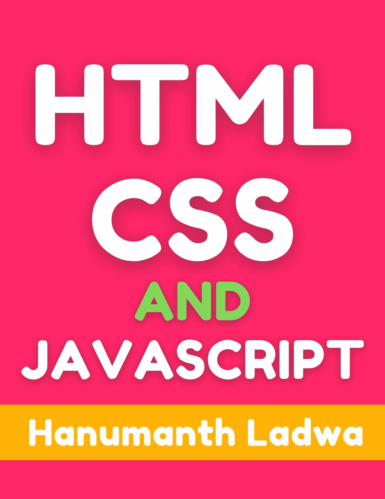

## 献给我的父母和姐妹们

# 第 1 章 网页设计基础

## 引言

互联网技术多年来取得了巨大的发展，并且仍在朝着造福人类的方向不断进步。如今，各个领域都已从传统的常规方法转变为在线模式。它把世界变成了一个巨大的虚拟空间，商人可以在这里开展业务，教师可以上课，农民可以利用所需的信息和技术来种植优质作物。没有一个领域能脱离信息技术的使用。我们到处都在使用所需的信息，而互联网是唯一能找到海量信息的地方。借助互联网，我们可以在线购买任何东西，这缩小了产品或服务的地理限制。

早期我们只有独立计算机。那些为了数据传输而彼此不连接的计算机就是独立计算机。这限制了用户一次只能由一个人使用计算机，当两个人想要交换信息时，他们必须物理地将数据从一台计算机携带到另一台计算机。这为程序员开辟了新的空间，使两台计算机能够相互通信，从而形成计算机网络。

计算机网络是为了通信和数据共享而将自主计算机互连起来的系统。如果两台计算机能够交换信息，则称它们互连。连接可以通过铜线、激光、卫星通信等方式实现，无论这些计算机位于多远的地方。因此，互联网是全球计算机网络的集合。互联网是一个网络的网络。成百上千的计算机通过电话线、光纤电缆、卫星通信等连接在数百个国家。网络中的每台计算机都称为主机。网络中的每台主机都可以通过所谓的 IP（互联网协议）地址唯一标识。IP 地址映射到域名系统（DNS），表示为[www.gmail.com](http://www.gmail.com)。使用 DNS 代替 IP 地址，因为数字难以记忆，而 DNS 是任何易于记忆的逻辑地址。DNS 输入在任何浏览器的地址栏中。

网络浏览器是一种应用软件，使用户能够显示万维网（WWW）上网页中的图像、视频、音乐和其他信息，而万维网只是互联网的一部分。

## 互联网上的服务

信息技术无处不在。它被用于科学技术、工程、银行、商业、农业、医学、空间科学、核研究、教育、航空、多媒体等领域。下面列出了一些互联网上的服务。

### 万维网（W3C）或万维网联盟

互联网上所有网站中的网页集合称为 WWW。这些网页包含文本、图片、音频、动画和视频格式的信息。

### 电子邮件

电子邮件用于在世界任何地方交换消息。它成本低、速度快且易于使用。电子邮件有许多优点。

- **易于使用**：电子邮件管理联系人数据、快速发送邮件、维护邮件历史等，因此非常易于使用。
- **速度快**：消息可以在全球任何地方瞬间交换。我们可以同时向多人发送同一条消息，因此节省了大量时间。
- **易于优先级排序**：简短信息出现在电子邮件的主题行中，因此可以轻松地对邮件进行优先级排序并忽略不需要的邮件。
- **可靠且安全**：它是通过互联网将信息从一台计算机传递到另一台计算机系统的可靠且安全的方式。
- **非正式且便于交流**：可以在家人和朋友之间交换消息，并以非正式的方式与朋友和家人互动。这是与任何人互动的良好工具。
- **便于参考**：电子邮件可以通过附上之前发送或接收的邮件来回复消息，以便参考。
- **自动邮件**：系统会自动发送自动邮件，无需人工干预。一旦设置了自动回复程序之类的功能，每当收到电子邮件时，就会立即向发件人发送一封电子邮件。
- **环保**：传统的发送消息方式使用纸张和大量燃料才能到达目的地。电子邮件防止了大量树木被砍伐，并节省了燃料，因为它通过电脉冲传输。
- **使用图形**：传统的发送消息方式缺乏图形和其他图片，但通过电子邮件，我们可以发送和接收精美的图形和图像。
- **广告工具**：电子邮件用于电子邮件营销，为个人或公司销售其产品和服务创造收入。
- **经济**：使用电子邮件很经济，因为它只消耗电力和互联网连接。
- **存储**：电子邮件服务提供商提供一些空间来存储数据和信息，供用户参考。电子邮件可以按升序或降序排序。电子邮件可以按日期排序。这使得电子邮件对用户更易于使用。
- **附件功能**：用户可以在电子邮件附件中发送大量信息。它是发送 Word 文档、Excel 电子表格信息等的工具，而且不会像邮政服务那样产生额外费用。

#### 电子邮件的缺点

- **病毒**：病毒是破坏计算机系统正常运行的恶意计算机软件。有些病毒会自我复制并进一步感染计算机。电子邮件收件人需要扫描邮件，它们有可能损害计算机系统。
- **垃圾邮件**：未经请求的消息和不需要的广告会造成滋扰，并被归类为垃圾邮件。有必要通过垃圾邮件过滤器阻止或过滤不需要的电子邮件。垃圾邮件是通过发送恶作剧电子邮件来进行的。电子邮件欺骗是另一种常见的垃圾邮件手段。
- **黑客攻击**：侵入计算机安全的行为称为黑客攻击。在这种安全漏洞中，电子邮件被黑客截获。电子邮件在送达收件人之前，会在位于不同位置的服务器之间跳转。

### 电子邮件讨论组

这些电子邮件讨论组用于通过电子邮件与他人讨论不同的话题。

### 新闻组

这些是用于交换信息的讨论组。用户向新闻组发送消息，其他用户阅读此消息并回复。

### 电子商务

电子商务是通过互联网进行商业交易的一种方式。电子商务是一个过程，其中两个合作伙伴之间的商品、服务销售基于设定的协议。协议是双方交易伙伴之间商定的一套规则。电子商务包括网上银行、网上购物和在线教育等。

电子商务中使用的一些技术和服务包括：

- 电子数据交换（EDI）：用于以电子方式而非纸质方式向另一家公司发送信息。以电子方式进行交易的商业实体称为交易伙伴。
- 电子邮件
- 电子资金转账（EFT）
- 电子福利转账（EBT）
- 电子表格（在线入学表格、在线求职申请表等）
- 数字现金（DC）
- 公告板（BBs）
- 电子银行（EB）
- 条形码、成像、语音识别
- 安全服务，如防火墙、加密、网关等。

#### 电子商务的类型

- **企业对企业（B2B）**：从一个企业向另一个商业伙伴交换服务、信息和商品。例如`ebay.com`
- **企业对消费者（B2C）**：从企业向消费者交换服务、信息和商品。例如：`amazon.com`、`flipkart.com`等。
- **消费者对企业（C2B）**：从客户向企业交换服务、信息和商品。客户通过在线发布他们的项目工作直接联系企业供应商，以便有需求的公司查看并直接与客户联系并投标。消费者审查所有投标并选择公司进行进一步处理。例如`guru.com`、`freelancer.com`等。
- **消费者对消费者（C2C）**：从一个客户向另一个客户交换服务、信息和商品。例如`olx.com`

#### 电子商务的优势

- 更容易进入新市场。
- 轻松进入远程市场。
- 以经济的方式建立新市场。
- 全球参与。
- 资源优化。
- 减少完成商业交易的时间。
- 改善市场情报和战略规划。

### FTP（文件传输协议）

该协议有助于在互联网上传输文件。包含音频、视频、图形和数据文件的文件可以使用`FTP`上传和下载。

### Telnet

该程序用于访问互联网上的远程计算机。你可以通过`telnet`从连接的计算机访问数据和文件。

### 聊天

这是互联网的一项服务，两个或多个用户可以彼此实时聊天。我们可以通过文本、音频或视频进行聊天。

### Gopher

互联网上的`Gopher`是一个系统，允许用户通过菜单或目录结构搜索文件。它使用纯英文名称，并且仅基于文本。

## 与网页相关的一些术语

### WWW（万维网）

WWW 由蒂姆·伯纳斯-李于 1994 年 9 月在麻省理工学院创立，得到了国防高级研究计划局（DARPA）和欧盟委员会的支持。WWW 是一组协议，允许你通过基于 URL 的命名系统访问网络上的任何文档。WWW 还指定了一种方式——超文本传输协议（HTTP）——来请求和发送互联网上的文档。

### 网页

网页是一种可以通过网络浏览器访问并显示在显示器或移动设备上的网络文档。该信息采用 HTML 或 XHTML 格式，并可能通过超文本链接提供到其他网页的导航。网页通过超文本传输协议（HTTP）从网络服务器请求和提供。网页可以是静态的或动态的。在客户端和服务器端编写脚本使网页对用户输入更敏感。

### 网站

网站是网页的集合。网站是从单个网络域提供的一组相关网页。所有可公开访问的网站共同构成了万维网。网站的页面可以通过其统一资源定位符（URL）（称为网址）访问。

### 网络浏览器

第一个网络浏览器由蒂姆·伯纳斯-李爵士于 1990 年发明。它被称为`WorldWideWeb`（无空格），后来更名为`Nexus`。网络浏览器是一种用于检索、呈现和遍历万维网上信息资源的应用软件。

### HTTP（超文本传输协议）

该术语由泰德·尼尔森首次提出。超文本传输协议是一种用于分布式、协作式超媒体信息系统的应用协议。

HTML 是浏览器的母语。HTML 由一位名叫蒂姆·伯纳斯-李的科学家于 1990 年发明。其目的是让不同大学的科学家更容易访问彼此的研究文档。该项目变得非常流行，以至于为我们今天所知的网络奠定了基础。

HTML 不是一种编程语言，它是一种用于在互联网上呈现信息的标记语言。要查看互联网上页面的 HTML 代码，只需单击浏览器菜单栏中的“查看”并选择“源文件”。

在网站开发中，HTML 扮演着重要角色。HTML 是一种超文本标记语言，由网络浏览器解释并显示内容，使这些内容可通过计算机网络访问。网站的信息可供全球任何人随时访问。HTML 包含以标签形式向网络浏览器发出的指令。标签是写在尖括号（`<>`）中的指令。标签以左尖括号（即小于号`<`）开始，以右尖括号（即大于号`>`）结束。标签有两种类型：一种是开始标签，另一种是结束标签。开始标签写在尖括号内，结束标签也写在尖括号内，但前面有一个正斜杠（`/`）。让我们看一下 HTML 的一般结构。

```html
<HTML><TITLE><HEAD></HEAD></TITLE><BODY></BODY></HTML>
```

`<HTML>`是一个标签，用于表示 HTML 程序的开始。`<TITLE>`是一个标签，用于在浏览器窗口的标题栏中显示文本。在`<HEAD>`标签下，我们通常编写出现在浏览器标题栏中的文本。`<BODY>`标签用于在浏览器窗口的画布上显示用户的内容。内容可以是文本、图形、动画、音频或视频。你可以看到每个开始标签都被关闭了。`</HTML>`是开始标签`<HTML>`的结束标签，`</TITLE>`是开始标签`<TITLE>`的结束标签，`</HEAD>`是开始标签`<HEAD>`的结束标签，同样，`</BODY>`是开始标签`<BODY>`的结束标签。

**注意**：有些标签没有结束标签。HTML 中的所有标签都不区分大小写，这意味着标签可以用小写字母或大写字母书写。但良好的编程实践是用大写字母书写标签，以便与普通文本区分开来。

### 基本要求

- 用户必须具有使用网络浏览器的基本知识。
- 如果计算机运行 Windows 操作系统，则需要带有记事本、Sublime、Notepad++或 VSCode 等编辑器的计算机。VSCode 编辑器提供代码编写快捷方式和有用的功能。Mac 操作系统可以使用 TextEdit、Sublime Text 或 KompoZer 等编辑器。
- 网络浏览器，如 Firefox Mozilla、Internet Explorer 9 及以上版本或 Google Chrome。本书中使用记事本编写 HTML 标签。

### HTML 文件扩展名

我们保存 HTML 文件时使用扩展名`.htm`或`.html`。通常使用三个字母的扩展名，即使使用`.html`也完全没问题。

打开文本编辑器——记事本，步骤如下：

**第 1 步**：点击 Windows 按钮并输入`notepad`。


**第 2 步**：点击记事本图标打开记事本文本编辑器，如下所示。

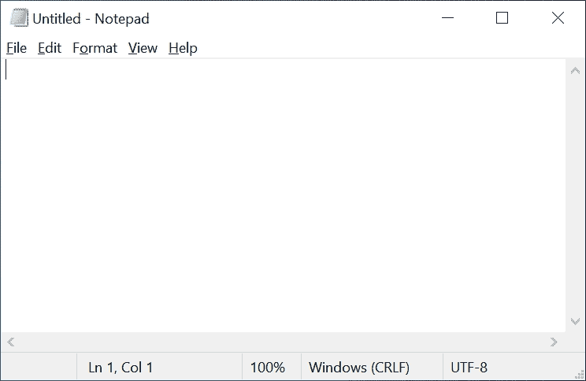

**第 3 步**：在记事本中编写 HTML 代码，并以`.htm`或`.html`扩展名保存。

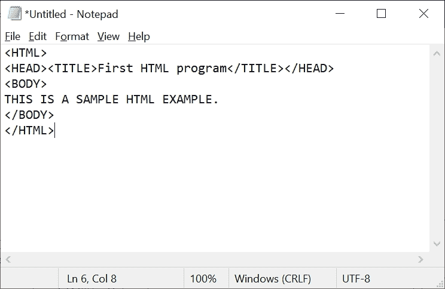

**第 4 步**：点击文件菜单，点击保存选项，选择要保存文件的位置。我在 F 盘创建了一个名为 HTML programs 的文件夹，并以`SAMPLE.HTML`名称保存。

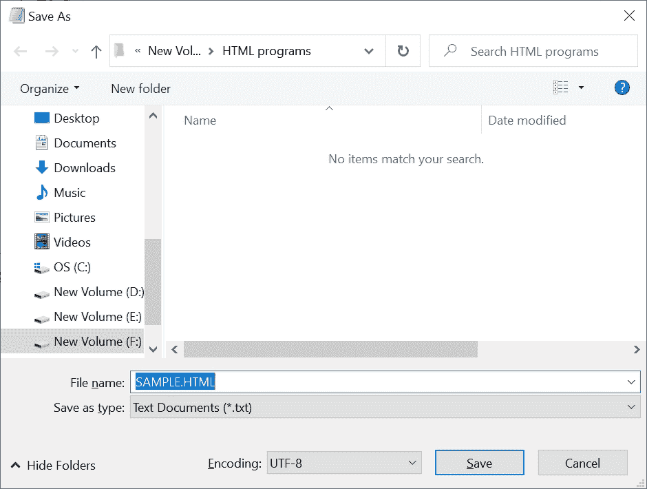

**第 5 步**：双击保存的文件在浏览器中打开，或者打开浏览器，点击文件菜单，点击打开选项，选择保存的文件。点击打开。它将显示如下输出。

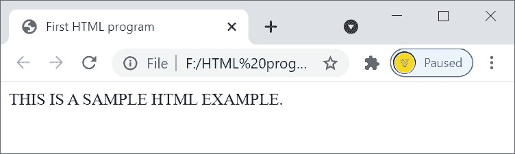

### HTML 中的注释

有两种类型的注释——单行和多行。

单行注释表示为：`<!Comment Text Here>`

在尖括号内使用感叹号（`!`）。

多行注释表示为：

```html
<!-- 多行
        注释-->
```

# 第 2 章 基本标签

## 引言

HTML 标签是网络浏览器识别的关键字，浏览器解释其含义并在网页上显示相应的信息。每个头部标签代表一个对象，对象具有属性；这些属性称为属性。让我们学习一些基本的 HTML 标签及其属性。

## 标题标签

标题标签用于在页面上以不同大小显示标题。这些标签可用于为网页提供主标题和副标题。HTML 文档支持 6 级标题标签`<H1>`到`<H6>`。`<H1>`标签内的文本最大，`<H6>`最小。每个标题总是从新行开始。

**示例：**

```html
<! 标题标签演示>
<html>
<body>
<h1>标题 1</h1>
<h2>标题 2</h2>
<h3>标题 3</h3>
<h4>标题 4</h4>
<h5>标题 5</h5>
<h6>标题 6</h6>
</body>
</html>
```

**输出：**

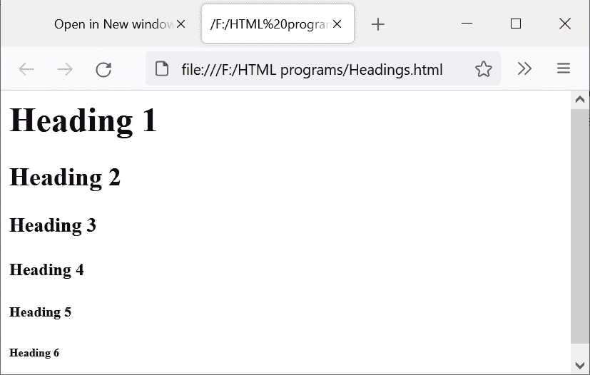

### 标题标签的属性

标题默认显示在浏览器的左侧。为了使其居中或右对齐，我们使用名为`align`的属性，其值为：

- `Left`
- `Center`
- `Right`

```html
<! 使用标题标签的居中对齐属性示例>
<html>
<body>
<h1  align="center">标题 1</h1>
<h2>标题 2</h2>
<h3>标题 3</h3>
<h4>标题 4</h4>
<h5>标题 5</h5>
</body>
</html>
```

**输出：**

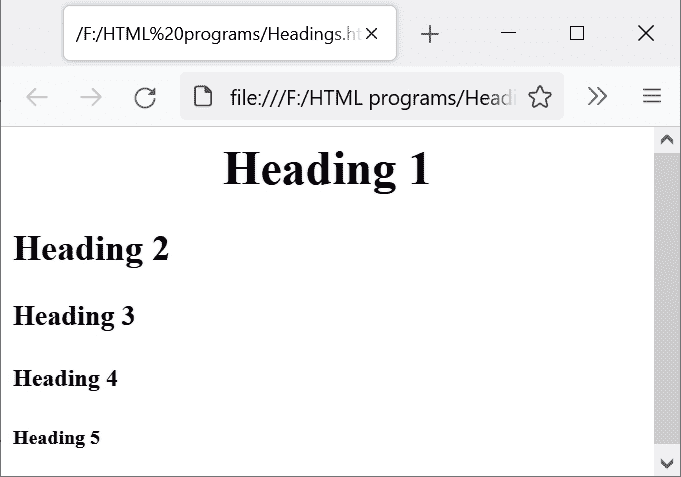

```html
<! 使用标题标签的右对齐属性示例>
<html>
<body>
<h1  align="right">标题 1</h1>
<h2>标题 2</h2>
<h3>标题 3</h3>
<h4>标题 4</h4>
<h5>标题 5</h5>
</body>
</html>
```

**输出：**

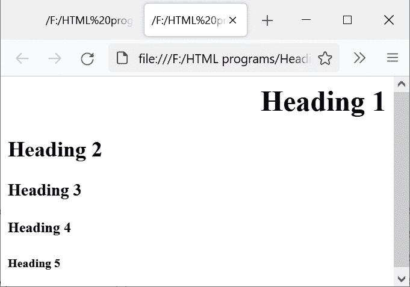

## 段落

我们可以使用段落来组织文本，使其对齐整齐。在 HTML 中执行此操作时，我们使用`<p>…</p>`标签。在文本文档中，段落顶部和底部会出现空白行。

**示例：**

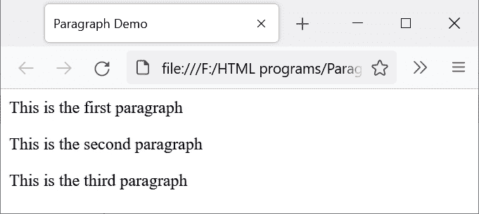

### 段落标签的属性

段落默认显示在浏览器的左侧。为了使其居中或右对齐，我们使用名为`align`的属性，其值为：

- `Left`
- `Center`
- `Right`

```html
<! 使用段落标签的居中对齐属性示例>
<HTML>
<HEAD>
<TITLE>段落演示</TITLE>
<HEAD>
<BODY>
<P align=center>这是第一段</p>
<P>这是第二段</p>
<P>这是第三段</p>
</BODY>
</HTML>
```

**输出：**

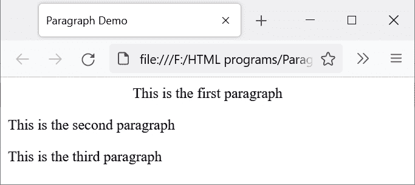

```html
<! 使用段落标签的右对齐属性示例>
<HTML>
<HEAD>
<TITLE>段落演示</TITLE>
<HEAD>
<BODY>
<P align=right>这是第一段</p>
<P>这是第二段</p>
<P>这是第三段</p>
</BODY>
</HTML>
```

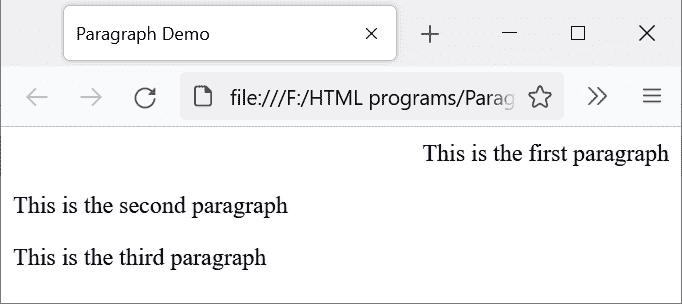

## 换行标签

如果你希望将光标移到下一行并在文本之间提供换行，则可以使用`<br>`标签，其后的任何文本都将从新行开始。正如我之前所说，有些标签不需要结束标签，这样的标签称为空元素。之所以这样称呼，是因为它们之间没有内容。

```html
<! 未使用换行标签的一行文本>
<HTML>
<HEAD>
<TITLE>无换行标签</TITLE>
<HEAD>
<BODY>
你好！我是 Hanumanth Ladwa。早上好
</BODY>
</HTML>
```

**输出：**

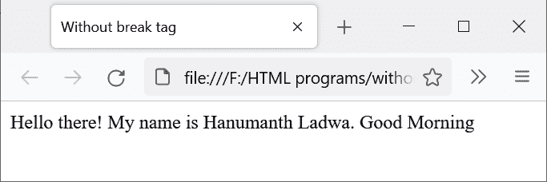

现在，相同的代码可以使用换行标签编写为：

```html
<! 使用换行标签的一行文本>
<HTML>
<HEAD>
<TITLE>有换行标签</TITLE>
<HEAD>
<BODY>
你好！<br>我是 Hanumanth Ladwa。<br>早上好
</BODY>
</HTML>
```

**输出：**

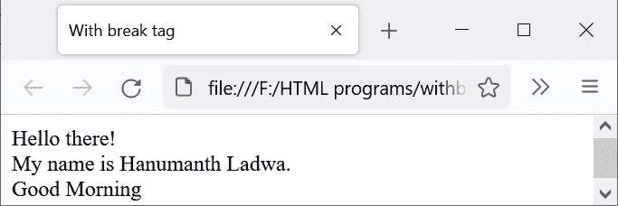

## 居中内容

有时在组织文本时，我们需要将其对齐到表格或页面的中心。在后续章节中讨论表格时，我们将介绍如何使单元格中的文本居中。

**示例：**

```html
<! 演示居中内容的示例>
<HTML>
<HEAD>
<TITLE>居中内容演示</TITLE>
<HEAD>
<BODY>
文本通常位于左侧
<center>这行文本使用 center 标签居中</center>
</BODY>
</HTML>
```

**输出：**

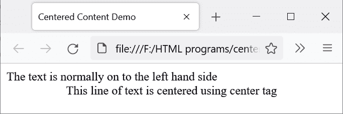

## 水平线

你可以使用名为`<hr>`的标签在浏览器窗口的画布区域中划分区域，以创建不同的部分。

**示例：**

```html
<HTML>
<HEAD>
<TITLE>水平线演示</TITLE>
<HEAD>
<BODY>
此文本出现在水平线之前。
<hr>
此文本出现在水平线之后。
</BODY>
</HTML>
```

**输出：**

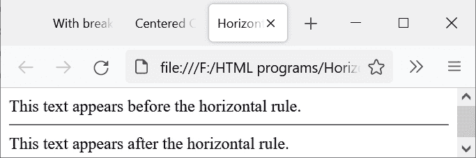

注意，此标签也是一个空元素，因为它不需要开始和结束标签。

如果你希望更改水平线的颜色，可以使用`color`属性来实现，如下所示：


```html
<HTML>
<HEAD>
<TITLE>水平线演示</TITLE>
<HEAD>
<BODY>
此文本出现在水平线之前。
<hr color=red>
此文本出现在水平线之后。
</BODY>
</HTML>
```

**输出：**

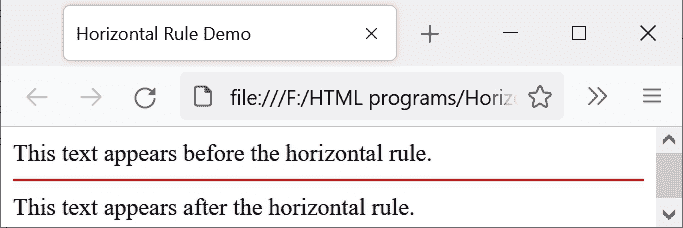

我们可以使用`<HR>`元素的`size`和`width`属性，如下所示。

**Size**：线条的粗细以像素表示。

`<HR SIZE=”值”>`

可能的值为 1、2、3 等。

**Width**：线条的宽度可以以窗口宽度的百分比指定。

`<HR WIDTH=”值”>`

宽度的可能值可以以窗口大小的百分比指定。例如，25%、50%、75%等。

```html
<! 演示 HR 元素的 width 和 size 属性的 HTML 代码>
<HTML>
<HEAD>
<TITLE>水平线演示</TITLE>
<HEAD>
<BODY>
<p>此文本出现在水平线之前。
<hr color=red width=200 size=15>
此文本出现在水平线之后。
</BODY>
</HTML>
```

**输出：**

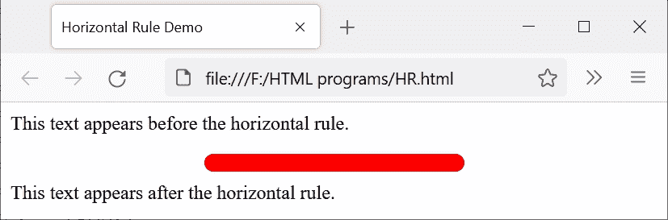

## 粗体和斜体

为了使文字引人注目，我们使用粗体和斜体。粗体使`<B>`和`</B>`标签下的文本更粗，斜体使`<I>`和`</I>`标签下的文本稍微向右倾斜。

**示例：**

```html
<! 使文本变为粗体的 HTML 代码>
<HTML>
<HEAD>
<TITLE>粗体演示</TITLE>
<HEAD>
<BODY>
<p>这就是我们如何使特定单词<b>加粗</b><p>
<p>在某些情况下，记住所得到的<b>帮助</b>是<b>重要</b>的</p>
</BODY>
</HTML>
```

**输出：**

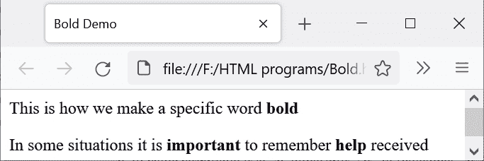

```html
<! 使文本变为斜体的 HTML 代码>
<HTML>
<HEAD>
<TITLE>斜体演示</TITLE>
<HEAD>
<BODY>
<p>有志者事<I>竟成</I><p>
<p>帮助穷人，<I>上帝</I>会帮助你。</p>
</BODY>
</HTML>
```

**输出：**

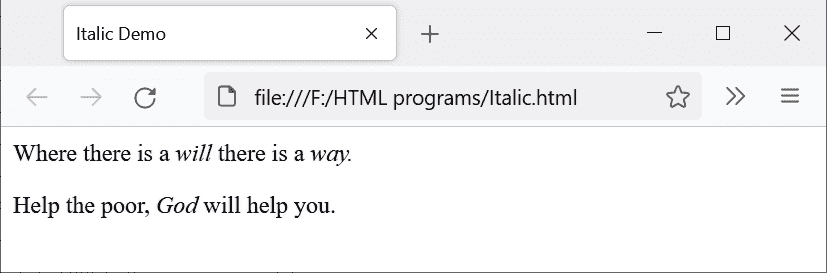

你也可以将粗体和斜体文本组合在一起，如下所示：

```html
<HTML>
<HEAD>
<TITLE>粗体和斜体演示</TITLE>
<HEAD>
<BODY>
<p>一<B><I>盎司的行动</I></B>抵得上一<B><I>吨的理论。</I></B></p>
<p align=right>——弗里德里希·恩格斯</p>
</BODY>
</HTML>
```

**输出：**

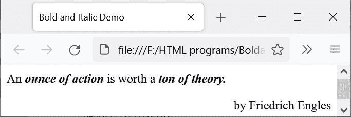

## 上标和下标

上标用于将`<sup>`标签下的文本显示在普通文本行上方一点。这通常用于数学中编写数字的平方和立方。

```html
<! 演示上标的 HTML 代码>
<HTML>
<HEAD>
<TITLE>上标演示</TITLE>
<HEAD>
<BODY>
<p>z=x<sup>2</sup>+y<sup>2</sup>
</BODY>
</HTML>
```

**输出：**

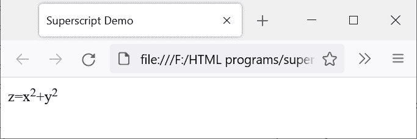

下标用于将`<sub>`标签下的文本显示在普通文本下方一点。这通常用于化学中编写化学方程式。

```html
<! 演示下标的 HTML 代码>
<HTML>
<HEAD>
<TITLE>下标演示</TITLE>
<HEAD>
<BODY>
<p>生命之气是 O<sub>2</sub></p>
</BODY>
</HTML>
```

**输出：**

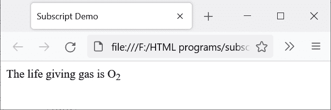

## 强调和着重

`<strong>`标签用于表示其下的内容具有强烈的重要性。默认情况下，浏览器会以粗体显示`<strong>`标签的内容，如下所示。

```html
<HTML>
<HEAD>
<TITLE>强调演示</TITLE>
<HEAD>
<BODY>
<p><strong>成功</strong>只有在<strong>字典</strong>中才出现在工作之前。<p>
</BODY>
</HTML>
```

**输出：**

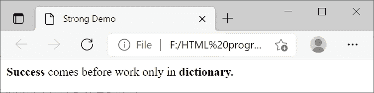

类似地，`<em>`标签用于强调其下的文本。通常，此标签以斜体形式显示文本，如下所示。

```html
<HTML>
<HEAD>
<TITLE>着重演示</TITLE>
<HEAD>
<BODY>
<p><em>成功</em>追随<em>价值。</em><p>
</BODY>
</HTML>
```

**输出：**

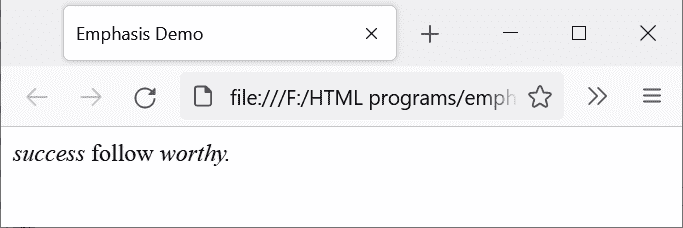

## 引用

`<q>`标签用于给其下的文本加上引号，如下所示。

```html
<HTML>
<HEAD>
<TITLE>引用演示</TITLE>
<HEAD>
<BODY>
<p><q>母亲是第一位老师</q></p>
</BODY>
</HTML>
```

**输出：**

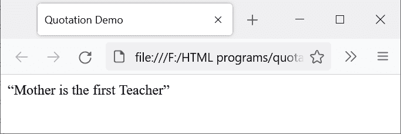

## 缩写和首字母缩略词

这些是读作单词的缩写形式，称为首字母缩略词和缩写。

**示例：**

```html
<! 演示缩写和首字母缩略词的 HTML 代码>
<HTML>
<HEAD>
<TITLE>缩写和首字母缩略词演示</TITLE>
<HEAD>
<BODY>
<p>我的名字是<abbr title="教授">Prof. </abbr>Hanumanth Ladwa，我是一所大学的教授。<p>
我的学生对<acronym title="印度空间研究组织">ISRO</acronym>的运作感兴趣。<p>
</BODY>
</HTML>
```

**输出：**

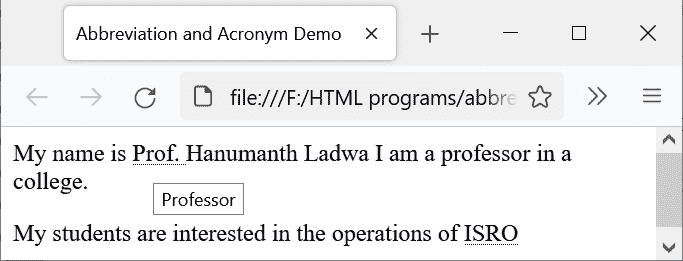

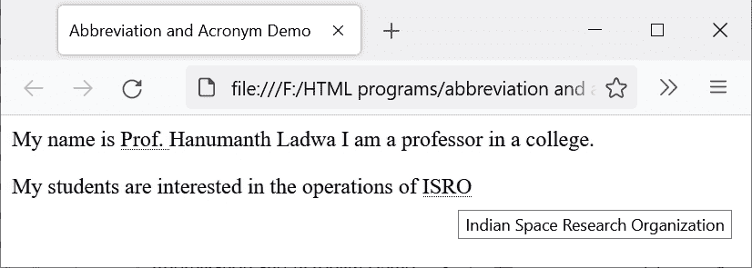

当鼠标悬停在 Prof. 和 ISRO 上时，它们会显示这些缩写和首字母缩略词的全称。

## 修改内容

插入和删除的文本可以分别通过`<ins>`和`<del>`标签查看。

```html
<HTML>
<HEAD>
<TITLE>插入和删除内容</TITLE>
<HEAD>
<BODY>
<p>展现你<del>最差</del> <ins>最好</ins>的一面！<p>
</BODY>
</HTML>
```

**输出：**

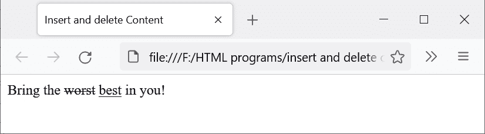

`s`标签用于表示某些不再准确的内容。`<s>`标签下的内容会显示一条穿过中心的线。让我们看一个例子：

```html
<HTML>
<HEAD>
<TITLE>促销演示</TITLE>
<HEAD>
<BODY>
<P>T 恤：</P>
<P><s>原价 10 美元</S></P>
<P>现在仅售<B>5 美元</B></P>
</BODY>
</HTML>
```

**输出：**

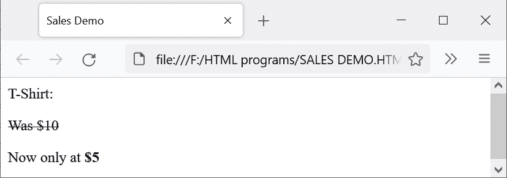

## 大号文本

放置在`<big>…</big>`元素内的文本将显示为比周围内容大一号。

```html
<! 说明大号文本的 HTML 代码>
<HTML>
<HEAD>
<TITLE>大号文本演示</TITLE>
<HEAD>
<BODY>
<p>这是一个<big>更大</big>的文本。
</BODY>
</HTML>
```

**输出：**

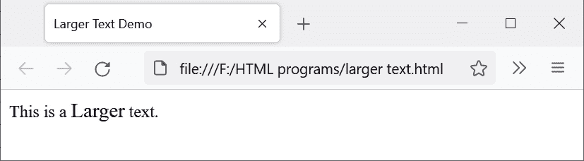

## 小号文本

放置在`<small>…</small>`元素内的文本将显示为比周围内容小一号。

```html
<! 说明小号文本的 HTML 代码>
<HTML>
<HEAD>
<TITLE>小号文本演示</TITLE>
<HEAD>
<BODY>
<p>这是一个<small>更小</small>的文本。
</BODY>
</HTML>
```

**输出：**

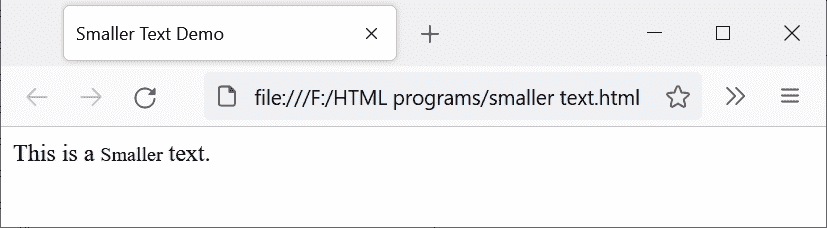

## 删除线文本

可以使用名为`<strike>…</strike>`的标签为文本添加删除线。

**示例：**

```html
<! 说明删除线的 HTML 代码>
<HTML>
<HEAD>
<TITLE>删除线演示</TITLE>
<HEAD>
<BODY>
<p>这是一个演示<strike>删除线</strike>的代码。<p>
</BODY>
</HTML>
```

**输出：**

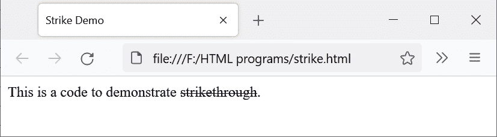

## 滚动文本

可以使用名为`<MARQUEE>…</MARQUEE>`的标签在浏览器窗口内滚动文本，如下所示。

```html
<! 演示 MARQUEE 的 HTML 代码>
<HTML>
<HEAD>
<TITLE>滚动字幕演示</TITLE>
<HEAD>
<BODY>
<MARQUEE>这是一个滚动的字幕文本</MARQUEE>
</BODY>
</HTML>
```

**输出：**

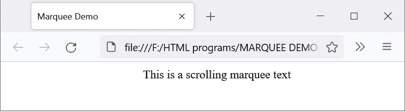

默认情况下，滚动字幕从右向左滚动文本，你可以将其移动方向更改为从左到右、从上到下和从下到上。让我们使用名为`direction`的属性来查看滚动字幕的所有这些方向。其值为 left、right。

```html
<! 演示从左到右滚动字幕的 HTML 代码>
<HTML>
<HEAD>
<TITLE>滚动字幕演示</TITLE>
<HEAD>
<BODY>
<MARQUEE direction=RIGHT>这是一个从左向右移动的滚动字幕文本</MARQUEE>
</BODY>
</HTML>
```

**输出：**

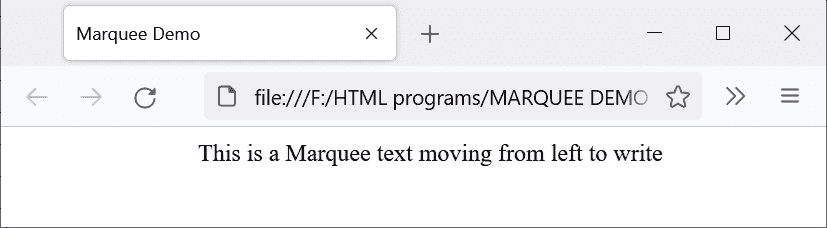

## 字体设置标签

`<FONT>`元素可用于更改外观，即用于设置文本样式。此标签的属性有`FACE`、`SIZE`、`COLOR`。

`FACE`属性用于设置字体设计。

**语法：** `<FONT FACE=”值”>文本在此</FONT>`

`FACE`属性的一些值如下所示：

- Times new roman
- Arial black
- Arial
- Courier
- Bookman old style 等。

你可以参考 MS Word 字体中的其他字体。否则，你可以下载并使用任何字体样式。

`SIZE`属性用于增加或减小文本的大小。

**语法：** `<FONT SIZE=”值”>文本在此</FONT>`

可能的值为 1、2、3 等。

`COLOR`属性用于为文本着色。

**语法：** `<FONT COLOR=”值”>文本在此</FONT>`

`COLOR`属性的可能值可以通过两种方式指定：一种是使用颜色名称，另一种是使用十六进制颜色常量。

| 颜色 |
| --- |
| 红色 |
| 绿色 |
| 蓝色 |
| 白色 |
| 黑色 |
| 灰色 |
| 深红色 |
| 深绿色 |
| 黄色 |
| 等等 |

```html
<!HTML code to illustrate font attributes>
<HTML>
<HEAD>
<TITLE>Font Demo</TITLE>
<HEAD>
<BODY>
<FONT FACE="ARIAL" SIZE=15 COLOR=BLUE>This the formatted text</FONT>
</BODY>
</HTML>
```

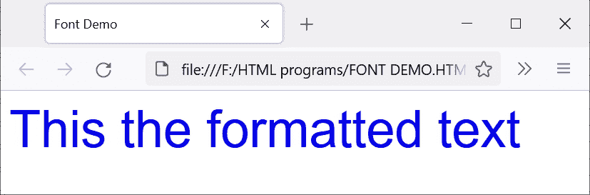

## 计算机输出标签

各种类型的输出将如下所示。

```html
<html>
<HEAD>
<TITLE>Computer Output Demo</TITLE>
</HEAD>
<body>
<code>Computer code</code><br />
<kbd>Keyboard input</kbd><br />
<tt>Teletype text</tt><br />
<samp>Sample text</samp><br />
<var>Computer variable</var><br />
<p>
</body>
</html>
```

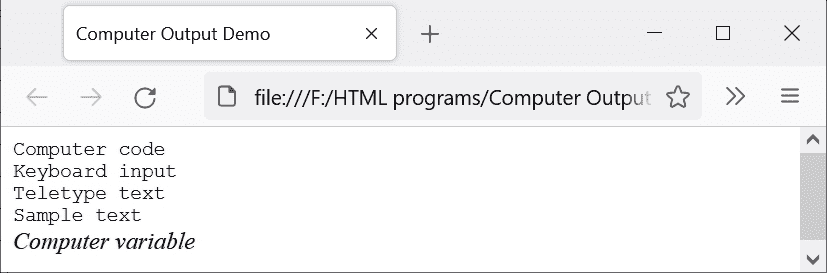

请像上面的程序所示，亲自尝试以下计算机输出标签。

| 标签 | 描述 |
| --- | --- |
| `<code>` | 定义计算机代码文本。 |
| `<kbd>` | 定义键盘文本。 |
| `<samp>` | 定义计算机代码示例。 |
| `<tt>` | 定义电传打字文本。 |
| `<var>` | 定义变量。 |
| `<pre>` | 定义预格式化文本。 |
| `<listing>` | 已弃用。请使用`<pre>`代替。 |
| `<plaintext>` | 已弃用。请使用`<pre>`代替。 |
| `<xmp>` | 已弃用。请使用`<pre>`代替。 |

## 地址

地址可以写在`<ADDRESS>…</ADDRESS>`标签内。

**示例：**

```html
<!HTML code to demonstrate address tag>
<HTML>
<HEAD>
<TITLE>Address Tag Demo</TITLE>
</HEAD>
<BODY>
<ADDRESS>Hanumanth Ladwa<br>Hubballi<br>Karnataka<br>India.</ADDRESS>
</BODY>
</HTML>
```

**输出：** 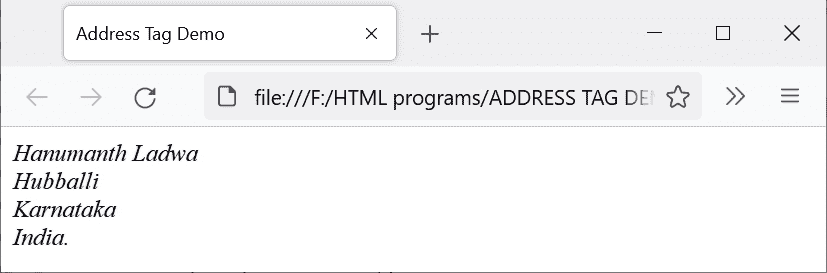

## 文本方向

如果你的电脑浏览器支持双向覆盖（BDO），那么文本行将按照从左到右（rtl）的方向书写，如下例所示。

```html
<HTML>
<HEAD>
<TITLE>Text Direction Demo</TITLE>
</HEAD>
<BODY>
<bdo dir="ltr">Original text: This is the right to left text</bdo><br>
Reversed Text: <bdo dir="rtl">This is the right to left text</bdo>
</BODY>
</HTML>
```

**输出：** 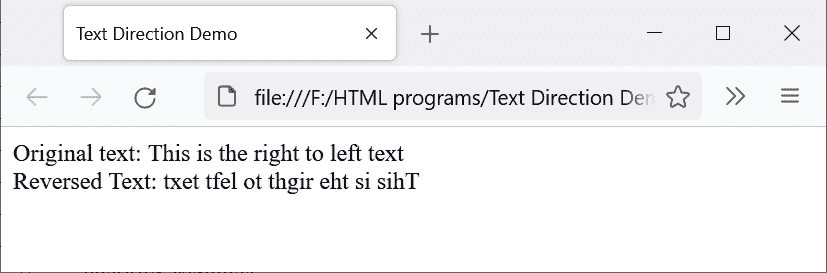

# 第 3 章 HTML 列表

## 简介

我们知道如何组织列表中的项目。当被要求列出购物清单或食物所需物品时，我们会用连字符（-）、数字或其他符号将它们一个接一个地写下来。在 HTML 中也可以生成相同类型的列表。

列表分为：

- 无序列表
- 有序列表
- 定义列表
- 嵌套列表

### 无序列表

无序列表可以使用`<UL>`标签嵌入到网页中。在`<UL>`标签下，我们使用`<LI>`标签编写列表项。`<UL>`标签使用`TYPE`属性来表示：

- 圆形
- 圆盘
- 方形

默认情况下，它显示为圆盘，如下例所示。

```html
<HTML>
<HEAD>
<TITLE>Unordered List Demo</TITLE>
</HEAD>
<BODY>
<UL>
<LI>Orange</LI>
<LI>Banana</LI>
<LI>Mango</LI>
</UL>
</BODY>
</HTML>
```

**输出：** 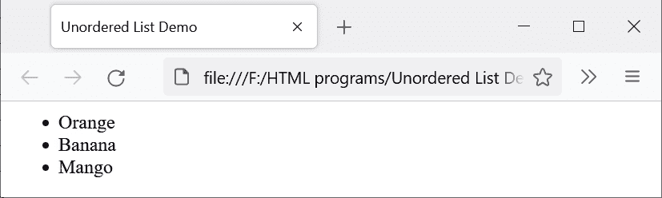

```html
<!HTML code to demonstrate unordered disc list>
<HTML>
<HEAD>
<TITLE>Unordered Disc List Demo</TITLE>
</HEAD>
<BODY>
<ul type="disc">
<li>HTML</li>
<li>CSS</li>
<li>JavaScript</li>
</ul>
</BODY>
</HTML>
```

**输出：** 

```html
<!HTML code to demonstrate unordered circle list>
<HTML>
<HEAD>
<TITLE>Unordered Circle List Demo</TITLE>
</HEAD>
<BODY>
<ul type="circle">
<li>HTML</li>
<li>CSS</li>
<li>JavaScript</li>
</ul>
</BODY>
</HTML>
```

**输出：** 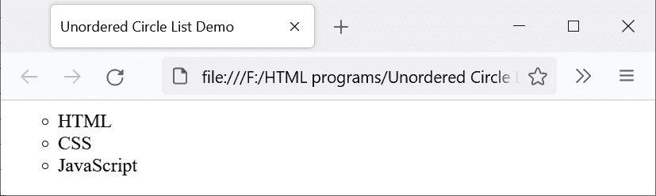

```html
<!HTML code to demonstrate unordered square list>
<HTML>
<HEAD>
<TITLE>Unordered Square List Demo</TITLE>
</HEAD>
<BODY>
<ul type="square">
<li>HTML</li>
<li>CSS</li>
<li>JavaScript</li>
</ul>
</BODY>
</HTML>
```

**输出：** 

### 有序列表

有序列表可以使用`<OL>`标签嵌入到网页中。在`<OL>`标签下，我们使用`<LI>`标签编写列表项。`<OL>`标签使用`TYPE`属性来表示数字序列，例如：

- 普通数字
- 小写罗马数字
- 大写罗马数字
- 小写字母
- 大写字母

默认情况下，它显示为普通数字，如下例所示。

```html
<!HTML code to demonstrate plain numbers>
<HTML>
<HEAD>
<TITLE>Ordered Plain Numbers List Demo</TITLE>
</HEAD>
<BODY>
<OL>
<LI>C Programming</LI>
<LI>C++ Programming</LI>
<LI>Java Programming</LI>
</OL>
</BODY>
</HTML>
```

**输出：** 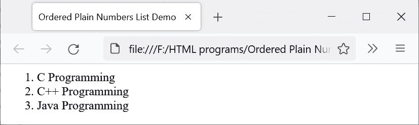


```html
<!HTML code to demonstrate Small Roman numbers>
<HTML>
<HEAD><TITLE>Ordered Small Roman Numbers List Demo</TITLE></HEAD>
<BODY>
<OL TYPE=i>
<LI>C Programming</LI>
<LI>C++ Programming</LI>
<LI>Java Programming</LI>
</OL>
</BODY>
</HTML>
```

输出：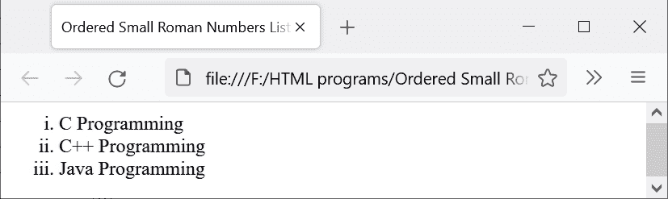

```html
<!HTML code to demonstrate Ordered Capital Roman Numbers List>
<HTML>
<HEAD><TITLE>Ordered Capital Roman Numbers List Demo</TITLE></HEAD>
<BODY>
<OL TYPE=I>
<LI>C Programming</LI>
<LI>C++ Programming</LI>
<LI>Java Programming</LI>
</OL>
</BODY>
</HTML>
```

输出：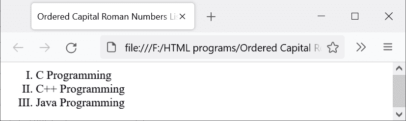

```html
<!HTML code to demonstrate Ordered Small Letters List>
<HTML>
<HEAD><TITLE>Ordered Small Letters List Demo</TITLE></HEAD>
<BODY>
<OL TYPE=a>
<LI>C Programming</LI>
<LI>C++ Programming</LI>
<LI>Java Programming</LI>
</OL>
</BODY>
</HTML>
```

输出：

```html
<!HTML code to demonstrate Ordered Capital Letters List>
<HTML>
<HEAD><TITLE>Ordered Capital Letters List Demo</TITLE></HEAD>
<BODY>
<OL TYPE=A>
<LI>C Programming</LI>
<LI>C++ Programming</LI>
<LI>Java Programming</LI>
</OL>
</BODY>
</HTML>
```

输出：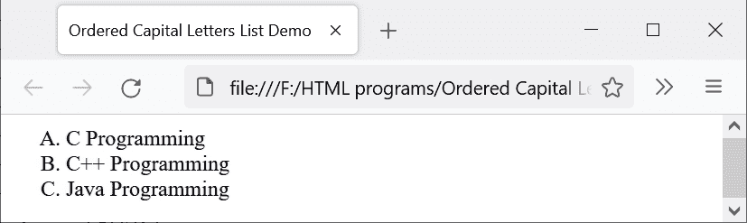

如果我们希望从 1 以外的数字开始，可以使用 `<OL>` 标签的另一个属性，即 `START="Value"`。

```html
<!HTML code to demonstrate Ordered Plain Numbers List Start from 5>
<HTML>
<HEAD><TITLE>Ordered Plain Numbers List Start from 5</TITLE></HEAD>
<BODY>
<OL START=5>
<LI>C Programming</LI>
<LI>C++ Programming</LI>
<LI>Java Programming</LI>
</OL>
</BODY>
</HTML>
```

输出：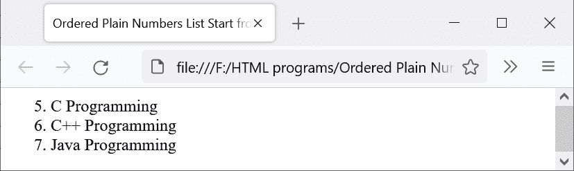

同样，对于其他类型的有序列表，你可以自己尝试。

### 定义列表

定义列表是一系列项目及其描述的列表。定义列表以 `<DL>` 标签开始。每个项目以 `<DT>` 标签开始。每个描述以 `<DD>` 标签开始。让我们看一个例子：

```html
<html>
<HEAD><TITLE>Definition List</TITLE></HEAD>
<body>
<dl>
<dt>Mango</dt>
<dd>Seasonal fruit</dd>
<dt>Banana</dt>
<dd>Available all the time</dd>
</dl>
</body>
</html>
```

输出：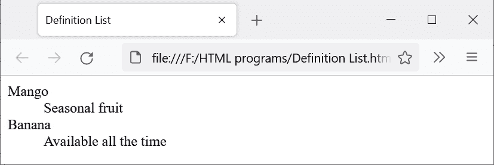

在 `<DD>` 标签内可以插入段落、换行、图像和其他列表等。

### 嵌套列表

嵌套列表是一个列表包含在另一个列表中。下面的例子说明了嵌套列表。

```html
<html>
<head><title>Nested List</title></head>
<body>
<ul>
<li>Fruit</li>
<li>Vegetable
<ul>
<li>Cauliflower</li>
<li>Brinjal</li>
</ul>
</li>
<li>Leafy Vegetables</li>
</ul>
</body>
</html>
```

输出：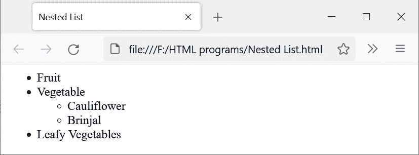

嵌套列表可以有多层深度，如下例所示。

```html
<html>
<head><title>Deep Nested Lists</title></head>
<body>
<ul>
<li>Juice</li>
<li>Water
<ul>
<li>Normal Water</li>
<li>Mineral Water
<ul>
<li>Packed Water</li>
<li>Filtered Water</li>
</ul>
</li>
</ul>
</li>
<li>Cold Drinks</li>
</ul>
</body>
</html>
```

输出：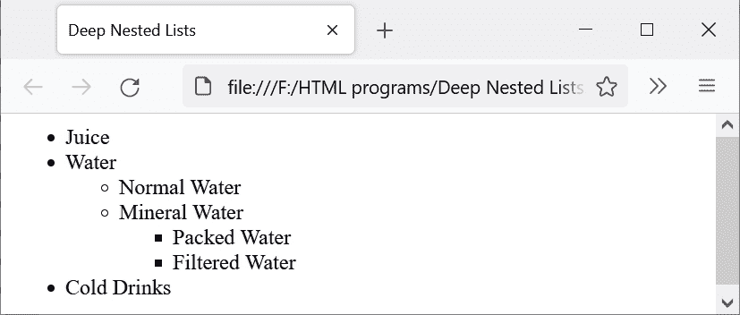

# 第 4 章 链接

## 简介

链接是文本或图像，通过点击它们可以跳转到其他网页或同一页面内的位置。链接用于从一个地方导航到另一个地方。

### 超链接和锚点

锚点是一个网页元素，使对象能够用作超链接。页面中的超链接是一个区域，点击后打开新站点或页面。用于创建超链接的对象可以是文本或图像。锚点和超链接可以通过 `<A>…</A>` 标签定义。

#### 超链接

超链接文本很容易识别，因为它与文档中的其他文本颜色不同，并且带有下划线。当鼠标移动时，光标会改变形状。当鼠标指针移到任何文本上并变成手形指针时，表示已建立链接。点击链接将：

- 在同一网页内打开一个新部分，这称为页面跳转。
- 创建指向自己网站内另一个页面的链接。
- 创建指向不同网站网页的链接。

在设计 HTML 文档时，创建超链接是最后一步。这是因为当完整文档创建完成后，可以给出指向同一文档其他部分的引用。

#### 锚点

锚点是一个容器元素，用于创建超链接。链接到的对象由超文本引用或 `HREF` 属性定义。在页面上识别锚点相当容易，因为文本锚点带有下划线，并且颜色与常规文本不同。

### 内部链接和外部链接

内部链接是指向同一网站内网页的链接。外部链接是指向其他网站网页的链接。

创建链接时，必须：

- 指定链接到的文件的 URL。
- 指定用户需要点击的文本或图形。

`<A>` 标签用于创建超链接，将用户带到文档中指定的目标位置。

语法：

```
<A HREF="URL">Text to click here</A>
<A NAME=Value>…</A>
```

这里，`HREF` 代表超文本引用，包含 URL。`NAME` 属性用于标识同一 HTML 文档中的位置。

```html
<!HTML code to demonstrate an internal link>
<HTML>
<HEAD><TITLE>Internal Link Demo</TITLE></HEAD>
<BODY>
<A HREF="F:\HTML programs\Bold.html">Open Bold Webpage</A>
</BODY>
</HTML>
```

输出：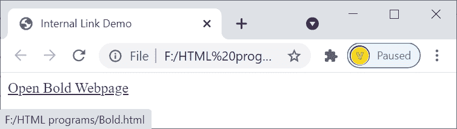

一旦我们点击“Open Bold Webpage”链接，它会带我们到保存在我电脑 `F:\HTML program` 文件夹中的 `Bold.html` 文件。它会带我们到以下窗口。

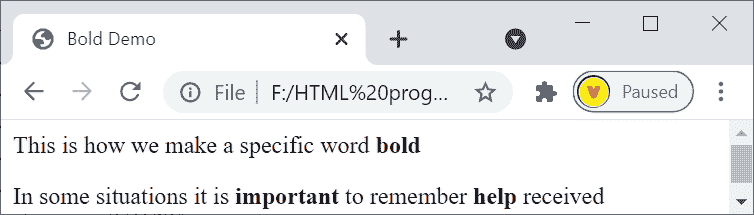

```html
<!HTML code to demonstrate an external link>
<HTML>
<HEAD><TITLE>External Link Demo</TITLE></HEAD>
<BODY>
<A HREF="https:\\www.gmail.com">Open gmail.com</A>
</BODY>
</HTML>
```

输出：

一旦我们点击“Open gmail.com”链接，它会带我们到 [`www.gmail.com`](https://www.gmail.com) 网页。


### 在同一文档内创建链接

到目前为止，我们学习了如何使用内部和外部链接从一个网页导航到另一个网页。现在我们将创建同一文档内的链接。使用 `<A>` 标签的 `NAME` 属性标记位置，然后使用 `<A>` 的 `HREF` 属性创建链接。

语法：

```
<A NAME="Value">
```

这里，`Value` 可以是任何有效的字符串。

创建链接的语法：

```
<A HREF="#Value">
```

注意：超链接中的值必须与锚点标签的 `name` 属性中的值相同，并且必须以 `#` 符号开头。

点击链接时，页面的命名部分将显示在顶部。

示例：

```html
<!HTML code to demonstrate Link within the Document>
<HTML>
<HEAD><TITLE>Link Within the Document Demo</TITLE></HEAD>
<BODY>
<A HREF=#c1>Chapter 1</A>
<A HREF=#c2>Chapter 2</A>
<A HREF=#c3>Chapter 3</A>
<p><A NAME=c1>Chapter 1</A></p>
<p>This chapter 1 contains the important concepts<p>
<p><A NAME=c2>Chapter 2</A></p>
<p>This chapter 2 contains the important concepts<p>
<p><A NAME=c3>Chapter 3</A></p>
<p>This chapter 3 contains the important concepts<p>
</BODY>
</HTML>
```

输出：

如果你点击“Chapter 1”超链接，它会向下滚动到第 1 章，如下所示。


如果你点击“Chapter 2”超链接，它会向下滚动到第 2 章，如下所示。


如果你点击“Chapter 3”超链接，它会向下滚动到第 3 章，如下所示。


在上面的 HTML 代码中，定义了名为 `c1`、`c2` 和 `c3` 的锚点，后面跟着一个段落。这是当点击第 1 章、第 2 章和第 3 章链接时要显示的目标位置。

现在需要创建指向此锚点的链接，以便用户点击超链接时可以直接跳转到此段落。

### 书签链接

当网页内容太长，我们向下滚动窗口后想滚动到内容顶部时，可以使用书签链接。在这种情况下，我们使用带有 `<A>` 标签的 `#top`，如下例所示。

```html
<HTML>
<HEAD><TITLE>Bookmark Demo</TITLE></HEAD>
<BODY>
<p> We write paragraph 1</p>
<p> We write paragraph 2</p>
<p> We write paragraph 3</p>
<p> We write paragraph 4</p>
<p> We write paragraph 5</p>
<p> We write paragraph 6</p>
<p> We write paragraph 7</p>
<p> We write paragraph 8</p>
<p> We write paragraph 9</p>
<p> We write paragraph 10</p>
<p> We write paragraph 11</p>
<p> We write paragraph 12</p>
<A HREF=#top>Back to Top</A>
</BODY>
</HTML>
```

输出：

当我们向下滚动时，可以在窗口底部看到链接，如下所示。


现在点击“Back to Top”链接，滚动到窗口顶部，如下所示。


### 在新浏览器窗口中打开链接

要在一个新的浏览器窗口中打开链接，我们使用 `<A>` 标签的 `target` 属性。我们在新窗口中打开链接，是因为不希望访问者离开我们的网站。

```html
<!HTML code to illustrate opening a link in a new window>
<HTML>
<HEAD><TITLE>Open in New window Demo</TITLE></HEAD>
<BODY>
<A HREF=Headings.html target=_blank>Open in new page</A>
</BODY>
</HTML>
```

输出：

当我们点击“Open in new page”时，它会导航到保存在我电脑 `F:\HTML programs` 文件夹中的 `Headings.html` 文件，如下所示。


现在你可以观察到，链接在同一浏览器中打开了一个新窗口，而没有关闭之前的窗口。

### 创建指向电子邮件地址的链接

通常，网站会在网页底部有一个指向网站所有者的电子邮件超链接，以便用户发送关于网站的反馈。点击此链接时，会自动启动电子邮件编辑器，用户可以直接输入消息。为此，使用 `<A>` 标签的 `MAILTO:` 属性。

语法：

```
<A HREF=MAILTO:Value>Email Me</A>
```

```html
<!HTML code to demonstrate creating email link>
<HTML>
<HEAD><TITLE>Email Demo</TITLE></HEAD>
<BODY>
<p>Please mail me for further improvement of this book at</p>
<A HREF=MAILTO:hanumant50.ladwa@gmail.com?subject=Feedback>Mail Me!</A>
</BODY>
</HTML>
```

输出：

当我们点击“Mail Me!”链接时，它会带你到以下窗口发送你的反馈。


# 第 5 章 图像、音频和视频

## 简介

图像有助于美化网页，并以简单的方式解释复杂的概念。用于插入图像的标签称为 ``。

语法：

```

```

图像标签是一个空标签，因为它没有结束标签。

示例：

```html
<!HTML code to insert an image>
<HTML>
<HEAD><TITLE>Inserting an Image Demo</TITLE></HEAD>
<BODY>

</BODY>
</HTML>
```

输出：

`ALT` 属性提供了图像的文本描述，如果你无法看到图像，它会描述图像。

注意：如果浏览器不显示图像，则会显示 `ALT` 文本。

更改浏览器，输出如下所示。


HTML 支持 JPEG、PNG 和 GIF 等图像格式。在上面的代码中，`SRC` 属性是图像的来源，`height` 和 `width` 属性用于调整图像大小。

注意：

- 图像名称区分大小写。
- 如果一个浏览器不支持该图像，则更改浏览器，用另一个浏览器打开文件。

### 设置图像边框

默认情况下，每个图像都有一个边框。我们只需要指定边框大小。为此，我们需要使用 `` 标签的 `BORDER` 属性。对于上面的 HTML 代码，我们添加 `border` 属性，结果如下所示。

```html
<HTML>
<HEAD><TITLE>Inserting an Image with Border Demo</TITLE></HEAD>
<BODY>

</BODY>
</HTML>
```

输出：

### 设置图像对齐

HTML 中的图像默认左对齐。你可以为 `` 标签的 `ALIGN` 属性指定 `RIGHT` 或 `CENTER` 值。


```html
<!HTML code to align image on to right>
<HTML>
<HEAD><TITLE>Inserting an Image align on right Demo</TITLE></HEAD>
<BODY>

</BODY>
</HTML>
```

输出：

将图像对齐到浏览器窗口中央作为作业留给你。

### 背景图像

如果你想添加背景图像而不是纯色，要添加背景图像，我们使用`<BODY>`标签的`BACKGROUND`属性。

```html
<!HTML code to demonstrate background image>
<HTML>
<HEAD><TITLE>Background Image Demo</TITLE></HEAD>
<BODY BACKGROUND="F:\HTML programs\background image.jpeg">
<H1>This is a header 1 text.</H1>
<H1>This is a header 1 text.</H1>
<H1>This is a header 1 text.</H1>
<H1>This is a header 1 text.</H1>
<H1>This is a header 1 text.</H1>
</BODY>
</HTML>
```

输出：

注意：如果你使用的图像小于屏幕，图像将重复直到填满整个屏幕。

### 固定背景图像

你可能已经注意到背景图像会随页面滚动，除非你将其设置为固定：

```html
<HTML>
<HEAD><TITLE>Background Fixed Image Demo</TITLE></HEAD>
<BODY BACKGROUND="F:\HTML programs\background image.jpeg" bgproperties=fixed>
<H1>This is a header 1 text.</H1>
<H1>This is a header 1 text.</H1>
<H1>This is a header 1 text.</H1>
<H1>This is a header 1 text.</H1>
<H1>This is a header 1 text.</H1>
</BODY>
</HTML>
```

输出：

注意：如果你没有得到输出，请更改浏览器，就像我更改并使用 Internet Explorer 执行上述程序一样。

### 图像对齐

图像可以在文本中以多种方式对齐，例如顶部、中间和底部。让我们看一个例子。

```html
<!HTML code to demonstrate Image alignment>
<html>
<body>
<HEAD><TITLE>Image Alignment Demo</TITLE></HEAD>
<p>The text is aligned with the imageat the bottom.</p>
<p>The text is aligned with the imagein the middle.</p>
<p>The text is aligned with the imageat the top.</p>
<p><b>Note:</b> The bottom alignment is the default!</p>
</body>
</html>
```

输出：

### 浮动图像

在下面的例子中，我们看看如何让图像浮动到段落的左侧或右侧。让我们看一个例子。

```html
<html>
<HEAD><TITLE>A paragraph with image demo</TITLE></HEAD>
<body>
<p>A paragraph with an image. The align attribute of the image is set to "left". The image will float to the left of this text.</p>
<p>A paragraph with an image. The align attribute of the image is set to "right". The image will float to the right of this text.</p>
</body>
</html>
```

输出：

### 调整图像大小

要调整图像大小，我们使用``标签的`WIDTH`和`HEIGHT`属性。

```html
<!HTML code to demonstrate resizing the image>
<html>
<head><title>Resizing Image Demo</title></head>
<body>
<p></p>
<p></p>
<p></p>
</body>
</html>
```

输出：

### 在 HTML 中链接图像

我们可以使图像可点击。当用户点击图像时，它应该导航到另一个网页。为此，我们使用`<A>`标签，在锚点标签内使用``标签。让我们看一个例子。

```html
<HTML>
<HEAD><TITLE>Linking Image Demo</TITLE></HEAD>
<BODY>
<A HREF="F:\HTML programs\quotation.html"></A>
</BODY>
</HTML>
```

输出：

当我们点击图像时，它会带你到另一个名为`quotation.html`的网页。同样，如果你希望导航到外部链接，可以通过指定网页的完整域名来实现。


### 播放音频文件

要播放音频，我们需要使用两个标签：

- `<AUDIO>`标签
- `<SOURCE>`标签，包含文件路径和音频文件类型。

语法：

```html
<AUDIO CONTROLS="…">
<SOURCE SRC="…" TYPE="…"></SOURCE>
</AUDIO>
```

```html
<!HTML code to demonstrate playing audio file>
<HTML>
<HEAD><TITLE>Playing Audio File Demo</TITLE></HEAD>
<BODY>
<AUDIO CONTROLS="">
<SOURCE SRC="F:\HTML programs\demo.mp3" TYPE="audio/mpeg"></SOURCE>
</AUDIO>
</BODY>
</HTML>
```

输出：

### 自动开始播放音频

要自动开始播放音频文件，使用`<AUDIO>`标签的`autoplay`属性，如下例所示。

```html
<HTML>
<HEAD><TITLE>Playing Audio File Automatically</TITLE></HEAD>
<BODY>
<AUDIO CONTROLS autoplay>
<SOURCE SRC="F:\HTML programs\demo.mp3" TYPE="audio/mpeg"></SOURCE>
</AUDIO>
</BODY>
</HTML>
```

输出：

### 自动播放音频但静音

在`autoplay`后添加`muted`，让音频文件自动播放但静音，如下例所示。

```html
<!HTML code to demonstrate start playing audio automatically but muted>
<HTML>
<HEAD><TITLE>Playing Audio File Automatically but Muted</TITLE></HEAD>
<BODY>
<AUDIO CONTROLS autoplay muted>
<SOURCE SRC="F:\HTML programs\demo.mp3" TYPE="audio/mpeg"></SOURCE>
</AUDIO>
</BODY>
</HTML>
```

输出：

### 播放视频文件

要在 HTML 中添加视频，我们使用`<VIDEO>`元素。它包含诸如`controls`、`width`、`height`、`source`等属性。

```html
<!HTML code to demonstrate Adding Video in webpage>
<HTML>
<HEAD><TITLE>Video in HTML</TITLE></HEAD>
<BODY>
<VIDEO WIDTH="720" HEIGHT="480" CONTROLS>
<SOURCE SRC="F:\HTML programs\2ND PUC COMPUTER SCIENCE NOTES.mp4" TYPE="video/mp4"></SOURCE>
</VIDEO>
</BODY>
</HTML>
```


### 自动开始播放视频

要使视频自动播放，我们使用名为`AUTOPLAY`的属性，如下例所示。

```html
<!HTML code to demonstrate video autoplay>
<HTML>
<HEAD><TITLE>Playing Video Automatically</TITLE></HEAD>
<BODY>
<VIDEO WIDTH="720" HEIGHT="480" CONTROLS AUTOPLAY>
<SOURCE SRC="F:\HTML programs\2ND PUC COMPUTER SCIENCE NOTES.mp4" TYPE="video/mp4"></SOURCE>
</VIDEO>
</BODY>
</HTML>
```

输出：

### 自动播放静音视频

要使视频自动播放并静音，使用`<VIDEO>`元素的两个属性，如`AUTOPLAY`和`MUTED`，如下例所示。

```html
<!HTML code to demonstrate playing muted video automatically>
<HTML>
<HEAD><TITLE>Playing Muted Video Automatically</TITLE></HEAD>
<BODY>
<VIDEO WIDTH="720" HEIGHT="480" CONTROLS AUTOPLAY MUTED>
<SOURCE SRC="F:\HTML programs\2ND PUC COMPUTER SCIENCE NOTES.mp4" TYPE="video/mp4"></SOURCE>
</VIDEO>
</BODY>
</HTML>
```

输出：

### 播放 YouTube 视频

要播放 YouTube 视频，使用来自 YouTube 的视频的`<iframe>`代码，如下例所示。

```html
<!HTML code to demonstrate YouTube video>
<HTML>
<HEAD><TITLE>Playing Video from YouTube</TITLE></HEAD>
<BODY>
<iframe width="560" height="315" src="https://www.youtube.com/embed/rgVRycSaL8g" title="YouTube video player" frameborder="0" allow="accelerometer; autoplay; clipboard-write; encrypted-media; gyroscope; picture-in-picture" allowfullscreen></iframe>
</BODY>
</HTML>
```

输出：

### 自动播放 YouTube 视频

要自动播放 YouTube 视频，在`<iframe>`标签中使用`autoplay=1`，如下例所示。

```html
<!HTML code to demonstrate playing YouTube video automatically>
<HTML>
<HEAD><TITLE>Automatic Playing Video from YouTube</TITLE></HEAD>
<BODY>
<iframe width="560" height="315" src="https://www.youtube.com/embed/rgVRycSaL8g?autoplay=1" title="YouTube video player" frameborder="0" allow="accelerometer; autoplay; clipboard-write; encrypted-media; gyroscope; picture-in-picture;" allowfullscreen></iframe>
</BODY>
</HTML>
```

输出：

同样，你也可以使用`MUTE=1`属性来静音视频。尝试一下这个 HTML 代码。

### YouTube 控件

你可以通过使用`controls=0`来禁用 YouTube 视频控件。`controls`的默认值是 1。让我们看一个例子。

```html
<!HTML code to demonstrate Disable YouTube Video Control>
<HTML>
<HEAD><TITLE>Disable YouTube Video Controls</TITLE></HEAD>
<BODY>
<iframe width="560" height="315" src="https://www.youtube.com/embed/rgVRycSaL8g?controls=0" title="YouTube video player" frameborder="0" allow="accelerometer; autoplay; clipboard-write; encrypted-media; gyroscope; picture-in-picture;" allowfullscreen></iframe>
</BODY>
</HTML>
```

输出：

# 第 6 章 表格

## 简介

表格表示是呈现分组信息的最佳方式。表格用于安排网页的布局。使用表格，页面内容看起来井井有条，增加了视觉吸引力。

表格使用`<TABLE>`标签定义。表格由行和列组成。每行使用`<TR>`标签创建，行中的每个数据使用`<td>`标签创建。`TR`代表表格行，`TD`代表表格数据，即数据单元格的内容。数据单元格可以包含文本、图像、列表、段落、表单、表格等。

用于创建表格的 HTML 标签是：

`<TABLE>…</TABLE>`

语法：

```html
<TABLE ALIGN="…" BORDER="…" CELL PADDING="…" CELL SPACING="…" WIDTH="…">…</TABLE>
```

表格标签可以有以下属性：

- `ALIGN` – 指定表格在页面中的对齐方式。`align`属性的值为`LEFT`、`RIGHT`和`CENTER`。
- `BORDER` – 指定在所有表格单元格周围绘制的边框宽度，默认情况下不绘制边框。可能的值为 1、2、3……等等。
- `CELL PADDING` – 指定单元格内容与单元格边缘之间的空间。可能的值为 1、2、3……等等。


- `CELL SPACING`：指定表格中单元格之间的空间量。可能的值为`1`、`2`、`3`……等。
- `WIDTH`：用于指定表格的宽度。最大宽度可以是显示器的最大像素大小。

## `<TR>…</TR>`

这代表表格行。要在表格中添加一行，使用`<TR>`标签。每一行都有一组表格行标签。每行的属性在行标签内定义。

语法：

```html
<TABLE>
<TR BGCOLOR="…">…</TR>
</TABLE>
```

`BGCOLOR`属性用于设置行的背景颜色。

## `<TD>…</TD>`

这代表表格数据。表格数据标签定义表格中的每个单元格。它们必须嵌套在表格行标签内。

语法：

```html
<TABLE>
<TR>
<TD ALIGN="…" COLSPAN="…" ROWSPAN="…"></TD>
</TR>
</TABLE>
```

这里，`ALIGN`属性将单元格内容的位置设置为三个位置之一：`LEFT`、`CENTER`和`RIGHT`。

`COLSPAN`属性用于将多个列合并为一个列。

`ROWSPAN`属性用于将多个行合并为一个行。

并非所有行都必须具有相同数量的列；列数较少的行将用空白单元格填充。单元格定义可以包含 HTML 文档正文中通常使用的所有 HTML 标签。

上述任何表格标签如果放在`<TABLE>…</TABLE>`标签之外，将被浏览器忽略。

### 表格标题和表头

通常，页面中显示的每个表格都会有一个小标题来描述表格的内容。此外，表格的每一列都有一个标题，用于命名其中存储的信息。

使用的标签是：

`<CAPTION>…</CAPTION>`

这用于表格的标题或说明。`<CAPTION>`元素应出现在`<TABLE>`标签内，但不能出现在表格行或单元格内。标题始终相对于表格水平居中，并且其行可能会换行以适应表格的宽度。

该标签的属性是：

`ALIGN`：指定标题的位置。可能的值为`TOP`和`BOTTOM`。

`<TH>…<TH>`

这些标签用于将单元格指定为表头单元格，并且应在`<TR>…<TR>`标签内使用。

默认情况下，表格边框为`0`。它根本不显示任何边框。在大多数情况下，需要显示边框。边框是表格的轮廓。让我们看看没有边框的表格是什么样子。

```html
<!HTML code to demonstrate table without border>
<HTML>
<HEAD><TITLE>Table Without Border Demo</TITLE></HEAD>
<BODY>
<table>
<tr><td>ROW ONE COLUMN ONE</td><td>ROW ONE COLUMN TWO</td></tr>
<tr><td>ROW TWO COLUMN ONE</td><td>ROW TWO COLUMN TWO</td></tr>
</table>
</BODY>
</HTML>
```

输出：

```html
<!HTML code to demonstrate table with a border>
<HTML>
<HEAD><TITLE>Table Demo</TITLE></HEAD>
<BODY>
<table border="1">
<tr><td>ROW ONE COLUMN ONE</td><td>ROW ONE COLUMN TWO</td></tr>
<tr><td>ROW TWO COLUMN ONE</td><td>ROW TWO COLUMN TWO</td></tr>
</table>
</BODY>
</HTML>
```

输出：

### 表格表头

表格表头使用`<TH>`标签定义。

```html
<!HTML code to demonstrate table heading>
<HTML>
<HEAD><TITLE>Table Heading Demo</TITLE></HEAD>
<BODY>
<table border="1">
<tr><th>First Heading</th><th>Second Heading</th></tr>
<tr><td>ROW ONE COLUMN ONE</td><td>ROW ONE COLUMN TWO</td></tr>
<tr><td>ROW TWO COLUMN ONE</td><td>ROW TWO COLUMN TWO</td></tr>
</table>
</BODY>
</HTML>
```

输出：

也可以绘制垂直表格表头，如下所示。

```html
<!HTML code to demonstrate vertical table heading>
<HTML>
<HEAD><TITLE>Vertical Table Heading Demo</TITLE></HEAD>
<BODY>
<table border="1">
<tr><th>Fruit</th><td>JackFruit</td></tr>
<tr><th>Flower</th><td>Sunflower</td></tr>
</table>
</BODY>
</HTML>
```

输出：

### 表格中的空单元格

没有内容的表格称为空单元格。让我们看一个例子：

```html
<!HTML code to demonstrate empty cell in a table>
<HTML>
<HEAD><TITLE>Empty cell in a table Demo</TITLE></HEAD>
<BODY>
<table border="1">
<tr><td>ROW ONE COLUMN ONE</td><td>ROW ONE COLUMN TWO</td></tr>
<tr><td>ROW TWO COLUMN ONE</td></tr>
</table>
</BODY>
</HTML>
```

输出：

在上面的例子中，它没有显示空单元格的边框。要显示空单元格的边框，我们使用`&nbsp`，即不换行空格。

```html
<!HTML code to demonstrate &nbsp in a table>
<HTML>
<HEAD><TITLE>&nbsp Demo</TITLE></HEAD>
<BODY>
<table border="1">
<tr><td>ROW ONE COLUMN ONE</td><td>ROW ONE COLUMN TWO</td></tr>
<tr><td>ROW TWO COLUMN ONE</td><td>&nbsp</td></tr>
</table>
</BODY>
</HTML>
```

输出：

### 带标题的表格

让我们看一个之前讨论过的标题示例。

```html
<!HTML code to demonstrate table caption>
<HTML>
<HEAD><TITLE>Table Caption Demo</TITLE></HEAD>
<BODY>
<table border="1">
<caption>Ingredients to prepare a cup of tea</caption>
<tr><th>Tea Leaves</th><td>1 tsp</td></tr>
<tr><th>Sugar</th><td>1 tsp</td></tr>
<tr><th>Milk</th><td>1/2 cup</td></tr>
</table>
</BODY>
</HTML>
```

输出：

### 列合并

它用于合并多个列，如下例所示。

```html
<html>
<head><title>Colspan Demo</title></html>
<body>
<table border="1">
<tr><th>Author</th><th colspan="3">Books</th></tr>
<tr><td>Hanumanth Ladwa</td><td>C Programming</td><td>C++ Programming</td><td>Java Programming</td></tr>
</table>
</body>
</html>
```

输出：

### 行合并

它用于将多个行合并为一个行，如下例所示。

```html
<html>
<head><title>Rowspan Demo</title></html>
<body>
<table border="1">
<tr><th>Author</th><td>Hanumanth Ladwa</td></tr>
<tr><th rowspan="3">Books</th><td>C Programming</td></tr>
<tr><td>C++ Programming</td></tr>
<tr><td>Java Programming</td></tr>
</tr>
</table>
</body>
</html>
```

输出：

### 单元格内边距

它在单元格内容及其边框之间提供更多空白空间。

```html
<!HTML code to demonstrate cell padding>
<HTML>
<HEAD><TITLE>Table Cell Padding Demo</TITLE></HEAD>
<BODY>
<h3>Without Cell Padding<h3>
<table border="1">
<tr><th>First Heading</th><th>Second Heading</th></tr>
<tr><td>ROW ONE COLUMN ONE</td><td>ROW ONE COLUMN TWO</td></tr>
<tr><td>ROW TWO COLUMN ONE</td><td>ROW TWO COLUMN TWO</td></tr>
</table>
<h3> With Cell Padding</h3>
<table border="1" cellpadding="10">
<tr><th>First Heading</th><th>Second Heading</th></tr>
<tr><td>ROW ONE COLUMN ONE</td><td>ROW ONE COLUMN TWO</td></tr>
<tr><td>ROW TWO COLUMN ONE</td><td>ROW TWO COLUMN TWO</td></tr>
</table>
</BODY>
</HTML>
```

输出：

### 单元格间距

它增加单元格之间的距离，如下例所示。

```html
<!HTML code to demonstrate cell spacing>
<HTML>
<HEAD><TITLE>Table Cell Spacing Demo</TITLE></HEAD>
<BODY>
<h3>Without Cell Spacing<h3>
<table border="1">
<tr><th>First Heading</th><th>Second Heading</th></tr>
<tr><td>ROW ONE COLUMN ONE</td><td>ROW ONE COLUMN TWO</td></tr>
<tr><td>ROW TWO COLUMN ONE</td><td>ROW TWO COLUMN TWO</td></tr>
</table>
<h3> With Cell Spacing</h3>
<table border="1" cellspacing="10">
<tr><th>First Heading</th><th>Second Heading</th></tr>
<tr><td>ROW ONE COLUMN ONE</td><td>ROW ONE COLUMN TWO</td></tr>
<tr><td>ROW TWO COLUMN ONE</td><td>ROW TWO COLUMN TWO</td></tr>
</table>
</BODY>
</HTML>
```

输出：

### 表格背景颜色

表格背景颜色可以通过`<TABLE>`标签的`bgcolor`属性更改，如下所示。

```html
<!HTML code to demonstrate table background color>
<HTML>
<HEAD><TITLE>Table Background Color Demo</TITLE></HEAD>
<BODY>
<table border="1" bgcolor="gray">
<tr><th>First Heading</th><th>Second Heading</th></tr>
<tr><td>ROW ONE COLUMN ONE</td><td>ROW ONE COLUMN TWO</td></tr>
<tr><td>ROW TWO COLUMN ONE</td><td>ROW TWO COLUMN TWO</td></tr>
</table>
</BODY>
</HTML>
```

输出：

### 表格背景图像

表格背景图像可以通过使用名为`background`的属性更改，如下例所示。

```html
<!HTML code to demonstrate table background image>
<HTML>
<HEAD><TITLE>Table Background Image Demo</TITLE></HEAD>
<BODY>
<table border="1" background="F:\HTML programs\background image.jpeg">
<tr><th>First Heading</th><th>Second Heading</th></tr>
<tr><td>ROW ONE COLUMN ONE</td><td>ROW ONE COLUMN TWO</td></tr>
<tr><td>ROW TWO COLUMN ONE</td><td>ROW TWO COLUMN TWO</td></tr>
</table>
</BODY>
</HTML>
```

输出：

### 单元格背景颜色和图像

可以更改表格中每个单元格的背景颜色和图像。使用与表格相同的两个属性，即`bgcolor`更改单元格颜色，`background`更改单元格图像，在`<TD>`标签中使用。让我们在下面的例子中看一下。

```html
<!HTML code to demonstrate Background color and image of a cell>
<HTML>
<HEAD><TITLE>Table Cell Background Color and Image Demo</TITLE></HEAD>
<BODY>
<table border="1">
<tr><th>First Heading</th><th>Second Heading</th></tr>
<tr><td background="F:\HTML programs\background image.jpeg">ROW ONE COLUMN ONE</td><td bgcolor="gray">ROW ONE COLUMN TWO</td></tr>
<tr><td>ROW TWO COLUMN ONE</td><td>ROW TWO COLUMN TWO</td></tr>
</table>
</BODY>
</HTML>
```

输出：

### 对齐单元格内容

以组织良好的表格组织表格内容，如下例所示。

```html
<HTML>
<HEAD><TITLE>Aligning Cell Content Demo</TITLE></HEAD>
<BODY>
<table width="400" border="1">
<caption>Ingredients to prepare a cup of tea</caption>
<tr><th align="right">Tea Leaves</th><td>1 tsp</td></tr>
<tr><th align="right">Sugar</th><td>1 tsp</td></tr>
<tr><th align="right">Milk</th><td>1/2 cup</td></tr>
</table>
</BODY>
</HTML>
```

输出：

# 第 7 章 表单

## 简介

我们经常使用表单来收集网站访问者的信息。这里我们讨论在线表单。在纸质表单上，表单由用户需要输入文本的区域、复选框、选项以及列表中的多项选择等组成。类似地，在线表单由文本框、复选框、单选按钮、下拉列表、按钮等组成。使用所有这些组件，我们可以创建一个表单来收集来自网站访问者的各种信息。

你可能见过在线求职申请表、大学入学申请表、反馈表、投诉表、谷歌搜索引擎等，它们包含各种字段来接收用户的信息。


用于隐藏字段的在线求职申请表。在下面的申请表中，有一个关于残疾的下拉列表，如果我们选择“是”，则隐藏字段会自动出现，如第二张图所示。


要在 HTML 中创建表单，我们使用`<FORM>…<FORM>`标签。所有组件，如文本框、复选框、单选按钮、列表框等，都包含在表单标签内。


注意：表单中填写的数据既不会存储在你的本地计算机上，也不会存储在服务器上。本章教你如何设计在线表单。将数据存储到服务器超出了本书的范围。

表单可以分为三个部分：

- 表单标题
- 输入字段
- 操作按钮

语法：

```
<HTML>
<BODY>
<FORM>
FORM ELEMENTS
</FORM>
</BODY>
</HTML>
```

## 输入元素

输入元素是可以接受用户输入的表单元素。以下是可以添加到表单的一些输入元素：

- 文本字段
- 密码字段
- 隐藏字段
- 文本区域
- 复选框
- 单选按钮
- 下拉菜单
- 提交按钮
- 重置按钮
- 图像按钮

`<INPUT>` 是用于创建任何表单元素的标签，`TYPE` 属性决定了要创建的特定表单元素类型。

语法：

```
<INPUT TYPE="" NAME="" VALUE="" ALIGN="" SIZE="" MAXLENGTH="">
```

这里：

- `TYPE` 属性指定要添加到表单的表单元素类型。
- `NAME` 指定表单中的每个元素都必须有一个名称来标识它。它作为表单中的标签出现，并且应该是唯一的。
- `VALUE` 指定控件的默认值。
- `ALIGN` 用于相对于表单边距对齐控件，值为 `left`、`center` 或 `right`。
- `SIZE` 指定文本框的水平大小。
- `MAXLENGTH` 指定用户可以输入的最大字符数。

### 添加文本框

文本框允许用户输入数据，如字符和数字。要添加文本框，需要执行以下操作：

```
<INPUT TYPE="TEXT" NAME="sname" SIZE="30" MAXLENGTH="30" VALUE="">
```

这里：

- `TEXT` 表示文本框是界面元素。
- `NAME="sname"` 是文本框的名称，用于标识它。
- `SIZE="30"` 指定文本框的水平大小。默认情况下，文本框的大小为 20。
- `MAXLENGTH="30"` 是可选的，用于指定用户可以输入文本框的最大字符数。
- `VALUE=""` 指定文本框中的任何默认文本。在上面的例子中，由于我们没有在引号内指定任何内容，文本框将显示为空白。

```html
<!HTML code to demonstrate text field>
<HTML>
<HEAD><TITLE>Text Field Demo</TITLE></HEAD>
<BODY>
<FORM>
First Name:<INPUT TYPE="TEXT" NAME="FirstName" VALUE="Suraj"><br><br>
Last Name:<INPUT TYPE="TEXT" NAME="LastName" VALUE="Naik"><br>
</FORM>
</BODY>
</HTML>
```

输出：

### 添加密码字段

这与文本框相同，只是用户输入的内容会被星号或类似字符屏蔽，这样没有人可以看到用户输入的内容。

```
<INPUT TYPE="PASSWORD" NAME="Password" SIZE="10">
```

尽管屏幕上的显示被特殊字符（如星号）屏蔽，但内容以明文形式传输。

- `TYPE="PASSWORD"` 值 `PASSWORD` 表示 `PASSWORD` 是界面元素。
- `NAME="Password"` 是密码字段的名称。
- `SIZE="10"` 是密码字段的最大大小。与文本框相同。

```html
<!HTML code to demonstrate password field>
<HTML>
<HEAD><TITLE>Password Field Demo</TITLE></HEAD>
<BODY>
<FORM>
User Name:<INPUT TYPE="TEXT" NAME="UserName"><br><br>
Password:<INPUT TYPE="PASSWORD" NAME="psw"><br>
</FORM>
</BODY>
</HTML>
```

输出：

### 隐藏字段

在一些在线求职申请中，你可能见过申请人残疾的选项，一旦申请人选中此选项，隐藏文本框就会出现以接收残疾百分比。在其他情况下，如果在线申请表包含附加资格的选项按钮，如果申请人有附加资格需要输入，点击此选项会打开一个新的文本框来接收用户的数据。这就是隐藏字段的用法。

```html
<!HTML code to illustrate hidden field>
<HTML>
<HEAD><TITLE>Hidden Field Demo</TITLE></HEAD>
<BODY>
<FORM>
First Name:<INPUT TYPE="TEXT" NAME="fName"><br><br>
<INPUT TYPE="HIDDEN" NAME="country" VALUE="India">
</FORM>
</BODY>
</HTML>
```

输出：

注意，隐藏字段是不可见的，一旦发生某些事件，隐藏字段就会出现，如前所述。由于这里没有事件发生，因此它永久隐藏。

## 文本区域

在某些情况下，可能需要接受用户的多行文本，在这种情况下，使用 `<TEXTAREA>` 标签。

语法：

```
<TEXTAREA ROWS="" COLS="" WRAP="">
```

与文本框类似，有类似的属性来控制数据输入区域的大小、分配默认值和控件名称。除此之外，多行文本输入还有额外的属性：

- `ROWS` 定义文本区域的高度。
- `COLS` 定义文本区域的宽度。
- `WRAP` 定义文本区域中文本的换行方式。可能的值为：
  - `OFF` 不进行换行，文本将按原样发送。
  - `VIRTUAL` 进行单词换行，但整个文本仍然作为长行发送。
  - `PHYSICAL` 进行单词换行，并在所有换行点发送文本。

```html
<!HTML code to demonstrate textarea>
<HTML>
<HEAD><TITLE>Textarea Demo</TITLE></HEAD>
<BODY>
<FORM>
<TEXTAREA ROWS="4" COLS="20">My name is Hanumanth Ladwa. Completed a Masters degree in Computer Science and taught thousands of students both online and offline. I have more than a decade of teaching experience in various subjects.</TEXTAREA>
</FORM>
</BODY>
</HTML>
```

输出：

## 复选框

复选框就像一个开关，用户可以选择或取消选择项目。如果选中复选框，则返回 `TRUE` 值以及复选框名称，否则返回 `FALSE`。

```
<INPUT TYPE="CHECKBOX" NAME="" VALUE="" CHECKED>
```

- `TYPE=CHECKBOX` 值 `CHECKBOX` 表示 `CHECKBOX` 是界面元素。
- `NAME` 是用于标识的名称。
- `VALUE` 将在复选框处于选中状态时分配给复选框。
- `CHECKED` 是可选的，它使复选框在表单首次创建时处于 `ON` 状态，即选中状态。

```html
<!HTML code to demonstrate checkbox>
<HTML>
<HEAD><TITLE>Checkbox Demo</TITLE></HEAD>
<BODY>
<FORM>
<INPUT TYPE="CHECKBOX" NAME="VEHICLE" VALUE="Bike">I have a Bike<br>
<INPUT TYPE="CHECKBOX" NAME="VEHICLE" VALUE="Car" CHECKED>I have a Car<br>
<INPUT TYPE="CHECKBOX" NAME="VEHICLE" VALUE="Bicycle">I have a Bicycle<br>
</FORM>
</BODY>
</HTML>
```

输出：

## 单选按钮

当用户必须在多个选项中进行选择时，使用单选按钮，并且始终在组中使用。例如，在接受用户性别时，你需要指定两个单选按钮“男”和“女”，它们属于同一个名为性别的组，这样用户将能够选择男或女，但不能同时选择。其属性与复选框相同。

```
<INPUT TYPE="RADIO" NAME="gender" VALUE="Male" CHECKED>Male
<INPUT TYPE="RADIO" NAME="gender" VALUE="Female">Female
```

- `TYPE= RADIO` 表示 `RADIO` 是界面元素。
- `NAME="gender"` 是单选组的名称。
- `VALUE="Male"` 和 `VALUE="Female"` 一个单选按钮的值为 `Male`，另一个的值为 `Female`。根据选中的单选按钮，只有一个值会被分配给单选组 `gender`。
- `CHECKED`，带有此属性的单选按钮默认被选中。

```html
<!HTML code to demonstrate radio button>
<HTML>
<HEAD><TITLE>Radio Button Demo</TITLE></HEAD>
<BODY>
<FORM>
<INPUT TYPE="RADIO" NAME="GENDER" VALUE="MALE" CHECKED>MALE<BR>
<INPUT TYPE="RADIO" NAME="GENDER" VALUE="FEMALE">FEMALE<BR>
</FORM>
</BODY>
</HTML>
```

输出：

## 下拉菜单

选择列表显示一个选项列表，用户可以从中选择一个项目。`select` 标签用于在表单中定义选择列表，并且应在 `form` 标签内定义。`option` 标签附加到 `select` 标签以显示选项列表。

```
<SELECT NAME="Listname">
<OPTION>Option1
<OPTION>Option2
</SELECT>
```

`Listname` 是选择列表的名称，`Option1` 和 `Option2` 是两个选项。

用户可以选择其中一个选项，选择后该值将分配给列表名称。通常，第一个选项默认被选中，但你也可以将某个选项设为默认选项。`<OPTION>` 标签的 `SELECTED` 属性用于指定默认选择。

语法：

```
<SELECT NAME="Listname">
<OPTION>Option1
<OPTION SELECTED>Option2
</SELECT>
```

假设有一个国家列表，并且从选择列表中选择了“India”选项，那么在填写表单完成后，单词 `India` 将被存储到文件中。与其保存完整的单词，不如将其保存为“Ind”或代码词，同时显示全名。这可以通过使用 `<OPTION>` 标签的 `VALUE` 属性来实现。

```
<SELECT NAME="Listname">
<OPTION>Option1
<OPTION VALUE="">Option2
</SELECT>
```

`value` 属性会将分配给它的字符串分配给所选列表的名称。

```
<OPTION VALUE="Ind">India
```

```html
<!HTML code to demonstrate Dropdown Menu>
<HTML>
<HEAD><TITLE>Dropdown Menu Demo</TITLE></HEAD>
<BODY>
<FORM>
<SELECT>
<OPTION VALUE="C Programming">C Programming</OPTION>
<OPTION VALUE="C++ Programming">C++ Programming</OPTION>
<OPTION VALUE="Java Programming">Java Programming</OPTION>
</SELECT>
</FORM>
</BODY>
</HTML>
```

输出：

## 多项选择

你可以通过添加值为 `multiple` 的 `multiple` 属性，允许用户从此列表中选择多个选项。你可以通过添加 `size` 属性将下拉菜单转换为显示多个选项的框。

```html
<!HTML code to demonstrate multiple selection>
<HTML>
<HEAD><TITLE>Multiple Selection Demo</TITLE></HEAD>
<BODY>
<FORM>
<SELECT NAME="PROGRAMMING" SIZE="3" MULTIPLE="MULTIPLE">
<OPTION VALUE="C Programming">C Programming</OPTION>
<OPTION VALUE="C++ Programming">C++ Programming</OPTION>
<OPTION VALUE="Java Programming">Java Programming</OPTION>
</SELECT>
</FORM>
</BODY>
</HTML>
```

输出：

## 提交按钮

一旦输入了表单的所有详细信息，这些数据必须存储在某处以便重用，并且表单也应该被清除以便输入另一组信息。点击提交按钮时，所有字段中的数据将作为一系列名称/值对发送到服务器。`NAME` 是表单元素的名称，`VALUE` 是用户输入的内容。在服务器端，数据可以保存到数据库、文本文件或通过电子邮件发送。

要向表单添加提交按钮，代码如下：

```
<INPUT TYPE="SUBMIT" VALUE="SUBMIT">
```

- `TYPE="SUBMIT"` 向表单添加具有默认功能的提交按钮。
- `VALUE="SUBMIT"` 这是按钮上显示的文本。可以更改为任何内容。例如 `VALUE="CLICK HERE"`。
- `<TD ALIGN="CENTER" COLSPAN="2">` 将提交按钮居中在表格的最后一行，并跨越两列。

```html
<!HTML code to demonstrate Submit Button>
<HTML>
<HEAD><TITLE>Submit Button Demo</TITLE></HEAD>
<BODY>
<FORM>
First Name:<INPUT TYPE="TEXT" NAME="FirstName" VALUE="Suraj"><br><br>
Last Name:<INPUT TYPE="TEXT" NAME="LastName" VALUE="Naik"><br><br>
<INPUT TYPE="Submit" VALUE="Submit">
</FORM>
</BODY>
</HTML>
```

输出：

## 重置按钮

可以通过为 `<INPUT>` 标签的 `TYPE` 属性指定 `RESET` 值来向表单添加重置按钮。

```
<INPUT TYPE="RESET" VALUE="RESET">
```

```html
<!HTML code to demonstrate Reset Button>
<HTML>
<HEAD><TITLE>Reset Button Demo</TITLE></HEAD>
<BODY>
<FORM>
First Name:<INPUT TYPE="TEXT" NAME="FirstName"><br><br>
Last Name:<INPUT TYPE="TEXT" NAME="LastName"><br><br>
<INPUT TYPE="Submit" VALUE="Submit">
<BUTTON TYPE="RESET" VALUE="RESET">Reset</BUTTON>
</FORM>
</BODY>
</HTML>
```

输出：

## 图像按钮

`TYPE` 属性的 `IMAGE` 值与提交按钮相同，但唯一的区别是按钮被用户指定的图像替换。

```
<INPUT TYPE="IMAGE" SRC="IMAGE_NAME">
```

`SRC` 是 `INPUT` 标签的属性，仅在 `TYPE` 属性的值为 `IMAGE` 时使用。它指定图像所在的 URL。输入数据后，应提交表单。提交表单时，数据通常存储到 Web 数据库中。

```html
<!HTML code to demonstrate Image Button>
<HTML>
<HEAD><TITLE>Image Button Demo</TITLE></HEAD>
<BODY>
<FORM>
First Name:<INPUT TYPE="TEXT" NAME="FirstName"><br><br>
Last Name:<INPUT TYPE="TEXT" NAME="LastName"><br><br>
<INPUT TYPE="IMAGE" SRC="F:\HTML programs\MS.gif">
</FORM>
</BODY>
</HTML>
```

输出：

## 字段集

字段集是通过在数据周围绘制带有标题的边框来对数据字段进行分组，如下例所示。


```html
<!HTML code to demonstrate fieldset demo>
<HTML>
<HEAD><TITLE>Fieldset Demo</TITLE></HEAD>
<BODY>
<FIELDSET>
<LEGEND>Person's Details</LEGEND>
<FORM>
First Name:<INPUT TYPE="TEXT" NAME="FirstName"><br><br>
Last Name:<INPUT TYPE="TEXT" NAME="LastName"><br><br>
<INPUT TYPE="SUBMIT" VALUE="SUBMIT">
</FORM>
</FIELDSET>
</BODY>
</HTML>
```

输出：

### 文件输入框

如果你希望允许用户上传任何类型的文件，则需要使用文件输入框。当用户点击浏览按钮时，会打开一个窗口，允许他们从计算机中选择要上传到网站的文件。

```html
<!HTML code to demonstrate File Upload>
<HTML>
<HEAD><TITLE>File Upload Demo</TITLE></HEAD>
<BODY>
<FORM>
<p>Upload a file</p>
<input type="file" name="userfile"/><br>
<input type="submit" value="Upload"/>
</FORM>
</BODY>
</HTML>
```

输出：

一旦我们点击浏览按钮，它会打开一个打开对话框，如下所示。


选择名为 `key.txt` 的文件，它看起来像下面的图像。


当我们点击上传时，它不会执行任何操作。因为我们没有为其编写任何可操作的事件。

### 表单验证

你可能见过一些表单，如果表单填写不正确，会向用户显示消息；这称为表单验证。

```html
<!HTML code to demonstrate Form Validation>
<HTML>
<HEAD><TITLE>Form Validation Demo</TITLE></HEAD>
<BODY>
<FORM>
User Name:<INPUT TYPE="TEXT" NAME="UserName" required="required"><br><br>
Password:<INPUT TYPE="PASSWORD" NAME="psw" required="required"><br><br>
<INPUT TYPE="SUBMIT" VALUE="Submit">
</FORM>
</BODY>
</HTML>
```

输出：

### 日期输入

有时我们需要输入日期，这可以通过使用属性 `type="date"` 来实现，如下例所示。

```html
<!HTML code to demonstrate Date Input>
<HTML>
<HEAD><TITLE>Date Input Demo</TITLE></HEAD>
<BODY>
<FORM>
<P>Date of Joining</P>
<INPUT TYPE="DATE" NAME=DOJ>
<INPUT TYPE="SUBMIT" VALUE="Submit">
</FORM>
</BODY>
</HTML>
```

输出：

### 电子邮件输入

我们可以使用 input 标签中的属性 `type="email"` 输入电子邮件，如下例所示。

```html
<!HTML code to demonstrate Email input>
<HTML>
<HEAD><TITLE>Email Input Demo</TITLE></HEAD>
<BODY>
<FORM>
<P>Input Email</P>
<INPUT TYPE="email" SIZE="50" NAME="email">
<INPUT TYPE="SUBMIT" VALUE="Submit">
</FORM>
</BODY>
</HTML>
```

输出：

如果电子邮件地址不正确，则会显示错误消息，如上图所示。如果电子邮件正确，则不会显示任何错误，并且电子邮件将被提交到服务器。


### URL 输入

当要求用户输入网页地址时，使用 URL 输入。这将检查用户提供的 URL 是否有效。

```html
<!HTML code to demonstrate URL input>
<HTML>
<HEAD><TITLE>URL Input Demo</TITLE></HEAD>
<BODY>
<FORM>
<p>Kindly provide your web address:</p>
<INPUT TYPE="URL" NAME="WEBSITE" SIZE="40"/>
<INPUT TYPE="SUBMIT" VALUE="SUBMIT"/>
</FORM>
</BODY>
</HTML>
```

输出：

如果网站的 URL 没有以 `https` 开头，则 URL 输入类型不接受。在下面的窗口中，你可以看到 URL 字符串将被 URL 输入类型接受，并且一旦点击提交，就会保存到服务器。


### 搜索输入

就像谷歌搜索引擎中有一个搜索框一样，我们也可以使用属性 `type="search"` 创建一个搜索输入类型，如下所示。

```html
<!HTML code to demonstrate search input>
<HTML>
<HEAD><TITLE>Search Input Demo</TITLE></HEAD>
<BODY>
<FORM>
<p>Search</p>
<INPUT TYPE="SEARCH" NAME="SEARCH" SIZE="40"/>
<INPUT TYPE="SUBMIT" VALUE="SEARCH"/>
</FORM>
</BODY>
</HTML>
```

输出：

另一个重要的属性叫做 `placeholder`，可用于在搜索文本框中以浅灰色显示提示文本，直到用户点击该区域，如下例所示。

```html
<!HTML code to demonstrate search input with a placeholder attribute>
<HTML>
<HEAD><TITLE>Search Input with Placeholder Demo</TITLE></HEAD>
<BODY>
<FORM>
<p>Search</p>
<INPUT TYPE="SEARCH" NAME="SEARCH" SIZE="40" PLACEHOLDER="Enter Keyword"/>
<INPUT TYPE="SUBMIT" VALUE="SEARCH"/>
</FORM>
</BODY>
</HTML>
```

输出：

# 第 8 章 层叠样式表（CSS）

## 简介

CSS 用于创建和应用某些规则，以指定元素的内容应如何显示，例如背景应如何，文本应应用哪些样式，元素如何以更美观的格式呈现。总之，我们可以更改和改进网页的外观。

### CSS 的优点

- 相同的格式化样式表可以应用于许多 HTML 页面。因此，节省了时间。
- 它减少了代码的长度，因为它使用一个标签的规则，可以应用于该标签的每次出现。因此，代码更少，加载更快。
- 非常易于维护，因为它需要全局更改样式，可以应用于所有网页。
- HTML 代码也包含格式化标签，但 CSS 优于 HTML，因为它提供了比 HTML 更多的属性。因此，外观更好。
- CSS 代码与大多数设备兼容，例如 PDA、计算机、平板电脑、手机等。

应用于元素的规则决定了这些元素的内容应如何显示。CSS 规则由两部分组成：

- 选择器指示要装饰的元素/元素集。如果必须应用于多个元素，可以用逗号分隔元素列表。
- 声明指示选择器中的元素应如何显示。

示例：


在 CSS 中为所选元素应用属性值的方式与 HTML 代码相同，但在 HTML 中，我们需要在每次出现元素时编写并应用相同的属性及其值。在 CSS 中，一旦编写，就可以应用于每次出现的元素。

样式定义通常保存在外部的 `.css` 文件中。使用此文件，你可以更改整个网站的外观。如果有多个声明，可以用分号分隔，如下所示。

```css
H1{color:red;font-family:verdana;}
```

让我们看一个示例 CSS 程序。

```html
<HTML>
<HEAD><TITLE>Sample CSS Demo</TITLE>
<STYLE>
BODY{background-color:yellow;}
h1{color:blue;}
p{font-family:Bookman Old Stylefont-size:15px;}
</STYLE>
</HEAD>
<BODY>
<H1>First CSS Sample Page</H1>
<P>This is a Paragraph<P>
</BODY>
</HTML>
```

输出：

这里，`BODY`、`H1` 和 `P` 是选择器，花括号内编写的属性和值是声明。在记事本、notepad++ 或 vs code 等编辑器中输入上述代码。在记事本中，作为程序员，你需要记住每个元素的属性名称，而在 vs code 中，它会显示与每个元素关联的属性和每个属性关联的值。如果你使用 vs code 编写代码，会让你的生活更轻松。为了便于理解，我使用记事本。

在记事本中输入上述 CSS 代码，并将其保存为 `Sample CSS Demo.html`，然后打开文件以获得上述输出。

### CSS 选择器

选择器用于选择我们想要设置样式的 HTML 元素。

CSS 选择器有五种类型，如下所列：

- 简单选择器
- 组合选择器
- 伪类选择器
- 伪元素选择器
- 属性选择器

#### 元素选择器

它根据元素名称选择 HTML 元素，如下例所示。

```html
<!--CSS code to illustrate all <p> elements are center-aligned, with a blue text color-->
<html>
<head><title>Paragraph Alignment</title>
<style>
p {text-align: center;color: blue;}
</style>
</head>
<body>
<p>This is the paragraph that is center aligned and blue in color</p>
<p id="paragraph">This is another paragraph which is center aligned with the blue color</p>
<p>The third paragraph is also set with the same attributes</p>
</body>
</html>
```

输出：

#### CSS id 选择器

元素的 id 必须是唯一的，因此 id 选择器用于选择一个唯一的元素。要选择具有 id 的元素，请使用哈希（`#`）字符，后跟元素的 id。

示例：

```html
<html>
<head><title>id selector demo</title>
<style>
#paragraph {text-align: center;color: blue;}
</style>
</head>
<body>
<p id="paragraph">This is a paragraph with id selector</p>
<p>This paragraph doesn't have a style effect.</p>
</body>
</html>
```

输出：

#### CSS 类选择器

类选择器选择具有特定 class 属性的 HTML 元素。要选择具有特定类的元素，请写一个句点（`.`）字符，后跟类名。

示例：

```html
<html>
<head><title>Class Selector Demo</title>
<style>
.cent {text-align: center;color: blue;}
</style>
</head>
<body>
<h1 class="cent">This is a Blue and center-aligned heading</h1>
<p class="cent">This is a Blue and center-aligned paragraph.</p>
</body>
</html>
```

输出：

在此示例中，段落和标题都应用了相同的格式化样式。还可以指定只有特定的 HTML 元素应受类的影响。上述代码可以修改为如下示例所示。

```html
<html>
<head><title>Class Selector with Specific element</title>
<style>
p.cent {text-align: center;color: blue;}
</style>
</head>
<body>
<h1 class="cent">This heading is intact.</h1>
<p class="cent">This paragraph is blue in color and center-aligned.</p>
</body>
</html>
```

输出：

HTML 元素也可以引用多个类。在下面的示例中，有两个不同的类，分别称为 `cent` 和 `lar`，如下所示。

示例：

```html
<html>
<head><title>Two Class Selectors</title>
<style>
p.cent {text-align: center;color: red;}
p.large {font-size: 100%;}
</style>
</head>
<body>
<h1 class="cent">This heading is intact</h1>
<p class="cent">This paragraph will be red and center-aligned.</p>
<p class="cent lar">This paragraph will be red, center-aligned, and in a large font-size.</p>
</body>
</html>
```

输出：

#### 通用选择器

通用选择器由 `*` 字符表示，选择所有 HTML 元素。

示例：

```html
<html>
<head><title>Universal Selector Demo</title>
<style>
* {text-align: center;color: blue;}
</style>
</head>
<body>
<h1>The header applies css style</h1>
<p>This paragraph is also affected by universal selector</p>
<p id="para1">This paragraph is also affected with the style in spite of having id selector</p>
<p>This is another paragraph</p>
</body>
</html>
```

输出：

#### 分组选择器

它选择所有具有相同样式定义的 HTML 元素。而不是像下面这样分别对不同的元素定义相同的样式。

```css
h1 {
```

### CSS 分组选择器

```css
h1 {
  text-align: center;
  color: red;
}

h2 {
  text-align: center;
  color: red;
}

p {
  text-align: center;
  color: red;
}
```

我们可以将样式合并，应用到所有用逗号分隔的元素上，如下例所示。

```html
<html>
<head>
<title>分组选择器演示</title>
<style>
h1, h2, p {
  text-align: center;
  color: red;
}
</style>
</head>
<body>
<h1>这是标题 1</h1>
<h2>这是标题 2</h2>
<p>这是一个段落。</p>
</body>
</html>
```

输出：


下表列出了所有简单选择器：

| 选择器 | 示例 |
| --- | --- |
| `#id` | `#head1` |
| `.class` | `.para` |
| `element.class` | `p.para` |
| `*` | `*` |
| `element` | `p` |
| `element,element,…` | `H1,P` |

## 插入 CSS 的方式

有三种方式可以插入 CSS 样式表：

- 外部 CSS
- 内部 CSS


# 内联 CSS

## 外部 CSS

借助一个外部 CSS 文件，我们可以改变整个网页的外观。每个 HTML 页面必须在 `head` 部分的 `<link>` 元素中包含对外部样式表的引用。下面是一个外部 CSS 样式表文件的示例。

```html
<html>
<head>
<title>外部样式表演示</title>
<link rel="stylesheet" href="styleme.css">
</head>
<body>
<h1>这是标题 1</h1>
<p>这是一个段落。</p>
</body>
</html>
```

以下外部样式表需要写在另一个记事本中，并保存为 `styleme.css`，该 CSS 文件包含以下代码。（代码是根据我们的需求编写的，你可以根据用户需求进行修改）。

```css
body {
  background-color: red;
}
p {
  color: white;
}
```

输出：


## 内部 CSS

当单个 HTML 页面具有独特样式时使用此方式。内部样式表通常写在 HTML 页面的 `<head>` 部分，如下例所示。

```html
<html>
<head>
<title>内部 CSS 演示</title>
<style>
body {
  background-color: red;
}
h1 {
  color: white;
  margin-left: 40px;
}
</style>
</head>
<body>
<h1>这是标题 1。</h1>
<p>这是一个段落。</p>
</body>
</html>
```

输出：


## 内联 CSS

用于为单个元素应用独特样式。内联样式直接添加到相关元素中，如下例所示。

```html
<html>
<body>
<head>
<title>内联 CSS 演示</title>
</head>
<h1 style="color:blue;text-align:center;background-color:yellow">这是标题 1。</h1>
<p style="color:red;background-color:lightblue">这是一个段落。</p>
</body>
</html>
```

输出：


## 多个样式表

当我们使用多个样式表并为同一选择器定义某些属性时，最后出现的属性会被应用，如下例所示。

一个外部的 `styleme.css` 样式表包含以下代码。

```css
body {
  background-color: cyan;
}
p {
  color: white;
}
h1 {
  color: blue;
}
```

而内部样式表包含以下代码。

```css
h1 {
  color: maroon;
}
```

如果内部样式表定义在外部样式表之后，`<h1>` 元素将显示为栗色。

```html
<html>
<head>
<title>多样式表演示</title>
<link rel="stylesheet" type="text/css" href="styleme.css">
<style>
h1 {
  color: maroon;
}
</style>
</head>
<body>
<h1>这是标题 1</h1>
<p>本文档的输出是外部样式表和内部样式表的组合</p>
</body>
</html>
```

在此代码中，外部样式表位于内部样式表之前，因此输出如下。


如果内部样式表定义在外部样式表之前，`<h1>` 元素将显示为蓝色，如下例所示。

```html
<html>
<head>
<title>内部样式表在外部之前的多个样式表</title>
<style>
h1 {
  color: maroon;
}
</style>
<link rel="stylesheet" type="text/css" href="styleme.css">
</head>
<body>
<h1>这是标题 1</h1>
<p>本文档的输出是外部样式表和内部样式表的组合</p>
</body>
</html>
```

输出：


## 层叠顺序

在层叠顺序中，我们将了解当为一个 HTML 元素指定了多个样式时，会使用哪个样式？页面中的所有样式会层叠成一个新的虚拟样式表，其中内联样式的优先级最高。其余优先级如下所列。

1. 内联样式表。
2. 外部和内部样式表。
3. 浏览器默认样式。

内联样式表的优先级最高，会覆盖其他两种样式表。我们来看一个例子。

```html
<html>
<head>
<title>Cascading Order Demo</title>
<link rel="stylesheet" type="text/css" href="styleme.css">
<style>
body {background-color: yellow;}
</style>
</head>
<body style="background-color: red">
<h1>Cascading Style Sheet into One</h1>
<p>The background color of the page is set with inline, internal, and also with an external CSS.</p>
<p>experiment by removing the inline first, then the internal, then the external CSS.</p>
</body>
</html>
```

输出：


## CSS 注释

注释用于为源代码提供文档说明。注释有助于表达代码的用途，让其他程序员理解代码的目的。注释是告诉我们代码功能的文本信息，浏览器会忽略注释。CSS 注释放在 `<style>` 元素内部，以 `/*` 开头，以 `*/` 结尾，这是一种多行注释，用于注释多行内容。

示例：

```css
/* 将标题颜色设置为红色 */
H1{color:red;}
```

注释不必放在顶部；它可以写在任何位置，如下例所示。

```css
H1{color:red; /* 将 <H1> 元素的文本颜色设置为红色 */}
```

在这个例子中，我们说明标题 1 的文本颜色被设置为红色。

## CSS 颜色

颜色可以使用预定义的颜色名称或 RGB、HEX、HSL、RGBA、HSLA 值来指定。

### 颜色名称

在 CSS 中，可以使用预定义的颜色名称来指定颜色，例如 `aqua`、`blue`、`brown`、`cadetblue`、`tomato`、`chocolate`、`crimson`、`red`、`yellow` 等。共有 140 种颜色。

### 背景颜色

`background-color` 是样式元素的一个属性，用于为文本设置不同的背景颜色，或为浏览器窗口设置背景颜色。下面为 HTML 元素设置背景颜色。

```html
<html>
<head>
<title>Background Color Demo</title>
</head>
<body>
<h1 style="background-color:DodgerBlue;">This is a header 1</h1>
<p style="background-color:Tomato;">Sample text to test</p>
</body>
</html>
```

输出：


### 文本颜色

你可以使用样式标签的 `color` 属性来设置文本颜色，如下例所示。

```html
<html>
<head>
<title>Text Color Demo</title>
</head>
<body>
<h3 style="color:red;">This text is Red in color</h3>
<p style="color:DodgerBlue;">This text is DodgerBlue in color</p>
<p style="color:Green;">This text is Green in color</p>
</body>
</html>
```

输出：


## 边框颜色

边框颜色可以通过 `<style>` 元素的 `border` 属性来应用，如下例所示。

```html
<html>
<body>
<head>
<title>Border Color Demo</title>
</head>
<h1 style="border: 2px solid blue;">Solid Blue Border</h1>
<h1 style="border: 2px dotted violet;">Dotted Violet Border</h1>
<h1 style="border: 2px solid green;">Solid Green Border</h1>
</body>
</html>
```

输出：


### 颜色值

颜色可以使用 RGB、HEX、HSL、RGBA 和 HSLA 值来指定。

#### RGB 颜色

RGB 颜色值代表红色、绿色和蓝色。其表示形式为 `rgb(red, green, blue)`。每种颜色的取值范围为 0 到 255。

示例：`rgb(255,0,0)` 显示红色，因为红色被设置为最高值（255），而其他两种颜色设置为 0。要显示黑色，将所有参数设置为 `rgb(0,0,0)`。要显示白色，将所有颜色参数设置为 `rgb(255,255,255)`。你可以通过改变 RGB 的值进行实验，如下例所示。

```html
<html>
<head>
<title>RGB Color Demo</title>
</head>
<body>
<h1 style="background-color:rgb(255, 20, 40);">rgb(255, 20, 40)</h1>
<h1 style="background-color:rgb(150, 200, 255);">rgb(150, 200, 255)</h1>
<h1 style="background-color:rgb(0, 255, 255);">rgb(0, 255, 255)</h1>
<h1 style="background-color:rgb(120, 130, 140);">rgb(120, 130, 140)</h1>
</body>
</html>
```

输出：


#### RGBA 值

这些值是 RGB 颜色值的扩展，带有一个 alpha 通道，用于指定颜色的不透明度。

`rgba(red, green, blue, alpha)`

注意：alpha 参数是一个介于 0.0（完全透明）和 1.0（不透明）之间的数字。

示例：

```html
<html>
<head>
<title>RGBA Color Demo</title>
</head>
<body>
<h1 style="background-color:rgba(255, 0, 0, 0);">rgba(255, 0, 0, 0)</h1>
<h1 style="background-color:rgba(255, 0, 0, 0.2);">rgba(255, 0, 0, 0.2)</h1>
<h1 style="background-color:rgba(255, 0, 0, 0.4);">rgba(255, 0, 0, 0.4)</h1>
<h1 style="background-color:rgba(255, 0, 0, 0.6);">rgba(255, 0, 0, 0.6)</h1>
<h1 style="background-color:rgba(255, 0, 0, 0.8);">rgba(255, 0, 0, 0.8)</h1>
<h1 style="background-color:rgba(255, 0, 0, 1);">rgba(255, 0, 0, 1)</h1>
</body>
</html>
```

输出：


#### HEX 颜色

十六进制颜色用 `#RRGGBB` 表示，其中 RR 代表红色，GG 代表绿色，BB 代表蓝色。这些值的范围是 0 到 255。来看一个例子。

```html
<html>
<head>
<title>Hex Color Demo</title>
</head>
<body>
<h1 style="background-color:#ff00ff;">#ff00ff</h1>
<h1 style="background-color:#000099;">#000099</h1>
<h1 style="background-color:#12ff34;">#12ff34</h1>
<h1 style="background-color:#e5f5a5;">#e5f5a5</h1>
<h1 style="background-color:#aa1136;">#aa1136</h1>
<h1 style="background-color:#984536;">#984536</h1>
</body>
</html>
```

输出：


#### 3 位十六进制值

你可能见过 3 位十六进制值，它是某些 6 位十六进制值的简写形式。

语法：`#rgb`

这里，r 代表红色，g 代表绿色，b 代表蓝色，取值范围为 0 到 f。当 RR、GG 和 BB 的值都相同时，可以使用这种 3 位十六进制值。例如，`#001122` 这个 6 位十六进制代码可以写成 3 位十六进制代码 `#012`。

来看一个例子：

```html
<html>
<head>
<title>3 Digit Hex Value Demo</title>
<style>
body {background-color: #012; /* 等同于 #001122 */}
h1 {color: #feb; /* 等同于 #ffeebb */}
p {color: #bed; /* 等同于 #bbeedd */}
</style>
</head>
<body>
<h1>3-digit Hex Code</h1>
<p>This is a paragraph.</p>
</body>
</html>
```

输出：


#### HSL 颜色

HSL 代表色相、饱和度和亮度。其表示形式为：

`hsl(hue, saturation, lightness)`

色相是色轮上的角度，取值范围为 0 到 360。0 是红色，120 是绿色，240 是蓝色。

饱和度是一个百分比值，0% 表示灰色调，100% 表示完全饱和的颜色。

亮度也是一个百分比，0% 是黑色，50% 是既不亮也不暗，100% 是白色。

示例：

```html
<html>
<head>
<title>HSL Color Demo</title>
</head>
<body>
<p>HSL Color Scheme<p>
<h1 style="background-color:hsl(10, 50%, 50%);">hsl(10, 50%, 50%)</h1>
<h1 style="background-color:hsl(120, 60%, 50%);">hsl(120, 60%, 50%)</h1>
<h1 style="background-color:hsl(150, 100%, 46%);">hsl(150, 100%, 46%)</h1>
<h1 style="background-color:hsl(255, 78%, 42%);">hsl(255, 78%, 42%)</h1>
<h1 style="background-color:hsl(30, 87%, 50%);">hsl(30, 87%, 50%)</h1>
<h1 style="background-color:hsl(100, 51%, 55%);">hsl(100, 51%, 55%)</h1>
</body>
</html>
```

输出：


#### HSLA 值

它是 HSL 的扩展，带有一个 alpha 通道——用于指定颜色的不透明度。

语法：`hsla(hue, saturation, lightness, alpha)`

alpha 参数是一个介于 0.0（完全透明）和 1.0（不透明）之间的数字。

示例：


```html
<html>
<head>
<title>HSLA Color Value Demo</title>
</head>
<body>
<p>HSLA color value.</p>
<h1 style="background-color:hsla(0, 100%, 64%, 0);">hsla(0, 100%, 64%, 0)</h1>
<h1 style="background-color:hsla(0, 100%, 64%, 0.2);">hsla(0, 100%, 64%, 0.2)</h1>
<h1 style="background-color:hsla(0, 100%, 64%, 0.4);">hsla(0, 100%, 64%, 0.4)</h1>
<h1 style="background-color:hsla(0, 100%, 64%, 0.6);">hsla(0, 100%, 64%, 0.6)</h1>
<h1 style="background-color:hsla(0, 100%, 64%, 0.8);">hsla(0, 100%, 64%, 0.8)</h1>
<h1 style="background-color:hsla(0, 100%, 64%, 1);">hsla(0, 100%, 64%, 1)</h1>
</body>
</html>
```

输出：

## 背景

该属性用于设置元素的背景。我们可以设置各种背景效果，例如：

- `background-color`
- `background-image`
- `background-repeat`
- `background-attachment`
- `background-position`
- `background`

### 背景颜色

该属性指定元素的背景颜色。背景颜色属性可以应用于网页的背景以及文本（任何元素）的背景，如下例所示。

```html
<html>
<head>
<title>Background Color Property Demo</title>
<style>
body {background-color: blue;}
h1{background-color: red;}
</style>
</head>
<body>
<h1>This header 1 background color is set to red.</h1>
<p>This page has a blue background color.</p>
</body>
</html>
```

输出：

### 不透明度或透明度

`opacity` 属性用于指定元素的不透明度/透明度。它可以取 0.0 到 1.0 之间的值。值越低，透明度越高。

```html
<html>
<head>
<title>Opacity Demo</title>
<style>
div {background-color: blue;}
div.first {opacity: 0.1;}
div.second {opacity: 0.3;}
div.third {opacity: 0.6;}
</style>
</head>
<body>
<div class="first"><h1>opacity 0.1</h1></div>
<div class="second"><h1>opacity 0.3</h1></div>
<div class="third"><h1>opacity 0.6</h1></div>
<div><h1>opacity 1 (default)</h1></div>
</body>
</html>
```

输出：

当 `opacity` 属性应用于一个元素时，其所有子元素都会继承相同的透明度。

### 使用 RGBA 实现透明度

当我们不想将透明度应用于子元素时，可以使用 RGBA 颜色值，如下例所示。

```html
<html>
<head>
<title>Opacity with RGBA Demo</title>
<style>
div{background: rgb(0,128,0)}
div.first {background: rgba(0, 128, 0, 0.1);}
div.second {background: rgba(0, 128, 0, 0.3);}
div.third {background: rgba(0, 128, 0, 0.6);}
</style>
</head>
<body>
<div class="first"><h1>10% opacity</h1></div>
<div class="second"><h1>30% opacity</h1></div>
<div class="third"><h1>60% opacity</h1></div>
<div><h1>default</h1></div>
</body>
</html>
```

输出：

### 背景图像

`background-image` 属性用于为元素设置背景图像。默认情况下，图像会重复以覆盖整个元素，如下例所示。

```html
<html>
<head>
<title>Adding Background Image Demo</title>
<style>
body {background-image: url("background image.jpeg");}
</style>
</head>
<body>
<h1>This heading is on background image</h1>
</body>
</html>
```

输出：

背景图像也可以为特定元素设置，比如 `<p>` 元素，如下例所示。

```html
<html>
<head>
<title>Background Image to P element Demo</title>
<style>
p{background-image: url("background image.jpeg");color: white;}
</style>
</head>
<body>
<p>The background image can also be set to paragraph element</p>
</body>
</html>
```

输出：

### 背景重复

默认情况下，`background-image` 属性会在水平和垂直方向上重复图像。有些图像应该只在水平或垂直方向上重复，如下面的程序所示。

```html
<html>
<head>
<title>Background Image repeat Horizontally and Vertically Demo</title>
<style>
body{background-image: url("background.jfif");}
</style>
</head>
<body>
<p> Images repeat horizontally and vertically.</p>
</body>
</html>
```

输出：

我们可以使用 `background-repeat: repeat-x` 属性让图像水平重复，如下所示。

```html
<html>
<head>
<title>Background Image repeat Horizontally Demo</title>
<style>
body{background-image: url("background.jfif");background-repeat: repeat-x;}
</style>
</head>
<body>
<p> Images repeat horizontally. </p>
</body>
</html>
```

输出：

我们可以使用 `background-repeat: repeat-y` 属性让图像垂直重复，如下所示。

```html
<html>
<head>
<title>Background Image repeat Vertically Demo</title>
<style>
body{background-image: url("background.jfif");background-repeat: repeat-y;}
</style>
</head>
<body>
<p> Images repeat vertically.</p>
</body>
</html>
```

输出：

### 背景重复：不重复

`background-repeat` 的 `no-repeat` 值用于只显示一次背景图像。下面的例子说明了这一点。

```html
<html>
<head>
<title>Background Image no-repeat Demo</title>
<style>
body{background-image: url("background.jfif");background-repeat: no-repeat;}
</style>
</head>
<body>
<p> Image with no-repeat.</p>
</body>
</html>
```

输出：

### 背景位置

默认情况下，背景图像放置在浏览器窗口的左侧。要改变位置，可以使用 `background-position` 属性，如下例所示。

```html
<html>
<head>
<title>Background Image on right top Demo</title>
<style>
body{background-image: url("background.jfif");background-repeat: no-repeat;background-position: right top;}
</style>
</head>
<body>
<p align="right"> Image on the top right corner of the window.</p>
</body>
</html>
```

输出：

### 背景附件

该属性使背景图像可以滚动或固定。

指定背景图像滚动的示例：

```html
<html>
<head>
<title>Background Image scroll Demo</title>
<style>
body{background-image: url("background.jfif");background-repeat: no-repeat;background-position: right top;background-attachment: scroll;}
</style>
</head>
<body>
<p align="right"> Image on the right top corner of the window and scrolls.</p>
<p align="right"> Image on the right top corner of the window and scrolls.</p>
<p align="right"> Image on the right top corner of the window and scrolls.</p>
<p align="right"> Image on the right top corner of the window and scrolls.</p>
<p align="right"> Image on the right top corner of the window and scrolls.</p>
<p align="right"> Image on the right top corner of the window and scrolls.</p>
<p align="right"> Image on the right top corner of the window and scrolls.</p>
<p align="right"> Image on the right top corner of the window and scrolls.</p>
<p align="right"> Image on the right top corner of the window and scrolls.</p>
<p align="right"> Image on the right top corner of the window and scrolls.</p>
<p align="right"> Image on the right top corner of the window and scrolls.</p>
</body>
</html>
```

输出：

指定背景图像固定的示例：

```html
<html>
<head>
<title>Background Image be Fixed Demo</title>
<style>
body{background-image: url("background.jfif");background-repeat: no-repeat;background-position: right top;background-attachment: fixed;}
</style>
</head>
<body>
<p align="right"> Image on the right top corner of the window and scrolls.</p>
<p align="right"> Image on the right top corner of the window and scrolls.</p>
<p align="right"> Image on the right top corner of the window and scrolls.</p>
<p align="right"> Image on the right top corner of the window and scrolls.</p>
<p align="right"> Image on the right top corner of the window and scrolls.</p>
<p align="right"> Image on the right top corner of the window and scrolls.</p>
<p align="right"> Image on the right top corner of the window and scrolls.</p>
<p align="right"> Image on the right top corner of the window and scrolls.</p>
<p align="right"> Image on the right top corner of the window and scrolls.</p>
<p align="right"> Image on the right top corner of the window and scrolls.</p>
<p align="right"> Image on the right top corner of the window and scrolls.</p>
</body>
</html>
```

输出：

### 背景——简写属性

为了简化代码，我们可以将所有属性写在一个名为 `background` 的单一属性中。

不必编写以下代码：

```css
body {
```

`background-color: #00aa00;`

`background-image: url("background.jfif");`

`background-repeat: no-repeat;`

`background-position: right top;`

}
```

我们可以使用 `background` 属性简写如下。

```html
<html><head><title>Background Demo</title><style>body {background: #0000ff url("background.jfif") no-repeat right top;}</style></head><body><h1>The background Property</h1></body></html>
```

输出：

属性值按以下顺序排列：

- `background-color`
- `background-image`
- `background-repeat`
- `background-attachment`
- `background-position`

只要其他属性按此顺序排列，缺少某些属性值是允许的。注意，上面的示例中没有使用 `background-attachment` 属性，因为它没有值。

## 所有 CSS 背景属性

| 属性 | 描述 |
| --- | --- |
| `background` | 在一个声明中设置所有背景属性 |
| `background-attachment` | 设置背景图像是固定还是随页面其余部分滚动 |
| `background-clip` | 指定背景的绘制区域 |
| `background-color` | 设置元素的背景颜色 |
| `background-image` | 设置元素的背景图像 |


| `background-origin` | 指定背景图像的定位区域 |
| --- | --- |
| `background-position` | 设置背景图像的起始位置 |
| `background-repeat` | 设置背景图像如何重复 |
| `background-size` | 指定背景图像的大小 |

### 边框样式

`border-style` 属性用于显示各种类型的边框。边框类型包括：

- `dotted`（点线）
- `dashed`（虚线）
- `solid`（实线）
- `double`（双线）
- `groove`（凹槽）
- `ridge`（脊线）
- `inset`（内嵌）
- `outset`（外凸）
- `none`（无）
- `hidden`（隐藏）

`border-style` 属性可以有一到四个值：上边框、右边框、下边框和左边框。下面通过一个示例来演示这四个边框值。

```html
<HTML><HEAD><TITLE>Varieties of Borders Demo</TITLE><STYLE>P.TOP{border-style: solid none none none;}P.RIGHT{border-style: none solid none none;}P.BOTTOM{border-style: none none solid none;}P.LEFT{border-style: none none none solid;}</STYLE><HEAD><BODY><P class="TOP">This is a top border</P><P class="RIGHT">This is a right border</p><P class="BOTTOM">This is a bottom border</p><P class="LEFT">This is a left border</p></BODY></HTML>
```

输出：

注意：边框各边的顺序是上、右、下、左。

以下代码演示了不同类型的边框样式。

```html
<html><head><title>Different Border Styles Demo</title><style>p.dotted {border-style: dotted;}p.dashed {border-style: dashed;}p.solid {border-style: solid;}p.double {border-style: double;}p.groove {border-style: groove;}p.ridge {border-style: ridge;}p.inset {border-style: inset;}p.outset {border-style: outset;}p.none {border-style: none;}p.hidden {border-style: hidden;}p.mix {border-style: dotted dashed solid double;}</style></head><body><h2>The border-style Property</h2><p class="dotted">A dotted border.</p><p class="dashed">A dashed border.</p><p class="solid">A solid border.</p><p class="double">A double border.</p><p class="groove">A groove border.</p><p class="ridge">A ridge border.</p><p class="inset">An inset border.</p><p class="outset">An outset border.</p><p class="none">No border.</p><p class="hidden">A hidden border.</p><p class="mix">A mixed border.</p></body></html>
```

输出：

## 边框宽度

该属性用于指定四个边框的宽度。边框宽度可以用 `px`、`pt`、`cm`、`em` 等单位来度量，也可以使用三个预定义值之一：`thin`（细）、`medium`（中等）或 `thick`（粗）。

下面给出一个演示不同边框宽度的示例。

```html
<html><head><title>Different Border Width Demo</title><style>p.one {border-style: dotted;border-width: 5 px;}p.two{border-style: solid;border-width: thick;}p.three{border-style: dashed;border-width: thin;}</style></head><body><h2>The border-width Property</h2><p class="one">A dotted 5 px border.</p><p class="two">A solid thick border.</p><p class="three">A dashed thin border.</p></body></html>
```

输出：

### 特定边的宽度

`border-width` 属性可以有一到四个值，顺序为上、右、下、左。

```html
<html><head><title>Specific Border Side Width Demo</title><style>p.one {border-style: solid;border-width: 2px 10px; /* 2px top and bottom, 10px on the sides */}p.two {border-style: solid;border-width: 10px 2px; /* 10px top and bottom, 2px on the sides */}p.three {border-style: solid;border-width: 15px 5px 2px 20x; /* 15px top, 5px right, 2px bottom and 20px left */}</style></head><body><h2>The border-width Property</h2><p class="one">Border width with 2px top and bottom, 10px on right and left.</p><p class="two">Border width with 10px top and bottom 2 px on right and left.</p><p class="three">Border width with 15px on top, 5px on right, 2px on bottom, 20px on left.</p></body></html>
```

输出：

## 边框颜色

`border-color` 属性用于设置四个边框的颜色。颜色可以通过以下方式设置：

- 名称
- HEX
- RGB
- HSL

如果未设置 `border-color`，则它会继承元素的颜色。

演示 `border-color` 属性的示例。

```html
<html><head><title>Border Color Property Demo</title><style>p.one {border-style: dashed;border-color: tomato;}p.two {border-style: solid;border-color: cyan;}p.three {border-style: dotted;border-color: purple;}</style></head><body><h2>The border-color Property</h2><p>This property specifies the color of the four borders:</p><p class="one">A dashed tomato border</p><p class="two">A solid cyan border</p><p class="three">A dotted purple border</p><p><b>Note:</b> The "border-color" property does not work if it is used alone. Use the "border-style" property to set the borders first.</p></body></html>
```

输出：

### 特定边的颜色

`border-color` 属性可以有一到四个值：上、右、下、左边框。

包含所有边框颜色值的示例。

```html
<html><head><title>Specific Side Colors Demo</title><style>p.one {border-style: solid;border-color: red black cyan tomato; /* red top,black right, cyan bottom and tomato left */}p.two{border-style: solid;border-color: #00ff00}p.three{border-style: solid;border-color: rgb(0,0,128);}p.four{border-style: solid;border-color: hsl(0,100%,60%);}</style></head><body><h2>The border-color Property</h2><p class="one">A solid multicolor border</p><p class="two">A solid Hex color border</p><p class="three">A solid RGB color border</p><p class="four">A solid HSL color border</p></body></html>
```

输出：

## 边框 - 单独边

有一些属性可以分别指定上、右、下、左边框。

```html
<html><head><title>Individual Border Sides</title><style>p {border-top-style: dotted;border-right-style: solid;border-bottom-style: dotted;border-left-style: solid;}</style></head><body><h2>Individual Border Sides</h2><p>two different border styles.</p></body></html>
```

输出：

上面程序中的段落 CSS 代码也可以写成：

`p{border-style: dotted solid;}`

这段代码也会产生与上面输出相同的结果。

### `border-style` 属性如何工作？

如果 `border-style` 属性有四个值：

- `border-style: dotted solid double dashed;`
  - 上边框为 `dotted`（点线）
  - 右边框为 `solid`（实线）
  - 下边框为 `double`（双线）
  - 左边框为 `dashed`（虚线）

如果 `border-style` 属性有三个值：

- `border-style: dotted solid double;`
  - 上边框为 `dotted`（点线）
  - 左右边框为 `solid`（实线）
  - 下边框为 `double`（双线）

如果 `border-style` 属性有两个值：

- `border-style: dotted solid;`
  - 上下边框为 `dotted`（点线）
  - 左右边框为 `solid`（实线）

## 边框

### 边框样式

- 左右边框为实线

如果 `border-style` 属性只有一个值：

- `border-style: dotted;`
- 四个边框均为点状

下面是一个 `border-style` 的示例。

```html
<html>
<head>
<title>Individual border sides demo</title>
<style>
body { text-align: center; }
/* Four values */
p.four { border-style: solid dotted double dashed; }
/* Three values */
p.three { border-style: dashed solid double; }
/* Two values */
p.two { border-style: solid dotted; }
/* One value */
p.one { border-style: solid; }
</style>
</head>
<body>
<h2>Individual Border Sides</h2>
<p class="four">4 different border styles.</p>
<p class="three">3 different border styles.</p>
<p class="two">2 different border styles.</p>
<p class="one">1 border style.</p>
</body>
</html>
```

输出：

### 边框简写属性

可以在一个属性中指定所有单独的边框属性。`border` 属性是以下单独边框属性的简写属性：

- `border-width`
- `border-style`
- `border-color`

下面的示例展示了边框简写的所有这些属性。

```html
<html>
<head>
<title>Border Shorthand Property Demo</title>
<style>
p.fullborder { border: 3px dashed red; }
p.leftborder { border-left: 2px solid blue; background-color: lightblue; }
p.bottomborder { border-bottom: 5px dotted gray; background-color: tomato; }
</style>
</head>
<body>
<h2>The border Property</h2>
<p class="fullborder">This paragraph is 3px dashed full border and red</p>
<p class="leftborder">This paragraph is 2px solid left border and blue</p>
<p class="bottomborder">This paragraph is 5px dotted bottom border and tomato</p>
</body>
</html>
```

输出：

### 圆角边框

`border-radius` 属性用于为元素添加圆角：

```html
<html>
<head>
<title>Border Radius Property Demo</title>
<style>
p.normal { border: 2px solid red; }
p.round1 { border: 2px solid blue; border-radius: 5px; }
p.round2 { border: 2px solid green; border-radius: 8px; }
p.round3 { border: 2px solid yellow; border-radius: 12px; }
</style>
</head>
<body>
<p class="normal">Normal border</p>
<p class="round1">Round border</p>
<p class="round2">Rounder border</p>
<p class="round3">Roundest border</p>
</body>
</html>
```

输出：

### 所有 CSS 边框属性

| 属性 | 描述 |
| --- | --- |
| `border` | 在一个声明中设置所有边框属性 |
| `border-bottom` | 在一个声明中设置所有底部边框属性 |
| `border-bottom-color` | 设置底部边框的颜色 |
| `border-bottom-style` | 设置底部边框的样式 |
| `border-bottom-width` | 设置底部边框的宽度 |
| `border-color` | 设置四个边框的颜色 |
| `border-left` | 在一个声明中设置所有左边框属性 |
| `border-left-color` | 设置左边框的颜色 |
| `border-left-style` | 设置左边框的样式 |
| `border-left-width` | 设置左边框的宽度 |


| `border-radius` | 设置四个 `border-*-radius` 属性以实现圆角 |
|---|---|
| `border-right` | 在一个声明中设置所有右边框属性 |
| `border-right-color` | 设置右边框的颜色 |
| `border-right-style` | 设置右边框的样式 |
| `border-right-width` | 设置右边框的宽度 |
| `border-style` | 设置四个边框的样式 |
| `border-top` | 在一个声明中设置所有上边框属性 |
| `border-top-color` | 设置上边框的颜色 |
| `border-top-style` | 设置上边框的样式 |
| `border-top-width` | 设置上边框的宽度 |
| `border-width` | 设置四个边框的宽度 |

## 外边距

`margin` 属性用于在元素周围创建空间，位于任何已定义边框之外。

### 外边距 – 单独边

用于为元素的每一边指定外边距，如下所示：

- `margin-top`
- `margin-right`
- `margin-bottom`
- `margin-left`

这些外边距属性可以具有以下值：

- `auto`
- `length`
- `%`
- `inherit`

这些属性也允许使用负值。

示例：

```html
<html>
<head>
<title>Individual Margin Properties Demo</title>
<style>
p {
  border: 1px solid black;
  margin-top: 100px;
  margin-bottom: 100px;
  margin-right: 150px;
  margin-left: 80px;
  background-color: orange;
}
</style>
</head>
<body>
<h2>Individual Margin Properties Demo</h2>
<p>This is a Paragraph.</p>
</body>
</html>
```

输出：

### 外边距简写属性

可以在一个属性中设置所有外边距属性，如下所示。

如果 `margin` 属性有四个值：

- `margin: 25px 50px 75px 100px;`
  - 上外边距为 25px
  - 右外边距为 50px
  - 下外边距为 75px
  - 左外边距为 100px

如果 `margin` 属性有三个值：

- `margin: 25px 50px 75px;`
  - 上外边距为 25px
  - 左右外边距为 50px
  - 下外边距为 75px

如果 `margin` 属性有两个值：

- `margin: 25px 50px;`
  - 上下外边距为 25px
  - 左右外边距为 50px

如果 `margin` 属性有一个值：

- `margin: 25px;`
  - 四个外边距均为 25px

### auto 值

`margin` 的这个属性使元素在其容器内水平居中。

### inherit 值

属性通过使用名为 `inherit` 的值从一个元素继承到另一个元素。

让我们通过下面的代码示例来演示上述所有属性。

```html
<html>
<head>
<title>Margin Shorthand Property</title>
<style>
p.four { border: 1px solid black; margin: 25px 50px 75px 100px; background-color: lightblue; }
p.three { border: 1px solid black; margin: 25px 50px 75px; background-color: orange; }
p.two { border: 1px solid black; margin: 25px 50px; background-color: crimson; }
p.one { border: 1px solid black; margin: 25px; background-color: green; }
p.auto { border: 1px solid black; margin: auto; background-color: gray; }
p.inherit { border: 1px solid black; margin: inherit; background-color: tomtato; }
</style>
</head>
<body>
<h2>The margin shorthand properties</h2>
<p class="four">This is a paragraph with all the four values.</p>
<p class="three">This is a paragraph with the three values.</p>
<p class="two">This is a paragraph with the two values.</p>
<p class="one">This is a paragraph with one value.</p>
<p class="auto">This is a paragraph with auto value.</p>
<p class="inherit">This is a paragraph with inherited value.</p>
</body>
</html>
```

输出：

### 外边距折叠

元素的上下外边距有时会折叠成一个外边距，该外边距等于两个外边距中较大的那个。这不适用于左右外边距。下面是一个演示外边距折叠的代码。

```html
<html>
<head>
<title>Margin Collapse Demo</title>
<style>
p.one { margin: 0 0 30px 0; }
p.two { margin: 20px 0 0 0; }
</style>
</head>
<body>
<p class="one">Heading 1</p>
<p class="two">Heading 2</p>
</body>
</html>
```

输出：

在上面的示例中，`<p class="one">` 元素的下外边距为 30px，`<p class="two">` 元素的上外边距为 20px。我们可能会认为元素之间的垂直外边距为 50px（30px+20px）。但由于外边距折叠，实际外边距最终为 30px。

## 内边距

`padding` 用于在元素内容周围、任何已定义边框内部留出空白空间。内边距具有以下内边距属性：

- `padding-top`
- `padding-right`
- `padding-bottom`
- `padding-left`

所有内边距属性可以具有以下值：

- `length`
- `%`
- `inherit`

这些属性不允许使用负值。

### 内边距简写

内边距也有一个简写属性，如下所示。

如果 `padding` 属性有四个值：

- `padding: 25px 50px 75px 100px;`
  - 上内边距为 25px
  - 右内边距为 50px
  - 下内边距为 75px
  - 左内边距为 100px

如果 `padding` 属性有三个值：

- `padding: 25px 50px 75px;`
  - 上内边距为 25px
  - 左右内边距为 50px
  - 下内边距为 75px

如果 `padding` 属性有两个值：

- `padding: 25px 50px;`
  - 上下内边距为 25px
  - 左右内边距为 50px
  - 左右`paddings`为`50px`

如果 `padding` 属性只有一个值：

- `padding: 25px;`
  - 所有四个`paddings`均为`25px`

这是一个演示所有内边距（padding）属性的示例。

```html
<html><head><title>Padding 属性演示</title>
<style>
p.all {border: 1px solid black;background-color: lightblue;padding-top: 50px;padding-right: 30px;padding-bottom: 50px;padding-left: 80px;}
p.four{border: 1px solid black;background-color: lightblue;padding: 25px 50px 75px 100px;}
p.three{border: 1px solid black;background-color: lightblue;padding: 25px 50px 75px;}
p.two{border: 1px solid black;background-color: lightblue;padding: 25px 50px;}
p.one{border: 1px solid black;background-color: lightblue;padding: 25px;}
</style></head><body><h2>所有内边距属性</h2>
<p class="all">这个 p 元素具有 50px 的顶部内边距、30px 的右内边距、50px 的底部内边距和 80px 的左侧内边距。</p>
<p class="four">这个 p 元素具有 25px 的顶部内边距、50px 的右内边距、75px 的底部内边距和 100px 的左内边距。</p>
<p class="three">这个 p 元素具有 25px 的顶部内边距、50px 的右内边距、75px 的底部内边距和 50px 的左侧内边距。</p>
<p class="two">这个 p 元素具有 25px 的顶部内边距、50px 的右内边距、25px 的底部内边距和 50px 的左侧内边距。</p>
<p class="one">这个 p 元素具有 25px 的顶部内边距、25px 的右内边距、25px 的底部内边距和 25px 的左内边距。</p>
</body></html>
```

输出：

### 内边距与元素宽度

`width` 属性指定元素内容区域的宽度。如果元素指定了宽度，那么添加到该元素上的内边距将加到元素的总宽度。这会导致不理想的结果。

```html
<html><head><title>内边距与元素宽度演示</title>
<style>
p.one {width: 300px;background-color: yellow;}
p.two {width: 300px;padding: 25px;background-color: lightblue;}
</style></head><body><h2>内边距与元素宽度</h2>
<p class="one">这个 p 宽度为 300px。</p><br>
<p class="two">这个 p 的宽度为 350px，尽管它在 CSS 中定义为 300px。</p>
</body></html>
```

输出：

在这里，`<p>` 元素被赋予了 300px 的宽度。然而，`<p>` 元素的实际宽度将是 350px（300px + 25px 左内边距 + 25px 右内边距）。为了无论内边距多少都保持宽度为 300px，你可以使用 `box-sizing` 属性。这会导致元素保持其实际宽度；如果你增加内边距，可用的内容空间将会减少，如下例所示。

```html
<html><head><title>使用 box-sizing 的内边距与元素宽度演示</title>
<style>
p.one {width: 300px;background-color: yellow;}
p.two {width: 300px;padding: 25px;box-sizing: border-box;background-color: lightblue;}
</style></head><body><h2>使用 box-sizing 属性的内边距与元素宽度</h2>
<p class="one">这个 p 宽度为 300px。</p><br>
<p class="two">这个 p 的宽度为 350px，尽管它在 CSS 中定义为 300px。</p>
</body></html>
```

输出：

### 高度/宽度

`height` 和 `width` 属性具有以下值：

- `auto` – 浏览器计算高度和宽度。
- `Length` – 使用 px、cm 等单位定义的高度和宽度。
- `%` – 定义为包含块宽度的百分比的高度和宽度。
- `Initial` – 将高度和宽度设置为其默认值。
- `Inherit` – 高度和宽度将继承其父元素的值。

演示元素高度和宽度的示例。

```html
<html><head><title>高度与宽度演示</title>
<style>div {height: 200px;width: 500;background-color: orange;}</style></head><h2>设置元素的高度和宽度</h2><div>这个 div 元素的高度为 200px，宽度为 500。</div></body></html>
```

输出：

你可以尝试设置元素的高度和宽度。注意，`height` 和 `width` 不包含内边距和外边距。它们设置的是内边距、边框区域的高度和宽度。

### 最大宽度

`max-width` 属性用于设置最大宽度。

```html
<html><head><title>max-width 演示</title>
<style>div {max-width: 500px;height: 100px;background-color: crimson;}</style></head><h2>设置元素的 max-width</h2><div>这个 div 元素高度为 100px，最大宽度为 500px。</div><p>调整浏览器窗口查看效果。</p></body></html>
```

输出：

如果同时使用了 `width` 和 `max-width` 属性且`width` 的值大于 `max-width`，`width` 属性将被忽略。

### 盒模型

盒模型由内容、内边距、边框和外边距组成，如下。

```html
<html><head><title>盒模型</title>
<style>div {background-color: lightgrey;width:300px;border:15px red;padding:50px;margin:20px;}</style></head><h2>盒模型</h2><div>文本是框的内容。我们添加了 50px 内边距、20px 外边距和 15px 边框。</div></body></html>
```

输出：

### 轮廓（`Outline`）

`Outline`：画在元素边框之外的线，如下所示。`Outline` 具有以下属性：

- `outline-style`
- `outline-color`
- `outline-width`
- `outline-offset`

`outline-style` 具有以下值：

- `dotted`
- `dashed`
- `solid`
- `double`
- `groove`
- `ridge`
- `inset`
- `outset`
- `none`

演示轮廓属性值的示例。

```html
<html><head><title>轮廓属性演示</title>
<style>
p {outline-color:blue}
p.dotted {outline-style: dotted;}
p.dashed {outline-style: dashed;}
p.solid {outline-style: solid;}
p.double {outline-style: double;}
p.groove {outline-style: groove;}
p.ridge {outline-style: ridge;}
p.inset {outline-style: inset;}
p.outset {outline-style: outset;}
</style></head><h2>轮廓样式属性</h2>
<p class="dotted">点状轮廓</p>
<p class="dashed">虚线轮廓</p>
<p class="solid">实线轮廓</p>
<p class="double">双线轮廓</p>
<p class="groove">凹槽轮廓</p>
<p class="ridge">棱形轮廓</p>
<p class="inset">内凹轮廓</p>
<p class="outset">外凸轮廓</p></body></html>
```

输出：

### 轮廓宽度

`outline-width` 属性可以具有以下值：

- `thin`（1px）
- `medium`（3px）
- `thick`（5px）
- 特定尺寸（如 px、pt、cm 等）

演示轮廓属性所有值的示例。


```html
<html><head><title>轮廓宽度演示</title>
<style>
p.thin {border: 2px solid black;outline-style: solid;outline-color: red;outline-width: thin;}
p.medium {border: 2px solid black;outline-style: solid;outline-color: red;outline-width: medium;}
p.thick {border: 2px solid black;outline-style: solid;outline-color: red;outline-width: thick;}
p.specific {border: 2px solid black;outline-style: solid;outline-color: red;outline-width: 4px;}
</style></head><body><h2>outline-width 属性</h2>
<p class="thin">细轮廓</p>
<p class="medium">中等宽度轮廓</p>
<p class="thick">粗轮廓</p>
<p class="specific">4px 宽的轮廓</p></body></html>
```

输出：

### 轮廓颜色

`outline-color` 可以是颜色名称、`HEX`、`HSL`。你可以尝试这些类型的颜色。

### 轮廓简写

#### 用于简写的 `outline` 属性有：

- `outline-style`
- `outline-color`
- `outline-width`
- `outline-offset`

演示轮廓所有属性的示例。

```html
<html><head><title>轮廓简写演示</title>
<style>
p.dot {outline: 5px dotted green;}
p.dash {outline: 5px dashed red;}
p.solid {outline: 5px solid blue;}
p.double {outline: 5px double crimson;}
</style></head><h2>outline 属性</h2>
<p class="dot">点轮廓</p>
<p class="dash">虚线轮廓</p>
<p class="solid">实线轮廓</p>
<p class="double">双线轮廓</p></body></html>
```

输出：

### 轮廓偏移（Outline offset）

`outline-offset` 属性在元素与其边框之间添加空间。该空间是透明的。演示 `outline-offset` 属性的示例。

```html
<html><head><title>轮廓偏移演示</title>
<style>
p {margin: 20px;border: 2px solid orange;outline-offset: 10px;}
</style></head><h2>outline-offset 属性</h2><p>该元素在其边框外有 10px 的偏移。</p></body></html>
```

输出：

# 第 9 章 格式

CSS 文本有很多格式化属性。让我们从文本颜色开始，`color` 可以使用颜色名称、`HEX` 值或 `RGB` 值设置。演示文本颜色的示例。

```html
<html><head><title>文本颜色演示</title>
<style>body {color: red;}h1 {color: green;}</style></head><body><h1>标题 1</h1><p>这个段落是红色的，因为它在 body 选择器中定义。</p></body></html>
```

## 文本对齐（Text alignment）

`text-align` 属性用于设置文本的水平对齐方式。文本可以左对、居中、右对或两端对齐。演示所有对齐方式的示例。文本默认左对齐。

```html
<html><head><title>文本对齐演示</title>
<style>
h1 {text-align: center;}h2 {text-align: left;}h3 {text-align: right;}p {border: 1px solid black;padding: 5px;width:200px;height:200px;text-align: justify;}
</style></head><body><h1>标题 1 (居中)</h2><h2>标题 2 (左对)</h2><h2>标题 3 (右对)</h2><p>你好！我是 Hanumanth Ladwa，我从 2008 年获得硕士学位就开始教学了。我有十多年的教学经验。到为止，我已经在教了数千名学生。</p></body></html>
```

输出：

注意，当设置 `text-align: justify` 时，每行都会扩展到容器的宽度。

### 文本方向（Text direction）

`direction` 和 `Unicode-bidi` 属性可以更改元素的文本方向，如下所示。

```html
<html><head><title>文本方向</title>
<style>
p.name {direction: rtl;unicode-bidi: bidi-override;}
</style></head><body><p>我是 Hanumanth Ladwa。</p><p class="name">我是 Hanumanth Ladwa。</p></body></html>
```

输出：

### 垂直对齐（Vertical alignment）

此属性用于在垂直方向上对齐文本，如下所示。

```html
<html><head><title>垂直对齐演示</title>
<style>
img.a {vertical-align: baseline;}img.b {vertical-align: text-top;}img.c {vertical-align: text-bottom;}img.d {vertical-align: sub;}img.e {vertical-align: super;}
</style></head><body><h1>vertical-align 属性</h1><p>一个  默认对齐图像。</p><h2>vertical-align: text-top</h2><p> 顶部对齐图像。</p><h2>vertical-align: text-bottom</h2><p> 底部对齐图像。</p><h2>vertical-align: sub</h2><p> 基标对齐图像。</p><h2>vertical-align: super</h2><p> 上标对齐图像。</p></body></html>
```

输出：

## 文本装饰（Text decoration）

`text-decoration` 属性用于设置或移除文本的装饰。

```html
<html><head><title>文本装饰演示</title>
<style>
p.overline {text-decoration: overline;}p.through {text-decoration: line-through;}p.underline {text-decoration: underline;}
</style></head><h2>文本装饰</h2><p class="overline">上划线段</p><p class="through">删除线段</p><p class="underline">下划线段</p></body></html>
```

输出：

### 文本转换（Text transformation）

`text-transform` 属性用于更改文本的大写、小写或单词首字母大写，如下所示。

```html
<html><head><title>文本转换演示</title>
<style>h3 {text-transform: uppercase;}h4 {text-transform: lowercase;}h5 {text-transform: capitalize;}}
</style></head><body><h3>这是大写</h4><h4>这是小写</h4><h5>这是每个单词的首字母大写</h5></body></html>
```

输出：

### 文本缩进（Text indentation）

`text-indent` 属性用于指定文本第一行的缩进。

`letter-spacing`：用于提供字符之间的间距。

`line-height`：该属性用于提供行间距。

`word-spacing`：该属性用于提供单词之间的间距。

`white-space`：该属性用于处理元素内部的空白。

```html
<html><head><title>文本间距</title>
<style>
p.indent {text-indent: 50px;}p.spacing {letter-spacing: 4px;}p.height {line-height: 0.5;}p.wspace {word-spacing: 6px;}p.whitespace {white-space: nowrap;}
</style></head><body><h2>文本缩进</h2><p class="indent">我是 Hanumanth Ladwa。在获得计算机硕士学位后从 2008 年就开始教学。我有十多年的教学经验。</p><h2>字母间距</h2><p class="spacing">我是 Hanumanth Ladwa。在获得计算机硕士学位后从 2008 年就开始教学。我有十多年的教学经验。</p><h2>行间距</h2><p class="height">我是 Hanumanth Ladwa。在获得计算机硕士学位后从 2008 年就开始教学。我有十多年的教学经验。</p><h2>单词间距</h2><p class="wspace">我是 Hanumanth Ladwa。在获得计算机硕士学位后从 2008 年就开始教学。我有十多年的教学经验。</p><h2>空白处理</h2><p class="whitespace">我是 Hanumanth Ladwa。在获得计算机硕士学位后从 2008 年就开始教学。我有十多年的教学经验。</p></body></html>
```

输出：

### 字体族（Font family）

选择字体对你的网站至关重要，因为它会对读者产生影响。我们有多种类型的字体，如 Times New Roman、Georgia、Garamond、Arial 等。要使用任何字体，我们使用 `font-family` 属性。我们将字体名称作为回退系统，以确保浏览器和操作系统之间的最大兼容性。以你想要的字体开始，以通用字体族结束，让浏览器在没有其他字体时从通用字体族中选择类似的字体。

```html
<html><head><title>字体族演示</title>
<style>
.p1 {font-family: "Times New Roman", Times, serif;}.p2 {font-family: Arial, Helvetica, sans-serif;}.p3 {font-family: "Lucida Console", "Courier New", monospace;}}
</style></head><h1>CSS font-family</h1><p class="p1">这个段落使用 Times Roman 字体显示。</p><p class="p2">这个段落使用 Arial 字体显示。</p><p class="p3">这个段落使用 Lucida Console 字体显示。</p></body></html>
```

输出：

### 字体样式（Font style）

`font-style` 有三个值：

- `normal`
- `italic`
- `oblique`

### 字体权重（Font weight）

`font-weight` 属性用于更改字体权重。

### 字体变体（Font variant）

`font-variant` 指定文本是否应该以大写字母显示。

```html
<html><head><title>字体样式演示</title>
<style>
p.normal {font-style: normal;}p.italic {font-style: italic;}p.oblique {font-style: oblique;}p.weight {font-weight: normal;}p.light {font-weight: lighter;}p.thick {font-weight: bold;}p.thicker {font-weight: 600;}p.fontnormal {font-variant: normal;}p.small {font-variant: small-caps;}}
</style></head><body><p class="normal">这是正常样式</p><p class="italic">这是斜体样式</p><p class="oblique">这是倾斜样式</p><p class="weight">这是正常权重</p><p class="light">这是较轻权重</p><p class="thick">这是粗体</p><p class="thicker">这是 600 权重</p><p class="fontnormal">这是正常变体</p><p class="small">这是大写字母</p></body></html>
```

注：这里示例代码中的类名和属性名似乎混淆了（例如 `p.weight` 使用了 `font-weight`），但已按原意翻译。

输出：

### 字体大小（Font size）

`font-size` 属性可以具有以下值：

- `thin`（1px）
- `medium`（3px）
- `thick`（5px）
- 特定尺寸（如 px、pt、cm 等）

演示轮廓属性所有值的示例。

```html
<html><head><title>轮廓大小演示</title>
<style>
p.thin {border: 2px solid black;outline-style: solid;outline-color: red;outline-width: thin;}
p.medium {border: 2px solid black;outline-style: solid;outline-color: red;outline-width: medium;}
p.thick {border: 2px solid black;outline-style: solid;outline-color: red;outline-width: thick;}
p.specific {border: 2px solid black;outline-style: solid;outline-color: red;outline-width: 4px;}
</style></head>
...
```

这是一个演示所有内边距（padding）属性的示例。

```html
<html><head><title>Padding 属性演示</title>
<style>


```css
p.all {
  border: 1px solid black;
  background-color: lightblue;
  padding-top: 50px;
  padding-right: 30px;
  padding-bottom: 50px;
  padding-left: 80px;
}

p.four {
  border: 1px solid black;
  background-color: lightblue;
  padding: 25px 50px 75px 100px;
}

p.three {
  border: 1px solid black;
  background-color: lightblue;
  padding: 25px 50px 75px;
}

p.two {
  border: 1px solid black;
  background-color: lightblue;
  padding: 25px 50px;
}

p.one {
  border: 1px solid black;
  background-color: lightblue;
  padding: 25px;
}
```

```html
</style></head><body><h2>所有内边距属性</h2>

<p class="all">这个 p 元素具有 50px 的顶部内边距、30px 的右内边距、50px 的底部内边距和 80px 的左侧内边距。</p>

<p class="four">这个 p 元素具有 25px 的顶部内边距、50px 的右内边距、75px 的底部内边距和 100px 的左侧内边距。</p>

<p class="three">这个 p 元素具有 25px 的顶部内边距、50px 的右内边距、75px 的底部内边距和 50px 的左侧内边距。</p>

<p class="two">这个 p 元素具有 25px 的顶部内边距、50px 的右内边距、25px 的底部内边距和 50px 的左侧内边距。</p>

<p class="one">这个 p 元素具有 25px 的顶部内边距、25px 的右内边距、25px 的底部内边距和 25px 的左侧内边距。</p>

</body></html>
```

输出：

## 内边距与元素宽度

`width` 属性指定元素内容区域的宽度。如果元素指定了宽度，那么添加到该元素上的内边距将加到元素的总宽度。这会导致不理想的结果。

```html
<html><head><title>内边距与元素宽度演示</title>

<style>

p.one {width: 300px;background-color: yellow;}

p.two {width: 300px;padding: 25px;background-color: lightblue;}

</style></head><body><h2>内边距与元素宽度</h2>

<p class="one">这个 p 宽度为 300px。</p><br>

<p class="two">这个 p 的宽度为 350px，尽管它在 CSS 中定义为 300px。</p>

</body></html>
```

输出：

在这里，`<p>` 元素被赋予了 300px 的宽度。然而，`<p>` 元素的实际宽度将是 350px（300px + 25px 左内边距 + 25px 右内边距）。为了无论内边距多少都保持宽度为 300px，你可以使用 `box-sizing` 属性。这会导致元素保持其实际宽度；如果你增加内边距，可用的内容空间将会减少，如下例所示。

```html
<html><head><title>使用 box-sizing 的内边距与元素宽度演示</title>

<style>

p.one {width: 300px;background-color: yellow;}

p.two {width: 300px;padding: 25px;box-sizing: border-box;background-color: lightblue;}

</style></head><body><h2>使用 box-sizing 属性的内边距与元素宽度</h2>

<p class="one">这个 p 宽度为 300px。</p><br>

<p class="two">这个 p 的宽度为 350px，尽管它在 CSS 中定义为 300px。</p>

</body></html>
```

输出：

## 高度/宽度

`height` 和 `width` 属性具有以下值：

- `auto` – 浏览器计算高度和宽度。
- `Length` – 使用 px、cm 等单位定义的高度和宽度。
- `%` – 定义为包含块宽度的百分比的高度和宽度。
- `Initial` – 将高度和宽度设置为其默认值。
- `Inherit` – 高度和宽度将继承其父元素的值。

演示元素高度和宽度的示例。

```html
<html><head><title>高度与宽度演示</title>

<style>div {height: 200px;width: 500;background-color: orange;}</style></head><h2>设置元素的高度和宽度</h2><div>这个 div 元素的高度为 200px，宽度为 500。</div></body></html>
```

输出：

你可以尝试设置元素的高度和宽度。注意，`height` 和 `width` 不包含内边距和外边距。它们设置的是内边距、边框区域的高度和宽度。

## 最大宽度

`max-width` 属性用于设置最大宽度。

```html
<html><head><title>max-width 演示</title>

<style>div {max-width: 500px;height: 100px;background-color: crimson;}</style></head><h2>设置元素的 max-width</h2><div>这个 div 元素高度为 100px，最大宽度为 500px。</div><p>调整浏览器窗口查看效果。</p></body></html>
```

输出：

如果同时使用了 `width` 和 `max-width` 属性且`width` 的值大于 `max-width`，`width` 属性将被忽略。

## 盒模型

盒模型由内容、内边距、边框和外边距组成，如下。

```html
<html><head><title>盒模型</title>

<style>div {background-color: lightgrey;width:300px;border:15px red;padding:50px;margin:20px;}</style></head><h2>盒模型</h2><div>文本是框的内容。我们添加了 50px 内边距、20px 外边距和 15px 边框。</div></body></html>
```

输出：

## 轮廓（Outline）

`Outline`：画在元素边框之外的线，如下所示。`Outline` 具有以下属性：

- `outline-style`
- `outline-color`
- `outline-width`
- `outline-offset`

`outline-style` 具有以下值：

- `dotted`
- `dashed`
- `solid`
- `double`
- `groove`
- `ridge`
- `inset`
- `outset`
- `none`

演示轮廓属性值的示例。

```html
<html><head><title>轮廓属性演示</title>

<style>

p {outline-color:blue}

p.dotted {outline-style: dotted;}

p.dashed {outline-style: dashed;}

p.solid {outline-style: solid;}

p.double {outline-style: double;}

p.groove {outline-style: groove;}

p.ridge {outline-style: ridge;}

p.inset {outline-style: inset;}

p.outset {outline-style: outset;}

</style></head><h2>轮廓样式属性</h2>

<p class="dotted">点状轮廓</p>

<p class="dashed">虚线轮廓</p>

<p class="solid">实线轮廓</p>

<p class="double">双线轮廓</p>

<p class="groove">凹槽轮廓</p>

<p class="ridge">棱形轮廓</p>

<p class="inset">内凹轮廓</p>

<p class="outset">外凸轮廓</p></body></html>
```

输出：

## 轮廓宽度

`outline-width` 属性可以具有以下值：

- `thin` (1px)
- `medium` (3px)
- `thick` (5px)
- 特定尺寸（如 px、pt、cm 等）

演示轮廓属性所有值的示例。

```html
<html><head><title>轮廓宽度演示</title>

<style>

p.thin {border: 2px solid black;outline-style: solid;outline-color: red;outline-width: thin;}

p.medium {border: 2px solid black;outline-style: solid;outline-color: red;outline-width: medium;}

p.thick {border: 2px solid black;outline-style: solid;outline-color: red;outline-width: thick;}

p.specific {border: 2px solid black;outline-style: solid;outline-color: red;outline-width: 4px;}

</style></head><body><h2>outline-width 属性</h2>

<p class="thin">细轮廓</p>

<p class="medium">中等宽度轮廓</p>

<p class="thick">粗轮廓</p>

<p class="specific">4px 宽的轮廓</p></body></html>
```

输出：

## 轮廓颜色

`outline-color` 可以是颜色名称、`HEX`、`HSL`。你可以尝试这些类型的颜色。

## 轮廓简写

用于简写的 `outline` 属性有：

- `outline-style`
- `outline-color`
- `outline-width`
- `outline-offset`

演示轮廓所有属性的示例。

```html
<html><head><title>轮廓简写演示</title>

<style>

p.dot {outline: 5px dotted green;}

p.dash {outline: 5px dashed red;}

p.solid {outline: 5px solid blue;}

p.double {outline: 5px double crimson;}

</style></head><h2>outline 属性</h2>

<p class="dot">点轮廓</p>

<p class="dash">虚线轮廓</p>

<p class="solid">实线轮廓</p>

<p class="double">双线轮廓</p></body></html>
```

输出：

## 轮廓偏移（Outline offset）

`outline-offset` 属性在元素与其边框之间添加空间。该空间是透明的。演示 `outline-offset` 属性的示例。

```html
<html><head><title>轮廓偏移演示</title>

<style>

p {margin: 20px;border: 2px solid orange;outline-offset: 10px;}

</style></head><h2>outline-offset 属性</h2><p>该元素在其边框外有 10px 的偏移。</p></body></html>
```

输出：

# 第 9 章 格式

CSS 文本有很多格式化属性。让我们从文本颜色开始，`color` 可以使用颜色名称、`HEX` 值或 `RGB` 值设置。演示文本颜色的示例。

```html
<html><head><title>文本颜色演示</title>

<style>body {color: red;}h1 {color: green;}</style></head><body><h1>标题 1</h1><p>这个段落是红色的，因为它在 body 选择器中定义。</p></body></html>
```

## 文本对齐（Text alignment）

`text-align` 属性用于设置文本的水平对齐方式。文本可以左对、居中、右对或两端对齐。演示所有对齐方式的示例。文本默认左对齐。

```html
<html><head><title>文本对齐演示</title>

<style>

h1 {text-align: center;}h2 {text-align: left;}h3 {text-align: right;}p {border: 1px solid black;padding: 5px;width:200px;height:200px;text-align: justify;}

</style></head><body><h1>标题 1 (居中)</h2><h2>标题 2 (左对)</h2><h2>标题 3 (右对)</h2><p>你好！我是 Hanumanth Ladwa，我从 2008 年获得硕士学位就开始教学了。我有十多年的教学经验。到为止，我已经在教了数千名学生。</p></body></html>
```

输出：

## 文本方向（Text direction）

`direction` 和 `Unicode-bidi` 属性可以更改元素的文本方向，如下所示。

```html
<html><head><title>文本方向</title>

<style>

p.name {direction: rtl;unicode-bidi: bidi-override;}

</style></head><body><p>我是 Hanumanth Ladwa。</p><p class="name">我是 Hanumanth Ladwa。</p></body></html>
```

输出：

## 垂直对齐（Vertical alignment）

此属性用于在垂直方向上对齐文本，如下所示。

```html
<html><head><title>垂直对齐演示</title>

<style>

img.a {vertical-align: baseline;}img.b {vertical-align: text-top;}img.c {vertical-align: text-bottom;}img.d {vertical-align: sub;}img.e {vertical-align: super;}

</style></head><body><h1>vertical-align 属性</h1><p>一个  默认对齐图像。</p><h2>vertical-align: text-top</h2><p> 顶部对齐图像。</p><h2>vertical-align: text-bottom</h2><p> 底部对齐图像。</p><h2>vertical-align: sub</h2><p> 基标对齐图像。</p><h2>vertical-align: super</h2><p> 上标对齐图像。</p></body></html>
```


输出：

| 关键字 | 描述 |
| --- | --- |
| `var` | 用于声明一个变量。 |
| `let` | 用于声明一个块级变量。 |
| `const` | 用于声明一个块级常量。 |
| `if` | 用于检查条件并返回布尔值（TRUE 或 FALSE）。 |
| `switch` | 用于从多个可选项中选取一个特定语句执行。 |
| `for` | 用于重复执行单个语句或一组语句。 |
| `function` | 用于声明一个函数。 |
| `return` | 用于从函数中退出。 |
| `try` | 用于错误处理。 |

## JavaScript 语法

语法是任何编程语言的文法。程序员必须遵循编程语言的规则，以特定的编程语言编写指令。

### JavaScript 值

JavaScript 语法定义了两类值：

- 固定值
- 变量值

**固定值**：在程序执行过程中不发生改变的量称为固定值、字面量或常量。  
示例：任何带或不带小数的常量值，如 `5`、`-10`、`15.4` 等。  
用双引号或单引号括起来的字符串常量，如 `"Hanumanth Ladwa"` 或 `'Hanumanth Ladwa'`。

**变量值**：在程序执行过程中发生改变的量称为变量。它们是用于存储值或常量的命名内存位置。为了声明变量，JavaScript 使用关键字 `var`、`let` 和 `const`。赋值运算符用于初始化变量。

示例：

```javascript
let a;

a = 10;
```

### 运算符

算术运算符 `+`、`-`、`*`、`/` 用于构成表达式。

示例：

```javascript
let a = 2, b = 3, c;

c = a + b;

c = a - b;

c = a * b;

c = a / b;
```

### 表达式

表达式是运算符和操作数的组合。

示例：操作数可以只包含常量，也可以是常量和变量的组合，或者只包含变量。

```javascript
let a, b, c;

c = 3 * 5;

c = a + 5;

c = a + b;

c = 10 + b;

var name = "Hanumanth" + " " + "Ladwa"; // 字符串将被拼接

var x;

const y;
```

以上是一些示例。

注意：如果变量声明时没有赋值，那么该变量的值将是 `undefined`。

### 注释

注释是供其他程序员理解程序用途的文本信息。这些语句会被 Web 浏览器的解释器忽略。JavaScript 中有两种注释：

- 单行注释（`//...`）
- 多行注释（`/*...*/`）

**单行注释**：当只有一行文本时使用这种注释。

示例：`// 这是一个单行注释`

**多行注释**：当有多行文本时使用这种注释。

示例：

```javascript
/* 这是一个

多行注释 */
```

### 标识符

标识符是赋予编程元素（如变量、标签、函数等）的名称。

JavaScript 中声明标识符的规则：

- 标识符名称必须以字母（A 到 Z 或 a 到 z）、下划线（`_`）或美元符号（`$`）开头。
- 大写字母和小写字母是有区别的。例如，`sample` 与 `SAMPLE` 不同。
- 关键字不能用作标识符名称。
- 标识符应有合理的长度。
- 除下划线和美元符号外，不得包含特殊字符。

示例：`$name_of_the_company`、`_salary`、`fees` 等。

### 字符集

JavaScript 使用 Unicode 字符，涵盖所有字符（A – Z 或 a – z）、标点符号（`@`、`#`、`!`、`?`、`/`、`"`、`'` 等）和数字（0 - 9）。

### 使用 `let` 声明变量

用 `let` 定义的变量不能重新声明，必须在使用前声明，并且它们具有块级作用域。

示例：

```javascript
let name = "Hanumanth";

let name = "Priyanka"; // 这条语句会报错，提示 name 已被声明
```

但使用 `var` 可以多次声明同一个变量。

示例：

```javascript
var name = "Hanumanth";

var name = "Priyanka";
```

它具有块级作用域，这意味着在 `{` 和 `}` 内部声明的变量会形成一个块，用 `let` 声明的变量在块外无法访问，而用 `var` 声明的变量可以在块外访问，如下例所示。

```javascript
{
  let a = 10;
}

// 此处无法访问 a
```

同样，使用 `var` 时：

```javascript
{
  var a = 10;
}

// 此处可以访问 a
```

如果像下面示例那样重新声明变量，看看会发生什么。

示例 1：

```javascript
var a = 10;

{
  var a = 5;
}

// 此处 a 为 5
```

示例 2：

```javascript
let a = 10;

{
  let a = 5;
}

// 此处 a 为 10
```

### 使用 `const` 声明变量

用 `const` 声明的变量不能重新声明、不能重新赋值，并且它们具有块级作用域。

示例：

```javascript
const PI = 22 / 7;

PI = 3.142; // 不允许，会产生错误
```

对于常量数组：

```javascript
const names = ["Priyanka", "Sneha", "Swaroop"];

names[0] = "Raj"; // 此处可以更改元素

names.push("Rakshita"); // 可以添加元素
```

但不能重新赋值数组：

```javascript
const names = ["Priyanka", "Sneha", "Swaroop"];

names = ["Raj", "Rakshita"]; // 这会产生错误
```

在块级作用域方面，用 `const` 声明变量与 `let` 类似。

示例：

```javascript
const a = 10;

{
  const a = 20;
}

// 此处 a 为 10
```

在程序的任何位置重新声明 JavaScript `var` 变量都是允许的。

示例：

```javascript
var a = 2;

var a = 3;

a = 4;
```

在同一作用域内，将已有的 `var` 或 `let` 变量重新声明为 `const` 是不允许的。

示例：

```javascript
var a = 2; // 允许

const a = 3; // 不允许
```

```javascript
{
  let a = 2; // 允许

  const a = 3; // 不允许
}
```

```javascript
{
  const a = 2; // 允许

  const a = 3; // 不允许
}
```

在同一作用域内，重新赋值已有的 `const` 变量是不允许的。

示例：

```javascript
const a = 2; // 允许

var a = 3; // 不允许

let a = 4; // 不允许

const a = 5; // 不允许
```

```javascript
{
  const a = 2; // 允许

  var a = 3; // 不允许

  let a = 4; // 不允许

  const a = 5; // 不允许
}
```

在另一个作用域或另一个块中，用 `const` 重新声明变量是允许的。

示例：

```javascript
const a = 10; // 允许

{
  const a = 20; // 允许
}

{
  const a = 30; // 允许
}
```

### `const` 提升

用 `var` 定义的变量会被提升到顶部，并且可以在任何时候初始化。变量可以在声明之前使用。

示例：

```javascript
Yourname = "Hanumanth";

var Yourname;
```

用 `const` 定义的变量也会被提升到顶部，但不会被初始化。在声明之前使用 `const` 变量会导致 `ReferenceError`。让我们通过编程示例来理解。

```html
<html>
  <head>
    <title>JavaScript 提升</title>
  </head>

  <body>
    <p id="sample"></p>

    <script>
      try {
        alert(Yourname);

        const Yourname = "Hanumanth";
      } catch (err) {
        document.getElementById("sample").innerHTML = err;
      }
    </script>
  </body>
</html>
```

输出：


# 第 12 章 运算符

## 引言

运算符是一种符号，它告诉编译器需要执行何种特定的数学或逻辑操作。

### 算术运算符

JavaScript 支持的运算符有：`+`、`-`、`*`、`/`、`%`、`**`、`++`、`--`。

假设 `a = 10` 且 `b = 2`，则：

| 运算符 | 描述 |
| --- | --- |
| `+` | 将两个或多个操作数相加 |
| `-` | 从第一个操作数中减去第二个操作数 |
| `*` | 将第一个和第二个操作数相乘 |
| `/` | 执行整数除法并返回商 |
| `%` | 执行模除并返回余数 |
| `**` | 执行幂运算 |
| `++` | 将变量值增加 1 |
| `--` | 将变量值减少 1 |

### 位运算符

JavaScript 支持的位运算符如下表所示：

设 `a = 10` 且 `b = 11`。

| 运算符 | 描述 | 示例 |
| --- | --- | --- |
| `&` | 按位与：如果两个操作数的对应位都是 1，则返回 1，否则返回 0。 | `a & b = 0000 1010` |
| `\|` | 按位或：如果两个操作数的对应位都是 0，则返回 0，否则返回 1。 | `a \| b = 0000 1011` |
| `^` | 按位异或：如果 1 的个数为奇数，则返回 0，否则返回 1。 | `a ^ b = 0000 1110` |
| `~` | 按位取反：将位取反，1 变 0，0 变 1。 | `~a = 0000 0101` |
| `<<` | 按位左移：将位向左移动指定的位数。 | `a << 2 = 0010 1000` |
| `>>` | 按位右移：将位向右移动指定的位数。 | `a >> 2 = 0000 0010` |

## 简写赋值运算符

简写赋值运算符是一种在表达式中编写赋值语句的紧凑方式。简写赋值运算符的一般形式为 `Operand operator = expression`。下表展示了赋值运算符的用法：

| 运算符 | 赋值语句 | 简写赋值 |
| --- | --- | --- |
| `+`（加） | `a = a + b` | `a += b` |
| `-`（减） | `a = a - b` | `a -= b` |
| `*`（乘） | `a = a * b` | `a *= b` |
| `/`（整数除法） | `a = a / b` | `a /= b` |
| `%`（取模除法） | `a = a % b` | `a %= b` |
| `&`（按位与） | `a = a & b` | `a &= b` |
| `\|`（按位或） | `a = a \| b` | `a \|= b` |
| `^`（按位异或） | `a = a ^ b` | `a ^= b` |
| `<<`（按位左移） | `a = a << b` | `a <<= b` |
| `>>`（按位右移） | `a = a >> b` | `a >>= b` |
| `**`（幂运算） | `a = a ** b` | `a **= b` |

### 比较运算符

假设 `a = 10` 且 `b = 20`，则：

| 运算符 | 描述 |
| --- | --- |
| `==` | 比较两个操作数的值是否相等 |
| `!=` | 比较两个操作数的值是否不相等 |
| `>` | 检查左侧操作数的值是否大于右侧操作数 |
| `<` | 检查左侧操作数的值是否小于右侧操作数 |
| `>=` | 检查左侧操作数的值是否大于或等于右侧操作数 |
| `<=` | 检查左侧操作数的值是否小于或等于右侧操作数 |
| `===` | 值相等且类型相等 |
| `!==` | 值不相等或类型不相等 |
| `?` | 三元运算符 |

### 逻辑运算符

假设 `a = 0` 且 `b = 10`，则：

| 运算符 | 描述 |
| --- | --- |
| `&&` | 逻辑与运算符：检查两个操作数是否都非零，若都非零则条件为真，否则为假 |
| `\|\|` | 逻辑或运算符：检查两个操作数是否都为零，若都为零则条件为假，否则为真 |
| `!` | 逻辑非运算符：反转操作数的状态。若操作数为真则使其为假，反之亦然 |

### 逻辑与

当两个操作数都为真时，逻辑与的结果为真；否则结果为假。

| 操作数 1 | 操作数 2 | `Operand1 && Operand2` |
| --- | --- | --- |
| 假 | 假 | 假 |
| 假 | 真 | 假 |
| 真 | 假 | 假 |
| 真 | 真 | 真 |

### 逻辑或

当两个操作数都为假时，逻辑或的结果为假；否则结果为真。

| 操作数 1 | 操作数 2 | `Operand1 \|\| Operand2` |
| --- | --- | --- |
| 假 | 假 | 假 |
| 假 | 真 | 真 |
| 真 | 假 | 真 |
| 真 | 真 | 真 |

### 逻辑非

当操作数为假时，逻辑非的结果为真，反之亦然。

| 操作数 | `!Operand` |
| --- | --- |
| 假 | 真 |
| 真 | 假 |

## 类型运算符

| 运算符 | 描述 |
| --- | --- |
| `typedef` | 返回变量的类型 |
| `instanceof` | 如果对象是某个对象类型的实例，则返回真 |

# 第 13 章 数据类型

## 简介

数据类型是变量可以持有的数据类型。计算机无法理解没有数据类型的值。JavaScript 可以持有数字、字符串、对象以及更多数据类型。

以下示例在没有数据类型的情况下会报错：

```javascript
let a = 10 + "Hanumanth";
```

在上面的示例中，JavaScript 会将其视为：

```javascript
let a = "10" + "Hanumanth";
```

当数字和字符串相加时，JavaScript 会将数字视为字符串。

JavaScript 从左到右计算表达式。不同的顺序可能产生不同的结果，如下例所示：

```javascript
let a = 10 + 5 + "Hanumanth";
```

返回 `15Hanumanth`。

这里，JavaScript 将 `10` 和 `5` 视为数字，直到遇到 `"Hanumanth"`。

类似地，当我们写：

```javascript
let a = "Hanumanth" + 10 + 5;
```

返回 `Hanumanth105`。

这里，JavaScript 遇到了字符串操作数，因此所有操作数都被视为字符串。

JavaScript 数据类型是动态的：动态数据类型意味着同一个变量可以持有不同类型的数据，如下例所示：

```javascript
let a; // a 是 undefined

a = 6; // a 是数字

a = "Hanumanth"; // a 是字符串
```

## JavaScript 字符串

字符串是用一对双引号或一对单引号括起来的字符序列，如下例所示：

```javascript
let FirstName = "Hanumanth"; // Hanumanth 写在双引号中

let LastName = "Ladwa"; // Ladwa 写在单引号中
```

如果我们想在输出中显示引号，可以像下面这样使用它们：

```javascript
let Animal = "That's an elephant"; // 单引号

let Fastest = "The fastest of animals is 'leopard'"; // 单引号

let Slowest = 'The slowest of animals is "Tortoise"'; // 双引号
```

示例：

```html
<html>
  <head>
    <title>字符串演示</title>
  </head>

  <body>
    <p id="sample"></p>

    <script>
      let Animal = "That's an elephant"; // 单引号
      let Fastest = "The fastest of animals is 'leopard'"; // 单引号
      let Slowest = 'The slowest of animals is "Tortoise"'; // 双引号

      document.getElementById("sample").innerHTML =
        Animal + "<br>" + Fastest + "<br>" + Slowest;
    </script>
  </body>
</html>
```

输出：


### 数字

JavaScript 数字可以带小数点或不带小数点。

示例：

```javascript
let a = 23.0;

let b = 23;
```

最大和最小的数字可以用科学指数记数法表示。

示例：

```javascript
let x = 12e3; // 相当于 12000

let y = 12e-3; // 相当于 0.012
```

### 布尔值

布尔值返回 TRUE 或 FALSE 值。

示例：

```javascript
let a = 10;

let b = 20;

let c = 10;

(a == c); // 返回 TRUE

(a == b); // 返回 FALSE
```

布尔值通常用于条件（或选择）语句。

### 数组

数组是同一名称下的同质数据项的集合。每个数组项可以通过其索引号访问。索引号从 0 到 N-1。

示例：

```javascript
const names = [
  "Hanumanth",
  "Priyanka",
  "Sneha",
  "Swaroop",
  "Raj",
  "Rakshita"
];
```

### 对象

JavaScript 对象用花括号编写，对象属性以名称:值的形式编写，用逗号分隔。

让我们看下面的示例：

```html
<html>
  <head>
    <title>对象演示</title>
  </head>

  <body>
    <h2>JavaScript 对象演示</h2>
```


```html
<p id="sample"></p>

<script>
const person = {
  firstName: "Hanumanth",
  lastName: "Ladwa",
  Height: 5.9,
  complexion: "Wheat"
};

document.getElementById("sample").innerHTML =
  person.firstName + " " + person.lastName + " is " +
  person.Height + " tall and has " + person.complexion + " complexion ";
</script>
```

输出：


## `typeof` 运算符

我们可以使用 `typeof` 运算符来查找变量的类型。该运算符返回变量或表达式的类型。

```html
<html>
<head><title>typeof 演示</title></head>
<body>
<h2>JavaScript typeof 演示</h2>
<p id="sample"></p>

<script>
document.getElementById("sample").innerHTML =
  typeof 5 + "<br>" + typeof 12e3 + "<br>" + typeof "John Doe";
</script>
</body>
</html>
```

输出：


### 函数

函数是执行特定任务的有限指令集合。当通过名称调用时，函数会被触发。

使用函数的优点：

- 如果程序中有一组语句需要重复多次，可以将这些语句替换为函数，并在需要时随时调用（或触发）。
- 如果某个任务需要在多个程序或一组程序员中使用，可以开发一个函数并使其可供其他程序或其他程序员使用。
- 程序可以模块化为函数。每个函数可以独立开发、调试和测试。
- 如果程序被划分为子程序，可以组建一个程序员团队来解决每个子问题，而不是由一个人解决。
- 如果在程序中开发了函数，代码行数会减少。

#### 语法

JavaScript 函数使用 `function` 关键字定义，后跟函数名称和括号中的参数。要执行的代码写在花括号中，如下所示。

```javascript
function function_name(parameter 1, parameter 2, …) {
  // 要执行的代码写在这里
}
```

JavaScript 函数类似于其他编程语言中的过程或子程序。

#### 示例

```html
<html>
<head><title>函数演示</title></head>
<body>
<h2>JavaScript 函数</h2>
<p id="sample"></p>

<script>
function add(a, b) {
  return a + b;
}

document.getElementById("sample").innerHTML = add(4, 2);
</script>
</body>
</html>
```

输出：


花括号内的代码在调用时执行。这种执行代码的过程称为函数调用。代码在以下三种事件之一中执行：

- 当事件发生，例如按钮点击
- 当从 JavaScript 代码中调用时
- 自动执行，即自调用

当 JavaScript 函数中的所有指令执行完毕并遇到返回值时，代码停止执行并将值返回给调用函数。以下程序演示了如何调用函数以及函数代码如何将值返回给调用者。

```html
<html>
<head><title>函数调用演示</title></head>
<body>
<p id="sample"></p>

<script>
var a = add(4, 2);

document.getElementById("sample").innerHTML = a;

function add(a, b) {
  return a + b;
}
</script>
</body>
</html>
```

输出：


在上面的程序中，我们也可以不使用变量 `a`，而是直接在变量位置使用函数调用，如下例所示。

```html
<html>
<head><title>不使用变量的函数调用演示</title></head>
<body>
<p id="sample"></p>

<script>
document.getElementById("sample").innerHTML = add(4, 2);

function add(a, b) {
  return a + b;
}
</script>
</body>
</html>
```

输出：


## 局部变量

在函数定义内部声明的变量称为局部变量，它们只能在花括号内访问。其作用域仅限于该代码内部，不能超出。

#### 示例

```html
<html>
<head><title>局部变量演示</title></head>
<body>
<h2>JavaScript 函数</h2>
<p>在 `myNameFunction()` 外部，`MyName` 是 undefined。</p>
<p id="sample1"></p>
<p id="sample2"></p>

<script>
myNameFunction();

function myNameFunction() {
  let MyName = "Hanumanth Ladwa";

  document.getElementById("sample1").innerHTML =
    typeof MyName + " " + MyName;
}

document.getElementById("sample2").innerHTML = typeof MyName;
</script>
</body>
</html>
```

输出：


## 现实生活中的对象、属性和方法

在现实生活中，人是一个对象。人具有体重、身高、肤色等属性，以及 `walk()`、`talk()`、`watch()` 等方法。


### 属性

```javascript
Man.name = Hanumanth
Man.weight = 73 kgs
Man.height = 5’.9”
Man.complexion = wheat 等。
```

### 方法

```javascript
Man.walk()
Man.talk()
Man.watch() 等。
```

所有人都有相同的属性，但属性值因人而异。所有人都有相同的方法，但方法在不同时间执行。

## JavaScript 对象

在前面的章节中，我们学习了变量可以持有值，并且一次只持有一个值。JavaScript 对象也是变量，但它们持有多个值，例如：`(Hanumanth, 73, 5.9, wheat)` 被赋值给名为 `Man` 的变量。

对象属性可以通过两种方式访问：

```javascript
objectName.propertyName
```

或者：

```javascript
objectName["propertyName"]
```

以下示例演示了如何将多个值赋给一个 JavaScript 对象。

```html
<html>
<head><title>JavaScript 对象演示</title></head>
<body>
<h2>JavaScript 对象演示</h2>
<p id="sample"></p>

<script>
const man = {
  name: "Hanumanth",
  weight: "73kgs",
  height: "5.9",
  complexion: "wheat"
};

document.getElementById("sample").innerHTML =
  "A man " + man.name + " has height " + man.height + " feet";
</script>
</body>
</html>
```

输出：


注意，属性的值以名称:值对的形式编写，并且使用 `const` 关键字声明对象是一种编程实践。

让我们看一个演示如何使用第二种方法访问属性的示例。

```html
<html>
<head><title>使用第二种方法的 JavaScript 对象演示</title></head>
<body>
<h2>JavaScript 对象演示</h2>
<p id="sample"></p>

<script>
const man = {
  name: "Hanumanth",
  weight: "73kgs",
  height: "5.9",
  complexion: "wheat"
};

document.getElementById("sample").innerHTML =
  "A man " + man["name"] + " has height " + man["height"] + " feet";
</script>
</body>
</html>
```

输出：


对象也有方法。方法是可以对对象执行的操作或行为。

### 访问对象方法

#### 语法

```javascript
objectName.methodName()
```

以下示例演示了访问对象方法。

```html
<html>
<head><title>JavaScript 对象方法演示</title></head>
<body>
<h2>JavaScript 方法演示</h2>
<p id="sample"></p>

<script>
const man = {
  name: "Hanumanth",
  weight: "73kgs",
  height: "5.9",
  complexion: "wheat",
  details: function() {
    return this.name + " " + this.height;
  }
};

document.getElementById("sample").innerHTML = man.details();
</script>
</body>
</html>
```

输出：


## JavaScript 事件

当 JavaScript 用于 HTML 页面时，JavaScript 可以对这些事件做出反应。

### HTML 事件

HTML 事件可以是浏览器执行的操作，也可以是用户执行的操作。下面给出了一些 HTML 事件的示例：

- HTML 网页加载完成
- HTML 输入字段被更改
- HTML 按钮被点击

当检测到事件时，JavaScript 会执行代码。HTML 允许将带有 JavaScript 代码的事件处理属性添加到 HTML 元素中，如下所示：

```html
<element event="some JavaScript">
```

或者：

```html
<element event='some JavaScript'>
```

让我们看一个处理 `onclick` 属性添加到 `<button>` 元素的示例。

```html
<html>
<head><title>点击按钮演示</title></head>
<body>
<button onclick="document.getElementById('sample').innerHTML=Date()">查看日期</button>
<p id="sample"></p>
</body>
</html>
```

输出：


点击后，我们得到以下输出：


这里，JavaScript 代码更改了 `id="sample"` 元素的内容。在下面的示例中，代码使用 `this.innerHTML` 更改了自身元素的内容。

```html
<html>
<head><title>点击按钮 this.innerHTML 演示</title></head>
<body>
<button onclick="this.innerHTML=Date()">查看日期</button>
</body>
</html>
```

输出：


点击后，我们得到以下结果：


我们也可以编写 JavaScript 代码，使用函数来显示日期，如下所示。

```html
<html>
<head><title>使用函数显示日期</title></head>
<body>
<button onclick="dateToday()">查看日期</button>

<script>
function dateToday() {
  document.getElementById("sample").innerHTML = Date();
}
</script>

<p id="sample"></p>
</body>
</html>
```

输出：


点击后，我们得到以下结果：


常见的 HTML 事件列在下表中。

| 事件 | 描述 |
| --- | --- |
| `Onchange` | HTML 元素已被更改。 |
| `Onclick` | 用户点击了某个 HTML 元素。 |
| `Onmouseover` | 用户将鼠标移动到某个 HTML 元素上。 |
| `Onmouseout` | 用户将鼠标移出某个 HTML 元素。 |
| `Onkeydown` | 用户按下了键盘上的某个键。 |
| `Onload` | 浏览器已完成页面加载。 |

让我们来看一些关于这些事件的程序。

### `onclick` 事件

演示 `onclick` 事件的 JavaScript 代码：

```html
<html>
<head><title>使用 onclick 进行减法演示</title></head>
<body>
<p id="sample"></p>
<button onclick="sub()">计算</button>

<script>
let a = 10;
let b = 40;
let x = b - a;

function sub() {
  document.getElementById("sample").innerHTML = x;
}
</script>
</body>
</html>
```

输出：


点击“计算”按钮后，我们得到以下结果：


### `onmouseover` 事件

演示 `onmouseover` 事件的 JavaScript 代码：

```html
<html>
<head><title>使用 onmouseover 进行加法演示</title></head>
<body>
<p id="sample"></p>
<button onmouseover="add()">计算</button>

<script>
let a = 100;
let b = 50;
let x = a + b;

function add() {
  document.getElementById("sample").innerHTML = x;
}
</script>
</body>
</html>
```

输出：


当鼠标悬停在“计算”按钮上时，会给出以下输出：


### `onmouseout` 事件

演示 `onmouseout` 事件的 JavaScript 代码：

```html
<html>
<head><title>使用 onmouseout 进行乘法演示</title></head>
<body>
<p id="sample"></p>
<button onmouseout="mul()">计算</button>

<script>
let a = 10;
let b = 50;
let x = a * b;

function mul() {
  document.getElementById("sample").innerHTML = x;
}
</script>
</body>
</html>
```

输出：


点击“计算”按钮后，我们得到以下结果：


## 数字方法与属性

原始值（如 123 或 3.142 等）不能拥有属性和方法，因为它们不是对象。在 JavaScript 中，方法和属性同样适用于原始值，因为 JavaScript 会将原始值视为对象。

### `toString()` 方法

该方法将数字作为字符串返回，以下示例展示了其用法。

```html
<html>
<head><title>toString 方法演示</title></head>
<body>
<p id="sample"></p>

<script>
let a = 456;

document.getElementById("sample").innerHTML =
  a.toString() + "<br>" +
  (456).toString() + "<br>" +
  (450 + 6).toString();
</script>
</body>
</html>
```

输出：


### `toExponential()` 方法

该方法返回一个字符串，其中数字经过四舍五入并以指数表示法书写。请看下面的示例。

```html


```html
<html>
  <head>
    <title>toExponential() 方法演示</title>
  </head>
  <body>
    <p id="sample"></p>
    <script>
      let a = 4.56;
      document.getElementById("sample").innerHTML =
        a.toExponential() + "<br>" +
        a.toExponential(3) + "<br>" +
        a.toExponential(4);
    </script>
  </body>
</html>
```

输出：

注意：参数定义了小数点后的字符数。该参数是可选的。如果不指定，则不会对数字进行四舍五入。

`toFixed()` 方法：该方法用于返回一个字符串，其中数字按指定的小数位数书写，如下例所示。

```html
<html>
  <head>
    <title>toFixed() 方法演示</title>
  </head>
  <body>
    <p id="sample"></p>
    <script>
      let a = 4.56;
      document.getElementById("sample").innerHTML =
        a.toFixed(0) + "<br>" +
        a.toFixed(3) + "<br>" +
        a.toFixed(4);
    </script>
  </body>
</html>
```

输出：

`toPrecision()` 方法：该方法返回一个字符串，其中数字按指定的长度书写，如下例所示。

```html
<html>
  <head>
    <title>toPrecision() 方法演示</title>
  </head>
  <body>
    <p id="sample"></p>
    <script>
      let a = 4.56;
      document.getElementById("sample").innerHTML =
        a.toPrecision() + "<br>" +
        a.toPrecision(3) + "<br>" +
        a.toPrecision(4);
    </script>
  </body>
</html>
```

输出：

`valueOf()` 方法：该方法用于将数字作为数字返回。以下示例演示了其用法。

```html
<html>
  <head>
    <title>valueOf() 方法演示</title>
  </head>
  <body>
    <p id="sample"></p>
    <script>
      let a = 4.56;
      document.getElementById("sample").innerHTML =
        a.valueOf() + "<br>" +
        (4.56).valueOf() + "<br>" +
        (4 + 0.56).valueOf();
    </script>
  </body>
</html>
```

输出：

注意：`valueOf()` 方法用于将数字对象转换为原始值。

## 将变量转换为数字

有三种方法可以将变量转换为数字：

- `Number()` 方法
- `parseInt()` 方法
- `parseFloat()` 方法

### `Number()` 方法

它返回一个数字，该数字由其参数转换而来。

`Number()` 方法的示例：

```html
<html>
  <head>
    <title>Number() 方法演示</title>
  </head>
  <body>
    <p id="sample"></p>
    <script>
      document.getElementById("sample").innerHTML =
        Number(true) + "<br>" +
        Number(false) + "<br>" +
        Number("5") + "<br>" +
        Number("5.1") + "<br>" +
        Number("5,1");
    </script>
  </body>
</html>
```

输出：

注意：如果无法转换数字，则返回 `NaN`（非数字）。

### `parseInt()` 方法

解析其参数并返回一个整数。

让我们通过一个示例来演示 `parseInt()` 方法的用法。

```html
<html>
  <head>
    <title>parseInt() 方法演示</title>
  </head>
  <body>
    <p id="sample"></p>
    <script>
      document.getElementById("sample").innerHTML =
        parseInt("-5") + "<br>" +
        parseInt("-2.3") + "<br>" +
        parseInt("15") + "<br>" +
        parseInt("5.1") + "<br>" +
        parseInt(5, 1);
    </script>
  </body>
</html>
```

输出：

### `parseFloat()` 方法

解析其参数并返回一个浮点数。请看下面的示例。

```html
<html>
  <head>
    <title>parseFloat() 方法演示</title>
  </head>
  <body>
    <p id="sample"></p>
    <script>
      document.getElementById("sample").innerHTML =
        parseFloat("5") + "<br>" +
        parseFloat("2.3") + "<br>" +
        parseFloat("15") + "<br>" +
        parseFloat("5.1") + "<br>" +
        parseFloat("5 minutes");

      parseFloat("minutes 5");
    </script>
  </body>
</html>
```

输出：

## 数字属性

| 属性 | 描述 |
| --- | --- |
| `MAX_VALUE` | 返回 JavaScript 中可能的最大数字 |
| `MIN_VALUE` | 返回 JavaScript 中可能的最小数字 |
| `POSITIVE_INFINITY` | 表示无穷大（溢出时返回） |
| `NEGATIVE_INFINITY` | 表示负无穷大（溢出时返回） |
| `NaN` | 表示“非数字”值 |

# JavaScript 数字属性与字符串

## `MAX_VALUE` 和 `MIN_VALUE`

`MAX_VALUE`：该属性返回最大的数字。  
`MIN_VALUE`：该属性返回最小的数字。

示例：

```html
<html>
  <head>
    <title>The MAX_VALUE and MIN_VALUE Demo</title>
  </head>
  <body>
    <h4>The max value is:</h4>
    <p id="sample1"></p>

    <h4>The min value is:</h4>
    <p id="sample2"></p>

    <script>
      let a = Number.MAX_VALUE;
      let b = Number.MIN_VALUE;

      document.getElementById("sample1").innerHTML = a;
      document.getElementById("sample2").innerHTML = b;
    </script>
  </body>
</html>
```

输出：  


## `Positive_infinity`

`Positive_infinity`：在溢出时返回。

示例：

```html
<html>
  <head>
    <title>Positive_infinity Demo</title>
  </head>
  <body>
    <p>POSITIVE_INFINITY</p>
    <p id="sample"></p>

    <script>
      let a = Number.POSITIVE_INFINITY;
      document.getElementById("sample").innerHTML = a;
    </script>
  </body>
</html>
```

输出：  


让我们看看 JavaScript 如何处理无穷大异常。

```html
<html>
  <head>
    <title>Positive_infinity Exception Demo</title>
  </head>
  <body>
    <p>POSITIVE_INFINITY</p>
    <p id="sample"></p>

    <script>
      let a = 5 / 0;
      document.getElementById("sample").innerHTML = a;
    </script>
  </body>
</html>
```

输出：  


## `Negative_infinity`

`Negative_infinity`：在溢出时返回。

示例：

```html
<html>
  <head>
    <title>Negative_infinity Demo</title>
  </head>
  <body>
    <p>NEGATIVE_INFINITY</p>
    <p id="sample"></p>

    <script>
      let a = Number.NEGATIVE_INFINITY;
      document.getElementById("sample").innerHTML = a;
    </script>
  </body>
</html>
```

输出：  


让我们看看 JavaScript 如何处理负无穷大异常。

```html
<html>
  <head>
    <title>Negative_infinity Exception Demo</title>
  </head>
  <body>
    <p>NEGATIVE_INFINITY</p>
    <p id="sample"></p>

    <script>
      let a = -5 / 0;
      document.getElementById("sample").innerHTML = a;
    </script>
  </body>
</html>
```

输出：  


## `NaN` – 非数字

`NaN`：这是一个保留字，表示数字不合法。

示例：

```html
<html>
  <head>
    <title>NaN Demo</title>
  </head>
  <body>
    <p>Not a Number</p>
    <p id="sample"></p>

    <script>
      document.getElementById("sample").innerHTML = Number.NaN;
    </script>
  </body>
</html>
```

输出：  


让我们看一个演示非数字（`NaN`）的示例。

```html
<html>
  <head>
    <title>NaN Example Demo</title>
  </head>
  <body>
    <p>Not a Number</p>
    <p id="sample"></p>

    <script>
      document.getElementById("sample").innerHTML = 500 / "Sneha";
    </script>
  </body>
</html>
```

输出：  


## 数字属性不能用于变量

数字属性属于 JavaScript 的数字对象包装器 `Number`。这些属性只能通过 `Number.MAX_VALUE` 访问。示例如下。

```html
<html>
  <head>
    <title>Undefined Demo</title>
  </head>
  <body>
    <p id="sample"></p>

    <script>
      let a = 10;
      document.getElementById("sample").innerHTML = a.MAX_VALUE;
    </script>
  </body>
</html>
```

输出：  


---

# 第 14 章：字符串

## 简介

字符串是用一对双引号或单引号括起来的字符序列。引号内的字符可以是零个或多个。

示例：

```javascript
let name = "Hanumanth Ladwa";

// 或者

let name = 'Hanumanth Ladwa';
```

字符串长度可以通过内置的 `length` 属性确定。

示例：

```javascript
let name = "Hanumanth Ladwa";

name.length; // 这将返回 15
```

## 转义字符

这些是以反斜杠（`\`）开头的字符常量。为了打印单引号、双引号或反斜杠本身，我们使用以下转义序列字符常量。

- `\'` – 打印一个单引号。
- `\"` – 打印一个双引号。
- `\\` – 打印一个反斜杠本身。

让我们看一个演示上述三种转义序列的示例。

```html
<html>
  <head>
    <title>Use of escape sequences Demo</title>
  </head>
  <body>
    <p id="sample1"></p>
    <p id="sample2"></p>
    <p id="sample3"></p>

    <script>
      let str1 = "We are glad to announce \"Bonus\" for all employees.";
      document.getElementById("sample1").innerHTML = str1;

      let str2 = "We are glad to announce \'Bonus\' for all employees.";
      document.getElementById("sample2").innerHTML = str2;

      let str3 = "We are glad to announce \\Bonus\\ for all employees.";
      document.getElementById("sample3").innerHTML = str3;
    </script>
  </body>
</html>
```

输出：  


其他一些转义序列如下表所示。

| 转义序列 | 描述 |
| --- | --- |
| `\b` | 退格 |
| `\f` | 换页 |
| `\n` | 换行 |
| `\r` | 回车 |
| `\t` | 水平制表符 |
| `\v` | 垂直制表符 |

# 字符串也可以是对象

正如我们之前看到的，字符串是原始类型。

示例：`let name=”Hanumanth Ladwa";`

但下面的语句显示，字符串也可以使用关键字 `new` 运算符定义为对象。`let name=new String(“Hanumanth Ladwa”);` 让我们来看下面的示例，它演示了字符串和对象。

```html
let a = "Hanumanth Ladwa";      // a 是字符串

let b = new String("Hanumanth Ladwa");  // b 是一个对象

document.getElementById("sample").innerHTML =
  "a is a " + typeof a + " and b is an " + typeof b;
```

输出：  


注意：避免将对象创建字符串，因为这会降低执行速度，并可能会产生一些意想不到的结果。

## 当我们使用 `==` 运算符时，相同的字符串相等相等

```html
let a = "Hanumanth Ladwa";

let b = new String("Hanumanth Ladwa");

document.getElementById("sample").innerHTML = (a == b);
```

输出：  


当使用 `===` 运算符时，相同的值可能并不相等，因为它期望数据类型和值都相等。

```html
let a = "Hanumanth Ladwa";

let b = new String("Hanumanth Ladwa");

document.getElementById("sample").innerHTML = (a === b);
```

输出：  


对象不能像下面所示进行比较。

```html
let a = new String("Hanumanth Ladwa");

let b = new String("Hanumanth Ladwa");

document.getElementById("sample").innerHTML = (a == b);
```

输出：  


```html
let a = new String("Hanumanth Ladwa");

let b = new String("Hanumanth Ladwa");
```


```javascript
document.getElementById("sample").innerHTML = (a === b);
```

输出：

**注意：** 两个 JavaScript 对象将始终返回 `false` 值。

## 字符串属性和方法

### 字符串长度：`length`

`length` 属性返回字符串中字符的总数。在上节中已经见过了代码示例。

### `slice()`

此方法提取字符串的一部分。该方法接受 2 个参数：起始位置和结束位置。

语法：`slice(start, end);`

示例：

```html
let flower = "Sunflower, Rose, Lilly";

document.getElementById("sample").innerHTML = flower.slice(11, 15);
```

输出：

如果参数值为负数，则位置从字符串末尾开始计数。

示例：

```html
let flower = "Sunflower, Rose, Lilly";

document.getElementById("sample").innerHTML = flower.slice(-11, -7);
```

输出：

如果你省略了第二个参数，该方法将如下面的示例所示切出字符串的剩余部分。

```html
let flower = "Sunflower, Rose, Lilly";

document.getElementById("sample").innerHTML = flower.slice(11);
```

输出：

或者，它也可以用于从末尾计数，如下面的示例所示。

```html
let flower = "Sunflower, Rose, Lilly";

document.getElementById("sample").innerHTML = flower.slice(-11);
```

输出：

### `substring()` 方法

此方法与 `slice()` 方法相似，但有一个区别，`substring()` 方法永远不会接收负索引。

语法：`substring(start, end);`

示例：

```html
let flower = "Sunflower, Rose, Lilly";

document.getElementById("sample").innerHTML = flower.substring(0, 9);
```

输出：

如果你省略了第二个参数，`substring()` 将切出字符串的剩余部分。

### `substr()` 方法

此方法与 `slice()` 相似，但区别在于第二个参数是所提取部分的长度。

语法：`substr(start, length);`

示例：

```html
let flower = "Sunflower, Rose, Lilly";

document.getElementById("sample").innerHTML = flower.substr(0, 9);
```

输出：

如果你省略了第二个参数，`substr()` 将切出字符串的剩余部分。

```html
let flower = "Sunflower, Rose, Lilly";

document.getElementById("sample").innerHTML = flower.substr(1);
```

输出：

如果第一个参数是负数，位置从字符串末尾开始计数。

```html
let flower = "Sunflower, Rose, Lilly";

document.getElementById("sample").innerHTML = flower.substr(-5);
```

输出：

### `replace()` 方法

字符串内容可以通过名为 `replace()` 方法进行替换，如下面的示例所示。

```html
let str = "...";

document.getElementById("sample").innerHTML = str.replace("Office", "Home");
```

输出：

`replace()` 方法是大小写敏感的。即大写字母和小写字母是不同的。若要让 `replace()` 方法不区分大小写，使用带有 `/i` 标志的正则表达式。

```html
let str = "...";

document.getElementById("sample").innerHTML = str.replace(/Office/i, "Home");
```

输出：

正则表达式 `/g` 标志替换所有匹配项。

```html
let str = "...";

document.getElementById("sample").innerHTML = str.replace(/Office/g, "Home");
```

输出：

### 大写和小写转换

使用 `toUpperCase()` 方法将字符串转换为大写，使用 `toLowerCase()` 方法转换为小写。

```html
let str = "...";

document.getElementById("sample").innerHTML = str.toUpperCase();

let str = "...";

document.getElementById("sample").innerHTML = str.toLowerCase();
```

### `concat()` 方法

此方法用于连接或组合两个字符串。第二个字符串在第一个字符串的末尾连接。

```html
let str1 = "Hi";

let str2 = "There!";

let str3 = str1.concat(" ", str2);

document.getElementById("sample").innerHTML = str3;
```

相同的拼接操作也可以通过 `+` 运算符完成。

```html
let str1 = "Hi" + " " + "There!";

document.getElementById("sample1").innerHTML = str1;

let str2 = "Hi".concat(" ", "There!");

document.getElementById("sample2").innerHTML = str2;
```

### `trim()` 方法

此方法用于移除字符串两边的空白空格。

```javascript
let str = "   Hi There!   ";

document.getElementById("sample").innerHTML = str;
```

### 字符串填充

`padStart()` 支持在开头填充，`padEnd()` 支持在结尾填充。

```javascript
let str = "6";

document.getElementById("sample").innerHTML = str.padStart(4, 0);

let str1 = "6";

document.getElementById("sample").innerHTML = str1.padEnd(4, 0);
```

# 第 15 章 数组

数组是变量下相同类型值的集合。你可以通过引用索引访问每个值。在 JavaScript 中，使用 `const` 关键字声明数组是一种常见做法。

语法：`const array_name = [item1, item2, …];`

```javascript
const family_members = ["Priyanka", "Sneha", "Swaroop"];

document.getElementById("sample").innerHTML = family_members;
```

使用 `new` 关键字：通过 `new` 运算符我们创建一个数组。

```javascript
const family_members = Array("Priyanka", "Sneha", "Swaroop");

document.getElementById("sample").innerHTML = family_members;
```

数组的每个元素可以通过其索引数字访问。

```javascript
const family_members = Array("Priyanka", "Sneha", "Swaroop");

document.getElementById("sample").innerHTML = family_members[0];
```

我们也可以更改数组的特定下标。

```javascript
const family_members = ["Priyanka", "Sneha", "Swaroop"];

family_members[1] = "Raj";

document.getElementById("sample").innerHTML = family_members;
```

数组是对象：使用名称访问其成员。

```javascript
const family_members = {
    firstNiece: "Priyanka",
    secondNiece: "Sneha",
    thirdNiece: "Sonia",
    forthNepiece: "Swaroop"
};
```

（注：此处原文似乎表达数组元素可以是不同类型，因为 JavaScript 数组是对象。）

## 数组属性和方法

### `length` 属性

该属性返回数组中元素的个数。

```javascript
const family_members = ["Priyanka", "Sneha", "Swaroop"];

document.getElementById("sample").innerHTML = family_members.length;
```

通过 `length` 属性我们可以访问最后一个元素。

```javascript
const family_members = ["Priyanka", "Sneha", "Swaroop"];

document.getElementById("sample").innerHTML =
    family_members[family_members.length - 1];
```

### 循环元素

显示所有元素的最佳方式是通过 `for` 循环。

```javascript
const family_members = ["Priyanka", "Sneha", "Swaroop"];

let str = "";

for (let i = 0; i < family_members.length; i++) {
    str += "<li>" + family_members[i] + "</li>";
}

document.getElementById("sample").innerHTML = str;
```

除了 `for` 循环我们也可以使用 `forEach()` 函数。

```javascript
const family_members = ["Priyanka", "Sneha", "Swaroop"];

let str = "";

family_members.forEach(function(value, index) {
    str += "<li>" + value + "</li>";
});

document.getElementById("sample").innerHTML = str;
```

**注意：** `forEach()` 函数接受三个参数：`value`、`index` 和 `array` 本体。

### 添加数组元素

我们可以使用 `push()` 方法向数组添加元素。

```javascript
const family_members = ["Priyanka", "Sneha", "Swaroop"];

family_members.push("Sunflower");

document.getElementById("sample").innerHTML = family_members;
```

新元素也可以通过 `length` 属性添加到数组。

```javascript
const family_members = ["Priyanka", "Sneha", "Swaroop"];

family_members.length = "Sunflower";

document.getElementById("sample").innerHTML = family_members;
```

使用高索引添加元素会在数组中产生空位。

```javascript
const family_members = ["Priyanka", "Sneha", "Swaroop"];

family_members[5] = "Sunflower";

let str = "";

for (i = 0; i < family_members.length; i++) {
    str += family_members[i] + "<br>";
}

document.getElementById("sample").innerHTML = str;
```

### 数组和对象

在 JavaScript 中，数组使用数字索引，而对象使用命名索引。当我们希望元素名称是字符串时，我们应该使用对象。`new Array()` 构造函数可能会产生意外的结果。

```javascript
var a = new Array(10);
```

这创建一个包含 10 个空槽的数组。

```javascript
const a = [10, 20, 30, 40];
```

安全地使用 `[]`。

### 数组方法

#### 将数组转换为字符串

`toString()` 方法用于将数组转换为字符串值。

```javascript
const flowers = ["Rose", "Jasmin", "Lilly"];

document.getElementById("sample").innerHTML = flowers.toString();
```

#### 在数组中 `pop` 和 `push`

向数组插入元素称为 `pushing`，从数组中删除元素称为 `popping`。

```javascript
const flowers = ["Rose", "Jasmin", "Lilly"];

flowers.push("Sunflower");

document.getElementById("sample").innerHTML = flowers;

flowers.pop();

document.getElementById("sample").innerHTML = flowers;
```

#### 移位元素

`shift()` 方法移除数组的第一个元素并将所有其他元素向低索引移动。

```javascript
const flowers = ["Rose", "Jasmin", "Lilly"];

flowers.shift();

document.getElementById("sample").innerHTML = flowers;
```

#### `unshift()` 方法

`unshift()` 方法用于在数组开头添加一个新元素并移动旧元素。

```javascript
const flowers = ["Rose", "Jasmin", "Lilly"];

flowers.unshift("Sunflower");

document.getElementById("sample").innerHTML = flowers;
```

#### `splice()` 方法

`splice()` 方法用于向数组添加新项。第一个参数定义了添加元素的位置，第二个参数定义了应该移除多少元素。

```javascript
const flowers = ["Rose", "Jasmin", "Lilly"];

flowers.splice(1, 1, "Sunflower");

document.getElementById("sample").innerHTML = flowers;
```

`splice()` 方法也用于在不留空位的情况下移除元素。

```javascript
const flowers = ["Rose", "Jasmin", "Lilly"];

flowers.splice(1, 1);

document.getElementById("sample").innerHTML = flowers;
```

#### 合并或拼接数组

使用 `concat()` 方法合并数组创建一个新数组。

```javascript
const myiece = ["Priyanka", "Sneha", "Sonia"];

const myNephew = ["Swaroop", "Raj"];

const myChildren = myiece.concat(myNephew);

document.getElementById("sample").innerHTML = myChildren;
```

#### 切片数组

`slice()` 方法用于将数组的一部分切入新数组中。

```javascript
const flowers = ["Rose", "Jasmin", "Lilly"];
```


```javascript
const flower_bunch = flowers.slice(1);

document.getElementById("sample").innerHTML = flowers + "<br><br>" + flower_bunch;
```

`slice()` 方法可以接受两个参数，该方法从 `start` 参数选择元素，直到但不包括 `end` 参数。

```javascript
const flowers = ["Rose", "Jasmin", "Lilly", "Sunflower", "Lotus"];

const flower_bunch = flowers.slice(1, 3);

document.getElementById("sample").innerHTML = flowers + "<br><br>" + flower_bunch;
```

### 排序数组

`sort()` 方法用于排列元素。以升序或降序排列数组。

```javascript
const flowers = ["Rose", "Jasmin", "Lilly"];

flowers.sort();
```

### 反转数组

`reverse()` 方法用于反转数组元素。

```javascript
const flowers = ["Rose", "Jasmin", "Lilly"];

flowers.reverse();
```

| 方法 | 描述 |
| --- | --- |
| `getFullYear()` | 获取四位数的年份（yyyy） |
| `getMonth()` | 获取月份（0-11） |
| `getDate()` | 获取日期（1-31） |
| `getHours()` | 获取小时（0-23） |
| `getMinutes()` | 获取分钟（0-59） |
| `getSeconds()` | 获取秒数（0-59） |
| `getMilliseconds()` | 获取毫秒数（0-999） |
| `getTime()` | 获取时间（自 1970 年 1 月 1 日以来的毫秒数） |
| `getDay()` | 获取星期几（0-6） |
| `Date.now()` | 获取当前时间。ECMAScript 5。 |

`getTime()` 方法：该方法返回自 1970 年 1 月 1 日以来的毫秒数，如下例所示。

```html
<html>
<head><title>The getTime() Method</title></head>
<body>
<p id="sample"></p>
<script>
const d = new Date();

document.getElementById("sample").innerHTML = d.getTime();
</script>
</body>
</html>
```

输出：

`getFullYear()` 方法：该方法用于返回日期的年份，以四位数表示，如下例所示。

```html
<html>
<head><title>The getFullYear() Method</title></head>
<body>
<p id="sample"></p>
<script>
const d = new Date();

document.getElementById("sample").innerHTML = d.getFullYear();
</script>
</body>
</html>
```

输出：

`getMonth()` 方法：该方法用于返回日期的月份，以 0 到 11 的数字表示，如下例所示。

```html
<html>
<head><title>The getMonth() Method</title></head>
<body>
<p id="sample"></p>
<script>
const d = new Date();

document.getElementById("sample").innerHTML = d.getMonth();
</script>
</body>
</html>
```

输出：

我们还可以配合一个名称数组使用该方法，以名称形式返回月份，如下例所示。

```html
<html>
<head><title>The getMonth() name Method</title></head>
<body>
<p id="sample"></p>
<script>
const d = new Date();

const months = ["January", "February", "March", "April", "May", "June", "July", "August", "September", "October", "November", "December"];

document.getElementById("sample").innerHTML = months[d.getMonth()];
</script>
</body>
</html>
```

输出：

`getDate()` 方法：该方法用于返回日期的天数，以 1 到 31 的数字表示，如下例所示。

```html
<html>
<head><title>The getDate() Method</title></head>
<body>
<p id="sample"></p>
<script>
const d = new Date();

document.getElementById("sample").innerHTML = d.getDate();
</script>
</body>
</html>
```

输出：

`getHours()` 方法：该方法用于返回日期的小时数，以 0 到 23 的数字表示。

`getMinutes()` 方法：该方法用于返回日期的分钟数，以 0 到 59 的数字表示。

`getSeconds()` 方法：该方法用于返回日期的秒数，以 0 到 59 的数字表示。

`getMilliseconds()` 方法：该方法用于返回日期的毫秒数，以 0 到 999 的数字表示。

下面是一个包含所有这些方法的示例。

```html
<html>
<head><title>The getHour(), getMinutes(), getSeconds(), getMilliseconds Method</title></head>
<body>
<h4>The getHours() method</h4>
<p id="hours"></p>

<h4>The getMinutes() method</h4>
<p id="minutes"></p>

<h4>The getSeconds() method</h4>
<p id="seconds"></p>

<h4>The getMilliseconds() method</h4>
<p id="milliseconds"></p>

<script>
const d = new Date();

document.getElementById("hours").innerHTML = d.getHours();
document.getElementById("minutes").innerHTML = d.getMinutes();
document.getElementById("seconds").innerHTML = d.getSeconds();
document.getElementById("milliseconds").innerHTML = d.getMilliseconds();
</script>
</body>
</html>
```

输出：

`getDay()` 方法：该方法用于返回日期的星期几，以 0 到 6 的数字表示，如下例所示。

```html
<html>
<head><title>The getDay() Method</title></head>
<body>
<h4>The getDay() method</h4>
<p id="sample"></p>

<script>
const d = new Date();

document.getElementById("sample").innerHTML = d.getDay();
</script>
</body>
</html>
```

输出：

我们还可以使用 `getDay()` 方法以名称形式打印星期几，如下例所示。

```html
<html>
<head><title>The getDay() with name Method</title></head>
<body>
<h4>The getDay() with name method</h4>
<p id="sample"></p>

<script>
const d = new Date();

const days = ["Sunday", "Monday", "Tuesday", "Wednesday", "Thursday", "Friday", "Saturday"];

document.getElementById("sample").innerHTML = days[d.getDay()];
</script>
</body>
</html>
```

输出：

## 设置日期方法

这些方法用于设置日期值，如年、月、日、时、分、秒、毫秒。设置日期方法如下表所示。

| 方法 | 描述 |
| --- | --- |
| `setDate()` | 设置日期（1-31） |
| `setFullYear()` | 设置年份（可选月份和日期） |
| `setHours()` | 设置小时（0-23） |
| `setMilliseconds()` | 设置毫秒（0-999） |
| `setMinutes()` | 设置分钟（0-59） |
| `setMonth()` | 设置月份（0-11） |
| `setSeconds()` | 设置秒数（0-59） |
| `setTime()` | 设置时间（自 1970 年 1 月 1 日以来的毫秒数） |

### `setFullYear()` 方法

该方法用于设置日期对象的年份，如下例所示。

```html
<html>
<head>
<title>The setFullYear() Method</title>
</head>
<body>
<h4>The setFullYear() Method</h4>
<p id="sample"></p>

<script>
const d = new Date();

d.setFullYear(2021);

document.getElementById("sample").innerHTML = d;
</script>
</body>
</html>
```

输出：

该方法也可用于设置月份和日期，如下所示。

```html
<html>
<head>
<title>The setFullYear() with month and day Method</title>
</head>
<body>
<h4>The setFullYear() Method</h4>
<p id="sample"></p>

<script>
const d = new Date();

d.setFullYear(2021, 08, 25);

document.getElementById("sample").innerHTML = d;
</script>
</body>
</html>
```

输出：

### `setMonth()` 方法

该方法用于设置日期对象的月份（0 到 11），如下例所示。

```html
<html>
<head>
<title>The setMonth() Method</title>
</head>
<body>
<h4>The setMonth() Method</h4>
<p id="sample"></p>

<script>
const d = new Date();

d.setMonth(8);

document.getElementById("sample").innerHTML = d;
</script>
</body>
</html>
```

输出：

### `setDate()` 方法

该方法用于设置日期对象的天数（1 到 31），如下例所示。

```html
<html>
<head>
<title>The setDate() Method</title>
</head>
<body>
<h4>The setDate() Method</h4>
<p id="sample"></p>

<script>
const d = new Date();

d.setDate(25);

document.getElementById("sample").innerHTML = d;
</script>
</body>
</html>
```

输出：

该方法也可用于向日期添加天数，如下例所示。

```html
<html>
<head>
<title>The setDate() Method with adding days</title>
</head>
<body>
<h4>The setDate() Method with adding days</h4>
<p id="sample"></p>

<script>
const d = new Date();

d.setDate(d.getDate() + 25);

document.getElementById("sample").innerHTML = d;
</script>
</body>
</html>
```

输出：

### `setHours()`、`setMinutes()`、`setSeconds()` 方法

`setHours()` 方法：该方法用于设置日期对象的小时（0 到 23）。  
`setMinutes()` 方法：该方法用于设置日期对象的分钟（0 到 59）。  
`setSeconds()` 方法：该方法用于设置日期对象的秒数（0 到 59）。

以下示例演示了上述所有方法。

```html
<html>
<head>
<title>The setHour(), setMinutes(), setSeconds() Methods</title>
</head>
<body>
<h4>The setHours() method</h4>
<p id="hours"></p>

<h4>The setMinutes() method</h4>
<p id="minutes"></p>

<h4>The setSeconds() method</h4>
<p id="seconds"></p>

<script>
const d = new Date();

d.setHours(20);
document.getElementById("hours").innerHTML = d;

d.setMinutes(47);
document.getElementById("minutes").innerHTML = d;

d.setSeconds(15);
document.getElementById("seconds").innerHTML = d;
</script>
</body>
</html>
```

输出：

### 比较日期

日期可以进行比较，如下例所示。

```html
<html>
<head>
<title>Comparing dates demo</title>
</head>
<body>
<h4>Comparing dates demo</h4>
<p id="sample"></p>

<script>
let str;

const today = new Date();
const someday = new Date();

someday.setFullYear(2021, 8, 24);

if (someday > today) {
    str = "Today is before September 24, 2021.";
} else {
    str = "Today is after September 24, 2021.";
}

document.getElementById("sample").innerHTML = str;
</script>
</body>
</html>
```

输出：

# 第 17 章 数学与比较运算

## 简介

在 JavaScript 中，`Math` 对象用于对数字执行数学运算。

### Math 属性语法

`Math.property`

`Math` 属性或常量提供了 8 个数学常量，如下例所示。

```
Math.E        // returns Euler's number

Math.PI       // returns PI
```


`Math.SQRT2` // returns the square root of 2

`Math.SQRT1_2` // returns the square root of 1/2

`Math.LN2` // returns the natural logarithm of 2

`Math.LN10` // returns the natural logarithm of 10

`Math.LOG2E` // returns base 2 logarithm of E

`Math.LOG10E` // returns base 10 logarithm of E

```html
<html>
<head>
<title>Math Constants Demo</title>
</head>
<body>

<h2>JavaScript Math Constants</h2>

<p id="sample"></p>

<script>
document.getElementById("sample").innerHTML =
"<p><b>Math.E:</b> " + Math.E + "</p>" +
"<p><b>Math.PI:</b> " + Math.PI + "</p>" +
"<p><b>Math.SQRT2:</b> " + Math.SQRT2 + "</p>" +
"<p><b>Math.SQRT1_2:</b> " + Math.SQRT1_2 + "</p>" +
"<p><b>Math.LN2:</b> " + Math.LN2 + "</p>" +
"<p><b>Math.LN10:</b> " + Math.LN10 + "</p>" +
"<p><b>Math.LOG2E:</b> " + Math.LOG2E + "</p>" +
"<p><b>Math.Log10E:</b> " + Math.Log10E + "</p>";
</script>

</body>
</html>
```

输出：

## Math 方法

JavaScript 中有多种数学方法。以下部分将讨论其中一些方法。

### 语法

`Math.method(number);`

### 数字转整数方法

JavaScript 中有一些方法用于将数字四舍五入为整数。以下是将数字舍入为整数的方法列表。

| 方法 | 描述 |
| --- | --- |
| `Math.round(x)` | 返回 x 四舍五入到最接近的整数 |
| `Math.ceil(x)` | 返回 x 向上取整到最接近的整数 |
| `Math.floor(x)` | 返回 x 向下取整到最接近的整数 |
| `Math.trunc(x)` | 返回 x 的整数部分 |

#### `Math.round()` 方法

该方法返回最接近的整数。

示例：

```javascript
Math.round(5.8);    // returns 6
Math.round(4.9);    // returns 5
Math.round(5.4);    // returns 5
Math.round(5.2);    // returns 5
Math.round(-3.1);   // returns -3
```

#### `Math.ceil()` 方法

该方法返回参数向上取整到最接近整数的值。

示例：

```javascript
Math.ceil(5.8);    // returns 6
Math.ceil(4.9);    // returns 5
Math.ceil(5.4);    // returns 6
Math.ceil(5.2);    // returns 6
Math.ceil(-3.1);   // returns -3
```

#### `Math.floor()` 方法

该方法用于返回参数向下取整到最接近整数的值。

示例：

```javascript
Math.floor(5.8);    // returns 5
Math.floor(4.9);    // returns 4
Math.floor(5.4);    // returns 5
Math.floor(5.2);    // returns 5
Math.floor(-3.1);   // returns -4
```

#### `Math.trunc()` 方法

该方法用于返回参数的整数部分。

示例：

```javascript
Math.floor(5.8);    // returns 5
Math.floor(4.9);    // returns 4
Math.floor(5.4);    // returns 5
Math.floor(5.2);    // returns 5
Math.floor(-3.1);   // returns -3
```

#### `Math.sign()` 方法

该方法用于返回：如果参数为负数则返回负值，如果参数为正数则返回正值，如果参数不是数字则返回 null。

示例：

```javascript
Math.sign(-5.8);    // returns -1
Math.sign(4.9);     // returns 1
Math.sign(0);       // returns 0
Math.sign(A);       // returns NULL
```

#### `Math.pow()` 方法

该方法返回 x 的 y 次幂的值。

示例：

## JavaScript 数学方法

`Math.pow(2,5);` // 返回 32

`Math.sqrt()` 方法：该方法返回参数的平方根。示例：`Math,sqrt(25);` // 返回 5

`Math.abs()` 方法：该方法返回参数的正值。示例：`Math.abs(-5.1)` // 返回 5.1

`Math.sin()` 方法：该方法返回以弧度给出的角度 x 的正弦值，范围在 -1 到 1 之间。注意：如果要将弧度转换为度，请使用下面给出的公式。弧度角 = 角度 x PI/180。示例：`Math.sin(90*Math.PI/180);` // 返回 1

`Math.cos()` 方法：该方法返回以弧度给出的角度 x 的余弦值，范围在 -1 到 1 之间。注意：如果要将弧度转换为度，请使用下面给出的公式。弧度角 = 角度 x PI/180。示例：`Math.cos(0*Math.PI/180);` // 返回 1

`Math.min()` 方法：该方法用于查找参数列表中的最小值。示例：`Math.min(12,10,3,-2,33,-5);` // 返回 -5

`Math.max()` 方法：该方法用于查找参数列表中的最大值。示例：`Math.max(12,10,3,-2,33,-5);` // 返回 33

`Math.random()` 方法：该方法返回一个介于 0（包含）和 1（不包含）之间的随机数。`Math.random();` // 返回一个随机数

`Math.log()` 方法：该方法返回参数的自然对数。示例：`Math.log(1)` // 返回 0

`Math.log2()` 方法：该方法返回以 2 为底的对数。示例：`Math.log2(8);` // 返回 3

`Math.log10()` 方法：该方法返回以 10 为底的对数。示例：`Math.log10(1000);` // 返回 3

以下示例涵盖了上述所有数学方法。

```html
<html>
<head>
<title>The Math methods</title>
</head>
<body>

<h2>JavaScript Math methods</h2>

<h5>The Math.round() method</h5>
<p id="round"></p>

<h5>The Math.ceil() method</h5>
<p id="ceil"></p>

<h5>The Math.floor() method</h5>
<p id="floor"></p>

<h5>The Math.trunc() method</h5>
<p id="trunc"></p>

<h5>The Math.sign() method</h5>
<p id="sign"></p>

<h5>The Math.pow() method</h5>
<p id="pow"></p>

<h5>The Math.sqrt() method</h5>
<p id="sqrt"></p>

<h5>The Math.abs() method</h5>
<p id="abs"></p>

<h5>The Math.sin() method</h5>
<p id="sin"></p>

<h5>The Math.cos() method</h5>
<p id="cos"></p>

<h5>The Math.min() method</h5>
<p id="min"></p>

<h5>The Math.max() method</h5>
<p id="max"></p>

<h5>The Math.random() method</h5>
<p id="random"></p>

<h5>The Math.log() method</h5>
<p id="log"></p>

<h5>The Math.log2() method</h5>
<p id="log2"></p>

<h5>The Math.log10() method</h5>
<p id="log10"></p>

<script>
document.getElementById("round").innerHTML = Math.round(-3.1);
document.getElementById("ceil").innerHTML = Math.ceil(4.2);
document.getElementById("floor").innerHTML = Math.floor(3.6);
document.getElementById("trunc").innerHTML = Math.trunc(10.5);
document.getElementById("sign").innerHTML = Math.sign(-5.1);
document.getElementById("pow").innerHTML = Math.pow(5,3);
document.getElementById("sqrt").innerHTML = Math.sqrt(25);
document.getElementById("abs").innerHTML = Math.abs(-6.8);
document.getElementById("sin").innerHTML = Math.sin(90*Math.PI/180);
document.getElementById("cos").innerHTML = Math.cos(0*Math.PI/180);
document.getElementById("min").innerHTML = Math.min(-10,-3,5,33,4);
document.getElementById("max").innerHTML = Math.max(-10,-3,5,33,4);
document.getElementById("random").innerHTML = Math.random();
document.getElementById("log").innerHTML = Math.log(1);
document.getElementById("log2").innerHTML = Math.log2(8);
document.getElementById("log10").innerHTML = Math.log10(1000);
</script>

</body>
</html>
```

Output：


Math 对象的方法如下表所示。

| 方法 | 描述 |
| --- | --- |
| [`abs(x)`](https://www.w3schools.com/jsref/jsref_abs.asp) | 返回 x 的绝对值 |
| [`acos(x)`](https://www.w3schools.com/jsref/jsref_acos.asp) | 返回 x 的反余弦值（以弧度为单位） |
| [`acosh(x)`](https://www.w3schools.com/jsref/jsref_acosh.asp) | 返回 x 的反双曲余弦值 |
| [`asin(x)`](https://www.w3schools.com/jsref/jsref_asin.asp) | 返回 x 的反正弦值（以弧度为单位） |
| [`asinh(x)`](https://www.w3schools.com/jsref/jsref_asinh.asp) | 返回 x 的反双曲正弦值 |
| [`atan(x)`](https://www.w3schools.com/jsref/jsref_atan.asp) | 返回 x 的反正切值，数值介于 -PI/2 和 PI/2 弧度之间 |
| [`atan2(y, x)`](https://www.w3schools.com/jsref/jsref_atan2.asp) | 返回其参数商的反正切值 |
| [`atanh(x)`](https://www.w3schools.com/jsref/jsref_atanh.asp) | 返回 x 的反双曲正切值 |
| [`cbrt(x)`](https://www.w3schools.com/jsref/jsref_cbrt.asp) | 返回 x 的立方根 |
| [`ceil(x)`](https://www.w3schools.com/jsref/jsref_ceil.asp) | 返回 x 向上取整后的最接近整数 |
| [`cos(x)`](https://www.w3schools.com/jsref/jsref_cos.asp) | 返回 x 的余弦值（x 以弧度为单位） |
| [`cosh(x)`](https://www.w3schools.com/jsref/jsref_cosh.asp) | 返回 x 的双曲余弦值 |
| [`exp(x)`](https://www.w3schools.com/jsref/jsref_exp.asp) | 返回 E 的 x 次方值 |
| [`floor(x)`](https://www.w3schools.com/jsref/jsref_floor.asp) | 返回 x 向下取整后的最接近整数 |
| [`log(x)`](https://www.w3schools.com/jsref/jsref_log.asp) | 返回 x 的自然对数（以 E 为底） |
| [`max(x, y, z, ..., n)`](https://www.w3schools.com/jsref/jsref_max.asp) | 返回具有最高值的数字 |
| [`min(x, y, z, ..., n)`](https://www.w3schools.com/jsref/jsref_min.asp) | 返回具有最低值的数字 |
| [`pow(x, y)`](https://www.w3schools.com/jsref/jsref_pow.asp) | 返回 x 的 y 次幂值 |
| [`random()`](https://www.w3schools.com/jsref/jsref_random.asp) | 返回一个介于 0 和 1 之间的随机数 |
| [`round(x)`](https://www.w3schools.com/jsref/jsref_round.asp) | 将 x 四舍五入到最接近的整数 |
| [`sign(x)`](https://www.w3schools.com/jsref/jsref_sign.asp) | 返回 x 是负数、零还是正数（-1, 0, 1） |
| [`sin(x)`](https://www.w3schools.com/jsref/jsref_sin.asp) | 返回 x 的正弦值（x 以弧度为单位） |
| [`sinh(x)`](https://www.w3schools.com/jsref/jsref_sinh.asp) | 返回 x 的双曲正弦值 |
| [`sqrt(x)`](https://www.w3schools.com/jsref/jsref_sqrt.asp) | 返回 x 的平方根 |
| [`tan(x)`](https://www.w3schools.com/jsref/jsref_tan.asp) | 返回一个角的正切值 |
| [`tanh(x)`](https://www.w3schools.com/jsref/jsref_tanh.asp) | 返回一个数的双曲正切值 |
| [`trunc(x)`](https://www.w3schools.com/jsref/jsref_trunc.asp) | 返回一个数 (x) 的整数部分 |

`Math.random()` 方法：我们已经在上一节中介绍了 `Math.random()` 方法。我们已经了解到，`random()` 方法生成介于 0（包含）和 1（不包含）之间的数字。它总是返回一个小于 1 的数字。

随机整数：`Math.random()` 与 `Math.floor()` 结合使用可以返回随机整数，如下例所示。

```javascript
// Returns a random integer from 0 to 9:
Math.floor(Math.random() * 10);
```

```html
<html>
<head>
<title>Random integer demo</title>
</head>
<body>

<h2>Random integer demo</h2>


```html
<p id="sample"></p>

<script>
document.getElementById("sample").innerHTML = Math.floor(Math.random() * 10);
</script>

</body>

</html>
```

输出：


```javascript
// Returns a random integer from 0 to 10:
Math.floor(Math.random() * 11);

// Returns a random integer from 0 to 99:
Math.floor(Math.random() * 100);
```

注意：我们可以将任意数字与`random()`方法相乘。生成的数字将位于该范围内。

### 一个合适的随机函数

一个合适的随机函数总是返回介于`min`（包含）和`max`（不包含）之间的随机数，如下例所示。

```html
<html>

<head><title>一个合适的随机方法演示</title></head>

<body>

<h2>JavaScript Math.random()</h2>

<button onclick="document.getElementById('sample').innerHTML = getRndInteger(0,10)">获取随机数！</button>

<p id="sample"></p>

<script>
function getRndInteger(min, max) {
  return Math.floor(Math.random() * (max - min)) + min;
}
</script>

</body>

</html>
```

输出：


下面的代码返回介于`min`和`max`之间（两者都包含）的随机数。

```html
<html>

<head><title>一个包含最小值和最大值的合适随机方法演示</title></head>

<body>

<h2>一个包含最小值和最大值的合适随机方法演示</h2>

<button onclick="document.getElementById('sample').innerHTML = getRndInteger(0,10)">获取随机数！</button>

<p id="sample"></p>

<script>
function getRndInteger(min, max) {
  return Math.floor(Math.random() * (max - min+1)) + min;
}
</script>

</body>

</html>
```

输出：


### 布尔值

JavaScript 支持布尔值，其结果为 TRUE 或 FALSE。在某些情况下，我们需要一种数据类型来返回两个值之一，例如是/否、开/关、TRUE/FALSE、高电压/低电压、位 1/位 0。为了表示这些类型的数据，我们使用布尔数据类型。

### `Boolean()`函数

该函数用于判断表达式或变量是否为真。让我们看下面返回 true 值的示例。

`Boolean(6>5)` // 返回 true

```html
<html>

<head><title>Boolean 函数演示</title></head>

<body>

<h2>JavaScript 布尔值</h2>

<h4>显示 Boolean(6>5) 的值</h4>

<p id="sample"></p>

<script>
document.getElementById("sample").innerHTML = Boolean(6 > 5);
</script>

</body>

</html>
```

输出：


### 所有大于零和小于零的值都为真。值为零或没有值则为假。

#### 示例：演示大于零和小于零的值为真

```html
<html>

<head><title>布尔值返回 true</title></head>

<body>

<h2>JavaScript 布尔值</h2>

<p id="sample"></p>

<script>
document.getElementById("sample").innerHTML =
"10 是 " + Boolean(10) + "<br>" +
"1.02 是 " + Boolean(1.02) + "<br>" +
"-5 是 " + Boolean(-5) + "<br>" +
"任何（非空）字符串是 " + Boolean("Hi") + "<br>" +
"甚至字符串 'false' 是 " + Boolean('false') + "<br>" +
"任何表达式（零除外）是 " + Boolean(2 + 3 + 1.02);
</script>

</body>

</html>
```

输出：


#### 示例：演示值为零或没有值为假

```html
<html>

<head><title>布尔值返回 false</title></head>

<body>

<h2>JavaScript 布尔值</h2>

<p id="sample"></p>

<script>
let a,b=null,c=false;

document.getElementById("sample").innerHTML =
"0 是 " + Boolean(0) + "<br>" +
"-0 是 " + Boolean(-0) + "<br>" +
"空字符串是 " + Boolean("") + "<br>" +
"undefined 是 " + Boolean(a) + "<br>" +
"Null 是 false 是 " + Boolean(b) + "<br>" +
"布尔值 false 是 " + Boolean(false) + "<br>" +
"布尔值 NaN 是 " + Boolean(5/"hi");
</script>

</body>

</html>
```

输出：


### 布尔值可以是对象

布尔值是由字面量创建的原始值。

示例：

`let a = false;`

同样的语句也可以写成：

`let b = new Boolean(false);`

现在，我们使用关键字`new`创建了一个对象。

注意：布尔对象会降低执行速度。`new`关键字可能会产生意外结果。

示例：

```html
<html>

<head><title>布尔值与布尔对象比较</title></head>

<body>

<h2>JavaScript 布尔值</h2>

<p id="sample"></p>

<script>
let a = false;          // a 是布尔值
let b = new Boolean(false);  // b 是对象

document.getElementById("sample").innerHTML = (a==b);
</script>

</body>

</html>
```

输出：


当使用`===`运算符时，相等的布尔值并不相等，因为该运算符要求类型和值都相等，如下例所示。

```html
<html>

<head><title>使用 === 运算符比较布尔值与布尔对象</title></head>

<body>

<h2>JavaScript 布尔值</h2>

<p id="sample"></p>

<script>
let a = false;          // a 是布尔值
let b = new Boolean(false);  // b 是对象

document.getElementById("sample").innerHTML = (a===b);
</script>

</body>

</html>
```

输出：


注意：对象不能进行比较。`(a==b)`和`(a===b)`的区别在于，比较两个对象始终返回`false`值。

### 比较运算符

比较和逻辑运算符返回`true`或`false`值。比较运算符用于逻辑语句或选择语句中，以确定变量或值之间的相等性或差异。

假设`a = 6`。下表显示了所有比较运算符。

| 运算符 | 描述 |
| --- | --- |
| `==` | 等于 |
| `===` | 值相等且类型相等 |
| `!=` | 不等于 |
| `!==` | 值不相等或类型不相等 |
| `>` | 大于 |
| `<` | 小于 |
| `>=` | 大于或等于 |
| `<=` | 小于或等于 |

### 逻辑运算符

逻辑运算符用于返回布尔值，即`true`或`false`值。这些逻辑运算符可以与比较运算符一起使用。

假设`a = 2`且`b = 3`，下表解释了逻辑运算符。

| 运算符 | 描述 |
| --- | --- |
| `&&` | 逻辑与运算符 |
| `||` | 逻辑或运算符 |
| `!` | 逻辑非运算符 |

### 条件（三元）运算符

对三个或更多操作数进行运算的运算符称为条件运算符。

语法：

`变量名 = (条件) ? 值 1 : 值 2;`

示例：

```html
<html>

<head><title>三元运算符演示</title></head>

<body>

<h2>三元运算符演示</h2>

<p>输入一个数字并点击按钮：</p>

<input id="even" value="6" />

<button onclick="ternaryFunction()">检查！</button>

<p id="sample"></p>

<script>
function ternaryFunction() {
  let n = document.getElementById("even").value;
  let even = (n%2==0) ? "偶数":"奇数";

  document.getElementById("sample").innerHTML = even;
}
</script>

</body>

</html>
```

输出：


点击“检查！”按钮后，我们得到以下结果。


我们还可以更改文本框中的值，然后点击“检查！”按钮，查看如下所示的结果。


如果变量的值是偶数，则输出偶数，否则输出奇数。

### 比较不同类型

当比较字符串和数字时，JavaScript 会将字符串转换为数字。空字符串转换为零。非数字字符串转换为`NaN`，它始终为`false`。

下表显示了一些返回`true`和`false`值的比较。

| 示例 | 结果 |
| --- | --- |
| `5<6` | True |
| `5<"6"` | True |
| `5<"Sneha"` | False |
| `5>"Swaroop"` | False |
| `5=="Sonia"` | False |
| `"5"<"6"` | True |
| `"5"=="6"` | False |

# 第 18 章

## 选择语句与迭代语句

### 引言

通常情况下，编写的指令会以线性方式执行，称为顺序执行。但并非所有指令都必须按照编写顺序执行。在某些情况下，控制流可能会根据条件发生分支；某些语句会根据条件重复执行特定次数。有些语句可能会根据所施加的条件从一个语句跳转到另一个语句。

JavaScript 同时支持选择语句和迭代语句。

### 选择语句

选择语句也称为条件控制语句，用于检查条件。根据条件，控制流做出决策并进行分支。

选择语句分类如下：

- `if`语句
- `if-else`语句
- `if-else-if`语句
- `switch`语句

#### `if`语句

`if`语句也称为单向分支语句。在简单的`if`语句中，如果条件为真，则执行该语句或语句组。如果条件为假，则执行后续语句（如果有的话）。

`if`语句的一般形式为：

```javascript
if(condition)
    statement1;
```

或：

```javascript
if(condition) {
    statement1;
    statement2;
    …
    statement-n;
}
```

**示例：**

```html
<html>

<head><title>if statement demo</title></head>

<body>

<h2>JavaScript if</h2>

<p id="sample">

<script>
let a=10,b=20,large=a;

if (b > large){
    large=b;
    document.getElementById("sample").innerHTML = "Largest Number is " + large;
}
</script>

</body>

</html>
```

**输出：**


#### `if-else`语句

`if-else`语句也称为双向分支。在`if-else`语句中，会检查条件。如果条件为真，则执行语句 1；否则，执行`else`部分（即语句 2）。

`if-else`语句的一般形式为：

```javascript
if(condition)
    statement 1;
else
    statement 2;
```

**示例：** 使用`if-else`语句找出两个数中的最大值

```html
<html>

<head><title>if-else statement demo</title></head>

<body>

<h2>JavaScript if-else</h2>

<p id="sample">

<script>
let a=10,b=20;

if (a > b){
    document.getElementById("sample").innerHTML = "Largest Number is " + a;
} else {
    document.getElementById("sample").innerHTML = "Largest Number is " + b;
}
</script>

</body>

</html>
```

**输出：**


#### `if-else-if`语句

该语句也称为`if-else-if`阶梯。有多个可选项，我们必须选择与条件匹配的语句。它也称为多路分支。

`if-else-if`语句的一般形式为：

```javascript
if(condition1)
    statement1;
else if(condition2)
    statement2;
else
    ----
    else if(condition-n)
        statement-n;
    else
        default statement;
```

首先测试条件 1。如果条件为真，则执行语句 1。否则，测试条件 2。如果条件 2 为真，则执行语句 2。否则，测试条件 3，依此类推。最后测试条件 n。如果为真，则执行语句 n。如果所有条件都不为真，则执行默认语句。

**示例：** 以下代码根据百分比声明等级。

```html
<html>

<head><title>if-else-if demo</title></head>

<body>

<h2>if-else-if demo</h2>

<p>Input a percentage and click the button:</p>

<input id="percentage" value="" />

<button onclick="perFunction()">Declare Class</button>

<p id="distinction"></p>
<p id="firstclass"></p>
<p id="secondclass"></p>
<p id="passclass"></p>
<p id="fail"></p>

<script>
function perFunction() {
    let per = document.getElementById("percentage").value;

    if(per>=85&&per<=100)
        document.getElementById("distinction").innerHTML = "Distinction";
    else if(per>=60&&per<85)
        document.getElementById("firstclass").innerHTML = "First Class";
    else if(per>=50&&per<60)
        document.getElementById("secondclass").innerHTML = "Second Class";
    else if(per>=35&&per<50)
        document.getElementById("passclass").innerHTML = "Pass Class";
    else
```


```html
document.getElementById("fail").innerHTML = "Fail";

}

</script>

</body>

</html>
```

**输出：**


#### `switch` 语句

它是 `if-else-if` 阶梯的替代方案。用于在 `switch` 语句中的表达式与某个 `case` 标签匹配时，选择执行一个代码块。这里的 `switch` 表达式只能持有三种值之一：`int`、`char` 或 `Boolean` 值。该语句提供多路分支。

`switch` 语句的一般形式为：

```
switch(expression) {
    case label-1: statement 1;
        break;

    case label-2: statement 2;
        break;

    …
    case label-n: statement n;
        break;

    default: default-statement;
}
```

`break` 语句用于指示 `case` 标签终止。如果 `switch` 表达式与任何 `case` 标签都不匹配，则执行 `default` 语句。

**示例：** 以下代码显示当前星期几。

```html
<html>
<head><title>switch statement demo</title></head>
<body>
<h2>switch statement demo</h2>
<p id="sample"></p>

<script>
let day;

switch (new Date().getDay()) {
    case 0:
        day = "Sunday";
        break;

    case 1:
        day = "Monday";
        break;

    case 2:
        day = "Tuesday";
        break;

    case 3:
        day = "Wednesday";
        break;

    case 4:
        day = "Thursday";
        break;

    case 5:
        day = "Friday";
        break;

    case 6:
        day = "Saturday";
}

document.getElementById("sample").innerHTML = "Today is " + day;
</script>
</body>
</html>
```

**输出：**


### 迭代语句

迭代语句允许重复执行一组指令，直到满足某个条件。迭代语句也称为循环语句。

循环类型：

- `for` 循环 – 循环执行代码块指定次数。
- `for/in` – 遍历对象的属性。
- `for/of` – 遍历可迭代对象的值。
- `while` – 当指定条件为真时，循环执行代码块。
- `do/while` – 当指定条件为真时，循环执行代码块。

#### `for` 循环

当迭代次数固定时，即我们事先知道一组语句需要重复执行的确切次数时，使用此循环语句。

`for` 循环的一般形式为：

```
for(initialization; condition; increment/decrement) {
    statement1;
    statement2;
    …
    statement-n;
}
```

**示例：** 以下代码显示自然数。

```html
<html>
<head><title>for loop demo</title></head>
<body>
<h2>JavaScript For Loop</h2>
<p>Natural Numbers</p>
<p id="sample"></p>

<script>
let str = "";

for (let i = 1; i <= 5; i++) {
    document.getElementById("sample").innerHTML = str += i + "<br>";
}
</script>
</body>
</html>
```

**输出：**


**循环作用域：**

在 `for` 循环中使用 `var` 会得到以下结果。

```html
<html>
<head><title>Using var in for loop</title></head>
<body>
<h2>Using var in for loop</h2>
<p id="sample"></p>

<script>
var i = 5;

for (var i = 0; i < 10; i++) {
    // some statements
}

document.getElementById("sample").innerHTML = i;
</script>
</body>
</html>
```

**输出：**


> **注意：** 使用 `var` 时，循环中声明的变量会重新声明循环外部的变量。

在 `for` 循环中使用 `let` 会得到以下结果。

```html
<html>
<head><title>Using let in for loop</title></head>
<body>
<h2>Using let in for loop</h2>
<p id="sample"></p>

<script>
let i = 5;

for (let i = 0; i < 10; i++) {
    // some statements
}

document.getElementById("sample").innerHTML = i;
</script>
</body>
</html>
```

**输出：**


> **注意：** 使用 `let` 时，循环中声明的变量不会重新声明循环外部的变量。当在循环中使用 `let` 声明变量 `i` 时，变量 `i` 仅在循环内可见。

#### `for/in` 循环

该语句遍历对象的属性。

**语法：**

```
for (key in object) {
    // code block
}
```

### `for...in` 循环

**示例：**

```html
<html>
<head><title>for in loop demo</title></head>
<body>
<h2>For In Loop</h2>
<p id="sample"></p>

<script>
const family_member = {fname: "Hanumanth", lname: "Ladwa", age: 38};
let str = "";

for (let a in family_member) {
    str += family_member[a] + " ";
}

document.getElementById("sample").innerHTML = str;
</script>
</body>
</html>
```

**输出：**


### `for...in` 遍历数组

`for...in` 语句也可以遍历数组的属性。

**语法：**

```
for (variable in array) {
    // 要执行的代码块
}
```

**示例：**

```html
<html>
<head><title>for in loop over arrays</title></head>
<body>
<h2>JavaScript For In</h2>
<p id="sample"></p>

<script>
const a = [10, 20, 30, 40, 50];
let str = "";

for (let p in a) {
    str += a[p] + "<br>";
}

document.getElementById("sample").innerHTML = str;
</script>
</body>
</html>
```

**输出：**


**注意：** 当索引顺序很重要时，最好使用 `for` 循环、`for...of` 循环或 `Array.forEach()`。

### `Array.forEach()` 方法

该方法为每个数组元素调用一次函数。

**示例：**

```html
<html>
<head><title>Array.forEach() demo</title></head>
<body>
<h2>JavaScript Array.forEach()</h2>
<p id="sample"></p>

<script>
const a = [10, 20, 30, 40, 50];
let str = "";

a.forEach(arrayFunction);

document.getElementById("sample").innerHTML = str;

function arrayFunction(value, index, array) {
    str += value + "<br>";
}
</script>
</body>
</html>
```

**输出：**


### `for...of` 循环

该循环语句遍历可迭代对象的值。

**语法：**

```
for (variable of iterable) {
    // 要执行的代码块
}
```

这里，每次迭代都会将下一个属性的值赋给变量。变量可以用 `const`、`let` 或 `var` 声明。`iterable` 表示具有可迭代属性的对象。

#### 遍历数组

**示例：**

```html
<html>
<head><title>for of loop demo</title></head>
<body>
<h2>JavaScript For Of Loop</h2>
<p id="sample"></p>

<script>
const flowers = ["Rose", "Jasmin", "Lilly"];
let str = "";

for (let a of flowers) {
    str += a + "<br>";
}

document.getElementById("sample").innerHTML = str;
</script>
</body>
</html>
```

**输出：**


### `while` 循环

它也被称为预测试循环结构，因为在重复执行一组语句之前会先检查条件。

**一般形式：**

```
while (condition) {
    statement 1;
    statement 2;
    …
    statement n;
}
```

或：

```
while (condition) statement;
```

**示例：** 使用 `while` 循环打印前 5 个偶数的 JavaScript 代码。

```html
<html>
<head><title>while loop demo</title></head>
<body>
<h2>JavaScript For Loop</h2>
<p>Even Numbers</p>
<p id="sample"></p>

<script>
let str = "";
let i = 2;

while (i <= 10) {
    if (i % 2 == 0)
        document.getElementById("sample").innerHTML = str += i + "<br>";

    i = i + 2;
}
</script>
</body>
</html>
```

**输出：**


### `do-while` 循环

在这种循环结构中，条件会在至少执行一次指令集之后进行检查，因此它也被称为后测试循环结构。

**一般形式：**

```
do {
    statement 1;
    statement 2;
    …
    statement n;
} while (condition);
```

或：

```
do
    statement 1;
while (condition);
```

**示例：** 计算前 5 个奇数之和的 JavaScript 代码。

```html
<html>
<head><title>do while loop demo</title></head>
<body>
<h2>JavaScript do while Loop</h2>
<p>Sum of first five odd Numbers</p>
<p id="sample"></p>

<script>
let i = 1, sum = 0;

while (i <= 10) {
    if (i % 2 != 0)
        document.getElementById("sample").innerHTML = sum += i;

    i = i + 2;
}
</script>
</body>
</html>
```

**输出：**


### `break` 语句

`break` 语句有两种用法：一种我们已经用在 `switch` 语句中，用于将控制权转移出 `switch` 语句；另一种用于终止循环。

**一般形式：**

```
break;
```

**示例：** 使用 `break` 语句跳出 `for` 循环的 JavaScript 代码。

```html
<html>
<head><title>break statement demo</title></head>
<body>
<h2>break statement demo</h2>
<p>Natural Numbers</p>
<p id="sample"></p>

<script>
let str = "";

for (let i = 1; i <= 5; i++) {
    if (i == 3)
        break;

    document.getElementById("sample").innerHTML = str += i + "<br>";
}
</script>
</body>
</html>
```

**输出：**


这里，当循环索引 `i` 为 3 时，`break` 语句结束循环。

### `continue` 语句

`continue` 语句用于跳过循环语句的一部分，但不会终止循环。

**一般形式：**

```
continue;
```

**示例：**

```html
<html>
<head><title>continue statement demo</title></head>
<body>
<h2>continue statement demo</h2>
<p>Natural Numbers</p>
<p id="sample"></p>

<script>
let str = "";

for (let i = 1; i <= 5; i++) {
    if (i == 3)
        continue;

    document.getElementById("sample").innerHTML = str += i + "<br>";
}
</script>
</body>
</html>
```

**输出：**


此示例跳过了值 3。

### 标签

标签和冒号位于语句之前。

**语法：**

```
label: statements;
```

`break` 和 `continue` 语句是可以跳出代码块的语句。

**语法：**

```
break labelname;

continue labelname;
```

带或不带标签引用的 `continue` 语句只能用于跳过一次循环迭代。

不带标签引用的 `break` 语句可用于跳出循环或 `switch` 语句。带标签引用时，`break` 语句可用于跳出任何代码块。

**示例：**

```html
<html>
<head><title>break label demo</title></head>
<body>
<h2>JavaScript break label</h2>
<p id="sample"></p>

<script>
const flowers = ["Rose", "Jasmin", "Lilly", "Sunflower"];
let str = "";

list: {
    str += flowers[0] + "<br>";
    str += flowers[1] + "<br>";

    break list;

    str += flowers[2] + "<br>";
    str += flowers[3] + "<br>";
}

document.getElementById("sample").innerHTML = str;
</script>
</body>
</html>
```


## Set

JavaScript 的 `Set` 是唯一值的集合，每个值只能出现一次。

下表列出了部分 `Set` 方法。

| 方法 | 描述 |
| --- | --- |
| `new Set()` | 创建一个新的 `Set` |
| `add()` | 向 `Set` 添加一个新元素 |
| `delete()` | 从 `Set` 中删除一个元素 |
| `has()` | 如果 `Set` 中存在某个值，则返回 `true` |
| `forEach()` | 为 `Set` 中的每个元素调用回调函数 |
| `values()` | 返回一个包含 `Set` 中所有值的迭代器 |

| 属性 | 描述 |
| --- | --- |
| `size` | 返回 `Set` 中的元素数量 |

创建集合：可以使用 `new Set()` 方法创建集合，并使用 `add()` 方法向集合中插入值和变量。

### 示例

```html
<html>
<head><title>Set Demo</title></head>
<body>
<h2>JavaScript Sets</h2>
<p id="sample"></p>
<script>
const alphabets = new Set(["a","b","c","e","f"]);
document.getElementById("sample").innerHTML = alphabets.size;
</script>
</body>
</html>
```

输出：

### 创建集合并添加值

```html
<html>
<head><title>Adding Set values Demo</title></head>
<body>
<h2>Adding Set values Demo</h2>
<p id="sample"></p>
<script>
const alphabets = new Set();
alphabets.add("a");
alphabets.add("b");
alphabets.add("c");
alphabets.add("d");
alphabets.add("e");
document.getElementById("sample").innerHTML = alphabets.size;
</script>
</body>
</html>
```

输出：

### 创建集合并添加变量

```html
<html>
<head><title>Adding variables to a Set Demo</title></head>
<body>
<h2>Adding variables to a Set Demo</h2>
<p id="sample"></p>
<script>
const alphabets = new Set();
const a="a";
const b="b";
const c="c";
const d="d";
const e="e";
alphabets.add(a);
alphabets.add(b);
alphabets.add(c);
alphabets.add(d);
alphabets.add(e);
document.getElementById("sample").innerHTML = alphabets.size;
</script>
</body>
</html>
```

输出：

### `add()` 方法

该方法用于向现有集合中添加新元素，如下例所示。

```html
<html>
<head><title>Adding elements to a Set Demo</title></head>
<body>
<h2>Adding elements to a Set Demo</h2>
<p id="sample"></p>
<script>
const alphabets = new Set(["a","b","c","d","e"]);
alphabets.add("f");
alphabets.add("g");
document.getElementById("sample").innerHTML = alphabets.size;
</script>
</body>
</html>
```

输出：

注意：如果添加相等的元素，则只保存第一个。

### `forEach()` 方法

该方法为每个集合元素调用一个函数。

示例：

```html
<html>
<head><title>forEach() Set Demo</title></head>
<body>
<h2>forEach() Set Demo</h2>
<p id="sample"></p>
<script>
const alphabets = new Set(["a","b","c","d","e"]);
let str="";
alphabets.forEach(function(value){
  str+=value;
})
document.getElementById("sample").innerHTML = str;
</script>
</body>
</html>
```

输出：

### `values()` 方法

该方法返回一个新的迭代器对象，其中包含集合中的所有值。

```html
<html>
<head><title>set values() method Demo</title></head>
<body>
<h2>set values() method Demo</h2>
<p id="sample"></p>
<script>
const alphabets = new Set(["a","b","c","d","e"]);
document.getElementById("sample").innerHTML = alphabets.values();
</script>
</body>
</html>
```

输出：

现在，我们可以使用迭代器对象来访问元素，如下例所示。

```html
<html>
<head><title>iterator object to access elements</title></head>
<body>
<h2>iterator object to access elements</h2>
<p id="sample"></p>
<script>
const alphabets = new Set(["a","b","c","d","e"]);
let str="";
for(const a of alphabets.values()){
  str+=a;
}
document.getElementById("sample").innerHTML = str;
</script>
</body>
</html>
```

输出：

## Map

映射可以是任何保存键值对的数据类型，并且它会记住键的原始插入顺序。

以下表格列出了一些映射方法。

| 方法 | 描述 |
| --- | --- |
| `new Map()` | 创建一个新的 `Map` |
| `set()` | 设置 `Map` 中键的值 |
| `get()` | 获取 `Map` 中键的值 |
| `delete()` | 删除由键指定的 `Map` 元素 |
| `has()` | 如果 `Map` 中存在该键则返回 `true` |
| `forEach()` | 为 `Map` 中的每个键/值对调用一个函数 |
| `entries()` | 返回一个包含 `Map` 中 [键, 值] 对的迭代器 |

| 属性 | 描述 |
| --- | --- |
| `size` | 返回 `Map` 中的元素数量 |

可以通过向 `new Map()` 方法传递一个数组来创建 `Map`，或者先创建一个 `Map` 再使用 `Map.set()` 方法，如下所示。

### `new Map()` 方法

我们可以通过向 `new Map()` 构造函数传递一个数组来创建 `Map`，如下例所示。

```html
<html>
<head><title>Map objects demo</title></head>
<body>
<h2>JavaScript Map Objects</h2>
<p>Creating a Map from an Array:</p>
<p id="sample"></p>
<script>
const flowers = new Map([
  ["Rose", 60],
  ["Jasmin", 20],
  ["Lilly", 50]
]);
document.getElementById("sample").innerHTML = flowers.get("Rose");
</script>
</body>
</html>
```

输出：

### `set()` 方法

该方法用于向 `Map` 中添加元素，如下例所示。

```html
<html>
<head><title>Map objects using set() method</title></head>
<body>
<h2>JavaScript Map Objects using set() method</h2>
<p id="sample"></p>
<script>
const flowers = new Map();
flowers.set("Rose", 60);
flowers.set("Jasmin", 20);
flowers.set("Lilly", 50);
document.getElementById("sample").innerHTML = flowers.get("Rose");
</script>
</body>
</html>
```

输出：

`set()` 方法也可以用于更改 `Map` 中的值，如下例所示。

```html
<html>
<head><title>Map objects using set() method to change values</title></head>
<body>
<h2>Map objects using set() method to change values</h2>
<p id="sample"></p>
<script>
const flowers = new Map([["Rose", 60],["Jasmin", 20],["Lilly", 50]]);
flowers.set("Rose",50);
document.getElementById("sample").innerHTML = flowers.get("Rose");
</script>
</body>
</html>
```

输出：

### `get()` 方法

该方法用于获取 `Map` 中某个键的值，如下例所示。

```html
<html>
<head><title>Map objects using get() method</title></head>
<body>
<h2>Map objects using get() method</h2>
<p id="sample"></p>
<script>
const flowers = new Map([["Rose", 60],["Jasmin", 20],["Lilly", 50]]);
document.getElementById("sample").innerHTML = flowers.get("Rose");
</script>
</body>
</html>
```

输出：

### `size` 属性

该属性返回 `Map` 中元素的数量，如下例所示。

```html
<html>
<head><title>Map objects using size property</title></head>
<body>
<h2>Map objects using size property</h2>
<p id="sample"></p>
<script>
const flowers = new Map([["Rose", 60],["Jasmin", 20],["Lilly", 50]]);
document.getElementById("sample").innerHTML = flowers.size;
</script>
</body>
</html>
```

输出：

### `delete()` 方法

该方法用于从 `Map` 中移除元素，如下例所示。

```html
<html>
<head><title>Map objects using delete() method</title></head>
<body>
<h2>Map objects using delete() method</h2>
<p id="sample"></p>
<script>
const flowers = new Map([["Rose", 60],["Jasmin", 20],["Lilly", 50]]);
flowers.delete("Rose");
document.getElementById("sample").innerHTML = flowers.size;
</script>
</body>
</html>
```

输出：

### `has()` 方法

该方法用于返回 `true`（如果键存在于 `Map` 中）或 `false`，如下例所示。

```html
<html>
<head><title>Map objects using has() method</title></head>
<body>
<h2>Map objects using has() method</h2>
<p id="sample"></p>
<script>
const flowers = new Map([["Rose", 60],["Jasmin", 20],["Lilly", 50]]);
document.getElementById("sample").innerHTML = flowers.has("Rose");
</script>
</body>
</html>
```

输出：

### `forEach()` 方法

该方法对 `Map` 中的每个键值对调用一个函数，如下例所示。

```html
<html>
<head><title>Map objects using forEach() method</title></head>
<body>
<h2>Map objects using forEach() method</h2>
<p id="sample"></p>
<script>
const flowers = new Map([["Rose", 60],["Jasmin", 20],["Lilly", 50]]);
let str="";
flowers.forEach(function(value,key){
  str+=key+" = " +value+ "<br>"
})
document.getElementById("sample").innerHTML = str;
</script>
</body>
</html>
```

输出：

### `entries()` 方法

该方法返回一个迭代器对象，其中包含 `Map` 中的 `[key, values]`，如下例所示。

```html
<html>
<head><title>Map objects using entries() method</title></head>
<body>
<h2>Map objects using entries() method</h2>
<p id="sample"></p>
<script>
const flowers = new Map([["Rose", 60],["Jasmin", 20],["Lilly", 50]]);
let str="";
for(const a of flowers.entries()){
  str += a + "<br>";
}
document.getElementById("sample").innerHTML = str;
</script>
</body>
</html>
```


输出：

## 类型转换

类型转换是将一种数据类型转换为另一种数据类型的过程。转换可以通过使用 JavaScript 函数或由 JavaScript 自动完成。JavaScript 支持以下转换：

- 将字符串转换为数字
- 将数字转换为字符串
- 将日期转换为数字
- 将数字转换为日期
- 将布尔值转换为数字
- 将布尔值转换为字符串

### 将字符串转换为数字

`Number()` 方法可以将字符串转换为数字。例如，包含数字的字符串如 `"1.25"` 会转换为数字 `1.25`，空字符串会转换为 `0`，其他任何内容都会转换为 `NaN`，即非数字。

#### `Number` 方法

下表列出了数字方法。

| 方法 | 描述 |
| --- | --- |
| `Number()` | 返回一个数字，由其参数转换而来 |
| `parseFloat()` | 解析一个字符串并返回一个浮点数 |
| `parseInt()` | 解析一个字符串并返回一个整数 |

#### 一元 `+` 运算符

可用于将变量转换为数字，如下例所示。

```html
<html>
<head><title>typeof operator using + operator demo</title></head>
<body>
<h2>The JavaScript typeof Operator</h2>
<p id="sample"></p>
<script>
let a = "10";
let b = + a;
document.getElementById("sample").innerHTML = typeof a + "<br>" + typeof b;
</script>
</body>
</html>
```

输出：

**注意：** 如果变量无法转换，它仍然是一个数字，但值为 `NaN`。

### 将数字转换为字符串

`String()` 方法用于将数字转换为字符串，如下例所示。

```html
<html>
<head><title>String() method demo</title></head>
<body>
<h2>The JavaScript String() Method</h2>
<p id="sample"></p>
<script>
let a = 456;
document.getElementById("sample").innerHTML =
  String(a) + "<br>" +
  String(456) + "<br>" +
  String(450 + 6);
</script>
</body>
</html>
```

输出：

**注意：** `toString()` 方法执行相同的操作。

下表中列出了更多方法。

| 方法 | 描述 |
| --- | --- |
| `toExponential()` | 返回一个字符串，其中数字被四舍五入并以指数记数法表示。 |
| `toFixed()` | 返回一个字符串，其中数字被四舍五入并保留指定的小数位数。 |
| `toPrecision()` | 返回一个字符串，其中数字被写成指定的长度 |

### 将日期转换为数字

`Number()` 方法用于将日期转换为数字，如下例所示。

```javascript
d = new Date();

Number(d); // 返回 1404568027739
```

日期方法 `getTime()` 执行相同的操作。

### 将日期转换为字符串

`String()` 方法和 `toString()` 方法可以将日期转换为字符串。

示例：

```javascript
String(Date());

Date().toString();
```

下表中列出了一些用于将日期转换为字符串的方法。

| 方法 | 描述 |
| --- | --- |
| `getDate()` | 获取日期（1-31） |
| `getDay()` | 获取星期几（0-6） |
| `getFullYear()` | 获取四位数的年份（yyyy） |
| `getHours()` | 获取小时（0-23） |
| `getMilliseconds()` | 获取毫秒（0-999） |
| `getMinutes()` | 获取分钟（0-59） |
| `getMonth()` | 获取月份（0-11） |
| `getSeconds()` | 获取秒数（0-59） |
| `getTime()` | 获取时间（自 1970 年 1 月 1 日以来的毫秒数） |

### 将布尔值转换为数字

`number()` 方法也可用于将布尔值转换为数字。

示例：

```javascript
Number(false); // 返回 0

Number(true); // 返回 1
```

### 将布尔值转换为字符串

`String()` 和 `toString()` 方法用于将布尔值转换为字符串。

示例：

```javascript
String(false); // 返回 “false”

String(true); // 返回 “true”

false.toString(); // 返回 “false”

true.toString(); // 返回 “true”
```

### 自动类型转换

JavaScript 会尝试自动转换为合适的类型，如下例所示。

```html
<html>
<head><title>自动类型转换演示</title></head>
<body>
<h2>自动类型转换演示</h2>
<p id="sample"></p>
<script>
document.getElementById("sample").innerHTML =
(10 + null) + "<br>" +
("10" + null) + "<br>" +
("10" + 5) + "<br>" +
("10" - 5) + "<br>" +
("10" * "5") + "<br>" +
("10" / "5") + "<br>"
</script>
</body>
</html>
```

输出：

## 正则表达式

正则表达式是由字符组成的序列，用于形成搜索模式。当我们在文本中搜索数据时，可以使用此搜索模式来描述要搜索的内容。正则表达式可用于执行文本搜索和文本替换操作。

语法：`/pattern/modifiers`;

示例：`/Hanumanth/i`;

其中，`Hanumanth` 是模式，`i` 是不区分大小写的修饰符。

`search()` 和 `replace()` 方法与正则表达式一起使用。

### `search()` 方法

此方法用于在字符串中搜索指定值，并返回匹配的位置。

示例：

```html
<html>
<head><title>search() 方法演示</title></head>
<body>
<h2>search() 方法演示</h2>
<p id="sample"></p>
<script>
let str = "Hanumanth Ladwa";
let n = str.search("Ladwa");
document.getElementById("sample").innerHTML = n;
</script>
</body>
</html>
```

输出：

注意：如果要使用不区分大小写的正则表达式进行搜索，请使用 `/ladwa/i`。

### `replace()` 方法

此方法将字符串中的指定值替换为另一个值，如下例所示。

示例：

```html
<html>
<head><title>replace() 方法演示</title></head>
<body>
<h2>replace() 方法演示</h2>
<p id="sample">请阅读我的书</p>
<script>
let str = document.getElementById("sample").innerHTML;
document.getElementById("sample").innerHTML = str.replace("书", "传记");
</script>
</body>
</html>
```

输出：

注意：如果要使用不区分大小写的正则表达式进行 `replace()` 方法，请使用 `/book/i`。

### 正则表达式修饰符

如下表所示。

| 修饰符 | 描述 |
|----------|-------------|
| `i` | 执行不区分大小写的匹配 |
| `g` | 执行全局匹配（查找所有匹配项，而非在找到第一个匹配后停止） |
| `m` | 执行多行匹配 |

### 正则表达式模式

方括号用于查找字符范围。

| 表达式 | 描述 |
|------------|-------------|
| `[abc]` | 查找方括号之间的任意字符 |
| `[0-9]` | 查找方括号之间的任意数字 |
| `(x&#124;y)` | 查找由 `&#124;` 分隔的任意一个选项 |

### 元字符

元字符是具有特殊含义的字符，如下表所示。

| 元字符 | 描述 |
|---------------|-------------|
| `\d` | 查找数字 |
| `\s` | 查找空白字符 |
| `\b` | 查找单词开头的匹配，如：`\bWORD`，或单词结尾的匹配，如：`WORD\b` |
| `\uxxxx` | 查找由十六进制数 `xxxx` 指定的 Unicode 字符 |

### 量词

量词用于定义数量，如下表所示。

| 量词 | 描述 |
|------------|-------------|
| `n+` | 匹配任何包含至少一个 `n` 的字符串 |
| `n*` | 匹配任何包含零个或多个 `n` 的字符串 |
| `n?` | 匹配任何包含零个或一个 `n` 的字符串 |

# `RegExp` 对象

它是一个具有预定义属性和方法的正则表达式对象。

### `test()` 方法

该方法用于在字符串中搜索模式，并根据结果返回 `true` 或 `false` 值。让我们看一个示例。

```html
<html>
<head><title>The test() method</title></head>
<body>
<h2>The test() method</h2>
<p id="sample1">The sun rises in the east</p>
<p id="sample"></p>
<script>
let str = document.getElementById("sample1").innerHTML;
const pattern = /u/;
document.getElementById("sample").innerHTML = pattern.test(str);
</script>
</body>
</html>
```

输出：

### `exec()` 方法

该方法在字符串中搜索指定模式，并将找到的文本作为对象返回。如果没有找到匹配项，则返回 `null`。让我们看一个示例。

```html
<html>
<head><title>The exec() method</title></head>
<body>
<h2>The exec() method</h2>
<p id="sample"></p>
<script>
const obj = /e/.exec("The sun rises in the east");
document.getElementById("sample").innerHTML =
  "Found " + obj[0] + " in position " + obj.index +
  " in the text: " + obj.input;
</script>
</body>
</html>
```

输出：

# 第 19 章：异常处理

## 简介

在编写任何计算机程序时，犯错是很常见的。程序员犯的这种错误被称为错误。如果程序中存在错误，程序可能会产生非预期的结果。有时程序会突然终止。总是如此，每当我们输入垃圾，就会得到垃圾，即垃圾进垃圾出（GIGO）。如果输入不正确，输出也不正确。

为了处理 JavaScript 程序中的错误或失误，我们使用如下所示的错误处理关键字：

- `try`：该语句用于监视语句或语句集是否存在错误。
- `catch`：该语句用于处理错误。
- `throw`：该语句用于创建自定义错误，它会创建一个错误对象并在错误发生时抛出它。
- `finally`：该语句用于执行一个语句或语句集，即使代码中存在错误。`finally` 语句一定会执行。

错误可能由于编码时的失误、程序员拼写错误的语句或未遵循编程语言的语法而产生。

在下面的示例中，我们故意输入了 `allert` 而不是 `alert`，这是拼写错误。这种类型的错误可以由 `try` 块处理。

```html
<html>
<head><title>The Error handling</title></head>
<body>
<h2>JavaScript Error Handling</h2>
<p id="sample"></p>
<script>
try {
  allert("Hi there!");
}
catch(e) {
  document.getElementById("sample").innerHTML = e.message;
}
</script>
</body>
</html>
```

输出：

**注意：** JavaScript 将 `allert` 捕获为错误，并由 `catch` 块处理。

## `try` 和 `catch` 块

`try` 语句用于在执行时测试错误。`catch` 语句用于在 `try` 块中出现错误时执行一段代码。

**语法：**

```javascript
try
{
  需要监视错误的语句集；
}
catch(e)
{
  处理错误的语句集；
}
```

## 抛出错误

这是一个创建并抛出自定义错误对象的过程。JavaScript 异常可以是 `String`、`Number`、`Boolean` 或 `Object`。

**示例：**

```javascript
throw "Text message"; // 抛出文本异常

throw 0; // 抛出布尔异常
```

**演示验证输入的自定义异常的示例。**

```html
<html>
<head><title>Custom Exception</title></head>
<body>
<p>请输入 0 到 100 之间的分数：</p>
<input id="sample" type="text">
<button type="button" onclick="customFunction()">检查分数</button>
<p id="sample1"></p>
<script>
function customFunction() {
  const msg = document.getElementById("sample1");
  msg.innerHTML = "";
  let a = document.getElementById("sample").value;
  try {
    if(a == "") throw "empty";
    if(isNaN(a)) throw "not a number";
    a = Number(a);
    if(a < 0) throw "Negative marking not allowed";
    if(a > 100) throw "Marks crossing 100";
  }
  catch(e) {
    msg.innerHTML = "Input is " + e;
  }
}
</script>
</body>
</html>
```

输出： 

## `finally` 语句

即使 `try` 块中存在错误，该语句也一定会执行。

**语法：**

```javascript
try
{
  需要监视错误的语句集；
}
catch(e)
{
  处理错误的语句集；
}
finally
{
  无论 `try` 和 `catch` 块如何都要执行的语句集；
}
```

**示例：**

```html
<html>
<head><title>The finally block demo</title></head>
<body>
<p>请输入 0 到 100 之间的分数：</p>
<input id="sample" type="text">
<button type="button" onclick="customFunction()">检查分数</button>
<p id="sample1"></p>
<script>
function customFunction() {
  const msg = document.getElementById("sample1");
  msg.innerHTML = "";
  let a = document.getElementById("sample").value;
  try {
    if(a == "") throw "empty";
    if(isNaN(a)) throw "not a number";
    a = Number(a);
```


```javascript
if (a < 0) throw "Negative marking not allowed";

if (a > 100) throw "Marks crossing 100";
```

```javascript
}

catch (e) {
  msg.innerHTML = "Input is " + e;
}

finally {
  document.getElementById("sample").value = "";
}

}
```

```html
</script>

</body>

</html>
```

输出：

点击“检查分数”按钮后，我们得到以下结果。


### 错误对象

当错误发生时，JavaScript 会抛出一个内置的错误对象。该对象有两个属性，即`name`和`message`。

下表列出了错误名称的值。

| 错误名称 | 描述 |
| --- | --- |
| `EvalError` | `eval()`函数中发生了错误 |
| `RangeError` | 出现了“超出范围”的数字 |
| `ReferenceError` | 出现了非法引用 |
| `SyntaxError` | 出现了语法错误 |
| `TypeError` | 出现了类型错误 |
| `URIError` | `encodeURI()`中出现了错误 |

#### `EvalError`

此错误表示`eval()`函数中出现了错误。

#### `RangeError`

当数字超出值的范围时抛出此错误。

**示例：**

```html
<html>

<head><title>The RangeError demo</title></head>

<body>

<h2>The RangeError demo</h2>

<p id="sample">

<script>

let n = 1;

try {

  n.toPrecision(500);

}

catch (e) {

  document.getElementById("sample").innerHTML = e.name;

}

</script>

</body>

</html>
```

输出：

#### `ReferenceError`

如果我们使用未声明的引用（即变量），则会抛出此错误。

```html
<html>

<head><title>The ReferenceError demo</title></head>

<body>

<h2>The ReferenceError demo</h2>

<p id="sample">

<script>

let n = 1;

try {

  n = a + 1;

}

catch (e) {

  document.getElementById("sample").innerHTML = e.name;

}

</script>

</body>

</html>
```

输出：

#### `SyntaxError`

如果我们尝试评估带有语法错误的代码，则会抛出此错误。

**示例：**

```html
<html>

<head><title>The SyntaxError demo</title></head>

<body>

<h2>The SyntaxError demo</h2>

<p id="sample">

<script>

try {

  eval(String('Hanumanth Ladwa'));

}

catch (e) {

  document.getElementById("sample").innerHTML = e.name;

}

</script>

</body>

</html>
```

输出：

#### `TypeError`

如果我们使用超出预期类型范围的值，则会抛出此错误。

**示例：**

```html
<html>

<head><title>The TypeError demo</title></head>

<body>

<h2>The TypeError demo</h2>

<p id="sample">

<script>

let n = 1;

try {

  n.toLowerCase();

}

catch (e) {

  document.getElementById("sample").innerHTML = e.name;

}

</script>

</body>

</html>
```

输出：

#### `URIError`

如果在 URI 函数中使用了非法字符，则会抛出此错误。

**示例：**

```html
<html>

<head><title>The URIError demo</title></head>

<body>

<h2>The URIError demo</h2>

<p id="sample">

<script>

try {

  decodeURI("%");

}

catch (e) {

  document.getElementById("sample").innerHTML = e.name;

}

</script>

</body>

</html>
```

输出：

# 第 20 章：类

## 简介

JavaScript 类是 JavaScript 对象的模板。使用关键字`class`创建类，并始终添加一个名为`constructor()`的方法，如下例所示。

```javascript
class class_name
{
  constructor()
  {
    …
  }
}
```

**示例：**

```javascript
class add
{
```

# JavaScript 类与相关概念

## 构造函数

```javascript
constructor(a, b) {
  this.a = a;
  this.b = b;
}
```

注意：如果声明的变量与参数名称相同，我们使用`this`关键字来区分两者。

### 示例代码：演示类的使用

```html
<html>

<head>

<title>The class demo</title>

</head>

<body>

<h2>JavaScript Class</h2>

<p id="sample"></p>

<script>

class add {

  constructor(a, b) {

    this.a = a;

    this.b = b;

  }

}

const sum = new add(10, 20);

document.getElementById("sample").innerHTML = sum.a + sum.b;

</script>

</body>

</html>
```

输出：


**构造函数**：构造函数方法用于初始化对象属性。它与类名同名。构造函数在对象创建时自动执行。

## 类方法

创建类时，先添加构造函数方法，然后可以添加任意数量的方法，语法如下：

```javascript
class class_name {

  constructor() { … }

  method1() { … }

  method2() { … }

  method3() { … }

}
```

### 示例

```html
<html>

<head>

<title>The class method demo</title>

</head>

<body>

<h2>The class method demo</h2>

<p id="sample"></p>

<script>

class add {

  constructor(a, b) {

    this.a = a;

    this.b = b;

  }

  sum() {

    return sum.a + sum.b;

  }

}

const sum = new add(10, 20);

document.getElementById("sample").innerHTML = sum.sum();

</script>

</body>

</html>
```

输出：


## JSON

JSON 代表 JavaScript Object Notation。这是一种用于存储和传输数据的格式。通常用于将数据从服务器发送到网页。它是一种轻量级的数据交换格式，与语言无关。

### 示例

```json
{
  "family_members": [
    {
      "firstName": "Priyanka",
      "lastName": "Niranjan"
    },
    {
      "firstName": "Sneha",
      "lastName": "Niranjan"
    },
    {
      "firstName": "Swaroop",
      "lastName": "Niranjan"
    }
  ]
}
```

注意：在 JSON 代码中，名称/值对由双引号中的属性名称、冒号和值组成。JSON 对象写在花括号内，JSON 数组写在方括号内。

### 将 JSON 文本转换为 JavaScript 对象

要转换 JSON 文本为 JavaScript 对象，我们使用`JSON.parse()`方法，如下例所示：

```javascript
let str = '{
  "family_members": [
    {"firstName": "Priyanka", "lastName": "Niranjan"},
    {"firstName": "Sneha", "lastName": "Niranjan"},
    {"firstName": "Swaroop", "lastName": "Niranjan"}
  ]
}';

const obj = JSON.parse(str);
```

### 示例

```html
<html>

<head>

<title>JSON demo</title>

</head>

<body>

<h2>Create Object from JSON String</h2>

<p id="sample"></p>

<script>

let str = '{"family_members":[' +
'{"firstName":"Priyanka","lastName":"Niranjan" },' +
'{"firstName":"Sneha","lastName":"Niranjan" },' +
'{"firstName":"Swaroop","lastName":"Niranjan" }]}';

const obj = JSON.parse(str);

document.getElementById("sample").innerHTML =
obj.family_members[1].firstName + " " + obj.family_members[1].lastName;

</script>

</body>

</html>
```

输出：


## JavaScript 保留字

| `abstract` | `arguments` | `await*` | `boolean` |
| --- | --- | --- | --- |
| `break` | `byte` | `case` | `catch` |
| `char` | `class*` | `const` | `continue` |
| `debugger` | `default` | `delete` | `do` |
| `double` | `else` | `enum*` | `eval` |
| `export*` | `extends*` | `false` | `final` |
| `finally` | `float` | `for` | `function` |
| `goto` | `if` | `implements` | `import*` |
| `in` | `instanceof` | `int` | `interface` |
| `let*` | `long` | `native` | `new` |
| `null` | `package` | `private` | `protected` |
| `public` | `return` | `short` | `static` |
| `super*` | `switch` | `synchronized` | `this` |
| `throw` | `throws` | `transient` | `true` |
| `try` | `typeof` | `var` | `void` |
| `volatile` | `while` | `with` | `yield` |

## JavaScript 对象、属性和方法

| `Array` | `Date` | `eval` | `function` |
| --- | --- | --- | --- |
| `hasOwnProperty` | `Infinity` | `isFinite` | `isNaN` |
| `isPrototypeOf` | `length` | `Math` | `NaN` |
| `name` | `Number` | `Object` | `prototype` |
| `String` | `toString` | `undefined` | `valueOf` |

## 其他保留字

| `alert` | `all` | `anchor` | `anchors` |
| --- | --- | --- | --- |
| `area` | `assign` | `blur` | `button` |
| `checkbox` | `clearInterval` | `clearTimeout` | `clientInformation` |
| `close` | `closed` | `confirm` | `constructor` |
| `crypto` | `decodeURI` | `decodeURIComponent` | `defaultStatus` |
| `document` | `element` | `elements` | `embed` |
| `embeds` | `encodeURI` | `encodeURIComponent` | `escape` |
| `event` | `fileUpload` | `focus` | `form` |
| `forms` | `frame` | `innerHeight` | `innerWidth` |
| `layer` | `layers` | `link` | `location` |
| `mimeTypes` | `navigate` | `navigator` | `frames` |
| `frameRate` | `hidden` | `history` | `image` |
| `images` | `offscreenBuffering` | `open` | `opener` |
| `option` | `outerHeight` | `outerWidth` | `packages` |
| `pageXOffset` | `pageYOffset` | `parent` | `parseFloat` |
| `parseInt` | `password` | `pkcs11` | `plugin` |
| `prompt` | `propertyIsEnum` | `radio` | `reset` |
| `screenX` | `screenY` | `scroll` | `secure` |
| `select` | `self` | `setInterval` | `setTimeout` |
| `status` | `submit` | `taint` | `text` |
| `textarea` | `top` | `unescape` | `untaint` |

## HTML 事件处理程序

| `onblur` | `onclick` | `onerror` | `onfocus` |
| --- | --- | --- | --- |
| `onkeydown` | `onkeypress` | `onkeyup` | `onmouseover` |
| `onload` | `onmouseup` | `onmousedown` | `onsubmit` |

# 作业程序

## 1. 编写一个创建在线注册表单的程序

```html


## 1. 创建一个在线注册表单

```html
<html>
  <head>
    <title>在线注册表单</title>
  </head>
  <body bgcolor="lightblue" text="red" style="font-size: 15pt; font-family: Garamond;">
    <center>
      <h2>在线申请表</h2>
    </center>

    <form action="server.php" name="form1">
      <table name="tab" cellspacing="20pt">
        <tr>
          <td align="left">
            <h2>输入姓名：</h2>
          </td>
          <td align="left">
            <input type="text" name="t1" size="18">
          </td>
        </tr>
        <tr>
          <td align="left">
            <h2>输入年龄：</h2>
          </td>
          <td align="left">
            <input type="text" name="t2" maxlength="3" size="3">
          </td>
        </tr>
        <tr>
          <td align="left">
            <h2>输入地址：</h2>
          </td>
          <td align="left">
            <textarea name="ta" rows="5" cols="15"></textarea>
          </td>
        </tr>
        <tr>
          <td align="left">
            <h2>性别：</h2>
          </td>
          <td align="left">
            <input type="radio" name="r1" value="female" checked="true">女<br>
            <input type="radio" name="r1" value="male">男
          </td>
        </tr>
        <tr>
          <td align="left">
            <h2>国籍：</h2>
          </td>
          <td align="left">
            <select name="country">
              <option selected="" value="Default">(请选择国家)</option>
              <option value="AF">印度</option>
              <option value="AL">加拿大</option>
              <option value="DZ">澳大利亚</option>
              <option value="AS">俄罗斯</option>
              <option value="AD">美国</option>
            </select>
          </td>
        </tr>
        <tr>
          <td align="left">
            <h2>掌握的编程语言：</h2>
          </td>
          <td align="left">
            <center>(可以多选)</center>
            <input type="checkbox" name="c1" value="c" checked="true"> C<br>
            <input type="checkbox" name="c2" value="c++"> C++<br>
            <input type="checkbox" name="c3" value="vb"> VB<br>
            <input type="checkbox" name="c4" value="java"> JAVA<br>
            <input type="checkbox" name="c5" value="asp"> ASP<br>
            <input type="checkbox" name="c6" value="others"> 其他<br>
          </td>
        </tr>
        <tr>
          <td align="left">
            <h2>输入密码：</h2>
          </td>
          <td align="right">
            <input type="password" name="t3" size="18">
          </td>
        </tr>
      </table>

      <center>
        <input type="reset" value=" 重置 ">
        <input type="submit" value=" 提交 ">
      </center>
    </form>
  </body>
</html>
```

输出：

## 2. 创建一个员工详情表单

```html
<HTML>
  <HEAD>
    <TITLE>员工详情表单</TITLE>
  </HEAD>
  <BODY BGCOLOR="ORANGE">
    <FONT FACE="Courier New">
      <H1 ALIGN="CENTER">表单</H1>
      <FORM>
        <H3>
          输入密码：
          <INPUT TYPE="TEXT" NAME="T1">
          <br><br>

          员工代码：
          <INPUT TYPE="TEXT" NAME="T2">
          姓名：
          <INPUT TYPE="TEXT" NAME="T3">
          <br><br>

          城市：
          <INPUT TYPE="TEXT" NAME="T4">
          <br><br>

          福利
          <INPUT TYPE="checkbox" NAME="c1" checked>
          每日
          <INPUT TYPE="checkbox" NAME="c2">
          每周
          <BR><BR>

          部门：
          <BR>
          <SELECT NAME="S2" SIZE="4" MULTIPLE>
            <OPTION>销售</OPTION>
            <OPTION>财务</OPTION>
            <OPTION>市场</OPTION>
            <OPTION>人事</OPTION>
            <OPTION>行政</OPTION>
          </SELECT>
          <BR><BR>

          级别
          <INPUT TYPE="RADIO" NAME="RADIO"> A
          <INPUT TYPE="RADIO" NAME="RADIO"> B
          <BR><BR>

          <INPUT TYPE="BUTTON" NAME="B1" VALUE=" 提交 " SIZE="8" ALIGN="CENTER">
        </H3>
      </FORM>
    </FONT>
  </BODY>
</HTML>
```

输出：

## 3. 为大学准备一份时间表

```html
<html>
  <head>
    <title>大学时间表</title>
  </head>
  <body>
    <h1 align="center">大学时间表</h1>
    <hr width="350" height="50" color="BLUE">
    <br>

    <table border="10" width="80%" align="center" bordercolor="RED">
      <tr>
        <th>时间/</th>
        <th>9:00-10:00</th>
        <th>10:00-11:00</th>
        <th>11:00-12:00</th>
      </tr>
      <tr>
        <th>周一</th>
        <th>物理</th>
        <th>化学</th>
        <th>数学</th>
      </tr>
      <tr>
        <th>周二</th>
        <th>化学</th>
        <th>计算机科学</th>
        <th>生物</th>
      </tr>
      <tr>
        <th>周三</th>
        <th>数学</th>
        <th>物理</th>
        <th>计算机科学</th>
      </tr>
      <tr>
        <th>周四</th>
        <th>英语</th>
        <th>化学</th>
        <th>物理</th>
      </tr>
      <tr>
        <th>周五</th>
        <th>物理</th>
        <th>生物</th>
        <th>计算机科学</th>
      </tr>
    </table>
  </body>
</html>
```

输出：

## 4. 创建一个在线招聘门户网站

```html
<html>
  <head>
    <title>在线职位注册表单</title>
  </head>
  <body>
    <h1 align="center">
      印度职位网 TIMESJOBSINDIA.COM
      <sub>印度最大的招聘网站</sub>
    </h1>

    <h2 align="center">
      <u>职位注册表单</u>
    </h2>

    <form name="form1" id="form">
      <label>姓：</label>
      <input type="text" name="id1" id="id1" size="30" maxlength="20">
      <br>

      <label>名：</label>
      <input type="text" name="id2" id="id2" size="30" maxlength="20">
      <br>

      <label>有效邮箱：</label>
      <input type="text" name="id3" id="id3" size="70" maxlength="50">
      <br>

      <label>密码：</label>
      <input type="password" name="id4" id="id4" size="50" maxlength="10">
      <br>

      <label>电话号码：</label>
      <input type="text" name="id5" id="id5" size="30" maxlength="11">
      <br>

      <strong>性别：</strong>
      <br>
      <input type="radio" name="gender" id="r1" value="male">男
      <input type="radio" name="gender" id="r1" value="female">女
      <br>

      <strong>出生日期：</strong>
      <label>日期：</label>
      <input type="text" name="id6" id="id6" size="5" maxlength="2">
      <br>

      <label>月份：</label>
      <input type="text" name="id7" id="id7" size="5" maxlength="2">
      <br>

      <label>年份：</label>
      <input type="text" name="id8" id="id8" size="5" maxlength="4">
      <br>

      <strong>学历：</strong>
      <br>

      初中
      <input type="checkbox" name="a1">
      百分比：
      <input type="text" name="id9" id="id9" size="5">
      <br>

      高中
      <input type="checkbox" name="a1">
      百分比：
      <input type="text" name="id10" id="id10" size="5">
      <br>

      毕业
      <input type="checkbox" name="a1">
      百分比：
      <input type="text" name="id11" id="id11" size="5">
      <br>

      MCA
      <input type="checkbox" name="a1">
      百分比：
      <input type="text" name="id12" id="id12" size="5">
      <br>

      MBA
      <input type="checkbox" name="a1">
      百分比：
      <input type="text" name="id13" id="id13" size="5">
      <br>

      <strong>经验：</strong>
      <select name="sc1" id="sc1" size="1">
        <option>0-1 年</option>
        <option>2-3 年</option>
        <option>3-5 年</option>
        <option>5 年以上</option>
      </select>
      <br><br>

      <center>
        <input type="button" value="提交" onclick="alert('您的申请已提交');">
        <input type="button" value="取消" onclick="alert('您的申请未提交');">
      </center>
    </form>
  </body>
</html>
```

输出：

## 5. 创建一个演示学生注册表单的网页

```html
<html>
  <head>
    <title>学生注册表单</title>
  </head>
  <body bgcolor="#9F9F9F">
    <h2 align="center">
      <u>学生注册表单</u>
    </h2>

    <form action="abc.html" name="f" method="post" autocomplete="on">
      <table width="200" border="1">
        <tr>
          <th>名：</th>
          <td>
            <input type="text" name="id1" id="id1" size="30" maxlength="20">
          </td>
        </tr>
        <tr>
          <th>姓：</th>
          <td>
            <input type="text" name="id2" id="id2" size="30" maxlength="20">
          </td>
        </tr>
        <tr>
          <th>有效邮箱：</th>
          <td>
            <input type="text" name="id3" id="id3" size="70" maxlength="50">
          </td>
        </tr>
        <tr>
          <th>密码：</th>
          <td>
            <input type="password" name="id4" id="id4" size="50" maxlength="10">
          </td>
        </tr>
        <tr>
          <th>电话号码：</th>
          <td>
            <input type="text" name="id5" id="id5" size="30" maxlength="11">
          </td>
        </tr>
        <tr>
          <th>地址：</th>
          <td>
            <textarea cols="50" rows="6" name="addr"></textarea>
          </td>
        </tr>
        <tr>
          <th>性别：</th>
          <td>
            <strong>男：</strong>
            <input type="radio" name="gender" id="r1" value="male">
            <strong>女：</strong>
            <input type="radio" name="gender" id="r1" value="female">
          </td>
        </tr>
        <tr>
          <th>出生日期：</th>
          <td>
            <input type="text" name="dob">
          </td>
        </tr>
        <tr>
          <th>学历：</th>
          <td>
            <strong>SSC 中</strong>
            <input type="checkbox" name="a1">
            百分比：
            <input type="text" name="id9" id="id9" size="5">
            <br>

            <strong>HC 高中</strong>
            <input type="checkbox" name="a1">
            百分比：
            <input type="text" name="id10" id="id10" size="5">
            <br>

            <strong>BA 本科</strong>
            <input type="checkbox" name="a1">
            百分比：
            <input type="text" name="id11" id="id11" size="5">
            <br>

            <strong>MCA 硕士</strong>
            <input type="checkbox" name="a1">
            百分比：
            <input type="text" name="id12" id="id12" size="5">
            <br>

            <strong>MBA 工商</strong>
            <input type="checkbox" name="a1">
            百分比：
            <input type="text" name="id13" id="id13" size="5">
          </td>
        </tr>
        <tr>
          <th>经验：</th>
          <td>
            <select name="sc1" id="sc1" size="1">
              <option>0-1 年</option>
              <option>2-3 年</option>
              <option>3-5 年</option>
              <option>5 年以上</option>
            </select>
          </td>
        </tr>
        <tr>
          <th>上传照片：</th>
          <td>
            <input type="file">
          </td>
        </tr>
        <tr>
          <td colspan="2">
            <center>
              <input type="submit" value="提交" onclick="alert('您的申请已提交');">
              &nbsp;&nbsp;
              <input type="reset" value="重置" onclick="alert('申请未提交');">
            </center>
          </td>
        </tr>
      </table>
    </form>
  </body>
</html>
```

输出：

## 6. 显示指定年份 12 个月的 JavaScript 代码


```html
<html>
  <head>
    <script language="javascript">
      function day_title(day_name) {
        document.write(
          "<td align=center width=35 bgcolor=lightblue><b>" +
            day_name +
            "</b></td>"
        );
      }

      function fill_table(month, month_len) {
        day = 1;
        document.write("<table border=1 cellspacing=3 cellpadding=3");
        document.write(
          "<td colspan=7 align=center bgcolor=red><b>" +
            month +
            " " +
            year +
            "</b></td><tr>"
        );

        day_title("日");
        day_title("一");
        day_title("二");
        day_title("三");
        day_title("四");
        day_title("五");
        day_title("六");

        document.write("</tr>");

        for (var i = 1; i < start_day; i++) {
          document.write("<td>");
        }

        for (var i = start_day; i < 8; i++) {
          document.write(
            "<td align=center bgcolor=silver>" + day + "</td>"
          );
          day++;
        }

        document.write("</tr>");

        while (day <= month_len) {
          for (var i = 1; i <= 7 && day <= month_len; i++) {
            document.write(
              "<td align=center bgcolor=silver>" + day + "</td>"
            );
            day++;
          }

          document.write("</tr>");
          start_day = i;
        }

        document.write("</tr><table><br>");
      }

      year = prompt("输入四位年份 ", 2016);
      today = new Date("January 1, " + year);
      start_day = today.getDay() + 1;

      fill_table("一月", 31);

      if (year % 4 == 0) {
        fill_table("二月", 29);
      } else {
        fill_table("二月", 28);
      }

      fill_table("三月", 31);
      fill_table("四月", 30);
      fill_table("五月", 31);
      fill_table("六月", 30);
      fill_table("七月", 31);
      fill_table("八月", 31);
      fill_table("九月", 30);
      fill_table("十月", 31);
      fill_table("十一月", 30);
      fill_table("十二月", 31);
    </script>
  </head>
</html>
```

输出: 

一旦输入 2021 并点击 OK 按钮，我们将得到如下所示的 2021 年 1 月到 12 月的日历。


## 7. 改变浏览器窗口画布背景色的 JavaScript 代码

```html
<html>
  <head>
    <title>随机变色</title>
    <script type="text/javascript">
      function get_random_color() {
        var color = "#";

        for (var i = 0; i < 6; i++) {
          color += Math.round(Math.random()) * 6;
        }

        document.body.style.background = color;
      }
    </script>
  </head>

  <Button onclick="get_random_color()">点击我改变颜色</Button>
</body>
</html>
```

输出: 

## 8. 用于在线考试的 JavaScript 代码

```html
<html>
  <head>
    <title>在线考试</title>
    <script language="javascript">
      function exam(form) {
        var i = 0;

        if (form.one[2].checked) i = i + 1;
        if (form.three[0].checked) i = i + 1;
        if (form.four[0].checked) i = i + 1;
        if (form.five[1].checked) i = i + 1;

        window.alert("感谢参加在线考试！您的分数是：" + i);
      }
    </script>
  </head>

  <body bgcolor="silver">
    <form onSubmit="exam(this)">
      <center>
        <h1><blink>欢迎来到在线考试表单</blink></h1>
      </center>

      <p>
        <h1>1) 哪种是平台无关的语言</h1>
        <input type="radio" name="one" value="c++"><label>c++</label>
        <input type="radio" name="one" value="c"><label>c</label>
        <input type="radio" name="one" value="java"><label>java</label>
        <input type="radio" name="one" value="basic"><label>BASIC</label>
      </p>

      <p>
        <h1>2) Java 中的哪种是类</h1>
        <input type="radio" name="three" value="object"><label>Object</label>
        <input type="radio" name="three" value="math"><label>Math</label>
        <input type="radio" name="three" value="system"><label>System</label>
        <input type="radio" name="three" value="graphic"><label>Graphic</label>
      </p>

      <p>
        <h1>3) 哪个是 Java 包</h1>
        <input type="radio" name="four" value="awt"><label>AWT</label>
        <input type="radio" name="four" value="applet"><label>Applet</label>
        <input type="radio" name="four" value="lang"><label>Lang</label>
        <input type="radio" name="four" value="swing"><label>Swing</label>
      </p>

      <p>
        <h1>4) Java 不支持</h1>
        <input type="radio" name="five" value="inheritance"><label>继承</label>
        <input type="radio" name="five" value="multiple inheritance"><label>多重继承</label>
        <input type="radio" name="five" value="polymorphism"><label>多态</label>
        <input type="radio" name="five" value="encryption"><label>加密</label>
      </p>

      <center>
        <input type="submit" value="提交">
        <input type="reset" value="重置">
      </center>
    </form>
  </body>
</html>
```

输出: 

## 9. 创建简单计算器的 JavaScript 代码

将此文件保存为`.html`扩展名，并将下面的代码保存为`javascriptcode.js`。

```html
<html>
  <script type="text/javascript" src="javascriptcode.js"></script>
  <body>
    <table border>
      <tr>
        <td colspan="4">
          <input type="text" id="res" size="16" onfocus="this.blur();">
        </td>
      </tr>

      <tr>
        <td>
          <input type="button" id="b1" value="0" size="2" onclick="f('0')">
        </td>
        <td>
          <input type="button" id="b2" value="1" size="2" onclick="f('1')">
        </td>
        <td>
          <input type="button" id="b3" value="2" size="2" onclick="f('2')">
        </td>
        <td>
          <input type="button" id="b4" value="+" size="2" onclick="f('+')">
        </td>
      </tr>

      <tr>
        <td>
          <input type="button" id="b5" value="3" size="2" onclick="f('3')">
        </td>
        <td>
          <input type="button" id="b6" value="4" size="2" onclick="f('4')">
        </td>
        <td>
          <input type="button" id="b7" value="5" size="2" onclick="f('5')">
        </td>
        <td>
          <input type="button" id="b8" value="-" size="2" onclick="f('-')">
        </td>
      </tr>

      <tr>
        <td>
          <input type="button" id="b9" value="6" size="2" onclick="f('6')">
        </td>
        <td>
          <input type="button" id="b10" value="7" size="2" onclick="f('7')">
        </td>
        <td>
          <input type="button" id="b11" value="8" size="2" onclick="f('8')">
        </td>
        <td>
          <input type="button" id="b12" value="*" size="2" onclick="f('*')">
        </td>
      </tr>

      <tr>
        <td>
          <input type="button" id="b13" value="9" size="2" onclick="f('9')">
        </td>
        <td>
          <input type="button" id="b14" value="+/-" size="2" onclick="f('--')">
        </td>
        <td>
          <input type="button" id="b15" value="=" size="2" onclick="f('=')">
        </td>
        <td>
          <input type="button" id="b16" value="/" size="2" onclick="f('/')">
        </td>
      </tr>

      <tr>
        <td colspan="4">
          <input type="button" value="清除" size="16" onclick="f('c')">
        </td>
      </tr>
    </table>
  </body>
</html>
```

```javascript
function f(d) {
  if (d == "c") {
    document.getElementById("res").value = "";
    return;
  }

  res = document.getElementById("res").value;

  if (res == 0 && d == 0) return;

  if (d == "+" || d == "-" || d == "*" || d == "/") {
    opr = d;
    num = parseFloat(res);
    document.getElementById("res").value = d;
    return;
  }

  if (d == "=") {
    num1 = parseFloat(res);

    switch (opr) {
      case "+":
        ans = num + num1;
        break;
      case "-":
        ans = num - num1;
        break;
      case "*":
        ans = num * num1;
        break;
      case "/":
        ans = parseInt(num / num1);
        break;
    }

    document.getElementById("res").value = ans;
    return;
  }

  if (d == "--") {
    document.getElementById("res").value *= -1;
    return;
  }

  if (!isNaN(document.getElementById("res").value)) {
    document.getElementById("res").value += d;
  }

  elsocument.getElementById("res").value = d;
}
```

输出: 

## 10. 根据用户选择的范围显示内容的 JavaScript 代码

将此代码保存为`.html`扩展名，并将下面的代码保存为`javascritptcode2.js`。

```html
<html>
  <head>
    <title>选择表格范围</title>
  </head>

  <script type="text/javascript" src="javascriptcode2.js"></script>

  <body onload="sc()"></body>
</html>
```

```javascript
function sc() {
  rng = prompt("输入范围");
  res = rng.split("-");

  if (res.length != 2) {
    alert("无效范围");
    return;
  }

  first = parseInt(res[0]);
  second = parseInt(res[1]);

  if (first > second) {
    alert("无效范围");
    return;
  }

  str =
    "<table border=2><tr><th>数字</th><th>平方</th><th>立方</th></tr>";

  for (i = first; i <= second; i++) {
    str +=
      "<tr><td>" +
      i +
      "</td><td>" +
      i * i +
      "</td><td>" +
      i * i * i +
      "</td></tr>";
  }

  document.write(str);
}
```

输出:  

## 11. 反转数字的 JavaScript 代码

将此文件保存为`.html`扩展名，并将下面的代码保存为`javascriptcode3.js`。

```html
<html>
  <head>
    <title>反转数字</title>
  </head>

  <meta charset="UTF-8">
  <title>演示 JavaScript 函数</title>
  </head>

  <script type="text/javascript" src="javascriptcode3.js"></script>

  <body>
    <section>
      <h1>反转数字</h1>
      <p>
        输入数字：
        <input id="t2">
      </p>
      <input
        value="反转"
        onclick="alert(reverse(document.getElementById('t2').value))"
      >
    </section>
  </body>
</html>
```

```javascript
function reverse(num) {
  rnum = 0;
  temp = num;

  if (isNaN(num)) {
    return "无效数字";
  }

  while (num != 0) {
    rnum *= 10;
    rnum += num % 10;
    num -= num % 10;
    num = Math.floor(num / 10);
  }

  return "+ temp + " 反转后是 " + rnum;
}
```

输出: 

## 12. 用单词显示数字的 JavaScript 代码

```javascript
```


```html
<script language="javascript">
function convert_number_to_words(number) {
    hyphen = '-';
    conjunction = ' ';
    separator = ', ';
    dictionary = {
        0: '零',
        1: '一',
        2: '二',
        3: '三',
        4: '四',
        5: '五',
        6: '六',
        7: '七',
        8: '八',
        9: '九',
        10: '十',
        11: '十一',
        12: '十二',
        13: '十三',
        14: '十四',
        15: '十五',
        16: '十六',
        17: '十七',
        18: '十八',
        19: '十九',
        20: '二十',
        30: '三十',
        40: '四十',
        50: '五十',
        60: '六十',
        70: '七十',
        80: '八十',
        90: '九十',
        100: '百'
    };

    if (number < 0 || number > 999) {
        alert("请输入 0 到 999 之间的数字");
        return "";
    }

    switch (true) {
        case (number < 21):
            string = dictionary[number];
            break;
        case (number < 100):
            tens = parseInt(number / 10) * 10;
            units = number % 10;
            string = dictionary[tens];

            if (units) {
                string += hyphen + dictionary[units];
            }
            break;
        case (number < 1000):
            hundreds = parseInt(number / 100);
            remainder = number % 100;
            string = dictionary[hundreds] + ' ' + dictionary[100];

            if (remainder) {
                string += conjunction + convert_number_to_words(remainder);
            }
            break;
        default:
            break;
    }

    return string;
}

a = prompt("输入数字");
num = parseInt(a);
document.write(convert_number_to_words(num));
</script>
```

注意：将此代码保存为`.html`扩展名。

输出： 

## 13. 显示乘表的 JavaScript 代码

```html
<html>
<head>
    <title>乘法表</title>
</head>
<body>
<script type="text/javascript">
<!--
var n = prompt("输入正整数: ", ");
if (!isNaN(n)) {
    var table = "";
    var number = "";

    for (i = 1; i <= 10; i++) {
        number = n * i;
        table += n + " * " + i + " = " + number + "\n";
    }

    alert(table);
} else {
    alert("请输入正整数");
    n = prompt("输入正整数: ", ");
}

document.write(n + " 表格值通过 alert 显示..<br />");
// -->
</script>
</body>
</html>
```

输出： 

## 14. 计算数字阶乘的 JavaScript 代码

```html
<html>
<head>
    <title>数字的阶乘</title>
</head>
<body>
    输入数字: <input id="num">
    <br><br>
    <button onclick="fact()">阶乘</button>
    <p id="sample"></p>

    <script>
    function fact() {
        var i, num, fact;
        fact = 1;
        num = document.getElementById("num").value;

        for (i = 1; i <= num; i++) {
            fact = fact * i;
        }

        i = i - 1;
        document.getElementById("sample").innerHTML =
            "数字 " + i + " 的阶乘是: " + fact;
    }
    </script>
</body>
</html>
```

输出：
