# HTML、CSS、Bootstrap、PHP、JavaScript 和 MySQL：创建动态网站必备知识

## 创建动态网站所需了解的一切

内含一个完整的网站示例，包含通过密码访问插入图片的功能。

**作者**

奥尔加·玛丽亚·斯特凡尼亚·库卡罗

感谢我所有的计算机教授以及我的母亲，是她们让我得以学习这门美妙的学科。

# 引言

本书旨在引导那些希望独立创建网站的人进入域名和网络编程的世界。作者将本书视为一部科学著作，供所有开始学习客户端和服务器端编程的人用于教育和学习。

首先，将解释网络中各种域名的区别，随后尝试解释 CSS 和 HTML，然后进入 PHP（服务器端）和 JavaScript（客户端）编程，并通过 `phpMyAdmin` 创建数据库。

所有这些将通过一个示例网站进行说明，该网站专门使用免费的 Bootstrap 创建，以追求简便和基础便利，并编程了一个控制面板，通过数据库与网站连接，实现登录功能，从而可以直接从网页上传图片到与 `phpMyAdmin` 连接的数据库中。显然，在进入数据库和编程的世界之后，你可以将这些知识应用于网站项目所需的任何其他用户交互需求。

本研究的目的并非创建如今可以轻松使用 WordPress 或其他易用软件完成的简单网页，而是纯粹出于教育目的，解释数据库以及服务器端和客户端编程的用法，从而将一个原本静态的网站变为动态。总之，本书对于那些希望从零开始接触网站编程这一迷人世界的人来说，会有所帮助。

# 通用部分

## 网站与博客的区别

博客每天或每周更新，发布博主决定在专门搭建的博客（如烹饪博客、编程博客等）中讨论的新内容。而网站则仅在公司信息发生变化时更新，或者对于作品集或电子商务网站，在产品或价格发生变化时更新。

网站既可以是静态的，也可以是动态的，而博客则必须是动态的，因为它需要持续更新。静态网站使用 HTML 和 CSS 创建，只能由专家通过源文件进行编辑；而动态网站则与用户有大量交互，能够自动修改页面。动态网站的例子包括电子商务网站和博客，它们允许用户选择感兴趣的内容或以多种方式与网站互动。

如今，要创建动态且响应式的网站或博客，我们通常使用带有简单控制面板的主机托管服务，也称为内容管理系统（CMS），例如开源软件 WordPress。这是最简单的方法，无需任何专业知识即可持续、轻松地创建和更新你的网站。

## 什么是域名和主机托管

要使网站公开访问，需要域名。域名由提供商提供，可以是免费的，也可以是付费的。通常，顶级域名用于标识某个地区，而用户感兴趣的是二级、三级和四级域名。

二级域名通常需要付费，用于标识用户（例如 `www.user.com`）。二级和三级域名大多可在网络上免费获取（例如，我们可以拥有 `www.altervista.user.com`）。二级、三级和四级域名也可以连接到你的网站（例如，我们可以拥有 `blog.user.com`）。

当我们要将网页上线时，还必须申请托管（网络空间），这个词源自英语“to host”，意为“托管”。通常，我们选择的提供商既会提供域名，也会提供免费或付费的托管服务。这取决于提供商提供的条件。

在本书后面将要讲解的示例中，我们选择了 Altervista 提供的免费三级域名托管服务。

显然，如果你是一名程序员，正在为客户开发网站，你将无法使用三级域名，而需要使用二级域名并搭配付费托管服务。你可以在创建网站后将域名转让给公司，或者每年自行管理。这取决于与客户签订的合同。

与编程相关的所有事情一样，选择付费还是免费托管取决于你想要实现的最终结果。付费托管提供额外的服务以及与域名关联的各种电子邮件地址，此外，由于域名仅由公司或个人名称组成，可能更有利于在谷歌搜索中获得排名。

## 如何使用 WordPress 在不了解编程语言的情况下创建页面

WordPress 是一款开源软件，可让你动态创建和更新博客或网站。通过非常直观的 CMS（内容管理系统），你可以添加文本内容、视频和图片，而无需直接在我们的网站页面上处理代码。此外，如果你了解 HTML 语言的基础知识，它还可以让你直接从源代码进行修改。显然，这个平台提供了许多使用小工具和模板的可能性，以便在创建工作完成后拥有一个个性化的博客，但它的个性化程度不如我们使用 HTML、PHP、JavaScript 和 MySQL 代码进行自定义创建，那样我们可以从头开始创建自己的网站，无需任何预制主题。为了更深入地基于某个主题自定义网站，我可以向其中添加 CSS。

WordPress 仍然是一个绝佳的选择，它还允许我们插入 PHP 代码。在这种情况下，我可以进入主题编辑器界面，并在主题函数中添加一个名为 `function.php` 的文件。但这并不推荐，因为当主题更新时，所有额外添加的代码都会丢失。

相反，有一个用于插入 PHP 代码的插件，名为 `Code Snippets`。安装并激活后，我将在主菜单中找到 `Snippets`，并可以使用一些现有文件或创建新文件。

## 如何使用 HTML 和 CSS 创建页面

当我们用 HTML 编写网站时，我们的 PC（客户端）会与另一台称为服务器的计算机通信，服务器会向客户端提供响应。


客户端向服务器发出请求，服务器通过解释 HTML 语言并显示网站来做出响应。

要创建网页，你可以使用简单的写字板或记事本，或者更高级的 Notepad++，它还能高亮显示指令中的书写错误。

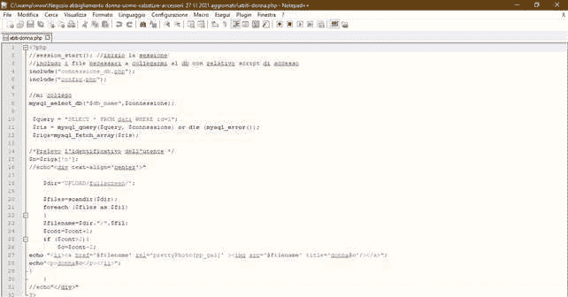

HTML 代表网站的结构，而 CSS 可以被视为网站的“外衣”（图形设计）。

HTML 是一种标记语言，而不是编程语言。实际上，浏览器会翻译代码并允许我们查看网页。

标签对于赋予页面结构至关重要，页面随后将由浏览器翻译。

元素或标签示例：

`<h1> 页面标题 </h1>`

`<h2> 段落标题 </h2>`

`<p> 页面标题 </p>`

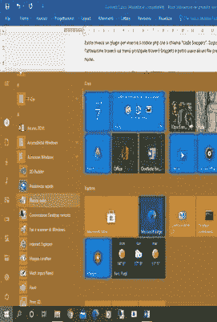

如果我们将这段代码复制到记事本中，并以 HTML 扩展名保存，我们将看到我们的原始网站出现。

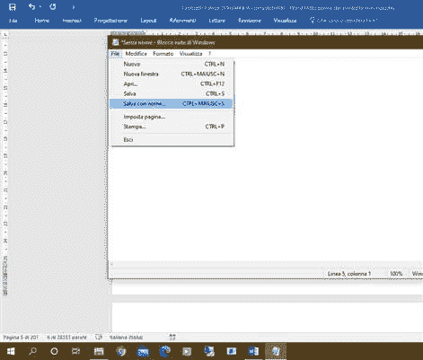

然后，我们将文件保存为 HTML 扩展名。我们将其命名为 `index.html`，因为浏览器会将其识别为我们网站的主页。

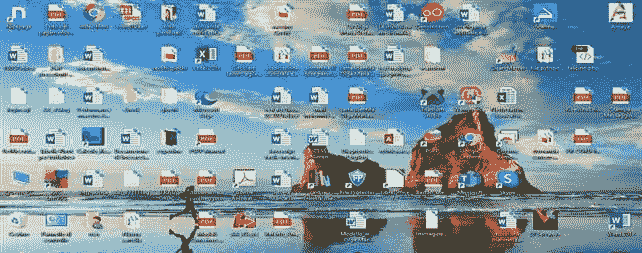

如果我们在桌面上双击该文件，它将在浏览器中显示：

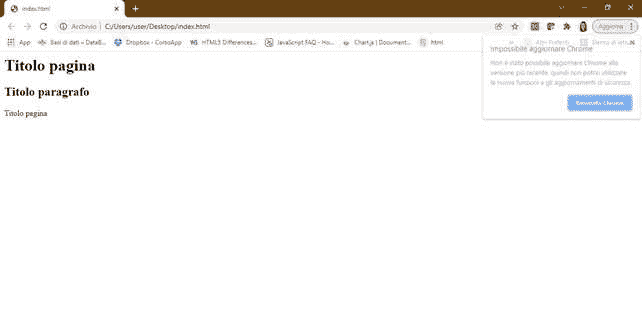

你会看到浏览器识别了标签，并按照我们的意愿格式化了文本。这是一个简单的例子，展示了浏览器如何读取 HTML 页面。

然后，浏览器将标签翻译成网页元素。

在 Chrome 中，如果我们输入：

`Ctrl + u` 将显示任何网页的 HTML 代码。

`Index.html`：

```html
<! DOCTYPE html>

<html>

<head>

<title> Sample Web Designer | Welcome </title>

</head>

<body>

<header>

<h1> Web Design Example </h1>

</header>

<nav>

<ul>

<li class = "current"> <a href="index.html"> Home </a> </li>

<li> <a href="about.html"> About </a> </li>

<li> <a href="services.html"> Services </a> </li>

</ul>

</nav>

<p> Body of the site </p>

<footer>

<p> Example Web Deisgner, Copyright & copy; 2022 </p>

</footer>

</body>

</html>
```

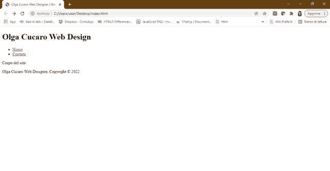

显然，如果我们没有插入联系人的 HTML 文件，将会出现错误页面。

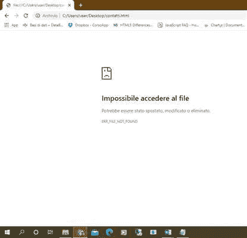

因此，我们必须创建 `contact page.html`。

```html
<! DOCTYPE html>

<html>

<head>

<title> Sample Web Designer | Welcome </title>

</head>

<body>

<header>

<h1> Web Design Example </h1>

</header>

<p> You can find us via xxxxxx n. xxx <br> our number is xxxx </p>

<footer>

<p> Example Web Deisgner, Copyright & copy; 2022 </p>

</footer>

</body>

</html>
```

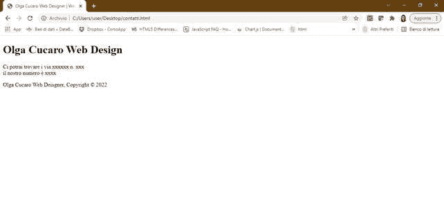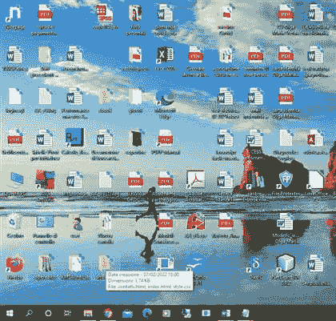

显然，页面会缺少精确的样式，我们可以将样式直接插入 HTML 页面，或者插入到一个名为 `style.css` 的特定文件中，该文件将包含页面样式，我们稍后会看到。

现在文件数量增加了，让我们为网站创建一个专门的文件夹，我们将其命名为“基础站点”，并在其中插入 `.css` 扩展名的文件和 `.html` 扩展名的文件。要查看网站，请双击 `index.html` 页面。为了简单起见，样式文件也将用记事本编写，并保存为 `.css` 扩展名，如下所示。

`Style.css`：

```css
background {

font: 15px / 1.5 Arial, Helvetica, sans-serif;

padding: 0;

margin: 0;

background-color: # ff55dc;

}

/ * Global * /

.container{

width: 80%;

margin: auto;

overflow: hidden;

}

ul {

margin: 0;

padding: 0;

}

/ * Header ** /

header {

background: blue;

color: #ffffff;

padding-top: 30px;

min-height: 70px;

border-bottom: # e8491d 3px solid;

}

header to {

color: #ffffff;

text-decoration: none;

text-transform: uppercase;

font-size: 16px;

}

header li {

float: left;

display: inline;

padding: 0 20px 0 20px;

}

header #branding {

float: left;

}

header #branding h1 {

margin: 0;

}

header nav {

float: right;

margin-top: 10px;

}

header .highlight, header .current a {

color: # ff6940;

font-weight: bold;

}

header a: hover {

color: #cccccc;

font-weight: bold;

}

footer {

padding: 20px;

margin-top: 20px;

color: #ffffff;

background-color: orange;

text-align: center;

}
```

`Index.html`：

```html
<! DOCTYPE html>

<html>

<head>

<link rel = "stylesheet" href = "./ style.css">

<title> Sample Web Designer | Welcome </title>

</head>

<body>

<header>

<h1> Web Design Example </h1>

</header>

<nav>

<ul>

<li class = "current"> <a href="index.html"> Home </a> </li>

<li> <a href="contacts.html"> Contacts </a> </li>

</ul>

</nav>

<p> Body of the site </p>

<footer>

<p> Example Web Deisgner, Copyright & copy; 2022 </p>

</footer>

</body>

</html>
```

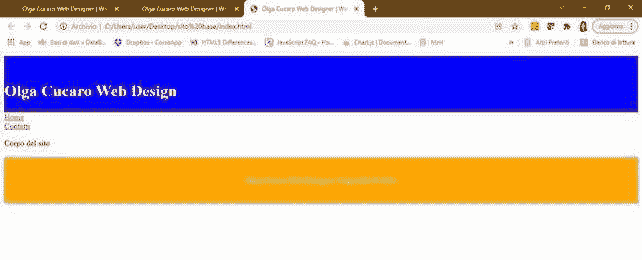

`Contact.html`：

```html
<! DOCTYPE html>
```

```html
<html>
<head>
<link rel = "stylesheet" href = "./ style.css">
<title> 示例网页设计师 | 欢迎 </title>
</head>
<body>
<header>
<h1> 网页设计示例 </h1>
</header>
<nav>
<ul>
<li> <a href="index.html"> 首页 </a> </li>
<li class = "current"> <a href="contacts.html"> 联系方式 </a> </li>
</ul>
</nav>
<p> 您可以通过 xxxxxx n. xxx 找到我们 <br> 我们的号码是 xxxx </p>
<footer>
<p> 示例网页设计师，版权所有 &copy; 2022 </p>
</footer>
</body>
</html>
```

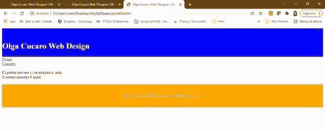

我们插入到文件夹中的所有 HTML 页面都将具有与 `style.css` 样式表中相同的格式。

另一种选择是使用其他在线资源来创建或编辑 CSS 样式表。

有一些在线工具可以用于此目的，例如：

- [`www.toptal.com/developers/css3maker/`](https://www.toptal.com/developers/css3maker/)
- [`css3generator.com/`](https://css3generator.com/)
- [`webcode.tools/generators/css/background-color`](https://webcode.tools/generators/css/background-color)
- [`css-generator.netlify.app/`](https://css-generator.netlify.app/)

显然，除了 CSS 样式表之外，我们还需要创建 HTML 文件来编写网站的内容。

在这方面，我们也可以使用 Amaya 软件，用它我们可以同时创建 CSS 和 HTML 文件。

[`amaya.it.uptodown.com/windows`](https://amaya.it.uptodown.com/windows)

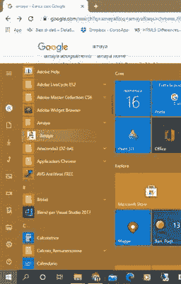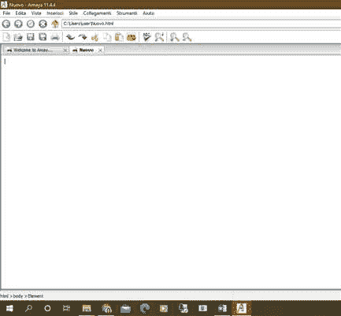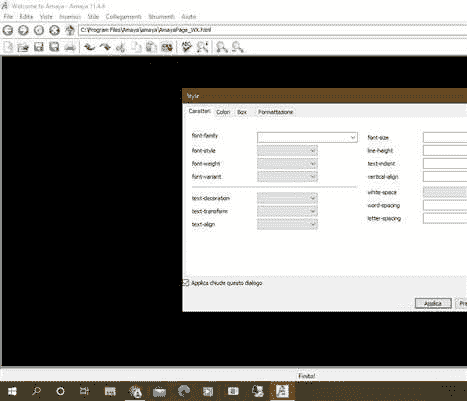

如今，创建能在任何设备上运行且包含各种链接和页面的响应式网站可能非常复杂且耗时，因此从互联网下载现成的模板（如 Bootstrap）或直接下载完整的网站示例，然后根据需要进行修改（始终遵守用户可用的许可协议）会很有帮助。

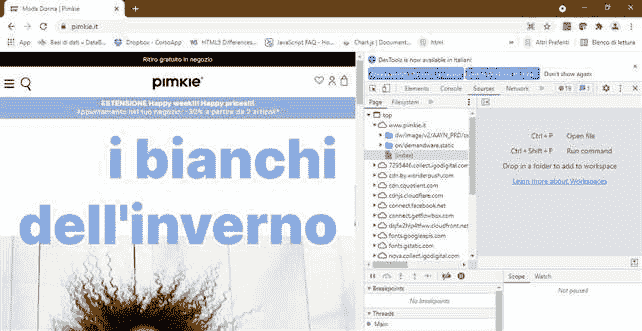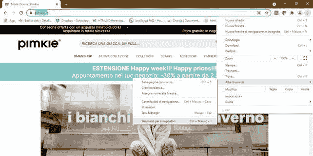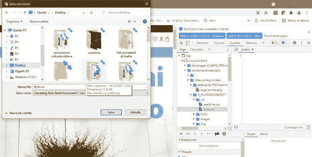

## 动态网站与静态网站

静态网站是过去几年中互联网上大多数网站的代表。如今情况发生了巨大变化，静态网站的数量越来越少。

静态网站是最容易创建的，它提供不变的网站内容，直到程序员通过代码进行修改。动态网站则更为复杂，需要在网站页面中进行客户端和服务器端的编程。动态网站允许用户与网站交互，通过代码中的脚本对底层数据库进行查询，并与网站本身连接。

动态网站的例子有：

- 实时选择产品的电子商务网站
- 社交网站

这些网站通过用户交互实现持续更新。

## 响应式网站与 Bootstrap 网站

Responsive 意为“响应式”，在 IT 术语中表示“可自适应”。当一个网站能在所有类型的设备上正常显示，没有任何显示问题，并能自动调整大小并以最佳方式排列所有部分时，它就被称为响应式网站。

过去，由于设备类型不多，网站只能为 PC 制作，我们甚至没有考虑过响应式网站，但现在这已成为创建网站的基本要求。

首先，我们可以说，制作一个完全响应式的网站是一项艰巨的工作。我们可以说，如果在样式表中使用百分比而非像素，并在页面的 HTML 代码中插入：

`<meta name = "viewport" content = "width = device-width, initial-scale = 1">`

这会使页面适应设备的屏幕尺寸，但关键是在样式表中使用百分比来思考。


然而，鉴于制作响应式网站的固有困难，如果你不想浪费时间，也不是 CSS 和 HTML 的专家，最好使用互联网上的资源，就像我们在本书中将要做的，专注于编程。这些资源可以是 Bootstrap 和 WordPress。

## 如何在互联网上使用 Bootstrap

### 下载 Bootstrap

在网络上，我们可以找到付费和免费的 Bootstrap，这取决于网站创建者的资源及其需求。

[`azmind.com/free-bootstrap-themes-templates/`](https://azmind.com/free-bootstrap-themes-templates/)

从这个网站，你可以下载针对特定需求的模板，也可以下载主题，即应用于实际网站以获得真实效果的完整框架。

[`getbootstrap.com/docs/3.4/customize/`](https://getbootstrap.com/docs/3.4/customize/)

[`templatemo.com/tm-571-hexashop`](https://templatemo.com/tm-571-hexashop)

[`www.free-css.com/free-css-templates/page273/interior-design`](https://www.free-css.com/free-css-templates/page273/interior-design)

[`www.free-css.com/free-css-templates/page272/be`](https://www.free-css.com/free-css-templates/page272/be)

首先，我们可以从上述各个网站提供的主题中下载一个你喜欢的。选择主题时，还需要根据其提供的许可协议来决定。事实上，有个人许可和商业许可，你必须注意你使用的是哪种类型的许可。这是对我们从互联网下载并希望用于自己项目的所有内容的一个有用提示。

[`azmind.com/free-bootstrap-business-template-gioia/`](https://azmind.com/free-bootstrap-business-template-gioia/)

在该网站上，你会看到以下描述：

免费 Joy 模板 - Bootstrap 商业主题

更新日期：2018 年 5 月 29 日，作者：Anli

今天的网页设计资源是一个名为 Gioia 的新免费 Bootstrap 模板，它是一个完美的商业主题，适用于你自己或客户的代理机构或作品集网站。

Gioia 与 Andia 模板非常相似，包含 5 个响应式页面：首页、作品集、服务、关于和联系方式。

它的一些功能包括：响应式图片轮播、现代可筛选作品集、AJAX 联系和邮件订阅表单、Flickr 照片、字体图标、CSS3 动画、谷歌地图等。

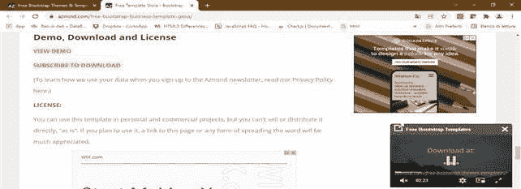

许可协议：

你可以在个人和商业项目中使用此模板，但不能直接“按原样”出售或分发它。如果你计划使用它，请提供指向此页面的链接或任何形式的宣传，我们将不胜感激。

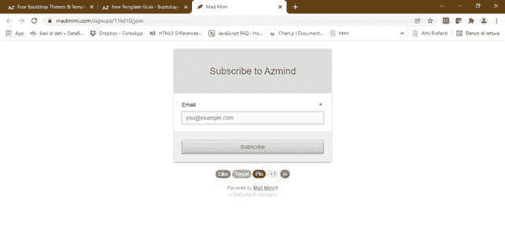

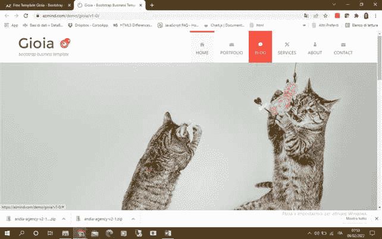

[`azmind.com/free-html-template-andia-responsive-agency-portfolio-template-twitter-bootstrap/`](https://azmind.com/free-html-template-andia-responsive-agency-portfolio-template-twitter-bootstrap/)

在该网站上，你会看到以下描述：

免费 HTML 模板 Andia：响应式代理机构/作品集 Bootstrap 主题

今天的免费网页设计资源是一个大项目！它是一个名为 Andia 的响应式代理机构/作品集 HTML 模板，基于 Bootstrap 构建。Andia 包含 7 个完全响应式的页面：首页、首页 2、作品集、服务、关于、联系方式、定价表，非常适合为小型企业或个人作品集创建网站。

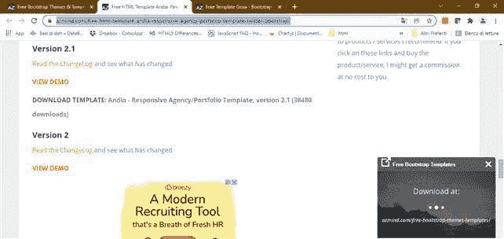

你可以在个人项目中使用此模板。你不能移除页脚版权链接。不保证提供支持，也不保证及时。

商业许可：

你可以在商业项目中为自己或客户使用此模板。你可以移除页脚版权链接。提供免费且快速的支持。

（目前不可用）

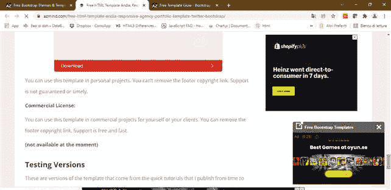


下载文件夹后，你会看到这些文件：

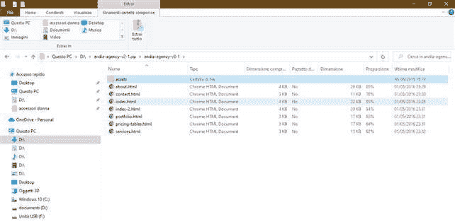

你也可以选择一个现在非常常见的单页 Bootstrap 主题。

[`azmind.com/riona-free-one-page-business-bootstrap-theme/`](https://azmind.com/riona-free-one-page-business-bootstrap-theme/)

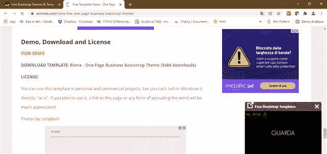

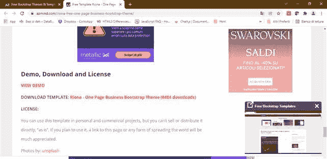

我解压下载的文件夹，并修改其内容，以获得我设想中的网站。

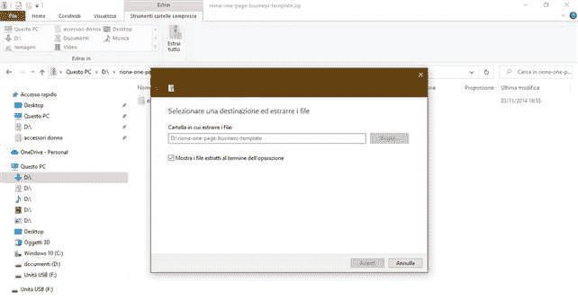

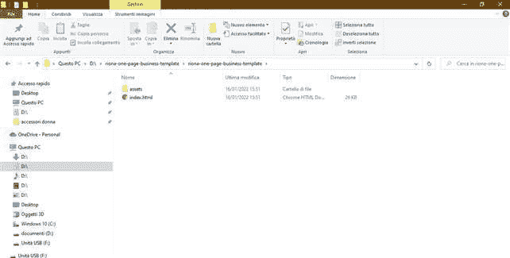

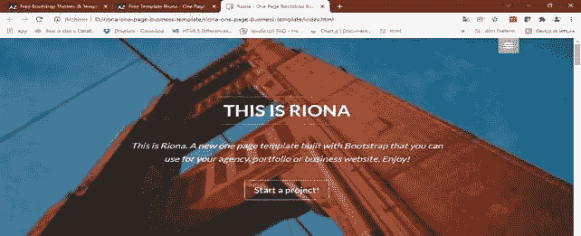

## 创建或修改样式表，从而改变网站的图形

如果许可证允许，我可以使用各种桌面和移动应用程序来修改页面和 CSS，包括：

`Nicepage`

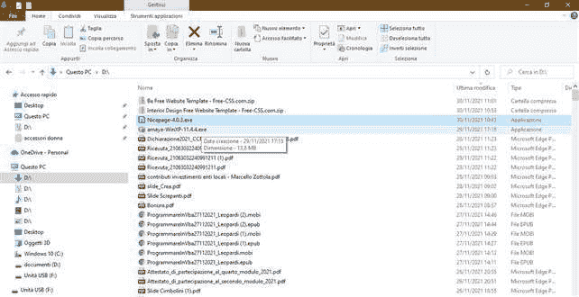

`Nicepage` 用于编辑 HTML 页面和 CSS

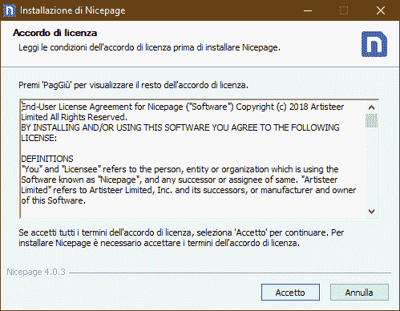

开始一个使用该软件的教程

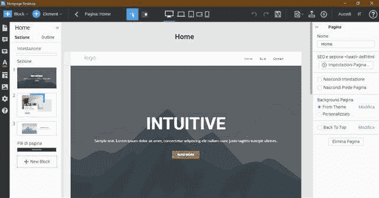

它非常适合快速修改页面。

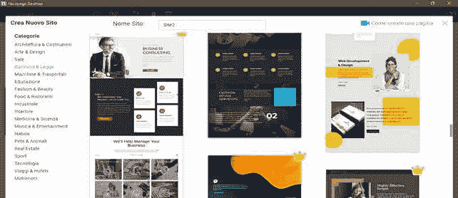

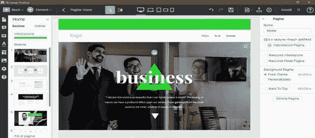

如果你点击一张图片，可以将其替换为自动从互联网搜索到的免费图片。

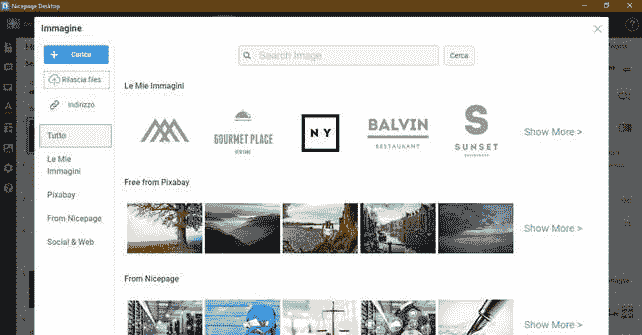

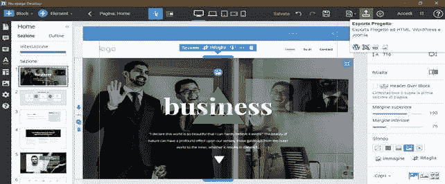

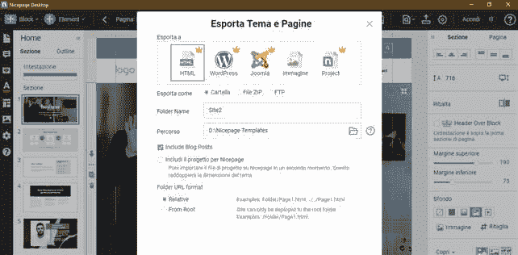

在移动设备上，我们可以使用：

`TrebEdit`

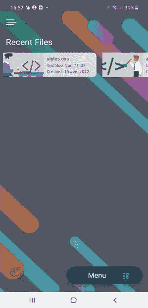

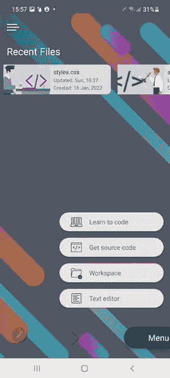

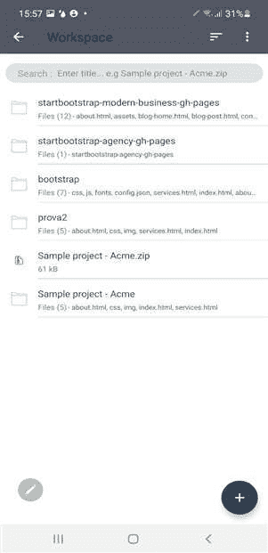

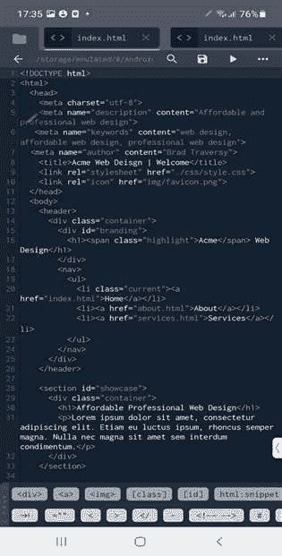


由于具有响应式设计，网站将适配所有设备，因此在 PC 上显示效果如下：

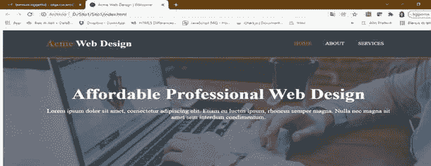

该应用已经提供了一个包含三个页面的响应式网站示例，你可以轻松编辑。

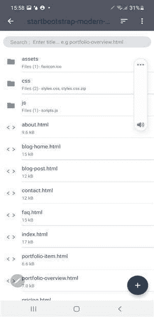

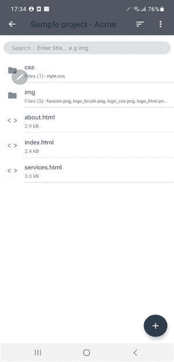

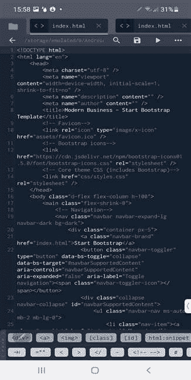

要从代码中查看页面，需要点击右上角的播放箭头。

通过修改应用示例中`style.css`文件的一些背景和字体颜色，更换初始图片，调整某些标签的大小，添加一个盒子并在样式表中调整盒子尺寸，使其容纳四个盒子（而不是三个），我们得到了一个完全不同的 index 文件：


该应用使用非常简单，侧边菜单中提供了选择颜色的功能，并能自动将颜色代码插入样式表中。

由于具有响应式设计，网站将适配所有设备，因此在 PC 上显示效果如下：

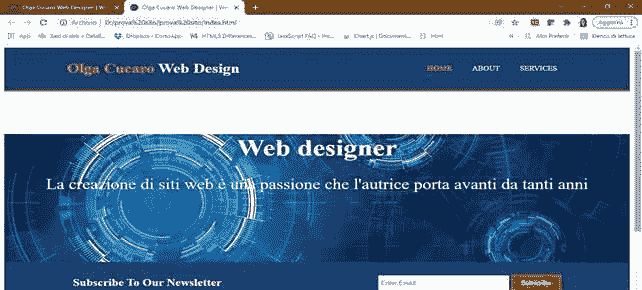


### `Index.html`

```
<! DOCTYPE html>

<html>

<head>

<meta charset = "utf-8">

<meta name = "description" content = "Affordable and professional web design">

<meta name = "keywords" content = "web design, affordable web design, professional web design">

<meta name = "author" content = "Brad Traversy">

<title> Sample Web Designer | Welcome </title>

<link rel = "stylesheet" href = "./ css / style.css">

<link rel = "icon" href = "img / favicon.png">

</head>

<body>

<header>

<div class = "container">

<div id = "branding">

<h1> <span class = "highlight"> Example </span> Web Design </h1>

</div>

<nav>

<ul>

<li class = "current"> <a href="index.html"> Home </a> </li>

<li> <a href="about.html"> About </a> </li>

<li> <a href="services.html"> Services </a> </li>

</ul>

</nav>

</div>

</header>

<section id = "showcase">

<h1> <span> Web designer </span> </h1> </h1>

<p> Creating websites is a passion that the author has been pursuing for many years </p>

</div>

</section>

<section id = "newsletter">

<div class = "container">

<h1> Subscribe To Our Newsletter </h1>

<form>

<input type = "email" placeholder = "Enter Email ..." required>

<button type = "submit" class = "button_1"> Subscribe </button>

</form>

</div>

</section>

<section id = "boxes">

<div class = "container">

<div class = "box">


<h3> HTML5 Markup </h3>

<p> Writing web pages in html is easier than you think </p>

</div>

<div class = "box">


<h3> CSS3 Styling </h3>

<p> Creating an attractive style sheet is crucial for the success of a website </p>

</div>

<div class = "box">


<h3> Graphic Design </h3>

<p> The graphics of a site can determine the success of the site </p>

</div>

<div class = "box">


<h3> Programmer </h3>

<p> Client-side and server-side programming can make your site dynamic </p>

</div>

</div>

</section>

<footer>

<p> Example Web Deisgner, Copyright & copy; 2022 </p>

</footer>

</body>

</html>
```

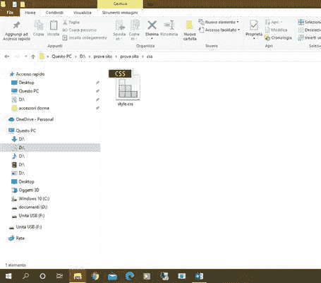

### `Style.css`


```css
background {
  font: 15px / 1.5 Arial, Helvetica, sans-serif;
  padding: 0;
  margin: 0;
  background-color: #ff55dc;
}

/* Global */
.container {
  width: 80%;
  margin: auto;
  overflow: hidden;
}

ul {
  margin: 0;
  padding: 0;
}

.button_1 {
  height: 38px;
  background: #ff5f2a;
  border: 0;
  padding-left: 20px;
  padding-right: 20px;
  color: #ffffff;
}

.dark {
  padding: 15px;
  background: #5f2420;
  color: #ffffff;
  margin-top: 10px;
  margin-bottom: 10px;
}

/* Header */
header {
  background: #1c3d6e;
  color: #ffffff;
  padding-top: 30px;
  min-height: 70px;
  border-bottom: #e8491d 3px solid;
}

header to {
  color: #ffffff;
  text-decoration: none;
  text-transform: uppercase;
  font-size: 16px;
}

header li {
  float: left;
  display: inline;
  padding: 0 20px 0 20px;
}

header #branding {
  float: left;
}

header #branding h1 {
  margin: 0;
}

header nav {
  float: right;
  margin-top: 10px;
}

header .highlight,
header .current a {
  color: #ff6940;
  font-weight: bold;
}

header a:hover {
  color: #cccccc;
  font-weight: bold;
}

/* Showcase */
#showcase {
  min-height: 300px;
  background: url('../img/showcase.jpg') no-repeat;
  background-position: center;
  background-size: cover;
  text-align: center;
  color: #ffffff;
}

#showcase h1 {
  margin-top: 100px;
  font-size: 55px;
  margin-bottom: 10px;
}

#showcase p {
  font-size: 35px;
}

/* Newsletter */
#newsletter {
  padding: 15px;
  color: #ffffff;
  background: #1b456d;
}

#newsletter h1 {
  float: left;
}

#newsletter form {
  float: right;
  margin-top: 15px;
}

#newsletter input[type="email"] {
  padding: 4px;
  height: 25px;
  width: 250px;
}

/* Boxes */
#boxes {
  margin-top: 20px;
}

#boxes .box {
  float: left;
  text-align: center;
  width: 22%;
  padding: 10px;
}

#boxes .box img {
  width: 70px;
}

/* Sidebar */
aside #sidebar {
  float: right;
  width: 30%;
  margin-top: 10px;
}

aside #sidebar .quote input,
aside #sidebar .quote textarea {
  width: 90%;
  padding: 5px;
}

/* Main-col */
article #main-col {
  float: left;
  width: 65%;
}

/* Services */
ul #services li {
  list-style: none;
  padding: 20px;
  border: #cccccc solid 1px;
  margin-bottom: 5px;
  background: #e6e6e6;
}

footer {
  padding: 20px;
  margin-top: 20px;
  color: #ffffff;
  background-color: #ff6940;
  text-align: center;
}

/* Media Queries */
@media (max-width: 768px) {
  header #branding,
  header nav,
  header nav there,
  #newsletter h1,
  #newsletter form,
  #boxes .box,
  article #main-col,
  aside #sidebar {
    float: none;
    text-align: center;
    width: 100%;
  }

  header {
    padding-bottom: 20px;
  }

  #showcase h1 {
    margin-top: 40px;
  }

  #newsletter button,
  .quote button {
    display: block;
    width: 100%;
  }

  #newsletter form input[type="email"],
  .quote input,
  .quote textarea {
    width: 100%;
    margin-bottom: 5px;
  }
}
```

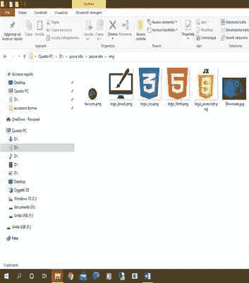

您还可以上传从网络下载的文件夹并随意修改。经过简单的练习，您可以直接修改`css`样式表，特别是`css`文件夹中包含的`.css`文件，它可以改变网站的图形外观而非内容。然而，要改变页面的内容，我们必须修改单个的`Html`表单。通过点击播放按钮的箭头，我们可以在 App 内置的 Web 模拟器中看到结果。


# 什么是数据库及其用途

什么是数据库？每当我们想要存储需要对其进行操作的数据时，就一定会用到数据库。数据库就像是包含我们要存储数据的容器。数据库不仅用于 Web，还用于使用各种编程语言（`visual basic`、`C`、`python`、`java`、`javascript`等）创建的各种应用程序。

数据库分为关系型和非关系型。在大多数情况下，使用的是关系型数据库，正如从术语中所能理解的那样，它们基于关系，特别是通过表与表之间的一对一、一对多、多对多关系相连接的关系表。

现有的关系类型：

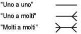

表通过键（Key）链接在一起，键可以是主键或外键。

提醒您，主键必须是唯一的，并且能够标识我们所考虑的实体的单个实例。

提醒您，一个表的主键可以成为另一个与其有关系之表的外键。

要创建数据库，我们首先从包含所有所需数据的单个表开始，随后我们将删除各个表中的重复字段，因为这些字段在数据库中不应重复，可以通过简单的数据库查询检索到。

关系型数据库及其关系表的示例（通过主键和外键链接）可以是员工工资表或产品仓库表，以及其他通过某些被标识为键的字段链接在一起的数据。例如，员工主数据表可以通过员工代码链接到工资单表，或者`Products`表可以链接到`Invoices`表和`Customers`表，以此类推。

在本项目中，数据库将仅用于在网站上插入我们选择的图像以及在首页插入新闻，因此它们将由仅包含主键的非关系表组成。具体来说，我们将有三个表：一个用于首页（`index.php`）中包含的图像和新闻文本，一个用于服装系列，一个用于登录。在图像表中，我们将只有作为自动`ID`的主键和作为待插入图像数量的`n`；而在新闻表中，我们将同时拥有由变量`n`表示的图像及其相关文本。在最后的登录表中，我们拥有`username`和加密后的密码。

## 使用 phpMyAdmin 创建和管理数据库

数据库可以使用多种软件创建，包括 Office 应用程序`Access`或其他各类软件。可以在数据库上进行数据的插入、选择、修改和删除。查询关系型数据库的语言是`SQL`。

为了管理数据库，我们可以从网络下载`MySql`，或者下载包含`MySql`的软件包，例如用于 Web 的`WAMP`或`XAMPP`（我们稍后会详细解释）。目前我们只需明确，这两个应用程序都包含`phpMyAdmin`。

在我们的案例中，它们将被用于使我们的示例网站动态化，根据与用户的交互来改变数据，为此我们将使用`phpMyAdmin`。

提醒您，数据库也可以与`WordPress`配合使用。

### 数据库管理

在这项工作中，我们不需要解决所有关于数据库的疑难问题，但我们打算对该主题进行初步介绍，这对于应用示例的目的极其有用。

管理数据库必须使用`MySql`语言。查询是对数据库发出的请求，通过子句（clauses）来工作。

使用`SELECT`子句，您可以选择数据库中选定表的记录：

```php
$query = "SELECT * FROM data WHERE id = 1";
```

在这种情况下，因为我们输入了`*`，所以将选择所有列。

`DELETE`子句删除选定的记录：

```php
$query = "DELETE FROM data_news WHERE id2 = '$i'";
```

`UPDATE`子句使用我们要插入的数据更新记录：

```php
$query = "UPDATE data_news set id2 = '$o' WHERE id = $id";
```

所有这些子句都将包含在我们的数据库管理中。

## 客户端和服务器端语言

在编写网页时，需要同时使用服务器端和客户端语言。如果程序员没有预见到需要向连接到服务器本身数据库的服务器发送请求，那么客户端语言就足够了，例如在静态网站的情况下（`html`和`javascript`）。相反，如果网站提供了对服务器端数据库的访问，从而使网络上的所有客户端都能访问，那么它必须用服务器端语言（如`PHP`）编写。一个例子是使用`CMS`创建动态网站或具有在线产品选择功能的电子商务网站。

### PHP

`Php`是一种用于创建动态网页的服务器端编程语言，诞生于 1994 年。随着管理`CMS`的`WordPress`采用`PHP`创建，它在全世界范围内传播开来。`PHP`解释器通过许可证免费分发。

`Php`是最著名的服务器端语言，因此用于与外部服务器通信。

`php`代码可以直接插入到`html`页面中，也可以单独保存为`.php`扩展名文件，但始终由以下符号标识：

```php
<?php
?>
```

`.php`文件必须被包含在`html`页面中：

```php
<?php
include("view-slider-home.php");
?>
```

### JavaScript

`Javascript`是一种用于网页事件相关脚本的客户端编程语言。通过`javascript`，用户可以与网站进行交互，将网站从静态转变为动态。`javascript`的示例包括插入由用户选择执行操作的按键。一个允许用户选择语言的翻译器可能就是一个`javascript`程序。

`Javascript`是从上到下读取的，因此必须插入在代码的特定部分。它是一种解释型代码的例子，与编译型代码不同，后者由编译器处理，将编程语言翻译成机器语言。

尽管`javascript`已经作为客户端语言存在多年，但现在有了`NodeJS`，它将`javascript`转换为服务器端语言。这绝对将是下一本书的主题。

`javascript`代码可以嵌入在`html`网页中，也可以插入在单独的`.js`文件中并仅从`html`页面调用。

它可以插入在页面的主体（body）中：

```html
<script type="text/javascript" src="js/search.js"></script>
```

它可以插入在页面的特定部分，例如在`bootstrap`中：

```html
<!-- Javascript -->

<script src="js/jquery-1.11.1.min.js"></script>
<script src="bootstrap/js/bootstrap.min.js"></script>
<script src="js/bootstrap-hover-dropdown.min.js"></script>
<script src="js/wow.min.js"></script>
<script src="js/retina-1.1.0.min.js"></script>
<script src="js/jquery.magnific-popup.min.js"></script>
<script src="flexslider/jquery.flexslider-min.js"></script>
<script src="js/jflickrfeed.min.js"></script>
<script src="js/masonry.pkgd.min.js"></script>
<script src="http://maps.google.com/maps/api/js?sensor=true"></script>
<script src="js/jquery.ui.map.min.js"></script>
<script src="js/scripts.js"></script>
```

提醒您，为了被识别为`javascript`代码，您必须插入`<script></script>`标签。

# 创建网站示例

## 创建项目

我们的示例网站是一个服装店，拥有三家分店，用于插入各店铺现有系列的照片。该示例并非电子商务网站，而仅用于展示系列照片。

在本示例中，我们的目标是通过`phpMysql`、`php`和`javascript`，实现直接从网站插入图像并使用加密密码访问。

首先，我们需要确定网站必须由多少个页面组成以及具体包含哪些页面（首页、关于我们、服务或产品以及联系方式）。我们也可以决定创建一个单一的滚动页面（单页网站）或多个分立页面。考虑到如今用户浏览社交网络的习惯，创建一个“单页”网站或许会更好。如果我们想引导用户执行特定操作，则会创建着陆页（landing page），例如由特定营销活动引导的页面。

在我们的示例中，我们决定创建四个可以通过主菜单直接访问的主页面，此外还增加了两个系列页面（男装和女装）以及三个店铺页面，这些店铺页面通过主导航栏的子菜单访问。

在这个阶段，我们既可以写下各页面必须具备的主要特征，也可以在纸上绘制页面的图形设计。您还可以创建页面图形的原型（template），以便了解项目中需要修改的内容。

### 使用 Notepad

我们已经提到，所有`html`、`javascript`和`php`的网页文件都可以使用简单的记事本轻松编写，关键是要将文件保存为特定的扩展名（`.html`、`.php`等）。显然，在这种情况下，我们必须非常熟悉想要使用的语言，否则文件将无法运行。为了解决这个问题，我们可以使用 Notepad（此处指代码编辑器），它与简单记事本不同，会在我们编写时提示该语言中包含的词汇，以避免代码编写错误。


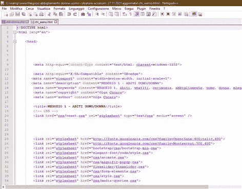

### 创建页面

在项目的这个阶段，我们可以选择独立地用`html`创建页面，或者使用来自互联网的各种资源，例如已经创建好的 Bootstrap，然后根据我们的需求对其进行修改。

我们之前已经解释过，创建一套能够满足当今市场对动态和响应式网站具体需求的 CSS 所面临的困难和所需的时间。这就是为什么在这项旨在教学、特别是创建用于插入图像的动态菜单的工作中，我们决定使用互联网上已有的免费资源。

正如我们稍后将看到的，在页面创建的初始阶段，我们将用`html`代码编写所有主页面；随着工作的推进，我们将意识到在哪些方面需要深入使用`javascript`和`php`语言，然后将某些页面保存为`php`，因为它们包含`php`代码。

### 更改页面布局

在创建主页面后，我们将致力于使页面适应我们打算创建的网站的需求。在这个阶段，我们必须理解网站需要实现什么功能，它将如何与用户交互，以及我们想要输入并提供给用户哪些信息，并区分哪些是静态显示的，哪些是由用户动态选择的。

在这个阶段，我们意识到示例网站的系列照片必须能够由一个完全不懂编程代码的普通网站所有者轻松更新。

因此，产生了通过`javascript`和`php`创建一个具有个人访问权限的菜单，以便在相关网页中插入图像的需求。这就是本研究的目标，将在接下来的段落中详细解释。

### 选择图像和颜色


为网站选择的图像和颜色，无论是对于网站还是任何其他设计产品，都可能产生决定性的影响。网页设计正因如此而诞生，因此如果您想要专业级别的设计，必须寻求专业人士的帮助。如果您想全部亲力亲为，可以选择一个`bootstrap`或现成的模型，并修改部分内容进行自定义。如果您是`CSS`专家，也可以参考互联网上您喜欢的网站，从零开始根据自己的喜好创建网站。

### 免费和付费图像

互联网上有许多可以下载免费或付费图像的网站。

[`www.pinterest.it/pxhere/`](https://www.pinterest.it/pxhere/)

[`pixabay.com/`](https://pixabay.com/)

Google Play 商店中也有各种应用程序，例如：

- `free images`
- `pixabay`

我建议您插入与网站主题相关的轮播图（sliders）和图像，并使用能吸引注意力但不过分刺眼的颜色。

轮播图是长条形图像，通过滑动为网站带来动感。这些可以通过`CSS`插入。在我们的示例中，我们决定插入轮播图。

### 专门为网站创建的图像

我们还可以通过互联网提供的创建或修改图像的工具自行创建图像，例如：

- `Photoshop`
- `Gimp`

在这种情况下，我们可以拍摄照片并使用这些软件进行修改，然后将其插入到我们的网站中。

> 提醒您，请务必注意要插入图像的分辨率。文件越大，网站加载时间越长。我还建议您使用“导出为 Web 所用格式”功能来保存它们。

还有一些非常实用的移动应用程序，例如：

- `Adobe Draw`
- `Picsart`

# 在 Windows 中使用 XAMPP 或 WAMP 本地管理网站

对于程序员来说，在网站发布前测试其功能是非常有用的。

为此，我们可以使用互联网上提供的免费软件套装，如`WAMP`或`XAMPP`。我们可以将这些软件视为本地 Web 模拟器。

`XAMPP`代表跨平台（cross-platform）、`Apache`、`MySql`、`PHP`和`Perl`。可以说`XAMPP`和`WAMP`之间没有太大区别。`Apache`是一个本地 Web 服务器，用于在不上网的情况下测试网站项目。`MySql`用于创建和管理数据库。要运行`MySql`，我们需要安装`php`。

我们甚至可以不使用`XAMPP`或`WAMP`，但在这种情况下，我们将无法与数据库交互，也无法在本地查看用`PHP`和`Javascript`编写的程序的运行情况。

因此，如果我们的网站没有提供任何形式的用户交互，我们可以直接点击`html`页面，使用选定的浏览器轻松查看页面，而无需下载像`WAMP`这样的模拟器。

`XAMPP`是跨平台的，并且还支持`PERL`，而`WAMP`仅支持`MySQL`、`PHP`和`Apache`，且仅在 Windows 上运行。

> 提醒您，`WAMP`是 Windows 栈，但 Linux 也有`LAMP`，而 MAC 版本被称为`MAMP`。

## 什么是 WAMP 及其工作原理

在这项工作中，为了测试我们的示例网站，我们决定使用`WAMP`作为 Windows 栈。`WAMP`是 Windows、`Apache`、`Mysql`和`PHP`的缩写。该软件套装名为`WampServer`，是免费的。

## 下载并安装 WAMP

在互联网上搜索`WAMP`后，安装该软件包。有许多网站可以免费下载`WAMP`。

安装结束以后，计算机的`C:`盘中会出现`wamp`文件夹。

`Wamp`还会安装其他对编程有用的软件，例如`Notepad`。

## 使用 WAMP

安装`WAMP`软件后，我们在`C:`盘中将拥有以下文件夹：

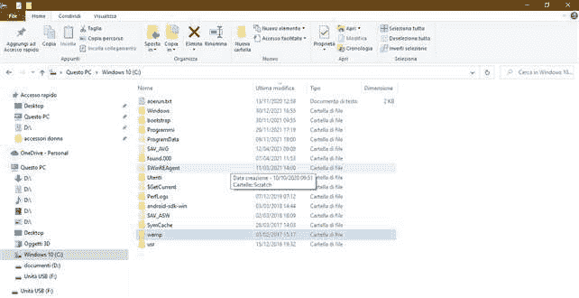

要进入模拟器，我们需要点击`wampmanager.exe`；而如果我们想创建网站或将已创建的网站文件夹转移到`WAMP`中，请点击`www`文件夹并导入所需的网站文件。


要进入`WAMP`菜单，请点击`wamp`文件夹中的`wampmanager.exe`，或点击桌面上的 W 图标。


> 我提醒您，`WAMP`也可以与`wordPress`一起使用，方法是将`wordpress`文件夹复制到`wamp`的`www`文件夹中，并在通过`wamp`在`phpMyAdmin`中创建数据库后直接安装，该数据库将插入到`WordPress`配置中。

# phpMyAdmin 和 MySQL

使用数据库并不容易，首先我们必须选择是直接在网络上创建网站，还是在本地网络模拟器上测试，然后再将其迁移到网络上。然而，即使我们决定在个人电脑上测试网站，我们仍然需要在购买或免费获得的主机上创建相同的数据库。每个带有网站链接的主机都会包含一个数据库管理软件，例如`phpMyAdmin`。

> 我提醒您，数据库数据将重新输入到与您网站地址关联的软件中，而页面和`php`中的各种文件可以直接从主机上传。

我们项目的数据库构建如下：

- `Data table`
- `Data_news table`
- `Login table`

第一个表包含用于上传收藏和滑块图像的数据。第二个表包含用于上传新闻的数据，第三个表包含用于登录的数据（用户名和密码）。


在字段中：

- `n`将保存女装收藏中的图片数量；
- `n2`将是男装收藏中的图片数量；
- `N3`将是首页、商店 1、商店 2 和商店 3 页面上的滑块数量。


在此表中，我们将有`news`字段，包含插入到我们网站首页的所有新闻，我们可以通过控制面板删除、修改以及插入新新闻。


> 我提醒您，为了更高的安全性，我们已将密码以`SHA1`编码输入。

具体来说，我们访问了加密和解密密码的网站：

[`www.online-toolz.com/tools/sha1-generator.php`](https://www.online-toolz.com/tools/sha1-generator.php)

我们选择了`SHA1`编码，并将此代码复制到数据库中。随后，建议将原始密码保存在一个数据文件中，以便您访问数据库时使用。

> 我提醒您，要访问登录页面，您将输入原始用户名和密码，我们的`php`代码将对其进行加密，并与数据库中输入的`SHA1`编码进行校验。

# 用于插入图片和新闻的登录与菜单

我们将从登录页面访问控制面板，该页面位于我们网站页面的顶部，以小人物图像和“登录”字样标识。


即使消息报告格式错误，该过程仍会将照片上传到男装收藏页面。


对于新闻，情况略有不同，因为我们将插入图片和文字新闻，将来可以修改或删除。在这种情况下，我们还将把文字新闻插入到数据库中。


# 示例网站页面和脚本

对于这个用于教育目的的学校示例，我们使用了各种`php`程序，这些程序可以从互联网上免费下载，并且我们仅出于教育目的将其包含在本书中。显然，某些资源已被修改以适应本书中包含的示例网站的实用性。

在`WAMP`的`WWW`文件夹中，我们将有一个包含所有档案和文件的文件夹，稍后我们将把这些文件上传到托管网站的主机提供商。请记住还要直接在主机中创建数据库，稍后我们将描述如何操作。

我们创建的示例网站文件夹包含以下文件和子文件夹：


网站页面的文件根据是否使用数据库分为`files.html`和`files.php`。

> 我提醒您，包含`php`文件的页面必须保存为`php`格式，而不是`html`格式，否则无法工作。实际上，根据是否在数据库中使用，我们将有保存为`html`的页面和保存为`php`的页面。

## HTML 格式的网站页面

> 以下是保存为`html`格式的某些不包含`php`代码的页面文件，正如我们已经说过的，这些页面将保存为`php`格式。

> 为了便于阅读，我们将文件名作为注释输入。我提醒您，在`html`中，注释必须包含在`<! - note -!>`之间。如果您忘记感叹号或连字符，它将被读取为标签。

```html
<! DOCTYPE html>

<html lang = "en">

<! - file name: who_we are.html ->

<head>

<meta http-equiv = Content-Type content = "text / html; charset = windows-1252">

<meta http-equiv = "X-UA-Compatible" content = "IE = edge">

<meta name = "viewport" content = "width = device-width, initial-scale = 1">

<meta name = "description" content = "SHOP 1 - MEN'S / WOMEN'S CLOTHES">

<meta name = "keywords" content = "SHOP 1, suits, dresses, ceremony, apparel, man, woman, elegant, fur, footwear, sizes, comfortable, SHOP 1,, sweaters, sweaters, trousers, shirts, jeans, belts , shoes ">

<meta name = "copyright" content = "Example">

<meta name = "author" content = "Example">

<title> STORE 1 - MEN'S / WOMEN'S SUITS </title>

<! - CSS ->

<link href = "css / reset.css" rel = "stylesheet" type = "text / css" media = "screen" />

<link rel = "stylesheet" href = "http://fonts.googleapis.com/css?family=Open+Sans:400italic,400">

<link rel = "stylesheet" href = "http://fonts.googleapis.com/css?family=Montserrat:700,400">

<link rel = "stylesheet" href = "bootstrap / css / bootstrap.min.css">

<link rel = "stylesheet" href = "elegant-font / code / style.css">

<link rel = "stylesheet" href = "css / animate.css">

<link rel = "stylesheet" href = "css / magnific-popup.css">

<link rel = "stylesheet" href = "flexslider / flexslider.css">

<link rel = "stylesheet" href = "css / form-elements.css">

<link rel = "stylesheet" href = "css / style.css">

<link rel = "stylesheet" href = "css / media-queries.css">

<! - Favicon and touch icons ->

<link rel = "shortcut icon" href = "ico / favicon.png">

<link rel = "apple-touch-icon-precomposed" sizes = "144x144" href = "ico / apple-touch-icon-144-precomposed.png">

<link rel = "apple-touch-icon-precomposed" sizes = "114x114" href = "ico / apple-touch-icon-114-precomposed.png">

<link rel = "apple-touch-icon-precomposed" sizes = "72x72" href = "ico / apple-touch-icon-72-precomposed.png">

<link rel = "apple-touch-icon-precomposed" href = "ico / apple-touch-icon-57-precomposed.png">
```


```html
<script type="text / javascript" src = "js / search.js"> </script>

</head>

<body>

<div id = "first-line" class = "visible-desktop">

<div id = "top-line" class = "container">

<div class = "pull-right login">

<a href="login.html" class="login-lnk">  登录 </a>

</div>

</div>

</div>

<! - 顶部菜单 ->

<nav class = "navbar" role = "navigation">

<div class = "container">

<div class = "navbar-header">

<button type = "button" class = "navbar-toggle collapsed" data-toggle = "collapse" data-target = "# top-navbar-1">

<span class = "sr-only"> 切换导航 </span>

<span class = "icon-bar"> </span>

<span class = "icon-bar"> </span>

<span class = "icon-bar"> </span>

</button>

<a class="navbar-brand" href="index.php"> </a>

</div>

<! - 收集用于切换的导航链接、表单和其他内容 ->

<div class = "collapse navbar-collapse" id = "top-navbar-1">

<ul class = "nav navbar-nav navbar-right">

<li> <a href='index.php'> 首页 </a> </li>

<li class = "active"> <a href='#'> 关于我们 </a> </li>

<li> <a href='servizi.html'> 我们的服务 </a> </li>

<li class = "dropdown">

<a href="#" class="dropdown-toggle" data-toggle="dropdown">

画廊 <b class = "caret"> </b> </a>

<ul class = "dropdown-menu">

<li> <a href='collezione_woman.php'> 女装系列 </a> </li>

<li> <a href = 'men's_collection.php '> 男装系列 </a> </li>

</ul>

</li>

<li class = "dropdown">

<a href="#" class="dropdown-toggle" data-toggle="dropdown">

<B class = "caret"> </b> </a> 销售点

<ul class = "dropdown-menu">

<li> <a href='STORE 1.php'> 店铺 1 </a> </li>

<li> <a href='STORE 3.php'> 店铺 3 </a> </li>

<li> <a href='STORE 2.php'> 店铺 2 </a> </li>

</ul>

</li>

<li> <a href='contatti.html'> 联系我们 </a> </li>

</ul>

</ul>

</div>

</div>

</nav>

<div id = "google_translate_element"> </div> <script type = "text / javascript">

function googleTranslateElementInit () {

new google.translate.TranslateElement ({pageLanguage: 'it', layout: google.translate.TranslateElement.InlineLayout.SIMPLE}, 'google_translate_element');

}

</script> <script type = "text / javascript" src = "// translate.google.com/translate_a/element.js?cb=googleTranslateElementInit"> </script>

<div class = "wrap-clear"> </div>

<div class = "container">

<div> </div>

<br>

<br>

<div class = "testimonial-image wow fadeInUp">

<div class = ''>

<div class = 'row'>

<h6>

<div class = 'col-sm-4'>

店铺 1

</div>

<div class = 'col-sm-4'>

店铺 3

</div>

<div class = 'col-sm-4'>

店铺 2

</div>

<div class = 'col-sm-4'>

</div>

<div class = 'col-sm-4'>

</div>

<div class = 'row'>

<br>

</div>

</h6>

</div>

</div>

<br>

<div class = "testimonial-image wow fadeInUp">

<h4> 男装 - 女装 <br>

礼服 <br>

大码 <br>

配饰与鞋履 <br>

</h4>

</div>

</div>

</div>

<div class = "container">

<div class = "col-sm-2 about-us-text wow fadeInLeft" style = "text-align: justify">

</div>

<div class = "col-sm-8 about-us-text wow fadeInLeft" style = "text-align: justify">

<p>

<br>

我们公司是各年龄段男女服装制造的领导者，将实用性与优雅、高品质和卓越价格相结合。我们的座右铭是：为所有年龄和所有体型提供低成本优雅。

</p>

<br> <br> <H2 style = "text-align: CENTER">

我们为您寻找最适合各种场合的最佳价格服装 </H2>

<br>

<br>

</div> </div>

<! - 页脚 ->

<footer>

<div class = "container">

<div class = "row">

<div class = "col-sm-3 footer-box wow fadeInUp">

<h4> 公司 </h4>

<div class = "footer-box-text">

<p>

传统与创意结合现代与优雅。

NEGOZIO 1 Srl，一家在男装和女装领域领先的意大利公司

</p>

<p> <a href="who_we are.html"> 了解更多 ... </a> </p>

</div>

</div>

<div class = "col-sm-3 footer-box wow fadeInDown">

<h4> 隐私 </h4>

<div class = "footer-box-text">

<p>

196/2003 号立法令，即《个人数据保护法典》，将 675/1996 号法律和其他立法令整合到一个统一框架中……

</p>

<p> <a href="privacy.html"> 了解更多 ... </a> </p>

</div>

</div>

<div class = "col-sm-3 footer-box wow fadeInUp">

<h4> 店铺 </h4>

<div class = "footer-box-text footer-box-text-contact">

<p> <span aria-hidden = "true" class = "icon_pin"> </span> NEGOZIO 1 <br> <br> </p>

<p> <span aria-hidden = "true" class = "icon_pin"> </span> 店铺 3 <br> <br> </p>

<p> <span aria-hidden = "true" class = "icon_pin"> </span> 店铺 2 <br> <br> </p>

</div>

</div>

<div class = "col-sm-3 footer-box wow fadeInDown">

<h4> 联系我们 </h4>

<div class = "footer-box-text footer-box-text-contact">

<p> <span aria-hidden = "true" class = "icon_pin"> </ span> 地址： </p>

<p> <span aria-hidden = "true" class = "icon_phone"> </ span> 电话：0039 </p>

<p> <span aria-hidden = "true" class = "icon_profile"> </span> 传真：0039 </p>

<p> <span aria-hidden = "true" class = "icon_mail"> </span> 邮箱：<a href=" STORE 1@gmail.com "> STORE 1@gmail.com </a> </ p >

</div>

</div>

</div>

<div class = "row">

<div class = "col-sm-12 wow fadeIn">

<div class = "footer-border"> </div>

</div>

</div>

<div class = "row">

<div class = "col-sm-7 footer-copyright wow fadeIn">

<p> & copy; 版权所有 2017 - NEGOZIO 1 SRL - <a href="webcredits.html"> 网站致谢 </a>. </p>

<script> document.write (document.lastModified) </script>

<div class = "col-sm-7 footer-copyright wow fadeIn">

<p> & copy; Gioia - 保留所有权利。模板由 <a href="http://azmind.com"> Azmind </a> 提供。 </p>

</div>

</div>

<div class = "col-sm-5 footer-social wow fadeIn">

<a href="#"> <span class = "social_facebook"> </span> </a>

<a href="#"> <span class = "social_dribbble"> </span> </a>

<a href="#"> <span class = "social_twitter"> </span> </a>

<a href="#"> <span class = "social_pinterest"> </span> </a>

</div>

</div>

</div>

</footer>

<! - Javascript ->

<script src = "js / jquery-1.11.1.min.js"> </script>

<script src = "bootstrap / js / bootstrap.min.js"> </script>

<script src = "js / bootstrap-hover-dropdown.min.js"> </script>

<script src = "js / wow.min.js"> </script>

<script src = "js / retina-1.1.0.min.js"> </script>

<script src = "js / jquery.magnific-popup.min.js"> </script>

<script src = "flexslider / jquery.flexslider-min.js"> </script>

<script src = "js / jflickrfeed.min.js"> </script>

<script src = "js / masonry.pkgd.min.js"> </script>

<script src = "http://maps.google.com/maps/api/js?sensor=true"> </script>

<script src = "js / jquery.ui.map.min.js"> </script>

<script src = "js / scripts.js"> </script>

</body>

</html>

<! DOCTYPE html>

<html lang = "en">

<! - 文件名: contacts.html ->

<head>

<meta http-equiv = Content-Type content = "text / html; charset = windows-1252">

<meta http-equiv = "X-UA-Compatible" content = "IE = edge">

<meta name = "viewport" content = "width = device-width, initial-scale = 1">

<meta name = "description" content = "店铺 1 - 男装 / 女装">

<meta name = "keywords" content = "店铺 1, 西装, 连衣裙, 礼服, 服装, 男士, 女士, 优雅, 皮草, 鞋履, 尺码, 舒适, 店铺 1, 毛衣, 针织衫, 裤子, 衬衫, 牛仔裤, 腰带, 鞋子">

<meta name = "copyright" content = "Example">

<meta name = "author" content = "Example">

<title> 店铺 1 - 男装 / 女装西装 </title>

<! - CSS ->

<link href = "css / reset.css" rel = "stylesheet" type = "text / css" media = "screen" />

<link href = "css / menu-style.css" rel = "stylesheet" type = "text / css" media = "screen" />

<link rel = "stylesheet" href = "http://fonts.googleapis.com/css?family=Open+Sans:400italic,400">

<link rel = "stylesheet" href = "http://fonts.googleapis.com/css?family=Montserrat:700,400">

<link rel = "stylesheet" href = "bootstrap / css / bootstrap.min.css">

<link rel = "stylesheet" href = "elegant-font / code / style.css">
```

## 联系我们

### 如何联系我们

### 门店 1

### 门店 3

### 门店 2

#### 男装 - 女装

礼服

大码

配饰与鞋履

---

### 导航

- 首页
- 关于我们
- 我们的服务
- 图库
  - 女装系列
  - 男装系列
- 销售点
  - 门店 1
  - 门店 3
  - 门店 2
- 联系我们

---

### 联系表单

**姓氏** *

`<input type="text" name="surname" placeholder="请输入姓氏..." class="contact-name form-control" id="contact-surname">`

**名字** *

`<input type="text" name="name" placeholder="请输入名字..." class="contact-name form-control" id="contact-name">`

**电话**

`<input type="text" name="phone" placeholder="请输入电话号码..." class="contact-subject form-control" id="contact-phone">`

**邮箱** *

`<input type="text" name="email" placeholder="请输入邮箱地址..." class="contact-email form-control" id="contact-email">`

**留言** *


`<textarea name="message" placeholder="请输入留言..." class="contact-message form-control" id="contact-message"></textarea>`

## 隐私政策

```
尊敬的客户，

我们谨此通知您，2003 年 6 月 30 日第 196 号立法令（《关于个人数据保护的法典》）规定：“任何人都有权保护与其相关的个人数据。”

根据法律规定，NEGOZIO 1 Srl 将按照正确、合法、透明以及保护您隐私和权利的原则处理您的所有数据。

根据 2003 年第 196 号立法令第 13 条及其目的，我们特此向您提供有关您数据的以下信息：

数据类型：个人数据和身份数据（如第 4 条所定义）。

处理方式：以纸质和主要自动化形式组织档案（符合第 11 条规定）。

性质：强制性数据（您为上述目的提供的数据）和可选性数据（您为未包含在前述列表中的其他目的提供的数据——例如电子邮件——这些数据将用于发送与 STORE 1 Srl 活动相关的信息材料）。

拒绝提供数据

任何拒绝提供上述强制性个人数据的行为将导致无法接受注册申请或无法将简历纳入公告板。任何拒绝提供上述可选性个人数据的行为不会对注册申请的接受产生任何后果。

传播：不会向 NEGOZIO 1 Srl 以外的任何方进行外部传播。

数据控制者：NEGOZIO 1 Srl

数据处理负责人：NEGOZIO 1 Srl

最后，我们提醒您，您可以根据 2003 年第 196 号立法令行使您的所有权利，特别是要求数据控制者访问、修改、更新或删除您的数据。此外，我们提醒您，如果您拒绝提供强制性数据，我们将无法执行您所要求的任务。

数据处理负责人

SHOP 1 SRL
```

**我授权**

`<input name="privacy" value="yes" type="checkbox" ID="checkbox" />`

`<button type="submit" class="btn">提交</button>`

## 页面资源

- `<link rel="stylesheet" href="css / animate.css">`
- `<link rel="stylesheet" href="css / magnific-popup.css">`
- `<link rel="stylesheet" href="flexslider / flexslider.css">`
- `<link rel="stylesheet" href="css / form-elements.css">`
- `<link rel="stylesheet" href="css / style.css">`
- `<link rel="stylesheet" href="css / media-queries.css">`
- `<link rel="shortcut icon" href="ico / favicon.png">`
- `<link rel="apple-touch-icon-precomposed" sizes="144x144" href="ico / apple-touch-icon-144-precomposed.png">`
- `<link rel="apple-touch-icon-precomposed" sizes="114x114" href="ico / apple-touch-icon-114-precomposed.png">`
- `<link rel="apple-touch-icon-precomposed" sizes="72x72" href="ico / apple-touch-icon-72-precomposed.png">`
- `<link rel="apple-touch-icon-precomposed" href="ico / apple-touch-icon-57-precomposed.png">`
- `<script type="text/javascript" src="js / search.js"></script>`

### Google 翻译

```javascript
function googleTranslateElementInit () {
    new google.translate.TranslateElement ({pageLanguage: 'it', layout: google.translate.TranslateElement.InlineLayout.SIMPLE}, 'google_translate_element');
}
```

`<script type="text/javascript" src="// translate.google.com/translate_a/element.js?cb=googleTranslateElementInit"></script>`

> 注意：原始 HTML 结构已在代码块中适当保留。所有文件路径和属性值均用反引号包裹。

# 页脚与隐私页面结构

## 页脚部分

页脚包含公司信息、隐私链接、店铺位置和联系详情。

### 公司信息

传统与创意相结合，现代与优雅共存。NEGOZIO 1 Srl 是一家领先的意大利男女装公司。

链接：`who_we are.html`

## 隐私

第 196/2003 号立法法令（被称为《个人数据保护法》）将第 675/1996 号法律和其他立法法令整合在统一的框架中……

链接：`privacy.html`

## 店铺

- STORE 1
- SHOP 3
- STORE 2

## 联系我们

- 地址
- 电话
- 传真
- 电子邮件：`STORE 1@gmail.com`

### 版权与社交媒体

- Copyright 2017 - NEGOZIO 1 SRL - `webcredits.html`
- 模板由 Azmind 提供：`http://azmind.com`
- 社交链接：Facebook, Dribbble, Twitter, Pinterest。

### 页脚脚本

页脚加载了以下脚本：

- `js/jquery-1.11.1.min.js`
- `bootstrap/js/bootstrap.min.js`
- `js/bootstrap-hover-dropdown.min.js`
- `js/wow.min.js`
- `js/retina-1.1.0.min.js`
- `js/jquery.magnific-popup.min.js`
- `flexslider/jquery.flexslider-min.js`
- `js/jflickrfeed.min.js`
- `js/masonry.pkgd.min.js`
- `http://maps.google.com/maps/api/js?sensor=true`
- `js/jquery.ui.map.min.js`
- `js/scripts.js`

## 隐私页面 (`privacy.html`)

### 元数据与资源

- **标题**：STORE 1 - 男装 / 女装西装
- **CSS 文件**：
  - `css/reset.css`
  - `css/menu-style.css`
  - `http://fonts.googleapis.com/css?family=Open+Sans:400italic,400`
  - `http://fonts.googleapis.com/css?family=Montserrat:700,400`
  - `bootstrap/css/bootstrap.min.css`
  - `elegant-font/code/style.css`
  - `css/animate.css`
  - `css/magnific-popup.css`
  - `flexslider/flexslider.css`
  - `css/form-elements.css`
  - `css/style.css`
  - `css/media-queries.css`
- **图标**：`ico/favicon.png` 以及 `ico/` 目录下的各种 apple-touch-icons。
- **JS**：`js/search.js`

### 导航与布局

- **登录**：`login.html`
- **主菜单**：
  - 首页：`index.php`
  - 关于我们：`who_are.html`
  - 我们的服务：`servizi.html`
  - 画廊：`collezione_woman.php`, `men's_collection.php`
  - 销售点：`STORE 1.php`, `STORE 3.php`, `STORE 2.php`
  - 联系我们：`contatti.html`

### Google 翻译集成

该页面实现了 `googleTranslateElementInit()` 以初始化翻译元素。

```javascript
function googleTranslateElementInit () {
    new google.translate.TranslateElement ({pageLanguage: 'it', layout: google.translate.TranslateElement.InlineLayout.SIMPLE}, 'google_translate_element');
}
```

脚本来源：`//translate.google.com/translate_a/element.js?cb=googleTranslateElementInit`

### 内容

主要内容部分聚焦于 `D. Lgs 196/2003`。

第 196/2003 号立法法令，即《个人数据保护法典》，将 1996 年第 675 号法律以及近年来在个人数据处理方面颁布的其他立法法令、法规和道德准则整合到一个统一的框架中。

第 196/2003 号立法法令规定了一系列措施，旨在确保个人数据的处理符合个人的权利、基本自由和尊严，特别是涉及保密性和个人身份。同样，该法令保障法人以及任何其他机构或协会的权利。

保护我们对话者的个人数据机密性是我们的首要承诺。

本信息依据第 196/2003 号立法法令第 13 条提供，涉及所有通过电子方式访问`http://www.STORE 1.it`网址的网页服务所提供的数据。

1. 本信息仅针对 NEGOZIO 1 SRL 网站提供，不适用于用户通过链接可能访问的其他网站。
2. 您的个人数据由 NEGOZIO 1 SRL 处理，并用于特定服务或请求的网站页面上所显示或包含的具体信息中指明的方式和目的。
3. 提供您的个人数据是可选的，但若不提供，将导致我方无法提供所请求的服务。
4. 您的个人数据也可能被披露给 NEGOZIO 1 SRL 的关联公司或控股公司，用于具体信息中不时强调的目的。数据在任何情况下都不会被公开。
5. 您的个人数据通过自动化工具处理，处理时间严格限于实现收集目的所必需的时间。
6. 您的个人数据将按照第 196/2003 号立法法令规定的安全措施进行处理，以防止数据丢失、非法或未经授权的使用，或未经授权的访问。
7. 我们通知您，对于您的个人数据，您享有上述立法法令第 7 条所述的权利，特别是访问您的个人数据、要求更正、更新和删除（如果数据不完整、错误或违反法律收集）的权利，以及基于合法理由反对处理的权利。
8. 数据控制者为 NEGOZIO 1 SRL。
9. 如需行使上述权利或获取有关此主题的更多信息，请通过以下电子邮件地址联系我们：`STORE 1@gmail.com`。

这种方法使您能够改变对合同的传统看法，转而建立一种真正的合作伙伴关系，以共享目标和保证结果为导向。

## 公司

传统与创意结合现代与优雅。NEGOZIO 1 Srl，意大利领先的男女装公司

了解更多……

## 隐私

第 196/2003 号立法法令，即《个人数据保护法典》，将 1996 年第 675 号法律和其他立法法令整合到一个统一的框架中……

了解更多……

## 店铺

- STORE 1
- SHOP 3
- STORE 2

## 联系我们

- 地址：
- 电话：
- 传真：
- 电子邮件：`STORE 1@gmail.com`

© 版权所有 2017 - EXAMPLE - 网站致谢

© Gioia - 保留所有权利。模板由 [Azmind](http://azmind.com) 提供。


```html
<link rel = "shortcut icon" href = "ico / favicon.png">

<link rel = "apple-touch-icon-precomposed" sizes = "144x144" href = "ico / apple-touch-icon-144-precomposed.png">

<link rel = "apple-touch-icon-precomposed" sizes = "114x114" href = "ico / apple-touch-icon-114-precomposed.png">

<link rel = "apple-touch-icon-precomposed" sizes = "72x72" href = "ico / apple-touch-icon-72-precomposed.png">

<link rel = "apple-touch-icon-precomposed" href = "ico / apple-touch-icon-57-precomposed.png">

<script type = "text / javascript" src = "js / search.js"> </script>

</head>

<body>

<div id = "first-line" class = "visible-desktop">

<div id = "top-line" class = "container">

<div class = "pull-right login">

<a href="login.html" class="login-lnk">  登录 </a>

</div>

</div>

</div>

<!-- 顶部菜单 -->

<nav class = "navbar" role = "navigation">

<div class = "container">

<div class = "navbar-header">

<button type = "button" class = "navbar-toggle collapsed" data-toggle = "collapse" data-target = "# top-navbar-1">

<span class = "sr-only"> 切换导航 </span>

<span class = "icon-bar"> </span>

<span class = "icon-bar"> </span>

<span class = "icon-bar"> </span>

</button>

<a class="navbar-brand" href="index.php"> </a>

</div>

<!-- 收集导航链接、表单和其他用于切换的内容 -->

<div class = "collapse navbar-collapse" id = "top-navbar-1">

<ul class = "nav navbar-nav navbar-right">

<li> <a href='index.php'> 首页 </a> </li>

<li> <a href='who_are.html'> 关于我们 </a> </li>

<li class = "active"> <a href='#'> 我们的服务 </a> </li>

<li class = "dropdown">

<a href="#" class="dropdown-toggle" data-toggle="dropdown">

画廊 <b class = "caret"> </b> </a>

<ul class = "dropdown-menu">

<li> <a href='collezione_woman.php'> 女装系列 </a> </li>

<li> <a href = 'men's_collection.php '> 男装系列 </a> </li>

</ul>

</li>

<li class = "dropdown">

<a href="#" class="dropdown-toggle" data-toggle="dropdown">

<B class = "caret"> </b> </a> 销售点

<ul class = "dropdown-menu">

<li> <a href='STORE 1.php'> 商店 1 </a> </li>

<li> <a href='STORE 3.php'> 商店 3 </a> </li>

<li> <a href='STORE 2.php'> 商店 2 </a> </li>

</ul>

</li>

<li> <a href='contatti.html'> 联系我们 </a> </li>

</ul>

</ul>

</div>

</div>

</nav>

<div id = "google_translate_element"> </div>

<script type = "text / javascript">

function googleTranslateElementInit () {

new google.translate.TranslateElement ({pageLanguage: 'it', layout: google.translate.TranslateElement.InlineLayout.SIMPLE}, 'google_translate_element');

}

</script>

<script type = "text / javascript" src = "// translate.google.com/translate_a/element.js?cb=googleTranslateElementInit"> </script>

<div class = "wrap-clear"> </div>

<div class = "wrapper">

<div class = "testimonial-image wow fadeInUp">

<div class = "testimonial-image wow fadeInUp">

<br>

<br>

<div class = ''>

<div class = 'row'>

<h6>

<div class = 'col-sm-4'>

商店 1

</div>

<div class = 'col-sm-4'>

商店 3

</div>

<div class = 'col-sm-4'>

商店 2

</div>

<div class = 'col-sm-4'>

</div>

<div class = 'col-sm-4'>

</div>

<div class = 'row'>

<br>

</div>

</h6>

</div>

</div>

<br>

<div class = "testimonial-image wow fadeInUp">

<h4> 男装 - 女装 <br>

礼服 <br>

大码 <br>

配饰与鞋履 <br>

</h4>

</div>

</div>

<div class = "page-title-container">

<div class = "container">

<div class = "row">

<div class = "col-sm-10 col-sm-offset-1 page-title wow fadeIn">

<span aria-hidden = "true" class = "icon_group"> </span>

<h1> 提供的服务 </h1>

<p> </p>

</div>

</div>

</div>

</div>

<div class = "about-us-container">

<div class = "container">

<div class = "row">

<div class = "col-sm-4">

<div class = "work wow fadeInUp">


<div class = "testimonial-text">

<h3> 辅助销售 </h3>

<p> </p>

<br>

</div>

</div>

</div>

<div class = "col-sm-4">

<div class = "work wow fadeInUp">


<div class = "testimonial-text">

<h3> 可进行裁缝修改 </h3>

<p> </p>

<br>

</div>

</div>

</div>

<div class = "col-sm-4">

<div class = "work wow fadeInUp">

<a class="testimonial-image" href="http://www.paginegialle.it/ -ba/abbigliamento/STORE 1">


</a>

<div class = "testimonial-text">

<h3> 男女舒适尺码 </h3>

<p> </p>

<br>

</div>

</div>

</div>

</div>

</div>

</div>

<!-- 页脚 -->

<footer>

<div class = "container">

<div class = "row">

<div class = "col-sm-3 footer-box wow fadeInUp">

<h4> 公司 </h4>

<div class = "footer-box-text">

<p>

传统与创意结合现代与优雅。NEGOZIO 1 Srl，一家领先的意大利男女装公司

</p>

<p> <a href="who_we are.html"> 了解更多... </a> </p>

</div>

</div>

<div class = "col-sm-3 footer-box wow fadeInDown">

<h4> 隐私 </h4>

<div class = "footer-box-text">

<p>

196/2003 号立法令，即《个人数据保护法典》，将 675/1996 号法律及其他立法令整合在一个统一框架中...

</p>

<p> <a href="privacy.html"> 了解更多... </a> </p>

</div>

</div>

<div class = "col-sm-3 footer-box wow fadeInUp">

<h4> 店铺 </h4>

<div class = "footer-box-text footer-box-text-contact">

<p> <span aria-hidden = "true" class = "icon_pin"> </span> 商店 1 <br> <br> </p>

<p> <span aria-hidden = "true" class = "icon_pin"> </span> 商店 3 <br> <br> </p>

<p> <span aria-hidden = "true" class = "icon_pin"> </span> 商店 2 <br> <br> </p>

</div>

</div>

<div class = "col-sm-3 footer-box wow fadeInDown">

<h4> 联系我们 </h4>

<div class = "footer-box-text footer-box-text-contact">

<p> <span aria-hidden = "true" class = "icon_pin"> </span> 地址： </p>

<p> <span aria-hidden = "true" class = "icon_phone"> </span> 电话： </p>

<p> <span aria-hidden = "true" class = "icon_profile"> </span> 传真： </p>

<p> <span aria-hidden = "true" class = "icon_mail"> </span> 邮箱： <a href=" STORE 1@gmail.com "> STORE 1@gmail.com </a> </p>

</div>

</div>

</div>

<div class = "row">

<div class = "col-sm-12 wow fadeIn">

<div class = "footer-border"> </div>

</div>

</div>

<div class = "row">

<div class = "col-sm-7 footer-copyright wow fadeIn">

<p> & copy; 版权 2017 - EXAMPLE - <a href="webcredits.html"> 网页致谢 </a>. </p>

<script> document.write (document.lastModified) </script>

<div class = "col-sm-7 footer-copyright wow fadeIn">

<p> & copy; Gioia - 保留所有权利。 模板由 <a href="http://azmind.com"> Azmind </a>. </p>

</div>

</div>

<div class = "col-sm-5 footer-social wow fadeIn">

<a href="#"> <span class = "social_facebook"> </span> </a>

<a href="#"> <span class = "social_dribbble"> </span> </a>

<a href="#"> <span class = "social_twitter"> </span> </a>

<a href="#"> <span class = "social_pinterest"> </span> </a>

</div>

</div>

</div>

</footer>

<!-- Javascript -->

<script src = "js / jquery-1.11.1.min.js"> </script>

<script src = "bootstrap / js / bootstrap.min.js"> </script>

<script src = "js / bootstrap-hover-dropdown.min.js"> </script>

<script src = "js / wow.min.js"> </script>

<script src = "js / retina-1.1.0.min.js"> </script>

<script src = "js / jquery.magnific-popup.min.js"> </script>

<script src = "flexslider / jquery.flexslider-min.js"> </script>

<script src = "js / jflickrfeed.min.js"> </script>

<script src = "js / masonry.pkgd.min.js"> </script>

<script src = "http://maps.google.com/maps/api/js?sensor=true"> </script>

<script src = "js / jquery.ui.map.min.js"> </script>

<script src = "js / scripts.js"> </script>

</body>

</html>

<! DOCTYPE html>

<html lang = "en">

<!-- file name: webcredits.html -->

<head>
```

# 店铺 1 - 男装 / 女装西装

`<meta http-equiv = Content-Type content = "text / html; charset = windows-1252">`

`<meta http-equiv = "X-UA-Compatible" content = "IE = edge">`

`<meta name = "viewport" content = "width = device-width, initial-scale = 1">`

`<meta name = "description" content = "SHOP 1 - MEN'S / WOMEN'S CLOTHES">`

`<meta name = "keywords" content = "SHOP 1, suits, dresses, ceremony, apparel, man, woman, elegant, fur, footwear, sizes, comfortable, SHOP 1,, sweaters, sweaters, trousers, shirts, jeans, belts , shoes ">`


```html
<meta name="copyright" content="Example">
<meta name="author" content="Example">

<title>店铺 1 - 男装 / 女装西装</title>

<!-- CSS -->
<link href="css/reset.css" rel="stylesheet" type="text/css" media="screen">
<link href="css/menu-style.css" rel="stylesheet" type="text/css" media="screen">
<link rel="stylesheet" href="http://fonts.googleapis.com/css?family=Open+Sans:400italic,400">
<link rel="stylesheet" href="http://fonts.googleapis.com/css?family=Montserrat:700,400">
<link rel="stylesheet" href="bootstrap/css/bootstrap.min.css">
<link rel="stylesheet" href="elegant-font/code/style.css">
<link rel="stylesheet" href="css/animate.css">
<link rel="stylesheet" href="css/magnific-popup.css">
<link rel="stylesheet" href="flexslider/flexslider.css">
<link rel="stylesheet" href="css/form-elements.css">
<link rel="stylesheet" href="css/style.css">
<link rel="stylesheet" href="css/media-queries.css">

<!-- Favicon and touch icons -->
<link rel="shortcut icon" href="ico/favicon.png">
<link rel="apple-touch-icon-precomposed" sizes="144x144" href="ico/apple-touch-icon-144-precomposed.png">
<link rel="apple-touch-icon-precomposed" sizes="114x114" href="ico/apple-touch-icon-114-precomposed.png">
<link rel="apple-touch-icon-precomposed" sizes="72x72" href="ico/apple-touch-icon-72-precomposed.png">
<link rel="apple-touch-icon-precomposed" href="ico/apple-touch-icon-57-precomposed.png">

<script type="text/javascript" src="js/search.js"></script>
</head>

<body>
<!-- Top menu -->
<nav class="navbar" role="navigation">
  <div class="container">
    <div class="navbar-header">
      <button type="button" class="navbar-toggle collapsed" data-toggle="collapse" data-target="#top-navbar-1">
        <span class="sr-only">切换导航</span>
        <span class="icon-bar"></span>
        <span class="icon-bar"></span>
        <span class="icon-bar"></span>
      </button>

      <a class="navbar-brand" href="index.php"></a>
    </div>

    <!-- Collect the nav links, forms, and other content for toggling -->
    <div class="collapse navbar-collapse" id="top-navbar-1">
      <ul class="nav navbar-nav navbar-right">
        <li><a href="index.php">首页</a></li>
        <li><a href="who_are.html">关于我们</a></li>
        <li><a href="#">我们的服务</a></li>
        <li class="dropdown">
          <a href="#" class="dropdown-toggle" data-toggle="dropdown">
            图集 <b class="caret"></b>
          </a>
          <ul class="dropdown-menu">
            <li><a href="collezione_woman.php">女装系列</a></li>
            <li><a href="men's_collection.php">男装系列</a></li>
          </ul>
        </li>
        <li class="dropdown">
          <a href="#" class="dropdown-toggle" data-toggle="dropdown">
            <b class="caret"></b>
          </a>
          销售点
          <ul class="dropdown-menu">
            <li><a href="STORE 1.php">店铺 1</a></li>
            <li><a href="STORE 3.php">店铺 3</a></li>
            <li><a href="STORE 2.php">店铺 2</a></li>
          </ul>
        </li>
        <li><a href="contatti.html">联系我们</a></li>
      </ul>
    </div>
  </div>
</nav>

<div id="google_translate_element"></div>
```

```javascript
function googleTranslateElementInit() {
  new google.translate.TranslateElement(
    {
      pageLanguage: "it",
      layout: google.translate.TranslateElement.InlineLayout.SIMPLE
    },
    "google_translate_element"
  );
}
```

```html
<script type="text/javascript" src="//translate.google.com/translate_a/element.js?cb=googleTranslateElementInit"></script>

<div class="about-us-container">
  <div class="container">
    <div class="row">
      <div class="col-sm-12 about-us-text wow fadeInLeft" style="text-align: justify">
        <h3></h3>
        <br>
        <br>

        <td class="col-sm-12 about-us-text wow fadeInLeft" style="text-align: justify">
          <p>
            本网站所有页面的所有图像均受版权保护，禁止部分或全部复制图像和内容。
            <br>
            <br>
            本网站由以下单位制作：
            <br>
            <a href="http://xxxxx.org/">Example</a>。
          </p>
        </td>
      </div>
    </div>
  </div>
</div>

<!-- Footer -->
<footer>
  <div class="container">
    <div class="row">
      <div class="col-sm-3 footer-box wow fadeInUp">
        <h2>公司</h2>
        <div class="footer-box-text">
          <p>
            传统与创意相结合，尽显现代与优雅。

            NEGOZIO 1 Srl，意大利领先的男女装公司。
          </p>
          <p><a href="who_we are.html">了解更多 ...</a></p>
        </div>
      </div>

      <div class="col-sm-3 footer-box wow fadeInDown">
        <h2>隐私政策</h2>
        <div class="footer-box-text">
          <p>
            第 196/2003 号立法法令（即《个人数据保护法》）将第 675/1996 号法律和其他立法法令整合在统一的框架内...
          </p>
          <p><a href="privacy.html">了解更多 ...</a></p>
        </div>
      </div>

      <div class="col-sm-3 footer-box wow fadeInUp">
        <h2>门店</h2>
        <div class="footer-box-text footer-box-text-contact">
          <p><span aria-hidden="true" class="icon_pin"></span> 店铺 1<br><br></p>
          <p><span aria-hidden="true" class="icon_pin"></span> 店铺 3<br><br></p>
          <p><span aria-hidden="true" class="icon_pin"></span> 店铺 2<br><br></p>
        </div>
      </div>

      <div class="col-sm-3 footer-box wow fadeInDown">
        <h2>联系我们</h2>
        <div class="footer-box-text footer-box-text-contact">
          <p><span aria-hidden="true" class="icon_pin"></span> 地址：</p>
          <p><span aria-hidden="true" class="icon_phone"></span> 电话：</p>
          <p><span aria-hidden="true" class="icon_profile"></span> 传真：</p>
          <p>
            <span aria-hidden="true" class="icon_mail"></span>
            电子邮件：
            <a href="STORE 1@gmail.com">STORE 1@gmail.com</a>
          </p>
        </div>
      </div>
    </div>

    <div class="row">
      <div class="col-sm-12 wow fadeIn">
        <div class="footer-border"></div>
      </div>
    </div>

    <div class="row">
      <div class="col-sm-7 footer-copyright wow fadeIn">
        <p>&copy; 版权所有 2017 - EXAMPLE - <a href="webcredits.html">网页制作</a>。</p>
```

```javascript
document.write(document.lastModified);
```

```html
        <div class="col-sm-7 footer-copyright wow fadeIn">
          <p>&copy; Gioia - 保留所有权利。模板由 <a href="http://azmind.com">Aznmind</a> 提供。</p>
        </div>
      </div>

      <div class="col-sm-5 footer-social wow fadeIn">
        <a href="#"><span class="social_facebook"></span></a>
        <a href="#"><span class="social_dribbble"></span></a>
        <a href="#"><span class="social_twitter"></span></a>
        <a href="#"><span class="social_pinterest"></span></a>
      </div>
    </div>
  </div>
</footer>

<!-- Javascript -->
<script src="js/jquery-1.11.1.min.js"></script>
<script src="bootstrap/js/bootstrap.min.js"></script>
<script src="js/bootstrap-hover-dropdown.min.js"></script>
<script src="js/wow.min.js"></script>
<script src="js/retina-1.1.0.min.js"></script>
<script src="js/jquery.magnific-popup.min.js"></script>
<script src="flexslider/jquery.flexslider-min.js"></script>
<script src="js/jflickrfeed.min.js"></script>
<script src="js/masonry.pkgd.min.js"></script>
<script src="http://maps.google.com/maps/api/js?sensor=true"></script>
<script src="js/jquery.ui.map.min.js"></script>
<script src="js/scripts.js"></script>

</body>
</html>
```

## HTML 页面保存为 PHP 格式，因为其中包含 PHP 代码

下面我们插入以 PHP 格式保存的页面，因为它们包含一些 PHP 代码。如果以 HTML 格式保存，代码将无法运行。


```html
<! DOCTYPE html>

<html lang = "it">

<! - file name: index.php ->

<head>

<meta http-equiv = "Content-Type" content = "text / html; charset = utf-8" />

<meta http-equiv = Content-Type content = "text / html; charset = windows-1252">

<meta http-equiv = "X-UA-Compatible" content = "IE = edge">

<meta name = "viewport" content = "width = device-width, initial-scale = 1">

<meta name = "description" content = "SHOP 1 - MEN'S / WOMEN'S CLOTHES">

<meta name = "keywords" content = "SHOP 1, suits, dresses, ceremony, apparel, man, woman, elegant, fur, footwear, sizes, comfortable, SHOP 1, cheaters, sweaters, sweaters, trousers, shirts, jeans, belts, shoes ">

<meta name = "copyright" content = "Example">

<meta name = "author" content = "Example">

<title> STORE 1 - MEN'S / WOMEN'S SUITS </title>

<! - CSS ->

<link href = "css / reset.css" rel = "stylesheet" type = "text / css" media = "screen" />

<link href = "css / menu-style.css" rel = "stylesheet" type = "text / css" media = "screen" />

<link rel = "stylesheet" href = "http://fonts.googleapis.com/css?family=Open+Sans:400italic,400">

<link rel = "stylesheet" href = "http://fonts.googleapis.com/css?family=Montserrat:700,400">

<link rel = "stylesheet" href = "bootstrap / css / bootstrap.min.css">

<link rel = "stylesheet" href = "elegant-font / code / style.css">

<link rel = "stylesheet" href = "css / animate.css">

<link rel = "stylesheet" href = "css / magnific-popup.css">

<link rel = "stylesheet" href = "flexslider / flexslider.css">

<link rel = "stylesheet" href = "css / form-elements.css">

<link rel = "stylesheet" href = "css / style.css">

<link rel = "stylesheet" href = "css / media-queries.css">

<! - HTML5 Shim and Respond.js IE8 support of HTML5 elements and media queries ->

<! - WARNING: Respond.js doesn't work if you view the page via file: // ->

<! - [if lt IE 9]>

<script src = "https://oss.maxcdn.com/libs/html5shiv/3.7.0/html5shiv.js"> </script>

<script src = "https://oss.maxcdn.com/libs/respond.js/1.4.2/respond.min.js"> </script>

<! [endif] ->

<! - Favicon and touch icons ->

<link rel = "shortcut icon" href = "ico / favicon.png">

<link rel = "apple-touch-icon-precomposed" sizes = "144x144" href = "ico / apple-touch-icon-144-precomposed.png">

<link rel = "apple-touch-icon-precomposed" sizes = "114x114" href = "ico / apple-touch-icon-114-precomposed.png">

<link rel = "apple-touch-icon-precomposed" sizes = "72x72" href = "ico / apple-touch-icon-72-precomposed.png">

<link rel = "apple-touch-icon-precomposed" href = "ico / apple-touch-icon-57-precomposed.png">

<script type = "text / javascript" src = "js / search.js"> </script>

</head>

<body>

<div id = "first-line" class = "visible-desktop">

<div id = "top-line" class = "container">

<div class = "pull-right login">

<a href="login.html" class="login-lnk">  Login </a>

</div>

</div>

</div>

<! - Top menu ->

<nav class = "navbar" role = "navigation">

<div class = "container">

<div class = "navbar-header">

<button type = "button" class = "navbar-toggle collapsed" data-toggle = "collapse" data-target = "# top-navbar-1">

<span class = "sr-only"> Toggle navigation </span>

<span class = "icon-bar"> </span>

<span class = "icon-bar"> </span>

<span class = "icon-bar"> </span>

</button>

<a class="navbar-brand" href="index.php"> </a>

</div>

<! - Collect the nav links, forms, and other content for toggling ->

<div class = "collapse navbar-collapse" id = "top-navbar-1">

<ul class = "nav navbar-nav navbar-right">

<li class = "active"> <a href='#'> Home </a> </li>

<li> <a href='who_are.html'> Who we are </a> </li>

<li> <a href='servizi.html'> Our services </a> </li>

<li class = "dropdown">

<a href="#" class="dropdown-toggle" data-toggle="dropdown">

Gallery <b class = "caret"> </b> </a>

<ul class = "dropdown-menu">

<li> <a href='collezione_woman.php'> Women's collection </a> </li>

<li> <a href = 'man_collection.php '> Men's collection </a> </li>

</ul>

</li>

<li class = "dropdown">

<a href="#" class="dropdown-toggle" data-toggle="dropdown">

<B class = "caret"> </b> </a> points of sale

<ul class = "dropdown-menu">

<li> <a href='STORE 1.php'> STORE 1 </a> </li>

<li> <a href='STORE 3.php'> STORE 3 </a> </li>

<li> <a href='STORE 2.php'> STORE 2 </a> </li>

</ul>

</li>

<li> <a href='contatti.html'> Contact us </a> </li>

</ul>

</ul>

</div>

</div>

</nav>

<div id = "google_translate_element"> </div> <script type = "text / javascript">

function googleTranslateElementInit () {

new google.translate.TranslateElement ({pageLanguage: 'it', layout: google.translate.TranslateElement.InlineLayout.SIMPLE}, 'google_translate_element');

}

</script> <script type = "text / javascript" src = "// translate.google.com/translate_a/element.js?cb=googleTranslateElementInit"> </script>

<div>

<! - Slider ->

<div class = "slider-container">

<div class = "slider">

<div class = "flexslider">

<ul class = "slides">

<? php

include ("view-slider-home.php");

?>

</ul>

</div>

</div>

</div>

<div class = "wrap-clear"> </div>

<div class = "container">

<div class = "testimonial-image wow fadeInUp">

<br>

<br>

<h1> MEN'S - WOMEN'S CLOTHING <br>

CEREMONY DRESSES <br>

PLUS SIZES <br>

ACCESSORIES AND FOOTWEAR <br>

</h1>

</div>

<div class = "testimonial-image wow fadeInUp">

</div>

</div>

<div class = "testimonials-container">

<div class = "container">

<div class = "row">

<div class = "col-sm-12 testimonials-title wow fadeIn" style = "text-align: center;"> <h2>

<a class="big-link-2"style="text-align:center;"> <span class = "icon_document"> </span> News </h2>

</div>

</div>

<div class = "row">

<div class = "col-sm-10 testimonial-list wow fadeInLeft">

<div role = "tabpanel">

<! - Tab panes ->

<div class = 'tab-content'>

<? php

include ("visnews.php");

?>

<! -

<div role = "tabpanel" class = "tab-pane fade" id = "tab2">

<div class = "testimonial-image">


</div>

<div class = "testimonial-text">

<p>

<br>

<a href="#"> </a>

</p>

</div>

</div>

<div role = "tabpanel" class = "tab-pane fade" id = "tab3">

<div class = "testimonial-image">


</div>

<div class = "testimonial-text">

<p>

<br>

<a href="#"> </a>

</p>

</div>

</div>

<div role = "tabpanel" class = "tab-pane fade" id = "tab4">

<div class = "testimonial-image">


</div>

<div class = "testimonial-text">

<p>

<br>

<a href="#"> </a>

</p>

</div>

</div> ->

</div>

<! - Nav tabs ->

<ul class = "nav nav-tabs" role = "tablist">

<? php

include ("tabnews.php");

?>

<! -

<li role = "presentation" class = "active">

<a href="#tab1" aria-controls="tab1" role="tab" data-toggle="tab"> </a>

</li>

<li role = "presentation">

<a href="#tab2" aria-controls="tab2" role="tab" data-toggle="tab"> </a>

</li>

<li role = "presentation">

<a href="#tab3" aria-controls="tab3" role="tab" data-toggle="tab"> </a>

</li>

<li role = "presentation">

<a href="#tab4" aria-controls="tab4" role="tab" data-toggle="tab"> </a>

</li>

->

</ul>

</div>

</div>

<div class = "col-sm-2 testimonial-icon wow fadeInUp">

<div>

<span aria-hidden = "true" class = "icon_pushpin"> </span>

</div>

</div>

</div>

</div>

</div>

<div> <p> STORE 1 - Clothing and formal wear - P.IVA <a href="https://www.facebook.com/STORE 1-Bari-1510212975727828/" target="_blank">  </a> </p> </div>

<! - Footer ->

<footer>

<div class = "container">

<div class = "row">

<div class = "col-sm-3 footer-box wow fadeInUp">

<h4> COMPANY </h4>

<div class = "footer-box-text">

<p>
```

# 店铺 1 - 男士/女士西装

传统与创意相结合，兼具现代与优雅。

NEGOZIO 1 Srl，意大利男士和女士服装领域的领先企业

了解更多...

## 隐私

196/2003 号立法令，即《个人数据保护法典》，将 675/1996 号法律及其他立法令整合到一个统一的框架中……


了解更多……

## 店铺

- 店铺 1
- 店铺 3
- 店铺 2

## 联系我们

- 地址：
- 电话：0039
- 传真：0039
- 邮箱：店铺 1@gmail.com

&copy; 版权所有 2017 - 示例 - 网站致谢

&copy; Gioia - 保留所有权利。模板由 [Azmind](http://azmind.com) 提供。

社交链接：Facebook、Dribbble、Twitter、Pinterest。

---

## JavaScript 文件

- `js/jquery-1.11.1.min.js`
- `bootstrap/js/bootstrap.min.js`
- `js/bootstrap-hover-dropdown.min.js`
- `js/wow.min.js`
- `js/retina-1.1.0.min.js`
- `js/jquery.magnific-popup.min.js`
- `flexslider/jquery.flexslider-min.js`
- `js/jflickrfeed.min.js`
- `js/masonry.pkgd.min.js`
- `http://maps.google.com/maps/api/js?sensor=true`
- `js/jquery.ui.map.min.js`
- `js/scripts.js`

## 页面元数据

- 文件名：`login.php`
- 描述：店铺 1 - 男士/女士服装
- 关键词：店铺 1、西装、连衣裙、典礼、服装、男士、女士、优雅、皮草、鞋类、尺码、舒适、店铺 1、毛衣、毛衣、裤子、衬衫、牛仔裤、腰带、鞋子
- 版权：示例
- 作者：示例

## CSS 文件

- `css/reset.css`
- `css/prettyPhoto.css`
- `css/pretty2.css`
- `http://fonts.googleapis.com/css?family=Open+Sans:400italic,400`
- `http://fonts.googleapis.com/css?family=Montserrat:700,400`
- `bootstrap/css/bootstrap.min.css`
- `elegant-font/code/style.css`
- `css/animate.css`
- `css/magnific-popup.css`
- `flexslider/flexslider.css`
- `css/form-elements.css`
- `css/style.css`
- `css/media-queries.css`

## 网站图标和触摸图标

- `ico/favicon.png`
- `ico/apple-touch-icon-144-precomposed.png`
- `ico/apple-touch-icon-114-precomposed.png`
- `ico/apple-touch-icon-72-precomposed.png`
- `ico/apple-touch-icon-57-precomposed.png`

## JavaScript 内联代码

```javascript
$(document).ready(function () {
    $("a[rel^='prettyPhoto']").prettyPhoto();
});
```

## 导航菜单

- 首页
- 关于我们
- 我们的服务
- 画廊
  - 女士系列
  - 男士系列
- 销售点
  - 店铺 1
  - 店铺 3
  - 店铺 2

# 商店 1 - 男装/女装西装

## 页面描述

商店 1 - 男装/女装

## 公司介绍

我们公司是各年龄段男装和女装制造的领导者，将实用性与优雅、高品质以及卓越的价格相结合。我们的座右铭是：为所有年龄和所有体型提供低成本优雅。

了解更多……

## 隐私政策

第 196/2003 号立法令（即《个人数据保护法典》）将第 675/1996 号法律及其他立法令整合到一个统一的框架中……

了解更多……

## 商店列表

- 商店 1
- 商店 3
- 商店 2

## 联系我们

- 地址：
- 电话：
- 传真：
- 电子邮件：商店 1@gmail.com

## 登录表单

```html
<form id="login" action="verification.php" method="post">
  <fieldset id="inputs">
    <input id="username" name="username" type="text" placeholder="Username" autofocus required>
    <input id="password" name="password" type="password" placeholder="Password" required>
  </fieldset>
  <fieldset id="actions">
    <input type="submit" id="submit" value="Connect">
  </fieldset>
</form>
```

## 页脚信息

&copy; Copyright 2022 - NEGOZIO 1 Srl - 网页致谢

&copy; Gioia - 保留所有权利。模板由 [Azmind](http://azmind.com) 提供。

## JavaScript 代码

### Google Translate 初始化

```javascript
function googleTranslateElementInit() {
  new google.translate.TranslateElement({
    pageLanguage: 'it',
    layout: google.translate.TranslateElement.InlineLayout.SIMPLE
  }, 'google_translate_element');
}
```

### 页面最后修改时间

```javascript
document.write(document.lastModified);
```

### 引用的脚本文件

- `js/jquery-1.11.1.min.js`
- `bootstrap/js/bootstrap.min.js`
- `js/bootstrap-hover-dropdown.min.js`
- `js/wow.min.js`
- `js/retina-1.1.0.min.js`
- `js/jquery.magnific-popup.min.js`
- `flexslider/jquery.flexslider-min.js`
- `js/jflickrfeed.min.js`
- `js/masonry.pkgd.min.js`
- `http://maps.google.com/maps/api/js?sensor=true`
- `js/jquery.ui.map.min.js`
- `js/scripts.js`

### 样式文件

- `css/reset.css`
- `css/prettyPhoto.css`
- `css/pretty2.css`
- `http://fonts.googleapis.com/css?family=Open+Sans:400italic,400`
- `http://fonts.googleapis.com/css?family=Montserrat:700,400`
- `bootstrap/css/bootstrap.min.css`
- `elegant-font/code/style.css`
- `css/animate.css`
- `css/magnific-popup.css`
- `flexslider/flexslider.css`
- `css/form-elements.css`
- `css/style.css`
- `css/media-queries.css`

### 图标文件

- `ico/favicon.png`
- `ico/apple-touch-icon-144-precomposed.png`
- `ico/apple-touch-icon-114-precomposed.png`
- `ico/apple-touch-icon-72-precomposed.png`
- `ico/apple-touch-icon-57-precomposed.png`

### 其他脚本

- `js/search.js`
- `js/jquery-1.6.4.min.js`
- `js/jquery.prettyPhoto.js`

## 页面元信息

- 字符编码：`windows-1252`
- X-UA-Compatible：`IE=edge`
- 视口：`width=device-width, initial-scale=1`
- 描述：`SHOP 1 - MEN'S / WOMEN'S CLOTHES`
- 关键词：`SHOP 1, suits, dresses, ceremony, apparel, man, woman, elegant, fur, footwear, sizes, comfortable, SHOP 1,, sweaters, sweaters, trousers, shirts, jeans, belts, shoes`
- 版权：`Example`
- 作者：`Example`
- 文件名：`woman_collection.php`
- 语言：`it`


```html
<script type="text/javascript" charset="utf-8">
$(document).ready(function () {
    $("a[rel^='prettyPhoto']").prettyPhoto();
});
</script>

<!-- 结束照片画廊：PRETTY PHOTO -->

<script>
window.twttr = (function (d, s, id) {
    var js,
        fjs = d.getElementsByTagName(s)[0],
        t = window.twttr || {};

    if (d.getElementById(id)) {
        return t;
    }

    js = d.createElement(s);
    js.id = id;
    js.src = "https://platform.twitter.com/widgets.js";
    fjs.parentNode.insertBefore(js, fjs);

    t._e = [];
    t.ready = function (f) {
        t._e.push(f);
    };

    return t;
}(document, "script", "twitter-wjs"));
</script>
</head>

<body>

<!-- 页眉 -->

<div id="first-line" class="visible-desktop">
    <div id="top-line" class="container">
        <div class="pull-right login">
            <a href="login.html" class="login-lnk">
                
                登录
            </a>
        </div>
    </div>
</div>

<nav class="navbar" role="navigation">
    <div class="container">
        <div class="navbar-header">
            <button
                type="button"
                class="navbar-toggle collapsed"
                data-toggle="collapse"
                data-target="#top-navbar-1"
            >
                <span class="sr-only">切换导航</span>
                <span class="icon-bar"></span>
                <span class="icon-bar"></span>
                <span class="icon-bar"></span>
            </button>

            <a class="navbar-brand" href="index.php"></a>
        </div>

        <!-- 收集导航链接、表单和其他用于切换的内容 -->

        <div class="collapse navbar-collapse" id="top-navbar-1">
            <ul class="nav navbar-nav navbar-right">
                <li><a href="index.php">首页</a></li>
                <li><a href="who_are.html">关于我们</a></li>
                <li><a href="servizi.html">我们的服务</a></li>

                <li class="dropdown">
                    <a href="#" class="dropdown-toggle" data-toggle="dropdown">
                        画廊
                        <b class="caret"></b>
                    </a>

                    <ul class="dropdown-menu">
                        <li class="active">
                            <a href="#">女装系列</a>
                        </li>
                        <li>
                            <a href="men's_collection.php">男装系列</a>
                        </li>
                    </ul>
                </li>

                <li class="dropdown">
                    <a href="#" class="dropdown-toggle" data-toggle="dropdown">
                        <b class="caret"></b>
                    </a>
                    销售点

                    <ul class="dropdown-menu">
                        <li><a href="STORE 1.php">店铺 1</a></li>
                        <li><a href="STORE 3.php">店铺 3</a></li>
                        <li><a href="STORE 2.php">店铺 2</a></li>
                    </ul>
                </li>

                <li><a href="contatti.html">联系我们</a></li>
            </ul>
        </div>
    </div>
</nav>

<div id="google_translate_element"></div>

<script type="text/javascript">
function googleTranslateElementInit() {
    new google.translate.TranslateElement(
        {
            pageLanguage: "it",
            layout: google.translate.TranslateElement.InlineLayout.SIMPLE
        },
        "google_translate_element"
    );
}
</script>

<script
    type="text/javascript"
    src="//translate.google.com/translate_a/element.js?cb=googleTranslateElementInit"
></script>

<div class="wrap-clear"></div>
<div class="wrap-clear"></div>

<div class="container">
    <div class="testimonial-image wow fadeInUp">
        <br>
        <br>

        <div class="">
            <div class="row">
                <h6>
                    <div class="col-sm-4">店铺 1</div>
                    <div class="col-sm-4">店铺 3</div>
                    <div class="col-sm-4">店铺 2</div>
                    <div class="col-sm-4"></div>
                    <div class="col-sm-4"></div>

                    <div class="row">
                        <br>
                    </div>
                </h6>
            </div>
        </div>

        <br>

        <div class="testimonial-image wow fadeInUp">
            <h4>
                男装 - 女装
                <br>
                礼服
                <br>
                大码
                <br>
                配饰和鞋类
                <br>
            </h4>
        </div>
    </div>
</div>

<script>
/*
$(document).ready(function () {
    $(document).bind("contextmenu", function (e) {
        return false;
    });
});
*/
</script>

<!-- 结束页眉 -->

<!-- 内容 -->

<div align="center">
    <div class="container-clothes">
        <div class="row">
            <ul id="grid">
                <?php
                includes("dresses-woman.php");
                ?>
            </ul>
        </div>
    </div>
</div>

<div class="container" align="center">
    <div
        class="col-sm-2 about-us-text wow fadeInLeft"
        style="text-align: justify"
    ></div>

    <div
        class="col-sm-8 about-us-text wow fadeInLeft"
        style="text-align: justify"
    >
        <p>
            <br>

            我们公司是各年龄段男女服装制造的领导者，将实用性与优雅和高品质完美结合，价格实惠。我们的座右铭是：为所有年龄和所有尺码提供低成本的优雅。

            <br>
            <br>
        </p>
    </div>
</div>

<!-- 页脚 -->

<footer>
    <div class="container">
        <div class="row">
            <div class="col-sm-3 footer-box wow fadeInUp">
                <h4>公司</h4>

                <div class="footer-box-text">
                    <p>
                        传统与创意结合现代与优雅。

                        NEGOZIO 1 Srl，一家意大利领先的男女服装公司
                    </p>

                    <p>
                        <a href="who_we are.html">了解更多...</a>
                    </p>
                </div>
            </div>

            <div class="col-sm-3 footer-box wow fadeInDown">
                <h4>隐私</h4>

                <div class="footer-box-text">
                    <p>
                        196/2003 号立法令，即《个人数据保护法典》，将 675/1996 号法律和其他立法令整合到一个统一的框架中...
                    </p>

                    <p>
                        <a href="privacy.html">了解更多...</a>
                    </p>
                </div>
            </div>

            <div class="col-sm-3 footer-box wow fadeInUp">
                <h4>店铺</h4>

                <div class="footer-box-text footer-box-text-contact">
                    <p>
                        <span aria-hidden="true" class="icon_pin"></span>
                        店铺 1
                        <br>
                        <br>
                    </p>

                    <p>
                        <span aria-hidden="true" class="icon_pin"></span>
                        店铺 3
                        <br>
                        <br>
                    </p>

                    <p>
                        <span aria-hidden="true" class="icon_pin"></span>
                        店铺 2
                        <br>
                        <br>
                    </p>
                </div>
            </div>

            <div class="col-sm-3 footer-box wow fadeInDown">
                <h4>联系我们</h4>

                <div class="footer-box-text footer-box-text-contact">
                    <p>
                        <span aria-hidden="true" class="icon_pin"></span>
                        地址：
                    </p>

                    <p>
                        <span aria-hidden="true" class="icon_phone"></span>
                        电话：
                    </p>

                    <p>
                        <span aria-hidden="true" class="icon_profile"></span>
                        传真：
                    </p>

                    <p>
                        <span aria-hidden="true" class="icon_mail"></span>
                        邮箱：
                        <a href="STORE 1@gmail.com">店铺 1@gmail.com</a>
                    </p>
                </div>
            </div>
        </div>

        <div class="row">
            <div class="col-sm-12 wow fadeIn">
                <div class="footer-border"></div>
            </div>
        </div>

        <div class="row">
            <div class="col-sm-7 footer-copyright wow fadeIn">
                <p>
                    &copy; 版权所有 2017 - 示例 -
                    <a href="webcredits.html">网站致谢</a>.
                </p>

                <script>
                document.write(document.lastModified);
                </script>

                <div class="col-sm-7 footer-copyright wow fadeIn">
                    <p>
                        &copy; Gioia - 保留所有权利。模板由
                        <a href="http://azmind.com">Azmind</a>
                        提供。
                    </p>
                </div>
            </div>

            <div class="col-sm-5 footer-social wow fadeIn">
                <a href="#">
                    <span class="social_facebook"></span>
                </a>

                <a href="#">
                    <span class="social_dribbble"></span>
                </a>

                <a href="#">
                    <span class="social_twitter"></span>
                </a>

                <a href="#">
                    <span class="social_pinterest"></span>
                </a>
            </div>
        </div>
    </div>
</footer>

<!-- Javascript -->

<script src="js/jquery-1.11.1.min.js"></script>
<script src="bootstrap/js/bootstrap.min.js"></script>
<script src="js/bootstrap-hover-dropdown.min.js"></script>
<script src="js/wow.min.js"></script>
<script src="js/retina-1.1.0.min.js"></script>
<script src="js/jquery.magnific-popup.min.js"></script>
<script src="flexslider/jquery.flexslider-min.js"></script>
<script src="js/jflickrfeed.min.js"></script>
<script src="js/masonry.pkgd.min.js"></script>
<script src="http://maps.google.com/maps/api/js?sensor=true"></script>
<script src="js/jquery.ui.map.min.js"></script>
<script src="js/scripts.js"></script>

</body>
</html>

<!DOCTYPE html>
<html lang="it">

<!-- 文件名: man_collection.php -->

<head>

<!--
<link
    rel="stylesheet"
    media="all and (min-device-width: 481px) and (max-device-width: 1024px) and (orientation: portrait)"
    href="ipad-portrait.css"
    type="text/css"
/>

<link
    rel="stylesheet"
    media="all and (min-device-width: 481px) and (max-device-width: 1024px) and (orientation: landscape)"
    href="ipad-landscape.css"
    type="text/css"
/>
-->
``` 


```html
<link rel = "stylesheet" media = "screen and (color)" href = "pretty2.css" />

->

<meta http-equiv = Content-Type content = "text / html; charset = windows-1252">

<meta http-equiv = "X-UA-Compatible" content = "IE = edge">

<meta name = "viewport" content = "width = device-width, initial-scale = 1">

<meta name = "description" content = "店铺 1 - 男装 / 女装">

<meta name = "keywords" content = "店铺 1, 西装, 连衣裙, 礼服, 服饰, 男士, 女士, 优雅, 皮草, 鞋类, 尺寸, 舒适, 店铺 1,, 毛衣, 毛衣, 裤子, 衬衫, 牛仔裤, 腰带, 鞋子 ">

<meta name = "copyright" content = "Example">

<meta name = "author" content = "Example">

<title> 门店 1 - 男装 / 女装西装 </title>

<! - CSS ->

<link href = "css / reset.css" rel = "stylesheet" type = "text / css" media = "screen" />

<! -

<link rel = "stylesheet" media = "max-width: 1024px" href = "css / pretty2.css;" type = "text / css" />

->

<link rel = "stylesheet" href = "css / prettyPhoto.css" type = "text / css" media = "all" />

<link rel = "stylesheet" media = "all and (max-width: 1024px)" href = "css / pretty2.css;" type = "text / css" />

<! - CSS ->

<link rel = "stylesheet" href = "http://fonts.googleapis.com/css?family=Open+Sans:400italic,400">

<link rel = "stylesheet" href = "http://fonts.googleapis.com/css?family=Montserrat:700,400">

<link rel = "stylesheet" href = "bootstrap / css / bootstrap.min.css">

<link rel = "stylesheet" href = "elegant-font / code / style.css">

<link rel = "stylesheet" href = "css / animate.css">

<link rel = "stylesheet" href = "css / magnific-popup.css">

<link rel = "stylesheet" href = "flexslider / flexslider.css">

<link rel = "stylesheet" href = "css / form-elements.css">

<link rel = "stylesheet" href = "css / style.css">

<link rel = "stylesheet" href = "css / media-queries.css">

<! - 网站图标和触摸图标 ->

<link rel = "shortcut icon" href = "ico / favicon.png">

<link rel = "apple-touch-icon-precomposed" sizes = "144x144" href = "ico / apple-touch-icon-144-precomposed.png">

<link rel = "apple-touch-icon-precomposed" sizes = "114x114" href = "ico / apple-touch-icon-114-precomposed.png">

<link rel = "apple-touch-icon-precomposed" sizes = "72x72" href = "ico / apple-touch-icon-72-precomposed.png">

<link rel = "apple-touch-icon-precomposed" href = "ico / apple-touch-icon-57-precomposed.png">

<script type = "text / javascript" src = "js / search.js"> </script>

<script src = "js / jquery-1.6.4.min.js" type = "text / javascript"> </script>

<! - 照片库: PRETTY PHOTO ->

<script src = "js / jquery.prettyPhoto.js" type = "text / javascript"> </script>

<script type = "text / javascript" charset = "utf-8">

$ (document) .ready (function () {

$ ("a [rel ^ = 'prettyPhoto']"). prettyPhoto ();

});

</script>

<! - 照片库结束: PRETTY PHOTO ->

<script> window.twttr = (function (d, s, id) {

var js, fjs = d.getElementsByTagName (s) [0],

t = window.twttr || {};

if (d.getElementById (id)) return t;

js = d.createElement (s);

js.id = id;

js.src = "https://platform.twitter.com/widgets.js";

fjs.parentNode.insertBefore (js, fjs);

t._e = [];

t.ready = function (f) {

t._e.push (f);

};

return t;

} (document, "script", "twitter-wjs")); </script>

</head>

<body>

<! - 页眉 ->

<div id = "first-line" class = "visible-desktop">

<div id = "top-line" class = "container">

<div class = "pull-right login">

<a href="login.html" class="login-lnk">  登录 </a>

</div>

</div>

</div>

<nav class = "navbar" role = "navigation">

<div class = "container">

<div class = "navbar-header">

<button type = "button" class = "navbar-toggle collapsed" data-toggle = "collapse" data-target = "# top-navbar-1">

<span class = "sr-only"> 切换导航 </span>

<span class = "icon-bar"> </span>

<span class = "icon-bar"> </span>

<span class = "icon-bar"> </span>

</button>

<a class="navbar-brand" href="index.php"> </a>

</div>

<! - 收集用于切换的导航链接、表单和其他内容 ->

<div class = "collapse navbar-collapse" id = "top-navbar-1">

<ul class = "nav navbar-nav navbar-right">

<li> <a href='index.php'> 首页 </a> </li>

<li> <a href='who_are.html'> 关于我们 </a> </li>

<li> <a href='servizi.html'> 我们的服务 </a> </li>

<li class = "dropdown">

<a href="#" class="dropdown-toggle" data-toggle="dropdown">

图库 <b class = "caret"> </b> </a>

<ul class = "dropdown-menu">

<li> <a href='collezione_woman.php'> 女装系列 </a> </li>

<li class = "active"> <a href='#'> 男装系列 </a> </li>

</ul>

</li>

<li class = "dropdown">

<a href="#" class="dropdown-toggle" data-toggle="dropdown">

<B class = "caret"> </b> </a> 销售点

<ul class = "dropdown-menu">

<li> <a href='STORE 1.php'> 门店 1 </a> </li>

<li> <a href='STORE 3.php'> 门店 3 </a> </li>

<li> <a href='STORE 2.php'> 门店 2 </a> </li>

</ul>

</li>

<li> <a href='contatti.html'> 联系我们 </a> </li>

</ul>

</ul>

</div>

</div>

</nav>

<div id = "google_translate_element"> </div> <script type = "text / javascript">

function googleTranslateElementInit () {

new google.translate.TranslateElement ({pageLanguage: 'it', layout: google.translate.TranslateElement.InlineLayout.SIMPLE}, 'google_translate_element');

}

</script> <script type = "text / javascript" src = "// translate.google.com/translate_a/element.js?cb=googleTranslateElementInit"> </script>

<div class = "wrap-clear"> </div>

<div class = "wrap-clear"> </div>

<div class = "container">

<div class = "testimonial-image wow fadeInUp">

<br>

<br>

<div class = ''>

<div class = 'row'>

<h6>

<div class = 'col-sm-4'>

门店 1

</div>

<div class = 'col-sm-4'>

门店 3

</div>

<div class = 'col-sm-4'>

门店 2

</div>

<div class = 'col-sm-4'>

</div>

<div class = 'col-sm-4'>

</div>

<div class = 'row'>

<br>

</div>

</h6>

</div>

</div>

<br>

<div class = "testimonial-image wow fadeInUp">

<h4> 男装 - 女装 <br>

礼服 <br>

大码服装 <br>

配饰与鞋类 <br>

</h4>

</div>

</div>

<script>

/ *

(document) .ready (function () {

$ (document) .bind ('contextmenu', function (e) {

return false;

});

});

* /

</script>

<! - 页眉结束 ->

<! - 内容 ->

<div align = "center">

<div class = "container-clothes">

<div class = "row">

<ul id = "grid">

<? php

includes ("man-suits.php");

?>

</ul>

</div>

</div>

</div>

<div class = "container" align = "center">

<div class = "col-sm-2 about-us-text wow fadeInLeft" style = "text-align: justify">

</div>

<div class = "col-sm-8 about-us-text wow fadeInLeft" style = "text-align: justify">

<p> <br />

我们公司是全年龄段男女装制造领域的领导者，将实用性与优雅相结合，并以极具竞争力的价格提供高质量产品。我们的座右铭是：为所有年龄和尺寸提供低成本的优雅。

<br />

<br /> </p>

</div>

</div>

<! - 页脚 ->

<footer>

<div class = "container">

<div class = "row">

<div class = "col-sm-3 footer-box wow fadeInUp">

<h4> 公司 </h4>

<div class = "footer-box-text">

<p>

传统与创意与现代感和优雅相结合。

NEGOZIO 1 Srl，一家领先的意大利男女装公司。

</p>

<p> <a href="who_we are.html"> 了解更多 ... </a> </p>

</div>

</div>

<div class = "col-sm-3 footer-box wow fadeInDown">

<h4> 隐私政策 </h4>

<div class = "footer-box-text">

<p>

第 196/2003 号立法法令（即《个人数据保护法》）将第 675/1996 号法律和其他立法法令整合在统一的框架内...

</p>

<p> <a href="privacy.html"> 了解更多 ... </a> </p>

</div>

</div>

<div class = "col-sm-3 footer-box wow fadeInUp">

<h4> 门店 </h4>

<div class = "footer-box-text footer-box-text-contact">

<p> <span aria-hidden = "true" class = "icon_pin"> </span> 门店 1 <br> <br> </p>

<p> <span aria-hidden = "true" class = "icon_pin"> </span> 店铺 3 <br> <br> </p>
```

# 商店 2

## 联系我们

**地址：**

**电话：**

**传真：**

**电子邮件：** `STORE 1@gmail.com`

© 版权所有 2017 - 示例 - 网页版权。

`document.write(document.lastModified)`

© Gioia - 保留所有权利。模板由 [Azmind](http://azmind.com) 提供。

---

# 控制面板 - 管理

# 女装系列

## 来自女装系列页面的连衣裙图片

### 从压缩档案（.ZIP）插入照片

请记住，单个压缩档案的大小最大为 2MB。如果要覆盖照片，应始终使用相同的名称，如“1”、“2”等，以便在页面上识别照片。

```html
<form enctype="multipart/form-data" action="upload-fullscreen-dresses-woman-archive.php" method="post">
    <input name="userimage" type="file" />
    <br>
    <input type="submit" value="Upload photo" name="send">
</form>
```

```html
<form enctype="multipart/form-data" action="woman-dresses.php" method="post">
    <br>
    <input type="submit" value="View photo" name="send">
</form>
```

### 插入单张照片


如果要覆盖照片，应始终使用相同的名称，如`"1"`、`"2"`等，以便在页面上识别照片。

```html
<form enctype="multipart/form-data" action="upload-fullscreen-dresses-woman.php" method="post">
    <input name="userimage" type="file" />
    <br>
    <input type="submit" value="Upload photo" name="send">
</form>
```

## PHP 会话处理

```php
<?php
session_start();
$username = $_SESSION['username'];
echo "Hello " . $username;
?>
```

## 用于 prettyPhoto 的 JavaScript

```javascript
$(document).ready(function(){
    $("a[rel^='prettyPhoto']").prettyPhoto();
});
```

## 其他脚本（已包含）

- `js/jquery-1.11.1.min.js`
- `bootstrap/js/bootstrap.min.js`
- `js/bootstrap-hover-dropdown.min.js`
- `js/wow.min.js`
- `js/retina-1.1.0.min.js`
- `js/jquery.magnific-popup.min.js`
- `flexslider/jquery.flexslider-min.js`
- `js/jflickrfeed.min.js`
- `js/masonry.pkgd.min.js`
- `http://maps.google.com/maps/api/js?sensor=true`
- `js/jquery.ui.map.min.js`
- `js/scripts.js`
- `js/search.js`
- `js/jquery-1.6.4.min.js`
- `js/jquery.prettyPhoto.js`
- `numtot.js`

## CSS 样式表

- `css/reset.css`
- `css/prettyPhoto.css`
- `css/pretty2.css`（用于最大宽度 1024px）
- `http://fonts.googleapis.com/css?family=Open+Sans:400italic,400`
- `http://fonts.googleapis.com/css?family=Montserrat:700,400`
- `bootstrap/css/bootstrap.min.css`
- `elegant-font/code/style.css`
- `css/animate.css`
- `css/magnific-popup.css`
- `flexslider/flexslider.css`
- `css/form-elements.css`
- `css/style.css`
- `css/media-queries.css`

## 网站图标和触摸图标

- `ico/favicon.png`
- `ico/apple-touch-icon-144-precomposed.png`
- `ico/apple-touch-icon-114-precomposed.png`
- `ico/apple-touch-icon-72-precomposed.png`
- `ico/apple-touch-icon-57-precomposed.png`

## 元信息

- 描述：SHOP 1 - 典礼礼服
- 关键词：SHOP 1, 西装, 连衣裙, 典礼, 服装, 男装, 女装, 优雅, 皮草, 鞋类, 尺码, 舒适, SHOP 1, 毛衣, 毛衣, 裤子, 衬衫, 牛仔裤, 腰带, 鞋子
- 版权：示例
- 作者：示例
- 标题：SHOP 1 - 典礼礼服

# 控制面板 - 管理

# 男装系列

### 点击“结束管理”以退出管理

### 来自`men's_collection`页面的服装图片

### 从压缩存档（`.ZIP`）插入照片

### 插入单张照片

### 点击“结束管理”以退出管理


```html
<form enctype="multipart/form-data" action="woman-dresses.php" method="post">
  <br>
  <input type="submit" value="View photo" name="send">
</form>

<br>

</div>

<br>

<form enctype="multipart/form-data" action="finegestione.php" method="post">
  <input type="submit" value="END OF MANAGEMENT" name="send">
</form>

<br>

<!-- Javascript -->

<script src="js/jquery-1.11.1.min.js"></script>
<script src="bootstrap/js/bootstrap.min.js"></script>
<script src="js/bootstrap-hover-dropdown.min.js"></script>
<script src="js/wow.min.js"></script>
<script src="js/retina-1.1.0.min.js"></script>
<script src="js/jquery.magnific-popup.min.js"></script>
<script src="flexslider/jquery.flexslider-min.js"></script>
<script src="js/jflickrfeed.min.js"></script>
<script src="js/masonry.pkgd.min.js"></script>
<script src="http://maps.google.com/maps/api/js?sensor=true"></script>
<script src="js/jquery.ui.map.min.js"></script>
<script src="js/scripts.js"></script>

</body>
<html>

<!DOCTYPE html>
<html lang="it">

<!-- file name: insert photo-suits-men.php -->

<head>

<!--
<link rel="stylesheet" media="all and (min-device-width: 481px) and (max-device-width: 1024px) and (orientation: portrait)" href="ipad-portrait.css" type="text/css"/>
<link rel="stylesheet" media="all and (min-device-width: 481px) and (max-device-width: 1024px) and (orientation: landscape)" href="ipad-landscape.css" type="text/css"/>
<link rel="stylesheet" media="screen and (color)" href="pretty2.css" />
-->

<meta http-equiv="Content-Type" content="text/html; charset=windows-1252">
<meta http-equiv="X-UA-Compatible" content="IE=edge">
<meta name="viewport" content="width=device-width, initial-scale=1">
<meta name="description" content="SHOP 1 - CEREMONY DRESSES">
<meta name="keywords" content="SHOP 1, suits, dresses, ceremony, apparel, man, woman, elegant, fur, footwear, sizes, comfortable, SHOP 1, sweaters, sweaters, trousers, shirts, jeans, belts, shoes">
<meta name="copyright" content="Example">
<meta name="author" content="Example">

<title>SHOP 1 - CEREMONY DRESSES</title>

<!-- CSS -->

<link href="css/reset.css" rel="stylesheet" type="text/css" media="screen" />

<!--
<link rel="stylesheet" media="max-width: 1024px" href="css/pretty2.css;" type="text/css" />
-->

<link rel="stylesheet" href="css/prettyPhoto.css" type="text/css" media="all" />
<link rel="stylesheet" media="all and (max-width: 1024px)" href="css/pretty2.css;" type="text/css" />

<!-- CSS -->

<link rel="stylesheet" href="http://fonts.googleapis.com/css?family=Open+Sans:400italic,400">
<link rel="stylesheet" href="http://fonts.googleapis.com/css?family=Montserrat:700,400">
<link rel="stylesheet" href="bootstrap/css/bootstrap.min.css">
<link rel="stylesheet" href="elegant-font/code/style.css">
<link rel="stylesheet" href="css/animate.css">
<link rel="stylesheet" href="css/magnific-popup.css">
<link rel="stylesheet" href="flexslider/flexslider.css">
<link rel="stylesheet" href="css/form-elements.css">
<link rel="stylesheet" href="css/style.css">
<link rel="stylesheet" href="css/media-queries.css">

<!-- Favicon and touch icons -->

<link rel="shortcut icon" href="ico/favicon.png">
<link rel="apple-touch-icon-precomposed" sizes="144x144" href="ico/apple-touch-icon-144-precomposed.png">
<link rel="apple-touch-icon-precomposed" sizes="114x114" href="ico/apple-touch-icon-114-precomposed.png">
<link rel="apple-touch-icon-precomposed" sizes="72x72" href="ico/apple-touch-icon-72-precomposed.png">
<link rel="apple-touch-icon-precomposed" href="ico/apple-touch-icon-57-precomposed.png">

<script type="text/javascript" src="js/search.js"></script>
<script src="js/jquery-1.6.4.min.js" type="text/javascript"></script>

<!-- PHOTO GALLERY: PRETTY PHOTO -->

<script src="js/jquery.prettyPhoto.js" type="text/javascript"></script>

<script type="text/javascript" charset="utf-8">
$(document).ready(function () {
  $("a[rel^='prettyPhoto']").prettyPhoto();
});
</script>

<meta http-equiv="Content-Type" content="text/html; charset=windows-1252">
<script type="text/javascript" src="numtot.js"></script>

</head>

<body>

<br>

<div class="container">

  <div class="col-sm-2">
    <p>
      
      <br>
    </p>

    <?php
    // I open the session and ...

    session_start();

    // Retrieve the data ...

    $username = $_SESSION['username'];

    // let's make a printout!

    echo "Hello" . $username;
    ?>
  </div>

  <div class="col-sm-8" style="background-color: powderblue; border: 1px solid #333333; box-shadow: 10px 10px 5px #888888; text-shadow: 2px 2px #f8f8f8">
  </div>

</div>

<div align="center">

<br>

<!--
<p>enter in the space provided the number of photos of clothes you want to view on the "men's collection" page</p>

<script>
var n2 = 0;
</script>

<form method="get" action="numtot-man-suits.php">
  <div id="search-bar" class="clearfix">
    <input type="n2" name="n2" value="" size="20" onfocus="if (this.value == this.defaultValue) this.value = ''">
    <input type="submit" value="submit" name="send">
  </div>

  <form id="login" action="verification2.php" method="post">
    <input type="submit" value="insert number" name="send">
  </form>
</form>
-->

<br>

<p>Remember that the single zip archive can be up to 2MB in size. If you want to overwrite the photos, you should always use the same names like "1", "2", etc. also to recognize the photos on the page</p>

<form enctype="multipart/form-data" action="upload-fullscreen-men's-suits-archive.php" method="post">
  <input name="userimage" type="file">
  <br>
  <input type="submit" value="Upload photo" name="send">
</form>

<form enctype="multipart/form-data" action="man-suits.php" method="post">
  <br>
  <input type="submit" value="View photo" name="send">
</form>

<br>
<br>

<p>If you want to overwrite the photos, you should always use the same names like "1", "2", etc. also to recognize the photos on the page</p>

<form enctype="multipart/form-data" action="upload-fullscreen-man-suits.php" method="post">
  <input name="userimage" type="file">
  <br>
  <input type="submit" value="Upload photo" name="send">
</form>

<form enctype="multipart/form-data" action="man-suits.php" method="post">
  <br>
  <input type="submit" value="View photo" name="send">
</form>

<br>

</div>

<br>

<form enctype="multipart/form-data" action="finegestione.php" method="post">
  <input type="submit" value="END OF MANAGEMENT" name="send">
</form>

<br>

<!-- Javascript -->

<script src="js/jquery-1.11.1.min.js"></script>
<script src="bootstrap/js/bootstrap.min.js"></script>
<script src="js/bootstrap-hover-dropdown.min.js"></script>
<script src="js/wow.min.js"></script>
<script src="js/retina-1.1.0.min.js"></script>
<script src="js/jquery.magnific-popup.min.js"></script>
<script src="flexslider/jquery.flexslider-min.js"></script>
<script src="js/jflickrfeed.min.js"></script>
<script src="js/masonry.pkgd.min.js"></script>
<script src="http://maps.google.com/maps/api/js?sensor=true"></script>
<script src="js/jquery.ui.map.min.js"></script>
<script src="js/scripts.js"></script>

</body>
<html>

<!DOCTYPE html>
<html lang="it">
```

# 文件：`insert photo-slider-home.php`

## `<head>` 部分


```html
<!--
<link rel="stylesheet" media="all and (min-device-width: 481px) and (max-device-width: 1024px) and (orientation: portrait)" href="ipad-portrait.css" type="text/css"/>
<link rel="stylesheet" media="all and (min-device-width: 481px) and (max-device-width: 1024px) and (orientation: landscape)" href="ipad-landscape.css" type="text/css"/>
<link rel="stylesheet" media="screen and (color)" href="pretty2.css" />
-->
<meta http-equiv="Content-Type" content="text/html; charset=windows-1252">
<meta http-equiv="X-UA-Compatible" content="IE=edge">
<meta name="viewport" content="width=device-width, initial-scale=1">
<meta name="description" content="SHOP 1 - MEN'S / WOMEN'S CLOTHES">
<meta name="keywords" content="SHOP 1, suits, dresses, ceremony, apparel, man, woman, elegant, fur, footwear, sizes, comfortable, SHOP 1, sweaters, sweaters, trousers, shirts, jeans, belts, shoes">
<meta name="copyright" content="Example">
<meta name="author" content="Example">
<title>STORE 1 - MEN'S / WOMEN'S SUITS</title>
<!-- CSS -->
<link href="css/reset.css" rel="stylesheet" type="text/css" media="screen" />
<!--
<link rel="stylesheet" media="max-width: 1024px" href="css/pretty2.css;" type="text/css" />
-->
<link rel="stylesheet" href="css/prettyPhoto.css" type="text/css" media="all" />
<link rel="stylesheet" media="all and (max-width: 1024px)" href="css/pretty2.css;" type="text/css" />
<!-- CSS -->
<link rel="stylesheet" href="http://fonts.googleapis.com/css?family=Open+Sans:400italic,400">
<link rel="stylesheet" href="http://fonts.googleapis.com/css?family=Montserrat:700,400">
<link rel="stylesheet" href="bootstrap/css/bootstrap.min.css">
<link rel="stylesheet" href="elegant-font/code/style.css">
<link rel="stylesheet" href="css/animate.css">
<link rel="stylesheet" href="css/magnific-popup.css">
<link rel="stylesheet" href="flexslider/flexslider.css">
<link rel="stylesheet" href="css/form-elements.css">
<link rel="stylesheet" href="css/style.css">
<link rel="stylesheet" href="css/media-queries.css">
<!-- Favicon and touch icons -->
<link rel="shortcut icon" href="ico/favicon.png">
<link rel="apple-touch-icon-precomposed" sizes="144x144" href="ico/apple-touch-icon-144-precomposed.png">
<link rel="apple-touch-icon-precomposed" sizes="114x114" href="ico/apple-touch-icon-114-precomposed.png">
<link rel="apple-touch-icon-precomposed" sizes="72x72" href="ico/apple-touch-icon-72-precomposed.png">
<link rel="apple-touch-icon-precomposed" href="ico/apple-touch-icon-57-precomposed.png">
<script type="text/javascript" src="js/search.js"></script>
<script src="js/jquery-1.6.4.min.js" type="text/javascript"></script>
<!-- PHOTO GALLERY: PRETTY PHOTO -->
<script src="js/jquery.prettyPhoto.js" type="text/javascript"></script>
<script type="text/javascript" charset="utf-8">
$(document).ready(function(){
    $("a[rel^='prettyPhoto']").prettyPhoto();
});
</script>
<meta http-equiv="Content-Type" content="text/html; charset=windows-1252">
<script type="text/javascript" src="numtot.js"></script>
```

## `<body>` 部分

```html
<br>
<div class="container">
    <div class="col-sm-2">
        <p><br></p>
        <?php
        // I open the session and ...
        session_start();
        // Retrieve the data ...
        $username = $_SESSION['username'];
        // let's make a printout!
        echo "Hello". $username;
        ?>
    </div>
    <div class="col-sm-8" style="background-color: powderblue; border: 1px solid #333333; box-shadow: 10px 10px 5px #888888; text-shadow: 2px 2px #f8f8f8">
        <h1>Control Panel - Management</h1>
        <h1>HOME SLIDER MANAGEMENT</h1>
    </div>
</div>
```

# 控制面板 - 管理

## 首页轮播图管理

```html
<div>
    <div align="center">
        <br>
        <h5>首页轮播图 (SLIDER images)</h5>
        <!--
        <p>enter in the space provided the number of photos of accessories you want to view on the "HOME" page</p>
        <script>var n3 = 0;</script>
        <form method="get" action="numtot-accessories-woman.php">
            <div id="search-bar" class="clearfix">
                <input type="n3" name="n3" value="" size="20" onfocus="if(this.value==this.defaultValue)this.value=''">
                <input type="submit" value="submit" name="send">
            </div>
            <form id="login" action="verification2.php" method="post">
                <input type="submit" value="insert number" name="send">
            </form>
        </form>
        -->
        <br>
        <h4>从压缩包 (.ZIP) 插入照片</h4>
        <p>请记住，单个 zip 压缩包的大小上限为 2MB。如果您想覆盖照片，应始终使用相同的名称（如 "1", "2" 等），以便在页面上识别照片</p>
        <form enctype="multipart/form-data" action="upload-fullscreen-slider-home-archive.php" method="post">
            <input name="userimage" type="file" /><br>
            <input type="submit" value="上传照片" name="send">
        </form>
        <form enctype="multipart/form-data" action="view-slider-home.php" method="post">
            <br><input type="submit" value="查看照片" name="send">
        </form>
        <br><br><br>
        <h4>插入单张照片</h4>
        <p>如果您想覆盖照片，应始终使用相同的名称（如 "1", "2" 等），以便在页面上识别照片</p>
        <form enctype="multipart/form-data" action="upload-fullscreen-slider-home.php" method="post">
            <input name="userimage" type="file" /><br>
            <input type="submit" value="上传照片" name="send">
        </form>
        <form enctype="multipart/form-data" action="view-slider-home.php" method="post">
            <br><input type="submit" value="查看照片" name="send">
        </form>
        <br>
    </div>
    <br>
    <h4>要结束管理，请点击“结束管理”</h4>
    <form enctype="multipart/form-data" action="finegestione.php" method="post">
        <input type="submit" value="结束管理" name="send">
    </form>
    <br>
    <!-- Javascript -->
    <script src="js/jquery-1.11.1.min.js"></script>
    <script src="bootstrap/js/bootstrap.min.js"></script>
    <script src="js/bootstrap-hover-dropdown.min.js"></script>
    <script src="js/wow.min.js"></script>
    <script src="js/retina-1.1.0.min.js"></script>
    <script src="js/jquery.magnific-popup.min.js"></script>
    <script src="flexslider/jquery.flexslider-min.js"></script>
    <script src="js/jflickrfeed.min.js"></script>
    <script src="js/masonry.pkgd.min.js"></script>
    <script src="http://maps.google.com/maps/api/js?sensor=true"></script>
    <script src="js/jquery.ui.map.min.js"></script>
    <script src="js/scripts.js"></script>
</div>
```

---

# 文件：`insert photo-slider-STORE 1.php`

## `<head>` 部分

```html
<!--
<link rel="stylesheet" media="all and (min-device-width: 481px) and (max-device-width: 1024px) and (orientation: portrait)" href="ipad-portrait.css" type="text/css"/>
<link rel="stylesheet" media="all and (min-device-width: 481px) and (max-device-width: 1024px) and (orientation: landscape)" href="ipad-landscape.css" type="text/css"/>
<link rel="stylesheet" media="screen and (color)" href="pretty2.css" />
-->
<meta http-equiv="Content-Type" content="text/html; charset=windows-1252">
<meta http-equiv="X-UA-Compatible" content="IE=edge">
<meta name="viewport" content="width=device-width, initial-scale=1">
<meta name="description" content="SHOP 1 - MEN'S / WOMEN'S CLOTHES">
<meta name="keywords" content="SHOP 1, suits, dresses, ceremony, apparel, man, woman, elegant, fur, footwear, sizes, comfortable, SHOP 1, sweaters, sweaters, trousers, shirts, jeans, belts, shoes">
<meta name="copyright" content="Example">
<meta name="author" content="Example">
<title>STORE 1 - MEN'S / WOMEN'S SUITS</title>
```

# 控制面板 - 管理

## 商店 1 轮播图管理

### 商店 1 页面的轮播图

### 从压缩存档 (.ZIP) 插入照片

请记住，单个 zip 存档的大小最多为 2MB。如果您想覆盖照片，应始终使用相同的名称（如 "1"、"2" 等），以便在页面上识别照片。

### 插入单张照片

如果您想覆盖照片，应始终使用相同的名称（如 "1"、"2" 等），以便在页面上识别照片。

### 点击“结束管理”以退出管理

---

### CSS 链接


```html
<link href="css/reset.css" rel="stylesheet" type="text/css" media="screen" />
<link rel="stylesheet" href="css/prettyPhoto.css" type="text/css" media="all" />
<link rel="stylesheet" media="all and (max-width: 1024px)" href="css/pretty2.css;" type="text/css" />
<link rel="stylesheet" href="http://fonts.googleapis.com/css?family=Open+Sans:400italic,400">
<link rel="stylesheet" href="http://fonts.googleapis.com/css?family=Montserrat:700,400">
<link rel="stylesheet" href="bootstrap/css/bootstrap.min.css">
<link rel="stylesheet" href="elegant-font/code/style.css">
<link rel="stylesheet" href="css/animate.css">
<link rel="stylesheet" href="css/magnific-popup.css">
<link rel="stylesheet" href="flexslider/flexslider.css">
<link rel="stylesheet" href="css/form-elements.css">
<link rel="stylesheet" href="css/style.css">
<link rel="stylesheet" href="css/media-queries.css">
```

### Favicon 和触摸图标

```html
<link rel="shortcut icon" href="ico/favicon.png">
<link rel="apple-touch-icon-precomposed" sizes="144x144" href="ico/apple-touch-icon-144-precomposed.png">
<link rel="apple-touch-icon-precomposed" sizes="114x114" href="ico/apple-touch-icon-114-precomposed.png">
<link rel="apple-touch-icon-precomposed" sizes="72x72" href="ico/apple-touch-icon-72-precomposed.png">
<link rel="apple-touch-icon-precomposed" href="ico/apple-touch-icon-57-precomposed.png">
```

### JavaScript

```html
<script type="text/javascript" src="js/search.js"></script>
<script src="js/jquery-1.6.4.min.js" type="text/javascript"></script>
<script src="js/jquery.prettyPhoto.js" type="text/javascript"></script>
<script type="text/javascript" charset="utf-8">
$(document).ready(function () {
    $("a[rel^='prettyPhoto']").prettyPhoto();
});
</script>
<script type="text/javascript" src="numtot.js"></script>
```

### PHP 会话与用户问候

```php
<?php
session_start();
$username = $_SESSION['username'];
echo "Hello " . $username;
?>
```

### 表单

```html
<form method="get" action="numtot-accessories-woman.php">
    <div id="search-bar" class="clearfix">
        <input type="n3" name="n3" value="" size="20" onfocus="if(this.value==this.defaultValue)this.value='';">
        <input type="submit" value="submit" name="send">
    </div>
</form>

<form enctype="multipart/form-data" action="upload-fullscreen-slider-STORE 1-archive.php" method="post">
    <input name="userimage" type="file" /><br>
    <input type="submit" value="Upload photo" name="send">
</form>

<form enctype="multipart/form-data" action="view-slider-STORE 1.php" method="post">
    <br><input type="submit" value="View photo" name="send">
</form>

<form enctype="multipart/form-data" action="upload-fullscreen-slider-STORE 1.php" method="post">
    <input name="userimage" type="file" /><br>
    <input type="submit" value="Upload photo" name="send">
</form>

<form enctype="multipart/form-data" action="view-slider-STORE 1.php" method="post">
    <br><input type="submit" value="View photo" name="send">
</form>

<form enctype="multipart/form-data" action="finegestione.php" method="post">
    <input type="submit" value="END OF MANAGEMENT" name="send">
</form>
```

### 附加 JavaScript（底部）

```html
<script src="js/jquery-1.11.1.min.js"></script>
<script src="bootstrap/js/bootstrap.min.js"></script>
<script src="js/bootstrap-hover-dropdown.min.js"></script>
<script src="js/wow.min.js"></script>
<script src="js/retina-1.1.0.min.js"></script>
<script src="js/jquery.magnific-popup.min.js"></script>
<script src="flexslider/jquery.flexslider-min.js"></script>
<script src="js/jflickrfeed.min.js"></script>
<script src="js/masonry.pkgd.min.js"></script>
<script src="http://maps.google.com/maps/api/js?sensor=true"></script>
<script src="js/jquery.ui.map.min.js"></script>
<script src="js/scripts.js"></script>
```

### Meta 标签与标题

```html
<meta http-equiv="Content-Type" content="text/html; charset=windows-1252">
<meta http-equiv="X-UA-Compatible" content="IE=edge">
<meta name="viewport" content="width=device-width, initial-scale=1">
<meta name="description" content="SHOP 1 - MEN'S / WOMEN'S CLOTHES">
<meta name="keywords" content="SHOP 1, suits, dresses, ceremony, apparel, man, woman, elegant, fur, footwear, sizes, comfortable, SHOP 1, sweaters, sweaters, trousers, shirts, jeans, belts, shoes">
<meta name="copyright" content="Example">
<meta name="author" content="Example">
<title>STORE 1 - MEN'S / WOMEN'S SUITS</title>
```

### 注释（保留）

```html
<!-- CSS -->
<!-- <link rel="stylesheet" media="max-width: 1024px" href="css/pretty2.css;" type="text/css" /> -->
<!-- <link rel="stylesheet" media="all and (min-device-width: 481px) and (max-device-width: 1024px) and (orientation: portrait)" href="ipad-portrait.css" type="text/css"/> -->
<!-- <link rel="stylesheet" media="all and (min-device-width: 481px) and (max-device-width: 1024px) and (orientation: landscape)" href="ipad-landscape.css" type="text/css"/> -->
<!-- <link rel="stylesheet" media="screen and (color)" href="pretty2.css" /> -->
<!-- <p> enter in the space provided the number of photos of accessories you want to view on the "SHOP 1" page </p> -->
<!-- <script> var n3 = 0; </script> -->
<!-- <form id="login" action="verification2.php" method="post"> <input type="submit" value="insert number" name="send"> </form> -->
```

### 备注

- 文件：`insert photo-slider-STORE 2.php`
- 语言：`it`
- DOCTYPE：`<!DOCTYPE html>`

# 控制面板 - 管理：幻灯片管理商店 2 (SLIDER MANAGEMENT STORE 2)

## 资源引用与配置

### 样式表 (CSS)

- `css/css/media-queries.css`
- `css/reset.css`
- `css/prettyPhoto.css`
- `css/pretty2.css`
- `bootstrap/css/bootstrap.min.css`
- `elegant-font/code/style.css`
- `css/animate.css`
- `css/magnific-popup.css`
- `flexslider/flexslider.css`
- `css/form-elements.css`
- `css/style.css`
- 外部字体：`Open Sans`、`Montserrat`

### 脚本 (JavaScript)

- `js/search.js`
- `js/jquery-1.6.4.min.js`
- `js/jquery.prettyPhoto.js`
- `numtot.js`
- `js/jquery-1.11.1.min.js`
- `bootstrap/js/bootstrap.min.js`
- `js/bootstrap-hover-dropdown.min.js`
- `js/wow.min.js`
- `js/retina-1.1.0.min.js`
- `js/jquery.magnific-popup.min.js`
- `flexslider/jquery.flexslider-min.js`
- `js/jflickrfeed.min.js`
- `js/masonry.pkgd.min.js`
- `js/jquery.ui.map.min.js`
- `js/scripts.js`
- Google Maps API：`http://maps.google.com/maps/api/js?sensor=true`

### 图标 (Icons)

- 网站图标 (Favicon)：`ico/favicon.png`
- Apple Touch 图标：`ico/apple-touch-icon-144-precomposed.png`、`ico/apple-touch-icon-114-precomposed.png`、`ico/apple-touch-icon-72-precomposed.png`、`ico/apple-touch-icon-57-precomposed.png`

## 功能实现

### 用户会话管理

使用 PHP 处理用户登录状态：

```php
session_start();
$username = $_SESSION['username'];
echo "Hello" . $username;
```

### 页面交互逻辑

初始化 `prettyPhoto` 插件：

```javascript
$(document).ready(function () {
    $("a [rel ^ = 'prettyPhoto']").prettyPhoto();
});
```

## 管理操作界面

### 商店 2 页面 (SHOP 2 page) 的幻灯片图像

- **数量设置**：通过 `numtot-accessories-woman.php` 处理，涉及变量 `n3`。
- **登录验证**：通过 `verification2.php` 进行 `post` 提交。

### 图像上传与查看

#### 1. 压缩包上传 (.ZIP)

- **限制**：单个压缩包最大 2MB。
- **命名规则**：若需覆盖原图，请使用相同名称（如 `1`、`2` 等）。
- **上传路径**：`upload-fullscreen-slider-STORE 2-archive.php`
- **查看路径**：`view-slider-STORE 2.php`

#### 2. 单张照片上传

- **命名规则**：若需覆盖原图，请使用相同名称（如 `1`、`2` 等）。
- **上传路径**：`upload-fullscreen-slider-STORE 2.php`
- **查看路径**：`view-slider-STORE 2.php`

### 管理结束

点击“END OF MANAGEMENT”提交至 `finegestione.php`。

### 页面元数据 (STORE 1)

- **标题**：商店 1 - 男装 / 女装西装 (STORE 1 - MEN'S / WOMEN'S SUITS)
- **描述**：商店 1 - 男装 / 女装 (SHOP 1 - MEN'S / WOMEN'S CLOTHES)
- **关键词**：`SHOP 1`、`suits`、`dresses`、`ceremony`、`apparel`、`man`、`woman`、`elegant`、`fur`、`footwear`、`sizes`、`comfortable`、`sweaters`、`trousers`、`shirts`、`jeans`、`belts`、`shoes`
- **编码**：`windows-1252`

# 控制面板 - 管理

## SHOP 3 轮播图管理

### 首页轮播图 (SLIDER images)

在 `numtot.js` 脚本环境下，可以通过以下方式管理首页轮播图。

### 1. 数量管理

可以通过 `numtot-accessories-woman.php` 页面设置想要在 "SHOP 3" 页面查看的配件照片数量。

相关变量定义：`var n3 = 0;`

### 2. 压缩包上传

支持上传 `.ZIP` 格式的压缩存档，单个文件大小上限为 `2MB`。

- **上传路径**：`upload-fullscreen-slider-STORE 3-archive.php`


- **查看路径**：`view-slider-SHOP 3.php`
- **注意**：若需覆盖照片，请使用相同的名称（如 `1`、`2` 等）。

### 3. 单张照片上传

- **上传路径**：`upload-fullscreen-slider-SHOP 3.php`
- **查看路径**：`view-slider-SHOP 3.php`
- **注意**：若需覆盖照片，请使用相同的名称（如 `1`、`2` 等）。

### 4. 结束管理

点击“END OF MANAGEMENT”按钮，调用`finegestione.php`结束管理会话。

### 依赖资源

系统加载了以下 JavaScript 资源：

- `js/jquery-1.11.1.min.js`
- `bootstrap/js/bootstrap.min.js`
- `js/bootstrap-hover-dropdown.min.js`
- `js/wow.min.js`
- `js/retina-1.1.0.min.js`
- `js/jquery.magnific-popup.min.js`
- `flexslider/jquery.flexslider-min.js`
- `js/jflickrfeed.min.js`
- `js/masonry.pkgd.min.js`
- `http://maps.google.com/maps/api/js?sensor=true`
- `js/jquery.ui.map.min.js`
- `js/scripts.js`

---

# 控制面板 - 新闻管理

## 首页新闻

在执行任何操作（插入、修改、删除）之前，请务必先查看新闻以避免问题。

- **查看路径**：`visualizzanews.php`

### 插入新闻图片

请确保插入的分辨率为`340x340`的照片，命名格式应为`imgnews1.jpg`、`imgnews2.jpg`等。

### 核心逻辑实现

系统使用 PHP 处理会话与用户验证：

```php
session_start();
$username = $_SESSION['username'];
echo "Hello". $username;
```

前端初始化脚本：

```javascript
$(document).ready(function () {
    $("a [rel ^ = 'prettyPhoto']").prettyPhoto();
});
```

### 静态资源配置

- **CSS 样式表**：`css/reset.css`、`css/prettyPhoto.css`、`bootstrap/css/bootstrap.min.css`、`css/style.css`等。
- **脚本文件**：`js/search.js`、`js/jquery-1.6.4.min.js`、`js/jquery.prettyPhoto.js`、`numtot.js`。

## 新闻管理部分

### 上传新闻图片

```html
<form enctype = "multipart / form-data" action = "uploadnews1.php" method = "post"> 
    <input name = "userimage" type = "file" /> <br> 
    <input type = "submit" value = "Upload news images" name = "send"> 
</form>
```

### 发布新闻

在下方文本框中输入新闻内容：

```html
<form method = get action = "uploadnews3.php">
    <DIV id = "search-bar" class = "clearfix">
        <textarea rows = "6" cols = "40" type = news name = news value = "" size = "20" onfocus = if (this.value == this.defaultValue) this.value = ""> </textarea> 
        <input type = "submit" value = "send" name = "send">
    </DIV>
</form>
```

### 编辑现有新闻

在下方方框中输入新闻编号和新文本。请记得在修改前始终使用“查看新闻”按钮查看新闻，因为`id`编号可能已经发生了变化。

```html
<form method = get action = "uploadnews4.php">
    <DIV id = "search-bar" class = "clearfix">
        <input type = i name = i value = 0 size = "20" onfocus = if (this.value == this.defaultValue) this.value = ""> <br> <br>
        <textarea rows = "6" cols = "40" type = news name = news value = "" size = "20" onfocus = if (this.value == this.defaultValue) this.value = ""> </textarea>
        <input type = "submit" value = "send" name = "send">
    </DIV>
</form>
```

### 删除新闻

在下方方框中输入要删除的新闻编号。请记得在删除任何新闻前始终使用“查看新闻”按钮查看新闻，因为`id`编号在每次删除后会自动更新，可能会发生变化。

```html
<form method = get action = "uploadnews5.php">
    <DIV id = "search-bar" class = "clearfix">
        <input type = i name = i value = 0 size = "20" onfocus = if (this.value == this.defaultValue) this.value = "">
        <input type = "submit" value = "send" name = "send"> 
    </DIV>
</form>
```

### 结束管理

点击结束管理以退出管理界面：

```html
<form enctype = "multipart / form-data" action = "finegestione.php" method = "post"> 
    <input type = "submit" value = "END OF MANAGEMENT" name = "send"> 
</form>
```

## 资源依赖

### JavaScript 文件

- `/js/jquery-1.11.1.min.js`
- `/bootstrap/js/bootstrap.min.js`
- `/js/bootstrap-hover-dropdown.min.js`
- `/js/wow.min.js`
- `/js/retina-1.1.0.min.js`
- `/js/jquery.magnific-popup.min.js`
- `/flexslider/jquery.flexslider-min.js`
- `/js/jflickrfeed.min.js`
- `/js/masonry.pkgd.min.js`
- `http://maps.google.com/maps/api/js?sensor=true`
- `/js/jquery.ui.map.min.js`
- `/js/scripts.js`

## 商店页面实现 (`STORE 1.php`)

### 元数据与样式表

该页面使用了以下 CSS 资源：

- `/css/reset.css`
- `/css/menu-style.css`
- `http://fonts.googleapis.com/css?family=Open+Sans:400italic,400`
- `http://fonts.googleapis.com/css?family=Montserrat:700,400`
- `/bootstrap/css/bootstrap.min.css`
- `/elegant-font/code/style.css`
- `/css/animate.css`
- `/css/magnific-popup.css`
- `/flexslider/flexslider.css`
- `/css/form-elements.css`
- `/css/style.css`
- `/css/media-queries.css`

### 页面结构

- **登录部分**：链接至`login.html`。
- **导航菜单**：
  - 首页：`index.php`
  - 关于我们：`who_are.html`
  - 我们的服务：`servizi.html`
  - 展厅：`collezione_woman.php`、`men's_collection.php`
  - 销售点：`STORE 1`、`STORE 3.php`、`STORE 2.php`
  - 联系我们：`contatti.html`

### Google 翻译集成

该页面实现了`googleTranslateElementInit()`以初始化翻译元素。

```javascript
function googleTranslateElementInit () {
    new google.translate.TranslateElement ({pageLanguage: 'it', layout: google.translate.TranslateElement.InlineLayout.SIMPLE}, 'google_translate_element');
}
```

外部脚本：`//translate.google.com/translate_a/element.js?cb=googleTranslateElementInit`

# 网页结构与源代码

## 页面内容与布局

以下代码片段定义了页面的轮播图（slider）和主内容区域。

```html
<div class = "slider">
<div class = "flexslider">
<ul class = "slides">
<? php
include ("view-slider-STORE 1.php");
?>
</ul>
</div>
</div>
</div>
<div class = "wrap-clear"> </div>
<div class = "container">
<div class = "testimonial-image wow fadeInUp">
<br>
<br>
<h1> MEN'S - WOMEN'S CLOTHING <br>
CEREMONY DRESSES <br>
PLUS SIZES <br>
ACCESSORIES AND FOOTWEAR <br>
</h1>
</div>
<div class = "testimonial-image wow fadeInUp">
</div>
</div>
```

### 联系方式与地址信息

联系部分包含地址、电话和营业时间。

```html
<div class = "testimonials-container">
<div class = "container">
<div class = "row">
<div class = "col-sm-12 contact-address wow fadeInUp">
<h3> We are here </h3>
<div class = "map"> </div>
<h3> Address </h3>
<p> Via <br> </p>
<p> Phone: 0039 </p>
<p> Fax: </p>
<p> E-mail: STORE 1@gmail.com </p>
<br>
<h3> Opening hours </h3>
<p> Monday to Saturday 09: 00-13: 00/16: 00-20: 30 </p>
</div>
</div>
</div>
</div>
```

## 页脚部分

页脚包含公司信息、隐私政策、店铺位置和社交媒体链接。


```html
<footer>
<div class = "container">
<div class = "row">
<div class = "col-sm-3 footer-box wow fadeInUp">
<h4> COMPANY </h4>
<div class = "footer-box-text">
<p>Tradition and creactivity are combined with modernity and elegance. NEGOZIO 1 Srl, a leading Italian company in men's and women's clothing</p>
<p> <a href="who_we are.html"> Learn more ... </a> </p>
</div>
</div>
<div class = "col-sm-3 footer-box wow fadeInDown">
<h4> Privacy </h4>
<div class = "footer-box-text">
<p>Legislative Decree 196/2003, called the Personal Data Protection Code, brings together Law 675/1996 and other legislative decrees in a single context ...</p>
<p> <a href="privacy.html"> Learn more ... </a> </p>
</div>
</div>
<div class = "col-sm-3 footer-box wow fadeInUp">
<h4> THE SHOPS </h4>
<div class = "footer-box-text footer-box-text-contact">
<p> <span aria-hidden = "true" class = "icon_pin"> </span> STORE 1 <br> <br> </p>
<p> <span aria-hidden = "true" class = "icon_pin"> </span> SHOP 3 <br> Via <br> </p>
<p> <span aria-hidden = "true" class = "icon_pin"> </span> SHOP 2 <br> Via <br> </p>
</div>
</div>
<div class = "col-sm-3 footer-box wow fadeInDown">
<h4> Contact us </h4>
<div class = "footer-box-text footer-box-text-contact">
<p> <span aria-hidden = "true" class = "icon_pin"> </span> Address: </p>
<p> <span aria-hidden = "true" class = "icon_phone"> </span> Phone: </p>
<p> <span aria-hidden = "true" class = "icon_profile"> </span> Fax: 0039 </p>
<p> <span aria-hidden = "true" class = "icon_mail"> </span> Email: <a href=" STORE 1@gmail.com "> STORE 1@gmail.com </a> </p>
</div>
</div>
</div>
<div class = "row">
<div class = "col-sm-12 wow fadeIn">
<div class = "footer-border"> </div>
</div>
</div>
<div class = "row">
<div class = "col-sm-7 footer-copyright wow fadeIn">
<p> &copy; Copyright 2017 - EXAMPLE - <a href="webcredits.html"> Web Credits </a>. </p>
<script> document.write (document.lastModified) </script>
<div class = "col-sm-7 footer-copyright wow fadeIn">
<p> &copy; Gioia - All rights reserved. Template by <a href="http://azmind.com"> Azmind </a>. </p>
</div>
</div>
<div class = "col-sm-5 footer-social wow fadeIn">
<a href="#"> <span class = "social_facebook"> </span> </a>
<a href="#"> <span class = "social_dribbble"> </span> </a>
<a href="#"> <span class = "social_twitter"> </span> </a>
<a href="#"> <span class = "social_pinterest"> </span> </a>
</div>
</div>
</div>
</footer>
```

## 依赖项与脚本

该页面依赖多个 JavaScript 文件来实现功能。

```html
<script src = "js / jquery-1.11.1.min.js"> </script>
<script src = "bootstrap / js / bootstrap.min.js"> </script>
<script src = "js / bootstrap-hover-dropdown.min.js"> </script>
<script src = "js / wow.min.js"> </script>
<script src = "js / retina-1.1.0.min.js"> </script>
<script src = "js / jquery.magnific-popup.min.js"> </script>
<script src = "flexslider / jquery.flexslider-min.js"> </script>
<script src = "js / jflickrfeed.min.js"> </script>
<script src = "js / masonry.pkgd.min.js"> </script>
<script src = "http://maps.google.com/maps/api/js?sensor=true"> </script>
<script src = "js / jquery.ui.map.min.js"> </script>
<script src = "js / scripts.js"> </script>
```

## 页面配置（`STORE 2.php`）

### 元数据与头部区域

文档为 `STORE 2.php` 使用了以下配置。

```html
<!DOCTYPE html>
<html lang = "it">
<head>
<meta http-equiv = "Content-Type" content = "text / html; charset = utf-8" />
<meta http-equiv = Content-Type content = "text / html; charset = windows-1252">
<meta http-equiv = "X-UA-Compatible" content = "IE = edge">
<meta name = "viewport" content = "width = device-width, initial-scale = 1">
<meta name = "description" content = "SHOP 1 - MEN'S / WOMEN'S CLOTHES">
<meta name = "keywords" content = "SHOP 1, suits, dresses, ceremony, apparel, man, woman, elegant, fur, footwear, sizes, comfortable, SHOP 1,, sweaters, sweaters, trousers, shirts, jeans, belts , shoes ">
<meta name = "copyright" content = "Example">
<meta name = "author" content = "Example">
<title> SHOP 2 - MEN'S / WOMEN'S SUITS </title>
```

### 样式表

链接了以下 CSS 文件：

- `css/reset.css`
- `css/menu-style.css`
- `bootstrap/css/bootstrap.min.css`
- `elegant-font/code/style.css`
- `css/animate.css`
- `css/magnific-popup.css`
- `flexslider/flexslider.css`
- `css/form-elements.css`
- `css/style.css`
- `css/media-queries.css`

### 导航与页眉

顶部导航栏和登录部分的实现如下：

```html
<div id = "first-line" class = "visible-desktop">
<div id = "top-line" class = "container">
<div class = "pull-right login">
<a href="login.html" class="login-lnk">  Login </a>
</div>
</div>
</div>
<nav class = "navbar" role = "navigation">
<div class = "container">
<div class = "navbar-header">
<button type = "button" class = "navbar-toggle collapsed" data-toggle = "collapse" data-target = "# top-navbar-1">
<span class = "sr-only"> Toggle navigation </span>
<span class = "icon-bar"> </span>
<span class = "icon-bar"> </span>
<span class = "icon-bar"> </span>
</button>
<a class="navbar-brand" href="index.php"> </a>
</div>
<div class = "collapse navbar-collapse" id = "top-navbar-1">
<ul class = "nav navbar-nav navbar-right">
<li> <a href='index.php'> Home </a> </li>
<li> <a href='who_are.html'> Who we are </a> </li>
```

# Web Page Source Code Analysis

## Navigation and Structure

The code contains a navigation menu, which defines the following links and structure:

- Services page: `servizi.html`
- Gallery dropdown menu: contains `collezione_woman.php` and `men's_collection.php`
- Points of Sale dropdown menu: contains `STORE 1.php`, `STORE 3.php`, and `STORE 2`
- Contact page: `contatti.html`

## Scripts and Functional Implementation

### Google Translate Integration

The `googleTranslateElementInit()` function is used to initialize the translation component:

```javascript
function googleTranslateElementInit () {
    new google.translate.TranslateElement ({pageLanguage: 'it', layout: google.translate.TranslateElement.InlineLayout.SIMPLE}, 'google_translate_element');
}
```

The external script reference path is: `//translate.google.com/translate_a/element.js?cb=googleTranslateElementInit`

### Dynamic Content Loading

In the Slider area, the PHP include file `view-slider-STORE 2.php` is used to load the slideshow content:

```php
<? php
include ("view-slider-STORE 2.php");
?>
```

## Page Content and Layout

- **Main Title**: Covers MEN'S - WOMEN'S CLOTHING, CEREMONY DRESSES, PLUS SIZES, ACCESSORIES AND FOOTWEAR.
- **Contact Information**: Includes address, phone, fax, and email `STORE 1@gmail.com`.
- **Business Hours**: Monday to Saturday 09:00-13:00/16:00-20:30.
- **Footer Information**:
  - Company Introduction: NEGOZIO 1 Srl.
  - Legal Notice: References `Legislative Decree 196/2003` (Personal Data Protection Act).
  - Social Links: Facebook link points to `https://www.facebook.com/STORE 1- -1510212975727828/`.

## Resource References

### JavaScript Dependencies

The page loads the following script files:

- `js/jquery-1.11.1.min.js`
- `bootstrap/js/bootstrap.min.js`
- `js/bootstrap-hover-dropdown.min.js`
- `js/wow.min.js`
- `js/retina-1.1.0.min.js`
- `js/jquery.magnific-popup.min.js`
- `flexslider/jquery.flexslider-min.js`
- `js/jflickrfeed.min.js`
- `js/masonry.pkgd.min.js`
- `http://maps.google.com/maps/api/js?sensor=true`
- `js/jquery.ui.map.min.js`
- `js/scripts3.js`

### CSS Stylesheets

The page references multiple style files, including:

- `css/reset.css`
- `css/menu-style.css`
- `bootstrap/css/bootstrap.min.css`
- `elegant-font/code/style.css`
- `css/animate.css`
- `css/magnific-popup.css`
- `flexslider/flexslider.css`
- `css/form-elements.css`
- `css/style.css`
- `css/media-queries.css`

## Page Metadata（`SHOP 3.php`）

- **Title**: `SHOP 3 - MEN'S / WOMEN'S SUITS`
- **Description**: `SHOP 1 - MEN'S / WOMEN'S CLOTHES`
- **Keywords**: `SHOP 1, suits, dresses, ceremony, apparel, man, woman, elegant, fur, footwear, sizes, comfortable, SHOP 1,, sweaters, sweaters, trousers, shirts, jeans, belts , shoes`


- **Icon Path**：`ico/favicon.png` and related apple-touch-icon.

# 网站源代码与服务端脚本

## HTML 结构

```html
<link rel = "apple-touch-icon-precomposed" sizes = "72x72" href = "ico / apple-touch-icon-72-precomposed.png">
<link rel = "apple-touch-icon-precomposed" href = "ico / apple-touch-icon-57-precomposed.png">
<script type = "text / javascript" src = "js / search.js"> </script>
</head>
<body>
<div id = "first-line" class = "visible-desktop">
<div id = "top-line" class = "container">
<div class = "pull-right login">
<a href="login.html" class="login-lnk">  Login </a>
</div>
</div>
</div>
<!-- Top menu -->
<nav class = "navbar" role = "navigation">
<div class = "container">
<div class = "navbar-header">
<button type = "button" class = "navbar-toggle collapsed" data-toggle = "collapse" data-target = "# top-navbar-1">
<span class = "sr-only"> Toggle navigation </span>
<span class = "icon-bar"> </span>
<span class = "icon-bar"> </span>
<span class = "icon-bar"> </span>
</button>
<a class="navbar-brand" href="index.php"> </a>
</div>
<!-- Collect the nav links, forms, and other content for toggling -->
<div class = "collapse navbar-collapse" id = "top-navbar-1">
<ul class = "nav navbar-nav navbar-right">
<li> <a href='index.php'> Home </a> </li>
<li> <a href='who_are.html'> Who we are </a> </li>
<li> <a href='servizi.html'> Our services </a> </li>
<li class = "dropdown">
<a href="#" class="dropdown-toggle" data-toggle="dropdown">
Gallery <b class = "caret"> </b> </a>
<ul class = "dropdown-menu">
<li> <a href='collezione_woman.php'> Women's collection </a> </li>
<li> <a href = 'men's_collection.php '> Men's collection </a> </li>
</ul>
</li>
<li class = "dropdown">
<a href="#" class="dropdown-toggle" data-toggle="dropdown">
<B class = "caret"> </b> </a> points of sale
<ul class = "dropdown-menu">
<li> <a href='STORE 1.php'> STORE 1 </a> </li>
<li class = "active"> <a href='STORE 3.php'> STORE 3 </a> </li>
<li><a href = 'SHOP 2.php'> SHOP 2 </a> </li>
</ul>
</li>
<li> <a href='contatti.html'> Contact us </a> </li>
</ul>
</div>
</div>
</nav>
<div id = "google_translate_element"> </div> 
<script type = "text / javascript">
function googleTranslateElementInit () {
new google.translate.TranslateElement ({pageLanguage: 'it', layout: google.translate.TranslateElement.InlineLayout.SIMPLE}, 'google_translate_element');
}
</script> 
<script type = "text / javascript" src = "// translate.google.com/translate_a/element.js?cb=googleTranslateElementInit"> </script>
<div>
<!-- Slider -->
<div class = "slider-container">
<div class = "slider">
<div class = "flexslider">
<ul class = "slides">
<? php
include ("view-slider-SHOP 3.php");
?>
</ul>
</div>
</div>
</div>
<div class = "wrap-clear"> </div>
<div class = "container">
<div class = "testimonial-image wow fadeInUp">
<br><br>
<h1> MEN'S - WOMEN'S CLOTHING <br>
CEREMONY DRESSES <br>
PLUS SIZES <br>
ACCESSORIES AND FOOTWEAR <br>
</h1>
</div>
<div class = "testimonial-image wow fadeInUp">
</div>
</div>
<div class = "testimonials-container">
<div class = "container">
<div class = "row">
<div class = "col-sm-12 contact-address wow fadeInUp">
<h3> We are here </h3>
<div class = "map"> </div>
<h3> Address </h3>
<p> Via <br> </p>
<p> Phone: </p>
<p> Fax: </p>
<p> E-mail: STORE 1@gmail.com </p>
<p> </p>
<br>
<h3> Opening hours </h3>
<p> Monday to Saturday 09: 00-13: 00/16: 00-20: 30 </p>
</div>
</div>
</div>
</div>
<div> <p> STORE 1 - Clothing and formal wear - P.IVA <a href="https://www.facebook.com/STORE 1- -1510212975727828/" target="_blank">  </a> </p> </div>
<!-- Footer -->
<footer>
<div class = "container">
<div class = "row">
<div class = "col-sm-3 footer-box wow fadeInUp">
<h4> COMPANY </h4>
<div class = "footer-box-text">
<p>
Our company is a leader in the manufacturing of men's and women's clothes for all ages that combines practicality with elegance and high quality at an excellent price. Our motto is low cost elegance for all ages and all sizes.
</p>
<p> <a href="who_we are.html"> Learn more ... </a> </p>
</div>
</div>
<div class = "col-sm-3 footer-box wow fadeInDown">
<h4> Privacy </h4>
<div class = "footer-box-text">
<p>
Legislative Decree 196/2003, called the Personal Data Protection Code, brings together Law 675/1996 and other legislative decrees in a single context ...
</p>
<p> <a href="privacy.html"> Learn more ... </a> </p>
</div>
</div>
<div class = "col-sm-3 footer-box wow fadeInUp">
<h4> THE SHOPS </h4>
<div class = "footer-box-text footer-box-text-contact">
<p> <span aria-hidden = "true" class = "icon_pin"> </span> STORE 1 <br> <br> </p>
<p> <span aria-hidden = "true" class = "icon_pin"> </span> SHOP 3 <br> <br> </p>
<p> <span aria-hidden = "true" class = "icon_pin"> </span> STORE 2 <br> <br> </p>
</div>
</div>
<div class = "col-sm-3 footer-box wow fadeInDown">
<h4> Contact us </h4>
<div class = "footer-box-text footer-box-text-contact">
<p> <span aria-hidden = "true" class = "icon_pin"> </span> Address: </p>
<p> <span aria-hidden = "true" class = "icon_phone"> </span> Phone: </p>
<p> <span aria-hidden = "true" class = "icon_profile"> </span> Fax: </p>
<p> <span aria-hidden = "true" class = "icon_mail"> </span> Email: <a href=" STORE 1@gmail.com "> STORE 1@gmail.com </a> </p>
</div>
</div>
</div>
<div class = "row">
<div class = "col-sm-12 wow fadeIn">
<div class = "footer-border"> </div>
</div>
</div>
<div class = "row">
<div class = "col-sm-7 footer-copyright wow fadeIn">
<p> &copy; Copyright 2017 - - <a href="webcredits.html"> Web Credits </a>. </p>
<script> document.write (document.lastModified) </script>
<div class = "col-sm-7 footer-copyright wow fadeIn">
<p> &copy; Gioia - All rights reserved. Template by <a href="http://azmind.com"> Azmind </a>. </p>
</div>
</div>
<div class = "col-sm-5 footer-social wow fadeIn">
<a href="#"> <span class = "social_facebook"> </span> </a>
<a href="#"> <span class = "social_dribbble"> </span> </a>
<a href="#"> <span class = "social_twitter"> </span> </a>
<a href="#"> <span class = "social_pinterest"> </span> </a>
</div>
</div>
</div>
</div>
</footer>
<!-- Javascript -->
<script src = "js / jquery-1.11.1.min.js"> </script>
<script src = "bootstrap / js / bootstrap.min.js"> </script>
<script src = "js / bootstrap-hover-dropdown.min.js"> </script>
<script src = "js / wow.min.js"> </script>
<script src = "js / retina-1.1.0.min.js"> </script>
<script src = "js / jquery.magnific-popup.min.js"> </script>
<script src = "flexslider / jquery.flexslider-min.js"> </script>
<script src = "js / jflickrfeed.min.js"> </script>
<script src = "js / masonry.pkgd.min.js"> </script>
<script src = "http://maps.google.com/maps/api/js?sensor=true"> </script>
<script src = "js / jquery.ui.map.min.js"> </script>
<script src = "js / scripts3.js"> </script>
</body>
</html>
```

## PHP 服务端脚本

现在让我们插入用于数据库管理的服务端 PHP 文件脚本。

### 文件：`woman-dresses.php`

```php
<? php
// filename woman-dresses.php
// session_start (); // start the session
// I include the files necessary to connect to the db with its login script
include ("connection_db.php");
include ("config.php");

// I connect
mysql_select_db ("$ db_name", $ connection);
$ query = "SELECT * FROM data WHERE id = 1";
$ ris = mysql_query ($ query, $ connection) or die (mysql_error ());
$ line = mysql_fetch_array ($ ris);

/ * I collect the user ID * /
$ n = $ line ['n'];
// echo "<div text-align = 'center'>"
$ dir = 'UPLOAD / fullscreen /';
$ files = scandir ($ dir);
foreach ($ files as $ fil)
{
$ filename = $ dir. "/". $ fil;
$ cont = $ cont + 1;
if ($ cont> 2) {
$ c = $ cont-2;
echo "<li> <a href='$filename' rel='prettyPhoto [] []]  </a>";
echo "<p> woman $ c </p> </li>";
}
}
// echo "</div>"
?>
```

### 文件：`men's-suits.php`

```php
<? php
// file name men's-suits.php
```

# PHP 项目源代码

## 主会话与数据检索


## PHP 脚本文件说明

以下代码展示了多个 PHP 脚本文件，包括数据库连接、配置、联系表单处理、登出逻辑和订阅处理等功能。

### 主脚本（session 处理与文件上传）

```php
// session_start (); // start the session

// I include the files necessary to connect to the db with its login script
include ("connection_db.php");
include ("config.php");

// I connect
mysql_select_db ("$ db_name", $ connection);

$ query = "SELECT * FROM data WHERE id = 1";
$ ris = mysql_query ($ query, $ connection) or die (mysql_error ());
$ line = mysql_fetch_array ($ ris);

/ * I collect the user ID * /
$ n2 = $ line ['n2'];

// echo "<div text-align = 'center'>"
$ dir = 'UPLOAD2 / fullscreen /';
$ files = scandir ($ dir);

foreach ($ files as $ fil)
{
    $ filename = $ dir. "/". $ fil;
    $ cont = $ cont + 1;
    if ($ cont> 2) {
        $ c = $ cont-2;
        echo "<li> <a href='$filename' rel='prettyPhoto []]>  </a>";
        echo "<p> man $ c </p> </li>";
    }
}
// echo "</div>"
?>
```

### 配置文件 (`config.php`)

```php
<? php
// filename: config.php
// general
$ website_internet = "";
$ date = (date ("dmy"));
$ vers = "2.0";

// URL FOR HTACCESS
// $ base_url = "http: // localhost / yoursite";

// DB connection
$ host = "localhost";
$ db_user = "root";
$ db_psw = "";
$ db_name = "mydb";
?>
```

### 数据库连接 (`connection_db.php`)

```php
<? php
// filename: connection_db.php
include ("config.php"); // include configuration file for variable retrieval

$ connection = mysql_connect ("$ host", "$ db_user", "$ db_psw");
if (! $ connection)
{
    die ("Critical Database Connection Error". mysql_error ());
}
?>
```

### 联系表单处理 (`contact.php`)

```php
<? php
<! - file name: contact.php ->
// Email address verification
function isEmail ($ email) {
    return (preg_match ("/ ^ [-_. [: alnum:]] + @((([[: alnum:]] | [[: alnum:]] [[: alnum:] -] * [[: alnum:]]) \.) + (ad | ae | aero | af | ag | ai | al | am | an | ao | aq | ar | arpa | as | at | au | aw | az | ba | bb | bd | be | bf | bg | bh | bi | biz | bj | bm | bn | bo | br | bs | bt | bv | bw | by | bz | ca | cc | cd | cf | cg | ch | ci | ck | cl | cm | cn | co | com | coop | cr | cs | cu | cv | cx | cy | cz | de | dj | dk | dm | do | dz | ec | edu | ee | eg | eh | er | es | et | eu | fi | fj | fk | fm | fo | fr | ga | gb | gd | ge | gf | gh | gi | gl | gm | gn | gov | gp | gq | gr | gs | gt | gu | gw | gy | hk | hm | hn | hr | ht | hu | id | ie | il | in | info | int | io | iq | ir | is | it | jm | jo | jp | ke | kg | kh | ki | km | kn | kp | kr | kw | ky | kz | la | lb | lc | li | lk | ​​lr | ls | lt | lu | lv | ly | ma | mc | md | mg | mh | mil | mk | ml | mm | mn | mo | mp | mq | mr | ms | mt | mu | museum | mv | mw | mx | my | mz | na | name | nc | ne | net | nf | ng | ni | nl | no | np | nr | nt | nu | nz | om | org | pa | pe | pf | pg | ph | pk | pl | pm | pn | pr | pro | ps | pt | pw | py | qa | re | ro | ru | rw | sa | sb | sc | sd | se | sg | sh | si | sj | sk | sl | sm | sn | so | sr | st | su | sv | sy | sz | tc | td | tf | tg | th | tj | tk | tm | tn | to | tp | tr | tt | tv | tw | tz | ua | ug | uk | um | us | uy | uz | va | vc | ve | vg | vi | vn | vu | wf | ws | ye | yt | yu | za | zm | zw) $ | (([0-9] [0-9]? | [0-1] [0-9] [0- 9] | [2] [0-4] [0-9] | [2] [5] [0-5]) \.) {3} ([0-9] [0-9]? | [0-1] [0-9] [0-9] | [2] [0-4] [0-9] | [2] [5] [0-5])) $ / i ", $ email));
}

if ($ _ POST) {
    // Enter the email where you want to receive the message
    $ emailTo = '@ gmail.com';
    $ clientName = addslashes (trim ($ _ POST ['name']));
    $ clientSurname = addslashes (trim ($ _ POST ['surname']));
    $ clientEmail = addslashes (trim ($ _ POST ['email']));
    $ message = addslashes (trim ($ _ POST ['message']));
    $ ClientPhone = addslashes (trim ($ _ POST ['phone']));
    $ privacy = addslashes (trim ($ _ POST ['privacy']));
    $ array = array ();
    $ array ['nameMessage'] = '';
    $ array ['surnameMessage'] = '';
    $ array ['emailMessage'] = '';
    $ array ['messageMessage'] = '';
    $ array ['phoneMessage'] = '';
    $ array ['privacyMessage'] = '';

    if ($ clientSurname == '') {
        $ array ['surnameMessage'] = 'Please enter your surname.';
    }
    if ($ clientName == '') {
        $ array ['nameMessage'] = 'Please enter your name.';
    }
    if (! isEmail ($ clientEmail)) {
        $ array ['emailMessage'] = 'Please insert a valid email address.';
    }
    if ($ message == '') {
        $ array ['messageMessage'] = 'Please enter your message.';
    }

    $ content_mail = "Surname: $ clientSurname \ n \ n";
    $ content_mail. = "Name: $ clientName \ n \ n";
    $ content_mail. = "Phone: $ ClientPhone \ n \ n";
    $ contents_mail. = "Privacy consent: $ privacy \ n \ n";
    $ content_mail. = "Message: $ message \ n \ n";

    if ($ clientSurname! = '' && $ clientName! = '' && isEmail ($ clientEmail) && $ message! = '') {
        // Send email
        $ headers = "From:". $ clientName. "<". $ clientEmail. ">". "\ r \ n". "Reply-To:". $ clientEmail;
        mail ($ emailTo, $ subject. '(site information request)', $ contents_mail, $ headers);
    }
    echo json_encode ($ array);
}
?>
```

### 登出逻辑 (`logout.php`)

```php
<? php
// file name: logout.php
session_start ();
$ _SESSION = array ();
session_destroy (); // destroy all sessions

// create a varibial with a message
$ msg = "Info: log out successful.";
// I encode it via urlencode info-logout-successful-
$ msg = urlencode ($ msg); // send the message via get

// return to index.php using GET I can retrieve and print the logout message on the screen
header ("location: index.php? msg = $ msg");
exit ();
?>
```

### 订阅处理 (`subscribe.php`)

```php
<? php
// 该文件内容未提供，请根据需要补充
?>
```


```php
<?php
// filename: subscribe.php
// Email address verification
function isEmail($email) {
    return (preg_match("/^[-_.[:alnum:]]+@((([[:alnum:]]|[[:alnum:]][[:alnum:]-]*[[:alnum:]])\.)+(ad|ae|aero|af|ag|ai|al|am|an|ao|aq|ar|arpa|as|at|au|aw|az|ba|bb|bd|be|bf|bg|bh|bi|biz|bj|bm|bn|bo|br|bs|bt|bv|bw|by|bz|ca|cc|cd|cf|cg|ch|ci|ck|cl|cm|cn|co|com|coop|cr|cs|cu|cv|cx|cy|cz|de|dj|dk|dm|do|dz|ec|edu|ee|eg|eh|er|es|et|eu|fi|fj|fk|fm|fo|fr|ga|gb|gd|ge|gf|gh|gi|gl|gm|gn|gov|gp|gq|gr|gs|gt|gu|gw|gy|hk|hm|hn|hr|ht|hu|id|ie|il|in|info|int|io|iq|ir|is|it|jm|jo|jp|ke|kg|kh|ki|km|kn|kp|kr|kw|ky|kz|la|lb|lc|li|lk|lr|ls|lt|lu|lv|ly|ma|mc|md|mg|mh|mil|mk|ml|mm|mn|mo|mp|mq|mr|ms|mt|mu|museum|mv|mw|mx|my|mz|na|name|nc|ne|net|nf|ng|ni|nl|no|np|nr|nt|nu|nz|om|org|pa|pe|pf|pg|ph|pk|pl|pm|pn|pr|pro|ps|pt|pw|py|qa|re|ro|ru|rw|sa|sb|sc|sd|se|sg|sh|si|sj|sk|sl|sm|sn|so|sr|st|su|sv|sy|sz|tc|td|tf|tg|th|tj|tk|tm|tn|to|tp|tr|tt|tv|tw|tz|ua|ug|uk|um|us|uy|uz|va|vc|ve|vg|vi|vn|vu|wf|ws|ye|yt|yu|za|zm|zw)$|(([0-9][0-9]?|[0-1][0-9][0-9]|[2][0-4][0-9]|[2][5][0-5])\.){3}([0-9][0-9]?|[0-1][0-9][0-9]|[2][0-4][0-9]|[2][5][0-5]))$/i", $email));
}

if ($_POST) {
    // Enter the email where you want to receive the notification when someone subscribes
    $emailTo = '@gmail.com';
    $subscriber_email = addslashes(trim($_POST['email']));

    if (!isEmail($subscriber_email)) {
        $array = array();
        $array['valid'] = 0;
        $array['message'] = 'Insert a valid email address!';
        echo json_encode($array);
    } else {
        $array = array();
        $array['valid'] = 1;
        $array['message'] = 'Thanks for your subscription!';
        echo json_encode($array);

        // Send email
        $subject = 'New Subscriber (joy)!';
        $body = "You have a new subscriber! \n\nEmail:" . $subscriber_email;
        mail($emailTo, $subject, $body);
    }
}
?>
```

## 标签新闻（`tabnews.php`）

```php
<?php
// filename: tabnews.php
$i = 0;
$u = $i + 1;

if ($number < 1) {
```

# PHP 上传脚本实现

## 1. 标签页导航逻辑

```php
print "<center><p>Your search did not return any results</p></center>";
} else {
    while ($number > $i) {
        if ($u == 1) {
            "<li role='presentation' class='active'><a href='#tab$u' aria-controls='tab$u' role='tab' data-toggle='tab'></a>
</li>";
        } {
            echo "<li role='presentation'><a href='#tab$u' aria-controls='tab$u' role='tab' data-toggle='tab'></a>
</li>";
        }
        $i++;
        $u = $i + 1;
    }
}
?>
```

## 2. 全屏女装上传

文件：`upload-fullscreen-women's-dresses.php`

```php
<?php
// filename: upload-fullscreen-women's-dresses.php
// Various settings to be changed at will
$max_size = '12600000'; // Maximum size of photos
$upload_dir = 'UPLOAD/fullscreen'; // Folder where I place the photos
$extensions = array("png", "jpg", "gif", "PNG", "JPG", "GIF"); // Allowed File Types
$noSubmitSend = 'No upload done!'; // Error message when the PHP script is invoked directly
$wrongExt = 'Invalid file extension!'; // Error message for file type not allowed
$tooBig = 'The file exceeds the max size!'; // Error message for file too large
$thatsAll = 'Photo uploaded successfully!'; // OK message for successful upload
$wrongUp = 'Something wrong here!'; // Error message when script fails to upload

// Check the submit of the HTML form ...
if (isset($_POST['send'])) {
    $file = $_FILES['userimage']['name'];

    // Check the file type ...
    if (in_array(array_pop(explode('.', $file)), $extensions)) {
        // Check the file size ...
        $file_size = $_FILES['userimage']['size'];

        if ($file_size > $max_size) {
            print $tooBig;
        } else {
            doUpload($file, $upload_dir);
        }
    } else {
        print $wrongExt;
    }
} else {
    print $noSubmitSend;
}

function doUpload($file, $upload_dir) {
    global $thatsAll;

    $filename = $_FILES['userimage']['tmp_name'];
    $realname = $_FILES['userimage']['name'];
    $realname = htmlentities(strtolower($realname));

    if (is_uploaded_file($filename)) {
        $newname = $realname;
        $ext = end(explode('.', $realname));
        $filename = explode('.', $realname);

        /*
        if (file_exists($upload_dir . '/' . $realname)) {
            $filename[0] .= '.';
            for ($a = 0; $a <= 9; $a++)
                $filename[0] .= chr(rand(97, 122));
            $newname = $filename[0] . '.' . $ext;
        }
        */

        $newname = str_replace('', '_', $newname);
        @move_uploaded_file($filename, ($upload_dir . '/' . $newname));
        print $thatsAll;
    } else {
        print $wrongUp;
    }
}
?>
```

## 3. 全屏女装压缩包上传

文件：`upload-fullscreen-women's-dresses-archive.php`


```php
<?php
// filename: upload-fullscreen-women's-dresses-archive.php
// Various settings to be changed at will
$max_size = '10000000000000'; // Maximum size of photos
$upload_dir = 'UPLOAD / fullscreen'; // Folder where I place the photos
$extensions = array("png", "jpg", "gif", "PNG", "JPG", "GIF", "zip", "ZIP"); // Allowed File Types
$noSubmitSend = 'No upload done!'; // Error message when the PHP script is invoked directly
$wrongExt = 'Invalid file extension!'; // Error message for file type not allowed
$tooBig = 'The file exceeds the max size!'; // Error message for file too large
$thatsAll = 'Photo uploaded successfully!'; // OK message for successful upload
$wrongUp = 'Something wrong here!'; // Error message when script fails to upload
$name = '';
$filen = '';

// Check the submit of the HTML form ...
if (isset($_POST['send'])) {
    $file = $_FILES['userimage']['name'];

    // Check the file type ...
    if (in_array(array_pop(explode('.', $file)), $extensions)) {
        // Check the file size ...
        $file_size = $_FILES['userimage']['size'];

        if ($file_size > $max_size) {
            print $tooBig;
        } else {
            doUpload($file, $upload_dir);
            print $file;
            print $upload_dir;

            require_once('pclzip.lib.php');
            $archive = new PclZip($upload_dir . '/' . $file);

            if ($archive->extract(
                PCLZIP_OPT_PATH,
                $upload_dir,
                PCLZIP_OPT_REMOVE_PATH,
                'install / release'
            ) == 0) {
                die("Error:" . $archive->errorInfo(true));
            }

            echo "Extract files successfully";

            if (unlink($upload_dir . '/' . $file)) {
                echo 'the file was deleted';
            } else {
                echo 'the file was NOT deleted';
            }
        }
    } else {
        print $wrongExt;
    }
} else {
    print $noSubmitSend;
}

function doUpload($file, $upload_dir) {
    global $thatsAll;

    $filename = $_FILES['userimage']['tmp_name'];
    $realname = $_FILES['userimage']['name'];
    $realname = htmlentities(strtolower($realname));

    if (is_uploaded_file($filename)) {
        $newname = $realname;
        $ext = end(explode('.', $realname));
        $filename = explode('.', $realname);

        /*
        if (file_exists($upload_dir . '/' . $realname)) {
            $filename[0] .= '.';

            for ($a = 0; $a <= 9; $a++) {
                $filename[0] .= chr(rand(97, 122));
            }

            $newname = $filename[0] . '.' . $ext;
        }
        */

        $newname = str_replace('', '_', $newname);

        /*
        // Create .zip file of a specific folder
        $path = getcwd() . '/';
        $filename = $newname;
        $x = 0;

        if ($handle = opendir($path)) {
            while (false !== ($arrayfile = readdir($handle))) {
                if ($arrayfile != '.' and $arrayfile != '..') {
                    $array_all_file[$x] = $path . $arrayfile;
                    $x++;
                }
            }

            closedir($handle);
        }

        require_once('pclzip.lib.php');
        $archive = new PclZip($filename);
        $listOfFilesToCompress = implode(",", $array_all_file);
        $v_list = $archive->create($listOfFilesToCompress);

        if ($v_list == 0) {
            die("Error:" . $archive->errorInfo(true));
        }

        echo "Archive created successfully.";
        */

        @move_uploaded_file($filename, $upload_dir . '/' . $newname);
        $filename = $upload_dir . '/' . $newname;
        print $thatsAll;
    } else {
        print $wrongUp;
    }
}

/*
require_once('pclzip.lib.php');

$archive = new PclZip("C: / wamp / www / STORE 1 woman-man-footwear-accessories - Last / UPLOAD / fullscreen / fullscreen.zip");
$list = $archive->extract(PCLZIP_OPT_EXTRACT_DIR_RESTRICTION, './base_dir');

if ($list == 0) {
    die("ERROR: '" . $archive->errorInfo(true) . "'");
}

function unzip($location, $newLocation) {
    if (exec("unzip $location", $arr)) {
        mkdir($newLocation);

        for ($i = 1; $i < count($arr); $i++) {
            $file = trim(preg_replace("~ inflating: ~", "", $arr[$i]));
            copy($location . '/' . $file, $newLocation . '/' . $file);
            unlink($location . '/' . $file);
        }

        return TRUE;
    } else {
        return FALSE;
    }
}

if (unzip($filename, $upload_dir)) {
    echo 'Successful!';
} else {
    echo 'Error';
}

$archive = new ZipArchive();
$filename = $filename;

if ($archive->open($filename) !== TRUE) {
    @exit("Unable to open <$filename>\n");
}

echo "<pre>";
print_r($archive);
var_dump($archive);
echo "</pre>";

echo "The archive" . $filename . "contains the following files: \n<br>";
echo "<pre>";

for ($j = 0; $j < $archive->numFiles; $j++) {
    print_r($archive->statIndex($j));
}

echo "</pre>";

$archive->extractTo('./folder/');
$archive->close();
*/
?>
```

## 全屏男装西装上传

文件：`upload-fullscreen-men's-suits.php`

```php
<?php
// filename: upload-fullscreen-men's-suits.php
// Various settings to be changed at will
$max_size = '12600000'; // Maximum size of photos
$upload_dir = 'UPLOAD2 / fullscreen'; // Folder where I place the photos
$extensions = array("png", "jpg", "gif", "PNG", "JPG", "GIF"); // Allowed File Types
$noSubmitSend = 'No upload done!'; // Error message when the PHP script is invoked directly
$wrongExt = 'Invalid file extension!'; // Error message for file type not allowed
$tooBig = 'The file exceeds the max size!'; // Error message for file too large
```

# PHP 文件上传与解压脚本实现

## 脚本实现 1：基础上传逻辑

该部分代码实现了基础的文件上传校验及存储功能。

```php
$thatsAll = 'Photo uploaded successfully!'; // OK message for successful upload
$wrongUp = 'Something wrong here!'; // Error message when script fails to upload

// Check the submit of the HTML form ...
if (isset($_POST['send'])) {
    $file = $_FILES['userimage']['name'];

    // Check the file type ...
    if (in_array(array_pop(explode('.', $file)), $extensions)) {
        // Check the file size ...
        $file_size = $_FILES['userimage']['size'];

        if ($file_size > $max_size) {
            print $tooBig;
        } else {
            doUpload($file, $upload_dir);
        }
    } else {
        print $wrongExt;
    }
} else {
    print $noSubmitSend;
}

function doUpload($file, $upload_dir) {
    global $thatsAll;

    $filename = $_FILES['userimage']['tmp_name'];
    $realname = $_FILES['userimage']['name'];
    $realname = htmlentities(strtolower($realname));

    if (is_uploaded_file($filename)) {
        $newname = $realname;
        $ext = end(explode('.', $realname));
        $filename = explode('.', $realname);

        /*
        if (file_exists($upload_dir . '/' . $realname)) {
            $filename[0] .= '.';

            for ($a = 0; $a <= 9; $a++) {
                $filename[0] .= chr(rand(97, 122));
            }

            $newname = $filename[0] . '.' . $ext;
        }
        */

        $newname = str_replace('', '_', $newname);
        @move_uploaded_file($filename, $upload_dir . '/' . $newname);
        print $thatsAll;
    } else {
        print $wrongUp;
    }
}
```

## 脚本实现 2：高级上传与 PclZip 集成

文件名：`upload-fullscreen-men's-suits-archive.php`。该脚本在上传后增加了使用`PclZip`库进行解压和文件删除的操作。

### 配置参数

- 最大文件大小：`$max_size`
- 上传目录：`$upload_dir`
- 允许的扩展名：`$extensions`

### 核心逻辑


```php
if (isset($ _ POST['send'])) {
    $ file = $ _FILES['userimage']['name'];
    if (in_array(array_pop(explode('.', $ file)), $ extensions)) {
        $ file_size = $ _FILES['userimage']['size'];
        if ($ file_size > $ max_size) {
            print $ tooBig;
        } else {
            doUpload($ file, $ upload_dir);
            print $ file;
            print $ upload_dir;
            require_once('pclzip.lib.php');
            $ archive = new PclZip($ upload_dir . '/' . $ file);
            if ($ archive->extract(PCLZIP_OPT_PATH, $ upload_dir, PCLZIP_OPT_REMOVE_PATH, 'install / release') == 0) {
                die("Error:" . $ archive->errorInfo(true));
            }
            echo "Extract files successfully";
            if (unlink($ upload_dir . '/' . $ file)) {
                echo 'the file was deleted';
            } else {
                echo 'the file was NOT deleted';
            }
        }
    } else {
        print $ wrongExt;
    }
} else {
    print $ noSubmitSend;
}

function doUpload($ file, $ upload_dir) {
    global $ thatsAll;
    $ filename = $ _FILES['userimage']['tmp_name'];
    $ realname = $ _FILES['userimage']['name'];
    $ realname = htmlentities(strtolower($ realname));
    if (is_uploaded_file($ filename)) {
        $ newname = ($ realname);
        $ ext = end(explode('.', $ realname));
        $ filename = explode('.', $ realname);
        $ newname = str_replace('', '_', $ newname);
        @move_uploaded_file($ filename, ($ upload_dir . '/' . $ newname));
        $ filename = $ upload_dir . '/' . $ newname;
        print $ thatsAll;
    } else print $ wrongUp;
}
```

### 辅助功能与注释代码

脚本中包含了一些关于`PclZip`压缩文件夹以及使用`ZipArchive`类处理文件的参考实现：

- **压缩实现参考**：通过`getcwd()`获取路径，使用`opendir()`遍历文件并调用`PclZip->create()`。

- **解压实现参考**：
  - 使用`PclZip`提取到`./base_dir`。
  - 使用`exec("unzip $location")`的系统调用实现`unzip()`函数。
  - 使用`ZipArchive`类通过`open()`、`statIndex()`和`extractTo()`处理压缩包。

## 脚本实现 3：首页幻灯片上传

文件名：`upload-fullscreen-slider-home.php`。该脚本逻辑与基础上传类似，但针对首页幻灯片配置了不同的参数。

```php
$ max_size = '12600000'; 
$ upload_dir = 'UPLOAD3 / fullscreen'; 
$ extensions = array("png", "jpg", "gif", "PNG", "JPG", "GIF");

if (isset($ _ POST['send'])) {
    $ file = $ _FILES['userimage']['name'];
    if (in_array(array_pop(explode('.', $ file)), $ extensions)) {
        $ file_size = $ _FILES['userimage']['size'];
        if ($ file_size > $ max_size) {
            print $ tooBig;
        } else {
            doUpload($ file, $ upload_dir);
        }
    } else {
        print $ wrongExt;
    }
} else {
    print $ noSubmitSend;
}

function doUpload($ file, $ upload_dir) {
    global $ thatsAll;
    $ filename = $ _FILES['userimage']['tmp_name'];
    $ realname = $ _FILES['userimage']['name'];
    $ realname = htmlentities(strtolower($ realname));
    if (is_uploaded_file($ filename)) {
        $ newname = ($ realname);
        $ ext = end(explode('.', $ realname));
        $ filename = explode('.', $ realname);
        // ... (后续逻辑与 doUpload 一致)
    }
}
```

# PHP 上传脚本分析

## 脚本 1：`upload-fullscreen-slider-home-archive.php`

该脚本处理文件上传，验证扩展名和大小，并使用`PclZip`库进行归档解压。

### 配置设置

- `max_size`：照片的最大尺寸。
- `upload_dir`：照片存放的文件夹。
- `extensions`：允许的文件类型（例如`png`、`jpg`、`gif`、`zip`）。
- `noSubmitSend`：直接调用脚本时的错误消息。
- `wrongExt`：无效文件扩展名时的错误消息。
- `tooBig`：文件超过最大尺寸时的错误消息。
- `thatsAll`：上传成功时的成功消息。
- `wrongUp`：上传失败时的错误消息。

### 实现

```php
<?php
// filename: upload-fullscreen-slider-home-archive.php

$max_size = '10000000000000'; 
$upload_dir = 'UPLOAD3 / fullscreen'; 
$extensions = array("png", "jpg", "gif", "PNG", "JPG", "GIF", "zip", "ZIP"); 
$noSubmitSend = 'No upload done!'; 
$wrongExt = 'Invalid file extension!'; 
$tooBig = 'The file exceeds the max size!'; 
$thatsAll = 'Photo uploaded successfully!'; 
$wrongUp = 'Something wrong here!'; 
$name = '';
$filen = '';

if (isset($_POST['send'])) {
    $file = $_FILES['userimage']['name'];
    if (in_array(array_pop(explode('.', $file)), $extensions)) {
        $file_size = $_FILES['userimage']['size'];
        if ($file_size > $max_size) {
            print $tooBig;
        } else {
            doUpload($file, $upload_dir);
            print $file;
            print $upload_dir;
            require_once('pclzip.lib.php');
            $archive = new PclZip($upload_dir . '/' . $file);
            if ($archive->extract(PCLZIP_OPT_PATH, $upload_dir, PCLZIP_OPT_REMOVE_PATH, 'install / release') == 0) {
                die("Error:" . $archive->errorInfo(true));
            }
            echo "Extract files successfully";
            if (unlink($upload_dir . '/' . $file)) {
                echo 'the file was deleted';
            } else {
                echo 'the file was NOT deleted';
            }
        }
    } else {
        print $wrongExt;
    }
} else {
    print $noSubmitSend;
}

function doUpload($file, $upload_dir) {
    global $thatsAll;
    $filename = $_FILES['userimage']['tmp_name'];
    $realname = $_FILES['userimage']['name'];
    $realname = htmlentities(strtolower($realname));
    if (is_uploaded_file($filename)) {
        $newname = ($realname);
        $ext = end(explode('.', $realname));
        $filename = explode('.', $realname);
        $newname = str_replace('', '_', $newname);
        @move_uploaded_file($filename, ($upload_dir . '/' . $newname));
        $filename = $upload_dir . '/' . $newname;
        print $thatsAll;
    } else print $wrongUp;
}
?>
```

## 脚本 2：`upload-fullscreen-slider-STORE 1.php`

这是一个专注于图像文件的上传脚本简化版本。

### 配置设置

- `max_size`：`12600000`
- `upload_dir`：`UPLOAD4 / fullscreen`
- `extensions`：`png`、`jpg`、`gif`（以及大写变体）。

### 实现

```php
<?php
// filename: upload-fullscreen-slider-STORE 1.php

$max_size = '12600000'; 
$upload_dir = 'UPLOAD4 / fullscreen'; 
$extensions = array("png", "jpg", "gif", "PNG", "JPG", "GIF"); 
$noSubmitSend = 'No upload done!'; 
$wrongExt = 'Invalid file extension!'; 
$tooBig = 'The file exceeds the max size!'; 
$thatsAll = 'Photo uploaded successfully!'; 
$wrongUp = 'Something wrong here!'; 

if (isset($_POST['send'])) {
    $file = $_FILES['userimage']['name'];
    if (in_array(array_pop(explode('.', $file)), $extensions)) {
        $file_size = $_FILES['userimage']['size'];
        if ($file_size > $max_size) {
            print $tooBig;
        } else {
            doUpload($file, $upload_dir);
        }
    } else {
        print $wrongExt;
    }
} else {
    print $noSubmitSend;
}

function doUpload($file, $upload_dir) {
    global $thatsAll;
    $filename = $_FILES['userimage']['tmp_name'];
    $realname = $_FILES['userimage']['name'];
    $realname = htmlentities(strtolower($realname));
    if (is_uploaded_file($filename)) {
        $newname = ($realname);
        $ext = end(explode('.', $realname));
        $filename = explode('.', $realname);
        $newname = str_replace('', '_', $newname);
        @move_uploaded_file($filename, ($upload_dir . '/' . $newname));
        print $thatsAll;
    } else print $wrongUp;
}
?>
```

## 脚本 3：`upload-fullscreen-slider-STORE 1-archive.php`

该脚本是`STORE 1`归档上传过程的配置片段。

### 配置设置

- `max_size`：`10000000000000`
- `upload_dir`：`UPLOAD4 / fullscreen`
- `extensions`：`png`、`jpg`、`gif`、`zip`（以及大写变体）。
- `noSubmitSend`：`No upload done!`
- `wrongExt`：`Invalid file extension!`
- `tooBig`：`The file exceeds the max size!`
- `thatsAll`：`Photo uploaded successfully!`
- `wrongUp`：`Something wrong here!`

# PHP 文件上传与解压脚本实现

## 脚本实现一：基础上传与`PclZip`解压

该部分代码实现了接收 HTML 表单提交的文件，验证其后缀名和大小，上传后使用`PclZip`库进行解压并删除原压缩包。


```php
$name = '';
$filen = '';

// Check the submit of the HTML form ...
if (isset($_POST['send'])) {
    $file = $_FILES['userimage']['name'];

    // Check the file type ...
    if (in_array(array_pop(explode('.', $file)), $extensions)) {
        // Check the file size ...
        $file_size = $_FILES['userimage']['size'];
        if ($file_size > $max_size) {
            print $tooBig;
        } else {
            doUpload($file, $upload_dir);
            print $file;
            print $upload_dir;
            require_once('pclzip.lib.php');
            
            $archive = new PclZip($upload_dir . '/' . $file);
            if ($archive->extract(PCLZIP_OPT_PATH, $upload_dir, PCLZIP_OPT_REMOVE_PATH, 'install / release') == 0) {
                die("Error:" . $archive->errorInfo(true));
            }
            echo "Extract files successfully";
            if (unlink($upload_dir . '/' . $file)) {
                echo 'the file was deleted';
            } else {
                echo 'the file was NOT deleted';
            }
        }
    } else {
        print $wrongExt;
    }
} else {
    print $noSubmitSend;
}

function doUpload($file, $upload_dir) {
    global $thatsAll;
    $filename = $_FILES['userimage']['tmp_name'];
    $realname = $_FILES['userimage']['name'];
    $realname = htmlentities(strtolower($realname));
    if (is_uploaded_file($filename)) {
        $newname = ($realname);
        $ext = end(explode('.', $realname));
        $filename = explode('.', $realname);
        $newname = str_replace('', '_', $newname);
        @move_uploaded_file($filename, ($upload_dir . '/' . $newname));
        $filename = $upload_dir . '/' . $newname;
        print $thatsAll;
    } else print $wrongUp;
}
```

### 备选解压方案（注释部分）

代码中还包含了使用`ZipArchive`类和系统`unzip`命令的替代方案：

- 使用`ZipArchive`：通过`open()`打开文件，`statIndex()`查看文件列表，`extractTo()`解压。
- 使用`exec()`：调用系统`unzip`命令并配合`copy()`和`unlink()`处理文件。

## 脚本实现二：纯上传功能 (`upload-fullscreen-slider-STORE 2.php`)

该脚本简化了流程，仅保留文件上传验证与存储功能。

```php
// filename: upload-fullscreen-slider-STORE 2.php
$max_size = '12600000'; 
$upload_dir = 'UPLOAD5 / fullscreen'; 
$extensions = array("png", "jpg", "gif", "PNG", "JPG", "GIF"); 
$noSubmitSend = 'No upload done!'; 
$wrongExt = 'Invalid file extension!'; 
$tooBig = 'The file exceeds the max size!'; 
$thatsAll = 'Photo uploaded successfully!'; 
$wrongUp = 'Something wrong here!'; 

if (isset($_POST['send'])) {
    $file = $_FILES['userimage']['name'];
    if (in_array(array_pop(explode('.', $file)), $extensions)) {
        $file_size = $_FILES['userimage']['size'];
        if ($file_size > $max_size) {
            print $tooBig;
        } else {
            doUpload($file, $upload_dir);
        }
    } else {
        print $wrongExt;
    }
} else {
    print $noSubmitSend;
}

function doUpload($file, $upload_dir) {
    global $thatsAll;
    $filename = $_FILES['userimage']['tmp_name'];
    $realname = $_FILES['userimage']['name'];
    $realname = htmlentities(strtolower($realname));
    if (is_uploaded_file($filename)) {
        $newname = ($realname);
        $ext = end(explode('.', $realname));
        $filename = explode('.', $realname);
        $newname = str_replace('', '_', $newname);
        @move_uploaded_file($filename, ($upload_dir . '/' . $newname));
        print $thatsAll;
    } else print $wrongUp;
}
```

## 脚本实现三：大文件上传与自动解压 (`upload-fullscreen-slider-STORE 2-archive.php`)

该版本针对压缩包上传进行了优化，放宽了`$max_size`限制，并允许`.zip`格式。

```php
// filename: upload-fullscreen-slider-STORE 2-archive.php
$max_size = '10000000000000'; 
$upload_dir = 'UPLOAD5 / fullscreen'; 
$extensions = array("png", "jpg", "gif", "PNG", "JPG", "GIF", "zip", "ZIP"); 
$noSubmitSend = 'No upload done!'; 
$wrongExt = 'Invalid file extension!'; 
$tooBig = 'The file exceeds the max size!'; 
$thatsAll = 'Photo uploaded successfully!'; 
$wrongUp = 'Something wrong here!'; 

$name = '';
$filen = '';

if (isset($_POST['send'])) {
    $file = $_FILES['userimage']['name'];
    if (in_array(array_pop(explode('.', $file)), $extensions)) {
        $file_size = $_FILES['userimage']['size'];
        if ($file_size > $max_size) {
            print $tooBig;
        } else {
            doUpload($file, $upload_dir);
            print $file;
            print $upload_dir;
            require_once('pclzip.lib.php');
            $archive = new PclZip($upload_dir . '/' . $file);
            if ($archive->extract(PCLZIP_OPT_PATH, $upload_dir, PCLZIP_OPT_REMOVE_PATH, 'install / release') == 0) {
                die("Error:" . $archive->errorInfo(true));
            }
            echo "Extract files successfully";
            if (unlink($upload_dir . '/' . $file)) {
                echo 'the file was deleted';
            } else {
                echo 'the file was NOT deleted';
            }
        }
    } else {
        print $wrongExt;
    }
} else {
    print $noSubmitSend;
}
```

# PHP 上传与归档实现

## 文件上传逻辑

以下代码定义了`doUpload()`函数及其相关的文件上传处理逻辑，包括文件名清理和目录移动。

```php
function doUpload ($ file, $ upload_dir) {
    global $ thatsAll;
    $ filename = $ _FILES ['userimage'] ['tmp_name'];
    $ realname = $ _FILES ['userimage'] ['name'];
    $ realname = htmlentities (strtolower ($ realname));
    if (is_uploaded_file ($ filename)) {
        $ newname = ($ realname);
        $ ext = end (explode ('.', $ realname));
        $ filename = explode ('.', $ realname);
        /*
        if (file_exists ($ upload_dir. '/'. $ realname)) {
            $ filename [0]. = '.';
            for ($ a = 0; $ a <= 9; $ a ++)
                $ filename [0]. = chr (rand (97,122));
            $ newname = $ filename [0]. '.' . $ ext;
        }
        */
        $ newname = str_replace ('', '_', $ newname);
        /*
        // Create .zip file of a specific folder
        $ path = getcwd (). '/'; // path of the server folder
        $ filename = $ newname; // name of the archive .zip file
        $ x = 0;
        if ($ handle = opendir ($ path)) {
            while (false! == ($ arrayfile = readdir ($ handle))) {
                if ($ arrayfile! = '.' and $ arrayfile! = '..') {
                    $ array_all_file [$ x] = $ path. $ arrayfile; // list of files and folders
                    $ x ++;
                }
            }
            closedir ($ handle);
        }
        // fundamental call of the PclZip library
        require_once ('pclzip.lib.php');
        $ archive = new PclZip ($ filename);
        // A list of filenames to be compressed
        $ listOfFilesToCompress = implode (",", $ array_all_file);
        // I add the files to the archive
        $ v_list = $ archive-> create ($ listOfFilesToCompress);
        if ($ v_list == 0) {
            die ("Error:". $ archive-> errorInfo (true));
        }
        echo "Archive created successfully.";
        */
        @move_uploaded_file ($ filename, ($ upload_dir. '/'. $ newname));
        $ filename = $ upload_dir. '/'. $ newname;
        print $ thatsAll;
    } else print $ wrongUp;
}
```

## 归档解压与管理

本节介绍使用`PclZip`库和`ZipArchive`类进行 ZIP 文件的解压。


```php
/*
$archive = new PclZip("archive.zip");
require_once("pclzip.lib.php");
$archive = new PclZip("C:/wamp/www/STORE 1 woman-man-footwear-accessories - Last/UPLOAD/fullscreen/fullscreen.zip");
$list = $archive->extract(PCLZIP_OPT_EXTRACT_DIR_RESTRICTION, "./base_dir");
if ($list == 0) {
    die("ERROR: '" . $archive->errorInfo(true) . "'");
}
*/

/*
function unzip($location, $newLocation) {
    if (exec("unzip $location", $arr)) {
        mkdir($newLocation);
        for ($i = 1; $i < count($arr); $i++) {
            $file = trim(preg_replace("~ inflating: ~", "", $arr[$i]));
            copy($location . "/" . $file, $newLocation . "/" . $file);
            unlink($location . "/" . $file);
        }
        return TRUE;
    } else {
        return FALSE;
    }
}

if (unzip($filename, $upload_dir)) {
    echo "Successful!";
} else {
    echo "Error";
}

$archive = new ZipArchive();
$filename = $filename;
if ($archive->open($filename) !== TRUE) {
    @exit("Unable to open <$filename>\n");
}
echo "<pre>";
print_r($archive);
var_dump($archive);
echo "</pre>";
echo "The archive " . $filename . " contains the following files:\n<br>";
echo "<pre>";
for ($j = 0; $j < $archive->numFiles; $j++) {
    print_r($archive->statIndex($j));
}
echo "</pre>";
$archive->extractTo("./folder/");
$archive->close();
*/
```

## 全屏轮播上传实现

针对 `upload-fullscreen-slider-STORE 3.php` 的实现，包含文件类型和大小的校验。

```php
<?php
// filename: upload-fullscreen-slider-STORE 3.php
$max_size = "12600000";
$upload_dir = "UPLOAD6/fullscreen";
$extensions = array("png", "jpg", "gif", "PNG", "JPG", "GIF");
$noSubmitSend = "No upload done!";
$wrongExt = "Invalid file extension!";
$tooBig = "The file exceeds the max size!";
$thatsAll = "Photo uploaded successfully!";
$wrongUp = "Something wrong here!";

if (isset($_POST["send"])) {
    $file = $_FILES["userimage"]["name"];
    if (in_array(array_pop(explode(".", $file)), $extensions)) {
        $file_size = $_FILES["userimage"]["size"];
        if ($file_size > $max_size) {
            print $tooBig;
        } else {
            doUpload($file, $upload_dir);
        }
    } else {
        print $wrongExt;
    }
} else {
    print $noSubmitSend;
}

function doUpload($file, $upload_dir) {
    global $thatsAll;
    $filename = $_FILES["userimage"]["tmp_name"];
    $realname = $_FILES["userimage"]["name"];
    $realname = htmlentities(strtolower($realname));

    if (is_uploaded_file($filename)) {
        $newname = $realname;
        $ext = end(explode(".", $realname));
        $filename = explode(".", $realname);
        $newname = str_replace("", "_", $newname);
        @move_uploaded_file($filename, $upload_dir . "/" . $newname);
        print $thatsAll;
    } else {
        print $wrongUp;
    }
}
?>
```

## 归档上传与自动解压

针对 `upload-fullscreen-slider-STORE 3-archive.php` 的实现，用于处理 ZIP 上传并自动解压。

```php
<?php
// filename: upload-fullscreen-slider-STORE 3-archive.php
$max_size = "10000000000000";
$upload_dir = "UPLOAD6/fullscreen";
$extensions = array("png", "jpg", "gif", "PNG", "JPG", "GIF", "zip", "ZIP");
$noSubmitSend = "No upload done!";
$wrongExt = "Invalid file extension!";
$tooBig = "The file exceeds the max size!";
$thatsAll = "Photo uploaded successfully!";
$wrongUp = "Something wrong here!";
$name = "";
$filen = "";

if (isset($_POST["send"])) {
    $file = $_FILES["userimage"]["name"];
    if (in_array(array_pop(explode(".", $file)), $extensions)) {
        $file_size = $_FILES["userimage"]["size"];
        if ($file_size > $max_size) {
            print $tooBig;
        } else {
            doUpload($file, $upload_dir);
            print $file;
            print $upload_dir;

            require_once("pclzip.lib.php");
            $archive = new PclZip($upload_dir . "/" . $file);
            if ($archive->extract(PCLZIP_OPT_PATH, $upload_dir, PCLZIP_OPT_REMOVE_PATH, "install/release") == 0) {
                die("Error: " . $archive->errorInfo(true));
            }

            echo "Extract files successfully";

            if (unlink($upload_dir . "/" . $file)) {
                echo "the file was deleted";
            } else {
                echo "the file was NOT deleted";
            }
        }
    } else {
        print $wrongExt;
    }
} else {
    print $noSubmitSend;
}

function doUpload($file, $upload_dir) {
    global $thatsAll;
    $filename = $_FILES["userimage"]["tmp_name"];
    $realname = $_FILES["userimage"]["name"];
    $realname = htmlentities(strtolower($realname));

    if (is_uploaded_file($filename)) {
        $newname = $realname;
        $ext = end(explode(".", $realname));
        $filename = explode(".", $realname);
        $newname = str_replace("", "_", $newname);

        /*
        $path = getcwd() . "/";
        $filename = $newname;
        $x = 0;
        if ($handle = opendir($path)) {
            while (false !== ($arrayfile = readdir($handle))) {
                if ($arrayfile != "." and $arrayfile != "..") {
                    $array_all_file[$x] = $path . $arrayfile;
        */
    }
}
?>
```

# PHP 上传与新闻管理脚本

## 文件压缩与解压逻辑

```php
$x++;
}
}
closedir($handle);
}

// 调用 PclZip 库的基本方法
require_once("pclzip.lib.php");
$archive = new PclZip($filename);

// 待压缩的文件名列表
$listOfFilesToCompress = implode(",", $array_all_file);

// 将文件添加到压缩包中
$v_list = $archive->create($listOfFilesToCompress);
if ($v_list == 0) {
    die("错误：" . $archive->errorInfo(true));
}
echo "压缩包创建成功。";

@move_uploaded_file($filename, $upload_dir . "/" . $newname);
$filename = $upload_dir . "/" . $newname;
print $thatsAll;
} else {
    print $wrongUp;
}
}
```

### 解压示例

```php
// $archive = new PclZip("archive.zip");
require_once("pclzip.lib.php");
$archive = new PclZip("C:/wamp/www/STORE 1 woman-man-footwear-accessories - Last/UPLOAD/fullscreen/fullscreen.zip");
$list = $archive->extract(PCLZIP_OPT_EXTRACT_DIR_RESTRICTION, "./base_dir");
if ($list == 0) {
    die("错误：'" . $archive->errorInfo(true) . "'");
}
```

### 解压函数实现

```php
function unzip($location, $newLocation) {
    if (exec("unzip $location", $arr)) {
        mkdir($newLocation);
        for ($i = 1; $i < count($arr); $i++) {
            $file = trim(preg_replace("~ inflating: ~", "", $arr[$i]));
            copy($location . "/" . $file, $newLocation . "/" . $file);
            unlink($location . "/" . $file);
        }
        return TRUE;
    } else {
        return FALSE;
    }
}

if (unzip($filename, $upload_dir)) {
    echo "成功！";
} else {
    echo "错误";
}

$archive = new ZipArchive();
$filename = $filename;
if ($archive->open($filename) !== TRUE) {
    @exit("无法打开 <$filename>\n");
}
echo "<pre>";
print_r($archive);
var_dump($archive);
echo "</pre>";
echo "压缩包 " . $filename . " 包含以下文件：\n<br>";
echo "<pre>";
for ($j = 0; $j < $archive->numFiles; $j++) {
    print_r($archive->statIndex($j));
}
echo "</pre>";
$archive->extractTo("./folder/");
$archive->close();
```

## 图片上传模块（`uploadnews1.php`）

### 配置设置

- `$max_size`：照片的最大尺寸。
- `$upload_dir`：存放照片的文件夹。
- `$extensions`：允许的文件类型。
- `$noSubmitSend`：当直接调用 PHP 脚本时的错误信息。
- `$wrongExt`：文件类型不允许时的错误信息。
- `$tooBig`：文件过大时的错误信息。
- `$thatsAll`：上传成功时的成功信息。
- `$wrongUp`：脚本上传失败时的错误信息。

### 上传逻辑


```php
if (isset ($ _ POST ['send'])) {
    $ file = $ _FILES ['userimage'] ['name'];
    if (in_array (array_pop (explode ('.', $ file)), $ extensions)) {
        $ file_size = $ _FILES ['userimage'] ['size'];
        if ($ file_size> $ max_size) {
            print $ tooBig;
        } else {
            doUpload ($ file, $ upload_dir);
        }
    } else {
        print $ wrongExt;
    }
} else {
    print $ noSubmitSend;
}

function doUpload ($ file, $ upload_dir) {
    global $ thatsAll;
    $ filename = $ _FILES ['userimage'] ['tmp_name'];
    $ realname = $ _FILES ['userimage'] ['name'];
    $ realname = htmlentities (strtolower ($ realname));
    if (is_uploaded_file ($ filename)) {
        $ newname = ($ realname);
        $ ext = end (explode ('.', $ realname));
        $ filename = explode ('.', $ realname);
        $ newname = str_replace ('', '_', $ newname);
        @move_uploaded_file ($ filename, ($ upload_dir. '/'. $ newname));
        print $ thatsAll;
    } else print $ wrongUp;
}
```

## 新闻数据管理

### 新闻插入（`uploadnews3.php`）

此脚本处理新闻数据插入数据库，并管理 `id2` 序列。

```php
$ news = $ _GET ['news'];
include ("connection_db.php");
include ("config.php");

mysql_select_db ("$ db_name", $ connection);
$ news = mysql_real_escape_string ($ news);

$ id1 = mysql_query ("SELECT MAX (id2) FROM data_news");
$ id2 = $ id1 + 1;
$ query = "INSERT INTO data_news (news, id2) VALUES ('$ news', '$ id2')";
$ result = mysql_query ($ query);

if (! $ result) {
    die ("查询 $ query 时出错：". mysql_error ());
}

$ inserted_id = mysql_insert_id ();
$ id1 = $ inserted_id;

$ query = "SELECT * FROM data_news ORDER BY 'id'";
$ ris = mysql_query ($ query, $ connection) or die (mysql_error ());
$ line = mysql_fetch_array ($ ris);
$ number = mysql_num_rows ($ ris);
$ i = 0;
$ o = $ i + 1;

if ($ number <1) {
    print "<center> <p> 您的搜索未返回任何结果 </p> </center>";
} else {
    while ($ number> $ i) {
        $ id = mysql_result ($ ris, $ i, "id");
        $ query = "UPDATE data_news set id2 = '$ o' WHERE id = $ id";
        $ result = mysql_query ($ query);
        if (! $ result) {
            die ("查询 $ query 时出错：". mysql_error ());
        }
        $ i ++;
        $ o = $ i + 1;
    }
}
echo '<script language = javascript> document.location.href = "insert photo.php" </script>';
```

### 新闻更新（`uploadnews4.php`）

此脚本根据 `id2` 标识符更新现有新闻记录。

```php
$ o = $ _ GET ['i'];
$ i = (int) $ o;
$ news = $ _GET ['news'];

include ("connection_db.php");
include ("config.php");

mysql_select_db ("$ db_name", $ connection);
$ news = mysql_real_escape_string ($ news);

$ query = "UPDATE data_news set news = '$ news' WHERE id2 = '$ i'";
$ result = mysql_query ($ query);

if (! $ result) {
    die ("查询 $ query 时出错：". mysql_error ());
}
echo '<script language = javascript> document.location.href = "insert photo.php" </script>';
```

### 新闻处理（`uploadnews5.php`）

```php
$ o = $ _ GET ['i'];
$ i = (int) $ o;

include ("connection_db.php");
include ("config.php");

mysql_select_db ("$ db_name", $ connection);
// mysql_real_escape_string ($ news);
```

# PHP 源代码片段排版

## 数据新闻处理逻辑

```php
$ query = "DELETE FROM data_news WHERE id2 = '$ i'";
$ result = mysql_query ($ query);

// check the outcome
if (! $ result) {
    die ("Error in query $ query:". mysql_error ());
}

// $ query = "ALTER TABLE data_news AUTO_INCREMENT = $ i";

/*
// get the autoincrement id generated by MySQL for the new one
record inserted using column id with a prepared statement
$ query = 'DELETE FROM data_news WHERE id =: id';

prepare the statement
$ stmt = $ pdo-> prepare ($ query);

execute the statement while setting the id prepared statement
$ result = $ stmt-> execute (array (': id' => $ id));

if ($ result) {
    echo 'Record Successfully Deleted';
}
*/

$ query = "SELECT * FROM data_news ORDER BY 'id'";
$ ris = mysql_query ($ query, $ connection) or die (mysql_error ());
$ line = mysql_fetch_array ($ ris);

/* I collect the user ID */
$ number = mysql_num_rows ($ ris);
$ i = 0;
$ o = $ i + 1;

if ($ number <1) {
} else {
    while ($ number> $ i) {
        $ id = mysql_result ($ ris, $ i, "id");
        $ query = "UPDATE data_news set id2 = '$ o' WHERE id = $ id";
        $ result = mysql_query ($ query);
        // check the outcome
        if (! $ result) {
            die ("Error in query $ query:". mysql_error ());
        }
        $ i ++;
        $ o = $ i + 1;
    }
}
echo '<script language = javascript> document.location.href = "insert photo.php" </script>';
?>
```

## 用户验证模块（`verify.php`）

```php
<? php
// filename: verify.php
session_start (); // start the session
include ("connection_db.php");
include ("config.php");

// I connect
mysql_select_db ("$ db_name", $ connection);

// POST variables with anti sql Injection
$ username = mysql_real_escape_string ($ _ POST ['username']); 
$ password = mysql_real_escape_string (sha1 ($ _ POST ['password'])); 

$ _SESSION ['username'] = $ username;
$ query = "SELECT * FROM login WHERE username = '$ username' AND password = '$ password'";
$ ris = mysql_query ($ query, $ connection) or die (mysql_error ());
$ line = mysql_fetch_array ($ ris);

/* I collect the user ID */
$ cod = $ line ['username'];

/* I check */
if ($ cod == NULL) $ found = 0;
else $ found = 1;

/* Username and password correct */
if ($ found === 1) {
    /* Log session */
    $ _SESSION ["authorized"] = 1;
    /* Register user code */
    $ _SESSION ['cod'] = $ cod;
    /* Redirect to the reserved page */
    echo '<script language = javascript> document.location.href = "insert photo.php" </script>';
} else {
    /* Wrong username and password, redirect to login page */
    echo '<script language = javascript> document.location.href = "login.html" </script>';
}
?>
```

## 验证与图片展示（`verify2.php`）

```php
<? php
// filename: verify2.php
include ("connection_db.php");
include ("config.php");

// I connect
mysql_select_db ("$ db_name", $ connection);
$ query = "SELECT * FROM data WHERE id = 1";
$ ris = mysql_query ($ query, $ connection) or die (mysql_error ());
$ line = mysql_fetch_array ($ ris);

/* I collect the user ID */
$ n = $ line ['n'];
echo $ n;
$ num = $ n + 1;

for ($ i = 1; $ i <= $ num; ++ $ i) {
    echo "ceremony0 $ i.jpg";
    echo "<a href='UPLOAD/fullscreen/cerimonia0$i.jpg' rel='prettyPhoto [[]]> ​​ </ a> ";
}
?>
```

## 新闻修改模块（`vismod.php`）

```php
<? php
// filename: vismod.php
include ("connection_db.php");
include ("config.php");

$ i = $ _GET ['i'];
mysql_select_db ("$ db_name", $ connection);

$ query = "SELECT * FROM data_news WHERE id2 = '$ i'";
$ ris = mysql_query ($ query, $ connection) or die (mysql_error ());
$ line = mysql_fetch_array ($ ris);

/* I collect the user ID */
$ news = $ line ['news'];
$ _SESSION ['news'] = $ news;

echo $ _POST ['$ news'];
echo '<script language = javascript> document.location.href = "insert photo.php" </script>';
?>
```

## 新闻展示模块（`visnews.php`）


```php
<? php
// filename: visnews.php
include ("connection_db.php");
include ("config.php");

// I connect
mysql_select_db ("$ db_name", $ connection);
$ query = "SELECT * FROM data_news";
$ ris = mysql_query ($ query, $ connection) or die (mysql_error ());
$ line = mysql_fetch_array ($ ris);

/* I collect the user ID */
$ number = mysql_num_rows ($ ris);
$ i = 0;
$ o = $ i + 1;
$ n = $ number + 1;

if ($ number <1) {
    print "<center> <p> Your search did not return any results </p> </center>";
} else {
    while ($ number> $ i) {
        $ news = mysql_result ($ ris, $ i, "news");
        if ($ o == 1) {
            echo "<div role = 'tabpanel' class = 'tab-pane fade in active' id = 'tab $ o'> <a class='testimonial-image'>  </a> <div class = 'testimonial-text' > <h3> News $ o </h3> <p> $ news </p> </div> </div> ";
        } else {
            echo "<div role = 'tabpanel' class = 'tab-pane fade' id = 'tab $ o'> <div class = 'testimonial-image'>  </div> <div class =' ​​testimonial-text '> <h3> News $ o </h3> <p> $ news </p> </div> </div> ";
        }
        $ i ++;
        $ o = $ i + 1;
    }
}
?>
```

## 新闻视图模块（`view ws.php`）

```php
<? php
// filename: view ws.php
include ("connection_db.php");
include ("config.php");

// I connect
mysql_select_db ("$ db_name", $ connection);
$ query = "SELECT * FROM data_news";
$ ris = mysql_query ($ query, $ connection) or die (mysql_error ());
$ line = mysql_fetch_array ($ ris);

/* I collect the user ID */
$ number = mysql_num_rows ($ ris);
$ i = 0;
$ o = $ i + 1;
$ n = $ number + 1;

if ($ number <1) {
    print "<center> <p> Your search did not return any results </p> </center>";
} else {
    while ($ number> $ i) {
        $ news = mysql_result ($ ris, $ i, "news");
        $ id2 = mysql_result ($ ris, $ i, "id2");
        echo "<div class = 'testimonial-image'>  </div> <div class =' ​​testimonial-text '> <p> id = $ id2 - news = $ news </p> </div> ";
        $ i ++;
        $ o = $ i + 1;
    }
}
?>
```

## 首页轮播模块（`view-slider-home.php`）

```php
<? php
// filename: view-slider-home.php
include ("connection_db.php");
include ("config.php");

// I connect
mysql_select_db ("$ db_name", $ connection);
$ query = "SELECT * FROM data WHERE id = 1";
$ ris = mysql_query ($ query, $ connection) or die (mysql_error ());
$ line = mysql_fetch_array ($ ris);

/* I collect the user ID */
$ n3 = $ line ['n3'];
$ dir = 'UPLOAD3 / fullscreen /';
$ files = scandir ($ dir);

foreach ($ files as $ fil) {
    $ filename = $ dir. "/". $ fil;
    $ cont = $ cont + 1;
    if ($ cont> 2) {
        $ c = $ cont-2;
        echo "
        <li>
            
            <div class = 'flex-caption'>
                <h5>
                    <div class = 'row'>
                        <div class = 'col-sm-4'>STORE 1</div>
                        <div class = 'col-sm-4'>STORE 3</div>
                        <div class = 'col-sm-4'>STORE 2</div>
                    </div>
                    <br><br>
                </h5>
                What are you waiting for! Come and visit us !!
            </div>
        </li>";
    }
}
?>
```

## 店铺轮播模块（`view-slider-STORE 1.php`）

```php
<? php
// filename: view-slider-STORE 1.php
include ("connection_db.php");
include ("config.php");

// I connect
mysql_select_db ("$ db_name", $ connection);
$ query = "SELECT * FROM data WHERE id = 1";
$ ris = mysql_query ($ query, $ connection) or die (mysql_error ());
$ line = mysql_fetch_array ($ ris);
/ * I collect the user ID * /
$ n3 = $ line ['n3'];
$ dir = 'UPLOAD4 / fullscreen /';
$ files = scandir ($ dir);
foreach ($ files as $ fil)
{
    $ filename = $ dir. "/". $ fil;
    $ cont = $ cont + 1;
    if ($ cont> 2) {
        $ c = $ cont-2;
        echo "
        <li>
        
        <div class = 'flex-caption'>
        <h5>
        <div class = 'row'>
        STORE 1
        <br>
        </div>
        </h5>
        </li>
        ";
    }
}
?>
```

```php
<? php
// filename: view-slider-STORE 2.php
// session_start (); // start the session
// I include the files necessary to connect to the db with its login script
include ("connection_db.php");
include ("config.php");
// I connect
mysql_select_db ("$ db_name", $ connection);
$ query = "SELECT * FROM data WHERE id = 1";
$ ris = mysql_query ($ query, $ connection) or die (mysql_error ());
$ line = mysql_fetch_array ($ ris);
/ * I collect the user ID * /
$ n3 = $ line ['n3'];
$ dir = 'UPLOAD5 / fullscreen /';
$ files = scandir ($ dir);
foreach ($ files as $ fil)
{
    $ filename = $ dir. "/". $ fil;
    $ cont = $ cont + 1;
    if ($ cont> 2) {
        $ c = $ cont-2;
        echo "
        <li>
        
        <div class = 'flex-caption'>
        <h5>
        <div class = 'row'>
        STORE 2
        <br>
        </div>
        </h5>
        </li>
        ";
    }
}
?>
```

```php
<? php
// filename: view-slider-STORE 3.php
// session_start (); // start the session
// I include the files necessary to connect to the db with its login script
include ("connection_db.php");
include ("config.php");
// I connect
mysql_select_db ("$ db_name", $ connection);
$ query = "SELECT * FROM data WHERE id = 1";
$ ris = mysql_query ($ query, $ connection) or die (mysql_error ());
$ line = mysql_fetch_array ($ ris);
/ * I collect the user ID * /
$ n3 = $ line ['n3'];
$ dir = 'UPLOAD6 / fullscreen /';
$ files = scandir ($ dir);
foreach ($ files as $ fil)
{
    $ filename = $ dir. "/". $ fil;
    $ cont = $ cont + 1;
    if ($ cont> 2) {
        $ c = $ cont-2;
        echo "
        <li>
        
        <div class = 'flex-caption'>
        <h5>
        <div class = 'row'>
        STORE 3
        <br>
        </div>
        </h5>
        </li>
        ";
    }
}
?>
```

# 站点文件夹中的其他文件

文件 `pclzip.lib.php` 可以从互联网下载，用于压缩和解压文件：

[`github.com/chamilo/pclzip/blob/master/pclzip.lib.php`](https://github.com/chamilo/pclzip/blob/master/pclzip.lib.php)

请记得下载此文件并将其放入站点文件夹中，否则你将无法通过站点菜单上传压缩后的图片。

如果你无法下载，可以从互联网复制其内容，粘贴到记事本中，并将文件保存为 `pclzip.lib.php`。如果你不知道如何操作，切勿更改文件名，因为它们与其他文件相关联。

本项目中的 JavaScript 文件（用 JavaScript 编写）实际上是从互联网下载的 Bootstrap 或免费资源，用于图片滚动，例如 `prettyPhoto`。本书不打算深入讲解 JavaScript 语言，这将是未来一本书的主题。

我提醒你，`prettyPhoto` 也有 WordPress 插件版本。

`JS` 文件夹中的 JavaScript 文件如下：


我提醒你，在你的站点中，你可以整合在互联网上找到的所有代码，但需遵守相应的许可协议（如果有的话），同时始终注意网站的整体运行以及过多程序带来的加载速度下降。

# 更改站点样式

在这种情况下，如果项目刚开始，我们可以直接通过下载 Bootstrap 或从头创建来更改整个站点（如前所述）；如果项目已接近尾声，则只能手动使用记事本修改 CSS 样式表，或者从其他 Bootstrap 或其他站点复制样式文件夹，然后使用 Nicepage 或移动应用（如 TrebEdit 或 Html Creator 以及之前提到的各种商店中的其他应用）进行修改。

原始页面如下所示：


以下是完成站点后更改整个 Bootstrap 样式文件夹的示例：


显然，更改样式表后，最好用记事本打开该文件并仔细检查，同时牢记你想要达到的效果。

给非专业人士的小提示：在进行任何更改之前，始终将之前的工作保存到备份文件夹中。

# 在 WAMP 上查看站点

要在 WAMP 上查看创建的站点，首先需要点击 `wampmanager.exe` 激活 WAMP，然后进入 WAMP 左下角的菜单，点击 `localhost`。


现在，如果我们点击感兴趣的文件夹，很可能会看到类似下面的错误屏幕。


在这种情况下，我们需要在地址栏的文件夹地址前输入 `127.0.0.1`，然后我们的站点就会以 PHP 文件和可工作的数据库模拟运行。要访问位于 WAMP 的 `www` 文件夹中的站点，我们必须在地址栏中始终使用 `127.0.0.1` 地址，否则无法正常工作。实际上，`127.0.0.1` 地址标识了你的计算机，因此它是 `localhost` 的地址，我们可以在其中查看站点。

[`127.0.0.1/negozio%20abbigliamento%20donna-uomo-calzature-accessori%20%2027%2011%202021%20aggiornato/`](http://127.0.0.1/negozio%20abbigliamento%20donna-uomo-calzature-accessori%20%2027%2011%202021%20aggiornato/)


我们最终的站点将由九个网页和一个用于插入图片和新闻的控制面板组成。


我提醒你，如果你需要更改 HTML 页面中插入的文件名，则必须在所有包含该链接的页面上更改名称，然后在浏览器或 WAMP 上更新每个页面以查看结果。建议在站点工作初期进行任何更改，因为完成的页面越多，更新就越复杂。

# 站点发布

在购买了包含数据库和存储空间的完整主机后，要发布站点，我们将复制 WAMP 的 `www` 文件夹中的文件，在主机中创建数据库，并按照后续说明修改一些数据库连接文件。

实际上，当我们使用从 WAMP 文件夹复制而未修改的文件发布站点到主机时，它肯定无法正常工作。对此不必担心，因为随着时间的推移，某些代码在 MySql 中会变得过时并可能失效，此外你还需要使用你选择的密码和数据库名称来配置数据库。在这种情况下，你需要修改以下文件：

我提醒你，当你将站点文件传输到网络上的主机时，你必须重新配置数据库，并输入在主机中创建数据库时选择的用户、数据库名称和密码，使用前面已经描述过的步骤。

实际上，在 WAMP 中，数据库默认设置如下：

```php
<? php
// filename: config.php
// general
$ website_internet = "";
$ date = (date ("dmy"));
$ vers = "2.0";
// URL FOR HTACCESS
```

```php
// $ base_url = "http: // localhost / yoursite";

// DB 连接
$ host = "localhost";
$ db_user = "root";
$ db_psw = "";
$ db_name = "mydb";
?>
```


必须在高亮行中修改文件：

```php
<? <?

// 通用
$website_internet = "";
$ date = (date ("dmy"));
$ vers = "2.0";

// HTACCESS 的 URL
// $ base_url = "http: // localhost / yoursite";

// DB 连接
$ host = "localhost";
$ db_user = " my_user ";
$ db_psw = "";
$ db_name = "my_nomedb";
?>
```

我提醒你，在 MySql 中，随着时间的推移，某些指令可能会过时并导致整个代码无法工作。在这种情况下，我们必须修改以下文件：

## `Connection_db.php` 文件

```php
<? <?

include_once ('mysql-fix.php');
include ("config.php"); // 包含用于获取变量的配置文件

$ connection = mysql_connect ("$ host", "$ db_user", "$ db_psw");

if (! $ connection)
{
    die ("数据库连接错误". mysql_error ());
}
?>
```

## `Mysql-fix.php` 文件

```php
<? <?

if (! function_exists ("mysql_connect")) {
    / * 注意：如果函数在 php.ini 中通过 disable_functions 被禁用，会导致“无法重声明”的致命错误：
    disable_functions = mysql_connect, mysql_pconnect, mysql_select_db, mysql_ping, mysql_query, mysql_fetch_assoc, mysql_num_rows, mysql_fetch_array, mysql_error, mysql_insert_id, mysql_real_stress_close, mysql_strata_close, mysql_strata_close
    * /

    define ("MYSQL_ASSOC", MYSQLI_ASSOC);
    define ("MYSQL_NUM", MYSQLI_NUM);
    define ("MYSQL_BOTH", MYSQLI_BOTH);

    function mysql_fetch_array ($ result, $ result_type = MYSQL_BOTH) {
        $ row = mysqli_fetch_array ($ result, $ result_type);
        return is_null ($ row)? false: $ row;
    }

    function mysql_fetch_assoc ($ result) {
        $ row = mysqli_fetch_assoc ($ result);
        return is_null ($ row)? false: $ row;
    }

    function mysql_fetch_row ($ result) {
        $ row = mysqli_fetch_row ($ result);
        return is_null ($ row)? false: $ row;
    }

    function mysql_fetch_object ($ result) {
        $ row = mysqli_fetch_object ($ result);
        return is_null ($ row)? false: $ row;
    }

    function mysql_connect ($ host, $ username, $ password, $ new_link = FALSE, $ client_flags = 0) {
        global $ global_link_identifier;
        $ global_link_identifier = mysqli_connect ($ host, $ username, $ password);
        return $ global_link_identifier;
    }

    function mysql_pconnect ($ host, $ username, $ password, $ client_flags = 0) {
        global $ global_link_identifier;
        $ global_link_identifier = mysqli_connect ("p:". $ host, $ username, $ password);
        return $ global_link_identifier;
    }

    function mysql_select_db ($ dbname, $ link_identifier = null) {
        global $ global_link_identifier;
        if ($ link_identifier == null) {
            $ link_identifier = $ global_link_identifier;
        }
        return mysqli_select_db ($ link_identifier, $ dbname);
    }

    function mysql_ping ($ link_identifier = null) {
        global $ global_link_identifier;
        if ($ link_identifier == null) {
            $ link_identifier = $ global_link_identifier;
        }
        return mysqli_ping ($ link_identifier);
    }

    function mysql_query ($ stmt, $ link_identifier = null) {
        global $ global_link_identifier;
        if ($ link_identifier == null) {
            $ link_identifier = $ global_link_identifier;
        }
        return mysqli_query ($ link_identifier, $ stmt);
    }

    function mysql_num_rows ($ result) {
        return mysqli_num_rows ($ result);
    }

    function mysql_affected_rows ($ link_identifier = NULL) {
        // TODO: 检查在不带参数调用时是否正常工作：mysql_affected_rows ()
        global $ global_link_identifier;
        if ($ link_identifier == null) {
            $ link_identifier = $ global_link_identifier;
        }
        return mysqli_affected_rows ($ link_identifier);
    }

    function mysql_list_tables ($ dbname, $ link_identifier = null) {
        global $ global_link_identifier;
        if ($ link_identifier == null) {
            $ link_identifier = $ global_link_identifier;
        }
        $ sql = "SHOW TABLES";
        $ result = mysqli_query ($link_identifier, $sql);
        return $result;
    }

    function mysql_error ($ link_identifier = null) {
        global $ global_link_identifier;
        if ($ link_identifier == null) {
            $ link_identifier = $ global_link_identifier;
        }
        return mysqli_error ($link_identifier);
    }

    function mysql_errno ($ link_identifier = null) {
        global $ global_link_identifier;
        if ($ link_identifier == null) {
            $ link_identifier = $ global_link_identifier;
        }
        return mysqli_errno ($link_identifier);
    }

    function mysql_insert_id ($ link_identifier = null) {
        global $ global_link_identifier;
        if ($ link_identifier == null) {
            $ link_identifier = $ global_link_identifier;
        }
        return mysqli_insert_id ($link_identifier);
    }

    function mysql_close ($link_identifier = null) {
        return true;
    }

    function mysql_real_escape_string ($ s, $link_identifier = null) {
        global $ global_link_identifier;
        if ($ link_identifier == null) {
            $ link_identifier = $ global_link_identifier;
        }
        return mysqli_real_escape_string ($link_identifier, $s);
    }

    function mysql_data_seek ($result, $row) {
        return mysqli_data_seek ($result, $row);
    }

    function mysql_result ($result, $row = 0, $col = 0) {
        $numrows = mysqli_num_rows ($result);
        if ($numrows && $row <= $numrows-1 && $row >= 0) {
            mysqli_data_seek ($result, $row);
            $resultrow = (is_numeric ($col))? mysqli_fetch_row ($result): mysqli_fetch_assoc ($result);
            if (isset ($resultrow[$col])) {
                return $resultrow[$col];
            }
        }
        return false;
    }

    function mysql_field_name ($result, $i) {
        return mysqli_fetch_field ($result, $i);
    }

    function mysql_free_result ($result) {
        return mysqli_free_result ($result);
    }

    function mysql_get_server_info ($link_identifier = null) {
        global $ global_link_identifier;
        if ($ link_identifier == null) {
            $ link_identifier = $ global_link_identifier;
        }
        return mysqli_get_server_info ($link_identifier);
    }

    function mysql_set_charset ($csname, $ link_identifier = null) {
        global $ global_link_identifier;
        if ($ link_identifier == null) {
            $ link_identifier = $ global_link_identifier;
        }
        return mysqli_set_charset ($link_identifier, $csname);
    }
}
?>
```

现在你修复了之前的文件，你将看到你的网站的所有部分都在正常工作。

显然，该网站只允许插入图片，要修改或删除它们，你必须更改数据库设置并将图片直接插入数据库，正如我们处理新闻文本部分的那样。

# 结论

在这项工作中，我们通过一个属于同一家公司的三个服装商店示例，解释了创建动态网站的基础知识。我们根据需求应用并修改了 Bootstrap 框架，并使用了客户端和服务端编程。

为了完成这个主题，我们解释了数据库以及 `phpMyadmin` 的工作原理。


我们还学习了如何使用`WAMP`在本地查看网站结果，并发现了如何将创建的网站带回托管服务器上。

你现在准备好自己尝试创建你自己的动态网站了。
