# HTML & CSS 设计与构建网站. JavaScript & JQuery 交互式前端 Web 开发


# 鸣谢

致John Wiley & Sons, Inc.

**执行编辑**
Carol Long

**作者**
Jon Duckett

**摄影**
John Stewardson
johnstewardson.com

**市场经理**
Ashley Zurcher

**封面设计**
Emme Stone

**额外摄影**
Hesperian
Joe Robertson
flickr.com/photos/mindfire
Jules Clancy
thestonesoup.com
Kylie Gusset
gusset.net
Michael Stillwell
beebo.org

**制作经理**
Tim Tate

**设计与排版**
Jon Duckett
Emme Stone

**制作编辑**
Daniel Scribner

**技术编辑**
Chris Mills

**副总裁兼执行集团出版人**
Richard Swadley

**技术审阅人**
Andy Stone
Angela Shimell
Donna Watson
Martin Callanan
Rob Jacoby
Tony Berry

**副总裁兼执行出版人**
Barry Pruett

**副出版人**
Jim Minatel

**制作协调员（封面）**
Katie Crocker

您可以在以下网址在线试用和下载本书所有代码：
http://www.htmlandcssbook.com/code/


# 引言

- 关于本书
- 网络如何工作
- 从其他页面学习

首先，感谢您选择本书。本书的写作考虑了两种非常不同的读者：

- 那些想从头开始学习如何设计和构建网站的人

- 任何拥有网站（可能使用内容管理系统、博客软件或电子商务平台构建）并希望对其页面外观有更多控制权的人

使用本书，您只需要一台装有网络浏览器和文本编辑器（如Windows自带的Notepad或Mac自带的TextEdit）的计算机。

**引言**页面位于每章开头。它们介绍您将学习的关键主题。

**参考**页面介绍HTML与CSS的关键代码片段。HTML代码以蓝色显示，CSS代码以粉色显示。

**背景**页面出现在白色背景上；它们解释每章所讨论主题的背景。

**图表**和信息图页面以深色背景显示。它们为讨论的主题提供简单、可视化的参考。

**示例**页面将您学过的主题组合起来，演示如何在每个示例中应用它们。

**总结**页面位于每章结尾。它们提醒您每章涵盖的关键主题。

# 学习起来困难吗？

许多教授HTML和CSS的书籍类似于枯燥的手册。为了让您学习更轻松，我们摒弃了出版商使用的传统模板，从头开始重新设计了本书。

我专注于您90%的时间都需要使用的代码，省略了即使全职编写网站也几乎不会用到的代码。到本书结束时，如果您遇到另外10%的代码，您将能够轻松快速地通过谷歌搜索了解其含义。

在工作中，当人们看着我的屏幕，看到满屏代码时，通常会评论说看起来很复杂，或者说我一定很聪明才能理解它。事实是，学习编写网页和阅读用于创建它们的代码并没有那么难；您当然不必成为“程序员”。

理解HTML和CSS可以帮助任何与网络打交道的人；设计师可以创建更具吸引力和可用性的网站，网站编辑可以创建更好的内容，营销人员可以更有效地与受众沟通，管理者可以委托构建更好的网站并充分发挥团队的潜力。

我还添加了一些关于常见问题的实用信息，例如如何为网络准备图像、音频和视频，如何处理新网站的设计和构建，如何提高搜索引擎排名（SEO），以及如何使用Google Analytics了解网站访问者。


## 本书的结构

为了教你创建网页，本书分为三个部分：

## 1：HTML

我们将用第一章介绍如何使用 HTML 创建网页。你会看到，你以书写想要在页显示的文字开始。然后为这些文字添加标签或元素，以便浏览器知道什么是标题，段落从哪里开始、到哪里结束，等等。

本节的其余部分将介绍可用于创建网页的标签，按章节分组为：文本、列表、链接、图片、表格、表单、视频音频和 Flash，以及其他元素。

我要提前告诉你，前九章中的示例看起来并不令人兴奋，但它们是每个网页的基础。后面关于 CSS 的章节将向你展示如何让你的页面看起来更有趣。

## 2：CSS

我们以一章开始本节，解释 CSS 如何使用规则让你控制网页的样式和布局。然后我们继续了解可以在 CSS 规则中使用的各种 CSS 属性。这些属性通常分为两类：

**表现：** 如何控制文本颜色、你想使用的字体及其大小、如何为页面（或页面的一部分）添加背景颜色，以及如何添加背景图片。

**布局：** 如何控制不同元素在屏幕上的位置。你还将学习专业人士用来让他们的页面更具吸引力的几种技术。

## 3：实践

我们以一些有用的信息结束，这些信息将帮助你构建更好的网站。

我们来看一些将在 HTML5 中引入的新标签，它们有助于描述页面的结构。HTML5 是 HTML 的最新版本（在撰写本文时仍在开发中）。在学习这些元素之前，你需要充分掌握 CSS 如何用于控制网页的设计。有一章将带你了解创建新网站时可能喜欢遵循的设计流程。

最后，我们来看一些在你构建网站后会有帮助的主题，例如将其发布到网上、搜索引擎优化（SEO），以及使用分析软件来跟踪谁访问了你的网站以及他们在看什么。

## 人们如何访问万维网

在我们查看用于构建网站的代码之前，重要的是要考虑人们访问万维网的不同方式，并澄清一些术语。

## 浏览器

人们使用称为**网页浏览器**的软件访问网站。流行的例子包括 Firefox、Internet Explorer、Safari、Chrome 和 Opera。

为了查看网页，用户可能会在浏览器中输入网址，从其他网站点击链接，或使用书签。

软件制造商定期发布带有新特性并支持语言新添加内容的新版本浏览器。然而，重要的是要记住，许多计算机用户并不会运行这些浏览器的最新版本。因此，你不能依赖所有访问你网站的用户都能使用所有浏览器提供的最新功能。

你将学习如何在第 19 章中判断访问者使用哪些浏览器访问你的网站。

## 网页服务器

当你向浏览器请求一个网页时，请求会通过互联网发送到一台称为**网页服务器**的特殊计算机，该服务器托管着网站。

网页服务器是特殊计算机，它们始终连接到互联网，并经过优化以向请求网页的人发送网页。

一些大公司运行自己的网页服务器，但更常见的是使用**网页托管**公司的服务，他们收取费用来托管你的网站。

## 设备

人们正通过越来越多的设备访问网站，包括台式电脑、笔记本电脑、平板电脑和手机。重要的是要记住，各种设备有不同的屏幕尺寸，有些设备的网络连接速度比其他设备更快。

## 屏幕阅读器

**屏幕阅读器**是向用户朗读计算机屏幕内容的程序。它们通常由视障人士使用。

就像许多国家有立法要求公共建筑对残障人士可达一样，许多法律也已经通过，要求网站对残障人士可达。

在本书中，你会看到多处提到屏幕阅读器。这些注释将有助于确保你创建的网站对使用此类软件的人可达。

有趣的是，类似于屏幕阅读器使用的技术也正在其他人们无法阅读屏幕的领域中使用，例如开车或慢跑时。

## 网站是如何创建的

所有网站都使用 HTML 和 CSS，但内容管理系统、博客软件和电子商务平台通常会再添加一些技术。

## 你看到什么

当你查看网站时，你的浏览器很可能正在从托管该网站的网页服务器接收 HTML 和 CSS。网页浏览器解释 HTML 和 CSS 代码来创建你看到的页面。

大多数网页还包含额外的内容，如图片、音频、视频或动画，本书将教你如何在网页上准备这些内容，然后如何将它们插入到你的网页中。

一些网站还会向你的浏览器发送 JavaScript 或 Flash，你将看到如何在网页中添加 JavaScript 和 Flash。这两种技术都是高级主题，一旦你掌握了 HTML 和 CSS，如果你想的话，可以继续深入学习。

## 它是如何创建的

小型网站通常只使用 HTML 和 CSS 编写。

大型网站——尤其是那些定期更新并使用内容管理系统（CMS）、博客工具或电子商务软件的网站——通常会在网页服务器上使用更复杂的技术，但这些技术实际上是用来生成 HTML 和 CSS，然后发送到浏览器。所以，如果你的网站使用这些技术，你将能够运用你新学到的 HTML 和 CSS 知识来更好地控制你的网站外观。

更大、更复杂的网站可能会使用数据库来存储数据，以及使用 PHP、ASP.Net、Java 或 Ruby 等编程语言在网页服务器上运行，但你不需要了解这些技术来改善用户看到的内容。你在本书中学到的技能应该足以帮助你走上这条路。

## HTML5 与 CSS3

自万维网首次创建以来，已经有多个版本的 HTML 和 CSS——每个版本都旨在对前一个版本进行改进。

在撰写本书时，HTML5 和 CSS3 仍在开发中。尽管它们尚未最终确定，但许多浏览器已经支持这些语言的一些特性，很多人都在他们的网站上使用最新的代码。因此，我选择了教你这些最新版本。

由于 HTML5 和 CSS3 构建在这些语言的先前版本之上，学习它们也意味着你将能够理解它们的早期版本。当代码是新的时，以及当它可能在旧浏览器中无法正常工作时，我都添加了清晰的注释。

## 万维网如何工作

当你访问网站时，托管该网站的网页服务器可能在世界的任何地方。为了让你找到网页服务器的位置，你的浏览器首先会连接到域名系统（DNS）服务器。

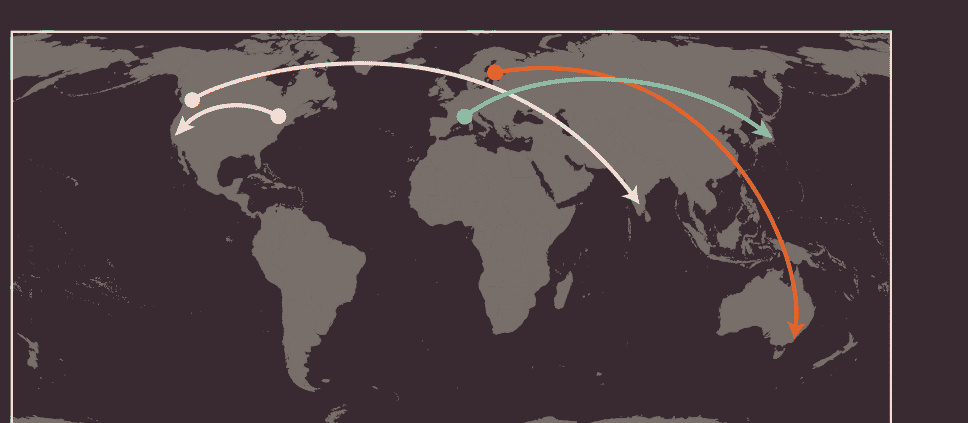

在本页中，你可以看到一些示例，演示了托管你正在访问的网站的网页服务器如何在世界的任何地方。正是 DNS 服务器告诉你的浏览器如何找到该网站。

- 🟢 巴塞罗那的用户访问东京的 sony.jp
- 🟡 纽约的用户访问旧金山的 google.com
- 🟠 斯德哥尔摩的用户访问悉尼的 qantas.com.au
- 🔴 温哥华的用户访问班加罗尔的 airindia.in

在右侧，你可以看到当英国的一个网页用户想要查看位于法国的卢浮宫美术馆的网站（www.louvre.fr）时会发生什么。首先，剑桥的浏览器联系伦敦的 DNS 服务器。然后，DNS 服务器告诉浏览器托管该网站的巴黎网页服务器的位置。


当你连接到互联网时，是通过互联网服务提供商（ISP）实现的。你在浏览器中输入域名或网址来访问网站；例如：google.com、bbc.co.uk、microsoft.com。

你的计算机会联系一个称为域名系统（DNS）的服务器网络。这些服务器就像电话簿一样；它们告诉你的计算机与所请求的域名相关联的IP地址。IP地址是一个最多包含12位数字的号码，用点/句点分隔。连接到互联网的每个设备都有一个唯一的IP地址；这就像该计算机的电话号码。

DNS服务器返回给你计算机的唯一数字，使你的浏览器能够联系托管你所请求网站的网络服务器。网络服务器是一台始终连接到互联网的计算机，专门设置为向用户发送网页。

然后，网络服务器将你所请求的页面发送回你的网络浏览器。

## 1 结构

- 理解结构
- 了解标记
- 标签与元素

在我们生活中的每一天都会遇到各种各样的文档。报纸、保险表格、商店目录……这样的例子不胜枚举。

许多网页就像是这些文档的电子版。例如，报纸在印刷版和网站上展示相同的内容；你可以通过网络申请保险；商店也有在线目录和电子商务功能。

在所有类型的文档中，结构对于帮助读者理解你试图传达的信息以及在文档中导航非常重要。因此，为了学习如何编写网页，理解如何构建文档结构非常重要。在本章中，你将：

- 了解HTML如何描述网页的结构
- 学习如何向文档添加标签或元素
- 编写你的第一个网页

# 这是主标题

这段文字可能是对页面其余部分的介绍……如果页面较长，它可能会被分成几个子标题。

# 这是一个子标题

许多长篇文章都有子标题，以帮助你理解所写内容的结构。可能甚至还有子子标题（或更低级别的标题）。

# Sahara 穿越

Morocco

陡峭的山顶，无尽的沙漠——面对三百多公里的挑战，从马拉喀什一直到神秘的撒哈拉沙漠。 

> 这不是一段轻松的旅程，但Maurten Gel 100 rapid 随身相伴，让每一步都充满可能。

## 撒哈拉沙漠

Four-time top-5 finisher in Marathon des Sables (MDS). Third place. Achieved his best result in 2017, placing third. As an adventure athlete, he has also completed an Ironman triathlon, a Solo Ice-Trek across the St. Lawrence River, and a kayak expediton across the Northwest Passage. His favorite song is "Africa" by Toto — for obvious reasons.

## 页面如何使用结构

想想你在报纸上读到的故事：对于每个故事，都会有一个标题、一些文字，可能还有一些图片。如果文章较长，可能会有副标题将故事分成不同的部分，或者引用相关人士的话。结构有助于读者理解报纸上的故事。

当新闻故事在线查看时，结构非常相似（尽管可能还包含音频或视频）。右侧用一份报纸及其网站上相应文章的对比说明了这一点。

现在想想一种非常不同类型的文档——保险表格。保险表格通常有不同部分的标题，每个部分包含一系列问题，供你填写详细信息或勾选复选框。同样，在线的结构也非常相似。

## STRUCTURING WORD DOCUMENTS

任何文档中使用标题和副标题通常反映了信息的层次结构。例如，文档可能以一个大标题开始，后面跟着介绍或最重要的信息。

这可以在页面下方较低的子标题下展开。使用文字处理程序创建文档时，我们分离文本来赋予其结构。每个主题可能有一个新段落，每个部分可以有一个标题来描述其涵盖的内容。

在右侧，你可以看到Microsoft Word中的一个简单文档。文档的不同样式，例如不同级别的标题，显示在下拉框中。如果你经常使用Word，你可能也使用过格式工具栏或调色板来执行此操作。

# 这是主标题

这段文字可能是对页面其余部分的介绍。如果页面较长，它可能会被分成几个子标题。

# 这是一个子标题

许多长篇文章都有子标题，以帮助你理解所写内容的结构。可能甚至还有子子标题（或更低级别的标题）。

# 另一个子标题

在这里你可以看到另一个子标题。

在前一页，你看到如何向Word文档添加结构以使其更易于理解。我们在编写网页时以同样的方式使用结构。

## HTML描述页面的结构

在浏览器窗口中，你可以看到一个网页，其内容与你之前在第18页看到的Word文档完全相同。要描述网页的结构，我们向要在页显示的文字添加代码。

你可以在下面看到此页面的HTML代码。暂时不用担心代码的含义。我们从下一页开始更详细地查看它。请注意，HTML代码为蓝色，屏幕上看到的文本为黑色。

```
<html>
  <body>
    <h1>这是主标题</h1>
    <p>这段文字可能是对页面其余部分的介绍。如果页面较长，它可能会被分成几个子标题。</p>
    <h2>这是一个子标题</h2>
    <p>许多长篇文章都有子标题，以帮助你理解所写内容的结构。可能甚至还有子子标题（或更低级别的标题）。</p>
    <h2>另一个子标题</h2>
    <p>在这里你可以看到另一个子标题。</p>
  </body>
</html>
```

HTML代码（蓝色）由位于尖括号内的字符组成——这些被称为HTML**元素**。元素通常由两个**标签**组成：开始标签和结束标签。（结束标签中有一个额外的斜杠。）每个HTML元素告诉浏览器一些关于其开始标签和结束标签之间信息的内容。

## HTML使用元素描述页面的结构

让我们更仔细地查看上一页的代码。有几个不同的元素。每个元素都有一个开始标签和一个结束标签。

代码

```
<html>
  <body>
    <h1>这是主标题</h1>
    <p>这段文字可能是对页面其余部分的
       介绍。如果页面较长，它可能
       会被分成几个子标题。</p>
    <h2>这是一个子标题</h2>
    <p>许多长篇文章都有子标题，以
       帮助你理解所写内容的结构。
       可能甚至还有子子标题（或更低级别的
       标题）。</p>
    <h2>另一个子标题</h2>
    <p>在这里你可以看到另一个子标题。</p>
  </body>
</html>
```

标签就像容器一样。它们告诉你一些关于其开始标签和结束标签之间信息的内容。

## 说明

开始`<html>`标签表示它与结束`</html>`标签之间的任何内容都是HTML代码。

`<body>`标签表示它与结束`</body>`标签之间的任何内容都应显示在主浏览器窗口中。

`<h1>`和`</h1>`之间的文字是主标题。

一段文字出现在这些`<p>`和`</p>`标签之间。

`<h2>`和`</h2>`之间的文字形成子标题。

这是开始`<p>`和结束`</p>`标签之间的另一个段落。

`<h2>`和`</h2>`标签内的另一个子标题。

`<p>`和`</p>`标签内的另一个段落。

结束`</body>`标签表示应在主浏览器窗口中显示的内容的结束。

结束`</html>`标签表示这是HTML代码的结尾。


## 深入了解标签

字符

左尖括号
（小于号）

右尖括号
（大于号）

开始标签

括号中的字符表示标签的用途。

例如，在上面这些标签中，p 代表段落。

结束标签在 < 符号之后有一个正斜杠。

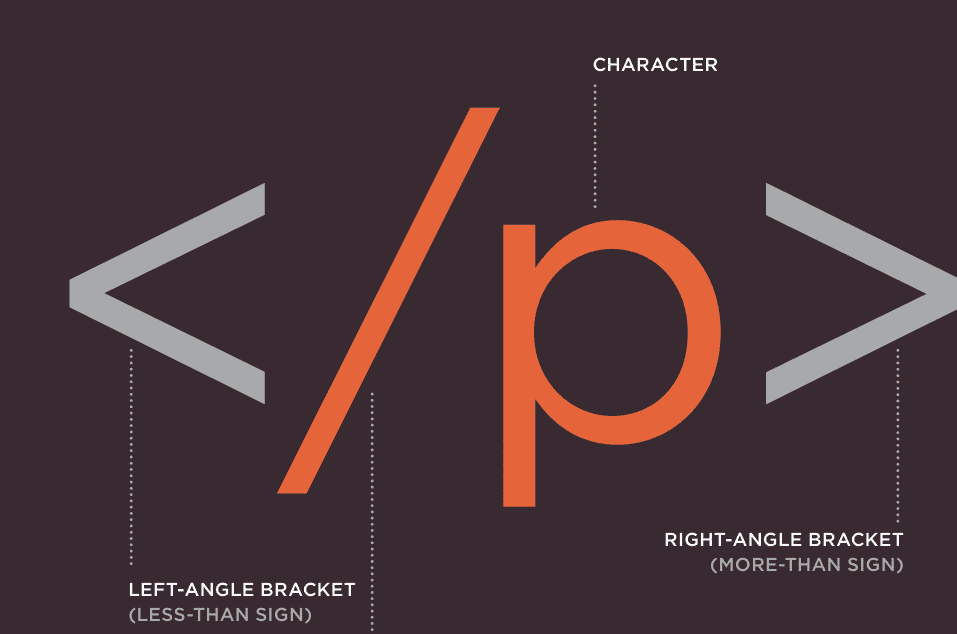

## 结束标签

"标签"和"元素"这两个术语经常可以互换使用。但严格来说，元素包括开始标签*以及*结束标签*以及*它们之间的任何内容。

## 属性告诉我们更多关于元素的信息

属性提供关于元素内容的额外信息。它们出现在元素的开始标签上，由两部分组成：名称和值，两者用等号隔开。

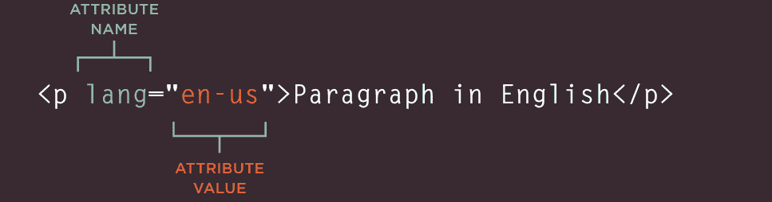

- 属性**名称**表示你要提供关于元素内容的哪种额外信息。它应该使用小写字母书写。
- **值**是属性的信息或设置。它应该用双引号括起来。不同的属性可以有不同的值。
- 这里使用了一个名为 lang 的属性来指示此元素中使用的语言。此页面上该属性的值指定其为美式英语。

HTML5 允许你使用大写的属性名并省略引号，但不推荐这样做。

```
ATTRIBUTE NAME
ATTRIBUTE VALUE

<p lang="fr">Paragraphe en Français</p>
```

大多数属性只能用于某些特定元素，尽管有少数属性（如 `lang`）可以出现在任何元素上。

大多数属性值要么是预定义的，要么遵循规定的格式。我们将在介绍每个新属性时查看允许的值。

`lang` 属性的值是一种简写方式，用于指定元素内部使用的语言，所有浏览器都能理解。

## BODY、HEAD 和 TITLE

## <body>

我们在第一个示例中就遇到了 `<body>` 元素。此元素内的所有内容都会显示在主浏览器窗口中。

```
/chapter-01/body-head-title.html
<html>
  <head>
    <title>This is the Title of the Page</title>
  </head>
  <body>
    <h1>This is the Body of the Page</h1>
    <p>Anything within the body of a web page is displayed in the main browser window.</p>
  </body>
</html>
```

## <head>

在 `<body>` 元素之前，你经常会看到 `<head>` 元素。它包含*关于*页面的信息（而不是显示在浏览器窗口主要部分中的信息，如对面页面中以蓝色高亮显示的部分）。你通常会在 `<head>` 元素内找到 `<title>` 元素。

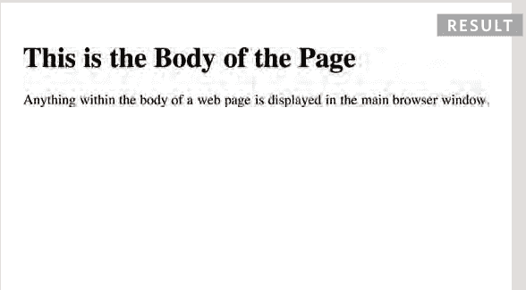

## <title>

`<title>` 元素的内容要么显示在浏览器顶部、你通常输入想要访问页面的 URL 的位置上方，要么显示在该页面的标签页上（如果你的浏览器使用标签页来允许你同时查看多个页面）。

在 <title> 标签之间写下的任何内容都会显示在浏览器窗口顶部的标题栏（或标签页）中，此处以橙色高亮显示。

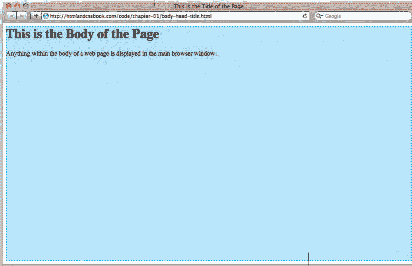

在 <body> 标签之间写下的任何内容都会显示在主浏览器窗口中，此处以蓝色高亮显示。

你可能知道 HTML 代表超文本标记语言（HyperText Markup Language）。超文本部分指的是 HTML 允许你创建链接，让访问者能够快速轻松地从一页移动到另一页。标记语言允许你为文本添加注释，这些注释为文档内容提供了额外的含义。如果你设想一个网页，我们在想要显示的原始文本周围添加代码，然后浏览器使用这些代码来正确显示页面。因此，我们添加的标签就是标记。

## 在 PC 上创建网页

要在 PC 上创建你的第一个网页，启动记事本。你可以通过以下路径找到它：

**开始**
**所有程序（或程序）**
**附件**
**记事本**

你也可以从 notepad-plus-plus.org 下载一个名为 Notepad++ 的免费编辑器。

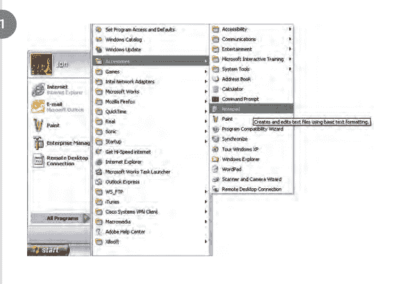

输入右侧所示的代码。

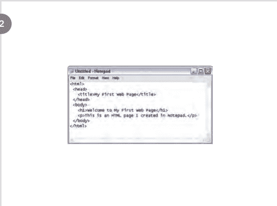

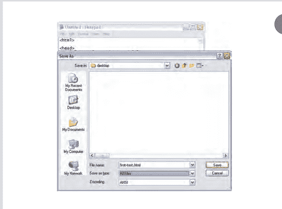

3. 进入**文件**菜单，选择**另存为……**。你需要将文件保存在能记住的位置。如果你愿意，可以为本书中尝试的任何示例创建一个文件夹。

将此文件保存为 `first-test.html`。确保**保存类型**下拉菜单选择了**所有文件**。

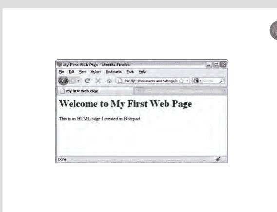

4. 启动你的网页浏览器。进入**文件**菜单，选择**打开**。浏览到你刚才创建的文件，选中它并点击**打开**按钮。结果应该看起来类似于左侧的截图。

如果看起来不是这样，在你电脑上找到刚才创建的文件，并确保它具有 `.html` 文件扩展名（如果是 `.txt`，那么你需要返回记事本再次保存文件，但这次要在名称 "first-test.html" 周围加上引号）。

## 在 Mac 上创建网页

要在 Mac 上创建你的第一个网页，启动文本编辑。它应该在你的**应用程序**文件夹中。

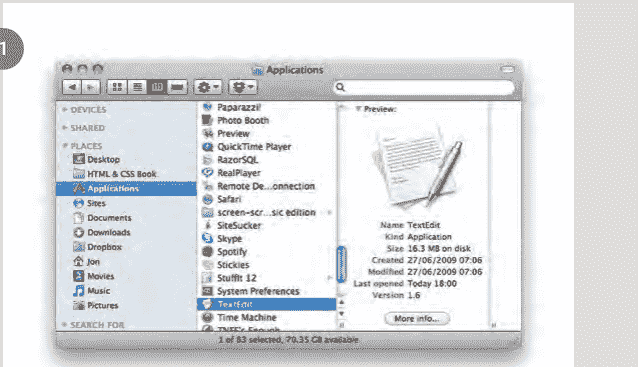

你也可以从 barebones.com 下载一个名为 TextWrangler 的免费文本编辑器，用于创建网页。

输入右侧所示的代码。

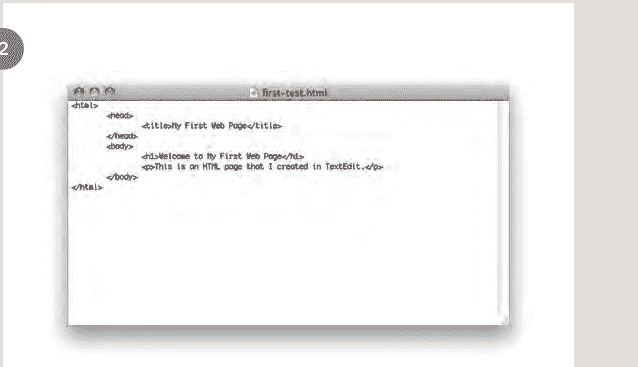

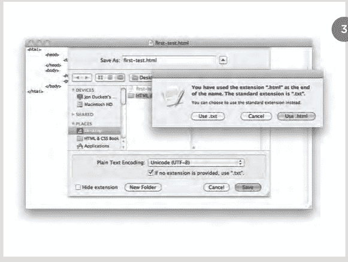

现在进入**文件**菜单，选择**另存为……**。你需要将文件保存在能记住的位置。

如果你愿意，可以为本书中尝试的任何示例创建一个文件夹。将此文件保存为 first-test.html。你可能会看到类似左侧截图的窗口。

你应该选择**使用 .html**按钮。

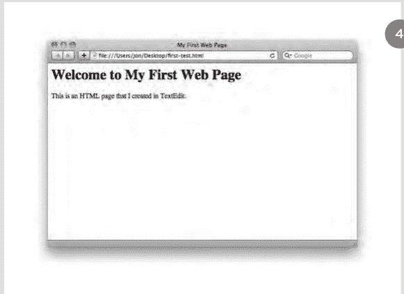

接下来，启动你的网页浏览器，进入**文件**菜单，选择**打开**。你应该浏览到你刚才创建的文件，选中它并点击**打开**按钮。结果应该看起来像左侧的截图。

如果看起来不是这样，你可能需要更改文本编辑中的一个设置。进入文本编辑菜单，选择**偏好设置**。然后在**打开和保存**的偏好设置中，勾选**在 HTML 文件中忽略富文本命令**复选框。现在尝试再次保存文件。

## 内容管理系统中的代码

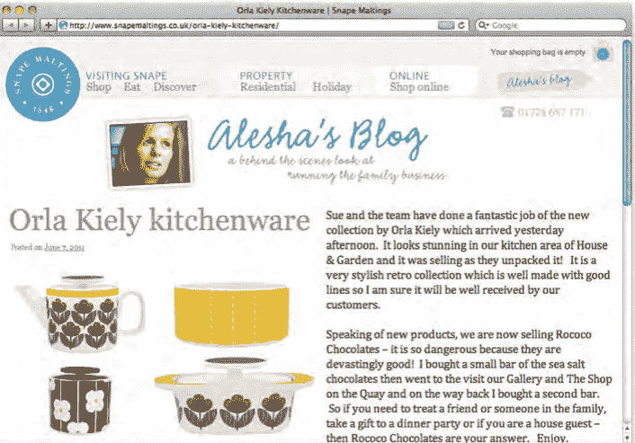

如果你正在使用内容管理系统、博客平台或电子商务应用程序，你可能会登录到网站的特殊管理区域来控制它。这些网站管理区域中提供的工具通常允许你编辑页面的部分而非整个页面，这意味着你很少会看到 <html>、<head> 或 <body> 元素。

看对面页面的内容管理系统，你有一个允许输入页面标题的框，另一个用于主要文章的框，一种输入发布日期的方式，以及一个指示此页面属于网站哪个部分的选项。

对于电子商务商店，你可能有一些框允许你输入产品标题、产品描述、价格和可用数量。

这是因为它们使用单一的"模板"来控制网站某个部分的所有页面。（例如，电子商务系统可能使用相同的模板来展示他们的所有产品。）你提供的信息会被放入模板中。

这种方法的优点是，不知道如何编写网页的人也可以向网站添加信息，而且也可以更改模板中某些内容的呈现方式，它将自动更新使用该模板的每个页面。如果你设想一个拥有 1,000 件待售商品的电子商务商店，只需

33 结构


修改一个模板要比为每个单独的产品更改页面容易得多。

在这类系统中，当你可以编辑一大段文本时（例如新闻文章、博客条目或电子商务商店中的产品描述），你经常会看到一个文本编辑器。

文本编辑器通常具有与你的文字处理器类似的控件，为你提供不同的选项来设置文本样式、添加链接或插入图片。在这些编辑器的背后，它们正在向你的文本添加 HTML 代码，就像你在本章前面看到的代码一样。

许多编辑器会有一个选项，允许你查看（并编辑）它们生成的代码。

一旦你学会如何阅读和编辑这些代码，你就可以更好地控制网站的这些部分。

在上面的例子中，你可以看到文本编辑器有一个用于用户输入内容的“Visual / HTML”视图的标签。其他系统可能有一个按钮（通常显示尖括号）来指示如何访问代码。

一些内容管理系统还提供允许你编辑模板文件的工具。如果你确实尝试编辑模板文件，则需要查看你的 CMS 文档，因为它们彼此不同。编辑模板文件时需要小心，因为如果你删除了错误的代码片段或在错误的位置添加了某些内容，网站可能会完全停止工作。

## 查看其他网站是如何构建的

当网络刚开始兴起时，学习 HTML 和发现新技巧的最常见方法之一就是查看构成网页的源代码。

如今，有越来越多的书籍和在线教程教授 HTML，但你仍然可以查看 Web 服务器发送给你的代码。要自己尝试，只需前往本章的示例代码，访问 www.htmlandcssbook.com/code/，然后点击名为“查看源代码”的链接。

打开此页面后，你可以在浏览器中查找*查看*菜单，然后选择显示“**源代码**”或“**查看源代码**”的选项。（标题会因你使用的浏览器而异。）

你应该会看到一个新窗口出现，其中包含用于创建此页面的源代码。

你可以在右侧的照片中看到此结果。你看到的页面是上方的窗口；代码在下方。

起初这段代码可能看起来很复杂，但不要气馁。当你读完本书的下一章时，你就能够理解它了。

本书的所有示例都在网站上，你可以在任何示例页面上使用这种简单的技术来了解它们的工作原理。

你还可以通过单击“下载”链接从同一网站下载本书的所有代码。

### 如何查看此页面的源代码

如果你转到 Web 浏览器的“查看”菜单，你会看到一个允许你查看网页背后源代码的选项。

当网络刚开始兴起时，这是人们学习网页如何构建的一种非常流行的方式。

今天，人们仍然经常查看页面的源代码，以了解网页是如何构建的。

```html
<html>
  <head>
    <title>View the Source of This Page</title>
  </head>
  <body>
    <h1>How to View the Source of This Page</h1>
    <p>If you go to your web browser's View menu, you will see an option that allows you to see the source code behind a web page.</p>
    <p>When the web was first taking off this was a very popular way for people to learn how web pages had been built.</p>
    <p>Today, people still often view the source of pages to learn how a web page has been built.</p>
  </body>
</html>
```

## 总结

### 结构

- HTML 页面是文本文档。
- HTML 使用标签（位于尖括号内的字符）来赋予它们包围的信息特殊含义。
- 标签通常被称为元素。
- 标签通常成对出现。开始标签表示一段内容的开始；结束标签表示结束。
- 开始标签可以携带属性，告诉我们有关该元素内容的更多信息。
- 属性需要名称和值。
- 要学习 HTML，你需要了解有哪些标签可供你使用、它们的作用以及它们可以放在哪里。

## 2

### 文本

- 标题和段落
- 粗体、斜体、强调
- 结构标记和语义标记

创建网页时，你需要为页面内容添加标签（称为标记）。这些标签提供额外的含义，并允许浏览器向用户显示适当的页面结构。

在本章中，我们重点介绍如何为出现在页面上的文本添加标记。你将学习：

- **结构标记：** 可用于描述标题和段落的元素
- **语义标记：** 提供额外的信息；例如句子中强调的位置、你所写的内容是引用（以及是谁说的）、缩略语的含义，等等

## 书中的故事

### 第一章

莫莉已经盯着窗外看了大约一个小时了。在她的桌子上，放在《自然》《新科学家》以及她发表过论文的所有其他科学期刊之间，是一本翻烂了的《在路上》。自从大学以来，这本书一直是莫莉的最爱，她在这四面墙里待得越久，就越觉得自己需要自由。

她在这个房间里度过了过去的十年，坐在一张写着奥斯卡·王尔德名言的海报下，名言宣称“工作是那些无事可做的人的避难所”。尽管许多人认为她开创性的工作——揭开 Banl DKO 基因的秘密——是一项杰出的成就，莫莉仍然觉得自己有更好的事要做。

POUDRE D'IRIS
Extra fine, Inimitable
BRIFFAULT FRES

REVOLUTION VELOCIPEDIQUE!
Nouvelle BICYCLETTE
G. DUPONT
LYON

SAVON SURFIN
VIOLETTE

BERLIGOTS ET BONBONS
Fins et Pleins Gout

HELLO!
ISN'T IT
A
LOVELY
DAY?

Distillerie de MONTMORILLON
AMER LÉON
AU CITRON - SANS ALCOOL
LÉON DABOANT
MONTMORILLON

the Spotty Bird

BON-POINT
à l'ouvrière fort

GIRAUD-DUQUESNE

## 标题

`<h1>` `<h2>` `<h3>` `<h4>` `<h5>` `<h6>`

HTML 有六个“级别”的标题：

`<h1>` 用于主标题

`<h2>` 用于副标题

如果副标题下面还有更小的章节，则使用 `<h3>` 元素，以此类推……

浏览器以不同的大小显示标题的内容。`<h1>` 元素的内容最大，`<h6>` 元素的内容最小。每个浏览器显示标题的确切大小可能略有不同。用户还可以在浏览器中调整文本大小。当我们讲到 CSS 时，你将了解如何控制文本的大小、颜色以及使用的字体。

## 段落

<p>一个段落由一个或多个句子组成，形成一个自成一体的论述单元。段落的开始由新行表示。</p>

<p>当文本被分成文本单元时，更容易理解。例如，一本书可能有章节。章节可以有副标题。每个标题下面会有一个或多个段落。</p>

要创建一个段落，请用开始标签 `<p>` 和结束标签 `</p>` 包围构成段落的文字。

默认情况下，浏览器会在新行上显示每个段落，并在它与随后的段落之间留出一些空间。

一个段落由一个或多个句子组成，形成一个自成一体的论述单元。段落的开始由新行表示。

当文本被分成文本单元时，更容易理解。例如，一本书可能有章节。章节可以有副标题。每个标题下面会有一个或多个段落。


## 粗体与斜体

### `<b>`

通过将文本包裹在 `<b>` 和 `</b>` 标签中，我们可以使字符显示为粗体。

`<b>` 元素也代表一段以视觉上不同方式呈现的文本（例如段落中的关键词），尽管使用 `<b>` 元素并不意味着任何额外的含义。

```
chapter-02/bold.html
<p>This is how we make a word appear <b>bold.</b>
</p>
<p>Inside a product description you might see some
  <b>key features</b> in bold.</p>
```

这就是我们如何使一个单词显示为**粗体**。

在产品描述中，你可能会看到一些以粗体显示的**关键特性**。

### `<i>`

通过将文本包裹在 `<i>` 和 `</i>` 标签中，我们可以使字符显示为斜体。

`<i>` 元素也代表一段文本，其内容会以不同于周围内容的方式读出——例如技术术语、船名、外来词、想法或其他通常会使用斜体的术语。

```
chapter-02/italic.html
<p>This is how we make a word appear <i>italic</i>.
  </p>
  <p>It's a potato <i>Solanum teberosum</i>.</p>
  <p>Captain Cook sailed to Australia on the
  <i>Endeavour</i>.</p>
```

这就是我们如何使一个单词显示为*斜体*。

这是一种马铃薯，*Solanum teberosum*。

库克船长乘坐*奋进号*航行到了澳大利亚。

## 上标与下标

```
HTML
chapter-02/superscript-and-subscript.html
<p>On the 4<sup>th</sup> of September you will learn about E=MC<sup>2</sup>.</p>
<p>The amount of CO<sub>2</sub> in the atmosphere grew by 2ppm in 2009<sub>1</sub>.</p>
```

在9月的第4^天^，你将学习 E=MC^2^。

大气中 CO~2~ 的含量在2009年~1~增长了2ppm。

### `<sup>`

`<sup>` 元素用于包含应该是上标的字符，例如日期的后缀或数学概念，如将数字升到幂次，如 2²。

### `<sub>`

`<sub>` 元素用于包含应该是下标的字符。它通常用于脚注或化学公式，如 H~2~O。

## 空白字符

为了使代码更易于阅读，网页作者经常会添加额外的空格或从新行开始某些元素。

```
chapter-02/white-space.html
<p>The moon is drifting away from Earth.</p>
<p>The moon is drifting away from Earth.</p>
<p>The moon is drifting away from Earth.</p>
```

当浏览器遇到两个或多个相邻的空格时，它只显示一个空格。类似地，如果遇到换行符，它也会将其视为空格。这被称为**空白字符折叠**。

```
The moon is drifting away from Earth.
The moon is drifting away from Earth.
The moon is drifting away from Earth.
```

你经常会看到网页作者利用空白字符折叠来缩进代码，以便使其更易于理解。

## 换行与水平线

```
<p>The Earth<br />gets one hundred tons heavier every day<br />due to falling space dust.</p>
```

如你所见，浏览器会自动将每个新段落或标题显示在新行上。但如果你想在段落中间添加换行符，可以使用换行标签 `<br />`。

地球每天因太空尘埃的降落而重一百吨。

```
<p>Venus is the only planet that rotates clockwise.</p>
<hr />
<p>Jupiter is bigger than all the other planets combined.</p>
```

为了在主题之间创建分隔——例如书中的话题变化或戏剧中的新场景——你可以使用 `<hr />` 标签在各部分之间添加水平线。

有些元素在开标签和闭标签之间没有任何文本。它们被称为**空元素**，书写方式有所不同。

空元素通常只有一个标签。在空元素的闭合尖括号之前，通常会有一个空格和一个正斜杠字符。有些网页作者会省略这一点，但养成这个好习惯是值得的。

金星是唯一顺时针自转的行星。

木星比所有其他行星的总和还要大。

## 可视化编辑器及其代码视图

内容管理系统和HTML编辑器，如 Dreamweaver，通常有两个页面视图：可视化编辑器视图和代码视图。

**可视化编辑器**通常类似于文字处理程序。尽管每个编辑器略有不同，但大多数编辑器都有一些共同的功能，允许你控制文本的呈现方式。

-   标题通过高亮文本，然后使用下拉框选择标题来创建。
-   粗体和斜体文本通过高亮部分文本并按下 **b** 或 **i** 按钮来创建。
-   新段落使用回车或回车键创建。
-   换行通过同时按下 Shift 键和回车键来创建。
-   水平线使用带有直线的按钮创建。

如果从允许格式化文本的程序（如 Word）复制并粘贴文本到可视化编辑器中，它可能会添加额外的标记。为防止这种情况，请先将文本复制到纯文本编辑器（如 PC 上的记事本或 Mac 上的 TextEdit），然后从该程序复制并粘贴到可视化编辑器中。

**代码视图**显示可视化编辑器创建的代码，以便你可以手动编辑它，或者直接输入新代码。它通常通过标有 HTML 或带有尖括号图标的按钮激活。编辑器可能会在代码中添加空白字符，以使其更易于阅读。

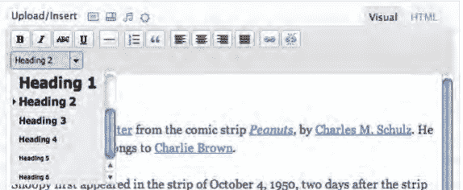

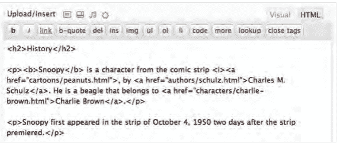

## 语义化标记

有一些文本元素不是为了影响网页的结构，但它们确实为页面添加了额外的信息——它们被称为语义化标记。

在本章的其余部分，你将遇到更多元素，这些元素将在你向网页添加文本时提供帮助。例如，你将遇到 `<em>` 元素，它允许你指定在选定单词上应放置重音，以及 `<blockquote>` 元素，它表示一段文本是引用。

浏览器通常以不同的方式显示这些元素的内容。例如，`<em>` 元素的内容以斜体显示，而 `<blockquote>` 通常会缩进。但你不应该用它们来改变文本的外观；它们的目的是更准确地描述网页的内容。

使用这些元素的原因是其他程序，如屏幕阅读器或搜索引擎，可以利用这些额外信息。例如，屏幕阅读器可能会对 `<em>` 元素内的单词添加重音，或者如果你使用 `<blockquote>` 元素，搜索引擎可能会识别你的页面包含引用。

## 强调与加重

### `<strong>`

使用 `<strong>` 元素表示其内容具有强烈的重要性。例如，包含在此元素中的单词可能会用强烈的语气说出。

默认情况下，浏览器将以粗体显示 `<strong>` 元素的内容。

```
chapter-02/strong.html

<p><strong>Beware:</strong> Pickpockets operate in this area.</p>
<p>This toy has many small pieces and is <strong>not suitable for children under five years old.</strong></p>
```

**警告：** 此区域有扒手活动。

这个玩具有很多小零件，**不适合五岁以下儿童。**

### `<em>`

`<em>` 元素表示强调，会微妙地改变句子的含义。

默认情况下，浏览器将以斜体显示 `<em>` 元素的内容。

```
chapter-02/emphasis.html

<p>I <em>think</em> Ivy was the first.</p>
<p>I think <em>Ivy</em> was the first.</p>
<p>I think Ivy was the <em>first</em>.</p>
```

我*认为*艾薇是第一个。

我认为*艾薇*是第一个。

我认为艾薇是*第一个*。

## 引用

```
<blockquote cite="http://en.wikipedia.org/wiki/Winnie-the-Pooh">
  <p>Did you ever stop to think, and forget to start again?</p>
</blockquote>
<p>As A.A. Milne said, <q>Some people talk to animals. Not many listen though. That's the problem.</q></p>
```

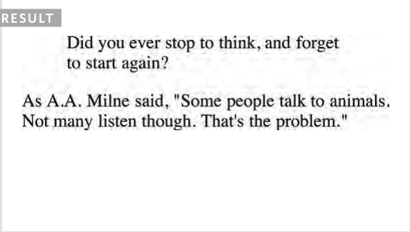

有两种元素通常用于标记引用：

### `<blockquote>`

`<blockquote>` 元素用于占据整个段落的较长引用。请注意，`<p>` 元素仍在 `<blockquote>` 元素内部使用。

浏览器倾向于缩进 `<blockquote>` 元素的内容，但你不应该仅为了缩进一段文本而使用此元素——你应该使用 CSS 来实现此效果。

### `<q>`

`<q>` 元素用于段落内的较短引用。浏览器应该在 `<q>` 元素周围加上引号，但 Internet Explorer 不会——因此许多人避免使用 `<q>` 元素。

这两个元素都可以使用 `cite` 属性来指示引用的来源。其值应是一个 URL，该 URL 包含有关引用来源的更多信息。


## 缩写词与首字母缩略词

## <abbr>

如果你使用缩写词或首字母缩略词，可以使用 `<abbr>` 元素。通过在开始标签上使用 `title` 属性来指定完整的术语。

在 HTML 4 中，有一个单独的 `<acronym>` 元素用于首字母缩略词。为了拼写出首字母缩略词的完整形式，使用了 `title` 属性（与上面的 `<abbr>` 元素类似）。HTML5 仅使用 `<abbr>` 元素来表示缩写词和首字母缩略词。

```html
chapter-02/abbreviations.html

<p><abbr title="Professor">Prof</abbr> Stephen Hawking is a theoretical physicist and cosmologist.</p>
<p><acronym title="National Aeronautics and Space Administration">NASA</acronym> do some crazy space stuff.</p>
```

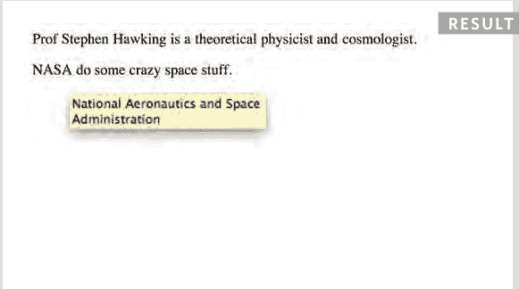

## 引用与定义

```html
<p><cite>A Brief History of Time</cite> by Stephen Hawking has sold over ten million copies worldwide.</p>
```

## <cite>

当你需要引用某部作品（如书籍、电影或研究论文）时，可以使用 `<cite>` 元素来表示引用来源。

在 HTML5 中，`<cite>` 元素实际上不应该用于人名——但在 HTML 4 中是允许的，因此大多数人可能会继续使用它。

浏览器会以斜体显示 `<cite>` 元素的内容。

斯蒂芬·霍金所著的《时间简史》在全球销量超过一千万册。

```html
<p>A <dfn>black hole</dfn> is a region of space from which nothing, not even light, can escape.</p>
```

## <dfn>

在文档中第一次解释新术语（可能是学术概念或某些行话）时，被称为该术语的定义实例。

`<dfn>` 元素用于指示新术语的定义实例。

某些浏览器会以斜体显示 `<dfn>` 元素的内容。Safari 和 Chrome 则不会改变其外观。

黑洞是一个时空区域，任何事物，甚至光，都无法从中逃脱。

## 作者详情

### <address>

`<address>` 元素有一个非常特定的用途：用于包含页面作者的联系方式。

它可以包含物理地址，但不是必须的。例如，它也可以包含电话号码或电子邮件地址。

浏览器通常会以斜体显示 `<address>` 元素的内容。

你可能还会对一种名为 hCard 的微格式感兴趣，它用于在你的标记中添加物理地址信息。

**在线补充：**
你可以在本书配套的网站上了解更多关于 hCards 的信息。

```html
<address>
  <p><a href="mailto:homer@example.org">
    homer@example.org</a></p>
  <p>742 Evergreen Terrace, Springfield.</p>
</address>
```

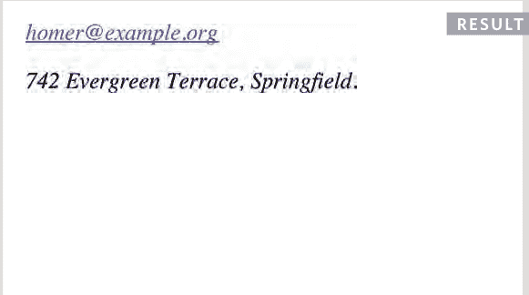

## 内容的更改

```html
<p>It was the <del>worst</del> <ins>best</ins> idea she had ever had.</p>
```

那是她有史以来最~~糟糕~~棒的主意。

```html
<p>Laptop computer:</p>
<p><s>Was $995</s></p>
<p>Now only $375</p>
```

笔记本电脑：

~~原价 $995~~

现在仅售 $375

## <ins>

## <del>

`<ins>` 元素可用于显示插入到文档中的内容，而 `<del>` 元素可用于显示从文档中删除的文本。

`<ins>` 元素的内容通常带有下划线，而 `<del>` 元素的内容通常带有删除线。

## <s>

`<s>` 元素表示某些不再准确或相关的内容（但不应删除）。

从视觉上看，`<s>` 元素的内容通常会以删除线显示。

旧版本的 HTML 有一个 `<u>` 元素用于带下划线的内容，但它正逐步被淘汰。

## 书中的故事

### 第一章

莫莉已经盯着窗外看了大约一个小时。在她的书桌上，摊在《自然》、《新科学家》以及她作品曾发表过的所有其他科学期刊副本之间的，是一本被翻阅得卷了边的《在路上》。自从大学以来，这本书一直是莫莉最爱的书，她在四壁之内待得越久，就越觉得自己需要自由。

她在这个房间里度过了过去的十年，坐在一张海报下面，海报上印着奥斯卡·王尔德的一句名言：“工作是那些没有更好事情可做的人的避难所。”尽管许多人认为她解开羊驼DNA之谜的开创性工作是一项杰出的成就，但莫莉*确实*认为她还有更好的事情可做。

## 示例文本

这是一个非常简单的 HTML 页面，演示了文本标记。

结构标记包括诸如 &lt;h1&gt;、&lt;h2&gt; 和 &lt;p&gt; 等元素。语义信息则由诸如 &lt;cite&gt; 和 &lt;em&gt; 等元素承载。

```html
<html>
<head>
    <title>Text</title>
</head>
<body>
    <h1>The Story in the Book</h1>
    <h2>Chapter 1</h2>
    <p>Molly had been staring out of her window for about an hour now. On her desk, lying between the copies of <i>Nature</i>, <i>New Scientist</i>, and all the other scientific journals her work had appeared in, was a well thumbed copy of <cite>On The Road</cite>. It had been Molly's favorite book since college, and the longer she spent in these four walls the more she felt she needed to be free.</p>
    <p>She had spent the last ten years in this room, sitting under a poster with an Oscar Wilde quote proclaiming that <q>Work is the refuge of people who have nothing better to do</q>. Although many considered her pioneering work, unraveling the secrets of the llama <abbr title="Deoxyribonucleic acid">DNA</abbr>, to be an outstanding achievement, Molly <em>did</em> think she had something better to do.</p>
</body>
</html>
```

## 总结文本

- HTML 元素用于描述页面的结构（例如标题、副标题、段落）。
- 它们也提供语义信息（例如应该在哪里强调、所用首字母缩略词的定义、给定文本何时是引用）。

## 3 种列表

- 有序列表
- 无序列表
- 定义列表

有很多场合我们需要使用列表。HTML 为我们提供了三种不同的类型：

- **有序列表**是列表中的每个项目都编号。例如，列表可能是一组必须按顺序执行的食谱步骤，或者是一份法律合同，其中每个要点都需要通过章节编号来识别。
- **无序列表**是以项目符号（而不是表示顺序的字符）开头的列表。
- **定义列表**由一组术语及其各自的定义组成。

## 炒鸡蛋

鸡蛋是我最喜欢的食物之一。这是一份美味浓郁炒鸡蛋的食谱。

## 配料

- 2个鸡蛋
- 50克黄油
- 2汤匙奶油

## 方法

1.  在平底锅中用中火融化黄油
2.  在碗中轻轻混合鸡蛋和奶油
3.  当黄油起泡时，倒入鸡蛋
4.  每隔20秒，用锅铲将鸡蛋从锅边折叠到中心（就像制作煎蛋卷一样）
5.  当鸡蛋仍然湿润时，从火上移开（它会在盘子上继续烹饪直到上桌）

## 有序列表

### <ol>

有序列表由 `<ol>` 元素创建。

### <li>

列表中的每个项目都放置在开始标签 `<li>` 和结束标签 `</li>` 之间。（li 代表列表项。）

浏览器默认会对列表进行缩进。

有时你会看到与 `<ol>` 元素一起使用的 `type` 属性，用于指定编号类型（数字、字母、罗马数字等）。最好使用第333-335页介绍的 CSS `list-style-type` 属性。

```html
chapter-03/ordered-lists.html

<ol>
    <li>Chop potatoes into quarters</li>
    <li>Simmer in salted water for 15-20 minutes until tender</li>
    <li>Heat milk, butter and nutmeg</li>
    <li>Drain potatoes and mash</li>
    <li>Mix in the milk mixture</li>
</ol>
```

1.  将土豆切成四块
2.  在盐水中炖15-20分钟，直到变软
3.  加热牛奶、黄油和肉豆蔻
4.  沥干土豆并捣碎
5.  拌入牛奶混合物


 ## 无序列表

```html
<ul>
  <li>1kg 爱德华国王土豆</li>
  <li>100ml 牛奶</li>
  <li>50g 咸黄油</li>
  <li>现磨肉豆蔻</li>
  <li>适量盐和胡椒</li>
</ul>
```

## `<ul>`

无序列表使用 `<ul>` 元素创建。

## `<li>`

列表中的每一项都放置在起始标签 `<li>` 和结束标签 `</li>` 之间。（li 代表列表项 list item。）

浏览器默认会对列表进行缩进显示。

有时你可能会看到 `<ul>` 元素上使用 `type` 属性来指定项目符号的类型（圆形、方形、菱形等）。最好使用 CSS 的 `list-style-type` 属性，这将在第 333-335 页中介绍。

---

## 定义列表

## `<dl>`

定义列表使用 `<dl>` 元素创建，通常由一系列术语及其定义组成。

在 `<dl>` 元素内部，你通常会看到成对的 `<dt>` 和 `<dd>` 元素。

## `<dt>`

用于包含被定义的术语（定义术语 definition term）。

## `<dd>`

用于包含定义。

有时你可能会看到一个列表中，两个术语对应同一个定义，或者同一个术语有两个不同的定义。

```
chapter-03/definition-lists.html
<dl>
  <dt>刺身</dt>
  <dd>切片生鱼，配佐料食用，如
      萝卜丝或姜丝、芥末和酱油</dd>
  <dt>秤</dt>
  <dd>用于精确测量
      食材重量的设备</dd>
  <dd>一种从鱼皮上
      去除鳞片的技巧</dd>
  <dt>斯卡莫扎（单数）</dt>
  <dt>斯卡莫扎（复数）</dt>
  <dd>一种意大利奶酪，通常用全脂
      牛奶制成（尽管传统上是用
      水牛奶制作的）</dd>
</dl>
```

```
刺身
  切片生鱼，配佐料食用，如
  萝卜丝或姜丝、芥末和
  酱油
秤
  用于精确测量食材重量的
  设备
  一种从鱼皮上去除
  鳞片的技巧
斯卡莫扎（单数）
斯卡莫扎（复数）
  一种意大利奶酪，通常用全脂牛奶
  制成（尽管传统上是用
  水牛奶制作的）
```

---

## 嵌套列表

```html
<ul>
  <li>慕斯</li>
  <li>糕点
    <ul>
      <li>牛角面包</li>
      <li>千层酥</li>
      <li>蝴蝶酥</li>
      <li>泡芙</li>
    </ul>
  </li>
  <li>挞</li>
</ul>
```

你可以在 `<li>` 元素中放置第二个列表来创建子列表或嵌套列表。

浏览器显示嵌套列表时会比父列表进一步缩进。在嵌套的无序列表中，浏览器通常还会改变项目符号的样式。

- 慕斯
- 糕点
  - 牛角面包
  - 千层酥
  - 蝴蝶酥
  - 泡芙
- 挞

---

## 炒蛋

鸡蛋是我最喜欢的食物之一。这里有一个美味浓郁炒蛋的食谱。

### 食材

- 2 个鸡蛋
- 1 汤匙黄油
- 2 汤匙奶油

### 做法

1. 用中火在煎锅中融化黄油
2. 在碗中轻轻将鸡蛋和奶油混合均匀
3. 黄油融化后加入奶油和鸡蛋
4. 用刮刀每隔 20 秒将鸡蛋从锅边翻到中间（就像你在做煎蛋卷一样）
5. 当鸡蛋仍然湿润时，将其从火上移开（它在装盘后仍会继续加热，直到上桌为止）

---

## 列表示例

在这里，你可以看到一个主标题后面跟着一个引导段落。无序列表用于列出食材，有序列表用于描述步骤。

```html
<html>
  <head>
    <title>列表</title>
  </head>
  <body>
    <h1>炒蛋</h1>
    <p>鸡蛋是我最喜欢的食物之一。这里有一个美味浓郁炒蛋的食谱。</p>
    <h2>食材</h2>
    <ul>
      <li>2 个鸡蛋</li>
      <li>1 汤匙黄油</li>
      <li>2 汤匙奶油</li>
    </ul>
    <h2>做法</h2>
    <ol>
      <li>用中火在煎锅中融化黄油</li>
      <li>在碗中轻轻将鸡蛋和奶油混合均匀</li>
      <li>黄油融化后加入奶油和鸡蛋</li>
      <li>用刮刀每隔 20 秒将鸡蛋从锅边翻到中间（就像你在做煎蛋卷一样）</li>
      <li>当鸡蛋仍然湿润时，将其从火上移开（它在装盘后仍会继续加热，直到上桌为止）</li>
    </ol>
  </body>
</html>
```

---

## 列表总结

- HTML 列表有三种类型：有序列表、无序列表和定义列表。
- 有序列表使用数字。
- 无序列表使用项目符号。
- 定义列表用于定义术语。
- 列表可以相互嵌套。

---

## 4 链接

- 在页面之间创建链接
- 链接到其他网站
- 电子邮件链接

链接是网络的定义性特征，因为它们允许你从一个网页跳转到另一个网页——从而实现了浏览或冲浪的概念。

你通常会碰到以下类型的链接：

- 从一个网站到另一个网站的链接
- 同一网站上从一个页面到另一个页面的链接
- 从网页的一个部分到同一页面另一部分的链接
- 在新浏览器窗口中打开的链接
- 启动你的电子邮件程序并向某人发送新邮件的链接

---

## 电影爱好者

## 电影节日程

以下是我们今年将参加的一些电影节。

如需更多信息，请联系我们。

### 一月

圣丹斯电影节

美国犹他州帕克城

2011 年 1 月 20 - 30 日

### 二月

特罗普斯fest

澳大利亚悉尼

2011 年 2 月 20 日

### 三月

西南偏南（SXSW）

美国德克萨斯州奥斯汀

2011 年 3 月 11 - 20 日

### 四月

伦敦独立电影节

英国伦敦

2011 年 4 月 15 - 24 日

### 五月

戛纳国际电影节

法国戛纳

2011 年 5 月 11 - 22 日

---

## 编写链接

链接使用 `<a>` 元素创建。用户可以点击起始标签 `<a>` 和结束标签 `</a>` 之间的任何内容。你使用 href 属性来指定要链接到的页面。

起始标签 `<a>` 和结束标签 `</a>` 之间的文本称为链接文本。尽可能让你的链接文字说明访客点击后将被带到哪里（而不是只说"点击这里"）。下面你可以看到上一页创建的 IMDB 链接。

许多人通过扫描文本中的链接来浏览网站。清晰的链接文字可以帮助访客找到他们想要的内容。这会给他们对你的网站留下更积极的印象，并可能鼓励他们访问更长时间。（这也有助于使用屏幕阅读软件的人士。）

要编写好的链接文本，你可以想想人们在搜索你正在链接的页面时可能会使用的词语。（例如，与其写"住宿的地方"，你可以使用更具体的说法，如"纽约的酒店"。）

IMDB

---

## 链接到其他网站

## `<a>`

链接使用 `<a>` 元素创建，该元素有一个名为 href 的属性。href 属性的值是人们点击链接时你希望其跳转到的页面。

```
chapter-04/linking-to-other-sites.html
<p>电影评论：
    <ul>
        <li><a href="http://www.empireonline.com">
            帝国杂志</a></li>
        <li><a href="http://www.metacritic.com">
             metacritic</a></li>
        <li><a href="http://www.rottentomatoes.com">
            烂番茄</a></li>
        <li><a href="http://www.variety.com">
            综艺</a></li>
    </ul>
</p>
```

用户可以点击起始标签 `<a>` 和结束标签 `</a>` 之间出现的任何内容，并将被带到 href 属性中指定的页面。

当你链接到不同的网站时，href 属性的值将是该网站的完整网址，这被称为**绝对 URL**。

浏览器默认以蓝色带下划线的方式显示链接。

## 绝对 URL

URL 代表统一资源定位符（Uniform Resource Locator）。每个网页都有自己的 URL。这是你想访问某个特定页面时在浏览器中输入的网址。

绝对 URL 以该网站的域名开头，后面可以跟特定页面的路径。如果没有指定页面，网站将显示主页。


## 链接到同一站点的其他页面

```html
<p>
  <ul>
    <li><a href="index.html">Home</a></li>
    <li><a href="about-us.html">About</a></li>
    <li><a href="movies.html">Movies</a></li>
    <li><a href="contact.html">Contact</a></li>
  </ul>
</p>
```

当你要链接到同一站点内的其他页面时，不需要在 URL 中指定域名。你可以使用一种被称为**相对 URL** 的简写形式。

如果网站的所有页面都在同一个文件夹中，那么 href 属性的值就只是文件名。

如果网站的不同页面位于不同的文件夹中，那么你可以使用稍微复杂一点的语法来指出页面相对于当前页面的位置。你将在第 81-84 页学到更多相关内容。

如果你查看每一章的下载代码，你会看到 index.html 文件中包含使用相对 URL 的链接。

## 相对 URL

在链接到同一站点内的其他页面时，你可以使用相对 URL。它们就像是绝对 URL 的简写版本，因为你不需要指定域名。

我们将在第 83-84 页更仔细地了解相对 URL，因为有一些实用的快捷方式可以用来编写指向你自己网站上其他页面的链接。

相对 URL 在电脑上构建站点时很有用，因为你可以在无需设置域名或托管的情况下创建页面之间的链接。

## 目录结构

在大型网站中，将网站不同部分的页面放入新文件夹来组织代码是个好主意。网站上的文件夹有时被称为目录。

### 结构

### 关系

### 主页

右侧的示意图展示了一个名为 ExampleArts 的虚构娱乐资讯网站的目录结构。

最顶层的文件夹被称为**根**文件夹。（在本例中，根文件夹名为 **examplearts**。）根文件夹包含网站的所有其他文件和文件夹。

网站的每个部分都放置在一个单独的文件夹中；这有助于组织文件。

网站上文件和文件夹之间的关系使用与家谱树相同的术语来描述。

在右侧的示意图中，你可以看到一些关系已被标注出来。

**examplearts** 文件夹是 ***movies***、***music*** 和 ***theater*** 文件夹的父级。而 ***movies***、***music*** 和 ***theater*** 文件夹是 **examplearts** 文件夹的子级。

用 HTML 编写的网站的主页（以及子文件夹中每个部分的主页）称为 ***index.html***。

Web 服务器通常被设置为：如果没有指定文件名，则返回 ***index.html*** 文件。

因此，如果你输入 examplearts.com，它将返回 examplearts.com/index.html；而 examplearts.com/music 将返回 examplearts.com/music/index.html。

如果你在使用内容管理系统、博客软件或电子商务系统，可能不会为网站的每个页面都有单独的文件。

相反，这些系统通常对每种不同类型的页面（如新闻文章、博客文章或产品）使用一个模板文件。

编辑模板文件将更改所有使用该模板的页面。不要修改任何不是 HTML 的代码，否则可能会破坏页面。

### 父级

*examplearts* 文件夹是 *music* 文件夹的父级。

### 祖父级

*examplearts* 文件夹是 *dvd* 文件夹的祖父级。

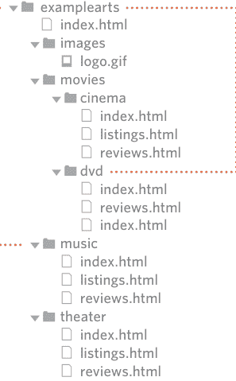

### 孙子级

*dvd* 文件夹是 *examplearts* 文件夹的孙子级。

### 子级

*music* 文件夹是 *examplearts* 文件夹的子级。

网站上的每个页面和每张图片都有一个 **URL**（或称为统一资源定位符）。URL 由域名和通往该页面或图片的**路径**组成。

该网站主页的路径是 www.examplearts.com/index.html。网站标志的路径是 examplearts.com/images/logo.gif。

你在链接到其他网页以及在自己的网站中包含图片时会使用 URL。在下一页，你将遇到一种链接到自己网站上文件的简写方式。

根文件夹包含：

- 一个名为 *index.html* 的文件，这是整个网站的主页
- 网站电影、音乐和剧院部分的独立文件夹

每个子目录包含：

- 一个名为 *index.html* 的文件，这是该部分的主页
- 一个名为 *reviews.html* 的评论页面
- 一个名为 *listings.html* 的列表页面（DVD 部分除外）

电影部分包含：

- 一个名为 *cinema* 的文件夹
- 一个名为 *DVD* 的文件夹

## 相对 URL

相对 URL 可用于链接到你自己的网站内的页面。它们提供了一种简写方式来告诉浏览器在哪里找到你的文件。

当你链接到自己网站上的页面时，不需要指定域名。你可以使用**相对 URL**，这是一种告诉浏览器页面相对于当前页面位置的简写方式。

这在创建新网站或学习 HTML 时特别有帮助，因为你可以在页面仅存在于个人电脑上时（在获得域名并上传到网络之前）创建页面之间的链接。

由于你不需要在每个链接中重复域名，它们也写得更快。

如果你网站中的所有文件都在一个文件夹中，你只需使用该页面的文件名。

如果你的网站被组织到单独的文件夹（或目录）中，你需要告诉浏览器如何从其*当前*页面跳转到你要*链接到*的页面。

因此，如果你从两个不同的页面链接到同一个页面，可能需要编写两个不同的相对 URL。

这些链接使用了与上一页相同的术语（借用自家谱树），上一页介绍了目录结构。

## 相对链接类型

| 相对链接类型 | 描述 | 示例 |
|---|---|---|
| 同一文件夹 | 要链接到同一文件夹中的文件，只需使用文件名。（不需要其他内容。） | 从音乐主页链接到音乐评论：`<a href="reviews.html">Reviews</a>` |
| 子文件夹 | 对于子文件夹，使用子文件夹名称，后跟一个正斜杠，然后是文件名。 | 从主页链接到音乐列表：`<a href="music/listings.html">Listings</a>` |
| 孙文件夹 | 使用子文件夹名称，后跟一个正斜杠，然后是孙文件夹名称，再跟一个正斜杠，然后是文件名。 | 从主页链接到 DVD 评论：`<a href="movies/dvd/reviews.html">Reviews</a>` |
| 父文件夹 | 使用 ../ 表示当前文件夹上方的文件夹，然后跟文件名。 | 从音乐评论链接到主页：`<a href="../index.html">Home</a>` |
| 祖父文件夹 | 重复 ../ 表示要上溯两层文件夹（而非一层），然后跟文件名。 | 从 DVD 评论链接到主页：`<a href="../../index.html">Home</a>` |

当网站上线（即上传到 Web 服务器）时，你可能会看到一些其他技术，这些技术在文件位于本地计算机上时不起作用。

例如，你可能会看到子文件夹的名称而没有文件名。在这种情况下，Web 服务器通常会尝试显示该部分的主页。

正斜杠将返回整个网站的主页，正斜杠后跟文件名将返回该文件（前提是它在根目录中）。

## 电子邮件链接

### mailto:

要创建一个启动用户电子邮件程序并向指定电子邮件地址发送邮件的链接，你使用 `<a>` 元素。不过这次 href 属性的值以 mailto: 开头，后面跟着你希望邮件发送到的电子邮件地址。

```html
<a href="mailto:jon@example.org">Email Jon</a>
```

在右侧你可以看到，电子邮件链接看起来与其他任何链接一样，但当点击它时，用户的电子邮件程序会打开一封新邮件，并将其地址设为链接中指定的人。

Email Jon

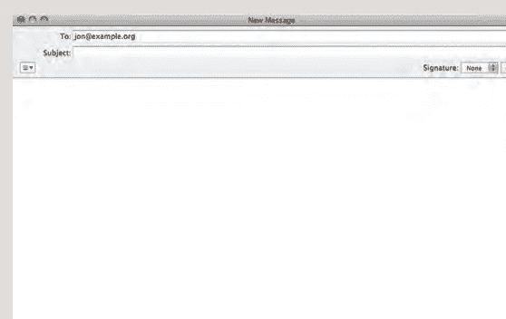


# 在新窗口中打开链接

```html
<a href="http://www.imdb.com" target="_blank">
Internet Movie Database</a> (在新窗口中打开)
```

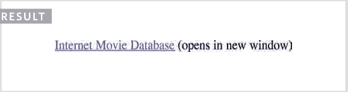

## target

如果你想让链接在新窗口中打开，可以在 `<a>` 起始标签上使用 `target` 属性。该属性的值应为 `_blank`。

网页作者希望链接在新窗口中打开的最常见原因之一是，该链接指向另一个网站。在这种情况下，他们希望用户在浏览完其他网站后，能返回到包含他们网站的窗口。

一般来说，你应该避免在新窗口中打开链接，但如果确实需要这样做，最好的做法是在用户点击之前告知他们该链接将在新窗口中打开。

## 链接到同一页面的特定部分

在一个长页面的顶部，你可能希望添加一个内容列表，链接到下方对应的章节。或者，你可能希望在页面中间添加一个返回顶部的链接，以免用户不得不滚动回顶部。

在链接到页面的特定部分之前，你需要确定页面中链接将要指向的位置。你可以使用 `id` 属性来完成这一操作（该属性可用于每个 HTML 元素）。你可以看到本例中的 `<h1>` 和 `<h2>` 元素都已赋予 `id` 属性，以标识页面的这些章节。

`id` 属性的值应以字母或下划线开头（不能以数字或其他字符开头），并且在单个页面中，不应有两个 `id` 属性的值相同。

要链接到使用 `id` 属性的元素，你同样使用 `<a>` 元素，但 `href` 属性的值以 `#` 符号开头，后跟你要链接到的元素的 `id` 属性值。在本例中，`<a href="#top">` 链接到页面顶部的 `<h1AISElement`，其 `id` 属性值为 `top`。

```html
chapter-05/linking-to-a-specific-part.html
<h1 id="top">电影制作术语</h1>
<a href="#arc_shot">弧线镜头</a><br />
<a href="#interlude">插曲</a><br />
<a href="#prologue">序幕</a><br /><br />
<h2 id="arc_shot">弧线镜头</h2>
<p>一种拍摄手法，主体由环绕或移动的摄像机进行拍摄</p>
<h2 id="interlude">插曲</h2>
<p>电影中出现的简短、介入性的场景或片段，与情节没有直接关联</p>
<h2 id="prologue">序幕</h2>
<p>电影主要情节或动作开始前的一段演讲、序言、介绍或简短场景；与尾声相对</p>
<p><a href="#top">顶部</a></p>
```

## 链接到另一页面的特定部分

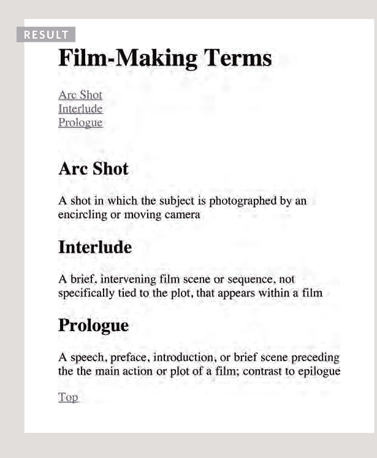

如果你想链接到另一个页面的特定部分（无论是在你自己的网站还是其他网站），你可以使用类似的技术。

只要你要链接到的页面有 `id` 属性来标识其特定部分，你就可以在页面链接的末尾添加相同的语法。

因此，`href` 属性将包含页面的地址（绝对 URL 或相对 URL），后跟 `#` 符号，再后跟你要链接到的元素所使用的 `id` 属性的值。

例如，要链接到本书配套网站首页的底部，你可以这样写：
`<a href="http://www.htmlandcssbook.com/#bottom">`

# 电影爱好者

## 电影节日程

以下是我们今年将要参加的一些电影节。如果您想了解更多信息，请[联系我们](#)。

### 一月

[圣丹斯电影节](#)
美国犹他州帕克城
2011年1月20日至30日

### 二月

[Tropfest短片电影节](#)
澳大利亚悉尼
2011年2月20日

### 三月

[西南偏南电影节](#)
美国德克萨斯州奥斯汀
2011年3月11日至20日

### 四月

[伦敦独立电影节](#)
英国伦敦
2011年4月15日至24日

### 五月

[戛纳国际电影节](#)
法国戛纳
2011年5月11日至22日

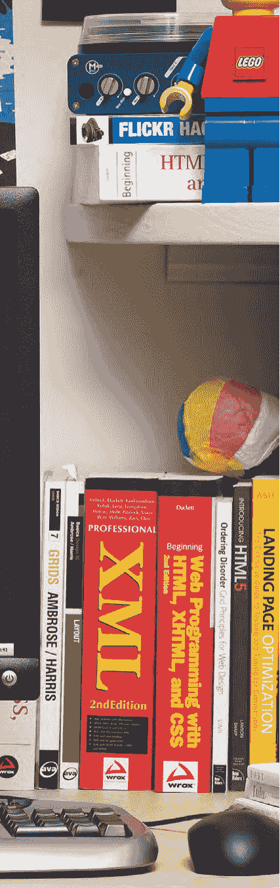

## 示例

### 链接

本示例是一个关于电影的网页。

页面顶部的 `<h1>` 元素使用了 `id` 属性，以便添加一个链接，让读者可以从页面底部返回顶部。还有一个电子邮件链接，允许读者联系网页作者。此外，还有多个指向合格 URL 的链接，这些链接指向各个电影节。在此列表下方是一个指向相对 URL 的链接，这是一个位于同一目录中的"关于"页面。

```html
<html>
  <head>
    <title>链接</title>
  </head>
  <body>
    <h1 id="top">电影爱好者</h1>
    <h2>电影节日程</h2>
    <p>以下是我们今年将要参加的一些电影节。<br />
       如果您想了解更多信息，请
       <a href="mailto:filmfolk@example.org">
         联系我们</a>。</p>
    <h3>一月</h3>
    <p><a href="http://www.sundance.org">
       圣丹斯电影节</a><br />
       美国犹他州帕克城<br />
       2011年1月20日至30日</p>
    <h3>二月</h3>
    <p><a href="http://www.tropfest.com">
       Tropfest短片电影节</a><br />
       澳大利亚悉尼<br />
       2011年2月20日</p>

    <!-- 附加内容 -->
    <p><a href="about.html">关于电影爱好者</a></p>
    <p><a href="#top">返回页面顶部</a></p>
  </body>
</html>
```

## 小结

### 链接

- 使用 `<a>` 元素创建链接。
- `<a>` 元素使用 `href` 属性来指定你要链接到的页面。
- 如果你要链接到本站内的页面，最好使用相对链接而不是合格 URL。
- 你可以创建链接来打开电子邮件程序，并在"收件人"字段中填入电子邮件地址。
- 你可以使用 `id` 属性来定位页面中可作为链接目标的元素。

## 5 图像

- 如何在页面中添加图像
- 选择合适的格式
- 为网页优化图像

你可能希望将图像添加到网页中的原因有很多：你可能想加入商标、照片、插图、图表或统计图。

在为你的网站选择和准备图像时，有几件事需要考虑，但花时间把图像处理好会让你的网站看起来更有吸引力、更专业。
在本章中，你将学习如何：

- 使用 HTML 将图像包含到你的网页中
- 选择使用哪种图像格式
- 以合适的尺寸显示图像
- 优化图像以便在网页中使用，使页面加载更快

你还可以使用 CSS 的 `background-image` 属性在页面中加入图像，这将在第 413-420 页介绍。

## 从 A 到 Zucchini（西葫芦）

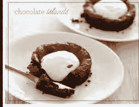

这款单人巧克力蛋糕的食谱非常简单，而且非常美味！

更多食谱：

## 为你的网站选择图像

一张图片胜过千言万语，出色的图像是区分一个普通网站和一个真正引人入胜的网站的关键。

图像可以在比阅读一段描述更短的时间内为网站定下基调。如果你没有在网站上使用自己的照片，有一些公司出售**库存图片**；这些图片需要付费使用（下面列出了一些库存摄影网站）。请记住，所有图像都受版权保护，直接从其他网站获取照片可能会给你带来麻烦。

如果你有一个展示多张图片的页面（如产品照片或团队成员照片），将它们放在简单、统一的背景上有助于让它们作为一个整体看起来更好。

### 图像应该...

- 相关
- 传达信息
- 传达正确的氛围
- 一眼即可识别
- 符合配色方案

### 库存照片

- www.istockphoto.com
- www.gettyimages.com
- www.veer.com
- www.sxc.hu
- www.fotolia.com

### 在线补充资源

我们提供了一个在线图库，帮助你为网站选择合适的图像。你可以在本书配套网站的工具部分找到它。

 ## 在你的网站上保存图片

如果你从头开始搭建一个网站，最佳实践是为网站使用的所有图片创建一个文件夹。

随着网站规模的增长，将图片放在单独的文件夹中有助于你了解网站的组织结构。这里你可以看到一个网站文件的示例；所有图片都存放在名为 **images** 的文件夹中。

在大型网站上，你可能会想要在 **images** 文件夹中添加子文件夹。例如，Logo 和按钮等图片可以放在名为 *interface* 的文件夹中，产品照片可以放在名为 **products** 的文件夹中，与新闻相关的图片可以放在名为 **news** 的文件夹中。

如果你使用的是内容管理系统或博客平台，通常管理后台内置有上传图片的工具，而且程序很可能已经有一个单独的文件夹用于存放图片文件和其他上传内容。

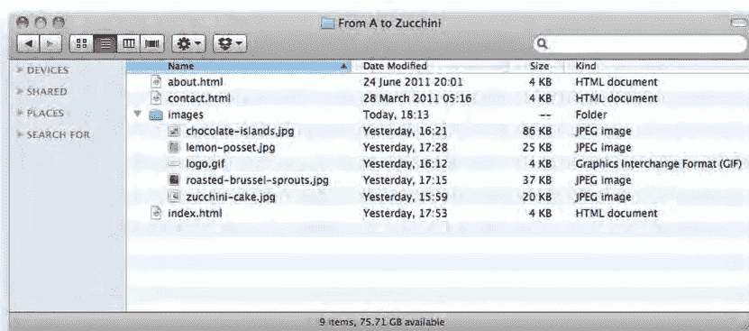

## 添加图片

### 

要向页面中添加图片，你需要使用 `` 元素。这是一个空元素（意味着没有结束标签）。它必须携带以下两个属性：

```
chapter-05/adding-images.html
HTML

```

### src

告诉浏览器在哪里可以找到图片文件。这通常是指向你网站上图片的相对 URL。（这里你可以看到图片位于名为 *images* 的子文件夹中——相对 URL 在第 83-84 页有介绍）。

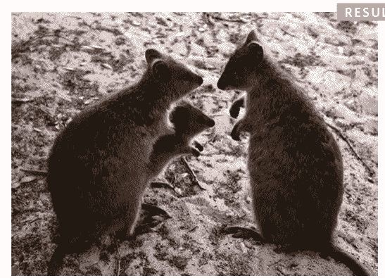

### alt

提供图片的文本描述，当你无法看到图片时，该描述可以描述图片内容。

### title

你也可以在 `` 元素中使用 title 属性来提供关于图片的附加信息。大多数浏览器会在用户将鼠标悬停在图片上时，以工具提示的形式显示该属性的内容。

alt 属性中使用的文本通常被称为 **alt 文本**。它应该准确地描述图片内容，以便屏幕阅读器软件（供视障人士使用）和搜索引擎能够理解。

如果图片只是为了让页面看起来更美观（且没有实际意义，例如图形分隔线），那么仍应使用 alt 属性，但引号内应留空。

## 图片的高度和宽度

```

```

你也经常会看到 `` 元素使用另外两个属性来指定其尺寸：

### height

指定图片的高度，单位为像素。

### width

指定图片的宽度，单位为像素。

图片的加载时间通常比构成页面其余部分的 HTML 代码更长。因此，指定图片的尺寸是个好主意，这样浏览器可以在预留出适当空间给仍在加载的图片的同时，渲染页面上的其余文本。

图片尺寸越来越多地通过 CSS 而非 HTML 来指定——有关更多信息，请参见第 409-410 页。

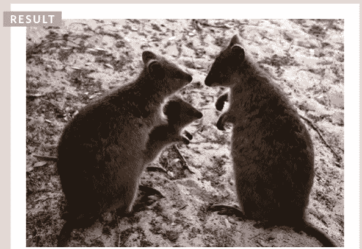

## 在代码中放置图片的位置

图片在代码中的放置位置会影响其产生不同的效果：

- 1. 在段落之前

  段落在图片之后的新的一行开始。

- 2. 在段落开始的位置

  文本的第一行与图片的底部对齐。

- 3. 在段落中间

  图片放置在其所在段落的文字之间。

```
chapter-05/where-to-place-images.html


<p>There are around 10,000 living species of birds that inhabit different ecosystems from the Arctic to the Antarctic. Many species undertake long distance annual migrations, and many more perform shorter irregular journeys.</p>
<hr />
<p>There are around 10,000 living species of birds that inhabit different ecosystems from the Arctic to the Antarctic. Many species undertake long distance annual migrations, and many more perform shorter irregular journeys.</p>
<hr />
<p>There are around 10,000 living species of birds that inhabit different ecosystems from the Arctic to the Antarctic.Many species undertake long distance annual migrations, and many more perform shorter irregular journeys.</p>
```

## 结果

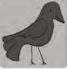

地球上约有 10,000 种鸟类，栖息在从北极到南极的不同生态系统中。许多物种进行长距离的年度迁徙，更多的物种则进行较短的不定期迁徙。

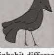

地球上约有 10,000 种鸟类，栖息在从北极到南极的不同生态系统中。许多物种进行长距离的年度迁徙，更多的物种则进行较短的不定期迁徙。

地球上约有 10,000 种鸟类，栖息在从北极到南极的不同生态系统中。

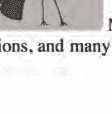

许多物种进行长距离的年度迁徙，更多的物种则进行较短的不定期迁徙。

图片在代码中的放置位置很重要，因为浏览器以两种方式之一显示 HTML 元素：

**块级元素总是出现在新的一行。** 块级元素的例子包括 `<h1>` 和 `<p>` 元素。

如果 `` 后面跟着一个块级元素（如段落），那么块级元素将位于图片之后的新的一行，如本页第一个示例所示。

**内联元素位于块级元素内部，且不会在新的一行开始。** 内联元素的例子包括 `<b>`、`<em>` 和 `` 元素。

如果 `` 元素位于块级元素内部，任何文本或其他内联元素将围绕图片流动，如本页第二和第三个示例所示。

块级元素和内联元素在第 185-186 页有更深入的讨论。

## 旧代码：图片的水平对齐

### align

align 属性通常用于指示页面的其他部分应如何围绕图片流动。它已从 HTML5 中移除，新网站应该使用 CSS 来控制图片的对齐方式（如你在第 411-412 页将看到的）。

我在这里讨论它是因为如果你在查看旧代码时很可能会遇到它，而且因为某些可视化编辑器在你指示图片应如何对齐时仍会插入此属性。

align 属性可以取以下水平值：

```
<p>There are around 10,000 living species of birds that inhabit different ecosystems from the Arctic to the Antarctic. Many species undertake long distance annual migrations, and many more perform shorter irregular journeys.</p>

<hr />

<p>There are around 10,000 living species of birds that inhabit different ecosystems from the Arctic to the Antarctic. Many species undertake long distance annual migrations, and many more perform shorter irregular journeys.</p>
```

### left

将图片对齐到左侧（允许文本围绕其右侧流动）。

### right

将图片对齐到右侧（允许文本围绕其左侧流动）。

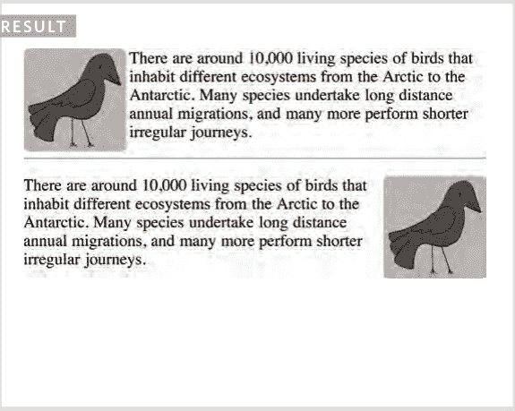

这看起来比只有一行文本在图片旁边（如前面的示例所示）要整洁得多。

当你将 `align` 属性的值设为 `left` 时，图片被放置在左侧，文本围绕它流动。

当你将 `align` 属性的值设为 `right` 时，图片被放置在右侧，文本围绕它流动。

当文本一直延伸到图片边缘时，可能会使阅读变得困难。你将学习如何在第 313-314 页使用 CSS 的 `padding` 和 `margin` 属性来在文本和图片之间添加间隙。


## 旧代码：垂直对齐图片

正如你在上一页所看到的，`align`属性在HTML5中已不再使用，但此处仍会介绍它，因为你可能会在旧网站中看到它的使用，并且一些可视化编辑器创建的代码中仍然使用它。

你可以在第285-286页查看如何使用CSS来实现相同的效果。

`align`属性有三个可取的值，用于控制图片应如何与其周围的文本垂直对齐：

### top

这会将周围文本的第一行与图片的顶部对齐。

### middle

这会将周围文本的第一行与图片的中间对齐。

### bottom

这会将周围文本的第一行与图片的底部对齐。

```
chapter-05/aligning-images-vertically.html

<p>There are around 10,000 living species of birds that inhabit different ecosystems from the Arctic to the Antarctic. Many species undertake long distance annual migrations, and many more perform shorter irregular journeys.</p>

<hr />

<p>There are around 10,000 living species of birds that inhabit different ecosystems from the Arctic to the Antarctic. Many species undertake long distance annual migrations, and many more perform shorter irregular journeys.</p>

<hr />

<p>There are around 10,000 living species of birds that inhabit different ecosystems from the Arctic to the Antarctic. Many species undertake long distance annual migrations, and many more perform shorter irregular journeys.</p>
```

## 结果

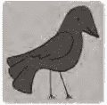

世界上大约有10,000种鸟类，它们栖息在从北极到南极的不同生态系统中。许多物种进行长距离的年度迁徙，还有更多物种进行较短的、不规律的旅程。

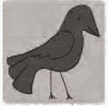

世界上大约有10,000种鸟类，它们栖息在从北极到南极的不同生态系统中。许多物种进行长距离的年度迁徙，还有更多物种进行较短的、不规律的旅程。

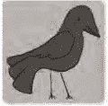

世界上大约有10,000种鸟类，它们栖息在从北极到南极的不同生态系统中。许多物种进行长距离的年度迁徙，还有更多物种进行较短的、不规律的旅程。

`top`值将第一行文本放置在靠近图片顶部的位置，后续文本行出现在图片下方。

`middle`值将第一行文本放置在靠近图片垂直中间的位置，后续文本行出现在图片下方。

`bottom`值将第一行文本放置在靠近图片底部的位置，后续文本行出现在图片下方。

当文本紧贴图片边缘时，可能会使阅读变得困难。你将在第313-314页学习如何使用CSS的`padding`和`margin`属性在文本和图片之间添加间隙。

如果你希望所有文本都环绕图片（而不仅仅是一行文本），则应该使用第370-372页讨论的CSS `float`属性。

在旧代码中，你可能会看到`align`属性使用`left`或`right`值来实现相同的效果（如上一页所述），尽管已不再推荐使用。

## 创建图片的三条规则

在为网站创建图片时，需要记住三条规则，总结如下。接下来的九页我们将对每个主题进行更详细的介绍。

### 1. 以正确的格式保存图片

网站主要使用jpeg、gif或png格式的图片。如果选择了错误的图片格式，你的图片可能看起来不够清晰，并且会使网页加载变慢。

### 2. 以正确的尺寸保存图片

你应该以图片在网站上显示的宽度和高度来保存图片。如果图片小于你指定的宽度或高度，图片可能会变形和拉伸。如果图片大于你指定的宽度和高度，图片在页面上显示需要更长时间。

### 3. 使用正确的分辨率

计算机屏幕由称为像素的点组成。网络上使用的图片也由微小的点组成。分辨率是指每英寸的点数，大多数计算机屏幕仅以每英寸72像素的分辨率显示网页。因此，以更高的分辨率保存图片会导致图片文件过大，下载时间更长。

## 编辑和保存图片的工具

有几种工具可以用来编辑和保存图片，以确保它们具有正确的尺寸、格式和分辨率。

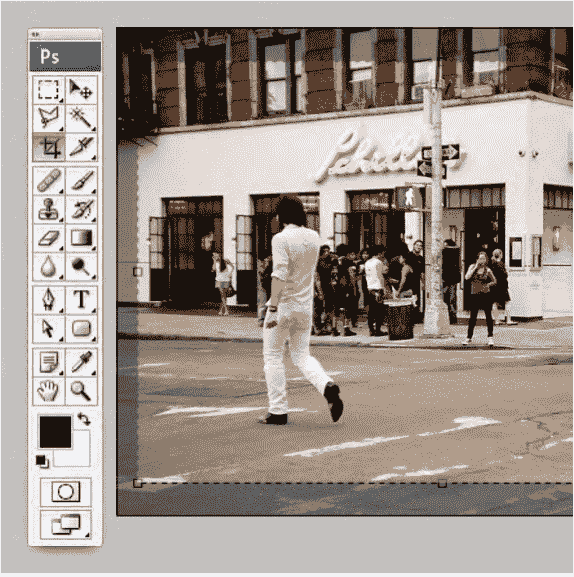

Web专业人士中最流行的工具是 **Adobe Photoshop**。（事实上，专业的网页设计师经常使用这个软件来设计整个网站。）Photoshop完整版价格昂贵，但有一个更便宜的版本叫做Photoshop Elements，它适合大多数初学者的需求。

### 其他软件

- Adobe Fireworks
- Pixelmator
- PaintShop Pro
- Paint.net

### 在线编辑器

- www.photoshop.com
- www.pixlr.com
- www.splashup.com
- www.ipiccy.com

### 在线扩展

观看演示视频，了解如何使用这两种应用程序调整图片大小并以正确的格式保存。

## 图片格式：JPEG

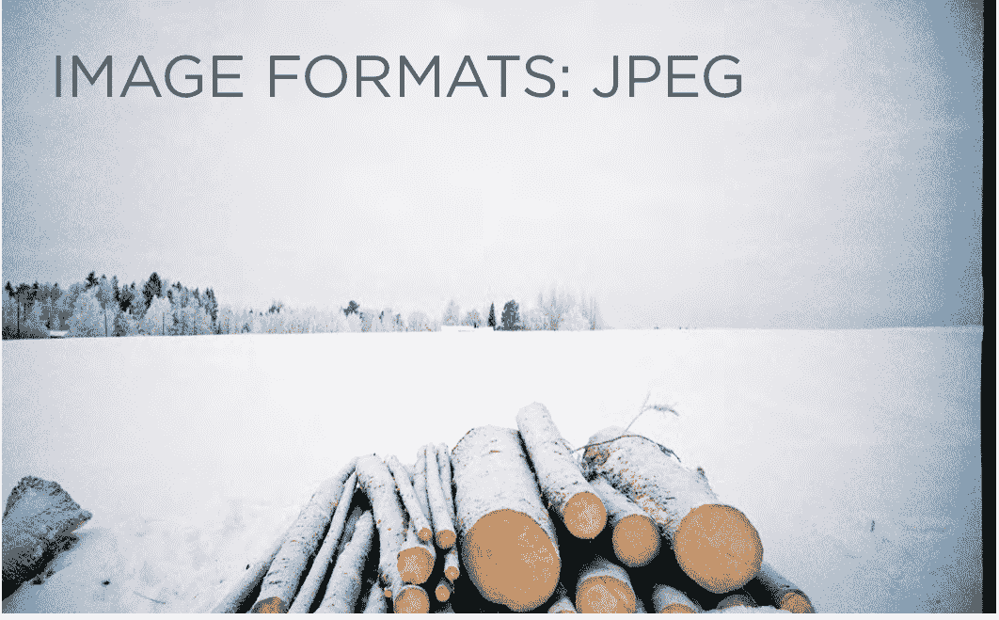

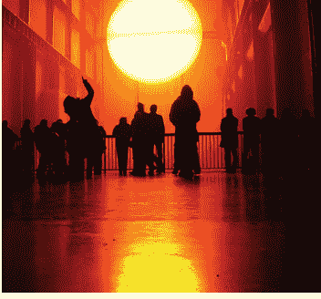


当图片中包含许多不同颜色时，你应该使用JPEG格式。一张以雪或阴天为特色的照片，看起来可能有大片区域只是白色或灰色，但图片通常由许多颜色略有不同的颜色组成。


## 图片格式：GIF

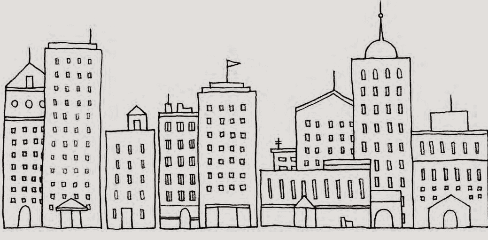


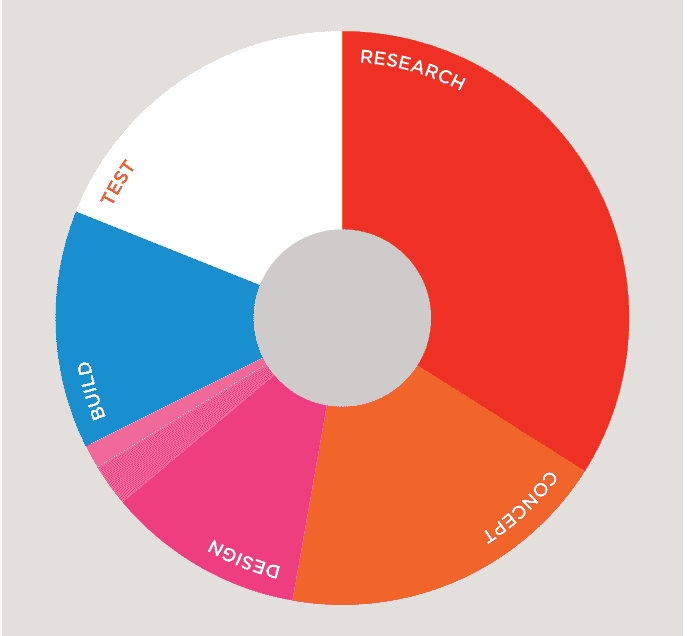

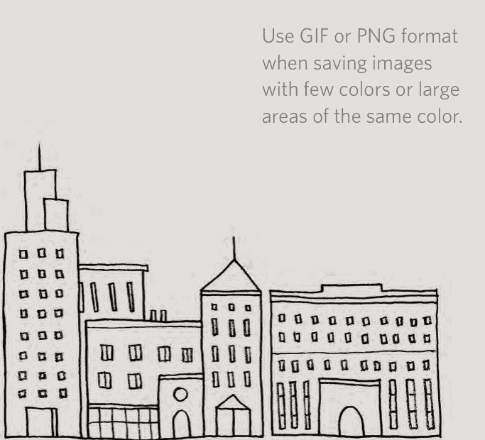

保存颜色较少或大面积相同颜色的图片时，使用GIF或PNG格式。

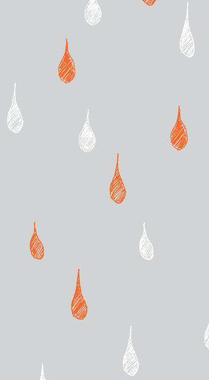

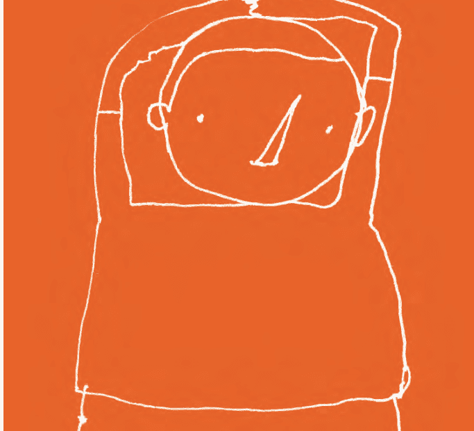

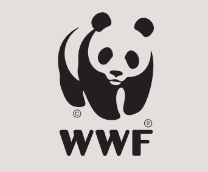

当图片的某个区域填充了完全相同的颜色时，这被称为纯色。标志、插图和图表通常使用纯色。（注意，雪、天空或草地的照片不是纯色，它们由许多颜色略有不同的色调组成，不太适合GIF或PNG格式。）

## 图片尺寸

你网站上使用的图片应以其在页面上显示的宽度和高度来保存。

例如，如果你设计的页面包含一张宽300像素、高150像素的图片，那么你使用的图片应该是300 x 150像素。你可能需要使用图片编辑工具来调整图片大小和裁剪图片。在获取图片时，了解如何更改图片尺寸很重要：假设你设计了一个网页，需要包含一张宽300像素、高150像素的图片：

**在线扩展**

访问本书配套网站的工具部分，观看关于在Photoshop和GIMP中调整图片大小的视频指南。

### 缩小图片尺寸

你可以缩小图片尺寸，创建图片的较小版本。

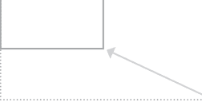

**示例：** 如果你的图片宽600像素、高300像素，你可以将图片尺寸缩小50%。

**结果：** 这将创建一个下载更快的图片。

### 增大图片尺寸

你无法在不影响图片质量的情况下显著增大照片尺寸。

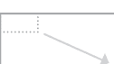

**示例：** 如果你的图片只有宽100像素、高50像素，将其尺寸增大300%会导致质量下降。

**结果：** 图片看起来会模糊或呈块状。

### 改变形状

只有一些图片可以在不丢失重要信息的情况下进行裁剪（见下一页）。

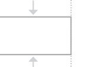

**示例：** 如果你的图片是300像素见方，你可以裁剪掉部分，但这样做可能会丢失重要信息。

**结果：** 只有部分图片在裁剪后仍然有意义。


## 裁剪图像

裁剪图像时，重要的是不要丢失有价值的信息。如果可能，最好直接获取形状合适的图像。

### 竖版

### 横版

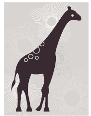

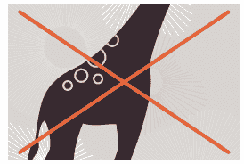

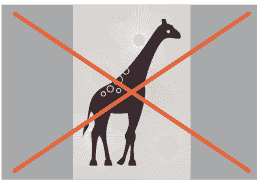

这里展示了一幅长颈鹿插图，它最适合作为**竖版**图片出现。

如果我们将其**裁剪**成横版，就会丢失头部和脚部。

如果我们向插图的左右**添加额外空白**，背景就无法延续。

### 横版

### 竖版


这里展示了一幅大象插图，它最适合作为**横版**图片出现。

如果我们将其**裁剪**成竖版，就会丢失象鼻和后半部分。

如果我们向插图的上下**添加额外空白**，背景就无法延续。

## 图像分辨率

为网络创建的图像应以 72 ppi 的分辨率保存。图像分辨率越高，文件大小就越大。

JPG、GIF 和 PNG 属于一种称为**位图**的图像格式。它们由许多微小的方格组成。图像的**分辨率**是指在 1 英寸 x 1 英寸的方形区域内能容纳的方格数量。

**计算机**屏幕上显示的图像由称为**像素**的微小方格构成。下图放大了这张照片的一小部分，以展示其像素构成方式。大多数台式机电脑的网络浏览器以 **72** 像素每英寸（ppi）的分辨率显示图像。**印刷**材料（如书籍和杂志）中的图像由称为**网点**的微小圆点构成。这些图像通常以 **300** 点每英寸（dpi）的分辨率印刷。


对于此图像：
300 dpi 的 JPEG = 1,526kb
72 ppi 的 JPEG = 368kb

由于计算机显示器的分辨率上限为 72 ppi，在网络上使用更高分辨率的图像并不会带来更好的图像质量——只会导致文件更大，从而增加加载时间，进而拖慢网页的浏览速度。

## 矢量图像

矢量图像与位图图像不同，其分辨率是无关的。矢量图像通常使用 Adobe Illustrator 等程序创建。

当图像是线条图（如徽标、插图或图表）时，设计师通常会将其创建为矢量格式。矢量格式图像与位图图像有很大不同。

矢量图像通过在网格上放置点，并在点之间绘制线条来创建。然后可以为已创建的线条添加颜色进行“填充”。

以矢量格式创建线条图的优势在于，你可以增加图像的尺寸而不影响其质量。

目前在网站上显示矢量图像的方法是保存原始矢量图像的位图版本并使用它。

可缩放矢量图形（SVG）是一种相对较新的格式，用于直接在网络上显示矢量图像（无需再为其创建位图版本），但其使用尚未普及。


## 动画 GIF

动画 GIF 按顺序显示图像的若干帧，因此可用于创建简单动画。

下面可以看到构成一个动画 GIF 的单独帧，它显示一个橙色圆点绕圆圈旋转——类似于网页加载时可能看到的那种动画。

一些图像编辑应用程序（如 Adobe Photoshop）允许你创建动画 GIF。网上有多个关于如何操作的教程。还有一些网站允许你上传各帧的图形，然后为你创建动画 GIF。

### 重要的是要记住：

图像的每一帧都会增加文件大小，因此可能增加图像的下载时间（而网络用户不喜欢长时间等待图像下载）。

由于 GIF 不是显示照片的理想格式，动画 GIF 实际上只适用于简单的插图。

一些设计师不赞成使用动画 GIF，因为他们记得在 20 世纪 90 年代，许多业余网页设计师过度使用了它们。


## 透明度

为网络创建部分透明（或“透视”）的图像需要选择以下两种格式之一：

### 透明 GIF

### PNG

如果图像的透明部分具有直线边缘并且是 100% 透明的（即非半透明），你可以将图像保存为 GIF（并选中透明度选项）。

如果图像的透明部分具有对角线或圆形边缘，或者你想要半透明效果或投影效果，则需要将其保存为 PNG。

透明 PNG 在较旧的浏览器中未被完全支持，最著名的是 Internet Explorer 6 (IE6)。有一些 JavaScript 可以用来绕过此问题。有关此脚本的详细信息可在本手册配套网站的工具部分找到。


## 检查网络上的图像

### 检查图像大小

如果你正在更新一个网站，在创建新图像替换旧图像之前，你可能需要检查现有图像的大小。这可以通过右键单击图像并从出现的弹出菜单中进行选择来实现。（Mac 用户需要按住 control 键点击，而不是右键单击。）


左侧展示了如何使用 Safari 检查图像大小和下载图像。下面是各种浏览器中执行这些功能时需要在弹出菜单中选择的内容的简要概述。

#### CHROME

大小：**在新标签页中打开图像**
大小显示在新标签页中
下载：**图像另存为**

#### FIREFOX

大小：**查看图像信息**
大小显示在弹出窗口中
下载：**图像另存为**

### 下载图像

如果你想从网站下载图像，可以通过访问同一个弹出菜单来完成。（但请记住，所有在线图像都受版权保护，重复使用需要明确许可。）

#### INTERNET EXPLORER

大小：**属性**
大小显示在弹出窗口中
下载：**图片另存为**

#### SAFARI

大小：**在新标签页中打开图像**
大小显示在标题栏中
下载：**图像另存为**


## HTML5：figure 和 figcaption

```
HTML chapter-05/figure-and-figure-caption.html

<figure>
  
  <br />
  <figcaption>Sea otters hold hands when they sleep so they don't drift away from each other.</figcaption>
</figure>
```

### \<figure\>

图像通常带有说明文字。HTML5 引入了一个新的 `<figure>` 元素来包含图像及其说明文字，以便将两者关联起来。

你可以在 `<figure>` 元素内放置多个图像，只要它们共享相同的说明文字即可。


### \<figcaption\>

`<figcaption>` 元素已被添加到 HTML5 中，以便网页作者可以为图像添加说明文字。

在这些元素被创建之前，无法将 `` 元素与其说明文字关联起来。

不理解 HTML5 元素的旧版浏览器会简单地忽略这些新元素，并显示它们的内容。

在此示例中，徽标是 GIF，因为它使用了纯色，而照片是 JPEG。主照片放置在 HTML5 `<figure>` 元素内，并有自己的说明文字。

每个图像上的 `alt` 属性为使用屏幕阅读器的用户提供描述，`title` 属性提供附加信息。（这显示在工具提示中。）

此示例没有使用 height、width 或 align 属性，因为这些属性正在逐步淘汰，建议你使用 CSS 属性代替。


 ## 示例图片

```
<html>
  <head>
    <title>Images</title>
  </head>
  <body>
    <h1>
      
    </h1>
    <figure>
      
      <p>
        <figcaption>
          This recipe for individual chocolate
          cakes is so simple and so delectable!
        </figcaption>
      </p>
    </figure>
    <h4>More Recipes:</h4>
    <p>
      
      
      
    </p>
  </body>
</html>
```

## 小结

### 图片

- ``元素用于在网页中添加图片。
- 必须始终指定`src`属性以指示图片的来源，以及`alt`属性以描述图片的内容。
- 应将图片保存为网页上将使用的尺寸，并采用适当的格式。
- 照片最好保存为JPEG格式；使用纯色的插图或徽标更适合保存为GIF格式。

## 6 表格

- 如何创建表格
- 哪些信息适合用表格
- 如何用表格表示复杂数据

有几种信息需要以网格或表格形式显示。例如：体育赛事结果、股票报告、列车时刻表。

在表格中表示信息时，需要从行和列构成的网格来思考（有点像电子表格）。在本章中，你将学习如何：

- 使用创建表格的四个关键元素
- 使用表格表示复杂数据
- 为表格添加标题

表格

128

## 股票与市场业务

## 在国家铁路上使用牡蛎卡

即付即用（Pay as you go）和牡蛎卡季票（Travelcard season tickets）可在已付费区域内的所有国家铁路服务上使用，但以下情况除外：

| 成人票价 | 即付即用 | |
|:---|:---|:---|
| | 高峰时段** | 非高峰时段** |
| 仅1区 | £2.00 | £1.50 |
| 1-2区 | £2.20 | £1.70 |
| 1-3区 | £2.80 | £2.00 |
| 1-4区 | £3.30 | £2.30 |
| 1-5区 | £4.20 | £2.60 |
| 1-6区 | £5.20 | £3.20 |
| 2、3、4、5或6区 | £1.50 | £1.30 |
| 2-3、3-4、4-5或5-6区 | £1.90 | £1.50 |
| 2-4、3-5或4-6区 | £2.30 | £1.70 |
| 2-5或3-6区 | £2.90 | £2.00 |
| 2-6区 | £3.40 | £2.20 |

**高峰时段牡蛎卡单程票价适用于周一至周五（公共假日除外）的06:30至09:30以及16:00至19:00。

**非高峰时段牡蛎卡单程票价适用于其他所有时间。

提出索赔没有时间限制。保障从您离开家的那一刻开始，因此如果您的宠物很快遇到麻烦，您也不会被冷落在外。但无需担心，因为您无需等待保单文件。一旦购买保单，您就可以立即联系兽医，告知他们您已有保障，并在最坏情况发生时寻求帮助。

值得信赖的保障

查看下表，了解我们的宠物保险提供的保障额度。作为标准配置，如果您的宠物受伤，每年可获得高达£7,000的兽医费用保障，或者如果您意外住院，可获得紧急犬舍或猫舍费用保障。

询问额外宠物的保费可享受5%折扣。

福利

| 福利 | 高级版最高保障 | 标准版 |
|:---|:---|:---|
| 疾病和伤害的兽医费用 | 每年£7,000 | 每年£4,000 |
| 行为治疗 | £250 | 不涵盖 |
| 处方食品 | £250 | 不涵盖 |
| 辅助治疗 | £1,000 | 不涵盖 |
| 每种疾病/伤害限额 | £7,000 | £4,000 |
| 寻找走失宠物的广告费 | £1,000 | £1,000 |
| 走失宠物悬赏金 | £1,000 | £500 |
| 紧急寄宿（每晚） | £1,250 | £100 |
| 缩短假期 | £750 | £300 |
| 取消假期 | £1,500 | £500 |
| 第三方责任 | 每周£1,500 | £250 |
| 个人意外 | £1,500 | £500 |
| 宠物遗失 | £1,500 | £500 |
| 24小时热线 | 有 | 有 |
| 疾病死亡 | £2,000,000 | £1,000,000 |
| 伤害死亡 | £3,000 | £500 |
| 安乐死（仅犬类） | £2,000 | 不涵盖 |
| ... | ... | 不涵盖 |

## 什么是表格？

表格以网格格式呈现信息。表格的例子包括财务报告、电视节目表和体育赛事结果。

网格让我们能够通过参考两个轴上的信息来理解复杂数据。

网格中的每个块被称为**表格单元格**。在HTML中，表格是按行逐行编写的。

## 基本表格结构

<table>

`<table>`元素用于创建表格。表格的内容按行逐行编写。

<tr>

使用开始标签`<tr>`指示每一行的开始。（tr代表表格行table row。）

后面跟一个或多个`<td>`元素（该行中的每个单元格对应一个）。

在行末使用结束标签`</tr>`。

<td>

表格的每个单元格使用`<td>`元素表示。（td代表表格数据table data。）

在每个单元格末尾使用结束标签`</td>`。

某些浏览器会自动在表格和/或单个单元格周围绘制线条。您将在第309-312页和第337-340页学习如何使用CSS控制表格边框。

```
chapter-06/basic-table-structure.html
<table>
  <tr>
    <td>15</td>
    <td>15</td>
    <td>30</td>
  </tr>
  <tr>
    <td>45</td>
    <td>60</td>
    <td>45</td>
  </tr>
  <tr>
    <td>60</td>
    <td>90</td>
    <td>90</td>
  </tr>
</table>
```

结果

| | | |
|:---:|:---:|:---:|
| 15 | 15 | 30 |
| 45 | 60 | 45 |
| 60 | 90 | 90 |

## 表格标题

## <th>

```
<table>
  <tr>
    <th></th>
    <th scope="col">Saturday</th>
    <th scope="col">Sunday</th>
  </tr>
  <tr>
    <th scope="row">Tickets sold:</th>
    <td>120</td>
    <td>135</td>
  </tr>
  <tr>
    <th scope="row">Total sales:</th>
    <td>$600</td>
    <td>$675</td>
  </tr>
</table>
```

`<th>`元素的用法与`<td>`元素类似，但其目的是表示列或行的标题。（th代表表格标题table heading。）

即使单元格没有内容，您仍应使用`<td>`或`<th>`元素来表示空单元格的存在，否则表格将无法正确渲染。（本例中第一行第一个单元格显示为空单元格。）

使用`<th>`元素作为标题有助于使用屏幕阅读器的人，提高搜索引擎索引页面的能力，并且在您开始使用CSS时也能更好地控制表格的外观。

可以在`<th>`元素上使用scope属性来指示它是列的标题还是行的标题。它可以取值：row表示行的标题，或col表示列的标题。

浏览器通常以**粗体**显示`<th>`元素的内容，并将其置于单元格中央。

| | 星期六 | 星期日 |
|:---|:---|:---|
| **售票数量：** | 120 | 135 |
| **总销售额：** | $600 | $675 |

## 跨列

有时您可能需要表格中的条目跨越多个列。

colspan属性可用于`<th>`或`<td>`元素，指示该单元格应跨越多少列。

在右侧的示例中，您可以看到一个包含五列的时间表；第一列包含该行的标题（日期），其余四列代表一小时的时间段。

```
chapter-06/spanning-columns.html
<table>
  <tr>
    <th></th>
    <th>9am</th>
    <th>10am</th>
    <th>11am</th>
    <th>12am</th>
  </tr>
  <tr>
    <th>Monday</th>
    <td colspan="2">Geography</td>
    <td>Math</td>
    <td>Art</td>
  </tr>
  <tr>
    <th>Tuesday</th>
    <td colspan="3">Gym</td>
    <td>Home Ec</td>
  </tr>
</table>
```

如果您查看包含"Geography"一词的表格单元格，您会看到colspan属性的值为2，表示该单元格应跨越两列。在第三行，"Gym"跨越三列。

您可以看到第二行和第三行的`<td>`元素比列数少。这是因为，当一个单元格延伸跨越多个列时，原本会被更宽单元格占据位置的`<td>`或`<th>`单元格不会包含在代码中。

| | 9am | 10am | 11am | 12am |
|:---|:---|:---|:---|:---|
| **星期一** | 地理 | | 数学 | 美术 |
| **星期二** | 体育 | | | 家政 |

我为这个示例添加了一些CSS样式，以便您可以看到单元格如何跨越多个列。您将在第250页、第337-340页学习如何做到这一点。


## 跨行

```
<table>
  <tr>
    <th></th>
    <th>ABC</th>
    <th>BBC</th>
    <th>CNN</th>
  </tr>
  <tr>
    <th>6pm - 7pm</th>
    <td rowspan="2">Movie</td>
    <td>Comedy</td>
    <td>News</td>
  </tr>
  <tr>
    <th>7pm - 8pm</th>
    <td>Sport</td>
    <td>Current Affairs</td>
  </tr>
</table>
```

表格中的条目也可能需要跨越多行。

`rowspan` 属性可用于 `<th>` 或 `<td>` 元素，以指明该单元格应向下跨越多少行。

在左侧的示例中，你可以看到 ABC 频道在晚上 6 点到 8 点正在播放一部电影，而 BBC 和 CNN 频道在此时段则播放两个节目（每个节目时长一小时）。

如果你查看最后一个 `<tr>` 元素，尽管下方结果有四列，但它只包含三个元素。这是因为上方 `<tr>` 元素中的电影使用了 `rowspan` 属性向下延伸，并占据了下方的单元格。

我为这个示例添加了一些 CSS 样式，以便你能看到单元格是如何跨越多行的。你将在第 250、337-340 页学习如何将这些 CSS 样式应用于表格。

## 长表格

有三个元素有助于区分表格的主体内容与第一行和最后一行（这两行可以包含不同的内容）。

这些元素有助于使用屏幕阅读器的用户，也允许你以不同于表格其余部分的方式来设置这些区域的样式（正如你将在学习 CSS 时看到的）。

### `<thead>`

表格的表头应放在 `<thead>` 元素内。

### `<tbody>`

表格的主体应放在 `<tbody>` 元素内。

### `<tfoot>`

表格的页脚属于 `<tfoot>` 元素内部。

默认情况下，浏览器很少以不同于其他元素的方式处理这些元素的内容，但设计师经常使用 CSS 样式来改变它们的外观。

```
chapter-06/long-tables.html

<table>
  <thead>
    <tr>
      <th>Date</th>
      <th>Income</th>
      <th>Expenditure</th>
    </tr>
  </thead>
  <tbody>
    <tr>
      <th>1st January</th>
      <td>250</td>
      <td>36</td>
    </tr>
    <tr>
      <th>2nd January</th>
      <td>285</td>
      <td>48</td>
    </tr>
    <!-- additional rows as above -->
    <tr>
      <th>31st January</th>
      <td>129</td>
      <td>64</td>
    </tr>
  </tbody>
  <tfoot>
    <tr>
      <td></td>
      <td>7824</td>
      <td>1241</td>
    </tr>
  </tfoot>
</table>
```

内容管理系统中附带的一些 HTML 编辑器提供了绘制表格的工具。如果你表格的第一行只包含 `<th>` 元素，那么你可能会发现编辑器会自动插入一个 `<thead>` 元素。

拥有独立的 `<thead>` 和 `<tfoot>` 元素的部分原因是，如果你的表格高度超过屏幕（或者，如果打印，长度超过一页），那么浏览器可以在表格内容滚动时保持表头和页脚可见。这旨在让用户更容易地看到数据位于哪一列（然而，目前没有任何浏览器默认实现此功能）。

我为这个示例添加了一些 CSS 样式，以便你能看到 `<thead>` 和 `<tfoot>` 的内容与其余行被区别对待。你将在第 309-312 页和 337-340 页学习如何将这些 CSS 样式应用于表格。

| 日期 | 收入 | 支出 |
|---|---|---|
| **1月1日** | 250 | 36 |
| **1月2日** | 285 | 48 |
| **1月3日** | 260 | 42 |
| **1月4日** | 290 | 38 |
| **1月5日** |ascal423854310 | 115 |
| **1月6日** | 168 | 14 |
| **1月7日** | 226 | 20 |
| **1月8日** | 253 | 37 |
| **1月9日** | 294 | 33 |
| **1月10日** | 216 | 46 |
| **1月11日** | 244 | 29 |
| **1月12日** | 297 | 32 |
| **1月13日** | 328 | 86 |
| **1月14日** | 215 | 38 |
| **1月15日** | 254 | 30 |
| **1月16日** | 256 | 27 |
| **1月17日** | 311 | 68 |
| **1月18日** | 212 | 39 |
| **1月19日** | 234 | 36 |
| **1月20日** | 221 | 43 |
| **1月21日** | 259 | 38 |
| **1月22日** | 246 | 31 |
| **1月23日** | 248 | 17 |
| **1月24日** | 229 | 45 |
| **1月25日** | 263 | 34 |
| **1月26日** | 258 | 41 |
| **1月27日** | 283 | 22 |
| **1月28日** | 256 | 30 |
| **1月29日** | 278 | 47 |
| **1月30日** | 251 | 15 |
| **1月31日** | 129 | 64 |
| | **7824** | **1241** |

## 旧代码：宽度和间距

有一些过时的属性，你不应该在新网站上使用。然而，在查看旧代码时，你可能会遇到其中一些，所以我会在这里提及它们。所有这些属性都已被 CSS 所取代。

`width` 属性曾用于开始的 `<table>` 标签以指示该表格应有多宽，并在一些开始的 `<th>` 和 `<td>` 标签上用于指定单个单元格的宽度。该属性的值是以像素为单位的表格或单元格的宽度。

表格中的列需要形成一条直线，因此你通常只在第一行看到 `width` 属性（所有后续行都将使用该设置）。

开始的 `<table>` 标签还可以使用 `cellpadding` 属性在表格的每个单元格内部添加空间，以及 `cellspacing` 属性在表格的每个单元格之间创建空间。这些属性的值以像素为单位。

我为此示例添加了 CSS 样式，以便你能更清楚地看到表格单元格的宽度。如果你想控制表格和单元格的宽度或间距，你应该使用 CSS，如第 303、337-340 页所示。

```
<table width="400" cellpadding="10" cellspacing="5">
  <tr>
    <th width="150"></th>
    <th>Withdrawn</th>
    <th>Credit</th>
    <th width="150">Balance</th>
  </tr>
  <tr>
    <th>January</th>
    <td>250.00</td>
    <td>660.50</td>
    <td>410.50</td>
  </tr>
  <tr>
    <th>February</th>
    <td>135.55</td>
    <td>895.20</td>
    <td>1170.15</td>
  </tr>
</table>
```

## 旧代码：边框和背景

```
HTML chapter-06/border-and-background.html
<table border="2" bgcolor="#efefef">
  <tr>
    <th width="150"></th>
    <th>Withdrawn</th>
    <th>Credit</th>
    <th width="150" bgcolor="#cccccc">Balance</th>
  </tr>
  <tr>
    <th>January</th>
    <td>250.00</td>
    <td>660.50</td>
    <td bgcolor="#cccccc">410.50</td>
  </tr>
  <tr>
    <th>February</th>
    <td>135.55</td>
    <td>895.20</td>
    <td bgcolor="#cccccc">1170.15</td>
  </tr>
</table>
```

`border` 属性曾用于 `<table>` 和 `<td>` 元素，以像素为单位指示边框的宽度。

`bgcolor` 属性曾用于指示整个表格或单个表格单元格的背景颜色。该值通常是十六进制代码（我们在第 249-252 页讨论）。

此示例使用了 HTML 的 `border` 和 `bgcolor` 属性。本示例未使用任何 CSS 属性。

在构建新网站时，你应该使用 CSS 来控制表格的外观，而不是这些属性。这里介绍它们只是因为如果你查看旧网站的代码，可能会遇到它们。

| | 取出 | 存入 | 余额 |
|---|---|---|---|
| **一月** | 250.00 | 660.50 | 410.50 |
| **二月** | 135.55 | 895.20 | 1170.15 |

## 表格 - Mozilla Firefox

| | 入门级托管 | 高级商业托管 |
|---|---|---|
| 磁盘空间 | 250mb | 1gb |
| 带宽 | 5gb 每月 | 50gb 每月 |
| 电子邮件账户 | 3 | 10 |
| 服务器 | 共享 | VPS |
| 支持 | 电子邮件 | 电话和电子邮件 |
| 设置 | 免费 | 免费 |
| FTP 账户 | 1 | 5 |

立即注册，节省 10%！

此示例显示了一个供客户比较网站托管套餐的表格。表格的第一行和第一列有表格标题。

左上角的空单元格仍然有一个 `<th>` 元素来表示它。表格的每个单元格必须由一个 `<th>` 或 `<td>` 元素来对应。`<th>` 元素使用 `scope` 属性来指示它们是行标题还是列标题。最后一行使用 `colspan` 属性跨越所有三列。


 ## 示例表格

```html
<html>
  <head>
    <title>表格</title>
  </head>
  <body>
    <table>
      <thead>
        <tr>
          <th></th>
          <th scope="col">家庭入门托管</th>
          <th scope="col">高级商业托管</th>
        </tr>
      </thead>
      <tbody>
        <tr>
          <th scope="row">磁盘空间</th>
          <td>250mb</td>
          <td>1gb</td>
        </tr>
        <tr>
          <th scope="row">带宽</th>
          <td>每月5gb</td>
          <td>每月50gb</td>
        </tr>
        <!-- 更多类似上面两行的行在此处 -->
      </tbody>
      <tfoot>
        <tr>
          <td></td>
          <td colspan="2">立即注册可节省10%！</td>
        </tr>
      </tfoot>
    </table>
  </body>
</html>
```

## 表格要点总结

-   `<table>`元素用于在网页中添加表格。
-   表格是一行一行绘制的。每一行使用`<tr>`元素创建。
-   在每一行内部有若干个单元格，由`<td>`元素表示（如果是表头，则为`<th>`）。
-   您可以使用`rowspan`和`colspan`属性使表格单元格跨越多行或多列。
-   对于长表格，您可以将表格分成`<thead>`、`<tbody>`和`<tfoot>`。

## 7 表单

-   如何收集访客信息
-   不同类型的表单控件
-   HTML5新增的表单控件

传统上，"表单"一词指的是一种印刷文档，其中包含供您填写信息的空间。

HTML借鉴了表单的概念，用来指代不同的元素，这些元素允许您从网站访客那里收集信息。

无论您是在网站上添加一个简单的搜索框，还是需要创建更复杂的保险申请，HTML表单为您提供了一组用于从用户那里收集数据的元素。在本章中，您将学习：

-   如何在您的网站上创建表单
-   用于收集数据的不同工具
-   HTML5新增的表单控件

您的详细信息

姓名：

电子邮件：

您的评价

您是如何知道我们的？谷歌

您会再次访问吗？

是 否 也许

评论：

为我注册电子邮件更新

提交评价

## 为什么要用表单？

网络上最著名的表单可能是位于Google首页正中间的搜索框。

除了让用户进行搜索之外，表单还允许用户在线执行其他功能。您在注册成为网站会员、在线购物以及订阅新闻通讯或邮件列表时都会看到表单。

## 表单控件

有几种表单控件可用于从您的网站访客那里收集信息。

### 添加文本：

**文本输入（单行）**

用于单行文****本，例如电子邮件地址和姓名。

**密码输入**

类似于单行文本框，但会隐藏输入的字符。

**文本区域（多行）**

用于较长的文本区域，例如留言和评论。

### 做出选择：

**单选按钮**

当用户必须从多个选项中选择一个时使用。

**复选框**

当用户可以选择或取消选择一个或多个选项时使用。

**下拉框**

当用户必须从列表中的多个选项中选择一个时使用。

### 提交表单：

**提交按钮**

将表单中的数据提交到另一个网页。

**图像按钮**

类似于提交按钮，但允许您使用图像。

### 上传文件：

**文件上传**

允许用户将文件（例如图像）上传到网站。

## 表单的工作原理

用户填写表单，然后按一个按钮将信息提交到服务器。

每个表单控件的名称与用户输入或选择的值一起发送到服务器。

服务器使用PHP、C#、VB.net或Java等编程语言处理信息。它还可能将信息存储在数据库中。

服务器根据收到的信息创建一个新页面，发送回浏览器。

一个表单可能有多个表单控件，每个控件收集不同的信息。服务器需要知道哪段输入数据对应哪个表单元素。

```
username=Ivy
```

为了区分不同的输入数据，信息通过名称/值对的形式从浏览器发送到服务器。在此示例中，表单要求输入访客的用户名以及他们最喜欢的爵士音乐家。发送到服务器的名称/值对为：

```
username=Ivy
```

```
vote=Herbie
```

如果表单控件允许用户输入文本，那么表单控件的值就是用户输入的内容。

如果表单控件允许您从固定的答案集中选择（例如单选按钮、复选框或下拉列表），网页作者将添加代码为每个选项提供自动值。

除非您知道服务器上的代码能够理解这个新值，否则不应更改页面上表单控件的名称。

## 表单结构

### <form>

表单控件位于`<form>`元素内部。该元素应始终携带action属性，并且通常还会有method和id属性。

### action

每个`<form>`元素都需要一个action属性。其值是服务器上接收表单提交信息的页面URL。

### method

表单可以使用两种方法之一发送：get或post。

使用get方法时，表单的值会添加到action属性中指定的URL末尾。get方法适用于：

-   短表单（例如搜索框）
-   当只是从Web服务器检索数据时（不是发送应添加到数据库或从数据库删除的信息）

使用post方法时，值会通过所谓的HTTP头部发送。根据经验，如果您的表单满足以下条件，应使用post方法：

-   允许用户上传文件
-   非常长
-   包含敏感数据（例如密码）
-   向数据库添加信息或从数据库删除信息

如果未使用method属性，表单数据将使用get方法发送。

### id

我们在第183页讨论id属性，其值用于将表单与页面上的其他元素明确区分开来（并且常被脚本使用——例如那些检查您是否已在需要值的字段中输入信息的脚本）。

```html
<form action="http://www.example.com/subscribe.php"
method="get">
  <p>表单控件将出现在此处。
    </p>
</form>
```

## 文本输入

```html
<form action="http://www.example.com/login.php">
  <p>用户名：
    <input type="text" name="username" size="15"
      maxlength="30" />
  </p>
</form>
```

### <input>

`<input>`元素用于创建几种不同的表单控件。`type`属性的值决定了它们将创建何种输入。

### type="text"

当`type`属性的值为`text`时，它创建单行文本输入。

### name

当用户在表单中输入信息时，服务器需要知道每条数据是输入到哪个表单控件中的。（例如，在登录表单中，服务器需要知道什么被输入为**用户名**，什么被提供为**密码**。）因此，每个表单控件都需要一个`name`属性。此属性的值标识表单控件，并与用户输入的信息一起发送到服务器。

### size

`size`属性不应于在新建表单中使用。它在旧表单中用于指示文本输入的宽度（以可见字符数衡量）。

例如，值为3会创建一个足够显示三个字符宽度的框（尽管用户可以根据需要输入更多字符）。

在您编写的任何新表单中，应使用CSS来控制表单元素的宽度。此处提到`size`属性是因为您在查看旧代码时可能会遇到它。

### maxlength

您可以使用`maxlength`属性来限制用户可以在文本字段中输入的字符数。其值是他们可以输入的字符数。例如，如果您询问年份，`maxlength`属性的值可以设为4。


## 密码输入

## <input>

### type="password"

当 type 属性的值为 password 时，它会创建一个文本框，其工作方式与单行文本输入框相同，只是输入的字符会被遮挡。这样隐藏字符是为了防止有人在用户背后窥视时，看到密码等敏感数据。

### name

name 属性表示密码输入框的名称，它会与用户输入的密码一起发送到服务器。

### size, maxlength

它也可以像单行文本输入框一样携带 size 和 maxlength 属性。

```
chapter-07/password-input.html
HTML
<form action="http://www.example.com/login.php">
  <p>用户名：
    <input type="text" name="username" size="15"
      maxlength="30" />
  </p>
  <p>密码：
    <input type="password" name="password" size="15"
      maxlength="30" />
  </p>
</form>
```


虽然密码在屏幕上被隐藏了，但这并不意味着密码控件中的数据会被安全地发送到服务器。你永远不应该用这种方式来发送信用卡号码等敏感数据。

为了完全安全，服务器需要设置成使用安全套接层（SSL）与用户的浏览器进行通信。SSL 的主题超出了本书的范围，不过你可以在配套网站上找到更多相关内容的链接。

## 文本区域

```
HTML chapter-07/textarea.html
<form action="http://www.example.com/comments.php">
  <p>你觉得这场演出怎么样？</p>
  <textarea name="comments" cols="20" rows="4">Enter
    your comments...</textarea>
</form>
```

## <textarea>

`<textarea>` 元素用于创建多行文本输入区域。与其他输入元素不同，这不是一个空元素。因此它应该有一个开始标签和一个结束标签。

在开始标签 `<textarea>` 和结束标签 `</textarea>` 之间出现的任何文本，都将在页面加载时显示在文本框中。


如果用户没有删除这些标签之间的文本，这条信息将与用户输入的内容一起发送到服务器。（有些网站会使用 JavaScript 在用户点击文本区域时清除这些信息。）

如果你正在创建一个新表单，应该使用 CSS 来控制 `<textarea>` 的宽度和高度。但是，如果你查看的是较旧的代码，你可能会看到该元素使用了 cols 和 rows 属性。

cols 属性表示文本区域的宽度（以字符数计算）。rows 属性表示文本区域在垂直方向上应占多少行。

## 单选按钮

## `<input>`

### type="radio"

单选按钮允许用户在一组选项中只选择一个。

### name

`name` 属性会随用户选择的选项值一起发送到服务器。当一个问题以单选按钮的形式为用户提供答案选项时，用于回答该问题的所有单选按钮的 `name` 属性值应该相同。

### value

`value` 属性表示所选选项发送到服务器的值。一组按钮中每个按钮的值应该不同（这样服务器才能知道用户选择了哪个选项）。

### checked

`checked` 属性可用于指示页面加载时应该选择哪个值（如果有）。该属性的值为 `checked`。一组单选按钮中只能有一个使用此属性。

```
chapter-07/radio-button.html
HTML
<form action="http://www.example.com/profile.php">
  <p>请选择你最喜欢的音乐类型：
    <br />
    <input type="radio" name="genre" value="rock"
      checked="checked" /> 摇滚
    <input type="radio" name="genre" value="pop" />
      流行
    <input type="radio" name="genre" value="jazz" />
      爵士
  </p>
</form>
```


**请注意：** 一旦选择了单选按钮，就无法取消选择。用户只能选择另一个选项。如果你只允许用户选择一个选项，并且希望他们能取消选择（例如，当他们在表示同意条款和条件时），你应该使用复选框代替。

## 复选框

```
<form action="http://www.example.com/profile.php">
  <p>请选择你喜欢的音乐服务：
    <br />
    <input type="checkbox" name="service"
      value="itunes" checked="checked" /> iTunes
    <input type="checkbox" name="service"
      value="lastfm" /> Last.fm
    <input type="checkbox" name="service"
      value="spotify" /> Spotify
  </p>
</form>
```

## <input>

### type="checkbox"

复选框允许用户选择一个或多个选项来回答问题。

### name

name 属性会随用户选择的选项值一起发送到服务器。当一个问题以复选框的形式为用户提供答案选项时，用于回答该问题的所有按钮的 name 属性值应该相同。

### value

value 属性表示此复选框被选中时发送到服务器的值。

### checked

checked 属性表示页面加载时应勾选此复选框。如果使用，其值应为 checked。


## 下拉列表框

## <select>

```
chapter-07/drop-down-list-box.html
<form action="http://www.example.com/profile.php">
  <p>你用什么设备听音乐？</p>
  <select name="devices">
    <option value="ipod">iPod</option>
    <option value="radio">Radio</option>
    <option value="computer">Computer</option>
  </select>
</form>
```

下拉列表框（也称为选择框）允许用户从下拉列表中选择一个选项。

`<select>` 元素用于创建下拉列表框。它包含两个或更多的 `<option>` 元素。

### name

name 属性表示发送到服务器的表单控件的名称，以及用户选择的值。


### <option>

`<option>` 元素用于指定用户可以选择的选项。开始标签 `<option>` 和结束标签 `</option>` 之间的文字将显示给用户在下拉框中。

### selected

selected 属性可用于指示页面加载时应选择的选项。该属性的值应为 selected。

下拉列表框的功能与单选按钮类似（都只能选择一个选项）。选择使用哪种方式有两个关键因素：

如果不使用此属性，页面加载时将显示第一个选项。如果用户没有选择选项，则第一项将作为该控件的值发送到服务器。

-   1. 如果用户需要一眼看到所有选项，单选按钮更适合。
-   2. 如果选项列表很长（例如国家列表），下拉列表框效果更好。

### value

`<option>` 元素使用 value 属性表示如果选中此选项，将与控件的名称一起发送到服务器的值。

## 多选列表框

```
<form action="http://www.example.com/profile.php">
    <p>你会演奏以下哪些乐器？
    （你可以通过按住 PC 上的 control 键或 Mac 上的 command 键，
    同时选择不同的选项，来选择多个选项。）</p>
    <select name="instruments" size="3"
            multiple="multiple">
        <option value="guitar" selected="selected">
            Guitar</option>
        <option value="drums">Drums</option>
        <option value="keyboard"
                selected="selected">Keyboard</option>
        <option value="bass">Bass</option>
    </select>
</form>
```

## <select>

### size

你可以通过添加 size 属性将下拉选择框转变为显示多个选项的框。其值应为希望同时显示的选项数量。在示例中你可以看到四个选项中有三个被显示。

不幸的是，浏览器对这个属性的实现并不完美，如果使用应该进行彻底测试（特别是在 Mac 上的 Firefox 和 Safari 中）。

### multiple

你可以通过添加值为 multiple 的 multiple 属性，允许用户从此列表中选择多个选项。


最好告知用户他们是否可以同时选择多个选项。同时提示他们在 PC 上应按住 control 键选择多个选项，在 Mac 上应使用 command 键选择选项，也会很有帮助。


## 文件输入框

### `<input>`

如果你想允许用户上传文件（例如图片、视频、MP3或PDF），你需要使用文件输入框。

### `type="file"`

这种类型的输入会创建一个看起来像文本输入框后跟一个**浏览**按钮的框。当用户点击**浏览**按钮时，会打开一个窗口，允许他们从电脑中选择要上传到网站的文件。

```
<form action="http://www.example.com/upload.php"
      method="post">
  <p>Upload your song in MP3 format:</p>
  <input type="file" name="user-song" /><br />
  <input type="submit" value="Upload" />
</form>
```

当你允许用户上传文件时，`<form>`元素的method属性必须为post值。（你不能使用HTTP get方法发送文件。）

当用户点击**浏览**按钮时，允许他们浏览要上传文件的窗口外观将与用户操作系统的窗口匹配。你无法控制这些窗口的外观。

## 提交按钮

HTML chapter-07/submit-button.html

```
<form action="http://www.example.com/subscribe.php">
  <p>Subscribe to our email list:</p>
  <input type="text" name="email" />
  <input type="submit" name="subscribe"
         value="Subscribe" />
</form>
```

### `<input>`

### `type="submit"`

提交按钮用于将表单发送到服务器。

### `name`

它可以使用name属性，但不是必须的。

### `value`

value属性用于控制按钮上显示的文本。最好指定你希望出现在按钮上的文字，因为一些浏览器上按钮的默认值是'Submit query'（提交查询），这可能不适合所有类型的表单。

不同的浏览器将以不同的方式显示提交按钮，并倾向于适应浏览器的视觉呈现。如果你想控制提交按钮的外观，可以使用CSS（你将在第343页学到），或者你可以使用图片作为按钮。

## 图像按钮

### `<input>`

`type="image"`

如果你想使用图像作为提交按钮，可以给type属性一个image值。src、width、height和alt属性的工作方式与它们在``元素（我们在第99-100页见过）中使用时一样。

```
<form action="http://www.example.org/subscribe.php">
  <p>Subscribe to our email list:</p>
  <input type="text" name="email" />
  <input type="image" src="images/subscribe.jpg" width="100" height="20" />
</form>
```

## 按钮和隐藏控件

```
chapter-07/button-and-hidden-controls.html

<form action="http://www.example.com/add.php">
  <button> Add</button>
  <input type="hidden" name="bookmark"
    value="lyrics" />
</form>
```

### `<button>`

`<button>`元素的引入是为了让用户对其按钮的外观有更多控制，并允许其他元素出现在按钮内部。

这意味着你可以在`<button>`开始标签和`</button>`结束标签之间组合文本和图像。

### `<input>`

### `type="hidden"`

这个例子还展示了一个`hidden`表单控件。这些表单控件不会显示在页面上（尽管如果你使用浏览器的**查看源代码**选项，你可以看到它们）。它们允许网页作者向用户无法看到的表单添加值。例如，网页作者可能会使用一个隐藏字段来指示用户提交表单时所在的页面。

## 标记表单控件

### `<label>`

在介绍表单控件时，为了保持代码简单，每个控件的目的都在其旁边的文本中说明。然而，每个表单控件都应该有自己的`<label>`元素，因为这使得视力受损的用户也能访问表单。

`<label>`元素可以两种方式使用。它可以：

1. 包围文本描述和表单输入（如右侧示例的第一行所示）。
2. 与表单控件分开，并使用for属性来标明它是哪个表单控件的标签（如单选按钮所示）。

```
chapter-07/labelling-form-controls.html

<label>Age: <input type="text" name="age" /></label>
<br/ >
Gender:
<input id="female" type="radio" name="gender" value="f">
<label for="female">Female</label>
<input id="male" type="radio" name="gender" value="m">
<label for="male">Male</label>
```

### `for`

for属性说明标签属于哪个表单控件。注意单选按钮如何使用id属性。id属性的值唯一地标识页面上所有其他元素中的一个元素。（id属性在第183页介绍。）

for属性的值与其标记的表单控件上的id属性的值相匹配。这种使用for和id属性的技术可用于任何表单控件。当`<label>`元素与复选框或单选按钮一起使用时，用户可以点击表单控件或标签进行选择。扩展的点击区域使表单更易于使用。标签的位置非常重要。如果用户不知道在哪里输入信息或要输入什么信息，他们就不太可能正确使用表单。

根据经验，以下是将标签放置在表单控件上的最佳位置。

**上方或左侧：**
- 文本输入框
- 文本区域
- 选择框
- 文件上传

**右侧：**
- 单个复选框
- 单个单选按钮

## 分组表单元素

```
chapter-07/grouping-form-elements.html

<fieldset>
    <legend>Contact details</legend>
    <label>Email:<br />
    <input type="text" name="email" /></label><br />
    <label>Mobile:<br />
    <input type="text" name="mobile" /></label><br />
    <label>Telephone:<br />
    <input type="text" name="telephone" /></label>
</fieldset>
```

### `<fieldset>`

你可以将相关的表单控件分组放在`<fieldset>`元素内。这对于较长的表单尤其有帮助。

大多数浏览器会在fieldset周围显示一条线，以显示它们之间的关系。这些线的外观可以使用CSS调整。

### `<legend>`

`<legend>`元素可以直接跟在`<fieldset>`开始标签之后，并包含一个标题，有助于识别该组表单控件的目的。

## HTML5：表单验证

你可能在网上见过这样的表单：如果表单控件填写不正确，会给用户消息；这被称为**表单验证**。

传统上，表单验证是使用JavaScript执行的（这超出了本书的范围）。但HTML5正在引入验证，并将工作交给浏览器。

验证有助于确保用户在表单中输入的信息在表单提交时服务器能够理解。在将表单发送到服务器之前验证其内容有助于：

- 减少服务器需要完成的工作量
- 使用户比在服务器上执行验证更快地看到表单是否存在问题。

```
chapter-07/html5-form-validation.html

<form action="http://www.example.com/login/"
      method="post">
    <label for="username">Username:</label>
    <input type="text" name="username"
           required="required" /><br />
    <label for="password">Password:</label>
    <input type="password" name="password"
           required="required" />
    <input type="submit" value="Submit" />
</form>
```

在撰写本文时，只有Chrome和Opera支持HTML5验证，尽管其他浏览器预计也会跟进。为了支持不理解HTML5的旧浏览器，网页作者可能会继续使用JavaScript来验证表单。

HTML5表单验证的一个例子是`required`属性，它可以用于任何用户期望填写的表单元素。这个HTML5属性不需要值，但在HTML4中所有属性都必须有一个值。因此，有些人给这个属性一个`required`值。


## HTML5：日期输入

```html
<form action="http://www.example.com/bookings/"
    method="post">
    <label for="username">Departure date:</label>
    <input type="date" name="depart" />
    <input type="submit" value="Submit" />
</form>
```


## &lt;input&gt;

许多表单需要收集日期、电子邮件地址和 URL 等信息。传统上，这些都是使用文本输入框来完成的。

HTML5 引入了新的表单控件，以规范某些信息的收集方式。不认识这些输入项的旧版浏览器会将它们视为单行文本框。

## type="date"

如果你需要向用户询问日期，可以使用 `<input>` 元素，并将 `type` 属性的值设为 `date`。这样，在新版 HTML5 输入类型支持的浏览器中，就会创建一个日期输入框。

此示例展示了日期输入框在 Opera 浏览器中的样子。日期输入框的外观在不同浏览器中会有所不同。

## HTML5：电子邮件和 URL 输入

## &lt;input&gt;

HTML5 还引入了允许访问者输入电子邮件地址和 URL 的输入框。不支持这些输入类型的浏览器会将它们视为文本框。

```html
chapter-07/html5-email-input.html

<form action="http://www.example.org/subscribe.php">
  <p>Please enter your email address:</p>
  <input type="email" name="email" />
  <input type="submit" value="Submit" />
</form>
```

## type="email"

如果你需要向用户询问电子邮件地址，可以使用电子邮件输入框。支持 HTML5 验证的浏览器会检查用户是否以电子邮件地址的正确格式提供了信息。一些智能手机还会优化其键盘，显示输入电子邮件地址时最可能用到的按键（例如 @ 符号）。


```html
chapter-07/html5-url-input.html

<form action="http://www.example.org/profile.php">
  <p>Please enter your website address:</p>
  <input type="url" name="website" />
  <input type="submit" value="Submit" />
</form>
```

## type="url"

当你需要向用户询问网页地址时，可以使用 URL 输入框。支持 HTML5 验证的浏览器会检查用户是否以 URL 的格式提供了信息。一些智能手机还会优化其键盘，显示输入 URL 时最可能用到的按键。


## HTML5：搜索输入

```html
<form action="http://www.example.org/search.php">
  <p>Search:</p>
  <input type="search" name="search" />
  <input type="submit" value="Search" />
</form>
```

## &lt;input&gt;

如果你想创建一个用于搜索查询的单行文本框，HTML5 为此提供了一种特殊的输入类型。

## type="search"

如果你想创建一个用于搜索查询的单行文本框，HTML5 提供了专门的搜索输入框。

要创建 HTML5 搜索框，`<input>` 元素的 type 属性值应为 search。旧版浏览器会简单地将其视为单行文本框。


最近的浏览器添加了一些提高可用性的功能。例如，Mac 上的 Safari 在你开始输入信息后会添加一个叉号来清除搜索框。Safari 还会自动将搜索输入框的边角变为圆角。

```html
<form action="http://www.example.org/search.php">
  <p>Search:</p>
  <input type="search" name="search"
         placeholder="Enter keyword" />
  <input type="submit" value="Search" />
</form>
```

## placeholder

在任何文本输入框上，你都可以使用一个名为 placeholder 的属性，其值是会显示在文本框中的文本，直到用户点击该区域。旧版浏览器会直接忽略这个属性。


## 表单示例


此示例展示了一个反馈表单和新闻通讯注册表单。它使用了多种表单控件。

`<form>` 元素使用 action 属性来指明数据被发送到的页面。每个表单控件都位于 `<form>` 元素内部。不同类型的表单控件适合收集不同类型的数据。`<fieldset>` 元素用于将相关的问题分组在一起。`<label>` 元素指明每个表单控件的用途。

## 表单示例

```html
<html>
  <head>
    <title>Forms</title>
  </head>
  <body>
    <form action="http://www.example.com/review.php" method="get">
      <fieldset>
        <legend>
          Your Details:
        </legend>
        <label>
          Name:
          <input type="text" name="name" size="30" maxlength="100">
        </label>
        <br />
        <label>
          Email:
          <input type="email" name="email" size="30" maxlength="100">
        </label>
        <br />
      </fieldset>
      <br />
      <fieldset>
        <legend>
          Your Review:
        </legend>
        <p>
          <label for="hear-about">
            How did you hear about us?
          </label>
          <select name="referrer" id="hear-about">
            <option value="google">Google</option>
            <option value="friend">Friend</option>
            <option value="advert">Advert</option>
            <option value="other">Other</option>
          </select>
        </p>
        <p>
Would you visit again?
<br />
<label>
  <input type="radio" name="rating" value="yes" />
  Yes
</label>
<label>
  <input type="radio" name="rating" value="no" />
  No
</label>
<label>
  <input type="radio" name="rating" value="maybe" />
  Maybe
</label>
</p>
<p>
  <label for="comments">
    Comments:
  </label>
  <br />
  <textarea rows="4" cols="40" id="comments">
  </textarea>
</p>
<label>
  <input type="checkbox" name="subscribe" checked="checked" />
  Sign me up for email updates
</label>
  <br />
  <input type="submit" value="Submit review" />
</fieldset>
    </form>
  </body>
</html>
```

## 表单总结

- 每当你想要从访问者那里收集信息时，你就需要一个表单，它位于 `<form>` 元素内部。
- 表单中的信息以名称/值对的形式发送。
- 每个表单控件都有一个名称，用户输入的文本或他们选择的选项值会被发送到服务器。
- HTML5 引入了新的表单元素，使访问者更容易填写表单。

## 8. 额外标记

- 指定不同版本的 HTML
- 识别和分组元素
- 注释、元信息和 iframe

到目前为止，我们已经介绍了主要适用于分组和分节的标签。

在本章中，我们将重点介绍一些不太容易归类的有用主题。你将学习到：

- HTML 的不同版本以及如何指明你正在使用的版本
- 如何向代码中添加注释
- 全局属性，即可以用于任何元素的属性，包括 class 和 id 属性
- 用于将页面中没有其他合适元素的部分进行分组的元素
- 如何使用 iframe 在页面内嵌入另一个页面
- 如何使用 `<meta>` 元素添加关于网页的信息
- 如何添加尖括号和版权符号等字符


### 001 版本

伦敦市中心自行车路线图
第 1 版 - 2009

未来制图公司
...地图信息...

### 艺术书店

- 首页
- 新出版物
- 联系我们

查令十字路，伦敦，WC2，英国
电话 (0207) 946 0946
邮箱 books@futuremap.com


© 艺术书店

## HTML 的演变

自网络诞生以来，HTML 已经有了几个不同的版本。

### HTML 4
发布于 1997 年

### XHTML 1.0
发布于 2000 年

每个新版本的设计都是对前一个版本的改进（添加了新的元素和属性，并移除了旧的代码）。

用于查看网页的浏览器也有多个版本，每个版本都实现了新的代码。然而，并非所有网络用户都在他们的电脑上安装了最新的浏览器，这意味着并非每个人都能查看所有最新的特性和标记。

在需要特别注意浏览器不支持某些功能的地方，我会特别注明（正如你在表单章节中看到的一些 HTML5 元素一样——正如你在 CSS 章节中也会看到的）。

除了 HTML5 中添加的一些元素（已经标出）外，本书中你看到的所有元素在 HTML 4 中都是可用的。

虽然 HTML 4 有一些用于控制页面外观的呈现性元素，但不再建议作者使用它们。（例如，`<center>` 元素用于将内容居中，`<font>` 用于控制文本外观，`<strike>` 用于在文本上添加删除线——这些都可以用 CSS 实现。）

1998 年，一种名为 XML 的语言发布了。它的目的是允许人们编写新的标记语言。由于 HTML 是当时使用最广泛的标记语言，因此决定将 HTML 4 重新制定以遵循 XML 的规则，并将其更名为 XHTML。这意味着作者必须遵循一些新的、更严格的标记编写规则。例如：

- 每个元素都需要有结束标签（空元素如 `` 除外）。
- 属性名称必须使用小写。
- 所有属性都需要有值，并且所有值都要放在双引号中。
- 不应再使用已弃用的元素。
- 在某个元素内部打开的元素，必须在该元素内部关闭。


## HTML5
发布于 2000 年

本书中的所有示例都严格遵循 XML 的这些规则。

这一改变的关键好处之一是，XHTML 能与为创建和处理 XML 文档而编写的其他程序**无缝协作**。

它还可以与其他数据格式一起使用，例如可缩放矢量图形（SVG）——一种用 XML 编写的图形语言、MathML（用于标记数学公式）和 CML（用于标记化学公式）。

为了帮助网页作者迁移到这种新语法，创建了 XHTML 1.0 的两个主要版本：

- **严格 XHTML 1.0**，作者必须严格遵守规则。
- **过渡 XHTML 1.0**，作者仍然可以使用表现性元素（如 `<center>` 和 `<font>`）。

XHTML 的过渡版本被创建出来，是因为它允许作者继续沿用较旧的做法（语法不那么严格），并使用一些在未来 HTML 版本中将被移除的元素和属性。

还有第三个版本的 XHTML 1.0，称为 **XHTML 1.0 框架集**，它允许网页作者将浏览器窗口划分为多个“框架”，每个框架容纳一个不同的 HTML 页面。如今，框架已很少使用，并正在逐步淘汰。

在 HTML5 中，网页作者无需关闭所有标签，并且将引入新的元素和属性。在撰写本文时，HTML5 规范尚未完成，但主要的浏览器制造商已经开始实施许多新功能，网页作者也正在迅速采用这种新标记。

尽管 HTML5 尚未完成，但只要您努力确保使用旧版浏览器的用户能够查看您的页面（即使某些额外功能对他们不可见），您就可以安全地利用该语言的新特性。

## DOCTYPE

因为 HTML 有多个版本，所以每个网页都应以 DOCTYPE 声明开头，以告知浏览器该页面使用的是哪个版本的 HTML（尽管即使没有包含它，浏览器通常也会显示该页面）。因此，我们将在本书后续的每个示例中包含一个。

正如您将在第 316 页了解 CSS 及其盒模型时所看到的，使用 DOCTYPE 也可以帮助浏览器正确渲染页面。

由于 XHTML 是用 XML 编写的，您有时会看到使用 XHTML 严格 DOCTYPE 的页面以可选的 XML 声明开头。如果使用了它，它必须是文档中的第一项。它前面不能有任何内容，甚至不能有空格。

| 版本 | DOCTYPE 声明 |
| :--- | :--- |
| HTML5 | `<!DOCTYPE html>` |
| **HTML 4** | `<!DOCTYPE html PUBLIC`<br>`"-//W3C//DTD HTML 4.01 Transitional//EN"`<br>`"http://www.w3.org/TR/html4/loose.dtd">` |
| **过渡 XHTML 1.0** | `<!DOCTYPE html PUBLIC`<br>`"-//W3C//DTD XHTML 1.0 Transitional//EN"`<br>`"http://www.w3.org/TR/xhtml1/DTD/`<br>`xhtml1-transitional.dtd">` |
| **严格 XHTML 1.0** | `<!DOCTYPE html PUBLIC`<br>`"-//W3C//DTD XHTML 1.0 Strict//EN"`<br>`"http://www.w3.org/TR/xhtml1/DTD/`<br>`xhtml1-strict.dtd">` |
| **XML 声明** | `<?xml version="1.0" ?>` |

181  额外标记

## HTML 中的注释

```
<!-- start of introduction -->
<h1>Current Exhibitions</h1>
<h2>Olafur Eliasson</h2>
<!-- end of introduction -->
<!-- start of main text -->
<p>Olafur Eliasson was born in Copenhagen, Denmark
in 1967 to Icelandic parents.</p>
<p>He is known for sculptures and large-scale
installation art employing elemental materials
such as light, water, and air temperature to
enhance the viewer's experience.</p>
<!-- end of main text -->
<!--
  <a href="mailto:info@example.org">Contact</a>
-->
```

```
<!-- comment goes here -->
```

如果您想在代码中添加注释，使其在用户的浏览器中不可见，可以将文本添加在这些字符之间：

在代码中添加注释是个好主意，因为无论您在编写页面时对它有多熟悉，当您稍后返回查看时（或者其他人需要查看代码），注释会使它更容易理解。

虽然注释在主浏览器窗口中对用户不可见，但任何查看页面源代码的人都可以看到它们。

在长页面上，您经常会看到注释被用来指示页面各部分的开始或结束，以及传递注释以帮助任何查看代码的人理解它。

注释也可以围绕代码块使用，以阻止该代码在浏览器中显示。在左侧的示例中，电子邮件链接已被注释掉。

额外标记 182

## ID 属性

每个 HTML 元素都可以携带 id 属性。它用于将该元素与页面上的其他元素唯一标识。其值应以字母或下划线开头（不能是数字或任何其他字符）。重要的是，同一页面上没有两个元素具有相同的 id 属性值（否则该值将不再唯一）。

正如您将在下一节了解 CSS 时所看到的，为元素赋予唯一标识符允许您将其样式设置为与页面上同一元素的任何其他实例不同。例如，您可能希望将页面中的一个段落（也许是一个包含引文的段落）设置为与其他所有段落不同的样式。在右侧的示例中，id 属性值为 pullquote 的段落使用 CSS 被设置为大写。

```
<p>Water and air. So very commonplace are these substances, they hardly attract attention - and yet they vouchsafe our very existence.</p>

<p id="pullquote">Every time I view the sea I feel a calming sense of security, as if visiting my ancestral home; I embark on a voyage of seeing.</p>

<p>Mystery of mysteries, water and air are right there before us in the sea.</p>
```


如果您继续学习 JavaScript（一种允许您为页面添加交互性的语言），id 属性可用于允许脚本与该特定元素交互。

id 属性被称为**全局属性**，因为它可以在任何元素上使用。

## CLASS 属性

```
<p class="important">For a one-year period from November 2010, the Marugame Genichiro-Inokuma Museum of Contemporary Art (MIMOCA) will host a cycle of four Hiroshi Sugimoto exhibitions.</p>
<p>Each will showcase works by the artist thematically contextualized under the headings "Science," "Architecture," "History" and "Religion" so as to present a comprehensive panorama of the artist's oeuvre.</p>
<p class="important admittance">Hours: 10:00 - 18:00 (No admittance after 17:30)</p>
```

每个 HTML 元素也可以携带 class 属性。有时，您希望将多个元素标识为与页面上的其他元素不同，而不是在文档中唯一标识一个元素。例如，您可能有一些包含比其他内容更重要的信息的段落，并希望区分这些元素，或者您可能希望区分指向您自己站点上其他页面的链接和指向外部站点的链接。

为此，您可以使用 class 属性。其值应描述它所属的类别。在左侧的示例中，关键段落有一个 class 属性，其值为 important。

任何元素上的 class 属性都可以共享相同的值。因此，在此示例中，important 的值也可以用于标题和链接。

默认情况下，使用这些属性不会影响元素的表示。只有当存在 CSS 规则指示其应以不同方式显示时，它们的外观才会改变。

在此示例中，已应用 CSS 使 class 属性值为 important 的元素变为大写，class 属性值为 admittance 的元素变为红色。

如果您想表示一个元素属于多个类，可以用空格分隔类名，如您在上述示例的第三段中所见。


## 块元素

有些元素在浏览器窗口中总会显示为从新的一行开始。这些被称为**块级**元素。

块元素的示例包括 `<h1>`、`p>`、`<ul>` 和 `<li>`。

```
chapter-08/block-elements.html

<h1>Hiroshi Sugimoto</h1>
<p>The dates for the ORIGIN OF ART exhibition are as follows:</p>
<ul>
  <li>Science: 21 Nov - 20 Feb 2010/11</li>
  <li>Architecture: 6 Mar - 15 May 2011</li>
  <li>History: 29 May - 21 Aug 2011</li>
  <li>Religion: 28 Aug - 6 Nov 2011</li>
</ul>
```

## 行内元素

```
HTML chapter-08/inline-elements.html
Timed to a single revolution of the planet around the sun at a 23.4 degrees tilt that plays out the rhythm of the seasons, this <em>Origins of Art</em> cycle is organized around four themes: <b>science, architecture, history</b> and <b>religion</b>.
```

有些元素总会显示在与相邻元素相同的行内继续。这些被称为**行内**元素。

行内元素的示例包括 `<a>`、`<b>`、`<em>` 和 ``。

```
RESULT
Timed to a single revolution of the planet around the sun at a 23.4 degrees tilt that plays out the rhythm of the seasons, this *Origins of Art* cycle is organized around four themes: **science, architecture, history** and **religion**.
```

## 在块中组合文本和元素

## `<div>`

`<div>` 元素允许您将一组元素组合到一个块级盒子中。

例如，您可能会创建一个 `<div>` 元素来包含网站页眉的所有元素（标志和导航），或者创建一个 `<div>` 元素来包含访客评论。

在浏览器中，`<div>` 元素的内容将从新的一行开始，但除此之外，它不会对页面的呈现产生任何影响。

然而，在 `<div>` 元素上使用 id 或 class 属性意味着您可以创建 CSS 样式规则，以指定 `<div>` 元素在屏幕上应占据多少空间，并更改其中包含的所有元素的外观。

```
<div id="header">
  
  <ul>
    <li><a href="index.html">Home</a></li>
    <li><a href="biography.html">Biography</a></li>
    <li><a href="works.html">Works</a></li>
    <li><a href="contact.html">Contact</a></li>
  </ul>
</div><!-- end of header -->
```

如果您使用 `<div>` 元素来容纳页面的每个部分，也可以使您的代码更易于遵循。

由于 `<div>` 元素内部可能有多个其他元素，在结束标签 `</div>` 之后添加注释会很有帮助。

这使您可以清楚地看到它应该对应哪个开始标签，如本示例末尾所示。

## 在行内组合文本和元素

**HTML** chapter-08/grouping-inline-elements.html

```
<p>Anish Kapoor won the Turner Prize in 1991 and exhibited at the <span class="gallery">Tate Modern</span> gallery in London in 2003.</p>
```

## `<span>`

`<span>` 元素充当 `<div>` 元素的行内等效物。它用于：

1.  包含一段文本，其中没有其他合适的元素将其与周围文本区分开来
2.  包含多个行内元素

**结果**

人们使用 `<span>` 元素最常见的原因是他们可以使用 CSS 控制这些元素内容的外观。

您通常会看到 `<span>` 元素与 class 或 id 属性一起使用：

安尼施·卡普尔于1991年获得特纳奖，并于2003年在伦敦的泰特现代美术馆展出。

- 为了解释此 `<span>` 元素的目的
- 以便可以将 CSS 样式应用于具有这些属性特定值的元素

## 内联框架

## `<iframe>`

内联框架就像是页面上开的一个小窗口——在该窗口中您可以看到另一个页面。术语 iframe 是 inline frame 的缩写。

```
chapter-08/iframes.html

<iframe
    width="450"
    height="350"
    src="http://maps.google.co.uk/maps?q=moma+new+york&output=embed">
</iframe>
```

内联框架的一个常见用途（您可能在各种网站上见过）是将谷歌地图嵌入页面。内联框架的内容可以是任何 HTML 页面（位于同一服务器上或网络上的任何其他位置）。

内联框架使用 `<iframe>` 元素创建。有几个属性您需要了解才能使用它：

## `src`

src 属性指定要在框架中显示的页面的 URL。

## `height`

height 属性以像素为单位指定内联框架的高度。

## `width`

width 属性以像素为单位指定内联框架的宽度。

```
HTML chapter-08/iframes-continued.html
<iframe
  src="http://maps.google.co.uk/maps?q=moma+new+york&output=embed"
  width="450"
  height="350"
  frameborder="0"
  scrolling="no">
</iframe>
```

## `scrolling`

scrolling 属性在 HTML5 中将不受支持。在 HTML 4 和 XHTML 中，它指示内联框架是否应具有滚动条。如果内联框架中的页面大于您为其分配的空间（使用 height 和 width 属性），这一点很重要。滚动条允许用户在框架内移动以查看更多内容。它可以采用以下三个值之一：yes（显示滚动条）、no（隐藏滚动条）和 auto（仅在需要时显示）。

```
结果
```

## `frameborder`

frameborder 属性在 HTML5 中将不受支持。在 HTML 4 和 XHTML 中，它指示框架是否应具有边框。值 0 表示不应显示边框。值 1 表示应显示边框。

## `seamless`

在 HTML5 中，一个名为 seamless 的新属性可以应用于不需要滚动条的内联框架。seamless 属性（像一些其他新的 HTML5 属性一样）不需要值，但您通常会看到作者将其值设为 seamless。较旧的浏览器不支持 seamless 属性。

## 关于您页面的信息

## `<meta>`

`<meta>` 元素位于 `<head>` 元素内部，包含有关该网页的信息。

它对用户不可见，但具有多种用途，例如告诉搜索引擎有关您的页面、谁创建了它，以及它是否具有时间敏感性。（如果页面具有时间敏感性，可以设置其过期。）

`<meta>` 元素是一个空元素，因此它没有结束标签。它使用属性来承载信息。

最常见的属性是 `name` 和 `content` 属性，它们通常一起使用。这些属性指定整个页面的属性。`name` 属性的值是您正在设置的属性，`content` 属性的值是您想要赋予该属性的值。

在对面页面示例的第一行中，您可以看到一个 `<meta>` 元素，其中 `name` 属性表示要为页面指定描述的意图。`content` 属性是实际指定此描述的地方。

name 属性的值可以是您想要的任何值。此属性常用的一些预定义值包括：

## `description`

这包含页面的描述。搜索引擎通常使用此描述来了解页面的内容，并且应最多包含 155 个字符。有时它也会显示在搜索引擎结果中。

## `keywords`

这包含以逗号分隔的单词列表，用户可能会搜索这些单词来找到该页面。实际上，这对搜索引擎如何索引您的网站不再有任何显著影响。

## `robots`

这指示搜索引擎是否应将此页面添加到其搜索结果中。如果此页面不应被添加，可以使用值 `noindex`。如果搜索引擎应将此页面添加到其结果中，但不应添加其链接到的任何页面，可以使用值 `nofollow`。

```html
<!DOCTYPE html>
<html>
  <head>
    <title>关于您页面的信息</title>
    <meta name="description"
      content="一篇关于装置艺术的论文" />
    <meta name="keywords"
      content="装置、艺术、观点" />
    <meta name="robots"
      content="nofollow" />
    <meta http-equiv="author"
      content="Jon Duckett" />
    <meta http-equiv="pragma"
      content="no-cache" />
    <meta http-equiv="expires"
      content="Fri, 04 Apr 2014 23:59:59 GMT" />
  </head>
  <body>
  </body>
</html>
```

`<meta>` 元素还成对使用 `http-equiv` 和 `content` 属性。在我们的示例中，您可以看到三个 `http-equiv` 属性的实例。每个都有不同的用途：

## author（作者）

这定义了网页的作者。

## pragma（指令）

这可以防止浏览器缓存页面。（即，将其存储在本地，以节省后续访问时的下载时间。）

## expires（过期）

由于浏览器通常会缓存页面内容，`expires` 选项可用于指明页面何时应过期（且不再被缓存）。请注意，日期必须按所示格式指定。

## 转义字符

有些字符在 HTML 代码中被使用并保留。（例如，左尖括号和右尖括号。）

因此，如果您希望这些字符出现在页面上，就需要使用所谓的“转义”字符（也称为转义码或实体引用）。例如，要写一个左尖括号，可以使用 `&lt;` 或 `&#60;`。对于和号，可以使用 `&amp;` 或 `&#38;`。

还有一些特殊代码可用于显示符号，如版权和商标、货币符号、数学字符以及一些标点符号。例如，如果想在网页上包含版权符号，可以使用 `&copy;` 或 `&#169;`。

使用转义字符时，在浏览器中检查页面以确保显示正确的符号非常重要。这是因为有些字体不支持所有这些字符，因此您可能需要在 CSS 代码中为这些字符指定不同的字体。

**在线补充**
您可以在本书配套网站的工具部分找到更完整的转义码列表。

| 符号 | 描述 | 实体名称 | 实体编号 |
| :--- | :--- | :--- | :--- |
| < | 小于号 | `&lt;` | `&#60;` |
| > | 大于号 | `&gt;` | `&amp;` |
| & | 和号 | `&amp;` | `&#38;` |
| " | 引号 | `&quot;` | `&#34;` |
| © | 版权符号 | `&copy;` | `&#169;` |
| ® | 注册商标 | `&reg;` | `&#174;` |
| ™ | 商标 | `&trade;` | `&#8482;` |
| ¢ | 分符号 | `&cent;` | `&#162;` |
| £ | 英镑符号 | `&pound;` | `&#163;` |
| ¥ | 日元符号 | `&yen;` | `&#165;` |
| € | 欧元符号 | `&euro;` | `&#8364;` |
| ' | 左单引号 | `&lsquo;` | `&#8216;` |
| ' | 右单引号 | `&rsquo;` | `&#8217;` |
| " | 左双引号 | `&ldquo;` | `&#8220;` |
| " | 右双引号 | `&rdquo;` | `&#8221;` |
| × | 乘号 | `&times;` | `&#215;` |
| ÷ | 除号 | `&divide;` | `&#247;` |

## 艺术书店

- 首页
- 新书
- 联系我们

Charing Cross Road, London, WC2, UK（英国伦敦查令十字路，WC2）

电话 0207 946 0946

邮箱 book@example.com

此示例首先使用 `DOCTYPE` 来表明这是一个 HTML 4 网页。在 `head` 部分，您还可以看到一个描述页面内容的 `<meta>` 标签。几个元素使用 `id` 和 `class` 属性来标识其用途。版权符号是使用转义码添加的。

页面的部分内容使用 `<div>` 元素进行了分组，并添加了注释以标明 `</div>` 元素正在关闭什么。

额外标记

## 示例
额外标记

```html
<!DOCTYPE html PUBLIC
  "-//W3C//DTD HTML 4.01 Transitional//EN"
  "http://www.w3.org/TR/html4/loose.dtd">
<html>
  <head>
    <meta name="description" content="英国伦敦艺术书店的电话、邮箱和地址" />
    <title>联系英国伦敦艺术书店</title>
  </head>
  <body>
    <div id="header">
      <h1>艺术书店</h1>
      <ul>
        <li><a href="index.html">首页</a></li>
        <li><a href="index.html">新书</a>
        </li>
        <li class="current-page">
          <a href="index.html">联系我们</a></li>
      </ul>
    </div><!-- end header -->
    <div id="content">
      <p>Charing Cross Road, London, WC2, UK（英国伦敦查令十字路，WC2）</p>
      <p><span class="contact">电话</span>
        0207 946 0946</p>
      <p><span class="contact">邮箱</span>
        <a href="mailto:books@example.com">
         books@example.com</a></p>
      <iframe width="425" height="275" frameborder="0"
        scrolling="no" marginheight="0" marginwidth="0"
        src="http://maps.google.co.uk/maps?f=q&amp;
          source=s_q&amp;hl=en&amp;geocode=&amp;
          q=charing+cross+road+london&amp;output=embed">
      </iframe>
    </div><!-- end content -->
    <p>&copy; The Art Bookshop</p>
  </body>
</html>
```

## 第6章 图像处理

图像处理是计算机视觉和多媒体领域的基础技术，广泛应用于医疗、安防、娱乐等场景。

本章将重点介绍以下几种常见的图像处理算法及其数学原理。

### 6.1 卷积神经网络基础

卷积神经网络 (CNN) 通过权值共享大幅减少了参数量。其核心操作定义为：

> $(y * w)(t) = \int x(\tau)w(t-\tau)d\tau$

以下是不同网络结构的参数对比：

| 模型 | 参数量 | 推理速度 |
| :--- | :--- | :--- |
| ResNet-50 | 25.6M | 快 |
| VGG-16 | 138M | 慢 |
| EfficientNet | 5.3M | 极快 |


- **卷积层**: 提取局部特征
- **池化层**: 降低维度
- **全连接层**: 最终分类

## 总结

额外标记

- DOCTYPES 告诉浏览器您使用的是哪个版本的 HTML。
- 您可以在 `<!--` 和 `-->` 标记之间为代码添加注释。
- `id` 和 `class` 属性允许您识别特定元素。
- `<div>` 和 `<span>` 元素允许您将块级元素和行内元素组合在一起。
- `<iframe>` 在您的网页上切割出窗口，通过这些窗口可以显示其他页面。
- `<meta>` 标签允许您提供关于网页的各种信息。
- 转义字符用于在页面中包含特殊字符，如 `<`、`>` 和 `©`。

## 9 Flash、视频和音频

- 如何将 Flash 动画添加到您的网站
- 如何将视频和音频添加到您的网站
- HTML5 `<video>` 和 `<audio>` 元素

## Flash 是一种非常流行的技术，
用于向网站添加动画、视频和音频。
本章首先介绍如何在网页中使用它。

然后我们重点介绍如何使用新的 HTML5 `<video>` 和 `<audio>` 元素或托管服务（如 YouTube 或 SoundCloud）将视频和音频添加到您的网站。在本章中，您将学到：

- 如何在网页中使用 Flash
- 如何使用 HTML5 `<video>` 和 `<audio>` 元素
- 何时托管自己的视频和音频，何时使用 YouTube 等服务

## Flash 的工作原理

自 1990 年代末以来，Flash 一直是创建动画，以及后来在网站中播放音频和视频的非常流行的工具。

无论您是使用 Flash 创建动画还是媒体播放器，您放到网站上的文件都被称为 **Flash 影片**。

如果您想创建自己的 Flash 影片，需要从 Adobe 购买 Flash 创作环境。

不过，有一些公司提供 Flash 动画和幻灯片，以及视频和音频播放器，您可以无需购买此工具即可使用。

当您在 Flash 创作环境中创建 Flash 文件时，它将以 `.fla` 文件扩展名保存。为了在网页上使用此文件，必须将其保存为名为 SWF 的不同格式（它具有 `.swf` 文件扩展名）。

当您将影片导出为 SWF 格式时，Flash 会生成可用于将 Flash 影片嵌入页面的代码。传统上，此代码使用 HTML `<object>` 和 `<embed>` 标签。然而，现在更常见的是使用 JavaScript。

要查看 Flash，浏览器需要使用名为 Flash Player 的插件（一种在浏览器中运行的额外软件）。统计数据通常表明，台式计算机上 98% 的浏览器都安装了 Flash 插件。（移动设备和平板电脑上的安装比例要低得多。）

本书没有足够的空间教您如何创建 Flash 影片（有很多专门讨论这个主题的书籍），但本章将向您展示如何将 Flash 影片添加到您的网站。


```


## FLASH 的使用

自2005年以来，多种因素导致越来越少网站使用 Flash 编写，甚至在其页面中使用 Flash 元素。

Flash 最初发布时，其开发目的是用于创建动画。然而，该技术迅速发展，人们开始用它来构建媒体播放器，乃至整个网站。

尽管 Flash 仍然非常流行，但近年来人们对其使用变得更加审慎（现在很少考虑使用 Flash 构建整个网站）。

尽管如此，Flash 在网络上仍有其未来，因为它在某些方面表现出色，例如创建动画。

如今，越来越少网站使用 Flash 的原因有几个，包括：

- 在2005-2006年间，一系列 JavaScript 库被推出（包括 Prototype、script.aculo.us 和 jQuery），这使得人们更容易使用 JavaScript 创建动画效果。
- 当苹果公司在2007年推出 iPhone 并于2010年推出 iPad 时，他们决定不支持 Flash。
- 已有法律出台，以确保网站可供视力或身体障碍人士使用——而 Flash 之所以受到批评，是因为其内容并非总能满足无障碍访问要求。
- 2008年，浏览器开始支持 HTML5 的 `<video>` 和 `<audio>` 标签。在撰写本文时，Flash 仍然是网络上播放视频和音频的流行方式，但越来越多的人正在转向 HTML5。
（您将在本章后面看到如何使用这些元素。）

## 时间线：FLASH、视频与音频

网络技术变化迅速。在此，您可以看到网络动画、视频和音频创建方式的一些变化。


在此页面，您可以看到最早提供网络动画、音频和视频的主要参与者。在对面的页面，您可以看到一些正在取代它们的技术和事件。

## 视频共享网站提供了自托管的替代方案

| | |
|---|---|
| - Vimeo 成立 | - YouTube 成立 |
| - YouTube 推出 iPhone 应用 | - Vimeo 推出 HTML5 播放器 |
| - YouTube 推出 HTML5 播放器 | - Vimeo 推出 iPhone 应用 |

## 浏览器引入 HTML5 `<video>` 和 `<audio>` 标签

| | |
|---|---|
| - Safari 3.1 | - Chrome 3 |
| - Firefox 3.5 | - Opera 9.62 |
| - Internet Explorer 9 | |

## 苹果发布不支持 FLASH 的设备

- iPhone
- iPad

## 用于创建动画效果的 JAVASCRIPT 库被编写出来

- Prototype
- script.aculo.us
- jQuery

## 向您的网页添加 FLASH 动画

向网页添加 Flash 最流行的方法是使用 JavaScript。有几种脚本可以让您无需深入理解 JavaScript 语言即可实现此目的。

```
chapter-09/adding-a-flash-movie.html
<!DOCTYPE html>
<html>
  <head>
    <title>Adding a Flash Movie</title>
    <script type="text/javascript"
      src="http://ajax.googleapis.com/ajax/libs/swfobject/2.2/swfobject.js"></script>
    <script type="text/javascript">
      swfobject.embedSWF("flash/bird.swf",
        "bird", "400", "300", "8.0.0");</script>
  </head>
  <body>
    <div id="bird"><p>An animation of a bird taking a shower</p></div>
  </body>
</html>
```

我们将在此查看的脚本名为 SWFObject。您可以从 Google 免费获取它，并且可以在下一页看到我们如何使用它。

使用此技术的一个优点是，它允许浏览器为那些无法显示 Flash 的浏览器用户显示替代内容。

此技术使用 `<div>` 元素来创建一个 Flash 动画应放置的空间。`<div>` 元素具有一个 id 属性，其值被 SWFObject 脚本使用。在此示例中，id 属性的值为 `bird`。

SWFObject 脚本将检查用户的浏览器是否能播放该 Flash 动画。如果可以，脚本将用 .swf 文件替换 `<div>` 的内容。

如果您使用文本描述作为替代内容，那么您可以实现另外两个好处：

在 `<div>` 元素内，您可以放置无法播放 Flash 的用户的替代内容。

对于无法看到 Flash 动画的用户，您可以显示动画的静止画面。您也可能希望考虑使用 Flash 文件的文本描述。

1. 文本可以被那些无法与 Flash 文件交互的视力或身体障碍人士访问。
2. 文本可以被搜索引擎索引（搜索引擎在索引 SWF 文件方面效果不佳），从而增加您的内容被找到的机会。


在此示例中，SWFObject 脚本托管在 Google 的服务器上。我们使用第一个 `<script>` 元素将脚本**包含**在此网页中。

`type` 属性用于 `<script>` 元素，以指示其中的脚本是用 JavaScript 编写的。`src` 属性告诉浏览器在哪里可以找到该脚本。

第二个 `<script>` 元素用于向浏览器提供有关 Flash 动画的信息，以及它应该替换哪个元素。此元素实际上向 SWFObject 脚本提供了**五**条信息，这些信息在括号中：

1. .swf 文件的**位置**：flash/bird.swf
2. Flash 动画应**替换**的元素，由 `<div>` 元素的 id 属性值指定：bird
3. Flash 动画的**宽度**：400 px
4. Flash 动画的**高度**：300 px
5. 查看该动画所需的 Flash 播放器最低**版本**：Flash Player 8

## 理解视频格式和播放器

要向您的网站添加视频，有两个关键问题需要理解：文件格式和视频播放器/插件。

### 格式

影片有多种格式（蓝光、DVD、VHS，仅举几例）。在线上，视频格式甚至*更多*（包括 AVI、Flash Video、H264、MPEG、Ogg Theora、QuickTime、WebM 和 Windows Media）。

正如您的 DVD 播放器无法播放 VHS 录像带一样，浏览器对其支持和不支持的视频格式也各不相同。

为了让用户在线观看您的视频，您可能需要将其转换为另一种格式。

将视频转换为另一种格式的过程有时被称为对视频进行“编码”。

网上有几种应用程序可以为您编码视频（例如 www.mirovideoconverter.com）。

### 播放器 / 插件

浏览器最初设计为仅显示文本和图像。因此，在2010年之前构建的浏览器通常需要安装另一个称为播放器或插件的程序才能播放视频内容。

这些播放器和插件仅支持某些视频格式。

最近，浏览器已经发展到支持 HTML5 `<video>` 标签（这使得播放器和插件变得过时）。

然而，遗憾的是，您不能依赖每位访问您网站的访客都拥有支持此新 HTML5 元素的较新浏览器，而且那些确实识别 `<video>` 元素的浏览器要求视频以不同的格式编码。

### 方法

向您的网站添加视频最简单的方法是使用托管服务，例如 YouTube 或 Vimeo。

但是，在某些情况下使用这些服务并不合适（正如您将在下一页看到的那样），您会希望在您自己的网站上托管视频。

在撰写本文时，为确保大多数人都能播放您的视频内容，最佳实践是为支持 HTML5 的浏览器使用 HTML5 `<video>` 元素，同时为那些不支持的浏览器提供 Flash 视频。这意味着您需要上传您想要显示的任何视频至少两种不同格式：WebM 和 MP4。

## 使用托管视频服务

向您的网站添加视频最简单的方法是将视频上传到 YouTube 或 Vimeo 等网站，并使用其网站上提供的功能将视频嵌入您的页面。

### 优点

| | |
|---|---|
| 托管视频网站（如 YouTube）提供与大多数网络浏览器兼容的播放器。 | 您的视频将托管在服务提供商的网站上，因此如果您希望内容仅在您自己的网站上独家提供（而不在其他网站上显示），则需要将视频托管在您自己的服务器上，并在页面中添加您自己的播放器。 |
| 您无需担心视频编码，因为这些网站允许您以多种格式上传内容。上传后，它们会自动将您的视频转换为不同浏览器所需的各种格式。 | 某些服务会限制您的视频可以包含的内容。例如，大多数禁止在您上传的视频中使用广告（这会阻止您从该内容中获利）。 |
| 如果您使用大量带宽，网络托管公司通常会额外收费，而视频文件可能相当大。因此，在您自己的网站上托管视频可能会产生额外费用。但是，如果您的视频托管在 YouTube 或 Vimeo 等网站上，您则无需支付带宽费用。 | 某些托管服务会在您的视频开始前播放其自身的广告，甚至在您视频播放时将其叠加在屏幕上。某些托管服务上的视频质量也可能受到限制。 |

### 缺点

### 替代方案

如果您想在您自己的网站上托管视频——而不是使用托管服务——则需要进行更多的工作来设置您的网站以播放视频。

我们将探讨两种托管您自己视频的方式：同时使用 Flash 视频和 HTML5 `<video>` 元素。

为了确保尽可能多的网站访客能够观看该视频，您将需要结合使用这两种技术。


## 为你的网站准备 Flash 视频

要在网页中添加 Flash 视频，你需要遵循以下三个步骤：

1. 将你的视频转换为 FLV 格式
2. 找一个 FLV 播放器来播放视频
3. 在页面中嵌入播放器和视频

要播放 Flash 视频，你需要将视频转换为 FLV 格式。从 Flash 6 起，Flash 创作环境中就自带了 Flash 视频编码器，可以将视频转换为 FLV 格式。

一些 Flash 视频播放器还支持一种叫做 H264 的格式（一些视频编辑程序也以这种格式导出视频）。

通过搜索"FLV 或 H264 转换器"，你可以找到其他的编码软件。

你需要一个用 Flash 编写的**播放器**来播放 FLV 文件。它的作用是承载 FLV 影片并添加播放/暂停等控制功能。以下是两个提供 FLV 播放器的网站：

- www.osflv.com
- www.longtailvideo.com

你无需 Flash 创作环境就可以在网站中使用这两个播放器。

你可以使用本章前面提到的 SWFObject 等 JavaScript 技术将播放器嵌入页面中。

你还需要告诉播放器在哪里可以找到你要播放的视频文件。（一些播放器具有高级功能，比如创建多个视频的播放列表，或在视频播放前显示一张静态图片。）

我提供了一个示例 FLV 文件，你可以结合网站上的下载代码使用（它放在一个单独的文件夹中，因为视频文件较大）。

在以下示例中，我们将使用 OS FLV 播放器，这是一个免费的开源 Flash 视频播放器。它已包含在下载代码中，仅支持 FLV 格式（不支持 H264）。

在以下示例中，我们还将使用第 207-208 页提到的 SWFObject JavaScript 技术。

## 在页面中添加 Flash 视频

```
HTML chapter-09/adding-a-flash-video.html
<!DOCTYPE html>
<html>
<head>
<title>Adding a Flash Video</title>
<script type="text/javascript"
src="http://ajax.googleapis.com/ajax/libs/
swfobject/2.2/swfobject.js"></script>
<script type="text/javascript">
var flashvars = {};
var params = {movie:"../video/puppy.flv"};
swfobject.embedSWF("flash/splayer.swf",
"snow", "400", "320", "8.0.0",
flashvars, params);</script>
</head>
<body>
<div id="snow"><p>A video of a puppy playing in
the snow</p></div>
</body>
</html>
```

这个示例使用 OS FLV 播放器来显示一个名为 puppy.flv 的视频，该视频已转换为 FLV 格式。

你已经了解了如何使用 SWFObject 将基本动画嵌入页面，但有时 Flash 影片需要信息才能正常工作。在这个示例中，视频播放器需要知道它要播放的视频的路径，因此 SWFObject 使用 JavaScript 变量将这些信息传递给 Flash 影片。这些变量在以 var 开头的两行代码中提供。

这个特定的播放器不需要 flashvars 变量中的任何信息，所以该变量留空。

影片路径在名为 params 的变量中提供。

```
var params = {movie:
"../videos/puppy.flv"};
```

变量后面的那行代码告诉脚本用视频播放器替换 HTML 元素。它与之前介绍 SWFObject 的示例中的代码非常相似。


不同的视频播放器通常需要以略微不同的格式提供视频路径等信息，但它们通常附带示例和文档，帮助你了解如何使用。

## HTML5：为页面准备视频

尽管 HTML5 `<video>` 元素是最近才加入的，但它已被广泛使用。以下是一些需要注意的关键问题：

### 支持性

新的 HTML5 `<video>` 元素仅在较新的浏览器中受到支持，因此如果你想让所有人都能看到你的视频，就不能仅使用这一种技术（你需要将 HTML5 与 Flash 视频结合使用）。

### 格式

并非所有浏览器都支持相同的视频格式。因此，你需要以多种格式提供你的视频。

为了覆盖尽可能多的浏览器，你应该提供以下格式的视频：

**H264：** IE 和 Safari

**WebM：** Android、Chrome、Firefox、Opera

Chrome、Firefox 和 Opera 已表示将支持一种叫做 WebM 的格式。（一些 Flash 播放器也支持 H264 和 WebM——这将减少转换次数。）

### 控件

浏览器为播放器提供自己的控件，这些控件因浏览器而异。你可以使用 JavaScript 控制这些控件的外观（但这超出了本书的范围）。

### 数字版权

在撰写本文时，`<video>` 元素不支持任何类型的数字版权管理（DRM——有时也称为拷贝保护）。但执着的盗版者总能找到绕过 DRM 的方法。

### 在浏览器中的表现

Flash Player 等播放器的一个问题是，当菜单等元素遮盖在它们上方，或窗口被放大缩小时，它们的表现可能不一致。HTML5 方案解决了这些问题。

在第 222 页，你将了解如何将这种 HTML5 视频技术与 Flash 视频结合使用，以实现更广泛的覆盖。

我提供了一个 H264 和 WebM 格式的示例视频，供你配合代码下载进行测试。

如果你在 Firefox 和 Opera 中查看这个示例，当鼠标悬停在视频上时会看到不同的控件。

## HTML5：在页面中添加视频

```
<!DOCTYPE html>
<html>
  <head>
    <title>Adding HTML5 Video</title>
  </head>
  <body>
    <video src="video/puppy.mp4"
      poster="images/puppy.jpg"
      width="400" height="300"
      preload
      controls
      loop>
      <p>A video of a puppy playing in the snow</p>
    </video>
  </body>
</html>
```

在 HTML5 中，你不需要为所有属性提供值，例如与 `<video>` 元素一起使用的 controls、autoplay 和 loop 属性。这些属性就像开关一样。如果属性存在，则启用该选项；如果省略该属性，则关闭该选项。

如果浏览器不支持 `<video>` 元素或所使用的视频格式，它将显示开始 `<video>` 标签和结束 `</video>` 标签之间的所有内容。

- **preload**

该属性告诉浏览器在页面加载时应如何处理。它可以有以下三个值之一：

- **none**

浏览器不应加载视频，直到用户按下播放按钮。

- **auto**

浏览器应在页面加载时下载视频。

- **metadata**

浏览器应仅收集诸如尺寸、第一帧、轨道列表和时长等信息。

- **`<video>`**

`<video>` 元素具有多个属性，允许你控制视频播放：

- **src**

该属性指定视频的路径。（示例视频为 H264 格式，因此仅在 IE 和 Safari 中有效。）

- **poster**

该属性允许你指定一张图片，在视频下载过程中或在用户开始播放视频之前显示。

- **width、height**

这些属性以像素为单位指定播放器的尺寸。

- **controls**

使用该属性时，表示浏览器应提供自己的播放控件。

- **autoplay**

使用该属性时，表示文件应自动播放。

- **loop**

使用该属性时，表示视频播放结束后应重新开始播放。

## HTML5：多视频源

### `<source>`

要指定要播放的文件的位置，你可以在 `<video>` 元素内部使用 `<source>` 元素。（这应替代开始 `<video>` 标签上的 src 属性。）

你还可以使用多个 `<source>` 元素来指定视频有多种可用格式。

（由于 iPad 上存在一个 bug，你应该将 MP4 视频作为第一种格式提供。否则，视频可能无法播放。）

```
<!DOCTYPE html>
<html>
  <head>
    <title>Multiple Video Sources</title>
  </head>
  <body>
    <video poster="images/puppy.jpg" width="400" height="320" preload controls loop>
      <source src="video/puppy.mp4" type='video/mp4;codecs="avc1.42E01E, mp4a.40.2"' />
      <source src="video/puppy.webm" type='video/webm;codecs="vp8, vorbis"' />
      <p>A video of a puppy playing in the snow</p>
    </video>
  </body>
</html>
```

- **src**

该属性指定视频的路径。

- **type**

你应该使用此属性告诉浏览器视频是什么格式。否则，浏览器会下载部分视频来判断能否播放该文件（这会耗费时间和带宽）。


- **codecs**

用于编码视频的编解码器在 type 属性中提供。注意在提供 type 属性时，同时使用了单引号和双引号。

如果浏览器不支持 `<video>` 元素或所使用的视频格式，它将显示开始 `<video>` 标签和结束 `</video>` 标签之间的所有内容。

### 在线补充资源

我们在网站的工具部分提供了链接，帮助你将视频和音频编码为正确的格式。


## HTML5：结合 Flash 与 HTML5 视频

通过同时以 HTML5 和 Flash Video 格式提供视频，你可以确保网站上的大多数用户都能观看。

你可以选择将 HTML5 作为首选方案，将 Flash 视频作为浏览器不支持 HTML5 视频时的后备方案。或者也可以反过来。

由于一些内建于 Flash 的视频播放器支持 H264 编码，如果你使用支持该格式的播放器，则只需提供 H264 和 WebM 格式的视频即可。（无需同时提供 FLV 格式。）本章末尾的示例将展示这一点。

如果你开始深入研究 HTML5 视频，还可以：

- 创建自己的播放控件
- 为不同尺寸屏幕的浏览器提供不同版本的视频（这样你就可以为手持设备提供较低分辨率的内容）
- 让页面中的不同部分在视频播放到特定时间点时发生变化

## 在网页中添加音频

到目前为止，在网页中添加音频最流行的格式是 MP3。与视频一样，通常有三种途径：

1
2
3

### 使用托管服务

有几个网站允许你上传音频，并提供可嵌入到页面中的播放器，例如 `SoundCloud.com` 和 `MySpace.com`。

有些网站提供在新窗口中打开的音频播放器，这样听众在页面之间移动时不会被打断。这种方法相对容易实现，因为主流浏览器都支持 HTML5 `<audio>` 元素。

有些人问如何让音乐在访问者从一个页面移动到另一个页面时持续播放。

这实际上很难实现，需要依赖使用 AJAX 加载页面内容或开发整个 Flash 网站等技术。

这就是为什么一些网站在新窗口中提供音频播放器，以便听众在页面之间移动时不会被打断。

### 使用 Flash

有几个 Flash 影片允许你播放 MP3 文件；从播放单个曲目的简单按钮到允许你创建播放列表和点唱机的复杂播放器。

### 使用 HTML5

HTML5 引入了新的 `<audio>` 元素。支持此元素的浏览器提供自己的控件——就像它们对视频文件所做的那样，我们刚刚看过。

## 添加 Flash MP3 播放器

```
<!DOCTYPE html>
<html>
  <head>
    <title>Adding a Flash MP3 Player</title>
    <script type="text/javascript"
      src="http://ajax.googleapis.com/ajax/libs/
      swfobject/2.2/swfobject.js"></script>
    <script type="text/javascript">
      var flashvars = {};
      var params = {mp3: "audio/test-audio.mp3"};
      swfobject.embedSWF(
        "flash/player_mp3_1.0.0.swf",
        "music-player", "200", "20", "8.0.0",
        flashvars, params);</script>
  </head>
  <body>
    <div id="music-player">
      <p>You cannot hear this track because this
        browser does not support our Flash music
        player.</p>
    </div>
  </body>
</html>
```

有许多用 Flash 编写的 MP3 播放器，例如：

- flash-mp3-player.net
- musicplayer.sourceforge.net
- www.wimpyplayer.com

每个播放器的功能各不相同，因此在为网站选择之前请先查看其功能。

本示例使用了 flash-mp3-player.net 提供的免费播放器，通过我们在第 208-208 页遇到的 SWFObject 技术嵌入页面中。播放器通过名为 mp3 的参数获知 MP3 文件的路径。

在第二个 `<script>` 标签之后，你可以看到我们创建了两个 JavaScript 变量；第一个名为 `flashvars`，第二个名为 `params`。尽管我们没有使用 `flashvars` 变量，但 SWFObject 脚本希望它在 `params` 变量之前，所以我们需要将其放在那里。

```
var flashvars = {};
var params = {
  mp3: "music/noise.mp3"};
```

然后，这些变量被添加到嵌入页面中 MP3 播放器的那一行末尾（就在第二个闭合 `</script>` 标签之前）。


## HTML5：在页面中添加 HTML5 音频

### <audio>

HTML5 引入了 `<audio>` 元素来在页面中包含音频文件。与 HTML5 视频一样，浏览器对音频的格式有不同的期望。

`<audio>` 元素有多个属性，允许你控制音频播放：

### src

此属性指定音频文件的路径。

### controls

此属性指示播放器是否应显示控件。如果不使用此属性，默认情况下不会显示任何控件。你也可以使用 JavaScript 指定自己的控件。

### autoplay

此属性的存在表示音频应自动开始播放。（更好的做法是让访问者选择播放音频。）

```
<!DOCTYPE html>
<html>
  <head>
    <title>Adding HTML5 Audio</title>
  </head>
  <body>
    <audio src="audio/test-audio.ogg"
      controls autoplay>
      <p>This browser does not support our audio format.</p>
    </audio>
  </body>
</html>
```


### preload

此属性指示如果播放器未设置为自动播放，浏览器应该怎么做。它可以具有我们在第 214 页看到的 `<video>` 元素的相同值。

此示例仅支持 Ogg Vorbis 音频格式的浏览器（Firefox、Chrome 和 Opera）中有效。要使其在 Safari 5 和 IE 9 中工作，音频需要是 MP3 格式（或者使用下一页介绍的 `<source>` 元素来提供不同格式）。

### loop

此属性指定音轨在结束后应重新播放。

## HTML5：多音频源

```
<!DOCTYPE html>
<html>
  <head>
    <title>Multiple Audio Sources</title>
  </head>
  <body>
    <audio controls autoplay>
      <source src="audio/test-audio.ogg" />
      <source src="audio/test-audio.mp3" />
      <p>This browser does not support our audio format.</p>
    </audio>
  </body>
</html>
```

### <source>

可以使用 `<source>` 元素在 `<audio>` 开始标签和 `</audio>` 结束标签之间指定多个音频文件（而不是在 `<audio>` 开始标签上使用 src 属性）。

这很重要，因为不同的浏览器支持不同的音频文件格式。

**MP3:** Safari 5+, Chrome 6+, IE9

**Ogg Vorbis:** Firefox 3.6, Chrome 6, Opera 1.5, IE9

因此，你需要提供两种音频格式，才能在所有支持 `<audio>` 元素的最新浏览器中实现覆盖。你还可以为不支持 `<audio>` 元素的旧浏览器提供 Flash 替代方案。

HTML5 `<audio>` 标签的普及程度不如 `<video>` 标签，而且在首批实现它的浏览器中存在一些音质问题。

### src

`<source>` 元素使用 src 属性来指示音频文件的位置。

### type

在撰写本文时，type 属性在 `<source>` 元素上的使用方式不像在 `<video>` 元素上那样普遍。

## Flash、视频和音频


## 示例：Flash、视频和音频

此示例使用 HTML5 显示视频。
视频已编码为 H264 和 WebM 格式，以覆盖尽可能多的浏览器。页面中添加了 Flash 播放器，用于不支持 HTML5 视频的浏览器。Flash 播放器使用 SWFObject 嵌入。如果浏览器不支持 HTML5 视频或 Flash，则会向用户显示纯文本消息。

```
<!DOCTYPE html>
<html>
  <head>
    <title>Flash, Video and Audio</title>
    <script type="text/javascript"
      src="http://ajax.googleapis.com/ajax/libs/swfobject/2.2/swfobject.js"></script>
    <script type="text/javascript">
      var flashvars = {};
      var params = {movie: "../video/puppy.flv"};
      swfobject.embedSWF("flash/osplayer.swf", "snow",
        "400", "320", "8.0.0", flashvars, params);</script>
  </head>
  <body>
    <video poster="images/puppy.jpg" width="400"
      height="320" controls="controls">
      <source src="video/puppy.mp4" type='video/mp4;
        codecs="avc1.42E01E, mp4a.40.2"' />
      <source src="video/puppy.webm" type='video/webm;
        codecs="vp8, vorbis"' />
      <div id="snow">
        <p>You cannot see this video of a puppy playing
          in the snow because this browser does not
          support our video formats.</p>
      </div>
    </video>
  </body>
</html>
```

## 总结：Flash、视频和音频

- Flash 允许你为网页添加动画、视频和音频。
- iPhone 和 iPad 不支持 Flash。
- HTML5 引入了新的 `<video>` 和 `<audio>` 元素来添加网页视频和音频，但这些仅在最新浏览器中得到支持。
- 支持 HTML5 元素的浏览器并非都支持相同的视频和音频格式，因此你需要以不同格式提供文件，以确保每个人都能观看/听到。


## 10

## CSS简介

- CSS的作用
- CSS的工作原理
- 规则、属性与值

在本节中，我们将探讨如何使用CSS让网页更具吸引力，并控制其设计。

CSS允许你创建规则，来指定元素内容的显示方式。例如，你可以指定页面背景为奶油色，所有段落使用Arial字体显示为灰色，或者所有一级标题使用蓝色、斜体的Times字体。

一旦你学会了如何编写CSS规则，学习CSS主要就是学习你可以使用的各种属性。因此本章将：

- 向你介绍CSS的工作原理
- 教你如何编写CSS规则
- 展示CSS规则如何应用于HTML页面

本节后续章节将介绍所有你可以使用的各种CSS属性。

## 从花园到餐盘

*potager*是一个法语术语，指装饰性的蔬菜或厨房花园。通常，花朵（可食用和不可食用的）和香草会与蔬菜一起种植，以增添花园的美感。目标是让提供食物的功能在视觉上令人愉悦。

## 种植什么

选择植物时，既考虑其功能性，也考虑其颜色和形态。许多植物被培育成向上生长。一个设计精良的potager可以既实用又美观。花朵和香草可以与蔬菜结合，以增添美感和多样性。马铃薯和其他向下生长的蔬菜，以多种多样的形式隐藏着其为家庭提供食物的功能——从小屋花园的随意风格到结园的正式风格。

## 理解CSS：盒模型思维

理解CSS工作原理的关键在于，想象每个HTML元素周围都有一个无形的盒子。

在这一页，你可以看到一个基本的HTML页面。

在右侧页面，你可以看到相同的HTML页面，但我为每个元素添加了轮廓线，以便你可以看到CSS将如何对待每个元素，仿佛它们存在于各自的盒子中。


### 块级元素与行内元素

你可能还记得第185-186页的内容，块级元素和行内元素之间存在区别，以及浏览器如何显示它们。

块级元素看起来是从新的一行开始的。例子包括 `<h1>`-`<h6>`、`<p>` 和 `<div>` 元素。

行内元素在文本流中，不会从新的一行开始。例子包括 `<b>`、`<i>`、``、`<em>` 和 `<span>`。

CSS允许你创建规则，控制每个单独的盒子（以及该盒子的内容）的呈现方式。


在这个例子中，块级元素用红色边框表示，行内元素用绿色边框表示。

`<body>` 元素创建了第一个盒子，然后 `<h1>`、`<h2>`、`<p>`、`<i>` 和 `<a>` 元素各自在其内部创建了自己的盒子。

使用CSS，你可以为任何盒子添加边框，指定其宽度和高度，或者添加背景颜色。你还可以控制盒子内的文本——例如，其颜色、大小和使用的字体。

## 示例样式

**盒子**

- 宽度和高度
- 边框（颜色、宽度和样式）
- 背景颜色和图片
- 在浏览器窗口中的位置。

**文本**

- 字体
- 大小
- 颜色
- 斜体、粗体、大写、小写、小型大写字母

**特定**

还有一些特定的方式可以为某些元素（如列表、表格和表单）设置样式。

## CSS将样式规则与HTML元素关联

CSS通过将规则与HTML元素相关联来工作。这些规则支配着指定元素内容的显示方式。CSS规则包含两部分：一个**选择器**和一个**声明**。


- 此规则表明所有 `<p>` 元素应显示为Arial字体。
- **选择器** 指示规则应用于哪个元素。如果用逗号分隔元素名称，同一规则可以应用于多个元素。
- **声明** 指示选择器中引用的元素应如何设置样式。声明分为两部分（一个属性和一个值），并用冒号分隔。

## CSS属性影响元素的显示方式

CSS声明位于花括号内，每个声明由两部分组成：一个**属性**和一个**值**，用冒号分隔。你可以在一个声明中指定多个属性，每个属性用分号分隔。

```
h1, h2, h3 {
    font-family: Arial;
    color: yellow;}
```


此规则表明所有 `<h1>`、`<h2>` 和 `<h3>` 元素应显示为Arial字体，颜色为黄色。

**属性** 指示你想要更改元素的哪些方面。例如，颜色、字体、宽度、高度和边框。

**值** 指定你为所选属性想要使用的设置。例如，如果你想指定颜色属性，那么值就是你希望这些元素中文本的颜色。

## 从花园到餐盘

*potager*是一个法语术语，指装饰性的蔬菜或厨房花园。通常，花朵（可食用和不可食用的）和香草会与蔬菜一起种植，以增添花园的美感。目标是让提供食物的功能在视觉上令人愉悦。

## 种植什么

选择植物时，既考虑其功能性，也考虑其颜色和形态。许多植物被培育成向上生长。一个设计精良的potager可以为家庭提供食物、切花和香草，且维护极少。Potager可以以多种多样的形式隐藏着其为家庭提供食物的功能——从小屋花园的随意风格到结园的正式风格。

## 示例

## CSS简介

这里你可以看到一个使用CSS设置样式的简单网页。

此示例使用了两个文档：HTML文件（`example.html`）和一个单独的CSS文件（`example.css`）。HTML的第五行使用了 `<link>` 元素来指示CSS文件的位置。

在下一页，你将看到CSS规则也可以放置在你的HTML页面中，我们将讨论何时可能需要这样做。

```
<!DOCTYPE html>
<html>
  <head>
    <title>Introducing CSS</title>
    <link href="css/example.css" type="text/css"
      rel="stylesheet" />
  </head>
  <body>
    <h1>From Garden to Plate</h1>
    <p>A <i>potager</i> is a French term for an
      ornamental vegetable or kitchen garden ... </p>
    <h2>What to Plant</h2>
    <p>Plants are chosen as much for their functionality
      as for their color and form ... </p>
  </body>
</html>
```

```
body {
  font-family: Arial, Verdana, sans-serif;}
h1, h2 {
  color: #ee3e80;}
p {
  color: #665544;}
```

## 使用外部CSS

### `<link>`

`<link>` 元素可用于HTML文档中，以告诉浏览器在哪里可以找到用于设置页面样式的CSS文件。它是一个空元素（意味着它不需要关闭标签），并且位于 `<head>` 元素内部。它应使用三个属性：

### href

这指定了CSS文件的路径（通常放在名为css或styles的文件夹中）。

### type

此属性指定了被链接文档的类型。值应为 `text/css`。

### rel

这指定了HTML页面与其链接文件之间的关系。链接到CSS文件时，值应为 `stylesheet`。

一个HTML页面可以使用多个CSS样式表。为此，它可以为每个使用的CSS文件放置一个 `<link>` 元素。例如，一些作者使用一个CSS文件来控制呈现（如字体和颜色），另一个来控制布局。

```
chapter-10/using-external-css.html

<!DOCTYPE html>
<html>
  <head>
    <title>Using External CSS</title>
    <link href="css/styles.css" type="text/css"
      rel="stylesheet" />
  </head>
  <body>
    <h1>Potatoes</h1>
    <p>There are dozens of different potato_macro
       varieties. They are usually described as
       early, second early and maincrop.</p>
  </body>
</html>
```

```
chapter-10/styles.css

body {
  font-family: arial;
  background-color: rgb(185,179,175);}
h1 {
  color: rgb(255,255,255);}
```


 ## 使用内部 CSS

## `<style>`

```
HTML + CSS chapter-10/using-internal-css.html
<!DOCTYPE html>
<html>
  <head>
    <title>Using Internal CSS</title>
    <style type="text/css">
      body {
        font-family: arial;
        background-color: rgb(185,179,175);}
      h1 {
        color: rgb(255,255,255);}
    </style>
  </head>
  <body>
    <h1>Potatoes</h1>
    <p>There are dozens of different potato
      varieties. They are usually described as
      early, second early and maincrop.</p>
  </body>
</html>
```

你也可以通过在 HTML 页面中的 `<style>` 元素内放置 CSS 规则来将其包含在内，`<style>` 元素通常位于页面的 `<head>` 元素内。

`<style>` 元素应使用 type 属性来指示样式是用 CSS 指定的。该值应为 text/css。

在构建包含多个页面的网站时，你应该使用外部 CSS 样式表。这样做：
- 允许所有页面使用相同的样式规则（而不是在每个页面中重复它们）。
- 将内容与页面的外观分离。
- 意味着你可以通过只修改一个文件来更改所有页面中使用的样式（而不是修改每个单独的页面）。

在 HTML 4 和过渡性 XHTML 中，你还可以在页面主体中出现的大多数元素上使用 style 属性。出现在属性值内的 CSS 规则将仅适用于该单个元素。你应该避免在任何新网站中使用此属性，但我在这里提及它是因为你可能会在较旧的代码中看到它的使用。下面是一个将单个段落中的文本颜色更改为红色的示例：`<p style="color:red;">`

---

## CSS 选择器

有许多不同类型的 CSS 选择器，允许你将规则定位到 HTML 文档中的特定元素。

对面页面上的表格介绍了最常用的 CSS 选择器。

在本页中，有一个 HTML 文件来演示这些 CSS 选择器将应用于哪些元素。

CSS 选择器区分大小写，因此它们必须完全匹配元素名称和属性值。

还有一些更高级的选择器，允许你基于属性及其值来选择元素，这在第 292 页会讲到。

IE 7 是 IE 第一个支持表格中最后两个选择器（同级选择器）的版本，因此它们的使用不如这里显示的其他选择器常见。

```
<!DOCTYPE html>
<html>
  <head>
    <title>CSS Selectors</title>
  </head>
  <body>
    <h1 id="top">Kitchen Garden Calendar</h1>
    <p id="introduction">Here you can read our handy guide about what to do when.</p>
    <h2>Spring</h2>
    <ul>
      <li><a href="mulch.html">Spring mulch vegetable beds</a></li>
      <li><a href="potato.html">Plant out early potatoes</a></li>
      <li><a href="tomato.html">Sow tomato seeds</a></li>
      <li><a href="beet.html">Sow beet seeds</a></li>
      <li><a href="zucchini.html">Sow zucchini seeds</a></li>
      <li><a href="rhubarb.html">Deadhead rhubarb flowers</a></li>
    </ul>
    <p class="note">This page was written by <a href="mailto:ivy@example.org">ivy@example.org</a> for <a href="http://www.example.org">Example</a>.</p>
    <p><a href="#top">Top of page</a></p>
  </body>
</html>
```

| 选择器 | 含义 | 示例 |
| :--- | :--- | :--- |
| 通用选择器 | 应用于文档中的所有元素 | `* {}`<br>定位页面上的所有元素 |
| 类型选择器 | 匹配元素名称 | `h1, h2, h3 {}`<br>定位 `<h1>`、`<h2>` 和 `<h3>` 元素 |
| 类选择器 | 匹配 class 属性的值与句点（或句号）符号后指定的值相匹配的元素 | `.note {}`<br>定位 class 属性值为 note 的任何元素<br>`p.note {}`<br>仅定位 class 属性值为 note 的 `<p>` 元素 |
| ID 选择器 | 匹配 id 属性的值与井号或哈希符号后指定的值相匹配的元素 | `#introduction {}`<br>定位 id 属性值为 introduction 的元素 |
| 子选择器 | 匹配作为另一个元素的直接子元素的元素 | `li>a {}`<br>定位作为 `<li>` 元素子元素的任何 `<a>` 元素（但不包括页面中的其他 `<a>` 元素） |
| 后代选择器 | 匹配作为另一个指定元素的后代的元素（不仅仅是该元素的直接子元素） | `p a {}`<br>定位位于 `<p>` 元素内的任何 `<a>` 元素，即使它们之间嵌套了其他元素 |
| 相邻同级选择器 | 匹配作为另一个元素的下一个同级的元素 | `h1+p {}`<br>定位任何 `<h1>` 元素后的第一个 `<p>` 元素（但不包括其他 `<p>` 元素） |
| 通用同级选择器 | 匹配作为另一个元素的同级的元素，尽管它不必是直接前置的元素 | `h1~p {}`<br>如果你有两个作为 `<h1>` 元素同级的 `<p>` 元素，此规则将适用于两者 |

---

## CSS 规则如何层叠

如果有两条或更多规则适用于同一元素，理解哪条将优先是很重要的。

### 最后一条规则

如果两个选择器相同，则后者优先。在这里你可以看到第二个 i 选择器优先于第一个。

### 特异性

如果一个选择器比其他选择器更具体，则更具体的规则将优先于更一般的规则。在此示例中：

h1 比 * 更具体
p b 比 p 更具体
p#intro 比 p 更具体

### 重要

你可以在任何属性值后添加 !important，以指示它应被视为比适用于同一元素的其他规则更重要。

理解 CSS 规则如何层叠意味着你可以编写更简单的样式表，因为你可以创建适用于大多数元素的通用规则，然后覆盖需要以不同方式显示的个别元素的属性。

```
chapter-10/cascade.html

<h1>Potatoes</h1>
<p id="intro">There are <i>dozens</i> of different <b>potato</b> varieties.</p>
<p>They are usually described as early, second early and maincrop potatoes.</p>
```

```
* {
  font-family: Arial, Verdana, sans-serif;}
h1 {
  font-family: "Courier New", monospace;}
i {
  color: green;}
i {
  color: red;}
b {
  color: pink;}
p b {
  color: blue !important;}
p b {
  color: violet;}
p#intro {
  font-size: 100%;}
p {
  font-size: 75%;}
```

---

## 继承

```
HTML chapter-10/inheritance.html
<div class="page">
    <h1>Potatoes</h1>
    <p>There are dozens of different potato varieties.</p>
    <p>They are usually described as early, second early and maincrop potatoes.</p>
</div>
```

如果你在 `<body>` 元素上指定 font-family 或 color 属性，它们将适用于大多数子元素。这是因为 font-family 属性的值会被子元素**继承**。这使你不必将这些属性应用于尽可能多的元素（并产生更简单的样式表）。

```
CSS
body {
    font-family: Arial, Verdana, sans-serif;
    color: #665544;
    padding: 10px;}
.page {
    border: 1px solid #665544;
    background-color: #efefef;
    padding: inherit;}
```

你可以将其与 background-color 或 border 属性进行比较；它们不会被子元素**继承**。如果所有这些属性都被所有子元素继承，那么页面可能会显得很杂乱。

你可以通过将属性值设置为 `inherit` 来强制许多属性从其父元素继承值。在此示例中，class 为 page 的 `<div>` 元素从应用于 `<body>` 元素的 CSS 规则继承 padding 大小。

---

## 为什么要使用外部样式表？

在构建网站时，将 CSS 规则放在单独的样式表中有几个优点。

你的所有网页都可以共享相同的样式表。这是通过在网站的每个 HTML 页面上使用 `<link>` 元素链接到同一个 CSS 文档来实现的。这意味着相同的代码不需要在每个页面中重复（这导致更少的代码和更小的 HTML 页面）。

因此，一旦用户下载了 CSS 样式表，网站的其余部分将加载得更快。如果你想更改网站的外观显示，你只需要编辑一个 CSS 文件，你的所有页面都会更新。例如，你可以通过修改一个 CSS 样式表来更改每个 `<h1>` 元素的样式，而不是在每个页面上更改 CSS 规则。HTML 代码将更易于阅读和编辑，因为它没有大量的 CSS 规则在同一个文档中。通常认为将网站的内容与决定其外观的规则分离是一种良好的做法。

有时你可能会考虑将 CSS 规则放在与 HTML 代码相同的页面中。

如果你只是创建单个页面，你可能会决定将规则放在同一个文件中以将所有内容放在一个地方。（然而，许多作者会认为将 CSS 放在单独的文件中是更好的做法。）

如果你有一个需要一些额外规则的页面（这些规则不被网站的其他部分使用），你可能会考虑在同一页面中使用 CSS。（同样，大多数作者认为将所有 CSS 规则放在单独的文件中是更好的做法。）

本书中的大多数示例将 CSS 规则放在文档的 `<head>` 中（使用 `<style>` 元素），而不是单独的文档中。这只是为了节省你打开两个文件来查看 CSS 示例是如何工作的。


## CSS 的不同版本与浏览器特性

CSS1 于 1996 年发布，两年后 CSS2 问世。CSS3 的开发工作一直在进行中，不过主流浏览器已经开始实现它。

- 与 HTML 有多个版本类似，CSS 也有不同的版本。
- 浏览器并非一次性实现所有 CSS 特性，因此一些较旧的浏览器不支持每一个属性。
- 当这可能会影响到你时，本书会加以说明，同时也会指出某些 CSS 属性可能无法按预期运行的情况。

任何有丰富经验的 CSS 使用者都会告诉你，某些浏览器会以意想不到的方式显示部分 CSS 属性。但一旦你掌握了方法，发现和修复这些错误就很容易了……

- 在发布任何新网站之前，务必在多个浏览器中进行测试，因为不同浏览器显示页面可能会存在细微差异。
- 建议使用这些工具，在不同的操作系统（PC、Mac 和 Linux）以及主流浏览器的旧版本和最新版本上检查网站。
- 本书会讨论一些常见的浏览器缺陷，但还有许多较小的缺陷只在特定情况下出现，或者出现在少数人使用的旧浏览器上。

你不需要很多台电脑来测试网站，因为有在线工具可以展示页面在多个浏览器中的显示效果：

当你在多个浏览器中查看网站时，可能会发现页面上的某些元素看起来与预期不符。

如果你遇到 CSS 缺陷，可以使用喜欢的搜索引擎尝试寻找解决方案。或者你也可以查看以下网站：

- BrowserCam.com
- BrowserLab.Adobe.com
- BrowserShots.org
- CrossBrowserTesting.com

当某个 CSS 属性没有按预期显示时，通常称之为**浏览器特性（browser quirk）**或 **CSS 缺陷（CSS bug）**。

- PositionIsEverything.net
- QuirksMode.org

## 小结
## CSS 简介

- CSS 将每个 HTML 元素视为出现在各自的盒子中，并使用规则来指示该元素的样式。
- 规则由选择器（指定规则适用的元素）和声明（指示这些元素应该呈现的外观）组成。
- 不同类型的选择器可以让你将规则定位到不同的元素。
- 声明由两部分组成：你想要更改的元素属性，以及这些属性的值。例如，`font-family` 属性设置字体选择，而值 `arial` 则指定 Arial 为首选字体。
- CSS 规则通常出现在单独的文档中，不过它们也可以出现在 HTML 页面内。

## 11 颜色

- 如何指定颜色
- 颜色术语与对比度
- 背景色

颜色能让你的页面真正生动起来。

在本章中，我们将学习：

- 如何指定颜色，因为有三种常用的方式可以表明你的颜色选择（外加 CSS3 提供的额外方式）
- 颜色术语，因为掌握一些术语对于选择颜色很有帮助
- 对比度，确保你的文本清晰可读
- 背景色，用于整个页面或页面部分的背景

在本章中学习的颜色知识，将在后续章节中用于了解 CSS 中文本和盒子的颜色。

## 前景色

`color` 属性允许你指定元素内文本的颜色。在 CSS 中，你可以用以下三种方式之一来指定任何颜色：

```css
/* 颜色名称 */
h1 {
    color: DarkCyan;
}

/* 十六进制代码 */
h2 {
    color: #ee3e80;
}

/* rgb 值 */
p {
    color: rgb(100,100,90);
}
```

**RGB 值**
这些值以红色、绿色和蓝色的使用量来表达颜色。例如：`rgb(100,100,90)`

**十六进制代码**
这是六位数代码，代表颜色中红色、绿色和蓝色的含量，前面带有英镑符号或井号 `#`。例如：`#ee3e80`

**颜色名称**
浏览器可识别的预定义颜色名称有 147 种。例如：`DarkCyan`

我们将在接下来的两页中介绍这三种不同的颜色指定方式。

CSS3 还引入了一种名为 HSLA 的颜色指定方式，你将在本章末尾的 255-256 页遇到它。

在此示例中，每条 CSS 规则上方都可以看到 CSS 允许你向 CSS 文件添加注释。浏览器不会解释 `/*` 符号和 `*/` 符号之间的任何内容。它们在上面以灰色显示。

注释的使用可以帮助你理解 CSS 文件（并通过将长文档分割成多个部分来组织它）。在这里，我们使用注释来指示每条规则使用哪种方法来指定不同类型的颜色。

## 背景色

```css
body {
  background-color: rgb(200,200,200);
}
h1 {
  background-color: DarkCyan;
}
h2 {
  background-color: #ee3e80;
}
p {
  background-color: white;
}
```

CSS 将每个 HTML 元素视为出现在盒子中，而 `background-color` 属性则设置该盒子的背景颜色。

你可以用与指定前景色相同的三种方式来指定背景色：RGB 值、十六进制代码和颜色名称（将在下一页介绍）。

如果你不指定背景色，那么背景就是透明的。

默认情况下，大多数浏览器窗口都有白色背景，但浏览器用户可以为其窗口设置背景色，因此如果你想确保背景为白色，可以在 `<body>` 元素上使用 `background-color` 属性。

我们还使用了 `padding` 属性将文本与盒子边缘分开。这让文本更易读，你将在 313 页了解更多关于此属性的信息。

## 理解颜色

计算机屏幕上的每一种颜色都是通过混合不同量的红色、绿色和蓝色来创建的。要找到你想要的颜色，可以使用取色器。

计算机显示器由成千上万个称为像素的小方块组成（如果你仔细看屏幕，应该能看到它们）。

当屏幕未开启时，它是黑色的，因为它没有发出任何光。当屏幕开启时，每个像素可以是不同的颜色，从而形成图像。

屏幕上每个像素的颜色都以红色、绿色和蓝色的混合来表示——就像电视屏幕一样。

图像编辑程序（如 Photoshop 和 GIMP）中提供了取色工具。你可以在标有 R、G、B 的单选按钮旁边看到指定的 RGB 值。

十六进制值在英镑符号或井号 `#` 旁边提供。还有一个很好的取色工具位于：colorschemedesigner.com

## RGB 值

红色、绿色和蓝色的值以 0 到 255 之间的数字表示。

```
rgb(102,205,170)
```

这种颜色由以下值组成：
102 红色
205 绿色
170 蓝色

## 十六进制代码

十六进制值以十六进制代码表示红色、绿色和蓝色的值。

```
#66cdaa
```

红色的值 102 在十六 kim 代码中表示为 66。绿色的 205 表示为 cd，蓝色的 170 对应 aa。

## 颜色名称

颜色由预定义的名称表示。然而，它们的数量非常有限。

```
MediumAquaMarine
```

浏览器支持 147 种颜色名称（这种颜色是 MediumAquaMarine）。大多数人认为这是一个有限的调色板，而且很难记住每种颜色的名称，因此（除了白色和黑色之外）它们并不常用。

## 色相

色相接近日常口语中的颜色概念。但从技术角度来说，一种颜色除了色相之外，还可以有饱和度和明度。

## 饱和度

饱和度是指颜色中灰色的含量。在最大饱和度时，颜色中不会有灰色。在最小饱和度时，颜色将大部分是灰色。

## 明度

明度（或"亮度"）是指颜色中黑色的含量。在最大明度时，颜色中不会有黑色。在最小明度时，颜色会非常暗。


 ## 对比度

选择前景色和背景色时，确保有足够的对比度以使文字清晰可读是很重要的。

### 低对比度

### 高对比度

### 中等对比度

当背景色与前景色之间的对比度较低时，文字更难阅读。

缺乏对比度对那些有视觉障碍和色盲的人来说尤其成问题。

它还会影响那些使用劣质显示器以及在阳光直射下看屏幕的人（随着人们在户外使用手持设备，这种情况越来越常见）。

当背景色与前景色之间的对比度较高时，文字更容易阅读。

然而，如果你希望人们在你的页面上阅读大量文字，那么过多的对比度也会使阅读变得更困难。

对于大段的文字，稍微降低对比度可以提高可读性。

你可以通过使用深灰色文字配白色背景，或米白色文字配深色背景来降低对比度。

> 如果文字是反白显示（浅色文字在深色背景上），你可以增加行高和字重，使其更容易阅读。

要检查对比度，有一个很实用的在线工具：www.snook.ca/technical/colour_contrast/colour.html

## CSS3：不透明度

### opacity, rgba

```
p.one {
  background-color: rgb(0,0,0);
  opacity: 0.5;}
p.two {
  background-color: rgb(0,0,0);
  background-color: rgba(0,0,0,0.5);}
```

CSS3 引入了 `opacity` 属性，允许你指定元素及其任何子元素的不透明度。该值是介于 0.0 到 1.0 之间的数字（因此 0.5 表示 50% 不透明度，0.15 表示 15% 不透明度）。

CSS3 的 `rgba` 属性允许你指定颜色，就像使用 RGB 值一样，但添加了第四个值来表示不透明度。这个值被称为 `alpha` 值，是介于 0.0 到 1.0 之间的数字（因此 0.5 表示 50% 不透明度，0.15 表示 15% 不透明度）。`rgba` 值只会影响应用它的元素（不会影响子元素）。

由于某些浏览器无法识别 RGBA 颜色，你可以提供一个回退方案，使其显示纯色。如果有两条规则适用于同一元素，后一条将优先。要创建回退方案，你可以先指定一个十六进制代码、颜色名称或 RGB 值，然后指定一条使用 RGBA 值的规则。如果浏览器支持 RGBA 颜色，它将使用该规则；如果不支持，它将使用 RGB 值。

在撰写本文时，`opacity` 和 `rgba` 属性仅受最新版本的浏览器支持。

## CSS3：HSL 颜色

CSS3 引入了一种全新且直观的方式来使用色相、饱和度和亮度值指定颜色。

### 色相

色相是颜色的通俗概念。在 HSL 颜色中，色相通常以色相环表示，其中角度代表颜色，但也可以显示为从 0 到 360 的滑块。

### 饱和度

饱和度是颜色中灰色的含量。饱和度以百分比表示。100% 为完全饱和，0% 为灰色色调。

### 亮度

亮度是颜色中白色（亮度）或黑色（暗度）的含量。亮度以百分比表示。0% 亮度为黑色，100% 亮度为白色，50% 亮度为正常。亮度有时被称为 *明度*。

请注意，亮度与亮度是不同的概念。图形设计软件（如 Photoshop 和 GIMP）中的颜色选择器使用色相、饱和度和亮度——但亮度只添加黑色，而亮度同时提供白色和黑色。

## CSS3：HSL 与 HSLA

### hsl, hsla

```
body {
    background-color: #C8C8C8;
    background-color: hsl(0,0%,78%);
}
p {
    background-color: #ffffff;
    background-color: hsla(0,100%,100%,0.5);
}
```

CSS3 引入了 hsl 颜色属性，作为指定颜色的另一种方式。该属性的值以字母 hsl 开头，后跟括号内的各个值：

### 色相

以角度表示（介于 0 到 360 度之间）。

### 饱和度

以百分比表示。

### 亮度

以百分比表示，0% 为白色，50% 为正常，100% 为黑色。

hsla 颜色属性允许你使用上述色相、饱和度和亮度来指定颜色属性，并添加第四个值来表示透明度（与 rgba 属性类似）。a 代表：

### 透明度

以介于 0 和 1.0 之间的数字表示。例如，0.5 表示 50% 透明度，0.75 表示 75% 透明度。

由于较旧的浏览器无法识别 HSL 和 HSLA 值，最好添加一条额外的规则，使用十六进制代码、RGB 值或颜色名称来指定颜色。这应该出现在使用 HSL 或 HSLA 值的规则*之前*。

这提供了一个回退方案，因为在 CSS 中如果有两条规则适用于同一元素，后一条总是优先。这意味着如果浏览器支持 HSL 和 HSLA 颜色，它将使用该规则；如果不支持，它将使用第一条规则。

## pH 标度

| 数值 | 说明 | 颜色 |
|-------|-------------|-------|
| 14.0 | 强碱性 | 蓝色 |
| 13.0 | | 蓝色 |
| 12.0 | | 蓝色 |
| 11.0 | | 蓝色 |
| 10.0 | | 蓝色 |
| 9.0 | | 浅蓝色 |
| 8.0 | | 浅蓝色 |
| 7.0 | 中性 | 绿色 |
| 6.0 | | 粉色 |
| 5.0 | | 粉色 |
| 4.0 | | 粉色 |
| 3.0 | | 粉色 |
| 2.0 | | 粉色 |
| 1.0 | | 粉色 |
| 0.0 | 强酸性 | 粉色 |

## 示例
颜色

本示例展示了一个 pH 标度，以演示使用 CSS 指定颜色的不同方式（使用颜色名称、十六进制代码、RGB 和 HSL）。

`<body>` 元素的规则为所有文本设置了默认颜色，以及页面的默认背景色。两者都使用颜色名称。

`<h1>` 元素的规则使用十六进制代码设置了标题的颜色。`<h1>` 元素的 background-color 属性有两个值。第一个使用十六进制代码提供回退颜色，第二个是供支持此方法的浏览器使用的 HSLA 值。

然后每个段落以不同的颜色显示，以表示不同程度的酸性或碱性，这些颜色使用 RGB 值指定。

该示例还使用了一个名为 margin 的属性来减小段落框之间的间距，以及一个名为 padding 的属性来在框边缘与其中文本之间创建间距。（这些属性在 313-314 页中有详细介绍。）

```
<!DOCTYPE html>
<html>
  <head>
    <title>Color</title>
    <style type="text/css">
      body {
        background-color: silver;
        color: white;
        padding: 20px;
        font-family: Arial, Verdana, sans-serif;}
      h1 {
        background-color: #ffffff;
        background-color: hsla(0,100%,100%,0.5);
        color: #64645A;
        padding: inherit;}
      p {
        padding: 5px;
        margin: 0px;}
      p.zero {
        background-color: rgb(238,62,128);}
      p.one {
        background-color: rgb(244,90,139);}
      p.two {
        background-color: rgb(243,106,152);}
      p.three {
        background-color: rgb(244,123,166);}
      p.four {
        background-color: rgb(245,140,178);}
      p.five {
        background-color: rgb(246,159,192);}
      p.six {
        background-color: rgb(245,176,204);}
      p.seven {
        background-color: rgb(0,187,136);}
      p.eight {
        background-color: rgb(140,202,242);}
      p.nine {
        background-color: rgb(114,193,240);}
    </style>
  </head>
  <body>
  </body>
</html>
```


## 颜色示例

```
p.ten {
  background-color: rgb(84,182,237);}
p.eleven {
  background-color: rgb(48,170,233);}
p.twelve {
  background-color: rgb(0,160,230);}
p.thirteen {
  background-color: rgb(0,149,226);}
p.fourteen {
  background-color: rgb(0,136,221);}
</style>
</head>
<body>
  <h1>pH 值标尺</h1>
  <p class="fourteen">14.0 强碱性</p>
  <p class="thirteen">13.0</p>
  <p class="twelve">12.0</p>
  <p class="eleven">11.0</p>
  <p class="ten">10.0</p>
  <p class="nine">9.0</p>
  <p class="eight">8.0</p>
  <p class="seven">7.0 中性</p>
  <p class="six">6.0</p>
  <p class="five">5.0</p>
  <p class="four">4.0</p>
  <p class="three">3.0</p>
  <p class="two">2.0</p>
  <p class="one">1.0</p>
  <p class="zero">0.0 强酸性</p>
</body>
</html>
```

## 颜色总结

-   颜色不仅能使你的网站生动，还能传达情绪并引发反应。
-   在CSS中指定颜色有三种方式：RGB值、十六进制代码和颜色名称。
-   颜色选择器可以帮助你找到想要的颜色。
-   确保任何文本与背景颜色之间有足够的对比度非常重要（否则人们将无法阅读你的内容）。
-   CSS3为RGB颜色引入了一个额外的值来表示不透明度。它被称为RGBA。
-   CSS3还允许你将颜色指定为HSL值，并带有一个可选的不透明度值。它被称为HSLA。

## 12 文本

-   文本的大小和字体
-   粗体、斜体、大写字母、下划线
-   行间距、单词间距和字母间距

允许你控制文本外观的属性可以分为两组：

-   那些直接影响字体及其外观的属性（包括字体系列、是常规体、粗体还是斜体，以及文本的大小）
-   那些无论使用什么字体都会对文本产生相同效果的属性（包括文本颜色以及单词和字母之间的间距）

文本的格式化会对你页面的可读性产生重大影响。在我们查看这些属性的同时，我也会给你一些关于如何展示字体的设计技巧。

## 布里犬

一颗被毛发包裹的心

**布里犬**，或称**勃瑞夫牧羊犬**，是一种大型犬种，传统上被用作牧羊犬和守卫犬。

### 品种历史

布里犬据信起源于法国，几个世纪以来一直被培育用于放牧和保护羊群。因其出色的听觉，该犬种被法国军队用作哨兵、信使和搜索伤兵。在第一次世界大战中，布里犬几乎被使用到灭绝的程度。目前，布里犬的数量正在缓慢恢复。查理曼大帝、拿破仑、托马斯·杰斐逊和拉斐特都曾拥有布里犬。

作者：Ivy Ducklett

## 字体术语

### 衬线字体

### 无衬线字体

### 等宽字体

衬线字体在字母主要笔画的末端有额外的细节。这些细节被称为衬线。

无衬线字体的字母末端是直的，因此设计要简洁得多。

等宽（或固定宽度）字体中的每个字母都具有相同的宽度。（非等宽字体具有不同的宽度。）


在印刷品中，衬线字体传统上用于长段文本，因为它们被认为更容易阅读。

屏幕的分辨率低于印刷品。因此，如果文本较小，无衬线字体可以更清晰易读。

等宽字体通常用于代码，因为它们能很好地对齐，使文本更容易阅读。

## xyz

-   ASCENDER 上伸部分，高于大写字母高度
-   CAP HEIGHT 大写字母高度
-   X-HEIGHT x字高
-   BASELINE 基线
-   DESCENDER 下伸部分，在基线以下

## 字重

## 字形

## 字宽

-   细体
-   常规
-   粗体
-   黑体

-   正常
-   斜体
-   倾斜体

-   窄体
-   常规
-   宽体

字重不仅增加强调，还会影响页面上的留白和对比度。

斜体字体在某些字母上具有草书特征。倾斜体字形采用正常样式并将其倾斜。

在字体的窄体（或压缩）版本中，字母更细且间距更近。在扩展版本中，字母更粗且间距更宽。

## 为你的网站选择字体

选择字体时，重要的是要理解浏览器通常只会在用户计算机上安装了该字体的情况下才会显示它。

### 衬线字体

衬线字体在字母主要笔画的末端有额外的细节。

#### 示例：

-   Georgia
-   Times
-   Times New Roman

### 无衬线字体

无衬线字体的字母末端是直的，因此设计要简洁得多。

#### 示例：

-   Arial
-   Verdana
-   Helvetica

因此，网站通常使用一组小型字体，这些字体在大多数计算机上都有安装（如上所示）。有一些技术可以绕过这个限制（在第271-272页有介绍）。

可以指定多种字体并创建首选顺序（以防用户没有安装你的首选字体）。这有时被称为**字体栈**。

## 等宽字体

等宽字体中的每个字母都具有相同的宽度。（非等宽字体具有不同的宽度。）

示例：

-   Courier
-   Courier New

## 手写体

手写体字体具有连接笔画或其他草书特征，例如手写风格。

示例：

-   Comic Sans MS
-   Monotype Corsiva

## 花体

花体字体通常是装饰性字体，常用于标题。它们不是为长文本设计的。

示例：

-   Impact
-   Haettenschweiler

浏览器应该支持上述每个类别中的至少一种字体。因此，通常会在你首选字体之后添加通用字体名称。

例如，如果你想使用衬线字体，可以这样写：

```
font-family: Georgia, Times, serif;
```

## 提供更广泛字体选择的技术

有几种方法可以使用前一页未列出的字体。然而，字体受版权保护，因此你可以选择的技术受其各自许可的限制。

| | FONT-FAMILY | FONT-FACE | SERVICE-BASED FONT-FACE |
| :--- | :--- | :--- | :--- |
| | 用户的计算机需要安装该字体。CSS用于指定字体。 | CSS指定如果计算机未安装字体，可以从哪里下载字体。 | 商业服务允许用户通过 @font-face 访问更广泛的字体。 |
| **介绍位置** | | | |
| | 第273-274页 | 第277-278页 | 第277-278页 |
| **问题** | | | |
| | 大多数用户安装的字体选择有限。 | 用户必须下载字体文件，这可能会减慢网页加载速度。 | 需要持续付费以支付给字体铸造厂的许可费。 |
| **许可** | | | |
| | 你不是在分发字体，因此没有许可问题。 | 使用字体的许可必须允许使用 @font-face 进行分发。 | 该服务负责处理与字体制造者的许可问题。 |
| **字体选择** | | | |
| | 选择有限，因为字体需要安装在用户的计算机上。 | 选择有限，因为很少有字体可以自由分发。 | 每个服务根据其与字体铸造厂的协议提供不同的字体选择。 |
| **适用于任何长度的文本** | | | |

如果你在Mac上设计，检查字体在PC上的外观很重要，因为PC渲染字体可能不够平滑。但如果你在PC上设计，那么在Mac上应该看起来很好。

| | IMAGES | SIFR | CUFON |
| --- | --- | --- | --- |
| | 你可以创建一个图形，其中包含以不同字体显示的文本，正如你希望它呈现的那样。 | 字体嵌入到Flash电影中，JavaScript用Flash版本替换指定的HTML文本。 | Cufon提供与sIFR类似的功能。它使用JavaScript创建SVG或VML版本的文本。 |
| **介绍位置** | **介绍位置** | **介绍位置** | |
| | 第99-100页和第109-113页 | 详见网站 | 详见网站 |
| **问题** | **问题** | **问题** | |
| | 使用屏幕阅读器的人将依靠替代文本来了解内容。 | 此方法仅在用户的设备启用了Flash和JavaScript时才有效。 | 需要启用JavaScript。此外，用户无法选择文本，且当用户将鼠标悬停在文本上时文本无法更改。 |
| **许可** | **许可** | **许可** | |
| | 你可以使用任何你在计算机上有许可使用的字体（因为你不是在分发字体）。 | 许多商业字体制造商允许使用此技术，尽管你可能需要支付额外的网络使用许可费。 | 与sIFR一样，一些字体制造商允许将其字体与CUFON一起使用，但你需要检查许可证。 |
| **字体选择** | **字体选择** | **字体选择** | |
| | 选择非常广泛，因为你可以使用任何你有许可的字体。 | 此方法提供了大量选择，因为许多主要字体制造商允许这种使用方式。 | 选择略少于sIFR，因为一些字体制造商对此技术不太热衷。 |
| **不适用于长段文本** | **不适用于长段文本** | **不适用于长段文本** | |


 ## 指定字体

### font-family

`font-family` 属性允许你指定应用于 CSS 规则所匹配元素内部文本的字体类型。

该属性的值是你想使用的字体名称。

访问你网站的人需要在其计算机上安装你所指定的字体，这样字体才能正确显示。

你可以指定一个以逗号分隔的字体列表，这样如果用户没有安装你的首选字体，浏览器就可以尝试使用列表中的替代字体。

通常最后会加上该字体类型的通用字体名称（你在第 269-270 页看到过）。

如果字体名称由多个单词组成，应该将其放在双引号中。

设计师建议，如果页面上使用的字体不超过三种，页面通常看起来会更好。

本章所有示例都将使用本页所示 HTML 的扩展版本。

```
chapter-12/font-family.html
<!DOCTYPE html>
<html>
  <head>
    <title>Font Family</title>
    <style type="text/css">
      body {
        font-family: Georgia, Times, serif;}
      h1, h2 {
        font-family: Arial, Verdana, sans-serif;}
      .credits {
        font-family: "Courier New", Courier,
        monospace;}
    </style>
  </head>
  <body>
    <h1>Briards</h1>
    <p class="credits">by Ivy Duckett</p>
    <p class="intro">The <a class="breed"
      href="http://en.wikipedia.org/wiki/
      Briard">Briard</a>, or berger de brie, is
      a large breed of dog traditionally used as
      a herder and guardian of sheep...</p>
  </body>
</html>
```

## 字体大小

### font-size

```
body {
  font-family: Arial, Verdana, sans-serif;
  font-size: 12px;}
h1 {
  font-size: 200%;}
h2 {
  font-size: 1.3em;}
```

`font-size` 属性使你能够指定字体大小。有几种方式可以指定字体大小，最常见的有：

### 像素

像素被广泛使用，因为它们使网页设计师能够非常精确地控制文本占据的空间大小。像素数值后面跟字母 `px`。

### 百分比

浏览器中文本的默认大小是 `16px`。因此，`75%` 的大小相当于 `12px`，而 `200%` 则相当于 `32px`。

如果你创建一条规则，使 `<body>` 元素内的所有文本为默认大小的 `75%`（即 `12px`），然后指定另一条规则，表明 `<body>` 元素内某个元素的内容应为 `75%` 大小，那么它将是 `9px`（`12px` 字体大小的 `75%`）。

### em

一个 em 相当于字母 m 的宽度。

我们将在下一页更详细地了解这些度量单位。

## 字体比例

你可能已经注意到，像 Word、Photoshop 和 InDesign 这样的程序提供相同的文本大小。

这是因为它们是根据 16 世纪欧洲排版师开发的比例或比率来设置的。

人们认为这种字体比例令人赏心悦目，因此在过去 400 年里几乎没有改变。

因此，当你设计页面时，使用这个比例中的大小将有助于使它们看起来更美观。

在下一页，你可以看到如何使用像素、百分比和 em 来实现这种比例。

印刷设计师通常用点数（point）而非像素来表示文本大小（因此右侧比例中使用了 `pt`）。一个像素大致相当于一个点，因为一个点对应 1/72 英寸，而大多数计算机显示器的分辨率是每英寸 72 点。

浏览器中文本的默认大小是 16 像素。因此，如果你使用百分比或 em，可以根据浏览器中使用的默认文本大小来计算你想要的文本大小。例如，你可以将正文缩小到 12 像素，将标题放大到 24 像素。

最近，一些网页设计师开始将正文文本保留为默认的 16 像素大小，并使用一种保持该大小相对比例的比例来调整其他字体大小。

当你第一次看到 16 像素的正文文本时，可能会觉得它相当大。然而，一旦习惯了较大的字体，大多数人会发现它更容易阅读；而回到主文本为 12 像素的页面时，通常就会显得相当小了。

**8pt**
**9pt**
**10pt**
**11pt**
**12pt**
**14pt**
**18pt**
**24pt**
**36pt**
**48pt**
**60pt**
**72pt**

## 字体大小单位

### 像素

### 百分比

### EM

### 十二像素比例

| | |
|:---|:---|
| h1 | 24px |
| h2 | 18px |
| h3 | 14px |
| body | 12px |

| | |
|:---|:---|
| h1 | 200% |
| h2 | 150% |
| h3 | 117% |
| body | 75% |

| | |
|:---|:---|
| h1 | 1.5em |
| h2 | 1.3em |
| h3 | 1.17em |
| body | 100% |
| p | 0.75em |

### 十六像素比例

| | |
|:---|:---|
| h1 | 32px |
| h2 | 24px |
| h3 | 18px |
| body | 16px |

| | |
|:---|:---|
| h1 | 200% |
| h2 | 150% |
| h3 | 133% |
| body | 100% |

| | |
|:---|:---|
| h1 | 2em |
| h2 | 1.5em |
| h3 | 1.125em |
| body | 100% |
| p | 1em |

用像素设置字体大小是确保字体按你预期大小显示的最佳方式（因为百分比和 em 更可能在用户更改了浏览器中的默认文本大小时发生变化）。

网页浏览器中文本的默认大小是 16 像素。使用该数值的百分比，你可以创建一个比例，其中默认文本大小为 12 像素，而标题则相对于此进行大小设置。

Em 允许你根据父元素中文字大小来改变文字大小。由于网页浏览器中的默认文本大小是 16 像素，你可以使用与百分比所示类似的规则。

像素相对于屏幕分辨率，因此相同的字体大小在分辨率为 800x600 的屏幕上看起来会比在 1280x800 的屏幕上更大。

用户可以更改其网页浏览器中的默认文本大小。如果他们这样做了，字体将以设计师预期的相同比例显示，但尺寸更大。

由于用户可以更改浏览器中的默认文本大小，字体可能都会比设计师预期的更大（或更小）。

你也可以用 `pt` 表示点数大小，而不是用 `px` 表示像素，但只有在创建适合打印的页面版本时才应该这样做。

上面额外的 `p` 规则是为了帮助 Internet Explorer 6 和 7 正确显示字体大小。没有这条额外规则，IE6 和 IE7 会夸大其他文本的相对大小。

## 更多字体选择

### @font-face

`@font-face` 允许你使用一种字体，即使浏览者计算机上并未安装该字体，因为你可以指定一个指向字体副本的路径，如果用户计算机上没有该字体，它将被下载。

由于这种技术允许字体的版本被下载到用户计算机，因此字体的许可协议必须允许以这种方式使用。

你可以使用 `@font-face` 规则将字体添加到你的样式表中，如右侧所示。

### font-family

这指定了字体的名称。然后该名称可以在样式表的其余部分中用作 `font-family` 属性的值（如 `<h1>` 和 `<h2>` 元素的规则中所示）。

### src

这指定了字体的路径。为了使这种技术在所有浏览器中都能工作，你可能需要为同一字体的几个不同版本指定路径，如下一页所示。

### format

这指定了字体提供的格式。（将在下一页详细讨论。）

```
@font-face {
  font-family: 'ChunkFiveRegular';
  src: url('fonts/chunkfive.eot');}
h1, h2 {
  font-family: ChunkFiveRegular, Georgia, serif;}
```

许多字体制造商不允许你以这种方式使用他们的字体，但有一些开源字体可以自由使用。你可以在以下网站找到相关列表：

- www.fontsquirrel.com
- www.fontex.org
- www.openfontlibrary.org

在这些网站上查看字体时，仍然需要检查字体的许可协议，因为有些字体仅免费供个人使用（即不能用于商业网站）。

有一些网站让你可以使用商业字体，因为他们协商获得了允许其客户付费使用这些字体的权限：

- www.typekit.com
- www.kernest.com
- www.fontspring.com

Google 也提供开源字体。你可以在自己的样式表中添加 `@font-face` 规则，而是链接到他们服务器上的 CSS 文件和字体文件：www.google.com/webfonts


 ## 了解字体格式

```
CSS
chapter-12/understanding-font-formats.html

@font-face {
  font-family: 'ChunkFiveRegular';
  src: url('fonts/chunkfive.eot');
  src: url('fonts/chunkfive.eot?#iefix') format('embedded-opentype'),
       url('fonts/chunkfive.woff') format('woff'),
       url('fonts/chunkfive.ttf') format('truetype'),
       url('fonts/chunkfive.svg#ChunkFiveRegular') format('svg');}
```

不同的浏览器支持不同的字体格式（类似于它们支持不同的音频和视频格式），因此你需要提供多种字体变体，以确保在所有浏览器中都能正常显示。

如果你缺少某些格式的字体文件，可以将字体上传到名为 FontSquirrel 的网站进行转换：

www.fontsquirrel.com/
fontface/generator

Font Squirrel 还会为你提供 `@font-face` 规则的 CSS 代码。这非常有帮助，因为当你需要处理多种字体格式时，`src` 和 `format` 属性会变得相当复杂。

左侧可以看到一个更复杂的 `@font-face` 规则示例。

各种字体格式在代码中应该按照以下顺序排列：

| 浏览器 | 格式 | | | | |
| --- | --- | --- | --- | --- | --- |
| | eot | woff | ttf / otf | svg |
| Chrome（全部版本） | | | | ● |
| Chrome 6+ | | ● | ● | ● |
| Firefox 3.5 | | | ● | |
| Firefox 3.6+ | | ● | ● | |
| IE 5 - 8 | ● | | | |
| IE 9+ | ● | ● | ◑ | |
| Opera 10+ | | | ● | ● |
| Safari 3.1+ | | | ● | ● |
| iOS <4.2 | | | | ● |
| iOS 4.2+ | | | ● | ● |

由于浏览器需要下载字体文件才能显示，用户可能会遇到一种称为"无样式内容闪烁"（Flash of Unstyled Content，简称 FOUC）或"无样式文本闪烁"（Flash of Unstyled Text，简称 FOUT）的现象。你可以采取以下两种措施来尽量减少这种情况：删除字体中不必要的字形，和/或将字体托管在内容分发网络（Content Delivery Network，一种特殊的网页托管服务，可提供更快的文件传输速度）上。

- 1: **eot**
- 2: **woff**
- 3: **ttf/otf**
- 4: **svg**

## 粗体

### font-weight

`font-weight` 属性用于创建粗体文本。该属性通常使用以下两个值：

### normal

使文本以正常粗细显示。

### bold

使文本以粗体显示。

在这个例子中，可以看到 `class` 属性值为 `credits` 的元素已被加粗。

你可能会问，为什么要有一个 normal 值。这是因为，例如，如果你为 `<body>` 元素创建了一条规则，指示 body 内的所有文本都以粗体显示，那么你可能需要一个选项让某些特定情况下的文本以正常粗细显示。因此，它实际上被用作一个"关闭开关"。

```
.credits {
  font-weight: bold;}
```


## 斜体

### font-style

```
CSS chapter-12/font-style.html
.credits {
    font-style: italic;}
}
```

如果你想创建斜体文本，可以使用 `font-style` 属性。该属性可以取以下三个值：

### normal

使文本以正常样式显示（而非斜体或倾斜体）。

### italic

使文本以斜体显示。

### oblique

使文本以倾斜体显示。

在这个例子中，可以看到 credits 已被设置为斜体。


传统上，斜体字体是基于书法风格设计的字体变体，而倾斜体版本则是将正常版本的字放在一个角度上。

浏览器找不到某字体的斜体版本是很常见的，在这种情况下，它会使用算法将正常版本的字进行倾斜处理，这意味着网上很多斜体文本实际上都是倾斜体。

## 大写与小写

### text-transform

`text-transform` 属性用于更改文本的大小写，可以取以下值之一：

```
h1 {
  text-transform: uppercase;}
h2 {
  text-transform: lowercase;}
.credits {
  text-transform: capitalize;}
```

### uppercase

使文本以大写形式显示。

### lowercase

使文本以小写形式显示。

### capitalize

使每个单词的首字母大写。

在这个例子中，`<h1>` 元素是大写的，`<h2>` 元素是小写的，credits 则是首字母大写的。在 HTML 中，credits 里的单词 *by* 原本是小写的 *b*。

如果你确实使用了大写选项，建议查看第 284 页介绍的 `letter-spacing` 属性，以增加每个字母之间的间距。这将有助于提高可读性。


## 下划线与删除线

### text-decoration

```
.credits {
    text-decoration: underline;}
a {
    text-decoration: none;}
```

`text-decoration` 属性允许你指定以下值：

### none

移除已应用于文本的任何装饰效果。

### underline

在文本下方添加一条线。

### overline

在文本上方添加一条线。

### line-through

在文字中间添加一条贯穿线。

### blink

使文本产生闪烁动画（但一般不推荐使用，因为这被认为相当烦人）。

在这个例子中，credits 已被添加下划线。此外，犬种名称（这是一个链接）没有下划线，而默认情况下链接是会显示下划线的。

设计师通常使用这个属性来移除浏览器默认添加在链接下方的下划线。第 290-291 页将介绍如何在用户悬停在链接上时添加或移除下划线。


## 行距

### line-height

行距（Leading，发音为 *ledding*）是排版师用来指代文本行之间垂直空间的术语。在字体中，字母下降到基线以下的部分称为**降部**（descender），而字母的最高点称为**升部**（ascender）。行距是从一行的降部底部到下一行的升部顶部来测量的。

```
chapter-12/line-height.html

p {
    line-height: 1.4em;}
```


在 CSS 中，`line-height` 属性设置整行文本的高度，因此 `font-size` 和 `line-height` 之间的差值就等于行距（如上图所示）。


增大 `line-height` 会使文本行之间的垂直间距变大。

增加默认的行距可以使文本更易读。行与行之间的垂直空间应该大于单词之间的间距，因为这有助于眼睛沿着同一行移动，而不是向下移动。一个不错的起始设置是 1.4 到 1.5em 左右。由于用户可以在浏览器中调整默认的文字大小，因此 `line-height` 属性的值最好使用 em 为单位，而不是像素，这样行间距才能相对于用户选择的文字大小进行调整。

## 字母间距与单词间距

### letter-spacing, word-spacing

```
h1, h2 {
  text-transform: uppercase;
  letter-spacing: 0.2em;}
.credits {
  font-weight: bold;
  word-spacing: 1em;}
```


**字距调整**（Kerning）是排版师用来指代每个字母之间空间的术语。你可以通过 `letter-spacing` 属性来控制每个字母之间的间距。

当你的标题或句子全部使用大写时，增加字距特别有帮助。如果你的文本是句子大小写（或正常大小写），增加或减少字距反而会使其更难阅读。

你还可以使用 `word-spacing` 属性来控制单词之间的间距。

为这些属性指定值时，应该使用 em 为单位，该值将会叠加在字体默认的值之上。

单词之间的默认间距由字体本身决定（通常约为 0.25em），你可能不需要经常更改这个属性。如果字体是粗体，或者你已经增加了字母之间的间距，那么增大单词间距可以提高可读性。


## 对齐方式

### text-align

text-align 属性允许你控制文本的对齐方式。该属性可以取以下四个值之一：

### left

表示文本应左对齐。

### right

表示文本应右对齐。

### center

允许你将文本居中对齐。

### justify

表示段落中的每一行（最后一行除外）都应设置为占满包含框的完整宽度。

```
chapter-12/text-align.html

h1 {
  text-align: left;}
p {
  text-align: justify;}
.credits {
  text-align: right;}
```


当你有多个段落的文本时，通常认为左对齐的文本最易阅读。

两端对齐的文本会查看每行的单词，并在这些单词之间创建相等的间隙。如果某些单词之间的间隙很大，而另一些单词之间的间隙较小，看起来就会很奇怪。这种情况通常发生在线宽不够宽或文本包含长单词时。

## 垂直对齐

### vertical-align

```
CSS
#six-months {
  vertical-align: text-top;}
#one-year {
  vertical-align: baseline;}
#two-years {
  vertical-align: text-bottom;}
```


vertical-align 属性是一个常见的混淆来源。它**并非**用于允许你将块级元素（如 `<p>` 和 `<div>`）中的文本垂直居中对齐，尽管它在用于表格单元格（`<td>` 和 `<th>` 元素）时确实具有这种效果。

它更常用于内联元素，如 ``、`<em>` 或 `<strong>` 元素。当与这些元素一起使用时，它的功能与你在 HTML `` 元素上使用的 `align` 属性非常相似，你在第 103-106 页已经见过。它可以取的值有：

- baseline
- sub
- super
- top
- text-top
- middle
- bottom
- text-bottom

它还可以接受一个**长度**（通常以像素或 ems 指定）或行高的**百分比**。

## 文本缩进

### text-indent

text-indent 属性允许你对元素内的第一行文本进行缩进。你希望行缩进的量可以用多种方式指定，但通常以像素或 ems 给出。

它可以取负值，这意味着它可以用来将文本推出浏览器窗口。你可以在本例中看到这种技术，其中 `<h1>` 元素使用背景图片来表示标题。文本已被移到左侧很远，移出了屏幕。（背景图片在第 413-418 页有介绍。）

我们仍然希望标题文本保留在页面上（为了搜索引擎和无法看到图片的用户），但我们不能让它显示在 logo 上方，否则将无法阅读。通过将其向左推 9999 像素，它完全看不见了，但仍然在 HTML 代码中。

本例中的第二条规则将 credits 向右缩进 20 像素。

```
h1 {
    background-image: url("images/logo.gif");
    background-repeat: no-repeat;
    text-indent: -9999px;}
.credits {
    text-indent: 20px;}
```

chapter-12/text-indent.html


## CSS3：投影阴影

### text-shadow

```
p.one {
  background-color: #eeeeee;
  color: #666666;
  text-shadow: 1px 1px 0px #000000;}
p.two {
  background-color: #dddddd;
  color: #666666;
  text-shadow: 1px 1px 3px #666666;}
p.three {
  background-color: #cccccc;
  color: #ffffff;
  text-shadow: 2px 2px 7px #111111;}
p.four {
  background-color: #bbbbbb;
  color: #cccccc;
  text-shadow: -1px -2px #666666;}
p.five {
  background-color: #aaaaaa;
  color: #ffffff;
  text-shadow: -1px -1px #666666;}
```

尽管并非所有浏览器都支持，text-shadow 属性已经变得相当常用。

它用于创建投影阴影，即在文字后方略偏移位置的深色版本。它还可以通过添加比文本稍浅的阴影来创建浮雕效果。

该属性的值相当复杂，因为它可以接受三个长度值和一个用于投影阴影的颜色值。

第一个长度值表示阴影应该向左或向右偏移的距离。

第二个值表示阴影应该向上或向下偏移的距离。

第三个值是可选的，指定应用于投影阴影的模糊程度。

第四个值是投影阴影的颜色。

text-shadow 属性变得非常流行，但在撰写本文时，它不被任何版本的 Internet Explorer（当时的 IE9）支持。其他浏览器制造商在 Firefox 3.1、Safari 3、Chrome 2 和 Opera 9.5 中引入了该属性。


## 首字母或首行

### :first-letter, :first-line

你可以使用 :first-letter 和 :first-line 为元素内的首字母或首行文本指定不同的值。

```
p.intro:first-letter {
    font-size: 200%;
}
p.intro:first-line {
    font-weight: bold;
}
```

严格来说，这些不是属性。它们被称为**伪元素**。

你在选择器的末尾指定伪元素，然后像平常为其他任何元素一样指定声明。


值得在浏览器中尝试这个例子，这样你就能看到 **first-line** 伪元素只会影响文本的第一行，即使你调整浏览器窗口大小，使每行出现更少或更多的单词。

CSS 引入了伪元素和伪类。伪元素的作用就像代码中有一个额外的元素。对于 :first-letter 和 :first-line 伪元素来说，就好像首字母或首行周围有一个额外的元素，可以对其应用自己的样式。

伪类的作用就像类属性的一个额外值。以 :visited 伪类为例，你在下一页会见到，它允许你为已访问的链接设置不同的样式。同样，:hover 伪类允许你在用户悬停在元素上时以不同的方式设置样式。

## 链接样式 :link, :visited

```
a:link {
    color: deeppink;
    text-decoration: none;}
a:visited {
    color: black;}
a:hover {
    color: deeppink;
    text-decoration: underline;}
a:active {
    color: darkcyan;}
```

浏览器倾向于默认将链接显示为带下划线的蓝色，并且会改变已访问链接的颜色，以帮助用户知道他们访问过哪些页面。

在 CSS 中，有两个**伪类**允许你为已访问和未访问的链接设置不同的样式。

### :link

允许你为尚未访问的链接设置样式。

### :visited

允许你为已点击的链接设置样式。

它们通常用于控制链接的颜色以及是否显示下划线。

在左侧，你可以看到已访问的链接以不同的颜色显示，以帮助访问者知道他们已经看过什么。

通常，:hover 和 :active 伪类（在下一页介绍）用于在用户悬停或点击链接时改变其外观。


## 响应用户

### :hover, :active, :focus

有三个伪类允许你在用户与元素交互时改变元素的外观。

### :hover

当用户用鼠标等指针设备悬停在元素上时应用。这通常用于当用户将光标放在链接和按钮上时改变其外观。值得注意的是，此类事件在触屏设备（如 iPad）上不起作用，因为屏幕无法判断某人何时将手指悬停在元素上方。

```
input {
    padding: 6px 12px 6px 12px;
    border: 1px solid #665544;
    color: #ffffff;}
input.submit:hover {
    background-color: #665544;}
input.submit:active {
    background-color: chocolate;}
input.text {
    color: #cccccc;}
input.text:focus {
    color: #665544;}
```

### :active

当元素被用户激活时应用；例如，当按钮被按下或链接被点击时。有时会用它来使按钮或链接感觉更像正在被按下，通过稍微改变元素的样式或位置。


### :focus

当元素获得焦点时应用。任何你可以与之交互的元素，如你可以点击的链接或任何表单控件，都可以获得焦点。

焦点发生在浏览器发现你已准备好与页面上的元素交互时。例如，当你的光标位于表单输入框中准备接受输入时，该元素就被称为具有焦点。你也可以使用键盘上的 tab 键在页面上的交互项之间移动。使用伪类时，它们应按以下顺序出现：:link、:visited、:hover、:focus、:active。


 # 属性选择器

你在第238页已经了解了最常用的CSS选择器。此外还有一组属性选择器，允许你创建规则，应用于具有特定值属性的元素。

| 选择器 | 含义 | 示例 |
| --- | --- | --- |
| 存在性 | [ ] 匹配特定属性（无论其值是什么） | `p[class]` 目标为任何带有名为class属性的`<p>`元素 |
| 相等性 | [=] 匹配具有特定值的特定属性 | `p[class="dog"]` 目标为任何带有名为class属性且值为dog的`<p>`元素 |
| 空格 | [\~=] 匹配其值出现在空格分隔单词列表中的特定属性 | `p[class~="dog"]` 目标为任何带有名为class属性且值为空格分隔单词列表（其中一个是dog）的`<p>`元素 |
| 前缀 | [^=] 匹配其值以特定字符串开头的特定属性 | `p[attr^="d"]` 目标为任何带有属性且值以字母"d"开头的`<p>`元素 |
| 子串 | [*=] 匹配其值包含特定子串的特定属性 | `p[attr*="do"]` 目标为任何带有属性且值包含字母"do"的`<p>`元素 |
| 后缀 | [$=] 匹配其值以特定字符串结尾的特定属性 | `p[attr$="g"]` 目标为任何带有属性且值以字母"g"结尾的`<p>`元素 |

## 布里亚德牧羊犬

**覆毛裹心**

[布里亚德](http://www.htmlandcssbook.com/code/chapter-12/example.html)，或称布里牧羊犬，是一种大型犬种，传统上用作羊群的放牧者和守护者。

### 品种历史

布里亚德据信起源于法国，数百年来一直被培育用于放羊和保护羊群。该品种因其敏锐的听觉被法国军队用作哨兵、信使以及搜寻伤兵。第一次世界大战中，布里亚德几乎被使用到濒临灭绝。目前布里亚德的数量正在缓慢恢复。查理曼大帝、拿破仑、托马斯·杰斐逊和拉法耶特都曾饲养过布里亚德。

作者：艾薇·达克特

# 示例
文本

此示例结合了本章中展示的多种技术。

字体大小使用`font-size`属性控制。标题通过`font-weight`属性从粗体改为正常体。我们还使用`font-family`属性指定了不同的字体选择。

`<h1>`元素使用CSS3的`text-shadow`属性在其后创建投影。`<h2>`元素使用`text-transform`属性转换为大写，并且为了让大写文本更易读，我们使用`letter-spacing`属性增大了每个字母之间的间距。

对于正文文本，我们增大了`line-height`属性，使每行文字之间留有更大的空隙，从而更易于阅读。在第一段中，`first-line`伪元素允许我们将引言的第一行设为粗体。最后，版权声明采用斜体并向页面的右侧对齐。

# 示例
## 文本

```html
<!DOCTYPE html>
<html>
  <head>
    <title>Text</title>
    <style type="text/css">
      body {
        padding: 20px;}
      h1, h2, h3, a {
        font-weight: normal;
        color: #0088dd;
        margin: 0px;}
      h1 {
        font-family: Georgia, Times, serif;
        font-size: 250%;
        text-shadow: 2px 2px 3px #666666;
        padding-bottom: 10px;}
      h2 {
        font-family: "Gill Sans", Arial, sans-serif;
        font-size: 90%;
        text-transform: uppercase;
        letter-spacing: 0.2em;}
      h3 {
        font-size: 150%;}
      p {
        font-family: Arial, Verdana, sans-serif;
        line-height: 1.4em;
        color: #665544;}
      p.intro:first-line {
        font-weight: bold;}
      .credits {
        font-style: italic;
        text-align: right;}
      a {
        text-decoration: none;}
      a:hover {
        text-decoration: underline;}
    </style>
  </head>
```

# 示例
文本

```html
<body>
  <h1>Briards</h1>
  <h2>A Heart wrapped in fur</h2>
  <p class="intro">The <a class="breed" href="http://en.wikipedia.org/wiki/Briard">briard</a>, or berger de brie, is a large breed of dog traditionally used as a herder and guardian of sheep.</p>
  <h3>Breed History</h3>
  <p>The briard, which is believed to have originated in France, has been bred for centuries to herd and to protect sheep. The breed was used by the French Army as sentries, messengers and to search for wounded soldiers because of its fine sense of hearing. Briards were used in the First World War almost to the point of extinction. Currently the population of briards is slowly recovering. Charlemagne, Napoleon, Thomas Jefferson and Lafayette all owned briards.</p>
  <p class="credits">by Ivy Duckett</p>
</body>
</html>
```

# 文本总结

- 有属性可以控制字体的选择、大小、粗细、样式和间距。
- 你可以假定大多数人已经安装的字体选择有限。
- 如果你想使用更广泛的花体字，有几种选择，但你需要有使用它们的合适许可。
- 你可以控制文本行之间、单个字母以及单词之间的间距。文本也可以左对齐、右对齐、居中或两端对齐。它还可以缩进。
- 你可以使用伪类来更改用户悬停或点击文本时的元素样式，或者当他们访问过链接后。

# 13
盒子模型

- 控制盒子的大小
- 边框、外边距和内边距的盒子模型
- 显示和隐藏盒子

在本章CSS部分的开头，你已经了解了CSS如何将每个HTML元素视为生活在自己的盒子中。

你可以设置多个影响这些盒子外观的属性。在本章中，你将看到如何：

- 控制盒子的尺寸
- 在盒子周围创建边框
- 设置盒子的外边距和内边距
- 显示和隐藏盒子

一旦学会了如何控制每个盒子的外观，你将在第15章学习如何将这些盒子定位到页面上，届时我们会探讨页面布局。

## 盒子尺寸
width, height

默认情况下，盒子的大小刚好足够容纳其内容。要为盒子设置自己的尺寸，可以使用height和width属性。

指定盒子大小最常用的方式是使用像素、百分比或em。传统上，像素是最常用的方法，因为它们允许设计师精确控制大小。

```html
<div>
  <p>The Moog company pioneered the commercial manufacture of modular voltage-controlled analog synthesizer systems in the early 1950s.</p>
</div>
```

使用百分比时，盒子的大小相对于浏览器窗口的大小，或者如果盒子嵌套在另一个盒子中，则是相对于包含盒子大小的百分比。

```css
div.box {
  height: 300px;
  width: 300px;
  background-color: #bbbbaa;}
p {
  height: 75%;
  width: 75%;
  background-color: #0088dd;}
```

使用em时，盒子的大小基于其中文本的大小。设计师最近开始更多地使用百分比和em进行测量，因为他们试图创建在不同尺寸屏幕的设备上都能灵活适应的设计。

在右侧的示例中，你可以看到一个包含性的`<div>`元素，其宽300像素、高300像素。其中包含一个段落，其宽度和高度为包含元素的75%。这意味着段落的大小为225像素宽、225像素高。


 ## 限制宽度
min-width, max-width

```
HTML chapter-13/min-width-max-width.html
<tr>
    <td></td>
    <td class="description">The Rhodes piano is an electro-mechanical piano, invented by Harold Rhodes during the fifties and later manufactured in a number of models ...</td>
    <td>$1400</td>
</tr>
```

某些页面设计会根据用户屏幕的大小进行扩展和收缩。在这种设计中，`min-width` 属性指定了当浏览器窗口较窄时盒子能显示的最小尺寸，而 `max-width` 属性则表示当浏览器窗口较宽时盒子能够拉伸到的最大宽度。

```
CSS
td.description {
    min-width: 450px;
    max-width: 650px;
    text-align: left;
    padding: 5px;
    margin: 0px;
}
```

这些属性非常有用，可以确保页面内容清晰可读（尤其是在手持设备较小的屏幕上）。例如，你可以使用 `max-width` 属性来确保在大浏览器窗口中文字行不会显得太宽，也可以使用 `min-width` 属性来确保它们不会显得太窄。

**结果**

| 照片 | 描述 | 价格 |
|---|---|---|
| (Rhodes 电钢琴图片) | Rhodes 电钢琴是一种机电式钢琴，由哈罗德·罗兹在50年代发明，后来生产了多种型号，最初与芬达合作，1965年后由哥伦比亚广播公司（CBS）制造。它采用类似钢琴的键盘，用音锤敲击小型金属音叉，通过电磁拾音器放大。 | $1400 |
| (Wurlitzer 电钢琴图片) | Wurlitzer 电钢琴是密西西比州鲁道夫·沃利策公司制造的机电式钢琴。沃利策公司避免使用"电钢琴"这一术语，而是发明了"电子钢琴"一词，并将其作为商标在整个生产过程中使用。它采用类似钢琴的键盘，用音锤敲击小型金属音叉，通过电磁拾音器放大。 | $1600 |
| (Clavinet 电钢琴图片) | Clavinet 是一种由霍纳公司制造的原声放大击弦古钢琴。它使用橡胶头来敲击琴弦。其独特的明亮断奏音色经常被拿来与电吉他相比较。多年来生产了多种型号，包括 I、II、L、C、D6 和 E7 型号。 | $1200 |

你或许会在浏览器中尝试这个例子，这样可以看到当你增大或减小浏览器窗口大小时会发生什么。

请注意，这些属性最初在 IE7 和 Firefox 2 中得到支持，因此它们在旧版本的这些浏览器中无法工作。

## 限制高度
min-height, max-height

就像你可能想要限制页面中盒子的宽度一样，你可能还想限制它的高度。这可以通过使用 `min-height` 和 `max-height` 属性来实现。

本页中的示例展示了这些属性的实际应用。它还向你展示了当盒子中的内容占用比指定大小更多的空间时会发生什么。

如果盒子不够大，无法容纳内容，并且内容超出了盒子，那看起来会很混乱。要控制当盒子没有足够的空间容纳内容时会发生什么，你可以使用 `overflow` 属性，这将在下一页讨论。

```
chapter-13/min-height-max-height.html

<h2>Fender Mustang</h2>
<p>The Fender Mustang was introduced in 1964 as the basis of a major redesign of Fender's ...</p>
<h2>Fender Stratocaster</h2>
<p>The Fender Stratocaster or "Strat" is one of the most popular electric guitars of all time ...</p>
<h2>Gibson Les Paul</h2>
<p>The Gibson Les Paul is a solid body electric guitar that was first sold in 1952 ...</p>
```

```
h2, p {
  width: 400px;
  font-size: 90%;
  line-height: 1.2em;}

h2 {
  color: #0088dd;
  border-bottom: 1px solid #0088dd;}

p {
  min-height: 10px;
  max-height: 30px;}
```

```
Fender Mustang
The Fender Mustang was introduced in 1964 as the basis of a major redesign of Fender's student models then consisting of the Musicmaster and Duo-Sonic. It was originally popular in sixties surf music and attained cult status in the 1990s—largely as a result of its use by a number of alternative rock bands.

Fender Stratocaster
The Fender Stratocaster or "Strat" is one of the most popular electric guitars of all time, and its design has been copied by many guitar makers. It was designed by Leo Fender, George Fullerton and Freddie Tavares in 1954.

Gibson Les Paul
The Gibson Les Paul is a solid body electric guitar that was first sold in 1952. The Les Paul was designed by Ted McCarty in collaboration with popular guitarist Les Paul, whom Gibson enlisted to endorse the new model. It is one of the most well-known electric guitar types in the world.
```

## 溢出内容
overflow

```
HTML
<h2>Fender Stratocaster</h2>
<p class="one">The Fender Stratocaster or "Strat" is one of the most popular electric guitars of all time, and its design has been copied by many guitar makers. It was designed by Leo... </p>
<h2>Gibson Les Paul</h2>
<p class="two">The Gibson Les Paul is a solid body electric guitar that was first sold in 1952. The Les Paul was designed by Ted McCarty... </p>
```

```
CSS
p.one {
  overflow: hidden;}
p.two {
  overflow: scroll;}
```

`overflow` 属性告诉浏览器，如果盒子中包含的内容比盒子本身更大时该怎么做。它可以有以下两个值之一：

- **hidden**

此属性只是隐藏任何不适合盒子的额外内容。

- **scroll**

此属性为盒子添加滚动条，以便用户可以滚动查看遗漏的内容。

在左边，你可以看到两个内容超出其设定尺寸的盒子。第一个示例的 `overflow` 属性值为 `hidden`。第二个示例的 `overflow` 属性值为 `scroll`。

`overflow` 属性特别方便，因为某些浏览器允许用户调整文本的大小，以显示他们想要的大或小。如果文本设置得太大，页面可能会变得无法阅读。在这种情况下隐藏溢出有助于防止页面上的项目重叠。

## 边框、外边距和内边距

每个盒子都有三个可用属性可以调整以控制其外观：

1. **BORDER（边框）** — 每个盒子都有边框（即使它是不可见的或指定为 0 像素宽）。边框将一个盒子的边缘与另一个盒子分隔开来。

2. **MARGIN（外边距）** — 外边距位于边框的边缘之外。你可以设置外边距的宽度，以在两个相邻盒子的边框之间创建间隙。

3. **PADDING（内边距）** — 内边距是盒子边框与其包含的任何内容之间的空间。添加内边距可以提高其内容的可读性。

如果你为盒子指定了宽度，那么边框、外边距和内边距会被加到它的宽度和高度中。

## 空白与垂直外边距

内边距和外边距属性在为页面上的各种项目之间添加空间时非常有帮助。

设计师将页面上项目之间的空间称为**空白**。想象一下，你在盒子周围有一个边框。你不会希望文本碰到这个边框，否则会更难阅读。

或者，想象一下你有两个并排的盒子（每个都有黑色边框）。你不一定希望盒子相互接触，因为这会使相邻的边线看起来加倍粗。

如果任何一个盒子的底部外边距碰到另一个盒子的顶部外边距，浏览器的渲染方式可能与你预期的不同。它只会显示两个外边距中较大的那个。如果两个外边距大小相同，它只会显示一个。

## 边框宽度
border-width

`border-width` 属性用于控制边框的宽度。此属性的值可以用像素给出，或使用以下值之一：

- thin
- medium
- thick

（你不能对此属性使用百分比。）

你可以使用四个独立的属性来控制来时控制各边框的大小：

- border-top-width
- border-right-width
- border-bottom-width
- border-left-width

你也可以在一个属性中为四个边框值指定不同的宽度，如下所示：

```
border-width: 2px 1px 1px 2px;
```

这里的值按顺时针顺序出现：上、右、下、左。

```
chapter-13/border-width.html
```

```
<p class="one">Hohner's "Clavinet" is essentially an electric clavichord.</p>
<p class="two">Hohner's "Clavinet" is essentially an electric clavichord.</p>
<p class="three">Hohner's "Clavinet" is essentially an electric clavichord.</p>
```

```
p.one {
    border-width: 2px;}
p.two {
    border-width: thick;}
p.three {
    border-width: 1px 4px 12px 4px;}
```


 ## 边框样式

## border-style

```
HTML chapter-13/border-style.html
<p class="one">Wurlitzer Electric Piano</p>
<p class="two">Wurlitzer Electric Piano</p>
<p class="three">Wurlitzer Electric Piano</p>
<p class="four">Wurlitzer Electric Piano</p>
<p class="five">Wurlitzer Electric Piano</p>
<p class="six">Wurlitzer Electric Piano</p>
<p class="seven">Wurlitzer Electric Piano</p>
<p class="eight">Wurlitzer Electric Piano</p>
```

你可以使用 border-style 属性来控制边框的样式。该属性可以接受以下值：

- **solid** 单条实线
- **dotted** 一系列方形点（如果你的边框宽度为 2px，那么每个点的尺寸为 2px 见方，点之间间隔 2px）
- **dashed** 一系列短横线
- **double** 两条实线（border-width 属性的值即为两条线的总宽度）
- **groove** 看起来像是刻入页面
- **ridge** 看起来像是凸出于页面
- **inset** 看起来像是嵌入页面
- **outset** 看起来像是从屏幕中凸出
- **hidden / none** 不显示边框

```
CSS
p.one {border-style: solid;}
p.two {border-style: dotted;}
p.three {border-style: dashed;}
p.four {border-style: double;}
p.five {border-style: groove;}
p.six {border-style: ridge;}
p.seven {border-style: inset;}
p.eight {border-style: outset;}
```

你可以使用以下属性单独设置不同边框的样式：

- border-top-style
- border-left-style
- border-right-style
- border-bottom-style


## 边框颜色

## border-color

你可以使用 RGB 值、十六进制代码或 CSS 颜色名称来指定边框的颜色（如第 251-252 页所示）。

可以单独控制盒子各边边框的颜色：

- border-top-color
- border-right-color
- border-bottom-color
- border-left-color

也可以使用简写形式在一个属性中控制四个边框的颜色：

```
border-color: darkcyan
deeppink darkcyan
deeppink;
```

这些值按顺时针方向排列：上、右、下、左。

你也可以使用 HSL 值来指定颜色，如第 255-256 页所示。不过，这些值是在 CSS3 中才引入的，旧版浏览器不支持。

```
chapter-13/border-color.html

<p class="one">The ARP Odyssey was introduced in 1972.</p>
<p class="two">The ARP Odyssey was introduced in 1972.</p>
```

```
p.one {
    border-color: #0088dd;}
p.two {
    border-color: #bbbbaa #111111 #ee3e80 #0088dd;}
```


## 简写 border

border 属性允许你用一个属性来指定边框的宽度、样式和颜色（值应按此特定顺序书写）。

```
<p>Here is a simple chord sequence played on a Hammond organ through a Leslie speaker.</p>
```

```
p {
    width: 250px;
    border: 3px dotted #0088dd;}
```


## 内边距 padding

padding 属性允许你指定元素内容与其边框之间应留出的空间大小。

该属性的值通常以像素为单位（不过也可以使用百分比或 em）。如果使用百分比，内边距是浏览器窗口的百分比（如果它位于另一个盒子内部，则是包含盒子的百分比）。

请注意：如果为盒子指定了宽度，内边距会加在盒子的宽度上。

如你所见，这里的第二段文字更容易阅读，因为文本与盒子边框之间有间距。盒子也因为有了内边距而变得更宽。

你可以为盒子的每一边指定不同的值：

- padding-top
- padding-right
- padding-bottom
- padding-left

或者使用简写形式（值按顺时针顺序：上、右、下、左）：

```
padding: 10px 5px 3px 1px;
```

```
chapter-13/padding.html

<p>Analog synths produce a wave sound, whereas the sounds stored on a digital synth have been sampled and then turned into numbers.</p>
<p class="example">Analog synths produce a wave sound, whereas the sounds stored on a digital synth have been sampled and then ... </p>
```

```
p {
    width: 275px;
    border: 2px solid #0088dd;}
p.example {
    padding: 10px;}
```


padding 属性的值不会像 font-family 属性的 color 值那样被继承到子元素；因此你需要为每个需要使用它的元素单独指定内边距。

直到 Internet Explorer 6 为止，盒子的宽度会包含内边距和外边距。你可以在 316 页了解更多相关信息。

## 外边距

## margin

```
<p>Analog synthesizers are often said to have a "warmer" sound than their digital counterparts.</p>
<p class="example">Analog synthesizers are often said to have a "warmer" sound than their digital counterparts.</p>
```

```
p {
  width: 200px;
  border: 2px solid #0088dd;
  padding: 10px;}
p.example {
  margin: 20px;}
```


margin 属性控制盒子之间的间隙。它的值通常以像素为单位，但你也可以使用百分比或 em。

如果一个盒子位于另一个盒子之上，外边距会折叠，这意味着两个外边距中较大的那个会被使用，较小的将被忽略。

请注意：如果为盒子指定了宽度，外边距会加在盒子的宽度上。

你可以为盒子的每一边指定值：

- margin-top
- margin-right
- margin-bottom
- margin-left

也可以使用简写形式（值按顺时针顺序：上、右、下、左）：

```
margin: 1px 2px 3px 4px;
```

有时你可能会看到以下内容，这意味着左右外边距应为 10 像素，上下外边距应为 20 像素：

```
margin: 10px 20px;
```

（上述相同的简写形式也可以应用于 padding。）

margin 属性的值不会像 font-family 属性的 color 值那样被继承到子元素，因此你需要为每个需要使用它的元素单独指定外边距。

直到 Internet Explorer 6 为止，盒子的宽度会包含内边距和外边距。你可以在 316 页了解更多相关信息。

## 内容居中

如果你想在页面上居中一个盒子（或在其所在的元素内居中），可以将左外边距和右外边距设置为 auto。

要在页面上居中一个盒子，你需要为盒子设置宽度（否则它会占据页面的整个宽度）。

一旦你指定了盒子的宽度，将左右外边距设置为 auto 会让浏览器在盒子的每一侧放置相等的间距。这样就将盒子居中于页面（或盒子所在的元素内）。

为了让旧版浏览器（特别是 IE6）支持此功能，盒子所在的元素应设置 text-align 属性，其值为 center。

text-align 属性会被子元素继承。因此，如果你不希望盒子内部的文本居中，还需要在居中的盒子上指定 text-align 属性。

```
chapter-13/centering-content.html
<body>
    <p>Analog synthesizers are often said to have a "warmer" sound than their digital counterparts.</p>
    <p class="example">Analog synthesizers are often said to have a "warmer" sound than their digital counterparts.</p>
</body>
```

```
body {
    text-align: center;}
p {
    width: 300px;
    padding: 50px;
    border: 20px solid #0088dd;}
p.example {
    margin: 10px auto 10px auto;
    text-align: left;}
```


## IE6 盒子模型


当你指定盒子的宽度时，任何内边距或外边距都应该加到宽度上。然而，Internet Explorer 6 存在一个特性，它会将内边距和外边距包含在盒子的宽度内。

解决方法是确保为 HTML 页面提供 DOCTYPE 声明。（DOCTYPE 声明在第 181 页有介绍。）你可以使用 HTML5、HTML 4 严格模式或 HTML 4 过渡模式的 DOCTYPE 声明，以确保 IE6 遵循正确的盒子模型。


为了演示这一点，你可以在 IE6 中查看左侧页面的示例，第一次不使用 DOCTYPE 声明，然后再次使用 HTML5 DOCTYPE 声明。


## 更改内联/块级显示

`display` 属性允许你将内联元素转换为块级元素，反之亦然，还可以用来隐藏页面中的元素。

该属性可以取的值有：

```html
<ul>
    <li>Home</li>
    <li>Products</li>
    <li class="coming-soon">Services</li>
    <li>About</li>
    <li>Contact</li>
</ul>
```

```css
li {
    display: inline;
    margin-right: 10px;
}

li.coming-soon {
    display: none;
}
```

- **inline**
  使块级元素表现得像内联元素。

- **block**
  使内联元素表现得像块级元素。

- **inline-block**
  使块级元素像内联元素一样流动，同时保留块级元素的其他特性。

- **none**
  将元素从页面中隐藏。在这种情况下，元素表现得好像根本不在页一样（尽管用户仍然可以通过浏览器中的"查看源代码"选项看到该框的内容）。

如果使用此属性，需要注意的是，内联框不应该创建块级元素。

在此示例中，你可以看到一个列表。列表中的每一项通常被视为块级元素，但 `<li>` 元素的规则指示它们应被视为内联元素，这意味着它们将并排显示，而不是出现在新行上。

这种技术常用于创建网站的导航，在此示例中，每个项目的右侧都添加了边距以将它们分开。类名为 `coming-soon` 的 `<li>` 元素已被隐藏，就像它根本不在页面中一样。

## 隐藏盒子 visibility

`visibility` 属性允许你将盒子从用户视图中隐藏，但会留下元素原本所在位置的空白。

该属性可以取两个值：

### hidden
隐藏元素。

### visible
显示元素。

```css
li {
  display: inline;
  margin-right: 10px;
}

li.coming-soon {
  visibility: hidden;
}
```

如果元素的 `visibility` 设置为 `hidden`，其位置将会出现空白。

如果你不希望出现空白，那么应该使用 `display` 属性并设置值为 `none`（如上一页所述）。

请注意，任何人都可通过在浏览器中查看源代码来查看 `visibility` 属性被设置为 `hidden` 的元素的内容。

**结果**
Home Products About Contact

## CSS3：边框图像 border-image

`border-image` 属性将图像应用到任何盒子的边框上。它取一个背景图像并将其切成九块。

这是该图像。我在示例中标记了切片的位置，从每个角切出18像素，以便在每个角放置完整的圆圈。角的切片始终放置在盒子的四个角上，但我们可以选择边框的边是拉伸还是重复。

此属性需要三个信息：

1.  图像的 URL
2.  在哪里切割图像
3.  如何处理直边；可能的值有：
    - `stretch` 拉伸图像
    - `repeat` 重复图像
    - `round` 与 `repeat` 类似，但如果平铺不能完全适配，则会缩放平铺图像使其适配

盒子必须具有边框宽度才能显示图像。

`-moz-border-image` 和 `-webkit-border-image` 属性不在 CSS 规范中，但它们有助于早期版本的 Chrome、Firefox 和 Safari 显示此效果。

```html
<p class="one"></p>
<p class="two"></p>
<p class="three"></p>
```

```css
p.one {
  -moz-border-image: url("images/dots.gif") 11 11 11 11 stretch;
  -webkit-border-image: url("images/dots.gif") 11 11 11 11 stretch;
  border-image: url("images/dots.gif") 11 11 11 11 stretch;
}

p.two {
  -moz-border-image: url("images/dots.gif") 11 11 11 11 round;
  -webkit-border-image: url("images/dots.gif") 11 11 11 11 round;
  border-image: url("images/dots.gif") 11 11 11 11 round;
}
```

## CSS3：盒阴影 box-shadow

`box-shadow` 属性允许你在盒子周围添加投影。它的工作方式与您在第288页遇到的 `text-shadow` 属性完全相同。它必须至少使用前两个值中的一个以及颜色：

### 水平偏移
负值将阴影定位到盒子的左侧。

### 垂直偏移
负值将阴影定位到盒子的顶部。

### 模糊距离
如果省略，阴影将是一条像边框一样的实线。

### 阴影扩散
如果使用了，正值将使阴影向所有方向扩展，负值将使其收缩。

还可以在这些值之前使用 `inset` 关键字来创建内阴影。

Chrome、Firefox 和 Safari 很快通过 `-moz-box-shadow` 和 `-webkit-box-shadow` 属性支持了此属性。这些属性不在 CSS 规范中，但使用它们可以帮助此样式在这些浏览器中工作。

```css
p.one {
  -moz-box-shadow: -5px -5px #777777;
  -webkit-box-shadow: -5px -5px #777777;
  box-shadow: -5px -5px #777777;
}

p.two {
  -moz-box-shadow: 5px 5px 5px #777777;
  -webkit-box-shadow: 5px 5px 5px #777777;
  box-shadow: 5px 5px 5px #777777;
}

p.three {
  -moz-box-shadow: 5px 5px 5px 5px #777777;
  -webkit-box-shadow: 5px 5px 的双击 5px 5px #777777;
  box-shadow: 5px 5px 5px 5px #777777;
}

p.four {
  -moz-box-shadow: 0 0 10px #777777;
  -webkit-box-shadow: 0 0 10px #777777;
  box-shadow: 0 0 10px #777777;
}

p.five {
  -moz-box-shadow: inset 0 0 10px #777777;
  -webkit-box-shadow: inset 0 0 10px #777777;
  box-shadow: inset 0 0 10px #777777;
}
```

## CSS3：圆角 border-radius

CSS3 引入了使用 `border-radius` 属性为任何盒子创建圆角的能力。该值表示半径的大小（以像素为单位）。

不支持此属性的旧版浏览器将显示直角盒子。

`-moz-border-radius` 和 `-webkit-border-radius` 属性不在 CSS 规范中。但是，它们在 Chrome、Firefox 和 Safari 的某些版本中使用，以提供对此样式的早期支持（因此可以用来在更多浏览器中实现此效果）。

您可以使用以下方式为盒子的每个角指定单独的值：

- `border-top-right-radius`
- `border-bottom-right-radius`
- `border-bottom-left-radius`
- `border-top-left-radius`

您还可以使用这四个属性的简写形式（按顺时针顺序：上、右、下、左）。例如：

```css
border-radius: 5px, 10px, 5px, 10px;
```

```html
<p>Pet Sounds featured a number of unconventional instruments such as bicycle bells, buzzing organs, harpsichords, flutes, Electro-Theremin, dog whistles, trains, Hawaiian-sounding string instruments, Coca-Cola cans and barking dogs.</p>
```

```css
p {
  border: 5px solid #cccccc;
  padding: 20px;
  width: 275px;
  text-align: center;
  border-radius: 10px;
  -moz-border-radius: 10px;
  -webkit-border-radius: 10px;
}
```

## CSS3：椭圆形状 border-radius

要创建更复杂的形状，您可以为圆角的水平部分和垂直部分指定不同的距离。

例如，这将创建一个宽度大于高度的半径：

`border-radius: 80px 50px;`

```html
<p class="one"></p>
<p class="two"></p>
<p class="three"></p>
```

```css
p.one {
  border-top-left-radius: 80px 50px;
  -moz-border-radius-top-left: 80px 50px;
  -webkit-border-radius-top-left: 80px 50px;
}

p.two {
  border-radius: 1em 4em 1em 4em / 2em 1em 2em 1em;
  -moz-border-radius: 1em 4em 1em 4em / 2em 1em 2em 1em;
  -webkit-border-radius: 1em 4em 1em 4em / 2em 1em 2em 1em;
}

p.three {
  padding: 0px;
  border-radius: 100px;
  -moz-border-radius: 100px;
  -webkit-border-radius: 100px;
}
```

您可以使用该角的单独属性来仅针对一个角：

`border-top-left-radius: 80px 50px;`

还有一种简写方式可以一次针对所有四个角；首先指定四个水平值，然后指定四个垂直值，如左侧的第二个形状所示。

您甚至可以通过取一个正方形盒子并使 `border-radius` 的值与正方形的高度相同来创建一个圆形，如左侧的第三个形状所示。

**结果**


模拟器件专家

- 首页
- 出售
- 维修
- 关于
- 联系

我们专注于经典键盘的销售与维修，特别是Fender Rhodes、Wurlitzer EP200和Hohner Clavinet。

## 示例
### 盒子

在这个示例中，你可以看到一个音乐商店的简单主页。

整个页面位于一个id为page的`<div>`元素内。该元素使用margin属性进行居中，左右边距的值设为auto。标志和其他内容也使用相同的技术居中对齐。

主`<div>`周围有双边框，如果浏览器窗口调整大小，该盒子的大小会随之扩展和收缩。为了防止页面变得过窄或过宽，使用了min-width和max-width属性。

导航使用无序列表创建。该列表的顶部和底部设置了边框，使其更加醒目。display属性已应用于列表中的每个项目，使它们表现得像内联（而非块级）元素。这使得导航链接可以水平并排排列。padding属性用于在每个链接之间创建间距。

`<ul>`元素的width属性设置为570像素，其下方`<p>`元素的width属性设置为600像素。它们的实际宽度最终相同，因为`<ul>`元素也使用padding在其创建的盒子边框与内部链接之间创建间隙，而任何padding、border或margin都会添加到盒子的宽度和高度中。

如果我们在页面开头没有包含DOCTYPE声明，在Internet Explorer 6中盒子的尺寸会彼此不同，因为该浏览器未以正确的方式实现盒子模型。

## 示例
### 盒子

```html
<!DOCTYPE html>
<html>
  <head>
    <title>Boxes</title>
    <style type="text/css">
      body {
        font-size: 80%;
        font-family: "Courier New", Courier, monospace;
        letter-spacing: 0.15em;
        background-color: #efefef;}
      #page {
        max-width: 940px;
        min-width: 720px;
        margin: 10px auto 10px auto;
        padding: 20px;
        border: 4px double #000;
        background-color: #ffffff;}
      #logo {
        width: 150px;
        margin: 10px auto 25px auto;}
      ul {
        width: 570px;
        padding: 15px;
        margin: 0px auto 0px auto;
        border-top: 2px solid #000;
        border-bottom: 1px solid #000;
        text-align: center;}
      li {
        display: inline;
        margin: 0px 3px;}
      p {
        text-align: center;
        width: 600px;
        margin: 20px auto 20px auto;
        font-weight: normal;}
    </style>
  </head>
</html>
```

## 示例 盒子

```html
a {
    color: #000000;
    text-transform: uppercase;
    text-decoration: none;
    padding: 6px 18px 5px 18px;}
a:hover, a.on {
    color: #cc3333;
    background-color: #ffffff;}
</style>
</head>
<body>
    <div id="page">
        <div id="logo">
            
        </div>
        <ul id="navigation">
            <li><a href="#" class="on">Home</a></li>
            <li><a href="#">For Sale</a></li>
            <li><a href="#">Repairs</a></li>
            <li><a href="#">About</a></li>
            <li><a href="#">Contact</a></li>
        </ul>
        <p>
            
        </p>
        <p>
            We specialise in the sales and repair of classic keyboards, in particular
            the Fender Rhodes, Wurlitzer EP200, and Hohner Clavinet.
        </p>
    </div>
</body>
</html>
```

## 盒子总结

- CSS将每个HTML元素视为拥有自己的盒子。
- 你可以使用CSS来控制盒子的尺寸。
- 你还可以使用CSS控制每个盒子的边框、外边距和内边距。
- 可以使用display和visibility属性来隐藏元素。
- 块级盒子可以变为内联盒子，内联盒子也可以变为块级盒子。
- 通过控制包含文本的盒子宽度和行高，可以提高可读性。
- CSS3引入了创建图像边框和圆角边框的功能。

# 14
## 列表、表格
与表单

- 指定项目符号样式
- 为表格添加边框和背景
- 更改表单元素的外观

有几个CSS属性是专门为特定类型的HTML元素创建的，例如列表、表格和表单。

在本章中，你将学习如何：

- 指定列表上的项目符号或编号类型
- 为表格单元格添加边框和背景
- 控制表单控件的外观

这些属性共同让你能够更精细地控制页面的特定部分。

## 诗歌工作坊

我们将在全年举办一系列诗歌工作坊和研讨会。请注意，以下活动对会员免费：

- 诗意的视角
- 战争中的沃尔特·惠特曼
- 发现诗与局外人诗歌

| | 纽约 | 芝加哥 | 旧金山 |
|---|---|---|---|
| 诗意的视角 | 2012年2月4日 周六<br>上午11点 - 下午4点 | 2012年3月3日 周六<br>上午11点 - 下午4点 | 2012年3月17日 周六<br>上午11点 - 下午4点 |
| 战争中的沃尔特·惠特曼 | 2012年4月7日 周六<br>上午11点 - 下午1点 | 2012年5月5日 周六<br>上午11点 - 下午1点 | 2012年5月19日 周六<br>上午11点 - 下午1点 |
| 发现诗与局外人诗歌 | 2012年6月9日 周六<br>上午11点 - 下午2点 | 2012年7月7日 周六<br>上午11点 - 下午2点 | 2012年7月21日 周六<br>上午11点 - 下午2点 |
| 自然死亡：一种探索 | 2012年8月4日 周六<br>上午11点 - 下午4点 | 2012年9月8日 周六<br>上午11点 - 下午4点 | 2012年9月15日 周六<br>上午11点 - 下午4点 |

## 注册您的兴趣

您的姓名：[输入字段]
您的电子邮件：[输入字段]
您最近的中心：[下拉菜单：纽约]
您是会员吗？○ 是 ○ 否

## 项目符号样式
### list-style-type

list-style-type属性允许你控制项目符号（也称为**标记**）的形状或样式。

它可以用于应用于`<ol>`、`<ul>`和`<li>`元素的规则。

```
chapter-14/list-style-type.html
```

```html
<h1>The Complete Poems</h1>
<h2>Emily Dickinson</h2>
<ol>
  <li>Life</li>
  <li>Nature</li>
  <li>Love</li>
  <li>Time and Eternity</li>
  <li>The Single Hound</li>
</ol>
```

### 无序列表

对于无序列表，你可以使用以下值：

- none
- disc
- circle
- square

```css
ol {
  list-style-type: lower-roman;
}
```

### 有序列表

对于有序（编号）列表，你可以使用以下值：

**decimal**
1 2 3

**decimal-leading-zero**
01 02 03

**lower-alpha**
a b c

**upper-alpha**
A B C

**lower-roman**
i. ii. iii.

**upper-roman**
I II III

## 用于项目符号的图像
### list-style-image

**HTML**
```
chapter-14/list-style-image.html
```

```html
<h1>Index of Translated Poems</h1>
<h2>Arthur Rimbaud</h2>
<ul>
    <li>Ophelia</li>
    <li>To Music</li>
    <li>A Dream for Winter</li>
    <li>Vowels</li>
    <li>The Drunken Boat</li>
</ul>
```

你可以使用list-style-image属性指定一个图像作为项目符号。

该值以字母url开头，后跟一对括号。在括号内，图像的路径用双引号括起来。

该属性可用于应用于`<ul>`和`<li>`元素的规则。

本页示例还展示了margin属性的使用，用于增加列表中各项之间的垂直间距。

**CSS**
```css
ul {
    list-style-image: url("images/star.png");
}
li {
    margin: 10px 0px 0px 0px;
}
```

## 标记的定位
### list-style-position

默认情况下，列表会缩进到页面中，list-style-position属性指示标记应该出现在包含要点的盒子的外部还是内部。

该属性可以取以下两个值之一：

### outside

标记位于文本块的左侧。（如果不使用此属性，这是默认行为。）

### inside

标记位于文本盒子的内部（该盒子是缩进的）。

在所示示例中，列表的宽度被限制为150像素。这确保了文本会换行到新的一行，这样你就可以看到inside值如何将项目符号放置在第一行文本的内部。

已为每个列表项添加了外边距，以便各项之间有清晰的间距。

```html
<ul class="illuminations">
    <li>That idol, black eyes and ...</li>
    <li>Gracious son of Pan! ...</li>
    <li>When the world is reduced ...</li>
</ul>
<ul class="season">
    <li>Once, if my memory serves ...</li>
    <li>Hadn't I once a youth ...</li>
    <li>Autumn already! ...</li>
</ul>
```

```css
ul {
    width: 150px;}
li {
    margin: 10px;}
ul.illuminations {
    list-style-position: outside;}
ul.season {
    list-style-position: inside;}
```


## 列表简写

## list-style

```
<h1>埃德加·爱伦·坡的名言</h1>
<ul>
  <li>我对傻瓜有极大的信心；我的朋友们称它为自信。</li>
  <li>我们所见或似见的一切，不过是一场梦中梦。</li>
  <li>简而言之，我将文字之诗定义为美的节奏性创造。</li>
</ul>
```

与其他几个 CSS 属性一样，存在一个用于列表样式的简写属性。它被称为 `list-style`，允许你以任意顺序表达标记的样式、图像和位置属性。

```
ul {
  list-style: inside circle;
  width: 300px;}
li {
  margin: 10px 0px 0px 0px;}
```

## 表格属性

你已经了解了几个常用于表格的属性。这里我们将它们放在一个示例中，使用以下内容：

- **width** 设置表格的宽度
- **padding** 设置每个表格单元格的边框与其内容之间的间距
- **text-transform** 将表格标题的内容转换为大写
- **letter-spacing**、**font-size** 为表格标题的内容添加额外的样式
- **border-top**、**border-bottom** 在表格标题上方和下方设置边框
- **text-align** 将某些表格单元格的文本左对齐，其他的右对齐
- **background-color** 改变交替表格行的背景颜色
- **:hover** 当用户的鼠标悬停时高亮显示表格行

```
chapter-14/table-properties.html

<h1>初版拍卖</h1>
<table>
  <tr>
    <th>作者</th>
    <th>书名</th>
    <th class="money">保留价</th>
    <th class="money">当前出价</th>
  </tr>
  <tr>
    <td>E.E. 卡明斯</td>
    <td>郁金香与烟囱</td>
    <td class="money">$2,000.00</td>
    <td class="money">$2,642.50</td>
  </tr>
  <tr class="even">
    <td>查理·德·奥尔良</td>
    <td>诗集</td>
    <td class="money"></td>
    <td class="money">$5,866.00</td>
  </tr>
  <tr>
    <td>T.S. 艾略特</td>
    <td>1909 - 1925 诗选</td>
    <td class="money">$1,250.00</td>
    <td class="money">$8,499.35</td>
  </tr>
  <tr class="even">
    <td>西尔维娅·普拉斯</td>
    <td>巨人</td>
    <td class="money"></td>
    <td class="money">$1031.72</td>
  </tr>
</table>
```

以下是一些设计表格样式的技巧，以确保它们简洁且易于阅读：

```
body {
    font-family: Arial, Verdana, sans-serif;
    color: #111111;}
table {
    width: 600px;}
th, td {
    padding: 7px 10px 10px 10px;}
th {
    text-transform: uppercase;
    letter-spacing: 0.1em;
    font-size: 90%;
    border-bottom: 2px solid #111111;
    border-top: 1px solid #999;
    text-align: left;}
tr.even {
    background-color: #efefef;}
tr:hover {
    background-color: #c3e6e5;}
.money {
    text-align: right;}
```

## 给单元格添加内边距

如果表格单元格中的文本接触到边框（或另一个单元格），它会变得更难阅读。添加内边距有助于提高可读性。

## 区分标题

将所有表格标题设为粗体（`<th>` 元素的默认样式）使它们更易于阅读。你还可以将标题设为大写，然后添加背景颜色或下划线，以清楚地将它们与内容区分开来。

## 交替行着色

每隔一行进行着色可以帮助用户沿行阅读。使用与正常行颜色微妙的区分，以保持表格看起来简洁。

## 数字对齐

你可以使用 `text-align` 属性将包含数字的任何列内容右对齐，以便大数字与小数字清楚地区分开来。

## 在线额外内容

网站工具部分有更多使用 CSS 设计表格样式的示例。

## 效果

## 初版拍卖

| 作者 | 书名 | 保留价 | 当前出价 |
| --- | --- | --- | --- |
| E.E. 卡明斯 | 郁金香与烟囱 | $2,000.00 | $2,642.50 |
| 查理·德·奥尔良 | 诗集 | | $5,866.00 |
| T.S. 艾略特 | 1909 - 1925 诗选 | $1,250.00 | $8,499.35 |
| 西尔维娅·普拉斯 | 巨人 | | $1031.72 |

## 空单元格的边框

## empty-cells

如果你的表格中有空单元格，你可以使用 `empty-cells` 属性来指定是否显示它们的边框。

由于浏览器以不同方式处理空单元格，如果你想明确显示或隐藏任何空单元格的边框，则应使用该属性。

它可以取以下三个值之一：

```
chapter-14/empty-cells.html
<table class="one">
  <tr>
    <td>1</td>
    <td>2</td>
  </tr>
  <tr>
    <td>3</td>
    <td></td>
  </tr>
</table>
```

## show

显示任何空单元格的边框。

```
td {
    border: 1px solid #0088dd;
    padding: 15px;}
table.one {
    empty-cells: show;}
table.two {
    empty-cells: hide;}
```

## hide

隐藏任何空单元格的边框。

## inherit

如果你有一个表格嵌套在另一个表格中，`inherit` 值指示表格单元格遵循包含表格的规则。

在左侧的第一个表格中，你可以看到空单元格的边框正在显示。在第二个表格中，它被隐藏了。

## 单元格之间的间距

## border-spacing, border-collapse

**HTML** chapter-14/gaps-between-cells.html

border-spacing 属性允许你控制相邻单元格之间的距离。默认情况下，浏览器通常在每个表格单元格之间留下小间隙，所以如果你想增加或减少这个空间，border-spacing 属性允许你控制该间隙。

```
<table class="one">
  <tr>
    <td>1</td>
    <td>2</td>
  </tr>
  <tr>
    <td>3</td>
    <td>4</td>
  </tr>
</table>
```

该属性的值通常以像素为单位指定。如果需要，你可以指定两个值，分别用于水平和垂直间距。

当表格单元格使用了边框时，在两个单元格相接处，线的宽度将是外边缘的两倍。可以使用 border-collapse 属性来折叠相邻边框以防止这种情况。可能的值有：

**CSS**

```
td {
    background-color: #0088dd;
    padding: 15px;
    border: 2px solid #000000;}
table.one {
    border-spacing: 5px 15px;}
table.two {
    border-collapse: collapse;}
```

**效果**

## collapse

边框尽可能折叠为单个边框。（border-spacing 将被忽略，单元格被推到一起，empty-cells 属性将被忽略。）

## separate

边框彼此分离。（border-spacing 和 empty-cells 将被遵循。）

## 表单样式

我认识的人中没有喜欢填写表单的，所以如果你能让你的表单看起来更吸引人且更易于使用，更多人可能会填写它。此外，当你在不同的浏览器中查看表单时（如右侧所示），你会看到每个浏览器显示它们的方式不同。

CSS 通常用于控制表单元素的外观。这既是为了让它们更吸引人，也是为了让它们在不同的浏览器中更加一致。

最常见的样式包括：

- 文本输入框和文本区域
- 提交按钮
- 表单上的标签，以使表单控件整齐对齐

在接下来的几页中，你将看到如何用 CSS 控制这些。

样式化文本输入框和提交按钮相对容易。让选择框、单选按钮和复选框在所有浏览器中看起来一致则更难。

## MAC: SAFARI

## MAC: FIREFOX

## PC: CHROME

## PC: IE

要实现这一点，你可能希望下载 http://formalize.me 提供的 CSS 文件。该网站的作者已经完成了让表单在不同浏览器中看起来一致的工作。虽然该解决方案包含了 JavaScript，但实施该代码不需要事先了解 JavaScript。


## 设置文本输入框样式

```
input {
    font-size: 120%;
    color: #5a5854;
    background-color: #f2f2f2;
    border: 1px solid #bdbdbd;
    border-radius: 5px;
    padding: 5px 5px 5px 30px;
    background-repeat: no-repeat;
    background-position: 8px 9px;
    display: block;
    margin-bottom: 10px;}
input:focus {
    background-color: #ffffff;
    border: 1px solid #b1e1e4;}
input#email {
    background-image: url("images/email.png");}
input#twitter {
    background-image: url("images/twitter.png");}
input#web {
    background-image: url("images/web.png");}
```

此示例演示了常用于文本输入框的 CSS 属性，其中大部分你已经见过。

`font-size` 设置用户输入文本的大小。

`color` 设置文本颜色，`background-color` 设置输入框的背景颜色。

`border` 为输入框添加边框，`border-radius` 可用于创建圆角（适用于支持此属性的浏览器）。

`:focus` 伪类用于在文本输入框被使用时更改其背景颜色，而 `:hover` 伪类则在用户悬停在其上时应用相同的样式。

`background-image` 为框添加背景图片。由于每个输入框都有不同的图片，我们使用属性选择器来查找每个输入框 `id` 属性的值。

你将在第16章学到更多关于背景图片及其定位的知识。


## 设置提交按钮样式

以下是一些可用于设置提交按钮样式的属性。此示例建立在上一页示例的基础上，提交按钮继承了上一页为 `<input>` 元素设置的样式。

`color` 用于更改按钮上文本的颜色。

`text-shadow` 可以在支持此属性的浏览器中为文本添加3D效果。

`border-bottom` 使按钮的底边框稍厚一些，从而给人一种更立体的感觉。

`background-color` 可以使提交按钮从周围的其他项目中突出出来。（为所有按钮创建一致的样式有助于用户理解他们应如何与网站互动。）为支持渐变的浏览器添加了渐变背景。渐变将在第419页介绍。

`:hover` 伪类用于在用户悬停时更改按钮的外观。在这种情况下，背景会改变，文本颜色变深，并且较厚的边框被应用到按钮的顶部。

```
chapter-14/styling-submit-buttons.html

input#submit {
  color: #444444;
  text-shadow: 0px 1px 1px #ffffff;
  border-bottom: 2px solid #b2b2b2;
  background-color: #b9e4e3;
  background: -webkit-gradient(linear, left top,
    left bottom, from(#beeae9), to(#a8cfce));
  background:
    -moz-linear-gradient(top, #beeae9, #a8cfce);
  background:
    -o-linear-gradient(top, #beeae9, #a8cfce);
  background:
    -ms-linear-gradient(top, #beeae9, #a8cfce);}

input#submit:hover {
  color: #333333;
  border: 1px solid #a4a4a4;
  border-top: 2px solid #b2b2b2;
  background-color: #a0dbc4;
  background: -webkit-gradient(linear, left top,
    left bottom, from(#a8cfce), to(#beeae9));
  background:
    -moz-linear-gradient(top, #a8cfce, #beeae9);
  background:
    -o-linear-gradient(top, #a8cfce, #beeae9);
  background:
    -ms-linear-gradient(top, #a8cfce, #beeae9);}
```


## 设置 Fieldset 和 Legend 样式

```
fieldset {
  width: 350px;
  border: 1px solid #dcdcdc;
  border-radius: 10px;
  padding: 20px;
  text-align: right;}
legend {
  background-color: #efefef;
  border: 1px solid #dcdcdc;
  border-radius: 10px;
  padding: 10px 20px;
  text-align: left;
  text-transform: uppercase;}
```


`fieldset` 对于确定表单的边界特别有帮助。在长表单中，它们可以帮助将相关信息分组在一起。

`legend` 用于指示 fieldset 中需要填写什么信息。

这两个元素常用的属性包括：

`width` 用于控制 fieldset 的宽度。在此示例中，fieldset 的宽度迫使表单元素在正确的位置换行。（如果它更宽，这些项目可能会位于同一行。）

`color` 用于控制文本颜色。

`background-color` 用于更改这些项目后面的背景颜色。

`border` 用于控制 fieldset 和/或 legend 周围边框的外观。

`border-radius` 用于在支持此属性的浏览器中柔化这些元素的边缘。

`padding` 可用于在这些元素内部添加空间。

## 对齐表单控件：问题

表单元素的标签通常长度不同，这意味着表单控件将不会排成一条直线。右侧示例（未对表单控件应用 CSS）展示了这一点。

在此表单中，我们询问用户的每个主题都被放在一个 `<div>` 元素中，以确保每个问题出现在新行上。如果表单控件对齐成一条垂直直线，用户填写表单会更容易。对页的 CSS 解决了这个问题。

```
chapter-14/aligning-form-controls-problem.html
<form action="example.php" method="post">
  <div>
    <label for="name" class="title">Name:</label>
    <input type="text" id="name" name="name" />
  </div>
  <div>
    <label for="email" class="title">Email:</label>
    <input type="email" id="email" name="email" />
  </div>
  <div>
    <span class="title">Gender:</span>
    <input type="radio" name="gender" id="male" value="M" />
    <label for="male">Male</label>
    <input type="radio" name="gender" id="female" value="F" />
    <label for="female">Female</label><br />
  </div>
  <div>
    <input type="submit" value="Register" id="submit" />
  </div>
</form>
```

如果你看看我们询问用户性别的地方，两个单选按钮各自有自己的 `<label>`（一个写着“男性”，另一个写着“女性”）。我们在标题中添加了一个 `<span>` 元素，这将有助于对齐这些控件。

在前一页，我们看到了另一种对齐表单元素的方法。当表单仅包含文本输入框时，通过将所有文本输入框设置为相同宽度，并将所有表单内容右对齐，字段就能对齐，标签位置也能保持一致。对于更复杂的表单，你需要更接近这些页面所示的解决方案。


## 对齐表单控件：解决方案

```
CSS chapter-14/aligning-form-controls-solution.html

div {
    border-bottom: 1px solid #efefef;
    margin: 10px;
    padding-bottom: 10px;
    width: 260px;)
.title {
    float: left;
    width: 100px;
    text-align: right;
    padding-right: 10px;}
.radio-buttons label {
    float: none;}
.submit {
    text-align: right;}
```

表单的每一行都有一个标题，告诉用户需要输入什么。对于文本输入框，标题在 `<label>` 元素中。对于单选按钮，标题在 `<span>` 元素中。两者都有一个值为 `title` 的 class 属性。

我们可以使用一个叫做 `float` 的属性将标题移到页面的左侧。（`float` 属性在第370-376页有更详细的介绍。）

通过在这些元素上设置 `width` 属性，我们知道每个标题将占据相同的宽度。因此，它们旁边的表单控件就会对齐。

`text-align` 属性用于将标题右对齐，`padding` 用于确保标题框中的文本与表单控件之间有间隙。

样式也应用于包含表单每一行的 `<div>` 元素（固定它们的宽度并在每行之间创建垂直空间）。提交按钮也右对齐。


## 光标样式

## 光标

`cursor` 属性允许你控制向用户显示的鼠标光标类型。

例如，在表单上，你可能希望当用户悬停在表单上时，光标变为手形。

以下是该属性最常用的值：

-   auto
-   crosshair
-   default
-   pointer
-   move
-   text
-   wait
-   help
-   url("cursor.gif");

你应该只在用户期望看到特定光标的地方使用这些值来为他们提供有用的信息。（例如，在链接上使用十字准线可能会让用户感到困惑，因为他们不习惯看到这种光标。）

```
<a href="http://www.whitmanarchive.org">
  Walt Whitman</a>
```

```
a {
  cursor: move;}
```

## 网页开发者工具栏

这个适用于 Firefox 和 Chrome 的实用扩展提供了工具，可以在你悬停在元素上时显示应用于该元素的 CSS 样式以及 HTML 结构。

从以下地址下载此工具：
www.chrispederick.com/work/web-developer

要查看网页的 CSS 样式和 HTML 结构，请转到网页开发者工具栏的 CSS 菜单并选择 **查看样式信息**。

## 1：轮廓

当你悬停在元素上时，其周围会绘制一个红色轮廓，向你展示该元素占用的空间大小。

## 2：结构

当你悬停在元素上时，结构将显示在窗口顶部。在这里你可以看到 `<li>` 元素有一个 `completed` 类，位于一个 `class` 为 `to-do` 的 `<ul>` 内部。该列表位于一个 `id` 为 `page` 的 `<div>` 元素内，而这个 `<div>` 又位于 `<body>` 和 `<html>` 元素内。

这在编写 CSS 选择器以帮助你定位正确的元素时非常有用。

## 3：CSS 样式

悬停在元素上时，单击鼠标以显示 CSS。你将看到应用于该元素（及其所在行）的规则。在规则上方，你可以看到样式表的名称（及其路径）。

这有助于检查哪些样式被应用于某个元素。你可以在自己网站的代码上使用它，或者当你想查看别人网站上使用的样式时。

此工具还允许你更改屏幕大小、验证你的 HTML 和 CSS 代码，以及禁用图像。

## 诗歌工作坊

我们将在全年举办多场诗歌工作坊和研讨会。

请注意，以下活动对会员免费：

-   诗歌视角
-   战时的沃尔特·惠特曼
-   发现诗歌与局外人诗歌

| | 纽约 | 芝加哥 | 旧金山 |
|---|---|---|---|
| 诗歌视角 | 2012年2月4日（周六）上午11点 - 下午2点 | 2012年3月3日（周六）上午11点 - 下午2点 | 2012年3月17日（周六）上午11点 - 下午2点 |
| 战时的沃尔特·惠特曼 | 2012年4月7日（周六）上午11点 - 下午1点 | 2012年5月5日（周六）上午11点 - 下午1点 | 2012年5月19日（周六）上午11点 - 下午1点 |
| 发现诗歌与局外人诗歌 | 2012年6月9日（周六）上午11点 - 下午2点 | 2012年7月7日（周六）上午11点 - 下午2点 | 2012年7月21日（周六）上午11点 - 下午2点 |
| 自然死亡：一次探索 | 2012年8月4日（周六）上午11点 - 下午4点 | 2012年9月8日（周六）上午11点 - 下午4点 | 2012年9月15日（周六）上午11点 - 下午4点 |

*注册你的兴趣*

你的姓名：
你的电子邮件：
你最近的中心：纽约
你是会员吗？ 是 否

## 示例

## 列表、表格和表单

此示例演示了我们在本章中遇到的几种用于控制列表、表格和表单呈现的 CSS 属性。

对于页面开头的免费诗歌活动列表，项目符号使用图像进行样式设置。使用 `line-height` 属性增加了每个列表项之间的间距。

对于表格，使用 `border-spacing` 属性移除了单元格之间的间隙。为 `<td>` 和 `<th>` 元素设置了字体大小，因为它们不会从父元素继承其大小。

表头具有较暗的背景、较浅的文本，以及在表头与表格内容之间的一条深色2像素线。表头的圆角是使用 `:first-child` 和 `:last-child` 伪类创建的（适用于支持圆角的浏览器）。

表格的交替行具有不同的阴影，并通过单元格每侧不同的边框添加了纹理。

对于表单，相关的表单控件被放置在一个 `<fieldset>` 元素中。左侧的表单控件标签也使用了 `float` 属性，以确保表单控件垂直对齐。

当表单的文本框获得焦点，或者用户悬停在其上时，背景颜色和边框颜色会发生变化。提交按钮也经过了样式设置，以使用户清楚地知道应在何处提交表单。

## 示例

## 列表、表格和表单

```
<!DOCTYPE html>
<html>
<head>
<title>Lists, Tables and Forms</title>
<style type="text/css">
  body {
    font-family: Arial, Verdana, sans-serif;
    font-size: 90%;
    color: #666;
    background-color: #f8f8f8/:;}{/}
  li {
    list-style-image: url("images/icon-plus.png");
    line-height: 1.6em;}
  table {
    border-spacing: 0px;}
  th, td {
    padding: 5px 30px 5px 10px;
    border-spacing: 0px;
    font-size: 90%;
    margin: 0px;}
  th, td {
    text-align: left;
    background-color: #e0e9f0;
    border-top: 1px solid #f1f8fe;
    border-bottom: 1px solid #cbd2d8;
    border-right: 1px solid #cbd2d8;}
  tr.head th {
    color: #fff;
    background-color: #90b4d6;
    border-bottom: 2px solid #547ca0;
    border-right: 1px solid #749abe;
    border-top: 1px solid #90b4d6;
    text-align: center;
    text-shadow: -1px -1px 1px #666;
    letter-spacing: 0.15em;}
  td {
    text-shadow: 1px 1px 1px #fff;}
```

## 示例

## 列表、表格和表单

```
tr.even td, tr.even th {
  background-color: #e8eff5;}
tr.head th:first-child {
  -webkit-border-top-left-radius: 5px;
  -moz-border-radius-topleft: 5px;
  border-top-left-radius: 5px;}
tr.head th:last-child {
  -webkit-border-top-right-radius: 5px;
  -moz-border-radius-topright: 5px;
  border-top-right-radius: 5px;}
fieldset {
  width: 310px;
  margin-top: 20px;
  border: 1px solid #d6d6d6;
  background-color: #ffffff;
  line-height: 1.6em;}
legend {
  font-style:italic;
  color:#666666;}
input[type="text"] {
  width: 120px;
  border: 1px solid #d6d6d6;
  padding: 2px;
  outline: none;}
input[type="text"]:focus,
input[type="text"]:hover {
  background-color: #d0e2f0;
  border: 1px solid #999;}
input[type="submit"] {
  border: 1px solid #006633;
  background-color: #009966;
  color: #FFFFFF;
  border-radius: 5px;
  padding: 5px;
  margin-top: 10px;}
input[type="submit"]:hover {
  border: 1px solid #006633;
```

## 示例

## 列表、表格和表单

```
background-color: #00CC33;
color: #FFFFFF;
cursor: pointer;}
.title {
    float: left;
    width: 160px;
    clear: left;}
.submit {
    width: 310px;
    text-align: right;}
</style>
</head>
<body>
<h1>Poetry Workshops</h1>
<p>We will be conducting a number of poetry workshops and symposiums throughout the year.</p>
<p>Please note that the following events are free to members:</p>
<ul>
    <li>A Poetic Perspective</li>
    <li>Walt Whitman at War</li>
    <li>Found Poems and Outsider Poetry</li>
</ul>
<table>
    <tr class="head">
        <th></th>
        <th>New York</th>
        <th>Chicago</th>
        <th>San Francisco</th>
    </tr>
    <tr>
        <th>A Poetic Perspective</th>
        <td>Sat, 4 Feb 2012<br />11am - 2pm</td>
        <td>Sat, 3 Mar 2012<br />11am - 2pm</td>
        <td>Sat, 17 Mar 2012<br />11am - 2pm</td>
    </tr>
    <tr class="even">
        <th>Walt Whitman at War</th>
```

## 示例

## 列表、表格和表单

```
<td>Sat, 7 Apr 2012<br />11am - 1pm</td>
<td>Sat, 5 May 2012<br />11am - 1pm</td>
<td>Sat, 19 May 2012<br />11am - 1pm</td>
</tr>
<tr>
  <th>Found Poems &amp; Outsider Poetry</th>
  <td>Sat, 9 Jun 2012<br />11am - 2pm</td>
  <td>Sat, 7 Jul 2012<br />11am - 2pm</td>
  <td>Sat, 21 Jul 2012<br />11am - 2pm</td>
</tr>
<tr class="even">
  <th>Natural Death: An Exploration</th>
  <td>Sat, 4 Aug 2012<br />11am - 4pm</td>
  <td>Sat, 8 Sep 2012<br />11am - 4pm</td>
  <td>Sat, 15 Sep 2012<br />11am - 4pm</td>
</tr>
</table>
<form action="http://www.example.com/form.php" method="get">
  <fieldset>
    <legend>Register your interest</legend>
    <p><label class="title" for="name">Your name:</label>
      <input type="text" name="name" id="name"><br />
      <label class="title" for="email">Your email:</label>
      <input type="text" name="email" id="email"></p>
    <p><label for="location" class="title">Your closest center:</label>
      <select name="location" id="location">
        <option value="ny">New York</option>
        <option value="il">Chicago</option>
        <option value="ca">San Francisco</option>
      </select></p>
    <span class="title">Are you a member?</span>
    <label><input type="radio" name="member" value="yes" /> Yes</label>
    <label><input type="radio" name="member" value="no" /> No</label></p>
  </fieldset>
  <div class="submit"><input type="submit" value="Register" /></div>
</form>
</body>
</html>
```


# 内容概要

## 列表、表格与表单

- 除了在其他章节中提及的适用于所有元素内容的 CSS 属性外，还有一些属性专门用于控制列表、表格和表单的外观。
- 可以使用 `list-style-type` 和 `list-style-image` 属性为列表标记设置不同的外观。
- 表格单元格在不同浏览器中的边框和间距可能不同，但可以使用相关属性来控制它们，使其更一致。
- 如果使用 CSS 将表单控件垂直对齐，表单会更易于使用。
- 表单可以从使其更具交互感的样式中受益。

# 15 布局

- 控制元素的位置
- 创建网站布局
- 为不同尺寸的屏幕进行设计

在本章中，我们将探讨如何控制每个元素在页面上的位置，以及如何创建吸引人的页面布局。

这涉及了解为屏幕设计与其他媒介（如印刷品）设计的不同之处。在本章中，我们将：

- 探索使用正常流、相对定位、绝对定位和浮动来定位元素的不同方法。
- 了解各种设备具有不同的屏幕尺寸和分辨率，以及这如何影响设计过程。
- 学习固定宽度布局和流式布局之间的区别，以及如何创建它们。
- 了解设计师如何使用网格使页面设计看起来更专业。

# 骑得更快。

# 固齿车万岁

正如固定齿轮骑行者的圣经所说，"便宜得离谱。它们太简单了，没什么可坏的。自行车很轻，到了地铁站的楼梯处你直接拎起来就行。"

T 恤上的黑白风格图案采用了复古海报风格，展示了一辆固齿车……[文字继续]

# 更多文章

在路上：这些年来，固齿车热潮仍在持续

品牌历史：Pedal Faster 在设计创新和风格舒适方面领先群雄

训练系列：HIIT 锻炼，考验你的双腿

车架之争：钢架、钛架和碳纤维的创新

骑行风采：了解当地骑行者的故事、他们的胜利与悲剧

产品评测：不会让你的钱包大出血的碳纤维升级件


# 元素定位的核心概念

## 构建块

CSS 将每个 HTML 元素视为位于自己的盒子中。这个盒子要么是**块级**盒子，要么是**内联**盒子。

块级盒子从新的一行开始，充当任何布局的主要构建块，而内联盒子则在周围文本之间流动。你可以通过设置盒子的宽度（有时还有高度）来控制每个盒子占据多少空间。为了分隔盒子，可以使用边框、外边距、内边距和背景色。

## 块级元素

从新的一行开始
示例包括：
`<h1>` `<p>` `<ul>` `<li>`


## 内联元素

在周围文本之间流动
示例包括：
`` `<b>` `<i>`


## 包含元素

如果一个块级元素位于另一个块级元素内部，那么外部盒子被称为**包含**或**父**元素。

通常会将若干元素分组在一起，放在 `<div>`（或其他块级）元素内。例如，你可能会将构成网站标题的所有元素分组在一起（如 logo 和主导航）。包含这组元素的 `<div>` 元素随后被称为**包含**元素。


一个盒子可以嵌套在多个其他块级元素中。包含元素始终是该元素的**直接父级**。

此图中的橙色线条代表 `<div>` 元素。标题（包含 logo 和导航）在一个 `<div>` 元素中，页面的主要内容在另一个中，页脚在第三个中。`<body>` 元素是这三个 `<div>` 元素的包含元素。第二个 `<div>` 元素是两段拉丁文本和图片（用交叉方块表示）的包含元素。

## 控制元素的位置

CSS 提供以下**定位方案**来控制页面布局：正常流、相对定位和绝对定位。你可以使用 CSS 中的 `position` 属性指定定位方案。你还可以使用 `float` 属性使元素浮动。

### 正常流

每个块级元素都显示在新的一行上，导致每个项目都比前一个项目更靠下。即使你指定了盒子的宽度，并且有足够的空间让两个元素并排显示，它们也不会相邻出现。这是默认行为（除非你告诉浏览器执行其他操作）。

### 相对定位

将元素从正常流中的位置移动，将其向上、向右、向下或向左偏移原本应该放置的位置。这不会影响周围元素的位置；它们保持在正常流中的位置不变。

### 绝对定位

将元素相对于其包含元素进行定位。它从正常流中移除，这意味着它不会影响任何周围元素的位置（因为它们只是忽略它本来会占据的空间）。绝对定位的元素会在用户上下滚动页面时随之移动。


段落依次出现，垂直向下排列。

第二个段落已被从正常流中的位置向下和向右推。

标题被定位到右上角，段落从屏幕顶部开始（仿佛标题不存在一样）。

参见第 365 页

参见第 366 页

参见第 367 页

要指示盒子的定位位置，你可能还需要使用**盒偏移**属性来告诉浏览器它应该距离顶部或底部以及左侧或右侧多远。（我们将在后续页面介绍定位方案时遇到这些属性。）

### 固定定位

这是绝对定位的一种形式，将元素相对于浏览器窗口进行定位，而不是相对于包含元素。具有固定定位的元素不会影响周围元素的位置，并且当用户上下滚动页面时它们不会移动。

### 浮动元素

浮动元素允许你将该元素从正常流中取出，并将其定位到包含盒子的最左侧或最右侧。浮动元素成为一个块级元素，其他内容可以围绕它流动。


当你将任何元素从正常流中移出时，盒子可能会重叠。**z-index** 属性允许你控制哪个盒子显示在上方。

标题被放置在页面中央，距离屏幕顶部 25%。（其余内容以正常流显示。）

标题已被浮动到左侧，允许文字段落围绕它流动。

参见第 368 页

参见第 370-376 页

## 正常流

### position: static

在正常流中，每个块级元素都位于下一个元素的上方。由于这是浏览器处理 HTML 元素的默认方式，因此不需要 CSS 属性来指示元素应以正常流显示，但语法如下：

```
position: static;
```

我没有为标题元素指定 `width` 属性，所以你可以看到它默认如何拉伸整个浏览器窗口的宽度。

段落的宽度限制为 450 像素。这展示了正常流中的元素如何即使不占据浏览器窗口的全部宽度，也会从新的一行开始。

所有演示定位的示例都将使用类似的 HTML 结构。

```
chapter-15/normal-flow.html

<body>
  <h1>自行车的演变</h1>
  <p>1817 年，冯·德莱斯男爵发明了一种步行
    机器，帮助他更快地在
    皇家花园中穿行……</p>
</body>
```

```
body {
  width: 750px;
  font-family: Arial, Verdana, sans-serif;
  color: #665544;}
h1 {
  background-color: #efefef;
  padding: 10px;}
p {
  width: 450px;}
```


## 相对定位
`position:relative`

```html
HTML
chapter-15/position-relative.html

<body>
  <h1>The Evolution of the Bicycle</h1>
  <p>In 1817 Baron von Drais invented a walking
    machine that would help him get around the
    royal gardens faster...</p>
</body>
```

相对定位是相对于元素在正常文档流中的位置进行移动。

例如，你可以将其向下移动10像素，或向右移动20%。

你可以通过将 `position` 属性的值设置为 `relative` 来指定一个元素应该使用相对定位。

然后，你使用偏移属性（`top` 或 `bottom`，以及 `left` 或 `right`）来指示元素应该从其在正常文档流中的位置移动多远。

要将盒子向上或向下移动，你可以使用 `top` 或 `bottom` 属性。

要将盒子水平移动，你可以使用 `left` 或 `right` 属性。

盒子偏移属性的值通常以像素、百分比或 `em` 为单位。

```css
CSS

p.example {
  position: relative;
  top: 10px;
  left: 100px;}
```

---

## 绝对定位
`position:absolute`

当 `position` 属性的值被设置为 `absolute` 时，盒子会脱离正常文档流，并且（在页面布局中）不再占据其原本所在的空间。

```html
chapter-15/position-absolute.html

<body>
  <h1>The Evolution of the Bicycle</h1>
  <p>In 1817 Baron von Drais invented a walking
     machine that would help him get around the
     royal gardens faster....</p>
</body>
```

盒子偏移属性（`top` 或 `bottom`，以及 `left` 或 `right`）指定了元素应该出现在其包含元素内的什么位置。

```css
h1 {
  position: absolute;
  top: 0px;
  left: 500px;
  width: 250px;}
p {
  width: 450px;}
```

在这个例子中，标题被定位在页面顶部，距离其左边缘500像素。标题的宽度被设置为250像素。

在这个例子中，`<p>` 元素也被应用了 `width` 属性，以防止文本重叠变得难以阅读。

默认情况下，大多数浏览器会在 `<h1>` 元素的顶部添加一个外边距。这就是浏览器顶部与包含 `<h1>` 元素的盒子之间存在间隙的原因。如果你想移除这个外边距，你可以在 `<h1>` 元素的样式规则中添加以下代码：

```css
margin: 0px;
```

---

## 固定定位
`position:fixed`

```html
HTML chapter-15/position-fixed.html
<body>
    <h1>The Evolution of the Bicycle</h1>
    <p class="example">In 1817 Baron von Drais invented a walking machine that would help him get around the royal gardens faster...</p>
</body>
```

固定定位是绝对定位的一种，它要求 `position` 属性的值为 `fixed`。

它将元素相对于浏览器窗口进行定位。因此，当用户向下滚动页面时，它会保持在完全相同的位置。在你的浏览器中尝试这个例子以查看效果是一个好主意。

要控制固定定位的盒子相对于浏览器窗口出现的位置，需要使用盒子偏移属性。

在这个例子中，标题被定位到浏览器窗口的左上角。当用户向下滚动页面时，段落会消失在标题后面。

```css
CSS
h1 {
    position: fixed;
    top: 0px;
    left: 50px;
    padding: 10px;
    margin: 0px;
    width: 100%;
    background-color: #efefef;}
p.example {
    margin-top: 100px;}
}
```

`<p>` 元素处于正常文档流中，并且忽略了 `<h1>` 元素本应占据的空间。因此，使用了 `margin-top` 属性来将第一个 `<p>` 元素推到固定定位的 `<h1>` 元素下方。

---

## 重叠元素
`z-index`

当你使用相对定位、固定定位或绝对定位时，盒子可能会重叠。如果盒子重叠，那么在HTML代码中靠后的元素会覆盖在靠前的元素之上。

```css
chapter-15/z-index.html

h1 {
  position: fixed;
  top: 0px;
  left: 0px;
  margin: 0px;
  padding: 10px;
  width: 100%;
  background-color: #efefef;
  z-index: 10;}
p {
  position: relative;
  top: 70px;
  left: 70px;}
```

如果你想控制哪个元素位于顶部，你可以使用 **z-index** 属性。它的值是一个数字，数字越大，该元素就越靠近前端。例如，一个 `z-index` 为10的元素会显示在 `z-index` 为5的元素之上。

这个例子看起来与第368页的例子相似，但它对 `<p>` 元素使用了相对定位。因为段落是相对定位的，当用户向下滚动页面时，它们默认会出现在标题之上。为了确保 `<h1>` 元素保持在顶部，我们在 `<h1>` 元素的规则上使用了 **z-index** 属性。

`z-index` 有时被称为**堆叠上下文**（就好像这些块沿着z轴堆叠在一起）。如果你熟悉桌面出版软件，这相当于使用“置于顶层”和“置于底层”功能。

---

## 浮动元素
`float`

```html
HTML chapter-15/float.html
<h1>The Evolution of the Bicycle</h1>
<blockquote>"Life is like riding a bicycle.
To keep your balance you must keep moving." -
Albert Einstein</blockquote>
<p>In 1817 Baron von Drais invented a walking
machine that would help him get around the royal
gardens faster: two same-size in-line wheels, the
front one steerable, mounted in a frame ... </p>
```

`float` 属性允许你将一个处于正常文档流中的元素尽可能地移动到其包含元素的左侧或右侧。

任何其他位于包含元素内的内容都将围绕浮动的元素流动。

```css
CSS
blockquote {
float: right;
width: 275px;
font-size: 130%;
font-style: italic;
font-family: Georgia, Times, serif;
margin: 0px 0px 10px 10px;
padding: 10px;
border-top: 1px solid #665544;
border-bottom: 1px solid #665544;}
```

当你使用 `float` 属性时，你也应该使用 `width` 属性来指定浮动元素的宽度。如果你不这样做，结果可能不一致，但盒子很可能会占据包含元素的全部宽度（就像它在正常文档流中那样）。

在这个例子中，一个 `<blockquote>` 元素被用来包含一段引文。它的包含元素是 `<body>` 元素。

`<blockquote>` 元素被浮动到右侧，引文后面的段落将围绕浮动的元素流动。

---

## 使用浮动来并排放置元素

许多布局将盒子彼此相邻放置。`float` 属性常用于实现这一点。

```html
chapter-15/using-float.html

<body>
  <h1>The Evolution of the Bicycle</h1>
  <p>In 1817 Baron von Drais invented a walking machine that would help him get around...</p>
</body>
```

当元素浮动时，盒子的高度会影响后续元素的位置。

在这个例子中，你可以看到六个段落，每个段落都设置了宽度和 `float` 属性。

```css
body {
  width: 750px;
  font-family: Arial, Verdana, sans-serif;
  color: #665544;}
p {
  width: 230px;
  float: left;
  margin: 5px;
  padding: 5px;
  background-color: #efefef;}
```

第四个段落并没有像人们可能预期的那样一直延伸到页面的左边缘。相反，它直接位于第三个段落的下方。

造成这种情况的原因是，第四个段落有空间从第三个段落下方开始，但它无法再向左移动，因为第二个段落挡住了去路。

将所有段落的高度设置为与最高段落相同的高度可以解决这个问题，但这很少适用于现实世界的设计，因为在段落或栏中的文本量可能会变化。更常见的做法是使用 `clear` 属性（在下一页讨论）来解决这个问题。


## 清除浮动

### clear

clear 属性允许你声明：任何元素（在同一包含元素内）都不能触碰盒子的左侧或右侧。它可以取以下值：

```html
HTML chapter-15/clear.html

<p class="clear">1865 年，velocipede（意为"快脚"）在前轮上安装了踏板，但其木质结构使其极其不舒适。</p>
```

### left

盒子的左侧不应触碰同一包含元素中出现的任何其他元素。

```css
CSS

body {
  width: 750px;
  font-family: Arial, Verdana, sans-serif;
  color: #665544;}
p {
  width: 230px;
  float: left;
  margin: 5px;
  padding: 5px;
  background-color: #efefef;}
.clear {
  clear: left;}
```

### right

盒子的右侧将不会触碰同一包含元素中出现的元素。

### both

盒子的左侧和右侧都不会触碰同一包含元素中出现的元素。

### none

元素可以触碰任意一侧。


在此示例中，第四个段落有一个名为 clear 的类。该类的 CSS 规则使用了 clear 属性，表明不应有任何元素触碰其左侧。因此，第四个段落被进一步向下移动，所以没有其他元素会触碰其左侧。

## 浮动元素的父元素：问题

如果包含元素*仅*包含浮动元素，某些浏览器会将其高度视为零像素。

```html
chapter-15/float-problem.html

<body>
    <h1>The Evolution of the Bicycle</h1>
    <div>
        <p>In 1817 Baron von Drais invented a walking
        machine that would help him get around the
        royal gardens faster…</p>
    </div>
</body>
```

如在此示例中可见，分配给包含元素的 1 像素边框已经塌陷，因此该盒子看起来像是两像素的线条。

```css
div {
    border: 1px solid #665544;}
```


## 浮动元素的父元素：解决方案

```html
chapter-15/float-solution.html

<body>
  <h1>The Evolution of the Bicycle</h1>
  <div>
    <p>In 1817 Baron von Drais invented a walking machine that would help him get around the royal gardens faster…</p>
  </div>
</body>
```

传统上，开发者通过在最后一个浮动盒子后添加一个额外元素（在包含元素内部）来解决这个问题。会对这个额外元素应用一条 CSS 规则，将 clear 属性的值设为 both。但这意味着只是为了修复包含元素的高度，就要在 HTML 中添加一个额外元素。

近来，开发者更倾向于采用纯 CSS 解决方案，因为这意味着无需在浮动元素后的 HTML 页面中添加额外元素。纯 CSS 解决方案向包含元素（在此示例中为 <div> 元素）添加两条 CSS 规则：

```css
div {
  border: 1px solid #665544;
  overflow: auto;
  width: 100%;
}
```


- overflow 属性被赋值为 auto。
- width 属性被设置为 100%。

## 使用浮动创建多列布局

许多网页在其设计中使用多列布局。这是通过使用 <div> 元素来表示每一列来实现的。以下三个 CSS 属性用于将各列并排定位：

```html
chapter-15/columns-two.html
<h1>The Evolution of the Bicycle</h1>
<div class="column1of2">
    <h3>The First Bicycle</h3>
    <p>In 1817 Baron von Drais invented a walking machine that would help him get around the royal gardens faster: two same-size ...</p>
</div>
<div class="column2of2">
    <h3>Bicycle Timeline</h3> ...
</div>
```

### width

设置列的宽度。

### float

将各列并排定位。

```css
.column1of2 {
    float: left;
    width: 620px;
    margin: 10px;
}
.column2of2 {
    float: left;
    width: 300px;
    margin: 10px;
}
```

### margin

在各列之间创建间隙。

此页面所示的两列布局需要两个 <div> 元素，一个用于页面的主要内容，另一个用于侧边栏。


在每个 <div> 元素内部，可以有标题、段落、图像，甚至其他 <div> 元素。

同样，三列布局也可以通过将三个 <div> 元素并排浮动来创建，如本页所示。

```html
HTML chapter-15/columns-three.html

<h1>The Evolution of the Bicycle</h1>
<div class="column1of3">
  <h3>The First Bicycle</h3> ...
</div>
<div class="column2of3">
  <h3>Further Innovations</h3> ...
</div>
<div class="column3of3">
  <h3>Bicycle Timeline</h3> ...
</div>
```

```css
CSS

.column1of3, .column2of3, .column3of3 {
  width: 300px;
  float: left;
  margin: 10px;
}
```

**结果**

The Evolution of the Bicycle

**The First Bicycle**

In 1817 Baron von Drais invented a machine called a "draisine" that allowed you to get around the royal gardens faster. two same-size in-line wheels, the front one steerable, mounted in a frame upon which you straddled. The device was propelled by pushing your feet against the ground, thus rolling yourself and the device forward in a sort of gliding walk.

The machine became known as the "draisienne" (Fig. 1). It was made entirely of wood. This enjoyed a short-lived popularity as a practical transportation in any other place than a well maintained pathway such as in a park or garden.

**Further Innovations**

The next appearance of a two-wheeled riding machine was a pedal crank attached directly to the front wheel. This machine was known as the "boneshaker," as well as the "hobby horse," since its wooden wheels went over the cobblestone roads of the day made for an extremely unsmooth ride. The boneshaker became a fad and indoor riding academies, similar to roller rinks, could be found in large cities.

In 1870 the first all-metal machine appeared. (Prior to this, metallurgy was not advanced enough to provide metal parts strong enough, yet light, small, and tough out of.) The pedals were attached directly to the front wheel with no freewheeling mechanism. Solid rubber tires appeared and the long-bone-shaker became the "ordinary," from which we get the phrase "penny-farthing." The ride was much smoother than its predecessor.

**Bicycle Timeline**

- 1817: Draisienne, called hobbyhorse
- 1870: High-wheel bicycle, called ordinary
- 1885: recognises safety bicycle
- 1888: Pneumatic safety bicycle

## 屏幕尺寸

访问你网站的不同用户将拥有不同尺寸的屏幕，显示的信息量也不同，因此你的设计需要能够在各种不同尺寸的屏幕上正常工作。


在进行印刷设计时，你总是知道设计将被打印在多大尺寸的纸张上。然而，当涉及到网页设计时，你面临着独特的挑战：不同的用户将拥有不同尺寸的屏幕。

自计算机向公众销售以来，屏幕尺寸一直在稳步增加。这意味着访问你网站的一些人可能使用 13 英寸显示器，而另一些人可能使用 27 英寸以上的显示器。

用户屏幕的尺寸会影响他们能将窗口打开多大，以及能看到页面的多少内容。此外，越来越多的手持设备（手机和平板电脑）拥有较小的屏幕。

## 屏幕分辨率

分辨率是指屏幕每英寸显示的点数。某些设备的分辨率高于桌面电脑，而且大多数操作系统允许用户调整屏幕分辨率。


大多数计算机允许用户调整显示分辨率或屏幕上显示的像素数量。例如，在这里你可以看到将屏幕尺寸从 720 x 480 像素更改为 1280 x 800 像素的选项。

值得注意的是，分辨率越高，文字显得越小。许多移动设备的屏幕分辨率高于其桌面电脑 counterpart。


## 页面尺寸

由于屏幕尺寸和显示分辨率差异巨大，网页设计师通常会尝试创建宽度在960到1000像素左右的页面（因为大多数用户都能在他们的屏幕上看到这个宽度的设计）。

判断用户在不滚动页面的情况下可能看到的页面高度要困难得多。多年来，设计师们假设用户无需滚动就能看到页面顶部的570-600像素区域，并试图将所有关键信息都放在这个区域内（担心人们不会向下滚动页面）。

随着屏幕尺寸的增大和手持设备的普及，用户可见的区域变得变化更大。

用户无需滚动即可看到的页面区域通常被称为“首屏”（above the fold，这个词源于报纸行业，用来描述报纸对折后你能看到的头版区域）。

现在人们认识到，如果有人对页面内容感兴趣，他们很可能会向下滚动以查看更多内容。话虽如此，可用性研究表明，访问者可以在一秒内判断一个页面，因此让新访客知道该网站与他们及其兴趣相关仍然很重要。

因此，许多设计仍然试图在页面顶部的570-600像素区域内告知用户网站的主题，并暗示该区域下方有更多内容。但不要试图在该顶部区域塞入太多东西。

在撰写本文时，一个日益增长的趋势是人们创建能够根据屏幕尺寸变化的自适应或响应式设计。

阴影区域被浏览器窗口的约束所隐藏，因此用户必须滚动才能查看下方区域。

然而，用户能感受到页面下方的内容，并能判断出如果向下滚动，会有更多内容可见。

1000 px


570 px

## 上传

更多让你的照片上线的方式。

多种方式将你的照片上传到Flickr——通过网页、移动设备、电子邮件或你喜爱的照片应用程序。

## 发现

看看你的世界正在发生什么。

关注你的朋友，通过评论和笔记分享你的故事。添加丰富的信息，如标签、地点和人物。

## 分享

你的照片无处不在。

只需将照片上传到Flickr一次，即可轻松安全地通过Facebook、Twitter、电子邮件、博客等分享。

立即注册

免费！

或了解更多信息

创建你的免费账户并开始分享只需不到一分钟！

拥有Google或Facebook账户？你可以用它们来登录！

## 社区

Flickr由用户组成。

加入超过1000万活跃小组中的一个，参与对话，从我们的

## 隐私

你的照片在我们这里是安全的。

使用我们简单的隐私设置，只与你想分享的人分享照片。Flickr的多重

## 随时随地的Flickr

让你随时随地保持连接的移动选项。

Flickr始终在你口袋里，提供适用于iPhone、Windows 7等应用程序。或者使用

## 固定宽度布局

固定宽度布局设计不会随着用户增大或减小浏览器窗口尺寸而改变大小。尺寸通常以像素为单位给出。


### 优点

- 像素值能精确控制元素的大小和定位。
- 设计师比使用流动布局能更好地控制页面上项目的外观和位置。
- 你可以控制文本行的长度，无论用户窗口的大小如何。
- 图像的大小将始终保持与页面其余部分相对一致。

### 缺点

- 页面边缘周围可能会出现很大的空白。
- 如果用户的屏幕分辨率远高于设计师的屏幕，页面可能会显得更小，文本可能更难阅读。
- 如果用户增大字体大小，文本可能无法适应分配的空间。
- 该设计在具有与台式机或笔记本电脑相似的尺寸或分辨率的设备上效果最佳。
- 与具有相同内容的流动布局相比，该页面通常会占用更多垂直空间。

## 流动布局


流动布局设计会随着用户增大或减小浏览器窗口尺寸而伸展和收缩。它们通常使用百分比。

### 优点

- 页面会扩展以填满整个浏览器窗口，因此在大屏幕上的页面周围没有空白。
- 如果用户的窗口很小，页面可以收缩以适应它，而无需用户向侧面滚动。
- 该设计能容忍用户将字体设置得比设计师预期的更大（因为页面可以伸展）。

### 缺点

- 如果你不控制页面各部分的宽度，那么设计可能会与你预期的非常不同，出现意外的空白或将项目挤压在一起。
- 如果用户的窗口很宽，文本行可能会变得非常长，使其更难阅读。
- 如果用户的窗口非常窄，单词可能会被挤压，最终每行只有很少的单词。
- 如果一个固定宽度的项目（例如图像）位于太小而无法容纳它的框中（因为用户缩小了窗口），图像可能会溢出到文本上。

因为流动布局可以伸展到浏览器的整个宽度，导致难以阅读的长文本行，所以一些流动布局只允许页面的一部分伸展和收缩。页面的其他部分具有最小和最大宽度。

## 一个固定宽度布局

要创建固定宽度布局，页面上主框的宽度通常会以像素为单位指定（有时也包括其高度）。

在这里你可以看到几个`<div>`元素，每个元素都使用id或class属性来指示其在页面上的用途。

在像这样的书籍中，固定和流动布局的结果看起来相似。要真正了解它们，你需要在浏览器中查看它们，并观察调整浏览器窗口大小时它们的反应。

固定宽度布局将保持相同的宽度，无论浏览器窗口大小如何，而流动布局将伸展（或收缩）以填满屏幕。

本页上的固定宽度布局示例和接下来你看到的流动布局示例的HTML是相同的。

```
chapter-15/fixed-width-layout.html

<body>
  <div id="header">
    <h1>Logo</h1>
    <div id="nav">
      <ul>
        <li><a href="">Home</a></li>
        <li><a href="">Products</a></li>
        <li><a href="">Services</a></li>
        <li><a href="">About</a></li>
        <li><a href="">Contact</a></li>
      </ul>
    </div>
  </div>
  <div id="content">
    <div id="feature">
      <p>Feature</p>
    </div>
    <div class="article column1">
      <p>Column One</p>
    </div>
    <div class="article column2">
      <p>Column Two</p>
    </div>
    <div class="article column3">
      <p>Column Three</p>
    </div>
  </div>
  <div id="footer">
    <p>&copy; Copyright 2011</p>
  </div>
</body>
```

```
CSS

body {
  width: 960px;
  margin: 0 auto;}

#content {
  overflow: auto;
  height: 100%;}

#nav, #feature, #footer {
  background-color: #efefef;
  padding: 10px;
  margin: 10px;}

.column1, .column2, .column3 {
  background-color: #efefef;
  width: 300px;
  float: left;
  margin: 10px;}

li {
  display: inline;
  padding: 5px;}
```

`<body>`元素的规则用于将页面宽度固定在960像素，并通过将左右边距设置为auto来使其居中。

页面上的主框有10像素的边距，以在它们之间创建间隙。

导航、特色和页脚面板会伸展到包含元素（在此例中是`<body>`元素）的宽度，因此我们不需要为它们指定宽度。

三列每列宽300像素，并使用float属性，这允许它们并排放置。

有时会使用额外的HTML元素来包含页面，而不是固定`<body>`的宽度。这允许浏览器窗口的背景颜色与内容的背景不同。


## 流式布局

流式布局使用百分比来指定每个盒子的宽度，从而使设计能够拉伸以适应屏幕大小。

在浏览器中尝试此布局时，请记得将窗口缩小和放大。

```
chapter-15/liquid-layout.html

<body>
    <div id="header">
        <h1>Logo</h1>
        <div id="nav">
            <ul>
                <li><a href="">Home</a></li>
                <li><a href="">Products</a></li>
                <li><a href="">Services</a></li>
                <li><a href="">About</a></li>
                <li><a href="">Contact</a></li>
            </ul>
        </div>
    </div>
    <div id="content">
        <div id="feature">
            <p>Feature</p>
        </div>
        <div class="article column1">
            <p>Column One</p>
        </div>
        <div class="article column2">
            <p>Column Two</p>
        </div>
        <div class="article column3">
            <p>Column Three</p>
        </div>
    </div>
    <div id="footer">
        <p>&copy; Copyright 2011</p>
    </div>
</body>
```

`<body>` 元素上有一条规则，将页面宽度设为 90%，这样浏览器窗口左右两侧与主内容之间就会留出一小段空隙。

三列都设置了 1% 的外边距和 31.3% 的宽度。它们加起来占 `<body>` 元素宽度的 99.9%，因此某些浏览器可能无法将第三列的右边缘与页面上的其他元素完美对齐。

```
body {
    width: 90%;
    margin: 0 auto;}
#content {overflow: auto;}
#nav, #feature, #footer {
    margin: 1%;}
.column1, .column2, .column3 {
    width: 31.3%;
    float: left;
    margin: 1%;}
.column3 {margin-right: 0%;}
li {
    display: inline;
    padding: 0.5em;}
#nav, #footer {
    background-color: #efefef;
    padding: 0.5em 0;}
#feature, .article {
    height: 10em;
    margin-bottom: 1em;
    background-color: #efefef;}
```

包含导航、特色内容和页脚的 `<div>` 元素将拉伸以填充其包含的 `<body>` 元素的宽度。它们被赋予 1% 的外边距以帮助与各列对齐。


如果想象浏览器窗口非常宽或非常窄，你就能看出文本行会变得很长或很短。

这就是 `min-width` 和 `max-width` 属性发挥作用的地方，它们帮助创建布局可以拉伸的边界（尽管 Internet Explorer 7 是 IE 中首个支持这些属性的版本）。

## 布局网格

任何视觉艺术（如设计、绘画或摄影）中的构图，都是视觉元素的放置或排列方式——即它们在页面上如何组织。许多设计师使用网格结构来帮助他们在页面上定位元素，网页设计师也是如此。

在右侧，你可以看到一组粗垂直线叠加在报纸网站上方，展示了该页面是如何根据网格设计的。这个网格被称为 **960 像素网格**，被网页设计师广泛使用。

网格设定了项目之间一致的比例和间距，有助于创建外观专业的设计。

如果你翻阅本书的页面，你也会看到它是按照网格构建的（包含三列）。

正如你将在第 389-390 页看到的，使用这个通用网格可以创建许多不同的布局。

虽然网格看起来像是一种限制，但实际上它：

- 在可能使用不同设计的不同页面之间创建了连贯性
- 帮助用户预测在各个页面上查找信息的位置
- 使以一致方式向网站添加新内容变得更容易
- 帮助人们以一致的方式协作设计网站

## 网格示例

移动网站 | 登录 | 注册 | 字体放大 | 缩小 | 关于我们 ▼ | 今日报纸 ▼ | 潮流趋势 ▼


# guardian.co.uk

[搜索栏] 您的搜索词... [文化 ▼] [搜索]

- 新闻 | 体育 | 评论 | 文化 | 商业 | 财经 | 生活方式 | 旅行 | 环境 | 电视 | 博客 | 数据 | 移动端 | 优惠 | 工作

- 文化 | 艺术与设计 | 图书 | 电影 | 音乐 | 舞台 | 削减博客 | 儿童读物 | 电视与广播 | 游戏 | 博客 | 播客 | 视频 | [RSS 图标] 网页订阅

# 文化

# 编辑精选

# 2011 年戛纳电影节


# 音乐


# 来自戛纳的每周电影报道

**播客：** Jason Solomons 采访戛纳电影节主席 Gilles Jacob、金棕榈评审团成员 Mahamoud Salem Haroun、电子双人组合 Air 以及我们自己的 Joe Cornish

# 来参加我们的新乐队演出吧！

Rumer、Wretch 32 和 Summer Camp 与《卫报》和《观察家报》读者共享"每日新乐队之夜"的舞台。

- 收听播客
- 视频：有人想来一杯太空奶昔吗？
- 日记：我会离开戛纳-伊佛利亚酒店吗？
- 全面报道：2011 年戛纳电影节

- Alexis Petridis 评论 Kate Bush 的新专辑
- 新闻：Fleetwood Mac 将于 2012 年重聚
- Alexis Petridis 采访 Donovan

# 在线聊天

# 在本站

一位代理人在讲话

# 艺术与设计


- 艺术
- 建筑
- 设计
- 摄影
- 你的照片
- Jonathan Jones 谈艺术

# 图书

# 摄影

# 舞台

# 电视与广播


# 儿童读物

# 科幻不是业余爱好者的游戏场

# 黄汉官

# 牢笼中的品特

# 昨晚的电视

迷你英雄

- 图书
- 新闻
- 评论
- 图书分类
- 图书博客
- 电影

"写你所爱，而不是你所鄙视的，"M John Harrison 说道

图片集：黄汉官是一位常驻北京的新加坡摄影师。在这组照片中，他捕捉了日常生活的方方面面

视频：你能把哈罗德·品特的五部戏剧改编成一部沉浸式戏剧吗？Andrew Dickson 前去一探究竟

评论：《人体内部》比任何神学家都更有效地让死亡变得不那么可怕


[图标] 21 条评论

145 条评论

布局 388

## 可能的布局：960 像素宽 12 列网格


这两个页面展示了一个 960 像素宽、12 列的网格。它们演示了如何使用这一个网格创建各种列布局。

页面宽 960 像素，有 12 个等宽列（以灰色显示），每列宽 60 像素。

每列的外边距设为 10 像素，这在每列之间创建了 20 像素的间隔，页面左右两侧各有 10 像素的间距。


## CSS 框架

CSS 框架旨在通过提供常见任务的代码来简化你的工作，例如创建布局网格、设置表单样式、创建页面的打印友好版本等等。你可以将 CSS 框架代码包含在项目中，而无需从头编写 CSS。

### 优点

- 它们免去你为相同任务反复编写代码的麻烦。
- 它们已经在不同浏览器版本中经过测试（有助于避免浏览器 bug）。

### 缺点

- 它们通常要求你在 HTML 代码中使用仅控制页面表现（而非描述其内容）的类名。
- 为了满足各种各样的需求，它们通常包含比你的特定网页所需更多的代码（通常被称为代码"臃肿"）。

### 960.gs CSS 框架介绍

CSS 框架最流行的用途之一是创建网格来布局页面。网上有几个网格框架，但我们接下来几页要介绍的是 960 Grid System（可在 www.960.gs 获取）。

960.gs 提供了一个样式表，你可以将其包含在 HTML 页面中。一旦页面链接到该样式表，你就可以为 HTML 代码提供相应的类，它会为你创建多列布局。960.gs 网站还提供了可供下载的模板，帮助你使用 12 列网格设计页面。（此外，还有一个使用 16 列的网格变体。）

要创建 12 列网格，需要为包含整个页面的元素设置一个 `class` 属性，其值为 `container_12`。这会将页面内容设为 960 像素宽，并表明我们使用的是 12 列网格。

对于占据 1、2、3、4 列乃至最多 12 列的区块，有不同的类。每个区块使用诸如 `grid_3`（跨越三列的区块）、`grid_4`（跨越四列的区块）等类名，一直到 `grid_12`（页面全宽的盒子）。这些列都向左浮动，每列左右各有 10 像素的外边距。

还有其他几个基于网格的 CSS 框架可供在线使用，例如：blueprintcss.org、lessframework.com、developer.yahoo.com/yui/grids/

391 布局


 ## 使用 960.GS 网格

下图展示了一个页面布局示例，类似于固定宽度页面示例。在下一页中，我们将使用 960.gs 样式表重新创建该页面。我们无需编写自己的 CSS 来控制布局，而是需要向 HTML 添加类，以指示每个部分应有的宽度。


## 使用 960.GS 的基于网格的布局

让我们来看一个 HTML 页面，以及它是如何标记以使用 960.gs 网格系统的。

可以看到，我们通过页面 `<head>` 内的 `<link>` 元素引入了网格的 CSS。

我们自己编写的样式显示在右侧页面。

`960_12_col.css` 样式表包含控制网格布局所需的所有规则。HTML 使用的类名包括：

- `container_12` 作为整个页面的容器，并指示我们使用的是 12 列网格
- `clearfix` 确保浏览器知道包含框的高度，因为它只包含浮动元素（这解决了你在第 371–372 页遇到的那个问题）
- `grid_12` 创建一个十二列宽的块
- `grid_4` 创建一个四列宽的块

```
chapter-15/grid-layout.html

<html>
    <title>Grid Layout</title>
    <link rel="stylesheet" type="text/css"
          href="css/960_12_col.css" />
    <style>See the right hand page</style>
</head>
<body>
    <div class="container_12 clearfix">
        <div id="header" class="grid_12">
            <h1>Logo</h1>
            <div id="nav">
                <ul>
                    <li><a href="">Home</a></li>
                    <li><a href="">Products</a></li>
                    <li><a href="">Services</a></li>
                    <li><a href="">About</a></li>
                    <li><a href="">Contact</a></li>
                </ul>
            </div>
        </div>
        <div id="feature" class="grid_12">
            <p>Feature</p>
        </div>
        <div class="article grid_4">
            <p>Column One</p>
        </div>
        <div class="article grid_4">
            <p>Column Two</p>
        </div>
        <div class="article grid_4">
            <p>Column Three</p>
        </div>
        <div id="footer" class="grid_12">
            <p>&copy; Copyright 2011</p>
        </div>
    </div><!-- .container_12 -->
</body>
```

393 布局

```
CSS
* {
    font-family: Arial, Verdana, sans-serif;
    color: #665544;
    text-align: center;}
#nav, #feature, .article, #footer {
    background-color: #efefef;
    margin-top: 20px;
    padding: 10px 0px 5px 0px;}
#feature, .article {
    height: 100px;}
li {
    display: inline;
    padding: 5px;}
```

960.gs 样式表已经负责了布局，创建了列的正确宽度并设置了它们之间的间距。因此，我们只需添加本页所示的规则。这些规则：

- 控制字体以及文本在框中的位置
- 设置框的背景颜色
- 设置 feature 和 article 框的高度
- 在每个框的顶部和底部添加外边距


## 多个样式表

### @import

一些网页作者将他们的 CSS 样式规则拆分成单独的样式表。例如，他们可能使用一个样式表来控制布局，另一个来控制字体、颜色等。

```
chapter-15/multiple-style-sheets-import.html HTML
<!DOCTYPE html>
<html>
<head>
	<title>Multiple Style Sheets - Import</title>
	<link rel="stylesheet" type="text/css"
		href="css/styles.css" />
</head>
<body>
	<!-- HTML page content here -->
</body>
</html>
```

一些作者对样式表采取更加**模块化**的方法，创建单独的样式表来控制排版、布局、表单、表格，甚至网站每个子版块的不同样式。

向页面添加多个样式表有两种方法：

1：HTML 页面可以链接到一个样式表，而该样式表可以使用 @import 规则导入其他样式表。

2：在 HTML 中，可以为每个样式表使用单独的 <link> 元素。

```
chapter-15/styles.css CSS
@import url("tables.css");
@import url("typography.css");
body {
  color: #666666;
  background-color: #f8f8f8;
  text-align: center;}
#page {
  width: 600px;
  text-align: left;
  margin-left: auto;
  margin-right: auto;
  border: 1px solid #d6d6d6;
  padding: 20px;}
h3 {
  color: #547ca0;}
```

本页示例在 HTML 中使用一个 <link> 元素链接到一个名为 styles.css 的样式表。然后该样式表使用 @import 规则导入 typography.css 和 tables.css 文件。

如果样式表使用 @import 规则，它应该出现在其他规则之前。

## 多个样式表

### link

```
<!DOCTYPE html>
<html>
  <head>
    <title>Multiple Style Sheets - Link</title>
    <link rel="stylesheet" type="text/css"
      href="css/site.css" />
    <link rel="stylesheet" type="text/css"
      href="css/tables.css" />
    <link rel="stylesheet" type="text/css"
      href="css/typography.css" />
  </head>
  <body>
    <!-- HTML page content here -->
  </body>
</html>
```

在本页中，你可以看到包含多个样式表的另一种技术。在 `<head>` 元素内，每个样式表都有一个单独的 `<link>` 元素。

`site.css` 的内容与左侧页面中的 `styles.css` 相同，只是代码中不包含 `@import` 规则。

与所有样式表一样，如果两条规则应用于同一元素，则文档中后出现的规则将优先于先前的规则。

本页示例中，`typography.css` 中的任何规则都将优先于 `site.css` 中的规则（因为排版规则是在其他规则之后包含的）。

上一页的示例中，`styles.css` 中的规则将优先于 `typography.css` 中的规则。这是因为当使用 `@import` 规则时，浏览器就是在该时刻认为这些规则生效。


http://www.htmlandcssbook.com/code/chapter-15/example.html


home / news / archives / about / contact

## FIXED GEAR FOREVER

10 APRIL, 2011

The wisbilde combines minimalist design with superb quality. Dwindle of exclusive graphics and gear shift mechanisms, the fixed gear bicycle range delights us with its beauty and simplicity. The black and white prints give a lovely contrast to the slim wheelbase, a single gear and a narrow handlebar... All you need to explore the city comfortably.

For those who want to create their bike themselves, the wisbilde frames come in three sizes and two colours with an additional selection of hand-picking paint. Continue reading...


## 更多文章


- On the Road: From the fixed gear fanatic's point of view
- Touring Diary: A sketchbook in your handlebar
- Product Review: All buckets were not created equal
- Bicycle Hall of Fame: The giraffe Fibonacci
- Brand History: Pashley Cycles - hand-built in England
- Top Ten Newcomers for 2012: A peek at what's to come
- Going Public: Out & About with the founder of Public
- Reader Survey: Share your thoughts with us
- Frame Watch: Innovations in cycle manufacture and repair
- InnerTube: The best cycling videos on the web
- Cycle Lane Defense: Know your rights
- Chain Gang: The evolution of the humble bike chain


## 示例

### 布局

本示例演示了使用 960.gs 网格的现代杂志风格布局。使用这个样式表让我们免于自己创建所有 CSS 代码。

代码中添加了来自 960.gs 样式表的多个类，以指示每个元素应跨越网格的多少列。正如你在本章中看到的，960.gs 样式表使用 float 属性将块并排放置。

在页面开头，页头使用固定定位（意味着当用户向下滚动页面时它不会移动）。z-index 属性被添加到页头，以在页用户向下滚动时将其保持在剩余内容之上。

页头和页脚都包含在横跨页面整个宽度的 `<div>` 元素内。在这些容器元素内部，还有其他使用 960.gs 样式表中类的元素，以确保页头和页脚中的项目与其余内容对齐。

特色文章占据页面的整个宽度。push_7 和 push_9 类是 960.gs 样式表的一部分，用于在特色文章中将标题和内容向右移动。

在主文章下方，你可以看到四个块，每个块宽 3 列。这些块包含图片，然后是链接到更多文章的链接。

本示例还使用背景图片为页面和页头创建纹理背景，以及包含特色文章的图片。你将在下一章中了解更多关于这些内容的信息。

**请注意：** 如果你在 Internet Explorer 6 中查看此示例，此设计中使用的透明 PNG 可能会有灰色背景。要了解更多关于此问题的信息，请访问本书配套网站，在那里你可以找到修复此问题的简单 JavaScript。


 ## 示例

## 布局

```html
<!DOCTYPE html
<html>
  <head>
    <title>Layout</title>
    <link rel="stylesheet" type="text/css" href="css/960_12_col.css" />
    <style type="text/css">
      @font-face {
        font-family: 'QuicksandBook';
        src: url('fonts/Quicksand_Book-webfont.eot');
        src: url('fonts/Quicksand_Book-webfont.eot?#iefix') format('embedded-opentype'),
          url('fonts/Quicksand_Book-webfont.woff') format('woff'),
          url('fonts/Quicksand_Book-webfont.ttf') format('truetype'),
          url('fonts/Quicksand_Book-webfont.svg#QuicksandBook') format('svg');
        font-weight: normal;
        font-style: normal;}
      body {
        color: #ffffff;
        background: #413f3b url("images/bg.jpg");
        font-family: Georgia, "Times New Roman", Times, serif;
        font-size: 90%;
        margin: 0px;
        text-align: center;}
      a {
        color: #b5c1ad;
        text-decoration: none;}
      a:hover {
        color: #ffffff;}
      .header {
        background-image: url("images/bg-header.jpg");
        padding: 0px 0px 0px 0px;
        height: 100px;
        position: fixed;
        top: 0px;
        width: 100%;
        z-index: 50;}
      .nav {
        float: right;
        font-family: QuicksandBook, Helvetica, Arial, sans-serif;
        padding: 45px 0px 0px 0px;
        text-align: right;}
      .wrapper {
        width: 960px;
        margin: 0px auto;
        background-image: url("images/bg-triangle.png");
        background-repeat: no-repeat;
        background-position: 0px 0px;
        text-align: left;}
      .logo {
        margin-bottom: 20px;}
      h1, h2 {
        font-family: QuicksandBook, Helvetica, Arial, sans-serif;
        font-weight: normal;
        text-transform: uppercase;}
      h1 {
        font-size: 240%;
        margin-top: 140px;}
      .date {
        font-family: Arial, Helvetica, sans-serif;
        font-size: 75%;
        color: #b5c1ad;}
      .intro {
        clear: left;
        font-size: 90%;
        line-height: 1.4em;}
      .main-story {
        background-image: url("images/triangles.png");
        background-repeat: no-repeat uncovered1;
        background-position: 122px 142px;
        height: 570px;}
      .more-articles {
        border-top: 1px solid #ffffff;
        padding: 10px;}
      .more-articles p {
        border-bottom: 1px solid #807c72;
        padding: 5px 0px 15px 0px;
        font-size: 80%;}
      .more-articles p:last-child {
        border-bottom: none;}
      .footer {
        clear: both;
        background: rgba(0, 0, 0, 0.2);
        padding: 5px 10px;}
      .footer p {
        font-family: Helvetica, Arial, sans-serif;
        font-size: 75%;
        text-align: right;}
      .footer a {
        color: #807c72;}
    </style>
  </head>
  <body>
    <div class="header">
      <div class="container_12">
        <div class="grid_5">
          
          
        </div>
        <div class="nav grid_7">
          <a href="">home</a> / <a href="">news</a> / <a href="">archives</a> /
          <a href="">about</a> / <a href="">contact</a>
        </div>
      </div>
    </div>
    <div class="wrapper">
      <div class="main-story container_12">
        <div class="grid_6 push_6">
          <h1><a href="">Fixed Gear Forever</a></h1>
        </div>
        <div class="intro grid_3 push_9">
          <p class="date">16 APRIL 2011</p>
          <p>The veloheld combines minimalist design with superb quality. Devoid of
             excessive graphics and gear shift components, the veloheld product range
             delights us with its beauty and simplicity ... </p>
        </div>
      </div><!-- .main-story -->
      <div class="more-articles container_12">
        <h2 class="grid_12"><a href="">More Articles</a></h2>
        <div class="grid_3">
          
          <p><a href="">On the Road: from the fixed gear fanatic's point of view</a></p>
          <p><a href="">Brand History: Pashley Cycles - hand-built in England</a></p>
          <p><a href="">Frame Wars: Innovations in cycle manufacture and repair</a></p>
        </div>
        <div class="grid_3">
          
          <p><a href="">Touring Diary: A sketchbook in your basket</a></p>
          <p><a href="">Top Ten Newcomers for 2012: A peek at what's to come</a></p>
          <p><a href="">InnerTube: The best cycling videos on the web</a></p>
        </div>
        <div class="grid_3">
          
          <p><a href="">Product Review: All baskets were not created equal</a></p>
          <p><a href="">Going Public: Out &amp;amp; About with the founder of Public</a></p>
          <p><a href="">Cycle Lane Defence: Know your rights</a></p>
        </div>
        <div class="grid_3">
          
          <p><a href="">Bicycle Hall of Fame: The 1958 Schwinn Spitfire</a></p>
          <p><a href="">Reader Survey: Share your thoughts with us!</a></p>
          <p><a href="">Chain Gang: The evolution of the humble bike chain</a></p>
        </div>
      </div><!-- .more-articles -->
    </div><!-- .wrapper -->
    <div class="footer clearfix">
      <div class="container_12">
        <p class="grid_12"><a href="">Legal Information</a> | <a href="">Privacy Policy</a> | <a href="">Copyright &amp;copy; Pedal Faster 2011</a></p>
      </div>
    </div>
  </body>
</html>
```

布局 402

## 布局概要

- `<div>`元素通常用作容器元素，将页面的各个部分组合在一起。
- 浏览器会以正常流显示页面，除非你指定相对定位、绝对定位或固定定位。
- `float`属性将内容移到页面的左侧或右侧，可用于创建多列布局。（浮动项需要定义宽度。）
- 页面可以是固定宽度或流动（弹性）布局。
- 设计师将页面宽度保持在960-1000像素以内，并在顶部600像素内表明网站的用途（以便在不滚动的情况下展示其相关性）。
- 网格有助于创建专业且灵活的设计。
- CSS框架为常见任务提供规则。
- 你可以在一个页面中包含多个CSS文件。

## 图片

- 在CSS中控制图片大小
- 在CSS中对齐图片
- 添加背景图片

使用CSS控制图片的大小和对齐方式，可以将影响页面展示的规则保留在CSS中，而不放在HTML标记中。

你还可以使用背景图片实现多种有趣的效果。在本章中，你将学习如何：

- 使用指定图片的大小和对齐方式
- 为盒子添加背景图片
- 在CSS中创建图片悬停效果

## 在CSS中控制图片大小

你可以使用CSS中的`width`和`height`属性来控制图片的大小，就像控制任何其他盒子一样。

指定图片大小有助于页面更流畅地加载，因为HTML和CSS代码通常会在图片之前加载，而告诉浏览器为图片留出多少空间可以使其渲染页面的其余部分，而无需等待图片下载。

你可能认为你的网站会有各种大小的图片，但许多网站在多个页面中使用相同大小的图片。

例如，电子商务网站倾向于以相同大小展示产品照片。或者，如果你的网站是基于网格设计的，那么你可能有一组在所有页面中常用的图片尺寸，例如：

- 小竖图：220 x 360
- 小横图：330 x 210
- 特色照片：620 x 400

当你在网站中使用统一尺寸的图片时，可以使用CSS来控制图片的尺寸，而不是在HTML中指定尺寸。

```html


```

```css
img.large {
    width: 500px;
    height: 500px;}
img.medium {
    width: 250px;
    height: 250px;}
img.small {
    width: 100px;
    height: 100px;}
```


 ## 使用 CSS 对齐图像

在上一章中，你已经了解了如何使用 float 属性将元素移动到其包含块的左侧或右侧，从而让文字环绕其周围。

网页作者越来越多地使用 float 属性来对齐图像，而不是使用 `` 元素的 align 属性。实现这一点的常用方式有两种：

```
chapter-16/aligning-images.html

<p>
      <b><i>Magnolia</i></b> is a large genus that
      contains over 200 flowering plant species...</p>
<p>
      Some magnolias, such as <i>Magnolia stellata</i>
      and <i>Magnolia soulangeana</i>, flower quite
      early in the spring before the leaves open...</p>
```

1. 将 float 属性添加到用于表示图像大小的类中（如示例中的 small 类）。

2. 创建名为 align-left 或 align-right 的新类，将图像对齐到页面的左侧或右侧。这些类名与表示图像大小的类一起使用。

```
img.align-left {
  float: left;
  margin-right: 10px;}
img.align-right {
  float: right;
  margin-left: 10px;}
img.medium {
  width: 250px;
  height: 250px;}
```

在这个示例中，你可以看到使用 align-left 和 align-right 类来对齐图像。

通常还会为图像添加外边距，以确保文字不会碰到图像边缘。

## 使用 CSS 居中图像

```
<p>
     <b><i>Magnolia</i></b> is a large genus that
     contains over 200 flowering plant species. It
     is named after French botanist Pierre Magnol and,
     having evolved before bees appeared, the
     flowers were developed to encourage pollination
     by beetle.</p>
```

```
img.align-center {
  display: block;
  margin: 0px auto;}
img.medium {
  width: 250px;
  height: 250px;}
```

默认情况下，图像是内联元素。这意味着它们会在 surrounding text 中流动。为了使图像居中，应该使用 **display** 属性并将其值设为 **block**，将其转换为块级元素。

一旦将其转换为块级元素，有两种常用的方式可以水平居中图像：

1. 在包含元素上，可以使用 **text-align** 属性并将其值设为 **center**。

2. 在图像本身，可以使用 **margin** 属性并将左右外边距的值设为 **auto**。

你可以指定类名来使任何元素居中，就像指定图像的尺寸或对齐方式一样。

指定图像大小和对齐方式的技术也可以用于 HTML5 **\<figure\>** 元素，你在第 119 页已经学过。

## 背景图像

### background-image

background-image 属性允许你将图像放置在任何 HTML 元素的背后。这可以是整个页面，也可以是页面的一部分。默认情况下，背景图像会重复以填充整个盒子。

图像路径跟在字母 url 之后，放在圆括号和引号内。

```
body {
    background-image: url("images/pattern.gif");
}
```

这是本示例中使用的图像瓦片。

在第一个示例中，你可以看到背景图像被应用到整个页面（因为 CSS 选择器应用于 `<body>` 元素）。在第二个示例中，背景图像仅应用于段落。

如果你在网上搜索，会发现许多提供背景纹理的资源，可以在你的页面中使用。

背景图像通常是页面中最后加载的内容（这可能使网站看起来加载缓慢）。与你在网上使用的任何图像一样，如果文件尺寸较大，下载时间会更长。

```
p {
    background-image: url("images/pattern.gif");
}
```

## 图像重复

### background-repeat
### background-attachment

background-repeat 属性可以有四个值：

```
body {
  background-image: url("images/header.gif");
  background-repeat: repeat-x;}

/* chapter-16/background-repeat.html */
```

### repeat

背景图像在水平和垂直方向上都重复（如果不使用 background-repeat 属性，这就是默认的显示方式）。

### repeat-x

图像仅在水平方向上重复（如左侧第一个示例所示）。

### repeat-y

图像仅在垂直方向上重复。

```
body {
  background-image: url("images/tulip.gif");
  background-repeat: no-repeat;
  background-attachment: fixed;}

/* chapter-16/background-attachment.html */
```

### no-repeat

图像只显示一次。

background-attachment 属性指定背景图像是应该保持在一个位置，还是随着用户上下滚动页面而移动。它可以有两个值之一：

### fixed

背景图像在页面中保持同一位置。

### scroll

背景图像随着用户上下滚动页面而移动。

## 背景位置

### background-position

当图像不重复时，可以使用 background-position 属性来指定背景图像在浏览器窗口中的放置位置。

这个属性通常有一对值。第一个代表水平位置，第二个代表垂直位置。

- left top
- left center
- left bottom
- center top
- center center
- center bottom
- right top
- right center
- right bottom

如果你只指定一个值，第二个值将默认为 center。

你也可以使用一对像素值或百分比。这些表示从浏览器窗口（或包含盒子）左上角的距离。左上角等于 0% 0%。所示示例中，使用 50% 50% 的值，将图像在水平和垂直方向上都居中。

```
body {
  background-image: url("images/tulip.gif");
  background-repeat: no-repeat;
  background-position: center top;}
```

```
body {
  background-image: url("images/tulip.gif");
  background-repeat: no-repeat;
  background-position: 50% 50%;}
```

## 简写

### background

background 属性相当于你刚才看到的所有其他背景属性的简写，也包括 background-color 属性。

属性必须按以下顺序指定，但如果你不想指定某个值，可以省略它。

```
CSS
chapter-16/background-shorthand.html
body {
background: #ffffff url("images/tulip.gif")
no-repeat top right;)
}
```

1. background-color
2. background-image
3. background-repeat
4. background-attachment
5. background-position

CSS3 还将支持通过重复使用 background 简写来设置多个背景图像。由于在撰写本文时很少有浏览器支持这一属性，因此并未被广泛使用。

# 木兰

*Magnolia grandiflora*，通常被称为**南方木兰**或** bull bay**，是木兰科的一种树，原产于美国东南部，从弗吉尼亚州沿海向南到佛罗里达州中部，向西到德克萨斯州东部和俄克拉荷马州。高达 27.5 米（90 英尺），它是一种引人注目的大型常绿乔木，具有大型的深绿色叶子和大型的白色芳香花朵。在世界各地广泛栽培，已培育和销售了超过一百个品种。木材坚硬而沉重，已被商业用于制造家具、托盘和胶合板。

# 花毛茛

*Ranunculus asiaticus*（波斯毛茛）是毛茛属（Ranunculus）的一个物种，原产于东地中海地区、西南亚、东南欧（克里特岛、卡尔帕索斯岛和罗得岛）以及东北非。它是一种草本多年生植物，可长到 45 厘米高，具有简单或分枝的茎。基生叶三裂，茎上部的叶裂得更深；与茎一样，它们有绒毛或毛。花朵直径 3-5 厘米，颜色从红色到粉红色、黄色或白色不等，每茎有一到数朵花。

# 郁金香

*Tulipa gesneriana* L. 或"迪迪埃郁金香"是属于百合科的一种植物。这个物种的确切起源不确定，可能来自亚洲，并已在欧洲西南部归化。大多数栽培的郁金香物种、亚种和品种都源自 Tulipa gesneriana。花和球茎可能通过过敏原郁金香苷 A 引起皮炎，尽管球茎可以少量食用而几乎没有不良影响。芳香的两性花在四月和五月出现。球茎极其抗霜冻，可以耐受远低于冰点的温度——一段低温期对于诱导适当的生长和开花是必需的，这由对植物生长素敏感性的增加触发。球茎可以干燥并磨成粉末，添加到谷物或面粉中。

```
div {
background:
url(example-1.jpg)
top left no-repeat,
url(example-2.jpg)
bottom left no-repeat,
url(example-3.jpg)
center top repeat-x;}
}
```

第一张图像显示在最上面，最后一张在最下面。


## 图像翻转与精灵图

利用CSS，可以创建一个链接或按钮，当用户将鼠标悬停其上时变为第二种样式（称为**悬停效果**），当点击时则变为第三种样式。

这是通过为链接或按钮设置背景图像来实现的，该图像包含同一按钮的三种不同样式（但每次只显示其中一个）。你可以在右侧看到本例中使用的图像。实际上，这张图上包含了两个按钮。

当用户将鼠标悬停在元素上或点击时，背景图像的位置会发生移动，从而显示相关的图像部分。

当单个图像用于界面的多个不同部分时，就称为**精灵图**。你可以将标志、其他界面元素以及按钮都添加到这张图像中。

使用精灵图的优势在于，网页浏览器只需请求一次图像，而不是多次，这可以加快网页加载速度。

```
chapter-16/image-rollovers-and-sprites.html

<a class="button" id="add-to-basket">
    Add to basket</a>
<a class="button" id="framing-options">
    Framing options</a>
```

```
a.button {
    height: 36px;
    background-image: url("images/button-sprite.jpg");
    text-indent: -9999px;
    display: inline-block;}

a#add-to-basket {
    width: 174px;
    background-position: 0px 0px;}

a#framing-options {
    width: 210px;
    background-position: -175px 0px;}

a#add-to-basket:hover {
    background-position: 0px -40px;}

a#framing-options:hover {
    background-position: -175px -40px;}

a#add-to-basket:active {
    background-position: 0px -80px;}

a#framing-options:active {
    background-position: -175px -80px;}
```

在此示例中，你可以看到两个看起来像按钮的链接。每个按钮都有三种不同的状态。这些状态都包含在一张单独的图像中。

因为`<a>`元素是行内元素，我们设置了这些链接的display属性，指定它们应该作为行内块元素。这允许我们为每个`<a>`元素指定宽度和高度，使其大小与相应的按钮匹配。

background-position属性用于移动图像，以显示按钮的正确状态。

当用户将鼠标悬停在链接上时，`:hover`伪类有一个规则，它会移动图像的background-position，以显示该按钮的不同状态。

同样，当用户点击链接时，`:active`伪类有一个规则来显示该按钮的第三种状态。

触摸屏设备在用户悬停时不会改变链接的状态，因为屏幕目前还无法检测到用户的悬停动作。但是，当用户激活它们时，它们的外观会改变。

## CSS3：渐变

background-image

CSS3将引入为盒子背景指定渐变的能力。渐变使用background-image属性创建，在撰写本文时，不同的浏览器需要不同的语法。

由于并非所有浏览器都支持，因此可以先为盒子指定一个背景图像（代表渐变），然后为支持渐变的浏览器提供CSS替代方案。

在此页面上，我们专注于线性渐变。你可以看到，为了创建线性渐变，我们需要指定两种颜色（渐变介于它们之间）。

一些浏览器允许你指定渐变的角度，甚至不同类型的渐变（如径向渐变），但其支持范围不如线性渐变广泛。

```
chapter-16/gradient.html
#gradient {
  /* fallback color */
  background-color: #66cccc;
  /* fallback image */
  background-image: url(images/fallback-image.png);
  /* Firefox 3.6+ */
  background-image: -moz-linear-gradient(#336666, #66cccc);
  /* Safari 4+, Chrome 1+ */
  background-image: -webkit-gradient(linear, 0% 0%, 0% 100%, from(#66cccc), to(#336666));
  /* Safari 5.1+, Chrome 10+ */
  background-image: -webkit-linear-gradient(#336666, #66cccc);
  /* Opera 11.10+ */
  background-image: -o-linear-gradient(#336666, #66cccc);
  height: 150px;
  width: 300px;}
```

## 背景图像的对比度

如果想在背景图像上叠加文字，图像必须是低对比度的，这样文字才可读。

### 高对比度

### 低对比度

### 滤色

高对比度的背景图像会使文字难以阅读。

低对比度的背景图像会使文字更容易阅读。

在高对比度的图像上添加滤色层会使文字更容易阅读。

大多数照片的对比度相当高，这意味着它们不理想用作背景图像。

Photoshop和GIMP等图像编辑应用程序提供了工具，允许你手动调整图像以获得较低的对比度。

要在对比度较高的图像上叠加文字，你可以在文字后面放置一个半透明的背景颜色（或“滤色层”）以提高可读性。

## Galerie Botanique

以下是我们收藏中精选的古董植物图谱。

| Helianthus | Passiflora | Nyctocalos |
| :---: | :---: | :---: |
| Plant Image 4 | Plant Image 5 | Plant Image 6 |

## 示例图像

此示例演示了如何使用CSS创建简单的图像画廊布局。

通过在`<body>`元素后重复使用带有纹理的图像，将背景纹理应用于整个页面。重复的背景图像有时被称为**壁纸**。

页面内容放在一个class为`wrapper`的`<div>`元素中。这用于将页面宽度固定为720像素。其左右边距设置为`auto`，使其在屏幕中央居中。

图像位于HTML5的`<figure>`元素内，其说明文字在`<figcaption>`元素中提供。CSS用于为每个`<figure>`元素设置尺寸和背景色。图像本身的尺寸也使用CSS设置，并添加了一像素的灰色边框。

对于说明文字，在文字左侧使用了背景图像。我们不希望此图像填满背景，因此指定它不应重复。文字左侧使用了内边距，这样文字就不会覆盖背景图像。

每个`<figure>`元素都包含在一个`<div>`中，这有两个目的。首先，通过为该元素指定宽度和边距，然后将其向左浮动，用于创建三栏布局。其次，它在每张图像下方添加了微妙的阴影。这创造了一种三维外观，使其看起来像一张卡片。为确保阴影位于图像下方，使用了background-position属性。

```
<!DOCTYPE html>
<html>
<head>
	<title>Images</title>
	<style type="text/css">
		body {
			color: #665544;
			background-color: #d4d0c6;
			background-image: url("images/backdrop.gif");
			font-family: Georgia, "Times New Roman", serif;
			text-align: center;}
		.wrapper {
			width: 720px;
			margin: 0px auto;}
		.header {
			margin: 40px 0px 20px 0px;}
		.entry {
			width: 220px;
			float: left;
			margin: 10px;
			height: 198px;
			background-image: url("images/shadow.png");
			background-repeat: no-repeat;
			background-position: bottom;}
		figure {
			display: block;
			width: 202px;
			height: 170px;
			background-color: #e7e3d8;
			padding: 9px;
			text-align: left;}
		figure img {
			width: 200px;
			height: 150px;
			border: 1px solid #d6d6d6;}
		figcaption {
			background-image: url("images/icon.png");
			padding-left: 20px;
			background-repeat: no-repeat;}
	</style>
```


 ## 示例图片

```
</head>
<body>
  <div class="wrapper">
    <div class="header">
      
      <p>Here is a selection of antique botanical prints held in our collection.</p>
    </div>
    <div class="entry">
      <figure>
        <figcaption>Helianthus</figcaption>
      </figure>
    </div>
    <div class="entry">
      <figure>
        <figcaption>Passiflora</figcaption>
      </figure>
    </div>
    <div class="entry">
      <figure>
        <figcaption>Nyctocalos</figcaption>
      </figure>
    </div>
    <div class="entry">
      <figure>
        <figcaption>Polianthes</figcaption>
      </figure>
    </div>
    <div class="entry">
      <figure>
        <figcaption>Ficus</figcaption>
      </figure>
    </div>
    <div class="entry">
      <figure>
        <figcaption>Dendrobium</figcaption>
      </figure>
    </div>
  </div>
</body>
</html>
```

## 摘要
图片

- 你可以使用 CSS 指定图片的尺寸。当你的网站在多个页面上使用相同尺寸的图片时，这会非常有用。
- 可以使用 CSS 对图片进行水平和垂直对齐。
- 你可以在页面上任何元素创建的盒子后面使用背景图片。
- 背景图片可以只显示一次，也可以在盒子的背景上重复显示。
- 你可以通过移动背景图片的位置来创建图片悬停效果。
- 为了减少浏览器需要加载的图片数量，你可以创建图片精灵（image sprites）。

## 17 HTML5 布局

- HTML5 布局元素
- 旧浏览器如何理解新元素
- 使用 CSS 为 HTML5 布局元素添加样式

HTML5 引入了一组新元素，有助于定义页面的结构。

它们 NULThese elements are covered here (rather than with the other HTML elements you met earlier in the book) because you'll find it easier to understand how they can be used now that you have seen how CSS can control the layout a page. 这些新元素在创建布局方面将发挥重要作用。在本章中，你将看到：

- 新的 HTML5 布局元素及其用途
- 它们如何为 `<div>` 元素提供有用的替代方案
- 如何确保旧版浏览器识别这些元素

与所有 HTML5 和 CSS3 内容一样，其用法仍可能发生变化，但许多网页开发者已经开始广泛使用它们，而且你很可能会想要使用它们。

## 洋子厨房
### 日式料理课程

首页  课程  外烩  关于  联系我们

### 日式素食
**伦敦五周课程**

为期五周的传统日式素食入门课程，教你制作多种米饭和面条料理。

**阅读更多**

### 酱汁大师课
**一日工作坊**

为期一天的高强度课程，学习如何制作最美味的酱汁，用于各种日式烹饪。

**阅读更多**

### 热门食谱

- Yakitori（烤鸡肉串）
- Tsukune（鸡肉丸子）
- Okonomiyaki（大阪烧）
- Mizutaki（鸡肉火锅）

### 联系方式

洋子厨房
雷德彻奇街27号
肖尔迪奇
伦敦 E2 7DP

## 传统 HTML 布局

长期以来，网页作者使用 `<div>` 元素将页面上相关的元素分组在一起（例如构成页头、文章、页脚或侧边栏的元素）。作者使用 class 或 id 属性来指示 `<div>` 元素在页面结构中的作用。

在右侧，你可以看到一个相当常见的布局（特别是在博客网站上）。

页面顶部是页头，包含 logo 和主导航。

其下是一篇或多篇文章或帖子。有时这些是链接到单独帖子的摘要。

右侧有一个侧边栏（可能包含搜索选项、链接到其他近期文章、网站的其他栏目，甚至是广告）。

在编写这样的网站时，开发者通常会将页面的这些主要部分放在 `<div>` 元素中，并使用 class 或 id 属性来指示该部分页面的用途。


## 新的 HTML5 布局元素

HTML5 引入了一组新元素，允许你划分页面的各个部分。这些元素的名称指示了你会在其中找到什么类型的内容。它们仍可能发生变化，但这并没有阻止许多网页作者已经开始使用它们。


这个示例与前一页看到的结构完全相同。不过，许多 `<div>` 元素已被新的 HTML5 布局元素所替代。

例如，页头位于新的 `<header>` 元素内，导航位于 `<nav>` 元素内，而文章则放在各自的 `<article>` 元素中。

创建这些新元素的目的是让网页作者能够使用它们来帮助描述页面的结构。例如，屏幕阅读器软件可能允许用户跳过页头和页脚，直接获取内容。同样，搜索引擎可能会对 `<article>` 元素中的内容赋予比 `<header>` 或 `<footer>` 元素中的内容更高的权重。我想你也不得不承认，这也使得代码更易于理解。

## 页头与页脚
`<header>` `<footer>`

`<header>` 和 `<footer>` 元素可用于：

- 出现在网站每个页面顶部或底部的主页头或页脚。
- 页面中各个 `<article>` 或 `<section>` 的页头或页脚。

在本示例中，`<header>` 元素用于包含网站名称和主导航。`<footer>` 元素包含版权信息，以及隐私政策和使用条款的链接。每个单独的 `<article>` 和 `<section>` 元素也可以有自己的 `<header>` 和 `<footer>` 元素，用于容纳该部分的页头或页脚信息。

例如，在包含多篇博客文章的页面上，每篇单独的文章都可以被视为一个独立的部分。因此，`<header>` 元素可用于包含每篇单独文章的标题和日期，而 `<footer>` 可能包含在社交网络网站上分享文章的链接。

请注意，本章中显示的所有代码都在一个名为 html5-layout.html 的 HTML 文档中引用。

```
chapter-17/example.html

<header>
  <h1>Yoko's Kitchen</h1>
  <nav>
    <ul>
      <li><a href="" class="current">home</a></li>
      <li><a href="">classes</a></li>
      <li><a href="">catering</a></li>
      <li><a href="">about</a></li>
      <li><a href="">contact</a></li>
    </ul>
  </nav>
</header>
```

```
chapter-17/example.html

<footer>
  &copy; 2011 Yoko's Kitchen
</footer>
```

## 导航

# `<nav>`

```
<nav>
  <ul>
    <li><a href="" class="current">home</a></li>
    <li><a href="">classes</a></li>
    <li><a href="">catering</a></li>
    <li><a href="">about</a></li>
    <li><a href="">contact</a></li>
  </ul>
</nav>
```

`<nav>` 元素用于包含网站上的主要导航区块，例如网站的主导航。

回到我们的博客示例，如果你想在一篇文章的末尾添加相关博客文章的链接，这些链接不会被视为主导航区块，因此不应放在 `<nav>` 元素中。

在撰写本文时，一些已经开始使用 HTML5 的开发者决定用 `<nav>` 元素来表示每个页面底部出现的链接（链接到隐私政策、使用条款和可访问性信息等）。这是否会被广泛采用仍有待观察。


## 文章
`<article>`

`<article>` 元素作为页面中任何独立成段、可能被转载的部分的容器。

它可以是一篇独立的文章或博客条目、一条评论或论坛帖子，或者其他任何独立的内容片段。

如果一个页面包含多篇文章（甚至是多篇文章的摘要），那么每篇文章都会位于其自身的 `<article>` 元素内。

`<article>` 元素甚至可以相互嵌套。例如，一篇博客文章可能位于一个 `<article>` 元素中，而该文章的每条评论又可以位于其各自的子级 `<article>` 元素中。

```
chapter-17/example.html

<article>
  <figure>
    
    <figcaption>Bok Choi</figcaption>
  </figure>
  <hgroup>
    <h2>Japanese Vegetarian</h2>
    <h3>Five week course in London</h3>
  </hgroup>
  <p>A five week introduction to traditional Japanese vegetarian meals, teaching you a selection of rice and noodle dishes.</p>
</article>
<article>
  <figure>
    
    <figcaption>Teriyaki Sauce</figcaption>
  </figure>
  <hgroup>
    <h2>Sauces Masterclass</h2>
    <h3>One day workshop</h3>
  </hgroup>
  <p>An intensive one-day course looking at how to create the most delicious sauces for use in a range of Japanese cookery.</p>
</article>
```

## 侧边栏
`<aside>`

```
HTML
chapter-17/example.html
<aside>
  <section class="popular-recipes">
    <h2>Popular Recipes</h2>
    <a href="">Yakitori (grilled chicken)</a>
    <a href="">Tsukune (minced chicken patties)</a>
    <a href="">Okonomiyaki (savory pancakes)</a>
    <a href="">Mizutaki (chicken stew)</a>
  </section>
  <section class="contact-details">
    <h2>Contact</h2>
    <p>Yoko's Kitchen<br />
      27 Redchurch Street<br />
      Shoreditch<br />
      London E2 7DP</p>
  </section>
</aside>
```

`<aside>` 元素有两个用途，具体取决于它是否位于 `<article>` 元素内部。

当 `<aside>` 元素用在 `<article>` 元素内部时，它应包含与文章相关但非文章核心含义的信息。例如，引述或术语表可以被视为文章的侧边栏内容。

当 `<aside>` 元素用在 `<article>` 元素外部时，它作为与整个页面相关的内容容器。例如，它可能包含指向网站其他部分的链接、最近文章列表、搜索框或作者的近期推文。

## 章节
`<section>`

`<section>` 元素将相关的内容分组在一起，通常每个章节会有自己的标题。

例如，在一个首页上，可能有多个 `<section>` 元素来包含页面的不同部分，如最新消息、热门产品和通讯订阅。

因为 `<section>` 元素将相关项目分组，所以它可能包含多个具有共同主题或目的的独立 `<article>` 元素。

或者，如果页面上有一篇长篇文章，`<section>` 元素可用于将文章拆分成独立的部分。

`<section>` 元素不应用于作为整个页面的包装器（除非页面只包含一个独立的内容块）。如果你需要一个包裹整个页面的元素，这仍然是 `<div>` 元素的最佳用途。

```
chapter-17/example.html
<section class="popular-recipes">
  <h2>Popular Recipes</h2>
  <a href="">Yakitori (grilled chicken)</a>
  <a href="">Tsukune (minced chicken patties)</a>
  <a href="">Okonomiyaki (savory pancakes)</a>
  <a href="">Mizutaki (chicken stew)</a>
</section>
<section class="contact-details">
  <h2>Contact</h2>
  <p>Yoko's Kitchen<br />
    27 Redchurch Street<br />
    Shoreditch<br />
    London E2 7DP</p>
</section>
```

## 标题组
### `<hgroup>`

```
HTML chapter-17/example.html
<hgroup>
    <h2>Japanese Vegetarian</h2>
    <h3>Five week course in London</h3>
</hgroup>
```

`<hgroup>` 元素的目的是将一组一个或多个 `<h1>` 到 `<h6>` 元素组合在一起，使它们被视为一个单独的标题。

例如，`<hgroup>` 元素可用于包含一个 `<h2>` 元素中的标题和一个 `<h3>` 元素中的副标题。

这个元素的接受度褒贬不一。当它最初由 HTML5 的开发者提出时，曾引发一些抱怨，并从 HTML5 提案中撤回。然而，有些人改变了主意，它又被加回了规范中。一些开发者不喜欢使用 `<hgroup>` 元素，而更倾向于将副标题放在一个 `<p>` 元素中（并使用属性来表明它是一个子标题）。

有人认为它除了作为样式钩子外用处不大。然而，它在那些认为将主标题和副标题组合在一起很有用的开发者中很受欢迎（因为两者都可以是标题的重要组成部分）。

## 图片元素
`<figure>` `<figcaption>`

我们在第5章讨论图片时已经接触过 `<figure>` 元素。它可以用来包含任何从文章主流程中引用的内容（不仅仅是图片）。

```
chapter-17/example.html

<figure>
    
    <figcaption>Bok Choi</figcaption>
</figure>
```

需要注意的是，即使 `<figure>` 元素的内容被移走（移到页面的其他部分，甚至完全移到另一个页面），文章的主体内容仍然应该有意义。

因此，只有当内容仅仅是引用该元素时（而不是页面流程中绝对必需的内容），才应使用它。

使用示例包括：

-   图片
-   视频
-   图表
-   图示
-   代码示例
-   支持文章主体内容的文本

`<figure>` 元素还应包含一个 `<figcaption>` 元素，为 `<figure>` 元素的内容提供文本描述。在这个例子中，你可以看到在 `<article>` 元素内部添加了一个 `<figure>` 元素。

## 分块元素
### `<div>`

```
HTML chapter-17/example.html
<div class="wrapper">
  <header>
    <h1>Yoko's Kitchen</h1>
    <nav>
      <!-- nav content here -->
    </nav>
  </header>
  <section class="courses">
    <!-- section content here -->
  </section>
  <aside>
    <!-- aside content here -->
  </aside>
  <footer>
    <!-- footer content here -->
  </footer>
</div><!-- .wrapper -->
```

在介绍了这些新元素之后再重新讨论 `<div>` 元素，这可能看起来有点奇怪。（毕竟，新元素常常会取代它的位置。）

然而，`<div>` 元素仍将是一种将相关元素分组的重要方式，因为你不应该将刚刚学到的这些新元素用于除其明确说明的用途之外的目的。

当没有合适的元素来组合一组元素时，`<div>` 元素仍然会被使用。在这个例子中，它被用作整个页面的包装器。

有人问为什么没有一个 `<content>` 元素来包含页面的主体部分。原因是，位于 `<header>`、`<footer>` 或 `<aside>` 元素之外的任何内容都可以视为主内容。

## 围绕块级元素的链接

HTML5 允许网页作者将 `<a>` 元素放置在一个包含子元素的块级元素周围。这使你能够将整个块变成一个链接。

这不是 HTML5 中的新元素，但在早期版本的 HTML 中，这被认为是 `<a>` 元素的不正确用法。

```
chapter-17/example.html
<a href="introduction.html">
  <article>
    <figure>
      
      <figcaption>Bok Choi</figcaption>
    </figure>
    <hgroup>
      <h2>Japanese Vegetarian</h2>
      <h3>Five week course in London</h3>
    </hgroup>
    <p>A five week introduction to traditional
       Japanese vegetarian meals, teaching you a
       selection of rice and noodle dishes.</p>
  </article>
</a>
```


 ## 帮助旧版浏览器理解

```
header, section, footer, aside, nav, article, figure
{
    display: block;
}
```

不认识新 HTML5 元素的旧版浏览器会自动将它们视为行内元素。因此，为了帮助旧版浏览器，你应该加入左侧那行 CSS，声明哪些新元素应该被渲染为块级元素。

此外，IE9 是第一个允许将 CSS 规则与这些新 HTML5 布局元素相关联的 Internet Explorer 版本。为了在早期版本的 IE 中样式化这些元素，你需要使用一种简单的 JavaScript，称为 **HTML5 shiv** 或 **HTML5 shim**。

你并不需要理解 JavaScript 就能使用它。你只需链接到 Google 在其服务器上托管的版本即可。它应该放在一个**条件注释**内，该注释检查浏览器版本是否小于（因此用 lt）IE9。

不幸的是，这个变通方案确实要求任何使用 IE8 或更早版本 IE 的用户必须在浏览器中启用 JavaScript。如果他们未启用 JavaScript，则将无法看到这些 HTML5 元素的内容。

```
<!--[if lt IE 9]>
    <script src="http://html5shiv.googlecode.com/svn/trunk/html5.js"></script>
<![endif]-->
```

## 洋子的厨房

日式烹饪课程

home classes catering about contact

### 日式素食

伦敦五周课程

为期五周的传统日式素食入门课程，教你制作一系列米饭和面条料理。

小白菜

### 热门食谱

- Yakitori（烤鸡肉串）
- Tsukune（鸡肉丸）
- Okonomiyaki（大阪烧/咸香煎饼）
- Mizutaki（鸡肉炖锅）

### 酱料大师班

一日工作坊

强化型一日课程，学习如何制作可用于多种日式烹饪的最美味酱料。

### 联系我们

洋子的厨房
雷德彻奇街 27 号
肖尔迪奇
伦敦 E2 7DP

照烧酱

© 2011 洋子的厨房

## 示例
HTML5 布局

本示例展示了一个烹饪网站，使用了新的 HTML5 元素来描述页面结构（而不是仅仅使用 `<div>` 元素对项目进行分组）。

页面的页眉和页脚分别放在 `<header>` 和 `<footer>` 元素内。课程信息被分组在一个 `<section>` 元素内，该元素具有一个 class 属性，其值为 courses（以便与页面上的其他 `<section>` 元素区分开来）。侧边栏放在 `<aside>` 元素内。

每门课程位于一个 `<article>` 元素内，并使用 `<figure>` 和 `<figcaption>` 元素来包含图片。课程的标题有副标题，因此这些标题被分组在一个 `<hgroup>` 元素内。在侧边栏中，食谱和联系方式分别放在独立的 `<section>` 元素内。

页面使用 CSS 进行样式设计。唯一的区别是我们的选择器使用了新的 HTML5 元素，以便创建针对这些元素的规则。为了让 CSS 在 Internet Explorer 9 之前的版本中正常工作，HTML5 页面包含了一个指向 HTML5 shiv JavaScript（托管在 Google 服务器上）的链接，放在条件注释内。

## 示例
HTML5 布局

```
<!DOCTYPE html>
<html>
  <head>
    <title>HTML5 Layout</title>
    <style type="text/css">
      header, section, footer, aside, nav, article, figure, figcaption {
        display: block;}
      body {
        color: #666666;
        background-color: #f9f8f6;
        background-image: url("images/dark-wood.jpg");
        background-position: center;
        font-family: Georgia, times, serif;
        line-height: 1.4em;
        margin: 0px;}
      .wrapper {
        width: 940px;
        margin: 20px auto 20px auto;
        border: 2px solid #000000;
        background-color: #ffffff;}
      header {
        height: 160px;
        background-image: url(images/header.jpg);}
      h1 {
        text-indent: -9999px;
        width: 940px;
        height: 130px;
        margin: 0px;}
      nav, footer {
        clear: both;
        color: #ffffff;
        background-color: #aeaca8;
        height: 30px;}
      nav ul {
        margin: 0px;
        padding: 5px 0px 5px 30px;}
      nav li {
        display: inline;
        margin-right: 40px;}
      nav li a {
        color: #ffffff;}
      nav li a:hover, nav li a.current {
        color: #000000;}
      section.courses {
        float: left;
        width: 659px;
        border-right: 1px solid #eeeeee;}
      article {
        clear: both;
        overflow: auto;
        width: 100%;}
      hgroup {
        margin-top:40px;}
      figure {
        float: left;
        width: 290px;
        height: 220px;
        padding: 5px;
        margin: 20px;
        border: 1px solid #eeeeee;}
      figcaption {
        font-size: 90%;
        text-align: left;}
      aside {
        width: 230px;
        float: left;
        padding: 0px 0px 0px 20px;}
      aside section a {
        display: block;
        padding: 10px;
        border-bottom: 1px solid #eeeeee;}
      aside section a:hover {
        color: #985d6a;
        background-color: #efefef;}
      a {
        color: #de6581;
        text-decoration: none;}
      h1, h2, h3 {
        font-weight: normal;}
      h2 {
        margin: 10px 0px 5px 0px;
        padding: 0px;}
      h3 {
        margin: 0px 0px 10px 0px;
        color: #de6581;}
      aside h2 {
        padding: 30px 0px 10px 0px;
        color: #de6581;}
      footer {
        font-size: 80%;
        padding: 7px 0px 0px 20px;}
    </style>
    <!--[if lt IE 9]>
    <script src="http://html5shiv.googlecode kus.googlecode.com/svn/trunk/html5.js"></script>
    <![endif]-->
  </head>
  <body>
    <div class="wrapper">
      <header>
        <h1>Yoko's Kitchen</h1>
        <nav>
          <ul>
            <li><a href="" class="current">home</a></li>
            <li><a href="">classes</a></li>
            <li><a href="">catering</a></li>
            <Item><a href="">about</a></li>
            <li><a href="">contact</a></li>
          </ul>
        </nav>
      </header>
      <section class="courses">
        <article>
          <figure>
            
            <figcaption>Bok Choi</figcaption>
          </figure>
          <hgroup>
            <h2>Japanese Vegetarian</h2>
            <h3>Five week course in London</h3>
          </hgroup>
          <p>A five week introduction to traditional Japanese vegetarian meals, teaching you a selection of rice and noodle dishes.</p>
        </article>
        <article>
          <figure>
            
            <figcaption>Teriyaki Sauce</figcaption>
          </figure>
          <hgroup>
            <h2>Sauces Masterclass</h2>
            <h3>One day workshop</h3>
          </hgroup>
          <p>An intensive one-day course looking&amp; how to create the most delicious sauces for use in a range of Japanese cookery.</p>
        </article>
      </section>
      <aside>
        <section class="popular-recipes">
          <h2>Popular Recipes</h2>
          <a href="">Yakitori (grilled chicken)</a>
          <a href="">Tsukune (minced chicken patties)</a>
          <a href="">Okonomiyaki (savory pancakes)</a>
          <a href="">Mizutaki (chicken stew)</a>
        </section>
        <section class="contact-details">
          <h2>Contact</h2>
          <p>Yoko's Kitchen<br />
            27 Redchurch Street<br />
            Shoreditch<br />
            London E2 7DP</p>
        </section>
      </aside>
      <footer>
        &amp;copy; 2011 Yoko's Kitchen
      </footer>
    </div><!-- .wrapper -->
  </body>
</html>
```

```
<!DOCTYPE html>
<html>
  <head>
    <title>HTML5 布局</title>
    <style type="text/css">
      header, section, footer, aside, nav, article, figure, figcaption {
        display: block;}
      body {
        color: #666666;
        background-color: #f9f8f6;
        background-image: url("images/dark-wood.jpg");
        background-position: center;
        font-family: Georgia, times, serif;
        line-height: 1.4em;
        margin: 0px;}
      .wrapper {
        width: 940px;
        margin: 20px auto 20px auto;
        border: 2px solid #000000;
        background-color: #ffffff;}
      header {
        height: 160px;
        background-image: url(images/header.jpg);}
      h1 {
        text-indent: -9999px;
        width: 940px;
        height: 130px;
        margin: 0px;}
      nav, footer {
        clear: both;
        color: #ffffff;
        background-color: #aeaca8;
        height: 30px;}
      nav ul {
        margin: 0px;
        padding: 5px 0px 5px 30px;}
      nav li {
        display: inline;
        margin-right: 40px;}
      nav li a {
        color: #ffffff;}
      nav li a:hover, nav li a.current {
        color: #000000;}
      section.courses {
        float: left;
        width: 659px;
        border-right: 1px solid #eeeeee;}
      article {
        clear: both;
        overflow: auto;
        width: 100%;}
      hgroup {
        margin-top:40px;}
      figure {
        float: left;
        width: 290px;
        height: 220px;
        padding: 5px;
        margin: 20px;
        border: 1px solid #eeeeee;}
      figcaption {
        font-size: 90%;
        text-align: left;}
      aside {
        width: 230px;
        float: left;
        padding: 0px 0px 0px 20px;}
      aside section a {
        display: block;
        padding: 10px;
        border-bottom: 1px solid #eeeeee;}
      aside section a:hover {
        color: #985d6a;
        background-color: #efefef;}
      a {
        color: #de6581;
        text-decoration: none;}
      h1, h2, h3 {
        font-weight: normal;}
      h2 {
        margin: 10px 0px 5px 0px;
        padding: 0px;}
      h3 {
        margin: 0px 0px 10px 0px;
        color: #de6581;}
      aside h2 {
        padding: 30px 0px 10px 0px;
        color: #de6581;}
      footer {
        font-size: 80%;
        padding: 7px 0px 0px 20px;}
    </style>
    <!--[if lt IE 9]>
    < enactment src="http://html5shiv.googlecode.com/svn/trunk/html5.js"></script>
    <![endif]-->
  </head>
  <body>
    <div class="wrapper">
      <header>
        <h1>洋子的厨房</h1>
        <nav>
          <ul>
            <li><a href="" class="current">首页</a></li>
            <li><a href="">课程</a></li>
            <li><a href="">餐饮外烩</a></li>
            <li><a href="">关于我们</a></li>
            <li><a href="">联系我们</a></li>
          </ul>
        </nav>
      </header>
      <section class="courses">
        <article>
          <figure>
            
            <figcaption>小白菜</figcaption>
          </figure>
          <hgroup>
            <h2>日式素食</h2>
            <h3>伦敦五周课程</h3>
          </hgroup>
          <p>为期五周的传统日式素食入门课程，教你制作一系列米饭和面条料理。</p>
        </article>
        <article>
          <figure>
            
            <figcaption>照烧酱</figcaption>
          </figure>
          <hgroup>
            <h2>酱料大师班</h2>
            <h3>一日工作坊</h3>
          </hgroup>
          <p>强化型一日课程，学习如何制作可用于多种日式烹饪的最美味酱料。</p>
        </article>
      </section>
      <aside>
        <section class="popular-recipes">
          <h2>热门食谱</h2>
          <a href="">Yakitori（烤鸡肉串）</a>
          <a href="">Tsukune（鸡肉丸）</a>
          <a href="">Okonomiyaki（大阪烧/咸香煎饼）</a>
          <a href="">Mizutaki（鸡肉炖锅）</a>
        </section>
        <section class="contact-details">
          <h2>联系我们</h2>
          <p>洋子的厨房<br />
            雷德彻奇街 27 号<br />
            肖尔迪奇<br />
            伦敦 E2 7DP</p>
        </section>
      </aside>
      <footer>
        &amp;copy; 2011 洋子的厨房
      </footer>
    </div><!-- .wrapper -->
  </body>
</html>
```

## 小结
HTML5 布局

- 新的 HTML5 元素指示了网页不同部分的用途，并有助于描述其结构。

- 新元素提供了更清晰的代码（与使用多个 <div> 元素相比）。

- 不理解 HTML5 元素的旧版浏览器需要被告知哪些元素是块级元素。

- 要使 HTML5 元素在 Internet Explorer 8（及更早版本的 IE）中工作，需要额外的 JavaScript，可从 Google 免费获取。

# 18

## 流程与设计

- 如何着手构建网站
- 了解你的受众及其需求
- 如何呈现访客希望看到的信息


本节讨论创建新网站时可遵循的流程。

本节将探讨可能访问您网站的用户群体，以及如何确保页面包含这些访客所需的信息。还将涵盖设计理论的一些关键方面，帮助您创建专业的网站。在本章中，我们将探讨：

- 如何了解您的网站可能吸引的受众以及他们期望在网站上找到什么信息
- 如何组织信息，使访客能够找到他们所需的内容
- 帮助访客实现目标的信息呈现设计理论
- 帮助您创建更有吸引力、更专业网站的设计技巧

## 活动

1. 活动前：宣传/邀请
2. 活动中：互动（照片上传+兴趣分享）
3. 活动后：活动回顾+兴趣关注

## 新闻

此处为新闻标题及文章链接

此处为新闻标题及文章链接

此处为新闻标题及文章链接

更多新闻

## 明星活动尽在...

推特
我们正在即兴发挥……你在推特上的体验如何？

疯狂
为品牌做准备，我们决定专注于谷歌旗下的社交网络。疯狂。

脸书

## 网站为谁而建？

每个网站都应面向目标受众设计——而非仅为自己或网站所有者。因此，了解目标受众是谁至关重要。

问问自己关于可能对您网站主题感兴趣的人群的一些问题，这将很有帮助。

如果您问客户网站面向谁，他们回答"全世界"并不罕见。

但实际上，这不太可能适用于所有人。如果您的网站销售灯泡，即使大多数使用电脑的人可能都在使用灯泡，但他们不太可能从其他国家订购。

即使网站具有广泛的吸引力，您仍可考虑目标受众样本的人口统计特征。

## 目标受众：个人

- 目标受众的年龄范围是多少？
- 您的网站会更吸引女性还是男性？比例如何？
- 访客居住在哪个国家？
- 他们居住在市区还是农村地区？
- 访客的平均收入是多少？
- 他们的教育水平如何？
- 他们的婚姻或家庭状况如何？
- 他们的职业是什么？
- 他们每周工作多少小时？
- 他们多久使用一次网络？
- 他们使用什么设备访问网络？

## 目标受众：公司

- 公司或相关部门的规模有多大？
- 访问您网站的公司人员的职位是什么？
- 访客是为他们自己还是为他人使用网站？
- 他们掌控的预算规模有多大？

根据典型目标受众虚构一些访客角色。他们将成为您的伙伴。他们可以影响从配色方案到描述详略程度的设计决策。

| **姓名** | **戈登** | **莫莉** | **贾斯珀** | **阿约** | **艾薇** |
|---|---|---|---|---|---|
| **性别** | 男 | 女 | 男 | 男 | 女 |
| **年龄** | 28 | 47 | 19 | 32 | 35 |
| **所在地** | 芝加哥 | 旧金山 | 纽约 | 迈阿密 | 波士顿 |
| **职业** | 教师 | 律师 | 学生 | 零售 | 记者 |
| **收入** | $62k | $180k | $24k | $160k | $75k |
| **网络使用** | 每周2-3天 | 每天 | 每天 | 每周4-5天 | 每天 |

如果您对网站的使用方式或其优先级有疑问，您可以回想一下，问自己："在这种情况下，戈登或莫莉会想要什么？"

## 人们为何访问您的网站

既然您已经知道访客是谁，接下来需要考虑的是**他们为何而来**。虽然有些人可能只是偶然发现您的网站，但大多数人访问都有特定原因。

您的内容和设计应受用户目标的影响。

为了帮助确定人们为何访问您的网站，可以问两类基本问题：

1. 第一类试图发现访客来网站的根本**动机**。
2. 第二类考察访客的**具体目标**。这些是促使他们*现在*就来访的诱因。

### 关键动机

- 他们是在寻找一般娱乐，还是需要实现特定目标？
- 如果有特定目标，是个人目标还是职业目标？
- 他们认为在这项活动上花费时间是必需的还是一种奢侈？

### 具体目标

- 他们想要一般信息/研究（如某个主题/公司的背景资料），还是在寻找特定内容（如某个具体事实或某产品的信息）？
- 他们是否已经熟悉您提供的服务或产品，还是需要被介绍了解？
- 他们是否在寻找时效性信息，如最新新闻或某个特定主题的更新？
- 他们是否想了解关于某个特定产品或服务的信息，以帮助他们决定是否购买？
- 他们需要联系您吗？如果是，他们可以亲自到访吗（这可能需要营业时间信息和地图）？或者他们可能需要电子邮件或电话联系信息？

流程

## 您的访客试图实现什么

您不太可能列出某人访问您网站的每一个原因，但您可以寻找关键任务和动机。这些信息可以帮助指导您的网站设计。

首先，您想要创建一份人们访问您网站的原因清单。然后，您可以将这些任务分配给上一页步骤中创建的虚构访客。

**戈登**几年前买过一只网球拍；现在他想从您的网站上买一支送给女友。

**莫莉**在媒体上看到了您新开的爱犬日托服务的报道，想了解这是否适合她使用。

**贾斯珀**在澳大利亚悉尼住酒店时有过糟糕体验，想要投诉。

**阿约**希望学习建筑，想了解更多关于新开课程的信息。

**艾薇**是一名图片编辑，想要在决定委托摄影师之前，查看他的网站作品样例。

## 您的访客需要什么信息

您知道谁将访问您的网站以及他们为何而来，因此现在需要确定他们需要什么信息才能快速有效地实现目标。

您可能想提供额外的支持性信息，您认为这些信息可能对他们有帮助（或向他们展示您想推广的其他产品和服务）。

因此，您将有更多机会告诉他们任何您认为对他们有帮助的额外信息（或向他们展示您想推广的其他产品和服务）。

## 关键信息

查看人们访问您网站的每一个原因，确定他们需要什么来实现目标。

- 访客是否熟悉您的领域/品牌，还是需要您自我介绍？
- 他们是否熟悉您所涵盖的产品/服务/信息，还是需要相关背景信息？
- 您所提供的最重要的特色是什么？
- 您提供的有什么不同之处，使您与其他提供类似内容的网站区别开来？
- 一旦人们实现了促使他们访问您网站的目标，关于这个领域有没有人们常问的常见问题？

然而，如果您不能满足他们的需求、显得与他们无关，他们很可能会去其他地方。

您可以将信息按优先级排序，从关键要点到非必需或背景信息。

以下是一些帮助您决定为访客提供什么信息的问题……

通过确保提供访客正在寻找的信息，他们会认为您的网站与他们更加相关。


# 人们多久会访问你的网站

有些网站比其他网站更频繁更新的好处更多。有些信息（如新闻）可能不断变化，而其他内容则相对静态。

一个关于时尚趋势的网站需要比一个推广人们不常购买的服务（如家庭管道或双层玻璃）的网站更频繁地更新。

网站建成后，频繁更新会消耗大量时间和资源。

计算出人们多久可能重新访问你的网站，可以让你了解应该多久更新一次网站。

设定一个更新时间表（而不是随意进行）通常会很有帮助。

你经常会发现网站的某些部分比其他部分更频繁地更新会更有益。

以下是一些帮助你决定多久更新一次网站内容的问题...

# 商品/服务

- 同样的人多久会回来向你购买？
- 你的库存多久更新一次，或者你的服务多久改变一次？

# 信息

- 该主题多久更新一次？
- 在你的访客中，有多少人会为定期获取该主题的最新信息而返回，与那些只需一次性信息的人相比？

# 网站地图

既然你知道网站上需要出现什么内容，你可以开始将信息组织成不同的板块或页面。

目标是创建一个页面图表，用于构建网站的结构。这被称为**网站地图**，它将展示这些页面如何分组。

为了帮助你决定每个页面上应该放置什么信息，你可以使用一种叫做**卡片分类**的技术。

这涉及将访客可能需要了解的每条信息分别写在一张纸上，然后将相关信息组织成组。

每个组对应一个页面，在较大的网站上，页面又可以进一步分组，形成网站的不同板块。

然后，这些信息组被转化为图表，即网站地图。

有时，让目标受众帮助你将相关信息分组会很有帮助。

网站地图通常以首页开始。此外，如果网站很大且被划分为不同的板块，每个板块可能需要一个自己的板块首页来链接到其中的所有信息。

例如，大多数在线商店为每种产品类型都有板块首页，然后再链接到各个产品页面。

如果某些信息需要出现在多个页面上，你可能需要重复放置这些信息。

页面（或页面组）将决定用户如何在网站中导航。

记住要关注访客想要实现的目标。

值得注意的是，网站所有者组织信息的方式可能与公众的期望不同。反映公众对该主题的理解很重要（而不仅仅是网站所有者对此的理解）。

# 网站地图示例

# 线框图

线框图是网站上每个页面需要包含的关键信息的简单草图。它展示了信息的层级以及可能需要多少空间。

许多设计师会将需要在每个页面上出现的元素提取出来，然后开始创建线框图。这涉及绘制或标记页面中每个元素（如标志、主导航、标题和正文、用户登录等）的位置区域。

通过创建线框图，你可以确保所有需要出现在页面上的信息都被包含在内。

你不应该在线框图中包含配色方案、字体选择、背景或网站图像。它应该专注于每个页面上需要什么信息，并创建视觉层级来标示每个页面上最重要的部分。

线框图使设计更容易，因为在考虑页面应该是什么样子之前，你就已经知道什么信息需要出现在哪个页面上。

在向客户展示设计之前，先向他们展示网站的线框图会很有帮助。这使客户能够确保网站具备所需的所有功能和信息。

如果你只是向客户展示网站设计，他们通常会关注网站的外观，这意味着在网站建成后，他们可能不会提出关于功能方面的问题。

右边的例子是在Photoshop中使用960.gs网格系统附带的模板创建的。

你可以在纸上绘制线框图，或使用电脑上的图形应用程序（如Illustrator或InDesign）。

也有在线线框图工具，例如：
<http://gomockingbird.com>
<http://lovelycharts.com>

# 线框图示例

- 首页
- 产品
- 服务
- 关于我们
- 联系方式

产品图片

产品核心卖点
产品核心卖点
产品核心卖点

购买按钮

新闻

标题一
Lorem ipsum dolor sit amet, consectetur adipiscing elit. Sed volutpat, urna at viverra molestie, elit turpis vulputate mi, non pretium ipsum tellus sit amet lacus.

标题二
Cum sociis natoque penatibus et magnis dis parturient montes, nascetur ridiculus mus. Maecenas placerat aliquam convallis.

客户推荐
Lorem ipsum dolor sit amet, consectetur adipiscing elit. Sed volutpat, urna at viverra molestie, elit turpis vulputate mi, non pretium ipsum tellus sit amet lacus.

促销
Lorem ipsum dolor sit amet, consectetur adipiscing elit. Sed volutpat, urna at viverra molestie, elit turpis vulputate mi, non pretium ipsum tellus sit amet lacus.

版权声明

# 通过设计传达信息

任何视觉设计的首要目标都是沟通。组织和优先排列页面上的信息有助于用户理解其重要性以及阅读顺序。

# 内容

网页通常有大量信息需要传达。例如，在线报纸的页面会有印刷版报纸上不会出现在每个页面的信息：

- 报头或标志
- 网站导航链接
- 相关内容链接和其他热门文章
- 登录或会员选项
- 用户评论功能
- 版权信息
- 隐私政策、条款和条件、广告信息、RSS订阅、订阅选项的链接

页面上有如此多内容，设计师需要**组织**和**优先排列**信息，以传达他们的信息并帮助用户找到他们所需的内容。

# 优先排列

如果页面上所有内容都以相同的样式出现，理解起来就会困难得多。（关键信息将无法突出。）

通过让页面的某些部分看起来与周围内容**不同**，设计师吸引（或转移）对这些项目的注意力。

设计师创造一种称为**视觉层级**的东西，帮助用户专注于吸引人们注意力的关键信息，然后引导他们到后续信息。

我们在第467-468页讨论视觉层级。

# 组织

将相关内容**分组**成**块**或**组块**使页面看起来更简单（也更容易理解）。

用户应该能够识别每个块的目的，而无需处理每个单独的项目。

通过以**相似**的视觉样式呈现某些类型的信息（例如对所有按钮或所有链接使用相同的样式），用户将学会将该样式与特定类型的内容关联起来。

我们在第469-470页讨论分组和相似性。

465 流程

让我们来看一个如何使用设计有效传达公司服务的例子。

# 视觉层级

注意力立即被展示该公司所提供服务的图片和解释它的标题所吸引。尺寸和彩色背景强化了这是页面上的主要信息。

如果这项服务吸引了用户，他们可以在下方看到关于服务内容、成本和使用者的更多细节。

# 分组

这个页面上有多个信息块。

顶部你可以看到标志和导航。下方是介绍公司服务的信息。

再往下是三个不同的组，分别展示服务内容、成本和相关服务的使用者。

# 相似性

这个页面中有多个相似性的例子。

底部的四个点都以相似的方式呈现，有统一的标题和图标。

正文中的所有链接都是蓝色的，因此可以清楚地知道哪些文本是可点击的。


## 视觉层次

大多数网页用户不会通读整个页面。相反，他们会浏览以查找信息。你可以使用对比来创建视觉层次，传达你的关键信息，并帮助用户找到他们想要的内容。

### 大小

较大的元素首先会吸引用户的注意力。因此，将标题和关键要点设置得相对较大是一个好主意。

### 颜色

前景色和背景色可以吸引对关键信息的注意。较亮的部分往往首先吸引用户的注意力。

### 样式

一个元素可能与周围内容大小和颜色相同，但应用了不同的样式使其脱颖而出。

Lorem ipsum dolor sit amet, consectetur adipiscing elit. Lorem ipsum dolor sit amet, consectetur adipiscing elit.

Lorem ipsum dolor sit amet, consectetur adipiscing elit. Lorem ipsum dolor sit amet, consectetur adipiscing elit.

Lorem ipsum dolor sit amet, consectetur adipiscing elit. Lorem ipsum dolor sit amet, consectetur adipiscing elit.

**视觉层次**是指你的眼睛感知所见内容的顺序。它是通过在显示的项目之间添加**视觉对比**来创建的。对比度较高的项目会首先被识别和处理。


## 图像

图像能创造高度的视觉对比，并且常常首先吸引眼球。它们可用于吸引对页面内特定信息的注意。在某些情况下，一张合适的图像可以简洁地揭示比整页文字更多的内容。

良好设计的视觉层次效果在很大程度上是潜意识的。实现良好的层次需要平衡；如果没有什么东西突出，网站可能会相当乏味；如果太多方面都在争夺你的注意力，则可能很难找到关键信息。这个例子有一个清晰的层次，满足了网站访客的需求。

## 分组与相似性

在理解设计时，我们倾向于将视觉元素组织成组。将相关信息分组可以使设计更容易理解。以下是一些实现方法。

### 邻近性


当多个项目彼此靠近放置时，它们会被认为比放置得更远的项目更相关。（你也可以在较大的信息组内嵌套较小的信息组。）

### 封闭性


面对复杂的项目排列时，我们通常会寻找单一的或可识别的模式或形式。由于邻近性和对齐方式，元素周围可能会形成一个真实或想象的框。

### 连续性


当元素被放置在一条直线或曲线上时，它们会被认为比不遵循相同方向的元素更相关。这可以用来引导读者从页面的一个部分移动到下一个部分。

### 留白


将相关的项目放置得更近，而在不相关的项目之间留出更大的间隔。

### 颜色


在相关项目后面放置背景色以强调它们之间的联系。

### 边框


可以在组的边界上或在其与相邻元素之间画一条线。

我们自然会在设计中观察到相似性，相似的事物会被认为比不同的事物更相关。相似颜色、大小、方向、纹理、字体或形状的重复表明，匹配的元素具有相似的重要性或意义。

## 书籍评论

### 《原始创造》

约翰·梅泽尔斯

《原始创造》是关于局外人艺术的权威著作，是了解本世纪自学成才的艺术不可或缺的指南，也是对人类创造力引人入胜的记述。题为*世界奇迹*的章节主要介绍了内克·钱德的岩石花园，并包含一些彩色照片。

*在亚马逊购买*

### 《奇幻世界》

迪迪·冯·舍文，约翰·梅泽尔斯

展示了世界上最独特、色彩最丰富、最具诗意的创作，其中一些从未在出版物中出现过。《奇幻世界》涵盖了幻想建筑的经典之作，如里昂附近的理想宫，当然还有印度昌迪加尔的内克·钱德岩石花园。

*在亚马逊购买*

### 《内克·钱德局外人艺术》

吕西安·佩里，菲利普·莱斯皮纳斯

这本书讲述了内克·钱德及其一生的故事，并带领读者踏上一段多彩的旅程，穿越他的岩石花园——世界上最宏大的环境艺术作品。

*在亚马逊购买*

### 《岩石花园》

M.S. 奥拉克

这本小开本的黑白书是M.S. 奥拉克对岩石花园的评论和致敬，该书并不广泛流通，但有时可以找到二手书。

*在亚马逊购买*

## 一致性

在这个例子中，每本书评对于书名、作者姓名和购买链接都具有一致的风格。只需阅读其中一个模块，就可能推断出该框中遵循相同风格的其他项目的意义。

## 标题

给信息块一个标题可以清楚地告诉用户分组的内容是否与他们相关。如果不相关，他们可以忽略其中的所有元素。它还有助于屏幕阅读器的用户，因为用户通常可以选择聆听页面上的标题。

每个视觉块都可以包含自己的层次结构，如本例所示，其中单本书籍有自己的标题、作者、文本和链接的子部分。

## 设计导航

网站导航不仅帮助人们找到他们想去的地方，还有助于他们了解你的网站是关于什么以及如何组织的。良好的导航往往遵循以下原则……

### 简洁

理想情况下，导航应该快速且易于阅读。最好尝试将菜单中的选项数量限制为不超过八个链接。这些链接可以链接到各个栏目主页，而栏目主页又链接到其他页面。

### 清晰

用户应该能够在点击链接之前预测页面上的信息类型。如果可能，为每个链接选择单个描述性词语，而不是短语。

### 选择性

主导航应只反映网站的栏目或内容。诸如登录和搜索之类的功能，以及诸如条款和条件等法律信息，最好放在页面的其他位置。

- 首页 | 艺术家简介 | 展览与活动 | 画廊 | 图书与杂志 | 关于本站 | 联系我们 | 登录 | 注册 | 条款与条件 | 隐私政策
- 首页 | 艺术家简介 | 展览 | 画廊 | 出版物 | 关于 | 联系

一个大型网站可能有主导航、次级导航甚至三级导航。主导航通常出现在网站顶部从左到右，或页面左侧边栏。次级导航可以位于主导航下方或页面侧边。三级导航通常位于页面页脚。菜单不是用户导航网站的唯一方式。他们还会使用每个页面内的链接。有些网站还提供搜索功能。

**在线补充**

访问本书附带的网站，获取有关如何使用Google搜索为你的网站实施搜索功能的信息。

## 上下文

## 交互性

## 一致性

良好的导航提供上下文。它让用户知道他们在网站中所处的位置。使用不同的颜色或某种视觉标记来指示当前页面是实现此目的的好方法。

每个链接都应该足够大，可以点击，并且链接的外观应该在用户悬停在每个项目上或点击时发生变化。它还应在视觉上与页面上的其他内容区分开来。

一个网站包含的页面越多，导航项目就会越多。尽管次级导航会因页面而异，但最好保持主导航完全相同。


## 总结
流程与设计

-   理解你的目标受众是谁、他们为何访问你的网站、他们想找到什么信息以及他们可能何时返回，这一点至关重要。
-   网站地图让你能够规划网站的结构。
-   线框图让你能够组织每个页面上需要放置的信息。
-   设计关乎沟通。视觉层次结构帮助访客理解你想要告诉他们的内容。
-   你可以通过大小、颜色和样式来区分不同的信息。
-   你可以使用分组和相似性来帮助简化你呈现的信息。

## 19 实用信息

-   搜索引擎优化
-   使用分析工具了解访客
-   将你的网站发布到网上

在本书的最后，我们将探讨一些将帮助你成功启动网站的实用信息。

关于本章涵盖的每个主题，都有整本的书籍进行论述，但我将向你介绍每个主题处理的关键要点，并为你提供需要考虑事项的指引。你将了解到：

-   搜索引擎优化的基础知识
-   使用分析工具了解网站上线后人们如何使用它
-   将你的网站发布到网上

## 搜索引擎优化（SEO）

SEO 是一个庞大的主题，已有许多关于此主题的著作。接下来的几页将帮助你理解关键概念，从而提高你的网站在搜索引擎上的可见性。

### 基础知识

搜索引擎优化（或 SEO）是指当人们搜索你网站所涵盖的主题时，尝试帮助你的网站出现在搜索引擎结果中更靠前位置的实践。

SEO 的核心理念是找出人们可能输入搜索引擎以找到你网站的术语，然后在网站上的合适位置使用这些术语，以增加搜索引擎在结果中显示指向你网站链接的机会。

为了确定谁在搜索结果中排名靠前，搜索引擎不仅查看你网站上的内容，还会考虑有多少网站链接到你（以及这些链接的相关性）。因此，SEO 通常分为两个领域：页面内技术和页面外技术。

### 页面内技术

页面内技术是你可以在网页上使用的方法，用以提高其在搜索引擎中的评级。

其主要部分是研究如果人们想找到你的网站，他们可能输入搜索引擎的关键词，然后将这些关键词包含在网站的文本和 HTML 代码中，以帮助搜索引擎了解你的网站涵盖这些主题。

搜索引擎非常依赖你页面上的文本，因此确保人们可能搜索的术语出现在文本中非常重要。有七个关键位置需要让关键词出现。

确保所有图片的 `alt` 属性值包含适当的文本也有助于搜索引擎理解图片的内容。

### 页面外技术

让其他网站链接到你与页面内技术同样重要。搜索引擎通过查看链接到你网站的其他网站数量来帮助确定如何对你的网站进行排名。

它们对内容与你的网站相关的网站特别感兴趣。例如，如果你运营一个销售鱼饵的网站，那么来自美发师的链接可能不如来自钓鱼社区的链接相关。

搜索引擎还会查看链接中从开始 `<a>` 标签到结束 `</a>` 标签之间的文字。如果链接中的文本包含关键词（而不仅仅是*点击这里*或你的网站地址），则可能被认为更相关。

链接到你的网站的链接中出现的文字，也应出现在该网站链接到的页面的文本中。

## 页面内 SEO

在你的网站的每个页面中，有七个关键位置可以出现关键词（人们可能用于搜索找到你的网站的词语），从而提高其可发现性。

### 1: 页面标题

页面标题出现在浏览器窗口的顶部或浏览器的标签页上。它在 `<head>` 元素内的 `<title>` 元素中指定。

### 2: URL / 网址

文件的名称是 URL 的一部分。在可能的情况下，在文件名中使用关键词。

### 3: 标题

如果关键词出现在标题 `<hn>` 元素中，搜索引擎就会知道这个页面完全是关于这个主题的，并会给予它比其他文本更大的权重。

### 4: 文本

在可能的情况下，在文本正文中重复关键词至少 2-3 次会有所帮助。但是，不要过度使用这些术语，因为文本必须易于人类阅读。

### 5: 链接文本

在创建页面间链接的文本中使用关键词（而不是使用诸如“点击这里”之类的通用表达）。

### 6: 图片替代文本

搜索引擎依赖你通过替代文本提供图片的准确描述。这也将有助于你的图片出现在基于图片的搜索结果中。

### 7: 页面描述

描述也位于 `<head>` 元素内，并使用 `<meta>` 标签指定。它应该是一个描述页面内容的句子。（这些不会显示在浏览器窗口中，但可能会显示在搜索引擎的结果页面中。）

永远不要试图欺骗搜索引擎！他们会因此惩罚你。例如，永远不要添加与页面背景颜色相同的文本，因为他们可以检测到这一点。

## 如何识别关键词和短语

确定在你的网站上使用哪些关键词可能是你开始考虑 SEO 时最困难的任务之一。以下六个步骤将帮助你为你的网站识别正确的关键词和短语。

### 1: 头脑风暴

列出某人可能输入 Google 以找到你网站的词语。确保包括你的网站涉及的各种主题、产品或服务。

询问其他人他们会使用什么词语来找到你的网站通常很有帮助，因为对主题不太熟悉的人可能使用与你不同的术语。（特别是，他们不太可能使用特定行业的术语。）

如果你的某些主题由多个词描述，你的列表可能包括一些关键词短语（而不仅仅是单个词）。

### 2: 整理

将关键词分组到不同的列表中，用于你网站的不同部分或类别。

例如，如果你的网站是宠物店，你可能为不同的动物（如狗、猫和兔子）设置不同的类别。

在大型网站上，你可能进一步细分为子类别（例如，为不同宠物食品品牌设置单独的分组）。

### 3: 研究

有几个工具可以让你输入关键词，然后它们会建议你可能想要考虑的其他关键词，例如：adwords.google.co.uk/select/KeywordToolExternal（使用此工具时，选择“完全匹配”选项，而不是“广泛匹配”）www.wordtracker.com www.keyworddiscovery.com

一旦这些工具建议了其他关键词，请将相关选项添加到你的列表中。（关键词工具很可能会建议一些不相关的术语，因此请省略任何似乎不合适的术语。）

### 4: 比较

你的网站不太可能为每个关键词都出现在搜索结果的顶部。对于竞争激烈的主题尤其如此。为特定关键词优化的网站越多，当人们搜索该术语时，你提升搜索排名就越困难。

一些关键词研究网站可以告诉你有多少人搜索过特定关键词，以帮助你了解这些术语的竞争程度。

你也可以使用 Google 的高级搜索功能仅搜索网页的标题。这将帮助你确定有多少网站在其页面标题中包含该关键词。（标题中包含该术语的页面越多，竞争就越激烈。）

### 5: 精炼

现在你需要选择将要关注的关键词。这些应该始终是与你网站每个部分最相关的关键词。

如果有一个短语非常相关，但你发现竞争很多，你仍然应该使用它。为了增加你的网站被找到的机会，你可以看看是否有其他词可以组合成一个短语。例如，如果你网站提供的信息或服务是针对特定地点的，那么通常会发现将你的地点包含在关键词列表中将帮助人们找到你。

如果你的网站是推广澳大利亚的一家板岩屋顶公司，那么获得 100 个来自澳大利亚寻找板岩屋顶的人，比获得 10,000 个来自美国寻找其他类型屋顶的人要好。

### 6: 映射

现在你有了一个精炼的关键词列表，你知道哪些竞争最激烈，哪些最相关，是时候开始选择每个页面要使用哪些关键词了。

选择 3-5 个关键词或短语，映射到你网站的每个页面，并将它们用作每个页面的关键词。

你不需要在所有页面上重复相同的关键词。同样，随着你从主页深入到网站的各个部分，关键词也可能会变得更加具体，针对每个页面处理的特定主题。


## 分析：了解你的访客

一旦有人开始访问你的网站，你就可以开始分析他们是如何找到你的、他们在浏览什么内容以及他们是在哪个环节离开的。做这件事最好的工具之一是 Google 提供的一项免费服务，叫做 Google Analytics。

### 注册

Google Analytics 服务需要你在以下网址注册一个账号：www.google.com/analytics 该网站会为你提供一段跟踪代码，你需要将其放置在网站的每一个页面上。

### 工作原理

每当有人加载你网站的一个页面时，跟踪代码就会向 Google 服务器发送数据并存储。然后 Google 提供一个基于网页的界面，让你可以查看访客是如何使用你的网站的。

### 跟踪代码

Google Analytics 会为你要跟踪的每个网站提供一段跟踪代码。它应该出现在关闭的 `</head>` 标签之前。这段代码不会改变你网页的外观。

在撰写本文时，Google 正在将其 Analytics 界面更新到 Version 5。如果你登录账户后看到的是不同的界面，请在页面右上角寻找一个写着"New Version"的链接。

## 有多少人在访问你的网站？

概览页面为你提供了你可能想要了解的关键信息的概要。特别是，它会告诉你有多少人在访问你的网站。

### 访问次数
这是人们访问你网站的次数。如果某个用户在你网站上闲置了 30 分钟，然后又浏览了你网站上的另一个页面，这将被计为一次新的访问。

### 独立访客数
这是在指定时间段内访问过你网站的总人数。如果有人在规定时间内多次回访你的网站，独立访客数将低于访问次数。

### 页面浏览量
所有访客在你网站上浏览的页面总数。

### 每次访问浏览页数
每位访客每次访问你网站时平均浏览的页面数。


### 平均停留时间
每位用户每次访问在网站上花费的平均时间。

### 日期选择器
使用网站右上角的日期选择器，你可以更改报告所显示的时间段。登录时，通常默认设置为上个月，但你可以将其更改为报告特定时间段的数据。

### 导出
在标题"visitors overview"上方的导出链接允许你将此页面的统计数据导出到 Excel 等其他应用程序中。

## 你的访客在浏览什么内容？

左侧的内容链接让你可以进一步了解访客访问你网站时正在浏览什么。

### 页面

这会告诉你哪些页面是你的访客浏览最多的，以及他们在哪些页面上花费的时间最多。

### 着陆页

这些是人们首次访问你网站时到达的页面。这可能特别有用，因为你可能会发现人们并不总是通过首页进入你的网站。

### 热门退出页

这显示了人们最常从哪些页面离开。如果很多人从同一个页面离开，你可能会考虑更改或改进该页面。

### 跳出率

这显示了在到达页面后即离开的人数。较高的跳出率表明内容不是他们想要的，或者该页面没有充分鼓励他们浏览网站的其余部分。以下行为被计为跳出：


- 点击了指向其他网站的链接
- 点击了广告
- 输入了新的网址
- 使用了"后退"按钮
- 关闭了浏览器

## 你的访客从哪里来？

左侧的流量来源链接让你可以了解你的访客来自哪里。

### 来源网站

这显示了链接到你的网站以及通过这些网站来到你这里的人数。如果某个网站给你带来了大量流量，请与他们联系并尝试合作以确保流量持续。你也可以尝试寻找类似的网站并请求它们链接到你。

### 直接访问

这显示了如果用户没有通过其他网站上的链接来到你的网站，他们到达了哪个页面。他们可能是在浏览器中输入了网址、使用了浏览器收藏夹，或者点击了电子邮件、PDF 或 Word 文档中的链接。

### 搜索词

这显示了用户输入到搜索引擎中以找到你的网站的搜索词。这可以帮助你了解访客是如何描述他们正在寻找的内容的（这通常与某人描述自己的网站的方式不同）。这可以帮助你微调你的内容和 SEO 关键词。


### 高级功能

我们仅仅是浅尝辄止了通过 Google Analytics 能了解到的关于你访客的信息。他们的帮助文件会告诉你更多高级功能。如果你经营一家网店，非常值得查看他们的电子商务跟踪功能，它会添加有关已售产品、平均购物车大小等更多信息。你还可以设置目标，指定你希望用户走的路径，然后查看他们在这些路径上走了多远，这在从用户收集数据时特别有用。

## 域名与主机托管

为了将你的网站发布到互联网上，你需要一个域名和虚拟主机。

### 域名

你的域名就是你的网站地址（例如 google.com 或 bbc.co.uk）。有很多网站允许你注册域名。通常你需要支付年费来保留该域名。

这些网站通常提供一个表单，让你检查你想要的域名是否可用。由于已经有数百万个域名被注册，你可能需要花一些时间才能找到适合你网站的域名。

### 虚拟主机

为了让其他人能看到你的网站，你需要将其上传到 Web 服务器。Web 服务器是专门连接到互联网的计算机。它们经过专门设置，在收到请求时提供网页。

除了一些非常大的网站外，大多数网站都托管在虚拟主机公司运营的 Web 服务器上。这通常比尝试运行自己的 Web 服务器更便宜、更可靠。

很多提供域名注册的网站也提供虚拟主机服务。

市面上有各种不同类型的主机服务。接下来我们将了解一些关键要素，帮助你选择使用哪家虚拟主机公司。

#### 磁盘空间

这指的是构成你网站的所有文件（所有 HTML 和 CSS 文件、图片以及脚本）的总大小。

#### 带宽

这是主机公司发送给你网站访客的数据量。如果假设有 10 个人浏览了你网站上的每一个页面，那么这相当于你所使用的磁盘空间的 10 倍。

#### 备份

检查主机公司是否对你的网站进行备份（以及多久备份一次）。有些公司只创建备份以便在服务器出故障时恢复你的网站。有些公司允许访问备份（这在你更新网站时不小心破坏了网站时会很有用）。

#### 电子邮件账户

大多数主机公司会在其虚拟主机套餐中提供电子邮件服务器。你需要检查允许的邮箱大小以及可以使用的邮箱数量。

#### 服务器端语言和数据库

如果你使用的是内容管理系统，它可能会使用服务器端编程语言和数据库（例如 PHP 搭配 MySQL 数据库，或 ASP.Net 搭配 SQL Server 数据库）。请务必检查你的主机公司是否支持你的软件运行所需的技术。

搜索主机公司的评论通常是值得的，以便了解其他人的使用体验。不幸的是，你通常只有在出了问题时才能知道一家主机公司有多好，那时你才能了解他们如何帮助你（所以你可以预期任何公司都会有一些负面评价）。

### 托管服务

有一些在线服务允许你将域名指向它们的服务器。博客平台如 WordPress.com、Tumblr 和 Posterous，或者电子商务平台如 Big Cartel 和 Shopify，都提供你网站所托管的服务器。如果你使用的是这样的平台，你不需要为网站自己准备主机，尽管你通常仍然需要为电子邮件准备主机服务。如果是这种情况，有些虚拟主机公司提供仅提供电子邮件服务的套餐。


# FTP 与第三方工具

要将代码和图像从您的计算机传输到托管公司，您需要使用一种称为文件传输协议的技术。

顾名思义，文件传输协议（或 FTP）允许您通过互联网将文件从您的计算机传输到托管您网站的网络服务器。

有许多 FTP 程序提供简单的界面，可以同时显示您计算机上的文件和网络服务器上的文件。这些程序允许您将文件从计算机拖放到服务器，反之亦然。

一些托管公司提供通过网络浏览器上传文件到其服务器的工具，但更常见的是使用 FTP 程序，因为它们在传输文件方面更快。

当您购买网络托管服务时，您将获得 FTP 详细信息，您需要将其输入 FTP 程序以连接到服务器。通常，这包括一个地址（例如 ftp://mydomain.com）、一个用户名和一个密码。保持这些信息的安全非常重要，以防止陌生人访问您的服务器。

以下是一些流行的 FTP 应用程序列表：

- **FileZilla**
  filezilla-project.org
  Windows, Mac, Linux

- **FireFTP**
  fireftp.mozdev.org
  Windows, Mac, Linux

- **CuteFTP**
  cuteftp.com
  Windows, Mac

- **SmartFTP**
  smartftp.com
  Windows

- **Transmit**
  panic.com/transmit
  Mac

以下是一些流行的第三方工具列表：

- **博客平台**
  wordpress.com
  tumblr.com
  posterous.com

- **电子商务**
  shopify.com
  bigcartel.com
  go.magento.com

- **电子邮件通讯**
  campaignmonitor.com
  mailchimp.com

- **社交网络分享按钮**
  addthis.com
  addtoany.com

## 总结
### 实用信息

- 搜索引擎优化帮助访客在使用搜索引擎时找到您的网站。
- 分析工具（如 Google Analytics）可让您了解有多少人访问您的网站、他们如何找到它以及他们访问后做了什么。
- 要将您的网站发布到网络上，您需要获得一个域名和网络托管服务。
- FTP 程序允许您将文件从本地计算机传输到网络服务器。
- 许多公司提供用于博客、电子邮件通讯、电子商务和其他流行网站工具的平台（以节省您从头开始编写它们的时间）。

## 索引

- A-Z
- HTML 与 CSS 快捷方式
- 疑难解答

# A

- 缩写 53
- 首屏 379
- 绝对定位 363, 367
- 绝对 URL 79
- 无障碍访问 7
- alt 文本 99, 272, 480
  - 对比度 253, 420
  - 标题 480
  - 为表单控件添加标签 163
  - 屏幕阅读器 7
- 首字母缩略词 53
- 相邻兄弟选择器 238
- align 属性 103-105
- 对齐表单控件 345
- 使用 CSS 对齐图像 411
- 对齐文本 285
- alpha 透明度 256
- alt 属性 99
- alt 文本 99, 272, 480
- 和号 194
- 分析 483-486
- 尖括号 23, 24
- 动画 GIF 117
- 上伸部 268, 283
- 属性 25, 26, 38
- 属性名 25, 26
- 属性选择器 292
- 属性值 25, 26
- 音频 217-223
- 作者详情 55, 192
- autoplay 属性 214, 219

# B

- background 属性 344
- 背景图像 413-416
- 背景颜色 138, 250
- 背景渐变 419
- 备份 487
- 带宽 487
- 基线 268
- bgcolor 属性 138
- 闪烁文本 282
- 块级元素 102, 185, 317, 229, 361
- blueprint css 391
- 粗体文本 45
  - `<b>` 45
  - font-weight 属性 279
- `<strong>` 51
- 边框
  - border 属性 138
  - border（CSS 简写） 312
  - 颜色 311
  - 设计 469
  - 图像 319
  - 圆角 321
  - 间距 340
  - 样式 310
  - 宽度 309
- bottom 属性 366-371
- 跳出率 485
- 盒子 300-327
  - 边框 309-312, 321
  - 设计 469
  - 盒子偏移量 364, 364-371
  - box-shadow 属性 320
  - 居中盒子 315
  - 圆形 322
  - 椭圆形 322
  - 浮动 370-375
  - 隐藏内容 317, 318
  - IE6 盒子模型 316
  - 外边距 307, 314
  - max-height 属性 305
  - min-height 属性 305
  - overflow 属性 306
  - 内边距 307, 313
  - 定位方案 367-375
  - 圆角 321
  - visibility 属性 318
- 盒子偏移量 364, 364-371
  - bottom 366-371
  - left 366-371
  - right 366-371
  - top 366-371
- box-shadow 属性 320
- 亮度 252
- 置于顶层 369
- 浏览器怪癖 242
- 项目符号列表 65
  - list-style-type 属性 333
  - 标记位置 335

# C

- 缓存控制 192
- 大写字母高度 268
- 首字母大写 281
- 回车符 48
- CSS 中的层叠 239
- 居中盒子 315
- 居中图像 412
- 布局居中 315
- 文本居中 285
- 内容更改
  - `<del>` 56
  - `<ins>` 56
  - `<s>` 56
- 复选框（表单） 155
- checked 属性 155, 156
- 子文件夹 84
- 子选择器 238
- 分块/分组 465
- CSS 中的圆形 322
- 引用 52, 54
- cite 属性 52
- class 属性 184, 431
- 类选择器 238
- clear 属性 372
- 结束标签 20, 24
- 闭合 469
- codecs 属性 215
- 代码编辑器 29, 31-34, 49
- 颜色 246-261
  - 背景颜色 250
  - bgcolor 属性 138
  - 边框颜色 311
  - 亮度 252
  - 颜色名称 249, 252
  - 颜色拾取器 251
  - CSS 颜色值 251
  - 对比度 253, 420
  - 设计 467, 469
  - 十六进制代码 249, 252
  - hsl / hsla 255–256
  - 色相 252, 255
  - 明度 255
  - 不透明度 254
  - rgb 值 249, 252
  - rgba 254
  - 饱和度 252, 255
  - 选择颜色 251
- cols 属性 154
- colspan 属性 133
- 列（布局） 375–376
- HTML 注释 182
- CSS 注释 249
- 条件注释 442
- 包含元素 362
- content 属性 191–192
- 内容管理系统 (CMS) 33–34
  - 代码视图 34
  - 模板 81
  - 可视化视图 34
- 持续性 469
- 对比度 253, 420
- controls 属性 214, 219
- 版权符号 194
- 裁剪图像 113–114

## CSS 226–425

- @import 规则 395
- !important 239
- 属性选择器 292
- 背景图像 413–419
- 边框 309–321
- 盒子 300–327
- 盒子偏移量 366–371
- 错误和浏览器怪癖 242
- 清除浮动 372
- 颜色 249, 252, 255–256
- CSS1, CSS2, CSS3（版本） 242
- CSS3 8
- 声明 231–232
- 框架 391
- 光标样式 347
- 外部样式表 235
- 外部与内部样式表 241
- 浮动 364, 370–375
- 浮动（图像） 411
- 字体 271–280
- 高度 303, 409–410
- 隐藏内容 317–318
- CSS 工作原理 229–232
- 规则如何层叠 239
- 继承 239
- 内部样式表 236
- 布局 358–405
- 链接 290–291
- 列表 333–336
- 外边距 314
- 多个样式表 395
- 内边距 313, 337
- 定位盒子 363–367
- 属性和值 231
- 伪类 289–290
- 规则 231–232
- 选择器 231–232, 237–238, 292
- style 属性 236
- `<style>` 元素（用于内部 CSS） 236
- 表格 337–340
- 文本 282–297
- vertical-alignment 286
- CSS 是什么 6
- 元素使用了什么样式 348
- 宽度 303, 337, 371, 409–410
- cufon（字体） 272
- 货币符号 194
- 花体字体 270
- 光标样式 347

## 设计 452–473

- 960 像素网格 387–390, 391–394, 463
- 首屏 379
- 分块/分组 465
- 列 387–390
- 一致性 470
- 固定宽度布局 381, 383–384
- 传达信息 465–466
- 分组与相似性 469–470
- 信息层次结构 465–466
- 布局 358–405
- 流体布局 382, 385–386
- 屏幕尺寸和分辨率 377–378
- 网站地图 461
- 目标受众 455
- 访客动机 457
- 视觉层次结构 465, 467–468
- 网页尺寸 379–380
- 访客需要什么信息 459
- 线框图 463–464

- 数字版权管理 213
- CSS 中盒子的尺寸 303
- 目录结构 81–84
  - 图像 98
- 直接流量 486
- 磁盘空间 487
- display 属性 317
- 除号 194
- DOCTYPE 声明 181
- 域名 10, 487
- 域名系统 (DNS) 9, 10
- 虚线边框 310
- 下拉列表框 157
- 投影 288, 320

# D

- 虚线边框 310
- 数据库 149, 488
- 日期输入 166
- 默认页面 81, 82
- 术语的定义实例 54
- 定义列表 67
- 定义 54
- 后代选择器 238
- 下伸部（字体） 268, 283
- description 属性 191


## E

- 电子商务 33
- 编辑内容
  - `<del>` 56
  - `<ins>` 56
  - `<s>` 56
- 编辑图像 108
- 在CMS中编辑页面 33
- 元素 52
  - 定义 20, 24, 38
  - 图示 23, 24
- 椭圆形 322
- 电子邮件输入 167
- 电子邮件链接 85
- 浮雕边框 310
- 强调 51
- empty-cells 属性 339
- 空元素 48
- ems（用于字体大小）274, 276
- ems（尺寸单位框）303
- 编码 209
- 实体引用 193-194
- 存在性选择器 292
- 转义字符/代码 193-194
- 存在性选择器 292
- 退出页面 485
- expires（元信息）192
- 外部样式表（何时使用）241
- flash的工作原理 203
- 参数 218
- swfobject 207-208, 211, 218
- 用途 204
- 无样式内容闪烁 278
- float属性 364, 370-375
- float属性（图像）411
- FLV（视频格式）211
- 文件夹结构 81-84
  - 图像 98
- 字体
  - 选择字体 269
  - 字体大小 276
  - fontsquirrel.com 277
  - 指定字体 273
  - 偏好/字体栈 269
  - 样式/术语 267-268
  - 字体比例 275
  - 字重 268
- font-face属性 271
- font-family属性 271, 273
- font-size属性 274, 276
- font-weight属性 279
- for属性 163
- 前景色 249
- 正斜杠 24, 48, 84
- 格式化代码 47
- 表单 144-173
  - 表单如何工作 149-150
  - 什么是HTML表单 145
  - 标签的位置 163
  - 为什么使用表单 147
  - `<button>` 162
  - `<fieldset>` 164
  - `<form>` 151
  - `<input>` 155, 159, 160-162, 166
  - `<label>` 163
  - `<legend>` 164
  - `<option>` 157
  - `<select>` 157
  - `<textarea>`元素 154
  - type属性 155
  - type="checkbox" 156
  - type="date" 166
  - type="email" 167
  - type="file" 159
  - type="hidden" 162
  - type="image" 161
  - type="radio" 155
  - type="search" 168
  - 表单控件类型 148
  - type="submit" 160
  - type="text" 152
  - type="url" 167
  - action属性 151
  - checked属性 155, 156
  - cols属性 154
  - for属性 163
  - id属性 151, 163
  - maxlength属性 152
  - method属性 151
  - multiple属性 158
  - name属性 152, 155, 156, 157, 160
  - rows属性 154
  - selected属性 157
  - size属性 152, 158
  - value属性 155, 156, 157, 160
  - 对齐表单控件 345
  - 悬停时更改提交按钮 343
  - 表单验证 165
  - get方法 151
  - 对表单元素进行分组 164
  - 隐藏的表单控件 162
  - 悬停样式 342
  - 图像按钮 161
  - 名称/值对 150
  - 占位符文本 168
  - 文本输入框的圆角 342
  - 使用CSS设置样式 341-346
  - 提交按钮 160
- 表单验证 165
- frameborder属性 190
- FTP 489-490
- 全屏布局 382

## F

- 花体字体 270
- 文件输入/上传框 159
- 固定定位 364, 368
- 固定宽度布局 381, 383-384
- flash 200-223
  - 将flash影片添加到页面 207-208
  - 使用率下降 204
  - flash影片 203
  - flash播放器 203
  - flashvars 212, 218
  - flash视频 211

## G

- 通用兄弟选择器 238
- GIF 111
  - 动态GIF 117
- GIMP 108
- 全局属性 183
- Google分析 483-486
- Google地图 189
- Google网页字体 277
- 渐变 419
- 大于符号 194
- 网格 387-390, 463
- 分组与相似性 469, 469-470
- 分组/分块 465
- 分组元素（`<div>`）187
- 分组内联元素（`<span>`）188

## H

- hCard 55
- 标题 22, 43
  - `<hgroup>` 438
- height属性 100, 214
- height属性 303
- height属性（图像）409-410
- 高度 iframe 189
- 十六进制代码 249, 252
- 隐藏的表单控件 162
- 隐藏内容 317, 318
- 主页 81, 82
- 水平线 48
- 托管视频 210
- href 77, 79, 88, 235
- hsl / hsla 255-256
- HTML
  - 什么是HTML？6
  - HTML 4 179
  - HTML5 179
  - DOCTYPE声明 181
  - 与XHTML的区别 179
- HTML5 179
  - 与HTML 4的比较 179
  - `<a>`（HTML5块级链接）441
  - `<article>` 432-439
  - `<aside>` 436
  - `<audio>` 217-220
  - `<figcaption>` 119, 422, 439
  - `<figure>` 119, 422, 439
  - `<footer>` 432
  - `<header>` 432, 433
  - `<hgroup>` 438
  - `<nav>` 432, 434
  - `<section>` 433, 437
  - `<source>` 215, 220
  - `<video>` 213-216
    - autoplay属性 219
    - controls属性 219
    - loop属性 219
    - preload属性 219
    - scrolling属性 190
    - seamless属性 190
    - src属性（音频）219
  - 日期输入 166
  - 电子邮件输入 167
  - 搜索输入 168
  - URL输入 167
  - 表单验证 165
  - 占位符文本 168
  - 帮助旧版浏览器理解 442
  - HTML5 shiv / shim 442
- 布局 428-449
- HTML5布局 428-449
- HTTP
  - get方法 151
  - post方法 151, 159
  - HTTP头 151
  - 安全套接层（SSL）153
- http-equiv属性 192
- 色相 252, 255
- id属性 87, 88, 151, 163, 183
- id属性（布局）431
- id选择器 238
- IE6盒模型 316
- 图像按钮 161
- 图像分辨率 115
- 图像 95-120
  - `` 99, 100
  - `<figcaption>` 439
  - `<figure>` 119, 439
  - src属性 99
  - alt文本 99, 480
  - 对齐图像 103-105, 412
  - 使用CSS对齐图像 411
  - 背景图像 413-416
  - （渐变）419
  - 缩进文本 287
  - 边框图像 319
  - 项目符号 334
  - 选择图像和图库摄影 97
  - 版权 97
  - 光标 347
  - 尺寸 100, 107, 113-114
  - 在CSS中 409-410
  - 编辑图像 108, 113-114, 116, 117
  - 图像格式 107
    - 动态GIF 117
    - 位图 115
    - GIF 111, 115, 118
    - JPEG 109-110, 115
    - PNG 112, 115, 118
    - SVG 116
    - 透明GIF/PNG 118
    - 矢量格式 116
  - 分辨率 107, 115
  - 方向（横向/纵向）114
  - 在周围文本中的位置 101
  - 为Web准备 107
  - 翻转效果 417
  - 精灵图 417
  - 标题 99
- 缩进代码 47
- 缩进文本 287
- index.html 81, 82
- 信息层次结构 465-466
- 继承（CSS）239
- 内联元素 102, 186, 229, 317, 361
- 互联网服务提供商（ISP）10
- IP地址 10
- 斜体文本 45
  - `<em>` 51
  - font-style属性 280
  - `<i>` 45

## I

- JavaScript 208, 212, 218
- JPEG 109, 109–112
- 两端对齐 285

## J

- 字距调整 284
- 关键词 191, 479–482

## L

- 标记表单控件 163
- 着陆页 485
- lang属性 25
- 层叠顺序 369
- 布局 358–405
  - 960像素网格 387–390, 391
  - 绝对定位 363
  - 盒偏移 364
  - 盒居中 315
  - 分栏 371–376, 387–390
  - 设计 452–473
  - `<div>` 431, 440
  - 固定定位 364
  - 固定宽度布局 381, 383–384
  - 浮动 364
  - 网格 387–397
  - 帮助旧版浏览器
    - 理解HTML5 442
  - 液态布局 382, 385–386
  - 正常流 363, 365
  - 定位方案
    - 绝对定位 367
    - 固定定位 368
    - 浮动
      - 清除浮动 372
      - 正常流 365
      - 相对定位 366
  - position属性 365
  - 侧边栏 436
  - 页面尺寸 379–380
  - z-index属性 364
- 行距 283
- left属性 366–371
- 小于符号 194
- letter-spacing属性 284
- 明度 255
- 点赞按钮 490
- 换行符 48
- line-height属性 283
- 列表项（列表）65, 66
- 链接 75
  - `<a>` 77, 79
  - href属性 77
  - `:active` 291
  - `:focus` 291
  - `:hover` 291
  - `:link` 290
  - `:visited` 290
  - 添加/移除下划线 282
  - 在新窗口中打开链接 86
  - 链接到页面的某一部分 87
  - 链接到电子邮件地址 85
  - 链接到其他网站 79
  - 链接到同一站点 80
  - 链接到页面顶部 87
  - 链接文本 78, 479, 480
  - `#`符号 87, 88
- 液态布局 382, 385–386
- min和max宽度 304
- 列表
  - 定义列表 67
  - 嵌套列表 68
  - 有序列表 65
  - 无序列表 66
    - `<ol>` 65
    - `<ul>` 66
    - `<li>` 65
    - `<dd>` 67
    - `<dl>` 67
    - `<dt>` 67
  - 项目符号或编号样式 333–336
  - 列表项之间的间距 334
  - 将项目并排显示 317
  - 使用图像作为项目符号 334
  - list-style-image属性 334
  - list-style属性 336
  - list-style-type属性 333
- loop属性 214, 219
- 小写 281

## M

- mailto: 85
- margin:auto 315
- margin属性 314
- margin-top属性 314
- margin-right属性 314
- margin-bottom属性 314
- margin-left属性 314
- 列表中的标记 333
- 标记（定义）41
- 数学符号 194
- max-height属性 305
- max-length属性 152, 153
- max-width属性 304
- 元描述 480
- 元信息 191–192
- method属性 151
- min-height属性 305
- min-width属性 304
- 移动设备 377
- 等宽字体 267–270
- multiple属性 158
- 多浏览器（测试）242
- 多栏 375–376
- 多语言 25
- 多样式表 395
- 音乐 217–220
  - mp3播放器 218

## N

- name属性 152, 153, 155, 156, 157, 160, 191
- 属性名称 25, 26
- 导航
  - `<a>` 77, 79
  - `<a>`（HTML5块级链接）441
  - 设计导航 471–472
  - `<nav>` 432, 434
  - 使用列表进行导航 317
  - 嵌套元素 362
  - 嵌套列表 68
  - 新窗口 86
  - nofollow（阻止搜索引擎索引）191
  - 正常流 363, 365


 ## N

- notepad 29-30
- notepad++ 29

## F

- fixed positioning 固定定位 364, 368
- float 浮动 364, 370-375
- position property position属性 365, 366, 367
- poster attribute poster属性 214
- post method post方法 151, 159
- pragma (meta information) pragma（元信息） 192
- prefix selector 前缀选择器 292
- preload attribute preload属性 214, 219
- process (design process) 流程（设计流程） 452-473
- properties (see CSS Properties) 属性（参见 CSS属性）
- proximity 邻近性 469
- pseudo-classes 伪类 289
  - :active :active 291
  - :focus :focus 291
  - :hover :hover 291
  - :link :link 290
  - :visited :visited 290
- pseudo elements 伪元素
  - :first-line :first-line 289
  - :first-letter :first-letter 289

## R

- rollover images 翻转图像 417
- root folder 根文件夹 82
- rounded corners 圆角 321
- rounded corners on form elements 表单元素的圆角 342
- rows attribute rows属性 154
- rowspan attribute rowspan属性 134

## O

- oblique text 斜体文本 280
- Ogg Vorbis (audio format) Ogg Vorbis（音频格式） 220
- opacity 不透明度 254
- opening tag 开始标签 20, 23
- open source fonts 开源字体 277
- ordered lists 有序列表 65
- overflow property overflow属性 306
- overlapping content 重叠内容 306
- overlapping elements 重叠元素
  - z-index property z-index属性 369
- overline 上划线 282

## S

- sans-serif typefaces 无衬线字体 267-270
- saturation 饱和度 252, 255
- Scalable Vector Graphics (SVG) 可缩放矢量图形（SVG） 180
- screen readers 屏幕阅读器
  - what screen readers do 屏幕阅读器的功能 7
  - alt text 替代文本 272
  - alt text for images 图像的替代文本 99
  - interpreting semantic markup 解释语义标记 50
  - link text 链接文本 78
- screen sizes and resolution 屏幕尺寸和分辨率 377-378
- scrolling attribute scrolling属性 190
- scroll value (overflow property) scroll值（overflow属性） 306
- seamless attribute seamless属性 190
- Search Engine Optimization (SEO) 搜索引擎优化（SEO） 479-482
  - alt text 替代文本 480
  - Google keyword tool Google关键词工具 481
  - headings 标题 480
  - keywords 关键词 479-482
  - link text 链接文本 78, 479, 480
  - meta keywords meta关键词 191
  - meta descriptions meta描述 480
  - off-page techniques 页外技术 479
  - on-page techniques 页内技术 479-480
  - page names / URLs 页面名称/URL 480
  - page titles 页面标题 480
  - preventing pages being indexed 阻止页面被索引 191
  - search terms 搜索词 486
- secure sockets layer (SSL) 安全套接层（SSL） 153
- select box 选择框 157-158
- selected attribute selected属性 157
- selectors (CSS) 选择器（CSS） 237, 292
- semantic markup 语义标记 41, 50

## P

- padding property padding属性 313
  - padding-top property padding-top属性 313
  - padding-right property padding-right属性 313
  - padding-bottom property padding-bottom属性 313
  - padding-left property padding-left属性 313
  - padding property (tables) padding属性（表格） 337
- page sizes 页面尺寸 379-380
- page titles 页面标题 27, 28, 480
- page views 页面浏览量 484
- paragraphs 段落 44
- parent elements 父元素 362
- parent folder 父文件夹 84
- password input (forms) 密码输入（表单） 153
- PC (creating pages on) PC（在PC上创建页面） 29
- percentages (font sizes) 百分比（字体大小） 274, 276
- percentages (boxes) 百分比（盒子） 303
- Photoshop Photoshop 108, 117
- PHP PHP 149, 488
- pixels (images / resolution) 像素（图像/分辨率） 115
- pixels (unit of measurement) 像素（度量单位） 274, 276, 303
- placeholder attribute placeholder属性 168
- PNG PNG 112
  - transparent PNGs 透明PNG 118
- positioning schemes 定位方案 363
  - normal flow 正常文档流 363, 365
  - relative positioning 相对定位 363, 366
  - absolute positioning 绝对定位 363, 367

## Q

- quotations 引用
  - `<blockquote>` `<blockquote>` 52
    - cite attribute cite属性 52
  - `<q>` `<q>` 52
- quote marks 引号 194
- quotes 引号
  - quote marks 引号 194

## R

- radio buttons (forms) 单选按钮（表单） 155
- referrers 来源网站 486
- relative positioning 相对定位 363, 366
- relative URLs 相对URL 80, 83
- rel attribute (CSS) rel属性（CSS） 235
- resizing images 调整图像大小 113-114
- resolution (images) 分辨率（图像） 107
- resolution and screen sizes 分辨率和屏幕尺寸 377-378
- rgb values rgb值 249, 252
- rgba rgba 254
- right property right属性 366-371
- robots (meta information) robots（元信息） 191
- rollover buttons 翻转按钮 343
- send to back 置于底层 369
- serif typefaces 衬线字体 267, 267-270
- shading alternate table rows 表格隔行阴影 338
- sifr (typefaces) sifr（字体） 272
- site maps 站点地图 461-462
- size attribute size属性 152, 153, 158
- size of boxes in CSS CSS中盒子的大小 303
- social networking buttons 社交网络按钮 490
- space selector 空格选择器 292
- sprites 精灵图 417
- src attribute src属性 99, 189
  - src attribute (audio) src属性（音频） 219, 220
  - src attribute (video) src属性（视频） 214, 215
- stacking context 堆叠上下文 369
- strikethrough 删除线 56, 282
- structural markup 结构标记 41

## Structure 结构

- how documents use structure 文档如何使用结构 15
- how HTML describes structure HTML如何描述结构 20, 21
- using word processors 使用文字处理软件 17

- style attribute style属性 236
- submit button 提交按钮 160
  - styling buttons with CSS 用CSS美化按钮 343
- subscript 下标 46
- substring selector 子串选择器 292
- suffix selector 后缀选择器 292
- superscript 上标 46
- SVG SVG 116, 278
- swfobject swfobject 207-208, 211, 218

## T

tables 表格 126-141

- `<table>` `<table>` 131
- `<tbody>` `<tbody>` 135
- `<td>` `<td>` 131
- `<tfoot>` `<tfoot>` 135
- `<thead>` `<thead>` 135
- `<th>` `<th>` 132
- `<tr>` `<tr>` 131
- bgcolor attribute bgcolor属性 138
- border attribute border属性 138
- colspan attribute colspan属性 133
- padding property (tables) padding属性（表格） 337
- rowspan attribute rowspan属性 134
- width attribute width属性 137

styling tables in CSS 用CSS美化表格 337-340

- border-collapse property border-collapse属性 340
- border-spacing property border-spacing属性 340
- empty-cells property empty-cells属性 339
- adding/removing gaps between cells 添加/移除单元格间距 340
- highlighting table rows 高亮表格行 337
- shading alternate rows 隔行阴影 338

- what is a table 什么是表格 130
- why use tables 为什么使用表格 127

- tags 标签 20-24, 38
- target attribute target属性 86
- target audience 目标受众 455
- templates (in a CMS) 模板（在CMS中） 33, 34, 81

text 文本

- :active pseudo-class :active伪类 291
- :focus pseudo-class :focus伪类 291
- :hover pseudo-class :hover伪类 291
- :first-letter pseudo element :first-letter伪元素 289
- :first-line pseudo element :first-line伪元素 289
- `@font-face` `@font-face` 277
- aligning text 对齐文本 285-286
- blinking text 闪烁文本 282
- choosing a typeface 选择字体 269
- drop shadows 阴影 288
- formats 格式 278
- font stack 字体栈 269
- indenting 缩进 287
- kerning/letter-spacing 字距调整/字间距 284
- leading/line-height 行距/行高 283
- open source fonts 开源字体 277
- specifying a font 指定字体 273
- size 大小 274
- typefaces 字体 267-270
- type scales 字体比例 275
- underline 下划线 282
- uppercase/lowercase 大写/小写 281
- underline 下划线 282
- weight 粗细 268, 279
- word-spacing 词间距 284
- text-align property text-align属性 285
- text color 文本颜色 249
- text-decoration property text-decoration属性 282
- textedit 文本编辑 31-32
- text editors 文本编辑器 29, 31
- text in CSS CSS中的文本 264-297
- text-indent property text-indent属性 287
- text-shadow property text-shadow属性 288
- text-transform property text-transform属性 281
- textwrangler textwrangler 31
- title attribute title属性 53, 99

tools 工具

- 960 pixel grid 960像素网格 387
- blogs 博客 490
- CSS frameworks CSS框架 391
- e-commerce 电子商务 490
- email newsletters 电子邮件通讯 490
- Google analytics Google分析 483-486
- Google keyword tool Google关键词工具 481
- HTML5 shiv / shim HTML5 shiv / shim 442
- social networking buttons 社交网络按钮 490
- web developer toolbar 网页开发者工具栏 348
- top of page links 页面顶部链接 87
- top property top属性 366-371
- tracking visitors 跟踪访客 483
- trademark symbol 商标符号 194
- transparency (images) 透明度（图像） 118
- transparency 透明度 256
- type attribute type属性 152, 153, 155, 159, 236
  - type attribute (audio) type属性（音频） 220
  - type attribute (CSS) type属性（CSS） 235-236
  - type attribute (video) type属性（视频） 215
- typefaces 字体 267-272
- typekit.com typekit.com 277
- type scales 字体比例 275
- type selector 类型选择器 238

## U

- underline 下划线 56, 282
- Uniform Resource Locators (URLs) 统一资源定位符（URL） 82
  - absolute URLs 绝对URL 79
  - relative URLs 相对URL 80
- directory structure 目录结构 81
- universal selector 通用选择器 238
- unordered lists 无序列表 66
- uploading web pages 上传网页 489-490
- uppercase 大写 281

## URLs URL

- Search Engine Optimization (SEO) 搜索引擎优化（SEO） 480
- URL input URL输入 167

INDEX 索引

## V

- value attribute value属性 155, 156, 157, 160
- values for attributes 属性值 25, 26
- vector images 矢量图像 116
- vertical-align property vertical-align属性 286
- vertical alignment of images 图像的垂直对齐 105-106
- vertical margins 垂直边距 308
- video 视频 200-223
  - `<video>` `<video>` 209
    - hosted services or self-hosting 托管服务或自托管 210
  - digital rights management 数字版权管理 213
  - encoding 编码 209
  - flash video (FLV) Flash视频（FLV） 211
  - formats 格式 213-216
    - AVI, Flash Video, h264, MPEG, Ogg theora, QuickTime, WebM, Windows Media AVI、Flash视频、h264、MPEG、Ogg theora、QuickTime、WebM、Windows Media 209
  - players and plugins 播放器和插件 209
  - src attribute src属性 214
- view source 查看源代码 35, 162, 317, 318
- Vimeo Vimeo 210
- visibility property visibility属性 318

## visitors 访客

- referrers 来源网站 486
- tracking 跟踪 483
- visitors / visits / unique visits 访客/访问/独立访问 484
- visual editors in a CMS CMS中的可视化编辑器 34, 49
- visual hierarchy 视觉层次 465, 467, 467-468
- exit pages 退出页面 485
- landing pages 登录页面 485
- referrers 来源网站 486
- uploading to a web server 上传到Web服务器 489-490
- web page sizes 网页尺寸 379-380
- web servers Web服务器 7, 9, 10, 81, 84
- white space 空白 308, 469
  - margin and padding 边距和内边距 307
  - padding property padding属性 313
  - margin property margin属性 314
  - gaps between list items 列表项之间的间隙 334
- white space collapsing 空白折叠 47, 308
- white space handling in HTML HTML中的空白处理 47
- width attribute width属性 100, 137, 189, 214
- width property width属性 303
  - width property (floating elements) width属性（浮动元素） 371
  - width property (images) width属性（图像） 409-410
  - width property (tables) width属性（表格） 337
- wireframes 线框图 463-464
- word-spacing property word-spacing属性 284

## W

- wallpaper (images) 壁纸（图像） 414
- watermark (images) 水印（图像） 414
- web browsers Web浏览器 7
  - testing in multiple browsers 在多浏览器中测试 242
  - view source 查看源代码 35
- web developer toolbar 网页开发者工具栏 348
- web hosting Web托管 7, 9, 487
  - email accounts 电子邮件账户 488
- web page layout 网页布局 358-405
- web pages 网页

## X

- x height x高度 268
- XHTML XHTML 179
  - differences from HTML 与HTML的区别 179
  - DOCTYPE declaration DOCTYPE声明 181
  - Strict/Transitional XHTML 严格/过渡性XHTML 180
- XML XML 180
  - XML declaration XML声明 181

## Y

- YouTube YouTube 210

## Z

- z axis z轴 369
- z-index property z-index属性 364, 369

## TROUBLESHOOTING 故障排除

Here are a few problems that beginners commonly face, along with the pages where you can find solutions to them. 以下是初学者常遇到的一些问题，以及可以找到解决方案的页码。

## STARTING OUT 入门

## TEXT 文本

The browser shows the markup typed in (not the result page). Check the file extension is *.html* and not *.txt*. p 30, 32 浏览器显示的是输入的标记（而非结果页面）。请检查文件扩展名是*.html*而不是*.txt*。第30、32页

Some text flashes up before showing the correct font. You have a Flash Of Unstyled Content. p 278 在显示正确字体之前有些文字会闪一下。你遇到了无样式内容闪烁（FOUC）问题。第278页

A specified style is not showing. Remember CSS selectors are case sensitive. Check that your selectors are correct. p 238 指定的样式没有显示出来。请记住CSS选择器是区分大小写的。请检查你的选择器是否正确。第238页

Bold text, italics, headings, or link text are extending longer than expected. Check you have closed the relevant tag e.g. `</a>`. p 21, 22 粗体文本、斜体、标题或链接文本比预期的更长。请检查你是否关闭了相应的标签，例如`</a>`。第21、22页

When copying text from word processors, lots of extra tags are added to the markup. Copy the text into a plain text editor (to remove formatting) then paste it into your HTML editor. p 49 从文字处理软件复制文本时，会在标记中添加许多额外的标签。将文本复制到纯文本编辑器中（以去除格式），然后粘贴到你的HTML编辑器中。第49页

The web developer toolbar can help you find the right selector. p 348 网页开发者工具栏可以帮助你找到正确的选择器。第348页

The page I linked to is not found. Check the relative URL. p 83, 84 我链接到的页面找不到了。请检查相对URL。第83、84页

The text looks bigger/smaller on some screens. This is usually due to variances in screen resolutions. Also, check the type scale is set for the `<body>` element. p 377, 276 在某些屏幕上文本看起来更大/更小。这通常是由于屏幕分辨率的差异造成的。另外，请检查是否为`<body>`元素设置了字体比例。第377、276页

If the selectors are correct, do you have another selector that applies to the same element later in the CSS? p 239, 240 如果选择器是正确的，那么在CSS后面是否还有另一个应用于同一元素的选择器？第239、240页

## IMAGES 图像

Images are not showing up. Check the relative URL. p 83, 84 图像没有显示出来。请检查相对URL。第83、84页

CSS varies in some browsers. There are a number of CSS bugs/browser quirks that mean they render the page slightly differently - try searching for the problem and see if it is a known CSS bug/quirk. p 242 某些浏览器中的CSS表现不同。存在一些CSS bug/浏览器特性，这意味着它们渲染页面的方式略有不同——尝试搜索该问题，看看是否是一个已知的CSS bug/特性。第242页

Images are looking blurry. Check that you have saved your images in the right format and at the size you want to show them at. p 109-113 图像看起来模糊。请检查你是否以正确的格式和想要显示的大小保存了图像。第109-113页

The font size is wrong in IE when I use ems. See above. p 276 我在IE中使用ems时字体大小不对。见上文。第276页

## HTML 5

Border images are not showing. This only works with latest browsers. (Also, check the relative URL). p 319, 21, 22 边框图像没有显示。这仅在最新浏览器中有效。（另外，请检查相对URL）。第319、21、22页

The font I specified is not showing in some browsers. The computer must have that font installed. p 269-272 If you are use @font-face it must be in several formats. p 341 我在某些浏览器中指定的字体没有显示。计算机必须安装了该字体。第269-272页 如果你使用@font-face，它必须是多种格式的。第341页

The browser is not applying styles to HTML5 elements. If it is IE, you might need to use the HTML5 shiv / shim. p 442 浏览器没有将样式应用于HTML5元素。如果是IE，你可能需要使用HTML5 shiv/shim。第442页

GIFs that were resized now look grainy or have jagged edges. Check the color space in your image editing program. It should be RGB (not indexed color). 调整大小后的GIF现在看起来有颗粒感或锯齿边缘。请检查图像编辑程序中的色彩空间。应该是RGB（不是索引颜色）。

My fonts look jagged on a PC. Some fonts to do not anti-alias as well as others on a PC. Try a different typeface or try a thicker version. p 272 我的字体在PC上看起来有锯齿。有些字体在PC上的抗锯齿效果不如其他字体。尝试不同的字体，或者尝试更粗的版本。第272页

Block-level elements are rendering as inline elements. Use `display:block` to tell the browser which HTML5 elements are block-level elements. p 442 块级元素被渲染为内联元素。使用`display:block`来告诉浏览器哪些HTML5元素是块级元素。第442页


## 布局（LAYOUT）

设计在某些屏幕上看起来更大/更小。
显示器的分辨率会影响页面上各项元素的显示大小。p 377, p 378

背景图片在我的盒子上没有显示。
你应用样式的盒子是否定义了高度和宽度？p 303

我的浮动元素占据了浏览器窗口（或包含盒子）的完整宽度。
检查你是否为浮动元素指定了宽度。p 371

盒子的上下边距没有显示。
垂直边距会折叠。p 308

包含盒子是否设置了 overflow 属性为 auto？p 373, p 374

我的浮动元素周围的容器只有一像素高。
包含元素不知道内部浮动元素的高度。你可以添加一个充当清除盒的元素，或者使用 `overflow` 属性并设置为 `auto`。p 373

我的内容放不进包含盒子/浏览器窗口。
你可以使用 `overflow` 属性来处理这个问题。p 306, p 316

打印页面时我的背景图片不显示。
大多数浏览器默认不打印背景图片以节省墨水。你可以在打印首选项中调整此设置。

盒子在 IE 中看起来大小不同。
某些版本的 IE 使用与其他浏览器不同的盒模型。使用 DOCTYPE 声明可以使旧版本的 IE 表现得像其他浏览器一样。p 316

浏览器窗口和我的内容之间有间隙。
你可能需要将 `<body>` 元素的 `margin` 和 `padding` 设置为 0。p 313, p 314

IE 给我的浮动元素添加了额外的边距。
将 `display` 属性设置为 `inline`。

使用 `auto` 设置左右边距时盒子没有居中。
你可能需要在包含元素上使用 `text-align` 属性。p 315

## 布局中的浮动（FLOAT IN LAYOUT）

盒子没有坐在另一个浮动元素旁边。
确保包含元素中有足够的空间让两个元素并排显示。p 303

元素重叠了。
当你将元素从正常流中取出时，它们可能会重叠。`z-index` 可以帮助你控制哪个项目位于顶部。p 369

边距和内边距会加到盒子的宽度上（除了较旧版本的 IE，它们有不同的盒模型）。因此，盒子可能比 `width` 属性中指定的更宽。p 316

为什么 `vertical-align` 属性没有让我的块级元素垂直居中？
这个属性不是为此目的设计的。它用于在页面上居中 `inline` 元素。如果你在 Google 上搜索，会找到几种垂直居中块级元素的方法（取决于它们的上下文）。

你有为浮动元素指定宽度吗？（见下一点。）

如果你遇到了你认为应该放在这个故障排除部分的问题，欢迎发邮件告诉我们：hello@htmlandcssbook.com。
我们将努力在未来的版本中解决我们读者面临的最常见问题。谢谢！

## HTML 元素（HTML ELEMENTS）

- `<a>` 77, 79, 85, 441
- `<abbr>` 53
- `<acronym>` 53
- `<address>` 55
- `<article>` 432-439
- `<aside>` 436
- `<audio>` 217-220, 219
- `<b>` 45
- `<blockquote>` 52
- `<body>` 22, 27
- `<br />` 48
- `<button>` 162
- `<cite>` 54
- `<dd>` 67
- `<del>` 56
- `<dfn>` 54
- `<div>` 187, 431, 440
- `<dl>` 67
- `<dt>` 67
- `<em>` 51
- `<embed>` 203
- `<fieldset>` 164
- `<figcaption>` 119, 422, 439
- `<figure>` 119, 422, 439
- `<footer>` 432, 433
- `<form>` 151
- `<h1>` 22, 43
- `<h2>` 22, 43
- `<h3>` 43
- `<h4>` 43
- `<h5>` 43
- `<h6>` 43
- `<head>` 27
- `<header>` 432, 433
- `<hgroup>` 438
- `<hr />` 48
- `<html>` 22
- `<i>` 45
- `<iframe>` 189-190
- `` 99, 100
- `<input>` 152, 155, 159-162, 166
- `<ins>` 56
- `<label>` 163
- `<legend>` 164
- `<li>` 65, 66
- `<link>` 235, 396
- `<meta>` 191, 192
- `<nav>` 432, 434
- `<object>` 203
- `<ol>` 65
- `<option>` 157
- `<p>` 22, 44
- `<q>` 52
- `<s>` 56
- `<script>` 208, 218
- `<section>` 433, 437
- `<select>` 157
- `<source>` 215, 220
- `<span>` 188
- `<strong>` 51
- `<style>` 236
- `<sub>` 46
- `<sup>` 46
- `<table>` 131
- `<tbody>` 135
- `<td>` 131
- `<textarea>` 154
- `<tfoot>` 135
- `<th>` 132
- `<thead>` 135
- `<title>` 27, 28
- `<tr>` 131
- `<u>` 56
- `<ul>` 66
- `<video>` 209, 213-216

## HTML 属性（HTML ATTRIBUTES）

- action 151
- align 103-105
- alt 99
- autoplay 214, 219
- bgcolor 138
- border 138
- checked 155, 156
- cite 52
- class 184, 431
- codecs 215
- cols 154
- colspan 133
- content 191, 192
- controls 214, 219
- description 191
- for 163
- frameborder 190
- global attributes 183
- height 100, 189, 214
- href 77, 79, 88, 235
- http-equiv 192
- id 87, 88, 151, 163
- id attribute 183, 431
- loop 214, 219
- maxlength 152, 153
- method 151
- multiple 158
- name 152-157, 160, 191
- placeholder 168
- poster 214
- preload 214, 219
- rel 235
- robots 191
- rows 154
- rowspan 134
- scrolling 190
- seamless 190
- selected 157
- size 152, 153, 158
- src 99, 189, 214, 215, 219, 220
- style 236
- target 86
- title 53, 99
- type 152, 155, 159
- type (audio/video) 220, 215
- type (CSS) 235-236
- type="date" 166
- type="email" 167
- type="hidden" 162
- type="image" 161
- type="password" 153
- type="search" 168
- type="submit" 160
- type="url" 167
- value 155-157, 160
- width 100, 137, 189, 214

## CSS 属性（CSS PROPERTIES）

- background-attachment property 414
- background-color 250
- background-image property 413
- background-image property (gradients) 419
- background-position property 415
- background property 416
- background-repeat property 414
- border-bottom-color 311
- border-bottom-style 310
- border-collapse property 340
- border-color 311
- border-image property 319
- border-left-color 311
- border-left-style 310
- border property 312
- border-radius property 321
- border-right-color 311
- border-right-style 310
- border-spacing property 340
- border-style 310
- border-top-color 311
- border-top-style 310
- bottom property 366-371
- box-shadow property 320
- clear property 372
- color 249
- cursor property 347
- display property 317
- empty-cells property 339
- float property 364, 370-375
- float property (images) 411
- @font-face 277
- font-face 271
- font-family 271, 273
- font-size 274, 276
- font-style property 280
- height (images) 409-410
- hsl / hsla 255-256
- left property 366-371
- letter-spacing 284
- line-height 283
- list-style-image property 334
- list-style-position property 335
- list-style property 336
- list-style-type property 333
- margin-bottom property 314
- margin-left property 314
- margin property 314
- margin-right property 314
- margin-top property 314
- opacity 254
- padding-bottom property 313
- padding-left property 313
- padding property 313
- padding property (tables) 337
- padding-right property 313
- padding-top property 313
- position property 366, 367
- rgba 254
- right property 366-371
- text-align 285
- text-decoration 282
- text-indent 287
- text-shadow 288
- text-transform 281
- top property 366-371
- vertical-align 286
- visibility property 318
- width (images) 409-410
- width property (floating elements) 371
- width property (tables) 337
- word-spacing 284
- z-index property 364, 369

## 伪类、伪元素与规则（PSEUDO-CLASSES, ELEMENTS & RULES）

- :active 291
- :first-letter 289
- :first-line 289
- :focus 291, 342
- :hover 291, 343, 342
- highlighting table rows 337
- :link 290
- :visited 290
- @font-face 277
- @import rule 395
- !important 239
