# HTML、CSS 与 JavaScript 一学就会（傻瓜书）

## **第3章：处理图像、视频和其他媒体 . . . . . . . . . 123**

- 插入图像 . . . . . . . . . . . . . . . . . . . . . . . . . . . . . . . . . . . . . . . . . . 124
  - 首先，简要了解一下图像格式 . . . . . . . . . . . . . . . . . . . . . . . . 124
  - 插入图像。. . . . . . . . . . . . . . . . . . . . . . . . . . . . . . . . . . . . . . . . . 125
  - 插入带说明文字的图形 . . . . . . . . . . . . . . . . . . . . . . . . . . . . . . 127
  - 将图像转换为链接 . . . . . . . . . . . . . . . . . . . . . . . . . . . . . . . . . . 128
  - 控制图像的垂直对齐方式 . . . . . . . . . . . . . . . . . . . . . . . . . . . . 129

- 嵌入视频 . . . . . . . . . . . . . . . . . . . . . . . . . . . . . . . . . . . . . . . . . . . . 131
  - 嵌入第三方视频 . . . . . . . . . . . . . . . . . . . . . . . . . . . . . . . . . . . . . . . . 131
  - 嵌入你自己的视频 . . . . . . . . . . . . . . . . . . . . . . . . . . . . . . . . . . . . . . . . 132
- 嵌入音频片段 . . . . . . . . . . . . . . . . . . . . . . . . . . . . . . . . . . . . . . . . 137
  - 嵌入第三方音频 . . . . . . . . . . . . . . . . . . . . . . . . . . . . . . . . . . . . . . . . . . 137
  - 嵌入你自己的音频。. . . . . . . . . . . . . . . . . . . . . . . . . . . . . . . . . . . . . . . 139

## 第4章：徒手构建表格 . . . . . . . . . . . . . . . . . . . . . . 143

- 什么是表格？. . . . . . . . . . . . . . . . . . . . . . . . . . . . . . . . . . . . . . . . . . . . 144
- 网页木工：如何构建表格 . . . . . . . . . . . . . . . . . . . . . . . . . . . . . . . . 146
  - 最简单的情况：单行表格. . . . . . . . . . . . . . . . . . . . . . . . . . . . . . . . 146
  - 添加更多行。. . . . . . . . . . . . . . . . . . . . . . . . . . . . . . . . . . . . . . . . . 148
- 添加更多表格元素. . . . . . . . . . . . . . . . . . . . . . . . . . . . . . . . . . . . 149
  - 创建标题行 . . . . . . . . . . . . . . . . . . . . . . . . . . . . . . . . . . . . . . . . . . . 149
  - 添加说明文字 . . . . . . . . . . . . . . . . . . . . . . . . . . . . . . . . . . . . . . . . . 150
  - 创建标题列 . . . . . . . . . . . . . . . . . . . . . . . . . . . . . . . . . . . . . . . . . . . 151
  - 创建表格页脚 . . . . . . . . . . . . . . . . . . . . . . . . . . . . . . . . . . . . . . . . . 152
- 表格翻新：为表格添加样式 . . . . . . . . . . . . . . . . . . . . . . . . . . . . 154
  - 对齐单元格内的文本。. . . . . . . . . . . . . . . . . . . . . . . . . . . . . . . . . . . 154
  - 添加边框。. . . . . . . . . . . . . . . . . . . . . . . . . . . . . . . . . . . . . . . . . . . . 159
  - 为你的数据添加内边距 . . . . . . . . . . . . . . . . . . . . . . . . . . . . . . . . 161
  - 更改说明文字的位置 . . . . . . . . . . . . . . . . . . . . . . . . . . . . . . . . . . . 162

## 第5章：使用表单使页面具有交互性 . . . . . . . . . . . . . . . . . . . . . 163

- 什么是网页表单？. . . . . . . . . . . . . . . . . . . . . . . . . . . . . . . . . . . . . 164
  - 漫步服务器街 . . . . . . . . . . . . . . . . . . . . . . . . . . . . . . . . . . . . . . . . . . . 165
  - 闲逛本地巷。. . . . . . . . . . . . . . . . . . . . . . . . . . . . . . . . . . . . . . . . . 166
- 构建网页表单。. . . . . . . . . . . . . . . . . . . . . . . . . . . . . . . . . . . . . . . . 166
  - 设置表单。. . . . . . . . . . . . . . . . . . . . . . . . . . . . . . . . . . . . . . . . . . . . 167
  - 添加表单按钮 . . . . . . . . . . . . . . . . . . . . . . . . . . . . . . . . . . . . . . . . . 167
  - 使用文本字段 . . . . . . . . . . . . . . . . . . . . . . . . . . . . . . . . . . . . . . . . . 168
  - 添加复选框 . . . . . . . . . . . . . . . . . . . . . . . . . . . . . . . . . . . . . . . . . . . 171
  - 使用单选按钮。. . . . . . . . . . . . . . . . . . . . . . . . . . . . . . . . . . . . . . . 173
  - 添加选择列表 . . . . . . . . . . . . . . . . . . . . . . . . . . . . . . . . . . . . . . . . . 175
  - 引入选择器。. . . . . . . . . . . . . . . . . . . . . . . . . . . . . . . . . . . . . . . . . 178

## 第6章：使你的网页易于访问 . . . . . . . . . . . . . . . . . . . . . . . . . 181

- 为什么让你的页面易于访问。. . . . . . . . . . . . . . . . . . . . . . . . . . . . . 182
  - 无障碍访问是一项权利 . . . . . . . . . . . . . . . . . . . . . . . . . . . . . . . . . . . . . 182
  - 无障碍访问带来其他益处 . . . . . . . . . . . . . . . . . . . . . . . . . . . . . . . . . . . . 183
- 理解网页无障碍访问 . . . . . . . . . . . . . . . . . . . . . . . . . . . . . . . . . . . 183
  - 理解谁需要无障碍访问。. . . . . . . . . . . . . . . . . . . . . . . . . . . . . . . . . . . . 184
  - 了解用于网页浏览的辅助技术 . . . . . . . . . . . . . . . . . . . . . . . . . . . . . . . 185
- 使你的页面结构易于访问。. . . . . . . . . . . . . . . . . . . . . . . . . . . . . . . 187
  - 分层使用标题 . . . . . . . . . . . . . . . . . . . . . . . . . . . . . . . . . . . . . . . . . . . . 187
  - 使用语义化的分节元素 . . . . . . . . . . . . . . . . . . . . . . . . . . . . . . . . . . . 188


-   使文本可访问 . . . . . . . . . . . . . . . . . . . . . . . . . . . . . . . . . . . . . . . . . . . . 188
-   使媒体可访问 . . . . . . . . . . . . . . . . . . . . . . . . . . . . . . . . . . . . . . . . . . . . 189
    -   为图像指定替代文本 . . . . . . . . . . . . . . . . . . . . . . . . . . . . . . . . . . . . . 190
    -   使其他媒体可访问 . . . . . . . . . . . . . . . . . . . . . . . . . . . . . . . . . . . . . 190
-   增强页面的无障碍语义 . . . . . . . . . . . . . . . . . . . . . . . . . . . . . . . . . . . 191
    -   添加表单字段标签 . . . . . . . . . . . . . . . . . . . . . . . . . . . . . . . . . . . . . 192
    -   理解 ARIA 角色、状态和属性 . . . . . . . . . . . . . . . . . . . . . . . . . . . . 192
-   使你的页面键盘友好 . . . . . . . . . . . . . . . . . . . . . . . . . . . . . . . . . . . 198
    -   将元素添加到 Tab 键顺序中 . . . . . . . . . . . . . . . . . . . . . . . . . . . . 199
    -   将元素从 Tab 键顺序中移除 . . . . . . . . . . . . . . . . . . . . . . . . . . . . 200
-   确保足够的颜色对比度 . . . . . . . . . . . . . . . . . . . . . . . . . . . . . . . . . 200
-   验证页面的无障碍性 . . . . . . . . . . . . . . . . . . . . . . . . . . . . . . . . . . . . 202

## 第三部分：学习 CSS 基础 . . . . . . . . . . . . . . . . . . . . . . . . . . . . . . . . . . . . . . 203

-   第一章：**理解 CSS 盒模型** . . . . . . . . . . . . . . . . . . . . . . . . . . . . 205
    -   跳出（也跳入）盒模型的思考 . . . . . . . . . . . . . . . . . . . . . . . . . . . . 206
        -   理解盒模型的组成部分 . . . . . . . . . . . . . . . . . . . . . . . . . . . . . . 206
        -   理解块级和行内盒子 . . . . . . . . . . . . . . . . . . . . . . . . . . . . . . . . 208
        -   更改盒子的显示类型 . . . . . . . . . . . . . . . . . . . . . . . . . . . . . . . . 209
        -   目测元素的盒子 . . . . . . . . . . . . . . . . . . . . . . . . . . . . . . . . . . . . 210
    -   关于空白的小插曲 . . . . . . . . . . . . . . . . . . . . . . . . . . . . . . . . . . . 211
    -   添加内边距 . . . . . . . . . . . . . . . . . . . . . . . . . . . . . . . . . . . . . . . . 213
    -   设置边框 . . . . . . . . . . . . . . . . . . . . . . . . . . . . . . . . . . . . . . . . . . 215
        -   应用边框 . . . . . . . . . . . . . . . . . . . . . . . . . . . . . . . . . . . . . . . . . 215
        -   为边框添加圆角 . . . . . . . . . . . . . . . . . . . . . . . . . . . . . . . . . . . . 218
    -   操控元素外边距 . . . . . . . . . . . . . . . . . . . . . . . . . . . . . . . . . . . 223
        -   利用负外边距 . . . . . . . . . . . . . . . . . . . . . . . . . . . . . . . . . . . . . 225
        -   外边距合并即将到来！ . . . . . . . . . . . . . . . . . . . . . . . . . . . . . 225
    -   设置元素尺寸 . . . . . . . . . . . . . . . . . . . . . . . . . . . . . . . . . . . . 228
        -   设置最小或最大高度或宽度 . . . . . . . . . . . . . . . . . . . . . . . . . . 231
        -   让宽度和高度变得合理 . . . . . . . . . . . . . . . . . . . . . . . . . . . . . 232
        -   魔法般地将行内元素转换为块级元素 . . . . . . . . . . . . . . . . . . 233

-   第二章：**认识 CSS 选择器** . . . . . . . . . . . . . . . . . . . . . . . . . . . 235
    -   向网页家族自我介绍 . . . . . . . . . . . . . . . . . . . . . . . . . . . . . . . . 236
    -   这个选择器到底是怎么回事？ . . . . . . . . . . . . . . . . . . . . . . . . . . 238
        -   看看一些选择器的例子 . . . . . . . . . . . . . . . . . . . . . . . . . . . . . 238
        -   使用选择器列表 . . . . . . . . . . . . . . . . . . . . . . . . . . . . . . . . . . 239
    -   学习标准选择器 . . . . . . . . . . . . . . . . . . . . . . . . . . . . . . . . . . . 240
        -   类型选择器 . . . . . . . . . . . . . . . . . . . . . . . . . . . . . . . . . . . . . 240
        -   类选择器（.） . . . . . . . . . . . . . . . . . . . . . . . . . . . . . . . . . . 240
        -   ID 选择器（#） . . . . . . . . . . . . . . . . . . . . . . . . . . . . . . . . . 242
        -   通用选择器（*） . . . . . . . . . . . . . . . . . . . . . . . . . . . . . . . . . 243
    -   选择后代、子元素和兄弟元素 . . . . . . . . . . . . . . . . . . . . . . . . 243
        -   后代组合器（ ） . . . . . . . . . . . . . . . . . . . . . . . . . . . . . . . . 244
        -   子组合器（>） . . . . . . . . . . . . . . . . . . . . . . . . . . . . . . . . . 245
        -   相邻兄弟组合器（~） . . . . . . . . . . . . . . . . . . . . . . . . . . . . 245
        -   直接相邻兄弟组合器（+） . . . . . . . . . . . . . . . . . . . . . . . . 246
        -   通过属性选择元素 . . . . . . . . . . . . . . . . . . . . . . . . . . . . . . . 247

## 第三章：伪类学校：学习伪类和伪元素 . . . . . . . . . . . . . . . . . . . . . . . . . . 251

-   为伪类挠头 . . . . . . . . . . . . . . . . . . . . . . . . . . . . . . . . . . . . . . . 252
    -   介绍伪类 . . . . . . . . . . . . . . . . . . . . . . . . . . . . . . . . . . . . . . . . 253
    -   使用伪类为元素添加样式 . . . . . . . . . . . . . . . . . . . . . . . . . . . . 253
    -   匹配子元素 . . . . . . . . . . . . . . . . . . . . . . . . . . . . . . . . . . . . . 255
    -   按类型匹配子元素 . . . . . . . . . . . . . . . . . . . . . . . . . . . . . . . . 260
    -   按状态匹配表单元素 . . . . . . . . . . . . . . . . . . . . . . . . . . . . . . 264
    -   按用户操作匹配元素 . . . . . . . . . . . . . . . . . . . . . . . . . . . . . . 268
    -   匹配链接 . . . . . . . . . . . . . . . . . . . . . . . . . . . . . . . . . . . . . . . 270
    -   使用函数伪类 . . . . . . . . . . . . . . . . . . . . . . . . . . . . . . . . . . . . 271
-   快速掌握伪元素 . . . . . . . . . . . . . . . . . . . . . . . . . . . . . . . . . . . 278
    -   使用伪元素 . . . . . . . . . . . . . . . . . . . . . . . . . . . . . . . . . . . . . 278
    -   使用 ::after 生成最后一个子元素 . . . . . . . . . . . . . . . . . . . . 279
    -   使用 ::before 生成第一个子元素 . . . . . . . . . . . . . . . . . . . . 281
    -   使用 ::first-letter 为首字母添加样式 . . . . . . . . . . . . . . . . 283
    -   使用 ::first-line 为首行添加样式 . . . . . . . . . . . . . . . . . . . 285

## 第四章：让 CSS 变得有意义 . . . . . . . . . . . . . . . . . . . . . . . . . . . . . . 287

-   为你的 CSS 代码添加注释 . . . . . . . . . . . . . . . . . . . . . . . . . . . . 288
    -   注释不明显的代码 . . . . . . . . . . . . . . . . . . . . . . . . . . . . . . . . 288
    -   用注释标记样式表部分 . . . . . . . . . . . . . . . . . . . . . . . . . . . . 289
-   使用 CSS 重置 . . . . . . . . . . . . . . . . . . . . . . . . . . . . . . . . . . . . 290
-   调试 CSS . . . . . . . . . . . . . . . . . . . . . . . . . . . . . . . . . . . . . . . . . 292
    -   显示网页开发工具 . . . . . . . . . . . . . . . . . . . . . . . . . . . . . . . . 292
    -   检查元素 . . . . . . . . . . . . . . . . . . . . . . . . . . . . . . . . . . . . . . 294
    -   编辑属性值 . . . . . . . . . . . . . . . . . . . . . . . . . . . . . . . . . . . . . 299
    -   禁用声明 . . . . . . . . . . . . . . . . . . . . . . . . . . . . . . . . . . . . . . 301
    -   为元素添加内联声明 . . . . . . . . . . . . . . . . . . . . . . . . . . . . . . 302
    -   向检查器样式表添加元素声明 . . . . . . . . . . . . . . . . . . . . . . . 302
    -   为元素添加一个类 . . . . . . . . . . . . . . . . . . . . . . . . . . . . . . . 304
    -   模拟伪类状态 . . . . . . . . . . . . . . . . . . . . . . . . . . . . . . . . . . . 305
-   打开引擎盖：样式如何被应用 . . . . . . . . . . . . . . . . . . . . . . . . 306
    -   揭示继承 . . . . . . . . . . . . . . . . . . . . . . . . . . . . . . . . . . . . . . 306
    -   跟随层叠 . . . . . . . . . . . . . . . . . . . . . . . . . . . . . . . . . . . . . . 309
    -   层叠是如何工作的 . . . . . . . . . . . . . . . . . . . . . . . . . . . . . . . 310
    -   理解声明类型 . . . . . . . . . . . . . . . . . . . . . . . . . . . . . . . . . . . 310


- 理解来源类型 .....................311
- 声明类型、来源类型和权重 .....................311
- 弄清特异性 .....................313
- 特异性与 `:is()`、`:where()`、`:not()` 和 `:has()`。.....................317
- 最终的决胜规则：源代码顺序 .....................317
- 综合运用：层叠算法 .....................318

## 第五章：衡量 CSS

#### 熟悉 CSS 的度量单位
- 了解绝对度量单位 .....................323
- 认识相对度量单位 .....................324
    - 使用百分比。.....................325
    - 掌握 em 单位。.....................325
    - 认识你 CSS 度量中的最佳伙伴：rem 单位 .....329
- 视窗（Viewport）度量单位概览 .....................332
- 使用 CSS 进行计算 .....................333
    - 使用 `calc()` 进行计算。.....................333
    - 使用 `min()` 查找最小值。.....................334
    - 使用 `max()` 查找最大值。.....................335
    - 使用 `clamp()` 设置边界值。.....................335

### 第六章：用颜色和背景美化页面

## 在 CSS 中指定颜色
    - Papayawhip、peachpuff 及更多：颜色关键字 ............338
    - 使用 `rgb()` 函数自定义颜色 .............339
    - 极客式指定颜色：RGB 代码 .....................340
    - 使用 `hsl()` 函数迈向专业。.....................341
#### 用颜色点缀文本
    - 应用文本颜色 .....................344
    - 设置文本装饰颜色。.....................344
    - 创建文本阴影。.....................345
## 设置元素背景样式
    - 涂上一层背景色 .....................346
    - 使用背景图像为元素铺贴墙纸 .............347
    - 利用背景简写属性 .....352
### 用颜色渐变惊艳你的朋友。
    - 应用线性渐变 .....................354
    - 应用径向渐变 .....................356
    - 应用锥形渐变。.....................358
### 设置边框颜色 .....................359
### 在开发者工具中玩转颜色。.....................359
    - 更改颜色 .....................360
    - 选择易访问的颜色 .....................361

### 第七章：用网页排版提升文本层次

#### 照顾好你的文本
    - 了解字体（以及字体族） ...........................................364
    - 字体族：应用字体 ...........................................365
    - 介绍字体堆栈 ..............................................................365
    - 通用字体族 ...................................................................366
    - 系统字体族 ....................................................................367
    - 网络字体族 .......................................................................368
#### 排版三要素：设置字体大小、行高和行宽
    - 设置字体大小 ....................................................................377
    - 设置行高 ..................................................................380
    - 设置行宽 ..................................................................382
    - 排版三要素之间的关系 ...............................................384
## 应用文本样式
    - 设置字重 ..................................................................384
    - 设置斜体文本 ..................................................................386
    - 使用可变字体获取更多样式 .................................................386
## 更多排版技巧
    - 控制大小写 ...............................................................389
    - 设置字母间距 .....................................................390
    - 将文本显示为小型大写字母 ...........................................................390
    - 使用替代数字字形 .......................................................391
    - 字体简写属性 ............................................................392
### 为你的链接做一次改造 ..............................................................392
#### 调整对齐方式
    - 文本对齐 .............................................................................394
    - 文本断字 .........................................................................395
    - 缩进段落首行 ......................................................396

# 第四部分：用 JavaScript 构建动态页面

## 第一章：JavaScript：全景概览

- 什么是网页编码？......................................................................400
- 什么是编程语言？............................................................401
- JavaScript 难学吗？....................................................................402
- 你能用 JavaScript 做什么？............................................................403
- 你不能用 JavaScript 做什么？.............................................................404
- 开始需要什么？..............................................................404
- 处理几个例外情况 .....................................................405
    - 处理禁用了 JavaScript 的浏览器 ...............................................405
    - 处理非常旧的浏览器 ...............................................................407
- 为代码添加注释..............................................................408
- 创建外部 JavaScript 文件 ............................................................408

xii HTML、CSS 与 JavaScript 一站式指南（For Dummies）

## 第二章：理解变量

- 理解变量 ... 412
    - 使用 `let` 声明变量... 412
    - 将值存储在变量中... 413
    - 了解另一种声明变量的方式：`const` ... 414
    - 在语句中使用变量 ... 415
- 变量命名：规则与最佳实践 ... 417
    - 变量命名规则... 417
    - 好的变量命名建议 ... 418
- 理解字面量数据类型 ... 419
    - 处理数字字面量 ... 419
    - 处理字符串字面量 ... 421
    - 处理布尔字面量 ... 423
- JavaScript 保留字 ... 423
- JavaScript 和 HTML 关键字。... 424

## 第三章：构建表达式

- 理解表达式结构... 428
- 构建数值表达式... 429
    - 算术运算符速览 ... 429
    - 使用加法（`+`）运算符 ... 430
    - 使用自增（`++`）运算符 ... 430
    - 使用减法和取负（`-`）运算符 ... 431
    - 使用自减（`--`）运算符 ... 433
    - 使用乘法（`*`）运算符 ... 433
    - 使用除法（`/`）运算符 ... 434
    - 使用取模（`%`）运算符 ... 435
    - 使用算术赋值运算符 ... 436
- 构建字符串表达式 ... 436
- 构建比较表达式 ... 439
    - 比较运算符... 439
    - 使用相等（`==`）运算符 ... 439
    - 使用不相等（`!=`）运算符 ... 440
    - 使用大于（`>`）运算符 ... 441
    - 使用小于（`<`）运算符 ... 441
    - 使用大于或等于（`>=`）运算符 ... 442
    - 使用小于或等于（`<=`）运算符 ... 442
    - 比较运算符与数据转换 ... 442
    - 使用严格相等（`===`）运算符 ... 444
    - 使用严格不相等（`!==`）运算符 ... 444
    - 在比较表达式中使用字符串 ... 445
    - 使用三元（`?:`）运算符 ... 446
- 构建逻辑表达式 ... 447
    - 逻辑运算符 ... 447
    - 使用与（`&&`）运算符 ... 447


## 第四章：控制 JavaScript 的流程

- 使用 if 语句进行真/假判断
- 使用 if…else 语句进行分支
- 进行多重判断
  - 使用 AND (&&) 和 OR (||) 运算符
- 串联多个 if 语句
- 使用 switch 语句
- 理解代码循环
  - 使用 while 循环
  - 使用 for 循环
  - 使用 do…while 循环
- 控制循环执行
  - 使用 break 语句退出循环
  - 使用 continue 语句跳过循环语句
  - 避免无限循环

## 第五章：利用函数的威力

- 什么是函数？
  - 函数的结构
- 函数放在哪里？
- 调用函数
  - 在 `<script>` 标签解析时调用函数
  - 在页面加载后调用函数
  - 响应事件调用函数
- 向函数传递值
  - 向函数传递单个值
  - 向函数传递多个值
  - 设置可选参数
- 从函数返回值
- 理解匿名函数
  - 将匿名函数赋值给变量
  - 用匿名函数替换函数调用
- 进阶到箭头函数
- 延迟运行函数
  - 使用定时器执行一次未来操作
  - 使用间隔重复执行未来操作
- 理解变量作用域
  - 使用块级作用域
  - 使用函数作用域
  - 使用全局作用域
- 使用递归函数

## 第六章：操作文档对象模型

- 使用对象
  - 到底什么是对象？
  - 操作对象属性
  - 使用对象方法
  - 创建自定义对象
  - Web API：一些特殊对象
- 认识文档对象模型
- 指定元素
  - 通过 id 指定元素
  - 通过标签名指定元素
  - 通过类名指定元素
  - 通过选择器指定元素
  - 使用元素集合
- 遍历 DOM
  - 获取父元素的子元素
  - 获取子元素的父元素
  - 获取元素的兄弟元素
- 操作元素
  - 向页面添加元素
  - 向元素中插入文本或 HTML
  - 移除元素
- 使用 JavaScript 修改 CSS
  - 更改元素的样式
  - 为元素添加类
- 使用 JavaScript 调整 HTML 属性
  - 读取属性值
  - 设置属性值
  - 移除属性
- 使用事件构建响应式页面
  - 什么是事件？
  - 理解事件类型
  - 获取事件数据
  - 阻止默认事件行为

# 第七章：使用数组

- 什么是数组？
- 声明数组
- 用数据填充数组


同时声明并填充一个数组....................................................557
使用循环来填充数组........................................................558

## 如何遍历？让我来数数方法..................................................559
- 遍历数组：forEach()....................................................560
- 遍历数组：for...of.....................................................561
- 遍历以测试数组元素：every() 和 some()..................................562
- 遍历以创建新数组：map().................................................565
- 遍历数组至一个值：reduce()...............................................566
- 遍历以定位元素：find()..................................................568

创建多维数组................................................................569

## 操作数组...................................................................570
- length 属性.............................................................570
- 连接以创建新数组：concat()...............................................571
- 从数组元素创建字符串：join().............................................573
- 移除数组的最后一个元素：pop()............................................574
- 在数组末尾添加元素：push()...............................................575
- 反转数组元素的顺序：reverse()............................................576
- 移除数组的第一个元素：shift()............................................576
- 返回数组的子集：slice()..................................................577
- 对数组元素排序：sort()...................................................578
- 移除、替换和插入元素：splice()............................................580
- 在数组开头插入元素：unshift()............................................582

## 第8章：操作字符串、日期和数字.............................................583
- 使用 String 对象操作文本.................................................584
    - 使用字符串模板.......................................................584
    - 确定字符串的长度.....................................................586
    - 搜索子字符串.........................................................587
    - 提取子字符串的方法...................................................591
- 处理日期和时间..........................................................599
    - Date 对象使用的参数..................................................600
    - 使用 Date 对象.......................................................600
    - 提取日期信息.........................................................601
    - 设置日期.............................................................605
    - 执行日期计算.........................................................608
- 操作数字：Math 对象......................................................611
    - 在字符串和数字之间转换...............................................612
    - Math 对象的属性和方法.................................................614

## 第9章：在浏览器中存储用户数据.............................................617
- 理解 Web Storage.........................................................618
- 介绍 JSON..............................................................618
    - 学习 JSON 语法.......................................................619
    - 声明和使用 JSON 变量..................................................620
    - 将 JavaScript 对象转换为 JSON.........................................621
    - 将 JSON 字符串转换为 JavaScript 对象..................................622
- 向 Web Storage 添加数据.................................................623
- 从 Web Storage 获取数据.................................................625
- 从 Web Storage 移除数据.................................................626

## 第10章：调试你的代码.....................................................627
- 理解 JavaScript 的错误类型...............................................628
    - 语法错误............................................................628
    - 运行时错误..........................................................628
    - 逻辑错误............................................................629
- 熟悉你的调试工具.........................................................630
- 使用控制台调试..........................................................632
    - 在各种浏览器中显示控制台..............................................632
    - 将数据记录到控制台....................................................633
    - 在控制台中执行代码....................................................633
- 暂停你的代码............................................................634
    - 进入中断模式........................................................634
    - 退出中断模式........................................................637
- 单步执行你的代码........................................................637
    - 一次执行一条语句....................................................638
    - 步入某些代码........................................................638
    - 跳过某些代码........................................................639
    - 跳出某些代码........................................................639
- 监视脚本值..............................................................640
    - 查看单个变量值......................................................640
    - 查看所有变量值......................................................641
    - 添加监视表达式......................................................642
- 更多调试策略............................................................643
- 十个最常见的 JavaScript 错误..............................................644
- 十个最常见的 JavaScript 错误消息..........................................647

## 第11章：处理表单数据.....................................................649
- 了解 HTMLFormElement 对象................................................650
- 查看 HTMLInputElement 对象...............................................650
- 编程文本框..............................................................651
    - 通过字段类型引用文本框................................................651
    - 获取文本框值........................................................652
    - 设置文本框值........................................................653
- 编码复选框..............................................................654
    - 引用复选框..........................................................654
    - 获取复选框状态......................................................655
    - 设置复选框状态......................................................656
- 处理单选按钮............................................................657
    - 引用单选按钮........................................................657
    - 获取单选按钮状态....................................................658
    - 设置单选按钮状态....................................................659
- 编程选择列表............................................................660
    - 了解 HTMLSelectElement 对象..........................................660
    - 了解 HTMLOptionElement 对象..........................................661
    - 引用选择列表选项....................................................662
    - 获取选中的列表选项..................................................662
    - 更改选中的选项......................................................664
- 处理和触发表单事件......................................................664
    - 设置焦点............................................................665
    - 监听焦点事件........................................................666
    - 监听 blur 事件.......................................................666
    - 监听元素变化........................................................667
- 为表单控件创建键盘快捷键................................................668
- 处理表单数据............................................................670

# 第5部分：用布局提升美观度..................................................673

## 第1章：探索一些布局基础..................................................675
- 掌握页面流..............................................................676
- 浮动元素..............................................................677
    - 示例：创建一个拉引文摘..............................................679
    - 清除你的浮动........................................................681
    - 提前处理容器塌陷！..................................................683
- 定位元素..............................................................685
    - 使用相对定位........................................................687
    - 尝试绝对定位........................................................688
    - 尝试固定定位........................................................690
    - 让元素保持（暂时）..................................................692
- 堆叠元素..............................................................696
    - 使用 z-index 分层元素...............................................696
    - 理解堆叠上下文......................................................698

## 第2章：使用 Flexbox 实现高级布局.........................................703
- 介绍 Flexbox...........................................................704
- 既然 CSS Grid 已经出现，我还需要 Flexbox 吗？...........................705
- 设置和配置 Flex 容器...................................................705
    - 设置 flex 容器......................................................706
    - 了解 flex 容器的布局................................................706
    - 设置 flex 方向......................................................706
    - 沿主轴对齐 flex 项目................................................709
    - 沿辅轴对齐 flex 项目................................................711
    - 水平和垂直居中元素..................................................713
    - 允许 flex 项目换行..................................................714
    - 沿辅轴对齐行或列..................................................716
    - 在项目之间添加间隙..................................................718


# 第三章：使用CSS Grid布局页面

- CSS Grid简介
- 设置Grid容器
- 指定Grid行和列
  - 自定义列和行：显式网格
  - 让浏览器分担工作：隐式网格
  - 创建网格间距
- 掌控全局：分配Grid项目
  - 将Grid项目分配到列和行
  - 将Grid项目分配到命名的网格区域
- 整理你的Grid行（或列）：对齐元素

## 第四章：创建响应式布局

- 什么是响应式布局？
- 顺其自然：流式布局。
  - Flexbox如何使页面流动。
  - CSS Grid如何使页面流动。
  - 利用视口单位。
  - 使排版流动。
  - 介绍你最好的流动朋友：clamp()
- 查询通向响应式的路径：自适应布局。
  - 使用媒体查询探测屏幕。
  - 使用容器查询布局树木而非森林。
  - 通过用户偏好查询尊重你的访客。
- 响应式处理图像。
  - 使图像响应式。
  - 负责任地交付图像。
- 探索移动优先开发的原则。
  - 什么是移动优先的Web开发？
  - 移动优先意味着内容优先
  - 选择一个对你的网站有意义的测试宽度。
  - 让你的内容随设备缩放。
  - 以移动优先的方式构建你的CSS。
  - 选择一个对你的内容有意义的“非移动”断点。

- 索引

# 引言

让我以一个小秘密开始这本书。如果你与靠制作网站为生的人交谈或阅读他们写的东西，他们会满口“HTML这样”和“CSS那样”。他们不停地谈论“标签”、“属性”、“边距折叠”等等，喋喋不休。这可能相当吓人，所以你很容易就会得出这样的想法：制作网页*真的*很难。你最终可能会相信，为网络创建内容是只有拥有计算机科学研究生学位的极客才能做的事情。

好了，是时候告诉你我承诺的那个秘密了。准备好了吗？靠近点。再近点。好吧：

***低声说*** *学习构建网页并不难。*

当然，它*听起来*很难；如果你曾经瞥见过一些网页代码，它*看起来*肯定很难；而且，我承认，构建像亚马逊或Instagram这样庞大而极其复杂的网站确实*很难*。但是创建一个个人网站？不难。制作一个展示爱好的网站？不难。为一个本地慈善机构、团队或小企业制作一些页面？你猜对了：不难！

还是不相信我？没关系，我理解：HTML、CSS和JavaScript——这些让任何人都能组装网页的技术——有着声誉问题。毕竟，按照这种思路，人们已经使用HTML、CSS和JavaScript打造了一些真正令人惊叹的网站，*所以*如此复杂的东西必然伴随着近乎垂直的学习曲线。显而易见。

多年来，我一直与许多聪明人交谈，他们相信这一切，因此甚至从未梦想过从零开始构建一个网页。有多少很棒的网站从未被建造出来，因为它们潜在的构建者认为HTML、CSS和JavaScript远超他们的能力？为什么没有人谈论这些技术实际上是多么容易上手？

在反复问了自己这些问题之后，我最终决定为此做点什么。我决定写这本书，旨在向每个人证明——是的，甚至包括持怀疑态度的你——网络背后的技术是易于掌握、直截了当且易于学习的。

# 关于本书

那么，欢迎来到《HTML、CSS和JavaScript入门大全》。这本书为你提供了关于使任何人都能制作专业外观网页的技术的完整教育。你将学习如何设置所需的工具，如何使用HTML和CSS设计和构建你的网站，以及如何使用JavaScript为你的页面编程。我的目标是向你展示这些技术并不难学，即使是最新手的网页设计师也能学会如何组合出令人惊叹的页面，让他们的家人和朋友（以及他们自己）感到惊讶。

如果你在寻找大量的编程历史、计算机科学理论以及对概念冗长的解释，很抱歉，你在这里找不到。贯穿本书的理念来自Linux操作系统的创造者林纳斯·托瓦兹：“空谈无益，给我看代码。”我会解释需要解释的内容，然后直接进行示例和脚本，这些比我能堆砌的任何冗长解释更能阐明概念（相信我，我堆砌冗长解释的本事不输任何人）。

# 开始阅读本书

你如何阅读这本书取决于你目前的Web编码专业水平（或缺乏）：

- 如果你是初学者，从第1册开始，按顺序依次阅读第2册和第3册。这将为你提供所需的所有知识，以便在本书剩余部分选择你想学习的内容。
- 如果你了解HTML和CSS，你可能只需要快速浏览一下第2册和第3册，然后就可以安心阅读第4册及后续内容。
- 如果你已经做过一些JavaScript编码，我建议你快速浏览第4册的内容，然后根据需要探索其余的小册子。

# 我的“无AI”保证

当我开始更新本书的这一版时，世界充斥着关于人工智能的帖子、谈话和无尽的猜测，以至于我们似乎很快就要迎接新的AI统治者。这种情况不太可能很快发生，但AI已经存在并已成为许多人日常工作的重要组成部分。

我和最热情的AI支持者一样，对ChatGPT及其同类产品着迷。我使用AI来娱乐和满足好奇心，但我不用它来工作。也就是说，本书中使用的文本、代码或示例没有一个是由AI生成的。你在这里读到的一切，无论好坏，都源自我那与生俱来的、有点扭曲的大脑。

# 愚蠢的假设

本书不是关于互联网或使用万维网的入门书。这是一本关于构建网页的书，纯粹而简单。这意味着我假设：

- 你知道如何操作基本的文本编辑器，以及如何在你的计算机上使用操作系统和文件系统。
- 你有互联网连接。
- 你知道如何使用你的网络浏览器。

是的，就是这样。

我应该在这里提到，本书完全关于编码网络极客所谓的“前端”，即你在Web浏览器中看到的东西。网络还有一个“后端”，指的是在Web服务器上发生的事情。本书不涉及任何后端编码。如果你对网络的这部分感兴趣，请允许我不谦虚地推荐我的书《Web编码与开发入门大全》（Wiley）。

# 本书中使用的图标


这个图标指出可能对你反复有用的精华内容——所以请不要忘记它们。

可以将这些图标看作建议专栏的素材。它们（希望）提供明智的建议或关于所讨论主题的更多信息。


## 书籍之外的内容

本书的部分额外内容可在网络上获取。请上网查找以下内容：

-   **书中使用的示例：** 你可以在以下任意位置找到它们：
    -   **我的网站：** https://paulmcfedries.com/htmlcssjsfd
    -   **GitHub：** https://github.com/paulmcfe/html-css-js-fd
    这些示例按书籍组织，然后在每本迷你书中按章节划分。对于每个示例，你可以查看代码、将其复制到计算机的剪贴板，并在浏览器中运行代码。

-   **Web 开发工作台：** 要尝试你自己的 HTML、CSS 和 JavaScript 代码并查看即时结果，请启动以下网站：
    https://webdevworkshop.io/wb
    你不会弄坏任何东西，因此可以随意使用该网站进行一些实验，并摆弄 HTML、CSS 和 JavaScript。

-   **额外章节：** 我有远比本书能容纳的更多的内容要告诉你，因此请访问 www.dummies.com/go/htmlcss&javascriptaiod 下载额外章节，这些章节将向你展示一些令人惊叹的强大技术和动画，以提升你的 CSS 技能。

-   **速查表：** 前往 www.dummies.com 并搜索 *HTML, CSS, & JavaScript All-in-One For Dummies*，找到本书的速查表。在这里，你可以找到一个用于基础网页的即用 HTML 模板、一组 15 个核心 CSS 选择器，以及十个强大的 JavaScript 调试策略。

## 入门指南

## 目录概览

-   **第 1 章：了解 HTML、CSS 和 JavaScript** ........................................ 7
-   **第 2 章：准备编码** ........................................ 39
-   **第 3 章：寻找并设置网站托管** ...................... 47
-   **第 4 章：测试与验证你的代码** ............................ 59

### 本章内容

-   » 了解你即将接触的内容
-   » 与 HTML 交朋友
-   » 认识 CSS
-   » 与 JavaScript 握手

# 第 1 章 了解 HTML、CSS 和 JavaScript

> 好的开始是成功的一半。
> —— 古希腊谚语

在互联网，尤其是万维网发展的早期，人们经常使用缩写 RTFM，它代表（在经过删节的版本中）*去读那该死的手册*。在往昔岁月里，软件程序附带称为*手册*的小册子，描述程序的工作原理。三思而后行的人会仔细阅读手册，因此知道如何使用程序。但相当一部分人宁愿直接动手也不愿先看说明，这意味着他们会直接开始使用软件，随意摸索试图让事情发生。这些专注的“跳跃者”最终不可避免地会出现在留言板或论坛上，绝望地寻求因他们随意尝试而引发的问题的解决方案。答案往往很简单：“RTFM！”

本书在某种程度上是使用 HTML、CSS 和 JavaScript 的放大版手册。然而，特别是在你刚开始编写网页代码时，如果本书中有任何部分符合 RTFM 信条，那就是本章。你在本章学到的*所有东西*，都将作为后续探索（尤其是在第 2 册及更后面的部分）的大本营。

在本章中，你将学习 HTML、CSS 和 JavaScript 背后的基本概念，更好地理解它们的工作原理，并开始探索这些强大的技术。

## HTML、CSS 和 JavaScript 到底是做什么的？

如果你是网页编织世界的新手，你可能会问自己一个非常基础但非常*敏锐*的问题：HTML、CSS 和 JavaScript 是做什么的？

宏观来看，HTML、CSS 和 JavaScript 是你访问网页时所见内容背后的技术。当然，你值得信赖的网络浏览器会向你展示页面文本和图像，但文本和图像呈现给你的方式取决于页面底层的 HTML、CSS 和 JavaScript 代码。这三项技术有三个独立但相互关联的功能：

-   » **结构：** 页面的基本骨架，例如页面标题、文本段落以及图像出现的位置。这是 HTML 的领域。
-   » **样式：** 页面的外观，包括字体、颜色和边距。这是 CSS 的职责。
-   » **动态性：** 使页面执行操作的额外功能，例如与用户交互、“监听”鼠标点击和按键，以及根据特定条件向页面写入内容。这是 JavaScript 的工作。

这就是全景。本章稍后（从“使用 HTML 添加结构”一节开始，首先是 HTML 部分）会对此进行更详细的介绍。

## 为什么要学习 HTML、CSS 和 JavaScript？

我在引言中提到过，学习 HTML、CSS 和 JavaScript 并不难。这仍然正确，但我必须承认，这并未说明全部情况。是的，学习这些技术不难，但也绝非易事。虽然你可能在一个下午就能记住 HTML 的每个元素，但 CSS 和 JavaScript 都是庞大的主题，需要时间来掌握。而且，尽管 HTML、CSS 和 JavaScript 的基础知识有着令人愉悦的平缓学习曲线，但一旦你越过这些基础，很快就会遇到相当多的怪异之处和陷阱，使得学习曲线陡然上升。

因此，一开始问一个基本问题是合理的：为什么你要费心去学习 HTML、CSS 和 JavaScript？毕竟，市面上不缺模板、网页生成器、内容管理系统和网页设计师，他们可以——以不同程度的简便性、成本和成功率——将你的文字和图像转化为实实在在的网页。为什么不选择这些更简单的途径来建立网络存在感呢？

好问题。而且，如果你长期缺乏时间或动力，这些让别人完成大部分工作的解决方案可能正是你所需要的。对于其他人来说，以下是我认为你应该学习 HTML、CSS 和 JavaScript 来手工制作自己网页的四个理由——我称之为“四C”：

-   **全权委托：** 当你使用 HTML、CSS 和 JavaScript 亲手构建网页时，你对创作的方方面面拥有完全的自由：内容、颜色、字体、布局，所有的一切。一个新网页是一块*白板*，你可以随心所欲地填充。
-   **创造力：** 锻造你自己的网页意味着你不仅对说什么有最终决定权（更不用说第一、第二和第三决定权），而且对*如何*表达也有决定权。你不会被别人的设计或愿景束缚住手脚。相反，你可以以任何你想要的方式向世界表达自己。
-   **定制化：** 几乎任何预制网页都是一个刚性构造，在创建时只提供最基本的自定义选项，并且在页面发布后通常无法进一步自定义。忘掉那个吧！当你的页面是手工制作时，从一开始就对所有可能性敞开大门，当然，你的页面始终可以无限定制。
-   **成本：** 你可能会惊讶地发现，使用 HTML、CSS 和 JavaScript 制作自己的网页的成本实际上是零。没错：零（0）美元（或欧元、比索等任何货币）。这怎么可能？因为，正如我在下一节讨论的那样，手工制作网页你真正需要的只是一个文本编辑器，而大多数文本编辑器是免费的。是的，你通常需要付费让某人托管你的网页（详见第 1 册第 3 章），但锻造这些页面是免费的。

# 领略其运作奥秘

你了解网络。你已浏览至手指泛蓝。你体验过那些真正惊艳的网站所带来的奇妙。如今，当你即将踏上学习创建自己的网页之旅时，你或许认为要实现那些惊人效果，你需要一些花哨的软件。可能是一个大型页面布局程序，或者是一个高端文字处理器，配有用于制作网页的特殊插件和模板。又或者，你需要一个异常复杂且昂贵的“网页处理器”应用，它能提供打造完美且专业外观页面所需的全套功能。

好吧，我很高兴地告诉你，你不需要这些东西。你真正需要用来开始制作网页的，只是一个朴素的文本编辑器。你只有 Windows 的记事本或 Mac 的 TextEdit？没错，任一个都够用了。（谢天谢地，你不必非得使用这些简陋的程序，因为世界上到处都是旨在让输入和编辑 HTML、CSS、JavaScript——当然还有文本——变得轻而易举的编辑器。而且它们大多都是免费的！更多信息请参阅第 1 卷第 2 章。）

我看到你扬起的眉毛，这表明你对仅需一个文本编辑器感到惊讶。你问，这怎么可能？网络上那些令人敬畏的网页，怎么可能是由一个不起眼的文本编辑器创作出来的？你如何从纯文本的平凡中，获得网络的宏伟？

这些问题的答案就在于你用来上网的应用程序：浏览器。大多数网页是

（原文在此处中断，后续内容可能缺失）


在你的文本编辑器和网页浏览器中同时打开 HTML 文件后，以下是构建网页的基本循环步骤：

1.  向文件中添加一些文本和 HTML 内容（我在本章的其余部分会定义这些“内容”是什么）。
2.  运行编辑器的保存命令（几乎总是通过选择“文件->保存”或按 Ctrl+S 或 ⌘+S）来保存你的工作。
3.  运行网页浏览器的刷新命令。同样，如何调用刷新取决于操作系统：
    -   **Windows:** 无论你使用的是 Edge、Chrome 还是 Firefox，按 Ctrl+R 来刷新页面。
    -   **macOS:** 如果你使用的是 Safari 或 Chrome，选择“视图->重新载入页面”（或按 ⌘+R）来刷新页面。在 Firefox 中，按 ⌘+R。

> 所有网页浏览器的工具栏某处都有一个刷新按钮。在几乎所有情况下，刷新按钮都是一个循环箭头，类似于页边空白处显示的那个。网页浏览器会重新加载页面，并显示你在步骤 1 中对 HTML 文件所做的任何更改。

4.  根据你的需要，重复步骤 1 到 3。

## 使用 HTML 添加结构

谈到为网络构建东西时，毫不夸张地说，对于你们这些在学校学过拉丁语的人来说，不可或缺的东西，*sine qua non*（必要条件），就是 HTML。这是因为作为网页开发者你制作的其他所有东西——你的 CSS 规则，甚至你的 JavaScript 代码——除了挂在一些 HTML 上之外，无处可挂。这些其他网络开发技术在 HTML 上下文之外甚至没有意义。

因此，从某种意义上说，本节和第 2 部分中的章节对于你作为网页编码者来说是最重要的，因为本书的其余内容或多或少都依赖于这些页面中所包含的 HTML 专业知识。如果这听起来令人生畏，不用担心：HTML 的一个伟大之处在于它不是一个巨大的主题，所以你无需投入大量的时间和精力就能达到精通 HTML 的程度。

因为 HTML 如此重要，你会很高兴知道我不会匆忙行事。你将全面扎实地掌握所有关于 HTML 的知识，当你完成时，你将准备好应对网页开发教育的其余部分。

### 什么是 HTML？

从零开始用你的双手构建一个网页似乎是一项艰巨的任务。用来设置、配置和格式化网页的代码被称为超文本标记语言（简称 HTML），这个名称只能让极客的心感到温暖，这并没有什么帮助。让我们简短地看一下每个术语：

> **» 超文本：** 在史前时代——也就是 20 世纪 80 年代——前额高耸的类型指的是任何被选中时会带你到另一个文档的文本，即 *hypertext*（超文本）。所以这只是一个对链接的间接引用，而链接是网页的定义特征。

**» 标记：** 这些是指定网页内容在网页浏览器中应如何显示的指令。

**» 语言：** 这个词指的是构成页面所有标记可能性的代码集合。

但即使 HTML 这个名字令人生畏，HTML 所使用的代码也完全不难学。它们数量不多，而且在许多情况下甚至很有意义！

### 掌握 HTML 元素和标签

最基本地，HTML 无非是一组标记代码——称为 *元素*——它们指定了网页的结构。在 HTML 中，“结构”是一个灵活的概念，可以指从页面的整体布局一直到单个词甚至一两个字符的任何东西。

对于大多数 HTML 任务，你创建一种容器。什么东西可以驻留在这个容器中？主要是文本，尽管通常它们将是整个网页块，甚至是其他元素。

大多数 HTML 容器使用以下通用格式：

```
<元素>内容</元素>
```

这里你有几个定义特定 HTML 元素容器的代码。许多元素是一两个字母的缩写，但有时它们是整个单词。你总是用尖括号 <> 将这些元素括起来；尖括号告诉网页浏览器它处理的是 HTML 块，而不仅仅是随机文本。用尖括号括起来的元素称为 *标签*。

一个单独的 HTML 代码称为 *元素*；用尖括号括起来的元素称为 *标签*。

这些代码中的第一个——`<element>`——称为 *开始标签*，它标记容器的开始；第二个代码——`</element>`——称为 *结束标签*，它标记容器的结束。（注意结束标签中出现的额外斜杠 (/)。）

在开始标签和结束标签之间，是 *内容*，指的是标签中包含的任何内容。例如，这里是一个可能出现在网页中的简单句子：

```
这是一个包含重要内容的网页。
```

图 1–2 显示了这在网页浏览器中的样子。

图 1–2：
示例句子在网页浏览器中的显示效果。

嗯，对吧？假设你想通过强调“重要”来增强这一点。在 HTML 中，表示强调的元素是 `em`，所以你可以这样修改你的句子：

```
这是一个包含某件<em>重要</em>事情的网页。
```

注意到我是如何用 `<em>` 和 `</em>` 将单词 *important* 括起来的吗？第一个 `<em>` 是开始标签，它对浏览器说：“嘿，浏览器兄弟！你知道这后面的文本吗？请做个好伙计，把它当作强调文本。”这会一直持续到浏览器遇到结束标签 `</em>`，这告诉浏览器它应该停止它正在做的事情。所以 `</em>` 告诉浏览器：“好了，好了，强调到此为止！”

所有网页浏览器都以斜体显示强调文本，所以这就是这个词现在的样子，如你可以在图 1–3 中看到的。

还有许多其他结构的标签，包括重要文本、段落、标题、页面标题、链接和列表。HTML 只是所有这些标签的总和。

新手网络编织者最常犯的错误之一是忘记结束标签中的斜杠 (/)。如果你的页面在浏览器中查看时看起来不对，请查找缺失的斜杠。还要查找反斜杠 (\) 而不是斜杠，这是另一个常见错误。

### 理解标签属性

你经常直接使用标签，但所有标签都能以各种方式进行修改。这种修改可能很简单，比如为标签提供一个唯一标识符用于脚本或样式，或者可能是一种改变标签操作方式的方法。无论哪种方式，你通过向开始标签添加一个或多个 *属性* 来修改标签。大多数属性使用以下通用语法：

```
<标签 属性="值">
```

这里，你将 *属性* 替换为你想要应用于标签的属性名称，并将 *值* 替换为你想要分配给属性的值。用双引号 (*属性="值"*) 或单引号 (*属性='值'*) 将值括起来。如果你向一个标签添加两个或多个属性，请确保每个属性之间用空格分隔。

从技术上讲，只要值不包含空格或以下任何字符："'`=< 或 >，你可以省略属性值周围的引号。此外，如果值是空字符串 ("")，你可以只写属性名称本身（也就是说，你可以只写 *属性*，而不是 *属性=""*）。

例如，`<hr>` 标签在网页上添加一条水平线（*hr* 代表 *水平线*）。在这种情况下，你只使用开始标签（作为一条简单的线，它不能


你也可以为 `<hr>` 标签添加 width 属性，并设置你想要的宽度。例如，如果你希望横线只占据页面宽度的一半，可以将 width 属性设置为“50%”。同样，要确保较短的横线与页面左侧对齐，可以将 align 属性设置为“left”。现在代码看起来是这样的（参考 bk01ch01/example02.html）：

```
This is a web page with something <em>important</em> to say.
<hr align="left" width="50%">
```

如图 1-5 所示，网页浏览器遵从你的指令，画出了一条与页面左侧对齐且仅占据页面一半宽度的横线。

图 1-5：对齐且减半的 hr 元素。

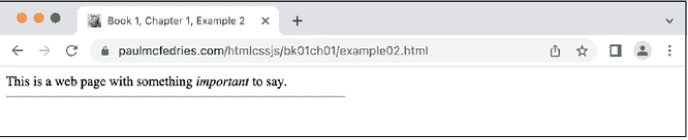

### 一个基本的 HTML 页面

在本节中，我将向你展示作为你所有网页基本蓝图的标签。

你的 HTML 文件总是以以下标签开头：

```
<!DOCTYPE html>
```

18 第一部分 入门

这个标签（它没有结束标签）就是所谓的 *Doctype 声明*，它有着令人费解的深刻技术含义，幸运的是，你可以安全地忽略它。关于它，我只想说，你必须在所有 HTML 文件的顶部包含此标签，以确保你的页面能够正确渲染。（另外，我习惯将 DOCTYPE 写成大写字母，但写成 `doctype` 也是完全合法的。）

接下来，你需要添加 `<html lang="en">` 标签。这个标签的作用不大，除了告诉任何试图读取该文件的网页浏览器，它正在处理一个包含 HTML 内容的文件。它还使用 `lang` 属性来指定文档的语言，在这种情况下是英语。

同样，你的文档的最后一行将始终是相应的结束标签：`</html>`。你可以将这个标签视为 HTML 中的“剧终”。因此，你的每个网页都将在第二行包含这个标签：

```
<html lang="en">
```

并在最后一行包含这个：

```
</html>
```

接下来的内容用于将页面分为两部分：head 和 body。head 部分就像是页面的介绍。网页浏览器使用 head 来收集关于页面的各种信息。head 部分可以包含许多项目，但在早期阶段，唯一有意义的项目就是页面的标题，我将在下一节“为你的页面命名”中讨论。

要定义 head，请在之前输入的 `<html>` 标签下方立即添加 `<head>` 和 `</head>` 标签。所以，你的网页现在应该看起来像这样：

```
<!DOCTYPE html>
<html lang="en">
    <head>
    </head>
</html>
```


虽然从技术上讲，标签名用大写或小写字母输入没有区别，但 HTML 的权威机构推荐使用小写 HTML 标签，因此本书也采用这种风格，我也鼓励你这样做。

注意，我将 `<head>` 和 `</head>` 标签稍微缩进了一点（实际上是四个空格）。当 HTML 标签位于另一个 HTML 容器内时，这种缩进是一个好习惯，因为它使你的代码更易于阅读和调试。

当你在 head 部分时，还有一个令人困惑的东西：

```
<meta charset="utf-8">
```

你将此元素放在 `<head>` 和 `</head>` 标签之间（为了更易读，再缩进四个空格）。它告诉网页浏览器你的网页使用 UTF-8 字符集，除了知道 UTF-8 包含几乎所有人类已知的（国内和国外的）字符、标点符号和符号外，你可以大部分忽略它。

body 部分是你输入浏览器实际显示的文本和其他有趣内容的地方。要定义 body，请在 head 部分之后（即在 `</head>` 标签之后）放置 `<body>` 和 `</body>` 标签：

```
<!DOCTYPE html>
<html lang="en">
    <head>
        <meta charset="utf-8">
    </head>
    <body>
    </body>
</html>
```

一个常见的页面错误是包含两个或更多这些基本标签的副本，尤其是 `<body>` 标签。为了获得最佳效果，请确保每个页面只使用一次这五个基本结构标签——`<!DOCTYPE>`、`<html>`、`<head>`、`<meta>` 和 `<body>`。

### 为你的页面命名

当你浏览网页时，你可能已经注意到浏览器在当前标签页中显示了一些文本。那个标签页文本就是网页标题，它是一个短（有时很长）的短语，用来给页面命名。你可以通过在页面的 head 部分添加 `<title>` 标签来为你自己的网页命名。

要定义一个标题，请用 `<title>` 和 `</title>` 标签将标题文本括起来。例如，如果你希望页面的标题是“我温馨的主页”，请按如下方式输入：

```
<title>My Home Sweet Home Page</title>
```

请注意，你总是将标题放在 head 部分内，因此你的基本 HTML 文档现在看起来像这样（查看 bk01ch01/example03.html）：

```
<!DOCTYPE html>
<html lang="en">
    <head>
        <meta charset="utf-8">
        <title>My Home Sweet Home Page</title>
    </head>
    <body>
    </body>
</html>
```

图 1-6 显示了在网页浏览器中加载此 HTML 文件的效果。注意标题如何出现在浏览器的标签栏中。

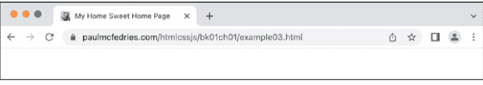

在为你的页面构思标题时，请记住以下几点：

-   确保你的标题能描述页面的内容。
-   不要让你的标题太长。如果太长，浏览器可能会将其截断，因为标签页没有足够的空间来显示。通常最多 50 或 60 个字符。
-   使用在脱离上下文时仍然有意义的标题。例如，如果有人真的喜欢你的页面，他们可能会将其添加到收藏夹或书签列表中。浏览器会在收藏夹列表中显示页面标题，因此当查看者以后查看书签时，标题必须有意义。
-   不要使用隐晦或模糊的标题。将页面标题命名为“链接 #42”或“我的网页”对你来说可能有意义，但你的访问者几乎肯定会感到困惑。

### 添加一些文本

现在是时候为你网页的骨架添加一些血肉了，即输入你希望出现在页面主体中的文本。在大多数情况下，你可以直接在 `<body>` 和 `</body>` 标签之间输入文本，像这样（参考 bk01ch01/example04.html）：

```
<!DOCTYPE html>
<html lang="en">
    <head>
        <meta charset="utf-8">
        <title>My Home Sweet Home Page</title>
    </head>
    <body>
        Hello HTML World!
    </body>
</html>
```

图 1-7 显示了网页浏览器如何显示此 HTML。

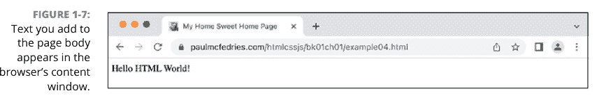

不过，在开始输入之前，你应该知道几件事：

-   你可能认为可以通过串联两个或多个空格来对齐内容并创建一些有趣的效果。哈！网页浏览器会吞掉所有这些额外的空格，并将它们吐到网络空间的深渊中。为什么？嗯，网页的理念是你只能使用 HTML 元素来布局文档。因此，一连串多个空格（或称为 *空白符*）会被忽略。
-   制表符也属于空白符的范畴。你可以输入一整天的制表符，但浏览器会完全忽略它们。
-   浏览器也喜欢忽略回车符。按下回车键（或 Mac 上的 Return 键）开始一个新段落，这对我们来说听起来很合理，但在 HTML 世界中并非如此。
-   如果你想分隔两段文本，有多种方法，但这里是最简单的两种：
    -   **文本之间不留空格：** 在两段文本之间放置一个 `<br>`（换行）标签。
    -   **文本之间留一些空隙：** 用 `<p>` 和 `</p>`（段落）标签将每段文本括起来。


如果 HTML 文档只是纯文本，那是不是意味着你需要使用 © 或 € 这样的字符时就束手无策了？幸运的是，并非如此。在大多数情况下，你只需将这些字符直接添加到文件中即可。不过，HTML 也为这类字符提供了特殊代码。我在第 2 本书的第 2 章对此进行了一些讨论。

如果出于某种原因，你正在使用文字处理软件而非文本编辑器，请注意，使用该程序的内置命令来格式化文本是无济于事的。浏览器会愉快地忽略最精心制作的格式化工作，因为浏览器只理解 HTML（以及 CSS 和 JavaScript）。此外，按照定义，带有格式化的文档不是纯文本文件，因此浏览器可能难以加载它。

### 关于结构与样式的几点说明

前端网页开发的关键点之一是将网页的结构与其样式分离。这使得页面构建更快、更易于维护，并且在各种浏览器和操作系统上更具可预测性。HTML 负责结构部分，而 CSS 则处理样式。

就目前而言，这很好，但 HTML 在执行其结构职责时有一些你需要理解的怪癖：

- **这并非你父亲所理解的那种结构。** 也就是说，当你想到文档的结构时，你可能想到的是更大的块，如文章、章节和段落。HTML 确实能做到这些，但它也在句子、单词甚至字符层面处理结构。

- **HTML 的结构通常附带一些样式。** 或者，我应该说，所有网络浏览器都带有预定义样式，当它们渲染某些 HTML 标签时就会使用这些样式。是的，我知道我刚才说最好将结构和样式分开，所以这可能有点令人困惑。这样想吧：当你用雪松木建造一个新露台时，你完成的露台具有天然的“雪松”外观，但你可以自由地涂上一层清漆或油漆。HTML 是雪松木，而 CSS 是油漆。

我提到这些怪癖，是因为它们可以帮助解答你在使用 HTML 标签时可能遇到的一些问题。

理解 HTML 为何如此行事的另一个关键点是，HTML 的大部分内容——尤其是其最新版本 HTML5——的设计初衷是让分析页面的软件在某种程度上能够“理解”网页。一个重要的例子是某些视障冲浪者使用的屏幕阅读器。如果屏幕阅读器能够轻松地从其 HTML 标签中弄清楚页面的整体结构，它就能正确地向用户呈现页面。同样，试图索引、读取或以其他方式分析页面的软件，只有在其 HTML 标签忠实地代表了页面预期结构的情况下，才能成功地完成此操作。

## 使用 CSS 添加样式

让使用 HTML 进行网页编码如此令人着迷的一点是，你可以用几个基本标签快速搭建一个页面，并且在浏览器中查看结果时，通常效果还不错。它不是一件艺术品，但也不会让你的眼睛感到不适。这种基本功能和外观得益于所有网络浏览器应用于各种 HTML 元素的默认格式。例如，`<strong>` 文本以粗体显示，`<p>`（段落）元素之间有一些垂直间距，而 `<h1>`（一级标题）文本显示的大小比常规文本大很多。

浏览器的默认格式意味着即使是基本页面看起来也还合理，但我敢打赌你读这本书是希望追求比“合理”更好的效果。在本节中，你将发现创建外观精美页面的秘诀在于用自己的样式覆盖浏览器的默认格式。你可以通过使用一些 CSS 来增强页面来实现这一点。

### 理解层叠样式表

如果你想控制网页的外观，实现这一目标的康庄大道是一种称为 *层叠样式表* 或 CSS 的网页编码技术。正如我在前一节中提到的，你的设计目标应该始终是在构建任何网络项目时分离结构和格式。HTML 负责处理结构部分，但要处理页面的格式，你必须借助 CSS。在深入细节之前，我先回答三个简单问题：什么是样式？什么是样式表？什么是层叠？

#### 样式：格式化选项的集合

如果你曾经使用过像 Microsoft Word、Google Docs 或 Apple Pages 这样的高级文字处理软件，你可能遇到过一两个样式。简而言之，*样式* 是一捆绑在一起的格式化选项，形成了一个简洁、整洁的组合。例如，你可能有一个“标题”样式，它结合了四种格式化选项：粗体、居中、24 磅字号和 Verdana 字体。然后你可以将这个样式“应用”到任何文本，程序会忠实地使用所有这四个选项来格式化该文本。如果你后来改变主意，决定标题应该使用 18 磅字体，你只需重新定义标题样式即可。然后，程序会自动遍历整个文档，并更新使用标题样式的每一段文本。

在网页中，样式执行类似的功能。也就是说，它使你能够为给定的页面元素（如 `<div>` 或 `<h1>` 这样的标签）定义一系列格式化选项。像文字处理软件的样式一样，网页样式提供两个主要优势：

- 它们节省时间，因为你只需创建一次样式格式的定义，浏览器每次使用相应的页面元素时都会应用该格式。
- 它们使你的页面更容易修改，因为你需要做的就是编辑样式定义，然后页面内所有使用该样式的地方都会自动更新。

例如，图 1-8 显示了使用浏览器默认格式呈现的 `<h1>` 文本（查看 bk01ch01/example05.html）。图 1-9 显示了相同的 `<h1>` 文本，但现在我为该文本添加了几个样式，包括边框、72 像素的字号、Verdana 字体和页面居中（参见 bk01ch01/example06.html）。

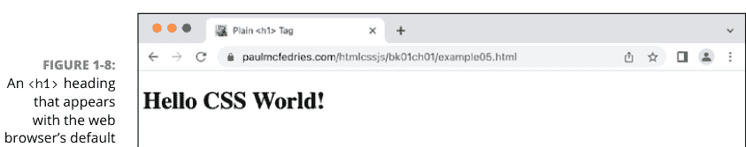

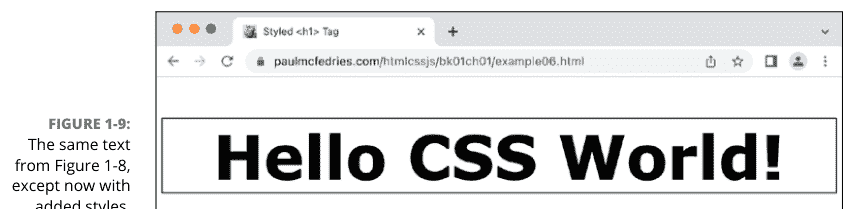

#### 样式表：样式的集合

到目前为止，一切顺利，但*样式表*到底是什么？术语 *样式表* 让人联想到过去的时代，那时的老式出版公司会记录他们对字体、字号、页边距等方面的偏好。所有这些所谓的“内部样式”都保存在一本名为 *样式表* 的手册中。在网页上，样式表类似：它是你可以应用于网页的样式的集合。

#### 层叠：样式的传播方式

*层叠样式表* 这个名字中的“层叠”部分有点技术性，但它指的是 CSS 内置的一种用于在元素之间传播样式的机制。例如，假设你希望页面上的所有文本都是蓝色的，而不是默认的黑色。这是否意味着你必须为页面上的每一个文本相关标签都创建一个“显示为蓝色”的 CSS 指令？谢天谢地，不需要！相反，你只需将它应用一次，比如应用到 `<body>` 标签上，CSS 就会确保 `<body>` 标签中的每个文本标签都显示为蓝色。这被称为 *层叠* 样式。

### 掌握 CSS 规则和声明

在我向你展示如何在网页中实际使用 CSS 之前，请花点时间了解一下样式到底是什么样子。

最简单的情况是将单个格式化选项应用于一个元素。这是其一般语法：

```
element {
    property: value;
}
```

这里，*element* 是对你要应用样式的网页元素的引用。这种引用通常是一个标签名称（如 `h1` 或 `div`），但 CSS 有一个强大的工具箱，提供了多种引用事物的方式，我在第 3 本书的第 2 章中对此进行了讨论。

*property* 部分是你想要应用的 CSS 属性的名称。CSS 提供了大量的属性，每个属性都是一个简短的、按字母顺序排列的关键字，例如 `font-family` 用于字体，`color` 用于文本颜色，`border-width` 用于边框的粗细。属性名后面跟着一个冒号 (:)、一个用于提高可读性的空格、你想要赋给属性的 *值*，然后是一个分号 (;)。这行代码在业内被称为 *CSS 声明*（尽管 *属性-值对* 的描述也很常见）。

> 始终使用小写字母输入 *属性* 名称。如果 *值* 包含除字母或连字符以外的任何字符，你需要用引号（单引号或双引号）将该值括起来。


请注意，声明被花括号（{ 和 }）所包围。你可以在花括号之间放置多个声明，这个集合被称为*声明块*。应用于页面项目（如 HTML 元素）的声明块被称为*样式规则*。

例如，以下规则将 72 像素（由 `px` 单位表示）的字体大小应用于 `<h1>` 标签：

```css
h1 {
    font-size: 72px;
}
```

下面的示例展示了我用来将 `h1` 元素设置为如图 1-9 所示样式的规则（再次强调，此代码出现在 bk01ch01/example06.html 中）：

```css
h1 {
    border-width: 1px;
    border-style: solid;
    border-color: black;
    font-family: Verdana;
    font-size: 72px;
    text-align: center;
}
```

> **记住**

请注意，如果使用制表符或两个或四个空格对声明进行缩进，声明块会更易于阅读。声明的顺序并非至关重要；有些开发者使用字母顺序，而另一些则将相关属性分组在一起。

除了将多个样式应用于单个项目之外，也可以将单个样式应用于多个项目。你以常规方式设置样式，但在规则的开头不是列出单个项目，而是列出所有要设置样式的项目，用逗号分隔。在下面的示例中，黄色背景色被应用于 `<header>`、`<aside>` 和 `<footer>` 元素：

```css
header,
aside,
footer {
    background-color: yellow;
}
```

### 向页面添加样式

使用 HTML 标签时，你只需将标签放置在页面中希望其出现的位置，但样式则不那么直接。事实上，主要有三种方式来为网页设置样式：行内样式、内部样式表和外部样式表。

#### 插入行内样式

*行内样式*是你直接插入到要格式化标签中的样式规则。以下是使用的一般语法：

```html
<element style="property1: value1; property2: value2; ...">
```

也就是说，你向标签添加 `style` 属性，然后将其设置为一个或多个声明，用分号分隔。

例如，要为 `<h1>` 标题应用 72 像素的字体，你可以添加一个使用 `font-size` CSS 属性的行内样式：

```html
<h1 style="font-size: 72px;">
```


请注意，行内样式仅应用于其所在的标签。考虑以下代码（请查看 bk01ch01/example07.html）：

```html
<h1 style="font-size: 72px;">The Big Cheese</h1>
<h1>Just How Big Is This Cheese?</h1>
<h1>And Why Cheese, Of All Things?</h1>
```

如图 1-10 所示，较大的字体大小仅应用于第一个 `<h1>` 标签，而另外两个 h1 元素则以浏览器的默认大小显示。

#### 嵌入内部样式表

行内样式是一个有用的工具，但因为它们被硬塞进标签内部，往往难以维护，最终会分散在页面的 HTML 代码中。你也更可能希望将特定的样式规则应用于多个页面项目。

为了更轻松地维护样式，并利用 CSS 提供的多种将单个样式规则应用于多个页面项目的方式，你需要使用样式表，它可以是内部的（正如我在此处讨论的）或外部的（正如我在下一节中讨论的）。

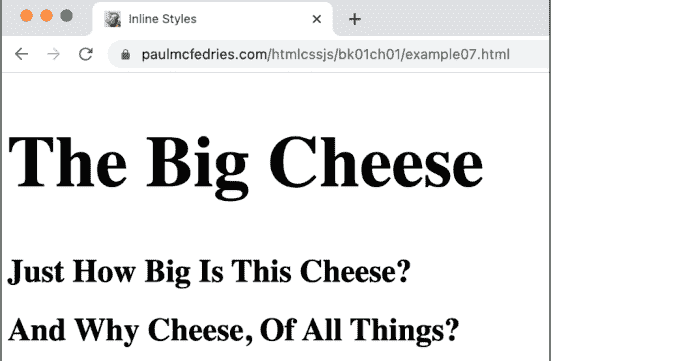

**图 1-10：** 只有顶部的 `<h1>` 标签具有行内样式，因此只有其文本被设置为 72 像素的样式。

*内部样式表*是与页面 HTML 代码位于同一文件中的样式表。具体来说，样式表嵌入在页面头部的 `<style>` 和 `</style>` 标签之间，如下所示：

```html
<!DOCTYPE html>
<html lang="en">
    <head>
        <style>
            Your style rules go here
        </style>
    </head>
    <body>
        ...
    </body>
</html>
```

以下是使用的一般语法：

```css
<style>
    itemA {
        propertyA1: valueA1;
        propertyA2: valueA2;
        ...
    }
    itemB {
        propertyB1: valueB1;
        propertyB2: valueB2;
        ...
    }
    ...
</style>
```

如前面的代码所示，内部样式表由嵌入在 `<style>` 标签中的一个或多个样式规则组成，这就是为什么内部样式表有时也被称为嵌入式样式表。

在以下代码中（参考 bk01ch01/example08.html），我为 h1 和 h2 元素分别应用了实线和点线边框样式。图 1-11 展示了结果。

HTML：

```html
<h1>solid adj. having no break or interruption</h1>
<h2>dotty adj. 1. crazy or eccentric.</h2>
<h2>dotty adj. 2. feeble or unsteady.</h2>
<h2>dotty adj. 3. enthusiastic.</h2>
```

CSS：

```css
<style>
    h1 {
        border-width: 2px;
        border-style: solid;
        border-color: black;
    }
    h2 {
        border-width: 2px;
        border-style: dotted;
        border-color: black;
    }
</style>
```

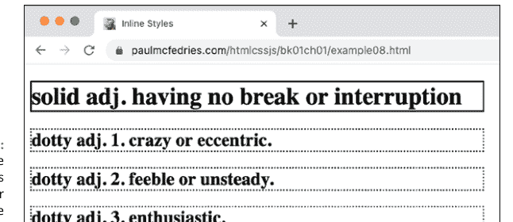

**图 1-11：** 一个内部样式表，它为 h1（顶部）和 h2 元素应用了不同的边框样式。

特别请注意，我为 h2 元素编写的单个样式规则被应用于网页中的所有 `<h2>` 标签。这就是样式表的强大之处：你只需一条规则，就可以将一个或多个样式声明应用于特定元素的所有实例。

当你只想将一组特定的样式规则应用于单个网页时，内部样式表方法是最佳选择。如果你有希望应用于多个页面的规则，则需要使用外部样式表。

#### 链接到外部样式表

当你使用外部样式表时，样式表会变得异常强大，它是一个包含你的样式规则的独立文件。要在任何网页中使用这些规则，你需要在页面头部添加一个特殊的 `<link>` 标签。此标签指定外部样式表文件的名称，然后浏览器会使用该文件来获取样式规则。

你需要遵循以下步骤来设置外部样式表：

- 1. **使用你最喜欢的文本编辑器创建一个全新的文本文件。**
- 2. **将你的样式规则添加到此文件中。**
    请注意，你不需要 `<style>` 标签或任何其他 HTML 标签。
- 3. **保存文件。**
    按照惯例，外部样式表文件使用 .css 扩展名保存（例如 `styles.css`），这有助于你将来记住这是一个样式表文件。你可以将文件保存在与 HTML 文件相同的文件夹中，也可以创建一个子文件夹（例如命名为 css 或 styles）。
- 4. **对于要使用样式的每个页面，请在页面的头部部分添加一个 `<link>` 标签。**

以下是使用的一般格式（其中 `filename.css` 是你的外部样式表文件的名称）：

```html
<link rel="stylesheet" href="filename.css">
```

如果你为 CSS 文件创建了子文件夹，请务必将子文件夹添加到 href 值中（例如 `href="styles/filename.css"`）。

例如，假设你创建了一个名为 styles.css 的样式表文件，该文件包含以下样式规则：

```css
h1 {
    color: blue;
}
p {
    font-size: 24px;
}
```

然后你通过使用 `<link>` 标签来引用该文件，如下所示（请查看 bk01ch01/example09.html）：

```html
<!DOCTYPE html>
<html lang="en">
    <head>
        <link rel="stylesheet" href="styles.css">
    </head>
    <body>
        <h1>This Heading Will Appear Blue</h1>
        <p>This text will be displayed in a 24-pixel font.</p>
    </body>
</html>
```

为什么这种使用样式表的方式如此强大？你可以将相同的 `<link>` 标签添加到任意数量的网页中，它们都将使用相同的样式规则，这使得为你的网站创建一致的外观和感觉变得轻而易举。而且，如果你决定将 `<h1>` 文本改为绿色而不是蓝色，你所要做的就是编辑样式表文件（styles.css）。自动地，所有链接到此文件的页面都将更新为新样式！

## 使用 JavaScript 添加动态效果

JavaScript 在网络上（而且已经有一段时间了）是无处不在的。当然，有很多简陋的主页只有 HTML 和少量 CSS，但其他所有东西——从不起眼的个人博客到花哨的设计师作品集，再到大型企业电子商务运营——都依赖 JavaScript 来让事物看起来美观并按预期工作（至少在大多数情况下如此）。


### 什么是 JavaScript？

当网页浏览器遇到一个 HTML 文件时，它会经历一个简单但繁琐的过程：它会从文件顶部（通常是）的 `<html>` 标签开始，逐行读取文件，直到遇到末尾的 `</html>` 标签为止。在这个过程中，它可能需要跳出这种逐行阅读的单调模式，根据所读内容执行某些操作。例如，如果遇到 `` 标签，浏览器会立即请求网络服务器发送 `src` 属性中指定的图形文件副本（参见第 2 册，第 3 章）。

这里的关键在于，从本质上讲，网页浏览器实际上只是一个页面阅读机器，除了遵循 HTML 文件中的指令（标记语言）外，它几乎不知道如何做其他任何事情。（为了方便起见，我暂时忽略浏览器的其他功能，例如保存书签。）

许多人之所以迷上创建网页，原因之一是他们从一开始就意识到自己能够控制这台页面阅读机器。在 `<b>` 标签及其对应的 `</b>` 结束标签之间塞入一些文本，浏览器就会忠实地将文本显示为粗体。创建一个 CSS 网格结构（参见第 5 册，第 3 章），浏览器就会将你原本杂乱无章的文本整齐地显示在行列中，毫无怨言。这两个例子表明，你现在不仅仅是从外部查看页面，而是获得了一把钥匙，可以进入*机器内部*并开始操作其控制装置。*这正是*吸引人们并让他们对网页设计产生浓厚兴趣的关键。

想象一下，如果你能将控制页面阅读机器的理念提升到一个新的层次。想象一下，如果你不是命令机器仅仅处理标签和规则，而是能够发出更复杂的命令，真正控制页面阅读机器的内部工作原理。谁不想要这样呢？

嗯，这正是 JavaScript 背后的基本前提。它本质上只是一系列命令，你可以用它来控制浏览器。与 HTML 标签一样，JavaScript 命令直接插入到网页文件中。当浏览器逐行读取文件时，遇到 JavaScript 命令，就会立即执行它，就这么简单。

然而，这里的关键是，JavaScript 赋予你对页面阅读机器的控制程度远高于 HTML 标签所能提供的。原因是 JavaScript 是一门功能完备的*编程语言*。HTML 中的 "L" 可能代表“语言”，但 HTML 甚至没有丝毫编程语言的痕迹。而 JavaScript 则是货真价实的编程语言。

### 向页面添加脚本

好了，理论就讲到这里。现在是时候卷起袖子，活动指关节，开始编程了。本节将介绍构建和测试脚本的标准流程，并带你通过几个示例进行学习。

#### `<script>` 标签

脚本的基本容器，理所当然是 HTML 的 `<script>` 标签及其相关的 `</script>` 结束标签：

```
<script>
    JavaScript statements go here
</script>
```

在 HTML5 中，你可以使用不带任何属性的 `<script>` 标签，但在 HTML5 之前，该标签通常如下所示：

```
<script type="text/javascript">
```

`type` 属性告诉浏览器脚本中使用的编程语言，但现在 JavaScript 是默认语言，因此你不再需要它。你仍然会在许多页面上看到带有 `type` 属性的 `<script>` 标签，所以我认为最好让你知道它的含义。

#### 将 `<script>` 标签放在哪里？

除某些特殊情况外，将 `<script>` 标签放在哪里并不太重要。有些人将标签放在页面的 `</head>` 和 `<body>` 标签之间。HTML 标准建议将 `<script>` 标签放在页面头部（即 `<head>` 和 `</head>` 之间），因此我在本书中采用这种风格：

```
<!DOCTYPE html>
<html lang="en">
    <head>
        <meta charset="utf-8">
        <title>Where do you put the script tag?</title>
        <script>
            JavaScript statements go here
        </script>
    </head>
    <body>
    </body>
</html>
```

以下是“将脚本放在任何地方”技术的例外情况：

- 如果你的脚本旨在向页面写入数据，则 `<script>` 标签必须位于页面主体内（即 `<body>` 和 `</body>` 标签之间），并且要放在你希望文本出现的确切位置。
- 如果你的脚本引用页面上的某个项目（例如表单对象），则脚本必须放在该项目*之后*。
- 对于许多 HTML 标签，你可以直接在标签内添加一个或多个 JavaScript 语句作为属性。

只要每个 `<script>` 标签都有一个对应的 `</script>` 结束标签，并且你不将一个 `<script>` 块放在另一个内部，那么在单个页面中插入多个 `<script>` 标签是完全可接受的。

#### 示例 #1：向用户显示消息

现在你已经准备好构建并尝试你的第一个脚本。本示例向你展示所有 JavaScript 操作中最简单的一种：向用户显示一条基本消息。以下代码显示了 HTML 文件中的脚本（参考 bk01ch01/example10.html）：

```
<!DOCTYPE html>
<html lang="en">
<head>
    <meta charset="utf-8">
    <title>Displaying a Message to the User</title>
    <script>
        alert("Hello JavaScript World!");
    </script>
</head>
<body>
</body>
</html>
```

如上所示，将脚本放在页面的头部，保存文件，然后在浏览器中打开 HTML 文件。

此脚本仅由一行组成：

```
alert("Hello JavaScript World!");
```

这被称为一条*语句*，每条语句都旨在执行单一的 JavaScript 任务。你的脚本范围可以从只有几条语句的简单程序到包含数百条语句的大型项目。

你可能想知道语句末尾出现的分号（`;`）。观察得很仔细。你使用分号来标记每条 JavaScript 语句的结束。

在示例中，该语句运行 JavaScript 的 `alert()` 方法，该方法向用户显示括号内的任何消息（可以是欢迎消息、网站新功能的公告、促销广告等等）。图 1-12 显示了打开文件时出现的消息。

*方法*是一种特殊类型的 JavaScript 功能，你使用它来指定希望代码执行的操作。

浏览器如何知道要运行 JavaScript 语句？当浏览器处理（通俗说法是*解析*）页面时，它基本上从 HTML 文件的开头开始，逐行向下处理，正如我之前提到的。如果遇到 `<script>` 标签，它就知道接下来有一条或多条 JavaScript 语句，并会在读取这些语句后立即按顺序自动执行它们。例外情况是当 JavaScript 语句被封装在*函数*中时，我在第 4 册，第 5 章中会解释这一点。

JavaScript 编程的基本规则之一是“一条语句，一行”。也就是说，每条语句必须只出现在一行上，并且每行不应有多于一条语句。我在上一句的后半部分说“不应”，是因为在一行上放置多条语句是可能的，只要你用分号（`;`）分隔每条语句。虽然在极少数情况下需要在一行上放两条或更多语句，但在你的大部分编程中应该避免这样做，因为多语句行难以阅读和调试。

#### 示例 #2：向页面写入文本

JavaScript 最强大的功能之一是能够动态地向网页写入文本，甚至 HTML 标签和 CSS 规则。也就是说，当网页加载页面时，文本（或任何内容）会被插入到页面中。这有什么用呢？例如，它非常适合时间敏感的数据。你可能希望显示网页最后修改的日期和时间，以便访问者了解页面有多旧（或多新）。以下代码展示了这样一个脚本（参见 bk01ch01/example11.html）：

```
<!DOCTYPE html>
<html lang="en">
<head>
    <meta charset="utf-8">
    <title>Writing Data to the Page</title>
</head>
<body>
    This is a regular line of text.<br>
    <script>
        document.write("Last modified: " + document.lastModified)
    </script>
    <br>This is another line of regular text.
</body>
</html>
```

请注意脚本如何出现在 HTML 文档的主体中，当你想要向页面写入数据时，这是必需的。图 1–13 显示了结果。

此脚本利用了 `document` 对象，这是一个内置的 JavaScript 构造，它引用脚本所在的任何 HTML 文件（文档）（有关 `document` 对象的更多信息，请参见第 4 册，第 6 章）。`document.write()` 语句告诉浏览器将括号内的任何内容插入到网页中。`document.lastModified` 部分返回文件最后修改和保存的日期和时间。


# 第二章
## 为编程做好准备

> “当心那些需要新衣的事业。” —— 亨利·大卫·梭罗

在开始一项新爱好或消遣活动时，一件可能很快令人沮丧的事是，你早期就会意识到，要把这件事做好，你需要不少新东西：新工具、新材料，而且，是的，可能甚至还需要新衣服。这足以扼杀对烘焙、跑步或绳结编织等新事物的萌芽兴趣。

学习使用HTML、CSS和JavaScript构建网页最吸引人的特点之一，就是你不需要昂贵或复杂的设置就能入门。事实上，你可能根本不需要任何新东西，因为如果你有一台Windows PC或Mac电脑，那么几乎可以肯定，你已经拥有了所需的一切。太棒了！

话虽如此，你还是应该完成一些基本准备工作，以确保你能有一个最好的开始。在本章中，你将探索那份简短待办清单所涉及的一切。你还将深入了解文本编辑器这个出人意料的深奥领域，并学习如何选择一个适合你风格的编辑器——以防你Windows或Mac的默认文本编辑器无法胜任。最后，本章还会向你介绍一个非常有用的在线工具，让你能轻松测试HTML、CSS和JavaScript代码。准备好了吗？

### 本章内容

- 安装用于测试的各种网页浏览器
- 设置你的文件夹
- 了解优质文本编辑器的特点
- 确保你拥有所需的一切
- 使用WebDev工作台构建代码

### 设置你的测试浏览器

在第一册第一章中，我谈到了“编辑、保存、刷新”的循环：你对代码进行修改并保存，然后在网页浏览器中刷新文件以查看效果。这是一个值得养成的好习惯，但我也想敦促你使用多种网页浏览器来实践这个习惯。为什么呢？因为虽然如今的现代桌面浏览器通常以类似的方式渲染网页，但情况并非总是如此。网页越大越复杂，在不同浏览器中看起来明显不同的可能性就越大。

在大多数情况下，外观差异不会是致命问题，你是可以接受的。然而，在某些情况下，差异可能会对页面的外观或运行产生显著影响，这时你就需要寻找解决方法或替代方案。

好消息是，你不需要在数十种可用于Windows和macOS的网页浏览器上测试你的页面。相反，安装并使用以下“四大”浏览器就足够了，它们合计占了桌面浏览器市场超过90%的份额：

- Google Chrome: https://www.google.com/chrome/
- Apple Safari（仅限macOS）: https://support.apple.com/downloads/safari
- Microsoft Edge: https://support.microsoft.com/microsoft-edge
- Mozilla Firefox: https://www.mozilla.org/firefox/new/

那么智能手机和平板电脑浏览器呢？是的，它们也很重要，但在你能将页面发布到网上之前，我暂时不讨论它们。关于如何测试你的页面，我将在第一册第四章详细说明。

### 创建你的本地文件夹

你可能只想创建单个网页，这种情况下，你不太需要担心HTML文件在电脑上的存储位置。例如，把文件放入你用户账户的“文档”文件夹就可以开始了。

然而，你购买这本相当厚的书告诉我，你不是那种做完一页就转行下个爱好的人。不，你是打算制作*一大堆*页面的，对吧？如果是这样，那么早在开始之前，你就需要思考一下如何本地存储你的网页资料（即，在你的电脑上）。

#### 首先，创建本地根文件夹

首先创建一个文件夹，它将作为你所有网页项目的基地。在网页开发领域，这个文件夹被称为*根目录*，因为你所有的网页项目都将从这里“分支”出去。

这个根文件夹创建在哪里、叫什么名字，其实并不那么重要。以下几点值得考虑：

- **要易于找到。** 这个文件夹应该比较容易导航到，通常意味着不要把它埋在硬盘文件夹层次结构的太深处。将其创建为用户账户“文档”文件夹下的子文件夹是个好方法。
- **给它一个好记的名字。** 这个名字应该足够描述性，让你立刻知道它是你的网页根目录。`public_html`这个名字非常常见，因为（正如你在第一册第三章所了解的）许多网络托管提供商会在服务器上自动将你的根目录命名为这个名字。另一个常见的根文件夹名是`htdocs`（*超文本文档*的缩写）。

#### 然后创建本地子文件夹（如果需要的话）

接下来要做什么，取决于你即将构建的网页开发项目数量，以及每个项目中的文件数量：

- **仅由几个文件组成的单个网页开发项目。** 这种情况下，只需将所有文件放入根文件夹即可。
- **由许多文件组成的单个网页开发项目。** 典型网页开发项目更可能的情况是拥有多个HTML、CSS和JavaScript文件，外加许多辅助文件，如图像和字体。虽然将所有HTML文件放在根文件夹中也没问题，但请帮自己一个忙，将所有其他文件按类型组织到子文件夹中：一个`css`子文件夹放CSS文件，一个`js`子文件夹放JavaScript文件，一个`images`文件夹放图形，等等。
- **多个网页开发项目。** 作为一名网页开发者，你几乎肯定会创建大量网页项目，因此组织好它们至关重要。理想的方法是为每个项目创建一个单独的根子文件夹。然后在每个这样的子文件夹内，你可以为文件类型（如CSS、JavaScript、图像等）创建子子文件夹。

### 选择你的文本编辑器

网页前端开发真正令人惊叹的一点是，你处理的始终只是基本的文本文件。（这里我暂时忽略了图像、视频和字体等文件。）但是，你用HTML标签添加的所有结构肯定需要某种晦涩复杂的文件类型吧？不可能：一直都是文本。那么与CSS相关的那些格式化内容呢？也不是：纯粹是文本。JavaScript呢？也是文本。

这种纯文本的环境意味着，你不需要任何花哨、昂贵的软件来进行网页开发。一个简单的文本编辑器就足以让你在网页编码的水域中涉足一二了。

然而，说编写代码只需要一个文本编辑器，就像说生活只需要食物一样：这当然是对的，但缺乏具体性。毕竟，在很大程度上，你的生活质量取决于你吃的食物。如果你仅靠面包和水生存，那么，“生存”就是你唯一在做的事。你真正需要的是一个能提供身体所需所有营养的均衡饮食。还有派。

面包加水版本的文本编辑器就是电脑自带的那个基础程序：Windows用的是“记事本”，Mac用的是“文本编辑”。使用这些程序，你勉强可以当个网页开发者，但依我看，那不算真正的“生活”。如果你想作为网页编码者蓬勃发展，你需要维生素和矿物质（是的，还有派）的编辑器等价物。这些营养素就是那些对成为高效、有条理的开发者至关重要的特性和工具：

- **语法高亮：** *语法*指的是构成正确编程代码的字符和符号的排列，而**语法高亮**是一种编辑特性，它对某些语法元素进行颜色编码，以便于阅读。例如，普通文本可能是黑色的，而所有HTML标签可能显示为蓝色，CSS属性可能显示为红色。最好的文本编辑器允许你选择语法颜色，要么提供预制主题，要么让你应用自定义颜色。


**行号**：这看似小事一桩，但拥有一个能为每一行编号的文本编辑器（如图2-1所示，展示了流行的文本编辑器Visual Studio Code），可以大大节省你的时间。当网页浏览器提示你的代码存在错误时（参考第4册第10章），它会给出错误信息，更关键的是，还会给出错误所在的行号。这些信息能让你快速定位问题所在，并且（祈祷好运）尽快解决问题。

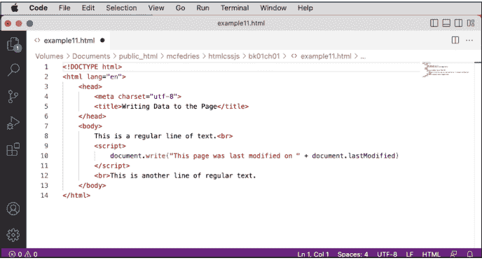

图2-1：如图所示，行号显示在窗口左侧，是文本编辑器的关键功能。

**代码预览**：一个好的文本编辑器能让你预览代码在网页浏览器中的显示效果。预览可能与代码显示在同一窗口，也可能在单独的窗口，并且在你修改和保存代码时应能自动更新。

**代码补全**：这是一个非常便捷的功能，当你开始输入时，它会显示一个可能的代码项列表来补全你的输入。你可以选择需要的项，然后按Tab键或Enter键将其添加到代码中，而无需完整输入。

**拼写检查**：你总是希望以最好的状态呈现你的网站，这在一定程度上意味着发布的页面不能包含任何拼写错误。一个好的文本编辑器内置了拼写检查器，能在你发布页面前捕捉到这些错误。

**文本处理**：最好的文本编辑器提供一系列文本处理功能，例如代码块的自动缩进、制表符与空格的相互转换、代码块的左右移动、删除行尾多余空格、隐藏代码块等。

好消息是，支持所有这些功能乃至更多功能的文本编辑器不胜枚举。但这也正是令人头疼之处，因为它意味着你有大量的程序可供选择。为了帮助你入门，以下按字母顺序列出了一些可供试用的编辑器：

- **Atom**：适用于Windows和Mac。免费！http://atom.io
- **Brackets**：适用于Windows和Mac。同样免费！http://brackets.io/
- **Notepad++**：仅适用于Windows。又一个免费软件。https://notepad-plus-plus.org/
- **Nova**：适用于Mac，售价99美元，但提供免费试用。https://nova.app
- **Sublime Text**：同时适用于Windows和Mac。99美元，但提供免费试用。www.sublimetext.com
- **Visual Studio Code**：适用于Windows和Mac。没错，这个也是免费的。https://code.visualstudio.com/

### 你还需要什么？

虽然只需一个文本编辑器就能编写网页代码，但在你能将“发布网页”从你的人生清单上划掉之前，可能还需要一些其他东西：

- **图片编辑器**：如果你计划在网页中包含自己的照片（参阅第2册第3章了解如何在HTML文件中引用图片），你可能需要一些图片编辑软件来执行基本的图片处理任务，如裁剪不需要的部分、增强颜色和添加特殊效果。你可能还需要添加注释、调整图片大小，并将图片文件格式更改为JPEG。Windows和macOS自带的照片应用可以完成基本任务，但对于更专业的工作，你需要更高级的应用程序，如Adobe Photoshop（价格昂贵；https://www.adobe.com/products/photoshop.html）或GIMP（免费；https://www.gimp.org/）。
- **设计软件**：如果你想在网页上创建自己的图像，你需要一个具备所需工具的设计应用来实现你的构想。你可以使用Windows画图进行基本的图像处理，但对于更有雄心的工作，你需要功能齐全的应用程序，如Adobe Illustrator（价格昂贵；https://www.adobe.com/products/illustrator.html）或Inkscape（免费；https://inkscape.org/）。
- **FTP客户端**：许多虚拟主机服务需要你将文件上传到服务器，这几乎总是意味着要使用FTP（文件传输协议）程序。有关FTP和FTP客户端的更多信息，请参考第1册第3章。

## 使用WebDev工作台

使用HTML、CSS和JavaScript构建网页的“编辑-保存-刷新”工作流程非常有效，但有时你只想尝试一个快速的实验或调整。这没什么问题。（相反，学习HTML、CSS和JavaScript的最佳方法就是频繁实验，并对代码进行微小调整以观察结果。）然而，根据实验或调整的规模，创建一个新的HTML文件、保存它，然后在浏览器中加载它可能显得有些小题大做。

每当你只想尝试一个快速的网页编码操作时，使用在线环境通常是最好的选择，它可以让你输入标签、规则或脚本，然后立即获得结果。CodePen（https://codepen.io/）是一个流行的在线网页开发工具。不过，请允许我谦虚地推荐一下我自己构建的交互式在线开发沙盒？它叫做WebDev工作台，你可以在这里找到：

```
https://webdevworkshop.io/wb
```

如图2-2所示，WebDev工作台由三个标签页组成：

- **HTML**：使用此标签页输入你的文本和HTML标签。请注意，“页面”基础结构——即`<html>`和`</html>`标签、整个head部分，以及`<body>`和`</body>`标签——实际上是隐藏在幕后的，因此你使用HTML标签页只输入你打算放入页面主体部分的内容。
- **CSS**：使用此标签页输入你的CSS规则。规则会被添加到`<style>`和`</style>`标签内的“页面”头部，这一切都是在看不见的情况下发生的。
- **JavaScript**：使用此标签页输入你的JavaScript语句。语句会被（在幕后）添加到`<script>`和`</script>`标签内的“页面”头部。

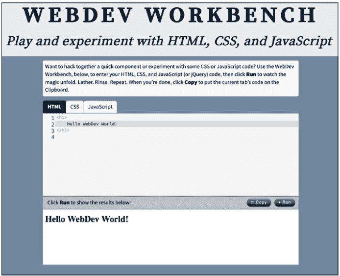

当你准备好让作品生效时，点击“运行”按钮，WebDev工作台就会在底部方框中呈现HTML、CSS和JavaScript的结果（如图2-2所示）。

如果你编写了一些想要保留的代码，切换到包含该代码的标签页，然后点击“复制”按钮，将标签页的代码复制到计算机的剪贴板上。接着，你就可以将复制的代码粘贴到你的文本编辑器中。

### 本章内容

- 了解网站托管提供商
- 探索托管网站的各种选择
- 选择适合你的托管服务
- 探索你的新网络家园
- 将网站文件传输到你的虚拟主机

# 第3章

## 寻找并设置虚拟主机

> *没有什么比一堆未发表的文字更让人憋屈了。*
> —— 西尔维娅·普拉斯

你从舒适的Mac或PC上构建网页，如果你选择了一个好的文本编辑器（如我在第1册第2章所描述的），你甚至可以用电脑预览网页在浏览器中的显示效果。这当然很好，但我相信你同意，构建网页的全部意义在于，你知道的，把它放到网上！首先，你需要将你的代码放到广阔的网络世界中进行检验，确保它能正常工作。即使它在你的本地服务器上运行得像冠军一样流畅，但除非你证明了它在远程服务器上也能同样出色，否则你不能给予它认可的印章。其次，代码准备好后，公众能欣赏你杰作的唯一方式就是把它发布出去，让他们能够访问到。

无论你是测试还是发布代码，你都需要一个存放它的地方，而这正是本章的内容。在这里，你将探索广阔有时甚至有些古怪的虚拟主机世界。你将深入了解它们提供的服务，研究如何选择一个好的主机，然后参观一下你远离家乡的网络家园。

### 了解网站托管提供商

网页开发新手常问的一个问题是：“我的网页完成后，到底该把它放在哪里？”如果你问过这个问题，那说明你做得不错，因为你意识到了一个关键点：仅仅因为你创建了网页并且有网络连接，并不意味着你的网站自动成为了网络的一部分。毕竟，网络上的人无法访问你的电脑。你处于一种与世隔绝的美妙状态，因为你的网络或互联网上的任何人都无法访问你的网页文件。

换句话说，你的电脑没有设置成可以向远程访问者提供文档（如网页）。能够做到这一点的计算机被称为*服务器*（因为它们向网络“提供”东西），而专门用于分发网页的计算机被称为*web服务器*。所以，在你的网页存储到远程web服务器上之前，它就不在网上。因为这台计算机实际上是在为你的页面充当“主机”，所以这类机器也被称为*虚拟主机*。运营这些虚拟主机的公司被称为*虚拟主机提供商*。那么，你究竟该如何寻找虚拟主机呢？嗯，答案取决于一系列因素，包括你的网站类型、你如何连接到互联网，以及你愿意为这项特权支付多少钱（如果有的话）。最终，你有三种选择：

- 你现有的互联网服务提供商
- 免费的托管提供商
- 商业托管提供商

### 使用你现有的互联网服务提供商

如果你通过企业或教育网络访问互联网，你的机构可能有自己的web服务器供你使用。如果你通过互联网服务提供商（ISP）上网，可以致电或发邮件给其客服部门，询问该公司是否有可用的web服务器。几乎所有ISP都提供空间，让他们的客户可以免费建立个人页面。

### 寻找免费的托管提供商

如果手头紧，少数托管提供商会出于好心将你的网站纳入庇护。在某些情况下，这些服务仅对特定群体开放，如学生、艺术家、非营利组织等。然而，也有许多提供商免费提供个人网站空间。有什么限制吗？嗯，几乎总是存在限制，关于你能……

存储空间以及你可以存储的数据类型（不能有广告、不良图片等）。你还可能被要求在页面上显示某种“横幅”广告，为托管提供商做宣传。不过，网上也有不少网站可以免费托管你的页面，且没有烦人的横幅广告。但有个问题：这些网站只托管“静态”文件，即不需要服务器处理数据的HTML、CSS和JavaScript文件。以下是一些完全免费的静态网站托管服务，可供参考：

-   **Cloudflare Pages**：https://pages.cloudflare.com/
-   **GitHub Pages**：https://pages.github.com/
-   **Netlify**：https://www.netlify.com/

### 注册商业托管服务提供商

对于个人和商业网站，许多网络技术人员最终会选择从商业托管服务提供商那里租用一部分网络服务器。通常需要支付一笔设置费来激活账户，之后还需支付月费。明明有那么多免费网站可用，为什么还要花这笔钱呢？因为，和生活中的大多数事物一样，一分钱一分货。付费托管通常能获得更丰富的功能、更好的服务以及更少的干扰（比如某些免费网站会显示广告）。

### 网络托管购买指南

不幸的是，选择网络托管服务可能不像你想象的那么简单。一方面，有成百上千家托管服务商在争相争取你的业务；另一方面，普通网络托管服务商使用的推销说辞充满了行话和技术术语。我无法帮你减少托管服务商的数量，但我可以帮你理解这些服务商都在说些什么。以下是研究网络托管服务时最可能遇到的术语列表：

-   **存储空间**：指托管服务商在服务器上为你分配的用于存储文件的空间大小。你获得的空间量决定了可以存储的数据量。例如，如果你的限制是1MB（1兆字节），那么你无法在服务器上存储超过1MB的文件。HTML文件不会占用太多空间，但大型图形文件肯定会，所以你需要留意你的限制。例如，在1MB的存储空间里，你大约可以存储200个页面（假设每个页面约5KB），但只能存储约20张图片（假设每张图片约50KB）。一般来说，你在托管服务上支付的费用越高，获得的存储空间就越大。

-   **带宽**：衡量服务器为你提供数据量的指标。例如，假设你页面的HTML文件大小为1KB（1千字节），相关的图形文件占9KB。如果有人访问你的页面，服务器总共传输10KB；如果有10个人访问该页面（同时或在一段时间内），总带宽就是100KB。大多数托管服务商会设定带宽限制（或“上限”），通常以每月一定数量的兆字节或千兆字节为单位。（1千字节约等于1,000兆字节。）同样，你支付的费用越高，获得的带宽就越大。

如果你超过带宽限制，用户通常仍然可以访问你的页面（尽管某些托管服务商会关闭对违规网站的访问）。然而，几乎所有网络托管服务商都会对超过带宽限制的部分收取额外费用，所以在注册前请核实这一点。常见的处罚方式是按照超出上限的每兆字节或每千字节收取固定费用。

-   **域名**：一个通用的互联网地址，例如 wiley.com 或 white-house.gov。它们通常比大多数网络托管服务商默认提供的冗长地址更容易记忆，因此是一个受欢迎的功能。有两种类型的域名可用：
    -   常规域名（例如 yourdomain.com 或 yourdomain.org）
    -   子域名（例如 yourdomain.webhostdomain.com）

要获得常规域名，你需要使用许多域名注册服务之一，例如 GoDaddy (https://www.godaddy.com/) 或 Register.com (https://www.register.com/)。更便捷的方式是选择一个会为你处理此事的网络托管服务商。无论哪种方式，通常每年花费约35美元（尽管有些托管服务商会以低价域名作为“亏本引流”，并通过托管费收回成本；此外，像 GoDaddy 这样的折扣域名注册商提供的域名低至每年9.99美元）。如果你选择直接注册，几乎所有网络托管服务商都会托管你的域名，这意味着使用你域名的人将被引导到托管服务商服务器上的你的网站。为此，你必须调整注册商处的域名设置。这通常涉及更改与域名关联的域名系统（DNS；此系统将域名转换为互联网上资源的实际地址）服务器，使其指向网络托管服务商的域名服务器。你的网络托管服务商将提供如何操作的说明。

使用子域名时，“webhostdomain.com”是网络托管公司的域名，它会在前面添加你想要的任何名称。许多网络托管服务商会为你提供这种类型的域名，通常免费。

-   **电子邮件地址**：大多数托管服务商会随网络空间为你提供一个或多个电子邮件地址。你支付的费用越多，获得的邮箱就越多。一些托管服务商提供*电子邮件转发*功能，使发送到你网络托管地址的邮件可以被重新路由到其他电子邮件地址。

-   **共享服务器**：如果托管服务商提供*共享服务器*（或*虚拟服务器*），这意味着你将与其他网站共享服务器——可能是几十个甚至上百个。网络托管服务商负责所有技术性很强的服务器管理工作，因此你只需维护自己的网站即可。这无疑是个人或小型企业用户最佳（也是商业选项中最便宜）的选择。

-   **专用服务器**：你在托管服务商那里获得一台专属的服务器计算机。这听起来不错，但通常需要你自己管理服务器，这可能是一项令人望而生畏的技术任务。此外，专用服务器比共享服务器昂贵得多。

-   **操作系统**：网络服务器上的操作系统。你通常有两个选择：Unix（或Linux）和 Windows Server。Unix 系统以非常可靠和快速著称，即使在高流量负载下也是如此，因此它们通常是共享服务器的最佳选择。Windows 系统更适合专用服务器，因为它们比 Unix 兄弟更容易管理。还需注意，Unix 服务器对文件和目录名称区分大小写；Windows 服务器则不区分。

-   **数据库**：你的账户可以创建的数据库数量。Unix 系统通常提供 MySQL 数据库，而 Windows 服务器提供 SQL Server 数据库。

-   **管理界面**：这是你用于在服务器上执行任务（如上传文件或创建用户）的托管应用。许多托管服务商提供出色的 cPanel 界面，大多数基于 Unix 的系统提供 phpMyAdmin 应用来管理你的 MySQL 数据。

-   **广告要求**：少数免费网络托管服务商要求你在页面上显示某种类型的广告。这可能是页面顶部的横幅广告、每次有人访问页面时出现的“弹出”广告，或者是“水印”广告，通常是一个半透明的标志悬停在你的页面上。幸运的是，坚持要求显示广告的免费托管服务商如今已经很少见了。

-   **正常运行时间**：托管服务商的服务器处于正常运行状态并提供服务的时间百分比。不存在100%的正常运行时间，因为所有服务器都需要在某个时间点进行维护和升级。然而，最好的托管服务商的正常运行时间超过99%。（如果托管服务商没有宣传其正常运行时间，很可能是因为它非常低。在做出决定前务必询问清楚。）

# 第三章 寻找和设置网络托管服务

51

-   **技术支持**：如果你在设置或访问网站时遇到问题，你希望知道以*技术支持*形式提供的帮助近在咫尺。最好的托管服务商提供全天候技术支持，这意味着你可以一天24小时、一周7天通过电话、聊天或电子邮件联系该公司。
-   **FTP 支持**：你通常使用互联网的 *FTP* 服务将文件从你的计算机传输到网络托管服务商。如果托管服务商提供 *FTP 访问*（有些托管服务商有自己的文件传输方法），请确保你可以随时使用它，并且对一次可以传输的数据量没有限制。
-   **网站统计数据**：告诉你诸如有多少人访问过你的网站、哪些页面最受欢迎、你的页面消耗了多少带宽、访问者使用的是哪些浏览器和浏览器版本等信息。大多数不错的托管服务商都提供现成的统计软件包，但最好的那些还会让你访问“原始”日志文件，这样你就可以自己分析数据。
-   **电子商务**：一些托管服务商提供一项服务，让你可以设置一个网络“商店”，从而在你的网站上销售商品。这项服务通常包括一个“购物脚本”、访问信用卡授权和其他支付系统，以及建立安全连接的能力。你通常只在更昂贵的托管套餐中才能获得此功能，而且你很可能需要支付设置费来建立你的商店。
-   **可扩展性**：托管服务商可以根据需要修改你网站的功能。例如，如果你的网站变得非常受欢迎，你可能需要增加带宽限制。如果托管服务商具有可扩展性，它可以轻松更改你的限制（或网站的任何其他功能）。

## 寻找网络托管服务

好了，你已准备好开始研究托管服务商，找到一个适合你网站风格的服务商。正如我之前提到的，有成百上千甚至成千上万家托管服务商，那么一个人该如何将它们筛选成某种简短的名单呢？这里有一些建议：

> **询问你的朋友和同事。** 找到好的托管服务商的最佳方式是老生常谈的口碑推荐。如果你信任的人说某个托管服务商很好，那么你很可能不会失望。这假设你和你的朋友有相似的托管需求。如果你想要一个功能齐全的电子商务网站，就不要向只有简陋主页的人征求推荐。


+   » **向专家征求主机评测意见。** 向现有的网站管理员以及“圈内”人士咨询他们推荐或听说过的主机服务商。寻找此类专家的一个好去处是 Web Hosting Talk（www.webhostingtalk.com），这是一个关于网络托管的论坛集合。

» **联系网站托管客户。** 访问使用特定网络托管商的网站，并向网站管理员发送电子邮件，询问他们对该托管商服务的看法。

» **查阅网络托管商列表。** 许多网站追踪和比较网络托管商，因此它们是进行大量研究的便捷途径。不过要小心，因为有很多可疑的列表只是为了通过让你点击广告来赚钱。以下是一些信誉良好的起步网站：
* CNET Web Hosting Solutions: www.cnet.com/web-hosting
* PC Magazine Web Site Hosting Services Reviews: www.pcmag.com/reviews/web-hosting-services
* Review Hell: www.reviewhell.com
* Review Signal Web Hosting Reviews: http://reviewsignal.com/webhosting

### 熟悉你的新网络家园

当你与网络托管提供商签约并建立账户后，网站管理员会为你创建两样东西：服务器上一个用于存储网站文件的目录，以及你自己的网络地址。（如果你使用的是与公司或学校网络关联的网络服务器，情况也是如此。）这个目录——在业内通常被称为你的*根目录*——通常采用以下形式之一：

```
/yourname/
/home/yourname/
/yourname/public_html/
```

在以上各种情况中，*yourname* 都是提供商分配给你的登录名（或用户名），或者可能是你的域名（带或不带 .com 部分）。请记住，你的根目录是主机网络服务器的一部分，而这一部分你可以随心所欲地进行操作。这通常意味着你可以在根目录上执行以下全部或大部分操作：

- 向目录中添加文件。
- 向目录中添加子目录。
- 将文件从一个目录移动或复制到另一个目录。
- 重命名文件或目录。
- 从目录中删除文件。

你的网络地址通常采用以下形式之一：

```
https://provider/yourname/
https://yourname.provider/
https://www.yourname.com/
```

这里，`provider` 是你的提供商的主机名（例如 www.hostcompany.com 或仅 hostcompany.com），而 `yourname` 是你的登录名或域名。以下是一些示例：

```
https://www.hostcompany.com/mywebsite/
https://mywebsite.hostcompany.com/
https://www.mywebsite.com/
```

### 你的目录与网络地址

你的服务器目录与你的地址之间存在着直接而重要的关系。也就是说，你的地址实际上“指向”你的目录，并使其他人能够查看你存储在该目录中的文件。例如，假设我决定在目录中存储一个名为 `thingamajig.html` 的文件，而我的主要地址是 `http://mywebsite.hostcompany.com/`。这意味着其他人可以通过在网页浏览器中输入以下 URL 来查看该页面：

```
https://mywebsite.hostcompany.com/thingamajig.html
```

同样，假设我创建了一个名为 `stuff` 的子目录，并用它来存储一个名为 `index.html` 的文件。网络用户可以通过让网页浏览器访问以下 URL 来查看该文件：

```
https://mywebsite.hostcompany.com/stuff/index.html
```

换句话说，人们可以通过在主要网络地址后策略性地添加相应的文件名和目录名，来访问你的文件和目录。

### 让硬盘镜像你的网络家园

作为一名网站开发者，保持项目有条理的关键方法之一是在你的电脑上建立目录（如我在第一册第二章中所描述的），然后在网络托管服务器上镜像这些目录。相信我，这将使你的上传任务变得无比轻松。

**记住**
在文件传输行业中，将文件从你的电脑传输到远程位置（如你的网络托管服务器）的过程被称为*上传*。这个过程从根目录开始。在网络托管服务器上，你已经拥有一个由托管提供商分配给你的根目录。然后，你在电脑上创建的根文件夹就是该根目录的本地镜像。

**提示**
为避免混淆，考虑将本地根文件夹重命名为与你的网络托管根目录相同的名称。例如，如果你的网络托管商分配给你一个名为 `public_html` 的根目录，那么将本地根文件夹重命名为 `public_html` 是一个好主意。为了帮助你理解镜像本地和远程目录结构为何如此有用，假设你在本地根文件夹中设置了一个名为 `graphics` 的子文件夹，用于存储图像文件。要从该文件夹中引用一个名为 `mydog.jpg` 的文件并将其插入到你的页面中，你需要使用以下引用（参考第二册第三章）：

```
graphics/mydog.jpg
```

当你将 HTML 文件发送到服务器然后在浏览器中显示该文件时，浏览器会在 `graphics` 子目录中查找 `mydog.jpg`。如果你没有这样的子目录——要么你没有创建它，要么你使用了不同的名称，例如 `images`——浏览器将找不到 `mydog.jpg`，你的图像将不会显示。换句话说，如果你将网络服务器上的根子目录与电脑上的根子文件夹相匹配，你的页面将在本地和网络上都能正常工作，无需修改。

**警告**
一个常见的错误是，初级网站开发者在引用文件时包含了本地驱动器和所有文件夹名称。以下是一个例子：

```
C:\users\paul\documents\public_html\graphics\mydog.jpg
```

这张图片在从你的电脑上查看时会显示正常，但当你将其上传到服务器并在网络上查看时，它将彻底失败。这是因为 `C:\users\paul\documents\` 这部分仅存在于你的电脑上。

运行绝大多数网络服务器的 Unix（或 Linux）计算机在文件和目录名称的大小写字母使用方面极其挑剔。至关重要的是，你需要检查代码中的文件引用，以确保你使用的文件和目录名称与服务器上使用的大小写字母组合相匹配。例如，假设你在服务器上有一个名为 `styles.css` 的 CSS 文件。如果你的 HTML 引用该文件时使用了，比如，`STYLES.CSS`，服务器将找不到该文件，你的样式将不会被应用。

### 上传你的网站文件

当你的网页或网站准备好首次亮相时，就是将你的文件传输到托管商网络服务器的时候了。如果服务器位于你的公司或学校网络上，你可以通过网络将文件发送到由系统管理员设置的目录中。否则，你需要将文件上传到托管提供商的网络服务器上为你创建的根目录。如何上传你的网站文件取决于网络托管商，但以下是最常见的四种场景：

» **使用 FTP 程序。** 很少有网络托管商不支持文件传输协议（简称 FTP），这是互联网上最流行的文件传输方法。要使用 FTP，你通常需要获取一个名为 *FTP 客户端* 的软件，它使你能够连接到网络托管商的 FTP 服务器（你的主机可以为你提供操作说明），并提供标准文件任务的界面，例如导航和创建文件夹、上传文件、删除和重命名文件等。受欢迎（而且免费！）的 FTP 应用程序有适用于 Windows 和 macOS 版本的 Cyberduck (https://cyberduck.io) 和 FileZilla (https://filezilla-project.org)。

» **使用你的文本编辑器的文件上传功能。** 一些文本编辑器内置了 FTP 客户端，因此你可以编辑文件，然后立即用一个命令将其上传。Nova 文本编辑器 (https://nova.app；仅适用于 macOS) 也支持这个极其方便的功能。

» **使用 cPanel 的文件管理器功能。** 我之前提到过，许多网络托管商提供一个名为 cPanel 的管理工具，它为电子邮件和域名管理等托管任务提供了一个界面。cPanel 还提供文件管理器功能，你可以用它来上传文件并执行其他文件管理任务。


**使用网络主机的专有上传工具。** 出于某种原因，一些网络主机只提供他们自己的专有界面来上传和处理文件与目录。请查看您主机的帮助或支持页面以获取相关说明。

### 对您的网页文件进行更改

如果您将一个网页开发文件发送到您的网络主机，然后意识到自己犯了拼写错误或发现了一个代码错误，该怎么办？或者，如果您有更多信息需要添加到您的某个网页中，该如何处理？您如何修改已经发送的文件？嗯，简短的回答是：您无需直接修改。没错，在您发送文件之后，您永远不必再费心去管它们。然而，这并不意味着您永远无法更新您的网站。相反，您只需修改存放在您计算机上的文件，然后将这些修订后的文件发送到您的网络主机。这些文件会替换掉旧文件，您的网站就这样更新完毕。

请务必将更新后的文件发送到服务器上正确的目录。否则，当您在浏览器中刷新页面时，可能会奇怪为什么您的更改没有显示出来（而且还有可能覆盖其他目录中恰好同名的文件）。

# 第四章
测试和验证您的代码

> 验证您的 HTML。了解拥有有效 HTML 标记意味着什么……。
信息多总比信息少好。为什么要盲目飞行呢？
>
> ——杰夫·阿特伍德

您听说过*只读用户*吗？这个借用*只读内存*的说法，指的是那些上网仅限于阅读他人创建内容的人。我不知道这个称呼目前是否适用于您。如果适用，也不会持续太久了，因为通过阅读这本书，您正在装备自己成为网络创作者所必需的工具。很快，所有其他只读用户将会阅读*您的文字*！

仅用 HTML、CSS 和 JavaScript，亲手搭建您自己的网页，这其中有一种近乎*神奇*的感觉。如果您感受到了这种魔力，无疑会渴望动手，赶紧在网页上发布*任何东西*来向您的伙伴们炫耀。我懂您。但是，如果您真心想在网络上建立重要的存在感，我也想敦促您不要急于草率地随便发布些东西。当然可以随心发布，但在发布时，请养成测试和验证代码的习惯，以确保您发布的是坚固、构建良好的页面，能够经得起时间的考验。

在本章中，您将探讨测试网页的重要主题，以确保它们在各种浏览器中看起来美观且运行良好。您还将研究验证 HTML、CSS 和 JavaScript 代码这一关键任务，以确保它们符合标准。是的，这些都是您必须跨越的额外障碍，但您将了解到它们只需一点点额外的时间，而且完全值得付出努力。

## 跨浏览器测试您的代码

新手网络开发者常犯的最大错误之一是仅使用单个浏览器来检查其页面的进展。最常见的情况是，开发者使用运行在 Windows 上的 Google Chrome 作为唯一的测试浏览器。当然，页面在 Chrome 上最终看起来很棒，但当在 Mac 上使用 Firefox 或在 iPad 上使用 Safari 的用户遇到页面问题时，开发者就会感到震惊！

当然，Chrome 是当今最流行的网络浏览器，但作为网络开发者的令人沮丧的事实之一是，并非每个人都使用 Chrome，也并非每个人都使用台式电脑上网。

### 看看浏览器市场份额

为了证明并非每个人都使用 Chrome 浏览器或台式电脑，表 4–1 列出了整体市场以及按台式机、平板电脑和智能手机分类的前四大浏览器市场份额。

**表 4-1 浏览器市场份额（2023年3月）**

| 市场 | 第一 | 第二 | 第三 | 第四 |
| :--- | :--- | :--- | :--- | :--- |
| 整体 | Chrome (64.5%) | Safari (18.8%) | Edge (4.1%) | Firefox (3.4%) |
| 台式机 | Chrome (65.8%) | Edge (11.1%) | Safari (10.9%) | Firefox (6.5%) |
| 平板电脑 | Chrome (49.3%) | Safari (35.2%) | Android (13.3%) | Opera (0.7%) |
| 智能手机 | Chrome (64.6%) | Safari (25.1%) | Samsung Internet (4.5%) | Opera (1.8%) |

来源：StatCounter (https://gs.statcounter.com/browser-market-share)

这些数字证实了 Chrome 的受欢迎程度，但也明确显示 Chrome 绝非*主导*网络浏览器市场。是的，拥有大约三分之二的市场份额（整体、台式机和智能手机）令人印象深刻，但如果您只为 Chrome 编码，那么对于您整整三分之一的页面访客（以及超过一半的平板电脑访客）来说，您就是在盲目飞行。

### 您的跨浏览器测试套件

为了确保访问您网站的大多数人获得积极的体验，您需要扩展您的浏览器测试。一个最小的测试套件应包括以下内容：

- **Windows：** Chrome、Safari、Edge 和 Firefox
- **Mac：** Chrome、Safari 和 Firefox
- **iPadOS：** Chrome 和 Safari
- **Android 平板电脑：** Chrome
- **iOS：** Chrome 和 Safari
- **Android 智能手机：** Chrome

几乎所有的 Android 网络浏览器都是基于 Chromium 构建的，而 Chromium 是 Google Chrome 的开源版本。这意味着所有这些浏览器加载和渲染网页的方式与 Chrome 相同，因此您只需使用 Chrome 作为 Android 测试浏览器即可。

### 在线跨浏览器测试

好吧，我听到您对我在上一节提出的测试套件有*非常*大声的反对意见：并非每个人都同时拥有 Windows PC 和 Mac！并非每个人都同时拥有苹果和安卓的平板电脑及智能手机！天啊，并非每个人都同时拥有平板电脑和智能手机！

这些都是合理的反对意见。那么，如果您真的想进行全面的跨浏览器测试，但又无法接触各种不同的浏览器、操作系统和设备，该怎么办呢？

别担心：在线跨浏览器测试来帮忙！有一系列在线网站可以接收您的页面 URL，并在许多不同的（虚拟）浏览器上进行测试，然后向您展示结果。其中大多数网站在大量使用时需要付费订阅，但每月会提供有限次数的免费测试。以下是最受欢迎的在线跨浏览器测试网站：

- **BrowserStack：** www.browserstack.com/screenshots
- **Comparium：** https://comparium.app/
- **LambdaTest：** www.lamdatest.com
- **Sauce Labs：** https://saucelabs.com

### 理解验证

*验证*是一个自动化过程，用于检查您的代码是否存在错误和非标准语法。拥有有效的 HTML、CSS 和 JavaScript 代码并不能保证网页完美无瑕，但它确实能确保所有现代网络浏览器都能正确地解析和解释您的代码。如果您的代码有效但页面仍然有问题，您就知道问题出在其他地方（例如页面的整体设计）。

那么，我说的“有效”网页代码是什么意思呢？这取决于使用的语言：

- **HTML：** 万维网超文本应用技术工作组（幸运的是，几乎总是被缩写为更合理的 WHATWG）维护着所谓的 HTML 活动标准，有些人也称之为 HTML5。“活动”的部分意味着这个标准在不断演变，因此没有大的新版本发布，也没有子版本（例如 5.1 或 5.2.129）。当您验证 HTML 时，您是在将您的标签、属性和其他 HTML 元素与活动标准中概述的规范进行比较（可在此处找到：https://html.spec.whatwg.org/；请参见图 4-1）。

如何发音 WHATWG？让我数数有多少种方式！有些人说 *what-wig*；另一些人说 *what-double-you-gee*；还有一些更古怪的人说 *what-wee-gee*。我通常说 *what-working-group*，因为它更清晰。

- **CSS：** 万维网联盟（W3C，圈内人都知道）维护着涵盖 CSS 各个方面的大量规范。这些方面——称为*模块*——涵盖了 CSS 的类别，如颜色、字体、选择器和盒模型。当前版本是 CSS 3，修订版 1。当您验证 CSS 时，您是在将您的属性、声明和其他 CSS 零碎内容与 W3C 标准中概述的规范进行比较（起点在这里：https://www.w3.org/TR/CSS/#css；参见图 4-2）。


# HTML 实时标准 — 最后更新于2022年12月5日

- 单页版本
- 多页版本
- 面向网页开发者的版本
- PDF 版本
- 翻译版本

- 常见问题
- 聊天
- 在 GitHub 上贡献
- 提交记录
- 快照
- Twitter 更新

- 未解决问题
- 提交问题
- 测试
- 测试相关问题

就选定文本提交问题

图 4-1：WHATWG 维护着 HTML 实时标准。

# CSS 2022 快照

W3C 小组草案注释，2022年11月22日

本文档反映了截至2022年的CSS状态。CSS工作组不预计本文档会有进一步变更：随着CSS的发展，新的快照将在 https://www.w3.org/TR/CSS/ 上发布。

1. 引言
   1.1. 什么是 CSS？
   1.2. 背景：W3C 流程与 CSS
2. CSS 规范分类
   2.1. 层叠样式表 (CSS) — 官方定义
   2.2. 实现经验有限但相当稳定的模块
   2.3. 具有大致互操作性的模块
   2.4. CSS 级别
   2.5. CSS 概要
3. 负责任地实现 CSS 的要求
   3.1. 部分实现
   3.2. 不稳定和专有特性的实现
       3.2.1. 实验性和不稳定特性
       3.2.2. 专有和非标准化特性

图 4-2：W3C 维护着 CSS 标准。

**JavaScript：** 非营利组织 Ecma International 维护着一套不断演进的 JavaScript 标准，这些标准都归入 ECMAScript 这一总称。每个版本都赋予一个版本号和一个表示发布时间的年份。例如，第6版于2015年发布，因此也称为 ECMAScript 2015（尽管这个重要版本也称为 JavaScript 6 或 JS 6）。在我撰写本文时，当前版本是第13版，即 ECMAScript 2022（请参阅图4-3）。验证 JavaScript 意味着运行一个代码检查工具（linter），它不仅会根据指定的 ECMAScript 版本查找错误，还会检查你的代码是否存在某些风格上的失误（如缩进不当）。

**图 4-3：** Ecma International 维护着不断演进的 ECMAScript 标准。

# 不要跳过验证！

谈到语法，主要有两种思想流派：

- **语法无关紧要：** 如果你想表达的意思清晰明了，纠结语法就没有意义。
- **语法至关重要：** 你偶尔可能会写出尽管语法糟糕但仍保留其意思的东西，但更可能的结果是写出难以解析、完全错误或令读者反感的内容。

64 第1册 *入门*

从某种意义上说，HTML 和 CSS 代码就像网页的语法。也就是说，正如写作是通过语法赋予一堆文本某种连贯性和结构，网页也是通过 HTML 和 CSS 代码赋予一堆文本连贯性和结构。

与语法类似，关于验证也存在两种思想流派：

- **验证无关紧要：** 如果你的网页渲染正常，验证代码就没有意义。
- **验证至关重要：** 即使你的网页看起来渲染正常，拥有无效的 HTML 或 CSS 代码也意味着你的整体结构更加脆弱；读取你代码的程序（包括搜索引擎爬虫和屏幕阅读器等辅助技术）可能难以解析代码；而且你可能为某些访客提供了糟糕的用户体验。

所以，我认为我在这里的倾向很明显：你的写作应该符合语法，你的网页应该使用经过验证的 HTML 和 CSS。好消息是，尽管写出语法完美的句子可能很难，但发布完全有效的 HTML 和 CSS 代码却一点也不难，因为正如你在接下来的几节中了解到的，有大量免费工具可供使用。

## 验证你的 HTML 代码

HTML 为你的网页创建结构，因此如果你的标签放错位置或属性不正确，你的页面很可能会因此受损。幸运的是，保持你的 HTML 代码井然有序比你想象的要容易，因为你可以在线验证代码，或者在任何相当强大的、支持 HTML 文件的文本编辑器中直接验证。

### 在线验证 HTML

W3C 运营着一个名为标记验证服务的在线应用程序（参见图4-4），它可以通过将代码与当前 HTML 规范进行比较来检查你的 HTML 代码是否有错误。最棒的是，这项服务完全免费！

### 测试和验证你的代码

**图 4-4：** W3C 的标记验证服务让你可以通过地址、文件上传或代码输入来验证页面。

W3C 的标记验证服务提供了三种验证 HTML 代码的途径：

- **通过地址：** 如果你已经将页面发布到网上，请输入或粘贴该页面的地址。
- **通过文件上传：** 将你的 HTML 文件上传到该服务。
- **通过代码输入：** 输入或粘贴你的 HTML 代码。

其工作原理如下：

1. **将你喜爱的网页浏览器定向到** <https://validator.w3.org>。
   标记验证服务出现。

2. **告诉验证器你希望如何检查你的 HTML：**
   - **通过地址：** 确保选择了“通过 URI 验证”选项卡（默认情况下应该已选中），然后使用“地址”文本框输入或粘贴你要验证的页面的地址。

URI 是 Uniform Resource Identifier（统一资源标识符）的缩写，指用于标识网络上使用的某种资源的任何字符集。URL（Uniform Resource Locator，统一资源定位符，即网页地址）是 URI 的一个例子。

**66** 第1册 *入门*

- **通过文件上传：** 单击“通过文件上传验证”选项卡，单击“选择文件”，使用“打开”对话框选择要验证的 HTML 文件，然后单击“打开”。
- **通过代码输入：** 单击“通过直接输入验证”选项卡；然后使用大文本框输入或粘贴你要验证的 HTML 代码。

3. **单击“检查”。**

标记验证服务会深入分析你的 HTML 代码，然后显示结果。如果你的 HTML *i* 都点了点、*t* 都画了横，你会看到一条消息：没有错误或警告需要显示，如图4-5所示。反之，如果你的代码有问题，你会看到一条或多条错误消息，如图4-6所示。（在此示例中，验证器抱怨页面的 head 部分缺少 *title* 元素。）

图 4-5：如果你的 HTML 通过检查，就会看到这个页面。

### 在文本编辑器中验证 HTML

我在第1册第2章中列出了一些顶级的文本编辑器。这些应用程序大多支持称为 *加载项* 或 *扩展* 的附加功能，允许你安装默认情况下不属于该应用程序的功能。其中一个功能就是 HTML 验证，它可以实时检查你的 HTML 代码，并在你犯错时立即通知你。

图 4-6：如果你的 HTML 不符合规范，你会看到一条或多条错误消息。

请参阅你的编辑器的帮助文档，了解如何安装 HTML 验证。由于 Visual Studio Code 是如今最流行的 HTML 编辑器，以下是安装 HTMLHint 扩展（这是一个用于 VS Code 的 HTML 验证工具）的步骤：

1. **如果 VS Code 尚未运行，请启动它。**
2. **选择“视图” ➜ “扩展”。**
   你也可以按 Ctrl+Shift+X (Windows) 或 ⌘+Shift+X (macOS)。
   “扩展”窗格出现。
3. **在“在市场中搜索扩展”文本框中，输入 htmlhint。**
   VS Code 显示搜索结果列表。
4. **在结果中，单击 HTMLHint。**
   VS Code 创建一个新选项卡以显示 HTMLHint 扩展的信息页面，如图4-7所示。
5. **单击“安装”。**
   VS Code 安装 HTMLHint 扩展。
6. **在“扩展：HTMLHint”选项卡中，单击“关闭 (X)”。**

安装 HTMLHint 扩展后，VS Code 现在会在任何有问题的标签下方显示一条波浪线。要了解具体情况，可以将鼠标指针悬停在波浪线上，或选择“视图” ➜ “问题”（Ctrl+Shift+M 或 ⌘+Shift+M）以打开“问题”面板，如图4-8所示。

68 第1册 入门


## 验证你的 CSS 代码

如果你的网页渲染异常，或者没有显示出预期的样式，那么很可能是你的 CSS 中有某个问题导致了这一切。如何确认呢？嗯，你可以反复、甚至三番五次地检查你的作品，但一个简单得多的方法是验证你的 CSS 代码，你可以在线进行，也可以在支持（或可以添加）CSS 验证的文本编辑器中完成。

### 在线验证 CSS

W3C 提供了一个名为 CSS 验证服务的在线工具（如图 4–9 所示），它可以将你的代码与当前的 CSS 规范进行对比，然后告知你是否在任何地方偏离了轨道。哦，我有没有提到 CSS 验证服务是免费的？太棒了！

CSS 验证服务为你提供了三种验证 CSS 代码的方式（如图 4–9 所示）：

1.  **通过地址：** 输入或粘贴一个 HTML 文件（如果它包含你的 CSS）或一个你已经发布到网络上的 CSS 文件的地址。（注意，W3C 的极客们将网络地址称为 URI，即统一资源标识符的缩写。）
2.  **通过文件上传：** 将你的 HTML 或 CSS 文件上传到该服务。
3.  **通过代码输入：** 输入或粘贴你的 CSS 代码。

以下是具体步骤：

1.  **使用最近的网络浏览器，访问 [https://jigsaw.w3.org/css-validator/](https://jigsaw.w3.org/css-validator/)。**
    标记验证服务将会出现。
2.  **告诉验证器你希望如何检查你的 CSS：**
    -   **通过地址：** 点击“通过 URI”标签页，然后使用地址文本框输入或粘贴你想要验证的 HTML 文件（如果 CSS 就在里面）或 CSS 文件的地址。
    -   **通过文件上传：** 点击“通过文件上传”标签页，点击“选择文件”，使用打开对话框选择你想要验证的 HTML 文件（如果 CSS 就在里面）或 CSS 文件，然后点击“打开”。
    -   **通过代码输入：** 点击“通过直接输入”标签页，然后使用文本框输入或粘贴你想要验证的 CSS 代码。
3.  **点击“检查”。**

CSS 验证服务将你的 CSS 与官方规范进行比较，然后显示结果。如果你的 CSS 很棒，你会收到一条欢快的“祝贺！未发现错误”消息，如图 4-10 所示。如果，遗憾的是，你的 CSS 不够好，你会收到一条或多条错误消息，如图 4-11 所示。

图 4-10：如果你的 CSS 代码通过了所有检查，此页面就会出现。

图 4-11：如果你的 CSS 代码尚未准备就绪，你会收到一条或多条错误消息。

测试并验证你的代码

### 在文本编辑器中验证 CSS

大多数不错的、支持 CSS 的文本编辑器（如我在第 1 册，第 2 章中提到的那些）都可以验证你的 CSS 代码，要么开箱即用，要么通过安装插件或扩展来实现。请参阅你的编辑器的帮助文档，了解如何添加或使用 CSS 验证。

一个默认支持 CSS 验证的编辑器是 VS Code，它会在发现的任何 CSS 错误下方显示一条波浪线。要了解出了什么问题，只需将鼠标指针悬停在波浪线上，或者选择“查看”>“问题”（Ctrl+Shift+M 或 ⌘+Shift+M）以打开“问题”面板，如图 4-12 所示。

**图 4-12：** 当一条或多条波浪线破坏了你的 CSS 代码时，请打开 VS Code 的“问题”面板以了解原因。

## 验证你的 JavaScript 代码

你向网页添加 JavaScript 代码是为了使其具有动态性和交互性。相反，如果你的网页只是静静地呆在那里，这可能意味着你的 JavaScript 脚本存在某种故障，导致它无法完成其工作。追踪程序错误的技艺和科学被称为 *调试*，我将在本书后面的章节中专门用一整章来讲解（请查看第 4 册，第 10 章）。不过现在，你可以通过验证代码来减少你的整体调试负担。如下两节所示，你可以在线验证你的 JavaScript，也可以使用你信赖的文本编辑器来验证。

### 在线验证 JavaScript

有不少免费的在线工具正等着验证你的 JavaScript 代码。其中最简单和最受欢迎的一个是 JSHint，它可以验证直接输入或粘贴的代码。以下是它的工作原理：

1.  **在任何方便的网络浏览器中访问 https://jshint.com。**
    JS Hint 页面将会出现。
2.  **点击 Configure（配置）。**
    JSHint 显示出一个你可以配置的选项列表。为了本书代码的需要，你需要配置 JSHint 以支持随第 6 版（ECMAScript 2015 或 ES6）发布的 JavaScript 特性。
3.  **选择 New JavaScript Features (ES6)（新 JavaScript 特性 (ES6)）选项。**
4.  **点击 Configure（配置）。**
    JSHint 关闭选项列表。
5.  **在窗口的左侧，输入或粘贴你想要验证的 JavaScript 代码。**
    JSHint 会自动扫描并分析你的代码，如果它发现了一个或多个无法理解的问题，它会在代码右侧显示错误消息，如图 4-13 所示。

图 4-13：如果你的 JavaScript 代码有缺陷，JSHint 会显示一条或多条错误消息。

### 在文本编辑器中验证 JavaScript

大多数精通 JavaScript 的文本编辑器（如我在第 1 册，第 2 章中提到的那些）都可以验证——或 *lint*（代码静态分析）——你的 JavaScript 语句，通常是通过安装插件或扩展来实现。请参阅你的编辑器的帮助文档，了解如何添加或使用 JavaScript 验证器——或 *linter*（代码检查工具）。

以 VS Code 为例，它支持一个名为 ESLint（“ES”部分是 ECMAScript 的缩写）的流行扩展，该扩展可以查找代码错误并建议修改违反普遍接受的编程原则的代码。以下是在 VS Code 中安装 ESLint 的步骤：

1.  **启动 VS Code**（如果它尚未运行）。
2.  **选择“查看”>“扩展”。**
    你也可以按 Ctrl+Shift+X（Windows）或 ⌘+Shift+X（macOS）。
    扩展面板将会出现。
3.  **在“在市场中搜索扩展”文本框中，输入** `eslint`。
    VS Code 显示出搜索结果列表。
4.  **在结果中，点击 ESLint。**
    VS Code 会创建一个新标签页来显示 ESLint 扩展的信息页面，如图 4-14 所示。

图 4-14：VS Code 中 ESLint 扩展的信息页面。

5.  **点击 Install（安装）。**
6.  **点击 Extension: ESLint（扩展：ESLint）标签页上的 Close (X)（关闭）。**
    VS Code 安装 ESLint 扩展。

安装了 ESLint 扩展后，VS Code 会在任何有问题的代码下方显示一条波浪线。要了解出了什么问题，只需将鼠标指针悬停在波浪线上，或者选择“查看”>“问题”（Ctrl+Shift+M 或 ⌘+Shift+M）以打开“问题”面板，如图 4–15 所示。

图 4-15：当你的 JavaScript 代码中出现波浪线时，请打开 VS Code 的“问题”面板以找出问题所在。

# 学习 HTML 基础

## 内容概览

1.  **打好基础：构建页面结构** . . . . . 79
2.  **添加链接、列表和其他文本片段** . . . . . 97
3.  **处理图像、视频和其他媒体** . . . . . 123
4.  **亲手构建表格** . . . . . 143
5.  **使用表单让页面具有交互性** . . . . . 163
6.  **让你的网页易于访问** . . . . . 181

**本章要点**

» 将你的文本组织成段落
» 使用标题组织页面
» 添加换行符和水平线
» 熟悉 HTML 中极其重要的语义化页面标签
» 用注释为你的代码添加说明

# 第 1 章

## 打好基础：构建页面结构

> *让我们共同渴望、构思并创造未来的新结构。*
— 沃尔特·格罗皮乌斯

如果你曾经选购过房子——特别是当你的预算更偏向于要价低端时——你的房产经纪人很可能给你看过几处虽然显然需要一些修缮，但仍然值得考虑的房子，因为它们“骨架好”。用房产经纪人的话说，*骨架好* 意味着这所房子（在其他属性之外）拥有坚实的地基、建造精良的框架和一个不错的屋顶。换句话说，这所房子的整体结构很稳固。

当涉及到构建网络家园时，你也希望你的页面拥有好的骨架。创建那个坚实的结构正是 HTML 的职责，特别是那些用于将纯文本转换为页面结构元素的元素。

在本章中，你将探索那些为任何页面添加最基本结构的 HTML 标签，包括标题和段落、文章和章节，以及页眉和页脚。你还将了解一些其他与结构相关的元素，用于创建换行符和水平线之类的东西。你在本章学到的内容将构成你承担的每个网页项目的基础。


### 了解 HTML 基本结构标签

当你开始学习 HTML 时，需要理解的最重要的概念之一就是：无论你在 `<body>` 和 `</body>` 标签之间填入什么文本，它本身都没有任何结构。为了向你说明这一点，我复制了本节的前几个标题和段落，并将它们粘贴到一个 HTML 文件中。图 1-1 展示了当我在 Web 浏览器中打开这个 HTML 文件时会发生什么（请查看本书示例文件中的 bk02ch01/example01.html）。

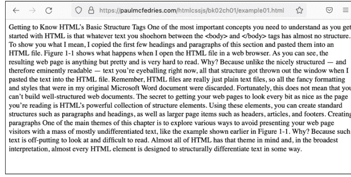

生成的网页一点也不漂亮，而且非常难读。为什么？因为与你现在看到的结构良好、因而极其易读的文本不同，当我把文本粘贴到 HTML 文件中时，所有那些结构都被抛到了九霄云外。请记住，HTML 文件实际上只是纯文本文件，所以我原始的 Microsoft Word 文档中的所有花哨格式和样式都被丢弃了。

幸运的是，这种格式的缺失并不意味着你无法构建结构良好的文档。让你的网页看起来和你正在阅读的页面一样漂亮的秘诀，就是 HTML 强大的结构元素集合。使用这些元素，你可以创建诸如段落和标题等标准结构，以及页眉、文章和页脚等更大的页面项目。

第 80 页 书籍 2 学习 HTML 基础

### 创建段落

本章的主要主题之一是探索各种方法，避免向网页访客呈现一大堆基本无差别的文本，如前面图 1–1 中所示的示例。为什么？因为这样的文本看起来令人不快，而且难以阅读。

几乎所有的 HTML 都考虑到这个主题，从最广泛的意义上说，几乎每个 HTML 元素都是为了以某种方式在结构上区分文本而设计的。

最简单和最常见的例子是使用 `p` 元素，它将任何被 `<p>` 开始标签和 `</p>` 结束标签包围的文本转换成一个段落：

```
<p>
    This is now a paragraph.
</p>
```

说网页中的一块文本是一个段落意味着什么？最基本的意义是，这意味着该文本在渲染时，其上方和下方会有一些间距。为了演示，我给前面图 1–1 中所示的纯文本添加了 `p` 元素。结果（参见 bk02ch01/example02.html）如图 1–2 所示，文本现在被分成了段落，这已经是一个很大的改进。

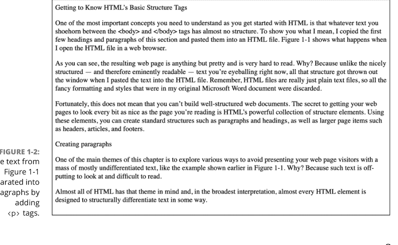

**图 1-2：** 通过添加 `<p>` 标签，将图 1–1 中的文本分隔成段落。

以下是 HTML 文件 body 部分现在开头的样子：

```
Getting to Know HTML's Basic Structure Tags
<p>
    One of the most important concepts you need to understand as you get started with HTML is that whatever text you shoehorn between the &lt;body&gt; and &lt;/body&gt; tags has almost no structure. To show you what I mean, I copied the first few headings and paragraphs of this section and pasted them into an HTML file. Figure 1-1 shows what happens when I open the HTML file in a web browser.
</p>
<p>
    The resulting web page is anything but pretty and is very hard to read. Why? Because unlike the nicely structured - and therefore eminently readable - text you're eyeballing right now, all that structure got thrown out the window when I pasted the text into the HTML file. Remember, HTML files are really just plain text files, so all the fancy formatting and styles that were in my original Microsoft Word document were discarded.
</p>
```

第一段中那些 `&lt;` 和 `&gt;` 的怪异符号是什么？这些是 HTML 实体名称的例子，你使用它们将特殊字符插入到 HTML 代码中。在这种情况下，`&lt;` 插入小于符号 (<)，`&gt;` 插入大于符号 (>)。我需要包含这些插入，否则浏览器会将 `<body>` 和 `</body>` 读取为标签而不是文本，并试图将它们作为标签来解释，这将导致各种问题。有关实体名称的更多信息，请查阅书籍 2，第 2 章。

如果段落文本后面紧跟着另一个 `<p>` 标签或以下标签之一：`<address>`、`<article>`、`<aside>`、`<blockquote>`、`<details>`、`<div>`、`<dl>`、`<fieldset>`、`<figcaption>`、`<figure>`、`<footer>`、`<form>`、`<h1>`、`<h2>`、`<h3>`、`<h4>`、`<h5>`、`<h6>`、`<header>`、`<hgroup>`、`<hr>`、`<main>`、`<menu>`、`<nav>`、`<ol>`、`<pre>`、`<section>`、`<table>` 或 `<ul>`，你可以省略 `</p>` 结束标签。（你将在本书其他地方了解大多数这些标签。）如果你的段落是父元素（即包含该段落的元素）中的最后一项，你也可以跳过 `</p>` 标签。

### 块级元素与行内元素


思考 HTML 元素的一种有用方法是将它们分为两个不同的类别：

-   **块级元素：** 在页面上划出一个矩形区域的元素。该区域总是从新行开始，其宽度延伸至包含元素的整个宽度。默认情况下，连续的块级元素总是自上而下堆叠。
-   **行内级元素：** 仅占据其开始和结束标签之间空间的元素。默认情况下，行内级元素会跟随周围文本的流动。

这些实际上是 CSS 区分，因此我将等到从书籍 5，第 1 章开始讨论页面布局时，再进行更深入的探讨。不过现在请注意，本章讨论的大多数元素——从 `p` 元素开始——都是块级元素。

### 用标题划分文本

在书籍 1，第 1 章中，我提到你可以使用恰如其名的 `<title>` 标签为你的网页添加标题。然而，该标题只出现在浏览器的标签页中。如果你想添加一个出现在页面正文中的标题呢？这几乎比说起来更容易，因为 HTML 附带了一些标签，使你能够定义*标题*，这些标题是出现在单独段落中的文本，通常通过更大、以粗体字体出现等方式从周围文本中脱颖而出。

总共有六个标题标签，从使用最大字号的 `<h1>` 到使用最小字号的 `<h6>`。每个开始标签都有一个对应的结束标签，从 `</h1>` 到 `</h6>`。

以下是一些网页代码（请查看 bk02ch01/example03.html），演示了六个标题标签，图 1–3 显示了它们在 Web 浏览器中的外观：

```
<h1>This is Heading 1</h1>
<h2>This is Heading 2</h2>
<h3>This is Heading 3</h3>
<h4>This is Heading 4</h4>
<h5>This is Heading 5</h5>
<h6>This is Heading 6</h6>
```

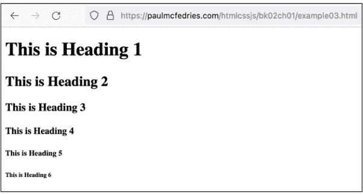

这些不同的标题有什么用意？其思想是，你使用它们为你的网页创建一种大纲。如何操作取决于页面，但这里有一种可能性：

-   使用 `<h1>` 作为整个页面的标题。
-   使用 `<h2>` 作为页面的副标题。
-   使用 `<h3>` 作为页面主要部分的标题。
-   使用 `<h4>` 作为页面次要部分的标题。

你创建的每个网页应该只有一个 `h1` 元素。从技术上讲，允许多个 `h1` 元素，但最佳实践是只有一个。

不要跳过标题级别。例如，如果你使用了 `h1`，然后是 `h2`，不要接着跳到 `h4`。像这样跳过级别可能会搞乱那些依赖一致使用标题来生成页面目录等程序。

例如，在前面图 1–2 所示的增强段落的网页中，第一行（"了解 HTML 基本结构标签"）是一个主要部分的标题，而靠近底部单独的一行（"创建段落"）是一个次要部分的标题。我可以将它们转换成标题，如下所示：

```
<h3>了解 HTML 基本结构标签</h3>
<h4>创建段落</h4>
```

图 1–4 显示了结果（请查看 bk02ch01/example04.html）。


### 添加换行符

如果你仔细观察图1-4中显示的段落和标题，你可能首先注意到的是浏览器在元素之间渲染了大量空白。这是件好事，因为正是这些空白使得页面比图1-1中所有内容挤在一起的文本更易于阅读。

然而，对于某些形式的文本，"段落"是单行的，例如地址块、代码清单或诗歌。在这些情况下，你*不希望*行与行之间有那么多空白。例如，图1-5展示了当我用`<p>`标签（参考`bk02ch01/example05.html`）编码以下五行打油诗时会发生什么：

```
<p>There once was woman named Elle,
<p>Who learned tons of HTML.
<p>Then she came to an ode
<p>That she just couldn't code,
<p>Now she lives in a white padded cell.
```

这样看起来就是不对劲，对吧？幸运的是，HTML的权威机构考虑到了这种场景，并创建了一个特殊的元素来处理它：`<br>`。这个*换行*元素的作用正是如此：它告诉网络浏览器在新的一行开始下一个元素，但两行之间没有任何空格。你将`<br>`标签（它没有结束标签）放置在你希望换行发生的位置，通常是在一行文本的末尾，如下所示（查看`bk02ch01/example06.html`）：

```
There once was woman named Elle,<br>
Who learned tons of HTML.<br>
Then she came to an ode<br>
That she just couldn't code,<br>
Now she lives in a white padded cell.
```

图1-6显示了结果。啊，这样就好多了！

### 用水平线分隔内容

HTML的结构标签旨在帮助他人理解你的页面。（这些"他人"通常是人，但有时是处理页面的特殊程序，例如为视障人士服务的程序。）因此，一个典型的页面可能有一个`<article>`标签（参考下一节"划分页面"），其中包含一个或多个`<section>`标签（也在"划分页面"中介绍），这些标签又包含一个或多个标题，标题下又包含一个或多个段落。

到目前为止，一切都很合理。然而，有一种情况有点棘手。假设你正在页面的一个特定标题下的某个部分工作，你来到一个新的段落，其中的文本发生了如下变化：

> 这种变化足够大，值得某种视觉指示（而不仅仅是，比如说，一个新段落）。
> 这种变化又不够大，不值得一个新的标题。

例如，这种变化可能是一个基于当前部分主题的新主题；你叙事中的一个场景转换；或者是一个过渡，引出一个新话题。

对于这类主题分隔，HTML提供了`hr`元素。名称是水平线的缩写，该元素的功能正如其名：它在页面上画一条水平线（就是一条线）。结果？一个清晰、简洁的视觉指示，表明下一个段落与前一个段落在某种程度上是分开的。图1-7提供了一个例子，我在本段和下一段之间放置了一个`<hr>`标签（查看`bk02ch01/example07.html`）。

现在是时候将这些关于页面结构的漫谈提升到一个新的水平，深入探讨HTML所谓的语义页面元素了。在你掌握了我下一节介绍的标签之后，你将了解构建具有良好数字骨架的页面所需的一切知识。

### 划分页面

为什么你的网页结构良好很重要？嗯，想想本书的高层结构，它包括前后封面、目录、索引和六本迷你书，每本迷你书又包含几章，而每一章又由许多节以及节内的许多段落组成。如果非要我自夸的话，这一切都井然有序，组织得当。

现在想象一下，相反，整本书只是一页又一页毫无区分的文本：没有迷你书，没有章节，没有小节，没有段落，加上没有目录或索引。我刚刚描述的是读书人的噩梦，我相信即使付钱给你，你也不会读这种东西。

除非你给body部分添加一些结构，否则你的网页也会遭受同样的命运。我在本章前面讨论了像标题和段落这样的结构元素，但现在我要更进一步，讨论HTML的高层结构标签。

理解这些标签的第一件事是，它们旨在为你的页面结构注入意义——即语义。在我介绍每个标签时，你将了解这是什么意思，但现在，先看看图1-8所示的抽象页面。

让我们看看图1-8中显示的每个标签。

## `<header>`标签

你使用`<header>`标签创建页面页眉，这通常是页面顶部的一个条带，包含诸如站点或页面标题和logo等元素。（不要将其与出现在`<head>`和`</head>`标签之间的页面head部分混淆。）

因为页眉几乎总是出现在页面顶部，所以`<header>`标签通常出现在`<body>`标签之后，如下例所示（以及图1-9；查看`bk02ch01/example08.html`）：

```
<body>
    <header>
        
        <h1>Welcome to "Isn't it Semantic?"</h1>
        <hr>
    </header>
    ...
</body>
```

虽然`header`元素通常出现在网页顶部，但这并非它唯一的使用位置。例如，如果你有以介绍性内容开头的`section`元素——例如，一个图标、一个章节编号、一个链接或一个日期——你可以在每个部分的开头添加一个`header`元素。

## `<nav>`标签

`<nav>`标签定义了一个页面部分，其中包含一些帮助访问者浏览你网站的元素。这些元素可以是链接到网站主要部分的链接、链接（查看第2册第2章）到最近发布内容的链接，或者搜索功能。`<nav>`部分通常出现在页面顶部附近，就在页眉之后，如下所示（以及图1-10；参考`bk02ch01/example09.html`）：

```
<body>
    <header>
        
        <h1>Welcome to "Isn't it Semantic?"</h1>
        <hr>
    </header>
    <nav>
        <a href="/">Home</a>
        <a href="semantics.html">Semantics</a>
        <a href="contact.html">Contact</a>
        <a href="about.html">About</a>
    </nav>
    ...
</body>
```

你可以自由地在任何有导航链接的地方使用`nav`元素。全站范围的导航链接几乎总是被放置在出现在主页页眉正下方的`nav`元素中。然而，你可能有一些特定于文章或部分的导航链接，将`nav`元素放在这些元素的顶部附近是完全没问题的。

## `<main>`标签

`<main>`标签设置一个部分，用于存放从某种意义上说是页面核心的内容。例如，如果你创建该页面是为了告诉所有人你所知道的关于暹罗斗鱼的一切，那么你的暹罗斗鱼文本、图片、链接等将放入`<main>`部分。

`<main>`部分通常紧随`<head>`和`<nav>`部分之后：

```
<body>
    <header>
        ...
    </header>
    <nav>
        ...
    </nav>
    <main>
```


#### `<article>` 标签

你使用 `<article>` 标签来创建一个包含某种完整作品的页面部分：一篇博客文章、一篇散文、一首诗、一篇评论、一篇抨击文、一篇哀叹文等等。

在大多数情况下，你会在页面的 `<main>` 部分内嵌套一个单独的 `<article>` 标签：

```
<body>
    <header>
        ...
    </header>
    <nav>
        ...
    </nav>
    <main>
        <article>
            Article content goes here
        </article>
    </main>
    ...
</body>
```

然而，页面只能有一个 `<article>` 标签并非硬性规定。事实上，这根本不是规定。如果你想在页面中有两篇作品——从而在 `<main>` 标签内有两个 `<article>` 部分——请便。

#### `<section>` 标签

`<section>` 标签表示页面的一个主要部分：通常是一个标题标签后跟一些文本。你如何知道页面的某个部分是否“主要”？最简单的方法是想象你的页面是否有目录。如果你希望页面的某个特定部分出现在该目录中，那么它就足够重要，值得使用 `<section>` 标签。

大多数时候，你的 `<section>` 标签会出现在 `<article>` 标签内：

```
<main>
    <article>
        <section>
            Section 1 heading goes here
            Section 1 text goes here
        </section>
        <section>
            Section 2 heading goes here
            Section 2 text goes here
        </section>
        ...
    </article>
</main>
```

#### `<aside>` 标签

你使用 `<aside>` 标签来隔离页面的一小部分内容，这些内容虽然对整个网站很重要或相关，但最多只是与页面的 `<main>` 内容有间接关系。`<aside>` 通常是一个侧边栏，包含站点新闻或最近内容的链接，但它也可能包含与当前页面相关的其他站点页面的链接。

`<aside>` 元素最常出现在 `<main>` 区域内，但在 `<article>` 内容之后。

```
<body>
    <header>
        ...
    </header>
    <nav>
        ...
    </nav>
    <main>
        <article>
            ...
        </article>
        <aside>
            Aside content goes here
        </aside>
    </main>
    ...
</body>
```

`<aside>` 元素的另一个常见用途是显示引文（即从网页文本中提取的引语；示例请参阅第 5 册第 1 章）。

#### `<footer>` 标签

你使用 `<footer>` 标签来创建*页脚*，这通常是页面底部的一个条带，包含版权声明、联系信息和社交媒体链接等元素。

因为页脚几乎总是出现在页面底部，所以 `<footer>` 标签通常紧接在 `</body>` 结束标签之前，如下所示：

```
<body>
    <header>
        ...
    </header>
    <nav>
        ...
    </nav>
    <main>
        <article>
            ...
        </article>
        <aside>
            ...
        </aside>
    </main>
    <footer>
        Footer content goes here
    </footer>
</body>
```

#### 使用 `<div>` 处理非语义内容

`<header>`、`<nav>`、`<main>`、`<article>`、`<section>`、`<aside>` 和 `<footer>` 元素在你的页面内创建有意义的结构，这就是 HTML 爱好者称这些为*语义*元素的原因。即使是本章前面介绍的不起眼的 `<p>` 标签也是语义化的，因为它表示一个单独的段落，通常位于 `<section>` 元素内。

但是，当一个潜在的网页编织者想要添加一段不适合任何标准语义标签的内容时，该怎么办呢？这种情况经常发生，解决方案是将该内容放入 `div`（代表“division”）元素中。`<div>` 标签是一个通用容器，不代表任何有意义的内容，因此它是放置任何需要归宿的非语义内容的完美场所：

```
<div>
    Non-semantic content goes right here
</div>
```

这是一个例子（请查看 bk02ch01/example10.html）：

```
<div>
    Requisite social media links:
</div>
<div>
    <a href="https://facebook.com/">Facebook</a>
    <a href="https://twitter.com/">Twitter</a>
    <a href="https://instagram.com/">Instagram</a>
    <a href="http://www.hbo.com/silicon-valley">Hooli</a>
</div>
```

请注意图 1-11，浏览器将两个 `<div>` 元素渲染在不同的行上。

#### 使用 `<span>` 处理单词和字符

如果你想对一大段文本中的一小部分做一些事情，比如一个短语、一个单词，甚至是一个或三个字符，你需要使用所谓的*内联元素*，它创建一个存在于某个较大元素内并随该较大元素内容一起流动的容器。最常用的内联元素是 `<span>`，它围绕一小段文本创建一个容器（请参阅 bk02ch01/example11.html）：

```
<p>
Notice how an <span style="font-variant: small-caps">
inline element</span> flows right along with the
rest of the text.
</p>
```

这里发生的是，`<span>` 标签将一种称为 *small caps* 的样式应用于 `<span>` 和 `</span>` 之间的文本（内联元素）。如图 1-12 所示，`<span>` 文本随段落其余部分一起流动。

### 为你的代码添加注释

HTML 标签及其尖括号和属性需要一点时间来适应，但一旦你掌握了它们，阅读和浏览你的代码就会变得更容易。浏览一个只包含少量 HTML 元素的小型网页通常很简单，但这种情况不会持续太久。似乎即使是最简单的网页项目最终也会有几十行，或者更可能是几百行 HTML。

要掌握所有这些 HTML 并非易事，特别是如果你有一段时间没有查看代码的话。那时问题通常会接踵而至：那个 `div` 元素是做什么的？为什么我将那个 `nav` 元素放在那里？那个 `<hr>` 标签是怎么回事？

你可以帮助使你的代码更具可读性和可理解性——特别是如果其他人将查看你的代码，或者你想在六个月后回到代码时给自己提供帮助——的一种方法是在代码中添加大量的注释。在 HTML 文件中，*注释*是网页浏览器在渲染页面时完全忽略的文本。这对你来说可能听起来完全没用，但请放心，注释有很多用途：

- 添加解释为什么特定 HTML 代码块以这种方式编写的文本。
- 帮助区分使用相似标签结构的 HTML 代码部分。
- 标记你或他人需要开始工作或完成的 HTML 文件部分。

要将某些文本标记为注释，请在文本前加上 `<!--`，并在文本后加上 `-->`。这是一个例子：

```
<div>
    Requisite social media links:
</div>
<!--
    Each of the following links needs to be updated with the
    full address to our corresponding social media page.
    Thanks!
-->
<div>
    <a href="https://facebook.com/">Facebook</a>
    <a href="https://twitter.com/">Twitter</a>
    <a href="https://instagram.com/">Instagram</a>
    <a href="http://www.hbo.com/silicon-valley">Hooli</a>
</div>
```

# 第 2 章 添加链接、列表和其他文本小技巧

> 你看到一个带蓝色下划线的单词，你点击它，它会带你到别的地方。这就是超文本最简单的定义。
>
> — 罗伯特·卡里奥

在第 2 册第 1 章中，我详细介绍了各种 HTML 标签，这些标签使你能够为网页提供正确结构的“良好骨架”。但是，正如地基、框架和管道不能让房子成为家一样，像 `main`、`article` 和 `p` 这样的结构元素也不能让网页成为主页。将一个空房子变成一个舒适的家意味着添加个人化的点缀，如家具、地毯、艺术品和一两个熔岩灯。网页的等效物不仅是用文本填充你的 HTML 结构，还要利用那些能让文本变得有趣的、数量可观的元素列表。

在本章中，你将研究许多与 HTML 文本相关的标签。例如，你将学习以某种方式标记你想要强调的文本的元素。你将了解如何添加引文，以及如何将任何文本块转换为

链接。你还将探索HTML列表制作的精彩世界，包括构建项目符号列表和编号列表。你是否需要在页面中添加©（版权）和€（欧元）等字符？你将学习如何添加这些以及许多其他特殊符号。最后，本章以快速浏览十多个其他与文本相关的标签作为结尾，这些标签在你装饰这个远离家乡的网络家园时可能会派上用场。

## 应用基本文本标签

HTML有一些标签可以让你为文本添加结构。许多网页开发者仅使用这些标签及其附带的内置浏览器格式，但你真的应该尝试像极客们所说的那样，从语义上使用它们，这意味着根据你希望文本传达的含义来使用它们。

### 强调文本

你可以赋予文本的最常见含义之一就是强调。通过给一个词或短语增加一点额外的力度，你是在告诉读者要强调那段文字，这可以微妙地改变你词语的含义。例如，考虑以下句子：

```
You'll never fit in there with that ridiculous thing on your head!
```

现在考虑同一个句子，其中一个词被加上了强调：

```
You'll *never* fit in there with that ridiculous thing on your head!
```

在网页上，你通过用`<em>`和`</em>`标签包围文本来强调文本（参阅本书示例文件中的bk02ch02/example01.html）：

```
You'll <em>never</em> fit in there with that ridiculous thing on your head!
```

所有网络浏览器都会将强调的文本渲染为斜体，如图2-1所示。

我还应该提到，HTML有一个密切相关的标签：`<i>`。`<i>`标签的作用是标记*替代文本*，指的是任何你希望以不同于普通文本的语气或角色呈现的文本。常见的例子包括书名、技术术语、外语或人物的内心想法。所有网络浏览器都会将`<i>`和`</i>`之间的文本渲染为斜体。

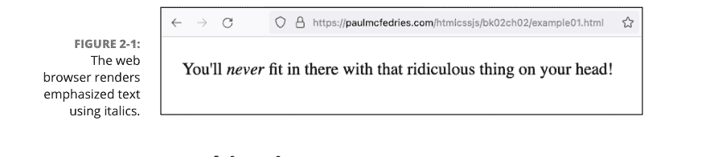

### 标记重要文本

一个你经常会希望你的文本传达的常见含义是重要性。它可能是某个过程中的重要步骤，某事物的关键先决条件或条件，或者是一段较长文本块中的关键段落。在每种情况下，你处理的文本都是你不希望读者错过的，因此它需要从周围的普通散文中脱颖而出。在HTML中，你通过用`<strong>`和`</strong>`标签包围文本来将其标记为重要，如本例所示（查看bk02ch02/example02.html）：

```
Dear reader: Do you see the red button in the upper-right corner of this page? <strong>Never click the red button!</strong> You have been warned.
```

所有网络浏览器都会将用`<strong>`标签标记的文本渲染为粗体，如图2-2所示。

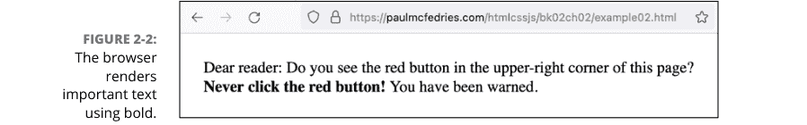

为了让我们所有人都保持对网页开发的敏锐，HTML还提供了一个`<strong>`标签的近亲：`<b>`标签。你使用`<b>`标签来标记文本中的关键词。关键词是你想要引起注意的术语，因为它扮演着与普通文本不同的角色。它可能是一个公司名称或一个人的姓名（想想那些名人八卦专栏中常见的“粗体名字”）。浏览器会将`<b>`和`</b>`之间的文本渲染为粗体。

### 嵌套标签

将一种标签类型嵌套在另一种标签类型内来组合它们是完全合法的——而且通常是必要的。例如，查看此代码（bk02ch02/example03.html）：

```
Dear reader: Do you see the red button in the upper-right
corner of this page? <strong>Never, I repeat <em>never</em>,
click the red button!</strong> You have been warned.
```

你注意到我做了什么吗？在`<strong>`和`</strong>`标签之间的文本中，我用`<em>`和`</em>`标签标记了一个单词。结果呢？你猜对了：粗体、斜体文本，如图2-3所示。

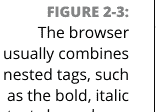

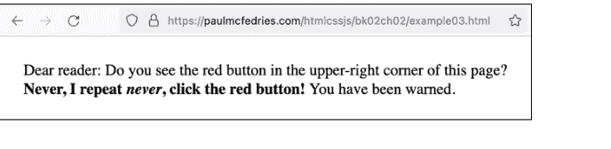

### 添加引用

你可能已经注意到，本书每一章都以一个简短、恰当的引言开始，因为，嘿，谁不喜欢一句好引用呢，对吧？我确信你网页的读者也会是引用的欣赏者，所以为什么不让你的文字中点缀一些智者的话语呢？在HTML中，你使用`<blockquote>`标签将一段文本指定为引用。这里有一个例子（bk02ch02/example04.html）：

```
Here's what the great jurist Oliver Wendell Holmes, Sr. had to
    say about puns:
<blockquote>
A pun does not commonly justify a blow in return.
But if a blow were given for such cause, and death
ensued, the jury would be judges both of the facts
and of the pun, and might, if the latter were of an
aggravated character, return a verdict of justifiable
homicide.
</blockquote>
Clearly, the dude was not a pun fan.
```

网络浏览器将`<blockquote>`和`</blockquote>`之间的文本渲染在其自己的段落中，并从左边距轻微缩进，如图2-4所示。

**图2-4：**
网络浏览器渲染的`<blockquote>`文本从左边距轻微缩进。

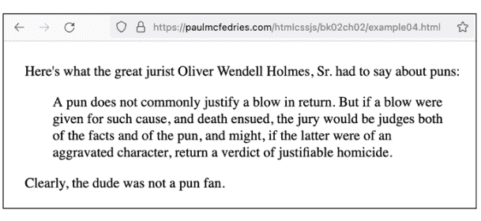

我还应该提到密切相关的`q`元素，你可以用它来标记所谓的*行内引用*。行内引用用于可以随普通文本一起流动的短引语。这里有一个例子（bk02ch02/example05.html）：

```
Whether you love or hate people who pun, you can't argue with
Ron Wolfe, who said that <q>A punster is someone who shticks
by his word.</q>
```

如图2-5所示，网络浏览器将引语渲染在引号内。

**图2-5：**
网络浏览器渲染的`<q>`文本被引号包围。

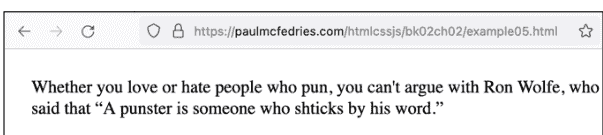


`q`元素支持`cite`属性，这是一个指定引语来源的网址，可被屏幕阅读器和其他辅助技术读取。这里有一个例子（bk02ch02/example05a.html）：

```
The WHATWG says that using the q element is optional and that
<q cite="https://html.spec.whatwg.org/#the-q-element">using
explicit quotation punctuation without q elements is just as
correct.</q>
```

### 创建链接

归根结底（实际上，远在此之前），你的网站将由2到102页（甚至更多，如果你有很多话要说）组成。不过，问题是：如果你设法说服某人访问你的主页，你如何将那个人引导到你的其他页面？这才是网络的真正意义所在，不是吗——让人们从一个页面到另一个页面？当然，你已经知道了这个问题的答案。你通过创建将人们从这里带到那里的链接，将访问者从你的主页引导到其他页面。在本节中，你将学习如何构建自己的链接，以及如何最终将“超文本”放入你的HTML中。

#### 链接基础

实现链接功能的HTML标签是`<a>`和`</a>`。`<a>`标签的工作方式如下：

```
<a href="address">
```

在这里，`href`代表*超文本引用*，这只是“地址”或“URL”的一种花哨说法。你的工作是用你想用作链接的网页的实际地址替换`address`。而且，是的，你必须将地址括在引号中。你使用的`address`值的格式取决于网页相对于包含链接的页面的位置。有三种可能性：

-   **远程网页：** 指不属于你网站一部分的网页。在这种情况下，`<a>`标签的`href`值是该页面的完整URL。这里有一个例子：

```
<a href="https://webdev.mcfedries.com/wb">
```

-   **同一目录中的本地网页：** 指属于你网站一部分并存储在与包含链接的HTML文件相同目录中的网页。在这种情况下，`<a>`标签的`href`值是该页面的文件名。这里有一个例子：

```
<a href="rutabagas.html">
```

-   **不同目录中的本地网页：** 指属于你网站一部分但存储在与包含链接的HTML文件所用目录不同的目录中的网页。在这种情况下，`<a>`标签的`href`值是一个反斜杠（`/`），后跟目录名、另一个反斜杠，然后是该页面的文件名。这里有一个例子：

```
<a href="/wordplay/puns.html">
```


不过，这还没完，远着呢（此处插入失望的叹息）。你还缺什么？对了：你得给读者一些描述性的链接文本来点击。这很简单，因为你只需在`<a>`和`</a>`标签之间插入文本，就像这样：

```
<a href="address">Link text</a>
```

需要一个例子？给你（bk02cho2/example06.html）：

```
要体验HTML和CSS，请查看
<a href="https://webdevworkshop.io/wb">
Web Dev Workbench</a>！
```

图2-6展示了它在网页浏览器中的样子。注意浏览器是如何给链接文本着色并添加下划线的，当我的鼠标指向链接时，我在`<a>`标签中指定的地址会出现在浏览器窗口的左下角。

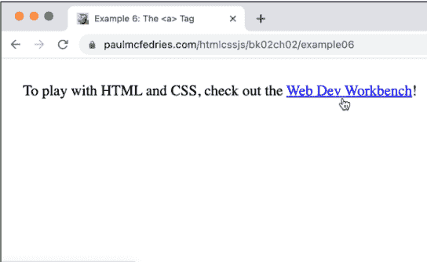

#### 锚点起航：内部链接

当冲浪者点击一个标准链接时，页面会加载，浏览器会显示页面的顶部部分。然而，可以设置一种特殊类型的链接，迫使浏览器最初显示页面的其他部分，比如页面中间的某个部分。对于这些特殊链接，我使用*内部链接*这个术语，因为它们直接将读者带到页面的某个内部部分。

什么时候你会使用内部链接？你的大多数HTML页面可能既简短又精炼，上网冲浪的访客在浏览时不会遇到任何麻烦。但如果你像我一样，患有严重的冗长癖，外加偶尔的极端啰嗦症，你的网页至少可以说是冗长不堪。与其强迫你的读者在你那如巨著般的创作中滚动，你可以设置指向文档各个部分的链接。然后，你可以将这些链接汇集在页面顶部，形成一种“超级目录”作为示例。

内部链接实际上链接到一个特殊标记的部分——称为*锚点*——你已将其插入到同一页面的某个地方。要理解锚点是如何工作的，想想你可能会在正在阅读的书上做标记的方式。你可能会折页角、贴便签，或者在书页之间夹东西，比如书签或你猫的尾巴。锚点具有相同的功能：它“标记”网页中的一个特定位置，然后你可以使用常规的`<a>`标签链接到该位置。以下是锚点标签的通用格式：

```
<element id="name">
```

锚点标签看起来很像普通标签，只是它还包含了`id`属性，该属性设置为你想给锚点取的名称。这里有一个例子：

```
<section id="section1">
```

你可以为名称使用任何你想要的东西，但它必须以字母开头，并且可以包含字母、数字、下划线（_）和连字符（-）的任意组合。此外，`id`值区分大小写，因此浏览器处理`id`值`section1`的方式与处理`id`值`Section1`是不同的。要设置锚点链接，你创建一个常规的`<a>`标签，但`href`的值变成锚点的名称，并以井号（#）开头：

```
<a href="#name">
```

这里有一个链接到我之前展示的锚点的例子：

```
<a href="#section1">
```

尽管你主要会使用锚点来链接到同一网页的部分，但使用它们来链接到其他页面的特定部分也没有违反任何规定。你要做的是在另一个页面添加相应的锚点，然后通过将锚点名称（通常以#开头）添加到页面文件名的末尾来链接到它。这里有一个例子：

```
<a href="chapter57.html#section1">
```

### 构建项目符号列表和编号列表

出于某种原因，人们喜欢列表：最佳（和最差）着装榜、十大榜单、我最爱的X清单，其中X可以是任何你想要的东西：电影、歌曲、书籍、《我爱露西》剧集——凡此种种。无论出于何种原因，人们喜欢列表。好吧，那么我们来做一些列表。很简单，对吧？嗯，当然，任何网站老手都可以通过逐项输入，将“有史以来最佳的Tootsie Roll口味”列表直接堆到页面上。也许我们的列表制作者甚至会变得有点聪明，在每项之间插入`<br>`标签，将它们显示在不同的行上。哦哦。

是的，你可以那样做一个列表，我想它也能很好地工作，但还有更好的方法。HTML有几个标签，专门设计用于让你对列表构建任务有更多控制。例如，你可以创建一个项目符号列表，实际上每个项目前面都有那些小项目符号。不错！想要一个十大榜单吗？HTML通过提供编号列表的特殊标签也支持你。

#### 用项目符号列表突出你的要点

一个未经修饰的、用`<br>`分隔的列表不太有用或易读，因为它没有任何帮助区分项目之间差异的视觉元素。一个官方的、HTML批准的项目符号列表通过在每个项目前加上一个项目符号——一个小黑点——来解决这个问题。项目符号列表使用两种类型的标签：

- 整个列表被`<ul>`和`</ul>`标签包围。为什么是“ul”？嗯，全世界称之为项目符号列表的东西，HTML的权威们称之为*无序列表*。
- 列表中的每个项目前面都有`<li>`（列表项）标签，并以`</li>`结束标签关闭。（从技术上讲，只要下一项是另一个`<li>`标签或`</ul>`结束标签，`</li>`结束标签就是可选的。）

一般设置如下：

```
<ul>
    <li>项目符号文本放在这里</li>
    <li>还有这里</li>
    <li>和这里</li>
    <li>你明白了...</li>
</ul>
```

请注意，我将列表项缩进了四个空格，这使得更容易意识到它们是`<ul></ul>`容器的一部分。这里有一个供思考的例子（bko2cho2/example07.html）：

```
<h3>我有史以来最爱的矛盾修辞法</h3>
<ul>
    <li>相当丑陋</li>
    <li>军事情报</li>
    <li>巨型虾</li>
    <li>原始副本</li>
    <li>随机顺序</li>
    <li>自然表演</li>
    <li>紧身休闲裤</li>
    <li>冷冻灼伤</li>
    <li>未见其人</li>
    <li>微软Works</li>
</ul>
```

图2-7展示了网页浏览器如何渲染这段代码，可爱的小项目符号等等。

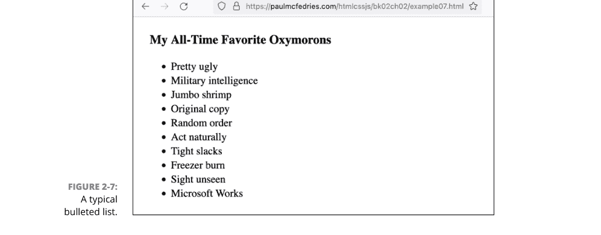

> **提示**：如果你的无序项目列表由页面访问者可以运行的命令组成，那么`ul`的语义替代方案是`menu`元素，它代表一个无序的命令列表。你构建`menu`列表的方式与`ul`列表完全相同。也就是说，你的命令分别被`<li>`和`</li>`标签包围，所有这些又被`<menu>`和`</menu>`包围：

```
<menu>
    <li>设置</li>
    <li>账户</li>
    <li>帮助</li>
</menu>
```

#### 编号列表：简单如一、二、三

如果你想包含一个带编号的项目列表——它可能是一个十大榜单、保龄球联赛排名、需要遵循的步骤，或者任何类型的排名——不必费心自己插入数字。相反，你可以使用HTML编号列表让网页浏览器为你生成数字。与项目符号列表一样，编号列表也使用两种类型的标签：

- 整个列表被`<ol>`和`</ol>`标签包围。这里的“ol”是有序列表的缩写，因为那些HTML呆子们非得与众不同，不是吗？
- 列表中的每个项目被`<li>`和`</li>`包围。

以下是使用的一般结构：

```
<ol>
    <li>第一项</li>
    <li>第二项</li>
    <li>第三项</li>
    <li>你懂的...</li>
</ol>
```

我将列表项缩进了四个空格，以便更容易注意到它们在`<ol></ol>`容器内。这里有一个例子（bko2cho2/example08.html）：

```
<h3>我最爱的十个美国大学昵称</h3>
<ol>
    <li>加州大学圣克鲁兹分校香蕉蛞蝓</li>
    <li>德尔塔州立大学战斗秋葵</li>
    <li>肯特州立大学金色闪电</li>
    <li>常青州立大学象拔蚌</li>
    <li>新墨西哥理工大学矮人</li>
    <li>南卡罗来纳大学战斗斗鸡</li>
    <li>南伊利诺伊大学萨路基猎犬</li>
    <li>惠蒂尔学院诗人</li>
    <li>西伊利诺伊大学海军陆战队员</li>
    <li>特拉华大学战斗蓝母鸡</li>
</ol>
```

请注意，我在每个列表项之前没有包含任何数字。然而，当我在浏览器中显示此文档时（查看图 2-8），数字会自动插入。非常巧妙，对吧？

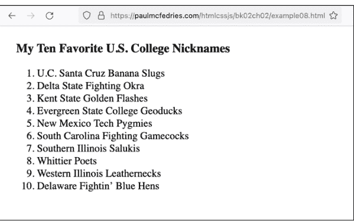

**图 2-8：** 当网络浏览器渲染有序列表时，它会好心地自动为你添加数字。

### 插入特殊字符

在第 1 卷，第 1 章中，我简要介绍了放在 `<head>` 部分的一个特殊 `<meta>` 标签：

```
<meta charset="utf-8">
```

虽然看起来不明显，但这个标签为你的网页增添了一丝魔力。其奥妙在于，你现在可以直接将 © 和 ™ 等特殊字符添加到网页文本中，而网络浏览器会毫无怨言地显示它们。诀窍在于你如何将这些字符直接添加到文本中，而这取决于你的操作系统。首先，如果你使用 Windows，你有两个选择：

-   按住 Alt 键，然后使用键盘的数字小键盘键入该字符的四位 ASCII 码。例如，你可以通过按 Alt+0151 来输入破折号（—）。
-   从 Windows 附带的“字符映射表”应用程序粘贴该字符。

如果你是 Mac 用户，你也有两个选择：

-   键入该字符的特殊键盘快捷键。例如，你可以通过按 Option+Shift+-（连字符）来输入破折号（—）。
-   从 macOS 附带的“符号检视器”粘贴该字符。

说完这些，我应该指出，还有另一种方法可以将特殊字符添加到页面。创造 HTML 的网络巫师们想出了称为*字符实体*（这肯定是一个只有真正的极客才会喜欢的名字）的特殊代码来表示这些奇特的符号。这些代码有两种形式：*字符引用*和*实体名称*。字符引用基本上只是数字，而实体名称则是描述你试图显示的字符的更友好的符号。例如，你可以使用 &#174; 字符引用或 &reg; 实体名称来显示注册商标符号（™），如下所示：

```
Print-On-Non-Demand&#174;
```

或

```
Print-On-Non-Demand&reg;
```

请注意，字符引用和实体名称都以和号（&）开头，以分号（;）结尾。在你自己的页面中使用特殊符号时，不要遗漏任何一个字符。

> 字符引用的一个非常常见的用途是显示 HTML 标签而不让网络浏览器将其渲染为标签。为此，请将标签的小于号（<）替换为 &lt;（或 &#060;），将标签的大于号（>）替换为 &gt;（或 &#062;）。

## 需要了解的更多 HTML 文本标签

你很有可能在 HTML 职业生涯的剩余时间里，只使用本章到目前为止讨论过的 HTML 文本元素：*em*、*i*、*strong*、*b*、*blockquote*、*q*、*a*、*ul*、*ol* 和 *li*。然而，HTML 还提供了更多与文本相关的标签。当然，其中许多标签都很冷门，使用其中大部分标签感觉有点像语义上的过度设计，但你永远不知道某个特定元素何时可能恰好适用于某个网络项目。本着这种精神，接下来的几个部分将带你浏览一个广泛（但绝非完整）的文本标签集合，值得将它们添加到你的 HTML 工具箱中。

在接下来的几节中，我提到了网络浏览器应用于每个元素内文本的默认样式（如果有的话）。但是，你始终可以使用 CSS 覆盖元素的默认样式，因此不要仅仅因为不喜欢浏览器默认渲染某个特定标签的方式就避开它。

### \<abbr\>：缩写文本标签

你可以使用 `abbr` 元素来标记缩写或首字母缩略词。使用此元素有两种方式：

```
<abbr>abbreviation</abbr> (expansion)
<abbr title="expansion">abbreviation</abbr>
```

在这两种情况下，*abbreviation* 是你正在标记的缩写，*expansion* 是该缩写的完整文本扩展。第一种方法将扩展内容直接放在文本中供用户阅读；第二种方法将扩展内容隐藏起来，直到读者将鼠标悬停在缩写上时，扩展内容才会出现在工具提示中，如以下示例和图 2-9（bk02cho2/example09.html）所示：

```
What happens to upwardly-mobile couples who have children
and then one spouse stops working to raise the kids?
Why, their life becomes a
<abbr title="single income, two children, oppressive
mortgage">SITCOM</abbr>, of course.
```

**图 2-9：** 当你包含 title 属性时，将鼠标悬停在缩写上会在工具提示中显示扩展内容。

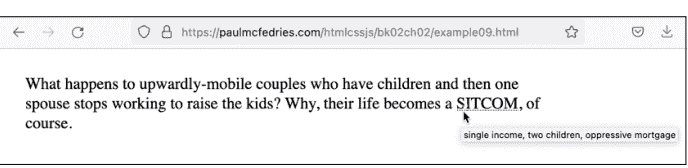

### \<address\>：地址文本标签

你的网页——或网页的某些部分，例如 *article* 元素——可能包含联系信息，该信息可能包括电子邮件地址、电话号码和邮政地址。你可以通过用 `<address>` 和 `</address>` 标签包围它来语义化地标记该联系信息，如下所示（bk02cho2/example10.html）：

```
<p>
    Having a problem? Please "contact us" here:
</p>
<address>
    The Complaints Department<br>
    0 Black Hole Blvd, Suite ~23<br>
    Nowheresville, BC N0N 0N0
</address>
```

如图 2-10 所示，浏览器将地址文本渲染为斜体。

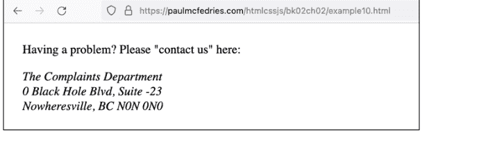

### \<cite\>：引用文本标签

如果你的网页引用了一个创意作品，你可以使用 cite 元素来语义化地标记对该作品的引用。你通过将该作品的名称（或指向该作品的链接，其中链接文本是作品名称）用 `<cite>` 和 `</cite>` 标签包围来创建此引用。

出于 cite 元素的目的，“创意作品”一词具有广泛的含义，包括此元素规范中提供的以下列表：一本书、一篇论文、一篇文章、一首诗、一份乐谱、一首歌、一个剧本、一部电影、一个电视节目、一个游戏、一件雕塑、一幅画、一场戏剧演出、一部戏剧、一部歌剧、一部音乐剧、一次展览、一份法律案件报告、一个计算机程序。这里有一个示例（bk02ch02/example11.html）：

```
<p>
    The HTML specs published by the WHAT Working Group
    are notoriously dry, fussy, and judge-sober. However,
    every now and then some wag sneaks in a bit of humor:
</p>
<blockquote>
    A person's name is not the title of a work — even if
    people call that person a piece of work — and the element
    must therefore not be used to mark up people's names.
</blockquote>
</blockquote>
<p>
    Source: <cite><a href="https://html.spec.whatwg.org/#the-cite-element">The cite element</a></cite>, published by WHATWG.
</p>
```

如图 2-11 所示，浏览器将 `cite` 文本渲染为斜体。

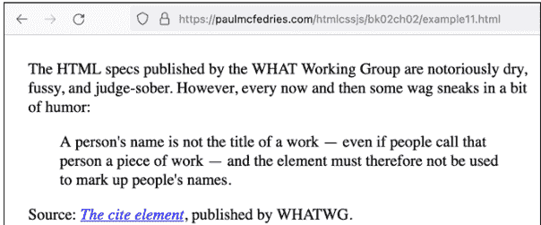

**图 2-11：** 浏览器使用斜体渲染用 `<cite>` 标签标记的文本。


正如图 2-11 所示的 WHATWG 引文所明确指出的，`cite` 元素的规范坚持该元素应仅包含创意作品的标题，而非创作该作品的人的名字。务必向创作者致意，但请确保在 `cite` 元素之外进行（如我在前面的示例中所做的那样）。

### \<code\>：代码文本标签

如果你的网页包含一个单词、短语或一行计算机代码——例如 HTML 元素名称、CSS 声明（属性/值对）或 JavaScript 语句——你可以恰当地将该代码包装在 `code` 元素中。这里有一个示例（bk02cho02/example12.html）：

```
<p>
    Way back in 1994, someone at Netscape (one of the original web browsers) had the not-so-bright idea that text that blinked on and off would be a good thing. Thus the <code>&lt;blink&gt;</code> tag – the most reviled tag of all time – was born.
</p>
```

如图 2-12 所示，浏览器将代码文本渲染为等宽字体。

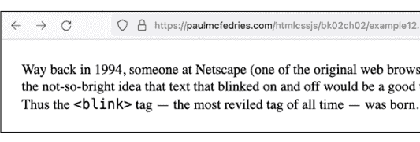

**图 2-12：** 浏览器以等宽字体显示代码文本。

`code` 标签是一个内联元素，这意味着代码文本会与周围的文本一起流动。如果你想在页面中包含多行计算机代码，你需要动用 `<pre>` 标签。请参阅本章后面的“\<pre\>：预格式化文本标签”。


如果你的代码包含变量名，你可以使用 `var`（代表“variable”）元素来语义化地标记该名称：

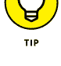

```
Given positive values of the variables <var>x</var> and <var>y</var>, what is the price of tea in China?
```

网络浏览器将 `var` 文本渲染为斜体。

一个略有不同的情景是，当我想在网页中包含来自计算机程序的某种示例输出（例如错误消息）时。为此，首选的 HTML 元素是 `samp` 元素（其中 “samp” 是 “sample output” 的缩写）：


```
Plugging in that URL produced the dreaded <samp>404 Not Found</samp> error.
```

### \<dfn\>：定义文本标签

术语的定义性实例是指紧跟着该术语定义的术语用法。你注意到刚才发生了什么吗？我使用“defining instance”正是“defining instance”这个术语的定义性实例！这些语言花招的要点是，每当你在网页中使用定义性实例时，你可以使用 `dfn` 元素对其进行语义化标记（bk02cho02/example13.html）：

```
The <dfn>defining instance</dfn> of a term is the usage of the term that's immediately followed by the term's definition.
```


如图2-13所示，浏览器将 `<dfn>` 文本渲染为斜体。

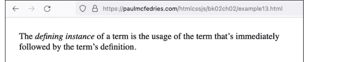

### `<dl>`：描述列表文本标签

在本章前面的部分（参考"创建项目符号列表和编号列表"），我讨论了两种可以添加到网页的列表：项目符号列表和编号列表。然而，HTML 还支持第三种列表类型，称为描述列表，其中每个条目是一个名-值对。最初，人们使用描述列表来创建词汇表或字典，其中每个名-值对由一个术语和该术语的定义组成。不过，你将会了解到，描述列表的用途远不止定义。要标记这些列表中每个条目的名-值对，你需要两个不同的标签。名称包含在 `<dt>` 元素中，而值则包含在 `<dd>` 元素中，如下所示：

```
<dt>name</dt>
<dd>value</dd>
```

对每个名-值对重复此操作，并用 `<dl>` 和 `</dl>` 标签包围整个列表，即可完成你的描述列表。整体结构如下：

```
<dl>
    <dt>A name</dt>
    <dd>Its value</dd>
    <dt>Another name</dt>
    <dd>Another value</dd>
    <dt>Yet another name</dt>
    <dd>Yet another value</dd>
    <dt>Etc.</dt>
    <dd>Abbreviation of a Latin phrase that means "and so forth."</dd>
</dl>
```

这是一个更实际的例子 (bk02ch02/example14.html)：

```
<h3>Some Insults Worth Hurling</h3>
<dl>
    <dt>disingenuflect</dt>
    <dd>To act in a servile or worshipful manner insincerely
        or hypocritically.</dd>
    <dt>dudefussing</dt>
    <dd>Making numerous small, needless adjustments as a
        pretense of effort, particularly by a man.</dd>
    <dt>escalefter</dt>
    <dd>A person who stands on the left side of a busy
        escalator, thus blocking those who would walk up or
        down.</dd>
    <dt>nerdsplaining</dt>
    <dd>Explaining in an overly intellectual, obsessively
        detailed way, particularly when the topic is obscure
        or highly technical.</dd>
    <dt>omnishambles</dt>
    <dd>A situation or person that is a mess in every
        possible way.</dd>
</dl>
```

图2-14展示了在浏览器中的显示效果。

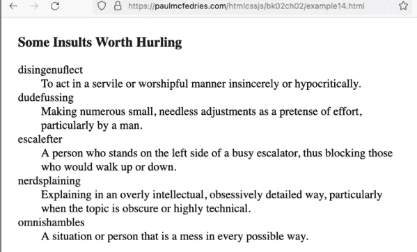

**图 2-14：** 在描述列表中排列的几个定义。

### `<kbd>`：键盘输入文本标签

如果你的网页包含需要按快捷键或类似键盘输入的说明或步骤，你可以使用 `<kbd>` 元素来语义化地标记这些按键。以下是一个例子：

```
To abort the countdown and prevent detonation, press
<kbd>Esc</kbd>.
```

对于组合快捷键，你可以为每个按键使用 `<kbd>` 元素标记，然后用另一组 `<kbd></kbd>` 标签包围整个组合，像这样 (bk02ch02/example15.html)：

```
Alternatively, you can restart the countdown by pressing
<kbd><kbd>Ctrl</kbd>+<kbd>R</kbd></kbd>.
```

如图2-15所示，浏览器将你标记的按键渲染为等宽字体。

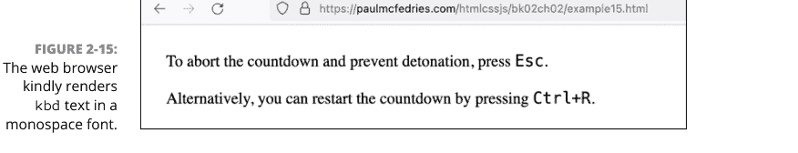

### `<mark>`：标记文本标签

如果你想让读者注意到页面上的某些文本，HTML 提供了多种方式。例如，如果文本非常重要，你不想让读者错过它，你可以用 `<strong>` 元素标记文本。如果你想对文本施加一些强调，`<em>` 元素可以胜任。还有一种你可能希望读者注意到的文本类型，是与读者或页面整体上下文相关的文本。对于此类文本，你可以使用 `<mark>` 元素作为高亮文本的方式。例如，在一个主题是隐喻的页面中，你可能想使用 `<mark>` 元素来标记出现在某些引文中的隐喻。以下是一个例子 (bk02ch02/example16.html)：

```
<blockquote>
    If words, as Samuel Johnson said, are the <mark>'dress'
of rational thought</mark>, a good vocabulary is
```

> <mark>the Wonderbra of intellect</mark>. –Hilary Bower

> Language is not just the spoken and written word, it is also <mark>the currency of conscious thought</mark>. What one cannot put into words is hard to even think about.
--Nicholas Wade

浏览器将 `mark` 元素的文本显示为黄色高亮。

### `<pre>`：预格式化文本标签

在前面的"`<code>`：代码文本标签"一节中，我讨论了使用 `code` 元素标记单个单词或代码短语。然而，许多代码片段是多行的，所以要标记这些较长的代码块，你需要借助 `pre` 元素。为什么是 `pre`？因为它提供了两个有用的特性，使其非常适合精确呈现代码：

+   » 网页浏览器使用等宽字体渲染 `pre` 文本。
» 网页浏览器在渲染时会包含多个空格字符（如空格），而不是忽略它们（这是大多数其他标签的默认行为）。

结果就是？你的代码在 HTML 文件中编写成什么样子，渲染出来就是什么样子，包括所有让代码更易于阅读的多空格缩进。例如，这里是来自第一册第一章的一些 CSS 代码，用 `pre` 元素标记 (bk02cho02/example17.html)：

```
<pre>
&lt;style&gt;
    h1 {
        border-width: 2px;
        border-style: solid;
        border-color: black;
    }
    h2 {
        border-width: 2px;
        border-style: dotted;
        border-color: black;
    }
&lt;/style&gt;
</pre>
```

如图2-16所示，`pre` 元素忠实地渲染了代码中的所有空格。

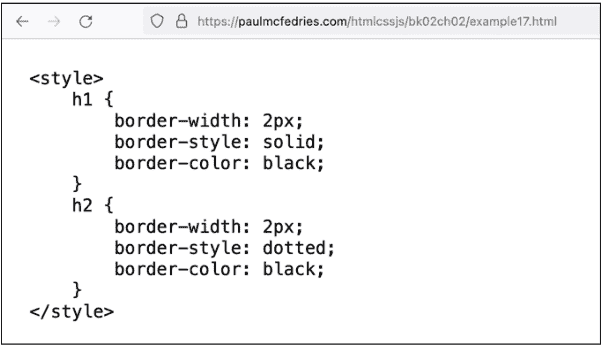

**图 2-16：** `pre` 元素显示的文本与其编写时完全一致，包括所有多个空格。


为了给你的计算机代码列表添加一些语义化的好处，可以将文本与 `code` 元素结合使用，像这样：

```
<pre><code>
Your code goes here
</code></pre>
```

### `<s>`：删除线文本标签

发布网页后，页面上的某些信息可能变得不准确或不再相关。大多数情况下，你会直接修正不准确之处、删除文本或更新文本使其保持相关。然而，在某些情况下，你可能希望在添加新文本或更新文本的同时保留旧文本。为什么要这样做？通常是因为你希望读者能够将旧文本与新文本进行比较或对比。例如，如果一个产品现在价格降低了，如果用户也能看到旧的、更高的价格，那么这个降价会显得更有力。在 HTML 中，你使用 `s` 元素表示不准确或不再相关的文本，如下例所示 (bk02ch02/example18.html)：

```
<h3>Who Needs Tickets?</h3>
<hr>
<h4>The Brazil Nutcracker</h4>
<p>
    <s>All performances: $950 per ticket</s>
```

118 BOOK 2 学习 HTML 基础

```
</p>
<p>
    SOLD OUT!
</p>
<hr>
<h4>Sleeping Pill Beauty</h4>
<p>
    <s>All performances: $15,000 per ticket</s>
</p>
<p>
    Now $9.99!
</p>
<hr>
```

结果如图2-17所示，网页浏览器使用删除线效果渲染 `s` 元素的文本。

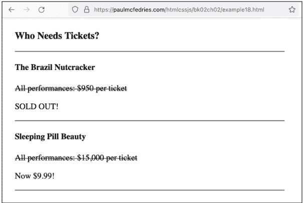

**图 2-17：**
`s` 元素使用删除线效果渲染文本。

你可能会想用 `s` 元素来表示（也许是讽刺地）已被删除的文本，像这样：

```
What <s>idiot</s>person would pay that much money to attend a ballet?
```

然而，这类标记的首选方法是使用 `del` 元素，它专门用于表示已删除的文本（并且同样使用删除线效果渲染文本）：

```
What <del>idiot</del>person would pay that much money to attend a ballet?
```

### `<sub>`：下标文本标签

如果你的网页包含数学公式或化学符号（嘿，有可能发生），其中一个或多个术语可能需要下标。下标是一个缩小尺寸的字符（通常是数字或字母），它稍微向下移动，使得字符的一部分出现在文本基线以下。例如：H₂O（水的化学式）。你可以使用 `sub` 元素将一个或几个字符标记为下标。以下是一个例子 (bk02cho2/example19.html)：

```
<p>
  Feeling up today? Perhaps your brain is taking a dopamine
  (C<sub>8</sub>H<sub>11</sub>NO<sub>2</sub>) bath.
</p>
```

图2-18显示了在浏览器中的显示效果。

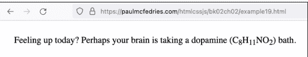

**图 2-18：** 你可以使用 `sub` 元素将字符标记为下标。

### `<sup>`：上标文本标签

上标是一个缩小尺寸的字符（通常是数字或字母），它稍微向上移动，使得字符的顶部部分出现在普通文本之上。例如：e = mc²（爱因斯坦著名的表明质量和能量等价的公式）。当然，你的网页可能包含这样的公式，但上标更常见的用途是标记脚注。无论是表示公式幂次还是脚注标记，你都可以使用 `sup` 元素告诉浏览器将一个或多个字符显示为上标。这是一个脚注的例子 (bk02cho2/example20.html)：


无论是工厂工人还是教职员工，每个人都会欣赏语言的某个方面；每个人都在某种意义上“被言语所震撼”¹。

¹ 这句话出自莎士比亚：
> 天哪！自从我第一次管我爸爸的爸爸叫老爹以来，我还从来没有这样被言语震撼过。
> ——《约翰王》，1596年，第二幕，第二场

请注意，我既使用上标作为文本中的脚注标记，也用它来开始脚注本身。图2-19展示了网页浏览器处理此代码的效果。

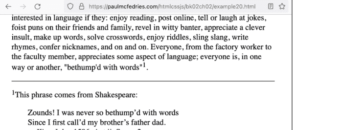

**图2-19：** 你可以使用`sup`元素在页面上标记脚注。

**本章内容**
- 用图片美化你的页面
- 学习语义化的图片元素
- 用视频让你的页面更生动
- 为页面添加音频文件

## 第3章
## 使用图像、视频和其他媒体

> > *用视觉来讲述是一门古老的艺术。几个世纪以来，我们一直在洞穴的墙壁上作画。这就像是人们谈论完美的图画书时所说的那样：艺术和文字各自独立，但当它们结合在一起时，会创造出更美好的东西。*
>
> ——黛博拉·怀尔斯

如果你曾经访问过非常古老的网页——我说的是上世纪90年代末和21世纪初的那些页面——你很可能会发现页面上是文字的海洋，或许只有零星几个标题像岛屿一样，让你疲惫的、在文字中游弋的眼睛得以休息。这些古老页面给我们的教训是显而易见的：一个只有文字的页面不仅碍眼，还会导致眼睛疲劳。

需要澄清的是，我并不是说页面上有大量文字必然是坏事。那些古老页面真正的问题在于，它们将大量的文字与糟糕的排版结合在一起，包括难看的字体、过小的文字、繁杂的背景和糟糕的间距。你将在第3册第7章学习所有顶级排版的原则，这样即使页面上有大量文字，你也能让它看起来赏心悦目。

然而，我们生活在一个热爱视觉的世界，访问你页面的人们至少会期待一点视觉上的享受。在本章中，你将探索HTML的视觉方面。你将学习如何在页面中添加照片、插图和其他图像，并深入了解将视频片段和音频剪辑嵌入页面的艺术。这真是一场视听盛宴。

#### 插入图片

无论你是想讲故事、给出指导、发表高见，还是只想抱怨点什么，你都可以通过在页面中添加文本来实现所有这些，甚至更多。但为了让读者更感兴趣，不妨时不时地加点图像。为此，有一个HTML标签可以用来向你的页面添加一张或多张图片。

#### 首先，简要了解一下图像格式

在深入图片这个话题之前，我应该告诉你，不幸的是，并非任何旧图片都能用在网页上。浏览器能显示的图像类型是有限的。事实上，你可以使用四种主要类型的图像格式：

- **GIF**：最初的网络图形格式（Graphics Interchange Format的缩写）。GIF（发音为“giff”或“jiff”）仅限于256种颜色，因此很少用于静态图像。相反，如今大多数人使用动画GIF，它将多个图像文件组合成一个动画。
    想创建自己的动画GIF吗？当然想！最简单的方法是使用提供此服务的在线站点之一。两个流行的站点是GIPHY (https://giphy.com/create/gifmaker) 和 Canva (www.canva.com/create/gifmaker/)。
- **JPEG**：以其发明者“联合图像专家小组”的名字命名。JPEG（发音为“jay-peg”）支持具有数百万种颜色的复杂图像。JPEG文件的主要优势在于，对于相同的图像，它们比GIF文件更小，因此下载时间更短。但要注意：JPEG使用*有损*压缩，这意味着它通过丢弃冗余像素来减小图像文件大小。压缩率越高，丢弃的像素就越多，图像看起来就越不清晰。话虽如此，如果你有一张照片或类似的复杂图像，JPEG几乎总是最佳选择，因为它能提供最小的文件大小。


124 第2册 学习HTML基础

- **PNG**：可移植网络图形格式支持数百万种颜色。PNG（发音为“p-n-g”或“ping”）是一种压缩格式，但与JPEG不同，PNG使用*无损*压缩。这意味着图像保持清晰，但文件大小可能会变得相当大。如果你的插图或图标使用纯色，或者照片包含大面积的近似纯色区域，PNG是一个不错的选择。PNG还支持透明度。
- **SVG**：使用可缩放矢量图形格式，图像是使用*矢量*（基于网格上的点和形状的数学公式）而非像素生成的。令人惊讶的是，这些矢量以一组指令的形式存在于一种特殊的基于文本的格式中，这意味着你可以使用文本编辑器来编辑图像！SVG是插图的一个好选择，特别是如果你有支持SVG格式的软件，如Inkscape或Adobe Illustrator。

#### 插入图片

好了，关于那些就说到这里。是时候开始把一些图片塞进你的网页了。如前所述，有一个HTML代码可以告诉浏览器显示一张图片。它就是``标签，其工作方式如下：

```

```

这里，`src`是source（源）的缩写；*filename*是你想要显示的图形文件的名称（通常也包括其位置）；*description*是图片的简短描述（供屏幕阅读器朗读，也供未显示图片或图片加载失败的用户查看）；*title*是一个工具提示，当用户将鼠标指针悬停在图片上时会显示。注意，这里没有结束标签需要添加。


`alt`属性是必需的，如果你的图片没有`alt`值，你的网页就不是有效的HTML。这是因为*替代文本*（`alt`值常被称为）是网页可访问性的一个关键方面；关于替代文本和可访问性的更多内容，请参阅第2册第6章。话虽如此，如果你使用的图片纯粹是装饰性的，则无需描述它们。在这种情况下，需要在``标签中包含`alt`属性，但将其值设置为空字符串（""），如下所示：

```

```

这里有一个示例供你参考。假设你有一张名为`logo.png`的图片。要将其添加到你的页面，你可以使用以下代码行：

```

```

实际上，这个标签是在对浏览器说：“劳驾？能否请你抓取名为logo.png的图片文件，并将其插入到页面中``标签所在的位置？”浏览器会尽职地从你的Web服务器抓取图片并在页面中显示它。

要使这个简单示例正常工作，请记住你的HTML文件和图形文件需要位于同一目录中。许多网站管理员会创建一个专门用于图片的子目录，以保持整洁。如果你打算这样做，请务必阅读我在第1册第2章中关于使用目录和子目录的说明。

以下是一个在网页中包含图片的示例，图3-1展示了它在网页浏览器中的样子（请参考本书示例文件中的bk02ch03/example01.html）：

```
To see a World in a Grain of Sand<br>
And a Heaven in a Wild Flower<br>
—William Blake<br>

```

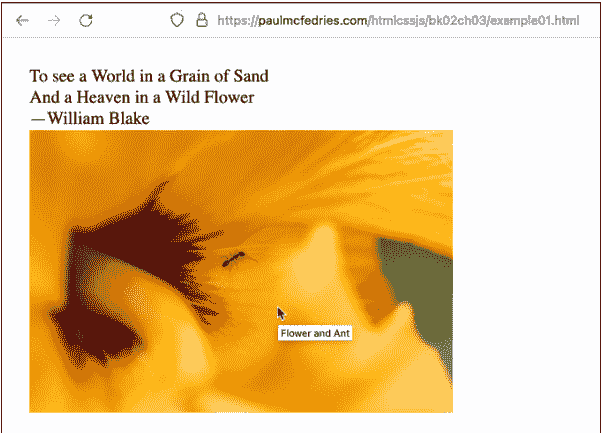

**图3-1：** 一个添加了图片的网页。


### 插入带标题的图表

在本书中，当我想让你查看附近的屏幕截图时，我会说类似“图3-1展示了在网页浏览器中显示的样子”。这就是提示你去找到标题为“图3-1”的图片。

一般来说，*图表*是以某种方式在文档正文中引用的图片。你可能不会经常在网页中使用图表，但对于那些你确实使用的场合，你会很高兴知道HTML提供了`figure`元素来为`img`元素增添一些语义上的光泽。需要给图片添加标题吗？HTML用`figcaption`元素为你提供支持。

以下是指定图片为带标题图表的一般语法：

```
<figure>
    
    <figcaption>
        Insert your caption here
    </figcaption>
</figure>
```

这是一个完整的示例，结果如（图引用即将到来！）图3-2所示（查看 bk02cho03/example02.html）：

```
<p>
    Checking out the source code of a web page isn't
    normally a "fun" experience. Most often, your goal is to get
    the name of a file or to figure out how the site
    performed some HTML or CSS magic. But every once in a
    very long while you can find a surprise, even a
    delightful one, waiting in the source code. As shown in
    Figure 1, I came across one such surprise the other day
    while viewing source on a page from <i>The Guardian</i>.
</p>
<figure>
    
    <figcaption>
        <b>Figure 1</b>—A want ad buried in the HTML source
        of <i>The Guardian</i> newspaper web page.
    </figcaption>
</figure>
```

### 将图片转换为链接

在第二册第二章中，我讨论了使用`<a>`元素将单词或短语变成真正的链接。但你的链接不一定非得是文本。如果你有徽标、图标或其他图片，希望读者点击后跳转到另一个页面，你可以将该图片设置为链接。

以下是使用的一般技巧：

```
<a href="address"></a>
```

你像往常一样设置`<a>`标签，但这次在`<a>`和`</a>`之间使用``标签而不是一些文本。就这样，你的图片变成了一个链接，人们可以点击它跳转到你在`href`属性中指定的任何页面。

这是一个示例（bk02ch03/example03.html）：

```
<header>
    <a href="/"></a>
    <h1>Welcome to "Isn't it Semantic?"</h1>
    <hr>
</header>
```

### 控制图片的垂直对齐

如果你回顾图3-1的HTML代码，你会注意到我在``标签之前添加了一个`<br>`标签：

```
-William Blake<br>

```

我这样做是因为，否则浏览器会将图片与文本内联定位。为什么？因为，也许出乎意料，*img*是一个内联元素，而不是块级元素。幸运的是，如果你确实希望图片随文本流动，你可以控制图片和文本的对齐方式，但这需要快速涉足CSS领域。要控制对象的垂直对齐，你需要使用*vertical-align*属性：

```
selector {
    vertical-align: value;
}
```

或者，作为属性：

```
style="vertical-align: value;"
```

对于*value*，你可以输入一个长度（例如像素），其中正长度使图片向上移动，负长度使图片向下移动。*vertical-align*属性还支持许多预定义的值，以下是你需要知道的：

-   **baseline:** 将图片底部与图片所在文本行的基线垂直对齐。（*基线*是一条想象的水平线，位于像*c*和*i*这样没有下伸部的字母底部下方。）这是默认值。
-   **bottom:** 将图片底部与图片所在文本行的底部垂直对齐。（行*底部*是一条想象的水平线，位于像*g*和*y*这样字母的最低部分下方。这些基线以下的部分称为*下伸部*。）
-   **middle:** 将图片中部与图片所在文本行的基线垂直对齐，再加上当前字体x高度的一半。（字体的*x高度*是没有上伸部或下伸部的字母的高度，例如*c*和*x*。）
-   **top:** 将图片顶部与图片所在文本行的顶部垂直对齐。（行*顶部*是一条想象的水平线，位于像*h*和*t*这样字母的最高部分上方。这些x高度以上的部分称为*上伸部*。）

这是一个示例，图3-3展示了浏览器中的效果（bk02ch03/example04.html）：

```
<div>
    Baseline
</div>
<div>
    Bottom
</div>
<div>
    Middle
</div>
<div>
    Top
</div>
```

**图3-3：** vertical-align属性值的效果。

想知道如何为页面定义背景图片吗？我猜也是。这是通过CSS完成的，我在第三册第六章中会详细介绍。

### 嵌入视频

如果一张图片价值千言万语，那么一个视频价值多少？不知道，但考虑到网络上视频内容的泛滥，这一定是个非常大的数字。看起来每个拥有主页的汤姆、迭戈和哈丽雅特都在提供视频内容。如果你想加入他们的行列，那你来对地方了。

如何将视频嵌入网页取决于视频的类型：

-   **第三方视频：** 对于来自YouTube、Vimeo和Dailymotion等第三方网站的视频，你在页面中插入一些HTML代码，这些代码会自动播放来自第三方网站的视频。
-   **你自己的视频：** 对于你自己创建的视频文件，你将文件上传到服务器，然后使用`video`元素将视频插入页面。

接下来的几节将提供有时相当繁琐的细节。

#### 嵌入第三方视频

到目前为止，用视频内容让你的网页生动起来的最简单方法是嵌入一些HTML代码，这些代码会播放来自第三方在线视频提供商（如YouTube）的视频。这是最简单的途径，因为它意味着你不必担心视频格式、上传视频文件以及处理通常繁重的视频带宽成本。

几乎每个在线视频提供商都为每个视频提供分享功能，而该分享功能通常包含一个嵌入组件，使你可以复制所需的代码，将视频嵌入页面。以下是从三大在线视频提供商获取所需HTML代码的说明：

-   **Dailymotion:** 访问 dailymotion.com 并找到你要嵌入页面的视频。点击分享图标（如页边所示），然后点击嵌入视频以显示包含所需代码的对话框。根据需要打开或关闭自动播放开关。（当自动播放开启时，意味着每次有人访问你的页面时视频会自动开始。）选择代码，按 Ctrl+C（macOS 中为 ⌘+C）复制代码，然后将代码粘贴到HTML文件中你希望视频出现的位置。
-   **Vimeo:** 访问 vimeo.com 并显示你要嵌入页面的视频。点击分享图标（与页边所示的Dailymotion图标相同）。在出现的“分享此视频”对话框中，“嵌入”框显示了所需代码。如果需要，你可以点击“显示选项”来

## 根据需要自定义代码。点击“嵌入”框以选中代码，按下 Ctrl+C（在 macOS 上为 ⌘+C）复制代码，然后将代码粘贴到 HTML 文件中希望视频出现的位置。

-   **YouTube：** 访问 youtube.com，找到您想嵌入页面的视频。点击“分享”按钮。在出现的“分享”对话框中，点击“嵌入”以显示代码，如图 3-4 所示。根据需要调整选项，点击“复制”，然后将代码粘贴到 HTML 文件中希望视频出现的位置。


**图 3-4：** YouTube 视频的嵌入代码。

 如果您从大多数在线视频提供商处复制的 HTML 代码看起来复杂得令人生畏，那是因为它确实很复杂！这些代码通常由一个 `<iframe>` 标签组成——`iframe` 元素用于在当前页面中嵌入另一个网页——并应用了各种属性。这些属性包括 `style`（指定了各种 CSS 属性）、`height`、`width` 以及至关重要的 `src` 属性，该属性指定了视频的在线地址。

 除非您真正清楚自己在做什么，否则不应编辑或以其他方式修改在线视频提供商提供的 HTML 代码。一步出错，您的嵌入视频将无法工作。

#### 嵌入您自己的视频

如果您倾向于（或需要）采用 DIY 视频路线，我这里既有好消息也有坏消息，不过恐怕坏消息的比例要大得多。

好消息是 HTML 提供了 `video` 元素，您可以使用它将视频播放器嵌入页面，该播放器不仅显示您的视频，还提供播放控制。坏消息是，如今网络友好的视频文件格式有点杂乱无章，因此最佳选择并非总是显而易见。

132 第 2 部分 *学习 HTML 基础*

### 关于网络媒体文件格式的一些说明

在继续之前，您需要了解网络媒体文件格式的两个重要方面：

> - **容器：** 媒体的文件格式。为什么称之为 *容器*？因为它是一个归档文件——类似于 Zip 文件——其中包含媒体所需的多个项目，包括编解码器（参见下一项）和元数据。

> - **编解码器：** 用于将媒体编码和压缩为数字格式，以及解码和解压媒体以进行播放的算法。（因此，*codec* 是一个组合词，结合了 *code/decode*（编码/解码）和 *compress/decompress*（压缩/解压）。）

这一切意味着，每个网络媒体文件都采用特定的媒体格式，该格式使用特定的容器，而在该容器内则包含该格式支持的所有编解码器（以及其他内容）。这极其复杂，而当您发现根本不存在标准视频文件格式时，情况就更加糟糕了！

#### 坏消息：网络视频格式

当您处理在页面中嵌入视频时，主要涉及三种格式：

> - **MPEG-4：** 使用 MPEG-4 容器，其中包含 H.264 视频编解码器以及 AAC 音频编解码器。此格式有专利，但对终端用户免费。MPEG-4 视频文件使用文件扩展名 `.mp4`。

> - **Ogg：** 使用 Ogg 容器，其中包含 Theora 视频编解码器以及 Vorbis 或 Opus 音频编解码器。此格式是开源且免版税的。Ogg 视频文件使用文件扩展名：`.ogg` 或 `.ogv`。

> - **WebM：** 使用 WebM 容器，其中包含 VP8 或 VP9 视频编解码器，以及 Vorbis 或 Opus 音频编解码器。此格式是开源且免版税的。WebM 视频文件使用文件扩展名 `.webm`。

有大量在线工具可以将视频转换为我在此列出的格式。两个值得尝试的网站是 Zamzar（`www.zamzar.com`）和 Online-Convert（`www.online-convert.com/`）。


第 3 章 处理图像、视频和其他媒体

133

我希望能指着其中一种格式说：“就只用这个。”然而，有两件事让我无法这样做：

-   **浏览器支持：** MPEG-4 和 WebM 都被所有主要浏览器完全支持，但 Ogg 的支持还不够完善。
-   **版税：** Ogg 和 WebM 都是免版税的，但有专利的 MPEG-4 要求浏览器公司支付版税才能使用。MPEG-4 视频的高质量意味着所有主要浏览器都支持它，但未来可能情况不再如此。

底线是，虽然您使用 MPEG-4 格式的视频文件可能没问题，但如果您也能制作 WebM 版本，那么您应该同时为访问者提供这两种文件格式。要了解如何操作，请继续阅读 HTML 的 `<video>` 元素的详细信息。

## 好消息：<video> 标签

鉴于我在上一节中对网络视频格式复杂性不那么生动的描述，了解到实际上将您自己的视频嵌入网页相对简单，这真是个令人欣慰的消息，这得益于便捷的 `video` 元素。如何使用 `video` 元素取决于您是提供单一视频文件格式还是多种格式。

首先，如果您只提供单一视频文件格式，以下是通用的 `video` 元素语法：

```
<video src="source"
    poster="poster"
    width="width"
    height="height"
    autoplay
    controls
    loop>
</video>
```

以下是每个属性的含义：

-   **src：** 视频文件的名称，如果文件与 HTML 文件位于同一位置。如果视频文件位于不同的目录中，您需要包含该信息，以便浏览器知道在哪里查找文件。
-   **poster：** 您希望浏览器在视频开始播放前显示的图像的名称（以及目录，如果需要）。大多数时候您会使用视频中的标题帧或静止帧。
-   **width**：视频播放窗口的宽度，以像素为单位。
-   **height**：视频播放窗口的高度，以像素为单位。
-   **autoplay**：包含此属性可让浏览器在文件下载足够以保证流畅播放后立即自动开始播放视频。如果您不希望视频自动开始，请省略 autoplay 属性。
-   **controls**：包含此属性可让浏览器在视频窗口中显示播放控件。如果您不希望访问者能够控制播放，请省略 controls 属性。
-   **loop**：包含此属性可让浏览器在视频结束时自动从头开始播放。如果您希望视频只播放一次，请省略 loop 属性。

这是一个嵌入视频的示例，图 3-5 显示了嵌入网页的视频（bk02ch03/example05.html）。

```
<video src="videos/bear.mp4"
    poster="images/bear.png"
    width="640"
    height="480"
    autoplay
    controls
    loop>
</video>
```

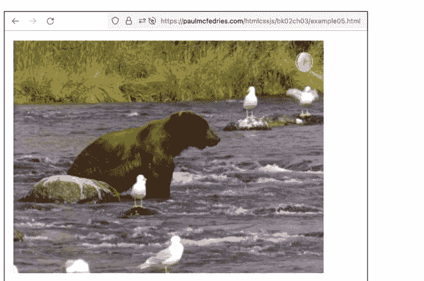

**图 3-5：** 嵌入网页中的 MPEG-4 视频。

如果您想提供多种视频格式，请从 `<video>` 标签中移除 `src` 属性，并添加多个 `source` 元素，每个元素对应您想提供的一种格式：

```
<video
    poster="filename"
    width="value"
    height="value"
    autoplay
    controls
    loop>
    <source src="filename"
            type='type; codecs="codecs"'>
    <source etc…>
</video>
```

`video` 属性与我之前描述的相同，但以下是您需要了解的 `<source>` 标签属性：

-   **src**：视频文件的名称，如果文件与 HTML 文件位于同一位置。如果视频文件位于不同的目录中，您需要包含该信息，以便浏览器知道在哪里查找文件。
-   **type**：一个字符串（用单引号括起来），指定视频格式类型，这是一个以逗号分隔并用双引号括起来的列表，包含该格式的视频和音频编解码器：
    -   MPEG-4：使用以下内容：
        `type='video/mp4; codecs="avc1.4D401E, mp4a.40.2"'`
    -   Ogg：使用以下其中一种：
        `type='video/ogg; codecs="theora, vorbis"'`
        `type='video/ogg; codecs="theora, opus"'`
    -   WebM：使用以下其中一种：
        `type='video/webm; codecs="vp8, vorbis"'`
        `type='video/webm; codecs="vp9, vorbis"'`
        `type='video/webm; codecs="vp9, opus"'`

浏览器会按照您指定的顺序遍历 `source` 元素，并播放它遇到的第一个兼容的视频格式。


以下是一个示例（bko2cho3/example06.html）：

```
<video
    poster="images/bear.png"
    width="640"
    height="480"
    autoplay
    controls
    loop>
    <source src="videos/bear.mp4"
            type='video/mp4; codecs="avc1.4D401E, mp4a.40.2"'>
    <source src="videos/bear.webm"
            type='video/webm; codecs="vp8, vorbis"'>
    <source src="videos/bear.ogv"
            type='video/ogg; codecs="theora, vorbis"'>
</video>
```

### 嵌入音频片段

在现代网页中，嵌入的音频片段不如嵌入视频那样流行，但你可能有时需要向访客提供某种音频享受。与视频类似，将音频嵌入网页的方式取决于音频的类型：

-   **» 第三方音频：** 对于来自第三方网站（如 SoundCloud、Bandcamp 或 Mixcloud）的音频文件，你需要在页面中插入一些 HTML 代码，以便自动播放来自第三方网站的音频。

-   **» 自有音频：** 对于你自己创建的音频文件，你需要将文件上传到你的服务器，然后使用 `audio` 元素将音频插入页面。

接下来的几节将提供详细信息。

#### 嵌入第三方音频

通过嵌入播放来自第三方在线音频提供商（如 SoundCloud）音频的 HTML 代码，你可以快速在网页上播放音频片段。

大多数在线音频提供商为每个音频提供包含嵌入组件的“分享”功能。此功能使你能够复制所需的代码，以便将音频嵌入页面。以下是如何从三个主要在线音频提供商获取所需 HTML 代码的方法：

-   **» Bandcamp：** 访问 bandcamp.com 并打开你想要嵌入页面的音频。点击“分享/嵌入”按钮，点击“嵌入此专辑”，然后点击播放器样式以显示代码。根据需要自定义播放器，然后复制出现在“嵌入”文本框中的代码。将代码粘贴到你的 HTML 文件中你希望音频播放器出现的位置。

-   **» Mixcloud：** 访问 mixcloud.com 并显示你想要嵌入页面的音频。点击“分享”按钮，在出现的对话框中，点击“嵌入播放器”选项卡。点击你想要使用的音频小部件样式，然后复制对话框中出现的代码。（你也可以点击“更多选项”来自定义你的播放器。）将代码粘贴到你的 HTML 文件中你希望音频小部件出现的位置。

-   **» SoundCloud：** 访问 soundcloud.com 并找到你想要嵌入页面的音频。点击“分享”按钮，在出现的对话框中，点击“嵌入”选项卡以显示代码，如图 3-6 所示。根据需要调整选项，从“代码”文本框中复制代码，然后将代码粘贴到你的 HTML 文件中你希望音频播放器出现的位置。

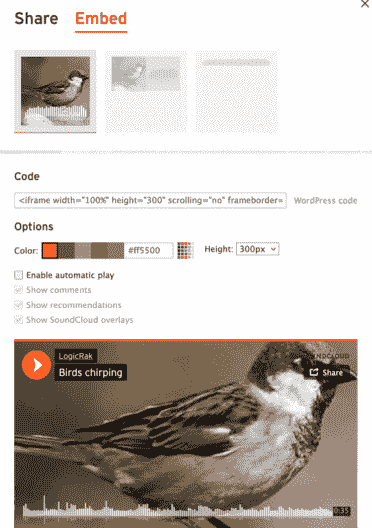


除非你清楚自己在做什么，否则不要编辑在线音频提供商提供的 HTML 代码。一个轻率的更改就可能阻止你嵌入的音频播放。

#### 嵌入你自己的音频

有自己的音频文件想要提供给页面访客？没问题！音频文件格式比视频格式世界稍微合理一些，HTML 提供了 `<audio>` 元素，可以相对轻松地嵌入音频。

#### 网络音频格式

对于网络音频，你需要处理以下格式：

-   **MP3：** 此格式既是容器也是音频编解码器。此格式受专利保护，但对最终用户免费。这些音频文件使用文件扩展名 `.mp3`。
-   **WAV：** 此格式既是容器也是音频编解码器。这些音频文件使用文件扩展名 `.wav`。
-   **WebM：** 此格式使用 WebM 容器，其中包含 Vorbis 或 Opus 音频编解码器。此格式是开源且免版税的。这些音频文件使用文件扩展名 `.webm`。
-   **Ogg：** 此格式使用 Ogg 容器，其中包含 Vorbis 或 Opus 音频编解码器。此格式是开源且免版税的。这些音频文件使用文件扩展名 `.ogg` 或 `.oga`。
-   **MPEG-4：** 此格式使用 MPEG-4 容器，其中包含 AAC 音频编解码器。此格式受专利保护，但对最终用户免费。这些音频文件使用文件扩展名 `.m4a`。


有许多在线工具可以将音频文件转换为我在此列出的格式。三个值得尝试的网站是 Zamzar (www.zamzar.com)、Online-Convert (www.online-convert.com/) 和 Media.io (https://media.io)。


所有主要浏览器长期以来都支持 MP3 格式，因此你几乎总是可以只使用 MP3 文件类型。

#### `<audio>` 标签

首先，如果你只提供单一音频文件格式，以下是通用的 `audio` 元素语法：

```
<audio src="source"
    autoplay
    controls
    loop
</audio>
```

以下是每个属性的含义：

-   **» src：** 如果音频文件与 HTML 文件位于同一位置，则为音频文件的名称。如果音频文件位于不同的目录，你需要包含该信息，以便浏览器知道去哪里查找文件。

-   **» autoplay：** 包含此属性可让浏览器在下载了足够多的文件以进行流畅播放后立即自动开始播放音频。如果你不想让音频自动开始，请省略 `autoplay` 属性。

-   **» controls：** 包含此属性可让浏览器在音频窗口中显示播放控件。如果你不想让访客能够控制播放，请省略 `controls` 属性。

-   **» loop：** 包含此属性可让浏览器在音频结束时自动从头开始播放。如果你只想让音频播放一次，请省略 `loop` 属性。

以下是一个嵌入音频的示例，图 3-7 显示了嵌入网页中的音频（bk02cho3/example07.html）。

```
<audio src="audio/jabberwocky.mp3"
    autoplay
    controls
    loop
</audio>
```

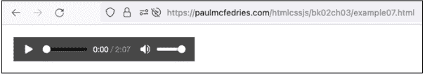

如果你想提供多种音频格式，请移除 `<audio>` 标签的 `src` 属性，并为每种你想要提供的格式添加一个 `source` 元素：

```
<audio
    autoplay
    controls
    loop>
    <source src="filename"
            type="type">
    <source etc...>
</audio>
```

`audio` 属性与我之前描述的相同，但以下是你需要了解的关于 `<source>` 标签属性的信息：

-   **» src**：如果音频文件与 HTML 文件位于同一位置，则为音频文件的名称。如果音频文件位于不同的目录，你需要包含该信息，以便浏览器知道去哪里查找文件。

-   **» type**：音频格式类型，例如 `audio/mp3` 或 `audio/wav`。

浏览器会按照你指定的顺序遍历 `source` 元素，并播放它遇到的第一个兼容的音频格式。

以下是一个示例（`bko2cho3/example08.html`）：

```
<audio
    autoplay
    controls
    loop>
    <source src="audio/jabberwocky.mp3"
            type="audio/mp3">
    <source src="audio/jabberwocky.m4a"
            type="audio/mp4">
    <source src="audio/jabberwocky.webm"
            type="audio/webm">
    <source src="audio/jabberwocky.ogg"
            type="audio/ogg">
    <source src="audio/jabberwocky.wav"
            type="audio/wav">
</audio>
```

+   **本章内容**
-   了解表格为何有用
-   浏览一个典型表格
-   创建简单表格
-   精心制作稍高级的表格
-   让你的表格时尚起来

# 第 4 章：徒手构建表格

> > *如果一幅画值一千字，那么一张表格至少值五百字。*
> — 匿名

你的网页主要由文本和一些图像或其他媒体组成。然而，你偶尔需要向页面访客提供一些数据。这可能是一个实验的结果、一些财务数字，或者是你的立方氧化锆收藏清单。

你呈现这些数据的方式取决于数据的数量和结构。在许多情况下，数据最好以类似电子表格或数据库的行列格式呈现。这听起来可能需要一些高级编码技巧，但 HTML 在这里解了围，它提供了一系列元素，使你能够构建一种称为表格的特殊网页结构。

在本章中，我将向你展示如何构建和操作表格，让你学习一点网络木工知识。如果你分不清锤子和钢锯，也不用担心；你将处理的表格纯粹是数字化的。HTML 表格是网页上的行和列组成的矩形网格，你可以在其中输入各种信息，包括文本、数字、链接，甚至图像。本章将告诉你构建和设计自己的表格样本所需的一切知识。


## 什么是表格？

HTML表格是一种以矩形布局呈现数据的结构，它由一个或多个列以及一个或多个行组成。从这个意义上说，你可以将表格视为一种数据库：每个表格列相当于一个数据库字段，包含单一类型的信息，例如姓名、地址或电话号码；每一行则相当于一条数据库记录，保存着一组相关的字段值，例如某个联系人的信息。图4-1展示了一个典型的表格，并指出了几个关键特征（相关代码，请查阅本书示例文件中的 bk02ch04/example01.html）。

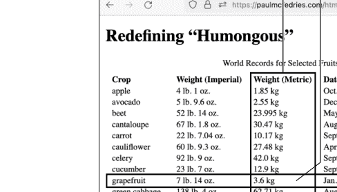

| 作物 | 重量（英制） | 重量（公制） | 种植日期 | 种植者 |
| :--- | :--- | :--- | :--- | :--- |
| 苹果 | 4磅 1盎司 | 1.85千克 | 2005年10月14日 | 岩崎千里 |
| 牛油果 | 5磅 9.6盎司 | 2.55千克 | 2018年12月14日 | 波基尼家族 |
| 甜菜 | 52磅 14盎司 | 23.995千克 | 2019年5月23日 | 福蒂家族 |
| 哈密瓜 | 67磅 1.8盎司 | 30.47千克 | 2019年8月5日 | 威廉·N·麦卡斯林 |
| 胡萝卜 | 22磅 7.04盎司 | 10.17千克 | 2017年9月9日 | 克里斯托弗·夸利 |
| 花椰菜 | 60磅 9.3盎司 | 27.48千克 | 2014年4月21日 | 彼得·格拉泽布鲁克 |
| 芹菜 | 92磅 9盎司 | 42.0千克 | 2018年9月29日 | 加里·希克斯 |
| 黄瓜 | 23磅 7盎司 | 12.9千克 | 2015年9月26日 | 大卫·托马斯 |
| 葡萄柚 | 7磅 14盎司 | 3.6千克 | 2019年1月19日 | 玛丽·贝丝·迈耶，道格拉斯·迈耶 |
| 绿卷心菜 | 138磅 4盎司 | 62.71千克 | 2012年8月31日 | 斯科特·A·罗布 |
| 羽衣甘蓝 | 105磅 14.5盎司 | 48.04千克 | 2007年8月29日 | 斯科特·罗布 |
| 柠檬 | 11磅 9.7盎司 | 5.3千克 | 2003年1月8日 | 阿哈隆·谢莫埃尔 |
| 桃子 | 1磅 12盎司 | 816.5克 | 2018年7月11日 | 奥尔·皮尔逊，劳顿·皮尔逊 |
| 梨 | 6磅 8盎司 | 2.9千克 | 2011年11月11日 | 爱知丰田梨协会 |
| 菠萝 | 18磅 4盎司 | 8.28千克 | 2011年11月30日 | 克里斯汀·麦卡勒姆 |
| 石榴 | 5磅 11.68盎司 | 2.60千克 | 2017年11月27日 | 张元鹏 |
| 马铃薯 | 24磅 14.4盎司 | 11.3千克 | 2008年12月8日 | 卡里勒·塞马特 |
| 南瓜 | 2,702磅 13.9盎司 | 1,226千克 | 2021年9月26日 | 斯特凡诺·库特鲁皮 |
| 萝卜 | 68磅 9盎司 | 31.1千克 | 2003年2月9日 | 大野学 |
| 夏南瓜 | 256磅 9.8盎司 | 116.4千克 | 2021年9月23日 | 文森特·约丁 |
| 红薯 | 81磅 9盎司 | 37千克 | 2004年3月8日 | 曼努埃尔·佩雷斯·佩雷斯 |
| 番茄 | 10磅 12.7盎司 | 4.9千克 | 2020年7月15日 | 丹·萨瑟兰 |
| 芜菁 | 63磅 14盎司 | 29千克 | 2020年11月2日 | 达米安·阿拉德 |
| 西瓜 | 350磅 8盎司 | 159千克 | 2013年10月4日 | 克里斯托弗·肯特 |
| 西葫芦 | 115磅 | 52千克 | 2020年9月28日 | 罗恩·肖尔茨 |

为了确保你理解了这些内容（毕竟这是我的工作），让我们来看一些表格术语：

- **行（Row）：** 贯穿表格的一整行数据。
- **列（Column）：** 一整列垂直的数据区域。在图4-1的表格中，有五列。
- **单元格（Cell）：** 行与列的交叉点。单元格中保存着你用表格呈现的每一项具体数据。
- **标题（Caption）：** （通常）出现在表格上方，用于描述表格内容的文本。
- **表头（Headers）：** 表格的第一行。表头是可选的，但许多人用它来为每一列添加标签。

这些概念并不复杂。此时，你心中可能会冒出两个问题。首先，既然 `pre` 元素（参见第2册第2章）在让文本整齐对齐方面表现得很好，为什么还要用表格呢？好问题。以下是表格带来的几点优势：

- **文本对齐很容易。** 使用 `pre` 让文本对齐充其量是件令人沮丧的事，糟糕的时候则会让人抓狂、撞墙、咒骂这该死的@#$%&!网页。然而，使用表格，你可以毫不费力地让你的文本像新兵训练营的学员一样排列整齐。
- **单元格互不影响。** 每个表格单元格都是独立的。你可以编辑和设置一个单元格的内容，而不会干扰其他表格元素的排列。
- **文本自动换行效果极佳。** 文本在每个单元格内自动换行，使得创建多行条目变得轻而易举。
- **你可以放入任何内容。** 表格不仅可以包含文本，还可以包含图片和链接（甚至其他表格！）。
- **它们看起来很棒。** `pre` 元素中的文本使用等宽字体，看起来并不美观，而表格使用常规页面字体，看起来更漂亮。而且，作为额外的好处，表格提供了许多CSS属性，你可以利用它们让你的表格看起来更棒。

其次，既然表格在定位文本方面似乎非常擅长，并且表格不仅支持文本还支持图片和其他内容，那么是否可以用一个巨大的表格来布局我的页面呢？又一个好问题！你今天思路很敏捷！

让我先说明一点，使用表格组织页面元素曾是多年来标准的布局技术。然而，没有人喜欢以这种方式使用表格，因为表格太僵化、太笨重，并且难以在大小屏幕上都很好地渲染。如今，*没有人*使用表格来布局页面，人们更喜欢使用更新、更强大的技术，例如 Flexbox（参见第5册第2章）和 Grid（参见第5册第3章）。

## Web木工活：如何构建表格

好了，是时候将表格踏板踩到底，开始制作这些表格了。接下来的几个小节将引导你完成构建基本表格的步骤。

### 最简单的情况：单行表格

举个例子，我将构建一个简单的、包含与食物相关的有趣地名的表格。为什么不呢？表格总是从以下容器开始：

```
<table>
</table>
```

所有其他表格标签都放在这两个标签之间。接下来，添加表格主体（即行和列，不包括表头，稍后会讲到）的容器。

```
<table>
    <tbody>
    </tbody>
</table>
```

有了这个基本结构后，你剩下的大部分表格工作都涉及以下四个步骤：

1. 添加一行。
2. 将该行划分为所需的列数。
3. 在每个单元格中插入数据。
4. 重复步骤1到3，直到完成。

要添加一行，你需要在 `<tbody>` 和 `</tbody>` 之间放入一对 `<tr>`（表格行）标签和 `</tr>` 标签（其对应的结束标签）：

```
<table>
    <tbody>
        <tr>
        </tr>
    </tbody>
</table>
```

现在，通过将 `<td>`（表格数据）和 `</td>` 标签放在 `<tr>` 和 `</tr>` 之间，将该行划分为列。每个 `<td></td>` 组合代表一列（或者更具体地说，是该行中的一个单元格），因此，例如，如果你想要一个三列的表格，就这样做：

```
<table>
	<tbody>
		<tr>
			<td></td>
			<td></td>
			<td></td>
		</tr>
	</tbody>
</table>
```

现在，通过在每个 `<td>` 标签及其 `</td>` 结束标签之间输入文本来输入该行的单元格数据：

```
<table>
	<tbody>
		<tr>
			<td>Candy Kitchen</td>
			<td>New Mexico</td>
			<td>59</td>
		</tr>
	</tbody>
</table>
```

图4-2展示了到目前为止的效果。

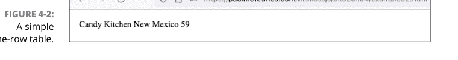

请记住，你可以在 `<td>` 和 `</td>` 标签内放置以下任何内容：

- 文本
- 链接
- 列表
- 图片和其他媒体（如视频和音频）
- 另一个表格

### 添加更多行

当第一行稳定到位后，你可以对表格中的其他行重复此过程。对于我的示例表格，以下是包含所有行数据的HTML：

```
<table>
    <tbody>
        <tr>
            <td>Candy Kitchen</td>
            <td>New Mexico</td>
            <td>59</td>
        </tr>
        <tr>
            <td>Hot Coffee</td>
            <td>Mississippi</td>
            <td>2,586</td>
        </tr>
        <tr>
            <td>Ketchuptown</td>
            <td>South Carolina</td>
            <td>84</td>
        </tr>
        <tr>
            <td>Sandwich</td>
            <td>New Hampshire</td>
            <td>1,354</td>
        </tr>
        <tr>
            <td>Two Egg</td>
            <td>Florida</td>
            <td>3,683</td>
        </tr>
    </tbody>
</table>
```

为了让代码更易读，我将每一行的 `td` 元素放在了同一行。图4-3展示了到目前为止的进展（请查看 bk02ch04/example02.html）。

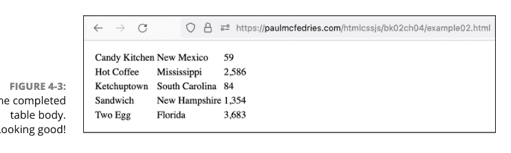

148 第2册 *学习HTML基础*


### 添加更多表格元素

一个包含一行或多行、一列或多列的表格，已经是HTML表格俱乐部的正式成员了，因此，如果这就是你展示数据所需的全部，你可以继续处理网页待办事项清单上的下一项。然而，HTML表格提供了更多可供考虑的功能。例如，你的表格可能需要列标题或行标题（或两者兼有）、表格内容的描述，或以某种方式对表格进行总结的行。所有这些功能都可以通过一些额外的表格相关元素来实现，接下来的几个小节将对此进行说明。

### 创建表头行

如果你的表格显示统计数据、财务数据或数字信息，读者很可能无法弄清楚一列或多列内容的含义。例如，回顾图4-3。你知道第三列中的数字代表什么吗？你或许能猜到，但你肯定不希望读者去猜测你的数据。

通过在每列顶部添加描述列内容的标签，你可以让读者的生活更轻松。（你不需要冗长的解释；在大多数情况下，一两个词就足够了。）要添加这些标签，你首先需要创建一个新的表格部分，称为 *表头*：

```
<thead>
</thead>
```

将此部分放在 `<tbody>` 标签的正上方。

现在你创建一个 *表头行*。这类似于普通行，不同之处在于你将 `<td>` 和 `</td>` 替换为 `<th>`（表头）和 `</th>`，如下所示：

```
<thead>
    <tr>
        <th>第一列表头</th>
        <th>第二列表头</th>
        <th>以此类推，直到令人厌烦</th>
    </tr>
</thead>
```

如代码所示，`th` 元素与 `td` 元素非常相似。区别在于，浏览器会将出现在 `<th>` 和 `</th>` 标签之间的文本显示为粗体，并在单元格内居中。这有助于读者将表头与表格中的其他数据区分开来。不过请记住，表头是可选的；如果你的表格不需要，可以跳过它们。

好的，现在为你的示例表格添加表头部分和表头行：

```
<table>
    <thead>
        <tr>
            <th>城镇</th>
            <th>州</th>
            <th>人口</th>
        </tr>
    </thead>
    <tbody>
        等等。
```

图4-4显示了带有列标题的表格（bk02cho04/example03.html）。

图4-4：现在带有列标题的示例表格。

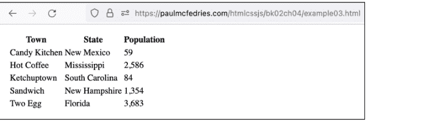

### 添加标题

下一个基本的表格元素是标题。标题是一个简短的描述（一两句话），用于告诉读者表格的用途。你可以用 `caption` 元素来定义标题：

```
<caption>
    标题文本放在这里
</caption>
```

你将标题代码添加在 `<table>` 标签的正后面。默认情况下，网页浏览器会将标题显示在表格上方的居中位置，但你可以通过一些CSS来改变这个默认设置（请查看本章后面的“更改标题的位置”）。这是我添加了标题的表格代码的第一部分：

```
<table>
    <caption>
        基于食物的有趣城镇名称
    </caption>
    <thead>
    等等。
```

图4-5显示了标题现在出现在表头行上方的表格（bk02ch04/example04.html）。

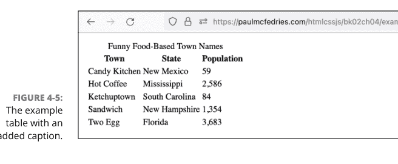

### 创建表头列

在某些表格中，第一列的值充当标签，描述每一行其余内容的含义。HTML没有专门用于此类表头列的元素，但你可以通过将第一列中的 `<td>` 和 `</td>` 标签替换为 `<th>` 和 `</th>` 标签来自己创建。这会告诉浏览器将第一列中的项目显示为粗体文本，并在列中居中。以下是一个示例（bk02ch04/example05.html）：

```
<table>
    <caption>
        按类别划分的第五季度销售额
    </caption>
    <thead>
        <tr>
            <th></th><th>销售数量</th><th>总销售额</th>
        </tr>
    </thead>
    <tbody>
        <tr>
            <th>小玩意儿</th><td>5,732</td><td>$28,603</td>
        </tr>
        <tr>
            <th>小发明</th><td>8,502</td><td>$59,429</td>
        </tr>
        <tr>
            <th>小物件</th><td>10,468</td><td>$41,767</td>
        </tr


选择器 {
    text-align: 值;
}

或者，作为属性：

```
style="text-align: 值;"
```

对于 *值*，你可以使用以下任何一项：

- **left:** 将文本与单元格的左边缘对齐。
- **center:** 将文本与单元格的水平中心对齐。
- **right:** 将文本与单元格的右边缘对齐。
- **justify:** 将文本与单元格的左右边缘对齐。

例如，如果你想让所有的 `th` 元素左对齐而不是居中对齐，你需要在你的 CSS 中添加以下规则：

```
th {
    text-align: left;
}
```

这是一个更大的示例，展示了所有四种 `text-align` 值（bk02cho04/example07.html）：

```
<table>
    <thead>
        <tr>
            <th>Idiom</th><th>Part of Speech</th><th>First Used</th><th>Definition</th>
        </tr>
    </thead>
    <tbody>
        <tr>
            <td style="text-align: left;">
                goat cheese curtain
            </td>
            <td style="text-align: center;">
                noun
            </td>
            <td style="text-align: right;">
                2012
            </td>
            <td style="text-align: justify; width: 200px;">
                An imaginary boundary that separates urban
                sophisticates from those with simple,
                traditional, or uncultured tastes.
            </td>
        </tr>
    </tbody>
</table>
```

如图 4-8 所示，第一列左对齐，第二列居中对齐，第三列右对齐，第四列两端对齐。

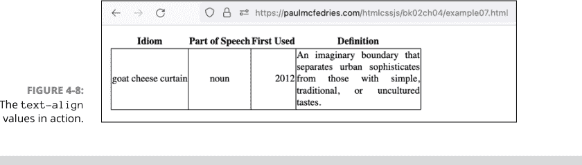

### 针对整个列

如示例所示，在 `<td>` 标签中添加 style 属性对于小表格来说没问题，但如果你的表格有几十行甚至几百行，那么给几十个或几百个 `<td>` 标签都添加一个样式声明就不是件有趣的事了。幸运的是，你可以使用一个特殊的 CSS 选择器，通过一条规则来针对特定的表格列：

```
td:nth-child(x) {
    declarations go here
}
```

这里，`x` 是你想要设置样式的列的编号。例如，以下规则将两端对齐应用于表格的整个第四列：

```
td:nth-child(4) {
    text-align: justify;
}
```

你将在第 3 册，第 3 章中学习更多关于强大的 nth-child 选择器的知识。

注意，我在第四个 `<td>` 标签中添加了 `width: 200px;` 声明。如果我不限制宽度，该列将只占据浏览器窗口中的所有可用宽度，这将无法显示两端对齐的效果。要了解更多关于 `width` 属性的信息，请参阅第 3 册，第 1 章。还要注意，我在每个单元格周围添加了一个边框，以便更容易注意到对齐效果。请查看本章后面的“添加边框”，了解如何使用表格边框。

### 单元格文本垂直对齐

你还可以在单元格内垂直对齐文本。当某个单元格相当大（因为它包含大量文本或一个相对较大的图像）而你想调整同一行中其他单元格的垂直位置时，这就派上用场了。要控制单元格内的垂直对齐，你可以使用 CSS 的 `vertical-align` 属性：

```
selector {
    vertical-align: 值;
}
```

或者，作为属性：

```
style="vertical-align: 值;"
```

对于 `值`，`vertical-align` 属性支持不少预定义的关键字，其中你需要知道的是：

- **bottom:** 将文本与单元格的底部对齐。
- **middle:** 将文本与单元格的垂直中心对齐。这是默认的垂直对齐方式。
- **top:** 将文本与单元格的顶部对齐。

例如，如果你想让你所有的 `td` 元素与单元格顶部对齐而不是居中对齐，你需要在你的 CSS 中添加以下规则：

```
td {
    vertical-align: top;
}
```

这是一个更大的示例，展示了所有三种 vertical-align 值（bko2cho4/example08.html）：

```
<table>
  <thead>
    <tr>
      <th>Idiom</th><th>Part of Speech</th><th>First Used</th><th>Definition</th>
    </tr>
  </thead>
  <tbody>
    <tr>
      <td style=" vertical-align: top;">
        goat cheese curtain
      </td>
      <td style=" vertical-align: middle;">
        noun
      </td>
      <td style=" vertical-align: bottom;">
        2012
      </td>
      <td style="text-align: justify; width: 200px;">
        An imaginary boundary that separates urban
        sophisticates from those with simple,
        traditional, or uncultured tastes.
      </td>
    </tr>
  </tbody>
</table>
```

如图 4-9 所示，第一列顶部对齐，第二列居中对齐，第三列底部对齐。

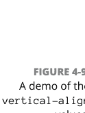

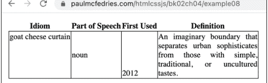

### 添加边框

默认情况下，Web 浏览器显示的表格没有任何边框，无论是在整个表格周围还是在行与列之间。这种无边框状态通常不是什么大问题，因为大多数表格的单元格内有足够的空白，这是由于单元格内容宽度的不同所致。

然而，如果表格的项目在每一列中的宽度大致相同，表格看起来就会非常拥挤，如图 4-10 所示（bk02ch04/example09.html）。

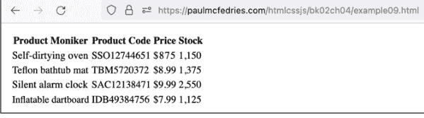

**图 4-10：** 有些表格看起来非常拥挤。

使此类表格更易阅读的一种方法是在表格本身周围以及每行每列之间都添加边框。要构建边框，你需要使用 CSS。具体来说，你可以使用 `border` 属性的以下简化语法：

```
selector {
    border: width style color;
}
```

这里，`selector` 是你想要设置样式的表格元素，`border` 属性接受以下值：

- **width:** 边框的厚度，可以用任何 CSS 兼容的测量单位（参见第 3 册，第 5 章）表示，例如 px（像素）。
- **style:** 边框的类型，可以是以下任何关键字：dotted, dashed, double, groove, ridge, inset, outset, 或 solid。我在第 3 册，第 1 章中解释了这些关键字。
- **color:** 边框的颜色，可以是任何 CSS 颜色值，例如关键字 black。要完整了解 CSS 颜色，请参阅第 3 册，第 6 章。

**记住** 这种简化的 `border` 属性语法适用于你的大多数表格需求。如果你想全面了解如何用 CSS 构建大型边框，请参阅第 3 册，第 1 章。

例如，要在表格的 th 和 td 元素周围放置一个 1 像素宽、实心、黑色的边框，你需要在你的 CSS 中添加以下规则（bko2cho4/example10.html）：

```
th, td {
    border: 1px solid black;
}
```

如果你仔细观察图 4-11 所示的表格，你会注意到每行和每列之间有一个微小的间隙。有这个间隙并不是什么坏事，但我认为你也会同意它看起来也不是特别吸引人。怎么消除它呢？

**图 4-11：** 边框添加到了表格的 th 和 td 元素上。

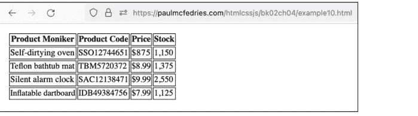

那个间隙来自边框间距，这是 Web 浏览器在每行和每列之间添加的空间。你将在下一节学习如何控制边框间距。你可能认为通过将边框间距设置为零可以解决“间隙问题”。是的，你绝对可以这样做，但这样看起来并不好，因为所有的内部边框都会变得两倍厚。（浏览器基本上只是将所有相邻的边框挤压在一起。）

更好的解决方案是使用 CSS 属性 `border-collapse` 对表格元素进行样式设置，并将其设置为 collapse，如下所示：

```
table {
    border-collapse: collapse;
}
```

如图 4-12 所示，边框之间的那些小间隙现在已成为历史（bko2cho4/example11.html）。

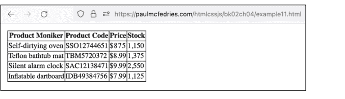

**图 4-12：** 边框之间不再有难看的间隙！

### 将数据放入带填充的单元格

图 4-12 中的表格比原始表格（如图 4-9 所示）稍微容易阅读一些，这要归功于边框，但不可否认的是，表格仍然显得拥挤且不吸引人。这是因为 Web 浏览器喜欢将数据尽可能紧密地塞进单元格，因此它们在单元格内容和单元格边框之间几乎不留下任何空间。这个空间称为 *单元格填充*，好消息是你可以通过一点 CSS 魔法来控制表格单元格中的填充量。

要给你的表格数据更多呼吸空间，请使用 *padding* 属性的以下简化语法：

```
selector {
    padding: 值;
}
```

这里，*selector* 是你想要设置样式的表格元素，*值* 是添加到单元格文本周围（上下左右）的填充量，可以用任何 CSS 认可的测量单位（参见第 3 册，第 5 章）表示，例如 *px*（像素）。

这种简化的 *padding* 属性语法对大多数表格来说都适用。要了解此属性的完整语法，请参阅第 3 册，第 1 章。


例如，要给表格的 *th* 和 *td* 元素周围添加 5 像素的空间，你需要在你的 CSS 中添加以下规则：

```
th, td {
    padding: 5px;
}
```

图 4-13 显示了更新后的表格（bk02ch04/example12.html）。啊，这样好多了。

亲手构建表格


### 本章内容

-   了解 Web 表单基础知识
-   添加一两个按钮
-   插入文本框和文本区域
-   添加复选框和单选按钮
-   使用列表和标签
-   在页面上放置选择器

# 第五章：使用表单使页面具有交互性

> 从最初的简单形态发展至今，HTML5 表单已变得极其灵活且功能强大，其原生功能便涵盖了我们开发者多年来一直用 JavaScript 添加的大部分功能。
> —— 彼得·加斯顿

在互联网上发布页面绝对是一种令人兴奋的体验。但当最初的兴奋感消退后，你可能会注意到一个发布后的现象：你的页面似乎只是静静地“待在那里”。诚然，页面静静地待在那里并非坏事，因为发布到网络的真正目的是提供他人想要阅读的信息。在这种情况下，页面静静地待在那里是一件好事。

不过，如果你的部分页面能为好奇的访客提供更多东西，那会更好。与其让人们总是匆匆浏览、阅读你的内容片刻后又匆匆离开，如果你能提供一些东西让他们多停留一会儿，岂不更妙？想办法让你的页面更具交互性，如何？

啊，说到点子上了，因为 HTML *确实* 提供了一种机制，可以将一个“仅仅待在那里”的网页转变为一个交互式网页：Web 表单。在本章中，你将探索 Web 表单所能提供的一切。在掌握了基础知识之后，你将研究 HTML Web 表单提供的令人惊叹的功能，这些功能不仅包括按钮、文本框和列表等标准小物件，还包括用于选择日期、颜色等更高级的控件。这真是一个名副其实的表单盛宴，所以准备好大快朵颐吧！

## 什么是 Web 表单？

大多数现代程序如果需要从你这里获取信息，都会弹出一个对话框。例如，选择程序的“打印”命令很可能会弹出某种打印对话框。这个对话框的目的是询问诸如打印份数、要打印的页面、要使用的打印机等信息。

表单本质上就是网页版的对话框。它是一个页面区域，其中包含文本框、列表、复选框、命令按钮和其他控件，用于从用户那里获取信息。例如，图 5-1 显示了我网站上的一个表单。这是一个供人们给我发送消息的表单。该表单包括一个用于填写姓名的文本框，另一个用于填写电子邮件地址的文本框，一个用于填写消息内容的较大文本区域，以及一个用于将数据发送到我的服务器的命令按钮。

Web 表单是一个小型的数据收集机器。它能收集哪些种类的数据？你能想到的它都能收集：

-   文本，从单个单词到长篇文章
-   数字、日期和时间
-   列表中被选中的项（或多项）
-   复选框是否被选中
-   一组单选按钮中哪一个被选中

收集到的数据之后会怎样？数据有两条可能的路径：服务器路径和本地路径。

### 沿着服务器路径行驶

服务器路径意味着你的 Web 服务器将参与其中。基本步骤如下：

1.  用户点击按钮提交表单。
2.  你的 JavaScript 代码收集表单数据并将其准备好以便发送。
3.  代码将表单数据发送到服务器上的一个脚本。
4.  服务器脚本提取表单数据。
5.  服务器脚本以某种方式处理表单数据（例如，从数据库中收集信息）。
6.  服务器脚本输出请求的数据或某种指示操作结果的代码。
7.  你的 JavaScript 代码处理服务器返回的数据，并相应地更新网页。

如果这一切听起来令人生畏地复杂，你是对的：确实如此，这就是为什么它远超本书范围的原因。

> 如果你真的有兴趣将表单数据提交到服务器，我有另一本书会告诉你所有你需要知道的内容。这本书是 *Web Coding and Development All-in-One For Dummies*（Wiley 出版）。

### 在本地路径漫步

本地路径完全不涉及 Web 服务器：

1.  用户以某种方式更改了表单数据。
2.  你的 JavaScript 代码检测到更改后的数据。
3.  与更改的表单字段关联的 JavaScript 代码根据更改的数据更新网页。

啊，这简单多了，不是吗？但用这种更有限的表单处理能做什么呢？实际上可以做很多事情：

-   **添加过滤器：** 如果你的页面很长，你可以给读者提供一个表单，使他们能够过滤内容。
-   **隐藏和显示内容：** 如果你的页面包含许多展开/折叠控件（点击时显示某些隐藏内容的对象；也称为手风琴控件），你可以添加按钮来一次性显示和隐藏所有隐藏内容。
-   **自定义页面：** 你可以提供一个表单，让访客以某种方式自定义页面的外观（例如，更改颜色或字体）。
-   **存储用户偏好：** 你可以使用表单来获取访客的个人信息或偏好设置，并将这些数据存储在浏览器中。
-   **进行计算：** 你可以构建一个表单，接受一个或多个输入，然后显示计算结果（例如抵押贷款还款额或从英制单位到公制单位的转换）。
-   **增强可访问性：** 你可以使用一个表单，让访客能够激活某些辅助功能特性，例如高对比度颜色和更大的字体尺寸。

在本章中，我将坚持使用本地路径的慢节奏，向你展示如何构建可以在本地使用的表单。要学习如何处理表单事件，你需要 JavaScript，所以我将这部分内容推迟到第四册第 11 章。

## 构建 Web 表单

你可以使用特殊的 HTML 标签亲手构建 Web 表单。最新版本的 HTML —— HTML5 —— 包含了许多新的表单特性，其中大部分现在都有了良好的浏览器支持，因此在接下来的几节中，我将向你展示表单领域中既经典又实用以及最新最棒的功能。

### 设置表单

要开始构建表单，你需要将所有内容包裹在 `<form>` 标签内：

```html
<form>
</form>
```

因为你只是使用表单为网页添加本地交互，而不会向服务器提交任何表单数据，所以从技术上讲，你根本不需要 `<form>` 标签。然而，在大多数情况下，你仍应使用它，因为包含 `<form>` 标签可以使用户通过按 Enter 或 Return 键提交表单，并且它还能在移动浏览器中为你提供一个提交按钮（例如“提交”）。

### 添加表单按钮

大多数表单都包含一个按钮，用户在完成表单并希望启动表单的底层操作时点击它。这被称为*提交*表单，这个术语传统上意味着将表单数据发送到服务器端脚本进行处理。然而，在当今，在本书中，“提交”表单也可以意味着在不向服务器发送任何内容的情况下更新网页上的某些内容。例如，点击一个按钮可能会设置页面的背景颜色。

提交表单的旧式方法是使用 `<input>` 标签，并将 `type` 属性设置为 `submit`：

```html
<input type="submit" value="buttonText">
```

这里的 *buttonText* 是按钮表面显示文本的占位符。

例如：

```html
<input type="submit" value="Submit Me!">
```

这种样式在现代 Web 开发中很少使用，因为样式化这样的按钮有点棘手。因此，大多数 Web 开发人员使用 `<button>` 标签代替：

```html
<button type="submit">buttonText</button>
```

这里的 *buttonText* 同样代表按钮表面显示的文本。

例如：

```html
<button type="submit">Ship It</button>
```

### 更改标题的位置

如果你用标题（caption）装饰你的表格，默认情况下，Web 浏览器会将标题文本放在表格上方。如果你希望表格标题显示在表格下方，可以使用 `caption-side` 属性来实现你的目标：

```css
caption {
    caption-side: bottom;
}
```

图 4-14 显示了一个标题位于底部的表格（bk02ch04/example13.html）。


### 处理文本字段

为了获得更美观的按钮，请使用 CSS 为以下内容设置样式：

-   **圆角：** 要控制按钮边角的圆润程度，请使用 `border-radius` 属性，将其设置为一个度量值（例如，以像素为单位）或百分比。例如：
-   **投影：** 要为按钮添加投影，请应用 `box-shadow: x y blur color` 属性，其中 `x` 是投影的水平偏移量，`y` 是投影的垂直偏移量，`blur` 是投影的模糊量，`color` 是投影颜色。例如：

```css
button {
    border-radius: 15px;
}
```

```css
button {
    box-shadow: 3px 3px 5px grey;
}
```

基于文本的字段是最常用的表单元素，其中大部分使用 `<input>` 标签：

```html
<input type="textType" name="textName" value="textValue" placeholder="textPrompt">
```

-   `textType`：你想在表单中使用的文本字段类型。
-   `textName`：你分配给该字段的名称。
-   `textValue`：字段的初始值（如果有的话）。
-   `textPrompt`：页面首次加载时临时显示在字段中的文本，用于提示用户所需输入的内容。一旦用户开始在该字段中输入，占位符文本就会消失。

以下是你可以用于 `type` 属性的可用基于文本的类型列表：

-   **`text`：** 显示一个文本框，用户在其中输入一行文本。添加 `size` 属性以指定字段的宽度（以字符为单位，默认值为 20）。这是一个示例：

```html
<input type="text" name="company" size="50">
```

-   **`number`：** 显示一个文本框，用户在其中输入数值。大多数浏览器会添加一个微调框，使用户可以通过单击向上或向下箭头分别增加或减少数字。看看这个示例：

```html
<input type="number" name="points" value="100">
```

我还应该提一下 `range` 类型，它显示一个滑块控件，使用户可以单击并拖动以选择介于指定最小值和最大值之间的数值：

```html
<input type="range" name="transparency" min="0" max="100" value="100">
```

-   **`email`：** 显示一个文本框，用户在其中输入电子邮件地址。添加 `multiple` 属性以允许用户输入两个或多个地址，用逗号分隔。添加 `size` 属性以指定字段的宽度（以字符为单位）。给你一个示例：

```html
<input type="email" name="user-email" placeholder="you@yourdomain.com">
```

-   **`url`：** 显示一个文本框，用户在其中输入 URL。添加 `size` 属性以指定字段的宽度（以字符为单位）。这是一个示例：

```html
<input type="url" name="homepage" placeholder="e.g., http://domain.com/">
```

-   **`tel`：** 显示一个文本框，用户在其中输入电话号码。使用 `size` 属性以指定字段的宽度（以字符为单位）。这是一个示例：

```html
<input type="tel" name="mobile" placeholder="(xxx) xxx-xxxx">
```

-   **`time`：** 显示一个文本框，用户在其中输入时间，通常是小时和分钟。例如：

```html
<input type="time" name="start-time">
```

-   **`password`：** 显示一个文本框，用户在其中输入密码。输入的字符显示为点（·）。添加 `autocomplete` 属性以指定用户的浏览器或密码管理软件是否可以自动输入密码。将该属性设置为 `current-password` 以允许密码自动填充，或设置为 `off` 以禁止自动填充。需要示例吗？好的：

```html
<input type="password" name="userpassword" autocomplete="current-password">
```

-   **`search`：** 显示一个文本框，用户在其中输入搜索词。添加 `size` 属性以指定字段的宽度（以字符为单位）。哦，是的，我确实有一个示例：

```html
<input type="search" name="q" placeholder="Type a search term">
```

-   **`hidden`：** 向表单添加一个输入字段，但不向用户显示该字段。我知道这听起来很奇怪，但它是存储你希望包含在提交中、但又不希望用户注意或修改的值的便捷方式。这是一个示例：

```html
<input id="userSession" name="user-session" type="hidden" value="jwr274">
```

一些较旧的浏览器不支持像 email 和 time 这样的特殊文本字段，但你仍然可以在你的页面中使用它们，因为那些“无知”的浏览器会忽略 `type` 属性，只显示一个标准文本字段。

文本相关字段真是多，但你还没完！还有两个你需要了解的：

-   **`<textarea>`：** 此标签显示一个文本框，用户可以在其中输入多行文本。添加 `rows` 属性以指定显示多少行文本。如果你希望在文本框中显示默认文本，请将文本放在 `<textarea>` 和 `</textarea>` 标签之间。这是一个示例：

```html
<textarea name="message" rows="5">
Default text goes here.
</textarea>
```

-   **`<label>`：** 将标签与表单字段关联起来。有两种使用标签的方法：

方法 #1 —— 用 `<label>` 和 `</label>` 标签包围表单字段，并在字段之前或之后插入标签文本，如下所示：

```html
<label>
Email:
<input type="email" name="user-email" placeholder="you@yourdomain.com">
</label>
```

方法 #2 —— 为字段的标签添加一个 `id` 值，将 `<label>` 标签的 `for` 属性设置为相同的值，并在 `<label>` 和 `</label>` 标签之间插入标签文本，就像我在这里所做的这样：

```html
<label for="useremail">Email:</label>
<input id="useremail" type="email" name="user-email"
       placeholder="you@yourdomain.com">
```

图 5-2 演示了所有这些文本字段（有关代码，请查看本书示例文件中的 `bk02ch05/example01.html`）。

**图 5-2：** 你可以在表单中使用各种文本输入类型。

### 添加复选框

你在 Web 表单中使用复选框来切换设置的开（即选中复选框）和关（取消选中复选框）。你可以通过在表单中包含以下版本的 `<input>` 标签来创建复选框：

```html
<input type="checkbox" name="*checkName*" value="*checkValue*"
       [checked]>
```

-   **checkName**：你想要分配给复选框的名称。
-   **checkValue**：你想要分配给复选框的值。
-   **checked**：当存在此可选属性时，复选框最初是选中的。

这是一个示例（查看 `bko2cho05/example02.html`）：

```html
<fieldset>
    <legend>
        What's your phobia? (Please check all that apply):
    </legend>
    <label>
        <input type="checkbox" name="phobia" value="Ants">Myrmecophobia (Fear of ants)
    </label>
    <label>
        <input type="checkbox" name="phobia" value="Bald">Peladophobia (Fear of becoming bald)
    </label>
    <label>
        <input type="checkbox" name="phobia" value="Beards" checked>Pogonophobia (Fear of beards)
    </label>
    <label>
        <input type="checkbox" name="phobia" value="Bed">Clinophobia (Fear of going to bed)
    </label>
    <label>
        <input type="checkbox" name="phobia" value="Chins" checked>Geniophobia (Fear of chins)
    </label>
    <label>
        <input type="checkbox" name="phobia" value="Flowers">Anthophobia (Fear of flowers)
    </label>
    <label>
        <input type="checkbox" name="phobia" value="Flying">Aviatophobia (Fear of flying)
    </label>
    <label>
        <input type="checkbox" name="phobia" value="Purple">Porphyrophobia (Fear of purple)
    </label>
    <label>
        <input type="checkbox" name="phobia" value="Teeth" checked>Odontophobia (Fear of teeth)
    </label>
    <label>
        <input type="checkbox" name="phobia" value="Thinking">Phronemophobia (Fear of thinking)
    </label>
    <label>
        <input type="checkbox" name="phobia" value="Vegetables">Lachanophobia (Fear of vegetables)
    </label>
    <label>
        <input type="checkbox" name="phobia" value="Fear" checked>Phobophobia (Fear of fear)
    </label>
    <label>
        <input type="checkbox" name="phobia" value="Everything">Pantophobia (Fear of everything)
    </label>
</fieldset>
```

关于此代码的一些说明：

-   你使用 `<fieldset>` 标签将一组相关的表单字段分组在一起。
-   你使用 `<legend>` 标签为其父 fieldset 元素创建标题。图 5-3 显示了这在浏览器中的外观。
-   因为 `<input>` 标签被包裹在各自的 `<label>` 标签中，用户可以通过单击复选框本身或其标签来选择或取消选择每个复选框。
-   为了使每个复选框独占一行，我在 `label` 元素的 CSS 中添加了声明 `display: block`。查看第 3 册，第 1 章以了解 `display` 属性的工作原理。

## 处理单选按钮

如果你想为用户提供一组相关的选项，其中一次只能选择一个，那么单选按钮（有时称为选项按钮）就是合适的工具。表单单选按钮以两个或更多为一组聚集在一起，并且任何时候都只能选择组中的一个按钮。如果用户单击该组中的另一个按钮，它将被选中，而先前选中的按钮将被取消选中。


你可以通过以下`<input>`标签的变体来创建一个单选按钮：

```html
<input type="radio" name="radioGroup" value="radioValue"
 [checked]>
```

- **radioGroup：** 你想分配给单选按钮组的名称。所有使用相同名称值的单选按钮都属于该组。
- **radioValue：** 你想分配给该单选按钮的值。如果在提交表单时选中了此单选按钮，则会发送此值。
- **checked：** 当存在这个可选属性时，单选按钮最初是选中的状态。

下面是一个示例，图5-4展示了效果（bk02ch05/example03.html）：

```html
<fieldset>
    <legend>
        Select a delivery method
    </legend>
    <div>
        <input type="radio" id="carrier-pigeon" name="delivery"
            value="pigeon" checked>
        <label for="carrier-pigeon">Carrier pigeon</label>
    </div>
    <div>
        <input type="radio" id="pony-express" name="delivery" value="pony">
        <label for="pony-express">Pony express</label>
    </div>
    <div>
        <input type="radio" id="snail-mail" name="delivery" value="postal">
        <label for="snail-mail">Snail mail</label>
    </div>
    <div>
        <input type="radio" id="some-punk" name="delivery" value="bikecourier">
        <label for="some-punk">Some punk on a bike</label>
    </div>
</fieldset>
```

图5-4：一些单选按钮表单字段。

### 添加选择列表

选择列表是HTML表单中常见的元素，因为它们允许网页开发者在一个大多数用户都知道如何操作的紧凑控件中显示相对大量的选项。在决定使用复选框、单选按钮组还是选择列表时，可以遵循一些大致的准则：

- 如果一个选项或设置只有两个可以用“开”和“关”表示的值，请使用复选框。
- 如果该选项或设置有三个或四个值，请使用由三个或四个单选按钮组成的组。
- 如果该选项或设置有五个或更多值，请使用选择列表。

本节将向你展示如何创建选择列表。在学习这部分内容时，请记住选择列表实际上是两种字段类型的组合：列表容器和该容器中的选项。前者是一个`select`元素，后者是一组`option`元素的集合。

要创建列表容器，请使用`<select>`标签：

```html
<select name="selectName" size="selectSize" [multiple]>
```

- **`selectName`：** 你想分配给选择列表的名称。
- **`selectSize`：** 选择列表框中可见行数的可选值。如果你省略此值，浏览器将列表显示为下拉框。
- **`multiple`：** 当存在这个可选属性时，允许用户在列表中选择多个选项。

对于列表中的每个项目，你在`<select>`和`</select>`标签之间添加一个`<option>`标签：

```html
<option value="optionValue" [selected]>
```

- **`optionValue`：** 你想分配给列表选项的值。
- **`selected`：** 当存在这个可选属性时，列表选项最初是选中的。

这里有一些示例（bk02ch05/example04.html）：

```html
<form>
    <div>
        <label for="hair-color">Select your hair color:
        </label><br>
        <select id="hair-color" name="hair-color">
            <option value="black">Black</option>
            <option value="blonde">Blonde</option>
            <option value="brunette" selected>Brunette</option>
            <option value="red">Red</option>
            <option value="neon">Something neon</option>
            <option value="none">None</option>
        </select>
    </div>
    <div>
        <label for="hair-style">Select your hair style:
        </label><br>
        <select id="hair-style" name="hair-style" size="4">
            <option value="bouffant">Bouffant</option>
            <option value="mohawk">Mohawk</option>
            <option value="page-boy">Page Boy</option>
            <option value="permed">Permed</option>
            <option value="shag">Shag</option>
            <option value="straight" selected>Straight</option>
            <option value="none">Style? What style?</option>
        </select>
    </div>
    <div>
        <label for="hair-products">Hair products used in the last year:</label><br>
        <select id="hair-products" name="hair-products" size="5" multiple>
            <option value="gel">Gel</option>
            <option value="grecian-formula">Grecian Formula</option>
            <option value="mousse">Mousse</option>
            <option value="peroxide">Peroxide</option>
            <option value="shoe-black">Shoe black</option>
        </select>
    </div>
</form>
```

这里有三个列表（参考图5-5）：

- **hair-color：** 这个列表没有指定size，因此浏览器将其显示为下拉列表。
- **hair-style：** 这个列表使用了size值为4，所以列表中可见四个选项。
- **hair-products：** 这个列表使用了size值为5，所以列表中可见五个选项。此外，设置了multiple属性，因此你可以在列表中选择多个选项。

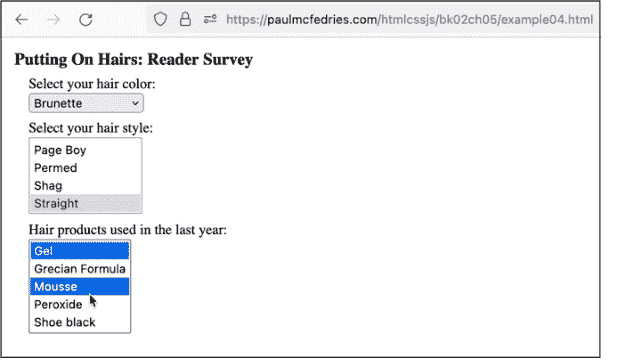

**图5-5：** 选择列表的一些示例。

### 引入选择器

HTML还提供了一些其他`<input>`标签类型，我将其归类为“选择器”。这意味着在每种情况下，字段会显示一个按钮，点击该按钮会打开一个控件，使用户能够选择一个值。以下是可用选择器的快速概览：

- **color**：打开一个颜色选择器对话框，使用户可以选择一种颜色。颜色选择器根据浏览器和操作系统的不同而有所差异；图5-6展示了Mac版的Google Chrome。将value属性设置为#rrggbb格式以指定初始颜色（默认值为黑色：#000000）。这里有一个示例（bk02ch05/example05.html）：

```html
<input type="color" name="bg-color" value="#4f5392">
```

> 如果文本#rrggbb对你来说没有意义，别担心：我在第3册第6章中对此有详细的解释。

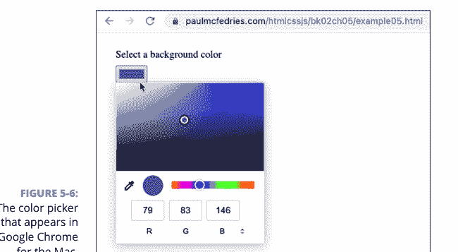

- **date**：打开一个日期选择器对话框，以便用户可以选择一个日期。图5-7展示了Microsoft Edge版本。将value属性设置为yyyy-mm-dd格式以指定初始日期。请注意，用户看到的日期可能使用不同的格式（例如mm/dd/yyyy，如图5-7所示），但元素返回的值始终采用yyyy-mm-dd格式。这里有一个示例（bk02ch05/example06.html）：

```html
<input type="date" name="appt-date" value="2023-08-23">
```


**图5-7：** Microsoft Edge中出现的日期选择器。

- **file**：显示一个“选择文件”按钮（参考图5-8），点击该按钮会打开用户操作系统中的文件选择器对话框，以便用户可以选择一个文件。你可以添加multiple属性来允许用户选择多个文件。这里有一个示例（bk02ch05/example07.html）：

```html
<input type="file" name="user-photo">
```


**图5-8：** Chrome中出现的文件选择器。

- **month**：打开一个月份选择器对话框（参考图5-9），使用户可以选择一个月份和年份。将value属性设置为yyyy-mm格式以指定初始月份和年份。用户看到的值可能采用不同的格式（例如August 2023），但元素返回的值始终采用yyyy-mm格式。这里有一个示例（bk02ch05/example08.html）：

```html
<input type="month" name="birthday-month" value="2023-08">
```


图5-9：Microsoft Edge中出现的月份选择器。

- **week**：打开一个周选择器对话框（参考图5-10），供用户选择一年中的一周。要指定初始年份和月份，请将value属性设置为yyyy-Wnn格式，其中nn是两位数的周数。显示给用户的值可能采用其他格式（例如Week 34, 2023），但元素返回的值始终采用yyyy-Wnn格式。这里有一个示例（bk02ch05/example09.html）：

```html
<input type="week" name="vacation-week" value="2023-W34">
```


图5-10：Chrome中出现的周选择器。


### 本章内容

-   理解网络无障碍的重要性
-   了解残障人士如何上网冲浪
-   构建便于无障碍访问的页面结构
-   使图像和其他网页媒体内容可访问
-   选择无障碍的颜色方案
-   验证页面的无障碍性

# 第六章

## 让你的网页实现无障碍访问

> 网络的力量在于其普适性。无论是否存在障碍，所有人都应能访问，这是一个基本方面。
> 
> — 蒂姆·伯纳斯-李（万维网发明者）

如果你很幸运，拥有良好的视力、足够的听力、正常的运动技能，并且大脑运作良好（至少大多数时候是这样），那么很容易陷入一个陷阱，即认为*每个*访问你网站的人在生活中都同样幸运。陷入这个陷阱意味着你在构建网站时会认为，如果它对你来说看起来不错、运行良好，那么它对所有访客也都会如此。

在本章中，我希望能说服你，无论你在生活中拿到了多好的牌，都应该体贴、有道德、明智地记住，有很多人——我指的是全世界*十亿*人——由于某种严重的身体或精神障碍，被发了更难打的牌。在本章中，我希望能说服你，你的网页，无论多么简单，除非你使它们对每个人、无论其能力如何都可以无障碍访问，否则就不算完成。在本章中，我希望能说服你，配置你的页面使其对每位访客都无障碍，不仅是正确的事，也是容易做到的事。

## 为什么要让你的页面实现无障碍访问

如果你要开一家实体店零售业务，你不太可能设计一个用带刺铁丝网堵住店门的店面吧！当然，某些敏捷或腿特别长的人可能还能通过跳过或跨过铁丝网进入你的商店，但你究竟为什么要这样设计来阻止其他人进入呢？你当然不会，因为这种程度的不无障碍显然适得其反，而且，嗯，很愚蠢。

当你设计一个只为视力和听力正常、并且对自己的四肢和头脑有足够控制力的人看起来不错、运行良好时，你实际上就是用数字世界中相当于带刺铁丝网的东西阻挡了对你页面的访问。

### 无障碍是一项权利

联合国《残疾人权利公约》要求利益相关方采取措施“促进残疾人无障碍获取新的信息和通信技术及系统，包括互联网。”换句话说，访问网络无异于一项*基本人权*。

在规划网页时，体贴的开发者时刻牢记访问和使用该页面的人具有不同的能力。在规划网页时，有道德的开发者理解，尽管每个人都是不同的，但他们都有平等使用该页面的权利。当你给予每个人平等访问你网页的权利时，你就是在让你的页面变得*可访问*。

因此，无障碍不仅是一项权利，也是应该做的事情。


在在线讨论和文章中，无障碍性通常被缩写为 *a11y*：即字母 *a*，后面跟着数字 *11*，然后是字母 *y*。为什么是 11？因为这正是单词 *accessibility* 中 *a* 和 *y* 之间的字母数量。此外，*a11y* 看起来像单词 *ally*（盟友），这强调了任何实施无障碍功能的人都是残障人士盟友的观念。

### 无障碍带来其他好处

我相信，道德和伦理上正确地让你的网页对所有来访者无障碍访问，已经是你所需的全部动力。然而，让你的页面实现无障碍访问确实会带来其他好处。

例如，一个以无障碍为理念构建的页面也是一个对搜索引擎友好的页面，这意味着你的无障碍页面在搜索结果中的排名会高于类似的非无障碍页面。

无障碍页面也为非残障群体带来好处，例如那些关闭图像浏览的人，或者必须处理极慢网速的人。

最后，很容易从业务角度论证实施无障碍的必要性：

-   **无障碍让你立即进入一个巨大的市场：** 根据世界卫生组织的数据，约有13亿人患有某种形式的严重障碍，据估计，这十亿多人拥有超过六万亿美元的消费能力。这是一个很大的数字！如果你想在你的网站上销售东西，为什么要排除如此巨大的一部分市场呢？
-   **无障碍也可能是法律要求的：** 在许多司法管辖区，商业网站不可访问现在是非法的。大多数国家都有政策要求企业为所有人提供平等访问的机会。如果你的企业网站面向全球，未能使网站可访问将使你的公司面临巨大的法律风险。
-   **无障碍让你看起来不错：** 让你的业务页面对所有人无障碍访问会创造商誉，提升品牌形象，让你成为解决方案的一部分，而不是问题的一部分。


无论是什么激励你让你的页面实现无障碍访问，都是极好的。然而，重要的是要记住，让你的网站对百分之百的访客实现百分之百的无障碍，虽然可能是一个崇高而有价值的目标，但实际上几乎是不可能实现的，正如后续页面将要解释的那样。

## 理解网络无障碍

必须为你的页面添加功能以使其可访问，这难道不是一种负担吗？不，根本不是。只要你在构建页面时从一开始就考虑到平等访问，那么融入无障碍功能几乎不需要你付出多少努力。

正如你在本章后面所看到的，网络无障碍实现起来并不困难或繁重。或者，我应该说，如果你理解谁需要无障碍功能以及他们为什么需要这些功能，以及残障人士使用哪些类型的辅助技术，那么实现起来就不困难或繁重。接下来的几个小节将告诉你需要知道的一切。

### 理解谁需要无障碍

如今关于网络创新的一个主要抱怨是，网络开发者构建的应用和服务只解决了开发者自己的问题。送餐、送货上门和宠物看护服务只是众多例子中的一些。这里的问题在于，认为如果我有一个需要解决的问题，世界上的其他人也一定想要解决这个问题。更广泛地说，这些应用是网络开发者假设使用网站的每个人都基本上和自己一样的例子。

> **无障碍不仅仅关乎残障人士**

尽管你的无障碍工作的重点应放在尽可能满足残障用户的需求上，但重要的是要记住，你的无障碍调整也帮助了许多其他用户，包括以下几类：

-   使用非标准设备上网的用户，例如智能电视、智能手表和游戏机。这些设备通常要么完全不支持鼠标，要么只提供移动和点击指针的基本功能。所以，在这个意义上，这些设备的用户面临的挑战与运动障碍人士有许多相似之处。
-   使用网速较慢、带宽限制严格或低功耗计算机的用户可能会关闭图像浏览，这样网站加载更快，使用的带宽也更少。因此，这些用户与视力受损者相似，因为他们都依赖你对页面图像的描述。
-   使用智能手机和平板电脑等移动设备上网的用户通常无法使用鼠标。因此，依赖于，比如说，将鼠标指针悬停在页面对象上的网站功能对这些用户将不起作用，这使得他们与无法使用鼠标的人具有相似性。

考虑到这些用户，你可以看到“无障碍”可以从最广泛的意义上定义为让你的网站尽可能为更多人提供功能性。


要真正*理解*无障碍性，第一步是深入理解一个简单的事实：

*你的用户不是你。*

特别值得注意的是，访问你网站的人中有惊人比例（估计从5%到20%不等）会因不同程度的某种残疾而生活。

我谈论的是哪种类型的残疾？规划无障碍性意味着考虑以下情况：

-   **视觉障碍：** 包括完全或部分失明、色盲和视力下降。
-   **听觉障碍：** 包括完全或部分耳聋、听力困难、无法听到某些频率的声音以及耳鸣。
-   **运动障碍：** 包括无法使用鼠标等指针设备、活动受限、缺乏精细运动控制、过度颤抖或摇晃，以及反应迟缓或反应时间过长。
-   **认知障碍：** 包括学习障碍、注意力集中问题、记忆力受损以及极度容易分心。

在每种情况下，残疾可能出生时就存在，也可能是由疾病或创伤引起的。然而，同样重要的是要记住，一种或多种这些残疾可能仅仅是衰老的结果。那些不再年轻的人（甚至可以说不再处于巅峰状态）可能视力下降、部分或完全耳聋、运动控制能力减弱，以及轻度至显著的认知能力受损。并且，由于我们的人口（除少数例外）正在迅速老龄化，以某种形式患有残疾上网的人数只会越来越多。

### 了解用于网页浏览的辅助技术

知道许多访问你页面的人会有这种或那种残疾是一回事。然而，除非你也知道这种残疾如何改变了这些人的网络体验，否则这种知识对你帮助不大。视力有限的人如何“阅读”网页？无法控制鼠标的人如何“点击”链接？

这些类似问题的答案是，大多数残疾人使用某种形式的软件或硬件工具来帮助他们浏览、阅读、导航和与网页进行交互。这些工具统称为*辅助技术*，了解残疾用户所使用的工具对于帮助你设计无障碍的网页至关重要。

#### 针对视觉障碍的辅助技术

视力有限的人使用各种辅助技术来使屏幕元素更易于看清：

-   **屏幕放大器：** 一种放大屏幕一部分的硬件设备或软件实用程序。Windows 提供 Magnifier 程序；macOS 有缩放功能。
-   **网页浏览器的缩放功能：** 所有主流网页浏览器都提供缩放命令，可以放大整个页面。
-   **自定义浏览器文本大小：** 所有主流浏览器都允许用户设置自定义文本大小。

对于失明或接近失明的用户，屏幕阅读器是首选的辅助技术。*屏幕阅读器*是一个软件程序，它会朗读网页上出现的所有文本，包括以下内容：

-   标题
-   页面文本
-   链接文本
-   图片和其他媒体的描述

有第三方的屏幕阅读器可用，但所有操作系统都有内置的屏幕阅读器，包括 Windows 的 Narrator 和 macOS 的 VoiceOver。能够免费使用操作系统中强大的屏幕阅读器是个好消息，因为这意味着你可以启动它，并尝试用它上网冲浪，以感受它的工作原理。

#### 针对听觉障碍的辅助技术

听力不佳的人通常使用特殊的耳机或助听器来增强声音输入。然而，对于耳聋或接近耳聋的人，你可以采取一些措施：

-   如果你的页面有视频内容，视频应包含启用字幕的功能。
-   如果你的页面有音频内容，你应该提供一个音频文字稿的链接。

#### 针对运动障碍的辅助技术

一些患有严重运动障碍的人只能使用头部指向设备来上网（或使用任何计算机功能）。然而，对于大多数运动障碍者来说，主要问题是他们缺乏足够的控制能力来操作鼠标或触控板。相反，他们依靠键盘与网页进行交互，因此你的页面需要能够通过键盘输入进行导航。请参阅本章后面的“让你的页面对键盘友好”。

#### 针对认知障碍的辅助技术

一些患有特定类型认知障碍的人使用软件工具来帮助他们专注于手头的任务。你也可以设置你的网页来帮助人们集中注意力并避免不必要的混淆：

-   不要仅仅为了炫酷而在页面上添加花哨效果。尽可能保持页面设计简单。
-   在所有页面中保持导航和布局的一致性。
-   为填写表单等任务提供清晰简单的说明。
-   只要可能，遵循网络惯例，例如带下划线的链接文本。

## 使你的页面结构无障碍

到目前为止，让网页无障碍性取得巨大进展最简单的方法是将无障碍性融入到 HTML 结构本身中。这是否意味着要经历一堆新的挑战并学习一堆新的标签和属性？不。恰恰相反：它实际上意味着按照我在本书前面谈到的方式使用标题和语义分节元素（参见第2册，第1章）。

### 分层使用标题

屏幕阅读器用户通常通过浏览标题来了解页面的概况。为了帮助这些用户，你应该首先确保你的标题在朗读时有意义，并准确描述了后续部分的内容。你还应该以尊重其内置层级的方式使用标题：

-   每页只使用一个 h1 元素：该 h1 元素应该是页面标题。
-   使用 h2 作为标题：对于页面上的所有主要标题，使用 h2 元素。
-   **使用 h3 作为子标题，依此类推：** 在每个 h2 元素内，主要的子标题应该是 h3 元素。同样，在 h3 内，主要的子子标题应该是 h4 元素；在 h4 内，主要的子子子标题应该是 h5 元素；在 h5 内，主要的子子子子标题应该是 h6 元素。
-   **不要跳过标题：** 不要仅仅因为你喜欢或者觉得文本看起来不错，就从 h2 直接跳到 h4（参见下一项）。
-   **不要将标题用于装饰目的：** 不要仅仅因为你需要加粗的东西或者喜欢标题文本的大小就使用标题。那是 CSS 该做的事情。

### 使用语义分节元素

你当然可以只用样式化的 div 元素来构建你的页面（而且令人震惊的是，许多网页编码员正是这样做的！），但结果不仅混乱无结构，而且对无障碍性来说也是一场噩梦。为什么？因为屏幕阅读器或其他辅助技术几乎无从下手。当然，它仍然会朗读（或其他方式呈现）页面内容，但会缺乏上下文。

幸运的是，使用我在第2册第1章中谈到的语义分节元素（如 header、nav、main、article 和 footer）来构建页面并不会花费你更多时间。这种方法不仅为页面布局提供了受欢迎的结构，而且免费赋予了你无障碍性，因为这些所谓的地标帮助辅助技术理解页面，屏幕阅读器会将底层的语义含义作为朗读内容的一部分。

例如，当屏幕阅读器遇到 nav 元素时，它通常会说“导航”，当它遇到 header 元素时，它通常会说“横幅”。

## 使文本无障碍

几乎所有的网页主要都是文本，因此，如果你能使你的文本无障碍，那么你就在使页面无障碍的道路上迈进了一大步。以下是一些需要牢记的要点：

-   **不要使用绝对的度量单位来设置文本大小：** 视力有困难的人在上网前可能首先做的一件事是...

## 自定义浏览器，使用更大的默认文本大小。如果你随后使用绝对测量单位（如像素）来设置文本样式，就会覆盖那个更大的默认大小。你突然变得极不受欢迎，不仅对那个人，对所有费心调整浏览器文本的人也是如此。可访问的文本从使用相对测量单位（如 em 或 rem）的文本大小开始。（对此感到困惑吗？别担心：我在第 3 册第 5 章中非常详细地介绍了 CSS 测量单位。）

» **确保文本可读：**不要把你的文本弄得小得离谱，并确保文本颜色和背景颜色之间提供足够的对比度（参见本章后面的“确保足够的颜色对比度”）。

» **使链接文本具有描述性。**对于页面上的每个链接，链接文本应描述链接另一端的内容。屏幕阅读器会朗读链接文本，因此如果你的链接只写着“Click”或“Click here”，你并没有告诉访问者关于链接去向的任何有用信息。

请这样做：

```html
<a href="kumquats.html">Learn more about kumquats</a>
```

不要这样做：

```html
To learn more about kumquats, <a href="kumquats.html">click here</a>
```

» **非必要时不要隐藏文本：**可以使用 CSS 或 JavaScript 来暂时隐藏当前不需要显示的文本。例如，你可以创建选项卡，其中一个选项卡的内容可见，而其他选项卡的内容不可见。使某些文本不可见的标准方法是隐藏它，但这会对屏幕阅读器造成混乱，因为它们看不到隐藏的文本。因此，如果可以，请永远不要隐藏页面文本。

# 使媒体可访问

网页文本本质上对可访问性友好，因为屏幕阅读器默认会朗读它，并且只要你稍加注意，你可以使文本更容易被视力不太完美的阅读者阅读。不幸的是，这种友好性并不适用于网页媒体，包括图像、视频和音频片段。这些元素更难实现可访问性，但你仍然可以做很多事情来确保所有访问者都能享受你的页面媒体元素。

## 为图像指定替代文本

为了帮助视障用户或关闭图像浏览的用户，你可以使用 `` 标签的 `alt` 属性为页面上的每个重要图像提供描述。对于视障用户，屏幕阅读器会朗读每个 `` 标签的 `alt` 属性的值，因此重要的或结构性的图像应包含一个简短的描述作为 `alt` 值：

```html

```

以下是一些关于编写有用 `alt` 文本的注意事项：

-   保持简短。冗长的描述很少被需要或有用。
-   直接说明图像代表什么。
-   包括图像中有意义的细节。这里，*有意义*是指与页面上下文或周围文本相关。
-   不要重复周围文本中已有的任何信息。
-   对于纯装饰性图像，你不需要添加 `alt` 值，但你必须包含 `alt` 标签（设置为空字符串：`alt=""`），否则你的 HTML 代码将无法验证。

## 使其他媒体可访问

与图像相比，视频和音频内容需要更多工作来使其可访问，这本质上意味着执行以下操作之一：

-   **音频内容：**听觉障碍用户无法听到通过 `audio` 元素传递的内容。你可以通过提供音频的文字记录来支持这些用户。
-   **视频内容：**视觉障碍用户无法看到通过 `video` 元素传递的内容，而听觉障碍用户无法听到视频元素的音频轨道。对于后者，应提供视频音频轨道的文字记录。对于前者，你的视频应具有隐藏式字幕或在视频播放时出现的字幕。

使字幕在视频播放时出现的一种方法是创建 Web Video Text Tracks (WebVTT) 文件，这是一个包含时间提示和在这些提示期间显示的文本的文本文件。

> 构建 WebVTT 文本文件很简单，但它超出了本书的范围。幸运的是，Mozilla 开发者网络上有关于该格式的优秀描述：https://developer.mozilla.org/en-US/docs/Web/API/WebVTT_API

获取 WebVTT 文件（使用 `.vtt` 扩展名）后，你然后使用 `track` 元素让浏览器知道该文件可用于 `video` 元素：

```html
<track kind="type" src="filename">
```

-   `kind`：指定轨道的类型。对于 `value`，你可以使用以下任何关键字：`subtitles`（这是默认值）、`captions`、`descriptions`（视频内容的描述）或 `chapters`（仅章节标题）。
-   `src`：WebVTT 文件的文件名（以及路径，如果文件位于存储 HTML 文件的目录之外）。

你将 `<track>` 标签插入 `<video>` 和 `</video>` 标签之间，如下所示：

```html
<video
    src="/media/videos/kumquats.mp4"
    controls>
    <track
        kind="captions"
        src="/media/cc/kumquats-captions.vtt">
</video>
```

## 增强页面可访问性语义

每当你戴着“可访问性”的帽子时，你需要为页面上的每个元素问自己的一个关键问题是：“辅助技术可能需要知道关于这个元素的什么信息？”也就是说，你需要提供什么信息，以便屏幕阅读器或类似的辅助技术能够确定元素的目的？

换句话说，你想让每个元素的 `含义` 变得清晰，而你提供的关于每个元素含义的信息被称为 `可访问性语义`。在接下来的几节中，我将讨论几种增强页面可访问性语义的方法。

### 添加表单字段标签

在第 2 册第 5 章中，我讨论了 `label` 元素，你可以使用它将文本标签或标题与表单字段关联起来。有两种方法可以使用：

-   >> **隐式标签：**用 `<label>` 和 `</label>` 标签包围表单字段，并在字段之前或之后插入标签文本。以下是一个示例：

```html
<label>
    Favorite vegetable:
    <input type="text">
</label>
```

-   >> **显式标签：**在字段标签中插入 id 值，将 `<label>` 标签的 `for` 属性设置为相同的值，并在 `<label>` 和 `</label>` 标签之间插入标签文本。例如：

```html
<label for="fave-veg">Favorite vegetable:</label>
<input id="fave-veg" type="text">
```

添加 `<label>` 标签提供了两个可访问性优势：

-   >> 它使用户也可以通过单击标签来选择字段。这增加了点击的目标区域，有助于手不稳的用户。
-   >> 标签文本现在与字段相关联，这意味着当用户选择字段时，屏幕阅读器将朗读标签文本。

确保为每个 `<input>` 标签以及每个 `<select>` 和 `<textarea>` 标签添加标签。

### 理解 ARIA 角色、状态和属性

万维网联盟是 Web 可访问性倡议 (WAI) 的所在地，其目标是使网络成为对每个人都可访问的地方。WAI 的一项关键技术是可访问富互联网应用程序 (ARIA)，它是一系列角色、状态和属性，旨在将可访问性语义引入网页用户界面的每个元素：

» **ARIA 角色**：一个定义页面元素代表何种用户界面控件的关键词。例如，如果你将一个 `div` 元素编码成看起来和运行起来像一个命令按钮，那么该元素的角色就是 `button`。你可以使用 `role` 属性为元素分配角色，如下所示：

```html
<div role="button">Apply Changes</div>
```

» **ARIA 属性**：描述用户界面控件某个方面的值。例如，如果你想在可编辑的 `div` 元素中包含占位符文本，你可以通过添加 `aria-placeholder` 属性来让辅助技术知道占位符：

```html
<div
    contenteditable
    role="textbox"
    aria-placeholder="user@domain.com">
</div>
```

» **ARIA 状态**：指定用户界面控件当前条件的键盘或值。例如，如果你的 Web 应用程序使用一个 `div` 元素作为开/关开关，但该元素当前已禁用，你可以通过将 `aria-disabled` 属性设置为 `true` 来向辅助技术发出该禁用状态的信号：

```html
<div role="switch" aria-disabled="true"></div>
```

ARIA 角色有三个主要类别：

-   » 地标角色
-   » 节结构角色
-   » 小部件角色

> [!NOTE]
> 我将在接下来的几节中讨论每个类别中的角色。然而，重要的是要理解，如果你使用语义 HTML 元素，则不需要使用 ARIA 角色，因为这些元素具有辅助技术能够理解的隐式角色。例如，`button` 元素具有隐式的 `button` 角色，因此无需在 `<button>` 标签中包含 `role="button"`。参见 https://developer.mozilla.org/en-US/docs/Web/Accessibility/ARIA/Roles/ 以获取关于 ARIA 角色令人满意的完整介绍。


#### 里程碑式 ARIA 角色

里程碑式 ARIA 角色用于标识页面的主要结构元素，辅助技术会利用这些路标来帮助用户快速浏览页面的主要章节。表 6-1 列出了这些里程碑式角色及其对应的 HTML 语义元素。

### 表 6-1 里程碑式 ARIA 角色

| ARIA 角色 | HTML 语义元素 |
|---|---|
| banner | header |
| complementary | aside |
| contentinfo | footer |
| form | form |
| main | main |
| navigation | nav |
| region | section |
| search | 无对应元素 |

`search` 角色没有等效的 HTML 元素，但大多数情况下，你会将它用在 `form` 元素内，像这样：

```
<form role="search">
    Your search controls go here
</form>
```

里程碑式角色（及其对应的 HTML 分段元素）的意义在于，为辅助技术提供一个页面结构的“森林视角”（而非“树木视角”）。因此，不要滥用里程碑式角色，否则你的页面可能会看起来“只见树木，不见森林”！

#### 区块结构 ARIA 角色

区块结构 ARIA 角色用于标识具有特定用途的页面内容区块。大多数区块结构 ARIA 角色都有对应的语义 HTML 元素，但有几个没有，我将在表 6-2 中列出它们。

### 表 6-2 没有 HTML 等效元素的区块结构角色

| ARIA 角色 | 描述 |
|---|---|
| feed | 标识一个可滚动的项目列表，当用户滚动到列表底部时，会添加新项目 |
| math | 标识一个数学表达式 |
| none (或 presentation) | 向辅助技术隐藏元素的隐式 ARIA 角色 |
| note | 标识一个包含与页面主题相关的辅助性内容的区块 |
| toolbar | 标识一个包含应被用作工具栏的控件的区块 |
| tooltip | 标识当用户将鼠标悬停在元素上或通过键盘聚焦于元素时出现的文本 |

表 6-3 列出了具有语义 HTML 等效元素的区块结构 ARIA 角色。在每种情况下，最好使用语义 HTML 元素而不是 ARIA 角色。

### 表 6-3 具有 HTML 等效元素的区块结构角色

| ARIA 角色 | HTML 语义元素 |
|---|---|
| article | article |
| cell | td |
| definition | dfn |
| figure | figure |
| heading | h1 到 h6 |
| img | img 或 picture |
| list | ol 或 ul |
| listitem | li |
| meter | meter |
| row | tr |
| rowgroup | tbody、thead 或 tfoot |
| rowheader | th |
| table | table |
| term | dfn 或 dt |

#### 控件 ARIA 角色

*控件* ARIA 角色用于标识交互式的用户界面元素。表 6-4 列出了那些没有语义 HTML 等效元素的控件 ARIA 角色。

### 表 6-4 没有 HTML 等效元素的控件角色

| ARIA 角色 | 标识 |
| :--- | :--- |
| combobox | 一个输入控件，允许用户输入值或从列表中选择值 |
| menu | 一个允许用户从选项列表中选择项目的控件 |
| menubar | 一个包含一组菜单控件的控件 |
| scrollbar | 一个控制视区内垂直或水平滚动的页面对象 |
| searchbox | 一个专门用于输入搜索文本的文本框控件 |
| slider | 一个允许用户从一系列值中选择的输入控件 |
| spinbutton | 一个允许用户增加或减少值的输入控件 |
| switch | 一个用户可以在“开”和“关”状态之间切换的输入控件 |
| tab | 一个被选中时会显示其关联的 tabpanel 控件的控件 |
| tablist | 一个包含一组 tab 控件的控件 |
| tabpanel | 一个包含当前选中的 tab 控件内容的控件 |
| tree | 一个允许用户从分层集合中选择一个或多个项目的控件 |
| treegrid | 一个表格形式的 tree 控件 |
| treeitem | tree 控件中的一个项目 |

少数控件 ARIA 角色也有语义 HTML 等效元素，我在表 6-5 中概述了它们。在每种情况下，最好使用语义 HTML 元素而不是 ARIA 角色。

### 表 6-5 具有 HTML 等效元素的控件角色

| ARIA 角色 | HTML 语义元素 |
| :--- | :--- |
| button | button |
| checkbox | input type="checkbox" |
| link | a |
| option | option |
| progressbar | progress |
| radio | input type="radio" |
| textbox | input type="text" |

## 区分相同类型的语义页面元素

当你试图为屏幕阅读器用户提供无障碍支持时，可能会遇到的一个问题是，页面上有多个相同类型的语义元素。例如，你的页面可能有两个 `nav` 元素：一个在页面 `header` 中，另一个在页面 `article` 中，如下所示：

```
<header>
    <nav>
        <h3>Site Navigation</h3>
        Site navigation code goes here
    </nav>
</header>

<main>
    <article>
        <nav>
            <h3>Article Navigation</h3>
            Article navigation code goes here
        </nav>
    </article>
</main>
```

屏幕阅读器用户如何才能知道每个 `nav` 元素的作用？一种选择是逐个导航这些元素以查看其包含的内容，这个过程既耗时又费力。一个更好的方法是，为每个 `nav` 元素内的 `h3` 元素添加一个 `id` 属性，然后在 `nav` 元素中使用 `aria-labelledby` 属性来指定关联标题的 id。以下是更新后的示例：

```
<header>
    <nav aria-labelledby="site-navigation">
        <h3 id="site-navigation">Site Navigation</h3>
        Site navigation code goes here
    </nav>
</header>

<main>
    <article>
        <nav aria-labelledby="article-navigation">
            <h3 id="article-navigation">Article Navigation</h3>
            Article navigation code goes here
        </nav>
    </article>
</main>
```

例如，在 `header` 元素中，`<h3>` 标签现在有一个值为 `site-navigation` 的 `id` 属性。在 `nav` 元素中，`aria-labelledby` 属性也被赋予了值 `site-navigation`。这告诉屏幕阅读器，文本“站点导航”描述了这个特定的 `nav` 元素。

如果你的用户界面没有一个现成的 `h3`（或其他）元素来充当标签怎么办？没问题。你可以直接在你想标记的标签中使用 `aria-label` 属性：

```
<header>
    <nav aria-label="Site Navigation">
        Site navigation code goes here
    </nav>
</header>

<main>
    <article>
        <nav aria-label="Article Navigation">
            Article navigation code goes here
        </nav>
    </article>
</main>
```

## 使你的页面对键盘操作友好

许多有残疾的用户缺乏使用鼠标或其他指针设备的灵活性或能力。这些用户中有许多人使用键盘来导航和与网页交互，因此你的网页对键盘操作友好至关重要。

开箱即用的 HTML 提供了以下键盘支持：

- 表单控件和链接可以通过键盘导航。
- 所有其他 HTML 元素*不能*通过键盘导航。
- 按下 Tab 键会将焦点从当前元素向前移动到下一个可导航元素，其中“向前”指元素在 HTML 源代码中出现的顺序方向。
- 按下 Shift+Tab 键会将焦点从当前元素向后移动到上一个可导航元素，其中“向后”指与元素在 HTML 源代码中出现顺序相反的方向。
- 对于包含多个组件的可导航元素——例如一组单选按钮或一个选择列表——在用户将焦点置于该元素后，可以通过按箭头键在元素内部的组件间导航。
- 按下空格键会选择当前元素。例如，当按钮元素获得焦点时，按下空格键等同于单击该按钮；当复选框获得焦点时，按下空格键会在选中（已勾选）和未选中（未勾选）状态之间切换。

当你按下 Tab 键时，页面元素接收焦点的顺序被称为——毫不意外——*Tab 顺序*。*令人意外*的是，Tab 顺序并非一成不变，这意味着你既可以添加元素到其中，也可以从中移除元素。接下来的两节将提供详细信息。

> 提高网页键盘友好性的另一种方法是为用户界面控件分配快捷键。定义键盘快捷键属于 JavaScript 的范畴，因此我将这个解决方案留给《第 4 册，第 11 章》。

### 将元素添加到 Tab 顺序中

如果你坚持使用原生 HTML 元素，你可能不需要为键盘操作无障碍做任何额外的事情。但是，如果你有一个 `div` 或 `span` 元素，希望用户可以通过按 Tab 或 Shift+Tab 键来访问它怎么办？这没问题——只需在标签中插入 `tabindex="0"`，像这样：

```
<div role="tablist" tabindex="0">
```

当网页浏览器在标签中看到 `tabindex="0"` 时，它会自动将该元素添加到 Tab 顺序中，这样用户就可以使用 Tab 或 Shift+Tab 导航到该元素。这难道不*棒极了*吗？


### 从选项卡顺序中移除元素

有时，你可能会遇到一个可导航的页面元素，但它*不*在选项卡顺序中。例如，如果一个元素是禁用的，那么让用户使用 Tab 或 Shift+Tab 导航到它就没有意义。

要从选项卡顺序中移除元素，请在元素的标签中插入 `tabindex="-1"`，如下所示：

```
<button tabindex="-1">
    Can't touch this
</button>
```

当 Web 浏览器在标签中遇到 `tabindex="-1"` 时，它会将该元素从选项卡顺序中移除，因此用户按 Tab 或 Shift+Tab 时会直接跳过它。

### 确保足够的色彩对比度

有些人——即使是一些视力不错的人——如果文本颜色与背景颜色之间的对比度不够，在阅读网页文本时也会遇到困难。例如，现在非常普遍的情况是，浅灰色文本出现在稍浅的灰色背景上（参见图 6-1，左侧），或者深灰色文本出现在稍深的灰色背景上（参见图 6-1，右侧）。一些网页设计师认为这很“酷”，但我们其他人可能会用更激烈的言辞来描述它。


诚然，图 6-1 中的示例有点极端，但你不应仅仅因为你能够轻松阅读文本，就认为每个人都会同样轻松。许多有视力障碍或视力老化的人，在阅读相对于背景显得不够深或不够浅的文本时都会遇到困难。

那么，你如何知道你选择的前景色和背景色是否具有足够的色彩对比度呢？你可以参考一个称为*对比度*的测量值，它比较一种颜色的色调和亮度（明度）与另一种颜色的色调和亮度。结果是一个大于或等于 1 的数字，具有以下特性：

> » 数字越低，两种颜色之间的对比度越低。
> 
> » 数字越高，两种颜色之间的对比度越高。
> 
> » 对比度为 1 表示两种颜色相同（或足够接近相同）。

好的，那么什么是*足够*的色彩对比度？全球的 Web 无障碍专家已规定，你需要达到 4.5 或更高的对比度。幸运的是，你不必自己计算对比度。相反，你可以使用一个名为 WebAIM（Web Accessibility In Mind）对比度检查器的在线工具，可在以下网址找到：

https://webaim.org/resources/contrastchecker/

在前景色和背景色框中，输入 RGB 十六进制颜色代码或点击色板选择颜色。页面会立即输出对比度（参见图 6-2）。


要了解“RGB 十六进制颜色代码”到底是什么意思，请参阅第 3 册第 6 章。

## 验证页面的无障碍性

我在本章讨论的所有无障碍性调整可能看起来有很多需要记住。如果你遗漏了什么怎么办？这是一个合理的担忧，但 Web 可以提供帮助。一旦你的页面上线，你可以通过访问 WAVE（Web Accessibility Evaluation Tool）来检查其无障碍性，网址为 http://wave.webaim.org，如图 6-3 所示。


将你的网页地址粘贴到文本框中，然后按 Enter/Return 查看报告，报告包括以下内容：

- 缺失的语义元素
- 跳过的标题级别
- 过小的文本
- 过低的色彩对比度

# 学习 CSS 基础知识

## 内容概览

第 1 章：理解 CSS 盒模型 ................... 205

第 2 章：了解 CSS 选择器 .............. 235

第 3 章：伪类学校：学习伪类和伪元素 .............................. 251

第 4 章：让 CSS 变得有意义 .............................. 287

第 5 章：衡量 CSS ......................... 321

第 6 章：用颜色和背景美化页面 .............................. 337

第 7 章：通过网页排版提升文本层次 .............................. 363

# 第 1 章

## 理解 CSS 盒模型

> *网页设计中的每个元素都是一个矩形框。这是我顿悟的时刻，它帮助我真正开始理解基于 CSS 的网页设计，并实现我想要的布局。*

— 克里斯·科伊尔

**本章内容**

- 理解 CSS 盒模型
- 使用内边距为元素留出呼吸空间
- 使用边框包围元素
- 使用外边距与其他元素保持距离
- 设置页面元素的宽度和高度

我不想骗你：当你刚开始学习 CSS 时，页面上的元素有时似乎会违抗你的每一个命令。就像脾气暴躁的青少年，它们无视你最好的建议，拒绝理解你才是——或者你应该是——它们的老板。好吧，我确实对你撒了一点小谎：这种情况甚至可能发生在最有经验的网页编码人员身上。为什么会这样？因为尽管 Web 浏览器是浏览 Web 的优秀软件，但默认情况下，它们并不擅长网页布局。就像过于纵容的祖父母，它们只是让页面元素为所欲为。作为家长，呃，我的意思是，作为网页开发者的你的工作，是为页面引入一些纪律。

幸运的是，CSS 提供了大量的工具和技术，你可以使用它们来让顽固的页面元素守规矩。这些工具和技术构成了本书的大部分内容，也是第 2、5 和 6 册的主题。但作为 CSS 开发者，你所做的几乎所有事情，都会以某种方式涉及（或受到）CSS 盒模型的影响，这正是本章深入探讨的主题。盒模型对于 CSS 中的几乎所有内容都至关重要，你应该将本章视为本书中几乎每个其他 CSS 主题的基础。

### 理解盒模型的内部和外部

每个网页都由一系列 HTML 标签组成，每个标签代表页面上的一个元素。在被称为样式表之地的这个奇特而极客的世界里，每个元素都被认为周围有一个看不见的框（好吧，这确实是一个非常奇特的世界）。这听起来可能没什么大不了，但这些框是通向 CSS 精通的捷径。

### 理解盒模型的组成部分

图 1-1 显示了上述看不见的框的抽象形态，图 1-2 显示了一个实际的页面元素。


图 1-1 和图 1-2 显示了以下框组成部分：

- **内容：** 框内的东西，如文本、链接、列表、图像和视频。换句话说，页面中所有框的内容就是你添加到页面的实际内容。内容区域的四边——即其上、左、下、右边缘——定义了*内容框*。
- **内边距：** 围绕内容的空间。也就是说，它是紧靠内容外侧但边框内侧的空间（边框将在下文讨论）。有关内边距的更多信息，请参阅本章后面的“添加内边距”。内边距区域的四边定义了*内边距框*。
- **边框：** 围绕内边距的空间。也就是说，它是紧靠内边距外侧但边距内侧的空间（边距将在下文讨论）。有关如何使用 CSS 操纵边框的详细信息，请参阅本章后面的“添加边框”。边框的四边定义了*边框框*。
- **外边距：** 围绕边框的空间。也就是说，它是紧靠边框外侧的空间。外边距的四边定义了*外边距框*。

请注意，内边距、边框和外边距都是“可选的”，因为你可以使用 CSS 规则将它们缩小到零。此外，内边距框、边框框和外边距框的上、左、下、右边缘都有相应的 CSS 属性可供你调整。


### 理解块级和行内盒子

你可能会认为这些无形的盒子只围绕块级元素，即那些开启新文本段落的元素：`p`、`blockquote`、`h1` 到 `h6`、`div`，所有页面布局语义标签，例如 `header`、`article` 和 `section`，等等。这说得通，但事实上，每一个标签，甚至像 `a` 和 `span` 这样的行内元素，周围都有一个盒子。所以，最终你总是要处理两种盒子：

**块级盒子：** 这种盒子在网页上的渲染具有以下特点：

- 盒子从新的一行开始。
- 如果你没有为盒子设置宽度，盒子将填充其包含元素的整个水平空间。
- 如果你设置了盒子的宽度和高度，这些属性将被应用。
- 增加盒子的内边距、边框和外边距的大小，会导致周围的元素被推离盒子，而减小这些大小则会使周围的元素被拉近。

根据定义，块级盒子 `display` 属性的默认值是 `block`：

```
display: block;
```

**行内盒子：** 这种盒子在网页上的渲染方式如下：

- 盒子与周围的内容一起流动。
- 盒子的宽度仅为其内容所需。
- 如果你设置了盒子的宽度和高度，这些属性不会被应用。
- 增加或减小垂直方向的内边距、边框和外边距的大小对周围的元素没有影响。
- 增加水平方向的内边距、边框和外边距的大小会导致周围的元素被推离盒子，而减小这些大小则会使周围的元素被拉近。

根据定义，行内盒子 `display` 属性的默认值是 `inline`：

```
display: inline;
```

### 更改盒子的显示类型

尽管 `h1` 或 `div` 等元素默认是块级盒子，`a` 或 `span` 等元素默认是行内盒子，但这并不意味着这些元素永远不能更改其显示类型。例如，在创建一组导航链接时，许多开发人员将链接放在 `li`（列表）元素中，这些元素使用块级盒子，然后将这些元素更改为行内盒子，以便链接水平排列。我马上会给你展示一个这样的例子。

你可以使用 `display` 属性来更改元素的显示类型：

```
selector {
    display: value;
}
```

- **`selector`**：一个 CSS 选择器，用于指定你想要设置样式的项目（或多个项目）。
- **`value`**：一个关键字，用于指定显示类型。你可以使用以下任何值：
    - `block`：将显示类型更改为块级盒子。
    - `inline`：将显示类型更改为行内盒子。
    - `inline-block`：将显示类型更改为行内盒子，但这种盒子会让网页浏览器遵循你对元素宽度和高度属性所做的任何更改。


*选择器* 是 CSS 的一个功能，它使你能够通过元素名称、类、HTML 属性等多种方式选择页面对象。有关 CSS 选择器的详细介绍，请查阅第 3 册的第 2 章和第 3 章。

这里有一个使用选择器来更改 `li` 元素显示类型的例子（请查看本书示例文件中的 `bk03ch01/example01.html`）：

**HTML:**

```
<ul>
    <li>Home</li>
    <li>Blog</li>
    <li>Contact Us</li>
    <li>Surprise!</li>
    <li>Support</li>
</ul>
```

**CSS:**

```
li {
    display: inline;
    margin-right: 8px;
}
```

HTML 代码定义了一个无序列表。在 CSS 中，`li` 元素的 `display` 属性被设置为 `inline`，这导致列表项水平显示，如图 1-3 所示。（我添加了 `margin-right: 8px` 声明，以便为每个 `li` 项目右侧留出一些空间；请参阅本章后面的“操控元素外边距”部分。）

**图 1-3：**
列表项现在显示为行内盒子。


**记住**

`display` 属性还有许多其他可能的值。例如，如果你想临时隐藏一个元素，可以使用 `display: none` 来设置元素的样式。在使用 Flexbox（在第 5 册第 2 章中介绍）和 Grid（在第 5 册第 3 章中介绍）时，你也可以修改元素的 `display` 属性。

### 目测元素的盒子

围绕元素的盒子是不可见的，所以所有这些盒子的东西可能感觉有点抽象。另外，正如你将在本章其余部分发现的那样，有无数的 CSS 属性可用于更改顶部、右侧、底部和左侧的内边距区域、边框和外边距的大小。要记住的东西很多，那么你如何确保你的 CSS 正在按照你想要的方式应用呢？

最好的方法是使用你的网页浏览器的开发工具。我将在第 3 册第 4 章中详细介绍 CSS 相关的开发工具。目前，你可以通过在元素上点击鼠标右键，然后单击“检查”（或“检查元素”，取决于你使用的浏览器）来在开发工具中查看一个元素。在出现的窗格中，单击右侧的“计算”选项卡。如图 1-4 所示，此选项卡包含所选元素盒子模型的表示。内部的盒子告诉你内容盒子的尺寸，同心圆环则显示了每个内边距区域、边框和外边距的大小。


**图 1-4：** 开发工具的“计算”选项卡显示了所选元素盒子模型的尺寸。

### 关于空白的简短离题

一个主要的网页设计概念是 *空白* 的概念：页面上空白的、没有内容的区域。空白的“白”是可选的：只要不包含任何内容，空白可以是任何你喜欢的颜色；在设计方面，起关键作用的是空白的“空”。

为什么空白如此重要？因为，当慷慨而明智地使用时，空白能让你的页面更加开阔，使其更具吸引力、更易于导航，也更令人愉悦地阅读。

例如，看看图 1-5 所示的页面。这个页面几乎没有任何空白区域，因此呈现出来的只是一面文字墙。谁会想读那个？现在将它与图 1-6 所示的同一页面的版本进行比较。啊，这样好多了。是什么带来了这种差异？在图 1-5 所示的页面版本中，我故意将所有外边距设置为 0。在图 1-6 中，我移除了该设置，让浏览器使用其默认规则来设置内容样式，这些规则包括大多数块级元素周围的空白。


你如何控制页面中的空白？CSS 实际上有相当多的技巧可以使用，但以下两个将是你控制空白的主力：

- **控制每个元素内部的空白：** 这意味着给每个元素充足的内边距，以确保元素的内容不会被其边框挤占。
- **控制每个元素外部的空白：** 这意味着给每个元素充足的外边距，以确保元素不会被周围的元素挤占。

### 添加内边距

在 CSS 盒子模型中，*内边距* 是围绕内容直到边框的空间。

内边距有四个部分——内容的上方、右侧、下方和左侧——因此 CSS 提供了四个相应的属性来为元素添加内边距：

```
selector {
    padding-top: top-value;
    padding-right: right-value;
    padding-bottom: bottom-value;
    padding-left: left-value;
}
```

- **selector**：一个 CSS 选择器，用于指定你想要设置样式的项目（或多个项目）。
- **top-value**（等等）：一个数字，后跟一个 CSS 测量单位（例如 px、em、rem、vw 或 vh；有关这些单位的含义，请参阅第 3 册第 5 章）或一个百分比。

图 1-7 显示了一段带有边框但没有内边距的文本块。结果是内容离边框太近，让人感觉文字很拥挤。

**图 1-7：**
一些带有
边框但没有
内边距的文本。


图 1-8 展示了当我将以下规则应用于文本（文本位于 `<p>` 标签内；请查看 bk03ch01/example02.html）时，文本外观变得多么美观：

```
p {
    padding-top: 16px;
    padding-right: 12px;
    padding-bottom: 16px;
    padding-left: 20px;
}
```


CSS 还提供了一种使用 `padding` 属性的简写语法。`padding` 属性有四种不同的语法可用，它们都列在表 1-1 中。

### 理解内边距百分比的怪异之处

如果你决定为内边距值使用百分比，请小心。为什么？因为直观上，你可能认为百分比是根据内容框的尺寸之类的来计算的。例如，声明 `padding-right: 10%` 可能是内容宽度的 10%，对吧？不是。浏览器实际使用的值是*父*元素（即包含你正在设置样式的元素的任何元素）宽度的 10%！

但等等，事情变得更奇怪了：如果你将 `padding-top` 或 `padding-bottom` 设置为百分比，浏览器仍然使用父元素的*宽度*来计算该百分比！

### 表 1-1：padding 简写属性

| 语法 | 描述 |
| --- | --- |
| padding: value1; | 将 value1 应用于所有四边 |
| padding: value1 value2; | 将 value1 应用于上下，value2 应用于左右 |
| padding: value1 value2 value3; | 将 value1 应用于上，value2 应用于左右，value3 应用于下 |
| padding: value1 value2 value3 value4; | 将 value1 应用于上，value2 应用于右，value3 应用于下，value4 应用于左 |

以下是使用 `padding` 简写重写上一个示例的方法：

```
p {
    padding: 16px 12px 16px 20px;
}
```

### 给它加上边框

现代网页设计摒弃了使用垂直线和水平线来分隔内容，更倾向于让大量的留白来完成这项工作。然而，这并不意味着你永远不应该在设计中使用线条，特别是边框。元素的边框是围绕元素内容和内边距的概念线条集合。边框是一种常用的方式，可以清晰地表明一个元素与页面中的其他元素是分开的。

#### 应用边框

与元素边框相关的有四条线——内边距的上方、右侧、下方和左侧——因此 CSS 提供了四个属性来为元素添加边框：

```
selector {
    border-top: top-width top-style top-color;
    border-right: right-width right-style right-color;
    border-bottom: bottom-width bottom-style bottom-color;
    border-left: left-width left-style left-color;
}
```

每条边框需要三个值：

-   宽度：边框线的粗细，你可以使用一个数字后跟 CSS 测量单位（如 px、em、rem、vw 或 vh）来指定。但请注意，大多数边框宽度以像素为单位，通常是 1px。你也可以指定以下关键字之一：thin、medium 或 thick（但请注意，每个关键字关联的粗细在 CSS 标准中没有定义，因此效果可能因浏览器而异）。

-   样式：边框线的类型，必须是以下关键字之一：
    -   dotted：将边框显示为一系列点。
    -   dashed：将边框显示为一系列破折号。
    -   solid：将边框显示为一条不间断的线。
    -   double：将边框显示为两条实线平行线。
    -   groove：将边框显示为页面中雕刻的 V 形槽（与 ridge 效果相反）。
    -   ridge：将边框显示为从页面凸起的 V 形挤出物（与 groove 效果相反）。
    -   inset：将边框显示为嵌入页面的效果（与 outset 效果相反）。
    -   outset：将边框显示为页面上压印的效果（与 inset 效果相反）。

图 1-9 展示了每种样式的示例。（我为 groove、ridge、inset 和 outset 样式使用了 24px 的边框宽度，因为较小的宽度难以辨别其效果；请查看 bk03ch01/example03.html。）

-   颜色：边框线的颜色。你可以使用颜色关键字、rgb() 函数、hsl() 函数或 RGB 代码，如我在 Book 3, Chapter 6 中所述。

以下是一个示例，它为 header 元素添加一个 1 像素、虚线、红色的下边框：

```
header {
    border-bottom: 1px dashed red;
}
```

在你的 CSS 工作中，有时你可能需要专注于边框的特定部分。例如，你可能只想处理下边框的样式或左边框的颜色。没问题！


图 1-9：边框样式关键字的实际应用。

例如，你可以使用以下任何属性来处理特定的边框宽度（其中 *border-width* 是任何 CSS 测量单位中的宽度）：

```
border-top-width: border-width;
border-right-width: border-width;
border-bottom-width: border-width;
border-left-width: border-width;
```

类似地，你可以使用以下任何属性来处理特定的边框样式（其中 *border-style* 是任何有效的边框样式关键字，例如 *solid* 或 *dashed*）：

```
border-top-style: border-style;
border-right-style: border-style;
border-bottom-style: border-style;
border-left-style: border-style;
```

最后，你可以使用以下任何属性来处理特定的边框颜色（其中 `border-color` 是任何有效的 CSS 颜色）：

```
border-top-color: border-color;
border-right-color: border-color;
border-bottom-color: border-color;
border-left-color: border-color;
```

如果你想围绕元素添加一个完整的边框，并且希望所有四边都使用相同的宽度、样式和颜色，你会很高兴知道 CSS 善意地提供了一个使用 `border` 属性的简写版本：

```
border: width style color;
```

以下是我用来在图 1-5 和图 1-6 所示元素周围添加边框的声明：

```
border: 4px solid black;
```

从技术上讲，`border` 简写属性唯一必需的值是 `style`。如果你声明类似 `border: solid` 的内容，浏览器会绘制一个宽度为 `3px`、颜色为深灰色的实线边框。

为了帮助你可视化页面的各种框，你可能认为给部分或所有元素添加边框是个好主意。然而，这并非一个好主意，原因有二。首先，这很费力。其次，添加边框会影响布局，因此你看到的并非页面真实的盒子模型状态。更好的解决方案是利用 `outline` 属性，它围绕元素的边框绘制一条线，但不会以任何方式影响页面布局。将 outline 属性设置为三个值：大小、颜色和样式（使用与 `border` 属性相同的样式关键字）。以下是一个示例，它为页面上的每个元素（`*` 选择器指代页面上的所有内容）添加一个 1 像素、红色、虚线的轮廓：

```
* {
    outline: 1px red dashed;
}
```

#### 圆角边框

盒子模型中的框是坚决矩形的，但这并不意味着当你给元素添加边框时就必须总是满足于尖角。为了让你的边框看起来更柔和，你可以使用 `border-radius` 属性来圆角处理，该属性可以基于圆或椭圆的弧度来圆角一个或多个角。

### 识别国际化边框

在 CSS 中，*书写模式*描述了文本在页面上是水平显示（如英语和阿拉伯语）还是垂直显示（如中文和日语），以及块级元素推进的方向：从上到下（如英语和阿拉伯语）；从右到左（如中文和日语）；或从左到右（如蒙古语）。CSS 还识别水平文本的*方向性*，可以是自左向右（如英语和大多数水平语言）或自右向左（如阿拉伯语和希伯来语）。

CSS 将所有这些概念归结为以下抽象：

-   **内联维度**：文本在当前书写模式下流动的维度。在英语、阿拉伯语和希伯来语中，内联维度是水平的；在日语和中文中，内联维度是垂直的。
-   **块级维度**：块级元素推进的维度。在英语、阿拉伯语和希伯来语中，块级维度是垂直的；在日语和中文中，块级维度是水平的。

我提及所有这些是为了指出，考虑到所有可能的书写模式和方向，使用像 `border-left` 这样的属性仅对水平的、自左向右的语言有意义。也就是说，在英语中，`border-left` 真正指的是“该元素内联维度起始处的边框”。然而，在希伯来语中，`border-left` 则意味着“该元素内联维度结束处的边框”。

因此，如果你要处理多种语言显示的文本，使用像 `border-left` 这样的属性就没有意义，因为其含义可能会根据语言而改变。相反，你可以使用 CSS *逻辑属性*，它们摒弃了 `top`、`right`、`bottom` 和 `left` 等物理描述符，而采用以下逻辑描述符：

-   `inline`：指元素的内联维度。
-   `block`：指元素的块级维度。
-   `inline-start`：指元素内联维度的起始处（在英语中是 `left`，在阿拉伯语中是 `right`，在日语中是 `top`）。
-   `inline-end`：指元素内联维度的结束处（在英语中是 `right`，在阿拉伯语中是 `left`，在日语中是 `bottom`）。
-   `block-start`：指元素块级维度的起始处（在英语和阿拉伯语中是 `top`，在日语中是 `right`）。
-   `block-end`：指元素块级维度的结束处（在英语和阿拉伯语中是 `bottom`，在日语中是 `left`）。

（续）


（续）

> 因此，在你的 CSS 代码中，凡使用 `left` 的地方，你都可以用逻辑描述符 `inline-start` 代替。这意味着 `border-left` 将变为 `border-inline-start`。同样，凡使用 `top` 的地方，你都可以用逻辑描述符 `block-start` 代替，这意味着，例如，`border-top-style` 将变为 `border-block-start-style`。

同样请注意，这不仅适用于边框，也适用于内边距、外边距和尺寸。

### 基于圆形弧线创建圆角边框

为元素的边框角创建圆角，最常见、最直接的方法是基于一个指定半径的圆的弧线。以下是为此情况使用的 `border-radius` 语法：

```css
选择器 {
    border-radius: 半径;
}
```

-   `选择器`：指定要设置样式的一项或多项的 CSS 选择器。
-   `半径`：一个值（以标准 CSS 测量单位之一表示，如 px、em、rem、vw 或 vh）或一个百分比。

这里你指定的半径是一个圆的半径。图 1-10 展示了其工作原理（bk03ch01/example04.html）。左侧的元素没有边框圆角，因此是默认的直角。右侧的元素在右上角设置了 100px 的边框圆角。（稍后我会展示如何指定各个角。）请注意边框的圆角是如何沿着内切圆的弧线延伸的。该圆的半径为 100px。半径值越大，圆越大，因此角也就越圆润。

例如，假设你有一个 `aside` 元素，其边框你希望略微圆角化。以下是一些可以实现的 CSS 代码：

```css
aside {
    border: 1px solid black;
    border-radius: 10px;
}
```

前面的 `border-radius` 语法是简写版本，它将一个半径值应用于所有四个角。实际上，`border-radius` 属性有四种不同的语法，它们都列在表 1-2 中。

**图 1-10：** CSS 如何基于圆形弧线创建圆角边框。

### 表 1-2 扩展的 border-radius 简写属性

| 语法 | 描述 |
| :--- | :--- |
| border-radius: *半径1*; | 将 *半径1* 应用于所有四个角 |
| border-radius: *半径1 半径2*; | 将 *半径1* 应用于左上角和右下角，将 *半径2* 应用于右上角和左下角 |
| border-radius: *半径1 半径2 半径3*; | 将 *半径1* 应用于左上角，将 *半径2* 应用于右上角和左下角，将 *半径3* 应用于右下角 |
| border-radius: *半径1 半径2 半径3 半径4*; | 将 *半径1* 应用于左上角，将 *半径2* 应用于右上角，将 *半径3* 应用于右下角，将 *半径4* 应用于左下角 |

或者，如果你想要更明确，可以使用单独的属性来设置各个角的样式：

```css
选择器 {
    border-top-left-radius: 左上角半径;
    border-top-right-radius: 右上角半径;
    border-bottom-right-radius: 右下角半径;
    border-bottom-left-radius: 左下角半径;
}
```

例如，以下两条 CSS 规则执行相同的圆角任务：

```css
aside {
    border: 1px solid black;
    border-radius: 50px 100px 10px;
}
```

```css
aside {
    border: 1px solid black;
    border-top-left-radius: 50px;
    border-top-right-radius: 100px;
    border-bottom-right-radius: 10px;
    border-bottom-left-radius: 100px;
}
```

### 基于椭圆弧线创建圆角边框

为元素的边框角创建圆角的另一种方法是基于椭圆的弧线，你需要通过指定水平半径和垂直半径来定义它。以下是为此情况使用的 `border-radius` 语法：

```css
选择器 {
    border-radius: 水平 垂直;
}
```

-   `选择器`：指定要设置样式的一项或多项的 CSS 选择器。
-   `水平`：水平半径，作为一个值（以标准 CSS 测量单位之一表示，如 px、em、rem、vw 或 vh）或一个百分比（即元素宽度的百分比）。
-   `垂直`：垂直半径，作为一个值（以标准 CSS 测量单位之一表示，如 px、em、rem、vw 或 vh）或一个百分比（即元素高度的百分比）。

水平半径和垂直半径定义一个椭圆。图 1-11 展示了其工作原理（bk03ch01/example04.html）。左侧的元素没有边框圆角，因此是标准的直角。右侧的元素在右上角设置了 100px 50px 的边框圆角。请注意边框的圆角是如何沿着内切椭圆的弧线延伸的。

例如，假设你有一个 `div` 元素，其边框你希望基于椭圆略微圆角化。以下是一些可以实现的 CSS 代码：

```css
div {
    border: 3px outset darkgreen;
    border-radius: 10px 20px;
}
```

如果你想处理各个角，语法略有不同：

```css
选择器 {
    border-top-left-radius: 左上角水平 左上角垂直;
    border-top-right-radius: 右上角水平 右上角垂直;
    border-bottom-right-radius: 右下角水平 右下角垂直;
    border-bottom-left-radius: 左下角水平 左下角垂直;
}
```

这是一个例子：

```css
aside {
    border: 5px dashed red;
    border-top-left-radius: 50px 75px;
    border-top-right-radius: 100px 50px;
    border-bottom-right-radius: 75px 100px;
    border-bottom-left-radius: 50px 25px;
}
```

### 操控元素外边距

CSS 盒模型的最后一个组件是 *外边距*，它是边框周围的空间。外边距是网页设计中的一个重要细节，因为它们可以防止元素紧贴浏览器内容区域的边缘，确保两个元素不会重叠（除非你希望它们重叠），并在元素之间创建令人愉悦的空白区域。

与内边距一样，外边距也有四个部分——边框的上方、右侧、下方和左侧——因此 CSS 提供了四个相应的属性来为元素添加外边距：

```css
选择器 {
    margin-top: 顶部值;
    margin-right: 右侧值;
    margin-bottom: 底部值;
    margin-left: 左侧值;
}
```

-   `选择器`：指定要设置样式的一项或多项的 CSS 选择器。
-   `顶部值` 等：一个数字后跟一个 CSS 测量单位（如 px、em、rem、vw 或 vh；请参阅本书第 3 卷第 5 章了解这些单位的含义）或一个百分比。

这是一个例子：

```css
aside {
    margin-top: 16px;
    margin-right: 8px;
    margin-bottom: 32px;
    margin-left: 24px;
}
```

> **警告**
> 如果你为外边距使用百分比值，请小心。为什么？因为你使用的任何外边距百分比都是基于 *父* 元素（即包含你要设置样式的元素的元素）的宽度计算的。请注意，即使你设置的是 *顶部* 或 *底部* 外边距，浏览器仍然使用容器元素的宽度来计算百分比值，这需要一些时间来适应！

> **提示**
> 如果你想在父元素内水平居中一个块级元素，你可以通过外边距来实现。首先，你需要给元素一个宽度（请参阅本章后面的“设置元素尺寸”）。然后，针对该元素添加以下规则：

```css
margin-right: auto;
margin-left: auto;
```

就像内边距一样，CSS 也为 `margin` 属性提供了简写语法。表 1-3 列出了你可以与 `margin` 属性一起使用的四种语法。

### 表 1-3 margin 简写属性

| 语法 | 描述 |
| --- | --- |
| margin: 值1; | 将 值1 应用于所有四个边 |
| margin: 值1 值2; | 将 值1 应用于顶部和底部，将 值2 应用于右侧和左侧 |
| margin: 值1 值2 值3; | 将 值1 应用于顶部，将 值2 应用于右侧和左侧，将 值3 应用于底部 |
| margin: 值1 值2 值3 值4; | 将 值1 应用于顶部，将 值2 应用于右侧，将 值3 应用于底部，将 值4 应用于左侧 |

这是前面示例的简写版本：

```css
aside {
    margin: 16px 8px 32px 24px;
}
```

### 利用负外边距

外边距属性的一个有趣特性是它们接受负值。这到底是什么意思？当你设置某个元素的 `margin-top` 属性为一个正值时，其效果是将该元素向下推，远离它上方的任何元素。如果你将该元素的 `margin-top` 属性设置为负值，其效果是将该元素向上拉，靠近它上方的任何元素。如果你希望两个元素以某种有趣的方式重叠或紧靠在一起，这种效果会很有用。

### 即将介绍的外边距合并！

CSS 不乏奇特性，在你的网页开发生涯中你会遇到其中的大部分。这里我们来探讨一下 CSS 做的比较奇怪的事情之一。首先，这里有一些 HTML 和 CSS 代码供你思考（bk03ch01/example05.html）：

HTML：

```html
<header>
    
    <h1>News of the Word</h1>
    <h3>Language news you won't find anywhere else (for good reason!)</h3>
</header>
```


### 处理负外边距

到目前为止，我所说的一切关于外边距折叠的内容都适用于正值的外边距，但负外边距呢？在这种情况下，需要考虑两种情形：

**» 两个外边距都是负值：** 浏览器会折叠外边距，并使用“最负的”外边距作为折叠后的值。例如，如果一个元素的下边距是 -20px，而它下方的元素的上边距是 -10px，那么它们之间的垂直边距将折叠为 -20px 的值。

**» 一个外边距为负，另一个为正：** 浏览器会折叠外边距，并取两个外边距之间的净值作为折叠后的值。例如，如果一个元素的下边距是 24px，而它下方的元素的上边距是 -8px，那么它们之间的垂直边距将是 16px。


### 其他外边距折叠场景

两个相邻元素之间的垂直外边距空间的折叠令人费解，而且一点也不直观。然而，还有两种其他场景会发生外边距折叠，信不信由你，这些场景实际上还有点道理：

**» 当元素与其包含元素的顶部或底部之间没有任何东西时：** 假设元素 A 包含元素 B。如果元素 A 的上边距与元素 B 的上边距之间没有任何东西——没有内容、内边距或边框——这些边距就会折叠。同样，如果元素 A 的下边距与元素 B 的下边距之间没有内容、内边距或边框，这些边距也会折叠。

**» 当元素为空时：** 如果一个元素是空的——也就是说，它不包含任何内容，没有任何内边距或边框，并且没有设置其 `height` 或 `min-height` 属性（请参阅下一节）——该元素的上边距和下边距就会折叠。

### 设置元素尺寸

当 Web 浏览器渲染页面时，它会检查每个元素并设置该元素的尺寸。对于像 `<header>` 和 `<div>` 这样的块级元素，浏览器设置尺寸的方式如下：

**宽度：** 设置为元素包含块的宽度。因为默认情况下 `<body>` 元素的宽度设置为浏览器内容区域的宽度，所以实际上所有块级元素的宽度都设置为内容区域的宽度。

**高度：** 设置的高度刚好足以容纳元素的所有内容。

你可以通过设置其 `width` 和 `height` 属性来更改元素的尺寸：

```
selector {
    width: width-value;
    height: height-value;
}
```

**selector：** 指定要设置样式的项目（或多个项目）的 CSS 选择器。

**width-value, height-value：** 以下之一：

- **一个数字：** 确保数字后跟我在第 3 册第 5 章中讨论的 CSS 测量单位之一（例如 px、em、rem、vw 或 vh）。
- **一个百分比：** 结果值是应用于元素包含块相应维度的百分比。如果你设置的是宽度，该值是百分比乘以包含元素的宽度；如果你设置的是高度，该值是百分比乘以包含元素的高度。
- **一个关键字：** 对于 `width` 属性，你有三个选择：
  - `fit-content`：设置宽度足够大以包含元素的所有文本。如果文本多于包含元素宽度所能容纳的，文本将在该容器内换行。
  - `max-content`：设置宽度足够大以包含元素的所有文本。如果文本多于包含元素宽度所能容纳的，文本*不会*换行。请注意，长文本条目因此可能会超出其包含元素。
  - `min-content`：将宽度设置为元素文本中最长单词的宽度。元素的所有文本都在此宽度内换行。

例如，如果你有一个 `aside` 元素，你希望它只占据其包含元素宽度的四分之三，则使用以下规则：

```
aside {
    width: 75%;
}
```

图 1-14 显示了一个页面，该页面由一个主 div 元素组成，该元素作为几个 p 元素的容器，每个 p 元素尝试使用不同的宽度值（bk03ch01/example06.html）。


**图 1-14：** 将不同的 `width` 属性值投入使用。

**请记住** 大多数时候你只会调整元素的宽度；正确设置高度是出了名的困难，因为它取决于太多因素：内容、浏览器窗口大小、用户的默认字体大小等等。

**提示** 想把元素变成一个完美的圆吗？你当然想！只需给元素设置相同的高度和宽度值，然后将 `border-radius` 属性（我在前面“圆角边框”部分讨论过）设置为 50%：

```
div {
    border-radius: 50%;
    height: 100px;
    width: 100px;
}
```

**230 第 3 册 学习 CSS 基础**

### 设置最小或最大高度或宽度

有时（实际上相当频繁），为了让页面设计正常工作，你需要一个元素始终以至少某个指定的高度或宽度呈现，即使该元素的内容通常会决定更小的尺寸。如果元素最终包含的内容多于指定高度或宽度所能容纳的，那么元素根据需要扩展是可以的。

我这里谈论的是为元素设置最小高度或宽度，你可以通过使用 `min-height` 和 `min-width` 属性轻松实现：

```
selector {
    min-height: height-value;
    min-width: width-value;
}
```

+   * **selector**：指定要设置样式的项目（或多个项目）的 CSS 选择器。
* **width-value, height-value**：使用一个数字（后跟一个单位，如 px、em、rem、vw 或 vh；请查看第 3 册第 5 章）、一个百分比或一个关键字（`max-content`、`min-content` 或 `auto`，让浏览器决定）。

例如，如果一个 `section` 元素无论包含什么内容都必须至少有 200 像素高，则使用以下规则：

```
section {
    min-height: 200px;
}
```

相反的情况是，你不希望元素的高度或宽度增长超过某个特定值。元素的高度或宽度可以小于该值，但绝不能超过该值，即使它包含的内容多于所能容纳的。

要实现这个目标，你需要为元素设置最大高度或宽度，你可以通过使用 `max-height` 和 `max-width` 属性来实现：

```
selector {
    max-height: height-value;
    max-width: width-value;
}
```

» *选择器*：指定要设置样式的一个或多个项目的 CSS 选择器。

» *宽度值*、*高度值*：使用一个数字（后跟单位，如 px、em、rem、vw 或 vh；请参阅第 3 册第 5 章）、一个百分比或一个关键字（max-content、min-content 或 auto，让浏览器决定）。

例如，如果一个 `aside` 元素的高度不能超过 200 像素，宽度不能超过 150 像素，无论它包含什么内容，请使用以下规则：

```
footer {
    max-height: 200px;
    max-width: 150px;
}
```

使用 `max-height` 和 `max-width` 属性时，你可能会遇到的一个问题是，当最大高度或宽度设置得太小而无法容纳内容时，内容会溢出元素的框。幸运的是，CSS 有几个属性可以让你优雅地处理此类溢出问题。请从 www.dummies.com/go/htmlcss&javascriptaiofd 下载奖励第 4 章，深入了解这些属性。

### 让宽度和高度变得合理

宽度和高度似乎是如此简单的概念，但你现在可能会发现，CSS 有一种将简单事物变得扭曲的诀窍。块级元素的尺寸就是一个很好的例子，因为你可能会认为块级元素的“大小”是其边框内的框的大小：即内容加上内边距再加上边框本身。不，默认情况下，块级元素框的大小只是框的内容部分。

这听起来可能不值得警惕，但这确实意味着，当你处理元素的尺寸时，如果你想正确设置，必须考虑其内边距宽度和边框大小。相信我，考虑所有这些可不是一件轻松的事。幸运的是，帮助近在咫尺。你可以通过强制 Web 浏览器变得合理，将元素的大小定义为不仅包括内容，还包括内边距和边框，从而避免所有这些额外的计算。一个名为 `box-sizing` 的 CSS 属性就是这里的超级英雄：

```
selector {
    box-sizing: border-box;
}
```

`box-sizing: border-box` 声明告诉浏览器将元素的高度和宽度设置为包括内容、内边距和边框。你可以将此声明添加到所有块级元素规则中，但那样工作量太大了。相反，你可以使用一个技巧，即使用星号 (*) 选择器，这是引用页面上每个元素的简写方式：

```
* {
    box-sizing: border-box;
}
```

将其放在样式表的顶部，然后你就再也不用担心它了。

### 将内联元素神奇地转换为块级元素

高度和宽度仅适用于块级元素，如 `<article>`、`<div>` 和 `<p>`，而不适用于内联元素，如 `<span>` 和 `<a>`。但是，可以将内联元素转换为块级元素。CSS 为此内联到块的改造提供了两种方法：

+   » 将其设为行内块。如果你想设置内联元素的宽度、高度或其他与块相关的属性，但同时允许该元素与周围文本一起流动，请在元素的 CSS 声明中添加以下内容：

    `display: inline-block;`

+   » 将其设为真正的块。如果你想设置内联元素的与块相关的属性，并且不再希望该元素与周围文本一起流动，请通过在元素的 CSS 声明中添加以下内容，将其转变为一个真正的块级元素：

    `display: block;`

+   **本章要点**

* » 理解父元素、子元素、兄弟元素及其他 CSS 亲属关系
* » 了解选择器为何如此重要
* » 按类型、类或 id 选择元素
* » 定位子元素和兄弟元素
* » 按属性选择元素

# 第 2 章
认识 CSS 选择器

> 也许理解 CSS 的最大关键在于理解选择器。
—克里斯·科伊尔

在第 1 册第 1 章中，我提到向页面添加 CSS 的一种方法是将 `style` 属性插入到要修改的任何 HTML 标签中。这可行，但它实际上只适用于最微小的网页。如果你的 Web 项目哪怕稍微超出在 `h1` 元素中放置“Hello World！”，将 CSS 规则放在内部样式表（使用 head 部分的 `<style>` 标签）或外部样式表（使用单独的 `.css` 文件）中，效率会高出很多倍。

当你选择使用样式表（无论是内部还是外部）时，每条 CSS 规则仅应用于你希望该规则设置样式的页面元素就变得至关重要。确保 CSS 规则仅应用于特定元素或一组元素是每个规则选择器的工作。

在本章中，你将探索丰富、有用且极其强大的 CSS 选择器领域。我将带你了解所有 Web 设计师编码技能库中必须掌握的选择器，以及令人满意地广泛浏览更广泛的工具包。然而，这并非完整的浏览，因为我在第 3 册第 3 章中讨论了更多选择器。

## 认识网页家族

本章的关键概念之一——实际上也是整个 CSS 中最有用的概念之一——是存在于网页中每个元素之间的一组关系。

为了帮助你理解这些关系，参考一个示例会很有用，所以请看这个（参考本书示例文件中的 bk03ch02/example00.html）：

```
<html lang="en">
    <head>
        <meta charset="UTF-8">
        <title>So Many Kale Recipes</title>
    </head>
    <body>
        <header>
            <h1>Above and Beyond the Kale of Duty</h1>
        </header>
        <main>
            <p>
                Do you love to cook with kale?
            </p>
            <p>
                Do you know the history of kale?
            </p>
            <p>
                Are you obsessed with kale?
            </p>
        </main>
    </body>
</html>
```

如图 2-1 所示，查看此代码的一种方式是将其视为一组嵌套容器：

-   html 元素包含页面中的所有其他元素，因此其容器环绕着一切。
-   html 元素内部是两个较小的容器：head 和 body 元素。
-   head 元素内部是 meta 和 title 元素的容器。
-   body 元素内部是 header 和 main 元素的容器。
-   header 元素内部是 h1 元素的容器。
-   main 元素内部是三个 p 元素的容器。


图 2-1：网页代码作为一组嵌套容器。

这里的关键点是这些容器的嵌套，因为正是嵌套决定了每个元素与其他元素之间的关系。具体如下：

-   如果元素 P 包含元素 C，则称元素 P 是元素 C 的*父元素*。例如，在图 2-1 中，body 元素是 header 和 main 元素的父元素。
-   如果元素 C 包含在元素 P 中，则称元素 C 是元素 P 的*子元素*。例如，在图 2-1 中，h1 元素是 header 元素的子元素。
-   如果元素 C1 和 C2 都包含在元素 P 中，则称 C1 和 C2 互为*兄弟元素*。例如，在图 2-1 中，main 元素中的三个 p 元素是兄弟元素。

认识 CSS 选择器

> 如果元素 C 包含在元素 P 中，而元素 D 包含在元素 C 中，则称元素 D 是元素 P 的*后代*，而元素 P 是元素 D 的*祖先*。例如，在图 2-1 中，h1 元素是 body 元素的后代。同样，body 元素是任何 p 元素的祖先。

我在列表中抛出了很多新术语，所以如果还没有完全理解，不要担心。随着你通常使用 CSS，特别是使用选择器，这些概念很快就会成为你的第二天性。

## 什么是选择器？

那么，选择器到底是什么？*选择器*是你用来尽可能准确定义页面上想要设置样式的一个或多个元素的模式。

一个通用的 CSS 规则如下所示：

```
selector {
    one or more CSS declarations go here
}
```

这个规则实际上是在说：“打扰一下！对于与 *选择器* 匹配的任何元素或元素，请应用后面声明块中给出的所有样式。非常感谢。”

由选择器引用的任何元素称为选择器的*主体*。

### 看看选择器的例子

我们在这里讨论的是什么类型的主体？各种类型：

-   元素名称（如 header 或 p）
-   具有指定 id 的元素
-   具有特定属性或属性值的元素
-   当前选中的复选框
-   用户当前将鼠标指针悬停在其上的元素
-   特定父元素的子元素


### 使用选择器列表

选择器最强大的特性之一，就是你可以将单个CSS声明块应用于多个选择器。例如，你可能需要为页面的`nav`和`footer`元素应用完全相同的样式。

将相同样式应用于多个元素不成问题，因为你可以创建一个*选择器列表*，这样你就可以根据需要添加任意多个选择器，而无需为每个元素创建单独的（且相同的）CSS规则。在列表中，每个选择器之间用逗号分隔：

```
selectorA, selectorB, ..., selectorN {
    one or more CSS declarations go here
}
```

为了便于阅读，大多数Web开发者会将每个选择器单独放在一行，如下所示：

```
selectorA,
selectorB,
...,
selectorN {
    one or more CSS declarations go here
}
```

好了，理论就到这里。是时候开始实际选择元素了。

在接下来的几页中，我将为你提供大多数选择器的示例代码。但问题是，为了让示例既有用又有趣，我使用了许多你可能不熟悉的属性名称。在大多数情况下，你可以查阅后续章节获取解释：


-   » 关于内边距、边框、外边距和尺寸的任何内容，请参阅第3册第1章。
-   » 关于颜色和背景的任何内容，请前往第3册第6章。
-   » 关于文本和对齐的任何内容，请参阅第3册第7章。

### 学习标准选择器

关于CSS选择器的好消息是，尽管CSS标准中有数十种选择器，但只有少数几种是你在大多数CSS规则中都会用到的主力选择器。特别是，我在接下来几节中介绍的选择器，可能值得你将它们纹在身上某个地方以便随时参考。

#### 类型选择器

*类型选择器*通过元素名称匹配页面元素（因此它有时也被称为*元素选择器*或*标签选择器*）：

```
element {
    property1: value1;
    property2: value2;
    ...
}
```

例如，如果你想给每个*aside*元素添加边框，你可以使用这样的CSS规则（查看 bko3cho2/example01.html）：

```
aside {
    border: 3px solid black;
}
```

#### 类选择器 (.)

如果你只打算掌握一种CSS选择器，那就选择类选择器，因为你会在你的Web项目中反复使用它。*类选择器*是将样式定向到特定网页类的选择器。那么，什么是类呢？我很高兴你问。*类*是分配给一个或多个标签的属性，它使你能够为这些标签创建一种分组。以下是在元素上添加类的语法：

```
<element class="class-name">
```

-   » *element*：你正在处理的元素的名称。
-   » *class-name*：你想要分配给该类的名称。名称必须以字母开头，其余部分可以是字母、数字、连字符（-）和下划线（_）的任意组合。

这里有一个例子：

```
<h2 class="subtitle">
```

在根据需要将类分配给标签后，你就可以开始使用CSS选择这些类了。你在样式规则中，在类名前加上一个点（.）来选择一个类：

```
.class-name {
    property1: value1;
    property2: value2;
    ...
}
```

例如，这是针对`subtitle`类的规则（`bko3cho2/example02.html`）：

```
.subtitle {
    color: royalblue;
    font-style: italic;
}
```

这里的优势在于，你可以将`subtitle`类分配给页面上的任何标签，CSS会将相同的样式规则应用于这些元素中的每一个。

#### 组合类型选择器和类选择器

当你在CSS规则中使用像`.subtitle`这样的选择器时，你是在要求浏览器匹配所有使用`subtitle`类的页面元素。然而，假设你的页面不仅在所有`h2`元素中使用了这个类，也在所有`h3`元素中使用了。你如何才能只针对那些使用了`subtitle`类的`h3`元素呢？通过在类选择器前加上元素名称：

```
element.class-name {
    property1: value1;
    property2: value2;
    ...
}
```

例如，以下规则仅匹配具有`subtitle`类的`h3`元素（`bko3cho2/example02.html`）：

```
h3.subtitle {
    border: 2px dashed royalblue;
}
```

#### 匹配多个类

一个元素可能拥有两个或更多的类（事实上，这相当常见）。要向一个标签添加多个类，你仍然使用`class`属性，但在其值中，你用空格分隔每个类名。这里有一个例子：

```
<h4 class="subtitle aside-title">
```

然后，你可以通过将类选择器链接在一起来针对同时包含这两个类的任何元素，如下所示（bk03cho2/example02.html）：

```
.subtitle.aside-title {
    color: red;
}
```

## ID选择器 (#)

在第2册第2章中，我谈到了通过向标签添加唯一的`id`属性来创建锚点，这使你能够创建一个指向该锚点的链接：

```
<element id="id-name">
```

这里有一个例子：

```
<h1 id="page-title">
```

你也可以将`id`属性用作CSS选择器，这使你能够极其精确地定位特定元素。你在CSS规则中，在`id`值前加上井号（#）来设置这个*ID选择器*：

```
#id-name {
    property1: value1;
    property2: value2;
    ...
}
```

例如，这是针对`page-title` ID的规则（bk03cho2/example03.html）：

```
#page-title {
    color: maroon;
    font-family: "Times New Roman", serif;
    text-transform: uppercase;
}
```

这不如标签或类选择器有用，因为它只能定位单个元素，这就是为什么Web开发者很少使用ID选择器的原因。


你可能考虑在多个元素上使用相同的ID值，以便更容易地应用某些CSS规则。请远离文本编辑器！在同一个HTML文档中为两个或多个元素使用相同的ID值将使你的代码无效，并可能导致无穷无尽的、无法预见的CSS问题。更好的解决方案是在每个元素上使用相同的类值，然后使用该类来应用CSS规则。

#### 通用选择器 (*)

通用选择器是类型选择器的一个特例，因为你可以用它来匹配页面上的每个元素：

```
* {
    property1: value1;
    property2: value2;
    ...
}
```

一些Web开发者使用通用选择器来对其CSS进行简单的重置：

```
* {
    padding: 0;
    margin: 0;
    box-sizing: border-box;
}
```

要了解更多关于在项目中使用重置的信息，请查看第3册第4章。

### 选择后代、子元素和兄弟元素

CSS选择器中最强大且最有用的类别之一是所谓的组合器集合。这些是运算符（如 > 和 ~），它们使你能够以匹配选择器之间特定关系类型（后代、子元素或兄弟元素）的方式组合其他类型的选择器。

组合器的强大功能在于，你可以将它们与本章中你学到的任何其他类型的选择器一起使用。这种灵活性使你能够创建真正有用的CSS规则，仅针对你想要设置样式的元素。

#### 后代组合器 ( )

你可能不想针对特定的标签、类或ID，而是需要针对包含在另一个元素中的特定元素的每个实例。我这里说的不仅是某个父元素的子元素，还包括该元素的所有后代。

要将样式应用于祖先元素的所有后代，CSS提供了*后代组合器*。要设置一个使用后代组合器的选择器，你需要在规则中包含你想要样式的祖先和后代类型，并用空格分隔：

```
ancestor descendant {
    property1: value1;
    property2: value2;
    ...
}
```

例如，考虑以下HTML（bk03cho02/example04.html）：

```
<aside>
    <h4>Links:</h4>
    <div>
        <a href="example01.html">The type selector</a><br>
        <a href="example02.html">The class selector</a><br>
        <a href="example03.html">The id selector</a>
    </div>
</aside>
```

这是一条对`<aside>`标签的后代`<a>`标签应用一些样式的规则：

```
aside a {
    color: red;
    font-style: italic;
    text-decoration: none;
}
```


#### 子组合符（>）

我在上一节讨论的后代组合符是CSS王国中最强大的组合符之一，因为它会针对特定类型的所有后代元素，无论这些后代元素在页面层级结构中位于多深的位置。然而，通常更合适、更易于管理的是仅针对那些下移一级的后代元素：简而言之，就是某个父元素的子元素。

要为某个父元素的子元素应用样式，你需要使用*子组合符*，其中父元素和子元素之间用大于号（>）分隔：

```
parent > child {
    property1: value1;
    property2: value2;
    ...
}
```

例如，下面的规则针对任何作为 `aside` 元素子元素的 `h4` 元素（`bk03ch02/example05.html`）：

```
aside > h4 {
    color: green;
    border-top: 3px solid black;
    border-bottom: 5px double black;
    padding: 4px 0;
    text-transform: uppercase;
}
```

#### 相邻兄弟组合符（~）

一个常见的CSS任务是将样式规则应用于满足以下条件的特定主体：

- 目标元素在HTML中出现在指定元素之后，该指定元素被称为*参考*元素。
- 目标元素和参考元素是兄弟关系。

要为此类主体应用样式，你需要使用*相邻兄弟组合符*，其中参考元素和目标元素之间用波浪号（~）分隔：

```
reference ~ target {
    property1: value1;
    property2: value2;
    ...
}
```

例如，下面的规则针对任何作为 `h2` 元素相邻兄弟的 `ul` 元素（`bko3cho2/example06.html`）：

```
h2 ~ ul {
    background: lightpink;
    border: 5px outset crimson;
    list-style-type: square;
    padding: 8px 20px;
}
```

#### 相邻兄弟组合符（+）

与我在上一节讨论的、针对某个参考元素之后的所有兄弟元素的相邻兄弟组合符不同，你可能只需要针对参考元素之后的*下一个*兄弟元素。

例如，假设你的页面充满了 `h2` 元素，每个 `h2` 后面都跟着多个 `p` 元素，其中第一个 `p` 元素是总结后续 `p` 元素的一些文本。在这种情况下，将第一个 `p` 元素设置不同的样式是合理的，比如将文本设为斜体。

要仅将样式规则应用于某个参考元素之后的下一个兄弟元素，你需要使用*相邻兄弟组合符*，其中参考元素和目标元素之间用加号（+）分隔：

```
reference + target {
    property1: value1;
    property2: value2;
    ...
}
```

例如，下面的规则针对任何作为 `h2` 元素下一个兄弟的 `p` 元素（`bko3cho2/example07.html`）：

```
h2 + p {
    font-style: italic;
}
```

### 按属性选择元素

正如我在第1册第1章讨论的，`属性`是插入到标签中的额外代码，用于以某种方式修改标签。例如，在 `<a>` 标签中，`href` 属性被设置为指定链接地址的字符串。

属性还使你能够区分页面中的元素。例如，你的页面可能有一堆 `a` 元素，但只有一个 `a` 元素的 `href` 属性等于 `https://www.w3.org/`。

CSS通过提供几种`属性选择器`来利用这种可区分性，使你能够针对指定属性的存在、指定属性的值或该值的某个子集。

以下是属性选择器的一般语法：

```
element[expression] {
    property1: value1;
    property2: value2;
    ...
}
```

- `element`：你想要匹配的元素名称。
- `expression`：指定你想要匹配的 `element` 中的属性或属性值的表达式。

语法的 `expression` 部分是关键，它通常是属性名、运算符和值的组合。表2-1将带你了解可用的表达式类型。

### 表2-1 CSS属性选择器

| 选择器名称 | 语法 | 匹配内容 |
|---|---|---|
| 仅属性 | `element[attr]` | 任何包含名为 `attr` 的属性的 `element` 实例。以下示例为所有具有 `title` 属性的 `abbr` 元素应用样式（`bk03ch02/example08.html`）：<br><br>`abbr[title] {`<br>`  border: 1px dotted gray;`<br>`}` |
| 属性等于 | `element[attr="value"]` | 任何具有名为 `attr` 的属性且其值等于 `value` 的 `element` 实例。以下示例为所有 `href` 属性等于 `https://www.w3.org/` 的 `a` 元素应用样式（`bk03ch02/example09.html`）：<br><br>`a[href="https://www.w3.org/"] {`<br>`  color: green;`<br>`}` |
| 属性以...开头 | `element[attr^="value"]` | 任何具有名为 `attr` 的属性且其值以 `value` 开头的 `element` 实例。以下示例为所有 `href` 属性以 `http://` 开头的 `a` 元素应用样式（`bk03ch02/example10.html`）：<br><br>`a[href^="http://"] {`<br>`  color: red;`<br>`}` |
| 属性包含 | `element[attr*="value"]` | 任何具有名为 `attr` 的属性且其值包含 `value` 的 `element` 实例。以下示例为所有 `id` 属性包含字符串 `navbar` 的 `div` 元素应用样式（`bk03ch02/example11.html`）：<br><br>`div[id*="navbar"] {`<br>`  font-size: 14px;`<br>`}` |
| 属性以...结尾 | `element[attr$="value"]` | 任何具有名为 `attr` 的属性且其值以 `value` 结尾的 `element` 实例。以下示例为所有 `href` 属性以 `.org` 结尾的 `a` 元素应用样式（`bk03ch02/example12.html`）：<br><br>`a[href$=".org"] {`<br>`  color: firebrick;`<br>`}` |
| 属性为第一个 | `element[attr\|="value"]` | 任何具有名为 `attr` 的属性且其值等于 `value` 或以 `value-`（即 `value` 后跟连字符 [-]）开头的 `element` 实例。以下示例匹配所有 `lang` 属性等于 `en` 或以 `en-` 开头的 `div` 元素（`bk03ch02/example13.html`）：<br><br>`div[lang\|="en"] {`<br>`  color: blue;`<br>`}` |
| 属性包含单词 | `element[attr~="value"]` | 任何具有名为 `attr` 的属性且其值作为完整单词包含 `value` 的 `element` 实例。以下示例匹配所有 `alt` 属性作为完整单词包含 `photo` 的 `img` 元素（`bk03ch02/example14.html`）：<br><br>`img[alt~="photo"] {`<br>`  border: 12px ridge saddlebrown;`<br>`}`<br><br>请注意，此选择器*不会*匹配包含诸如 `photograph` 或 `telephoto` 等单词的 `alt` 属性（假设它们在 `alt` 字符串的其他地方没有完整单词 `photo`）。 |

了解CSS选择器

### 本章内容

- 掌握伪类。
- 选择子元素。
- 按类型、状态或用户操作为元素设置样式。
- 使用函数式伪类提升你的选择器技巧。
- 尝试使用一些伪元素。

# 第3章：伪类学校：学习伪类和伪元素

> pseudo: adj., almost, approaching, or trying to be.
> — DICTIONARY.COM

当你使用CSS时，你本质上是在为你用来构建页面结构的HTML应用样式。你的CSS规则处理真实的（就HTML标签之类的东西可以被视为“真实”而言）东西，比如标题（`h1`、`h2` 等）、段落（`p` 元素）、链接（`a` 元素）和图像（`img` 元素）。

然而，你的页面有一个隐藏的世界，在其HTML代码中并不明显（至少不是显式的）。页面访问者是否选中了复选框或单选按钮？用户是否将鼠标悬停在图像上？用户过去是否访问过你的链接之一？某个特定元素是否是其父元素的第一个子元素？（如果不确定我所说的“父”和“子”的含义，请参阅第3册第2章。）

好吧，也许你可以凭肉眼分辨出最后那个元素，但关键在于，“其父元素的第一个子元素”这个状态在HTML中并非显式存在。尽管这些状态有些“隐形”，但能为它们设计样式难道不是很棒吗？比如，你可能想在用户将鼠标悬停在图片上时，临时改变它的样式；又或者，那个“父元素的第一个子元素”需要应用一些特定的样式。

好消息是，CSS *确实*允许你使用伪类和伪元素来为这些状态以及更多状态设置样式。本章将为你讲解两个最实用、最强大的CSS概念——你需要知道的一切。

## 为伪类感到困惑？

你会惊讶地发现，你花在CSS开发上的大量时间都在创建类（class）。起初，这些类定义的是相对宽泛的规则，你会在整个页面中使用它们。但一段时间后，你会构思出一些针对性越来越强的类用例。例如，如果你有一个由多个`p`子元素组成的`article`元素，通常会将第一个`p`元素样式化得有所不同，因为它起到了介绍文章其余内容的作用。于是，你创建一个名为`intro`的类，并将其应用于文章的第一个`p`元素：

```
<article>
    <p class="intro">
```

假设你接着添加了第二个`article`元素，而它的第一段也需要同样的`intro`类。这很简单：

```
<article>
    <p class="intro">
    ...
<article>
    <p class="intro">
```

然后你添加了一个`aside`元素，并意识到它的第一个`div`元素也需要那种`intro`样式。同样搞定：

```
<article>
    <p class="intro">
    ...
    <aside>
        <div class="intro">
```

这都没问题，也能正常工作。但是，如果你或你的同事在你任何带有`intro`类的标签之前添加了一个段落或其他内容，该怎么办？假设这个新内容充当了文章（或其他内容）的新介绍，你需要记得进入代码，将`intro`类移动到新的标签上。

## 介绍伪类

这就引出了类的主要问题：它们可能需要大量的维护，尤其是当你的页面变得更大、更复杂时。这个维护问题正是CSS专家们提出伪类概念的原因。`伪类`是一种CSS选择器，它像类一样起作用，但泛泛地针对那些满足某些条件的元素。

在我上一节的例子中，`intro`类背后“条件”是：元素必须是其父元素的第一个子元素。如果一个元素满足这个条件，你就去给它的标签添加`class="intro"`。然而，CSS有一个名为`:first-child`的伪类，你可以用它创建一条规则，针对每一个满足“作为父元素第一个子元素”条件的元素。最棒的是，你无需给任何标签添加任何类就能做到这一点，因此你的代码更易编写、更易阅读、更易维护。一举三得。

## 使用伪类设置元素样式

所有伪类都以冒号（:）开头，后跟一个或多个由连字符分隔的单词。你可以单独使用伪类，也可以在元素后面使用它。以下是单独使用的一般语法：

```
:pseudo-class {
    property1: value1;
    property2: value2;
    ...
}
```

单独使用伪类意味着你的规则会匹配所有满足该伪类底层条件的元素。

最“宽泛”（在某种意义上）的伪类是`:root`，它选择网页上所有元素的父元素（即`<html>`标签）。`:root`伪类最常与CSS变量一起使用，我在附赠章节4中讨论了这一点，你可以在 www.dummies.com/go/htmlcss&javascriptaiofd 下载。

要为所有作为其父元素第一个子元素的元素设置样式，你可以使用`:first-child`伪类：

```
:first-child {
    font-style: italic;
}
```

然而，你更可能想将规则应用于特定元素类型的第一个子元素。你可以通过将元素名称附加在伪类之前来实现，如下所示：

```
element:pseudo-class {
    property1: value1;
    property2: value2;
    ...
}
```

例如，以下规则为每个作为其父元素第一个子元素的`p`元素应用样式：

```
p:first-child {
    font-style: italic;
}
```

你可以将伪类与其他选择器组合使用，特别是组合器。例如，以下规则为每个作为`article`元素第一个子元素的`p`元素应用样式：

```
article > p:first-child {
    font-style: italic;
}
```

另一种常见的组合伪类和选择器的方式是通过类来修饰元素名称，如下所示：

```
element.class:pseudo-class {
    property1: value1;
    property2: value2;
    ...
}
```

例如，以下规则为每个使用`intro`类且是其父元素第一个子元素的`p`元素应用样式：

```
p.intro:first-child {
    font-style: italic;
}
```

CSS提供了几十种伪类。是的，几十*种*。如果这听起来数量惊人，别担心：许多——甚至可能是大多数——伪类都比较冷门，即使专业人士也最多只是偶尔使用。在接下来的部分中，我将详细介绍最常见的伪类，并顺便提及其他一些有用的伪类。


如果在接下来的章节中，示例代码包含了你不熟悉的属性名，在大多数情况下，你可以查阅以下章节获取解释：

-   关于任何与内边距、边框、外边距和尺寸相关的内容，请查看第3卷第1章。
-   关于任何与颜色和背景相关的内容，请查阅第3卷第6章。
-   关于任何与文本和对齐相关的内容，请翻阅第3卷第7章。

### 匹配子元素

你的CSS代码中最常使用的伪类是那些匹配满足某些条件的子元素的伪类。这与我本章前面讨论的子组合器（>）有何不同？子组合器针对的是指定父元素的*所有*子元素。而与子元素相关的伪类则提供了一种通过位置（如第一个、第三个或最后一个子元素）来针对特定子元素的方法。

### :first-child

`:first-child`伪类针对任何是父元素第一个子元素的子元素：

```
element:first-child {
    property1: value1;
    property2: value2;
    ...
}
```

-   `element`：（可选）你想要针对的元素类型名称。如果省略`element`，你的规则将针对页面中所有作为第一个子元素的内容。

例如，在网页排版中（参考第3卷第7章），通常使用`text-indent`属性（例如，`text-indent: 16px`）为所有段落设置缩进。也就是说，除了第一个段落——它应该没有缩进。以下是一条使用`:first-child`实现这一点的规则（查看本书示例文件中的bk03cho3/example01.html）：

```
p:first-child {
    text-indent: 0;
}
```

> **提示**
>
> 当你单独使用`:first-child`时（即不带元素名前缀），你匹配的是每个作为父元素第一个子元素的元素。这与使用通用选择器（`*`）和伪类`*:first-child`完全相同。当你想使用如下选择器时，这种等价性就派上用场了：
>
> ```
> article :first-child
> ```
>
> 这个选择器匹配每个作为第一个子元素的`article`后代。阅读你的CSS时，你或其他人很容易将这个选择器与下面这个混淆：
>
> ```
> article:first-child
> ```
>
> 这个选择器匹配每个作为第一个子元素的`article`元素，这完全不同！为了避免这种混淆，你可以通过显式使用通用选择器让你的第一个选择器更易读：
>
> ```
> article *:first-child
> ```

### :last-child

`:last-child`伪类针对任何是父元素最后一个子元素的子元素：

```
element:last-child {
    property1: value1;
    property2: value2;
    ...
}
```

-   `element`：（可选）你想要针对的元素类型名称。如果省略`element`，你的规则将针对页面中所有作为最后一个子元素的内容。


例如，一个实用的设计技巧是在标题前的最后一个段落底部添加一些额外的空白。这里有一个使用 :last-child 的规则，它为作为任何父元素最后一个子元素的每个 `p` 元素添加额外的下边距（参见 bk03ch03/example02.html）：

```
p:last-child {
    margin-bottom: 24px;
}
```

## :nth-child()

`:nth-child()` 伪类根据元素在其父元素的兄弟元素集合中的位置来选择一个或多个元素。以下是通用语法：

```
element:nth-child(n) {
    property1: value1;
    property2: value2;
    ...
}
```

-   **element:**（可选）你要定位的元素类型名称。如果省略 `element`，你的规则将定位页面上所有作为 nth-child 的元素。
-   **n:** 一个数字、表达式或关键字，用于指定你要匹配的子元素的位置。指定 `n` 有五种主要方式：
    *   **A**（整数）：选择第 A 位的子元素。例如，`p:nth-child(2)` 选择任何作为父元素第二个子元素的 `p` 元素。
    *   **An**（整数倍数）：选择每第 A 个子元素。例如，`p:nth-child(3n)` 选择任何位于父元素子元素中第三、第六、第九等位置的 `p` 元素。
    *   **An+B**（整数倍数加整数偏移量）：选择所有位于第 A 位加 B 的子元素。例如，`p:nth-child(3n+2)` 选择任何位于父元素子元素中第二（n=0）、第五（n=1）、第八（n=2）等位置的 `p` 元素。
    *   **even**（关键字）：选择所有位于偶数位置（2、4、6 等）的兄弟元素。例如，`p:nth-child(even)` 选择任何在父元素子元素中处于偶数位置的 `p` 元素。这等同于 `p:nth-child(2n)`。
    *   **odd**（关键字）：选择所有位于奇数位置（1、3、5 等）的兄弟元素。例如，`p:nth-child(odd)` 选择任何在父元素子元素中处于奇数位置的 `p` 元素。这等同于 `p:nth-child(2n+1)`。

以下选择器仅定位父 `table` 元素中偶数位置的 `tr` 元素（bk03ch03/example03.html）：

```
tr:nth-child(even) {
    background-color: lightgray;
}
```

该规则将匹配行的背景色设置为 `lightgray`，从而产生如图 3-1 所示的效果。


图 3-1：使用 `nth-child(even)` 为表格中的每隔一行设置样式。

在计算父元素内的子元素位置时，无论元素类型如何都会进行计数。考虑以下 HTML 片段：

```
<section>
    <p>Some paragraph text</p>
    <aside>Some sidebar text</aside>
    <p>More paragraph text</p>
</section>
```

父 `section` 元素有三个子元素：位置 1 的 `p`，位置 2 的 `aside`，以及位置 3 的另一个 `p`。像 `p:nth-child(3)` 这样的选择器会成功匹配位置 3 的 `p` 元素，但像 `p:nth-child(even)` 这样的选择器则不会匹配任何内容，因为 `section` 父元素中没有位于偶数位置的 `p` 元素。

`:nth-child()` 伪类有第二种语法，你可能会发现很有用：

```
:nth-child(n of list) {
    property1: value1;
    property2: value2;
    ...
}
```

-   **n:** 一个数字、表达式或关键字，用于指定你要匹配的子元素的位置。
-   **list:** 一个以逗号分隔的选择器列表。

使用此语法时，`:nth-child(n of list)` 仅对匹配 `list` 中任一选择器的子元素应用表达式 `n`。例如，以下选择器匹配那些是 `h1` 或 `h2` 的偶数元素：

```
:nth-child(even of h1, h2)
```

## :nth-last-child()

`:nth-last-child()` 伪类根据元素在其父元素的兄弟元素集合中的位置（从末尾开始计数）来选择一个或多个元素。以下是通用语法：

```
element:nth-last-child(n [of list]) {
    property1: value1;
    property2: value2;
    ...
}
```

-   **element:**（可选）你要定位的元素类型名称。如果省略 `element`，你的规则将定位所有作为 nth-last-child 的元素。
-   **n:** 一个数字、表达式或关键字，用于指定你要匹配的子元素的位置。你可以使用我在上一节针对 :nth-child() 伪类概述的相同方法来指定 `n`。
-   **list:**（可选）一个以逗号分隔的选择器列表。

简而言之，:nth-last-child() 与 :nth-child() 相同，只是父元素的子元素位置从最后一个子元素（位置 1）、倒数第二个子元素（位置 2）开始计数，依此类推。

## :only-child

`:only-child` 伪类定位任何作为父元素唯一子元素的元素：

```
element:only-child {
    property1: value1;
    property2: value2;
    ...
}
```

-   **element:**（可选）你要定位的元素类型名称。如果省略 `element`，你的规则将定位所有作为唯一子元素的元素。

例如，以下规则为任何作为唯一子元素的 `section` 元素后代设置样式（bk03ch03/example05.html）：

```
section *:only-child {
    color: plum;
}
```

### 按类型匹配子元素

我在上一节中详述的各种与子元素相关的伪类的一个特点是，它们在计算父元素子元素的位置时，不考虑元素类型。下面是一个需要思考的例子：

```
<section>
    <p>Some paragraph text</p>
    <aside>Some sidebar text</aside>
    <p>More paragraph text</p>
    <aside>Some sidebar text</aside>
</section>
```

从与子元素相关的伪类的角度来看，第一个 `p` 元素在位置 1，`aside` 元素在位置 2，第二个 `p` 元素在位置 3，第二个 `aside` 元素在位置 4。现在考虑以下规则，它为任何作为第一个子元素的 `aside` 元素添加边框：

```
aside:first-child {
    border: 5px double black;
}
```

该规则不会应用于示例 HTML 代码，因为第一个 `aside` 元素不是 `section` 元素的第一个子元素。当然，你可以使用 `aside:nth-child(2)`，但如果在该 `aside` 之前添加了一个或多个子元素，这就会失效。你真正想要的是一种匹配特定元素类型第一个实例的方法。更普遍地说，能够使用父元素的子元素中指定元素类型的子集，按位置匹配元素是非常方便的。例如，在前面的代码中，你可能只想处理 `p` 元素或只想处理 `aside` 元素。你可以使用与类型相关的伪类来做到这一点。

## :first-of-type

`:first-of-type` 伪类定位任何在其父元素的子元素中是其类型中的第一个子元素：

```
element:first-of-type {
    property1: value1;
    property2: value2;
    ...
}
```

-   **element:**（可选）你要定位的元素类型名称。如果省略 `element`，你的规则将定位所有作为其类型中的第一个元素。

例如，再次考虑上一节的这个 HTML 片段：

```
<section>
    <p>Some paragraph text</p>
    <aside>Some sidebar text</aside>
    <p>More paragraph text</p>
    <aside>Some sidebar text</aside>
</section>
```

以下规则成功定位了 `aside` 元素，因为它是其类型中的第一个子元素（bk03ch03/example06.html）：

```
aside:first-of-type {
    border: 5px double black;
}
```

## :last-of-type

`:last-of-type` 伪类定位任何在其父元素的子元素中是其类型中的最后一个子元素：

```
element:last-of-type {
    property1: value1;
    property2: value2;
    ...
}
```

-   **element:**（可选）你要定位的元素类型名称。如果省略 `element`，你的规则将定位所有作为其类型中的最后一个元素。

以下示例定位任何父元素中其类型中的最后一个 `p` 元素（bk03ch03/example07.html）：

```
p:last-of-type {
    margin-bottom: 24px;
}
```

## :nth-of-type()

`:nth-of-type()` 伪类根据指定类型的元素在其父元素的兄弟元素集合中的位置来选择一个或多个元素。以下是通用语法：

```
element:nth-of-type(n) {
    property1: value1;
    property2: value2;
    ...
}
```

-   **element:**（可选）你要定位的元素类型名称。如果省略 `element`，你的规则将定位所有作为其类型中的第 n 个元素。
-   **n:** 一个数字、表达式或关键字，用于指定你要匹配的子元素的位置。你可以使用我在前面 ":nth-child()" 部分概述的相同方法来指定 `n`。

以下选择器定位每第三个 `p` 元素（bk03ch03/example08.html）：


## :nth-last-of-type()

`:nth-last-of-type()` 伪类根据元素在父元素同级集合中的位置，从末尾开始计数，选择指定类型的一个或多个元素。以下是使用该伪类的一般语法：

```
element:nth-last-of-type(n) {
    property1: value1;
    property2: value2;
    . . .
}
```

- **element:** （可选）要定位的元素类型名称。如果省略 *element*，则你的规则将匹配所有类型的第n个同类型元素。
- **n:** 用于指定要匹配的子元素位置的数字、表达式或关键字。你指定 *n* 的方法与我在“:nth-child()”部分概述的方法相同。

因此，`:nth-last-of-type()` 与 `:nth-of-type()` 相同，区别在于其位置计数从父元素的最后一个子元素（位置为1）、倒数第二个子元素（位置为2）开始。（查看 bk03cho3/example09.html 获取一些示例。）

## :only-of-type

`:only-of-type` 伪类选择任何作为父元素唯一指定类型子元素的元素：

```
element:only-of-type {
    property1: value1;
    property2: value2;
    . . .
}
```

- **element:** （可选）要定位的元素类型名称。如果省略 *element*，你的规则将匹配所有作为独子的元素。

例如，以下规则为任何作为唯一子元素的 `article` 元素的 `div` 后代设置样式 (bko3ch03/example10.html)：

```
article div:only-of-type {
    margin: 24px 8px;
}
```

### 按状态匹配表单元素

表单对象——包括 `input`、`button`、`textarea`、`select` 和 `option` 元素（请参阅 Book 2, Chapter 5）——可以具有多种状态：

- 用户可以与元素交互（启用状态）或无法与其交互（禁用状态）。
- 用户必须输入或选择元素值（必填状态）或可以跳过该元素（可选状态）。
- 用户可以更改元素的值（读写状态）或无法更改该值（只读状态）。
- 元素的当前值对于该元素是合适的（例如，当元素的 `type` 属性设置为 `number` 时，其值为数字）（有效状态）或不合适（无效状态）。
- 复选框、单选按钮或选择列表选项已切换为开启状态（选中状态）。
- 元素的当前值在元素的 `min` 和 `max` 属性指定的限制范围内（范围内状态）或超出这些限制（范围外状态）。

在所有这些情况下，良好的用户界面设计会根据元素的当前状态以某种方式设置表单元素的样式。例如，禁用的文本框可能具有灰色背景和较浅的文本，而具有无效值的元素可能具有红色边框和红色文本。

你可以使用针对每个状态的各种 CSS 伪类来设置表单元素的状态样式。以下是通用语法：

```
form-element:state {
    property1: value1;
    property2: value2;
    ...
}
```

- **form-element**: （可选）用于选择要设置样式的表单元素的 CSS 选择器。如果省略 *form-element*，则你的规则将匹配所有该状态的元素。
- **state**: 表示你想要设置样式的 *form-element* 状态的伪类。

例如，以下规则使用 **:disabled** 伪类来定位任何文本框的禁用状态：

```
input[type="text"]:disabled {
    background-color: lightgray;
    color: darkgray;
}
```

### 表 3-1 表单元素状态伪类

| 伪类 | 匹配对象 | 示例 |
| :--- | :--- | :--- |
| **:checked** | 任何已切换为开启状态的复选框、单选按钮或选择列表选项实例 (bk03ch03/example11.html)。 | `input[type="checkbox"]:checked { box-shadow: 0 0 10px 3px red; }`<br><br>`input[type="checkbox"]:checked + label { color: red; }` |
| **:default*** | 任何处于默认状态的表单元素实例，包括带有 checked 属性的复选框或单选按钮、带有 selected 属性的选择列表选项，或 type 属性设置为 submit 的 button 元素 (bk03ch03/example12.html)。 | `input[type="radio"]:default { box-shadow: 0 0 5px 1px forestgreen; }`<br><br>`input[type="radio"]:default + label { color: forestgreen; }` |
| :disabled | 任何设置了 disabled 属性的表单元素 (bk03ch03/example13.html)。 | `button:disabled { cursor: not-allowed; opacity: .5; }` |
| :enabled | 任何未设置 disabled 属性的表单元素 (bk03ch03/example14.html)。 | `button:enabled { box-shadow: 0 0 5px 3px seagreen; color: seagreen; }` |
| :in-range* | 任何当前值在元素 min 和 max 属性设定的范围内的表单元素 (bk03ch03/example15.html)。 | `input[type="range"]:in-range { background-color: lawngreen; }` |
| :invalid | 任何当前值未通过验证的表单元素，例如具有文本值的数字字段或具有无效电子邮件地址（例如，缺少 @ 符号）的电子邮件字段 (bk03ch03/example16.html)。 | `input[type="email"]:invalid { background: lavenderblush; }` |
| :optional | 任何未设置 required 属性的表单元素 (bk03ch03/example17.html)。 | `input[type="text"]:optional { background-color: lightgoldenrodyellow; }` |
| :out-of-range* | 任何当前值不在元素 min 和 max 属性设定的范围内的表单元素 (bk03ch03/example18.html)。 | `input[type="range"]:out-of-range { background-color: tomato; }` |
| :read-only* | 任何设置了 readonly 属性的表单元素 (bk03ch03/example19.html)。 | `textarea:read-only { border: 0; resize: none; }` |
| :read-write* | 任何用户可以编辑的元素，这可能是一个默认可编辑且未设置 readonly 属性的表单元素，或任何默认不可编辑但设置了 contenteditable 属性的元素（请查看此表后立即出现的侧边栏“编辑不可编辑内容”）(bk03ch03/example20.html)。 | `span:read-write { background: honeydew; caret-color: crimson; }` |
| :required | 任何设置了 required 属性的表单元素 (bk03ch03/example21.html)。 | `input[type="text"]:required { background-color: yellow; }` |
| :valid | 任何当前值通过验证的表单元素，例如具有数字值的数字字段或具有电子邮件地址的电子邮件字段 (bk03ch03/example22.html)。 | `input[type="email"]:valid { background: palegreen; }` |

*某些旧版网络浏览器（如 Internet Explorer 11）不支持此伪类。

> ### 编辑不可编辑内容
>
> HTML 提供了某些*可编辑*元素——例如 textarea 元素以及 type 属性设置为 text、email、url、password 和 search 等的 input 元素——用户可以修改其内容。其他所有包含文本的页面元素——每个 div、每个 blockquote、每个 span——都是*不可编辑*的，这意味着用户只能阅读文本，不能修改。这似乎很合理，但你可能偶尔会想要将其中一个不可编辑的元素开放出来供编辑。为什么？也许你想给页面访问者提供个性化页面的机会。或者，也许你想利用像 blockquote 这样的元素的默认样式。
>
> 无论是什么原因，你都可以通过向元素标签添加 contenteditable 属性，将任何文本元素转换为可编辑元素。你可以使用以下任何语法：
>
> `contenteditable = "true"`
> `contenteditable = ""`
> `contenteditable`


### 根据用户操作匹配元素

CSS 定义了三种可以针对其进行样式设置的用户操作类型：

- **激活元素**：触发与该元素关联的任何操作，该元素可以是链接、按钮或表单元素（如复选框）。用户通过鼠标按下（但不释放）元素上的按钮来激活元素。同样，用户通过触摸按下（但不释放）元素上的手指或触控笔来激活元素。如果元素具有焦点，用户可以通过按下（但不释放）空格键从键盘激活该元素。只有在按住鼠标按钮或按键时，元素才处于活动状态；当用户释放时，元素就不再是活动状态。
- **将焦点置于元素上**：使元素进入可以接受鼠标或键盘输入的状态。对于文本框和选择列表等元素，用户通过单击元素或按 Tab 键或 Shift+Tab 键直到选中元素来将其置于焦点状态。
- **悬停在元素上**：移动鼠标指针使其停留在元素的边界内。

# :active

要设置活动元素的样式，请使用 `:active` 伪类：

```
element:active {
    property1: value1;
    property2: value2;
    ...
}
```

- **element**：（可选）您想要在其活动时定位的元素。如果省略 *element*，您的规则将针对任何变为活动的元素。

以下是一个示例，它为 `button` 元素设置了背景颜色，然后在按钮活动时更改该背景颜色 (bk03ch03/example23.html)：

```
button {
    background-color: purple;
}
button:active {
    background-color: fuchsia;
}
```

如果您在同一个元素上同时设置了 `:active` 伪类和 `:hover` 伪类（稍后介绍），请务必将 `:active` 规则放在 `:hover` 规则之后。为什么？因为根据定义，必须先将鼠标悬停在元素上才能激活它，所以如果您的 `:hover` 规则位于 `:active` 规则之后，`:hover` 规则将始终覆盖 `:active` 规则。

# :focus

要设置具有焦点的元素的样式，请使用 `:focus` 伪类：

```
element:focus {
    property1: value1;
    property2: value2;
    ...
}
```

- **element**：（可选）您想要在其获得焦点时定位的元素。如果省略 element，您的规则将针对任何获得焦点的内容。

以下是一个示例，为任何具有焦点的 `input` 元素设置背景颜色 (bk03cho03/example24.html)：

```
input:focus {
    background-color: lightsteelblue;
}
```

要匹配自身具有焦点或其后代具有焦点的元素（例如，具有后代 `input` 元素的 `fieldset` 元素），请使用 `:focus-within` 伪类代替 `:focus`。但请注意，`:focus-within` 是一个相对较新的伪类，因此不受 Internet Explorer 11 等旧版浏览器的支持。

# :hover

要设置用户将鼠标悬停在元素上时的元素样式，请使用 `:hover` 伪类：

```
element:hover {
    property1: value1;
    property2: value2;
    ...
}
```

- **element**：（可选）您想要在其上悬停鼠标时定位的元素。如果省略 *element*，那么您的规则将针对任何悬停在其上的内容。

以下是一个示例，当用户将鼠标悬停在按钮元素上时添加框阴影 (bk03cho3/example25.html)：

```
button:hover {
    box-shadow: 10px 5px 5px grey;
}
```


不要依赖 `:hover` 伪类进行关键样式设置，因为许多网站访客可能使用触摸屏、屏幕阅读器或其他无法悬停的设备。

### 匹配链接

CSS 提供了几个与链接相关的伪类，您无需使用复杂的类即可用于设置链接样式。首先，在开始处理链接样式之前，您需要了解一些概念：

- **链接元素**：指任何具有 `href` 属性的元素，特别是 `a` 元素，但也包括 `area` 元素。
- **已访问元素**：指向用户已访问过的网页的链接元素。出于隐私原因，所有网络浏览器都允许您仅为已访问链接使用一小部分 CSS 属性：`color`、`background-color`、`border-color`、`border-bottom-color`、`border-left-color`、`border-right-color`、`border-top-color`、`column-rule-color`、`outline-color`、`text-decoration-color` 和 `text-emphasis-color`。
- **目标**：当用户访问页面锚点（参见第 2 册，第 2 章）时，锚点标签的 `id` 属性将附加到 URL，前面带有一个井号 (#)。例如，这是一个锚点 id 为 `section1` 的 section 元素：

```
<section id="section1">
```

当用户通过链接访问此锚点时，URL 末尾将添加 `#section1`，类似于这样：

```
https://www.mysite.com/chapter57.html#section1
```

页面锚点（本例中为 `<section>` 标签）被称为*目标*，附加到地址的部分称为 *URL 片段*。

表 3-2 列出了四个主要的与链接相关的伪类。

### 表 3-2 与链接相关的伪类

| 伪类 | 匹配内容 | 示例 |
|---|---|---|
| `:any-link*` | 任何链接元素 (bk03ch03/example26.html) | `aside a:any-link { text-decoration-color: mediumvioletred; text-decoration-style: wavy; }` |
| `:link` | 用户尚未访问的任何链接元素 (bk03ch03/example27.html) | `a:link { color: red; text-decoration-color: red; }` |
| `:target` | `id` 属性值与当前 URL 片段匹配的元素 (bk03ch03/example28.html) | `button:target { cursor: not-allowed; opacity: .5; }` |
| `:visited` | 用户已访问的任何链接元素 (bk03ch03/example29.html) | `a:visited { color: pink; text-decoration-color: pink; }` |

*旧版 Web 浏览器（如 Internet Explorer 11）不支持此伪类。*

> 用户单击您的其中一个链接后，网络浏览器会认为该链接已被“访问”，并且该状态永远不会改变。换句话说，当用户单击您的其中一个链接时，您的 `:visited` 伪类规则将始终适用。如果 `:visited` 伪类规则在样式表中位于 `:active` 和 `:hover` 伪类规则之后，这种情况可能会弄乱您的样式。一个常见的经验法则是按照以下顺序添加与链接相关的规则：`:link`、`:visited`、`:hover`、`:active`。

### 使用函数伪类

随着您的 Web 项目不断发展，并且您对选择器的使用变得更加复杂，您可能开始想知道 CSS 是否提供任何简写方法来简化一些选择器任务。嗯，是的，它提供！CSS 提供了几个所谓的*函数伪类*，它们不是对单个选择器进行操作，而是对选择器列表进行操作。

# 快速了解选择器列表

*选择器列表*是用逗号分隔的选择器集合。例如，考虑以下三条规则：

```
h1 {
    margin: 20px 16px;
}
h2 {
    margin: 20px 16px;
}
h3 {
    margin: 20px 16px;
}
```

这些规则定义了相同的声明块，因此您可以通过创建选择器列表（本例中为 h1、h2、h3）来简化 CSS：

```
h1, h2, h3 {
    margin: 20px 16px;
}
```

选择器列表很棒，但上例中显示的类型在 CSS 行业中被称为*不可原谅的选择器列表*，因为如果任何选择器无效或不受浏览器支持，*整个列表*将被忽略，就像本例中一样：

```
h1, h2, h3% {
    margin: 20px 16px;
}
```

h3% “选择器”是一个拼写错误，但浏览器会丢弃整个规则。

函数伪类的一大优点是大多数都使用*可原谅的选择器列表*，这意味着如果选择器列表中的任何项无效或不受支持，浏览器只会忽略该选择器，并仍然处理所有其余部分。很好。

# :is()

`:is()` 函数伪类被称为*匹配任意*伪类，因为它匹配指定选择器列表中的任何选择器。语法如下：

```
element:is(selector-list) {
    property1: value1;
```

## :not()

`:not()` 这个函数伪类也被称为 *匹配否定* 伪类，因为它用于选择那些**不匹配**指定选择器列表中任何选择器的元素。其语法如下：

```css
element:not(selector-list) {
    property1: value1;
    property2: value2;
    ...
}
```

-   **element**（可选）：你想通过选择器列表定位的元素。如果省略 *element*，你的规则将定位所有在选择器列表中没有匹配项的内容。
-   **selector-list**：一个用逗号分隔的选择器列表。

当不使用 *element* 参数时，`:not()` 会选择所有不匹配选择器列表中任何项的元素。以下是一个示例（bk03cho3/example31.html）：

```css
:not(.decorative) {
    font-family: Georgia, serif;
}
```

此规则将 `font-family` 样式应用于任何没有使用 `decorative` 类的元素。

> **警告**：在使用不带 *element* 参数的 `:not()` 时需要谨慎，因为你可能会意外地应用一个非常宽泛的样式范围，从而选中许多非预期元素（例如 `html` 或 `body` 元素）。

当使用 *element* 参数时，`:not()` 会选择任何类型为 *element* 且不匹配选择器列表中任何项的元素。以下是一个示例：

```css
p:not(:first-child, :last-child, :only-child) {
    margin: 24px;
}
```

此规则匹配任何不是第一个子元素、最后一个子元素或唯一子元素的 `p` 元素。

> **提示**：在第 2 册第 6 章中，我提到过如果在 `` 标签中没有包含 `alt` 属性，不仅会使页面无效，还会降低可访问性。然而，在编码的紧张时刻，很容易忘记这些 `alt` 属性。在我自己页面的开发阶段，我会通过在 CSS 中加入以下规则，让缺少 `alt` 的图片显眼起来：

```css
img:not(img[alt]) {
    outline: 3px solid red;
}
```

此规则选择那些没有 `alt` 属性的 `img` 元素，并用红色轮廓将其包围。

`:not()` 伪类使用了一个不容错的选择器列表，因此如果一个或多个选择器无效或不被支持，浏览器将丢弃整个规则。

## :where()

`:where()` 函数伪类匹配指定选择器列表中的任何选择器。其语法如下：

```css
element:where(selector-list) {
    property1: value1;
    property2: value2;
    ...
}
```

-   **element**（可选）：你想通过选择器列表定位的元素。如果省略 `element`，你的规则将定位所有内容。
-   **selector-list**：一个用逗号分隔的选择器列表。

等一下，我听到你说，这和 `:is()` 函数伪类完全一样啊！这是怎么回事？

首先，你观察得很敏锐！其次，CSS 中有两个看似相同的函数伪类，其原因非常技术性，在你阅读第 3 册第 4 章并了解*特异性*之前，你可能一点也理解不了。

现在，我只想说，是的，`:is()` 和 `:where()` 是相同的，但有以下区别：

-   分配给 `:is()` 伪类的特异性是其选择器列表中选择器的最高特异性。
-   分配给 `:where()` 伪类的特异性始终为 0。

要了解为什么这很重要，请参阅第 3 册第 4 章关于特异性的讨论。

`:where()` 伪类使用了一个宽容的选择器列表，因此即使一个或多个选择器无效或不被支持，浏览器仍然会处理剩余的选择器。

## :has()

如果从 CSS 在 1990 年代末首次出现以来每年对 CSS 开发人员进行一次调查，并询问他们最希望实现哪个缺失的功能，那么每年的首要答案很可能都是“父级选择器”。也就是说，给定一个元素、一个类或其他选择器，哪个元素是该选择器的父级（或祖先）？

这似乎非常有用且显而易见，以至于大多数 CSS 新手在听说 CSS 中没有“父级选择器”时都感到惊讶。也就是说，在全新的 `:has()` 函数伪类出现之前确实没有。`:has()` 伪类实际上被设计用于完成多项任务：

-   >> 匹配任何作为子元素选择器列表中某项父级的元素。换句话说，你会说“匹配一个*拥有*此列表中某个子元素的父级”。
-   >> 匹配任何作为后代元素选择器列表中某项祖先的元素。换句话说，你会说“匹配一个*拥有*此列表中某个后代的祖先”。
-   >> 匹配任何作为同级元素选择器列表中某项前一个兄弟的元素。换句话说，你会说“匹配一个*拥有*此列表中某个下一个兄弟的兄弟”。
-   >> 匹配任何作为同级元素选择器列表中某项较早兄弟的元素。换句话说，你会说“匹配一个*拥有*此列表中某个较晚兄弟的兄弟”。

以下是 `:has()` 的语法：

```css
element:has(relative-selector-list) {
    property1: value1;
    property2: value2;
    . . .
}
```

-   >> **element**（可选）：你想通过选择器列表定位的父级、祖先或兄弟元素。如果省略 *element*，你的规则将定位所有在选择器列表中包含内容的父级、祖先或兄弟元素。
-   >> **relative-selector-list**：一个用逗号分隔的项列表，每项都是一个*相对选择器*，它是一个组合器运算符（参见第 3 册第 2 章）后跟一个选择器。

相对选择器确实让人头疼，因此我通过介绍 `:has()` 伪类的四种用例（bk03cho3/example32.html）来稍微展开说明：

**匹配父级：** 相对选择器是子组合器（>）后跟一个选择器，该选择器匹配相对于父级你想要匹配的子元素类型。例如，相对选择器 `> p` 匹配作为子元素的 `p` 元素。要相对于（比如说）一个 `aside` 元素匹配这些 `p` 元素，你会使用 `aside:has(> p)`。（即，匹配任何至少有一个 `p` 子元素的 `aside`。）以下是一个示例：

```css
aside:has(> p) {
    border: 1px solid black;
}
```

**匹配祖先：** 相对选择器是后代组合器（一个空格，或者直接省略）后跟一个选择器，该选择器匹配相对于祖先你想要匹配的后代元素类型。要相对于（比如说）一个 `article` 元素匹配 `div` 后代元素，你会使用 `article:has(div)`。（即，匹配任何至少有一个 `div` 后代的 `article`。）以下是一个示例：

```css
article:has(div) {
    margin-top: 20px;
}
```

**匹配前一个兄弟：** 相对选择器是相邻兄弟组合器（+）后跟一个选择器，该选择器匹配相对于前一个兄弟你想要匹配的兄弟元素类型。例如，相对选择器 `+ h2` 匹配作为相邻兄弟的 `h2` 元素。要相对于（比如说）一个 `h1` 元素匹配这些 `h2` 元素，你会使用 `h1:has(+ h2)`。（即，匹配任何有一个相邻兄弟 `h2` 的 `h1`。）以下是一个示例：

```css
h1:has(+ h2) {
    margin-bottom: 24px;
}
```

**匹配较晚兄弟：** 相对选择器是通用兄弟组合器（~）后跟一个选择器，该选择器匹配相对于较早兄弟你想要匹配的兄弟元素类型。例如，相对选择器 `~ blockquote` 匹配作为通用兄弟的 `blockquote` 元素。要相对于（比如说）一个 `h3` 元素匹配这些 `blockquote` 元素，你会使用 `h3:has(~ blockquote)`。（即，匹配任何有一个通用兄弟 `blockquote` 的 `h3`。）以下是一个示例：

```css
h3:has(~ blockquote) {
    font-style: italic;
}
```


这些示例中的每一个都使用了一个相对选择器，但你可以随意使用包含两个或更多相对选择器的列表。

> `:has()` 伪类使用了一个宽宏的选择器列表，因此即使一个或多个选择器无效或不被支持，浏览器仍会处理剩余的选择器。

> 在我撰写本文时，`:has()` 伪类尚未被所有主流浏览器实现。然而，总体支持率正在迅速上升，因此当你阅读到本文时，`:has()` 在每个现代浏览器中都应得到极佳的支持。要关注当前的支持情况，请使用以下 Can I Use 页面：https://caniuse.com/css-has。 不用说，`:has()` 并未在 Internet Explorer 11 等较旧的浏览器中实现，因此如果你需要支持那些古老的浏览器，请不要使用 `:has()`。

## 快速掌握伪元素

随着你 CSS 职业生涯的推进，你迟早（几乎总是很快）会遇到自网页设计诞生之日起就困扰设计师的两个难题：

- 如何根据元素的当前状态动态插入和设置内容样式？
- 如何设置元素特定部分的样式，例如它的第一行？

贯穿这两个问题的共同点是，你想要设置不属于原始页面 HTML 部分的样式。在第一种情况下，你想添加新内容；在第二种情况下，你想设置一个没有对应 HTML 的部分的样式。换句话说，你想处理的页面项目并不是真正的元素，它们在 CSS 领域被称为 *伪元素*。

## 使用伪元素

所有伪元素都以双冒号 (`::`) 开头，后跟一个关键字。通用语法如下：

```
element::pseudo-element {
    property1: value1;
    property2: value2;
    ...
}
```

- `element`: 你要定位的元素类型名称。
- `pseudo-element`: 伪元素的名称。

在接下来的部分中，我将讨论 `::after` 和 `::before`，用于动态添加内容（称为生成内容），以及 `::first-letter` 和 `::first-line`，用于设置元素特定部分的样式。

## 使用 ::after 生成末尾子元素

你可以使用 `::after` 伪元素为目标元素生成新内容。虽然 "after" 这个词暗示生成的内容紧接着目标元素之后插入（如果是这样，新元素将是目标元素的下一个兄弟元素），但事实并非如此。相反，这里的 "after" 意思是 "在目标元素所有现有子元素之后"。也就是说，你使用 `::after` 为某个目标父元素生成一个新的末尾子元素。

使用语法如下：

```
parent::after {
    content: 'content';
    property1: value1;
    property2: value2;
    ...
}
```

- `parent`: 你要在其中生成新末尾子元素的父元素。
- `content`: 你希望出现在生成的末尾子元素中的内容。如果你不希望新末尾子元素中包含任何内容，请将 `content` 属性设置为空字符串（`""` 或 `''`）。

`::after` 伪元素的一个非常常见的用例是用特殊图标表示外部链接（即指向你网站之外页面的链接）。当然，你可以手动在每个外部链接后插入图标的 `img` 元素，但当链接数量超过几个时，这可不是什么有趣的事情。当 CSS 乐意为你完成所有工作时（bk03ch03/example33.html），就不必费那个劲了：

```css
a[href^='http']::after {
    content: url(images/Icon_External_Link.png);
    padding-left: 2px;
}
```

这里的父元素是所有具有以 `http` 开头的 `href` 属性的 `a` 元素，这适用于你所有的外部链接。对于 `::after` 生成内容，`content` 属性是图片的本地地址（`images/Icon_External_Link.png`）。（要了解更多关于 CSS `url()` 函数的内容，请参阅第 3 册，第 6 章。）该规则还使用了 `padding-left: 2px` 在链接文本末尾和图像之间生成一点间距。图 3-2 显示了为一些外部链接添加的图标。


对于不能作为父元素的元素，另一个有用的技术是在该元素之后添加一个空的 `<span></span>` 标签，并使用该 span 元素创建生成内容。这里有两个 input 元素的示例，第一个是文本字段，第二个是电子邮件字段（bk03ch03/example33.html）：

```html
<label for="user-name">Name:</label>
<input id="user-name"
       type="text"
       required>
<span></span>

<label for="user-email">Email:</label>
<input id="user-email"
       type="email"
       placeholder="e.g., you@domain.com"
       required>
<span></span>
```

两个字段都有 `required` 属性，因此当它们为空时都是无效的。此外，当电子邮件字段包含无效的电子邮件地址时也是无效的。你希望在字段无效时在 span 中显示 ✗（Unicode 字符 2717），并在字段有效时显示勾号（Unicode 字符 2713）。以下是一些实现此功能的规则（bk03ch03/example33.html）：

```css
input:invalid + span::after {
    content: '\2717';
    color: red;
}
input:valid + span::after {
    content: '\2713';
    color: green;
}
```

图 3-3 显示了此规则在普通文本字段（顶部）上的应用，该字段有值因此是有效的；以及一个电子邮件字段（底部），它只有部分电子邮件地址因此是无效的。


**提示** `::after` 伪元素生成的内容是内联的，因此它会与周围的元素一起流动。如果你希望生成的内容成为块元素（例如，允许你设置伪元素的宽度、高度或两者），请在伪元素的声明块中添加 `display: block` 或 `display: inline-block`。

**警告** `::after` 伪元素非常方便和有趣，但不要用它来生成重要内容，因为许多辅助技术无法读取或处理这些内容。

## 使用 ::before 生成首个子元素

你可以使用 `::before` 伪元素为目标元素生成新内容。这里，"before" 意思是 "在目标元素所有现有子元素之前"。也就是说，你使用 `::before` 为某个目标父元素生成一个新的首个子元素。

使用语法如下：

```css
parent::before {
    content: 'content';
    property1: value1;
    property2: value2;
    ...
}
```

- `parent`: 你要在其中生成新首个子元素的父元素。
- `content`: 你希望出现在生成的首个子元素中的内容。如果你不希望新首个子元素中包含任何内容，请将 `content` 属性设置为空字符串（`""` 或 `''`）。

以下是一个示例（bk03ch03/example34.html）：

HTML：

```html
<aside class="tip">
    The content generated by the <code>::before</code> pseudo-element is inline, so it flows along with the surrounding elements. If you want your generated content to be a block element (to enable you, for example, to style the pseudo-element's width and/or height), add either <code>display: block</code> or <code>display: inline-block</code> to the pseudo-element's declaration block.
</aside>
```

CSS：

```css
.tip::before {
    content: 'TIP';
    display: block;
    color: green;
    font-size: 12px;
}
```

此 CSS 规则使用 `::before` 将文本 "TIP" 作为块级元素添加，它是任何使用 `tip` 类的元素的首个子元素。图 3-4 显示了此示例的效果。

**图 3-4：** 使用 ::before 伪元素生成内容。

生成内容


> 提示
> `::before` 伪元素生成的内容是内联的，因此它会与周围的元素一起流动。如果你希望生成的内容成为块元素（例如，允许你设置伪元素的宽度和/或高度），请在伪元素的声明块中添加 `display: block` 或 `display: inline-block`。


> 警告
> 许多辅助技术无法读取或处理 `::before` 生成的内容，因此不要使用 `::before` 来添加重要内容。

## 使用 ::first-letter 设置首字母样式

一个常见的设计范例是将文章或其它长文本开头段落的首字母以某种方式设置样式，通常使用比常规文本更大和/或不同颜色的字体。

是的，你可以将字母包裹在 `span` 元素中并设置该元素的样式，但 CSS 提供了一种更直接、更易于维护的方法：`::first-letter` 伪元素，它针对指定块级元素的首字母。语法如下：

```css
element::first-letter {
    property1: value1;
    property2: value2;
    ...
}
```

- `element`: 指定包含你要设置样式的首字母的元素的选择器。

以下是一个示例（bk03ch03/example35.html）：

HTML：

```html
<article>
    <h2>Teen Boy’s Vocabulary Down to a Single Word</h2>
```


当地的少年迪伦·杰罗尼莫现在只用“随便”这个词与父母和老师交流。通过微妙的语气变化，杰罗尼莫先生可以传达他全部的情感：闷闷不乐、厌恶、恼怒以及一种沸腾的、难以名状的愤怒。

```css
h2 + p::first-letter {
    color: crimson;
    font-size: 32px;
}
```

这条 CSS 规则针对的是所有作为 `h2` 元素下一个兄弟元素的 `p` 元素的首字母。声明块为该字母设置了颜色和字体大小。图 3-5 展示了结果。


> 并非所有 CSS 属性都可用于你的 `::first-letter` 声明块。你可以使用所有可用的内边距、边框、外边距、背景、字体和文本装饰属性，以及 `color` 属性和 `float` 属性。

## 使用 ::first-line 设置首行样式

在更精致的文本设计中，某些散文的首行通常会以某种方式设置样式，例如斜体或大写字母。（当首行以一个带样式的首字母（如首字下沉或升格大写字母）开头时，这类样式尤其常见；请参考上一节。）

但我听到你问，考虑到屏幕尺寸、显示方向和默认字体大小的巨大差异，怎么可能提前知道文本的“第一行”会是什么样呢？简短的回答是，“你做不到”。稍长一点的回答是，“你做不到，但也没必要，因为你可以使用 `::first-line` 伪元素来让它为你解决这个问题。”

`::first-line` 伪元素会为指定块元素中的第一行文本设置样式，无论该行最终是长是短，这都取决于显示宽度、页面宽度、字体大小以及所有其他影响网页行长度的因素。语法如下：

```css
element::first-line {
    property1: value1;
    property2: value2;
    ...
}
```

- `element`：一个选择器，用于指定包含你要设置样式的第一行的元素。

这里有一个例子 (bko3cho03/example36.html)：

HTML:

```html
<article>
    <h2>Teen Boy's Vocabulary Down to a Single Word</h2>
    <p>Area teen Dylan Geronimo now communicates with his
    parents and teachers using just the word "whatever." With
    subtle voice inflections, Mr. Geronimo can convey the full
    range of his emotions: sullenness, disgust, exasperation, and
    a seething, nameless rage.
    </p>
    ...
</article>
```

CSS:

```css
h2 + p::first-line {
    text-transform: uppercase;
}
```

这条 CSS 规则针对的是所有作为 `h2` 元素下一个兄弟元素的 `p` 元素的第一行。声明块将该行文本设置为大写字母，如图 3-6 所示。

图 3-6：使用 `::first-line` 伪元素为段落的第一行设置样式。


并非所有 CSS 属性都可用于你的 `::first-line` 声明块。你可以使用所有可用的背景、字体和文本装饰属性，以及 `color` 属性。

记住

| 本章要点 |
| :--- |
| » 通过注释使 CSS 更易读 |
| » 通过重置使 CSS 行为规范 |
| » 通过调试代码使 CSS 按预期工作 |
| » 通过理解 CSS 如何应用其规则来使 CSS 易于理解 |

# 第 4 章：让 CSS 变得合理

> CSS 很难，因为它的属性会相互作用，常常以出人意料的方式。因为当你设置其中一个属性时，你永远不只是设置那一个东西。那一个东西会与其他十几个东西结合、冲突、矛盾，包括你从未亲自设置过的默认属性。
>
> — 布兰登·史密斯

CSS 是那种外表简单、内部复杂的事物之一。基础 CSS 不过是一系列规则的集合，每条规则都是一组属性及其值，全部应用于一个指定的选择器。在这个层面上，CSS 似乎微不足道，或者至多是极其直截了当的。啊，但无数有前途的 CSS 职业生涯就是在这块简单之石上触礁沉没的。傲慢的 JavaScript 程序员经常哀叹着将 CSS 扔到一边：“这看起来是对的，那为什么不行呢？”

它可能不行，是因为 CSS 代码增殖的速度远超你理解它的能力。它可能不行，是因为 CSS 在底层实际上相当复杂。它可能不行，是因为即使是中等规模的 CSS 项目，除非你知道 CSS 如何应用其规则，否则也无法运行。

在本章中，你将探索一些在网页项目中驯服 CSS 的有用方法。你将学习如何通过恰当的注释保持最大型样式表的可读性；如何通过重置创建一个良好的 CSS 基础；如何使用浏览器的开发工具调试 CSS 代码；最后，你将打开引擎盖，探索决定样式如何被应用的 CSS 引擎的各个部分。

## 为你的 CSS 代码添加注释

一个网页项目的样式表——无论是在 `.css` 文件中还是在 `<style>` 元素里——一开始总是整洁易读的，但这种纯净的状态不会持续太久。随着项目的扩展，你的 CSS 可读性会在两方面下降：

- » 你使用了复杂的选择器或属性值，难以理解（无论是对阅读你代码的其他人，还是对几个月后的你自己）。
- » 你将新规则插入样式表中的随机位置，或者总是放在顶部，或者总是放在底部。无论使用哪种方法，找到一条特定的规则都变得越来越困难，也更令人沮丧。

你可以通过给代码添加注释来解决几个月后记不起某段 CSS 代码作用的尴尬问题。*注释*是你添加到样式表中的一段文本，但这段文本在浏览器处理 CSS 时会被忽略。你用字符 `/*` 开始注释，用字符 `*/` 结束注释：

```css
/* 这，朋友们，是一个注释。 */
```

如果需要，你可以将注释扩展到多行：

```css
/* 这是注释的第一行
    这是第二行。 */
```

### 为非显而易见的代码添加注释

无论何时你有一段 CSS，其作用不明显时，请在规则上方添加注释，如下所示：

```css
/* 为没有 alt 文本的图片添加红色轮廓 */
img:not(img[alt]) {
    outline: 3px solid red;
}
```

现在，当其他人审查你的代码或你之后回头查看代码时，CSS 会容易理解得多。你也可以在声明块内部插入注释：

```css
div {
    /* 为不支持渐变的浏览器设置背景颜色 */
    background-color: white;
    background-image: linear-gradient(to bottom, white 0%,
    crimson 100%);
}
```

### 用注释标记样式表部分

驯服一个大型、杂乱样式表的方法是将相关规则组织成组。你划分的部分将取决于你的页面和用于样式化它的 CSS，但对于大多数网站，类似以下的组织方式会适用：

- 通用或全局样式
- 字体样式
- 布局样式
- 排版样式
- 特定网站功能的样式

为了明确一个部分在哪里结束，另一个部分在哪里开始，使用多行注释标记每个部分的开头：

```css
/*=======================*\
    通用样式
\*=======================*/

    通用规则放在这里

/*=======================*\
    字体样式
\*=======================*/

字体规则放在这里

/*====================*\
   布局样式
\*====================*/

布局规则放在这里

等等。
```

## 使用 CSS 重置

所有网络浏览器都内置了一套称为 *用户代理样式表* 的内部样式。我稍后会更详细地讨论这个样式表（请参阅“打开引擎盖：样式如何被应用”），但现在只需要知道这些样式是浏览器应用于其在页面上找到的 HTML 元素的默认值。换句话说，即使你没有定义一条 CSS 规则，你的页面元素看起来仍然还可以（只是有点单调），这要归功于浏览器定义的边距、内边距和其他样式。

多年来，CSS 开发者心中最大的困扰之一就是这些浏览器样式表。为什么？原因很多，但有两个很突出：

- >> 一些浏览器（Internet Explorer，举个手！）对其某些默认样式做出了非常奇怪的选择。
- >> 不同浏览器的默认样式之间经常存在明显不一致，这意味着同一个页面在不同的浏览器上看起来可能截然不同。

最终，一些 CSS 大师们觉得受够了，提出了 *CSS 重置* 的想法，这（通常）是一个外部 CSS 文件，包含旨在解决上述问题的规则：

- >> 重置包含了覆盖某些浏览器被开发者认为是不良样式选择的规则。
- >> 重置包含了通过覆盖某些浏览器默认样式来强制实现跨浏览器更大一致性的规则。

这些重置通常被描述为“带有个人观点的”，因为创建者的选择是主观的。尽管如此，大多数 CSS 编码者接受了重置，世界各地的样式表也因此恢复了一些秩序。


如今，情况已大为好转，因为那些令人头疼的老旧浏览器（说的就是你，Internet Explorer！）要么已经消失，要么市场份额小到几乎可以忽略不计，而且现代浏览器在定义默认样式的方式上也更加一致。再者，现代方法本身就认为，不同浏览器在渲染页面时存在微小差异是完全可以接受的。毕竟，用户不会在用 Chrome 浏览完你的网站后说：“让我们看看用 Safari 浏览是什么样子吧！”

结论就是，如今你大概可以不用 CSS 重置。为什么说“大概”？因为尽管现在的浏览器默认样式好多了，但并不完美。仍然存在足够多的不一致性和奇怪的样式选择，因此仍然建议使用 CSS 重置。

好吧，该用哪一个呢？因为市面上似乎有几十种 CSS 重置。幸运的是，这个问题不难回答，因为有一种 CSS 重置是迄今为止最受欢迎的，它被广泛认为在解决问题和保留有用的默认样式之间取得了最佳平衡。而且，它仅仅重 6KB，足够小，不会拖慢你的页面加载速度。这个重置就叫 Normalize.css，你可以在这里下载：

https://necolas.github.io/normalize.css/latest/normalize.css

下载文件后，将其移动到你的 Web 项目的 CSS 文件夹中，然后在你网页的 `<head>` 部分，在任何其他样式表 `<link>` 标签*之前*，以及在 `<style>` 标签（如果有的话）之前，添加一个 `<link>` 标签。例如，如果你将 normalize.css 存放在与 HTML 文件同一文件夹下的 css 子文件夹中，你的 `<link>` 标签应该如下所示：

```html
<link rel="stylesheet" href="css/normalize.css">
```

> 记住
为什么我强调你应该将 Normalize.css 的 `<link>` 标签放在 `<head>` 部分中其他所有 CSS 内容之前？因为浏览器是按顺序处理 CSS 的，它从找到的第一个 CSS 开始处理，然后按照 CSS 在页面中出现的顺序处理后续的。通过将你的 Normalize.css `<link>` 标签放在其他任何东西之前，你确保了浏览器首先执行重置，这正是你想要的。

> 提示
Normalize.css 的一大优点是，代码中大量添加了注释，解释了每条样式规则的设计目的。用你最喜欢的文本编辑器打开这个文件，四处看看，了解一下这个重置做了什么。

## 调试 CSS

CSS 很棒。只需几条规则，你就能将一个单调、毫无生气的页面变成一件赏心悦目、让人读起来很享受、并会让你的访客渴望看到更多内容的艺术品。但 CSS 也很让人头疼。你向 CSS 中添加了一条看起来直截了当的规则，保存你的工作，刷新浏览器，然后……什么都没变！或者也许有变化，但不是你预期的方式。于是，怒火中烧。

在这一点上，我必须说明，虽然这类挫折在 CSS 社区中已成为传奇，但这*并不*意味着 CSS 是“不合逻辑的”、“愚蠢的”或“坏掉的”，就像有些人认为的那样。有一大群敬业且非常聪明的人制定了 CSS 标准，相信我，这些人非常清楚自己在做什么！这可能是一个难以接受的事实，但真相是，如果你的 CSS 看起来不合逻辑、愚蠢或坏掉了，那意味着是你的代码出了问题，而不是 CSS 本身。

不过没关系，因为每一种 CSS 困境都有解决办法。也许你能做的最重要的事情就是深入理解 CSS 如何应用其规则，这是后面“打开引擎盖：样式是如何应用的”一节的主题。这将解决 CSS 中绝大多数所谓的“问题”。

如果你仍然遇到问题，可以求助于你最喜欢的浏览器的 Web 开发工具（所有时髦的人都将其简称为*开发工具*）；这些工具提供了大量功能来帮助你调试有问题的 CSS 代码。

在接下来的章节中，我将使用示例页面（在本书的示例文件中，查看 bk03ch04/example01.html），如图 4-1 所示，该页面的左上角非常拥挤，我想调试一下。

### 显示 Web 开发工具

大多数 Web 开发者使用 Google Chrome 调试他们的 CSS，因此我在本节中重点关注该浏览器。但以下是如何在 Chrome、各种版本的 Firefox、Microsoft Edge 和 Safari 中打开 Web 开发工具的方法：

-   **Windows 版 Chrome：** 点击自定义和控制 Google Chrome（地址栏右侧的三个垂直点），然后选择更多工具 > 开发者工具。快捷键：Ctrl+Shift+I。
-   **Mac 版 Chrome：** 选择查看 > 开发者 > 开发者工具。快捷键：Option+⌘+I。

## 语言新闻

别处找不到的语言新闻（当然有理由！）

-   首页
-   新闻
-   旧闻
-   杂闻
-   那个是*什么*？

## 报告：青少年即时消息全是胡言乱语

在今天发布的一份措辞严厉的报告中，通信专家宣称，青少年之间交换的即时消息实际上全是胡言乱语。美国聊天大师总长托德·杜德在国家安全局的技术帮助下，检查了数千条即时消息。

“没有一条消息有一点意义，”他说。

人们长期以来认为，青少年的即时消息包含缩写（例如，*LOL* 代表“大声笑”，*MAIBARP* 代表“我的痘痘成了真正的问题”）、简写形式（例如，*LSR* 代表“稍后”，*R2D2* 代表“R2D2”）和俚语（例如，*whassup* 代表“你好吗”，*yo* 代表“你好，很高兴认识你。你想聊天吗？”）。然而，报告揭示，这种所谓的“青少年语言”开始变化得如此之快，以至于孩子们根本无法跟上。每个青少年都发展出了自己的行话，即时消息系统演变成了无政府状态。

“疯狂的是，青少年即时消息比以往任何时候都更受欢迎，”杜德说。“他们似乎没有注意到，他们根本看不懂别人发给他们的信息。”这里似乎有一种威望因素在起作用。正如研究中引用的一位青少年所说：“如果你说你不明白，那你简直就是*太逊了*。”

图 4-1：我要调试的网页。

-   **Windows 版 Firefox：** 点击打开应用程序菜单（工具栏最右侧的三个水平线），然后选择更多工具 > Web 开发者工具。快捷键：Ctrl+Shift+I。
-   **Mac 版 Firefox：** 选择工具 > 浏览器工具 > Web 开发者工具。快捷键：Option+⌘+I。
-   **Microsoft Edge：** 点击设置和更多（地址栏右侧的三个垂直点），然后选择更多工具 > 开发者工具。快捷键：Ctrl+Shift+I。
-   **Safari：** 选择开发 > 显示 Web 检查器。快捷键：Option+⌘+I。如果“开发”菜单不存在，请选择 Safari > 设置，点击高级标签页，然后选择在菜单栏中显示开发菜单复选框。


在所有浏览器开发工具中，你可以配置窗格相对于浏览器窗口的显示位置。在 Chrome 中，点击自定义图标（如边注所示），然后点击停靠到右侧、停靠到底部或停靠到左侧，如图 4-2 所示。如果你更喜欢可以移动的浮动窗格，请点击取消停靠。

### 检查元素

如果页面上的某个元素看起来不对劲，或者以某种其他方式出现了问题，最基本的 CSS 调试技术是检查网页浏览器如何解释你的 CSS 代码。这被称为检查元素。

要开始检查网页上的任何元素，你可以使用以下技术：

-   如果你还没有打开浏览器的 Web 开发工具，请右键点击该元素，然后点击检查（或者在 Safari 中，点击检查元素）。这将打开浏览器的开发工具，显示元素选项卡（在 Firefox 中称为检查器），并突出显示元素的 HTML。
-   如果你的浏览器的 Web 开发工具已经打开，请点击元素选项卡（Firefox 中的检查器选项卡），然后点击要检查的元素的标签。
-   如果 Web 开发工具已经打开，请点击选择元素图标（如边注所示）；然后点击渲染页面上的一个元素。

图 4-3 显示了图 4-1 中的页面，并选中了页眉的 `img` 元素。

这里有两点需要注意：

-   选项卡的左侧显示了浏览器解释的页面 HTML 代码。
-   当你将鼠标指针悬停在某个元素上时，浏览器会在渲染页面中突出显示该元素并显示其尺寸。


检查元素的样式

当你在HTML代码中点击一个元素时，右侧的“样式”子标签页会显示已应用于该元素的样式规则。（在某些浏览器中，特别是Safari和Firefox，中间会有一个单独的样式窗格。）通常有三种类型的样式规则：

-   你创建的样式规则。在每条规则的右侧，浏览器会显示规则源代码的文件名以及该规则在文件中的行号。
-   你使用的CSS重置样式中的规则。
-   位置为“用户代理样式表”的规则，这意味着这些是浏览器应用的规则。

规则的顺序绝非随意。相反，浏览器会根据规则的相对重要性——或者用CSS术语来说，是“权重”——来排序，最重要的规则位于顶部。浏览器如何决定哪些规则更重要？啊，那是本章后面要讨论的内容。请参阅“揭秘：样式如何应用”。

如果某个元素的规则列表很长，你可以在“过滤”文本框中输入规则选择器的全部或部分内容来定位特定规则。例如，如果你输入 **header**，浏览器会过滤规则，仅包含那些选择器中包含“header”的规则。

在调试样式时，你首先应该寻找的线索之一就是样式声明上的删除线。这条线揭示了两种重要情况：

-   **该声明已被CSS中其他位置的声明覆盖。** 例如，查看图4-4所示的样式子标签页。注意底部`nav`元素`display: block`声明上的删除线，该声明来自用户代理样式表。我已在CSS中为`nav`元素添加了`display: flex`声明，覆盖了前者。（关于如何使用Flexbox布局页面元素，请参阅第5册第2章。）

-   **该声明在某些方面有误。** 如果声明上除了删除线，左侧还有一个警告图标，这意味着Web浏览器无法处理该声明，原因可能是浏览器不支持该属性或值，或者该属性或值无效。例如，在图4-5所示的样式子标签页中，一个`a`元素的声明带有删除线和旁边的警告图标。为什么？仔细观察，你会发现属性名是`font-varaint`，但正确的拼写应该是`font-variant`。

检查元素的盒模型

如果元素内部或周围的间距不符合预期，盒模型——即元素的内边距、边框、外边距、宽度或高度——很可能就是首要嫌疑对象。点击你想要检查的元素，然后点击“布局”标签页。

浏览器会将元素的盒模型抽象地展示为一系列同心矩形（参见图4-6），其中最内层的矩形是内容框，向外依次是内边距、边框，最后是外边距。内容框显示元素的宽度和高度，其他每个矩形则显示对应盒模型组件的四个值（上、右、下、左）。

所有这些如何帮助调试？特别是，查看浏览器实际使用的内边距和外边距值，可以帮助你解决间距问题。例如，回到图4-1，注意左上角的header图像周围没有空间。为了理解原因，我可以检查`img`元素。瞧，如图4-7所示，该元素*没有*内边距或外边距（即浏览器显示的是破折号而不是数值），这就解释了为什么图像被其网页邻居挤占了空间。

检查元素的计算样式

元素的*计算样式*是浏览器在权衡所有可用CSS规则（如默认的用户代理样式、你的CSS重置以及你定义的样式）后最终计算出的属性值。如果一个元素没有按你预期的方式显示，其计算样式至少可以告诉你浏览器为何如此渲染该元素。

在浏览器的Web开发工具中，“元素”标签页包含一个“计算”子标签页，显示所选元素的计算样式，如图4-8所示。要弄清楚Web浏览器从何处获得其计算值，可以点击属性左侧的展开三角形，这会揭示浏览器正在使用的规则位置。

如果“计算”标签页中的属性列表很长，你可以选择“分组”复选框，按类别（如布局、文本、外观）组织属性，以便更容易找到所需的属性。

默认情况下，“计算”标签页仅显示浏览器计算值与浏览器默认值不同的那些属性。要检查每个属性，包括未更改的默认值，请选择“显示全部”复选框。

检查元素的布局

“元素”标签页中你可能觉得对排查CSS问题有用的最后一个功能是“布局”标签页，它提供了使用以下技术进行可视化的工具：

-   **CSS Grid（网格布局）：** 允许你添加一个覆盖层，显示网格及其轨道编号。你还可以选择查看轨道尺寸、命名区域和扩展网格线。关于如何使用CSS Grid布局页面以及检查网格的详细信息，请参阅第5册第3章。
-   **Flexbox（弹性盒子布局）：** 允许你添加一个简单的覆盖层，帮助你可视化你的弹性容器及其项目。关于如何使用Flexbox布局页面以及如何使用覆盖层检查弹性布局，请参阅第5册第2章。

编辑属性值

如果Web开发工具仅用于检查CSS，它们当然很有用，但很难说是颠覆性的。幸运的是，你的浏览器开发工具不仅允许你查看当前CSS，还允许你*更改*它。也就是说，你可以对几乎任何属性值进行临时、实时的调整。一旦你编辑了现有属性值，浏览器会自动更新渲染的页面以反映更改。

为什么这是颠覆性的？因为通常要进行更改，你必须返回你的HTML或CSS文件，根据需要编辑CSS，保存工作，可能上传编辑后的文件，切换到浏览器，然后刷新页面。如果编辑没有给你想要的结果，你决定尝试其他方法，你需要回到CSS并撤销刚才所做的更改。

对于大多数时候只是对属性值的小调整来说，这工作量太大了。使用Web开发工具，你可以快速进行更改，而无需弄乱你的原始代码。干净利落，毫无麻烦。

操作方法如下：

1.  在浏览器开发工具的“元素”标签页中，点击你想要修改的元素。
2.  在“样式”子标签页上，点击你想要编辑的属性值。
3.  编辑该值。

你可以通过以下方式编辑属性值：

-   要替换整个值，只需输入新值。这之所以可行，是因为当你第一次点击属性值时，浏览器会选中整个条目，因此你的输入会替换该选中内容。
-   要从列表中选择新值，按删除键移除当前值，然后点击浏览器显示的列表中的新值。请注意，此方法仅适用于接受一组预定义关键字作为值的属性值。
-   要仅编辑属性值的一部分，再次点击该值以在字段内放置插入点光标；然后进行编辑。
-   要增加当前数值，按向上箭头键；要减少当前数值，按向下箭头键。
4.  完成更改后，按回车键。

对于盒模型属性，你也可以直接在“计算”标签页中的盒模型表示图（如前所述图4-6所示）上编辑值。操作方法如下：

1.  在浏览器开发工具的“元素”标签页中，点击你想要修改的元素。
2.  点击“计算”标签页。


### 禁用声明

调试 CSS 时，一个有用的“假设性”问题可以是：“如果规则 B 中没有声明 A 会怎样？”换句话说，如果元素的规则不包含某个特定的声明，浏览器会如何不同地渲染该元素？

无需返回 CSS 源代码并注释掉该声明。相反，浏览器的网页开发环境使得禁用任何非默认用户代理样式表规则变得轻而易举。操作如下：

- 1. **在浏览器开发工具的“元素”选项卡中，点击要修改的元素。**
- 2. **在“样式”子选项卡上，将鼠标悬停在包含要禁用的声明的规则上。** 浏览器会在该规则中每个声明的左侧显示一个复选框，如图 4-9 所示。
- 3. **取消选中要禁用的声明的复选框。** 当您准备再次启用该声明时，重复步骤 1 和 2，然后选中复选框。

### 向元素添加内联声明

正如我在上一节所述，与其禁用现有声明，您的 CSS 故障排除任务可能还需要向元素添加新声明。令人高兴的是，与禁用声明一样，您无需修改现有的 CSS 即可添加声明，因为您可以在方便的网页开发环境中执行此任务。

以下是添加声明的步骤：

- 1. 在浏览器开发工具的“元素”选项卡中，点击要修改的元素。
- 2. 在“样式”子选项卡上，点击 `.style` 规则（它位于样式列表的顶部，就在“过滤器”框下方）。浏览器会创建一个空的 CSS 声明，并将光标置于属性字段中，刚好在冒号 (:) 之前。
- 3. 开始键入要使用的 CSS 属性。在匹配您所键入内容的属性列表中，当该属性出现时点击它；然后按 Tab 键。浏览器会将光标移至空的值字段。
- 4. 键入要使用的属性值，或从出现的列表（如果有）中选择该值。浏览器会向元素的标签添加一个新的内联声明，并使用新的属性值更新渲染的元素，如图 4-10 所示。

### 向检查器样式表添加元素声明

如图 4-10 所示，浏览器会向元素的标签添加一个 `style` 属性。这没问题，但内联样式会产生大量“权重”（在 CSS 意义上；请参阅“打开引擎盖：样式如何应用”了解更多），这可能无法让您获得准确的视图。一种更好的方法——即创建较少权重的方法——是将新规则添加到一个名为 `检查器样式表` 的特殊样式表中。这是浏览器仅在您检查元素时使用的一组临时样式。您添加到检查器样式表中的任何规则都将覆盖您自己的规则，这正是您想要的。

以下是向检查器样式表添加新规则的步骤：

- 1. 在浏览器开发工具的“元素”选项卡中，点击要修改的元素。
- 2. 在“样式”子选项卡工具栏上，点击“新建样式规则”图标（如侧边栏所示）。浏览器会使用具有最高重要性的元素选择器开始一个新规则。它还会打开选择器字段以供编辑。
- 3. 根据需要修改规则的选择器；然后按 Tab 键。浏览器会创建一个空的 CSS 声明，并将光标置于属性字段中，刚好在冒号 (:) 之前。
- 4. 开始键入要使用的 CSS 属性。在匹配您所键入内容的属性列表中，当该属性出现时点击它；然后按 Tab 键。浏览器会将光标移至空的值字段。
- 5. 键入要使用的属性值，或从出现的列表（如果有）中选择该值。浏览器会将新规则添加到检查器样式表，并使用新声明更新渲染的元素，如图 4-11 所示。

> 您可以通过点击新规则右侧出现的 `inspector-stylesheet` 链接来编辑检查器样式表。打开检查器样式表进行编辑后，您可以随意使用任何选择器添加新规则。这包括添加新的类规则，然后您可以将这些规则添加到元素中，正如我在下一节中所述。

### 向元素添加类

调试一个顽固的元素时，另一个有用的“假设性”问题是：“如果我给那个元素应用一个类会怎样？”也就是说，如果某个类已经在您的 CSS 中的某处定义，将该类添加到元素——即在标签的 class 属性中插入该类名——能解决问题吗？好问题！

要向元素添加一个现有的类——即一个使用该类作为选择器的规则可能存在于您自己的 CSS、第三方 CSS 文件或检查器样式表中——请按照以下步骤操作：

- 1. 在浏览器开发工具的“元素”选项卡中，点击要修改的元素。
- 2. 在“样式”子选项卡工具栏上，点击 `.cls` 按钮。浏览器会显示“添加新类”文本框。
- 3. 键入类名，然后按 Enter 或 Return 键。如图 4-12 所示，浏览器会向元素添加一个 class 属性（如果该属性尚不存在），并将类名作为值添加。浏览器还会在“样式”子选项卡中为该类添加一个复选框，使您能够快速禁用和启用该类。

304 第 3 册 学习 CSS 基础

### 模拟伪类状态

在第 3 册第 3 章中，我详细讨论了伪类以及它们作为选择器的有用性。有几个伪类涉及用户行为，例如用户将鼠标悬停在元素上、用户将焦点置于元素上以及用户点击按钮。

调试 CSS 时可能遇到的一个难题是，您的伪类规则没有出现在浏览器网页开发工具的“样式”窗格中。这很麻烦，因为如果您想尝试伪类规则中的新值或修改值该怎么办？

别担心，亲爱的调试者，因为您的网页开发工具已经为您提供了支持，其中一项功能可以快速切换多个元素状态的开关。当您切换到“悬停”之类的状态时，浏览器会将您的 `:hover` 伪类规则添加到“样式”窗格中，您可以根据需要处理该规则。

点击要操作的元素。（例如，如果您使用 bko3cho4/example02.html 跟随操作，请点击 `nav` 元素内的任何 `a` 元素。）然后，在“样式”子选项卡工具栏上，点击 `:hov` 按钮。浏览器会显示图 4-13 所示的复选框集合。每个复选框对应一个伪类：`:active`、`:hover`、`:focus` 等。要模拟特定状态并显示使用该伪类作为选择器的任何规则，请选中复选框。取消选中复选框以停用该元素状态。


## 揭开面纱：样式如何生效

在本章的最后，我将探讨三个重要的概念——继承、层叠和特异性，如果你想要编写优秀的CSS并在网页开发生涯中解决那些不可避免的CSS问题，就必须将这些概念牢记于心。

### 解构继承

如果一个父元素通过一个属性/值声明进行了样式设置，在许多情况下，其子元素和后代元素也会被应用相同的属性和值。例如，考虑以下规则：

```
section {
    color: navy;
}
```

这条规则将`section`文本的样式设置为`navy`颜色（关于CSS中的颜色，请参考第3册第6章）。现在考虑以下HTML：

```
<section>
    <p>
        我是什么颜色？
    </p>
</section>
```

`p`元素是`section`元素的子元素，因此`p`元素继承了`section`元素的`color`属性值，这意味着`p`元素的文本将是海军蓝色。

这种样式传递在CSS领域中被称为*继承*：父元素“传递”了它们的一些属性给子元素和后代元素。但请注意，我说的是“一些”属性被继承。很多属性——比如我在第3册第1章介绍的内边距、边框和外边距——是不会被继承的。

为了让你了解哪些属性会继承，哪些不会，请查看以下W3C页面上的表格：https://www.w3.org/TR/CSS2/propidx.html。对于每个属性，`Inherited?`列显示`yes`（表示该属性会继承）或`no`（表示该属性不会继承）。（这个列表有点过时，但我没有找到提供相同信息的更新版本。）

#### 为什么有些属性不继承

为什么有些属性不继承？通常是因为不这样的话，结果会很糟糕。例如，考虑以下代码（参见 `bko3cho4/example03.html`）：

HTML:

```
<section>
    <p>
        如果<code>border</code>属性会继承会怎样？
    </p>
</section>
```

CSS:

```
section {
    border: 3px solid black;
}
```

这里我们有一个带边框样式的`section`元素，一个作为`section`子元素的`p`元素，以及一个作为`p`子元素的`code`元素。`border`属性不会继承，但如果它会继承，这段代码的渲染结果将如图4-14所示。一片混乱！

#### 强制继承

通过继承，属性从一代元素传递到下一代。这通常是你想要的，但并非总是如此。例如，考虑以下代码（bk03ch04/example04.html）：

HTML:

```
<section>
    <h3>关于海豚的一切</h3>
    <p>
        欢迎来到关于海豚的一切！
    </p>
    <aside>
        <h3>你知道吗？</h3>
        <p>
            海豚可以睁着一只眼睛睡觉，以提防捕食者。
        </p>
    </aside>
</section>
```

CSS:

```
section {
    color: navy;
}
h3 {
    color: green;
}
```

`section`规则将所有文本设置为海军蓝色，而`h3`规则将`h3`文本设置为绿色。然而，如果你不希望位于`aside`元素内部的`h3`元素的文本是绿色，而是希望它采用`section`规则定义的颜色，该怎么办？换句话说，你如何强制任何作为`aside`子元素的`h3`继承其文本颜色？这就是`inherit`属性值的作用。通常，当一个属性值设置为`inherit`时，它会强制选择器从任何设置了该属性的父级或祖先级继承该属性。下面这条规则使得任何作为`aside`子元素的`h3`都能继承其文本颜色：

```
aside > h3 {
    color: inherit;
}
```

### 顺着层叠而行

对于可以从父元素传递给子元素，再传递给后代元素的属性，这种传递就是我在上一节谈到的继承。继承看似简单，但浏览器实际上使用了相当复杂的算法来决定如何应用继承的属性。这个算法在CSS领域被称为层叠。（没错，这就是“层叠样式表”名称中“层叠”部分的由来。）

为了帮助你理解层叠需要解决的各类难题，请看这段代码：

HTML:

```
<section>
    <p style="color: salmon">
        我是什么颜色？
    </p>
</section>
```

CSS:

```
section {
    color: navy;
}
```

section规则将文本样式设置为海军蓝色，这通常会向下传递到p元素，因为color属性会继承。然而，`<p>`标签有一个style属性，将color属性设置为鲑鱼色。当浏览器渲染p元素时，它会使用什么颜色？

在回答这个问题之前，你需要更多地了解浏览器如何执行其继承任务。

#### 层叠如何工作

从本质上讲，层叠是一种针对属性声明的排序算法。对于页面中的每个元素（或伪元素），层叠首先会遍历页面所有的CSS源文件，查找所有选择器与该元素匹配的属性声明。

如果某个属性声明对于该元素只出现一次，那么层叠会毫无疑问地将该声明应用于该元素。然而，更常见的情况是，某个特定属性对于同一个元素有多个声明，并且其中两个或多个声明的属性值不同。当一个元素属性有多个可能的应用值时，算法必须弄清楚使用这些声明中的哪一个。为了决定应用哪个声明，层叠为每个声明分配一个*权重*——这本质上是相关性的度量——并使用具有最大权重的声明来设置元素样式。

为了找出具有最大权重的声明，层叠算法按以下顺序处理一个或多个平局打破标准：

-   声明类型
-   来源类型
-   特异性
-   源代码顺序

接下来的几节将详细阐述这些平局打破标准的具体内容。

#### 理解声明类型

CSS包含一种“免罪金牌”，它能使一个属性声明跃升至层叠相关性层次结构的顶端（或接近顶端）。这个神奇的机制就是`!important`注释，你在属性值的末尾添加它：

```
color: navy !important;
```

确保在值和`!important`注释之间包含一个空格。

包含`!important`注释的声明被称为使用了*重要*声明类型，而所有其他声明被称为使用了*普通*声明类型。

> 当你遇到无法让层叠按你意愿工作的问题时，很容易会立即使用!important注释。偶尔，你可能确实有充分的理由走这条路。然而，几乎总是更好的做法是先理解为什么层叠会这样工作，并想出解决方案——例如，一个更相关的选择器——然后再动用!important注释这个“核选项”。

#### 理解来源类型

特定CSS声明的来源被称为其来源。这一点很重要，因为层叠算法在决定渲染页面时使用哪些声明时，会考虑来源。我稍后会谈到这一点，但以下是主要来源类型的简要总结：

-   **用户代理样式表：** 网页浏览器应用于某些HTML标签的默认样式列表。
-   **用户样式表：** 网页浏览器用户配置的样式，例如新的默认字体大小。
-   **作者样式表：** 你创建的或由第三方开发者创建的样式（例如CSS重置）。作者样式表有三种变体：
    -   **外部样式表：** 位于单独的.css文件中的样式规则。
    -   **内部样式表：** 你在HTML文件的head部分的`<style>`和`</style>`标签之间添加的样式规则。
    -   **内联样式：** 你添加到标签的style属性中的样式声明。

来源类型与层叠算法究竟有什么关系？朋友，这一切都关乎权重。

#### 声明类型、来源类型与权重

两种声明类型（普通和重要）与不同的来源类型相结合，定义了内置的权重层次结构。也就是说，对于给定的声明，层叠根据声明的类型和来源分配一个权重。当两个或多个针对同一属性的声明竞争应用于一个元素时，层叠首先使用表4-1中的声明类型/来源类型层次结构（从最低权重到最高权重列出）来决定应用哪个声明。


### 理解特异性

表 4-1 声明类型/来源类型权重层级

| 权重排名（从低到高） | 来源类型 | 声明类型 |
|---|---|---|
| 1 | 用户代理样式表 | 普通 |
| 2 | 用户样式表 | 普通 |
| 3 | 作者样式表：内部或外部 | 普通 |
| 4 | 作者样式表：内联 | 普通 |
| 5 | 作者样式表：内部或外部 | 重要 |
| 6 | 作者样式表：内联 | 重要 |
| 7 | 用户样式表 | 重要 |
| 8 | 用户代理样式表 | 重要 |

因此，例如，任何作者样式表中的普通属性声明（表 4-1 中权重排名 3 或 4）总会覆盖用户代理样式表中相同的普通属性声明（表 4-1 中权重排名 1），因为作者样式表被赋予了更高的权重。同样，内联普通属性声明（权重排名 4）会覆盖外部或内部样式表中相同的普通属性声明（权重排名 3），因为内联样式被赋予了更高的权重。

权重排名使你能够回答以下代码提出的问题：

HTML:

```
<section>
    <p style="color: salmon">
        What color am I?
    </p>
</section>
```

CSS:

```
section {
    color: navy;
}
```

`p` 元素的文本颜色将是 salmon，因为内联声明 `color: salmon` 的权重高于 `color: navy` 声明。

关于来源类型、声明类型和权重的最后一点说明：注意表 4-1 中，重要声明类型基本上逆转了普通声明类型的权重排名。也就是说，当声明中添加了 `!important` 注释时，用户样式表来源的权重高于作者样式表来源，而用户代理样式表来源则被赋予了尽可能高的权重。

表 4-1 是不完整的，因为 CSS 标准还定义了另外两种来源类型。第一种涉及与 CSS 过渡相关的声明（请参阅附赠章节 2），其权重在所有类型中最高；第二种涉及 CSS 动画声明（请参阅附赠章节 3），其权重排名比普通的内联作者样式表声明高一级。你可以在 www.dummies.com/go/htmlcss&javascriptaiotfd 下载这些附赠章节。

### 理解特异性

当两个或多个具有相同声明类型和相同来源类型的属性声明作用于同一元素时会发生什么？这些声明在表 4-1 中将具有相同的权重排名，因此你必须转向层叠机制的下一个决胜规则：*特异性*。

特异性是一种得分，旨在区分两种选择器：

- **宽泛**：针对大量元素的选择器。例如，以下规则针对页面 `body` 中的每个元素：
- **狭窄**：针对少量元素的选择器。例如，以下规则仅针对 id 值为 `subtitle` 的元素：

```
body {
    color: slateblue;
}
```

```
#subtitle {
    color: dodgerblue;
}
```

要理解为什么宽泛与狭窄选择器之间的这种区别很重要，可以想象一个拥挤的演讲厅，舞台上有一组四位小组成员面对观众。假设每位小组成员都想引起人群中同一个人的注意。以下是每位小组成员可能使用的一些策略：

| 小组成员行动 | 最可能的结果 |
|---|---|
| 小组成员 A 大喊“嘿！” | 小组成员 A 引起了许多人的注意。 |
| 小组成员 B 说“哟呵！”并朝人的大致方向看去。 | 小组成员 B 引起了视线方向上几个人的注意。 |
| 小组成员 C 喊出这个人的名字。 | 除非这个人的名字在观众中是唯一的，否则小组成员 C 会引起所有其他同名者的注意。 |
| 小组成员 D 喊出这个人的名字和姓氏，并指向这个人。 | 小组成员 D 引起了这个人的注意。 |

从某种意义上说，小组成员们在争夺这个人的注意力，他们为此采取的策略从宽泛（小组成员 A）到狭窄（小组成员 D）。在这个类比中，每个策略就像一个 CSS 规则，其中小组成员的行动是选择器，而人群中的那个人就是目标页面元素。

对你来说最关键的是一个名为*特异性*的 CSS 概念，它是衡量特定选择器是宽泛、狭窄还是介于两者之间的指标。也就是说，针对大量元素的选择器被认为具有*低特异性*，而针对少量元素的选择器被认为具有*高特异性*。

其基本思想是，从层叠的角度来看，选择器对元素的定位越狭窄，CSS 开发者意图让该规则应用于该元素的可能性就越大。因此，选择器越具体，其特异性得分就越高，层叠赋予该选择器声明块的权重就越大。

> （我在这里要强调，以上是从*层叠*的角度出发的，它优先选择特异性最高的选择器。这并不意味着*你*必须总是优先选择高特异性的选择器。有时宽泛的选择器就能完成任务；有时狭窄的选择器会更好。*你*可以决定选择器的特异性，但你必须在选择选择器时知道，对于给定的属性声明，层叠将优先选择特异性最高的选择器。）

特异性计算为一种得分，它检查给定选择器的组成部分，并将它们归入以下三个桶之一，为了便于记忆，我将它们标记为 I、C 和 E：

+   **I：** 每个 ID 选择器（即以 # 开头的选择器）得一分。
+   **C：** 每个类、伪类或属性选择器得一分。
+   **E：** 每个元素（类型）或伪元素选择器得一分。

然后，你取每个类别的总分——我喜欢称之为每个 *ICE 桶*——并按以下通用方式排列得分：

I-C-E

例如，如果一个选择器有一个 ID 选择器、两个类选择器和四个元素选择器，则特异性如下：

1-2-4

同样，一个没有 ID 选择器、有三个类选择器和两个元素选择器的选择器将具有以下特异性：

0-3-2

层叠如何决定哪个具有更高的特异性？它从左到右比较每个桶：

1.  比较选择器 A 和选择器 B 的 I（ID）桶：
    *   如果一个选择器的 I 得分更高，则该选择器的特异性更高，因此跳过其余步骤。
    *   如果两个选择器的得分相同，则继续步骤 2。
2.  比较选择器 A 和选择器 B 的 C（类、伪类、属性）桶：
    *   如果一个选择器的 C 得分更高，则该选择器的特异性更高，因此跳过其余步骤。
    *   如果两个选择器的 C 得分相同，则继续步骤 3。
3.  比较选择器 A 和选择器 B 的 E（元素、伪元素）桶：
    *   如果一个选择器的 E 得分更高，则该选择器的特异性更高。
    *   如果两个选择器的 E 得分相同，则意味着选择器具有相同的特异性，因此层叠继续下一个决胜规则（即源代码顺序；请参阅本章后面的“最终决胜规则：源代码顺序”部分）。

因此，在前面的特异性得分中，1-2-4 的特异性高于 0-3-2。

> 提示
将特异性得分视为数字通常会有所帮助，例如将 1-2-4 视为 124，将 0-3-2 视为 32。在这个例子中，数字 124 显然高于数字 32，所以 1-2-4 具有更高的特异性。然而，这种做法有点危险，因为至少在理论上，某个桶的得分可能达到 10 或更高，所以像 1-14-3 这样的特异性没有对应的数值等价物。

为了帮助你掌握将选择器转换为特异性得分的技巧，下表提供了一些示例。

| 选择器 | I 桶 | C 桶 | E 桶 | 特异性 (I-C-E) |
|---|---|---|---|---|
| #title | #title | | | 1-0-0 |
| #title > h2 | #title | | h2 | 1-0-1 |
| .warning | | .warning | | 0-1-0 |
| section | | | section | 0-0-1 |
| header > nav > a:hover | | :hover | header, nav, a | 0-1-3 |
| p.intro + aside | | .intro | p, aside | 0-1-2 |
| footer > div.social::before | | .social | footer, div, ::before | 0-1-3 |
| #nav-header li.external > span | #nav | .external | p, li, span | 1-1-3 |

在实践中，你可以使用特异性来找出为什么某个元素的样式似乎不正确。很多时候，问题结果出在浏览器应用了另一个具有更高特异性选择器的样式规则。

> 记住
通配符选择器 (*) 的特异性值为 0，因此在计算特异性得分时可以忽略它。

> 记住
如果你对 `:nth-child()` 或 `:nth-last-child()` 伪元素使用 `of` 列表参数，伪类本身的特异性为 0-1-0，加上列表中选择器的最高特异性。例如，如果列表仅包含类型选择器，则特异性为 0-0-1，因此元素的总特异性为 0-1-1。

> 提示
你不必自己计算特异性，可以让几个在线计算器中的一个来处理这个任务。这里有一个不错的：https://polypane.app/css-specificity-calculator/。


## 特异性与 :is(), :where(), :not() 和 :has()

特异性可以说是CSS中所有主题里最令人困惑的一个，所以如果现在有些地方还不太清楚，也别担心。只需继续以 ICE 桶的思路思考，尽可能多地计算选择器的特异性，最终一切都会水到渠成。

当然，我即将在特异性计算中引入另一个复杂因素，这对理解毫无助益！我说的就是函数伪类 `:is()`、`:where()`、`:not()` 和 `:has()`。因为它们是伪类，所以在计算选择器的 I-C-E 分数时，你可能会想把它们归入 C 桶。这是一个非常合理的假设，但却是错误的。以下是将函数伪类计入特异性分数的方法：

- `:is()`、`:where()`、`:not()` 和 `:has()` 伪类本身不增加任何特异性。
- `:is()`、`:not()` 和 `:has()` 伪类的特异性，由其各自选择器列表中特异性最高的选择器决定。
- `:where()` 伪类的特异性始终为 0，无论其选择器列表中包含哪些选择器。

`:is()`、`:not()` 和 `:has()` 伪类的特异性有点费解，下面详细说明。假设你有以下选择器：

```
:is(#subtitle, nav:first-child, h1.title > h2)
```

选择器列表中有三个选择器，从左到右的 ICE 特异性分数分别为 1-0-0、0-1-1 和 0-1-2。其中第一个（1-0-0）是最高的，因此整个 `:is()` 选择器应用的特异性就是这个值。

### 最终的决胜因素：源代码顺序

如果两个或多个属性声明具有相同的声明类型、相同的来源类型权重排名以及相同的选择器特异性，层叠还有一个最后的决胜策略可以依赖：源代码顺序。也就是说，对于权重相等的多个属性声明，源代码中出现最晚的声明将胜出。

需要明确的是（因为这个决胜因素对于理解层叠的行为和解决层叠问题至关重要），我所说的“源代码中最晚”是指：

- 如果所有声明都位于同一个内部或外部样式表中，“最晚”指的是最接近样式表底部的声明。考虑以下代码：

```
p {
    color: darkorchid;
}
...
div, aside, p {
    color: indigo;
}
```

`p` 元素中的文本将显示为靛蓝色，因为该声明在源代码中出现得更晚。

- 如果声明位于不同的外部样式表中，“最晚”指的是最接近 HTML 文件 `<head>` 部分底部的外部样式表 `<link>` 标签。考虑以下情况：

```
<head>
    <meta charset="utf-8">
    <title>Wither MySpace?</title>
    <link rel="stylesheet" href="yourstyles.css">
    <link rel="stylesheet" href="mystyles.css">
</head>
```

- 如果两个外部样式表都有相同权重的属性声明，浏览器将应用 `mystyles.css` 文件中的声明。

> 记住：许多 CSS 开发者认为，如果一个选择器在外部样式表和内部样式表中都有对同一属性的声明，那么内部样式表的声明总是会胜出。这通常是正确的，但这只是因为在大多数 HTML 文件中，`<link>` 标签位于 `<style>` 标签之前。如果你将外部样式表的 `<link>` 标签放在 `<style>` 标签*之后*，那么外部样式表的声明将会胜出。

### 整合所有内容：层叠算法

好了，现在我可以结合所有关于声明类型、来源类型、特异性和源代码顺序的内容，来解释层叠是如何决定将哪些属性声明应用于元素的。

层叠通过执行以下步骤来计算声明权重：

1.  根据声明类型/来源类型权重排名对属性声明进行排序，从最高（权重最大）到最低。
2.  检查具有最高排名的属性声明。这里可能发生两种情况之一：
    - 如果只有一个声明具有最高排名，则应用该声明，然后跳过其余步骤。
    - 如果两个或多个声明在排名上并列最高，则丢弃所有其他声明，并继续步骤 3。
3.  对于在声明类型/来源类型权重排名上并列最高的属性声明，计算每个声明选择器的特异性，并将声明按特异性从高到低排序。
4.  再次检查具有最高特异性的属性声明。现在同样可能发生两种情况：
    - 如果一个声明具有最高特异性，则应用该声明，然后跳过其余步骤。
    - 如果两个或多个声明在特异性上并列最高，则丢弃所有其他声明，并继续步骤 5。
5.  对于在特异性上并列最高的声明，按它们在 CSS 源代码中的出现顺序进行排序。
6.  应用代码中出现最晚的那个属性声明。

# 第 5 章
## 量度 CSS

> 量度可量度的，使不可量度的可量度。
> — 伽利略·伽利莱

CSS 与设计紧密相连，它感觉更像网页开发的艺术层面。确实，CSS 提供了大量方法来锻炼你的右脑：颜色、背景和渐变（参见第 3 册第 6 章）；字体、对齐和其他排版细节（第 3 册第 7 章）；精美的页面布局（第 5 册）；以及令人惊艳、引人入胜的动画（奖励章节 1-3，可从 www.dummies.com/go/htmlcss&javascriptaiofd 下载）。

但 CSS 也有其更易触动工程师心弦而非艺术家的一面。这就是 CSS 中涉及量度的部分：那个按钮应该使用什么尺寸？围绕 `aside` 元素的边框用什么粗细最合适？页面文本的正确字号是多少？页面段落之间需要多少间距？

这些问题看似无关紧要，甚至微不足道，但正确处理这些以及许多其他量度，是页面设计过程的重要组成部分，也是创建外观良好且功能正常的网页的关键因素之一。

在本章中，你将摘下艺术家的贝雷帽，戴上工程师的安全帽，深入 CSS 度量单位的世界。值得庆幸的是，尽管 CSS 似乎支持无数种单位，但你在本章会学到，对于日常的 CSS 需求，只需熟悉少数几种单位。

### 熟悉 CSS 度量单位

许多 CSS 属性需要一个表示某种度量的值。例如，边框需要一个长度值来确定其宽度。类似地，块级元素可以接受一个维度值来设置其宽度或高度。诸如长度或维度之类的值被称为度量值，它们不仅对于盒模型组件（如内边距、边框、外边距、宽度和高度）至关重要，也适用于许多其他 CSS 特性，包括字体大小、阴影宽度和行间距。

几乎每个度量值都需要一个度量单位，这是一个简短的代码，用于指定你希望浏览器应用于度量的单位。（我之所以在前面加上“几乎”，是因为某些属性——例如 `line-height`；参见第 3 册第 7 章——接受无单位的值。）到目前为止，在本书中，我讨论的度量都是以像素表示，由 `px` 单位指定：

```
footer {
    max-height: 200px;
    max-width: 150px;
}
```

然而，CSS 提供了相当多的其他度量单位。其中大多数都极其晦涩或小众，所以在接下来的几节中，我将告诉你需要了解哪些度量。


### 了解绝对测量单位

绝对测量单位是具有固定尺寸的单位。例如，px（像素）单位定义为 1/96 英寸。一些网页设计师偏好使用绝对单位，因为他们觉得这能让他们对设计有更多控制。然而，正如我接下来在“了解相对测量单元”部分将要解释的那样，许多网页开发者正在远离绝对测量单位，因为它们过于僵化。

表 5-1 列出了所有 CSS 绝对测量单位。

**表 5-1** CSS 绝对测量单位

| 单位 | 名称 | 等于 |
|---|---|---|
| px | 像素 | 1/96 英寸 |
| pt | 磅 | 1/72 英寸 |
| cm | 厘米 | 37.8px 或约 0.4in |
| mm | 毫米 | 1/10 厘米；约 3.8px |
| Q | 四分之一毫米 | 1/40 厘米；约 1px |
| in | 英寸 | 96px；约 2.54cm |
| pc | 帕 | 1/6 英寸；16px |

在这些单位中，px 是迄今为止最常用的，少数设计师在为印刷文档编写 CSS 时偶尔会使用 pt 和 cm。如果你打算使用绝对测量单位，并且只为在屏幕上显示的文档编写 CSS，请坚持使用 px。

我的建议是：

-   对于非常小的长度（如大多数边框和轮廓所使用的长度）使用 px 是可以的，因为这些宽度作为绝对值是合理的。
-   不要对其他任何东西使用 px（或任何绝对测量单位）。
-   永远，绝对不要对字体大小使用 px。为什么不行？因为你会让视力障碍者（他们需要放大其网络浏览器的默认字体大小）更难以访问你的网页。如果他们将默认字体大小自定义为，例如 32px，而你向 html 元素添加了 `font-size: 12px` 这样的声明，你就阻止了这些人按照他们的意愿体验你的页面文本。当然，用户可以缩放页面，但你为什么要强迫他们这样做呢？如果你关心无障碍性（a11y）（我知道你关心），请像躲避瘟疫一样避开基于像素的字体大小。（请转到第 2 册，第 6 章了解更多关于 a11y 的信息。）

*px* 真的是一个固定大小的单位吗？许多网页设计极客认为它不是，因为像 1px 这样的度量取决于读者使用的屏幕的大小和特性。W3C 将 CSS *参考像素* 定义为“在像素密度为 96dpi 且距离读者一臂之长的设备上，一个像素的视角。” 像素密度为 96dpi（每英寸点数）的设备指的是上个世纪人们使用的那些巨大的 CRT 显示器。如今的设备使用更高的 dpi 值，这意味着 CSS 像素单位会变得更小以作补偿（对于某些屏幕，它大约是 1/160 英寸）。所以，例如，一个在 1995 年左右尺寸为 96px × 96px（即 1 英寸 × 1 英寸）的按钮，在当今的智能手机上看起来会比那个尺寸略小一些。

### 了解相对测量单位

*相对* 单位是没有固定大小的单位。相反，其大小取决于——即相对于——其他东西。有时这个其他东西是视口的大小，这种情况我会推迟到后面的章节“视口测量单位简介”中讨论。其余时候，相对单位的大小如表 5-2 所述进行度量。

**表 5-2** CSS 相对测量单位

| 单位 | 名称 | 相对于什么度量 |
| :--- | :--- | :--- |
| % | 百分比 | 在同一元素或祖先元素上定义的一个量。（具体量取决于你正在使用的 CSS 属性。） |
| em | M 宽度 | 元素的继承或定义的字体大小。术语 *em* 来自印刷排版，指大写字母 *M* 的宽度。 |
| ex | x 高度 | 元素字体的 x 高度。*x 高度* 指的是指定字体中小写字母 *x* 的高度。 |
| ch | 0 宽度 | 元素字体中数字 0 的宽度。 |
| rem | 根 em | 网页根元素的字体大小。 |

在这些单位中，我只建议你花时间研究 `%`、`em` 和 `rem`，我将在接下来的章节中更详细地介绍它们。

### 使用百分比

让你的页面元素在不同尺寸的屏幕上表现良好的一个快速方法是将 CSS 长度表示为百分比值。百分比效果很好，因为它们通常是相对于元素父级的相同属性计算的。例如，默认情况下，一个子块元素会占据其父块的全部宽度。如果你想让该子元素只使用其父级宽度的一半，你可以这样设置规则：

```
child {
    width: 50%;
}
```

这是一种对屏幕友好的方法，因为当父块的大小发生变化（例如，因为用户调整浏览器窗口大小或更改屏幕方向）时，子元素的宽度也会随之改变，以保持 50% 的比例。

使用百分比时需要警惕的一个陷阱是，有时百分比所相对的对象不是你所预期的。例如，当设置 `padding-top`、`padding-bottom`、`margin-top` 或 `margin-bottom` 时，你会认为这些垂直间距值是相对于父容器高度的。不对。它们实际上是相对于父元素的 `width` 计算的，如果你的声明中没有考虑到这一点，可能会导致一些意想不到的行为。

### 掌握 em 单位

要理解 `em` 度量单位，你首先需要知道 CSS 使用 `font-size` 属性来设置元素的字体大小。例如：

```
article {
    font-size: 24px;
}
```

（我在这里使用了一个绝对值，这是不好的 CSS 实践，正如我本章前面在“了解绝对测量单元”部分解释的那样。）

其次，你还需要记住 `font-size` 是一个可继承的属性，因此，除非另有指定，子元素始终会使用与其父元素相同的 `font-size` 值。

在这些准备工作完成后，我可以告诉你，`em` 单位的值相对于你正在处理的任何元素的*计算字体大小*。（这就是为什么 `em` 被描述为*字体相对单位*。）这里的*计算*是指层叠算法（参考第 3 册，第 4 章）在计算了针对该元素的所有 CSS 源类型（用户代理样式表、用户样式表和作者样式表）中的 `font-size` 属性声明的权重后，最终应用的字体大小。

该计算字体大小将是以下两者之一：

-   **元素继承的字体大小：** 继承的字体大小将是元素最近的具有 `font-size` 声明的祖先元素上定义的 `font-size` 属性值。如果没有祖先元素具有 `font-size` 声明，则继承的字体大小将是默认字体大小。（即网络浏览器指定的默认大小或用户设置的自定义默认大小。）
-   **元素上定义的字体大小：** 定义的字体大小是直接针对该元素的 `font-size` 声明的值。

那么，`em` 单位使用这些计算字体大小中的哪一个呢？为了彻底混淆我们所有人，这取决于你正在使用的 CSS 属性！幸运的是，只有两种可能性：

-   如果你正在处理元素的 `font-size` 属性（以及其他一些与排版相关的属性，如 `text-indent`），`em` 单位相对于元素的继承字体大小。在这种情况下，你可以将 `em` 单位解释为“此元素父级的 `font-size` 值”。
-   如果你正在处理任何其他属性（如 `width`、`margin` 或 `padding`），`em` 单位相对于元素的定义字体大小。在这种情况下，你可以将 `em` 单位解释为“此元素的 `font-size` 值”。

从理论上讲，这些可能性是有道理的。例如，如果你想让某个子元素使用比其父元素稍小的字体大小，你可以建立如下规则：

```
child {
    font-size: 0.75em;
}
```

同样，像 `width` 和 `padding` 这样的属性随元素的字体大小一起缩放也是合理的。


然而，在实际应用中，`em`单位可能会极其棘手。例如，假设你有一个`section`元素，并希望其文本略大于默认文本。你认为“1.25em应该就可以了。”现在假设你的代码如下（在本书的示例文件中，请查看bko3cho05/example01.html）：

HTML:

```html
<body>
    <main>
        <article>
            <section>
                What font size am I?
            </section>
        </article>
    </main>
</body>
```

CSS:

```css
article {
    font-size: 1.5em;
}
section {
    font-size: 1.25em;
}
```

`section`元素中的文本使用了什么字体大小？这是一个两步计算：

1.  **计算`section`元素的父元素`article`的字体大小。**
    假设`article`元素继承了默认的字体大小16px，`em`单位将相对于该默认值，因此应用`font-size`声明后`article`使用的字体大小为：
    1.5em = 1.5 * 16px = 24px

2.  **计算`section`元素本身的字体大小。**
    `em`单位将相对于父元素`article`的字体大小，即第一步得到的24px。因此，应用`font-size`声明后`section`使用的字体大小为：
    1.25em = 1.25 * 24px = 30px

令人惊讶的是，`section`元素中的文本不仅大于默认的16px文本，而且几乎是*两倍*大。欢迎来到`em`单位的世界！

还要注意，我这里的例子假设只设置了父元素`article`的`font-size`属性。想象一下，如果祖先元素`main`和`body`上也有基于em的`font-size`声明。现在你的计算必须考虑*四*级继承！使用`em`单位时，事情可能会迅速变得非常复杂。

`em`单位的另一个令人惊讶之处在于，当你将其用于`font-size`以外的属性时。考虑以下代码（请查看bko3cho5/example02.html）：

HTML:

```html
<article>
    <section>
        How wide am I?
    </section>
</article>
```

CSS:

```css
article {
    font-size: 1.5em;
    width: 600px;
}
section {
    font-size: 1.25em;
    width: 25em;
}
```

`section`元素有多宽？对于`width`属性，`em`单位是相对于元素的字体大小的，根据之前的计算是30px。因此，决定`section`元素`width`值的计算如下：

25em = 25 * 30px = 750px

这个子元素现在比其父元素宽得多！

那么，你应该避免在CSS代码中使用`em`单位吗？如你所知，`em`可能非常不稳定且难以把握，因为计算值可能由于继承而受到多层级复合的影响。然而，你通常可以利用这种继承为你服务。例如，我们经常会有一个子元素，其字体大小需要随着父元素字体大小的变化而变化。为了避免产生多层级复合的影响，你可以这样做：

-   使用不会引起继承复合的单位（如下一节讨论的`rem`单位）来设置父元素的字体大小。
-   使用`em`来设置子元素的字体大小。这样，当父元素的字体大小发生变化时，子元素的字体大小也会随之变化，但变化方式是完全可预测的。

换句话说，最好只在网页的局部组件中使用`em`单位。

## 认识你的CSS测量最佳伙伴：rem单位

当你使用`rem`单位时，`em`单位所有那些棘手和计算复杂的麻烦都会完全消失。为什么？因为尽管`rem`单位也是相对于字体的，但`rem`的值只相对于一件事：`html`——也称为根——元素的字体大小。什么是根字体大小？它可以是以下几种情况之一（按权重升序排列）：

-   网页浏览器指定的默认字体大小。在所有现代浏览器中，默认大小是16px。
-   用户通过网页浏览器设置修改的自定义字体大小。例如，如果用户将Chrome的字体大小设置更改为24px，如图5-1所示，则根字体大小变为24px。
-   你的CSS代码在`html`元素上设置的`font-size`值。

你为`html`元素定义的`font-size`值优先于用户设置的任何自定义值，因此符合无障碍设计的做法是，要么不在`html`元素中包含`font-size`声明，要么，正如当今的常见做法，将`font-size`设置为100%，以确保从用户偏好的大小开始：

```css
html {
    font-size: 100%;
}
```

图5-1：用户可以（并且经常）在网页浏览器设置中修改默认字体大小。


为了演示`em`和`rem`的区别，这里是我之前使用的相同代码，只是我在`font-size`声明中用`rem`单位替换了`em`单位（bko3cho05/exampleo03.html）：

HTML:

```html
<body>
    <main>
        <article>
            <section>
                What font size am I?
            </section>
        </article>
    </main>
</body>
```

CSS:

```css
article {
    font-size: 1.5rem;
}
section {
    font-size: 1.25rem;
}
```

现在`section`元素中的文本使用什么字体大小？假设默认字体大小是16px，不需要复杂的计算：

1.25rem = 1.25 * 16px = 20px

《学习CSS基础》第3册

无论哪个元素设置了声明`font-size: 1.25rem`，也无论该元素的父元素或祖先元素使用什么字体大小（当然，最终的祖先元素除外：`html`元素），这个计算都是正确的。

如果用户将默认字体大小设置为16px以外的值怎么办？使用`rem`单位可确保你的文本相应缩放。例如，如果默认字体大小现在是24px，计算将变为：

1.25rem = 1.25 * 24px = 30px

这种缩放不仅适用于`font-size`属性，也适用于任何使用长度度量的属性，例如边距。例如，如果默认字体大小是24px，以下代码意味着`aside`元素周围的边距也将是24px：

```css
aside {
    margin: 1rem;
}
```

那么，这是否意味着你应该始终使用`rem`单位？不一定。以下是我的建议：

-   除了`html`元素（你应该声明`font-size: 100%`）外，对所有其他字体大小使用`rem`单位。
-   对页面上所有创建空白的属性（如`margin`和`padding`）使用`rem`。这样做将使你的页面在整个范围内保持一致的外观。
-   假设用户会更改默认字体大小，并相应地做好计划，这意味着要做两件事：
    -   如果某个特定的长度度量（例如元素的边距）随着默认字体大小的变化而缩放是有意义的，请使用`rem`单位声明该度量。
    -   如果你不希望某个特定的长度度量随着默认字体大小缩放，请使用任何非字体相对的单位（如`px`、`%`，或我将在下一节讨论的视口单位之一）声明该度量。
-   如果你希望使用基于字体的值的子元素属性随着父元素字体大小的变化而缩放，请对子元素属性使用`em`单位。然后，为了最大限度地减少继承引起的复合效应，使用`rem`单位声明父元素的字体大小。

### 来看看视口测量单位

从CSS的角度来看，视口是由`html`（根）元素定义的矩形（正式名称为初始包含块），根据定义，它延伸到浏览器窗口的整个宽度和高度，减去浏览器的chrome——即其用户界面功能，如工具栏、地址栏和书签栏。换句话说，视口是当前网页可见部分出现的那部分浏览器窗口。

CSS包含几个所谓的视口百分比单位，它们是相对于视口的某个维度，如表5-3所示。

### CSS视口测量单位

| 单位 | 名称 | 相对于什么测量 |
| :--- | :--- | :--- |
| vw | 视口宽度 | 视口宽度的1/100 |
| vh | 视口高度 | 视口高度的1/100 |
| vmin | 视口最小值 | 视口较小维度的1/100 |
| vmax | 视口最大值 | 视口较大维度的1/100 |

以下是一个示例：

```css
article {
    width: 75vw;
}
```

这里，`article`元素的宽度占据了视口宽度的四分之三。

基于视口的度量看起来很像百分比（因为，例如，`1vw`被定义为视口宽度的百分之一），但视口单位使用起来更直接，因为它们只相对于一件事：视口维度。相比之下，百分比通常是相对于父元素的某些方面（如其宽度）应用的。这可能导致不直观的结果，例如，如果父元素的宽度改变，一个元素的顶部和底部内边距也会改变。

视口单位的另一个优点是它们会随着视口大小的变化而自动缩放。如果用户更改了浏览器窗口的大小

或者当用户将其设备旋转到不同方向时，使用视口单位的属性会自动缩放以匹配新的视口宽度或高度。

我将在第 5 本书第 4 章讨论响应式布局时更详细地介绍视口单位。

### 使用 CSS 计算

本章中所有的 CSS 示例（实际上，到目前为止本书中的所有示例）都将某个属性设置为固定值，例如 `100%`、`1.25rem` 或 `75vw`。计算机极客们称这些为*字面量*值，因为它们就是它们本身。然而，有一类强大的 CSS 值并非源自字面量，而是源自*计算*。这些 CSS 特性被称为*函数*，其中有四个可用于指定与测量相关的属性值：`calc()`、`min()`、`max()` 和 `clamp()`。

## 使用 calc() 计算

`calc()` 函数接受两个或更多字面量值，对这些值执行一个或多个算术运算，然后返回该计算的结果，该结果将被分配给你正在处理的任何属性。以下是其语法：

```
property: calc(expression);
```

-   *property*：你希望将 `calc()` 结果分配给的 CSS 属性。
-   *expression*：两个或多个 CSS 测量值——称为表达式的*操作数*——每对之间用一个符号——称为*运算符*——隔开，该符号定义了要执行的计算类型：
    -   *操作数*：这通常是一个字面量值，如 `50px` 或 `10rem`，但也可以是一个 CSS 变量（参见补充章节 4）甚至是另一个 `calc()` 函数。你可以混合使用测量单位。（你可以在 www.dummies.com/go/htmlcss&javascriptaiofd 下载补充章节 4。）
    -   *运算符*：`calc()` 函数支持四种运算：加法（使用 `+` 运算符）、减法（`-`）、乘法（`*`）和除法（`/`）。如果在表达式中使用多个运算符，请注意乘法和除法通常在加法和减法之前执行。你可以通过将运算放在括号 `()` 中来强制 `calc()` 首先执行特定运算。

以下是几个带有示例表达式的 `calc()` 函数：

```
calc(50vw + 10px)
calc(100vh - 5rem)
calc(10% * 3)
calc(100% / 8)
calc(100vw - (5rem + 10px))
```

在最后一个示例中，`calc()` 首先执行加法 `5rem + 10px`，因为它在括号中，然后 `calc()` 执行减法。

> `+` 和 `-` 运算符的两侧需要空格。`*` 和 `/` 运算符的两侧空格是可选的，但强烈建议添加以提高可读性。

当你使用百分比时，浏览器会根据你声明中使用的任何属性来计算百分比。例如，假设你有一个 `article` 元素和一个 `aside` 元素并排放置。`aside` 元素的宽度为 `15rem`，你希望 `article` 元素占据其余的可用宽度。以下规则可以实现此目的（`bk03ch05/example04.html`）：

```
article {
    width: calc(100% - 15rem);
}
```

此计算取 `article` 元素可用宽度的 `100%`，减去 `15rem`，并将结果设置为 `width` 值。

## 使用 min() 查找最小值

如果你想为属性值设置上限，请使用 `min()` 函数，它接受一个值列表并返回其中最小的一个：

```
property: min(list);
```

> -   `property`：你希望将 `min()` 结果分配给的 CSS 属性。
> - `list`：以逗号分隔的 CSS 测量值列表，可以包含算术表达式和 `calc()` 函数。

以下是一个示例（`bk03ch05/example05.html`）：

```
article {
    width: min(75vw, 1200px);
}
```

如果视口宽度大于 1600px，那么 `75vw` 将大于 `1200px`，因此 `min()` 返回 `1200px`。如果视口宽度小于 1600px，那么 `75vw` 将小于 `1200px`，因此 `min()` 返回 `75vw`。换句话说，这个 `min()` 函数为 `article` 元素的 `width` 属性设置了 `1200px` 的上限。

## 使用 max() 查找最大值

如果你想为属性值设置下限，请使用 `max()` 函数，它接受一个值列表并返回其中最大的一个：

```
property: max(list);
```

-   `property`：你希望将 `max()` 结果分配给的 CSS 属性。
-   `list`：以逗号分隔的 CSS 测量值列表，可以包含算术表达式和其他 CSS 函数，如 `calc()`。

以下是一个示例（`bk03ch05/example06.html`）：

```
article {
    width: max(75vw, 450px);
}
```

如果视口宽度小于 600px，那么 `75vw` 将小于 `450px`，因此 `max()` 返回 `450px`。如果视口宽度超过 600px，那么 `75vw` 将大于 `450px`，因此 `max()` 返回 `75vw`。换句话说，这个 `max()` 函数为 `article` 元素的 `width` 属性设置了 `450px` 的下限。

## 使用 clamp() 设置边界

一个非常常见的网页设计难题是找到一种方法来防止某些动态测量值变得过大或过小。例如，在设置常规页面文本时，太短的行读起来令人烦恼，而太长的行则难以在页面上跟踪。如果你正在为，比如，`article` 元素中的文本设置样式，并且你正在使用 `calc()` 动态设置 `width` 属性，那么有一种方法可以防止 `width` 值变得过小或过大会很好。

让我以 `clamp()` 函数的形式提出这个难题的解决方案：

```
property: clamp(min, expression, max);
```

-   *property*：你希望将 `clamp()` 结果分配给的 CSS 属性。
-   *min*：可以分配给 *property* 的最低值。
-   *expression*：你希望分配给 *property* 的首选值。这可以是一个字面量值、一个表达式或一个 CSS 函数，如 `calc()`。
-   *max*：可以分配给 *property* 的最高值。

`clamp()` 背后的理念是，浏览器会评估 *expression* 参数，然后按如下方式为属性分配值：

-   如果 *expression* 值介于 *min* 和 *max* 之间，浏览器将使用 *expression* 结果作为属性值。
-   如果 *expression* 值小于 *min*，浏览器将使用 *min* 作为属性值。
-   如果 *expression* 值大于 *max*，浏览器将使用 *max* 作为属性值。

以下是一个示例（`bk03ch05/example07.html`）：

```
article {
    width: clamp(450px, calc(100% - 15rem), 1200px);
}
```

此规则使用 `calc(100% - 15rem)` 来计算 *width*，但设置了 `450px` 作为下限，`1200px` 作为上限。

### 本章内容

-   学习在 CSS 中应用颜色的多种方法
-   创建既花哨又华丽的页面背景
-   使用渐变提升你的色彩运用技巧
-   优化边框效果

# 第 6 章
## 用颜色和背景装饰页面

> 颜色在网络是免费的……使用不同的颜色不仅为页面增添些许戏剧性，还为内容创建了层次结构。
> 
> ——埃里克·施皮克曼

我喜欢黑白摄影。当一张图像摒弃了世界上所有的红、绿、蓝时，就会浮现出某种引人入胜且美丽的东西。用如此鲜明的调色板来呈现你的艺术，是一个勇敢而冒险的选择。

然而，我绝对*不*喜欢黑白网页！任何只提供白底黑字（或黑底白字）的网站都告诉我一个重要的信息：该页面设计师要么不在乎（要么太懒），不愿在网上放些美丽的东西。因为这就是颜色的作用：它们让网页变得更美丽、更生动、更有趣。颜色不仅仅是视觉享受；它们是网页设计不可或缺的一部分。一旦你知道如何应用颜色，只需要再多一点努力，就能将一个单调乏味的页面转变为你创意之魂的多彩而充满活力的表达。

在本章中，你将探索 CSS 颜色的奇妙世界。你将学习指定颜色的各种方法，然后立即将这些新知识付诸实践，使用颜色来设置文本样式。从那里，你将学习如何设置页面背景颜色或图像，如何创建受欢迎的渐变，如何设置边框颜色，以及如何设置图像样式。这真是一场视觉盛宴，所以请直接开始吧。

## 在 CSS 中指定颜色

当浏览器使用其默认样式渲染页面时，除了以默认且熟悉的蓝色显示链接文本外，对颜色的处理并不多。但 CSS 提供了大量的属性、关键字和函数，使你能够为页面添加一点（甚至是大量，如果你愿意的话）色彩。

接下来的几节将带你了解 CSS 提供的主要方法，用于将颜色指定为属性值。

### Papayawhip、peachpuff 等等：颜色关键字

如果你不是颜色极客，你可能不想费心基于其组成部分（红、绿、蓝）来指定颜色值。（如果你*是*颜色极客，别担心：我在本节之后会讲到极客内容。）CSS 提供了一种简单得不能再简单的方法来指定颜色值：*颜色关键字*。这些是预定义的术语，每个都对应一个特定的颜色。

CSS 定义了超过 140 个颜色关键字，这足以满足任何只想为网页添加一点颜色的人。其中一些关键字直接易懂，例如 `red`、`yellow` 和 `purple`。其他的，嗯，有点异想天开（并且会让人饿）：`lemonchiffon`、`blanchedalmond` 和 `mintcream`。我的 WebDev Workshop 列出了所有这些关键字，如图 6-1 所示（访问 https://webdevworkshop.io/ck）。


CSS 颜色关键字不区分大小写，因此值 `red`、`RED` 甚至 `ReD` 都指代同一种颜色。


### 使用 rgb() 函数自定义颜色

您可能知道，通过混合红、绿、蓝三种色调，几乎可以指定彩虹中的任何颜色。以下是一些示例：

-   混合纯红和纯绿会产生黄色
-   混合纯绿和纯蓝会产生青色
-   混合纯红和纯蓝会产生品红色
-   混合所有三种纯色会产生白色

在 CSS 中，您使用 0 到 255 之间的数字来表示颜色的“纯度”，其中 255 代表颜色最高强度（最纯），0 代表颜色最低强度（最不纯）。

要通过混合红、绿、蓝来指定任何颜色，您可以使用 `rgb()` 函数：

```
rgb(red green blue / alpha)
```

-   **red：** 一个 0 到 255 之间的数字（或 0% 到 100% 之间的百分比），指定最终颜色中红色部分的强度。
-   **green：** 一个 0 到 255 之间的数字（或 0% 到 100% 之间的百分比），指定最终颜色中绿色部分的强度。
-   **blue：** 一个 0 到 255 之间的数字（或 0% 到 100% 之间的百分比），指定最终颜色中蓝色部分的强度。
-   **alpha：** 一个 0 到 1 之间的数字或 0% 到 100% 之间的百分比，指定 *不透明度*，这是衡量颜色不透明程度的指标（其中 0 或 0% 表示完全透明，1 或 100% 表示完全不透明）。

> 与使用 0 或 0% 作为 *alpha* 参数使内容完全透明不同，您可以将整个 `rgb()` 函数替换为 `transparent` 关键字。

令人惊讶的是，这些组合可以产生约 1600 万种颜色。例如，以下函数会产生一种漂亮的红色（实际上与番茄 `color` 关键字的红色相同）：

```
rgb(255 99 71)
```

如果您希望元素后面的内容能透过颜色显示出来，可以添加一个不透明度值，如下所示：

```
rgb(255 99 71 / 90%)
```

> 不久前，`rgb()` 函数还要求 *red*、*green* 和 *blue* 参数之间使用逗号，并且不接受 *alpha* 参数。在过去，您使用 `rgba()` 函数来指定不透明度，其语法为 `rgba(red, green, blue, alpha)`。这些旧语法仍然很常见，因此您在查看其他网站源代码时几乎肯定会遇到它们。

### 以极客方式指定颜色：RGB 代码

*RGB 代码*是一个井号（#）后跟一个六位数的值，其形式为 *rdgrbl*，其中 *rd* 是一个两位数的值，用于指定颜色的红色分量，*gr* 是一个两位数的值，用于指定绿色分量，*bl* 是一个两位数的值，用于指定蓝色分量。

听起来很合理，对吧？但别急。这些两位数的值实际上是 *十六进制*，即基数为 16 的值，范围从 0 到 9，然后从 a 到 f。作为两位数的值，十进制值 0 到 255 在十六进制中表示为 00 到 ff。

例如，以下 RGB 代码产生与函数 `rgb(255 99 71)` 相同的红色：

```
#ff6347
```

如果每个两位数十六进制代码中的数字相同，您可以将代码缩短为三位数版本，去掉重复的数字。例如，以下两个 RGB 代码是等效的（并且产生一种相当漂亮的蓝色）：

```
#3388cc
#38c
```

### 使用 hsl() 函数进阶

如果您阅读了前两节，您现在可能会想：“哇，这一切都*没有*任何直观性！”我完全同意。RGB 代码是纯粹的极客玩意儿，即使使用 `rgb()` 函数混合红、绿、蓝，除非您对颜色混合的工作原理有很好的理解，否则也很难理解。

RGB 颜色指定方法的不直观性导致许多 CSS 开发者（无论是业余爱好者还是专业人士）都采用了一种基于三个属性的不同颜色模型：

-   **色相**：颜色，或者更具体地说，是色轮上的位置（如图 6-2 所示），其中红色定义为 0 度，颜色沿着色轮进展到黄色（60 度）、绿色（120 度）、青色（180 度）、蓝色（240 度）和品红色（300 度），当然，也包括它们之间的所有颜色。
-   **饱和度**：色相的纯度，其中完全饱和意味着色相是纯色，而不饱和意味着色相是灰度的一部分。
-   **明度**：色相的亮暗程度，其中完全明度产生白色，而完全暗度产生黑色。

（顺便一提，图 6-2 中所示的色轮是由纯 CSS 制作的！要查看代码，请参考本书示例文件中的 `bk03ch06/example01.html`。）

这就是 HSL 颜色模型，它要直观得多，因为您使用一个值（色相）基于一个熟悉（或至少可理解）的机制来指定颜色：色轮。然后您可以调整饱和度和明度以获得您想要的颜色。

更妙的是，HSL 模型使您能够轻松选择和谐的颜色，因为您需要的一切都在色轮上：

-   **互补色：** 对于给定颜色，其互补色是位于色轮对面的颜色（即相距 180 度）。
-   **类似色：** 对于给定颜色，类似色是位于色轮正负 30 度范围内的颜色。
-   **三色组：** 对于给定颜色，其三色组是位于色轮上一侧 120 度和另一侧 120 度的两种颜色。
-   **分裂互补色：** 对于给定颜色，您通过找到其相对色，然后使用位于该相对色两侧各 30 度的颜色（即与给定颜色相距 150 度和 210 度）来确定其分裂互补色。

要在 CSS 中使用 HSL 颜色模型，您可以使用 `hsl()` 函数：

```
hsl(hue saturation lightness / alpha)
```

-   **hue：** 您想要用作颜色基础的色相在色轮上的位置，使用以下角度单位之一：
    -   deg：以度为单位的角度，通常从 0 到 359，但负值和 360 或更大的值是合法的。例如，负值 -60deg 等同于 300deg，值 480deg 等同于 120deg。这是默认单位，因此如果省略，浏览器会将您的值解释为以度为单位的角度。
    -   rad：以弧度为单位的角度，通常从 0 到 6.2832（即 2π），但允许任何正或负的值。
    -   grad：以百分度为单位的角度。一个完整的圆是 400grad。
    -   turn：以围绕色轮的转数为单位的角度。一个完整的圆是 1turn；绕半圈（180 度）是 0.5turn，依此类推。
-   **saturation：** 一个 0% 到 100% 之间的百分比，指定最终颜色中色相的含量，100% 表示完全饱和，0% 表示完全不饱和（在这种情况下您会得到灰度上的颜色）。
-   **lightness：** 一个 0% 到 100% 之间的百分比，指定最终颜色的亮暗程度，100% 产生白色，0% 产生黑色，50% 产生正常色相。
-   **alpha：** 一个 0 到 1 之间的数字或 0% 到 100% 之间的百分比，指定不透明度，这是衡量颜色不透明程度的指标（其中 0 或 0% 表示完全透明，1 或 100% 表示完全不透明）。

> 如果您需要一个元素完全透明，而不是使用 0 或 0% 作为 alpha 参数，您可以将整个 `hsl()` 函数替换为关键字 `transparent`。

这是我之前用作示例的 `tomato` 和 `rgb(255 99 71)` 颜色值的 `hsl()` 等效值：

```
hsl(9deg 100% 64%)
```

要获得分裂互补色，我只需要将 150deg 和 210deg 添加到 `hue` 值：

```
hsl(159deg 100% 64%)
hsl(219deg 100% 64%)
```

> 不久前，`hsl()` 函数还要求 `hue`、`saturation` 和 `lightness` 参数之间使用逗号，并且不接受 `alpha` 参数。在过去，您使用 `hsla()` 函数来指定不透明度，其语法为 `hsla(hue, saturation, lightness, alpha)`。这些旧语法仍然很普遍，因此当您查看其他网站的源代码时，很可能会遇到它们。


# 运用色彩为你的文本增色

CSS 提供了多种属性，让你不仅能为页面文本着色，还能为文本背景、文本装饰（如链接下划线）和文本阴影着色。接下来的几个小节将详细介绍如何为这些元素应用颜色。

## 应用文本颜色

要为某些文本应用 CSS 颜色，你需要使用 `color` 属性：

```
color: value;
```

» value：可以是颜色关键字、`rgb()` 函数、RGB 代码或 `hsl()` 函数。

以下示例（参见 `bk03cho6/example02.html`）将 `aside` 元素的文本颜色设置为 `hsl(209deg 50% 30%)` 所表示的深蓝色：

```
aside {
    color: hsl(209deg 50% 30%);
}
```

### 设置文本装饰颜色

在第 3 卷第 7 章中，你将学习用于设置链接下划线样式的各种属性，在 CSS 中这些被称为 *文本装饰*。完整的讨论请参阅该章节，但现在我可以告诉你，你可以使用 `text-decoration-color` 属性来设置链接下划线的颜色：

```
text-decoration-color: value;
```

» value：可以是颜色关键字、`rgb()` 函数、RGB 代码或 `hsl()` 函数。

例如，以下规则将所有链接的样式设置为红色下划线（`bk03cho6/example03.html`）：

```
a {
    text-decoration-color: red;
}
```

### 创建文本阴影

为了实现华丽的效果，你可以为文本添加阴影样式，阴影是文本的一个精确副本，具有三个特征：

-   » 副本相对于原文有轻微的偏移。
-   » 副本带有一定的模糊效果。
-   » 副本拥有自己的颜色。

例如，一个投影会稍微向下和向右偏移，这使得原始文本看起来像是从页面上凸起。

要创建文本阴影，请使用 `text-shadow` 属性：

```
text-shadow: offset-x offset-y blur-radius color;
```

-   » offset-x：一个长度值，指定阴影副本相对于原始文本的水平偏移量。
-   » offset-y：一个长度值，指定阴影副本相对于原始文本的垂直偏移量。
-   » blur-radius：一个长度值，指定应用于阴影副本的模糊程度；你为 `blur-radius` 设置的值越大，阴影文本就越模糊。
-   » color：你希望应用于阴影副本的颜色；使用颜色关键字、`rgb()` 函数、RGB 代码或 `hsl()` 函数。

阴影在小文本上效果不佳（并且会使文本更难阅读），所以请将阴影保留用于大文本，而且越大越好。下面是一个示例（`bk03cho06/example04.html`），它创建了图 6-3 所示的投影效果：

```
div {
    color: steelblue;
    font-size: 15vw;
    text-shadow: 7px 7px 5px cornflowerblue;
}
```

`text-shadow` 属性可以接受多个阴影定义，每个定义用逗号分隔，这可以创造出一些有趣的效果。这里有一个简单的例子：

```
text-shadow:
    7px 7px 5px cornflowerblue,
    9px 9px 5px darkblue;
```

如需更复杂的示例，请参见 `bk03cho06/example05.html`。

## 设置元素背景样式

对于每个 HTML 元素，背景是其盒模型中所有其他内容（包括文本和图像，它们共同构成前景）都显示在其上的那一层。对于每个元素，背景包括内容框，并延伸到元素边框的外边缘。

默认情况下，每个元素都被赋予透明背景。（对于 `body` 元素也是如此。那么为什么页面背景默认是白色的呢？这种白色是浏览器本身内置的。）然而，CSS 提供了大量与背景相关的属性，使你能够用颜色甚至图像来为这种默认的“空白”增添活力。接下来的几个小节将带你了解详细信息。

### 涂抹一层背景颜色

为了给页面增添一些额外的风采，尝试为元素的背景添加一种颜色。在 CSS 中，你可以通过使用 `background-color` 属性来实现这一点：

```
background-color: value;
```

» value：可以是颜色关键字、`rgb()` 函数、RGB 代码或 `hsl()` 函数。

以下示例（`bk03cho6/example06.html`）显示了黑色背景上的白色文本的 `aside` 元素：

```
aside {
    background-color: hsl(0, 0%, 0%);
    color: hsl(0 0% 100%);
}
```

**警告**
当你调整文本和背景颜色时，请确保文本和背景之间留有足够的对比度，以确保你的页面访问者仍然可以阅读文本而不会对你握紧拳头。关于颜色对比度和可访问性的更多信息，请参阅本章后面的“选择可访问的颜色”部分。

但我也应该提醒你，过高的对比度也不利于轻松阅读。例如，使用纯白色作为文本，纯黑色作为背景（就像我在前面的代码中做的那样，啧啧）就不是很好，因为对比度太高了。将文本颜色调暗一档，背景颜色调亮一档，效果就大不相同了：

```
aside {
    background-color: hsl(0, 0%, 10%);
    color: hsl(0 0% 90%);
}
```

**提示**
你可以通过使用 `accent-color` 属性为复选框和单选按钮（以及范围 `range` 和进度 `progress` 元素）添加一点颜色。例如，要让复选框被选中时背景显示为绿色，你可以使用以下规则：

```
input[type="checkbox"] {
    accent-color: green;
}
```

### 用背景图像为元素“贴壁纸”

为了让你的元素背景更具吸引力，你可以通过设置元素的 `background-image` 属性，用一张图像覆盖它们：

```
background-image: image;
```

» *image*：你想要显示为元素背景的图像。你有多种方式来指定图像，但以下两种是最常见的：

-   **图像文件**：使用 `url("file")`，其中 `file` 是图像的文件名，如果文件不与你的 CSS 代码文件在同一目录下，则需要包含目录路径。
-   **渐变**：使用渐变函数（如 `linear-gradient()` 或 `radial-gradient()`）来指定渐变。（前往“用颜色渐变给朋友留下深刻印象”以了解如何使用渐变。）

下面是一个示例（`bk03cho6/example07.html`），它为一个 `div` 元素添加了背景图像：

HTML:

```
<body>
    <div>
    </div>
</body>
```

CSS:

```
div {
    background-image: url("images/webdev-workshop.png");
    border: 1px solid black;
    height: 75vh;
    width: 75vw;
}
```

图 6-4 显示了结果。请注意，当图像小于目标元素的尺寸时，浏览器会重复——或*平铺*——该图像以填充背景。

当你在包含文本的元素中使用图像作为背景时，请确保图像不要太花哨以至于使元素中的文本难以辨认。同时，确保图像中使用的颜色与文本颜色之间有足够的对比度。

以下是另一个将图像用作 `body` 元素背景的示例（`bk03cho6/example08.html`）：

```
body {
    margin: 0;
    font-size: 100%;
    background-image: url("images/ant-on-a-flower.jpg");
    height: 100vh;
    width: 100vw;
}
```

如图 6-5 所示，当你使用比元素尺寸更大的图像时，浏览器会使用该图像填充整个背景，然后截断图像的其余部分。

为了控制背景图像的特征，例如较小图像如何平铺（以及是否平铺）以及较大图像如何适应其元素的背景，CSS 提供了数量惊人的与背景图像相关的属性。以下是其中大部分属性的介绍：

» background-position: xy：指定背景图像的起始位置，其中 x 是水平起始位置，y 是垂直起始位置。x 和 y 都可以是关键字（`top`、`right`、`bottom`、`left` 或 `center`）、百分比或长度值（例如 `50px` 或 `5rem`）。默认值是 `left top`。参见 `bk03cho6/example09.html`。


### 利用背景简写属性

根据我的统计，在前面两节中，我介绍了不少于*八个*与背景相关的属性。以下是按字母顺序排列的列表：

-   background-attachment
-   background-clip
-   background-color
-   background-image
-   background-origin
-   background-position
-   background-repeat
-   background-size

这在一个规则中会添加很多行，因此 CSS 提供了一个名为 `background` 的替代简写属性，它使你能够一次性设置前面部分或全部的背景属性。以下是 W3C 推荐的语法：

```
background: image position / size repeat attachment origin clip color;
```

以下是一个示例：

```
background: url("images/webdev-workshop.png") center / 50px space local content-box content-box red;
```

一些注意事项：

-   对于每个参数，使用适合该属性的值，例如 `image` 参数使用 `url("my-image.png")`，`repeat` 参数使用 `repeat-x`，`color` 参数使用任何颜色值。
-   你不必指定所有参数；可以随意跳过任何不需要设置的属性。
-   如果跳过某个属性，请记住浏览器会将该属性设置为其默认值。
-   如果跳过 size 参数，请务必同时移除前面的斜杠 (/)。
-   如果只包含 `origin` 和 `clip` 参数中的一个，浏览器会将这两个参数都设置为你指定的值。

`background` 属性还支持多个背景定义，这使你能够将一个背景叠加在另一个背景之上。要进行此设置，用逗号分隔每个背景定义。请注意，第一个定义将位于顶层，第二个定义将位于其下层的第二层，依此类推。还要注意，你只能在最后一个图层上指定颜色。

以下是一个示例（bko3cho6/example15.html 和图 6-7），定义了两个背景层——顶部是一个标志，其下是一张照片：

```
div {
    background:
        url("images/webdev-workshop.png") bottom right / 150px no-repeat,
        url("images/ant-on-a-flower.jpg") top left / cover;
    border: 1px solid black;
    height: 50vh;
    width: 50vw;
}
```


**图 6-7:** 一个背景（标志）叠加在另一个背景（照片）之上。

## 用颜色渐变让你的朋友印象深刻

为元素着色是为你的网页增添视觉趣味的好方法。但如果你想为页面添加一些更接近*炫目*的东西，那就看看颜色渐变吧。*渐变*是一组两种或多种颜色，其中一种颜色逐渐过渡到下一种颜色，后者又逐渐过渡到下一种，以此类推。当使用得当并搭配和谐的颜色时，渐变是历来最伟大的网页效果之一。

在深入了解细节之前，让我指出关于渐变的两点概况：

-   你只能将渐变作为背景应用。
-   渐变实际上是浏览器根据你的规范实时创建的图像。

### 应用线性渐变

*线性渐变*是指颜色过渡发生在一条直线上的渐变。例如，颜色过渡可以从元素的顶部到底部，或从左上角到右下角。要创建线性渐变，你可以使用 `linear-gradient()` 函数：

```
linear-gradient(angle, color1 stop1%, color2 stop2%, ..., colorN stopN%)
```

-   *angle*：线性渐变的方向。你可以使用 0deg 到 359deg 之间的值。或者，你也可以使用关键字 `to` 后跟一个垂直方向（top 或 bottom）、水平方向（left 或 right）或对角线方向（top left、top right、bottom left 或 bottom right）的关键字。

-   *color1, color2, ..., colorN*：你想要在线性渐变中使用的颜色。使用本章前面讨论的任何颜色值。

-   *stop1, stop2, ..., stopN*：线性渐变的颜色停止点，其中*颜色停止点*是一个百分比，它指定了前一种颜色停止、后一种颜色开始过渡的位置。第一个颜色的默认停止点是 0%（即从开头开始），最后一个颜色的默认停止点是 100%（即在末尾结束），因此你不需要输入这些值。

以下是一个示例，将线性渐变应用于 div 元素的背景（bk03cho6/example16.html 和图 6-8）：

```
div {
    background: linear-gradient(to bottom right, yellow,
        greenyellow 50%, darkgreen);
    border: 1px solid black;
    height: 50vh;
    width: 50vw;
}
```


### 应用径向渐变

径向渐变是指颜色以椭圆形或圆形进行过渡的渐变。其语法如下：

```
radial-gradient(shape, size at position, color1 stop1%, color2 stop2%,..., colorN stopN%)
```

- **形状 (shape)：** 渐变的整体形状，可设置为 `circle` 或 `ellipse`。（这是默认值，因此可以省略。）

- **大小 (size)：** 结束形状的大小，即由倒数第二个颜色色标创建的最外层椭圆或圆形。（最后一个颜色色标仅填充元素背景的其余部分，可视为无限大，至少理论上是！）这里有几个选项：
  - 单个长度值（例如 `15rem`）将结束形状定义为半径为该值的圆形。
  - 两个长度值（例如 `15rem 10rem`）分别定义结束形状为椭圆的水平半径和垂直半径。
  - `closest-side`：对于圆形，将结束形状的半径定义为从位置到元素框距其最近边的距离。对于椭圆，将结束形状的水平半径定义为从位置到元素框左侧或右侧（取较近者）的水平距离，并将垂直半径定义为从位置到元素框顶部或底部（取较近者）的垂直距离。
  - `farthest-side`：对于圆形，将结束形状的半径定义为从位置到元素框距其最远边的距离。对于椭圆，将结束形状的水平半径定义为从位置到元素框左侧或右侧（取较远者）的水平距离，并将垂直半径定义为从位置到元素框顶部或底部（取较远者）的垂直距离。
  - `closest-corner`：对于圆形，将结束形状的半径定义为从位置到元素框距其最近角的距离。对于椭圆，定义结束形状的水平半径和垂直半径，使其恰好触及距位置最近的角。
  - `farthest-corner`：对于圆形，将结束形状的半径定义为从位置到元素框距其最远角的距离。对于椭圆，定义结束形状的水平半径和垂直半径，使其恰好触及距位置最远的角。

大小的默认值是 `farthest-corner`。

- **位置 (position)：** 指定形状的中心点（即渐变的起始点）。你可以指定一组 x-y 坐标点（例如 `45px 100px`），或者一个组合了垂直位置（`top`、`center` 或 `bottom`）和水平位置（`left`、`center` 或 `right`）的关键字对。默认位置值是 `center center`。

- **color1, color2, ..., colorN：** 你希望在径向渐变中使用的颜色。使用本章前面讨论过的任何颜色值。

- **stop1, stop2, ..., stopN：** 径向渐变的颜色色标（即前一种颜色停止和下一种颜色开始的百分比）。第一个颜色的默认色标是 `0%`（即从开头开始），最后一个颜色的默认色标是 `100%`（即在结尾处停止），因此你无需输入这些值。

这是一个将椭圆径向渐变应用于 `div` 元素背景的示例（`bk03cho6/example17.html` 和图 6-9）：

```
div {
    background: radial-gradient(closest-corner at 250px 100px, yellow, darkgreen);
    border: 1px solid black;
    height: 50vh;
    width: 50vw;
}
```


图 6-9：应用于 div 元素背景的径向渐变。

### 应用锥形渐变

*锥形渐变 (conic gradient)* 是指颜色围绕一个中心点旋转过渡的渐变。要创建锥形渐变，请使用 `conic-gradient()` 函数：

```
conic-gradient(from angle at x y, color1, color2, ..., colorN)
```

- **角度 (angle)：** 锥形渐变的初始顺时针旋转角度。你可以使用 `0deg` 到 `359deg` 之间的值。
- **x y：** 锥形渐变的中心点，其中 *x* 是水平起始位置，*y* 是垂直起始位置。*x* 和 *y* 都可以是关键字（`top`、`right`、`bottom`、`left` 或 `center`）、百分比或长度值（例如 `50px` 或 `5rem`）。默认值是 `center`。
- **color1, color2, ..., colorN：** 你希望在锥形渐变中使用的颜色。使用本章前面讨论过的任何颜色值。

这是我用来创建前面图 6-2 所示色轮的 `conic-gradient()` 函数（`bko3cho6/example01.html`）：

```
#color-wheel {
    width: 33vw;
    height: 33vw;
    background: conic-gradient(
        from 90deg,
        hsl(0 100% 50%),
        hsl(330 100% 50%),
        hsl(300 100% 50%),
        hsl(270 100% 50%),
        hsl(240 100% 50%),
        hsl(210 100% 50%),
        hsl(180 100% 50%),
        hsl(150 100% 50%),
        hsl(120 100% 50%),
        hsl(90 100% 50%),
        hsl(60 100% 50%),
        hsl(30 100% 50%),
        hsl(0 100% 50%)
    );
    clip-path: circle(50%);
}
```

## 设置边框颜色

如果为元素添加边框，你可能希望为该边框添加一些颜色。CSS 乐于提供帮助，并给你一系列属性来设置边框颜色：

- **border: *宽度 样式 颜色***：允许你在定义边框的同时设置整个边框的颜色。
- **border-color: *上 右 下 左***：一个简写属性，允许你为边框的 *上*、*右*、*下*、*左* 四个边分别指定颜色。
- **border-top-color *颜色***：设置上边框的颜色。
- **border-right-color *颜色***：设置右边框的颜色。
- **border-bottom-color *颜色***：设置下边框的颜色。
- **border-left-color *颜色***：设置左边框的颜色。

> **提示：** 有点令人惊讶的是，如果你为元素添加边框但没有指定边框颜色，边框会继承元素的文本颜色。

## 在开发工具中玩转颜色

你的网页浏览器的开发工具（参考 Book 3, Chapter 4）拥有大量功能，可以使颜色的实验和应用变得更加容易。每个浏览器提供不同的颜色工具集，但大多数都提供下面我描述的 Google Chrome 颜色工具的全部或部分功能。

首先，对于你应用了颜色属性的元素，通过右键单击该元素然后单击“检查”来打开开发工具。样式面板（如图 6-10 所示）会显示你的颜色声明，左侧包含一个小色板，显示正在应用的颜色。


图 6-10：在浏览器开发工具中，元素颜色包括显示应用颜色的色板。

### 更改颜色

如果你想更改颜色格式（例如，如果颜色当前是 RGB 代码，你可能更喜欢使用 `hsl()` 函数），请按住 Shift 键并单击颜色色板。每次单击色板，浏览器会以不同的格式（`hsl()`、`rgb()`、RGB 代码等）显示颜色。

如果你想尝试不同的颜色，除了直接编辑属性值外，你还可以单击颜色色板打开拾色器，如图 6-11 所示。


- **当前颜色**
- **当前色相：饱和度**
- **当前色相：亮度**
- **色相滑块**
- **透明度滑块**
- **更改颜色格式**
- **显示更多**
- **预览调色板**

图 6-11：单击颜色色板以打开拾色器。

拾色器顶部的大色板显示当前色相，当前饱和度和亮度值由一个小圆圈表示。拾色器提供以下工具来修改颜色：

- **在拾色器顶部的大色板中，你可以：**
  - 通过向上（更亮）或向下（更暗）拖动当前颜色圆圈来更改亮度。
  - 通过向左（降低饱和度）或向右（增加饱和度）拖动当前颜色圆圈来更改饱和度。


-   拖动色相滑块可以选择不同的色相。
-   拖动透明度滑块可以使颜色更透明（向左）或更不透明（向右）。
-   点击“更改颜色格式”可以在可用的颜色格式之间循环切换。
-   使用提供的文本框来更改颜色参数。例如，如果你使用的是 `hsl()` 函数，你会看到用于色相 (H)、饱和度 (S)、明度 (L) 和不透明度 (A，代表 alpha 通道) 的文本框。
-   使用颜色选择器底部的调色板，点击一个颜色色块。你可以通过点击“预览调色板”，然后从出现的列表中点击一个调色板来切换到不同的调色板。
-   要将颜色更改为设备屏幕上任何位置出现的现有颜色，请点击“颜色选择器”按钮（如边栏所示），将鼠标悬停在你要选择的颜色上，然后点击该颜色。

完成后，点击颜色选择器外部以关闭它。

### 选择无障碍颜色

两种颜色之间的对比度是通过将较亮颜色的相对亮度（这是一个技术术语，你可以安全地忽略它）除以较暗颜色的相对亮度来计算的。Web 内容无障碍指南 (WCAG) 定义了两个可接受的颜色对比度级别——AA 级是最低可接受值，AAA 级是优秀值——如下表所示：

| 文本 | 最低要求 (AA 级) | 增强要求 (AAA 级) |
|---|---|---|
| 正文文本 | 至少 4.5 | 至少 7 |
| 标题和其他大文本 | 至少 3 | 至少 4.5 |

如何计算你的文本的对比度呢？一种方法是使用 WebAIM (Web Accessibility In Mind) 对比度检查器：https://webaim.org/resources/contrastchecker/。然而，使用浏览器的开发工具检查对比度通常更容易，因为（就我撰写本文时）Chrome、Firefox 和 Edge 都会显示文本的对比度。

对于任何应用了 `color` 属性的元素，检查该元素以打开开发工具，然后点击 `color` 属性左侧的色块。颜色选择器会显示一个“对比度”值，它告诉你当前元素的文本颜色和背景颜色之间的对比度。浏览器还会显示一个图标，显示对比度的大致级别（两个对勾表示 AAA 级；一个对勾表示 AA 级；或者一个通用的“禁止”符号表示对比度过低）。

点击“显示更多”图标（如前面的图 6-11 所示）以显示更多对比度工具（如图 6-12 所示）：

-   现在出现在颜色选择器顶部大色相色块中的白线代表不同的对比度级别。任何位于顶线上方的颜色都太低；任何位于两条线之间的颜色是 AA 级；任何位于底线下方的颜色是 AAA 级。
-   如果你的对比度太低，你可以点击出现在 AA 或 AAA 级右侧的颜色色块，自动选择一个能达到该级别的文本颜色。


图 6-12：颜色选择器的额外对比度工具。

**本章内容**

-   选择和应用字体
-   能让你成为排版明星的三个属性
-   让你的页面文本看起来很棒
-   为链接添加样式
-   精确对齐你的文本

# 第 7 章

## 用网页排版提升你的文本水平

> 设计的 90% 是排版。
> —— 杰弗里·泽尔德曼

下次当你看到一个视觉上吸引你的网页时，问问自己这种吸引力来自哪里。是来自使用的图片吗？也许是，但大多数网站使用通用图片，所以可能不是。是颜色吗？当然，颜色在让页面看起来美观方面起着重要作用，但绝大多数网页要么不关心颜色，要么使用不当。

不，我猜大部分吸引力来自于你可能几乎没有注意到的东西：页面的排版，这意味着页面使用字体、间距和对齐的方式。最好的排版会在吸引你进入页面的同时，又不引人注目。当页面拥有出色的排版时，它会在你的脑海中营造一种轻松感，使阅读成为一种真正的乐趣。令人高兴的是，通过学习几个适用于网络的排版方面，你也能在自己的页面上创造同样的轻松和乐趣。

在本章中，你将探索精彩的网页排版世界。你将学习足够的字体知识以达到精通的程度；如何在你的网页上使用漂亮的字体；如何仅通过学习三个 CSS 属性就能成为网页排版大师；如何为链接、列表和其他文本技巧添加样式；以及如何精细地对齐你的文本。

## 关怀你的文本

所有网页浏览器都使用默认样式显示页面文本和标题，这些样式充其量只是够用。我假设你阅读这本相当厚的书，并不是因为你是一个会满足于“够用”的人。为此，通过关注文本本身的外观和吸引力，你可以对网页的整体外观和吸引力产生巨大的影响。这是所有排版工作的起点，也是你需要正确处理的页面设计要素。

### 认识字体（以及字体）

*字体* 是应用于所有字母、数字、符号和其他字符的特定设计。两种字体之间最根本的区别在于某些字符的末端是否有小的横笔画。在排版术语中，这些横笔画被称为 *衬线*，图 7-1 展示了一个有衬线字符和一个无衬线字符之间的区别。


装饰有衬线的字体被称为——毫不意外——*衬线* 字体，而那些没有衬线的字体被称为 *无衬线* 字体（*sans* 是一个法语词，意思是“无”）。那么，当你在一种字体风格和另一种字体风格之间做决定时，这对你意味着什么？我可能可以用整整一章来回答这个问题，但归根结底是这样的：

-   衬线具有传统、优雅的外观，因此它们非常适合更正式的网页或试图展现庄重或诚恳氛围的页面。
-   无衬线具有现代、简约的感觉，因此它们非常适合更随意的页面或试图展现趣味或简洁感的页面。
-   如果你曾被告知正文使用衬线，标题使用无衬线，那就别管了。如今，你可以反过来使用这个建议，或者在页面的所有内容上使用一种字体。
-   底线是，你应该选择一种你喜欢的、可读性强的（许多字体并不！）并且与你网站个性相匹配的字体。

好吧，你可能会问，如果那是字体（typeface），那么字体（font）是什么？好问题！许多人，甚至许多经验丰富的设计师，都交替使用这两个术语，但它们之间是有区别的。字体 (typeface) 是应用于一组字符的整体设计，而 *字体* (font) 是该字体的一个特定实例或实现。Helvetica 是一种字体 (typeface)；16 点粗体 Helvetica 是一种字体 (font)。

#### 全在于字体系列：应用一种字体

尽管整个设计界都使用 *字体* (typeface) 这个术语来指代一组字符的整体设计，但 CSS 的权威们决定使用 *字体系列* (font family) 这个术语。因此，你用来设置特定字体文本的属性被命名为 *font-family*：

```
font-family: name;
```

这里，*name* 是字体的名称，如果名称包含空格、数字或除连字符 (-) 以外的标点符号，则需要用引号括起来：

```
font-family: "Arial Black";
```

#### 字体堆栈简介

你可以随意列出多种字体——从而创建业内所称的 *字体堆栈* (font stack)——只要用逗号分隔每个名称即可。列出多种字体的目的是什么？它给了你作为设计师更多的选择。当你列出两个或多个字体系列时，浏览器会从左到右读取列表，并使用在用户系统上或浏览器本身中可用的第一个字体系列。


#### 通用字体系列

*通用*字体系列是由浏览器自身实现，并通过使用以下五个关键字之一来设置的字体族：

- **衬线体（serif）：** 一种衬线字体。
- **无衬线体（sans-serif）：** 一种无衬线字体。
- **草书体（cursive）：** 一种设计得看起来像手写的字体。
- **奇幻体（fantasy）：** 一种装饰性字体，根据浏览器的不同，可能包含一些夸张元素（如花哨的装饰）。
- **等宽字体（monospace）：** 一种所谓的*固定宽度*字体，因为它为每个字符分配了相同的宽度，所以像 *i* 和 *l* 这样的细字母与像 *m* 和 *w* 这样的宽字母占据相同的空间。

图 7-2 展示了每种通用字体的实际效果。

就你的字体堆栈策略而言，通用字体非常适合作为字体列表中的最后一个字体族，因为它总是可用的。例如，如果你的理想且安全的字体族是无衬线体，你可以在字体堆栈的末尾包含 `sans-serif` 关键字。

**图 7-2：** 所有网页浏览器都实现了通用字体，共有五种类型：衬线体、无衬线体、草书体、奇幻体和等宽字体。


#### 系统字体系列

*系统*字体系列是安装在用户计算机上的字体。几乎所有系统字体都比浏览器的通用字体更美观，而且选择更多。同时，你也不会遇到性能问题，因为字体已经可供浏览器使用。

你如何知道每个用户系统上安装了哪些字体？你无法知道。因此，你有两个选择。一种可能是使用普遍安装的系统字体。例子包括 Georgia 和 Times New Roman（衬线体）、Verdana 和 Tahoma（无衬线体）以及 Courier New（等宽字体）。另一种方法是使用你的字体堆栈列出两个（或更多）系统字体，这样浏览器就会使用用户设备上已实现的第一个字体。这是一个衬线体的示例：

```
font-family: "Big Caslon", Georgia, serif;
```

某些系统字体在 Mac 和 Windows PC 上的安装率至少达到 90%。对于无衬线体，你可以使用 Arial、Arial Black、Tahoma、Trebuchet MS 或 Verdana。对于衬线体，你可以使用 Georgia 或 Times New Roman。对于等宽字体，则是 Courier New。要获取许多流行系统字体的安装百分比，请访问 www.cssfontstack.com。

如果你想让用户感受到他们操作系统字体的熟悉感，请使用 `font-family: system-ui`，这会告诉浏览器使用操作系统的默认字体。

一个方便快捷地将系统字体融入页面设计的绝佳资源是 Modern Font Stacks (https://modernfontstacks.com/)，它提供了一系列按历史字体分类（如古典风格、工业风格、古董风格等）的系统字体堆栈。找到一个你喜欢的堆栈，复制 `font-family` 声明，将其粘贴到你的 CSS 中，然后就可以从你的待办事项中划掉“添加系统字体堆栈”这一项了。

#### Web 字体系列

系统字体很棒，因为它们免费且浏览器可以立即使用，*前提是*它们已安装在用户的设备上。然而，这是一个很大的假设。如果你想完全控制网页的排版效果，你需要使用 *web 字体系列*，它们托管在网络上，你使用特殊的 CSS 指令在代码中使用它们。

有两种使用 Web 字体的方式：链接和自托管。

### 链接到 Web 字体系列

目前有不少第三方字体系列提供商提供你可以链接的字体。其中大多数需要许可费。但是，如果你已经有 Adobe 账户，你就可以访问 Adobe Fonts (https://fonts.adobe.com)，它提供大量字体。

然而，大多数网页设计师通过 Google Fonts 获取他们的 Web 字体系列，它提供数百种免费且制作精良的字体供你网站使用。以下是如何从 Google Fonts 选择字体系列的方法：

1. **访问** https://fonts.google.com。
    图 7-3 显示了 Google Fonts 的主页。
2. **使用“分类”列表选择你想要的字体族类型（如衬线体或等宽体）。**
3. **根据需要使用其他下拉菜单和控件过滤列表。**
4. **当你遇到一个喜欢的字体系列时，点击它以显示该字体的详细信息，其中包括可用字体列表。**

# 通过 Web 排版提升你的文本效果


**图 7-3：** Google Fonts 是目前为止最受欢迎的字体提供商。

5. 点击你想要的每种字体的“选择”链接。你几乎总是只需要三种：

    - Regular 400（这是常规正文文本，没有应用斜体或粗体）
    - Regular 400 Italic（带斜体的常规文本）
    - Bold 700（粗体文本）

（请参阅本章后面的“设置文本粗细样式”，了解 400 和 700 等数字的含义。）Google Fonts 会显示一个侧边栏，列出你所做的选择。

> 你可能会忍不住选择所有可用的字体，但这是一个坏主意，因为选择的字体越多，检索所有字体所需的时间就越长，网页加载速度就越慢。除非你有非常具体的设计要求，否则对于一个给定的字体族，你通常只需要常规、斜体和粗体字体。


6. 完成选择后，确保选中 `<link>` 单选按钮，然后使用复制图标复制该单选按钮下方框中显示的代码（如图 7-4 所示）。

7. 将复制的代码粘贴到你的 HTML 文件中的 `<head>` 部分（如果你使用内部样式表，则在 `<style>` 标签之前；如果你使用外部样式表，则在 CSS `<link>` 标签之前）。

8. 返回 Google Fonts，向下滚动侧边栏直到“指定字体族的 CSS 规则”部分，复制该 font-family 声明，然后将该代码粘贴到你希望使用该字体族的每个 CSS 规则中。

第 7 章 通过 Web 排版提升你的文本效果 369


**图 7-4：** 当你的选择完成后，点击“复制”以复制 `<link>` 代码。

以下是一个 `head` 部分的示例（请查看本书示例文件中的 bk03cho07/example03.html），它链接到了图 7-4 中选择的 Google 字体：

```
<head>
    <meta charset="utf-8">
    <title>Link to a web font family</title>
    <link rel="preconnect" href="https://fonts.googleapis.com">
    <link rel="preconnect" href="https://fonts.gstatic.com" crossorigin>
    <link href="https://fonts.googleapis.com/css2?family=Roboto:ital,wght@0,400;1,400;1,700&display=swap" rel="stylesheet">
    <style>
        body {
            font-family: Roboto, Tahoma, sans-serif;
        }
    </style>
</head>
```

如果你想知道的话，前两个 `<link>` 标签使浏览器能够立即获取字体文件，因此你的页面加载更快。

## 选择 Web 字体系列

Web 字体系列的问题在于数量太多。我是说，*非常*多。成千上万。即使在你将选择范围缩小到几个你认为可能适合内容的字体后，你又该如何最终选择字体呢？幸运的是，你可以使用一些标准来帮助筛选不合适的字体。这些标准都是关于可读性和易辨识性的。

不过，首先你需要快速了解一些字体结构知识。下图指出了几个有用的部分，后面的列表告诉你如何使用这些部分来选择一个好的 Web 字体系列。


- *基线（baseline）* 是字母似乎坐落其上的概念水平线。在一个设计良好的 Web 字体中，底部圆形的字母（如 *e*、*c* 和 *o*）实际上略低于基线，这提高了可读性。
- *x高度（x-height）* 是字体小写字母 *x* 在基线上方的高度。在 Web 上，通常为了可读性，你需要较大的 x高度。但是，如果你喜欢的字体族 x高度较小，可以通过增大字体大小来补偿。
- *字怀（counter）* 是小写字母（如 *o*、*b* 和 *d*）中的圆形部分。（包围字怀的曲线笔画称为**字碗（bowl）**。）一个好的 Web 字体具有宽敞且接近圆形的字怀。椭圆形字怀——即高而窄或矮而宽的字怀——适合用于大标题，但用作正文文本则太难阅读。
- *字眼（eye）* 是字怀的一个特例，指的是小写字母 *e* 顶部的封闭区域。一个好的 Web 字体具有大小适中的字眼。
- *字口（aperture）* 是小写字母（如 *a*、*c* 和 *e*）中未封闭的空间。在试用 Web 字体系列时，寻找具有开放字口的字体。


### 自托管网页字体系列

使用Google等字体提供方，是目前摆脱通用系统字体、提升设计品质最便捷的方式。海量字体任您挑选，定能让网页焕发光彩。

然而，将网页设计如此关键的部分托付给第三方，您可能感到些许不安。多数开发者主要顾虑两方面：

- **字体提供方可能无法提供字体**：确实，某些故障可能导致字体传输失败。但像Google或Adobe这样的大型提供商，此类故障极为罕见。即便发生，希望您已选定合适的系统字体来承担排版重任。
- **从网络传输字体必然很慢**：此担忧看似合理，因远程资源获取总需时间。但所有字体提供商都拥有覆盖全球的高速分发网络，能极快地传输字体文件。其中佼佼者（如Google）更采用预加载技术，使远程字体文件传输延迟几乎微乎其微。

现代字体提供方的便捷性、可靠性与高效性，促使多数开发者选择链接远程字体文件。您也可下载字体文件，与HTML、CSS等文件一同托管于自有服务器。自托管字体虽可靠快速，但便捷性如何？恐怕相去甚远！若考虑自托管字体，请关注以下要点：

狭窄的字怀近乎闭合，导致'a'与'e'形似，尤其使'c'与'o'过于相像。

- 上伸部指'b'、'd'、'f'等小写字母中延伸至x高度以上的笔画。优质网页字体应具有挺拔上伸部以确保可读性。
- 下伸部指'g'、'p'、'y'等小写字母中延伸至基线以下的笔画或字碗。优质网页字体需具备细长下伸笔画与开阔下伸字碗。

尝试不同网页字体时，切勿满足于字体服务提供的示例文本，亦勿随意粘贴"lorem ipsum..."乱码。尽可能用页面实际内容测试每种字体。

**字体授权**：几乎所有商业字体要么内置网络使用限制，要么需购买网络使用授权。您也可在以下字体库搜索允许网络使用的免费/开源字体：

- Font Space (www.fontspace.com/category/open)
- Font Spring (www.fontspring.com/free)
- Font Squirrel (www.fontsquirrel.com)
- The League of Moveable Type (www.theleagueofmoveabletype.com)
- Open Font Library (fontlibrary.org)

**文件格式**：字体格式繁多，但当今只需关注WOFF2（Web开放字体格式第二版）。其卓越的压缩率能确保字体文件体积最小化。

**获取WOFF2文件**：不幸的是，从提供方下载的字体文件通常非WOFF2格式，而多为TTF（TrueType字体）或OTF（OpenType字体）。虽可使用，但这些格式体积常达WOFF2的五六倍，会显著拖慢页面加载。建议通过以下方式获取WOFF2文件：

- **Google Fonts**：Google Fonts暂未提供直接下载WOFF2的途径。开发者Mario Ranftl创建的google-webfonts-helper工具（https://gwfh.mranftl.com/fonts）可搜索Google字体、选择所需样式并下载包含WOFF2文件（及WOFF格式）的压缩包。使用该工具时，请务必在CSS部分点击"Modern Browsers"获取正确代码（下文详解）。
- **Font Squirrel**：若已下载TTF/OTF文件，可使用Font Squirrel的Webfont Generator（www.fontsquirrel.com/tools/webfont-generator）。该服务会自动将您上传的字体转换为包含WOFF2（及WOFF）格式的压缩包，其中已附带网站所需的CSS代码。

假设已获得WOFF2文件，如何将其融入CSS？需使用`@font-face`规则（一种特殊的CSS *at规则*），基本语法如下：

```
@font-face {
    font-family: 'name';
    font-style: style;
    font-weight: weight;
    src: url('filename.woff2') format('woff2');
}
```

- **name**：字体名称
- **style**：字体样式，通常为*normal*或*italic*
- **weight**：字重数值，如400对应常规体，700对应粗体
- **filename.woff2**：WOFF2字体文件名

需为下载的每种样式和字重创建对应的`@font-face`规则。以Roboto字体为例（bk03cho7/example04.html）：

```
@font-face {
    font-display: swap;
    font-family: 'Roboto';
    font-style: normal;
    font-weight: 400;
    src: url('roboto-regular.woff2') format('woff2');
}
@font-face {
    font-display: swap;
    font-family: 'Roboto';
    font-style: italic;
    font-weight: 400;
    src: url('roboto-italic.woff2') format('woff2');
}
@font-face {
    font-display: swap;
    font-family: 'Roboto';
    font-style: normal;
    font-weight: 700;
    src: url('roboto-700.woff2') format('woff2');
}
```

随后可在样式表中应用：

```
body {
    font-family: Roboto, Tahoma, sans-serif;
}
```

> **TIP**
> 为获得最佳性能，请将`@font-face`规则置于HTML文件`<head>`内的`<style>`标签起始处。

> **TECHNICAL STUFF**
> `font-display: swap`的作用是什么？
> 此属性告知浏览器：若字体文件未能立即加载应如何处理。关键在于避免浏览器在等待字体时阻塞页面渲染。`swap`值让浏览器短暂等待字体，若超时则启用回退字体，待正式字体加载完成后再进行替换。

上述示例假设字体文件与HTML/CSS文件同目录。若存放于子目录，需在`url()`中添加正确路径：

- 若字体位于CSS（或HTML）文件所在目录的子目录：
  `url('fonts/roboto-regular.woff2')`

- 若字体位于网站根目录的子目录：
  `url('/fonts/roboto-regular.woff2')`

## 排版三要素：字号、行高与行宽

观察图7-5（bk03ch07/example05.html）所示页面。依我之见，该页面存在四大排版问题：

- 字体表现力平庸
- 字号偏小影响阅读舒适度
- 行距过密，导致视线扫描时受相邻行干扰
- 行宽过长不利阅读


字体问题最易解决——当前页面仅使用浏览器默认衬线字体。我钟情于通用系统字体Georgia，故采用以下字体栈优化（参考图7-6与bk03ch07/example05a.html）：

```
p {
    font-family: Georgia, serif;
}
```


其余三要素——字号、段落内行间距、行宽——堪称排版"问题三重奏"，是网页绝大多数排版问题的根源。然我亦视其为"排版三圣体"，因只要掌握这三者精髓：


### 设置字体大小

网页排版最大的问题是大多数页面文本太小。为什么这个问题如此普遍？我认为主要有两个原因：

-   大多数网页设计师只是采用浏览器的默认文本大小，即所有现代浏览器中的 16px。图 7-5 中的文本使用的就是默认的 16px 大小，这确实太小了，尤其是在距离眼睛一两英尺的台式机显示器上观看时。
-   印刷设计仍然对网页设计有重大影响，这就是为什么我仍然遇到网页设计专家建议我们将页面文本设置为 12px 或 14px！这些尺寸在印刷品中效果很好，但在网页上却小得离谱。

幸运的是，你可以通过 `font-size` 属性完全控制页面文本的大小：

```
font-size: value;
```

-   *value*：使用适合你需求的任何 CSS 长度单位设置字体大小，例如 rem 或 em。你也可以使用百分比，这会将字体大小设置为元素继承字体大小的百分比。

> **警告：** 请记住，永远不要将 px 用于字体大小，因为这样做会覆盖用户的自定义字体大小，从而降低页面的可访问性。始终对 `font-size` 值使用相对单位。

除了使用 16px 作为常规页面文本的默认字体大小外，现代浏览器还为标题使用以下默认大小：

| 标题 | 默认 font-size 值 |
| --- | --- |
| h1 | 2em |
| h2 | 1.5em |
| h3 | 1.17em |
| h4 | 1em |
| h5 | 0.83em |
| h6 | 0.67em |

奇怪的是，`h1` 元素的 `font-size` 值会根据 `h1` 是嵌套在 `article`、`aside`、`nav` 还是 `section` 元素中而有所不同。如果 `h1` 嵌套在这些元素中的任何一个中，其新的默认大小变为 `1.5em`（与 `h2` 元素的默认值相同）。如果 `h1` 嵌套两级（例如，在 `article` 元素中的 `section` 元素里），新的默认大小变为 `1.17em`（与 `h3` 元素的默认值相同）。嵌套三级时，`h1` 大小变为 `1em`；四级时变为 `0.83em`；五级时变为 `0.67em`。这种出乎意料的行为更说明了为什么应该只在页面顶部使用一个 `h1`，而所有其他标题都使用 `h2` 到 `h6`。请注意，这种字体大小的怪异情况*不*适用于嵌套的 `h2` 到 `h6` 元素。呼！

你可以而且应该覆盖浏览器的默认大小。例如，我可以修改图 7-5 中包含文本的 `p` 元素，将 `font-size` 提高到 `1.25rem`：

```
p {
    font-size: 1.25rem;
}
```

图 7-7 (`bk03ch07/example06.html`) 显示了结果，这已经比原始情况有了显著改善。


设置字体大小的一种方法是使用*模块化缩放*，即从一个基础字体大小开始，并使用一个固定系数来推导你需要的所有比基础大和小的字体大小。

对于比基础大的字体大小，你将基础乘以系数得到第一个较大的大小，再将结果乘以系数得到第二个较大的大小，依此类推。例如，如果你的基础是 `1.25rem`，系数是 `1.5`，以下是为三个较大字体大小生成的模块化比例：

| 起始值 | 计算 | 结果 | 应用于 |
| --- | --- | --- | --- |
| `1.25rem` | 无（基础） | `1.25rem` | 常规文本，h4 |
| `1.25rem` | `1.25rem * 1.5` | `1.875rem` | h3 |
| `1.875rem` | `1.875rem * 1.5` | `2.813rem` | h2 |
| `2.813rem` | `2.813rem * 1.5` | `4.219rem` | h1 |

对于比基础小的字体大小，你将基础除以系数得到第一个较小的大小，再将结果除以系数得到第二个较小的大小，依此类推。例如，如果你的基础是 1.25rem，系数是 1.5，以下是为两个较小字体大小生成的模块化比例：

| 起始值 | 计算 | 结果 | 应用于 |
| --- | --- | --- | --- |
| 1.25rem | 无（基础） | 1.25rem | 常规文本，h4 |
| 1.25rem | 1.25rem / 1.5 | 0.833rem | h5 |
| 0.833rem | 0.833rem / 1.5 | 0.556rem | h6 |

为什么要这么麻烦？模块化比例为网页设计带来了几个显著优势：

-   **你可以得到一组合理的字体大小用于页面。** 这六种大小应该足以满足大多数页面元素的需求。如果你发现需要更大的大小，可以根据需要扩展比例。
-   **你可以限制页面中使用的字体数量。** 如果没有一组固定的字体大小，我敢保证，任何足够复杂的网页项目都会无休止地增加字体大小，以至于至少 CSS 中字体大小部分的维护变得不可能。
-   **由于系数的存在，你的字体大小都彼此相关。** 没有比例，你可能会根据看起来不错、你的直觉或当天早餐吃了什么来选择字体大小。这种随意的方法肯定会导致糟糕的排版。另一方面，模块化比例创造了和谐感，如图 7-8 所示，我已将每个模块化比例的字体大小值应用于一系列大写字母 O (bk03ch07/example07.html)。


为什么要费心使用模块化比例中非常小的字体大小？这些对于附带文本（如说明文字和脚注）以及“不重要”的文本（如版权声明和法律文本）很有用。

当你使用 CSS 变量时，使用模块化比例会变得简单一个数量级。请参阅 Bonus Chapter 4 了解如何运用 CSS 变量的强大功能（在 www.dummies.com/go/htmlcss&javascriptaiofd 下载该章节）。

### 设置行高

行高是分配给每一行文本的垂直空间量。在桌面数字排版中，行高定义为从给定行的基线到相邻行基线的距离。在 CSS 中，行高定义为元素的 font-size 值加上以下内容（参见图 7-9）：

-   当前行的顶线与上一行的底线之间距离的一半。
-   当前行的底线与下一行的顶线之间距离的一半。


你可以使用 line-height 属性控制文本的行高：

```
line-height: value;
```

-   value：一个不带单位的数值。浏览器通过将此值乘以元素的字体大小来计算行高。值越大，行高越大。

正确设置行高是一门艺术，取决于各种因素（我将在后面“排版三要素如何相关”部分讨论）。现在，看看图 7–10 (bk03ch07/example08.html)，其中左段落设置为 `line-height: 1`，右段落设置为 `line-height: 2`。


**图 7-10：** 行高值为 1（左）和 2（右）。

左段落中的行几乎相互接触（至少在降部与升部接触的地方），整个东西感觉局促且不吸引人。右段落中的行相距太远，以至于失去了段落的正常凝聚力，看起来像是漂浮在空间中的独立行。

回顾图 7–5 中排版可疑的页面，问题之一是行距设置得太近。这是因为，出于未知原因，所有网络浏览器都有一个令人失望的微小默认 `line-height` 值，通常在 1.15 到 1.2 之间。这些值渲染的文本挤在一起，对于视力正常的人来说很难阅读，更不用说对于视力差、阅读障碍或其他视力问题的人了。图 7–11 (bk03ch07/example09.html) 显示了将 `line-height` 设置为 1.5 的文本（以及我在上一节设置的相同字体大小值 1.25rem）。情况看起来好多了！


### 设置行高

图 7-11：将行高设置为 1.5 的示例页面。

> 在一个充斥着不请自来的信息的世界里，排版必须首先吸引自身的注意力，才能被人阅读。然而，为了被阅读，它又必须放弃它所吸引的注意力。因此，任何有话要说的排版都渴望达到一种雕像般的通透感。它的另一个传统目标是持久性：并非免疫于变化，而是明显优于时尚。最好的排版是连接永恒与时间的语言视觉形式。——罗伯特·布林赫斯特，《字体排印学的要素》

1.  根据《网页内容无障碍指南》的“文本间距”部分（参见 https://www.w3.org/WAI/WCAG21/Understanding/text-spacing.html），行高应至少为 1.5，以确保文本对每个人都具有可读性。因此，在您的页面设计中，`line-height` 值为 1.5 应当是您的起点。

### 设置行宽

我的排版三位一体的第三也是最后一个方面是行宽，当以字符数衡量时，也称为行的*度量*。行宽是一个关键指标，原因有二：

1.  行宽过短会造成断续的阅读体验，导致你的眼睛过于频繁地来回移动，从而引起眼疲劳（以及整体的不适感）。
2.  行宽过长会导致眼睛疲劳，因为你需要扫描每一行的时间过长。此外，过长的行也让人难以快速定位下一行的开头（导致更多的不适感！）。

图 7-12 展示了这两种问题：左侧是行宽过短，右侧是行宽过长。


图 7-12：行宽过短（左）和过长（右）的文本示例。

天真的我们可能会尝试使用 `max-width` 属性来控制行宽，例如此示例：

```
p {
    max-width: 40rem;
}
```

这是一个合理的解决方案，但它没有考虑*当前*段落的字体大小。相反，使用 `em` 单位则存在问题，因为由于层叠（请参阅第 3 卷，第 4 章），很难预测段落将继承什么字体大小（请参阅第 3 卷，第 5 章）。

此外，使用 `rem` 或 `em` 等长度单位并不直观。我们所知道的是（基于实证研究和数百年的排版经验），一定字符数——通常不少于 45 个，不多于 75 个——的行宽最适合阅读。请注意，我这里谈论的是*字符数*，而不是宽度。也就是说，试图通过设置最大宽度（例如使用 `rem` 单位，或者更糟的是 `px` 单位）来控制行宽，实际上没有意义。

这里你有一个难得的机会，可以利用 `ch` 测量单位，它是元素当前字体大小下字符“0”（零）的宽度。与其将行宽依赖于父元素（`em`）或根元素（`rem`）的字体大小，为什么不直接通过将最大宽度设置为一个 `ch` 值来解决问题呢？请看：

```
p {
    max-width: 65ch;
}
```

现在*这*就符合直觉了！在图 7-13（bk03ch07/example11.html）中，我已将此规则应用于图 7-5 中首次展示的问题示例。现在*这*看起来就是一段漂亮的文本！

**图 7-13：**
将 `max-width` 设置为 65ch 的示例页面。美极了！


### 排版三位一体如何相互关联

在过去的三节中，我将字号、行高和行宽描述为独立的排版属性，但在现实世界中，这三者是密不可分、相互关联的。如果你对其中一个值有设计限制，就需要调整其他值，以保持排版的和谐与平衡。以下是其工作原理：

- **字号：** 你的字号大小影响行高和行宽，方式如下：
  - 使用较大的字号时，你可以使用更大的行高和更长的行宽。
  - 使用较小的字号时，你可以使用较小的行高和较短的行宽。
- **行高：** 你的行高影响字号和行宽，方式如下：
  - 使用较大的行高时，你可以使用较大的字号和更长的行宽。
  - 使用较小的行高时，你可以使用较小的字号和较短的行宽。
- **行宽：** 你的行宽影响字号和行高，方式如下：
  - 使用较长的行宽时，你可以使用较大的字号和较大的行高。
  - 使用较短的行宽时，你可以使用较小的字号和较小的行高。

## 应用文本样式

你可以为文本添加的另一个排版修饰是使用不同的字重或斜体对其进行样式设置。接下来的几节将带你了解细节。

### 设置文本字重

在 CSS 中，构成字符的笔画的相对粗细称为该字符的*字重*。你可以通过应用 `font-weight` 属性来控制某些页面文本的字重：

```
font-weight: value;
```

**value：** 一个无单位的数值或关键字，用于指定所需的字重：

- **数值：** 使用以下之一：100、200、300、400、500、600、700、800 或 900。如图 7-14 所示，这些数字对应从非常细（100）到非常粗（900）的字重。图 7-14 中应用于每个字重的标签（Thin、Light、Bold、Black 等）是你在字体提供商处查看字体样式时通常会遇到的名称。请注意，并非所有字体都支持上述所有值。如果字体不支持特定字重，浏览器将使用最接近的可用字重。


图 7-14：浏览器渲染的 font-weight 数值。

- **关键字：** 你可以使用 `bold` 代替 700，使用 `normal` 代替 400。要设置相对于父元素字重的相对字重，请使用 `lighter`（使元素比父元素轻一级字重；此关键字仅可能使用 100、400 和 700）或 `bolder`（使元素比父元素重一级字重；此关键字仅可能使用 400、700 和 900）。

> 不要依赖 `font-weight` 属性为重要文本或你想要突出的关键词加粗。在第 2 卷，第 2 章中，我谈到过 `<strong>` 和 `<b>` 标签具有语义定义（分别是重要文本和关键词），因此你应始终使用这些标签来帮助使用辅助技术的访问者。如果需要，你可以在 CSS 中针对 `strong` 或 `b` 元素，并使用 `font-weight` 来调整这些元素的字重。

> 视力不佳或弱视的用户可能难以阅读字重为 100 或 200 的文本。如果你使用这些较轻的字重，请考虑增加字体大小以使文本更易于阅读。


### 使用斜体为文本设置样式

在第 2 卷，第 2 章中，我提到过 `<em>` 和 `<i>` 标签具有语义意义（分别是强调和替代文本），但你可能有一些文本需要渲染为斜体，但不带有强调或作为替代文本。此类文本的例子可以包括字幕、题注、表格列标题和脚注。没问题：让 CSS 来完成这项工作，在你的规则中添加 `font-style` 属性：

```
font-style: italic;
```

作为 `italic` 值的替代，你也可以指定 `oblique` 来使常规文本倾斜。

```
font-style: oblique;
```

然而，因为倾斜文本只是以一定角度渲染的常规文本，所以倾斜文本通常不如斜体文本（通常是专门设计的字体）有吸引力。

### 使用可变字体获得更多样式

无论你是链接远程字体还是自托管字体文件，你都面临一个主要限制：你不能使用超过三个，最多四个字体。超过这个数量，你的页面性能会在两方面受到影响：

- **提供的带宽：** 所有这些字体文件加起来，对于用户的浏览器来说是一个相当大的下载量。
- **加载时间：** 每个字体文件都需要单独向服务器发出请求，这些请求会累加起来，显著增加你页面的加载时间。

如果你自托管，WOFF2 字体经过高度压缩，因此有助于带宽问题，但加载大量字体仍然意味着大量的服务器往返。

由于大多数网站设计只使用三种字体（常规、斜体和粗体），因此它们不会遇到这些性能问题。但是，如果你的网站确实非常、非常、非常需要细体（font-weight: 100）、轻体（font-weight: 300）、中等（font-weight: 500）和黑体（font-weight: 900）字体，外加它们的部分或全部斜体对应字体呢？

如果是这种情况，就别用那种每个文件只提供单一字体样式的所谓静态字体了。相反，你需要了解可变字体，它将多种字体打包成单个文件。从性能角度来看，是否使用可变字体是一个权衡：

- **优点：** 你只需提供单个文件，而不是多个文件。
- **缺点：** 可变字体文件的大小往往非常大。

这种权衡意味着，如果你计划只使用标准字体，如常规、斜体、粗体，可能还有粗斜体，那么请坚持使用静态字体，因为它们更小，而且你不需要可变字体的全部功能。另一方面，如果你的页面设计需要使用大量字体——比如说六种或更多——那么使用可变字体是更好的选择。

大多数字体提供商都至少包含一些可变字体。例如，在 Google Fonts 中，你可以选择“仅显示可变字体”复选框来过滤字体列表，只显示可变字体（在我撰写本文时，大约有 300 种字体）。你还可以查看以下专门展示可变字体的网站：

- **Axis-Praxis：** https://www.axis-praxis.org/
- **Font Playground：** https://play.typedetail.com/
- **Variable Fonts：** https://v-fonts.com/

可变字体是一个复杂的话题，需要好几章才能讲清楚。因此，在这里我只想通过展示如何使用 Google Fonts 来调用一种提供多种字重下常规和斜体文本的远程可变字体，让你对可变字体的世界有个初步了解。

请遵循以下步骤：

1.  **在 Google Fonts** (https://fonts.google.com) 中，选择 **仅显示可变字体** 复选框。
2.  点击你想使用的可变字体。
3.  在可用字体样式列表中，选择以下选项：
    - 你想使用的最细的常规文本版本。
    - 你想使用的最细的斜体文本版本。
    - 你想使用的最粗的常规文本版本。
    - 你想使用的最粗的斜体文本版本。
4.  复制 `<link>` 标签，然后将其粘贴到你 HTML 文件的 head 部分，在任何其他 `<link>` 标签或 `<style>` 标签之前。
5.  找到第三个 `<link>` 标签，即连接到 fonts.googleapis.com 的那个。这是一个示例：

```
<link href="https://fonts.googleapis.com/css2?family=Montserrat:ital,wght@0,100;0,900;1,100;1,900&display=swap"
      rel="stylesheet">
```

6.  在该 href 属性中，找到字符串中类似这样的部分：

```
0,100;0,900;1,100;1,900
```

这些值指的是单个字体：0,100 是字重 100 的常规文本；0,900 是字重 900 的常规文本；1,100 是字重 100 的斜体文本；1,900 是字重 900 的斜体文本。

编辑该字符串，使其变为如下形式：

```
0,100..900;1,100..900
```

双点 (..) 表示一个范围，因此你在这里告诉 Google，你想要 100 到 900 之间所有字重的常规文本，以及 100 到 900 之间所有字重的斜体文本。

7.  保存你的工作。

以下是进行这些更改后的示例 `<link>` 标签：

```
<link href="https://fonts.googleapis.com/css2?family=Montserrat:
      ital,wght@0,100..900;1,100..900&display=swap"
      rel="stylesheet">
```

你现在就可以（在本例中）使用 Montserrat 作为可变字体了！要进行交互式演示，请加载 bko3cho07/example13.html，如图 7-15 所示。来回拖动滑块以更改字重，使用复选框切换斜体。


## 更多排版技巧

设置好字体、字号、行高和行长后，你可能就可以宣布排版工作完成，然后继续处理页面制作待办事项清单上的下一项了。这并不是说我已穷尽 CSS 数字袖子里的所有排版技巧。远非如此。为了让你了解 CSS 还能为你的文本做些什么，接下来的几节将快速介绍一些你可能觉得有用的属性。

### 控制大小写

要修改元素文本的大小写，请使用 `text-transform` 属性：

```css
text-transform: keyword;
```

以下是 `keyword` 最常用的值（bk03cho07/example14.html）：

- `capitalize`：转换文本，使每个单词的首字母大写。
- `lowercase`：转换文本，使所有字母变为小写。
- `uppercase`：转换文本，使所有字母变为大写。

这是一个示例：

```css
p {
    text-transform: uppercase;
}
```

### 设置字母间距

要修改元素当前字体中每个字符之间的空间量，请使用 `letter-spacing` 属性：

```css
letter-spacing: value;
```

对于 `value`，你可以使用任何 CSS 测量单位，并且允许负值（bk03cho07/example15.html）：

```css
.site-heading {
    letter-spacing: -5px;
}
```

你会在什么时候使用这个属性？我能想到两个常见的用例：

- 如果你有一个标题很短但使用了非常大的字号，你可以通过减少几个像素的字母间距使标题看起来更好看一些。
- 如果你的文本包含连续的大写字母、小型大写字母或数字，增加几个像素的字母间距可以提高这些字符的可读性。


一个类似的属性是 `font-stretch`，它利用了一些字体内置的显示其字符的紧缩或扩展版本的能力。你可以将 `font-stretch` 设置为百分比（小于 100% 用于紧缩文本，大于 100% 用于扩展文本），或者设置为以下关键字之一：`ultra-condensed`、`extra-condensed`、`condensed`、`semi-condensed`、`normal`、`semi-expanded`、`expanded`、`extra-expanded` 或 `ultra-expanded`。

### 以小型大写字母形式显示文本

小型大写字母——简称 `small caps`——是缩小到小写字母大小的大写字母。要指定元素文本是否（以及如何）以小型大写字母形式显示，请使用 `font-variant-caps` 属性：

```css
font-variant-caps: keyword;
```

你有三个 `keyword` 值可选（bk03cho07/example16.html）：

- `normal`：显示文本时不使用任何小型大写字母。
- `small-caps`：将元素文本中的小写字母显示为缩小到小写字母大小的大写字母。元素中的大写字母不受影响。
- `all-caps`：将元素文本中的所有字母都显示为缩小到小写字母大小的大写字母。

这是一个示例：

```css
subtitle {
    font-variant-caps: small-caps;
}
```

很少有字体自带小型大写字母，因此当你将 `font-variant-caps` 设置为 `small-caps` 或 `all-caps` 时，浏览器会为你生成小型大写字母（基本上是通过将现有大写字母缩小到小写字母大小），从而产生所谓的 *仿制小型大写字母*，通常看起来效果不佳。如果你只是偶尔使用小型大写字母，这没关系。然而，如果你的设计大量使用小型大写字母，要么寻找自带小型大写字母的字体（非常罕见），要么使用仅包含小型大写字母的字体系列（这些通常在名称中包含“SC”，例如 Google Fonts 上的 Alegreya Sans SC 和 Playfair Display SC）。

你可能想知道如何知道某个给定字体是否支持诸如小型大写字母之类的功能，以及其他 OpenType 功能，如字距调整（自动调整某些字母的相对位置以使单词显示更好）、连字（用于替代 *ff* 和 *fi* 等双字母组合的单个字形）以及替代数字字形（在下一节中描述）。不幸的是，这并不是一个容易找到的信息，特别是如果你使用 Google Fonts 的话。然而，一个名为 Wakamai Fondue (https://wakamaifondue.com/) 的有趣工具可以提供帮助。将你的字体文件拖放到该网站上，该工具会告诉你该字体支持的所有功能。（在我撰写本文时，该网站包含一个测试版功能，使你能够检查 Google Fonts 上的字体。）

### 使用替代数字字形

如果你使用的字体支持，你可以使用 `font-variant-numeric` 属性为你的序数词（1st、2nd、3rd 等）、数字和分数添加一些样式：

```css
font-variant-numeric: keyword;
```

对于 `keyword`，你有以下选择（bko3ch07/example17.html）：

- `ordinal`：以特殊方式显示与每个序数词相关的字母（例如 1st 中的 st），通常作为上标。
- `slashed-zero`：显示带有内部斜线或点的数字 0（这有助于区分数字 0 和大写字母 O）。


- lining-nums：显示所有数字，使其底部与基线对齐。
- oldstyle-nums：显示数字，使其中一些——通常是3、4、5、7和9——具有下伸部分。
- proportional-nums：显示数字，使每个数字仅占用所需的空间。
- tabular-nums：显示数字，使它们都占用相同的水平空间。
- diagonal-fractions：显示分子和分母较小并用斜杠（/）分隔的分数。
- stacked-fractions：显示分子和分母较小并用水平线分隔的分数。

### font 简写属性

CSS 提供了 `font` 简写属性，使你能够在单个声明中指定以下所有属性的值：`font-family`、`font-size`、`font-stretch`、`font-style`、`font-variant`、`font-weight` 和 `line-height`：

```
font: size/line-height stretch style variant weight family;
```

使用此简写时，请注意以下几点：

- 除了以下例外情况，你可以按任意顺序放置这些值。
- 只有 `font-family` 和 `font-size` 的属性值是必需的。但请记住，如果你在简写中跳过了某个属性，浏览器会将该属性重置为其初始值。
- `line-height` 的值必须紧跟在 `font-size` 的值之后，两者用斜杠（/）分隔。
- `font-stretch` 的值只能是关键字。
- `font-variant` 的值只能是 `small-caps` 或 `normal`。
- `font-family` 的值必须是最后一个指定的值。

## 为你的链接换个造型

当你在页面上添加一个链接时，网页浏览器会用不同的颜色（通常是蓝色）并带下划线显示链接文本。这种样式可能与你页面的其余设计完全不匹配，因此可以随意根据需要调整链接样式。

你可以对链接应用任何文本样式，包括更改字体大小、字体类型、添加粗体或斜体以及更改颜色。

网页编码者常问的一个问题是“链接：带下划线还是不带？”并非所有人都喜欢带下划线的文本，如果你属于这一类，你可以使用以下规则移除链接的下划线：

```
a {
    text-decoration-line: none;
}
```

为链接创建自定义样式是网页开发者的标准操作流程，但需要稍加谨慎，因为许多新网页设计师常犯的一个错误是将链接样式设置得过于像普通文本（尤其是当他们移除了链接的下划线时）。你的网站访客应该能在十步开外就认出这是一个链接，因此请务必以某种方式让你的链接在普通文本中脱颖而出。

与其冒着移除链接下划线（稍有风险）的做法，不如保留它们并稍作美化？你可以使用以下三个属性来设置链接下划线的样式（`bk03cho7/example18.html`）：

- **text-decoration-color: *颜色***：下划线的颜色。
    - `text-decoration-color: hsl(250, 100%, 75%);`
- **text-decoration-style: *关键字***：下划线的样式：实线、双线、点线、虚线或波浪线。
    - `text-decoration-style: dotted;`
- **text-decoration-thickness: *值***：下划线的大小，使用任何 CSS 长度测量单位指定。
    - `text-decoration-thickness: 3px;`

CSS 还提供了 `text-decoration` 简写属性，使你能够在单个声明中指定 `text-decoration-line`、`text-decoration-color`、`text-decoration-style` 和 `text-decoration-thickness` 的值：

```
text-decoration: line color style thickness;
```

你可以按任意顺序指定这些值，并包含所有或仅部分值：

```
text-decoration: underline tomato wavy 2px;
```

但请记住，如果你在简写中跳过了某个属性，浏览器会将该属性重置为其初始值。

## 搞定对齐方式

当你思考排版（你*确实*会思考排版，对吧？）时，很自然地会主要考虑字体、字号和字体样式。我的意思是，*排版*这个词里就包含着*排版*（*typography*）嘛。这些都很棒，但我认为这些与字体相关的方面只是排版这棵*树*。但排版还有整个*森林*，它着眼于网页的更大图景。这片森林的视角，主要是关于如何以令人满意的方式对齐事物。幸运的是，CSS 提供了一些属性，让你能相当好地控制文本的对齐方式。

### 对齐文本

默认情况下，页面中块级元素内的文本会整齐地沿着内容块的左边缘对齐。这没什么问题，但如果你希望内容沿右边缘对齐呢？或者你希望将某个内容在其容器内居中？那不是很好吗？你可以通过使用 `text-align` 属性来实现所有这些甚至更多：

```
text-align: *关键字*;
```

> » **关键字：** 你想要应用的对齐方式。你可以使用 `left`（默认值）、`right`、`center` 或 `justify`（它使元素的文本同时与左右边距对齐）。

图 7-16 展示了 `text-align` 属性的实际应用，段落样式从左到右依次为 `left`、`right`、`center` 和 `justify`（`bk03ch07/example19.html`）。


### 文本断字

在图 7-16 中，看看最右边应用了 `text-align: justify` 的段落。这个段落中有大片空白区域，特别是在第三和第四行。唉，大多数网页浏览器在两端对齐文本方面做得并不好，因此这些难看的空白经常出现，尤其是在行长较短时。

你可以简单地不对文本进行两端对齐，但如果你真的很喜欢两端对齐文本那种整洁的外观，你可以通过让浏览器根据需要对单词进行断字来提供一点帮助。你可以通过使用 `hyphens` 属性来实现：

```
hyphens: 关键字;
```

> » **关键字：** 你希望浏览器使用的断字类型。默认值是 `none`，但你可以通过使用 `auto` 关键字告诉浏览器根据需要对单词进行断字。（第三个选项 `manual` 允许你通过插入 `&shy;`（这是软连字符的 HTML 代码）来指定自己的断字建议。）

图 7-17 展示了两个段落：左边的段落使用 `text-align: justify` 且没有断字，而右边的段落同时使用了 `text-align: justify` 和 `hyphens: auto`（`bk03ch07/example20.html`）。让浏览器对单词进行断字，对文本的外观和可读性都有很大改善。


### 缩进段落首行

如果你的页面包含分成多个段落的长文本，你需要通过提供某种视觉线索来帮助读者，显示一个段落的结束和另一个段落的开始。为每个段落设置上边距或下边距是视觉上分隔段落的最常见方式：

```
p {
    margin: 1rem auto;
}
```

另一种方法是使用 `text-indent` 属性缩进每个段落的首行：

```
text-indent: 值;
```

> » *值*：使用你首选的 CSS 测量单位指定的缩进长度。默认值为 0。


将缩进设置为至少与段落的字体大小相同，或至多与段落的行高相同。例如，如果段落的字体大小为 `1rem`，行高为 1.5，则将缩进设置为介于 `1rem` 和 `1.5rem` 之间。

请注意，良好的排版实践是永远不要缩进紧跟标题、旁注或页面元素（如图像或视频）之后的任何段落的首行。

幸运的是，有一个简单的方法可以为所有 `p` 元素设置首行缩进，但不包括那些紧跟标题或其他非段落元素的 `p` 元素：只需针对那些紧跟（即，是另一个 `p` 元素的相邻兄弟元素）的 `p` 元素。以下是规则（`bk03cho7/example21.html`）：

```
p + p {
    text-indent: 1.5rem;
}
```


如果你确实使用了首行缩进，请不要在段落之间也包含垂直间距。二选一即可。


# 使用JavaScript构建动态页面

## 目录概览

- **第1章：JavaScript：鸟瞰全局** ................................ 399
- **第2章：理解变量** .............................................. 411
- **第3章：构建表达式** .................................................... 427
- **第4章：控制JavaScript的流程** .............................. 457
- **第5章：驾驭函数的力量** ............................ 481
- **第6章：玩转文档对象模型** .......... 513
- **第7章：使用数组** .................................................... 553
- **第8章：操作字符串、日期和数字** ....... 583
- **第9章：在浏览器中存储用户数据** ........................... 617
- **第10章：调试你的代码** ............................................... 627
- **第11章：处理表单数据** ................................................ 649

### 本章内容

- 感受编程，特别是JavaScript编程的总体体验
- 了解你能（以及不能）用JavaScript做什么
- 查看开始编码所需的工具
- 处理旧版浏览器
- 为你的JavaScript代码添加注释
- 将代码存储在单独的JavaScript文件中

## 第1章
JavaScript：鸟瞰全局

> 大多数优秀的程序员编程，并非为了获得报酬或公众的赞誉，而是因为编程本身充满乐趣。
—林纳斯·托瓦兹

HTML（我在第2册中介绍）和CSS（我在第3册中介绍）是令人惊叹的技术，你可以用它们创建看起来非常出色的页面。但是，当你的页面上传到网络服务器并浏览了（几十次）之后，你可能会注意到一种微妙的失望感油然而生。为什么？这很难说清楚，但那一丝沮丧源于一个赤裸裸的事实：你的网页只是静静地待在那里。

当然，你可能有三个链接可以点击，但很可能这些链接只是把你带到更多同样只是待在那里的页面。或者某个链接把你带到了另一个完全不同的网站，一个感觉充满活力、动态和互动的网站。啊，参与感！哦，兴奋感！

一个毫无动静的页面和另一个似乎总在舞动的页面，区别在哪里？一个词：JavaScript。除了少数显著的例外（请查看我在附加章节1到3中对CSS动画的介绍，网址为www.dummies.com/go/htmlcss&javascriptaiofd），HTML和CSS创建的是静态页面。如果你想让你的页面变得动态和交互，你需要一些幕后的JavaScript来实现它。

我在第1册第1章介绍了一些JavaScript基础知识，但现在是时候真正开始编码了。如果你以前从未编程过，也别担心。在接下来的几章中，我会一步一步、轻松愉快地带你了解你需要知道的一切。正如你即将发现的，编程确实很有趣。

### 什么是Web编码？

当人们谈论Web编码时，他们真正谈论的是JavaScript。没错，你需要HTML和CSS来创建网页，你需要PHP和MySQL等工具来说服Web服务器为你的页面提供数据，但将所有这些技术粘合在一起的胶水——有时甚至是胶带——就是JavaScript。结果就是，JavaScript现在（并且已经持续了一段时间）成为Web开发的默认编程语言。如果你想用代码控制页面（我知道你想），你必须使用JavaScript来做到这一点。

我在这本书中不涉及服务器端的内容——特别是PHP和MySQL。如果Web的这一面让你感兴趣，请参阅我的配套书籍《*Web Coding and Development All-in-One For Dummies*》（Wiley出版社）。

这也意味着JavaScript在Web上是（并且已经持续了一段时间）无处不在的。当然，你会发现很多只有HTML和少许CSS的简陋主页，但其他所有东西——从简陋的个人博客到花哨的设计师作品集，再到大型的企业电子商务运营——都依赖JavaScript来让页面看起来不错并按预期工作（至少大多数时候是这样）。

所以，当谈到Web开发教育的呵护与培养时，JavaScript是你需要学习的最重要——可以说是*最*重要——的主题之一。

### 什么是编程语言？

JavaScript是一种编程语言。好吧，这没错，但称某物为“编程语言”意味着什么？要理解这个术语，你只需要看看你用来说话和书写的语言。在最基本的层面上，人类语言由两部分组成——词语和规则：

- **词语**是在所有说同一种语言的人之间具有共同含义的字母集合。例如，单词*book*表示一种物体；单词*heavy*表示一种品质；单词*read*表示一个动作。
- **规则**是词语可以组合以创建连贯且可理解概念的方式。如果你想被其他说这种语言的人理解，你只有有限的方式将两个或更多词语组合在一起。“I read a heavy book”（我读了一本很重的书）是一个立即可以理解的句子，但“book a I read heavy”（书一个我读重）就是胡言乱语了。

人类语言的关键目标是被听你说话或阅读你所写内容的人理解。如果你使用适当的词语来指代事物和动作，并且如果你按照规则组合词语，对方就会理解你。

编程语言的工作方式大致相同。也就是说，它也有词语和规则：

- **词语**是一组术语，指代你的程序所处理的特定事物，或指代这些事物可以被操作的特定方式。它们被称为*保留字*或*关键字*。
- **规则**是词语可以组合以产生预期效果的方式。在编程世界中，这些规则被称为语言的*语法*。

在JavaScript中，你使用的许多词语都非常直接。有些指代浏览器的某些方面，有些指代网页的部分，还有一些是JavaScript内部使用的。例如，在JavaScript中，单词`document`指代一个特定对象（整个网页），而单词`write()`指代一个特定动作（向页面写入数据）。

这里的关键概念是，正如人类语言的基本目的是被另一个人理解一样，编程语言的基本目的是被处理该语言的任何机器理解。对于JavaScript来说，那台机器就是页面阅读机器：Web浏览器。

你可以通过使用正确的JavaScript词语并按照正确的JavaScript语法组合它们，来让页面阅读机器理解你。例如，JavaScript的语法规则告诉你，你可以像这样组合`document`和`write()`这两个词：`document.write()`。如果你使用`write().document`或`document write()`或任何其他组合，页面阅读机器就无法理解你。

然而，关键是，被页面阅读机器“理解”实际上意味着能够控制这台机器。也就是说，你的JavaScript“句子”实际上是你想要机器执行的命令。例如，如果你想使用JavaScript将文本“Hello World!”添加到网页中，你需要在代码中包含以下语句：

```
document.write("Hello World!");
```

当页面阅读机器逐行处理HTML文件并遇到这条语句时，它会立即将其插入到页面中。

### JavaScript难学吗？

我认为许多人对创建网页感到兴奋还有第二个原因：它并不太难。HTML听起来像是个困难的东西，当然，如果你在不了解HTML的情况下查看一个典型网页的源代码，这段代码看起来会像你能想象的任何东西一样令人畏惧。

然而，我发现，只要从基本标签开始，研究大量它们如何工作的示例，然后慢慢过渡到更复杂的页面，任何人都可以学会HTML。这只是一个打下坚实基础然后在此基础上构建的问题。

我相信JavaScript也可以用大致相同的方式来学习。我当然不会告诉你JavaScript像HTML一样容易学习。那将是彻头彻尾的谎言。但是，我要告诉你的是，JavaScript本身并没有固有的困难。用我们的语言类比来说，它只是多了一些需要认识的词语和一些需要学习的规则。但我相信，如果你从基本的词语和规则开始，研究大量的示例来了解它们如何工作，然后慢慢构建到更复杂的脚本，你就能学会JavaScript编程。我在此预言，等你读完这本书时，你甚至会对自己和自己能做的事情感到有点惊讶。


### 你能用 JavaScript 做什么

我教过的创建网页的人们都是一群友善的人，他们喜欢写信告诉我他们的网页进展如何。在很多情况下，他们告诉我遇到了网页上的“路障”。也就是说，他们想实现某个功能，却不知道如何用 HTML 来完成。因此，我最后收到了很多类似这样的问题：

-   如何显示那种弹出框？
-   如何动态地向页面添加内容？
-   如何让用户点击按钮时触发某个操作？
-   如何让鼠标悬停在图片上时图片发生变化？
-   如何计算我的订单表单的总金额？

对于每个问题，答案的开头总是这样：“抱歉，你无法用 HTML 来完成这个；你必须改用 JavaScript。” 然后我会提供一些代码，他们可以“复制粘贴”到他们的网页中，然后就可以继续他们的生活了。

如果你刚开始学习 JavaScript，我这本书的目标是帮助你从“复制粘贴”进步到“编写并加载”。也就是说，你最终将能够创建自己的脚本，来解决你特有的 HTML 和网页问题。我希望向你展示，学习 JavaScript 是值得的，因为你可以用它做很多其他事情：

-   添加、修改或删除页面文本、HTML 标签，甚至 CSS 属性。
-   向用户显示消息并获取用户信息。
-   “监听”事件（如访客点击鼠标或按下按键），然后执行相应操作。
-   将用户的浏览器导航到另一个页面。
-   在表单提交给服务器之前验证其值。例如，你可以确保某些字段已填写。
-   为你的每个用户收集、保存和检索数据，例如网站自定义设置。

在本书中，你将学习如何完成所有这些事情以及更多。

### 你不能用 JavaScript 做什么

JavaScript 很强大，但它并非万能。JavaScript 能做很多事情，但也有一长串它无法完成的事情。以下是其中的一些示例：

-   将数据永久写入现有文件。例如，你无法从留言簿获取数据并将其添加到存储留言的文件中。
-   访问服务器上的文件。
-   收集关于用户的任何信息，包括电子邮件或 IP 地址。
-   提交基于信用卡的购买授权和支付。
-   创建多人游戏。
-   直接从服务器数据库获取数据。
-   处理文件上传。

JavaScript 无法完成这些事情的大部分，因为它在行业内被称为一种 *客户端* 编程语言，这意味着它运行在用户的浏览器中（编程类型喜欢称之为 *客户端*）。

有所谓的 *服务器端* JavaScript 工具可以完成其中的一些事情，但它们非常复杂，因此超出了本书的范围。幸运的是，客户端 JavaScript 能做的事情如此之多，你完全不用担心会太闲。

### 你需要什么来开始？

HTML 和 CSS 最好的一点是，入门的门槛不仅低，而且很少。事实上，你真正只需要两样东西，而且都是免费的：一个用于输入文本、标签和属性的文本编辑器，以及一个用于查看结果的浏览器。（你还需要一个网络服务器来托管完成的页面，但在创建页面时服务器不是必需的。）是的，有高端的文本编辑器和花哨的图形程序，但这些属于“锦上添花”的范畴；没有它们，你完全可以创建出相当不错的网页。

JavaScript 编程的基本要求与 HTML 完全相同：一个文本编辑器和一个浏览器。同样，有一些程序可以帮助你编写和测试脚本，但你并不需要它们。

要了解更多关于文本编辑器和使用网络浏览器测试你的代码，请查阅第 1 册，第 2 章。

### 处理几个特殊情况

在本书中，我做了几个关于访问你发布到网页的访客的 JavaScript 假设：

-   这些人在其网络浏览器中启用了 JavaScript。
-   这些人使用的是相对现代的、较新版本的浏览器，例如 Chrome、Edge、Safari 或 Firefox。

这些假设相当安全，但谨慎一点总没错，值得思考一下如何应对那一小部分未通过一个或两个测试的人。

#### 处理禁用 JavaScript 的浏览器

你不必担心网络浏览器无法处理 JavaScript，因为所有现代浏览器支持 JavaScript 已经很长时间了。然而，你可能需要担心那些不支持 JavaScript 的人。虽然罕见，但有些人确实关闭了浏览器的 JavaScript 功能。为什么会有人这样做呢？许多人禁用 JavaScript 是因为他们担心安全问题，不希望 Cookie 被写入他们的硬盘等等。

为了处理这些特立独行的人，请将 `<noscript>` 标签放置在页面的主体内：

```html
<noscript>
    <p>
        Hey, your browser has JavaScript turned off!
    </p>
    <p>
        Okay, cool, perhaps you'll prefer this <a href="no-js.html">non-JavaScript version</a> of the page.
    </p>
</noscript>
```

如果浏览器启用了 JavaScript，浏览器不会显示 `<noscript>` 标签内的任何文本。但是，如果 JavaScript 被禁用，浏览器会将 `<noscript>` 标签内的文本和标签显示给用户。

要在禁用 JavaScript 的情况下测试你的网站，以下是在一些流行浏览器中使用的技术：

-   **Chrome（桌面版）：** 打开设置，点击隐私和安全，点击网站设置，点击 JavaScript，然后选择“不允许网站使用 JavaScript”选项，如图 1-1 所示。


**图 1-1：** 在 Google Chrome 中禁用 JavaScript。

-   **Chrome（安卓版）：** 打开设置，点击网站设置，点击 JavaScript，然后将 JavaScript 开关关闭。
-   **Edge：** 打开设置，点击“设置”菜单，点击 Cookie 和网站权限，点击 JavaScript，然后将“允许”开关关闭。
-   **Safari（macOS）：** 打开设置，点击“高级”选项卡，选择“在菜单栏中显示开发菜单”，然后关闭设置。选择“开发” ⇥ “停用 JavaScript”。
-   **Safari（iOS 或 iPadOS）：** 打开设置，点击 Safari，点击“高级”，然后将 JavaScript 开关关闭。
-   **Firefox（桌面版）：** 在地址栏中输入 **about:config** 并按回车键。如果 Firefox 显示警告页面，请点击“接受风险并继续”以显示高级首选项页面。在搜索首选项名称框中，输入 **javascript**。在搜索结果中，找到 `javascript.enabled` 首选项。在该首选项的最右侧，单击“切换”按钮，将首选项的值从 `true` 更改为 `false`，如图 1-2 所示。


**图 1-2：** 在 Firefox 中禁用 JavaScript。

#### 处理非常古老的浏览器

在本书中，你将学习被称为 ECMA-Script 2015 的 JavaScript 版本，也称为 ECMAScript 6，或简称为 ES6。为什么特别选择这个版本，而不是任何更新的版本呢？两个原因：

-   ES6 拥有出色的浏览器支持，超过 98% 的当前浏览器支持 ES6 中发布功能。后续版本的 JavaScript 支持度较低。
-   ES6 包含了你需要的所有功能，可以为你的页面添加各种有用的、有趣的动态特性。除非你是专业程序员，否则后续 JavaScript 版本中发布的功能远超你的需求。

那么，那百分之几不支持 ES6 的浏览器怎么办呢？

首先，要知道因 ES6 特性而崩溃的浏览器数量每天都在减少。当然，现在是百分之二（实际上是约 1.7%），但六个月后会是百分之一，一年后是百分之零点五，以此类推，直到数字小到无法测量。

其次，不支持 ES6 的浏览器百分比因地区而异（例如，在非洲的许多国家更高），也因环境而异。大多数使用未完全支持 ES6 的浏览器的人使用的是 Internet Explorer 11，而这些人中的大多数处于无法升级的情况（例如，一些企业环境）。

如果你的网页不幸吸引了大量这些老旧浏览器，你可能需要避开 ES6 的强大功能，转而采用久经考验的 ECMAScript 5 特性。为此，当我介绍每个新的 JavaScript 功能时，我会指出那些随 ES6 引入的功能，并让你知道是否有简单的回退或变通方法（在 JavaScript 行业中称为 polyfill），以防你更愿意使用 ES5。

JavaScript：鸟瞰图


### 为代码添加注释

仅由几行组成的脚本通常易于阅读和理解。然而，你的脚本不会一直保持这种简单状态，这些更长、更复杂的脚本读起来也会相应地更困难。（如果你是在编写代码几周或几个月后回看代码，这种困难会尤其明显。）为了帮助你理解自己的代码，一个好的编程实践是在整个脚本中大量使用注释。*注释*是描述或解释一条或多条语句的文本。浏览器会忽略注释，因此你可以根据需要添加任意多的注释。

对于简短的单行注释，可以使用双斜杠（`//`）。将 `//` 放在行首，然后在其后输入注释内容。例如：

```
// 显示页面最后修改的日期和时间
document.write("This page was last modified on " + document.lastModified);
```

你也可以使用 `//` 注释两到三行文本，只要每行都以 `//` 开头即可。但是，如果你的注释需要更长，最好使用多行注释，它以 `/*` 开头，以 `*/` 结尾。例如：

```
/*
这个脚本演示了JavaScript的能力，
即通过使用 document.write() 方法
将文本写入网页，显示网页文件最后
修改的日期和时间。

此脚本版权归 Paul McFedries 所有。
*/
```

虽然在刚开始时添加大量注释是没问题的，但你不必为所有内容都添加注释。如果一条语句很简单，或者其目的显而易见，那就跳过注释，继续写下去。

### 创建外部 JavaScript 文件

在第1册第1章中，我讨论了通过在页面头部（即在 `<head>` 和 `</head>` 标签之间）或有时在页面主体（即在 `<body>` 和 `</body>` 标签之间）插入 `<script>` 和 `</script>` 标签来向网页添加 JavaScript 代码。然后你在 `<script>` 和 `</script>` 标签之间编写代码。

如果脚本相对较短，以这种方式将其放入页面内不会有问题。但是，如果你的脚本（或多个脚本）占用几十行或几百行代码，你的 HTML 代码可能会显得杂乱。你可能遇到的另一个问题是需要在多个页面上使用相同的代码。当然，你可以将代码复制到每个需要它的页面中，但如果将来需要进行更改，你就必须更新每一个使用该代码的页面。

这两个问题的解决方案是将代码从 HTML 文件中移出，放入一个外部 JavaScript 文件中。这样做可以将 HTML 文件中的 JavaScript 存在简化为一行代码（你很快就会学到），并且意味着你只需编辑外部文件即可更新代码。

使用外部 JavaScript 文件时，需要注意以下几点：

-   文件必须使用纯文本格式。
-   命名文件时使用 `.js` 扩展名。
-   不要在文件中使用 `<script>` 标签。只需像在 HTML 文件中一样直接输入语句即可。
-   浏览器执行外部文件中语句的规则与执行 HTML 文件中语句的规则完全相同。也就是说，当浏览器遇到你的文件引用时，函数外的语句会自动执行，而函数内的语句只有在调用函数时才会执行。（不确定什么是“函数”？你将在第4册第5章中获得完整信息。）

要让浏览器知道存在一个外部 JavaScript 文件，需要在 `<script>` 标签中添加 `src` 属性。例如，如果外部文件名为 `myscripts.js`，你的 `<script>` 标签设置如下：

```
<script src="myscripts.js">
```

此示例假设 `myscripts.js` 文件与 HTML 文件位于同一目录中。如果文件位于不同的目录，请相应地调整 `src` 的值。例如，如果 `myscripts.js` 文件位于名为 `scripts` 的子目录中，你需要这样写：

```
<script src="scripts/myscripts.js">
```

你甚至可以通过指定完整的 URL 作为 `src` 的值来引用另一个站点（可能是你自己的！）上的文件：

```
<script src="http://www.host.com/myscripts.js">
```

作为示例，以下代码展示了一个名为 `footer.js` 的单行外部 JavaScript 文件：

```
document.write("This page is Copyright " + new Date().
    getFullYear());
```

这条语句会写入文本“Copyright”以及当前年份。（我知道：这段代码现在看起来确实有些莫名其妙。别担心，因为当我在第4册第8章讨论 JavaScript Date 对象时，你就会确切地明白这里发生了什么。）

以下代码展示了一个引用了该外部 JavaScript 文件的 HTML 文件（请查看本书示例文件中的 `bko4ch01/example01.html`）：

```
<!DOCTYPE html>
<html lang="en">
    <head>
        <meta charset="utf-8">
        <title>Using an External JS File</title>
    </head>
    <body>
        <p>
            Regular page doodads go here.
        </p>
        <hr>
        <footer>
            <script src="footer.js">
            </script>
        </footer>
    </body>
</html>
```

当你加载页面时，浏览器会逐行读取 HTML。当它遇到 `<footer>` 标签时，会注意到 `<script>` 标签所引用的外部 JavaScript 文件。浏览器加载该文件，然后执行其中的代码，将版权信息写入页面，如图1-3所示。

### 本章内容

-   理解变量
-   为变量命名
-   介绍 JavaScript 数据类型
-   探讨数字
-   将字符串连接起来

## 第2章
理解变量

> 一个人的常量，是另一个人的变量。
> ——艾伦·珀利斯

你可能听说过——或者甚至认识一些人，他们由于意外或不幸，失去了保留短期记忆的能力。如果你向其中某人自我介绍，五分钟后他们就会再次询问你的名字。他们生活在一个永恒的当下，每天每分钟都在重新体验这个世界。

现在，我敢肯定你在想，以上这些和编程能有什么关系？关系就在于，默认情况下，你的 JavaScript 程序也过着没有短期记忆的生活。网页浏览器会一条接一条地执行你的代码语句，直到没有更多语句需要处理为止。一切都发生在永恒的当下。啊，但请注意，我将这种缺乏短期记忆的状态称为脚本的“默认”状态。这不是唯一的状态，因此事情可以有所不同。你有能力赋予你的脚本短期记忆的礼物，而你实现这一目标的方式就是使用称为变量的便捷小代码块。在本章中，你将深入探讨变量，这是一个基础且至关重要的编程主题。你将研究变量是什么、可以对变量做什么，以及如何在 JavaScript 代码中使用它们。

## 理解变量

为什么一个脚本需要短期记忆？因为在编程时，出现的最常见概念之一就是需要存储一个临时值以供稍后使用。在大多数情况下，你希望在同一个脚本稍后的部分使用该值。但是，你可能还需要在其他脚本中使用它，用于填充 HTML 表单，或者作为更大或更复杂计算的一部分。

例如，你的页面可能有一个按钮，可以在较大字体大小和常规字体大小之间切换页面文本，因此你需要某种方式来“记住”这个选择。同样，如果你的脚本执行计算，你可能需要保存一个或多个计算值以供稍后使用。例如，如果你正在构建一个购物车脚本，你可能需要计算订单的税额。为此，你必须首先计算订单的总金额，存储该值，然后稍后取其一定百分比来计算税款。

在编程中，你为稍后使用而保存一个值的方法是将其存储在**变量**中。变量是计算机内存中预留的一小块区域，用于保存程序数据。好消息是，数据如何从内存中存储和检索的具体细节都在幕后发生，因此你完全不必担心。作为一名编码者，使用变量只涉及三件事：

-   创建（或声明）变量
-   为这些变量赋值
-   在你的代码中其他语句中包含这些变量

接下来的三个部分将详细说明这些内容。

### 使用 let 声明变量

在编程术语中，创建一个变量的过程称为**声明**。声明的真正含义就是你提供变量的名称，并告诉浏览器在内存中预留一点空间来保存你最终存储在该变量中的任何值。在 JavaScript 中声明变量，你需要使用 `let` 关键字，后跟一个空格、变量名以及通常用于结束行的分号。例如，要声明一个名为 `interestRate` 的变量，你使用以下语句：

```
let interestRate;
```


在你的脚本中声明变量时，需要注意以下几点：

- **只声明变量一次：** 虽然你可以在脚本中按需多次使用变量，但声明变量只能进行一次。尝试多次声明变量会导致错误。
- **使用注释描述每个变量：** 变量常常会增多，以至于很难记住每个变量代表什么。通过在变量声明后添加注释，你可以清楚地说明每个变量的用途，例如：

```
let interestRate; // 贷款计算的年利率
```

- **在使用变量之前声明它：** 如果你在声明变量之前使用它，你会得到一个错误。

在前面两项中，当我提到你会“得到一个错误”时，我的意思并不是屏幕上会弹出错误消息。你唯一能注意到的是你的脚本没有运行。要查看错误消息，你需要访问浏览器的网页开发工具，关于这个任务，我在第4册第10章中有非常详细的讲解。

- **在第一次使用变量之前立即声明它：** 遵循这个简单的规则，将使你的编程和调试（参见第4册第10章）生活轻松许多：在第一次使用变量之前（或尽可能接近）声明每个变量。

`let`关键字是在ECMAScript 2015 (ES6)中引入的。如果你需要支持非常老的浏览器——我说的是*你*，Internet Explorer 11及更早版本——那么请改用`var`关键字。

### 将值存储在变量中

变量声明后，你的下一个任务是给它赋值。你使用赋值运算符——等号（=）——将值存储在变量中，如以下通用语句所示：

```
variableName = value;
```

这是一个将值0.06赋给名为`interestRate`的变量的示例：

```
interestRate = 0.06;
```

还要注意，如果你事先知道变量的初始值，可以将声明和初始赋值合并为一条语句，如下所示：

```
let interestRate = 0.06;
```

重要的是要记住，对于使用`let`关键字声明的变量，你可以随时更改该变量的值。例如，如果你给`interestRate`变量赋的值是年利率，稍后你的代码可能需要处理月利率，即年利率除以12。与其手动计算，不如在代码中使用除法运算符（/）来完成：

```
interestRate = 0.06 / 12;
```

关于使用变量赋值，最后要提的是一个经常让新程序员感到困惑的变体。具体来说，你可以设置一个语句，通过更改变量的现有值来为其赋一个新值。这是一个示例：

```
interestRate = interestRate / 12;
```

如果你以前从未遇到过这种语句，它看起来可能有点不合逻辑。一个东西怎么能等于它自己除以12呢？理解这种语句的关键是记住，浏览器总是先计算语句的右侧——即等号（=）右侧的表达式。换句话说，它会获取`interestRate`的当前值，即0.06，然后将其除以12。最终，结果值将被存储在`interestRate`中。要更深入地了解运算符和表达式，请参阅第4册第3章。


由于这种*计算表达式然后存储结果*的行为，JavaScript赋值语句不应该被读作“变量*等于*表达式”。相反，将它们理解为“变量*被设置为*表达式”或“变量*取表达式给出的值*”更有意义。这样阅读赋值语句有助于强化一个重要概念：表达式的结果被存储在变量中。

### 了解另一种声明变量的方式：const

*变量*这个词意味着赋给变量的值是允许*变化*的，你声明的大多数变量都是这种情况。大多数，但不是全部。有时你的脚本需要使用一个保持不变的值。例如，假设你正在构建一个将英里转换为公里的计算器。转换因子是1.60934，并且这个值在你的整个脚本中将保持不变。

将这些值存储在变量中是一种良好的编程实践，更便于阅读。但是，如果你使用`let`进行此声明，就有在代码中某处意外更改值的风险，因为使用`let`声明的变量是可以更改的。

为了避免意外更改你希望保持不变的值，你可以改用`const`关键字声明变量。以下是通用语法：

```
const variableName = value;
```

请注意，与`let`不同，使用`const`声明变量时必须为其赋值。这是一个声明名为`milesTo-Kilometers`的变量并赋值为1.60934的示例：

```
const milesToKilometers = 1.60934;
```


在变量值必须永不改变的情况下，使用`const`而不是`let`有什么真正的优势吗？是的，有两个相当好的优势：

- 使用`const`关键字是一个提醒，表明你正在处理一个不变的值，这有助于你记住不要为变量赋予新值。
- 如果你确实尝试更改使用`const`声明的变量的值，你会产生一个错误，这是提醒你不要修改变量值的另一种方式。


鉴于这些优势，许多JavaScript程序员使用`const`声明每个变量，只为那些他们知道会改变的变量使用`let`。随着你的代码进展，如果你发现一个`const`变量需要改变，你可以回去将`const`改为`let`。

### 在语句中使用变量

变量声明并赋值后，你就可以在其他语句中使用该变量。当浏览器遇到变量时，它会去计算机的内存中检索变量的当前值，然后将该值代入语句中。以下代码提供了一个示例（查看本书示例文件中的`bko4cho2/example01.html`）：

```
let interestRate = 0.06;
interestRate = interestRate / 12;
document.write(interestRate);
```

此代码声明了一个名为`interestRate`、值为0.06的变量；然后将其值除以12并将结果存储在变量中。`document.write()`语句随后显示变量的当前值，如图2-1所示。


以下代码展示了一个稍有不同的示例（查看`bk04ch02/example02.html`）：

```
let firstName;
firstName = prompt("Please tell me your first name:");
document.write("Welcome to my website, " + firstName);
```

此脚本使用`prompt()`方法（稍后解释）要求用户输入他们的名字，如图2-2所示。当用户点击“确定”时，他们的名字被存储在`firstName`变量中。然后，脚本使用`document.write()`语句显示一条个性化的欢迎消息，使用`firstName`变量的值，如图2-3所示。


当你需要从用户那里获取数据时，运行`prompt()`方法：

```
prompt(string, default);
```

- `string`：一个字符串，指示用户在提示框中输入什么。
- `default`：一个可选字符串，指定出现在提示框中的初始值。

`prompt()`方法总是返回一个值：

- 如果用户点击“确定”，`prompt()`返回输入到提示文本框中的值。
- 如果用户点击“取消”，`prompt()`返回`null`。

### 命名变量：规则和最佳实践

如果你想编写清晰、易于理解和调试的脚本（谁不想呢？），通过仔细思考为变量选择的名称，你可以朝着这个目标迈出一大步。本节通过介绍你需要遵循的规则，以及提供一些创建良好变量名称的提示和准则来帮助你。

#### 变量命名规则

JavaScript对变量名只有几条规则：

- 第一个字符必须是字母或下划线（_）。不能使用数字作为第一个字符。
- 变量名的其余部分可以包含任何字母、任何数字或下划线。不能使用任何其他字符，包括空格、符号和标点符号。
- 与JavaScript的其他部分一样，变量名区分大小写。也就是说，名为`InterestRate`的变量被视为与名为`interestRate`的变量完全不同的变量。


变量名的长度没有限制。

你不能使用 JavaScript 的*保留字*作为变量名（例如 let、const、var、alert 或 prompt）。所有编程语言都有一些供语言内部使用的单词，这些单词不能用作变量名，因为这样做会引起混淆（或者更糟）。本章后面的“JavaScript 的保留字”部分提供了完整的列表。

#### 良好变量名的建议

声明变量的过程不需要太多思考，但这并不意味着你可以随便输入脑海中浮现的任何旧变量名。多花几秒钟，遵循以下指南来想出一个好名字：


- **让你的名字具有描述性。** 当然，使用只有几个字符的名字更容易输入，但我保证，当你以后查看脚本时，你不会记得这些变量代表什么。例如，如果你想用一个变量表示账号，请使用 accountNumber 或 accountNum，而不是像 acnm 或 accnum 这样的名字。
- **尽量避免单字母名字。** 虽然最好避免使用单字母变量名，但在某些情况下，比如在构建循环时（如第 4 册第 4 章所述），这种短名字是被接受的。
- **使用多个单词且不加空格。** 创建描述性变量名的最佳方式是使用多个单词。然而，由于 JavaScript 不喜欢名字中出现空格，你需要某种方式来分隔单词以保持名字的可读性。使用多词变量名的两个标准惯例是 camelCase（驼峰命名法），即你将单词拼在一起，并将除第一个单词外的所有单词首字母大写（例如 lastName），或者用下划线分隔每个单词（例如 last_name）。我更喜欢前一种风格，所以我在本书中贯穿使用它。
- **使用不同的命名约定。** 为 JavaScript 变量使用一种命名约定，为 HTML 标识符和 CSS 类使用不同的命名约定。例如，如果你对 JavaScript 变量使用 camelCase，则对 id 值和类名使用连字符。
- **使你的变量名与 JavaScript 关键字区分开来。** 尽量让你的变量名看起来与 JavaScript 的关键字和其他内置术语（如 alert）尽可能不同。区分变量名有助于避免当你看到一个术语却记不清它是变量还是 JavaScript 单词时可能出现的混淆。
- **不要让你的名字太长。** 虽然短小、晦涩的变量名应避免使用，而应使用更长、更具描述性的名字，但这并不意味着你应该使用整个句子。非常长的名字效率低下，因为它们需要很长时间来输入，而且很危险，因为名字越长，你越可能打错字。通常，2 到 4 个单词、8 到 20 个字符的名字就足够了。

## 理解字面量数据类型

在编程中，变量的*数据类型*指定了变量内部存储的数据种类。数据类型是一个关键概念，因为它不仅决定了两个或多个变量如何组合（例如，进行数学运算），还决定了它们是否能够组合。*字面量*是一种特殊的数据类型，它们覆盖那些固定的值（即使只是暂时的）。例如，考虑以下变量赋值语句：

```
let todaysQuestion = "What color is your parachute?";
```

这里的文本 "What color is your parachute?" 是一个字面量字符串值。JavaScript 支持三种字面量数据类型：数字、字符串和布尔值。接下来的三个部分将分别讨论每种类型。

### 处理数字字面量

与许多其他编程语言不同，JavaScript 对所有数字一视同仁，因此在使用两种基本数字字面量（整数和浮点数）时，你不需要做任何特殊处理：

- **整数：** 这些是没有小数部分或十进制部分的数字。因此，你可以使用一个或多个数字序列表示整数，如以下示例：

```
0
42
2001
-20
```

- **浮点数：** 这些是带有小数部分或十进制部分的数字。因此，表示浮点数时，先写整数部分，后跟一个小数点，再跟小数部分，如以下示例：

```
0.07
3.14159
-16.666667
7.6543e+21
1.234567E-89
```

#### 指数表示法

最后两个浮点数示例需要多一点解释。这两个示例使用了*指数表示法*，这是一种表示非常大或非常小的浮点数的有效方式。指数表示法使用一个 e（或 E），后跟*指数*，指数是一个前面带有加号（+）或减号（-）的数字。

你将数字的第一部分（即 e 或 E 之前的部分）乘以 10 的指数次幂。这里有一个例子：

```
9.87654e+5;
```

指数是 5，10 的 5 次幂是 100,000。所以，9.87654 乘以 100,000 的结果是 987,654。

这是另一个例子：

```
3.4567e-4;
```

指数是 -4，10 的 -4 次幂是 0.0001。所以，3.4567 乘以 0.0001 的结果是 .00034567。

JavaScript 有大量用于执行数学计算的内置功能。要了解这些功能的细节，请参阅第 4 册第 8 章。


我之前提到 JavaScript 对所有数字字面量一视同仁，实际上意味着 JavaScript 将数字字面量视为浮点值。这没关系（毕竟，2 和 2.0 在实际应用中没有区别），但这确实对你能够安全使用的最大和最小整数值设定了限制。最大值是 9007199254740992，最小值是 -9007199254740992。如果你使用的数字超出这个范围（不太可能，但你永远不知道），JavaScript 将无法保持精度。一个解决方案是使用 BigInt 值，方法是在一个大整数值的末尾附加 n，或者使用 `BigInt(value)`，其中 *value* 是包含大整数值的变量。

#### 十六进制整数值

在你的 JavaScript 职业生涯中，大部分时间你可能会处理常见的十进制（基数为 10）数字系统。但是，以防万一你需要处理十六进制（基数为 16）数字，本节将向你展示 JavaScript 如何处理它们。

十六进制数字系统使用数字 0 到 9 和字母 A 到 F（或 a 到 f），其中这些字母代表十进制数字 10 到 15。因此，十进制系统中的 16 在十六进制中实际上是 10。要在 JavaScript 中指定一个十六进制数字，请以 0x（或 0X）开头，如以下示例所示：

```
0x23;
0xff;
0X10ce;
```

### 处理字符串字面量

字符串字面量是一个或多个字母、数字或标点符号的序列，用双引号（"）或单引号（'）括起来。以下是一些示例：

```
"HTML, CSS, and JavaScript";
'August 23, 1959';
"";
"What's the good word?";
```


字符串 ""（或 '' —— 两个连续的单引号）被称为*空字符串*。它表示一个不包含任何字符的字符串。

#### 在字符串中使用引号

上一节的最后一个示例表明，在一个用另一种引号（如 "）括起来的字符串内部插入一种引号（如 '）的一个或多个实例是可以的。能够嵌套引号在你需要将一个字符串嵌入另一个字符串时非常方便，这很常见（尤其是在 HTML 标签中使用 JavaScript 片段时）。这里有一个例子：

```
onsubmit="processForm('testing')";
```

然而，在字符串中插入与括住该字符串的引号相同的一个或多个实例是非法的，如本例所示：

```
"This is "illegal" in JavaScript.";
```


#### 理解转义序列

如果必须在双引号括起的字符串中包含双引号，该怎么办？嵌套相同类型的引号虽然不常见，但只要在双引号前加上反斜杠（\）就可以实现，如下所示：

```
"The double quotation mark (\") encloses this string.";
```

`\"` 组合称为*转义序列*。你可以将反斜杠与其他多种字符组合形成其他转义序列，每一种都能让浏览器表示原本非法或无法单独显示的字符。表 2-1 列出了最常用的转义序列。

**常用 JavaScript 转义序列**

| 转义序列 | 表示的字符 |
| :--- | :--- |
| \' | 单引号 |
| \" | 双引号 |
| \b | 退格 |
| \f | 换页符 |
| \n | 换行符 |
| \r | 回车符 |
| \t | 制表符 |
| \\ | 反斜杠 |

以下代码示例展示了如何使用 `\n` 转义序列在警告框中将文本显示在多行上。

```
alert("This is line 1.\nSo what. This is line 2.");
```

图 2-4 展示了显示结果。

要了解如何组合两个或多个字符串字面量，请参阅第 4 册第 3 章。此外，JavaScript 拥有丰富的字符串操作功能，我将在第 4 册第 8 章中讨论。


图 2-4：使用 `\n` 转义序列可以格式化文本，使其显示在不同行上。

### 使用布尔字面量

布尔值是所有字面量数据类型中最简单的，因为它们只能取两个值之一：`true` 或 `false`。这种简单性可能让人觉得布尔值没什么特别用处，但在 JavaScript 编程中，测试特定变量或条件是真还是假的能力是极其宝贵的。

你可以直接将布尔字面量赋值给变量，如下所示：

```
taskCompleted = true;
```

或者，你可以通过表达式隐式地使用布尔值：

```
currentMonth === "August"
```

比较表达式 `currentMonth === "August"` 提出的问题是：`currentMonth` 变量的值是否等于字符串 "August"？如果是，表达式的计算结果为布尔值 `true`；如果不是，则结果为 `false`。我将在第 4 册第 3 章中详细讨论比较表达式。

## JavaScript 保留字

如前所述，JavaScript 有一系列保留字，在为变量命名时需要避免使用。表 2-2 列出了 JavaScript 保留字。将这些词中的任何一个用作变量或函数名称都是非法的。

**表 2-2 JavaScript 保留字**

| | | | |
|---|---|---|---|
| abstract | arguments | await | boolean |
| break | byte | case | catch |
| char | class | const | continue |
| debugger | default | delete | do |
| double | else | enum | eval |
| export | extends | false | final |
| finally | float | for | function |
| goto | if | implements | import |
| in | instanceof | int | interface |
| let | long | native | new |
| null | package | private | protected |
| public | return | short | static |
| super | switch | synchronized | this |
| throw | throws | transient | true |
| try | typeof | var | void |
| volatile | while | with | yield |

### JavaScript 和 HTML 关键字

表 2-3 列出了 JavaScript 和 HTML 中使用的完整关键字列表，你应该避免将这些词用于变量和函数名称。使用这些词本身并不违法，但在其常规用途之外使用它们可能会引起混淆。

**表 2-3 JavaScript 和 HTML 关键字**

| | | | |
|---|---|---|---|
| alert | all | anchor | anchors |
| area | Array | assign | blur |
| button | checkbox | clearInterval | clearTimeout |
| clientInformation | close | closed | confirm |
| constructor | crypto | Date | decodeURI |
| decodeURIComponent | defaultStatus | document | element |
| elements | embed | embeds | encodeURI |
| encodeURIComponent | escape | eval | event |
| fileUpload | focus | form | forms |
| frame | frameRate | frames | function |
| hasOwnProperty | hidden | history | image |
| images | Infinity | innerHeight | innerWidth |
| isFinite | isNaN | isPrototypeOf | layer |
| layers | length | link | location |
| Math | mimeTypes | name | NaN |
| navigate | navigator | Number | Object |
| offscreenBuffering | onblur | onclick | onerror |
| onfocus | onkeydown | onkeypress | onkeyup |
| onload | onmousedown | onmouseover | onmouseup |
| onsubmit | open | opener | option |
| outerHeight | outerWidth | packages | pageXOffset |
| pageYOffset | parent | parseFloat | parseInt |
| password | pkcs11 | plugin | prompt |
| propertyIsEnum | prototype | radio | reset |
| screenX | screenY | scroll | secure |
| select | self | setInterval | setTimeout |
| status | String | submit | taint |
| text | textarea | top | toString |
| undefined | unescape | untaint | valueOf |
| window | | | |

# 第三章 构建表达式

### 本章内容

- 理解什么是表达式
- 掌握数值表达式
- 拼接字符串表达式
- 熟悉比较表达式
- 了解逻辑表达式

> > 你可能认为程序员不是艺术家，但编程是一种极具创造力的职业。它是基于逻辑的创造。
>
> ——约翰·罗梅罗

令人惊讶的是，JavaScript 编码中有大量工作涉及进行小的计算：给这个数字加上 5；将这两个项相乘；变量 A 的值是否大于变量 B 的值？；给定一组布尔值，其中至少有一个为真吗？

这些例子都是 JavaScript 中被称为表达式这一特性的英文等效说法。在编写 JavaScript 代码时，你会不断使用表达式，因此理解它们是什么并熟悉可用的表达式类型至关重要。每个 JavaScript 编码者都不同，但我可以毫无顾虑地说，每个优秀的 JavaScript 编码者都精通表达式。

本章将带你了解关于表达式你需要知道的一切。你将了解一些表达式基础知识，然后探索使用数字、字符串和布尔值构建强大表达式的多种技巧。

## 理解表达式结构

尽量笼统地说，*表达式*是执行计算并产生结果的符号、单词和数字的集合。我知道这是一个模糊的定义，所以我会让它更具体一些。

当餐厅用餐后账单送来时，你首先做的事情之一可能是拿出智能手机，用计算器计算小费金额。服务和食物都很好，所以你认为 20% 是合适的。拿着手机，你输入账单总额，点击乘法按钮，输入 20%，然后点击等号。*看！* 小费金额出现在屏幕上，你就可以出发了。

JavaScript 表达式类似于这种过程，因为它接受一个或多个输入（如账单总额和小费百分比），并以某种方式组合它们——例如，通过使用乘法。在表达式术语中，输入称为*操作数*，它们通过使用称为*操作符*的特殊符号进行组合。

> **» 操作数：** 表达式的输入值。换句话说，它是表达式为产生结果而操作的原始数据。它可能是一个数字、一个字符串、一个变量、一个函数结果（参见第 4 册第 5 章）或一个对象属性（参见第 4 册第 6 章）。

**» 操作符：** 代表对一个或多个操作数执行特定动作的符号。例如，`*` 操作符表示乘法，`+` 操作符表示加法。我将在本章中讨论各种 JavaScript 操作符。

例如，这是一个计算小费金额并将结果赋值给变量的表达式：

```
tipAmount = billTotal * tipPercentage;
```

表达式是等号（=）右边的所有内容。这里，`billTotal` 和 `tipPercentage` 是操作数，乘号（*）是操作符。

表达式的结果总是具有特定的数据类型——数值、字符串或布尔值。因此，在使用表达式时，始终要记住你需要的结果类型，并据此选择适当的操作数和操作符。


## 构建数值表达式

在餐厅账单上计算小费金额是一项数学计算，因此你可能会认为 JavaScript 表达式大多是数学性质的。如果我正站在你面前，而且我恰好有一盒金星贴纸，我肯定会给你一枚，因为，是的，基于数学的表达式可能是你遇到的最常见类型。

在 JavaScript 中，数学计算被称为*数值表达式*，它结合数值操作数和算术运算符来产生一个数值结果。本节讨论所有 JavaScript 算术运算符，并向你展示如何最好地使用它们来构建有用且便捷的数值表达式。

我喜欢用另一个类比来解释操作数和运算符，那就是语法类比——也就是说，如果你将表达式视为一个句子，那么操作数就是句子的名词（事物），而运算符就是句子的动词（动作）。

### 快速了解算术运算符

JavaScript 的基本算术运算符与你智能手机计算器应用或电脑键盘数字小键盘上的运算符大致相同，另外还有几个用于更高级工作的额外运算符。表 3-1 列出了你可以在 JavaScript 表达式中使用的基本算术运算符。（在后续章节中，我将更详细地讨论每一个。）

#### 表 3-1 JavaScript 算术运算符

| 运算符 | 名称 | 示例 | 结果 |
| :--- | :--- | :--- | :--- |
| + | 加法 | 10 + 4 | 14 |
| ++ | 自增 | 10++ | 11 |
| - | 减法 | 10 - 4 | 6 |
| - | 取反 | -10 | -10 |
| -- | 自减 | 10-- | 9 |
| * | 乘法 | 10 * 4 | 40 |
| / | 除法 | 10 / 4 | 2.5 |
| % | 取模 | 10 % 4 | 2 |

JavaScript 还提供了一些额外的运算符，它们结合了部分算术运算符和赋值运算符（即不起眼的等号 `=`，用于将值赋给变量）。表 3-2 列出了这些所谓的*算术赋值*运算符。

#### JavaScript 算术赋值运算符

| 运算符 | 示例 | 等价形式 |
| :--- | :--- | :--- |
| += | x += y | x = x + y |
| -= | x -= y | x = x - y |
| *= | x *= y | x = x * y |
| /= | x /= y | x = x / y |
| ^= | x ^= y | x = x ^ y |
| %= | x %= y | x = x % y |

### 使用加法（+）运算符

你使用加法运算符（+）来计算两个操作数的和。操作数通常是数值数据类型，这意味着它们可以是数值字面量、存储数值的变量，或者返回数值的方法或函数。以下是一个示例（请查看本书示例文件中的 `bko4cho3/example01.html`）：

```
widthMax = widthContent + widthSidebar + 100;
```

在你需要知道分配给应用程序容器的最大宽度时，可以在 Web 应用中使用这样的表达式。在这种情况下，你取应用程序内容的宽度（由 `widthContent` 变量表示），加上应用程序侧边栏的宽度（`widthSidebar` 变量），然后加上字面量值 `100`（这可能是一个以像素为单位的值）。

### 使用自增（++）运算符

最常见的编程操作之一是向现有值（例如变量）加 1。此操作称为*递增*值，编写此类语句的标准方式如下：

```
someVariable = someVariable + 1;
```

然而，JavaScript 提供了一种更紧凑的替代方案，使用自增运算符（++），将其紧跟在变量名之后（查看 `bko4cho3/example02.html`）：

```
let someVariable = 0;
someVariable++;
```

执行完这两条语句后，`someVariable` 的值将变为 1。

> 现在认为使用自增运算符是一种不好的编程习惯。为什么？大多数原因相当技术性，但主要原因是该运算符有点隐晦，使代码难以阅读。几乎所有现代代码大师都建议使用加法赋值运算符（+=），而不是自增运算符（请参阅本章后面的“使用算术赋值运算符”）。

也就是说，不要这样做：

```
someVariable++;
```

而是这样做：

```
someVariable += 1;
```

### 使用减法（-）和取反（-）运算符

减法运算符（-）从运算符左侧的数值中减去右侧的数值。例如，请考虑以下语句（`bko4cho3/example03.html`）：

```
const targetYear = 2025;
const birthYear = 1985;
const yearsDifference = targetYear - birthYear;
```

第三条语句从 2025 中减去 1985，结果 40 存储在 `yearsDifference` 变量中。

### 前置和后置自增运算符

记录在案，JavaScript 开发者使用 `++` 运算符还有另外两种方式。同样，我不推荐使用这些方法，但认为你至少应该了解它们，以防在别人的代码中遇到。

`++` 的第一种替代用法是递增一个变量，然后将这个新值赋给另一个变量：

```
someVariable = ++anotherVariable;
```

这与以下两条语句完全相同：

```
anotherVariable = anotherVariable + 1;
someVariable = anotherVariable;
```

因为 `++` 出现在变量之前，所以它通常被称为*前置自增运算符*。

`++` 的第二种替代用法称为*后置自增运算符*：

```
someVariable = anotherVariable++;
```

在这种情况下，`++` 运算符出现在变量之后。没什么大不了的，对吧？实际上，这里有一个微妙但至关重要的区别。看看以下两条与后置自增运算符执行相同操作的语句：

```
someVariable = anotherVariable;
anotherVariable = anotherVariable + 1;
```

第一个变量被设置为等于第二个变量，然后第二个变量被递增。

取反运算符（-）是相同的符号，但它以完全不同的方式工作。你通过将其附加到操作数前面作为一种前缀来使用它。结果是一个与原始值符号相反的新值。换句话说，对操作数应用取反运算符与将操作数乘以 -1 完全相同。这意味着以下两条语句是相同的：

```
negatedValue = -originalValue;
negatedValue = originalValue * -1;
```

### 使用自减（--）运算符

另一个常见的编程操作是从现有变量或其他操作数中减去 1。此操作称为*递减*值，通常的做法是使用如下语句：

```
thisVariable = thisVariable - 1;
```

然而（你早知道会有一个“然而”），JavaScript 提供了一种更简洁的替代方案，利用自减运算符（--），将其紧跟在变量名之后（`bko4cho3/example04.html`）：

```
let thisVariable = 1;
thisVariable--;
```

执行完这两条语句后，`thisVariable` 的值将变为 0。

> 与自增运算符一样，现在使用自减运算符也不受推崇。相反，如果你使用减法赋值运算符（-=）而不是自减运算符，你的代码可读性会更好（请参阅本章后面的“使用算术赋值运算符”）。

也就是说，不要这样做：

```
thisVariable--;
```

而是这样做：

```
thisVariable -= 1;
```

### 使用乘法（*）运算符

乘法运算符（*）将两个操作数相乘。以下是一个示例（`bko4cho3/example05.html`）：

```
const columns = 8;
const columnWidth = 100;
const totalWidth = columns * columnWidth;
```

当你想计算使用多列的网页布局所占用的宽度时，可能会使用此代码。此代码将数值字面量赋值给变量 `columns` 和 `columnWidth`。然后，它使用数值表达式将这两个值相乘，并将结果赋值给 `totalWidth` 变量。


### 前置与后置自减运算符

JavaScript 程序员使用 `--` 运算符还有另外两种方式。我不推荐使用这些方法，但你应该了解它们，以防在别人的代码中遇到它们。

`--` 的第一种替代用法是先递减一个变量，然后将这个新值赋给另一个变量，这被称为*前置自减*形式：

```
thisVariable = --thatVariable;
```

这与以下两条语句等效：

```
thatVariable = thatVariable - 1;
thisVariable = thatVariable;
```

`--` 的第二种替代用法是先将一个变量的值赋给另一个变量，然后递减第一个变量，这被称为*后置自减*形式：

```
thisVariable = thatVariable--;
```

同样，以下两条语句完全等效：

```
thisVariable = thatVariable;
thatVariable = thatVariable - 1;
```

第一个变量被设置为等于第二个变量，然后第二个变量被递减。

### 使用除法 (`/`) 运算符

除法运算符 (`/`) 用于将一个数值除以另一个数值。你可以通过记住斜杠 (`/`) 左边的数字被称为*被除数*，右边的数字被称为*除数*，在派对上炫耀一番：

```
dividend / divisor
```

以下是一个示例 (`bko4ch03/example06.html`)：

```
const contentWidth = 600;
const windowWidth = 1200;
const contentRatio = contentWidth / windowWidth;
```

你可以使用这段代码来计算页面内容当前占据浏览器窗口宽度的比例。在这段代码中，变量 `contentWidth` 和 `windowWidth` 被赋值为字面数值，然后一个数值表达式用第一个值除以第二个值，结果存储在 `contentRatio` 变量中。

每当你使用除法运算符时，必须防范除数为零的情况。如果发生这种情况，你的脚本将产生 `Infinity` 结果，这几乎肯定会对你的计算造成严重破坏。在执行任何除法之前，你的脚本应该使用 `if()` 语句（参见第 4 册第 4 章）来检查除数是否为零，如果是，则取消除法或执行某种变通方案。

### 使用取模 (`%`) 运算符

取模运算符 (`%`) 用一个数除以另一个数，然后返回余数作为结果：

```
dividend % divisor
```

例如，以下代码将值 1 存储在名为 `myRemainder` 的变量中，因为 5（`myDivisor` 的值；也称为*模数*）能整除 16（`myDividend` 的值）三次，余数为 1 (`bk04cho3/example07.html`)：

```
const myDividend = 16;
const myDivisor = 5;
const myRemainder = myDividend % myDivisor;
```

从更实际的角度来看，假设你正在设计一个网页配色方案，你想使用两种互为补色的颜色。*互补*意味着这两种色调位于色轮的相对两侧，因此计算第二种颜色的一种方法是在第一种颜色的色调值上加 180。当第一种颜色的色调在 0 到 179 之间时，这种方法有效，得到的第二种颜色色调值在 180 到 359 之间。然而，初始色调为 180、181 等时，会产生 360、361 等第二个色调值，这些是非法值。你可以通过使用像这样的取模表达式来解决这个问题 (`bk04cho3/example07.html`)：

```
complementaryColor = (originalColor + 180) % 360;
```

此语句在原始颜色上加 180，然后使用 `% 360` 返回除以 360 后的余数，以避免非法值。

### 使用算术赋值运算符

你的网页编码脚本通常通过将某个其他操作数的值加到变量上，来更新该变量的值。以下是一个示例：

```
totalInterestPaid = totalInterestPaid + monthlyInterestPaid
```

程序员是热爱效率的一群人，因此 `totalInterestPaid` 变量在该语句中出现两次，对普通程序员来说就像嚼锡纸一样难受。JavaScript 核心团队也讨厌这类事情，所以他们提出了加法赋值运算符 (+=)，你可以像这样使用 (bk04ch03/example08.html)：

```
totalInterestPaid += monthlyInterestPaid
```

没错，这条语句与第一条语句完全相同，但它少了 19 个字符。太棒了！

如果你需要从一个操作数中减去另一个，同样可以用传统方式来做：

```
principleOwing = principleOwing - monthlyPrincipalPaid
``

为了避免其他程序员在背后嘲笑你的低效，请使用减法赋值运算符 (`-=`)，它的工作原理如下 (bk04ch03/example08.html)：

```
principleOwing -= monthlyPrincipalPaid
```

与递增和递减运算符一样，算术赋值运算符旨在节省你打字手指的磨损并减小脚本的大小，特别是当你使用长变量名时。

## 构建字符串表达式

字符串表达式是指其中至少有一个操作数是字符串，并且表达式结果是另一个字符串。字符串表达式很直接，因为只有一种运算符需要处理：连接 (`+`)。你使用此运算符在表达式中组合（或连接）字符串。例如，表达式 `"Java" + "Script"` 返回字符串 `"JavaScript"`。但请注意，你也可以在下一节讨论的比较运算符中使用字符串。

### 拆分长语句

你所有的 JavaScript 语句都应该出现在单行上（参见第 4 册第 1 章）。一个例外是包含长表达式的语句，你可以将其拆分为多行，只要拆分发生在运算符之前或之后。例如，你可以将字符串表达式写成多行，只要拆分发生在 `+` 运算符之前或之后，如下例所示：

```
const message1 = "How did the fool and his money " +
    "get together in the first place?";
const message2 = "Never put off until tomorrow that which you " +
    "can put off until the day after tomorrow.";
```

不幸的是，连接运算符与加法运算符相同，因为这种相似性可能会导致一些混淆。例如，表达式 `2 + 2` 返回数值 4，因为操作数是数字。然而，表达式 `"2" + "2"` 返回字符串值 `"22"`，因为两个操作数都是字符串。

更复杂的是，JavaScript 通常会根据上下文将数字转换为字符串：

> 如果表达式中的第一个操作数是字符串，JavaScript 会将表达式中的任何数字转换为字符串。例如，以下表达式返回字符串 `"222"`：
> "2" + 2 + 2

> 如果表达式中的前两个或多个操作数是数字，并且表达式的其余部分包含字符串，JavaScript 会先处理表达式的数字部分，然后将结果转换为字符串。例如，以下表达式返回字符串 `"42"`，因为 `2 + 2` 的结果是 4，然后作为字符串与 `"2"` 连接：
> 2 + 2 + "2"

作为这种转换可能带来问题的一个例子，请考虑以下代码中的脚本 (bk04ch03/example09.html)：

```
const preTipTotal = 10.00;
const tipAmount = preTipTotal * 0.15;
const message1 = "Your tip is ";
const message2 = "<br>Your total bill is ";
document.write(message1 + tipAmount +
               message2 + preTipTotal + tipAmount);
```

`preTipTotal` 变量存储餐厅账单的总额，`tipAmount` 变量存储总额的 15%。变量 `message1` 和 `message2` 用字符串初始化，然后将结果写入页面。特别是，表达式 `preTipTotal + tipAmount` 包含在 `document.write()` 方法中以显示总账单。然而，如图 3-1 所示，显示的“总额”实际上是 101.5 而不是 11.5（10 加上 1.5 的小费）。

这里发生的情况是，由于 `document.write()` 方法中表达式的第一部分是字符串，JavaScript 将 `preTipTotal` 和 `tipAmount` 的值转换为字符串并将它们连接起来，而不是相加。

要解决这个问题，你可以在单独的语句中执行加法，然后只在 `document.write()` 表达式中使用这个和。以下代码演示了这种方法 (bk04ch03/example10.html)：

```
const preTipTotal = 10.00;
const tipAmount = preTipTotal * 0.15;
const totalBill = preTipTotal + tipAmount;
const message1 = "Your tip is ";
const message2 = "<br>Your total bill is ";
document.write(message1 + tipAmount + message2 + totalBill);
```

声明了一个名为 `totalBill` 的新变量，用于存储 `preTipTotal + tipAmount` 的和。然后在 `document.write()` 表达式中使用 `totalBill` 来显示总和，如图 3-2 所示，现在显示了正确的答案。

**438 BOOK 4 使用 JavaScript 构建动态页面**


## 构建比较表达式

你使用比较表达式来比较两个或多个数字、字符串、变量、属性或函数结果的值。如果表达式为真，则表达式结果设置为布尔值 `true`；如果表达式为假，则表达式结果设置为布尔值 `false`。在你的 JavaScript 代码中，你会极其频繁地使用比较，因此理解它们是什么以及如何使用它们非常重要。

### 比较运算符

表 3-3 总结了 JavaScript 的比较运算符。

**表 3-3**

### JavaScript 比较运算符

| 运算符 | 名称 | 示例 | 结果 |
|---|---|---|---|
| == | 等于 | 10 == 4 | false |
| != | 不等于 | 10 != 4 | true |
| > | 大于 | 10 > 4 | true |
| < | 小于 | 10 < 4 | false |
| >= | 大于或等于 | 10 >= 4 | true |
| <= | 小于或等于 | 10 <= 4 | false |
| === | 严格等于 | "10" === 10 | false |
| !== | 严格不等于 | "10" !== 10 | true |

### 使用等于 (==) 运算符

你使用等于运算符 (`==`)（通常也称为等号运算符）来比较两个操作数的值。如果两者具有相同的值，则比较返回 `true`；如果操作数具有不同的值，则比较返回 `false`。

例如，在以下语句中，变量 `booksRead` 和 `weeksPassed` 包含相同的值，因此表达式 `booksRead == weeksPassed` 返回 `true`（请查看图 3-3 和 bko4ch03/example11.html）：

```
const booksRead = 48;
const weeksPassed = 48;
const bookAWeek = booksRead == weeksPassed;
document.write("Me: I'm averaging a book a week, amirite?<br>");
document.write("JavaScript: " + bookAWeek);
```

> ⚠️ **警告**：初级和经验丰富的 JavaScript 程序员最常犯的错误之一就是在比较表达式中使用 `=` 而不是 `==`。如果你的脚本工作不正常或产生错误，你应该首先检查的事项之一就是你的等于运算符是否有两个等号。

> 👉 **记住**：重要的是要理解，当两个操作数具有相同的值时，等于运算符返回 `true`，*即使*这两个操作数具有不同的数据类型。（有关为什么会发生这种情况的解释，请查看本章后面的“比较运算符和数据转换”。）例如，在以下代码中，变量 `bookAWeek` 的值最终为 `true`：

```
const booksRead = 48;
const weeksPassed = "48";
const bookAWeek = booksRead == weeksPassed;
```

这可能是你想要的，但你更可能希望比较返回 `false`。为此，你需要使用严格等于运算符 (`===`)，将在本节后面讨论。

### 使用不等于 (!=) 运算符

你使用不等于运算符 (`!=`) 来比较两个操作数的值，但其意义与等于运算符相反。也就是说，如果操作数具有不同的值，则比较返回 `true`；如果两个操作数具有相同的值，则比较返回 `false`。

例如，在以下语句中，变量 `currentFontSize` 和 `defaultFontSize` 包含不同的值，因此表达式 `currentFontSize != defaultFontSize` 返回 `true`（bk04ch03/example12.html）：

```
const currentFontSize = 19;
const defaultFontSize = 16;
const usingCustomFontSize = currentFontSize != defaultFontSize;
```

即使两个操作数具有不同的数据类型，不等于运算符也会返回 `false`（意味着两个操作数具有相同的值）。这可能是你想要的，但你更可能希望比较返回 `true`。为此，你需要使用严格不等于运算符 (`!==`)，将在本节后面讨论。

### 使用大于 (>) 运算符

你使用大于运算符 (`>`) 来比较两个操作数，以确定 `>` 左侧的操作数的值是否大于 `>` 右侧的操作数的值。如果大于，则表达式返回 `true`；否则，返回 `false`。

在下面的语句中，`contentWidth` 变量的值大于 `windowWidth` 变量的值，因此表达式 `contentWidth > windowWidth` 返回 `true`（bk04ch03/example13.html）：

```
const contentWidth = 1000;
const windowWidth = 800;
const tooBig = contentWidth > windowWidth;
```

### 使用小于 (<) 运算符

你使用小于运算符 (`<`) 来比较两个操作数，以确定 `<` 左侧的操作数的值是否小于 `<` 右侧的操作数的值。如果小于，则表达式返回 `true`；否则，返回 `false`。

例如，在以下语句中，`kumquatsInStock` 和 `kumquatsSold` 变量的值相同，因此表达式 `kumquatsInStock < kumquatsSold` 返回 `false`（请查看图 3-4 和 bk04ch03/example14.html）：

```
const kumquatsInStock = 3;
const kumquatsSold = 3;
const backordered = kumquatsInStock < kumquatsSold;
document.write("Are kumquats on back order? " + backordered);
```

图 3-4：表达式 kumquatsInStock < kumquatsSold 返回 false。

### 使用大于或等于 (>=) 运算符

你使用大于或等于运算符 (>=) 来比较两个操作数，以确定 >= 左侧的操作数的值是否大于或等于 >= 右侧的操作数的值。如果这两个比较中的任何一个或两个都得到肯定的结果，则表达式返回 `true`；否则，返回 `false`。

例如，在以下语句中，`score` 变量的值大于 `prize1Minimum` 变量的值，并且等于 `prize2Minimum` 变量的值。因此，表达式 `score >= prize1Minimum` 和 `score >= prize2Minimum` 都返回 `true`（bk04cho3/example15.html）：

```
const score = 90;
const prize1Minimum = 80;
const prize2Minimum = 90;
const getsPrize1 = score >= prize1Minimum;
const getsPrize2 = score >= prize2Minimum;
```

### 使用小于或等于 (<=) 运算符

你使用小于或等于运算符 (<=) 来比较两个操作数，以确定 <= 左侧的操作数的值是否小于或等于 <= 右侧的操作数的值。如果这两个比较中的任何一个或两个都得到肯定的结果，则表达式返回 `true`；否则，返回 `false`。

例如，在以下语句中，`defects` 变量的值小于 `defectsMaximumA` 变量的值，并且等于 `defectsMaximumB` 变量的值。因此，表达式 `defects <= defectsMaximumA` 和 `defects <= defectsMaximumB` 都返回 `true`（bk04cho3/example16.html）：

```
const defects = 5;
const defectsMaximumA = 10;
const defectsMaximumB = 5;
const getsBonus = defects <= defectsMaximumA;
const getsRaise = defects <= defectsMaximumB;
```

### 比较运算符和数据转换

在前面各节的示例中，我只使用数字来演示各种比较运算符。但是，你也可以使用字符串和布尔值。

如果你的表达式只包含相同数据类型的操作数，即比较两个字符串或两个布尔值，这些比较是直接了当的。（但是，请参考我在本章后面“在比较表达式中使用字符串”一节中的讨论。）

如果你在单个比较表达式中混合了数据类型，事情就变得不那么直接了。在这种情况下，你需要记住，JavaScript 总是尝试在运行比较之前将每个操作数转换为数字。以下是它的工作方式：

- 如果一个操作数是字符串，另一个是数字，JavaScript 会尝试将字符串转换为数字。例如，在以下语句中，字符串 "5" 被转换为数字 5，因此比较 value1 == value2 返回 true：

  ```
  const value1 = "5";
  const value2 = 5;
  const result = value1 == value2;
  ```

  如果字符串无法转换为数字（例如，字符串 "rutabaga" 无法转换为数字），则比较始终返回 false。

  空字符串 ("") 会被转换为 0。

- 如果一个操作数是布尔值，另一个是数字，JavaScript 会将布尔值转换为数字，如下所示：
  - true — 此值被转换为 1。
  - false — 此值被转换为 0。

  例如，在以下语句中，布尔值 true 被转换为数字 1，因此比较 value1 == value2 返回 true：

  ```
  const value1 = true;
  const value2 = 1;
  const result = value1 == value2;
  ```

- 如果一个操作数是布尔值，另一个是字符串，JavaScript 会像上一项一样将布尔值转换为数字，并尝试将字符串转换为数字。例如，在以下语句中，布尔值 false 被转换为数字 0，字符串 "0" 被转换为数字 0，因此比较 value1 == value2 返回 true：

  ```
  const value1 = false;
  const value2 = "0";
  const result = value1 == value2;
  ```

  如果字符串无法转换为数字，则比较始终返回 false。


### 使用严格相等（===）运算符

严格相等运算符（===）用于检查两个操作数是否相同，这意味着它不仅检查操作数的值是否相等，还会检查操作数是否属于相同的数据类型。（这就是为什么严格相等运算符有时也被称为*同一性*运算符。）

例如，在以下语句中，变量 `albumName` 包含一个字符串，变量 `albumReleaseDate` 包含一个数字。这些值属于不同的数据类型，因此表达式 `albumName === albumReleaseDate` 返回 `false`（bk04ch03/example17.html）：

```
const albumName = "1984";
const albumReleaseDate = 1984;
const result = albumName === albumReleaseDate;
```

相比之下，如果你使用的是不检查操作数数据类型的相等运算符（==），那么表达式 `albumName == albumReleaseDate` 将返回 `true`。

那么，何时应该使用相等运算符（==），何时又应该使用严格相等运算符（===）呢？许多专业的 JavaScript 编码人员完全忽略这个问题，而是始终使用严格相等运算符。你也应该这样做。

### 使用严格不相等（!==）运算符

严格不相等运算符（!==）执行（某种程度上）与严格相等运算符相反的功能。也就是说，它不仅检查两个操作数的值是否不同，还会检查操作数是否属于不同的数据类型。（这就是为什么严格不相等运算符有时也被称为*非同一性*运算符。）

在以下语句中，变量 `hasBugs` 包含布尔值 `true`，变量 `totalBugs` 包含一个数字。这些值属于不同的数据类型，因此表达式 `hasBugs !== totalBugs` 返回 `true`（bk04ch03/example18.html）：

```
const hasBugs = true;
const totalBugs = 1;
const result = hasBugs !== totalBugs;
```

### 在比较表达式中使用字符串

只涉及数字的比较表达式很少会出人意料，但只涉及字符串的比较有时可能会引起一些困惑。比较是基于字母顺序进行的，正如你可能预期的那样，所以 "A" 在 "B" 之前，"a" 在 "b" 之前。啊，但这可不是你所熟悉的那种字母顺序。在 JavaScript 的世界里，所有大写字母都在所有小写字母之前，这意味着，例如，"B" 在 "a" 之前，因此以下表达式将返回 false：

```
"a" < "B"
```

另一件需要记住的事情是，大多数字符串比较涉及多字母操作数。在这些情况下，JavaScript 逐个字母地比较每个字符串。例如，考虑以下表达式：

```
"Smith" < "Smyth"
```

每个字符串的前两个字母相同，但第三个字母不同。`Smith` 中的 `i` 的内部值小于 `Smyth` 中的 `y` 的内部值，因此上述比较将返回 true。（还要注意，一旦找到差异点，JavaScript 就会忽略每个字符串中的其余字母。）

技术细节

### UNICODE 字符串值（或者说，为什么 a 不小于 B）

在 `"a" < "B"` 返回 false 的例子中，说所有大写字母“排在”所有小写字母“前面”是什么意思？这里的故事是，一种叫做 Unicode 的技术跟踪了（或多或少）每一个可能的字符，我写作本文时大约有 150,000 个。这些字符中的每一个都被赋予一个唯一的数值。例如，星号 (*) 的值是 42，而数字 5 的值是 53。

出于某种原因，Unicode 将大写拉丁字母列在小写拉丁字母之前。字母 A 被赋予值 65，B 是 66，依此类推到 Z，其值为 90。小写拉丁字母从 a 开始，其值为 97，b 是 98，依此类推到 z，其值为 122。

当你使用比较运算符比较两个字母时，JavaScript 实际上比较的是这些字母的 Unicode 值。这就是为什么字符串 `"a"`（值 97）实际上大于字符串 `"B"`（值 66）。

构建表达式

第 3 章 构建表达式 445

此外，空格是一个合法的比较字符，其内部值排在所有其他字母和可打印符号之前。（如果你阅读了“Unicode 字符串值（或者说，为什么 *a* 不小于 *B*）”侧边栏，我可以告诉你空格字符的 Unicode 值是 32。）那么，考虑以下比较：

```
"Marge Simpson" > "Margerine"
```

该表达式返回 `false`，因为左操作数的第六个“字符”是一个空格，而 `"Margerine"` 的第六个字母是 `r`。

### 使用三元（?:）运算符

了解了比较运算符，你也可以使用我最喜欢的表达式工具之一，一个复杂但非常方便的东西，称为*三元运算符*（`?:`）。在表达式中使用三元运算符的基本语法如下：

```
expression ? result_if_true : result_if_false
```

`expression` 是一个产生 `true` 或 `false` 值的比较表达式。事实上，你可以使用任何具有 `true` 或 `false` 布尔值的变量、函数结果或属性。`result_if_true` 是当 `expression` 求值为 `true` 时表达式返回的值；`result_if_false` 是当 `expression` 求值为 `false` 时表达式返回的值。

在 JavaScript 中，根据定义，以下值等同于 `false`：

- 0（数字零）
- ""（空字符串）
- null
- undefined（例如，未初始化变量的“值”）

其他所有值都等同于 `true`。

下面是一个示例（bko4cho3/example19.html）：

```
const screenWidth = 768;
const maxTabletWidth = 1024;
const screenType = screenWidth > maxTabletWidth ? "Desktop!" : "Tablet!";
```

变量 `screenWidth` 初始化为 768，变量 `maxTabletWidth` 初始化为 1024，变量 `screenType` 存储条件表达式返回的值。对于后者，`screenWidth > maxTabletWidth` 是比较表达式，"Desktop!" 是结果为 `true` 时返回的字符串，"Portable!" 是结果为 `false` 时返回的字符串。由于 `screenWidth` 小于 `maxTabletWidth`，比较结果将为 `false`，因此 "Tablet!" 将是结果。

## 构建逻辑表达式

你使用逻辑表达式来组合或操作布尔值，特别是比较表达式。例如，如果你的代码需要在继续之前测试两个不同的比较表达式是否都为 `true`，你可以使用逻辑表达式来实现。

### 逻辑运算符

表 3-4 列出了 JavaScript 的逻辑运算符。

### JavaScript 逻辑运算符

| 运算符 | 名称 | 通用语法 | 返回值 |
| :--- | :--- | :--- | :--- |
| && | 逻辑与 | `expr1 && expr2` | 如果 `expr1` 和 `expr2` 都为 `true`，则为 `true`；否则为 `false`。 |
| \|\| | 逻辑或 | `expr1 \|\| expr2` | 如果 `expr1` 或 `expr2` 中至少一个为 `true`，则为 `true`；否则为 `false`。 |
| ! | 逻辑非 | `!expr` | 如果 `expr` 为 `false`，则为 `true`；如果 `expr` 为 `true`，则为 `false`。 |

### 使用与（&&）运算符

当你想要测试两个布尔操作数以确定它们是否都为 `true` 时，可以使用与运算符（&&）。例如，考虑以下语句（bko4cho3/example20.html）：

```
const finishedDinner = true;
const clearedTable = true;
const getsDessert = finishedDinner && clearedTable;
```

因为 `finishedDinner` 和 `clearedTable` 都为 `true`，所以逻辑表达式 `finishedDinner && clearedTable` 求值为 `true`。

另一方面，考虑这些语句：

```
const haveWallet = true;
const haveKeys = false;
const canGoOut = haveWallet && haveKeys;
```

在这个例子中，因为 `haveKeys` 为 `false`，所以逻辑表达式 `haveWallet && haveKeys` 求值为 `false`。如果只有 `haveWallet` 为 `false`，或者 `haveWallet` 和 `haveKeys` 都为 `false`，逻辑表达式也会返回 `false`。

表 3-5 列出了你可以输入的不同操作数及其生成的结果（这称为*真值表*）。

### 表 3-5 与（&&）运算符的真值表

| left_operand | right_operand | left_operand && right_operand |
|---|---|---|
| true | true | true |
| true | false | false |
| false | true | false |
| false | false | false |

### 使用或（||）运算符

当你想要测试两个布尔操作数以确定是否至少有一个为 `true` 时，可以使用或（`||`）运算符。例如，考虑以下语句（`bko4ch03/example21.html`）：

```
const hasFever = true;
const hasCough = false;
const missSchool = hasFever || hasCough;
```

因为 `hasFever` 为 `true`，所以逻辑表达式 `hasFever || hasCough` 求值为 `true`，因为只需要其中一个操作数为 `true` 即可。如果只有 `hasCough` 为 `true`，或者两个操作数都为 `true`，你也会得到相同的结果。


另一方面，考虑这些语句：

```
const salesOverBudget = false;
const expensesUnderBudget = false;
const getsBonus = salesOverBudget || expensesUnderBudget;
```

在此示例中，由于 `salesOverBudget` 和 `expensesUnderBudget` 都为 `false`，逻辑表达式 `salesOverBudget || expensesUnderBudget` 的计算结果为 `false`。

表 3-6 展示了你可以输入的各种操作数的真值表。

## 表 3-6 OR (||) 运算符的真值表

| left_operand | right_operand | left_operand \|\| right_operand |
|---|---|---|
| true | true | True |
| true | false | True |
| false | true | True |
| false | false | False |

### 使用 NOT (!) 运算符

NOT (!) 运算符在逻辑上等同于本章前面介绍的取反运算符 (-)。在这种情况下，NOT 返回操作数的相反布尔值。例如，考虑以下语句 (bk04ch03/example22.html)：

```
const dataLoaded = false;
const waitingForData = !dataLoaded;
```

`dataLoaded` 为 `false`，因此 `!dataLoaded` 的计算结果为 `true`。

表 3-7 展示了你可以输入的各种操作数的真值表。

## 表 3-7 NOT (!) 运算符的真值表

| 操作数 | ! 操作数 |
|---|---|
| true | false |
| false | true |

### 关于 && 和 || 运算符的进阶说明

我之前提到过，JavaScript 将多种值定义为相当于 `false`（包括 0 和 ""），而所有其他值都相当于 `true`。这种等价关系意味着你可以对非布尔值使用 AND 运算符和 OR 运算符。但是，如果你打算使用非布尔值，你需要确切了解 JavaScript 如何计算这些表达式。

我将从 AND 表达式开始：

1.  计算 AND 运算符左侧的操作数。
2.  如果左侧操作数的值为 `false` 或相当于 `false`，则返回该值并停止；否则，继续执行步骤 3。
3.  如果左侧操作数的值为 `true` 或相当于 `true`，则计算 AND 运算符右侧的操作数。
4.  返回右侧操作数的值。

这确实是一种奇怪的行为，你需要牢记两个关键概念：

> 如果左侧操作数的计算结果为 `false` 或其等效值，则永远不会计算右侧操作数。
> 逻辑表达式返回左侧或右侧操作数的结果，这意味着该表达式可能不返回 `true` 或 `false`；相反，它可能返回一个相当于 `true` 或 `false` 的值。

要尝试这些概念，请使用以下代码 (bk04ch03/example23.html)：

```
const v1 = true;
const v2 = 10;
const v3 = "testing";
const v4 = false;
const v5 = 0;
const v6 = "";
const leftOperand =
    eval(prompt("Enter the left operand (a value or expression):", true));
const rightOperand =
    eval(prompt("Enter the right operand (a value or expression):", true));
const result = leftOperand && rightOperand;
document.write(result);
```

该脚本首先声明并初始化六个变量。前三个 (v1、v2 和 v3) 被赋予相当于 `true` 的值，后三个 (v4、v5 和 v6) 被赋予相当于 `false` 的值。然后脚本提示输入左侧操作数和右侧操作数，随后将它们输入到 AND 表达式中。关键在于，你可以为每个操作数输入任何值，或者你可以使用 v1 到 v6 变量来输入比较表达式，例如 `v2 > v5`。对 `prompt()` 结果使用 `eval()` 确保 JavaScript 使用输入的表达式。

表 3-8 列出了一些示例输入及其生成的结果。

| left_operand | right_operand | left_operand && right_operand |
|---|---|---|
| true | true | true |
| true | false | false |
| 5 | 10 | 10 |
| false | "Yo" | false |
| v2 | v5 | 0 |
| true | v3 | testing |
| v5 | v4 | 0 |
| v2 > v5 | v5 == v4 | true |

与 AND 运算符类似，JavaScript 计算 OR 表达式的逻辑也很奇怪，需要被理解，特别是如果你要使用相当于 `true` 或 `false` 的操作数：

1.  计算 OR 运算符左侧的操作数。
2.  如果左侧操作数的值为 `true` 或相当于 `true`，则返回该值并停止；否则，继续执行步骤 3。
3.  如果左侧操作数的值为 `false` 或相当于 `false`，则计算 OR 运算符右侧的操作数。
4.  返回右侧操作数的值。

## 理解运算符优先级

你的 JavaScript 代码通常会使用简单得令人愉悦的表达式：只有一两个操作数和一个运算符。可惜，这里的“通常”并不意味着“大多数”，因为你使用的许多表达式将包含多个值和运算符。在这些更复杂的表达式中，执行计算的顺序变得至关重要。例如，考虑表达式 `3+5*2`。如果你从左到右计算，得到的答案是 16（3+5 等于 8，8*2 等于 16）。然而，如果你先执行乘法然后执行加法，结果是 13（5*2 等于 10，3+10 等于 13）。换句话说，单个表达式可以根据你执行计算的顺序产生多个答案。

为了控制这种排序问题，JavaScript 根据预定义的*运算符优先级*来计算表达式。这种优先级顺序通过确定表达式的哪一部分首先计算、哪一部分其次计算等，使 JavaScript 能够明确无误地计算表达式。

### 运算符优先级顺序

JavaScript 使用的优先级顺序由本章迄今介绍的各种表达式运算符决定。表 3-9 总结了 JavaScript 使用的完整优先级顺序。

例如，表 3-9 告诉你 JavaScript 在执行加法之前执行乘法。因此，表达式 `3+5*2`（刚才讨论的）的正确答案是 13。

还要注意，表 3-9 中的某些运算符具有相同的优先级（例如，乘法和除法）。具有相同的优先级意味着 JavaScript 计算这些运算符的顺序无关紧要。例如，考虑表达式 `5*10/2`。如果你先执行乘法，得到的答案是 25（5*10 等于 50，50/2 等于 25）。如果你先执行除法，你也得到答案 25（10/2 等于 5，5*5 等于 25）。

然而，JavaScript 确实为这类表达式预定义了顺序，这就是求值顺序列所告诉你的。值 L -> R 意味着具有相同优先级的运算从左到右计算；R -> L 意味着运算从右到左计算。

## 表 3-9 JavaScript 运算符的优先级顺序

| 运算符 | 操作 | 优先级顺序 | 求值顺序 |
| :--- | :--- | :--- | :--- |
| ++ | 递增 | 第一 | R -> L |
| -- | 递减 | 第一 | R -> L |
| - | 取反 | 第一 | R -> L |
| ! | 非 | 第一 | R -> L |
| *, /, % | 乘法、除法、取模 | 第二 | L -> R |
| +, - | 加法、减法 | 第三 | L -> R |
| + | 连接 | 第三 | L -> R |
| <, <= | 小于、小于等于 | 第四 | L -> R |
| >, >= | 大于、大于等于 | 第四 | L -> R |
| == | 相等 | 第五 | L -> R |
| != | 不相等 | 第五 | L -> R |
| === | 严格相等 | 第五 | L -> R |
| !== | 严格不相等 | 第五 | L -> R |
| && | 与 | 第六 | L -> R |
| \|\| | 或 | 第六 | L -> R |
| ?: | 三元 | 第七 | R -> L |
| = | 赋值 | 第八 | R -> L |
| +=, -= 等 | 算术赋值 | 第八 | R -> L |

### 控制优先级顺序

有时你想掌控局面并覆盖优先级顺序。这似乎是一件非常奇怪的事情，所以或许可以举个例子。如你可能知道的，通过将零售价乘以税率，然后将该结果加到零售价上，来计算零售物品的总价：

```
总价格 = 零售价 + 零售价 * 税率
```


然而，如果你想反过来计算呢？也就是说，假设你已知一件商品的最终价格，以及税率，你想知道其原始（即税前）价格。对前面的方程进行一些代数运算后，你会发现可以通过将总价除以1加上税率来计算原始价格。因此，如果总价是$11.00，税率是10%，那么你将11除以1.1，得到答案为$10.00。

好的，现在我将这个计算转换为JavaScript代码。新方程的初步实现可能如下所示：

```
retailPrice = totalPrice / 1 + taxRate;
```

以下代码实现了该公式，图3-5显示了结果（bko4ch03/example24.html）：

```
const totalPrice = 11.00;
const taxRate = .1;
const retailPrice = totalPrice / 1 + taxRate;
document.write("The pre-tax price is " + retailPrice);
```

图 3-5：首次尝试计算商品税前成本的结果。


如图3-3所示，结果是不正确的。发生了什么？嗯，根据运算符优先级规则，JavaScript会先执行除法再执行加法，所以`totalPrice`的值首先除以1，然后加上`taxRate`的值，这不是正确的顺序。

为了得到正确答案，你必须覆盖运算符优先级，以便先执行加法`1 + taxRate`。你可以通过将该部分表达式用括号括起来来覆盖优先级，如以下代码所示。使用这个修正后的脚本，你可以得到正确答案，如图3-6所示（bko4ch03/example25.html）：

```
const totalPrice = 11.00;
const taxRate = .1;
const retailPrice = totalPrice / (1 + taxRate);
document.write("The pre-tax price is " + retailPrice);
```

图 3-6：修正后的脚本正确计算了商品的税前成本。


在表达式中使用括号时最常见的错误之一是忘记用右括号关闭括号项。为确保你关闭了每个括号项，请数出所有左括号和所有右括号。如果这些总数不匹配，你就知道你漏掉了一个括号。

通常，你可以使用括号来控制JavaScript计算表达式的顺序。括号内的项总是先计算；括号外的项按顺序（根据运算符优先级）计算。为了对表达式进行更多控制，你可以将括号嵌套放置；这被称为*嵌套*括号，JavaScript总是先计算最内层的括号组。

使用括号来确定计算顺序使你能够完全控制JavaScript表达式。这样，你可以确保表达式给出的答案是你想要的。

## 第4章
### 控制JavaScript的流程

本章内容

- 理解如何控制JavaScript的流程
- 设置代码以进行决策
- 理解代码循环
- 设置代码循环
- 避免可怕的无限循环

> 好的程序员是在穿越单行道之前总会左右张望的人。
—道格·林德

如果放任不管，Web浏览器将以其默认方式处理HTML和JavaScript代码。这种默认方式本身并无不妥，但如果你退后一步，只是让浏览器执行其标准操作，结果将是一个标准的网页。

制作精美而生动的网页的秘诀在于从Web浏览器手中夺取控制权，并将事务掌握在自己手中。你在第5册中学习如何突破浏览器的默认布局流程。这里，我谈论的是JavaScript，所以你需要学习如何突破浏览器的默认脚本处理流程。

默认的脚本流程意味着浏览器逐个语句地处理`script`元素或外部JavaScript文件中的代码。浏览器读取并执行第一条语句，读取并执行第二条语句，依此类推，直到没有更多JavaScript可供读取和执行。

这种逐语句的流程看起来很合理，但它的局限性非常大。如果你希望代码测试某个条件，然后根据测试结果跳转到特定的代码块，该怎么办？如果你希望代码多次重复执行某些语句，并且每次重复都发生一些变化，该怎么办？运行测试的代码和重复自身的代码都属于控制JavaScript流程的范畴。在本章中，你将探索这个迷人而强大的主题。

### 使用if语句进行真/假判断

一个聪明的脚本会测试其环境，然后根据每次测试的结果决定下一步该做什么。例如，假设你声明了一个变量，后来在表达式中用作除数。你应该在将该变量用于表达式之前对其进行测试，以确保其值不为0。

最基本的测试是简单的真/假判断（也可以看作是/否或开/关判断）。在这种情况下，你的程序查看某个条件，确定当前它是真还是假，并相应地采取行动。比较和逻辑表达式（在第4册第3章中介绍）在这里起着重要作用，因为它们总是返回`true`或`false`结果。

在JavaScript中，简单的真/假判断由`if`语句处理。你可以使用*单行*语法：

```
if (expression) statement;
```

或者*块*语法：

```
if (expression) {
    statement1;
    statement2;
    ...
}
```

在这两种情况下，`expression`是一个返回`true`或`false`的比较或逻辑表达式，`statement(s)`表示当`expression`返回`true`时要运行的JavaScript语句。如果`expression`返回`false`，JavaScript会跳过这些语句。

> 在此值得注意的是，JavaScript将以下值定义为等同于*false*：`0`、`""`（即空字符串）、`null`和`undefined`。其他所有值都等同于*true*。

> 这是你第一次遇到JavaScript的花括号（`{` 和 `}`），所以花点时间理解它们的功能，因为它们经常出现。花括号包围一个或多个你希望JavaScript将其视为单个实体的语句。这个实体本身就是一种语句，所以整个组合——花括号及其包含的代码——被称为*块语句*。此外，任何由一条语句（如`if`）后跟一个块语句组成的JavaScript构造都称为*复合语句*。而且，为了让你保持警觉，请注意包含花括号的行不以分号结尾。

你是使用单行语法还是块语法，取决于当*表达式*返回*true*结果时你要运行的语句。如果你只有一条语句，可以使用任一语法。如果你有多条语句，请使用块语法。

### 快速了解块作用域

既然你已经了解了JavaScript块，我想简要介绍一个叫做块作用域的概念。我在第4册第5章中会更详细地讨论，但现在只需知道*作用域*指定了变量在代码中哪些地方可以被其他语句访问。当一个变量具有*块作用域*时，意味着该变量只能在该块内的其他语句中访问。变量何时具有块作用域？当变量使用`let`或`const`在块语句内声明时。

例如，再次考虑本节的示例代码，并附加了一个额外的`document.write`语句：

```
if (totalSales != 0) {
    const grossMargin = (totalSales - totalExpenses) /
        totalSales;
}
document.write(grossMargin);
```

这里你可以看到变量`grossMargin`是在`if`语句的块内使用`const`声明的。这意味着`grossMargin`在块外部*不可*访问。因此，浏览器不会运行`document.write`语句，因为它不知道如何处理这个“未定义的”`grossMargin`变量。


### 使用 if..else 语句进行分支处理

请看以下示例（参见本书示例文件中的 bko4cho4/example01.html）：

```javascript
if (totalSales != 0) {
    const grossMargin = (totalSales - totalExpenses) /
    totalSales;
}
```

这段代码假设之前脚本已经计算了总销售额和总费用，它们分别存储在 `totalSales` 和 `totalExpenses` 变量中。现在代码计算毛利率，毛利率定义为毛利润（即销售额减去费用）除以销售额。代码使用 `if` 测试 `totalSales` 变量的值是否不等于零。如果 `totalSales != 0` 表达式返回 `true`，则执行 `grossMargin` 计算；否则，不执行任何操作。此示例中的 `if` 测试是正确的，因为它确保计算中的除数——`totalSales`——永远不会为零。

使用 `if` 语句进行决策为你的 JavaScript 武库增添了一件强大的新武器。然而，简单版本的 `if` 存在一个重要限制：`false` 结果只会跳过一条或多条语句；它不会执行自身的任何内容。这在很多情况下是可以的，但有时你需要在条件返回 `true` 时运行一组语句，而在结果为 `false` 时运行另一组不同的语句。要处理这些场景，你需要使用 `if...else` 语句：

```javascript
if (expression) {
    statements-if-true
} else {
    statements-if-false
}
```

`expression` 是一个返回 `true` 或 `false` 的比较或逻辑表达式。`statements-if-true` 代表当 `expression` 返回 `true` 时你希望 JavaScript 运行的语句块，而 `statements-if-false` 代表当 `expression` 返回 `false` 时你希望执行的语句块。

例如，考虑以下代码（参见 bko4cho4/example02.html）：

```javascript
let discountRate;
if (currMonth === "December") {
    discountRate = 0.2;
} else {
    discountRate = 0.1;
}
const discountedPrice = regularPrice * (1 - discountRate);
```

此代码计算商品的折扣价，折扣取决于当前月份是否为12月。代码假设之前脚本已设置当前月份（currMonth）和商品的常规价格（regularPrice）的值。声明 discountRate 变量后，一个 if...else 语句检查 currMonth 是否等于12月。如果是，discountRate 被设置为 0.2；否则，discountRate 被设置为 0.1。最后，代码使用 discountRate 值计算 discountedPrice。


当你为每个块中的语句进行缩进时，if...else 语句会更容易阅读，就像我在示例中所做的那样。这种缩进让你能轻松识别哪个块会在结果为真时运行，哪个块会在结果为假时运行。我发现四个空格的缩进就足够了，但许多程序员更喜欢两个空格或一个制表符。

if...else 语句与我在第4册第3章讨论的三元运算符（?:）非常相似。事实上，对于 if...else 语句的一个非常特定的子集，两者是相同的。

?: 运算符会计算一个比较表达式，然后根据表达式是否为真返回一个值，或者根据表达式是否为假返回另一个值。例如，如果你有一个名为 currentHour 的变量，它包含当前时间的小时部分，请看以下语句：

```javascript
let greeting = currentHour < 12 ? "Good morning!" : "Good day!";
```

如果 currentHour 小于12，字符串 "Good morning!" 将存储在 greeting 变量中；否则，字符串 "Good day!" 将存储在该变量中。此语句与以下 if...else 语句执行完全相同的功能：

```javascript
let greeting;
if (currentHour < 12) {
    greeting = "Good morning!";
} else {
    greeting = "Good day!";
}
```

三元运算符版本显然更高效，无论是总字符数还是总行数。因此，每当你发现自己测试一个条件只是为了根据结果将内容存储在变量中时，请使用三元运算符语句代替 if...else。

### 做出多个决策

if...else 控制结构只做出单个决策。if 部分计算单个逻辑结果并执行两个动作之一。然而，许多情况需要多个决策才能决定采取哪个动作。

例如，要根据商品的总价和税率计算其税前价格，你需要将总价除以税率加1。在实际的网络编码中，作为开发者，你的工作之一是确保你处理的是有意义的数字。什么是有意义的税率？可能是它大于或等于0且小于1（即100%）。这是你需要在代码中测试任何税率值的两个方面，而 JavaScript 提供了多种方法来处理这类事情。

#### 使用与（&&）和或（||）运算符

解决多重决策问题的一个方法是在一个 if 语句中组合多个比较表达式。正如我在第4册第3章讨论的，你可以使用 JavaScript 的与（&&）和或（||）运算符来组合比较表达式。

以下代码展示了使用 && 运算符组合两个比较表达式的 if 语句示例（bko4cho4/example03.html）：

```javascript
if (taxRate >= 0 && taxRate < 1) {
    const retailPrice = totalPrice / (1 + taxRate);
    document.write(retailPrice);
} else {
    document.write("Please enter a tax rate between 0 and 1.");
}
```

这里的重点是 if 语句：

```javascript
if (taxRate >= 0 && taxRate < 1);
```

这告诉浏览器，只有当 taxRate 值大于或等于0且小于1时，才应执行真值块中的语句。如果任一条件为假（或两者都为假），浏览器将改为输出假值块中的消息。

#### 串联多个 if 语句

`if...else` 语句有第三种语法，允许你使用 *多块语句*（之所以这样称呼，是因为它包含多个 if/else 块）将任意多个逻辑测试串联起来：

```javascript
if (expression1) {
    statements-if-expression1-true
} else if (expression2) {
    statements-if-expression2-true
}
etc.
else {
    statements-if-false
}
```

JavaScript 首先测试 `expression1`。如果 `expression1` 返回 `true`，JavaScript 运行由 `statements-if-expression1-true` 表示的块并跳过其他所有内容。如果 `expression1` 返回 `false`，JavaScript 然后测试 `expression2`。如果 `expression2` 返回 `true`，JavaScript 运行由 `statements-if-expression2-true` 表示的块并跳过其他所有内容。否则，如果所有 `if` 测试都返回 `false`，JavaScript 运行由 `statements-if-false` 表示的块。

以下代码展示了一个串联多个 `if` 语句的脚本（bko4cho4/example04.html）：

```javascript
let greeting;
if (currentHour < 12) {
    greeting = "Good morning!";
} else if (currentHour < 18) {
    greeting = "Good afternoon!";
} else {
    greeting = "Good evening!";
}
document.write(greeting);
```

该代码假设之前在脚本中，当前小时值已存储在 `currentHour` 变量中。第一个 `if` 检查 `currentHour` 是否小于12。如果是，字符串 "Good morning!" 存储在 `greeting` 变量中；如果不是，下一个 `if` 检查 `currentHour` 是否小于18（即小于下午6点）。如果是，`greeting` 被赋值为字符串 "Good afternoon!"；如果不是，`greeting` 则被赋值为 "Good evening!"。

#### 使用 switch 语句

使用 `if...else if` 进行多重测试是一种方便的技术——这是你会经常使用的 JavaScript 工具。然而，随着你需要进行的测试数量增加，它很快就会变得笨重。对于两三个测试来说还可以，但更多时逻辑会更难理清。

对于需要进行大量测试（比如四个或更多）的情况，JavaScript 的 `switch` 语句是更好的选择。其思想是在开头提供一个表达式，然后列出该表达式的一系列可能值。对于每个可能的结果——称为一个 `case`——你提供一个或多个 JavaScript 语句，以便在 case 与表达式匹配时执行。以下是其语法：

```javascript
switch(expression) {
    case Case1:
        Case1 statements
        break;
    case Case2:
        Case2 statements
        break;
    etc.
    default:
        Default statements
}
```

`expression` 在结构开始时被计算。它必须返回一个值（数字、字符串或布尔值）。`Case1`、`Case2` 等是 `expression` 的可能值。JavaScript 检查每个 case 值以确定是否有匹配 `expression` 结果的。如果 `expression` 返回 `Case1` 值，则执行由 `Case1 statements` 表示的代码，并且 `break` 语句告诉 JavaScript 停止处理 `switch` 语句的其余部分。否则，如果 `expression` 返回 `Case2` 值，则执行由 `Case2 statements` 表示的代码，并且 JavaScript 停止处理 `switch` 语句的其余部分。最后，可选的 `default` 语句用于处理没有任何 case 匹配 `expression` 的情况，因此 JavaScript 执行由 `Default statements` 表示的代码。

如果你在 JavaScript 中经常处理日期，你的代码最终可能需要弄清楚任何月份有多少天。没有内置的 JavaScript 属性或方法可以告诉你这一点，因此你需要构建自己的代码，如下所示（bk04ch04/example05.html）：

```javascript
let daysInMonth;
switch(monthName) {
    case "January":
        daysInMonth = 31;
        break;
    case "February":
        if (yearValue % 4 === 0) {
            daysInMonth = 29;
        }
        else {
            daysInMonth = 28;
        }
        break;
    case "March":
        daysInMonth = 31;
        break;
    case "April":
        daysInMonth = 30;
        break;
    case "May":
        daysInMonth = 31;
        break;
    case "June":
        daysInMonth = 30;
        break;
    case "July":
        daysInMonth = 31;
        break;
    case "August":
        daysInMonth = 31;
        break;
    case "September":
        daysInMonth = 30;
        break;
    case "October":
        daysInMonth = 31;
        break;
    case "November":
        daysInMonth = 30;
        break;
    case "December":
        daysInMonth = 31;
}
```

这段代码假设变量 `monthName` 是你想要处理的月份名称，而 `yearValue` 是年份。（你需要后者来判断何时是闰年。）`switch` 语句基于月份名称：

```javascript
switch(monthName)
```

然后，为每个月份设置了 `case` 语句。例如：

```javascript
case "January":
    daysInMonth = 31;
    break;
```

如果 `monthName` 是 "January"，这个 `case` 为 `true`，变量 `daysInMonth` 就被设置为 31。所有其他月份的设置方式相同，但二月例外：

```javascript
case "February":
    if (yearValue % 4 === 0) {
        daysInMonth = 29;
    }
    else {
        daysInMonth = 28;
    }
    break;
```

这里你需要判断是否是闰年，所以使用模运算符 (%) 来检查 `yearValue` 是否能被四整除。如果是，就是闰年，所以 `daysInMonth` 被设置为 29；否则，被设置为 28。

时间极客们无疑会因我断言能被四整除的年份就是闰年而感到不快。事实上，这只适用于1901年到2099年的年份，这应该能满足大多数人的需求。这个公式对1900年和2100年无效，因为尽管它们能被4整除，但这些年份不是闰年。通用规则是：一个年份是闰年，如果它能被4整除且不能被100整除，除非它还能被400整除。

## 理解代码循环

有些人会说，程序员唯一真正的目标就是完成工作。只要代码产生正确的结果或按正确的顺序执行正确的任务，其他一切都是多余的。也许吧，但*真正的*程序员知道编程的真正目标不仅是完成工作，而是*尽可能高效地*完成。高效的脚本运行更快，编码时间更短，并且通常（不是总是，但通常是）更容易阅读和调试。

将效率引入代码的最佳方法之一是避免重复造轮子。例如，考虑以下代码片段：

```javascript
let sum = 0;
let num = prompt("Type a number:", 1);
sum += Number(num);
num = prompt("Type a number:", 1);
sum += Number(num);
num = prompt("Type a number:", 1);
sum += Number(num);
document.write("The total of your numbers is " + sum);
```

这段代码首先声明了一个名为 sum 的变量。代码提示用户输入一个数字（使用带有默认值1的 prompt 方法），将其存储在 num 变量中，将该值加到 sum 上，然后重复这个提示和求和的例程两次。（注意我使用了 Number 函数，它确保 prompt 返回的值被视为数字而不是字符串。）最后，将三个数字的总和显示给用户。

除了有点无用之外，这段代码还充满了低效，因为大部分代码由以下两行出现三次组成：

```javascript
num = prompt("Type a number:", 1);
sum += Number(num);
```

如果你只在代码中写一次这两条语句，然后设法让 JavaScript 根据需要重复这些语句，岂不是更高效？

是的，确实如此。好消息是，这不仅是可能的，而且 JavaScript 还提供了多种不同的方法来实现这种所谓的循环。本章的剩余部分将研究每种方法。

### 使用 while 循环

JavaScript 循环构造中最直接的是 while 循环，它使用以下语法：

```javascript
while (expression) {
    statements
}
```

这里，*expression* 是一个比较或逻辑表达式（即，一个返回 true 或 false 的表达式），只要它返回 true，就告诉 JavaScript 继续执行块内的语句。

本质上，JavaScript 将 while 循环解释如下：“好的，只要 *expression* 保持为 true，我就会继续运行循环语句，但一旦 *expression* 变为 false，我就会退出。”

以下是 while 循环工作原理的详细说明：

1.  评估 while 语句中的 *expression*。
2.  如果 *expression* 为 true，继续执行步骤 3；如果 *expression* 为 false，则跳到步骤 5。
3.  执行块中的每条语句。
4.  返回到步骤 1。
5.  退出循环（即，执行 while 块之后的下一条语句）。

以下代码演示了如何使用 while 来重写上一节中展示的低效代码 (bko4cho4/example06.html)：

```javascript
let sum = 0;
let counter = 1;
let num;
while (counter <= 3) {
    num = prompt("Type a number:", 1);
    sum += Number(num);
    counter += 1;
}
document.write("The total of your numbers is " + sum);
```

为了控制循环，代码声明了一个名为 counter 的变量并将其初始化为 1，这意味着表达式 counter <= 3 为 true，所以代码进入块，执行提示和求和操作，然后递增 counter。这个过程重复，直到第三次循环时，counter 被递增到 4，此时表达式 counter <= 3 变为 false，循环结束。

为了使你的循环代码尽可能易读，请始终对 while 块中的每条语句使用两个或四个空格的缩进。这同样适用于我将在本章后面讨论的 for 和 do…while 循环。

当你确切知道要循环多少次时，`while` 语句并不是最佳的循环选择。对于这种情况，请使用 `for` 语句，下一节将描述它。`while` 语句的最佳用途是当你的脚本有一些自然发生的条件，你可以将其转化为比较表达式时。一个很好的例子是你提示用户输入值时。你通常想持续提示用户，直到他们点击取消按钮。最简单的设置方法是将提示包含在 `while` 循环中，如下所示 (bko4ch04/example07.html)：

```javascript
let sum = 0;
let num = prompt("Type a number or click Cancel:", 1);
while (num != null) {
    sum += Number(num);
    num = prompt("Type a number or click Cancel:", 1);
}
document.write("The total of your numbers is " + sum);
```

第一个 `prompt` 方法显示一个对话框，如图 4-1 所示，以获取初始值，并将其存储在 `num` 变量中。

然后 `while` 语句检查以下表达式：

```javascript
num != null
```

这里可能发生两种情况：

-   如果用户输入一个数字，此表达式返回 `true`，循环继续。在这种情况下，`num` 的值被添加到 `sum` 变量，然后提示用户输入下一个数字。
-   如果用户点击取消，`prompt` 返回的值是 `null`，因此表达式变为 `false`，循环停止。

### 使用 for 循环

虽然 `while` 是 JavaScript 循环中最直接的，但迄今为止最常见的类型是 `for` 循环。考虑到（你很快就会）`for` 循环的语法比 `while` 循环的语法稍微复杂一些，这一事实略显令人惊讶。然而，`for` 循环在一件事上非常出色：当你确切知道想要重复一组语句多少次时进行循环。这在所有类型的编程中都非常常见，因此难怪 `for` 在脚本中如此常用。

典型的 `for` 循环结构如下：

```javascript
for (let counter = start; counterExpression; counterUpdate) {
    statements
}
```

这里有很多内容，所以我将一点一点地讲解：

-   `counter`：一个用作循环*计数器*的数值变量。循环计数器是一个数字，用于计算过程已经循环了多少次。（注意，只有当你在脚本中首次使用该变量时才需要包含 `let`。）
-   `start`：`counter` 的初始值。这个值通常是 1，但你可以使用任何对你的脚本有意义的值。
-   `counterExpression`：一个确定循环次数的比较或逻辑表达式。这个表达式通常将 `counter` 的当前值与某个最大值进行比较。
-   `counterUpdate`：一个改变 `counter` 值的表达式。这个表达式在每次循环后都会被评估。大多数时候，你会用表达式 `counter += 1` 来递增计数器的值。
```


> *语句*：你希望 JavaScript 在每次循环时执行的语句。

当 JavaScript 遇到 *for* 语句时，它会切换到 for 循环模式，并遵循以下七步流程：

+ 1. 将 *计数器* 设置为等于 *起始值*。
+ 2. 计算 *for* 语句中的 *计数器表达式*。
+ 3. 如果 *计数器表达式* 为真，则继续执行步骤 4；如果 *计数器表达式* 为假，则跳至步骤 7。
+ 4. 执行代码块中的每条语句。
+ 5. 使用 *计数器更新* 来递增（或以其他方式调整）*计数器*。
+ 6. 返回步骤 2。
+ 7. 退出循环（即，执行 for 代码块之后的下一条语句）。

例如，以下代码展示了如何使用 *for* 来重写本章前面展示的低效代码（bko4cho4/exampleo8.html）：

```
let sum = 0;
let num;
for (let counter = 1; counter <= 3; counter += 1) {
    num = prompt("Type a number:", 1);
    sum += Number(num);
}
document.write("The total of your numbers is " + sum);
```

这是目前为止最高效的版本，因为 *计数器* 变量的声明、初始化和递增都发生在 *for* 语句内部。

为了将脚本中声明的变量数量保持在最低限度，请始终尝试在所有 *for* 循环计数器中使用相同的名称。传统上，字母 *i* 到 *n* 用于编程中的计数器。为了更清晰，你可能更喜欢使用完整的单词，例如 *count* 或 *counter*。

这并不明显，但你在 *for* 语句中声明的任何变量（特别是计数器变量）的作用域仅限于 *for* 代码块内。

这是一个稍微复杂一点的例子（bko4ch04/example09.html）：

```
let sum = 0;
for (let counter = 1; counter < 4; counter += 1) {
    let num;
    let ordinal;
    switch (counter) {
        case 1:
            ordinal = "first";
            break;
        case 2:
            ordinal = "second";
            break;
        case 3:
            ordinal = "third";
    }
    num = prompt("Enter the " + ordinal + " number:", 1);
    sum += Number(num);
}
document.write("The average is " + sum / 3);
```

这个脚本的目的是向用户询问三个数字，然后显示这些值的平均值。`for` 语句被设置为循环三次。（注意 `counter < 4` 与 `counter <= 3` 是等价的。）循环代码块首先做的是使用 `switch` 来确定 `ordinal` 变量的值：如果 `counter` 是 1，则 `ordinal` 设置为 "first"（第一）；如果 `counter` 是 2，则 `ordinal` 变为 "second"（第二）；以此类推。这些值使脚本能够在每次循环时自定义 `prompt` 消息（请参见图 4-2）。每次循环时，用户输入一个数字，该值会被加到 `sum` 变量中。当循环退出时，就会显示平均值。


**图 4-2：** 此脚本使用计数器变量的当前值来自定义提示消息。

也可以使用 `for` 进行倒计数。你可以通过使用减法赋值运算符而不是加法赋值运算符来实现：

```
for (let counter = start; counterExpression; counter -= 1) {
    statements
}
```

在这种情况下，你必须将 `counter` 变量初始化为循环计数器要使用的最大值，并使用 `counterExpression` 将 `counter` 的值与要结束循环的最小值进行比较。

在以下示例中（bk04ch04/example10.html），我使用递减的计数器要求用户以相反的顺序排列他们最喜欢的前三种 CSS 颜色（有关使用颜色的详细信息，请参阅第 3 册第 6 章）：

```
for (let rank = 3; rank >= 1; rank -= 1) {
    let ordinal;
    let color;
    switch (rank) {
        case 1:
            ordinal = "first";
            break;
        case 2:
            ordinal = "second";
            break;
        case 3:
            ordinal = "third";
            break;
    }
    color = prompt("What is your " + ordinal + "-favorite CSS color?", "");
    document.write(rank + ". " + color + "<br>");
}
```

`for` 循环通过将 `rank` 变量从 3 递减到 1 来运行。循环的每次迭代都会提示用户输入一种最喜欢的 CSS 颜色，并将该颜色写入页面，使用 `rank` 的当前值创建一个倒序列表，如图 4-3 所示。

**图 4-3：**
rank 变量的递减值用于创建一个倒序列表。


没有理由认为 `for` 循环计数器只能递增或递减。实际上，你可以自由使用任何表达式来调整循环计数器的值。例如，假设你希望循环计数器只遍历奇数 1、3、5、7 和 9。这里有一个可以做到的 `for` 语句：

```
for (let counter = 1; counter <= 9; counter += 2)
```

表达式 `counter += 2` 使用加法赋值运算符告诉 JavaScript 在每次循环时将 `counter` 变量增加 2。

### 使用 do...while 循环

JavaScript 有第三种也是最后一种循环类型，我把它留到最后，因为你不会经常使用它。为了理解你何时可能使用它，请考虑以下代码片段：

```
let sum = 0;
let num = prompt("Type a number or click Cancel:", 1);
while (num != null) {
    sum += Number(num);
    num = prompt("Type a number or click Cancel:", 1);
}
```

代码需要第一个 `prompt` 语句，以便 `while` 循环的表达式可以被计算。用户可能不想输入任何数字，他们可以通过在第一个提示框中单击“取消”来避免，这样循环将被绕过。

这似乎很合理，但如果你的代码要求用户至少输入一个值呢？以下是一种修改代码以确保循环至少执行一次的方法：

```
let sum = 0;
let num = 0;
while (num !== null || sum === 0) {
    num = prompt("Type a number; when you're done, click Cancel:", 1);
    sum += Number(num);
}
document.write("The total of your numbers is " + sum);
```

这里的修改是，代码将 `sum` 和 `num` 都初始化为 0。将两者都初始化为 0 确保了 `while` 表达式 —— `num !== null || sum === 0` —— 在第一次循环时返回 true，因此循环肯定会至少执行一次。如果用户立即单击“取消”，`sum` 仍然是 0，所以 `while` 表达式 —— `num !== null || sum === 0` —— 仍然返回 `true`，循环再次重复。

这种方法效果很好，但你也可以转向 JavaScript 的第三种循环类型，它专门用于这种情况。它被称为 `do...while` 循环，其一般语法如下所示：

```
do {
    statements
}
while (expression);
```

这里，`statements` 代表每次循环时要执行的一组语句，`expression` 是一个比较或逻辑表达式，只要它返回 `true`，就会告诉 JavaScript 继续执行循环内的 `语句`。

这种结构确保 JavaScript 至少执行一次循环的语句块。如何实现？仔细看看 JavaScript 如何处理 `do...while` 循环：

+ 1. 执行代码块中的每条语句。
+ 2. 计算 `while` 语句中的 `表达式`。
+ 3. 如果 `表达式` 为 `true`，则返回步骤 1；如果 `表达式` 为 `false`，则继续执行步骤 4。
+ 4. 退出循环。

例如，以下内容展示了如何使用 `do...while` 来重构我之前向你展示的提示和求和代码（`bk04ch04/example11.html`）：

```
let sum = 0;
let num;
do {
    num = prompt("Type a number; when you're done, click Cancel:", 1);
    sum += Number(num);
}
while (num !== null || sum === 0);
document.write("The total of your numbers is " + sum);
```

此代码与我在本节前面展示的 `while` 代码非常相似。真正的变化是 `while` 语句及其表达式已被移动到语句块之后，这样在计算表达式之前，循环必须执行一次。


## 控制循环执行

大多数循环会自然运行完毕，然后过程继续。但有时你可能想提前退出循环，或跳过某些语句并继续下一次循环。你可以分别使用 `break` 和 `continue` 语句来处理每种情况。

### 使用 break 语句退出循环

当循环遇到某个值或条件，该条件要么会阻止剩余语句正常执行，要么满足了循环试图达成的目标时，你就使用 `break`。以下代码通过一个简单的例子演示了 `break` 的用法（`bk04cho04/example12.html`）：

```javascript
let sum = 0;
for (let counter = 1; counter <= 3; counter += 1) {
    let num = prompt("Type a positive number:", 1);
    if (num < 0) {
        sum = 0;
        break;
    }
    sum += Number(num);
}
if (sum > 0) {
    document.write("The average of your numbers is " + sum / 3);
}
```

这个脚本设置了一个 `for` 循环，提示用户输入正数。就本节而言，关键代码是 `if` 测试：

```javascript
if (num < 0) {
    sum = 0;
    break;
}
```

如果用户输入负数，`sum` 变量会被重置为 0（以防止稍后在脚本中向页面输出消息）。同时，`break` 语句告诉 JavaScript 完全退出循环。

这里有一个更复杂的例子（`bk04cho04/example13.html`）：

```javascript
const numberToGuess = Math.ceil(Math.random() * 10);
let promptMessage = "Guess a number between 1 and 10:";
let totalGuesses = 1;
do {
    const guess = Number(prompt(promptMessage, ""));
    if (guess === 0) {
        break;
    } else if (guess === numberToGuess) {
        document.write("You guessed it in " + totalGuesses +
            (totalGuesses === 1 ? " try." : " tries."));
        break;
    } else if (guess < numberToGuess) {
        promptMessage = "Sorry, your guess was too low. Try again:";
    } else {
        promptMessage = "Sorry, your guess was too high. Try again:";
    }
    totalGuesses += 1;
}
while (true);
```

这个脚本是一个游戏，它生成一个 1 到 10 之间的数字，用户必须尝试猜测它是什么。前四行设置了一些变量。这里的难点是 `numberToGuess` 变量的表达式。这个表达式使用了 `Math` 对象的几个方法，我在第 4 册第 8 章会讨论它们。目前只需知道这个表达式会生成一个介于 1 到 10（包括 1 和 10）之间的随机整数。

然后设置了一个 `do...while` 循环，结构如下：

```javascript
do {
    statements
}
while (true);
```

这告诉 JavaScript 运行循环，而无需处理比较表达式。如你将了解到的，循环本身将通过使用 `break` 语句来处理退出循环。

接下来，提示用户输入一个猜测值，该值存储在 `guess` 变量中。然后脚本检查 `guess` 是否等于 0，这意味着用户单击了“取消”。（单击“取消”返回 `null`，但 `Number` 函数会将 `null` 转换为 `0`。）如果是这样，就使用 `break` 通过退出循环来停止游戏：

```javascript
const guess = Number(prompt(promptMessage, ""));
if (guess === 0) {
    break;
}
```

否则，一系列 `if` 语句会将猜测的数字与实际数字进行测试。第一个检查它们是否相同。如果相同，则向页面写入一条消息，然后另一个 `break` 语句退出循环，因为游戏结束了：

```javascript
else if (guess === numberToGuess) {
    document.write("You guessed it in " + totalGuesses +
        (totalGuesses === 1 ? " try." : " tries."));
    break;
}
```

> 注意，`document.write` 语句包含一个三元运算符表达式：

`totalGuesses === 1 ? " try." : " tries."`

这说明了一种极其常见的编程情况：你必须向用户显示一个单词，但该单词可能是单数或复数，具体取决于某个变量或表达式的值。在这种情况下，如果 `totalGuesses` 等于 1，你想显示单词 try（即 1 try）；如果 `totalGuesses` 大于 1，你想显示单词 tries（即 2 tries）。这就是前面代码中三元运算符的作用。

其他两个测试检查猜测值是低于还是高于实际数字，并显示相应的消息，如图 4-4 所示。


### 使用 continue 语句跳过循环语句

`continue` 语句与 `break` 类似，但它不是完全退出循环，而是告诉 JavaScript 跳过循环块中剩余的语句，并开始循环的下一次迭代。

`continue` 的一个好用处是，当你想让用户无论输入什么都要输入一个或多个值时。如果他们在提示框中单击“取消”，你希望脚本继续循环，直到用户输入正确数量的值。以下代码展示了一种实现方法（bk04ch04/example14.html）：

```javascript
let counter = 0;
let sum = 0;
while (counter < 3) {
    const num = prompt("Type a number:", 1);
    if (num === null) {
        continue;
    }
    sum += Number(num);
    counter += 1;
}
document.write("The average of your numbers is " + sum / 3);
```

因为你事先不知道代码需要运行多少次循环，所以 `while` 循环比 `for` 循环是更好的选择。然而，你需要计算输入的值的数量，因此为此目的初始化了一个名为 `counter` 的变量。脚本需要三个数字，所以 `while` 语句设置为只要 `counter` 小于 3 就继续循环。`prompt` 的结果存储在 `num` 变量中，然后对其进行测试：

```javascript
if (num === null) {
    continue;
}
```

如果用户输入数字，`if` 表达式返回 `false`，循环的其余部分执行：更新 `sum` 并递增 `counter`。

但是，如果用户单击“取消”，`num` 等于 `null`，因此 `if` 表达式返回 `true`。这里你想要的是继续循环，但你不想执行循环的其余语句。这正是 `continue` 语句所实现的。

### 避免无限循环

无论何时你使用 *while*、*for* 或 *do…while* 循环，都存在循环永远不会终止的危险。这被称为*无限循环*，自人们开始编程以来，它一直是程序员的噩梦。以下是一些需要注意的事项，可帮助你避免无限循环：

- `for` 语句块中的语句永远不应更改变量计数器的值。如果它们这样做了，你的循环可能会过早终止或最终进入无限循环。
- 在 `while` 和 `do…while` 循环中，确保在循环内至少有一条语句更改比较变量（即你在循环比较语句中使用的变量）的值。否则，该语句可能始终返回 `true`，并且循环永远不会结束。
- 在 `while` 和 `do…while` 循环中，永远不要依赖用户输入特定值来结束循环。他们可能会取消提示框或执行其他阻止循环终止的操作。
- 如果你有一个无限循环并且不确定原因，请在循环语句块内插入一个或多个 `debugger` 和 `console.log` 语句，以便你能够逐语句单步执行脚本，并显示计数器或比较变量的当前值。（想知道“debugger”和“console.log”到底是什么吗？我在第 4 册第 10 章会介绍它们。）这个过程使你能够了解在每次循环中变量的变化情况。

### 本章内容

- 认识 JavaScript 函数
- 创建和使用自定义函数
- 传递和返回函数值
- 使用匿名函数和箭头函数
- 深入了解变量作用域
- 理解递归函数

# 第 5 章
利用函数的力量

> *化繁为简的能力，意味着剔除不必要的东西，让必要的东西得以显现。*
>
> —汉斯·霍夫曼

早在第 1 册第 1 章，我就介绍了两种方法：`alert()` 和 `document.write()`。虽然它们不是 JavaScript 标准的一部分（它们来自单独的 Web API；参考第 4 册第 6 章），但网页浏览器使它们可用，以便你可以在 JavaScript 代码中使用它们。`alert()` 和 `document.write()` 都是开箱即用功能的示例，你可以使用它们而无需了解它们内部如何工作。

当你将所有内置的 JavaScript 功能与所有 Web API 结合起来时，最终会得到数百个执行从不可或缺到晦涩难懂的各种任务的操作。这听起来可能足以涵盖你的代码可能采取的每一种可能操作，但事实远非如此。几乎每个超越最简单脚本的 JavaScript 项目都需要一个或多个（通常是更多）任务或

并非所有计算都属于JavaScript语言或任何Web API的范畴。那么程序员该怎么办？你需要挽起袖子，自己编写代码来完成任务或执行计算。

本章将向你展示如何创建这类自行编写的代码。在后续页面中，你将探索功能强大且无限实用的自定义函数领域，在那里你可以创建可复用的代码来执行开箱即用的JavaScript无法完成的任务。

## 什么是函数？

*函数*是一组JavaScript语句，它们独立于脚本的其余部分，并执行指定的任务。（从技术上讲，函数可以执行任意数量的任务，但通常最好让每个函数专注于一个特定任务。）当你的脚本需要执行该任务时，你可以让它运行——或者用行话来说——*调用*函数。

函数在需要精确控制特定任务何时发生（如果有的话）的那些时刻也非常有用。如果你只是将一些语句放在网页的`<script>`和`</script>`标签之间，浏览器会在页面加载时自动运行这些语句。然而，函数内部的语句不会被浏览器自动执行。（实际上，这个规则有一些例外，我将在本章后面简要提及。）相反，函数不会执行，直到你的代码要求函数运行，或者某个事件发生——例如用户点击按钮——并且你已经设置页面以响应该事件来运行函数。

## 函数的结构

函数的基本结构如下所示：

```
function functionName([arguments]) {
    JavaScript statements
}
```

以下是函数各个部分的摘要：

- **function**：标识其后的代码块为一个函数。
- **functionName**：函数的唯一名称。我在第4册第2章中为变量概述的命名规则和指南也适用于函数名。
- **arguments**：传递给函数并在函数内充当变量的一个或多个值。参数（有时也称为*parameters*）通常是函数用作其任务或计算原材料的一个或多个值。你始终在函数名后的圆括号内输入参数，并用逗号分隔多个参数。如果不使用参数，你仍然必须在函数名后包含圆括号。
- **JavaScript statements**：这是执行函数任务或计算的代码。

注意示例中的*JavaScript statements*行从左边距稍微缩进。这是一种标准且强烈推荐的编程实践，因为它使你的代码更易于阅读。此示例缩进了四个空格，这足以完成任务但又不过分。有些程序员使用两个空格，而另一些程序员则使用单个制表符进行缩进。

还要注意花括号（{ 和 }）的使用。它们用于将函数的语句包含在一个块中，这告诉你（和浏览器）函数的代码从哪里开始，到哪里结束。这些花括号出现的位置只有两条规则：

- 左花括号必须出现在函数的圆括号之后，第一个函数语句之前。
- 右花括号必须出现在最后一个函数语句之后。

没有一成不变的规则明确规定花括号的确切位置。前面函数语法中使用的位置是传统的，但如果你想，你完全可以尝试其他位置。例如：

```
function functionName([arguments])
{
    JavaScript statements
}
```

## 你把函数放在哪里？

对于大多数应用程序，只要你把函数放在`<script>`块内，放在哪里并不重要。然而，函数最常见的用途之一是在事件触发时处理它们。某个特定事件可能在页面加载时触发，如果这发生在浏览器解析相应函数之前，你可能会得到奇怪的结果或错误。为了防止这种可能性，良好的实践是将包含所有函数的脚本放在页面的头部部分（或外部JavaScript文件中）。

还要注意，你可以在单个`<script>`块内添加任意数量的函数，但确保每个函数都有唯一的名称。实际上，页面中存在或被引用的所有函数都必须有唯一的名称。

## 调用函数

在函数定义之后，你最终需要告诉浏览器执行——或调用——该函数。有三种主要方式可以做到这一点：

- 当浏览器解析`<script>`标签时
- 页面加载后
- 响应某个事件，例如用户点击按钮

接下来的三个部分将涵盖每种场景。

### 在解析`<script>`标签时调用函数

调用函数最简单的方式是在你的脚本中包含一个仅由函数名后跟圆括号组成的语句（暂时假设你的函数不使用参数。）以下代码（在本书示例文件中查看bk04ch05/example01.html）提供了一个示例。（我列出了整个页面，以向你展示函数和调用它的语句在页面代码中的位置。）

```
<!DOCTYPE html>
<html lang="en">
<head>
    <meta charset="utf-8">
    <title>Calling a function when the <script> tag is parsed</title>
    <script>
        function displayGreeting() {
            const currentHour = new Date().getHours();
            if (currentHour < 12) {
                console.log("Good morning!");
            } else {
                console.log("Good day!");
            }
        }
        displayGreeting();
    </script>
</head>
<body>
</body>
</html>
```

`<script>`标签包含一个名为`displayGreeting`的函数，该函数确定当天的当前小时，然后根据当前是否是早上，将问候语写入控制台（查看图5-1）。该函数由紧随其后的`displayGreeting`语句调用。

> **记住**
> 控制台是每个网络浏览器开发者工具的一部分。你使用控制台来显示消息（如本节示例所示）、即时运行JavaScript代码以及查找脚本错误消息。你将在第4册第10章中全面了解控制台。

> **提示**
> 要在大多数网络浏览器中显示控制台，请右键单击网页，单击检查（或在Windows中按Ctrl+Shift+I，在macOS中按Option+⌘+I），然后单击控制台选项卡。

### 在页面加载后调用函数

如果你的函数引用了一个页面元素，那么从页面的头部部分调用该函数将不起作用，因为当浏览器解析脚本时，页面的其余部分尚未加载，因此你的元素引用将失败。

要解决此问题，请在body部分的末尾、结束的`</body>`标签之前放置另一个`<script>`标签，如下所示（查看bk04ch05/example02.html）：

```
<!DOCTYPE html>
<html lang="en">
<head>
    <meta charset="utf-8">
    <title>Calling a function after the page is loaded</title>
    <script>
        function makeBackgroundRed() {
            document.body.style.backgroundColor = "red";
            console.log("The background is now red.");
        }
    </script>
</head>
<body>
    <!-- Other body elements go here -->

    <script>
        makeBackgroundRed();
    </script>
</body>
</html>
```

`makeBackgroundRed`函数做了两件事：它使用`document.body.style.backgroundColor`将body元素的背景颜色更改为红色，并使用`console.log`在控制台上写入一条相应的消息。

在函数中，`document.body`是对body元素的引用，该元素在页面完全加载之前并不存在。这意味着，如果你尝试使用初始脚本调用该函数，你会得到一个错误。要正确执行该函数，在body元素底部出现了第二个`<script>`标签，该脚本使用以下语句调用该函数：

```
makeBackgroundRed();
```

当浏览器执行该语句时，body元素已经存在，因此函数可以无错误地运行（查看图5-2）。


图 5-2：页面加载后调用函数的示例。

### 响应事件调用函数

JavaScript 函数最常见的调用方式之一就是响应某个事件。事件是一个非常重要的主题，我在第4卷第6章中花了大量篇幅来讨论。目前，我们先来看一个相对简单的应用：当用户点击一个按钮时执行函数。以下代码展示了一种实现方式（bko4ch05/example03.html）：

```
<!DOCTYPE html>
<html lang="en">
<head>
    <meta charset="utf-8">
    <title>Calling a function in response to an event</title>
    <script>
        function makeBackgroundRed() {
            document.body.style.backgroundColor= "red";
        }

        function makeBackgroundWhite() {
            document.body.style.backgroundColor= "white";
        }
    </script>
</head>
<body>
    <button onclick="makeBackgroundRed()">
        Make Background Red
    </button>
    <button onclick="makeBackgroundWhite()">
        Make Background White
    </button>
</body>
</html>
```

我在这里做的是在脚本中放置了两个函数：`makeBackgroundRed` 像之前一样将页面背景改为红色，而 `makeBackgroundWhite` 则将背景色改回白色。

这些按钮是标准的 HTML `button` 元素（见图5-3），每个按钮都包含 `onclick` 属性。该属性定义了一个*处理程序*——即当用户点击按钮时要执行的函数。例如，看看第一个按钮：

```
<button onclick="makeBackgroundRed()">
```

这里的 `onclick` 属性实际上是在说：“当有人点击这个按钮时，调用名为 `makeBackgroundRed` 的函数。”

> 我在这里使用的示例有点过时，因为它在 HTML 标签内部定义了事件处理程序，这现在被认为是不好的编程实践。现代的方法是使用 JavaScript 设置事件监听器。我将在本章后面（在“理解匿名函数”部分）展示这个示例的修订版本，该版本使用了事件监听器。我将在第4卷第6章中更详细地讨论事件监听器。


图 5-3：响应事件调用函数的示例。

## 向函数传递值

使用函数的主要原因之一是为了控制某段 JavaScript 代码何时执行。例如，上一节讨论了如何利用函数轻松设置，使得代码在用户点击按钮之前不会运行。

然而，使用函数还有另一个重要原因：避免不必要的代码重复。为了理解我的意思，请看看上一节中的两个函数：

```
function makeBackgroundRed() {
    document.body.style.backgroundColor= "red";
}
function makeBackgroundWhite() {
    document.body.style.backgroundColor= "white";
}
```

这两个函数执行相同的任务——更改背景色——它们之间唯一的区别是一个将颜色改为红色，另一个改为白色。每当你最终得到两个或更多本质上执行相同操作的函数时，你就知道你的代码效率不高。

那么，如何让代码更高效呢？这就用到了前面提到的参数。*参数*是一个“发送”给函数的值，在编程术语中称为传递。参数就像一个变量，它会自动存储发送过来的任何值。

### 向函数传递单个值

例如，你可以将前面的两个函数合并成一个函数，并将颜色值设置为一个参数。下面是一个新函数：

```
function changeBackgroundColor(newColor) {
    document.body.style.backgroundColor = newColor;
}
```

参数名为 *newColor*，它被添加在函数名后的括号之间。JavaScript 会自动将 *newColor* 声明为一个变量，因此你不需要单独的 *let* 或 *const* 语句。然后，函数使用 *newColor* 的值来更改背景色。那么，如何向函数传递值呢？以下代码提供了一个示例文件（bko4cho5/example04.html）：

```
<!DOCTYPE html>
<html lang="en">
<head>
    <meta charset="utf-8">
    <title>Passing a single value to a function</title>
    <script>
        function changeBackgroundColor(newColor) {
            document.body.style.backgroundColor = newColor;
        }
    </script>
</head>
<body>
    <button onclick="changeBackgroundColor('red')">
        Make Background Red
    </button>
    <button onclick="changeBackgroundColor('white')">
        Make Background White
    </button>
</body>
</html>
```

关键在于两个 `<button>` 标签中都出现的 `onclick` 属性。例如：

```
onclick="changeBackgroundColor('red')"
```

字符串 'red' 被插入函数名后的括号中，因此该值被传递给函数本身。另一个按钮传递了值 'white'，函数结果也随之相应改变。

在示例代码的两个 `onclick` 属性中，请注意传递给函数的值被包含在单引号（'）中。这是必要的，因为整个 `onclick` 值被包含在双引号（"）中。


### 向函数传递多个值

对于更复杂的函数，你可能需要使用多个参数，以便传递不同类型的值。如果使用多个参数，需要用逗号分隔每个参数，如下所示：

```
function changeColors(newBackColor, newForeColor) {
    document.body.style.backgroundColor = newBackColor;
    document.body.style.color = newForeColor;
}
```

在这个函数中，`document.body.style.color` 语句更改前景色（即页面文本的颜色）。以下代码展示了一个修改后的页面，其中的按钮向函数传递两个值（bko4cho5/example05.html）：

```
<!DOCTYPE html>
<html lang="en">
<head>
    <meta charset="utf-8">
    <title>Passing multiple values to a function</title>
    <script>
        function changeColors(newBackColor, newForeColor) {
            document.body.style.backgroundColor = newBackColor;
            document.body.style.color = newForeColor;
        }
    </script>
</head>
<body>
    <h1>Passing Multiple Values to a Function</h1>
    <button onclick="changeColors('red', 'white')">
        Red Background, White Text
    </button>
    <button onclick="changeColors('white', 'red')">
        White Background, Red Text
    </button>
</body>
</html>
```


如果你定义一个函数有多个参数，你必须始终为函数的每个参数传递值。如果不这样做，就会传递“undefined”值，这可能会导致问题。


如果你使用变量向函数传递数据，只有该变量的当前值会被发送，而不是变量本身。因此，如果你在函数内部更改变量的值，原始变量的值不会改变。这里有一个例子：

```
let passThis = 10;
function sendMe(acceptThis) {
    acceptThis = 5;
}
sendMe(passThis);
console.log(passThis);
```

变量 passThis 的初始值为10。函数 sendMe 被定义为接受一个名为 acceptThis 的参数，并将该参数的值更改为5。调用 sendMe 并将 passThis 变量的值传递给它。然后，console.log 语句显示 passThis 的值。如果你运行这段代码，显示的值将是10，即 passThis 的原始值。换句话说，在函数内部更改变量 acceptThis 的值对 passThis 变量的值没有影响。


### 快速了解剩余参数

大多数情况下，你确切知道函数需要多少个参数，但有时需要更多的灵活性。例如，一个函数可能大多数情况下接受两个参数，但在某些情况下，你的脚本可能需要传递三个、四个甚至十几个参数。如何处理这些情况？通过将剩余运算符（...）应用于函数的最后一个参数：

```
function myFunction(argA, argB, ...moreArgs) {
  JavaScript statements
}
```

现在考虑以下函数调用：

```
myFunction("eeny", "meeny");
myFunction("eeny", "meeny", "miney", "mo");
```

在第一次调用中，传递的两个值按预期存储在函数的 `argA` 和 `argB` 参数中。在第二次调用中，前两个传递的值存储在 `argA` 和 `argB` 参数中，但接下来的两个值作为数组存储在 `moreArgs` 参数中（关于如何使用数组，请参阅第4册第7章）。

请注意，剩余参数是随着 ECMAScript 2015（ES6）引入 JavaScript 的，因此如果你不幸需要支持古老的网页浏览器（如 Internet Explorer 11），则不要使用它们。

### 使参数可选

在你的大多数函数中，参数是必需的，如果调用函数时未包含所有参数，函数将以某种方式失败。然而，使参数可选并不罕见。你的函数可能仍然需要某种值才能产生正确的结果，但你可以指定一个默认值，以便在函数调用中未包含该参数时使用。

例如，考虑以下计算小费的函数：

```
function calculateTip(preTip, tipPercent) {
  const tipResult = preTip * tipPercent;
  return tipResult;
}
```

以下是一个调用示例：

```
calculateTip(100, 0.15);
```

如果你通常给15%的小费，如果不需要在每次函数调用时都指定 `tipPercent` 参数，那就太好了。你可以进行设置——也就是说，你可以通过为 `tipPercent` 参数设置默认值使其成为可选参数，如下所示：

```
function calculateTip(preTip, tipPercent = 0.15) {
    const tipResult = preTip * tipPercent;
    return tipResult;
}
```

现在你可以这样调用这个函数：

```
calculateTip(100);
```

JavaScript 注意到缺失的 `tipPercent` 参数，因此在计算中使用了默认值 0.15。

> 提示：如果你的函数有多个可选参数，在调用函数时如何跳过其中一个中间参数？好问题！这是一个此类函数的示例，其中第二个和第三个参数是可选的：

```
function addEmUp(argA, argB = 10, argC = 15) {
    return argA + argB + argC;
}
```

在函数调用中如何仅跳过第二个参数？你传递 `undefined` 值，像这样：

```
addEmUp(100, undefined, 200);
```

> 记住：通过指定默认值使函数参数可选是 ES6（ECMAScript 2015）功能，因此如果你必须支持过于古老的浏览器（如 Internet Explorer 11），请避免使用。

## 从函数返回值

到目前为止，我已经概述了使用函数的两个主要优势：

- 你可以用它们来控制代码何时执行。
- 你可以用它们将重复的代码合并到一个例程中。

函数为 JavaScript 带来的第三个主要好处是，你可以用它们来执行计算，然后返回结果。作为示例，这是一个计算餐厅账单小费的函数（bk04cho5/example06.html）：

```
function calculateTip(preTip, tipPercent) {
    const tipResult = preTip * tipPercent;
    return tipResult;
}

const preTipTotal = 100.00;
const tipPercentage = 0.15;
const tipCost = calculateTip(preTipTotal, tipPercentage);
const totalBill = preTipTotal + tipCost;
document.write("Your total bill is $" + totalBill);
```

名为 `calculateTip` 的函数接受两个参数：`preTip` 是小费前的账单总额，`tipPercent` 是用于计算小费的百分比。然后函数声明一个名为 `tipResult` 的变量，并用它来存储计算结果——`preTip` 乘以 `tipPercent`。这个示例的关键是函数的第二行：

```
return tipResult;
```

`return` 语句是 JavaScript 将值发送回调用该函数的语句的方式。该语句位于函数之后：

```
tipCost = calculateTip(preTipTotal, tipPercentage);
```

此语句首先将 `preTipTotal`（在脚本前面初始化为 `100.00`）和 `tipPercentage`（在前面初始化为 `0.15`）的值传递给 `calculateTip` 函数。当该函数返回其结果时，整个表达式 `calculateTip(preTipTotal, tipPercentage)` 被该结果替换，这意味着它被存储在 `tipCost` 变量中。然后将 `preTipTotal` 和 `tipCost` 相加，结果存储在 `totalBill` 中，并且 `document.write` 语句显示最终计算结果（请查看图 5-4）。

## 理解匿名函数

再次回顾本章前面的函数语法：

```
function functionName([arguments]) {
    JavaScript statements
}
```

这种版本的函数语法创建了一个所谓的*命名函数*，因为——你猜对了——该函数有一个名称。

但是，创建一个没有名称的函数也是可能的：

```
function ([arguments]) {
    JavaScript statements
}
```

这种函数语法创建了一个所谓的*匿名函数*，因为——没错——该函数没有名称。

为什么使用匿名函数？嗯，首先，如果你不想，就不必使用。其次，使用匿名函数的主要原因是在不需要时避免创建命名对象。每个大型 Web 项目都有一个巨大的*命名空间*，它指的是你分配给变量和函数等事物的所有标识符的集合。命名空间越大，发生*命名空间冲突*（即你对两个不同的事物使用相同的标识符）的可能性就越大。这可不是好消息！

匿名函数是在 ES6 中引入的，因此如果你需要支持非常古老的浏览器（如 Internet Explorer 11），请不要使用它们。

如果你的函数在项目中只会使用一次，那么现代编程实践认为将其设为匿名函数是一个好习惯，这样你的命名空间中就少了一个标识符。

第5章 利用函数的力量 495

好了，我听到你在想，之前你说我们通过函数名来调用函数。如果匿名函数没有名字，我们该如何运行它？好问题！主要有两种方法需要考虑：

- 将函数赋值给一个变量
- 用函数本身替换函数调用

### 将匿名函数赋值给变量

再次展示上一节的示例代码：

```
const preTipTotal = 100.00;
const tipPercentage = 0.15;

function calculateTip(preTip, tipPercent) {
    const tipResult = preTip * tipPercent;
    return (tipResult);
}

const tipCost = calculateTip(preTipTotal, tipPercentage);
const totalBill = preTipTotal + tipCost;
document.write("Your total bill is $" + totalBill);
```

这段代码定义了命名函数 `calculateTip()`，然后使用 `tipCost` 变量来存储函数结果。这是一个完美的例子，说明何时不需要命名函数，因为你只使用命名函数来计算 `tipCost` 值。当你不必这样做时，向命名空间添加标识符被称为污染命名空间，这在现代 JavaScript 编程中是大忌。

你可以重写这段代码以使用匿名函数（bko4ch05/example07.html）：

```
const preTipTotal = 100.00;
const tipPercentage = 0.15;

// 使用匿名函数声明 tipCost
const tipCost = function (preTip, tipPercent) {
    const tipResult = preTip * tipPercent;
    return (tipResult);
}
```

const totalBill = preTipTotal + tipCost(preTipTotal,
  tipPercentage);
document.write("Your total bill is $" + totalBill);
```

这里的核心变化在于，我将 `tipCost` 变量的值声明为一个匿名函数。这个匿名函数与之前定义的 `calculateTip()` 具名函数功能相同，只是没有名称。在倒数第二条语句中，我通过 `tipCost(preTipTotal, tipPercentage)` 来调用这个匿名函数。

### 用匿名函数替换函数调用

匿名函数最常见的用途之一，就是需要将一个函数作为参数传递给另一个函数。被传递的函数被称为回调函数。

首先，这里有一个使用具名函数的示例（bk04ch05/example08.html）：

```
<body>
    <button id="bgRed">
        Make Background Red
    </button>
    <button id="bgWhite">
        Make Background White
    </button>
    <script>
        function makeBackgroundRed() {
            document.body.style.backgroundColor= 'red';
        }

        function makeBackgroundWhite() {
            document.body.style.backgroundColor= 'white';
        }
        document.getElementById('bgRed').addEventListener(
            'click',
            makeBackgroundRed
        );
        document.getElementById('bgWhite').addEventListener(
            'click',
            makeBackgroundWhite
        );
    </script>
</body>
```

这段脚本声明了两个具名函数：`makeBackgroundRed()` 和 `makeBackgroundWhite()`。代码接着创建了两个事件监听器。其中一个监听 `id` 值为 `bgRed` 的按钮上的点击事件，当检测到点击时，运行 `makeBackgroundRed()` 回调函数。另一个事件监听器监听 `id` 值为 `bgWhite` 的按钮上的点击事件，当检测到点击时，运行 `makeBackgroundWhite()` 回调函数。关于 `document` 对象以及 `getElementById()` 和 `addEventListener()` 方法的详细信息，请参阅第 4 册第 6 章。

这里，你有两个函数不需要有名称，因此你可以通过将回调替换为匿名函数，将它们从命名空间中移除。以下是修改后的代码（bk04ch05/example09.html）：

```
<body>
    <button id="bgRed">
        Make Background Red
    </button>
    <button id="bgWhite">
        Make Background White
    </button>
    <script>
        document.getElementById('bgRed').addEventListener(
            'click',
            function() {
                document.body.style.backgroundColor= 'red';
            }
        );
        document.getElementById('bgWhite').addEventListener(
            'click',
            function() {
                document.body.style.backgroundColor= 'white';
            }
        );
    </script>
</body>
```

### 进阶到箭头函数

随着你在 JavaScript 学习上的深入，你会发现自己频繁地使用匿名函数。当你达到那个阶段时，你会很高兴知道 ES6 还提供了一种更简单的匿名函数语法。也就是说，不再使用这种写法：

```
function ([arguments]) {
    JavaScript statements
}
```

你可以使用这种：

```
([arguments]) => {
    JavaScript statements
}
```

这里我所做的只是移除了 *function* 关键字，并用等号和大于号（=>）替换，置于参数和开大括号之间。=> 看起来像一个箭头（JavaScript 程序员称之为 *粗箭头*），所以这个版本的语法被称为 *箭头函数*。

箭头函数是 ES6 引入的特性，因此如果你需要支持非常旧的浏览器（如 Internet Explorer 11），请不要使用它们。

例如，这里有一个稍早前出现过的匿名函数（“将匿名函数结果赋值给变量”章节）：

```
// 使用匿名函数声明 tipCost
const tipCost = function (preTip, tipPercent) {
    const tipResult = preTip * tipPercent;
    return (tipResult);
}
```

你可以使用箭头函数重写它（bk04ch05/example10.html）：

```
// 使用箭头函数声明 tipCost
const tipCost = (preTip, tipPercent) => {
    const tipResult = preTip * tipPercent;
    return (tipResult);
}
```

如果你的匿名函数只包含一条语句，你可以利用箭头函数的一个特性，称为 *隐式返回*：

```
([arguments]) => statement
```

在这里，JavaScript 假定单语句函数意味着函数在执行该语句后立即返回，因此你可以省略大括号和 `return` 关键字。下面是一个示例：

```
// 使用带隐式返回的箭头函数声明 tipCost
const tipCost = (preTip, tipPercent) => preTip * tipPercent;
```

类似地，这是上一节中的一个匿名回调函数：

```
document.getElementById('bgRed').addEventListener(
    'click',
    function() {
        document.body.style.backgroundColor= 'red';
    }
);
```

你可以将此代码重写如下，以使用带隐式返回的箭头函数（bk04ch05/example11.html）：

```
document.getElementById('bgRed').addEventListener(
    'click',
    () => document.body.style.backgroundColor= 'red'
);
```

## 在未来执行函数

在本书目前展示的脚本中，代码以三种方式之一执行：

-   页面加载时自动执行
-   当你的脚本调用一个函数时执行
-   作为对某些事件的响应，例如用户点击按钮时执行

JavaScript 还提供了第四种执行方式，它基于时间。有两种可能性：

-   让一些代码在指定的毫秒数后运行一次。这称为 `timeout`（超时）。
-   让一些代码在指定的毫秒数后运行，然后每次该毫秒数到期时重复运行。这称为 `interval`（间隔）。

接下来的几节将向你展示如何设置这两种程序。

### 使用超时执行一次未来操作

要设置 JavaScript 超时，请使用 `setTimeout()` 方法：

```
setTimeout(function, delay, arg1, arg2, ...)
```

-   **`function`**：你希望 JavaScript 在超时到期时运行的匿名或具名函数。你也可以使用一条 JavaScript 语句，两边加上引号来代替函数。
-   **`delay`**：JavaScript 在执行 `function` 之前等待的毫秒数。
-   **`arg1`, `arg2`, ...**：传递给 `function` 的可选参数。

请注意，`setTimeout()` 返回一个唯一标识该超时的值。你可以存储这个值，以防万一你想取消超时（本节稍后会描述）。

以下是一些展示 `setTimeout()` 工作原理的代码（bk04ch05/example12.html）：

```
// 创建一条消息
const str = "Hello World!";

// 设置超时
const timeoutId = setTimeout(function (msg) {
    document.write(msg);
}, 5000, str);
```

脚本首先创建一条消息字符串并将其存储在 `str` 变量中。然后，`setTimeout()` 方法告诉 JavaScript 在五秒（5,000 毫秒）后运行一个匿名函数，并将 `str` 变量传递给该函数。匿名函数接收 `msg` 参数，并通过 `document.write()` 在页面上显示它。

如果你已经设置了超时，然后决定由于某些原因不希望代码最终执行，你可以通过运行 `clearTimeout()` 方法来取消超时：

```
clearTimeout(id)
```

-   **`id`**：用于存储 `setTimeout()` 方法返回值的变量名。

例如，假设你用以下语句设置了一个超时：

```
const timeoutId = setTimeout(function (msg) {
    document.write(msg);
}, 5000, str);
```

你将使用以下语句来取消该超时：

```
clearTimeout(timeoutId);
```

### 使用间隔重复执行未来操作

在指定秒数后运行一次代码只是一个偶尔有用的程序。一个更实用的技能是能够在指定的间隔重复运行代码。这样做使你能够设置倒计时、计时器、动画、图片幻灯片等等。要设置一个间隔，请使用 `setInterval()` 方法：

```
setInterval(function, delay, arg1, arg2, ...)
```

-   **`function`**：你希望 JavaScript 在每个间隔结束时运行的匿名或具名函数。你也可以使用一条 JavaScript 语句，两边加上引号来代替函数。
-   **`delay`**：每个间隔的毫秒数，之后 JavaScript 执行 `function`。
-   **`arg1`, `arg2`, ...**：传递给 `function` 的可选参数。


与`setTimeout()`类似，`setInterval()`方法返回一个唯一标识该间隔的值。你可以使用该值配合`clearInterval()`方法来取消间隔：

```
clearInterval(id);
```

> **id**：用于存储`setInterval()`方法返回值的变量名

例如，假设你用以下语句设置了一个间隔：

```
const intervalId = setInterval(countdown, 5000);
```

你将使用以下语句来取消该间隔：

```
clearInterval(intervalId);
```

请注意，尽管对于`setTimeout()`，`clearTimeout()`方法是可选的，但对于`setInterval()`，你应该始终使用`clearInterval()`。否则，间隔将一直执行下去。

以下代码演示了`setInterval()`和`clearInterval()`的用法（bko4cho5/example13.html）：

```
let counter = 10;

// 设置间隔
const intervalId = setInterval(function () {

    // 显示倒计时，然后递减计数器
    document.open();
    document.write(counter);
    counter -= 1;

    // 当计数器小于-1时取消间隔
    if (counter < -1) {
        clearInterval(intervalId);
        document.open();
        document.write("All done!");
    }
}, 1000);
```

这个脚本的目的是在页面上显示一个从10到0的倒计时。脚本首先声明一个名为`counter`的变量并将其初始化为10。然后`setInterval()`方法设置一个匿名函数以1秒（1000毫秒）的间隔运行。这个匿名函数使用`document.open`清空页面，显示`counter`的当前值，并递减`counter`。接着，一个`if`测试检查`counter`的值。如果它是负数，这意味着`counter`刚才为0，所以倒计时结束。`clearInterval()`方法取消间隔，然后向页面写入最后一条信息。

## 理解变量作用域

在编程中，变量的作用域定义了脚本中哪些地方可以使用该变量，哪些地方不能。换句话说，变量的作用域决定了哪些语句和函数可以访问和使用该变量。你需要关注作用域主要有两个原因：

-   你可能想在多个函数中使用相同的变量名。如果这些变量彼此无关，你会希望确保不会对你正在处理的哪个变量产生混淆。换句话说，你会希望将每个变量的作用域限制在其声明所在的块或函数内。
-   你可能需要在多个块或函数中使用相同的变量。例如，一个函数可能使用一个变量来存储计算结果，而其他函数也可能需要使用该结果。在这种情况下，你会希望设置变量的作用域，使其能被多个函数访问。

JavaScript允许你为变量建立三种类型的作用域：

-   块作用域
-   函数作用域
-   全局作用域

接下来的三个部分将详细描述每种类型。

### 使用块作用域

当一个变量具有块作用域时，意味着该变量是在语句块内部使用`let`或`const`声明的——即，在一组花括号 { 和 } 之间——并且只有同一块内的语句才能访问该变量。块外的语句和其他块中的语句无法访问该变量（bko4cho5/example14.html）：

```
if (true) {
    const myMessage = "I'm in the scope!";
    console.log("Inside the if block: " + myMessage);
}
console.log("Outside the if block: " + myMessage);
```

这段代码使用一个`if`结构创建了一个语句块。在该块内，代码声明了一个名为`myMessage`的变量，将其值设置为一个文本字符串，并使用JavaScript的`console.log()`方法在控制台中显示该字符串。

在`if`块之后，另一个`console.log`语句尝试显示`myMessage`变量。然而，如图5-5所示，JavaScript生成了一个错误，提示`myMessage is not defined`（myMessage未定义）。为什么？因为`myMessage`变量的作用域仅限于`if`块。该块外的语句无法“看到”`myMessage`变量，因此没有内容可以显示。实际上，在`if`语句执行完毕后，JavaScript会完全从内存中移除`myMessage`变量，所以最后一行代码引用的`myMessage`变量是未定义的。


### 使用函数作用域

当一个变量具有函数作用域（通常也称为局部作用域）时，意味着该变量是在函数内部声明的，并且只有同一函数内的语句才能访问该变量。函数外部的语句和其他函数中的语句无法访问该变量。

以下代码演示了函数作用域（bk04ch05/example15.html）：

```
function A() {
    const myMessage = "I'm in the scope!";
    console.log("Function A: " + myMessage);
}
function B() {
    console.log("Function B: " + myMessage);
}
A();
B();
```

这里有两个函数，分别名为`A()`和`B()`。函数`A()`声明了一个名为`myMessage`的变量，将其值设置为一个文本字符串，并使用JavaScript的`console.log()`方法在控制台中显示该字符串。

函数`B()`也使用`console.log`尝试显示`myMessage`变量。如图5-6所示，JavaScript生成了一个错误，提示`myMessage is not defined`（myMessage未定义）。为什么？因为`myMessage`变量的作用域仅限于函数`A()`；函数`B()`无法“看到”`myMessage`变量，该变量在函数`A()`执行完毕后就被从内存中移除了。


如果你在任何函数外部尝试使用`myMessage`变量，也会发生同样的结果，如以下代码所示：

```
function A() {
    const myMessage = "I'm in the scope!";
    console.log("Function A: " + myMessage);
}
A();
// 以下语句会产生错误：
console.log(myMessage);
```

### 使用全局作用域

如果你想在多个函数中使用相同的变量，甚至在同一页面的多个脚本块中使用相同的变量怎么办？在这种情况下，你需要使用*全局*作用域，它使得变量可以被页面上的任何语句或函数访问。（这就是为什么全局作用域也被称为*页面级*作用域。）要设置一个具有全局作用域的变量，请在任何块或函数外部声明它。以下代码对此进行了尝试（bk04ch05/example16.html）：

```
const myMessage = "I've got global scope!";

if (true) {
    console.log("Inside the if block: " + myMessage);
}
function C() {
    console.log("Function C: " + myMessage);
}
C();
console.log("Outside any block or function: " + myMessage);
```

脚本首先声明`myMessage`变量并将其设置为一个字符串字面量。然后，一个`if`块使用`console.log`语句尝试显示`myMessage`的值。接着，创建了一个名为`C()`的函数，并显示一条控制台消息，尝试显示`myMessage`的值。函数调用之后，另一个`console.log`语句尝试在任何块或函数外部显示`myMessage`的值。图5-7显示了结果：所有三个`console.log`语句都毫无问题地显示了`myMessage`的值。

**图5-7：** 当你声明一个全局变量时，你可以在任何块或函数内部和外部访问它的值。


### 使用递归函数

函数能做的比较奇怪的事情之一是让它执行自身。也就是说，你在函数内部放置一个调用该函数的语句。这被称为*递归*，这样的函数被称为*递归函数*。

在尝试一个实际例子之前，这里有一个简单的脚本演示了基本过程（bko4cho5/example17.html）：

```
let counter = 0;
addOne();

function addOne() {
    counter += 1;
    if (confirm("counter is now " + counter + ". Add another one?")) {
        addOne();
    }
}

document.write("Counter ended up at " + counter);
```

脚本首先声明一个名为`counter`的变量并将其初始化为0。然后调用一个名为`addOne()`的函数。这个函数递增`counter`的值。它接着显示`counter`的当前值，并询问你是否要再加一个。如果你点击确定，`addOne()`函数会被再次调用，但这次是在`addOne()`内部调用它自己！这仅仅意味着整个过程会重复，直到你最终在对话框中点击取消。当函数彻底退出后，一个`document.write()`语句会显示最终的`counter`总数。

递归在现实世界中有什么可能的用途？这是个好问题。考虑一个常见的业务问题：将公司净利润的某个百分比计算为利润分享计划的贡献额。这不是一个简单的乘法问题，因为净利润在一定程度上是由利润分享数额决定的。例如，假设一家公司的销售额为1,000,000美元，费用为900,000美元，这留下了100,000美元的毛利润。公司还从净利润中拨出10%用于利润分享。净利润的计算公式如下：

```
Net Profit = Gross Profit - Profit Sharing Contribution;
```


这看起来相当简单，但事实并非如此，因为利润分享贡献值是通过以下公式得出的：

```
Profit Sharing Contribution = Net Profit * 10%;
```

换句话说，净利润值出现在等式的两边，这使事情变得相当复杂。

解决净利润公式的一种方法是猜测一个答案，然后计算你离正确答案有多近。例如，由于利润分享应是净利润的10%，一个好的初始猜测可能是总利润的10%，即10,000美元。如果你将这个数字代入净利润公式，你会得到90,000美元的值。然而，这并不正确，因为你最终会得到9,000美元的利润分享值——90,000美元的10%。因此，最初的利润分享猜测偏离了1,000美元。

所以，你可以再试一次。这次，使用9,000美元作为利润分享数。将这个新值代入净利润公式，返回91,000美元的值。这个数字换算成9,100美元的利润分享贡献。这次，你只偏离了100美元，所以你越来越接近了。

如果你继续这个过程，你的利润分享猜测将越来越接近计算值。（这个过程被称为收敛。）当猜测足够接近时（例如，在1美元以内），你就可以停下来，为自己找到了解决方案而拍手称快。

这种先计算公式，然后使用不同的值持续重新计算的过程就是递归的全部意义所在，所以现在我向你展示如何编写一个递归运行的脚本。看看下面的代码（bk04ch05/example18.html）：

```
const profitSharingPercent = 0.1;
const grossProfit = 100000;
let netProfit;

// Here's the initial guess
let profitSharing = grossProfit * profitSharingPercent;

calculateProfitSharing(profitSharing);

function calculateProfitSharing(guess) {

    // First, calculate the new net profit
    netProfit = grossProfit - guess;
    // Now use that to guess the profit-sharing value again
    profitSharing = Math.ceil(netProfit * profitSharingPercent);

    // Do we have a solution?
    if ((netProfit + profitSharing) != grossProfit) {
        // If not, plug it in again
        calculateProfitSharing(profitSharing);
    }
}
// Write the solution
document.write("Gross Profit: " + grossProfit +
    "<br>Net Profit: " + netProfit +
    "<br>Profit Sharing: " + profitSharing);
```

`grossProfit` 变量初始化为 100000，`netProfit` 变量被声明，`profitSharingPercent` 变量设置为 0.1（10%），`profitSharing` 变量设置为总利润10%的初始猜测值。然后调用 `calculateProfitSharing` 函数，并将 `profitSharing` 猜测值作为 `guess` 参数的初始值传递。

该函数首先计算 `netProfit`，然后使用该值计算新的 `profitSharing` 数字。请记住，你的目标是最终让 `netProfit` 和 `profitSharing` 的总和等于 `grossProfit`。`if` 语句测试这一点，如果总和不等于 `grossProfit`，则再次调用 `calculateProfitSharing()` 函数（这里是递归），这次传递新的 `profitSharing` 值。当最终找到正确的值时，函数退出并显示结果，如图5-8所示。

> 请注意，前面示例中的所有变量都声明为全局变量。这是因为如果你在 `calculateProfitSharing()` 函数内部声明它们，它们会在每次调用时被擦除和重置，而这在进行递归时并非你想要的效果。


#### 避免无限递归

如果你尝试递归调用函数，可能会收到诸如“栈溢出”或“递归过多”之类的错误消息。这些错误消息表明你的递归函数没有“刹车”，因此，如果不是因为错误，它将永远调用自身。这被称为无限递归，实际的最大递归调用次数取决于浏览器、你的操作系统以及设备安装的内存容量。

无论如何，重要的是要建立某种测试，以确保函数在调用一定次数后停止调用自身：
- 前一节中的 `addOne()` 函数通过询问用户是否要继续或停止来避免无限递归。
- 前一节中的 `calculateProfitSharing()` 函数通过测试 `netProfit` 和 `profitSharing` 的总和来确定该总和是否等于 `grossProfit`，从而避免无限递归。（但请注意，你可能事先不知道计算是否会收敛，因此可能需要其他方式来限制递归。例如，你可以声明一个全局计数器变量，该变量在每次递归函数调用时递增，并在函数内进行测试以确保其不超过某个最大值。）

如果你没有一个方便或明显的方法来停止递归，你可以设置一个计数器来跟踪函数调用次数。当该次数达到预定的最大值时，脚本应退出递归过程。以下代码提供了一个这样的脚本（bk04ch05/example19.html）：

```
let currentCall = 1;
const maximumCalls = 3;

recursionTest();

function recursionTest() {
    if (currentCall <= maximumCalls) {
        console.log(currentCall);
        currentCall += 1;
        recursionTest();
    }
}
```

`currentCall` 变量是计数器，`maximumCalls` 变量指定递归函数可以被调用的最大次数。在函数中，以下语句比较 `currentCall` 和 `maximumCalls` 的值：

```
if (currentCall <= maximumCalls)
```

如果 `currentCall` 小于或等于 `maximumCalls`，一切正常，脚本可以继续。在这种情况下，控制台消息显示 `currentCall` 的值，该值递增，`recursionTest()` 函数被再次调用。当 `currentCall` 变得大于 `maximumCalls` 时，函数退出，递归完成。

### 本章内容

- 理解对象
- 处理对象属性和方法
- 深入探讨文档对象模型
- 理解事件
- 处理鼠标点击、按键等

# 第六章
玩转文档对象模型

> 程序员，如同诗人，仅仅略微脱离纯粹的思想素材。他从空气中，利用空气，通过想象力的发挥，建造起他的空中楼阁。很少有创造媒介如此灵活，如此易于打磨和重做，如此易于实现宏伟的构想。
— 弗雷德·布鲁克斯

在过去的几章中，我谈论了很多 JavaScript，但在非常真实的意义上，所有这些都只是相当于品尝了几道开胃菜的编程而已。现在是时候坐下来享用主菜了：编程文档对象模型。我稍后会解释那是什么，但现在只需知道它意味着掌控网页的方方面面。想动态更改一些网页文本吗？JavaScript 可以做到。想向页面添加元素吗？JavaScript 能胜任。想修改元素的 CSS 吗？JavaScript 完全可以处理。想根据用户点击某物或按下组合键来执行某些操作吗？JavaScript 会举起手说：“哦，哦，选我，选我！”

在本章中，你将探索文档对象模型的迷人世界。你将学习许多强大的编码技术，这些技术能让你的网页几乎随心所欲地做你想做的事情。你也会明白，这正是网页编码变得有趣，甚至可能有点让人上瘾的地方（我保证是好的方面）。

## 使用对象

在讨论文档对象模型之前，你需要熟悉那个名称中可以说是最重要的词：*对象*。在接下来的几页中，你将了解对象是什么，你能用它们做什么，以及为什么它们很重要。

### 到底什么是对象？

只有最简单的 JavaScript 程序才仅仅将值赋给变量并计算表达式。要超越这些基本的编程起点——也就是说，编写真正有用的脚本——你必须做 JavaScript 从一开始就设计要做的事情：操作它所显示的网页。这就是 JavaScript 的全部意义所在，而这种操作可以以许多不同的形式出现：
- 为 **元素** 添加文本和 HTML 属性。
- 修改类或其他选择器的 CSS **属性**。
- 在浏览器的内部 **存储** 中存储一些数据。
- 在提交前验证 **表单** 数据。

此列表中的粗体项是你可操作的“事物”的示例，它们特殊之处仅仅在于它们是可编程的。在 JavaScript 术语中，这些“可编程的事物”被称为*对象*。

你可以通过以下三种方式中的任何一种来使用 JavaScript 中的对象：
- 你可以读取并修改对象的*属性*。
- 你可以通过激活与对象关联的*方法*来让对象执行任务。
- 你可以定义一个过程，每当特定*事件*发生在该对象上时运行。


### 对象、属性、方法与事件

为了帮助你理解对象及其属性、方法和事件，我会用现实世界中的术语来解释。具体来说，把你的电脑想象成一个对象：

- 如果你想将你的电脑作为一个整体来描述，你会提到制造商的名称、价格、硬盘驱动器的大小以及内存的数量等信息。这些信息中的每一项都是电脑的一个 *属性*。
- 你还可以用你的电脑来执行任务，如写信、处理数字和编写网页。这些是与你的电脑相关的 *方法*。
- 许多事件会发生在电脑上，导致它以预定义的方式做出响应。例如，当按下电源按钮时，电脑会运行其开机自检、初始化组件等。电脑自动响应的这些操作就是它的 *事件*。

所有这些属性、方法和事件为你提供了电脑的整体描述。

但你的电脑也是许多对象的集合，每个对象都有自己的属性、方法和事件。例如，硬盘驱动器有各种属性，包括其速度和数据传输率。硬盘驱动器的方法是诸如存储和检索数据之类的操作。硬盘驱动器的事件可能是一个计划好的维护任务，例如检查驱动器是否有错误。

最终，你得到了电脑的完整描述：它的外观（属性）、你如何与它交互（方法）以及它响应哪些操作（事件）。

### 操作对象属性

所有 JavaScript 对象至少有一个属性，有些对象有十几个或更多。你对这些属性做什么取决于对象，但通常你使用它们来完成以下任务：

- **收集对象当前设置的信息：** 例如，对于一个元素对象（如 `div` 或 `p` 元素），你可以使用 `textContent` 属性获取该元素中当前的任何文本。
- **更改对象的当前设置：** 例如，你可以使用 `document` 对象的 `location` 属性将网页浏览器发送到不同的 URL。
- **更改对象的外观：** 例如，对于一个元素的 `style` 对象，你可以使用 `fontSize` 属性来更改元素文本的大小。

#### 引用属性

无论任务是什么，你都使用以下通用表达式中的语法来引用属性：

```
object.property
```

- `object`：拥有该属性的对象。
- `property`：你要使用的属性的名称。

两者之间的点号（`.`）称为 *属性访问操作符*。

例如，考虑以下表达式：

```
document.location
```

此表达式引用 `document` 对象的 `location` 属性，该属性保存浏览器窗口中当前显示的文档的地址。（在对话中，你会将此表达式读作“document 点 location”。）以下代码显示了一个简单的一行脚本，该脚本在控制台中显示此属性，如图 6-1 所示。

```
console.log(document.location);
```

> **提示**
要在大多数 Web 浏览器中显示控制台，请右键单击网页，单击“检查”（或在 Windows 中按 `Ctrl+Shift+I`，在 macOS 中按 `Option+⌘+I`），然后单击“控制台”选项卡。


由于该属性始终包含一个值，因此你可以自由地在几乎所有类型的 JavaScript 语句中使用属性表达式，并将其作为 JavaScript 表达式中的操作数。（要了解什么是操作数，请参考第 4 册第 3 章。）

例如，以下语句将 `document.location` 属性的当前值分配给名为 `currentUrl` 的变量：

```
const currentUrl = document.location;
```

类似地，以下语句将 `document.location` 作为字符串表达式的一部分：

```
const message = "The current address is " + document.location + ".";
```

#### 有些属性是对象

为了让你保持警觉，当你使用对象时，你会不断遇到一个常见但令人困惑的概念：有些属性同时承担双重角色，即它们本身就是完整的对象！这是对象和属性之间关系中最令人困惑的方面之一，但也是最重要的方面之一，因此我将深入探讨这一点，以确保你理解其中的原理。

基本思想是，属性返回的值通常是一个字面量（这是程序员的说法，意思是“它就是它本身”），例如字符串或数字，但通常它是一个对象。后者的例子是 `document` 对象的 `location` 属性，它实际上返回一个 `Location` 对象。因为 `location` 是一个对象，所以它也有自己的属性。例如，它有一个 `hostname` 属性，只引用地址中的主机名部分（例如，paulmcfedries.com）。要使用此属性，你需要相应地扩展表达式语法：

```
document.location.hostname
```

#### 更改属性的值

有些属性是“只读的”，这意味着你的代码只能读取当前值，不能更改它。然而，许多属性是“可读写的”，这意味着你也可以更改它们的值。要更改属性的值，请使用以下通用语法：

```
object.property = value
```

- `object`：拥有该属性的对象。
- `property`：你要更改的属性的名称。
- `value`：一个字面量值（例如字符串或数字）或返回你要将属性设置为的值的表达式。

这里有一个例子：

```
const newAddress = prompt("Enter the address you want to surf to:");
document.location = newAddress;
```

此脚本提示用户输入一个网页地址，并将结果存储在 `newAddress` 变量中。然后使用此值更改 `document.location` 属性，在本例中，这会告诉浏览器打开指定的地址。

### 使用对象方法

每个 JavaScript 对象至少有一两个方法，你可以使用这些方法使对象执行某些操作。这些操作通常分为以下几类：

- **模拟用户操作：** 例如，表单对象的 `submit()` 方法会将表单提交到服务器，就像用户单击了表单的提交按钮一样。
- **执行计算：** 例如，`Math` 对象的 `sqrt()` 方法计算一个数字的平方根。
- **操作对象：** 例如，`String` 对象的 `toLowerCase()` 方法将字符串中的所有字母更改为小写。

要运行一个方法，从最简单的情况开始，即一个不带参数的方法：

```
object.method()
```

- `object`：拥有你要使用的方法的对象。
- `method`：你要执行的方法的名称。

例如，考虑以下语句：

```
history.back();
```

这会运行 `history` 对象的 `back()` 方法，该方法告诉浏览器返回到先前访问的页面。以下代码显示了此方法的实际应用：

```
const goBack = confirm("Do you want to go back?");
if (goBack === true) {
    history.back();
}
```

首先询问用户是否想返回。如果用户单击“确定”，布尔值 `true` 将存储在 `goBack` 变量中，比较表达式 `goBack === true` 的结果为 `true`，因此 `history.back()` 方法运行。

我在第 4 册第 5 章中提到，你可以定义一个函数，使其接受一个或多个参数，然后这些参数用作函数执行的任何计算或操作的输入值。方法是类似的，它们可以接受一个或多个参数，并将这些值用作原始数据。

如果一个方法需要参数，你使用以下通用语法：

```
object.method(argument1, argument2, ...)
```

例如，考虑 `confirm()` 方法，它在以下语句中使用，接受一个参数——一个指定要向用户显示的文本的字符串：

```
confirm("Do you want to go back?")
```

最后，与属性一样，如果方法返回一个值，你可以将该值分配给一个变量（就像我在前面的示例中对 `confirm()` 方法所做的那样），或者可以将该方法合并到一个表达式中。

### 创建自己的对象

虽然你主要处理预制的对象，例如 JavaScript 内置的对象或由 Web API 暴露的对象（参考下一节），但你也可以创建自己的对象。为什么你会想要这样做？有很多原因，但对你来说，最大的原因是自定义对象使你能够将多个相关的值存储在单个数据结构中。

例如，假设你的脚本需要处理用户访问页面时应用的样式的以下用户偏好设置：背景颜色、文本颜色、文本大小和字体。你可以将这些偏好设置存储在单独的变量中：

```
const userBgColor = "darkolivegreen";
const userTextColor = "antiquewhite";
const userTextSize = "1.25em";
const userTypeface = "Comic Sans";
```

这种方法并不糟糕，但感觉有点笨拙，如果你需要存储的偏好设置数量增加到 10 个或 15 个或更多，它 *肯定* 会变得笨拙。嘿，这是可能的！


处理此类相关数据集合的一种更简单、更灵活的方法是使用以下语法将所有内容放入一个自定义对象中：

```
const objectName = {
    propertyName1: value1,
    propertyName2: value2,
    ...
    propertyNameN: valueN
}
```

- **objectName**：对象的变量名。
- **propertyName1** 到 **propertyNameN**：对象属性的名称。
- **value1** 到 **valueN**：分配给属性的值。每个值可以是一个字面值（如字符串、数字或布尔值）、一个数组、一个函数结果、一个变量名（假设该变量已声明并初始化），甚至是另一个对象字面量。

这种数据结构称为*对象字面量*。以下是使用对象字面量存储之前用户偏好的方法：

```
const userPrefs = {
    bgColor: "darkolivegreen",
    textColor: "antiquewhite",
    textSize: "1.25em",
    typeface: "Comic Sans"
};
```

然后，你可以使用标准的 *property.value* 语法引用属性的值：

```
document.body.style.backgroundColor = userPrefs.bgColor;
```

你也可以以通常的方式更改属性值：

```
userPrefs.textColor = "papayawhip";
```

> **等等，什么！？** 我用 *const* 声明了 *userPrefs*，然后又更改了属性值？这怎么可能？这是一个常见问题，它直击使用 *const* 声明变量的真正含义的核心。在这种情况下，*const* 所做的是将 *userPrefs* 绑定到一个特定的对象，你无法更改该绑定。但是，你可以自由地更改该对象的*内容*。

自定义对象方法呢？是的，你也可以添加它们：

```
const objectName = {
    propertyName1: value1,
    propertyName2: value2,
    ...
    propertyNameN: valueN,
    methodName: function(arguments) {
        code
    }
};
```

- `methodName`：方法的名称。
- `arguments`：方法接受的可选（逗号分隔）参数列表。
- `code`：调用方法时运行的 JavaScript 代码。

这是一个示例（参见本书示例文件中的 bko4ch06/exampleoo.html）：

```
const userPrefs = {
    bgColor: "darkolivegreen",
    textColor: "antiquewhite",
    textSize: "1.25em",
    typeface: "Comic Sans",
    resetDefaults: function() {
        document.body.style.backgroundColor = 'white';
        document.body.style.color = 'black';
        document.body.style.fontSize = '1em';
        document.body.style.fontFamily = 'initial';
    }
};
```

此代码定义了一个 `resetDefaults()` 方法，运行时会将背景颜色、文本颜色、文本大小和字体重置为默认值。你的代码可以按如下方式调用此方法：

```
userPrefs.resetDefaults();
```

### Web API：一些特殊对象

JavaScript 有自己的一套内置对象，包括第4册第8章讨论的 `String`、`Date` 和 `Math` 对象。然而，JavaScript 之外还存在大量对象，你的脚本可以使用这些对象。

这个集合包括 Web 应用程序编程接口，简称 Web API。

要了解 Web API 的工作原理，请思考你的汽车（如果你有的话；如果没有，请思考别人的汽车）。汽车内部的发动机是一个极其复杂的工程制品，但你启动汽车时不必担心其中的任何复杂性。相反，你只需将钥匙（或遥控器或其他什么）插入点火装置并转动（或按下按钮等）。发动机及其启动过程的复杂性对你来说是隐藏的，并简化为将钥匙（或遥控器或其他什么）插入点火装置。

从编程的角度来看，汽车发动机是一个对象，点火装置是所谓的*接口*：即，访问对象属性和方法（例如启动发动机的“方法”）的一种方式。

简单来说，*应用程序编程接口* (API) 是你的 JavaScript 代码通过暴露隐藏（并且可能很复杂）的对象的属性和方法来访问该对象的一种方式。幸运的是，许多 Web API 直接内置在 Web 浏览器中，因此你的 JavaScript 代码可以开箱即用地访问许多复杂的对象。

一个很好的例子是 Web Storage API，它使你的 JavaScript 代码能够在用户的 Web 浏览器中存储和检索数据。它是一个非常方便的 API，这就是我专门用一整章来介绍它的原因（参见第4册第9章）。

其他 Web API 使你能够访问设备的电池状态（Battery API）、剪贴板（Clipboard API）、服务器数据（Fetch API）、地理位置数据（Geolocation API）、音频（Web Audio API）和通知（Web Notifications）。

然而，就本章而言（实际上，对于本书的其余大部分内容也是如此），最重要的 API 是文档对象模型（Document Object Model），接下来我将介绍它。

## 了解文档对象模型

这是一个简单网页的源代码：

```html
<html lang="en">
    <head>
        <title>So Many Kale Recipes</title>
    </head>
    <body>
        <header>
            <h1>Above and Beyond the Kale of Duty</h1>
        </header>
        <main>
            <p>
                Do you love to cook with <a href="kale.html">kale</a>?
            </p>
        </main>
    </body>
</html>
```

检查此代码的一种方法是层次结构。也就是说，从某种意义上说，`html` 元素是最顶层的元素，因为所有其他元素都包含在其中。层次结构的下一级包含 `head` 和 `body` 元素。`head` 元素包含一个 `title` 元素，其中包含文本 So Many Kale Recipes。类似地，`body` 元素包含一个 `header` 元素和一个 `main` 元素。`header` 元素包含一个 `h1` 元素，其文本为 Above and Beyond the Kale of Duty，而 `main` 元素包含一个 `p` 元素，其文本为 Do you love to cook with kale?。

层次结构几乎总是更容易以可视化形式掌握，因此图 6-2 以层次结构图形式展示了页面元素。

> **记住**
>
> 谈论对象层次结构时，如果对象 P 包含对象 C，则对象 P 被称为对象 C 的*父对象*，对象 C 被称为对象 P 的*子对象*。在图 6-2 中，箭头表示父到子的关系。此外，同一级别的元素——例如 `header` 和 `main` 元素——称为*兄弟元素*。

这里有几个关键点需要考虑：

- 图 6-2 中的每个方框代表一个对象。
- 图 6-2 中的每个对象都是三种类型之一：元素、文本或属性。
- 图 6-2 中的每个对象，无论其类型如何，都称为*节点*。
- 整个页面由 `document` 对象表示。

因此，这种层次化的对象表示称为文档对象模型，通常称为 DOM。DOM 是一个 Web API，使你的 JavaScript 代码能够访问 HTML 文档的完整结构。这种访问是 JavaScript 最基本功能的来源：它为你作为 Web 开发人员提供的读取和更改网页元素的能力，即使在页面加载后也是如此。为此，本节将快速介绍一些处理 DOM 和文档对象的非常有用且强大的 JavaScript 技术。


为帮助你入门，表 6-1 描述了 `document` 对象的几个常用属性。

**表 6-1：`document` 对象的实用属性**

| 属性 | 功能描述 |
| :--- | :--- |
| activeElement | 返回一个对象，该对象代表当前网页上当前获得焦点的元素 |
| body | 返回一个对象，该对象代表当前网页的 body 元素 |
| childElementCount | 返回当前网页中子元素的数量 |
| children | 返回一个集合，该集合包含当前网页的所有元素 |
| forms | 返回一个集合，该集合包含当前网页的所有表单元素 |
| head | 返回一个对象，该对象代表当前网页的 head 元素 |


| 属性 | 功能描述 |
| :--- | :--- |
| images | 返回一个集合，包含当前网页的所有 `img` 元素 |
| lastModified | 返回当前网页最后修改的日期和时间 |
| links | 返回一个集合，包含当前网页的所有 `a` 元素 |
| location | 返回一个表示当前网页 URL 的对象 |
| title | 返回一个表示当前网页 `title` 元素的对象 |
| URL | 返回一个包含当前网页 URL 的字符串 |

### 指定元素

元素代表文档中的标签，因此你会在代码中不断使用它们。本节将向你介绍几种引用单个或多个元素的方法。

#### 通过 id 指定元素

如果你在脚本中想操作某个特定元素，可以先通过 `id` 属性为该元素分配一个标识符，然后直接引用该元素：

```
<div id="kale-quotations">
```

完成后，你就可以在代码中使用 `document` 对象的 `getElementById()` 方法来引用该元素：

```
document.getElementById(id)
```

> *id*: 一个字符串，表示你想要操作的元素的 `id` 属性值。

例如，以下语句返回对上一个 `<div>` 标签（即 `id="kale-quotations"` 的那个）的引用：

```
document.getElementById("kale-quotations")
```

**警告**：在编写涉及 `document` 对象的代码时，不要将 `<script>` 标签放在网页的 `head` 部分（即 `<head>` 和 `</head>` 标签之间）。如果把代码放在那里，网页浏览器会在创建 `document` 对象之前就运行代码，这意味着你的代码会严重失效。相反，应将 `<script>` 标签放在网页底部，紧接在 `</body>` 标签之前。

#### 通过标签名指定元素

除了处理单个元素，你也可以处理元素集合。其中一种集合是页面中使用相同标签名的所有元素。例如，你可以引用所有的 `<a>` 标签或所有的 `<div>` 标签。这是一种对这些标签进行大规模修改（例如更改所有链接的 `target` 属性）的便捷方式。

返回使用相同标签的元素集合的机制是 `getElementsByTagName()` 方法：

```
document.getElementsByTagName(tag)
```

> *tag*: 一个字符串，表示你想要操作的标签所使用的 HTML 名称。

此方法返回一个类数组集合，包含文档中所有使用指定标签的元素。（关于数组如何工作，请参考第 4 册第 7 章。同时请查看本章后面的“处理元素集合”。）例如，要返回包含当前页面所有 `div` 元素的集合，你可以使用以下语句：

```
const divs = document.getElementsByTagName("div");
```

#### 通过类名指定元素

你可以操作的另一种集合是页面中使用相同类名的所有元素。JavaScript 中用于返回所有共享特定类名的元素的工具是 `getElementsByClassName()` 方法：

```
document.getElementsByClassName(class)
```

> *class*: 一个字符串，表示你想要操作的元素所使用的类名。

此方法返回一个类数组集合，包含文档中所有使用指定类名的元素。集合的顺序与元素在文档中出现的顺序相同。示例如下：

```
const keywords = document.getElementsByClassName("keyword");
```

#### 通过选择器指定元素

在第 3 册的第 2 章和第 3 章中，我讨论了 CSS 选择器，包括 id、标签、类、后代和子选择器。你可以使用相同的选择器在 JavaScript 代码中引用页面元素，方法是使用 `document` 对象的 `querySelector()` 和 `querySelectorAll()` 方法：

```
document.querySelector(selector)
document.querySelectorAll(selector)
```

> **selector**: 一个字符串，表示你想要操作的元素的选择器。

这些方法的区别在于，`querySelectorAll()` 返回所有与你的选择器匹配的元素的集合，而 `querySelector()` 只返回第一个与你的选择器匹配的元素。

例如，以下语句返回所有作为 `article` 元素直接子元素的 `section` 元素的集合：

```
const articles = document.querySelectorAll("article > section");
```

与使用三个不同的 `document` 对象方法（即 `getElementById()`、`getElementsByTagName()` 和 `getElementsByClassName()`）通过 id、标签和类来引用页面元素相比，许多 Web 开发者更喜欢使用 `querySelector()` 和 `querySelectorAll()` 提供的更通用的方法。

### 处理元素集合

`getElementsByTagName()`、`getElementsByClassName()` 和 `querySelectorAll()` 方法分别返回一个类数组集合，包含文档中所有使用指定标签、类或选择器的元素。集合的顺序与元素在文档中出现的顺序相同。例如，考虑以下 HTML 代码（查看本书示例文件中的 `bk04ch06/example01.html`）：

```
<div id="div1">
    This, of course, is div 1.
</div>
<div id="div2">
    Yeah, well <em>this</em> is div 2!
</div>
<div id="div3">
    Ignore those dudes. Welcome to div 3!
</div>
```

现在考虑以下语句：

```
divs = document.getElementsByTagName("div");
```

在结果集合中，第一个项目（`divs[0]`）将是 `id` 等于 `div1` 的 `<div>` 元素；第二个项目（`divs[1]`）将是 `id` 等于 `div2` 的 `<div>` 元素；第三个项目（`divs[2]`）将是 `id` 等于 `div3` 的 `<div>` 元素。

你也可以直接使用元素的 `id` 值来引用它们。例如，以下语句是等效的：

```
const firstDiv = divs[0];
const firstDiv = divs.div1;
```

要了解集合中有多少个项目，请使用 `length` 属性：

```
const totalDivs = divs.length;
```

要对集合中的每个项目执行一个或多个操作，你可以使用 `for...of` 循环来逐个遍历集合。在 JavaScript 领域，这被称为迭代集合。以下是使用的语法：

```
for (const item of collection) {
    statements
}
```

- item：一个变量，用于保存集合中的一个项目。第一次循环时，`item` 被设置为集合中的第一个元素；第二次循环时，`item` 被设置为第二个元素，依此类推。
- collection：你想要迭代的元素集合。
- statements：你想要用来操作（或查看，或其他）`item` 的 JavaScript 代码。

例如，以下代码遍历前面的 div 元素，并在控制台中显示每个项目的 `id` 值（关于控制台的详情，请参考第 4 册第 10 章），如图 6-3 所示（查看 `bk04ch06/example01.html`）：

```
divs = document.getElementsByTagName("div");
for (const d of divs) {
    console.log(d.id);
}
```


**图 6-3**：遍历 div 元素的脚本输出。

>  **警告**：`for...of` 循环是 ECMAScript 2015 (ES6) 新增的。如果你需要支持像 Internet Explorer 11 这样的古老浏览器，可以改用普通的 `for` 循环：

```
for (var i = 0; i < collection.length; i += 1) {
    statements
    // 使用 collection[i] 来引用每个项目
}
```

### 遍历 DOM

JavaScript 代码中一项常见任务是操作页面中某个元素的子元素、父元素或兄弟元素。这被称为*遍历 DOM*，因为你正在使用这些技术在 DOM 层次结构中向上、向下和横向移动。

在接下来的章节中，我将使用以下 HTML 代码作为每个示例技术的演示（`bk04ch06/example02.html`）：

```
<html lang="en">
    <head>
        <title>So Many Kale Recipes</title>
    </head>
    <body>
        <header id="page-banner">
            <h1>Above and Beyond the Kale of Duty</h1>
        </header>
        <main id="page-content">
```

#### 获取父元素的子节点

当你处理特定元素时，通常需要对该元素的子节点执行一个或多个操作。每个父元素都提供了多个属性，使你能够操作其所有子节点或仅操作部分子节点：

-   所有子节点
-   第一个子节点
-   最后一个子节点

#### 获取所有子节点

要返回父元素所有子节点的集合，请使用 `childNodes` 属性：

```
parent.childNodes
```

-   `parent`: 你正在处理的父元素

例如，以下语句将 `body` 元素的所有子节点存储在一个变量中：

```
const bodyChildren = document.body.childNodes;
```

结果是一个 `NodeList` 对象，它是一个节点的集合。如果你使用控制台（参见第4册，第10章）显示 `bodyChildren` 的值，你将看到如图6-4所示的输出。

> 提示
> 如果需要遍历 `NodeList` 集合，可以使用本章前面讨论过的 `for...of` 循环（请回到“处理元素集合”部分）。

控制台中的输出如下所示：

```
NodeList(5) [ #text, header, #text, main, #text ]
```

`(5)` 部分告诉你 NodeList 中有五个项目，从方括号内的值中，你知道节点包含预期的 `header` 和 `main` 元素，但也包含三个文本节点。这些文本节点从何而来？它们（在本例中）代表元素之间的空白。例如，第一个文本节点是 `<body>` 标签结束和 `<header>` 标签开始之间出现的换行符和八个空格。其他文本节点代表 `</header>` 和 `<main>` 标签之间以及 `</main>` 和 `</body>` 标签之间的空白。

如果你真正想要的是子节点为元素的集合，你需要使用另一个属性：

```
parent.children
```

-   `parent`: 父元素

例如，以下语句将 body 元素的所有子元素节点存储在一个变量中：

```
const bodyChildElements = document.body.children;
```

结果是一个 HTMLCollection 对象，它是一个类似数组的元素节点集合。如果你使用控制台（参见第4册，第10章）显示 bodyChildElements 的值，你将看到如图6-5所示的输出。

操作文档对象模型

输出如下所示：

```
HTMLCollection { 0: header, 1: main, length: 2 }
```

数字 0 和 1 是每个子元素的索引号。例如，你可以使用 `bodyChildElements[0]` 来引用集合中的第一个元素，在本例中是 `header` 元素。

#### 获取第一个子节点

如果你使用父元素的 `childNodes` 或 `children` 属性来返回父元素的子节点，如我在前一节所述，你可以在集合的变量名后添加 [0] 来引用结果集合中的第一个项目。例如：

```
bodyChildren[0]
bodyChildElements[0]
```

然而，DOM 提供了获取第一个子节点的更直接方式：

```
parent.firstChild
```

-   `parent`: 父元素

例如，假设你想处理本节开头 HTML 示例中 `main` 元素的第一个子节点。以下代码可以完成此操作（bk04ch06/example03.html）：

```
const content = document.getElementById("page-content");
const firstContentChildNode = content.firstChild;
```

在本例中，结果节点是一个文本节点（`<main>` 和 `<p>` 标签之间的空白）。如果你想要第一个子元素节点，请改用 `firstElementChild` 属性：

```
parent.firstElementChild
```

-   `parent`: 父元素

要从本节开头的代码中获取 `main` 元素的第一个子元素节点，你可以这样做（bk04ch06/example04.html）：

```
const content = document.getElementById("page-content");
const firstContentChildElement = content.firstElementChild;
```

在本例中，此代码返回 `p` 元素。

#### 获取最后一个子节点

如果你的代码需要处理最后一个子节点，请使用父元素的 `lastChild` 属性：

```
parent.lastChild
```

-   `parent`: 父元素

例如，假设你想处理本节开头 HTML 示例中 `p` 元素的最后一个子节点。以下代码可以完成此操作（bk04ch06/example05.html）：

```
const para = document.querySelector("main > p");
const lastParaChildNode = para.lastChild;
```

在本例中，结果节点是一个文本节点，表示问号 (?) 和到 `</p>` 标签的空白。如果你想要最后一个子元素节点，请改用 `lastElementChild` 属性：

```
parent.lastElementChild
```

-   `parent`: 父元素

要从本节开头的代码中获取 `p` 元素的最后一个子元素节点，你可以这样做（bk04ch06/example06.html）：

```
const para = document.querySelector("main > p");
const lastParaChildElement = para.lastElementChild;
```

在示例中，此代码返回 `a` 元素。

#### 获取子元素的父元素

如果你的代码需要处理子元素的父元素，请使用子元素的 `parentNode` 属性：

```
child.parentNode
```

-   `child`: 子元素

例如，假设你想处理本节开头 HTML 示例中 `h1` 元素的父元素。以下代码可以完成此操作（bk04ch06/example07.html）：

```
const childElement = document.querySelector("h1");
const parentElement = childElement.parentNode;
```

#### 获取元素的兄弟节点

在你的代码中处理元素的兄弟节点通常很重要。回想一下，一个元素的 `siblings` 是指在 DOM 中共享相同父元素的其他元素。

父节点的子节点在 DOM 中出现的顺序与它们在 HTML 代码中出现的顺序相同，这意味着兄弟节点也按它们在 HTML 中的顺序出现。因此，对于给定的子元素，有两种兄弟节点的可能性：

-   **上一个兄弟节点**：这是在你正在处理的子元素之前立即出现在 DOM 中的兄弟节点。如果该子元素是第一个兄弟节点，则它没有上一个兄弟节点。
-   **下一个兄弟节点**：这是在你正在处理的子元素之后立即出现在 DOM 中的兄弟节点。如果该子元素是最后一个兄弟节点，则它没有下一个兄弟节点。

#### 获取上一个兄弟节点

要返回特定元素的上一个兄弟节点，请使用 `previousElementSibling` 属性：

```
element.previousElementSibling
```

-   `element`: 你正在处理的元素

例如，以下语句将 `main` 元素的上一个兄弟节点存储在一个变量中（bk04ch06/example08.html）：

```
const currElement = document.querySelector("main");
const prevSib = currElement.previousElementSibling;
```

#### 获取下一个兄弟节点

要返回特定元素的下一个兄弟节点，请使用 `nextElementSibling` 属性：

```
element.nextElementSibling
```

-   `element`: 你正在处理的元素

例如，以下语句将 `header` 元素的下一个兄弟节点存储在一个变量中（bk04ch06/example09.html）：

```
const currElement = document.querySelector("header");
const nextSib = currElement.nextElementSibling;
```

### 操作元素

在你获得对一个或多个元素的引用后，你可以使用代码以各种方式操作这些元素，如接下来的几节所示。

#### 向页面添加元素

最常见的 Web 开发任务之一是动态地向网页添加元素。添加元素时，你总是指定要添加到的父元素，然后决定是希望将新元素添加到父元素子节点集合的末尾还是开头。


要将一个元素添加到页面上，你需要遵循三个步骤：

1.  为你要添加的元素类型创建一个对象。
2.  将第一步创建的新对象作为现有元素的子元素添加。
3.  向第一步创建的新对象中插入一些文本和标签。

## 步骤一：创建元素

在步骤一中，你使用 `document` 对象的 `createElement()` 方法：

```
document.createElement(elementName)
```

> elementName：一个字符串，包含你要创建的元素类型的HTML元素名称。

此方法创建元素然后返回它，这意味着你可以将新元素存储在一个变量中。以下是一个例子：

```
const newArticle = document.createElement("article");
```

## 步骤二：将新元素作为子元素添加

元素创建后，步骤二是将其添加到现有的父元素中。你有四种选择：

**将新元素追加到父元素子元素集合的末尾：** 使用 `append()` 方法：

```
parent.append(child)
```

-   `parent`：对要将新元素追加到的父元素的引用。
-   `child`：对你要追加的子元素的引用。注意，你可以通过用逗号分隔每个元素来同时追加多个元素。`child` 参数也可以是一个文本字符串。

**将新元素插入到父元素子元素集合的开头：** 使用 `prepend()` 方法：

```
parent.prepend(child)
```

-   `parent`：对要将新元素插入到其开头的父元素的引用。
-   `child`：对你要插入的子元素的引用。注意，你可以通过用逗号分隔每个元素来同时插入多个元素。`child` 参数也可以是一个文本字符串。

**将新元素插入到父元素现有子元素的紧后方：** 使用 `after()` 方法：

```
child.after(sibling)
```

-   `child`：对要在其后插入新元素的子元素的引用。
-   `sibling`：对你要插入的新元素的引用。注意，你可以通过用逗号分隔每个元素来同时插入多个元素。`sibling` 参数也可以是一个文本字符串。

**将新元素插入到父元素现有子元素的紧前方：** 使用 `before()` 方法：

```
child.before(sibling)
```

-   `child`：对要在其前插入新元素的子元素的引用。
-   `sibling`：对你要插入的新元素的引用。注意，你可以通过用逗号分隔每个元素来同时插入多个元素。`sibling` 参数也可以是一个文本字符串。

以下是一个例子，它创建一个新的 `article` 元素，然后将其追加到 `main` 元素中 (bk04ch06/example10.html)：

```
const newArticle = document.createElement("article");
document.querySelector("main").append(newArticle);
```

以下是一个例子，它创建一个新的 `nav` 元素，然后将其插入到 `main` 元素的开头：

```
const newNav = document.createElement("nav");
document.querySelector("main").prepend(newNav);
```

## 步骤三：向新元素添加文本和标签

元素创建并追加到父元素后，最后一步是使用 `innerHTML` 属性添加一些文本和标签：

```
element.innerHTML = text
```

-   `element`：对你要在其中添加文本和标签的新元素的引用。
-   `text`：一个字符串，包含你要插入的文本和HTML标签。

> 无论你给 `innerHTML` 属性赋什么值，都会完全覆盖元素现有的文本和标签，因此在使用 `innerHTML` 时要谨慎。请查看下一节了解如何插入文本和标签而不是覆盖它们。

在这个例子中，代码创建一个新的 `nav` 元素，将其插入到 `main` 元素的开头，然后添加一个标题 (bk04ch06/example10.html)：

```
const newNav = document.createElement("nav");
document.querySelector("main").prepend(newNav);
newNav.innerHTML = "<h2>Navigation</h2>";
```

## 向元素中插入文本或HTML

你可以使用元素的 `innerHTML` 属性来覆盖该元素的标签和文本，如前一节所述。然而，通常情况下，你想保留元素现有的标签和文本并插入新的标签和文本。每个元素都提供一些方法来让你实现这一点：

**向元素中仅插入文本：** 使用 `insertAdjacentText()` 方法：

```
element.insertAdjacentText(location, text)
```

-   `element`：对要在其中插入新文本的元素的引用。
-   `location`：一个字符串，指定你希望文本插入的位置。我很快会概述你的选择。
-   `text`：一个字符串，包含你要插入的文本。

**向元素中插入标签和文本：** 使用 `insertAdjacentHTML()` 方法：

```
element.insertAdjacentHTML(location, data)
```

-   `element`：对要在其中插入新标签和文本的元素的引用。
-   `location`：一个字符串，指定你希望标签和文本插入的位置。我很快会概述你的选择。
-   `data`：一个字符串，包含你要插入的标签和文本。

对于这两种方法，你可以为 `location` 参数使用以下字符串之一：

-   "beforebegin"：在元素外部并紧接在元素之前插入数据。
-   "afterbegin"：在元素内部，在元素的第一个子元素之前插入数据。
-   "beforeend"：在元素内部，在元素的最后一个子元素之后插入数据。
-   "afterend"：在元素外部并紧接在元素之后插入数据。

例如，假设你的文档有以下元素：

```
<h2 id="nav-heading">Navigation</h2>
```

如果你想将标题更改为 "Main Navigation"，以下代码将完成这项工作 (bk04ch06/example11.html)：

```
const navHeading = document.getElementById("nav-heading");
navHeading.insertAdjacentText("afterbegin", "Main ");
```

#### 移除元素

如果你不再需要页面上的一个元素，你可以使用元素的 `remove()` 方法将其从DOM中删除：

```
element.remove()
```

例如，以下语句从页面中移除 `id` 值为 `temp-div` 的元素：

```
document.getElementById("temp-div").remove();
```

## 使用JavaScript修改CSS

虽然你在静态样式表 (`.css`) 文件中指定你的CSS规则，但这并不意味着规则本身必须是静态的。通过JavaScript，你可以通过多种方式修改元素的CSS。你可以：

-   读取CSS属性的当前值。
-   更改CSS属性的值。
-   添加或移除一个类。
-   切换一个类的开或关。

你为什么要对CSS进行这些更改？你已经知道，一个精心设计的网页的很大一部分是强大的CSS组件，它使用排版、颜色和间距来创建一个易于阅读、导航合理且赏心悦目的页面。但所有这些都适用于向用户显示的初始页面。在你正在学习构建的这类动态Web应用程序中，你的页面会根据某些条件的变化而变化，例如用户点击按钮或按下按键。这种动态行为需要与页面的动态更改相匹配，包括更改CSS以突出显示或反映正在发生的情况。

#### 更改元素的样式

大多数HTML标签都有一个 `style` 属性，你用它来设置内联样式。因为标准属性都有对应的元素对象属性（正如我稍后在“使用JavaScript调整HTML属性”部分所解释的），你不会惊讶地发现大多数元素也有一个 `style` 属性，使你能够获取和修改标签的样式。它的工作原理如下：`style` 属性实际上返回一个 `style` 对象，该对象具有每个CSS属性的属性。在引用这些样式属性时，你需要记住两件事：

-   对于单字CSS属性（如 `color` 和 `visibility`），使用全小写字母。
-   对于多字CSS属性，去掉连字符，并对第二个单词以及属性有两个以上单词时的每个后续单词的首字母使用大写。例如，CSS属性 `font-size` 和 `border-left-width` 变成样式对象属性 `fontSize` 和 `borderLeftWidth`。


#### 为元素添加类

如果你在CSS中定义了一个类规则，你可以通过为元素标签添加 `class` 属性，并将该属性的值设置为类规则的名称，从而将该规则应用于该元素。

首先，你可以使用 `classList` 属性获取元素已分配类的列表：

```
element.classList
```

`element`：你正在操作的元素。

返回的类列表是一个类似数组的对象，其中包含一个 `add()` 方法，你可以用它将新类添加到元素现有的类中：

```
element.classList.add(class)
```

`element`：你正在操作的元素。
`class`：一个表示你要添加到 `element` 的类名的字符串。你可以通过用逗号分隔每个类名来添加多个类。

这是一个示例 (bko4ch06/example13.html)，图6-6展示了结果。

CSS：

```
.my-class {
    display: flex;
    justify-content: center;
    align-items: center;
    border: 6px dotted black;
    font-family: Verdana, serif;
    font-size: 2rem;
    background-color: lightgray;
}
```

HTML：

```
<div id="my-div">
    Hello World!
</div>
```

JavaScript：

```
document.getElementById('my-div').classList.add('my-class');
```


图 6-6：此代码使用 add() 方法将名为 my-class 的类添加到 `<div>` 标签。

> 记住
如果元素中不存在 class 属性，addClass() 方法会将其插入到标签中。因此，在前面的示例中，代码执行后，`<div>` 标签现在如下所示：

```
<div id="my-div" class="my-class">
```

#### 移除类

要从元素的 class 属性中移除一个类，classList 对象提供了 remove() 方法：

```
element.classList.remove(class)
```

`element`：你正在操作的元素。

`class`：一个表示你要从 `element` 中移除的类名的字符串。你可以通过用逗号分隔每个类名来移除多个类。

这是一个示例：

```
document.getElementById('my-div').classList.remove('my-class');
```

#### 切换类

一个非常常见的网页开发场景是在网页元素的两个不同状态之间进行切换。例如，你可能希望根据复选框是选中还是未选中来更改元素的样式，或者你可能希望在用户点击元素标题时交替显示和隐藏元素的文本。

一种处理方法是使用 `classList` 对象的 `add()` 方法，在元素处于一种状态（例如，用户第一次点击元素的标题）时添加特定的类，然后在元素处于另一种状态（例如，用户第二次点击元素的标题）时使用 `remove()` 方法移除该类。

这种方法可行，但意味着你的代码必须以某种方式检查元素的当前状态，使用类似这样的伪代码：

```
if (元素有应用该类) {
    移除该类
} else {
    添加该类
}
```

这需要做很多额外的工作，但幸运的是，这不是你必须担心的工作，因为你的好朋友 `classList` 对象在这一点上支持你。`toggle()` 方法会为你进行测试。也就是说，它检查元素是否具有指定的类；如果类存在，JavaScript 将移除它；如果类不存在，JavaScript 将添加它。太棒了！以下是语法：

```
element.classList.toggle(class)
```

`element`：你正在操作的元素
`class`：一个表示你要为 `element` 切换的类名的字符串

这是一个示例：

```
document.getElementById('my-div').classList.toggle('my-class');
```

### 用 JavaScript 调整 HTML 属性

DOM 的一个关键特性是页面上的每个标签都成为一个元素对象。你可能会想，这些元素对象是否有任何属性？是的，它们有非常多。特别是，如果标签包含一个或多个属性，这些属性就会成为元素对象的属性。

例如，考虑以下 `` 标签：

```

```

此标签有三个属性：*id*、*src* 和 *alt*。在 DOM 的 `` 标签表示中，这些属性成为 `img` 元素对象的属性。以下是一些引用 `img` 元素的 JavaScript 代码 (bk04cho6/example14.html)：

```
const headerImage = document.getElementById("header-image");
```

`headerImage` 变量保存了 `img` 元素对象，因此你的代码现在可以通过以下任何属性引用来引用 `img` 元素的属性值：

```
headerImage.id
headerImage.src
headerImage.alt
```

然而，DOM 不会为自定义属性或以编程方式添加的属性创建属性。幸运的是，每个元素对象还提供方法，使你能够读取任何属性，以及添加、修改或删除元素的属性。接下来的几节将详细说明。

#### 读取属性值

如果你想读取元素属性的当前值，请使用元素对象的 `getAttribute()` 方法：

```
element.getAttribute(attribute)
```

`element`：你想要操作的元素
`attribute`：你想要读取的属性的名称

这是一个获取 `id` 值为 `header-image` 的元素的 `src` 属性的示例：

```
const headerImage = document.getElementById("header-image");
const srcHeaderImage = headerImage.getAttribute("src");
```

#### 设置属性值

要设置元素的属性值，请使用元素对象的 `setAttribute()` 方法：

```
element.setAttribute(attribute, value);
```

`element`：你想要操作的元素
`attribute`：你想要设置的属性的名称
`value`：你想要分配给 `attribute` 的字符串值

如果属性已存在，`setAttribute` 会覆盖属性的当前值；如果属性不存在，`setAttribute` 会将其添加到元素。

这是一个设置 `id` 值为 `header-image` 的元素的 `alt` 属性的示例：

```
const headerImage = document.getElementById("header-image");
headerImage.setAttribute("alt", "Lithograph of a mangosteen");
```

#### 移除属性

要从元素中移除属性，请使用元素对象的 `removeAttribute()` 方法：

```
element.removeAttribute(attribute);
```

`element`：你想要操作的元素
`attribute`：一个指定要从元素中移除的属性名称的字符串

这是一个示例：

```
const headerImage = document.getElementById("header-image");
headerImage.removeAttribute("id");
```

### 使用事件构建响应式页面

当你买一辆车时，无论你花了多少钱或者它技术有多先进，除非你做点什么，否则车就只是停在那里。（如果你是在所有汽车都是自动驾驶的未来阅读此内容，请见谅。）如果它是一辆漂亮的车，让车停在那里可能没问题，但你很可能会想让车做点什么，任何事情。以下是一个你可以采取的行动的简短列表，以实现这一目标：

- 启动汽车。
- 将变速器挂入档位。
- 踩油门。
- 打开收音机。

所有这些动作的共同点是，它们都建立了一种汽车必须以某种方式响应的情况：启动、啮合齿轮、移动、播放声音。从这个角度来看，汽车是一台响应外部刺激的机器，或者用一个词来说，响应事件。

有点令人惊讶的是，网页也是一台响应外部刺激的机器。请继续阅读以了解我的意思。

这是一个示例 (bko4ch06/example12.html)：

```
const pageTitle = document.querySelector("h1");
pageTitle.style.fontSize = "64px";
pageTitle.style.color = "maroon";
pageTitle.style.textAlign = "center";
pageTitle.style.border = "1px solid black";
```

此代码获取页面第一个 `<h1>` 元素的引用。有了这个引用，代码然后使用 `style` 对象来设置标题的四个属性的样式：`fontSize`、`color`、`text-align` 和 `border`。


#### 什么是事件？

在网页开发中，*事件*指的是响应某种外部刺激而发生的行为。一种常见的外部刺激就是用户与网页的交互。以下是一些例子：

- 访问或刷新页面
- 点击按钮
- 按下按键
- 滚动页面

你的网页是如何知道这些行为何时发生的呢？秘诀在于，JavaScript在设计之初就考虑到了事件。正如计算机科学教授们所说，JavaScript是一门*事件驱动*的语言。

那么，为什么网页不会自动响应事件呢？为什么它们只是静止不动？因为网页默认是*静态*的，这意味着它们会忽略周围不断触发的事件。作为网页开发者，你的任务就是改变这种行为，让你的网页能够“监听”特定事件的发生。你可以通过设置称为*事件处理程序*的特殊代码块来实现这一点，这些代码块的作用实际上就是：“拜托你，帮忙留意事件X的发生好吗？当它发生时，请执行我放在这里的代码。非常感谢。”事件处理程序由两部分组成：

- **事件监听器：** 指示网页浏览器在特定元素上“监听”特定事件的发生。
- **回调函数：** 当浏览器检测到事件发生时所执行的代码。

在本章的剩余部分，我将讲解如何使用JavaScript构建自己的事件处理程序，并将你的脚本提升到更富交互性的水平。

#### 理解事件类型

你的网页可以响应的事件有数十种，但幸运的是，在大多数日常网页开发中，你只需要其中的一小部分。我将这些事件分为以下五类：

- **文档（Document）：** 与`document`对象加载相关的事件。这里你唯一需要关心的事件是`DOMContentLoaded`，它在`document`对象加载完成时触发。
- **鼠标（Mouse）：** 当用户使用鼠标（或类似设备，如触摸板或触摸屏）进行操作时触发的事件。此类别中最重要的事件包括click（用户点击鼠标）、dblclick（用户双击鼠标）以及mouseover（用户将鼠标指针移动到某个元素上）。
- **键盘（Keyboard）：** 当用户与键盘交互时触发的事件。此类别中的主要事件是keypress，它在用户按下某个键时触发。
- **表单（Form）：** 与网页表单相关的事件。重要的事件包括focus（元素获得焦点，例如，用户使用Tab键切换到表单控件时）、blur（元素失去焦点）、change（用户更改表单控件的值）以及submit（用户提交表单）。要了解更多关于表单和表单事件的内容，请查阅第4册第11章。
- **浏览器窗口（Browser window）：** 当用户与浏览器窗口交互时触发的事件。这里两个主要的事件是scroll（当用户垂直或水平滚动窗口时触发）和resize（当用户更改窗口宽度或高度时触发）。

你可以通过使用元素对象的`addEventListener()`方法来设置事件处理程序，从而配置你的代码来监听和响应事件。语法如下：

```javascript
element.addEventListener(event, callback);
```

- `element`：要监视事件的网页元素。该事件被称为绑定到该元素上。
- `event`：一个字符串，指定你希望浏览器监听的事件名称。对于我在上一节提到的主要事件，请使用以下名称之一，并用引号括起来：DOMContentLoaded、click、dblclick、mouseover、keypress、focus、blur、change、submit、scroll或resize。
- `callback`：当事件发生时JavaScript执行的回调函数。回调可以是一个匿名函数，也可以是一个命名函数的引用。

这里有一个例子（bk04cho06/example15.html）：

HTML:

```html
<div id="my-div"></div>
<button id="my-button">Click to add some text, above</button>
```

JavaScript:

```javascript
const myButton = document.getElementById('my-button');
myButton.addEventListener('click', function() {
    const myDiv = document.getElementById('my-div');
    myDiv.innerHTML = '<h1>Hello Click World!</h1>';
});
```

HTML代码设置了一个空的`div`元素和一个`button`元素。JavaScript代码为按钮添加了一个`click`事件监听器，回调函数将HTML字符串`<h1>Hello Click World!</h1>`添加到`div`中。图6–7展示了点击按钮后的页面效果。


> 提示：如果你想在网页文档加载完成后运行一些代码，可以为`document`对象添加一个事件处理程序，监听`DOMContentLoaded`事件（bko4cho6/example16.html）：

```javascript
document.addEventListener('DOMContentLoaded', function() {
    console.log('We are loaded!');
});
```

#### 获取事件的相关数据

当事件触发时，DOM会创建一个`Event`对象，其属性包含有关事件的信息，包括：

- **target：** 事件发生的网页元素。例如，如果你为一个`div`元素设置了点击处理程序，那么该`div`就是点击事件的目标。
- **which：** 一个数字代码，指定在keypress事件期间被按下的键。
- **pageX：** 事件触发时，鼠标指针距离浏览器内容区域左边缘的距离（以像素为单位）。
- **pageY：** 事件触发时，鼠标指针距离浏览器内容区域上边缘的距离（以像素为单位）。
- **metaKey：** 一个布尔值，如果事件触发时用户按住了Windows键 <span style="font-family: 'Segoe UI Symbol';">⊞</span> 或Mac Command键 <span style="font-family: 'Apple Symbols';">⌘</span>，则其值为`true`。
- **shiftKey：** 一个布尔值，如果事件触发时用户按住了Shift键，则其值为`true`。

要访问这些属性，你需要在事件处理程序的回调函数中插入一个`Event`对象的名称作为参数：

```javascript
element.addEventListener(event, function(e) {
    // This code runs when the event fires
});
```

- `e`：DOM在事件触发时生成的`Event`对象的名称。你可以使用任何你喜欢的名字，但大多数程序员使用`e`（尽管`evt`和`event`也很常见）。

例如，在处理`keypress`事件时，你需要访问`which`属性来找出用户按下的键的代码。以下是一个示例页面，可以帮助你确定应该使用哪个代码值（bko4cho6/example17.html）：

HTML:

```html
<div>
    Type a key:
</div>
<input id="key-input" type="text">
<div>
    Here's the code of the key you pressed:
</div>
<div id="key-output"></div>
```

JavaScript:

```javascript
const keyInput = document.getElementById('key-input');
keyInput.addEventListener('keypress', function(e) {
    const keyOutput = document.getElementById('key-output');
    keyOutput.innerHTML = e.which;
});
```

HTML代码设置了一个`<input>`标签来接收按键，以及一个id为"key-output"的`<div>`标签用于输出。JavaScript代码为`input`元素添加了一个`keypress`事件监听器，当事件触发时，回调函数将`e.which`写入输出div。图6–8展示了该页面的实际运行效果。

**图6–8：**
在输入框中输入一个键，keypress事件回调函数使用`e.which`将被按下键的数字代码写入div元素。


#### 阻止事件的默认行为

某些事件在触发时会执行其默认操作。例如，链接的`click`事件会打开目标URL，而表单的`submit`事件会将表单数据发送到服务器上的脚本。大多数时候，这些默认操作正是你想要的，但情况并非总是如此。例如，你可能想要拦截链接点击以执行一些自定义操作，比如显示一个菜单。同样地，你可能更倾向于处理表单数据，然后通过你的脚本发送数据，而不是让浏览器提交表单。

对于这些以及许多类似的情况，你可以通过运行Event对象的`preventDefault()`方法来告诉网页浏览器不要执行事件的默认操作：

```javascript
event.preventDefault();
```

- `event`：对DOM在事件触发时创建的Event对象的引用。

例如，检查以下代码（bk04ch06/example18.html）：

HTML:

```html
<a href="https://wiley.com/">Wiley</a><br>
<a href="https://262.ecma-international.org/6.0/">ECMAScript 2015 Spec</a><br>
<a href='https://webdev.mcfedries.com/tools/workbench/'>WebDev Workbench</a>
```


# 第七章：使用数组

> 桌面、地板上的凌乱；到处贴着的黄色便利贴；写满涂鸦的白板：这一切都是人类思维混乱性的外在表现。混乱无法进入程序；它堆积在程序员周围。
— 艾伦·厄尔曼

我在本书中已经多次谈及高效编程，因为我相信（好吧，我知道）高效的脚本运行更快，且更省编程和调试的时间。编程效率实际上意味着消除不必要的重复，无论是将语句整合到一个可以按需重复执行的循环中（参见第4册第4章），还是将代码移入一个可以按需调用的函数中（参见第4册第5章）。

在本章中，你将通过探索 JavaScript 最重要的概念之一——数组，将你的编码效率提升到一个更高的水平。数组之所以重要，不仅因为它们极其高效且功能强大，还因为一旦你知道如何使用它们，你就会想出成千上万种用途。为了确保你准备好迎接全新的、充满数组的生活，本章将解释什么是数组以及它们为何如此有用，然后探索所有能让编码生活更轻松的数组奇妙用法。

## 什么是数组？

一个常见的、导致不必要代码重复的源头涉及变量。例如，考虑以下声明（查看本书示例文件中的 bk04cho7/example01.html）：

```
const dog1 = "dog-1";
const dog2 = "dog-2";
const dog3 = "dog-3";
const dog4 = "dog-4";
const dog5 = "dog-5";
```

这些都是字符串变量，它们存储了一些狗照片的名称。

这段代码可能看起来并没有低效到离谱，但如果你需要处理的不是五张图片，而是 10、20 甚至 100 张图片呢？我确信输入 100 个 `const` 声明并不是你觉得有趣的事情。

要理解这个问题的解决方案，首先要明白变量 `dog1` 到 `dog5` 都包含相关的值。也就是说，每个变量都保存了一张狗照片文件名的一部分，而该文件名又是该图像完整 URL 的一部分。在 JavaScript 中（实际上，在几乎任何编程语言中），只要你有一组包含相关数据的变量，就可以将它们组合成一个名为 ***数组*** 的单个变量。你可以将任意多的值放入数组中，JavaScript 会通过使用一个 ***索引号*** 来跟踪每个值。例如，你添加的第一个值的索引为 0。（由于一些晦涩的原因，自古以来程序员们在编号列表时都从 0 而不是 1 开始。）放入数组的第二个值的索引为 1；第三个值的索引为 2；以此类推。然后，你可以通过指定所需的索引号来访问数组中的任何值。

接下来的几节将通过创建和填充数组的具体细节来阐述这个理论。

### 声明数组

由于数组是一种变量类型，你需要在使用前声明它。事实上，与普通的数字、字符串或布尔变量（它们实际上不需要声明，但总是应该声明）不同，JavaScript 要求你预先声明数组。你再次使用 `const`（或 `let`）语句，但这次的语法略有不同。实际上，有四种语法可以使用。以下是信息量最大的一种语法：

```
const arrayName = new Array();
```

这里，`arrayName` 是你想为数组变量使用的名称。

在 JavaScript 中，数组实际上是一个对象，因此 `new` 关键字在这里的作用是创建一个新的 `Array` 对象。语句中的 `Array()` 部分被称为构造函数，因为它负责在内存中构造对象。例如，要创建一个名为 `dogPhotos` 的新数组，你可以使用以下语句：

```
const dogPhotos = new Array();
```

第二种语法在你知道将要放入数组的值（或元素）数量时很有用：

```
const arrayName = new Array(num);
```

- `arrayName`：你想为数组变量使用的名称
- `num`：你将放入数组的值的数量

例如，以下语句声明了一个包含五个元素的新 `dogPhotos` 数组：

```
const dogPhotos = new Array(5);
```

如果你不确定需要多少个元素，不用担心，因为 JavaScript 允许你根据需要向数组添加元素或删除元素，它会相应地扩大或缩小数组。我将在下一节中讨论另外两种数组声明语法。

### 用数据填充数组

数组声明后，你就可以开始填充想要存储的数据值。以下是通用语法：

```
arrayName[index] = value;
```

- `arrayName`：数组变量的名称
- `index`：你希望存储值的数组索引号
- `value`：你要存储在数组中的值

JavaScript 愿意将几乎任何类型的数据放入数组中，包括数字、字符串、布尔值，甚至其他数组！你甚至可以在单个数组中混合多种数据类型。

> 你最常将新元素添加到数组的末尾。幸运的是，`Array` 对象有一个专门用于此操作的特殊方法。它叫做 `push()`，我将在本章后面（具体来说，在“向数组末尾添加元素：push()”一节中）讨论它。

举个例子，以下几条语句声明了一个名为 `dogPhotos` 的新数组，然后向数组中输入了五个字符串值：

```
const dogPhotos = new Array(5);
dogPhotos[0] = "dog-1";
dogPhotos[1] = "dog-2";
dogPhotos[2] = "dog-3";
dogPhotos[3] = "dog-4";
dogPhotos[4] = "dog-5";
```

要引用数组值（例如，在表达式中使用它），你需要指定相应的索引：

```
strURL + dogPhotos[3]
```

以下代码提供了一个完整的示例（查看 bko4cho78/example02.html）：

HTML:

```html
<div id="output">
</div>
```

JavaScript:

```javascript
// Declare the array
const dogPhotos = new Array(5);

// Initialize the array values
dogPhotos[0] = "dog-1";
dogPhotos[1] = "dog-2";
dogPhotos[2] = "dog-3";
dogPhotos[3] = "dog-4";
dogPhotos[4] = "dog-5";

// Display an example
document.getElementById('output').innerHTML = '';
```

### 同时声明和填充数组

之前我提到 JavaScript 还有另外两种声明数组的语法。这两种语法都允许你仅用一条语句来声明数组 *并* 用值填充它。

第一种方法使用 `Array()` 构造函数，通用格式如下：

```
const arrayName = new Array(value1, value2, ...);
```

- `arrayName`：你想为数组变量使用的名称
- `value1, value2, ...`：你希望用以填充数组的初始值

下面是一个例子：

```
const dogPhotos = new Array("dog-1", "dog-2", "dog-3", "dog-4", "dog-5");
```

JavaScript 还支持创建 ***数组字面量***，它们类似于字符串、数字和布尔字面量。就像你通过将值放在引号内来创建字符串字面量一样，你可以通过将一个或多个值放在方括号内来创建数组字面量。通用格式如下：

```
const arrayName = [value1, value2, ...];
```

- `arrayName`：你想为数组变量使用的名称
- `value1, value2, ...`：你希望用以填充数组的初始值

一个例子：

```
const dogPhotos = ["dog-1", "dog-2", "dog-3", "dog-4", "dog-5"];
```

在数组字面量的声明中包含值是可选的，这意味着你可以使用以下语句声明一个空数组：

```
const arrayName = [];
```

大多数 JavaScript 程序员更喜欢这种语法而不是使用 `Array` 构造函数。

---

*本章内容*

- 了解数组能为你做什么
- 声明一个数组变量
- 用数据填充数组
- 遍历数组
- 尝试多维数组
- 使用 JavaScript 的 Array 对象

---

*HTML 定义了三个链接（样式设置为内联块，这里未展示）和一个 `div` 元素。JavaScript 使用 `for...of` 循环为所有 `a` 元素设置 `click` 事件监听器，回调函数做了三件事：*

- 它使用 `e.preventDefault()` 方法告诉浏览器不要导航到链接地址。
- 它使用 `e.target.href` 获取链接的 URL。
- 它在 `div` 元素中显示该 URL。图 6-9 展示了一个示例。

**图 6-9：** 你可以使用 `e.preventDefault()` 来阻止浏览器导航到链接 URL。


## 使用循环填充数组

到目前为止，你可能认为数组并没有比使用单独的变量高效多少。那是因为你还没有了解到使用数组最强大的方面：使用循环和某种计数变量来以编程方式访问数组的索引号。

例如，这里有一个`for()`循环，它取代了之前用于声明和初始化`dogPhotos`数组的六条语句：

```
const dogPhotos = [];
for (let counter = 0; counter < 5; counter += 1) {
    dogPhotos[counter] = "dog-" + (counter + 1);
}
```

`for()`循环内部的语句使用变量`counter`作为数组的索引。例如，当`counter`为0时，语句如下所示：

```
dogPhotos[0] = "dog-" + (0 + 1);
```

在这种情况下，等号右边的表达式求值结果为"dog-1"，这是正确的值。以下代码展示了这种循环技术的实际应用（bko4cho78/example03.html）：

HTML：

```
<div id="output">
</div>
```

JavaScript：

```
// Declare the array
const dogPhotos = [];

// Initialize the array values using a loop
for (let counter = 0; counter < 5; counter += 1) {
    dogPhotos[counter] = "dog-" + (counter + 1);
}

// Display an example
document.getElementById('output').innerHTML = '';
```

使用循环向数组中插入数据在两种情况下效果最佳：

- 当数组值可以通过一个在每次循环中变化的表达式生成时
- 当你需要为数组的每个元素分配相同的值时

如果你声明数组时指定了元素数量，JavaScript 完全不介意最终填充的数组元素超过这个数量。

# 你如何迭代我？让我细数 ways

使用大量相似变量的真正问题与其说是声明它们，不如说是在代码中使用它们。这里有一个例子（bko4cho7/example01.html）：

```
const dog1 = "dog-1";
const dog2 = "dog-2";
const dog3 = "dog-3";
const dog4 = "dog-4";
const dog5 = "dog-5";
const promptNum = prompt("Enter the dog you want to see (1-5):", "");

if (promptNum !== "" && promptNum !== null) {
    const promptDog = "dog-" + promptNum;
    if (promptDog === dog1) {
        document.body.style.backgroundImage = "url('images/" + dog1 + ".png')";
    } else if (promptDog === dog2) {
        document.body.style.backgroundImage = "url('images/" + dog2 + ".png')";
    } else if (promptDog === dog3) {
        document.body.style.backgroundImage = "url('images/" + dog3 + ".png')";
    } else if (promptDog === dog4) {
        document.body.style.backgroundImage = "url('images/" + dog4 + ".png')";
    } else if (promptDog === dog5) {
        document.body.style.backgroundImage = "url('images/" + dog5 + ".png')";
    }
}
```

在这个例子中，脚本不得不使用五个独立的`if()`测试来将输入值与所有五个变量进行比较。

数组确实可以帮助你提高代码效率，因为它使你能够将这些冗长的过程简化为适合放在函数中的更简短的例程。这些例程是数组对象的迭代方法，其中*迭代*意味着该方法遍历数组中的元素，并且对于每个元素，一个函数（称为*回调函数*）对该元素执行某些操作或使用该元素。

数组对象实际上有十四个迭代方法。我不会全部介绍，但在接下来的几节中，我会讨论最有用的方法。

### 迭代数组：forEach()

数组对象的`forEach()`方法为数组中的每个元素运行一个回调函数。该回调最多接受三个参数：

- **value**：元素的值
- **index**：（可选）元素的数组索引
- **array**：（可选）正在迭代的数组

你可以使用以下任何一种语法：

```
array.forEach(namedFunction);
array.forEach(function (value, index, array) { code });
array.forEach((value, index, array) => { code });
```

- **array**：你想要迭代的数组对象。
- **namedFunction**：现有函数的名称。此函数应接受*value*参数，也可能接受可选的*index*和*array*参数。
- **code**：在每次迭代期间运行的语句。

这是一个例子（bko4ch07/example04.html）：

```
// Declare the array
const dogPhotos= ["dog-1", "dog-2", "dog-3", "dog-4", "dog-5"];

// Iterate through the array
dogPhotos.forEach((value, index) => {
    console.log("Element " + index + " has the value " + value);
});
```

声明数组后，代码使用`forEach()`来迭代数组。在每次迭代中，`console.log()`（参考第4册第10章）显示一个包含`index`和`value`参数的字符串。图7-1显示了结果。

要在大多数网络浏览器中显示控制台，请右键单击网页，单击检查（或在Windows中按Ctrl+Shift+I，在macOS中按Option+⌘+I），然后单击控制台选项卡。


图7-1：使用`forEach()`时每次迭代显示的控制台消息。

### 迭代数组：for...of

虽然你通常会使用`forEach()`方法来迭代数组，但有时你需要使用更传统的循环来遍历每个数组元素。这种循环类型是`for...of`循环：

```
for (element of array) {
    code
}
```

使用数组

第7章 使用数组 561

- **array**：你想要迭代的数组对象
- **element**：每次循环中的当前数组元素
- **code**：在每次迭代期间运行的语句


`for...of`循环在ECMA Script 2015 (ES6)中引入，因此如果你需要支持古老的浏览器，如Internet Explorer 11，请不要使用它。

这是一个例子（bk04cho7/example04a.html）：

```
// Declare the array
const dogPhotos= ["dog-1", "dog-2", "dog-3", "dog-4", "dog-5"];

// Iterate through the array
for (const currentPhoto of dogPhotos) {
    console.log("The current element has the value " +
        currentPhoto);
}
```

声明数组后，代码使用`for...of`循环来迭代数组。在每次迭代中，`console.log()`（参考第4册第10章）显示一个包含当前元素值的字符串。

### 迭代以测试数组元素：every() 和 some()

一个常见的数组模式是检查每个数组元素值，以确定部分或全部值是否通过某个测试。例如，如果你有一个表示利率的十进制值的数组，你可能想测试它们是否都在合理的范围内（比如在0.01和0.1之间）。同样，假设你有一个数字数组，在脚本中的某个时刻将用作计算中的除数。在此之前，你可能想确定数组中是否至少有一个数字是零，如果是，你的脚本将跳过计算。

# 测试所有元素是否通过测试：every()

要检查数组中的所有元素是否通过某个测试，请使用数组对象的`every()`方法。你可以使用三种语法：

```
array.every(namedFunction);
array.every(function (value, index, array) { code });
array.every((value, index, array ) => { code });
```

- **array**：包含你要测试的值的数组对象。
- **namedFunction**：执行测试的现有函数的名称。此函数应接受value参数，也可能接受可选的index和array参数。
- **code**：在每次迭代期间运行的语句，用于测试每个值。

在namedFunction或code中，使用return语句将测试结果发送回`every()`方法。如果所有数组元素都通过测试，`every()`返回true；否则，返回false。

这是一个例子（bko4cho7/example05.html）：

```
// Declare an array of interest rates
const rates = [0.02, 0.025, 0.03, 0.035, 0.04, 0.045, 0.5];

// Test each rate
const legitRates = rates.every(currentValue => {
    return currentValue >= 0.01 && currentValue <= 0.1;
});

// Output the result
console.log(legitRates);
```

这段代码声明了一个利率数组（以十进制值表示）。然后，`every()`方法遍历rates数组，并在每次遍历中测试当前数组元素值（存储在currentValue参数中）是否在（或等于）0.01和0.1之间。最终结果存储在legitRates变量中，其值随后显示在控制台中，如图7-2所示。


> `every()`方法不是一个真正的迭代方法，因为它在遇到第一个未通过测试的数组元素值时就会停止迭代。


图7-2：`every()`方法的最终结果（本例中为false）。


## 测试某些元素是否通过测试：some()

要检查数组中是否有至少一个元素通过某个测试，请使用 Array 对象的 `some()` 方法。你可以使用以下三种语法：

```
array.some(namedFunction);
array.some(function (value, index, array) { code });
array.some((value, index, array) => { code });
```

- `array`：包含要测试的值的 Array 对象。
- `namedFunction`：一个现有函数的名称，该函数对每个数组值执行测试。此函数应接受 `value` 参数，也可能接受可选的 `index` 和 `array` 参数。
- `code`：在每次迭代期间运行以测试每个值的语句。

在 `namedFunction` 或 `code` 中，使用 `return` 语句将测试结果返回给 `some()` 方法。如果至少有一个数组元素通过测试，`some()` 返回 `true`；否则返回 `false`。

以下是一个示例 (bk04ch07/example06.html)：

```
// 声明一个除数数组
const divisors = [27, 53, 6, 0, 17, 88, 32];

// 测试每个除数
const zeroDivisors = divisors.some(currentValue => {
    return currentValue === 0;
});

// 输出结果
console.log(zeroDivisors);
```

此代码声明一个除数数组，然后 `some()` 方法遍历 `divisors` 数组，并在每次通过时测试当前数组元素值（存储在 `currentValue` 参数中）是否等于零。最终结果存储在 `zeroDivisors` 变量中，其值随后显示在控制台中，如图 7-3 所示。

`some()` 方法并非真正的迭代方法，因为它会在遇到第一个通过测试的数组元素值时停止迭代。


**图 7-3：** some() 方法的最终结果（本例中为 true）。

### 迭代以创建新数组：map()

当你遍历数组时，通常会对每个元素值应用某些操作。但在某些情况下，你希望保留原始数组值，并创建一个包含更新值的新数组。

创建一个存储现有数组更新值的最简单方法是使用 Array 对象的 `map()` 方法。你可以使用以下三种语法：

```
array.map(namedFunction);
array.map(function (value, index, array) { code });
array.map((value, index, array) => { code });
```

- `array`：包含要使用的值的 Array 对象。
- `namedFunction`：一个现有函数的名称，该函数对每个数组值执行操作。此函数应接受 `value` 参数，也可能接受可选的 `index` 和 `array` 参数。
- `code`：在每次迭代期间运行以对每个值执行操作的语句。

`map()` 方法返回一个包含更新值的 Array 对象，因此请务必将结果存储在变量中。

以下是一个示例 (bko4cho7/example07.html)：

```
// 声明一个华氏温度数组
const tempsFahrenheit = [-40, 0, 32, 100, 212];

// 将每个数组值转换为摄氏温度
const tempsCelsius = tempsFahrenheit.map(currentTemp => {
    return (currentTemp - 32) * 0.5556;
});

// 输出结果
console.log(tempsCelsius);
```

第 7 章 数组操作 565

此代码声明一个华氏温度数组，然后 `map()` 方法遍历 `tempsFahrenheit` 数组，并在每次通过时将当前华氏值（存储在 `currentTemp` 参数中）转换为摄氏值。结果是一个名为 `tempsCelsius` 的新数组，显示在控制台中，如图 7-4 所示。

**图 7-4：** `map()` 方法通过对原始数组中的每个值应用操作来创建新数组。


### 将数组迭代为单个值：reduce()

一种常见的迭代模式是对数组中的每个元素执行累积操作以产生一个值。例如，你可能想知道数组中所有值的总和。

以这种方式遍历数组以产生一个值是 `Array` 对象的 `reduce()` 方法的任务。你可以使用以下三种语法：

```
array.reduce(namedFunction, initialValue);
array.reduce(function (accumulator, value, index, array) { code }, initialValue);
array.reduce((accumulator, value, index, array) => { code }, initialValue);
```

- `array`：包含要归约的值的 Array 对象。
- `namedFunction`：一个现有函数的名称，该函数对每个数组值执行归约操作。此函数应接受 `accumulator` 和 `value` 参数，也可能接受可选的 `index` 和 `array` 参数。
- `code`：在每次迭代期间运行以对每个值执行归约操作的语句。
- `initialValue`：`accumulator` 的起始值。如果你省略 `initialValue`，JavaScript 会使用 `array` 中第一个元素的值。

以下是一个示例 (bko4ch07/example08.html)：

```
// 声明一个产品库存数组
const unitsInStock = [547, 213, 156, 844, 449, 71, 313, 117];

// 获取总库存单位
const initialUnits = 0;
const totalUnits = unitsInStock.reduce((accumulatedUnits,
  currentInventoryValue) => {
    return accumulatedUnits + currentInventoryValue;
}, initialUnits);

// 输出结果
console.log("总库存单位：" + totalUnits);
```

此代码声明一个产品库存数组，并声明 `initialUnits` 的值为 0。然后 `reduce()` 方法（使用 `initialUnits` 作为累加器的起始值）遍历 `unitsInStock` 数组，并在每次通过时将当前产品库存值（存储在 `currentInventoryValue` 参数中）添加到累加器（存储在 `accumulatedUnits` 参数中）。得到的总数存储在 `totalUnits` 变量中，然后显示在控制台中，如图 7-5 所示。


**图 7-5：** `reduce()` 方法将数组的值迭代为单个值。

### 迭代以定位元素：find()

要在数组中搜索匹配某个条件的第一个元素，请使用 Array 对象的 `find()` 方法。你可以使用以下三种语法：

```
array.find(namedFunction);
array.find(function (value, index, array) { code });
array.find((value, index, array) => { code });
```

- `array`：包含要搜索的值的 Array 对象。
- `namedFunction`：一个现有函数的名称，该函数将条件应用于每个数组值。此函数应接受 `value` 参数，也可能接受可选的 `index` 和 `array` 参数。
- `code`：在每次迭代期间运行以将条件应用于每个值的语句。

在 `namedFunction` 或 `code` 中，你设置一个逻辑条件来测试数组中的每个元素，并使用 `return` 语句将测试结果返回给 `find()` 方法。`find()` 返回的最终值是测试为 true 的第一个元素，或者如果所有数组元素的测试都为 false，则返回 `undefined`。

以下是一个示例 (bk04cho07/example08a.html)：

```
// 声明一个产品对象数组
const products = [
    { name: 'doodad', units: 547 },
    { name: 'gizmo', units: 213 },
    { name: 'gimcrackery', units: 156 },
    { name: 'knickknack', units: 844 },
    { name: 'bric-a-brac', units: 449 },
    { name: 'thingamajig', units: 71 },
    { name: 'watchamacallit', units: 313 },
    { name: 'widget', units: 117 }
];

// 查询数组
const strQuery = "gizmo";
const stock = products.find((currentProduct) => {
    return currentProduct.name === strQuery;
});

// 输出结果
if (stock) {
    console.log("产品 " + stock.name + " 库存为 " + stock.units
+ " 个单位。");
} else {
    console.log("产品 " + strQuery + " 未找到。");
}
```

此代码声明一个对象字面量数组。然后 `find()` 方法遍历 `products` 数组，并在每次通过时检查当前数组元素值（通过 `currentProduct` 参数传递给回调函数）的 `name` 属性是否等于 `strQuery` 变量中存储的任何值。结果存储在 `stock` 变量中。一个 `if` 测试检查结果：如果 `stock` 已定义，则在控制台中显示产品名称和库存；否则，显示一条说明产品未找到的消息。

如果你想了解匹配条件的数组项的索引号，请使用 `findIndex()` 而不是 `find()`。

### 创建多维数组

*多维数组*是指每个数组元素中存储两个或更多值的数组。例如，如果你想创建一个存储用户数据的数组，你可能需要每个元素存储一个名字、一个姓氏、一个用户名、一个密码等等。坏消息是 JavaScript 不支持多维数组。好消息是你可以使用一种技巧来模拟多维数组。

这个技巧是用一种每个元素本身都是数组的方式来填充你的数组。要理解这个奇怪的想法如何运作，首先回忆一下数组字面量的一般语法：

```
[value1, value2, ...]
```

现在回忆一下为数组元素赋值的一般语法：

```
arrayName[index] = value;
```

在一维数组中，`value` 通常是字符串、数字或布尔值。现在想象一下，`value` 是一个数组字面量。对于二维数组，将数组字面量分配给数组元素的一般语法如下所示：

```
arrayName[index] = [value1, value2];
```


## 操作数组

任何优秀的对象一样，`Array`（数组）提供了一系列可供使用和操作的属性与方法。本章剩余部分将介绍其中一些最实用的属性和方法。

### length 属性

`Array` 对象只有少数几个属性，但你经常会用到的只有 `length` 属性：

```
array.length
```

`length` 属性返回指定数组中当前包含的元素数量。这在循环遍历数组时非常有用，因为这意味着你不需要将循环计数器的最大值指定为一个字面量。例如，考虑以下 `for` 语句：

```
for (let counter = 0; counter < 5; counter += 1) {
    dogPhotos[counter] = "dog-" + (counter + 1);
}
```

此语句假定 `dogPhotos` 数组有五个元素，但实际情况可能并非如此。为了使循环能够处理任意数量的元素，将 5 替换为 `dogPhotos.length`：

```
for (let counter = 0; counter < dogPhotos.length; counter += 1) {
    dogPhotos[counter] = "dog-" + (counter + 1);
}
```

另请注意，循环在 `counter` 变量 *小于* `dogPhotos.length` 时运行。这是因为数组索引从 0 开始，到数组的 `length` 值减 1 结束。换句话说，前面的 `for` 循环示例等同于以下代码：

```
for (let counter = 0; counter <= dogPhotos.length - 1; counter += 1)
```

举个例子，假设你想存储一个背景色和前景色的数组。下面是如何声明和填充这样一个数组的方法：

```
const colorArray = [];
colorArray[0] = ['white', 'black'];
colorArray[1] = ['aliceblue', 'midnightblue'];
colorArray[2] = ['honeydew', 'darkgreen'];
```

或者，你也可以仅使用数组字面量表示法来声明和填充数组：

```
const colorArray = [
    ['white', 'black'],
    ['aliceblue', 'midnightblue'],
    ['honeydew', 'darkgreen']
];
```

无论哪种方式，你都可以使用双括号来引用单个元素，如以下示例所示：

```
colorArray[0][0]; // 返回 'white'
colorArray[0][1]; // 返回 'black'
colorArray[1][0]; // 返回 'aliceblue'
colorArray[1][1]; // 返回 'midnightblue'
colorArray[2][0]; // 返回 'honeydew'
colorArray[2][1]; // 返回 'darkgreen'
```

左侧方括号中的数字是整个数组的索引，右侧方括号中的数字是元素数组的索引。

### 连接以创建新数组：concat()

`concat()` 方法接受一个或多个现有数组的元素，并将它们连接到一个现有数组以创建一个新数组：

```
array.concat(array1, array2, ...)
```

-   `array`：你要操作的数组的名称。
-   `array1, array2, ...`：你要连接到 `array` 的数组。这些也可以是值。

请注意，原始数组保持不变。以下代码（`bk04ch07/example09.html`）演示了如何使用 `concat()` 将两个数组连接成第三个数组，每个元素都打印到页面上，如图 7-6 所示。

```
// 声明数组
const array1 = ["One", "Two", "Three"];
const array2 = ["A", "B", "C"];

// 连接它们
const array3 = array1.concat(array2);

// 显示连接后的数组
console.log(array3);
```


**图 7-6：** 连接 array1 和 array2 会产生一个具有图中所示值的 array3。

## 快速了解扩展运算符 (...)

当应用于数组时，*扩展运算符* (...) 会将数组引用扩展为包含数组的所有元素。下面是数组的语法：

```
...arrayName
```

例如，你可以使用扩展运算符来组合两个数组，而不是使用 `concat()` 方法，如下所示（`bk04ch07/example09a.html`）：

```
// 声明数组
const array1 = ["One", "Two", "Three"];
const array2 = ["A", "B", "C"];

// 使用扩展运算符组合它们
const array3 = [...array1, ...array2];

// 显示连接后的数组
console.log(array3);
```

如果你想将数组的元素用作函数的参数，扩展运算符也很有用。考虑以下函数：

```
function volumeOfPrism(length, width, height) {
    return length * width * height;
}
```

如果你有一个包含特定长度、宽度和高度的数组，你可以应用扩展运算符，将数组的各个元素用作函数的参数：

```
const myPrism = [5, 8, 10];
const myPrismVolume = volumeOfPrism(...myPrism);
```

扩展运算符是 ECMAScript 2015 (ES6) 的一项创新，因此如果你必须支持非常旧的浏览器（如 Internet Explorer 11），请不要使用它。

### 从数组元素创建字符串：join()

`join()` 方法允许你获取数组中的现有值并将它们连接在一起形成一个字符串。查看语法：

```
array.join(separator)
```

-   **array**：你要操作的数组的名称。
-   **separator**：一个可选的字符或字符串，在形成字符串时插入到每个数组元素之间。如果省略此参数，则在每个元素之间插入一个逗号。

在以下代码（`bk04ch07/example10.html`）中，创建了三个数组，然后对每个数组应用 `join()`，分别使用空格作为分隔符、空字符串 (`""`) 作为分隔符，以及不使用分隔符。图 7-7 显示了生成的页面输出。

HTML:

```
<div id="output"></div>
```

JavaScript:

```
// 声明数组
const array1 = ["Make", "this", "a", "sentence."];
const array2 = ["antidisestablishmentarianism"];
const array3 = ["John", "Paul", "George", "Ringo"];

// 将它们连接成字符串
const string1 = array1.join(" ");
const string2 = array2.join("");
const string3 = array3.join();

// 显示结果
document.getElementById('output').innerHTML = string1 + '<br>' +
    string2 + '<br>' + string3;
```


**图 7-7：** 使用空格、空字符串 ("") 和默认逗号连接数组。

> **记住**
`Array` 对象的 `toString()` 方法执行与 `join()` 方法类似的功能。使用 `array.toString()` 会获取 `array` 中的值，将它们全部转换为字符串，然后将它们连接成一个以逗号分隔的单个字符串。换句话说，`array.toString()` 等同于 `array.join(",")`，或者就是 `array.join()`。

> **提示**
你可以使用 `Array` 对象的 `from()` 方法执行相反的操作：从字符串创建一个数组，其中数组元素是单个字符串字符：

```
Array.from("Boo!") // 返回 ["B", "o", "o", "!"]
```

### 删除数组的最后一个元素：pop()

`pop()` 方法删除数组的最后一个元素并返回该元素的值。语法如下：

```
array.pop()
```

例如，考虑以下语句：

```
const myArray = ["First", "Second", "Third"];
const myString = myArray.pop();
```

`myArray` 的最后一个元素是 "Third"，因此 `myArray.pop()` 从数组中删除该值并将其存储在 `myString` 变量中。

运行 `pop()` 方法后，JavaScript 会将数组的 `length` 属性的值减一。


### 将元素添加到数组末尾：push()

`push()` 方法与 `pop()` 相反：它向数组的末尾添加一个或多个元素。语法如下：

```
array.push(value1, value2, ...)
```

-   `array`：你要操作的数组的名称。
-   `value1, value2, ...`：你要添加到 `array` 末尾的值。这也可以是另一个数组。

`push()` 与 `concat()` 方法的不同之处在于它不返回一个新数组。相反，它通过将新值添加到数组末尾来修改现有数组。例如，考虑以下语句：

```
const myArray = ["First", "Second", "Third"];
const pushArray = ["Fourth", "Fifth", "Sixth"];
for (let i = 0; i < pushArray.length; i += 1) {
    myArray.push(pushArray[i]);
}
```

执行这些语句后，`myArray` 包含六个值："First"、"Second"、"Third"、"Fourth"、"Fifth" 和 "Sixth"。为什么我没有一次性添加整个 `pushArray`？即，像这样：

```
myArray.push(pushArray);
```

这完全合法，但这意味着 `myArray` 将包含以下四个元素："First"、"Second"、"Third" 和 `pushArray`，这意味着你创建了一种混合的多维数组，这在当前情况下可能不是你想要的。


运行 `push()` 方法后，JavaScript 会将数组的 `length` 属性值增加新添加的元素个数。

### 反转数组元素顺序：reverse()

`reverse()` 方法会反转数组中现有元素的顺序：第一个元素移至最后，最后一个元素移至最前，以此类推。其语法如下所示：

```
array.reverse()
```

以下代码（bk04ch07/example11.html）展示了 `reverse()` 方法的使用，图 7-8 展示了其效果。

```
const myArray = ["Show", "Place", "Win"];
myArray.reverse();
console.log(myArray);
```


### 移除数组的第一个元素：shift()

`shift()` 方法会移除数组的第一个元素并返回该元素的值：

```
array.shift()
```

例如，考虑以下语句：

```
const myArray = ["First", "Second", "Third"];
const myString = myArray.shift();
```

`myArray` 的第一个元素是 "First"，因此 `myArray.shift()` 会从数组中移除该值并将其存储在 `myString` 变量中。

运行 `shift()` 方法后，JavaScript 会将数组的 `length` 属性值减一。

### 返回数组的子集：slice()

`slice()` 方法返回一个新数组，其中包含现有数组中元素的一个子集。其语法如下：

```
array.slice(start, end);
```

-   **array：** 要操作的数组名称。
-   **start：** 一个数字，指定要包含在子集中的数组第一个元素的索引。如果该数字为负数，则子集的起始点从数组末尾开始计算（例如，-1 表示数组的最后一个元素）。如果省略此值，JavaScript 将使用 0（即数组的第一个元素）。
-   **end：** 一个可选数字，指定子集结束位置之前的数组元素索引。如果省略此值，子集将包含从 `start` 到数组最后一个元素的所有元素。该值可以为负数。

快速复制数组的一种方法是使用不带任何参数的 `slice()`：

```
const thisArray = ["alpha", "beta", "gamma"];
const thatArray = thisArray.slice();
// thatArray() 为 ["alpha", "beta", "gamma"];
```

你也可以通过使用扩展运算符（...）来快速复制数组，如侧边栏“快速了解扩展运算符（...）”中所述：

```
const thisArray = ["alpha", "beta", "gamma"];
const thatArray = [...thisArray];
// thatArray() 为 ["alpha", "beta", "gamma"];
```

以下代码（bko4ch07/example12.html）定义了一个数组，然后尝试使用 `slice()` 参数的不同值。结果如图 7-9 所示。

HTML：

```
<div id="output">
</div>
```

JavaScript：

```
const myArray = ["A", "B", "C", "D", "E", "F"];
const array1 = myArray.slice(0, 4);
const array2 = myArray.slice(3);
const array3 = myArray.slice(-3, -1);
let str = "array1: " + array1 + "<br>";
str += "array2: " + array2 + "<br>";
str += "array3: " + array3;
document.getElementById('output').innerHTML = str;
```

图 7-9：`slice()` 方法根据另一个数组的子集创建新数组。


### 对数组元素排序：sort()

`sort()` 方法是处理常见编程问题的一种便捷方式：重新排列数组元素，使其按字母顺序、数字顺序或其他某种顺序排列。有四种语法可供使用：

```
array.sort()
array.sort(namedFunction)
array.sort(namedFunction (a, b) { code });
array.sort((a, b) => { code });
```

-   **array：** 要排序的数组名称。
-   **namedFunction：** 一个现有函数的名称，该函数通过每次比较两个数组项来执行排序操作，其中第一个被比较的数组项作为参数 *a* 传递，第二个被比较的数组项作为参数 *b* 传递。
-   **code：** 在每次迭代期间运行的语句，用于对每个值执行排序操作。

不带参数使用 `sort()` 会进行直接的字母顺序排序：

```
myArray.sort();
```

如果你想根据其他标准对数组排序，则需要创建一个函数来定义排序顺序。你的函数必须按如下方式设置：

-   函数必须接受两个参数，这两个参数代表要进行比较的两个数组值，以便对它们进行相对排序。在本列表的描述中，我将这些参数称为 a 和 b。
-   使用这些参数，函数必须定义一个返回数值的表达式。
-   对于你希望 a 排在 b 之前的情况，函数必须返回一个负值。
-   对于你希望 a 排在 b 之后的情况，函数必须返回一个正值。
-   对于你希望 a 和 b 被视为相等的情况，函数必须返回零。

以下代码（bk04ch07/example13.html）展示了一个名为 `numericSort` 的函数，如果你想实现从最低到最高的数值排序，可以使用该函数。图 7-10 显示了原始数组和排序后的数组。

HTML：

```
<div id="output">
</div>
```

JavaScript：

```
// 此函数将数字从高到低排序
function numericSort(a, b) {
    return b - a;
}

const myArray = [3, 5, 1, 6, 2, 4];

// 写入排序前的数组
let str = "myArray (before sorting): " + myArray + "<br>";

// 对数组排序
myArray.sort(numericSort);

// 写入排序后的数组
str+= "myArray (after sorting): " + myArray;

document.getElementById('output').innerHTML = str;
```

要实现从最低到最高的数值排序，可以使用不带参数的 `sort()` 或使用以下 `return` 表达式：

```
return a - b;
```


如果你想要反向字母顺序排序怎么办？只需将 `sort()` 与 `reverse()` 链式调用即可：

```
myArray.sort().reverse();
```

### 删除、替换和插入元素：splice()

`splice()` 方法是一个功能复杂的函数，在各种情况下都非常实用。首先，其语法如下：

```
array.splice(start, elementsToDelete, value1, value2, ...)
```

-   **array：** 要操作的数组名称。
-   **start：** 一个数字，指定进行 splice 操作的元素索引。
-   **elementsToDelete：** 一个可选数字，指定从 `start` 位置开始要从 `array` 中删除的元素数量。如果未包含此参数，则会从 `start` 开始删除直到数组末尾的所有元素。
-   **value1**、**value2**、...：可选值，用于从 `start` 位置开始插入到 `array` 中。

有了 `splice()`，你可以执行以下一项或多项任务：

-   **删除：** 如果 `elementsToDelete` 大于零或未指定，并且未包含任何插入值，则 `splice()` 会从索引 `start` 开始删除元素。被删除的元素会作为一个单独的数组返回。
-   **替换：** 如果 `elementsToDelete` 大于零或未指定，并且包含一个或多个插入值，则 `splice()` 首先从索引 `start` 开始删除元素。然后，在索引 `start` 处插入指定的值。
-   **插入：** 如果 `elementsToDelete` 为 0，则 `splice()` 会在索引 `start` 处插入指定的值。

以下代码（bko4cho7/example14.html）演示了所有三种任务，结果如图 7-11 所示。

HTML：

```
<div id="output"></div>
```

JavaScript：

```
const array1 = ["A", "B", "C", "D", "E", "F"];
const array2 = ["A", "B", "C", "D", "E", "F"];
const array3 = ["A", "B", "C", "D", "E", "F"];

// 删除
// 在 array1 中，从索引 2 开始删除到末尾
// 将被删除的元素返回到 delete1 数组
const delete1 = array1.splice(2);

// 写入 array1
let str = "array1: " + array1 + "<br>";

// 写入 delete1
str += "delete1: " + delete1 + "<br>";

// 替换
// 在 array2 中，从索引 3 开始删除 2 个元素
// 插入 2 个元素进行替换
// 将被删除的元素返回到 delete2 数组
const delete2 = array2.splice(3, 2, "d", "e");

// 写入 array2
str += "array2: " + array2 + "<br>";

// 写入 delete2
str += "delete2: " + delete2 + "<br>";
```

### 在数组开头插入元素：unshift()

`unshift()` 方法与 `shift()` 方法功能相反：它用于在数组开头插入一个或多个值。完成后，`unshift()` 返回数组的新 `length` 值。其语法如下：

```
array.unshift(value1, value2, ...)
```

- **`array`**：要操作的数组的名称
- **`value1`、`value2`、……**：要添加到 `array` 开头的值

例如，考虑以下语句：

```
const myArray = ["First", "Second", "Third"];
const newLength = myArray.unshift("Fourth", "Fifth", "Sixth");
```

执行这些语句后，`myArray` 包含六个值——"Fourth"、"Fifth"、"Sixth"、"First"、"Second"和"Third"——而 `newLength` 的值为 6。

本章要点
- 操作字符串
- 处理日期和时间
- 执行数学计算

# 第 8 章
操作字符串、日期和数字

> 所有伟大的程序员都以同样的方式学习。他们"戳盒子"。他们编写一些代码，然后看看计算机的反应。他们修改代码，再看看计算机的反应。他们一遍又一遍地重复这个过程，直到弄明白这个盒子是如何运作的。

—塞斯·戈丁

尽管你的 JavaScript 代码将花费大量时间处理网页的琐碎细节，例如 HTML 标签和 CSS 属性，但它也会执行许多幕后任务，这些任务需要操作字符串、处理日期和时间以及执行数学计算。为了帮助你完成这些任务，本章将探讨 JavaScript 的三个内置对象：String 对象、Date 对象和 Math 对象。你将研究每个对象最重要的属性，掌握最常用的方法，并在此过程中遇到许多有用的示例。

## 使用 String 对象操作文本

到目前为止，本书中我已经使用了数十个字符串示例。这些示例不仅包括字符串字面量（如 "HTML, CSS, and JavaScript For Dummies"），还包括返回字符串的方法（如 `prompt()` 方法）。因此，现在应该很清楚，字符串在所有 JavaScript 编程中都扮演着重要角色，几乎没有脚本不需要以某种方式处理字符串。

因此，熟练掌握操作字符串是非常有价值的，这包括在字符串中定位文本和从字符串中提取文本。你将在本节中了解所有这些内容以及更多内容。

你使用的任何字符串——无论是字符串字面量还是返回字符串的方法或函数的结果——都是一个 `String` 对象。因此，例如，以下两条语句是等效的：

```
const bookName = new String("HTML, CSS, and JavaScript For Dummies");
const bookName = "HTML, CSS, and JavaScript For Dummies";
```

这意味着在使用 `String` 对象的属性和方法时，你拥有相当大的灵活性。例如，`String` 对象有一个 `length` 属性，我将在下一节中介绍。以下是使用此属性的所有合法 JavaScript 表达式：

```
bookName.length;
"HTML, CSS, and JavaScript For Dummies".length;
prompt("Enter the book name:").length;
myFunction().length;
```

最后一个示例假设 `myFunction()` 返回一个字符串值。

### 使用字符串模板

在深入探讨 `String` 对象的属性和方法之前，请花点时间审视一种特殊的字符串类型，它旨在解决你的编程生涯中会反复出现的三个与字符串相关的问题：

1.  **处理内部引号：** 字符串字面量由引号包围，但当你需要在字符串内部使用相同类型的引号时该怎么办？

一个解决方案是使用不同类型的引号来界定字符串。例如，这是非法的：

```
'There's got to be some better way to do this.'
```

但这样写是可以的：

```
"There's got to be some better way to do this."
```

第二个解决方案是用反斜杠转义内部引号，像这样：

```
'There\'s got to be some better way to do this.'
```

这些解决方案都可以正常工作，但*记住*去使用它们可能比你想象的要难！

2.  **嵌入变量值**

```
const adjective = "better";
const lament = "There's got to be some " + adjective + " way to do this.";
```

3.  **多行字符串**

```
const myHeader = '
    <nav class="banner">
        <h3 class="nav-heading">Navigation</h3>
        <ul class="nav-links">
            <li>Home</li>
            <li>Away</li>
            <li>In Between</li>
        </ul>
    </nav>'
```

你可以通过使用*字符串模板*（也称为*模板字面量*）来解决所有这三个问题。这是一种特殊的字符串字面量，其中界定引号被反引号 (`) 取代：

```
`Your string goes here`
```

字符串模板是作为 ECMAScript 2015 (ES6) 的一部分引入的，因此只有当你不需要支持像 Internet Explorer 11 这样的旧版 Web 浏览器时才使用它们。

以下是如何使用字符串模板解决刚才描述的三个问题：

**处理内部引号：** 你可以在字符串模板中自由地放入任意数量的单引号或双引号：

```
`Ah, here's the better way to do this!`
```

**嵌入变量值：** 字符串模板支持一种叫做*变量插值*的技术，它允许在字符串内直接引用变量值。以下是一个示例：

```
const adjective = "better";
const paean = `Ah, here's the ${adjective} way to do this!`;
```

在任何字符串模板中，使用 `${variable}` 就会插入 *variable* 的值，无需多言。实际上，你不必仅限于变量。字符串模板还可以插值任何 JavaScript 表达式，包括函数结果。

**多行字符串：** 字符串模板可以轻松地跨多行编写字符串而不会出错：

```
const myHeader = `
    <nav class="banner">
        <h3 class="nav-heading">Navigation</h3>
        <ul class="nav-links">
            <li>Home</li>
            <li>Away</li>
            <li>In Between</li>
        </ul>
    </nav>`;
```

### 确定字符串的长度

`String` 对象最基本的属性是其 `length`，它告诉你字符串中有多少个字符：

```
string.length
```

字符串中的所有字符——包括空格和标点符号——都计入长度。唯一的例外是转义序列（如 `\n`），它们总是被计为一个字符。以下代码获取了各种 String 对象类型的 length 属性值。

```
function myFunction() {
    return "filename.htm";
}
const bookName = "HTML, CSS, and JavaScript For Dummies";

length1 = myFunction().length; // 返回 12
length2 = bookName.length; // 返回 37
length3 = "123\n5678".length; // 返回 8
```

String 对象在属性上的不足，在方法上得到了充分的弥补。它拥有数十种方法，使你的代码能够执行许多有用的任务，从大小写字母转换，到在字符串中查找文本，再到提取字符串的部分内容。

### 搜索子字符串

子字符串是现有字符串的一部分。例如，字符串 "JavaScript" 的一些子字符串可以是 "Java"、"Script"、"vaSc" 和 "v"。在脚本中处理字符串时，你经常需要确定给定字符串是否包含给定的子字符串。例如，如果要验证用户的电子邮件地址，你应该检查它是否包含 @ 符号。

表 8-1 列出了几个用于在较大字符串中查找子字符串的 String 对象方法。

你将在脚本中经常使用这些方法中的每一个，因此我将在接下来的章节中更仔细地探讨它们。

| 方法 | 功能描述 |
| :--- | :--- |
| `string.endsWith(substring, start)` | 测试 `substring` 是否出现在 `string` 的末尾 |
| `string.includes(substring, start)` | 测试 `substring` 是否出现在 `string` 中 |
| `string.indexOf(substring, start)` | 在 `string` 中搜索 `substring` 的第一次出现 |
| `string.lastIndexOf(substring, start)` | 在 `string` 中搜索 `substring` 的最后一次出现 |
| `string.startsWith(substring, start)` | 测试 `substring` 是否出现在 `string` 的开头 |


## startsWith()、includes() 和 endsWith() 方法

如果你只想知道一个特定子字符串是否存在于一个更大的字符串中，请使用以下方法之一：

```
string.startsWith(substring, position)
string.includes(substring, position)
string.endsWith(substring, position)
```

- *string*：你想要在其中搜索的字符串。
- *substring*：你想要在 *string* 中搜索的子字符串。
- *position*：一个可选的数值，用于定义搜索的起始字符位置（对于 startsWith() 和 includes() 方法）或结束字符位置（对于 endsWith() 方法）。如果你省略此参数，JavaScript 将从字符串的开头（对于 startsWith() 和 includes() 方法）或末尾（对于 endsWith() 方法）开始搜索。

搜索是区分大小写的。这些方法如果在 *string* 中找到 *substring*，则返回 *true*；否则返回 *false*。以下是一些示例（请查看本书示例文件中的 bk04ch08/example01.html）：

```
const bookName = "HTML, CSS, and JavaScript For Dummies";
bookName.startsWith("HTML"); // 返回 true
bookName.startsWith("CSS", 6); // 返回 true
bookName.includes("JavaScript"); // 返回 true
bookName.includes("And"); // 返回 false
bookName.endsWith("Dummies"); // 返回 true
bookName.endsWith("JavaScript", 25); // 返回 true
```

更实用地说，以下代码（请查看 bk04ch08/example01a.html）展示了一个使用 *includes()* 的简单验证脚本：

```
let emailAddress = "";
do {
    emailAddress = prompt("请输入一个有效的电子邮件地址：");
}
while (!emailAddress.includes("@"));
```

该脚本会提示用户输入一个有效的电子邮件地址，并将其存储在 emailAddress 变量中。任何有效的地址都会包含 @ 符号，因此 do...while() 循环的 while() 部分会检查输入的字符串是否包含 @：

```
while (!emailAddress.includes("@"));
```

如果没有（即，如果 emailAddress.includes("@") 返回 false），则循环继续，用户将再次被提示输入。

startsWith()、endsWith() 和 includes() 方法是作为 ECMAScript 2015 (ES6) 的一部分引入的，因此仅当你不需要支持像 Internet Explorer 11 这样的古老 Web 浏览器时，才使用它们。

## indexOf() 和 lastIndexOf() 方法

当你想找到一个子字符串的第一个实例时，使用 indexOf() 方法；如果你需要找到子字符串的最后一个实例，请使用 lastIndexOf() 方法：

```
string.indexOf(substring, start)
string.lastIndexOf(substring, start)
```

- *string*：你想要在其中搜索的字符串。
- *substring*：你想要在字符串中搜索的子字符串。
- *start*：一个可选的起始字符位置。如果你省略此参数，JavaScript 将从字符串的开头（对于 indexOf() 方法）或末尾（对于 lastIndexOf() 方法）开始搜索。

以下是使用 indexOf() 或 lastIndexOf() 时应注意的一些事项：

- 字符串中的每个字符都有一个索引号，这与字符在字符串中的位置相同。
- 字符串和数组一样是基于零的，这意味着第一个字符的索引为 0，第二个字符的索引为 1，依此类推。
- 这两个方法都是区分大小写的。例如，如果你搜索 B，这两个方法都不会找到任何 b 的实例。
- 如果任一方法找到 substring，它们将返回 substring 第一个字符的索引位置。
- 如果任一方法没有找到 substring，它们将返回 -1。

以下代码（bk04ch08/example02.html）在几种不同情况下尝试了这些方法：

HTML：

```
<pre>
HTML, CSS, and JavaScript For Dummies
0123456789012345678901234567890123456
</pre>
<div id="output"></div>
```

JavaScript：

```
const bookName = "HTML, CSS, and JavaScript For Dummies";

let str = "\"C\" 的索引位置是 " + bookName.indexOf("C") + "<br>";
str += "\"v\" 的索引位置是 " + bookName.indexOf("v") + "<br>";
str += "第一个空格的索引位置是 " + bookName.indexOf(" ") +
"<br>";
str += "第一个 \"S\" 的索引位置是 " + bookName.indexOf("S") +
"<br>";
str += "最后一个 \"S\" 的索引位置是 " + bookName.lastIndexOf("S")
+ "<br>";
str += "索引 12 之后的第一个 \"a\" 位于索引 " +
bookName.indexOf("a", 12) + "<br>";
str += "子字符串 \"Script\" 始于索引 " + bookName.
indexOf("Script");

document.getElementById("output").innerHTML = str;
```

如图 8-1 所示，这些数字显示了脚本中每个字符的索引位置。

图 8-1：indexOf() 和 lastIndexOf() 方法在字符串中搜索子字符串。

### 提取子字符串的方法

找到子字符串是一回事，但你经常还需要提取子字符串。例如，如果用户输入一个电子邮件地址，你可能只需要提取用户名（@ 符号左侧的部分）或域名（@ 符号右侧的部分）。对于这类操作，JavaScript 提供了六种方法，如表 8–2 所示。

表 8-2 用于提取子字符串的字符串对象方法

| 方法 | 功能 |
|---|---|
| *string.charAt(index)* | 返回 *string* 中位于 *index* 指定位置的字符 |
| *string.charCodeAt(index)* | 返回 *string* 中位于 *index* 指定位置的字符的编码 |
| *string.slice(start, end)* | 返回 *string* 中从 *start* 指定位置开始，到 *end* 指定位置（不包含）结束的子字符串 |
| *string.split(separator, limit)* | 返回一个数组，其中每个元素是 *string* 中被 *separator* 字符分隔开的子字符串 |
| *string.substr(start, length)* | 返回 *string* 中从 *start* 指定位置开始，长度为 *length* 的子字符串 |
| *string.substring(start, end)* | 返回 *string* 中从 *start* 指定位置开始，到 *end* 指定位置（不包含）结束的子字符串 |

### charAt() 方法

你使用 charAt() 方法来返回字符串中指定位置的单个字符：

```
string.charAt(index)
```

- *string*：包含该字符的字符串
- *index*：你想要获取的字符在 *string* 中的位置

关于此方法的一些注意事项：

- 要返回 *string* 中的第一个字符，请使用：

```
string.charAt(0)
```

- 要返回 *string* 中的最后一个字符，请使用：

```
string.charAt(string.length - 1)
```

- 如果 *index* 值为负数或大于或等于 *string*.length，JavaScript 将返回空字符串（""）。

以下代码提供了一个示例（bk04ch08/example03.html）：

HTML：

```
<div id="output"></div>
```

JavaScript：

```
// 设置一个测试字符串数组
const stringArray = [];
stringArray[0] = "Not this one.";
stringArray[1] = "Not this one, either.";
stringArray[2] = "1. Step one.";
stringArray[3] = "Shouldn't get this far.";

// 遍历数组
for (const currentString of stringArray) {

    // 获取字符串的第一个字符
    const firstChar = currentString.charAt(0);

    // 它是数字吗？
    if (!isNaN(firstChar)) {

        // 如果是，显示该字符串，因为这就是我们要找的
        document.getElementById("output").innerHTML = `找到的是："${currentString}"`;

        // 我们完成了，所以跳出循环
        break;
    }
}
```

这里的思路是检查一组字符串，找到以数字开头的那个。这组字符串存储在名为 *stringArray* 的数组中，并设置了一个 *for...of* 循环来遍历数组中的每个元素。对每个数组元素（存储在 *currentString* 变量中）应用 *charAt()* 方法以返回

第一个字符，存储在 `firstChar` 变量中。在 `if` 测试中，逻辑表达式 `!isNaN(firstChar)` 在 `firstChar` 的值是一个数字时返回 `true`，此时正确的字符串会显示在网页上，循环也会终止。

JavaScript 字符串中的每个字符都有一个索引号，第一个字符的索引是 0，第二个字符的索引是 1，依此类推。你可以使用方括号表示法来指定一个特定的字符。例如，表达式 `myString[5]` 引用的是存储在 `myString` 变量中的字符串中索引为 5 的字符。

因此，除了使用 `charAt()`，你也可以通过索引号来引用你想要的字符。例如，以下两个表达式引用的是同一个字符：

```
currentString.charAt(0)
currentString[0]
```

## slice() 方法

使用 `slice()` 方法可以从字符串中截取一部分：

```
string.slice(start, end)
```

- **string:** 你想要操作的字符串。
- **start:** 你想要提取的第一个字符在 `string` 中的位置。
- **end:** 一个可选的值，表示在你想要提取的最后一个字符之后的位置。如果你省略这个参数，JavaScript 会从 `start` 提取到字符串的末尾。此外，这个参数也可以是负数，此时它表示从字符串末尾开始计算的偏移量。

需要明确的是，`slice()` 提取的子字符串是从 `start` 位置开始，直到 `end` 位置（但不包括 `end` 位置）的字符。

以下代码（`bko4cho08/example04.html`）展示了一些示例（参见图 8-2）：

HTML：

```
<pre>
HTML, CSS, and JavaScript For Dummies
0123456789012345678901234567890123456
</pre>
<div id="output"></div>
```

JavaScript：

```
const bookName = "HTML, CSS, and JavaScript For Dummies";

let str = "slice(0, 4) = " + bookName.slice(0, 4) + "<br>";
str += "slice(6, 9) = " + bookName.slice(6, 9) + "<br>";
str += "slice(15) = " + bookName.slice(15) + "<br>";
str += "slice(0, -12) = " + bookName.slice(0, -12);
document.getElementById("output").innerHTML = str;
```


图 8-2：一些 slice() 方法的实际使用示例。

## split() 方法

split() 方法将字符串分割成一个数组，数组中存储着分割后的部分：

```
string.split(separator, limit)
```

- **string:** 你想要操作的字符串。
- **separator:** 用于标记字符串分割位置的字符。例如，如果 separator 是一个逗号，那么字符串将在每个逗号处分割。
- **limit:** 一个可选的值，用于设置存储在数组中的最大项目数。例如，如果 limit 是 5，split() 将前五个部分存储在数组中，然后忽略字符串的其余部分。

> 提示
如果你想将字符串中的每个字符都存储为一个单独的数组项，可以使用空字符串 ("") 作为 separator 的值。

split() 方法在处理“结构良好”的字符串时非常有用。这意味着字符串包含一个字符，该字符作为你想要设置为数组项的每个字符串部分之间的分隔符。例如，处理逗号分隔的字符串是很常见的：

```
string1 = "Sunday,Monday,Tuesday,Wednesday,Thursday,Friday, Saturday";
```

方便的是，字符串中的每一天都由逗号分隔，这使得使用 split() 方法变得轻而易举：

```
const string1Array = string1.split(",");
```

当你运行这个语句时，string1Array[0] 将包含 "Sunday"，string1Array[1] 将包含 "Monday"，依此类推。还要注意，JavaScript 会自动为你设置数组。你不需要使用 new Array() 来声明数组。

以下代码（bko4cho8/example05.html）尝试使用 split() 处理几个示例字符串：

HTML：

```
<div id="output"></div>
```

JavaScript：

```
const string1 = "Sunday,Monday,Tuesday,Wednesday,Thursday,Friday, Saturday";
const string2 = "ABCDEF";
let str = "";

const string1Array = string1.split(",");
string1Array.forEach((value, index) => {
    str += `string1Array[${index}] = ${value}<br>`;
});

const string2Array = string2.split("", 4);
string2Array.forEach ((value, index) => {
    str += `string2Array[${index}] = ${value}<br>`;
});

document.getElementById("output").innerHTML = str;
```

在 string1 被分割成 string1Array 后，该数组的 forEach() 方法遍历数组并将各项写入全局 str 变量。对于 string2，使用空字符串作为分隔符，并将 string2Array 的大小限制为 4。同样，该数组的 forEach() 方法将数组值写入 str 变量。脚本最后将 str 写入页面。图 8-3 显示了运行结果。


图 8-3：一些 split() 方法的示例。

## substr() 方法

如果你想要提取一个子字符串，并且知道你想要的子字符串的长度，那么 `substr()` 方法通常是最佳选择：

`string.substr(index, length)`

- **string:** 你想要操作的字符串。
- **index:** 你想要提取的第一个字符在 *string* 中的位置。
- **length:** 一个可选的值，用于指定子字符串的长度。如果你省略这个参数，JavaScript 将一直提取到字符串的末尾。

以下代码（bko4cho8/example06.html）通过一些示例演示了 `substr()` 的使用；结果显示在图 8-4 中。

HTML：

```
<pre>
HTML, CSS, and JavaScript For Dummies
0123456789012345678901234567890123456
</pre>
<div id="output"></div>
```

JavaScript：

```
const bookName = "HTML, CSS, and JavaScript For Dummies";

let str = "substr(0, 9) = " + bookName.substr(0, 9)+"<br>";
str += "substr(15, 10) = " + bookName.substr(15, 10) + "<br>";
str += "substr(26) = " + bookName.substr(26);

document.getElementById("output").innerHTML = str;
```


图 8-4：一些 substr() 方法的示例。

## substring() 方法

使用 substring() 方法从字符串中提取子字符串：

`string.substring(start, end)`

- **string:** 你想要操作的字符串。
- **start:** 你想要提取的第一个字符在字符串中的位置。
- **end:** 一个可选的值，用于指定在你想要提取的最后一个字符之后的位置。如果你省略这个参数，JavaScript 将提取从 start 到字符串末尾的子字符串。

以下代码（bko4cho8/example07.html）演示了 substring() 方法的使用，结果显示在图 8-5 中。

HTML：

```
<pre>
HTML, CSS, and JavaScript For Dummies
0123456789012345678901234567890123456
</pre>

<div id="output"></div>
```

JavaScript：

```
const bookName = "HTML, CSS, and JavaScript For Dummies";

let str = "substring(0, 9) = " + bookName.substring(0, 9) +
    "<br>";
str += "substring(11, 14) = " + bookName.substring(11, 14) +
    "<br>";
str += "substring(30) = " + bookName.substring(30);

document.getElementById("output").innerHTML = str;
```


图 8-5：一些 substring() 方法的示例。

## 理解 splice()、substr() 和 substring() 之间的区别

splice()、substr() 和 substring() 方法非常相似，甚至经验丰富的 JavaScript 程序员也经常混淆它们。以下是一些说明，帮助你理解这三个字符串提取方法之间的区别：

> splice() 和 substring() 方法执行的任务相同。唯一的区别是 splice() 允许你为 end 参数使用负值。如果你想从原始字符串的末尾省略一定数量的字符，这会很方便。例如，如果你想提取除最后三个字符之外的所有内容，你可以这样使用：

`string.splice(0, -3)`


当你不确定提取的字符串长度时，可以使用`splice()`或`substring()`方法。这通常意味着你需要使用`indexOf()`和`lastIndexOf()`方法来找到标记子字符串起始和结束位置的特定字符，然后将这些值作为`splice()`或`substring()`的`start`和`end`参数。例如，假设你有一个格式为`www.domain.com`的字符串，只想提取域名部分。下面是一个简短的实现方法：

```
const hostName = "www.domain.com";
const firstDot = hostName.indexOf(".");
const lastDot = hostName.lastIndexOf(".");
const domainName = hostName.substring(firstDot + 1, lastDot);
```

这种提取域名的技巧具有说明性，但效率极低。这里有一个利用`split()`方法的单行代码（我在本章前面讨论过；请查看"split()方法"）：

```
const domainName = hostName.split('.')[1];
```

另一方面，如果你事先确切知道提取字符串必须有多长，请使用`substr()`方法。

## 处理日期和时间

日期和时间看起来应该是直接明了的编程任务。毕竟，一年只有12个月，一个月有28到31天，一周有7天，一天有24小时，一小时有60分钟，一分钟有60秒。如此固定不变的东西总不会变得奇怪，对吧？

你会惊讶地发现，日期和时间*确实可能变得奇怪*，但如果你始终牢记三个关键点，处理起来就会容易得多：

JavaScript中的时间以毫秒为单位，即千分之一秒。更具体地说，JavaScript通过计算从1970年1月1日到所讨论日期和时间之间经过的毫秒数来衡量时间。因此，例如，*你*可能会遇到2001年1月1日这个日期，并想：“啊，是的，新千年的开始。”然而，JavaScript遇到这个日期时，会想到“978220800000”。

在JavaScript的世界里，时间始于1970年1月1日格林尼治标准时间午夜。在此之前的日期具有*负*毫秒值。

>> 因为你的JavaScript程序在用户的浏览器中运行，日期和时间几乎总是用户的*本地*日期和时间。也就是说，你的脚本将要处理的日期和时间*不是*你页面所在服务器上的日期和时间。这意味着你永远无法知道用户何时查看你的页面。

## 与Date对象一起使用的参数

在深入了解`Date`对象及其相关方法的细节之前，我将花一点时间概述一下JavaScript许多日期相关功能所需的各种参数。这将使我以后不必繁琐地重复这些参数。表8-3提供了详细信息。

**表8-3 与Date对象相关的参数**

| 参数 | 它代表什么 | 可能的值 |
| :--- | :--- | :--- |
| date | 变量名 | 一个Date对象 |
| yyyy | 年份 | 四位数整数 |
| yy | 年份 | 两位数整数 |
| month | 月份 | 从“January”到“December”的完整月份名称 |
| mth | 月份 | 从0（一月）到11（十二月）的整数 |
| dd | 月份中的日期 | 从1到31的整数 |
| hh | 一天中的小时 | 从0（午夜）到23（晚上11点）的整数 |
| mm | 一小时中的分钟 | 从0到59的整数 |
| ss | 一分钟中的秒 | 从0到59的整数 |
| ms | 一秒钟中的毫秒 | 从0到999的整数 |

## 使用Date对象

每当在JavaScript中处理日期和时间时，你都在使用`Date`对象的实例。更确切地说，当你在JavaScript中处理`Date`对象时，你处理的是一个特定的时间点，精确到毫秒。`Date`对象永远不可能是一段时间块，也不是一种在脚本运行时持续计时的时钟。相反，`Date`对象是一个时间快照，你用它来提取其拍摄时间的具体细节：年、月、日、小时等。

### 指定当前日期和时间

Date对象最常见的用途是存储当前日期和时间。你可以通过调用`Date()`函数来实现，这是创建新Date对象的构造函数。通用格式如下：

```
const dateToday = new Date();
```

### 指定任何日期和时间

如果你需要处理特定的日期或时间，你需要使用`Date()`函数的参数。`Date()`函数语法有五个版本（请参阅本章开头附近的参数列表）：

```
const date = new Date("month dd, yyyy hh:mm:ss");
const date = new Date("month dd, yyyy");
const date = new Date(yyyy, mth, dd, hh, mm, ss);
const date = new Date(yyyy, mth, dd);
const date = new Date(ms);
```

以下语句为你提供了每种语法的示例：

```
const myDate = new Date("August 23, 2023 3:02:01");
const myDate = new Date("August 23, 2023");
const myDate = new Date(2023, 8, 23, 3, 2, 1);
const myDate = new Date(2023, 8, 23);
const myDate = new Date(1692763200000);
```

### 提取关于日期的信息

当你的脚本只是显示你存储在变量中的Date对象值时，结果并不特别吸引人。如果你想以更吸引人的格式显示日期，或者想对日期执行算术运算，你需要更深入地了解Date对象，以提取特定信息，如月份、年份、小时等。你可以通过使用表8-4中列出的Date对象方法来实现这一点。

你可以利用这些方法的一种方式是使用任何你想要的格式向用户显示时间或日期。这是一个例子（bko4cho8/exampleo8.html）：

HTML：

```
<div id="output"></div>
```

**表8-4 提取日期值的Date对象方法**

| 方法语法 | 它返回什么 |
| :--- | :--- |
| `date.getFullYear()` | 四位数的年份（如1999、2000等） |
| `date.getMonth()` | 一年中的月份；从0（一月）到11（十二月） |
| `date.getDate()` | 月份中的日期；从1到31 |
| `date.getDay()` | 星期几；从0（星期日）到6（星期六） |
| `date.getHours()` | 一天中的小时；从0（午夜）到23（晚上11点） |
| `date.getMinutes()` | 一小时中的分钟；从0到59 |
| `date.getSeconds()` | 一分钟中的秒；从0到59 |
| `date.getMilliseconds()` | 一秒钟中的毫秒；从0到999 |
| `date.getTime()` | 自1970年1月1日GMT以来经过的毫秒数 |

JavaScript：

```
const timeNow = new Date();
const hoursNow = timeNow.getHours();
const minutesNow = timeNow.getMinutes();
let message = "It's ";
let hoursText;

if (minutesNow <= 30) {
    message += minutesNow + (minutesNow === 1 ? " minute past "
    : " minutes past ");
    hoursText = hoursNow;
} else {
    message += (60 - minutesNow) + ((60 - minutesNow) === 1 ? "
    minute before " : " minutes before ");
    hoursText = hoursNow + 1;
}

if (hoursNow == 0 && minutesNow <= 30) {
    message += "midnight.";
} else if (hoursNow == 11 && minutesNow > 30) {
    message += "noon.";
} else if (hoursNow < 12) {
    message += hoursText + " in the morning.";
} else if (hoursNow == 12 && minutesNow <= 30) {
    message += "noon.";
} else if (hoursNow < 18) {
    message += parseInt(hoursText - 12) + " in the afternoon.";
} else if (hoursNow == 23 && minutesNow > 30) {
    message += "midnight.";
} else {
    message += parseInt(hoursText - 12) + " in the evening.";
}
document.getElementById("output").innerHTML = message;
```

这个脚本首先将用户的本地时间存储在`timeNow`变量中。然后使用`getHours()`提取当前小时并存储在`hoursNow`变量中，使用`getMinutes()`提取当前分钟并存储在`minutesNow`变量中。初始化一个名为`message`的变量，用于存储将在网页上显示的消息。变量`hoursText`将保存非军事格式的小时数（例如，4而不是16）。

然后检查`minutesNow`的值，以确定它是否小于或等于30，因为这决定了消息的第一部分以及`hoursText`的值。以下是消息外观的两个示例：

```
It's 20 minutes past 10 // minutesNow 小于或等于 30 (10:20)
It's 1 minute to 11 // minutesNow 大于 30 (10:59)
```

然后脚本检查`hoursNow`的值：

- 如果它等于0且`minutesNow`小于或等于30，则将字符串`midnight`添加到消息中。
- 如果它等于11且`minutesNow`大于30，则将字符串`noon`添加到消息中。
- 如果它小于12，则将`hoursText`的值和字符串`in the morning`添加到消息中。
- 如果它等于12且`minutesNow`小于或等于30，则将字符串`noon`添加到消息中。
- 如果它小于18（下午6:00），则将`hoursText - 12`的结果和字符串`in the afternoon`添加到消息中。
- 如果它等于23且`minutesNow`大于30，则将字符串`midnight`添加到消息中。
- 否则，将`hoursText - 12`和字符串`in the evening`添加到消息中。

最后，将结果写入页面，如图8-6所示。


**图 8-6：**
脚本的执行结果。

## 从日期中提取月份名称

如果你想使用的月份格式比标准 `Date` 对象显示的更友好，那么你面临一个问题。`getMonth()` 方法返回的是一个数字，而不是实际的月份名称：0 代表一月，1 代表二月，依此类推。如果你更喜欢使用名称，就需要某种方法从 `Date` 对象中提取名称。

从日期中提取月份名称最简单的方法是使用 `toLocaleDateString()` 方法：

```
date.toLocaleDateString(locale, options)
```

-   **date**：你想从中提取月份名称的 `Date` 对象。
-   **locale**：一个指定所用语言的字符串，例如 `en-us`。使用 `'default'` 表示当前语言。
-   **options**：一个 JavaScript 对象，用于指定方法的输出格式。要仅提取月份名称，请使用对象 `{ month: 'long' }`。

下面是一个示例 (bk04ch08/example09.html)：

HTML：

```
<div id="output"></div>
```

JavaScript：

```
const dateNow = new Date();
document.getElementById("output").innerHTML =
    `日期是 ${dateNow}<br>
    月份名称是 ${dateNow.toLocaleDateString('default', {
    month: 'long' })}`;
```

## 从日期中提取星期名称

`getDay()` 方法面临着与 `getMonth()` 类似的问题：需要将返回的数字转换为“友好”的名称，例如，在这种情况下，0 代表星期日，1 代表星期一，依此类推。正如你所想象的，解决方案也是类似的：使用 `toLocaleDateString()` 方法，但这次将对象 `{ weekday: 'long' }` 作为 *options* 参数。这里有一个示例 (bk04ch08/example10.html)：

HTML：

```
<div id="output"></div>
```

JavaScript：

```
const dateNow = new Date();
document.getElementById("output").innerHTML =
  `日期是 ${dateNow}<br>
   星期名称是 ${dateNow.toLocaleDateString('default', {
     weekday: 'long' })}`;
```

## 设置日期

当执行日期计算时，你经常需要更改现有 `Date` 对象的值。例如，一个电子商务脚本可能需要计算从销售发生之日起90天后的日期。通常，最简单的方法是创建一个 `Date` 对象，然后使用表达式或字面值来更改日期的年份、月份或其他组成部分。你可以通过使用表 8-5 中列出的 `Date` 对象方法来完成此操作。

**表 8-5 设置日期值的 Date 对象方法**

| 方法语法 | 设置内容 |
|---|---|
| date.setFullYear(yyyy) | 四位数年份（1999，2000 等） |
| date.setMonth(mth) | 月份；从 0（一月）到 11（十二月） |
| date.setDate(dd) | 月份中的日期；从 1 到 31 |
| date.setHours(hh) | 小时；从 0（午夜）到 23（晚上 11 点） |
| date.setMinutes(mm) | 分钟；从 0 到 59 |
| date.setSeconds(ss) | 秒；从 0 到 59 |
| date.setMilliseconds(ms) | 毫秒；从 0 到 999 |
| date.setTime(ms) | 自 1970年1月1日 GMT 以来的毫秒数 |

以下代码 (bk04ch08/example11.html) 尝试了其中一些方法：

HTML：

```
<div>
    <label for="user-year">输入年份：</label>
    <input type="text" id="user-year" size="4" value="2024">
</div>
<div>
    <label for="user-month">输入月份（1-12）：</label>
    <input type="text" id="user-month" size="2" value="1">
</div>
<div>
    <label for="user-day">输入日期（1-31）：</label>
    <input type="text" id="user-day" size="2" value="1">
</div>
<div id="output"></div>
```

JavaScript：

```
// 获取输入元素
const inputs = document.querySelectorAll('input');

// 为每个输入元素添加 `change` 事件监听器
inputs.forEach( input => {
    input.addEventListener('change', makeDate);
});

// 每次输入变化时运行此函数
function makeDate() {
    // 获取年份、月份（减1）和日期
    const userYear = document.querySelector('#user-year').value;
    const userMonth = document.querySelector('#user-month').value - 1;
    const userDay = document.querySelector('#user-day').value;

    // 创建一个新的 Date 对象
    const userDate = new Date();

    // 设置年份、月份和日期
    userDate.setFullYear(userYear);
    userDate.setMonth(userMonth);
    userDate.setDate(userDay);

    // 创建完整日期和星期名称的字符串
    const dateString = userDate.toLocaleDateString('default', { dateStyle: 'long' });
    const dayName = userDate.toLocaleDateString('default', { weekday: 'long' });

    // 显示结果
    document.getElementById("output").innerHTML =
        `日期是 ${dateString}<br>
         星期是 ${dayName}`;
}
```

HTML 定义了三个 `input` 元素，用于收集年份、月份和月份中的日期。JavaScript 将 `input` 元素存储在 `inputs` 节点列表中，然后遍历这些元素，为每个元素添加一个 `change` 事件处理程序，该处理程序将 `makeDate` 定义为回调函数。

`makeDate` 回调函数将每个输入元素的值存储在一个变量中。请注意，脚本从月份值中减去 1，以获得 JavaScript 正确使用的月份编号。

接下来的四条语句是本示例的关键。一个新的 `Date` 对象被存储在 `userDate` 变量中。然后脚本运行 `setFullYear()`、`setMonth()` 和 `setDate()` 方法。

此时，`userDate` 变量包含一个与所提供日期相对应的新日期。这意味着你可以使用 `toLocaleDateString` 方法将日期转换为任何你需要的字符串。脚本首先为完整日期定义一个字符串 (`dateString`)，然后为星期名称定义一个字符串 (`dayName`)。完成后，脚本显示日期及其对应的星期（请查看图 8-7）。

> **记住**
> 所有“设置”方法也会返回值。具体来说，它们返回从 1970年1月1日 GMT 到方法产生的新日期的毫秒数。因此，你可以使用“设置”方法的返回值来创建一个新的 `Date` 对象：

```
newDate = new Date(userDate.setFullYear(userYear))
```


**图 8-7：** 脚本显示给定年份、月份和日期对应的星期。

### 执行日期计算

许多与日期相关的脚本需要进行算术计算。例如，你可能需要计算两个日期之间的天数，或者计算从今天起六周后的日期。到目前为止你学到的方法，以及 JavaScript 内部表示日期的方式，使得大多数日期计算变得简单直接。

最简单的计算涉及基本的 JavaScript 日期和时间单位的整数：年、月、日、小时、分钟和秒。例如，假设你需要计算从当前日期起五年后的日期。以下是一段可以实现此目的的代码片段：

```
const myDate = new Date();
const myYear = myDate.getFullYear() + 5;
myDate.setFullYear(myYear);
```

你使用 `getFullYear()` 获取年份，将其加 5，然后使用 `setFullYear()` 更改日期。

## 确定一个人的年龄

作为一个实际示例，以下代码提供了一个计算个人年龄的脚本 (bk04ch08/example12.html)：

HTML：

```
<label for="date-picker">选择你的出生日期：</label>
<input type="date" id="date-picker" value="2000-01-01">
<div id="output"></div>
```

JavaScript：

```
// 为日期选择器添加 `change` 事件监听器
const datePicker = document.querySelector('#date-picker');
datePicker.addEventListener('change', calculateAge);

// 当日期变化时运行此函数
function calculateAge() {
    
    // 从日期选择器值创建一个新的 Date 对象
    const birthDate = new Date(datePicker.value);

    // 存储用户的出生年份
    const birthYear = birthDate.getFullYear();

    // 创建一个 Date 对象并设置
    // 为用户今年的生日
    const birthdayDate = new Date();
    birthdayDate.setMonth(birthDate.getMonth());
    birthdayDate.setDate(birthDate.getDate());

    // 存储当前日期和当前年份
    const currentDate = new Date();
    const currentYear = currentDate.getFullYear();

    // 计算用户的年龄
    let userAge = currentYear - birthYear;

    // 今年的生日是否已经过了？
    if (currentDate < birthdayDate) {
        // 如果没有，将年龄减一岁
        userAge -= 1;
    }
    // 输出结果
    document.getElementById("output").innerHTML = `你 ${userAge} 岁。`;
}
```

HTML 设置了一个日期选择器来获取用户的出生日期。JavaScript 为日期选择器添加了一个 **change** 事件监听器，并在每次日期选择器变化时运行 `calculateAge` 函数。`calculateAge` 函数将日期选择器的值转换为一个 `Date` 对象，然后将出生年份提取到 `birthYear` 变量中。


脚本会创建一个新的 `Date` 对象并将其存储在 `birthdayDate` 中。日期通过 `setMonth()`（设置为 `birthDate.getMonth()`）和 `setDate()`（设置为 `birthDate.getDate()`）进行更改，但不使用 `setFullYear()`。这样就能获取用户今年的生日日期。然后，当前日期存储在 `currentDate` 中，年份存储在 `currentYear` 中。

现在，脚本通过从 `currentYear` 中减去 `birthYear` 来计算用户的年龄。但是，如果用户今年的生日还未到来，这样做就不准确了。因此，脚本会比较 `currentDate` 和 `birthdayDate`：如果 `currentDate` 较小，意味着用户的生日还没到，脚本会将用户的年龄减去 1。

## 执行复杂的日期计算

其他日期计算更为复杂。例如，你可能需要计算两个日期之间的天数。对于这类计算，你需要利用 JavaScript 内部以毫秒值存储日期这一特性。换句话说，日期以数字形式存储，而当你处理数值时，就可以使用数值表达式对这些值进行计算。

这里的关键是将基本的时间单位——秒、分钟、小时、天和周——转换为毫秒。以下是一些有用的代码：

```
const ONESECOND = 1000;
const ONEMINUTE = ONESECOND * 60;
const ONEHOUR = ONEMINUTE * 60;
const ONEDAY = ONEHOUR * 24;
const ONEWEEK = ONEDAY * 7;
```

> **切记**
> 在编程中，当你拥有*常量*变量——即在整个脚本中其值永远不会改变的变量时，传统做法是将其全部大写，以帮助区分于普通变量。

因为一秒等于 1000 毫秒，所以 `ONESECOND` 变量的值设为 1000；因为一分钟等于 60 秒，所以 `ONEMINUTE` 变量的值设为 `ONESECOND * 60`，即 60,000 毫秒。其他值的推导方式类似。

## 计算两个日期之间的天数

一个常见的日期计算是计算任意两个日期之间的天数。以下代码提供了一个执行此计算的函数（bko4ch08/example13.html）：

```
function daysBetween(date1, date2) {

    // Convert both dates to milliseconds
    const date1Ms = date1.getTime();
    const date2Ms = date2.getTime();

    // Calculate the difference in milliseconds
    const differenceMs = Math.abs(date1Ms - date2Ms);

    // The number of milliseconds in one day
    const ONEDAY = 1000 * 60 * 60 * 24;

    // Convert to days and return
    return Math.round(differenceMs/ONEDAY);
}
```

此函数接受两个 Date 对象参数——date1 和 date2。请注意，哪个日期在前或在后并不重要，因为此函数计算的是它们差值的绝对值。常量 ONEDAY 存储一天的毫秒数，然后使用 `getTime()` 方法将两个日期转换为毫秒。结果存储在变量 `date1Ms` 和 `date2Ms` 中。

接下来，以下语句计算两个日期之间差值的绝对值（以毫秒为单位）：

```
const differenceMs = Math.abs(date1Ms - date2Ms);
```

然后通过将该差值除以 ONEDAY 常量，将其转换为天数。`Math.round()`（我将在下一节讨论）确保结果为整数。

## 使用数字：Math 对象

几乎每个 JavaScript 程序员都需要处理数字。我们大多数人都需要编写脚本来处理订单总额、计算销售税和运费、计算抵押贷款还款以及执行其他数字处理任务。为此，必须指出的是，JavaScript 的数字工具并非编程世界中最强大的，但它们具有足够的功能，足以让大多数脚本编写者满意。本节将向你介绍这些功能，并特别强调 `Math` 对象。

你需要知道的第一件事是，JavaScript 喜欢保持简单，尤其是在数字方面。例如，JavaScript 仅限于处理两种数字数据类型：*整数*——没有小数或小数部分的数字，例如 1、759 和 -50；以及*浮点数*——具有小数或小数部分的值，例如 2.14、0.01 和 -25.3333。

### 在字符串和数字之间转换

在 JavaScript 中使用数字表达式时，确保所有操作数都是数字值非常重要。例如，如果你提示用户输入一个值，你需要检查结果，确保它不是字母或 *undefined*（`prompt()` 的默认值）。如果你尝试使用后者，JavaScript 会报告其值为 *NaN*（不是数字）。

同样，如果你有一个你知道是数字字符串表示的值，你需要某种方法将该字符串转换为其数字等价物。

针对这些情况，JavaScript 提供了多种技术来确保你的操作数是数字。

### parseInt() 函数

我首先介绍 `parseInt()` 函数，它用于将字符串转换为整数：

```
parseInt(string, base);
```

- *string*：要转换的字符串值。
- *base*：可选，*string* 中数字使用的基数。如果省略此值，JavaScript 默认使用基数 10。

请注意，如果 *string* 参数包含浮点值的字符串表示，则 `parseInt()` 仅返回整数部分。此外，如果字符串以数字开头，后跟一些文本，`parseInt()` 会返回该数字（或至少其整数部分）。下表显示了各种 *string* 值的 `parseInt()` 结果。

| string | parseInt(string) |
|---|---|
| "5" | 5 |
| "5.1" | 5 |
| "5.9" | 5 |
| "5 feet" | 5 |
| "take 5" | NaN |
| "five" | NaN |

### parseFloat() 函数

`parseFloat()` 函数与 `parseInt()` 类似，但用于将字符串转换为浮点值：

```
parseFloat(string);
```

请注意，如果字符串参数包含整数值的字符串表示，`parseFloat()` 只返回一个整数。此外，与 `parseInt()` 类似，如果字符串以数字开头，后跟一些文本，`parseFloat()` 会返回该数字。下表显示了一些字符串值的 `parseFloat()` 结果。

| string | parseFloat(string) |
|---|---|
| "5" | 5 |
| "5.1" | 5.1 |
| "5.9" | 5.9 |
| "5.2 feet" | 5.2 |
| "take 5.0" | NaN |
| "five-point-one" | NaN |

### + 运算符

对于快速从字符串到数字的转换，我最常用 `+` 运算符，它告诉 JavaScript 将包含数字的字符串视为真正的数字值。例如，考虑以下代码：

```
const numOfShoes = '2';
const numOfSocks = 4;
const totalItems = +numOfShoes + numOfSocks;
```

通过在 `numOfShoes` 变量前添加 `+`，我强制 JavaScript 将该变量的值设置为数字 2，加法结果将是 6。

### Math 对象的属性和方法

`Math` 对象与本书中遇到的大多数其他对象略有不同。这是因为你从不创建存储在变量中的 `Math` 对象实例。相反，`Math` 对象是一个内置的 JavaScript 对象，你可以直接使用。本章的其余部分将探讨与 `Math` 对象相关的一些属性和方法。

### Math 对象的属性

`Math` 对象的属性都是数学运算中常用的常量。表 8-6 列出了所有可用的 `Math` 对象属性。

**表 8-6 Math 对象的一些属性**

| 属性语法 | 表示内容 | 近似值 |
| :--- | :--- | :--- |
| `Math.E` | 欧拉常数 | 2.718281828459045 |
| `Math.LN10` | 10 的自然对数 | 2.302585092994046 |
| `Math.LN2` | 2 的自然对数 | 0.6931471805599453 |
| `Math.LOG2E` | 以 2 为底 E 的对数 | 1.4426950408889633 |
| `Math.LOG10E` | 以 10 为底 E 的对数 | 0.4342944819032518 |
| `Math.PI` | 常量圆周率 | 3.141592653589793 |
| `Math.SQRT1_2` | 1/2 的平方根 | 0.7071067811865476 |
| `Math.SQRT2` | 2 的平方根 | 1.4142135623730951 |

### Math 对象的方法

`Math` 对象的方法使你能够执行平方根、幂运算、舍入、三角函数等数学运算。表 8-7 总结了 `Math` 对象的许多方法。


## 表 8-7 Math 对象的一些方法

| 方法语法 | 返回值 |
|---|---|
| `Math.abs(number)` | *number* 的绝对值（即不带任何符号的数字） |
| `Math.cbrt(number)` | *number* 的立方根 |
| `Math.ceil(number)` | 大于或等于 *number* 的最小整数（ceil 是 *ceiling* 的缩写） |
| `Math.cos(number)` | *number* 的余弦值；返回值范围在 -1 到 1 之间（弧度） |
| `Math.exp(number)` | E 的 *number* 次幂 |
| `Math.floor(number)` | 小于或等于 *number* 的最大整数 |
| `Math.log(number)` | *number* 的自然对数（以 E 为底） |
| `Math.max(number1, number2)` | *number1* 和 *number2* 中的较大值 |
| `Math.min(number1, number2)` | *number1* 和 *number2* 中的较小值 |
| `Math.pow(number1, number2)` | *number1* 的 *number2* 次幂 |
| `Math.random()` | 0 到 1 之间的随机数 |
| `Math.round(number)` | 最接近 *number* 的整数 |
| `Math.sin(number)` | *number* 的正弦值；返回值范围在 -1 到 1 之间（弧度） |
| `Math.sqrt(number)` | *number* 的平方根（*number* 必须大于或等于 0） |
| `Math.tan(number)` | *number* 的正切值，以弧度为单位 |
| `Math.trunc(number)` | *number* 的整数部分 |

### 本章内容

- 掌握 Web Storage API
- 初识 JSON
- 将数据添加到存储
- 从存储中获取数据
- 从存储中删除数据

# 第 9 章
在浏览器中存储用户数据

> 数据就像垃圾。在收集之前，你最好知道要用它来做什么。
—马克·吐温（据称）

大型网站的一个标志性特征是，作为网站访客，你看到的大部分内容都是从服务器检索到的数据。这些数据由数据库专家创建和管理，而请求所需数据并将其返回给网页浏览器的代码则由后端网页开发者编写。

唉，后端编码超出了本书的讨论范围（但它是我那本配套书籍 *Web Coding and Development All-in-One For Dummies* [Wiley] 的重要组成部分）。本书完全关于前端网页开发，但这是否意味着你在处理数据时就无能为力了呢？

例如，假设你的网页允许每个用户设置自定义背景和文本颜色。这只是两项数据，因此建立一个极其复杂的后端架构来存储这些数据，就像是为了存放几条毛巾而建造泰姬陵一样。

幸运的是，你不必为了保存少量用户数据而启动一项大型建筑工程。相反，你可以利用一种名为 *web storage* 的技术，该技术使你能够直接在用户的网页浏览器中为每个用户存储数据。这一切都非常文明，你将在本章中了解到你需要知道的一切。

## 理解 Web Storage

Web storage 通过一种名为 Web Storage API（应用程序编程接口）的技术实现，该技术定义了 `Window` 对象（引用用户浏览器窗口的对象）的两个属性：

- **localStorage：** 在网页浏览器中为你的域创建的存储空间（这意味着只有你的本地代码可以访问此存储）。此存储中的数据不能超过 5MB。此数据永久驻留在浏览器中，直到你删除它。
- **sessionStorage：** 与 `localStorage` 相同，只是数据仅在当前浏览器会话期间持续存在。也就是说，当用户关闭浏览器窗口时，浏览器会擦除数据。


用户也可以通过使用其浏览器的删除网站数据命令来删除 web storage 数据。如果你的网页确实需要其用户数据是永久性的（或者至少完全在你的控制之下），则需要将其存储在服务器上。

`localStorage` 和 `sessionStorage` 都具有双重身份，它们既是对象，又实现了多种方法，你的代码可以使用这些方法来添加、检索和删除用户数据。每个数据项都作为键值对存储在 JSON 对象中。你可能会问，到底什么是 “JSON 对象”？请继续阅读，亲爱的读者，继续阅读。

## 介绍 JSON

很久以前，有位额头高耸的人意识到 JavaScript 世界需要一种直接的方法来在脚本和外部（比如网页服务器或网页浏览器）之间传输数据。这种格式需要是纯文本、语法相对简单，并且是一个开放标准，以便对其使用没有任何限制。

结果就是一种名为 *JavaScript Object Notation*，简称 JSON（发音与人名 Jason 相似）的数据格式。名称中的 “JavaScript” 部分表明 JSON 是 JavaScript 标准的一部分，该标准包含一个用于处理 JSON 字符串的 `JSON` 对象。名称中的 “Object” 部分表明（正如我在下一节中所描述的）JSON 的语法与 JavaScript 对象使用的语法非常相似。

### 学习 JSON 语法

我在本书的多个地方讨论了 JavaScript 对象字面量，如果你了解对象字面量，那么 JSON 对象看起来会非常熟悉。通用语法如下：

```
{
    "property1": value1,
    "property2": value2,
    ...
    "propertyN": valueN
}
```

JSON 数据看起来像一个对象，但它实际上只是由一个或多个属性-值对组成的文本，具有以下特征：

1. 每个属性名都用双引号 (`""`) 括起来。
2. 每个值可以是以下之一：
    - 数字
    - 字符串（这种情况下，值必须用双引号括起来）
    - 布尔值（true 或 false）
    - null（即无值）
    - JavaScript 数组字面量（由方括号 `[` 和 `]` 括起来的，以逗号分隔的值）
    - JavaScript 对象字面量（由花括号 `{` 和 `}` 括起来的，以逗号分隔的 *属性: 值* 对）
3. 属性-值对用逗号分隔。
4. 属性-值对块用花括号 (`{` 和 `}`) 括起来。

以下是一个示例：

```
{
    "account": 853,
    "name": "Alfreds Futterkiste",
    "supplier": false,
    "recentOrders": [28394,29539,30014],
    "contact": {
        "name": "Maria Anders",
        "phone": "030-0074321",
        "email": "m.anders@futterkiste.com"
    }
}
```

### 声明和使用 JSON 变量

在下一节中，我将讨论 JSON 在与 web storage 之间传输数据方面的用处。然而，你也可以在非 web storage 代码中使用 JSON 数据。首先声明一个 JSON 变量（请查看本书示例文件中的 bko4cho9/example01.html）：

```
const customer = {
    "account": 853,
    "name": "Alfreds Futterkiste",
    "supplier": false,
    "recentOrders": [28394,29539,30014],
    "contact": {
        "name": "Maria Anders",
        "phone": "030-0074321",
        "email": "anders@futterkiste.com"
    }
}
```

然后，你可以使用 *变量.属性* 语法引用 JSON 数据中的任何属性。以下是一些示例：

```
customer.account            // 返回 853
customer.name               // 返回 "Alfreds Futterkiste"
customer.recentOrders[1]    // 返回 29539
customer.contact.email      // 返回 "anders@futterkiste.com"
```

JSON 语法可能有点棘手，因此在代码中使用数据之前，最好检查数据是否有效。最简单的方法是使用 JSONLint (https://jsonlint.com) 验证工具。复制你的 JSON 代码，将其粘贴到 JSONLint 文本区域，然后单击“Validate JSON”。

### 将 JavaScript 对象转换为 JSON

虽然你可以直接在代码中使用 JSON 数据，但你更有可能将数据存储在 JavaScript 对象中。如果然后你需要将该对象转换为 JSON 格式，你可以通过调用 JSON 对象的 `stringify()` 方法来*字符串化*该对象。以下是使用的简化语法：

```
JSON.stringify(object, replacer, spaces)
```

- **object**：要转换为 JSON 格式的 JavaScript 对象。
- **replacer**：一个函数或数组，以某种方式修改字符串化过程。此参数超出了本书的范围，因此在示例中我将此参数设置为 null。
- **spaces**：一个可选值，指定你希望 JSON 字符串缩进的空格数，以便于阅读。（如果你从不查看生成的 JSON 字符串，可以省略 null 和 spaces 参数，只使用 object 参数。）

以下是一个示例（请查看 bko4cho9/example02.html）：

## HTML：

```
<pre id="output">
</pre>
```

## JavaScript：

```
// 声明一个 JavaScript 对象
const userData = {
    bgColor: "darkolivegreen",
    textColor: "antiquewhite",
    textSize: "1.25em",
    typefaces: ["Georgia", "Verdana", "serif"],
    subscriber: true,
    subscriptionType: 3
};
```


// 将其转换为字符串
const userDataJSON = JSON.stringify(userData, null, " ");

// 显示结果
document.querySelector('#output').innerHTML = userDataJSON;

图 9-1 展示了输出结果。


图 9-1：转换为 JSON 字符串的 JavaScript 对象。

### 将 JSON 字符串转换为 JavaScript 对象

当你的脚本接收到一个 JSON 字符串（来自服务器，或者为了本章的目的，来自 web 存储）时，你通常会想将该字符串转换为一个熟悉的、传统的 JavaScript 对象。你可以通过调用 `JSON` 对象的 `parse()` 方法来进行这种转换：

```
JSON.parse(json)
```

> **json：** 你要转换为 JavaScript 对象的 JSON 字符串。

这是一个例子（bk04ch09/example03.html）：

```
// 声明一个 JSON 字符串
const userDataJSON = `{
    "bgColor": "darkolivegreen",
    "textColor": "antiquewhite",
    "textSize": "1.25em",
    "typefaces": [
        "Georgia",
        "Verdana",
        "serif"
    ],
    "subscriber": true,
    "subscriptionType": 3
}`;

// 解析它
const userData = JSON.parse(userDataJSON);

// 显示结果
console.log(userData);
```

注意 `userDataJSON` 字符串中使用的反引号（`）分隔符，这使我能够将 JSON 数据显示在多行上以提高可读性。图 9-2 显示了在控制台中的输出（参见第 4 册，第 10 章）。

要在大多数 Web 浏览器中显示控制台，请右键单击网页，单击“检查”（在 Windows 上按 Ctrl+Shift+I 或在 macOS 上按 Option+⌘+I），然后单击“控制台”选项卡。


### 将数据添加到 Web 存储

当你想使用 `localStorage` 存储当前浏览器会话之外的数据，或者只想使用 `sessionStorage` 存储当前浏览器会话的数据时，你可以使用 `setItem()` 方法将数据添加到 web 存储：

```
localStorage.setItem(key, value)
```

或者：

```
sessionStorage.setItem(key, value)
```

- **key：** 一个指定 web 存储项键的字符串。
- **value：** 与 web 存储键关联的值。该值可以是字符串、数字、布尔值或对象。但是请注意，web 存储只能存储字符串，因此你指定的任何值在存储时都会转换为字符串。

这是一个例子：

```
localStorage.setItem('fave-color', '#ba55d3');
```

通常会将一组相关的键值对作为 JSON 字符串存储。例如，假设你将数据收集到一个 JavaScript 对象中：

```
// 声明一个 JavaScript 对象
const userData = {
    bgColor: "darkolivegreen",
    textColor: "antiquewhite",
    textSize: 20,
    typefaces: ["Georgia", "Verdana", "serif"],
    subscriber: true,
    subscriptionType: 3
}
```

在可以将这样的对象添加到 web 存储之前，你必须使用 `JSON.stringify()` 方法（bk04ch09/example04.html）将其转换为字符串：

```
localStorage.setItem('user-data', JSON.stringify(userData));
```

> **提示**
> 当你测试网页时，你可能想检查数据是否被正确存储。你可以像我在下一节描述的那样尝试从存储中取回数据。或者，你可以打开浏览器的 Web 开发工具（参见第 4 册，第 10 章），然后显示“应用程序”选项卡（如果你使用的是 Chrome 或 Edge）或“存储”选项卡（对于 Firefox 或 Safari）。该选项卡包括本地存储和会话存储项，你可以在其中检查数据是否正确存储（参见图 9-3）。

> **记住**
> 当你使用 web 存储存储用户数据时，该数据仅对在同一设备上运行相同 Web 浏览器的用户可用。例如，如果你为在 iPhone 上运行 Safari 的用户保存数据，当该用户使用台式计算机上的 Chrome 返回到你的网站时，该数据将对该用户不可用。


### 从 Web 存储获取数据

存储了一些数据后，你可以使用 `localStorage` 或 `sessionStorage` 对象（使用与最初存储数据时相同的存储对象）的 `getItem()` 方法从 web 存储中检索一个项：

```
localStorage.getItem(key)
```

或者：

```
sessionStorage.getItem(key)
```

- key：一个指定存储项键的字符串。

这是一个例子：

```
const userFaveColor = localStorage.getItem('fave-color');
```

如果你存储了一个作为 JSON 字符串的 JavaScript 对象，请使用 `JSON.parse()` 来恢复该对象（bk04ch09/example05.html）：

```
const userData = JSON.parse(localStorage.getItem('user-data'));
```

### 从 Web 存储中删除数据

Web 存储是有限的，所以如果你存储了一些不再需要的数据，最好从 `localStorage` 或 `sessionStorage` 对象（取决于你最初存储数据的位置）中删除它。

要删除一些数据，请使用 `removeItem()` 方法：

```
localStorage.removeItem(key)
```

或者：

```
sessionStorage.removeItem(key)
```

> key：一个指定存储项键的字符串。

这是一个例子：

```
localStorage.removeItem('fave-color');
```

如果你想重新开始并从 web 存储中删除所有内容，请使用 `clear()` 方法：

```
localStorage.clear()
```

或者：

```
sessionStorage.clear()
```

# 第 10 章 调试你的代码

*测试证明了程序员的失败。调试是程序员的辩护。*

— 鲍里斯·贝泽

启动和运行简短的脚本和函数通常不会花太长时间。然而，随着你的代码变得越来越大和复杂，错误不可避免地会潜入其中。事实上，从数学上已经证明，任何超出最低复杂度的代码都至少包含一个错误，而且可能比这多得多。

潜入你代码中的许多错误将由简单的语法问题组成，你可以快速修复，但其他错误则更为微妙，更难找到。对于后者——无论是函数返回的不正确的值，还是脚本整体逻辑的问题——你都需要能够“深入”你的代码，找出问题所在。好消息是 JavaScript 和现代 Web 浏览器提供了大量一流的调试工具，可以减轻程序问题解决的一些负担。在本章中，你将深入研究这些工具，探索它们如何帮助你找到和修复大多数编程错误。你还将研究一些技巧和方法，这些技巧和方法可以在很大程度上帮助你首先避免编码错误。

**本章内容**

- 了解 JavaScript 的错误类型
- 使用控制台调试错误
- 设置断点
- 监视变量和表达式的值
- 了解 JavaScript 最常见的错误和错误消息

## 理解 JavaScript 的错误类型

当问题发生时，你需要确定的第一件事是你正在处理哪种类型的错误。有三种基本类型：语法错误、运行时错误和逻辑错误。

### 语法错误

语法错误源于拼写错误或缺失的关键字或不正确的标点符号。JavaScript 几乎总是在加载页面时捕获这些错误（这就是为什么语法错误也称为加载时错误）。也就是说，当 JavaScript 读取脚本的语句时，它会检查每一条语句的语法错误。如果发现错误，它会停止处理脚本并显示错误消息。这是一个示例语句（查看本书示例文件中的 bk04ch10/example01.html），其中有一个典型的语法错误（你能发现它吗？），图 10-1 显示了在 Firefox 控制台窗口中如何标记该错误。

```
const pageFooter = document.querySelector("footer");
```

图 10-1：
显示典型语法错误数据的 Firefox 控制台窗口。


### 运行时错误

运行时错误发生在脚本执行期间。它们通常意味着 JavaScript 遇到了一条它无法理解的语句。这可能是由于尝试在表达式中使用未初始化的变量（即尚未赋值的变量）或使用属性或方法的对象不正确造成的。

如果你的脚本在页面加载时执行语句，并且没有发现语法错误，JavaScript 将尝试运行这些语句。如果遇到有问题的语句，它会停止执行脚本并显示错误。如果你的脚本有一个或多个函数，JavaScript 不会在调用这些函数之前在其中查找运行时错误。

这里有一段代码（查看bko4ch10/example02.html），我在第三行拼错了变量名（将`pageFooter`写成了`pagefooter`），图10-2展示了Chrome控制台窗口显示的运行时错误。

```javascript
const pageFooter = document.querySelector("footer");
const currDate = new Date();
pagefooter.innerHTML = "Copyright " + currDate.getFullYear() +
    " Logophilia Limited.";
```


**图10-2：** Chrome控制台显示关于典型运行时错误的数据。

### 逻辑错误

如果你的代码“拐了弯”而不是“直行”，原因通常是脚本逻辑中存在缺陷。这可能是一个永不结束的循环，或者一个无法切换到任何内容的`switch`测试。

逻辑错误是最难定位的，因为你不会收到任何错误信息来提示你问题出在哪里以及是什么问题。通常你需要设置*调试代码*来帮助你监控数值并跟踪程序的执行。我将在本章后面介绍最有用的调试技巧。


### 为什么程序错误被称为“bug”？

计算机科学家艾兹格·戴克斯特拉曾俏皮地说：“如果调试是消除bug的过程，那么编程一定是引入bug的过程。”但是，我们究竟为什么要把编程错误称为“bug”呢？一个流行且吸引人的故事似乎解释了*bug*这个词的由来。显然，早期的计算机先驱格蕾丝·霍珀在1947年正在研究一台名为Mark II的机器。在调查一个故障时，她在真空管中发现了一只飞蛾，因此从那时起，故障被称为“bug”。这个故事很吸引人，对吧？但它是真的吗？并不完全是。事实上，早在霍珀女士发现这只飞蛾之前的至少60年，工程师们就已经将机械缺陷称为“bug”了。牛津英语词典引用了1889年《Pall Mall Gazette》上的一段话作为证明：

> 据我所知，爱迪生先生前两个晚上一直在他的留声机里发现“一个bug”——这个说法意指解决一个难题，并暗示某种想象中的昆虫藏在里面并引发了所有麻烦。

## 认识你的调试工具

所有主要的网络浏览器都配备了一套复杂的调试工具，这些工具可以使你作为网页开发者的生活更轻松、更理智。大多数网页开发者使用Google Chrome来调试他们的脚本，因此我在本章中主要关注这款浏览器。但在本节中，我将概述所有主要浏览器中可用的工具以及如何访问它们。

以下是打开Chrome、Firefox、Microsoft Edge和Safari中网页开发工具的方法：

- **Windows版Chrome：** 点击“自定义及控制Google Chrome”（地址栏右侧的三个垂直点），然后选择“更多工具” > “开发者工具”。快捷键：Ctrl+Shift+I。
- **Mac版Chrome：** 选择“视图” > “开发者” > “开发者工具”。快捷键：Option+⌘+I。
- **Windows版Firefox：** 点击“打开应用程序菜单”（工具栏最右侧的三个水平线），然后选择“更多工具” > “Web开发者工具”。快捷键：Ctrl+Shift+I。
- **Mac版Firefox：** 选择“工具” > “浏览器工具” > “Web开发者工具”。快捷键：Option+⌘+I。
- **Microsoft Edge：** 点击“设置及更多”（地址栏右侧的三个垂直点），然后选择“更多工具” > “开发者工具”。快捷键：Ctrl+Shift+I。
- **Safari：** 选择“开发” > “显示网页检查器”。快捷键：Option+⌘+I。如果没有“开发”菜单，请选择“Safari” > “设置”，点击“高级”标签页，然后勾选“在菜单栏中显示开发菜单”复选框。

这些开发工具在所提供的功能上各有不同，但每一个都提供了一套相同的基本工具，这些是你最常用的基本网页开发工具，包括：

- **HTML查看器：** 此标签页（在Firefox中称为“检查器”，在其他浏览器中称为“元素”）显示网页中使用的HTML源代码。当你将鼠标指针悬停在某个标签上时，浏览器会高亮显示页面中的该元素，并显示其宽度和高度，如图10-3所示。当你点击一个标签时，浏览器会显示应用于该标签的CSS样式以及标签的框尺寸（再次参考图10-3）。更多关于使用开发工具检查CSS的内容，请参阅第3册第4章。


**图10-3：** HTML查看器（如Chrome的“元素”标签页）使你能够检查每个元素的样式和框尺寸。

- **控制台：** 此标签页使你能够查看错误消息、日志消息、测试表达式以及执行语句。我将在下一节更详细地介绍控制台。
- **调试工具：** 此标签页（在Firefox中称为“调试器”，在其他浏览器中称为“源代码”）使你能够暂停代码执行、单步调试代码、监视变量和属性的值等等。这是最重要的JavaScript调试工具，因此我将在本章后面详细讲解它。
- **网络：** 此标签页告诉你加载网页引用的每个文件需要多长时间。如果你发现页面加载缓慢，此标签页可以帮助你找到瓶颈。
- **Web存储：** 此标签页（在Chrome和Edge中称为“应用程序”，在Firefox和Safari中称为“存储”）使你能够检查使用我在第4册第9章讨论的Web存储API存储在浏览器中的数据。

### 使用控制台调试

如果你的网页行为异常——例如，页面是空白的或缺少元素——你应该首先检查HTML代码以确保其正确性。（常见的HTML错误包括：没有用大于号(>)结束标签、缺少闭合标签以及属性值的引号未闭合。）如果HTML代码没有问题，那么很可能你的JavaScript代码有问题。你怎么知道呢？访问控制台窗口是你的第一步。

控制台是一个交互式的浏览器窗口，它显示警告和错误、显示`console.log()`语句的输出，并允许你在不必运行整个脚本的情况下执行表达式和语句。控制台是最方便的网页浏览器调试工具之一，因此你需要熟悉它。

### 在不同浏览器中显示控制台

要显示控制台，请打开网页浏览器的开发工具，然后点击“控制台”标签页。你也可以使用以下键盘快捷键：

- **Windows版Chrome：** 按Ctrl+Shift+J。
- **Mac版Chrome：** 按Option+⌘+J。
- **Windows版Firefox：** 按Ctrl+Shift+K。
- **Mac版Firefox：** 按Option+⌘+K。
- **Microsoft Edge：** 按Ctrl+Shift+J。
- **Safari：** 按Option+⌘+C。

### 将数据记录到控制台

你可以使用特殊`Console`对象的`console.log()`方法在控制台中打印文本和表达式的值：

```javascript
console.log(output)
```

- *output*：你想在控制台中打印的表达式。

*output*表达式可以是文本字符串、变量、对象属性、函数结果或这些的任何组合。


你也可以使用方便的`console.table()`方法，以易于阅读的表格格式输出数组或对象的值：

```javascript
console.table(output)
```

- *output*：你想在控制台中查看的数组或对象（作为变量或字面量）。

出于调试目的，你最常使用控制台来监视变量、对象属性和表达式的值。也就是说，当你的代码设置或更改某物的值时，你插入一条`console.log()`（或`console.table()`）语句来输出新值。当脚本执行完成后，你可以打开控制台，然后查看记录的值。

### 在控制台中执行代码

控制台的一个强大功能是它的交互性，这意味着你不仅可以读取浏览器或你的`console.log()`语句生成的消息，还可以直接向控制台键入代码。也就是说，你可以使用控制台来执行表达式和语句。此功能有许多用途：

- 你可以尝试一些实验性的表达式或语句，以确定它们对脚本的影响。
- 当脚本暂停时，你可以输出变量或属性的当前值。

第10章 调试你的代码 633


### 暂停代码执行

在代码执行过程中暂停，可以让你检查特定元素，例如变量和属性的当前值。它还允许你一次执行一条程序语句，从而监控脚本的执行流程。

当你暂停代码时，JavaScript 会进入*中断模式*，这意味着浏览器会显示其调试工具，并高亮显示当前语句（即 JavaScript 将要执行的下一条语句）。图 10-4 展示了在 Chrome 调试器（Sources 标签页）中断模式下的脚本。

### 进入中断模式

JavaScript 提供了两种进入中断模式的方式：

- 设置断点
- 使用 `debugger` 语句

#### 设置断点

如果你大致知道错误或逻辑缺陷发生在何处，可以通过设置*断点*来在脚本的特定语句处进入中断模式。以下是设置断点的步骤：

1.  显示你网页浏览器的开发者工具，并切换到调试工具（例如 Chrome 的 Sources 标签页）。
2.  打开包含你要调试的 JavaScript 代码的文件。

具体操作方式取决于浏览器：在 Chrome（以及大多数浏览器）中，你有两个选择：

- 在左侧面板中，点击 HTML 文件（如果你的 JavaScript 代码位于 HTML 文件的 `<script>` 元素中）或 JavaScript (.js) 文件（如果你的代码位于外部 JavaScript 文件中）。
- 按 Ctrl+P (Windows) 或 ⌘+P (macOS)，然后在出现的列表中点击文件。

3.  找到你想进入中断模式的语句位置。

JavaScript 将运行到该语句之前的所有代码行（但不包括该语句）。

4.  点击语句左侧的行号来设置断点，如图 10-5 所示。


要移除断点，大多数浏览器提供了三种选择：

- 要暂时禁用断点，请取消选中“断点”列表中的断点复选框。
- 要暂时禁用所有断点，请点击“停用断点”按钮。Chrome 版本的该按钮在页边空白处显示。再次点击此按钮可重新激活所有断点。
- 要完全移除断点，请点击该语句的行号。

#### 使用 debugger 语句进入中断模式

在开发网页时，你通常会通过向脚本发送不同的测试值或在不同条件下进行测试来检验脚本的健壮性。在许多情况下，你会希望进入中断模式以确保一切正常。你可以在特定语句处设置断点，但关闭文件后这些断点就会丢失。

为了更持久地设置断点，你可以在脚本中包含一个 `debugger` 语句。JavaScript 每当遇到 `debugger` 语句时，都会自动进入中断模式。

下面是一段包含 `debugger` 语句的代码（bk04ch10/example03.html）：

```javascript
// 将句子添加到 <div> 中
document.querySelector('div').innerHTML = sentence;
// 生成随机颜色（使用小于 128 的值以保持文本为深色）
const randomRed = parseInt(Math.random() * 128);
const randomGreen = parseInt(Math.random() * 128);
const randomBlue = parseInt(Math.random() * 128);
debugger;
```

#### 退出中断模式

要退出中断模式，你可以在浏览器的调试工具中使用以下任一方法：

- **点击“恢复”按钮。** Chrome 版本的该按钮在页边空白处显示。
- **按下浏览器的“恢复”键盘快捷键。** 在 Chrome（以及大多数浏览器）中，按 F8 或按 Ctrl+\ (Windows) 或 ⌘+\ (macOS)。

### 逐语句执行代码

最常见（也是最有用）的调试技术之一是逐语句执行代码。这样做可以让你感受程序的执行流程，确保循环和函数调用等操作正确执行。你可以使用四种技术：

- 逐语句执行
- 步入代码
- 步过代码
- 步出代码

#### 逐语句执行

逐语句执行代码的最常见方式是每次执行一条语句。在中断模式下，逐语句执行意味着两件事：

- 你执行当前语句，然后暂停在下一条语句。
- 如果当前要执行的语句是函数调用，步入会带你进入该函数，并暂停在函数的第一条语句。然后你可以继续逐语句执行该函数，直到执行最后一条语句，此时浏览器会将你带回到函数调用之后的语句。

要逐语句执行代码，请设置一个断点，然后在代码进入中断模式后，执行以下任一操作来单步执行一条语句：

- **点击“单步执行”按钮。** Chrome 版本的该按钮在页边空白处显示。
- **按下浏览器的“单步执行”键盘快捷键。** 在 Chrome（以及大多数浏览器，除了 Firefox，截至本文撰写时，它不支持“单步执行”；请改用“步入”按钮）中，按 F9。

持续单步执行，直到脚本结束或你准备好恢复正常执行（点击“恢复”）。

#### 步入代码

在所有主流浏览器中（除了 Firefox），“步入”与逐语句执行完全相同。区别在于当语句异步执行时（即它在延迟一段时间后才执行其操作，而不是立即执行）。

为了理解区别，请看以下代码（我在左侧添加了行号；它们不是代码的一部分；请查看 bk04ch10/example04.html）：

```javascript
1   setTimeout(() => {
2       console.log('Inside the setTimeout() block!');
3   }, 5000);
4   console.log('Outside the setTimeout() block!');
```

这段代码使用 `setTimeout()` 在五秒后执行一个匿名函数。假设你在 `setTimeout()` 语句（第 1 行）处进入中断模式。此时使用“步过”与“步入”会发生什么？请看：

- **步过：** 点击“步过”按钮不会像你可能预期的那样跳到第 2 行。相反，因为 `setTimeout()` 是异步的，“步过”本质上会忽略匿名函数，并直接跳到第 4 行。
- **步入：** 点击“步入”按钮*确实*会带你到第 2 行，但仅在指定的延迟时间（本例中为五秒）之后。然后你可以根据需要逐语句执行该匿名函数。

要步入代码，请设置一个断点，然后在代码进入中断模式后，执行以下任一操作：

- **点击“步入”按钮。** Chrome 版本的该按钮在页边空白处显示。
- **按下浏览器的“步入”键盘快捷键。** 在 Chrome（以及大多数浏览器）中，按 F11 或按 Ctrl+; (Windows) 或 ⌘+; (macOS)。

> 我在这里对“步入”的描述不适用于（至少在我撰写本文时）Firefox。相反，Firefox 的“步入”功能的工作方式类似于我在前一节描述的“步过”功能。

#### 步过代码

有些语句会调用其他函数。如果你不感兴趣于逐语句执行被调用的函数，可以步过它。步过一个函数意味着 JavaScript 正常执行该函数，然后在函数调用*之后*的下一条语句恢复中断模式。

要步过一个函数，首先逐语句执行代码直到遇到你想要步过的函数调用，或者在该函数调用处设置一个断点并刷新网页。当你处于中断模式时，可以使用以下任一技术来步过该函数：

- **点击“步过”按钮。** Chrome 版本的该按钮在页边空白处显示。
- **按下浏览器的“步过”键盘快捷键。** 在 Chrome（以及大多数浏览器）中，按 F10 或按 Ctrl+' (Windows) 或 ⌘+' (macOS)。

#### 步出代码

我总是不小心步入我想步过的函数。如果函数很短，我就逐语句执行它，直到回到原始代码。如果函数很长，我可以使用“步出”功能跳过函数的剩余部分，直接返回到函数调用之后的点。

要步出一个函数，请设置一个断点，然后在代码进入中断模式后，执行以下任一操作：

- **点击“步出”按钮。** Chrome 版本的该按钮在页边空白处显示。
- **按下浏览器的“步出”键盘快捷键。** 在 Chrome（以及大多数浏览器）中，按 Shift+F11 或按 Ctrl+Shift+; (Windows) 或 ⌘+Shift+; (macOS)。

### 调试代码

当脚本暂停时，你可以更改变量或属性的值。例如，如果你注意到一个值为零的变量即将被用作除数，你可以将该变量更改为非零值以避免脚本崩溃。

当脚本暂停时，你可以运行一个函数或方法，以确定它在当前条件下是否按预期运行。

每个浏览器的 Console 标签页都包含一个文本框（通常由大于号 `>` 提示符标记），你可以用它来输入表达式或语句。

你可以在 Console 中通过用分号分隔每条语句来执行多条语句。例如，你可以通过输入类似以下的语句来测试一个 `for` 循环：

```javascript
for (let i=1; i < 10; i += 1){console.log(i**2); console.log(i**3);}
```

如果你想在 Console 中重复之前的代码执行，或者想运行与之前运行的代码非常相似的代码，你可以回忆在当前浏览器会话中使用过的语句和表达式。按“上箭头”键向后滚动查看之前执行的代码；按“下箭头”键向前滚动查看代码。


代码很长，然而，我不希望浪费时间逐步执行每个语句。
因此，我使用以下任何方法调用“单步跳出”功能：


-   **点击“单步跳出”按钮。** 图中显示的是 Chrome 浏览器中该按钮的位置。
-   **按下浏览器的“单步跳出”键盘快捷键。** 在 Chrome（以及大多数浏览器）中，可以按 Shift+F11 或 Ctrl+Shift+;（Windows）或 ⌘+Shift+;（macOS）。

JavaScript 会执行完函数的剩余部分，然后在函数调用后的第一行重新进入中断模式。

### 监控脚本值

许多运行时和逻辑错误都是由（或者在某些情况下会导致）变量或属性取到意外值引起的。如果你的脚本在多个地方使用或更改这些元素，你需要进入中断模式并监控这些元素的值，以找出问题所在。浏览器开发者工具提供了三种主要方式来监控你的脚本值：

-   查看单个变量的当前值。
-   查看局部和全局作用域中所有变量的当前值。
-   查看自定义表达式或对象属性的值。

## 查看单个变量的值

如果你只想快速查看一个变量的当前值，Chrome（以及所有主流浏览器）中的开发者工具可以轻松实现：

1.  **在包含你要检查的变量的代码中进入中断模式。**
2.  **如果脚本尚未设置该变量的值，请逐步执行代码，直到你执行过为变量赋值的语句。**
    如果你对该变量的值在脚本执行期间如何变化感兴趣，请逐步执行脚本，直到你执行过任何更改该值的语句。
3.  **将鼠标悬停在变量名上。**
    浏览器会弹出一个工具提示，显示该变量的当前值。图 10-6 展示了一个示例。

640 BOOK 4 使用 JavaScript 构建动态页面


**图 10-6：** 在中断模式下，将鼠标指针悬停在变量名上会显示该变量的当前值。

## 查看所有变量的值

你想要监控的大多数值都将是变量，变量分为三种类型（或作用域）：

-   **块级作用域：** 这些是在当前语句块内声明的变量，仅对该块可用。
-   **局部作用域：** 这些是在当前函数中声明的变量，仅对该函数可用。
-   **全局作用域：** 这些是在任何函数外部声明的变量，这使得它们对页面上的任何脚本或函数都可用。

关于变量作用域的更详细内容，请参阅 Book 4 第 5 章。

当你处于中断模式时，Chrome 调试工具（像所有主流浏览器调试器一样）会在右侧显示一个窗格，其中包含一个显示所有已声明变量当前值的部分。在 Chrome 中，该部分命名为“作用域”，并包含几个列表：Block（用于块级作用域变量）、Local（用于局部变量）和 Script（用于全局变量）。令人困惑的是，还有一个 Global 部分，仅引用 Window 对象。Chrome 的“作用域”部分在之前的图 10-4 中出现过。

在图 10-7 中，请注意一些局部变量显示的值是 *undefined*。这些变量是 undefined，因为脚本尚未执行到为这些变量赋值的那一步。

调试你的代码


**图 10-7：** 在中断模式下，Firefox 的“作用域”部分显示了局部和全局变量的当前值。

## 添加监视表达式

除了监控变量值，JavaScript 还允许你监控任何表达式的结果或对象属性的当前值。为此，你需要设置一个 *监视表达式* 来定义你想要监控的内容。这些监视表达式出现在浏览器调试工具的一个特殊部分中。以下是如何在 Chrome 中添加监视表达式的步骤（其他主流浏览器的步骤类似）：

1.  将你的代码置于中断模式。
2.  在右侧窗格中打开“监视”部分。
3.  点击“添加监视表达式”(+)。
    会出现一个空白的文本框。
4.  在文本框中输入你的表达式，然后按 Enter 或 Return。

浏览器会添加该表达式，然后在右侧显示该表达式的当前值。图 10-8 展示了一个示例。


**图 10-8：** 你可以为你的代码定义一个监视表达式。

你可以使用以下技术来操作你的监视表达式：

-   **编辑监视表达式。** 双击表达式，进行编辑，然后按 Enter 或 Return。
-   **更新监视表达式的值。** 点击“刷新监视表达式”按钮（位于图 10-8 的右上角）。
-   **删除监视表达式。** 将鼠标悬停在要删除的监视表达式上；然后点击表达式右侧出现的删除图标 (X)。

### 更多调试策略

调试脚本可能是一项令人沮丧的工作，即使是对于相对较小的脚本也是如此。以下是在追踪编程问题时需要记住的一些提示：

-   **缩进代码以提高可读性。** 当你在每个语句块内缩进代码时，JavaScript 代码的可读性会显著提高。可读的代码更容易追踪和理解，因此你的调试工作就少了一个需要克服的障碍。缩进多少是个人风格问题，但通常使用两个或四个空格：

    ```
    function myFunction() {
        This function block 中的每条语句
        都缩进了四个空格。
    }
    ```

    如果你在另一个块内嵌套了一个块，请将嵌套的块再缩进四个空格：

    ```
    function myFunction() {
        This function block 中的每条语句
        都缩进了四个空格。
        for (const item of someArray) {
            这个嵌套的 for...of 块中的每条语句
            都又缩进了四个空格。
        }
    }
    ```

-   **分解复杂任务。** 不要试图一次性解决所有问题。如果你有一个无法正常工作的大型脚本或函数，请将其分解成小块进行测试，以尝试缩小问题范围。
-   **拆分长语句。** 脚本调试中最复杂的方面之一是理解长语句（尤其是表达式）。控制台窗口可以提供帮助（你可以用它来打印语句的一部分），但通常最好让你的语句尽可能简短。在代码正常工作后，你通常可以重新组合语句以获得更高效的代码。
-   **注释掉有问题的语句。** 如果某个特定的语句给你带来了麻烦，你可以通过在该行开头放置两个斜杠（//）来暂时停用它。斜杠告诉 JavaScript 将该行视为注释。如果你想跳过多个语句，请在第一个语句的开头放置 /*，在最后一个语句的结尾放置 */。
-   **使用注释记录你的脚本。** 说到注释，一个编程常识是，好的代码——意味着（至少部分意味着）使用清晰的变量和函数名称以及逻辑结构的代码——应该是不言自明的。然而，几乎每段非平凡的代码都包含一些在日后检查时不是立即显而易见的部分。对于这些部分，另一个编程常识是你永远无法添加足够的解释性注释。你为代码中复杂且可能晦涩的部分添加的注释越多，你的脚本就越容易调试。

## 十种最常见的 JavaScript 错误

当你遇到脚本问题时，你应该做的第一件事是检查你的代码是否存在最常见的错误。为了帮助你做到这一点，以下是初学者和有经验的程序员都会犯的十种最常见错误：

-   **将 JavaScript 关键字用作变量名。** JavaScript 有许多内置在语言中的保留字和关键字，因此意外地将这些词之一用作变量或函数名是很常见的。请仔细检查你的名称，确保你没有使用任何保留字，或任何对象、属性或方法的名称。
-   **拼写错误的变量和其他名称。** 检查你的变量和函数名称，确保它们在脚本中拼写一致。同时，检查你所使用的对象、属性和方法的拼写。
-   **误用大写和小写字母。** JavaScript 是一种 *区分大小写* 的语言，这意味着它根据字母是大写还是小写来区别对待每个字母。例如，考虑以下两条语句：

    ```
    const firstName = "Millicent";
    const message = "Welcome " + firstName;
    ```


### 变量名不匹配

第一条语句声明了一个名为 firstName 的变量，但第二条语句使用了 firstname。这段代码会产生“firstname is not defined”（或类似的错误，具体取决于浏览器）的错误，因为 JavaScript 认为 firstname 是另一个（未初始化的）变量。

- **引号不匹配。** 在任何以引号（" 或 '）开始字符串字面量的语句中，始终检查确保在字符串末尾包含了对应的结束引号。同时，检查你是否在字符串内使用了多个相同类型的引号。如果是，请编辑字符串使用正确的转义序列（\" 或 \'）或改用反引号（`）：

```
// 错误
const myString = "There are no "bad" programs.";

// 较好
const myString = "There are no \"bad\" programs.";

// 最佳
const myString = `There are no "bad" programs.`;
```

- **括号不匹配。** 检查你的代码中包含左括号 — ( — 的语句，并确保有对应的右括号： )。这也适用于方括号 — [ 和 ] — 以及花括号 — { 和 }。

对于包含三组或更多括号的复杂表达式，一个快速检查方法是数出表达式中左括号的数量，然后数出右括号的数量。如果这些数字不匹配，你就知道表达式中某处出现了括号不匹配。

- **函数名后漏掉括号。** 说到括号，如果你的脚本调用了一个不接受任何参数的函数或方法，请检查是否在函数或方法名称后包含了括号 — ()：

```
function tryThis() {
    alert("括号总是成对出现！");
}

// 这不会工作
tryThis;

// 这可以工作
tryThis();
```

### 花括号使用不当

JavaScript 使用花括号来标记与函数、涉及 if 和 switch 的测试以及循环（包括 for...of、for、while 和 do...while）相关的语句块的开始 ({) 和结束 (})。很容易在块中漏掉一个或两个花括号，而在一个测试或循环内嵌套另一个时，更容易把花括号搞混。仔细检查你的花括号，确保每个块都有一个开始花括号和一个结束花括号。

确保不会漏掉任何花括号的一种方法是在整个脚本中一致地放置它们。例如，许多人喜欢使用传统的花括号位置风格：

```
关键字 {
    语句
}
```

（这里的 关键字 是指定义块的语句——例如 function 或 if。）如果你喜欢这种风格，请在整个脚本中使用它，这样你就知道每个花括号的确切位置了。

确保永远不会忘记结束花括号的一个简单方法是在输入开始花括号后立即输入结束花括号。也就是说，你输入 {，按两次 Enter 键，然后输入 }。

同时，对块内的语句使用一致的缩进。一致的缩进使得查看花括号变得容易得多，尤其是在一个块嵌套在另一个块内时。

### 使用 = 或 == 而非 ===

恒等运算符 (===) 是 JavaScript 中最不直观的特性之一，因为赋值运算符 (=) 感觉自然得多。相等运算符 (==) 可能会导致问题，因为它通常在比较前转换数据类型。因此，检查你所有的比较表达式，确保始终使用 === 而不是 = 或 ==。

### 全局变量与块或局部变量之间的冲突

全局变量在整个页面中都可用，甚至在块和函数内部。所以，在一个块或函数内，确保不要声明和使用与全局变量同名的变量。

### 在页面元素加载前使用它

JavaScript 逐行运行页面的 HTML，并在遇到每个 JavaScript 语句时检查其语法。如果你的代码引用了一个 JavaScript 尚未处理到的元素（例如表单字段），它将生成错误。因此，如果你的代码处理某个元素，请始终将脚本放在 HTML 文件中该元素之后。

### 十个最常见的 JavaScript 错误消息

为了帮助你解读 JavaScript 抛出的错误消息，这里列出了十个最常见的错误及其含义：

- **语法错误。** 这个加载时错误意味着 JavaScript 在某个语句中检测到了不正确的语法。错误消息几乎总是会告诉你错误发生的确切行和字符位置。例如，如果你回顾图 10-1 所示的错误消息，注意错误消息右侧显示了以下内容：

```
example01:17:18
```

这段文本意味着错误发生在 example01 文件中，第 17 行，字符位置 18（从语句开头计数）。

- **Expected ( 或 Missing (。** 这些消息意味着你忘记包含一个左括号：

```
function changeBackgroundColor newColor) {
```

如果你忘记的是右括号，则会得到 Expected ) 或 Missing )：

```
function changeBackgroundColor (newColor{
```

- **Expected { 或 Missing { before function body。** 这些错误告诉你代码缺少函数的开始花括号：

```
function changeBackgroundColor (newColor)
    语句
}
```

如果你漏掉的是结束花括号，则会得到 Expected } 或 Missing } after function body 的错误。

- **Unexpected end of input 或 Missing } in compound statement。** 这些消息表明你在一个 if 块或其他复合语句中忘记了结束花括号：

```
if (currentHour < 12) {
    console.log("早上好！");
} else {
    console.log("你好！");
}
```

如果你忘记的是开始花括号，你会得到一个语法错误消息，该消息会令人困惑地指向块的结束花括号（这是浏览器首次意识到错误的地方）。

- **Missing ; 或 Missing ; after for-loop initializer/condition。** 这些错误意味着 for 循环定义缺少一个分号 (;)，原因可能是你忘记了分号，或者使用了其他字符（如逗号）：

```
for (let counter = 1; counter < 5; counter += 1) {
```

- **Unexpected identifier 或 Missing ; before statement。** 这些错误告诉你前一条语句由于某种原因没有正确结束，或者你以无效的值开始了一条新语句。在 JavaScript 中，语句应该以分号 (;) 结尾，但使用分号是可选的。所以，如果 JavaScript 认为你没有正确结束一条语句，它会假定缺少一个分号。例如，如果你忘记包含开始多行注释的 /*，就会发生这种情况：

```
开始注释（哎呀！）
结束注释 */
```

- **X is not defined。** 此消息最常指一个名为 X 的变量未被声明或初始化，并且你试图在表达式中使用它。如果是这种情况，请声明并初始化该变量。另一个可能的原因是字符串字面量未用引号括起来。最后，还要检查你是否拼错了变量名：

```
const grossProfit = 100000;
const profitSharing = grossPrifit * profitSharingPercent;
```

- **X is not an object 或 X has no properties。** 这些消息意味着你的代码引用了一个不存在的对象，或者引用了不属于指定对象的属性。检查你是否拼错了对象或属性名称，或者对于第二种情况，检查你是否使用了错误的对象：

```
document.alert("不对！")
```

- **Unterminated string constant 或 Unterminated string literal。** 这两个消息都意味着你以引号开始了字符串字面量，但忘记了包含结束引号：

```
const greeting = "欢迎来到我的网站！";
```

- **A script on this page is causing [browser name] to run slowly. Do you want to abort the script? 或 Lengthy JavaScript still running. Continue?。** 这些错误告诉你，你的代码可能陷入了无限循环。你不会得到任何关于问题具体原因的详细信息，因此你需要仔细检查你的代码以寻找可能的原因。


### 本章内容

-   为文本框编程
-   为复选框和单选按钮编程
-   处理选择列表
-   监视和触发表单事件
-   处理表单数据

## 第11章 处理表单数据

> 编程比其他活动需要更多的专注。这就是程序员对'快速打断'感到恼火的原因——这种打断相当于要求杂耍演员在空中抛三个球的同时，还要帮你提着杂货。
—史蒂夫·麦克康奈尔

构建HTML表单（本书第2部分第5章的主题）既棒又有趣，但你可能已经注意到你的表单有些令人沮丧的地方：它们实际上能做的事情并不多！当然，切换一个复选框、从列表中选择一个值、从颜色选择器中选一种颜色，这些都会带来一定的满足感，但这种满足感很短暂。这就像你翻新了厨房，转动新炉灶的旋钮，却什么也没发生。为什么呢？因为没通电！为什么你的HTML表单没有反应？因为没有JavaScript！

在本章中，你将学习如何通过将HTML表单连接到一些JavaScript代码来“接通”它们。你将探索各种与表单相关的对象，然后立即着手为文本框、复选框、单选按钮和选择列表编写代码。你还将深入到有用的表单事件世界，甚至学习如何使用键盘快捷键来增强表单控件。最重要的是，你将放飞自我，学习如何使用我在本书第4部分第9章中讨论的Web Storage API来存储表单数据。

## 查看HTMLFormElement对象

一个`form`元素是一个`HTMLFormElement`对象，它提供了一些可能有用的属性（在以下每种情况下，都假设`form`是对一个`form`元素对象的引用）：

-   `form.action`：表单的`action`属性值
-   `form.elements`：返回一个包含表单所有控件的集合（一个`HTMLFormControlsCollection`对象）
-   `form.length`：表单中控件的数量
-   `form.method`：表单的`method`属性值
-   `form.name`：表单的`name`属性值
-   `form.target`：表单的`target`属性值

## 查看HTMLInputElement对象

任何基于`input`元素的表单字段都是一个`HTMLInputElement`对象，它提供了相当多有用的属性（在以下每种情况下，都假设`input`是对一个`input`元素对象的引用）：

-   `input.form`：该元素所在的表单（一个`HTMLFormElement`对象）
-   `input.labels`：返回与该元素关联的`label`元素的`NodeList`
-   `input.name`：该元素的`name`属性值
-   `input.type`：该元素的`type`属性
-   `input.value`：该元素的当前值
-   `input.valueAsDate`：该元素的当前值，被解释为日期
-   `input.valueAsNumber`：该元素的当前值，先被解释为时间值，然后是一个数字

## 为文本框编程

基于文本的字段是最常用的表单元素，其中大多数使用`<input>`标签。`input`元素有非常多的属性（请参考本书第2部分第5章），但从编程角度来看，你通常只对其中四个感兴趣：

```
<input id="textId" type="textType" name="textName" value="textValue">
```

-   `textId`：文本框的唯一标识符
-   `textType`：你想要在表单中使用的文本框类型
-   `textName`：你分配给字段的名称
-   `textValue`：字段的初始值（如果有的话）

### 通过字段类型引用文本框

一种常见的表单脚本技术是对同一类型的所有字段运行一个操作。例如，你可能想为所有URL字段应用一种样式。以下是用于选择给定类型的所有`input`元素的JavaScript选择器：

```
document.querySelectorAll('input[type=fieldType]')
```

-   `fieldType`：你想要选择的`type`属性值，例如text或url

以下是一个示例，其中JavaScript返回所有使用`url`类型的`input`元素集合（请查看本书示例文件中的bk04ch11/example01.html）：

HTML：

```
<label for="url1">
    Site 1:
</label>
<input id="url1" type="url" name="url1" value="https://">
<label for="url2">
    Site 2:
</label>
<input id="url2" type="url" name="url2" value="https://">
<label for="url3">
    Site 3:
</label>
<input id="url3" type="url" name="url3" value="https://">
```

JavaScript：

```
const urlFields = document.querySelectorAll('input[type=url]');
console.log(urlFields);
```

### 获取文本框的值

你的脚本可以通过使用字段对象与值相关的属性之一来获取任何文本框的当前值：

```
field.value
field.valueAsDate
field.valueAsNumber
```

> field：一个指向你想要处理的表单字段对象的引用

以下是一个示例（请查看bk04ch11/example02.html）：

HTML：

```
<label for="search-field">
    Search the site:
</label>
<input id="search-field" name="q" type="search">
```

JavaScript：

```
const searchString = document.getElementById('search-field').value;
console.log(searchString);
```

### 设置文本框的值

要更改文本框的值，请将新的字符串赋值给字段对象的value属性：

```
field.value = value
```

-   field：一个指向你想要处理的表单字段对象的引用
-   value：你想要赋值给文本框的字符串

以下是一个示例（bk04ch11/example03.html）：

HTML：

```
<label for="homepage-field">
    Type your homepage address:
</label>
<input id="homepage-field" name="homepage" type="url"
    value="HTTPS://PAULMCFEDRIES.COM/">
```

JavaScript：

```
const homepageField = document.getElementById('homepage-field');
const homepageURL = homepageField.value;
homepageField.value = homepageURL.toLowerCase();
```

HTML定义了一个类型为url的input元素，其默认值是全大写字母。JavaScript代码获取这个URL，将其转换为全小写字符，然后将其返回到同一个url字段。如图11-1所示，文本框现在显示的全是小写字母。


**图11-1：** 该脚本将input元素的默认文本转换为全小写字母。

## 为复选框编程

你在网络表单中使用复选框来切换设置的开（即复选框被选中）和关（复选框未被选中）。你通过在表单中包含以下版本的`<input>`标签来创建复选框：

```
<input id="checkId" type="checkbox" name="checkName" value="checkValue" [checked]>
```

-   **checkId**：复选框的唯一标识符。
-   **checkName**：你想要分配给复选框的名称。
-   **checkValue**：你想要分配给复选框的值。请注意，这是一个隐藏值，你的脚本可以在表单提交时访问它；用户永远不会看到它。
-   **checked**：当存在这个可选属性时，复选框最初是选中的。

关于复选框字段的一件奇怪的事情是，只有当它被选中时，才会包含在表单提交中。如果复选框未被选中，它就不会包含在提交中。

### 引用复选框

如果你的代码需要引用页面中的所有复选框，请使用以下选择器（bk04ch11/example04.html）：

```
document.querySelectorAll('input[type=checkbox]')
```

如果你只想获取特定表单中的复选框，请对表单的id值使用后代选择器或子选择器：

```
document.querySelectorAll('#formid input[type=checkbox]')
```

或者：

```
document.querySelectorAll('#formid > input[type=checkbox]')
```

### 获取复选框的状态

在讨论复选框的“值”时，你需要稍微小心一些。如果你要处理的是value属性，那么获取它与通过使用复选框对象的value属性来获取文本框的value属性值没什么不同。

然而，你更可能感兴趣的是复选框是选中还是未选中。这被称为复选框的状态。在这种情况下，你需要检查复选框对象的checked属性：

```
checkbox.checked
```

> checkbox：一个指向你想要处理的复选框对象的引用

如果复选框被选中，checked属性返回true；如果未被选中，则返回false。

以下是一个示例（bk04ch11/example05.html）：

HTML：

```
<label>
    <input id="autosave" type="checkbox" name="autosave">
    Autosave this project
</label>
```

JavaScript：

```
const autoSaveCheckBox = document.querySelector('#autosave');
if (autoSaveCheckBox.checked) {
    console.log(`${autoSaveCheckBox.name} is checked`);
} else {
    console.log(`${autoSaveCheckBox.name} is unchecked`);
}
```

JavaScript代码将对复选框对象的引用存储在autoSaveCheckBox变量中。然后一个if语句检查对象的checked属性，并根据checked返回true还是false，在控制台显示不同的消息。


### 设置复选框状态

要将复选框字段设置为选中或未选中状态，请将布尔表达式赋值给 `checked` 属性：

```
checkbox.checked = Boolean
```

-   `checkbox`：指向要操作的复选框对象的引用。
-   `Boolean`：要赋值给复选框的布尔值或表达式。使用 `true` 选中复选框；使用 `false` 取消选中复选框。

例如，假设你有一个包含大量复选框的表单，并且你想设置该表单，使用户最多只能选择三个复选框。以下是一些实现此功能的代码（bko4ch11/example06.html）：

```
document.querySelector('form').addEventListener('click',
  event => {

    // 确保点击的是复选框
    if (event.target.type === 'checkbox') {

      // 获取已选中复选框的总数
      const totalSelected = document.querySelectorAll('input[type=checkbox]:checked').length;

      // 已选中的复选框是否超过三个？
      if (totalSelected > 3) {

          // 如果是，则取消选中刚刚点击的复选框
          event.target.checked = false;
      }
    }
});
```

当 `form` 元素内的任何元素被点击时，此事件处理程序就会运行，并将点击事件的引用作为参数 `event` 传递。然后代码使用 `:checked` 选择器返回所有具有 `checked` 属性的 `checkbox` 元素集合，`length` 属性告诉你集合中有多少个元素。`if` 测试检查是否已选中超过三个。如果为真，代码将取消选中刚刚点击的复选框。

## 处理单选按钮

如果你想向用户提供一组相关选项，其中一次只能选择一个，那么单选按钮是合适的选择。表单单选按钮以两个或更多个为一组聚集在一起，其中一组中一次只能有一个按钮被选中。如果用户点击该组中的另一个按钮，则它变为选中状态，而先前选中的按钮变为未选中状态。

你可以使用 `<input>` 标签的以下变体来创建单选按钮：

```
<input id="radioId" type="radio" name="radioGroup"
       value="radioValue" [checked]>
```

-   **radioId**：单选按钮的唯一标识符。
-   **radioGroup**：你要分配给该组单选按钮的名称。所有使用相同名称值的单选按钮都属于该组。
-   **radioValue**：你要分配给单选按钮的值。如果在提交表单时此单选按钮被选中，则该值将包含在提交的数据中。
-   **checked**：当存在此可选属性时，单选按钮初始状态为选中。

### 引用单选按钮

如果你的代码需要操作页面中的所有单选按钮，请使用此 JavaScript 选择器：

```
document.querySelectorAll('input[type=radio]')
```

如果你想获取特定表单中的单选按钮，请对表单的 id 值使用后代或子选择器：

```
document.querySelectorAll('#formid input[type=radio]')
```

或者：

```
document.querySelectorAll('#formid > input[type=radio]')
```

如果你只需要获取特定组中的单选按钮，请使用以下 JavaScript 选择器，其中 `radioGroup` 是该组的公共名称：

```
document.querySelectorAll('input[name=radioGroup]')
```

### 获取单选按钮状态

如果你的代码需要知道特定的单选按钮是选中还是未选中，你需要确定单选按钮的 `state`（状态）。你可以通过检查单选按钮的 `checked` 属性来做到这一点，如下所示：

```
radio.checked
```

> `radio`：指向要操作的单选按钮对象的引用。

如果单选按钮被选中，`checked` 属性返回 `true`；如果按钮未被选中，则返回 `false`。

例如，考虑以下 HTML（bko4ch11/example07.html）：

```
<form>
    <fieldset>
        <legend>
            选择一种配送方式
        </legend>
        <label>
            <input type="radio" id="carrier-pigeon"
    name="delivery" value="pigeon" checked>信鸽
        </label>
        <label>
            <input type="radio" id="pony-express"
    name="delivery" value="pony">驿马快信
        </label>
        <label>
            <input type="radio" id="snail-mail" name="delivery"
    value="postal">蜗牛邮件
        </label>
        <label>
            <input type="radio" id="some-punk" name="delivery"
    value="bikecourier">骑自行车的混混
        </label>
    </fieldset>
</form>
```

以下语句存储了 `id` 值为 `pony-express` 的单选按钮的状态：

```
const ponySelected = document.querySelector('#pony-express').checked;
```

然而，你的代码更可能想知道一组单选按钮中哪一个被选中了。你可以通过对该组应用 `:checked` 选择器，然后获取返回对象的 `value` 属性来实现：

```
const deliveryMethod = document.querySelector('input[name=delivery]:checked').value;
```


要获取与单选按钮关联的标签文本，请使用 `input` 元素的 `labels` 属性获取对 `label` 元素的引用，然后使用 `innerText` 属性获取标签文本：

```
document.querySelector('input[name=delivery]:checked').labels[0].innerText;
```

### 设置单选按钮状态

要将单选按钮字段设置为选中或未选中状态，请将布尔表达式赋值给 `checked` 属性：

```
radio.checked = Boolean
```

-   `radio`：指向要更改的单选按钮对象的引用。
-   `Boolean`：要赋值给单选按钮的布尔值或表达式。使用 `true` 选中单选按钮；使用 `false` 取消选中单选按钮。

例如，在前面部分的 HTML 代码中，表单组的初始状态是第一个单选按钮被选中。你可以通过选择该按钮来重置该组。你可以获取第一个单选按钮的 `id` 引用，但如果你稍后更改（或其他人更改）了单选按钮的顺序怎么办？更安全的方法是获取该组中第一个单选按钮的引用，无论它是哪个按钮，然后选中该元素。以下是一些实现此功能的代码（bk04ch11/example08.html）：

```
const firstRadioButton = document.querySelectorAll('input[name=delivery]')[0];
firstRadioButton.checked = true;
```

此代码使用 `queryS electorAll()` 返回一个 `NodeList` 集合，包含 `delivery` 组中的所有单选按钮；然后使用 `[0]` 引用集合中的第一个元素。然后将该元素的 `checked` 属性设置为 `true`。

## 编程选择列表

选择列表在 HTML 表单中很常见，因为它们使 Web 开发人员能够在大多数用户知道如何操作的紧凑控件中显示相对大量的选项。

要创建列表容器，请使用 `<select>` 标签：

```
<select id="selectId" name="selectName" size="selectSize"
       [multiple]>
```

-   `selectId`：选择列表的唯一标识符。
-   `selectName`：你要分配给选择列表的名称。
-   `selectSize`：选择列表框中可见的可选行数。如果你省略此值，浏览器将显示为下拉框。
-   `multiple`：当存在此可选属性时，允许用户在列表中选择多个选项。

对于列表中的每个项目，你在 `<select>` 和 `</select>` 标签之间添加一个 `<option>` 标签：

```
<option value="optionValue" [selected]>
```

-   `optionValue`：你要分配给列表选项的值。
-   `selected`：当存在此可选属性时，列表选项初始状态为选中。

### 了解 HTMLSelectElement 对象

选择列表是一个 `HTMLSelectElement` 对象，它提供了许多有用的属性（在每种情况下，假设 `select` 是对选择列表对象的引用）：


### 查看 HTMLOptionElement 对象

选择列表中的每个选项元素都是一个 HTMLOptionElement 对象。以下是一些需要牢记的、有用的 HTMLOptionElement 属性（在以下每种情况下，都假设 `option` 是一个指向选项元素对象的引用）：

-   **option.defaultSelected**：一个布尔值，如果选项元素默认包含 `selected` 属性则返回 `true`，否则返回 `false`
-   **option.form**：选项元素所在的表单（一个 HTMLFormElement 对象）
-   **option.index**：选项元素在选择列表中的索引（第一个选项元素的索引值从 0 开始）
-   **option.selected**：一个布尔值，如果选项元素当前被选中则返回 `true`，否则返回 `false`
-   **option.text**：选项元素的文本内容
-   **option.value**：选项元素的 `value` 属性的值

以下属性描述了一个 `select` 元素（一个 HTMLSelectElement 对象）：

-   **select.form**：选择列表所在的表单（一个 HTMLFormElement 对象）。
-   **select.length**：选择列表中选项元素的数量。
-   **select.multiple**：一个布尔值，如果选择列表包含 `multiple` 属性则返回 `true`；否则返回 `false`。
-   **select.name**：选择列表的 `name` 属性的值。
-   **select.options**：选择列表中包含的选项元素（一个 HTMLOptionsCollection 对象）。
-   **select.selectedIndex**：第一个被选中的选项元素的索引（第一个选项元素的索引值从 0 开始）。如果没有选项元素被选中，此属性返回 -1。
-   **select.selectedOptions**：当前在选择列表中被选中的选项元素（一个 HTMLCollection 对象）。
-   **select.type**：选择列表的类型：对于常规列表是 `select-one`，对于应用了 `multiple` 属性的列表是 `select-multiple`。
-   **select.value**：第一个被选中的选项元素的 `value` 属性值。如果没有选项元素被选中，此属性返回空字符串。

### 引用选择列表选项

如果你的代码需要处理选择列表中的所有选项，请使用选择列表对象的 `options` 属性（bko4ch11/example09.html）：

```
document.querySelector(list).options
```

-   **list**：一个指定你想要操作的 `select` 元素的选择器

要处理列表中的特定选项，请使用 JavaScript 的方括号运算符 (`[]`) 来指定选项在列表中的位置索引（bko4ch11/example09.html）：

```
document.querySelector(list).options[n]
```

-   **list**：一个指定你想要操作的 `select` 元素的选择器
-   **n**：在返回的 NodeList 集合中选项的索引（其中 0 是第一个选项，1 是第二个选项，依此类推）

要获取选项的文本（即列表中显示的文本），请使用选项对象的 `text` 属性：

```
document.querySelector(list).options[2].text
```

### 获取选中的列表选项

如果你的代码需要知道选择列表中的特定选项是被选中还是被取消选中，请检查选项的 `selected` 属性，如下所示：

```
option.selected
```

-   **option**：一个指向你想要操作的选项对象的引用

如果选项被选中，`selected` 属性返回 `true`；如果选项被取消选中，则返回 `false`。

例如，考虑以下选择列表：

```html
<select id="hair-color" name="hair-color">
    <option value="black">Black</option>
    <option value="blonde">Blonde</option>
    <option value="brunette" selected>Brunette</option>
    <option value="red">Red</option>
    <option value="neon">Something neon</option>
    <option value="none">None</option>
</select>
```

以下 JavaScript 语句存储了选择列表中第一个项目的选中状态：

```javascript
let black = document.querySelector('#hair-color').options[0].selected;
```

然而，你更可能想知道选择列表中哪个选项被选中了。你可以通过列表的 `selectedOptions` 属性来实现：

```javascript
const hairColor = document.querySelector('#hair-color').selectedOptions[0];
```

这不是一个多选列表，因此指定 `selectedOptions[0]` 会返回被选中的 `option` 元素。在这个例子中，你的代码可以使用 `hairColor.text` 来获取被选中选项的文本。

如果列表包含 `multiple` 属性，`selectedOptions` 属性可能返回一个包含多个元素的 HTMLCollection 对象。你的代码需要考虑到这种可能性，例如，通过遍历集合（bk04ch11/example10.html）：

HTML:

```html
<select id="hair-products" name="hair-products" size="5" multiple>
    <option value="gel" selected>Gel</option>
    <option value="grecian-formula" selected>Grecian Formula</option>
    <option value="mousse">Mousse</option>
    <option value="peroxide">Peroxide</option>
    <option value="shoe-black">Shoe black</option>
</select>
```

JavaScript:

```javascript
const selectedHairProducts = document.querySelector('#hair-products').selectedOptions;
for (const hairProduct of selectedHairProducts) {
    console.log(hairProduct.text);
}
```

### 更改选中的选项

要设置选择列表选项为选中或取消选中状态，请为选项对象的 `selected` 属性赋值一个布尔表达式：

```
option.selected = Boolean
```

-   **option**：一个指向你想要修改的选项元素的引用。
-   **Boolean**：你想要赋给选项的布尔值或表达式。使用 `true` 来选中选项；使用 `false` 来取消选中选项。

使用上一节中的 HTML 代码，以下语句选中列表中的第三个选项：

```javascript
document.querySelector('#hair-products').options[2].selected = true;
```

你可以通过取消选中所有选项来重置列表。你可以通过将选择列表对象的 `selectedIndex` 属性设置为 -1 来实现：

```javascript
document.querySelector('#hair-products').selectedIndex = -1
```

## 处理和触发表单事件

随着各种点击、输入、制表和拖拽操作，Web 表单堪称事件工厂。幸运的是，你可以忽略其中的大部分事件，但确实有一些事件在事件发生时运行代码以及你自己触发事件时非常有用。

大多数表单事件都是点击，因此你可以通过使用 JavaScript 的 `addEventListener()` 方法（我在第 4 本书第 6 章中介绍过）设置 `click` 事件处理程序来处理它们。这里有一个例子（`bko4ch11/example11.html`）：

HTML:

```html
<form>
    <label for="user">Username:</label>
    <input id="user" type="text" name="username">
    <label for="pwd">Password:</label>
    <input id="pwd" type="password" name="password">
</form>
```

JavaScript:

```javascript
document.querySelector('form').addEventListener('click', () => {
    console.log('Thanks for clicking the form!');
});
```

此示例监听整个 `form` 元素上的点击，但你也可以为按钮、`input` 元素、复选框、单选按钮等创建 `click` 事件处理程序。

### 设置焦点

一个可以改善表单页面用户体验的简单功能是在页面加载时将焦点设置在第一个表单字段上。设置焦点可以省去用户必须点击第一个字段内部的烦恼。

要完成此操作，请在你想要在启动时获得焦点的元素上运行 JavaScript 的 `focus()` 方法：

```
field.focus()
```

-   **field**：一个指向你想要获得焦点的表单字段的引用。

这是一个在启动时将焦点设置在 `id` 等于 `user` 的文本字段上的示例（`bko4ch11/example12.html`）：

HTML:

```html
<form>
    <label for="user">Username:</label>
    <input id="user" type="text" name="username">
    <label for="pwd">Password:</label>
    <input id="pwd" type="password" name="password">
</form>
```

JavaScript:

```javascript
document.querySelector('#user').focus();
```

### 监视焦点事件

你可能不想设置焦点，而是想监视特定字段何时获得焦点（例如，由用户点击或通过制表键进入字段）。你可以通过在字段上设置一个 `focus` 事件处理程序来监视这一点：

```javascript
field.addEventListener('focus', () => {
    Focus code goes here
});
```

-   **field**：一个指向你想要监视焦点事件的表单字段的引用

这里有一个例子（bko4ch11/example13.html）：

```javascript
document.querySelector('#user').addEventListener('focus', () => {
    console.log('The username field has the focus!');
});
```

### 监视 blur 事件

与设置元素焦点相反的是 *模糊* 元素，即从元素上移除焦点。你可以通过在元素上运行 `blur()` 方法来模糊元素，这会导致它失去焦点：

```
field.blur()
```

-   **field**：一个指向你不再想要其获得焦点的表单字段的引用

然而，与其模糊一个元素，你更可能想要在特定元素被模糊时（例如，由用户点击或通过制表键离开字段）运行一些代码。你可以通过设置一个 `blur()` 事件处理程序来监视特定被模糊的元素：

```javascript
field.addEventListener('blur', () => {
    Blur code goes here
});
```

-   **field**：一个指向你想要监视 `blur` 事件的表单字段的引用


下面是一个示例（bko4ch11/example14.html）：

```javascript
document.querySelector('#user').addEventListener('blur', () => {
    console.log('The username field no longer has the focus!');
});
```

### 监听元素变化

最有用的表单事件之一是 `change` 事件，当字段的值或状态以某种方式被修改时触发。此事件触发的时间取决于元素类型：

*   对于 textarea 元素和各种与文本相关的 input 元素，change 事件在元素失去焦点时触发。
*   对于复选框、单选按钮、选择列表和选择器，change 事件在用户点击元素修改选择或值时立即触发。

你可以通过设置一个 `change()` 事件处理程序来监听字段的 `change` 事件：

```javascript
field.addEventListener('change', () => {
    Change code goes here
});
```

*   `field`：对你要监听 change 事件的表单字段的引用。

下面是一个示例（bko4ch11/example15.html）：

HTML：

```html
<label for="bgcolor">Select a background color</label>
<input id="bgcolor" type="color" name="bg-color"
    value="#ffffff">
```

JavaScript：

```javascript
document.querySelector('#bgcolor').addEventListener('change',
    (event) => {
        const backgroundColor = event.target.value;
        document.body.bgColor = backgroundColor;
});
```

HTML 代码设置了一个颜色选择器。JavaScript 代码将 `change` 事件处理程序应用到颜色选择器上。当选择器上触发 `change` 事件时，代码通过引用 `event.target.value` 将新的颜色值存储在 `backgroundColor` 变量中，其中 `event.target` 指的是事件监听器绑定到的元素（本例中是颜色选择器）。然后，代码将该颜色应用到 `body` 元素的 `bgColor` 属性。

### 为表单控件创建键盘快捷键


网页非常友好地支持点击（或触摸）操作，但这并不意味着你不能在界面中构建一些键盘支持功能。例如，在任何 HTML 标签中添加 `tabindex="0"` 属性，会自动使该元素“可通过 Tab 键切换焦点”（这意味着用户可以通过按一次或多次 Tab 键将焦点设置到该元素上）。

另一个很好的例子是你网站大多数或所有页面上都有的按钮。在这种情况下，你可以设置一个键盘快捷键，让用户通过按下一个键或组合键来执行按钮的功能。

你可以通过为 `document` 对象的 `keydown` 事件设置一个事件处理程序来定义网页的键盘快捷键（此事件在用户按下但尚未释放一个键时触发）。根据快捷键的类型，你也可以使用 `document` 对象的 `keyup` 事件（此事件在用户释放一个被按下的键时触发）来定义快捷键。你的事件处理程序需要寻找两种类型的键：

- **特殊键：** 这些包括 Alt、Ctrl（或 Mac 上的 Control）、Shift 和 Meta（即 Mac 上的 ⌘）键。当用户按下特殊键时，`KeyboardEvent` 对象会将以下属性之一设置为 true：`altKey`（用于 Alt）、`ctrlKey`（用于 Ctrl 或 Control）、`shiftKey`（用于 Shift）或 `metaKey`（用于 Cmd）。
- **任何其他键：** 这包括典型键盘上的字母、数字和符号。在这种情况下，按下的键作为 `KeyboardEvent` 对象的 `key` 属性返回。

下面是一个示例（bko4ch11/example16.html）：

HTML：

```html
<button type="button">
    Run Me!
</button>
<p>
    Keyboard shortcut: Ctrl+Shift+E
</p>
```

JavaScript：

```javascript
// Add a listener for the button's 'click' event
document
    .querySelector('button')
    .addEventListener('click',
        (event) => {
            // Change the button text
            event.target.innerText = 'Thanks!';

            // Reset the button after 3 seconds
            setTimeout(() => document
                .querySelector('button').innerText = 'Run Me!',
                3000);
        }
    );

// Add a listener for the 'keydown' event
document
    .addEventListener('keydown',
        function(event) {
            // Check whether Ctrl+Shift+E are all pressed
            if(event.ctrlKey && event.shiftKey &&
                event.key === 'E') {
                // If so, trigger the button's 'click' event
                document.querySelector('button').click();
            }
        }
    );
```

HTML 创建了一个简单的按钮。JavaScript 为按钮的 click 事件设置了一个事件处理程序，该程序会更改按钮文本，然后使用 setTimeout() 在三秒后将文本改回。代码还设置了一个 keydown 事件处理程序，用于检查是否同时按下了 Ctrl、Shift 和 E 键。如果同时按下了，代码会调用按钮的 `click()` 方法，这会触发 `click` 事件并触发 `click` 事件处理程序。

## 处理表单数据

有一个表单事件我之前没有涉及，它非常重要：`submit` 事件，当表单数据要被发送到服务器时触发。

然而，如果你的脚本只是在本地处理表单数据——也就是说，你从不将数据发送到服务器——那么你不需要费心处理表单提交。相反，更直接的方法是在你的表单中添加一个按钮，然后使用该按钮的 `click` 事件处理程序以你需要的任何方式处理表单数据。

将表单数据提交到服务器超出了本书的范围。如果你感兴趣，我在我的配套书籍《*Web Coding and Development All-in-One For Dummies*》(Wiley) 中对此有详细的阐述。

下面是一个示例（`bk04ch11/example17.html`）：

HTML：

```html
<form>
    <fieldset>
        <legend>
            Settings
        </legend>
        <label for="background-color">Select a background color</label>
        <input id="background-color" type="color" name="bg-color" value="#ffffff">
        <label for="text-color">Select a text color</label>
        <input id="text-color" type="color" name="text-color" value="#000000">
        <label for="font-stack">Select a typeface:</label>
        <select id="font-stack" name="font-stack">
            <option value="Georgia, 'Times New Roman', serif" selected>Serif</option>
            <option value="Verdana, Tahoma, sans-serif">Sans-serif</option>
            <option value="'Bradley Hand', Brush Script MT, cursive">Cursive</option>
            <option value="Luminari">Fantasy</option>
            <option value="Monaco, Courier, monospace">Monospace</option>
        </select>
        <button>
            Save Your Settings
        </button>
    </fieldset>
</form>
```

JavaScript：

```javascript
// Listen for changes on the #background-color color picker
document.querySelector('#background-color').addEventListener('change', function() {
    const backgroundColor = this.value;
    document.body.style.backgroundColor = backgroundColor;
});

// Listen for changes on the #text-color color picker
document.querySelector('#text-color').addEventListener('change', function() {
    const textColor = this.value;
    document.body.style.color = textColor;
});

// Listen for changes on the #font-stack selection list
document.querySelector('#font-stack').addEventListener('change', function() {
    const fontStack = this.selectedOptions[0].value;
    document.body.style.fontFamily = fontStack;
});

// Listen for the button being clicked
document.querySelector('button').addEventListener('click', () => {
    // Store the form data in a JavaScript object
    const userSettings = {
        backgroundColor: document.querySelector('#background-color').value,
        textColor: document.querySelector('#text-color').value,
        fontStack: document.querySelector('#font-stack').selectedOptions[0].value
    };

    // Save the settings in local storage
    localStorage.setItem('user-settings',
        JSON.stringify(userSettings));
});
```

HTML 设置了一个表单（参见图 11-2）来收集一些用户设置——背景色、文本颜色和字体风格——以及一个按钮。JavaScript 为两个颜色选择器和选择列表设置了 change 事件处理程序。最后，代码监听按钮上的点击事件，处理程序将表单数据存储在一个 JavaScript 对象中，然后将数据保存到本地存储（参考第 4 册，第 9 章）。


图 11-2：一个用于收集页面用户设置的表单。


# 用布局提升页面美观度

## 内容概览

-   **第1章：探索一些布局基础知识** ...................... 675
-   **第2章：使用 Flexbox 实现花式布局** ...................... 703
-   **第3章：使用 CSS Grid 布局页面** ...................... 737
-   **第4章：创建响应式布局** ...................... 765

### 本章内容

-   理解页面流
-   通过浮动元素打破默认流程
-   在页面上定位元素
-   堆叠元素

## 第1章：探索一些布局基础知识

> 将链接颜色、页面布局、导航系统和视觉层级等基础内容斥为“无聊”或“平淡无奇”，无异于嘲笑汽车方向盘缺乏想象力。
>
> ——杰弗里·韦恩

为什么有些网页能立刻吸引人，而另一些则显得“丑陋”得令人不适？原因可能有很多：颜色、排版、图片质量、感叹号的密度等等。但在我看来，网页是吸引人还是令人反感的首要原因在于页面的整体观感。我们浏览过足够多的网站，已经形成了一种第六感，能立刻判断一个页面是否值得一看。当然，颜色和字体在那种直觉中扮演着一定角色，但我们对页面呈现的“大局”都有本能反应。

这个“大局”指的是页面的整体布局，这正是你在本书第5部分开始探索的主题。在本章中，你将通过理解网络浏览器默认如何布局页面来打下坚实基础，然后探索一些基本的CSS技术，这些技术能让你打破默认布局并掌控自己的页面。等你掌握了页面布局的这些精髓细节后，你就能设计和构建既美观又实用的页面，让用户为之疯狂。

## 掌握页面流

当网络浏览器渲染网页时，它做的一个真正“无聊”的事情就是按照以下规则将标签应用于每种元素类型来布局：

-   **内联元素：** 在每个元素的父容器内从左到右渲染。
-   **块级元素：** 将它们堆叠起来，第一个元素在页面顶部，第二个元素在其下方，以此类推。

这些规则假设当前语言是文本从左到右、从上到下阅读的语言（如英语）。在某些语言（如希伯来语和阿拉伯语）中，默认的文本流是从右到左、从上到下。在竖排语言中，默认的文本流是从上到下，然后从右到左（如日语和中文）或从左到右（如蒙古语）。

这被称为*页面流*。例如，考虑以下HTML代码（参考本书示例文件中的 `bk05ch01/example01.html`）：

```html
<header>
    The page header goes here.
</header>
<nav>
    The navigation doodads go here.
</nav>
<section>
    This is the first section of the page.
</section>
<section>
    This is--you got it--the second section of the page.
</section>
<aside>
    This is the witty or oh-so-interesting aside.
</aside>
<footer>
    The page footer goes here.
</footer>
```

这段代码由六个块级元素组成——一个 `header`、一个 `nav`、两个 `section` 标签、一个 `aside` 和一个 `footer`——图1-1展示了浏览器如何将它们渲染成一个堆叠的盒子。

**图1-1：**
浏览器将块级元素渲染成堆叠的盒子。

| 页面页眉放这里。 |
| 导航小部件放这里。 |
| 这是页面的第一个部分。 |
| 这是——没错——页面的第二个部分。 |
| 这是机智或极其有趣的旁注。 |
| 页面页脚放这里。 |

默认的页面流本身并无问题，但让你的网页渲染成一叠盒子就显得有点平淡无奇了。幸运的是，对于你的创意精神来说，你不必拘泥于这种默认的一盒叠一盒的流程。CSS为你提供了大量打破常规页面流并为页面增添光彩的方法。在本章中，你将了解其中三种方法：浮动、定位和堆叠。

### 浮动元素

当你为一个元素设置 `float` 属性时，网络浏览器会将其从默认页面流中移出。元素最终在页面上的位置取决于你将其向左还是向右浮动：

-   **向左浮动：** 浏览器将元素放置在父容器内尽可能靠左和靠上的位置。
-   **向右浮动：** 浏览器将元素放置在父容器内尽可能靠右和靠上的位置。

在这两种情况下，非浮动元素都会环绕浮动元素流动。

你可以通过添加 `float` 属性让网络浏览器浮动一个元素：

```css
element {
    float: left|right|none;
}
```

例如，考虑以下代码（查看 `bk05ch01/example02.html`）及其在图1-2中的渲染效果：

```html
<header>
    
    <h1>News of the Word</h1>
    <h2>Language news you won't find anywhere else (for good reason!)</h2>
</header>
<nav>
    <a href="#">Home</a>
    <a href="#">What's New</a>
    <a href="#">What's Old</a>
    <a href="#">What's What</a>
    <a href="#">What's <em>That</em>?</a>
</nav>
```

**图1-2：** 像往常一样，浏览器将块级元素显示为一堆盒子。


在图1-2中，请注意网络浏览器沿用了其惯用的页面流技巧：将所有块级元素堆叠在一起。然而，我认为如果标题和副标题（h1和h2元素）出现在logo的右侧，页面会更好看。为此，我可以将 `img` 元素向左浮动（`bk05ch01/example03.html`）：

```css
header > img {
    float: left;
    margin-right: 2em;
}
```

图1-3展示了结果。logo向左浮动后，标题和副标题——即h1和h2元素——现在环绕（或者更准确地说，是在）img元素的右侧流动。


### 示例：创建引述框

引述框是从当前页面文本中摘录（“抽取”）的简短片段。摘录内容应能引人共鸣或有趣，引述框与常规文本分开显示。一个精心选择和设计的引述框可以吸引犹豫不决的访客去阅读（或至少开始阅读）文章。

你通过复制文章摘录并将其放置在 `aside` 等元素内来创建引述框。然后你浮动该元素，最常见的是向右浮动。根据需要为该元素设置样式，使其与常规文本区分开来，这样就完成了。

下面是一个示例（`bk05ch01/example04.html`）：

**HTML (部分)：**

```html
<p>
    "None of it made a lick of sense" he said.
</p>
<aside class="pullquote">
    They can't understand a word anyone is texting to them.
</aside>
<p>
    It has long been thought that teen instant messages contained abbreviations (such as <i>LOL</i> for "laughing out loud" and <i>MAIBARP</i> for "my acne is becoming a real problem"), short forms (such as <i>L8R</i> for "later" and <i>R2D2</i> for "R2D2"), and slang (such as <i>whassup</i> for "what's up" and <i>yo</i> for "Hello, I am pleased to meet your acquaintance. Do you wish to have a conversation?"). However, the report reveals that this so-called "teenspeak" began to change so fast that kids simply could not keep up. Each teen developed his or her own lingo, and the instant messaging system devolved into anarchy.
</p>
```

**CSS：**

```css
.pullquote {
    border-top: 4px double black;
    border-bottom: 4px double black;
    float: right;
    color: hsl(0deg, 0%, 40%);
    font-size: 1.9rem;
    font-style: italic;
    margin: 0 0 0.75rem 0.5rem;
    padding: 8px 0 8px 16px;
    width: 50%;
}
```

图1-4展示了整体效果。


**图1-4：**
一个浮动在文章文本右侧的引述框。


## 清除浮动

非浮动元素的默认行为是环绕任何浮动元素，这通常正是你想要的效果。然而，有时你会希望避免某个元素环绕你的浮动元素。例如，考虑以下代码（bk05ch01/example05.html）及其渲染效果，如图 1-5 所示。

```html
<header>
    <h1>Can't You Read the Sign?</h1>
</header>
<nav>
    <a href="/">Home</a>
    <a href="semantics.html">Signs</a>
    <a href="contact.html">Contact Us</a>
    <a href="about.html">Suggest a Sign</a>
</nav>
<article>
    
</article>
<footer>
    &copy; Can't You Read?, Inc.
</footer>
```


**图 1-5：** 当图片向左浮动时，页脚会环绕它，最终出现在一个奇怪的位置。

当 `` 标签向左浮动时，其余内容会环绕它流动，包括 `<footer>` 标签的内容，后者现在出现在图片的顶部旁边。

你自然希望页脚出现在页面的底部，那么如何修复这个问题呢？可以通过告诉网页浏览器定位 `footer` 元素，使其*清除*浮动的图片，这意味着它在页面流中出现在图片之后。通过添加 `clear` 属性来清除元素：

```css
element {
    clear: left|right|both|none;
}
```

使用 `clear: left` 来清除所有*左*浮动的元素，`clear: right` 来清除所有*右*浮动的元素，或者使用 `clear: both` 来清除所有元素。当我向 `footer` 元素添加 `clear: left` 时（bk05ch01/example06.html），你可以在图 1-6 中注意到页脚内容现在出现在页面的底部。

```css
footer {
    clear: left;
}
```


## 容器即将塌陷！

CSS 的古怪行为似乎无穷无尽，浮动提供了又一个例子。考虑以下 HTML（bk05ch01/example07.html）及其在图 1-7 中的结果：

```html
<article>
    <section>
        An awfully long time ago...
    </section>
    <aside>
        <b>Note:</b> Creating a new word by...
    </aside>
</article>
```


特别注意，我为 `article` 元素设置了边框样式。

你可能希望 `section` 和 `aside` 元素并排显示，而不是如图 1-7 所示的堆叠块。好主意！因此，你为每个元素添加了 `width` 属性，并将 `section` 元素向左浮动，`aside` 元素向右浮动。以下是规则（bk05ch01/example08.html），图 1-8 显示了结果。

```css
section {
    float: left;
    width: 25rem;
}
aside {
    float: right;
    width: 16rem;
}
```


嗯，这很奇怪！顶部的横线是 article 元素的残留部分。发生了什么？因为我同时浮动了 section 和 aside 元素，浏览器将它们从页面流中移除，这使得 article 元素表现得好像它根本没有内容一样。结果呢？出现了一个被称为*容器塌陷*的 CSS 难题。

要解决此问题，你必须强制父容器清除其自身的子元素。

HTML:

```html
<article class="self-clear">
```

CSS:

```css
.self-clear::after {
    content: "";
    display: block;
    clear: both;
}
```

::after 伪元素告诉浏览器添加一个空字符串（因为你不希望在页面上添加任何实质性内容），并且这个空字符串被显示为一个块，使用 clear: both 来清除容器的子元素。这很奇怪，但它确实有效，如图 1-9 所示（bk05ch01/example09.html）。


**图 1-9：** 当 `self-clear` 类添加到 `<article>` 标签时，article 元素现在清除了其自身的子元素，不再塌陷。

## 定位元素

跳出网页浏览器默认的“堆叠盒子”页面流的第二种主要方法是使用 CSS 属性自己定位一个元素。例如，你可以告诉浏览器将图像放置在窗口的左上角，无论该元素的 `` 标签出现在页面 HTML 代码中的什么位置。在 CSS 世界中，这被称为定位，它是一个非常强大的工具，以至于大多数 Web 开发人员仅谨慎使用定位。

你需要了解的第一部分定位技巧恰如其分地是 **position** 属性：

```css
element {
    position: static|relative|absolute|fixed|sticky;
}
```

- **static**：将元素置于其在页面流中的默认位置。
- **relative**：将元素从其默认位置偏移，同时保持元素在页面流中。
- **absolute**：将元素从其默认位置偏移，偏移参考是其父容器（有时是更早的祖先容器），同时将元素从页面流中移除。
- **fixed**：将元素从其默认位置偏移，偏移参考是浏览器视口，同时将元素从页面流中移除。
- **sticky**：元素最初采用相对定位，直到其父元素相对于浏览器视口跨越指定的偏移量（通常是因为用户正在滚动页面），此时元素切换为固定定位。如果此时父块的边界滚动到元素被粘住的位置，元素会恢复为相对定位并与父元素一起滚动。

因为 `static` 定位是浏览器默认的行为，所以我不会再多说。对于其他四个定位值——`relative`、`absolute`、`fixed` 和 `sticky`——请注意每个值都会偏移元素。这些偏移量从何而来？来自以下 CSS 属性：

```css
element {
    top: top-value;
    right: right-value;
    bottom: bottom-value;
    left: left-value;
}
```

- **top**：将元素向下移动。
- **right**：将元素从右侧移动。
- **bottom**：将元素向上移动。
- **left**：将元素从左侧移动。

在每种情况下，你提供的值要么是一个数字后跟一个 CSS 测量单位（如 px、em、rem、vw 或 vh），要么是一个百分比。

### 使用相对定位

相对定位有点奇怪，因为它不仅将元素相对于其父容器偏移，而且还保持了元素在页面流中的默认空间。

这是一个例子（bk05ch01/example10.html）：

HTML:

```html
<h1>
    holloway
</h1>
<div>
    <i>n.</i> A sunken footpath or road; a path that is enclosed
    by high embankments on both sides.
</div>


```

CSS:

```css
.offset-image {
    position: relative;
    left: 200px;
}
```

CSS 为名为 `offset-image` 的类定义了一条规则，应用相对定位并将元素从左侧偏移 200px。在 HTML 中，`offset-image` 类被应用于中间的图片。如图 1-10 所示，中间的图片不仅从左侧移动了，而且它在页面流中默认出现的空间仍然保留，因此第三张图片在页面流中的位置没有改变。就第三张图片而言，中间的图片仍然在它正上方。


**图 1-10：** 中间图片使用相对定位从左侧移动，但它在页面流中的位置保持不变。

### 尝试绝对定位

绝对定位不仅将元素从其默认位置偏移，还将元素从页面流中移除。听起来很有用，但如果元素不再是页面流的一部分，它是相对于哪个元素偏移的？问得好，简短的回答是：使用非静态定位的最近祖先元素。

如果这让你皱起眉头，我有一个更长的答案应该有助于理解。为了确定用于偏移绝对定位元素的祖先元素，浏览器会执行类似于以下过程的步骤：

1. 在页面层次结构中向上移动一级到上一个祖先。
2. 检查该祖先元素的 position 属性。
3. 如果祖先的 position 值是 static，则返回步骤 1，并对层次结构中的下一级重复该过程；否则（即，如果父元素的 position 值不是 static），则相对于该祖先偏移原始元素。
4. 如果在重复执行步骤 1 到 3 后，最终到达页面层次结构的顶部——即 html 元素——则使用 html 元素来偏移该元素，这实际上意味着该元素是相对于浏览器的视口进行偏移的。


### 尝试固定定位

使用`fixed`定位时，元素会脱离正常的页面流，并相对于浏览器视口进行偏移。这意味着，当你滚动页面时，元素不会移动分毫（也就是说，元素被“固定”在其新位置）。

固定定位最常见的用途之一，是将页头固定在页面顶部，使其在用户滚动其余内容时始终保持在原位。

我在上一节中提到，相对定位有些奇怪，因为它保留了元素在页面流中的默认位置。然而，这种“奇怪”现在变成了好事，因为如果你想让一个子元素使用绝对定位，只需在父元素的样式规则中添加`position: relative`。由于你没有为父元素提供偏移量，它会在页面流中保持原位，但现在你为子元素创建了一个CSS专家所说的*定位上下文*。

我想现在举个例子会很受欢迎（`bk05ch01/example11.html`）：

# HTML:

```
<section>
    
    <h1>
        holloway
    </h1>
    <div>
        <i>n.</i> A sunken footpath or road; a path that is
        enclosed by high embankments on both sides.
    </div>
    <div>
        There are two main methods that create holloways: By
        years (decades, centuries) of constant foot traffic that wears
        down the path (a process usually accelerated somewhat by water
        erosion); or by digging out a path between two properties and
        piling up the dirt on either side.
    </div>
</section>
```

# CSS:

```
section {
    position: relative;
    border: 1px double black;
}

img {
    position: absolute;
    top: 0;
    right: 0;
}
```

在CSS中，`<section>`元素设置了`position: relative`声明，而``元素设置了`position: absolute`，其`top`和`right`偏移量设为`0`。在HTML中，请注意`<section>`标签是``标签的父元素，因此后者的绝对定位将相对于前者。当`top`和`right`偏移量设为`0`时，图像现在将出现在`<section>`元素的右上角，事实也确实如此，如图1-11所示。

因为绝对定位的元素现在脱离了正常的页面流，所以它不再遵守“两个元素不应重叠”的默认“规则”。因此，在绝对定位一个元素时需要小心，以确保它不会意外地覆盖页面文本或其他元素。


**图 1–11：**
``元素使用绝对定位，将其放置在`<section>`元素的右上角。

下面是一个例子（`bk05ch01/example12.html`），展示如何创建这样一个页头：

# HTML:

```
<header>
    
    <h1>
        holloway
    </h1>
</header>
<main>
...
</main>
```

# CSS:

```
header {
    position: fixed;
    top: 0;
    left: 0;
    width: 100%;
    height: 4rem;
    border: 1px double black;
    background-color: hsl(101, 38%, 63%);
}

main {
    margin-top: 4rem;
}
```

HTML包含一个`header`元素，其中有一个图像和一个标题，后面是一个较长的`main`部分，为简单起见，此处未包含其内容。在CSS代码中，`header`元素设置了`position: fixed`，偏移量`top`和`left`设为0。这些偏移量将页头固定在浏览器视口的左上角。我还添加了`width: 100%`，使页头占据窗口的全部宽度。另请注意，我将页头`height`设置为`4rem`。为了确保`main`部分从页头下方开始，我为`main`元素设置了`margin-top: 4rem`。图1-12显示了结果。


**图 1-12：** 一个页头元素固定在屏幕顶部的页面。当你滚动页面其余部分时，页头保持原位。

### 使元素（临时）粘住

粘性定位是相对定位和固定定位的结合。也就是说，元素最初使用相对定位，直到其包含块跨越一个指定的阈值（通常是因为用户正在滚动页面），此时元素切换为固定定位。如果包含块的另一侧边缘随后滚动到元素粘住的位置，元素将恢复为相对定位，并随包含块一起滚动。

例如，假设你的页面有一个`section`元素，其中包含一个已设置为粘性定位的`h2`元素。以下是代码的简化版本（完整版本请查看`bk05ch01/example13.html`）：

# HTML:

```
<section>
    <h2>Cat ipsum</h2>
    <p><a href="http://www.catipsum.com/">http://www.catipsum.com/</a></p>
    <p>Sample:</p>
    <p class="sample-text">
        Cat ipsum dolor sit amet, prance along on top of the garden fence, annoy the neighbor's dog and make it bark stuff and things intrigued by the shower. Please stop looking at your phone and pet me sleep everywhere, but not in my bed get my claw stuck in the dog's ear and adventure always but drool yet roll over and sun my belly. Ooh, are those your $250 dollar sandals?
    </p>
</section>
```

# CSS:

```
h2 {
    position: sticky;
    top: 0;
}
```

在CSS中，请注意对于h2元素，我设置了`position: sticky`。为了指定元素粘住的阈值，我设置了`top: 0`，这意味着当section元素的顶部边缘触及视口顶部时，此元素将粘在原位。

当用户开始向页面底部滚动时，会发生以下情况：

1.  最初，section和h2元素一起向上滚动，如图1-13所示。请注意，我在section元素周围添加了轮廓，以便你更容易可视化其边缘。
2.  当section元素的顶部边缘触及视口顶部时（因为我设置了`top: 0`作为粘性阈值），h2停止滚动并“粘”在原位，如图1-14所示。
3.  随着用户继续滚动，section内容继续向上滚动，如图1-15所示。
4.  当section元素的底部边缘到达粘住的h2元素底部时，h2变得“不粘”（即，它恢复为相对定位），并恢复随section一起向上滚动，如图1-16所示。

h2元素

滚动方向


**图 1-13：**
最初，section和h2元素一起向上滚动。

section元素

section元素的顶部边缘已到达视口的顶部边缘，因此……

……h2元素粘在原位


**图 1-14：**
当section元素的顶部触及视口顶部时，h2“粘”在原位。

h2元素保持粘住    section元素继续滚动


随着你继续滚动，section内容继续向上滚动。


section元素的底部边缘已到达h2元素的底部边缘，因此……
……h2元素变得不粘，并恢复随section元素一起滚动

当section底部到达粘住的h2元素时，h2变得“不粘”。


## 元素堆叠

当你使用`position: fixed`或`position: sticky`定位元素时（如上一节所述），会发生一件奇怪的事情：当你滚动经过固定或粘住的元素时，后续的文本和其他页面元素会从该元素*下方*滑过。

类似地，如果你使用`position: relative`或`position: absolute`定位元素，可以通过操作`top`、`right`、`bottom`和`left`属性将元素放置在页面上，使其位于某些其他元素的*上方*。

浏览器如何知道哪些元素位于其他元素之上？浏览器使用以下默认分层：

1.  `html`元素的背景和边框渲染在最底层。
2.  所有非定位元素（即所有`position`属性为`static`的元素）放置在下一层。
3.  所有定位元素（即`position`值为`relative`、`absolute`、`fixed`或`sticky`的元素）按照它们在HTML中出现的顺序放置在后续的层上。

这些层代表了浏览器的默认设置，但CSS提供了一种按照*你*想要的方式对元素进行分层的方法，这就是下一节的主题。

### 使用 z-index 对元素分层

如果你回想起高中几何（如果这是个痛苦的要求，我深表歉意），你会记得二维笛卡尔平面的概念，其中x轴代表水平值，y轴代表垂直值。你可能还遇到过三维版本，它添加了一个垂直于平面的z轴，代表相对于你（观察者）更近（正）或更远（负）的点。

这种点相对于你更近或更远的概念可以应用于浏览器的渲染层，其中页面背景最远，非定位元素比背景更近一层，定位元素又更近一层。

CSS允许你通过设置一个*栈*来覆盖浏览器的默认层，其中栈级别更高的元素渲染在栈级别更低的元素之上。


### 理解层叠上下文

你可以通过为定位元素设置 `z-index` 属性来指定其层叠级别（`z-index` 对非定位元素无效）：

```
z-index: value;
```

> *value:* 一个整数，用于指定层叠级别。0（或 auto）是默认级别。具有较大 `z-index` 值的定位元素会被渲染在 `z-index` 值较小的定位元素之上。允许使用负值。

下面是一个示例（bk05ch01/example14.html）：

HTML：

```
<body>
    <div id="div1">
        <span>div1</span>
    </div>
    <div id="div2">
        <span>div2</span>
    </div>
</body>
```

CSS：

```
#div1 {
    position: relative;
    z-index: 2;
}
#div2 {
    position: relative;
    bottom: 100px;
    left: 100px;
    z-index: 1;
}
```

HTML 创建了两个 `div` 元素，id 分别为 `div1` 和 `div2`。在 CSS 中，`div2` 被相对定位，并向上移动了 100px，向左移动了 100px。因为 `div2` 在 HTML 中位于 `div1` 之后，默认情况下 `div2` 应该出现在 `div1` 上方。然而，我为 `div1` 设置了 `z-index: 2`，这高于为 `div2` 声明的 `z-index: 1`，因此 `div1` 现在出现在 `div2` 之上，如图 1-17 所示。


**图 1-17：** 元素 div1 现在出现在 div2 之上，因为其 z-index 值 (2) 更高。

### 理解层叠上下文

`z-index` 值较高的元素会渲染在 `z-index` 值较低的元素之上的这个普遍观点，似乎相当直接明了。啊，但这里可能藏着问题！要了解 `z-index` 可能变得多么古怪，我们来看一些代码（bko5ch01/example15.html）：

HTML：

```
<body>
    <div id="div1">
        <span>div1</span>
    </div>
    <div id="div2">
        <span>div2</span>
        <aside>
            <span>aside</span>
        </aside>
    </div>
</body>
```

CSS：

```
#div1 {
    position: relative;
    z-index: 2;
}
#div2 {
    position: relative;
    bottom: 100px;
    left: 100px;
    z-index: 1;
}
aside {
    position: relative;
    top: 25px;
    left: 80px;
    z-index: 3;
}
```

这与前面的代码相同，只有两处不同：

- HTML 为第二个 div 元素添加了一个 aside 子元素。
- aside CSS 将该元素设置为相对定位，添加了垂直和水平偏移，并将 z-index 属性设置为 3。

现在 aside 拥有三个元素中最高的 z-index 值，因此你可能会期望 aside 渲染在所有内容之上。图 1-18 显示了实际发生的情况。


**图 1-18：** 新的 aside 元素尽管拥有更高的 z-index 值 (3)，却出现在 div1 后面。

等等，什么？！浏览器将 `z-index` 值为 3 的 `aside` 元素渲染在 `z-index` 值为 2 的 div1 *后面*！这怎么可能？

要理解这里发生了什么，你需要熟悉一个称为*层叠上下文*的概念，它指的是父元素的子元素能够彼此堆叠的能力。

默认的层叠上下文由 `html` 元素创建，在此层叠上下文内适用以下规则：

- 非定位元素渲染在层叠顺序的底部。
- 定位元素渲染在非定位元素之上，其层级反映了它们在 HTML 中出现的顺序。
- 定位元素可以使用 `z-index` 在层叠顺序中向上或向下移动。

如果你只需要担心一个层叠上下文，这一切都没什么大不了的。啊，如果 CSS 星球上的生活能这么简单就好了！事实上，每当满足以下任一条件时，CSS 都会创建*新的*层叠上下文：

- 元素使用 `position: relative` 或 `position: absolute`，并且其 `z-index` 值设置为除 `auto` 之外的任何值。
- 元素使用 `position: fixed` 或 `position: sticky`。

实际上，创建层叠上下文的场景*远不止*这些。要查看完整列表，请访问 https://developer.mozilla.org/en-US/docs/Web/CSS/CSS_Positioning/Understanding_z_index/The_stacking_context。


从所有这些中，你需要掌握两个要点：

- 当一个元素创建新的层叠上下文时，你应用于该元素定位子元素或后代的任何 `z-index` 值，将*仅*相对于该元素的其他子元素和后代。换句话说，在一个层叠上下文中，`z-index` 值无法“看到”该上下文之外。
- 在页面的整体层叠顺序中，任何创建层叠上下文的元素，其定位子元素或后代的层级永远不能高于该元素本身的层级。

再次审视这段代码，但这次用全新的眼光：

HTML：

```
<body>
    <div id="div1">
        <span>div1</span>
    </div>
    <div id="div2">
        <span>div2</span>
        <aside>
            <span>aside</span>
        </aside>
    </div>
</body>
```

CSS：

```
#div1 {
    position: relative;
    z-index: 2;
}
#div2 {
    position: relative;
    bottom: 100px;
    left: 100px;
    z-index: 1;
}
aside {
    position: relative;
    top: 25px;
    left: 80px;
    z-index: 3;
}
```

div2 元素使用了 position: relative 和 z-index: 1，因此它创建了一个层叠上下文。aside 元素是 div2 元素的子元素，因此它声明的 z-index: 3 仅在 div2 内部相对。由于 div2 声明的 z-index 为 1，在整个页面的层叠顺序中，aside 永远无法超越这个层级。这就是为什么 aside 出现在图 1-18 中 div1 元素后面的原因。

# 第 2 章
## 使用 Flexbox 获得更出色的效果

> Flexbox 是适用于现代 Web 的第一种 CSS 布局技术。
>
> —— PADDI MACDONNELL

Web 设计极客用*脆弱*这个术语来描述任何过于复杂、过度工程化的页面布局系统，这种系统仅在非常受限的条件下有效，而当这些条件的某个微小方面发生变化时就会崩溃。相反的设计哲学可以描述为*僵化*的页面布局，即所有内容都被编码成无论面对何种设备、屏幕或其他变量，都不可能改变。

脆弱和僵化的页面布局设计都缺乏*灵活性*这一简单而优美的特质。僵化布局毫无灵活性可言，而脆弱布局在引入一点点灵活性时就会分崩离析。Web 设计极客当然知道这一切，并且渴望一种技术能够让他们创建灵活的布局，以处理各种环境而不至于手忙脚乱。

这种技术在几年前以 Flexbox 的形式出现，最初受到浏览器支持不佳和冲突的阻碍。然而，如今 Flexbox 已成为一项成熟的技术，受到几乎所有浏览器的支持。这是个极好的消息，因为 Flexbox 为任何人的页面布局工具包增添了一个绝佳的选项。在本章中，你将探索 Flexbox 提供的所有功能，并学习如何将 Flexbox 纳入你的整体页面布局规划。

### 介绍 Flexbox

多年来，大多数 CSS 专业人士的首选布局技术要么是浮动元素，要么是内联块（即将块元素的 `display` 属性设置为 `inline-block`，使其在布局上表现得像内联元素）。这两种技术都在道路上设置了许多“香蕉皮”，绊倒了众多开发者，包括忘记清除浮动以及容器坍塌（要了解更多关于这些陷阱的信息，请查看第 5 册第 1 章）。

然而，除了这些麻烦之外，基于浮动或内联块的布局在处理一些更重要的事情时遇到困难，使得很难做到以下几点：

- 使元素的内容在其容器内垂直居中
- 使元素在其父容器的整个宽度（或整个高度）上均匀地水平（或垂直）分布
- 使页脚元素出现在浏览器内容区域的底部

幸运的是，如果你使用一种称为弹性盒模型（Flexible Box Layout Module）或简称 *Flexbox* 的 CSS 技术，这些麻烦都会消失。这里的关键是名称中的“弹性”部分。与使用浮动和内联块（所有这些都使用刚性块渲染内容）的默认页面流和布局不同，Flexbox 使用可以增长和缩小（我这里指宽度和高度）的容器来渲染内容，以响应不断变化的内容或浏览器窗口大小。但 Flexbox 还提供了强大的属性，使得布局、对齐、分配和调整父容器子元素的大小变得轻而易举。

我稍后会详细讲解 Flexbox，但首先我需要回答一个可以说是目前最常见的页面布局问题。


# 既然 CSS Grid 已经出现，我还需要 Flexbox 吗？

CSS Grid 是一种更新的页面布局工具，你将在第 5 册第 3 章深入学习它。但目前我可以告诉你，它能将你的页面变成一个网格，让你对网格内元素的水平和垂直位置实现精妙的控制。CSS Grid 比 Flexbox 新得多，但它已经享有与 Flexbox 几乎同等的浏览器支持度。那么，如果 Grid 这么好，为什么还要费心学习 Flexbox 呢？

答案是，从某种意义上说，这里的对比并不完全公平。是的，Flexbox 和 Grid 都是页面布局工具，但它们关注页面的不同方面：

-   Flexbox 擅长处理你希望在*一个*方向上布局的页面元素：即*要么*水平方向*要么*垂直方向。
-   Grid 擅长处理你希望在*两个*方向上布局的页面元素：即*同时*在水平*和*垂直方向上。

在大多数非简单的网页中，这两个方面可以轻松共存。例如，如果你有一个导航元素，其中包含一系列你想要在网页上横向排列的链接，Flexbox 非常适合。在同一页面上，你可能还有一个复杂但规律的文本与图像交错排列。Grid 很可能就是按照你想要的方式布局该内容的完美工具。

所以，令人高兴的是，Flexbox 与 Grid 之争并非非此即彼。你可以同时拥有 Flex 的灵活性和 Grid 的强大功能。

### 设置和配置 Flex 容器

要开始使用 Flexbox，你需要立即知道 Flexbox 将其世界分为两类：

-   **Flex 容器：** 这是一个块级元素，充当其内部弹性元素的父元素。
-   **Flex 项目：** 这些是位于 flex 容器内的子元素。

我将在本章后面详细讨论 flex 项目（查看“掌控 Flex 项目”）。不过目前，接下来的几节将向你展示 flex 容器的全部内容。

### 设置 flex 容器

要将一个元素指定为 flex 容器，你需要将其 `display` 属性设置为 `flex`：

```
element {
    display: flex;
}
```

通过这一条声明，该元素的子元素就自动变成了 flex 项目，就是这么简单！太好了！

### 探索 flex 容器的特性

Flexbox 中令人困惑的一点是它对 flex 容器的方向性和维度性的区分。我的意思是：

-   **方向性：** Flex 容器是*单向*的，因为 flex 项目在 flex 容器内要么水平流动——即行方向，要么垂直流动——即列方向。
-   **维度性：** Flex 容器是*二维*的，因为作为一个块元素，它定义了两个垂直的轴。首先，flex 容器的流动方向沿着*主轴*（也称为*主方向轴*）。因此，例如，如果流动方向是水平的，主轴也是水平的。其次，垂直于主轴的轴称为*次轴*（也称为*交叉轴*）。因此，例如，如果流动方向是水平的，次轴将是垂直的。

拥有主轴和次轴进行操作，意味着你可以对 flex 容器内的项目如何排列进行精细控制。我稍后会详细说明，但首先你需要选择 flex 方向。

### 设置 flex 方向

创建 flex 容器后，你的 Flexbox 待办事项清单上的下一项就是决定 flex 项目在容器内的流动方向。你可以使用 `flex-direction` 属性来指定该方向：

```
element {
    display: flex;
    flex-direction: row|row-reverse|column|column-reverse;
}
```

-   **row：** 主轴是水平的，flex 项目从左到右排列。这是默认值。
-   **row-reverse：** 主轴是水平的，flex 项目从右到左排列。
-   **column：** 主轴是垂直的，flex 项目从上到下排列。
-   **column-reverse：** 主轴是垂直的，flex 项目从下到上排列。

下面是一个例子。首先，这是一些 HTML 和 CSS 代码（查看 bk05ch02/example01.html），图 2-1 展示了让浏览器进行布局时的显示效果：

HTML:

```
<div class="container">
    <div class="item item1">1</div>
    <div class="item item2">2</div>
    <div class="item item3">3</div>
    <div class="item item4">4</div>
    <div class="item item5">5</div>
</div>
```

CSS:

```
.container {
    border: 5px double black;
}
.item {
    font-family: Verdana, sans-serif;
    font-size: 5rem;
    padding: .1rem;
    text-align: center;
}
.item1 {
    background-color: hsl(0, 0%, 94%);
}
.item2 {
    background-color: hsl(0, 0%, 88%);
}
.item3 {
    background-color: hsl(0, 0%, 82%);
}
.item4 {
    background-color: hsl(0, 0%, 76%);
}
.item5 {
    background-color: hsl(0, 0%, 70%);
}
```


**图 2-1：** 让浏览器布局元素，你会得到默认的堆叠块。

浏览器执行其默认操作，将 `div` 块彼此堆叠，并使每个块占据其父 `div`（带有 `container` 类的那个）的全部宽度，在图 2-1 中，其边界由双线边框标记。

现在配置父 `div`——同样是带有 `container` 类的那个——将其设置为具有水平主轴的 flex 容器（查看 bk05ch02/example02.html）：

```
.container {
    display: flex;
    flex-direction: row;
    border: 5px double black;
}
```

这会自动将子 `div` 元素——带有 `item` 类的那些——配置为 flex 项目。如图 2-2 所示，flex 项目现在水平对齐，并且只占据其内容所需的水平空间。


### 沿主轴对齐 flex 项目

注意图 2-2 中，flex 项目聚集在 flex 容器的左侧（其边界由双线边框显示）。这是沿主轴的默认对齐方式，但你可以通过修改 `justify-content` 属性的值来改变这种对齐：

```
.container {
    display: flex;
    justify-content: flex-start|flex-end|center|space-around|
    space-between|space-evenly;
}
```

-   **flex-start：** 将所有 flex 项目与 flex 容器的起始端对齐（“起始端”意为：如果 flex-direction 是 row，则为左侧；如果是 row-reverse，则为右侧；如果是 column，则为顶部；如果是 column-reverse，则为底部）。此值为默认值，因此如果 flex-start 是你想要的对齐方式，可以省略 justify-content 属性。
-   **flex-end：** 将所有 flex 项目与 flex 容器的结束端对齐（“结束端”意为：如果 flex-direction 是 row，则为右侧；如果是 row-reverse，则为左侧；如果是 column，则为底部；如果是 column-reverse，则为顶部）。
-   **center：** 将所有 flex 项目与 flex 容器的中间对齐。
-   **space-around：** 在每个 flex 项目的前后分配等量的空间，分配的空间量计算为使 flex 项目沿主轴均匀分布。实际上，分布并不完全均匀，因为内部的 flex 项目（图 2-3 中的 2、3 和 4）之间有两个单位的空间，而起始和结束的 flex 项目（分别是图 2-3 中的 1 和 5）在外侧（即项目 1 的左侧和项目 5 的右侧）只有一个单位的空间。
-   **space-between：** 将第一个 flex 项目放置在 flex 容器的起始端，最后一个 flex 项目放置在结束端，然后将其余 flex 项目均匀分布在它们之间。
-   **space-evenly：** 在每个 flex 项目的前后分配等量的空间，分配的空间量计算为使 flex 项目沿主轴均匀分布。而且，与 space-around 不同，这次间距真正是均匀的！

图 2-3（查看 bk05ch02/example03.html）演示了当 flex-direction 属性设置为 row 时，justify-content 属性每个可能的取值的效果。


**图 2-3：** 当主轴为水平时（flex-direction: row），justify-content 各值如何对齐 flex 项目。

第 5 册 710 页 *用布局为页面增色*


## 沿次要轴对齐Flex项目

除了沿主轴对齐Flex项目外，你还可以沿次要轴对齐它们。例如，如果你将`flex-direction`设置为`row`，这会创建一个水平主轴，那么次要轴就是垂直的，这意味着你也可以在垂直方向上对齐Flex项目。

这很奇怪（我听到你在想），当我查看图2–3中的示例时，似乎没有任何垂直空间可以进行任何操作，更不用说对齐Flex项目了。

确实如此！默认情况下，Flex项目总是占据Flex容器的整个高度，如果你没有指定高度（就像我在图2–3所示的示例中没有做），Flexbox只会让容器的高度足以容纳其最高的内容。

当你在有一个垂直次要轴的Flex容器上设置高度时（或者在有一个水平次要轴的Flex容器上设置宽度时），你可以通过更改`align-items`属性的值来获得不同的次要轴对齐方式：

```
container {
    display: flex;
    align-items: stretch|flex-start|flex-end|center|baseline;
}
```

-   **stretch**：在次要轴方向上扩展每个Flex项目，直到它填满Flex容器的整个高度（如果次要轴是垂直的）或宽度（如果次要轴是水平的）。这种对齐是默认的，所以如果你想要的是stretch对齐，可以省略`align-items`属性。
-   **flex-start**：将所有Flex项目与Flex容器次要轴的起点对齐（这里的“起点”意味着：如果`flex-direction`是`row`或`row-reverse`，则为顶部；如果`flex-direction`是`column`或`column-reverse`，则为左侧）。
-   **flex-end**：将所有Flex项目与Flex容器次要轴的终点对齐（这里的“终点”意味着：如果`flex-direction`是`row`或`row-reverse`，则为底部；如果`flex-direction`是`column`或`column-reverse`，则为右侧）。
-   **center**：将所有Flex项目与Flex容器次要轴的中间对齐。
-   **baseline**：沿项目文本的底部边缘对齐Flex项目。（从技术上讲，给定一行文本，基线是像o和x这样的小写字母似乎坐落其上的不可见线。）如果Flex项目包含多行文本，则Flex项目沿每个项目第一行的基线对齐。

图2-4（查看bk05ch02/example04.html）演示了当次要轴是垂直的（即，在这种情况下，`flex-direction`属性被设置为`row`），并且每个Flex容器的高度为30vh（每个容器的边缘有双线边框）时，`align-items`属性的每个可能值。为了使基线示例有用，我在每个Flex项目上添加了随机量的顶部和底部内边距。


图2-4：当次要轴垂直时，`align-items`值如何对齐Flex项目。

> 如果你想为单个Flex项目设置次要轴对齐方式，可以使用`align-self`属性，它接受与`align-items`相同的值，但仅将该值应用于指定的Flex项目：

```
item {
    align-self: stretch|flex-start|flex-end|center|baseline;
}
```

### 水平和垂直居中一个元素

在CSS的早期，在父元素内水平和垂直居中一个元素是出了名的困难。样式向导们熬夜到很晚，想出实现这一壮举的方法。他们成功了，但他们的技术晦涩难懂。然后Flexbox出现了，它通过使将某物完全放在页面中间变得几乎轻而易举来改变了一切：

```
container {
    display: flex;
    justify-content: center;
    align-items: center;
}
```

是的，就这么简单。这是一个示例（查看bk05ch02/example05.html）：

HTML：

```
<div class="container">
    <div class="item">看，妈，我居中了！</div>
</div>
```

CSS：

```
.container {
    border: 5px double black;
    display: flex;
    justify-content: center;
    align-items: center;
    height: 50vh;
}
.item {
    font-family: Georgia, serif;
    font-size: 2rem;
}
```

如图2-5所示，Flex项目正好位于其Flex容器的中间。


图2-5：要居中一个项目，将容器的`justify-content`和`align-items`属性设置为`center`。

## 允许Flex项目换行

默认情况下，Flex容器要么是单行（如果你将`flex-direction`设置为`row`或`row-reverse`），要么是单列（如果你将`flex-direction`设置为`column`或`column-reverse`）。如果Flex项目太大而无法放入容器的行或列中，Flexbox会沿着主轴缩小Flex项目，刚好足以让它们容纳。如果出于某种原因，Flexbox无法将一个或多个项目缩小到足以容纳（例如，项目可能有一个`min-width`值，或者其内容可能强制了一个最小宽度），项目将沿主轴溢出。

让Flexbox缩小Flex项目可能导致问题，例如宽度过窄或我刚才提到的溢出情况。与其让Flexbox缩小项目以使其适应，你可以改为请求浏览器将容器的项目换行到多行（如果主轴是水平的）或多列（如果主轴是垂直的）。你可以通过使用容器的`flex-wrap`属性来启用换行：

```
element {
    display: flex;
    flex-wrap: nowrap|wrap|wrap-reverse;
}
```

-   **nowrap**：不换行容器的项目。这是默认行为。
-   **wrap**：根据需要将项目换行到多行（如果主轴是水平的）或多列（如果主轴是垂直的）。
-   **wrap-reverse**：从次要轴的终点开始换行项目。

这是一个示例（查看bk05ch02/example06.html）：

HTML：

```
<div class="container">
    <div class="item item1">1</div>
    <div class="item item2">2</div>
    <div class="item item3">3</div>
    <div class="item item4">4</div>
    <div class="item item5">5</div>
</div>
<div><code>wrap</code></div>
<div class="container wrap">
    <div class="item item1">1</div>
    <div class="item item2">2</div>
    <div class="item item3">3</div>
    <div class="item item4">4</div>
    <div class="item item5">5</div>
</div>
<div><code>wrap-reverse</code></div>
<div class="container wrap-reverse">
    <div class="item item1">1</div>
    <div class="item item2">2</div>
    <div class="item item3">3</div>
    <div class="item item4">4</div>
    <div class="item item5">5</div>
</div>
```

CSS：

```
.container {
    border: 5px double black;
    display: flex;
    flex-direction: row;
    align-items: flex-start;
    height: 40vh;
    width: 85vw;
}
.wrap {
    flex-wrap: wrap;
}
.wrap-reverse {
    flex-wrap: wrap-reverse;
}
.item {
    height: 50%;
    width: 25vw;
}
```

Flex容器（container类）设置了高度和宽度，每个Flex项目（item类）也是如此。我还使用了wrap和wrap-reverse类将相应的flex-wrap值应用于各自的Flex项目。图2-6显示了结果。


### 沿次要轴对齐行或列

当你在Flex容器内有多行或多列时，你需要决定如何沿次要轴对齐这些行或列。这类似于使用justify-content属性沿主轴对齐单个Flex项目，只不过现在你处理的是整个项目行或列。

要沿次要轴对齐整个行或列，请使用Flex容器的**align-content**属性：

```
element {
    display: flex;
    align-content: stretch|center|flex-start|flex-end|
    space-around|space-between|space-evenly;
}
```

-   **stretch**：沿次要轴扩展行或列以填充容器的高度或宽度。这是默认值。
-   **center**：将行或列与次要轴的中间对齐。
-   **flex-start**：将行或列与次要轴的起点对齐。
-   **flex-end**：将行或列与次要轴的终点对齐。
-   **space-around**：通过为每一行或列在其两侧提供固定量的空间，将大部分行或列均匀地分布在容器内，但第一个项目在其前面获得一半的空间，最后一个项目在其后面获得一半的空间。
-   **space-between**：将第一行或列放在次要轴的起点，最后一行或列放在终点，并将其余行或列均匀地分布在两者之间。
-   **space-evenly**：通过为每一行或列在其前后提供相同量的空间，将行或列均匀地分布在容器内。

图2-7（查看bk05ch02/example07.html）演示了当次要轴垂直时，**align-content**属性的每个可能值。

> **你可以通过使用**`place-content`**属性将**`align-content`**和**`justify-content`**属性合并为一个声明：**

```
place-content: align-value [justify-value];
```

将`align-value`替换为你想要使用的`align-content`值；将`justify-value`替换为你想要使用的`justify-content`值。如果你只指定一个值，浏览器会将其用于`align-content`和`justify-content`。


### 在项目之间添加间距

默认情况下，当你使用 `stretch`、`flex-start`、`flex-end` 和 `center` 等对齐值时，Flexbox 会将所有弹性项目紧密排列在一起。这可能正是你想要的效果，但有时你更希望弹性项目之间留有一些空间。添加外边距是在项目之间创造一点呼吸空间的一种方法，但如果你不想费心调整边距，你可以让 Flexbox 自动为你创建行、列或两者之间的间隔（通常称为 *槽口*）。以下是你可用的属性：

```
row-gap: *行间距值*;
column-gap: *列间距值*;
gap: *行间距值* [*列间距值*];
```

» **`行间距值`：** 一个长度值，用于指定弹性容器中每行项目之间的空间。

» **`列间距值`：** 一个长度值，用于指定弹性容器中每列项目之间的空间。

当你使用 `gap` 简写属性时，如果只指定 `行间距值`，Flexbox 会将该值同时应用于行和列。

这里有一个示例（查看 bk05cho2/example08.html）：

```
.container {
    border: 5px double black;
    display: flex;
    flex-direction: row;
    flex-wrap: wrap;
    gap: 1rem;
    height: 50vh;
    width: 50vw;
}
```

此代码使用 `gap` 属性在弹性容器的行和列之间都应用 `1rem` 的间距，如图 2-8 所示。

图 2-8：使用 gap 属性为你的弹性容器的行和列提供一些个人空间。

## 控制弹性项目

到目前为止，这段 Flexbox 之旅一直围绕着控制弹性容器的宏观方面，如方向、对齐和换行。但没有弹性项目，弹性容器就毫无意义，因此 Flexbox 有一个完整的“微观”世界，你需要处理单个弹性项目。本章的其余部分将带你了解 Flexbox 提供的用于控制弹性项目的各种属性。

### 允许弹性项目增长

默认情况下，当你将 `justify-content` 属性设置为 `flex-start`、`flex-end` 或 `center` 时，弹性项目仅沿主轴占据其内容所需的空间，如前面图 2-3 所示。这种做法非常平等，但它确实经常在弹性容器中留下大量空白空间。有趣的是，“Flexbox” 中的 “flex” 一词的含义之一就是你可以让一个或多个弹性项目增长以填充这些空白空间。

你可以通过在项目上设置 `flex-grow` 属性来配置弹性项目增长：

```
项目 {
    flex-grow: 值;
}
```

>> **值**：一个大于或等于 0 的数字。默认值为 0，告诉浏览器不要让弹性项目增长。这通常会导致弹性容器中出现空白空间，如图 2-9 所示（查看 bk05ch02/example09.html）。

对于 `flex-grow` 的正值，你需要考虑三种情况：

>> **你只将一个正的 `flex-grow` 值分配给一个弹性项目。** 该弹性项目会增长，直到弹性容器没有更多空白空间。例如，以下规则将类为 `item1` 的元素的 `flex-grow` 设置为 1，图 2-10 显示项目 1 已增长，直到弹性容器中没有更多空白空间（查看 bk05ch02/example10.html）：

```
.item1 {
    flex-grow: 1;
}
```

图 2-10：使用 flex-grow: 1，一个项目会增长，直到容器没有更多空白空间。

>> **你将相同的正 flex-grow 值分配给两个或多个弹性项目。** 这些弹性项目会均匀增长，直到弹性容器中没有更多空白空间。例如，以下规则将类为 item1、item2 和 item3 的元素的 `flex-grow` 设置为 1，图 2-11 显示项目 1、2 和 3 已增长，直到弹性容器中没有更多空白空间（查看 bk05ch02/example11.html）：

```
.item1,
.item2,
.item3 {
    flex-grow: 1;
}
```

图 2-11：当项目 1、2 和 3 使用 flex-grow: 1 设置样式时，它们会均匀增长。

>> **你将不同的正 flex-grow 值分配给两个或多个弹性项目。** 这些弹性项目将根据 flex-grow 值按比例增长，直到弹性容器中没有更多空白空间。例如，如果你给一个项目 flex-grow 值 1，第二个项目 flex-grow 值 2，第三个项目 flex-grow 值 1，那么分配给每个项目的空白空间比例将分别为 25%、50% 和 25%。以下 CSS 为类为 item1、item2 和 item3 的元素提供了这些比例，图 2-12 显示了结果（查看 bk05ch02/example12.html）：

```
.item1 {
    flex-grow: 1;
}
.item2 {
    flex-grow: 2;
}
.item3 {
    flex-grow: 1;
}
```

图 2-12：项目 1 和 3 获得容器空白空间的 25%，项目 2 获得 50%。

要计算分配给每个弹性项目的弹性容器空白空间的比例，请将 flex-grow 值相加，然后将各个 flex-grow 值除以该总和。例如，1、2 和 1 相加等于 4，因此百分比分别为 25%（1/4）、50%（2/4）和 25%（1/4）。

### 允许弹性项目收缩

Flexbox 的灵活性不仅意味着弹性项目可以增长以填充弹性容器的空白空间，还意味着当弹性容器没有足够空间容纳所有项目时，它们可以收缩。收缩弹性项目以适应容器是 Flexbox 的默认行为，但你可以通过使用弹性项目上的 `flex-shrink` 属性来控制哪些项目收缩以及收缩的程度：

```
项目 {
    flex-shrink: 值;
}
```

>> **值**：一个大于或等于 0 的数字。默认值为 1，告诉浏览器收缩所有弹性项目，使它们适应弹性容器。

例如，考虑以下代码：

HTML：

```
<div class="container">
    <div class="item item1">1</div>
    <div class="item item2">2</div>
    <div class="item item3">3</div>
    <div class="item item4">4</div>
    <div class="item item5">5</div>
</div>
```

CSS：

```
.container {
    display: flex;
    width: 600px;
    border: 5px double black;
}
.item {
    width: 200px;
}
```

弹性容器（`container` 类）宽 600px，但每个弹性项目（`item` 类）宽 200px。为了适应空间，浏览器会均匀收缩每个项目，结果如图 2-13 所示（查看 bk05ch02/example13.html）。

图 2-13：默认情况下，浏览器沿主轴均匀收缩项目，直到它们适应容器。

只有当每个项目沿主轴具有相同大小时（例如，当主轴水平时具有相同的宽度），浏览器才会真正均匀地（即收缩相同的量）收缩每个弹性项目。如果弹性项目大小不同，浏览器会根据其大小大致按比例收缩每个项目：较大的项目收缩更多，较小的项目收缩较少。我在这里使用“大致”这个词，因为事实上，浏览器用于确定收缩因子的计算非常复杂。如果你想了解更多（别说我没警告你！），请查看 https://madebymike.com.au/writing/understanding-Flexbox。

你有三种方法来控制弹性项目的收缩：

将项目的 flex-shrink 值设置为 0 到 1 之间。浏览器会比其他弹性项目更少地收缩该项目。例如，以下规则将类为 item1 的元素的 flex-shrink 设置为 0.5，图 2-14 显示项目 1 比容器中的其他项目收缩得更少（查看 bk05ch02/example14.html）：

```
.item1 {
    flex-shrink: 0.5;
}
```

图 2-14：使用 flex-shrink: 0.5 设置 item 1 的样式，使其收缩得比其他项目少。


### 分配 flex-shrink 值

为项目分配一个大于 1 的 flex-shrink 值。浏览器会比其他弹性项目更多地收缩该项目。例如，以下规则将 flex-shrink 设置为 2，应用于类名为 item1 的元素，图 2-15 显示项目 1 在容器中比其他项目收缩得更多（参见 bk05ch02/example15.html）：

```
.item1 {
    flex-shrink: 2;
}
```


**图 2-15：** 使用 flex-shrink: 2 为项目 1 设置样式，使其比其他项目收缩得更多。

为项目分配一个 flex-shrink 值为 0。浏览器不会收缩该项目。以下规则将 flex-shrink 设置为 0，应用于类名为 item1 的元素，图 2-16 显示浏览器没有收缩项目 1（参见 bk05ch02/example16.html）：

```
.item1 {
    flex-shrink: 0;
}
```

> 如果弹性项目沿主轴方向的尺寸大于其弹性容器，并且你为该项目设置了 flex-shrink: 0，那么糟糕的情况就会发生。也就是说，该弹性项目会溢出容器，并且根据它在容器中的位置，可能会连带一个或多个其他项目一起溢出。如果你不希望弹性项目收缩，请确保弹性容器足够大以容纳它。


**图 2-16：** 使用 flex-shrink: 0 为项目 1 设置样式，不会收缩该项目。

### 建议弹性项目大小

弹性项目有一个*初始主尺寸*（Flexbox 标准称之为*假想主尺寸*），即该项目根据其内容自然消耗的沿主（主要）轴方向的空间量。当你在项目上声明 `flex-grow: 1` 和 `flex-shrink: 1` 时，该项目会从这个初始主尺寸开始增长或收缩。

为了减少本节的冗余，我假设 `flex-direction: row`，因此主轴是水平的，初始主尺寸是项目的宽度。但是，如果在容器上声明了 `flex-direction: column`，则主轴是垂直的，初始主尺寸是项目的高度。因此，在本节中，如果你的容器的主轴是垂直的，请将每个“宽度”实例更改为“高度”。

> **请记住**

你可以通过设置 `flex-basis` 属性来为项目建议一个不同的初始主尺寸：

```
item {
    flex-basis: value;
}
```

- `value`：初始主尺寸的长度或百分比值。你也可以使用以下关键字之一：
  - `auto`：将初始主尺寸设置为项目的宽度值。如果项目没有声明的宽度，`auto` 将初始主尺寸设置为项目内容的大小。（`auto` 关键字是 `flex-basis` 的默认值。）
  - `content`：根据项目内容设置初始主尺寸。此关键字会覆盖项目声明的宽度值（如果有）。
  - `max-content`：将初始主尺寸设置为适合内容而不换行的最宽值（或者弹性容器中可用的最大宽度，以较小者为准）。
  - `min-content`：根据项目的最小可能宽度设置初始主尺寸。
  - `fit-content`：根据项目内容，将初始主尺寸设置在 `max-content` 和 `min-content` 之间。

**请记住** 除了 `auto` 关键字外，你在 `flex-basis` 属性上设置的任何值都会覆盖你应用于同一项目的任何 `width` 值。

CSS 弹性盒子布局模块标准（参见 https://www.w3.org/TR/css-flexbox-1/）将 `flex-basis`、`flex-grow` 和 `flex-shrink` 称为“弹性的组成部分”。这不足为奇，因为这三个属性密切相关：

- `flex-basis` 为项目创建了一个新的初始主尺寸。但请注意，`flex-basis` 值（或 `width` 值）只是一个建议的宽度。
- `flex-grow` 允许项目尺寸从初始主尺寸的最小值扩展到初始主尺寸加上沿主轴的可用空间的最大值。
- `flex-shrink` 允许项目尺寸从初始主尺寸的最大值收缩到基于内容的最小可能尺寸。

为了帮助你理解 `flex-basis` 属性，以下是四种常见场景：

- **你希望弹性项目具有最小宽度。** 将 `flex-basis` 设置为你希望用作最小宽度的值；将 `flex-grow` 设置为正值，以允许项目在有可用空间时增长超过 `flex-basis` 值；并声明 `flex-shrink: 0` 以防止项目收缩到 `flex-basis` 值以下。以下是一个示例（参见图 2-17 和 bk05ch02/example17.html）：

```
.item1 {
    flex-grow: 1;
    flex-shrink: 0;
    flex-basis: 200px;
}
```

在窄容器中，项目宽度永远不会低于 200px


**图 2-17：** 为项目 1 设置样式以具有最小宽度。

在宽容器中，项目宽度会尽可能扩展

- **你希望弹性项目具有最大宽度。** 将 `flex-basis` 设置为你希望用作最大宽度的值；将 `flex-grow: 0` 以防止项目增长超过 `flex-basis` 值；并声明 `flex-shrink: 1` 以允许项目收缩到 `flex-basis` 值以下。以下是一个示例（参见图 2-18 和 bk05ch02/example18.html）：

```
.item1 {
    flex-grow: 0;
    flex-shrink: 1;
    flex-basis: 200px;
}
```

在宽容器中，项目永远不会扩展超过 200px


**图 2-18：** 为项目 1 设置样式以具有最大宽度。

在窄容器中，项目会按需收缩

- **你希望弹性项目具有不变的宽度。** 将 `flex-basis` 设置为你希望用作不变宽度的值；将 `flex-grow: 0` 以防止项目增长超过 `flex-basis` 值；并声明 `flex-shrink: 0` 以防止项目收缩到 `flex-basis` 值以下。以下是一个示例（参见图 2-19 和 bk05ch02/example19.html）：

```
.item1 {
    flex-grow: 0;
    flex-shrink: 0;
    flex-basis: 200px;
}
```

在窄容器中，项目宽度为 200px


**图 2-19：** 为项目 1 设置样式以具有不变的宽度。

在宽容器中，项目宽度仍然是 200px

- **你希望弹性项目同时具有最小和最大宽度。** 将 `flex-basis` 设置为你希望用作主要初始宽度的值；将 `flex-grow` 设置为正值以允许项目增长超过 `flex-basis` 值；将 `flex-shrink` 声明为非零值以允许项目收缩到 `flex-basis` 值以下；将 `min-width` 设置为你希望用作最小宽度的值；并将 `max-width` 设置为你希望用作最大宽度的值。以下是一个示例（参见图 2-20 和 bk05ch02/example19a.html）：

```
.item1 {
    flex-grow: 1;
    flex-shrink: 1;
    flex-basis: 300px;
    min-width: 200px;
    max-width: 400px;
}
```

在窄容器中，项目收缩到其最小尺寸


**图 2-20：** 为项目 1 设置样式以具有不变的宽度。

在宽容器中，项目增长到其最大尺寸
在中等容器中，项目从其初始尺寸收缩或增长

### 使用 flex 简写属性

`flex-grow`、`flex-shrink` 和 `flex-basis` 属性对于 Flexbox 工作至关重要，因此标准定义了一个 `flex` 简写属性，你可以使用它一次性设置所有三个属性。`flex` 简写可以接受一个、两个或三个值，我在表 2-1 中详细说明了每种语法。

> 当你使用 `flex` 简写时，至关重要的是要记住，如果你只指定一个或两个值，Flexbox 会为缺失的属性或属性应用默认值。例如，考虑以下代码：

```
.item1 {
    flex-shrink: 0;
    flex-basis: 10rem;
    flex: 1;
}
```

**表 2-1** flex 简写属性

| 语法 | 描述 | 示例 | 等效形式 |
| :--- | :--- | :--- | :--- |
| `flex: grow;` | 将 flex-grow 设置为 grow；将 flex-shrink 设置为 1，flex-basis 设置为 0 | `flex: 2;` | `flex-grow: 2; flex-shrink: 1; flex-basis: 0;` |
| `flex: basis;` | 将 flex-basis 设置为 basis；将 flex-grow 设置为 1，flex-shrink 设置为 1 | `flex: 10rem;` | `flex-grow: 1; flex-shrink: 1; flex-basis: 10rem;` |
| `flex: grow basis;` | 将 flex-grow 设置为 grow；将 flex-basis 设置为 basis；将 flex-shrink 设置为 1 | `flex: 2 12vw;` | `flex-grow: 2; flex-shrink: 1; flex-basis: 12vw;` |
| `flex: grow shrink basis;` | 将 flex-grow 设置为 grow；将 flex-shrink 设置为 shrink；将 flex-basis 设置为 basis | `flex: 0 0 200px;` | `flex-grow: 0; flex-shrink: 0; flex-basis: 200px;` |

乍一看，这段代码似乎将最小尺寸设置为 10rem。然而，通过使用 `flex: 1` 简写，Flexbox 为 flex-shrink 和 flex-basis 应用了默认值，因此前面的代码等效于以下内容：

```
.item1 {
    flex-shrink: 0;
    flex-basis: 10rem;
    flex-grow: 1;
    flex-shrink: 1;
    flex-basis: 0;
}
```

最后两个声明覆盖了前两个，因此如果你没有意识到 `flex` 简写应用的默认值，当你的弹性项目表现不符合预期时，你可能会感到困惑。

### 使用 Flexbox 布局内容列

当你将 Flexbox 用于沿一个维度布局组件时，它效果最好，但这并不意味着你不能用它来布局整个页面。只要页面结构相对简单，Flexbox 在水平和垂直布局元素方面都非常出色。


一个很好的例子是经典的页面布局：页面顶部有一个页眉和导航栏；主体部分包含一篇文章，旁边有一个侧边栏；页面底部有一个页脚。下面是一些使用Flexbox实现此布局的代码，如图2-21所示（查看bko5cho0/example20.html）：

HTML:

```
<body>
    <header>
        Header
    </header>
    <nav>
        Navigation
    </nav>
    <main>
        <article>
            Article
        </article>
        <aside>
            Aside
        </aside>
    </main>
    <footer>
        Footer
    </footer>
</body>
```

CSS:

```
html {
    height: 100%
}
body {
    display: flex;
    flex-direction: column;
    gap: 1rem;
    height: 100%;
    width: 75vw;
}
main {
    flex: 1;
    display: flex;
    flex-wrap: wrap;
    gap: 1rem;
}
article {
    flex: 1 0 15rem;
}
aside {
    flex: 0 0 10rem;
}
```


图 2-21：使用Flexbox实现的经典页面布局。

以下是此代码的工作原理：

-   `<body>`标签被设置为flex容器，该容器使用`flex-direction: column`样式，为整个页面创建一个垂直的主轴。
-   `body`元素的`height`属性设置为`100%`，这使得flex容器占据了浏览器视口的整个高度。
-   `main`元素设置了`flex: 1`，这告诉浏览器垂直扩展main元素，直到它填满flex容器中的空白空间。这还确保了即使没有足够的内容填满main元素，页脚元素也会出现在内容区域的底部。
-   `main`元素本身也是一个flex容器，其样式`flex-direction: row`创建了一个水平的主轴。该容器还声明了`flex-wrap: wrap`，这允许`aside`元素在屏幕尺寸较小时换行到`article`元素下方。
-   在`main` flex容器内部，`article`元素被赋予了`flex: 1 0 15rem`，因此它会按需扩展以占据`main`元素的剩余宽度（即在考虑`aside`元素宽度之后），但宽度不会小于15rem。
-   为了获得固定宽度的侧边栏，`aside`元素的规则使用了`flex: 0 0 10rem`。

## 更改Flex项目的顺序

最后一个操纵flex项目的技巧是你可以更改浏览器在容器内渲染flex项目的顺序。这听起来可能有点奇怪，但它却出奇地实用。

例如，当我在第5本书的第4章讨论响应式布局时，支持移动浏览器的关键之一是确保页面的主要内容出现在呈现给移动用户的初始屏幕上。如果你的页面桌面版本先显示其他内容，而不是为移动设备重新构建所有内容，你可以创建一个媒体查询（更多关于此的在第5本书的第4章），使用Flexbox来更改内容顺序。

一个类似的理念是无障碍最佳实践要求页面的主要内容尽可能靠近页面顶部显示。为什么？因为你不想让使用辅助技术的用户在到达页面主要部分之前必须先浏览广告或其他非必要内容。如果你的设计，比如说，有一个在HTML代码中通常首先出现的左侧边栏，你可以使用Flexbox在主要内容之后渲染侧边栏的代码。

你可以使用`order`属性自定义flex项目的顺序：

```
item {
    order: value;
}
```

-   **value**：默认情况下，flex容器的项目被分配的`order`值为`0`。你可以这样更改项目顺序：
    -   flex项目的`order`值越高，该项目在flex容器中出现的位置越靠后。
    -   `order`值最高的flex项目会出现在flex容器的最后。
    -   `order`值最低的flex项目会出现在flex容器的最前面。
    -   负的`order`值是允许的，因此你可以通过将flex项目的`order`值设置为`-1`来将其移动到其flex容器的最前面。

下面是一个示例（查看`bk05ch02/example21.html`）：

```
.item1 {
    order: 1;
}
```

在此示例中，通过为类为`item1`的项目声明`order: 1`，浏览器会将该项目移动到容器的末尾，如图2-22所示。

图 2-22：通过将`order: 1`设置在项目1上，该项目会移动到其flex容器的末尾。


**本章内容**
-   熟悉CSS Grid
-   设置网格容器
-   将网格划分为行和列
-   创建网格间距
-   对齐网格项目

## 第3章：使用CSS Grid布局页面

> 如果你还没有学习CSS Grid（而你又是一个编写CSS的人），那你真的错过了很多。
>
> — 詹·西蒙斯

也许我暴露了自己的年代，但在我开始制作网页时，用于布局页面的令人兴奋的新技术是创建一个巨大的table元素，然后将页面的各个部分放入一个或多个表格单元格中。这使我们能够像新兵训练营的新兵一样排列我们的内容，这很棒，但我们的页面看起来却像新兵训练营的教官一样死板和不友好，这就不那么好了。

从那时起，网络开发者就梦想着一种CSS解决方案，它能让我们控制布局，同时仍允许一定的灵活性和创造性。这个目标在Flexbox出现后部分实现了（参见第5本书第2章），它使网页元素的一维布局变得轻而易举。但网页坚定地是二维的生物，所以我们虽然喜欢Flexbox，但也知道我们离目标还差一点。

终于，在几年前，现代、全页面布局方法的梦想以CSS Grid的形式实现了，它既精确又灵活。哦，网页开发宅们全都激动不已！但他们也有些不耐烦，因为浏览器需要一些时间来实现庞大而复杂的Grid规范。但现在Grid已经获得了近乎全面的浏览器支持，准备好让你将页面布局提升到一个新的高度。在本章中，我将向你介绍CSS Grid，并帮助你探索它提供的所有功能。

### CSS Grid简介

CSS Grid布局模块级别1——这个冗长的官方名称在本章中我将其称为CSS Grid或简称Grid——为你提供了一种直接的方法来将容器划分为一列或多列和一行或多行，即作为一个网格，然后可选地将容器的元素分配到网格的特定部分。使用CSS Grid，你可以给网页浏览器如下指令：

-   将`<body>`标签设置为具有四行三列的网格。
-   将`header`元素放在第一行，并使其跨越所有三列。
-   将`nav`元素放在第二行，并使其跨越所有三列。
-   将`article`元素放在第三行，第1列和第2列。
-   将`aside`元素放在第三行，第3列。
-   将`footer`元素放在第四行，并使其跨越所有三列。

在学习如何完成所有这些以及更多操作之前，你需要知道Grid使用两类元素：

-   **网格容器**：这是一个块级元素，它充当其内部元素的父元素，你通过配置一定数量的行和列来设置它。
-   **网格项目**：这些是驻留在网格容器内的元素，你将它们分配（或浏览器自动分配）到网格的特定部分。

### 设置网格容器

要将元素指定为网格容器，请将其`display`属性设置为`grid`：

```
.container {
    display: grid;
}
```

完成第一步后，该元素的子元素会自动成为网格项目。

查看此代码（你可以在本书的示例文件`bk05ch03/example01.html`中找到）：

HTML:

```
<div class="container">
    <div class="item item1">1</div>
    <div class="item item2">2</div>
    <div class="item item3">3</div>
    <div class="item item4">4</div>
    <div class="item item5">5</div>
    <div class="item item6">6</div>
</div>
```

CSS:

```
.container {
    border: 5px double black;
    display: grid;
    text-align: center;
}
.item {
    font-family: Verdana, sans-serif;
    font-size: 3rem;
}
.item1 {
    background-color: hsl(0, 0%, 94%);
}
.item2 {
    background-color: hsl(0, 0%, 88%);
}
.item3 {
    background-color: hsl(0, 0%, 82%);
}
```


.item4 {
    background-color: hsl(0, 0%, 76%);
}
.item5 {
    background-color: hsl(0, 0%, 70%);
}
.item6 {
    background-color: hsl(0, 0%, 64%);
}

图3-1展示了结果。


### 指定网格的行和列

图3-1显示的结果有点令人失望，不是吗？我在这里把Grid吹捧为网页设计的重大演进，但它看起来就像是浏览器使用其默认的块级元素自上而下的流布局来排列子`div`元素。

然而，事实并非如此。你这里实际看到的是一个由一列和六行组成的网格布局。这被称为*隐式网格*，因为它是由浏览器自动创建的。隐式网格是CSS Grid的一大优势，因为它减少了你需要做的工作。稍后我会更详细地讨论隐式网格（参见“让浏览器分担部分工作：隐式网格”）。现在，继续阅读，了解如何创建自己的行和列。

### 设置自己的列和行：显式网格

当你告诉浏览器你希望在网格中确切地有多少列和多少行时，你就是在创建一个显式网格。这通过创建一个网格模板来实现，该模板指定了你希望网格拥有的列数和行数。你通过将`grid-template-columns`和`grid-template-rows`属性添加到网格容器来设置模板：

```
container {
    display: grid;
    grid-template-columns: column-values;
    grid-template-rows: row-values
}
```

>> column-values：一个以空格分隔的列表，包含你希望用于网格中每一列的尺寸。
>> row-values：一个以空格分隔的列表，包含你希望用于网格中每一行的尺寸。

在最简单的情况下，列和行的尺寸可以是用任何标准CSS测量单位（px、em、rem、vw、vh等）表示的数字，或者是一个百分比。

这里有一个例子（参见bk05cho3/example02.html），图3-2展示了结果：

HTML：

```
<div class="container">
    <div class="item item1">1</div>
    <div class="item item2">2</div>
    <div class="item item3">3</div>
    <div class="item item4">4</div>
    <div class="item item5">5</div>
    <div class="item item6">6</div>
</div>
```

CSS：

```
.container {
    display: grid;
    grid-template-columns: 100px 300px 200px;
    grid-template-rows: 100px 200px;
}
```


### 让列或行根据需要伸缩

注意图3-2中，两行并没有占据网格容器的整个宽度。这是因为为列宽设置了固定的像素值，而这些值加起来并没有达到网格容器的宽度。如果网格容器比列宽的总和要小，那么列就会在右侧溢出容器。

所有这些都是不要总是用像素来设置列和行尺寸的好理由。通常，更好的方法是使用一个称为`fr`的新单位来指定列或行的尺寸，这个单位是Grid特有的，代表网格容器中可用空闲空间的分数，可以是水平方向（用于列）或垂直方向（用于行）。例如，这里是上一节中的CSS代码，将第三列的原始值`200px`替换为`1fr`（bko5ch03/example03.html）：

```
.container {
    display: grid;
    grid-template-columns: 100px 300px 1fr;
    grid-template-rows: 100px 200px;
}
```

如图3-3所示，第三列现在会扩展以填充右侧可用的网格容器空间。


如果你为多列（或多行）分配分数大小，浏览器会按比例分配空闲空间。例如，如果你给一列分配了*1 fr*的空间，给另一列分配了*2fr*，那么浏览器会将三分之一的水平空闲空间分配给第一列，将三分之二的水平空闲空间分配给第二列。

## 告别繁琐的Grid：repeat()函数

根据你想要的布局，你可能最终需要指定连续多行或列都使用相同的尺寸。例如：

```
grid-template-columns: 250px 1fr 1fr 1fr 1fr 1fr 1fr 1fr 1fr 300px;
```

这个声明在左侧创建一个250像素的列，在右侧创建一个300像素的列，中间是八个分数大小的列。所有那些*1 fr*不仅输入起来麻烦，而且也让你很难一眼看出你定义了多少列。一个更简单清晰的写法是用*repeat()*函数替换重复的值，这真是恰如其分：

```
repeat(number, size)
```

>> *number*：你希望浏览器重复*size*的次数。
>> *size*：你希望重复的列或行的尺寸。

因此，你可以使用以下代码（bko5cho3/example04.html）来替代前面的声明：

```
grid-template-columns: 250px repeat(8, 1fr) 300px;
```


一个对于*number*参数常常很方便的关键词是`auto-fill`，它要求浏览器根据*size*参数，自动用尽可能多的列或行来填充网格容器。在以下示例中，浏览器将创建尽可能多的100px列，以适应网格容器的宽度：

```
grid-template-columns: repeat(auto-fill, 100px);
```

## 设置值的范围：minmax()函数

为列或行设置一个不灵活的尺寸（比如，使用像素）会创建一个不能适应内容变化的刚性结构。反之，如果为列或行设置一个灵活的尺寸（即使用fr单位），如果列或行扩展到比内容大得多的尺寸，可能会导致问题。

我在下一节提到一些可以解决这个问题的关键词，但另一种解决方案是使用`minmax()`函数设置尺寸值的范围：

```
minmax(min, max)
```

- **min**：列或行允许收缩到的最小尺寸
- **max**：列或行允许扩展到的最大尺寸

例如，在以下声明中，第三列的宽度不能小于200px，也不能大于500px（bko5cho3/example05.html）：

```
grid-template-columns: 150px 200px minmax(200px, 500px);
```

在以下示例中，第一列可以扩展以填充可用空间，但宽度绝不能小于250px（bko5cho3/example06.html）：

```
grid-template-columns: minmax(250px, 1fr) repeat(5, 10vw);
```

## 使用auto关键字进行尺寸设置

你可以使用`auto`关键字来设置`grid-template-columns`或`grid-template-rows`的尺寸。`auto`关键字会向网页浏览器发出以下指令：

- **对于列：** 可以缩小列，但不能小于最小的可能宽度（通常是该列中最长单词的长度）。同时，也可以扩展列，但不能大于最大的可能宽度（如果空间足够，通常是该列中最长未换行条目的长度）。如果容器有额外的水平空间，则可以扩展列以填充额外空间（因此在这种情况下，auto的作用与1 fr相同）。
- **对于行：** 可以缩小行，但不能小于该行中最高的条目。同时，也可以扩展行，但不能大于该行中最高的内容。

以下是一个使用auto关键字的示例（bko5cho3/example07.html）：

```
grid-template-columns: repeat(3, auto);
grid-template-rows: auto auto;
```

### 让浏览器分担部分工作：隐式网格

使用显式网格——即在网格容器上指定`grid-template-columns`和`grid-template-rows`属性——意味着你在定义网格布局时承担了所有繁重的工作。大多数时候，这正是你想要的，因为显式网格为你提供了对网格结构的明确控制。

然而，有时你可以采取一种更放手的方式，让网页浏览器来分担一些工作。例如，如果你省略了`grid-template-columns`和`grid-template-rows`属性，浏览器会创建一个单列网格，其行数等于网格容器中子项的数量（示例请参见本章前面的“设置网格容器”）。这就是隐式网格的一个例子，即在缺少一个或多个网格模板属性时，网页浏览器会自动设置网格结构。

你不会经常需要完全不使用网格模板，但有时你的设计可能只需要你指定列或行的模板。

### 省略网格行模板

如果你指定了`grid-template-columns`属性并省略了`grid-template-rows`属性，浏览器会自动执行两项操作：

- **创建所需的行数，以便将网格容器的所有子元素都放入列模板中**


### 使用 `auto` 关键字配置行高

> >> 使用 `auto` 值配置行高（请参阅“使用 `auto` 关键字进行尺寸设置”），这通常意味着将每行的高度设置为该行中最高元素的高度。

下面是一个示例（bko5cho3/example08.html）：

HTML:

```html
<div class="container">
    <div class="item item1">1</div>
    <div class="item item2">2</div>
    <div class="item item3">3</div>
    <div class="item item4">4</div>
    <div class="item item5">5</div>
    <div class="item item6">6</div>
    <div class="item item7">7</div>
    <div class="item item8">8</div>
</div>
```

CSS:

```css
.container {
    border: 5px double black;
    display: grid;
    grid-template-columns: 1fr 3fr 2fr;
}
```

此示例仅设置了一个三列网格，未指定行模板。如图 3-4 所示，浏览器会自动创建所需数量的行以容纳所有子 div 元素（第三行有一个空白单元格）。

### 省略网格列模板

如果你指定了 `grid-template-rows` 属性但省略了 `grid-template-columns` 属性，浏览器会自动执行两项操作：

> >> 为网格容器的所有子元素创建单列
> >> 使用 `auto` 值配置列宽（请参阅“使用 `auto` 关键字进行尺寸设置”）


图 3-4：没有行模板时，浏览器会创建尽可能多的行以容纳所有子元素。

下面是一个示例（请参阅图 3-5 和 bk05ch03/example09.html）：

```html
<div class="container">
    <div class="item item1">1</div>
    <div class="item item2">2</div>
    <div class="item item3">3</div>
    <div class="item item4">4</div>
    <div class="item item5">5</div>
    <div class="item item6">6</div>
    <div class="item item7">7</div>
    <div class="item item8">8</div>
</div>
```

```css
.container {
    border: 5px double black;
    display: grid;
    grid-template-rows: repeat(8, auto);
}
```

你可能想知道，如果图 3-5 中的列宽默认为 `auto`，为什么列宽不只等于其最宽项的宽度。这是因为网格列的默认对齐方式是 `stretch`，这会导致列占据网格容器中所有可用的水平空间。要了解如何控制列和行的对齐，请参阅本章后面的“整理你的网格：对齐项目”。


### 为隐式行或列指定尺寸

当你省略 `grid-template-rows` 或 `grid-template-columns` 属性时，浏览器会分别使用 `auto` 关键字来设置隐式列或行的尺寸。如果这些自动尺寸不适合你的设计，你可以使用以下属性覆盖它们：

```css
grid-auto-rows: value;
grid-auto-columns: value;
```

> >> `value`：一个长度、百分比或 `minmax()` 函数，用于指定你偏好的尺寸。

例如（请参阅 bk05ch03/example10.html），这是对隐式行代码的更新（请参阅“省略网格行模板”），它指示浏览器为每行应用 100px 的高度（如图 3-6 所示）。

```css
.container {
    border: 5px double black;
    display: grid;
    grid-template-columns: 1fr 3fr 2fr;
    grid-auto-rows: 100px;
}
```


图 3-6：使用 `grid-auto-rows` 为隐式行设置高度。

## 创建网格间距

默认情况下，浏览器不包含任何 *间距*：列与列之间的水平空间或行与行之间的垂直空间。如果你希望网格项目之间有一些间隔，可以将以下属性添加到网格容器中：

```css
row-gap: row-gap-value;
column-gap: column-gap-value;
gap: row-gap-value [column-gap-value];
```

- >> `row-gap-value`：一个长度值，指定网格容器中每行项目之间的空间。
- >> `column-gap-value`：一个长度值，指定网格容器中每列项目之间的空间。

当你使用 `gap` 简写属性时，如果只指定 `row-gap-value`，Grid 会将该值同时应用于行和列。

在所有三个属性中，该值是一个数字，可以用任何标准 CSS 度量单位（px、em、rem、vw 或 vh）表示。下面是一个示例（请参阅 bko5ch03/example11.html 和图 3-7）：

```css
.container {
    display: grid;
    grid-template-columns: repeat(3, 1fr);
    grid-template-rows: 1fr 2fr;
    gap: 1vw;
}
```


## 掌控权：分配网格项目

网格世界中最重要的概念之一是 `grid cell`（网格单元格），它是网格列和网格行的交点。网格单元格至关重要，因为浏览器正是在单元格级别上定位网格项目的。

例如，无论你是通过指定 `grid-template-columns` 和 `grid-template-rows` 属性来设置显式网格，还是通过省略其中一个或两个属性来设置隐式网格，浏览器都是通过将每个网格项目（即每个子元素）分配到网格容器中的一个单元格来填充网格的。

与其让网页浏览器使用其默认的每个单元格一个项目的算法自动填充网格，你可以掌控这个过程，自己分配网格项目。这正是 Grid 变得极其有用的地方，因为现在你不仅可以精确控制项目在网格中的位置，还可以控制给定项目可以跨越的单元格数量。例如，在三列网格中，你可以让第一行的 `header` 元素跨越该行的所有三个单元格。

CSS Grid 提供了两种分配网格项目的方法：

- 将项目分配给特定的列和行
- 将项目分配给命名的网格区域

接下来的几节将提供你需要的所有详细信息。

### 将网格项目分配给列和行

或许，摆脱浏览器默认每个单元格一个项目的网格布局算法更直观的途径是，将网格项目分配给你的设计所需的任意矩形列和行集合。为什么我在上一句话中插入了“矩形”这个词？因为在 CSS Grid 中不允许非矩形的分配。例如，你不能将网格项目分配给 L 形单元格集合或非连续单元格集合。

例如，看看图 3-8 所示的网格设计，其中 A、B 和 C 代表网格项目。


图 3-8：一个三列三行的网格设计。

你可能认为实现这个设计会涉及如下这样的分配：

- >> 将项目 A 分配到第 1 行的第 1、2 和 3 列。
- >> 将项目 B 分配到第 1 列的第 2 和第 3 行。
- >> 将项目 C 分配到第 2 和第 3 列以及第 2 和第 3 行。

这个设计在直觉上是合理的，但出于某种原因，这个直观的路径并不是 CSS Grid 规范所采用的方式。要理解标准实际上做了什么，你需要理解行和列与轨道和线之间的区别。

### 弄清网格线、轨道和轴

在 CSS 规范中，网格容器并不像你可能预期的那样被划分为列和行。相反，网格容器被划分为一系列称为 *网格线* 的垂直和水平线。在图 3-8 中，每条虚线代表一条网格线。在每个网格容器中，网格线具有以下特征：

- >> *网格轨道* 是网格列或网格行的通用术语，定义为两条连续网格线之间的空间。
- >> 垂直网格轨道（对我们来说就是列）左侧由一条垂直网格线界定，右侧由一条垂直网格线界定。
- >> 水平网格轨道（行）上方由一条水平网格线界定，下方由一条水平网格线界定。
- >> 垂直网格线的编号从最左侧的网格线开始为 1，直到最右侧的网格线，其编号比列数大一（例如，在三列网格中，最右侧的垂直网格线编号为 4）。
- >> 水平网格线的编号从最顶部的网格线开始为 1，直到最底部的网格线，其编号比行数大一（例如，在三行网格中，最底部的水平网格线编号为 4）。

图 3-9 显示了应用于图 3-8 网格容器的网格线编号。


因此，我在上一节提出的特定列和行的项目分配，实际上应该是 *特定列线* 和 *特定行线* 的分配：

- >> 将项目 A 分配到跨越从列线 1 到列线 4 以及从行线 1 到行线 2。


### 使用行号分配网格项目

要将网格项目定位到网格容器内的任意位置，您需要指定起始列号线和结束列号线，以及起始行号线和结束行号线。因此，对于每个网格项目，您需要设置四个属性值：

```
item {
    grid-column-start: column-start-value;
    grid-column-end: column-end-value;
    grid-row-start: row-start-value;
    grid-row-end: row-end-value;
}
```

-   **grid-column-start:** 一个数字，指定您希望项目开始的列线。
-   **grid-column-end:** 一个数字，指定您希望项目结束的列线。例如，如果 `grid-column-end` 设置为 4，则网格项目结束于第 3 列。需要注意以下几点：
    *   如果您省略此属性，项目将仅使用起始列。
    *   值 -1 始终指最右边的列线。因此，当您声明 `grid-column-end: -1` 时，项目将从其起始列线延伸至网格的最右列（即使您随后向网格添加更多列）。
    *   您可以使用关键字 `span`，后跟一个空格和一个数字，该数字指定您希望项目跨越网格的列数。例如，以下两组声明是等效的：

```
grid-column-start: 1;
grid-column-end: 4;

grid-column-start: 1;
grid-column-end: span 3;
```

-   **grid-row-start:** 一个数字，指定您希望项目开始的行线。
-   **grid-row-end:** 一个数字，指定您希望项目结束的行线。例如，如果 `grid-row-end` 设置为 3，则网格项目结束于第 2 行。需要注意以下几点：
    *   如果您省略此属性，项目将仅使用起始行。
    *   值 -1 始终指最底部的行线。因此，当您声明 `grid-row-end: -1` 时，项目将从其起始行线延伸至网格的底部行（即使您稍后向网格添加更多行）。
    *   您可以使用关键字 `span`，后跟一个空格和一个数字，该数字指定您希望项目向下跨越网格的行数。例如，以下两组声明是等效的：

```
grid-row-start: 2;
grid-row-end: 4;

grid-row-start: 2;
grid-row-end: span 2;
```

这是一个示例（`bko5cho3/example12.html`），结果如图 3-10 所示：

HTML:

```
<div class="container">
    <div class="item item1">1</div>
    <div class="item item2">2</div>
    <div class="item item3">3</div>
    <div class="item item4">4</div>
    <div class="item item5">5</div>
    <div class="item item6">6</div>
</div>
```

CSS:

```
.container {
    display: grid;
    grid-template-columns: 15vw repeat(3, 1fr) 20vw;
    grid-template-rows: 15vh 1fr 1fr;
    height: 100%;
}

.item1 {
    grid-column-start: 1;
    grid-row-start: 1;
}

.item2 {
    grid-column-start: 2;
    grid-column-end: span 4;
    grid-row-start: 1;
}

.item3 {
    grid-column-start: 1;
    grid-row-start: 2;
    grid-row-end: -1;
}

.item4 {
    grid-column-start: 2;
    grid-column-end: 5;
    grid-row-start: 2;
    grid-row-end: -1;
}

.item5 {
    grid-column-start: 5;
    grid-row-start: 2;
}

.item6 {
    grid-column-start: 5;
    grid-row-start: 3;
}
```


图 3-10：分配到网格中不同列和行的一些网格项目。

> **提示**
>
> CSS Grid 还提供了两个简写属性，您可以使用它们来简化将项目分配到列线和行线的过程：
>
> ```
> item {
>     grid-column: column-start-value / column-end-value;
>     grid-row: row-start-value / row-end-value;
> }
> ```

### 在浏览器开发工具中显示网格行号线

您的网格越复杂，就越难跟踪列线和行线。不过别担心，您的网页浏览器在这方面可以帮到您。具体来说，浏览器的 Web 开发工具提供了一个功能，可以在您的网格容器上叠加显示列线和行线，以便您轻松可视化正在发生的情况。

以下是 Google Chrome 中（所有主流浏览器步骤类似）用于在开发工具中检查网格容器行号线的步骤：

1.  在网格容器内的任意位置单击右键，然后单击“检查”。
    Web 开发工具会打开。
2.  在“元素”选项卡中，单击“布局”子选项卡。
3.  在“网格”部分的“叠加层显示设置”区域，确保在下拉列表中选中了“显示行号”。
4.  在“网格覆盖”列表中，勾选您的网格容器旁边的复选框。

浏览器会在您的网格容器上叠加显示行号线，如图 3-11 所示。


图 3-11：使用 Chrome 开发工具可视化网格容器的列线和行线。

### 将网格项目分配到命名的网格区域

CSS Grid 存在一个直观性问题。也就是说，尽管 Grid 的基础知识很容易掌握，但您的代码实际在做什么往往更难理解。例如，考虑上一节中的网格容器定义：

```
.container {
    display: grid;
    grid-template-columns: 15vw repeat(3, 1fr) 20vw;
    grid-template-rows: 15vh 1fr 1fr;
}
```

当第一次看到这样的代码时，您可能能够大致了解它的作用，但这种大致的感觉很可能与图 3-10 中所示的最终产品大相径庭。

说到图 3-10 中的网格，您可能或多或少可以推断出每个网格项目的用途：项目 1 可能是网站标志；项目 2 可能是页眉；项目 3 可能是导航区域；项目 4 可能是主要内容；项目 5 和 6 可能是侧边栏或广告。

以项目 3 为例，现在来看看上一节中的分配代码：

```
.item3 {
    grid-column-start: 1;
    grid-row-start: 2;
    grid-row-end: -1;
}
```

这告诉您关于这个项目的什么信息？并不多！当然，稍加努力，您可以弄清楚项目在网格中的*大小*和位置，但这就是问题所在：这需要*努力*。现在想象一下，将这种努力乘以网格中的所有六个项目。想象一下，如果您的网格包含一打项目。算了吧！

令人高兴的是，CSS 大佬们对我们大发慈悲，设计出了第二种分配网格项目的方法：*命名网格区域*。顾名思义，这就是您为网格中提供语义或描述性名称的矩形部分。然后，您将每个网格项目分配到一个命名区域，就这样完成了。这是一个极好的——而且直观的——Grid 功能，接下来的两节将介绍您需要知道的所有内容。

#### 设置命名网格区域

使用命名网格区域时，您的首要任务是实际进行命名。在设置好网格模板后，您将 `grid-template-areas` 属性应用于网格容器：

```
grid-template-areas:
    "第一行的命名区域"
    "第二行的命名区域"
    等等。
    "最后一行的命名区域";
```

> **行命名区域：** 对于行中的每个单元格，提供一个名称，同时请遵循以下准则：
-   值中每条被引号包围的行代表网格中的一行。
-   如果一个命名区域跨越 X 列，请在该行的字符串中重复该名称 X 次。


- 如果指定的命名区域跨越 *X* 行，则在连续的行字符串中重复该名称 *X* 次。
- 为了方便可视化网格结构，请在声明中为每行的命名区域各占一行输入。
- 要留空单元格，请使用点 (.) 代替名称。
- 为网格中的每个单元格输入一个名称（或一个点）。
- 你只能定义矩形命名区域。
- 如果你在一个网格部分定义了命名区域，则不能在网格的其他部分使用相同的名称。

命名网格区域在抽象概念上难以解释，但在实践中很容易掌握。为此，下面是我如何为图 3-10 中所示的网格命名区域：

```
.container {
    display: grid;
    grid-template-columns: 15vw repeat(3, 1fr) 20vw;
    grid-template-rows: 15vh 1fr 1fr;
    grid-template-areas:
        "logo header header header"
        "nav content content content sidebar"
        "nav content content content ad";
}
```

这是 `grid-template-areas` 值中发生的情况：

- **第一行：** 第一个单元格是名为 *logo* 的区域；接下来的四个单元格组成了一个名为 *header* 的区域。
- **第二行：** 第一个单元格是名为 *nav* 的区域的一部分；接下来的三个单元格是名为 *content* 的区域的一部分；最右边的单元格是一个名为 *sidebar* 的区域。
- **第三行：** 第一个单元格是名为 *nav* 的区域的第二部分；接下来的三个单元格构成了名为 *content* 的区域的其余部分；最右边的单元格是一个名为 *ad* 的区域。

接下来，你将每个项目分配给一个命名区域。

#### 将项目分配给区域

定义好命名区域后，你的最终任务是使用 `grid-area` 属性将每个网格项目分配给其中一个命名区域：

```
item {
    grid-area: name;
}
```

> name：要分配给该项目的命名区域。此名称必须是你在网格容器的 `grid-template-areas` 属性中指定的名称之一。

例如（查看 bk05cho3/example13.html），以下代码将六个网格项目分配给上一节中的命名区域：

```
.item1 {
    grid-area: logo;
}
.item2 {
    grid-area: header;
}
.item3 {
    grid-area: nav;
}
.item4 {
    grid-area: content;
}
.item5 {
    grid-area: sidebar;
}
.item6 {
    grid-area: ad;
}
```

我认为你会同意，这段代码比使用列线和行线分配项目要容易阅读得多。

#### 在浏览器开发工具中显示命名区域

命名网格区域是一种非常直观的设置网格的方式。然而，你的网格越复杂，就越容易在命名区域的结构中引入问题。当这种情况发生时，或者你只是想检查你的命名区域是否按预期工作，你可以使用 Web 浏览器的开发工具将命名区域叠加在你的网格容器上，以便可视化布局。

在 Google Chrome 中（在所有主要浏览器中的步骤大致相同）执行以下步骤，以在开发工具中叠加网格容器的命名区域：

1.  在网格容器内任意位置单击鼠标右键，然后单击“检查”。开发工具将打开。
2.  在“元素”选项卡中，单击“布局”子选项卡。
3.  在“网格”部分的“叠加显示设置”区域中，在下拉列表中选择“隐藏行标签”。
4.  选择“显示区域名称”。
5.  在“网格叠加层”列表中，选中你的网格容器旁边的复选框。浏览器会将命名区域叠加到你的网格容器上，如图 3-12 所示。


**图 3-12：**
使用 Chrome 开发工具查看网格容器的命名区域。

### 整理你的网格（按行或列）：对齐事物

CSS Grid 提供了几个属性，你可以使用它们来对齐网格中的内容。网格的对齐属性分为两大类：

> **方向**：指执行对齐的轴：
> - **justify**：沿网格容器的内联轴设置对齐。
> - **align**：沿网格容器的块轴设置对齐。
> 
> **目标**：指应用对齐的网格部分：
> - **content**：设置网格中所有列或所有行的对齐方式。
> - **items**：设置其分配的网格区域内单个网格项目的对齐方式。

根据上述类别，CSS Grid 定义了四个对齐属性：

> **justify-content**：设置所有网格列沿内联轴的对齐方式。语法如下（图 3-13 展示了每个值）：
> 
> ```
> container {
>     justify-content: start|center|end|stretch|space-around|
>     space-between|space-evenly;
> }
> ```
> 
> **align-content**：设置所有网格行沿块轴的对齐方式。语法如下（图 3-14 展示了这些值）：
> 
> ```
> container {
>     align-content: start|center|end|stretch|space-around|
>     space-between|space-evenly|baseline;
> }
> ```

要使 `align-content`（或下面的 `align-items`）起作用，你需要为网格容器设置高度——具体来说，高度要大于所有行组合的自然高度。如果没有这个自定义高度，浏览器将设置容器高度刚好适合这些行，因此没有额外空间让 `align-content`（或 `align-items`）发挥作用。另外，在图 3-14（和图 3-16）中，对于基线示例，我为网格项目设置了不同的高度，以便更容易辨别每个项目现在都沿着文本基线对齐。

> **justify-items**：设置每个网格项目在其网格区域内沿内联轴的对齐方式。语法如下（图 3-15 展示了每个值的实际效果）：
> 
> ```
> container {
>     justify-items: start|center|end|stretch;
> }
> ```
> 
> **align-items**：设置每个网格项目在其网格区域内沿块轴的对齐方式。语法如下（图 3-16 尝试了每个值）：
> 
> ```
> container {
>     align-items: start|center|end|stretch|baseline;
> }
> ```


**图 3-13：** justify-content 属性值实际应用。


**图 3-14：** align-content 属性值展示。

第 3 章 使用 CSS Grid 布局页面

763


**图 3-15：** justify-items 属性值实际应用。


**图 3-16：** align-items 属性值展示。

**本章内容**

- 使用 Flexbox、Grid 和视口单位实现流体布局
- 使用媒体查询、容器查询和用户偏好查询实现自适应布局
- 使页面排版具有响应性
- 以响应式方式交付图像
- 了解移动优先的布局方法

# 第 4 章
## 创建响应式布局

> 我们可以设计出最佳的观看体验，但也要在设计中融入基于标准的技术，使其不仅更灵活，而且能更好地适应渲染它们的媒体。简而言之，我们需要实践响应式 Web 设计。
> —— 伊桑·马科特

你很可能在相对较大的屏幕上完成全部或大部分网页编码工作，使用全尺寸桌面显示器或笔记本电脑屏幕。这当然没什么问题，但这可能（而且太经常了）导致一个大问题：你最终构建的网页只在较大的屏幕上看起来不错且能正常工作。为什么这是个问题？原因很简单，因为你的网页访问者将使用各种尺寸的设备，从 60 英寸的智能电视，到 27 英寸的桌面显示器，再到 17 英寸的笔记本电脑屏幕，一直到 2.5 英寸的智能手机。在现代网络中，一种尺寸绝对无法适应所有情况，因此你需要构建你的网页，使其 *用户体验*（专业人士称之为 UX）——即访问者遇到和/或交互的内容——对每个人都积极正面。

在本章中，你将探索响应式 Web 设计的丰富世界。你将学习如何使用 Flexbox 和/或 Grid，仅用几个属性就能使你的布局变得流畅；如何使用查询使你的布局具有自适应性；如何以响应式方式交付图像；并深入了解页面布局的最大趋势：移动优先的方法。

## 什么是响应式布局？

要使你的网页在任何尺寸的屏幕上看起来都很好且运行良好，你需要以响应性为出发点来规划你的页面。*响应式* 网页会改变其布局、样式，通常还会改变其内容，以确保页面在读者使用的任何屏幕尺寸或设备类型上都能正常工作。

要理解为什么你需要从一开始就以响应式方式编码你的网页，请考虑两种主要的非响应式布局：

- **固定宽度：** 内容宽度设置为固定大小的布局。在这种情况下，如果固定宽度大于屏幕宽度，大多数时候用户必须水平滚动才能查看所有内容，如图 4-1 所示（查看本书示例文件中的 bk05ch04/example01.html）。
- **无宽度：** 内容宽度没有设置的布局。你可能认为没有宽度会使文本和图像在较小屏幕上很好地换行，你没错。然而，问题出在较大的屏幕上，你的文本行会扩展以填充浏览器宽度，如图 4-2 所示（查看 bk05ch04/example02.html），这些行可能会变得非常长，以至于扫描这些行变得几乎不可能。

你可以将上述两种场景描述为“无所谓”的布局，因为两者都不关心正在使用的是哪种设备或屏幕尺寸。如果你不想成为一个“无所谓”的开发者，你需要从一开始就将“有所谓”融入你的网页。怎么做呢？通过在你编写的每一行代码中考虑所有（不是一些，*所有*）以下事项：


## 图 4-1：
当页面具有固定宽度时，使用小屏幕的用户必须水平滚动才能看到所有内容。


## 图 4-2：
当页面没有最大宽度时，文本行可能会变得过长，影响阅读舒适度。


> » **设备类型：** 如今，访问你页面的人可能正在使用手机、平板电脑、笔记本电脑、台式机，或各种其他现在可用的“智能”设备：电视、手表、冰箱、割草机等等。所有这些设备都有不同的屏幕尺寸，你的目标应该是设计你的页面，使其在所有屏幕尺寸上都能呈现良好并运行顺畅。

» **浏览器窗口大小：** 并非每个访问你页面的计算机用户都会将浏览器窗口最大化。有些人喜欢使用相对较小的窗口；有些人选择使用操作系统的分屏功能；还有些人可能会根据你的页面内容动态调整浏览器窗口大小。关键在于，你不能以访问者只会使用少数几种常见视口尺寸的想法来设计页面。

» **屏幕方向：** 智能手机和平板电脑用户可以轻松地将其设备从纵向切换到横向，一些“旋转”（或“轮换”）显示器也能进行同样的切换。你的页面需要能够优雅地处理从一种方向到另一种方向的变化，而不会出现任何问题。

» **用户缩放级别：** 有些人使用浏览器的缩放级别来浏览网页。也就是说，他们没有使用默认的 100% 缩放级别，而是使用 125%、150% 甚至 200%。即使用户将缩放级别调到 11，你的页面仍应保持可读性和可用性。

» **用户默认字体大小：** 有些人（有时在提高缩放级别之外）还会将默认字体大小从 16px 提高到 20px、24px、32px 甚至更高。你的页面不仅应该尊重这种更改（通过不使用绝对单位（如像素）来设置字体大小），还应该在这些更高的字体大小下看起来不错并能正常工作。

» **用户偏好设置：** 许多访问你页面的人会自定义其操作系统，以使用诸如深色模式、高对比度颜色和减少动画效果中的动态效果等设置。你的页面应该通过检查这些偏好设置并在检测到偏好设置时实施必要的 CSS 来尊重这些选择。

» **设备和网络性能：** 许多人使用性能不佳的设备、缓慢的网络连接和有限的带宽浏览网络。你的页面不应该通过不必要的数据或功能将这些用户拒之门外。

> 你可以使用浏览器的开发者工具来模拟较慢的网络速度。在 Chrome 中（大多数其他浏览器类似），打开开发者工具（例如，通过右键单击页面，然后单击“检查”），单击“网络”选项卡，单击“节流”列表（默认显示为“不限制”），然后选择网络速度：快速 3G、慢速 3G 或甚至“离线”。你还可以单击“添加”来创建自定义的节流配置文件。要模拟较慢的设备 CPU，请单击“性能”选项卡，单击“捕获设置”（齿轮图标），然后使用“CPU”列表选择减速选项（4 倍减速或 6 倍减速）。现在你可以重新加载页面，以在应用了这些模拟减速的情况下测试其性能。

一个响应式网页是指能够成功处理所有这些不同场景的网页。这听起来可能是一个艰巨的任务，但现代 CSS 功能强大，你可以通过采用以下方法之一来全部或大部分实现你的响应式目标：

> **流式布局：** 一种能够根据浏览器环境（如视口尺寸变化）的微小变化而平滑调整的布局。

**自适应布局：** 一种仅在满足某些预定义标准（如视口宽度超过指定阈值）时才进行调整的布局。


请注意，这些并非非此即彼的选择。相对简单的页面可能只使用流式或只使用自适应技术，但更复杂的页面可能会结合这两种技术的元素。

接下来的两个部分将更详细地解释流式布局和自适应布局。

## 顺其自然：流式布局

响应式设计的早期阶段完全围绕着桌面用户与移动用户展开，以至于 CSS 设计师需要构建*两个*完全独立的站点：一个在桌面电脑上运行良好的站点，另一个针对移动用户优化的站点。

这种策略无疑是疯狂的，但在现代网络开发圈中，桌面/移动端二分法的残余气息仍然存在。人们普遍使用响应式技术（通常是媒体查询；请查看本章稍后的“通过查询实现响应性：自适应布局”部分）来确保页面在移动设备屏幕和桌面显示器上的最大化浏览器窗口中看起来不错，但仅此而已。但我保证，你的很大一部分用户会使用介于这两种尺寸之间的浏览器窗口访问你的页面。

为了确保无论用户拥有什么尺寸的浏览器窗口，甚至当用户实时更改窗口大小时，你的页面都能看起来不错并按预期工作，你需要使用流式布局技术来构建页面。那么，流式布局到底是什么？这是一个很大的主题，但就本节而言，我可以将其归结为以下几点：

- 块级元素自然地填充可用空间。
- 块级元素随着视口的扩大而扩展，随着视口的缩小而收缩。
- 当视口变小时，块级元素会自然地换行到多行（或多列）。
- 大文本（非正文文本）会随着视口的扩大和缩小而扩展和收缩。
- 图像尺寸会随着视口的扩大和缩小而扩展和收缩。

在理想的流式布局中，你使用 CSS 向网络浏览器提供一些关于你希望布局如何工作的指导原则，然后将其余部分交给浏览器来完成。

### Flexbox 如何使页面具有流动性

创建流式布局的最佳策略是为一维布局使用 Flexbox，为二维布局使用 CSS Grid。我将在下一节讨论 CSS Grid，但这里我专注于基于 Flexbox 布局的固有响应性。（有关 Flexbox 的所有详细信息，请查看第 5 册，第 2 章。）

首先，你可以通过向每个弹性项目添加一条声明，使其自然地填充弹性容器中的可用空间，并随着视口的变化而扩展和收缩：

```
flex: 1;
```

这等同于设置以下三条声明：

```
flex-grow: 1;
flex-shrink: 1;
flex-basis: 0;
```

`flex-grow: 1` 使项目能够随着视口大小的变化沿主轴扩展；`flex-shrink: 1` 使项目能够随着视口大小的变化沿主轴收缩；`flex-basis: 0` 则不对项目的大小设置任何限制（除了不会缩小到小于最小内容大小）。

如果你的所有弹性项目都具有相似的内容和相似的盒模型属性（内边距等），那么为每个项目设置 `flex: 1` 意味着你最终会得到等大小的列（如果你使用 `flex-direction: row`）或行（如果你使用 `flex-direction: column`）。

在所有弹性项目上设置 `flex: 1` 意味着你并不特别在意主轴方向（例如 `flex-direction: row` 时的宽度）上的项目大小。然而，对于许多布局，你可能需要控制项目大小，例如为 `article` 元素和 `aside` 元素设置最小宽度。如果这些元素通常并排布局，当视口宽度缩小到低于这两个元素的最小宽度之和时，你将会遇到溢出问题。要以流式方式解决此问题，请告诉浏览器在没有足够空间并排显示时换行弹性项目：

```
flex-wrap: wrap;
```

例如，查看以下代码（`bk05cho4/example03.html`）：

HTML（简略版）：

```
<header>
    ...
</header>
<nav>
    ...
</nav>
<main>
    <article>
        <h2>
            愤怒的语法学家将在法庭上起诉你，先生！
        </h2>
        <p>
            密歇根州卡拉马祖市——一群自称“我们疯了，而且很愤怒”的不满语法学家在过去几周提起了多起民事诉讼。这些诉讼的被告是作家、故事讲述者和街头采访的专业人士，他们声称这些人是语法规则的惯常违反者。
        </p>
        等。
    </article>
    <aside>
        <h3>相关报道</h3>
        <p>
            官方证实：青少年的即时消息全是胡言乱语
        </p>
        等。
    </aside>
</main>
```


# CSS:

```css
body {
    max-width: 60rem;
}
main {
    display: flex;
    flex-wrap: wrap;
}
article {
    flex: 3;
    min-width: 22rem;
}
aside {
    flex: 1;
    min-width: 16rem;
}
```

这个 `main` 元素是一个双列 flex 容器：左侧是一个 `article` 元素，右侧是一个 `aside` 元素。`body` 元素的最大宽度为 60rem，该属性被 `main` 元素继承，因此通过将 `article` 元素设置为 `flex: 3`，`aside` 元素设置为 `flex: 1`，这两个列就占据了容器的整个宽度，如图 4-3 所示的桌面屏幕效果。


该代码还为 `article` 元素（22rem）和 `aside` 元素（16rem）设置了最小宽度，因此当浏览器视口宽度低于 38rem（两个元素最小宽度之和）时，`main` 元素的 `flex-wrap: wrap` 声明就会生效，`aside` 元素会发生换行，这样你就得到了一个单列布局，如图 4-4 所示。


### CSS Grid 如何使页面布局具有流动性

根据页面内容，CSS Grid 可以是将静态布局转变为流式布局的绝佳选择。（请参阅第 5 册第 3 章了解 CSS Grid 的工作原理。）Grid 提供了许多构建响应式布局的选项，但以下三种技巧在大多数情况下都能达到目的：

-   使用 `fr` 单位，允许网格项填充网格容器中的可用空间。
-   通过只指定列模板或行模板（而不是两者都指定），让浏览器为你完成部分工作。
-   在模板中使用 `auto-fit` 关键字，让浏览器自动计算列宽或行高。

例如，以下声明告诉浏览器，用宽度不小于 15rem 的等宽（1fr）列自动填充容器宽度：

```css
grid-template-columns: repeat(auto-fit, minmax(15rem, 1fr));
```

下面是一个应用该声明的示例（bko5cho4/example04.html）：

HTML（简化）：

```html
<header>
    <h1>The Vibrant Edges of Language</h1>
    <p class="subtitle">In which our intrepid writers let loose
with talk of word play in all its forms</p>
</header>
<main>
    <p>
    We have a deep-rooted delight in the comic effect of words
    in English, and not just in advertising jingles but at the
    highest level of endeavor. <br>—BILL BRYSON, <i>The Mother
    Tongue</i>, 1990
    </p><p>
    etc.
</main>
```

CSS:

```css
main {
    display: grid;
    grid-template-columns: repeat(auto-fit, minmax(15rem, 1fr));
    gap: 2rem;
}
main > p:nth-child(even) {
    background: hsl(208deg 50% 80%);
}
```

在较大的屏幕上，`main` 元素是一个四列网格，如图 4-5 所示。

稍微缩小视口宽度，布局会自动切换为三列网格，如图 4-6 所示。


图 4-5：网格布局在桌面浏览器视口中的显示效果。


图 4-6：网格布局在平板电脑视口中的显示效果。

第 4 章 创建响应式布局 775

继续缩小视口宽度，布局最终会自动切换为两列布局，然后是单列布局，如图 4-7 所示。


图 4-7：网格布局在智能手机视口中的显示效果。

## 利用视口单位

将流动性构建到布局中最简单的方法之一是使用我在第 3 册第 5 章中提到的视口单位。它们再次列出如下（见表 4-1）：

表 4-1

### CSS 视口测量单位

| 单位 | 名称 | 相对于什么测量 |
| :--- | :--- | :--- |
| vw | 视口宽度 | 视口宽度的 1/100 |
| vh | 视口高度 | 视口高度的 1/100 |
| vmin | 视口最小值 | 视口较小尺寸的 1/100 |
| vmax | 视口最大值 | 视口较大尺寸的 1/100 |

776 第 5 册 使用布局呈现最佳效果

我还要提一些新的视口单位，它们在大多数主流浏览器中已经可用了一段时间，但尚未获得普遍支持。这些视口单位是为了解决一个不方便的事实而创建的：大多数移动浏览器在你向下滚动页面时会隐藏其用户界面（UI）功能（如工具栏和地址/搜索栏），然后在你向上滚动时显示这些功能。这意味着你实际上在处理三种视口：

-   **小视口：** 这是当浏览器 UI 显示时可用的视口。这个视口是“小”的，因为浏览器 UI 占据了屏幕的一部分。
-   **大视口：** 这是当浏览器 UI 隐藏时可用的视口。这个视口是“大”的，因为浏览器 UI 不再占据屏幕的一部分。
-   **动态视口：** 这是当前显示的浏览器视口，它可能是小的或大的，具体取决于用户的滚动行为。

考虑到这些视口，表 4-2 列出了基于这些尺寸的新单位：

表 4-2 新的 CSS 视口测量单位

| 单位 | 名称 | 相对于什么测量 |
| :--- | :--- | :--- |
| svw | 小视口宽度 | 小视口宽度的 1/100 |
| svh | 小视口高度 | 小视口高度的 1/100 |
| svmin | 小视口最小值 | 小视口较小尺寸的 1/100 |
| svmax | 小视口最大值 | 小视口较大尺寸的 1/100 |
| lvw | 大视口宽度 | 大视口宽度的 1/100 |
| lvh | 大视口高度 | 大视口高度的 1/100 |
| lvmin | 大视口最小值 | 大视口较小尺寸的 1/100 |
| lvmax | 大视口最大值 | 大视口较大尺寸的 1/100 |
| dvw | 动态视口宽度 | 动态视口宽度的 1/100 |
| dvh | 动态视口高度 | 动态视口高度的 1/100 |
| dvmin | 动态视口最小值 | 动态视口较小尺寸的 1/100 |
| dvmax | 动态视口最大值 | 动态视口较大尺寸的 1/100 |


截至本文撰写时，这些新视口单元的浏览器支持率略低于 87%。要关注支持水平，请使用以下 Can I Use 页面：https://caniuse.com/viewport-unit-variants。

视口单位的优势在于它们会随着视口大小的变化而自动缩放，因此它们本身就是流动的。如果用户更改浏览器窗口的大小或将设备旋转到不同的方向，使用视口单位的属性将自动缩放以匹配新的视口宽度或高度。

例如，如果你使用网格布局，并使用 `row-gap` 和 `column-gap` 属性设置了间距，你可能希望这些间距随着视口而变大或缩小。以下是实现此目的的一种方法（bk05cho4/example05.html）：

```css
column-gap: 2vw;
row-gap: 2vh;
```

## 使排版具有流动性

尽管许多开发者将视口单位用于网格间距、内边距、外边距甚至元素宽度和高度等功能，但迄今为止，视口单位最常见的用例是流式排版。也就是说，通过将你的 `font-size` 属性设置为使用视口单位的值，你的字体将随着视口大小一起缩放。

请注意，这并不意味着这样做：

```css
font-size: 1.5vmax;
```

问题在于这不是一种可访问的方法，因为它覆盖了用户的自定义字体大小设置。更好的方法是使用 `calc()` 结合 `rem` 单位（为了可访问性）和视口单位（为了流动性）：

```css
font-size: calc(0.75rem + 1vmax);
```

像这样的计算适合于常规文本。对于标题，你需要尝试一下，找出适合你页面的设置。例如，一个 `h1` 元素可以使用以下声明：

```css
font-size: calc(1.75rem + 2vmax);
```


### 认识你最好的流体伙伴：clamp()

使用视口单位来设置长度和字体大小的问题在于，你对最终属性值的控制会减弱。这当然是设计如此，因为流体布局的一个价值主张就是将部分控制权交给浏览器，让其承担更多的响应式处理重任。

然而，基于视口的大小虽然在中间屏幕尺寸下看起来不错，但在最小的视口宽度下可能变得小到难以阅读，而在最大的视口下又会变得大得滑稽。幸运的是，你可以借助强大的 `clamp()` 函数（参见第 3 本书，第 5 章）来为流体计算设置最小值和最大值。

例如，如果你希望普通文本的最小尺寸是 1.25rem，最大尺寸是 1.75rem，那么下面的 `clamp()` 函数就能完成任务（bk05ch04/example06.html）：

```
font-size: clamp(1.25rem, 0.75rem + 1vmax, 1.75rem);
```

## 通过查询实现响应式：自适应布局

在第 4 本书的第 4 章中，我讨论了如何使用 `if ... else` 语句控制 JavaScript，其中脚本在指定表达式为真时运行一段代码块，在表达式为假时运行另一段不同的代码块。

CSS 也有类似的东西，称为查询。在查询中，你测试一个特定条件，如果该条件为真，浏览器就应用一个或多个样式；如果条件为假，浏览器就跳过这些样式。（所以，查询就像一个没有 `else` 部分的 JavaScript `if` 语句。）

CSS 提供了相当多的查询类型，但就你的目的而言，你只需要考虑以下三种：

- **媒体查询：** 一种查询屏幕某个方面的查询，通常是视口宽度。
- **容器查询：** 一种检查父元素或祖先元素某个特征（如元素的宽度或方向）的查询。
- **用户偏好查询：** 一种特殊的媒体查询，用于检查用户是否声明了对某个特定功能（如暗黑模式）的偏好。

第 4 章 创建响应式布局 779

在每种情况下，关键都是使用查询来创建一个*自适应布局*，即根据查询结果而变化的布局。在每种情况下，你都可以指定一个声明块，当查询为真时，浏览器会应用该声明块。这使得自适应布局比流体布局更强大，因为当查询为真时，你几乎可以应用任何你想要的 CSS 规则：

- 你可以隐藏一个已显示的元素，或显示一个隐藏的元素。
- 你可以修改现有布局，例如将三列网格更改为一列或两列网格。
- 你可以切换到完全不同的布局类型，例如从 Grid 切换到 Flexbox。
- 如果你使用 Flexbox，你可以更改元素的顺序。
- 你可以修改任何 CSS 属性，例如字体大小、宽度和外边距。

接下来的三个小节将带你了解每种查询类型的具体细节。

### 使用媒体查询询问屏幕

迄今为止，最常见的自适应布局类型使用的是称为*媒体查询*的 CSS 功能，它是一个 `@media` at 规则、一个计算结果为真或假的表达式，以及一个包含一个或多个样式规则的代码块。该表达式询问视口的某个特征，通常是其宽度。如果该表达式对当前设备为真，浏览器就应用媒体查询的样式规则；如果表达式为假，浏览器就忽略媒体查询的规则。其语法如下：

```
@media (expression) {
  declarations
}
```

- *expression*：浏览器用来测试当前设备视口的属性-值对。
- *declarations*：如果 *expression* 为真，浏览器就应用的样式声明。

*expression* 有很多不同的可能性，但绝大多数媒体查询测试的是视口宽度小于或等于某个值，或者大于或等于某个值。

要测试视口宽度大于或等于某个值，请使用 min-width 属性：

```
@media (min-width: value) {
    declarations
}
```

value：使用任何标准 CSS 测量单位的长度值。

要测试视口宽度小于或等于某个值，请使用 max-width 属性：

```
@media (max-width: value) {
    declarations
}
```

value：使用任何标准 CSS 测量单位的长度值。

这里有一个例子（bk05ch04/example07.html）：

HTML：

```
<header>
    
    <h1>News of the Word</h1>
    <p class="subtitle">Language news you won't find anywhere
    else (for good reason!)</p>
</header>
```

CSS：

```
@media (max-width: 40rem) {
    .site-logo {
        display: none;
    }
}
```

这个媒体查询查找视口宽度为 40rem 或更小的情况。当条件为真时，媒体查询块内的规则就会运行，它将 header 图片（使用 `site-logo` 类）的 `display` 属性设置为 `none`。如图 4-8 所示，logo 出现在平板大小的视口上，但在图 4-9 所示的智能手机大小的视口上则不显示。


> 你可以在媒体查询中指定多个表达式。例如，如果你用关键词 `and` 分隔表达式，那么只有当所有表达式都为真时，浏览器才会应用样式规则：

```
@media (expression1) and (expression2) {
    declarations
}
```

同样，如果你用关键词 `or` 分隔表达式，那么当一个或多个表达式为真时，浏览器就会应用样式规则：

```
@media (expression1) or (expression2) {
    declarations
}
```

### 媒体查询的范围语法

即将在你附近的样式表中出现：*媒体查询的范围语法*。范围语法使你能够使用比较运算符（参见第 4 本书，第 3 章），例如小于 (<) 和大于或等于 (>=)，以及像 `width` 这样的属性来构建你的媒体查询表达式。例如，前面媒体查询示例的范围语法等效形式如下：

```
@media (40rem <= width <= 60rem) {
    declarations
}
```

关注 Can I Use 页面 https://caniuse.com/css-media-range-syntax 以了解何时有足够的浏览器支持，可以在你的 Web 项目中使用范围语法。

例如，如果你想针对 `40rem` 到 `60rem` 之间的视口大小，你可以这样做：

```
@media (min-width: 40rem) and (max-width: 60rem) {
    declarations
}
```

### 使用容器查询布局树木而非森林

我在上一节讨论的媒体查询自 2009 年左右就一直是 CSS 布局的主力，甚至 Internet Explorer 9 及更高版本也支持它。媒体查询相对于我之前讨论的流体技术（参见“顺应流势：流体布局”）的主要优势在于，当媒体查询表达式为真时，你可以编写非常具体的样式规则，让浏览器应用于一个或多个元素。

但是，媒体查询尽管仍然有用且相关，但由于两个原因开始显出其局限性：

> 媒体查询几乎总是询问整个视口的大小。
> 现代 Web 设计专注于*组件*的概念，即一个独立的元素集合，特别是那些在不同上下文中重复使用的组件。

例如，一个产品组件可能包含产品的照片、带有产品名称的标题、描述产品的正文文本以及与产品相关的一些操作按钮。以下是该组件可能使用的一些示例上下文：

> 在产品着陆页上，该组件可能占据视口的大部分。
> 在网站主页上，该产品可能以一个大卡片的形式呈现。
> 在产品目录页上，该组件可能是一个中等大小的卡片。
> 在网站的导航侧边栏中，该组件可能是一个小卡片，也许没有图片。

这些不同的上下文需要为组件设计不同的布局。媒体查询在这种场景下效果不佳，因为它们只检查整个视口的大小，而在上述每个上下文中，视口大小可能并没有变化。

因此，整个 CSS 社区对一种名为 `container queries`（容器查询）的新自适应布局技术感到兴奋，这也就不足为奇了。这些查询使你能够检查父元素（即这些查询名称中所指的“容器”）的宽度（以及其他一些属性），然后当该宽度（或其他属性）满足你指定的条件时，将样式规则应用于子元素和后代元素。

所以，例如，假设你的产品组件被包装在一个父元素（如 `div`）中，那么容器查询就会检查该 `div` 的宽度，并根据检查结果将不同的样式应用于子元素和后代元素——图片、标题、文本和链接。

> ⚠️ 警告：在我撰写本文时，容器查询最近才开始得到所有主流浏览器的支持，因此尚未完全准备好用于生产环境。然而，很可能在你阅读本文时，容器查询将获得近乎普遍的支持（比如超过 90%），因此请查看以下 Can I Use 页面以了解最新情况：https://caniuse.com/css-container-queries。

#### 设置查询容器

要使用容器查询，你首先需要将一个元素设置为查询容器。这将是你要设置样式的子元素或后代元素的父元素或祖先元素。要将一个元素设置为查询容器，请使用 `container-type` 属性：


```
element {
    container-type: value;
}
```

» **element:** 您想要设置样式的元素的父级或祖先级元素。
» **value:** 如果您在容器查询中只想检查容器的宽度（假设是水平的行内方向），请使用 `inline-size`。如果您想在容器查询中检查宽度和/或高度，则改用 `size`。

以下是一个示例（bko5ch04/example08.html），它为产品卡片设置了默认布局：

**HTML:**

```
<div class="card-container">
    <div class="card-wrapper">
        
        <div>
            <h3 class="card-title">充气飞镖靶</h3>
            <p class="card-description">
                是的，这就是世界闻名的充气飞镖靶！
                安装无烦恼！附带易于使用的充气管。
                只需深呼吸然后吹气。再吹气。继续吹。
                不管怎样，几个小时后，您就可以玩飞镖了。现在仅售 1,999 美元！修补套件另售。
            </p>
            <div class="card-actions">
                <button class="card-button learn-more">了解更多</button>
                <button class="card-button add-to-cart">加入购物车</button>
            </div>
        </div>
    </div>
</div>
```

**CSS:**

```
.card-container {
    container-type: inline-size;
}
.card-wrapper {
display: grid;
gap: 1.5rem;
grid-template-columns: auto auto;
grid-template-rows: auto;
}
.card-image {
    min-width: auto;
    height: auto;
    object-fit: cover;
    object-position: center;
    overflow: hidden;
}
.card-title {
    text-align: left;
}
.card-actions {
    display: flex;
    gap: 1rem;
    justify-content: flex-start;
}
```

特别值得关注的是带有类 `card-container` 的父级 `div`。该 `div` 在 CSS 中被设置为查询容器：

```
.card-container {
    container-type: inline-size;
}
```

图 4-10 展示了默认的卡片样式。


我应该指出，如果您想在页面上设置多个查询容器，需要通过为容器元素添加 `container-name` 属性来为每个容器命名：

```
element {
    container-type: value;
    container-name: name;
}
```

#### 查询容器

设置好查询容器后，您就可以使用 `@container` at 规则来查询它了：

```
@container (expression) {
    declarations
}
```

» **expression**：浏览器用来测试容器某个属性（例如其宽度）的表达式。
» **declarations**：如果 *expression* 为真，浏览器将应用的样式声明。

例如，这是针对上一节中产品卡片的一个容器查询，当容器宽度小于 25rem 时应用其样式规则：

```
@container (width < 25rem) {
    .card-wrapper {
        align-items: center;
        display: block;
        padding: 1rem;
    }
    .card-image {
        display: none;
    }
    .card-title {
        margin-top: 0;
    }
}
```

图 4-11 展示了当其容器宽度小于 25rem 时卡片的最终样式。


图 4-11：当父级元素宽度小于 25rem 时的产品卡片布局。

与媒体查询类似，您也可以在容器查询中使用多个表达式。使用 `and` 分隔表达式，则仅在每个表达式都为真时才应用规则；使用 `or` 分隔表达式，则仅在至少一个表达式为真时才应用规则。

以下是针对上一节中产品卡片的一个容器查询，当容器宽度大于 25rem 且小于 35rem 时应用其样式规则：

```
@container (width > 25rem) and (width < 35rem) {
  .card-wrapper {
    grid-template-columns: auto;
    grid-template-rows: auto auto;
  }
  .card-image {
    width: 100%;
    height: 10rem;
  }
  .card-title {
    text-align: center;
  }
  .card-actions {
    justify-content: center;
  }
}
```

图 4-12 展示了当容器宽度介于 25rem 和 35rem 之间时卡片的最终布局。


### 使用容器查询单位

将元素设置为查询容器后，您可以自由地使用*容器查询单位*来设置该元素的子元素和后代元素的尺寸。这些是相对于查询容器尺寸的度量单位。表 4-3 列出了您可以使用的可用容器查询单位。

### CSS 容器查询度量单位

表 4-3
| 单位 | 名称 | 相对测量基准 |
| :--- | :--- | :--- |
| cqw | 容器宽度 | 容器宽度的 1/100 |
| cqh | 容器高度 | 容器高度的 1/100 |
| cqmin | 容器最小值 | 容器较小维度的 1/100 |
| cqmax | 容器最大值 | 容器较大维度的 1/100 |

## 使用用户偏好查询尊重您的访客

通过操作系统的设置，用户可以表达与其设备外观和操作相关的某些偏好。例如，许多人选择使用浅色或深色配色方案，如图 4-13 所示。

图 4-13：在 macOS 中选择浅色或深色配色方案。


您可以使用 CSS 媒体查询来检测其中一些用户偏好，并据此设置页面样式。以下是通用语法：

```
@media (preference: value) {
    declarations
}
```

» **preference**：指定您正在检测哪个偏好的关键字。
» **value**：您的查询正在寻找的偏好设置。
» **declarations**：如果 preference 匹配 value，浏览器将应用的样式声明。

尽管未来会有更多偏好可供检测，但目前您可以检测三种。以下是相关的关键字和值：


» **prefers-color-scheme**：检测用户是否设置了配色方案偏好。您可以查询的两个值是 `dark` 或 `light`。通常的做法是假设浅色方案来设置页面，然后在检测到深色方案偏好时使用类似下面的代码应用更深的颜色：

```
@media (prefers-color-scheme: dark) {
    /* 深色配色方案颜色放在这里 */
}
```

如果您使用 `hsl()` 函数设置颜色，将浅色转换为深色变体的一种简单方法是在保持色相和饱和度值不变的同时，从 100 中减去亮度值。例如，如果浅色是 `hsl(180deg 50% 80%)`，则对应的深色模式颜色将是 `hsl(180deg 50% 20%)`。

提示

790 BOOK 5 使用布局让页面更好看

» **prefers-contrast**：检测用户是否设置了使用更高或更低对比度颜色的偏好。您可以查询的值有 `no-preference`（用户未设置对比度偏好）、`more`（用户偏好更高对比度）、`less`（用户偏好更低对比度）或 `custom`（用户设置了自定义对比度级别）。大多数设置此偏好的用户偏好更高对比度的颜色，您可以按如下方式检测：

```
@media (prefers-contrast: more) {
    /* 更高对比度的颜色放在这里 */
}
```

» **prefers-reduced-motion**：检测用户是否设置了降低屏幕上动画效果和类似非必要运动级别的偏好。您可以查询的值有 `no-preference`（用户未设置减少运动偏好）或 `reduced`（用户偏好减少运动）。以下是检测用户是否偏好减少运动，如果是，则将所有动画设置为最小值的媒体查询：

```
@media (prefers-reduced-motion: reduce) {
    *,
    ::after,
    ::before {
        animation-duration: 0.01ms;
        animation-iteration-count: 1;
        transition-duration: 0.01ms;
        scroll-behavior: auto;
    }
}
```


您可以使用浏览器开发工具来测试这些偏好，而无需在操作系统的设置应用程序中切换它们。在 Chrome 中，打开开发工具，点击“自定义和控制开发工具”图标（如边注所示），选择“更多工具”⇨“渲染”，然后使用模拟每个用户偏好的控件。

## 响应式处理图像

在规划网页时，您始终需要考虑图像对设计和用户的影响。


### 让图像响应式呈现

从设计的角度，你需要确保图像能够根据屏幕宽度或高度进行响应式缩放。例如，如果用户的屏幕宽度为 1,024 像素，那么一张宽度为 800 像素的图像毫无问题，但同样的图像在 400 像素宽的屏幕上就会溢出。你可以使用以下 CSS 规则创建响应式图像：

```css
image {
    max-width: 100%;
    height: auto;
}
```

这里，`image` 是一个选择器，用于引用你想要实现响应式的图像。设置 `max-width: 100%` 可使图像宽度随着视口（或图像的容器）大小变化而自动缩放，但同时也限制了图像不能放大超过其原始宽度。设置 `height: auto` 则是引导浏览器通过根据图像当前宽度自动计算高度，来维持图像原始的宽高比。

有时，你可能希望图像的高度而非宽度具有响应性。为此，你可以使用以下对前述规则的变体：

```css
image {
    max-height: 100%;
    width: auto;
}
```

### 响应式地提供图像

从用户的角度来看，提供远超屏幕尺寸的图像可能是个大问题。诚然，你可以让图像具有响应性，但你仍然在传输一个巨大的文件，这对于那些使用慢速连接和有限数据套餐的移动用户来说，体验并不友好。

相反，你需要向用户提供一个尺寸适合其设备屏幕的图像文件版本。例如，你可以向桌面用户传递完整尺寸的图像，向平板电脑用户传递中等尺寸的版本，向智能手机用户传递小尺寸的版本。这听起来像是件复杂的事情，但 HTML5 让你可以在舒适的 `` 标签内处理一切。秘诀是什么？就是 `sizes` 和 `srcset` 属性。

`sizes` 属性是一系列*表达式-宽度*对的集合：

- *表达式*部分指定了一个屏幕特征，例如最小或最大宽度，并用括号括起来。
- *宽度*部分指定了你希望图像在匹配该表达式的屏幕上显示的宽度。

例如，要指定在宽度不超过 600 像素的屏幕上，你希望图像显示的宽度为 90vw，你可以使用以下表达式-宽度对：

```
(max-width: 600px) 90vw
```

一个典型的 `sizes` 属性是由逗号分隔的表达式-宽度对集合。以下是通用语法：

```
sizes="(expression1) width1,
      (expression2) width2,
      etc.,
      widthN"
```

注意最后一项没有指定表达式。这告诉 Web 浏览器，指定的宽度适用于任何不匹配前面任何表达式的屏幕。

这是一个示例：

```
sizes="(max-width: 600px) 90vw,
      (max-width: 1000px) 60vw,
      30vw"
```

`srcset` 属性是一个逗号分隔的图像文件位置列表，每个位置后跟图像宽度和字母 w。以下是通用语法：

```
srcset="location1 width1w,
        location2 width2w,
        etc.">
```

这为浏览器提供了一系列图像尺寸的选择，它会根据当前设备的屏幕尺寸以及你在 `sizes` 属性中指定的首选宽度，挑选出最合适的图像。这是一个完整的示例，图 4-14 展示了浏览器如何为不同屏幕尺寸提供不同的图像：

```html

```

图 4-14：借助 `` 标签的 `sizes` 和 `srcset` 属性，浏览器为不同屏幕尺寸提供了不同版本的图像。

警告：`sizes` 和 `srcset` 属性并不总是如你所期望的那样工作。例如，如果浏览器发现，比如说，该图像的较大版本已经存储在它的缓存中，它通常会认为直接从缓存中获取该图像并进行缩放比返回服务器下载一个更适合当前屏幕尺寸的文件更快且更节省带宽。

## 探索移动优先开发原则

如果你在 Web 领域待了一段时间，你可能还记得那些日子：当你使用智能手机或类似便携设备等小屏幕访问某个网站时，看到的不是常规版本的网站，而是“移动”版本。在极少数情况下，这个替代版本是为移动观看和导航优化过的，但更可能的情况是，它只是常规网站的一个糟糕仿制品，做了一些字体更改，并移除了所有有趣和实用的功能。

从 Web 开发者的角度来看，这些移动网站质量低劣并不令人惊讶。毕竟，谁愿意构建和维护同一个网站的两个版本呢？幸运的是，需要完全不同的网站来支持移动用户的时代已经一去不复返了。是的，使用响应式 Web 设计可以让你创建一个单一的网站，它在从壁挂式显示器到手持设备的所有设备上都能呈现良好且运行出色。但在现代 Web 开发中，有一个强有力的理由认为，所有网页都应该从头开始构建，就好像它们只会在移动设备上显示一样。在本章的剩余部分，你将探索这种移动优先 Web 开发方法背后的原则和技术。

### 什么是移动优先 Web 开发？

正如我在本章前面所讨论的，当你开发一个网页使其在桌面级屏幕上看起来良好且运行出色时，你可以采用多种响应式技巧来使同样的代码在移动设备屏幕上也能表现良好：

- 设置一个 Flexbox 或 Grid 布局，使其自动适应任何尺寸的屏幕。
- 使用视口单位，特别是与字体大小一起使用。
- 使用媒体查询，当屏幕宽度低于指定阈值时移除元素。

第三种技术——即你移除那些在小屏幕上放不下的东西——在 Web 编码领域被称为*渐进增强*（RE）。RE 主导了 Web 开发世界多年，但近来人们对它产生了抵触。原因如下：

- RE 将移动屏幕降级为二等 Web 公民。
- RE 导致开发缺乏纪律，因为编码员和设计师不可避免地会在桌面级屏幕中塞满内容、小部件以及所有的 Web 装饰和功能。

第 4 章 *创建响应式布局* 795

解决方案是什么？你可能已经猜到了：*渐进式增强*，这意味着从适合你需要支持的最小屏幕尺寸的内容开始，然后随着屏幕变大而添加组件。当原始内容代表了页面的核心要素，并且基础屏幕宽度针对移动设备（尤其是当今最受欢迎的智能手机）进行了优化时，你就拥有了一种*移动优先*的 Web 开发方法。

让我坦率地说：移动优先 Web 开发令人生畏，因为如果你习惯了使用桌面屏幕巨大的画布，那么从一个只有 360 或 400 像素宽的屏幕开始，可能会让人感到有点幽闭恐惧。然而，我可以向你保证，之所以会这样，仅仅是因为人们自然会想如何把巨大的页面硬塞进如此狭小的空间里。移动优先的思维方式则采取了相反的方法：忽略（至少在开始时）大屏幕，转而专注于最适合移动屏幕的内容，毕竟移动屏幕代表了你的大多数页面访客。以移动优先的方式思考并不难：它只是意味着牢记几个关键的设计原则。

### 移动优先意味着内容优先

采用移动优先 Web 开发方法的最大优势之一在于，它迫使你进行优先级排序。也就是说，移动优先的设计意味着你只在初始布局中包含那些对用户体验页面至关重要的页面元素。这种“只保留核心内容”的想法部分源于屏幕尺寸较小的限制，但对于许多使用迟缓网络连接和有限数据套餐的移动用户来说，这同样是必要的。你的工作——不，重新定义一下，这是你作为有责任心的 Web 开发者的*职责*——就是确保这些用户不会接收到任何多余的、无意义的或以任何其他方式非必需的内容。

我听到你在想，这很好，但请定义一下什么是“多余的”和“无意义的”。好问题。当然，问题在于，一个 Web 开发者眼中的不起眼的小点缀，可能是另一个开发者眼中的核心主菜。只有你才能根据你的页面目标和潜在受众，在无关紧要和至关重要的内容之间做出取舍。

因此，实现移动优先设计的第一步是决定以下内容类别中哪些是最重要的：


### 为你的网站选择一个合理的测试宽度

对于大多数网站，测试移动优先布局应从最小的设备开始，如今这通常指屏幕宽度为360像素的智能手机。然而，你并不一定非要从360px这么小的宽度开始测试。如果你能访问网站的分析数据，它应该能告诉你访客使用的是哪些设备。如果你发现所有或大部分移动用户的设备宽度至少为400像素，那么这就是你应该为移动优先布局测试的初始宽度。

### 让你的内容能够随设备缩放

要使你的移动优先方法取得成功，至关重要的是将网站上的每个页面配置为能随设备屏幕宽度进行水平缩放。你可以通过在每个页面的`<head>`部分添加以下`<meta>`标签来实现：

```
<meta name="viewport" content="width=device-width,
    initial-scale=1.0">
```

这指示浏览器执行两项操作：

- 将页面内容的初始宽度设置为设备屏幕的宽度。
- 将页面的初始缩放级别设置为1.0，这意味着页面既不放大也不缩小。

### 以移动优先的方式构建你的 CSS

当你准备好开始为页面编写 CSS 时，要明白你编写的样式定义和规则将成为页面的默认值——也就是说，除非你定义了一个或多个媒体查询（或容器查询）来覆盖这些默认值，否则浏览器将在所有设备上显示这些样式。只要你遵循响应式网页设计的一些基本原则，就不应该需要编写任何特殊规则：

- 使用视口单位（如 `vw`、`vh`）来设置宽度和内边距等度量。
- 使用 `rem` 单位来设置字体大小。
- 使所有图像都具有响应性。
- 使用 Grid 或 Flexbox 进行页面布局。如果使用 Flexbox，请务必为任何弹性容器应用 `flex-wrap: wrap`。

同样重要的是，确保你的移动优先布局渲染内容的方式，正是你希望它在移动屏幕上呈现的样子。这意味着要避免使用任何技巧，比如使用 Flexbox 的 `order` 属性来打乱页面元素的顺序。

最后，也许最重要的一点是，确保通过将不必要的内容样式设置为 `display: none` 来隐藏它们。

最终，你的移动优先 CSS 应该是极简和高效的典范。

### 为你的内容选择一个合理的“非移动设备”断点

你的移动优先 CSS 代码可能包含多个通过 `display: none` 隐藏的元素。我假设你最终想显示这些元素（否则你会直接删除它们），所以你需要决定何时显示它们。具体来说，你需要决定成功显示内容的最小屏幕宽度是多少。

请注意，我说的不是你应该根据目标设备的宽度来决定何时显示隐藏的内容。例如，多年来开发者认为当屏幕宽度至少达到iPad竖屏模式的宽度时就“足够宽了”，这个宽度在很长一段时间内是768像素。这没问题，但尽管iPad mini仍然使用这个宽度，更新的iPad现在要宽得多（例如，iPad Pro在竖屏模式下的宽度为1024像素）。

> 设备不断变化，试图跟上它们是愚蠢的游戏。忘了那些吧。相反，决定当隐藏的内容变得可见时，你的页面在什么最小宽度下效果最好。你能怎么做呢？这里有一个简单的方法：

1.  在 Chrome 网络浏览器中加载你的页面。
2.  打开 Chrome 的开发者工具。
    按下 Ctrl+Shift+I (Windows) 或 ⌘+Shift+I (Mac)。
3.  使用鼠标调整浏览器窗口的大小：
    - 如果开发者工具在浏览器视口下方或未停靠，拖动浏览器窗口的左或右边缘。
    - 如果开发者工具停靠在浏览器视口的右侧或左侧，拖动分隔开发者工具和视口的垂直条。
4.  读取当前视口尺寸，Chrome 会在视口右上角显示。
    尺寸显示为 宽度 x 高度，单位是像素。
5.  将窗口缩小到你的移动优先测试宽度（例如360px）。
6.  增加宽度，并在增加时，观察布局如何变化。
    特别注意内容首次在较大屏幕上看起来正确时的宽度。记下那个宽度。

你的完整内容看起来正常的那个宽度，是你将用来显示在移动优先布局中隐藏的元素的 CSS 媒体查询断点的基础。例如，假设你的移动优先布局隐藏了 `aside` 元素，而你发现你的完整内容在宽度为742px时看起来正确。然后你可以设置以下媒体查询（为方便使用整数750px）：

```
@media (min-width: 750px) {
    aside {
        display: block;
    }
}
```

这个媒体查询告诉浏览器，当屏幕宽度为750px或更大时，显示 `aside` 元素。

## 索引

- 符号
- 数字
- A
  - 绝对定位, 688–690
  - 无障碍语义, 191–198
  - 添加表单字段标签, 192
  - ARIA 角色, 192–198
  - 无障碍富互联网应用程序 (ARIA) 角色, 192–198
  - 折叠面板, 166
  - :active 伪类, 268–269
  - activeElement 属性, 524
  - 广告要求, 51
  - 自适应布局, 779–791
    - 容器查询, 783–789
    - 媒体查询, 780–783
    - 用户偏好查询, 789–791
  - add() 方法, 541
  - addEventListener() 方法, 664
  - 加法运算符 (+), 430, 613–614
  - \<address> 标签, 110–111
  - 管理界面, 51
  - Adobe Fonts, 368
  - ::after 伪元素, 279–281, 685
  - 年龄, 608–610
  - alert() 方法, 36, 481
  - align-content 属性, 762
  - 对齐, 394–396
    - 弹性容器
    - 居中元素
    - 水平和垂直, 713–714
    - 沿主轴对齐弹性项目, 709–710
    - 沿辅轴对齐弹性项目, 711–712
    - 沿辅轴对齐行或列, 716–718
    - 网格属性, 761–764
    - 排版
      - 对齐文本, 394
      - 文本断字, 395
      - 缩进段落首行, 396
  - align-items 属性, 762
  - align-self 属性, 712
  - 替代文本, 125, 190
  - 与号 (&), 109
  - 锚点, 104
  - 逻辑与运算符 (&&), 447–448, 450–451, 462
  - Android, 60
  - 匿名函数, 495–498
    - 赋值给变量, 496–497
    - 用匿名函数替换函数调用, 497–498
  - :any-link 伪类, 271
  - 光圈, 371–372
  - Apple Safari, 40, 60, 293, 631
  - 应用程序编程接口 (API), 522
  - 参数
    - 定义, 489
    - 使参数可选, 492–493
    - 与 Date 对象一起使用, 600
  - ARIA (无障碍富互联网应用程序) 角色, 192–198
  - 算术赋值运算符, 436
  - 算术运算符, 429–430
  - 数组字面量, 557
  - 数组, 553–582
    - 声明, 554–555
    - 定义, 554
    - 迭代, 559–569
      - every() 方法, 562–563
      - find() 方法, 568–569
      - forEach() 方法, 560–561
      - for ... of 循环, 561–562
      - map() 方法, 565–566
      - reduce() 方法, 566–567
      - some() 方法, 564–565
    - 操作, 570–582
      - concat() 方法, 571–572
      - join() 方法, 573–574
      - length 属性, 570–571
      - pop() 方法, 574–575
      - push() 方法, 575–576
      - reverse() 方法, 576
      - shift() 方法, 576–577
      - slice() 方法, 577–578
      - sort() 方法, 578–580
      - splice() 方法, 580–582
      - unshift() 方法, 582
    - 多维数组, 569–570
    - 用数据填充, 555–559
  - 箭头函数, 498–500
  - \<article> 标签, 91
  - 上伸部, 372
  - \<aside> 标签, 92–93
  - 辅助技术 (AT), 185–187
    - 用于听觉障碍, 186
    - 用于认知障碍, 187
    - 用于运动障碍, 187
    - ::before 伪元素和, 283
    - 用于视觉障碍, 186
  - 星号 (*), 233, 243
  - Atom, 44
  - 属性选择器, 247–249
  - 音频, HTML, 137–141
    - \<audio> 标签, 140–141
    - 第三方音频, 137–139
    - Web 无障碍, 189–191
    - Web 音频格式, 139
  - \<audio> 标签, 140–141
  - 听觉障碍, 186
  - auto 关键字, 744–745
  - auto-fill 关键字, 744
  - auto-fit 关键字, 773
  - autoplay 属性, 135, 140
  - 轴, 网格, 751–753
  - Axis-Praxis, 387
- B
  - \<b> 标签, 99
  - 反引号 (`), 585, 623
  - 背景, 346–354
    - 应用颜色, 346–347
    - background-image 属性, 347–352
    - 简写属性, 352–354
  - background-image 属性, 347–352
  - 反斜杠 (\), 17, 102, 422
  - Bandcamp, 138
  - 带宽, 50, 184, 386
  - 基线, 371
  - 基线值, 129
  - ::before 伪元素, 281–283
  - 块级盒子, 208, 233
  - 块维度, 219
  - 块作用域, 459, 504–505
  - 块语句, 459
  - 块变量, 646
  - 块级元素, 83, 676


<blockquote> 标签, 100–101
blur 方法, 666–667
body 属性, 524
body 部分, 20
<body> 标签, 20, 35, 80, 408–409
布尔字面量, 423
border 属性, 159–160
border-radius 属性, 218, 220–221
边框
盒模型, 207, 215–223
应用, 215–218
颜色, 359
圆角, 218–223
颜色, 216
表格, 159–161
bottom 值, 129
盒模型, 205–233
添加内边距, 213–215
块级与行内框, 208
边框, 215–223
应用, 215–218
圆角, 218–223
更改框的显示类型, 209–210
组成, 206–207
尺寸, 228–233
将行内元素转换为块级元素, 233
最小或最大, 231–232
元素框, 210–211
检查, 297–298
外边距, 223–228
折叠, 225–228
负外边距, 225
空白, 211–213
box-sizing 属性, 232–233
<br> 标签, 22, 86
花括号 ({ }), 27, 459, 483, 646
Brackets 网站, 44
中断模式, 634–637
break 语句, 476–478
断点, 635–636
宽泛选择器, 313
浏览器市场份额, 60–61
浏览器窗口事件, 548
浏览器. 参见 web 浏览器
BrowserStack, 62
无序列表, 105–107
<button> 标签, 167
按钮, 表单, 167–168

## C

计算, 333–336
calc() 函数, 333–334
clamp() 函数, 335–336
max() 函数, 335
min() 函数, 334–335
回调函数, 497–498, 547, 560
调用函数, 484–488
页面加载后, 486–487
解析后的 <script> 标签, 484–485
响应事件, 487–488
Canva, 124
大写, 389
标题
带标题的图, 127–128
表格标题, 150–151, 162
caption-side 属性, 162
回车符, 22
层叠
算法, 318–319
定义, 26
概述, 309–310
层叠样式表 (CSS), 205–396
应用样式, 306–319
层叠, 309–310
层叠算法, 318–319
声明类型, 310–311
继承, 306–309
来源类型, 311
源代码顺序, 317–318
特异性, 313–317
权重层级, 311–313
基础, 24–32
向页面添加样式, 28–32
层叠, 26
规则和声明, 26–27
样式表, 25–26
样式, 24–25
盒模型, 205–233
添加内边距, 213–215
块级与行内框, 208
边框, 215–223
更改框的显示类型, 209–210
组成, 206–207
尺寸, 228–233
元素框, 210–211
外边距, 223–228
空白, 211–213
计算, 333–336
calc() 函数, 333–334
clamp() 函数, 335–336
max() 函数, 335
min() 函数, 334–335
颜色, 337–362
背景, 346–354
边框颜色, 359
渐变, 354–358
指定, 338–343
文本, 344–346
Web 开发工具, 359–362
代码注释, 288–290
- 非显而易见的代码, 288–289
- 样式表部分, 289–290
- CSS 重置, 290–291
- 调试, 292–306
  - 向元素添加类, 304–305
  - 向检查器样式表添加元素声明, 302–304
  - 向元素添加内联声明, 302
  - 禁用声明, 301
  - 显示 Web 开发工具, 292–294
  - 编辑属性值, 299–301
  - 检查元素, 294–299
  - 模拟伪类状态, 305–306
- 概述, 8
- 计量单位, 321–333
  - 绝对单位, 323–324
  - 相对单位, 324–331
  - 视口单位, 332–333
- 用 JavaScript 修改, 540–544
  - 向元素添加类, 541–544
  - 更改元素样式, 540–541
- 伪类, 251–278
  - 与子元素相关的伪元素, 255–260
  - 表单元素状态伪类, 264–267
  - 函数伪类, 271–278
  - 按用户操作匹配元素, 268–270
  - 匹配链接, 270–271
  - 概述, 251–253
  - 使用伪类设置元素样式, 253–255
  - 与类型相关的伪类, 260–264
- 伪元素, 278–286
  - ::before, 281–283
  - ::after, 279–281
  - ::first-letter, 283–284
  - ::first-line, 285–286
  - 使用, 278–279
- 学习理由, 8–9
- 选择器, 235–249
  - 属性选择器, 247–249
  - 组合器, 243–247
  - 示例, 238–239
  - 选择器列表, 239
  - 标准选择器, 240–243
  - 网页关系, 236–238
- 排版, 363–396
  - 对齐, 394–396
  - 替代数字字形, 391–392
  - 大写, 389
  - font 简写属性, 392
  - 字体堆栈, 365–366
  - 通用字体族, 366–367
  - 行高, 376, 380–382, 384
  - 行长, 376, 382–384
  - 链接, 392–393
  - 小型大写字母, 390–391
  - 字母间距, 390
  - 系统字体族, 367–368
  - 文本样式, 384–389
  - 字号, 376–380, 384
  - 字体, 364–365
  - Web 字体族, 368–375
- 代码验证, 62–63, 69–72
  - 在线验证, 69–71
  - 在文本编辑器中验证, 72
- 网页基础, 10–14
  - 启动新文本文件, 11
  - 保存 HTML 文件, 11–12
  - 测试网页, 12–14
- 大小写敏感性, 644–645
- 居中元素, 713–714
- ch (0-宽度), 324
- change 事件, 667–668
- 字符实体, 109
- 字符引用, 109
- charAt() 方法, 591–593
- 复选框, 543
  - 在表单中添加, 171–173
  - 编码, 654–656
    - 复选框状态, 655–656
    - 引用复选框, 654
- checked 属性, 655
- :checked 伪类, 265
- 子组合器, 245, 255
- 子元素, 530–534
- childElementCount 属性, 524
- childNodes 属性, 530
- 与子元素相关的伪元素, 255–260
  - :first-child 伪类, 255–256
  - :last-child 伪类, 256–257
  - :nth-child() 伪类, 257–259
  - :nth-last-child() 伪类, 259
  - :only-child 伪类, 260
- children 属性, 524
- Chrome, 40, 60, 292, 630
- 圆形, 230
- cite 属性, 101
- <cite> 标签, 111–112
- clamp() 函数, 335–336, 779
- 类选择器, 240–242
- 类
  - 向元素添加类, 541–544
  - 按名称指定元素, 526
- clear() 方法, 626
- 清除浮动, 681–682
- 客户端编程语言, 404
- Cloudflare Pages, 49
- cm (厘米), 323
- <code> 标签, 112–113
- 编解码器, 133
- CodePen, 45
- 编码, 39–46, 59–75
  - 选择文本编辑器, 42–45
  - 创建本地文件夹, 40–42
    - 根文件夹, 41
    - 子文件夹, 41–42
  - 跨浏览器测试, 60–62
    - 浏览器市场份额, 60–61
    - 在线测试, 61–62
    - 测试套件, 61
  - 设置测试浏览器, 40
  - 工具, 44–45
  - 验证, 62–75
    - CSS 代码, 69–72
    - HTML 代码, 65–69
    - JavaScript 代码, 72–75
    - 概述, 62–65
  - WebDev Workbench, 45–46
- 认知障碍, 187
- 折叠外边距, 225–228
- 元素集合, 527–529
- 冒号 (:), 253
- 颜色对比度, 200–202
- 颜色选择器, 178
- color 属性, 344
- 颜色, 337–362
  - 背景, 346–354
    - 应用, 346–347
    - background 简写属性, 352–354
    - background-image 属性, 347–352
  - 边框颜色, 359
  - 渐变, 354–358
    - 锥形渐变, 358
    - 线性渐变, 354–355
    - 径向渐变, 356–357
  - 指定, 338–343
    - 颜色关键字, 338–339
    - hsl() 函数, 341–343
    - RGB 代码, 340–341
    - rgb() 函数, 339–340
  - 文本, 344–346
    - color 属性, 344
    - 文本装饰, 344
    - 文本阴影, 345–346
  - Web 开发工具, 359–362
- 组合器, 243–247
  - 子组合器, 245
  - 后代组合器, 244
  - 相邻兄弟组合器, 246–247
  - 后续兄弟组合器, 245–246
- 代码注释, 288–290, 644
  - HTML, 95–96
  - JavaScript 中, 408
  - 非显而易见的代码, 288–289
  - 样式表部分, 289–290
- 比较表达式, 439–447
  - 比较运算符, 439
  - 数据转换与比较, 442–443
  - 相等运算符 (==), 439–440
  - 大于或等于运算符 (>=), 442
  - 大于符号 (>), 441
  - 不等于运算符 (!=), 440–441
  - 小于或等于运算符 (<=), 442
  - 严格相等运算符 (===), 444
  - 严格不等运算符 (!==), 444
  - 三元运算符 (?:), 446–447
    - 在其中使用字符串, 445–446
- Comparium, 62
- 代码补全, 43
- 复合语句, 459
- 计算样式, 298–299
- concat() 方法, 571–572
- 连接 (+), 436–437
- 锥形渐变, 358
- 控制台, 632–634
  - 在不同浏览器中显示, 632–633
  - 在控制台中执行代码, 633–634
  - 记录数据到控制台, 633
- console.log() 方法, 633
- console.table() 方法, 633
- const 关键字, 414–415
- 构造函数, 555
- @container 规则, 787
- 容器折叠, 683–685
- 容器查询, 783–789
- 容器查询单位, 789
- 容器, 133


内容
框组件，207
用于划分的标签，16
contenteditable
属性，267
上下文，层叠，698–701
continue 语句，479
对比度，361–362
controls 属性，135，140
计数器，371
cPanel 工具，56
跨浏览器测试代码，
60–62
浏览器市场份额，60–61
在线测试，61–62
测试套件，61
CSS（层叠样式表），
205–396
应用样式，306–319
层叠，309–310
层叠算法，318–319
声明类型，310–311
继承，306–309
来源类型，311
源代码顺序，317–318
特异性，313–317
权重层级，311–313
基础知识，24–32
向页面添加样式，
28–32
层叠，26
规则与声明，
26–27
样式表，25–26
样式，24–25
盒模型，205–233
添加内边距，213–215
块级与行内框，208
边框，215–223
更改框的显示类型，
209–210
组成部分，206–207
尺寸，228–233
元素框，210–211
外边距，223–228
空白，211–213
计算，333–336
calc() 函数，333–334
clamp() 函数，335–336
max() 函数，335
min() 函数，334–335
颜色，337–362
背景，346–354
边框颜色，359
渐变，354–358
指定颜色，338–343
文本，344–346
Web 开发工具，
359–362
注释代码，288–290
不明显的代码，288–289
样式表部分，
289–290
CSS 重置，290–291
调试，292–306
向元素添加类，
304–305
向检查器样式表添加
元素声明，302–304
向元素添加内联声明，302
禁用声明，301
显示 Web 开发工具，
292–294
编辑属性值，
299–301
检查元素，
294–299
模拟伪类状态，305–306
概述，8
度量单位，321–333
绝对单位，323–324
相对单位，324–331
视口单位，332–333
使用 JavaScript 修改，
540–544
向元素添加类，
541–544
更改元素样式，
540–541
伪类，251–278
与子元素相关的伪
元素，255–260
表单元素状态伪
类，264–267
函数伪类，
271–278
通过用户操作
匹配元素，268–270
匹配链接，270–271
概述，251–253
使用其设置元素样式，
253–255
与类型相关的伪
类，260–264
伪元素，278–286
::before，281–283
::after，279–281
::first-letter，283–284
::first-line，285–286
使用，278–279
学习理由，8–9
选择器，235–249
属性选择器，247–249
组合器，243–247
示例，238–239
选择器列表，239
标准选择器，
240–243
网页关系，
236–238
排版，363–396
对齐，394–396
替代数字符号，
391–392
大小写转换，389
font 简写属性，392
字体栈，365–366
通用字体族，366–367
行高，376，380–382，384
行长度，376，382–384
链接，392–393
小型大写字母，390–391
字母间距，390
系统字体族，367–368
文本样式，384–389
字号，376–380，384
字体，364–365
网页字体族，368–375
代码验证，62–63，69–72
在线验证，69–71
在文本编辑器中验证，72
网页基础，10–14
启动新文本文件，11
保存 HTML 文件，11–12
网页试运行，12–14
CSS 声明，26
CSS 弹性盒布局模块标准，727
CSS 网格，737–764
对齐属性，761–764
分配网格项目，750–761
到列和行，
750–757
到命名的网格区域，757–761
定义，299
弹性盒与网格，705
使用网格的流式布局，773–776
概述，738
设置网格容器，739–740
指定网格行和列，740–750
显式网格，741–745
间距，749–750
隐式网格，745–749
CSS 验证服务，69–71

## D
Dailymotion，131
数据
比较运算符与数据转换，442–443
记录到控制台，633
用数据填充数组，555–559
Web 存储
- 添加，623–625
- 获取，625
- 删除，626
数据类型，419
数据库，51
日期参数，600
Date() 函数，601
Date 对象，599–611
与其一起使用的参数，600
提取日期信息，601–605
执行日期计算，608–611
设置日期，605–608
使用，600–601
日期选择器，178–179
日期和时间，599–611
Date 对象使用的参数，600
提取日期信息，601–605
执行日期计算，608–611
设置日期，605–608
使用 Date 对象，600–601

dd 参数，600
debugger 语句，637
调试 CSS，72，292–306
- 向元素添加类，304–305
- 向检查器样式表添加元素声明，302–304
- 向元素添加内联声明，302
- 禁用声明，301
- 显示 Web 开发工具，292–294
- 编辑属性值，299–301
- 检查元素，294–299
  - 盒模型，297–298
  - 计算样式，298–299
  - 布局，299
  - 样式，295–297
- 模拟伪类状态，305–306
调试 JavaScript 代码，627–648
- 常见错误，644–646
- 使用控制台，632–634
  - 在各种浏览器中显示，632–633
  - 在控制台中执行代码，633–634
  - 向控制台记录数据，633
- 错误消息，647–648
- 错误类型，628–629
  - 逻辑错误，629
  - 运行时错误，628–629
  - 语法错误，628
- 监视脚本值，640–643
- 暂停代码，634–637
- 单步调试代码，637–640
- 调试策略，643–644
- 调试工具，630–632
  - 调试工具选项卡，632

决策，462–466
- 多块语句，463
- AND 运算符 (&&)，462
- OR 运算符 (||)，462
- switch 语句，464–466

<div> 标签，94
除法运算符 (/)，434–435
<dl> 标签，114–115
Doctype 声明，19
<!DOCTYPE html> 标签，18–19

可编辑元素，267
编辑-保存-重新加载工作流，12–14，40

声明块，27
声明，26–27

文档事件，547
文档对象，37
document.write() 语句，481

元素，26

- 向元素添加内联声明，302
- 添加到检查器样式表，302–304

- 向其添加类，304–305
- 向其添加内联声明，302
- 添加到页面，535–538
- 定义，15–17

DOM（文档对象模型）
- 概述，522–525
- 遍历，529–535

浮动，677–685
- 获取父元素的子元素，530–534
- 获取子元素的父元素，534
- 获取元素的兄弟元素，534–535
- 清除，681–682
- 容器折叠，683–685

声明
- 数组，554–555
- JSON 变量，620–621
- 变量
  - 使用 const，414–415
  - 使用 let，412–413

- 创建引文，679–680
- 向元素插入文本或 HTML，538–539

自减运算符 (--)，433
专用服务器，51
默认字号，768
:default 伪类，265

do . . . while 循环，474–475

检查
- 盒模型，297–298
- 计算样式，298–299
- 布局，299
- 样式，295–297

后裔组合器，244

投影
- 在按钮上，168
- 用于文本，345

下降部，372
设计软件，44

定位，685–695
- 绝对定位，688–690
- 固定定位，690–692
- 相对定位，687–688
- 粘性定位，692–695

<dfn> 标签，113–114
Dijkstra，Edsger，630

## E
- 删除，539
- 指定，525–529

- 维度，盒模型，228–233

ECMAScript，64
ECMAScript 6，407
电子商务，52
Edge，40，60，293，631

- 动态视口，777
- 动态性

表格，HTML，149–154

- 标题，150–151
- 标题列，151–152

目录，54–55
:disabled 伪类，266

层叠，696–701
- 使用 z-index 属性对元素分层，696–698
- 层叠上下文，698–701

display 属性，209–210
显示类型，209–210

- 将行内元素转换为块级元素，233
- 最小或最大高度或宽度，231–232

- 弹性盒方向，706–709

- <script> 标签，34–35
- 定义，8，33
- 向用户显示消息，35–36
- 向页面写入文本，37

- 按类名，526，527
- 元素集合，527–529
- id 属性，525
- 按标签名，526


## F

- 箭头函数，499
- 仿小型大写字母，391
- 字段类型，651-652
- `<fieldset>` 标签，173
- `<figcaption>` 标签，127-128
- 图形，127-128
- 文件格式
  - 扩展名，12
  - 字体，373
  - 网页媒体，133
- 文件选择器，179
- 文件名，12
- `find()` 方法，568-569
- Firefox，40，60，293，630
- `:first-child` 伪类，255-256
- `::first-letter` 伪元素，283-284
- `::first-line` 伪元素，285-286
- `:first-of-type` 伪类，261
- `fit-content` 关键字，229
- 固定定位，690-692
- 固定宽度布局，766
- Flex 容器，705–719
- Flex 方向，706–709
- Flex 项目，719–735
- `flex` 简写属性，730–731
- `flex-basis` 属性，726
- Flexbox，299，703–735
  - CSS Grid 与，705
  - Flex 容器，705–719
    - 在项目之间添加间距，718–719
    - 沿主轴对齐 Flex 项目，709–710
    - 沿辅轴对齐 Flex 项目，711–712
    - 沿辅轴对齐行或列，716–718
    - 水平和垂直居中元素，713–714
  - Flex 方向，706–709
    - 概述，706
    - 设置，706
    - 换行 Flex 项目，714–716
  - Flex 项目，719–735
    - 更改顺序，734–735
    - `flex` 简写属性，730–731
    - 扩展，720–722
    - 布局内容列，731–734
    - 收缩，722–726
    - 建议尺寸，726–730
  - 使用 Flexbox 的流式布局，770–773
    - 概述，704
  - `flex-direction` 属性，706–707
  - 弹性，703
  - `flex-shrink` 属性，723
  - `float` 属性，677
  - 浮动元素，677–685
    - 清除浮动，681–682
    - 折叠容器，683–685
    - 创建引述，679–680
  - 浮点数，420，612
  - 流程，JavaScript，457–480
    - 代码循环，466–480
      - 避免无限循环，480
      - 控制循环执行，476–479
    - `do...while` 循环，474–475
    - `for` 循环，470–474
    - `while` 循环，467–470
    - `if...else` 语句，460–461
      - 做出多个决策，462–466
      - 多块语句，463
      - AND 运算符（`&&`），462
      - OR 运算符（`||`），462
      - `switch` 语句，464–466
    - 使用 `if` 语句进行真/假决策，458–460
  - 流式布局，769–779
    - `clamp()` 函数，779
    - 使用 CSS Grid，773–776
    - 使用 Flexbox，770–773
    - 使排版流式化，778
    - 视口单位，776–778
  - `focus` 事件，666
  - `focus()` 方法，665
  - `:focus` 伪类，269
  - Font Playground，387
  - `font` 简写属性，392
  - Font Squirrel，373
  - 字体栈，365–366
  - `@font-face` 规则，374
  - 字体，325–326。*另见* 排版
  - `<footer>` 标签，93
  - `for...in` 循环，634
  - `for` 循环，470–474，529
  - 强制继承，308–309
  - `forEach()` 方法，560–561
  - 前景，346
  - 宽容的选择器列表，272
  - 表单事件，548
  - `<form>` 标签，167
  - 格式
    - 图像，124–125
    - 网页音频，139
    - 网页视频，133–134
  - 表单，163–180
    - 构建，166–180
      - 添加表单按钮，167–168
      - 复选框，171–173
      - 选择器，178–180
      - 单选按钮，173–175
      - 选择列表，175–177
      - 设置表单，167
      - 基于文本的字段，168–171
    - Local Lane，166
    - 概述，163–165
    - 处理表单数据，649–672
      - 编写复选框，654–656
      - 表单事件，664–668
      - `HTMLFormElement` 对象，650
      - `HTMLInputElement` 对象，650
      - 键盘快捷键，668–670
      - 编程文本字段，651–653
      - 单选按钮，657–660
      - 选择列表，660–664
    - 针对状态的伪类，264–267
    - Server Street，165
    - 网页可访问性，192
  - `forms` 属性，524
  - `for...of` 循环，561–562
  - `fr` 单位，742–743，773
  - FTP 客户端，45，56
  - FTP 支持，52
  - 函数（局部）作用域，505–506
  - 函数式伪类，271–278
    - `:has()`，276–278
    - `:is()`，272–273
    - `:not()`，273–275
    - 选择器列表，272
    - `:where()`，275
  - 函数，36，481–512
    - 匿名函数，495–498
      - 赋值给变量，496–497
      - 替换函数调用，497–498
    - 箭头函数，498–500
    - 调用，484–488
      - 页面加载后，486–487
      - 解析 `<script>` 标签后，484–485
      - 响应事件时，487–488
    - 定义，482
    - 传递值，488–493
      - 使参数可选，492–493
      - 多个值，490–491
      - 单个值，489–490
    - 递归函数，508–510
    - 返回值，494–495
    - 未来运行，500–504
      - 间隔，502–504
      - 超时，501–502
    - 结构，482–483
    - 变量作用域，504–507
      - 块作用域，504–505
      - 函数作用域，505–506
      - 全局作用域，507
- GIF（图形交换格式），124
- GIPHY，124
- GitHub，4
- GitHub Pages，49
- 全局（页面级）作用域，507
- 全局变量，646
- Google Chrome，40，60，292，630
- Google Fonts，368–370，373，387–388
- 渐变，354–358
  - 锥形渐变，358
  - 线性渐变，354–355
  - 径向渐变，356–357
- 图形交换格式（GIF），124
- 大于等于运算符（`>=`），442
- 大于符号（`>`），82，109，245，441
- 网格
  - 对齐属性，761–764
  - 分配网格项目，750–761
    - 到列和行，750–757
    - 到命名网格区域，757–761
  - 概述，738
  - 指定行和列，740–750
    - 显式网格，741–745
    - 间距，749–750
    - 隐式网格，745–749
- 网格单元格，750
- 网格容器，739–740
- `grid-template-columns` 属性，746–748
- `grid-template-rows` 属性，745–746
- 扩展 Flex 项目，720–722
- 间距，718–719，749–750

## G

- `gap` 简写属性，749
- 通用字体族，366–367
- `getAttribute()` 方法，545
- `getDate()` 方法，602
- `getDay()` 方法，602，604
- `getFullYear()` 方法，602
- `getHours()` 方法，602
- `getItem()` 方法，625
- `getMilliseconds()` 方法，602
- `getMinutes()` 方法，602
- `getMonth()` 方法，602，604
- `getSeconds()` 方法，602
- `getTime()` 方法，602

## H

- `<h1>` 标签，25，83–84，187–188
- 硬盘，55–56
- `:has()` 函数式伪类，276–278，317
- 井号（`#`），104，242–243
- `head` 属性，524
- head 部分，19
- `<head>` 标签，20
- 表头列，151–152
- 表头行，149–150
- `<header>` 标签，88–89
- 标题，83–85，187–188
- 高度，盒子，229
- `height` 属性，135
- 十六进制代码，340–341
- 十六进制整数值，421
- `hh` 参数，600
- `hidden` 类型，170
- 层级，对象，523–524
- Hopper, Grace，630
- 水平对齐，154–157
- 水平半径，222
- 水平线，17–18，86–87
- `:hover` 伪类，269–270
- `<hr>` 标签，17–18，86–87
- `href`（超文本引用），15，102
- `hs1()` 函数，341–343，790
- HTML（超文本标记语言），79–202
  - 使用 HTML 添加结构，14–24
    - 元素和标签，15–17
    - 样式与，23–24
    - 标签属性，17–18
    - 文本，21–23
    - 网页标题，20–21
  - 网页基础知识，10–14
    - 启动新文本文件，11
    - 保存 HTML 文件，11–12
    - 测试网页，12–14
  - 构建列表，105–108
    - 项目符号列表，105–107
    - 编号列表，107–108
  - 代码注释，95–96
  - 创建链接，102–104
    - 内部链接，103–104
    - 概述，102–103
  - 嵌入音频片段，137–141
    - 自有音频，139–141
    - 第三方音频，137–139
  - 嵌入视频，131–137
    - 自有视频，132–137
    - 第三方视频，131–132
  - 表单，163–180
    - 构建，166–180
      - Local Lane，166
      - 概述，163–165
      - Server Street，165
  - 一般性讨论，8
  - 插入图像，124–130
    - 带标题的图形，127–128
    - 图像格式，124–125
    - 概述，125–126
    - 将图像转换为链接，128
    - 垂直对齐，129–130
  - 插入元素，538–539
  - 插入特殊字符，108–109
  - 学习原因，8–9
  - 语义化页面标签，87–95
    - `<article>` 标签，91
    - `<aside>` 标签，92–93
    - `<div>` 标签，94
    - `<footer>` 标签，93
    - `<header>` 标签，88–89
    - `<main>` 标签，90–91
    - `<nav>` 标签，89–90
    - `<section>` 标签，91–92
    - `<span>` 标签，95
  - 结构标签，80–87
    - 标题，83–85
    - 水平线，86–87
    - 换行符，85–86
    - 段落，81–82
  - 表格，143–162
    - 添加更多行，148
    - 元素，149–154
    - 单行表格，146–147
    - 概述，143–145
    - 样式化，154–162
  - 文本标签，98–101，109–121
    - `<abbr>` 标签，110
    - 添加引用，100–101
    - `<address>` 标签，110–111
    - `<cite>` 标签，111–112
    - `<code>` 标签，112–113
    - `<dfn>` 标签，113–114
    - `<dl>` 标签，114–115
    - 强调文本，98–99
    - `<kbd>` 标签，116
    - `<mark>` 标签，116–117
    - 标记重要文本，99
    - 嵌套标签，100
    - `<pre>` 标签，117–118
    - `<s>` 标签，118–120
    - `<sub>` 标签，120
    - `<sup>` 标签，120–121
  - 使用 JavaScript 调整属性，544–546
  - 验证代码，62–63，65–69
    - 在线，65–67
    - 在文本编辑器中，67–69
  - 网页可访问性，181–202
    - 可访问性语义，191–198
    - 辅助技术，185–187
    - 颜色对比度，200–202
    - 键盘支持，198–200

索引

811


## 可访问性（续）
媒体，189–191
页面结构，187–188
原因，182–183
文本，188–189
验证，202
谁需要可访问性，184–185
`<html lang="en">` 标签，19
HTML 查看器选项卡，631
`HTMLFormElement` 对象，650
`HTMLInputElement` 对象，650
`HTMLOptionElement` 对象，661
`HTMLSelectElement` 对象，660–661
超文本标记语言。参见 HTML
超文本引用 (href)，15，102
连字符 (-)，104
连字符处理文本，395
假设主尺寸，726

## 图像
响应式交付图像，792–794
使图像响应式，792
转换为链接，128
垂直对齐，129–130
Web 可访问性，190
`images` 属性，525
`` 标签，125–126，190，274–275，544
隐式网格，740，745–749
隐式标签，192
隐式返回，499–500
`! important` 注释，310–311
`in`（英寸），323
`includes()` 方法，588–589
自增运算符 (++)，430–431
缩进行，396，643
索引号，554
`indexOf()` 方法，589–590
不等运算符 (!=)，440–441
无限循环，480
无限递归，511–512
继承，306–309
初始包含块，332
行内框，208，233
行内尺寸，219
行内元素，83，676
行内引用，101
行内样式，28
`innerHTML` 属性，537–538
`<input>` 标签，167
`:in-range` 伪类，266
插入，581

### 检查元素
盒模型，297–298
计算样式，298–299
布局，299
样式，295–297
检查器样式表，302–304

## 整数、接口、内部链接、内部样式表、互联网服务提供商 (ISP)、间隔、`:invalid` 伪类、`:is()` 函数伪类、斜体
整数，419，612
接口，522
内部链接，103–104
内部样式表，28–31
互联网服务提供商 (ISP)，48
间隔，502–504
`:invalid` 伪类，266
`:is()` 函数伪类，272–273，275，317
斜体，386

## 迭代数组
- `every()` 方法，562–563
- `find()` 方法，568–569
- `forEach()` 方法，560–561
- `for...of` 循环，561–562
- `map()` 方法，565–566
- `reduce()` 方法，566–567
- `some()` 方法，564–565

# J

## JavaScript，32–37，399–672
- 向代码添加注释，408
- 数组，553–582
  - 声明，554–555
  - 定义，554
  - 迭代，559–569
  - 操作，570–582
  - 多维数组，569–570
  - 用数据填充，555–559
- 使用假设，405–407
  - 关闭了 JavaScript 的浏览器，405–407
  - 处理非常旧的浏览器，407
- Web 页面基础知识，10–14
  - 启动新文本文件，11
  - 保存 HTML 文件，11–12
  - 测试运行 Web 页面，12–14
- 控制流程，457–480
  - 代码循环，466–480
  - `if…else` 语句，460–461
  - 做出多个决策，462–466
  - 使用 `if` 语句进行真/假决策，458–460
- 创建外部 JavaScript 文件，408–410
- 日期和时间，599–611
- 调试代码，627–648
  - 常见错误，644–646
  - 使用控制台，632–634
  - 错误消息，647–648
  - 错误类型，628–629
  - 监控脚本值，640–643
  - 暂停代码，634–637
  - 单步执行代码，637–640
  - 策略，643–644
  - 工具，630–632
- 定义，33
- 难度，402
- 向用户显示消息，35–36
- 表达式，427–455
  - 比较表达式，439–447
  - 逻辑表达式，447–451
  - 数值表达式，429–436
  - 运算符优先级，452–455
  - 字符串表达式，436–438
  - 结构，428–429
- 函数，481–512
  - 匿名函数，495–498
  - 箭头函数，498–500
  - 调用，484–488
  - 定义，482
  - 向其传递值，488–493
  - 递归函数，508–510
  - 从其返回值，494–495
  - 未来运行，500–504
  - 结构，482–483
  - 变量作用域，504–507
- 概述，8
- 无能为力，404
- `<i>` 标签，98–99
- iconoclasts，405
- `id` 属性，525
- `id` 选择器，242–243
- 恒等运算符 (===)，444，646
- `if..else` 语句，460–461
- `if` 语句，458–460
- `<iframe>` 标签，132
- 图像，124–130
  - 清除浮动，681–682
  - 带标题的图，127–128
  - 图像格式，124–125
  - 移动优先设计，797
  - 概述，125–126
  - 使用响应式布局，791–794
- `Math` 对象，611–615
  - 字符串和数字之间的转换，612–614
  - 属性和方法，614–615
- 对象，513–552
  - 使用事件构建响应式页面，546–552
  - 创建，519–521
  - 定义，514–515
  - 文档对象模型，522–525
  - 操作元素，535–539
  - 操作其属性，515–518
  - 使用 JavaScript 修改 CSS，540–544
  - 对象方法，518–519
  - 指定元素，525–529
  - 遍历 DOM，529–535
  - 使用 JavaScript 调整 HTML 属性，544–546
- Web API，521–522
- 处理表单数据，649–672
  - 编码复选框，654–656
  - 表单事件，664–668
  - `HTMLFormElement` 对象，650
  - `HTMLInputElement` 对象，650
  - 键盘快捷键，668–670
  - 编程文本字段，651–653
  - 单选按钮，657–660
  - 选择列表，660–664
- 编程语言，401–402
- 使用原因，403
- 学习原因，8–9
- 要求，404–405
- `<script>` 标签，34–35
- 在浏览器中存储用户数据，617–626
- 字符串，583–599
  - 确定长度，586–587
  - 提取子串的方法，591–599
  - 搜索子串，587–590
  - 字符串模板，584–586
- 验证代码，64，72–75
  - 在线，73
  - 在文本编辑器中，74–75
- 变量，411–425
  - 使用 `const` 声明，414–415
  - 使用 `let` 声明，412–413
  - HTML 关键字，424–425
  - 字面量数据类型，419–423
  - 命名，417–419
  - 保留字，423–424
  - 在其中存储值，413–414
  - 在语句中使用，415–417
- Web 编码，400
- 向页面写入文本，37
- `join()` 方法，573–574
- JPEG（联合图像专家小组），124
- JSHint，73

# JSON
- JSON（JavaScript 对象表示法），618–623
  - 将 JavaScript 对象转换为 JSON，621–622
  - 将 JSON 字符串转换为 JavaScript 对象，622–623
  - 声明和使用变量，620–621
  - 语法，619–620
- JSONLint 验证工具，621
- `justify-content` 属性，716–717，762
- 两端对齐文本，395
- `justify-items` 属性，762

# K
- `<kbd>` 标签，116
- 字距调整，391
- 键盘事件，548
- 键盘快捷键，668–670

## 键盘支持
- 将元素添加到 Tab 顺序，199
- 从 Tab 顺序中移除元素，200

## 关键字
- 定义，99
- JavaScript，401
- 变量和 HTML 关键字，424–425

# L
- `<label>` 标签，170–171，192
- LambdaTest，62
- 地标 ARIA 角色，194
- 地标，188
- 语言，15
- 大视口，777
- `:last-child` 伪类，256–257
- `lastIndexOf()` 方法，589–590
- `lastModified` 属性，525
- `:last-of-type` 伪类，262

## 分层元素，696–698
- 堆叠元素，696–701
  - 使用 `z-index` 属性对元素分层，696–698
  - 堆叠上下文，698–701

## 布局，675–800
- 使用 CSS Grid，737–764
  - 对齐属性，761–764
  - 分配网格项目，750–761
  - 概述，738
  - 设置网格容器，739–740
  - 指定网格行和列，740–750
- Flexbox，703–735
  - CSS Grid 和 Flexbox，705
  - 弹性容器，705–719
  - 弹性项目，719–735
  - 概述，704
- 浮动元素，677–685
  - 清除浮动，681–682
  - 容器塌陷，683–685
  - 创建拉引，679–680
  - 检查，299
  - 页面流，676–677
- 定位元素，685–695
  - 绝对定位，688–690
  - 固定定位，690–692
  - 相对定位，687–688
  - 粘性定位，692–695
- 响应式布局，765–800
  - 自适应布局，779–791
  - 定义，766–769
  - 流体布局，769–779
  - 使用图像，791–794
  - 移动优先 Web 开发，795–800
- `<legend>` 标签，173
- 长度，字符串，586–587
- `length` 属性，570–571
- 小于或等于运算符 (<=)，442
- 小于符号 (<)，82，109
- `let` 关键字，412–413
- `letter-spacing` 属性，390
- `<li>` 标签，105–106
- 许可，字体，373
- 连字，391
- 换行符，85–86
- 行高，376，380–382，384
- 行长，376，382–384
- 行号，43，753–757
- 线性渐变，354–355
- 线，网格，751–753
- `:link` 伪类，271
- `<link>` 标签，31–32，318

## 链接，102–104
- 内部链接，103–104
- 概述，102–103
- 伪类，270–271
- 样式化，392–393
- 将图像转换为链接，128
- 链接到 Web 字体族，368–370
- `links` 属性，525
- 代码检查工具，64，74
- Linux（Unix）计算机，56
- 事件监听器，547

## 列表，105–108
- 无序列表，105–107
- 有序列表，107–108

## 字面量数据类型，419–423
- 布尔字面量，423
- 数字字面量，419–421
- 字符串字面量，421–423
- 活动标准，62
- 加载时错误，628
- 局部（函数）作用域，505–506

## 本地文件夹，40–42
- 根文件夹，41
- 子文件夹，41–42
- Local Lane 路线，166
- 局部变量，646
- `localStorage`，618
- `location` 属性，525
- 逻辑错误，629

## 逻辑表达式，447–451
- 逻辑运算符，447
- NOT 运算符 (!)，449
- AND 运算符 (&&)，447–448，450–451
- OR 运算符 (||)，448–449，450–451
- 逻辑运算符，447
- 逻辑属性，219–220
- `loop` 属性，135，140

## 循环和循环，466–480
- 避免无限循环，480
- 控制循环执行，476–479
- `do…while` 循环，474–475
- `for` 循环，470–474
- 使用循环填充数组，558–559
- `while` 循环，467–470
- 小写字母，19

# M
- Mac，630
- 上的 TextEdit，11
- Web 浏览器，13
- Web 开发工具，292
- `<main>` 标签，90–91
- `makeDate` 回调函数，607
- `map()` 方法，565–566
- `margin` 属性，224–225

## 边距，盒模型，207，223–228
- 折叠，225–228
- 负边距，225
- `<mark>` 标签，116–117
- 标记，15
- 标记验证服务，65–66
- `matches-none` 伪类，273–275

## `Math` 对象，611–615
- 字符串和数字之间的转换，612–614
  - 加法运算符 (+)，613–614
  - `parseFloat()` 函数，613
  - `parseInt()` 函数，612–613
- 属性和方法，614–615
- `max()` 函数，335
- `max-content` 关键字，229
- `max-height` 属性，231–232
- `max-width` 属性，231–232

## 度量单位，321–333
- 绝对单位，323–324
- 容器查询单位，789
- 相对单位，324–331
  - `em` 度量单位，325–329
  - `rem` 单位，329–331
  - 使用百分比，325
- 视口单位，332–333
- `@media` 规则，780
- 媒体查询，780–783
- 消息，35–36
- `<meta>` 标签，20，108，798
- 方法，36
- Microsoft Edge，40，60，293，631
- 中间值，129
- `min()` 函数，334–335
- `min-content` 关键字，229
- `minmax()` 函数，744
- 减号 (−)，420
- Mixcloud，138
- `mm`（毫米），323
- `mm` 参数，600
- 移动优先 CSS，798
- 移动优先 Web 开发，795–800
  - 定义，795–796
  - 移动优先 CSS，798
  - 非移动端断点，799–800
  - 优先级处理，796–797
  - 缩放内容，798
  - 测试宽度，797
- Modern Font Stacks，368
- 模块化比例，379–380
- 模块，62
- 取模运算符 (%)，324，435
- `month` 参数，600
- 月份选择器，179–180
- 运动障碍，187
- 鼠标事件，548
- Mozilla Firefox，40，60，293，630
- MP3，139
- MPEG-4，133，139
- `ms` 参数，600
- `mth` 参数，600
- 多块语句，463
- 多维数组，569–570
- 乘法运算符 (*)，433

# N
- 命名网格区域，758–761
- 命名空间，495


变量命名，417–419
窄选择器，313
nav 元素，188
<nav> 标签，89–90
负边距，盒模型，225，228
嵌套块，643
嵌套标签，100
Netlify，49
网络性能，768
网络标签页，632
下一个兄弟，534
下一个兄弟组合器，246–247
非恒等运算符，444
非移动端断点，799–800
Normalize.css，291
<noscript> 标签，405
:not() 函数伪类，273–275，317
非运算符 (!)，449
Notepad，11，42
Notepad++，44
Nova，44，56
无宽度布局，766
:nth-child() 伪类，257–259
:nth-last-child() 伪类，259
:nth-last-of-type() 伪类，263
:nth-of-type() 伪类，262–263
空字符串，421
数字类型，169
编号列表，107–108
数字，字符串与数字之间的转换，612–614
数值表达式，429–436
- 加法运算符 (+)，430
- 算术赋值运算符，436
- 算术运算符，429–430
- 自减 (--) 运算符，433
- 除法 (/) 运算符，434–435
- 自增 (++) 运算符，430–431
- 取模 (%) 运算符，435
- 乘法 (*) 运算符，433
- 减法与取负 (-) 运算符，431–432
数值字面量，419–421
数值样式，391–392

## O

- 对象字面量，520
- 对象方法，518–519
- 对象，513–552
  - 使用事件构建响应式页面，546–552
    - 事件类型，547–549
    - 事件定义，547
    - 获取事件数据，549–551
    - 阻止默认事件行为，551–552
  - 创建，519–521
  - 定义，514–515
  - 文档对象模型，522–525
  - 元素
    - 操作，535–539
    - 指定，525–529
  - 操作属性，515–518
    - 更改属性值，517–518
    - 引用属性，516–517
    - 某些属性是对象，517
  - 使用 JavaScript 修改 CSS，540–544
    - 为元素添加类，541–544
    - 更改元素样式，540–541
  - 对象方法，518–519
  - 遍历 DOM，529–535
    - 获取父元素的子元素，530–534
    - 获取子元素的父元素，534
    - 获取元素的兄弟元素，534–535
  - 使用 JavaScript 调整 HTML 属性，544–546
  - Web API，521–522
- 倾斜值，386
- Ogg，133，139
- <ol> 标签，107
- 单向容器，706
- 在线资源，4
  - 跨浏览器测试站点，62
  - 文本编辑器，44
  - 网页主机，53
- 在线验证
  - CSS，69–71
  - HTML，65–67
  - JavaScript，73
- :only-child 伪类，260
- :only-of-type 伪类，263–264
- 开源字体，373
- Opera，60
- 操作数，428
- 操作系统，51
- <option> 标签，176
- :optional 伪类，266
- 或运算符 (||)，448–449，450–451，462
- 优先级顺序，452–455
- order 属性，734–735
- 来源类型，311
- outline 属性，218
- :out-of-range 伪类，266

## P

- <p> 标签，22，81–82
- 填充单元格，161–162
- 内边距，盒模型，207，213–215
- padding 属性，161，214–215
- 页面流，676–677
- 页脚，93
- 页眉，88–89
- 页面级（全局）作用域，507
- 段落，81–82
- 父元素，530–534
- 括号，244，455，645
- parse() 方法，622
- parseFloat() 函数，613
- parseInt() 函数，612–613
- 解析，484–485
- password 类型，169
- 暂停代码，634–637
- pc（派卡），323
- 百分比，229
  - 用于边距，224
  - 用于内边距值，214
  - 相对测量单位，325
- 图像编辑器，44
- 选择器（拾色器等），178–180
- 加号 (+)，246–247，420
- PNG（便携式网络图形），125
- 污染命名空间，496
- pop() 方法，574–575
- position 属性，686
- 定位元素，685–695
  - 绝对定位，688–690
  - 固定定位，690–692
  - 相对定位，687–688
  - 粘性定位，692–695
- 后自减形式，434
- poster 属性，134
- 后自增运算符，432
- <pre> 标签，117–118
- 前自减形式，434
- 前自增运算符，432
- 预览，代码，43
- 上一个兄弟，534
- 主轴
  - 沿主轴对齐弹性项目，709–710
  - 定义，706
  - 弹性项目的收缩与，725
- 编程语言，33，401–402
- 渐进增强，796
- prompt() 方法，416–417
- 属性，515–518
  - 更改值，517–518
  - CSS，26–27
  - 编辑值，299–301
  - 对象作为属性，517
  - 引用，516–517
- 属性访问运算符，516
- 提供商，网页主机，48–49
  - 寻找免费主机提供商，48–49
  - 注册商业主机提供商，49
  - 使用现有互联网提供商，48
- 伪类，251–278
  - 与子元素相关的伪元素，255–260
    - :first-child 伪类，255–256
    - :last-child 伪类，256–257
    - :nth-child() 伪类，257–259
    - :nth-last-child() 伪类，259
    - :only-child 伪类，260
  - 表单元素状态伪类，264–267
  - 函数伪类，271–278
    - :has()，276–278
    - :is()，272–273
    - :not()，273–275
    - 选择器列表，272
    - :where()，275
  - 根据用户操作匹配元素，268–270
    - :active 伪类，268–269
    - :focus 伪类，269
    - :hover 伪类，269–270
  - 匹配链接，270–271
  - 概述，251–253
  - 模拟伪类状态，305–306
  - 使用伪类为元素设置样式，253–255
  - 与类型相关的伪类，260–264
    - :first-of-type 伪类，261
    - :last-of-type 伪类，262
    - :nth-last-of-type() 伪类，263
    - :nth-of-type() 伪类，262–263
    - :only-of-type 伪类，263–264
- 伪元素，278–286
  - ::before，281–283
  - ::after，279–281
  - ::first-letter，283–284
  - ::first-line，285–286
  - 使用伪元素，278–279

## Q

- Q（四分之一毫米），323
- 查询，779–791
  - 容器查询，783–789
  - 媒体查询，780–783
  - 用户偏好查询，789–791
- 引用，100–101，584–585，645

## R

- 径向渐变，356–357
- 单选按钮，657–660
  - 在表单中添加，173–175
  - 单选按钮状态，658–660
  - 引用，657–658
- 范围语法，783
- 响应式页面，546–552
  - 事件类型，547–549
  - 事件定义，547
  - 获取事件数据，549–551
  - 阻止默认事件行为，551–552
- 只读属性，517–518
- :read-only 伪类，266
- :read-write 伪类，267
- 递归函数，508–510
- reduce() 方法，566–567
- 引用
  - 复选框，654
  - 属性，516–517
  - 单选按钮，657–658
  - 选择列表选项，662
  - 按字段类型引用文本字段，651–652
- 渐进回退（RE），795
- 相对测量单位，324–331
  - em 测量单位，325–329
  - rem 单位，329–331
  - 使用百分比，325
- 相对定位，687–688
- rem 单位，324，329–331
- remove() 方法，542–543
- removeAttribute() 方法，546
- removeItem() 方法，626
- repeat() 函数，743–744
- 替换，581
- :root 伪类，253
- :required 伪类，267
- 保留字，401，423–424
- 重置，CSS，290–291
- 响应式布局，765–800
  - 自适应布局，779–791
    - 容器查询，783–789
    - 媒体查询，780–783
    - 用户偏好查询，789–791
  - 定义，766–769
  - 流式布局，769–779
    - clamp() 函数，779
    - 使用 CSS Grid，773–776
    - 使用 Flexbox，770–773
    - 使排版具有流动性，778
    - 视口单位，776–778
  - 移动优先 Web 开发，795–800
    - 定义，795–796
    - 移动优先 CSS，798
    - 非移动端断点，799–800
    - 优先级排序，796–797
    - 缩放内容，798
    - 测试宽度，797
  - 使用图像，791–794
    - 响应式传递图像，792–794
    - 使图像具有响应性，792
- reverse() 方法，576
- RGB 代码，340–341
- rgb() 函数，339–340
- 根目录，53
- 根文件夹，41
- 圆角，在按钮上，168
- 圆角边框，盒模型，218–223
- 行，表格
  - 添加更多行，148
  - 单行表格，146–147
- 版税，134
- 规则，CSS，26–27
- 运行时错误，628–629

## S

- <s> 标签，118–120
- Safari，40，60，293，631
- Samsung Internet，60
- 无衬线字体，364–365
- Sauce Labs，62
- 保存 HTML 文件，11–12
- 可扩展性，52
- 可缩放矢量图形（SVG），125
- 缩放内容，798
- 屏幕放大器，186
- 屏幕方向，768
- 屏幕阅读器，186
- <script> 标签
  - 标签解析时调用函数，484–485
  - 创建外部 JavaScript 文件，408–410
  - 概述，34–35
- search 类型，170
- 辅轴
  - 沿辅轴对齐弹性项目，711–712
  - 沿辅轴对齐行或列，716–718
  - 定义，706
- 节区结构 ARIA 角色，194–195
- <section> 标签，91–92
- <select> 标签，176
- 选择列表，175–177，660–664
  - 更改选中选项，664
  - 获取选中列表选项，662–663
  - HTMLOptionElement 对象，661
  - HTMLSelectElement 对象，660–661
  - 引用选择列表选项，662
- 选择器列表，239，272
- 选择器，235–249
  - 属性选择器，247–249
  - 组合器，243–247
    - 子代组合器，245
    - 后代组合器，244
    - 下一个兄弟组合器，246–247
    - 后续兄弟组合器，245–246
  - 定义，209
  - 示例，238–239
  - 选择器列表，239
  - 通过选择器指定元素，527
  - 标准选择器，240–243
    - 类选择器，240–242
    - id 选择器，242–243
    - 类型选择器，240
    - 通用选择器，243
  - 网页关系，236–238
- 自托管字体文件，372–375
- 语义化页面标签，87–95
  - <article> 标签，91
  - <aside> 标签，92–93
  - 区分不同标签，197–198
  - <div> 标签，94
  - <footer> 标签，93
  - <header> 标签，88–89
  - <main> 标签，90–91
  - <nav> 标签，89–90
  - <section> 标签，91–92
  - <span> 标签，95
    - 用于网页可访问性，188
- 分号 (;)，36，109
- 衬线字体，364–365
- Server Street 路由，165
- 服务器，48
- 服务器端 JavaScript 工具，404
- sessionStorage，618
- setAttribute() 方法，545
- setDate() 方法，605
- setFullYear() 方法，605
- setHours() 方法，605
- setInterval() 方法，502–504
- setItem() 方法，623
- setMilliseconds() 方法，605
- setMinutes() 方法，605
- setMonth() 方法，605
- setSeconds() 方法，605
- setTime() 方法，605
- setTimeout() 方法，501–502
- 阴影，文本，345–346
- 共享服务器，51
- 样式表，25–26
- shift() 方法，576–577
- 收缩弹性项目，722–726
- 兄弟元素，534–535
- 单引号 (')，421
- 大小
  - 弹性项目，726–730
  - 网格行和列，742–743
  - 字号，376–380，384
- sizes 属性，793
- 斜杠 (/)，17
- slice() 方法，577–578，593–594
- 小型大写字母，390–391
- 小型视口，777
- some() 方法，564–565
- sort() 方法，578–580
- SoundCloud，138
- 源代码顺序，317–318
- <source> 标签，136
- 字母间距，390
- <span> 标签，95
- 特殊字符，HTML，108–109
- 特殊键，668
- 专一性，275，313–317
- 指定
  - 颜色，CSS，338–343
  - 元素，525–529
    - 按类名，526


元素集合，527-529

id 属性，525

通过选择器，527

通过标签名，526

拼写检查，43

splice() 方法，580-582，598-599

split() 方法，594-596

展开运算符 (…)，572-573

方括号运算符 (`[]`)，662

src 属性，132，134，136，140，141，409

srcset 属性，793

ss 参数，600

元素堆叠，696-701

使用 z-index 属性分层元素，696-698

堆叠上下文，698-701

标准选择器，240-243

类选择器，240-242

id 选择器，242-243

类型选择器，240

通配符选择器，243

开始标签，16

startsWith() 方法，588-589

语句，36

拆分长语句，437

在语句中使用变量，415-417

静态字体，387

统计数据，网站，52

单步调试代码，637-640

粘性定位，692-695

存储空间，49-50

严格相等运算符 (`===`)，444

严格不等运算符 (`!==`)，444

字符串表达式，436-438

字符串字面量，421-423

stringify() 方法，621

字符串，583-599

在数字和字符串之间转换，612-614

加法运算符 (`+`)，613-614

parseFloat() 函数，613

parseInt() 函数，612-613

确定字符串长度，586-587

提取子字符串的方法，591-599

搜索子字符串，587-590

字符串模板，584-586

在比较表达式中使用，445-446

<strong> 标签，99

结构

定义，8

表达式的结构，428-429

函数的结构，482-483

结构与样式，23-24

结构标签，80-87

标题，83-85

水平线，86-87

换行符，85-86

段落，81-82

<style> 标签，29-30，318

样式，306-319

使用 CSS 添加样式，28-32

外部样式表，31-32

内联样式，28

内部样式表，28-31

边框，216

层叠，309-310

层叠算法，318-319

声明类型，310-311

定义，8，24-25

元素的样式，540-541

继承，306-309

检查样式，295-297

来源类型，311

源码顺序，317-318

特异性，313-317

结构与样式，23-24

权重层级，311-313

样式表，289-290

样式化

使用伪类样式化元素，253-255

使用 HTML 样式化表格，154-162

对齐单元格内的文本，154-158

边框，159-161

标题的位置，162

带内边距的单元格，161-162

<sub> 标签，120

子文件夹，41-42

Sublime Text，44

后续兄弟组合符，245-246

substr() 方法，596-597，598-599

substring() 方法，597-599

子字符串

提取子字符串的方法，591-599

搜索子字符串，587-590

subtitle 类，241

减法和取负运算符 (`-`)，431-432

<sup> 标签，120-121

SVG（可缩放矢量图形），125

switch 语句，464-466

语法，401

语法高亮显示，42

JavaScript 语法错误，628

JSON 语法，619-620

系统字体族，367-368

## T

标签顺序

- 将元素添加到标签顺序，199

- 从标签顺序中移除元素，200

tabindex="0" 属性，668

表尾，152-154

表格，143-162

- 添加更多行，148

- 元素，149-154

    - 标题，150-151

    - 表头列，151-152

    - 表头行，149-150

    - 表尾，152-154

- 单行表格，146-147

- 概述，143-145

- 样式化，154-162

    - 对齐单元格内的文本，154-158

    - 边框，159-161

    - 标题的位置，162

    - 带内边距的单元格，161-162

制表符，22

标签

- 属性，17-18

- 定义，15-17

- 通过标签名指定元素，526

目标，270

:target 伪类，271

<td> 标签，147

技术支持，52

tel 类型，169

模板

- 网格模板，741

- 字符串模板，584-586

三元运算符 (`?:`)，446-447

测试代码，59-75

- 跨浏览器测试，60-62

    - 浏览器市场份额，60-61

    - 在线测试，61-62

    - 测试套件，61

- 测试宽度，797

文本

- 添加文本，21-23

- 为文本添加颜色，344-346

    - color 属性，344

    - 文本装饰，344

    - 文本阴影，345-346

- 在表格单元格内对齐文本，154-158

- 向元素插入文本，538-539

- 移动优先设计，797

- Web 可访问性，188-189

- 向页面写入文本，37

文本装饰，344

文本编辑器，10-11

- 选择，42-45

验证代码

- CSS 代码，72

- HTML 代码，67-69

- JavaScript 代码，74-75

文本字段，651-653

- 获取文本字段的值，652

- 通过字段类型引用，651-652

- 设置文本字段的值，653

文本文件，11

文本处理，43

文本样式，384-389

- 斜体，386

- 文本粗细，384-386

- 可变字体，386-389

文本标签，98-101，109-121

- <abbr> 标签，110

- 添加引用，100-101

- <address> 标签，110-111

- <cite> 标签，111-112

- <code> 标签，112-113

- <dfn> 标签，113-114

- <dl> 标签，114-115

- 强调文本，98-99

- <kbd> 标签，116

- <mark> 标签，116-117

- 标记重要文本，99

- 嵌套标签，100

- <pre> 标签，117-118

- <s> 标签，118-120

- <sub> 标签，120

- <sup> 标签，120-121

text 类型，168

<textarea> 标签，170

基于文本的字段，168-171

TextEdit，11，42

text-transform 属性，389

<tfoot> 标签，152-153

<th> 标签，149，151-152

波浪号 (`~`)，245-246

时间，601。另见日期和时间

time 类型，169

超时，501-502

title 属性，525

<title> 标签，20-21

网页标题，20-21

top 值，130

Torvalds, Linus, 2

<tr> 标签，146-147

<track> 标签，191

网格轨道，751-753

遍历 DOM，529-535

- 获取父元素的子元素，530-534

- 获取子元素的父元素，534

- 获取元素的兄弟元素，534-535

真/假决策，458-460

真值表，448，449

双向容器，706

type 属性，136，141，168-170

类型选择器，240

字体，364-365

类型相关伪类，260–264

- :first-of-type 伪类，261

- :last-of-type 伪类，262

- :nth-last-of-type() 伪类，263

- :nth-of-type() 伪类，262–263

- :only-of-type 伪类，263–264

排版，363–396

- 对齐，394–396

    - 对齐文本，394

    - 文本断字，395

    - 缩进段落首行，396

- 替代数字字形，391–392

- 大小写，389

- font 简写属性，392

- 字体回退，365–366

- 通用字体族，366–367

- 行高，376，380–382，384

- 行长，376，382–384

- 链接，392–393

- 实现流式排版，778

- 小型大写字母，390–391

- 字母间距，390

- 系统字体族，367–368

- 文本样式，384–389

    - 斜体，386

    - 文本粗细，384–386

    - 可变字体，386–389

- 字号，376–380，384

- 字体，364–365

- Web 字体族，368–375

    - 链接到，368–370

    - 自托管，372–375

## U

<ul> 标签，105–106

下划线 (`_`)，104，417

不容错的选择器列表，272

Unicode 字符串值，445

通配符选择器，243

Unix (Linux) 计算机，56

unshift() 方法，582

上传

- 定义，53

- 站点文件，56–57

正常运行时间，51

URL 片段，270

URL 属性，525

url 类型，169

用户操作，268–270

- :active 伪类，268–269

- :focus 伪类，269

- :hover 伪类，269–270

用户代理样式表，290

用户偏好查询，789–791

用户，35–36

UX（用户体验），766

## V

:valid 伪类，267

验证，62–75

- CSS 代码，69–72

    - 在线验证，69–71

    - 在文本编辑器中验证，72

- HTML 代码，65–69

    - 在线验证，65–67

    - 在文本编辑器中验证，67–69

- JavaScript 代码，72–75

    - 在线验证，73

    - 在文本编辑器中验证，74–75

- 概述，62–65

- Web 可访问性，202

value 关键字，209

值

- 更改属性的值，517–518

- 监视脚本值，640–643

- 传递给函数，488–493

    - 使参数可选，492–493

    - 多个值，490–491

    - 单个值，489–490

- 从函数返回，494–495

- 存储在变量中，413–414

var 关键字，413

可变字体，386–389

- Variable Fonts 网站，387

变量作用域，504–507

- 块作用域，504–505

- 函数作用域，505–506

- 全局作用域，507

变量，411–425

- 将匿名函数赋值给变量，496–497

- 声明 JSON 变量，620–621

- 使用 const 声明，414–415

- 使用 let 声明，412–413

- HTML 关键字与变量，424–425

- 字面量数据类型，419–423

    - 布尔字面量，423

    - 数字字面量，419–421

    - 字符串字面量，421–423

变量 *(续)*

- 监视脚本值，640–643

- 命名，417–419

- 保留字，423–424

- 在变量中存储值，413–414

- 在语句中使用变量，415–417

垂直对齐

- 表格单元格中的文本，157–158

- 图片，129–130

垂直半径，222

vertical-align 属性，129

vh（视口高度），332

<video> 标签，134–137

视频，131–137

- 第三方视频，131–132

- <video> 标签，134–137

- Web 可访问性，189–191

- Web 媒体文件格式，133

- Web 视频格式，133–134

视口高度（vh），332

视口最大值（vmax），332

视口测量单位，332–333，776–778

视口最小值（vmin），332

视口宽度（vw），332

Vimeo，131–132

:visited 伪类，271

视觉障碍，186，386

vmax（视口最大值），332

vmin（视口最小值），332

VS (Visual Studio) Code，44，68–69，72，74

vw（视口宽度），332

## W

W3C（万维网联盟），62

WAI（Web 可访问性倡议），192

Wakamai Fondue，391

监视表达式，642–643

WAV 格式，139

WAVE（Web 可访问性评估工具），202

WCAG（Web 内容可访问性指南），361，382

Web 可访问性，181–202

- 可访问性语义，191–198

    - 添加表单字段标签，192

    - ARIA 角色，192–198

- 辅助技术，185–187

    - 用于听觉障碍，186

    - 用于认知障碍，187

    - 用于运动障碍，187

    - 用于视觉障碍，186

- 选择可访问的颜色，361–362

- 颜色对比度，200–202

- 键盘支持，198–200

    - 将元素添加到标签顺序，199

    - 从标签顺序中移除元素，200

- 媒体，189–191

- 页面结构，187–188

    - 分层使用标题，187–188

    - 使用语义化分区元素，188

- 原因，182–183

    - 好处，183

    - 人权，182

- 文本，188–189

- 验证，202

- 谁需要可访问性，184–185

Web 可访问性评估工具（WAVE），202

WebAIM 对比度检查器（Web Accessibility In Mind），361

Web 可访问性倡议（WAI），192

网址，54–55

Web API（Web 应用程序编程接口），521–522

Web 浏览器

- 跨浏览器测试代码，60–62

    - 浏览器市场份额，60–61

    - 在线测试，61–62

    - 测试套件，61

- 在浏览器中显示控制台，632–633

- 处理非常旧的浏览器，407

- 当 JavaScript 被禁用时，405–407

- 在浏览器上加载 HTML 文件，13–14

- 设置测试浏览器，40

- 浏览器支持的 Web 视频格式，134

- 窗口大小，768

Web 编程，400

Web 内容可访问性指南（WCAG），361，382

Web 开发工具，624

- 开发工具中的颜色，359–362

- 显示开发工具，292–294

- 在开发工具中显示网格线号，756–757

- 在开发工具中显示命名区域，760–761

- 网络速度，768

- 在浏览器中打开，630–631


## web文件，57
- web字体家族，368–375
  - 链接至，368–370
  - 自托管，372–375
- Web Hosting Talk，53
- web主机，47–57
  - 目录和网络地址，54–55
  - 寻找，52–53
  - 修改web文件，57
  - 将硬盘镜像为web主页，55–56
  - 提供商，48–49
    - 寻找免费托管提供商，48–49
    - 注册商业托管提供商，49
    - 使用现有的互联网提供商，48
  - 术语，49–52
  - 上传网站文件，56–57
- Web超文本应用技术工作组 (WHATWG)，62
- web页面
  - 使用JavaScript添加动态效果
    - 定义，33
    - 向用户显示消息，35–36
    - `<script>`标签，34–35
    - 向页面写入文本，37
  - 向页面添加元素，535–538
  - 使用HTML添加结构，14–24
    - 为无障碍访问，187–188
    - 元素和标签，15–17
    - 样式与结构，23–24
    - 标签属性，17–18
    - 文本，21–23
    - 网页标题，20–21
  - 使用CSS添加样式，24–32
    - 向页面添加样式，28–32
    - 层叠，26
    - 规则和声明，26–27
    - 样式表，25–26
    - 样式，24–25
  - 基础知识，10–14
    - 启动新文本文件，11
    - 保存HTML文件，11–12
    - 测试驱动网页，12–14
  - 使用事件构建响应式页面，546–552
    - 事件类型，547–549
    - 事件定义，547
    - 获取事件数据，549–551
    - 阻止默认事件行为，551–552
  - 页面加载后调用函数，486–487
  - 概述，7–8
  - 链接，102–103
  - 学习原因，8–9
  - 页面元素间的关系，236–238
  - 响应式布局，765–800
    - 自适应布局，779–791
    - 定义，766–769
    - 流体布局，769–779
    - 带图像的响应式布局，791–794
    - 移动优先的web开发，795–800
- web服务器，48
- web存储，617–626
  - 向存储添加数据，623–625
  - 从存储获取数据，625
  - JSON，618–623
    - 将JavaScript对象转换为JSON，621–622
    - 将JSON字符串转换为JavaScript对象，622–623
    - 声明和使用变量，620–621
    - 语法，619–620
  - 概述，618
  - 从存储中删除数据，626
- web存储选项卡，632
- Web视频文本轨道 (WebVTT) 文件，190–191
- WebAIM（Web无障碍访问思想）对比度检查器，361
- WebDev工作台，4，45–46
- WebM，133，139
- 周选择器，180
- 字重，文本，384–386
- 字重层级，311–313
- WHATWG (Web超文本应用技术工作组)，62
- `:where( )`函数伪类，275，317
- while循环，467–470
- 空白，22
- 空白符，211–213
- 小部件ARIA角色，196–197
- 小部件，797
- 宽度，盒模型
  - 边框，216
  - 包含块，229
  - width属性，135
- Windows系统
  - 系统上的记事本，11
  - web浏览器，13
  - 系统上的web开发工具，292–293
- WOFF2文件，373
- 万维网联盟 (W3C)，62
- 弹性项目换行，714–716
- 写入，向页面写入文本，37
- 书写模式，219

### X
- x高度 (ex)，324，371

### Y
- YouTube，132
- yy参数，600
- yyyy参数，600

### Z
- z-index属性，696–698
- 缩放命令，186
- 缩放级别，768

## 关于作者

> 信息仿佛自然而然地从我身上渗出，就像水獭体内流出的珍贵玫瑰精油。——马克·吐温

保罗·麦克费德里斯（Paul McFedries）是一位技术作家，他整天都在撰写像您手中这样的书籍。事实上，保罗已经撰写了一百多本这样的书籍，全球销量超过四百万册。保罗邀请大家访问他的个人网站 paulmcfedries.com，或在 Twitter (@paulmcf) 或 Facebook (facebook.com/PaulMcFedries) 上关注他。

## 献词

献给我的龙虾，卡伦

## 作者致谢

每次完成一本书，出版商都会寄给我一个装有几本所谓“作者样书”的沉重箱子。打开那个箱子，取出一本书，感受着这个直到现在还是无形数字内容的东西所具有的令人满足的重量，并看到我的名字印在封面上，让我告诉你，这是一种相当美妙的感觉。这很酷，但你知道什么*真正*酷吗？那就是在我的写作生涯中，我已经做过一百多次这件事，而且看到我的名字出现在封面上*永远不会*过时。

但仅仅因为封面上你只看到我的名字，并不意味着这本书是单枪匹马完成的。远非如此。当然，我确实写了这本书的文字并截取了屏幕截图，但这只构成“一本书”的一部分。其余部分是由Wiley的编辑、图形和制作团队的奉献和专业精神带给您的，他们不辞辛劳，将我的文字和图像变成了一本真正的书。

我向Wiley所有使这本书成为可能的人表示衷心的感谢，但我想向我直接合作的同事们致以特别的感谢：执行编辑史蒂夫·海耶斯（Steve Hayes）、项目兼文字编辑苏珊·克里斯托弗森（Susan Christophersen）和技术编辑罗德·斯蒂芬斯（Rod Stephens）。

## 出版商致谢

| 角色 | 姓名 |
| :--- | :--- |
| **执行编辑：** | 史蒂夫·海耶斯 |
| **项目经理兼文字编辑：** | 苏珊·克里斯托弗森 |
| **技术编辑：** | 罗德·斯蒂芬斯 |
| **制作编辑：** | 普拉德什·库马尔 |
| **封面图片：** | © FreshSplash/Getty Images；屏幕截图由保罗·麦克费德里斯提供 |

## WILEY 最终用户许可协议

访问 www.wiley.com/go/eula 获取Wiley的电子书最终用户许可协议。
