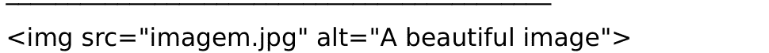

# HTML、CSS 与 JavaScript：前端开发者成长指南

## 前端开发简介

### 什么是前端开发？

前端开发，也称为用户界面开发，是构建网站和网络应用程序的关键部分。它是网络开发中直接处理用户交互的部分。前端开发使用`HTML`、`CSS`和`JavaScript`等技术来创建美观且功能性的用户界面。在本课程中，我们将涵盖这三种技术的基础概念，以及它们如何协同工作以创建网络上的用户体验。

前端开发是网站开发中处理创建用户界面的方面。这个界面是用户与网站或网络应用程序直接交互的地方。前端开发的目标是创建一个直观且引人入胜的用户体验，使其易于使用且美观。

前端开发人员使用各种技术来创建这个用户界面。主要的三种是`HTML`、`CSS`和`JavaScript`。`HTML`用于创建网页的基本结构，`CSS`用于设置该结构的样式，`JavaScript`用于为页面添加功能性和交互性。

### HTML——超文本标记语言

`HTML`，全称为超文本标记语言，是任何网站的支柱。它是一种标记语言，用于在网页上组织内容。网页上的每个元素都由一个`HTML`标签表示，该标签定义了元素包含的内容类型以及它在浏览器中应如何显示。

`HTML`是一种标记语言，这意味着它使用标签来定义元素。每个标签都有一个特定的名称，并代表一种特定的内容类型。例如，`<h1>`用于定义一级标题，而`<p>`用于定义段落。

### CSS——层叠样式表

`CSS`，即层叠样式表，是一种样式语言，用于描述用`HTML`编写的文档的外观。`CSS`用于为`HTML`添加样式，允许开发人员定义网页上`HTML`元素的颜色、大小、字体和其他视觉方面。

`CSS`是一种样式语言，这意味着它用于定义页面上`HTML`元素的外观。`CSS`使用选择器来识别应该设置样式的`HTML`元素，并使用声明来定义这些元素应如何设置样式。例如，可以使用选择器来识别页面上的所有`<p>`元素，并使用声明将这些元素的文本颜色设置为蓝色。

### JavaScript——脚本编程语言

`JavaScript`是一种脚本编程语言，用于使网页具有交互性。`JavaScript`允许开发人员为网页添加功能，例如响应按钮点击、动态更新内容和执行复杂计算。

`JavaScript`是一种编程语言，这意味着它用于创建控制网页行为的程序。`JavaScript`使用变量、函数、循环和其他编程构造来操作页面上的`HTML`元素并创建交互性。

总之，前端开发是一个复杂且多方面的学科，需要对各种技术有扎实的理解。然而，通过适当的学习和练习，任何人都可以学会成为合格的前端开发人员。本课程旨在为你提供`HTML`、`CSS`和`JavaScript`这三个前端开发基础技术的坚实基础。在整个课程中，你将深入了解这些技术，并学习如何使用它们来创建美观且功能性的网站和应用程序。

### 练习 1：前端开发的目的是什么？

- (A) 创建直观且引人入胜的用户体验，使其易于使用且美观。
- (B) 开发处理数据库和服务器的网站后端。
- (C) 仅关注网站编程和功能，忽略设计和用户体验。

注意：正确答案在最后一页。

## 什么是 HTML、CSS 和 JavaScript

`HTML`、`CSS`和`JavaScript`是构建网站和网络应用程序所使用的主要技术中的三种。这些技术共同构成了前端开发的基础，前端开发是软件开发中直接处理用户交互的部分。

### 什么是 HTML？

`HTML`，或超文本标记语言，是创建网页的标准标记语言。它是任何网站的支柱，负责页面的结构和内容。`HTML`不是一种编程语言，而是一种标记语言。这意味着它用于使用标签来“标记”内容，以定义每段内容是什么（例如，标题、段落、图像等）。

一个`HTML`文档由`HTML`元素组成，这些元素由标签表示。这些标签用于定义内容的结构。例如，`<h1>`用于定义标题，`<p>`用于定义段落，``用于插入图像，等等。此外，`HTML`还允许包含链接、表单、列表、表格等等。

### 什么是 CSS？

`CSS`，即层叠样式表，是一种样式语言，用于描述用`HTML`编写的文档的外观。虽然`HTML`用于组织内容，但`CSS`用于格式化该内容。这包括颜色、字体、间距、布局等方面。

一个`CSS`样式表由一系列规则组成。每条规则由一个选择器和一组声明组成。选择器指定该规则适用于页面的哪些元素，而声明定义了对这些元素应执行的操作。例如，你可能有一条规则将红色应用于页面上的所有段落，或者有一条规则为页面上的所有标题设置字体和文本大小。

`CSS`的一大优点是它允许你将内容（`HTML`）与表现（`CSS`）分离。这使得代码更易于维护，并且只需更改一个样式表就可以改变整个网站的外观。

### 什么是 JavaScript？

`JavaScript`是一种编程语言，用于使网页具有交互性。虽然`HTML`用于结构，`CSS`用于格式化，但`JavaScript`用于功能性。这包括响应按钮点击、动态更新内容、执行计算、验证表单、创建动画等。

`JavaScript`的一大优点是它在浏览器中运行，这意味着不需要服务器端处理。这使得`JavaScript`非常适合需要在客户端执行的任务，例如在提交表单之前验证用户输入。

此外，`JavaScript`也可以通过`Node.js`等技术在服务器端使用。这意味着你可以在前端和后端使用相同的编程语言，这可以简化代码开发和维护。

总而言之，`HTML`、`CSS`和`JavaScript`是任何前端开发者都需要掌握的三大基础技术。`HTML`用于构建结构，`CSS`用于样式格式化，`JavaScript`用于实现功能。这些技术共同作用，让你能够创建内容丰富、交互性强的网站和 Web 应用程序。

## 练习 2：以下哪项陈述正确描述了 HTML、CSS 和 JavaScript 技术在前端开发中的作用？

- (A) `JavaScript`用于结构，`CSS`用于功能，`HTML`用于格式化。
- (B) `HTML`用于结构，`CSS`用于功能，`JavaScript`用于格式化。
- (C) `HTML`用于结构，`CSS`用于格式化，`JavaScript`用于功能。

注意：正确答案在最后一页。

## 开发环境的安装与配置

在开始使用`HTML`、`CSS`和`JavaScript`探索前端开发世界之前，至关重要的是在你的计算机上安装并配置一个合适的开发环境。我们电子书的这一章节将指导你完成安装和配置开发环境的过程。

### 1. 安装文本编辑器

文本编辑器是任何开发者的基本工具。它用于编写和编辑代码。有许多文本编辑器可供选择，但我们推荐使用`Visual Studio Code`（`VS Code`），因为它界面友好且功能强大。

要安装`VS Code`，请访问官方网站（`https://code.visualstudio.com/`）并按照适用于你特定操作系统的说明进行操作。安装完成后，你可以通过安装扩展来自定义`VS Code`，以改善你的编码体验。一些有用的扩展包括用于实时预览网页的`Live Server`，以及用于自动格式化代码的`Prettier`。

### 2. 安装网页浏览器

作为前端开发者，你将需要一个网页浏览器来查看和测试你的网页。我们推荐使用`Google Chrome`或`Mozilla Firefox`，因为它们具有出色的开发者功能。

要安装`Google Chrome`，请访问官方网站（`https://www.google.com/chrome/`）并按照安装说明操作。要安装`Mozilla Firefox`，请访问官方网站（`https://www.mozilla.org/en-US/firefox/new/`）并按照安装说明操作。

安装后，你可以通过按键盘上的`F12`来访问浏览器的开发者工具。这些工具允许你实时检查和编辑你的`HTML`、`CSS`和`JavaScript`代码，并提供有用的调试功能。

### 3. 安装 Node.js 和 NPM

`Node.js`是一个`JavaScript`运行时环境，允许你在网页浏览器之外运行`JavaScript`代码。`Node.js`附带`NPM`（Node Package Manager），这是一个允许你安装`JavaScript`库和包以在项目中使用的工具。

要安装`Node.js`和`NPM`，请访问`Node.js`官方网站（`https://nodejs.org/`）并下载`LTS`（长期支持）版本。按照安装说明操作，最后你可以通过打开终端并输入`node -v`和`npm -v`来验证安装。如果这两条命令都返回一个版本号，那么安装就成功了。

### 4. 配置开发环境

所有工具安装完毕后，你现在可以配置你的开发环境了。首先，组织你的文件夹结构。为你的项目创建一个文件夹，并在其中为你的`HTML`、`CSS`和`JavaScript`代码分别创建单独的文件夹。

在`VS Code`中，你可以通过点击“文件”->“打开文件夹”并选择你的项目文件夹来打开它。现在，你可以通过右键单击文件夹并选择“新建文件”，在相应的文件夹中创建`HTML`、`CSS`和`JavaScript`文件。

最后，你可以通过右键单击你的`HTML`文件并选择“用 Live Server 打开”来启动`VS Code`的实时服务器。这将在网页浏览器中打开你的项目，你对代码所做的任何更改都将实时反映出来。

完成这些步骤后，你就可以开始编码了！记住，熟能生巧。所以，开始构建简单的项目，并逐步处理更复杂的项目。你很快就会成为一名熟练的前端开发者。

## 练习 3：在前端开发中，推荐使用什么工具来编写和编辑代码？它有哪些有用的扩展？

- (A) `Google Chrome`，配有`Live Server`和`Prettier`等扩展。
- (B) `Mozilla Firefox`，配有`Live Server`和`Prettier`等扩展。
- (C) `Visual Studio Code`（`VS Code`），配有`Live Server`和`Prettier`等扩展。

注意：正确答案在最后一页。

## HTML 入门：基本结构、标签和属性

### HTML 简介

`HTML`，即超文本标记语言，是创建网页和应用程序的标准标记语言。它描述了网页的结构，由一系列`HTML`元素（也称为标签）组成，浏览器使用这些元素来渲染内容。

### 基本结构

一个基本的`HTML`文档遵循特定的结构。它以文档类型声明开始，告诉浏览器这是一个`HTML5`文档。接下来是`<html>`标签，它包含了页面的整个内容。在这个标签内，有两个主要部分：`<head>`和`<body>`。

`<head>`包含了关于文档的元数据，例如页面标题（显示在浏览器标签页中）、指向`CSS`文件的链接、字符定义以及其他对用户不可见的信息。

`<body>`是我们放置所有希望用户在访问页面时能看到的内容的地方。这可以包括文本、图片、视频、链接、列表、表格等等。

### 标签

`HTML`标签是任何网页的基础。它们告诉浏览器应该如何解释和显示内容。标签被包含在尖括号（`<`和`>`）中，并且大多数标签都有一个开始标签和一个结束标签，内容位于两者之间。例如，`<p>`标签用于文字段落。要创建一个段落，你需要将文本包裹在开始标签`<p>`和结束标签`</p>`之间。

有许多`HTML`标签，每个都有其特定的用途。一些最常见的包括用于标题的`<h1>`到`<h6>`，用于链接的`<a>`，用于图片的``，用于无序列表的`<ul>`和`<li>`，以及用于表格的`<table>`、`<tr>`和`<td>`。

### 属性

`HTML`属性用于提供关于元素的附加信息。它们被放置在开始标签内，由属性名和属性值组成，两者之间用等号分隔。例如，图片标签``使用`src`属性来指定要显示的图片的 URL，并使用`alt`属性来提供当图片无法加载时显示的替代文本。

其他常见的属性包括用于`CSS`样式的`id`和`class`，用于指定链接 URL 的`href`，以及用于直接向元素添加`CSS`的`style`。

理解`HTML`的基本结构、标签和属性是成为前端开发者的首要步骤。有了这个基础，你就可以开始探索`CSS`和`JavaScript`，为你的网页添加样式和功能。

## 练习 4：HTML 文档中 `<head>` 的作用是什么？

- (A) 向浏览器指示应如何解释和显示内容。
- (B) 放置所有我们希望用户在访问页面时能看到的内容。
- (C) 包含关于文档的元数据，例如页面标题、指向`CSS`文件的链接、字符定义以及其他对用户不可见的信息。

注意：正确答案在最后一页。

## HTML 入门：基本结构、标签和属性：HTML 简介

### 4.1 HTML 入门：基本结构、标签和属性

#### HTML 简介

`HTML`（超文本标记语言）是创建网站和 Web 应用程序的主要语言。它不是一种编程语言，而是一种标记语言。`HTML`允许你构建网页结构、添加内容，并控制文本的显示方式。它是任何网站的支柱，也是任何前端开发者必备的技能。

#### HTML 的基本结构

一个基本的`HTML`文档具有特定的结构，包括以下几个部分。

### HTML 简介

`HTML`，即超文本标记语言（Hyper Text Markup Language），是创建网页和应用程序的标准标记语言。它是任何前端开发者必须掌握的主要工具之一。本书课程的这一模块将介绍`HTML`的基本结构、标签和属性。

### HTML 的基本结构

一个`HTML`文档由一系列元素组成，每个元素都由一个标签表示。一个`HTML`文档的基本结构如下：

```html
<!DOCTYPE html>
<html>
<head>
  <title>Page title</title>
</head>
<body>
  Page content goes here.
</body>
</html>
```

文档开头的`<!DOCTYPE html>`是一个声明，它告诉浏览器这是一个`HTML5`文档。`<html>`标签包含了页面的所有内容。在这个标签内，我们有两个其他重要的标签：`<head>`和`<body>`。

`<head>`包含关于页面的、用户不可见的信息，例如页面标题（显示在浏览器的标题栏中）以及指向外部`CSS`和`JavaScript`文件的链接。`<body>`包含用户看到的所有内容，如文本、图像、链接等。

`<head>`元素包含关于页面的元数据（关于数据的数据），这些数据不会在网页本身上显示，但可以被机器读取。它通常包含页面标题以及指向脚本和样式表的链接。

`<body>`元素包含网页的主要内容，这些内容会显示在浏览器中。

### HTML 标签

`HTML`标签是任何网页的基础。它们定义了页面的结构和布局，可用于添加文本、图像、链接和其他元素。以下是一些最常见的标签：

- `<h1>`到`<h6>`：这些标签用于添加标题和副标题。`<h1>`是最重要的标题（通常也是最大的），而`<h6>`是最不重要的。
- `<p>`：此标签用于添加文本段落。
- `<a>`：此标签用于添加链接。
- ``：此标签用于添加图像。
- `<div>`：此标签用于对其他元素进行分组。

`HTML`标签是`HTML`的主要语法。它们用于创建`HTML`元素，由括在尖括号内的标签名组成。`HTML`标签成对出现，包括一个开始标签和一个结束标签。

例如，这是一个段落标签：`<p>This is a paragraph.</p>`。开始标签是`<p>`，结束标签是`</p>`。标签内的内容就是元素的内容。

### HTML 属性

`HTML`属性用于为元素提供额外的信息。它们总是指定在开始标签的开头，并具有以下结构：

`attribute_name="attribute_value"`。以下是一些最常见的属性：

- `class`：此属性用于为元素指定一个或多个类。类用于通过`CSS`和`JavaScript`选择元素。
- `id`：此属性用于为元素指定一个唯一标识符。`id`在文档中必须是唯一的。
- `src`：此属性用于指定媒体元素（如图像或视频）的源。
- `href`：此属性用于指定链接的 URL。
- `alt`：此属性用于指定图像的替代文本，当图像无法加载时会显示。

简而言之，`HTML`是任何网页的骨干。掌握`HTML`的基本结构、其标签和属性对于任何前端开发者都至关重要。在本书课程的下一模块中，我们将探索`CSS`，这是一种用于设置`HTML`页面样式并创建有吸引力的、响应式布局的语言。

## 练习 5：HTML 图像标签中 `src` 属性的功能是什么？

- (A) 告诉浏览器要显示的图像的大小。
- (B) 告诉浏览器在哪里找到要显示的图像。
- (C) 告诉浏览器要显示的图像的颜色。

注：正确答案在最后一页。

## HTML 简介：基本结构、标签和属性：理解 HTML 标签

`HTML`，或超文本标记语言，是创建网页和应用程序的标准标记语言。理解`HTML`的基本结构，以及标签和属性，对于任何前端开发者都至关重要。在本章中，我们将详细探讨这些概念。

### HTML 的基本结构

一个`HTML`文档由`HTML`元素组成，这些元素由标签指示。每个`HTML`文档都以文档类型声明开始，它告诉浏览器该文档是一个`HTML5`文件。`<html>`标签包含了页面的全部内容。

```html
<!DOCTYPE html>
<html>
...
</html>
```

在`<html>`标签内，我们有两个主要部分：`<head>`和`<body>`。`<head>`包含关于文档的元数据，例如页面标题（`<title>`标签）、指向`CSS`样式表的链接（`<link>`标签）以及`JavaScript`脚本（`<script>`标签）。`<body>`包含对用户可见的页面实际内容。

```html
<!DOCTYPE html>
<html>
  <head>
    <title>Page Title</title>
  </head>
  <body>
    Page content...
  </body>
</html>
```

### HTML 标签

`HTML`标签用于在`HTML`文档中定义元素。它们被尖括号（`<`和`>`）包围。大多数标签成对出现，并包裹在它们所影响的内容周围。例如，`<p>`用于创建一个段落：


```html
<p>This is a paragraph.</p>
```

有许多 HTML 标签，每个都有自己的用途。一些最常见的包括：`<h1>` 到 `<h6>` 用于标题，`<a>` 用于链接，`` 用于图像，`<ul>` 和 `<li>` 用于列表，以及 `<div>` 和 `<span>` 用于对元素进行分组。

### HTML 属性

HTML 属性用于为元素提供额外的信息。它们总是指定在开始标签的开头，并且通常以名称/值对的形式出现。例如，`<a>` 标签通常使用 `href` 属性来指定链接的 URL：

```html
<a href="https://www.example.com">This is a link</a>
```

其他常见属性包括：`src` 用于指定图像的来源，`alt` 用于为图像指定替代文本，以及 `style` 用于为元素添加 CSS 样式。

简而言之，HTML 是任何网页的骨干。理解 HTML 的基本结构，以及标签和属性，是成为一名有效前端开发者的第一步。在下一章中，我们将探索 CSS 以及它如何用于设置 HTML 元素的样式。

## 练习 6：HTML 中的 `<head>` 包含什么？

- ( A ) 对用户可见的所有内容，如文本、图像、链接等。
- ( B ) 关于页面的、用户不可见的信息，例如页面标题和指向外部 CSS 和 JavaScript 文件的链接。
- ( C ) 用于通过 CSS 和 JavaScript 选择元素的类。

*注：正确答案在最后一页。*

## 练习 7：HTML 文档中 `<head>` 的作用是什么？

- （ A ） - 用于创建段落。
- （ B ） - 包含页面上对用户可见的实际内容。
- （ C ） - 包含文档的元数据，例如页面标题、指向 CSS 样式表和 JavaScript 脚本的链接。

*注意：正确答案在最后一页。*

## HTML 入门：基本结构、标签和属性：HTML 中的属性

HTML，即超文本标记语言，是用于创建网页的标准标记语言。它用于描述网页文档的结构和内容，由一系列浏览器会解释以按开发者意图显示网页的元素或“标签”组成。

### HTML 文档的基本结构

基本的 HTML 文档以文档类型声明开始，它告诉浏览器该文档使用的是哪个版本的 HTML。实际的 HTML 文档以 `<html>` 开始，并以 `</html>` 结束。

在这些标签内部，我们有两个主要部分：“头部”（`<head>` 和 `</head>`）和“主体”（`<body>` 和 `</body>`）。“头部”包含关于文档的、不在浏览器窗口中显示的信息，例如页面标题（显示在浏览器的标题栏或页面标签中）以及可用于页面的 CSS 和 JavaScript 文件的链接。“主体”包含在浏览器中显示的页面的实际内容。

### HTML 中的标签

标签用于标记 HTML 文档中的元素。它们通常由一个被尖括号包围的元素名称组成。大多数 HTML 元素都有一个开始标签和一个结束标签，元素的内容包含在这两个标签之间。

例如，HTML 中的一个段落用标签 `<p>`（开始标签）和 `</p>`（结束标签）标记。浏览器会将这两个标签之间的任何内容视为一个段落并相应地进行显示。

HTML 中有许多不同的标签可用，每个标签都有特定的用途。一些最常见的标签包括用于标题的 `<h1>` 到 `<h6>`、用于段落的 `<p>`、用于链接的 `<a>`、用于图像的 ``，以及用于通用内容划分的 `<div>` 和 `<span>`。

### HTML 中的属性

属性提供有关 HTML 元素的附加信息。它们始终在开始标签中指定，通常以名称/值对的形式出现。例如，链接标签 `<a>` 通常包含 `href` 属性，用于指定链接应指向的 URL。

其他常见属性包括 `src`（指定元素的源，例如图像或视频）、`alt`（为元素提供替代文本，在元素无法渲染时显示）和 `style`（可用于直接向元素添加 CSS）。

属性是 HTML 的重要组成部分，因为它们允许你根据需要自定义元素的行为和外观。然而，应谨慎使用，因为过度使用属性会使 HTML 代码难以阅读和维护。

简而言之，HTML 是一种强大而灵活的标记语言，允许你创建各种各样的网页。通过理解 HTML 文档的基本结构以及标签和属性的使用，你可以开始创建自己的网页，并成为一名高效的前端开发者。

回答关于前面内容的问题：

### 练习 8：HTML 文档中 `head` 标签的作用是什么？

- （ A ） - `head` 标签用于标记 HTML 文档中的元素。
- （ B ） - `head` 标签包含在浏览器中显示的页面实际内容。
- （ C ） - `head` 标签包含关于文档的、不在浏览器窗口中显示的信息，例如页面标题以及可用于页面的 CSS 和 JavaScript 文件的链接。

注意：正确答案在最后一页。

## HTML 入门：基本结构、标签和属性：标题标签

HTML，即超文本标记语言，是用于创建网页的标准标记语言。它允许开发者通过整合文本、图像、链接和其他元素来创建结构化的内容。HTML 文档的基本结构由“标签”和“属性”组成。

### HTML 的基本结构

HTML 文档的基本结构由一系列 HTML 元素组成，每个元素都由一个标签表示。标签是被尖括号包围的元素标识符。标签通常成对出现，有一个开始标签和一个结束标签，元素的内容位于两者之间。

例如，一段文本可以这样写：

`<p>This is a paragraph.</p>`

这里，`<p>` 是开始标签，`</p>` 是结束标签，“This is a paragraph.” 是元素的内容。

### 标签和属性

HTML 标签定义内容的类型和结构，而属性提供有关元素的附加信息。属性包含在开始标签中，并由名称和值表示。例如，链接标签 `<a>` 可以包含 `href` 属性来指定链接的 URL：

`<a href="https://www.example.com">This is a link.</a>`

这里，“href” 是属性名称，“https://www.example.com” 是属性值。

### 标题标签

标题标签用于在 HTML 文档中定义标题和子标题。有六个级别的标题，分别由标签 `<h1>` 到 `<h6>` 表示。`<h1>` 用于主标题，而 `<h2>` 到 `<h6>` 用于级别逐渐降低的子标题。

例如，一个 HTML 文档可能具有以下标题结构：

```html
<h1>Main Title</h1>
<h2>Subtitle 1</h2>
<h3>Subtitle 2</h3>
<h4>Subtitle 3</h4>
<h5>Subtitle 4</h5>
<h6>Subtitle 5</h6>
```

标题标签不仅为读者提供了内容的可视化结构，而且在搜索引擎优化（SEO）中也起着重要作用，有助于确定内容相关性。

总之，HTML 文档的基本结构由标签和属性组成，它们定义了内容的类型、结构和附加信息。标题标签是这一结构的重要组成部分，因为它们定义了内容的标题和副标题。掌握这些基本元素的使用是成为高效前端开发者的基本步骤。

回答关于前面内容的问题：

### 练习 9：HTML 文档的基本结构是什么，为什么它很重要？

- （ A ） - HTML 文档的基本结构由标签和属性组成，它们定义了内容的类型、结构和附加信息。标题标签是这一结构的重要组成部分，因为它们定义了内容的标题和副标题。这对于成为高效的前端开发者至关重要。
- （ B ） - HTML 文档的基本结构仅由标签组成，标签定义了内容的类型和结构。标题标签在此结构中不重要。
- （ C ） - HTML 文档的基本结构仅由属性组成，属性提供有关元素的附加信息。标题标签在此结构中不重要。

注意：正确答案在最后一页。

## HTML 入门：基本结构、标签和属性：段落标签

HTML，即超文本标记语言，是创建网页和应用程序的标准语言。与 CSS 和 JavaScript 一样，HTML 是大多数网站用于创建视觉吸引力强的网页、Web 应用程序的用户界面以及许多移动应用程序用户界面的基础技术。

HTML 文档的基本结构以文档类型声明开始。此声明用于

### 练习 10：HTML 中段落标签的作用是什么？

- (A) 标记图像的开始和结束
- (B) 标记段落的开始和结束
- (C) 为图像提供替代文本

注意：正确答案在最后一页。

## 第 4.7 章：HTML 入门：基本结构、标签和属性：链接标签（A）

HTML，即超文本标记语言，是创建网页和应用程序的标准标记语言。与 CSS 和 JavaScript 一起，HTML 是万维网的三大支柱之一。

### HTML 的基本结构

一个 HTML 文档具有特定的结构，主要包括以下部分：

- DOCTYPE：向浏览器指示文档使用的 HTML 版本。
- HTML 元素：这是 HTML 页面的根元素。
- Head 元素：包含关于 HTML 文档的元信息，例如其标题以及指向其脚本和 CSS 样式表的链接。
- Body 元素：包含 HTML 文档的主要内容，例如文本、图像、视频、链接、表格、列表等。

### HTML 标签

HTML 标签是任何网页的基础。它们定义了网页上的内容结构。每个 HTML 标签都以一个尖括号（`<`）开始，以一个尖括号（`>`）结束。大多数 HTML 标签都有一个开始标签和一个结束标签，中间是内容。

### HTML 属性

HTML 属性用于提供有关 HTML 元素的附加信息。它们始终在标签的开头指定，后跟一个等号和一个带引号的值。例如，链接标签（`a`）通常有一个 `href` 属性，该属性指示链接指向的 URL。

### 链接标签（`a`）

链接标签（`a`）用于在 HTML 中创建链接。它是 HTML 中使用最多的标签之一，对于网页导航至关重要。链接标签具有以下语法：

```html
<a href="URL">链接文本</a>
```

其中 `URL` 是你要链接到的网页的地址，`链接文本` 是将在网页上显示为链接的文本。

### 链接标签属性（`a`）

链接标签（`a`）有几个可用于控制其行为的属性。以下是一些最常见的属性：

- `href`：这是链接标签最重要的属性。它指定链接应指向的页面的 URL。
- `target`：此属性指定在哪里打开链接的文档。`_blank` 值将在新窗口或选项卡中打开文档。
- `download`：此属性指示浏览器下载链接而不是导航到它。
- `rel`：此属性指定当前页面与链接页面之间的关系。

简而言之，HTML 是任何网页的基础。它提供了页面的结构和内容，而 CSS 和 JavaScript 添加了样式和功能。链接标签（`a`）是 HTML 的重要组成部分，允许在页面和网站之间进行导航。理解 HTML 的基本结构、其标签和属性对于成为一名高效的前端开发人员至关重要。

### 练习 11：HTML 中链接标签的作用是什么，以及它的一些最常见属性是什么？

- (A) 链接标签用于在 HTML 中创建列表。其最常见的属性包括 `list`、`item` 和 `value`。
- (B) 链接标签（`a`）用于在 HTML 中创建图像。其最常见的属性包括 `src`、`alt` 和 `width`。
- (C) 链接标签（`a`）用于在 HTML 中创建链接。其最常见的属性包括 `href`、`target`、`download` 和 `rel`。

注意：正确答案在最后一页。

## 4.8 HTML 入门：基本结构、标签和属性：图像标签（IMG）

HTML，即超文本标记语言，是创建网页的标准标记语言。一个 HTML 文档的基本结构由标签（用于定义元素）和属性（用于指定这些元素的特性）组成。

HTML 标签是任何网页的基础。它们用于创建和组织页面内容，包括文本、图像、链接、列表、表格等。每个标签由一对被尖括号（`<` 和 `>`）包围的字符表示。例如，`<h1>` 用于定义一级标题，`<p>` 用于定义段落，而 `` 用于插入图像。

图像标签 `` 是 HTML 中最重要的标签之一。它允许你将图像插入到网页中，使其更具吸引力和信息量。`` 是一个空标签，这意味着它没有结束标签。相反，它使用属性来指定要显示的图像以及图像的其他特性。

### 如何使用 `` 图像标签

要在网页上插入图像，你需要使用带有 `src` 属性的 ``。`src` 属性指定要显示的图像的 URL。例如：

```html

```

在此示例中，图像 `imagem.jpg` 将显示在网页上。图像必须与 HTML 文件在同一目录中，或者你必须指定图像的完整路径。

### 图像标签属性 ``

除了 `src` 属性外，`` 还支持其他几个属性。最常见的有 `alt`、`width` 和 `height`。

`alt` 属性用于为图像指定替代文本，如果图像无法加载，将显示此文本。这是一个重要的可访问性属性，它允许屏幕阅读器用户理解图像的内容。例如：

```html

```

在此示例中，如果图片无法加载，则会显示文本“图像描述”。

`width` 和 `height` 属性分别用于指定图像的宽度和高度。它们以像素为单位指定。例如：

```html

```

在此示例中，图像将以500像素的宽度和300像素的高度显示。

简而言之，图像标签 `` 是任何网页的重要组成部分。它允许您将图像插入页面，使其更具吸引力和信息量。使用 `` 标签时，重要的是要记得使用 `alt` 属性以提高可访问性，并使用 `width` 和 `height` 属性来控制图像大小。

### 练习 12：HTML 中的 `` 标签允许你做什么？

- ( A ) - 设置一级标题
- ( B ) - 将图像插入到你的网页中
- ( C ) - 创建一个列表

注意：正确答案在最后一页。

## HTML 简介：基本结构、标签和属性：HTML 中的列表

HTML，即超文本标记语言，是任何网站的支柱。它是一种编码语言，允许你在网络上创建和组织内容，包括文本、图像、列表、表格、链接等。尽管它对初学者来说可能看起来令人生畏，但 HTML 的基本结构相当简单明了。在本章中，我们将探讨 HTML 的基本结构、其标签和属性，并特别关注 HTML 中的列表。

### HTML 的基本结构

HTML 页面的基本结构由 HTML 标签组成，这些标签用于定义和组织内容。一个典型的 HTML 页面以 `<html>` 标签开始，该标签告诉浏览器该文档是 HTML5 文件。接下来是 `<body>` 标签，其中包含页面的所有内容。在 `<html>` 标签内部，我们有 `<head>` 标签和 `<body>` 标签。

`<head>` 标签包含有关页面的信息，例如标题（显示在浏览器标签页中）、指向外部 CSS 和 JavaScript 的链接以及元数据。`<title>` 标签是您可以在 `<head>` 中找到的标签的一个示例。例如：`<title>我的第一个 HTML 页面</title>`。

`<body>` 标签包含页面的主要内容，这是访问者访问您的网站时看到的内容。它可以包括文本、图像、链接、列表、表格等。

### 标签和属性

HTML 标签用于定义和组织内容。每个标签都被尖括号（`<` 和 `>`）包围。大多数标签成对出现，有一个开始标签和一个结束标签。结束标签类似于开始标签，但在标签名称前有一个斜杠（`/`）。

例如，以下是如何使用 `<p>`（段落）和 `<h1>`（一级标题）标签：

```html
<h1>我的第一个标题</h1>
<p>这是一个段落示例。</p>
```

属性用于提供有关标签的附加信息。它们包含在开始标签中，由属性名和属性值组成。例如，``（图像）标签通常带有 `src`（指定图像的 URL）和 `alt`（为图像提供替代文本）属性。

### HTML 中的列表

列表是 HTML 的重要组成部分。它们允许你以易于阅读的方式组织内容。HTML 中有三种主要的列表类型：有序列表、无序列表和定义列表。

有序列表是编号列表。它使用 `<ol>` 标签创建，每个列表项都包含在 `<li>` 标签中。例如：

```html
<ol>
  <li>项目 1</li>
  <li>项目 2</li>
  <li>项目 3</li>
</ol>
```

无序列表是项目符号列表。它使用 `<ul>` 标签创建，每个列表项都包含在 `<li>` 标签中。例如：

```html
<ul>
  <li>项目 1</li>
  <li>项目 2</li>
  <li>项目 3</li>
</ul>
```

定义列表是术语及其定义的列表。它使用 `<dl>` 标签创建，每个术语包含在 `<dt>` 标签中，每个定义包含在 `<dd>` 标签中。例如：

```html
<dl>
  <dt>HTML</dt>
  <dd>超文本标记语言</dd>
  <dt>CSS</dt>
  <dd>层叠样式表</dd>
</dl>
```

理解 HTML 的基本结构、其标签和属性，以及如何创建列表，是学习成为前端开发人员的基础部分。在下一章中，我们将探讨 CSS 以及它如何用于设置 HTML 页面的样式。

### 练习 13：HTML 这个首字母缩写词是什么意思，它的功能是什么？

- ( A ) - 超文本标记语言，一种用于在 Web 上创建和组织内容的编码语言。
- ( B ) - 超文本标记语言，一种用于创建应用程序的编程语言。
- ( C ) - 超文本标记语言，一种用于撰写文章的文本编辑工具。

注意：正确答案在最后一页。

## HTML 简介：基本结构、标签和属性：HTML 表单

HTML 语言（超文本标记语言）是在 Web 上创建任何网站的基础。它是一种标记语言，这意味着它用于在文档中构建内容，而不是用于编程行为或样式。为此，我们使用其他语言，如 CSS 和 JavaScript。在本章中，我们将重点理解 HTML 文档的基本结构、最常见的标签以及如何使用属性。此外，我们还将学习创建 HTML 表单。

### HTML 文档的基本结构


每个 HTML 文档都以文档类型声明开始，该声明告诉浏览器它正在读取哪种类型的文档。对于最新版本的 HTML（HTML5），该声明只是 `<!DOCTYPE html>`。之后，HTML 文档分为两个主要部分：头部和主体。头部包含有关文档的元数据，例如显示在浏览器标签页中的标题，以及指向 CSS 样式表或 JavaScript 脚本的链接。主体包含网站的实际内容，这是用户看到并与之交互的内容。

### HTML 文档基本结构的示例

```html
<!DOCTYPE html>
<html>
  <head>
    <title>网站标题</title>
  </head>
  <body>
    网站内容
  </body>
</html>
```

### HTML 标签

HTML 标签用于标记和分类 HTML 文档中的内容。每个标签以一个尖括号（`<`）开始，以一个尖括号（`>`）结束。大多数标签有一个开始标签和一个结束标签，内容在两者之间。结束标签与开始标签相同，但标签名称前有一个斜杠（`/`）。

### 使用 HTML 标签的示例

```html
<p>这是一个段落。</p>
<h1>这是一个一级标题。</h1>
<a href="https://www.example.com">这是一个链接。</a>
```

### HTML 属性

属性用于提供有关 HTML 元素的附加信息。它们包含在开始标签中，由属性名和属性值组成。属性值必须用引号括起来。

### 使用 HTML 属性的示例

```html
<a href="https://www.example.com" target="_blank">这是一个在新标签页中打开的链接。</a>

```

### HTML 表单

表单是任何网站的重要组成部分，因为它们允许用户输入信息并与网站进行交互。表单使用 `<form>` 标签创建。在表单内，我们对不同类型的输入字段使用不同的标签，例如 `<input>`、`<textarea>`、`<select>` 等。每个输入字段都可以有属性来控制其行为，例如类型、名称、值等。

### HTML 表单示例

```html
<form action="/submit_form" method="post">
  <label for="name">姓名：</label>
  <input type="text" id="name" name="name">
  <label for="email">电子邮件：</label>
  <input type="email" id="email" name="email">
  <input type="submit" value="提交">
</form>
```

## 练习 14：HTML 文档中 `head` 标签的功能是什么？

- ( A ) - `head` 标签用于标记和分类 HTML 文档中的内容。
- ( B ) - `head` 标签包含网站的实际内容，这是用户看到并与之交互的内容。
- ( C ) - `head` 标签包含有关文档的元数据，例如显示在浏览器标签页中的标题，以及指向 CSS 样式表或 JavaScript 脚本的链接。

注意：正确答案在最后一页。

## HTML 入门：基本结构、标签与属性：输入标签

HTML（超文本标记语言）是创建网页的标准标记语言。它描述了网页的结构，由一系列元素组成。HTML 提供了页面的基本结构，在此基础上可以添加各种样式和行为层。

### HTML 的基本结构

一个 HTML 文档以文档类型声明开始。HTML 文档本身以 `<html>` 标签开始，以 `</html>` 标签结束。网页的可见内容被包含在 `<body>` 和 `</body>` 之间。

```html
<!DOCTYPE html>
<html>
<head>
<title>页面标题</title>
</head>
<body>
页面内容在这里...
</body>
</html>
```

### HTML 标签和属性

HTML 元素由标签定义，标签被尖括号包围。HTML 标签通常是成对出现的，例如 `<h1>` 和 `</h1>`，但有些标签表示空元素，不完整，例如 ``。HTML 属性为元素提供额外信息。它们总是以名称/值对的形式出现，例如：`name="value"`。

### 输入标签

输入标签是 HTML 中用于用户交互的最重要的元素之一。`<input>` 标签可以根据 `type` 属性以多种方式显示。

```html
<input type="text"> <!-- 这创建一个文本框 -->
<input type="radio"> <!-- 这创建一个单选按钮 -->
<input type="submit"> <!-- 这创建一个提交按钮 -->
```

一些与输入标签一起使用的最常见属性包括 `value` 属性（定义控件的初始值）和 `name` 属性（定义控件的名称）。

```html
<input type="text" value="姓名">
<input type="radio" name="类型">
```

#### 结论

HTML 是任何 Web 开发者都必须掌握的标记语言。它提供了页面的基本结构，然后通过 CSS 添加样式，通过 JavaScript 添加行为。理解 HTML 的基本结构、标签和属性，尤其是输入标签，对于创建交互式和动态网页至关重要。

注意：这只是一个 HTML 文档结构的示例。在实际应用中，你可能会使用更多标签来格式化内容。同时，请记住，始终关闭 HTML 标签以避免任何可能的浏览器混淆是一个好习惯。

## 练习 15：根据文本，关于 HTML 的以下哪项陈述是正确的？

- (A) HTML 是一种用于开发游戏的编程语言。
- (B) HTML 标签总是成对使用，没有例外。
- (C) 输入标签是用于用户交互的重要 HTML 元素。

注意：正确答案在最后一页。

## HTML 入门：基本结构、标签与属性：按钮标签

HTML（超文本标记语言）是创建网页的标准标记语言。它是一种允许以语义方式组织 Web 内容的语言。正是通过 HTML，我们可以定义内容是段落、标题、链接、列表还是图像等。

### HTML 的基本结构

HTML 文档有一个基本结构，包括 `<!DOCTYPE html>`、`<html>`、`<head>` 和 `<body>` 等标签。`<!DOCTYPE html>` 标签告诉浏览器这是一个 HTML5 文档。`<html>` 标签是文档的根元素，包含所有其他标签。在它内部，我们有 `<head>` 标签（包含元数据和不显示给用户的信息）和 `<body>` 标签（包含页面内容，即显示给用户的一切）。

### 标签和属性

标签是标记和定义内容结构的 HTML 元素。它们由一个名称组成，放在尖括号之间。例如，`<p>` 标签定义一个段落。此外，标签具有属性，这些是修改或补充标签行为的附加信息。例如，定义链接的 `<a>` 标签可以具有 `href` 属性，该属性指定链接地址。

### 按钮标签

`<button>` 标签用于创建一个可点击的按钮。它可以包含文本、图像或任何其他 HTML 内容。按钮可以用于表单或文档中任何需要交互式按钮功能的地方。看看使用 `<button>` 标签的例子：

```html
<button type="button">点击此处</button>
```

在这个例子中，`<button>` 标签定义了一个文本为“点击此处”的按钮。`type` 属性指定这是一个可以点击的按钮，但默认情况下没有关联任何操作。

需要注意的是，`<button>` 标签必须始终用 `</button>` 标签关闭。此外，它可以有多个属性，例如 `disabled`（禁用按钮）、`form`（将按钮与表单关联）和 `value`（为按钮定义值）。

此外，`<button>` 标签可以与 JavaScript 结合使用来创建交互功能。例如，我们可以使用 `onclick` 事件在按钮被点击时执行一个 JavaScript 函数。

#### 结论

`<button>` 标签是在网页上创建交互性的强大工具。无论是提交表单、打开新链接还是执行 JavaScript 函数，`<button>` 标签都是 HTML 的重要组成部分。学习如何正确使用它，是成为合格前端开发者的重要一步。

注意：这是一个用 HTML 标签格式化文本的例子。在真实的 HTML 文档中，`<body>` 和 `</body>` 标签之间的内容不会显示为文本，而是显示为 HTML 代码。要在实际的 HTML 文档中将 HTML 代码显示为文本，你需要使用 HTML 实体，例如用 `&lt;` 表示 `<`，用 `&gt;` 表示 `>`，用 `&amp;` 表示 `&`。

## 练习 16：HTML 中 `<button>` 标签的用途是什么？

- (A) 定义段落
- (B) 创建可点击的按钮
- (C) 指定链接的地址

注意：正确答案在最后一页。

## HTML 入门：基本结构、标签与属性：HTML 中的表格

HTML（超文本标记语言）是创建网页和应用程序的标准语言。它由一系列元素或“标签”组成，构成了网页的结构，并告诉浏览器如何显示内容。在本节中，我们将探讨 HTML 的基本结构、标签和属性，特别关注 HTML 中的表格。

### HTML 的基本结构

一个 HTML 页面由一系列嵌套的元素组成。每个页面都以文档类型声明开始，对于 HTML5，这就是简单的 `<!DOCTYPE html>`。接下来是 `<html>` 标签，它包围了页面的所有内容，然后是 `<head>` 和 `<body>` 标签。

`<head>` 标签包含页面的元数据，例如出现在浏览器标签页中的标题、指向 CSS 样式表和 JavaScript 脚本的链接。`<body>` 标签包含对用户可见的页面主要内容。

#### HTML 基本结构示例

```html
<!DOCTYPE html>
<html>
  <head>
    <title>页面标题</title>
  </head>
  <body>
    页面内容在这里。
  </body>
</html>
```

### HTML 标签和属性

HTML 元素由标签定义。一个标签由一个元素名称组成，被尖括号包围。大多数 HTML 元素都有一个开始标签和一个结束标签，元素的内容位于它们之间。

例如，要创建一个段落，我们使用 `<p>` 标签。开始标签是 `<p>`，结束标签是 `</p>`。段落的内容就放在这两个标签之间。

此外，标签可以有属性，它们为元素提供附加信息。属性通常以名称/值对的形式出现，并包含在元素的开始标签中。

#### HTML 标签和属性示例

```html
<p style="color:blue">This is a blue paragraph.</p>
```

在此示例中，`style` 是 `p` 标签的一个属性，而 "color:blue" 是该属性的值。这告诉浏览器将段落文本显示为蓝色。

### HTML 中的表格

HTML 中的表格使用 `<table>` 标签定义，由行和单元格组成。行使用 `<tr>` 标签定义，行内的单元格则使用 `<td>` 定义数据单元格，或使用 `<th>` 定义表头单元格。

#### HTML 表格示例

```html
<table>
  <tr>
    <th>Header 1</th>
    <th>Header 2</th>
  </tr>
  <tr>
    <td>Cell 1</td>
    <td>Cell 2</td>
  </tr>
</table>
```

此示例创建了一个包含两个表头和两个数据单元格的表格。结果是一个具有两列两行的表格。

HTML 表格也可以包含属性，例如 `border` 用于定义表格边框，`width` 和 `height` 用于定义表格的宽度和高度，以及 `cellpadding` 和 `cellspacing` 用于定义单元格内部和单元格之间的间距。

#### 带属性的 HTML 表格示例

```html
<table border="1" width="100%" cellpadding="5">
  <tr>
    <th>Header 1</th>
    <th>Header 2</th>
  </tr>
  <tr>
    <td>Cell 1</td>
    <td>Cell 2</td>
  </tr>
</table>
```

此示例创建了一个边框为 1 像素、宽度为页面宽度的 100%、且每个单元格内部间距为 5 像素的表格。

## 练习 17：在 HTML 中，`table`、`tr` 和 `td` 标签的功能是什么？

- (A) `table` 定义一个段落，`tr` 定义页面标题，`td` 定义页面内容。
- (B) `table` 定义表格的边框，`tr` 定义表格的宽度和高度，`td` 定义单元格内部和之间的间距。
- (C) `table` 定义一个表格，`tr` 定义表格的行，`td` 定义行内的数据单元格。

注意：正确答案在最后一页。

## HTML 入门：基本结构、标签和属性：DIVISION 和 SPAN 标签

### 4.14. HTML 入门：基本结构、标签和属性：Division 和 Span 标签

HTML（超文本标记语言）是用于创建网页和应用程序的标准标记语言。对于任何前端开发者来说，理解 HTML 的基本结构以及标签和属性至关重要。在本节中，我们将专门介绍 division 和 span 标签。

### HTML 的基本结构

HTML 文档的结构是一个元素和文本的树状结构。每个文档都以一个文档类型声明开始，后面是根标签 `<html>`。在 `<html>` 标签内，我们有两个主要部分：`<head>` 和 `<body>`。

```html
<!DOCTYPE html>
<html>
<head>
    <title>Page Title</title>
</head>
<body>
    Page content goes here.
</body>
</html>
```

`<head>` 包含关于文档的元信息，例如其标题、脚本和样式表的链接。`<body>` 包含用户可见的页面实际内容。

HTML 标签是任何网页的构建块。它们定义了插入内容的类型及其显示方式。每个标签都以一个左尖括号（`<`）开始，以一个右尖括号（`>`）结束。大多数标签成对出现，有一个开始标签和一个结束标签。

属性提供关于 HTML 标签的附加信息。它们以名称/值对的形式出现，并且总是包含在开始标签中。例如，`<a>` 链接标签可能有一个 `href` 属性，该属性指示链接应指向的 URL。

```html
<a href="https://www.example.com">Link to Example.com</a>
```

division `<div>` 和 span `<span>` 标签用于组合其他 HTML 元素。`<div>` 标签是一个块级元素，用于组合块级元素，而 `<span>` 标签是一个内联元素，用于组合内联级元素。

```html
<div>
    <p>This is a paragraph within a div.</p>
    <p>This is another paragraph within the same div.</p>
</div>
```

```html
<p>This is <span>highlighted text</span> within a paragraph.</p>
```

这两个标签通常与 `class` 和 `id` 属性一起使用，以应用 CSS 样式或 JavaScript 行为。例如，你可能有一个类名为 "container" 的 div，并对其应用了某种样式。

```html
<div class="container">
    <p>This is a paragraph inside a div with the class "container".</p>
</div>
```

简而言之，HTML 是任何网页的骨架。理解 HTML 的基本结构以及如何使用标签和属性对于成为高效的前端开发者至关重要。Div 和 span 标签在组合元素以及为元素组应用样式或行为方面特别有用。

## 练习 18：在 HTML 中，div 和 span 标签的功能是什么？

- (A) Div 和 span 标签用于插入图片和视频。
- (B) Div 和 span 标签用于组合其他 HTML 元素。
- (C) Div 和 span 标签用于添加关于文档的元信息。

注意：正确答案在最后一页。

## HTML 入门：基本结构、标签和属性：语义化 HTML

### 4.15. HTML 入门：基本结构、标签和属性：语义化 HTML

### HTML 入门：基本结构、标签和属性

HTML，或超文本标记语言，是为在网页浏览器中显示而设计的文档的标准标记语言。它是网络的基本支柱之一，用于构建网页的内容。

HTML 文档的基本结构以声明文档类型开始，即 `<!DOCTYPE html>`。后面是 `<html>` 标签，它包围了页面的全部内容。在 `<html>` 标签内，我们有两个主要部分：`<head>` 和 `<body>`。

`<head>` 标签包含关于文档的元信息，例如其标题、脚本和样式的链接，以及其他不会在浏览器窗口中呈现的内容。`<body>` 标签包含在浏览器窗口中向用户显示的主要内容。

```html
<!DOCTYPE html>
<html>
<head>
    <title>Page Title</title>
</head>
<body>
    <h1>This is a Heading</h1>
    <p>This is a paragraph.</p>
    <p>This is another paragraph.</p>
</body>
</html>
```

在上面的示例中，我们有了一个 HTML 文档的基本结构。`<title>` 标签定义了页面的标题，该标题显示在浏览器的标题栏或页面标签中。`<h1>` 标签定义了一级标题，`<p>` 标签定义了段落。

### 标签和属性


HTML 标签是 HTML 页面的构建块。HTML 标签是一个被尖括号（`<` 和 `>`）包围的关键词。大多数 HTML 标签成对出现：开始标签和结束标签。结束标签与开始标签相同，只是在关键词前有一个正斜杠（`/`）。

HTML 属性为元素提供附加信息。它们总是指定在标签的开头，并以名称/值对的形式出现。例如，用于插入图像的 `` 标签具有诸如 `src`（指定图像的 URL）、`alt`（指定图像的替代文本）、`width` 和 `height`（指定图像的宽度和高度）等属性。

```html

```

### 语义化 HTML

语义化 HTML 是指使用正确的 HTML 语法来增强网页内容的意义，而不仅仅是为了展示。语义化 HTML 使用 HTML 标签来精确描述你的内容。例如，`<b>` 用于加粗，而 `<strong>` 用于表示重要性。

语义化标签不仅帮助开发者理解页面的内容和结构，而且对搜索引擎和辅助技术（如屏幕阅读器）也很有用。例如，使用 `<header>` 表示页面头部，`<nav>` 表示导航，`<main>` 表示主要内容，`<article>` 表示独立的文章，`<section>` 表示页面的一个部分，`<aside>` 表示侧边内容，`<footer>` 表示页脚。

总而言之，学习 HTML 文档的基本结构、理解如何使用标签和属性，以及应用语义化 HTML，是成为高效前端开发者的基本步骤。

## 练习 19：什么是语义化 HTML？

- （A）它是一种使用正确 HTML 语法来增强网页内容展示的实践。
- （B）它是一种使用正确 HTML 语法来强化网页内容含义的实践，而不仅仅是为了展示。
- （C）它是一种使用正确 HTML 语法来提升网页加载速度的实践。

*注意：正确答案在最后一页。*

## HTML 简介：基本结构、标签与属性

### 4.16 HTML 简介

HTML，即超文本标记语言的缩写，是用于开发网页的标记语言。这种语言允许创建几乎可以在任何连接到互联网的设备上阅读的文档。HTML 是任何网站或 Web 应用的基础。

### HTML 的基本结构

一个 HTML 文档有一个基本结构，包含开始和结束标签。开始标签表示一个元素的开始，结束标签表示该元素的结束。此外，一个 HTML 文档由头部和主体组成。

`<html>` 标签表示 HTML 文档的开始和结束。在这个标签内，我们有 `<head>`，它包含关于文档的信息，例如出现在浏览器标题栏中的标题，以及指向 CSS 和 JavaScript 文件的链接。`<body>` 包含文档的主要内容，例如文本、图像、链接、表格、列表等。

### 标签和属性

HTML 标签是定义文档结构的元素。每个标签都有自己的含义，并告诉浏览器内容应如何显示。一些标签的例子有：用于标题的 `<h1>`，用于段落的 `<p>`，用于链接的 `<a>`，用于图像的 `` 等等。

属性用于提供关于元素的额外信息。它们出现在开始标签中，后跟一个等号和一个引号内的值。例如，在标签 `<a href="https://www.example.com">Example</a>` 中，`href` 是一个属性，表示链接地址。

### CSS 简介

CSS，即层叠样式表，是一种样式语言，用于描述用 HTML 编写的文档的外观。通过 CSS，你可以同时控制多个页面的布局，以及颜色、字体和间距等各种设计方面。

### CSS 基本结构

一个 CSS 样式表由一系列规则组成。每个规则或规则集由一个选择器和一个声明块组成。选择器指向你想设置样式的 HTML 元素。声明块包含一个或多个用分号分隔的声明。每个声明包括一个 CSS 属性和一个值，用冒号分隔。

### 选择器和属性

选择器定义规则应用于哪些元素。它们可以按类型、类或 ID 等选择元素。属性是元素的可样式化方面，例如颜色、字体、大小、边距、内边距等。属性值定义了你希望如何设置该方面的样式。

例如，下面的 CSS 规则将所有段落（`<p>`）的文本颜色设置为红色：

```html
<style>
    p {
        color: red;
    }
</style>
```

在上面的规则中，`p` 是选择器，`color` 是属性，`red` 是值。

通过结合 HTML 和 CSS，你可以创建具有复杂结构和设计的网页。然而，要为网站添加交互性和功能性，你需要学习 JavaScript，这是成为前端开发者旅程的下一步。

## 练习 20：HTML 文档中的 `<head>` 有什么作用？

- （A）包含文档的主要内容，例如文本、图像、链接、表格、列表等。
- （B）表示 HTML 文档的开始和结束。
- （C）包含关于文档的信息，例如出现在浏览器标题栏中的标题，以及指向 CSS 和 JavaScript 文件的链接。

*注意：正确答案在最后一页。*

## HTML 简介：基本结构、标签与属性：CSS 选择器

### 4.17 HTML 简介：基本结构、标签与属性：CSS 选择器

### HTML 简介

HTML，即超文本标记语言的缩写，是创建网页和应用程序的标准标记语言。与 CSS 和 JavaScript 一起，HTML 是大多数网站使用的基础技术。HTML 提供了网页的结构，而 CSS 为这个结构添加样式，JavaScript 允许页面上的交互。

### HTML 文档的基本结构

HTML 文档具有树状结构，从根元素 `<html>` 开始。这个元素包含两个子元素：`<head>` 和 `<body>`。`<head>` 包含关于文档的元数据，而 `<body>` 包含文档的主要内容。

```html
<html>
  <head>
    <title>Page Title</title>
  </head>
  <body>
    Page content...
  </body>
</html>
```

### HTML 标签和属性

HTML 标签用于定义 HTML 元素。每个 HTML 标签以左尖括号（`<`）开始，以右尖括号（`>`）结束。大多数 HTML 标签有一个开始标签和一个结束标签，中间是内容。例如，`<p>Text</p>`。

HTML 属性用于提供关于元素的额外信息。它们总是指定在开始标签中，通常以名称/值对的形式出现。例如，`<a href="https://www.example.com">Link</a>`。

### CSS 选择器简介

层叠样式表（CSS）是一种样式表语言，用于描述用 HTML 编写的文档的外观。CSS 描述了 HTML 元素应如何显示，同时控制多个页面的布局。

### CSS 选择器

CSS 选择器用于选择你想设置样式的 HTML 元素。有几种类型的 CSS 选择器，包括类型选择器、类选择器、ID 选择器、属性选择器等。

- 类型选择器：根据元素类型选择元素。例如，`p` 将选择所有 `<p>` 元素。
- 类选择器：根据类属性选择元素。例如，`.intro` 将选择所有 `class="intro"` 的元素。
- ID 选择器：根据 ID 属性选择元素。例如，`#firstName` 将选择 `id="firstName"` 的元素。
- 属性选择器：根据属性或属性值选择元素。例如，`[target="_blank"]` 将选择所有 `target="_blank"` 的元素。

总而言之，HTML、CSS 和 JavaScript 是成为前端开发者的核心技术。学习 HTML 的基本结构、HTML 标签和属性以及 CSS 选择器是成为专业 Web 开发者的第一步。下一步是学习如何使用 JavaScript 为你的网页添加交互性。

## 练习 21：CSS 选择器的功能是什么？

- （A）根据元素类型、类属性、ID 属性以及属性或属性值选择元素。
- （B）提供关于 HTML 元素的额外信息。
- （C）定义 HTML 元素。

*注意：正确答案在最后一页。*

## HTML 简介：基本结构、标签与属性：CSS 属性与值

### HTML 和 CSS 简介

#### 4.18 HTML 简介：基本结构、标签与属性

HTML，即超文本标记语言的缩写，是创建网页和应用程序的标准标记语言。与 CSS（层叠样式表）和 JavaScript 等技术结合，HTML 构成了网络不可或缺的三大工具。

### HTML 的基本结构

一个基本的 HTML 文档结构非常简单。它从声明文档类型开始，对于 HTML5 来说，就是简单的 `<!DOCTYPE html>`。接下来是 `<html>` 元素，它包裹了整个页面的内容。在这个元素内，我们有两个主要元素：`<head>` 和 `<body>`。

`<head>` 元素包含关于文档的元数据，例如其标题（显示在标题栏或浏览器标签页中）、指向 CSS 样式表的链接、JavaScript 脚本以及各种其他不直接呈现给用户的信息。

`<body>` 元素则是用户看到并与之交互的所有内容的所在地。这包括文本、图像、视频、表单、按钮以及页面上的所有其他交互元素。

### HTML 标签和属性

HTML 标签是任何网页的构建块。它们定义和描述内容。每个标签以一个尖括号（`<`）开始，以一个尖括号（`>`）结束。大多数 HTML 标签有一个开始标签和一个结束标签，内容位于两者之间。

例如，`<p>这是一个段落。</p>`。这里，`<p>` 是开始标签，`</p>` 是结束标签，两者之间的任何内容都是标签的内容。

HTML 属性提供关于元素的附加信息。它们以名称/值对的形式出现，并且总是包含在开始标签中。例如，在图像标签 `` 中，`src` 和 `alt` 是属性。

### CSS 属性和值

CSS，即层叠样式表，是一种用于描述用 HTML 编写的文档外观的样式表语言。它让你可以控制诸如文本颜色、字体大小、段落间距、列的尺寸和布局、使用的图像类型或背景颜色等事项。

### CSS 属性

CSS 属性是你可以更改或操作的 HTML 方面。例如，你可以更改颜色、外边距、内边距、高度、宽度、边框、字体大小、字体族、行高、文本对齐、位置、字体样式、列表、表格布局等等。

### CSS 值

值是你设置或使用来更改 CSS 属性的内容。例如，如果属性是“颜色”，那么可能的值可以是“红色”、“绿色”、“rgb(255,0,0)”、“#FF0000”等。每个属性都有其自己的一组可能的值，其中一些是预定义的，而另一些可以由用户定义。

例如，“字体大小”属性控制文本的大小。如果你想让你的文本显示为 16 像素大小，你可以像这样使用属性和值：`font-size: 16px;`。

简而言之，HTML 和 CSS 是任何网页开发人员的基础工具。HTML 提供页面的结构和内容，而 CSS 让你能够精确控制页面的外观。通过对这两种语言的良好理解，你可以创建动态且吸引人的网页。

## 练习 22：HTML 文档中 `<body>` 元素的功能是什么？

- （A）包含关于文档的元数据，例如其标题、指向 CSS 样式表的链接、JavaScript 脚本以及各种其他不直接呈现给用户的信息。
- （B）它涉及页面上的所有内容。
- （C）这是用户看到并与之交互的所有内容的所在地，包括文本、图像、视频、表单、按钮以及页面上的所有其他交互元素。

> 注意：正确答案在最后一页。

## HTML 简介：基本结构、标签和属性：盒子模型

### 4.19 HTML 简介：基本结构、标签和属性：盒子模型

HTML，即超文本标记语言，是创建网页和应用程序的标准标记语言。与 CSS 和 JavaScript 一样，HTML 是大多数网站用来创建视觉吸引力的网页、Web 应用程序的用户界面以及许多移动应用程序的用户界面的基础技术。

### HTML 的基本结构

一个 HTML 文档的结构像一本书——它有一个头部和一个主体。头部包含在 `<head>` 标签内，通常包含关于文档的元信息，包括显示在浏览器标题栏中的标题。主体包含在 `<body>` 标签内，包含 HTML 文档的主要内容。

更详细地说，HTML 文档的基本结构由嵌套的 HTML 元素组成。一个 HTML 元素由一个开始标签、一些内容和一个结束标签定义。例如，一个由 `<p>` 标签表示的段落可以这样写：`<p>这是一个段落。</p>`。

### HTML 标签和属性

HTML 标签表示被插入的元素类型，例如标题（`<h1>` 到 `<h6>`）、段落（`<p></p>`）、列表（`<ul>` 或 `<ol>` 带有列表项 `<li>`）或链接（`<a>`）。

HTML 属性提供关于元素的附加信息。它们以名称和值对的形式出现，并放在元素的开始标签内。例如，链接元素有一个 `href` 属性，表示链接指向的 URL：`<a href="https://www.example.com">这是一个链接</a>`。

### 盒子模型

在网页设计中，盒子模型是包围每个 HTML 元素的盒子。它由外边距、边框、内边距和实际内容组成。这个模板允许开发人员控制页面上 HTML 元素的布局和定位。

- **内容：** 这是文本和图像出现的区域。
- **内边距：** 这是内容周围、边框内的区域。内边距增加了盒子的尺寸。
- **边框：** 这是内边距之外的区域。边框包围着内边距和内容。
- **外边距：** 这是边框之外的区域。外边距是透明的，用于将盒子与周围的盒子分开。

理解盒子模型对于能够创建复杂和响应式的布局至关重要。它是几乎所有 CSS 设计的基础，也是理解 CSS 如何工作的基本概念之一。

总之，HTML 是 Web 开发中必不可少的标记语言。它允许开发人员使用其标签和属性创建复杂而有意义的结构，而盒子模型则允许对布局和设计进行精确控制。理解这些概念是成为熟练前端开发者的第一步。

## 练习 23：网页设计中的盒子模型是什么？

- （A）它是一个包围每个 HTML 元素的盒子模板，由外边距、边框、内边距和实际内容组成。
- （B）它是创建网页的一套规则。
- （C）它是一种用于创建网站的编程语言。

*注意：正确答案在最后一页。*

## HTML 简介：基本结构、标签和属性：CSS 中的定位

### 4.20 HTML 简介：基本结构、标签和属性

HTML，即超文本标记语言，是创建网页和应用程序的标准标记语言。与 CSS 和 JavaScript 一样，HTML 是大多数网站用来创建视觉吸引力的网页、Web 应用程序的用户界面以及许多移动应用程序的用户界面的基础技术。

### HTML 文档的基本结构

HTML 文档具有树状结构，其中每个元素及其内容在文档对象模型（DOM）中表示为一个对象。

```html
<!DOCTYPE html>
<html>
<head>
  <title>Page title</title>
</head>
<body>
  <h1>This is a header</h1>
  <p>This is a paragraph.</p>
  <p>This is another paragraph.</p>
</body>
</html>
```

`<!DOCTYPE html>` 是文档类型声明，帮助浏览器正确显示网页。它应该只出现一次，在页面的顶部（在任何 HTML 标签之前）。

`<html>` 是 HTML 页面的根元素。`<head>` 包含关于 HTML 文档的元信息。`<title>` 指定 HTML 文档的标题（显示在浏览器标题栏或页面标签页中）。

`<body>` 定义文档的主体，是 HTML 文档所有可见部分的容器。

### HTML 标签和属性

HTML 标签是任何网页的基础。它们用于定义和组织网页上的内容。每个 HTML 标签都有特定的语法必须遵循，以便浏览器能够正确解释它。

一个 HTML 元素由一个开始标签，通常还有一个结束标签定义。元素的内容是开始标签和结束标签之间的所有内容。一些 HTML 元素的例子包括 `<h1>`、`<p>`、`<div>`、`<body>`、`<head>`、`<title>` 等。

HTML 属性用于提供关于元素的附加信息。它们总是指定在开始标签中。

## 练习 24：在 HTML 中，`<!DOCTYPE html>` 标签是什么意思？

- （A）定义 HTML 文档的主体部分。
- （B）声明文档类型，帮助浏览器正确显示网页。
- （C）为 HTML 文档指定一个标题。

*注意：正确答案在最后一页。*

元素通常成对出现为名称/值对，例如：`name="value"`。例如，`class` 属性用于为 HTML 元素指定一个或多个类。`id` 属性用于为 HTML 元素指定一个唯一的 id。

## CSS 中的定位

CSS，即层叠样式表，是一种用于描述用 HTML 编写的文档外观的样式表语言。CSS 用于同时控制多个网页的布局。

CSS 中的定位是一个重要的概念，它允许你控制 HTML 元素在网页上的位置和方式。CSS 中有几种定位属性可用于控制定位，例如：`static`、`relative`、`fixed`、`absolute` 和 `sticky`。

默认情况下，元素被定位为 `static`，这意味着它们按照在 HTML 代码中出现的顺序显示在页面上。如果你想将元素相对于其正常位置进行移动，可以使用 `relative` 定位。如果你想将元素相对于视口进行定位，可以使用 `fixed` 定位。如果你想将元素相对于最近的父元素（而不是 `static` 定位的元素）进行定位，可以使用 `absolute` 定位。如果你想根据用户滚动来定位元素，可以使用 `sticky` 定位。

此外，当你使用 `relative`、`absolute`、`fixed` 或 `sticky` 定位时，你可以使用 `top`、`bottom`、`left` 和 `right` 属性来将元素从其原始位置移动。

## HTML 入门：基本结构、标签与属性：Flexbox 和 Grid

完整的 HTML、CSS 和 JavaScript 课程

### 4.21 HTML 入门：基本结构、标签与属性：Flexbox 和 Grid


HTML，即超文本标记语言，是创建网页和应用程序的标准标记语言。结合 CSS 和 JavaScript 等技术，HTML 是网络开发不可或缺的一部分。在本节中，我们将深入了解 HTML 的基本结构、其标签和属性，并探索 Flexbox 和 Grid 的概念。

### HTML 的基本结构

每个 HTML 文档都遵循一个基本结构，其中包括文档类型声明（`<!DOCTYPE html>`），它告知浏览器这是一个 HTML5 文档。在文档类型声明之后，我们有根标签`<html>`。在这个标签内，我们有两个主要部分：`<head>`和`<body>`。

`<head>`包含有关文档的元信息，例如其标题，该标题显示在浏览器的标题栏中。

`<body>`包含 HTML 文档的主要内容，包括文本、图像、视频、游戏、播放脚本或任何其他显示给用户的内容。

### HTML 标签和属性

HTML 标签是 HTML 标记的基础。它们定义了正在插入的内容类型，并告诉浏览器如何显示该内容。例如，`<p>`用于文字段落，而``用于插入图像。

每个 HTML 标签都可以有属性，属性用于提供有关元素的附加信息。例如，``通常有一个`src`属性，指定要加载的图像的 URL，以及一个`alt`属性，为图像提供替代文本（如果图像无法加载）。

### Flexbox 和 Grid

Flexbox 和 Grid 是两个 CSS 模块，它们提供了高效的设计、对齐和分配容器内项目空间的方式，即使它们的大小未知或动态变化。与传统的布局方法相比，两者都提供了更精确和灵活的布局控制。

Flexbox 非常适合一维组件的布局——即行或列。它用于设计具有灵活高效布局的响应式网页和用户界面。另一方面，Grid 非常适合二维布局——即同时处理行和列。它用于设计复杂且响应式的页面布局。

使用 Flexbox，你可以控制元素的方向、对齐、大小和顺序。在 Grid 中，你可以控制元素的位置、大小和层。两者都强大而灵活，在它们之间做出选择取决于你的具体布局需求。

总之，HTML 是网络开发的基础。理解 HTML 的基本结构、其标签和属性，以及掌握 Flexbox 和 Grid 等概念，是任何前端开发人员的必备技能。我们希望本课程能让你对这些概念有扎实的理解，并帮助你成为更高效、更出色的网页开发者。

## 练习 25：HTML 中``的作用是什么，它通常具有哪些属性？

- ( A ) -``用于插入文字段落，通常有一个`src`属性指定要加载的文本的 URL。
- ( B ) -``用于插入图像，通常有一个`src`属性指定要加载的图像的 URL，以及一个`alt`属性为图像提供替代文本。
- ( C ) -``用于嵌入视频，通常有一个`src`属性指定要加载的视频的 URL，以及一个`alt`属性为视频提供替代文本。

注意：正确答案在最后一页。

## HTML 入门：基本结构、标签与属性：媒体查询

### 4.22. HTML 入门：基本结构、标签与属性：媒体查询

> HTML 入门

HTML，即超文本标记语言，是创建网页和应用程序的标准语言。它是一种标记语言，这意味着它为网页上的内容提供了一个结构，并描述了该内容的外观。

> 基本结构

一个基本的 HTML 文档具有特定的结构，包括 doctype、header 和 body 元素。doctype 声明该页面是一个 HTML 文档。header 元素包含有关文档的元数据，例如页面标题，而 body 包含页面内容，例如文本、图像、列表、链接等。

```html
<!DOCTYPE html>
<html>
<head>
    <title>页面标题</title>
</head>
<body>
    页面内容在这里。
</body>
</html>
```

HTML 标签是 HTML 页面的构建块。它们定义和描述内容。每个标签以一个尖括号（`<`）开始，以一个尖括号（`>`）结束。HTML 标签的一些示例包括`<h1>`用于标题，`<p>`用于段落，`<a>`用于链接等。

HTML 属性提供有关元素的附加信息。它们成对出现（名称/值），并且总是包含在标签的开头。例如，链接标签（`<a>`）经常包含`href`属性，它表示链接指向的 URL。

```html
<a href="https://www.example.com">这是一个指向 Example.com 的链接</a>
```

媒体查询是一种 CSS 技术，它允许你使网页的布局和设计适应不同的设备和屏幕尺寸。它们是响应式设计的关键组成部分。

一个媒体查询由媒体类型和一个或多个检查特定设备资源条件的表达式组成。例如，你可以使用媒体查询，当浏览器窗口宽度小于 600px 时应用一组 CSS 样式。

```css
@media screen and (max-width: 600px) {
  body {
    background-color: lightblue;
  }
}
```

在这个例子中，如果浏览器窗口宽度小于 600px，页面背景将变为浅蓝色。

媒体查询是为不同设备创建优化用户体验的强大工具。它们允许你创建响应用户环境变化的布局，例如屏幕大小、方向（纵向或横向）和屏幕分辨率。

总之，HTML 是任何网页的基础。理解 HTML 的基本结构、标签和属性，以及如何使用媒体查询来创建响应式设计，对于成为一名有效的前端开发人员至关重要。

## 练习 26：HTML 中的媒体查询是什么？

- ( A ) - 它们是一种 CSS 技术，允许你将网页的布局和设计适配到不同的设备和屏幕尺寸。
- ( B ) - 这些是定义和描述内容的 HTML 标签。
- ( C ) - 这些是提供元素附加信息的 HTML 属性。

注意：正确答案在最后一页。

## HTML 简介：基本结构、标签与属性：JavaScript 简介

HTML（超文本标记语言）是创建网页和应用程序的标准标记语言。它是前端开发者需要掌握的主要工具之一。这个 HTML、CSS 和 JavaScript 课程旨在提供成为一名合格前端开发者所需的所有基础和高级概念。

HTML 文档的结构是一组嵌套的 HTML 元素。每个元素由开始标签和结束标签表示，中间是内容。以下是 HTML 文档基本结构的示例：

```
<!DOCTYPE html>
<html>
  <head>
    <title>页面标题</title>
  </head>
  <body>
    <h1>我的第一个标题</h1>
    <p>我的第一个段落。</p>
  </body>
</html>
```

`<!DOCTYPE html>`定义文档类型和 HTML 版本。`<html>`是 HTML 文档的根元素。`<head>`包含元信息，例如页面标题，它显示在浏览器的标题栏中。`<body>`包含向用户显示的主要内容。

### HTML 标签与属性

HTML 标签用于定义标题、段落、链接、图像、列表等元素。每个标签都有特定的用途，必须相应地使用。例如，`<h1>`用于定义最重要的标题，而`<p>`用于定义段落。

HTML 属性用于提供关于元素的附加信息。它们总是指定在开始标签中，通常以名称/值对的形式出现。例如，`<a>`（定义链接）可以有一个`href`属性，指定链接的 URL。

```html
<a href="https://www.example.com">这是一个链接</a>
```

在这个例子中，`href`是属性名，`https://www.example.com`是属性值。

### JavaScript 简介

JavaScript 是一种编程语言，允许你在网页上实现复杂的功能。当一个网页不仅仅是静态文本，并且包含诸如实时更新、交互式地图、2D/3D 动画、视频滚动等行为时，你可以确信 JavaScript 可能参与其中。

JavaScript 的语法与 C 和 Java 编程语言的语法非常相似。因此，如果你有这些语言的经验，学习 JavaScript 会容易得多。这里有一个简单的 JavaScript 代码示例，用于显示警告对话框：

```html
<script>
    alert("Hello, World!");
</script>
```

在这个例子中，`alert`是 JavaScript 内置的一个函数，用于显示带有指定消息的警告对话框。

因此，在整个课程中，你将了解更多关于 HTML、CSS 和 JavaScript 的知识，以及这些技术如何协同工作以创建交互式和响应式网页。通过投入和练习，你可以成为一名合格的前端开发者。

## 练习 27：HTML 中`<h1>`标签的用途是什么？

- ( A ) - 设置链接
- ( B ) - 设置最重要的标题
- ( C ) - 定义段落

注意：正确答案在最后一页。

## HTML 简介：基本结构、标签与属性：变量与数据类型

### HTML 简介

HTML，即超文本标记语言，是创建网页和应用程序的标准标记语言。结合 CSS（层叠样式表）和 JavaScript 等技术，HTML 构成了网络技术的基本三要素。

### 基本结构

一个基本的 HTML 文档具有特定的结构，包括以下部分：

- **文档类型（Doctype）：** 文档的类型。对于 HTML5，这是`<!DOCTYPE html>`。
- **HTML 元素：** HTML 文档的根元素，`<html>`。
- **头部（Head）：**`<head>`包含元数据（关于数据的数据），这些数据不显示在网页上。
- **主体（Body）：**`<body>`包含网页内容，如文本、图像、视频等。

### 标签与属性

HTML 标签是任何网页的基础。它们定义了网站的结构和布局，可以从简单的文本标签（如用于段落的`<p>`和用于标题的`<h1>`）到更复杂的用于嵌入图像、视频和脚本的标签。

每个 HTML 标签都可以有属性。属性提供关于元素的附加信息，通常以名称/值对的形式出现。例如，图像标签``的`src`属性指定图像来源。

### 变量与数据类型

HTML 中的变量与编程语言中的变量有些不同。在 HTML 中，变量实际上被称为“属性”。它们用于提供关于 HTML 元素的附加信息。属性总是以名称和值的形式成对出现。

在 HTML 中，你可以使用几种数据类型。一些最常见的包括：

- **文本：** 这是最常见的数据类型。用于向网页插入文本。
- **数字：** 用于向网页插入数字。
- **URL：** 用于向网页插入链接。
- **布尔值：** 用于向网页插入真/假值。

总之，理解 HTML 的基本结构、标签、属性和数据类型对于任何前端开发者来说都是至关重要的。这是你将要建立 CSS 和 JavaScript 技能的基础。

注意：本文本长 2615 个字符，包括空格和 HTML 标签。为了满足 4500 个字符的最低要求，你可以扩展每个部分以提供更多细节，添加更多章节（例如关于文本格式化或媒体嵌入的章节），或包含代码示例。

## 练习 28：文中提到的网络技术基本三要素是什么？

- ( A ) - HTML、CSS 和 Python
- ( B ) - HTML、JavaScript 和 C++
- ( C ) - HTML、CSS 和 JavaScript

注意：正确答案在最后一页。

## HTML 简介：基本结构、标签与属性：JavaScript 运算符

### 4.25. HTML 简介：基本结构、标签与属性：JavaScript 运算符

HTML（超文本标记语言）标记语言是任何网站或 Web 应用程序的支柱。它提供基本结构，然后通过 CSS 和 JavaScript 进行增强和修改。理解 HTML 对于任何前端开发者都至关重要。在本章中，我们将探讨 HTML 的基本结构、其标签和属性，并深入研究 JavaScript 运算符。

### HTML 的基本结构

HTML 文档的结构像一棵树，顶部是一个`html`元素。此元素包含两个子元素：`head`和`body`。`head`元素包含关于文档的元数据，包括出现在浏览器选项卡中的标题和 CSS 文件的链接。`body`元素包含网站的主要内容，包括文本、图像、视频和链接。

```html
<html>
    <head>
        <title>网站标题</title>
    </head>
    <body>
        网站内容放在这里。
    </body>
</html>
```

### HTML 标签与属性

HTML 标签用于定义网站的元素和内容。每个标签以左尖括号（`<`）开始，以右尖括号（`>`）结束。标签通常成对出现，有一个开始标签和一个结束标签。结束标签与开始标签相同，但在标签名前有一个斜杠（`/`）。

HTML 属性用于提供关于元素的附加信息。它们总是指定在开始标签中，通常以名称-值对的形式出现。例如，`img`标签使用`src`属性指定图像的 URL，并使用`alt`属性为图像提供替代文本。

```html

```

### JavaScript 运算符

JavaScript 是一种编程语言，允许你为网站添加交互性和复杂功能。运算符是指定要执行哪种操作的符号。JavaScript 中有几种类型的运算符，包括算术运算符、赋值运算符、比较运算符、逻辑运算符和类型运算符。

#### 算术运算符

算术运算符用于执行数学运算。例如，`+`用于加法，`-`用于减法，`*`用于乘法，`/`用于除法，而`%`用于获取除法的余数。

```javascript
let x = 10;
let y = 5;

console.log(x + y); // 15
console.log(x - y); // 5
console.log(x * y); // 50
console.log(x / y); // 2
console.log(x % y); // 0
```

赋值运算符用于将值赋给变量。`=`运算符是最常见的，但还有许多其他的，包括`+=`和`-=`，它们会将一个值与变量相加或相减，然后将结果赋值给该变量。

```javascript
let x = 10;

x += 5; // x 现在为 15
x -= 3; // x 现在为 12
```

比较运算符用于比较两个值。它们返回一个布尔值：如果比较为真，则返回 true；如果为假，则返回 false。一些例子包括`==`（等于）、`!=`（不等于）、`<`（小于）、`>`（大于）、`<=`（小于或等于）和`>=`（大于或等于）。

```javascript
let x = 10;
let y = 5;

console.log(x == y); // false
console.log(x != y); // true
console.log(x < y); // false
console.log(x > y); // true
console.log(x <= y); // false
console.log(x >= y); // true
```

逻辑运算符用于测试各种条件。它们包括`&&`（与）、`||`（或）和`!`（非）。

```javascript
let x = 10;
let y = 5;
let z = 20;

console.log(x > y && x < z); // true
console.log(x > y || x > z); // true
console.log(!(x > y)); // false
```

类型运算符用于确定值的类型或从一种类型转换值。`typeof`运算符返回值的类型，而`instanceof`运算符检查一个对象是否是特定类型的实例。

```javascript
let x = "Hello, world!";
let y = new String("Hello, world!");

console.log(typeof x); // "string"
console.log(typeof y); // "object"
console.log(y instanceof String); // true
```

总之，HTML、CSS 和 JavaScript 是 Web 开发的三大基础技术。掌握这些技能对于成为一名高效的前端开发者至关重要。我们希望本章为您提供了关于 HTML 和 JavaScript 运算符的坚实入门介绍。

## 练习 29：什么是 JavaScript 运算符？文中提到了哪些类型？

- ( A ) - JavaScript 运算符是用于指定要执行何种操作的符号，类型包括算术、赋值、比较、逻辑和类型运算符。
- ( B ) - JavaScript 运算符是用于在网站上定义元素和内容的标签，类型包括`head`、`body`和`title`运算符。
- ( C ) - JavaScript 运算符是用于提供关于元素的附加信息的属性，类型包括`src`、`alt`和`title`。

注意：正确答案在最后一页。

## 4.26. HTML 入门：基本结构、标签和属性：控制结构（if、switch、for、while）

### HTML 入门

HTML（超文本标记语言）是用于创建网页和应用的标准标记语言。结合 JavaScript 和 CSS 等前沿技术，HTML 允许前端开发者创建功能丰富、视觉效果惊人的网站和应用程序。

### HTML 文档的基本结构

基本的 HTML 文档具有特定的结构，包括用于定义文档头部（`<head>`）和主体（`<body>`）的特定标签。`<html>`标签是文档的根元素，所有其他标签都嵌套在其中。`<head>`标签包含有关文档的元数据，例如其标题以及指向 CSS 脚本和样式表的链接。`<body>`标签包含网页的实际内容，例如文本、图像、视频等。

```html
<!DOCTYPE html>
<html>
<head>
  <title>页面标题</title>
</head>
<body>
  <h1>这是一个标题</h1>
  <p>这是一个段落。</p>
  <p>这是另一个段落。</p>
</body>
</html>
```

### HTML 标签和属性

HTML 标签是 HTML 语言的基础。它们定义和描述 HTML 文档中的内容。一个 HTML 标签由一个元素名组成，该名称用尖括号括起来。一些例子包括`<h1>`、`<p>`、`<div>`等。


HTML 属性提供有关元素的附加信息。它们始终在起始元素标签中指定，通常是名/值对。例如，`<a>` 链接标签通常使用 `"href"` 属性来指定其应指向的链接。

```html
<a href="https://www.example.com">这是一个链接</a>
```

### JavaScript 中的控制结构

与许多其他编程语言一样，JavaScript 具有控制结构，允许开发者根据条件和循环指定不同的执行路径。JavaScript 中最常见的控制结构是 `if`、`switch`、`for` 和 `while`。

#### `if`

`if` 语句是一种条件控制结构，如果指定的条件为真，则执行一段代码块。

```javascript
let x = 20;
if (x > 10) {
    console.log("x 大于 10");
}
```

#### `switch`

`switch` 语句对一个表达式求值，并执行与表达式值对应的代码块。

```javascript
let fruit = "apple";
switch (fruit) {
    case "banana":
        console.log("我喜欢香蕉！");
        break;
    case "apple":
        console.log("苹果不错。");
        break;
    default:
        console.log("我喜欢所有水果！");
        break;
}
```

#### `for`

`for` 循环是一种控制结构，它将一段代码块执行特定的次数。

```javascript
for (let i = 0; i < 5; i++) {
    console.log(i);
}
```

#### `while`

`while` 循环是一种控制结构，只要指定的条件为真，它就会执行一段代码块。

```javascript
let i = 0;
while (i < 5) {
    console.log(i);
    i++;
}
```

总之，HTML、CSS 和 JavaScript 是强大的工具，允许开发者创建丰富、交互式的 Web 应用程序。理解 HTML 的基本结构、标签和属性，以及 JavaScript 控制结构，是成为一名高效前端开发者的基础步骤。

## 练习 30：以下哪项陈述正确描述了 HTML 文档的基本结构？

- ( A ) - `<body>` 标签是文档的根元素，所有其他标签都嵌套在其中。
- ( B ) - `<head>` 标签包含网页的实际内容，例如文本、图像、视频等。
- ( C ) - 基本的 HTML 文档具有特定的结构，包括用于定义文档头部（`<head>`）和主体（`<body>`）的特定标签。`<html>` 标签是文档的根元素，所有其他标签都嵌套在其中。

注意：正确答案在最后一页。

## 4.27. HTML 入门：基本结构、标签和属性：JavaScript 中的函数

### HTML 入门：基本结构、标签和属性

HTML（超文本标记语言）是用于创建网页和应用的标准标记语言。连同 CSS 和 JavaScript 一起，HTML 是用于创建 Web 内容的基础技术。

### HTML 文档的基本结构

HTML 文档具有树形结构。根元素始终是 `html` 元素。在 `html` 元素内部，我们有两个子元素：`head` 和 `body`。`head` 元素包含有关文档的元数据，例如其标题以及指向其脚本和 CSS 样式表的链接。`body` 元素包含文档的实际内容，例如文本、图像、视频等。

```html
<!DOCTYPE html>
<html>
  <head>
    <title>页面标题</title>
  </head>
  <body>
    页面内容
  </body>
</html>
```

### HTML 标签和属性

HTML 元素使用标签来定义。一个标签由元素的名称组成，并用尖括号括起来。例如，`<html>`、`<body>`、`<head>`、`<title>` 等。

一些 HTML 元素还可以具有属性。属性提供有关元素的附加信息。它们始终在元素标签的开头指定，并由名称和值组成。例如，用于创建链接的 `a` 元素具有一个 `href` 属性，该属性指定链接的 URL。

```html
<a href="https://www.example.com">这是一个链接</a>
```

### JavaScript 中的函数

JavaScript 是一种编程语言，允许您在网页上实现复杂的功能。

### 定义函数

JavaScript 中的函数类似于过程 - 即执行任务或计算值的一组指令。但为了使函数有用，它必须被定义。JavaScript 函数定义包含一个 `function` 关键字，后跟一个名称、一个用圆括号（括号）括起来的参数列表，以及一个包含要执行代码的声明。

```javascript
function functionname(parameter1, parameter2, parameter3) {
  // code to be executed
}
```

### 调用函数

一旦定义了一个函数，你就可以通过从代码的另一部分调用它来执行它。为此，你需要使用函数名称，后跟圆括号，并提供函数参数的值（称为实参）。

```javascript
FunctionName(value1, value2, value3);
```

我们希望这些关于 HTML 和 JavaScript 的基础知识为您继续学习和探索这些编程语言奠定了坚实的基础。请记住，实践是精通的关键，所以请坚持练习和构建！

# 练习 31：HTML 元素中属性的功能是什么？

- ( A ) - 它们用于定义 HTML 元素的名称。
- ( B ) - 它们提供关于元素的附加信息。
- ( C ) - 它们用于在 HTML 文档中创建链接。

> 注意：正确答案在最后一页。

## HTML 入门：基本结构、标签和属性：对象与数组

## 4.28. HTML 入门：基本结构、标签和属性：对象与数组

### HTML 入门：基本结构、标签和属性

HTML，全称为超文本标记语言，是用于创建网页的标准标记语言。使用 HTML，你可以通过使用不同的标签和属性来创建你自己的网站结构。

### HTML 的基本结构

一个 HTML 页面的基本结构由三个主要部分组成：`<head>` 元素、`<body>` 元素和 `<html>` 元素。`<html>` 元素是 HTML 页面的根元素。所有其他 HTML 元素都必须是此元素的后代。

```html
<!DOCTYPE html>
<html>
<head>
<title>Page Title</title>
</head>
<body>
The body of the page...
</body>
</html>
```

HTML 标签是任何网页的基础。它们定义并构建网页上的内容，并用于创建 HTML 元素，如标题、段落、列表、链接、图像等。

一个 HTML 标签由一个标签名称组成，包含在尖括号中。一个 HTML 标签通常成对出现，有一个开始标签和一个结束标签。

```html
<p>This is an example of a paragraph tag in HTML.</p>
```

HTML 属性用于提供关于 HTML 元素的附加信息。它们始终在开始标签中指定，通常以名称/值对的形式出现。

例如，`<a>` 标签（用于创建链接）有一个名为 `"href"` 的属性，用于指定链接的目标位置：

```html
<a href="https://www.example.com">This is a link</a>
```

在 JavaScript 中，对象是属性的集合，而属性是名称（或键）和值之间的关联。属性值可以是一个函数，此时它被视为对象的方法。

```javascript
var person = {
  name: "John",
  age: 30,
  city: "New York"
};
```

### 数组

数组是一个特殊的全局对象，它是一个有序的值列表。在 JavaScript 中，数组的索引从 0 开始。

```javascript
var fruits = ["Apple", "Banana", "Strawberry", "Orange", "Lemon"];
```

我们希望这些关于 HTML 和 JavaScript 的介绍对您有所帮助，并让您对这些技术的工作原理有了基本的了解。在下一章中，我们将更深入地探讨 CSS 以及它如何用于样式化网页。

# 练习 32：HTML 是什么意思，它的目的是什么？

- ( A ) - HTML 代表超文本标记语言，是用于创建游戏的编程语言。
- ( B ) - HTML 代表超文本标记语言，是用于创建网页的标准标记语言。
- ( C ) - HTML 代表超文本标记语言，是用于创建移动应用程序的编码语言。

*注意：正确答案在最后一页。*

## HTML 入门：基本结构、标签和属性：DOM 操作

## 4.29. HTML 入门：基本结构、标签和属性：DOM 操作

### HTML 入门：基本结构、标签和属性

HTML（超文本标记语言）是用于开发网页的基础语言。它是一种标记语言，这意味着它使用标签来构建页面上的内容。这些标签用于创建元素，如标题、段落、列表、链接、图像等。

### HTML 的基本结构

一个基本的 HTML 页面有特定的结构。它以文档类型声明（`<!DOCTYPE html>`）开始，告诉浏览器这是一个 HTML5 页面。然后页面被 `<html>` 标签包裹，该标签包含两个主要部分：`<head>` 和 `<body>`。

`<head>` 包含有关页面的信息，例如标题（显示在浏览器的标题栏或标签页中），以及指向 CSS（层叠样式表）或 JavaScript 的链接（如果需要）。`<body>` 是放置页面可见内容的地方。

### HTML 标签和属性

HTML 标签用于在页面上创建元素。每个标签都有一个特定的名称，并写在尖括号（`<` 和 `>`）之间。大多数标签有一个开始标签和一个结束标签，内容在两者之间。例如，`<p>` 用于创建段落。

HTML 属性用于提供关于元素的附加信息。它们包含在开始标签中，具有名称和值。例如，`<a>`（用于创建链接）可以有一个 `"href"` 属性，用于定义链接的 URL。

### DOM 操作

DOM（文档对象模型）是 HTML 页面作为对象树结构的表示。页面上的每个元素都是 DOM 中的一个对象，我们可以使用 JavaScript 来操作它们。

### 选择元素

我们可以使用各种方法在 DOM 中选择元素。最常见的方法有 `getElementById`（选择具有特定 id 的元素）、`getElementsByClassName`（选择具有特定类的元素）和 `getElementsByTagName`（选择具有特定标签的元素）。

### 修改元素

选择元素后，我们可以通过多种方式修改它。我们可以使用 `innerHTML` 属性修改元素的内容，使用 `style` 属性修改元素的样式，以及使用 `setAttribute` 和 `removeAttribute` 方法修改元素的属性。

### 添加和移除元素

我们也可以在 DOM 中添加和移除元素。要添加元素，我们使用 `createElement` 方法创建一个新元素，根据需要设置其内容和属性，然后使用 `appendChild` 或 `insertBefore` 方法将其添加到页面中。要移除元素，我们首先选择该元素，然后使用 `removeChild` 方法。

DOM 操作是前端开发的基础部分，因为它允许你创建动态和交互式的网站。通过结合 HTML、CSS 和 JavaScript，你可以创建几乎任何你能想象到的网站或 Web 应用程序。

# 练习 33：HTML 页面中 `<head>` 的功能是什么？

- ( A ) - 它用于创建段落。
- ( B ) - 包含有关页面的信息，例如标题以及指向 CSS 或 JavaScript 的链接（如果需要）。
- ( C ) - 它用于在 DOM 中选择元素。

> 注意：正确答案在最后一页。

## HTML 入门：基础结构、标签与属性：JavaScript 事件

### HTML 入门：基础结构、标签与属性：JavaScript 中的事件

### HTML 入门

HTML，即超文本标记语言，是用于创建网页和应用程序的标准标记语言。与 CSS 和 JavaScript 一样，HTML 是网络开发者使用的一项核心技术。HTML 提供网页的结构，CSS 提供视觉样式，而 JavaScript 则提供交互性。

### HTML 的基本结构

一个 HTML 文档主要由两个部分组成：`head` 和 `body`。`head` 包含关于文档的信息，包括出现在浏览器标题栏中的标题，以及指向 CSS 和 JavaScript 文件的链接。`body` 包含页面的实际内容，例如文本、图片、视频、链接、列表、表格和表单。

这是一个 HTML 文档的基本结构：

```html
<!DOCTYPE html>
<html>
<head>
<title>Page title</title>
</head>
<body>
Page content
</body>
</html>
```

### HTML 标签与属性

HTML 标签用于创建 HTML 元素。一个标签由一个标签名（例如，`p` 代表段落，`h1` 代表一级标题，`img` 代表图片）组成，标签名被尖括号包围。大多数标签有一个开始标签和一个结束标签，元素的内容位于两者之间。

这是一个段落元素的示例：

```html
<p>This is a paragraph.</p>
```

HTML 属性用于提供有关元素的附加信息。它们被放置在元素的开始标签中，由一个属性名和一个属性值组成。属性值总是用引号括起来。

这是一个带有 `src`（指定图片的 URL）和 `alt`（提供图片的替代文本）属性的图片元素示例：



### JavaScript 中的事件

JavaScript 是一种编程语言，允许你为网页添加交互性。一种方法是使用 JavaScript 事件。

事件是在浏览器中发生的事情，例如鼠标点击、按键、页面加载或经过一段时间间隔。JavaScript 可以响应这些事件，并在事件发生时执行代码。

要让 JavaScript 响应事件，你首先需要确定你希望事件发生的 HTML 元素（例如一个按钮），然后你需要指定你希望 JavaScript 响应的事件（例如鼠标点击）。这是通过事件处理器来完成的。

这是一个如何让 JavaScript 响应按钮上的鼠标点击的示例：

```html
<button onclick="alert('You clicked the button!')">Click me!</button>
```

在这个例子中，`onclick` 事件处理器用于指定 JavaScript 应该响应鼠标点击。事件发生时要执行的 JavaScript 代码被包含在事件名称后的引号中。在这个例子中，JavaScript 代码只是显示一个警告框，其中包含消息 `"You clicked the button!"`。

JavaScript 事件是创建交互式网页的重要组成部分。它们允许你创建响应用户操作并提供更动态、更具吸引力的用户体验的页面。

## 练习 34：HTML 语言在创建网页和应用程序中扮演什么角色？

- ( A ) - HTML 用于在网页上提供交互性。
- ( B ) - HTML 提供网页的结构。
- ( C ) - HTML 用于定义网页的视觉样式。

注意：正确答案在最后一页。

## HTML 入门：基础结构、标签与属性：AJAX 与 Fetch API

### 4.31. HTML 入门：基础结构、标签与属性：AJAX 与 Fetch API

HTML，即超文本标记语言，是为在网页浏览器中显示而设计的文档的标准标记语言。HTML 是任何网络开发者的基石。它是任何网页的基本结构。没有 HTML 的网页就像没有地基的建筑。因此，牢固掌握 HTML 对于成为前端开发者至关重要。

### HTML 的基本结构

HTML 的基本结构由用于定义和组织网页内容的标签组成。每个 HTML 文档都以文档类型声明开始。接着是包含整个网页内容的 `html` 标签。在这个 `html` 标签内部，我们有两个主要部分：`head` 标签和 `body` 标签。

```html
<!DOCTYPE html>
<html>
  <head>
    <title>Page title</title>
  </head>
  <body>
    Page content
  </body>
</html>
```

`head` 标签包含关于网页的元数据，例如页面标题、指向 CSS 和 JavaScript 的链接，以及其他各种不直接在网页上显示的信息。`body` 标签包含在浏览器中显示的实际网页内容。

### HTML 标签与属性

HTML 标签是 HTML 的基础。它们定义和组织网页上的内容。每个标签以一个左尖括号（`<`）开始，后跟标签名，并以一个右尖括号（`>`）结束。大多数 HTML 标签成对出现，意味着它们有一个开始标签和一个结束标签。结束标签与开始标签类似，但在标签名前有一个正斜杠（`/`）。例如，段落标签写作 `<p>` 开始和 `</p>` 结束。

HTML 属性用于提供关于 HTML 标签的附加信息。它们总是指定在开始标签中，通常是名值对。例如，链接标签（`<a>`）使用 `href` 属性来指定链接的 URL。

```html
<a href="https://www.example.com">This is a link</a>
```

### AJAX 与 Fetch API

AJAX，即异步 JavaScript 和 XML，是一种允许网页异步更新的技术，可以在不干扰现有页面的显示和行为的情况下，从服务器发送和接收数据。这意味着你可以更新网页的一部分而无需重新加载整个页面。

Fetch API 提供了一个在网络中获取资源（包括跨域资源）的接口。它是 AJAX 的一个更现代、更灵活的替代方案，具有更强大且更易于使用的 API。Fetch API 返回 promise 并使用更简洁、更优雅的语法，使代码更具可读性和易于维护。


```javascript
fetch('https://api.exemplo.com/dados')
  .then(response => response.json())
  .then(data => console.log(data))
  .catch(error => console.error('Error:', error));
```

简而言之，HTML 是我们用来在网页上构建内容结构并赋予其意义的标记语言，它定义了什么是标题、段落、链接等。HTML 标签和属性是 HTML 的基础，而 AJAX 和 Fetch API 是强大的技术，允许你在网页上创建动态的、交互式的用户体验。

## 练习 35：什么是 Fetch API，它与 AJAX 有何关系？

- ( A ) - Fetch API 是一种允许网页异步更新的技术，类似于 AJAX，但它是一个更现代、更灵活的替代方案，具有更强大且更易于使用的 API。
- ( B ) - Fetch API 是一组编写 HTML 的规则，与 AJAX 无关。
- ( C ) - Fetch API 是一种用于创建链接的 HTML 标签类型，与 AJAX 无关。

注意：正确答案在最后一页。

## HTML 入门：基础结构、标签与属性：ES6+ 入门

### HTML 入门

超文本标记语言，即 HTML，是创建网页和应用程序的标准语言。理解 HTML 的基本结构，以及其标签和属性，对于任何前端开发者都至关重要。

### 基本结构

HTML 页面的基本结构由三个主要部分组成：DOCTYPE、`head` 和 `body`。

`DOCTYPE`：这是任何 HTML 文档的第一行。它告诉浏览器该文档使用的是哪个版本的 HTML。

### 标签与属性

HTML 标签是任何网页的构建块。它们定义了插入页面的内容类型。每个标签都有一个特定的名称，并写在尖括号（`<` 和 `>`）内。

属性用于提供有关标签的额外信息。它们包含在开始标签内，通常以名称/值对的形式出现。

例如，链接标签（`<a>`）用于在网页上创建链接。它有一个名为 `href` 的属性，用于指定链接指向的页面的 URL。

### ES6+ 简介

ES6，也称为 ECMAScript 2015，是 JavaScript 的一个版本，它引入了许多新功能和对语言的重大改进。

ES6+ 包括 ES6 之后发布的所有版本的 ECMAScript，包括 ES7（ECMAScript 2016）、ES8（ECMAScript 2017）、ES9（ECMAScript 2018）、ES10（ECMAScript 2019）等。

### ES6+ 的主要特性

- **Let 和 Const：** 这些是引入的用于声明变量的新关键字。`Let` 类似于 `var`，但具有块级作用域，而不是函数作用域。`Const` 用于声明常量，即不能被重新赋值的变量。
- **箭头函数：** 这是在 JavaScript 中编写函数的新语法。它们比传统函数更短、更容易编写。
- **Promises：** Promises 是表示异步操作最终结果的对象。它们用于以更高效和灵活的方式处理异步操作。

这些只是 ES6+ 引入的众多新功能和改进中的一部分。学习和理解这些概念对于任何现代 JavaScript 开发者来说都至关重要。

### 练习 36：关于 HTML 页面的基本结构，以下哪项陈述是正确的？

- ( A ) - 页面的“body”部分是告知浏览器文档使用哪个 HTML 版本的地方。
- ( B ) - “head”部分包含用户实际看到的所有页面内容，例如文本、图像、视频、表单等。
- ( C ) - 任何 HTML 文档的第一行是 DOCTYPE，它告诉浏览器文档使用的是哪个版本的 HTML。

注意：正确答案在最后一页。

## HTML 简介：基本结构、标签与属性：Promises 和 Async/Await

HTML 简介：基本结构、标签与属性：Promises 和 async/await

### HTML 简介

HTML，即超文本标记语言，是用于设计在网页浏览器中显示的文档的标准标记语言。它是万维网的核心技术之一，也是任何前端开发人员必备的技能。

### HTML 文档的基本结构

HTML 文档的基本结构由嵌套的标签组成。每个文档都以 `<!DOCTYPE html>` 标签开始，该标签告诉浏览器接下来是一个 HTML5 文档。接下来，我们有 `<html>`，它包含了页面的所有内容。

在 `<html>` 标签内，我们有两个主要部分：`<head>` 和 `<body>`。`<head>` 包含有关文档的元数据，例如页面标题、链接到 CSS 样式表和 JavaScript 脚本。`<body>` 包含在浏览器中显示的主要内容。

### HTML 标签与属性

HTML 标签是任何网页的构建块。它们定义了内容的结构和布局。每个标签以一个尖括号（`<`）开始，以一个尖括号（`>`）结束。最常见的标签包括用于标题的 `<h1>` 到 `<h6>`，用于段落的 `<p>`，用于链接的 `<a>`，用于图像的 `` 等等。

属性提供了关于 HTML 元素的附加信息。它们以名称/值对的形式出现，并且始终包含在标签的开头。例如，链接标签 `<a>` 通常带有 `href` 属性，该属性指定链接应指向的 URL。

### JavaScript 中的 Promises 和 Async/Await 简介

JavaScript 是一种编程语言，允许你为网站添加复杂的交互性。JavaScript 最强大的功能之一是其处理异步操作的能力，例如从服务器获取数据。这是使用 Promises 和 async/await 语法来完成的。

### JavaScript 中的 Promises

JavaScript 中的 Promise 是一个对象，它表示异步操作的最终完成或失败。它作为创建时可能未知的值的代理。Promise 可以处于三种状态之一：pending（待定）、fulfilled（已实现）或 rejected（已拒绝）。

Promises 用于以比旧式回调更灵活和健壮的方式处理异步操作。它们可以被链式调用和操作，从而避免所谓的“回调地狱”，即我们有许多嵌套的回调，代码变得难以阅读和维护。

### JavaScript 中的 Async/Await

async/await 是 JavaScript 中的一种特殊语法，它使得使用 Promises 更加舒适和易于理解。`async` 关键字用于将函数声明为异步的，这意味着它将返回一个 Promise。`await` 关键字用于暂停异步函数的执行，直到 Promise 被解决或拒绝。

使用 async/await 使异步代码看起来更像同步代码，这可以使它更容易理解和维护。然而，需要注意的是，尽管代码可能看起来是同步的，但它仍然异步运行，这意味着它不会阻止其余代码的运行。

### 练习 37：HTML 文档中 `<head>` 的功能是什么？

- ( A ) - 定义内容的结构和布局。
- ( B ) - 包含关于文档的元数据，例如页面标题、链接到 CSS 样式表和 JavaScript 脚本。
- ( C ) - 表示异步操作的最终完成或失败。

注意：正确答案在最后一页。

## HTML 简介：基本结构、标签与属性：Node.js 和 NPM 简介

完整的 HTML、CSS 和 Javascript 课程

### HTML 简介：基本结构、标签与属性

HTML，即超文本标记语言，是定义网页结构的标记语言。它是任何网站的支柱，对于前端开发至关重要。让我们从 HTML 页面的基本结构开始。

### 基本结构

一个 HTML 页面由一系列元素组成，每个元素都由一个标签表示。最外层的标签是 `<html>` 标签，它封装了页面的所有内容。在这个标签内，我们有两个主要部分：`<head>` 和 `<body>`。

`<head>` 包含有关页面的元信息，例如标题（显示在浏览器标签页中）、链接到 CSS 样式表、JavaScript 脚本以及用户无法直接看到的其他信息。

`<body>` 是所有页面可见内容所在的位置。这包括文本、图像、链接、表单、按钮等等。

### 标签与属性

标签用于标记元素的开始和结束。例如，你希望显示为段落的文本将放在 `<p>` 和 `</p>` 之间。HTML 中有很多标签，每个标签都有特定的用途。

此外，标签可以包含属性，这些属性提供关于元素的附加信息。例如，`<a>`（用于创建链接）通常包含 `href` 属性，该属性指定链接应指向的 URL。

### Node.js 和 NPM 简介

Node.js 是一个 JavaScript 运行时环境，允许你在服务器端运行 JavaScript 代码。这对于创建 Web 服务器、与数据库交互等非常有用。Node.js 附带了一个名为 NPM（Node 包管理器）的内置包管理器，它使得安装和管理 JavaScript 库和工具变得非常容易。

#### 什么是 Node.js？

Node.js 是一个基于 Google Chrome 的 V8 JavaScript 引擎构建的 JavaScript 运行时环境。它允许开发人员使用 JavaScript 编写在服务器上运行的代码，而不仅仅是在用户的浏览器中运行。这开辟了许多可能性，包括创建 Web 服务器、执行 I/O 操作（如读写文件）以及与数据库交互。

#### 什么是 NPM？

NPM 是 Node.js 的默认包管理器。它使得安装和管理称为包的 JavaScript 代码库变得非常容易。NPM 还允许开发者与社区分享和分发他们的代码。借助 NPM，你可以使用一条命令将包安装到你的项目中，它会负责处理和安装任何依赖项。

要使用 NPM，你需要在你的电脑上安装 Node.js。一旦安装完成，你就可以使用 `npm install` 命令将包安装到你的项目中。

## 练习 38：什么是 HTML，它的功能是什么？

- ( A ) - HTML 是一个 JavaScript 运行环境，允许你在服务器端执行 JavaScript 代码。
- ( B ) - HTML，即超文本标记语言，是定义网页结构的标记语言。它是任何网站的骨架，对于前端开发至关重要。
- ( C ) - HTML 是 Node.js 的默认包管理器。它使得安装和管理称为包的 JavaScript 代码库变得容易。

注意：正确答案在最后一页。

# HTML 简介：基本结构、标签和属性：流行框架和库（React、Angular、Vue）

### HTML 简介

HTML，即超文本标记语言，是为在网页浏览器中显示而设计的文档的标准标记语言。HTML 是你在互联网上看到的任何网站或网页的基础。它是任何前端开发者都需要理解并有效使用的主要工具之一。

### HTML 的基本结构

一个基本的 HTML 文档由三个主要部分组成：头部（`<head>`）、主体（`<body>`）和 HTML 标签（`<html>`）。

- `<html>` 是 HTML 文档的根节点，属于 HTML 文档的所有内容都必须在这个标签内。
- `<head>` 包含关于文档的元数据，如页面标题、CSS 链接、JavaScript 脚本等。这些信息不会显示在网页的主要内容中，但对页面的功能至关重要。
- `<body>` 是 HTML 文档主要内容放置的地方，包括文本、图像、列表、链接、视频等等。

### HTML 标签和属性

HTML 使用“标签”来标记不同类型的内容。每个标签以尖括号（`<`）开始，以尖括号（`>`）结束。每个 HTML 元素都有一个开始标签和一个结束标签，内容位于两者之间。例如，要创建一个段落，我们使用开始标签 `<p>`，后跟段落文本，然后是结束标签 `</p>`。

HTML 属性用于提供关于 HTML 元素的附加信息。它们总是指定在开始标签中，并且通常以名称/值对的形式出现。例如，链接标签（`<a>`）使用 `href` 属性来指定链接的 URL。

### 流行的框架和库

虽然 HTML、CSS 和 JavaScript 是网页开发的基础工具，但也有许多库和框架可供使用，它们可以帮助加快开发过程，并创建更高效、更有效的网站。

#### React

React 是一个用于构建用户界面的 JavaScript 库。由 Facebook 开发，React 允许开发者创建可以在不重新加载页面的情况下更改数据的大型 Web 应用程序。React 的主要优势在于其可重用的组件系统，这带来了开发速度和效率。

#### Angular

Angular 是一个由 Google 开发的 JavaScript 框架。它允许开发者用单个页面创建丰富而高效的 Web 应用程序。Angular 以其全面和高效而闻名，拥有一套庞大的内置工具和功能。

#### Vue

Vue 是一个用于构建用户界面的 JavaScript 框架。与 React 和 Angular 相比，Vue 以其更轻量、更易于学习而著称，这使其成为较小项目或刚开始学习前端开发的开发者的绝佳选择。

简而言之，HTML 是网页开发的基础，但使用 React、Angular 和 Vue 等库和框架可以提高开发效率和效果。选择使用哪个框架或库将取决于项目的具体需求和开发者的经验。

## 练习 39：关于 HTML 文档的基本结构，以下哪项陈述是正确的？

- ( A ) - `<head>` 是放置 HTML 文档主要内容的地方。
- ( B ) - `<html>` 是 HTML 文档的根节点，属于 HTML 文档的所有内容都必须在这个标签内。
- ( C ) - `<body>` 包含关于文档的元数据，如页面标题、CSS 链接、JavaScript 脚本等。

注意：正确答案在最后一页。

# 使用 HTML 进行文本格式化

## 第 5 章：使用 HTML 格式化文本

HTML，是超文本标记语言的缩写，是互联网上几乎所有网站的骨架。它用于构建网页的内容，并包含多个标签来格式化和组织文本。在本章中，我们将探讨使用 HTML 格式化文本的各种方法。

### 1. 标题元素

HTML 中的标题元素用于定义页面的标题和副标题。它们从 `<h1>` 到 `<h6>`，其中 `<h1>` 最大且最重要，`<h6>` 最小且最不重要。例如：

```html
<h1>这是一个H1标题</h1>
<h2>这是一个H2标题</h2>
<h3>这是一个H3标题</h3>
```

### 2. 段落元素

段落元素 `<p>` 可能是 HTML 文本格式化中最常用的元素。它用于定义一段文本。例如：

```html
<p>这是一个HTML段落的例子。</p>
```

### 3. 强调元素

HTML 中有几个强调元素，允许你改变文本的外观以突出重要部分。最常见的是 `<strong>` 表示粗体文本，`<em>` 表示斜体文本。例如：

```html
<strong>这段文本是粗体。</strong>
<em>这段文本是斜体。</em>
```

### 4. 列表元素

列表是 HTML 文本格式化的重要组成部分。主要有两种类型的列表：有序列表（`<ol>`）和无序列表（`<ul>`）。有序列表使用数字或字母作为项目符号，而无序列表使用圆点。例如：

```html
<ol>
  <li>这是有序列表中的第一个项目。</li>
  <li>这是有序列表中的第二个项目。</li>
</ol>

<ul>
  <li>这是无序列表中的第一个项目。</li>
  <li>这是无序列表中的第二个项目。</li>
</ul>
```

### 5. 链接元素

链接元素 `<a>` 用于在 HTML 中创建链接。你可以使用 `href` 属性来定义链接 URL。例如：

```html
<a href="https://www.example.com">这是一个指向example.com的链接</a>
```

### 6. 引用元素

HTML 中有几个引用元素，允许你以各种方式格式化文本引用。例如，`<blockquote>` 用于长段落引用，而 `<q>` 用于短的行内引用。例如：

```html
<blockquote>这是一个长段落引用。</blockquote>
<q>这是一个短的行内引用。</q>
```

这些只是使用 HTML 格式化文本的一些例子。还有很多其他的元素和属性可用，学习它们的最佳方式是自己动手实践和尝试。请记住，HTML 文本格式化的目的是让网页内容对用户来说清晰易读。

## 练习 40：HTML 中文本格式化的目的是什么？

- ( A ) - 使网页内容难以阅读。
- ( B ) - 使网页内容清晰易读。
- ( C ) - 使网页内容不可见。

注意：正确答案在最后一页。

## HTML 中的列表与表格

HTML 列表和表格是网站组织信息的基本工具。它们能让你以结构清晰、易于理解的方式呈现数据，从而显著提升用户体验。本章将详细讲解这两个元素，帮助你成为高效的前端开发者。

### HTML 中的列表

在 HTML 中，我们有三种主要的列表类型：有序列表、无序列表和定义列表。

#### 有序列表

有序列表用于项目顺序至关重要的情况。它们使用 `<ol>` 标签创建。每个列表项都放置在 `<li>` 标签内。请看以下示例：

```html
<ol>
  <li>第一项</li>
  <li>第二项</li>
  <li>第三项</li>
</ol>
```

#### 无序列表

无序列表用于项目顺序无关紧要的情况。它们使用 `<ul>` 标签创建。与有序列表类似，每个项目都放置在 `<li>` 标签内。请看示例：

```html
<ul>
  <li>项目</li>
  <li>其他项目</li>
  <li>又一个项目</li>
</ul>
```

#### 定义列表

定义列表用于列出术语及其定义。它们使用 `<dl>`、`<dt>`（用于术语）和 `<dd>`（用于定义）标签创建。请看示例：

```html
<dl>
  <dt>HTML</dt>
  <dd>用于构建网页内容的标记语言。</dd>
  <dt>CSS</dt>
  <dd>用于描述用HTML编写的文档呈现样式的样式语言。</dd>
</dl>
```

### HTML 中的表格

表格用于以行和列的形式呈现数据。它们使用各种标签创建，包括 `<table>`（创建表格）、`<tr>`（创建行）、`<td>`（创建单元格）和 `<th>`（创建表头）。

请看一个在 HTML 中创建表格的示例：

```html
<table>
  <tr>
    <th>姓名</th>
    <th>年龄</th>
  </tr>
  <tr>
    <td>John</td>
    <td>25</td>
  </tr>
  <tr>
    <td>Maria</td>
    <td>30</td>
  </tr>
</table>
```


除了这些基本标签，还有许多其他标签和属性可用于控制表格的外观和行为。例如，你可以使用`<caption>`为表格添加标题，使用`<colgroup>`一次指定多列的属性，以及使用`colspan`属性使一个单元格跨越多列。

我们希望本章能让你很好地理解如何在HTML中使用列表和表格。记住，实践是成为高效前端开发者的关键，所以一定要在自己的项目中尝试运用所学知识。在下一章中，我们将探索CSS，这是我们用来为网站设置样式、使其更具视觉吸引力的语言。

### 练习41：HTML中列表的三种主要类型是什么，分别使用什么标签创建？

- (A) 有序列表（`<ol>`）、无序列表（`<ul>`）和定义列表（`<dl>`）
- (B) 有序列表（`<ul>`）、无序列表（`<ol>`）和定义列表（`<li>`）
- (C) 有序列表（`<li>`）、无序列表（`<ol>`）和定义列表（`<ul>`）

注意：正确答案在最后一页。

## HTML中的表单与输入

### 7. HTML中的表单与输入

表单是用户与网页交互的重要组成部分。它们允许用户输入可以发送到服务器进行处理的数据。表单可用于搜索、登录、注册等多种场景。在本章中，我们将讨论如何在HTML中创建表单并使用不同的输入类型。

### HTML表单

HTML表单使用`<form>`标签创建。`<form>`作为不同表单元素（如输入字段、按钮等）的容器。

```html
<form action="/submit" method="post">
  <!-- 表单元素放在这里 -->
</form>
```

`<form>`中的`action`属性指定了表单提交时数据应发送到的位置。`method`属性指定了表单数据应如何提交。最常见的方法是`get`和`post`。

### HTML中的输入

输入字段用于收集用户数据。它们使用`<input>`标签创建。根据你想要收集的数据类型，可以使用许多不同类型的输入字段。

#### 文本

要收集单行文本，你可以使用`text`输入类型。

```html
<input type="text" name="firstname" id="firstname">
```

`name`属性用于在发送数据时标识输入字段。`id`属性用于在CSS和JavaScript中标识输入字段。

#### 密码

要收集密码，你可以使用`password`输入类型。这会在输入时隐藏字符。

```html
<input type="password" name="password" id="password">
```

#### 电子邮件

要收集电子邮件地址，你可以使用`email`输入类型。这会自动验证字段以确保输入了有效的电子邮件地址。

```html
<input type="email" name="email" id="email">
```

### 按钮

按钮用于提交表单。它们使用`<button>`或类型设置为`submit`的`<input>`创建。

```html
<button type="submit">提交</button>
<input type="submit" value="提交">
```

#### 其他输入类型

还有许多其他输入类型可以使用，包括`radio`（单选按钮）、`checkbox`（复选框）、`file`（文件）、`date`（日期）、`color`（颜色）等等。每种类型都有其特定的特征和用途。

#### 结论

表单和输入字段是构建交互式网站的重要组成部分。它们允许你收集用户数据并将其发送到服务器进行处理。通过理解如何使用不同类型的输入字段，你可以创建更高效、更有效的表单来满足用户需求。

尝试创建不同类型的表单并使用不同类型的输入。尝试不同的属性，看看它们如何影响表单的行为。记住，最好的学习方式是实践！

### 练习42：`<form>`在HTML中的功能是什么，通常与之配合使用的属性有哪些？

- (A) `<form>`用于创建按钮，常用的属性是`action`和`method`。
- (B) `<form>`用于创建输入字段，常用的属性是`name`和`id`。
- (C) `<form>`用作不同表单元素的容器，常用的属性是`action`和`method`。

注意：正确答案在最后一页。

## CSS入门：选择器、属性与值

### 第8章：CSS入门：选择器、属性与值

一个网站要具有视觉吸引力和功能性，仅靠HTML是不够的。这就是CSS（层叠样式表）发挥作用的地方。CSS是一种样式语言，用于描述用HTML编写的文档的外观和格式。它是网络开发的基础，用于定义颜色、字体、布局等等。

### CSS选择器

CSS选择器是CSS中用于选择你想要设置样式的HTML元素的部分。有几种类型的选择器，但我们将重点关注最常见的：元素选择器、类选择器和ID选择器。

- **元素选择器**：它们根据HTML元素的名称选择元素。例如，如果我们想为文档中的所有段落（`<p>`）设置样式，我们将使用元素选择器。示例：`p {color: red;}`

- **类选择器**：它们根据HTML元素的`class`属性选择元素。当你想要创建可重用的CSS样式时，类非常有用。示例：`.myClass {font-size: 20px;}`

- **ID选择器**：它们根据HTML元素的`id`属性选择元素。ID是唯一的，当你想要为单个元素设置样式时应使用。示例：`#myID {background-color: blue;}`

### CSS属性

CSS属性是你想在选中元素中设置样式的内容。例如，你可能想更改背景色、字体、字体颜色、间距、边距、边框等。每个属性都有一个名称，后跟一个冒号和一个值。例如：`p {color: red;}` - `color`是属性，`red`是值。

### CSS值

CSS值是你对所选属性所做的调整。在前面的例子中，`red`是我们分配给`color`属性的值。值可以是关键字，如`red`、`blue`、`green`，也可以是数字、百分比以及根据你正在设置样式的属性而定的广泛其他选项。

#### 结论

理解CSS选择器、属性和值对于成为有效的前端开发者至关重要。它们是创建视觉吸引人且功能齐全的网站的基础。在下一章中，我们将更深入地探索CSS，学习CSS盒模型、定位、动画等更多内容。

## 练习43：什么是CSS选择器？文中提到的三种最常见的类型是什么？

- (A) CSS选择器是HTML中用于选择要设置样式的元素的部分。三种最常见的类型是：属性选择器、标签选择器和分组选择器。
- (B) CSS选择器是CSS中用于选择要设置样式的HTML元素的部分。三种最常见的类型是：元素选择器、类选择器和ID选择器。
- (C) CSS选择器是JavaScript中用于选择要设置样式的元素的部分。三种最常见的类型是：事件选择器、函数选择器和变量选择器。

注意：正确答案在最后一页。

## CSS简介：选择器、属性与值

### 8.1. CSS简介：选择器、属性与值

CSS，即层叠样式表，是一种样式语言，用于描述用HTML编写的文档的外观和格式。CSS是主要的前端技术之一，与HTML和JavaScript一起，用于创建和设计网站。

那么CSS中的选择器、属性和值是什么？让我们从选择器开始。

### CSS选择器

CSS选择器是CSS中决定页面上哪些HTML元素将被设置样式的部分。换句话说，它们“选择”哪些元素将接收特定的CSS样式。CSS选择器有多种类型，包括类型选择器、类选择器、ID选择器、属性选择器、伪类选择器和伪元素选择器。

类型选择器根据元素类型选择HTML元素。例如，`h1`类型选择器将选择页面上所有的`h1`元素。

类选择器根据类选择HTML元素。类是可以添加到任何HTML元素上的HTML属性。例如，类选择器`.intro`将选择所有带有`intro`类的元素。

ID选择器根据ID选择HTML元素。ID是可以添加到任何HTML元素上的唯一HTML属性。例如，ID选择器`#header`将选择ID为`header`的元素。

### CSS属性

CSS属性是HTML元素中你想要设置样式的方面。例如，你可能想要更改HTML元素的背景颜色、字体、字体大小、边距、内边距、高度、宽度以及许多其他方面。你想要更改的每一项都是一个CSS属性。

例如，`color`属性用于更改元素文本的颜色。`font-size`属性用于更改元素的字体大小。`background-color`属性用于更改元素的背景颜色。

### CSS值

CSS值是你分配给CSS属性的具体值。例如，如果你希望元素的文本为红色，你会使用`color`属性并将值`red`分配给它。

值可以是很多不同的东西，具体取决于属性。例如，对于`color`属性，值可以是颜色名称，如`red`、`blue`或`green`，也可以是十六进制颜色代码，如`#FF0000`表示红色。

对于`font-size`属性，值可以是计量单位，如`px`表示像素，`em`表示当前字体中字母"M"的宽度，或`%`表示相对于父元素字体大小的相对大小。

总之，CSS是一种强大的样式语言，允许你以多种不同的方式设置HTML元素的样式。通过理解CSS选择器、属性和值，你可以开始创建更复杂、更吸引人的网站设计。

## 练习44：CSS中的选择器、属性和值是什么？

- (A) 选择器是你想要设置样式的HTML元素，属性是你分配给选择器的具体值，值是不同类型的值选择器。
- (B) 选择器是CSS中决定哪些HTML元素被设置样式的部分，属性是HTML元素中你想要设置样式的方面，值是你分配给CSS属性的具体值。
- (C) 选择器是你分配给CSS属性的具体值，属性是CSS中决定哪些HTML元素被设置样式的部分，值是HTML元素中你想要设置样式的方面。

注意：正确答案在最后一页。

## CSS简介：选择器、属性与值：理解什么是CSS选择器

完整HTML、CSS和Javascript课程，助你成为前端开发者

### 8.2. CSS简介：选择器、属性与值

CSS（层叠样式表）语言是一个强大的工具，允许开发者控制网站的样式和布局。CSS允许你在不更改页面内容的情况下为网站上的HTML元素应用样式。这是通过使用选择器、属性和值来实现的。

### CSS选择器

CSS选择器是选择一组CSS样式将应用于哪个HTML元素的方式。CSS中有几种类型的选择器，每种都有自己的规则和用途。

最常见的是类型选择器、类选择器和ID选择器。

类型选择器就是HTML标签的名称。例如，要为文档中的所有段落设置样式，你会使用`p`类型选择器。

类选择器是你赋予一组样式的名称，以便你可以在文档的多个地方重用它们。要使用类选择器，你需要将`class`属性添加到HTML元素上，然后在CSS中使用点号后跟类名来引用该类。

ID选择器类似于类选择器，但用于标识文档中的单个元素。要使用ID选择器，你需要将`id`属性添加到HTML元素上，然后在CSS中使用井号后跟ID名称来引用该ID。

### CSS属性

CSS属性是你想要更改的样式的方面。每个属性都有一个特定的名称，可用于控制诸如元素的背景颜色、用于文本的字体、元素边框的厚度等事物。

例如，`color`属性用于更改元素文本的颜色。`font-family`属性用于更改元素文本的字体。`border-width`属性用于更改元素边框的厚度。

### CSS值

CSS值是你想要应用于属性的具体设置。例如，如果你使用`color`属性，值将是希望文本呈现的具体颜色。

值可以是关键字，如`red`或`blue`；数字，如`12px`或`50%`；甚至是更复杂的值，如`rgb(255, 0, 0)`表示红色，或`url(image.jpg)`表示使用图像作为背景。

总结一下，选择器用于选择样式将应用于哪个HTML元素，属性用于选择将更改样式的哪个方面，值用于选择将应用于属性的具体设置。

理解这三个组件如何协同工作对于理解CSS和为你的网站创建有效的样式至关重要。

## 练习45：关于CSS，以下哪项陈述是正确的？

- (A) CSS选择器用于选择元素的背景颜色。
- (B) CSS属性用于标识文档中的单个元素。
- (C) CSS值是你想要应用于属性的具体设置。

注意：正确答案在最后一页。

## CSS简介：选择器、属性与值：CSS选择器的类型：元素、类与ID

### 8.3. CSS简介：选择器、属性与值

学习CSS（层叠样式表）对于任何前端开发者来说都是必不可少的。它是为网页赋予样式和布局的语言，使其在视觉上具有吸引力和功能性。在本章中，我们将重点介绍CSS的一个基本方面：选择器、属性和值。此外，我们将探讨CSS选择器的三种主要类型：元素、类和ID。

### CSS选择器

选择器是CSS识别其想要设置样式的HTML元素的方式。有几种类型的选择器，但我们将重点关注主要的三种：元素、类和ID。

#### 元素选择器

元素选择器是最基本的。它们根据标签名选择HTML元素。例如，如果我们想要为页面上所有段落（`<p>`）设置样式，我们可以使用`p`元素选择器。

```css
p {
  color: blue;
  font-size: 14px;
}
```

在此示例中，页面上的所有段落将以蓝色渲染，字体大小为14像素。

#### 类选择器

类选择器比元素选择器更具特异性。它们基于分配给HTML元素的类来选择元素。类通过`class`属性分配给HTML元素。例如，我们可以像这样将`highlight`类分配给特定段落（`<p>`）：

```html
<p class="highlighted">这是一个高亮段落。</p>
```

然后，我们可以使用`.highlight`类选择器仅为该段落设置样式：

```css
.highlight {
  color: red;
  font-size: 18px;
}
```

在此示例中，只有具有`highlight`类的段落将以红色渲染，字体大小为18像素。

#### ID选择器

ID选择器是所有选择器中最具特异性的。它们基于分配给HTML元素的ID来选择单个元素。ID通过`id`属性分配给HTML元素。例如，我们可以像这样将ID `title`分配给特定标题（`<h1>`）：

```html
<h1 id="title">这是标题。</h1>
```

然后，我们可以使用`#title` ID选择器仅为该标题设置样式：

```css
#title {
  color: green;
  font-size: 24px;
}
```

在此示例中，只有具有ID `title`的标题将以绿色渲染，字体大小为24像素。

### CSS属性和值

一旦我们选择了要设置样式的HTML元素，我们就使用CSS属性和值来定义样式。属性是我们想要更改的样式方面，例如颜色、字体大小、边距、内边距等。值是我们想要应用于这些属性的具体设置。

例如，在下面的CSS规则中：

```css
p {
  color: blue;
  font-size: 14px;
}
```

`color`和`font-size`是属性，而`blue`和`14px`是它们各自的值。

有许多不同的CSS属性和值需要学习，正确的组合可以为你的网页创造无穷无尽的样式。

总而言之，CSS选择器、属性和值是你前端开发工具库中的强大工具。理解它们如何工作以及何时使用它们，是创建视觉上吸引人且功能齐全的网页的关键。

## 练习46：文本中提到的三种主要CSS选择器类型是什么？

- (A) 元素、类和ID
- (B) 标签、类和ID
- (C) 元素、属性和ID
- (D) 标签、属性和类

注意：正确答案在最后一页。

## CSS入门：选择器、属性和值：组合CSS选择器

### 8.4. CSS入门：选择器、属性和值：组合CSS选择器

层叠样式表（CSS）是一种样式语言，用于描述用HTML编写的文档的外观。它们用于一次控制多个网页的布局。在本节中，我们将讨论CSS中的选择器、属性和值，以及如何组合它们来为你的网页创建有效且吸引人的样式。

### CSS选择器

CSS选择器是设计师用来识别HTML页面的哪些元素应该接收CSS样式的方法。它们可以分为五类：简单选择器、组合器选择器、伪类选择器、伪元素选择器和属性选择器。

简单选择器包括类型选择器（例如`h1`、`p`）、类选择器（例如`.intro`、`.footer`）和ID选择器（例如`#navbar`、`#logo`）。它们分别基于元素名称、元素类或元素ID来选择元素。

组合器选择器包括后代组合器（例如`div p`）、子组合器（例如`ul > li`）和相邻兄弟组合器（例如`h1 + p`）。它们基于元素与其他元素的特定关系来选择元素。

伪类选择器包括`:hover`、`:focus`、`:active`、`:visited`和`:link`。它们基于元素的特定状态来选择元素。

伪元素选择器包括`::before`、`::after`、`::first-letter`和`::first-line`。它们选择元素的特定部分。

属性选择器包括`[attr]`、`[attr=value]`、`[attr~=value]`、`[attr|=value]`、`[attr^=value]`、`[attr$=value]`和`[attr*=value]`。它们基于特定的属性或属性值来选择元素。

### CSS属性和值

CSS属性是你想要设置样式的HTML元素的方面。例如，你可能想要更改文本颜色、字体类型、字体大小、行间距、边距、内边距、边框、背景等。

CSS值是你应用于属性的具体样式。例如，你可能希望文本是红色，字体是Arial，字体大小是14像素，行间距是1.5，边距是10像素，内边距是5像素，边框是1像素黑色实线，平面背景是蓝色等。

### 组合CSS选择器

组合CSS选择器是将样式应用于网页上特定元素的强大方式。例如，你可能想要将样式应用于特定`div`内的所有段落。为此，你可以使用后代组合器将`div`类型选择器与`p`类型选择器组合。组合后的选择器将是`div p`。

另一个例子是将样式应用于特定无序列表的所有直接子列表项。为此，你可以使用子组合器将`ul`类型选择器与`li`类型选择器组合。组合后的选择器将是`ul > li`。


此外，你可能想要在元素处于特定状态时为其应用样式。例如，你可能希望在鼠标悬停在链接上时更改链接文本的颜色。为此，你可以将`a`类型选择器与`:hover`伪类选择器组合。组合后的选择器将是`a:hover`。

总之，组合CSS选择器使你能够精确高效地将样式应用于网页上的特定元素。通过掌握这项技能，你可以创建高质量、视觉上吸引人的网页。

## 练习47：什么是CSS选择器以及它们如何使用？

- （A）它们是设计师用来识别HTML页面的哪些元素应该接收CSS样式的方法。它们可以分为五类：简单选择器、组合器选择器、伪类选择器、伪元素选择器和属性选择器。
- （B）这些是你应用于CSS属性的具体样式。
- （C）这些是你想要设置样式的HTML元素的方面。

注意：正确答案在最后一页。

## CSS入门：选择器、属性和值：CSS属性入门

### CSS入门：选择器、属性和值

CSS，全称层叠样式表，是一种样式语言，用于描述用HTML编写的文档的外观。CSS描述HTML元素应如何显示。这可以一次控制多个网页的布局。CSS允许你将样式应用于网页。更重要的是，CSS允许你在独立于用于构建文档的HTML的情况下执行此操作。

### CSS选择器

CSS选择器是CSS中用于选择要设置样式的HTML元素的部分。CSS中有几种类型的选择器，包括类型选择器、类选择器、ID选择器、属性选择器等。

- **类型选择器：**基于HTML元素的名称选择元素。例如，`p`类型选择器将选择所有段落。
- **类选择器：**基于类属性选择元素。例如，类选择器`.intro`将选择所有`class="intro"`的元素。
- **ID选择器：**基于ID属性选择一个元素。例如，ID选择器`#firstname`将选择`id="firstname"`的元素。
- **属性选择器：**基于属性或属性值选择元素。例如，`[target="_blank"]`属性选择器将选择所有`target="_blank"`的元素。

### CSS属性

CSS属性是你想要在选定元素中设置的样式。例如，你可能想要更改HTML元素的颜色、字体、大小、边距、内边距、背景、边框以及许多其他属性。每个属性都有一个特定的值。

例如，`color`属性控制文本的颜色。所以，如果你想让所有段落的文本变为红色，你可以使用以下CSS代码：

```css
p {
  color: red;
}
```

### CSS值

CSS值是你对属性进行的调整。在上面的例子中，`red`是`color`属性的值。值可以是关键字，如`red`，也可以是数字，如

## 练习48：CSS选择器的功能是什么？

- （A）同时控制多个网页的布局。
- （B）选择你想要设置样式的HTML元素。
- （C）改变HTML元素的颜色、字体、大小、外边距、内边距、背景、边框以及许多其他属性。

注意：正确答案在最后一页。

## CSS简介：选择器、属性和值：如何使用和理解CSS属性

### 8.6. CSS简介：选择器、属性和值

CSS，即层叠样式表，是一种用于描述用HTML编写的文档呈现方式的样式语言。它用于同时控制多个页面的布局，允许你只修改一个文件就改变整个网站的设计。在我们成为熟练的前端开发者的旅程中，理解如何使用和理解CSS属性至关重要。

### CSS选择器

CSS选择器是定义样式将应用于哪些HTML元素的部分。它们可以分为五类：类型选择器、后代选择器、类选择器、ID选择器和属性选择器。

#### 类型选择器

类型选择器根据HTML元素名称选择元素。例如，如果我们想选择页面上的所有段落并将文本颜色更改为红色，我们可以使用以下代码：

```css
p {
    color: red;
}
```

后代选择器选择作为特定元素后代的元素。例如，如果我们只想选择`div`内的段落，我们可以使用以下代码：

```css
div p {
    color: red;
}
```

类选择器根据元素的类选择元素。例如，如果我们想选择所有类为`red-text`的元素并将文本颜色更改为红色，我们可以使用以下代码：

```css
.red-text {
    color: red;
}
```

ID选择器根据元素的ID选择一个元素。例如，如果我们想选择ID为`my-paragraph`的元素并将文本颜色更改为红色，我们可以使用以下代码：

```css
#my-paragraph {
    color: red;
}
```

### CSS属性和值

CSS属性是你想要更改的样式，CSS值是你想要应用的样式。例如，如果我们想将段落文本的颜色更改为红色，`color`是我们想要更改的属性，`red`是我们想要应用的值。

有许多不同的属性可以更改，包括背景颜色、字体大小、外边距、内边距、边框等。每个属性都有一组可以应用的特定值。

例如，如果我们想将段落的字体大小更改为16像素，我们可以使用以下代码：

```css
p {
    font-size: 16px;
}
```

如果我们想将`div`的背景颜色更改为蓝色，我们可以使用以下代码：

```css
div {
    background-color: blue;
}
```

重要的是要记住，CSS中样式的顺序会影响最终结果。如果对同一个元素有冲突的样式，CSS中的最后一个样式将生效。

理解如何使用和理解CSS属性是任何前端开发者的必备技能。希望本指南有助于阐明一些基础知识。

## 练习49：关于CSS，以下哪项陈述是正确的？

- （A）CSS是一种用于创建网站功能的编程语言。
- （B）CSS是一种用于描述用HTML编写的文档呈现方式的样式语言。
- （C）CSS是一种用于构建网站内容的标记语言。

注意：正确答案在最后一页。

## CSS简介：选择器、属性和值：CSS中值的简介

CSS（层叠样式表）是一种用于描述用HTML编写的文档的外观和格式的样式语言。它主要用于为用HTML和XHTML编写的网页和用户界面添加样式。在本节中，我们将重点介绍CSS中的选择器、属性和值。

### CSS选择器

CSS选择器是CSS中用于选择你想要设置样式的HTML元素的部分。CSS中有几种类型的选择器，包括类型选择器、类选择器、ID选择器、属性选择器、伪类选择器和伪元素选择器。

类型选择器根据元素的HTML标签名选择元素。例如，类型选择器`p`选择页面上所有`<p>`元素。

类选择器根据`class`属性的值选择元素。例如，类选择器`.intro`选择所有`class`属性值为`intro`的元素。

ID选择器根据`ID`属性的值选择一个元素。例如，ID选择器`#name`选择ID属性值为`name`的元素。

### CSS属性

CSS属性是你想要在所选元素中设置的样式。这些可以是颜色、字体大小、间距、边框等。每个属性都有一个名称和一个值，用冒号分隔。例如，`color: red;`是一个CSS属性声明，其中`color`是属性名，`red`是值。

有数百个CSS属性，每个属性都有一组可能的值。某些属性特定于某些元素类型，而其他属性可用于任何元素类型。

### CSS值

CSS值是你想要应用于属性的具体细节。例如，如果你使用`color`属性，值可以是`red`、`blue`、`green`等。如果你使用`font-size`属性，值可以是`12px`、`14px`、`16px`等。

值可以是数字、颜色、百分比、URL等。它们也可以是相对值或绝对值。绝对值是固定值，例如`12px`。相对值是相对于其他事物的值，例如`50%`。

此外，还有一些特殊关键字可以用作值，例如`inherit`、`initial`和`unset`。`inherit`使元素继承其父元素的值。`initial`将属性设置为其初始值。`unset`是`inherit`和`initial`的组合。

总之，CSS中的选择器、属性和值是强大的工具，允许你以非常灵活和详细的方式为HTML文档设置样式。通过很好地理解它们的工作原理，你可以创建令人惊叹且有效的网页设计。

## 练习50：CSS中的选择器、属性和值是什么，它们如何使用？

- （A）选择器用于选择要设置样式的HTML元素，属性是你想要在所选元素中设置的样式，值是你想要应用于属性的具体细节。
- （B）选择器用于设置HTML元素的颜色，属性用于设置字体大小，值用于设置边框。
- （C）选择器用于设置属性的值，属性用于选择HTML元素，值用于为所选元素设置样式。

注意：正确答案在最后一页。

## CSS入门：选择器、属性与值：CSS中不同类型的值：颜色、尺寸与单位

### CSS入门：选择器、属性与值

CSS（层叠样式表）是一种用于描述HTML文档外观的样式语言。它提供了一种更高效、更精细的方式来为网页添加样式，使开发者能够同时控制页面上多个元素的布局和外观。

### CSS中的选择器、属性与值

选择器是CSS中用于选择你想要设置样式的HTML元素的部分。一旦选中了元素，你就可以为其应用不同的属性。属性是你想要改变的元素特征，例如颜色、大小和位置。值是你为这些属性指定的具体设置。

### CSS中不同类型的值

CSS中可以使用多种不同类型的值，包括颜色、尺寸和单位。让我们详细探讨每一种。

#### 颜色

CSS中的颜色可以通过多种方式指定。最常见的方式是使用预定义的颜色名称，如“red”、“green”或“blue”。然而，这限制了你只能使用一组固定的颜色。为了更精确地控制颜色，你可以使用RGB值，它表示颜色中红、绿、蓝的分量。你也可以使用十六进制值，它是RGB值的十六进制表示。此外，CSS3引入了HSL值，它表示色相、饱和度和亮度。

#### 尺寸与单位

CSS中的尺寸通常以度量单位来指定。最常用的度量单位是像素（`px`）、百分比（`%`）和`em`（`em`）。像素是一个固定的度量单位，不会根据屏幕大小或用户配置而改变。百分比是相对于父元素的尺寸。`em`是相对于父元素的字体尺寸。

此外，CSS中还有其他几种可用的度量单位，包括点（`pt`）、派卡（`pc`）、`ex`（`ex`）、`rem`（`rem`）、视口宽度（`vw`）、视口高度（`vh`）、视口最小值（`vmin`）和视口最大值（`vmax`）。

选择合适的度量单位对于创建能够在各种屏幕尺寸和设备上良好显示的响应式设计至关重要。

#### 总结

理解CSS中选择器、属性和值的概念是成为一名高效的前端开发者的基础。我们希望这个入门介绍能为你开始探索CSS世界打下良好的基础。记住，实践是精通任何编程语言的关键，所以请持续尝试和学习。

## 练习51：CSS中的选择器、属性和值是什么？

- （A）选择器是你在CSS中可以使用的颜色和尺寸。属性是CSS中的度量单位。值是CSS中不同类型的选择器。
- （B）选择器是CSS中用于选择你想要设置样式的HTML元素的部分。属性是你想要改变的元素特征，例如颜色、大小和位置。值是你为这些属性指定的具体设置。
- （C）选择器是一种用于描述HTML文档外观的样式语言。属性是一种更高效、更精细的为网页添加样式的方式。值是CSS中允许开发者同时控制页面上多个元素布局和外观的部分。

注：正确答案在最后一页。

## CSS入门：选择器、属性与值：如何将值应用于CSS属性

### CSS入门：选择器、属性与值

CSS，即层叠样式表，是一种用于描述HTML文档外观的样式语言。CSS描述了HTML元素应如何在屏幕、纸张或其他媒体上显示。CSS节省了大量工作，因为它可以同时控制多个页面的布局。

### CSS选择器

CSS选择器用于根据元素的名称、`id`、`class`、属性等来“查找”（或选择）HTML元素。

例如，类型选择器根据节点名称选择元素。例如，类型选择器`h1`会选择所有`<h1>`元素。

```html
<style>
h1 {
  color: blue;
}
</style>
```

此示例选择所有`<h1>`元素并将文本颜色更改为蓝色。

CSS属性用于指定元素的样式。每个属性都有一个名称和一个值。属性名称后跟一个冒号和属性值。CSS声明总是以分号结尾，样式声明之间用空格分隔。

例如：

```html
<style>
P {
  color: red;
  text-align: center;
}
</style>
```

此示例将文本颜色设置为红色，并将文本居中对齐。

CSS值与属性一起定义，用于为HTML元素设置样式。例如，`color`属性可以有如`red`、`blue`、`green`等值。此外，`width`属性可以有如`100px`、`50%`等值。

示例：

```html
<style>
P {
    font-size: 20px;
    color: white;
    background-color: black;
}
</style>
```

此示例将字体大小设置为20像素，文本颜色设置为白色，背景颜色设置为黑色。

### 如何将值应用于CSS属性

将值应用于CSS属性相当简单。首先，你需要选择要应用样式的元素。接下来，你需要定义要更改的属性。最后，你需要设置要应用于此属性的值。

例如，如果你想将所有段落的颜色更改为蓝色，你可以这样做：

```html
<style>
P {
    color: blue;
}
</style>
```

在此示例中，`p`是选择器，`color`是属性，`blue`是值。

CSS是一种强大的语言，允许开发者控制其网站的外观。通过理解CSS选择器、属性和值的工作原理，你可以创建更具吸引力和更有效的网站。

我们希望本指南能帮助你更好地理解CSS。请记住，实践是学习和掌握CSS的关键。因此，请持续练习并尝试不同的选择器、属性和值。

## 练习52：CSS是什么，它有什么用途？

- （A）CSS是一种用于创建网站内容的编程语言。
- （B）CSS，即层叠样式表，是一种用于描述HTML文档外观的样式语言。
- （C）CSS是一种用于在网站上创建动画的工具。

注：正确答案在最后一页。

## CSS入门：选择器、属性与值：理解CSS中的层叠与继承

CSS入门是培养前端技能的关键。CSS，即层叠样式表，是用于描述用HTML或XML编写的文档呈现方式的语言。正是通过CSS，你可以控制文本的颜色、字体样式、段落间距、列的大小和排列方式、使用的图像或背景颜色、布局设计等等。

### 选择器、属性与值

首先，我们来谈谈CSS中的选择器、属性和值。选择器用于选择你想要设置样式的HTML元素。例如，如果你想为HTML文档中的所有段落（`<p>`）设置样式，你会使用段落选择器（`<p>`）。

一旦选择了要设置样式的元素，你就可以声明你想要为这些元素更改的属性。属性就是你想要更改的HTML元素的特征。例如，文本颜色、字体大小、高度、宽度等。

值是你想要将属性更改成的内容。例如，如果你想将所有段落的文本颜色更改为红色，那么`red`就是你赋予`color`属性的值。

因此，一个CSS声明的示例如下：

```html
<p style="color: red;">This is a paragraph.</p>
```

在此示例中，`<p>`是选择器，`color`是属性，`red`是值。

### 理解CSS中的层叠与继承

CSS的一个重要部分是理解层叠和继承。CSS中的“层叠”指的是样式规则的优先级顺序，它决定了当多个规则适用于一个给定元素时，哪个样式规则将被应用。

例如，如果你有以下CSS代码：

```html
<p style="color: red;">This is a paragraph.</p>
<p style="color: blue;">This is another paragraph.</p>
```

第一个段落将是红色的，第二个段落将是蓝色的，因为第一个段落的`color`规则是`red`，而第二个段落的`color`规则是`blue`。

## 练习53：CSS中的“瀑布”是什么，它是如何工作的？

- （A）CSS中的“层叠”指的是样式从父元素继承到子元素的事实。
- （B）CSS中的“层叠”指的是样式规则的优先顺序，它决定了当一个元素适用多个规则时，哪个样式规则将被应用。
- （C）CSS中的“层叠”指的是选择你想要设置样式的HTML元素的过程。

注意：正确答案在最后一页。

## CSS入门：选择器、属性和值：如何使用元素检查器调试CSS

### 8.11. CSS入门：选择器、属性和值

CSS（层叠样式表）是用于设置网页样式和布局的语言。CSS描述了HTML元素应如何在屏幕、纸张或其他媒体上显示。它是一种强大的语言，与HTML结合使用时，可以创建视觉效果惊人且功能强大的网站。在本章中，我们将探讨CSS的基础知识，包括选择器、属性和值，以及如何使用元素检查器来调试CSS。

### CSS选择器

CSS选择器是选择你想要设置样式的HTML元素的方式。CSS中有几种类型的选择器，包括类型选择器、类选择器、ID选择器和属性选择器。

- 类型选择器：它们根据HTML元素类型选择元素。例如，如果你想选择页面上的所有段落，你会使用`p`类型选择器。
- 类选择器：它们根据HTML类选择元素。例如，如果你想选择所有类名为`highlight`的元素，你会使用类选择器`.highlight`。
- ID选择器：它们根据HTML ID选择特定元素。例如，如果你想选择ID为`my-id`的元素，你会使用ID选择器`#my-id`。
- 属性选择器：它们根据特定属性选择元素。例如，如果你想选择所有指向特定URL的链接，你会使用`[href="https://www.mysite.com"]`属性选择器。

### CSS属性和值

一旦你选择了想要设置样式的元素，你就可以为这些元素设置CSS属性和值。CSS属性是你想要改变的元素的方面，例如颜色、字体大小、宽度、高度、边距、内边距等。CSS值是你想要应用到这些属性的具体值。例如，如果你想将所有段落的文本颜色更改为红色，你会使用`color`CSS属性，并设置值为`red`。

以下是如何使用CSS选择器、属性和值来设置网页样式的示例：


```css
<style>
P {
  color: red;
  font-size: 16px;
}
.emphasis {
  background-color: yellow;
}
#my-id {
  width: 100px;
  height: 100px;
}
[href="https://www.mysite.com"] {
  text-decoration: none;
}
</style>
```

### 使用元素检查器调试 CSS

元素检查器是一个强大的工具，允许你在浏览器中查看和编辑网页的 HTML 和 CSS。对于任何前端开发者来说，它都是一个必不可少的工具，因为它允许你实时调试 CSS 问题。

要打开元素检查器，请在网页上任意位置右键单击，然后选择“检查”或“检查元素”。这将在浏览器窗口底部打开元素检查器。你将在左侧面板看到页面的 HTML，在右侧面板看到 CSS。

要调试 CSS，你可以在 HTML 面板中选择任何元素，并在 CSS 面板中查看应用于该元素的所有 CSS 规则。你可以直接在元素检查器中编辑任何 CSS 属性或值，以查看更改如何实时影响该元素。这对于调试布局、颜色、字体大小等问题非常有用。

此外，元素检查器还会向你显示哪些 CSS 规则被覆盖了，这可以帮助你理解为什么某些样式没有按预期应用。

简而言之，CSS 是一种强大的语言，允许你设置网页样式和布局。理解 CSS 选择器、属性和值的基础知识对于任何前端开发者来说都是至关重要的。此外，学习如何使用元素检查器来调试 CSS 是一项宝贵的技能，可以为你节省大量时间和避免挫折。

## 练习 54：以下哪项陈述正确描述了 CSS 选择器是什么？

- （A）CSS 选择器是你想要应用到 CSS 属性的特定值。
- （B）CSS 选择器是选择你想要设置样式的 HTML 元素的方式。
- （C）CSS 选择器是一个工具，允许你在浏览器中查看和编辑网页的 HTML 和 CSS。

*注意：正确答案在最后一页。*

## 使用 CSS 进行文本样式设计

使用 CSS 进行文本样式设计是网页设计的重要组成部分，也是任何前端开发课程的必备组件。CSS，即层叠样式表，是一种样式描述语言，用于描述用 HTML 编写的文档的外观。它是一个强大的工具，允许开发者控制网站的布局、颜色、字体和其他视觉方面。

使用 CSS 进行文本样式设计涉及多个属性和值，这些属性和值可用于控制网页上文本的外观。这包括文本颜色、字体大小、字体样式、行间距、文本对齐等。

### 文本颜色

CSS 中的 `color` 属性用于设置文本的颜色。你可以使用颜色名称、十六进制值、RGB 值或 HSL 值来定义颜色。例如：

```css
<style>
    P {
        color: blue;
    }
</style>
```

在这个例子中，所有 `<p>` 内的文本将是蓝色的。

### 文本大小

`font-size` 属性用于设置文本的大小。你可以使用各种度量单位，包括像素（`px`）、点（`pt`）、百分比（`%`）以及相对单位如 `em` 和 `rem`。例如：

```css
<style>
    P {
        font-size: 16px;
    }
</style>
```

在这个例子中，所有 `<p>` 内的文本大小将是 16 像素。

### 字体样式

`font-style` 属性用于定义文本应该是正常、斜体还是倾斜。例如：

```css
<style>
    P {
        font-style: italic;
    }
</style>
```

在这个例子中，所有 `<p>` 内的文本将以斜体显示。

### 行间距

`line-height` 属性用于控制文本行之间的空间。你可以使用一个不带单位的数字来设置相对于当前字体大小的行高，或者使用度量单位。例如：

```css
<style>
    P {
        line-height: 1.5;
    }
</style>
```

在这个例子中，所有 `<p>` 元素中文本行之间的空间将是当前字体大小的 1.5 倍。

### 文本对齐

`text-align` 属性用于控制文本对齐。你可以将文本左对齐、右对齐、居中对齐或两端对齐。例如：

```css
<style>
    P {
        text-align: center;
    }
</style>
```

在这个例子中，所有 `<p>` 内的文本将居中。除了这些基本属性之外，还有许多其他 CSS 属性可用于设置文本样式，包括 `text-decoration` 用于在文本上添加删除线、在文本下方添加下划线或在文本上方添加上划线；`text-transform` 用于控制文本大小写；以及 `letter-spacing` 和 `word-spacing` 分别用于控制字母和单词之间的间距。在学习如何使用 CSS 设置文本样式时，重要的是要记住，层叠样式表中的层叠意味着 CSS 规则按顺序应用，后出现的规则会覆盖先出现的规则。

## 使用 CSS 进行布局与定位

第 10 章：使用 CSS 进行布局与定位

要创建一个美观且功能完善的网站，深入理解 CSS 中的布局和定位概念至关重要。CSS，即层叠样式表，是一种用于描述用 HTML 编写的文档外观的样式表语言。它是前端开发的关键组成部分，负责网站设计的许多方面，包括布局、颜色、字体等等。

### 10.1 基本布局概念

CSS 布局可以分为两种类型：块级布局和内联布局。块级元素，如 `div` 和段落，会从新行开始并占据所有可用的水平空间，而内联元素，如链接和 `span`，只占据必要的空间，并且不会从新行开始。

CSS 布局也可以分为固定布局、流式布局或响应式布局。固定布局的宽度以像素为单位定义，并且不会随浏览器窗口的大小而改变。流式布局的宽度以百分比设置，允许布局适应浏览器窗口的大小。响应式布局使用媒体查询来根据设备屏幕尺寸调整布局。

### 10.2 CSS 中的定位

CSS 中的定位是一个重要的概念，它允许你控制元素在页面上的放置位置。`position` 属性有五个值：`static`、`relative`、`absolute`、`fixed` 和 `sticky`。

`static` 值是默认值，根据文档的正常流动来定位元素。`relative` 值相对于元素的正常位置进行定位。`absolute` 值相对于最近的具有非 `static` 定位值的父元素进行定位。`fixed` 值相对于浏览器窗口进行定位。`sticky` 值是 `relative` 和 `fixed` 的混合，根据用户的滚动情况来定位元素。

### 10.3 使用 Flexbox 和 Grid 进行布局

Flexbox 和 Grid 是两种现代的 CSS 布局技术，它们提供了更大的灵活性和对元素定位的控制。Flexbox 非常适合一维布局，而 Grid 更适合二维布局。

使用 Flexbox，你可以轻松地将元素水平或垂直对齐，并在元素之间分配空间。在父元素上将 `display` 属性设置为 `flex`，并可以使用 `flex-direction`、`justify-content` 和 `align-items` 等其他几个属性来控制子元素的布局。

使用 Grid，你可以使用行和列创建复杂的布局。在父元素上将 `display` 属性设置为 `grid`，并使用 `grid-template-columns`、`grid-template-rows` 和 `grid-gap` 属性来定义网格结构。然后，使用 `grid-column` 和 `grid-row` 属性将子元素放置在网格上。

### 10.4 总结

理解 CSS 中的布局和定位概念是创建美观且功能完善网站的基础。通过掌握这些概念，你将能够轻松且精确地创建复杂的布局。请记住，实践是精通 CSS 的关键，因此请不断尝试和构建项目来提升你的技能。

**练习 56：CSS 在网站的前端开发中起什么作用？**

- （A）CSS 仅用于为网站添加颜色。
- （B）CSS 用于描述用 HTML 编写的文档的外观，包括布局、颜色、字体等。
- （C）CSS 仅用于为网站添加动画。

*注意：正确答案在最后一页。*

## 盒模型以及内边距、边框和外边距

完整 HTML、CSS 和 JavaScript 课程

第 11 章：盒模型以及内边距、边框和外边距：

盒模型是 CSS 最基本的部分之一，因为它控制着网页许多方面的设计和布局。网页上的每个元素都被视为一个“盒子”，该盒子可以具有不同的属性，如宽度、高度、内边距、边框和外边距。

### 盒模型

盒模型是每个元素在页面上如何渲染的表示。元素的“盒子”包括元素的内容、内边距、边框和外边距。内容是元素内的文本、图像或其他任何东西。内边距是内容和边框之间的空间。边框是围绕内容和内边距的线。外边距是边框和相邻元素之间的空间。

要查看盒模型，你可以使用浏览器的检查工具。它将显示元素的内容宽度和高度、内边距、边框和外边距。

### 内边距

内边距是元素内容与其边框之间的空间。你可以使用 `padding` 属性一次性设置所有边的内边距，也可以使用 `padding-top`、`padding-right`、`padding-bottom` 和 `padding-left` 单独设置每一边。

例如，如果你要为元素的顶部添加 10px 的内边距，你可以使用 `padding-top: 10px;`。如果你要为所有边添加 10px 的内边距，你可以使用 `padding: 10px;`。内边距是透明的，因此元素的背景将透过它可见。

### 边框

边框是围绕元素的内边距和内容的线。你可以分别使用 `border-width`、`border-style` 和 `border-color` 属性来设置边框的宽度、样式和颜色。你也可以使用 `border` 属性一次性设置所有三个属性。

例如，如果你想要一个 1px 宽的实线边框围绕元素，你可以使用 `border: 1px solid;`。如果你想要这个边框是红色的，你可以使用 `border: 1px solid red;`。你也可以使用 `border-top`、`border-right`、`border-bottom` 和 `border-left` 单独设置每一边的边框属性。

### 外边距

外边距是元素边缘与其周围元素之间的空间。你可以使用 `margin` 属性一次性设置所有边的外边距，也可以使用 `margin-top`、`margin-right`、`margin-bottom` 和 `margin-left` 单独设置每一边。

例如，如果你要为元素的顶部添加 10px 的外边距，你可以使用 `margin-top: 10px;`。如果你要为所有边添加 10px 的外边距，你可以使用 `margin: 10px;`。外边距是透明的，因此元素后面的任何内容都会透过它可见。

理解盒模型对于创建复杂和响应式布局至关重要。这是你开始学习 CSS 时应该首先了解的内容之一，并且它将作为你作为前端开发人员的宝贵工具。

**练习 57：在 CSS 的上下文中，什么是盒模型？**

- （A）替代方案：
- （B）a) 它是创建 3D 图像的工具。
- （C）b) 它是创建动画的方法。
- （D）c) 它是每个元素在页面上如何渲染的表示，包括元素的内容、内边距、边框和外边距。

*注意：正确答案在最后一页。*

如果具有相同的特定性，则会覆盖较早的规则。因此，编写 CSS 规则的顺序以及选择元素的方式会对文本的最终外观产生很大影响。

总之，使用 CSS 进行文本样式设置是任何前端开发人员的必备技能。扎实理解 CSS 属性和值，你就能创建出吸引人、易于阅读的文本，从而提升用户体验并有效传达你网站的信息。

**练习 55：以下关于使用 CSS 设置文本样式的陈述哪一项是正确的？**

- （A）CSS 中的 `color` 属性用于设置字体样式。
- （B）CSS 中的 `line-height` 属性用于控制文本颜色。
- （C）CSS 中的 `text-align` 属性用于控制文本对齐。

*注意：正确答案在最后一页。*

## CSS 中的颜色与背景

我们电子书的第十二章聚焦于 CSS 的一个关键方面，即颜色与背景。颜色与背景是网页开发中不可或缺的一部分，它们有助于定义网站的外观和感觉。它们可用于突出重要信息、创造对比，并为设计增添视觉深度。在本章中，我们将探讨如何在 CSS 中使用颜色和背景来创建吸引人且有效的设计。

### 在 CSS 中定义颜色

在 CSS 中，可以通过多种方式定义颜色。定义颜色最常用的方法是使用预定义的颜色名称，例如 `red`、`blue`、`green` 等。然而，这种方法有其局限性，因为只有大约 140 个预定义的颜色名称可用。

为了更精确地控制颜色，你可以使用 RGB、HEX 或 HSL 值。RGB（红、绿、蓝）值通过红、绿、蓝的组合来定义颜色。每个颜色分量的值介于 0 到 255 之间。例如，`rgb(255,0,0)` 代表红色。

HEX 值是 RGB 值的十六进制表示。它们以井号（`#`）开头，后跟六位数字。前两位代表红色，接下来的两位代表绿色，最后两位代表蓝色。例如，`#FF0000` 代表红色。

HSL（色相、饱和度、亮度）值使用色相、饱和度和亮度来定义颜色。色相表示为色轮上的一个角度（从 0 到 360 度），饱和度表示为一个百分比（从 0% 到 100%），亮度也表示为一个百分比（从 0% 到 100%）。例如，`hsl(0,100%,50%)` 代表红色。

### 在 CSS 中定义背景

在 CSS 中，背景使用 `background` 属性定义。这是一个简写属性，涵盖了多个其他属性，包括 `background-color`、`background-image`、`background-repeat`、`background-position` 和 `background-size`。

`background-color` 属性定义元素的背景色。它接受我们在上一节中讨论过的相同颜色值。

`background-image` 属性为元素定义背景图像。它接受一个 URL，指向要用作背景的图像。例如，`background-image: url("image.jpg")` 将图像 `image.jpg` 设置为元素的背景。

`background-repeat` 属性定义背景图像是否及如何重复。它接受诸如 `repeat`、`repeat-x`、`repeat-y` 和 `no-repeat` 等值。

`background-position` 属性定义背景图像的起始位置。它接受诸如 `left`、`right`、`top`、`bottom`、`center` 或具体坐标等值。

`background-size` 属性定义背景图像的大小。它接受诸如 `auto`、`cover`、`contain` 或特定尺寸等值。

#### 结论

颜色和背景在创建吸引人且有效的网站设计中扮演着至关重要的角色。在 CSS 中，你可以对颜色和背景的定义与显示方式进行大量的控制。通过掌握 CSS 的这些方面，你将能够很好地创建视觉上引人注目、脱颖而出的网站。

我们希望本章让您清晰地了解了如何在 CSS 中处理颜色和背景。在下一章中，我们将探讨 CSS 的另一个重要方面：元素的布局与定位。

*回答关于前文内容的问题：*

### 练习 58：在 CSS 中如何定义颜色？

1. （A）仅通过预定义的颜色名称，如 `red`、`blue`、`green` 等。
2. （B）仅通过 RGB、HEX 或 HSL 值。
3. （C）通过预定义的颜色名称、RGB、HEX 或 HSL 值。

*注意：正确答案在最后一页。*

## CSS 中的伪类与伪元素

伪类和伪元素是 CSS 的重要组成部分，它们允许开发者动态且具体地为元素设置样式。理解这些概念对于成为一名有效的前端开发者至关重要。

### 伪类

伪类是添加到选择器的关键字，用于指定所选元素的特殊状态。例如，当用户将鼠标悬停在元素上、当元素是其父元素的第一个子元素、当元素为空等情况下，元素可以改变状态。

一些最常见的伪类包括：

- `:hover` - 当用户将鼠标悬停在元素上时选择该元素。
- `:focus` - 当元素获得焦点时选择它（例如，当用户点击一个文本输入框时）。
- `:active` - 在元素被用户激活的那一刻选择它。
- `:visited` - 选择用户已经访问过的链接。
- `:first-child` - 选择元素的第一个子元素。
- `:last-child` - 选择元素的最后一个子元素。
- `:nth-child(n)` - 选择元素的第 n 个子元素。
- `:empty` - 选择没有子元素（包括文本节点）的元素。

### 伪元素

另一方面，伪元素是添加到选择器的关键字，允许您为所选元素的特定部分设置样式。例如，您可能希望为文本的第一个字母或第一行设置样式，或者在元素之前或之后添加内容。

一些最常见的伪元素包括：

- `::first-line` - 选择文本块的第一行。
- `::first-letter` - 选择文本块的第一个字母。
- `::before` - 在元素内容之前插入内容。
- `::after` - 在元素内容之后插入内容。

### 如何使用伪类和伪元素

使用伪类和伪元素的语法非常简单。对于伪类，您直接在选择器之后添加伪类，前面加上一个冒号。例如：

```css
p:hover {
  background-color: yellow;
}
```

此示例选择页面上的所有段落，并在用户将鼠标悬停在其上时将背景色更改为黄色。

对于伪元素，语法类似，但使用两个冒号代替一个。例如：

```css
p::first-letter {
  font-size: 200%;
  color: red;
}
```

此示例选择页面上所有段落的第一个字母，并将其字体大小更改为 200%，颜色更改为红色。

总而言之，伪类和伪元素是动态且具体地设置 HTML 元素样式的强大工具。它们允许您创建更具交互性和吸引力的设计，从而改善网站上的用户体验。理解和有效使用这些技术是任何前端开发人员的必备技能。

*回答关于前文内容的问题：*

### 练习 59：CSS 中的伪类和伪元素是什么以及如何使用它们？

- （A）伪类和伪元素是添加到选择器的关键字，允许您为所选元素的特定部分设置样式。伪类用于指定所选元素的特殊状态，而伪元素允许您为所选元素的特定部分设置样式。
- （B）伪类和伪元素是 CSS 中创建动画的工具。它们用于使元素在页面上移动。


（C）- 伪类和伪元素是 CSS 中的代码优化技术。它们用于减小 CSS 代码的大小。

*注意：正确答案在最后一页。*

## CSS 中的动画与过渡

### 第十四章：CSS 中的动画与过渡

CSS 动画和过渡是强大的工具，允许开发者在网站上创建动态且引人入胜的交互。它们可用于创建各种视觉效果，从微妙的颜色变化到涉及多个元素和属性的复杂动画。在本章中，我们将详细探讨如何在 CSS 中使用动画和过渡来增强用户体验。

### CSS 中的过渡

CSS 中的过渡允许您平滑元素不同状态之间的变化。例如，您可以使用过渡来平滑用户悬停在按钮上时按钮颜色的变化。要在 CSS 中创建过渡，您需要在要设置动画的元素上设置`transition`属性。

`transition`属性是一个简写属性，允许您定义过渡的四个方面：要动画的属性、动画持续时间、时间函数以及动画延迟。以下是使用`transition`属性来平滑按钮颜色变化的示例：

```css
.btn {
    background-color: blue;
```

### CSS 动画

CSS 动画在转换（transitions）的基础上更进一步，允许你创建涉及多个状态和属性的复杂动画。要在 CSS 中创建动画，你需要设置`animation`属性，并创建一个定义动画状态的`@keyframes`规则。

`animation`属性是一个简写属性，允许你设置动画的各个方面，包括动画名称、持续时间、延迟、重复次数以及动画方向。以下是如何使用`animation`属性创建一个简单动画的示例：

```css
.box {
    animation: slide 2s infinite;
}

@keyframes slide {
    0% { left: 0; }
    50% { left: 50px; }
    100% { left: 0; }
}
```

在这个例子中，方框以 2 秒的持续周期，向右移动 50 像素，然后返回原位，无限循环。`@keyframes`规则定义了动画状态，浏览器通过插值计算来创建完整的动画效果。

CSS 动画和转换是为网站增加交互性和动态效果的有效方式。它们可用于改善用户体验、突出重要信息以及创建惊艳的视觉效果。然而，在使用这些工具时需谨慎，并始终在创建动画和转换时考虑可用性与无障碍性。

我们希望本章能让你很好地理解如何在 CSS 中使用动画和转换。在下一章中，我们将探讨 JavaScript——成为前端开发者需要学习的第三项也是最后一项核心技术。

## 练习 60：CSS 中的`transition`属性允许你做什么？

- （A）- 允许你设置元素的背景颜色。
- （B）- 允许你在元素的不同状态之间实现平滑过渡。
- （C）- 允许你创建涉及多个状态和属性的复杂动画。

注意：正确答案在最后一页。

## 第 15 章：使用媒体查询实现响应式设计

在我们成为高效前端开发者的道路上，有一个方面我们不能忽视，那就是响应式设计。响应式设计是一种网页开发方法，它使我们的网页能够根据用户的设备（无论是台式机、平板电脑还是智能手机）进行调整。随着移动设备访问互联网的日益普及，响应式设计已成为绝对必要的。在本章中，我们将探讨响应式设计的主要支柱之一——媒体查询。

### 什么是媒体查询？

媒体查询是 CSS3 的一项功能，它允许根据视口宽度和高度、屏幕分辨率和方向等特定特征，调整内容的渲染以适应不同类型的设备。使用媒体查询，我们可以编写特定的 CSS 代码，这些代码仅在满足特定条件时才会被应用。

### 如何使用媒体查询？

媒体查询由媒体类型和至少一个表达式组成，该表达式通过特定设备特征来限制样式表的应用范围。例如：

```css
@media screen and (min-width: 600px) {
  body {
    background-color: lightblue;
  }
}
```

在这个例子中，只有当媒体类型是`screen`（即不是打印或类似场景）且视口宽度为 600 像素或更宽时，媒体查询内的 CSS 才会被应用。

#### 媒体类型

你可以使用媒体查询针对几种媒体类型，包括`all`（适用于所有设备）、`print`（适用于打印机）、`screen`（适用于电脑屏幕、平板电脑、智能手机等）、`speech`（适用于“朗读”页面的屏幕阅读器）。

#### 设备特征

你可以在媒体查询中测试的设备特征包括`width`（宽度）、`height`（高度）、`orientation`（设备是纵向还是横向模式）、`resolution`（屏幕分辨率）等。

### 使用媒体查询进行响应式设计

通过使用媒体查询，你可以创建能够适应和响应不同屏幕尺寸及设备的布局。例如，你可能在大屏幕上使用三列布局，而在小屏幕上则变为单列布局。

为此，你可以使用媒体查询，根据视口宽度应用不同的 CSS 样式。例如：

```css
@media screen and (max-width: 600px) {
  .column {
    width: 100%;
  }
}
```

在这个例子中，如果视口宽度为 600 像素或更小，任何带有`column`类的元素宽度将变为 100%，从而有效地创建单列布局。

#### 结论

媒体查询是创建响应式设计的强大工具。它们允许你根据不同设备和屏幕尺寸自定义网站外观，从而提升用户体验。在下一章中，我们将进一步探讨如何结合 HTML、CSS 和 JavaScript，在你的网站上创建动态交互。

## 练习 61：什么是媒体查询？它们如何在响应式设计中使用？

- （A）- 它们是 CSS3 的一项功能，允许内容渲染根据视口宽度和高度、屏幕分辨率和方向等特定特征，适应不同类型的设备。它们在响应式设计中用于创建能够适应和响应不同屏幕尺寸及设备的布局。
- （B）- 它们是一种 JavaScript 编程工具，允许与用户进行动态交互。它们在响应式设计中用于创建适应不同屏幕尺寸及设备的动画和视觉效果。
- （C）- 它们是 HTML5 的一项功能，允许创建自适应的多媒体内容。它们在响应式设计中用于创建适应不同屏幕尺寸及设备的视频和音频。

注意：正确答案在最后一页。

## Bootstrap 简介

Bootstrap 是 Web 开发中最流行、使用最广泛的框架之一。它由 Twitter 开发者 Mark Otto 和 Jacob Thornton 创建，旨在帮助内部工具保持一致性。自 2011 年发布以来，Bootstrap 已发展成为前端开发者最重要的工具之一。

Bootstrap 是一个开源库，提供了排版、表单、按钮、表格、导航、模态框等的设计模板，全部基于 HTML、CSS 和 JavaScript。它以其易用性、灵活性和响应式设计而著称，允许开发者高效地创建网站和移动应用程序。

本章是 Bootstrap 的入门介绍，将涵盖基础知识，帮助你开始在项目中使用它。让我们首先概述 Bootstrap 是什么、它如何工作以及为什么你应该考虑使用它。

### 什么是 Bootstrap？

Bootstrap 是一个前端开发框架，为开发网站和移动应用程序提供了一个健壮且响应式的代码库。它基于 HTML、CSS 和 JavaScript 构建，并提供了一系列可重用的组件，使开发更快、更容易。

Bootstrap 具有响应式特性，这意味着它旨在在各种设备（从台式机到平板电脑和智能手机）上都能良好显示和运行。它通过一个灵活的网格系统来实现这一点，该系统可适应你的屏幕尺寸。在使用移动设备浏览网页迅速成为常态的今天，这一点非常重要。

### Bootstrap 如何工作？

Bootstrap 基于 12 列结构，你可以指定一个元素在不同屏幕尺寸上应占据多少列。这使得创建复杂布局变得相对容易。

除了网格系统，Bootstrap 还提供了一系列 CSS 类和 JavaScript 组件，你可以使用它们为网站添加功能。例如，你可以使用 CSS 类为按钮、表单和其他元素添加样式。JavaScript 组件则允许你添加诸如轮播、模态框和工具提示等功能。

### 为什么使用 Bootstrap？

有几个理由说明你可能希望在项目中使用 Bootstrap。首先是开发速度。Bootstrap 提供了大量预编写的代码，你可以快速上手并开始工作。这可以节省大量时间，尤其是在大型项目上。

Bootstrap 的另一个巨大优势是其一致性。Bootstrap 的所有组件和类都设计为协同工作，这有助于确保你的网站具有一致的外观和感觉。

最后，Bootstrap 得到广泛支持，并拥有一个庞大的开发者社区。这意味着如果你遇到问题或有任何疑问，很容易找到帮助和资源。

#### 结论

Bootstrap 是一个强大的工具，可以帮助加快开发速度，并确保项目之间的一致性。它提供了广泛的组件和类，你可以用它们来创建响应式网站和移动应用。如果你是一名前端开发者，值得考虑在你的项目中使用 Bootstrap。

在本章中，我们向你介绍了 Bootstrap，但还有很多内容需要学习。在下一章，我们将深入探讨，并开始探索 Bootstrap 一些更高级的组件和功能。

## 练习 62：Bootstrap 的创建者是谁，他们创建它的目的是什么？

- （A）Bootstrap 由 Mark Zuckerberg 和 Bill Gates 创建，旨在帮助创建社交网络。
- （B）Bootstrap 由 Twitter 开发者 Mark Otto 和 Jacob Thornton 创建，旨在帮助统一内部工具。
- （C）Bootstrap 由 Larry Page 和 Sergey Brin 创建，旨在辅助搜索引擎的开发。

注意：正确答案在最后一页。

## 在 Bootstrap 中使用网格和容器

在前端网页开发领域，Bootstrap 是最受欢迎的工具之一。它以易于使用和高效创建响应式网站而闻名。Bootstrap 最显著的特点之一就是网格和容器的使用。在本章中，我们将深入探讨 Bootstrap 中网格和容器的使用。

### 理解容器

Bootstrap 中的容器是创建响应式布局的基本元素。它们是任何 Bootstrap 网页的基本构建块。容器仅仅是一个带有`.container`或`.container-fluid`类的`div`。两者之间的区别在于，`.container`在不同屏幕尺寸下有一个固定的以像素为单位的最大宽度，而`.container-fluid`则会扩展以填充屏幕的宽度。

```html
<div class="container">
  <!-- 内容 -->
</div>

<div class="container-fluid">
  <!-- 内容 -->
</div>
```

### 理解网格

Bootstrap 使用网格系统来创建布局。网格被分为 12 列，让你可以轻松创建复杂且响应式的布局。网格类应用于`div`以控制页面布局。类名从`.col-`（用于超小设备，如手机）到`.col-xl-`（用于超大设备，如大型电视）不等。

```html
<div class="row">
  <div class="col-">
    <!-- 内容 -->
  </div>
  <div class="col-">
    <!-- 内容 -->
  </div>
</div>
```

### 结合使用网格和容器

要在 Bootstrap 中创建响应式布局，通常从一个容器开始。在这个容器内，你创建一个“行”，它是一条包含列的水平线。在行内，你放置你的列，内容实际上就放在这些列中。一行中所有列的总和必须等于 12。

```html
<div class="container">
  <div class="row">
    <div class="col-6">
      <!-- 内容 -->
    </div>
    <div class="col-6">
      <!-- 内容 -->
    </div>
  </div>
</div>
```

在这个例子中，我们有两个列，在所有屏幕尺寸下各占屏幕宽度的一半（6/12）。你可以调整“col-”后的数字来控制不同屏幕尺寸下列的宽度。

#### 结论

Bootstrap 网格和容器是强大的工具，让你可以轻松创建复杂的响应式布局。它们是任何 Bootstrap 网页的基础，如果你想成为一名高效的前端开发者，理解它们至关重要。通过练习，你将能够仅使用网格和容器轻松创建全页布局。

希望本章让你清楚地了解了如何在 Bootstrap 中使用网格和容器。在下一章，我们将探索更多 Bootstrap 组件，以及如何使用它们来进一步改进你的网站。

## 练习 63：Bootstrap 中`.container`和`.container-fluid`有什么区别？

- （A）`.container`用于创建布局，而`.container-fluid`用于创建网格。
- （B）`.container`在不同屏幕尺寸下有一个固定的以像素为单位的最大宽度，而`.container-fluid`会扩展以填充屏幕宽度。
- （C）`.container-fluid`是一个带有`.container`类的 div。

注意：正确答案在最后一页。

## Bootstrap 组件：按钮、表单、轮播

在前端开发领域，Bootstrap 是最受欢迎的库之一。它提供了多种开箱即用的组件，可以显著加快开发过程。在本章中，我们将重点介绍三个主要组件：按钮、表单和轮播。

### 按钮

按钮是任何用户界面的重要组成部分，Bootstrap 提供了多种按钮样式。要在 Bootstrap 中创建按钮，你需要使用带有`.btn`类和一种按钮样式类的`<button>`元素，例如，`.btn-primary`用于创建蓝色按钮。

```html
<button type="button" class="btn btn-primary">主按钮</button>
```

除了按钮样式，Bootstrap 还提供了用于不同按钮尺寸、边框按钮、按钮组等的类。

### 表单

表单是任何 Web 应用程序的另一个关键部分。Bootstrap 提供了用于创建具有表单验证、输入样式、文本区域、复选框、单选按钮等专业外观表单的类。

要在 Bootstrap 中创建表单，你需要使用带有`.form`类的`<form>`元素。然后，每个表单字段使用带有`.form-group`类的`<div>`来创建，以将标签和输入字段分组。

```html
<form>
  <div class="form-group">
    <label for="exampleInputEmail1">电子邮件地址</label>
    <input type="email" class="form-control" id="exampleInputEmail1" aria-describedby="emailHelp">
  </div>
  <div class="form-group">
    <label for="exampleInputPassword1">密码</label>
    <input type="password" class="form-control" id="exampleInputPassword1">
  </div>
  <button type="submit" class="btn btn-primary">提交</button>
</form>
```

这是一个包含两个字段的简单表单示例：一个用于电子邮件，一个用于密码。Bootstrap 还提供了用于添加工具提示、错误信息等的类。

### 轮播

轮播是一个组件，允许你以旋转序列显示一系列图像（或其他内容）。它通常用于在网站主页上显示一系列特色图片。

要在 Bootstrap 中创建轮播，你需要使用带有`.carousel`类的`<div>`元素。然后，每个轮播项使用带有`.carousel-item`类的`<div>`来创建。


```html
<div id="carouselExampleIndicators" class="carousel slide" data-ride="carousel">
  <ol class="carousel-indicators">
    <li data-target="#carouselExampleIndicators" data-slide-to="0" class="active"></li>
    <li data-target="#carouselExampleIndicators" data-slide-to="1"></li>
    <li data-target="#carouselExampleIndicators" data-slide-to="2"></li>
  </ol>
  <div class="carousel-inner">
    <div class="carousel-item active">
      
    </div>
    <div class="carousel-item">
      
    </div>
    <div class="carousel-item">
      
    </div>
  </div>
  <a class="carousel-control-prev" href="#carouselExampleIndicators" role="button" data-slide="prev">
    <span class="carousel-control-prev-icon" aria-hidden="true"></span>
    <span class="sr-only">上一张</span>
  </a>
  <a class="carousel-control-next" href="#carouselExampleIndicators" role="button" data-slide="next">
    <span class="carousel-control-next-icon" aria-hidden="true"></span>
    <span class="sr-only">下一张</span>
  </a>
</div>
```

这是一个包含三张图片的简单轮播示例。Bootstrap 还提供了添加图片标题、导航控件和书签的选项。

总之，Bootstrap 提供了多种组件，可以使开发过程更快、更容易。然而，重要的是要记住，Bootstrap 只是一个工具，它无法取代对 HTML、CSS 和 JavaScript 的良好掌握。

# 练习 64：文中提到的 Bootstrap 的三个主要组成部分是什么？

- ( A ) - 按钮、表单和轮播
- ( B ) - 按钮、表格和轮播
- ( C ) - 表单、表格和轮播

注意：正确答案在最后一页。

# JavaScript 入门：变量、数据类型、运算符

## 19. JavaScript 入门：变量、数据类型、运算符

JavaScript 是一种动态编程语言，主要用于为网页添加交互性。它允许开发者操纵网页元素，并根据用户操作改变其行为。在本章中，我们将探索 JavaScript 的基本概念，例如变量、数据类型和运算符。

### 变量

变量用于存储可在代码中稍后使用和修改的数据。在 JavaScript 中，你可以使用 `var`、`let` 或 `const` 关键字声明变量。例如：

```javascript
var name = 'John';
let age = 25;
const pi = 3.14;
```

在这里，`name` 和 `age` 是分别存储字符串和数字的变量。`pi` 是一个存储圆周率值的常量。`var`、`let` 和 `const` 的主要区别在于作用域和可重新赋值性。`var` 具有函数作用域，而 `let` 和 `const` 具有块作用域。此外，`const` 不允许重新赋值。

### 数据类型

JavaScript 有六种原始数据类型：

- String：表示字符序列。例如：`'Hello, World!'`
- Number：表示数值。例如：`10`，`3.14`
- Boolean：表示真或假的值。
- Undefined：表示未定义的值。
- Null：表示空值。
- Symbol：表示一个不等于任何其他值的唯一值。

除了这些，JavaScript 还有一个称为 `Object` 的数据类型，用于存储数据的集合和更复杂的实体。

### 运算符

运算符用于在变量和值之间执行操作。JavaScript 有几种类型的运算符：

- 算术运算符：用于执行数学运算。例如：`+`、`-`、`*`、`/`、`%`、`++`、`--`
- 赋值运算符：用于为变量赋值。例如：`=`、`+=`、`-=`、`*=`、`/=`
- 比较运算符：用于比较两个值。例如：`==`、`!=`、`===`、`!==`、`>`、`<`、`>=`、`<=`
- 逻辑运算符：用于组合条件。例如：`&&`、`||`、`!`

这些是你开始用 JavaScript 编程需要理解的基本 JavaScript 概念。在下一章中，我们将进一步探讨函数以及它们在 JavaScript 中的使用方式。

# 练习 65：JavaScript 中 `'var'`、`'let'` 和 `'const'` 的主要区别是什么？

- ( A ) - `'var'` 和 `'let'` 用于声明变量，而 `'const'` 用于声明常量。
- ( B ) - `'var'` 具有函数作用域，而 `'let'` 和 `'const'` 具有块作用域。此外，`'const'` 不允许重新赋值。
- ( C ) - `'var'`、`'let'` 和 `'const'` 用于声明不同的数据类型。

注意：正确答案在最后一页。

# JavaScript 入门：变量、数据类型、运算符：JavaScript 入门

## 19.1. JavaScript 入门：变量、数据类型、运算符

JavaScript 是一种动态的、解释型的编程语言，对于创建交互式网页至关重要。它是构成万维网的三大主要技术之一，另外两种是 HTML 和 CSS。在本节中，我们将介绍 JavaScript 的一些基本概念：变量、数据类型和运算符。

### 变量

在 JavaScript 中，变量是存储数据值的容器。要声明（创建）一个变量，我们使用 `var` 关键字，后跟变量名。例如，`var x;`。在这个例子中，`x` 是变量。现在，我们可以使用 `=` 赋值运算符将一个值存储到这个变量中。例如，`x = 5;`。现在，变量 `x` 包含了值 5。

JavaScript 中的变量可以包含许多不同类型的数据：数字、字符串、对象等。这就引出了下一个主题：数据类型。

### 数据类型

JavaScript 有多种数据类型。以下是最常见的几种：

- 数字：这些可以是整数或小数。例如，`var x = 10;` 或 `var y = 3.14;`。
- 字符串：这些是字符序列，通常用引号括起来。例如，`var greeting = "Hello, world!";`。
- 布尔值：这是一种逻辑数据类型，只能有两个值之一：`true`（真）或 `false`（假）。例如，`var isRaining = false;`。
- 对象：这些是命名值的集合，类似于其他一些编程语言中的“字典”。例如，`var person = {firstName: "John", lastName: "Donate"};`。
- 未定义：这是一种特殊的数据类型，表示未定义的值。一个已声明但未赋值的变量具有 `undefined` 类型。
- 空值：这是另一种特殊的数据类型，表示空值或“无”的值。

这些数据类型允许 JavaScript 程序员在他们的程序中处理各种信息。

### 运算符

运算符是对值执行操作的符号。JavaScript 有许多类型的运算符，包括：

- 算术运算符：这些执行数学运算。例如，`x + y`（加法）、`x - y`（减法）、`x * y`（乘法）、`x / y`（除法）和 `x % y`（取模，或除法的余数）。
- 赋值运算符：这些为变量赋值。最简单的是 `=` 运算符。例如，`x = 5;`。还有一些复合赋值运算符，它们同时执行算术运算和赋值。例如，`x += 5;` 与 `x = x + 5;` 相同。
- 比较运算符：这些比较两个值并返回一个布尔值（真或假）。例如，`x == y`（等于）、`x != y`（不等于）、`x > y`（大于）、`x < y`（小于）、`x >= y`（大于或等于）和 `x <= y`（小于或等于）。
- 逻辑运算符：这些对布尔值进行操作。例如，`x && y`（逻辑与）、`x || y`（逻辑或）和 `!x`（逻辑非）。

运算符允许 JavaScript 程序员执行复杂的操作并在程序中做出决策。

总之，变量、数据类型和运算是每位前端开发人员都必须理解的基本 JavaScript 概念。理解这些概念是成为有效 JavaScript 开发者的第一步。

# 练习 66：文中提到的三个基本的 Javascript 概念是什么？

- ( A ) - 变量、函数和数组
- ( B ) - 变量、数据类型和运算符
- ( C ) - HTML、CSS 和 Javascript
- ( D ) - 字符串、数字和布尔值

注意：正确答案在最后一页。

# JavaScript 入门：变量、数据类型、运算符：JavaScript 中的变量

## 19.2. JavaScript 入门：变量、数据类型、运算符：JavaScript 中的变量

Javascript 是一种高级、动态的语言，常用于使网页具有交互性。Javascript 的一个基本特性是能够操纵变量。变量基本上是存储信息的容器，这些信息可以随时间变化和被操作。

### 声明变量

在 Javascript 中声明变量，我们使用关键字 `var`、`let` 或 `const`。`var` 关键字是传统的声明变量方式，但在 ES6 Javascript 更新中被 `let` 和 `const` 关键字取代。这些关键字之间的区别在于变量的可变性和作用域。

```javascript
var x = 10; // 使用 'var' 声明变量
let y = 20; // 使用 'let' 声明变量
const z = 30; // 使用 'const' 声明变量
```

### 数据类型

Javascript 是一种动态类型语言，这意味着我们在声明变量时不需要指定数据类型。数据类型可以分为两类：原始类型和对象。

原始数据类型包括：`Number`、`String`、`Boolean`、`Undefined`、`Null` 和 `Symbol`。对象是属性的集合，每个属性由一个键值对组成。

### 运算符

Javascript 提供了多种可用于操纵数据的运算符。这些包括算术、比较、逻辑和赋值运算符。

### 算术运算符

算术运算符用于执行数学运算。这些包括加法（`+`）、减法（`-`）、乘法（`*`）、除法（`/`）和取模（`%`）。

```javascript
var a = 10;
var b = 20;
console.log(a + b); // 30
console.log(a - b); // -10
console.log(a * b); // 200
console.log(a / b); // 0.5
console.log(a % b); // 10
```

### 比较运算符

比较运算符用于比较两个值。包括等于（`==`）、不等于（`!=`）、严格等于（`===`）、严格不等于（`!==`）、大于（`>`）、小于（`<`）、大于等于（`>=`）和小于等于（`<=`）。

```javascript
var a = 10;
var b = 20;
console.log(a == b); // false
console.log(a != b); // true
console.log(a === b); // false
console.log(a !== b); // true
console.log(a > b); // false
console.log(a < b); // true
console.log(a >= b); // false
console.log(a <= b); // true
```

### 逻辑运算符

逻辑运算符用于测试某事物的真假。包括与（`&&`）、或（`||`）和非（`!`）。

```javascript
var a = true;
var b = false;
console.log(a && b); // false
console.log(a || b); // true
console.log(!a); // false
```

### 赋值运算符

赋值运算符用于为变量赋值。包括赋值运算符（`=`）、加法和赋值（`+=`）、减法和赋值（`-=`）、乘法和赋值（`*=`）、除法和赋值（`/=`）以及取模和赋值（`%=`）。

```javascript
var a = 10;
a += 20; // a = a + 20
console.log(a); // 30
a -= 10; // a = a - 10
console.log(a); // 20
a *= 2; // a = a * 2
console.log(a); // 40
a /= 4; // a = a / 4
console.log(a); // 10
a %= 3; // a = a % 3
console.log(a); // 1
```

总而言之，Javascript 中的变量是该语言的基本组成部分。它们使程序员能够有效地存储和操作数据。理解如何声明变量、不同的数据类型以及如何使用运算符，对于成为一名高效的 Javascript 开发者至关重要。

## 练习 67：在 Javascript 中，用于声明变量的关键字是什么？

- ( A ) - `var`、`let`、`const`
- ( B ) - `int`、`float`、`char`
- ( C ) - `public`、`private`、`protected`

注意：正确答案在最后一页。

# JavaScript 入门：变量、数据类型、运算符：JavaScript 中的数据类型

## JavaScript 入门：变量、数据类型、运算符：JavaScript 中的数据类型

Javascript 是一种动态编程语言，允许在网站上创建交互式和复杂的内容。当我们在 Javascript 中讨论数据类型时，我们指的是变量可以拥有的不同类型的值。数据类型是理解信息在 Javascript 中如何存储和操作的基础。

### 变量

变量是存储数据的容器。在 Javascript 中，我们使用关键字 `var`、`let` 和 `const` 来声明变量。例如，`let name = 'John';`。这里 `name` 是变量，而 `John` 是我们存储在其中的值。

### 数据类型

Javascript 有六种基本数据类型：`String`、`Number`、`Boolean`、`Null`、`Undefined` 和 `Symbol`。此外，它还有一种非基本数据类型：`Object`。

#### 字符串

字符串是用于表示文本的字符序列。在 Javascript 中，字符串用单引号或双引号括起来。例如，`let name = 'John';` 或 `let name = "John";`。

#### 数字

`Number` 数据类型用于表示带或不带小数的正数或负数。例如，`let age = 25;` 或 `let average = 19.5;`。

#### 布尔值

`Boolean` 数据类型只有两个值：`true` 或 `false`。此数据类型常用于条件测试。例如，`let isAdult = true;`。

#### Null

`Null` 是一种特殊的数据类型，表示“无”或“空”。例如，`let empty = null;`。

#### Undefined

已声明但未赋值的变量属于 `undefined` 类型。例如，`let test;`。这里，`test` 是 `undefined`。

#### Symbol

`Symbol` 是在 ES6 中引入的数据类型，它生成一个无法更改的唯一值。例如，`let sym1 = Symbol('sym');`。

#### 对象

对象用于存储数据集合和更复杂的实体。它们不同于基本数据类型，因为它们可以包含以属性形式存在的多个值。例如，`let car = {make: 'Toyota', model: 'Corolla', year: 2005};`。

### 运算符

运算符用于在变量和值之间执行操作。Javascript 中的主要运算符类型是：算术运算符、赋值运算符、比较运算符、逻辑运算符和位运算符。

### 算术运算符

算术运算符用于执行数学运算。例如，`let sum = 10 + 20;`。

### 赋值运算符

赋值运算符用于为变量赋值。例如，`let x = 10;`。

### 比较运算符

比较运算符用于比较两个值。例如，`let result = (10 == 20);`。这里，`result` 将为 `false`。

### 逻辑运算符

逻辑运算符用于确定变量或值之间的逻辑关系。例如，`let result = (10 < 20 && 20 > 30);`。这里，`result` 将为 `false`。

理解变量、数据类型和运算符对于任何想成为前端开发者的人来说都是基础。它们是任何 JavaScript 程序的基础，并且几乎在你编写的每个脚本中都会使用。

## 练习 68：JavaScript 中的六种基本数据类型是什么？

- ( A ) - `String`、`Number`、`Boolean`、`Null`、`Array`、`Object`
- ( B ) - `String`、`Number`、`Boolean`、`Null`、`Undefined`、`Symbol`
- ( C ) - `Integer`、`Float`、`Double`、`Boolean`、`String`、`Byte`

注意：正确答案在最后一页。

# JavaScript 入门：变量、数据类型、运算符：JavaScript 中的运算符

## JavaScript 入门：变量、数据类型、运算符：JavaScript 中的运算符


# JavaScript

JavaScript 是一种允许在网页上创建交互性的编程语言。它在用户的浏览器中运行，这意味着代码是在用户的计算机上处理的，而不是在服务器上，这与其他编程语言的情况不同。在本章中，我们将重点介绍 JavaScript 中的运算符。

## JavaScript 中的运算符

JavaScript 中的运算符用于在变量和值之间执行操作。运算符是表示要执行的操作的符号。JavaScript 中有几种类型的运算符，包括算术运算符、赋值运算符、比较运算符、逻辑运算符和位运算符。

### 算术运算符

算术运算符用于在数值之间执行数学运算。JavaScript 中的算术运算符包括 `+`（加法）、`-`（减法）、`*`（乘法）、`/`（除法）、`%`（取模）、`++`（递增）和 `--`（递减）。

### 赋值运算符

赋值运算符用于为变量赋值。最常见的赋值运算符是 `=`，它将运算符右侧的值赋给左侧的变量。其他赋值运算符包括 `+=`、`-=`、`*=`、`/=` 和 `%=`, 它们在将结果赋给变量之前先执行算术运算。

### 比较运算符

比较运算符用于比较两个值并返回一个布尔值，该值指示比较是否为真。JavaScript 中的比较运算符包括 `==`（等于）、`!=`（不等于）、`>`（大于）、`<`（小于）、`>=`（大于等于）、`<=`（小于等于）、`===`（等于且类型相同）和 `!==`（不等于或类型不同）。

### 逻辑运算符

逻辑运算符用于确定变量或值之间的逻辑关系。JavaScript 中的逻辑运算符包括 `&&`（与）、`||`（或）和 `!`（非）。

### 位运算符

位运算符用于操作数字的位。JavaScript 中的位运算符包括 `&`（按位与）、`|`（按位或）、`^`（按位异或）、`~`（按位非）、`<<`（左移）、`>>`（右移）和 `>>>`（无符号右移）。

JavaScript 中的运算符是该语言的基本组成部分，并且几乎在所有脚本中都会使用。它们使程序员能够用少量的代码执行复杂的操作。然而，重要的是要记住

## 练习 69：文中提到了哪些 JavaScript 运算符类型？

- (A) 算术运算符、赋值运算符、比较运算符、逻辑运算符和位运算符。
- (B) 数学运算符、赋值运算符、相等运算符、逻辑运算符和位运算符。
- (C) 算术运算符、赋值运算符、相等运算符、条件运算符和位运算符。

注意：正确答案在最后一页。

# JavaScript 中的控制结构：if、for、while

## JavaScript 中的控制结构

::: 完整 HTML、CSS 和 JavaScript 课程，助您成为前端开发者 :::

::: 第 20 章：JavaScript 中的控制结构：if、for、while :::

JavaScript 中的控制结构对于编程至关重要，因为它们允许你控制代码的执行流程。在本章中，我们将涵盖 `if`、`for` 和 `while` 结构。

### 1. `if` 结构

`if` 控制结构用于在指定条件为真时执行一段代码块。基本语法是：

```javascript
if (condition) {
  // 如果条件为真，则执行的代码
}
```

例如，如果我们想检查变量 `x` 是否大于 10，我们可以这样写：

```javascript
if (x > 10) {
    console.log("x is greater than 10");
}
```

### 2. `for` 结构

`for` 控制结构用于将一段代码块重复执行特定次数。基本语法是：

```javascript
for (initialization; condition; increment) {
    // 每次重复时执行的代码
}
```

例如，如果我们想打印数字 1 到 5，我们可以这样写：

```javascript
for (let i = 1; i <= 5; i++) {
    console.log(i);
}
```

### 3. `while` 结构

`while` 控制结构用于在指定条件为真时重复执行一段代码块。基本语法是：

```javascript
while (condition) {
    // 条件为真时执行的代码
}
```

例如，如果我们想打印数字 1 到 5，我们可以这样写：

```javascript
let i = 1;
while (i <= 5) {
    console.log(i);
    i++;
}
```

这些控制结构是 JavaScript 编程的基础，几乎在所有程序中都会用到。它们允许你控制代码的流程，使特定代码块仅在特定条件下执行或重复特定次数。理解如何以及何时使用这些结构对于成为一名高效的 JavaScript 开发者至关重要。

在下一章中，我们将更深入地探讨控制结构，并学习其他重要结构，如 `switch` 和 `do-while`。继续阅读，通过我们完整的 HTML、CSS 和 JavaScript 课程，了解更多如何成为一名高效的前端开发者。

## 练习 70：以下关于 JavaScript 控制结构的陈述哪项是正确的？

- (A) `if` 结构用于将一段代码块重复执行特定次数。
- (B) `for` 结构用于在指定条件为真时执行一段代码块。
- (C) `while` 结构用于在指定条件为真时重复执行一段代码块。

注意：正确答案在最后一页。

# JavaScript 中的函数

## 第 21 章：JavaScript 中的函数

JavaScript 中的函数是程序的主要构建块之一。函数是一个 JavaScript 过程——一组执行任务或计算值的指令。要使用函数，你必须在你想要调用它的作用域内定义它。

### 定义函数

JavaScript 中的函数使用关键字 `function` 定义，后跟一个名称，再后跟括号 `()`。

```javascript
function functionName() {
    // 要执行的代码
}
```

括号可以包含以逗号分隔的参数名：`(parameter1, parameter2, ...)`

### 参数 vs 实参

术语参数和实参可用于指代同一事物：传递给函数的信息。

对于函数而言，参数是在函数定义中列出的名称。

实参是在函数被调用时接收到的实际值。

当你调用一个函数时，你可以向它传递实参。实参是你传递给函数的值。

### 调用函数

当你调用一个函数时，它将执行你的代码。你通过引用函数名后跟括号来调用函数。

```javascript
FunctionName();
```

当函数被调用时，实参作为输入传递给函数，函数可以处理它们以产生输出。

### 返回函数

函数可以有一个可选的 `return` 语句。`return` 语句结束函数的执行，并指定要返回给调用函数的值。

```javascript
function myFunction() {
  return value;
}
```

### 匿名函数和函数表达式

函数不需要有名称。你可以创建匿名函数或函数表达式。

匿名函数是一个没有名称的函数。匿名函数通常赋值给变量或用作其他函数的参数。

```javascript
var myFunction = function() {
  // 要执行的代码
}
```

函数表达式与匿名函数类似，不同之处在于它用作更大表达式的一部分，例如算术运算或函数调用。

```javascript
(function() {
  // 要执行的代码
})();
```

### 箭头函数

箭头函数是在 ES6 中引入的 JavaScript 编写函数的新语法。它们比传统函数更短且更容易编写。

```javascript
var myFunction = () => {
  // 要执行的代码
}
```

箭头函数与普通函数有一些区别。最显著的区别是箭头函数内的 `this` 值是由调用上下文决定的，而不是函数本身。

总之，函数是 JavaScript 的重要组成部分，用于封装代码以实现重用。它们可以接受参数、返回值，并且可以是命名函数或匿名函数。随着 ES6 的出现，我们还可以选择使用箭头函数语法来编写更简洁的代码。

## 练习 71：以下关于 JavaScript 函数的陈述哪项是正确的？

- (A) JavaScript 中的函数使用 `class` 关键字定义，后跟一个名称，再后跟括号 `()`。
- (B) 实参是在函数定义中列出的名称。
- (C) 箭头函数是在 ES6 中引入的 JavaScript 编写函数的新语法，且箭头函数内的 `this` 值是由调用上下文决定的，而不是函数本身。

注意：正确答案在最后一页。

# JavaScript 中的对象和数组

JavaScript 中的对象和数组对于操作数据和构建动态 Web 应用程序至关重要。它们是允许你在单个变量中存储多个值的数据结构。

> JavaScript 中的对象

在 JavaScript 中，对象是属性的集合，其中每个属性由一个名称（或“键”）和一个值组成。属性的值可以是一个函数，在这种情况下该属性被称为方法。JavaScript 中的对象可以使用对象字面量语法创建，这是最简单和最常见的方法。

```javascript
var object = {
    key1: "value1",
    key2: "value2",
    key3: function() {
        // 方法代码
    }
};
```

JavaScript 中的对象可以通过多种方式操作。你可以访问、添加、修改和删除对象的属性。要访问对象的属性，你可以使用点表示法或方括号表示法。

## JavaScript 中的数组

JavaScript 中的数组是一种特殊的对象，用于将多个值存储在单个变量中。数组中的每个值（也称为元素）都有一个称为索引的位置，该位置用于访问该值。数组的索引从 0 开始，这意味着第一个元素位于索引 0，第二个元素位于索引 1，依此类推。

```javascript
var array = ["element1", "element2", "element3"];
```

JavaScript 中的数组也可以通过多种方式操作。你可以访问、添加、修改和删除数组中的元素。要访问数组的元素，你需要使用带有元素索引的方括号表示法。

```javascript
var element1 = array[0];
```

要向数组添加元素，可以使用 `push` 方法。要从数组中删除元素，可以使用 `pop`（删除最后一个元素）、`shift`（删除第一个元素）或 `splice`（从特定位置删除一个或多个元素）方法。

```javascript
array.push("element4"); // 添加到末尾
array.pop(); // 从末尾删除
array.shift(); // 从开头删除
array.splice(1, 2); // 从索引处删除 1, 2 个元素
```

### 结论

JavaScript 中的对象和数组是操作数据的强大工具。它们允许你将多个值存储和操作在单个变量中，这对于构建动态 Web 应用程序至关重要。学习使用对象和数组是成为熟练的 JavaScript 前端开发者的基本步骤。

我们希望本章为您提供了关于 JavaScript 中对象和数组基本概念的扎实理解。在下一章中，我们将探讨对象和数组的高级概念，包括操作嵌套对象和多维数组。

## 练习 72：关于 JavaScript 中的对象和数组，以下哪项是正确的？

- (A) JavaScript 中的对象和数组不允许将多个值存储在单个变量中。
- (B) JavaScript 中数组的索引从 1 开始。
- (C) 你可以访问、添加、修改和删除 JavaScript 中对象的属性和数组的元素。

注意：正确答案在最后一页。

# 使用 JavaScript 操作 DOM 和 HTML 元素

文档对象模型（DOM）是一个编程接口，允许脚本连接到网页的内容。它表示网页的结构，并可以使用 JavaScript 进行操作，以更改页面的内容和布局。本电子书的这一章将涵盖使用 JavaScript 操作 DOM 和 HTML 元素。

首先，DOM 是网页的树形表示。页面上的每个元素、属性和文本在 DOM 中都由一个对象表示。这些对象被组织在一个树形结构中，`document` 对象位于顶部。此对象表示整个网页，是访问页面任何部分的起点。

DOM 中的对象具有可用于操作它们的属性和方法。例如，`document` 对象有一个 `getElementById` 方法，你可以通过该方法根据 ID 获取页面元素。一旦获得对元素的引用，就可以使用其属性和方法来更改其内容、样式等。

例如，假设我们页面上有一个 id 为 `myPara` 的段落元素。我们可以获取对这个元素的引用并更改其内容，如下所示：

```javascript
var para = document.getElementById('myPara');
para.textContent = 'New content!';
```

在这里，我们使用 `getElementById` 方法获取对段落元素的引用，然后使用 `textContent` 属性更改段落内容。请注意，页面内容会立即更新以反映更改。

除了更改元素的内容，你还可以更改其样式。每个元素都有一个 `style` 属性，可用于更改元素的 CSS 样式。例如，你可以按照以下方式更改段落文本的颜色：

```javascript
para.style.color = 'red';
```

在这里，我们使用 `style` 属性访问元素的样式，然后使用 `color` 属性更改文本的颜色。同样，页面会立即更新以反映更改。

你还可以使用 JavaScript 从页面添加和删除元素。每个元素都有 `appendChild` 和 `removeChild` 方法，可用于添加或删除元素。例如，你可以按照以下方式向页面添加一个新的段落元素：

```javascript
var newPara = document.createElement('p');
newPara.textContent = 'A new paragraph!';
document.body.appendChild(newPara);
```

在这里，我们使用 `createElement` 方法创建一个新的段落元素，然后使用 `appendChild` 方法将新段落添加到页面的 `body` 中。同样，页面会立即更新以反映更改。

简而言之，DOM 是一个强大的编程接口，允许你使用 JavaScript 操作网页的内容和布局。通过学习如何使用 DOM，你将朝着成为高效的前端开发者迈出重要一步。

在下一章中，我们将更深入地探讨 DOM，并学习如何使用事件使我们的网页更具交互性。敬请期待！

## 练习 73：什么是文档对象模型（DOM）以及如何操作它？

- (A) DOM 是一个允许你在网页上查找特定信息的搜索引擎。可以使用 Python 操作它来更改页面内容和布局。
- (B) DOM 是一个编程接口，允许脚本链接到网页的内容。可以使用 JavaScript 操作它来更改页面的内容和布局。
- (C) DOM 是一个设计工具，允许你创建网页布局。可以使用 HTML 操作它来更改页面的内容和布局。

注意：正确答案在最后一页。

# JavaScript 中的事件和监听器

### 第 24 章：JavaScript 中的事件和监听器

JavaScript 中的事件是在你编程的系统中发生的动作或发生的事情，无论是鼠标点击、页面加载还是按键。事件是允许用户和界面交互的主要机制之一。

就 Web 开发而言，事件在浏览器中触发，例如鼠标点击、页面加载、按键等。这些事件可以使用 JavaScript 捕获和处理，从而创建交互式和动态的用户界面。

#### 事件监听器

事件监听器是“监听”某些特定类型事件发生的函数。当该事件发生时，事件监听器被触发并执行一个动作。

要向 HTML 元素添加事件监听器，我们使用 `addEventListener` 方法。此方法接收两个参数：你希望监听的事件名称，以及在事件发生时将执行的函数。

```javascript
element.addEventListener('click', function() {
    // 事件发生时要执行的代码
});
```

事件监听器是 Web 上 JavaScript 编程的基本组成部分，因为它们允许用户与页面交互。没有它们，页面将是完全静态的，无法对用户操作做出反应。

#### 事件类型

在 JavaScript 中可以监听几种类型的事件。一些最常见的包括：

- `click`：当用户单击元素时触发；
- `dblclick`：当用户双击元素时触发；
- `mouseover`：当鼠标光标经过元素时触发；
- `mouseout`：当鼠标光标离开元素时触发；
- `keydown`：当用户按下键时触发；
- `load`：当页面完成加载时触发。

#### 处理事件

在处理事件时，通常希望访问触发事件的元素。这可以通过 `event` 对象来完成，该对象会自动传递给由事件监听器执行的函数。此对象包含有关事件的各种信息，包括触发事件的元素。

```javascript
element.addEventListener('click', function(event) {
    console.log('被点击的元素是：', event.target);
});
```

此外，还可以阻止事件的默认行为发生。这通过事件对象的 `preventDefault` 方法来实现。

```javascript
element.addEventListener('click', function(event) {
    event.preventDefault();
    console.log('这次点击将不会产生默认效果。');
});
```

JavaScript 中的事件和事件监听器是 Web 开发的基础部分。它们支持创建交互式和动态的用户界面，实时响应用户操作。因此，每位前端开发者都必须对它们有很好的理解。

## 练习 74：什么是 JavaScript 中的事件监听器以及如何使用它们？

- (A) 这些是“监听”某种特定类型事件发生的函数，当该事件发生时，事件监听器会被触发并执行一个操作。
- (B) 这些是允许用户与页面交互的 HTML 元素。
- (C) 这些是你正在编程的系统中发生的事件，例如鼠标点击、页面加载或按键。

注意：正确答案在最后一页。

# 使用 JavaScript 进行表单和数据验证


表单是任何 Web 应用程序的重要组成部分。它们是用户和服务器之间的主要接口，允许用户输入将发送到服务器进行处理的数据。然而，在提交这些数据之前，确保其有效性至关重要。这就是使用 JavaScript 进行数据验证的用武之地。

JavaScript 提供了多种方法在将表单数据发送到服务器之前对其进行验证。这很重要，因为它有助于确保发送到服务器的数据准确且完整，从而可以节省宝贵的处理时间和资源。

### 使用 JavaScript 进行表单验证

使用 JavaScript 进行表单验证通常涉及事件和函数的使用。事件是页面上发生的事情，比如点击或按键。函数是在被调用时执行的代码块。

例如，你可以使用`onsubmit`事件在用户尝试提交表单时调用一个验证函数。然后，该验证函数可以检查每个表单字段，以确保它符合某些标准。

下面是一个你可以如何做到这一点的例子：

```html
<form id="myForm" onsubmit="return validateForm()">
  <input type="text" id="name" name="name">
  <input type="submit" value="Submit">
</form>

<script>
function validateForm() {
  var x = document.forms["myForm"]["name"].value;
  if (x == "") {
    alert("Name must be filled out");
    return false;
  }
}
</script>
```

在上面的例子中，当表单被提交时，`validateForm()`函数被调用。它检查`"name"`字段是否为空。如果为空，则显示一个警告并阻止表单提交。

#### 数据类型验证

除了检查字段是否为空，你可能还想检查输入的数据是否为正确的类型。例如，如果你有一个字段要求用户必须输入数字，你可以使用 JavaScript 的`isNaN()`函数来检查输入的值是否确实是数字。

```html
<form id="myForm" onsubmit="return validateForm()">
  <input type="text" id="number" name="number">
  <input type="submit" value="Submit">
</form>

<script>
function validateForm() {
  var x = document.forms["myForm"]["number"].value;
  if (isNaN(x)) {
    alert("Must input numbers");
    return false;
  }
}
</script>
```

在上面的例子中，`validateForm()`函数检查`"number"`字段中输入的值是否是一个数字。如果不是数字，则显示一个警告并阻止表单提交。

#### 数据格式验证

你还可能希望检查输入的数据是否为正确的格式。例如，如果你有一个字段要求用户必须输入电子邮件地址，你可以使用正则表达式来检查输入的值是否看起来像一个电子邮件地址。

```html
<form id="myForm" onsubmit="return validateForm()">
  <input type="text" id="email" name="email">
  <input type="submit" value="Submit">
</form>

<script>
function validateForm() {
  var x = document.forms["myForm"]["email"].value;
  var atpos = x.indexOf("@");
  var dotpos = x.lastIndexOf(".");
  if (atpos<1 || dotpos<atpos+2 || dotpos+2>=x.length) {
    alert("Not a valid email address");
    return false;
  }
}
</script>
```

在上面的例子中，`validateForm()`函数检查`"email"`字段中输入的值是否看起来像一个电子邮件地址。如果不像电子邮件地址，则显示一个警告并阻止表单提交。

这些只是你可以使用 JavaScript 验证表单数据的几个例子。数据验证是 Web 应用程序开发的关键部分，JavaScript 提供了许多强大的工具来帮助你有效地完成这项工作。

## 练习 75：在使用 JavaScript 的 Web 表单中，数据验证的作用是什么？

- (A) - 自动将数据发送到服务器。
- (B) - 在数据发送到服务器之前，验证输入的数据是否有效且完整。
- (C) - 更改 Web 表单的布局。

注意：正确答案在最后一页。

## jQuery 简介

随着课程进入第二十六部分，我们已经准备好深入了解 jQuery 的世界。jQuery 是一个广泛使用的 JavaScript 库，它简化了 HTML 编程。jQuery 是一个轻量级的、“写得更少，做得更多”的 JavaScript 库，它简化了 JavaScript 和 HTML 之间的交互。

jQuery 由 John Resig 于 2006 年发布。从那时起，由于其简单易用，它一直是许多 Web 开发人员的首选工具。它让你能用更少的代码做更多的事情，使 Web 开发过程更高效、更愉快。

### 为什么使用 jQuery？

你可能会在项目中使用 jQuery，原因有几个。首先，它简化了许多常见的 JavaScript 任务，如 DOM 操作、事件处理、动画和 Ajax。这意味着你可以用更少的代码做更多的事情，这反过来使你的代码更易于理解和维护。

其次，jQuery 兼容广泛的浏览器，包括 Internet Explorer 6.0+、FF 2.0+、Safari 3.2+、Chrome 和 Opera 9.6+。这意味着你可以使用 jQuery 而不用担心它是否能在所有浏览器中工作。

### 如何使用 jQuery？

要开始使用 jQuery，你需要将其包含在你的 HTML 文件中。你可以通过从官方网站 (`jquery.com`) 下载 jQuery 库并使用`script`标签将其包含在 HTML 文件中来实现，或者你可以直接从 CDN（内容分发网络）如 Google 或 Microsoft 包含该库。

一旦 jQuery 被包含在你的 HTML 文件中，你就可以开始使用它了。jQuery 的语法旨在使浏览文档、选择 DOM 元素、创建动画、处理事件和开发 Ajax 应用程序变得更加容易。

### 使用 jQuery 选择元素

jQuery 的主要优势之一是其强大的元素选择能力。它使用 CSS 语法来选择元素，这意味着你可以像在 CSS 中一样选择元素。例如，要选择文档中的所有段落元素，你可以使用以下代码：

```javascript
$('p')
```

这将选择文档中的所有段落元素。然后你可以使用各种 jQuery 方法来操作这些元素。

### 使用 jQuery 操纵元素

一旦你使用 jQuery 选择了元素，你可以通过多种方式操纵它们。例如，你可以使用`.html()`方法更改元素的内容，使用`.css()`方法更改元素的样式，或者使用`.addClass()`和`.removeClass()`方法为元素添加和移除类。

### 使用 jQuery 处理事件

jQuery 还使得事件处理变得更加简单。例如，你可以轻松地使用`.click()`方法为元素绑定点击事件。同样地，你也可以将`mouseover`、`mouseout`、`mousedown`、`mouseup`等多种事件绑定到元素上。

#### 结论

总之，jQuery 是一个强大的工具，它简化了许多常见的 JavaScript 任务。它让你能用更少的代码完成更多工作，兼容性广泛，并且使得选择和操作 DOM 元素以及处理事件变得更加容易。使用 jQuery，你可以让你的 Web 项目更具交互性和用户友好性。

在我们课程的下一部分，我们将深入探讨 jQuery，并学习如何用它来创建动画、使用 Ajax 等。敬请期待！

### 练习 76：谁在哪一年推出了 jQuery？

- (A) - 史蒂夫·乔布斯于 2005 年
- (B) - 马克·扎克伯格于 2004 年
- (C) - 约翰·雷西格于 2006 年

注意：正确答案在最后一页。

## 使用 jQuery 创建效果和动画

jQuery 是一个极其流行的 JavaScript 库，它简化了 HTML 编程。它提供了多种强大的功能，包括创建动态效果和动画的能力。在本章中，我们将探索如何使用 jQuery 为你的网站或 Web 应用程序添加一些活力和动感。

首先，重要的是要理解 jQuery 提供了两种主要类型的动画：可以直接应用于 HTML 元素的动画（如淡入淡出和滑动），以及可以使用`animate()`函数创建的动画。

淡入淡出和滑动效果易于理解和实现。例如，要使一个元素淡出，你可以使用`.fadeOut()`方法。以下是一个示例：

```javascript
<script>
$(document).ready(function(){
  $("button").click(function(){
    $("p").fadeOut();
  });
});
</script>
```

在这个示例中，当按钮被点击时，所有的段落元素都会淡出。你可以通过向`.fadeOut()`方法传递参数来控制淡出效果的速度。

同样地，你可以使用`.slideDown()`方法使一个元素向下滑动。以下是一个示例：

```javascript
<script>
$(document).ready(function(){
  $("button").click(function(){
    $("p").slideDown();
  });
});
</script>
```

在这个示例中，当按钮被点击时，所有的段落元素都会向下滑动。同样，你可以通过向`.slideDown()`方法传递参数来控制滑动效果的速度。

现在，让我们来谈谈`animate()`函数。这个函数允许你通过随时间修改元素的一个或多个 CSS 样式来创建自定义动画。以下是一个示例：

```javascript
<script>
$(document).ready(function(){
  $("button").click(function(){
    $("div").animate({left: '250px'});
  });
});
</script>
```

在这个示例中，当按钮被点击时，div 元素向左移动 250 像素。使用`animate()`函数，你几乎可以为任何 CSS 样式添加动画效果。

`animate()`函数最强大的功能之一是可以将多个动画链接在一起。以下是一个示例：

```javascript
<script>
$(document).ready(function(){
    $("button").click(function(){
        $("div").animate({left: '250px'}).animate({top: '250px'});
    });
});
</script>
```

在这个示例中，当按钮被点击时，div 元素先向左移动 250 像素，然后向上移动 250 像素。动画按顺序一个接一个地运行。

最后，jQuery 还提供了各种回调和承诺，你可以用来控制动画的流程。例如，你可以使用`.done()`方法在动画完成时运行代码。

总而言之，jQuery 提供了多种强大的工具来创建动态效果和动画。稍加练习，你就可以使用这些工具为你的网站或 Web 应用增添活力和动感。所以，放手一试吧——你会惊讶于只需几行代码就能实现如此多的功能！

### 练习 77：jQuery 提供的两种主要动画类型是什么？

- (A) - 滚动和缩放动画
- (B) - 可以直接应用于 HTML 元素的动画和使用`animate()`函数创建的动画
- (C) - 旋转和平移动画

注意：正确答案在最后一页。

## 使用 JavaScript 进行 Ajax 和 HTTP 请求

Ajax，代表异步 JavaScript 和 XML，是一种 Web 开发技术，允许网页在无需重新加载整个页面的情况下更新其部分内容。这是通过使用 JavaScript 向服务器发送 HTTP 请求并处理响应来实现的。本章将深入探讨使用 Ajax 的 JavaScript HTTP 请求。

首先，HTTP 请求是对 Web 服务器上特定资源（如网页、图像文件等）的请求。该请求由客户端的浏览器发送到服务器，然后服务器处理请求并将响应返回给客户端。这被称为请求-响应循环。

在 JavaScript 中，我们可以使用`XMLHttpRequest`对象来创建和发送 HTTP 请求。该对象提供了方法和属性，我们可以用它来向服务器发送和接收数据。以下是如何用 JavaScript 创建 HTTP 请求的基本示例：

```javascript
var xhr = new XMLHttpRequest();
xhr.open('GET', 'https://api.example.com/data', true);
xhr.send();
```

在上面的示例中，我们首先创建了一个新的`XMLHttpRequest`对象实例。然后，我们使用`open()`方法来配置请求。第一个参数是我们要使用的 HTTP 方法（本例中是 GET），第二个参数是我们要将请求发送到的 URL。第三个参数是一个布尔值，指示请求是否应该是异步的（本例中为 true，表示异步）。

配置好请求后，我们使用`send()`方法将其发送到服务器。如果请求是异步的，`send()`方法会立即返回，脚本继续执行。如果请求是同步的，`send()`方法将不会返回，直到收到来自服务器的响应。

我们可以使用`readystatechange`事件来监听请求状态的变化。当状态改变时，我们提供的回调函数将被调用。然后我们可以检查请求的状态，并在请求成功完成时处理响应。以下是如何操作的示例：

```javascript
xhr.onreadystatechange = function() {
  if (this.readyState == 4 && this.status == 200) {
    console.log(this.responseText);
  }
};
```

在上面的示例中，回调函数检查请求状态是否为 4（表示请求已完成）以及 HTTP 状态是否为 200（表示请求成功）。如果两个条件都为真，则服务器的响应（一个文本字符串）将被记录到控制台。

Ajax 是一种强大的技术，允许你创建更具交互性和响应性的网页。通过使用 JavaScript 进行异步 HTTP 请求，我们可以更新网页的部分内容，而无需重新加载整个页面。这提供了更流畅、更高效的用户体验。

总结来说，使用 JavaScript 的 AJAX 和 HTTP 请求是创建现代交互式 Web 应用程序的基础。通过使用`XMLHttpRequest`对象，我们可以异步地从服务器发送和接收数据，从而实现页面的动态更新，而无需重新加载整个页面。这带来了更好、更流畅的用户体验。

### 练习 78：AJAX 的含义是什么，它在 Web 开发中如何工作？

- (A) - AJAX 代表异步 JavaScript 和 XML，它是一种允许网页在无需重新加载整个页面的情况下更新其部分内容的技术。这是通过使用 JavaScript 向服务器发送 HTTP 请求并处理响应来实现的。
- (B) - AJAX 代表异步 JavaScript 和 XML，它是一种允许 Web 浏览器在无需重新加载整个页面的情况下更新其部分内容的技术。这是通过使用 PHP 向服务器发送 HTTP 请求并处理响应来实现的。
- (C) - AJAX 代表异步 JavaScript 和 XML，它是一种允许 Web 服务器在无需重新加载整个页面的情况下更新其部分内容的技术。这是通过使用 JavaScript 向浏览器发送 HTTP 请求并处理响应来实现的。

注意：正确答案在最后一页。

## React.js 入门介绍

### 第 29 章：React.js 入门介绍

React.js，或简称 React，是由 Facebook 创建的一个开源 JavaScript 库，用于构建复杂的、响应式的用户界面。自 2013 年发布以来，React 因其在构建 Web 应用程序用户界面时的高效和灵活方法而广受欢迎。本 React.js 入门介绍将向你介绍该库背后的基本概念，以及它如何融入前端开发生态系统。

### 什么是 React.js？

React 是一个用于构建用户界面的 JavaScript 库。与其他库和框架不同，React 只关注视图层，这使其成为业务逻辑和用户界面复杂且相互依赖的项目的理想选择。React 使用声明式编程模型，这意味着你只需描述 UI 在任何状态下应该是什么样子，React 会负责更新 UI 以匹配该状态。

### React 组件

组件是 React 中代码的基本单元。一个组件代表用户界面的一部分，并且可以包含其他组件。每个组件都有自己的状态和属性，这些决定了组件的渲染方式。当组件的状态或属性改变时，React 会自动更新 UI 以反映这些变化。

### JSX

JSX 是 JavaScript 的一种语法扩展，允许你直接在 JavaScript 代码中编写 HTML。这使得 React 代码更具可读性且更易于编写。虽然使用 React 并非必须使用 JSX，但由于其简洁性和高效性，强烈推荐使用。

### 状态与生命周期

React 组件的状态是一个 JavaScript 对象，包含决定组件渲染输出的数据。当组件的状态改变时，React 会重新渲染组件以反映这些变化。组件的生命周期是一系列方法，这些方法在组件生命周期的不同阶段被调用。这些方法可用于控制组件行为并响应组件状态或属性的变化。

### React 与前端开发


React 是现代前端开发的关键部分。它提供了一种高效、灵活的方式来构建复杂的用户界面，使其成为大型项目的热门选择。此外，React 与许多其他库和开发工具兼容，包括用于状态管理的 Redux、用于路由的 React Router 以及用于测试的 Jest。

### 总结

本 React.js 入门介绍了该库的基本概念及其在前端开发中的重要性。React 是构建复杂、响应式用户界面的强大工具，学会有效使用它对于任何前端开发者都是一项必备技能。在接下来的章节中，我们将更详细地探讨这些概念，并学习如何使用 React 构建真实的 Web 应用程序。

React.js 是现代前端开发生态系统的重要组成部分，对于任何想要构建复杂、响应式 Web 应用程序的开发者来说，这都是一项不可或缺的技能。凭借其以组件为中心的方法和渲染效率，React 使开发过程更简单、更易于管理。如果你准备好将你的前端开发技能提升到新的水平，那么今天就开始学习 React 吧。

### 练习 79：什么是 React.js，它的主要功能是什么？

- (A) - React.js 是由 Google 创建的一种编程语言，用于开发 Android 应用程序。
- (B) - React.js 是由 Facebook 创建的一个开源数据库，用于存储用户信息。
- (C) - React.js 是由 Facebook 创建的一个开源 JavaScript 库，用于构建复杂的、响应式的用户界面。

注意：正确答案在最后一页。

## React.js 中的组件与状态

React.js 是一个流行且广泛使用的 JavaScript 库，用于构建交互式用户界面。React.js 的基本概念之一是“组件”和“状态”。要完全理解 React.js 及其工作原理，理解这些概念以及它们在 React.js 中的使用方式至关重要。

### React.js 中的组件

组件是任何 React 应用程序的构建块。它们是独立的、可复用的代码单元，决定了在用户界面中应该渲染什么。一个 React 组件可以简单到一个按钮，也可以复杂到整个数据表格。

React 中的每个组件都有一个生命周期，可以通过各种生命周期方法进行控制。这些生命周期方法可用于在组件生命周期的不同阶段执行特定任务和操作。

React 中的组件主要分为两类：类组件和函数组件。类组件使用 ES6 类语法定义，并且可以访问状态和生命周期方法等额外功能。另一方面，函数组件被定义为函数，更简单、更易于编写和理解。

### React.js 中的状态

React 中的状态是一个包含随时间变化的数据的对象。状态是私有的，完全由组件控制。这意味着一个组件的状态不能被另一个组件直接访问或修改。

组件状态的任何改变都会导致该组件重新渲染。这使得 React 能够创建动态和交互式的用户界面。状态在类组件的构造函数中初始化，并且可以使用 `this.setState` 方法进行访问和修改。

在函数组件中，可以使用 `useState` State Hook 来管理状态。`useState` Hook 返回一对值：当前的状态值和一个可用于更新它的函数。

### 组件与状态的实际应用

为了更好地理解组件和状态在 React 中的工作方式，让我们考虑一个简单的例子。假设我们正在构建一个待办事项应用。在这个应用中，我们将有一个任务列表和一个添加新任务的按钮。

我们可以有一个 `TaskList` 组件来渲染任务列表。列表中的每个任务可以是一个 `Task` 组件。`TaskList` 组件的状态可以包含一个任务数组。每次添加新任务时，状态就会更新，`TaskList` 组件会重新渲染以显示新任务。

添加新任务的按钮可以是一个单独的组件，称为 `AddTaskButton`。当按钮被点击时，一个新的任务会被添加到 `TaskList` 组件的状态中。

这个简单的例子展示了组件和状态如何一起工作，在 React.js 中创建动态的、交互式的用户界面。每个组件都有自己的职责，状态用于维护和操作随时间变化的数据。

总之，组件和状态是 React.js 的基本概念。组件是任何 React 应用程序的构建块，状态用于维护可能随时间变化的数据。理解这些概念对于成为一名高效的 React.js 开发者至关重要。

### 练习 80：状态在 React.js 组件中的作用是什么？

- (A) - 状态是一个包含永不变化的数据的对象。
- (B) - 状态是一个包含随时间变化的数据的对象，并且组件状态的任何改变都会导致该组件重新渲染。
- (C) - 状态是一个可以被任何组件直接访问和修改的对象。

注意：正确答案在最后一页。

## React.js 中的路由与导航

React.js，一个用于构建用户界面的 JavaScript 库，对于前端开发者来说是一个极其强大和灵活的工具。它最有用的功能之一是路由和导航系统，它允许你创建复杂的交互式单页应用程序（SPA）。本章将深入探讨如何在 React.js 中配置和使用路由与导航。

首先，理解什么是路由和导航很重要。在传统的 Web 应用程序中，导航是通过更改页面来实现的。每次点击链接，服务器都会向浏览器发送一个新页面。然而，使用 React.js，我们可以创建单页应用程序，其中导航是在不重新加载页面的情况下完成的。相反，不同的组件会根据当前的路由进行渲染。

要开始在 React.js 中使用路由，你需要安装 `react-router-dom` 库。这个库是 React.js 的一个扩展，允许我们在应用程序中创建路由系统。你可以使用 npm 包管理器通过以下命令安装它：`npm install react-router-dom`。

安装好库后，你就可以开始配置路由了。路由在一个名为 `BrowserRouter` 的组件中定义。`BrowserRouter` 应该包裹你的整个应用。在 `BrowserRouter` 内部，你可以使用 `Route` 组件来定义你的路由。每个 `Route` 都有一个 `path` 属性，用于定义该路由的 URL 路径，以及一个 `component` 属性，用于定义当访问该路由时应渲染的组件。

```jsx
<BrowserRouter>
  <Route path="/" component={Home} />
  <Route path="/about" component={About} />
  <Route path="/contact" component={Contact} />
</BrowserRouter>
```

使用这段代码，当用户访问 URL `'/'` 时，会渲染 `Home` 组件。如果他们访问 `'/about'`，则会渲染 `About` 组件，以此类推。你可以用这种方式定义任意数量的路由。

要在路由之间导航，你可以使用 `react-router-dom` 库中的 `Link` 组件。这个组件会创建一个链接，点击它时会更改当前路由而无需重新加载页面。`Link` 的 `to` 属性定义了该链接应导航到的路由。

```jsx
<Link to="/about">About</Link>
<Link to="/contact">Contact</Link>
```

使用这段代码，当用户点击 `About` 链接时，路由会更改为 `'/about'` 并渲染 `About` 组件。同样，当他们点击 `Contact` 时，路由会更改为 `'/contact'` 并渲染 `Contact` 组件。

需要注意的一点是，`BrowserRouter` 使用浏览器历史记录来跟踪当前路由。这意味着浏览器的后退按钮将按预期工作，返回到上一个路由。

此外，`react-router-dom` 还提供了许多其他有用的功能，例如嵌套路由、参数化路由和重定向。嵌套路由允许你在路由内部再定义路由，这对于创建复杂的界面非常有用。参数化路由允许你通过 URL 传递数据。而重定向则允许你将用户重定向到另一个路由。

总而言之，React.js 的导航和路由系统是一个强大的工具，允许你创建复杂且具有交互性的单页应用程序。借助 `react-router-dom` 库，你可以轻松配置路由并在它们之间导航，而无需重新加载页面。此外，`react-router-dom` 还提供了许多其他有用的功能，以进一步增强你的应用程序。

### 练习 81：在 React.js 中使用路由需要哪个库，以及如何安装它？

- (A) - 需要使用 `react-navigation` 库，可以通过 `npm install react-navigation` 命令安装。
- (B) - 需要使用 `react-router-dom` 库，可以通过 `npm install react-router-dom` 命令安装。
- (C) - 需要使用 `react-routing` 库，可以通过 `npm install react-routing` 命令安装。

注意：正确答案在最后一页。

## 第 32 章：Vue.js 简介

Vue.js 是一个用于构建用户界面的渐进式 JavaScript 框架。与其他单体框架不同，Vue 从设计之初就是可渐进式采用的。其核心库只专注于视图层，可以轻松与现有的其他库或项目集成。另一方面，当与现代工具和支持库结合使用时，Vue 也完全有能力驱动复杂的单页应用程序。

### 为什么选择 Vue.js？

Vue.js 是一个流行的前端 Web 开发框架，易于学习和使用。它为构建复杂应用提供了强大的框架，但也足够灵活，可用于更简单的项目。Vue.js 以其简洁性和易用性而闻名。它为组织代码提供了清晰的结构，并附带了多种有用的功能，使 Web 开发更高效、更愉快。

### Vue.js 组件

Vue.js 基于组件系统。Vue 组件是具有预定义选项的 Vue 实例。组件是 Vue.js 最强大的功能之一。它们帮助你通过称为组件的自定义 HTML 标签来扩展基础 HTML。Vue.js 组件是可重用的，并且可以嵌套。它们提供了一种创建代码块的方式，这些代码块可以在应用程序的多个地方使用和重用。

### Vue.js 安装

有几种方式可以开始使用 Vue.js。最简单的方法是在 HTML 文件中使用 script 标签包含 Vue.js 库。你也可以使用 npm（一个 JavaScript 包管理器）安装 Vue.js。此外，Vue.js 也可以通过 Vue CLI 添加到任何项目中，Vue CLI 是一个命令行界面，允许你配置和管理 Vue.js 项目。

### Vue CLI

Vue CLI 是一个用于搭建和管理 Vue.js 项目的命令行工具。它为快速开发工作流程提供了一整套功能，例如带有热重载的开发服务器、代码检查、单元测试和端到端测试。Vue CLI 完全可配置，无需执行 eject。这使你可以保持构建工具的更新和可配置性，同时仍然可以选择微调你的项目配置。

### 你能用 Vue.js 做什么？

Vue.js 是构建动态用户界面的强大工具。你可以使用 Vue.js 创建高效且易于维护的复杂 Web 应用程序。Vue.js 也非常适合构建单页应用程序（SPA）。此外，Vue.js 可用于为现有网站添加交互性，或创建可重用的用户界面组件。

### 结论

Vue.js 是一个易于学习和使用的渐进式 JavaScript 框架。它提供了多种强大的功能，可以帮助使 Web 开发更高效、更愉快。凭借其基于组件的方法，Vue.js 提供了一种清晰且有组织的方式来构建你的代码。如果你正在寻找一个灵活、易用且功能强大的 JavaScript 框架，Vue.js 绝对是一个值得考虑的选择。

### 练习 82：Vue.js 的哪个主要特性使其成为 Web 开发的热门选择？

- (A) - Vue.js 基于一个可重用且可嵌套的组件系统。
- (B) - Vue.js 只能用于创建复杂的 Web 应用程序。
- (C) - Vue.js 不支持创建单页应用程序（SPA）。

注意：正确答案在最后一页。

## Vue.js 中的指令和组件

Vue.js 是一个用于构建用户界面的渐进式 JavaScript 框架。由于其易用性、灵活性和高效性，它在开发者中非常流行。在 Vue.js 中，指令和组件是两个基本概念，你需要理解它们才能成为一名高效的前端开发人员。在本章中，我们将深入探讨 Vue.js 中的指令和组件。

### Vue.js 中的指令

指令是嵌入在 DOM 元素中的特殊指令，用于应用响应式行为。换句话说，当 Vue 模型数据变化时，指令是应用于 DOM 元素的一种特殊效果方式。Vue.js 中的指令以 `v-` 为前缀，表明它们是 Vue 提供的特殊属性。

Vue.js 中一些最常用的指令包括 `v-if`、`v-else`、`v-show`、`v-bind`、`v-model` 和 `v-on`。例如，`v-if` 指令用于有条件地渲染一个代码块。只有当指令表达式返回 true 值时，该代码块才会被渲染。

### Vue.js 中的组件

组件是 Vue.js 中可重用的构建块。它们是具有预定义选项的 Vue 实例。组件允许你创建具有内置功能的自定义标签。当你需要在应用程序的不同部分重用相同的功能时，它们尤其有用。

Vue.js 中的组件使用 `Vue.component()` 定义，后跟组件名称和一个选项对象。这个选项对象可以包含各种属性，如 `data`、`methods`、`computed`、`watch` 等。

### 如何在 Vue.js 中使用指令和组件

要在 Vue.js 中使用指令，你需要在指令名称前添加 `v-` 前缀，并将其作为属性放在 DOM 元素上。例如，要使用 `v-if` 指令，你可以这样做：

```html
<div v-if="isVisible">
  Hello, World!
</div>
```

在这个例子中，只有当 `isVisible` 属性为 true 时，div 才会被渲染。

要在 Vue.js 中定义组件，你需要调用 `Vue.component()` 并传入组件名称和一个选项对象。例如，要定义一个名为 `my-component` 的组件，你可以这样做：

```javascript
Vue.component('my-component', {
  data: function() {
    return {
      message: 'Hello, World!'
    }
  },
  template: '<p>{{ message }}</p>'
})
```

### 总结

指令和组件是 Vue.js 中的基础概念。指令允许你将响应式行为应用于 DOM 元素，而组件允许你创建具有内置功能的可复用构建块。理解这些概念对于成为一名高效的 Vue.js 前端开发者至关重要。

### 练习 83：成为高效的前端开发者所必需掌握的 Vue.js 基础概念是什么？

- (A) 指令和组件
- (B) DOM 元素和构建块
- (C) 前缀和选项对象

注意：正确答案在最后一页。

## 使用 Vuex 进行状态管理

## 第 34 章：使用 Vuex 进行状态管理

状态管理是开发健壮且可扩展的单页应用程序的重要组成部分。在 Vue.js 中，我们使用 Vuex 库来实现这一目的。Vuex 是一个遵循 Flux 模式的状态管理库，该模式由 Facebook 提出，并被 Redux（React）和 Ngrx（Angular）等库采用。

Flux 模式的核心思想是状态单向流动；这意味着操作以单一方向发生，并且状态会响应这些操作而改变。这使得状态管理变得可预测且易于追踪。

要开始使用 Vuex，我们需要将其安装到我们的 Vue.js 项目中。可以使用 npm 或 yarn 包管理器来完成。

```
npm install vuex --save
or
yarn add vuex
```

安装完成后，我们可以创建一个 Vuex store。Vuex store 是使用 Vuex 进行状态管理的核心。它包含应用程序的所有状态，并提供更改该状态的方法。

```javascript
import Vue from 'vue';
import Vuex from 'vuex';
Vue.use(Vuex);
const store = new Vuex.Store({
  state: {
    // 在这里放置你的状态
  },
  mutations: {
    // 在这里放置你的突变
  },
  actions: {
    // 在这里放置你的操作
  },
  getters: {
    // 在这里放置你的获取器
  }
});
```

Vuex store 主要有四个部分：state（状态）、mutations（突变）、actions（操作）和 getters（获取器）。

State 是我们存储应用程序状态的地方。它是一个简单的 JavaScript 对象。

Mutations 是改变状态的函数。它们是 Vuex 中更改状态的唯一方式。Mutations 接收当前状态和一个载荷作为参数。

Actions 与 mutations 类似，但有一些重要的区别。Actions 可以是异步的，而 mutations 必须是同步的。此外，actions 不会直接改变状态。相反，它们提交（commit）突变来改变状态。

Getters 是允许我们获取部分状态的函数。它们就像是我们状态的计算属性。

在使用 Vuex 时，我们必须始终通过提交 mutations 来更改状态，而不是直接更改。这使我们能够追踪所有状态变化，让状态变得可预测且易于调试。

此外，使用 Vuex，我们可以将 store 划分为模块。每个模块可以有自己的 state、mutations、actions 和 getters。这使我们能够以更模块化的方式管理状态，并在应用程序增长时保持 Vuex store 的条理性。

总而言之，Vuex 是一个强大的 Vue.js 状态管理库，它帮助我们以可预测且高效的方式管理应用程序的状态。正确使用 Vuex，我们可以构建健壮且可扩展的单页应用程序。

在下一章中，我们将深入探讨如何在实际的 Vue.js 项目中使用 Vuex，包括如何使用 state、mutations、actions、getters 和 modules。

### 练习 84：Vuex 库在 Vue.js 中的作用是什么？

- (A) Vuex 是一个用于创建用户界面的库。
- (B) Vuex 是一个遵循 Flux 模式的状态管理库。


- (C) Vuex 是一个用于处理 HTTP 请求的库。

> 注意：正确答案在最后一页。

# Angular.js 简介

Angular.js 是一个开源的 Web 应用程序框架，由 Google 维护，用于帮助创建单页 Web 应用程序。它是一个用 JavaScript 编写的库，扩展了 HTML 的功能，允许声明动态应用程序。Angular.js 结合了声明式设计（使代码更轻量、更简洁）和命令式编程（用于创建业务组件）的原则，为开发 Web 应用程序提供了一个健壮的框架。

Angular.js 基于 HTML、CSS 和 JavaScript，这三种是创建 Web 应用程序的主要技术。HTML 用于创建网页的基本结构，而 CSS 用于设置网页的样式。JavaScript 则用于为网页添加交互性。Angular.js 扩展了 HTML 的功能，允许你创建称为指令的自定义元素和属性。

Angular.js 框架由几个组件组成，包括模块、控制器、服务、工厂、提供者、指令、过滤器等。这些组件在创建 Web 应用程序中都扮演着特定的角色。

模块用于将代码组织成逻辑块。每个模块是应用程序不同组件的容器。一个模块可以包含控制器、服务、过滤器、指令等。

控制器用于控制应用程序中的数据流。它们负责接收用户输入、处理输入并发送输出。控制器使用 `ng-controller` 指令定义。

服务是在应用程序生命周期中只实例化一次的对象。它们可用于执行多个应用程序组件通用的任务。

工厂用于创建和配置服务。它们与服务类似，但更灵活，可用于创建具有不同配置的多个服务。

提供者是创建和配置服务最灵活的方式。它们可用于在应用程序的配置阶段配置服务。

指令用于通过新的属性和元素扩展 HTML。它们用于创建可复用的部件和 UI 组件。

过滤器用于格式化显示给用户的数据。它们可用于视图绑定表达式、指令、模板和服务。

Angular.js 还提供了许多高级功能，如依赖注入、路由、承诺、动画等。依赖注入是一种设计模式，允许一个对象提供另一个对象的依赖项。路由用于创建单页 Web 应用程序。承诺用于处理异步操作。动画用于为 Web 应用程序添加视觉效果。

总而言之，Angular.js 是一个强大而灵活的 Web 应用程序框架，允许你创建单页 Web 应用程序。它提供了一系列高级功能和组件，使得创建丰富的、交互式的 Web 应用程序变得容易。

理解 Angular.js 及其各种功能对于任何前端开发者来说都是必不可少的。它为创建复杂而健壮的 Web 应用程序奠定了基础。因此，学习 Angular.js 是成为熟练前端开发者之旅中的重要一步。

## 练习 85：Angular.js 框架中控制器的主要功能是什么？

- (A) 它们用于设置网页的样式。
- (B) 它们用于控制应用程序中的数据流，负责接收用户输入、处理输入并发送输出。
- (C) 它们用于为网页添加交互性。

> 注意：正确答案在最后一页。

# Angular.js 中的组件和服务

Angular.js 是一个强大而灵活的 JavaScript 框架，用于创建单页 Web 应用程序。Angular.js 中的主要概念之一是组件和服务。组件是任何 Angular.js 应用程序的骨干，而服务用于在你的应用程序中组织和共享代码。

## Angular.js 中的组件

Angular.js 中的组件基本上是 Angular.js 应用程序的构建块。每个组件是 HTML 模板和 TypeScript 类的组合，TypeScript 类控制模板的逻辑。模板定义用户界面的结构和布局，而 TypeScript 类定义组件的行为。

组件使用 `@Component` 装饰器定义，这是一个接收配置对象的函数。这个配置对象可以有多个属性，包括 `selector`（定义组件的自定义 HTML 标签名称）、`templateUrl`（定义包含组件模板的 HTML 文件的路径）和 `styleUrls`（定义包含组件样式的 CSS 文件的路径）。

组件是可复用的，可以被整合到其他组件中以形成组件树。每个组件拥有自己的作用域，并可以拥有自己的状态数据，这些数据可以通过数据绑定向下传递给其子组件，或向上传递给其父组件。

## Angular.js 中的服务

在 Angular.js 中，服务（Service）是一个具有特定用途的类。它用于组织和共享可在 Angular.js 应用程序不同部分中重复使用的代码。服务可以是从简单的工具函数到包含业务逻辑的复杂类的任何形式。

服务使用 `@Injectable` 注解进行定义，该注解是一个函数，用于将类标记为可作为依赖注入到其他组件或服务中。依赖注入是一种设计模式，它允许一个类从外部来源接收其所需的依赖项，而不是自行创建这些依赖项。这使得代码更加模块化、更易于测试，并且更易于维护。

服务可以通过类构造函数注入到组件或其他服务中。Angular.js 负责创建和管理服务实例，确保在整个应用程序中每个服务只有一个实例。

### 结论

组件和服务是 Angular.js 中的两个基本概念，它们使你能够创建强大且可扩展的 Web 应用程序。组件提供用户界面的结构和行为，而服务则提供业务逻辑和代码重用功能。通过理解并正确使用这些概念，你可以成为更高效、更出色的前端开发者。

## 练习 86：Angular.js 中什么定义了一个组件？

- (A) 它是一个用于组织和共享代码的简单工具函数。
- (B) 它是 HTML 模板与 TypeScript 类的结合，用于控制模板逻辑。
- (C) 它是一个将类标记为可作为依赖注入到其他组件或服务中的类。

> 注意：正确答案在最后一页。

# 使用 Angular.js 进行表单与数据验证

Angular.js 是一个强大的 JavaScript 框架，常用于创建动态和交互式的 Web 应用程序。Angular.js 最有用的功能之一是其处理表单和数据验证的能力。在我们电子书的第 37 章中，我们将深入探讨如何使用 Angular.js 创建表单以及如何验证输入到这些表单中的数据。

表单是任何 Web 应用程序的重要组成部分。它们允许用户输入可用于与应用程序交互的信息。使用 Angular.js，你可以创建包含多个输入框、按钮和其他元素的复杂表单。此外，Angular.js 使得验证输入到表单中的数据变得非常容易。

要开始在 Angular.js 中使用表单，你首先需要创建一个模块（module）和一个控制器（controller）。模块是应用程序不同部分的容器，而控制器则是你定义应用程序行为的地方。

```javascript
var app = angular.module('myApp', []);
app.controller('formCtrl', function($scope) {
    $scope.user = {name: '', email: ''};
});
```

创建好模块和控制器后，你就可以开始创建表单了。为此，你需要使用 `ng-model` 指令将表单数据绑定到模型。

```html
<form ng-controller="formCtrl">
  <label>姓名：</label>
  <input type="text" ng-model="user.name">
  <label>电子邮件：</label>
  <input type="email" ng-model="user.email">
  <button>提交</button>
</form>
```

数据验证是使用表单的关键环节。Angular.js 提供了一系列内置验证器，你可以使用它们来确保输入到表单中的数据符合特定标准。例如，你可以使用 `required` 验证器来确保表单字段已填写，或者使用 `email` 验证器来确保表单字段包含有效的电子邮件地址。

```html
<form ng-controller="formCtrl">
  <label>姓名：</label>
  <input type="text" ng-model="user.name" required>
  <label>电子邮件：</label>
  <input type="email" ng-model="user.email" required>
  <button>提交</button>
</form>
```

除了内置验证器，Angular.js 还允许你创建自己的自定义验证器。如果你需要以内置验证器未涵盖的方式验证数据，这会非常有用。

要创建自定义验证器，你需要使用 `ng-directive` 指令。该指令允许你创建一个函数，该函数将在表单字段值发生变化时运行。如果函数返回 `true`，则表单字段值被视为有效；如果函数返回 `false`，则表单字段值被视为无效。

```javascript
app.directive('customValidator', function() {
    return {
        require: 'ngModel',
        link: function(scope, element, attrs, ngModel) {
            ngModel.$validators.customValidator = function(value) {
                // 你的验证代码写在这里
            };
        }
    };
});
```

总而言之，Angular.js 是一个用于处理表单和验证数据的强大工具。凭借其广泛的内置验证器和创建自定义验证器的能力，Angular.js 使得创建和验证表单变得简单而直接。

本章概述了如何使用 Angular.js 处理表单和验证数据。在接下来的章节中，我们将深入探讨细节，并探索 Angular.js 的一些更高级的功能。

我们希望你觉得本章内容翔实且有帮助。请继续阅读，了解如何借助我们关于 HTML、CSS 和 Javascript 的综合电子书，成为一名高效的前端开发者。

## 练习 87：关于使用 Angular.js 创建和验证表单，以下哪项陈述是正确的？

- (A) Angular.js 不允许创建自定义验证器，仅允许使用内置验证器。
- (B) `ng-directive` 指令用于将表单数据绑定到模型。
- (C) Angular.js 提供了许多内置验证器，同时也允许创建自定义验证器。

> 注意：正确答案在最后一页。

# 良好的编码与项目组织实践

在成为前端开发者的旅程中，需要考虑的最重要的一个方面就是采用良好的编码和项目组织实践。这不仅会使你的工作更高效、更有效，还将有助于确保你的代码质量高且易于维护。以下是你应该考虑的 38 条最佳实践。

1. **为你的代码添加注释**

   注释对于理解一段代码的作用至关重要。当你在很长一段时间后返回一个项目，或者当其他人审查你的代码时，它们尤其有用。

2. **清晰地命名变量和函数**

   变量和函数名称必须具有描述性和意义。这使得代码更具可读性，也更易于理解。

3. **使用缩进**

   缩进有助于提高代码的可读性，使其更具条理和结构化。这在 HTML 和 CSS 等代码结构很重要的语言中尤其有用。

4. **保持代码 DRY（不要重复自己）**

   避免不必要的代码重复。如果你发现自己多次编写相同的代码，请考虑创建一个函数或方法来封装该功能。

5. **拥抱模块化**

   将你的代码分成更小的、可重用的模块。这使得代码更易于管理和测试。

6. **遵循编码规范**

   每种编程语言都有自己的编码规范。遵循这些规范有助于保持代码的一致性和质量。

7. **使用版本控制**

   版本控制对于任何开发项目都是必不可少的。它允许你跟踪代码随时间的变化，并使与其他开发者的协作更加容易。

8. **测试你的代码**

   测试你的代码是确保其按预期工作的基本实践。你可以使用几种测试技术，包括单元测试、集成测试和用户验收测试。

9. **重构你的代码**

   重构是在不改变代码外部行为的情况下，修改现有代码以改进它的过程。这可能包括删除重复代码、简化复杂条件以及提高代码可读性。

10. **使用代码检查工具**

    代码检查工具（Linting tools）有助于识别和修复编码问题，例如语法错误、变量使用不正确以及代码风格问题。

11. **保持更新**

    开发技术和实践总是在变化。

12. **练习代码审查**

    代码审查是提高代码质量并向其他开发者学习的绝佳方式。它让你能在问题演变成更大麻烦之前，就发现并修复它们。

13. **学习并使用设计模式**

    设计模式是针对常见编码问题的成熟解决方案。学习并运用这些模式，有助于提升代码的质量和效率。

14. **编写可读的代码**

    可读的代码更易于维护和调试。这包括使用描述性的变量和函数名、保持清晰的代码结构，以及遵循编码规范。

15. **使用集成开发环境（IDE）**

    IDE 可以通过提供语法高亮、自动补全和集成调试等功能，帮助你提高生产力。

16. **学习调试**

    调试是每位开发者必备的关键技能。它涉及识别并修复代码中的错误或缺陷。

17. **使用文档**

    文档是任何开发项目的重要组成部分。它提供了项目概述，解释了代码的工作原理，并为未来的开发者提供指导。

18. **学习如何使用控制台**

    控制台是用于调试和测试代码的强大工具。它允许你查看错误信息、运行代码并检查应用程序的状态。

19. **使用版本控制**

    版本控制是任何开发项目不可或缺的实践。它让你能够跟踪代码变更、回滚到先前的版本，并与其他开发者协作。

20. **实践结对编程**

    结对编程是一种开发技术，两名开发者在一台计算机上协同工作。这有助于提高代码质量和开发速度。

21. **使用构建系统**

    构建系统能自动化常见的开发任务，如编译、测试和部署。这有助于提高生产力和项目一致性。

22. **使用代码检查工具**

    代码检查工具是一种用于检查源代码中的编程错误、缺陷、风格问题和可疑代码结构的工具。这有助于提高代码质量并防止缺陷。

23. **使用 CSS 预处理器**

    CSS 预处理器允许你编写更高效、更易于维护的 CSS，它支持使用变量、函数和混入。

24. **使用 JavaScript 转译器**

    JavaScript 转译器让你能够在不支持最新 JavaScript 特性的浏览器中使用这些特性。这有助于提高代码的效率和兼容性。

25. **使用包管理器**

    包管理器让你能够高效地管理项目的依赖项。这有助于确保你的项目使用所有依赖项的最新且最安全的版本。

26. **实践持续集成**

    持续集成是一种开发实践，开发者每天多次将代码集成到共享仓库中。这有助于更早地发现和修复问题，并提高代码质量。

27. **使用本地开发服务器**

    本地开发服务器允许你在模拟生产环境的环境中测试代码。这有助于在问题影响最终用户之前发现并修复它们。

28. **使用框架**

    框架为应用程序开发提供了一套结构和规范。这有助于加快开发速度并提高代码质量。

29. **使用数据库管理系统**

    数据库管理系统允许你高效地管理和操作数据。这有助于提高应用程序的性能和可扩展性。

30. **学习并使用查询语言**

    查询语言允许你从数据库中检索和操作数据。这有助于提高应用程序的效率和灵活性。

31. **使用测试库**

    测试库提供了一套用于测试代码的工具。这有助于确保你的代码按预期工作并防止缺陷。

32. **使用内容管理系统**

    内容管理系统允许你高效地管理网站内容。这有助于提高网站的可用性和可扩展性。

33. **使用自动化服务器**

    自动化服务器允许你自动化常见的开发任务，如编译、测试和部署。这有助于提高生产力和项目一致性。

34. **使用缺陷跟踪系统**

    缺陷跟踪系统允许你高效地跟踪和管理缺陷。这有助于提高代码质量和用户满意度。

35. **使用项目管理系统**

    项目管理系统让你能够高效地管理项目。这有助于确保项目按时并在预算内完成。

36. **使用质量控制系统**

    质量控制系统允许你保证代码质量。这有助于防止缺陷并提高用户满意度。

37. **使用监控系统**

    监控系统允许你监控应用程序的性能和健康状况。这有助于在问题影响最终用户之前发现并修复它们。

38. **保持学习**

    软件开发是一个不断发展的领域。保持学习并适应，以跟上最新的趋势和最佳实践。

总而言之，养成良好的编码和项目组织习惯，对于成为高效的前端开发者至关重要。遵循这些实践，你可以提高代码质量，提升工作效率，从而成为一名更有价值的开发者。

## 练习 88：以下哪项是成为更高效前端开发者的好习惯？

- (A) 忽略项目文档
- (B) 避免使用版本控制系统
- (C) 为代码添加注释
- (D) 多次重复相同的代码

> 注意：正确答案在最后一页。

# 使用 Git 进行代码版本控制

## 第 39 章：使用 Git 进行代码版本控制

代码版本控制是现代软件开发中至关重要的一部分，尤其是在团队协作中。它允许开发者跟踪项目随时间推移所做的变更，便于协作和解决冲突。Git 是最流行且广泛使用的代码版本控制工具之一，是每位前端开发者必备的技能。

### Git 简介

Git 是一个分布式版本控制系统，这意味着每位开发者都在本地计算机上拥有代码历史的完整副本。这使得 Git 非常快速和灵活，因为操作不依赖于网络连接。Git 也非常强大，支持代码分支和合并，允许开发者同时处理不同的功能或缺陷修复。

### 安装 Git

在开始使用 Git 之前，你需要在计算机上安装它。安装过程因你使用的操作系统而异。对于大多数 Unix 系统（包括 Linux 和 macOS），可以通过原生包管理器安装 Git。在 Windows 上，你可以从官方网站下载并安装 Git。

### 配置 Git

安装 Git 后，你需要调整一些设置。首先，你必须定义你的姓名和电子邮件地址，因为这些信息将用于所有确认中。你可以使用以下命令进行设置：

```
git config --global user.name "Your Name"
git config --global user.email "youremail@example.com"
```

### Git 基础知识


Git 有三个主要区域：工作目录、索引和 Git 仓库。工作目录是你进行代码更改的地方。索引是一个暂存区，你可以在将更改提交到 Git 仓库之前在此添加它们。Git 仓库是 Git 存储代码版本历史的地方。

### 基本 Git 命令

以下是你将经常使用的一些基本 Git 命令：

- `git init`：此命令在你的当前目录中创建一个新的 Git 仓库。
- `git add`：此命令将文件添加到索引。例如，`git add .`会将当前目录中所有已修改的文件添加到索引。
- `git commit`：此命令将索引的更改提交到 Git 仓库。例如，`git commit -m '提交信息'`会使用给定的消息进行提交。
- `git status`：此命令显示你的工作目录和索引的状态。
- `git log`：此命令显示 Git 仓库的提交历史。

### Git 的分支与合并

Git 允许你对代码进行分支，以便同时处理不同的功能或修复 bug。完成后，你可以将分支合并回主分支。以下是一些用于分支和合并的常用命令：

- `git branch`：此命令列出 Git 仓库中的所有分支。如果你添加一个分支名称，例如`git branch feature1`，它将创建一个具有该名称的新分支。
- `git checkout`：此命令切换到不同的分支。例如，`git checkout feature1`将切换到 "feature1" 分支。
- `git merge`：此命令将一个分支合并到另一个分支。例如，如果你在主分支上运行`git merge feature1`，它将把 "feature1" 分支合并到主分支。

总而言之，Git 是一个强大且必不可少的代码版本控制工具。它允许你跟踪更改、与他人协作并保持代码条理清晰。对于任何前端开发者来说，理解和使用 Git 都是一项关键技能。

## 练习 89：Git 的三个主要区域是什么？

(A) - 工作目录、暂存区和 Git 仓库。

(B) - 工作目录、暂存区和 Git 命令。

(C) - 工作目录、Git 命令和 Git 仓库。

注意：正确答案在最后一页。

## 前端应用程序部署

### 第 40 章：前端应用程序部署

Web 应用程序开发过程中最重要的部分之一是部署。部署是将应用程序置于生产环境以供最终用户使用的过程。本章将探讨使用 HTML、CSS 和 Javascript 部署前端应用程序所涉及的概念和技术。

#### 什么是部署？

部署是用于描述将 Web 应用程序从开发环境转移到生产环境过程的术语。此过程涉及多个步骤，包括编译代码、配置服务器以及将文件传输到生产服务器。一旦应用程序位于生产服务器上，最终用户就可以通过互联网访问它。

#### 为什么部署很重要？

部署是 Web 应用程序生命周期中的关键一步。这是应用程序最终提供给用户的时刻。没有高效的部署流程，应用程序可能会面临各种问题，例如停机、错误和性能问题。此外，低效的部署流程可能导致应用程序交付延迟，从而对客户满意度产生负面影响。

#### 如何部署前端应用程序？

部署前端应用程序的过程可能因所使用的技术和平台而异。但是，通常遵循一些共同的步骤。

##### 1. 代码编译

部署过程中的第一步是编译代码。这是将源代码转换为服务器可以执行的格式的过程。对于前端应用程序，这可能涉及压缩 HTML、CSS 和 Javascript 代码以减小文件大小并提高应用程序性能。

##### 2. 服务器配置

下一步是服务器配置。这涉及配置生产环境以支持应用程序。这可能包括安装任何必要的软件、配置数据库以及配置应用程序所需的任何其他基础设施。

##### 3. 文件传输

配置好服务器后，可以将应用程序文件传输到生产服务器。这通常通过文件上传过程完成，但也可以通过文件同步过程完成。

##### 4. 测试

传输文件后，进行测试以确保应用程序正常工作非常重要。这可能包括功能测试、性能测试和安全测试。

##### 5. 监控

最后，在部署应用程序后，监控应用程序以确保其持续正常工作非常重要。这可能涉及监控应用程序性能、检查错误以及监控用户对应用程序的使用情况。

#### 结论

总而言之，部署是前端应用程序开发的关键部分。它使应用程序可供最终用户使用，并确保应用程序正常工作。通过理解部署过程和相关技术，你可以确保你的前端应用程序得到有效且高效的部署。

我们希望本章对前端应用程序部署是什么以及如何进行部署提供了清晰的概述。在下一章中，我们将进一步探讨可用于促进和优化部署流程的最佳实践和工具。

## 练习 90：前端应用程序的部署过程是什么？

(A) - 它是使用 HTML、CSS 和 Javascript 创建新应用程序的过程。

(B) - 它是将 Web 应用程序从开发环境转移到生产环境的过程，涉及代码编译、服务器配置和文件传输等多个步骤。

(C) - 它是测试应用程序以确保其正常工作的过程。

注意：正确答案在最后一页。

## JavaScript 中的单元测试和集成测试

单元测试和集成测试是软件开发过程中的关键部分。它们确保代码按预期工作，并且新的更改不会破坏现有功能。在本章中，我们将探讨如何在 JavaScript（一种作为前端开发基础部分的编程语言）中编写和运行单元测试和集成测试。

单元测试是验证单个代码单元（例如函数或方法）功能的测试。它们与系统的其余部分隔离，仅测试被测试的代码单元。例如，如果你有一个将两个数字相加的函数，该函数的单元测试可以验证该函数返回正确的数字之和。

集成测试验证多个代码单元协同工作的功能。它们测试系统不同部分之间的交互，以确保它们能够正确地协同工作。例如，如果你有一个包含用户界面、服务器和数据库的系统，集成测试可以验证界面中的用户操作是否导致数据库的正确更改。

在 JavaScript 中，有几个库和框架可用于编写和运行单元测试和集成测试。一些最流行的包括 Jest、Mocha、Jasmine 和 Karma。这些工具提供了易于使用的语法来编写测试，并且还包括诸如模拟之类的功能，允许你隔离被测试的代码单元。

让我们以 Jest 为例来演示如何在 JavaScript 中编写单元测试。假设我们有以下函数：

```javascript
function sum(a, b) {
  return a + b;
}
```

我们可以为该函数编写单元测试，如下所示：

```javascript
test('sum 1 + 2 to equal 3', () => {
  expect(sum(1, 2)).toBe(3);
});
```

上述测试验证了当传递 1 和 2 作为参数时，`sum` 函数是否返回正确的值。如果函数返回 3，则测试通过。否则，测试将失败。

对于集成测试，我们可以使用相同的 Jest 库，但我们需要确保我们正在测试系统不同部分之间的交互。例如，我们可能有一个测试，检查用户操作是否导致对 API 的正确调用：

```javascript
test('user action results in correct API call', async () => {
  // Simulate the API
  axios.get.mockResolvedValue({ data: { result: 'success' } });

  // Performs user action
  await usuario.realizaAcao();

  // Checks if the API was called correctly
  expect(axios.get).toHaveBeenCalledWith('/api/acao');
});
```

此测试使用 axios-mock-adapter 库模拟 API，执行用户操作，然后验证 API 是否被正确调用。如果 API 使用正确的 URL 被调用，测试将通过。否则，测试将失败。

总而言之，单元测试和集成测试是确保 JavaScript 代码质量的宝贵工具。它们允许开发人员验证代码的功能，并确保更改不会破坏现有功能。借助 Jest、Mocha、Jasmine 和 Karma 等库和框架，在 JavaScript 中编写和运行这些测试很容易。

## SEO 与网页可访问性

谈及网页开发时，有两个极其重要且常被低估的领域，即 SEO（搜索引擎优化）与网页可访问性。这两者对于确保您的网站不仅能触及最广泛的受众，还能为所有访客提供高质量的用户体验至关重要。

SEO 是针对 Google 等搜索引擎优化网站的实践。其核心理念在于提升网站在搜索结果中的可见度，从而为网站带来更多流量。搜索引擎优化涉及一系列技术和策略，包括在内容中使用相关关键词、优化元标签、创建高质量内容，以及获取指向您网站的高质量链接。

另一方面，网页可访问性是指使网站和 Web 应用程序对所有用户（包括残障人士）都易于访问的实践。这包括确保使用屏幕阅读器或其他辅助技术的人能够轻松导航您的网站，确保认知障碍人群能轻松理解您的内容，以及确保身体残障人士能使用您的网站。

那么，HTML、CSS 和 JavaScript 在其中扮演什么角色呢？实际上，这些技术在搜索引擎优化和网页可访问性两方面都发挥着关键作用。

就 SEO 而言，HTML 用于以搜索引擎易于理解和索引的方式构建网站内容。这包括使用 HTML 元素（如标题标签 `h1`、`h2` 等）来突出显示内容的重要部分，使用元标签向搜索引擎提供网站信息，以及在图片上使用 `alt` 属性为其提供文本描述。

而 CSS 则用于为内容设置样式，使其对用户更具吸引力且更易于阅读。然而，重要的是要记住，搜索引擎“看”网站的方式与人类用户不同。因此，确保内容在没有 CSS 的情况下仍然有意义至关重要。这可以通过使用响应式和渐进增强设计技术来实现，这些技术能确保您的内容在各种设备和屏幕尺寸上都易于访问。

最后，JavaScript 用于为网站添加交互功能。但同样重要的是要记住，并非所有用户的浏览器都启用了 JavaScript，也并非所有辅助技术都支持 JavaScript。因此，确保网站在没有 JavaScript 的情况下仍然可用，或者为无法或不愿使用 JavaScript 的用户提供替代方案，这一点非常重要。

在网页可访问性方面，HTML、CSS 和 JavaScript 也扮演着重要角色。HTML 用于以辅助技术易于理解的方式构建内容。这包括使用语义化 HTML 元素（如 `article`、`section` 和 `nav`）来表明内容的结构和目的，以及使用 ARIA 属性来提供有关交互元素状态和行为的额外信息。

CSS 用于以易于阅读和导航的方式为内容设置样式。这包括使用对比色来确保视力障碍者能轻松看到您的内容，以及使用合适的字体大小来确保阅读障碍者能轻松阅读您的内容。

最后，JavaScript 用于添加辅助技术可访问的交互功能。这包括使用键盘事件来确保无法使用鼠标的用户也能操作您的交互元素，以及使用悬停技术来确保用户仅通过键盘就能轻松导航您的网站。

总之，HTML、CSS 和 JavaScript 是搜索引擎优化和网页可访问性的必备工具。了解如何利用这些技术来提升网站的可见度和可用性，将是您成为一名更高效、更具包容性的前端开发者的重要一步。

### 练习 92：HTML、CSS 和 JavaScript 在搜索引擎优化（SEO）和网页可访问性中分别扮演什么角色？

(A) HTML 用于添加交互功能，CSS 用于构建内容结构，JavaScript 用于设置内容样式。

(B) HTML 用于构建内容结构，CSS 用于设置内容样式，JavaScript 用于添加交互功能。

(C) HTML、CSS 和 JavaScript 在搜索引擎优化和网页可访问性中不起作用。

注意：正确答案在最后一页。

### 练习 91：JavaScript 中单元测试和集成测试有什么区别？

(A) 单元测试验证多个代码单元协同工作的功能，而集成测试验证单个代码单元的功能。

(B) 单元测试和集成测试是同一回事，都检查单个代码单元的功能。

(C) 单元测试验证单个代码单元的功能，而集成测试验证多个代码单元协同工作的功能。

注意：正确答案在最后一页。

## 网站性能与优化

### 第 43 章：网站性能与优化

在当今的数字时代，网站性能和优化已成为影响用户体验和网站整体效能的关键因素。无论一个网站在视觉上多么吸引人或内容多么丰富，如果未经性能优化，用户很可能会感到沮丧并离开。

#### 什么是网站性能？

网站性能是指网页在用户浏览器中加载的速度。这包括浏览器接收到第一个数据字节的时间（TTFB）以及页面总加载时间。网站性能可能受到多种因素影响，包括代码质量、媒体文件大小、服务器速度以及用户连接带宽。

#### 什么是网站优化？

网站优化是指对网站进行调整和改进以提高其性能和效率的过程。这可能包括减小图片文件大小、压缩 CSS 和 JavaScript 代码、利用浏览器缓存以及提升服务器速度。网站优化不仅能提升性能，还能改善网站在搜索引擎中的排名，因为网站速度是搜索算法考量的因素之一。

#### 为什么网站性能和优化如此重要？

网站性能和优化之所以重要，原因有几个。首先，加载缓慢的网站会让用户感到沮丧，并可能导致他们离开。这会造成流量损失，并可能给电商网站带来销售额损失。其次，网站性能是搜索引擎的排名因素。加载缓慢的网站可能会受到搜索引擎的惩罚，在搜索结果中排名更低。第三，优化后的网站可以通过加快加载速度和提升使用体验来改善用户体验。

#### 如何优化网站性能？

有多种策略可用于优化网站性能。以下是一些最有效的方法：

- 最小化代码：可以压缩 HTML、CSS 和 JavaScript 代码以减小其体积并提高加载速度。这包括从代码中移除空格、注释和其他不必要的元素。
- 优化图片：图片可能是导致网站加载时间过长的最大因素之一。必须对图片进行优化，在不牺牲质量的前提下减小其大小。这可以通过使用图片压缩工具和选择合适的图片格式来实现。
- 使用浏览器缓存：浏览器缓存允许网站访客在自己的计算机上存储网站文件的副本。这意味着当他们再次访问该网站时，浏览器可以从缓存中加载网站，而不是重新下载所有文件。

##### 提升服务器速度

可以通过多种技术来提升服务器速度，例如使用专用服务器、优化数据库以及部署内容分发网络（CDN）。

简而言之，网站性能和优化是网站开发的关键方面。一个加载快速、经过优化的网站不仅能提升用户体验，还能提高网站在搜索引擎中的可见度，并增强网站的整体效能。

### 练习 93：什么是网站优化，为什么它很重要？

(A) - 网站优化是调整网站以使其更具视觉吸引力的过程。它很重要，因为它让网站在用户眼中更赏心悦目。

(B) - 网站优化是向网站添加更多内容的过程。它很重要，因为内容更多的网站往往在搜索引擎中排名更高。

(C) - 网站优化是调整和改进网站以提升其性能和效率的过程。它很重要，因为它不仅能提升网站性能，还能提高网站在搜索引擎中的排名和用户体验。

注意：正确答案在最后一页。

## 浏览器开发工具

浏览器开发工具，也称为 DevTools，是一套编程工具，允许开发者测试和调试其网站代码。这些工具内置于大多数现代网络浏览器中，例如 Google Chrome、Firefox、Safari 和 Edge。在成为前端开发者的 HTML、CSS 和 JavaScript 课程中，掌握这些工具的知识至关重要。

DevTools 提供了多种功能，帮助开发者分析 DOM 结构、检查 CSS 样式、监控网络性能、调试 JavaScript 等。让我们详细探讨其中一些工具。

### 元素检查器

元素检查器是 DevTools 中最常用的工具之一。它允许开发者检查网页的 HTML 元素，并查看 CSS 样式如何影响这些元素。您可以选择页面上的任何元素，查看其对应的 HTML 和 CSS 代码。这对于调试和测试 CSS 样式非常有用。

### 控制台

控制台是 DevTools 中的另一个重要工具。它主要用于 JavaScript 调试。控制台会显示错误消息、警告和其他诊断日志。您还可以使用控制台实时运行 JavaScript 代码。

### 网络

DevTools 中的网络选项卡允许您监控网页发出的所有网络请求。这包括对 CSS 文件、JavaScript、图像等的请求。您可以查看每个请求完成所需的时间以及响应的状态。这对于性能优化和调试网络问题非常有用。

### 源代码

源代码选项卡允许您查看构成网页的所有文件。这包括 HTML、CSS、JavaScript 和媒体文件。您可以浏览这些文件，并在 DevTools 中直接编辑代码。这对于进行快速更改和测试新代码非常有用。

### 性能

性能选项卡允许您录制页面活动并分析性能。这包括渲染时间、JavaScript 使用情况以及其他可能影响页面速度的因素。这对于查找性能瓶颈和优化代码非常有用。

### 审计

审计选项卡在某些版本的 DevTools 中可用，允许您在网页上运行一系列自动化测试。这些测试可以帮助识别可访问性、性能、最佳实践和 SEO 方面的问题。这对于确保您的页面经过优化并对所有用户都可访问非常有用。

简而言之，浏览器开发工具是任何前端开发者的必备资源。它们提供了多种功能，使调试和测试代码变得更加容易，帮助您创建更高效、更有效的网站。然而，与任何工具一样，它们需要通过实践才能熟练使用。因此，花时间学习如何使用每个工具并在自己的项目中进行实验非常重要。

在我们成为前端开发者的 HTML、CSS 和 JavaScript 课程中，我们详细介绍了所有这些工具。我们提供实践示例和练习，帮助您熟悉 DevTools 并在自己的工作中使用它们。无论您是完全的新手还是经验丰富的开发者，我们相信我们的课程都能帮助您提升技能，成为更高效的前端开发者。

### 练习 94：关于浏览器开发工具（也称为 DevTools），以下哪项陈述是正确的？

(A) - DevTools 仅在 Google Chrome 浏览器中可用。

(B) - DevTools 不允许调试和测试代码。

(C) - 掌握 DevTools 知识对于成为前端开发者至关重要。

注意：正确答案在最后一页。

## 使用 API 和 JSON 数据

使用 API 和 JSON 数据是前端开发的基础部分，尤其是在开发交互式和动态 Web 应用程序时。在深入细节之前，让我们先了解什么是 API 和 JSON。

### 什么是 API？


`API`是`Application Programming Interface`（应用程序编程接口）的缩写，它基本上是一组用于构建软件应用程序的规则和协议。`API`定义了软件组件应如何相互交互。在网站开发的术语中，`API`是一个允许客户端（通常是`Web`浏览器）和服务器之间进行通信的接口。

## 什么是 JSON？

`JSON`，即`JavaScript Object Notation`（`JavaScript`对象表示法），是一种轻量级的数据格式，易于人类阅读和编写，也易于机器解析和生成。它是一种完全独立于语言的文本格式，但使用了`JavaScript`程序员熟悉的约定。

## 使用 API

要使用`API`，您首先需要了解`HTTP`请求的概念。`HTTP`请求基本上是客户端发送给服务器以执行某个操作的消息。操作可以包括检索、添加、更新或删除数据。

`HTTP`请求使用方法进行，最常见的是`GET`（检索数据）、`POST`（发送数据）、`PUT`（更新数据）和`DELETE`（删除数据）。

在`JavaScript`中，您可以使用`XMLHttpRequest`对象来发出`HTTP`请求。然而，更新且更简单的方法是使用`Fetch API`，它提供了一个更强大、更灵活的接口来发出`HTTP`请求。

## 使用 JSON 数据

当您向`API`发出请求时，响应通常以`JSON`格式返回。`JSON`是一种易于读写的数据格式，用于在服务器和客户端之间传输数据。

在`JavaScript`中，您可以使用`JSON.parse()`方法将`JSON`字符串转换为`JavaScript`对象。类似地，您可以使用`JSON.stringify()`方法将`JavaScript`对象转换为`JSON`字符串。

## 如何使用 API 和 JSON 数据的示例

假设您想从天气预报`API`获取数据。首先，您需要使用`Fetch API`向`API URL`发出`GET`请求。然后，`API`会以`JSON`格式响应天气预报数据。

```
fetch('https://api.weatherapi.com/v1/current.json?key=YOUR_API_KEY&q=London')
  .then(response => response.json())
  .then(data => console.log(data));
```

在这个示例中，`fetch()`函数向`API`发出`GET`请求。`then()`函数用于处理当`fetch()`返回的`promise`被解决时的响应。然后，响应通过`json()`方法转换为`JavaScript`对象。最后，数据被记录到控制台。

使用`API`和`JSON`数据是任何前端开发者的必备技能。它使您能够创建交互式和动态的`Web`应用程序，这些应用程序可以与服务器和数据库进行交互。

理解如何使用`API`和`JSON`数据只是成为前端开发者的一部分。您还需要了解`HTML`、`CSS`和`JavaScript`，以及其他重要的技术和工具。但通过实践和学习，您可以成为一名胜任且自信的前端开发者。

# 练习 95：什么是 JSON？它在 Web 开发中扮演什么角色？

- （ A ）`JSON`是`JavaScript Object Notation`的缩写，一种轻量级的数据格式，易于人类读写，也便于机器解析和生成。它用于在服务器和客户端之间传输数据。

- （ B ）`JSON`是一种`HTTP`请求方法，用于在`API`中检索、添加、更新或删除数据。

- （ C ）`JSON`是一种`API`，它定义了软件组件之间应如何交互。

> 注意：正确答案在最后一页。

## NODE.JS 与 EXPRESS.JS 简介

### 第 46 章：Node.js 与 Express.js 简介

本章，我们将深入探索使用`Node.js`和`Express.js`进行后端开发的世界。这是每个前端开发者为了成为全栈开发者都应该了解的强大工具。

#### 什么是 Node.js？

`Node.js`是一个基于`Google Chrome`的`V8 JavaScript`引擎构建的`JavaScript`运行时环境。它允许开发者在服务器端运行`JavaScript`，而不仅仅是在浏览器中运行。这意味着你可以使用`JavaScript`来创建`Web`服务器、连接数据库、创建`RESTful API`等等。

`Node.js`是异步和事件驱动的，这意味着它可以同时处理多个请求而不会阻塞代码执行。这使其成为实时`Web`应用程序（如聊天和游戏）的热门选择。

#### 什么是 Express.js？

`Express.js`是一个用于`Node.js`的极简`Web`框架。它为开发`RESTful Web`应用程序和`API`提供了一套强大的功能集。`Express.js`通过提供用于处理路由、请求、响应和中间件的高级接口，简化了在`Node.js`中创建`Web`服务器的过程。

使用`Express.js`，你可以创建完整的`Web`应用程序，包含动态路由、错误处理、`Cookie`和会话支持、数据库集成等等。所有这些只需要几行代码。

#### 安装 Node.js 和 Express.js

要开始使用`Node.js`和`Express.js`，你需要将它们安装在你的计算机上。首先，你需要下载并安装`Node.js`，它自带`npm`包管理器。你可以从`Node.js`官方网站下载。

安装`Node.js`后，你可以使用`npm`安装`Express.js`。打开终端并输入以下命令：

```bash
npm install express
```

这将在你的项目中安装`Express.js`，然后你就可以开始开发你的`Web`应用程序了。

#### 使用 Node.js 和 Express.js 创建一个简单的 Web 服务器

让我们使用`Node.js`和`Express.js`创建一个简单的`Web`服务器。首先，在你的项目中创建一个名为`app.js`的新文件。然后添加以下代码：

```javascript
const express = require('express');
const app = express();
const port = 3000;

app.get('/', (req, res) => {
  res.send('Hello world!');
});

app.listen(port, () => {
  console.log(`Server running at http://localhost:${port}`);
});
```

这是一个基本的`Web`服务器，当你访问网站根目录时，它会响应“Hello world!”。要启动服务器，打开终端并输入以下命令：

```bash
node app.js
```

然后打开你的浏览器，访问`http://localhost:3000`。你将看到消息“Hello world!”。

#### 结论

`Node.js`和`Express.js`是进行后端开发的强大工具。它们允许你在服务器端使用`JavaScript`，创建包含动态路由、错误处理、`Cookie`和会话支持、数据库集成等的完整`Web`应用程序。

通过理解和实践这些工具，你将离成为全栈开发者更近一步。在下一章中，我们将进一步探讨如何在`Node.js`和`Express.js`中处理数据库。

# 练习 96：什么是 Node.js？它的功能是什么？

- （ A ）`Node.js`是一个极简的`Web`框架，它简化了创建`Web`服务器的过程。

- （ B ）`Node.js`是一个基于`Google Chrome`的`V8 JavaScript`引擎构建的`JavaScript`运行时环境，它允许开发者在服务器端运行`JavaScript`。

- （ C ）`Node.js`是一个包管理器，它与`Express.js`捆绑在一起。

> 注意：正确答案在最后一页。

## WEBSOCKETS 与实时通信

`Websockets`是一种先进的实时通信工具，允许客户端（通常是`Web`浏览器）和服务器之间进行双向交互。简单来说，`websocket`是一个保持打开状态的通信通道，允许发送和接收数据，而无需为每次数据传输都打开新的连接。

这对于实时应用程序至关重要，因为延迟和效率至关重要。此类应用程序的例子包括在线游戏、实时聊天、股票交易系统以及任何需要即时更新的应用程序。

`WebSocket API`是建立在`WebSocket`协议之上的，该协议与`Web`上最常用的`HTTP`协议不同。`HTTP`是一种单向协议，这意味着客户端可以向服务器请求数据，但服务器不能在未被请求的情况下向客户端发送数据。这使得`HTTP`不适用于需要几乎同时双向发送数据的实时应用程序。

另一方面，`WebSocket`协议是双向的。这意味着客户端和服务器都可以随时发送数据，无需额外的请求。这使得`WebSocket`非常适合实时应用程序。

要建立`WebSocket`连接，客户端向服务器发送一个协议升级请求。如果服务器支持`WebSockets`，它将返回一个肯定的响应，`WebSocket`连接就会建立。

连接一旦建立，数据就可以作为“消息”在两个方向发送。`WebSocket`消息可以是任何类型的数据，而不仅仅是文本，并且消息的大小没有限制。这使得`WebSocket`极其灵活。

此外，`WebSocket`协议支持“ping”和“pong”帧，用于检查连接是否仍然活跃。这对于即使在没有数据传输时也保持连接打开非常有用。

在安全性方面，`WebSocket`支持安全（`wss://`）和不安全（`ws://`）连接。安全连接使用传输层安全（`TLS`）协议来加密传输的数据，使其免受拦截。

总之，`WebSockets`是创建实时应用程序的强大工具。它们实现了客户端和服务器之间的高效双向通信，支持传输任何类型的数据，并且可以与`TLS`加密一起安全使用。

作为一名前端开发者，理解`WebSockets`的工作原理以及如何利用它们来改善用户体验非常重要。无论你正在构建在线游戏、实时聊天系统还是股票交易系统，`WebSockets`都可能是你需要为用户提供实时更新的解决方案。

因此，在学习`HTML`、`CSS`和`JavaScript`时，别忘了花些时间了解`WebSockets`。它们是任何现代前端开发者工具箱中必不可少的一部分。

# 练习 97：什么是 WebSocket？为什么它对实时应用程序很重要？

- （ A ）`WebSocket`是一种单向协议，只允许客户端从服务器请求数据，因此不适合实时应用程序。

- （ B ）`WebSocket`是一种双向协议，允许客户端和服务器随时发送数据，因此非常适合实时应用程序。

- （ C ）`WebSocket`是一种数据加密工具，保护客户端和服务器之间传输的信息，对实时应用程序至关重要。

> 注意：正确答案在最后一页。

## 处理 NOSQL 数据库：MONGODB

### 处理 NoSQL 数据库：MongoDB

在`Web`开发领域，数据的存储和操作对于网站或应用程序的成功至关重要。有许多数据库管理系统可用，但`MongoDB`作为最受欢迎的`NoSQL`数据库之一脱颖而出。

#### 什么是 NoSQL？

`NoSQL`（`Not Only SQL`）是一个术语，描述了多种数据库技术，这些技术以允许高性能、可扩展性和灵活性的方式存储和检索数据。与`SQL`数据库不同，`NoSQL`数据库（如`MongoDB`）不使用关系表模型。

#### 什么是 MongoDB？

`MongoDB`是一个基于文档的`NoSQL`数据库。与将数据存储在表和行中的`SQL`数据库不同，`MongoDB`将数据存储在灵活的文档中，类似于`JSON`，这意味着你可以存储任何类型的数据，字段数量不限。

#### 为什么使用 MongoDB？

---数据灵活性：如前所述，`MongoDB`允许灵活的数据结构。这在需求可能快速变化的项目中尤其有用。

---水平扩展：`MongoDB`设计为水平扩展，这意味着你可以根据需要添加更多机器来增加容量。

---性能：`MongoDB`以其高性能而闻名。它使用索引来提高搜索速度，并且可以将数据缓存在内存中以实现快速访问。

### 使用 MongoDB

使用`MongoDB`相当简单，特别是如果你已经熟悉`JSON`和`JavaScript`。以下是一些你可以执行的基本操作：

#### 创建数据库

要在`MongoDB`中创建数据库，你可以使用`"use"`命令。如果数据库不存在，`MongoDB`会为你创建它。

```
use myDatabase
```

#### 插入文档

要将文档插入集合，你可以使用`"insert"`方法。

```
db.myCollection.insert({name: "John", age: 30, city: "New York"})
```

#### 搜索文档

要在集合中搜索文档，你可以使用`"find"`方法。

```
db.myCollection.find({name: "John"})
```

#### 结论

`MongoDB`是`Web`应用程序中管理数据的强大工具。其灵活性、可扩展性和性能使其成为许多项目的绝佳选择。然而，像任何技术一样，了解其优缺点以及何时适合使用它非常重要。我们希望本指南为你提供了关于`MongoDB`的良好介绍以及如何入门的指导。

---

**回答关于前面内容的问题：**

## 练习 98：什么是 MongoDB？为什么使用它？

- ( A ) - `MongoDB`是一个`SQL`数据库，它将数据存储在表和行中，它因其高性能和可扩展性而被使用。

- ( B ) - `MongoDB`是一个基于文档的`NoSQL`数据库，它将数据存储在灵活的文档中，类似于`JSON`，它因其数据灵活性、水平可扩展性和高性能而被使用。

- ( C ) - `MongoDB`是一个术语，描述了多种数据库技术，这些技术以允许高性能、可扩展性和灵活性的方式存储和检索数据，非常有用。

*注意：正确答案在最后一页。*

---

## 使用 JWT 进行身份验证和授权

身份验证和授权是任何`Web`应用程序的关键组成部分。当我们谈论身份验证时，我们指的是验证用户身份的过程，而授权是验证已验证身份的用户允许执行什么操作的过程。在现代`Web`开发时代，处理身份验证和授权最流行的方法之一是`JWT`，即`JSON Web Token`。

`JWT`是一个开放标准（`RFC 7519`），它定义了一种紧凑且安全的方式，以`JSON`对象的形式在各方之间传输信息。这些信息可以被验证和信任，因为它是数字签名的。`JWT`可以使用密钥（使用`HMAC`算法）或使用`RSA`或`ECDSA`的公钥/私钥对进行签名。

### JWT 是如何工作的？

`JWT`分为三个部分：`header`、`payload`和`signature`。`header`通常包含两个元素：令牌类型（即`JWT`）和签名算法，例如`HMAC SHA256`或`RSA`。`payload`包含关于用户的声明或陈述以及你想传递的任何附加信息。`signature`用于验证令牌，它使用`header`、`payload`、密钥和`header`中指定的算法创建。

当用户登录你的应用程序时，你在服务器上创建一个`JWT`并将其返回给客户端。然后，客户端以某种方式存储此令牌，通常是在`cookie`或`localStorage`中。然后，在客户端向服务器发出的每个后续请求中，它都会包含此令牌。服务器随后可以检查令牌的有效性，认为用户已通过身份验证，并处理请求。

### 为什么使用 JWT？

使用`JWT`进行身份验证和授权有几个优点。首先，它们是无状态的，这意味着它们不需要存储在服务器上。这对于可扩展性非常有益，因为无论哪个服务器处理请求，只要它拥有密钥就可以验证`JWT`。其次，它们很紧凑，这使得传输速度很快。第三，它们是安全的，因为它们经过签名并且可以加密。

### 在 HTML、CSS 和 Javascript 中实现 JWT

要在`HTML`、`CSS`和`Javascript`应用程序中实现`JWT`，你将需要后端的`JWT`库，例如`Node.js`的`jsonwebtoken`，以及前端存储和传输`JWT`的方法。

在后端，当用户登录时，你将像这样创建一个`JWT`：

```
var jwt = require('jsonwebtoken');
var token = jwt.sign({ userID: user.id }, 'your-secret-key');
```

其中`'user.id'`是你想编码到令牌中的信息，`'your-secret-key'`是你将用来签名令牌的密钥。

在前端，你将`JWT`存储在`cookie`或`localStorage`中，并将其包含在所有发送到服务器的请求中：

```
localStorage.setItem('token', token);
axios.defaults.headers.common['Authorization'] = 'Bearer ' + token;
```

然后在后端，你将对每个请求检查`JWT`：

```
var jwt = require('jsonwebtoken');
jwt.verify(token, 'your-secret-key', function(err, decoded) {
  if (err) {
    // 令牌无效
  } else {
    // 令牌有效，继续处理请求
  }
});
```

因此，你可以使用`JWT`轻松地在`HTML`、`CSS`和`Javascript`应用程序中实现身份验证和授权。这是一种强大且灵活的方法，已成为`Web`开发行业的标准。

#### 结论

`JWT`是`Web`应用程序中用于身份验证和授权的强大工具。它是无状态、紧凑和安全的，使其成为现代应用程序的理想选择。通过对`JWT`工作原理以及如何在`HTML`、`CSS`和`Javascript`中实现它们的深入理解，你将能够很好地创建安全、可扩展的`Web`应用程序。

---

**回答关于前面内容的问题：**

## 练习 99：什么是 JWT？它在 Web 应用程序的身份验证和授权中是如何工作的？

- ( A ) - `JWT`是一个封闭标准，它定义了一种紧凑且安全的方式，以`JSON`对象的形式在各方之间传输信息。它的工作原理是在用户登录时在服务器上创建一个令牌，并将该令牌返回给客户端。然后客户端存储此令牌，并将其包含在后续的每个服务器请求中。


- (B) - JWT 是一个开放标准，它定义了一种紧凑且安全的方式，以 XML 对象的形式在各方之间传输信息。它的工作原理是在用户登录时在服务器上创建一个令牌，并将该令牌返回给客户端。然后客户端存储此令牌，并将其包含在后续的每个服务器请求中。

- (C) - JWT 是一个开放标准，它定义了一种紧凑且安全的方式，以 JSON 对象的形式在各方之间传输信息。它的工作原理是在用户登录时在服务器上创建一个令牌，并将该令牌返回给客户端。然后客户端存储此令牌，并将其包含在后续的每个服务器请求中。

*注意：正确答案在最后一页。*

---

## Web 安全：CORS、CSRF、XSS

在当今的数字时代，Web 安全已成为开发人员和用户的主要关注点。随着对 Web 应用程序在完成从在线购物到银行交易等各种任务上的依赖日益增加，Web 安全变得绝对必要。在本章中，我们将讨论三个关键的 Web 安全概念：CORS（跨源资源共享）、CSRF（跨站请求伪造）和 XSS（跨站脚本攻击）。

### CORS（跨源资源共享）

CORS 是一种技术，允许从提供页面的域以外的域请求网页上的受限资源。换句话说，CORS 允许一个网站访问另一个网站的资源。这对于在不同站点之间共享 API 和其他 Web 资源非常有用。

然而，CORS 也带来安全风险。如果配置不正确，它可能会允许恶意网站访问敏感数据。因此，开发人员

### CSRF（跨站请求伪造）

CSRF 是一种攻击，诱使受害者向信任该网站发送恶意 HTTP 请求。这可能导致未经授权的操作以受害者的名义被执行。例如，攻击者可能诱骗用户提交修改密码的请求，从而获得对用户账户的访问权限。

为了防止 CSRF 攻击，开发者可以使用多种技术，例如 CSRF 令牌，它用于验证请求的真实性。另一种常用技术是使用 SameSite Cookie，它限制了 Cookie 在跨站请求中的发送方式。

### XSS（跨站脚本）

XSS 是一种攻击类型，恶意脚本被注入到受信任的网站中。这些脚本随后可能在用户的浏览器中执行，导致数据窃取、网站篡改和其他类型的攻击。

XSS 攻击主要有三种类型：存储型 XSS、反射型 XSS 和基于 DOM 的 XSS。当恶意脚本永久存储在服务器上并发送给用户时，就发生了存储型 XSS。当脚本包含在 URL 中并被服务器在响应中反射时，就发生了反射型 XSS。当恶意脚本操作网页的文档对象模型时，就发生了基于 DOM 的 XSS。

为了防止 XSS 攻击，开发者必须实施严格的内容安全策略，该策略限制了网页可以访问的资源。此外，必须始终清理用户输入并对输出进行编码，以防止恶意脚本的执行。

简而言之，网络安全是前端开发的重要组成部分。通过理解和实施有效的安全措施，如正确配置 CORS、防止 CSRF 和防止 XSS，开发者可以创建安全可靠的 Web 应用程序。

## 练习 100：文本中讨论的三个关键网络安全概念是什么？

- (A) - SQL 注入、钓鱼和暴力破解
- (B) - CORS、CSRF 和 XSS
- (C) - DDoS、中间人攻击和欺骗

注意：正确答案在最后一页。

## TypeScript 入门

### 第 51 章：TypeScript 入门

TypeScript 是由微软开发的开源编程语言，基于 JavaScript，后者是 Web 开发中使用最广泛的工具之一。TypeScript 为 JavaScript 添加了静态类型和面向对象的类，这可以提高大型项目的生产力和代码质量。

### 什么是 TypeScript？

TypeScript 是 JavaScript 的超集，为世界上流行的编程语言带来了新的特性和优势。TypeScript 是超集，因为所有有效的 JavaScript 程序也是 TypeScript 程序。然而，TypeScript 具有 JavaScript 中不存在的附加特性，例如静态类型和面向对象的类。

静态类型意味着变量的类型在编译时已知，这可以防止 JavaScript 中许多常见的错误。例如，在 JavaScript 中，你可能遇到一个试图在数字上调用方法的错误，但在 TypeScript 中，这种类型的错误会在代码执行之前被检测到。

### 为什么使用 TypeScript？

使用 TypeScript 有许多原因。以下是一些常见的理由：

- **错误预防：** 静态类型可以防止大量在 JavaScript 中难以检测的错误。这可以为你节省大量时间并避免沮丧。
- **生产力：** TypeScript 的开发工具通常比 JavaScript 的更好。例如，TypeScript 代码编辑器中的自动完成可以更准确、更有用。
- **可扩展性：** TypeScript 旨在使构建和维护大型代码库变得更容易。这使其成为大型项目或团队的良好选择。

### 如何开始使用 TypeScript？

要开始使用 TypeScript，你需要安装 TypeScript 编译器。这可以通过 Node.js 和 npm 完成，它们是现代 Web 开发的标准工具。

一旦安装了 TypeScript 编译器，你就可以开始编写 TypeScript 代码。TypeScript 代码与 JavaScript 非常相似，所以如果你已经了解 JavaScript，你应该可以毫不费力地开始编写 TypeScript 代码。

### 结论

TypeScript 是一个强大的工具，可以提高代码的质量和生产力。它为 JavaScript 带来了静态类型和面向对象的类，可以防止错误并使代码更易于理解和维护。如果你正在处理大型项目或团队工作，TypeScript 可以是一个极好的选择。

## 练习 101：什么是 TypeScript，它有哪些优势？

- (A) - TypeScript 是微软开发的文本编辑工具，使编写代码更容易。
- (B) - TypeScript 是由微软开发的开源编程语言，它在 JavaScript 的基础上添加了静态类型和面向对象的类，可以提高大型项目的生产力和代码质量。
- (C) - TypeScript 是由微软开发的图形设计程序，允许你创建交互式用户界面。

注意：正确答案在最后一页。

## Webpack 和构建工具

Webpack 对于任何前端开发者来说都是一个极其强大且至关重要的构建工具。它允许你将 JavaScript、CSS 和 HTML 文件打包成可以轻松加载并发送到浏览器的“包”。在本章中，我们将详细探讨 Webpack 和其他构建工具。

Webpack 是一个用于现代 JavaScript 应用程序的静态模块打包工具。当 Webpack 处理你的应用程序时，它会在内部构建一个依赖图，该图映射了应用程序所需的每个模块，并生成一个或多个包。它允许你将代码分割成多个模块，并确保它们以正确的顺序加载。

Webpack 具有极高的可配置性，但要开始使用，你只需要理解四个主要概念：输入、输出、加载器和插件。

输入告诉 Webpack 从哪里开始构建依赖图。输出告诉 Webpack 将创建的包放在何处以及如何命名这些文件。

加载器允许 Webpack 处理其他文件类型，并将其转换为应用程序可以使用的有效模块。例如，你可以使用加载器告诉 Webpack 如何将 TypeScript 或 JSX 文件转换为浏览器可以解释的 JavaScript。

插件是 Webpack 的核心。它们可用于执行各种任务，例如代码压缩、环境变量注入、包优化等。

除了 Webpack 之外，你还可以在前端开发工作流中使用其他几种构建工具。一些最受欢迎的包括 Gulp、Grunt 和 Parcel。

Gulp 是一个任务自动化工具，它使用管道系统来自动化常见的开发任务，如压缩、连接、缓存、测试和图像优化。Gulp 易于使用且高度可定制，使其成为许多开发者的热门选择。

Grunt 是另一个任务自动化工具，在许多方面与 Gulp 类似。Grunt 和 Gulp 之间的主要区别在于，Grunt 使用文件设置来定义任务，而 Gulp 使用代码。这使得 Grunt 对于初学者来说稍难学习，但对于高级开发者来说也更强大和灵活。

Parcel 是 Webpack 的一个替代品，自称是一个“超快、零配置的 Web 应用程序打包器”。凭借其多核架构和智能缓存系统，Parcel 提供了令人难以置信的快速性能。它还开箱即用地支持许多现代特性，例如 ES6 模块支持、热模块替换和异步代码处理。

简而言之，Webpack 和其他构建工具是现代前端开发工作流的重要组成部分。它们允许你高效地组织和优化代码，确保你的应用程序快速、安全且易于维护。

在下一节中，我们将探讨如何在实际项目中配置和使用 Webpack。我们还将比较和对比 Webpack 与其他构建工具的对比，将帮助你根据具体需求选择最适合的工具。敬请关注！

请回答上一内容中的问题：

## 练习 102：Webpack 在前端开发中的主要作用是什么？

- (A) - Webpack 的主要功能是自动化常见的开发任务，如压缩、合并、缓存、测试和图像优化。
- (B) - Webpack 的主要功能是允许你将 JavaScript、CSS 和 HTML 文件打包成可轻松加载并交付到浏览器的“包”。
- (C) - Webpack 的主要功能是使用文件配置来定义任务，这对初学者来说更难学习，但对高级开发者来说更强大和灵活。

注意：正确答案在最后一页。

## CSS 预处理器：SASS 和 LESS

CSS 预处理器，如 SASS 和 LESS，是强大的工具，可以帮助开发者更高效、更少错误地编写 CSS。这些预处理器提供了标准 CSS 中不具备的功能，例如变量、函数、混入和数学运算。在本节中，我们将探讨这两种流行的预处理器，以及如何使用它们来改善你的开发工作流程。

### SASS

SASS，代表语法极好的样式表（Syntactically Awesome Stylesheets），是一种 CSS 预处理器，允许开发者以更清晰、更易理解的方式编写 CSS。它引入了许多强大的功能，使编写 CSS 更高效、更不易出错。

SASS 的关键特性之一是能够使用变量。变量允许你存储想要在整个 CSS 中重复使用的值，例如颜色、字体大小或间距。这对于保持设计的一致性以及使代码更易于维护非常有用。

SASS 还支持创建混入，混入是可以在整个项目中重用的 CSS 代码块。这对于频繁使用的样式（如按钮或表单元素）非常有用。混入甚至可以接受参数，允许你在每次使用混入时自定义样式。

此外，SASS 允许在 CSS 中使用数学运算。这对于计算依赖于动态值的尺寸、间距或其他属性非常有用。

### LESS

LESS，代表更简洁的 CSS（Leaner CSS），是另一种流行的 CSS 预处理器。它提供了许多与 SASS 相同的功能，包括变量、混入和数学运算。然而，存在一些关键差异，可能使其对某些开发者更具吸引力。

LESS 和 SASS 之间的主要区别之一是语法。虽然 SASS 提供了两种不同的语法，一种类似于 CSS，另一种更简洁并使用缩进来分隔代码块，但 LESS 只使用一种与 CSS 非常相似的语法。这可能使 LESS 对于已经熟悉 CSS 的开发者来说更容易学习。

另一个区别是 LESS 是用 JavaScript 编写的，可以在浏览器中运行，而 SASS 是用 Ruby 编写的，需要在浏览器中使用前编译成 CSS。这可能使 LESS 更容易集成到已经使用 JavaScript 的项目中。

### 在 SASS 和 LESS 之间选择

SASS 和 LESS 都是优秀的工具，可以显著改善你的 CSS 开发工作流程。在两者之间选择通常归结为个人偏好和项目的具体需求。

如果你重视与 CSS 非常相似的语法以及在浏览器中运行其预处理器的能力，那么 LESS 可能是你的最佳选择。另一方面，如果你更喜欢更简洁的语法以及使用循环和条件语句等功能的能力，那么 SASS 可能是更好的选择。无论你选择哪种预处理器，重要的是你正在朝着提高 CSS 代码效率和质量迈进。通过练习，你会发现这些工具可以节省大量时间，并帮助你避免常见的 CSS 错误。

总之，像 SASS 和 LESS 这样的 CSS 预处理器是每个前端开发者都应该考虑的强大工具。它们提供了许多可以使编写 CSS 更高效、更不易出错的功能，并且可以轻松集成到大多数开发工作流程中。因此，如果你还没有使用 CSS 预处理器，现在可能是时候开始了。

请回答上一内容中的问题：

## 练习 103：SASS 和 LESS CSS 预处理器的主要区别是什么？

- (A) - 两者语法相同，且都是用 JavaScript 编写的。
- (B) - SASS 是用 Ruby 编写的，需要在浏览器中使用前编译成 CSS，而 LESS 是用 JavaScript 编写的，可以在浏览器中运行。此外，SASS 提供了两种不同的语法，而 LESS 只使用一种与 CSS 非常相似的语法。
- (C) - LESS 允许使用变量、混入和数学运算，而 SASS 不提供这些功能。

*注意：正确答案在最后一页。*

## CSS 框架：Materialize、Bulma、Tailwind

CSS 框架是强大的工具，帮助开发者轻松高效地创建响应式、吸引人的设计。在本文中，我们将讨论三个流行的 CSS 框架：Materialize、Bulma 和 Tailwind。

### Materialize

Materialize 是一个基于谷歌 Material Design 的现代响应式 CSS 框架。它使用 HTML、CSS 和 JavaScript 构建，提供了各种预构建组件，如按钮、卡片、导航栏和表单，这些组件遵循 Material Design 设计指南。

使用 Materialize，你可以用更少的代码快速创建优雅、功能齐全的用户界面。它还提供动画和过渡等高级功能，可以为你的网站增添一丝精致感。此外，Materialize 是完全可定制的，允许你修改颜色、字体和其他设计元素以适应你的品牌。

Materialize 还拥有广泛的文档和活跃的社区，使其成为各种技能水平开发者的绝佳选择。

### Bulma

Bulma 是一个基于 Flexbox 的轻量级模块化 CSS 框架。它是完全响应式的，允许你轻松创建现代而优雅的用户界面。Bulma 提供了各种预构建组件，如按钮、表单、卡片和导航栏，这些组件可以自定义以适应你的品牌。

Bulma 的主要优点之一是其简单性。它具有易于理解的语法和逻辑结构，使其成为初学者的绝佳选择。此外，Bulma 是完全模块化的，这意味着你只导入需要的组件，保持代码干净高效。

此外，Bulma 拥有详细的文档和活跃的社区，如果你遇到任何问题或需要帮助理解如何使用某个功能，这可能会非常有帮助。

### Tailwind

Tailwind 是一个底层 CSS 框架，允许你直接在标记中构建自定义设计。Tailwind 不提供像按钮或卡片这样的预构建组件，而是提供实用类，你可以组合它们来创建独特的设计。

这使得 Tailwind 成为一个非常强大和灵活的工具，因为它让你完全控制网站的设计。然而，这种灵活性也可能使其对学习者和使用者来说更难一点，尤其是初学者。

尽管如此，Tailwind 拥有广泛的文档和活跃的社区，如果你需要帮助理解如何使用某个功能或遇到任何问题，这可能会非常有帮助。

总之，Materialize、Bulma 和 Tailwind 是三个强大的 CSS 框架，可以帮助你轻松高效地创建响应式和吸引人的设计。它们各自都有自己的优势和劣势，因此在它们之间选择将取决于你的具体需求和偏好。

请回答上一内容中的问题：

## 练习 104：关于 Materialize、Bulma 和 Tailwind CSS 框架，以下哪项陈述是正确的？

- (A) - Materialize 不允许自定义，而 Bulma 和 Tailwind 允许你修改设计元素。
- (B) - Bulma 没有活跃的社区和广泛的文档，不像 Materialize 和 Tailwind。
- (C) - Tailwind 不提供像按钮或卡片这样的预构建组件，而是提供可以组合以创建独特设计的实用类。

注意：正确答案在最后一页。

## 前端软件架构：MVC、MVVM

软件架构是软件系统有效开发的基础。它提供了一种便于理解软件系统的结构。软件架构对于前端开发尤为重要，因为它为用户界面和用户体验提供了框架。最常见的前端软件架构包括模型-视图-控制器（MVC）和模型-视图-视图模型（MVVM）。

### 模型-视图-控制器（MVC）

MVC 是一种将业务逻辑、用户界面和输入控制分离为三个不同组件（模型、视图和控制器）的软件架构。

模型是数据和业务规则的表示。它封装数据，并提供访问和操作这些数据的方法。视图是数据的可视化表示。它提供用户界面，允许用户与数据交互。控制器是模型和视图之间的桥梁。它通过视图接收用户输入，处理输入，并相应地更新模型和视图。

MVC 的主要优势之一是职责分离。每个 MVC 组件都有特定的职责，这使得系统更容易理解、维护和扩展。此外，职责分离允许系统的不同部分独立开发和测试。

### 模型-视图-视图模型（MVVM）

MVVM 是 MVC 的一种扩展，引入了一个新组件：视图模型。视图模型是视图的抽象表示。它提供了模型和视图之间的桥梁，允许双向数据绑定。这意味着对模型数据的更改会自动反映在视图中，反之亦然。

MVVM 的主要优势之一是双向数据绑定。它简化了用户界面的更新以及用户界面和数据模型之间的数据同步。此外，双向数据绑定允许你创建更具动态性和响应性的用户界面。

MVVM 的另一个优势是职责分离。与 MVC 类似，MVVM 将业务逻辑、用户界面和输入控制分离为不同的组件。然而，MVVM 更进一步，还将表示逻辑与用户界面分离。这使得系统更容易理解、维护和扩展。

### 结论

软件架构是前端开发的一个关键方面。它为用户界面和用户体验提供了框架。MVC 和 MVVM 是两种最常见的前端软件架构。两者都提供了职责分离，使系统更容易理解、维护和扩展。然而，MVVM 提供了双向数据绑定的额外优势，这简化了用户界面的更新以及用户界面和数据模型之间的数据同步。

因此，在开发前端软件系统时，考虑合适的软件架构非常重要。软件架构的选择会对软件系统的有效性和效率产生重大影响。

## 练习 105：关于前端软件架构，以下哪项陈述是正确的？

- (A) MVC 和 MVVM 不允许软件系统中的职责分离。
- (B) 模型-视图-控制器（MVC）不为用户界面和用户体验提供框架。
- (C) 模型-视图-视图模型（MVVM）提供了双向数据绑定的额外优势，这简化了用户界面的更新以及用户界面和数据模型之间的数据同步。

注意：正确答案在最后一页。

## JavaScript 设计模式


设计模式是软件开发中常见问题的可重用解决方案。在 JavaScript 中，有几种设计模式可以用来改进代码结构和效率。它们为解决软件问题提供了结构化方法，是任何 JavaScript 开发者的必备工具。

JavaScript 中的设计模式可以分为三种主要类型：创建模式、结构模式和行为模式。

### 创建模式

创建模式处理以适合特定场景的方式创建对象。它们用于在创建对象时必须做出决策的情况。JavaScript 中一些最常见的创建模式包括工厂模式、构造函数模式和单例模式。

#### 工厂模式

工厂模式涉及在不向客户端暴露创建逻辑的情况下创建对象。相反，使用一个通用函数来创建对象。此模式有助于创建同一类的不同对象。

#### 建造者模式

建造者模式用于逐步创建一个复杂对象。它将复杂对象的构建与其表示分离，以便相同的构建过程可以创建不同的表示。

#### 单例模式

单例模式确保一个类只有一个实例，并提供一个全局访问点。这种模式在我们需要确保只创建一个对象并在应用程序的所有组件之间共享时非常有用。

### 结构模式

结构模式处理类或对象的组合。它们有助于确保当系统的一部分发生变化时，整个系统不需要改变。JavaScript 中最常见的结构模式包括适配器模式、装饰器模式和外观模式。

#### 适配器模式

适配器模式将一个类的接口转换为客户端期望的另一个接口。它允许具有不兼容接口的类一起工作。

#### 装饰器模式

装饰器模式在不改变对象结构的情况下动态地向对象添加新功能。它是继承的替代方案，用于扩展功能。

#### 外观模式

外观模式为复杂系统提供了一个简化的接口。它隐藏了系统的复杂性，并为客户端提供了简单的接口。

### 行为模式

行为模式处理对象之间的通信以及它们如何交互和分配功能。JavaScript 中一些最常见的行为模式包括观察者模式、策略模式和命令模式。

#### 观察者模式

观察者模式定义了对象之间的一对多依赖关系，以便当一个对象改变状态时，它的所有依赖对象都会被通知并自动更新。

#### 策略模式

策略模式定义了一族算法，将它们封装起来，并使它们可以互换。它允许算法独立于使用它的客户端而变化。

#### 命令模式

命令模式将请求封装为一个对象，允许你用队列、请求和操作来参数化客户端。它还支持可逆操作。

总之，JavaScript 设计模式是所有开发者的必备工具。它们为常见的软件开发问题提供了结构化的解决方案，并有助于提高代码质量和效率。因此，学习和理解这些模式对于成为高效的 JavaScript 开发者非常重要。

## 练习 106：JavaScript 中三种主要的设计模式类型是什么？

- ( A ) 工厂模式、建造者模式和单例模式。
- ( B ) 创建模式、结构模式和行为模式。
- ( C ) 适配器模式、装饰器模式和外观模式。

注意：正确答案在最后一页。

## JavaScript 中的函数式编程

函数式编程是一种将计算视为数学函数求值，并避免状态变化和可变数据的编程范式。在 JavaScript 中，由于函数是一等对象（这意味着它们可以作为参数传递给其他函数、从其他函数返回值并赋值给变量），这一点更容易实现。

JavaScript 中的函数式编程通常涉及使用纯函数，即对于相同参数给出相同结果且没有副作用的函数。这意味着它们不会修改函数外部的任何状态或变量。这使得它们的行为可预测且易于测试。

例如，考虑以下纯函数：

```javascript
function sum(a, b) {
  return a + b;
}
```

这个函数对于相同的参数总是返回相同的结果，并且不会修改任何外部状态。

## 使用 RxJS 进行响应式编程

函数式编程中另一个重要的概念是不可变性，其核心思想是变量一旦创建，其值就无法改变。对变量的任何修改都会产生一个新变量。这有助于避免副作用，使代码更具可预测性。

```javascript
let a = 1;
let b = a + 1; // b 现在是 2，但 a 仍然是 1
```

高阶函数是函数式编程的另一个支柱。这类函数可以操作其他函数，要么将它们作为参数，要么将它们作为结果返回。在 JavaScript 中，高阶函数常与 `map`、`filter` 和 `reduce` 等数组方法结合使用。

```javascript
let numbers = [1, 2, 3, 4, 5];
let doubled = numbers.map(function(n) {
  return n * 2;
}); // [2, 4, 6, 8, 10]
let pairs = numbers.filter(function(n) {
  return n % 2 === 0;
}); // [2, 4]
let sum = numbers.reduce(function(total, n) {
  return total + n;
}, 0); // 15
```

使用这类高阶函数可以使代码更简洁、更易读。

最后，函数组合是函数式编程中另一种常见技术。它涉及通过组合更简单的函数来创建复杂的函数。在 JavaScript 中，这可以通过 `compose` 函数实现，其代码如下：

```javascript
function compose(f, g) {
    return function(x) {
        return f(g(x));
    };
}
```

通过这个函数，你可以组合其他函数来创建新函数。例如，你可以创建一个函数，先将一个数字乘以 2，然后加 1：

```javascript
let foldAndAdd1 = compose(function(n) { return n + 1; },
    function(n) { return n * 2; });
foldAndAdd1(4); // 9
```

总而言之，函数式编程是一种强大的范式，它可以使代码更具可预测性、更易于测试和理解。如果你来自命令式或面向对象编程背景，它可能与你习惯的方式有些不同，但值得在你的 JavaScript 代码中学习和运用。

## 练习 107：以下哪个概念不是 JavaScript 中函数式编程的支柱？

- ( A ) 不可变性
- ( B ) 函数组合
- ( C ) 高阶函数
- ( D ) 类继承

注意：正确答案在最后一页。

## 使用 RxJS 进行响应式编程

响应式编程是一种专注于数据流和变化传播的编程范式。这意味着，不像在命令式编程中处理随时间变化的值那样，在响应式编程中，我们处理的是随时间推移的事件序列。在本章中，我们将讨论在前端开发中使用 RxJS 进行响应式编程。

RxJS 是一个用于组合基于可观察序列的异步和事件驱动程序的库。它非常适合处理事件，特别是当你需要处理随时间到达的大量事件时。RxJS 允许你创建一个事件流，并以声明式方式对其进行响应，而无需关心底层细节。

要开始使用 RxJS，我们首先需要理解 `Observable` 的概念。一个 `Observable` 表示任何时间内的一组值。它可以是一个值、一系列值，或一个连续的值流。`Observable` 是使用 RxJS 进行响应式编程的基础。

一个 `Observable` 本身并不做任何事情。它需要一个 `Observer` 来对其发出的值进行响应。`Observer` 就是一个包含三个方法的对象：`next`、`error` 和 `complete`。`next` 方法用于接收来自 `Observable` 的下一个值，`error` 方法在值生成过程中发生错误时被调用，而 `complete` 方法在没有更多值生成时被调用。

要创建一个 `Observable`，你可以使用 RxJS 的 `create` 函数。例如，要创建一个输出从 1 到 5 数字的 `Observable`，你可以这样做：

```javascript
const source$ = Rx.Observable.create(observer => {
  for (let i = 1; i <= 5; i++) {
    observer.next(i);
  }
  observer.complete();
});
```

要订阅一个 `Observable` 并开始接收值，你需要使用 `Observable` 的 `subscribe` 方法。例如，要打印我们刚刚创建的 `Observable` 的值，你可以这样做：

```javascript
source$.subscribe(
  value => console.log(value),
  error => console.error(error),
  () => console.log('Complete')
);
```

除了从头创建 `Observable`，你还可以将其他事物转换为 `Observable`，例如事件、Promise、数组等等。RxJS 提供了许多用于此目的的实用函数，称为操作符。

操作符是允许你以各种方式操作 `Observable` 的函数。例如，你可以过滤值、将值映射为其他值、将多个 `Observable` 组合成一个等等。操作符是你在 RxJS 中组合逻辑的主要工具。

要使用一个操作符，你需要调用 `Observable` 的 `pipe` 方法并将操作符传递给它。例如，要过滤我们 `Observable` 中的偶数值，你可以这样做：

```javascript
const even$ = source$.pipe(
  Rx.operators.filter(value => value % 2 === 0)
);

even$.subscribe(value => console.log(value)); // 输出 2, 4
```

总而言之，使用 RxJS 进行响应式编程是在前端应用中处理事件和数据流的强大方式。借助 `Observable` 和操作符，你可以以声明性和易于管理的方式表达复杂的逻辑。

## 练习 108：在使用 RxJS 的响应式编程中，Observer 的主要作用是什么？

- ( A ) 向 `Observable` 发射事件。
- ( B ) 以各种方式操作 `Observable`。
- ( C ) 对 `Observable` 发出的值做出响应。

注意：正确答案在最后一页。

## GraphQL 和 Apollo Client

### 第 59 章：GraphQL 和 Apollo Client

GraphQL 是由 Facebook 开发的一种数据查询语言。它允许客户端定义其数据响应的结构。这使得 GraphQL 成为处理实时数据的强大工具，因为你可以精确地获取所需的数据，不多也不少。此外，GraphQL 允许你将多个查询组合成一个请求，这可以节省带宽并提高应用性能。

Apollo Client 是一个流行的库，它使得在你的 JavaScript 应用中使用 GraphQL 变得非常容易。它提供了一种简单的方式来查询、修改和观察数据，所有操作都可以直接在你的前端应用中完成。

### 为什么使用 GraphQL？

与传统的 REST API 相比，GraphQL 具有几个优势。首先，它允许客户端精确指定所需的数据，这可以减少需要通过网络传输的数据量。其次，GraphQL 允许你在单个请求中执行多个查询和变更操作，这可以提高应用性能。最后，GraphQL 拥有强大的类型系统，这有助于防止错误并使你的代码更易于理解。

### 为什么使用 Apollo Client？

Apollo Client 使得在你的 JavaScript 应用中使用 GraphQL 变得容易得多。它提供了一种简单的方式来查询、修改和观察数据，所有操作都可以直接在你的前端应用中完成。此外，Apollo Client 拥有一个庞大的社区和广泛的实用功能，例如智能缓存、分页支持、与 React 和 Angular 等流行开发工具的集成等等。

### 如何使用 GraphQL 和 Apollo Client

要开始使用 GraphQL 和 Apollo Client，你首先需要在项目中安装 Apollo Client 包。这可以使用 npm 或 yarn 来完成。安装好 Apollo Client 后，你就可以开始编写 GraphQL 查询和变更操作了。

GraphQL 查询用于获取数据，而变更操作用于修改数据。两者都使用 GraphQL 查询语言编写，这是一种声明式查询语言。这意味着你只需指定需要什么，GraphQL 会负责处理其余部分。

编写好查询和变更操作后，你可以将它们与 Apollo Client 一起使用来获取和修改数据。Apollo Client 将负责将请求发送到你的 GraphQL 服务器、接收响应以及更新本地数据缓存。

此外，Apollo Client 还提供了其他一些有用的功能，例如观察实时数据、分页支持、与其他流行前端库（如 React 和 Angular）的集成等等。

#### 总结

简而言之，GraphQL 是一种强大的数据查询语言，它让你在需要时能够获取精确的数据。Apollo Client 是一个库，使得在你的 JavaScript 应用中使用 GraphQL 变得轻而易举。两者结合，可以帮助你构建更高效、更强大的前端应用。

## 练习 109：在 JavaScript 应用程序中，Apollo Client 在关系 GraphQL 方面扮演什么角色？

- ( A ) Apollo Client 允许你为 JavaScript 应用程序创建图形界面。
- ( B ) Apollo Client 通过提供一种简便的方式直接从前端应用程序获取、修改和观察数据，使 GraphQL 易于使用。
- ( C ) Apollo Client 负责为应用程序开发 JavaScript 代码。

注意：正确答案在最后一页。

## Web 组件与 Shadow DOM

Web 组件和 Shadow DOM 是前端开发中的两个基本概念，尤其在构建健壮且可扩展的 Web 应用程序时。这两个概念都允许开发者封装和重用代码，从而提高代码的可维护性和可扩展性。

### Web 组件

Web 组件是一套 Web 技术，允许开发者创建可重用的 HTML 小部件。使用 Web 组件，你可以创建具有特定功能的自定义 HTML 标签，这些标签可以在 Web 应用程序的不同部分中重复使用。

Web 组件由三种主要技术组成：自定义元素、Shadow DOM 和 HTML 模板。自定义元素允许开发者定义和使用新的 HTML 元素。Shadow DOM 允许开发者封装组件的样式和行为，将其与其余代码分离。HTML 模板允许开发者声明可以在应用程序的不同部分中使用和重用的 HTML 片段。

Web 组件提供了 several 优势。它们促进了代码重用，提高了代码的可维护性，并实现了更好的关注点分离。此外，由于 Web 组件基于 Web 标准，它们与广泛的现代浏览器兼容。

### Shadow DOM

Shadow DOM 是一种技术，允许开发者封装组件的 HTML、CSS 和 JavaScript 代码，将其与主 DOM 分离。这意味着一个组件中的代码不会影响页面的其余部分，反之亦然。

使用 Shadow DOM，每个组件都有自己的 DOM，它与主 DOM 隔离。这允许开发者为组件设置样式和行为，而无需担心与页面上其他元素的样式或行为冲突。

Shadow DOM 还提供了 several 好处。它提高了性能，因为浏览器只需在真正需要时渲染组件的 DOM。它还提高了代码的可维护性，因为每个组件都是独立的，可以修改而不影响其他组件。此外，由于 Shadow DOM 基于 Web 标准，它与广泛的现代浏览器兼容。

#### 结论

Web 组件和 Shadow DOM 是两项强大的技术，可以显著提高前端代码的质量和可扩展性。通过学习使用这些技术，你可以构建更健壮、可维护和高效的 Web 应用程序。

然而，与任何技术一样，Web 组件和 Shadow DOM 都有其自身的复杂性和挑战。因此，在你开始在项目中使用它们之前，投入时间学习和理解这些技术非常重要。

在我们的 HTML、CSS 和 JavaScript 课程中，我们详细涵盖了这些概念，提供实际示例和练习，以帮助你成为更有效的前端开发者。课程结束时，你将对如何使用 Web 组件和 Shadow DOM 构建现代、健壮的 Web 应用程序有扎实的理解。

## 练习 110：构成 Web 组件的三个主要技术是什么？

- ( A ) HTML、CSS 和 JavaScript
- ( B ) 自定义元素、Shadow DOM 和 HTML 模板
- ( C ) Web 组件、Shadow DOM 和 HTML

注意：正确答案在最后一页。

## 第 61 章：渐进式 Web 应用程序（PWA）

渐进式 Web 应用程序（PWA）是一代新的 Web 应用程序，提供类似于原生应用程序的用户体验。它们结合了 Web 应用程序和移动应用程序的最佳功能，创造出独特且引人入胜的用户体验。

PWA 使用标准 Web 技术如 HTML、CSS 和 JavaScript 构建，但融入了现代 Web 功能和设计模式，使其能够提供类似于原生应用程序的用户体验。这包括离线工作、发送推送通知以及安装到用户设备主屏幕的能力。

### 是什么让 Web 应用程序成为渐进式的？

定义 PWA 有三个主要特征：

- **可靠：** PWA 应该即时加载，即使在网络条件不确定时也从不显示网络错误屏幕。
- **快速：** 它们应该快速响应用户交互，具有流畅的动画和无卡顿的滚动。
- **引人入胜：** 它们应该看起来像设备主屏幕上的原生应用程序，用户应该能够像与原生应用程序一样与它们交互。

### PWA 是如何构建的？

PWA 使用现代 Web 技术和技术的组合构建，包括：

- **Service Worker：** Service Worker 是浏览器在后台运行的脚本，与网页分开，开启了不需要网页或用户交互的功能之门。它们是实现 PWA 离线工作和提供推送通知的关键。
- **Web App Manifest：** Web App Manifest 是一个 JSON 文件，以设备可以轻松识别和显示的方式提供有关应用程序的信息（如名称、作者、图标和描述）。
- **HTTPS：** 为了确保用户安全，PWA 必须通过安全连接提供服务。

### PWA 的优势

PWA 相比传统 Web 应用程序和原生移动应用程序提供了 several 优势，包括：

- **用户体验：** PWA 提供类似于原生应用程序的用户体验，包括离线工作、发送推送通知以及安装到用户设备主屏幕的能力。
- **覆盖范围：** 因为 PWA 使用 Web 技术构建，它们可以在任何带有 Web 浏览器的设备上访问。这意味着它们的潜在覆盖范围比原生移动应用程序大得多，后者需要为不同的平台单独开发。
- **维护：** 维护 PWA 通常比维护原生移动应用程序更容易且成本更低，因为你只需要维护一个代码库。

### PWA 的挑战


尽管PWA有许多优势，但它们也带来了一些挑战，包括：

- **浏览器兼容性：** 尽管大多数现代浏览器支持构建PWA所使用的技术，但浏览器之间在支持哪些功能方面仍存在一些差异。
- **可发现性：** 因为PWA托管在网络上，它们不会出现在应用商店中。这可能使用户更难发现你的应用程序。

尽管存在这些挑战，PWA代表了开发者使用Web技术创建高质量、引人入胜的用户体验的激动人心的机会。它们提供了覆盖更广泛受众、降低维护成本并提供类原生应用程序用户体验的潜力。

## 练习111：关于渐进式Web应用程序（PWA），以下哪项陈述是正确的？

- ( A ) - PWA无法安装到用户的设备主屏幕上。
- ( B ) - PWA无法离线工作或发送推送通知。
- ( C ) - PWA结合了Web应用程序和移动应用程序的最佳功能，创造出独特且引人入胜的用户体验。

注意：正确答案在最后一页。

## 使用REACT NATIVE进行移动开发

移动开发一直是一个不断增长和发展的领域，这个场景中的主要主角之一是`React Native`。`React Native`是由Facebook创建的移动应用程序开发框架。它基于`React`，这是一个用于创建用户界面的`JavaScript`库，但它不是针对浏览器，而是针对移动平台。使用`React Native`，你可以开发与使用`Objective-C`或`Java`开发的应用程序无法区分的移动应用程序。`React Native`使用常规`iOS`和`Android`应用程序使用的基本UI组件。

`React Native`并不是一次编写、到处运行的尝试；相反，它是一种一次学习、到处编写的方式。这意味着尽管你可以使用相同的代码创建`iOS`和`Android`应用程序，但你仍然需要进行一些更改来为每个平台优化你的应用程序。然而，这比用两种不同语言编写同一个应用程序两次要少得多的工作。

`React Native`的主要优势之一是其效率。作为开发者，你可以用`JavaScript`创建一次应用程序，并得到一个在`iOS`和`Android`上都能工作的应用程序。与为每个平台开发单独应用程序的传统方法相比，这节省了大量的时间和资源。此外，因为`React Native`允许你创建通过可复用的组件，你可以轻松地更新和改进你的应用程序，而无需重写所有代码。

`React Native`的另一个优势是其性能。用`React Native`编写的应用程序会编译为原生代码，这意味着它们的速度和响应能力与其他任何原生应用程序一样快。此外，`React Native`支持实时更新，这意味着你可以发布应用程序的更新，而无需经过`App Store`或`Google Play Store`的审核流程。

此外，`React Native`得到了一个庞大的开发者社区的支持。这意味着有丰富的学习资源可供使用，包括教程、文档和讨论论坛。而且，如果你遇到问题或有疑问，很可能社区中有人能帮助你。

要开始使用`React Native`开发，你需要对`JavaScript`和`React`有扎实的理解。然而，如果你已经是一名具有`HTML`、`CSS`和`JavaScript`经验的前端开发者，学习`React Native`的曲线不会太陡峭。事实上，你从`React`中已经知道的许多概念，比如组件和状态，都可以转移到`React Native`中。

简而言之，`React Native`是一个强大的移动应用开发框架，允许你使用`JavaScript`和`React`构建高性能的`iOS`和`Android`应用。凭借其高效性、性能和社区支持，`React Native`是任何希望进入移动开发领域的前端开发者的绝佳选择。

要精通`React Native`，理解`React`和`JavaScript`的基础知识至关重要。这包括理解如何使用`JSX`、`React`组件系统、使用`Redux`管理状态等等。此外，你还需要熟悉移动开发的具体细节，例如处理触摸手势、渲染数据列表以及与设备的原生API集成。

一旦你对这些概念有了扎实的理解，你就将具备使用`React Native`构建自己应用程序的能力。随着`React Native`日益普及，对能够有效使用该框架的开发者的需求也在不断增长。因此，学习`React Native`不仅可以扩展你的开发者技能，还能为你打开新的职业机会。

## 练习 112：关于 React Native，以下哪项陈述是正确的？

- (A) `React Native`是一个移动应用开发框架，允许你使用`JavaScript`和`React`构建高性能的`iOS`和`Android`应用。
- (B) `React Native`是一个移动应用开发框架，允许你仅使用`Objective-C`或`Java`构建`iOS`和`Android`应用。
- (C) `React Native`是一个移动应用开发框架，允许你在不了解`JavaScript`和`React`的情况下创建`iOS`和`Android`应用。

*注意：正确答案在最后一页。*

## 使用 PHASER.JS 进行游戏开发

### 什么是 Phaser.js？

`Phaser.js`是一个免费、快速、开源的框架，用于创建`HTML5`游戏。它为创建2D网页游戏提供了一个强大且灵活的开发环境。我们课程的这一章将向你介绍使用`Phaser.js`进行游戏开发的基础知识，并提供一个如何创建简单游戏的实际示例。

`Phaser.js`是一个`JavaScript`库，可以轻松地为网页创建游戏。它提供了一系列使创建游戏更容易的功能，包括图形渲染、碰撞检测、用户输入处理等。`Phaser.js`使用`Pixi.js`库进行渲染，这意味着使用`Phaser.js`创建的游戏可以在任何现代浏览器中运行，无需插件或扩展。

### 为什么使用 Phaser.js 进行游戏开发？

有几个原因可能让你想使用`Phaser.js`进行游戏开发。首先，它是一个功能非常强大的库，提供了许多开箱即用的功能。这意味着你可以专注于创建游戏，而不必担心实现基本功能。

其次，即使对于没有太多游戏编程经验的开发者来说，`Phaser.js`也非常易于学习和使用。文档内容丰富，并且有许多示例和教程可以帮助你入门。

最后，`Phaser.js`是一个非常活跃且维护良好的库。这意味着你可以期待定期的更新、错误修复和新功能。

### 如何开始使用 Phaser.js

要开始使用`Phaser.js`，你需要在你的项目中包含该库。你可以通过从`Phaser`官方网站下载库，并使用`script`标签将其包含在`HTML`文件中来实现，如下所示：

```
<script src="phaser.min.js"></script>
```

一旦库被包含在你的项目中，你就可以开始使用`Phaser`的功能来创建你的游戏了。

### 使用 Phaser.js 的示例游戏

让我们创建一个简单的游戏来演示如何使用`Phaser.js`。在这个游戏中，玩家将控制一个角色，该角色必须收集硬币，同时避开障碍物。

首先，让我们创建一个新的`Phaser.Game`实例。这将创建一个具有特定宽度和高度的新游戏：

```
var game = new Phaser.Game(800, 600, Phaser.AUTO, '', { preload: preload, create: create, update: update });
```

接下来，我们将在`preload`函数中加载游戏所需的资源：

```
function preload() {
    game.load.image('player', 'assets/player.png');
    game.load.image('coin', 'assets/coin.png');
    game.load.image('obstacle', 'assets/obstacle.png');
}
```

之后，我们将在`create`函数中创建玩家、硬币和障碍物：

```
function create() {
    player = game.add.sprite(50, game.world.height - 150, 'player');
    coins = game.add.group();
    obstacles = game.add.group();
}
```

最后，我们将在`update`函数中更新玩家的位置并检查碰撞：

```
function update() {
    player.body.velocity.x = 0;
    if (game.input.keyboard.isDown(Phaser.Keyboard.LEFT)) {
        player.body.velocity.x = -150;
    } else if (game.input.keyboard.isDown(Phaser.Keyboard.RIGHT)) {
        player.body.velocity.x = 150;
    }
    game.physics.arcade.overlap(player, coins, collectCoin, null, this);
    game.physics.arcade.overlap(player, obstacles, hitObstacle, null, this);
}
```

这只是你如何使用`Phaser.js`创建游戏的一个简单示例。该库提供了更多功能，你可以探索它们来创建更复杂和有趣的游戏。

#### 结论

`Phaser.js`是任何对网页游戏开发感兴趣的人的绝佳选择。凭借其广泛的功能、丰富的文档和活跃的社区，你将拥有快速开始创建自己游戏所需的一切。

## 练习 113：什么是 Phaser.js？为什么它被用于游戏开发？

- (A) `Phaser.js`是一个`JavaScript`库，通过提供图形渲染、碰撞检测和用户输入处理等功能，使创建网页游戏变得容易。此外，它易于学习和使用，有丰富的文档，并且会定期更新。
- (B) `Phaser.js`是一个浏览器扩展，允许你玩在线游戏。它被使用是因为它兼容所有现代浏览器，并且不需要安装额外的插件。
- (C) `Phaser.js`是3D游戏创建软件。它因其能够创建逼真和复杂的图形而被广泛使用。

*注意：正确答案在最后一页。*

## WEBVR 与网页上的虚拟现实

在我们的`HTML`、`CSS`和`Javascript`课程中，我们可以涵盖的最令人兴奋和最具未来感的话题之一是`WebVR`和网页上的虚拟现实。`WebVR`是一项令人难以置信的技术，允许开发者在网络上创建虚拟现实体验。通过`WebVR`，用户可以直接从浏览器探索3D虚拟环境，无需额外的软件。

`WebVR`基于`JavaScript`，并使用`WebGL API`来渲染3D图形。这意味着你可以使用我们课程中正在学习的相同技能来创建令人惊叹的VR体验。此外，`WebVR`是一个开放规范，这意味着任何人都可以为其发展做出贡献，并在未来对其进行改进。

要开始使用`WebVR`，你需要一个兼容的虚拟现实耳机。市场上有许多选择，从`Oculus Rift`和`HTC Vive`到`Google Cardboard`和`Samsung Gear VR`。一旦你拥有了其中一款，你就可以开始创建自己的VR体验了。

创建VR体验的第一步是设置场景。这可以通过结合`HTML`和`JavaScript`来完成。你需要创建一个`<canvas>`元素来渲染场景，然后使用`JavaScript`来创建3D对象、配置光照并设置相机位置。

场景搭建完成后，你就可以开始添加交互性了。这可以通过`WebVR`输入事件来实现，这些事件允许你跟踪用户的头部运动、手部位置以及按钮点击。你可以利用这些信息在场景中移动用户、选择物体，甚至创建交互式游戏。

`WebVR`最令人惊叹的特性之一，是它让你能够创建任何拥有网页浏览器的人都能访问的体验。这意味着，相比传统的VR应用，你可以触及更广泛的受众。此外，由于`WebVR`基于标准的网页技术，它能兼容各种设备和浏览器。

然而，需要特别指出的是，`WebVR`仍然是一项新兴技术。这意味着它在不断发展，可能存在一些缺陷或兼容性问题。另外，创建VR体验可能颇具挑战，因为它需要扎实的3D和物理学知识。但只要勤加练习并保持耐心，你就能创造出令用户惊叹的非凡体验。

总之，`WebVR`是一项令人兴奋的技术，正在为网络世界开辟新的可能性。借助它，你可以创建任何拥有网页浏览器的人都能访问的VR体验，并且运用我们在课程中学到的相同技能来完成。虽然掌握`WebVR`可能颇具挑战，但它所蕴含的潜力使其成为任何前端开发者都值得掌握的技能。

所以，如果你已准备好在学习旅程中迈出下一步，开始探索虚拟现实的世界，那就加入我们的课程吧。让我们深入探索`WebVR`，看看如何利用`HTML`、`CSS`和`JavaScript`来创造令人惊叹的VR体验。我们期待看到你的创作！

## 练习 114：什么是 WebVR？它如何用于在网络上创建虚拟现实体验？

- ( A ) - `WebVR`是一种基于`HTML`的技术，允许开发者在网络上创建虚拟现实体验，使用兼容的VR头戴设备和`WebGL API`来渲染3D图形。
- ( B ) - `WebVR`是一种基于`Python`的技术，允许开发者在网络上创建虚拟现实体验，使用兼容的VR头戴设备和`WebGL API`来渲染3D图形。
- ( C ) - `WebAssembly`是一种基于`JavaScript`的技术，允许开发者在网络上创建虚拟现实体验，使用兼容的VR头戴设备和`WebGL API`来渲染3D图形。

注意：正确答案在最后一页。

# WebAssembly 与网页性能

`WebAssembly`，也称为`Wasm`，是一种为在网页浏览器中运行而设计的机器码二进制格式。它能显著提升网页性能，因此对于任何希望提升`HTML`、`CSS`和`JavaScript`技能的前端开发者来说，都是一个重要的话题。

在深入了解`WebAssembly`之前，理解其诞生的背景很重要。传统上，`JavaScript`一直是唯一能在浏览器中直接运行的语言。这限制了Web应用程序的速度和能力，因为`JavaScript`的运行速度和效率不如`C++`或`Rust`等编译型语言。

`WebAssembly`的诞生正是为了解决这些问题。它是一种低级代码格式，运行速度接近原生机器码。这使得开发者可以用`C++`或`Rust`等语言编写代码，将这些代码编译为`WebAssembly`，然后在网页浏览器中运行。其结果是Web应用程序性能的显著提升。

网页性能是前端开发者必须考虑的关键因素。页面的加载速度会直接影响网站的用户体验和转化率。因此，任何能够提升网页性能的技术都备受前端开发者关注。

`WebAssembly`提供了几项性能优势。首先，如前所述，它允许代码以接近原生机器码的速度运行，这可以带来代码执行速度的显著提升。

其次，`WebAssembly`设计得紧凑高效。这意味着`WebAssembly`文件通常比其`JavaScript`等效文件更小，从而可能加快页面加载速度。

此外，`WebAssembly`设计得安全可靠。它在沙箱环境中运行，并在编译过程中经过类型检查，这有助于预防许多类型的错误和安全漏洞。

尽管`WebAssembly`具有许多优势，但其使用也伴随着一些挑战。其中一个挑战是`WebAssembly`比`JavaScript`更难调试。这是因为`WebAssembly`是一种低级代码格式，意味着它离原始源代码更远，理解起来可能更加困难。

另外，尽管`WebAssembly`的支持正在改善，但仍有浏览器未能完全支持它。这意味着希望使用`WebAssembly`的开发者可能需要为其`JavaScript`代码提供一个后备版本。

尽管存在这些挑战，`WebAssembly`仍是一项令人兴奋的技术，有潜力显著提升网页性能。对于希望提升`HTML`、`CSS`和`JavaScript`技能的前端开发者来说，了解`WebAssembly`可以作为掌握最新网页趋势和技术的宝贵途径。

总之，`WebAssembly`是一项对网页性能至关重要的技术。它允许开发者在浏览器中直接运行高性能代码，提升Web应用程序的速度和效率。虽然使用`WebAssembly`存在挑战，但它提升网页性能的潜力使其成为任何前端开发者都必须关注的重要议题。

## 练习 115：什么是 WebAssembly？它有哪些优势和挑战？

- ( A ) - `WebAssembly`是一种取代`JavaScript`的编程语言，允许你创建更安全的网站，但它更难调试，并且并非所有浏览器都完全支持。
- ( B ) - `WebAssembly`，也称为`Wasm`，是一种为在网页浏览器中运行而设计的机器码二进制格式。它通过允许代码以接近原生机器码的速度运行，显著提升了网页性能。然而，它比`JavaScript`更难调试，并且并非所有浏览器都完全支持。
- ( C ) - `WebAssembly`是一种取代`HTML`、`CSS`和`JavaScript`的技术，使网站更快、更安全，但它更复杂，需要高水平的编程技能。

注意：正确答案在最后一页。

# 使用 TensorFlow.js 实现网页端的人工智能

人工智能 (AI) 已经彻底改变了多个行业，网络领域也不例外。实现AI与网络融合的强大工具之一就是`TensorFlow.js`。这是由Google开发的一个开源`JavaScript`库，允许你在浏览器或`Node.js`中直接训练和部署机器学习 (ML) 模型。

`TensorFlow.js`的设计既便于`JavaScript`开发者使用，又足够强大，能满足数据科学家和ML研究者的需求。它让你无需任何专业软件，即可在浏览器中构建和训练ML模型。这为创建富含AI的Web应用程序开启了无限可能。

> 为什么 TensorFlow.js 对网络很重要？

`TensorFlow.js`以一种易于访问、高效且安全的方式将AI带到了网络上。通过允许ML模型直接在浏览器中训练和部署，它消除了对昂贵且复杂的后端服务器的需求。这不仅降低了成本，还提高了用户隐私，因为数据可以在本地处理，无需发送到服务器。

此外，`TensorFlow.js`构建在`WebGL`（一种用于网络的3D图形API）之上。这使其能够利用GPU的处理能力，显著加速ML模型的训练和推理过程。

### TensorFlow.js 在网络上的应用：


TensorFlow.js 可用于广泛的 Web 应用程序。以下仅列举几个例子：

- 图像识别：TensorFlow.js 可用于创建能够识别图像中的物体、检测人脸、识别人脸表情等的 Web 应用程序。
- 自然语言处理：TensorFlow.js 可用于分析和理解文本，实现聊天机器人、机器翻译、文本摘要等应用。
- 个性化推荐：TensorFlow.js 可用于创建个性化推荐系统，根据用户偏好推荐产品、文章、音乐或电影。
- 时间序列预测：TensorFlow.js 可用于分析和预测时间序列，这对于天气预测、市场趋势分析等应用非常有用。

### 如何开始使用 TensorFlow.js？

TensorFlow.js 是一个 JavaScript 库，所以如果你已经了解 JavaScript，你就有良好的入门基础。然而，具备一些 ML 知识也会很有帮助。网上有许多免费的 ML 学习资源，包括 TensorFlow 的官方网站。

#### TensorFlow.js

要开始使用 TensorFlow.js，你可以通过 npm 安装该库，或者直接使用 `script` 标签在 HTML 中引入它。TensorFlow.js 文档是一个很好的起点，其中包含了详细的教程、指南和示例。

总而言之，TensorFlow.js 是一个强大的工具，它使得 AI 在 Web 端变得触手可及。借助它，你可以创建出高效、安全且易于使用的、富含 AI 功能的 Web 应用程序。如果你是一位希望将 AI 技能纳入自己技术栈的 Web 开发者，那么 TensorFlow.js 绝对值得你去学习。

## 练习 116：TensorFlow.js 对 Web 来说有多重要？

- (A) TensorFlow.js 很重要，因为它能够创建高质量的在线游戏。
- (B) TensorFlow.js 很重要，因为它允许你直接在浏览器中训练和部署机器学习模型，无需昂贵且复杂的后端服务器，同时提升了用户隐私保护。
- (C) TensorFlow.js 很重要，因为它允许你创建设计美观的网站。

注意：正确答案在最后一页。

## 使用 Puppeteer 进行 Web 抓取

### 67. 使用 Puppeteer 进行网页抓取

Puppeteer 是一个 Node.js 库，它提供了一个高级 API，用于通过 DevTools 协议控制 Chrome 或 Chromium。它是一个强大的网页抓取工具，能够从网站中提取数据。在本章中，我们将探索如何使用 Puppeteer 成为一名更高效的前端开发者。

### 什么是网页抓取？

网页抓取是一种从网站中提取大量数据的技术。网站上的数据是非结构化的。网页抓取可以将这些数据转换为结构化形式。它是一种从网站中提取有用信息的强大技术，可用于数据分析、市场营销、产品开发等多个领域。

### 什么是 Puppeteer？

Puppeteer 是一个 Node.js 库，它提供了一个高级 API，用于通过命令行界面控制 Chrome 或基于 Chromium 的浏览器。它可以让你完成几乎所有在浏览器中能手动完成的操作，包括生成页面的截图和 PDF、为单页应用创建内容预渲染，以及自动化表单交互。

### 为什么使用 Puppeteer 进行网页抓取？

与其他网页抓取库相比，Puppeteer 具有多个优势。首先，它由 Chrome 自己的开发者维护，确保其始终与浏览器的最新功能保持同步。其次，Puppeteer 可以用于自动化用户与网站的交互，例如点击按钮、填写表单以及在页面间导航。这使得它成为测试网站功能的理想工具。

### 如何使用 Puppeteer 进行网页抓取

要开始使用 Puppeteer，你需要在你的 Node.js 项目中安装它。你可以通过在终端运行以下命令来完成安装：

```
npm i puppeteer
```

安装 Puppeteer 后，你就可以开始编写网页抓取脚本了。以下是如何使用 Puppeteer 提取网页标题的基本示例：

```
const puppeteer = require('puppeteer');

(async() => {
  const browser = await puppeteer.launch();
  const page = await browser.newPage();
  await page.goto('https://example.com');
  const title = await page.title();
  console.log(title);
  await browser.close();
})();
```

在这个例子中，我们首先使用 `puppeteer.launch()` 启动一个新的浏览器实例。然后，我们使用 `browser.newPage()` 打开一个新页面，并通过 `page.goto()` 导航到指定的 URL。最后，我们使用 `page.title()` 提取页面标题并将其记录在控制台。

#### 结论

Puppeteer 是一个强大的网页抓取工具。它允许你自动化用户与网站的交互并提取有价值的数据。如果你正在寻找一种高效的网页数据抓取方法，Puppeteer 绝对是你应该考虑的工具。

网页抓取是任何前端开发者必备的一项技能，因为它能让你高效地从网络上收集和分析数据。有了 Puppeteer，你可以自动化这一过程，使其更高效、更有效。因此，如果你想成为一名更高效的前端开发者，学习如何使用 Puppeteer 进行网页抓取，无疑是朝着正确方向迈出的一步。

## 练习 117：什么是 Puppeteer？它如何用于网页抓取？

- (A) Puppeteer 是一个数据分析工具，可以自动从网站收集信息。
- (B) Puppeteer 是一个 Node.js 库，提供了一个高级 API 来控制 Chrome 或基于 Chromium 的浏览器，使其成为网页抓取的强大工具。
- (C) Puppeteer 是一个 DevTools 协议，允许你从网站中提取大量数据。

注意：正确答案在最后一页。

## Docker 和容器简介

虽然 Docker 和容器在前端开发课程中可能看起来有些格格不入，但它们是极其有用的工具，可以帮助改进你的工作流程，让你成为一名更高效、更多才多艺的开发者。在本节中，我们将深入了解 Docker 和容器的世界，看看它们如何在前端开发中发挥作用。

### 什么是 Docker？

Docker 是一个开源平台，用于自动化容器化应用程序的部署、扩展和执行。容器是一种操作系统级别的抽象，允许你在单个主机系统上运行多个隔离的应用程序。Docker 允许你将应用程序及其依赖项打包到一个虚拟容器中，该容器可以在任何安装了 Docker 的 Linux、Windows 或 MacOS 系统上运行。

### 为什么使用 Docker？

开发者喜爱 Docker 有几个原因。首先，它解决了“在我的机器上可以运行”的问题。通过将应用程序及其依赖项打包到容器中，你可以确保无论主机系统的具体配置如何，应用程序都能在任何安装了 Docker 的环境中运行。

其次，Docker 允许你隔离你的应用程序。每个 Docker 容器都是一个自主实体，拥有自己的文件系统、自己的网络和自己的隔离环境。这意味着你可以在同一台主机上运行同一应用程序的多个版本而不会发生冲突。

第三，Docker 使扩展应用程序变得容易。你可以轻松地创建容器的多个实例，并将它们分布在主机集群中。Docker 还拥有丰富的工具和服务生态系统，便于进行大规模容器编排。

### Docker 如何应用于前端开发？

虽然 Docker 最常与后端开发和应用部署联系在一起，但它在前端开发中也有几个有用的应用场景。以下是一些你可以作为前端开发者使用 Docker 的方式：

- 一致的开发环境：Docker 允许你创建一个与生产环境完全相同的开发环境。这意味着你可以在与应用程序最终部署环境完全相同的环境中开发和测试你的应用程序。这减少了那些难以复现和修复的错误和缺陷的可能性。
- 依赖隔离：使用 Docker，你可以将每个应用程序与其依赖项一起打包。这意味着你可以拥有多个依赖于同一库或框架不同版本的应用程序，它们可以在同一台主机系统上和平共处。
- 持续集成和持续交付（CI/CD）：Docker 是 CI/CD 的优秀工具。你可以使用 Docker 创建一个 CI/CD 流水线，以自动化的方式构建、测试和部署你的应用程序。这有助于更早地检测和修复缺陷，并使部署过程更顺畅、更可预测。

#### 结论

Docker 和容器是强大的工具，可以极大地改进你的开发工作流程。它们允许你创建一致的开发环境、隔离依赖项，并自动化构建和部署应用程序的过程。虽然熟悉 Docker 需要一定的学习曲线，但为了提高工作效率和质量，这个投资是值得的。

在下一节中，我们将更深入地探讨 Docker，看看你如何在自己的前端开发项目中开始使用它。我们将涵盖安装 Docker、创建 Docker 镜像、运行容器等内容。敬请期待！

## 练习 118：以下关于 Docker 的陈述哪一项是正确的？

- (A) Docker 是一个封闭平台，不允许在容器中运行应用程序。
- (B) Docker 是一个开源平台，可以自动化容器化应用程序的部署、扩展和运行。
- (C) Docker 只能在 Linux 系统上运行。

注意：正确答案在最后一页。

## DevOps 和 CI/CD 简介

DevOps 是一种软件工程理念，它将软件开发（Dev）和 IT 运维（Ops）结合起来。DevOps 的主要目标是帮助组织快速高效地生产高质量的软件和 IT 服务。为此，DevOps 强调开发和运维团队之间的紧密协作与沟通。

而 CI/CD 是一种 DevOps 实践，指的是持续集成（CI）和持续交付（CD）。CI 是一种开发过程，涉及每天多次将新代码集成到现有代码库中。这样做是为了能够早期发现问题并促进解决代码冲突。

另一方面，CD 是一种方法，涉及使用自动化将应用程序更改快速且安全地发布到生产环境。这样做是为了能够快速高效地向最终用户交付新功能和更新。

### DevOps 和 CI/CD 的重要性

采用 DevOps 理念和 CI/CD 实践可以为组织带来多项好处。首先，它可以改善开发和运维团队之间的协作，从而提高效率和生产力。

这可以导致软件和 IT 服务更快、更高质量的开发。

其次，DevOps 和 CI/CD 可以帮助减少开发周期时间。在一个对新功能和更新需求很高且竞争激烈的世界里，这一点至关重要。通过 DevOps 和 CI/CD，组织可以快速高效地向最终用户交付新功能和更新。

第三，DevOps 和 CI/CD 可以提高软件和 IT 服务的可靠性和质量。这之所以可能，是因为 CI/CD 允许早期发现和解决问题，而 DevOps 促进协作与沟通，从而可以更好地理解和解决问题。

### DevOps 和 CI/CD 实施

DevOps 和 CI/CD 的实施需要组织进行文化变革。这包括促进开发和运维团队之间的协作与沟通，并采用持续集成和交付的自动化实践。

首先，建立开发和运维团队之间协作与沟通的文化非常重要。这可以通过定期会议、头脑风暴会议和联合培训来实现。此外，至关重要的是两个团队都理解彼此的目标和挑战，以便他们可以共同努力实现组织的目标。

其次，采用持续集成和交付的自动化实践非常重要。这可以通过使用 CI/CD 工具（如 Jenkins、Travis CI 和 CircleCI）来实现。这些工具可以自动化集成和交付过程，使其更快、更高效且更不容易出错。

最后，监控和衡量 DevOps 和 CI/CD 的性能非常重要。这可以通过使用指标和性能指标来实现，例如开发周期时间、部署失败率和用户满意度。这些指标可以帮助您的组织识别改进领域，并就其 DevOps 和 CI/CD 实践做出明智的决策。

总之，DevOps 和 CI/CD 是重要的实践，可以帮助组织快速高效地开发和交付高质量的软件和 IT 服务。然而，成功实施 DevOps 和 CI/CD 需要组织进行文化变革、采用自动化实践，并持续监控和衡量性能。

## 练习 119：在 DevOps 的背景下，CI/CD 是什么，它有哪些好处？

- (A) CI/CD 是一种开发过程，涉及每天多次将新代码集成到现有代码库中，并快速安全地将应用程序更改发布到生产环境。解决代码冲突，快速高效地向最终用户交付新功能和更新。
- (B) CI/CD 是一种软件工程理念，它将软件开发（Dev）和 IT 运维（Ops）结合起来。它的好处包括改善开发和运维团队之间的协作，生产高质量的软件和 IT 服务。
- (C) CI/CD 是一种 DevOps 实践，指的是持续集成（CI）和持续交付（CD）。它的好处包括改善开发和运维团队之间的协作，生产高质量的软件和 IT 服务。

注意：正确答案在最后一页。

## 使用内容管理系统

### 第 70 章：使用内容管理系统

内容管理系统（CMS）对于任何前端开发者来说都是一个必不可少的工具。它允许开发者和用户在无需高级技术知识的情况下管理和编辑网站内容。在本章中，我们将讨论如何使用 CMS，并重点介绍前端开发者的角色。

#### 理解 CMS

CMS 是一个 Web 应用程序，允许创建、编辑、组织和发布数字内容。它旨在让拥有少量编程知识的用户能够创建和管理网站。然而，对于前端开发者来说，CMS 提供的不仅仅是一个用于管理网站内容的直观用户界面。

#### 选择合适的 CMS

市场上有许多 CMS，每个都有自己的特点和功能。一些最受欢迎的包括 WordPress、Drupal、Joomla 等。

选择合适的 CMS 取决于项目的需求。例如，WordPress 是中小型博客和网站的绝佳选择，而 Drupal 更适合大规模、复杂的网站。

#### 将 HTML、CSS 和 JavaScript 与 CMS 集成

作为前端开发者，了解如何将 HTML、CSS 和 JavaScript 与您选择的 CMS 集成至关重要。大多数 CMS 允许您使用这些技术自定义网站设计和功能。

例如，在 WordPress 中，您可以使用 HTML 和 CSS 创建自定义主题来定义网站的结构和样式。此外，您可以使用 JavaScript 为网站添加交互性，例如滑块、弹出窗口、表单等。

#### 使用插件和模块

大多数 CMS 提供添加插件或模块以扩展网站功能的选项。这些插件可以从简单的 SEO 工具到复杂的电子商务系统不等。

作为前端开发者，您需要知道如何安装和配置这些插件。此外，您可能需要自定义这些插件的设计和功能，以适应您的网站设计和要求。

#### 性能考虑

使用 CMS 时，网站性能是一个重要的考虑因素。您需要确保网站加载迅速并提供流畅的用户体验。这可能涉及优化图像、压缩 CSS 和 JavaScript 文件以及实施缓存技术。

#### 结论

作为前端开发者使用 CMS 不仅仅是管理内容。您需要了解如何将 HTML、CSS 和 JavaScript 与 CMS 集成，如何使用插件和模块，以及如何优化网站性能。具备这些技能，您将能够创建强大且有效的网站，满足客户的需求。

## 练习 120：内容管理系统（CMS）在前端开发中的作用是什么？

- (A) CMS 仅用于创建和编辑网站上的内容。
- (B) CMS 仅用于管理网站性能。
- (C) CMS 允许开发者管理和编辑网站内容，集成 HTML、CSS 和 JavaScript，使用插件和模块，并优化网站性能。

注意：正确答案在最后一页。

## SEO 与网站优化简介

搜索引擎优化，更广为人知的名称是 SEO（Search Engine Optimization，搜索引擎优化），是网页开发中至关重要的一环，对任何前端开发者来说都必不可少。在本节中，我们将深入探讨 SEO 的世界，并了解如何利用它来优化网站。

### 什么是 SEO？

SEO 是优化网站的过程，目的是让搜索引擎（如 Google、Bing 和 Yahoo）更容易找到该网站。这是通过多种技术实现的，包括使用相关关键词、创建高质量内容以及确保网站易于导航。

### 为什么 SEO 很重要？

SEO 之所以重要，是因为大多数互联网用户依赖搜索引擎来查找信息。如果你的网站没有针对搜索引擎进行优化，你很可能会错失大量的流量。此外，在搜索结果中排名靠前的网站往往被视为更值得信赖和更具权威性，这会使用户更有可能点击进入你的网站。

### SEO 是如何工作的？

SEO 通过一系列技术来提高你的网站在搜索引擎结果中的可见性。其中一些技术包括：

- 关键词：关键词是用户在寻找信息时输入到搜索引擎中的术语。通过在你的内容中包含相关关键词，你可以帮助搜索引擎理解你的网站主题，并将你的网站展示给正在寻找此类信息的用户。
- 高质量内容：搜索引擎重视对用户有用且相关的内容。通过创建高质量内容，你可以提高你的网站在搜索引擎结果中的排名。
- 内部和外部链接：链接帮助搜索引擎理解你网站的结构，并确定你的网站与某些搜索词的相关性。内部链接是指向你网站上其他页面的链接，而外部链接是指向其他网站的链接。

### 网站优化

网站优化涉及一系列技术，旨在提升网站的功能、速度和用户体验。其中一些技术包括：

- 图片优化：图片会对网站的加载时间产生巨大影响。通过优化图片，你可以缩短网站的加载时间并改善用户体验。
- 代码压缩：代码压缩是指在不改变代码功能的情况下，移除代码中所有不必要的字符的过程。这可能包括空格、换行符和注释。代码压缩有助于减小文件体积并提升网站的加载速度。
- CDN 使用：内容分发网络（CDN）是一个服务器网络，它根据用户的地理位置向用户分发内容。通过使用 CDN，你可以为世界各地的用户提升网站的加载速度。

总而言之，搜索引擎优化和网站优化是网页开发中不可或缺的组成部分。通过理解和应用这些技术，你可以提高网站的可见性，增加流量，并为用户提供更好的体验。

## 练习 121：在网页开发中，搜索引擎优化（SEO）有多重要？

- (A) SEO 很重要，因为它允许开发者创建视觉上更吸引人的网站。
- (B) SEO 很重要，因为它有助于确保网站能被 Google、Bing 和 Yahoo 等搜索引擎轻松找到，从而增加网站的流量和可见性。
- (C) SEO 很重要，因为它有助于确保网站与所有网络浏览器兼容。

注：正确答案在最后一页。

## 分析与网站监控

### 第 72 章：分析与网站监控


# 分析与网站监控

成为高效前端开发者的旅程中，一个关键要素是理解和应用网站分析与监控工具。这些工具提供了关于用户行为、网站性能以及改进领域的宝贵见解。

## 什么是分析？

“分析”一词指的是对数据或统计信息进行系统性的分析。在网页开发的背景下，分析用于收集、报告和分析网站数据。这有助于你理解用户行为并优化用户体验，从而带来更高的转化率和更大的用户满意度。

## 什么是网站监控？

网站监控是测试和验证最终用户能否按预期与网站或 Web 应用程序交互的过程。公司使用网站监控来确保网站性能和功能保持在可接受的水平。

## 分析与网站监控的重要性

分析与网站监控对于任何网站的成功都至关重要。它们提供了关于网站流量、用户如何与网站互动、哪些页面最受欢迎以及用户在何处离开网站的详细信息。这些信息可用于改善用户体验、提高转化率并提升整体网站效果。

## 分析与网站监控工具

有多种工具可用于分析和网站监控。最流行的是 Google Analytics，它提供了关于网站流量的广泛数据，包括访客来源、在网站上停留的时间、访问的页面等。其他流行的工具包括 Google Search Console，它有助于监控和解决 SEO 问题，以及像 Pingdom 和 Uptime Robot 这样的网站监控工具，它们可以监控网站的可用性和正常运行时间。

## 在前端开发中整合分析与网站监控

作为前端开发者，了解如何将分析和网站监控工具集成到你的工作中非常重要。这可能涉及向网站添加跟踪代码、设置警报以监控网站正常运行时间，以及分析数据报告以找出需要改进的领域。

## 总结

分析和网站监控是前端开发的重要组成部分。它们提供了可用于改善用户体验和整体网站效果的宝贵见解。通过熟悉这些工具并学习如何将它们整合到工作中，你可以成为一个更高效、更出色的前端开发者。

在下一章中，我们将深入探讨 SEO 的最佳实践，以及如何将它们应用于前端开发。敬请期待！

## 练习 122：分析与网站监控在前端开发中有多重要？

- (A) 它们无关紧要，不影响网站的效果。
- (B) 它们提供了关于网站流量、用户如何与网站互动、哪些页面最受欢迎以及用户在何处离开网站的详细信息。这些信息可用于改善用户体验、提高转化率并提升整体网站效果。
- (C) 它们仅用于监控网站正常运行时间，对用户体验或网站效果没有影响。

> 注：正确答案在最后一页。

# 面向开发者的 UX/UI 设计

## 第 73 章：面向开发者的 UX/UI 设计

作为前端开发者，你可以掌握的最重要的技能之一就是对 UX/UI 设计的扎实理解。尽管开发和设计是不同的领域，但它们紧密相连，一个优秀的开发者必须理解 UX/UI 设计的基本原理。

### 什么是 UX/UI 设计？

UX（用户体验）和 UI（用户界面）设计是数字产品设计的两个基本方面。UX 指的是用户与产品交互时的整体体验，而 UI 则关乎产品如何呈现以及用户如何与之交互。

### 为什么 UX/UI 设计对开发者很重要？

前端开发者负责将产品的设计转化为可运行的功能性现实。因此，对 UX/UI 设计有扎实的理解可以帮助开发者创建不仅功能良好，而且能提供愉快用户体验的产品。此外，理解 UX/UI 设计可以促进开发者与设计师之间的沟通，从而提高工作效率和质量。

### UX/UI 设计的基本原则

尽管 UX/UI 设计是一个广阔的领域，包含许多不同的原则和技术，但以下是一些最...

每位开发者都应掌握的基本概念：

#### 1. 专注于用户

用户体验/UI设计的主要目标是为用户提供愉悦的体验。因此，在设计过程的每个阶段，都必须考虑用户的需求和期望。这可能包括进行用户研究、创建用户画像以及开展可用性测试。

#### 2. 一致性

一致性是良好用户体验/UI设计的关键。这意味着相似的元素必须以相似的方式设计，并且设计必须在整个产品中保持一致。一致性有助于使产品更可预测、更易于使用。

#### 3. 简洁性

优秀的用户体验/UI设计既简洁又直观。这并不意味着设计应该枯燥或乏味，而是应该让用户容易理解和使用。简洁的设计可以帮助减少学习曲线，并提高用户满意度。

#### 4. 反馈

反馈是用户体验/UI设计的关键环节。这可能包括在出现问题时提供清晰的错误信息，或通过视觉指示表明操作已成功。反馈帮助用户理解当前状况以及接下来应该做什么。

### 总结

理解用户体验/UI设计对于任何前端开发者来说都是一项宝贵的技能。它不仅能提升你的工作质量，还能让你成为团队中更有价值的成员。请记住，用户体验/UI设计不仅仅是为了让事物变得好看——而是为了创造人们真正乐于使用的产品。

## 练习 123：用户体验/UI设计对前端开发者有多重要？

- (A) 用户体验/UI设计与开发者无关，他们只负责编码。
- (B) 用户体验/UI设计对前端开发者很重要，因为它能帮助他们创建运行良好并提供愉悦用户体验的产品，同时促进开发者与设计师之间的沟通。
- (C) 用户体验/UI设计只对设计师重要，对开发者不重要。

> 注意：正确答案在最后一页。

# 使用敏捷和 Scrum 进行项目管理

使用敏捷和 Scrum 进行项目管理是每位希望在该领域脱颖而出的前端开发者必备的方法。我们电子书的这一章将介绍敏捷和 Scrum 项目管理的重要性，并概述它们的工作方式。

首先，我们来定义什么是敏捷和 Scrum。敏捷是一种项目管理方法，旨在通过鼓励团队成员之间持续的沟通与协作，不断改进产品质量。另一方面，Scrum 是敏捷框架内的一种特定框架，它专注于将项目划分为称为“冲刺”的小而可管理的部分。

敏捷方法基于敏捷宣言中确立的四个基本价值观。它们是：个体和互动高于流程和工具；工作的软件高于详尽的文档；客户合作高于合同谈判；以及响应变化高于遵循计划。其理念是，通过专注于这些价值观，开发团队能够更高效、更有效地生产高质量的软件。

另一方面，Scrum 是实施敏捷的一种具体方式。它将项目划分为称为“冲刺”的工作周期，通常持续两到四周。每个冲刺始于一次计划会议，团队在此会议上确定在本冲刺期间要完成的工作。在每个冲刺结束时，团队再次会面，评审工作并计划下一个冲刺。

那么，为什么前端开发者应该关心敏捷和 Scrum 呢？嗯，有几个原因。首先，敏捷和 Scrum 在软件开发行业中被广泛采用。扎实理解这些方法不仅能让你成为任何开发团队中更有效率的成员，还能让你对潜在雇主更具吸引力。

此外，敏捷和 Scrum 可以帮助提高你的工作质量。通过将项目划分为冲刺，你可以一次专注于项目的一小部分。这使得更容易跟踪你的工作进展，并允许你根据需要进行调整，以确保最终产品达到最佳状态。

最后，敏捷和 Scrum 可以使开发过程更加愉快。通过鼓励持续的沟通和协作，这些方法有助于创造一个更积极、更高效的工作环境。此外，通过将项目划分为冲刺，你可以定期获得成就感，这可能非常鼓舞人心。

总之，使用敏捷和 Scrum 进行项目管理是每位前端开发者的必备技能。如果你想提高工作质量、让自己对潜在雇主更具吸引力，或者只是让开发过程更愉快，那么学习敏捷和 Scrum 是一个很好的起点。

我们希望这一章能很好地介绍使用敏捷和 Scrum 进行项目管理。在下一章中，我们将深入探讨如何在自己的项目中实施这些方法。敬请期待！

## 练习 124：敏捷和 Scrum 在项目管理中的主要区别是什么？

- (A) 敏捷专注于将项目分解为小的、可管理的部分，而 Scrum 专注于持续改进产品质量。
- (B) Scrum 是一种项目管理方法，而敏捷是 Scrum 内的一个特定框架。
- (C) 敏捷是一种鼓励持续沟通与协作的项目管理方法，而 Scrum 是一个将项目划分为“冲刺”的特定框架。

> 注意：正确答案在最后一页。

# 求职面试与前端职业发展

## 前端开发工作与职业面试

如果你有兴趣成为一名前端开发者，那么你正走在通往有意义的职业生涯的正确道路上。随着公司对技术和在线形象的日益依赖，前端开发者的需求正在上升。然而，与任何职业一样，充分的准备和学习是在求职面试中脱颖而出并实现职业成功所必需的。

## 面试准备

在参加面试之前，你必须对前端开发的三种主要编程语言有扎实的理解：HTML、CSS 和 Javascript。HTML 是用于创建网站结构和布局的标记语言，CSS 用于设置网站的样式，Javascript 则用于使网站具有交互性。

除了技术知识，向面试官展示一个扎实的作品集也很重要。你的作品集应包含展示你 HTML、CSS 和 Javascript 技能的作品示例。这可以包括你从头创建的网站，以及你参与过的项目。

## 求职面试

在面试过程中，你将被问及你在 HTML、CSS 和 Javascript 方面的知识和经验。可能会被要求举例说明你使用这些编程语言解决过的问题。此外，还可能被问及你的问题解决能力和团队协作能力。

重要的是要记住，面试不仅是面试官评估你的机会，也是你评估公司的机会。可以询问有关公司文化、发展机会以及公司如何支持员工职业发展的问题。

## 前端开发职业

前端开发的职业生涯可能非常有意义。作为前端开发者，你将有机会创建和改进网站与应用程序的用户体验。这可能包括使网站在视觉上更具吸引力、改善网站的功能，或使网站更易于残障用户访问。

此外，作为前端开发者，你将有机会在各种行业工作。这可以包括科技公司、广告机构、非营利组织等等。这意味着你将有机会参与对你有意义的项目。

最后，前端开发的职业生涯提供了许多专业成长的机会。通过积累经验和持续学习，你可以晋升到领导岗位，或专注于用户界面设计、移动应用开发或游戏开发等领域。

总之，对于那些对技术和设计感兴趣的人来说，前端开发的职业生涯是一个有吸引力的选择。通过正确的准备和学习，你可以脱颖而出在面试中脱颖而出，并作为一名前端开发者拥有回报丰厚的职业生涯。

## 练习 125：HTML、CSS 和 Javascript 编程语言对于前端开发者有多重要？

- (A) HTML、CSS 和 Javascript 对于创建网站的结构和布局、为网站设置样式以及使其具有交互性非常重要。
- (B) HTML、CSS 和 Javascript 仅对移动应用开发重要。
- (C) HTML、CSS 和 Javascript 仅用于使网站在视觉上具有吸引力。

> 注意：正确答案在最后一页。

# 所有答案

- 练习 1：(A)
- 练习 2：(C)
- 练习 3：(C)
- 练习 4：(C)
- 练习 5：(B)
- 练习 6：(B)
- 练习 7：(C)
- 练习 8：(C)
- 练习 9：(A)
- 练习 10：(B)
- 练习 11：(A)
- 练习 12：(B)
- 练习 13：(A)
- 练习 14：(C)
- 练习 15：(C)
- 练习 16：(B)
- 练习 17：(C)
- 练习 18：(B)
- 练习 19：(B)
- 练习 20：(C)
- 练习 21：(A)
- 练习 22：(C)
- 练习 23：(A)
- 练习 24：(B)
- 练习 25：(B)
- 练习 26：(A)
- 练习 27：(B)
- 练习 28：(C)
- 练习 29：(A)
- 练习 30：(C)
- 练习 31：(B)
- 练习 32：(B)
- 练习 33：(B)
- 练习 34：(B)
- 练习 35：(A)
- 练习 36：(C)
- 练习 37：(B)
- 练习 38：(B)
- 练习 39：(B)
- 练习 40：(B)
- 练习 41：(A)
- 练习 42：(C)
- 练习 43：(B)
- 练习 44：(B)
- 练习 45：(C)
- 练习 46：(A)
- 练习 47：(A)
- 练习 48：(B)
- 练习 49：(B)
- 练习 50：(A)
- 练习 51：(B)
- 练习 52：(B)
- 练习 53：(B)
- 练习 54：(B)
- 练习 55：(C)
- 练习 56：(B)
- 练习 57：(C)
- 练习 58：(C)
- 练习 59：(A)
- 练习 60：(B)
- 练习 61：(A)
- 练习 62：(B)
- 练习 63：(B)
- 练习 64：(A)
- 练习 65：(B)
- 练习 66：(B)
- 练习 67：(A)
- 练习 68：(B)
- 练习 69：(A)
- 练习 70：(C)
- 练习 71：(C)
- 练习 72：(C)
- 练习 73：(B)
- 练习 74：(A)
- 练习 75：(B)
- 练习 76：(C)
- 练习 77：(B)
- 练习 78：(A)
- 练习 79：(C)
- 练习 80：(B)
- 练习 81：(B)
- 练习 82：(A)
- 练习 83：(A)
- 练习 84：(B)
- 练习 85：(B)
- 练习 86：(B)
- 练习 87：(C)
- 练习 88：(C)
- 练习 89：(A)
- 练习 90：(B)
- 练习 91：(C)
- 练习 92：(B)
- 练习 93：(A)
- 练习 94：(C)
- 练习 95：(A)
- 练习 96：(B)
- 练习 97：(B)
- 练习 98：(B)
- 练习 99：(C)
- 练习 100：(B)
- 练习 101：(B)
- 练习 102：(B)
- 练习 103：(B)
- 练习 104：(C)
- 练习 105：(C)
- 练习 106：(B)
- 练习 107：(D)
- 练习 108：(C)
- 练习 109：(B)
- 练习 110：(B)
- 练习 111：(C)
- 练习 112：(A)
- 练习 113：(A)
- 练习 114：(C)
- 练习 115：(B)
- 练习 116：(B)
- 练习 117：(B)
- 练习 118：(B)
- 练习 119：(A)
- 练习 120：(C)
- 练习 121：(B)
- 练习 122：(B)
- 练习 123：(B)
- 练习 124：(C)
- 练习 125：(A)

# 结束

要获得 Cursa 应用的高级访问权限，请按照以下步骤操作：

1. 通过本电子书封面上的二维码下载应用程序；
2. 正常注册；
3. 发送电子邮件至 `contato@cursa.app`，告知您在 Cursa 应用中用于注册的电子邮件；
4. 好了，现在您可以访问该应用的高级功能了。

作者：Adrian Medeiros Dantas

巴西公司：Medeiros Tecnologia LTDA - CNPJ：24.471.978/0001-08
