# HTML、CSS 和 JavaScript：KS3 计算课程 Web 开发指南


```html
<p>Pineapple on pizza?</p>
<form>
  <input type="radio" name="pineapple" id="yes">
  <label for="yes">Yes</label><br>
  <input type="radio" name="pineapple" id="no">
  <label for="no">No</label><br>
  <button type="button" onclick="vote()">Vote</button>
</form>
<script>
function vote() {
  let yes = document.getElementById("yes");
  if (yes.checked == true) {
    alert("Oh my!");
  }
}
</script>
```


本书包含以 **视频解答** 和 **附加文件** 形式呈现的数字附加内容——只需扫描此二维码即可访问。**附加文件** 包括你在书中看到的示例代码、作为问题和挑战示例答案的代码文件，以及一些便捷的 .txt 文件。你还会在一些编码挑战旁找到一个 **二维码**，可以直接跳转到其 **视频解答**。你也可以在 **cgpbooks.co.uk/biscuit** 找到所有这些附加内容。


## 什么是网络？

**学习目标**

是什么在幕后运作，让网页显示在你的设备上？在你开始编码之前，最好了解一下这一切是如何工作的。

- 理解什么是**网络**。
- 了解网络可以是**有线**的或**无线**的。
- 了解网络的**优点**和**缺点**。

### 网络是**连接**的设备

1) 当你将两个或多个**设备连接**起来时，你就拥有了一个**网络**。
2) 网络允许设备之间**相互通信**。

### 连接可以是**有线**的或**无线**的

- **信号**通过**电线**传输，可以使用**电**（例如铜缆）或**光**（例如光纤）。
- **信号**也可以在空气中**无线传播**——通常通过**无线电波**。

> Wi-Fi® 和 Bluetooth® 是使用无线电波的无线技术。

**示例** 三个你可能在日常生活中遇到的网络。

**Q1** 描述一个可能存在于以下场所的网络示例：
a) 超市
b) 体育场

### 网络有**优点**也有**缺点**

- 网络的三个**优点**：
1) 消息可以**快速**且**廉价**地发送——例如通过**电子邮件**。
2) 某些**操作**可以**远程**完成，例如关闭教室里所有的电脑。
3) **文件**和**设备**（如打印机）可以在计算机之间**共享**。

- 网络的三个**缺点**：
1) **建立**网络可能**昂贵**。
2) 可能需要**定期维护**。
3) 如果**黑客**或**恶意软件**进入网络，**所有**连接的设备都可能受到影响。

> **恶意软件**是旨在执行恶意操作的计算机程序。例如删除或修改文件。

**我曾想过避开网络，但 wi-fi 无法抗拒...** 计算机网络可追溯到 20 世纪 50 年代——如今，不与网络互动就寸步难行。如果你有一个电子设备，某个地方就会有人试图将其连接起来。


### 什么是互联网？

**学习目标**

没有互联网，你的网页就只能在本地文件夹里收集数字灰尘了。这里有一些你可能还不知道的有趣细节。

- 了解[互联网](https://en.wikipedia.org/wiki/Internet)是什么。
- 了解为什么[路由器](https://en.wikipedia.org/wiki/Router_(computing))和[服务器](https://en.wikipedia.org/wiki/Server_(computing))是重要的网络设备。
- 了解[域名](https://en.wikipedia.org/wiki/Domain_name)和[URL](https://en.wikipedia.org/wiki/URL)是什么。

### 互联网只是一个巨大的网络

1. 互联网是一个全球性的[网络之网](https://en.wikipedia.org/wiki/Network_of_networks)。
2. 人们每天都用它来做各种事情——例如[浏览网页](https://en.wikipedia.org/wiki/Web_page)、[发送电子邮件](https://en.wikipedia.org/wiki/Email)、使用[社交媒体](https://en.wikipedia.org/wiki/Social_media)以及[玩在线游戏](https://en.wikipedia.org/wiki/Online_game)。

互联网是一个广域网，它将各个局域网连接在一起。

### 数据通过路由器传递

- 设备通过[路由器](https://en.wikipedia.org/wiki/Router_(computing))[连接](https://en.wikipedia.org/wiki/Internet_access)到互联网（有线或无线）。
- [路由器](https://en.wikipedia.org/wiki/Router_(computing))控制着[数据](https://en.wikipedia.org/wiki/Data)在网络之间的[发送和接收](https://en.wikipedia.org/wiki/Packet_switching)。
- 它们使用[IP地址](https://en.wikipedia.org/wiki/IP_address)来确定[数据发送的去向](https://en.wikipedia.org/wiki/Routing)。IP地址是分配给网络上所有[已连接](https://en.wikipedia.org/wiki/Network_interface_controller)设备的[唯一数字](https://en.wikipedia.org/wiki/Internet_Protocol_version_4)（例如 192.0.2.255）。

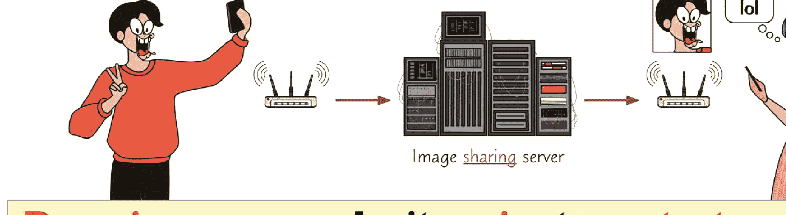

### 域名让联系服务器更容易

1. [服务器](https://en.wikipedia.org/wiki/Server_(computing))是一台为网络上的其他设备[提供信息](https://en.wikipedia.org/wiki/Web_server)或[执行任务](https://en.wikipedia.org/wiki/Server_(computing))的计算机。例如，当你浏览一个网站时，[网络服务器](https://en.wikipedia.org/wiki/Web_server)会向你发送[网页](https://en.wikipedia.org/wiki/Web_page)。
2. 设备通过互联网[访问服务器](https://en.wikipedia.org/wiki/Internet_access)，使用的是它们的[IP地址](https://en.wikipedia.org/wiki/IP_address)，但对人们来说，使用[域名](https://en.wikipedia.org/wiki/Domain_name)要[容易得多](https://en.wikipedia.org/wiki/Domain_Name_System)，比如 cgpbooks.co.uk。
3. 要从网络服务器请求一个[特定资源](https://en.wikipedia.org/wiki/URL)，你需要使用[URL](https://en.wikipedia.org/wiki/URL)（统一资源定位符）——通常称为[网址](https://en.wikipedia.org/wiki/URL)。

**域名**是一个与IP地址相关联的名称。
一个叫做**域名系统（DNS）**的系统负责将域名转换为IP地址。

下一页将提供更多关于网络的信息。

> **示例**
URL的不同部分。

`https://www.cgpbooks.co.uk/biscuit`


[域名](https://en.wikipedia.org/wiki/Domain_name)。指向特定资源的路径——通常是[网页](https://en.wikipedia.org/wiki/Web_page)或[文件](https://en.wikipedia.org/wiki/Computer_file)。

URL 可以包含 'http' 或 'https'。
这里的 's' 表示将使用加密进行安全通信。
如果你自己没有输入其中之一，系统通常会自动插入——当网站支持时，通常是 'https'。

### 不管你来自哪里，URL都欢迎你……

互联网彻底改变了全球交流。没有它，你只能访问一个小型的本地网络里的东西。现在，你可以在几秒钟内将自拍照发送到全球各地。

### 什么是万维网？

> **学习目标**
鼓声响起。主角要登场了。你实际要开发的东西——独一无二，而且绝对没有蜘蛛窝……万维网。

- 了解万维网是什么。
- 了解网页浏览器是如何工作的。
- 了解搜索引擎是如何工作的。

### 相互链接的网页构成了万维网

1. 万维网，通常被称为“网络”，是可以通过互联网访问的网站的集合。
2. 网站由许多相互链接的网页组成，并且通常也与其他网站上的网页相链接。
3. 正是这些被称为超链接（或简称链接）的连接，赋予了它网络的结构。

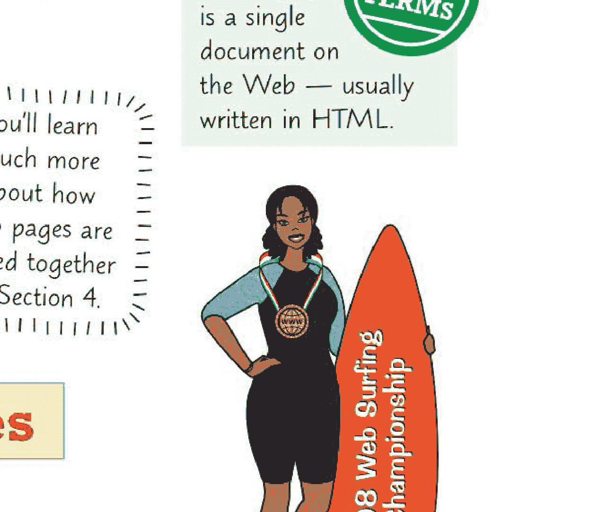

### 网页浏览器将代码转换为网页

- 网页浏览器是一种用于访问网络的软件。
- 最常见的网页浏览器包括：Google Chrome™ 浏览器、Microsoft Edge、Mozilla Firefox 和 Safari 浏览器。
- 当你在网页浏览器中输入一个 URL（见第 3 页）时，它会联系一个网络服务器来请求你想要查看的网页。
- 网络服务器会以代码形式发回网页，而网页浏览器会将这些代码转换成你所看到的内容。
- 作为网页基础的编程语言是 HTML，但它通常也与其他语言一起使用，比如 CSS 和 JavaScript™。在学习本书的过程中，你将全面了解这些语言。

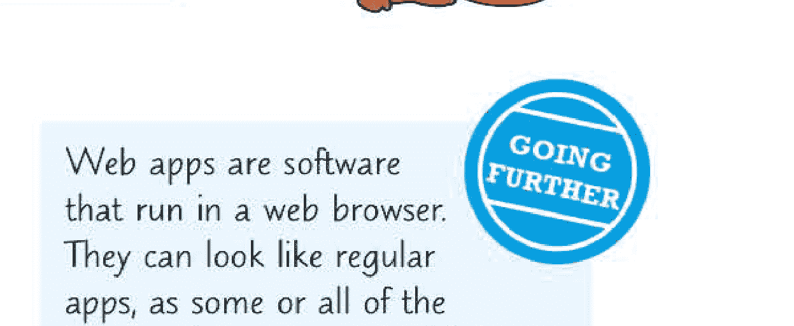

### 搜索引擎既看代码也看内容

1. 搜索引擎跟踪着海量的网页，并允许你根据它们包含的文本或图像进行搜索。
2. 在为网络开发时，如果你希望你的网页在搜索结果中被找到，你需要考虑你的代码在搜索引擎眼中是什么样子。
3. 搜索引擎根据许多因素对网页进行排名，包括：
   - 内容的相关性。
   - 有多少其他网站链接到它。
   - 它的可访问性——例如，加载速度快，移动端友好。
   - 它在搜索结果中被选中的频率。
   - 内容的更新频率。
4. 你可以编写代码来帮助搜索引擎理解网页上的内容。例如，你可以为图像添加文本描述，以帮助搜索引擎知道它是什么——更多信息请参见第 18 页。

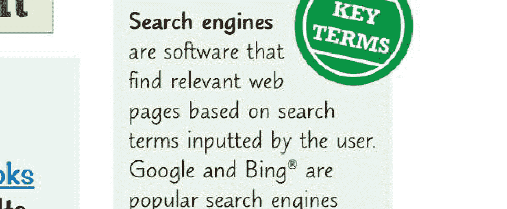

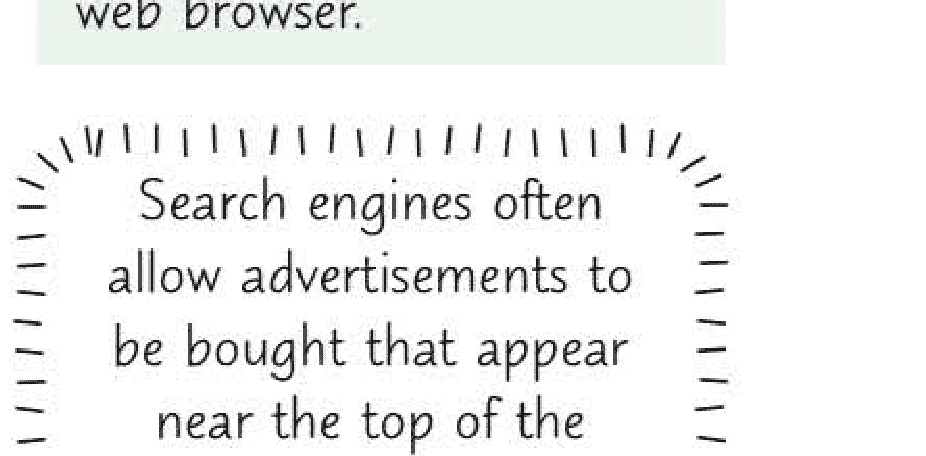

> **哎呀，这不是万维网吗……**
网络只是互联网的一部分——它们并不相同。互联网还包括其他东西，如电子邮件、文件共享和在线游戏，这些并不总是通过网络浏览器来访问。

第一部分 —— 关于网络

### 为网络开发

我们将在第 2 节正式开始学习 HTML。但首先，你需要合适的工具：一个文本编辑器（或者更花哨的代码编辑器，如果你想的话）。请继续阅读以获取推荐。

- 能够**创建**和**查看**一个**网页**。
- 了解可用于**编写网页**的**软件**。
- 了解网站是如何**发布到网络上**的。

### 编写你的第一个网页

1. 与使用 **Scratch™** 或 **Python** 等语言编码不同，你不需要下载任何**特殊软件**来开始**网页开发**。
2. 你所需要的只是一个**文本编辑器**、一个**网页浏览器**和一个梦想。
3. 你的电脑应该已经安装了所需的软件：
    - **Windows®** 自带 **Notepad** 作为文本编辑器，**Edge** 作为网页浏览器。
    - **macOS 操作系统** 自带 **TextEdit** 作为文本编辑器，**Safari** 作为网页浏览器。
4. 那还等什么？按照下面的步骤创建你的第一个**网页**吧。


**示例** 在 Notepad 中创建你的第一个网页。

打开你的**文本编辑器**并**写一条信息**。[图片：Notepad 中显示 "Hello, world!"]

现在你需要将文件**保存为**网页。

选择一个**合适的文件夹**来保存它（例如 **Documents**）。[图片：另存为对话框]

给它一个**名字**并在**末尾**添加 **html**。[图片：另存为对话框，文件名为 "hello-world.html"]

确保将**类型**设置为 **'所有文件'**，然后点击 **'保存'**。

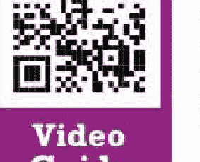

记住，你也可以在 cgpbbooks.co.uk/biscuit 找到所有视频。

在 **TextEdit** 中，将文件格式更改为“网页 (.html)”——你不需要自己写 '.html'。

**文件格式**是文件中数据的存储方式。例如，保存为 '.html' 文件告诉你的计算机，它包含由**网页浏览器**可以解释的**代码**编写的文本。

5. 要**查看你的页面**，前往你保存它的**文件夹**并**双击**该**文件**——它应该会在你的**默认网页浏览器**中打开。
6. 如果你想对网页**进行更改**，只需在你的**文本编辑器**中再次**打开文件**——你可能需要将**文件类型**更改为 **'所有文件'** 才能看到它。

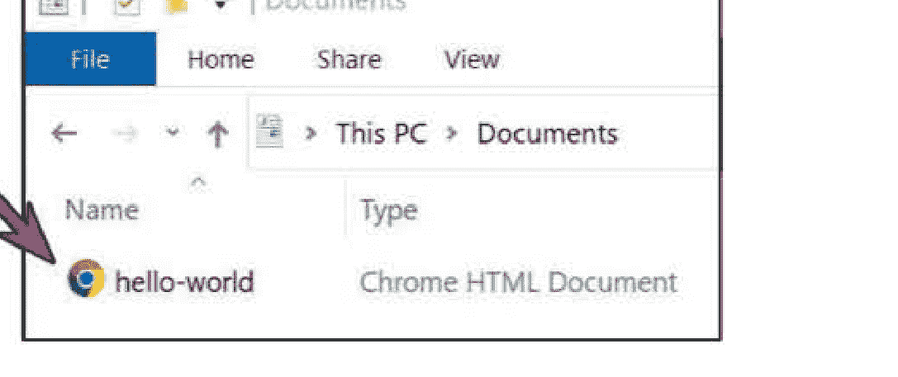

### 保持有序，保持安全

- 你需要保存**大量的代码文件**来尝试本书中的所有代码，所以**保持它们有序**是个好主意。为每个**章节**创建一个**文件夹**是一个明智的计划。
- 不要忘记——你可以**访问**目录页上的**链接**来获取本书中所有示例、练习题和编程挑战的**可下载代码文件**。它们都可以在你的**网页浏览器**中**运行**，并且可以在你的**文本编辑器**中**编辑**。
- 你可能会从**其他网站****在网上**找到很多代码，但要小心——使用它们并不总是**安全的**。不要使用任何你没有**阅读和理解**过的代码。


### 为 Web 开发

#### 代码编辑器拥有实用的功能

1) 像记事本或 TextEdit 这样的文本编辑器完全适用于本书，但就功能而言，它们相当基础。
2) 代码编辑器是高级文本编辑器，具备以下功能来帮助你：
   * 它们可以为代码添加颜色进行高亮显示——使其更易阅读。
   * 一些编辑器具有自动完成功能，可以预测你正在输入的代码。
   * 它们还可能进行自动格式化，甚至错误纠正。

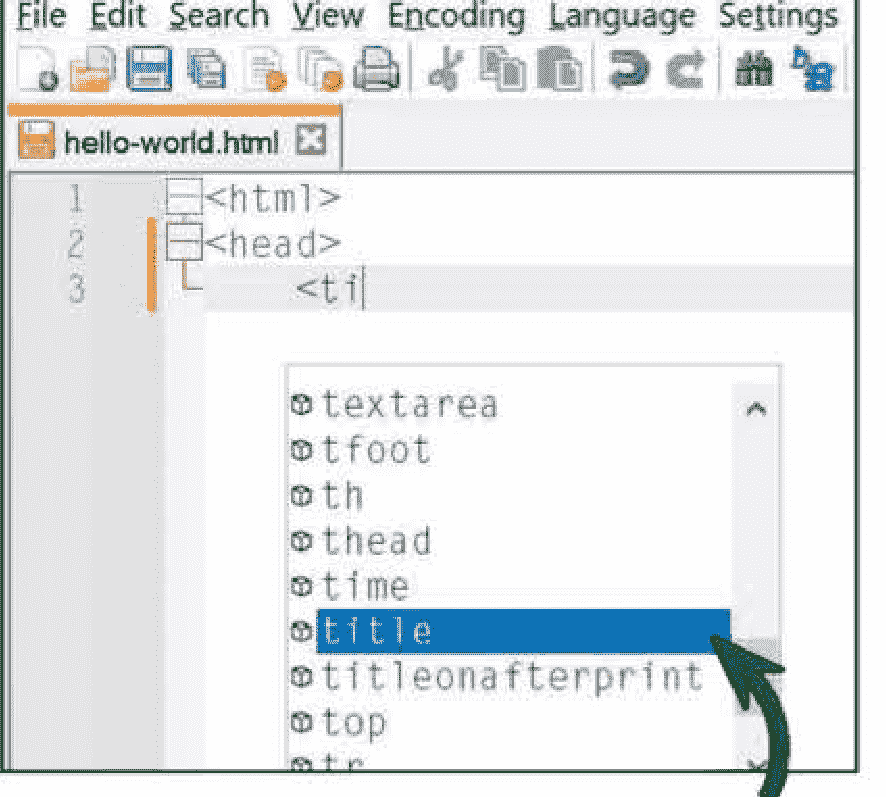

#### 一些是桌面应用程序...

* 本书中一些即将出现的编程挑战的视频解决方案展示了 Notepad++，这是一款适用于 Windows® 的免费代码编辑器。
* 一些代码编辑器可在 Windows®、macOS 和 Linux® 上使用，例如 Visual Studio Code 和 Brackets（均免费）以及 Sublime Text（可免费试用）。
* 每个编辑器看起来都会有所不同，因为它们使用不同的字体和颜色，但它们都允许你使用相同的编程语言编写网页。

也有很多手机应用可以让你编写代码——这里列出的许多网络应用在桌面和移动设备上都能使用。

#### ...而一些是网络应用

* 还有一些网络应用，可以让你在网页浏览器中编写代码。
* 一些流行的基于浏览器的编辑器是 w3schools.com、jsfiddle.net 和 replit.com。
* 它们的好处在于通常可以将代码和生成的网页并排显示。
* 然而，它们并不总是能轻松地保存或加载代码，因此对于较大的项目，坚持使用桌面程序可能更好。

#### 将网站发布到 Web 上并不容易

1) 保存在你电脑上的网页实际上并不在 Web 上——只有你自己可以访问它们。
2) 创建一个可在整个互联网上访问的网站涉及几个步骤：
   * 购买一个域名。
   * 从网络托管公司租用网络服务器上的空间。
   * 将你的域名连接到网络服务器。
   * 将你的代码文件上传到网络服务器。
3) 这一切都需要花钱，但在你刚开始时并非必须。
4) 有免费的网络托管服务可用，但使用它们有缺点——例如，你的网站上可能会出现不想要的广告。

你不需要将任何内容发布到 Web 上来学习本书——所有内容都可以在你的电脑上完成。

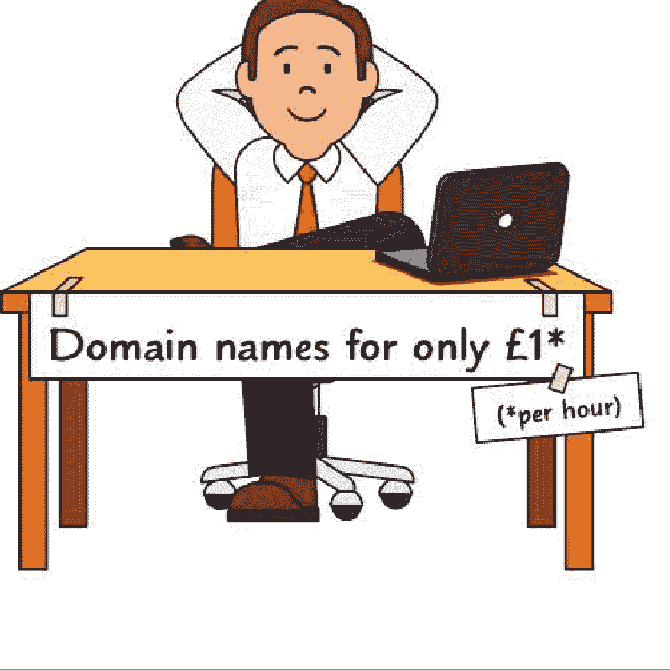

> > **嘿，看看我的网站！它是 C:\Users\Beckaaa\rad_site.html...**
> 当你在文本编辑器中保存对网页的更改时，你不需要关闭并重新打开网页浏览器来查看更改——大多数浏览器都有一个按钮（和快捷键）来重新加载页面。

第一部分 — 关于 Web

### 练习题

### 热身

Q1 说出设备在网络中连接的两种方式。

Q2 以下 URL 的域名是什么？https://www.wikipedia.org/wiki/Internet

Q3 网页和网站有什么区别？

Q4 判断对错？保存在你电脑上的网站可以被 Web 上的其他人查看。

### 练习题

Q1 简要描述本表格中术语的含义。

| 术语 | 描述 |
| :--- | :--- |
| 网络 | |
| 互联网 | |
| Web | |

Q2 填空，描述网页浏览器和网络服务器如何协同工作来显示一个网页。从下面的方框中选择词语。

```
加密 图像 代码 转换 看见 听到 写入 联系 搜索 请求
```

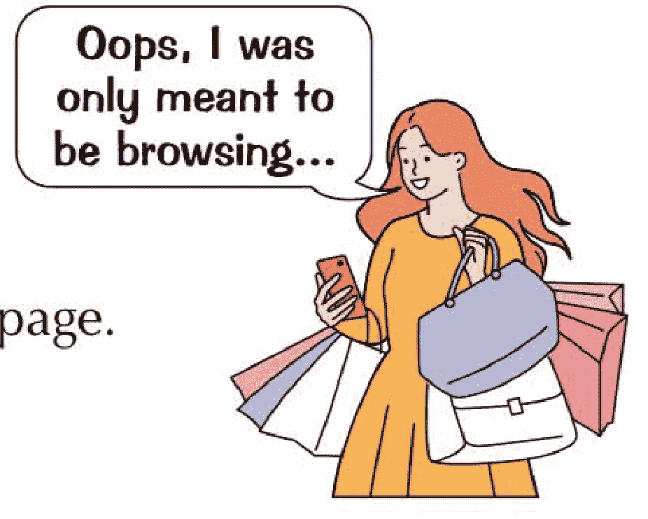

1. 网页浏览器 .................... 网络服务器以 .................... 网页。
2. 网页以 .................... 形式发送回网页浏览器。
3. 网页浏览器将代码 .................... 成你所 .................... 的内容。

Q3 给出一个可能决定网页在搜索结果中排名好坏的因素。
...........................................................................................................................................................................

Q4 说出代码编辑器（例如 Notepad++）可能具有而文本编辑器（例如记事本）没有的两个功能。
1. ...................................................................................... 2. ......................................................................................

Q5 给出使用基于浏览器的代码编辑器的一个优点和一个缺点。
优点：...........................................................................................................................................................................
缺点：...........................................................................................................................................................................

### 第二部分 — HTML 基础
### HTML 标签

Tag — 你就是“它”。而这里的“它”，我指的是那个将要学习所有构成所有网页基础的语言的人。哦，请不要鼓掌。

+   * 了解 HTML 代表什么以及它的用途。
* 了解 HTML 标签和元素。

#### HTML 构成了你页面的基础

+   1) 一位名叫蒂姆·伯纳斯-李的英国计算机科学家在 1989 年提出了万维网的概念——网页的主要语言 HTML 不久之后也出现了。
2) 现代网页通常使用几种不同的编程语言，但它们共同使用的语言是 HTML。
3) HTML 描述了网页的结构。
4) 它用于“标记”内容的主要元素——如标题、段落、图像等。
5) 当网页被查看时，网页浏览器会使用 HTML 来设置页面。

HTML 代表超文本标记语言。在 HTML 中，“标记”仅仅意味着通过添加标签来标记内容，如下例所示。

#### HTML 由许多标签组成

+   * HTML 标记不同元素的方式是通过标签。
* 标签通常是成对出现的——开始标签标记元素的开始，结束标签标记元素的结束。

示例：以下是一段典型 HTML 代码的样子。

这是一个开始标签——一个被尖括号包围的单词。

这是内容——它被标签包围。

这是一个结束标签。它与开始标签相同，但单词前有一个正斜杠。

有些标签没有结束标签，但这种情况很少见——参见第 14 页。

```
<html>
HyperText Markup Language. Learn this!
</html>
```

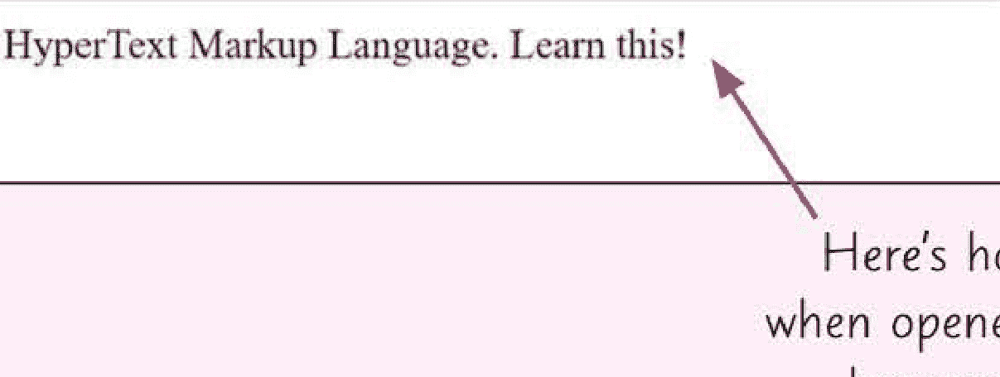

这整个东西（包括标签和内容）被称为一个元素。

你将在下一节学习如何使用 CSS 来改变内容的外观。

以下是此代码在网页浏览器中打开时的样子——浏览器不会显示标签。

Q1 另一个 HTML 开始标签的例子是 <u>。建议其结束标签是什么。

德国人喜欢 HTML——但前提是标签必须是 guten（好）的...

设计网页时，思考你内容的哪些部分需要被标记——你想要突出显示的关键组成部分是什么？我们将在接下来的几页中介绍如何操作。

### Head 和 Body

我们又来了。是时候掌握将你的代码分成头部和身体了。不过我们不会涉及生物学——不需要拿起解剖刀...

+   - 了解网页的标准结构。
- 了解 <head>、<body> 和 <title> 标签的用途。
- 了解缩进如何使代码更易阅读。

#### 网页具有标准结构

每次制作网页时，你都应该在开始前编写一些标签。这些是除了你在上一页看到的 <html> 标签之外的附加标签。

以下是一些用于设置网页标准部分的标签。

本书的可下载 HTML 文件在 <head> 中都包含一行以 `<meta name="viewport"...` 开头的额外内容。它会使网页在手机和平板电脑等小屏幕上调整大小以显示得更大。你也可以使用它——这是可选的。

这只是告诉浏览器你正在使用 HTML——你应该在每个页面上都包含它。它没有结束标签。

```
<!DOCTYPE html>
<html>
<head>
  <title>My Wonderful Page</title>
</head>
<body>
  OK, it's not that wonderful. Yet...
</body>
</html>
```

<head> 包含关于网页的信息，但不包含页面本身上显示的内容。

<body> 包含将在页面上对用户可见的所有元素。

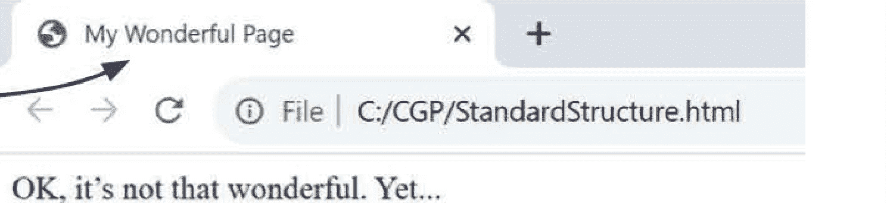

这就是 <title> 标签设置的“标题”——它是在浏览器标签页上看到的内容。因为它是在 <head> 中设置的，所以在页面本身上看不到。

#### 添加空隙使代码更易阅读

+   1) 行首的空格称为缩进。
2) 当在另一个标签内使用标签时，最好进行缩进，因为它会使结构更清晰——例如，在上面的代码中，<title> 在 <head> 内部是显而易见的。
3) 在代码中添加额外的空格不会改变页面的外观，但它会使代码读起来更顺畅。

你可以使用 Tab 键来添加缩进。

```
<!DOCTYPE html><html><head>
<title>My Wonderful Page</title></head><body>
OK, it's not that wonderful. Yet...</body></html>
```

此代码生成的网页与上面的示例相同，但没有那些漂亮的缩进和空格，它更难阅读。

像健美运动员一样，我们大部分的开发工作都投入到 <body> 中... 我们将在后面的章节中向 <head> 添加更多内容，但现在 <body> 是关键，因为那是用户看到的。请记住，从现在开始，在你的所有代码中都要包含标准结构。


## 标题与段落

好了，是时候向你的工具箱中添加更多标签了。本页将学习的所有标签都用于构建文本结构。等等，这本来是我的工作……

- 能够使用 `<h1>`、`<h2>` 等标签来标记标题。
- 能够使用 `<p>` 标签来标记段落。

### 标题使文本更大更醒目

1. 许多网页（类似书籍页面）会在正文上方使用标题。
2. 它们用于总结或介绍文本，并明确页面的主题。
3. 这通过标题标签实现。它们以 'h' 开头，后跟一个数字 —— 1 代表最大的标题。

**示例** 下面的代码使用了三个不同的标题 —— `<h1>`、`<h2>` 和 `<h3>`。

```
<!DOCTYPE html>
<html>
<head>
    <title>Headings Showcase</title>
</head>
<body>
    <h1>Big Bad Heading</h1>
    <h2>Quite A Big Heading</h2>
    <h3>The Runt Of These Headings</h3>
    Here's just some boring text.
</body>
</html>
```

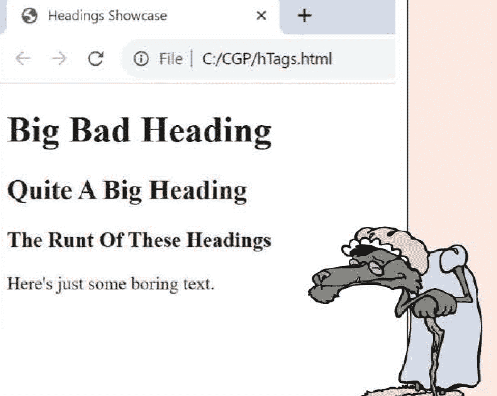

**Q1** 可用的标题大小数量有限。尝试找出哪个标签用于最小的标题。

### 使用段落标签包裹普通文本

1. 你也可以使用 `<p>` 标签 —— 'p' 代表段落。
2. 每次你开启一个新的 `<p>`，网页浏览器就会将其后的文本显示为一个新段落。

记住在标题或段落结束后使用结束标签，否则会影响后面的代码。

**示例** 下面的代码展示了 `<p>` 标签如何使文本显示为新段落。

```
<p>The line breaks
in the code
don't
mean anything.</p>
<p>Ooh look, a new paragraph.</p>
```

代码中的换行符没有任何意义。哦，看，一个新段落。

记住，代码中的空格在网页浏览器中不会显示 —— 要间隔文本，你需要使用 `<p>` 这样的标签。

一个新的 `<p>` 标签在这里开始了一个新段落。

记住包含标准结构（参见上一页）以使其成为一个完整的网页。

<h1>我们正朝着制作精美页面的方向前进</h1> 好的，到目前为止你制作的网页看起来相当单调。但别担心，本节的其余部分将介绍能让页面看起来好很多的标签 —— 然后我们将使用 CSS 让内容跃然纸上。

## 粗体、斜体和下划线

**学习目标**

现在你有了文本，设置了标题和段落标签，但整体看起来还是有点无聊。**接下来呢？** 文本格式化标签登场了……

- 能够使用 `<b>`、`<i>` 和 `<u>` 来标记文本中的**粗体**、*斜体*和<u>下划线</u>。
- 理解<u>结束标签</u>的重要性。

### 你可以为文本添加**粗体**、*斜体*和<u>下划线</u>

1. 要使文本**更粗**，使用 `<b>` 标签。
2. 要使文本*倾斜*，使用 `<i>` 标签。
3. 要给文本添加<u>下划线</u>，使用 `<u>` 标签。
4. 它们各自都有一个<u>结束标签</u>：`</b>`、`</i>` 和 `</u>`。

> **Q1** 这些会是什么样子？
> a) `<b><u>Hands off</u></b>`
> b) `<b><u>my</u> <i>lunch</i></b>`!

**示例** 下面的代码用粗体、斜体和下划线格式化了文本。

你可以在其他元素<u>内部</u>格式化文本，比如标题。

```
<body>
    <h1>Look at <u>this</u>!</h1>
    <p>I can't <b>tell you</b>
    enough how <u><i>super</i></u> this is.</p>
</body>
```

**看看这个！**

我简直无法**告诉**你这有多么*棒*。

你也可以通过连续放置<u>两个标签</u>来<u>组合格式化</u>。

只有<u>相关标签</u><u>内部</u>的文本才会被格式化为粗体、斜体或下划线。

> 你可以使用 `<strong>` 或 `<em>` 标签代替 `<b>` 或 `<i>` 来标记“重要”或“强调”的文本，这些文本应该以不同的语调朗读。它们对可访问性很有好处，因为屏幕阅读器（见第18页）会特别注意它们，不像 `<b>` 和 `<i>`。


### 不要忘记<u>结束标签</u>

网页浏览器通常对<u>网页开发者很友好</u> —— 它们会尽力<u>显示你的页面</u>，但如果你犯了错误，它们可能不会按照你<u>期望</u>的方式<u>显示</u>内容。

 一个常见的错误是忘记结束标签。

```
<p>I only wanted to underline the word <u>'tremendous'</p>
<p>and bold the word <b>'marvellous'.</p>
<p>But look what's happened...</p>
<p>Now it's ruined.</p>
```

我只想给单词 'tremendous' 添加下划线
并给单词 **'marvellous'** 加粗。
**但看看发生了什么...**
**现在全毁了。**

这里本应该有一个 `</u>` 来告诉浏览器<u>停止</u><u>下划线</u>...

...这里本应该有一个 `</b>` 来告诉浏览器<u>停止</u><u>加粗</u> —— 相反，它只是继续了下去。

 粗体，错误，斜体，错误，下划线，错误

**我的老师曾经用粗体、斜体和下划线叫我的名字...**
这些格式化标签是为你的网页增添些许*特色*的<u>绝佳</u>方式，只要你不<u>忘记</u>结束标签。坚持练习它们，这会成为你的第二天性。<u>明白了吗？</u>

## 列表与其他小玩意

**学习目标**

我敢打赌你一直很想知道如何将网页上的内容组织成列表。别再找了。我甚至会额外提供一些花哨的文本格式化标签。

- 能够使用 `<ol>`、`<ul>` 和 `<li>` 来标记 `有序` 和 `无序` 列表。
- 能够使用其他 `文本格式化标签`，如 `<mark>` 和 `<s>`。

### 列表是总结信息的好方法

1. 在 HTML 中，`有序` 列表意味着 `按顺序排列`（例如 1、2、3 或 a、b、c）的列表 —— 它们用 `<ol>` 标记。
2. `无序` 列表意味着 `项目符号` 列表 —— 它们用 `<ul>` 标记。
3. 在这些 `<ol>` 或 `<ul>` 标签内部，你为每个 `列表项` 添加一个 `<li>` 标签。

你可以使用 CSS 更改列表的编号类型或项目符号样式。

### 示例 使用 `<ol>`（有序列表）和 `<ul>`（无序列表）与 `<li>`（列表项）。

最好将列表项（`<li>`）进行 `缩进`，以便清楚地表明它们位于列表 `内部`。
你以 `相同的方式` 对 `两种类型` 的列表使用 `<li>`。

```
<h2>Here's an ordered list:</h2>
<ol>
  <li>This is the top dog, woof</li>
  <li>2nd the best?</li>
</ol>

<h2>...and here's an unordered list:</h2>
<ul>
  <li>No favourites here, all points are equal</li>
  <li>See? They're all just regular bullets</li>
</ul>
```

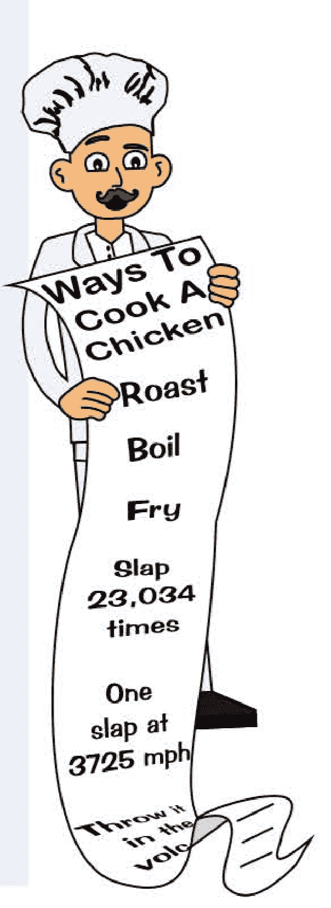

这是一个有序列表：
1. 这是老大，汪汪
2. 第二最好？

...这是一个无序列表：
* 这里没有最爱，所有点都平等
* 看？它们都是普通的项目符号

**Q1** 以下示例最适合使用有序列表还是无序列表？
a) 最喜欢的五部电影。
b) 管弦乐队中的乐器。
c) 烹饪鸡肉的不同方法。
d) 测试题。

### 还有其他可以使用的 `文本标签`

- `<mark>` 和 `</mark>` `高亮` 文本。
- `<s>` 和 `</s>` `删除线` 文本。
- `<code>` 和 `</code>` `将文本更改为代码字体`。
- `<blockquote>` 和 `</blockquote>` `缩进文本以表明它是引用来源`。
- `<sup>` 和 `</sup>` `用于上标文本`。
- `<sub>` 和 `</sub>` `用于下标文本`。

**Q2** 重新创建此网页：
* 让 `这个` 像这样显示
* 哦，看看 `这个`
* 看 `这个` 变得 `更高`

如果我的房间是一个列表，它会是无序的那种...
尝试一下这些文本格式化标签，看看你能想出什么。一个待办事项列表？一个食谱？或者也许你只是想用高亮文本给同学输入消息。

### 练习题

### 热身

- **Q1** HTML 中的“标签”是什么？
- **Q2** 判断对错？HTML 元素是开始标签、一些内容和结束标签的组合。
- **Q3** `<h1>` 和 `<h2>` 标题看起来有什么不同？
- **Q4** 为什么在代码中添加缩进和行间距是明智的？

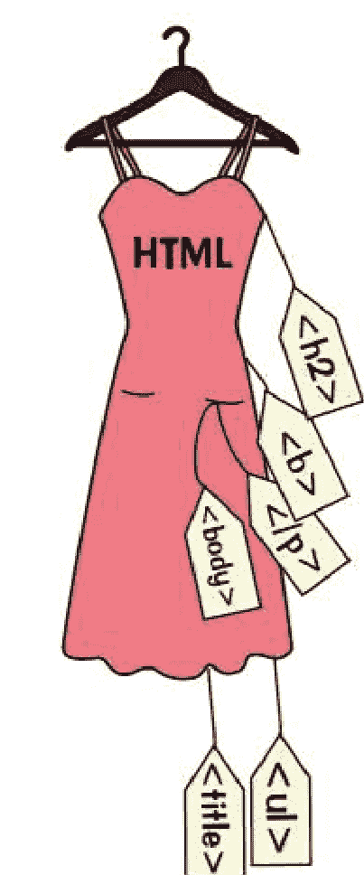

### 练习题

**Q1** 这是所有 HTML 文件应具备的基本结构。使用方框中的术语完成标签。

**可使用的术语：**
`DOCTYPE html`
`/html`
`body`
`/p`
`title`
`head`
`h1`

*并非所有这些术语都需要在你的答案中使用。*

```
<!.......................>
<html>
<.......................>
<.......................>Summary</title>
</head>

<.......................>
Main page here.
</body>

<.......................>
```

**Q2** 解释 `<head>` 和 `<body>` 标签之间的区别。

........................................................................................................
........................................................................................................
........................................................................................................

**Q3** 完成表格以显示每个标签的作用。

| 开始标签 | 用途 |
| :--- | :--- |
| `<p>` | |
| `<i>` | |
| `<ul>` | |

**Q4** 列出下面代码中的三个错误。

```
<h1>My Page</h1>
<paragraph>Welcome to my site. Here's a fact about <b>me:</paragraph>
<h2 When I eat my birthday cake, I save the candles until last.</h2>
```

1. ........................................................................................................
2. ........................................................................................................
3. ........................................................................................................


## 图片

好了，让我们来点有趣的吧？是时候学习如何在你的网页中添加图片了。这需要一点文件管理，但效果绝对值得。

- 能够使用 `` 标签来标记图片。
- 能够使用 `src`、`width` 和 `height` 属性。

### 使用 `` 标签添加图片

以下是使用 HTML 插入图片的方法：

1.  找一张你喜欢的图片。
2.  最好将它保存在与网页文件相同的文件夹中。
3.  打开文件夹，检查文件名和文件类型。
4.  现在是时候添加代码了。

如果你从网站上抓取图片，请右键点击它（或在 Mac 上按住 Control 键点击），然后将其保存到你的电脑上。

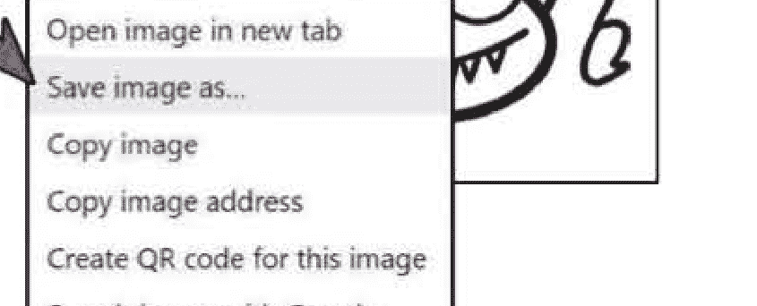

你可能需要调整文件夹的“查看”设置才能看到这些详细信息。

#### 示例

使用 `` 和 `src` 将图片添加到网页。

```html
<h1>Here's my very special web crawler:</h1>


```

`src` 是 'source'（源）的缩写——这是图片文件的位置。
源通常就是文件名后跟文件类型——确保它被放在引号内。

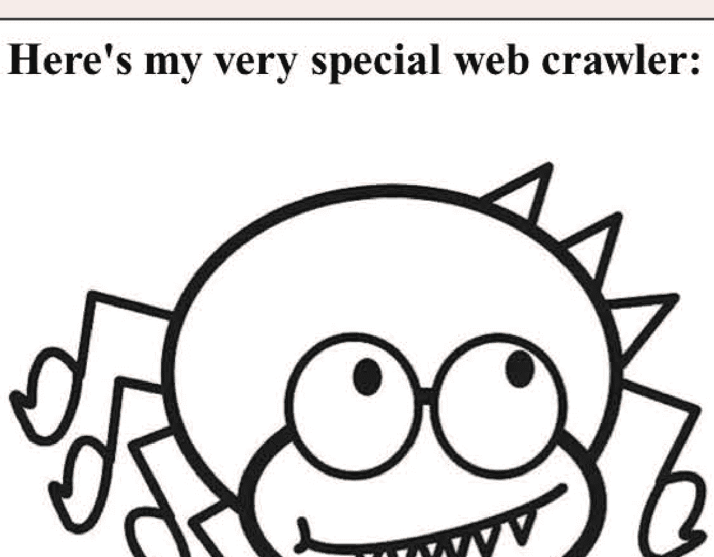

`` 是一个罕见的例子，它是一个没有对应闭合标签的标签——所以这里不需要 `</img>`。

5.  从其他网站下载和使用图片用于个人用途是可以的，但如果你要将它们用于真实的网页，请确保你有许可。

像 pixabay.com 和 unsplash.com 这样的网站提供免费的图片，你可以将它们用于真实的网页。

### src 是属性的一个例子

-   `src` 不是一个标签——它被称为属性，并且它放在标签内部。
-   属性可以看作是标签的一个设置，用于改变标签的功能或显示内容。
-   要使用属性，请将属性名后跟等号，然后是引号中的值（例如 `src="spider.jpg"`）。
-   一些标签有多个属性，例如 `` 也可以有 `width` 和 `height` 属性——参见下一页。
-   请记住，所有这些都需要放在 `` 标签内，最后一个尖括号 `>` 之前。

你说过不要蜘蛛的！

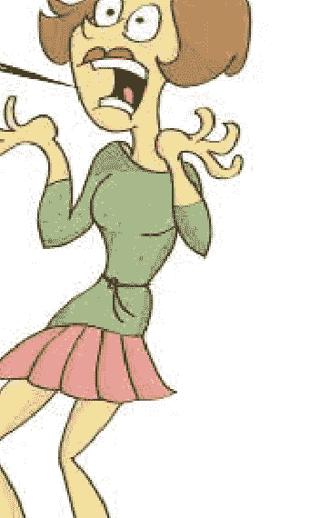

第二部分 —— HTML 基础

## 图片

### 仔细检查 src

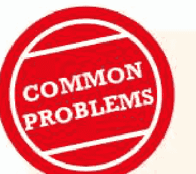

有时，你可能会看到一个这样的图标  而不是你的图片。这意味着浏览器无法在你指定的源位置找到图片。

```html

```

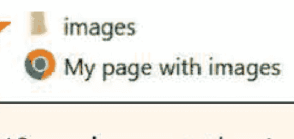

-   仔细检查文件名或文件格式的拼写。
-   如果你把图片放在一个文件夹里，比如这里的这个，也要把它添加到源中——更多关于此的信息请参见第 30 页。

一些常见的图片文件格式是 .jpg（或 .jpeg）、.png 和 .gif。

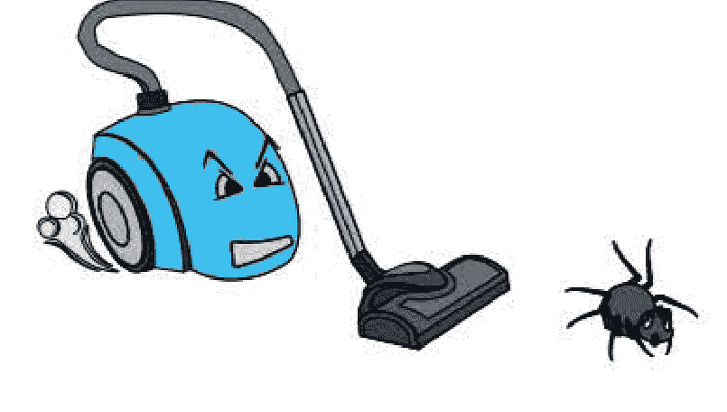

### 图片 URL 可以用作 src

-   如果你想使用别人网站上的图片，一个更快捷的方法是将图片 URL 放入 src 属性中。
-   要做到这一点，请在浏览器中右键点击图片并选择“复制图片地址”，然后将其粘贴到代码中并加上引号：

```
src="https://www.cgpbooks.co.uk/[redacted]/coolpics/spider.jpg"
```

-   它可能是一个很长的链接，所以如果它显示得很长，不要惊慌。

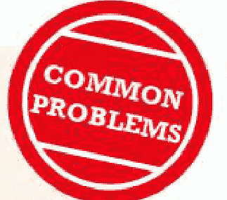

使用图片 URL 要小心——如果网站更改或移除了图片，它在你网页上的显示也可能更改或无法加载。

### 你可以调整图片的大小

1.  图片的尺寸是指它在屏幕上的大小——通常写作宽 × 高（例如 80 × 40）。
2.  这些是图片的像素宽度和高度。
3.  网页浏览器默认会以图片的原始尺寸显示它——要调整图片大小，你可以使用属性来指定宽度和/或高度。


像素是图片或屏幕上最小的颜色方块。

**示例** 使用 width 和 height 来调整图片大小。

```html
<h1>An itsy-bitsy version:</h1>

```

这里将它调整为宽度 80 像素... 高度 20 像素。

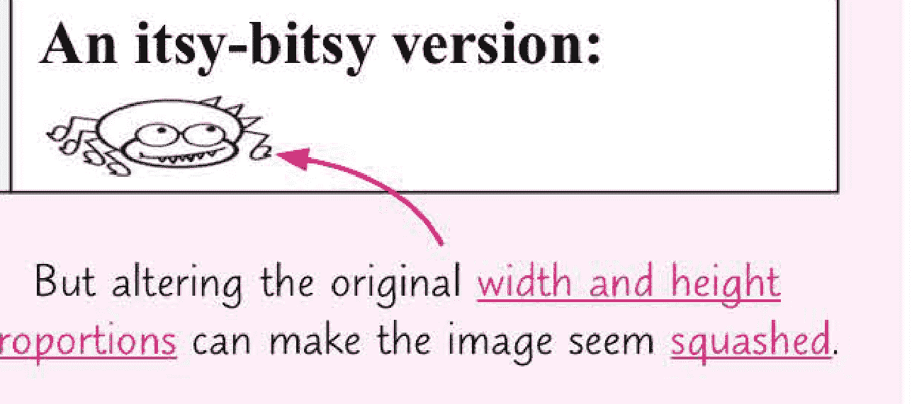

但是改变原始的宽高比例可能会使图片看起来被挤压了。

```html
<h1>A better itsy-bitsy version:</h1>

```

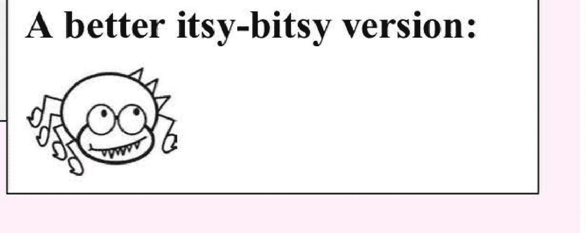

为了保持图片外观与原始图片相同，只设置其中一个属性，例如 width 或 height。

> 我最喜欢的 src？我得说是甜辣酱或烧烤酱...

有时需要尝试几次才能让图片正确显示，所以如果遇到这种情况，不要气馁。调整图片大小也可能需要一些尝试和错误，但嘿，生活就是如此...

### 练习题

### 热身

Q1 图片的“源”指的是什么？

Q2 列出三个在 `` 标签中使用的属性。

Q3 对还是错？图片标签不需要闭合。

Q4 以下哪个不是常见的图片文件格式？

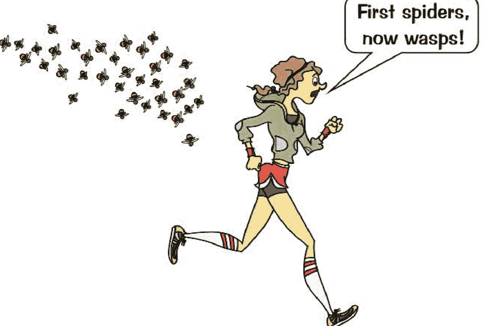

### 练习题

Q1 这是本节可下载内容中文件 'S2-p16-PracticeQ-Q1.html' 的部分代码。在网页浏览器中查看时，它显示了标题，但没有显示图片。

```html
<h1>Here's the stadium closest to me:</h1>

```

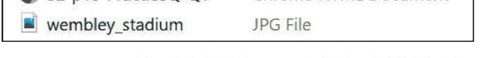

> 虽然没有显示，但标准结构（见第 9 页）存在于代码中。

描述导致图片加载失败的两个代码问题，并解释应如何修复它们。

1. ________________________________________________________________________________________________________
2. ________________________________________________________________________________________________________

Q2 一个来自网站的图片具有以下图片 URL：
https://cgpbooks.co.uk/[redacted]/normalfiles/homework/forbidden.png
完成下面的代码，展示如何将这张图片添加到网页中。

```html

```

Q3 Tess 正在尝试调整她网页上图片的大小，但每次设置新的宽度和高度时，图片看起来都被拉伸了。建议 Tess 如何调整图片大小使其看起来不被拉伸。

Q4 完成左侧代码中的缺失部分，以重建右侧显示的网页。

```html
<h1>______________________________________________</_______>

<__________ __________="wasp.jpg" width="250">

<__________>
    <li>Avispa</li>
    <li>Vespa</li>
    <li>_______________</li>
    <li>Geting</li>
</__________>
```

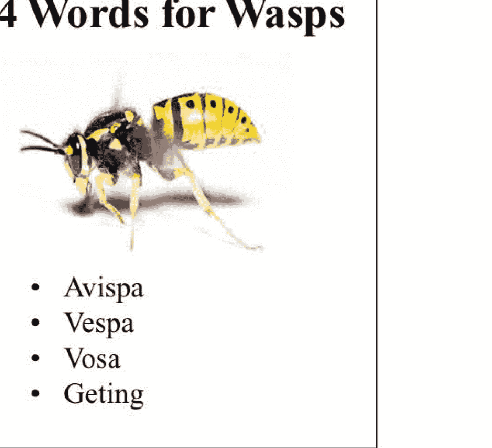

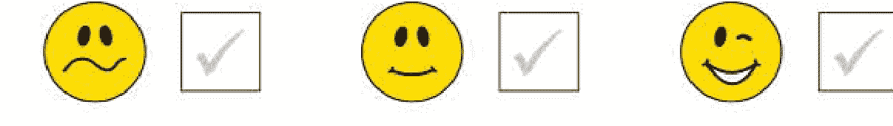

## 第二部分的编码挑战

好了，我们到了第二部分的末尾。尝试一下这些挑战，测试一下你掌握的技能——然后访问 [cgpbooks.co.uk/biscuit](http://cgpbooks.co.uk/biscuit) 下载每个挑战的[示例代码](http://example code)。

### 挑战 1 —— 示例

为[你最喜欢的食谱](http://your favourite recipe)创建一个网页。这可以是真实的，也可以完全是编造的...

它需要包含以下功能：

-   在 [title](http:title) 中显示的[你的菜名](http://name of your dish)。
-   三个斜体的[标题](http://headings)：**“食材”**、**“制作方法”** 和 **“如何享用”**。
-   每个标题下一个简短的[段落](http://paragraph)，以便有人可以[按照你的食谱](http://follow your recipe)操作。
-   一张你的菜的[图片](http://picture)。

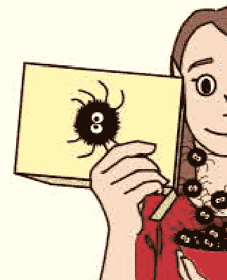

**解决方案**
**计划：** 创建一个新的 HTML 文件并添加标准结构。然后你需要为你这道菜找到或创建一张图片，并将其保存在与 HTML 文件相同的文件夹中。

1.  记住，[title](http://title) 需要[在](http://inside) `<head>` 标签内。
2.  我将让你来写食谱的[每个部分](http://each part)，但使用 `<h1>` 和 `<p>` 标签来[组织你的文本](http://structure your text)。
3.  对于图片，使用 `src` 来放入[文件名](http://file name)。如果你在[浏览器中查看页面](http://viewing your page)时看不到它，检查它是否与[已保存](http://saved)的文件[匹配](http://matches)。

```html
<!DOCTYPE html>
<html>
<head>
    <title>A Nice Bowl Of Spiders</title>
</head>
<body>
    <h1><i>Ingredients</i></h1>
    <p>Before you start, you will need...</p>
    <h1><i>How To Make</i></h1>
    <p>First...</p>
    <h1><i>How To Serve</i></h1>
    <p>Once you've finished cooking...</p>
    
</body>
</html>
```

### 挑战 2

### 挑战 3

重建下面显示的[网页](http://web page)。

一家当地的床垫公司联系你，希望你为他们[设计一个网站](http://designing a website)。
制作一个符合他们在[下方邮件](http://in the email)中[概述的要求](http://requirements)的网页。

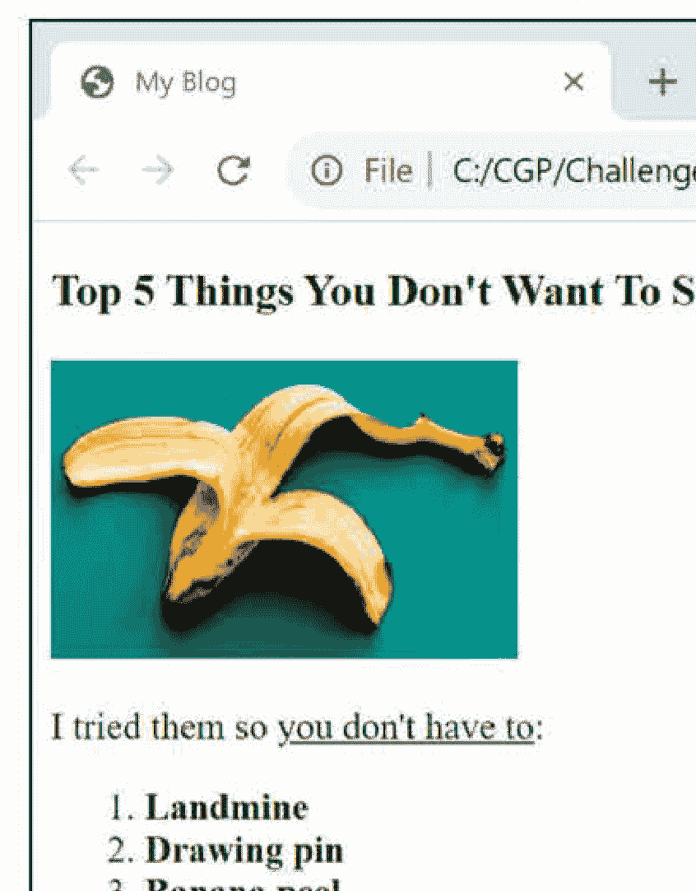

> **来自:** constance@azmail.co.uk
**发送至:** 我
你好
我希望网页包含以下内容：
- 我的名字
- 我的价格（单人床 £70，双人床 £150）
- 我的电子邮件地址
- 一张宽度为 250 像素的床的图片
谢谢，
Constance Noring

记住，你也可以在 [cgpbooks.co.uk/biscuit](http://cgpbooks.co.uk/biscuit) 找到所有的视频解决方案。

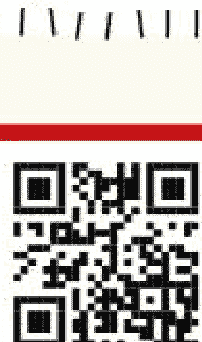

你可以为这个挑战找自己的图片，或者使用本节可下载文件中提供的图片。


## 第三节 — 使用 CSS 为页面增添风格

### 无障碍设计原则

**学习目标**
本节旨在为你的网页增添一些光彩和魅力——它们目前看起来相当平淡。但首先，让我们来谈谈无障碍设计。

*   了解设计无障碍网页的方法。
*   能够使用 `alt` 属性为图片添加描述。

#### 遵循这些无障碍设计原则

1.  无障碍设计的核心在于让更多人能够使用。
2.  对于有残疾或功能障碍的人来说，这尤为重要。

按重要性顺序排列标题。
例如：`<h1>` 应用于最重要的标题，并放在页面最前面。

将大标题放在小标题之上，否则读者会**感到困惑**，不知该先读什么……

使用 `<p>` 标签（段落）和 `<br>` 标签（换行）来分隔文本。

```html
<p>是时候来首俳句了...</p>
<p>段落；换行。 <br> 使用它们的标签来格式化文本 <br> 像网页开发专业人士一样。</p>
```

是时候来首俳句了...
段落；换行。
使用它们的标签来格式化文本，像网页开发专业人士一样。

使用高对比度颜色让文本更易阅读。

这对于视力不佳和色盲用户非常重要。

使超链接显眼——保持其下划线并使用不同颜色。

你想了解更多吗？
[了解如何样式化链接。]

#### alt 为 `` 提供替代文本

*   `alt` 属性可以添加到 `` 标签中，为图片提供文本描述。
*   如果图片因任何原因无法加载，此替代文本将被显示。
*   屏幕阅读器也会使用它——它们帮助视障人士理解图片内容。

```html

```

蜘蛛、黄蜂，现在又是鲨鱼……难道就没有替代品吗？
无障碍功能也有助于搜索引擎理解你的页面——它们利用标题来把握内容结构，并通过 `alt` 属性了解图片内容。

### 样式化页面

> **学习目标**

好了，别再找借口了，是时候让你的网页看起来棒极了。准备好成为一名双语网页开发者——你将要学习 CSS。

*   理解 CSS 的含义及其用途。
*   能够使用 `style` 属性添加内联 CSS。
*   能够使用 `border-style` 属性添加边框。

#### CSS 为你的网页增添风格

1.  **CSS** 代表 **层叠样式表**——与 HTML 类似，它也是一种网页语言。

2.  网页可以**混合包含** HTML 和 CSS：
    *   HTML **标记**不同的**元素**——如标题、段落**等**。
    *   CSS **改变**这些元素的**外观**——字体、颜色**等**。

3.  一段典型的 CSS **看起来**像这样：
    *   这是一个属性——它代表你想要改变的元素的某个特征。
    *   `border-style`: solid;
    *   这是属性的值——它决定了你希望该特征呈现的样式。

#### 使用 style 属性设置内联属性

*   使用 CSS 最简单的方法是通过其 `style` 属性直接将其添加到 HTML 标签中。
*   这被称为内联 CSS——其他使用 CSS 的方法将在第 5 节介绍。

**示例** 如何为页面上的元素添加边框。

在开始标签中添加一个 `style` 属性。在引号内，写上属性名后跟一个冒号。然后写上值，后跟一个分号。

```html
<h1 style="border-style: solid;">哦，好漂亮的边框</h1>

<p>此段落没有样式，所以没有边框</p>

<p style="border-style: dotted;">但这个段落有虚线边框</p>
```

`border-style` 属性可用于大多数元素。

边框将拉伸以填满网页浏览器的宽度。你将在第 24 页学习如何控制它们的尺寸。

> 如果未设置属性，则会使用默认值——对于 `border-style`，默认值为 `none`。

**哦，好漂亮的边框**

此段落没有样式，所以没有边框

> 但这个段落有虚线边框

*   你还可以尝试的其他 `border-style` 值包括：`dashed`（虚线）、`double`（双线）、`groove`（凹槽）、`ridge`（脊线）、`inset`（内嵌）和 `outset`（外凸）。

| Q1 | Q2 |
| :--- | :--- |
| 编写一行代码，显示一张带有虚线边框的图片。 | 重新创建这个：哇，是双线边框 |

> **`border-style: eaten too much cheese;`**

冒号 (`:`) 始终是必需的——它将 CSS 属性与其值分隔开。分号 (`;`) 在只设置单个属性时是可选的，但包含它是个好习惯。

## 文本颜色

**学习目标**

是时候为你的网页注入一些色彩了，CSS 提供了丰富的调色板选择。你是更倾向于“薰衣草粉”还是“柠檬雪纺”风格？让我们一探究竟。

*   能够使用 `color` 属性更改文本颜色。
*   了解网页浏览器支持的颜色名称。

### 使用 `color` 属性为文本着色

1.  每当你有一个包含文本的元素时，都可以使用 `color` 属性更改文本颜色。
2.  设置此属性值的最简单方法是使用颜色名称，如 “Red”（红色）、“Green”（绿色）或 “Blue”（蓝色）。

> 要进行更高级的着色，可以使用颜色代码——有关更多信息，请参阅第 38 页。

**示例**
如何更改文本颜色。

```html
<h3>我的一些老师：</h3>
<ul>
  <li style="color: Brown;">布朗先生</li>
  <li style="color: Green;">格林女士</li>
  <li style="color: Pink;">罗斯女士</li>
  <li style="color: Red;">雷德曼先生</li>
</ul>
```

我的一些老师：
*   布朗先生
*   格林女士
*   罗斯女士
*   雷德曼先生

> 如果你没有设置颜色，你会得到一个默认颜色，它取决于用户的设置——在本书中，我们假设它是 “Black”（黑色）。

`color` 属性是在每个 `<li>` 标签的 `style` 属性中设置的，以便为每个列表项赋予不同的颜色。

项目符号也被着色了。

### 注意 “color” 的拼写

**常见问题**
如何不更改文本颜色。
你需要使用美式拼写，所以应该是 “color”，不要带 “u”。
`color` 属性没有正确设置，所以这段文本颜色没有改变。

```html
<li style="colour: Grey;">格蕾女士</li>
```

*   格蕾女士

### 大多数浏览器支持相同的颜色

*   有超过一百种颜色名称是所有现代网页浏览器都认可的。
*   这意味着无论用户使用哪种浏览器，他们都会看到正确的颜色。

> 这些是我最喜欢的颜色——更多颜色名称，请查看本节可下载文件中的 `ColourNames.txt`。

| HotPink | BlanchedAlmond | Honeydew | PowderBlue |
|---|---|---|---|
| FireBrick | SandyBrown | SeaGreen | MidnightBlue |

**哎呀，布兰奇·阿尔蒙德老师布置了超超超多作业……**
如果你改变了一个元素的样式，它内部的内容也可能随之改变。例如，为 `<ul>` 添加 `color` 会影响所有的列表项——但你仍然可以为单个列表项添加不同的 `color`。

## 背景颜色

> **学习目标**

电影的精华在于背景中发生的故事——我这么说不仅是因为我还没演上大角色。无论如何，我对网页也有同样的感觉。

*   能够使用 `background-color` 属性填充背景。
*   了解可以在一个元素上使用多个 CSS 属性。

### 用 background-color 为背景着色

你可以使用 `background-color` 属性为任何元素的背景着色。

**示例** 填充两段段落文本的背景。

你可以使用与 `color` 属性相同的所有颜色。

```html
<p style="background-color: Yellow;">CSS 程序员如何选择房子？</p>
<p style="background-color: LightGrey;">通过比较属性值...</p>
```

**CSS 程序员如何选择房子？**

通过比较属性值...

> 你可以将每个 HTML 元素想象成包含在一个盒子里——除非你更改了 `background-color` 或 `border-style` 等样式，否则它通常是不可见的。更多内容请参阅第 47 页。

### 将其添加到 `<body>` 以填充整个页面

1.  如果你想用颜色填充整个页面，只需在 `<body>` 标签中设置 `background-color` 即可。
2.  你仍然可以更改其他元素的 `background-color`，如果你希望它们有所不同。

**示例** 如何轻松一步填充整个页面。

除非被更改，否则元素的背景是透明的，因此在 `<body>` 中设置 `background-color` 的效果是填充整个页面...

...除了这段斜体文本，因为 `<i>` 标签设置了它自己的 `background-color`。

```html
<body style="background-color: LightBlue;">
    <h1>突发新闻：一切都是蓝色的！</h1>
    <p>除了
        <i style="background-color: Orange;">这个</i>。
    </p>
</body>
```

**突发新闻：一切都是蓝色的！**

除了*这个*。

### 你可以混合搭配样式属性

如果你想使用多个样式属性，只需将它们一个接一个地放置。

```html
<p style="background-color: Yellow; color: Red; border-style: dashed;">
    <b>注意：此代码运行时很烫！</b>
</p>
```

> `color` 属性也会更改边框颜色，但你可以使用 `border-colour` 属性单独设置它。

> **嘘，过来——让我告诉你一个小秘密……**

别忘了第 18 页的无障碍设计原则——如果你更改了 `color` 或 `background-color` 属性之一，请思考是否也需要更改另一个。


### 练习题

### 热身练习

**Q1** 判断对错：`<br>` 标签有一个闭合的 `</br>` 标签。
**Q2** 'CSS' 是什么的缩写？
**Q3** 下面这行代码有什么问题？

```
<b style="colour: Green;">USA USA USA!</b>
```

**Q4** 现代浏览器支持多少种颜色名称：多于100种还是少于100种？

### 练习题

**Q1** 给出两种方法，使你的网页设计更具可访问性。

1. ............................................................................................................
2. ............................................................................................................

**Q2** 描述 HTML 和 CSS 在用途上的区别。

............................................................................................................

**Q3** 通过从每个术语画一条箭头指向代码中的正确部分，来标注下面的代码。

```
<p style="background-color: LavenderBlush;">
  Don't read this, it won't help you answer the question.
</p>
```

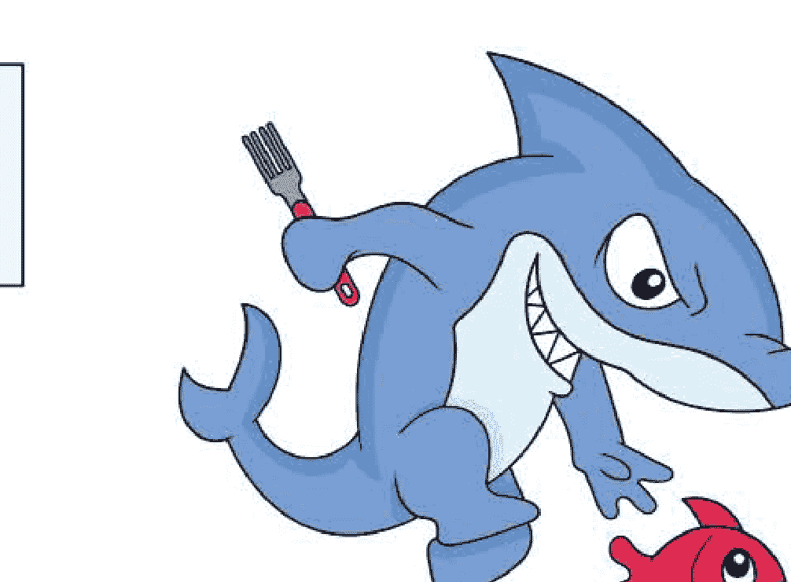

**Q4** 重新创建下面显示的网页。

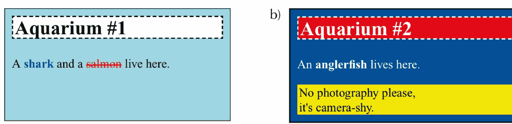

## 更改字体

学习目标

字体能让事物的外观大不相同。“完全真实银行”看起来有点可疑，但“完全真实银行”呢？现在这是一家合法企业了——算我一个。

- 理解什么是字体族。
- 能够使用 `font-family` 属性更改文本的字体。
- 能够使用 `font-size` 属性更改文本的大小。

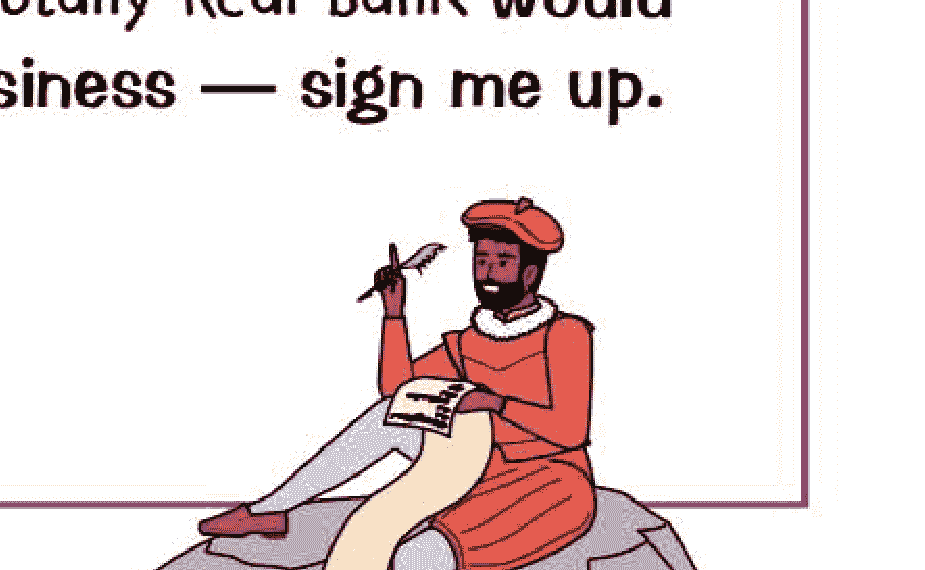

### `font-family` 决定文本的外观

1. 字体是构成文本的字母、数字和符号的一种特定设计。
2. 字体族是一组相似的字体——它们通常包括同一字体的常规、粗体和斜体变体。
   例如：'Times New Roman' 字体族包括：常规、粗体和斜体。
3. CSS 还将字体分组为通用字体族，包括：
   - Serif（衬线体）——用于外观更传统的文本（例如 Times New Roman）。
   - Sans-serif（无衬线体）——用于外观干净简洁的文本（例如 Arial）。
4. 你可以使用 `font-family` 属性来指定你希望文本使用哪种字体。

其他通用字体族包括：cursive（用于手写体），monospace（用于代码）和 fantasy（用于其他东西……）。

衬线是附加在字母上的一个小勾（线条）。

**示例**

如何使用 `font-family` 属性。
按你的偏好顺序列出一个或多个字体族（用逗号分隔）。
包含一个通用字体族，以防网页浏览器无法显示你的其他选择。
如果网页浏览器无法使用 Arial，它会从无衬线字体族中选择另一种字体，比如 Helvetica。

```
<body style="font-family: Arial, sans-serif;">
  <h1>New Font, New Me</h1>
  <p>This is looking <i>better</i> already.</p>
  <p style="font-family: 'Times New Roman', serif;">Serifs drool,</p>
  <p>Sans-serifs rule.</p>
</body>
```

在包含空格的字体名称两边加上引号。

**新字体，新我**

这已经看起来好多了。
衬线体很逊，
无衬线体才够酷。

5. CSS 可以使文本加粗和变为斜体，而无需使用 `<b>` 或 `<i>` 标签。

```
<p style="font-weight: bold;">Bold</p>
<p style="font-style: italic;">Italic</p>
```

你可以将这些属性的值设置为 `normal`，以从默认设置了粗体或斜体的元素中移除这些样式。

**粗体**
*斜体*

### 使用 `font-size` 调整文本大小

**示例**

表示大小的两种方式是通过百分比或像素（px）。
百分比值意味着文本将比通常情况大或小该百分比。
像素值意味着文本将按该精确大小显示。

网页浏览器中的默认字体大小通常是 16px。

```
<p>Domain names for sale</p>
<p style="font-size: 200%;">Now just 50p</p>
<p style="font-size: 8px;">Sponsored Ad</p>
```

域名出售
现在只需 50 便士
赞助广告

> 不可访问的网页设计原则 #1：选择一个读起来很费劲的字体……

如果你的网页浏览器没有显示正确的字体，那么请检查逗号和引号（它们很容易出错），还要检查拼写——Ariel 是我姑婆的名字，不是字体。

## 对齐与大小

这里一次两个主题——别说我从没为你做过什么。本页介绍了如何将元素放置到页面上所需位置的基础知识。

- 能够使用 `text-align` 属性重新对齐文本。
- 能够使用 `width` 属性调整元素大小。

### 通过对齐改善布局

- `text-align` 属性改变文本块的水平位置。
- 它可以有的三个主要值是 `left`（默认）、`right` 和 `center`。

```
<h1 style="text-align: center;">
  Pencil Weekly
</h1>
<p style="text-align: right;">
  The right way to write. <br>
  
</p>
<p>Your source of pencil news.</p>
```

有很多方法可以使用 CSS 来定位文本和图像。上面的例子展示了最简单的方法——更多高级定位请参见第 6 节。

### 使用 `width` 调整元素大小

1. 像标题和段落这样的元素通常会填满可用空间的宽度。
2. 你可以通过设置它们的 `width` 属性来改变这种行为。
3. 如果你想要一个与可用空间成比例的宽度，请使用百分比值。

```
<p style="width: 50%;">The HB pencil performs well under extreme conditions.</p>
```

4. 如果你想设置一个精确的宽度，请使用像素值。

```
<p style="width: 100px;">
The HB pencil performs well under extreme conditions.
</p>
```

5. 注意——这个 CSS 的 `width` 属性与你在第 15 页 `` 标签上看到的 HTML `width` 属性不同。那个属性只能有像素值，而且大多数元素不能使用它。

## CSS——颜色中心拼写很奇怪……

把东西放到网页上你想要的位置可能有点令人头疼。添加一个边框来查看元素的边缘位置可能会很有帮助——你随时可以之后再移除它。

### 练习题

### 热身练习

**Q1** 什么是字体族？
**Q2** 下面的文字使用的是衬线字体还是无衬线字体？“I love eggs.”
**Q3** 在属性值中使用的 'px' 代表什么？
**Q4** 说出 `text-align` 属性的三个可能值。

### 练习题

**Q1** 完成由下面代码创建的网页草图。

```
<body style="font-size: 10px;">

<p>Egg</p>
<p style="font-size: 150%;">Egg</p>
<p style="font-size: 20px;">Egg</p>

</body>
```

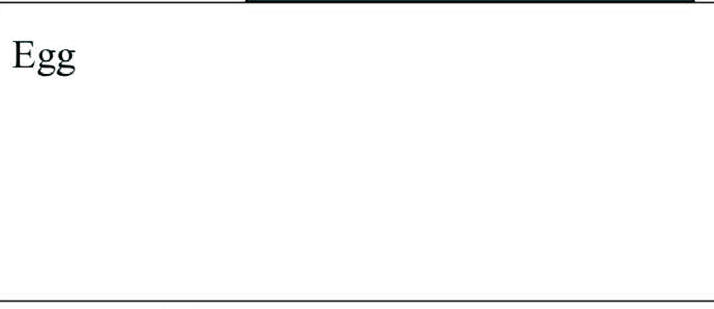

**Q2** 补全代码的缺失部分，以重现所示的网页。

```
a)
<h1 style="...;">Arial, ...;">Egg</h1>

Egg
```

```
b)
<p style="...">

</p>
```

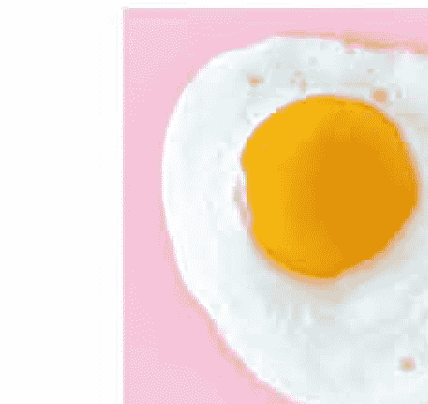

**Q3** 描述下面代码中的三个错误。

```
<body style="background-color: Yellow; font-family: 'Times New Roman' serif;">
<h1 style="text-align: centre;">My Fried Egg Recipe</h1>
<p width="50%">Fry it. Eat it. Victory.</p>
</body>
```

1. ......................................................................................
2. ......................................................................................
3. ..................................................................................

## 第三节编码挑战

到现在，你应该比巴黎时装周更有型了，所以为什么不试试这些挑战呢？
别忘了，你可以访问 [cgpbooks.co.uk/biscuit](http://cgpbooks.co.uk/biscuit) 下载每个挑战的[示例代码](http://example.com)。

### 挑战 1 — 示例

一家[旅游公司](http://tour-guide)希望你为他们设计一个网页。他们行程中的一个站点是巴黎的[埃菲尔铁塔](http://eiffel-tower)。

> 别忘了——这些页面上的示例代码没有显示完整的标准结构（参见第 9 页）。

该页面应具有以下特点：

- [浅灰色背景](http://light-grey)。
- [居中](http://centre)放置的[埃菲尔铁塔照片](http://photo)，[高度](http://height)为 [200 像素](http://200px)。
- 图片下方是文本“[埃菲尔铁塔，巴黎](http://eiffel-tower-paris)”，使用[衬线字体](http://serif-font)。

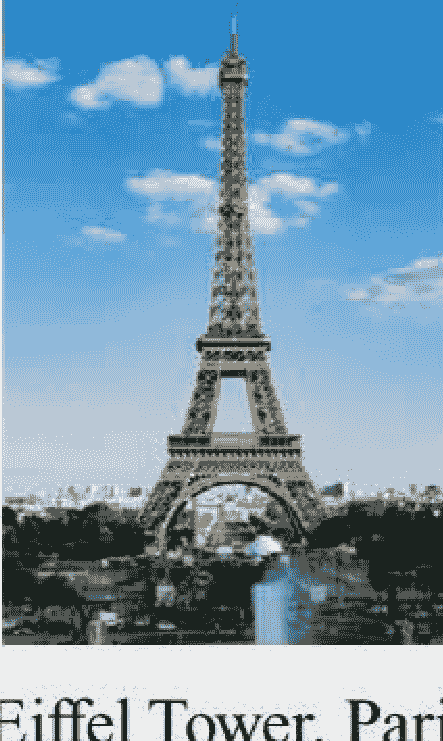

### 解决方案

计划：找到一张埃菲尔铁塔的照片，并将其保存在与 .html 文件相同的文件夹中，然后使用 CSS 设置背景、字体和定位样式。

1. 在 `<body>` 标签中将 `background-color` 属性设置为 `LightGrey`，使其应用于整个页面。
2. 将 `font-family` 属性设置为衬线字体，并包含通用的 serif 字体族，以防网页浏览器无法使用你选择的字体。
3. 使用 `text-align` 属性将所有内容定位在页面的中心。

```
<body style="background-color: LightGrey;">
    <p style="font-family: 'Times New Roman', serif; text-align: center;">
        
        <br> Eiffel Tower, Paris
    </p>
</body>
```

4. 使用 `` 标签，并将 `src` 属性设置为照片的文件名，`height` 属性设置为 200（像素）。
5. 使用换行符，使文本位于图片下方。

### 挑战 2

你被一家[搏击俱乐部](http://kickboxing)[紧急雇佣](http://hired)，因为他们的上一个网页开发者没有事先通知就辞职了。他们希望你完成一个[未完成的网页](http://unfinished)。

你应该：

- 修复它——以便[错误被移除](http://errors)。
- 改进它——使其[更具可访问性](http://accessible)。

下面的代码是你的[起点](http://starting-point)。右边是一个[模拟图](http://mock-up)，展示了该页面[应该](http://supposed-to-look-like)是什么样子。

```
<body style="font: Arial;
            color: Green;
            background-color: HotPink;">
    <p>Kiana's Kickboxing</p>
    
    <p>Come by for a free drop-in:</p>
    <p>Tuesday 4pm to 7pm</p>
</body>
```

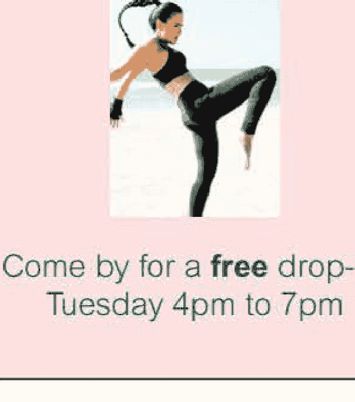

> 你不需要完全匹配这些颜色和字体。


## 第三节编码挑战

欢迎再次回来——本节有第二页挑战，你正在看的就是这一页。请随意休息一下再继续。

### 挑战 3

**Style Park Zoo** 制作了一个网页来展示他们的新明星动物：**蜜獾** **Biscuit**。

根据以下细节，尽可能准确地重现页面（如右图所示）：

-   使用的颜色包括：黑色、蓝色、耐火砖红、金色和土黄色。
-   照片被描述为：“Biscuit，一只蜜獾，正在外出游荡。”
-   页面设计在移动设备上效果最佳——宽度为400像素。

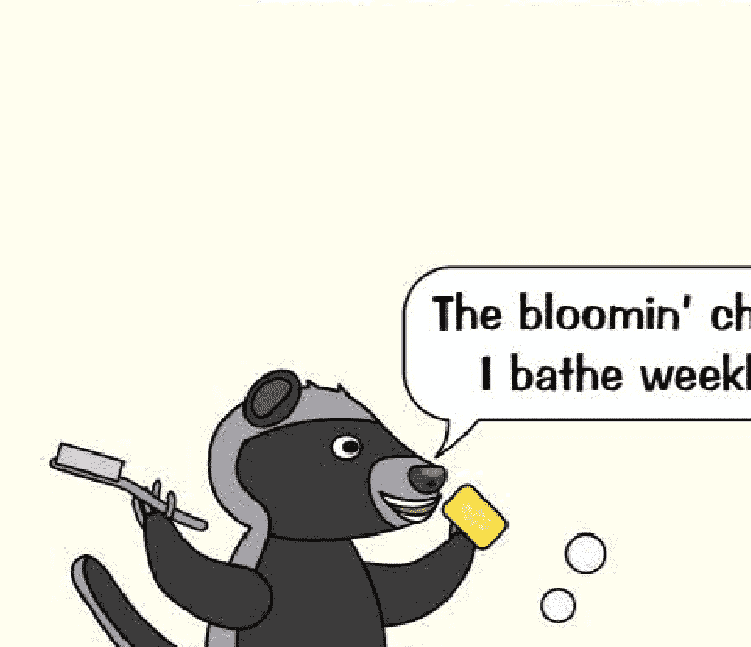

> 真没礼貌，我每周都洗澡的好吗！

### 蜜獾 Biscuit

我们很高兴地迎来一位美妙的新动物，它远道而来，来自肯尼亚。

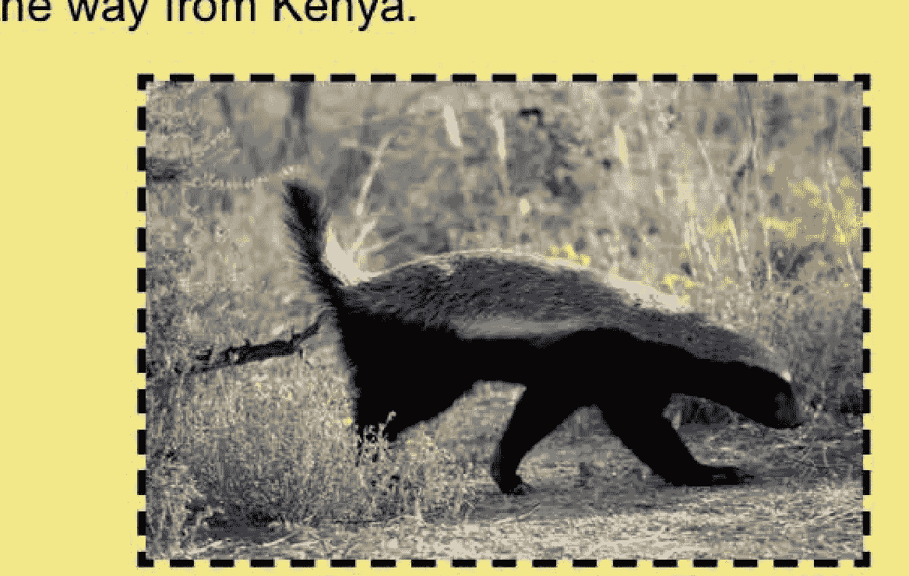

它的名字叫Biscuit，是一只蜜獾，它很期待不久后能在动物园见到你。

#### 关于 Biscuit 的三个 *趣味事实*

1.  她甚至不是獾，更像是黄鼠狼之类的动物。
2.  她*早餐*就吃青蛙和蛇。
3.  她身上**臭得厉害**，以至于去掏蜂巢时，蜜蜂都懒得靠近她。

来动物园看看 Biscuit 吧！

### 挑战 4

**Max Revs**（美国特技演员）**自己制作了**一个网页。目前，它**没有很好地体现他爱国、冒险的人设**。他代码的 `<body>` 部分如下所示。

```
<p>Max Revs</p>
<p>About Max</p>
<p>Max is a world-famous stunt driver with over two years' experience!</p>
<p>Max can do the following stunts:</p>
<p>- Wheelies</p>
<p>- Drifting</p>
<p>- Crazy big jumps</p>
<p>- Driving at mad speed</p>
<p>- Parallel parking</p>
<p>Here's Max:</p>

```

编辑页面以**改进HTML**并**使用CSS添加样式**：

-   将**整个页面**背景填充为酷炫的“道奇蓝”。
-   用**标题**和**醒目的颜色**突出显示**关键信息**。
-   正确标记**特技列表**，并为其设置**交替**的红色和白色背景（看起来像**美国国旗**的条纹）。
-   Max喜欢**成为焦点**，所以确保他的照片出现在页面底部的**中央**，并带有**双层边框**。

Max Revs
About Max
Max is a world-famous stunt driver with over two years' experience!
Max can do the following stunts:
- Wheelies
- Drifting
- Crazy big jumps
- Driving at mad speed
- Parallel parking
Here's Max:

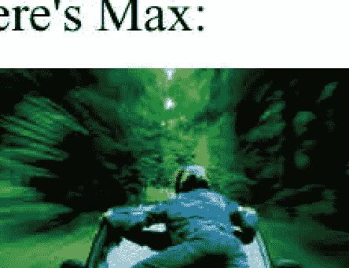

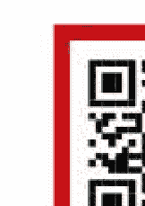

## 第四节 — 创建多页网站

### 组织文件

在开始编码之前，让我们谈谈组织。不，我不是指整理房间，而是文件管理——这对开发多页网站很有用。

-   理解合理的文件命名方式。
-   理解使用文件夹组织项目的合理方式。

#### 保持文件命名一致

1.  有一些命名规则对网页开发者很有用：
    -   使用描述性名称，以便一眼就能理解（例如 surfing-cat.jpg 比 image1.jpg 提供更多信息）。
    -   使用连字符而不是空格分隔单词（例如 thy-holy-texts.html）。
    -   将网站首页命名为 'index.html' ——这是常见做法，大多数网络服务器都知道使用它。
2.   始终如一地遵守这些规则有助于最大限度地减少错误。

Q1 改进以下文件名：
a) weird dog.png
b) asdf2.jpg (一张火车的图片)
c) home_page.html

#### 使用文件夹组织项目

-   在接下来的几页中，你将链接多个网页——将所有文件放在一个项目文件夹中会很有帮助。
-   如果你使用大量图片，请在项目文件夹内创建一个单独的 'images' 文件夹来存放它们。

示例 典型项目文件夹的结构。

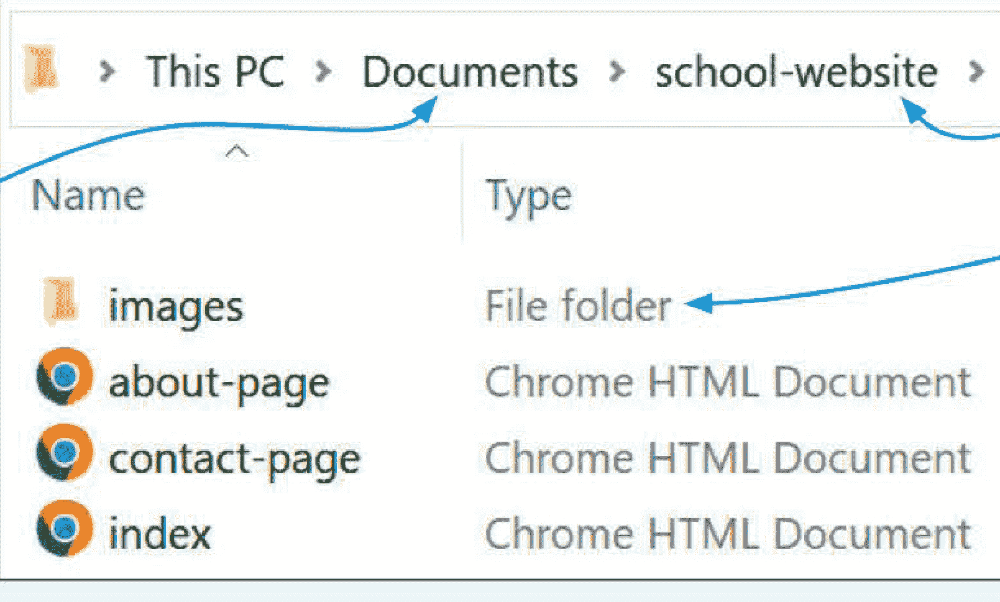

选择一个合适的文件夹来保存你的项目。
仅为这个网站准备的项目文件夹。
仅为这个网站的图片准备的文件夹。
每个网页对应一个HTML文件（'index' 是首页）。
根据你的设置和操作系统，你的文件夹结构可能看起来会有所不同。

Q2 列出三个可以改进这个项目文件组织的地方。

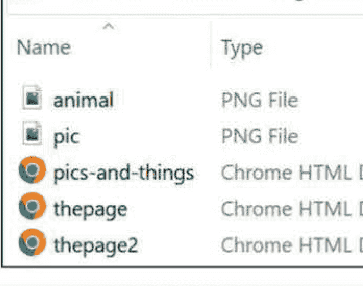

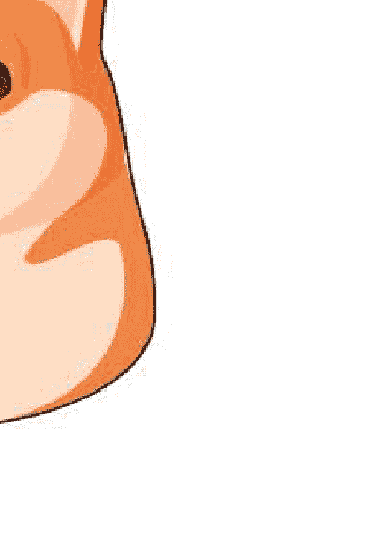

#### 文件夹？不，我更喜欢揉成一团...

随着你进行更多的网页开发，良好的文件组织会带来回报。在开发过程中保存项目的副本也是明智之举，这样如果出了什么问题，你可以回退到旧版本以恢复它。

### 外部超链接

超链接非常适合在网页或网站之间跳转——有点像科幻电影中的传送。别急着把我传送上去，斯科蒂，我还在写内...

-   理解什么是超链接。
-   能够使用 `<a>` 标签标记指向外部网页的链接。

#### 超链接带你去其他地方

1.   超链接（或简称“链接”）是你点击后可以从一个网页跳转到另一个网页的东西。

    -   内部超链接可以带你到同一网站上的其他网页（见下一页）。
    -   外部超链接会带你到一个完全不同的网站。

Q1 举出两个外部超链接使用的例子：
a) google.com
b) wikipedia.org

2.  如果没有这些不同网站之间的链接，就不会有“网络”。

#### 使用 `<a>` 和 `href` 添加超链接

-   `<a>` 标签在HTML中标记一个超链接。
-   `href` 属性与 `<a>` 标签一起使用，告诉网页浏览器你希望链接指向哪里。
-   无论你把什么放在 `<a>` 和 `</a>` 标签之间，它都会在网页上变成一个可点击的链接。

`<a>` 标签中的 'a' 代表 'anchor'（锚点）。

```
<body style="font-family: Arial, sans-serif;">
  <p>This book has LOTS of code files.</p>
  <p>
    <a href="https://www.cgpbooks.co.uk/biscuit">
      Download them here</a>.
  </p>
  <p>Or click this button:</p>
  <a href="https://www.cgpbooks.co.uk/biscuit">
    </a>
</body>
```

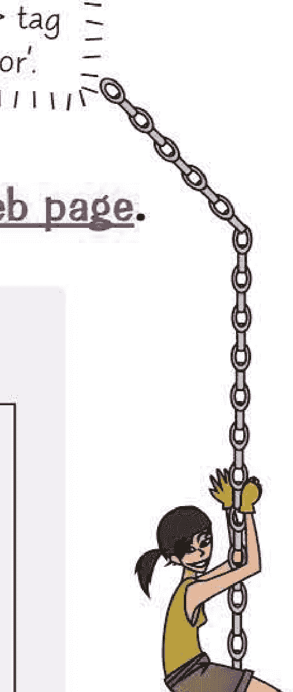

将 href 属性设置为你想要链接到的URL——确保用引号括起来。

添加你希望可点击的文本——别忘了闭合的 `</a>` 标签。

要将图像变成超链接，做同样的事情，但将图像（见第14页）放在 `<a>` 和 `</a>` 标签之间。

你需要将完整的URL放入 href 中，包括 `https://` 部分，否则此链接将不起作用。

关于URL的回顾，请见第3页。

This book has LOTS of code files.

Download them here.

Or click this button:

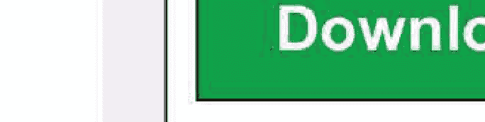

超链接默认样式为蓝色并带有下划线——点击它们会带你到指定的URL。

点击此按钮也会带你到指定的URL。

按钮是用户可以点击以执行某些操作的图形元素。你可以找到用作按钮的图像，在图形程序中自己制作，或使用内置的 `<a>` 标签（见第53页）。

#### 你需要检查一下这些新标签——它们是 `<a>` 级棒的...

搜索引擎使用网络爬虫来跟踪页面上超链接指向的位置。指向一个页面的链接越多，搜索引擎可能认为该页面越重要。真棒。

第四节 — 创建多页网站

### 内部超链接

学习目标

外部超链接已介绍完毕，但如何在你自己的网页之间导航呢？哎呀，如果你幸运的话——这整整一页都是关于内部超链接的。

-   能够使用 `<a>` 标记指向自己网页的链接。
-   理解为什么内部超链接需要相对文件路径。

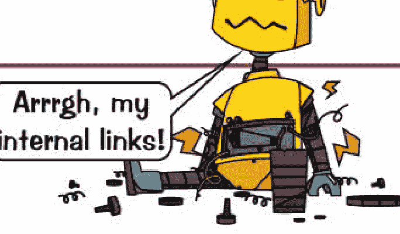

#### 内部链接带你逛网站

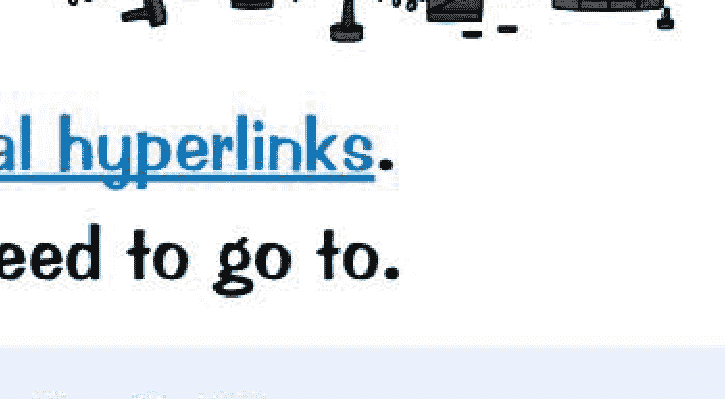

1.   大多数网站由多个网页组成，所有这些网页都通过内部超链接连接在一起。
2.   用户可以点击这些链接，跳转到他们需要访问的网站部分。

示例 使用 `<a>` 标签创建链接——将 href 属性设置为你要链接到的页面。

一个名为 "innocent-button.html" 的网页：

```
<body style="text-align: center;">
  <h3>You found a button.</h3>
  <p><a href="button-pressed.html">Press it</a>?</p>
  
</body>
```

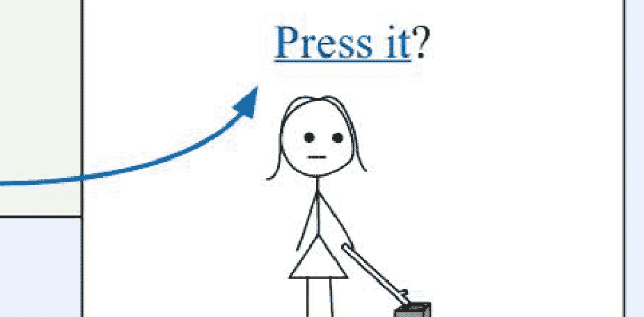

将 href 设置为另一个网页的文件名。

点击此链接将带你到另一个网页。

一个名为 "button-pressed.html" 的网页：

```
<body style="background-color: Red; text-align: center;">
  <h1 style="font-family: Impact, sans-serif;">Whoops</h1>
  <p style="font-family: Arial, sans-serif;">
    You shouldn't have<br>pressed the button.</p>
  
</body>
```


Q1 扩展此代码，添加一个返回第一个网页的链接。

#### 使用相对文件路径而不是绝对路径

-   当你向网页添加内部链接或图像时，你需要告诉网页浏览器它在哪里。
-   相对文件路径说明从当前网页所在的文件夹开始查找。

```
<a href="about.html">Learn more!</a>

```

这意味着 'about.html' 与当前页面（index.html）在同一文件夹中。

这意味着 'logo.jpg' 在 'images' 文件夹中。


-   这些相对文件路径在其他计算机上——包括网络服务器上——也能正常工作。
-   不要使用绝对文件路径——这是完整的路径，它只在你的计算机上有效。

常见问题

```
<a href="C:\Users\CGP\Documents\web-project-1\about.html">Learn more!</a>
```

这样的链接对于文件存储在网络服务器上的真实网站来说是没用的。

#### 我使用亲戚的文件路径——我姐姐组织性更强...

可能需要尝试几次才能让超链接正常工作。如果遇到任何问题，请检查你的网页文件是否在同一文件夹中，以及文件名是否与 href 设置的内容匹配。

第四节 — 创建多页网站


### 控制超链接

> 于是，那些小巧的蓝色超链接，以其全然下划线的荣耀，脱颖而出，呐喊着“点我，点我”。而我轻声说“不”——因为你尚未设置它们的所有属性。

-   能够制作在新标签页中打开的超链接。
-   能够制作用于打开新电子邮件的超链接。

#### 超链接可以在新标签页中打开

1)  通常，当你点击一个超链接时，它会在你当前使用的标签页中打开。
2)  有时，在新标签页中打开链接会更好。
3)  要实现这一点，请在 `<a>` 标签中添加 `target` 属性，并将其值设置为 _blank。


```
<p><a href="https://www.cgpbooks.co.uk" target="_blank"> Books</a> (opens in new tab).</p>
```

编写此消息使你的网页更易于访问。

#### 超链接可以打开新电子邮件

1)  超链接不仅可以链接两个网页，还可以用来使用你电脑上的电子邮件软件打开一封新邮件。
2)  这通过在 `href` 属性中使用 `mailto:` 后跟电子邮件地址来实现。


```
<h2>The Bad Salad Co. - Lettuce help you</h2>
<p>So, you found another slug in your salad...</p>
<p>You could look for your <a href="https://www.gov.uk">consumer rights</a>.</p>
<p>Just accept <a href="sorry.html" target="_blank">our apology</a> (opens in a new tab).</p>
<p>Or email us at <a href="mailto:DoNotCare@azmail.co.uk">DoNotCare@azmail.co.uk</a> (waaah).</p>
```


当点击链接时，`href` 中设置的地址将出现在电子邮件的“收件人”行中。

> target="_blank" — 听起来像我在尝试射箭...

将电子邮件地址显示为超链接要易于访问得多，这样即使人们没有电子邮件软件，或者想从不同的设备发送电子邮件，他们仍然可以使用它。

### 练习题

### 热身

-   Q1 重命名此文件，使其遵循第28页的命名规则：`virtualReality_coding.html`
-   Q2 哪个HTML标签用于超链接？
-   Q3 内部超链接和外部超链接有什么区别？
-   Q4 `href` 属性有什么用途？


### 练习题

-   Q1 完成此代码，使其创建一个指向 cgpbooks.co.uk 的超链接。

```
<a href="https://www.cgpbooks.co.uk">Click here</a>
```

-   Q2 文本中超链接的默认外观是什么？

-   Q3 这是一些来自网页的代码。

```
<body style="border-style: dashed;">
  <p style="color: HotPink;">Congratulations! You just won a new phone!!</p>
  <ol>
    <li>Claim your prize <a href="scam.html">here</a>.</li>
    <li>Or email us at <a href="mailto:SusAsHell@azmail.co.uk">SusAsHell@azmail.co.uk</a>.</li>
    <li>Alternatively, <a href="https://www.gov.uk/report-suspicious-emails-websites-phishing" target="_blank">click here</a> to win another prize.</li>
  </ol>
</body>
```

a) 内部超链接将用户带到哪里？
b) 如果点击第二个列表项中的超链接，会发生什么？
c) 这段代码中 `target` 属性的作用是什么？
d) 草绘此代码创建的网页（着色可选）。

第四节 —— 创建多页网站

### 练习题

**Q4** a) 以下是 `<a>` 标签中 `href` 的四个可能值。圈出表示绝对文件路径的选项。

-   images/flying-squirrel.jpg
-   https://google.com
-   C:\Users\User\Documents\Challenge1-Project\about-page.html
-   index.html


b) 为什么在为网站开发页面时，应该使用相对文件路径而不是绝对文件路径？

**Q5** 这是一些旨在在点击图像时在新标签页中打开链接的代码。

```
<a href="secret-page.html" target="blank" </a>
```

描述代码中的两个错误，并解释应如何修复。

1. ....................................................................................................................
2. ....................................................................................................................

**Q6** 这是某人网站使用的文件夹结构。

a) 哪个文件可能是此网站的主页，为什么？


b) i) 这段代码位于 'about-page' 文件中。它试图链接到 'contact-page' 文件。给出两个它不起作用的原因。

```
<a src="contact-page">Contact Us</a>
```

1. ....................................................................................................................
2. ....................................................................................................................

ii) 重写这段代码使其正常工作。

## 第四节编码挑战

我猜你现在可能在梦里都看到超链接了。不过，我建议你保持清醒来应对这些挑战。别忘了，你可以访问 [cgpbooks.co.uk/biscuit](http://cgpbooks.co.uk/biscuit) 下载每个挑战的[示例代码](http://example code)。

### 挑战 1 — 示例

一位"[网络红人](http://online influencer)"希望你设计一个[链接面板](http:links panel)，以便他们可以添加到其[网站](http:website)的每个页面，供他们的三位粉丝[使用](http:use)。链接面板应包含：

-   一个[主页按钮](http:home button)，可带你前往[主页](http:home page)（index.html）。
-   一个[播放按钮](http:play button)，可带你前往他们的 [YouTube 频道](http:YouTube channel)。
-   一个[电子邮件按钮](http:email button)，可打开一封[新邮件](http:new email)，收件人为 IAmReallyFamous@azmail.co.uk。

本节的[可下载内容](http:downloadable content)中提供了[示例网站](http:example website)和这些按钮的[图标](http:icons)。

**解决方案**
**计划：** 下载并将图标保存到 'images' 文件夹，然后为每个图标设置适当的超链接（一个内部、一个外部和一个电子邮件）。


```
<a href="index.html">
    </a>

<a href="https://youtube.com/@CGPBooksVideos">
    </a>

<a href="mailto:IAmReallyFamous@azmail.co.uk">
    </a>
```


**解决方案**
**计划：** 下载并将图标保存到 'images' 文件夹，然后为每个图标设置适当的超链接（一个内部、一个外部和一个电子邮件）。

### 挑战 2

你的朋友被要求为他们的[家庭作业](http:homework)制作一个关于[三种奇异动物](http:three weird animals)的[资料档案](http:fact-file)。作为一个懒惰的天才，他们反而创建了一个[网页](http:web page)，其中包含指向包含所有[事实](http:facts)的[外部网站](http:external websites)的[链接](http:links)。但是，他们需要你的[帮助](http:help)来完成它。你应该：

-   [为每张照片添加超链接](http:Add a hyperlink)，将用户带到一个[相关的外部网站](http:relevant external website)（例如维基百科）。
-   [添加 CSS](http:Add CSS) 来美化它。

```
<h2>Axolotl</h2>

<p>Can regrow limbs.</p>

<h2>Mantis Shrimp</h2>

<p>Can punch with the speed of a bullet.</p>

<h2>Shoebill</h2>

<p>Always looks like it's plotting your demise.</p>
```

| 动物 | 描述 |
|---|---|
| **美西螈**<br> | 可以再生肢体。 |
| **螳螂虾**<br> | 可以以子弹的速度出拳。 |
| **鲸头鹳**<br> | 看起来总像是在密谋你的灭亡。 |


第四节 —— 创建多页网站


## 第四节的编码挑战

哦，又是你。你还在这儿？好吧，我猜如果你这么喜欢这些挑战，那就再给你几个继续做吧。别让我妨碍你。你知道如果你想休息一下是可以的，对吧...？

### 挑战 3

"High-Horse Manor"酒店希望你设计一个新网站来推广他们的五星级酒店。该网站应包括：

-   一个主页，包含酒店名称、图片以及以下信息：
> "欢迎光临我们这座华丽的新网站。恳请您前来小住。我们的房间标配金色马桶，您还可以在各种选择中享用早餐。"
-   一个页面，列出以下早餐选项并配有图片：
    -   鸡蛋（任何你喜欢的做法）
    -   濒危野味香肠
    -   魔豆
    -   皇家番茄
    -   金色谷物面包
    -   三重烟熏培根
    -   森林风格蘑菇
    -   一系列全谷物麦片
-   一个"联系"页面，包含酒店地址、电话号码和一个链接，点击后可打开一个地址为酒店的新电子邮件。
-   用于在各页面之间导航的链接。


> 你可以自行编造这些联系信息。

### 挑战 4

一位英语老师希望你创建一个网站，供他的学生学习他最喜欢的诗歌——爱德华·李尔创作的《猫头鹰与小猫咪》。下面所示的主页已经制作完成。

```
<body style="background-color: AliceBlue; text-align: center; font-family: Optima, sans-serif;">
  <h1>The Owl and the Pussycat</h1>
  <h2>By Edward Lear</h2>
  <p>Select a stanza:</p>
  <p><a href="stanza-1.html">First stanza</a></p>
  <p><a href="stanza-2.html">Second stanza</a></p>
  <p><a href="stanza-3.html">Third stanza</a></p>
</body>
```

| 猫头鹰与小猫咪 |
| :--- |
| 作者：爱德华·李尔 |
| 选择一个诗节： |
| [第一节] |
| [第二节] |
| [第三节] |

你需要为每一节诗创建一个网页，包括：

-   诗歌标题和节号。
-   相应的诗歌节。
-   适当位置的"下一节"和/或"上一节"链接。
-   一个返回主页的链接。

> 诗节是将诗歌分成若干部分的若干行组合。

你应该使用CSS为页面设置样式，并将文件名与上面代码中的内部链接匹配。这首诗包含在本挑战的可下载内容中，文件名为`poem.txt`。

## 第五节 —— 样式表

### 内部CSS

**学习目标**
将CSS与HTML混合使用可能会让代码变得臃肿难读，就像这个比喻一样，添加得越多就越难以理解——所以，让我们来分解一下。
-   理解使用内部CSS而非内联CSS的目的。
-   能够使用`<style>`标签来编写内部CSS。

#### style属性有其缺点

记住，内联CSS被分配给特定HTML元素的style属性。

1.  如果你有大量内联CSS，代码可能变得难以阅读和编写。
2.  相同的代码需要重复使用来以相同方式设置不同内容的样式，页面内容可能会淹没在周围的代码中——逐个设置每个标签的样式也可能花费很长时间。

**常见问题**
内联CSS如何变得重复。
`<h1>`标签有相同的样式重复——`<p>`标签也是如此。

```
<h1 style="color: Orange;">Bad Food</h1>
<p style="font-family: Arial; color: Blue;">Deep-fried celery</p>
<h1 style="color: Orange;">Baddest Food</h1>
<p style="font-family: Arial; color: Blue;">Hot dogs</p>
```

**糟糕的食物**
油炸芹菜
**最糟糕的食物**
热狗

#### 使用`<style>`标签添加内部CSS

-   样式表只是一组用于设置网页样式的CSS规则的集合。
-   内部CSS是在页面`<head>`中通过`<style>`标签标记的样式表。

**示例**
使用内部CSS重新创建上面的示例。

```
<head>
  <style>
    h1 { color: Orange; }
    p {
      font-family: Arial;
      color: Blue;
    }
  </style>
</head>
<body>
  <h1>Bad Food</h1>
  <p>Deep-fried celery</p>
  <h1>Baddest Food</h1>
  <p>Hot dogs</p>
</body>
```

内部CSS位于`<head>`元素内的`<style>`标签之间。
属性/值对与内联CSS相同，但你不需要引号。
两个`<h1>`元素将具有相同的样式——两个`<p>`元素也是如此。

你需要为每个想要设置样式的标签命名。
花括号`{ }`必须包围每个标签的样式。就像HTML一样，你可以使用缩进和额外的空格使CSS更易于阅读。
你不需要在`<body>`中使用任何内联CSS，因为内部CSS会自动应用。

**关键术语**
通过`<style>`标签标记的内部CSS也称为内部样式表。


由这段代码创建的网页看起来与上面的示例完全相同。

你将在第45页看到如何为同一类型的元素设置不同的样式。

#### 我已经内化了这个——它现在免费住在我的`<head>`里了...

使用内部CSS时，你仍然可以使用内联CSS来设置单个元素的样式。如果同一属性在内联和内部CSS中都设置，那么内联CSS将优先（见第40页）。

### 设置超链接样式

**学习目标**
-   链接是人们在你的网站上导航的方式，所以你不希望它们被忽略——这里有一些技巧，可以使用内部CSS让你的链接脱颖而出。
-   理解已访问和未访问链接之间的区别。
-   能够使用`a`、`a:link`和`a:visited`来更改链接的样式。

#### 链接可以是已访问或未访问的

1.  正如你在第四节所看到的，超链接是使用`<a>`标签创建的。
2.  未访问链接是指向你以前未访问过的网页的超链接。默认情况下，在不应用CSS的情况下，它们是蓝色带下划线的。
3.  一旦访问了链接的网页，链接将变为紫色。


#### 使用内部CSS设置链接样式

-   你可以使用`a`为所有链接（无论是否已访问）应用样式。
-   你可以使用`a:link`设置未访问链接的样式，使用`a:visited`设置已访问链接的样式。

```
<head>
<style>
    a {
        font-size: 20px;
    }
    a:link {
        color: DodgerBlue;
        text-decoration-color: Navy;
    }
    a:visited {
        color: DarkOrange;
        text-decoration-color: Red;
    }
</style>
</head>
<body>
    <a href="https://www.ordnancesurvey.co.uk">Click me</a>
</body>
```

**示例**
最佳实践是按以下顺序设置链接样式：`a`、`a:link`，然后是`a:visited`。

所有链接的字体大小将为20像素。

这是链接在未访问时的外观。[点击我]

此属性设置文本任何"装饰"的颜色——对于链接，通常是指下划线。

这是链接在已访问后的外观。[点击我]

如果此URL已在你的Web浏览器历史记录中，它将被视为已访问——因此，如果你想看到未访问的样式应用，请将其更改为一个你从未访问过的地方。

-   `text-decoration`属性也可用于设置链接样式——它可以有以下值：`underline`、`overline`、`line-through`和`none`。

**Q1** 编写内部CSS，将链接设置为以下样式：
未访问 [点击我]
已访问 [点击我]


出于安全原因，大多数Web浏览器限制你允许为`a:visited`更改的属性。如果你发现无法以某种方式设置已访问链接的样式，那可能是不允许的。

`a:link`和`a:visited`是CSS中"伪类"的例子。另一个是`a:hover`（见第41页），还有`a:active`，用于在链接被点击的瞬间设置其样式。

> **CSS恶作剧：交换链接的默认蓝色和紫色...**
...但说真的，别忘了第18页的无障碍设计原则——你的链接应该易于阅读，并且应该看起来与其他文本不同，这样人们才能看到它们。


### 颜色代码

### 学习目标

你可能会想，有一百多个颜色名称可选，应该足够了吧。但事实并非如此。当“薄荷奶油色”不够清新时，这里有解决办法。

- 学习十六进制代码如何表示不同的颜色。
- 理解如何为给定的颜色查找十六进制代码。

#### 每种颜色都有一个十六进制代码

1) 正如你在第20页所看到的，网页上有大量命名颜色可供使用。例如，“靛蓝色”就是这样一种深紫蓝色。

2) 每种颜色都有一个对应的十六进制颜色代码，你可以使用这个代码来替代颜色名称——例如，靛蓝色的代码是 #4B0082。

十六进制（hexadecimal的缩写）是一种使用16个数字的数制——数字0-9和字母A-F。

+   Q1 使用CSS找出以下颜色代码对应的颜色名称。

a) #0000FF
蓝色、绿色还是黄色？

b) #808080
棕色、米色还是灰色？

c) #FFA500
黄绿色、橙色还是粉色？

#### 示例

使用颜色代码其实并不复杂。

```
<head>
  <style>
    h1 { color: Indigo; }
    p { color: #4B0082; }
  </style>
</head>
<body>
  <h1>Indigo Fansite</h1>
  <p>Let's go indigo!</p>
</body>
```

在任何需要设置颜色的CSS属性中，你都可以使用颜色代码来替代颜色名称。

Indigo Fansite
Let's go indigo!

<h1> 和 <p> 文本的颜色相同。

命名颜色的十六进制代码列在本节可下载文件中的 ColourCodes.txt 文件中。

#### 使用取色器查找十六进制代码

+   * 需要十六进制代码是因为并非所有颜色都有名称。
* 即使是命名颜色，有时你也需要更深或更浅的色调。
* 你可以使用取色器等工具来帮助你找到想要使用的精确颜色的十六进制代码。


本节的代码文件包含一个取色器应用程序——只需在你的网页浏览器中打开“ColourPicker.html”即可使用。根据你使用的设备不同，它可能看起来略有不同。你也可以在线搜索，例如“CSS colour picker”，以找到更高级的取色器。

十六进制颜色代码基于一个简单的系统：前两位代表红色，中间两位代表绿色，最后两位代表蓝色。例如，靛蓝色的代码是 #4B0082——这意味着它是红色（4B）和蓝色（82）的混合，没有绿色（00）。通过更改这些值，你可以改变颜色。

你可以点击此处切换显示以显示十六进制代码。

+   Q2 使用取色器找出以下颜色的十六进制代码：

a) 黑色
b) 白色
c) 红色

今年有人去 #IndigoCon 吗？ #IndiGoing #4B0082...

有这么多颜色可用，很容易想大量使用它们，但许多设计精良的网站只使用少数几种搭配和谐的颜色——品味各不相同，所以选择能打动你的方式。

### 外部CSS

### 学习目标

花卉壁纸、格子靠垫、豹纹地毯……我的风格糟糕得（我可以就此打住）不一致。别学我——用外部CSS保持你的风格一致。

- 理解外部CSS的**好处**。
- 能够使用 **<link>** 标签来标记**外部CSS**并为网页添加**图标**。
- 了解**CSS规则**如何被**优先排序**。

#### 网页可以通过外部CSS共享样式

1) 到目前为止，你已经看到了在网页中**使用CSS**的两种方式：

- **内联CSS** —— 分配给**style属性**，适用于**一次性使用**。
- **内部CSS** —— 由**<head>**中的**<style>标签**标记，适用于**网页**上的**重复样式**。

2) 如果你的网站有**多个页面**，并且你希望**以相同方式设置样式**，那么使用这两种方法中的任何一种都意味着你必须**将相同的CSS复制**到每个页面——这**效率不高**。

3) **外部CSS**解决了这个问题——它是在一个**单独的文件**中**保存**的CSS，称为**外部样式表**，然后**链接**到你的每个页面。

如果你只是希望你的HTML看起来不那么杂乱，也可以使用外部CSS。

#### 外部CSS放在.css文件中

创建一个**外部样式表**很简单：

- 在你的**文本**（或**代码**）编辑器中打开一个**新文件**。
- 将文件**保存**为 **.css文件格式**（根据你的编辑器，你可能只需选择“层叠样式表”作为**文件类型**）。
- 保存后，输入你的**CSS**——它的写法与第36页的**内部CSS**相同，只是你**不包含****<style>标签**。
- **再次保存**——你的样式表现在**可以使用了**。

```
body {
  background-color: LightBlue;
  font-family: Arial, sans-serif;
}
h1 {
  text-decoration: underline;
  color: Indigo;
}
```

保存.css文件与第5页保存.html文件的过程类似。

以下示例将假设此样式表保存为“styles.css”，与网页在同一文件夹中。

#### 使用 <link> 应用外部CSS

一旦你创建了**外部样式表**，你需要使用 **<link> 标签**将其**连接**到你的网页。

**示例** 链接到外部样式表。

尽管名为<link>，但<link>标签并非用于超链接——那是<a>标签的工作（参见第30页）。

**<link>标签**放在 **<head>** 中——它**没有** **结束标签**。

**href**属性告诉**网页浏览器**要查找哪个**文件**以及**它的位置**。

```
<head>
  <link rel="stylesheet" href="styles.css">
</head>
<body>
  <h1>CSS Workshop</h1>
  <p><a href="info.html">Find out more</a>.</p>
</body>
```

**rel**属性告诉**网页浏览器**此文件与**网页**如何**相关**。

#### CSS Workshop

Find out more.

当在网页浏览器中查看该**页面**时，它将**应用****<link>标签**中引用的**样式表**。

### 外部CSS

#### CSS有优先级规则

1) 使用外部CSS时，你仍然可以在页面上使用内联和内部CSS。
2) 如果一个属性在多个地方设置，则有关于使用哪个值的规则。

- 如果一个属性在内联CSS和样式表中都设置了，则内联样式将优先。

```
<head>
    <link rel="stylesheet" href="styles.css">
</head>
<body>
    <h1 style="text-decoration: none;">CSS Workshop</h1>
    <p>It's a 24-hour coding extravaganza.</p>
    <p><a href="signup.html">Sign up here</a>.</p>
</body>
```


- 如果一个属性在内部和外部CSS中都设置了，那么<link>或<style>标签中后使用的那个将优先。

```
<head>
    <link rel="stylesheet" href="styles.css">
    <style>
        h1 { text-decoration: line-through; }
    </style>
</head>
<body>
    <h1>CSS Workshop</h1>
    <p>Sorry, due to bug-ridden code, the event has been cancelled.</p>
</body>
```


#### <link>可以为你的网页添加图标

- <link>标签也可用于为你的网页添加图标。
- 这些是显示在浏览器标签页标题旁边的小图像——有时被称为“网站图标”，因为它们也会显示在收藏夹（或书签）列表中。

#### 示例

让你的网页标志化。

```
<head>
    <title>CSS Workshop</title>
    <link rel="icon" href="icon.png">
</head>
```


> 用60度水温洗涤你的样式表，以消除代码漏洞...

总结一下：内联CSS用于单个元素独有的小段样式，内部CSS用于仅应用于单个页面的样式，而外部CSS用于应用于多个页面的样式——就这么简单。


## 导航栏

**学习目标**
本页面展示了CSS的全部强大功能。但请注意，其中一些属性直到下一节才会讲到，所以如果看到不熟悉的语法也不用担心。

- 能够使用 `a:hover` 在鼠标悬停时设置链接样式。
- 能够使用CSS创建水平导航栏。

### `a:hover` 用于鼠标悬停效果

1.  当用户与页面交互时改变样式，可以让页面感觉更引人入胜。
2.  `a:hover` 让你在用户将鼠标悬停在链接上时改变其样式。

```css
a {
  background-color: Black;
  color: White;
}
a:hover {
  background-color: Yellow;
  color: Red;
}
```


### 导航栏本质上就是经过美化的列表

-   通过一些巧妙的CSS，你可以把一个单调的HTML列表变成一个酷炫的导航栏。
-   此示例使用了高级属性（在第六节中讲解），所以现在不必急于理解其工作原理——你可以直接复制下面的样式表，然后根据你的网页设计修改字体和颜色。

```css
ul {
  background-color: LimeGreen;
  list-style-type: none;
  margin: 0px;
  padding: 0px;
  overflow: hidden;
}
li a {
  text-decoration: none;
  text-align: center;
  padding: 14px 20px;
  display: block;
  float: left;
}
li a:hover {
  background-color: Yellow;
}
```

```html
<ul>
  <li><a href="#">Home</a></li>
  <li><a href="#">Aliens</a></li>
  <li><a href="#">Evidence</a></li>
</ul>
```


> 快来加入我的导航栏——我会在台球桌旁 :hover 等你...

尽情尝试导航栏吧，但请注意——在第六节你学会使用ID之前，上面示例中的样式会应用于页面上任何 `<ul>` 列表元素。

### 练习题

### 热身

Q1 以下CSS类型应放在哪里？
a) style 属性？
b) <style> 标签？
c) 单独的文件？


Q2 编写CSS时，“颜色选择器”为什么有用？

Q3 什么使一个超链接成为“已访问”状态？

Q4 除了链接外部样式表，<link> 标签还可以用于什么？

### 练习题

Q1 圈出并描述下面代码中的三个错误。

```html
<head>
    <style>
        h1 {
            background-color: @7771F0,
            color: White;
        }
    </style>
</head>
<body>
    <h1>Heading for Trouble</h1>
</body>
```

1. ....................................................................................
2. ....................................................................................
3. ....................................................................................

Q2 看右侧的代码。

a) 以下这行代码的效果是什么？
`a { text-decoration: none; }`
....................................................................................

```html
<head>
    <style>
        a { text-decoration: none; }
        a:link { color: Blue; }
        a:visited { color: DarkOrange; }
        a:hover{ background-color: Red; }
    </style>
</head>
<body>
    <a href="https://www.bbc.co.uk/">
        Click me</a>, thank you.
</body>
```

b) 链接被点击后，“Click me”文本会变成什么颜色？
....................................................................................

c) 提出一个能提高页面可访问性的修改建议。
....................................................................................

Q3 何时应该使用外部CSS而非内部CSS？

Q4 补全下面的代码，使 styles.css 用于样式化该网页。

```html
<head>
    <________ rel="____" ________="styles.css">
</head>
```

第五节 — 样式表


## 第五节的编码挑战

我看到你已经准备好迎接更多挑战了，所以这就为你奉上——我最拿手的三个。全部搞定后，访问 cgpbooks.co.uk/biscuit 下载每个挑战的示例代码，看看你做得有多棒。

### 挑战 1 — 示例

需要创建一个具有以下设计的超链接：

- 显示文本“Click me!”，字体为白色Arial，大小20px，无下划线。
- 通常，其背景为“蓝色”。
- 被访问后，其背景变为“紫色”。
- 鼠标悬停时，其背景变为浅蓝色（自选）。


### 挑战 2

创建一个学校用来展示其社团的网站。

应有一个导航栏，包含指向以下每个社团单独网页的链接，以及返回主页的链接。

- 编程社 — F.1.3教室，由 Ms Key-Bordia 负责。
- 舞蹈社 — M.2.7教室，由 Mr Maca 和 Ms Rena 负责。
- 篮球社 — 在体育馆，由 Coach Dunk 带领。

每个社团的页面应显示其教室、负责老师、相关图片，并且应有独特的样式。


### 挑战 3

创建一个简单测验的网站。

- 主页应至少包含两个选择题——如右侧示例所示。
- 当用户点击答案时，应跳转到两个页面之一，告知其是否正确。这两个页面都应链接回主页。
- 该网站设计为多人共用一台电脑使用，因此为避免泄露正确答案，应将已访问和未访问链接样式设置为相同。
- 应使用外部样式表，确保所有三个页面使用相同的字体。


## 第六节 — 高级HTML与CSS

### div 标签

### 学习目标

<div> 标签可以帮助你制作出炫酷的网页，将你所有的HTML组织成清晰整洁的区域——这是双赢的局面，请继续阅读。

- 理解 <div> 标签的用途。
- 能够使用 <div> 标签来标记网页的不同区域。

### <div> 是其他标签的容器

1.  网页通常具有类似的结构，可以被分解成更小的部分。
2.  这些更小的部分被称为分区（divisions）——它们通常是相关的内容块。
3.  可以使用 <div> 标签来标记它们。
4.  分区（或“<div>s”）很有用，因为它们：
   - 有助于让你的代码更有条理。
   - 可以单独设置样式（见第46页）。

| 区域 | 示例 |
|---|---|
| 页头 | 例如名称、标志、口号/标语等。 |
| 导航栏 | |
| 主内容 | |
| 页脚 | 例如版权信息、联系信息等。 |

HTML还有特定的标签可以用于这些区域——例如 <header>、<nav>、<main> 和 <footer>。它们有助于搜索引擎等理解你的页面。在本节中我们使用 <div> 标签是为了简化说明。

#### 示例

一个典型的网页，包含四个分区：页头、导航栏、主内容和页脚。这是页头分区。这四个分区中的每一个都使用 <div> 标签进行标记。

```html
<div style="background-color: Yellow; text-align: center;">
  <h1>Alien Watch!</h1>
</div>
<!-- 导航栏分区。 -->
<div style="border-style: solid;">
  <ul>
    <li><a href="#">Home</a></li>
    <li><a href="#">Aliens</a></li>
    <li><a href="#">Evidence</a></li>
  </ul>
</div>
<!-- 主内容分区。 -->
<div style="font-family: Arial, sans-serif;">
  <p>I've learnt the truth.</p>
  <p>Their secrets will be revealed.</p>
</div>
<!-- 页脚分区。 -->
<div style="font-size: 75%; text-align: center;">
  <p>&copy; <i>Alien Watcher</i> 2023</p>
</div>
```

未显示：导航栏使用了第41页的样式表进行样式化。

在HTML中可以使用像这样的代码插入特殊符号——网页浏览器会将 &copy; 替换为 ©（版权符号）。

每个分区都使用内联CSS赋予了其独特的样式。

5.  上面的示例中使用了内联CSS来设置分区的样式。如果你想改用内部或外部CSS，则需要一种方法来单独设置每个 <div> 标签的样式——下一页将向你展示如何做到这一点。

Q1 从本节的代码文件中，在你的网页浏览器中打开“divTags-Q1.html”页面。根据你看到的分区来描述页面的结构。

#### 我喜欢你编写页面代码的方式——它简直是<div>妙无比...

关于如何使用 <div> 标签，并没有硬性的规定。内容可以进一步分解，形成分区套分区——这通常取决于样式需要如何设置。


### 类与ID

### 学习目标

若要通过样式表为特定元素设计样式，就必须精确定位这些元素——HTML总部的专家们为此发明了**类**和**ID**。

- 能够同时使用**类**和**ID**为网页**添加样式**。
- 理解**类**和**ID**之间的**区别**。

### 类是元素的**命名集合**

1.  目前为止，你的**样式表**一直存在**局限性**——例如，右侧代码虽然为`<p>`**元素**添加了样式，但它以**完全相同的方式**应用于**每一个**`<p>`元素。
2.  你并不希望**每个段落**看起来都一模一样，因此，若只想为**部分段落**添加样式，就需要使用**类**。

```
p {
    font-size: 150%;
    color: Blue;
}
```

### **示例**

你可以一次性为同一类的所有元素添加样式。

在样式表中：

不要写标签名（如'p'），而是写一个点（.）后跟类名——类名由你自行选择。

```
.question {
    font-size: 150%;
    color: Blue;
}
```

> **常见问题**

类名不能包含空格，因此当单个单词描述性不足时，通常的做法是使用小写单词并用连字符连接。

在`<body>`中：

要将类分配给某个元素，需在其标签中添加`class`属性，并将其值设置为你的类名（不加点）。

```
<p>Knock knock...</p>
<p class="question">Who's there?</p>
<p>HTML...</p>
<p class="question">HTML who?</p>
<p>HTMLMAO!</p>
```

Knock knock...
**Who's there?**
HTML...
**HTML who?**
HTMLMAO!

> 只有这些段落被**添加了样式**，因为它们属于**question**类。


### 类可以包含**不同类型的**元素

在上面的例子中，**只有**`<p>`**元素属于**question**类**，但实际上，一个类可以包含**任何类型**的元素。

```
<h1 class="question">Feeling blue?</h1>
<p class="question">Like to laugh?</p>
<p>Join us at Joke club - Mondays 12am-1am, by the bins.</p>
```

**Feeling blue?**
**Like to laugh?**
Join us at Joke club - Mondays 12am-1am, by the bins.

> 这个**标题**和这段**文字**都使用了**question**类进行样式设置。
标题是**粗体**，因为这是`<h1>`标签的**默认样式**的一部分，而在**question**类的样式规则中**并未改变**这一点。

### 元素可以**同时属于多个类**

- 你可以在样式表中根据需要创建**任意数量的类**——这是另一个例子。
- 你可以将一个元素放入**不止一个**类——只需将类名用**空格隔开**即可。

```
.important { text-decoration: underline; }
```

```
<p class="question important">Can you bring cake?</p>
```

**Can you bring cake?**

一个空格。**question**和**important**的样式都会被应用。

### 类与ID

#### ID对于一个元素是唯一的

ID与类**相似**，但仅用于**单个元素**。

```
#gold-medal {
    background-color: Gold;
    width: 200px;
}
```

ID不仅用于样式设计。对于非常长的网页，你可以将它们添加到超链接的末尾，例如`'index.html#eggs'`，网页浏览器会自动向下滚动到页面中带有eggs ID的元素位置。

如果你为多个元素指定了相同的ID，一开始可能不会看到任何问题，但当你开始使用JavaScript时，就会引发问题——因此请坚持每个ID只对应一个元素。

要将**ID分配**给**某个元素**，需添加**id属性**并将其**值**设置为你的**ID名称**（不包含井号）。

在`<body>`中：

```
<h1>Tourney Results</h1>
<ol>
    <li id="gold-medal">Sir Slaysalot</li>
    <li>Biscuit 'Honey' Badger</li>
    <li>Bill Shoesbury</li>
</ol>
```

#### 锦标赛结果

1. **Sir Slaysalot**
2. Biscuit 'Honey' Badger
3. Bill Shoesbury.

你不能像使用类那样为多个元素指定相同的ID。但每个元素都可以同时拥有一个ID和一个或多个类。

**问题1** 扩展上面的示例，为第二和第三个列表项添加银牌和铜牌ID，并设置相应的样式。

#### 类与ID非常适合为`<div>`添加样式

**示例** 使用类和ID为`<div>`添加样式。
fact是一个类，因此稍后可以使用自己的`<div>`将更多具有相同样式的事实添加到此页面中。

```
.fact {
    background-color: Beige;
    color: Green;
}
#fact-of-the-day {
    background-color: Green;
    color: Beige;
}
#fact-of-the-day h3 {
    color: Gold;
}
```

将ID写在`h3`**之前**意味着`color: Gold;`仅应用于**带有该ID的元素内部**的`<h3>`元素。

```
<div class="fact">
    <h3>Cone you believe it?</h3>
    <p>The most popular ice cream flavour is vanilla!</p>
</div>
```

fact-of-the-day是一个ID，因此它应该只用于一个元素。

```
<div id="fact-of-the-day">
    <h3>It's snow joke...</h3>
    <p>The UK's coldest ever day was -27.2 °C.</p>
</div>
```

Cone you believe it?
The most popular ice cream flavour is vanilla!
It's snow joke...
The UK's coldest ever day was -27.2 °C.

**问题2** 修改上面的示例，添加一个同时包含两个`<div>`的`<div>`。为其添加样式，以便同时更改两个事实的字体。

**问题3** 使用样式表（为第44页的四个部分各分配一个ID）重新设计该页面的示例。

#### 我欣赏你的风格——你真是个有“类”的人...

一个标签可以同时属于一个类并拥有一个ID——在这种情况下，如果类和ID都试图以不同方式设置某个特定属性的样式，那么ID的样式将被优先采用。这就叫ID优先。

### 外边距与内边距

学习目标：接下来的几页将讨论网页上各个部分之间的空白区域。没有它，元素就会像碰碰车一样相互碰撞。

- 了解外边距以及如何改变它们。
- 了解内边距以及如何改变它。

### 外边距是元素周围的空间

1.  每个HTML元素都有外边距——它是环绕元素的空白区域。
2.  例如，由`<p>`标签标记的一段文本，通常显示时其上方和下方会有大致相当于一行文本大小的外边距。
3.  外边距位于元素边框的**之外**——使边框可见有助于你查看所有外边距的位置。


> 请回顾第19页关于`border-style`属性的复习。

```
.box { border-style: solid; }
```

```
<body class="box">
  <h1 class="box">Dessert Menu</h1>
  <p class="box">Chocolate Pudding</p>
  <p class="box">
    "It tasted better coming back up."
  </p>
</body>
```

> 边框样式是必须逐个添加到每个元素的属性——它们不会从应用于`<body>`的样式中继承。

### 你可以调整外边距的大小

- 改变外边距的大小是控制元素位置的一种方式。
- 元素四边都有外边距：上（上方）、右、下（下方）和左。
- 它们各有对应的CSS属性：`margin-top`、`margin-right`、`margin-bottom`和`margin-left`。

```
#choc-pud {
  background-color: Chocolate;
  margin-bottom: 0px;
}
#choc-pud-review {
  background-color: Khaki;
  margin-top: 0px;
  margin-left: 30px;
}
```

```
<p id="choc-pud" class="box">
Chocolate Pudding
</p>
<p id="choc-pud-review" class="box">
"It tasted better coming back up."
</p>
```

> 通过将一个元素下方的外边距和另一个元素上方的外边距都设置为0像素，可以移除元素之间的间隙。

> 在左侧增加了30像素的空间，将段落向右移动。

- 如果你想将所有四个外边距设置为相同的大小，可以使用`margin`属性——例如，`margin: 0px;`会移除所有外边距。

### 外边距与内边距

#### 内边距是元素内部的空间

1.  **内边距**类似于外边距，但它是元素边框**内部**的空间。
2.  大多数元素默认没有内边距，因此你必须添加它才能看到效果。
3.  使用**`padding`属性**来实现这一点——还有`-top`、`-right`、`-bottom`和`-left`变体。

**示例** 延续前面的示例，添加内边距使内容看起来更宽敞。

```
#choc-pud {
  background-color: Chocolate;
  margin-bottom: 0px;
  padding: 10px;
}
#choc-pud-review {
  background-color: Khaki;
  margin-top: 0px;
  margin-left: 30px;
  padding-left: 20px;
}
```

```
<p id="choc-pud" class="box">Chocolate Pudding</p>
<p id="choc-pud-review" class="box">"It tasted better coming back up."</p>
```


这段文本现在四周都有内边距。

这段文本左侧有内边距，但顶部和底部没有。

> **进一步说明** 你可以一次性为`padding`和`margin`提供多个值。例如，提供四个值（用空格隔开）将按上、右、下、左的顺序进行设置。

> 右侧也没有内边距，但除非你设置了宽度，否则段落仍将填满整个页面宽度。

#### `auto`会为你分配外边距

你可以通过将某些外边距属性设置为'auto'来相对于网页重新定位大多数元素——**这个值告诉CSS为你计算大小**。

> 这是在图像不在文本块内时对其居中对齐的更好方法——而不是像第24页那样使用`text-align`属性。

```
#choc-pud-image {
  margin-left: auto;
  margin-right: auto;
  display: block;
}
```

```

```


> **auto**属性使网页在不同设备上看起来一致——即使它们的屏幕尺寸不同。

要更改图像的外边距，需将`display`属性设置为'block'。

如果左和右外边距都设置为'auto'，那么它们的大小将相同——占可用空间的一半。这会使元素居中定位。

```
#choc-pud-image {
  margin-left: auto;
  margin-right: 0px;
  display: block;
}
```

```

```

如果相对的外边距为零，那么设置为auto的外边距将填满可用空间——这会使元素位于页面的一侧。


右外边距为零，因此图像最终位于右侧。


**哦，是内边距，带个“内”字——抱歉，我脑子像布丁一样糊了...**
记住，外边距在边框之外，内边距在边框之内。通常边框是不可见的，但如果需要查看其位置，可以临时设置一个`border-style`。


### 高级定位

**学习目标**
这是本书中关于CSS的最后一部分。我知道，这段学习旅程非常精彩，结束也令人不舍，但我把一些最精彩的内容留到了最后。

- 能够使用`float`将图片与文本并排定位。
- 能够使用`display: flex`将元素彼此并排定位。

### float可以将图片与文本并排定位

你已经见过几种定位图片的方法，但没有哪种比这种方式更巧妙。

```css
/* CSS */
.story {
  width: 300px;
}
.illustration {
  float: right;
  margin-left: 10px;
}
```

```html
<!-- HTML -->
<div class="story">
  
  <p>When life gives you rocks, balance them one atop ...</p>
</div>
```

```text
/* Result */
"When life gives you rocks, balance them one atop the other." That's what my grandpa used to say. Before his rock stack toppled. He gave up stacking rocks after that, and took up stone skipping instead.
```

### display: flex水平定位内容

`<div>`块默认是垂直堆叠的，但将它们并排放置也很容易。

```css
/* CSS */
#stories {
  display: flex;
}
.story {
  width: 300px;
  margin: 20px;
  padding: 5px;
  border-style: solid;
}
.story h1 {
  text-align: center;
}
.illustration {
  float: right;
  margin-left: 10px;
}
```

```html
<!-- HTML -->
<div id="stories">
  <div class="story">
    <h1>Grandpa's Rocks</h1>
    
    <p>When life gives you rocks, ...</p>
  </div>
  <!-- Second div not shown but same structure -->
</div>
```

```text
/* Result */
[Card 1: Grandpa's Rocks]
"When life gives you rocks, balance them one atop the other." That's what my grandpa used to say. Before his rock stack toppled. He gave up stacking rocks after that, and took up stone skipping instead.

[Card 2: Grandpa's Stones]
He'd be out there for hours, hurling stones into the setting sun. Until one day he turned around and said to me, "I bet I could make some nice jewellery if I polish these pebbles". He never skipped another stone again.
```

### 如果你真的想炫技，你还可以flex你的`<a>`标签……

除了`float: right;`，你还可以使用`float: left;`，它的效果正如你所料。这些属性只是定位技术的冰山一角，但以上就是本部分的全部内容。

**第六节 — 高级HTML与CSS**

### 练习题

### 热身

Q1 ‘div’是什么的缩写？

Q2 在样式表中，哪个符号用在以下名称前？ a) 类名？ b) ID名？

Q3 判断正误？一个元素可以同时被赋予类和ID。

Q4 哪种CSS属性和值可用于将`<div>`并排放置？

### 练习题

Q1 请给出一个使用`<div>`标签的原因。

........................................................................................................

Q2 解释类和ID之间的主要区别。

........................................................................................................
........................................................................................................

Q3 描述以下CSS代码中的两个错误。

```css
#main title {
    text-decoration: underline;
    margin-above: 5px;
}
```

```html
<h1 id="main title">Breaking News</h1>
```

1. ........................................................................................................
2. ........................................................................................................

Q4 解释外边距和内边距的区别。

........................................................................................................
........................................................................................................
........................................................................................................

Q5 画出由以下代码创建的网页草图。

```css
.box {
    border-style: dashed;
}
#box1 {
    width: 200px;
    height: 200px;
}
#box2 {
    width: 150px;
    height: 50px;
}
#box3 {
    width: 50px;
    height: 100px;
}
```

```html
<div id="box1" class="box">
    <div id="box2" class="box"></div>
    <div id="box3" class="box"></div>
</div>
```

## 第六节编码挑战

在你开始JavaScript冒险之前，这里有一套最后的HTML和CSS挑战。现在和我一起说：“别忘了，你可以访问 cgpbooks.co.uk/biscuit 下载每个挑战的示例代码。”

### 挑战1 — 示例

重现右侧所示的网页。

```css
#box {
    width: 300px;
    border-style: solid;
}
#name {
    text-align: center;
    background-color: Yellow;
    margin: 0px;
    padding: 5px;
}
```

```css
#photo {
    display: block;
    margin-top: 10px;
    margin-bottom: 10px;
    margin-left: auto;
    margin-right: auto;
}
```

```html
<div id="box">
    <h2 id="name">Banana Custard</h2>
    
    <p id="review"><i>"It's absolutely vile."</i></p>
</div>
```

你可以使用类而不是ID，以便你的页面能显示多个甜点。

### 挑战2

创建一个包含以下一个或多个旗帜的网页。每个旗帜应仅使用`<div>`标签和CSS制作。它们可以水平或垂直排列。

### 挑战3

时尚航空（Stylish Air）对飞往三个目的地的航班提供七折优惠：奥斯陆（挪威）、那不勒斯（意大利）和里斯本（葡萄牙）。他们希望有一个网站可用于推广这些优惠。首页应提及此优惠，并包含以下设计：

首页的每个方框都应包含一个链接，指向关于该目的地的页面。

各个目的地页面的样式可以相同，但每个页面都应在左侧包含一张该目的地的照片，并在其右侧列出关于该目的地的若干事实。

## 第七节 — JavaScript基础

### 入门

**学习目标**

你可能以前用过Python等语言进行过一些编程。JavaScript是另一种语言，它非常适合用来为网页添加酷炫效果。

- 理解JavaScript是什么以及它的用途。
- 了解静态和动态网页的区别。
- 能够使用`<script>`标签来标记JavaScript代码。
- 能够使用JavaScript向控制台输出消息。

### JavaScript是一种编程语言

1. 编程语言让你能够通过向计算机发出指令来控制它。
2. 由于HTML和CSS只是描述网页的结构和样式，它们不是编程语言。
3. JavaScript是——它可以用来制作各种程序，包括桌面应用和游戏。
4. 由于大多数网络浏览器都能运行JavaScript，它在网络上被广泛使用——几乎所有网站都以某种方式使用它。

> 你可能听说过Java™——尽管名字相似，但Java™和JavaScript是不同的编程语言。

### JavaScript创建动态网页

- 你迄今为止制作的网页大多是静态的。
- 许多真实的网页是动态的，并能响应用户的操作。
- 通过将JavaScript与HTML和CSS结合使用，你可以添加交互性，创建自己的动态网页。

### JavaScript在网页浏览器中运行

要进行JavaScript开发，最好使用带有控制台的浏览器——例如Microsoft Edge（Windows）、Safari网页浏览器（macOS）或Google Chrome网页浏览器（Windows、macOS和Linux）。

```html
<!DOCTYPE html>
<html>
<body>
<script>
console.log("Hello, world!");
</script>
</body>
</html>
```
JavaScript可以使用`<script>`标签写在HTML中。
除了`<script>`标签内的这一行JavaScript代码，所有这些HTML代码你都应该熟悉。
引号内的任何内容都会被输出到控制台。

当你在浏览器中打开这个页面时，你只会看到一个空白页面，因为`console.log()`的输出显示在“控制台”中。
要看到它，你需要打开控制台。在Chrome中，右键单击并选择“检查”。
然后点击此菜单上的“控制台”（你可能需要点击“>>”才能看到此选项）。

**我曾经点击过一个静态网页——那景象令人震惊……**
如果你已经了解其他编程语言，要注意不要将语法与JavaScript混淆——注意你的括号、引号、分号等放在哪里。


## 警报和按钮

本页包含关于使用按钮和显示消息的信息——它将在10....9....8....秒后自我销毁....哦等等，我们在第74页之前还不做计时器。

- 能够使用 `alert()` 向用户显示消息。
- 能够使用 `<button>` 标签来标记按钮。
- 能够制作点击时显示警报的按钮。

### `alert()` 弹出消息

1) `console.log()` 的一个主要缺点是用户很可能不会看控制台，因此看不到输出的消息。
2) `alert()` 命令是一种直接向用户显示消息的简单方法。

### 按钮可以控制警报何时发生

- `<button>` 标记一个可点击的按钮：

将 `type` 属性设置为 `button` 以确保你得到一个基本按钮。在你添加 JavaScript 命令之前，点击它不会执行任何操作。

你可以对按钮及其上的文本应用 CSS 样式——例如 `background-color`、`font-family` 等。你甚至可以使用 `` 将图像放在按钮上。

- 要使按钮执行某些操作，可以设置其 `onclick` 属性。

**示例** `onclick` 的意思是'当用户点击按钮时执行此操作'。

```html
<button type="button" onclick="alert('Ouch, not so hard')">Click me!</button>
```

`<button>` 的 `onclick` 属性包含 JavaScript 代码——不需要 `<script>` 标签。当按钮被点击时，`onclick` 代码运行并弹出警报。

**常见问题** 当引号内嵌套引号时，它们不能是相同类型。`onclick` 属性在 JavaScript 代码周围使用了双引号，因此你不能在 `alert()` 消息周围也使用双引号。

要解决这个问题，你可以在 `alert()` 中使用单引号，如上例所示。

```html
<button type="button" onclick="alert("Eh??")">Click me!</button>
```

当你代码出错时，控制台会显示一条错误消息，其中包含错误所在的 `.html` 文件行号。

### `<button onclick="runAI()">Make Perfect Web Page</button>`

警报是显示消息的一种快速而简单的方法——在你刚开始时很有用。不过它们可能会很烦人，所以要谨慎使用。你将在第58页看到一种更友好的输出方式。

## 变量和 + 运算符

### 学习目标

你从上两页学到所有东西了吗？我希望我不是在哄你。说到字符串，这一页全是关于在字符串和数字中使用变量的内容。

- 能够使用变量来存储值。
- 能够使用 `+` 运算符连接字符串和相加数字。

### 变量存储值以供后续使用

与大多数编程语言一样，JavaScript 有变量来存储值。

```javascript
let favouriteColour = "Green";
console.log(favouriteColour);
favouriteColour = "Blue";
console.log(favouriteColour);
// 输出:
Green
Blue
```

**关键术语** 小驼峰命名法是一种变量命名方式，其中第二个单词及以后的首字母大写——例如 `lowerCamelCase`。

JavaScript 中的变量名不能包含空格。它们可以包含数字，但不能作为第一个字符。

### + 运算符将字符串连接在一起

你可能已经注意到，在 JavaScript 中使用字符串时需要用引号括起来——你可以使用单引号或双引号。

```javascript
let favouriteColour = "SlateGrey";
let message = "Your favourite colour is " + favouriteColour;
console.log(message);
// 输出:
Your favourite colour is SlateGrey
```

**关键术语** 字符串只是文本片段——它们可以包含字母、数字和符号。

**问题1** 编写代码来设置两个变量 `name` 和 `prize`，并用消息向用户发出警报：“恭喜你 name，你赢得了一个全新的 prize。”（使用变量值）。

### + 也用于数字相加

- JavaScript 中的数字编写时不加引号。
- 当你对两个数字使用 `+` 时，它进行加法运算。

```javascript
let sum = 2 + 8;
console.log("2 + 8 = " + sum);
// 输出:
2 + 8 = 10
```

**常见问题** 在 `+` 运算符中混合使用字符串和数字可能会产生意外结果。

```javascript
console.log("2 + 8 = " + 2 + 8);
// 输出:
2 + 8 = 28
```

- 当你对一个字符串和一个数字使用 `+` 时，数字将被转换为字符串，然后连接到另一个字符串。

要避免此问题，可以将计算结果存储在变量中（如左侧示例所示），或者将计算放在另一组括号中：`console.log("2 + 8 = " + (2 + 8));`

**变量保存值——不像我买的那个足球贴纸...** JavaScript 有某些“保留字”不能用作变量名。`let` 这个词就是一个例子，你在本书后面还会看到更多，比如 `function`、`if` 和 `else`。

## 提示

**学习目标** 我相信你已经习惯了提示——你打扫房间了吗？吃蔬菜了吗？做完作业了吗？学会了网页如何提示用户做某事吗？

- 能够使用 `prompt()` 从用户那里**获取输入**。
- 了解当 `prompt()` 被**取消**时会发生什么。

### `prompt()` 可以获取用户输入

1) `prompt()` **命令**向用户显示一条**消息**，**类似于** `alert()`，但它也允许用户**输入一条消息作为回复**。

```html
<script>
prompt("Hello! What's your name?");
</script>
```

`prompt()` 显示消息，并给用户一个**框**来**输入他们的回复**。

2) 你可以**使用变量**来**存储**从 `prompt()` 获得的**用户回复**。

**示例** 在提示中包含一个问题或说明，这样用户就知道你要什么。

`prompt()` 的**用户回复**被**存储**在**变量** `name` 中。

```html
<script>
let name = prompt("Hello! What's your name?");
let message = "Welcome, " + name + "!";
alert(message);
</script>
```

**用户首先看到** `prompt()`——脚本**暂停**，直到用户**点击“确定”**。

然后，在用户点击了 `prompt()` 上的“确定”之后，`alert()` **出现**。

**问题1** 修改你在第54页问题1中的脚本，使其使用 `prompt()` 询问用户的名字。

### 提示可以被取消

如果你在上例的 `prompt()` 中**点击**“取消”按钮，你会看到以下 `alert()`。

JavaScript 中的 'null' 表示**没有值**——因为 `prompt()` 被**取消**，所以**变量** `name` 被设置为 `null`。

**深入探索** 你可以使用 `if` 语句（见第59页）来检查 `prompt()` 是否被取消，测试它是否返回 `null`。这**不同于**用户什么也没输入并点击确定——那返回的是一个**空字符串** ""。

#### 要取消提示功能，请在社交媒体上取消关注它...

提示是从用户获取输入的一种简单方法，但它们不能被样式化——用户的网页浏览器控制着提示的外观。你将在第8章看到如何创建更花哨的输入字段。

### 练习题

### 热身

**问题1** 在网页上标记 JavaScript 使用的是哪个 HTML 标签？

**问题2** 找出以下代码中的错误。

```html
<button type="button" click="alert('Whoa!')">
Well don't just sit there. Click me!</button>
```

**问题3** 如果网页上的 JavaScript 代码有错误，可以在哪里看到错误消息？

**问题4** 在什么情况下 `prompt()` 会给出值 `null`？

### 练习题

**问题1** 解释静态网页和动态网页之间的区别。

**问题2** 写出以下代码段的控制台输出。

```javascript
a) let word1 = "wolf";
   let word2 = "what";
   let word3 = "were";
   console.log(word3 + word1);
```

```javascript
b) let value = 10;
   let result = value + 5;
   value = 20;
   console.log(result);
```

**问题3** 勾画出以下代码创建的网页。

```html
a) <button type="button">Click me...</button>
   <p>Do it!</p>
```

b) 当这个网页上的按钮被点击时会发生什么？

**问题4** 描述以下代码中的两个错误。

```javascript
<script>
    set name = prompt("What's your name?");
    alert("Hello ", name);
</script>
```

1. ....................................................................................................................
2. ....................................................................................................................


## 函数

+   啊，函数……不，我说的不是那些花哨的社交活动。我指的是JavaScript函数。你已经用过一些了，比如 `alert()` 和 `prompt()`，但下面将介绍如何创建自己的函数。

- 理解函数是什么，以及如何自己定义一个函数。
- 理解如何调用函数，以及调用函数会做什么。

### 你可以创建自己的函数

你想创建的函数需要在代码的某个地方被定义——这意味着它们会被赋予一个名称，以及一段执行其任务的代码。

函数是一个命名的代码块，用于执行特定任务。

```
函数定义以 function 关键字开头。
function sayHello() {
    console.log("Hello");
}
你需要给函数起一个名字，后面跟上圆括号 ()。
花括号 {} 内的代码就是函数要执行的内容。在这里，它只是在控制台中输出 "Hello"。
```

### 通过调用来使用函数

+   1) 如果你查看了上面例子的控制台，你会发现什么都没有——这是因为函数只是被定义了。
2) 要运行它，你需要“调用”它。
3) 你可以根据需要多次调用一个函数，而无需重复其原始代码。

调用函数就是写它的名字来运行其代码。

```
继续上面的例子来调用函数。
sayHello();
console.log("Again?");
sayHello();

Hello
Again?
Hello
控制台显示了函数的输出。
```

### 你可以使用按钮来调用函数

```
就像 alert() 和 prompt() 一样，你可以用 <button> 调用自己的函数。

<p>你听说过 updog 吗？</p>
<button onclick="updog()">什么是 updog？</button>
<script>
    function updog() {
        alert("没啥，你怎么样？");
    }
</script>

你听说过 updog 吗？
什么是 updog？
这个页面显示
没啥，你怎么样？
[确定]
```

对于本书中的网页，我们将 <script> 标签放在代码的最后，就在最终的 </body> 标签之前——在这个例子中这并不重要，但以后可以避免问题。

> 警察局来电话了——他们想把他们的函数要回去……

函数可以在你开发代码时节省大量时间——如果你每次使用函数都要重写它所做的事情，你的代码会没完没了地写下去……

## 修改文本

学习目标
将输出显示为警报很有趣，但这不是真正的网站经常使用的方式。所有酷炫的网站都使用JavaScript来修改页面本身的内容。
- 理解 `document.getElementById()` 和 `.innerHTML` 的作用。
- 能够使用JavaScript修改HTML元素内的文本。

### JavaScript 可以修改网页的部分内容

如果你想修改网页上的内容（比如文本）：
1) 为你想要修改的HTML元素设置一个ID（可以参考第46页）。
2) 使用JavaScript，通过 `document.getElementById()` 来访问具有该ID的元素。
3) 使用 `.innerHTML` 替换该元素的内容。


示例
你可以根据提示的结果来修改页面上的文本。

这个 <p> 标签被赋予了一个ID，因此脚本可以访问和修改它的内容。

这里使用了一个按钮来调用该函数，该函数将修改 <p> 标签的内容。

```
<p>你最喜欢的颜色是什么？</p>
<button type="button" onclick="getUsersFavColour()">
回复</button>
<p id="fav-colour">你最喜欢的颜色是 ???</p>
<script>
function getUsersFavColour() {
let colour = prompt("请输入你最喜欢的颜色。");
let text = "你最喜欢的颜色是 " + colour + "。";

let favColour = document.getElementById("fav-colour");
favColour.innerHTML = text;
}
</script>
```

这就是点击按钮时将运行的函数。

提示框获取一些用户输入，并将其放入一个句子中。

这一行代码让你能够访问ID为 `fav-colour` 的元素，然后...
...这一行代码用从提示框形成的句子替换了该元素的内容。


这是根据用户输入而改变的段落。

点击“回复”按钮时会出现此提示框。

段落会改变以显示用户的输入。

Q1 扩展此代码，添加另一个写着“忽略”的按钮。点击时，应将第二个段落更改为表达不满的回应——你可以自己想出来。

函数是区分大小写的。`.getElementByID` 会引发错误，因为“ID”应该是“Id”。


请记住，JavaScript错误不会显示在网页本身上——如果代码不能正常工作，请检查控制台中的错误。

```
bankStatement.innerHTML = "£1,000,000";
```

使用此JavaScript功能可以使你的网页更具交互性，并且不依赖于用户必须检查控制台或警报来查看发生了什么变化。还有更多内容等着你……

第七节 — JavaScript基础

## 选择

你可能希望网页上的内容根据用户输入的不同而有不同的变化。如果你想学习如何做到这一点，请继续阅读。否则，这将超出你的理解范围。

+   - 理解选择的目的。
- 能够使用 `if`、`else` 和 `else if` 语句。

### 选择用于做决策

+   1) 在JavaScript中，`if` 语句用于执行选择。
2) 它们通常后面跟着一个 `else` 语句。

编程中的选择是指编写的代码仅在满足某个条件时才执行某些操作。

你可以使用选择以不同的方式响应用户输入。

确保使用正确的括号——`( )` 包围条件，`{ }` 包围如果条件满足则运行的代码。

```
<p>我喜欢披萨。</p>
<button type="button" onclick="getFavTopping()">我也是</button>
<p id="reaction"></p>
<script>
function getFavTopping() {
  let topping = prompt("你最喜欢的配料是什么？");
  let reaction = document.getElementById("reaction");
  if (topping.toLowerCase() == "pepperoni") {
    reaction.innerHTML = "那也是我最喜欢的！";
  }
  else {
    reaction.innerHTML = "嗯，不错的选择。";
  }
}
</script>
```

`==` 检查两个值是否相等——有关此类运算符的更多信息，请参见第64页。

`<p>` 标签留空，以便脚本填写内容。

点击按钮时将运行此函数。

将条件（你要检查的内容）放在 `if` 后面的括号中——在这个例子中，你是在检查用户最喜欢的配料是否是意大利辣香肠。

此代码获取变量的值并使其全部变为小写，因此即使用户输入例如“Pepperoni”，检查也将为真。

此代码仅在检查为真时运行。

`else` 语句是可选的。它仅在 `if` 条件为假时运行——在这个例子中，当用户回答的不是意大利辣香肠的任何其他配料时。

我喜欢披萨。
我也是

我喜欢披萨。
我也是

我喜欢披萨。
我也是
那也是我最喜欢的！

我喜欢披萨。
我也是
嗯，不错的选择。

如果用户输入意大利辣香肠以外的配料，将显示此内容。

如果用户输入“pepperoni”，将显示此内容。

### 使用 else if 添加更多检查

如果你想检查另一个条件，可以在 `if` 和 `else` 之间添加一个 `else if` 语句。

```
if ...
else if (topping.toLowerCase() == "pineapple") {
  reaction.innerHTML = "那简直是犯罪！";
}
else ...
```

`else if` 条件仅在 `if` 条件为假时才会被检查。

我也是

那简直是犯罪！

如果用户选择菠萝，将显示此内容。

Q1 在此代码中添加第二个 `else if` 语句，以便在用户输入“spiders”时给出不同的回应。

你可以根据需要添加任意多的 `else if` 语句。

“我在选择方面是个天生的高手”——查尔斯·达尔文（可能……）

选择可能需要一点时间来适应。尝试创建一个与上面类似的网页，并使用 `if`、`else` 和 `else if` 对某些输入做出你自己的回应。熟能生巧。

第七节 — JavaScript基础


## 更改 HTML 属性

与使用 JavaScript 更改文本类似，你也可以使用 JavaScript 来更改 HTML 属性的值——例如图像的 src 属性。

- 能够使用 JavaScript 更改 HTML 元素的属性。
- 能够使用选择来确定如何更改 HTML 属性。

### JavaScript 可以更改属性值

1.  要更改属性值，请为要更改的元素设置一个 ID，然后使用 `document.getElementById()` 来访问它——就像你在第 58 页更改文本时所做的那样。
2.  然后，你可以为你想要更改的任何属性分配一个新值。

```html


<script>
let feeling = prompt("Feeling good? 'yes' or 'no'?");
let image = document.getElementById("image");

if (feeling.toLowerCase() == "yes") {
  image.src = "images/thumbs-up.png";
  image.alt = "A green thumbs-up";
}

else if (feeling.toLowerCase() == "no") {
  image.src = "images/thumbs-down.png";
  image.alt = "A red thumbs-down";
}
</script>
```

根据用户对提示的响应，更改 `` 元素的属性。

系统会提示用户输入他们的感受。最初，`src` 是一个问号的图像。只有在满足以下条件之一时，这才会改变。使用 ID 来访问 ``。如果用户输入 "yes"，`src` 将更改为竖起大拇指的图标……如果他们输入 "no"，`src` 将更改为向下的大拇指图标。为了可访问性，`alt` 属性也会随时更新。

请记住，在 `src` 中使用指向图像的相对文件路径——第 30 页有提醒。这是用户回答 "yes" 时看到的……如果他们回答 "no"……如果他们回答其他任何内容。

Q1 扩展此代码，以便在用户输入 "ok" 时显示一个水平的拇指。确保更新提示以显示此选项。

在上面的示例中，`<script>` 标签需要放在 `` 标签之后，否则在你的脚本尝试访问它时，`` 可能尚未加载。始终将你的 `<script>` 标签放在 `</body>` 标签之前是避免此问题的一种简便方法。

#### 看起来今天 thumb-one 情绪不错……

你可以使用此 JavaScript 更改 HTML 元素的任何属性。例如，你可以更改 `width` 或 `height` 属性，甚至更改 `onclick` 将调用的函数。

## 更改 CSS 属性

学习目标：现在进入样式部分，没错，你猜对了，你也可以使用 JavaScript 来更改 CSS 属性的值——“这东西有什么不能做的？”我听到你喊道……
- 理解如何使用 JavaScript 更改网页的样式。
- 能够使用 `.style` 更改元素的 CSS 属性。

### JavaScript 可以更改 CSS 属性值

1.  更改样式的工作方式类似于更改文本和 HTML 属性。
2.  首先，为你想要更改样式的元素设置一个 ID，并使用 `document.getElementById()` 来访问它。
3.  然后，如下所示使用 `.style` 更改属性。

常见问题：JavaScript 使用小驼峰命名法的 CSS 属性（参见第 54 页），因此你需要写例如 `fontFamily` 而不是 CSS 中的 `font-family`。

示例：通过按下按钮更改字体颜色和背景颜色。

```html
<div id="content">
  <h1>Something here?</h1>
  
  <p style="color: White;">Ftephen says hi.</p>
</div>
<button type="button" onclick="changeColor()">Reveal</button>
<script>
  function changeColor() {
    let content = document.getElementById("content");
    content.style.backgroundColor = "Black";
    content.style.color = "White";
  }
</script>
```

与之前的示例不同，此 ID 应用于一个包含三个标签的 `<div>`。更改了两个 CSS 样式属性：`background-color` 和 `color`（它会更改文本的颜色）。`background-color` 已被转换为小驼峰命名法以便 JavaScript 理解。当按钮被点击时，整个 `<div>` 的背景颜色变为黑色，显示出图片和消息……字体颜色变为白色，以便标题在黑色背景上可读。

最初，图像是白色的，背景透明，`<p>` 标签被设置为白色，因此在白色背景上看不到它们。`<body>` 背景颜色通常一开始就是白色，但你也可能需要设置它。

Q1 这些 CSS 属性在 JavaScript 中应如何编写？
a) `margin-right`
b) `height`
c) `text-align`

Q2 扩展上面的示例，使得当按钮被点击时，字体族（font family）发生变化，并在左侧添加更多内边距（padding）。

紧身牛仔裤又流行起来了吗？我跟不上变化了……此时你只看到了 JavaScript 的一小部分，但通过将它与你在前面章节学到的所有 HTML 和 CSS 结合起来，你已经可以开始制作一些非常漂亮的页面了。

### 练习题

### 热身

Q1 什么是函数？

Q2 对还是错？JavaScript 中函数名区分大小写。

Q3 编程中的选择（selection）是什么意思？

### 练习题

Q1 a) 命名此代码中定义的函数，并圈出调用它的地方。

b) 描述函数运行后页面如何变化。

```html
<p>My favourite sport is trolley racing.</p>
<button type="button" onclick="getFavSport()">What's yours?</button>
<p id="reply"></p>
<script>
  function getFavSport() {
    let sport = prompt("Favourite sport");
    let message = "You like " + sport + ".";
    let reply = document.getElementById("reply");
    reply.innerHTML = message;
  }
</script>
```

Q2 下面的网页旨在根据用户在点击按钮后出现的提示中输入 “dogs” 或 “cats” 来显示不同的消息和图片。完成 JavaScript，使得输入 “dogs” 和 “cats” 会产生下面所示的两个输出。

```html
<p id="reaction"></p>
 <br>
<button type="button" onclick="petChoice()">Which is better?</button>
<script>
  function petChoice() {
    let choice = prompt("'dogs' or 'cats'?");
    let reaction = document.getElementById("reaction");
    let petPic = document.getElementById("pet-pic");
    if (choice == "dogs") {
      reaction.innerHTML = "You know it.";
      petPic.src = "dog.jpg";
    }
    else if (choice == "cats") {
      reaction.innerHTML = "Ah, someone of culture.";
      petPic.src = "cat.jpg";
    }
  }
</script>
```

Q3 此 JavaScript 旨在更改一个 CSS 属性。圈出四个错误，然后写出正确的代码。

```javascript
let navBar = getElementByID("nav-bar");
navBar.background-color = "Purple";
```

用于编写正确代码的空白框。

第七节 — JavaScript 基础。

用于自我评估的笑脸图标：难过、中立、开心。

## 第七节的编码挑战

希望你的页面现在变得很棒——只是不要用 1000 条警报骚扰用户，否则他们会认为自己中了病毒。试试这些挑战，然后前往 cgpbooks.co.uk/biscuit 获取示例代码。

### 挑战 1 — 示例

创建一个使用 **警报（alerts）** 和 **提示（prompts）** 来帮助用户创作“敲门敲门”笑话的网页。

- 从一个包含 **消息** “Knock knock...” 的 **警报** 开始。
- 然后是一个包含 **问题** “Who's there?” 的 **提示**，以获得一个 **回应**。
- 然后是一个包含后续问句 **“___ who?”** 的 **提示**，以获得 **包袱**。
- 用户随后应该在网页上看到 **整个笑话被完整呈现**。

> 用用户的回应填空。

> 参见第 45 页的一个笑话示例，以及你可能如何为它添加样式。

**计划：** 在 HTML 中为笑话创建一个模板，然后使用脚本根据提示的答案来填充它。

```html
<p>Knock knock...</p>
<p>Who's there?</p>
<p id="response"></p>
<p id="comeback"></p>
<p id="punchline"></p>
```

```javascript
alert("Knock knock...");
let responseText = prompt("Who's there?");
let comebackText = responseText + " who?";
let punchlineText = prompt(comebackText);

let response = document.getElementById("response");
let comeback = document.getElementById("comeback");
let punchline = document.getElementById("punchline");

response.innerHTML = responseText;
comeback.innerHTML = comebackText;
punchline.innerHTML = punchlineText;
```

> 1. HTML 很简单。笑话的前两行可以从一开始就填充。其他行留空，但赋予 ID 以便脚本可以更改它们。你也可以添加 class 属性来设置页面样式（此处未显示）。

> 2. 使用 `prompt()` 询问用户输入他们笑话的部分——将每个输入存储在一个变量中。

> 3. `.getElementById()` 用于使用它们的 ID 访问每个元素。

> 4. 最后，`.innerHTML` 用于在页面上填充文本。

### 挑战 2

创建一个可以 **以两种不同方式进行样式设置** 的网页——**亮色模式** 和 **暗色模式**，如右侧示例所示。

应该有一个 **按钮** 用于每种模式，每次 **点击** 时都能将你的页面 **更改为** 相应的样式。

你可以 **创建你自己的** 页面，或使用 **本节可下载文件** 中提供的 **示例页面**。

### 挑战 3

一家名为 **Java's Crypt** 的咖啡馆请你为他们的 **顾客** 制作一个网页，让他们可以 **评价他们的体验**。

> 别忘了使用 CSS 让你的页面看起来美观。

该页面应该：

- 要求用户使用 **提示** 输入一个 **从 0 到 3 的星级评分**。
- 使用 **选择** 将他们的 **评分**（0、1、2 或 3）显示为相应 **数量的金星**，并在其后跟上一条 **相关消息**。
- 如果他们输入了 **无效的评分**，则显示适当的 **警报**。

本节的 **可下载文件** 包含 **金星** 和 **透明星** 的图像，你可以使用它们。


## 第八节 — 高级 JavaScript

### 数字与布尔值

**学习目标**
正如你所见，JavaScript 能很好地处理字符串——但它并非单项冠军，而是一门全能的编程语言，同样能处理其他数据类型。

- 能够使用常见的算术和比较运算符。
- 能够使用函数在数字和字符串之间转换。


### 算术运算符作用于数字

1) JavaScript 有单一的数字数据类型，称为 Number，它既用于整数（whole numbers）也用于小数。
2) 可以使用通常的算术运算符。
3) 如果你需要将小数转换为整数，可以使用这些函数：
   - Math.round() 四舍五入到最接近的整数。
   - Math.floor() 向下取整到最接近的整数。

| 运算符 | 含义 | 示例 | 输出 |
| :--- | :--- | :--- | :--- |
| + | 加法 | console.log(5 + 8); | 13 |
| - | 减法 | console.log(9 - 2); | 7 |
| * | 乘法 | console.log(4 * 3); | 12 |
| / | 除法 | console.log(6 / 2); | 3 |

```
console.log(Math.round(5.7)); // 6
console.log(Math.floor(5.7)); // 5
```

### 布尔值为真或假

1) 除了字符串和数字，JavaScript 还有布尔数据类型。
2) 布尔值只有两种可能——真（true）和假（false）。
3) 毗较运算符顾名思义——它们比较两个值，返回一个布尔结果。

| 运算符 | 含义 | 示例 | 输出 |
| :--- | :--- | :--- | :--- |
| == | 等于 | console.log("A" == "a") | false |
| != | 不等于 | console.log(7 != 9) | true |
| < | 小于 | console.log(3 < 3) | false |
| <= | 小于或等于 | console.log(3 <= 3) | true |
| > | 大于 | console.log(3 > 3) | false |
| >= | 大于或等于 | console.log(3 >= 3) | true |

### 字符串可以转换为数字

- 由 prompt() 返回的值，或使用 .innerHTML 从元素获取的值，都是字符串。
- 如果将它们与某些运算符（如 -, *, /）一起使用，JavaScript 会自动将字符串转换为数字，但不会对 + 运算符这样做——后者会将字符串连接在一起（见第 54 页）。
- 如果你想进行算术运算，最好先使用例如 parseInt() 将值转换为数字。

```
let input = prompt("How many laps can you swim?");
let oldTotal = parseInt(input);
let newTotal = oldTotal + 1;
alert("Pfft, I can do " + newTotal + "!");

// parseInt() 将输入的字符串转换为整数。
// 作为整数，oldTotal 可用于加法。
```

- 你也可以使用 parseFloat() 将字符串转换为小数，并且如果需要，可以在变量后添加 .toString() 将其转换回字符串，例如 newTotal.toString()。

**数字是虚假的偶像——我已经皈依布尔教...**
如果字符串不是有效的数字，那么 parseInt() 和 parseFloat() 会返回一个名为 NaN（'Not a Number' 的缩写）的特殊值。任何你尝试对 NaN 进行的算术运算结果都将是 NaN。

## 使用随机数

LightSaltySeaweed。不，我没有再吃太多奶酪——我是在尝试命名我刚刚随机生成的颜色，所以我正在抛出词语看看哪个合适。

- 能够使用 JavaScript 生成随机数和随机颜色。

### JavaScript 可以生成随机数...

- JavaScript 有一个简单的命令来生成随机小数。

```
let randomNumber = Math.random();
console.log(randomNumber);
// 0.29304736087241623
```

Math.random() 生成一个介于 0 和 1 之间（包括 0，但不包括 1）的随机小数。

- 稍加数学运算，你也可以用它来获取随机整数。
- 这个公式给出一个从 a 到 b（包括两端）范围内的随机整数，其中 a 和 b 是任意两个整数。

```
Math.floor(Math.random() * n) + a;
```

- a 是可能的最小数字。
- n = (b - a) + 1。这是范围内的整数总数（即可能结果的数量）。
- 这会向下取整，因此你最终得到一个整数。

**示例** 生成一个从 1 到 5（包括 1 和 5）的整数。

从 1 到 5 的范围内有 (5 - 1) + 1 = 5 个整数。

```
let oneToFive = Math.floor(Math.random() * 5) + 1;
console.log(oneToFive);
```

- 范围内的最小数字是 1。

| 5 | 3 | 1 | 4 | 4 |

输出可以是 1 到 5 之间的任何数字。

**Q1** 创建一个网页，要求用户猜测一个 10 到 40 之间的随机数。根据他们的答案给出适当的反馈消息。

### ...以及随机颜色

1) 颜色名称（见第 20 页）和十六进制代码（见第 38 页）并不是 CSS 中选择颜色的唯一方式。你还可以通过使用 rgb() 分别指定红色、绿色和蓝色分量来选择颜色。
2) 这些值代表构成最终颜色所使用的红色、绿色和蓝色（按此顺序）的量——它们的范围从 0 到 255。数字越大，使用的该颜色就越多。

```
color: Indigo;
color: #4B0082;
color: rgb(75, 0, 130);
```

在 CSS 中指定相同颜色的三种方式。

靛蓝色（Indigo）由一点红色、没有绿色和大量的蓝色组成。

**示例** 你可以将 Math 函数与 rgb() 结合使用来生成随机颜色。

每个颜色分量的值是随机生成的——每个都有 256 种可能的值，最小值为 0。

```
let r = Math.floor(Math.random() * 256);
let g = Math.floor(Math.random() * 256);
let b = Math.floor(Math.random() * 256);
let colour = "rgb(" + r + ", " + g + ", " + b + ")";
let body = document.getElementById("body");
body.style.backgroundColor = colour;
```

字符串被连接在一起（见第 54 页）以创建一个 rgb() 颜色值，例如 "rgb(89, 212, 8)"，然后将其分配为 `<body>` 的背景颜色。

这种颜色是 rgb(89, 212, 8)——它只是超过 1600 万种可能结果中的一种。

要使此功能工作，需为 `<body>` 元素赋予 body ID。

**是的，我明白为什么他们选择了 rgb() 而不是 roygibv()...**

红色、绿色和蓝色是光的三原色——它们混合在一起可以创造其他颜色。计算机显示器、手机屏幕等通过使用这 3 种颜色的像素来显示图像。

## 输入字段与表单

什么？你想了解一个比 prompt() 更酷的替代方案？没问题，只需填写这张表格，您将在 90 天内收到您的信息包。

- 了解输入字段与 prompt() 的不同之处。
- 能够使用 `<input>`、`<label>` 和 `<form>` 标签来标记表单。
- 能够使用 JavaScript 处理表单中的数据。

### 输入字段允许用户输入数据

1) Prompt() 是获取用户输入的一种简单方式（见第 55 页），但它们会弹出独立于你网页的对话框，并且无法设置样式。
2) 输入字段是获取用户输入的另一种方式——它们编码起来稍微复杂一些，但它们是你网页的一部分，可以设置样式以匹配它。


```
<input> 标签创建一个输入字段。
Name: <input type="text">
这会创建一个用户可以输入的单行框。
```

你可以为 `<input>` 设置各种 type 值。例如，radio 用于多选选项，checkbox 用于是/否输入（见第 68 页），password 用于隐藏输入（见下文），color 用于颜色选择器（见第 38 页），date 则会弹出日历。

### 使用标签以提高可访问性

要正确配对这些元素，请为 `<input>` 标签添加一个 id 并将其赋值给 `<label>` 的 for 属性。

1) 在上面的例子中，文本 "Name:" 告诉用户应该在输入字段中输入什么。最佳实践是使用 `<label>` 标签来标记它。
2) 这不会改变外观，但有几个好处：
   - 在大多数浏览器中，用户可以点击或轻点标签将光标置于输入字段中。
   - 屏幕阅读器（见第 18 页）在使用输入字段时会大声朗读标签。

```
<label for="name">Name:</label>
<input type="text" id="name">
```

### 表单由多个输入字段组成

表单通常由一系列输入字段、标签和按钮组成——你已经在网络上到处都见过它们了，例如每当你要注册或登录网站时。

```
<form>
  <label for="name">Name:</label>
  <input type="text" id="name">
  <br>
  <label for="code">Secret Code:</label>
  <input type="password" id="code">
  <br>
  <button type="button">Enter</button>
</form>
```


第八节 — 高级 JavaScript


## 输入框与表单

### 使用JavaScript读取输入值

1.  在JavaScript中处理表单很简单——你可以使用`document.getElementById()`来访问输入框，然后添加`.value`来获取输入的数据。
2.  下面的例子扩展了上一页的表单。完成后，表单将这样运行：
    *   当点击“Enter”按钮时，它会调用一个处理表单数据的函数。
    *   该函数将读取输入框的值，然后检查“Secret Code”是否正确。
    *   将弹出一个提示框，显示相应消息；如果“Secret Code”正确，一个链接将被显示出来。


**示例** 嘘...秘密代码是"1234"，但你可以随意更改。

**步骤1** —— 对HTML进行以下更改：
*   使用与之前相同的代码来创建输入框。
*   添加一个带有id的`<a>`标签，但不要设置其`href`属性或包含任何文本——用户一开始将看不到任何东西。
*   将按钮的`onclick`属性设置为调用一个处理表单数据的函数。
*   添加`<script>`标签。

```
<form>
  <label> ... 
  <button type="button" onclick="checkForm()">Enter</button>
</form>
<p><a id="secret-link"></a></p>
<script> ... </script>
```

**步骤2** —— 在`<script>`标签之间添加JavaScript代码：
使用`document.getElementById()`来访问输入框，并添加`.value`来获取输入的数据。

```
function checkForm() {
    let name = document.getElementById("name").value;
    let code = document.getElementById("code").value;

    if (code == "1234") {
        alert("Welcome, " + name + "! Access granted.");
        let secretLink = document.getElementById("secret-link");
        secretLink.innerHTML = "Enter secret page";
        secretLink.href = "secret-page.html";
    }
    else {
        alert("Wrong code, " + name + "! Access denied.");
    }
}
```

*   将输入的代码与这个秘密代码进行比较，以检查是否匹配。
*   如果输入了正确的代码，超链接将被更改，以便用户可以看到并点击进入秘密页面。
*   如果输入了错误的代码，用户会收到警报，但超链接保持为空。
*   这并不十分安全，因为“秘密代码”对任何查看你网页源代码的人来说都是可见的，而且如果有人知道URL，就没有什么能阻止他们访问秘密页面。在真实的网站上，表单数据会被发送到一个网络服务器，该服务器会私下处理数据并跟踪哪些用户被授予了访问权限。


> **Q2** 修改第65页Q1中的随机数猜谜游戏，使用带有输入框的表单代替提示框。用户应该能够持续猜测，直到猜中正确的数字。


*菠萝被扣留。完毕。* —— 我那天在推杆场上威风凛凛——状态极佳...

`value`属性可以直接在你的HTML中设置——这意味着输入框在页面加载时就已经被填充了，例如 `<input type="password" value="blond007">`。

## 更多输入字段

现在收听HTML FM频道，播放由Inny Putt and the Fields演唱的“检查你的标签”。这里还有几个输入字段供你玩味，外加两个属性作为额外收获。

### 学习目标

*   能够使用`<input>`来标记单选按钮和复选框。
*   能够使用HTML的`checked`和`disabled`属性。

### 单选按钮是一种多选输入字段

单选输入字段允许用户从一组选项中选择一个。

单选按钮使用`name`属性进行分组——每组中只能同时选择一个单选按钮。

```
<p>Pineapple on pizza?</p>
<form>
  <input type="radio" name="pineapple" id="yes">
  <label for="yes">Yes</label><br>
  <input type="radio" name="pineapple" id="no">
  <label for="no">No</label><br>
  <button type="button" onclick="vote()">Vote</button>
</form>
<script>
  ...
</script>

function vote() {
  let yes = document.getElementById("yes");
  if (yes.checked == true) {
    alert("Oh my!");
  }
}
```

*   单选按钮的`type`就是`radio`。在网页设计中，通常将`label`放在相应的单选按钮之后。
*   如果选项被`选中`，则`checked`属性为`true`。
*   页面首次加载时，两个选项都未被`checked`。
*   点击单选按钮本身或其`label`都会`选中`它。


*   在HTML中，可以为单选按钮的`<input>`标签设置`checked`属性，使其在页面首次加载时就处于选中状态。
*   你不需要写一个值——它的存在本身就意味着在JavaScript中`.checked` `初始为true`，而它的缺失则意味着`.checked` `初始为false`。

```
<input type="radio" checked>
```

这对于复选框（见下文）同样适用。

### 复选框也是多选

复选框输入字段允许用户从一组选项中选择一个或多个选项。

每个选项都是一对`<input>`和`<label>`标签。

```
<input type="checkbox" id="pineapple">
<label for="pineapple">Pineapple</label>

function vote() {
  let voteBtn = document.getElementById("vote-btn");
  voteBtn.disabled = true;
}
```

*   你不需要为`checkboxes`设置`name`属性。
*   这个脚本在点击“投票”按钮后禁用它。


*   与单选按钮不同，多个复选框可以同时被`选中`。
*   和`checked`一样，**你可以在HTML中仅通过在`<input>`或`<button>`标签中写出属性名称来设置`disabled`属性。**
*   你可以在CSS中使用`:disabled`伪类来改变禁用元素的外观——例如 `voteBtn:disabled { color: Red; }`

### 说实话——我一听到披萨就走神了...

在JavaScript中，你可以通过将`checked`属性设置为`true` / `false`来选中/取消选中一个单选按钮或复选框。你也可以通过将`disabled`属性设置为`false`来重新启用一个元素。

## 第八节 —— 高级JavaScript

### 练习题

### 热身

*   **Q1** 列出JavaScript中使用的四种算术运算符。
*   **Q2** 哪个函数将小数四舍五入到最接近的整数？
*   **Q3** 在下面的代码中，变量`number`的可能取值是什么？

```
let number = Math.floor(Math.random() * 13) + 7
```

*   **Q4** `rgb()`颜色代码的三个颜色分量是什么？
*   **Q5** 判断对错：`<label>`标签的`id`属性用于将其与输入框配对。
*   **Q6** 哪个HTML属性可以用来：a) 选中一个单选按钮？ b) 禁用一个按钮？

### 练习题

*   **Q1** 右边的代码旨在计算用户输入的两个数字之和，但它不起作用。描述如何修复该代码。

```
let num1 = prompt("Enter a number: ");
let num2 = prompt("Enter another: ");
alert("sum = " + num1 + num2);
```

*   **Q2** 完成下面的代码，使其随机生成一个位于右侧所示光谱范围内的颜色。


```
let r = Math.floor(Math.random() * _________) + _________;
let colour = "rgb(" + ______ + ", 209, ______________)";
```

*   **Q3** a) 完成下面的代码，使其创建所显示的网页。

```
<______________>
  <label for="______________">What's your favourite sport?</label>
  <______________ ______________="text" id="sport">
  <button type="button" onclick="checkForm()">______________</button>
</______________>
```

*   b) 完成下面的代码行，以便将`sportText`设置为输入框内的文本。

```
let sportText =
```

*   **Q4** 在什么情况下你可能会使用复选框而不是单选按钮？


## 响应事件

### 学习目标

*   亲爱的读者，你被邀请来了解更多关于制作动态网页的知识。
*   请回复：⊙ 我想了解更多。 ○ 不了，谢谢——我到此为止。
*   了解事件是什么以及如何使用它们。
*   能够使用鼠标事件，如`onclick`、`onmouseover`和`onmouseout`。
*   能够使用`oninput`事件来响应输入框的变化。

### 用户操作可以触发事件

*   `onclick`是事件的一个例子——用户点击某个东西，你可以编写代码来响应它。
*   到目前为止，你只在`<button>`标签上使用过它，但它实际上适用于任何HTML元素。

事件是用户与网页交互时发生的事情。

回顾第60页关于更改HTML属性的内容。

当点击未点亮的灯泡图像时，图片会更改为点亮的灯泡图像。

```

<script>
    function turnOn() {
        let bulbImg = document.getElementById("bulb-img");
        bulbImg.src = "images/bulb-on.jpg";
    }
</script>
```

**Q1** 修改此示例，使用户持续点击图像时，灯泡在开和关之间交替。

*提示：使用一个布尔变量来跟踪灯泡是开还是关，并使用选择语句来决定点击按钮时该做什么。*

### 每种事件都有对应的属性

1.  另外两个鼠标事件是：
    *   `onmouseover`发生在用户的鼠标光标移到元素上时。
    *   `onmouseout`发生在用户的鼠标光标移出元素时。
2.  你可以在大多数HTML元素中将这些事件用作属性。要在你的网页上响应事件，只需创建一个JavaScript函数并将属性设置为调用它即可。

**示例** 你可以通过设置多个属性来响应多个事件。

```

<script>
    function turnOn() {
        let bulbImg = document.getElementById("bulb-img");
        bulbImg.src = "images/bulb-on.jpg";
    }
    function turnOff() {
        let bulbImg = document.getElementById("bulb-img");
        bulbImg.src = "images/bulb-off.jpg";
    }
</script>
```

*   `onmouseover`属性被设置为调用`turnOn()`函数。
*   `onmouseout`属性被设置为调用`turnOff()`函数。

*菠萝被扣留。完毕。*

*   页面加载时，图像最初是未点亮的灯泡。
*   如果用户的鼠标光标移到图像上，图像会变为点亮的灯泡。
*   如果用户的鼠标光标移出图像，图像会变回未点亮的灯泡。


## 响应事件

更改输入字段也是一种事件

1. 每个 `<input>` 元素都有一个 `oninput` 事件，只要输入内容以某种方式发生变化，该事件就会触发。
2. 例如，在文本（或密码）输入字段中插入、更改或删除字符时，`oninput` 事件就会发生。
3. 这可用于根据用户的输入实时更新网页。

你可以使用 `oninput` 属性向用户提供实时反馈。

用户必须输入长度不超过 20 个字符的评论。

此数字会随着他们的输入而变化，以告知他们剩余可用的字符数。

如果用户使用了过多的字符，则会收到警告——真糟糕……

HTML 代码：

```html
<h2>20-Character Review</h2>
<form>
  <label for="review">Review:</label>
  <input type="text" id="review" oninput="checkInput()">
  <p id="message">You've 20 characters left.</p>
</form>
<script> ... </script>
```

每当输入字段发生变化时，都会调用 `checkInput()` 函数。
输入字段初始为空，因此初始文本是一条合适的提示信息。

JavaScript 代码：

```javascript
function checkInput() {
  let review = document.getElementById("review");
  let message = document.getElementById("message");
  let charsUsed = review.value.length;
  if (charsUsed > 20) {
    message.innerHTML = "You're over the 20-character limit.";
  } else {
    let charsLeft = 20 - charsUsed;
    message.innerHTML = "You've " + charsLeft + " characters left.";
  }
}
```

`review.value` 是输入的字符串。
添加 `.length` 会读取字符串的长度——换句话说，就是已使用的字符数。

如果使用了超过 20 个字符，用户会收到警告。

如果使用了 20 个或更少的字符，则会计算剩余可用的字符数并更新提示信息。


Q2 修改示例，使得当用户超过 20 个字符限制时，输入字段中的文本显示为红色。

提示：CSS 的 color 属性会影响 `<input>` 字段中的文本。

请查看第 5 节可下载内容中的颜色选择器（参见第 38 页）的代码。它使用了一个 `color` 类型的输入字段，并使用 `oninput` 事件更新页面上的十六进制颜色代码。

我能给出的最佳建议是……

`oninput` 事件取决于输入的类型。对于单选按钮和复选框，它们在被选中或取消选中时触发。对于 `color` 类型的输入，它在选取颜色时触发。

## 显示和隐藏元素

> **学习目标**
你已经在第 49 页见识过 `display` 属性的强大功能了，但它还有另一个诀窍——它也能让元素消失。
* 能够使用 CSS `display` 属性来显示和隐藏元素。

### display 可以让元素消失

CSS `display` 属性改变了网页浏览器布局元素的方式。
* `display: block;` 为元素提供一个类似盒子的容器——这是许多元素的默认值——标题、段落、`<div>` 等。
* `display: none;` 告诉网页浏览器完全不显示该元素——它会被直接忽略。这对于创建动态网页非常方便。


**示例**
`display` 属性可以轻松切换网页上显示的内容。

HTML 代码：

```html
<div id="main">
  <p>Which are better?</p>
  <br>
  <button type="button" onclick="chooseDogs()">Dogs</button>
  or
  <button type="button" onclick="chooseCats()">Cats</button>
</div>
<div id="dogs">
  <p>You know it.</p>
  
</div>
<div id="cats">
  <p>Ah, someone of culture.</p>
  
</div>
```

> 这个页面上有三个 `<div>`，但一次只能看到其中一个。

每个 `<div>` 都有一个 ID，以便可以单独设置样式并由脚本修改。
CSS 中的 `display: none;` 使得“dogs”和“cats”这两个 `<div>` 在网页上最初不可见。

```css
#dogs {
  display: none;
}
#cats {
  display: none;
}
```


JavaScript 代码：

这些变量在脚本顶部设置，以便两个函数都可以使用它们。

```javascript
let main = document.getElementById("main");
let dogs = document.getElementById("dogs");
let cats = document.getElementById("cats");

function chooseDogs() {
  dogs.style.display = "block";
  main.style.display = "none";
}

function chooseCats() {
  cats.style.display = "block";
  main.style.display = "none";
}
```

页面首次加载时，只显示“main” `<div>`。
当点击任一按钮时，页面会动态变化，以显示相应 `<div>` 的内容。

将 `display` 设置为 `block` 表示显示内容，设置为 `none` 表示不显示内容。


> Q1 在“cats”和“dogs”这两个 `<div>` 中都添加一个“重新选择”按钮，用于重置网页。

> 要是 `display: none;` 也能让我的作业消失就好了……
有各种技术可以创建动态变化的页面，而且通常有多种方法可以实现相同的结果。没有绝对正确或错误的方式——如果有效，那就行得通。

第八部分 — 高级 JavaScript

## 日期和时间

**学习目标**
我会快速讲完这部分，因为我和一碗冰淇淋有个约会——JavaScript 提供了可以告诉你当前日期和时间的函数。
- 能够使用 `Date()` 获取当前日期和时间。

### Date() 告诉你当前日期……

1. 通常，你不会确切地知道你的代码何时会被使用。
2. JavaScript 有获取当前日期的函数——你可以在你的网站上使用这些函数，这样无论哪个用户访问，网站都会是最新的。

不要忘记包含 `new Date()`。

```javascript
let now = new Date();
console.log(now.getMonth() + 1); // 7
```

“当前日期”是代码运行时的日期，而不是编写时的日期。
这行代码将有关当前日期的信息存储在变量 `now` 中。
日期信息通过 `getMonth()` 等函数获取。
`getMonth()` 将一月表示为 0，二月表示为 1，以此类推。因此你需要加 1 才能得到通常的日历数字——例如，如果你在七月运行此代码，结果为 7。

3. 还有其他有用的日期函数：
    - `getDay()` 告诉你星期几，用 0 到 6 的数字表示。（0 = 星期日，1 = 星期一，2 = 星期二，等等。）
    - `getDate()` 告诉你一个月中的哪一天，用 1 到 31 的数字表示。
    - `getFullYear()` 告诉你年份，是一个四位数的数字。

Q1
创建一个网页，以 日/月/年 的格式显示当前日期，例如 14/5/2089。

### ……以及当前时间

- `Date()` 提供的不仅是日历日期——还包括当前时间。

```html
<p>The time is <b id="time"></b>.</p>
<script>
let now = new Date();
let time = document.getElementById("time");
time.innerHTML = now.getHours() + ":" + now.getMinutes();
</script>
```

时间以 24 小时制给出。
记住，这段代码不在函数内部，因此当网页被查看时它会立即运行。
这个 `<b>` 标签是空的——脚本将填充它。
`Date()` 捕获此代码在网页上运行那一刻的时间。

时间是 13:25。
`getHours()` 告诉你 24 小时制中的小时数（0-23）。
`getMinutes()` 告诉你当前小时过后的分钟数（0-59）。

- 你也可以使用 `getSeconds()` 来获取当前分钟过后的秒数。

Q2
创建一个网页，使其在“魔幻时刻”（24 小时制中的 00:00-00:59）切换到诡异主题——例如通过改变颜色和显示一张恐怖的图片。


### 一定是放我鸽子了——那碗冰淇淋居然爽约了……

当你在函数内部使用 `new Date()` 时，时间信息在函数实际运行并执行到该行代码之前不会被存储。如果再次调用该函数，时间会被更新。

## 计时代码

**学习目标**
好的时机感不仅对喜剧很重要，许多程序也需要它——从秒表到游戏。下面是秒表。游戏是你们在第 9 部分的最终挑战。
* 能够使用 `setInterval()` 启动计时器和 `clearInterval()` 停止计时器。
* 能够使用 `Date()` 计算时间差。

### setInterval() 启动一个计时器

1. 你已经了解了如何响应基于用户操作发生的事件（第 70-71 页），但有时你希望某些事情在特定时间发生。
2. `setInterval()` 函数可用于启动一个计时器，该计时器在等待给定的时间（以毫秒为单位）后调用另一个函数。
3. 该计时器将重复调用该函数——每次调用之间等待相同的时间。
4. 这将一直持续下去，直到使用 `clearInterval()` 函数停止计时器（或直到用户关闭网页）。

**关键术语**
毫秒是千分之一秒。这意味着 1000 毫秒 = 1 秒，2000 毫秒 = 2 秒，以此类推。


**示例**
`setInterval()` 需要一个函数和一个时间。
* 这是要被调用的函数的名称。
* 这是每次函数调用前及调用之间的时间延迟。

```javascript
let timer = setInterval(delayedHello, 5000);

function delayedHello() {
  alert("Well timed!");
  clearInterval(timer);
}
```

将计时器存储为一个变量——这允许你通过在括号中使用变量名调用 `clearInterval()` 来停止计时器。

**深入探索**
每次调用 `setInterval()` 都会创建一个新的计时器。如果你想在同一个网页上使用多个计时器，可以将它们存储在不同的变量中。

打开页面后，你会在 5 秒内看不到任何东西，然后 `delayedHello()` 会被调用，并弹出警告框。

页面显示
Well timed!
[OK]

### 计时器可用于创建秒表

下面是如何使用计时器创建一个简单的秒表——从 HTML 开始：
**示例**
这个秒表将有两个按钮——一个用于开始，一个用于停止。
计数器将从 0 秒开始，当点击“开始”按钮时开始计数。

```html
<div id="stopwatch">
  <div id="seconds-display">0 s</div>
  <button type="button" id="start-button" onclick="startWatch()">Start</button>
  <button type="button" id="stop-button" onclick="stopWatch()" disabled>Stop</button>
</div>
```

每个按钮的 `onclick` 属性都设置为调用相应的函数。

这些元素被赋予了 ID，以便可以通过 JavaScript 访问（见下一页）并使用 CSS 设置样式。

这里存在 `disabled` 属性（参见第 68 页），以便“停止”按钮最初无法被点击。

0 s
开始   停止

**此示例将在下一页继续……**

第八部分 — 高级 JavaScript


## 计时代码

**示例** 你只需定义三个简单的函数，就能让秒表工作起来。

这些变量后面会用到——将它们设置在这里，以便在下面的任何函数中都可以使用。

```
let timer = 0;
let seconds = 0;

let secondsDisplay = document.getElementById("seconds-display");
let startButton = document.getElementById("start-button");
let stopButton = document.getElementById("stop-button");
```

这个变量将用于跟踪计时器启动后经过了多少秒。

`startWatch()` 的主要目的是创建并启动一个计时器——当点击“开始”按钮时运行。

```
function startWatch() {
    timer = setInterval(updateWatch, 1000);
    
    startButton.disabled = true;
    stopButton.disabled = false;
}
```

设置了一个计时器，每秒（1000毫秒）调用一次 `updateWatch()`。

“开始”按钮被禁用。“停止”按钮被启用。

`stopWatch()` 在点击“停止”按钮时停止计时器。

```
function stopWatch() {
    clearInterval(timer);
    
    startButton.disabled = false;
    stopButton.disabled = true;
}
```

存储的计时器被停止。

交替禁用哪个按钮可以确保用户不会以错误的顺序调用这些函数。

“开始”按钮被启用。“停止”按钮被禁用。

一旦秒表启动，`updateWatch()` 将每秒被调用一次——它负责计数并更新显示。

```
function updateWatch() {
    seconds = seconds + 1;
    secondsDisplay.innerHTML = seconds + " s";
}
```

秒数计数器增加1，显示内容也随之更新。


最初“开始”按钮是启用的。一旦点击“开始”，它就被禁用，而“停止”按钮则被启用。显示的数字每秒增加1。当点击“停止”后，显示会保持固定。

Q1 为秒表设置样式，例如。

Q2 将“开始”和“停止”按钮合并为一个按钮，该按钮在这两个功能之间切换，并根据秒表是否正在运行而改变外观。

Q3 添加一个重置按钮，当点击时，将 `seconds` 变量和显示内容重置为0。


### 你可以使用 Date() 来计算时间差

**你可以使用 `Date()` 来计算两件事发生之间经过了多少时间——这比使用计时器每秒计数要好，例如，当你不需要显示中间的秒数时。**

```
let startTime = new Date();

let endTime = new Date();
let timeTaken = endTime - startTime
```

在你想要开始测量时存储时间。

在你想要停止测量时再次存储时间。

这个计算告诉你两个时间点之间经过了多少毫秒。

### `setInterval(checkSocialMedia, 5000)`...

计时代码很棘手——程序流程可能需要一些时间才能理解。从基本的秒表示例开始，然后逐步添加内容——稍加练习，你很快就能掌握。

### 练习题

### 热身

Q1 `onclick` 是一个鼠标事件。请再说出两个其他鼠标事件。

Q2 a) 哪个CSS属性可以用来使元素出现和消失？
b) 给出该属性的两个可用于此任务的值。

Q3 这行代码有什么错误？`let currentDate = Date();`

Q4 说出用于停止由 `setInterval()` 创建的计时器的函数名称。

### 练习题

Q1 右侧的代码旨在将文本从输入字段复制到段落中。

这应该在用户输入时实时发生。

圈出并简要描述代码中的三个错误。

```
<form>
  <label for="input-text">Write a message:</label>
  <input type="text" id="input-text" oninput="updateMessage()">
</form>
<p id="output-text"></p>
<script>
function updateMessage() {
  let inputText = document.getElementById("input-text");
  let outputText = document.getElementById("output-text");
  outputText.innerHTML = inputText.value;
}
</script>
```

+   1. ...
2. ...
3. ...

Q2 一个时间旅行的外星人正好在2089年5月14日星期六晚上7:30运行下面的代码。完成代码以匹配每个输出。

```
a) 
let now = new Date();
console.log("Stardate " + now.getFullYear() + ".");
Stardate 2089.
```


```
b) 
let now = new Date();
let time = now.getHours() + ":" + now.getMinutes();
console.log("Alien contact established at " + time);
Alien contact established at 19:30
```

Q3 a) 解释这行代码的作用：`setInterval(doSomething, 5000);`

b) 如果上述代码行运行后从未使用过 `clearInterval()`，会发生什么？

## 第八节编程挑战

好了，就是这些了。HTML？搞定了。CSS？搞定了。JavaScript？我们再做几个挑战... 试试这些，然后访问 cgpbooks.co.uk/biscuit 下载每个挑战的示例代码。

### 挑战1 — 示例

创建一个网页，展示一系列可爱的动物照片以提振人们的精神。用户应该能够输入他们想看的动物名称来显示它——如果集合中没有这种动物，页面应该表示歉意并显示另一张照片。

```
计划：使用一个带有动物名称输入字段的表单，以及一个调用函数来显示照片的按钮。

function updatePhoto() {
  let photo = document.getElementById("photo");
  let animal = document.getElementById("animal");
  let chosenAnimal = animal.value.toLowerCase();
  if (chosenAnimal == "cat") {
    photo.src = "cute-cat.jpg";
  }
  else if (chosenAnimal == "dog") {
    photo.src = "cute-dog.jpg";
  }
  else {
    alert("Sorry - I've no photos of that ...");
    photo.src = ...
  }
  photo.style.display = "block";
}
```

### 挑战2

修改挑战1中的网页，改为显示一张随机选择的照片，每次点击时更换。将照片放在一个容器中，该容器的背景颜色也会在照片更换时随机变化。

### 挑战3

+   创建一个模拟火箭发射的网站。它应该：
* 最初，只显示一个“发射火箭”按钮。
* 当按钮被点击时，它应该改变为显示一个计时器。
* 计时器应该实时倒数10秒。
* 当计时器到达0时，页面应该最后一次改变，显示一张火箭升空的图片。

### 挑战4

+   Java's Crypt 对你上一个网页（见第63页的挑战3）印象深刻——但他们希望它得到改进。他们要求你删除提示，并替换为以下功能：
* 首次加载时，页面应显示三颗透明的星星。
* 在提交评分之前，当鼠标悬停在星星上时，它们应该亮起金黄色，以向用户显示他们将选择的评分。
* 要提交评分，用户可以点击其中一颗星星。
* 评分提交后，不能更改——正确的星星应保持金黄色，并显示相关信息。

## 第九节 — 更长的挑战

### 实战挑战

是时候创建一些更大更好的网页了。本节中的挑战旨在让你花费更多时间，并测试你跨多个章节所学的内容。你也可以随时用你自己的想法来扩展它们。并且记住，访问 cgpbooks.co.uk/biscuit 获取每个挑战的完整示例代码。

### 网络开发小贴士

在开始你的开发之旅之前，这里有一些建议：

+   1) 开始前仔细阅读挑战。
2) 一点规划大有裨益。
   - 将挑战分解成更小的部分来逐步解决。
   - 在纸上勾勒出你的网页，以帮助你决定样式。
   - 快速翻阅本书，决定需要使用哪些技术。
3) 定期保存你的工作副本，并为较大的更改使用新的文件名（例如 index-v2.html）。这样，如果需要，你可以回退到旧版本。
4) 编写每段代码后测试你的页面——保存它，并在浏览器中重新加载页面。
5) 记住，使用HTML和CSS时，你通常不会收到大的错误信息——如果有些东西不太工作，寻找常见的嫌疑对象：标签未正确闭合、未使用引号、单词拼写错误、缺少括号... 列表很长。只需确保你仔细检查你的代码。

这里有两个实战挑战开始。试试看，然后看看下面的解决方案。
一如既往，别忘了访问目录页上的链接，下载所有挑战的代码文件。

### 实战挑战1 — 创建用户名

Iona Naccount 需要一个网页，可以通过形容词、名词和1到30之间的一个随机生成的数字来创建用户名。
这些详细信息应通过表单输入，然后组合成一个字符串（例如 HeroicBat15），并作为警报输出。

> 如果HTML已经取代了英语在你大脑中的位置，形容词是一个描述性词语（例如 heroic），名词是一个事物（例如一只蝙蝠或一个人）。

```
<form>
    <label for="adjective">Adjective:</label>
    <input type="text" id="adjective">
    <br><label for="noun">Noun:</label>
    <input type="text" id="noun">
    <br><button type="button" onclick="generateUsername()">
    Generate username</button>
</form>
<script>
    function generateUsername() {
        let adjective = document.getElementById("adjective").value;
        let noun = document.getElementById("noun").value;
        let randomNumber = Math.floor(Math.random() * 30) + 1;
        let username = adjective + noun + randomNumber;
        alert("Your generated username: " + username);
    }
</script>
```


## 解决挑战

### 解决挑战 2 —— 村礼堂

村礼堂即将迎来两个激动人心的活动：一个是“科技博览会”，当地公司将在此展示他们最新的电子产品；另一个是“书展”，著名作家将到场进行演讲。

创建两个用于宣传这些活动的网页。你需要确保：

*   两个页面的样式专业且易于访问。
*   两个页面的样式保持一致。
*   每个页面上都有一张图片。
*   页面之间有相互链接。

### 解决方案

计划：为将在每个页面中保持一致的样式创建一个外部样式表。然后为每个页面创建一个 HTML 文件，添加相应的信息、图片和链接，并应用这些样式。

```
tech-expo.html:
<head>
    <title>科技博览会</title>
    <link rel="stylesheet" href="styles.css">
</head>

<body>
    <h2><u>来参加科技博览会吧！</u></h2>
    <div class="info">
        <p>即将在礼堂体验最新电子产品。</p>
        <p>届时还将举办<a href="book-fest.html">书展</a>。</p>
    </div>

    <div class="photo-frame">
        
    </div>
</body>
```

```
styles.css:
body {
    font-family: Arial, sans-serif;
    background-color: AliceBlue;
}
.info {
    color: DarkGreen;
    font-family: Garamond, serif;
}
.photo-frame {
    border-style: double;
    width: 200px;
    padding: 6px;
    background-color: Beige;
}
```

1.  添加 `<link>` 标签以连接到样式表。
2.  外部样式表使用两个类（.info 和 .photo-frame）来为网页的相关部分设置样式。
3.  使用类与 `<div>` 元素为页面的不同部分添加样式。
4.  对于内部链接，使用相对文件路径添加 HTML 文件名。
5.  确保在 `<head>` 中链接到相同的外部样式表，以使此页面的样式与 tech-expo.html 相同。


```
book-fest.html（仅 <body> 部分）：
<h2><u>来参加书展吧！</u></h2>
<div class="info">
    <p>即将在礼堂聆听著名作家演讲。</p>
    <p>届时还将举办<a href="tech-expo.html">科技博览会</a>。</p>
</div>

<div class="photo-frame">
    
</div>
```


6.  添加替代文本以提高可访问性。

## 独立挑战

好了，现在你要独立完成*。尝试运用你所学的知识来创建这些网页。前几个挑战涵盖了 **第 2-6 节** 的内容，但如果你知道任何更高级的网页开发技巧，也可以自由运用，让你的页面看起来更棒。*完整的示例解决方案仍在 cgpbooks.co.uk/biscuit 提供

### 挑战 1 —— 环保意识

你的学校希望你创建一个**单一网页**，用于向即将入学的**七年级学生**提供**环保建议**。你的页面应包含以下**功能**：

- 三种类型的 **HTML 标题**。
- 两种类型的 **HTML 列表**。
- 使用 **内部 CSS** 和至少一个 **内联 CSS** 示例，设计符合**环保意识主题**的样式。
- 至少**两张图片**，保存在名为 'images' 的**文件夹**中。
- 一个合适的**图标**（网站图标）。

> 翻回第 40 页，回顾如何为网页添加图标。


### 挑战 2 —— 粉丝页面

一家名为 'Fandomz' 的初创公司正在创建一个网站，以**展示不同的乐队**。他们希望你**设计这个网站**，为其**前两个特色乐队**制作页面：

**FUNKY WAV3** 是一支来自加拿大班夫的**独立乐队**。他们的音乐**节奏快**、**充满活力**且**积极向上**。他们在北美很出名，并开始**在全球拓展他们的粉丝群**。


> 视频解决方案
记住，你也可以在 cgpbooks.co.uk/biscuit 找到所有视频解决方案


**Eisensturm** 是一支来自德国多特蒙德的**重金属乐队**。他们喜欢创作**响亮**、**嘶吼**的歌曲，并拥有一小群死忠**粉丝**。他们喜欢的颜色范围从**黑色**到**深灰色**。

你的网站应该：

- 有一个**主页**和一个**导航栏** —— 网站**每个页面**都应使用相同的导航栏。
- 为这两个**乐队**各做一个页面，包含：
  - 一个“**乐队简介**”部分，包含关于乐队的**简要信息**（你可以自己编造）。
  - 一个“**图片库**”，在页面上展示几张**相关图片**。
  - 一个“**联系我们**”部分，包含一个**链接**，点击后打开一个**电子邮件**地址，收件人是该乐队（例如，可以是乐队成员或乐队经理）。
- 每个页面的**样式**要与**乐队的风格**相匹配。

> 翻回第 41 页，查看如何添加导航栏。

## 独立挑战

从挑战 3 开始，将需要一些 JavaScript 才能让页面正常工作。它们比前几个挑战稍微难一点，所以如果需要帮助，请务必翻回第 7 和第 8 节。

### 挑战 3 —— 设计生日贺卡

创建一个让用户**设计**生日贺卡的网页。**可自定义选项**应包括：

- **背景颜色**。让用户通过输入颜色名称来选择。
- **文本**的**颜色**。
- **文本**的**大小**。这应该经过**验证**，确保仅在 **20 到 50 像素**之间。
- **字体**（允许用户从**三种**中选择）。
- **文本**的**对齐方式**（左对齐、居中或右对齐）。
- 贺卡的**内容**（例如，“致”行、生日祝福语和署名行）。


这些选项应通过一个**输入表单**进行**控制**，为贺卡中的每个**样式属性**和**文本行**提供不同的**输入字段**。你的页面应显示一个**示例**，展示贺卡在用户**应用**其选择后的外观**变化**。

### 挑战 4 —— 倒计时

创建一个网页，**计算**并显示距离**以下事件**还有多长时间（以月和天为单位）：
- **新年**。
- 用户的下一个**生日**（用户应能够输入日期）。

你应该将这些显示为横跨屏幕的方框，如下所示。

日历很复杂，为了简化这个挑战，你可以假设每个月有 31 天来进行粗略计算。


你可以自己选择**颜色**和**样式**。

提示：考虑当用户生日所在的月份在当前月份之前，以及当用户生日所在的日子在当前日子之前时（这也会影响月份），计算方式可能会有所不同。

### 挑战 5 —— 随机数学测验

创建一个网页，为地区性的**心算测验比赛****准备学生**。在编写任何代码之前，你可以**选择** + - / 或 * 中的**一种**运算符用于**整个测验**。

你的页面应使用一个**表单**，要求用户设置问题**难度** —— 选项应为，例如**简单**数字（1 到 10）、**中等**数字（10 到 100）或**困难**数字（100 到 1000）。

然后，页面应显示一个使用用户**选定范围**内**随机数字**的**单个数学运算** —— 他们需要另一个**表单**来输入**答案**。

如果用户**答对**了这道题，他们的**分数**应**增加一分**，并显示**下一道题**。如果用户**答错**，测验应**结束**，并**显示**他们的**最终分数**。


## 独立挑战

### 挑战 6 —— 你能多快……

一家游戏开发商希望你设计一个包含三个速度游戏的网站。应该有一个主页和一个每个游戏的页面，所有页面都通过导航栏连接。游戏概述如下 —— 你需要在其页面上包含每个游戏的说明。

#### 你能多快点击？

在这个游戏中，玩家必须在 10 秒内尽可能多次地点击一个按钮。

- 页面应显示一个大按钮，点击时开始一个可见的 10 秒倒计时。
- 应记录用户在这段时间内点击按钮的次数。
- 倒计时结束后，应向用户显示点击次数，并且按钮应重置，以便可以再次玩游戏。


#### 你能多快打字？

在这个游戏中，玩家必须尽快将屏幕上显示的句子输入到输入框中。

- 用户输入的内容应“实时”显示在输入框下方。
- 应记录从他们开始输入句子到正确完成输入句子的时间。
- 游戏结束时，应向用户显示该时间以及他们的每分钟字数（WPM）得分。


#### 你能多快反应？

在这个游戏中，一些炸药会在随机时间后出现在一个按钮上 —— 用户必须尽快点击它来拆除。

- 游戏应由“开始”按钮和“重置”按钮控制。
- 一旦炸药按钮出现，屏幕上应显示一个计时器（以毫秒为单位向上计数）。
- 当用户点击炸药按钮时，图形应更改以显示它已被拆除，并且计时器应停止以显示用户的反应时间。


## 快速参考指南

### 基本网页结构

告知浏览器你正在使用 HTML（无闭合标签）。

```
<!DOCTYPE html>
<html>
  <head>
    <title>...</title>
    <style>
      body {
        color: LightBlue;
      }
    </style>
  </head>
  <body>
    <p id="message">....</p>
    <script>
      ...
    </script>
  </body>
</html>
```

`<title>` 标签用于添加页面标题，显示在浏览器标签页中。

`<head>` 包含有关网页的信息，但不包含内容。

内部 CSS 写在 `<style>` 标签之间。
body 元素的一个 CSS 属性。
该属性的值。

`<body>` 包含在页面上可见或可使用的内容。

一个属性（在标签内部设置）。
该属性的值。

JavaScript 代码写在 `<script>` 标签之间。

### 关键 HTML 标签

HTML 中使用了许多标签来标记各种内容——以下是本书中使用的主要标签。

| 标签 | 描述 | 示例 |
| :--- | :--- | :--- |
| `<h1>` 到 `<h6>` | 用于标题——`<h1>` 最大，`<h6>` 最小。 | `<h1>最大的标题</h1>` `<h2>再小一点...</h2>` |
| `<p>` | 用于创建新段落。 | `<p>你好。</p>` |
| `<b>`、`<i>` 和 `<u>` | 用于将文本格式化为粗体、斜体和下划线。 | `<b>别忘了</b>` `<i>闭合</i>` `<u>标签。</u>` |
| `<ul>` | 创建无序列表（项目符号）。 | `<ul>` `<li>一等奖。</li>` `<li>二等奖。</li>` `<li>三等奖。</li>` `</ul>` |
| `<ol>` | 创建有序列表（按顺序，例如 1, 2, 3）。 | `<ol>` `<li>一等奖。</li>` `<li>二等奖。</li>` `<li>三等奖。</li>` `</ol>` |
| `<li>` | 在有序或无序列表中添加项目。 | `<li>一等奖。</li>` |
| `` | 添加图片——其 `src` 属性告诉浏览器图片文件的位置。其他属性：`alt`、`width` 和 `height`。 | `` |
| `<a>` | 使用 `href` 属性添加超链接。 | `<a href="index.html">主页</a>` |
| `<link>` | 在 `<head>` 中用于连接外部样式表或添加图标（网站图标）。 | `<link rel="stylesheet"` `href="styles.css">` |
| `<div>` | 用于将相关内容块分组在一起，以便组织和设置样式。 | `<div id="main-content">...</div>` |
| `<button>` | 在页面上添加一个可点击的按钮——通常用于调用 JavaScript 函数。 | `<button type="button">做什么？` `</button>` |
| `<input>` | 创建一个输入字段。通常在 `<form>` 内使用，并与 `<label>` 标签配对。 | `<label for="name">姓名：</label>` `<input type="text" id="name">` |

### 关键 CSS 属性

不要低估 **样式** 的重要性——以下是你在本书中会用到的一些有用的 **CSS 属性**。

| 属性 | 描述 | 示例 |
| :--- | :--- | :--- |
| `border-style` | 为元素添加边框。 | `border-style: dashed;` |
| `color` | 设置元素文本的颜色。 | `color: #00BFF;` |
| `background-color` | 设置元素的背景颜色，如果为 `<body>` 设置，则设置整个页面的背景色。 | `background-color: DarkRed;` |
| `font-family` | 设置用于元素中文本的字体系列列表，按偏好顺序排列。 | `font-family: Georgia, serif;` |
| `font-size` | 设置元素中文本的大小。 | `font-size: 200%;` `font-size: 10px;` |
| `text-align` | 设置文本对齐方式，例如左对齐、右对齐、居中。 | `text-align: center;` |
| `width` 和 `height` | 设置元素的大小。 | `width: 50%;` `height: 30px;` |
| `margin` | 设置元素边框外围绕元素的空白空间大小。 | `margin: 20px;` |
| `padding` | 设置元素边框内围绕内容的空白空间大小。 | `padding: 30px;` |

### 关键 JavaScript 代码片段

你可以用 **JavaScript** 做很多事情——以下是一些对所有初学者都有帮助的 **代码** 片段。

| 代码 | 描述 |
| :--- | :--- |
| `let variable = document.getElementById("ID");` `variable.innerHTML = "New text";` `variable.style.property = "New value";` `variable.attribute = "New value";` | 声明一个新变量，用于访问括号中给定 ID 的元素。更改该元素中的文本。为属性赋予新值。为属性赋予新值。 |
| `if (condition) { do this }` | 仅当条件为真时运行的选择代码。 |
| `else if (condition) { do this }` | 仅当条件为真且之前的条件均为假时运行的选择代码。 |
| `else { do this instead }` | 仅当所有先前条件均为假时运行的选择代码。 |
| `function myFunction() { my function does this }` | 允许用户命名自己的函数并定义其功能。 |
| `myFunction();` | 调用（运行）一个已定义的函数。 |

## 术语表

### 网络开发词汇表

网络开发中使用了许多你可能不熟悉的词汇——这里列出了一些...

| 术语 | 定义 |
| :--- | :--- |
| **无障碍设计** | 以一种允许尽可能多的人使用的方式制作某物。 |
| **属性** | 标签的一个设置，用于改变标签的功能或显示内容。 |
| **类** (`class`) | 一个命名的元素集合，或者用于将元素分配给此类集合的属性。 |
| **控制台** | 某些网页浏览器中的一个窗口，显示 JavaScript 代码的输出和错误。 |
| **CSS** | 层叠样式表——用于为网页设置样式的语言。可以是内联、内部或外部的。 |
| **域名** | 与 IP 地址关联的名称，用于标识网络上的一个位置。 |
| **元素** | 网页的一部分，通常由一对 HTML 标签及其内容定义。 |
| **事件** | 用户与网页交互时发生的事情。 |
| **字体** | 构成文本的字母、数字和符号的特定设计。 |
| **十六进制颜色代码** | 由数字 0-9 和字母 A-F 组合而成，表示一种颜色。 |
| **HTML** | 超文本标记语言——一种使用标签标记内容的语言。 |
| **超链接** | 用户可以单击以从一个网页或在线资源跳转到另一个的内容——可以是内部或外部链接。 |
| **ID** (`id`) | 引用一个唯一元素的名称，或者用于将该名称分配给元素的属性。 |
| **输入字段** | 一个允许用户通过与网页交互来获取用户输入的元素。 |
| **互联网** | 一个全球性的网络互联网络。 |
| **JavaScript** | 一种可用于创建动态网页的编程语言。 |
| **外边距** | 元素边框外围绕元素的空白空间。 |
| **标记** | 通过添加标签来标记内容。 |
| **网络** | 两个或多个相互连接的设备。 |
| **内边距** | 元素边框内围绕内容的空白空间。 |
| **像素** | 图像或屏幕上最小的颜色方块，也是许多属性的度量单位。 |
| **属性** | 可以使用 CSS 更改的元素的特征。 |
| **样式表** | 用于为网页设置样式的一组 CSS 规则——可以是内部的（在 `<style>` 标签中）或外部的（在 .css 文件中）。 |
| **标签** | 尖括号 `< >` 中的标签，用于在 HTML 中标记内容。 |
| **URL** | 网络地址——通常由域名和资源路径组成。 |
| **值** | 特定标签、属性、属性或变量所持有的数据。 |
| **网页浏览器** | 用于访问网络的软件。 |
| **网页** | 网络上的单个文档，通常用 HTML 编写。 |
| **网站** | 通过超链接相互连接的网页集合。 |
| **万维网** | 可以通过互联网访问的网站集合。 |

## 答案

### 第一部分 — 关于网络

#### 第 2 页 — 什么是网络？

Q1 a) 例如，连接到监控销售和库存水平的中央服务器的收银台。
b) 例如，连接到验证票务和跟踪出勤率的中央服务器的闸机扫描仪。
*某些网络可能同时存在于超市和体育场中——例如，通过公共 Wi-Fi® 连接到互联网的人，以及用于监控和安全的闭路电视摄像机网络。*

#### 第 7 页 — 热身

Q1 有线和无线。
Q2 www.wikipedia.org
Q3 网页是一个单独的文档。网站由多个相互链接的网页组成。
Q4 错误——只有当网页托管在 Web 服务器上时，其他人才能在 Web 上查看它。

#### 第 7 页 — 练习题

| 术语 | 描述 |
| :--- | :--- |
| 网络 | 两个或多个相互连接的设备组成的系统。 |
| 互联网 | 一个全球性的网络互联网络。 |
| 万维网 | 可以通过互联网访问的网站集合。 |

Q2 1. 网页浏览器联系 Web 服务器以请求网页。
2. 网页以代码形式发送回网页浏览器。
3. 网页浏览器将代码转换为你所看到的内容。
Q3 例如，以下任意一点：
* 内容的相关性。
* 有多少其他网站链接到它。
* 人们在过去搜索中选择该页面的频率。
* 它的可访问性（加载速度快 / 移动设备友好 / 等等）。
* 内容的最新程度。
Q4 例如，以下任意两点：
* 颜色高亮
* 自动完成
* 自动格式化
* 错误修正
Q5 优点：例如，你可以并排查看代码和页面。缺点：例如，保存和加载代码可能不容易。

#### 第 12 页 — 列表和其他部分

Q1 a) 有序
b) 无序
c) 无序
d) 有序

```
Q2
<ul>
  <li>让<mark>这个</mark>像<s>这样</s>运行</li>
  <li>哦，<b>看看</b>这个<code>代码</code></li>
  <li>看这个<sub>下标</sub>变<sup>上标</sup></li>
</ul>
```

*这里没有显示，但请记住在代码中包含标准结构（参见第 9 页）以使其成为完整的网页。*

#### 第 13 页 — 热身

Q1 标签是标记元素开始或结束的标记。
Q2 正确。
Q3 `<h2>` 会比 `<h1>` 小。
Q4 使代码更易于阅读——它们实际上不会改变页面的外观。

#### 第 13 页 — 练习题

```
Q1
<!DOCTYPE html>
<html>
  <head>
    <title>摘要</title>
  </head>
  <body>
    主页面在这里。
  </body>
</html>
```

Q2 head 包含实际上不会显示在网页上的信息，例如显示在浏览器标签页中的标题。body 包含将实际出现在网页上的所有内容。
Q3

| 开始标签 | 用途 |
| :--- | :--- |
| `<p>` | 创建新段落。 |
| `<i>` | 将文本转换为斜体。 |
| `<ul>` | 开始无序列表。 |

Q4 第一个错误：`<paragraph>` 和 `</paragraph>` 应该是 `<p>` 和 `</p>`。
第二个错误：`<b>` 标签没有用 `</b>` 标签闭合。
第三个错误：`<h2>` 标签缺少闭合括号。
*此外，也不建议吃蜡烛。*

### 第二部分 — HTML 基础

#### 第 8 页 — HTML 标签

Q1 `</u>`

#### 第 10 页 — 标题和段落

Q1 `<h6>`

#### 第 11 页 — 粗体、斜体和下划线

Q1 a) **别碰**
b) *我的午餐！*

#### 第 16 页 — 热身

Q1 图片文件的位置。
Q2 例如，src、width、height
Q3 正确
Q4 .img


## 答案

### 第16页 — 练习题

**Q1** 第一个错误：属性写成了 `source`，这应该是 `src`。第二个错误：图片的文件格式是 `.jpg`，而不是 `.png` —— 代码中应该写成 `"wembley_stadium.jpg"` 才能找到图片。

```

```

**Q3** 例如，Tess 可以只设置 `width` 或 `height` 属性中的一个，而不是同时设置两个。这将使宽度和高度的比例与原始图像保持相同，这样调整大小后的图像就不会看起来被拉伸。

```
<h1>4 Words for Wasps</h1>

<ul>
    <li>Avispa</li>
    <li>Vespa</li>
    <li>Vosa</li>
    <li>Geting</li>
</ul>
```

```
<body style="background-color: PowderBlue;">
    <h1 style="background-color: White; border-style: dashed;">Aquarium #1</h1>
    <p>
        A <b style="color: Blue;">shark</b> and a <s style="color: Red;">salmon</s> live here.
    </p>
</body>
```

```
<body style="color: White; background-color: Blue;">
    <h1 style="background-color: Red; border-style: dashed;">Aquarium #2</h1>
    <p>An <b>anglerfish</b> lives here.</p>
    <p style="color: Black; background-color: Yellow;">
        No photography please, <br>
        it's camera-shy.
    </p>
</body>
```

这里的 `<body>` 标签设置了 `color` 属性为 White，这为 `<h1>` 和第一个 `<p>` 标签中的文本着色。你也可以分别设置这些标签的 `color` 属性。

### 第17页 — 编程挑战

请访问 cgpbooks.co.uk/biscuit 下载每个挑战的示例代码。

## 第三部分 — 使用 CSS 添加样式

### 第19页 — 页面样式

**Q1** 

```
<p style="border-style: double;">
    Whoa, it's a double border
</p>
```

### 第22页 — 热身

**Q1** False
**Q2** 层叠样式表
**Q3** `colour` 拼写错误，应该是 `color`。
**Q4** 超过 100 种。

### 第22页 — 练习题

**Q1** 例如，从以下任意两项中选择：
- 按重要性排列标题。
- 使用高对比度颜色。
- 拉开文本块之间的距离。
- 使超链接显而易见。
- 使用 `alt` 属性描述图像。

**Q2** HTML 用于通过标记不同的元素来描述内容的结构。CSS 用于改变这些元素的外观。

**Q3**


### 第25页 — 热身

**Q1** 一组相似的字体。
**Q2** serif
**Q3** 像素
**Q4** 左、右和居中

### 第25页 — 练习题


第三个 "Egg" 应该是第一个的两倍大，第二个 "Egg" 的大小应该介于两者之间。

```
<h1 style="font-family: Arial, sans-serif;">Egg</h1>
```

```
<p style="text-align: right;">
    
</p>
```

**Q3** 第一个错误：字体族 `'Times New Roman'` 和 `serif` 之间应用逗号分隔。第二个错误：`centre` 必须拼写为 `center`。第三个错误：段落的宽度应使用 CSS 的 `width` 属性（`<p style="width: 50%;">`）来设置，因为 `<p>` 标签没有 `width` 属性。

### 第26-27页 — 编程挑战

请访问 cgpbooks.co.uk/biscuit 下载每个挑战的示例代码。

## 第四部分 — 创建多页面网站

### 第28页 — 文件组织

**Q1** a) weird-dog.png
   b) train.jpg
   c) index.html
**Q2** 例如：
   - 项目可以保存在比 Videos 文件夹更合理的位置，例如 Documents 文件夹。
   - 文件可以重命名为更具描述性的名称，说明每个文件包含的内容。如果其中一个文件是主页，它可以被重命名为 `index.html`。
   - 图片可以保存在它们自己的文件夹中。

### 第29页 — 外部超链接

**Q1** a) 例如，链接到搜索结果中的网站。
   b) 例如，引用信息来源。

### 第30页 — 内部超链接

```
<body style="background-color: Red; text-align: center;">
  <h1 style="font-family: Impact, sans-serif;">
    Whoops</h1>
  <p style="font-family: Arial, sans-serif;">
    You shouldn't have<br>pressed the button.</p>
  
  <p><a href="innocent-button.html">Go back</a>.</p>
</body>
```

### 第32页 — 热身问题

**Q1** 例如，virtual-reality-coding.html
**Q2** `<a>`
**Q3** 内部超链接会将你带到同一网站上的另一个网页，而外部超链接则会将你带到完全不同的网站。
**Q4** `href` 是一个用于设置链接应将用户带到哪里的属性。

### 第32-33页 — 练习题

**Q1** <a href="https://www.cgpbooks.co.uk">点击这里</a>
**Q2** 部分文本将是蓝色且带下划线。
**Q3** a) 指向名为 `scam.html` 的网页。
   b) 该链接将打开电子邮件软件，并开始一封发送至 `href` 属性中 `mailto:` 之后所写地址的新电子邮件。
   c) 告诉浏览器在新的标签页中打开该超链接。
   d)
1. 在此领取您的奖品。
2. 或通过电子邮件联系我们：SusAsHell@azmail.co.uk。
3. 或者，点击此处赢取另一个奖品。

**Q4** a) 应该圈出 `"C:\Users\User\Documents\Challenge1-Project\about-page.html"`。
   b) 绝对路径仅在你编写代码的计算机上有效，而相对路径在其他计算机上也有效。

**Q5** 第一个错误：`target="blank"` 缺少一个下划线。这应该是 `target="_blank"`。第二个错误：`<a>` 标签缺少闭合括号。它应该出现在 `"联系我们</a>`

### 第34-35页 — 编程挑战

请访问 cgpbooks.co.uk/biscuit 下载每个挑战的示例代码。

## 第五部分 — 样式表

### 第37页 — 超链接样式

```
a {
    text-decoration: none;
}
a:link {
    color: Green;
}
a:visited {
    color: Red;
}
```

### 第38页 — 颜色代码

**Q1** a) 蓝色
   b) 灰色
   c) 橙色
**Q2** a) #000000
   b) #FFFFFF
   c) #FF0000
   红色有很多色调，但这一个是最纯正的红色。

### 第42页 — 热身

**Q1** a) 内联 CSS
   b) 内部 CSS
   c) 外部 CSS
**Q2** 例如，颜色选择器可以告诉你想要使用的精确色调的十六进制代码，而这个色调可能没有名称。
**Q3** 如果用户以前访问过某个链接的 URL，则该链接被视为“已访问”。
**Q4** 例如，为网页添加一个图标。

## 第42页 — 练习题

**Q1**

```
<style>
  h1 {
    background-color: #771F00;
    color: White;
  }
</style>
```

第一个错误：应该使用花括号（`{`）而不是圆括号。第二个错误：应该使用井号（`#`）而不是“at”符号（`@`）。第三个错误：应该使用分号（`;`）而不是逗号（`,`）。

**Q2** a) 它移除了网页上所有超链接的默认下划线。
b) DarkOrange
c) 已访问链接的颜色可以更改——因为 'DarkOrange' 在 'Red' 背景上可能很难阅读，因为这两种颜色之间的对比度很低。

**Q3** 当多个网页需要以相同的方式设置样式时。

**Q4**

```
<head>
  <link rel="stylesheet" href="styles.css">
</head>
```

### 第43页 — 编程挑战

请访问 cgpbooks.co.uk/biscuit 下载每个挑战的示例代码。

## 第六部分 — 高级 HTML & CSS

### 第44页 — div 标签

**Q1** 该页面有一个页眉、一个侧边菜单（垂直导航栏）、一个右侧面板、一个主要内容区域和一个页脚。

### 第46页 — 类和 ID

**Q1** 例如，应将以下样式添加到样式表中：

```
#silver-medal {
  background-color: Silver;
  width: 200px;
}
#bronze-medal {
  background-color: #A85A32;
  width: 200px;
}
```

你可能使用了与 `#A85A32` 不同的颜色——任何看起来像青铜色的颜色都可以，例如 'Sienna' 是一个类似的命名颜色。
应将以下 ID 添加到这些列表项中：

```
<li id="silver-medal">Biscuit 'Honey' Badger</li>
<li id="bronze-medal">Bill Shoesbury</li>
```

**Q2** 例如，应将以下样式添加到样式表中：

```
#all-facts {
  font-family: Tahoma, sans-serif;
}
```

你可以在这里选择任何合理的字体。
应将以下 `<div>` 标签添加到页面中：

```
<div id="all-facts">
</div>
```

这些 `<div>` 标签应包围现有的 `<div>`。

**Q3** 例如，应将以下样式添加到样式表中：

```
#header {
  background-color: Yellow;
  text-align: center;
}
#nav-bar {
  border-style: solid;
}
#main-content {
  font-family: Arial, sans-serif;
}
#footer {
  font-size: 75%; text-align: center;
}
```

`<div>` 标签应被赋予对应的 ID：

```
<div id="header">
  <h1>Alien Watch!</h1>
</div>
<div id="nav-bar">
  <ul> ... </ul>
</div>
<div id="main-content">
  <p>I've learnt the truth.</p> ...
</div>
<div id="footer">
  <p>&copy; <i>Alien Watcher</i> 2023</p>
</div>
```

### 第50页 — 热身

**Q1** 除法
**Q2** a) 句点（`.`）
b) 井号（`#`）
**Q3** True
但要小心——如果某个属性在类和 ID 中都设置了，那么将使用 ID 的样式。
**Q4** display: flex;

### 第50页 — 练习题

**Q1** 例如：
- 它们通过将代码分成相关内容块来帮助保持代码组织。
- 它们可以单独设置样式。

**Q2** 一个类可以为多个元素设置样式，而一个 ID 应该只用于为单个元素设置样式。元素可以被分配到多个类，但只能有一个 ID。

**Q3** 第一个错误：ID 名称应包含连字符而不是空格。第二个错误：没有 `margin-above` 属性——应该是 `margin-top`。


## 答案

Q4 边距是元素边框外侧的空白区域。内边距是元素边框内侧的空白区域。

Q4 第一个错误：应该用`set`，而不是`let`。第二个错误：连接"hello "和name应该使用`+`运算符，而不是逗号(,)。

Q5


### 第58页 — 更改文本

Q1 你应该添加另一个按钮，调用一个新函数，例如：

```
<button type="button" onclick="ignore()">Ignore</button>
```

然后在`<script>`中，你应该定义新函数，在第二段中显示不同的消息，例如：

```
function ignore() {
  let favColour = document.getElementById("fav-colour");
  favColour.innerHTML = "Wow...so rude...I was just trying to make conversation.";
}
```

### 第51页 — 编程挑战

前往cgpbooks.co.uk/biscuit下载每个挑战的示例代码。

### 第59页 — 选择

Q1 例如：

```
else if (topping.toLowerCase() == "spiders") {
  reaction.innerHTML = "Um...ok...you do you, I guess.";
}
```

这应该添加在`if`和`else`语句之间。

## 第七节 — JavaScript基础

### 第60页 — 更改HTML属性

### 第54页 — 变量与`+`运算符

Q1 提示行应更新为，例如：

Q1 例如：

```
let feeling = prompt("Feeling good? 'yes', 'no' or 'ok'?";)
```

```
let name = "Gabby";
let prize = "dishwasher";
let message = "Congrats " + name + ", you've won a brand new " + prize + ".";
alert(message);
```

你应该将一张水平放置的拇指图片保存在images文件夹中，并添加一个`else if`语句，例如：

### 第55页 — 提示

```
else if (feeling.toLowerCase() == "ok") {
  imageTag.src = "images/thumb-ok.png";
  imageTag.alt = "A green horizontal thumb";
}
```

Q1 例如：

```
let name = prompt("You've won! What's your name?");
let prize = "dishwasher";
let message = "Congrats " + name + ", you've won a brand new " + prize + ".";
alert(message);
```

### 第61页 — 更改CSS属性

Q1 a) marginRight
b) height
c) textAlign

Q2 例如，你可以将这两行添加到函数中：

### 第56页 — 热身

```
content.style.fontFamily = "Helvetica, sans-serif";
content.style.paddingLeft = "50px";
```

Q1 `<script>`
Q2 属性应该是`onclick`，而不是`click`。
Q3 网页浏览器的控制台。
Q4 当提示被取消时。

### 第62页 — 热身

Q1 函数是一个命名的代码块，用于执行特定任务。
Q2 正确
Q3 选择是指编写的代码仅在满足特定条件时才会执行某些操作。

### 第56页 — 练习题

Q1 静态网页的外观始终不变，而动态网页可以变化，例如，响应用户的操作。

### 第62页 — 练习题

Q2 a) werewolf
b) 15
代码逐行运行，因此在计算完`result`之后更改`value`的值不会影响`result`的值。

Q1 a) 函数名为`getFavSport()`，它应该被圈在代码的第二行。
b) 一行文本显示“You like”，后跟用户输入的运动项目，显示在ID为`reply`的段落中。

Q3 a)


b) 无，因为`<button>`标签没有附加`onclick` JavaScript。

## 答案

```
<script>
function petChoice() {
  let choice = prompt("'dogs' or 'cats'?");
  let reaction = document.getElementById("reaction");
  let petPic = document.getElementById("pet-pic");
  if (choice === "dogs") {
    reaction.innerHTML = "You know it.";
    petPic.src = "dog.jpg";
  }
  else if (choice === "cats") {
    reaction.innerHTML = "Ah, someone of culture.";
    petPic.src = "cat.jpg";
  }
}
</script>
```

添加一个被按钮调用的函数：

```
let number = Math.floor(Math.random() * 31) + 10;
function makeGuess() {
  let guess = parseInt(document.getElementById("guess").value);
  ...
}
// 类似于之前的问题（完整代码
// 可在下载文件中找到）。
```

随机数在函数外部设置，这样它就不会在每次猜测后改变——这对用户来说似乎更公平。

### 第69页 — 热身

- **Q1** +（加法）、-（减法）、*（乘法）和 /（除法）。
- **Q2** Math.round()
- **Q3** 从7到19的整数（包括7和19）。
- **Q4** 红色、绿色和蓝色。
- **Q5** 错误 — `<label>`标签的`for`属性用于此目的。
- **Q6** a) checked
  b) disabled

### 第69页 — 练习题

```
let navBar = document.getElementById("nav-bar");
navBar.style.backgroundColor = "Purple";
```

`document.`未在`getElementById`之前使用。函数和属性名称未采用小驼峰命名法。更改变量的样式时，需要使用`.style`。

**Q1** 例如，每个`prompt()`的结果都是字符串——这些应该使用`parseInt()`或`parseFloat()`转换为数字。代码（`"sum = " + num1 + num2`）将数字作为字符串连接——求和应该移到单独的行，以便进行加法运算，例如：

### 第63页 — 编程挑战

前往cgpbooks.co.uk/biscuit下载每个挑战的示例代码。

```
sum = num1 + num2;
alert("sum = " + sum);
```

## 第八节 — 高级JavaScript

本节中的一些答案只显示了部分代码。包含完整代码的网页文件可在cgpbooks.co.uk/biscuit下载。

```
let r = Math.floor(Math.random() * 56) + 200;
let colour = "rgb(" + r + ", 209, 246)";
```

红色（r）分量有（255 – 200）+ 1 = 56个可能的值，范围内的最小值是200。绿色（g）和蓝色（b）分量保持不变。

### 第65页 — 使用随机数

**Q1** 例如，页面包含一个ID为‘response’的`<p>`标签。

```
let number = Math.floor(Math.random() * 31) + 10;
let guess = parseInt(prompt("..."));
let response = document.getElementById("response");
if (guess == number) {
  response.innerHTML = "...";
} else {
  response.innerHTML = "...";
}
```

```
<form>
  <label for="sport">What's your
    favourite sport?</label>
  <input type="text" id="sport">
  <button type="button"
    onclick="checkForm()">Enter</button>
</form>
```

（40 – 10）+ 1 = 31是10-40范围内整数的数量。

**Q3** a)

b) `let sportText = document.getElementById("sport").value;`

### 第66-67页 — 输入字段和表单

**Q1** 使用`<b>`标签使标签加粗，例如：
`<label for="name"><b>Name:</b></label>`
其余的样式可以使用内部或外部样式表应用。我们使用了外部样式表，因为样式在后面的示例中再次使用——请参阅可下载内容中的‘input-form-styles.css’。

**Q2** 要求用户在页面上猜测（因为它不再在提示中），并添加一个包含输入字段和按钮的表单：

```
<label for="guess">Guess:</label>
<input type="text" id="guess">
<button type="button" onclick="makeGuess()">Enter</button>
```

**Q4** 如果你希望用户能够从一组选项中选择多个选项。

### 第70-71页 — 响应事件

**Q1** 在脚本顶部创建一个变量来跟踪灯泡是开还是关：`let bulbOff = true;` 在`if`语句中使用它来决定显示哪张图片，并确保每次单击图片时它都会更改为相反的值。

## 答案

Q2 在`if`和`else`语句中添加代码行，用相应的颜色设置输入字段的样式：

```
if (charsUsed > 20) {
    ...
    review.style.color = "Red";
} else {
    ...
    review.style.color = "Black";
}
```

在长度不超过20的情况下设置字体颜色——否则，它可能会变成红色，但如果用户随后删除了多余的字母，它就不会变回来。

你需要确保`startWatch()`将`hasStarted`变量设置为true，`stopWatch()`将`hasStarted`变量设置为false。你还可以修改`startWatch()`和`stopWatch()`，以将按钮上的文本相应地更改为“Start”和“Stop”。

Q3 添加一个“Reset”按钮，当点击时将调用函数`resetWatch()`。此函数应将秒数计数器和秒数显示重置为零。

```
function resetWatch() {
    seconds = 0;
    secondsDisplay.innerHTML = "0 s";
}
```

### 第72页 — 显示和隐藏元素

Q1 在“dogs”和“cats” `<div>`中都添加按钮，使用`onclick`事件调用如下函数：

```
function chooseAgain() {
    main.style.display = "block";
    cats.style.display = "none";
    dogs.style.display = "none";
}
```

### 第76页 — 热身

Q1 例如`onmouseover`和`onmouseout`。
你可能知道一些其他的。如果你指的是单选按钮或复选框被点击时，你可以说`oninput`。

Q2 a) display
如果你了解`visibility`，你也可以说它（它可以有值`visible`和`hidden`）。区别在于，使用`visibility`隐藏的元素会留下一个空白间隙，因此仍然在网页上占据空间。
b) block 和 none
你可以说`flex`代替`block`，并且你可能知道其他display属性值。

Q3 它缺少‘new’——应该是：let currentDate = new Date();

Q4 clearInterval()

### 第73页 — 日期和时间

Q1 例如：

```
<p>The date is <b id="date"></b>.</p>
<script>
let now = new Date();
let date = document.getElementById("date");
let dayOfMonth = now.getDate();
let month = now.getMonth() + 1;
let year = now.getFullYear();
date.innerHTML = dayOfMonth + "/" + month + "/" + year;
</script>
```

Q2 当前小时为0时是‘witching hour’——你可以使用`getHours()`和一个`if`语句来测试这一点，然后重新设置页面样式：

```
let now = new Date();
if (now.getHours() == 0) {
    添加样式代码到此处。
}
```

### 第76页 — 练习题

Q1

```
<form>
    <label for="input-text">Write a message:</label>
    <input type="text" id="input-text" oninput="copyMessage()">
</form>
<p id="output-text"></p>
<script>
function copyMessage() {
    let inputText = document.getElementById("input-text");
    let outputText = document.getElementById("output-text");
    outputText.innerHTML = inputText.value;
}
</script>
```

第一个错误：属性应该是`oninput`，而不是`ontype`。
第二个错误：ID应该是`input-text`，而不是`inputText`。
第三个错误：缺少`.value`。
对于第三个错误，你也可以说第7行`document.getElementById("inputText")`后面缺少`.value`。

### 第75页 — 时序代码

Q1 禁用的按钮可以这样灰显：

```
button:disabled {
    background-color: LightGrey;
}
```

完整的样式集请参阅可下载内容中的‘stopwatch-styles.css’。

Q2 例如，使用一个布尔变量来跟踪计时器何时开始，并使用单个“Start/Stop”按钮的`onclick`事件来调用如下函数。

```
let hasStarted = false;

function startStop() {
    if (hasStarted == false) {
        startWatch();
    } else {
        stopWatch();
    }
}
```

Q2 a)
let now = new Date();
console.log("Stardate " + now.getFullYear() + ".");

b)
let now = new Date();
let time = now.getHours() + ":" + now.getMinutes();
console.log("Alien contact established at " + time);

Q3 a) 代码启动一个计时器，每5秒调用一次函数`doSomething()`。
b) 计时器将继续每5秒调用`doSomething()`一次，直到网页关闭。

### 第77页 — 编程挑战

前往cgpbooks.co.uk/biscuit下载每个挑战的示例代码。

## 第九节 — 更长的挑战

前往cgpbooks.co.uk/biscuit下载每个挑战的示例代码。

答案


## 索引

### A
- 绝对文件路径 30
- 可访问性 4, 18, 31, 37, 66
- a:hover 41
- `<a>`（超链接）29-31, 37
- alert() 53
- 对齐方式 24
- a:link 37
- alt 18
- 尖括号 8
- 算术运算符 54, 64
- 属性 14, 60
- auto（边距）48
- a:visited 37

### B
- `<b>`（粗体）11
- background-color 21
- 蒂姆·伯纳斯-李 8
- Biscuit 27, 46
- BlanchedAlmond 20
- `<blockquote>` 12
- Bluetooth® 2
- `<body>` 9, 21
- 布尔值 64
- border-style 19
- `<br>`（换行）18
- 按钮 29
- `<button>` 53, 57

### C
- 调用 57
- 居中 24
- 字符 71
- 复选框 68
- checked（属性）68
- 类 45, 46
- clearInterval() 74
- 结束标签 8, 11
- `<code>` 12
- 代码编辑器 6, 39
- 颜色 20, 21, 38, 65
- 颜色代码 38
- 比较运算符 64
- 控制台 52, 53
- CSS（层叠样式表）19, 36, 39-41, 61

### D
- Date() 73, 75
- disabled（属性）68, 74, 75
- display（属性）
  - block 41, 48, 72
  - flex 49
  - none 72
- `<div>`（分区）44, 46, 49
- document.getElementById() 58, 60, 61
- 域名 3, 6
- 动态（网页）52

### E
- 鸡蛋 25
- 元素 8
- else 59
- else if 59
- 事件 70, 71
- 外部 CSS 39-41

### F
- 网站图标 40
- 文件格式 5, 15, 39
- 文件命名 28
- 文件路径 30
- 浮动 49
- 文件夹 5, 14, 15, 28, 30
- font-family 23
- font-size 23
- for（属性）66
- `<form>` 66, 67
- 函数 57

### G
- .get____()（日期/时间）73
- .getElementById() 58, 60, 61

### H
- 井号（#）46
- `<head>` 9
- 标题（`<h1>`、`<h2>` 等）10
- 高度
  - 属性 15
  - 属性 24
- 十六进制代码 38
- href 29-31, 39, 40
- `<html>` 8
- 超链接 4, 18, 29-31, 37
  - 外部 29
  - 内部 30

### I
- `<i>`（斜体）11
- 图标 40
- id 46, 58, 60, 61, 66
- if 59
- ``（图像）14, 15, 18, 48, 49, 60, 70
- 缩进 9, 12
- 靛蓝色 38, 65
- 内联 CSS 19, 36
- .innerHTML 58
- `<input>` 66-68, 71
- 整数 64
- 内部 CSS 36, 37, 40
- 互联网 2-4, 6
- IP 地址 3

### J
- JavaScript 52
- 笑话 45

### L
- `<label>` 66, 68
- .length 71
- let 54
- `<li>`（列表项）12
- `<link>` 39, 40
- 小驼峰命名法 54, 61

### M
- mailto: 31
- 恶意软件 2
- 边距 47
- `<mark>` 12
- Math.floor() 64, 65
- Math.random() 65
- Math.round() 64
- 毫秒 74

### N
- 导航栏 41, 44
- 网络 2, 3
- new 73
- 空值 55

### O
- `<ol>`（有序列表）12
- onclick 53, 70
- oninput 71
- 在线安全 2, 5
- onmouseout 70
- onmouseover 70
- 开始标签 8

### P
- `<p>`（段落）10, 18
- 内边距 48
- parseFloat() 64
- parseInt() 64
- 百分比 23, 24
- 定位 49
- prompt() 55, 66
- 属性 19
- 伪类 37, 68
- px（像素）15, 23, 24, 40, 47

### R
- 单选按钮 68
- 随机 65
- 相对文件路径 30
- rgb() 65
- 路由器 3

### S
- 无衬线字体 23
- 屏幕阅读器 18, 66
- `<script>` 52, 60
- 搜索引擎 4
- 选择 59
- 衬线字体 23
- setInterval() 74, 75
- 爬虫 14, 17, 59, 68, 94
- src 14, 15, 30, 60
- 标准结构 9
- 静态（网页）52
- 秒表 74, 75
- `<s>`（删除线）12
- 字符串 54, 64
- `<style>` 36
- style（属性）19, 36, 61
- `<sub>`（下标）12
- `<sup>`（上标）12

### T
- 标签 8
- target（属性）31
- text-align 24
- text-decoration 37
- 文本编辑器 5, 39
- 计时器 74, 75
- `<title>` 9
- .toLowerCase() 59
- .toString() 64

### U
- `<u>`（下划线）11
- `<ul>`（无序列表）12
- URL（统一资源定位符）3, 15, 29

### V
- .value 67, 71
- 变量 54

### W
- 网址 3
- 网络应用 4, 6
- 网络浏览器 4, 5, 52
- 网页 4-6, 8, 9, 28-30, 52
- 网络服务器 3, 4, 6, 30
- 网站 3, 4, 6, 28-30
- 宽度
  - 属性 15, 49
  - 属性 24, 49
- Wi-Fi® 2
- 有线连接 2
- 无线连接 2
- WWW（万维网）4

COWDR31

## CGP 图书——它们或许能救你的命...

好吧，也许救不了你的命。但说到复习，CGP 是当之无愧的冠军。您可以从我们这里订购任何书籍和卡片（次日送达！），在线或电话订购：

**www.cgpbooks.co.uk** • **0800 1712 712**

或者您可以在任何一家优秀的书店找到我们的系列书籍，包括：

## CGP 深入 KS3 网页开发！

想学习 HTML、CSS 和 JavaScript？那你来对地方了...

- 一切都解释清楚，一步一步来...
  没错——附带大量示例代码
- 大量的练习题和编码挑战...
  加上针对最难部分的配套视频解答
- 所有这些，还有可下载的编码文件...

为什么选择其他书，CGP 总是有完美的教程？😊

附注：不要错过我们的《完整复习与练习指南》，全面涵盖 KS3 计算课程！
