# HTML、CSS 与 JavaScript


# 第一章：万维网与网站

万维网是最具革命性的理念之一，它彻底改变了计算机科学领域。1990 年，蒂姆·伯纳斯-李为万维网奠定了基础。整个网络基于一个基本系统运行，该系统包含两个部分。第一部分是服务器端，指的是你试图访问的网站的数据中心和服务器。第二部分是客户端，指的是你的本地计算机及其 IP 地址。而连接这两部分的工作则由浏览器（如 Chrome、Firefox、Opera 等）完成。如下图所示：

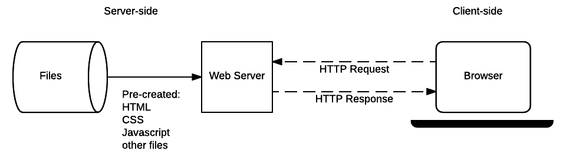

现在你知道每台计算机都有一个 IP 地址，网站也是如此——每个网站都有一个 IP 地址，但由于人类很难记住这些地址，因此为了解决这个问题，万维网引入了网址和 URL。例如，`google.com`。这里的`google.com`是网址，而`8.8.8.8`是`google.com`网站的 IP 地址。每个网站都有网址和 IP 地址。

一个网站由两部分组成：第一部分称为前端，第二部分称为后端。前端指的是任何网站上可见的材料和内容。对于前端开发，我们通常使用 HTML 和 CSS，但对于包含大量动画和内容的高级前端，我们还会使用 JavaScript。至于后端，则有后端编程语言。大多数网站使用 PHP，因为它易于编程且效率很高。我们也可以使用其他编程语言，比如 JavaScript、Python 等。网站加载所需的时间取决于其服务器，服务器越强大，网站加载越快。

当我们在浏览器中输入任何 URL 时，我们会向该网站的服务器发送请求，要求发送 HTML、CSS 和 JavaScript 文件，以便浏览器能够访问并向我们展示内容。并非所有网站都是用 HTML 构建的，但无论网站使用哪种编程语言，为了使其显示，它都会被转换为 HTML 和 JavaScript。例如，`google.com`主要用 C、C++和 Python 编写，但当你查看该网站的页面源代码时，它会以 HTML 的形式呈现。

第一个网站（显然是由蒂姆·伯纳斯-李创建的）是`http://info.cern.ch/`，它看起来像这样：

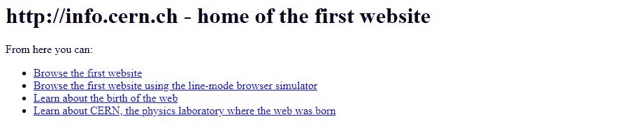

# 第二章：HTML

HTML 是超文本标记语言（Hypertext Markup Language）的缩写，因为它是网站的标准标记语言。现在你可能会问在哪里编写这些代码。要制作一个网站，你可以在任何文本编辑器中编写代码，也可以使用记事本。我个人推荐使用 Visual Studio Code，它是免费的，既可以作为文本编辑器，也可以作为控制台来测试其他编程语言的方程和代码。

## 如何识别是否为 HTML 文件

要识别文件类型，我们借助文件的扩展名。例如，HTML 文件的扩展名是`.html`和`.htm`，CSS 文件的扩展名是`.css`，JavaScript 文件的扩展名是`.js`。在将文件保存到电脑时，你必须添加扩展名。请看 HTML 的基本代码：

```html
<!DOCTYPE html>
<html lang="en">
<head>
    <title>Brajesh Thakur</title>
</head>
<body>
    <!-- The content will be written here -->
</body>
</html>
```

如你所见，代码以`DOCTYPE`开头，表示该文档是一个 HTML 文档。第二行指定了代码的语言是英语。在 HTML 中，最重要的东西之一是标签，比如上面的例子中`<head>`就是一个标签。

起始标签写在小于号和大于号`<` `>`之间。HTML 中有许多标签，例如`<div>`、`<p>`、`<section>`、`<html>`、`<footer>`、`<li>`等。每个标签都有自己的属性。在 HTML 中，所有要显示的内容都写在`<body>`标签内。

## HTML 标题

HTML 中有标题标签，用六个标签`<h1>`到`<h6>`表示。数字越大，标题的文本字号越小。例如，`<h1>`是字号最大的标题，而`<h6>`标签的字号最小。请看下图演示：

**代码**

```html
<!DOCTYPE html>
<html lang="en">
<head>
    <title>Brajesh Thakur</title>
</head>
<body>
    <h1>This is H1 tag</h1>
    <h2>This is H2 tag</h2>
    <h3>This is H3 tag</h3>
    <h4>This is H4 tag</h4>
    <h5>This is H5 tag</h5>
    <h6>This is H6 tag</h6>
</body>
</html>
```

**结果**

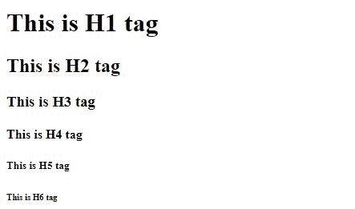

## HTML 段落

既然 HTML 有标题，那么它也有段落。对于段落，我们使用`<p>`标签。代码与之前标题的代码类似，结果也会以相同方式显示。

**代码**

```html
<!DOCTYPE html>
<html lang="en">
<head>
    <title>Brajesh Thakur</title>
</head>
<body>
    <p>This the paragraph tag</p>
</body>
</html>
```

## HTML 注释

有时在制作大型项目时，我们觉得需要写一些在加载网页时不应显示的内容。这时我们使用注释。注释以`<!--`开头，以`-->`结束。

## HTML 属性

在 HTML 中，所有元素或标签都有属性。所有属性都写在起始标签中。

### `href`属性

`href`属性用于`<a>`标签（也称为锚标签），用于在网页中创建超链接。它定义了 URL 指向的位置。下面你可以看到如何在你的网站上使用它。

**代码**

```html
<!DOCTYPE html>
<html lang="en">
<head>
    <title>Brajesh Thakur</title>
</head>
<body>
    <a href="youtube.com">This Link is leading to YOUTUBE</a>
</body>
</html>
```

这里你可以看到，在`href`属性中我添加了一个指向 YouTube 的链接。因此，每当点击这个锚标签时，它就会跳转到`youtube.com`。锚标签通常用作按钮。你可以在`href`属性中添加任何类型的链接。还有更多属性，比如与``标签一起使用的`src`和`alt`。

### `<br>`标签

`<br>`标签用于段落之间，它有助于在行中的某个点创建换行。

**代码**

```html
<p> This is a demo text in this text I will add a break tag here <br> now this is going to start from a new line </p>
```

## HTML CSS

很多时候，在构建网站时，我们只需要对两三个元素进行样式设置，因此在这种情况下，我们可以直接在 HTML 文件中使用 CSS，而无需创建新的 CSS 文件。有两种方法可以实现这一点。

### 第一种：内联 CSS

在内联 CSS 中，我们在 HTML 元素中使用 CSS 属性。内联 CSS 的使用方式如下：

```html
<h1 style="color: blue;">A Blue Heading</h1>
```

### 第二种：内部 CSS

在内部 CSS 中，我们使用 HTML 元素`<style>`，它通常放在文档的头部。内部 CSS 的使用方式如下：

```html
<head>
<style>
h1 {color: blue;}
</style>
</head>
```

使用 CSS，你可以编辑 HTML 中任何元素的所有属性，例如字体大小、字体、颜色、宽度、填充、文本对齐等等。

## HTML 文本格式化

HTML 中主要有十个文本格式化元素，它们帮助我们格式化文本。这十个元素的名称如下：

- `<b>` – 加粗文本
- `<strong>` – 表示重要词语
- `<i>` – 斜体文本
- `<em>` – 强调文本
- `<mark>` – 标记文本
- `<small>` – 更小的文本
- `<del>` – 删除文本
- `<ins>` – 插入文本
- `<sub>` – 下标文本
- `<sup>` – 上标文本

## HTML 引用和引文元素


HTML 引用用于在 HTML 中创建引用。对于短引用，我们使用 `<q>` 标签，此外还有许多其他类型。其中一些如下：

*   `<abbr>`：这是一个缩写标签，用于显示缩写或首字母缩略词。例如“Mr.”、“Mrs”。
*   `<address>`：定义文档作者的联系信息。
*   `<bdo>`：`bdo` 代表双向覆盖。它有助于改变文本的方向。例如，从右到左的方向我们写 `rtl`，从左到右我们使用 `ltr` 作为 `dir` 属性的值。用法如下：

```
<bdo dir="rtl">这段文字将从右向左书写</bdo>
```

*   `<blockquote>`：用于定义从其他来源引用的部分。
*   `<cite>`：定义创意作品的标题。它使文本变为斜体。
*   `<q>`：定义短的行内引用。

## HTML 颜色及其使用

在构建项目时，我们多次使用颜色。HTML 中的颜色以三种形式使用。

*   **RGB**：RGB 代表红、绿、蓝。在这种格式中，我们精确设置三种颜色的值，从而形成新的颜色。这三种颜色的值范围在 0 到 255 之间。例如，黄色的 RGB 代码写作 `(255,255,0)`。这里第一个值代表红色的深浅，第二个值代表绿色的深浅，第三个值代表蓝色的深浅。
*   **HEX**：在这种格式中，颜色以十六进制形式表示。每种深浅对应不同的颜色。十六进制代码总是以 `#` 符号开头。例如，白色的十六进制代码是 `#ffffff`，黑色的是 `#000000`。在十六进制中，前两位控制红色深浅，中间两位控制绿色深浅，最后两位控制蓝色深浅。
*   **HSL**：在这种格式中，颜色通过调整色相、饱和度和明度来生成。饱和度和明度的值以百分比表示，但色相的值以 0 到 360 度的角度表示，色相是负责颜色变化的部分。

## HTML 超链接和锚点标签

每个网站都有超链接或按钮，帮助访问者重定向到另一个网页链接。HTML 中有三种类型的链接。这三种链接的属性是默认的，但之后可以更改。

*   未访问的链接带有下划线且为蓝色。
*   已访问的链接带有下划线且为紫色。
*   活动链接带有下划线且为红色。

你可以按如下方式编辑这三种链接的属性。这将借助 CSS 进行编辑。

```css
<style>
a: link {
  color: green;
  background-color: transparent;
  text-decoration: none;
}
a: visited {
  color: pink;
  background-color: transparent;
  text-decoration: none;
}
a: hover {
  color: red;
  background-color: transparent;
  text-decoration: underline;
}
a: active {
  color: yellow;
  background-color: transparent;
  text-decoration: underline;
}
</style>
```

与其他元素拥有自己的属性一样，锚点标签也有一个名为 `target` 的属性。该属性可以有以下值。

*   `_self`：默认值。在点击时所在的同一窗口/标签页中打开文档。
*   `_blank`：在新窗口或标签页中打开文档。
*   `_parent`：在父框架中打开文档。
*   `_top`：在窗口的完整主体中打开文档。

代码可以写成：

```html
<a href="https://www.youtube.com/" target="_blank">访问 YouTube</a>
```

如果我们使用 URL，应该知道有两种类型的 URL。第一种是绝对 URL，第二种是相对 URL。

1.  **相对 URL**：相对 URL 是指位于你网站文件夹中的 URL。
2.  **绝对 URL**：绝对 URL 是指来自其他网站的 URL。

示例：

```html
<h1>绝对 URL</h1>
<p><a href="https://www.youtube.com/">Youtube</a></p>
<h1>相对 URL</h1>
<p><a href="/css/style.css">CSS 文件</a></p>
```

## HTML 图像

图像在技术上并非插入到网页中；图像是链接到网页的。我们可以通过 CSS 调整图像的宽度和高度。`` 标签为引用的图像创建一个占位空间。图像可以通过以下代码链接。

```html

```

在 URL 的位置，你必须插入图像的相对链接。并且我们需要在 `alt` 属性的值中填写图像的名称或上下文。有时由于网络连接缓慢，图像无法加载，因此这段文本将替代图像。

## HTML 网站图标

请看下面给出的图像，其中网站的徽标显示在网页标题旁边。这个图像或徽标被称为网站图标（favicon）。这个网站图标为你的网页增添了新的亮点，同时也有助于访问者判断网站是否正在加载或已经加载完成。

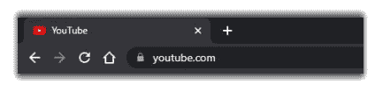

要将网站图标添加到你的网页，首先应将网站图标图像保存为 `.ico` 扩展名，并以任意名称存放在根目录中。这段代码应写在 `head` 标签内。如今，几乎所有浏览器都支持网站图标。在网站图标中，我们使用链接标签将文档与外部资源关联。

```html
<head>
  <title>我的页面标题</title>
  <link rel="icon" type="image/x-icon" href="/images/favicon.ico">
</head>
```

## HTML 表格

我们也可以在 HTML 中添加表格，然后使用 CSS 对其进行样式设置。我们将数据按行和列排列在表格中。要制作表格中的单元格，我们使用 `<td>` 标签。基本表格的代码如下所示。

```html
<body>
    <table style="width:100%">
        <tr>
          <th>姓名</th>
          <th>班级</th>
          <th>组别</th>
        </tr>
        <tr>
          <td>拉姆</td>
          <td>7 年级 A 班</td>
          <td>A</td>
        </tr>
        <tr>
          <td>夏姆</td>
          <td>9 年级</td>
          <td>B</td>
        </tr>
      </table>
</body>
```

对于样式设置，你可以像下面这样为表格的所有元素添加边框。

```css
<style>
table, th, td {
  border:1px solid black;
}
</style>
```

制作新表格时还会用到许多其他标签。

*   `<table>`：此标签定义表格。
*   `<th>`：此标签定义表格的表头单元格。
*   `<tr>`：此标签定义表格中的一行。
*   `<td>`：此标签定义表格中的一个单元格。
*   `<caption>`：定义表格标题。
*   `<colgroup>`：指定表格中的一组列。
*   `<col>`：指代 `colgroup` 中的一列。
*   `<thead>`：对表格的所有表头内容进行分组。
*   `<tbody>`：对表格的主体内容进行分组。
*   `<tfoot>`：对表格的所有页脚内容进行分组。

## HTML 表格的 colspan 和 rowspan

例如，你想让一个单元格变大，使其占据两个单元格的空间，那么你可以使用 `colspan` 和 `rowspan`。这些也是用于 `<th>` 元素的属性。要跨列扩展，应使用 `colspan`；要跨行扩展，应使用 `rowspan`。你可以输入想要扩展该特定单元格所跨越的单元格数量。代码如下所示。

```html
<table style="width: 100%">
        <tr>
            <th colspan="2">姓名</th>
            <th>年龄</th>
        </tr>
        <tr>
            <td>布拉杰什</td>
            <td>塔库尔</td>
            <td>13</td>
        </tr>
        <tr>
            <td>纳雷什</td>
            <td>库马尔</td>
            <td>42</td>
        </tr>
    </table>
```

结果将如下所示，你可以看到左上角的单元格，其宽度等于两个单元格的宽度。

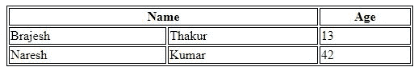

## HTML 列表

HTML 允许网页开发者在制作网站时使用列表。这有助于他们将数据正确地添加到文档中。HTML 中有两种类型的列表。第一种是有序列表，第二种是无序列表。


* 有序列表：有序列表以 `<ol>` 标签开头。每个列表项以 `<li>` 标签开头。默认情况下，列表项会用数字标记。代码和效果如下所示。

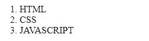

```
<ol>
  <li>Coffee</li>
  <li>Tea</li>
  <li>Milk</li>
</ol>
```

* 无序列表：无序列表以 `<ul>` 标签开头。每个列表项以 `<li>` 标签开头。默认情况下，列表项会用项目符号（小黑圆点）标记。代码和效果如下所示。

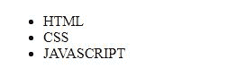

```
<ul>
  <li>Coffee</li>
  <li>Tea</li>
  <li>Milk</li>
</ul>
```

HTML 中还有更多类型的列表。下面列出了所有类型。

* `<dl>`：定义描述列表类型。
* `<dt>`：定义描述列表中的术语。
* `<dd>`：描述描述列表中的术语。

## 块级元素与内联元素

每个 HTML 元素都有一个默认的显示值，具体取决于元素的类型。显示值有两种：块级和内联。

### 块级元素

块级元素总是从新行开始，浏览器会自动在元素前后添加一些空间（外边距）。块级元素总是占据可用的全部宽度。有两个常用的元素：`<p>` 和 `<div>`。`<p>` 元素在 HTML 文档中定义段落。`<div>` 元素在 HTML 文档中定义分区或节。所有块级元素如下：

[`<address>`](https://www.w3schools.com/tags/tag_address.asp) , [`<article>`](https://www.w3schools.com/tags/tag_article.asp) , [`<aside>`](https://www.w3schools.com/tags/tag_aside.asp) , [`<blockquote>`](https://www.w3schools.com/tags/tag_blockquote.asp) , [`<canvas>`](https://www.w3schools.com/tags/tag_canvas.asp) , [`<dd>`](https://www.w3schools.com/tags/tag_dd.asp) , [`<div>`](https://www.w3schools.com/tags/tag_div.asp) , [`<dl>`](https://www.w3schools.com/tags/tag_dl.asp) , [`<dt>`](https://www.w3schools.com/tags/tag_dt.asp) , [`<fieldset>`](https://www.w3schools.com/tags/tag_fieldset.asp) , [`<figcaption>`](https://www.w3schools.com/tags/tag_figcaption.asp) , [`<figure>`](https://www.w3schools.com/tags/tag_figure.asp) , [`<footer>`](https://www.w3schools.com/tags/tag_footer.asp) , [`<form>`](https://www.w3schools.com/tags/tag_form.asp) , [`<h1>-<h6>`](https://www.w3schools.com/tags/tag_hn.asp) , [`<header>`](https://www.w3schools.com/tags/tag_header.asp) , [`<hr>`](https://www.w3schools.com/tags/tag_hr.asp) , [`<li>`](https://www.w3schools.com/tags/tag_li.asp) , [`<main>`](https://www.w3schools.com/tags/tag_main.asp) , [`<nav>`](https://www.w3schools.com/tags/tag_nav.asp) , [`<noscript>`](https://www.w3schools.com/tags/tag_noscript.asp) , [`<ol>`](https://www.w3schools.com/tags/tag_ol.asp) , [`<p>`](https://www.w3schools.com/tags/tag_p.asp) , [`<pre>`](https://www.w3schools.com/tags/tag_pre.asp) , [`<section>`](https://www.w3schools.com/tags/tag_section.asp) , [`<table>`](https://www.w3schools.com/tags/tag_table.asp) , [`<tfoot>`](https://www.w3schools.com/tags/tag_tfoot.asp) , [`<ul>`](https://www.w3schools.com/tags/tag_ul.asp) , [`<video>`](https://www.w3schools.com/tags/tag_video.asp).

### 内联元素

内联元素不会从新行开始。内联元素只占据必要的宽度。我们日常使用的一个元素是 `<span>`。它也不需要新行，而是在同一行内适应给定的尺寸。所有内联元素如下：

[`<a>`](https://www.w3schools.com/tags/tag_a.asp) , [`<abbr>`](https://www.w3schools.com/tags/tag_abbr.asp) , [`<acronym>`](https://www.w3schools.com/tags/tag_acronym.asp) , [`<b>`](https://www.w3schools.com/tags/tag_b.asp) , [`<bdo>`](https://www.w3schools.com/tags/tag_bdo.asp) , [`<big>`](https://www.w3schools.com/tags/tag_big.asp) , [`<br>`](https://www.w3schools.com/tags/tag_br.asp) , [`<button>`](https://www.w3schools.com/tags/tag_button.asp) , [`<cite>`](https://www.w3schools.com/tags/tag_cite.asp) , [`<code>`](https://www.w3schools.com/tags/tag_code.asp) , [`<dfn>`](https://www.w3schools.com/tags/tag_dfn.asp) , [`<em>`](https://www.w3schools.com/tags/tag_em.asp) , [`<i>`](https://www.w3schools.com/tags/tag_i.asp) , [``](https://www.w3schools.com/tags/tag_img.asp) , [`<input>`](https://www.w3schools.com/tags/tag_input.asp) , [`<kbd>`](https://www.w3schools.com/tags/tag_kbd.asp) , [`<label>`](https://www.w3schools.com/tags/tag_label.asp) , [`<map>`](https://www.w3schools.com/tags/tag_map.asp) , [`<object>`](https://www.w3schools.com/tags/tag_object.asp) , [`<output>`](https://www.w3schools.com/tags/tag_output.asp) , [`<q>`](https://www.w3schools.com/tags/tag_q.asp) , [`<samp>`](https://www.w3schools.com/tags/tag_samp.asp) , [`<script>`](https://www.w3schools.com/tags/tag_script.asp) , [`<select>`](https://www.w3schools.com/tags/tag_select.asp) , [`<small>`](https://www.w3schools.com/tags/tag_small.asp) , [`<span>`](https://www.w3schools.com/tags/tag_span.asp) , [`<strong>`](https://www.w3schools.com/tags/tag_strong.asp) , [`<sub>`](https://www.w3schools.com/tags/tag_sub.asp) , [`<sup>`](https://www.w3schools.com/tags/tag_sup.asp) , [`<textarea>`](https://www.w3schools.com/tags/tag_textarea.asp) , [`<time>`](https://www.w3schools.com/tags/tag_time.asp) , [`<tt>`](https://www.w3schools.com/tags/tag_tt.asp) , [`<var>`](https://www.w3schools.com/tags/tag_var.asp).

## HTML 类

HTML 的 `class` 属性用于为元素指定一个类。因为我们在文档中会多次使用同一个元素，所以如果要对单个元素进行样式设置，几乎是不可能的，但有了 `class` 属性，就可以轻松实现。通过这个属性，我们可以为元素命名，并在样式表和 JS 文件中通过该名称访问它。我们将在本书后面简要学习它。

要在 CSS 中设置样式，我们在类名前面加一个点，然后就可以编辑该类的属性。类名是区分大小写的，这意味着 `Imp` 和 `imp` 是两个不同的类。我们可以为不同的元素指定相同的类名。如果我们想为两个不同的元素赋予相同的属性，可以给它们一个共同的类，然后为该类设置属性。一个元素也可以有多个类，只需在它们之间用空格隔开即可。

在下面的代码中，`span` 被赋予了名为 `imp` 的类。

```html
<!DOCTYPE html>
<html>
<head>
<style>
.note {
  font-size: 120%;
  color: red;
}
</style>
</head>
<body>
<h1>My <span class="imp">Important</span> Heading</h1>
<p>This is some <span class="imp">important</span> text. </p>
</body>
</html>
```

## HTML ID

HTML 的 `id` 属性用于为 HTML 元素指定唯一的 ID。在 HTML 文档中，不能有多个元素使用相同的 ID。`id` 属性在样式表和 JS 文件中访问时，总是用 `#` 表示。该属性也是区分大小写的。类和 ID 都用于为元素命名，但 ID 和类的一个区别是：类可以是共用的，而 ID 必须始终唯一。ID 还可以帮助你在文档中创建一个位置链接，用户可以通过锚点标签跳转到该位置。请查看下面的代码，了解它如何与锚点标签配合使用。

```html
<a href="book.html#imp">What’s important</a>
```

## HTML iframe

你是否见过网站中的网站，或者网页中嵌入的视频或 PDF？那么开发者是如何做到的呢？他们使用 `iframe` 元素来实现。嵌入文档的语法如下所示。

```html
<iframe src="URL of the document" title="about the url "></iframe>
```

## HTML 文件路径

文件路径是任何文件或文件夹的位置名称。在 HTML 中，我们使用 `src` 属性来访问它。你可以查看下面的表格，了解路径及其用法。文件路径用于将其他文件与你的文档链接起来。它们可以是图片、CSS 文件或 JS 文件。

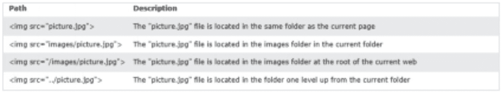

## HTML head 标签

HTML 的 `<head>` 元素或 `<head>` 标签是以下元素的容器：`<title>`、`<style>`、`<meta>`、`<link>`、`<script>` 和 `<base>`。


`<head>` 元素是元数据（关于数据的数据）的容器，位于 `<html>` 标签和 `<body>` 标签之间。HTML 元数据是关于 HTML 文档的数据。元数据不会显示。元数据通常定义文档标题、字符集、样式、脚本和其他元信息。元数据也有助于使网站具有响应性。样式元素也只存在于 `<head>` 标签中。下面是一个你在 HTML 文件中见过的元数据示例。它能让我们的网站更美观，并铺满设备的宽度。

`<meta name="viewport" content="width=device-width, initial-scale=1.0">`

## HTML 响应式设计

响应式网页设计旨在创建在所有设备上都能良好显示的网页！响应式网页设计会自动适应不同的屏幕尺寸和视口。它要么自动适应屏幕大小，要么需要我们手动调整。这有助于我们从任何屏幕尺寸吸引更多访客。主要有三种屏幕尺寸：第一种是 PC，第二种是平板，第三种是智能手机。


响应式网页设计就是使用 HTML 和 CSS 自动调整、隐藏、缩小或放大网站，使其在所有设备（台式机、平板和手机）上都能良好显示。

要使网站具有响应性，首先应在 head 标签中添加 meta 标签来设置视口。我们总是希望网站具有响应性，因此每当添加图片时，应养成将其宽度设为 100% 的习惯。这能减少你在制作响应式网站时的工作量。代码如下：

`<meta name="viewport" content="width=device-width, initial-scale=1.0">`

这一切非常繁琐，需要大量努力。不过有一个 CSS 框架可以减少我们的工作量，但我不建议你在完全精通网页开发并希望更快地为客户制作更多网站之前使用 Bootstrap。我们将在本书后面介绍 Bootstrap。

## HTML 字符实体

你可能知道，在 HTML 中不能添加多个空格，因此你可以使用不同的字符来创建多个空格。如果你想在 HTML 文件中添加字符，则需要添加一个定义字符集的 meta 标签。以下是一些字符实体：

* `&nbsp;` 创建空格。
* `&lt;` 用于表示“<”小于号。
* `&gt;` 用于表示“>”大于号。
* `&copy;` 用于创建 ©。

字符集的 meta 代码如下：

`<meta charset="UTF-8">`

## HTML 表单

你一定见过大多数网站都包含表单，无论是用于评论、反馈还是投诉等。你可以使用 `<form>` 元素在 HTML 中创建表单。以下是 HTML 表单的基本代码：

```
<form>
  <label for="fname">First name:</label><br>
  <input type="text" id="fname" name="fname"><br>
  <label for="lname">Last name:</label><br>
  <input type="text" id="lname" name="lname">
</form>
```

## HTML 表单属性和元素

与其他元素一样，表单元素也有一些属性，用于方便在 CSS 中设置样式以及实现表单功能。如你所见，这里我们使用了一个名为 `label` 的新元素，它用于为输入添加标签，你可以在下面的结果中看到。在 `type` 属性中，我们可以添加不同的值，例如对于复选框，可以在 type 属性值中添加 `checkbox`。对于单选按钮，同样可以在 `type` 属性值中添加 `radio`。

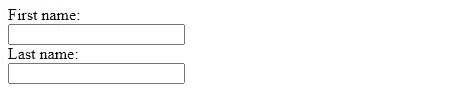

你是否注意到少了什么？是的，就是提交按钮。你可以通过编写以下代码为任何表单添加提交按钮：

`<input type="submit" value="Submit">`

## HTML 表单的 action 和 method 属性

现在，用户会填写这个表单，但我们如何获取用户填写的信息呢？因此，我们需要链接一个文件，将我们的网站连接到数据库。我们可以通过多种语言来实现，比如 Python、PHP 等。在网页开发中，我们通常使用 PHP，因此在 `action` 属性中，我们需要填写 PHP 文件的名称作为其值。

HTML 表单的第二个属性是 `method` 属性。这个属性也有多个值。首先，我们需要了解它。它指的是数据从客户端浏览器传输到数据库的方法。该 method 属性的所有值如下：

* `GET`
* `POST`
* `PUT`
* `HEAD`
* `DELETE`
* `PATCH`
* `OPTIONS`
* `CONNECT`
* `TRACE`

大多数后端开发者更喜欢 `POST`，因为 `POST` 比 `GET` 更安全，而 `GET` 方法容易被黑客攻击或被人轻易访问。在 `GET` 方法表单中输入的信息会存储在浏览器中。因此，在制作网站及其表单时，尽量使用 `POST` 方法。

## HTML 媒体

我们可以在 HTML 中添加多种格式的视频。大多数视频是 MP4 和 MPEG 格式，因此我们可以在网页中添加这些扩展名的视频。音频文件也是如此。HTML 也支持 MP4、MP3 和 `.ogg` 等音频文件扩展名。你可以使用 `video` 元素向网页添加视频，使用 `audio` 元素添加音频。你可以使用 `autopay` 属性让文件在有人打开页面时自动播放。添加视频的基本代码如下：

```
<video width="320" height="240" controls>
  <source src="video.mp4" type="video/mp4">
</video>
```

在上面的代码中，我们使用了 `video` 元素，并通过两个属性设置了宽度和高度。另一个名为 `controls` 的属性不需要任何值，它赋予视频所有控制功能，如播放、时间线、选项等。最后是 `track` 元素。`track` 元素用于为视频添加字幕，字幕文件的扩展名为 `.vtt`。结果如下所示：

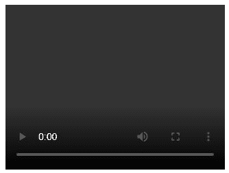

## HTML YouTube 视频嵌入

你一定好奇大多数网站是如何使用 YouTube 视频并将其嵌入到自己的网站中的。你可以借助 `iframe` 元素来实现。编写 YouTube 视频的嵌入链接非常困难。因此，Google 在 YouTube 中添加了一个功能，你可以从中获取用于将 YouTube 视频嵌入到网页中的 iframe 代码。

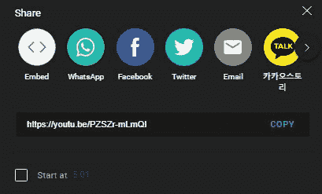

只需点击 YouTube 网站上的分享图标。会出现上述界面，然后点击嵌入图标，会出现一个链接，复制该链接并粘贴到你的网站中。这样，访客就可以直接从你的网站播放视频，或者通过此链接跳转到 YouTube。他们还可以订阅你所嵌入视频的频道。结果如下页所示：

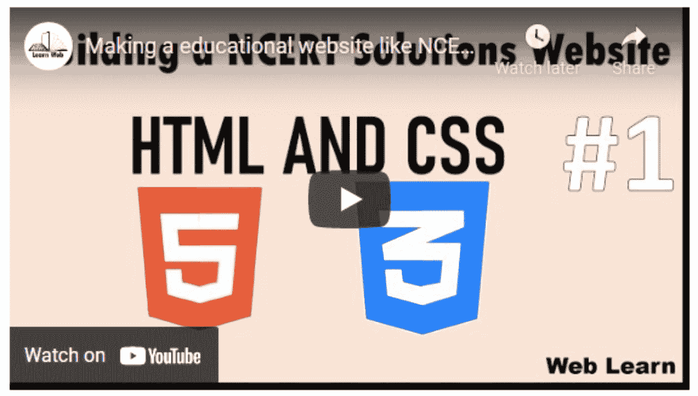

## HTML Google 地图嵌入

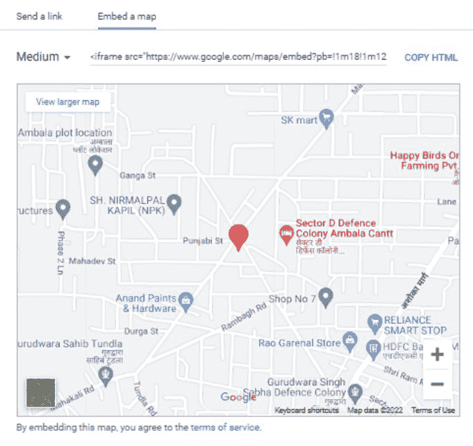与嵌入 YouTube 视频类似，你也可以在网页中嵌入 Google 地图。在提供企业位置和其他联系方式时可以使用地图。操作方法与 YouTube 相同。只需输入你的位置，右侧会打开一个面板，你会找到分享图标，点击它，然后点击“嵌入地图”。如下图所示。结果也类似。通过 Ctrl + 加号缩放并查看完整地图。

# CSS

CSS 是层叠样式表（Cascading Stylesheet）的缩写。它是一种样式表编程语言，帮助网页开发者设计 HTML 文档，使其更具吸引力，从而吸引更多访客访问网站。CSS 文件或文档的扩展名为 `.css`。该文件需要先通过以下代码链接到 HTML 文档，该代码使用 `link` 元素将这两个文件链接起来。需要注意的是，CSS 和 HTML 文件应保存在同一文件夹中。

`<link rel="stylesheet" href="styles.css">`

基本的 CSS 代码如下：

```
h1 {
  color: black;
```


```
  text-align: center;
}
p[[BT1]](#part0029.xhtml__cmnt1) {
  font-family: verdana;
  font-size: 20px;
}
```

在上述代码中，我们为 `h1` 和段落元素赋予了两种属性。例如，对于标题标签，我们设置了颜色为黑色，文本居中对齐。对于段落标签，我们设置了字体族，即指定了名为“verdana”的字体，并将段落字体大小设为 `20px`。

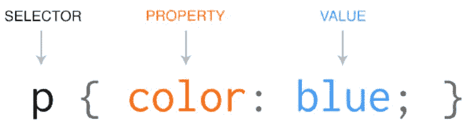

CSS 的语法如下所示：

在 CSS 中，你可以使用元素名、ID 名或类名作为选择器。若要将 ID 用作 CSS 选择器，需在 ID 名称前加上 `#`。若要将类名用作选择器，则需在类名前加上点号。你也可以为特定元素选择特定的类，如下所示：

```
p. heading {
  text-align: left;
  color: black;
}
```

CSS 中还有一种选择器称为通用选择器。它可以帮助我们选中整个文档并为其赋予属性。它可以用来为整个文档设置统一的字体。现在，你可以使用 `*` 符号来使用通用选择器。如果你希望为两个或多个不同的元素赋予相同的属性，可以将它们一起编辑，这称为 CSS 分组选择器。如下方代码所示，这里我们为两个不同的元素赋予了相同的属性。

```
h1, h2, p {
  text-align: left;
  color: black;
}
```

## 使用 CSS 的方式

在 HTML 文件中使用/插入 CSS 有三种方法。第一种是内联 CSS，我们在本书前面已经讨论过。第二种是内部 CSS。在这种方法中，我们使用 `<style>` 元素，并将所有要写入 CSS 文件的代码放在其中。最后一种是外部 CSS。在这种方式中，我们使用扩展名为 `.css` 的外部 CSS 文件。为了将其与 HTML 文件链接，我们在 head 标签中编写链接代码。

## CSS 中的注释

正如我们之前所学，HTML 中有注释，CSS 也是如此。因此，CSS 中的注释如下所示：

```
/*这是一条注释*/
```

## 背景颜色

要为图像添加背景颜色，你需要遵循相同的语法，使用 `background-color` 属性，并为其赋予一个颜色名称作为值。你可以使用所有形式的颜色：HEX 代码、RGB 或 HSL。要增加或减少背景颜色的不透明度，你可以使用 RGBA 形式的背景颜色，通过控制 alpha 值来控制背景的不透明度。但不可忽视的是，查找颜色的 RGB 值比较困难，因此你可以直接写颜色名称，并通过添加 `opacity` 属性来控制不透明度。该属性的值介于 `0` 到 `1` 之间。

## 背景图像

有时背景颜色并不能让我们的网站看起来足够吸引人，因此我们可以利用 CSS 属性为 CSS 中的任何元素添加背景图像。我们只需使用 `url` 属性，代码如下所示：

```
div {
  background-image: url("bg.jpg");
}
```

有时元素的尺寸大于背景图像的尺寸，浏览器会自动重复显示图像。因此，我们使用名为 background-repeat 的属性。如果你希望图像不重复，可以将值设为 `no-repeat`。如果你希望图像水平重复，可以将值设为 `repeat-x`。如果你希望图像仅垂直重复，可以将值设为 `repeat-y`。

```
div {
 background-image: url("bg.png");
  background-repeat: repeat-x;
}
```

## 边框属性

你可以使用 CSS 属性为 HTML 元素添加边框。`border-style` 属性指定要显示的边框类型。该属性可以填充的值如下：

* `dotted` - 定义点状边框。
* `dashed` - 定义虚线边框。
* `solid` - 定义实线边框。
* `double` - 定义双线边框。
* `groove` - 定义 3D 凹槽边框。效果取决于 `border-color` 的值。
* `ridge` - 定义 3D 脊状边框。效果取决于 `border-color` 的值。
* `inset` - 定义 3D 内嵌边框。效果取决于 `border-color` 的值。
* `outset` - 定义 3D 外凸边框。效果取决于 `border-color` 的值。
* `none` - 定义无边框。
* `hidden` - 定义隐藏边框。

使用所有这些属性的代码如下所示：

```
div {border-style:
 dotted;
}
```

所有这些属性的效果将在下一页展示。

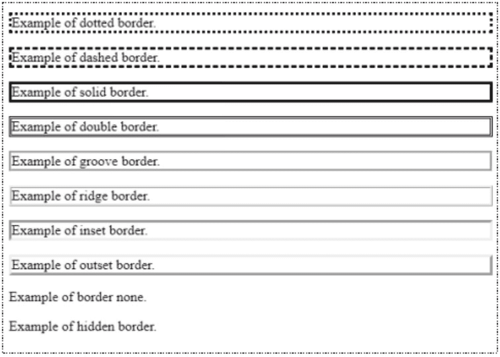

你还可以为应用于 HTML 元素的边框添加颜色。通过使用 `border-color` 属性。相关代码如下：

```
div {
  border-style: solid;
  border-color: blue;
}
```

在 CSS 中，你可以单独编辑元素每一边的边框。代码如下：

```
p {
  border-top-style: solid;
  border-right-style: dotted;
  border-bottom-style: groove;
  border-left-style: ridge;
}
```

你也可以将这四行代码合并为一行：

```
p {
  border-style: solid dotted groove ridge;
}
```

上述代码的效果如下所示：

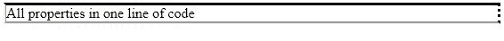

## CSS 外边距

在 CSS 中，外边距指的是一个元素与另一个元素之间的空间。通过 CSS 属性，我们可以编辑元素的外边距值。外边距的值以像素为单位计算。一厘米大约等于三十七像素。可以通过以下代码控制四个方向的外边距：

```
p {
  margin-top: 25px;
  margin-bottom: 50px;
  margin-right: 750px;
  margin-left: 100px;
}
```

整个代码可以简化为一行，如下所示：

```
p {
  margin: 25px 50px 75px 100px;
}
```

你也可以将外边距设置为 `auto`，这将使其在其 div 或容器中水平居中。

## CSS 内边距

内边距可以定义为元素本身与其边框之间的间隙或空间。其余内容（如语法和值）与 CSS 外边距相同。其语法如下：

```
p {
  padding-top: 25px;
  padding -bottom: 50px;
  padding -right: 750px;
  padding -left: 100px;
}
```

与外边距类似，你可以将这四行代码合并为一行：

```
p {
  padding: 25px 50px 75px 100px;
}
```

## CSS 高度和宽度

每个元素都需要定义其尺寸。在 CSS 中，你可以为每个元素设置高度和宽度。CSS 中高度和宽度由一些值控制，如下所述：

* `Auto` - 默认值。浏览器自动计算高度和宽度。
* `Length` - 以 px、cm 等单位定义高度/宽度。
* `Percentage` - 以包含块的百分比定义高度/宽度。
* `Initial` - 将高度/宽度设置为其默认值。
* `Inherit` - 高度/宽度将从其父元素继承。

添加高度和宽度相关属性的代码语法如下：

```
div {
  height: 150px;
  width: 54%;
  background-color: red;
}
```

* `Max height`：将元素的高度设置为最大值。
* `Max width`：将元素的宽度设置为最大值。
* `Min height`：将元素的高度设置为最小值。
* `Min width`：将元素的宽度设置为最小值。

## CSS 盒模型

CSS 盒模型指的是一个布局，它清晰地解释了元素与其外边距和内边距之间的关系。

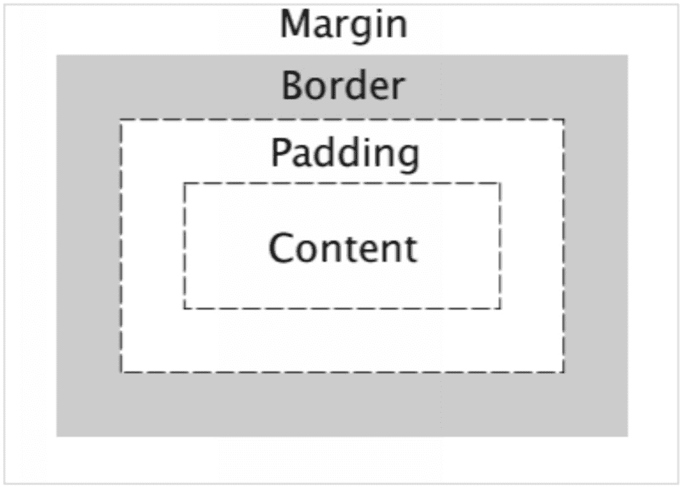

## CSS 文本格式化

在 CSS 中，文本格式化指的是为文本添加不同的属性，例如对齐文本、更改字体颜色或更改背景颜色。

### 文本对齐

文本对齐在 Web 开发中意义重大，它帮助我们以吸引人的方式在网站中调整更多内容。在文本对齐中，你可以使用多种属性，例如：

* `Text-align-last`
* `Direction`
* `Vertical-align`

### 最后一行文本对齐

`text-align-last` 属性指定如何对齐文本的最后一行。其语法如下：

```
p{
 text-align-last: center;
}
```


这种文本对齐方式的结果如下页所示。你可以看到整个段落左对齐，但最后一行居中对齐。而且这也是响应式的。比如，如果你在手机上打开那个网页，你会发现只有最后一行是居中对齐的。

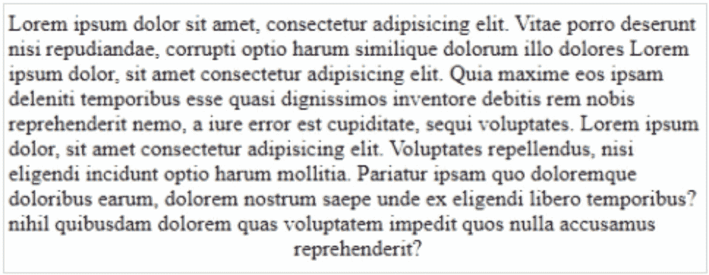

## 文本方向

`direction` 和 `unicode-bidi` 属性可用于改变元素的文本方向：它们可用于书写像乌尔都语这样从右向左书写的显示语言。在其语法中，我们指定了从右到左的方向。语法如下所示：

```css
p {
  direction: rtl;
}
```

结果如下所示：

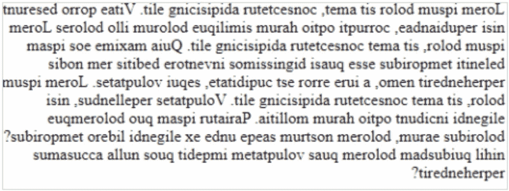

## 垂直对齐

`vertical-align` 属性设置元素的垂直对齐方式。例如，这里是一个在段落中使用的图片。这个垂直对齐属性有很多值。它们如下面的代码所示。

```css
img.a {
  vertical-align: baseline;
}

img.a {
  vertical-align: text-top;
}

img.a {
  vertical-align: text-bottom;
}

img.a {
  vertical-align: sub;
}

img.a {
  vertical-align: super;
}
```

上述代码的结果如下页所示，你可以看到图片相应地改变了位置，比如从上到下等。

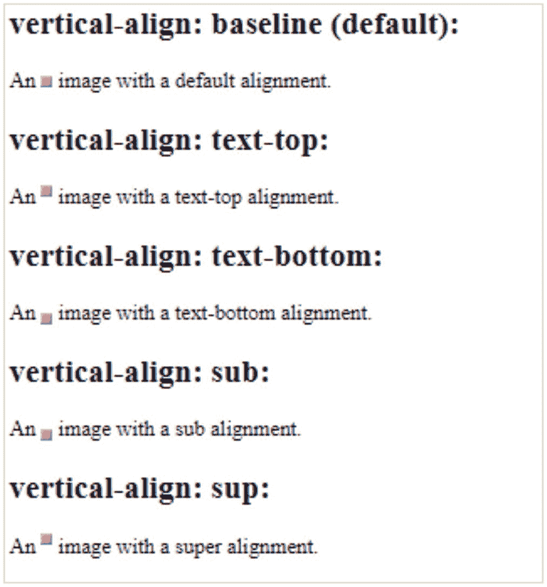

## CSS 文本转换

`text-transform` 属性用于指定文本中的大写和小写字母。它可以将所有内容转换为大写或小写字母，或者将每个单词的首字母大写：如果你写了小写内容但希望它变成大写，这会非常有用。语法如下所示：

```css
p {
  text-transform: uppercase;
}
```

## 文本阴影

`text-shadow` 属性为文本添加阴影。在最简单的用法中，你只需指定水平阴影（2px）和垂直阴影（2px）。它能让你的文本看起来更吸引人。其代码如下所示：

```css
h1 {
  text-shadow: 2px 2px red;
}
```

在上面的代码中，你可以看到我们设置了水平 2px 阴影和垂直 2px 阴影，最后添加了阴影颜色为红色。上述代码的结果如下所示。


## CSS 字体

在你的网站中，字体在吸引力方面起着重要作用。一个有力的字体可以为你的网站和品牌创造强大的识别度。字体应该易于阅读和理解，除此之外，你选择的任何字体都应该有吸引力。大多数网站使用 'Arial' 字体，比如 Google、YouTube 等。

在 CSS 中，主要有五种字体系列：

*   Serif（衬线体）
*   Sans-Serif（无衬线体）
*   Monospace（等宽体）
*   Cursive（手写体）
*   Fantasy（装饰体）

### 网络安全字体

有些字体默认存在于每台计算机中，不需要互联网连接或服务器速度。因为大多数情况下，如果我们使用来自外部网站的字体，而浏览器无法访问你使用这些字体的网站，那么你网站上的所有字体都会消失，你的网站会变得很难看。因此，你应该使用网络安全字体。这样，无论发生什么，字体都能安全加载，并且不会以任何方式影响你的网站。我列出了一些网络安全字体。这些是最常用的网络安全字体。

1.  Arial (sans-serif)
2.  Verdana (sans-serif)
3.  Helvetica (sans-serif)
4.  Tahoma (sans-serif)
5.  Trebuchet MS (sans-serif)
6.  Times New Roman (serif)
7.  Georgia (serif)
8.  Garamond (serif)
9.  Courier New (monospace)
10. Brush Script MT (cursive)

### 字体粗细

字体粗细用于控制粗体。你可以添加像 normal 或 bold 这样的值。其代码和结果如下页所示。

```css
p {
  font-weight: bold;
}
```

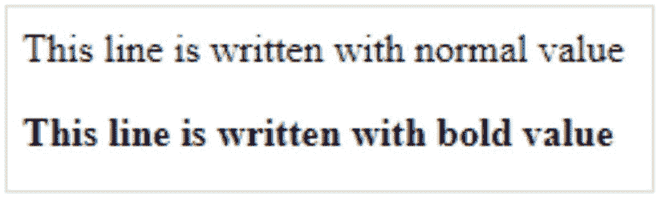

### 字体大小

与其他元素一样，你也可以设置属性来控制文本大小。你可以用 px 和 rem 来指定文本大小的值。1 rem 等于 16px。

### Google 字体

现在，你的网站使用网络安全字体看起来可能不那么吸引人。所以你可以使用外部网站的字体。最好的选择是 Google Fonts。因为这个网站永远不会宕机，而且你在网站上使用的所有字体都是安全的。现在你会想，我们如何在网站中使用 Google 字体呢？

首先，访问 fonts.google.com，选择一个合适的字体。然后选择该字体的所有变体。现在你会在右下角看到一些链接。复制底部的链接并将其粘贴到你的 head 标签中。这就是如何在 HTML 文件中添加字体系列的方法。

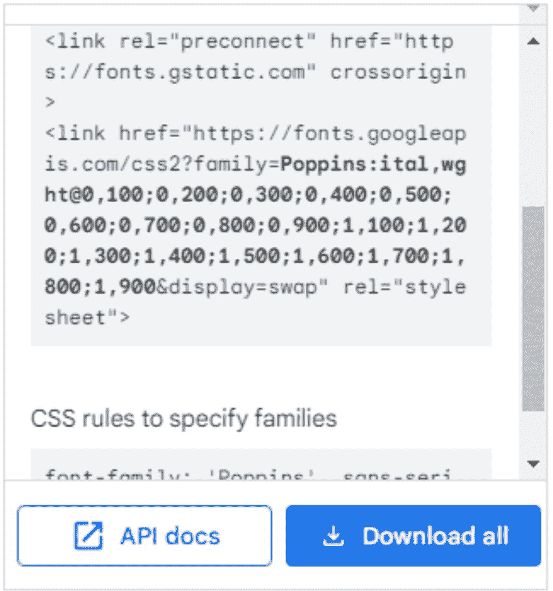

## CSS 链接

我们可以为锚标签的四个阶段添加属性。这四个阶段是：

*   `a:link` - 一个普通的、未访问的链接。
*   `a:visited` - 用户已访问过的链接。
*   `a:hover` - 用户鼠标悬停时的链接。
*   `a:active` - 链接被点击的瞬间。

为锚标签赋予所有这些属性的语法如下所示。

```css
a:link {
  color: red;
}

a:visited {
  color: green;
}

a:hover {
  color: blue;
}

a:active {
  color: yellow;
}
```

## CSS 定位

`position` 属性指定用于元素的定位方法类型（static、relative、fixed、absolute 或 sticky）。然后使用 top、bottom、left 和 right 属性对元素进行定位。但是，除非先设置了 `position` 属性，否则这些属性将不起作用。它们的工作方式也因 position 值而异。

### 静态定位

这是 position 属性的默认值。静态定位的元素不受 top、bottom、left、right 属性的影响。静态定位的代码如下所示：

```css
div {
  position: static;
  border: 1px #fff;
}
```

### 相对定位

在这种定位中，元素处于其相对位置。设置相对定位元素的 top、right、bottom 和 left 属性将使其偏离其正常位置。其他内容不会调整以填补元素留下的任何间隙。

```css
div {
  position: relative;
  border: 1px #fff;
}
```

### 固定定位

在这种定位中，元素固定在其相对位置。这意味着无论你滚动到页面底部，它都不会移动。

```css
div {
  position: fixed;
  bottom: 0;
  right: 0;
  width: 100%;
}
```

### 绝对定位

具有 `position: absolute` 的元素相对于最近的已定位祖先元素进行定位。绝对定位的元素会脱离正常文档流，并且可以重叠其他元素。

```css
div {
  position: absolute;
  top: 80px;
  right: 0;
  width: 200px;
  height: 100px;
}
```

### 粘性定位

如果一个元素的 position 属性值设置为 sticky，它将始终粘在那里，常用于制作网站导航栏。

```css
div {
  position: -webkit-sticky;
  position: sticky;
  top: 0;
  background-color: black;
  border: 1px solid #fff;
}
```

## Z-INDEX

`z-index` 属性指定元素的堆叠顺序。使用此属性，我们可以选择哪个元素应该在上层，哪个应该在下层。其值范围从负无穷到正无穷。元素的值越大，它就越靠上。在下面的代码中，你可以看到我们设置了 `z-index: -1`，这意味着它是最低的，图像将位于文档的最底层。

```css
img {
  position: absolute;
  margin: auto;
  top: 0px;
  z-index: -1;
}
```

## CSS 浮动

`float` 属性用于定位和格式化内容，例如让一个 div 或图像浮动到容器的左侧。`float` 属性可以具有以下值之一：

*   `left` - 元素浮动到其容器的左侧。
*   `right` - 元素浮动到其容器的右侧。
*   `none` - 元素不浮动。
*   `inherit` - 元素继承其父元素的 float 值。


# 第 4 章
## JavaScript

其语法和结果如下所示：

```css
img {
  float: right;
}
```

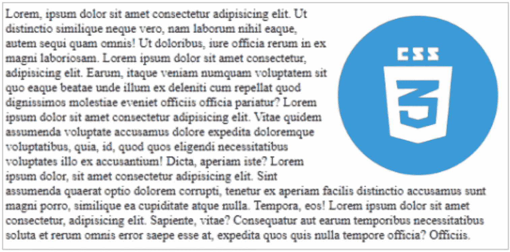

## CSS 显示 - 内联块

该属性用于将元素显示为内联级别的块容器。`inline-block` 允许在元素上设置宽度和高度。大多数开发者使用 `inline-block` 来创建导航栏。

## CSS 组合器

CSS 选择器可以包含多个简单选择器。在简单选择器之间，我们可以包含一个组合器。因为有时要访问 HTML 中的某个元素，我们必须指定它在文档中的位置。

CSS 中有四种不同的组合器：

- 后代选择器（空格）
- 子选择器（>）

### 后代选择器

后代选择器匹配指定元素的所有后代元素。以下示例访问 `<div>` 元素内的所有 `<p>` 元素：

```css
div p {
  background-color: yellow;
}
```

### 子选择器

子选择器匹配指定元素的所有直接子元素。以下示例选择所有作为 `<div>` 元素子元素的 `<p>` 元素：

```css
div > p {
  background-color: yellow;
}
```

## CSS 伪类

伪类用于定义元素的特殊状态。就像我们在锚点标签中看到的那样。语法如下所示。

例如，它可以用于：

- 当用户将鼠标悬停在元素上时设置样式
- 区分已访问和未访问的链接样式
- 当元素获得焦点时设置样式

```css
selector:pseudo-class {
  property: value;
}
```

这里的 `selector` 指的是你要选择其伪类的元素。而 `pseudo-class` 指的是该元素的伪类。

### 锚点伪类

正如我们之前所学，锚点标签可以以不同方式显示，代码将在下一处展示。在该代码中，我们访问了锚点标签的每个阶段。我们可以对几乎所有的 HTML 元素使用像 `hover` 这样的伪类。

```css
a:link {
  color: white;
}
a:visited {
  color: black;
}
a:hover {
  color: yellow;
}
a:active {
  color: green;
}
```

### CSS - :first-child 伪类

这个伪类帮助我们访问 HTML 文档中该元素的第一次出现。因此，我们可以通过使用 `first-child` 属性轻松访问它。

在下一页所示的以下示例中，选择器匹配任何作为其父元素第一个子元素的 `<p>` 元素。

```css
p:first-child {
  color: blue;
}
```

## CSS 伪元素

CSS 伪元素用于设置元素的指定部分的样式。有许多伪元素。使用伪元素的语法如下所示：

```css
selector::pseudo-element {
  property: value;
}
```

### ::first-line 伪元素

`::first-line` 伪元素用于为文本的第一行添加特殊样式。它适用于所有文本元素。注意：`::first-line` 伪元素只能应用于块级元素。语法如下：

```css
p::first-line {
  color: #000;
}
```

### ::first-letter 伪元素

`::first-letter` 伪元素用于为文本的第一个字母添加特殊样式。以下示例格式化所有 `<p>` 元素中文本的第一个字母。语法如下（见下一页）。`::first-letter` 伪元素只能应用于块级元素。

```css
p::first-letter {
  color: #ff0000;
  font-size: xx-large;
}
```

### ::before 伪元素

`::before` 伪元素可用于在元素内容之前插入一些内容。以下示例在每个 `<h1>` 元素的内容之前插入一张图片。我们赋予 `::before` 伪元素的所有属性都会在 HTML 文档中显示。语法如下：

```css
h1::before {
  content: url(book.png);
}
```

### CSS - ::after 伪元素

`::after` 伪元素可用于在元素内容之后插入一些内容。以下示例在每个 `<h1>` 元素的内容之后插入一张图片。语法如下：

```css
h1::after {
  content: url(book.png);
}
```

### ::selection 伪元素

你是否注意到，当我们在网页中选择某些内容时，它会有不同的属性？默认情况下，其背景设置为蓝色。你可以使用下一页所示的简单语法来编辑所有这些。

```css
::selection {
  color: white;
  background: black;
}
```

## 导航栏

导航栏需要标准的 HTML 作为基础。对于任何网站来说，拥有易于使用的导航都很重要。为了制作一个基本的导航栏，我们使用了 `ul` 标签和 `li` 标签。因此，HTML 代码如下所示：

```html
<ul>
  <li><a href="default.asp">Home</a></li>
  <li><a href="news.asp">News</a></li>
  <li><a href="contact.asp">Contact</a></li>
  <li><a href="about.asp">About</a></li>
</ul>
```

为了使其更具吸引力，我们将添加一些基本的 CSS 代码，如下所示。这里我们通过将 `list-style-type` 设置为 `none` 来移除项目符号。并通过将 `margin` 和 `padding` 设置为零，将其置于左上角位置。

```css
ul {
  list-style-type: none;
  margin: 0;
  padding: 0;
}
```

在 HTML 中，我们制作的每个导航栏默认都是垂直的，但如何制作水平导航栏呢？我通常使用下一页给出的代码。其中我将 `display` 设置为 `flex`，使它们全部水平排列，然后添加一些外边距。

```css
ul {
  background-color: rgb(14, 13, 13);
  display: flex;
  list-style-type: none;
  margin: 0;
  padding: 0;
}
ul li {
  color: white;
  margin-left: 20px;
  margin-right: 20px;
}
```

这段代码的结果如下图所示：

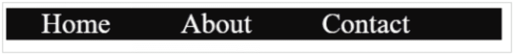

# 第 4 章
## JavaScript

JavaScript（通常缩写为 JS）是一种编程语言，与 HTML 和 CSS 一样，是万维网的核心技术之一。超过 97% 的网站使用 JavaScript 来实现客户端网页行为，通常还会集成第三方库。JavaScript 也用于服务器端编程以操作数据库。在本书中，我们只学习用于前端开发的 JavaScript。现在，通过查看以下代码来初步了解 JavaScript。

```html
<script>
  document.write("Introduction to JavaScript.");
</script>
```

其结果与使用 HTML 编写时相同。

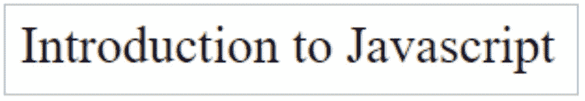

### 在 HTML 中使用 JavaScript

要在 HTML 中使用 JavaScript，我们有两种选择：使用内部 JavaScript 或外部 JavaScript。要使用外部 CSS，我们需要使用 `script` 标签，然后使用 `src` 属性定位 js 文件。以下代码可以写在 `head` 标签中，也可以写在 `body` 标签中。语法如下：

```html
<script src="myScript.js"></script>
```

而要使用内部 CSS，我们只需使用 `script` 标签，并将所有代码写在其中。

我建议你使用外部 JS 文件，因为首先它有助于使代码看起来更美观、易于阅读和理解，并且将 HTML、CSS 和 JS 分离。这会给他人留下良好的代码印象。

### JavaScript 显示

正如我们在 JS 章节的第一个示例中看到的，我们使用 JS 打印了一段文本。在 HTML 文档中，还有更多使用 JS 显示数据的方法。我们将逐一讨论它们。

#### innerHTML

要访问 HTML 元素，JavaScript 可以使用 `document.getElementById(id)` 方法。`id` 属性定义了 HTML 元素。它可以是 `<p>` 标签或任何其他文本标签，而 `innerHTML` 属性定义了 HTML 内容。这里我们首先需要添加一个 `<p>` 标签，并为其指定一个可以通过 JavaScript 访问的 `id`。最终代码如下所示：

```html
<!DOCTYPE html>
<html>
<body>
<p id="web"></p>
<script>
document.getElementById("web").innerHTML = "Written using inner HTML";
</script>
</body>
</html>
```

其结果与使用 HTML 编写时相同，如下图所示（见下一页）。

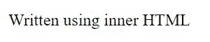

#### document.write()


这是在 HTML 中打印内容的第二种方法。对于初学者来说，它也非常有用，因为其语法易于阅读和理解，只需看一下语法即可。结果将与之前相同。但是，如果在整个文档加载完成后添加或执行 `document.write`，它将擦除所有内容，只有 JS 中填充的文本才会可见。例如，在按钮中使用 `document.write` 可能会给你的网页带来问题。

```
<p id="web"></p>

<script>
document.getElementById("web").innerHTML = "This is written using document.write";
</script>
```

## window.alert()

你一定见过许多网站中出现的各种形式的弹窗。比如在提交任何表单之前等等。那么如何实现这些呢？请看下面给出的代码。

```
<script>
window.alert(4189);
</script>
```

弹窗的结果如下图所示。

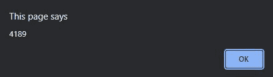

## JavaScript 打印

是的，你可以使用 JavaScript 一键直接打印网页。你只需使用一个按钮和下面编写的代码即可。

```
<button onclick="window.print()">Print this page</button>
```

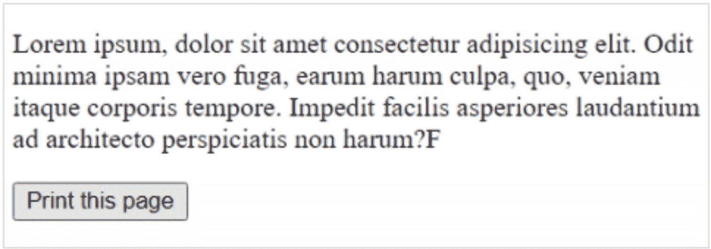

结果将如下所示。当有人点击按钮后，会弹出一个窗口，为访问者提供打印选项，然后保存该网页。

## JavaScript 运算

与其他任何编程语言一样，你可以使用 JavaScript 进行所有数学运算。例如，对单词或数字进行加法，或者进行减法、乘法和除法等其他计算。要开始学习运算，首先让我们了解变量。

### JavaScript 变量

到目前为止，我们只是直接在网页上打印内容。但通过使用变量，我们可以创建变量并为其赋值。使用变量的语法如下所示。

`var name = "value"`

在上面的代码行中，你可以看到，首先我们需要编写 `var` 来创建一个变量，然后为其分配一个唯一的名称，接着使用 `=` 符号为其赋值。之后我们可以仅通过名称来访问该值。但在命名变量时，应确保它只包含字母、数字和下划线，并且不能以数字开头。

我们还可以对变量执行所有运算。因为 JavaScript 是一种编程语言，所以它的结果显示在控制台中。因此，我们需要在文本编辑器中编写所有代码，并在控制台中查看所有结果。

那么，让我们做一些基础操作：将名字和姓氏相加组成全名。代码如下：

```
var fname = "Brajesh";
var lname = "Thakur";
var fullname = fname + " " + lname;
```

你可以通过右键单击在浏览器中打开控制台，那里不会显示任何内容，但当你输入

`console.log(nameofvariable);`

它将在控制台中打印该变量的值。

### JavaScript 循环

有时在为我们的网站编写代码时，我们会遇到一个问题，比如需要多次执行某段代码。循环的语法在所有编程语言中几乎相同。循环遵循一个简单的公式：首先，我们为变量或字符串赋值。然后，我们设置一个限制，即我们希望执行该特定代码行的次数。最后是一个递增语句，用于增加该循环变量的值。然后编写要执行的代码。这种类型的循环称为 for 循环，其语法如下所示。

```
for (var i = 0; i < 10; i++) {
  console.log("Loop is running");
}
```

### JavaScript 数据类型

与其他编程语言一样，JavaScript 也支持所有数据类型，例如字符串、布尔值、数字，以及 null 和 undefined 等。我们将深入讨论所有这些数据类型。

#### JavaScript 字符串

字符串用于保存可以文本形式表示的数据。字符串最常用的一些操作包括检查其 [长度](https://developer.mozilla.org/en-US/docs/Web/JavaScript/Reference/Global_Objects/String/length)、使用 `+` 和 `+=` 字符串运算符构建和连接字符串、检查子字符串是否存在或定位子字符串，或者提取子字符串的方法。字符串是任何编程语言中最重要的数据类型之一。例如，当你需要从用户那里获取数据时。

#### JavaScript 布尔值

在编程中，你经常需要一种只能取两个值之一的数据类型，例如。布尔值的语法看起来非常简单。你只需编写一个“是”或“否”的计算。例如，使用比较符号，如 `<`、`>` 或 `=`。布尔值用于比较两个数字等。

* 是 / 否
* 开 / 关
* 真 / 假

`Boolean(4651 > 9465)`

结果将相应显示。如果是，则为 true；如果不是，则为 false。

#### JavaScript 数字

JavaScript 只有一种数字类型。数字可以带小数点或不带小数点。它可以是普通数字，也可以是浮点数（也称为小数）。你还可以解决许多数学问题。JavaScript 数字的语法如下所示：

```
let x = 3.14;    // 带小数的数字
let y = 3;       // 不带小数的数字
```

JavaScript 数字始终是 64 位浮点数。

#### JavaScript Null

值 `null` 表示有意缺少任何对象值。它是 JavaScript 的 [原始值](https://developer.mozilla.org/en-US/docs/Glossary/Primitive) 之一，并且在布尔运算中被视为假值。

#### JavaScript Undefined

它指的是我们已声明但尚未赋值的变量。

#### JavaScript 数组

在每种编程语言中，数组都是一组数据类型。声明数组的方法有很多种。声明数组最简单的方法如下面的代码所示。通过这种方法，你可以轻松声明数组，并在声明时向其中添加更多值。

```
var list = ["HTML", "CSS", "JavaScript"];
```

现在，你还可以通过使用 `.length` 属性来了解数组中有多少个元素。该属性的语法如下所示。

#### JavaScript 随机数

使用 `Math.random`，它会返回一个介于包含与排除之间的随机数。即介于 0 和 1 之间。

## JavaScript 算术

算术运算符对数字（字面量或变量）执行算术运算。这些是 JavaScript 中的算术运算符。

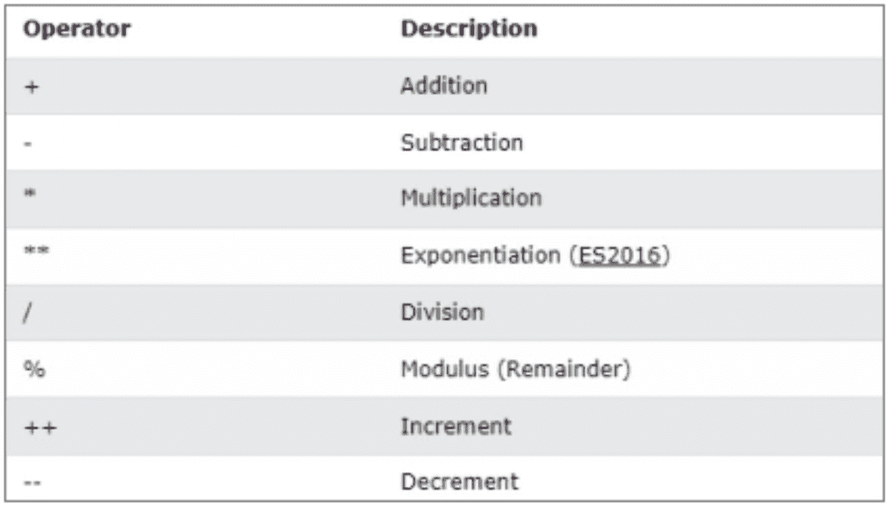

`=`

## JavaScript 保留字

有一些单词被 JavaScript 保留，不能用作类名或变量名等。这些单词的完整列表如下所示。

`await`、`break`、`case`、`catch`、`class`、`const`、`continue`、`debugger`、`default`、`delete`、`do`、`else`、`enum`、`export`、`extends`、`false`、`finally`、`for`、`function`、`if`、`implements`、`import`、`in`、`instanceof`、`interface`、`let`、`new`、`null`、`package`、`private`、`protected`、`public`、`return`、`super`、`switch`、`static`、`this`、`throw`、`try`、`True`、`typeof`、`var`、`void`、`while`、`with`、`yield`。

# 第 5 章 BOOTSTRAP

Bootstrap 是一个免费的前端框架，用于更快、更轻松地进行 Web 开发。它包含基于 HTML 和 CSS 的设计模板，用于排版、表单、按钮、表格、导航、模态框、图片轮播等，以及可选的 JavaScript 插件。它还使你能够轻松创建响应式设计。Bootstrap 官方网站的 URL 是

https://getbootstrap.com/


这是用于制作表单的基本代码。它并不复杂。因为只是在 HTML 中使用了一些额外的类，这些类由 Bootstrap 提供支持并具有特定属性。

```
<div class="mb-3">
  <label for="exampleFormControlInput1" class="form-label">Email address</label>
  <input type="email" class="form-control" id="exampleFormControlInput1" placeholder="name@example.com">
</div>
<div class="mb-3">
  <label for="exampleFormControlTextarea1" class="form-label">Example textarea</label>
</div>
```


```html
<textarea class="form-control" id="exampleFormControlTextarea1" rows="3"></textarea>
</div>
```

上述 Bootstrap 代码的效果如下图所示。

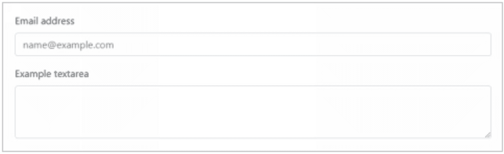

首先，要在你的网站中使用 Bootstrap，你需要在 `body` 标签中添加三个 JS 代码，如下所示，这些代码也可以在 Bootstrap 官方网站上找到。

```html
<script src="https://cdn.jsdelivr.net/npm/bootstrap@5.1.3/dist/js/bootstrap.bundle.min.js" integrity="sha384-ka7Sk0Gln4gmtz2MlQnikT1wXgYsOg+OMhuP+IlRH9sENBO0LRn5q+8nbTov4+1p" crossorigin="anonymous"></script>
<script src="https://cdn.jsdelivr.net/npm/@popperjs/core@2.10.2/dist/umd/popper.min.js" integrity="sha384-7+zCNj/IqJ95wo16oMtfsKbZ9ccEh31eOz1HGyDuCQ6wgnyJNSYdrPa03rtR1zdB" crossorigin="anonymous"></script>
<script src="https://cdn.jsdelivr.net/npm/bootstrap@5.1.3/dist/js/bootstrap.min.js" integrity="sha384-QJHtvGhmr9XOIpI6YVutG+2QOK9T+ZnN4kzFN1RtK3zEFEIsxhlmWl5/YESvpZ13" crossorigin="anonymous"></script>
```

## Bootstrap 网格系统

Bootstrap 的网格系统允许在页面上最多使用 12 列。如果你不想单独使用全部 12 列，可以将列组合在一起以创建更宽的列。Bootstrap 的网格系统是响应式的，列会根据屏幕大小自动重新排列。

Bootstrap 网格系统有四个类：

* `Xs` 用于手机屏幕（小于 768px）。
* `Sm` 用于平板屏幕（大于 768px）。
* `Md` 用于小型笔记本电脑屏幕（大于 992px）。
* `Lg` 用于桌面显示器（大于 1200px）。

## Bootstrap 基本表格

基本的 Bootstrap 表格具有浅内边距和仅水平分隔线。`table` 类为表格添加基本样式。

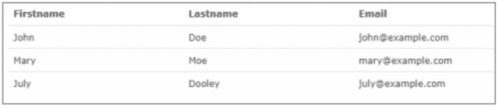

* **条纹行** – `.table-striped` 类为表格添加斑马条纹。
* **带边框表格** – `.table-bordered` 类为表格和单元格的所有边添加边框。
* **悬停行** – `.table-hover` 类为表格行添加悬停效果（灰色背景色）。
* **紧凑表格** – `.table-condensed` 类通过将单元格内边距减半使表格更紧凑。

## Bootstrap 图片

在 Bootstrap 中，使用某些类可以获得不同样式的图片。

### 圆角

`.img-rounded` 类为图片添加圆角（IE8 不支持圆角）。

### 圆形图片

`.img-circle` 类将图片裁剪为圆形。

### 响应式图片

图片有各种尺寸，屏幕也是如此。响应式图片会自动调整以适应屏幕大小。使图片响应式的代码如下所示。

```html

```

## 图片画廊

你还可以将 Bootstrap 的网格系统与 `.thumbnail` 类结合使用来创建图片画廊。创建一张卡片或画廊的代码如下所示。

```html
<div class="row">
  <div class="col-md-4">
    <div class="thumbnail">
      <a href="/images/ gallary.jpg">
        
        <div class="caption">
          <p>Lorem ipsum...</p>
        </div>
      </a>
    </div>
  </div>
```

结果将如下图所示，包含一张图片和一些描述。

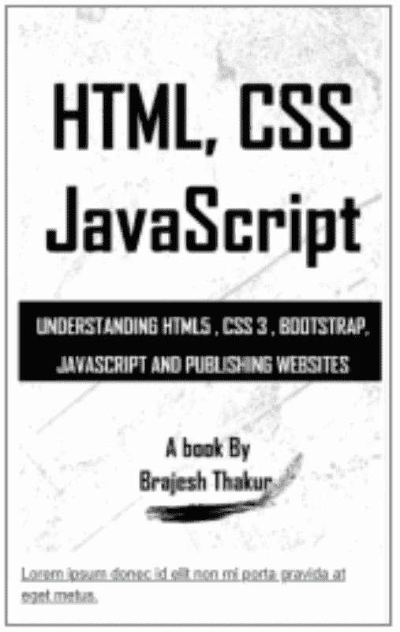

## Bootstrap 按钮

Bootstrap 提供了不同样式的按钮。要实现上述按钮样式，Bootstrap 有以下类：

* `.btn`
* `.btn-default`
* `.btn-primary`
* `.btn-success`
* `.btn-info`
* `.btn-warning`
* `.btn-danger`
* `.btn-link`

在你的文本编辑器中编写以下代码，了解更多信息。

```html
<button type="button" class="btn">Basic</button>
<button type="button" class="btn btn-default">Default</button>
<button type="button" class="btn btn-primary">Primary</button>
<button type="button" class="btn btn-success">Success</button>
<button type="button" class="btn btn-info">Info</button>
<button type="button" class="btn btn-warning">Warning</button>
<button type="button" class="btn btn-danger">Danger</button>
<button type="button" class="btn btn-link">Link</button>
```

代码的效果如下图所示。从下图中你可以了解更多关于 Bootstrap 中每个按钮类的信息。

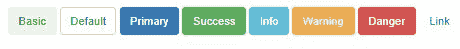

在 Bootstrap 按钮中，还有基于尺寸的更多类。

* `.btn-lg`
* `.btn-sm`
* `.btn-xs`

## Bootstrap 进度条

进度条可用于向用户显示其在某个过程中的进度。Bootstrap 提供了几种类型的进度条。

要创建默认进度条，请向 `<div>` 元素添加 `.progress` 类。Bootstrap 中进度条的最佳设计之一如下所示。

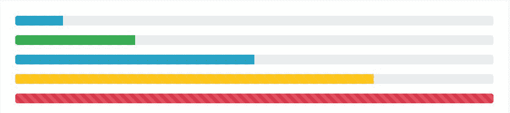

上述进度条的代码可以在 Bootstrap 官方网站上找到。

我们还可以创建带有标签的进度条，标签位于进度条中间，显示数据的精确百分比。其代码如下所示。

```html
<div class="progress">
  <div class="progress-bar" role="progressbar" aria-valuenow="70"
  aria-valuemin="0" aria-valuemax="100" style="width:70%">
    70%
  </div>
</div>
```

此进度条代码的结果如下所示。

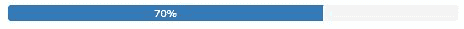

## Bootstrap 分页器

分页器也是分页的一种形式。分页器提供“上一页”和“下一页”按钮（链接）。要创建“上一页/下一页”按钮，请向 `<ul>` 元素添加 `.pager` 类。

```html
<ul class="pager">
  <li><a href="#">Previous</a></li>
  <li><a href="#">Next</a></li>
</ul>
```

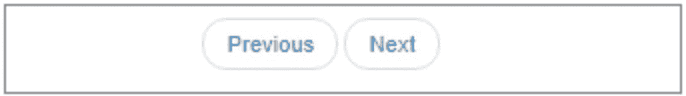

## Bootstrap 下拉菜单

下拉菜单是一个可切换的菜单，允许用户从预定义列表中选择一个值。它使得在小型导航栏中添加更多导航链接变得非常容易。基本下拉菜单的代码如下所示。

```html
<div class="dropdown">
  <button class="btn btn-primary dropdown-toggle" type="button" data-toggle="dropdown">Website <span class="caret"></span></button>
  <ul class="dropdown-menu">
    <li><a href="#">HTML</a></li>
    <li><a href="#">CSS</a></li>
    <li><a href="#">JavaScript</a></li>
  </ul>
</div>
```

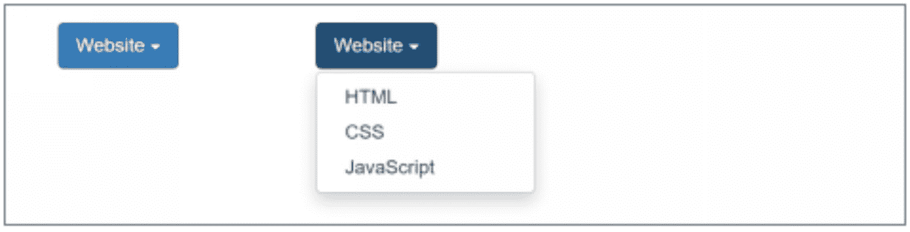结果如下所示。

## Bootstrap 折叠

### 基本折叠

当你想要隐藏和显示大量内容时，折叠非常有用。使用它，我们可以创建一个按钮，点击该按钮后会显示更多文本，这些文本可以是关于按钮或内容的任何信息。

## Bootstrap 菜单

在 Bootstrap 中，你可以使用菜单为导航栏等创建列表。因为创建垂直菜单很容易，但要创建水平菜单，你还需要编写许多其他代码。因此，你可以使用 `nav` 和 `nav-tabs` 等类。代码如下所示。

```html
<ul class="nav nav-tabs">
  <li class="active"><a href="#">Home</a></li>
  <li><a href="#">Services</a></li>
  <li><a href="#">Products</a></li>
  <li><a href="#">About</a></li>
</ul>
```

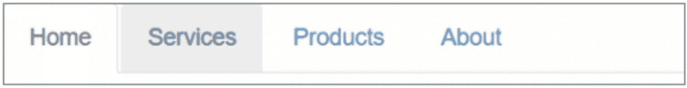

## Bootstrap 导航栏

借助 Bootstrap，我们可以创建外观精美的导航栏。Bootstrap 中基本导航栏的代码在下一页中显示，但你可以在此处看到结果。

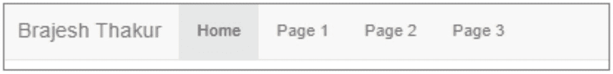

现在你可以清楚地看到，徽标和导航链接的展示是多么美观。这就是 Bootstrap 的真正力量。为了使你的网站更易于使用，你还可以使用下拉菜单。现在来看看这个导航栏的代码。

```html
<nav class="navbar navbar-default">
  <div class="container-fluid">
    <div class="navbar-header">
      <a class="navbar-brand" href="#">Brajesh Thakur</a>
    </div>
    <ul class="nav navbar-nav">
      <li class="active"><a href="#">Home</a></li>
      <li><a href="#">Page 1</a></li>
      <li><a href="#">Page 2</a></li>
      <li><a href="#">Page 3</a></li>
    </ul>
  </div>
</nav>
```


我们还可以通过使用类名 `navbar-fixed-top` 来创建固定导航栏。nav 标签的代码如下所示。我们也可以将导航栏固定在底部，只需将类名从 `navbar-fixed-top` 改为 `navbar-fixed-bottom`。

```
<nav class="navbar navbar-inverse navbar-fixed-top">
```

## • Bootstrap 表单

表单在网站或业务中扮演着重要角色，因为它帮助我们与访客联系，获取他们的评论、注册信息等。借助 Bootstrap，我们可以让表单看起来干净清晰。Bootstrap 中基本表单的代码如下所示：

```
<form action="/action_page.php">
  <div class="form-group">
    <label for="email">电子邮件地址：</label>
    <input type="email" class="form-control" id="email">
  </div>
  <div class="form-group">
    <label for="pwd">密码：</label>
    <input type="password" class="form-control" id="pwd">
  </div>
  <div class="checkbox">
    <label><input type="checkbox"> 记住我</label>
  </div>
  <button type="submit" class="btn btn-default">提交</button>
</form>
```

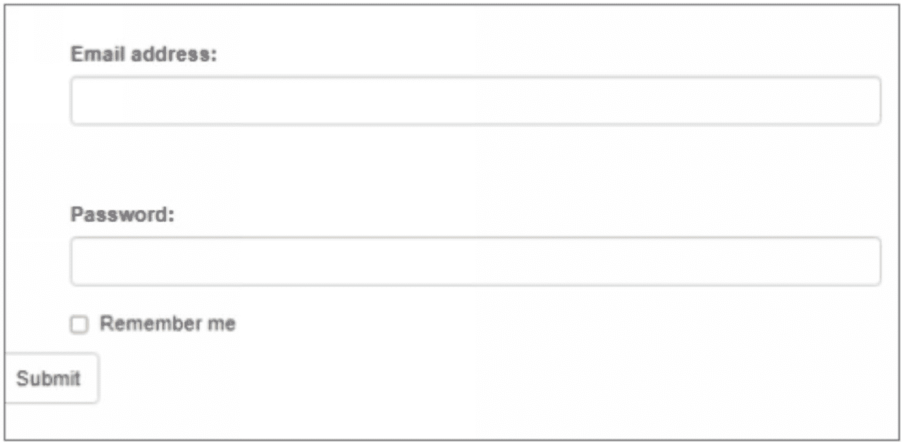

Bootstrap 支持并提供所有输入方法的相关代码。要在表单中添加复选框输入，需要使用以下代码：

```
<label class="checkbox-inline"><input type="checkbox" value="">选项 3</label>
```

## • Bootstrap 轮播

Bootstrap 因其轮播插件而被大多数用户和 Web 开发者使用。它帮助我们制作出非常美观且可用的轮播。制作轮播的代码如下所示：

```
<div id="carouselExampleControls" class="carousel slide" data-bs-ride="carousel">
  <div class="carousel-inner">
    <div class="carousel-item active">
      
    </div>
    <div class="carousel-item">
      
    </div>
    <div class="carousel-item">
      
    </div>
  </div>
  <button class="carousel-control-prev" type="button" data-bs-target="#carouselExampleControls" data-bs-slide="prev">
    <span class="carousel-control-prev-icon" aria-hidden="true"></span>
    <span class="visually-hidden">上一页</span>
  </button>
  <button class="carousel-control-next" type="button" data-bs-target="#carouselExampleControls" data-bs-slide="next">
    <span class="carousel-control-next-icon" aria-hidden="true"></span>
    <span class="visually-hidden">下一页</span>
  </button>
</div>
```

这里我们使用 Bootstrap 类编写了一个轮播。轮播中使用的图片可以根据需要更改，因为我们使用了 `src` 属性来加载图片。上述轮播代码的效果如下所示：

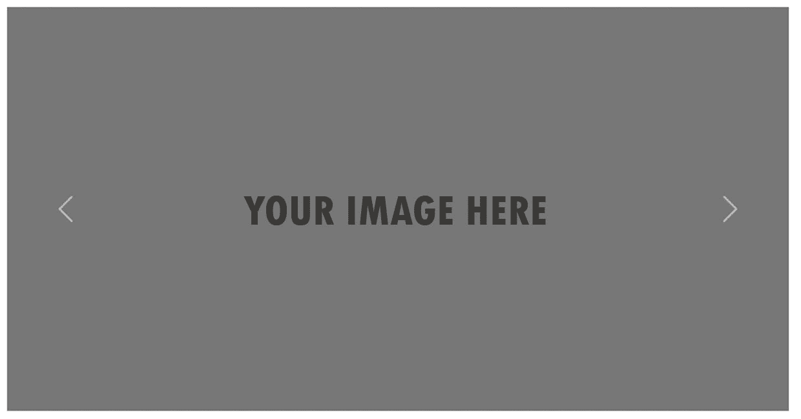

# 第 6 章：发布网站

现在你已经学会了如何制作网站以及如何使其更持久。但整个文件夹只保存在你的本地计算机上，如果有人想访问你的网站，他们无法做到，因为它位于本地服务器上，而不是公共服务器上。因此，要将你的网站上传到互联网上，你需要获得托管服务，但还有许多其他方法可以免费做到这一点。

你可以使用 GitHub、Netlify 或更多云计算网站和软件来上传你的网站。在这里，我们将使用 Netlify 将我们的网站上传到互联网上。我不建议初学者使用 GitHub 上传项目，因为它非常困难和复杂。但使用 Netlify，你可以轻松完成所有操作，并为你的网站获得一个子域名甚至自定义域名。


https://app.netlify.com/

首先，访问上面给出的 Netlify 官方网站。在那里创建一个账户。然后你会看到类似下一页图片所示的内容。你会看到一个用于上传新网站的按钮。只需点击它。然后会出现三个选项，你需要选择最后一个“手动部署”。现在，一个新页面会出现在你面前，你可以拖放主文件夹，也可以从文件资源管理器中选择它。

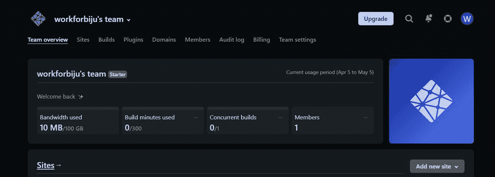

完成整个过程后，你会看到类似下图所示的内容，现在点击“域名设置”。然后点击选项，再点击“编辑站点名称”。

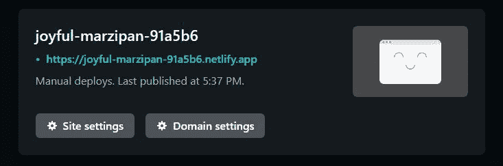

现在你需要添加你的网站名称，该名称最终会显示在子域名中，子域名也会显示在输入部分下方。现在点击保存。

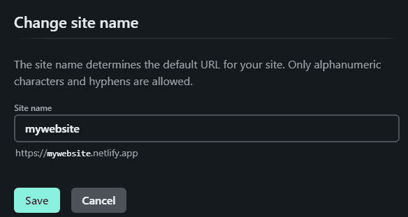

现在，当这个网站公开时，它将有一个子域名，如下方输入栏所示。但如果你想添加一个自定义域名，并且你已经从某个托管网站购买了它，你也可以通过返回并点击下图所示的第二个图标来实现。你只需输入你购买的域名，然后通过提供你的详细信息进行验证。

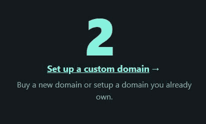

现在当你返回时，你会看到你的网站已经发布，并显示在上传站点列表中。你可以添加任意数量的网站。它为你的所有项目总共提供 100 GB 的带宽。

## 我的寄语

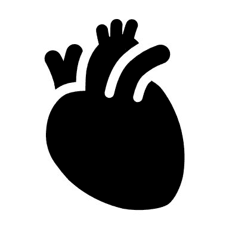

致本书的所有读者，我非常感激你们阅读这本书。这本书只是一个 13 岁孩子 Brajesh Thakur 的想法。我想在这本书中加入更多我的想法，但我的年龄不允许我这样做。我知道，如果你购买了这本书，要么是我推荐你阅读的，要么是我非常成功。这是我在 Web 开发领域的全部知识。如果你想分享你对这本书的评论，可以发送邮件至 workforbiju@gmail.com。特别感谢 Amazon Kindle 出版公司出版本书的电子版，以及 Pothi 图书出版公司出版平装版。如果你认真阅读了整本书，你一定会学会 Web 开发，至少是前端开发。最后一点，你练习和构建网站的次数越多，你学到的就越多。

## 关于作者


本书的作者 Brajesh Thakur 先生是一个小孩子。在目前 13 岁的年纪，他已经是 Web 开发者、Logo 设计师、平面设计师、程序员、内容写手、自由职业者、股票市场顾问、UI 开发者、UX 开发者等等。在这本书中，他分享了他关于 Web 开发的知识。我们希望这本书能帮助你在 Web 开发领域获得更多技能，并进而进入计算机科学领域。Web 开发只是一个开始，你可以在计算机科学领域做更多的事情。如果你购买了这本书，你肯定有一些抱负，我们的团队希望你实现生活中的所有梦想。

* * *

[[BT1]](#part0013.xhtml__cmntref1)

