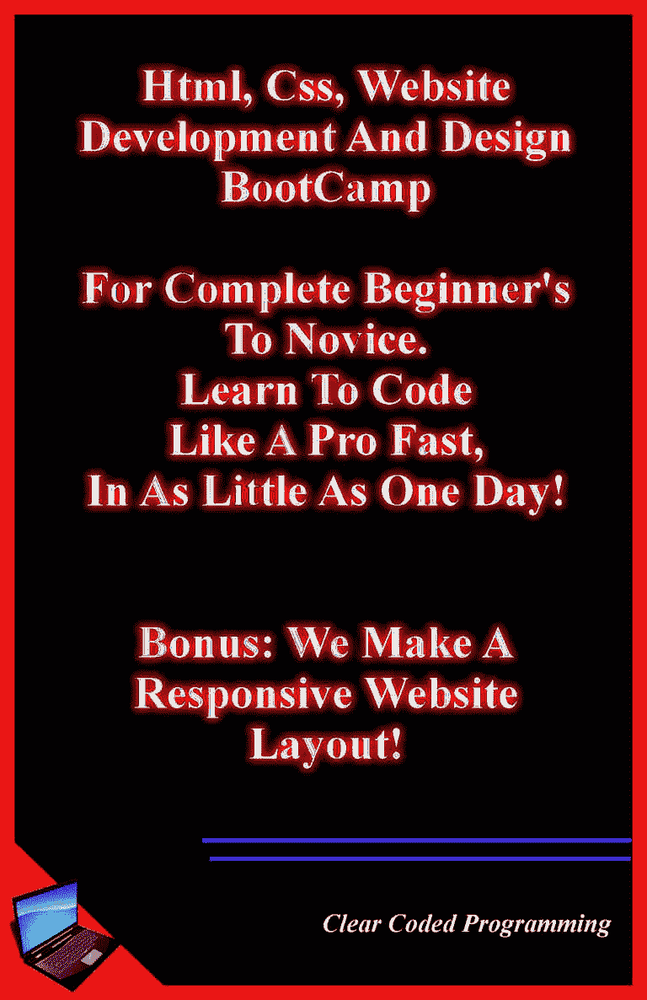
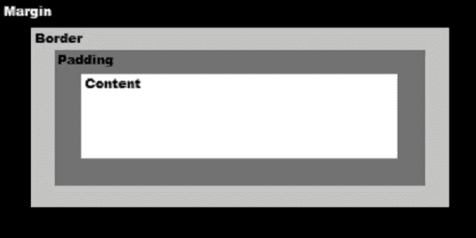

# HTML、CSS、网站开发与设计训练营



从完全初学者到新手阶段均适用。学习如何像专业人士一样快速编程，最快仅需一天！额外赠送：我们将设计一个响应式网站布局！

## 谁应该读这本书？

这本书非常适合对构建和设计自己独特的奇妙网站感兴趣的人。它的设计旨在让完全初学者或新手编程人员通过一个简单的循序系统，快速获得像专业人士一样快速编程的能力。书中的练习短小且非常高效。你将在阅读本书的前 20 分钟内创建出你的第一个基础网页并开始向其中添加内容。

在书中，我们涵盖了基础 HTML 和 CSS，以及一些更常用的内容。我们还处理了一些动画代码和目前流行的设计。我们讨论了如何将你的网站发布到互联网，以及根据你制作的网站类型最佳实现方法。你将学习经验网页开发人员和设计师使用的技术、如何创建用户输入表、什么是元标记（meta tags）以及你可以用它们做什么、什么是盒模型、如何将你的网页划分为部分、如何重用代码使子页创建变得快速快捷、实现相同功能的不同系统、在页面上放置内容的不同方法、如何让你的网站在搜索引擎排名中领先、完成本书后你应该研究什么。

在书最后，我们创建一个可以使用且自定义的响应式网站布局，你可以对其随心所欲。我创建和设计网站已有超过 10 年。在书中，我分享了我认为快速学习 HTML 和 CSS 的极佳系统，特别是对于完全初学者。我希望当我第一次接触网页开发时有这样一本书。

在读本书之前我认为应该涵盖的另一点是：请跟随练习并将代码输入你的编辑器。听我的，这样做你会学得快十倍。我们将讨论你应该使用什么编辑器。你已经拥有了在计算机上构建和设计网站所需的一切，但有一些优秀的免费编辑器可以下载，它们会给你带来很多。

我对这本书感到非常兴奋，迫待看到你们创作什么样的网站。如果你读了这本书，请留下反馈。我会考虑所有的反馈，以确保未来为你提供最好的内容。祝你成为网页开发者和设计师的之旅顺利。

```css
<style>
h1{
    background-color: blue;
    color: white;
}
</style>
```

- `h1{` 这被称为选择器（selector）。它告诉浏览器我们要为这个 HTML 元素添加样式。注意这里没有 `<` 或 `>` 小于号或大于号。我们在这里不需要它们，因为这些不是 HTML 标签。另一件重要的事情是，尽管我们在文档中使用 CSS 代码，但我们仍然将其保存为 `.html`，因为 `style` 元素是一个 HTML 元素。既然你已经将页面保存为 `.html` 文档，你只需像之前一样保存并运行即可。现在，所有针对这个 `h1` 元素的样式都将放在花括号 `{ }` 之间。

- `background-color: blue;` 首先是一个属性（property），它是 `h1` 元素的 `background-color` 属性。在你输入想要更改的属性后，添加一个 `:` 冒号。然后是我们有值（value），即 `blue`。所以这行代码总共的意思是：“嘿浏览器，把我的 `h1` 元素背景颜色改为蓝色。”在输入值之后，我们添加一个 `;` 分号。这个分号告诉浏览器我们已经完成了这个属性，可以进入下一个。分号还意味着这是一个语句的结束。所以基本上，我们的指令被称为语句（statements）。

- `color: white;` `color` 是我们用来更改字体颜色的属性。每当你想要更改任何内容的字体颜色时，要使用的属性就是 `color`。我们将此属性设置为 `white` 并以分号结尾。你可以在这里添加任意数量的属性。

- `}` 我们添加闭合花括号。从 `h1` 选择器 `h1{` 到闭合花括号 `}` 的所有代码被称为一个 CSS 规则（CSS rule）。

我们在上述课程中添加的代码基本上就是所有 CSS 的样子。非常简单。它就是：

```css
selector{
    property: value;
}
```

让我们保存并运行代码。现在，如果你滚动到 `h1` 元素标题 "Gaming Stuff"，你会发现字体已变为白色，并且标题现在有一个横跨整个页面宽度的蓝色背景。

我们还可以在规则中添加多个选择器。例如，如果我们希望 `h1` 和 `h2` 标题的样式相同，我们可以直接添加一个逗号和 `h2` 选择器。将此内容添加到你的 `h1` 规则中，然后保存/运行代码：

```css
<style>
h1,h2{
    background-color: blue;
    color: white;
}
</style>
```

现在，我们的 `h1` 和 `h2` 标题都拥有蓝色背景和白色字体。

## 第 11 章测验

1. CSS 代码是用来做什么的？
2. 当为 CSS 代码使用内部样式表时，你应该将 `<style></style>` 标签放在哪里？
3. 属性和值必须放在什么符号之间？
4. 一个 CSS 规则由什么组成？
5. 用于更改字体颜色的属性名称是什么？
6. 如何添加多个选择器？
7. CSS 规则中的分号对浏览器意味着什么？

# 第 12 章：美化文本

在本章中，我们将介绍一些可用于美化网页文本的属性。对于这个练习，我们将使用紧跟在刚才添加了样式的 `h1` 元素下方的段落。将此代码添加到你的 `style` 标签中，紧跟在 `h1` 规则的 `}` 闭合花括号之后：

```css
<style>
h1,h2{
    background-color: blue;
    color: white;
}

p {
    color: red;
    background-color: black;
    font-family: tahoma;
    font-size: 20px;
    text-align: center;
}
</style>
```

- `p {` 我们想要美化的选择器是 `p`，然后打开花括号。

- `color: red;` 然后我们选择字体颜色属性。记住它是 `color` 而不是 `font-color`。我们添加一个冒号并输入值 `red` 将字体颜色改为红色。用分号结束语句，以便浏览器移动到下一个属性。

## CSS 文本和字体属性

`background-color: black;` 我们给段落设置了一个黑色背景。

`font-family: tahoma;` 这里我们选择了 `font-family` 属性和 `tahoma` 值。你可以在这里放入任何你喜欢的字体，比如 `arial`、`georgia`、`times new roman`。请注意，如果你输入的是一种不常见的字体，某些浏览器可能找不到，此时它会回退到默认字体。

`font-size: 20px;` 这里我们再次使用字体属性，但这次我们要调整大小。我们希望文本大小为 `20px`。调整大小有几种不同的方式：你可以使用 `%`、`em`、`px`。像素（Pixels）非常常用，也是我们在这里使用的单位。稍后你将看到如何组合不同的值，以便你可以在 CSS 代码中通过一个值来调整整个网站或特定部分。

`text-align: center;` 在最后一条语句/指令中，我们使用 `text-align` 属性并将其设置为 `center`。现在段落中的文本居中对齐了。你在这里还可以使用其他一些值，如 `left`、`right` 和 `justify`。

`}` 不要忘记用闭合花括号结束你的 `p` 规则。

在这个示例中，我们学习了更多属性。现在如果你保存并运行代码，你可能会注意到，尽管我们试图为 `h1` 标题下的段落设置样式，但我们的代码以完全相同的方式影响了页面上的每一个 `p` 元素。这是正常的。我们的选择器是 `p` 元素，因此任何 `p` 元素都会获得相同的样式更改。有两种方法可以具体选择你想要更改的元素：使用类（classes）或 ID（id's）。

另外请知晓，你在规则内部输入语句的顺序并不那么重要。你可能想以某种特定方式排序的主要原因是这样更方便你理解。

### 文本装饰

让我们再看看几个 CSS 文本/字体属性。我们将在 `h1,h2` 规则中添加另一条语句。将此内容添加到花括号内的任意位置：

```css
text-decoration: underline;
```

这里还可以使用其他几个值，如 `overline`、`line-through` 和 `none`。`none` 这个值确实有其用途，例如去掉无序列表中的项目符号。

### 加粗与斜体

这是一个快速练习，向你展示如何使文本加粗以及如何使其倾斜。我们将在 `style` 标签内为无序列表和有序列表创建两个新规则。将这两个新规则直接添加到你的 `p` 规则下方：

```css
ul {
    font-weight: bold;
}

ol {
    font-style: italic;
}
```

再次运行代码，你将得到一个加粗的无序列表和一个斜体的有序列表。如果你想在页面上加粗或倾斜单个单词或仅几个单词，可以直接在代码中使用 HTML 标签。例如：

`I like things <b>bold</b> but not <em>italicized</em>.`

你用 `<b></b>` 加粗标签包裹任何你想要加粗的词，并使用 `<em></em>` 强调标签来表示斜体词。

### Body 样式与继承

在结束本章之前，让我们去掉那个枯燥的白色背景。我们使用的选择器是 `body`。将此规则放在你的起始 `<style>` 标签之后：

```css
body {
    background-color: yellow;
}
```

`body` 是其内部所有内容（如 `h1`、`p` 和 `footer` 元素）的父级。父元素 `body` 的子元素将继承我们在其中指定的属性。这就是我们放置希望在全站生效的代码的地方（例如 `font`、`text-size`、`background-color`）。当我们为像 `p` 这样的特定元素创建规则时，内部的属性被称为“覆盖”（overrides）。

## 第 12 章测验

1. 用于更改文本大小的属性是什么？
2. 如何使用 CSS 为文本添加下划线？
3. 如何更改 body 的背景颜色/壁纸？
4. 为什么在编码之前规划网站设计是一个好主意？
5. 在 CSS 中使用 `body` 规则有哪些优势？
6. 使文本加粗和倾斜使用的是哪些 HTML 标签？
7. 使文本加粗和倾斜使用的是哪些 CSS 属性和值？

# 第 13 章：边框

你可以为页面上的任何元素添加边框，无论是图像还是段落。让我们将 `h1` 和 `h2` 标题居中，并在文本周围添加边框。将此内容添加到你的 `h1,h2` 规则中：

```css
h1,h2 {
    background-color: blue;
    color: white;
    text-decoration: underline;
    text-align: center;
    border-width: 4px;
    border-color: white;
    border-style: solid;
}
```

- `text-align: center;` 首先，我们将标题文本居中对齐。
- `border-width: 4px;` 我们将 `border-width` 属性设置为 4 像素厚。
- `border-color: white;` 接下来，我们告诉浏览器我们希望边框为白色。
- `border-style: solid;` 最后，我们将边框样式设置为实线。这里还有许多其他值可以替代 `solid`，如 `dotted`、`dashed`、`double`、`groove`、`ridge`、`inset`、`outset`、`none` 和 `hidden`。你可以尝试其他值来查看会有什么样的效果。我们在这里使用 `solid` 是因为它是边框的一种非常常用的样式。

现在，当你运行代码时，你应该能看到你的 `h1` 和 `h2` 标题现在都居中了，并且带有一个 4 像素厚的实白色边框。让我们为我们的段落添加一个指定宽度的边框。在你的 `p` 规则中添加此代码：

```css
p {
  color: red;
  background-color: black;
  font-family: tahoma;
  font-size: 20px;
  text-align: center;
  border-width: 2px;
  border-color: white;
  border-style: solid;
  width: 50%;
}
```

运行你的新代码。你现在会看到所有段落周围都有一个边框，而且它们占据了屏幕宽度的 50%，因为我们在 `width` 属性中指定了这一点。你应该知道的另一点是，如果你更改浏览器窗口的大小，你的段落大小也会随之改变以匹配 50% 的值。所以在这里使用百分比而不是像素是很好的，因为无论你的观众使用多大尺寸电脑屏幕，你的段落将始终是他们屏幕的 50%。它并不非得是 50%。这只是一个例子。如果在页面上定位和调整元素大小时符合你的需求，你可以将其设置为 `41%`。

我们刚刚在 CSS 规则中输入的这些边框属性可以用更简单的方式编写。一些程序员更喜欢用这种方式编写，因为这对他们来说更容易理解。如果你愿意，可以将下面所有的这些属性：

`border-width: 2px;`

`border-color: white;`

`border-style: solid;`

替换为的一行代码。代码看起来如下：

`border: 2px solid white;`

这被称为简写（shorthand），因为你在一行代码中组合了多个属性。这段代码实现的效果与 `border-width`、`border-color` 和 `border-height`（注：此处应为 `border-style`）属性完全相同。这取决于程序员自己决定偏于哪种方式。

## Border-Radius 属性 / 圆角边框

另一个有助于让你的页面看起来更美观的边框属性是 `border-radius`。这个属性将使你添加代码的那个边框的角变为圆角。将此代码添加到你的 `p` 规则中并在浏览器中运行它：

```css
p {
  color: red;
  background-color: black;
  font-family: tahoma;
  font-size: 20px;
  text-align: center;
  border: 2px solid white;
  border-radius: 20px;
  width: 50%;
}
```

现在，你有一个半径为 20 像素的圆角边框。你也可以在这里尝试其他值来获取你喜的半径，例如 `5px` 或 `12px`。

请注意，如果你在 Google Chrome 中运行这段代码，你的边框将会有圆角，但如果你在 internet explorer 中运行，则不会。有一种修复方法，即给属性添加一个前缀。将此代码添加到你的 `p` 规则中：

```css
p {
  color: red;
  background-color: black;
  font-family: tahoma;
  font-size: 20px;
  text-align: center;
  border: 2px solid white;
  border-radius: 20px;
  -webkit-border-radius: 20px;
  -moz-border-radius: 20px;
  width: 50%;
}
```

`-webkit-border-radius: 20px;` 通过复制 `border-radius:` 属性代码并添加前缀 `-webkit-`，你的边框现在在 Internet Explorer 中将拥有圆角。

`-moz-border-radius: 20px;` 通过复制 `border-radius:` 属性代码并添加前缀 `-moz-`，你的边框现在在 Mozilla Firefox 中将拥有圆角。

每当你遇到这类问题时，都可以尝试复制你的属性并向代码添加这些前缀。你还可以使用其他前缀，我们将在本书的后续部分使用它们。简而言之，某些浏览器可以正常显示代码，而另一些则不能。这些前缀来自于一个 web kit，使其具有兼容性。这完全取决于浏览器何时获得更新以接受这些代码。顺便说（FYI），即使浏览器对此类内容进行了更新，你不再需要这些前缀，额外的代码也不会破坏你的页面。这就是为什么在多个浏览器中运行代码通常非常重要的原因之一。你还会在其他代码中遇到这个问题。通常是当向 HTML 或 CSS 添加新代码时会发生这种情况。如果浏览器没有设置好如何处理它，它就会忽略它。当问题出现时，尝试这种技术，它应该能解决你的问题。

### 浏览器前缀更新

这是一个更新后的浏览器前缀列表，你可以将其添加到代码中以使其正常工作。

# 第 14 章：内联样式

在本章中，我们将——砰、砰砰、砰、砰——使用内联样式（INLINE STYLE）。抱歉，我不得不这么说。无论如何，在向 HTML 文档添加 CSS 的三种方法中，这是最不常用的方法，但我们仍然需要介绍它，以便你决定哪种方法最适合你。

添加 CSS 内联样式意味着你将把 CSS 代码直接嵌入到你的 HTML 元素中。如果你添加很多属性，这可能会变得有点混乱。为了说明这一点，我们将在用于学习的 HTML 文档中添加几个新元素。请在你的代码某处添加这个新元素，然后运行它。

```html
<h3 style="color:red;font-size:20px;">这个标题是用内联样式创建的</h3>
```

- `style="color:red;font-size:20px;"` 我们将 `style` 标签直接添加到了起始 `h3` 标签中。注意，当我们用这种方式使用它时，我们不需要关闭它。然后我们添加一个等号和一组双引号。在双引号内部，我们指定了想要应用到此特定 `h3` 元素的属性和值。如你所见，`;` 号也位于双引号之间，用于结束我们的 CSS 语句/规则。
- 我们指定了此 `h3` 元素具有红色文本和 20 像素的字体大小。


所以你可能会想，如果我们创建一个新的 `p` 元素会发生什么，因为我们已经在 `head` 元素中使用了内部样式表。我们已经创建或将要创建的任何 `p` 元素将具有我们在 `p` 规则中设置的属性。让我们将这段代码添加到新的新的 `h3` 元素下面，然后我们可以运行它并查看发生了什么。

```html
<h3 style="color:red;font-size:20px;">这个标题是用内联样式创建的</h3>

<p style="color:purple;font-size:14px;text-align:left;">
我们用内联样式创建了这个段落。它还带有来自我们内部样式表的样式属性</p>
```

- 所以，现在在你运行新代码后，你可以看到这个段落与页面上的其他三个 `p` 元素不同。这是发生了什么？
- 嗯，首先我们继承了在 `p` 规则中设置的属性。然后在内联样式代码中，我们仅针对这个特定的段落覆盖了其中某些属性。我们更改的是将文本颜色改为紫色，字体大小更改为 14 像素，并将文本左对齐。

这些就是我们需要用内联样式涵盖的所有内容。理解起来非常简单。现在你知道你可以混合使用多种样式方法了。但当你开始设计页面时，我建议你选择一个对你来说最容易理解且最有条理的系统。大多数编码员不会过多地使用内联样式，因为他们的 HTML 很快就会变得杂乱无章。

## 第 14 章测验

1. 我们把内联样式的代码放在哪里？
2. 当我们修改代码中其他地方已经指定的属性时，所使用的术语是什么？

# 第 15 章：颜色和 CSS 注释

## 原色

在本章中，我们将更深入地讨论颜色值。有三种方法为我们的元素添加颜色。第一种方法是使用十六种原色之一并通过名称调用它。这是我们到目前为止书中添加颜色的方法。以下是你可以使用的十六种原色的列表，按字母顺序排列：

1. `aqua`
2. `black`
3. `blue`
4. `fuchsia`
5. `gray`
6. `green`
7. `lime`
8. `maroon`
9. `navy`
10. `olive`
11. `purple`
12. `red`
13. `silver`
14. `teal`
15. `white`
16. `yellow`

## RGB 颜色

为元素添加颜色的第二方法是使用 RGB 值。RGB 代表红（red）、绿（green）和蓝（blue）。这三个值之间的混合让你访问数百万颜色。

你可以搜索 RGB 值。但获取它们的简单方法是使用 MS Paint 或任何其他程序（如 Paint）。让我们以 MS Paint 为例。如果你打开它并点击右上角的“编辑颜色”菜单，你会得到一个调色板屏幕。现在，如果你上下移动滑块并在颜色框内移动交叉光标，你可以看到获得大量的颜色组合。当你得到你喜欢的颜色时，红、绿、蓝值将显示在调色板屏幕的右下角。

现在记住这些值或把它们写下来，因为我们将用它们来更改网页的背景颜色。我们需要回到 CSS 内部样式表中的 `body` 规则，并将 `background-color: yellow;` 替换为此代码：你可以添加你的值，或使用我这里的值。按顺序在括号之间添加红、绿、蓝值：`background-color: rgb(65,77,103);`。如果你使用了我输入的 RGB 值并运行页面，你将得到一种蓝色的背景色。

## 十六进制代码颜色

添加颜色的最后方法是使用十六进制代码（hex code）。这种方法与 RGB 值类似，你可以访问数百万种颜色。你可以搜索一个 RGB 到十六进制的转换器。

许多编码员倾向于使用十六进制代码，因为对他们来说更容易。当你在 CSS 中使用 `background-color` 属性时：`background-color: #008080;` 你将得到一种青色背景。

## CSS 注释

在 CSS 中添加注释。编码员经常这样做，当他们有很多十六进制代码或 RGB 值时，他们在桌面上创建一个包含这些颜色的文档。

在 CSS 中添加注释的方法与在 HTML 中稍有不同。你知道在 HTML 中是这样添加注释：`<!--注释 -->`。但在 CSS 中，你会以这种方式输入：

- `/*CSS 注释会被浏览器忽略。*/`
- `/*你也可以这样输入多行注释。只要你用正斜杠和星号包围文本即可*/`

当你开始 CSS 中有大量代码时，你可能想通过注释对代码部分进行划分，以便于你导航和查找内容。编码员使用 CSS 注释将代码分部分的示例：

```css
/*================十六进制代码=======================*/
/*在这里他们列出了他们喜欢的十六进制代码。
#000 = 黑色
#388f00 = 绿色
#c34c1d = 橙色*/

/*================标题========================*/
/*然后这里是所有的标题规则。h1、h2 等。 */

/*================主内容======================*/
/*这里是他们的主内容规则，如 p 元素等。 */
```

通过经验，你会找到适合自己的系统。本章就此结束。去尝试不同的颜色组合，并测试为你的网页添加颜色的三种方法。

## 第 15 章测验

1. 为你的网站添加颜色的三种方法是什么？
2. 你的代码中有多少原色可以使用？
3. 十六进制代码以什么符号开头？
4. 在 CSS 中添加注释与在 HTML 中有何不同？

# 第 16 章：类和 ID

在本章中，我们将学习 CSS 类（classes）和 ID（id's）。它们的作用是什么，应该使用哪一个，以及它们如何帮助你更快、更容易地设计元素。

## CSS 类和 ID

我们将从类开始。首先需要做的是删除我们在第 14 章中添加到 `h3` 元素和 `p` 元素中的内联样式。请删除 `style="color:red;font-size:20px;"` 代码和 `style="color:purple;font-size:14px;text-align:left;"` 代码。

现在，你只剩下一个没有内联样式代码的 `<h3>` 元素和一个 `<p>` 元素。我们的 `h3` 和 `p` 元素现在从 `head` 元素中的内部样式表中获取属性值。

### 使用类（Classes）

类允许你同时设计一个特定元素或多个元素。虽然所有段落可能共享 `p` 规则中指定的相同样式特征，但类允许特定的段落拥有不同的样式集。

为了实现这一点，请在第一个和第二个 `p` 元素的起始标签中添加以下代码：

```html
<p class="gray">
<p class="gray">
```

通过给这两个段落都赋予名为 `gray` 的类，我们可以专门地针对它们进行设置。使类名与其用途相关是非常重要的。

现在，在你的内部样式表中创建一个新规则。在 `p` 规则的 `}` 关闭花括号之后，添加这段代码：

```css
.gray {
    color: gray;
}
```

- `.gray{`：我们为类创建规则的方法是添加一个 `.`（点）和类名。
- `color: gray;`：这将字体颜色设置为灰色。你可以在一个类中包含尽可能多需要的属性和值。
- `}`：关闭 CSS 规则。

当你运行代码时，前两个段落将显示灰色文本，但仍将保留来自 `p` 规则的其他属性。这里的类被用来覆盖字体颜色。

### 类的可复用性

类是可复用的。例如，如果你创建这样一个类规则：

```css
.maincontent {
    background-color: black;
    color: blue;
    text-align: center;
    font-family: arial;
    font-size: 15px;
}
```

你可以在任何你认为属于主要内容元素的 HTML 元素（如 `p` 或 `h1`）的起始标签中使用 `class="maincontent"`。

## CSS ID

`id` 与类非常相似，并且可以在任何可以使用类的地方使用。然而，`id` 专门用于一个你计划不更改或不重复的唯一元素，例如标题或页脚。

为了演示，请将这段代码添加到嵌套在 `<footer></footer>` 元素内部的 `p` 起始标签中：

```html
<p id="footer">
```

现在，在你的内部样式表中，在 `.gray` 规则下方，为该 `id` 添加这个新规则：

```css
#footer {
    background-color: yellow;
}
```

- `#footer{`：对于 `id` 规则，选择器以 `#`（井号）而不是 `.`（点）开头。
- `background-color: yellow;`：为页脚中的 `p` 元素应用黄色背景。
- `}`：关闭规则。

### 类与 ID 总结

在选择类或 `id` 时，请确保它符合该元素的用途。避免给每一个 HTML 元素都添加类或 `id`，因为那样会违背这些选择器的初衷。

## 第 16 章测验

1. 你会在什么地方想要使用类？
2. 你会在什么地方想要使用 `id`？
3. 在 CSS 规则中，类选择器和 `id` 选择器分别使用什么符号？

# 第 17 章：盒模型、外边距和内边距

本章重点讨论盒模型，它对于定位元素和添加间距极其重要。

## 盒模型图解



页面上的每个元素都包含在不可见的盒子中：

- **内容区（Content Box）**：元素的实际内容（文本、图像等）。
- **内边距（Padding）**：内容与边框之间的空间。
- **边框（Border）**：围绕内边距和内容的线条。
- **外边距（Margin）**：元素边框与其他周围元素之间的空间。

## 盒模型示例

为了使这些盒子可见，请在内部样式表中为 `h3` 元素添加以下规则：

```css
h3 {
    background-color: gray;
    border: 5px solid yellow;
}
```

在这个 `h3` 规则中，我们使用了边框的简写形式。或者，你也可以使用单独的属性：`border-width:`、`border-style:` 和 `border-color:`。

为了在文本和边框之间创建空间，请在 `h3` 规则中添加 `padding`：

```css
h3 {
    background-color: gray;
    border: 5px solid yellow;
    padding: 25px;
}
```

现在，内容的四个方向都有 25 像素的内边距。由于没有指定 `width`，边框将贯穿页面的整个宽度。

## 外边距（Margin）与内边距（Padding）

在这里你还能看到我们有一个外边距（margin）。它是边框（border）与周围其他元素之间的空间。在边框与页面外部之间也存在外边距，这是浏览器自动添加的。请注意，`h3` 元素与其上方和下方两个元素之间的外边距，是 `h3` 元素两侧外边距大小的两倍。这是因为浏览器会为每个元素添加默认外边距。因此，它将我们的 `h3` 外边距与另一个元素的外边距相加了。而由于页面的边缘不是一个元素，所以这里只有 `h3` 的外边距。

让我们在 `h3` 规则中添加一个外边距，来看看当我们指定外边距数值时会发生什么：

```css
h3 {
    background-color: gray;
    border: 5px solid yellow;
    padding: 25px;
    margin: 30px;
}
```

最后，我们指定了在所有四个方向上，从边框到周围任何其他内容的距离为 30 像素。

关于外边距，我们还可以做的一件事是：如果你现在观察页面，可以看到每个元素与页面末尾之间都有外边距。我们可以将其去掉，使所有内容直接紧贴浏览器窗口的边缘。我们需要在 `body` 规则中添加这段代码：

```css
body {
    background-color: #008080;
    margin: 0px;
}
```

现在，除了 `h3` 元素（因为我们为其指定了外边距）之外，所有元素都紧贴浏览器窗口的边缘。你应该知道，我们在这里去掉的是 `body` 的外边距，而不是元素本身的外边距。不过，你可以在任何元素上使用 `margin: 0;`。此外，你可能已经注意到所有的列表仍然有一些空间，这是因为列表周围有一个不可见的外边距。要使其可见，你只需在 `ul` 和 `ol` 规则中都添加这段代码：

```css
ul {
    font-weight: bold;
    border: 2px solid red;
}

ol {
    font-style: italic;
    border: 2px solid red;
}
```

现在你可以在页面上看到两个列表的边框以及外边距空间了。

### 外边距与内边距属性

就像 `border` 属性一样，你可以分别控制外边距和内边距。以下是你可以在任何元素上使用的属性列表，用于分别控制外边距和内边距的数值：

- `margin-left:`
- `margin-right:`
- `margin-top:`
- `margin-bottom:`
- `padding-left:`
- `padding-right:`
- `padding-top:`
- `padding-bottom:`

在元素上使用这些属性是页面定位内容的一种方式。这里有一个小练习：前往你的 `body` 规则，添加 `border: 5px solid black;` 并删除 `margin: 0px;` 代码。这将让你直观地看到浏览器默认给 `body` 添加的外边距。

本章最后要讲解的是，你可以使用上述属性分别给上、右、下、左外边距赋值，或者像 `border` 属性那样使用简写形式。下面是一个示例：

`margin: 5px 10px 5px 10px;`

你输入数值的顺序是：上、右、下、左。因此，这行代码会给元素的顶部和底部提供 5 像素的外边距，左侧和右侧提供 10 像素的外边距。如果你想对 `padding` 属性使用简写，其顺序完全相同。

## 第 17 章测验

1. 内边距（Padding）是内容与什么之间的空间？
2. 外边距（Margin）是边框与什么之间的空间？
3. 使用什么值可以去掉外边距？
4. 外边距属性的简写数值输入顺序是什么？
5. 如果有两个元素一个在另一个上方，并且你去掉其中一个的外边距，这两个元素之间是否仍然有空间？

# 第 18 章：Div 和 Span

本章将更多地讨论这两个元素。首先，它们是 HTML 元素，但在进入 CSS 之前学习它们没有意义，因为它们需要 CSS 才能真正发挥作用。

## Div

`div` 元素用于将 HTML 内容划分为逻辑区域，以便进行定位和样式设置。一个 `div` 内部可以包含一个或多个元素。以下是使用两个 `div` 的示例：

```html
<div id="navigation">
    <ul>
        <li>Home</li>
        <li>News</li>
        <li>Pictures</li>
        <li>Contact</li>
    </ul>
</div>

<div id="maincontent">
    <h1>Welcome to my Website</h1>
    <p>Check out my news section and the pictures page.</p>
</div>
```

在上面的示例中，我们有两个 `div`。一个用于存放导航菜单，另一个用于存放主内容区域。`div` 的主要用途之一是控制元素的定位方式，但它们也可以用于继承样式。

## Span

`span` 元素与 `div` 类似，但它是用于 HTML 内容内部的内联（inline）元素，且适用于更小的范围，比如一个单词或几个单词。`span` 最常见的用途之一是突出显示某个词。让我们使用之前赋予了 `class="gray"` 的段落元素。在段落中，将以下代码包裹在这些词周围：

`<span class="highlightyellow">text color, size, and alignment properties</span>`

我们必须给它一个类（class）和一个名称。我们给的名称是 `highlightyellow`。你可以将其命名为任何你想要的名称，例如 `yellowbackground`。`span` 元素像 `div` 一样，有开始标签和结束标签。

在 `style` 元素标签之间添加这条新的 CSS 规则：

```css
.highlightyellow {
    background-color: yellow;
}
```

我们使用 `.` 点号来指定这是一个类规则。请注意，我们为 `span` 元素使用了类（class），而为 `div` 元素使用了 ID。这是因为我们可能会在页面各处以及不同的 HTML 元素内部多次使用 `span`，而 `div` 通常更具唯一性，所以我们使用 `id`。

保存并运行你的页面，现在你用 `span` 标签包围的文字会高亮显示为黄色。`span` 元素的其他用途包括加粗或斜体文本。在这种情况下，你可以创建一个 `.bold` 规则和一个 `.italic` 规则。你可以反复使用它们。你甚至可以组合这些类。例如，如果你想同时加粗和斜体某些文本，你可以创建一个名为 `.boldital` 或类似的类。然后你可以在网站的任何地方使用这个规则。

这里你还需要知道一件事，在上面的例子中，我们使用了一个类来为 `span` 添加 CSS。但你也可以使用内联样式。同样，这取决于你更喜欢哪种编码方式。使用带有内联 CSS 样式的 `span` 看起来像这样：

```html
<span style="background-color: yellow">text color, size, and alignment properties</span>
```


你不需要在内部样式表中创建类规则，因为你是在内联样式。你可以在这里设置多个属性。但你可以看到，如果你在所有元素中都这样做，会变得混乱且有些令人困惑。我建议使用内部或外部样式表。外部样式表是最常用的方法，因为你可以在一个文档或多个文档中控制所有 CSS，对于非常大的网站尤其如此。你将在本书后面看到这一点。

## 第 18 章测验

1. 在什么情况下你会使用`span`而不是`div`？
2. `div`最常见的用途是什么？
3. 你会为`span`使用类还是 id？

# 第 19 章：块级、内联、内联块和定位（第一部分）

我们现在已经到了你应该对 HTML 和 CSS 相当熟悉的阶段。你编码越多，就会越自然地记住东西。你经常使用的东西会印在脑海里。但要知道，即使是非常有经验的编码人员也不时需要进行搜索。特别是对于那些他们不经常使用的东西。在开始我们的网站之前，我们需要学习更多的元素和一些不同的定位方式。这些概念一开始可能会有些令人困惑，直到你获得一些经验。所以这需要一些练习和实验。如果你不完全理解我们将要讨论的所有内容，不要太紧张。把接下来的几课看作是对网页内容定位的介绍。在接下来的几课中，我们不会编写太多代码。但理解这些概念非常重要。那么让我们开始吧。

## 块级元素

我们在本书中一直在创建块级元素。这基本上是指浏览器如何读取和显示我们的内容（元素）。块级元素由浏览器从屏幕左侧一直显示到右侧，除了我们添加了`width`属性的元素。如果我们没有为元素添加任何宽度或定位代码，浏览器会将我们的内容显示为块级元素。这被称为自然流。记住自然流这个概念。它将在以后学习定位内容时很有用。浏览器会从上到下读取和渲染你的代码，并使用窗口的整个宽度一个接一个地显示你的元素，并在元素之间默认添加一些空间。很多网站开发者使用这种系统。如果你再次运行我们的学习页面，该页面充满了块级元素，并调整浏览器窗口大小，注意元素如何保持在同一行并缩小以适应窗口。

## 内联元素

内联元素是并排显示的。一些自然的内联元素的例子是图像和`span`。如果你在页面中添加一堆小图像，比如 100 像素乘 100 像素。浏览器会从屏幕左侧开始显示第一个图像。第二个图像会显示在第一个图像的右侧，两者之间有一个小间距。然后是第三个、第四个，以此类推。当到达屏幕右侧时，如果没有足够的空间容纳图像，它会显示在下一行，然后循环重新开始。这里还有一点要知道，对于刚刚讨论的图像内联元素，如果我们把浏览器窗口从大宽度调整到非常小的宽度，那些没有足够空间显示在较小窗口中的图像会移动到下一行。这被称为弹性、流式或响应式布局。这种系统相当新，但由于手机、平板电脑等设备能够浏览互联网上的网页，它变得越来越流行。这样，网页在小小的手机屏幕或巨大的大屏幕上都能清晰可见。如果你希望你的观众能在手机上查看你的网站，你会想要使用这样的系统。因为显然，观众不想不断地上下左右滚动来查看你的页面。记住块级元素和内联元素区别的一个好方法是：块级元素会占据屏幕的整个宽度，而内联元素只占据它需要的空间，并将多余的空间留给下一个元素。

当我们开始使用块级和内联元素时，你会注意到我们的外边距出现一些奇怪的现象。这是因为块级元素处理外边距的方式与内联元素不同。实际上，这需要在创建内容时进行调整。你需要对外边距值进行一些更改，以获得元素之间想要的间距。为了简化你将会看到的外边距现象，如果你有两个块级元素，上下外边距都是 20 像素，你可能会认为它们之间会有 40 像素的间距。但块级元素并非如此。它会将 40 像素分成两半。另一方面，内联元素会将两个外边距相加。所以会有更大的外边距空间。目前这并不那么重要。就像我说的，这需要在创建页面时处理。你可以尽可能多地规划你的网站，但总会有一些修改需要做，才能得到你想要的确切结果。你还应该知道，我们可以将内联元素转换为块级元素，反之亦然，以满足我们的需求。一个例子是，为了居中对齐，我们将内联元素转换为块级元素。原因是你不能居中对齐内联元素。当我们开发响应式网站时，这一切都会变得更加清晰。

## 内联块元素

# 第 19 章：内联块元素

`inline-block` 元素。有些程序员认为这很有用，有些则认为它复杂且棘手。我们在这本书中不会使用这个属性，但我们应该讨论它。将元素显示为`inline-block`的最常见用途是修复程序员在页面使用 Internet Explorer 6 浏览时会出现的问题。问题是外边距，类似于我们之前讨论的内容。尽管 I.E.6 是非常老旧的浏览器版本，但仍有一些人很长时间没有更新浏览器，仍在使用 Internet Explorer 6，因此网页开发者会尝试让 I.E. 6 浏览器显示`inline-block`，但在其他浏览器中隐藏它。基本上，显示为`inline-block`的元素是正如其名称所示的内联和块级的混合体。它既有内联的特性，也有块级的特性。在某些情况下使用它可能会带来好的或坏的结果。如果你想了解更多关于这个元素的信息，可以做一些研究，看看人们使用`display:inline-block;`属性和值创建的示例网页，以及仅使用内联或仅使用块级时的外观。任何可能出现的外边距问题，使用前两种系统应该不会太难解决。如果有任何需要，你可能需要在 CSS 中调整外边距值以获得想要的结果。

## 第 19 章测验

1. 块元素是如何显示的？
2. 内联元素是如何显示的？
3. 当你调整浏览器窗口大小时，块元素会发生什么？
4. 当你调整浏览器窗口大小时，放在同一行的多个内联元素会发生什么？

# 第 20 章：浮动元素简介及定位第二部分

浮动元素允许你将元素固定在屏幕的不同位置。它还可以让块元素并排显示。如果你想让某个元素浮动，你需要在该元素的 CSS 规则中添加`width: value;`和`float: value;`。`float`属性的值有`none`、`left`、`right`、`initial`和`inherit`。我们在本书中主要使用的是`left`。请注意，浮动元素会从我们之前讨论的自然流中移除。浏览器会基本上忽略你浮动的元素。这就是我们能让块元素并排显示的原因。因为如果你把一个元素向左浮动（例如），浏览器会把紧随其后的元素与该浮动元素并排显示，只要右边有足够的空间。这有点像该元素对浏览器来说是隐形的。如果你在页面上有一些元素向左浮动，有些向右浮动，当你运行页面并调整窗口大小时，这些元素会保持在你指定的位置或方向上。另外，浏览器不会自动为浮动元素添加外边距，你需要自己添加。`float`系统有很多好处。浮动有点棘手，但我们会在网站布局中澄清很多问题。

## 第 20 章测验

1. 说出两个可用于浮动元素的属性和值？
2. 浮动元素对它有什么影响？
3. 浮动块元素有什么好处？
4. 如果你调整包含浮动元素的网页大小会发生什么？
5. 什么是自然流？

# 第 21 章：绝对定位和固定定位

让我们再讨论两种内容定位的方式。这两种系统自响应式网站近来变得非常流行以来已经不那么常用了。但我们仍然需要了解它们。

## 绝对定位

如果我们使用绝对定位来放置元素，我们就是在告诉浏览器在页面上的确切位置。我们使用`position`属性和值`absolute`。然后我们给它一个`top`或`bottom`值，以及一个`left`或`right`值。最好的说明方式是通过一个例子。将以下代码添加到你的有序列表规则的样式表中：

```css
ol {
    font-style: italic;
    border: 2px solid red;
    width: 100px;
    position: absolute;
    top: 250px;
    left: 450px;
}
```

- `width: 100px;` 首先我们添加了一个宽度，使列表的边框更真实一些。
- `position: absolute;` 然后我们添加位置属性，值为`absolute`。
- `top: 250px;` 这里我们想让有序列表从浏览器窗口顶部向下显示 250 像素。你也可以使用`bottom`属性代替。这种情况下，你是说让有序列表从底部向上 250 像素显示。
- `left: 450px;` 最后我们还说让有序列表从浏览器屏幕左侧移动 450 像素。同样，你可以使用`right`属性从右侧定位。大多数程序员对这种系统使用`top`和`left`属性。

现在如果你保存/运行你的页面，你会看到改进后的带更好边框的有序列表已经跳到了屏幕的另一部分。那是距顶部 250 像素、距左侧 450 像素的位置。需要注意的是，这种定位方式会将元素从自然流中移除，类似于浮动元素。绝对定位的元素移动到某个位置后，可能会与页面上的另一个元素重叠。就像它覆盖在上面一样。你可以在设计上利用这一点，但在某些方面它与浮动元素不同，因为浮动元素仍会与页面上的其他元素保持一定的边界。因此，其他元素会随浮动元素移动而移动，不会重叠。如果你调整浏览器窗口大小，你会注意到有序列表不会移动到你设置的位置，因为它已脱离自然流。它现在是一个内联元素。注意，绝对定位的元素首先会相对于没有`static`位置的父元素定位。你会在下一章学习`static`定位。如果没有这样的元素（很可能是这种情况），那么它将相对于 HTML（浏览器窗口）定位，就像我们的有序列表一样。如果你定位的元素最终不在你想要的区域，调整起来非常容易。定位需要多练习。即使是非常有经验的程序员在制作网页时也会多次调整位置。

## 固定定位

固定定位完全脱离自然流。当你用这种方式定位元素时，它不会移动。同样，最好的说明方式是通过一个练习：将以下代码添加到你的 h3 规则的样式表中：

```css
h3 {
    background-color: gray;
    border: 5px solid yellow;
    padding: 25px;
    margin: 30px;
    width: 400px;
    position: fixed;
    top: 300px;
    left: 450px;
}
```

- `width: 400px;` 我们给它设置了一个宽度，以便像之前的练习一样更好地调整大小。
- `position: fixed;` 唯一的区别是我们使用了值`fixed`而不是`absolute`。
- `top: 300px;` 我们告诉浏览器我们希望它距浏览器屏幕顶部 300 像素。
- `left: 450px;` 同时也距左侧 450 像素。

好的，当你这次运行代码时，你会发现 h3 标题已经移动到了我们设置的位置。调整浏览器窗口大小时，得到的结果与使用绝对定位时是一样的。但现在使用滚动条向上或向下滚动页面。正如你所看到的，我们的 h3 标题固定在这个位置，它永远不会移动。它被固定在那个地方。除了广告之类的内容，这种系统真的没有多大用处。此外，你也不想惹恼访问你网站的人。所以这就是使用绝对定位和固定定位之间的区别。虽然我们不会使用这些类型的定位方法，但了解它们仍然是有好处的，你可能在以后某一个时刻会用到它们。

## 第 21 节测试

1. 元素上绝对定位和固定定位之间的主要区别是什么？
2. 本章描述的这两种系统中，哪一个可以用于为了设计重叠元素？
3. 告诉浏览器在何处显示固定或绝对元素，你可以使用的常用的两组定位属性是什么？

# 第 22 章：相对定位

我们要讨论的最后一种定位系统是相对定位。这种定位方式可能有点棘手。使用它可能无法轻松实现你想要的结果。但在在此之前，我们必须谈谈静态定位。你可能会认为我们没有涵盖过它。但静态定位是在我们指定任何其他类型定位时使用的默认定位系统。所以，在整本书中我们一直在使用静态定位。如果你想要一个示例，可以在任何一个没有指定其他定位系统的 CSS 规则中添加`position: static;`代码。你会发现没有任何变化。我们需要讨论静态定位的原因是，相对定位在某种程度上类似于绝对定位，即你会告诉浏览器让一个元素相对于例如`top`和`left`移动一段距离。但绝对定位和相对定位之间存在区别。也就是说，如果我们使用`top`和`left`坐标来对元素进行绝对定位，在大多数情况下，它将从浏览器窗口的顶部和左侧显示元素；而相对定位将从该元素在没有定位时在页面上显示的位置的顶部和左侧显示。例如，如果你创建了某种列表且完全没有给它任何定位代码，它默认将是静态定位的。然后如果你给列表添加了带有`top`和`left`坐标的`position: relative;`，它将从原始显示的位置按照你通过`top`和`left`坐标设置的量进行移动。

## 第 22 章测试

1. 绝对定位和相对定位之间的主要区别是什么？
2. 相对定位的元素根据什么进行定位？

# 第 23 章：让我们构建一个响应式网站布局！！！

终于！是时候处理我们的布局了。在此过程中我们将学习更多的 HTML 元素和一些新的 CSS 代码。我们的布局将包含一个带有内容区域的首页、一个带有动画的导航菜单以及指向网站内其他页面的链接。它将是一个响应式布局。所以当我们调整网站大小时，元素将缩小和/或移动以适应屏幕。我们还将学习 CSS 外部样式表并将其用于此设计。在开始之前，我们需要先做几件事。首先，我们需要清理学习页面上所有的垃圾。或者你可以直接把它关闭并作为参考。只需确保如果你想保留它，就保存并将其重命名为`examples.html`之类的。此外，你应该将其从网站文件夹中移除并放在其他地方。你也应该把那里的图片删掉。无论你决定哪种方法都可以。现在你的桌面上应该有一个名为`website`的文件夹，它应该是空的或者里面有一个`index.html`页面。如果里面有`index.html`页面，该页面需要被清理。下面是你现在新或修改后的`index.html`页面应该有的样子。这是我们将基于之工作的框架：

## 任何网页的基础框架

```html
<!doctype html>
<head>
<title></title>
</head>
<body>
</body>
</html>
```

再次澄清一下，你的桌面上应该有一个名为`website`的文件夹，里面保存了一个`index.html`文件。该文件内部应该包含上面示例“任何网页的基础框架”中的代码。`website`文件夹中除了`index.html`文件外，不应该有任何其他内容。而且在那个文件中，除了基础框架代码外，你不应该在其中包含任何其他代码。一旦你按照正确的方式设置好了一切，就可以开始了。请注意，在我们构建响应式布局的过程中，你可以更改颜色、字体、导航按钮名称等。你可能想跟着练习并在稍后进行更改。那也可以的。至于元数据，标题元素、描述和关键词将由你来创建，因为你的网站会有不同的标题、描述和关键词。为了演示之目的，我将添加一个非常简化的示例作为回顾。在这个练习中创建的网站将关于教授计算机编程。你的网站将关于不同的内容。你可以自由地对我们在这里构建的最终产品做任何你想做的事。你可以保持原样或完全更改。这没关系。这取决于你。关于网站创建的另一点需要了解的是版权问题。如果你浏览互联网，你会发现大多数页面的页脚处都有一些版权信息。你还可能看到品牌名称、商标等内容。请知道，即使页面上没有版权信息，它仍然受版权保护。这在以前是必须特别说明的。现在，你的网页、图片等在你创建或将其上传到互联网的那一刻起就受到版权保护了。但无论如何，在页脚处添加版权信息也是个好主意。这样访问者就会知道，使用你的任何设计等需要你的许可。

好了，现在我们完成了那些工作，我们需要设置我们的 CSS 外部样式表。这几乎与我们一直在使用的内部样式表完全一样，只不过它是一个完全独立的文件。我们将从那里以更清晰、更有组织的方式控制我们所有的 CSS 样式。

## 设置我们的 CSS 外部样式表

### 创建并链接 CSS 样式表

#### 创建新的 CSS 文件

我们需要为样式表创建一个新文件。在你的文本编辑器中，点击“文件”（File），然后“新建”（New）。在新文件页面出现后，再次点击“文件”并选择“另存为”（Save as）。将文件保存为`stylesheet.css`，并确保从“保存类型”下拉菜单中选择级联样式表文件 (*.css*)。将其保存到你桌面上的网站文件夹中。保存后，你将在文本编辑器中看到两个标签页：一个对应`index.html`，另一个对应`stylesheet.css`。样式页面最初是空的，但将其保存为`.css`文件会告诉文本编辑器应用正确的语法高亮。在添加内容之前，务必将新文件保存为正确的文档类型。你可以通过点击并拖动标签来重新排列顺序。

就像你创建的`stylesheet.css`文件一样，当你使用 JavaScript 添加交互功能时，会将 JavaScript 代码保存在单独的`something.js`文件中。你的`.css`和`.js`文件都应该保存在你的网站文件夹中。将你网站的所有文件——如 HTML 内容、图像、CSS 样式和 JavaScript 编程——放在一个文件夹中，并在网站上线时上传它。如果你有许多媒体文件，可以考虑为图像、音频和视频创建子文件夹。添加音频和视频与添加图像类似。

### 将我们的 CSS 样式表链接到 HTML 文档

为了让我们的 HTML 页面使用外部样式表中的样式，我们需要将它们链接起来。你创建的每个 HTML 页面都将使用这种链接方法。这就是 CSS 如此强大的原因——它的样式可以在整个网站中复用。在`<head></head>`元素内部添加以下代码：

```html
<!doctype html>
<head>
<title></title>
<link rel="stylesheet" type="text/css" href="stylesheet.css">
</head>
```

### The link 元素

- `<link>`告诉浏览器我们正在将此文档链接到某些内容。
- `rel="stylesheet"`这是关系属性，我们给它的名称/值 "stylesheet" 只是定义了当前 HTML 文档与我们正在链接的文档之间的关系。
- `type="text/css"`这告诉浏览器我们正在链接的媒体类型。这里的值 "text/css" 指定了它是 CSS 代码。
- `href="stylesheet.css">`我们的链接指向我们的`stylesheet.css`文档。

现在，我们的`index.html`文档已经链接到了`stylesheet.css`文档。接下来，在我们刚刚创建的链接正下方添加此元数据：


```html
<!doctype html>
<head>
<title></title>
<link rel="stylesheet" type="text/css" href="stylesheet.css">
<meta name="viewport" content="width-device-width initial-scale=1.0">
</head>
```

### `viewport` 元标签

在输入元数据代码时，如果所有代码都在同一行，会更容易阅读。HTML 会忽略额外的空格，但将元标签保持在行内会让它更有组织。这是一个响应式元标签，可以帮助浏览器适应不同的屏幕尺寸。你将像链接样式表一样，将此标签添加到你所有的 HTML 文档中。如果需要，可以删除或更改该标签，但布局应该可以正常工作。我已经在几个浏览器中测试过，没有问题。关于它的工作原理以及编码人员使用的不同值，有许多观点。

## 使用示例代码完成元标签的设置

我们现在将完成位于头部（header）的元数据和标题元素信息。将此内容添加到你创建的每个页面，根据每个页面的需要进行复制粘贴和调整。创建第一个 HTML 页面之后，后续页面将通过复制粘贴创建得快得多。以下是示例设置：

```html
<!doctype html>
<head>
<title>快速高效地学习 HTML、CSS 和 JavaScript 编码，用于网站开发和设计。
</title>
<meta name="description" content="此网站旨在教你如何使用 HTML、CSS 和 JavaScript 编码来制作出色的响应式交互网站。请观看我们的训练视频教程。"/>
<meta name="keywords" content="HTML, CSS, JavaScript, web development, web design, learn coding, programming, responsive website"/>
<meta http-equiv="content-language" content="en-us"/>
<link rel="stylesheet" type="text/css" href="stylesheet.css">
<meta name="viewport" content="width-device-width initial-scale=1.0">
</head>
```

## 创建顶部页眉、导航按钮和 Logo

现在我们将在网页顶部设置导航按钮。一旦我们创建并样式化了它们，就可以将它们复制粘贴到其他页面。在你的 `<body>` 开放标签之后添加此代码：

```html
<body>
<header class="topHeader">
<h4>欢迎来到网站开发与设计教程</h4>
</header>
<div class="navigation">
<div class="button">
<a href="index.html">首页</a>
```

```html
</div>

<div class="button">
<a href="tutorials.html">教程</a>
</div>

<div class="button">
<a href="programming.html">编程</a>
</div>

<div class="button">
<a href="sourcecode.html">源代码</a>
</div>

<div class="button">
<a href="contactus.html">联系我们</a>
</div>


</div>
</body>
```

我们在 `body` 元素中添加了大量代码，下面逐部分进行拆解分析。

## HTML 结构拆解

### 标题与类命名

我们创建了一个 `h4` 标题，用于所有页面的顶部，并将其放入一个类名为 `topHeader` 的 HTML `header` 元素中。在构建这个网站的过程中，你将接触到一些之前未涉及过的 HTML 和 CSS 代码。HTML 提供了大量不同的元素供你使用。

`header` 元素含义明确，你可以在页面的任何位置使用它，它并非仅用于页面顶部的页眉。

关于类名，两个单词之间没有空格。这是因为如果命名为 `top header`，实际上表示两个独立的类：一个名为 `top`，另一个名为 `header`。注意第二个单词的首字母大写。如果名称包含多个单词，在编程中通常建议采用这种写法（驼峰命名法）。这是最常见的方式，但你也可能看到类似 `top_header` 或 `top_Header` 的写法。最好坚持使用第二个单词首字母大写的命名系统。如果名称包含三个单词，则将第二和第三个单词的首字母大写，以提高可读性。类名和 `id` 不能包含空格，因此有些程序员会使用下划线 `_`。同样重要的是，在 CSS 中创建规则时，必须严格按照 HTML 中输入的类名来书写。

### 导航栏与 `Div`

接下来，我们为整个导航栏创建一个 `div`，类名为 `navigation`。当你准备在 `div` 中放入大量代码时，最好同时输入开始和结束标签，以免之后忘记关闭该 `div`。

如果你使用 Notepad++，可以点击某个 `div` 标签，Notepad++ 会高亮显示其对应的配对标签。在上面的示例中，`navigation` `div` 包含了所有导航按钮，而这些按钮各自也有自己的 `div`。因此，我们实现了 `div` 嵌套 `div`。`div` 不仅可用于定位页面各部分，还可用于继承 CSS 样式等用途。

### 按钮实现

然后我们设置了一个 `div` 类，命名为 `button`。我们将反复使用这个类来创建所有按钮。总共设置了五个独立的 `div`，其 `class` 属性值均为 `button`。

对于第一个按钮，我们使用了一个锚点标签：

```html
<a href="index.html">首页</a>
```

它指向/链接到我们的 `index.html` 页面。我们将按钮命名为“首页”，这是你在按钮上看到的文本。按照与首页按钮相同的方式，我们又添加了四个按钮。

### 添加 Logo

最后，展示了一个如何在导航按钮下方插入 Logo 的示例：

```html

```

请注意，如果你没有 Logo，可以删除 `` 代码以及包围该图片元素的两个 `div` 标签。你也可以通过添加 `<!--` 和 `-->` 注释代码来注释掉整个 `div`。

在示例中，我们将图片元素放在按钮下方，但仍在 `navigation` `div` 内部，以便通过 `navigation` 类控制 Logo。要添加 Logo，需要在网站文件夹内创建一个名为 `images` 的文件夹。当你从该文件夹中取出图片时，需要在文件路径中先指定文件夹名称。例如，如果你在 `images` 文件夹中保存了一张 `waterfall.jpeg` 图片，则应添加：

```html

```

另外请注意，如果你将其保存为 `.jpg` 格式，则必须输入 `images/waterfall.jpg`。建议统一选择 `.jpg` 或 `.jpeg` 格式，并始终以相同的文件格式保存该类图片。

## 创建链接页面

现在我们已经为导航栏按钮设置了名称，并添加了链接，使用户能够跳转到其他页面，但这些页面目前还不存在。

创建方法如下：

1. 点击**文件**，然后选择**新建**。
2. 点击**文件**，然后选择**另存为**。
3. 在“保存类型”框中，选择包含 `.html` 的选项。

根据示例，你应该创建以下页面：

- `tutorials.html`
- `programming.html`
- `sourcecode.html`
- `contactus.html`

如果你为按钮设置了不同的名称，请将这些新文档保存为你指定的相应名称。非常重要的一点：请确保将所有新的 HTML 文档保存到你的网站文件夹中，同时放入 Logo 图片和/或 `images` 文件夹。

你现在文本编辑器中应该打开了六个标签页。确保除了 `stylesheet.css` 之外，所有的标签后缀名都是 `.html`。如果其中一个或多个标签的文件名后没有 `.html`，那么它们可能被保存为了 `.txt` 或其他格式。在这种情况下，你需要重新保存并确保指定它们为 `.html` 文档。我们暂时不会再创建新页面了，所以这部分目前已经好了。我们刚刚创建的新页面是空的，我们创建它们是为了以后以后使用。现在我们只想设置好首页（Home page）。然后我们将复用很多代码。如果你现在运行 `index.html` 页面，你会看到页面上有一个页眉和五个链接。到为止，我们还没有为任何内容指定任何 CSS 样式，所有内容都以块级元素的形式显示。你还会看到链接有下划线并且一个一个堆叠在一起。我们稍后会对所有这些进行更改和样式化。现在我们只需要设置页面内容。但请记住，点击这些链接是可以的，它们只是会将你带到一个空白页面，因为我们还没有向它们添加任何代码。我们整个网站中，唯一包含内容的页面就是 `index.html`，也称为我们的主页。

## 设置我们的主内容区域

接下来我们将设置主内容区域。以下是你想要添加到 `index.html` 页面中的代码。请将其放在 `</div>` 导航 `div` 结束标签的正下方。在构建整个网站的过程中，你可以为标题和段落输入不同的文本，但目前你可能想完全复制下方练习题中的内容。这样做有几个原因：其之一是元素包含的内容量对于我们网站的响应式（responsive）至关重要。这部分在我们开始处理此布局的 CSS 部分时你会理解得更好。另一个原因是某些段落包含了重要信息，其中一些你会立即理解，另一些在之后看来会更有意义。创建一个响应式网站是一项棘手的工作。为了在快速教你知识的同时给你提供一个可运行的响应式网站，我在实际的 HTML 内容中包含了一些相关信息来提供帮助。在我们继续进行时请记住这一点。接下来的示例有很多内容，所以请务必花时间确保所有输入都正确。以下是我们要在关闭导航 `div` 标签之后要添加的下一部分 HTML 代码：

```html
</div>

<div class="mainContent">
  <div class="content">
    <article class="topContent">
      <header>
        <h2>Hello Internet</h2>
      </header>
      <footer>
        <p class="subHeading">written by Johnathan Doe.</p>
      </footer>
      <p>欢迎大家来到我的新网站，这个网站旨在教你许多不同类型的计算机编程语言。如果你对 Web 开发、Web 设计，或者为你的网站添加编程功能以使其更具用户交互性感兴趣，那么这个网站正适合你。请查看我的教程（Tutorials）部分。你将获得的一些教程系列包括 HTML、CSS、JavaScript、PHP、asp.net 和 Java。请务必查看“如何构建响应式网站”系列。</p><br>
      <p>对应用或游戏开发感兴趣吗？查看我关于 Java 的视频系列。Java 是一种复杂的编程语言，现在几乎用于所有地方。如果你是 Java 初学者，我建议你从“Java 入学者”系列开始。如果你有一点 Java 甚至 C# 的经验（因为它非常相似），那么从中级系列开始应该是没问题的。如果你对这个网站有任何建议，请在“联系我们（Contact Us）”页面向我们发送消息。</p>
    </article>
    <article class="bottomContent">
      <header>
        <h2>More information on web development and programming</h2>
      </header>
      <footer>
        <p class="subHeading">written by Johnathan Doe.</p>
      </footer>
      <p>这是第二个 div 的示例，用于将信息与放在顶部的主内容分开。这样的一些原因是为了提高你页面的视觉效果和感受，并区分你可能正在编写的不同主题。你可以在页面上设置任意数量的区块。这只是一个演示性的布局。此外，你的每一个页面都可以有相同的布局，也可以完全完全不同。你可以从主页面复制并粘贴许多元素到你的子页面中，并在必要的地方进行修改。你的 CSS 规则可以应用于这些新页面，或者你可以使用 class 或 id 属性创建新规则。在学习本节课程时需要记住的另一点是，内容的大小也很重要。当我们进行定位时，会将元素向左浮动（floating）。如果你记得它是如何运作的，它会将元素固定在屏幕的左侧。这意味着了几点：：这个段落中的文本量很重要，因为首先浏览器会从上到下读取你的 HTML 代码。所以我们所有想要在左侧的主内容将首先显示。然后通过给它们设置宽度（width）属性，我们将为右侧的主内容留出空间来填充额外空间。随着我们的学习你会看到。但由于我们将所有内容向左浮动，所以我们实际上想放在左侧的内容必须比右侧大。将所有内容向左对齐的一个良好准则是：只需确保你在左侧有更多内容。这是很合理的，因为这是你的主区域。之后你可以尝试向右浮动和使用不同的定位系统。</p>
    </article>
  </div>
</div>
```

我们做的第一件事是设置一个类名为 `mainContent` 的 `div`。这个 `div` 将包含我们写在其中的所有内容。再次提醒，最好在这里输入你的起始和结束 `div` 标签，然后将你的其他代码放在里面，这样你就不会忘记了。请记住对你所有的标签都这样做，因为我不会再提这一点了。很多网页开发者会先创建页面内容，然后使用 `div` 标签将页面分为若干部分，以便之后进行定位和样式设置。我们从一开始就添加它们的原因是因为我已经规划好了这个布局。在开始构建网站之前，至少有一个良好的计划是一个好主意。我通常使用画图程序甚至几张纸来勾勒布局。你以后可以随时更改。

`<div class="content">` 我们创建了另一个类名为 `content` 的 `div`。它嵌套在 `mainContent` `div` 内部。

`<article class="topContent"></article>` 然后我们创建了 `article` 标签并给它分配了类名 `topContent`。在这里我们接触了一个新的 HTML 元素。`article` 用于新闻和帖子等内容。有许多 HTML 元素的作用几乎完全相同，但它们的名称可以帮助我们更好地分类内容。因此它将包含我们想要在屏幕左侧的一些主要内容。我们将将其放在顶部。所以我们恰当地将其命名为 `topContent`。

接下来，我们为文章创建了一个嵌套在 `header` 元素内部的 `h2` 标题。

然后我们创建一个类名为 `subHeading` 的 `p` 元素，并嵌套在 `footer` 元素内部。这是 `footer` 元素的另一个用途。这将是一个子标题。你也可以在这里做其他事情，例如使用标题标签 `<h5></h5>` 代替 `p` 元素，或者使用 `footer` 元素以外的其他元素。实现相同结果的方法有很多。这完全取决于你想如何控制你的元素。我想在这个布局设计中向你提供使用相同元素的不同示例。但当你对网页开发和设计获得一些经验后，你的代码将适应你的风格。尽管这是一个有效的响应式网站，但某些代码可以更整洁，我们可以使用更少的代码，但目标不仅是给你提供一个可以运行的网站布局，还要给你提供各种示例。

`<p></p>` `<p></p>` 现在我们设置了两个包含某些信息的段落元素。我们在第一个段落的 `p` `</p>` 结束标签之后添加了一个 `<br>` 换行标签，在两个段落之间留出一个空行。尝试加上和不加换行符，看看你更倾向于哪种。

我们以与 `topContent` 完全相同的方式建立了另一个类名为 `bottomContent` 的 `article`。

最后，我们为 `mainContent` 和 `content` `div` 添加了结束标签。这完成了页面左侧主要内容的设置。

## 设置我们的子内容区域

现在，让我们为屏幕右侧添加一些内容框。你可以使用它们来放置链接、广告、新闻、更新或你喜欢的任何内容。在 `mainContent` `div` 的结束 `div` 标签之后，为右侧内容输入以下代码：

```html
</div>

<aside class="topRightSidebar">
  <article>
    <h2>新教程更新</h2>
    <p>有一系列针对安卓设备游戏开发的全新 Java 教程。请在编程部分查看它。学习如何创建你可以在在线应用商店销售的独特游戏应用。无论你是对 2D 还是 3D 游戏感兴趣，这个系列教程都能提供支持。</p>
  </article>
</aside>

<aside class="middleRightSidebar">
  <article>
    <h2>加入我们的社区！</h2>
    <p>我们目前正在为这个网站开发论坛板块。请尽快回来注册加入。在我们的论坛中，你将能够与网页设计、开发和编程感兴趣或从事工作的人建立联系。在这里，你可以向社区询问你可能遇到的问题，或者在帖子中帮助他人。我们的目标是将这个网站成长为一个巨大的计算机代码和编程相关的训练视频库。欢迎大家加入。感谢你的支持。</p>
  </article>
</aside>

<aside class="bottomRightSidebar">
  <article>
    <h2>即将进行的活动</h2>
    <p>你对科学和物理感兴趣吗？我们将在周一发布全新的《初学者物理》系列的第一个视频。根据你们在邮件中的大量请求，我们非常高兴能为你带来这个系列。我们在这里提供你想要的内容。每天都会上传一个新的视频教程。</p>
  </article>
</aside>
```


好的，这里我们有一些新的 HTML 元素。那是`aside`元素。你可以在`article`内部或外部使用`aside`元素。该元素的一些用途是从新闻文章或故事中提取一些引人注目的内容，以及如网站更新等其他信息。我们在这里将它们用于页面右侧的内容。在上面的示例中，它们只填充了一些示例内容。我们有三个部分，这些是页面的子内容区域。注意，`aside`元素并不意味着它们必须位于页面的侧。它们用于与主题相关的侧边信息。但你有许多方式使用它们。

所以我们根据之后的位置为`aside`类命了恰的名字。类名分别为`"topRightSidebar"`、`"middleRightSidebar"`和`"bottomRightSidebar"`。

在三个`aside`元素中的每一个内部都有一个`article`、`h2`和`p`元素。

确保你拥有所有的`article`和`aside`标签。

## 为页面底部创建页脚

最后，对于我们的首页，我们将创建一个脚。你可以将页脚用于许多功能，如版权信息、商标、品牌、联系信息和链接。这个页脚将位于页面的底部。记住，浏览器从上到下读取你的代码，因此你希望页面底部的页脚元素是`body`元素的最后一个元素。在你的`</aside>`标签之后添加以下代码：

```html
</aside>

<div>
  <footer class="mainFooter">
    <p> 版权 &copy; 姓名 2016-----联系我们 something@whatever.com</p>
  </footer>
</div>

</body>
</html>
```

我们完成了`index.html`文件的 HTML 内容编写。但如果你在浏览器中运行页面，它看起来非常无聊，而且所有内容堆叠在一起。因此，我们需要在 CSS 代码中添加所有的样式和定位。

# CSS 样式基础

## 入门

现在我们已经完成了 HTML 部分，接下来进入 CSS。我们需要在文本编辑器中打开空白的`stylesheet.css`文档，开始添加一些 CSS 规则。需要注意的是，根据段落/内容的长度，你可能需要稍微调整`margin`、`padding`和`width`来适应你想要的布局。虽然这个网站布局是可行的，但我们正在制作的这个响应式网站布局，更多是作为一种学习工具，帮助你以这种方式创建网站。你可以在此基础上进一步扩展，打造一个完全独特的响应式网站。你看到的第一个规则将影响页面上的所有元素。然后我们将创建`body`规则，添加一些默认样式，整个页面都会继承这些样式，除非我们在特定区域覆盖它们。请先将这些规则添加到文档的最顶部，因为这里所做的更改会影响网站的所有页面。另外请记住，在添加所有 CSS 的过程中，你应该经常保存并运行页面。当你在浏览器中运行页面时，必须保存`stylesheet.css`，因为代码是在那里添加或修改的。但之后你需要先回到`index.html`页面再运行。如果你直接运行`stylesheet.css`，浏览器中只会显示 CSS 代码的页面。由于这个页面并不是网站实际可见的部分，所以你需要运行 HTML 页面。以后当你在其他 HTML 页面中添加代码时，也可以运行它们。简单来说，你运行的是 HTML 页面而不是 CSS，但别忘了保存代码中的更改，否则浏览器中不会看到变化。

## 默认样式

```css
* {
         margin: 0;
         padding: 0;
}
body {
         width: 100%;
         text-align: center;
         line-height: 1.5;
         font-family: tahoma, georgia, times new roman, arial;
         font-size: 100%;
         background: gray;
}
```

- `*`：我们从星号选择器开始。这条规则会影响页面上的每一个元素。这里我们去掉了浏览器的默认`margin`和`padding`，基本上将它们设为无，以便我们可以指定自己的值。

- 然后是`body`规则。在这里我们告诉浏览器，我们希望`body`占据浏览器窗口的 100%，所有文本居中对齐，行间距为 1.5，对于`font-family`，我们表示希望在整个网站中使用 tahoma 字体。但如果浏览器由于某种原因无法显示这种字体，我们告诉它接下来尝试 georgia。然后我们还有两个备选字体。上面的字体族都很常见，浏览器应该能轻松找到它们。这只是个预防措施。

- 最后我们将默认的`font-size`设为 100%，并为整个`body`设置灰色`background`。

这里使用百分比而不是其他选项完全取决于你。根据我的经验，使用百分比更容易进行调整。但有些规则你会使用像素而不是百分比。好了，默认样式设置完毕。让我们开始为一些元素添加样式。添加规则的顺序由你决定，这不会影响样式的效果。我们来处理页眉。这条规则中有很多代码需要讲解。将这条规则添加到你的`stylesheet.css`文档中：

## 设置页眉样式

```css
.topHeader {
background: -moz-linear-gradient(white, black);
background: -webkit-linear-gradient(white, black);
background: -o-linear-gradient(white, black);
background: -ms-linear-gradient(white, black); /*For IE10*/
background: linear-gradient(white, black);
filter: progid: DXImageTransform.Microsoft.gradient (GradientType=0, startColorstr='white', endColorstr='black');  /*For displaying in IE7, IE8,  and IE9*/
height: auto; /*For IE7*/
color: white;
width: 97%;
margin-top: 1%;
margin-left: 0%;
padding: 20px;
border: 1px solid blue;
```

- `.topHeader`：如你所知，点号表示这是一个类，topHeader 是类名。

- `background`：这部分相当高级，但我希望给你提供一段代码，用于创建带有渐变背景的漂亮页眉。注意这里我们使用了`background`而不是`background-color`。这让我们可以同时影响多个背景属性，这正是我们想要的。除了你已知的`background-color`和`background`属性外，还有其他一些属性，如`background-repeat`、`background-attachment`、`background-position`和`background-image`。`background-image`可能用于为整个背景设置图片而不是颜色。你只需在`body`规则中添加这段代码即可：`background-image` URL("thename.jpg")。其他属性不常用，但你可以了解一下。这里我们想使用`background`属性，因为我们的页眉将是一个从白色渐变到黑色的颜色。最好的描述方式就是运行代码。我们输入的其他`background`规则是为了确保它在多种浏览器中正确显示。

- `filter`：这也是非常高级的 CSS 代码。这基本上是为了进一步确保页眉在不同浏览器中正确显示。

- 虽然你还没有完全理解`filter`，但你应该熟悉`background`属性，并且知道`-moz-`、`-webkit-`、`-o-`和`-ms-`是为了让其他浏览器接受我们的代码，因为我们在本书的`border-radius`课程中已经使用过类似的机制。再次强调，这非常高级，但我希望将其包含在书中，以便你可以在网站的多个区域使用这段代码。不一定非要用在页眉上。如果你愿意，也可以将这种背景添加到段落中。如果你想了解更多信息，可以进一步研究。另外，你的渐变不一定要从白色到黑色。你可以在这里添加任何你喜欢的颜色，甚至像十六进制代码值这样的自定义颜色。

- `height: auto;`这是我们的最后一道保险代码，它确保文本在 Internet Explorer 7 中垂直居中。代码旁边有一些注释，帮助你更好地理解我们试图让这段代码兼容哪些浏览器版本。

- `color: white;`这里我们简单地将字体设为白色。

- `width: 97%;`我们将其宽度设为浏览器窗口的 97%，以便在边框外侧留出一点空间。

- `margin-top: 1%;`我们给顶部添加 1% 的外边距，在页眉和浏览器窗口顶部之间创建一点间距。

- `margin-left: 0%;`这里我们去掉了边框左侧的所有外边距，使其横跨浏览器窗口的整个宽度。

- `padding: 20px;`然后我们在文本和边框之间添加一些内边距，使页眉看起来更厚实。你可以调整这条规则中的所有值，以获得你喜欢的样式。

- `border: 1px solid blue;`最后我们添加一个 1 像素的实线蓝色边框。这为页眉周围提供了一个漂亮的突出效果。

## 额外提示

希望这条规则不算太复杂。如果你愿意，也可以添加一个更简单的页眉。本书不应过多解释这些高级内容，它们更适合在实践中积累经验，因为即使是长期从事网站开发的程序员，也需要上网搜索才能为自己的页眉实现这样的效果。你会发现你希望让自己的样式更吸引眼球，所以这是一个很好的例子。如果你愿意研究，HTML 和 CSS 能做的事情非常多。

## 动画

在接下来的几条规则中，我们将为导航栏添加样式和一些动画。我在此处也添加了一些高级代码，以向你展示如何使用 CSS 为你的元素添加动画。我们在 CSS 规则中使用的这些高级代码，目的是让你对通过 CSS 的力量可以创建的可能效果有更好的理解。至于百分比，只要知道这些数字是我通过尝试错误得出的。因此，在你设计自己的页面时，你将尝试不同的值，直到得到你想要的结果。这只需要一点简单的数学计算。我们知道将`body`设置为浏览器窗口的 100%。因此，当我们用百分比来调整元素大小时，很容易计算出你想让每个元素占据多少百分比的比例，而不会超过 100%。我所说的尝试错误就是不断调整这些值。此外，由于我们的按钮是指向其他页面的链接，因此我们的字体样式将在创建链接样式规则时进行。现在我们对按钮本身进行样式设置。所以请将此规则添加到你的`stylesheet.css`中：

```css
.button {
border-radius: 7px;
background-color: blue;
width: 19%;
height: auto; /*自动适应高度到文本大小.*/
margin: 1% .5%; /*1% 顶部和底部，.5% 左右。 */
float: left;  /*左浮动以便它们并排显示。*/
-webkit-transition:-webkit-transform 2s, background 2s;
-ms-transition:-webkit-transform 2s, background 2s;
-moz-transition:-webkit-transform 2s, background 2s;
-o-transition:-webkit-transform 2s, background 2s;
}
```

- `.button`：我们开始编写`.button`类选择器。

- `background-color: blue;`：将按钮的背景颜色设置为蓝色。

- `width: 19%;`：给按钮 19% 的宽度，因为我们有五个按钮，并且希望在它们之间留一点边距。

- `height: auto;`：设置按钮的高度以适应文本的大小。

- `margin: 1% .5%;`：这里是另一种简写方式。在这条规则中，我们将顶部和底部的边距设置为 1%，左右两侧（按钮之间的空间）设置为 .5%。所以在这里你可以看到为什么我们的宽度值是 19% 而不是 20%。因为我们希望在按钮之间有 .5% 的边距。在两个边距相加后，最终结果将是 1%。

- `float: left;`：我们在按钮上使用`float`属性，以便它们并排显示。

- 接下来的四行代码是在设置我们的动画。这基本上是重复了四次的一行代码，以确保代码在不同浏览器之间的兼容性。为了简化这段高级代码，我们告诉浏览器我们要进行某种变换，并让它花费 2 秒来完成过渡。我们还将更改背景颜色，同样我们也希望它花费 2 秒来完成。这将为我们提供一个从一种颜色到另一种颜色的漂亮渐变变换，耗时 2 秒。请注意，你可以更改过渡所需的时间。例如，半秒钟就是`.5s`。我们创建的下一条规则将更好地解释我们在这里所做的事情。

现在我们将鼠标悬停在按钮上为它添加一些样式，这将更好地解释我们`.button`规则中的过渡（transition）和变换（transform）代码。在你的`.button`规则下方添加此新规则：

```css
.button:hover {
-webkit-transform:rotate(360deg);
-ms-transform:rotate(360deg);
-moz-transform:rotate(360deg);
-o-transform:rotate(360deg);
background: red;
}
```

- `.button:hover`：我们有另一个`.button`规则。这次我们添加了`:hover`选择器。这个`:hover`选择器可以用许多不同的 CSS 规则。当用户将鼠标悬停在特定元素上时，你只需对`:hover`选择器之前的规则进行样式设置。确保选择器名称中没有空格。所以我们创建这条规则是为了在鼠标悬停在其中一个按钮上方时发生某些变化。

- `transform:rotate(360deg);`：这是我们希望在鼠标悬停在按钮上发生的情况之一。我们希望它旋转 360 度。我们在`.button`选择器中指定了希望这个过渡花费 2 秒。在这里我们也添加了代码以确保与其他浏览器的兼容性。

- `background: red;`：这是我们想要的第二个效果。我们希望背景在悬停时从蓝色变为红色。在我们的`.button`规则中，我们最初将按钮颜色设置为蓝色，并指定了希望这个过渡也花费 2 秒。所以现在我们动画的效果是：我们有一个蓝色按钮，当鼠标悬停时时，它将旋转 360 度，并同时以渐变方式颜色变为红色。这将在 2 秒内完成。

现在我们要为链接设置样式。方法是为我们的锚点标签（anchor）创建一个 CSS 规则。在`.button:hover`规则之后添加此规则：

```css
a {
text-decoration: none;
color: white;
}
```

- `a`：我们为锚点标签`a`创建选择器。

- `text-decoration: none;`：去除下划线。

- `color: white;`：将字体颜色设置为白色。

```css
a:hover {
color: black;
}
```

- `a:hover`：当鼠标悬停时设置链接样式。

- `color: black;`：悬停时颜色改为黑色。

### 更多内容的样式

我们完成了导航的样式和动画。现在开始处理其他内容。添加此规则：

```css
img {
max-width: 100%;
margin: 10px;
}
```

- `img`：这里我们为`img`元素创建一个规则。我们所做的只是告诉浏览器图片永远不要超过 100%。这是一个安全规则，因为我们的布局将是响应式的，我们希望内容能够调整大小。并且给图片设置了 10 像素的边距，以便它不会与其他元素挤在一起。

```css
h2 {
color: blue;
text-align: center;
}
```

- `h2`：这里我们将所有`h2`元素的字体颜色设置为蓝色。并让文本居中。- 如果你想为顶部标题设置样式，请添加一个`h4`规则。

```css
.subHeading {
font-size: 60%;
font-style: italic;
font-weight: bold;
text-align: right;
}
```

- `.subHeading`：我们为`.subHeading`类创建一个规则。

- `font-size: 60%;`：我们希望子标题的字体大小为我们在`body`规则中指定的原始默认大小的 60%。因此它将比默认大小小 40%。

- `font-style: italic;`：让我们的子标题字体变为斜体。

- `font-weight: bold;`：并且让它加粗。

- `text-align: right;`：最后我们将文本右对齐。

```css
p {
text-indent: 20px;
}
```

- `p`：我们在这里所做的只是给`p`元素设置了 20 像素的缩进。

### 主内容的样式设置、调整和定位

好了，现在我们将开始处理内容区域的所有样式、大小和定位。我们将从`topContent`类开始。添加此代码：

```css
.topContent {
background-color: white;
color: black;
padding: 3% 5%;
margin-top: 20px;
border-radius: 5px;
-moz-border-radius: 5px;
-webkit-border-radius: 5px;
}
```

我们在这条规则中要做什么应该很清楚了。现在，既然我们要为`.bottomContent`类使用完全相同的规则，我们所做的就是将刚刚创建的这个`.topContent`规则复制并粘贴到它下方。然后只需将选择器名称改为`.bottomContent`即可。


当你保存并运行页面时，`.topContent` 和 `.bottomContent` 区域现在都拥有了白色背景、黑色字体、上下 3% 的内边距、左右 5% 的内边距，以及四个边均为 5 像素的圆角。我们还给这两个元素的顶部设置了 20 像素的外边距，以创建一些间距。所以仅从视觉上看，你的 `.bottomContent` 规则看起来应该是这样：

```css
.bottomContent{
background-color: white;
color: black;
padding: 3% 5%;
margin-top: 20px;
border-radius: 5px;
-moz-border-radius: 5px;
-webkit-border-radius: 5px;
}
```

接下来是我们的 `.mainContent` 规则，我们将使用这个 `div` 来让该区域的文本左对齐。同样，在你创建自己的设计时，你可能会以不同的方式使用本课程中的一些 `div`。这部分代码的目的是为了向你提供更多如何使用它的示例。你在 `.bottomContent` 规则下方的新规则看起来应该是这样的：

```css
.mainContent {
text-align: left;
}
```

让我们来处理一下这个类名为 "content" 的 `div`。正如我们之前讨论过的，取决于你的段落/内容的大小，你可能需要调整百分比。这种操作是正常的，有时你可能需要进行几次调整以获得正确的对齐，尤其是当你向页面中添加更多内容时。所以，让我们把这条规则添加到我们的样式表中：

```css
.content {
width: 62%;
padding: 3% 5%;
float: left;
}
```

- 我们希望这个部分比右侧内容大一些，因为这里是我们放置最重要信息的地方。所以我们给它设置了 62% 的宽度。
- `padding: 3% 5%;` 我们给它设置了上下 3% 左右 5% 的内边距。
- `float: left;` 最后，我们将这个 `div` 左浮动，就像我们处理其他每个浮动元素所做一样。如果你阅读底部内容 HTML 中的段落，那里有一段关于它是如何运作的简单解释。

## 为我们的子内容设置样式、尺寸和定位

我们已经完成了页面左侧的所有主要内容。现在我们将开始处理右侧的内容。首先，在你的 `.content` 规则下方添加这条规则：

```css
.topRightSidebar {
background-color: white;
color: black;
font-style: italic;
text-align: left;
padding: 1%;
margin-top: 50px;
border-radius: 5px;
-moz-border-radius: 5px;
-webkit-border-radius: 5px;
width: 25%;
float: left;
}
```

- `.topRightSidebar`: 我们的选择器名称是类 `topRightSidebar`。
- `background-color: white;`: 将背景颜色设置为白色。
- `color: black;`: 将字体颜色设置为黑色。
- `font-style: italic;`: 让我们的文本变为斜体。
- `text-align: left;`: 文本左对齐。
- `padding: 1%;`: 文字与边框之间四周留有 1% 的内边距。
- `margin-top: 50px;`: 在这里我们给顶部设置了 50 像素的外边距。为了得到 50 像素的数值，这个值被修改了多次直到我我理想的位置，即让左右内容的顶部对齐。
- `border-radius: 5px;`: 我们设置了半径为 5 像素的圆角。接下来的两行是为了确保它在其他浏览器中显示相同。
- `width: 25%;`: 我们给它设置了 25% 的宽度，因为这是我们的子内容。它应该比主要内容小。这个 25% 的值是通过不断调整数值直到它看起来良好且恰当合适实现的。
- `float: left;` 最后，我们将此元素左浮动。由于我们为主要内容设置了宽度并为右内容留出了空间，它将浮动在顶部内容的左侧。这种方式之所以有效是因为我们将宽度设置成了合适的数值，以便它们并排排列。如果没有足够的空间，它将显示在屏幕左侧，在我们所有主要部分的下方，那是我们不希望看到的。

现在对于 `.middleRightSidebar` 和 `.bottomRightSidebar`，我们将直接复制整个 `.topRightSidebar` 规则并再次粘贴到它下方两次。我们只需更改选择器名称以匹配，除了一个值外，所有值都是相同的。所以你接下来的两条规则在 `.topRightSidebar` 规则下方看起来应该是这样的：

```css
.middleRightSidebar {
background-color: white;
color: black;
font-style: italic;
text-align: left;
padding: 1%;
margin-top: 10px;
border-radius: 5px;
-moz-border-radius: 5px;
-webkit-border-radius: 5px;
width: 25%;
float: left;
}

.bottomRightSidebar {
background-color: white;
color: black;
font-style: italic;
text-align: left;
padding: 1%;
margin-top: 10px;
border-radius: 5px;
-moz-border-radius: 5px;
-webkit-border-radius: 5px;
width: 25%;
float: left;
}
```

## 完成页脚

我们要添加 CSS 的最后一个 HTML 元素是页脚。所以，在你的表中添加这条规则：

```css
.mainFooter p {
width: 100%;
background-color: black;
color: white;
font-size: 90%;
font-style: italic;
clear: both;
float: left;
}
```

- `.mainFooter p`: 这个选择器用于样式 `mainFooter` 类中的 `p` 元素。
- `width: 100%;`: 我们给它设置了 100% 的宽度。
- `background-color: black;`: 背景颜色设置为黑色。
- `color: white;`: 字体颜色设置为白色。
- `font-size: 90%;`: 在这里我们将字体大小设置为默认值的 90%。90% 经常用于页脚，以便将其与所有内容隔开。
- `font-style: italic;`: 我们将字体变为斜体。
- `clear: both;`: 这个属性和值只是确保没有任何东西出现在我们页脚的左侧或右侧。
- `float: left;`: 我们将其左浮动。这就是为什么页面底部页脚是在关闭 `body` 标签之前添加到 HTML 中的，因为我们希望它显示在底部，而不是与其他任何元素并排显示。

## 代码介绍

我们需要的其他 CSS 代码是让我们的网页具有响应式的代码，基本上这意味着重写我们的一些 CSS 规则，以便在在较小的屏幕上查看或浏览器窗口最小化时发生我们希望的数值变化。这就是你测试响应式代码的方法，以确保它按照你的预期工作。你将添加规则，保存并运行页面，全全屏查看，然后将其缩小到最小尺寸，同时确保所有的元素都调整或移动到了你想要的位置。这是你在外部样式表中放置 CSS 注释的好位置，以便将其与原始 CSS 代码隔开。

```css
/*=================响应式代码在下方================*/
```

# 响应式网页设计与部署

## 媒体查询 (Media Queries)

既然我们已经用注释划分了各个部分，让我们开始添加 CSS 规则，以便页面在较小的屏幕上查看时发生变化。这里需要了解的是，针对所有不同的屏幕尺寸，你可能有很多这样的部分。这属于高级 CSS，而且非常新。基本上，由于可以在许多设备和屏幕尺寸上查看网页，这是从现在起所有网站制作或应该这样制作的方式。单关于这一个主题就可以写一整本书。如果你想了解更多信息，可能想查看专门关于开发响应式网站的书籍。好了，在你的注释行下方添加此代码：

```css
@media only screen and (min-width: 150px) and (max-width: 600px){

}
```

上面的代码是在告诉浏览器关于我们目标最小和最大设备屏幕宽的信息。关于这有很多需要了解的，仅凭这本书无法全部解释。我们所有包含更改的 CSS 规则都将放在上面代码中两个 `{ }` 大括号之间。它们将包含我们所有的新规则。下面是我们包含新指令的规则：

```css
@media only screen and (min-width: 150px) and (max-width: 600px){

body {

width: 91%;

font-size: 90%;

}

.topHeader {

height: auto;

width: 100;

}

.button {

width: 50%;

margin: 1% 5%

}

img {

max-width: 100%;

margin: 10px;

}

.content {

width: 100%;

padding: 3% 5%;

}

.topRightSidebar {

width: 100%;

margin: 1% 0% 1% 4%;

}

.middleRightSidebar {

width: 100%;

margin: 1% 0% 1% 4%;

}

.bottomRightSidebar {

width: 100%;

margin: 1% 0% 1% 4%;

}

.mainFooter p{

width: 108%;

clear: both;

}

}
```

注意这段代码末尾有两个闭合大括号。一个用于关闭 `.mainFooter p` 元素，另一个是包含我们针对 `@media` 代码的所有新更改规则的闭合大括号。我们对此不会进行深入讨论。如你所见，我们已经创建了一些规则，但在下方的响应式代码部分，我们指定了希望在这些不同目标屏幕尺寸上更改。在设计响应式网站时，你会希望在不同的设备上测试你的代码。上述规则中所做的更改经过不断调整，直到我得到了看起来良好的结果。实际上，你在这些规则中更改的所有内容都是你的尺寸代码。这种开发方法需要一些研究和实践，但我想在书中为你提供一个响应式网页布局，以便你能够领略 HTML 和 CSS 在当前阶段所拥有的可能性。此外，在结束这本书的这部分之前，你应该知道，响应式代码部分中的规则只需要包含更改的属性和值。你不想更改的原始代码不需要包含在这一组新规则中。这些新规则只是告诉浏览器你希望在特定设备屏幕尺寸上发生哪些更改。

## 在我们的子页面中添加内容

现在我们已经完成了你的响应式网页布局的主页，并添加了许多样式，为你的网站子页面创建内容就非常简单了。首先，你从任何网页的基本框架开始，并将其复制粘贴到所有其他 `.html` 文档中。对元数据（meta data）等进行任何必要的更改以适应特定页面。下面再次是任何网页的基本框架，但不包含元数据。

```html
<!doctype html>
<head>
<title>
</title>
</head>
<body>
</body>
</html>
```

当你完成每个页面的所有基础 HTML 设置后，你只需要复制粘贴带有或不带有其 `div`、类名（classes）等的元素，并对你想要更改的内容进行任何修改。例如，如果你希望页面以相同的方式布局，你可以将所有的 `mainContent` 和 `rightSidebar` 内容复制粘贴到你的子页面中，并更改段落和标题中的文本。如果你包含了类名，你的新内容将使用那些 CSS 规则的所有样式。你也可以创建具有不同一组 CSS 规则的新类，以使你的页面与众不同。开发和设计的方法有很多种，现在取决于你了。现在是你独立去尝试你已经在这书中学到的所有新 HTML 和 CSS 工具的时候了。玩得开心，不要害怕用代码尝试新事物。我很期待看到你提出的新新想法。

## 第 23 章最终测试

1. 元标签（meta tags）的某些用途是什么？
2. `div` 的两个常见用途是什么？
3. 如何创建外部样式表？
4. 如果一个左浮动（floated left）的元素没有足够的空间让它在另一个元素的右侧显示，会发生什么？
5. `:hover` 是做什么用的？
6. 拥有响应式或流式网站意味着什么？
7. 除了浮动（float）属性外，在调整内容尺寸和定位时有哪些重要事项？
8. 从简单来说，响应式 CSS 是做什么的？
9. 如何创建子页面变得更容易、更快？

# 第 24 章：将你的网站发布到互联网

好了，你已经完成了整个网站并对结果感到满意。你如何将你的网站发布到互联网上？嗯，你需要一个 Web 主机（web host）。那里有很多选择，在选择之前有很多需要考虑的。Web 主机基本上是互联网上的一块空间，你可以在那里将你的网页上传到 Web 服务器。你可以选择免费 Web 主机或付费 Web 主机。根据你网站的类型，你可能希望使用付费 Web 主机服务。这些服务每月大约 2 美元起。既然可以免费获得，你为什么要为 Web 主机付费？嗯，你将对你的网站有更多控制权，而且付费服务在服务器停机等方面要可靠得多。而且这些信息通常对你是开放的。大多数 Web 主机实际上会在他们的广告中使用这些信息。对于付费服务，在广告等方面你有更多选择。如果你计划通过页面上的广告获利，或者你有一个业务类型的网站，那么付费服务可能是更好的选择。免费主机更适合爱好类的网站。你会发现，对于免费 Web 服务，主机大多数情况下可以在你的页面上放置广告，以及其他你无法从中获利的内容。他们会这样做，这也是它免费的原因之一。它们通常可靠性也较低，你可能会遇到长时间的服务器停机。因此，这真的取决于你要发布到互联网的是什么类型的网站。

当你准备好让你那出色的网站上线时，可以在互联网上搜索廉价的网页托管或类似的服务。你也可以搜索最好的免费和付费网页托管。想一想，如果你打算使用你的网站来赚钱，每月花费二到四美元购买一个廉价且可靠的网页主机真的并不多。在选择任何主机之前，请务必研究一下他们的服务条款。

当你找到了你认为适合自己的主机后，上传你的网站非常简单。你已经做好了正确的准备，可以实现快速传输。你电脑桌面上有一个命名为 `website` 或类似名称的单个文件夹。你网站的主页命名为 `index.html`。服务器在加载你的站点时会首先查找 `index.html`。如果找不到，用户将收到“页面未找到”的错误。它本质上就是你的首页。

根据你选择的主机类型，情况可能会略有不同，但你需要寻找的是被称为 `FTP` 的东西。它指的是文件传输协议（File Transfer Protocol）。你会发现某些服务器允许无限文件传输，而另一些则有一定限制。在选择主机之前，你应该研究所有的优缺点。先看看其他人对该主机的评价。无论如何，`FTP` 就是你上传网页的地方。当你上传了整个站点后，全世界都可以看到它了。

每当你想要更改或更新你的站点时，只需要回到桌面上的网站文件夹，进行更改或添加，然后重新上传到你的网页主机中。在进行任何更改之前，为你的页面制作备份是一个好主意。这样万一出现问题，你始终可以回到原始文档并找出发生了什么。你甚至可以创建一个命名为 `updates` 或类似名称的独立文件夹，并将内容复制粘贴到这个新文件夹中。

经验丰富的开发者做的另一件事是，每当他们进行更改或更新时，通常会有一份文档或类似的文件记录更改日期和操作内容。这样当问题出现时，他们就有一份记录可以回顾。有些开发者甚至会保存副本，文件名直接说明他们做了哪些更改。但在电脑某处创建一个可以记录更新内容的简单文本文档通常也足够。

# 测验答案 1 - 12 章

## 第 1 章测试答案

1. 网页浏览器读取并渲染成视觉和听觉网页的标准语言。
2. 一个包围元素内容并告诉浏览器该元素是什么种类型的标签。例如：`<p>这些是开始标签和结束标签</p>`。元素是指从开始标签、内部内容到结束标签的完整代码。
3. 开始标签 `<p>` 告诉浏览器这是元素的开始，而结束标签 `</p>` 加上斜杠告诉浏览器这是结束，并移动到下一个元素。
4. `<!doctype html>` 这告诉浏览器文档的类型。
5. 属性是其所在标签的修饰符。通常包含一个名称和一个值。它们总是被放在开始标签中。

## 第 2 章测试答案

1. 浏览器按照从上到下的方式读取 HTML。
2. `<head></head>` 标签。
3. 浏览器默认会忽略任何额外的间距或空白。它只会在每个单词之间留一个空格。
4. 因为不同的浏览器读取和显示代码的方式可能不同。为了防止停电等情况，经常保存也是一种良好的习惯。

## 第 3 章测试答案

1. `<!--这是一个 HTML 注释-->`
2. 它们可以帮助你将代码组织成章节，并提醒你以后做某些事情。它们还可以用于调试代码中的问题。
3. `50 & 60` 都大于 `40`。

## 第 4 章测试答案

1. 它是一个没有内容的元素，例如换行符 `<br>`。
2. 在地址中。

## 第 5 章测试答案

1. ``。
2. 当只有一两个图片进行非常微小的更改时。
3. `alt="这里是某些文本"`。
4. `.jpg` 或 `.jpeg`
5. `.png` 但也可以使用 `.gif`。

## 第 6 章测试答案

1. 有序列表是有编号的，而无序列表使用符号代替数字。
2. `<li></li>`
3. `<table>` 是表格开始标签，告诉浏览器我们正在创建一个表格；`<<th>>` 是表格表头的开始标签；`<<tr>>` 是表格行的开始标签；`</td>` 是表格单元数据的结束标签。
4. 从左到右。


5\. 它在我们的表格上方添加了一个类似于标题的说明。你紧跟在表格开始标签`<table>`之后添加它。

## 第 7 章测试答案

1\. 锚点标签（anchor tag）。

2\. 它为锚点标签提供了一个链接到的目的地。

3\. 井号`#`

4\. 你可以链接到当前网页内部的某个地方、到你网站内的另一个网页，以及到外部网站。

5\. 在`<body>`元素的末尾，紧邻`</body>`结束标签之前。这是用于放在页面底部的页脚（footer）。页脚也可以用于其他地方。

## 第 8 章测试答案

1\. `form`元素。

2\. 在`form`元素内部添加`label`元素。通常位于`input`类型代码上方。

3\. 在`value`属性的双引号内。`value="这里"`。

4\. 编程代码。例如`JavaScript`。

5\. 指定用户输入的最小值和最大值。

## 第 9 章测试答案

1\. 单选按钮（radio）表单用于只需要一种选择的情况，如是或否。复选框（checkbox）表单允许用户选择多个选项。

2\. `text`、`submit`、`number`、`radio`和`checkbox`都是答案。

3\. 它将根据用户的选择设置为是或否。该值将发送到服务器进行处理。

## 第 10 章测试答案

1\. 为浏览器和搜索引擎提供的关于页面的指令和信息。

2\. `title`元素、`meta`描述和`meta`关键词内部。

3\. 大约三个描述性的句子。

4\. `head`元素。

5\. 是，因为搜索引擎可以在搜索结果中弹出你的任何一个页面，而且你的每个页面都有不同的元数据。

6\. `en-us`

## 第 11 章测试答案

1\. 为你的 HTML 元素进行设计、样式、动画和定位。

2\. 在`head`元素内部。

3\. `{ }`左括号和右括号。

4\. 选择器（或多个选择器）、起始大括号、至少一个属性：值；以及结束大括号。

5\. 用逗号跟随另一个选择器名称。例如`h1,h2,h5 {`

6\. 它是语句的结束，并进入下一个语句。

## 第 13 章测试答案

1\. 这是一种更短的方法，可以在单行内影响多个属性设置，而不是使用多行。

2\. 这样可以更轻松地累加元素的空间，使其并排适应屏幕的所需位置。如果你在`body`规则中将默认宽度设置为 90%，那么你就知道，通过将宽度、外边距等相加，不能超过 90%，否则内容将无法适配。这样更容易计算。而且，无论屏幕是小小的手机屏幕还是大屏幕电视，你的页面都会显示一致。它始终占用相同的百分比，而不是相同的像素量——而像素量在不同屏幕之间可能差异很大。

3\. `-webkit-`和`-moz-`。还有`-ms-`，但它并不总是有效。另一个是用于 Opera 浏览器的`-o-`。最好全部使用。

4\. `border-radius:`

## 第 14 章测验答案

1\. 直接放入我们想要影响的元素的 HTML 开始标签中。

2\. 覆盖。

## 第 15 章测验答案

1\. 使用 16 种基本颜色之一，通过名称、`rgb`（红、绿、蓝）值或十六进制代码值来调用。

2\. 十六

3\. 井号标签`#`

4\. HTML 注释的输入方式如下：

```html
<!--这是一个 HTML 注释-->
```

CSS 注释的输入方式如下：

```css
/*这是一个 CSS 注释*/
```

## 第 16 章测验答案

1\. 用于希望以相同方式影响的元素。用于影响一个或多个元素。

2\. 用于不打算更改的唯一元素。

3\. 对于类选择器，使用点号`.`；对于 id 选择器，使用井号标签`#`。

## 第 17 章测验答案

1\. 内边距是内容与边框之间的空间。

2\. 外边距是边框与其他周围元素之间的空间。

3\. 0 或 0px

4\. 上、右、下、左

5\. 是的，因为另一个元素仍然有外边距。这也是一个带有陷阱的问题，因为还有其他情况默认没有外边距等。但在本课中，答案是肯定的。

## 第 18 章测验答案

1\. `span`用于 HTML 内容中的行内使用。用于像段落中的几个单词这样的场景。

2\. `div`主要用于对元素进行分区和定位。

3\. `id`和`class`都可以使用，但更常见的是使用`class`，因为你很可能用`span`来做像高亮文本这样需要反复使用的事情。

## 第 19 章测验答案

1\. 从屏幕左侧一直延伸到右侧。并且它们会一个接一个地显示。

2\. 它们与其他周围元素并排显示。

3\. 块级元素会收缩以适应窗口，但保持在同一行。

4\. 行内元素只要有足够的空间就会保持在同一行。如果空间不足，大多数情况下它们会移到下一行。

## 第 20 章测验答案

1\. 可接受的答案：

```css
float:none;
float:left;
float:right;
float:initial;
float:inherit;
```

2\. 将其从自然流中取出，并固定到屏幕的某个特定部分。

3\. 你可以让它们并排显示。

4\. 元素将保持固定在您指定的一个或多个方向上。

5\. 这是浏览器默认显示元素的方式。基本上是从屏幕左侧一直延伸到右侧，自上而下排列。

## 第 21 章测验答案

1\. 它们以相同的方式定位，但固定定位的元素完全脱离自然流，并且不会移动。

2\. 绝对定位。

3\. `top:`和`left:`是最常用的一组定位属性，`bottom:`和`right:`是第二常用的一组。

## 第 22 章测验答案

1\. 绝对定位相对于浏览器屏幕的顶部和左侧进行定位。相对定位相对于另一个元素进行定位。

2\. 在没有定位代码的情况下，元素默认会显示的位置。

## 第 23 章最终测验答案

1\. 页面的描述、搜索引擎的关键词、告诉浏览器网站使用的语言类型，以及更多其他用途。

2\. 将页面划分为多个区域以便定位，并继承 CSS 样式。

3\. 在文本编辑器中创建一个新文件，并将其保存为`.css`文件。然后在`.html`页面的`head`元素中链接到这个文件。

4\. 它会显示在它下面，并靠左对齐。

5\. 用于对鼠标悬停的元素设置样式。

6\. 响应式或流式网站基本上意味着该网站兼容多种不同的屏幕尺寸，如手机、平板、笔记本电脑和电视屏幕。

7\. 宽度、外边距、内边距以及内容的大小。

8\. 为浏览器指定针对目标屏幕尺寸的大小和位置变化。

9\. 你可以复制粘贴许多元素；你创建的 CSS 代码可以在整个网站中重复使用；你可以复制粘贴代码并修改一些内容，从而创建一个全新的元素。

## 完成本书后该做什么

现在你应该对 HTML 和 CSS 有了很好的理解。完成本书后最好的事情就是练习。还有更多的 HTML 元素可供你使用。你对代码的实践经验越多，记住的就越多，复制起来也越容易。尝试新事物并进行实验也很重要。看看你能想出什么。网页开发和设计有无限的可能性。进一步研究动画、特效和响应式网站开发是另一个好的起点。你还应该搜索流行或常见的 HTML 和 CSS 代码。外面还有更多的代码。你不需要全部学会。即使是最专业的程序员也无法记住所有代码。这取决于你想要创建的内容。我们在本书中涵盖了几乎所有的基础代码和一些流行代码。但 HTML 和 CSS 提供了如此多的工具，让你可以创建和设计几乎任何你能想象到的东西。另一件你可以研究的事情是 Bootstrap。搜索 Bootstrap 网站以了解更多信息。描述 Bootstrap 最简单的方式是，它是一个可供你在网站中使用的不同代码语言的库。这个库会让复杂的代码变得简单得多。动画、表单验证、网站分区等，都是 Bootstrap 可以极大帮助你的一些方面。不过，你首先需要对至少 HTML 和 CSS 有良好的掌握。所以，练习是关键。

当你积累了足够的 HTML 和 CSS 经验后，应该考虑学习 JavaScript 基础——然后是 jQuery，或者 PHP。这些编程语言可以对你的网站产生巨大影响。JavaScript 更多用于让你的页面具有交互性，而 PHP 是一种服务器端编程语言。这意味着它被用于服务器端表单验证，以及在你上传网站的 Web 服务器上后台运行的其他网站隐藏功能。表单验证在许多方面都非常重要，特别是如果你计划制作社交媒体网站。诸如验证用户名和密码、待处理的问卷答案等，都是通过 PHP 完成的。进一步了解每一种语言，看看哪一种最符合你对网站的设。这些编程语言在很多方面都是相似的，而且学习起来并不太困难。如果你学习在 Web 开发中超级受欢迎的 JavaScript，你其实只需要上一门基础课程即可。JQuery 基本上是一个你从网上下载并放入网站文件夹的文件。它的作用是将非常长且复杂的代码简化为简单微小的代码段，且实现相同的功能。JQuery 易学且非常有趣。这完全取决于你以及你想做什么。我建议先学习 JavaScript 基础，然后是 JQuery，这样你就能轻松地让页面具有用户交互和动画效果。然后你可以查看 PHP，让你的网站具备动态更新的能力。所有这些元素的结合，可以创造出 Web 开发人员和设计师最近才开始的精彩动态专业网站。不要为 Web 开发中需要学习的知识过多感到压力。你已经拥有制作优秀网站所需的所有工具。这些编程语言是你可以添加的额外功能，而且还有更多。JavaScript、JQuery 和 PHP 是最受欢迎的。当你以及开始学习编程语言时，你会发现其他一些语言在很多方面是多么相似。而且对它们进行实验真的很有趣。

这本书就到此结束。祝你在这成为优秀 Web 开发人员和设计师的道路上一切顺利。感谢你选择这本书，我希望你从中获益匪浅。请留下评价，告诉我你的想法。有什么你想要学习但我没有包含的内容吗？有什么你不喜欢的地方吗？书的排版易于理解吗？你对测验觉得如何？如果你有任何建议，请告诉我，以便我未来为你提供尽可能优质的内容。再次感谢大家。你们不知道这对我意味着多大。

祝好运，

Clear Coded Programming
