# HTML Dog：XHTML 和 CSS 最佳实践指南

## 致谢

一个好的网站遵循惯例，让用户感到满意和响应迅速。我只能假设一本好的网页设计书也应该这样做。因此，这里有一些人，“没有他们，这是不可能的。”或者类似的话…

感谢我的母亲，感谢她给予我的遗传物质和所有的环境因素，为我买了第一台电脑，忍受我青少年时期凯文和佩里的破事，最重要的是，禁止我在10岁时烫迈克尔·杰克逊式的卷发，谢谢你，妈妈。

尽管她的语言能力有些有限，但经常走过我键盘的肉豆蔻——我们家的猫科成员——可能应该有共同作者的功劳。至少把任何打字错误都归咎于她。

我很自豪能成为这样一个开放、智能、友好的专业社区的一员。安迪·巴德、安迪·克拉克、乔恩·希克斯、杰里米·基思、德鲁·麦克莱伦、里奇·拉特、迈克·斯坦豪斯以及英国团队的其他成员（以及强大的酒吧标准）一直是讨论、想法和建设性批评的宝贵来源，并且也成为了好朋友。还有许多来自远方的杰出人士，他们以这样或那样的方式影响了我以及这本书：道格·鲍曼、丹·塞德霍尔姆、乔·克拉克、查尔斯·达尔文、莫莉·霍尔茨施拉格、史蒂夫·克鲁格、雅各布·尼尔森、瓦伦蒂诺·罗西，特别是杰弗里·泽尔德曼。通过提高意识，由于许多人（以及更多人）和像 Web 标准项目（webstandards.org）这样的组织，高质量网页设计的格局比几年前要丰富得多，因此不仅要感谢他们的影响，还要感谢他们使得像这样的书以及对它们的兴趣成为可能。

丹·韦伯（danwebb.net）在 HTML Dog（网站、书籍和理念）方面是唯一最具影响力的人。从多年来在众多项目上的合作，到酒吧里的闲聊（甚至更久），丹是我第一个讨论网页标准的人，远在那个戴帽子的家伙的小橙色书出现之前，我与他讨论了大约 43,082.6 个网页设计方面的问题，从流体布局到可访问性再到微格式，以及术语 *Web 2.0* 的荒谬性，他也是校对、编辑、测试和评论我参与过的几乎每一篇文章和网站的人。干杯，丹。

我参与了一个名为 @media（vivabit.com/atmedia）的活动，几乎和 HTML Dog 书籍项目一样长。感谢所有使这成为可能的人，包括所有参加过的人。它是一个真正渴望将最佳实践网页设计和开发推向极限的绝佳例子，它保持了我对这个主题的热情和激情。@media 和 HTML Dog 是我的孩子，所以它们一定有关系。

我一直认为 New Riders 是迄今为止最好、最有眼光、最受尊敬的网页相关书籍出版商。这是一段过山车般的旅程，但我非常自豪最终能与许多伟大的网页重量级人物一起成为 New Riders 的出版作者。因此，感谢出版商，以及大家庭和朋友们，感谢大卫·富盖特、琳达·邦普·哈里森、达西·迪努奇、玛乔丽·贝尔、南希·戴维斯、乔·马里尼、道格·安德里亚森以及所有参与构建这本高质量、文化浸润、墨水喷洒、再植植物纤维大部头的人。

——帕特里克·格里菲斯
2006年10月

## 文本样式处理

- 纠正明显的OCR错误（如形近字混淆、标点错误、数字/字母误判）。
- 将跨页的连续段落正确合并，不要保留分页标记。
- 根据语义和缩进/编号特征，识别标题（用## 表示一级标题，### 表示二级标题）、列表项（用- 开头）。
- 恢复正常的段落缩进（首行空两格不是必须，但请用空行分隔不同段落）。
- 如果出现表格样式的文本，请将其转换为Markdown表格。

输出要求：

- 只输出处理后的最终文本，不要包含解释或额外注释，不要包含 [PAGE X] 标记。
- 保留原文的语言和所有信息，不要删减或总结。


## 第5章：布局

- 盒模型
- 宽度与高度
- 内边距
- 边框
- 外边距
- `display` 属性
- 定位
  - 静态定位
  - 相对定位
  - 绝对定位
  - 固定定位
- 浮动
- 页面布局示例
  - 创建列
  - 添加页眉
  - 添加页脚
- 综合运用

## 第6章：列表

- 列表结构
  - 无序列表与有序列表
  - 定义列表
  - 列表作为导航
- 列表呈现
  - 列表标记——项目符号、数字与图像
  - 水平列表

## 第7章：脚本与对象

- JavaScript 与 DOM
- `script` 元素
- 事件属性

## 表单字段样式

表单字段样式

## 1. 引言

本报告旨在对所提供的OCR原始文本进行后处理，以纠正明显的识别错误、合并跨页段落、识别文档结构并恢复正常的段落格式。处理后的文本将保留原文的所有信息，并以清晰、结构化的Markdown格式呈现。

## 2. 处理过程与结果

### 2.1 原始文本分析
原始文本包含大量连续的句点（`.`），这通常是OCR识别过程中对页面空白、分隔线或页眉页脚等非正文内容的误识别。文本中未发现明显的跨页连续段落、标题、列表或表格结构。

### 2.2 纠正与合并
- **纠正OCR错误**：文本中唯一的实质性内容是“”和“[PAGE 11]”标记。根据任务要求，这些分页标记应被移除。连续的句点序列被识别为非正文内容，予以忽略。
- **合并跨页段落**：由于文本中不存在可识别的连续段落，因此无需合并。
- **识别标题与列表**：文本中未发现符合标题或列表特征的文本。
- **恢复段落缩进**：文本中不存在需要分隔的段落。
- **转换表格**：文本中不存在表格样式的文本。

### 2.3 最终处理结果
经过分析，原始OCR文本中除了分页标记和大量误识别的句点外，没有包含任何实质性的文档正文内容。因此，处理后的最终文本为空。

## 3. 结论

对提供的OCR原始文本进行后处理后，未发现任何可保留的实质性文档内容。所有识别出的字符（句点）均为OCR过程中的噪声，分页标记已按要求移除。因此，最终输出为空白。

## caption-side

- caption-side

## 简介

构建网页的**最佳方式**是使用符合网络标准的 HTML 和 CSS。HTML 通过构建内容来奠定基础，然后 CSS 对其进行修饰并呈现页面。

以正确的方式——遵循网络标准——使用它们，可以创建出比任何其他“老派”方式构建的网页更快、更易于管理、更具跨兼容性且更易于访问的网页。

本书旨在带你了解这两种共生语言，全面讲解如何以网络标准的方式使用它们，涵盖构成网页的所有组件以及制作这些组件所涉及的技术细节。

## HTML Dog？

HTML Dog (www.htmldog.com) 于 2003 年首次亮相。其使命是提供简短易懂的 (X)HTML 和 CSS 指南，从一开始就遵循最佳实践（而不是先教授老派方法，然后再转向正确的做法），这是当时其他资源所没有的，即使现在也很少有资源能做到。此后，该网站在规模和受欢迎程度上都有所增长，现在已成为网络设计师最常用的网络资源之一。

## HTML 和 CSS 教程。以及其他内容。

欢迎来到 HTML Dog，这是网络设计师获取所有 HTML 和 CSS 相关内容的资源库，这些是制作网页最常用的技术。

## 教程

快速易懂的实用指南，帮助你快速上手 HTML 和 CSS，并在每一步都遵循最佳实践。

## 参考资料

参考部分在 HTML Dog 全站交叉链接，概述了所有可用的有效 XHTML 标签和 CSS 属性。

## 文章

一些文章对教程进行了扩展，深入探讨了一些更具体的领域和更多细节。

# 示例

简洁的示例补充了教程、参考资料和文章，应该能帮助你通过实际操作更好地理解 HTML 和 CSS 的工作原理。

## HTML Dog：这本书

由 New Riders 出版的新 HTML Dog 书籍将于今年 11 月上架。

本书建立在网站的基础上并对其进行了补充，对于那些真正想要掌握 (X)HTML 和 CSS 并从一开始就以最佳方式使用它们的人来说，这是一本全面（但简洁且极其有趣）的资源。逻辑清晰的章节划分加上标签和属性附录，使其也成为一本极好的参考书。

立即预订您的副本！

您可以在 Amazon.com、Amazon.co.uk、Amazon.ca、Amazon.fr、Amazon.de 或 Amazon.co.jp 以折扣价预订您的副本。

© Patrick Griffiths, 2003-2006.

使用条款

图 0.1 本书扩展了流行的 HTML Dog 网站：http://www.htmldog.com。

## 那么什么是 XHTML 和 CSS？

XHTML（可扩展超文本标记语言）是超文本标记语言的最新、最时髦的版本。HTML 是一种简单的语言，用于构建大多数网页核心的超链接内容。自 HTML 诞生之日起，其核心思想就是为内容块赋予意义并将它们全部链接起来，无论平台如何。

从技术上讲，XHTML 是“重构为 XML 的 HTML”，但对大多数人来说，以及就本书而言，它只是意味着一个更现代的 HTML 版本（这就是为什么本书中通常使用“HTML”而不是“XHTML”），并且语法稍微严格一些（在第 1 章“入门”中解释）。虽然存在较不严格的“过渡”版本的 XHTML，但本书直接深入探讨并遵循 XHTML Strict——最纯粹的 XHTML 形式，它利用了其所有预期的好处。如果这听起来令人生畏，请不要担心——它实际上并不比其他版本更难使用，但如果您有能力的话，这是最好的选择。

CSS（层叠样式表）是一种用于呈现网页的语言，它的引入是为了弥补浏览器制造商越来越多地引入和使用表现性 HTML 元素的问题。它不仅提供了对网页外观的更大控制，还消除了在 HTML 文档本身中使用表现性元素的需要。浏览器花了一段时间才理解这一点，但现在绝大多数浏览器都支持大多数 CSS。它的使用不仅是一个真正的选择，而且是呈现网页的最佳选择。正如您将在本简介后面看到的，这种分离内容（HTML）和表现（CSS）的能力带来了巨大的好处。什么是样式表以及它们如何层叠？请参阅第 1 章。

与 HTML 一样，CSS 也有多个版本。本书主要遵循 CSS 2.1，这是 CSS 2 的完整且广泛支持的修订版。它不仅提供了对基本字体装饰的控制，还提供了强大的定位能力（再见了，表格布局！）以及对不同媒体类型的处理。

## 什么是网络标准？

网络标准是规定某事物应如何使用的通用规则，独立于任何单一事物（例如某个特定浏览器）。通过利用网络标准，您正在帮助确保通用兼容性和灵活性。因为它们基于逻辑推理，没有商业压力（嗯，至少理念如此！），遵循它们往往也会带来高度优化的解决方案。

这些标准由 W3C（万维网联盟，www.w3.org）制定，这是一个独立的机构，其成员包括 Google、Intel、AOL、Apple、多所大学、BBC、Sony、Microsoft 等众多机构，并由网络社区的数百人贡献。这些标准范围广泛，涵盖大量网络技术和倡议，包括 HTML 和 CSS。

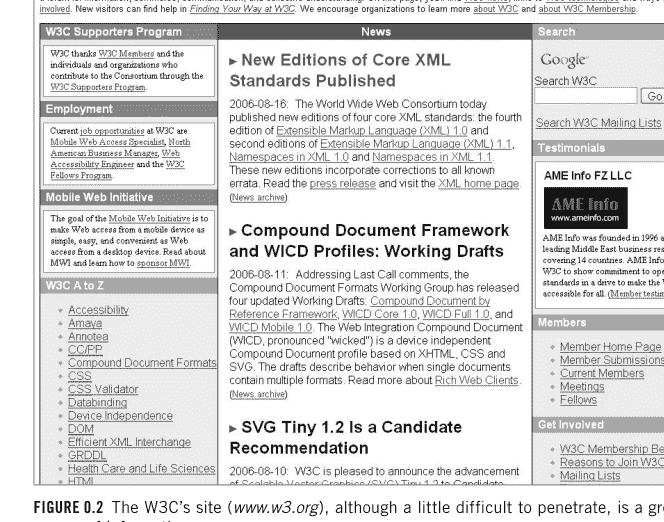

图 0.2 W3C 的网站 (www.w3.org)，虽然有点难以理解，但却是信息的重要来源。

HTML 标准基于语义。这是使用标签赋予意义的过程，例如“这段文本是一个段落”或“此元素中的 HTML 构成了一个表格”。这听起来可能不那么重要，但它是迈向网络标准成功的第一步的核心：分离结构和表现。

## 结构和表现

本页，特别是下面这个大而醒目的声明，比本书其余部分加起来还要重要。

# HTML = 内容
# CSS = 表现

这是解锁更好网页的神奇钥匙。如果您在构建网页时应用此规则，那么您已经朝着实现网络标准及其带来的好处迈进了一半。

网络标准的一个核心理念是“内容与表现的分离”。变体包括“意义与表现的分离”和“结构与表现的分离”。关于哪个比哪个更好的学究式争论存在，但所有这些短语都是完全有效的，并且本质上意味着同一件事。如果我们更精确（但不够简洁），我们可能会说“[由结构赋予意义的内容]与[表现]的分离”。它的意思是 HTML 用于一件事，CSS 用于另一件事——HTML 应仅用于构建内容，CSS 应仅用于呈现内容。

除此之外，这意味着 `font` 标签被淘汰了，表格适用于表格数据，但不适用于布局（参见第 8 章“表格”）。这也意味着当您有一个标题时，它应该被标记为标题，而不仅仅是呈现为看起来像标题的样子，并且意味着 `em` 标签应用于强调，而不仅仅是 CSS 装饰。

# XX | 简介

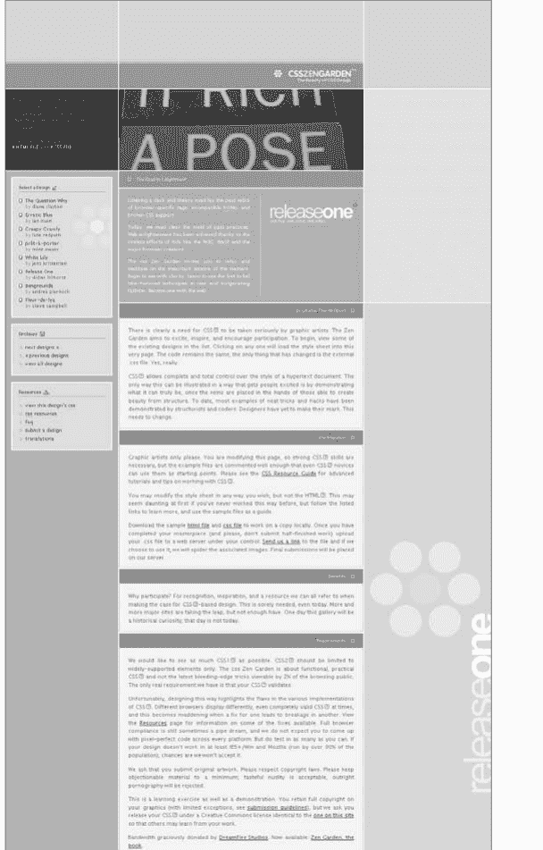

图 0.3 CSS 禅意花园——分离内容和表现的绝佳示例。设计：Didier Hilhorst。

# 简介 | xxi

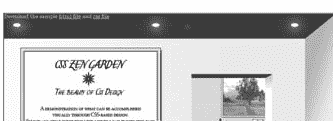

告别过去浏览器不兼容和缺乏支持的黑暗阴郁之路。

今天，我们已经摆脱了过去的实践。网络标准的实现得益于 W3C、WaSP 和主要浏览器创建者等人士的不懈努力。

禅意花园旨在激发灵感并鼓励参与。为此，我们希望展示 CSS 的力量，引入新的有趣想法，并突破界限。网站的访问者被要求这样做：贡献目光，伸出援手，让花园重焕生机。

## 选择一个设计

- **盆景天空** 作者：Christopher Scott
- **点** 作者：Dan Cederholm
- **弹性草坪** 作者：Ethan Marcotte
- **大蒜** 作者：Chris Casciano
- **走向禅意** 作者：Chris Pederick
- **绿茶** 作者：Tatsuya Uchida
- **高分** 作者：Douglas Bowman
- **世纪中叶现代** 作者：Daniel Mall
- **自然** 作者：Kevin Cornell
- **夜猫子** 作者：Arianne van der Veen
- **春** 作者：Stéphane Roucheray
- **质朴** 作者：Chris Pederick
- **钢铁** 作者：Veerle Pieters
- **瑞士** 作者：Andreas Viklund
- **白百合** 作者：Tatsuya Uchida

显然，平面设计师需要认真对待 CSS。禅意花园旨在证明 CSS 可以是优雅、精致且强大的。禅意花园是关于展示 CSS 的力量，而不是浏览器的力量。唯一的要求是 CSS 必须有效，并且链接到 XHTML。是的，真的。

## 存档

- **新设计**
- **选择一个设计**
- **查看所有设计**

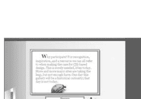

CSS 允许对 HTML 文档的样式呈现进行完全且彻底的控制。唯一能以激发人们兴趣的方式说明这一点的方法，就是展示一旦我们约束了设计师，它真正能成为什么样子。最好的方法是通过做我们以前从未做过的事情来展示 CSS 的力量。设计师们尚未掌握他们的工作。这需要改变。

## 资源

- **查看此设计的 CSS**
- **CSS 资源**
- **提交设计**
- **翻译**

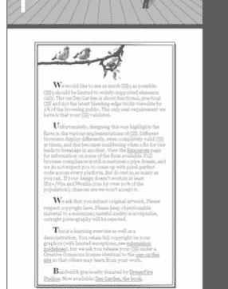

仅限平面设计师。毕竟，您正在修改此文件。一旦您了解 CSS 是什么，CSS 本身就非常简单易懂。我的唯一目标是创建一些东西，让人们不仅能阅读它，还能看到它的实际应用。请阅读 CSS 资源指南，获取有关使用 CSS 的高级教程和技巧。

您可以以任何您希望的方式修改样式表，但不能修改 HTML。这起初可能看起来令人生畏，但如果您查看 HTML 文件，您会看到顶部和底部有注释，写着“begin styles”和“end styles”。只需随心所欲地编辑样式表即可。所有原始注释都已保留，因此您也可以继续将其用作辅助。

下载示例 html 文件和 css 文件。将示例作为您自己修改的参考。完成修改后，您可以将页面和 CSS 的您自己的版本上传到您的 Web 服务器。要查看您的作品效果，请访问画廊，提交您自己的作品，或向画廊提交链接。

为什么要参与？为了获得认可、灵感，以及一个我们可以共同参考的资源，向人们展示当前尚未展示的 CSS 的惊人可能性。每六到八周将选择一个新的当前设计。我们将使其成为网站的永久部分。这些新设计将随着时间的推移放置在新样式部分，并带有永久的历史链接。下一次重新设计将在 2004 年 3 月进行。

我们希望看到尽可能多的 CSS。使用 CSS 的人越多，我们就能越广泛地传播基于浏览器的设计理念。禅意花园是关于展示 CSS，而不是展示最新的浏览器技巧。我们唯一的要求是您的 CSS 必须有效。不幸的是，以这种方式设计突出了各种 CSS 实现中的缺陷。不同的浏览器对 CSS 支持的显示方式不同，这使我们的工作更加困难。当前现实世界的网络在浏览器之间一团糟，而且看起来短期内不会好转。每次浏览器更新，都有可能破坏某些东西。每次有人使用 CSS 设计网站，它都有可能在每个浏览器中运行。但不要让这阻止您。每天有数百万人使用 CSS 的前两个版本。第一个支持 CSS 的浏览器是 Mac 版的 Internet Explorer。

我们要求您提交原创作品。请尊重版权法。请将令人反感的材料保持在最低限度。请在提交前查看指南。这里不是任何自我推广作品的地方。这既是一个学习练习，也是一个演示。您保留对图形的完全版权（提交指南中注明的某些例外情况除外），但我们要求您在与本站相同的 Creative Commons 许可下发布您的 CSS，以便其他人可以向您的作品学习。

带宽由 DreamHost 慷慨捐赠。新托管：Media Temple。

图 0.4 使用完全相同的 XHTML，不同的 CSS 可以实现截然不同的设计。设计：Samuel Marin。

## Web 标准的实践意义

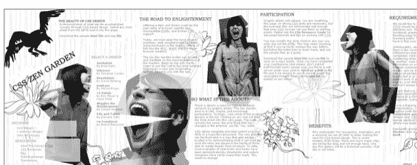

图 0.5 结构化的内容独立于呈现方式，一切已准备就绪，设计师可以随心所欲地进行呈现。设计：Mikhel Proulx。

如果你在使用 HTML 时，有任何操作哪怕只是暗示了呈现方式，*请停止*——CSS 能做得更好。这意味着从仅仅用它来斜体化文本，到使用表格进行布局的所有操作。如果内容具有真正的特定含义（例如强调），仅仅用 CSS 让它看起来不同是不够的——应该通过 HTML 结构来赋予其含义。

| 示例 | 结构还是呈现？ | HTML 还是 CSS？ |
| :--- | :--- | :--- |
| 标题 | 结构 | XHTML |
| 标题的大小 | 呈现 | CSS |
| 段落 | 结构 | XHTML |
| 段落中文本的颜色 | 呈现 | CSS |
| 数据表格 | 结构 | XHTML |
| 表格单元格周围的边框 | 呈现 | CSS |
| 图像，例如肖像照片 | 结构 | XHTML |
| 图像，例如平铺背景 | 呈现 | CSS |
| 一组导航链接 | 结构 | XHTML |
| 一组导航链接在页面上的位置 | 呈现 | CSS |

这不仅仅是关于是否单独使用了有效的标签，因为一个使用表格进行布局，或者使用 *b*（加粗）标签的页面，完全可能是一个“有效”的页面。关键在于大局观和良好实践，即按照 HTML 标签的初衷来使用它们——标记数据并赋予其含义。

使用 Web 标准的大多数实际好处源于这一理念。这是一个好理念。它行之有效。

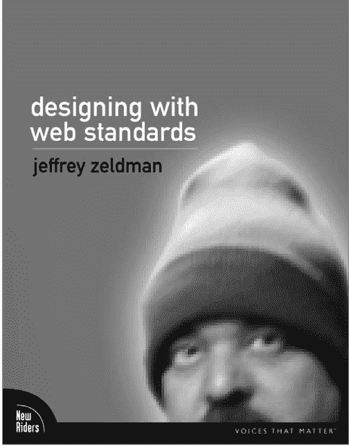

图 0.6 Jeffrey Zeldman 的《Designing With Web Standards》通过解释 Web 标准的内涵以及我们为何应该使用它们，奠定了基础。

Web 标准并非某种绝地武士的心灵诡计，Web 标准的布道者们也（通常）不是疯狂的邪教成员。如果没有真实、实质、实际的好处，没有人会认真对待 Web 标准，更不用说使用它们了。以下是一些最重要的好处：

- **跨兼容性：** Web 标准区别于旧派做法的一点在于，它不针对任何特定浏览器。一个常见的 Web 设计问题是“必须”为一种浏览器开发一个页面，为另一种浏览器开发另一个页面。即使在今天，一些网站仍然只在微软的 Internet Explorer (IE) 中工作，排除了虽小但比例显著的用户群体。但除了少数细微差异外，遵循 Web 标准将确保页面在任何地方都能正常工作。无需替代版本，没有“仅限 IE（我们太懒了）”，也不会排除用户。
- **前向兼容性：** 由于跨兼容性的可能性增加，Web 页面在未来浏览器上按预期工作的可能性，将比依赖当前浏览器的非标准专有特性时更高。
- **呈现方式的集中控制：** 正如第 1 章将解释的，遵循 Web 标准并使用 CSS 允许使用一个或多个全局文件来为整个网站的所有网页应用呈现方式。通过这种方式将呈现方式与 HTML 分离，使得进行全站范围的呈现更改变得更容易、更快捷，从而产生比必须单独更改每个网页更一致的设计。
- **设备无关性：** 以为每个查看网页的人都在盯着电脑屏幕？嗯，大多数人是，但有些人可能在打印网页或使用某种移动设备（第 10 章，“多种媒体”）。你可能认为要适配多种设备，就需要网页的多个版本。但你不需要，使用 Web 标准就不需要。通过分离结构和呈现，相同的内容可以根据设备以不同的方式显示。
- **搜索引擎优化：** 搜索引擎喜欢 Web 标准。它们过去喜欢元数据（作者明确写入网页的数据），但这种主观标记容易被利用，导致搜索结果不一定相关。现在搜索引擎更加复杂，使用更先进的技术来评估页面与搜索查询的相关性。它们倾向于分析内容本身，并特别关注标题等内容，甚至关注相关内容在页面顶部的接近程度。因此，如果你使用 `font` 标签让文本看起来像标题，而不是使用 `h1` 和 `h2`（参见第 2 章，“文本”），或者如果你的内容被一堆表格混乱地包围着，那么你并没有给自己带来任何好处。
- **轻量级页面：** 也许最立竿见影的优势就是页面变得多么轻量。更轻的页面意味着带宽减少（降低托管成本）和网页加载时间缩短（提高可用性）。一个使用表格布局和字体标签进行文本装饰的等效“旧派”页面，是一堆相对臃肿的标记。无需如此臃肿的代码或不必要的图形（例如透明的“间隔”图像和可以用 CSS 复制的图形文本），生成比原来轻 60% 或 70% 的页面并不少见。
- **可访问性：** 让残障用户更容易访问网页，满足了道德义务，为你的网站打开了更广阔的市场，并帮助其遵守反歧视法律。很大一部分 Web 可访问性问题是技术性的，可以通过使用良好的符合 Web 标准的 HTML 和 CSS 来解决。
- **雇主和客户期望：** 如果你还没有被 Web 标准说服，那么有很多其他人已经被说服了。能够按照 W3C (X)HTML、CSS 和可访问性标准进行编码，正迅速成为 Web 设计师必备的技能。如果你正在寻找 Web 设计工作，或者你为他人设计网站，掌握 Web 标准将是一个巨大的优势。

## 浏览器兼容性问题

Web 标准背后的一个基本原则是它们与浏览器无关。你不应该创建特定于浏览器的代码——整个理念是，如果浏览器制造商完全支持 W3C 制定的 Web 标准，那么一个页面就可以适用于所有浏览器。但我们生活在现实世界中，没有浏览器是完美的。当你想到 HTML 和 CSS 涉及的所有技术复杂性——它们的语法和行为——就不奇怪并非每条规则都能被每个浏览器 100% 正确地应用（如果应用了的话）。

这是否意味着 Web 标准在实践中毫无用处？不。好消息是所有现代流行浏览器都支持绝大多数 Web 标准。只是一些小问题有时会引起烦恼。稍微处理一下，它们往往就消失了。

目前最受欢迎的浏览器是 Windows 版的 Internet Explorer。IE 在 Web 标准社区几乎普遍受到诟病，因为它有许多缺点——要么缺乏支持，要么错误地解释了许多 Web 标准规则。

更现代的浏览器，如 Firefox 和 Safari，在技术上是更优越的软件（很少有人能真诚地反驳这一点——即使是微软），但不幸的是，对于 Web 设计师（以及最终对用户）来说，只有少数计算机用户使用其机器上预装浏览器以外的任何浏览器。这意味着主要是 Windows，这意味着 Internet Explorer。

但 IE 并非完全愚蠢。它在 HTML 和 CSS W3C 标准的大多数领域都处理得很好。例如，没有巨大的漏洞阻止作者实现特定的页面结构或迫使其在特定布局上妥协。只有在涉及更具体的细节时，不兼容性才会变得令人沮丧。好消息是微软终于明白了这一点，并努力在最新的第七版 IE 中修复了许多这些问题，该版本现已登陆 Web 世界。


本书将在适当之处指出浏览器的不足，但总体而言，采用网络标准绝对没有实际理由——所有现代浏览器都完全有能力处理它们。

我们确实需要在一个多浏览器的世界中工作，即使是最优秀的网页制作者也会遇到页面在不同浏览器间存在差异的情况。这些差异通常很容易解决，只要你在多个浏览器上测试页面以确保设计有效，兼容性问题就不应造成太多困扰。

## 浏览器技巧

网络标准设计需要大量“技巧”的说法并不属实。事实上，这有点自相矛盾。

市面上存在大量技巧（尤其是针对CSS的），允许你向不同的浏览器提供不同的代码，但它们通常只是对最初构建不当的东西进行的不必要快速修复。实际上，在实践中，通常不需要使用除一个简单技巧——盒子模型技巧——之外的任何东西，这是为了适应IE 5.x中的计算错误（参见第5章“布局”）。

## 向后兼容的危险

处理来自中世纪的数据时，仍有人喋喋不休地谈论Netscape 4。“它在Netscape 4上能用吗？因为Netscape 4非常重要。它必须在Netscape 4上工作。”

这是最臭名昭著的“向后兼容”论点之一，但也是向后兼容走得太远的最佳例子。

判断是否应该适应某个浏览器的第一步是使用它的人数。第二步是判断你必须在多大程度上妥协网页设计以适应那个浏览器。

现在只有极小比例的人使用Netscape 4。但即使它可以被适应（极小的比例仍然是比例），这也不值得。

一位困惑的圣人曾说：“优秀网页设计的巅峰是能在所有浏览器上工作的网页设计。”

胡说八道。

是的，网页设计应该在尽可能多的浏览器上工作，但代价是什么？

费尽心思去适应旧浏览器将损害那些使用新浏览器的人的利益。通过适应旧浏览器，你失去的是上述网络标准的实际好处。告别灵活性、更轻的页面、更高的可访问性、更好的可用性和更低的维护成本。你将因缺乏优化而失去更多访客，而不是通过适应冷门的古董而获得。

结构良好的HTML文档的内容在旧浏览器上仍然应该完全可访问——那些不理解CSS或被欺骗忽略CSS的浏览器（参见第1章“应用CSS”）将简单地以浏览器的默认样式呈现HTML。设计可能会丢失，但功能不会。

## 可访问性

可访问性关乎一个人在任何情况下访问某物的难易程度。虽然这是一个相当广泛的领域（与网络相关时，它可能包括通过“替代”设备（如手机）访问网站），但它往往集中在涉及残疾人的相关问题以及他们访问网页或网站信息的难易程度上。

可访问性考虑的范围可以填满整本书（确实如此——例如参见乔·克拉克的优秀著作《构建可访问网站》（New Riders）或《网络可访问性：网络标准与法规遵从》（Friends of Ed）），但我们将在这里稍作探讨，因为HTML和CSS是最终用于解决大多数可访问性问题的工具。

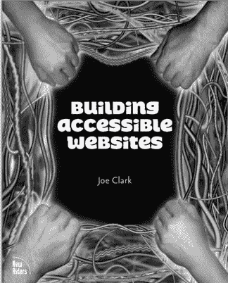

**图 0.7** 尽管有些年头了，乔·克拉克的《构建可访问网站》仍然是理解网络可访问性并在网页设计中应用可访问性技术的最佳、最全面的资源。

在许多情况下，非常简单的HTML和（在较小程度上）CSS步骤可以大大提高可访问性，但有很多这样的简单步骤，特别是对于需要交互的页面组件——参见第3章“链接”和第9章“表单”。尽管本书没有明确探讨围绕各种可访问性倡议的问题（再次强调，那是另一本书的内容），但实现其中大多数的技术会涉及。

## 本书适合谁？

本书适合那些想要掌握最佳实践（X）HTML和CSS的人，以及那些想要一本坚实、可靠参考书的人。

尽管网络标准的主题可能更吸引中级到高级的网页设计师，但本书的全面性应该适合初学者和专家，既作为编写网页组件的指南，也作为确保你使用正确语法的参考。

我写了一些我自己现在会觉得有用的东西，但也是我在刚开始接触HTML、CSS和网络标准时会觉得非常有用的东西。

## 本书如何运作

本书全面介绍了网页的各种组件（第10章略有不同），解释了如何构建它们以及如何呈现它们。逐个组件地，到本书结束时，所有实用的网络标准（XHTML 1.0 Strict和CSS 2.1）工具都将涵盖。

## 实用的网络标准

由于当前浏览器兼容性的状况，本书并未涵盖每个W3C细节，因为即使我们提倡使用网络标准的理念，我们也必须务实。喋喋不休地谈论一种理论上可行但在大多数浏览器中不起作用的技术是没有意义的。这将是浪费纸张和你的时间。请放心，大多数网络标准选项都是实用的，并且已经涵盖。只有一小撮讨厌的小鬼试图破坏乐趣。

请注意，附录A和B涵盖了每个有效的（非表现性的——见下文）HTML（XHTML 1.0 Strict）标签、CSS（2.1）属性，以及每个有效的属性和值。当出现浏览器不兼容时，会附上相关说明。

为了实践的良好，表现性的HTML标签，如b和i（它们实际上是有效的XHTML 1标签），也被摒弃了。我们在这里采用结构与表现分离的理念及其带来的实际好处，因此没有空间容纳这些注定要进废品堆的过时残留物。

附录A的“不良标签”部分简要介绍了一些不符合本书理念的常用标签和属性（主要是无效标签，但也包括b和i等标签）。

## www.htmldog.com

本书应该有足够的内容让你至少一小部分脑细胞感到温暖和模糊，但其设计的一部分是与HTML Dog网站携手合作，为你提供更多关于HTML和CSS的帮助。在整本书中，你会发现对文章的引用，这些文章可能会更详细地介绍某些技术，你还会发现许多指向“最基本”示例的指引。这些示例旨在剥离所有不必要的代码，只展示HTML或CSS的一小部分，例如标题、表单、背景图像或垂直对齐。只需查看页面源代码（大多数浏览器的“查看”菜单项下都有此选项）即可了解其工作原理。

当它们在书中出现时，它们看起来会有点像这样：

www.htmldog.com/examples/verticalalign.html

完整的70多个示例列表可以在www.htmldog.com/examples/找到

## 各章内容

整齐地嵌入10章中，你会发现对HTML和CSS几乎所有你需要的组件的解释，以及一些为你的页面增添一点魅力的巧妙技巧。

- **第1章，“入门”**——通过解释HTML和CSS的语法来启动：它们是什么样子，应该如何使用，以及如何将它们链接在一起。
- **第2章，“文本”**——涵盖了用于构建各种类型文本的所有HTML标签：段落、标题、强调、缩写等等


## 第三章，“链接”——只探讨一个标签，但它如此重要，以至于被单独成章。内容涵盖从基础链接和页面锚点，到如何让链接更易访问以及样式设计的最佳实践。
- **第四章，“图像”**——介绍如何使用 `img` 标签添加内容，以及如何利用强大的 CSS 背景图像来增强视觉效果。
- **第五章，“布局”**——解释如何使用 CSS 实现各种布局。
- **第六章，“列表”**——讲解有序列表、无序列表和定义列表，以及如何通过样式设计将其用作导航标签等页面组件。
- **第七章，“脚本与对象”**——说明如何将 JavaScript 和 Flash 影片等对象整合到 HTML 页面中。
- **第八章，“表格”**——全面介绍如何标记表格数据（而非使用表格进行布局！），包括如何提高表格的可访问性。此外，还介绍了一些特定的 CSS 技巧，可以让表格呈现得更美观。
- **第九章，“表单”**——涵盖如何构建和呈现用于用户输入的表单及表单字段，并解释了样式设计表单元素的局限性。
- **第十章，“多媒体”**——探讨网页在标准台式机或笔记本电脑之外的媒体中如何工作，以及如何优化网页的 CSS（无需修改 HTML），使其在打印时显示得更合适。

## 入门

**入门**往往是最困难的事情。有时，不从头开始反而更容易，比如直接跳到中间，开始摆弄图像或表单。这或许能让你更快地制作出外观更有趣的网页，但如果你先学会正确驾驶，你的“车”在之后的状态可能会更好。这就像学习任何其他学科一样——总有一大堆理论需要钻研，但从长远来看，掌握它们会让生活更轻松、更美好。

本章将告诉你关于组合网页基本组件所需了解的几乎所有内容。它清晰地分为两部分：如何使用 HTML 和如何使用 CSS。

## HTML 语法

HTML 的语法非常直观：内容通过标签被结构化为元素，属性则提供额外信息。我们将使用的 XHTML 比旧版（非 X）HTML 语法更严格，但如果你遵循简单的规则，就能从中受益。

## 元素、标签和属性

使用 HTML 所做的就是获取内容，并通过用标签包裹内容片段来定义每部分的含义。定义几个术语，在以下示例中：

```
<a href="http://www.htmldog.com/">HTML Dog</a>
```

“<a href="http://www.htmldog.com/">”是开始标签，定义了元素的开始。

“</a>”是结束标签，定义了元素的结束。

“href”是一个属性，是元素的设置。（在此示例中，“href”是链接的目标地址——参见第三章“链接”。）

“http://www.htmldog.com/”是属性值，用于指定属性应设置为何值。

“HTML Dog”是内容。

“<a href="http://www.htmldog.com/">HTML Dog</a>”（整个部分）是一个元素。

关于标签，有几个简单的规则需要遵循（除了使用有效的标签和属性，这将在各章中介绍）。

首先，XHTML 要求**所有标签和属性必须使用小写字母**。`<p></p>` 和 `<blockquote></blockquote>` 是有效的，但 `<P></P>` 和 `<BLOCKQUOTE></BLOCKQUOTE>` 则不是。（如果你不熟悉本章中的一些标签，别担心；它们将在本书后面介绍。）

其次，**所有标签必须闭合**。在上面的例子中，元素的结束由 `</a>` 标记。`<h1>` 必须用 `</h1>` 闭合，`<div>` 必须用 `</div>` 闭合，依此类推。有些特殊情况，元素没有内容，例如 `br` 或 `input`。在这些情况下，没有显式的结束标签，而是单个标签在末尾用“/”字符自行闭合，如 `<br />` 或 `<input />`。

第三，**所有属性值必须用引号括起来**（并且所有属性都必须有值）。例如，`<a href=http://www.htmldog.com>HTML Dog</a>` 是无效的——必须写成 `<a href="http://www.htmldog.com">HTML Dog</a>`。

第四，**元素必须正确嵌套。**

嵌套元素是指被其他元素包围的元素。

一个例子是：

```
<p>Why not try out <a href="http://www.htmldog.com/">HTML Dog</a>?</p>
```

在这个例子中，`a` 元素（一个链接——参见第三章）嵌套在 `p` 元素（一个段落——参见第二章“文本”）内部。

嵌套元素时必须小心——一个元素必须完全包含在另一个元素内部。所以，例如，

```
<em><a href="http://www.htmldog.com/">HTML Dog</a></em>
```

是正确的，但

```
<em><a href="http://www.htmldog.com/">HTML Dog</em></a>
```

是错误的。如果 `a` 元素要在 `em` 元素（强调——参见第二章）内部，那么 `a` 元素的结束标签必须出现在 `em` 结束标签之前。

> ## 这是家族事务

一个元素与另一个元素的关系可以用家庭关系来定义。对于嵌套元素，包含在另一个元素内的元素可以称为包含元素的*子*元素。反过来，包含元素被称为该子元素的*父*元素。

所以在 `<p><em>Lemon</em> pie</p>` 中，`p` 元素是 `em` 元素的父元素，而 `em` 元素是 `p` 元素的子元素。

你还会遇到诸如*兄弟*、*祖先*和*后代*之类的术语。

## 块级元素和行内元素

所有 HTML 元素都属于两种类型之一——块级或行内。

块级元素收集其他块级元素或行内元素，甚至纯文本内容，用于构建比简单一行内容更大的结构。它们包括 `div`（用于通过分割代码块来划分代码——稍后详细解释）、`p`（段落——参见第二章）和 `table`（第八章“表格”）。

行内元素顾名思义——是行内的元素。它们包括 `span`（见后文）、`em`（强调——参见第二章）和 `img`（图像——参见第四章“图像”）。

请记住，不能在行内元素内部放置块级元素（例如 `<em><p>Ra ra</p></em>`）。关于哪些元素可以嵌套在哪些元素内部的更多细节，请参见附录 A。

## 通用属性

在本书中，你会遇到许多特定于某些标签或标签集合的属性。然而，有一组“通用属性”可以用于大多数标签。

通用属性包括核心属性、国际化（i18n）属性和事件属性。

## 核心属性

核心属性是 `class`、`id`、`title` 和 `style`。

类和 id 为元素应用额外的标签，用于页面锚点（页面上链接可以跳转到的位置，如第三章所述）、用 JavaScript 操作元素，以及最常见的方式——作为 CSS 直接定位元素的方法。

```
<div id="content">
    <p class="chair">Lorem ... ipsum ... etc.</p>
    <p>Lorem ... schmipsum ... etc.</p>
    <p class="chair">Etc. ... ipsum ... schmipsum.</p>
</div>
```

HTML 语法 | 5


HTML Dog
XHTML 和 CSS 最佳实践指南

## HTML 和 CSS 教程。以及更多内容。

欢迎来到 HTML Dog，这是网页设计师的资源库，涵盖所有 HTML 和 CSS 内容，它们是制作网页最常用的技术。

## 教程

快速且易于遵循的实用指南，帮助你快速上手 HTML 和 CSS，并在每一步都遵循最佳实践。

## 全新 HTML Dog 上线！

全新的视觉设计伴随着大量新内容。

## 参考手册

参考手册部分（从 HTML Dog 各处交叉链接）概述了所有可用的有效 XHTML 标签和 CSS 属性。

更新的教程、额外的文章和丰富的示例！

## 文章

少量文章对教程进行了扩展，深入探讨了一些更具体的领域和更多细节。

链接到 HTML Dog
如果你觉得这个网站有用，请链接到它。这是一种因果报应。

# 示例

简洁的示例补充了教程、参考手册和文章，应该能帮助你通过实际操作更好地理解 HTML 和 CSS 的工作原理。

## HTML Dog：图书

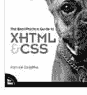

由 New Riders 出版的新版 HTML Dog 图书将于今年十一月上架。

基于并补充了网站内容，这是一本全面（同时简洁且极具娱乐性）的资源，适合那些真正想要掌握 (X)HTML 和 CSS，并从一开始就以最佳方式使用它们的人。逻辑清晰的章节划分，加上标签和属性附录，使其也成为一本极好的参考书。

立即预订你的副本！
你可以在 Amazon.com、Amazon.co.uk、Amazon.ca、Amazon.fr、Amazon.de 或 Amazon.co.jp 以折扣价预订你的副本。

© Patrick Griffiths, 2003-2006。
使用条款

图 1.1 本章的插图取自 HTML Dog 网站 (www.htmldog.com)。


## 第一章：入门

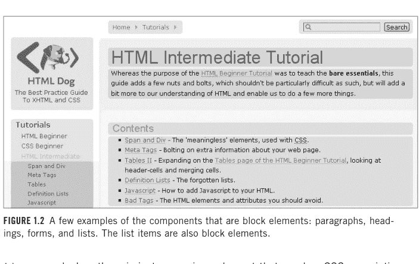

**图 1.2** 块级元素的几个示例：段落、标题、表单和列表。列表项也是块级元素。

当只有一个唯一元素需要与 CSS 关联（或一个锚点）并唯一标识文档的某个部分（如上例中的“content”）时，会使用 id。一个 HTML 文档中，只能有一个元素拥有某个特定值的 id，因此，例如，你不能这样写：

```html
<h2 id="plant">Tree</h2>
<h2 id="plant">Bush</h2>
```

与 id 不同，一个 HTML 文档中可以有任意数量的元素拥有某个特定值的 class。当有多个元素需要相同的 CSS 关联时，就会使用 class，所以，例如，你可以这样写：

```html
<h2 class="plant">Tree</h2>
<h2 class="plant">Bush</h2>
```

本章稍后在讨论 class 和 id CSS 选择器时，会再次提到 class 和 id。

title 为元素添加标题。这个方便的小属性可用于添加更多信息。它通常与 `abbr` 元素一起使用，以定义缩写所代表的短语（见第 2 章）；与 `blockquote` 一起使用，以提供引文来源的更多信息（同样，见第 2 章）；或与 `a` 一起使用，以提供关于链接目的地预期内容的更多信息（见第 3 章）。

`title` 属性的值可以被屏幕阅读器读取（提高了可访问性），并且浏览器通常会将 `title` 属性的值转换为一个小的“工具提示”，当鼠标悬停在元素上时，它会出现在光标旁边。这对于提供关于某个元素的更多信息非常有用，例如首字母缩略词代表什么，或者链接将把用户带到哪里。

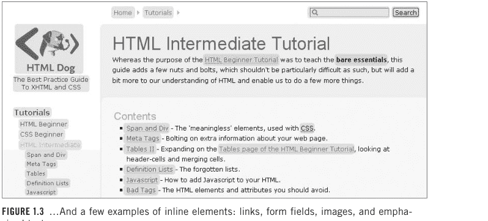

**图 1.3** ...以及内联元素的几个示例：链接、表单字段、图像和强调文本。

`style` 属性用于直接将 CSS 注入 HTML（用一根粗暴、不舒服的针），这将在后面的“将 CSS 应用于 HTML”标题下进行解释（关于那根粗暴、不舒服的针的引用也会一并解释）。

## i18n 属性

i18n 属性之所以这样称呼，是因为很少有人愿意费心写出 *internationalization*（国际化）一词中 *i* 和 *n* 之间的 18 个字符，它们是 `dir` 和 `xml:lang`。

`dir` 指定内容的方向。值可以是 `ltr`（从左到右——用于英语等语言）或 `rtl`（从右到左——用于阿拉伯语等语言）。

`xml:lang` 指定元素内容的语言，例如 `en` 代表英语，`de` 代表德语，或 `mg` 代表马尔加什语。

## 事件属性

onclick、ondblclick、onmousedown、onmouseup、onmouseover、onmousemove、onmouseout、onkeypress、onkeydown 和 onkeyup 属性在用户执行某些操作时调用 JavaScript 值。你可以在第 7 章“脚本与对象”中阅读更多关于事件属性以及为什么应该避免使用它们的内容。

## HTML 文档的基本结构

一个有效的 (X)HTML 页面需要一些基本的结构元素。

基本上，所有内容都应该符合一个大致如下的结构大纲：

```html
<!DOCTYPE html PUBLIC "-//W3C//DTD XHTML 1.0 Strict//EN"
    "http://www.w3.org/TR/xhtml1/DTD/xhtml1-strict.dtd">

<html xmlns="http://www.w3.org/1999/xhtml" xml:lang="en">

<head>
    <title></title>
</head>

<body>
</body>

</html>
```

最顶部是文档类型声明，其后是一个 html 元素。在 html 元素内部有两个元素——head 和 body。head 元素的内容（包括必需的 title 元素）提供关于 HTML 文档内容的通用信息。body 元素的内容是其他所有内容所在的地方——可查看的（或可听的，或以其他方式体验的）网页内容。

## 声明

在真正开始编写 HTML 之前，需要做一些事情来定义一个有效的 HTML 文档。文档类型声明让浏览器知道你使用的是哪个版本的 HTML，还应该声明主要语言，并且你还需要指定文档的文件类型和字符集。这听起来可能有点令人生畏，但它只涉及在网页顶部添加几行标准代码。一旦代码在那里，你就不用担心它了。

**文档类型** 在你的网页最顶部，你需要一个文档声明。没错，你*需要*它。

如果不指定 doctype，你的 HTML 就不是有效的 HTML，大多数显示它的浏览器将切换到“怪异模式”，这意味着它们会假设你，作者，根本不知道自己在做什么，因此它们会自行决定如何处理你的代码。

目前，在大多数情况下，最好的文档声明是用于 XHTML 1.0 Strict 的。它看起来像这样：

```html
<!DOCTYPE html PUBLIC "-//W3C//DTD XHTML 1.0 Strict//EN"
"http://www.w3.org/TR/xhtml1/DTD/xhtml1-strict.dtd">
```

以下是 XHTML 1.1 的文档声明，它可能看起来更可取，因为是 XHTML 的最新版本，但存在一些浏览器兼容性问题（因为很多浏览器还不太了解它）。对于网页作者来说，这与 XHTML 1.0 Strict 相比没什么区别。

```html
<!DOCTYPE html PUBLIC "-//W3C//DTD XHTML 1.1//EN"
"http://www.w3.org/TR/xhtml11/DTD/xhtml11.dtd">
```

这行代码（通常像上面那样分成两行，只是为了整洁一点）告诉浏览器期望哪个版本的 HTML，以及在哪里可以找到“文档类型定义”。它必须位于 HTML 文档的最顶部，前面不能有任何内容，否则它将不会生效，浏览器将进入怪异模式。

请注意，DOCTYPE 语句不遵循你刚刚学习的编写 HTML 标签的任何语法规则。不要把它看作 HTML 的一部分，而是把它当作一个独立的实体。完全按照所示输入，“DOCTYPE”大写，用感叹号装饰且不闭合，你就没问题了。

实际上，没有必要使用除已提及之外的 doctype，但也有用于各种版本 HTML 的 doctype，用于 XHTML 框架集的 doctype，以及用于 XHTML 1.0 Transitional 的 doctype。

## 为什么不用 XHTML Transitional？

XHTML Transitional 就是那样——一个过渡。它旨在帮助开发者从一个技术标准——HTML 4——迁移到另一个技术标准——XHTML (Strict)。如果你固守 HTML 4 的方式，这是一个很好的学习步骤，但它不应被视为最终目标。Transitional XHTML 和 Strict XHTML 之间的区别仅仅是前者比后者允许更多的标签和属性。这听起来可能更可取，但从长远来看并非如此。XHTML Strict 去除了我们试图摆脱的大部分表现性垃圾。通过应用 XHTML Strict，我们有助于确保标记中尽可能少地包含表现性垃圾。

开发者可能选择 Transitional XHTML 的一个越来越站不住脚的理由是，如果他们需要适应旧的、很少使用的浏览器。表现性元素可能会在 Netscape 4 等浏览器中产生更好的呈现效果，但使用此类元素会损害网页的效率，甚至可能影响可访问性。

另一个原因可能是，如果你与其他知识较少的人合作，甚至完全将代码交给想要随意添加/更改/破坏它的人（如客户）。但在这些情况下，使用 doctype 几乎没有意义（因为，记住，怪异模式是为那些不知道自己在做什么的人准备的）。

事实上，Transitional XHTML 只有在你无法完全控制自己所做的事情时才有意义。例如，如果你不是从头开始，或者你必须适应某些怪癖或天真项目经理的异想天开，那么你可能没有太多选择。如果你可以使用 doctype（并验证它），那么使用总比什么都不用好。

但为了论证起见，让我们假设我们不会把我们的达芬奇交给一个拿着一盒蜡笔的狂躁幼儿。让我们假设我们确实完全控制着自己所做的事情（或者至少努力应用最高标准）。让我们假设网页设计的最佳方法是完全分离结构和表现（因为，嗯，确实如此）。因此，让我们假设 Strict XHTML 是正确的道路。


## 语言

你应该通过 HTTP 头（"超文本传输协议"——这是服务器端的细节——随 HTML 一起发送到浏览器）或在 `html` 开始标签内的 `xml:lang` 属性来确定文档的主要语言。虽然这对于生成有效的 HTML 文档并非必需，但它是一个无障碍性考量。其值是一个缩写，例如 "en"（英语）、"fr"（法语）、"de"（德语）或 "mg"（马尔加什语）。请访问 www.w3.org/International/articles/language-tags/ 了解更多关于语言代码的使用。

例如，一个主要包含英语内容的文档声明如下：

```html
<html xmlns="http://www.w3.org/1999/xhtml" xml:lang="en">
```

在声明了主要语言后，如果你在内容中使用了其他语言，你应该进一步在行内使用 `xml:lang` 属性（例如 `<span xml:lang="de">HTML Hund</span>`）。

## 内容类型

HTML 文档的媒体类型和字符集也需要指定，这通过 HTTP 头完成：

```
Content-Type: text/html; charset=UTF-8
```

第一部分（在此示例中是 `text/html` 部分）是文件的 MIME 类型（多用途互联网邮件扩展），它让浏览器知道文件是什么媒体类型，从而知道如何处理它。所有文件都有某种 MIME 类型。JPEG 图像是 `image/jpeg`，CSS 文件是 `text/css`，而 HTML 最常用的类型是 `text/html`。

HTTP 头的第二部分（在此示例中是 `UTF-8`）是字符集。

字符集包括用于许多西方拉丁语系的 "ISO-8859-1"、用于日语的 "SHIFT_JIS"，以及 "UTF-8"（Unicode 转换格式的一个版本），它提供了大多数语言中使用的广泛独特字符。基本上，你应该使用你知道你的受众能够识别的字符集。因此，例如，如果语言完全是英语，那么 ISO-8859-1 是一个被广泛识别的代码。如果存在语言混合，或者语言不是基于拉丁字母的，那么更通用的 UTF-8 可能更可取。如果语言完全是日语，并且你的目标受众也是日语使用者，那么 SHIFT-JIS 是合适的选择。

你可以在 joelonsoftware.com/articles/Unicode.html 阅读更多关于字符集的信息。

设置 HTTP 头（或模拟它）最简单的方法可能是在 HTML 中使用一个 "HTTP 等效" meta 标签，它看起来像这样：

```html
<meta http-equiv="Content-Type" content="text/html; charset=UTF-8" />
```

你只需要把它放在 `head` 元素内（关于 `head` 和 `meta` 元素稍后会详细介绍），浏览器就能确定内容类型，一切都会顺利进行。

## HTML、Head 和 Body

好了。这些重要的声明已经处理完毕。现在我们可以开始应用那些重要的 HTML 标签，使用 HTML 来包含页面的两个主要部分：`head` 和 `body`。

### 在服务器端设置内容类型

HTTP 等效 meta 标签可以完成设置页面内容类型的任务，但如果可能，最好使用真正的 HTTP 头。使用 meta 标签时，浏览器必须先接收 HTML 文件，然后解析内容类型，但在发送 HTML 文件之前在服务器端建立内容类型，浏览器会事先被告知预期内容。

发送内容类型的一种方法是使用服务器端脚本语言，例如 PHP：

```php
<? header("Content-Type: text/html; charset=UTF-8"); ?>
```

如果你不想（或不能）使用服务器端脚本语言，你或许可以直接通过 ".htaccess" 文件与服务器交互。大多数服务器（兼容 Apache）可以有一个名为 ".htaccess" 的小文本文件放在根目录中，其中包含以下行，你可以将所有扩展名为 ".html" 的文件与 MIME 类型和字符集关联起来：

```
AddType text/html;charset=UTF-8 html
```

一个基本的页面结构将如下所示：

```html
<!DOCTYPE html PUBLIC "-//W3C//DTD XHTML 1.0 Strict//EN"
"http://www.w3.org/TR/xhtml1/DTD/xhtml1-strict.dtd">
<html xmlns="http://www.w3.org/1999/xhtml" xml:lang="en">
<head>
    <title>Uncle Jack's Sea Cow Farm</title>
</head>
<body>
<!-- 大量内容 -->
</body>
</html>
```

在文档类型声明之后，我们有 `html`，这是指定文档内容为 HTML 的根元素。它包含了文档类型声明之后的其余页面信息。

我们在 `html` 元素内找到的第一件事是 `head`。这是 HTML 文档的头部，放置有关文档的信息。

`head` 元素紧跟在开始的 `html` 标签之后，包含关于页面但不是实际内容的信息。有几个不同的元素可以放在 `head` 元素内，但有一个是必需的：`title`（我们稍后会介绍 `title` 元素以及其他几个元素）。

最后，在 `head` 元素之后是至关重要的 `body` 元素。这是 HTML 文档的主体，所有内容都放置在这里。这是人们在访问网页时会看到、听到或以其他方式体验到的内容。

### HTML 注释

你可以在 XHTML 中的任何地方放置注释，像这样：

```html
<!-- 这是一个注释 -->
```

在可见或可听内容方面绝对不会有任何变化——它只是给查看网页代码的人的一个简单提示。

**在 Head 内部...** 这里不是详细介绍可以在 `body` 元素内使用的各种标签的地方——有很多标签，而且有很多内容要说，所以你会在本书的其余部分找到更多关于这些标签的信息。

然而，`head` 元素略有不同，可以使用的标签范围要窄得多。`title`、`link`、`meta` 和 `base` 是这里描述的四个独特的特定标签。其他可以在 `head` 元素内使用的标签是 `style`（用于定义页面特定的 CSS，本章稍后将详细解释）和 `script`（用于定义页面特定的脚本，如 JavaScript，第 7 章将给予其应有的介绍）。

`title` 只是给文档一个标题。它将作为浏览器窗口的标题出现，也用于书签。

```html
<head>
    <title>Uncle Jack's Sea Cow Farm</title>
</head>
```

`link` 元素定义了到外部资源的链接，例如 CSS 文件、快捷方式图标或自定义导航。可以使用许多特定属性（详见标签参考附录），但最常用的是 `href`（指定链接的目标，类似于文本链接，将在第 2 章解释）和 `rel`。

`rel` 指定链接目标与当前页面的关系。`rel` 属性有一些普遍理解的值，例如 "shortcut icon"（浏览器会将其识别为应与网址一起使用的图标，例如在"收藏夹"菜单中）和 "stylesheet"（浏览器会将其识别为应链接到页面的 CSS 文件，见下文）。一些浏览器还允许作者使用 link 标签定义可自定义的导航元素，例如下一页、上一页、主页、联系人等，这些将作为选项出现在浏览器界面本身，而不是网页上。

以下是 `link` 元素常见用法的几个示例：

```html
<link rel="stylesheet" type="text/css" title="Some title" href="/somefile.css" />
<link rel="alternate stylesheet" type="text/css" title="Some alternative title" href="/someotherfile.css" />
<link rel="shortcut icon" href="/favicon.ico" />
<link rel="next" title="Next page" href="nextpage.html" />
```

`meta` 元素指定元信息，用于提供有关 HTML 页面的信息（元信息是关于信息的信息）。

我们已经遇到过一种 meta 标签——"HTTP 等效"（见上文"内容类型"），但最简单和最常见的形式是简单的命名 meta 标签，例如 "keywords" 或 "author"。

插入 `meta` 标签的重要属性是 `content`（元信息本身，因此是必需的）和 `name`（嗯，是赋予该信息的名称）。`name` 可以是任何你喜欢的东西，但广泛使用的例子是 "keywords" 和 "description"。

所以，如果你使用 meta 标签，你可能会有一大堆，像这样：

```html
<meta name="keywords" content="fruit, banana, orange, apple,
    kumquat, cucumber" />
<meta name="description" content="News, reviews and opinion on all
    things fruity." />
<meta name="author" content="The Fruit Farmers Association of
    Bujumburra" />
```

然后是 `base`。`base` 定义了页面上链接的基础位置。它不常用，但为了全面起见，它看起来像这样：

```html
<base href="/images/tootlepops/" />
```

如果你把这个例子插入 `head`，那么页面中的每个文件引用都将相对于 "/images/tootlepops/"。因此，例如，`` 实际上会指向 "/images/tootlepops/banana.jpg"，而 `<a href="morefruit/cucumber.html">Cucumber</a>` 会指向 "/images/tootlepops/morefruit/cucumber.html"。


## META 标签：有什么用？

Meta 标签过去的主要用途是优化网页在搜索引擎中的排名。搜索引擎算法曾使用关键词和描述来判断网页与给定短语的匹配程度。然而，如今由于滥用和容易导致不相关材料的问题，很少有搜索引擎会关注指定页面关键词的 meta 标签。相反，搜索引擎倾向于根据页面内容本身来决定搜索结果。例如，Google 只会使用 meta 标签 "description" 来伴随搜索结果，但在判断页面排名时完全忽略 meta 标签。它主要根据内容、页面标题以及用于链接到该页面的术语来确定结果。

那么，它真的还有用吗？在搜索引擎方面，meta 标签肯定不如以前那么重要了，但它们仍然可以用来传达关于页面的有用信息。即使某个应用程序不直接使用 meta 标签，查看页面源代码的人仍然可以从这些信息中受益。name 属性的另一个常见值是 "copyright"，它不会被任何东西（如搜索引擎或浏览器）直接使用，但可以用来向随意的观察者指出版权信息。在拥有多个开发者的大型网站上，你也可以使用 meta 标签来传达关于页面的信息，这些信息对外部世界没有意义，但可以在内部提供帮助。

## 通用标签——div 和 span

本书将提到许多标签，其中大多数都有非常特定的用途，用于标记非常特定的元素（如图像、表格或引用）。有两个“通用”标签，它们本身含义不大，但常用于将 HTML 部分分组并为这些分组应用 CSS。

`div` 是一个分区。它是一个块级元素，将一段 HTML 分组在一起，可能看起来像这样：

```
<div id="content">
    <h1>How to make a falafel</h1> <p>Buy a falafel seed and plant it in your garden.</p>
</div>
```

你将在第 5 章“布局”中更多地遇到 `div`，例如，它用于定义页面的导航和内容区域。

`span` 是一个内联元素，将一段内联 HTML 分组在一起，例如单个单词或短语。

```
<h1>How to make a <span>falafel</span></h1>
```

`span` 标签应谨慎使用，因为当可以使用更有意义的标签作为替代时（例如用于强调的 `em`——参见第 2 章），这对 HTML 结构更有益。因此，在前面的例子中，如果你实际上想强调 *falafel* 这个词，使用 `<em>falafel</em>` 会更好。

## CSS 语法

尽管 CSS（用于页面呈现的语言，更多信息请参见简介）与 HTML 在网页形成中紧密相连，但它具有完全不同的语法，由一系列规则组成，这些规则包含*选择器*、*属性*和*值*。

## 规则

一个典型的 CSS 规则可能看起来像这样：

```
h1 { font-size: 2em; }
```

其中：

“h1”是一个选择器，定义了将 CSS 应用于 HTML 的哪个部分。

“font-size”是一个属性，定义了你想要设置的目标元素的哪个特定呈现方面。

“2em”是一个值，定义了属性应设置为什么。

“font-size: 2em;”被称为一个声明。

而整个“h1 { font-size: 2em; }”统称为一条规则。

## 选择器

选择器指定样式声明应应用于哪些 HTML 元素。主要有三种选择器：HTML 选择器、id 选择器和类选择器。

**HTML 选择器**简单地指定应将声明应用于哪个 HTML 元素，因此

```
h2 { color: red; }
```

将使所有 h2 HTML 元素变为红色。

**id 选择器**将样式附加到具有相应 id 的 HTML 元素。因此，如果你的 HTML 中有类似这样的内容：

```
<h2 id="tree">Tree</h2>
```

而你只想将样式应用于该元素，你可以这样做（注意选择器开头的 # 字符）：

```
#tree { color: red; }
```

**类选择器**将样式附加到具有相应类的 HTML 元素。因此，如果你的 HTML 中有类似这样的内容：

```
<h2 class="plant">Tree</h2>
```

而你想将样式应用于该元素以及所有其他具有 class="plant" 的元素，你可以这样做（注意选择器开头的点）：

```
.plant { color: red; }
```

你可以通过用空格分隔来为一个 HTML 元素附加多个类，例如：

```
<h2 class="plant leafy">Tree</h2>
```

这将应用以下两条规则：

```
.plant { color: red; }
.leafy { font-style: italic; }
```

## 什么应该成为类或 id 名称？

在为 `id` 和 `class` 属性选择名称时，你应该记住结构和呈现的分离。再次强调，你选择的值不应暗示呈现。

例如：

```
<p class="redtext">Beach bottom bikinis...</p>
```

配合 CSS 来设置样式：

```
.redtext { color: red; }
```

这有点偏离了重点。在这个例子中，尽管 `class="redtext"` 本身实际上不起任何作用，但它仍然没有将呈现的暗示与结构分离开来。

从实际角度来说，如果你决定不再希望这些特定的类显示为红色怎么办？然后这样写就有点傻了：

```
.redtext { color: blue; }
```

因此，你的类和 id 名称也应该是语义化的，就像标签名称一样。

```
<p class="bikinis">Beach bottom bikinis...</p>
```

这个例子对于结构化的语义文档来说更有意义，而且因为它与呈现无关，你可以为它应用任何颜色或其他任何东西，它仍然完全合理。

而且这不仅仅是像颜色或粗体这样简单的事情。想想类或 id 名称是否暗示了相应 CSS 规则集正在使用的东西，如果是，那它们就不好。

`id="largebox"`、`class="hidden"`、`id="float1"` 都和 `class="redtext"` 一样糟糕。

请注意，id 或类名称不能以数字开头——它必须以字母或下划线开头。

你还可以通过将类选择器直接放在另一个选择器之后，来更具体地指定类应用于哪些元素。例如，如果你只想将样式与具有类“plant”的 h2 元素关联，那么你可以使用选择器 `h2.plant`。然后你可以使用选择器 `p.plant` 将特定样式应用于具有类“plant”的 p 元素，依此类推。

## 伪类和伪元素

伪类和伪元素通过冒号附加到选择器上，通过添加进一步的条件来增加选择器的特异性，例如元素的第一个字母（`whatever:first-letter`）或当光标移到元素上时（`whatever:hover`）。

最常用的可能是 `:hover`，其应用方式如下：

```
a:hover { text-decoration: none; }
```

（这将导致链接的下划线在光标悬停时消失——参见第 3 章“链接”。）

这类选择器不多，而且大多数功能非常具体。你可以在第 2 章“文本”和第 3 章中找到更多关于伪类和伪元素功能的信息。

## 分组选择器

如果你想将特定样式应用于多个选择器，没有必要这样做：

```
h2 { color: red; }
#kumquat { color: red; }
.panda { color: red; }
```

要将相同的声明块应用于多个选择器，你只需要用逗号分隔选择器，像这样：

```
h2, #kumquat, .panda { color: red; }
```

## 嵌套选择器

你可以通过在所需元素之前指定以空格分隔的父元素列表，直接将样式定向到嵌套的 HTML 元素（其他元素内的元素）。

例如，如果你想将样式仅应用于 p 元素内的 em 元素，那么你可以这样做：

```
p em { font-weight: bold; }
```

或者，如果你只想为 id 为“content”的元素内的 p 元素中的 em 元素设置样式：

```
#content p em { font-weight: bold; }
```

而且你不必指定每个父元素。例如，如果你想为该“content”元素中的每个 em 元素设置样式：

```
#content em { font-weight: bold; }
```

嵌套选择器通常消除了应用 id 和特别是类作为 CSS 钩子的需要，因为你可以根据元素与其他元素的关系来定位元素。因此，例如，如果你希望导航区域中的链接颜色与主要内容区域中的链接颜色不同，你的 HTML 可以像这样：

```
<a href="this.html" class="prune">This</a>
<a href="that.html" class="prune">That</a>
<a href="theother.html" class="prune">The other</a>
<!-- etc -->
```

然后使用这个 CSS：

```
.prune { color: orange }
```

但如果你的 HTML 像这样会更合理：

```
<div id="navigation">
<a href="this.html">This</a>
<a href="that.html">That</a>
<a href="theother.html">The other</a>
<!-- etc -->
</div>
```

然后 CSS 像这样：

```
#navigation a { color: orange }
```

这可以让你真正减少 HTML 代码。


## 特异性

如果你有两个（或更多）指向同一元素的冲突 CSS 规则，浏览器会遵循一些基本规则来确定哪个规则生效。如果选择器相同，那么在样式表中最后指定的规则总是优先。例如，如果你有：

```
p { color: red; }

p { color: blue; }
```

`p` 元素将显示为蓝色，因为该规则是最后出现的。

然而，你通常不会故意使用相同的选择器来声明冲突的样式（因为这没什么意义）。但是，当你使用嵌套选择器时，冲突会非常合理地出现。在以下示例中：

```
div p { color: red; }

p { color: blue; }
```

你可能认为 `div` 元素内的 `p` 元素会显示为蓝色，因为将 `p` 元素设置为蓝色的规则是最后出现的，但由于第一个选择器的特异性更高，它们实际上会显示为红色。基本上，选择器越具体，在处理冲突样式时就越有优先权。

然而，选择器的实际特异性需要一些计算，并不像看起来那么简单。计算选择器特异性有一个固定的方法，如下所示：

你计算 `id` 属性的数量，并将该数字称为 "a"，然后计算其他属性（如类选择器和伪类）的数量，并将该数字称为 "b"，然后计算 HTML 选择器的数量，并将该数字称为 "c"。最后，你将 a、b 和 c 组合在一起，数字 "a,b,c" 就是整体特异性。感到困惑了吗？几个例子可能会让你更清楚：

`p` 的特异性为 0,0,1（a=0, b=0, c=1）。

```
`div p` 的特异性为 0,0,2（a=0, b=0, c=2）。

`.tree` 的特异性为 0,1,0（a=0, b=1, c=0）。

`div p.tree` 的特异性为 0,1,2（a=0, b=1, c=2）。

`#baobab` 的特异性为 1,0,0（a=1, b=0, c=0）。

因此，如果使用所有这些示例，`div p.tree`（特异性为 0,1,2）将优先于 `div p`（特异性为 0,0,2），而 `#baobab`（特异性为 1,0,0）将优先于此示例中的所有其他选择器。

保留逗号（使用 1,0,0 而不是说“100”）很有帮助，因为它基于无限进制系统（而不是我们常用的十进制）。例如，11 个类选择器（“0,11,0”而不是“0110”）（在实践中不太可能）仍然比一个 id 选择器（“1,0,0”而不是“100”）特异性低。
```

## At 规则

At 规则使用特殊类型的选择器，这些选择器并不经常出现。CSS 2.1 只有三个有效的 at 规则：`@import`，用于在一个 CSS 文件中包含另一个 CSS 文件（下面将更详细地解释）；`@media`，用于将一块 CSS 分配给特定的媒体类型，如屏幕或打印（参见第 10 章“多种媒体”）；以及 `@page`，用于分页媒体，将属性应用于特定的打印页面条件。

## 属性

通过选择器，你可以将样式与特定的 HTML 片段关联起来。但样式本身呢？属性是你可以更改的元素的呈现部分。它们有很多，从颜色和字体大小到更具体的东西，如空白和边框折叠。属性本身将在相关章节中介绍。

## 扩展选择器：>、+、* 和 [X=Y]

CSS 标准允许选择器具有极大的通用性和特异性。除了分组和嵌套之外，理论上你还可以使用子选择器、通用选择器、相邻兄弟选择器和属性选择器。然而，在实践中，只有通用选择器被广泛支持（即被 Internet Explorer 6 支持）。

通用选择器（使用“*”符号）匹配任何和所有内容。因此 `form *` 将定位 `form` 元素内的每个框。它们的一个用例是在用户样式表中（参见本章后面），通过使用类似 `body * { color: black; background: white }` 的内容来确保所有文本和背景都是某种颜色，这表示 body 内的所有框都应具有黑底白字的文本。

子选择器（使用“>”符号）允许你定位元素的直接后代，即特定元素内的第一个嵌套元素。例如，`body > p` 将定位直接嵌套在 `body` 元素内的 `p` 元素，但不会定位进一步嵌套在其他元素中的 `p` 元素。

相邻兄弟选择器（使用“+”符号）允许你将规则应用于直接跟在另一个元素后面的元素。例如，`h1 + h2` 将仅将关联的声明块应用于直接跟在 `h1` 元素后面的 `h2` 元素。

属性选择器将 CSS 应用于具有特定属性或属性值的 HTML 元素。语法是 `elementname[attributename=attributevalue]`。因此，例如，`abbr[title]` 将样式应用于具有 `title` 属性的 `abbr` 元素（无论其值如何），而 `abbr[title=Cascading Style Sheets]` 将样式应用于具有 `title` 属性且值为“Cascading Style Sheets”的 `abbr` 元素。除了“=”之外，你还可以使用“~=”，它将选择器与属性值中的一个单词（空格分隔列表中的）匹配（例如 `abbr[title~=Cascading]`），或者使用“|=”，它将选择器与连字符分隔列表的第一个“单词”匹配（主要设计用于 `xml:lang` 属性，其中 `abbr[xml:lang|=en]` 将同时匹配 `xml:lang="en"` 和 `xml:lang="en-us"`）。

## 继承

当你将属性应用于一个框时，它通常会被其包含的所有后代框继承，因为后代从其祖先继承样式。因此，例如，当你将字体大小应用于 body 元素时，body 内的块（即你在网页上看到的所有内容）将继承该字体大小。

并非所有属性都以这种方式自动继承。例如，尺寸、内边距、边框和外边距（参见第 5 章“布局”）将仅应用于明确应用它们的元素。虽然没有关于哪些属性默认继承、哪些不继承的一般规则，但通常相当合乎逻辑——你很可能希望颜色和字体大小比其他属性更常被继承，但极不可能希望所有元素都与其父元素具有相同的高度。

## 值

你可以分配给不同属性的值通常特定于每个属性（将在各章节中介绍）。但也有一些值被许多不同的属性使用，即测量单位和颜色值。

## 单位

测量单位可以分为数字、百分比和长度。

| 单位 | 后缀 | 示例 |
|---|---|---|
| 数字 | [无] | line-height: 1.5 |
| 百分比 | % | width: 80% |
| 长度 | em | font-size: 2em |
| | px | font-size: 16px |
| | pt | font-size: 12pt |
| | pc | font-size: 10pc |
| | cm | width: 10cm |
| | mm | width: 100mm |
| | in | width: 2in |

## 绝对单位和相对单位

绝对单位是那些无论上下文如何都不可更改地固定的单位——它们不依赖于任何东西。米和码是绝对单位的例子。在 CSS 的情况下，`cm`（厘米）和 `in`（英寸）是绝对单位的例子。

另一方面，相对单位产生的实际尺寸*依赖于*（或相对于）其他东西。百分比是相对的，em 也是——以这些单位测量的对象的实际计算尺寸取决于它们所处的情况。

像素是绝对的还是相对的是一个有争议的问题。尽管它们通常被认为是绝对单位，但它们是相对的，因为它们的大小可能因显示器尺寸和屏幕分辨率而异——例如，一个像素可能宽 0.1 毫米，也可能宽 10 毫米。但在网页设计中，将像素视为绝对单位更有帮助，本书也将如此处理。

由相对单位组成的尺寸将根据浏览器偏好（如文本大小设置（em）或浏览器窗口宽度（%））具有不同的计算尺寸，但由像素组成的尺寸保持不变，除非用户更改屏幕分辨率，在这种情况下，所有元素——文本、图像、布局等——都会按实际尺寸（例如以毫米为单位的尺寸）以相同的比例关系缩小或放大。

因此，由于用户确实会更改文本大小或窗口大小等设置，而往往不会更改分辨率（即使更改，所有相对尺寸也会随之更改），因此在理解和操作两种不同方法之间的效果时，区分相对单位（减去像素）和绝对单位（加上像素）更有帮助。

“绝对值与相对值”在第 2 章（关于文本大小）和第 5 章（关于布局中的尺寸）中讨论。


一个“em”代表计算出的字体大小值。因此，如果包含元素中的文本以16像素显示，那么1em将等同于16像素，2em将等同于32像素，依此类推。

请注意，单位紧跟在数字之后，中间没有空格，例如“12px”而不是“12 px”。

## 颜色值

颜色值用于为字体、背景和边框着色，可用于指定超过1600万种颜色中的一种。

它们可以采用十六进制（hex）值、RGB（红、绿、蓝）值或颜色名称的形式。

*十六进制值*使用十六进制（曾更准确地称为“十六进制”）值，基于16进制数系统（与更常见的十进制数系统的十进制值相对），使用从0到f的数字（0到9，然后是a到f）。

十六进制值由一个井号字符（“#”）后跟三个或六个十六进制字符组成。三位数版本本质上是六位数版本的压缩版本，例如，#f00等同于#ff0000，#c96等同于#cc9966。三位数版本更容易解读（第一个字符，就像RGB中的第一个值一样，是红色，第二个是绿色，第三个是蓝色），但六位数版本可以让你更精确地控制确切的颜色。例如，以下CSS规则指定了蓝色背景上的白色文本：

```
p {
    color: #fff;
    background-color: #0000ff;
}
```

RGB值允许你为构成特定颜色的红、绿、蓝分量设置十进制数值或百分比。RGB值中的三个值可以是0到255，0是最低级别（例如，没有红色），255是最高级别（例如，完全红色）。因此，前面的示例规则也可以写成：

```
p {
    color: rgb(255, 255, 255);
    background-color: rgb(0%, 0%, 100%);
}
```

还有17个有效的颜色名称也可以使用。它们是：aqua、black、blue、fuchsia、gray、green、lime、maroon、navy、olive、orange、purple、red、silver、teal、white和yellow。你也可以使用transparent值。

```
p {
    color: white;
    background-color: blue;
}
```

## 三种样式表

有三种类型的样式表参与页面的样式设置：浏览器样式表、作者样式表和用户样式表。

*浏览器样式表*是浏览器用来建立HTML元素默认渲染方式的样式表。你应该能够依赖某些浏览器默认值，例如**strong**元素是粗体，或者链接带有下划线，这很幸运，意味着你不必指定页面上每个元素的每个呈现方面。

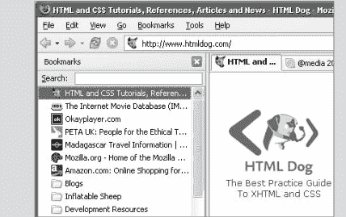

**图 1.5** 页面的标题将出现在浏览器窗口的顶部，以及书签中。另请注意使用link元素指定图标，该图标出现在书签中的网址旁边，也出现在此浏览器的标签页中。

*作者样式表*是你作为页面作者介入的地方。这是你应用于HTML的CSS，使其看起来像你想要的样子。作者样式表中的规则比浏览器样式表具有更高的优先级，但比用户样式表的优先级低。


XHTML和CSS最佳实践指南

首页 →

## 文章

在教程的基础上，精选了一些文章，深入探讨一些更具体的领域，并提供更详细的说明。

### 初级/中级

- [CSS标签页](https://www.htmldog.com/guides/css/beginner/intermediate/tabs/) - 如何创建基本的标签式导航
- [引述文字](https://www.htmldog.com/guides/css/beginner/intermediate/pullquotes/) - 重现传统的印刷效果
- [首字下沉](https://www.htmldog.com/guides/css/beginner/intermediate/dropcaps/) - 另一种印刷传统
- [上标和下标](https://www.htmldog.com/guides/css/beginner/intermediate/superscript/) - `vertical-align`属性的替代方案
- [自定义下划线](https://www.htmldog.com/guides/css/beginner/intermediate/underlines/) - 使用`text-decoration`的替代方案
- [图片翻转](https://www.htmldog.com/guides/css/beginner/intermediate/rollovers/) - 当光标悬停在链接上时交换链接中图片的一种方法
- [表单布局](https://www.htmldog.com/guides/css/beginner/intermediate/forms/) - 将标签与表单字段对齐的几种选项
- [使用target为锚点添加样式](https://www.htmldog.com/guides/css/beginner/intermediate/target/) - 一个简单的CSS3效果

### 高级/专业

- [Suckerfish之子](https://www.htmldog.com/guides/cssadvanced/suckerfish/) - 七篇文章的集合，解释如何实现下拉菜单等效果
- [弹性设计](https://www.htmldog.com/guides/cssadvanced/elastic/) - 在网页设计中使用相对单位
- [奇异的切换博士](https://www.htmldog.com/guides/cssadvanced/strangeswitcher/) - 一个有趣的小型样式切换实验
- [更宽的边框圆角](https://www.htmldog.com/guides/cssadvanced/bordercorners/) - 一篇简短的文章，演示实现圆角的一种方法。

### 相关页面

- [教程](https://www.htmldog.com/guides/)
- [参考手册](https://www.htmldog.com/reference/)

© Patrick Griffiths, 2003-2006.

[使用条款](https://www.htmldog.com/terms/)

- [教程](https://www.htmldog.com/guides/)
  - [HTML初级](https://www.htmldog.com/guides/htmlbeginner/)
  - [CSS初级](https://www.htmldog.com/guides/cssbeginner/)
  - [HTML中级](https://www.htmldog.com/guides/htmlintermediate/)
  - [CSS中级](https://www.htmldog.com/guides/cssintermediate/)
  - [HTML高级](https://www.htmldog.com/guides/htmladvanced/)
  - [CSS高级](https://www.htmldog.com/guides/cssadvanced/)
- [参考手册](https://www.htmldog.com/reference/)
  - [HTML标签](https://www.htmldog.com/reference/htmltags/)
  - [CSS属性](https://www.htmldog.com/reference/cssproperties/)
- [文章](https://www.htmldog.com/articles/)
- [示例](https://www.htmldog.com/examples/)
- [书籍](https://www.htmldog.com/book/)
- [CSS培训](https://www.htmldog.com/training/)
- [首页](https://www.htmldog.com/)
- [关于HTML Dog](https://www.htmldog.com/about/)
- [链接到HTML Dog](https://www.htmldog.com/linktous/)
- [联系HTML Dog](https://www.htmldog.com/contact/)
- [外部链接](https://www.htmldog.com/externallinks/)
- [网站地图](https://www.htmldog.com/sitemap/)

搜索：[________________] [搜索]

图 1.6 一个所谓的无样式页面实际上应用了浏览器样式表，该样式表指定了诸如衬线字体、链接下划线以及使标题元素变大加粗等内容。

*用户样式表*是单个用户可以应用于任何或所有网站的样式表。通常，这是为有强烈偏好或特殊需求的用户准备的。例如，视力不佳的用户可能会设置浏览器始终以大字体显示内容。用户样式表中的规则比作者样式表和浏览器样式表都具有更高的优先级。

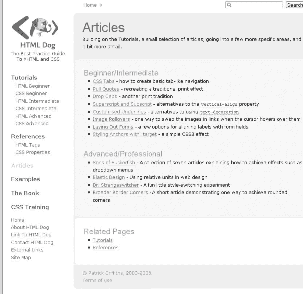

**图 1.7** 作者样式表位于浏览器样式表之上。

## 文章

在教程的基础上，精选了一些文章，深入探讨一些更具体的领域，并提供更详细的说明。

### 初级/中级

- [CSS标签页](https://www.htmldog.com/articles/tabs/) - 如何创建基本的标签式导航
- [引述文字](https://www.htmldog.com/articles/pullquotes/) - 重现传统的印刷效果
- [首字下沉](https://www.htmldog.com/articles/dropcaps/) - 另一种印刷传统
- [上标和下标](https://www.htmldog.com/articles/superscript/) - `vertical-align`属性的替代方案
- [自定义下划线](https://www.htmldog.com/articles/underlines/) - 使用`text-decoration`的替代方案
- [图片翻转](https://www.htmldog.com/articles/rollovers/) - 当光标悬停在链接上时交换链接中图片的一种方法
- [表单布局](https://www.htmldog.com/articles/forms/) - 将标签与表单字段对齐的几种选项
- [使用:target为锚点添加样式](https://www.htmldog.com/articles/target/) - 一个简单的CSS3效果

### 高级/专业

- [Suckerfish之子](https://www.htmldog.com/articles/suckerfish/) - 七篇文章的集合，解释如何实现下拉菜单等效果
- [弹性设计](https://www.htmldog.com/articles/elastic/) - 在网页设计中使用相对单位
- [奇异的切换博士](https://www.htmldog.com/articles/strangeswitcher/) - 一个有趣的小型样式切换实验
- [更宽的边框圆角](https://www.htmldog.com/articles/bordercorners/) - 一篇简短的文章，演示实现圆角的一种方法。

### 相关页面

- [教程](https://www.htmldog.com/guides/)
- [参考手册](https://www.htmldog.com/reference/)

© Patrick Griffiths, 2003-2006.
[使用条款](https://www.htmldog.com/terms/)

图 1.8 用户也可以决定将自己的样式表覆盖在上面，这可以通过反转前景和背景颜色或使文本变大来帮助提高可访问性。


## 将CSS应用于HTML

现在你应该对CSS的工作原理有了概念，但它本身相当无用。你需要将其附加到HTML上——而实现这一点有多种方法。

## 内联CSS

内联CSS是一种“快速修复”方法，有时用于测试，但通常不鼓励作为应用CSS的方式。

它依赖于`style`属性（该属性实际上已弃用，即被更新的东西取代，并注定在XHTML 1.1中过时），大致如下所示：

```
<p style="color: red;">Don't eat the pomegranate!</p>
```

虽然这利用了CSS语言，但它失去了CSS著名的许多巨大优势——即分离表现与结构，以及能够从单一来源进行全局样式更改的能力。

## 嵌入式CSS

如本章前面所述，`style`是另一个可以在`head`元素内使用的标签，用于将特定于页面的或嵌入式的CSS应用于HTML页面。

这种方法比内联CSS好得多（因为它将表现从`body`中拉出），但仍然没有完全分离结构和表现（因为HTML页面中仍然存在表现）。它应该仅在样式仅适用于该单个页面时使用。

本书中提到的“骨架”网页示例主要使用嵌入式CSS，主要是为了让你更容易地看到发生了什么，也因为它们是独立的单页。

那么，让我们暂时涉足HTML的领域。

`style`元素用于在页面级别定义CSS。它位于`head`元素内部，其内容就是一大堆CSS规则，大致如下：

```
<head>
    <title>Bujumburra</title>
    <style type="text/css">
    body {
        font-family: arial, Helvetica, sans-serif;
        color: black;
    }
    /* etc. etc. */
    </style>
</head>
```

注意，在开始的`style`标签内是`type`属性，它告诉浏览器该元素的内容。这是必需的，就我们的目的而言，其值应为“text/css”。

你还可以使用`media`属性，它指明哪些媒体与这些样式相关。其值可以是`aural`、`braille`、`embossed`、`handheld`、`print`、`projection`、`screen`、`tty`（电传打字机）或`tv`（电视），但不要期望除了`screen`和`print`之外有太多支持。你也可以设置`media="all"`，但这与没有任何`media`属性是一样的。

> CSS注释
你可以在CSS中的任何地方放置注释，如下所示：
/* 这是一个注释 */
就像HTML注释一样，它不会为CSS规则添加任何内容，只是为查看代码的人提供说明。

## 外部CSS

外部CSS是应用CSS的绝佳方式。它涉及将CSS规则放在一个完全独立的文件中（扩展名为“.css”），HTML页面可以通过多种方式链接到该文件。

第一种也是最传统的方式是使用`link`标签，它需要放在`head`元素内（见上文），如果CSS文件名为“somefile.css”，则如下所示：

```
<link rel="stylesheet" type="text/css" href="somefile.css" />
```

你也可以操作嵌入式样式表，简单地使用`@import`规则引入外部样式表。你不是将CSS规则放在开始和结束的`style`标签之间，而是这样做：

```
<style type="text/css">@import url("somefile.css");</style>
```

你还应该能够为`@import`规则添加条件，以将样式表定向到特定的媒体类型，例如打印：

```
<style type="text/css">@import url("somefile.css") print;</style>
```

Internet Explorer不喜欢这样，但你仍然可以通过在开始的`style`标签中应用`media`属性来实现这样的条件，就像在`link`标签中一样：

```
<style type="text/css" media="print">@import url("somefile.css");
</style>
```

这种`@import`方法有时比`link`方法更受青睐，因为它对那些没有牢固掌握CSS的浏览器（如Netscape 4.x）隐藏了整个CSS文件，这些浏览器实际上可能会造成一团糟。这样的浏览器随后将简单地应用其自身的浏览器样式表，如果HTML构建正确，这应该是完全可用的。

## 多个样式表

虽然在大多数情况下只需要一个作者样式表，甚至更可取（将网站的所有表现保存在一个文件中），但拥有多个样式表可能是有利的。对于大型、多部分的网站，可能有一系列仅适用于某个部分的CSS规则。如果这些规则相当大，那么其他部分下载它们将是不必要的，或者只是这样管理起来更容易（特别是如果你有不同的开发人员负责不同的部分）。在这种情况下，你可以有一个特定于该部分的CSS文件，该文件与网站的核心样式集一起应用于页面。

有多种方法可以应用多个样式表（例如，简单地使用两个`link`元素），但也许最简单的是使用`@import`规则。一个HTML页面可以简单地链接到部分样式表，并在该样式表内，通过`@import`引入核心样式。因此，在部分样式表的顶部，你可以简单地写：

```
@import url("/css/core.css");
```

就像上面描述的将外部CSS应用于页面的方法一样，这将导入另一个CSS文件，并本质上成为该文件的一部分。这样做没有次数限制（一个样式表可以导入另一个样式表，该样式表又导入两个样式表，每个样式表又导入另一个样式表，例如），它们都将“层叠”在一起（就像“三个样式表”一样），并作为一个幸福的联姻家庭共同生活。

## 文本

**图片、音乐、动画**，甚至电影都以令人难以置信的丰富性遍布网络。然而，在构成网络的海量字节中，最常见的信息形式是普通的文本。

没有文本，你就无法拥有超文本；没有超文本，你就无法拥有超文本标记语言。HTML中的*T*对于网页至关重要，因此这似乎是一个很好的起点，开始在这些页面上放置一些有形的内容。

在本章中，我们将首先研究如何正确地构建文本，用HTML赋予其意义，然后研究如何使用CSS操作这些结构化文本，使其看起来完全符合你的要求。

## 构建文本

标记文本是许多网页设计师陷入一些不良实践的领域。在CSS出现之前，HTML不得不被粗暴地使用以获得一些基本的表现，导致臃肿、难以访问、不灵活的垃圾。不良实践仍然很常见，包括误用`br`（换行）标签来在视觉上分隔文本块，而应该使用`p`（段落）标签；以及增加纯文本的大小和粗细，使其看起来像标题，而应该使用标题标签（如`h1`）。请记住，尽管大多数浏览器会以类似的方式渲染某些元素，但重要的（甚至显著的）不是每个标签使元素看起来像什么，而是它们赋予了什么*意义*。

## 38 | 第2章：文本


## 欢迎回来！

@media大会将于6月15日至16日重返伦敦，规模更大，比以往更好。对于任何参与网页设计的人来说，这都是年度盛事。加入我们，与世界上一些最受尊敬的专家一起讨论网页设计的最新方法。

- 导航
- 会议
- 演讲者
- 日程安排
- 场地
- 新闻与按钮
- 去年
- 联系我们
- 新闻与讨论
- 注册
- 代表区域

## 什么？

@media是欧洲首屈一指的国际网页设计会议，汇集了世界上一些最受尊敬的网络专家，讨论网页设计领域的最新行业动态、最佳实践思维和尖端技术。

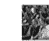

## 终场哨响

@media 2006已经结束，可以安全地宣布取得了巨大成功。明年它将回归，但与此同时，请关注本网站以获取演示文稿幻灯片和播客的链接。

## 去年

@media 2005取得了巨大成功。@media 2006承诺将更大更好。

这是不可思议的两天，感觉比实际时间短得多。我希望它永不停止。高水平的专业知识让我大开眼界。

专家小组将探讨网页设计的多个方面，涵盖用户界面设计、网络标准、CSS、脚本和可访问性等主题。

繁忙的多轨道两天会议日程进一步扩展，提供了大量宝贵的社交时间和晚间活动。

## 谁？

著名的演讲者将从美国、加拿大、瑞典、比利时、荷兰和英国来到@media。你可能从阅读的书籍和访问的网站中认出的名字包括Eric Meyer、Dan Cederholm、Andy Clarke、Molly Holzschlag、Jeffrey Veen、Jon Hicks和Dave Shea等等，仅举几例。


## 赞助商


如果去年的情况可以作为参考，演讲者将与来自各行各业的代表一起出席：教育工作者、学生、设计师、开发人员、顾问和项目经理、慈善机构、政府部门、设计工作室和跨国公司，不仅来自英国，而且来自整个欧洲乃至更远的地方。

@media 2006由Vivabit愉快地组织，并在Event Wax的帮助下举办。


## 何地？

@media 2006将在伦敦市中心威斯敏斯特心脏地带的著名QEII会议中心举行。它与英国、欧洲和世界其他地区有良好的交通联系，你会发现附近有很多酒店、酒吧和餐厅。会议中心位于议会大厦和威斯敏斯特教堂几乎就在场地门口。

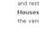

## 立即注册！

“立即预订以避免失望！”是的，我们知道每个人都这么说，但考虑到名额有限，而且去年的活动很快就售罄了，我们是认真的。更新：太晚了 - 已售罄！

## 闲聊

哦，顺便说一句，我们认为设置一个小讨论区是个好主意，这样你就可以让我们知道你对会议计划的看法，安排聚会，或者随便聊聊你喜欢的任何事情。

图2.1 本章的插图取自@media 2006网站（www.vivabit.com/atmedia2006/）。


尽管为引文、缩写和计算机代码等文本元素添加标记似乎并非必要（尤其是在不需要特定样式的情况下），但根据使用`p`标签标记段落的相同逻辑，其他元素也应使用相应的标签。

## 基本文本元素：段落、换行与强调

或许最重要、最基本的文本相关元素是段落（`p`），这至少是因为在任何内容丰富的网页中，它通常构成了内容的主体。

```
<p>大家好。欢迎来到段落的世界。</p>
<p>这将是第二个段落……</p>
```

你还可以使用`br`标签来插入换行：

```
<p>大家好。<br />欢迎来到换行的世界。</p>
```

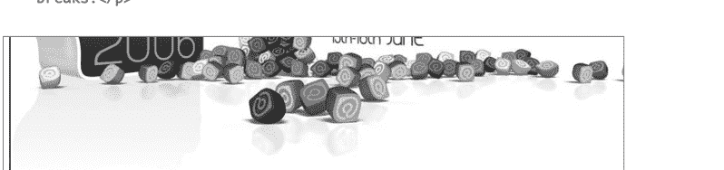

## 去年

@media 2005 取得了巨大成功。350人聆听了**杰弗里·泽尔德曼**、**乔·克拉克**、**莫莉·霍尔茨施拉格**和**道格·鲍曼**等人的演讲，并获得了与其他志同道合、具有前瞻性的网页设计师交流的独特机会。他们不仅来自英国各地，还来自欧洲乃至更远的地方。

## 照片

我们为您精选了一些照片供您浏览，这些照片或许能让您对@media会议的内容有所了解，或者如果您是去年的与会者，也能唤起一些美好的回忆！

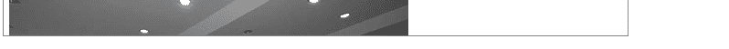

**图 2.2** 一个非常常见、简单的页面结构，包含段落和标题。这里展示的是未经作者样式表修饰的原始状态，即使是浏览器的默认样式也能让我们一目了然——我们有成块的文本，即段落，以及加粗的大标题。其中甚至还有一些强烈的强调。

两个`br`并不能构成一个`p`

重要的是要记住，换行符与开始一个新段落是不同的，这是该元素常见的误用——两个换行符可能看起来像是开始了一个新段落，但当我们谈论HTML时，外观并不代表任何意义。换行符只应在文本流中存在逻辑中断时使用，例如地址的新行或诗歌中的新行。正如您将在本章后面看到的，段落的外观，包括它们之间的间距，可以被操控，应该被操控，并且使用CSS更容易操控。

要强调段落内的文本——或其他地方，如标题（见下一节）或表格单元格（见第8章“表格”）——有两个标签适合这项工作：`em`（强调）和`strong`（强烈强调）：

```
<p>你是在看<em>我</em>吗？你是在看<strong>我</strong>吗？</p>
```

不是`i`和`b`！

`em`和`strong`不是旧的、用于表现的`i`（斜体）和`b`（粗体）标签的替代品。虽然大多数浏览器默认会将它们显示为斜体或粗体，但重要的是它们赋予了意义，而`i`和`b`只赋予了表现形式（这是CSS的工作）。一般的强调不仅仅是视觉上的——例如，它也可以通过声音表达出来，而粗体和斜体对盲人来说毫无意义。

## 标题

在大多数书面文档中，段落构成了内容的主体，但通常需要用标题和副标题来划分内容。

我们有六个标签可以使用：`h1`（最高级别标题）、`h2`、`h3`、`h4`、`h5`和`h6`（最低级别副标题）。

www.htmldog.com/examples/headings1.html

其理念是按顺序使用这些元素，页面标题使用一个`h1`元素，然后任意数量的`h2`元素用于副标题，任意数量的`h3`元素用于副标题的副标题，依此类推。它们应按顺序使用，因此，例如，`h4`应该是`h3`的副标题，而`h3`应该是`h2`的副标题。请记住，如果标题的默认样式看起来太大或太小，不用担心——您可以使用CSS将其调整为您想要的大小。

```
<h1>标题</h1>
<p>这都是关于标题的。</p>
<h2>第一个副标题</h2>
<p>第一个副标题叫鲍勃。鲍勃前世是个小雕像清洁工。</p>
<h2>第二个副标题</h2>
<p>第二个副标题叫拉贝拉。她以前是个扫烟囱的。</p>
<h3>拉贝拉的扫烟囱工作</h3>
<p>只要给五颗豆子扫一个烟囱，拉贝拉仍然可以说服去扫烟囱。</p>
<h2>第三个副标题</h2>
<p>第三个副标题叫约翰。他没什么特别有趣的地方。</p>
```

www.htmldog.com/examples/headings2.html

> 如果是标题，就用相应的标签标记它

如果某样东西是真正的标题，那么你应该使用这些标签之一，而不是仅仅通过样式让段落或其他文本看起来更大，这在过去是一种常见的不良做法。

你会发现，默认情况下，浏览器会以各种大小和间距将这些标题显示为粗体，但是，与段落（以及所有其他HTML元素）一样，CSS可以控制所有这些，因此你可以让它们以你选择的任何方式显示。

## 引文

随着本章这部分的深入，你会发现一些较少使用的标签，它们标记非常特定类型的文本。仅仅因为它们比段落、强调或标题使用得少，并不意味着它们不重要。坚持赋予意义的原则，如果你遇到一段内容可以通过使用这些标签变得更有意义，你应该始终尝试使用这些特定的标签。例如，如果你有一段引文或引用，你应该使用`blockquote`、`q`或`cite`将其标记为引文。

`blockquote`用于大型的、通常是独立的、块级的引文。其内容必须由其他块级元素组成，在实践中通常是`p`元素。

如果引文的来源可以在网上找到，你可以使用`cite`属性为`blockquote`提供更多一点信息。

```
<blockquote cite="http://www.htmldog.com/guides/htmladvanced/text/">
<p>blockquote 设计用于大型的、独立的引文，而 q（引用）用于较小的内联引用。</p>
</blockquote>
```

> **引文来源**
如第1章所述，当`cite`属性（其值应为URI）不适用时，可以使用通用的`title`属性，并且通常也用于显示引文或引用的来源。

`q`也可用于较小的、内联的引用（你也可以像使用`blockquote`一样使用`cite`属性）。

有点令人困惑的是，还有一个`cite`标签，可用于标记引用。

```
<p>所以我问了<cite>鲍勃</cite>关于引文的事，他说<q>我对引文的了解和我对养鸽子的了解一样多</q>。幸运的是，我找到了HTML Dog，它说……</p>
```

## 引用

@media 2005 的反馈非常出色。所有人都度过了愉快的时光，以下从反馈表和博客评论中随机选取的这些引用就是证明。

> 这确实是一次很棒的经历，我短期内不会忘记。社交和教育方面都非常出色。
*彼得·J·兰伯特*

> 我原以为第一届会议会是“试水”，场地会很基础，但事实并非如此。它在伦敦南岸的一个豪华地点举行，两天的活动组织得非常流畅。
*乔恩·希克斯*

> 我遇到了非常有趣的人，我真的很享受在这里的时光。我认为这是一个很棒的活动，并且会继续举办下去。
*弗拉维·达万佐，利穆赞经济发展局*

> 能听到所有演讲者的演讲并与他们面对面交流真是太棒了。组织得非常出色！明年见。
*卡罗拉·哈克，Mediaworx*

图 2.3 当它是引文时，就必须标记为引文。在这些漂亮的引用小图标下面是`blockquote`，引用者的名字用`cite`元素标记。

## 缩写和首字母缩略词

同样，我们正在变得具体，但如果你遇到缩写，你应该将其标记为缩写。

`abbr`可用于缩写——单词或短语的缩写形式。例如，*HTML*是一个缩写，*CSS*也是。

你也可以使用`acronym`，但请记住，首字母缩略词要具体得多——它是一个*可发音的*缩写，由首字母组成


## 预格式化文本与计算机代码

如果你想在 HTML 中标记代码，有一个专门的标签，那就是 `code`。

```
<code>nascaristhedullestofallmotorsports=true;</code>
```

甚至还有一个标签 `var`，用于表示计算机代码中的变量：

```
<code><var>nascaristhedullestofallmotorsports</var>=true;</code>
```

`samp` 是 `code` 的另一个近亲，用于定义示例输出，例如来自计算机程序的输出：

```
<p>The result will either be <samp>Kid</samp> or <samp>Koala</samp>.</p>
```

大多数元素不太关注空白字符，即空格、制表符和回车符等。例如，在 `p` 元素中，如果文本中有连续的空格，或者你开始新行，最终结果实际上会被截断——浏览器并不认为空白字符有多少意义。

**图 2.5** 如果是计算机代码，女士们先生们，它就应该放在 `code` 元素中。就这么简单。

`pre` 元素略有不同——空格、制表符和换行符变得与字母、数字和其他字符一样，成为内容的重要组成部分，而浏览器默认渲染这些空白字符的方式（与大多数元素的默认渲染不同）也反映了这一点。

`pre` 最常用于标记计算机代码块（其中缩进等可能具有意义且很重要）。

```
<pre><code>
&lt;div id="intro"&gt;
&lt;h1&gt;Some heading&lt;/h1&gt;
&lt;p&gt;Some paragraph paragraph thing thing thingy.&lt;/p&gt;&lt;/div&gt;
</code></pre>
```

最后一个奇特的标签是 `kbd`，它专门用于提示用户应输入的文本：

<p>Now type <kbd>kumquat</kbd>.</p>

## 编辑插入与删除

你用过 Microsoft Word 中的“修订”功能吗？它可以用来显示插入和删除，当多个作者处理同一文档时，这会很有帮助。HTML 文档正是如此：文档，很像 Word 文档。尽管可能不如在文字处理中那么有用，但 HTML 也有“修订”的等效物，它们是 `ins`（用于插入）和 `del`（用于，等等……删除）。

你可以使用 `datetime` 属性，其值（格式为 YYYYMMDD）可以说明插入或删除发生的时间。就像引用一样，你也可以使用 `cite` 属性，在这种情况下，它旨在指向解释为何进行给定更改的信息。

```
<p>Patrick was walking down the road when he saw a <del datetime="20040329">fluffy kitten</del><ins cite="http://www.htmldog.com">giant rabid snarling mutant saber-toothed goat</ins>.</p>
```

值得注意的是，`ins` 和 `del` 有一个特殊之处：它们既可以作为内联元素（如前面的示例），也可以作为块级元素（例如包含多个段落）。但是，你应该注意，当 `ins` 和 `del` 用作内联元素时，它们不能包含块级元素。例如，以下用法是不合法的：

```
<p>
<ins><div>giant rabid snarling mutant saber-toothed goat</div></ins>.
</p>
```

记住（来自第 1 章“入门”），你仍然不能将块级元素放在内联元素内，所以如果你打算让 `ins` 元素作为内联元素，那么它就不能包含块级元素。

> 默认编辑样式

遵循文字处理的传统，插入通常显示为带下划线，删除则显示为带删除线。当然，这种默认样式可以通过 CSS 更改。

## 多语言与双向文本

如第 1 章所述，`xml:lang` 属性几乎可以在任何 HTML 标签中使用，以定义其内容的语言，但有时一种语言也需要以与其周围内容不同的方向阅读。

`bdo` 标签也可用于定义双向文本，例如那些阅读方向与默认语言不同的语言（例如，在英文文档中的希伯来语）。

必需的 `dir` 属性用于定义文本的方向，其值可以是 `ltr`（从左到右）或 `rtl`（从右到左）。

```
<bdo dir="rtl">smug desserts</bdo>
```

## 地址

……甚至还有一个标签来标记你的地址。

`address` 非常专门用于标记页面或页面主要部分（如联系表单）的联系信息，例如街道地址。

```
<address>
HTML Dog House<br />
HTML Street<br />
Dogsville<br />
The Oligarchic Republic of Dogland
</address>
```

## 文本样式

太好了。现在你已经掌握了用 HTML 构建文本的艺术。如果你在浏览器中查看这些元素的默认视觉渲染，很可能它们看起来并不完全是你想要的样子。浏览器只能在建立一些基本样式方面做到这一步；剩下的就靠你和你的朋友 CSS 了。通过这里概述的文本样式属性，你可以完全控制字体类型、大小、颜色和间距。

## 字体

因为一个使用许多不同字体的网页看起来就像一只患有皮肤病的河马一样“热门”，你可能不会经常想要更改字体样式——使用 `font-family`。在大多数情况下，你会将其应用于 `body`，为整个页面设置基本字体，然后可能只在某些特定元素上谨慎使用。

`font-family` 的值可以是单个字体名称（如果由多个单词组成，应使用引号括起来），也可以是多个字体名称，用逗号分隔。这样，如果浏览器找不到首选字体，它会继续查找列表中的下一个。这是为了在首选字体不可用或不同操作系统上出现名称不同的类似字体时提供备份。例如，传统上你会在 PC 上找到 `Arial` 字体，但在 Mac 上是 `Helvetica`，因此指定这些字体可以充分覆盖两者。最后，最好用一个通用字体关键字（如 `serif`、`sans-serif` 或 `monospace`）来备份整个字体包，以防万一所有其他字体都失败。

```
body { font-family: "Times New Roman" }
h2 { font-family: arial, helvetica, sans-serif }
```

> 浏览器只能显示用户计算机上安装的字体

你可能从一堆杂志封面光盘和互联网下载中收集了 32 亿种字体，但如果查看你网页的人没有在他们的计算机上安装相同的字体，那么计算机根本就无法应用它们。你需要仔细选择指定的字体。有一些“安全”字体，大多数用户的计算机上都会有——他们可能有 Arial 或 Helvetica，但如果你指望 Slug Invader Hieroglyphics 或 Curly Gothic Roman Dings Bold Condensed 5，那可能就有点冒险了。

如果你真的想使用一个相对冷门的字体，你可以使用逗号分隔的值来指定那个非常具体的字体，以防万一用户有它，但同时通过指定更安全的字体作为浏览器的后备方案。在这种情况下，可能最好在备用字体下测试网页……

```
body { font-family: "Slug Invader Hieroglyphics", arial, helvetica, sans-serif }
```

**图 2.6** 这里使用了多个后备方案来实现一种半通用的字体。大多数 Windows PC 都配备了 Century Gothic 字体，而大多数 Mac 则安装了类似的 Avant Garde。因此，使用类似 h1, h2 { font-family: "Century Gothic", "Avant Garde" } 的设置，标题会比其余文本（由 body { font-family: Verdana, Geneva, Arial, Helvetica, sans-serif } 设置）得到一点特殊处理。


## 颜色

正如第1章中已提到的，`color` 和 `background-color` 属性可用于指定网页上几乎所有元素的颜色。虽然 `background-color` 可用于文本元素以外的其他元素，但 `color` 属性（即前景色）本质上仅适用于文本（尽管它也可应用于边框——参见第5章“布局”）。

```
body {
    font-family: "Times New Roman", Times, serif;
    color: white;
    background-color: black;
}
code { color: #900; }
blockquote { background-color: #efe; }
```

> **基础颜色**

与 `font-family` 类似，通常的做法是为 `body` 应用一种颜色，这将设置页面的基础文本颜色，并被所有文本继承。当然，如果需要，各个元素随后可以单独设置颜色。

## 大小

`font-size` 设置字体大小。嗯，这很明显。

计算机显示器最常用的单位是 `px`、`em`、`%` 和关键字（如 `small`、`medium` 或 `large`——完整列表请参阅 CSS 属性附录），尽管在处理其他类型的媒体时，做法会略有不同（参见第10章“多种媒体”中的“打印样式”）。

```
body { font-size: 80%; }
h1 { font-size: 2em; }
```

### 大小示例

图2.6也是字体大小的一个好例子。页面以80%的字体大小开始。然后 `h1` 设置为4em，`h2` 设置为2em，`h3` 设置为1.5em。

### 绝对值与相对值 I

那么，在计算机屏幕上设置文本大小，应该使用哪种单位——是像像素这样的绝对单位，还是像em这样的相对单位？

用em。就这么简单。不应该使用像素来设置文本大小。

嗯，好吧，其实没那么简单。实际上，任何相对于屏幕大小的单位都可以（所以不是像素，无论谁试图告诉你像素是相对单位）——百分比和字体大小关键字同样适用。

原因是什么？因为这些单位允许文本具有弹性——可以根据用户的文本大小设置进行扩展或收缩。它适应了用户的偏好。

当CSS出现并开启了对网页视觉效果的控制时，许多人抓住了这样一个事实：他们第一次可以使用像素来定义字体大小。这种像素级的完美控制听起来是件好事——作为设计师，你可以完全控制最终效果。你电脑屏幕上看到的很可能就是用户在他们屏幕上看到的。但这有点偏离了Web的本质，Web是一个如此灵活的东西。

问题的关键在于：使用像素设置的文本比使用em设置的文本可访问性更差。可用性应该足以说服——如果用户偏好某种方式（例如更大甚至更小的文本），那么当他们的偏好得到满足时，他们会反应更好。但这不仅仅关乎可用性和偏好。对许多人来说，这关乎必要性：如果用户无法舒适地阅读文本，那么他或她将受益于能够调整该文本的大小。可访问性不仅仅关乎失明和屏幕阅读器——视力障碍就足以引起这种关注。而视力障碍是我们随着年龄增长都会遇到的问题。

计算机屏幕上的网页不是一张印刷纸。尺寸可以改变，用户偏好可以得到满足。这是一个很棒的功能。大多数人都承认这一点，但即使是那些承认的人也继续使用像素，因为他们觉得别无选择。

问题出在Internet Explorer上。第一个问题（对像素爱好者设计师来说）是，虽然像Mozilla这样的浏览器提供了“文本缩放”功能，可以放大甚至像素大小的文本，但IE没有。对IE来说，一个像素就是一个像素。如果设计师指定了像素，浏览器就提供像素。所以当用户选择更改文本大小设置时，像素大小的文本不会发生任何变化。

因此，为了适应Internet Explorer的文本大小可访问性功能，相对单位是唯一的选择。但这里出现了第二个问题...

例如，当你用em指定字体时，Internet Explorer中大小之间的跳跃如此之大，以至于在“较小”设置下，文本变得难以阅读。而且由于“较小”是一个流行的设置，你正在阻碍可访问性——即使是视力正常的人也是如此，更不用说其他人了。

但后来百分比拯救了局面。通过将body的初始字体大小设置为百分比，然后使用em，IE文本大小设置之间的跳跃变得更小，从以“最小”浏览到以“最大”浏览的每个人都可以满意。

```
body { font-size: 80%; }
h1 { font-size: 2em; }
h2 { font-size: 1.5em; }
```

归根结底，使用相对单位设置文本大小确实有好处，而且没有真正的理由不这样做。

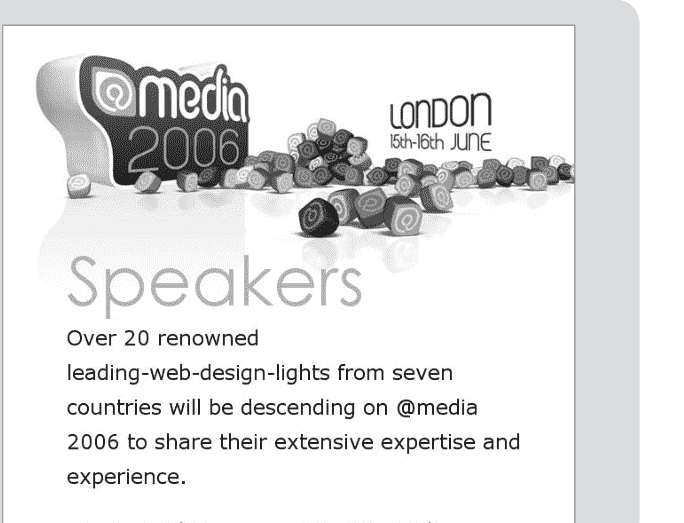

**图2.7** 因为字体大小都是用em设置的（在初始百分比设置之后），用户如果愿意，可以增大文本大小，这是一个很好的可访问性优势。如果它们是用像素设置的，大多数使用IE的网络冲浪者将无法获得这种好处。

你可以在 www.htmldog.com/articles/elasticdesign/ 上阅读更多关于“弹性文本”的内容，该文章还涵盖了在布局中使用绝对值和相对值的优缺点——这项技术将在第5章中探讨。

## 行高

你可以调整文本中行的高度，例如段落，而无需调整字体大小，就像文字处理器中的行距一样。`line-height` 是一个方便的小工具——如果使用得当，它可以让你的文本更易读。

```
p { line-height: 1.5 }
```

### 无后缀

行高是仅有的两个不需要后缀的属性之一（另一个是 `z-index`——参见第5章）（尽管你可以指定任何长度或百分比，如果你愿意的话）。`line-height: 1.5` 等同于 `line-height: 1.5em`。

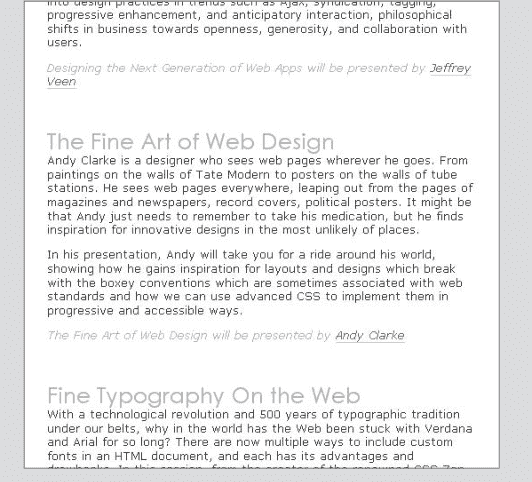

**图2.8** @media 2006网站的基础行高设置为1.7，如本章其余图所示。如果保持默认值，文本会显得更紧凑，更难阅读。

## 粗体和斜体

别忘了我们不再使用HTML进行呈现——甚至不允许使用 `b` 或 `i` 标签。当我们想要设置文本的粗细或倾斜时，有CSS可以更好地完成这项工作。

`font-weight` 设置字体的粗细。迄今为止最常用和实用的值是 `bold` 或 `normal`。

```
a { font-weight: bold }
h2 { font-weight: normal }
```

可以使用 `font-style` 将文本设置为斜体（或取消斜体），使用 `italic`（或 `normal`）作为值。

```
h1, h2 { font-style: italic }
```

## 大写和小写

如果你真的想硬核一点（为什么不呢？），你甚至不应该在HTML中将单词全部大写，只是为了实现标题或强调的某种外观。与其使用 `<h1>THIS IS A DAMNED FINE HEADING</h1>`，为什么不试试 `<h1>This is a damned fine heading</h1>` 并尝试 `font-variant` 或 `text-transform` 呢？

`font-variant: small-caps` 会将小写字母转换为小型大写字母，但这可能不如 `text-transform` 有用，后者可以正确地（这里没有“小型大写字母”的含糊其辞）转换字母的大小写。`text-transform` 的值可以是 `capitalize`（将每个单词的首字母大写）、`uppercase`（每个字母大写）或 `lowercase`（每个字母小写）。

```
h1, h2 { text-transform: uppercase }
```

www.htmldog.com/examples/case.html

## font 简写属性

我们将在本书中多次遇到“简写”属性。它们是很好的快捷方式，使我们能够在一个属性中定义多种样式（否则这些样式可以单独定义），从而减少代码。起初它们可能比单独的、特定的属性更令人困惑，但你越习惯它们，你的代码就会越简洁。

`font` 可用于在一个属性中指定斜体、小型大写字母、粗细、大小、行高和字体名称。其值本质上是 `font-style`、

`font-variant`、`font-weight`、`font-size`、`line-height` 和 `font-family`，其简写格式为：`font: font-style font-variant font-weight font-size/line-height font-family`。其中，只有 `font-size` 和 `font-family` 是必需的。

```
p { font: italic small-caps bold 0.8em/1.5 arial, Helvetica, sans-serif }
.booba { font: bold 3.5em arial, helvetica, sans-serif }
```

> **font 将重置之前的样式**

在应用任何值之前，`font` 会将之前设置的 `font-style`、`font-variant`、`font-weight`、`font-size`、`line-height` 或 `font-family` 值重置为其初始设置。例如...

```css
.wooha {
  font-weight: bold;
  font-variant: small-caps;
  font: 2em arial;
}
```

...将不会应用粗体或小型大写字母，因为 `font` 声明出现在 `font-weight` 和 `font-variant` 之后，并且会毫不客气地重置它们。

## 下划线和删除线

`text-decoration` 可用于添加下划线、上划线、删除线，或使用 `underline`、`overline`、`line-through` 或 `none` 值来关闭任何现有的装饰（例如链接上的装饰）。

```
ins { text-decoration: none }
```

> ### 谨慎使用下划线
带下划线的元素通常被识别为链接（或者在编辑上下文中表示插入），因此你需要谨慎应用此样式。使用点状下划线（通过 `border-bottom: 1px dotted`）来设置首字母缩略词和缩写词的样式已成为一种流行的方式，以将其与普通文本区分开来，但即使这样做也可能会造成混淆。更多内容请参见第 3 章“链接”，包括如何使用边框和图像制作自定义下划线。

> ### 不要使用闪烁效果！
即使它在 IE 中有效，使用 `text-decoration: blink` 也是一个极其糟糕的主意。闪烁文本众所周知地不受欢迎，并且从可访问性的角度来看是糟糕的——而且也不是迈克尔·杰克逊那种方式。

## 字母和单词间距

好吧...现在我们面临着被 CSS 赋予的所有这些强大功能冲昏头脑的危险。如果随意使用，诸如自描述性的 `letter-spacing` 和 `word-spacing` 之类的东西可能会使你的页面看起来一团糟，但是，一如既往，明智地使用它（例如，用于标题中一些与常规不同的东西），结果可能会令人满意。

```
p {
    letter-spacing: 0.3em;
    word-spacing: 1em;
}
```

## 首行缩进

另一个植根于传统印刷样式但在网页上效果不太好的属性是 `text-indent`，它将文本框中的第一行文本缩进一个长度或百分比。

```
p { text-indent: 1em }
```

www.htmldog.com/examples/textalign.html

## 水平对齐

`text-align` 在块级框（如默认段落）内水平对齐文本，可以是左对齐（通常是默认值）、右对齐、居中对齐或两端对齐。

```
p { text-align: right; }
```

另一个警告：在网页上，左对齐文本比两端对齐文本更容易阅读，因此请谨慎使用 `justify` 设置。

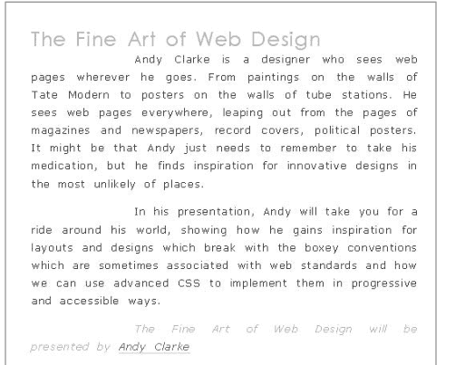

**图 2.9** 过度使用 `letter-spacing`、`word-spacing`、`text-indent` 和 `text-align`。

## 垂直对齐

`vertical-align` 并不像它最初听起来那么令人兴奋（因为我刚才知道你在那里变得兴奋了）。它仅适用于内联框（通常是文本），并不意味着将页面的块垂直对齐。在许多情况下，正如后面解释的那样，使用 `vertical-align` 有更好的替代方案。

值 `top`、`middle`、`bottom`、`text-top`、`text-bottom`、`sub`（下标）和 `super`（上标）依赖于被设置样式的框小于行中其余部分的部分或全部文本（否则它已经处于所有这些位置）。

也可以使用长度或百分比。

```
.power {
    font-size: 80%;
    vertical-align: super;
}
```

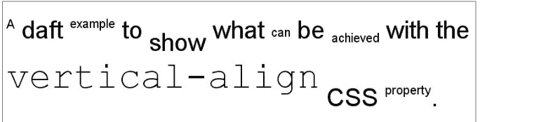

**图 2.10** 使用 `vertical-align` 属性可以将文本的任何部分向上或向下推到任意程度，但这样做会改变该效果所在行的高度。请参见 www.htmldog.com/examples/verticalalign.html。

你也可以通过使用定位（更多内容请参见第 5 章）来实现垂直对齐，这稍微复杂一些，但能给你多一点控制。请在 HTML Dog 网站上查看 *Superscript and Subscript* 文章（www.htmldog.com/articles/superscript/）和相应的示例（www.htmldog.com/examples/superscript.html）以获取更多信息。

## 更多文本样式技术

要实现更具体的传统印刷相关样式，你可以通过尝试其他 CSS 属性（特别是第 5 章涵盖的那些）来扩展你的文本样式选项。

例如，你可能对首字下沉情有独钟：

- www.htmldog.com/articles/dropcaps/
- www.htmldog.com/examples/dropcaps1.html、dropcaps2.html 和 dropcaps3.html

或者，你可能仅仅因为一两个引文而欣喜若狂：

- www.htmldog.com/articles/pullquotes/
- www.htmldog.com/examples/pullquotes1.html、pullquotes2.html 和 pullquotes3.html

## 链接

我们刚刚介绍了 HTML 中的 *T*，但正是链接赋予了它 *HT*——超文本是通过选择链接在不同位置之间移动的方法。

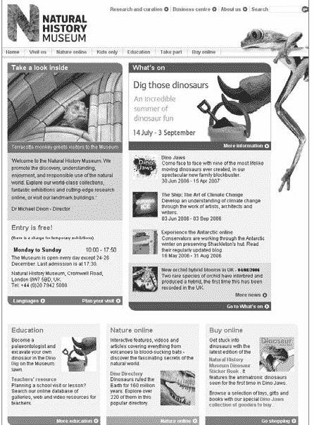

**图 3.1** 本章的插图取自伦敦自然历史博物馆网站（www.nhm.ac.uk）。

创建超文本链接其实并不困难；事实上，我们这里只讨论一个 HTML 标签。然而，这个独立的小家伙有很多需要考虑的地方，从链接的创建方式，到它们可以链接到的内容，再到你在样式化它们时拥有的无数选项（同时记住需要一些克制以尽可能保持它们的用户友好性），再到可访问性领域，这在链接方面尤为重要。

## 锚元素和超文本引用

那么我们使用什么标签呢？`link`？不。那是用于其他东西的（参见第 1 章“入门”）。哎呀，当然是小巧的 `a` 标签！没错：`a` 代表 *anchor*（锚点）。

什么？！

我们稍后会讲到这背后的原因，但 `a` 元素最重要的部分实际上是 `href` 属性（意思是“超文本引用”）。此属性的值指定链接的目标——当选择链接时浏览器应导航到的位置。

```
<a href="apage.html">A page</a>
```

> **URL**

统一资源定位器是你想要链接到的位置（在链接的情况下，是 `href` 属性的值），可以是网站、页面或任何其他文件。URL 的形式可能不同，具体取决于目标的位置——在同一页面上（例如“#something”——见下文“页面锚点”）；在同一文件夹中（例如“something.html”）；在同一站点上（例如“afolder/something.jpg”或“../alowerfolder/something.html”）；或者完全在不同的服务器上（例如“http://www.htmldog.com/guides/”）。

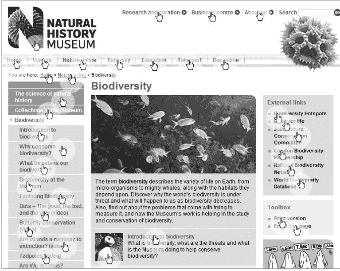

**图 3.2** 一大堆链接，一大堆 *a* 元素。

## 页面锚点

好的，这就是为什么我们使用一个叫做“锚点”的标签的原因。在很久以前，当巨大的爬行动物还在四处漫步，所有哺乳动物都像鼩鼱一样小的时候，“页面锚点”——可以通过选择链接跳转到的页面中的点——是用 *a* 元素定义的。

如今，这样的显式页面锚点元素不再需要，因为任何带有 `id` 属性（参见第 1 章）的元素都可以充当锚点。

链接到完全不同的页面，如 `href="something.html"`，非常简单，但向下（或向上）跳转到页面锚点也同样简单。要引用页面锚点，你只需在要跳转到的 `id` 名称前加上一个井号——#。# 字符后面的标签被称为“片段”。因此，在下面的示例中，选择“nitty-gritty”链接


## 链接状态：链接、已访问、悬停、聚焦与激活

在使用 CSS 时，有五种链接状态变得尤为常见：

1.  链接尚未被访问时的状态
2.  链接已被访问过的状态
3.  链接被悬停时的状态
4.  链接获得焦点时的状态（例如，通过键盘输入切换到该链接时）
5.  链接被选中时的状态。

默认情况下，浏览器倾向于将未访问的链接渲染为蓝色，已访问的链接渲染为紫色（或在 IE 中是令人不适的蘑菇汤棕色），激活的链接渲染为红色，但你可以根据自己的选择来设置这些状态以及悬停和聚焦状态的样式。

通过单独使用选择器 `a`，你可以设置适用于所有链接状态的属性（例如 `a { color: blue }`）。这是一种常见的做法，但应该为各个链接状态添加样式，以充分利用它们能为用户提供的宝贵提示。要独立更改链接状态的属性，你可以使用伪类 `link`（用于默认的未访问状态）、`visited`、`hover`、`focus` 和 `active`，如下例所示：

```
a:link { color: blue; }
a:visited { color: purple; }
a:hover { text-decoration: none; }
a:focus { background-color: yellow; }
a:active { color: red; }
```

**链接状态。** 通常会选择一种与周围文本形成对比的颜色作为链接色，但为了照顾色盲用户的需求，你不应仅依赖颜色。默认情况下，`a` 元素会应用下划线文本装饰。如果你决定让链接不带下划线，请考虑添加其他视觉提示，例如将其显示为粗体。不过请记住，下划线仍然与链接相关联，并且比任何其他视觉提示都更能使链接被立即识别，尤其是当它们出现在内容中间时。（例如，在定义明确的导航区域中的链接，这一点就不那么重要。）

**已访问状态。** 已访问状态众所周知地未被充分利用。通过利用 `visited` 伪类使链接看起来略有不同（例如，使用较浅的颜色），你可以向用户提供一个提示，让他们知道哪些页面他们已经访问过，哪些页面还没有——可用性测试表明，这种区分有助于用户理解网站。

**悬停状态。** 当光标移动到链接上时生效的悬停状态，也被证明对用户很有用。

可能且流行的组合包括使用 `a:link { text-decoration: none; }` 关闭链接的下划线，然后在链接被悬停时使用 `a:hover { text-decoration: underline; }` 使其出现。

显然，你也可以更改颜色，但在链接被悬停时更改其大小、字体粗细或字体样式通常并不明智，因为它可能会挤占周围内容的空间（因为它比悬停前的状态占据更多空间）。

因此，你可能会使用的基本悬停效果可能如下所示：

```
a {
    color: #900;
    font-weight: bold;
    text-decoration: none;
}
a:visited {
    color: #c00;
}
a:hover {
    color: #900;
    text-decoration: underline;
}
```

初始的、未访问的链接将没有下划线，但会是粗体以使其从周围文本中脱颖而出。已访问的链接颜色会稍浅，以区别于未被选中的链接。当链接被悬停时，将出现下划线。

**聚焦状态。** `focus` 伪类——尽管它可以为通过 Tab 键切换链接的人提供良好的视觉指示——实际上是这些伪类中帮助最小的，因为它不被 Internet Explorer 支持（尽管其效果可以通过 JavaScript 模仿——参见 www.htmldog.com/articles/suckerfish/focus/）。

**激活状态。** 最后，`active` 伪类可用于设置正在被选中（即正在被点击）的链接的样式，以提供额外的用户反馈。

**图 3.4** 好的，使用 `text-decoration` 为链接添加下划线相当常见。但你可以更花哨一点，应用边框甚至背景图像来实现更定制化的效果。请阅读 www.htmldog.com/articles/underlines/ 上的短文，或者直接查看这个基础示例：

www.htmldog.com/examples/underlines.html

## 可访问链接

链接是导航的基本工具——没有它们，网络将是一个非常难以浏览的地方。因此，特别关注链接的可访问性非常重要，以确保每个人都能有效地使用网页，即使他们不使用指针设备或依赖非视觉浏览器。本节介绍一些解决这些考虑因素的技术。

## Tab 键切换

那些不使用或无法使用鼠标等指针设备的人通常会使用键盘或其他输入设备通过 Tab 键“切换”链接，用户每按一次键（如 Tab 键）就可以循环切换链接。按照 Web 标准构建网页的好处之一是，内容往往会形成逻辑顺序，其中的链接也是如此，因此良好的 Tab 键切换顺序通常是自动形成的。

要显式设置页面上链接的 Tab 键切换顺序，你可以使用 `tabindex` 属性。数值决定了链接在顺序中的位置，1 表示第一个，2 表示第二个，依此类推。

```
<a href="wherever.html" tabindex="1">Wherever</a>
```

如果你认为某些链接对用户来说比其他链接更重要或更感兴趣，因此希望更快地聚焦到这些链接，你可能需要这样做。

## 访问键

链接也可以通过键盘快捷键访问，这消除了在到达所需链接之前需要通过 Tab 键切换大量链接的需要。这些快捷键可以使用 `accesskey` 属性来应用。

```
<a href="whatever.html" accesskey="w">Whatever</a>
```

当用户按下访问键加上 Ctrl 或 Alt（取决于平台）时，浏览器将焦点移动到分配给该访问键的链接。

并非总是有必要——甚至不现实地可能——为页面上的所有链接添加访问键，但建议将它们添加到主要链接，例如主导航。

> ## 访问键的（大）问题

访问键存在两个主要问题。

第一个是，尽管一些屏幕阅读器会读出访问键的值，但没有好的方法让用户直观地知道访问键是什么。由于没有普遍接受的标准，网站倾向于使用不同的访问键以不同的方式完成不同的任务。

传达访问键信息的建议包括明确说明访问键是什么（例如 `<a href="blah.html" accesskey="b">Blah (B)</a>`）或使用 CSS 在链接文本中下划线或以其他方式突出显示相应访问键的字母。这种方法的问题在于，你不能指望用户知道这些东西到底表示什么。大多数人不会想使用访问键，甚至不在乎它们是什么，更不用说知道它们是什么了。理想情况下，浏览器应该以某种方式独立于网页视图本身来传达访问键，但网页设计者对此无能为力。

传达访问键信息的另一种方法是有一个可访问性声明网页，明确说明它们是什么以及它们被分配给了哪些链接。这样做的缺点是，用户必须导航到另一个页面才能阅读他们真正感兴趣的页面。众所周知，用户很少这样做。

如果你选择使用访问键，尽管存在这个问题，还有*第二个*问题潜伏在暗处，会破坏乐趣。这个问题是访问键可能与浏览器快捷键冲突。用户可能想通过按键盘上的 Alt+F 从浏览器窗口菜单中选择“文件”菜单，但发现发生了意想不到的事情，因为 F 被分配给了网页上的一个链接并抢了风头。

要预测哪些键盘快捷键（如果有的话）可以安全地用作访问键是极其困难的。你可以弄清楚哪些快捷键适用于你的浏览器，甚至适用于多种浏览器，但不同语言的浏览器呢？麻烦在于，如果你想让你的网页吸引国际观众（毕竟我们谈论的是*互联网*），那么你习惯的所有那些浏览器菜单选项都会有不同的措辞，从而有不同的键盘快捷键。这意味着几乎任何分配给访问键的字母都会在某个地方与浏览器快捷键冲突，造成混淆，阻碍可用性，并违背了访问键的全部目的。


那么该怎么办呢？首先，由于这些不幸的问题，不必过于担心它们——它们只是不太实用。然而，如果你确实选择使用它们，请尝试坚持使用数字访问键，并选择那个很少访问的无障碍声明（例如图3.5中的那个）。

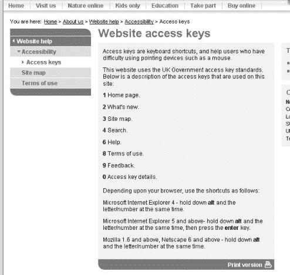

**图 3.5** 与许多拥有访问键的网站一样，NHM网站有一个页面解释它们是什么以及它们会将用户带到哪里。请注意，该网站也选择了数字访问键，以最小化与浏览器快捷键冲突的问题。

## 链接标题

与许多标签一样，你可以在开始的 `a` 标签内使用通用属性 `title`，以提供有关链接的更多信息，例如链接将把用户带到何处的描述。

尽管构成链接的文本应该描述目标，但如果它没有做到（例如，如果你被迫使用“点击此处”或“更多”作为链接文本），那么可以使用 `title` 来提供更多信息。不过，不要假设这能解决糟糕链接文本的问题——用户的屏幕阅读器不一定设置为读取链接标题。

## 弹出窗口

弹出窗口是严重的无障碍性禁忌，因为它们会意外地将用户导航到新窗口，并破坏“后退按钮”功能。然而，如果你发现自己处于使用它们的位置，可以采取一些步骤使其应用更具无障碍性。

首先，应使用链接标题来声明该链接将导致新窗口弹出。

其次，`href` 属性的值应该是弹出窗口中使用的页面，并且用于启动弹出窗口的 JavaScript 应返回 false。这样，如果用户没有 JavaScript 或禁用了它，弹出窗口的内容将被导航到，只是不在弹出窗口中。

```
<a href="eviltroll.html" title="在小弹出窗口中启动邪恶巨魔" onclick="popup(this); return false;">邪恶巨魔</a>
```

与普遍看法相反，你不需要用 `onkeypress` 事件复制 `onclick` 事件，尽管这似乎对于适应键盘输入和“点击”输入都有意义。这是因为 `onclick` 除了通过点击调用外，也会通过按键调用。

## 相邻链接

Web无障碍倡议（WAI）提出的另一个问题是，相邻链接之间应该用空格以外的东西分隔，以便屏幕阅读器能够识别它们。

由于屏幕阅读器技术的进步允许更清晰地读取链接，关于这一点的持续有效性存在争议，但相邻链接的问题仍然存在，如果可能的话应该避免它们。

用空格分隔导航链接很少不仅仅是展示性的，并且带有使用多个 `&nbsp;`（不间断空格）字符进行快速修复展示的坏习惯。在段落中有一系列不间断的、不相关的单词（或缩写）是糟糕的语法。

这种情况通常要求将此类项目放在列表中（参见第6章“列表”），但有时可能会出现更倾向于使用段落的情况。

例如，如果你有一些声称符合标准的链接，你可能想要“XHTML CSS WAI”，但如果将其放在段落中，则应该用逗号分隔，如“XHTML, CSS, WAI”，或者至少用一些分隔符，如“XHTML | CSS | WAI”。

在短语中找到相邻的单词链接到不同地方（例如 <a>as</a> <a>some</a> <a>have</a> <a>said</a>）并非完全不常见（尤其是在博客中）。这样做的麻烦在于，链接文本很少描述它将用户带到何处。

## 跳过导航

当视力正常的用户看到一个页面时，他或她不需要很长时间就能专注于内容——他或她不需要阅读所有导航选项。那些依赖屏幕阅读器的人不一定有这种奢侈。屏幕阅读器将按照 HTML 中出现的顺序读取整个网页的内容，这通常意味着在到达预期的信息内容之前，每页都会读出大量的导航元素。

考虑到这种情况，你可以创建一个链接，让用户选择跳过导航并直接进入内容。

```
<p class="accessaid"><a href="#content">跳到内容</a></p>
<!--[一大块导航]-->
<div id="content">
    <!--[具体内容]-->
</div>
```

这段代码应该看起来很熟悉——它只是一个指向页面锚点（由 ID “content” 定义）的基本链接。当选择“跳到内容”链接时，浏览器不仅会跳转到页面下方，屏幕阅读器继续阅读的点也会跳转到该点，从而跳过导航的阅读。

尽管可能有用户（例如有运动障碍的用户）利用视觉效果但不使用指针设备，跳到内容技术对他们有益，但使用 CSS 将此链接隐藏起来以避免混淆仍然是个好主意（对于绝大多数不需要使用它的用户来说，该链接似乎不会做任何事情）：

```
.accessaid {
    position: absolute;
    height: 0;
    overflow: hidden;
}
```

（这种隐藏方法以及示例中使用的属性在第5章“布局”中描述。）

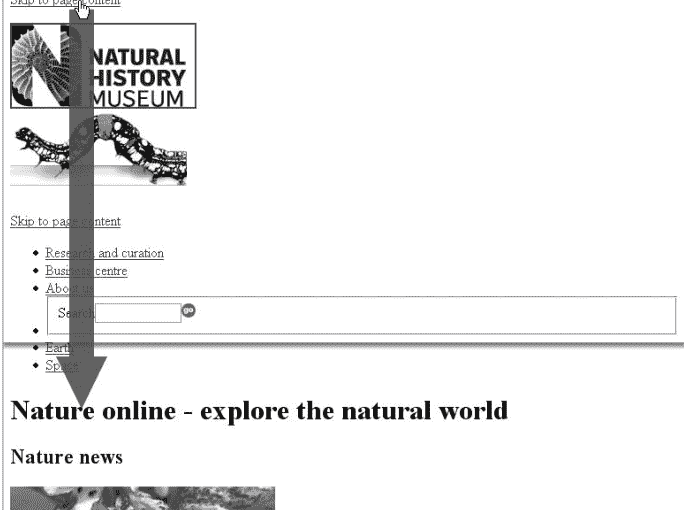

**图 3.6** 当 CSS 关闭时，跳过导航链接会显示出来。

另一方面，页面可以构建为内容在导航选项之前。在这种情况下，你同样可以为可能想要访问导航而不必阅读所有内容的用户添加“跳到导航”选项。

## 图像

**图像可能是**为网页增添视觉吸引力最明显的方式。如果你想要的不仅仅是最小化的网站，你会想以某种方式使用图像，无论是展示你的假期照片还是为布局添加圆角。图像过去也常被用作不可见的“间隔 GIF”来帮助布局页面，但现在我们有了 CSS 布局（参见第5章“布局”），我们可以告别那些疯狂的日子了。

你可以将图像的使用相当整齐地分为两类：一类用于内容（例如那些假期照片），一类用于展示（那些圆角），除非你刚刚第一次打开这本书并翻到这一页，否则你现在应该知道 HTML 应该用于前者，而 CSS 用于后者。

# 76 | 第 4 章：图像

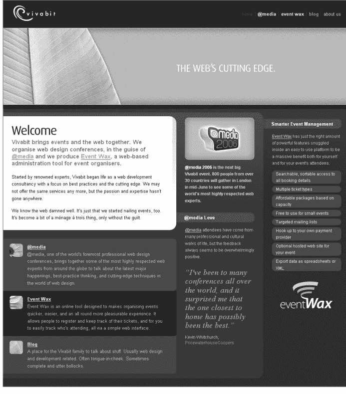

**图 4.1** 本章的插图来自 Vivabit 网站（vivabit.com）。

## img 元素

`img` 元素允许你将图像直接放入 HTML 中。

```

```

必需的 `src` 属性指向图像文件的位置。

同样必需的 `alt` 属性用于指定替代文本。它承担着重要的无障碍任务：它为那些无法看到图像本身的人（例如依赖屏幕阅读器的人）提供了图像的“替代品”。作为额外的好处，大多数浏览器在图像下载时使用此属性提供占位符文本。该值可以给出图像代表什么的概念，但不必如此——它可以是任何足以作为图像替代内容的东西。

www.htmldog.com/examples/images1.html

你也可以使用 `longdesc` 属性，其值将是图像描述的位置（以 URL 形式）。其背后的想法是，当有一个非常详细的图像（如地图或图表）可能需要一个扎实、冗长的解释时，你不一定想用巨大的 `alt` 属性（应该简短而精炼）拖累页面。`longdesc` 给用户一个选择，导航到一个将解释正在发生什么的页面。

> 边框消除

请注意，如果你在链接内包含一个 `img` 元素，浏览器默认会倾向于为图像添加边框。你可以用 CSS 轻松消除边框——`img { border: 0; }`。有关链接的更多信息，请参见第3章；有关边框的更多信息，请参见第5章。


## 78 | 第四章：图像


首页 @media 活动 wax 博客 关于我们

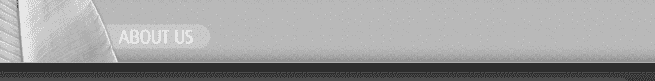

## 网络前沿

网络活动公司 Vivabit 组织了著名的 @media 会议，并且是基于网络的活动管理应用程序 Event Wax 的开发者。

Vivabit 由经验丰富的网络专业人士创立，最初是一家网络设计与开发咨询公司，逐渐将业务重心越来越多地转向活动服务领域，直至活动成为我们唯一的焦点。

## Vivabit Soho！

我们非常兴奋能位于伦敦西区中心地带著名的苏豪区。

在我们搬去之前，布罗德威克街的成名之处在于它是1854年霍乱疫情的源头。

这一事实是由约翰·斯诺发现的，我们办公室正对面的酒吧就是以他的名字命名的。

## 我们的追求

- 技术卓越，真正处于前沿，应用最新技术并与业内顶尖人才合作。
- 遵循标准，遵循最佳技术实践以获得最佳结果。
- 以用户为中心的网络设计，因为用户越满意，网站就越成功。
- 良好的沟通与专业技术同等重要。
- 高水平的可访问性，同时不损害图形设计。
- 享受乐趣，热爱我们所做的事情。

我们本可以滔滔不绝地谈论我们曾自豪合作过的组织、为 Vivabit 工作的世界级人才，或者甚至是我们关于可访问性现状的争论性观点，但我们不会这样做，因为你很可能已经了解了大致情况。如果你有任何想了解我们的地方，尽管问。我们大概不会咬人。

## 团队成员

我们是一个小团队，并为此感到自豪。以核心技术专家为基础，我们在必要时会借助一个由世界顶尖专家组成的紧密网络。

## 帕特里克·格里菲斯

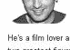

几年前，帕特里克决定孤注一掷，专注于前端网络开发。此后，他曾为沃达丰、威利和地方政府等机构开发网站，并凭借几篇广受好评的专业文章和一本著作，确立了自己在该领域的领导者地位。

他是一位电影爱好者和音乐人，但认为查尔斯·达尔文和瓦伦蒂诺·罗西是历史上最伟大的两位人物。

## 丹·韦伯

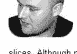

丹是一位网络应用程序开发狂热者，他曾为耐克、塞恩斯伯里、多乐士、雀巢以及各种教育和政府机构的项目工作，展示了其相当可观的技能，并且在过去的生涯中曾是超级代理机构 AKQA 的高级开发人员。

在他不编程的时候，他喜欢嘻哈音乐和奶酪片。虽然不一定同时进行。

哦，是的，那确实是他的真名。

图 4.2 即使在图形丰富的网页中，img 元素也往往很少。以本网站的一个子页面为例...

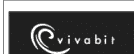

| 关于我们 |
| --- |
| - 首页 |
| - @media |
| - Event Wax |
| - 博客 |
| - 关于我们 |

## 网络前沿

网络活动公司 Vivabit 组织了著名的 @media 会议，并且是基于网络的活动管理应用程序 Event Wax 的开发者。

Vivabit 由经验丰富的网络专业人士创立，最初是一家网络设计与开发咨询公司，逐渐将业务重心越来越多地转向活动服务领域，直至活动成为我们唯一的焦点。

## 我们的追求

- **技术卓越**，真正处于前沿，应用最新技术并与业内顶尖人才合作。
- **遵循标准**，遵循最佳技术实践以获得最佳结果。
- **以用户为中心的网络设计**，因为用户越满意，网站就越成功。
- **良好的沟通**与专业技术同等重要。
- **高水平的可访问性**，同时不损害图形设计。
- **享受乐趣**，热爱我们所做的事情。

我们本可以滔滔不绝地谈论我们曾自豪合作过的组织、为 Vivabit 工作的世界级人才，或者甚至是我们关于可访问性现状的争论性观点，但我们不会这样做，因为你很可能已经了解了大致情况。如果你有任何想了解我们的地方，尽管问。我们大概不会咬人。

## 团队成员

我们是一个**小团队**，并为此感到自豪。以核心技术专家为基础，我们在必要时会借助一个由世界顶尖专家组成的紧密网络。

## 帕特里克·格里菲斯

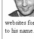

几年前，帕特里克决定孤注一掷，专注于前端网络开发。此后，他曾为**沃达丰**、**威利**和地方政府等机构开发网站，并凭借几篇广受好评的专业**文章**和一本**著作**，确立了自己在该领域的领导者地位。

他是一位电影爱好者和音乐人，但认为查尔斯·达尔文和瓦伦蒂诺·罗西是历史上最伟大的两位人物。

## 丹·韦伯


丹是一位网络应用程序开发狂热者，他曾为**耐克**、**塞恩斯伯里**、**多乐士**、**雀巢**以及各种教育和政府机构的项目工作，展示了其相当可观的技能，并且在过去的生涯中曾是超级代理机构 **AKQA** 的高级开发人员。

在他不编程的时候，他喜欢嘻哈音乐和奶酪片。虽然不一定同时进行。

哦，是的，那确实是他的真名。

图 4.3 HTML 中唯一的 *img* 元素是标志和头像。

80 | 第四章：图像

## HTML 中的宽度？高度？

`width` 和 `height` 属性非常有用。它们让浏览器在图像本身开始下载之前就知道要在页面上预留多少空间。没有这些信息，浏览器只有在图像开始下载后才知道其大小，这可能意味着它需要重绘页面，导致周围内容四处跳动。例如，如果页面中有一个没有设置宽度和高度的 `img` 元素，周围环绕着大量文本，浏览器会先渲染文本，为图像留出一个小的默认区域。当它下载图像并意识到图像实际上比预留的空间大时，就需要重新调整文本的流动以容纳图像。

```

```

但是*等一下*！宽度和高度是空间概念——完全是表现性的；这难道不应该是用 CSS 来完成的事情吗？嗯，理想情况下，是的，使用 `width` 和 `height` 属性（例如 `width: 500px; height: 129px;`——参见第5章）。但这种方法并不总是实用的。如果你在一个页面（或整个网站）上有许多不同的 `img` 元素，并且它们都有不同的尺寸（例如，如果是某种在线相册），那么你就需要为每张图像创建类（参见第1章“入门”），这可能导致大量难以管理的 CSS。在这种情况下，尽管它打乱了整个结构/表现的哲学，但 `width` 和 `height` 属性可能是最实用的途径。

## JPEG、GIF 还是 PNG？

这有点超出了 HTML 和 CSS 的范畴，但由于它在构建包含图像的网页时非常重要，值得为初学者简要说明不同的图像文件格式。

JPEG、GIF 和 PNG 使用压缩算法为网页提供轻量级图像。这些算法的工作方式不同，每种都适用于不同的情况。大多数不错的图像处理软件程序都会让你控制压缩程度，从而在质量和文件大小之间取得平衡（图像压缩得越多，文件大小越小，质量越低）。

JPEG 通常应用于详细图像，如照片。

GIF 应用于具有纯色块的图像。此格式最多允许 256 种颜色，包括透明度。图像中的颜色越少，文件大小越小。

PNG 以更复杂的方式实现了与 GIF 类似的结果。它们允许更多颜色，还支持“alpha”透明度，这意味着可以将单个像素设置为一定程度的透明度（从不透明到完全透明）。不幸的是，PNG 中的 alpha 透明度在常用的 Internet Explorer 6 中不受支持，尽管 IE7 会表现得更好。

## 图像映射

我们长话短说：图像映射允许用户点击图像内的各个部分，但并未被广泛使用（无论如何，肯定不是以好的方式），通常有更好的替代方案。


有两种类型：服务器端图像映射，这属于“恶魔的工具箱”，将在第9章“表单”中讨论；以及客户端图像映射，它由`map`和`area`元素拼凑而成。

```html

<map name="atlas" id="atlas">
    <area shape="rect" coords="0,0,115,90" href="northamerica.html"
    alt="North America" />
    <area shape="poly" coords="113,39,187,21,180,72,141,77,117,86"
    href="europe.html" alt="Europe" />
    <area shape="poly" coords="119,80,162,82,175,102,183,102,175,148,122,146"
    href="africa.html" alt="Africa" />
</map>
```

在这个例子中，`img`元素是图像。然后，`map`元素通过`img`元素中的`usemap`属性（与`map`元素的`name`属性匹配）链接到该图像。每个`area`元素随后定义图像上的一个区域（带有形状和坐标）并提供一个链接。因此，如果这是一张世界地图，你就可以让每个大洲都可点击。

为什么它们不太实用？因为它们没有太多有效的应用场景（地理地图是最明显的用途），而且即使你有一个有效的用途（将一个大图像分割成导航链接——这是过去流行的一种不良做法——也不是有效用途），它们也不是很用户友好，因为图像是否可点击并不明显。它们可能看起来很聪明，但也许聪明过头了。

## 背景图像

由于图像经常被纯粹用于展示目的，而非作为真正的内容，因此在处理图像时，CSS通常比HTML更可取。`img`元素曾经泛滥成灾——为了实现最轻微的展示效果而到处滥用（至今仍常被如此使用）。但现在，在网络标准时代，图像领域被另一种更精巧的动物所主导——CSS背景图像。

`background-image`属性可用于指定一个图像作为几乎任何元素框的背景——从页面主体到段落再到链接。单独使用它，图像会神奇地从左上角开始，在元素的背景上水平和垂直重复平铺，填满整个框。

```css
body { background-image: url(images/sifakabg.gif); }
```

www.htmldog.com/examples/images2.html

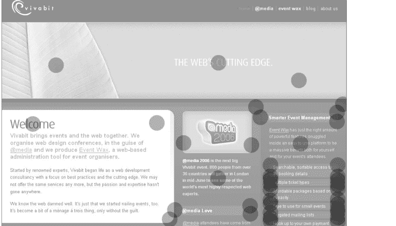

**图 4.4** 找找背景图像。它们无处不在——仅在这张截图中就有15个。

你可以使用`background-attachment`、`background-repeat`和`background-position` CSS属性来控制背景图像的各个方面。

`background-attachment`决定背景图像是否应随框的内容一起滚动。它可以用来指定图像是应该随页面其余部分滚动（通常情况下会这样），还是应该固定在视口上（浏览器窗口的可视区域，而非页面）。

```css
body {
    background-image: url(images/sifakabg.gif);
    background-attachment: fixed;
}
```

这个例子会将“sifakabg.gif”图像铺满页面，并且，与在内容很多的长页面上图案会滚动不同，它会固定在原地，而页面的其余部分会在其上方滚动。

你不必让背景图像平铺（根据空间允许水平和垂直重复）。通过使用`background-repeat`属性，你可以决定是只水平重复（`repeat-x`）、只垂直重复（`repeat-y`），还是根本不重复（`no-repeat`）。

```css
body {
    background-image: url(images/sifakabg.gif);
    background-repeat: no-repeat;
}
```

www.htmldog.com/examples/images3.html

元素中未被背景图像占据的区域将是透明的，除非与背景颜色（见第1章）结合使用，那样会将剩余区域涂成该颜色。

背景图像默认从框的左上角开始，但你可以使用`background-position`属性来改变这一点，例如，当`background-repeat`设置为`no-repeat`时，这特别有用。

值可以是`top`、`right`、`bottom`、`left`、`center`、长度、百分比，或这些的组合（如`top left`）。

```css
body {
    background-image: url(images/sifakabg.gif);
    background-repeat: no-repeat;
    background-position: center;
}
```

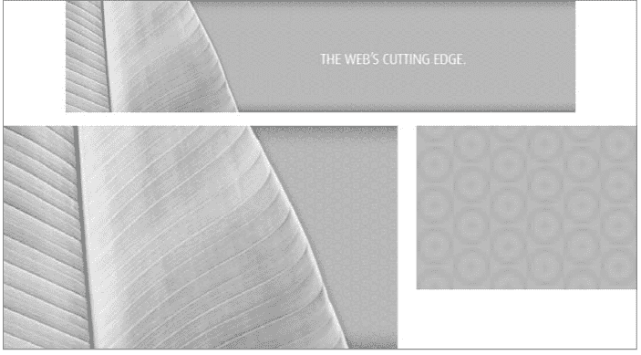

**图 4.5** 树叶图像被设置为`background-repeat: no-repeat`，因此只显示一个实例。组成条带其余部分的小斑点是一个设置为重复的小型镶嵌图像。

另一个有趣的简写属性是`background`，它可以将`background-color`（我们在第2章“文本”中遇到过）、`background-image`、`background-repeat`、`background-attachment`和`background-position`中的一些或全部组合在一起。

```css
body { background: #0084c7 url(images/sifakabg.gif) top left fixed no-repeat; }
```

尽管到目前为止所有的例子都是将背景应用于`body`元素框，但你可以将它们应用于页面上的任何可见元素，无论是段落、链接、表格，甚至是一个半透明的`img`元素，如果你真的想这样做的话。

## 技巧：圆角

背景图像不仅仅关乎大局——它们被用于各种装饰效果。在图4.6中，两个圆角被应用于一个内容区域。第一个应用于该区域的容器，最后一个应用于底部段落，因此不需要任何额外的标记。

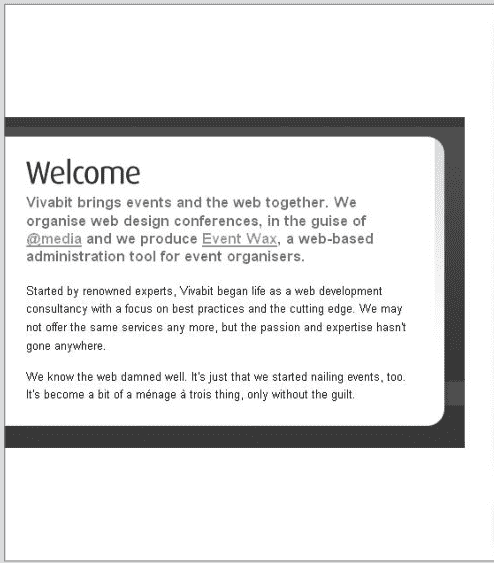

**图 4.6** 两个圆角被应用于一个内容区域。

只要你有足够的元素来挂载CSS，你就可以将多个背景应用于页面的一部分。例如，你可以通过将背景图像应用于`p`元素的左上角来为段落添加一个圆角，但如果你有类似`<p><span><span><span>whatever</span></span></span></p>`这样的结构，那么你可以为每个元素应用一个圆角（p用于左上角，p span用于右上角，p span span用于右下角，p span span span用于左下角），使用类似这样的代码：

```css
p {
    background: white url(images/sifakaptl.gif) top left no-repeat;
}
p span {
    background: url(images/sifakaptr.gif) top right no-repeat;
}
p span span {
    background: url(images/sifakapbr.gif) bottom right no-repeat;
}
p span span span {
    background: url(images/sifakapbl.gif) bottom left no-repeat;
}
```

p元素应用其中一个角图像（左上角）并设置框的背景颜色。每个嵌套的span元素随后应用另一个角。

www.htmldog.com/examples/images3_2.html

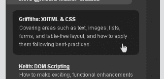

**图 4.7** 在这个例子中，需要一些额外的HTML span标签“脚手架”，以便有东西可以挂载每个角。

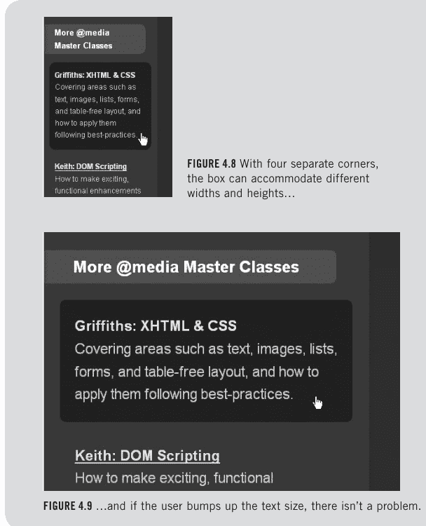

## 图像替换：为文本提供图形替代方案

图像替换是使用CSS将功能性文本替换为该文本的图形表示的过程。它已成为网络标准设计的重要组成部分，将`img`元素降级为纯粹的内容角色，就像CSS布局将表格降级一样。

一个有意义的标题（例如）就像“塑料香蕉工厂”这样简单的东西，它应该很容易用HTML中的文本进行排序。如果你想让那个标题用香蕉组成的华丽黄色字母呈现，你不应该尝试用HTML和`img`标签来实现，因为那不会带来更多的意义。孩子们，我们用什么来展示？“CSS！”我听到你们齐声回答。很好。

因此，结构化的内容已经就位——HTML中简单、功能性强、易于访问的文本。但我们实际上并不想看到那个文本——我们需要做的是让它不可见，并用CSS背景图像形式的替代视觉表示来替换它。

通过让图像由CSS控制，你也可以根据需要从一个位置更改它们。例如，如果你将其用于全站标志，并且标志发生了更改，你可以通过一个对CSS文件的小改动来全局替换图像。悬停效果也是如此，当用户将光标移到链接上时图像发生变化，这可以简单地实现，而无需JavaScript。

CSS禅意花园（csszengarden.com）是图像替换技术的一个绝佳例子，其中底层HTML在所有设计中保持不变，并且根本不包含图像。标题通常使用CSS替换为图像以实现所需的外观。

有多种方法可以应用此技术。基本思想是以某种方式隐藏功能性文本，然后在“空”框中放入背景图像。

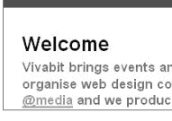

**图 4.10** 之前：“欢迎”作为功能性文本（粗体，Arial字体）...

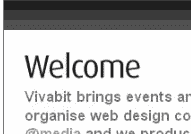

**图 4.11** ...之后：“欢迎”文本被推到视线之外，并被显示“欢迎”图形文本的背景图像替换，使用Dax字体类型。


我们可以从这样的HTML开始：

```
<h1><span>Sifaka</span></h1>
```

然后应用...

```
h1 {
    background-image: url(images/sifakalogo.gif);
    width: 300px;
    height: 129px;
}
h1 span {
    display: none;
}
```

上述示例为h1元素应用了背景图像（其尺寸被设置为与图像相同），然后隐藏了其中的span元素，从而隐藏了文本。

这种传统方法被称为Fahrner图像替换（FIR）技术。不幸的是，它有一个相当严重的缺陷。使用图像替换技术的一个预期好处是它有助于可访问性。然而，当使用`display: none`时，你不仅看不到该元素，大多数屏幕阅读器也会忽略它；当屏幕阅读器遇到FIR时，它根本不会读取任何内容。

解决这个问题的方法并不太难——你只需要使用另一种隐藏元素的方式，例如：

```
h1 span {
    display: block;
    height: 0;
    overflow: hidden;
}
```

（关于这些属性，特别是`display: none`的替代方案，请参见第5章。）

就所有实际目的而言，h1中的span元素仍然显示在那里——尽管对眼睛来说零高度等于不可见，但对于不关心空间参数的东西（如屏幕阅读器）来说，该元素以其全部荣耀继续存在。

www.htmldog.com/examples/images4.html

另一种图像替换方法消除了对`span`标签脚手架的需求，因此使用以下精简的HTML：

```
<h1>The Sifaka</h1>
```

我们可以应用这个CSS：

```
h1 {
    background-image: url(images/sifakalogo.gif);
    width: 300px;
    height: 129px;
    font-size: 1px;
    text-indent: -999em;
}
```

这像以前一样应用背景图像，但通过使用一个大的负值`text-indent`，将包含的文本拉出视野。`font-size`被设置为一像素的唯一原因是，否则它可能会推高`h1`元素的高度（任何小于图像高度的高度都可以）。

www.htmldog.com/examples/images5.html

这些图像替换技术的问题在于，当图像关闭但CSS开启时，它们完全无法显示任何内容——图像不会加载，文本也会被隐藏。问题不仅在于它影响了那些为了更快的页面下载而选择关闭图像的人，还意味着在替换图像加载时没有占位符文本，因此它没有`img`的alt文本所具有的优势。

另一种图像替换技术通过重新引入`span`标签脚手架来解决这个CSS开启/图像关闭的问题，但安排略有不同：

```
<h1><span></span>Sifaka</h1>
```

对此，我们可以应用以下CSS：

```
h1 {
    position: relative;
    width: 300px;
    height: 129px;
    font-size: 50px;
}
h1 span {
    position: absolute;
    top: 0;
    width: 300px;
    height: 129px;
    background-image: url(images/sifakalogo.gif);
}
```

这有效地将span元素覆盖在h1元素的文本之上。唯一的限制是图像背景不能是透明的（否则底层文本会显示出来），并且文本需要等于或小于图像的大小（否则它会从图像下方溢出）。

www.htmldog.com/examples/images6.html演示了这种方法，并揭示了需要实心背景的问题：如果浏览器的宽度太窄，标志的蓝色背景会与页面的背景重叠。

要全面了解不同的技术，请访问mezzoblue.com/tests/revised-image-replacement/

理论上，有类似的方法可以使用，但不需要span标签脚手架，包括操作`:before`伪元素，或者更简单地，使用CSS3的`content`属性（`h1 { content: url(images/sifakalogo.gif); }`，它用其他东西（如图像）替换元素的内容，如文本）。不幸的是，目前很少有浏览器（Internet Explorer不在此列）能处理这种太空时代的方法，因此在这里深入讨论它们没有太大意义。

## 布局

**漂亮的文本**和花哨的图像都很好，但就实际布局而言——将页面的各个部分精确放置在你想要的位置——到目前为止，本书中的内容有点线性。

在CSS 2被广泛支持之前，除了使用长单列之外，唯一实用的页面布局方式是使用HTML表格、透明的“spacer.gif”图像和大量的不间断空格：&nbsp;&nbsp;&nbsp;&nbsp;...

既然CSS 2已被广泛支持，你可以使用样式表来操纵页面上每个HTML元素的位置。这种方法不仅显著减少了页面大小和下载时间（那些多层嵌套的表格元素和spacer图像确实让页面变得臃肿），CSS布局还通过单个文件在整个网站中实现更易于管理、更灵活和更统一的页面布局。而且，作为一个不错的小奖励，它提高了可访问性——这要归功于底层HTML的逻辑顺序（它不会被表现性标记所干扰或破坏）。

有很多内容需要讲解，但最终都是值得的。从盒模型的内边距、边框和外边距的基础知识开始，到`display`属性和定位，本章最后以一些实际示例结束，展示如何将理论结合起来实现可靠的CSS页面布局。

## 盒模型

宏伟的多列页面布局可能是你的最终目标，但在继续探讨如何实现这类事情之前，让我们从布局元素的基础知识开始：盒模型。网页上的每个元素都被一个力场包围——一个简单的多层盒子，可以被操纵以创建复杂的效果。

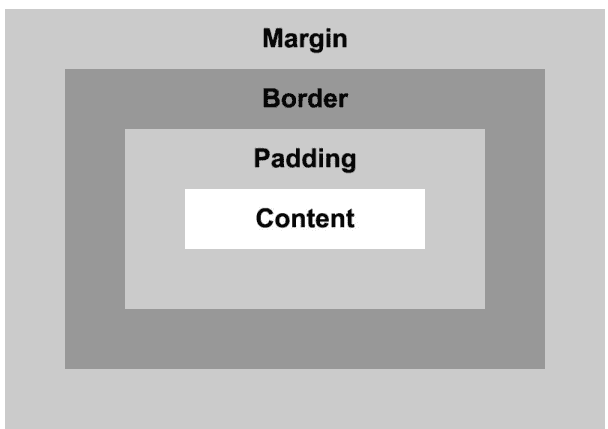

**图 5.1** 强大的盒模型。中心是内容本身。围绕它的是内边距。围绕内边距的是边框，围绕边框的是外边距。

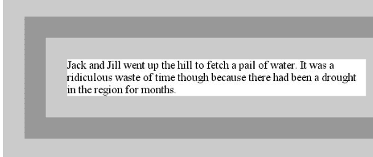

**图 5.2** 盒模型适用于网页上显示的所有元素。例如段落...


**图 5.3** ...图像...

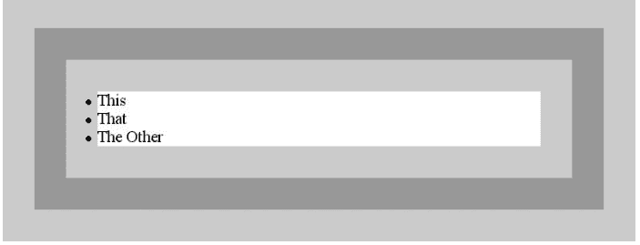

**图 5.4** ...或列表，更不用说链接、表格、表单、strong元素等等。

### 宽度和高度

你可以使用CSS属性`width`和`height`来设置元素的宽度和高度。

这些仅设置内部（内容）框的尺寸，不考虑内边距、边框或外边距。因此，如果你将`width`设置为`100px`，并且有50像素的边框、50像素的内边距和50像素的外边距，盒子的总宽度实际上将是400像素（100px + 50px左边框 + 50px右边框 + 50px左内边距 + 50px右内边距 + 50px左外边距 + 50px右外边距）。

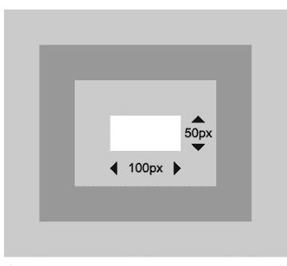

**图 5.5** 盒子的尺寸设置为`width: 100px`（最内层矩形的宽度）、`height: 50px`（最内层矩形的高度）、`padding: 50px`（围绕最内层矩形的矩形）、`border: 50px solid`（围绕该矩形的矩形）和`margin: 50px`（最外层的矩形）。

CSS标准还允许使用`min-width`、`min-height`、`max-width`和`max-height`属性来设置最小和最大宽度及高度，但由于Internet Explorer 6不支持这些属性，不幸的是，目前它们不是一个实用的选择（尽管这个问题在IE 7中得到了解决）。

### 溢出

如果内容太大，无法放入具有指定高度和宽度的盒子中，那么“溢出”——即不适合盒子的那部分内容——可以使用`overflow`属性设置为执行多种操作。可以设置为：

- `visible`（这是默认值），溢出部分会溢出盒子。
- `hidden`，任何不适合盒子的内容将被“裁剪”——在盒子边缘处被切断。


+   - `scroll`，它会显示滚动条，允许用户滚动框体以查看溢出内容。
- `auto`，它仅在必要时显示滚动条（而 `overflow: scroll` 即使内容没有溢出也会显示滚动条）。

Internet Explorer 在处理 `overflow:visible`（这是所有框体的默认行为）时，会陷入一种失态的混乱状态。它会将框体的高度扩展到超出指定值，实际上将 `height` 解释为本应解释为 `min-height` 的含义。

`clip` 属性也可与绝对定位的框体（本章稍后描述）一起使用，以指定框体的可见区域。

例如，`clip: rect(10px 120px 120px 10px)` 将裁剪一个区域，该区域从左侧向内 10px 和顶部向内 10px 开始，到左侧向内 120px（“右侧”部分）和顶部向内 120px（“底部”部分）结束，留下一个 110px 乘 110px 的区域。

## 内边距

可以使用 `padding-top`、`padding-right`、`padding-bottom` 和 `padding-left` 属性为框体的各个边设置内边距（例如，`padding-top: 2em`）。

但是，如果你想为多个边设置内边距，可以使用 `padding` 属性，通过它你可以选择为框体的每一边应用不同量的内边距（参见“简写值”侧边栏）。

```
#header {
    padding-bottom: 1em;
}
#content {
    padding: 1em 2em;
}
```

背景，无论是图像还是颜色，将填充内容和内边距的区域。

## 简写值

使用 `padding`、`border-width` 和 `margin`，你可以提供一个值来指定框体中统一的内边距/边框宽度/外边距。要为不同的边设置不同的值，你可以使用像 `padding-top` 和 `padding-left` 或 `border-right-width` 和 `border-bottom-width` 这样的属性，但你也可以在一个简写属性中为框体的不同边应用不同的值。通过为 `padding`、`border-width` 或 `margin` 指定两个、三个或四个值，你可以针对不同的边，如下表所示：

| 值 | 示例 | 应用于 |
| :--- | :--- | :--- |
| 1 | `padding: 1em` | 所有边 |
| 2 | `margin: 10px 2em` | [上和下] [左和右] |
| 3 | `border-width: 1px 5px 2px` | [上] [右和左] [下] |
| 4 | `padding: 10px 10px 1em 1em` | [上] [右] [下] [左]（顺时针） |

请注意，这些值不必全部相同——你可以混合使用像素、em 等单位，如果这符合你的需求。

## 边框

边框比内边距稍微复杂一些，因为你不仅可以指定它们的宽度，还可以指定它们的样式和颜色。

边框宽度的工作方式与内边距非常相似——你可以为各个边指定尺寸（使用 `border-top-width`、`border-right-width`、`border-bottom-width` 和 `border-left-width`），或者你可以使用 `border-width` 并指定一个、两个、三个或四个值来同时指定多个边。

然而，在 `border-width` 起作用之前，你需要使用 `border-style` 指定你想要什么样的边框。

`border-style` 的一些值，就像精神病院里一个特别疯狂的小丑一样古怪，包括 `groove`、`ridge`、`inset` 和 `outset`。这些在不同的浏览器中渲染效果不同，由于其通用的“浮雕”样式，看起来相当糟糕，因此，几乎和一个用奶油奶酪做的煎锅一样没用。

这个属性最常用的值是自描述的 `solid`、`dotted` 或 `dashed`，它们稍微更有用一些。虽然浏览器通常会将点线边框渲染为一系列等距的点，但 Internet Explorer 6（及更早版本）有一个有趣的怪癖，如果边框宽度为 1 像素，它会将它们渲染为虚线。

你可以使用 `border-top-style`、`border-right-style`、`border-bottom-style` 和 `border-left-style` 为边框的不同边指定不同的样式，或者使用 `border-style` 指定多个值（遵循与 `border-width` 简写相同的原理——参见侧边栏）。例如，`border-style: solid dotted dashed solid` 将为框体的顶部应用实线边框，右侧应用点线边框，底部应用虚线边框，左侧应用实线边框。

`border-color`（以及 `border-top-color`、`border-right-color`、`border-bottom-color` 和 `border-left-color`）可用于更改边框的颜色。

如果未指定边框颜色，它将采用框体的 `color` 属性的颜色。

你可以通过将边框设置与 `border` 简写属性结合使用来进一步简化操作，该属性允许你在一个便捷的属性中设置 `border-width`、`border-style` 和 `border-color` 样式。`border-top`、`border-right`、`border-bottom` 和 `border-left` 可为边框的各个边实现相同的功能。

例如，`border: 1px solid black` 将为框体设置一个一像素宽的实线黑色边框。如果你不想要统一的边框，你可以在边框声明之后跟上单独的具体声明：

```
#orangutan {
    border: dotted red;
    border-width: 2px 10px;
}

#chimpanzee {
    border: 2px solid;
    border-color: black #333 #666 #999;
}
```

www.htmldog.com/examples/border.html

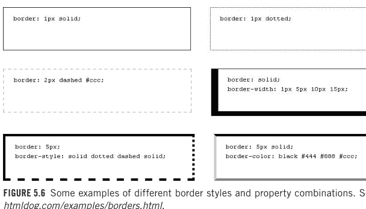

**图 5.6** 不同边框样式和属性组合的一些示例。参见 www.htmldog.com/examples/borders.html。

## 外边距

现在来谈谈外边距——框体透明的外部包裹。在定义它们方面，我们回到了内边距的简单性——你只需指定宽度。同样，你可以使用 `margin-top`、`margin-right`、`margin-bottom` 和 `margin-left` 单独设置各边，或者使用 `margin` 并指定一个、两个、三个或四个值：

```
#bonobo {
    margin-top: 1em;
}
#human {
    margin: 3em 1em;
}
```

## 外边距折叠

如果两个或多个垂直外边距接触，就会发生一种称为外边距折叠的现象。两个框体之间的距离将是两个外边距中较大的那个的距离，而不是两者之和。较小的外边距将“折叠”并消失——只有较大的外边距会保留下来，用于分隔两个框体。

所以，如果你有一系列段落，一个接一个，并且它们的外边距设置为 1em，那么每个段落之间的外边距将是 1em，而不是 2em。

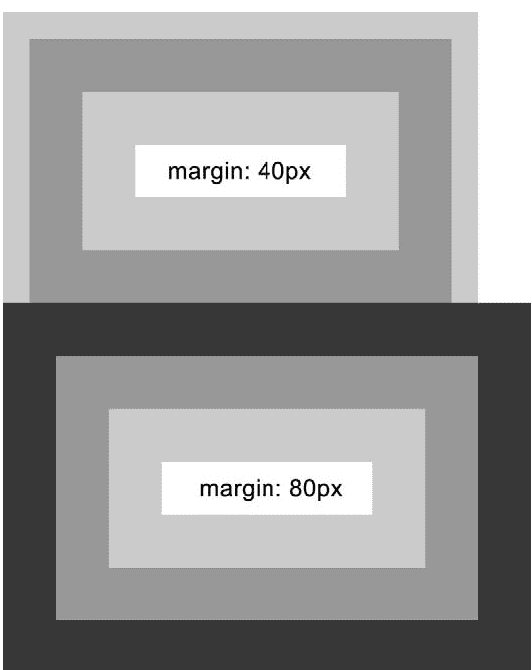

**图 5.7** “外边距折叠”：当两个垂直外边距接触时，只有一个会生效。

外边距折叠不仅发生在彼此相邻的框体之间，也发生在框体内部。所以，如果你有一个段落，其外边距为 1em，位于一个外边距为 1em 的 div 内，那么段落的外边距将消失在 div 的外边距中。

这种元素内元素的折叠仅在两个外边距之间没有其他框级元素时才会发生。使用最后一个例子，如果 div 应用了任何内边距或边框，那么它将充当一个边界，段落的外边距将不会与 div 的外边距接触，从而防止它们折叠。

🔗 www.htmldog.com/examples/margincollapse.html

Lorem ipsum dolor sit amet, consectetur adipisicing elit, sed do eiusmod tempor incididunt ut labore et dolore magna aliqua. Ut enim ad minim veniam, quis nostrud exercitation ullamco laboris nisi ut aliquip ex ea commodo consequat. Duis aute irure dolor in reprehenderit in voluptate velit esse cillum dolore eu fugiat nulla pariatur. Excepteur sint occaecat cupidatat non proident, sunt in culpa qui officia deserunt mollit anim id est laborum.

Lorem ipsum dolor sit amet, consectetur adipisicing elit, sed do eiusmod tempor incididunt ut labore et dolore magna aliqua. Ut enim ad minim veniam, quis nostrud exercitation ullamco laboris nisi ut aliquip ex ea commodo consequat. Duis aute irure dolor in reprehenderit in voluptate velit esse cillum dolore eu fugiat nulla pariatur. Excepteur sint occaecat cupidatat non proident, sunt in culpa qui officia deserunt mollit anim id est laborum.

**图 5.8** 段落和 div（深色背景）都有 1em 的外边距。第二个块中的 div 有一个 1px 的边框，防止了与段落的外边距折叠。

## 盒模型黑客

Windows 上的 Internet Explorer 5.0 和 5.5 错误地处理盒模型。

它们没有将 `width` 和 `height` 属性应用于内部内容框，而是应用于内容框加上内边距加上边框。

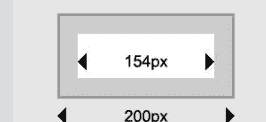

**图 5.9** IE 5.x 如何渲染设置为 `width: 200px; padding: 20px; border: 3px solid;` 的框体。

因此，当你为元素应用内边距和边框时，你需要为 IE 5.x 指定与其它浏览器不同的高度和宽度。没有“正确”的方法来做到这一点，因为 CSS（以及 HTML）应该是浏览器无关的。然而，在现实世界中，有时会出现这样的实际问题，这时我们就需要借助黑客手段来解决。

它们。盒模型黑客（Box Model Hack）可以有多种形式，但最简单的形式大致如下：

```css
#somebox {
    width: 200px;
    width: 154px;
    padding: 20px;
    border: 3px solid;
}
```

基本上，IE 5.x 不会识别以这种方式在中间“转义”的属性名。在这种情况下，它不会将“wid\th”识别为“width”，而其他浏览器则会。

因此，通过首先使用 `width`（所有浏览器，包括 IE 5.x，都能理解）指定不正确的宽度，然后使用 `wid\th`（除 IE 5.x 外的所有浏览器都能理解）指定正确的宽度，IE 5.x 将应用第一个“不正确”的宽度声明（因为它不理解第二个），而所有其他表现良好的浏览器将应用“正确”的宽度（因为它们理解两个声明，并优先采用最新的一个）。

事实上，你可以将此黑客技术用于任何属性。只要“\”不出现在 a、b、c、d、e 或 f 之前（这会与颜色中使用的十六进制代码冲突），它就会起作用。

有许多黑客技术可以向各种浏览器隐藏各种内容（dithered.com/css_filters 是获取良好、全面概述的一个来源），但应尽可能避免使用它们。很少需要使用它们——Web 标准的优点之一就是，通过使用它们，你可以对跨浏览器兼容性和可靠性感到更放心。然而，盒模型黑客是所有黑客技术中最重要的，也是使用最广泛的，因为它处理了常用浏览器中常用技术的一个重大缺陷。

## display 属性

盒子可以是块级或行内。这些术语源于块级元素和行内元素（参见第 1 章“入门”），其中块级元素（如 `p` 或 `div`）默认在其前后显示换行符（一个块级盒子），而行内元素（如 `em` 或 `span`）默认显示在同一行（一个行内盒子）。但这些呈现方面并不一定适用于特定元素——你可以选择任何元素，并以你选择的任何方式显示它——无论是块级盒子还是行内盒子。

块级盒子，除了在新行上开始并强制其后的内容在新行上开始外，还会拉伸以适应其包含盒子的宽度（除非指定了明确的宽度）。行内盒子的宽度等于其内容的宽度。

www.htmldog.com/examples/blockinline1.html

控制盒子类型是获得页面完全视觉控制的一个重要方面。你不希望损害标记，因为你应该在适当的地方应用有意义的标签，但你可能不想接受元素的默认渲染。例如，你可能选择将导航栏中的链接显示为块级盒子，或将标题显示为行内。另一个例子是创建水平列表的方法之一，如第 6 章“列表”中所述，其中列表项的显示样式被更改为并排显示，而不是在不同的行上。

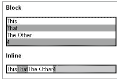

**图 5.10** 块级盒子将在新行上开始并拉伸以适应包含盒子的宽度，而行内盒子将保持在同一行，并且仅与内容一样宽（参见 www.htmldog.com/examples/blockinline1.html）。

此外，行内盒子处理垂直参数的方式与块级盒子不同。垂直边距不被应用，内边距和边框不会向上或向下推开内容，而是会溢出行并覆盖在其上方和下方的任何内容上。但请注意，IE 5.0 根本不会对行内盒子应用内边距、边框或边距。

www.htmldog.com/examples/blockinline2.html

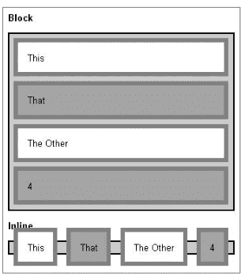

**图 5.11** 应用了内边距、边框和边距后，块级盒子的行为如你所料（还要注意边距折叠）。然而，行内盒子将忽略垂直边距，并且内边距和边框将溢出行（参见 www.htmldog.com/examples/blockinline2.html）。

你可以使用 `display` 属性将任何你想要的元素设置为任何你选择的盒子类型。

最常见的值是 `block` 和 `inline`，用于基本的块级和行内盒子，但你也可以使用 `none`（它根本不渲染盒子，基本上将其从页面中移除）。

其他使用较少（且支持较少）的显示类型是块级和行内主题的变体。`list-item` 和各种与表格相关的组件，如 `table` 和 `table-row`，或许最好通过查看浏览器对等效 HTML 元素（如 `li`、`table` 和 `tr` 元素——有关更多信息，请参阅 CSS 附录中的 `display` 属性）的默认渲染来理解。

`inline-block` 的工作方式类似于包裹在行内盒子中的块级盒子。这些盒子具有与行内盒子相同的特征（保持在同一行并且宽度等于内容），但垂直内边距、边框和边框的工作方式与块级盒子相同，会推开其周围的内容。不幸的是，这种显示类型不受 Mozilla 支持，并且在 Internet Explorer (IE) 中存在一些错误（IE 仅在相关元素是行内元素时才会应用它）。

www.htmldog.com/examples/blockinline3.html

## `display: none` 的问题

有时你的 HTML 中会有一些你可能不希望在页面的视觉显示中出现的内容。这有时是出于无障碍访问的考虑（例如第 3 章“链接”中提到的“跳过导航”链接），或者可能是你希望保持文档的灵活性，为不同的样式选项留出空间（例如不希望某些元素在打印时显示——参见第 10 章“多种媒体”）。这两者都归结为一个想法：HTML 应该作为一个结构化的、独立于 CSS 的文档工作，所有有意义的部分都应就位，无论你是否希望它们被看到。

`display: none` 似乎是将元素从视线中移除的明显候选者——它完全按照其字面意思行事。唯一的问题是它做得有点多。`display: none` 不仅将元素从视线中隐藏，还将其从屏幕阅读器中隐藏。它不会被看到，也不会被听到。因此，如果你隐藏了一些实际上应该保持对屏幕阅读器可访问的信息，这并没有太大帮助。

那么 `visibility: hidden` 呢？它使元素不可见（而不是像 `display: none` 那样完全移除它），但它与 `display: none` 有相同的问题，也会使元素对屏幕阅读器不可见。它还会在元素通常可见的位置留下一个空间，这通常不是我们想要的。

既然这些明显的选项不可行，我们需要尝试一些不那么明显的方法。解决方案是让元素在*假设上*可见，但宽度和/或高度为零：

```css
.accessaid {
    position: absolute;
    height: 0;
    overflow: hidden;
}
```

> 这种 CSS 有多种变体，但原理是相同的。对于眼睛来说，零高度或零宽度等于不可见，但对于不关心空间参数的东西（如屏幕阅读器）来说，元素以其全部荣耀继续存在。

当元素盒子本身需要用于 CSS 时（例如图像替换技术——参见第 4 章“图像”），仅内容可以通过负的 `text-indent` 被移出视线：

```css
h1 {
    text-indent: -999em;
}
```

## 定位

盒子可以通过 `position` 属性以多种方式定位在页面上——静态、相对、绝对或固定。

### 静态

默认情况下，元素盒子是静态的。静态盒子遵循页面的正常流，紧随其他静态元素之后和之前（例如，图 5.10 和 5.11 中的盒子都是静态的）。

www.htmldog.com/examples/positioning1.html

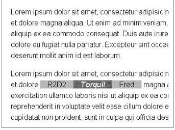

**图 5.12** 静态段落中的静态盒子。

### 相对

相对定位的盒子是可以移动到相对于其初始位置的位置的盒子，在其原来的位置留下一个空白。当盒子被设置为相对定位时，你可以为 `top`、`right`、`bottom` 或 `left` 指定值，盒子将从该位置偏移。这些值告诉浏览器盒子从该位置偏移多远，因此 `position: relative; left: 10em;` 会将盒子向右推 10 em（从初始位置的左侧偏移 10 em）。同样，`position: relative; right: 10em` 会将盒子向左推 10 em。

任何跟随相对定位盒子的盒子的位置将从偏移盒子的初始位置计算，而不是从偏移后的位置计算。因此，跟随相对盒子（我们称之为 Torquil）的盒子（我们称之为 Fred）的位置不会从 Torquil 盒子的实际位置计算，而是从原始位置计算，就好像 Torquil 没有偏移一样。

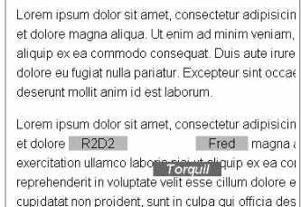

**图 5.13** 段落中的相对定位盒子（`position: relative; top: 2em; left: 2em;`）。

🔗 www.htmldog.com/examples/positioning2.html

### 绝对

盒子也可以绝对定位。与相对盒子不同，绝对盒子是相对于其包含块的位置偏移的，除非盒子存在于相对或绝对块内，否则包含块将是页面本身，在这种情况下，它将相对于该块偏移。


`position: absolute` 使一个盒子变为绝对定位，并且再次使用 `top`、`right`、`bottom` 和 `left` 来定位它。

www.htmldog.com/examples/positioning3.html

绝对定位的盒子会从页面的正常文档流中脱离出来，独立于其余内容而存在。相对定位的盒子会保留其原来占据的空间，而跟随在一个绝对定位盒子（我们再次称其为 Torquil——他表现得非常出色）之后的盒子的位置，将从 Torquil 原始位置的起点开始计算，就好像 Torquil 根本不存在一样。

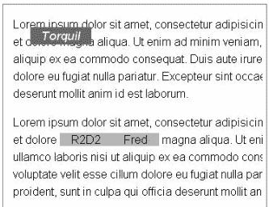

**图 5.14** 一个绝对定位的盒子（`position: absolute; top: 2em; left: 2em;`）位于同一个静态段落内。


**图 5.15** 同一个绝对定位的盒子位于一个相对定位的段落内。

www.htmldog.com/examples/positioning4.html

## 固定定位

固定定位的盒子（`position: fixed`）与绝对定位的盒子类似，不同之处在于它们是固定在视口上的。就像设置为 `background-attachment: fixed` 的背景图像（参见第 4 章）一样，固定定位的盒子不会随其余内容一起滚动。不过，与固定背景不同的是，Internet Explorer 6 不支持固定定位的盒子（尽管 IE 7 *支持*）。

### Z-INDEX

因为定位的盒子会从正常文档流中脱离出来，并且可以相互堆叠，所以你可能想要控制这些盒子在堆叠顺序中的位置。突然间，我们需要考虑三个维度——我们有控制水平位置的 x 轴，控制垂直位置的 y 轴，现在还有控制深度的 z 轴。x 轴和 y 轴由 `width`、`height`、`left`、`right`、`top`、`bottom`、`padding`、`margin` 等控制，但对于 z 轴，我们不需要如此复杂的设置，我们只需要声明事物相互堆叠的顺序。

就像 Mighty Mouse 一样，`z-index` 来拯救世界了。

此属性用于指定定位的盒子在堆叠顺序中的位置。数字越高，盒子在堆叠中的位置就越高。例如，`z-index: 3` 将位于 `z-index: 5` 之下，但位于 `z-index: 1` 之上。

## 浮动

浮动，使用 `float` 属性，是另一种可用于移动盒子并操控其他盒子如何响应它们的方法。

浮动的盒子基本上会将其推到容器的最左侧（`float: left`）或最右侧（`float: right`），并导致周围的内容环绕它流动，而不是继续在其下方流动。浮动的盒子会覆盖任何 `display` 类型设置，并将盒子渲染为块级盒子。

- www.htmldog.com/examples/float1.html
- www.htmldog.com/examples/float2.html


**图 5.16** 一个左浮动的段落。参见 www.htmldog.com/examples/float1.html。


**图 5.17** 一个左浮动的段落和一个右浮动的段落。参见 www.htmldog.com/examples/float2.html。

112 | 第 5 章：布局

如果你希望跟随浮动盒子的元素从浮动盒子下方开始，而不是环绕它流动，你可以使用 `clear` 属性。

`clear: left` 将清除所有左浮动的盒子，`clear: right` 将清除所有所有右浮动的盒子，而 `clear: both` 将做一些我敢肯定你从未预料到的事情。

www.htmldog.com/examples/float3.html


**图 5.18** 第四个段落设置为 `clear: left`，因此它从左浮动的段落下方开始，而不是环绕它流动。参见 www.htmldog.com/examples/float3.html。

本质上，清除的工作原理是增加被清除盒子的上边距，使其足够大，从而从浮动元素下方开始。因此，应该记住外边距合并的规则：如果被清除的盒子明确应用了上边距，只有当该边距大于浮动盒子的高度时才会生效。然后，边距将从盒子被清除前的位置开始应用，而不是从浮动盒子的底部开始。

要了解一些涉及浮动的简单技巧，请查看 www.htmldog.com/articles/dropcaps/ 和 www.htmldog.com/articles/pullquotes/，其中附有一些基本示例。

## 绝对值与相对值 II

在第 2 章“文本”中，我们探讨了使用绝对单位（如像素）和相对单位（如 em）在文本方面的优缺点。但对于网页上所有盒子的尺寸，这种选择同样存在，并且在绝对值和相对值之间的选择可能导致截然不同的结果。

定义盒子尺寸有三种方法——固定、流体和弹性。

## 固定布局

在固定布局中，布局区域的宽度被明确指定为长度值（而不是完全不指定或指定为百分比），通常使用像素作为单位。

固定布局的优点是可以限制文本行的宽度，使其易于阅读——无论用户窗口的大小如何，行宽都将保持不变。文本区域宽度与图像宽度之间的关系也可以保持（例如，如果你有一个 500px 宽的图像，那么可以使用一个 500px 宽的段落来配合它）。

固定布局的主要缺点是它们没有充分利用屏幕的全部区域，导致空间浪费，并且用户更有可能需要滚动才能查看更多内容。

114 | 第 5 章：布局


**图 5.19** Jon Hicks 的博客 (hicksdesign.co.uk/journal) 采用了 900px 固定宽度设计。


**图 5.20** 在更宽的窗口中，即使文本大小发生变化，内容区域的宽度也保持不变。

## 流体布局

在流体或流动布局中，布局中部分或所有区域的宽度被指定为百分比或完全不指定，因此布局会根据浏览器窗口的大小进行拉伸或收缩。

流体布局的优点是它们充分利用了用户的计算机显示能力。拥有大显示器的用户可以拉伸他们的浏览器窗口，以显示更多“首屏”内容。其灵活性意味着流体布局不仅利用了更大的屏幕，而且在较小的屏幕上（如 PDA 或最新一代的手机）也更有可能正常工作（参见第 10 章“多种媒体”）。

流体布局的缺点是，在较大的显示器上可能出现的较长行，阅读起来可能更不舒服。从图形设计的角度来看，与固定宽度对象（如图像）的尺寸关系也难以处理。

116 | 第 5 章：布局


**图 5.21** Dan Webb 的网站 (danwebb.net) 采用了具有流体宽度的内容区域。


**图 5.22** 内容区域将拉伸以填充窗口的宽度。

## 弹性布局

弹性布局是固定布局和流体布局的近亲。它涉及使用相对单位（如 em）而不是绝对值（如像素）来定义宽度，因此整个布局会根据用户浏览器的文本大小偏好进行扩展和收缩。这种方法可以结合固定布局和流体布局的元素，其中区域可以是固定的（所有宽度都以 em 定义）或流体的（只有部分宽度，如导航列的宽度，以 em 定义）。

弹性布局可以通过增加比例以及文本大小来辅助可访问性，使文本区域对于需要增大文本大小的视力障碍者来说更易于阅读。通过保持文本大小与盒子尺寸的比例恒定，这种方法还可以防止因包含盒子随其内容增大而出现不必要的换行等问题。

缺点是，如果文本大小增加太多，固定-弹性布局可能会变得太宽。一个经验法则是检查它是否能在 Internet Explorer 的“最大”文本大小设置下在 800px 宽的屏幕上正常显示。


## 示例页面布局

太好了。现在我们已经掌握了理论，让我们大规模地付诸实践：页面布局。这只需要结合运用盒模型操作、定位和浮动。

页面布局背后的思考过程大致是这样的：“好的。我有这块内容，想把它放在那里。那我就把它塞到那里。我还有这块内容，想把它放到那边。酷。我就把它塞到那里，再稍微移动一下。完美。”CSS 布局的核心就是抓取 HTML 块，并将它们放置在页面上你想要的任何位置。

我们将要介绍的初始示例——创建列、页眉和页脚——是简单的基础布局，用于演示技术，没有任何额外的花哨功能来干扰和混淆。通过这些基本布局，你可以充实内容，让你的页面看起来像你想象的那样吸引人。

尽管这些示例是在页面布局的背景下使用的，但相同的技术可以用于页面的任何部分——记住，我们这里讨论的只是内容块。它们是大是小并不重要。

## 创建列

两列就足以掌握页面布局的基础。遵循这些简单的原则，下一步就不难了，可以将各种内容块在页面上移动。

首先，我们需要从一个结构良好的文档开始。有一个专门设计用于划分大块内容的标签——`div`（参见第 1 章），这通常是定义重要块的最佳选择。然后，我们可以通过 CSS 锁定它们的 ID 并移动它们。

```html
<div id="navigation">
    <!--内容-->
</div>
<div id="content">
    <!--内容-->
</div>
```

在这个例子中，我们希望导航栏与主内容相比是一个窄列，因此我们需要明确设置它的宽度。然后，要将其移到左边，我们需要使用绝对定位将其从文档流中拉出来：

```css
#navigation {
    position: absolute;
    left: 0;
    width: 30em;
}
```

事情开始成形了（不，说真的，它们确实在成形），但目前导航栏位于内容之上，这没什么帮助。那么，我们如何将所有内容都显示出来呢？嗯，有多种方法，但最明显的方法是简单地设置内容 div 的左边距，将内容推到导航区域宽度之外：

```css
#content {
    margin-left: 30em;
}
```

结果如何？两个独立的区域，就像图 5.25 一样。

## 实心导航栏

为了在视觉上分隔页面的两个部分，你可能想为导航栏指定一个背景色，但有时内容区域会更长，背景色当然会在导航框的底部结束（如图 5.25 所示）。理想情况下，你会希望导航区域的底部与内容区域的底部对齐。

边距似乎是移动内容 div 的明显选择，就像我们上面使用的那样，但你可以使用盒模型的任何部分——你还可以使用内边距和边框。通过使用边框，你也可以为该区域着色，这将给人一种实心导航栏的印象，其长度与内容区域一样长。

```css
#navigation {
    position: absolute;
    left: 0;
    width: 30em;
    background: #ccf;
}
#content {
    border-left: 30em #ccf solid;
}
```

解决导航栏过短问题的另一种方法是将包含块（例如页面）的背景色设置为你想要的导航区域颜色（例如黄色），然后将其他框（例如页眉和内容）着色为你想要的页面主色（例如白色）。你也可以对背景图像使用相同的技术。

## 浮动列

除了定位，你也可以浮动你的页面块。

```css
#navigation {
    left: 0;
    width: 30em;
}
#content {
    float: right;
}
```

这应该会产生一个类似于图 5.25 的布局。

## 三列或更多列

创建三列——或更多列——的布局与创建两列布局没有太大区别。

那么，假设我们的 HTML 块结构如下：

```html
<div id="navigation1" class="nav">
    <!--内容-->
</div>
<div id="navigation2" class="nav">
    <!--内容-->
</div>
<div id="content">
    <!--内容-->
</div>
```

一步一步来，定位第一个导航块与两列布局中的方法完全相同：

```css
#navigation1 {
    position: absolute;
    left: 0;
    width: 200px;
}
```

我们可以对第二个导航块做几乎相同的事情：

```css
#navigation2 {
    position: absolute;
    right: 0;
    width: 150px;
}
```

现在，对于内容区域，我们需要做的就是在两侧挤压它，而不仅仅是左侧：

```css
#content {
    margin: 0 150px 0 200px;
}
```

如果你不希望导航栏位于内容两侧，而是希望它们彼此相邻，你只需要操作各种 `left`、`right` 和 `margin` 声明，例如：

```css
#navigation1 {
    position: absolute;
    left: 0;
    width: 200px;
}
#navigation2 {
    position: absolute;
    left: 200px;
    width: 150px;
}
#content {
    margin-left: 350px;
}
```

另一种将列并排放置的方法是完全按照描述两列的方式浮动列。

这些方法可以用于任意数量的列，但请记住，仍然有很多用户的屏幕宽度只有 800 像素。

## 添加页眉

添加页眉——可能用于品牌和/或导航的空间——很容易。你需要做的就是确保任何绝对定位的框都明确地定位在它下方。继续使用 div 分隔文档特定块的做法，我们可以使用以下 HTML：

```html
<div id="header">
    <!--内容-->
</div>
<div id="navigation">
    <!--内容-->
</div>
<div id="content">
    <!--内容-->
</div>
```

在这个两列示例中，唯一需要定位的是导航栏，因为一旦它脱离文档流，内容区域将自动位于页眉下方，所以你实际上不需要在 CSS 中做太多不同的事情（除非你想这样做）：

```css
#navigation {
    position: absolute;
    left: 0;
    top: 100px;
    width: 150px;
}
#content {
    margin-left: 150px;
}
```

## 添加页脚

页脚比页眉更棘手一些，因为绝对定位的框会位于其他非定位元素之上。不过，让我们看看从以下 HTML 开始我们能做些什么：

```html
<div id="header">
    <!--内容-->
</div>
<div id="navigation">
    <!--内容-->
</div>
<div id="content">
    <!--内容-->
</div>
<div id="footer">
    <!--内容-->
</div>
```

如果你能*保证*导航区域比内容区域短，那么你就不用担心了。应用与之前类似的 CSS，你实际上不需要对页脚框做任何特殊处理，因为它会自动直接位于内容下方。


## 查尔斯·达尔文

- 生物学
- 进化论
- 自然选择
- 遗传学
- 伊拉斯谟·达尔文
- 拉马克
- 查尔斯·达尔文
- 华莱士
- 道金斯

## 《物种起源》的起源

达尔文的父亲一心想让儿子成为一名医生，但当他去学习神学时，却发现蠕虫有趣得多。

当一个留着胡子的孤独男人邀请达尔文与他一起乘船旅行时，达尔文同意了，并出发环游世界，摆弄着雀鸟。

有人说，正是来自一群岛屿的一堆鸟类，启发了他如今被广泛接受的进化论解释。为什么一个岛上的雀鸟有这样的喙，而下一个岛上的雀鸟却有那样的喙？“自然选择！”他想。实际上，事情并非如此简单。

Lorem ipsum dolor sit amet, consectetur adipiscing elit, sed do eiusmod tempor incididunt ut labore et dolore magna aliqua. Ut enim ad minim veniam, quis nostrud exercitation ullamco laboris nisi ut aliquip ex ea commodo consequat. Duis aute irure dolor in reprehenderit in voluptate velit esse cillum dolore eu fugiat nulla pariatur. Excepteur sint occaecat cupidatat non proident, sunt in culpa qui officia deserunt mollit anim id est laborum.

## 《物种起源》

结束旅行归来后，查尔斯记录了他的冒险经历，并对藤壶产生了浓厚兴趣，尽管他的理论仍在脑海中酝酿。

回到英国大约20年后，达尔文终于着手撰写一个与达尔文宏大理论相似的想法。达尔文并非孤军奋战。

1858年，一篇署名为达尔文和华莱士的论文被宣读，在学术界引起轩然大波，并最终促成了达尔文那本500页的“摘要”——《物种起源：依据自然选择，即在生存斗争中保存优良族的物种起源》的出版。

达尔文，这位科学界早已声名显赫的人物，如今更是成为了名人。

## 《物种起源》之后

查克·D（达尔文）对《物种起源》进行了五次修订，淡化了那些可能让他信教的妻子不快的内容。而他的妻子碰巧也是他的表亲。他余生都在试图掩饰人类由其他动物进化而来的逻辑结论，而他的第三部经典著作《人类的由来》并未得到学术界的广泛认可。

Lorem ipsum dolor sit amet, consectetur adipiscing elit, sed do eiusmod tempor incididunt ut labore et dolore magna aliqua. Ut enim ad minim veniam, quis nostrud exercitation ullamco laboris nisi ut aliquip ex ea commodo consequat. Duis aute irure dolor in reprehenderit in voluptate velit esse cillum dolore eu fugiat nulla pariatur. Excepteur sint occaecat cupidatat non proident, sunt in culpa qui officia deserunt mollit anim id est laborum.

内容版权归 © Patrick Griffiths 2006 所有。
本页面符合 XHTML 1.0 Strict 和 CSS 2.1 标准。

图 5.30 收纳页脚。

然而，通常情况下，你不能*依赖*导航栏比内容区域短。如图 5.31 所示，使用上述方法整合页脚时，如果导航栏比内容长，由于它是绝对定位的，它会覆盖在静态页脚之上。

## 查尔斯·达尔文

- 生物学
- 进化论
- 自然选择
- 遗传学
- 伊拉斯谟·达尔文
- 拉马克
- 查尔斯·达尔文
- 华莱士
- 道金斯

Lorem ipsum dolor sit amet, consectetur adipiscing elit, sed do eiusmod tempor incididunt ut labore et dolore magna aliqua. Ut enim ad minim veniam, quis nostrud exercitation ullamco laboris nisi ut aliquip ex ea commodo consequat. Duis aute irure dolor in reprehenderit in voluptate velit esse cillum dolore eu fugiat nulla pariatur. Excepteur sint occaecat cupidatat non proident, sunt in culpa qui officia deserunt mollit anim id est laborum.

## 《物种起源》的起源

达尔文的父亲一心想让儿子成为一名医生，但当他尝试学习神学时，却发现蠕虫有趣得多。

当一个留着胡子的孤独男人邀请达尔文与他结婚时，他同意了，并出发环游世界，摆弄着雀鸟。

有人说，正是来自一群岛屿的一堆鸟类，启发了他如今被广泛接受的进化论解释。为什么那个岛上的雀鸟有这样的喙，而这个岛上的雀鸟却有那样的喙？“自然选择！”他想。实际上，事情并非如此简单。

## 《物种起源》

结束旅行归来后，查尔斯记录了他的冒险经历，并对藤壶产生了浓厚兴趣，尽管他的理论仍在脑海中酝酿。

回到英国大约20年后，他终于出版了一本与达尔文宏大理论相似的书。达尔文并不高兴。

1858年，一篇署名为达尔文和华莱士的论文被宣读，在学术界引起轩然大波，并最终促成了达尔文那本500页的“摘要”——《依据自然选择，即在生存斗争中保存优良族的物种起源》的出版。

达尔文，这位科学界早已声名显赫的人物，如今更是成为了超级巨星。

## 《物种起源》之后

查克·D（达尔文）对《物种起源》进行了五次修订，淡化了那些可能让他信教的妻子不快或安抚她的内容。而他的妻子碰巧也是他的表亲。他余生都在试图掩饰他与其他动物有亲缘关系的逻辑结论，而他的第三部经典著作《人类的由来》并未得到学术界的广泛认可。

Lorem ipsum dolor sit amet, consectetur adipiscing elit, sed do eiusmod tempor incididunt ut labore et dolore magna aliqua. Ut enim ad minim veniam, quis nostrud exercitation ullamco laboris nisi ut aliquip ex ea commodo consequat. Duis aute irure dolor in reprehenderit in voluptate velit esse cillum dolore eu fugiat nulla pariatur. Excepteur sint occaecat cupidatat non proident, sunt in culpa qui officia deserunt mollit anim id est laborum.

获取源代码！版权归 Patrick Griffiths 2006 所有。本页面符合 XHTML 1.0 Strict 和 CSS 2.1 标准。

图 5.31 如果导航栏过长，静态页脚会位于导航栏下方。

如果你能确保导航区域总是比内容区域长，那么你可以改为对内容区域进行绝对定位，让导航区域作为静态框，页脚可以位于其下，但这很少是一个实用的选择。

www.htmldog.com/examples/pagelayout6.html

正是因为绝对定位的框被移出了页面的正常流，所以无法预测它们最终会出现在哪里（框的底部会在哪里）——你无法相对于一个绝对定位的框在页面上放置其他元素。因此，如果你想让页脚正常工作，一个明智的选择是使用浮动列，并简单地清除页脚的浮动：

```
#navigation {
    width: 10em;
    background: lime;
    float: left;
}
#content {
    margin-left: 10em;
}
#footer {
    clear: both;
}
```

如果内容比导航长，那么什么都不会发生——页脚会愉快地停留在其下方。然而，如果导航更长，页脚会清除浮动并停留在导航下方。

www.htmldog.com/examples/pagelayout7.html

## 综合运用

此示例（如图 5.32 所示）演示了本章提到的大多数方法，将不同的内边距、边框和外边距情况，以及显示类型与浮动元素结合在一个定位布局中。

HTML 的基本结构大致如下：

```
<div id="container">
    <div id="header">
        <!--内容-->
    </div>
    <div id="navigation">
        <!--内容-->
    </div>
    <div id="content">
        <!--内容-->
    </div>
</div>
```

页眉具有固定高度和背景图像，而结构化文档所必需的 h1 元素则通过 `display: none` 属性隐藏起来。

```
#header {
    padding: 0.5em;
    background: url(images/charlesdarwin.gif);
}
```


图 5.32 定位、内边距、边框、外边距和浮动，应有尽有。


## 第6章

## 列表

列表可能看起来没那么重要。它们偶尔会出现在你的内容中，你当然需要掌握它们，但即使你的内容主要由段落和图片组成，列表通常也应该出现在页面上，因为它们是构建导航的最佳方式。


**图 6.1** 本章的插图摘自《数字网络杂志》(digital-web.com)。

## 构建列表

你会发现，几乎任何列表都可以归入你可用的三种类型之一：无序列表、有序列表或定义列表。


## 无序列表和有序列表

无序列表和有序列表是你最标准的列表。`ul` 定义一个无序列表（用于非顺序项目，其中任何项目在列表中的任何位置都同样合适）；`ol` 定义一个有序列表（其中每个项目在某种程度上都比它前面或后面的项目低或高）；在任一列表中，列表项都用 `li` 定义。很简单！

```
<ul>
    <li>This</li>
    <li>That</li>
    <li>The other</li>
</ul>
```

```
<ol>
    <li>The first thing</li>
    <li>The second thing</li>
    <li>The third thing</li>
</ol>
```

www.htmldog.com/examples/lists1.html

## 嵌套列表

你也可以使用这些相同的元素来创建更复杂的嵌套列表——只需将另一个 `ul` 或 `ol` 元素放在 `li` 元素内即可：

```
<ul>
    <li>This
        <ul>
            <li>This type of this</li>
            <li>That type of this
                <ul>
                    <li>This type of that type of this</li>
                    <li>That type of that type of this</li>
                    <li>The other type of that type of this</li>
                </ul>
            </li>
            <li>The other type of this</li>
        </ul>
    </li>
    <li>That</li>
    <li>The other</li>
</ul>
```

www.htmldog.com/examples/lists2.html

138 | 第6章：列表


**图 6.3** 嵌套列表等：在迈克尔·阮为《数字网络杂志》撰写的文章中，一个有序列表的末尾在列表项内包含了段落和一个无序列表。

## 定义列表

定义列表摒弃了 `ul`、`ol` 和 `li` 元素。它们使用一组单独的元素来实现一个包含每个“项目”的术语和描述组合的列表：`dl`（定义列表）、`dt`（定义术语）和 `dd`（术语的定义描述）。

```
<dl>
    <dt>Cat</dt>
    <dd>A little furry thing that purrs.</dd>
    <dt>Dog</dt>
    <dd>A big shaggy thing that barks.</dd>
</dl>
```

`dt` 和 `dd` 总是需要成对出现，但哪个在前并不重要，每个项目有多少个也不重要。你可以有 x 个术语后跟 y 个描述，或者 x 个描述后跟 y 个术语（例如，这取决于你希望你的术语表如何运作）：

```
<dl>
    <dt>Cat</dt>
    <dd>Any member of the family Felidae.</dd>
    <dd>The domesticated species of that family, Felis silvestris.</dd>
    <dd>A little furry thing that purrs.</dd>
</dl>
```

```
<dt>Dog</dt>
<dt>Yo Momma</dt>
<dd>A big shaggy thing that barks.</dd>
</dl>
```

www.htmldog.com/examples/lists3.html

定义列表应该在多大程度上使用，引发了一些争论。一种观点认为，你应该只用它们来定义一组明确的术语和定义（我碰巧同意这一点——毕竟我们讨论的是*语义*），而另一种观点则声称，将它们用于任何项目组相关的列表也同样有效。一个例子（直接由W3C提出）是对话，其中说话的人可以用 `dt` 元素定义，他们说的话用 `dd` 元素定义。另一个例子是网站列表，其名称用 `dt` 标记，描述用 `dd` 标记。

示例中的第二个值适用于 `border-style`。此属性可以采用以下值（由W3C定义）。

| 值 | 描述 |
| :--- | :--- |
| none | 无边框；边框宽度为零。 |
| hidden | 与 'none' 相同，但在特殊情况下除外。 |
| dotted | 边框是一系列点。 |
| dashed | 边框是一系列短线段。 |
| solid | 边框是单条线段。 |
| double | 边框是两条实线。两条线及其之间的空间之和等于 'border-width' 的值。 |
| groove | 边框看起来像是刻在画布上。 |
| ridge | 与 'groove' 相反：边框看起来像是从画布中凸出。 |
| inset | 边框使盒子看起来像是嵌入画布中。 |
| outset | 与 'inset' 相反：边框使盒子看起来像是从画布中凸出。 |

**图 6.4** 嵌套列表等：在迈克尔·阮为《数字网络杂志》撰写的文章中，一个有序列表的末尾在列表项内包含了段落和一个无序列表。

## 列表作为导航

本质上，网站上的导航栏就是一个链接列表。因此，接受这一点，标记导航区域最明显的选择是某种列表元素——通常是一个无序列表，或多个无序列表。

这可以是一个大的嵌套列表的形式：

```
<ul>
    <li>Services
        <ul>
            <li>Peanut farming</li>
            <li>Hamster sitting</li>
            <li>Car valet</li>
        </ul>
    </li>
    <li>Products
        <ul>
            <li>Peanuts</li>
            <li>Flat hamsters</li>
            <li>Cars</li>
        </ul>
    </li>
    <li>Misc.
        <ul>
            <li>About us</li>
            <li>Contact us</li>
            <li>Site map</li>
        </ul>
    </li>
</ul>
```

或者也可以是多个列表的形式：

```
<h2>Services</h2>
<ul>
    <li>Peanut farming</li>
    <li>Hamster sitting</li>
    <li>Car valet</li>
</ul>
<h2>Products</h2>
<ul>
    <li>Peanuts</li>
    <li>Flat hamsters</li>
    <li>Cars</li>
</ul>
<h2>Misc.</h2>
<ul>
    <li>About us</li>
    <li>Contact us</li>
    <li>Site map</li>
</ul>
```

不过，有些人可能会认为它甚至可以采用定义列表的形式：

```
<dl>
    <dt>Services</dt>
    <dd>Peanut farming</dd>
    <dd>Hamster sitting</dd>
    <dd>Car valet</dd>

    <dt>Products</dt>
    <dd>Peanuts</dd>
    <dd>Flat hamsters</dd>
    <dd>Cars</dd>

    <dt>Misc.</dt>
    <dd>About us</dd>
    <dd>Contact us</dd>
    <dd>Site map</dd>
</dl>
```

正如第5章“布局”所明确指出的，在这种情况下，列表通常会被 `div` 标签包围，或者在开始的列表标签上应用一个 `id`，以便它们可以被CSS专门定位，而不影响网页中的其他 `ul`、`ol` 或 `dl` 元素。


## 呈现列表

一旦列表结构就位，你就可以随心所欲地调整和改变它的每一个呈现方面。你不仅可以运用第2、3、4章讨论的技术来更改列表项中的文本、链接或图像，还可以直接掌控列表，更改列表标记、边距，甚至将列表从上到下的垂直布局改为从左到右的水平布局。

## 列表标记——项目符号、数字和图像

无序列表和有序列表中的列表标记可以变化。这些默认值在不同浏览器中通常相同，但你可以根据需要进行更改，选择实心圆、方块或空心圆作为项目符号，或者选择数字或罗马数字。

`ul` 和 `ol` 元素中列表项标记的颜色和大小取自列表项的 `color` 和 `font-size` 属性（参见第2章“文本”）。

`list-style-type` 属性可用于设置列表中列表标记项目符号或编号系统的类型。这可以应用于任何（非定义）列表，无论它是有序还是无序。以下是一些更实用的可用值：

- none—无列表标记。当你想呈现的列表不在主要内容中，并且不需要用标记从人群中脱颖而出时——例如在导航栏中——这会很方便。
- disc—实心圆
- circle—空心圆
- square—实心方块
- decimal（`ol` 元素的默认值）—1, 2, 3, 4 等。
- lower-roman—i, ii, iii, iv 等。
- upper-roman—I, II, III, IV 等。

```css
ol { list-style-type: lower-roman; }
ul { list-style-type: square; }
ul ul { list-style-type: circle; }
```

此示例将小写罗马数字应用于有序列表，将方块项目符号应用于顶级无序列表，并将圆形项目符号应用于所有嵌套在无序列表中的无序列表。

www.htmldog.com/examples/lists4.html

你也可以使用 `list-style-image` 提供更自定义的内容。它指定一个图像用作列表项的列表标记。如果你不喜欢任何 `list-style-type` 选项，可以用它来替换列表项标记为你自己定制的奇妙图像。

```css
ul { list-style-image: url(images/arrow.gif); }
```

请注意，另一种流行的设置项目符号样式的方法是为每个列表项的左侧应用小的、不重复的背景图像（参见第4章“图像”）和一点内边距（参见第5章）。

默认情况下，列表会将每个列表项的标记放在内容框之外，这意味着在为列表项设置背景或边框等样式时，项目符号会孤零零地悬在外面。你可以通过将 `list-style-position` 属性设置为 `inside`，将标记拉入内容框内来处理这种情况。

```css
ul { list-style-position: inside; }
```

www.htmldog.com/examples/lists5.html

`list-style` 是一个简写属性，用于通过组合 `list-style-type`、`list-style-position` 和 `list-style-image` 来指定列表项标记的样式。

与所有简写属性一样，这只需指定一个或多个值，这些值原本会在长写版本中使用。

```css
ul { list-style: none url(images/arrow.gif) inside; }
ul ul { list-style: disc outside; }
```

> 消除不需要的内边距和边距

虽然内边距和边距在第5章中有详细讨论，但这里值得一提，因为浏览器通常会默认为列表应用内边距和边距，而这很可能是你想要操作甚至消除的东西（特别是如果你使用列表进行导航）。

列表上下的边距可能不足为奇，但 `ul` 和 `ol` 元素默认情况下左侧也会有间距。IE 会应用边距，而其他浏览器会应用内边距。所以如果你想消除它，只需应用：

```css
ul {
    padding: 0;
    margin: 0;
}
```

`dd` 元素默认也有左边距，如果你愿意，可以用同样的方式消除。

## IE 和不需要的空格

当包含其他元素（如链接）的列表项以内联方式显示时，你可能会发现 IE 会在列表项之间莫名其妙地添加空格。这实际上是一个空格字符，是由于浏览器错误地处理代码中的空白造成的。

例如，如果你有：

```html
<ul>
    <li><a href="#">This</a></li>
    <li><a href="#">That</a></li>
    <li><a href="#">The other</a></li>
</ul>
```

并且你对列表项应用了 `display: inline`，你会发现每个项目后面都有空格，这通常是不需要的，特别是当你想要对列表样式进行非常精确的控制时。

不幸的是，解决这个问题的唯一方法是调整 HTML，使列表项彼此紧挨着，例如：

```html
<ul><li><a href="#">This</a></li><li><a href="#">That</a></li><li><a href="#">The other</a></li></ul>
```

如果你想保持缩进以使代码更具可读性，可以尝试以下方法之一：

```html
<ul>
    <li><a href="#">This</a></li><
    li><a href="#">That</a></li><
    li><a href="#">The other</a></li><
</ul>
```

或：

```html
<ul>
    <li><a href="#">This</a></li><!--
    --><li><a href="#">That</a></li><!--
    --><li><a href="#">The other</a></li><!--
--></ul>
```

## 水平列表

第5章解释了如何使用 `display` 属性来改变元素框的行为方式。不难想象如何打破列表默认的垂直样式，将列表项并排呈现，如果你想要一个水平导航栏，这可能是你想要的。无序或有序列表中列表项的默认 `display` 是 `list-item`，它本身在渲染时是块级元素。只需将 `li` 的 `display` 更改为 `inline` 就会覆盖这一点，瞧！——列表项水平排列而不是垂直排列。

```css
li { display: inline; }
```

*浮动*每个列表项是实现水平列表的另一种方法（同样，关于浮动的更多细节，请参见第5章），虽然它稍微复杂一些，但也比 `display: inline` 方法更通用，因为你可以保持块级特性，例如操作垂直内边距和边框等。如果你想对水平列表项应用更复杂的样式，这可能是更好的选择。

为了包含列表项，你也可以浮动列表本身，使你能够操作其背景/边框属性等。只要列表后面的元素设置为 `clear` 浮动，你应该就能找到一个平滑水平列表的基础。

```css
ul, li { float: left; }
#afteralist { clear: left; }
```

> 技巧：选项卡
请访问 www.htmldog.com/articles/tabs/ 以获取关于水平列表以及实现那种超性感导航呈现方式——选项卡——的技巧的更多见解和大量示例。


## 脚本与对象

**它只是静置在那里。** 它不*做*任何事。嗯，这差不多就是 HTML 和 CSS 的意义所在——它只是一种组织和呈现主要文本内容的方式。那些炫酷、炫目、炫动的效果是其他语言和文件类型的工作。在你熟悉的领域，有 JavaScript，它允许你动态操作 HTML 页面的各个部分；然后还有那些完全陌生的对象，比如视频和 Flash 文件。它们可能不是 HTML 或 CSS 的一部分，但它们仍然依赖 HTML 才能在网页中工作。

## JavaScript 与 DOM

JavaScript 是一种常用且广泛支持的脚本语言，可用于添加交互行为，例如鼠标悬停效果、表单验证，甚至在不同样式表之间切换。它可以通过 `script` 元素或单个标签中的“事件属性”应用于 HTML 文档。通过文档对象模型（DOM）——W3C 标准化的网页结构模型——可以使用 JavaScript 操作网页的任何部分。

## `script` 元素

`script` 定义了一个脚本块，是将一段 JavaScript 插入 HTML 页面的首选工具。

脚本本身可以放在 `script` 开始和结束标签之间，如下所示：

```
<script type="text/javascript">
function satsuma() {
    alert("SAAAATSUUUUMAAAA!!!");}
</script>
```

或者，脚本可以保存在单独的文件中，并像这样应用：

```
<script type="text/javascript" src="kumquat.js"></script>
```

`type` 属性是必需的，当使用 JavaScript 时，其值始终为 "text/javascript"，并且与 `img` 标签类似，`src` 属性指向外部文件的位置。

为了照顾那些没有启用 JavaScript 的浏览器用户，或者那些选择关闭它的用户，你可以在 `body` 元素内的任何位置使用 `noscript` 元素来提供替代内容。此元素的内容仅在浏览器无法检测到 JavaScript 时才会显示。

```
<noscript>
<p>什么？没有 JavaScript？那我现在该怎么办？你就不能换个新浏览器什么的吗？</p>
</noscript>
```

## 事件属性

当用户执行某些操作时，例如点击按钮、将鼠标悬停在元素上或加载页面，可以调用 JavaScript 代码。你可以将事件属性应用于几乎任何 HTML 开始标签（例如提交按钮上的 `onclick`、链接上的 `onmouseover` 或 body 标签上的 `onload`），这些属性会捕获此类操作，并在操作发生时，执行属性的值（即一段 JavaScript 代码）：

```
<a href="newfangled.html" onclick="alert('SAAAATSUUUUMAAAA!!!');">
执行！</a>
```

虽然属性的值可以包含所有必需的 JavaScript（如上面的示例所示），但通常不会。事件属性的值倾向于调用在 script 元素中定义的函数（无论这些函数实际上是在页面中还是在外部文件中）。这减少了内联代码的量，并使常用操作集中在一个可重用的位置：

```
<a href="newfangled.html" onclick="satsuma();">执行！</a>
```

话虽如此，类似于第 1 章“入门”中关于 style 属性的观点，如果你认真对待 JavaScript，它应该是不显眼的——HTML 元素可以通过 DOM 用 JavaScript 来定位，而无需事件属性，这是一种更优雅、更易于管理且更强大的方式。

## 操作 DOM

简而言之，DOM 是网页每个部分的标准化模型，包括 HTML 和 CSS 代码，通常使用 JavaScript 进行操作。

能够操作页面上任何和每个元素的任何和每个部分的强大能力意味着你可以完全摆脱事件属性，并分离出另一层：行为，这带来了与分离结构和呈现类似的好处。通过 DOM，你应该能够将所有代码放在一个 script 元素中（无论是在页面本身中还是在 .js 文件中访问），并动态遥控页面。

这是现代、前沿的使用 JavaScript 的方式。就像 Web 标准的 HTML 和 CSS 一样，使用 DOM JavaScript 可以产生更轻量、更易于管理的代码。DOM 脚本的理念和实践本身就是一个庞大的主题，在某种程度上超出了本书的范围。现在有许多高质量的书籍（见图 7.1）和在线资源深入探讨了这一点（http://www.webstandards.org/action/dstf/ 是一个很好的起点）。


**图 7.1** 如果你想掌握最佳实践的 JavaScript，一旦你对 HTML 和 CSS 有信心，市面上有许多好书，例如 Jeremy Keith 的 *DOM Scripting*（Friends of Ed 出版），它将为你提供很好的入门介绍。

## 对象

如果你有一个像 MPEG 视频或 Flash 电影这样的时髦小文件，想把它放到你的网页中，你可以使用 object 元素“嵌入”这样的外来对象。

对象通常依赖于某种形式的“插件”——一种添加到浏览器中的特殊软件（例如 Flash Player），以便文件可以被解码和查看（或收听）。

基本思想相当简单：在 `object` 开始标签内，你使用 `type` 属性让浏览器知道它是什么类型的对象（以及使用哪个插件），使用 `data` 属性将浏览器指向实际的对象文件，然后在 `object` 元素内，你使用 `param` 元素向对象播放插件传递参数。

如果用户没有执行对象中文件所需的插件，你可以提供替代内容来代替对象。这可以是错误消息，或替换图像（或你选择的任何 HTML 代码块）。

```
<object type="blueberry/kumquat" data="whatever.kmq">
    <param name="tangy" value="true" />
    <param name="segments" value="9" />
    <p>你没有 Kumquat 插件，所以你得不到任何果汁。</p>
</object>
```

所以 `object` 定义对象，`param` 向对象传递参数，其余的 HTML 作为替代内容。很简单。

还有许多其他属性可以提供对对象的更多控制（查看附录 A “XHTML 参考”以了解更多信息），但也许现阶段最需要指出的是它不起作用。

> ### 以 Web 标准方式嵌入对象

在 HTML 页面中插入 Flash 电影最流行的方式是使用很久以前由 Macromedia 的某人吐出的一段相当丑陋的代码。这段臭名昭著的代码不仅丑陋，而且完全无效，因为它涉及使用 `embed` 标签，而该标签从未成为任何标准的一部分。

更简单、更合乎逻辑、有效、赏心悦目且最终正确的方法看起来像这样：

```html
<object type="application/x-shockwave-flash" data="whatever.swf">
</object>
```

但不幸的是，事情没那么简单。使用这种合理的方法，不合逻辑的 Internet Explorer 会等到 Flash 电影完全下载后才播放它。对于小的 Flash 电影来说这可能没问题，但对于较长的电影，你可能希望利用 Flash 流式传输电影的能力——在下载*的同时*播放它。

该死。

有两种不太完美的方法可以解决这个问题。第一种被称为“Flash Satay”（参见 *alistapart.com/articles/flashsatay*），它涉及使用与上面类似的代码，但调整 Flash 电影本身，以便使用一个小的 Flash 电影来播放主要的流式电影。

第二种方法围绕着这样一个事实：Internet Explorer 需要 `object` 开始标签中由 `classid` 和 `codebase` 属性提供的信息才能正常工作。不幸的是，通过应用这些属性使 Flash 在 IE 中工作，它在其他浏览器中会崩溃，电影将无法工作。Hixie 的方法（*http://hixie.ch/?start=1081798064&count=1*）利用了 IE 的奇怪“特性”——条件注释，通过它可以强制 Internet Explorer 忽略在其他浏览器中显示电影的 HTML 代码块：

```
<object classid="clsid:D27CDB6E-AE6D-11cf-96B8-444553540000"
codebase="http://download.macromedia.com/pub/shockwave/cabs/flash/
swflash.cab#version=6,0,40,0">
    <param name="movie" value="whatever.swf">
    <!--[if !IE]> <-->
    <object type="application/x-shockwave-flash" data="whatever.
swf" ></object>
    <!--> <![endif]-->
</object>
```

在 HTML 中嵌入 Flash 电影没有漂亮的方法。上面提到的两种方法都符合标准，但它们仍然需要变通方法，这些方法只应在没有其他选择时使用。不幸的是，在这种情况下，似乎没有其他选择。


举另一个例子，Quicktime 视频和 Flash 动画存在同样的问题。你应该能够用以下代码将它们嵌入页面：

```
<object type="video/quicktime" data="whatever.mov">
    <p>You aint got Quicktime.</p>
</object>
```

但同样，这段直接了当的代码在 Internet Explorer 中不起作用，而且 Quicktime 的创建者建议的代码又是那种愚蠢的 `embed` 标签废话。

要让它在 IE 中工作，你需要类似这样的代码：

```
<object classid="clsid:02BF25D5-8C17-4B23-BC80-D3488ABDDC6B"
codebase="http://www.apple.com/qtactivex/qtplugin.cab">
    <param name="src" value="whatever.mov" />
</object>
```

但这在其他任何地方都不起作用。

解决方案？嗯，和 Flash 一样，如果你有服务器端脚本技能，可以为不同的浏览器提供不同的代码，或者再次使用 Hixie 的条件注释。你甚至可以使用 Flash Satay 通过 Flash 动画来显示 Quicktime 电影……

对象确实是一个跨兼容性的头痛问题。

## 表格

表格在 Web 标准世界里是臭名昭著的。只要一听到它们的名字，Web 标准爱好者就会不由自主地肌肉痉挛和无法控制地咒骂。表格的坏名声源于它被大量用作网页布局的手段——只需短暂随意地浏览一下网页，就会发现大多数网页上到处都是表格。


图 8.1 本章的插图来自 Event Wax (www.eventwax.com)。

它们不是布局的最佳选择——CSS 才是（参见第 5 章“布局”），但它们也并非完全邪恶。一个常见的错误是认为表格在 Web 标准星球上没有一席之地，但它们确实有，只是角色比页面布局更谦逊一些，但对它们来说更合理：构建和呈现真正的表格数据。

本节将让你了解如何做到这一点——从构建基本数据表格到可访问性考虑以及设置其样式的具体方法。

### 基本表格

大型、复杂的表格编码起来可能相当复杂，但它们遵循非常合乎逻辑的结构规则。要创建一个基本表格，你只需要建立一个 `table` 元素，然后用表格行 (`tr`) 填充它，再用表格数据单元格 (`td`) 填充它们。

所以让我们先从行开始。这是一个包含三行的表格的开头：

```
<table>
    <tr></tr>
    <tr></tr>
    <tr></tr>
</table>
```

不过，没有列的行是不行的——那会太一维化了。虽然我们不显式定义列，但我们可以使用 `td` 元素定义行中的每个单元格：

```
<table>
    <tr>
        <td>Cats</td>
        <td>Dogs</td>
        <td>Lemurs</td>
    </tr>
    <tr>
        <td>Tiger</td>
        <td>Grey wolf</td>
        <td>Indri</td>
    </tr>
    <tr>
        <td>Cheetah</td>
        <td>Cape hunting dog</td>
        <td>Sifaka</td>
    </tr>
</table>
```

所以这里我们有一个包含三行、每行三个单元格的表格，使其成为一个 3×3 的表格。明白了吗？

www.htmldog.com/examples/basictable.html

现在让我们让这个例子更有意义一点。因为“Cats”、“Dogs”和“Lemurs”实际上是它们各自列的标题，我们可以将它们从 td 元素更改为 th 元素。它仍然是一个单元格，工作方式基本相同，但本质区别在于，它不是普通的表格数据单元格，而是表格标题单元格。所以我们需要做的就是将第一行更改为：

```
<tr>
    <th>Cats</th>
    <th>Dogs</th>
    <th>Lemurs</th>
</tr>
```

表格标题单元格也可以用作行的标题。例如，表格可以反过来，结构如下：

```
<table>
    <tr>
        <th>Cats</th>
        <td>Tiger</td>
        <td>Cheetah</td>
    </tr>
    <tr>
        <th>Dogs</th>
        <td>Grey wolf</td>
        <td>Cape hunting dog</td>
    </tr>
    <tr>
        <th>Lemurs</th>
        <td>Indri</td>
        <td>Sifaka</td>
    </tr>
</table>
```

www.htmldog.com/examples/headercells.html


图 8.2 用 CSS 装饰一新，但表面之下是直接了当的表格结构，包含 table、tr、th 和 td 元素。

### 合并单元格

并非每一行都必须有相同数量的单元格，每一列也是如此。通过操作开始 td 或 th 标签内的 rowspan 和 colspan 属性，你可以使这些单元格覆盖多行或多列。

例如，如果我们想要比“Cats”、“Dogs”和“Lemurs”更高一级的分类，我们可能会有一个略有不同的顶行：

```
<table>
    <tr>
        <th colspan="2">Carnivores</th>
        <th>Primates</th>
    </tr>
    <tr>
        <td>Tiger</td>
        <td>Grey Wolf</td>
        <td>Indri</td>
    </tr>
    <!-- etc. -->
</table>
```

第一个 th 元素（内容为“Carnivores”）将跨越前两列，为第二个 th 元素（“Primates”）留下第三列。因为三列都被覆盖了，所以不需要第三个 th 元素。

www.htmldog.com/examples/colspan.html

类似地，rowspan 会导致一个单元格跨越任意数量的行：

```
<table>
    <tr>
        <th rowspan="2">Carnivores</th>
        <td>Tiger</td>
        <td>Cheetah</td>
    </tr>
    <tr>
        <td>Grey Wolf</td>
        <td>Cape hunting dog</td>
    </tr>
    <tr>
        <th>Primates</th>
        <td>Indri</td>
        <td>Sifaka</td>
    </tr>
</table>
```

由于此示例中的第一个 th 元素跨越两行，第二个 tr 元素包含两个而不是三个 td 元素，因为该行的第一列已经被处理了。

www.htmldog.com/examples/rowspan.html

| | Tiger | Cheetah | Caracal | Wildcat |
|---|---|---|---|---|
| **Carnivores** | Grey Wolf | Cape hunting dog | Red fox | Fennec |
| **Primates** | Indri | Sifaka | Brown lemur | Dwarf lemur |

| **Carnivores** | **Primates** |
|---|---|
| Tiger | Grey Wolf | Indri |
| Cheetah | Cape hunting dog | Sifaka |
| Caracal | Red fox | Brown lemur |
| Wildcat | Fennec | Dwarf lemur |

**图 8.3** 一个简单的示例，演示了 rowspan 和 colspan 的影响。

行和列跨越单元格的组合可能导致非常复杂的表格，表格越大，就越难跟踪什么应该放在哪里。事先规划好表格的结构通常很方便（我不得不承认，我首先会在纸上画出这样的表格，以便更容易弄清楚哪个单元格需要做什么，放在哪里）。

## 标题

你可以使用 caption 元素为表格添加标题。这应该直接放在开始 table 标签之后，默认情况下将显示在表格上方：

```
<table>
    <caption>Animal groups</caption>
    <!-- etc. -->
</table>
```

> **标题定位**

你可以使用 `caption-side` CSS 属性来定位标题。将其应用于 `table` 元素（而不是 `caption` 元素）可以指定标题应放置在表格的哪一侧。有关示例，请参见 www.htmldog.com/examples/colgroup.html，该示例也遗憾地表明，Internet Explorer 6 不支持 `caption-side`。

值可以是 `top`（默认）、`right`、`bottom` 和 `left`。

### 行分组

你可以通过将行组织到 `thead`、`tfoot` 和 `tbody` 元素中，将行分组并将表格分为页眉、页脚和主体。

当表格以某种方式损坏时，这应该允许重复表格部分。例如，当打印大型表格并占用多页时，页眉和页脚应出现在每个打印页面上。不幸的是，Internet Explorer 并非如此（它只会将它们打印在整个表格的顶部和底部），但其他更符合标准的浏览器则具有此功能。

行分组还可以提供一个方便的块来挂载 CSS（例如，如果你想更改表格中一组行的背景颜色），并有助于可访问性，为用户提供代码分区以便跳转。

这些元素必须按 `thead` > `tfoot` > `tbody` 的顺序定义，而不是 `thead` > `tbody` > `tfoot`。别担心——最终结果仍将把 `tbody` 元素夹在页眉和页脚之间。

如果需要，你可以拥有多个 `tbody` 元素，但只能有一个 `thead` 和一个 `tfoot`。

```
<table>
  <thead>
    <tr>
```


## 定位列

尽管表格是逐行构建的，但你可以使用 `colgroup` 和 `col` 元素来定位列，从而允许你将属性（例如一个类）应用于一列或一组列中的所有单元格。

`colgroup` 允许将属性应用于一组列，并且可以单独使用，配合 `span` 属性（类似于在 `td` 和 `th` 标签中使用 `rowspan` 和 `colspan`），来对前 x 列进行分组。

```
<table>
<colgroup span="2" class="alternative"></colgroup>
<tr>
<th>Cats</th>
<th>Dogs</th>
<th>Lemurs</th>
</tr>
<!-- etc. -->
</table>
```

这个例子本质上会将“alternative”类应用于前两列。

或者，`colgroup` 可以与 `col` 元素一起使用，以针对单个列。

```
<table>
    <colgroup>
        <col />
        <col class="alternative" />
        <col />
    </colgroup>
    <tr>
        <th>Cats</th>
        <th>Dogs</th>
        <th>Lemurs</th>
    </tr>
    <!-- etc. -->
</table>
```

在这里，“alternative”类的样式将应用于第二列，即每一行中的第二个单元格。

www.htmldog.com/examples/colgroup.html

你也可以在 `col` 元素上使用 `span` 属性，例如，可以这样应用：

```
<table>
    <colgroup>
        <col />
        <col span="2" class="alternative" />
    </colgroup>
    <!-- etc. -->
</table>
```

哦，但总得有个注意事项，对吧？那就是：你只能*有效*地应用于列的样式是背景（参见第4章“图像”）、边框、宽度和可见性（第5章）。

命运的奇特转折是，Internet Explorer *看起来*比其他浏览器表现得好得多，因为它通过 `col` 和 `colgroup` 元素将几乎任何 CSS 属性都应用到了列上，但事实证明，这只是因为它以一种疯狂古怪的方式行事。关于这个特殊异常的详细解释，请访问这个朗朗上口的网址，让 Ian Hixon 来解释：*In.hixie.ch/?start=1070385285&count=1*。

## 表格的可访问性考量

如果你遵循到目前为止提到的方法来处理合理的表格数据，那么你已经朝着创建可访问表格迈出了重要一步。然而，可访问性的主要问题在于表格的二维性质：你有行，也有列。你的眼睛可以毫不费力地看到垂直和水平的关联，但如果你必须依赖耳朵——如果表格被线性化，并由屏幕阅读器逐个单元格地读给你听——那可能会变得非常混乱。例如，听一连串完全脱离上下文的数字，不会有太大帮助。

## 摘要

一个快速简单的可访问性考量是始终为表格应用一个*摘要*。这可以通过在开始的 `table` 标签中使用 `summary` 属性来指定。

```
<table summary="A brief overview of animals belonging to certain taxonomic groups">
    <caption>Animal groups</caption>
    <!-- etc. -->
</table>
```

`summary` 的值不会显示，但会被屏幕阅读器识别并读出。这个关于表格内容的简短描述可以让表格内容的要点更容易、更快地被理解，或者如果用户不感兴趣，可以完全忽略。

## 将表头关联到单元格

有了摘要，用户可以对内容有所预期。但这并不能解决当屏幕阅读器处理表格时，表格被线性化、单元格脱离其上下文的问题。单元格与其表头之间的显式关联可以帮助这个过程，允许行或列标题与数据本身一起被读出，为视力障碍用户提供视力正常用户所拥有的上下文。

通过在表头单元格内使用 `scope` 属性，你可以显式定义该表头单元格是哪个的标题。此属性的值可以是 `row`、`col`、`rowgroup`（用于 `thead`、`tfoot` 和 `tbody` 元素）或 `colgroup`。

```
<table>
    <tr>
        <th scope="col">Cats</th>
        <th scope="col">Dogs</th>
        <th scope="col">Lemurs</th>
    </tr>
    <tr>
        <td>Tiger</td>
        <td>Grey Wolf</td>
        <td>Indri</td>
    </tr>
    <!-- etc. -->
</table>
```

## 将单元格关联到表头

与 `scope` 相反，`headers` 属性可用于 `td` 或 `th` 标签内，以指定哪些单元格应被视为其表头。其值可以是单个 ID 名称，也可以是用空格分隔的 ID 列表。

```
<table>
    <tr>
        <th colspan="2" id="carnivores">Carnivores</th>
        <th id="primates">Primates</th>
    </tr>
    <tr>
        <th id="cats" headers="carnivores">Cats</th>
        <th id="dogs" headers="carnivores">Dogs</th>
        <th id="lemurs" headers="primates">Lemurs</th>
    </tr>
    <tr>
        <td headers="carnivores cats">Tiger</td>
        <td headers="carnivores dogs">Grey Wolf</td>
        <td headers="primates lemurs">Indri</td>
    </tr>
    <!-- etc. -->
</table>
```

通过这样做，当读出表格数据时，屏幕阅读器应首先读出相关表头单元格中的数据。例如，当遇到上面示例中的第一个 `td` 元素时，它应该读出“Carnivores: Cats: Tiger。”

你可能不希望每次读出某个表头对应的数据单元格时都重复长表头，你可以通过提供 `abbr`（缩写）属性来避免这种情况：

```
<table>
    <tr>
        <th id="cats" abbr="Cats">Felidae - the cats</th>
        <th id="dogs" abbr="Dogs">Canidae - the dogs</th>
        <th id="lemurs" abbr="Lemurs">Lemuridae - the lemurs</th>
    </tr>
    <tr>
        <td headers="cats">Tiger</td>
        <!-- etc. -->
    </tr>
    <tr>
        <td headers="cats">Cheetah</td>
        <!-- etc. -->
    </tr>
    <!-- etc. -->
</table>
```

在第一次遇到与表头关联的数据单元格时，会读出完整的表头，例如“Felidae—the cats: Tiger”，但在后续的每次读取中，只会读出表头的缩写形式，例如“Cats: Cheetah。”

## 呈现表格

表格单元格可以像任何其他内容一样设置样式。例如，颜色、背景、字体大小、文本对齐都可以应用（参见第2章“文本”），宽度和内边距也可以（参见第5章）。你可以针对表格、行、行组、列（尽管请记住所提到的限制）或单元格进行设置。例如：

```
td {
    text-align: center;
    vertical-align: middle;
    padding: 0.1em 1em;
}
col.alternative {
    background-color: #ddf;
}
```

| TICKET TYPE | BOOKING NUMBER |
|---|---|
| Standard | 320 |
| Standard | 314 |
| Standard | 310 |

图 8.4 Event Wax 中的表格在每个单元格中使用背景图像来实现阴影效果，带有一点边框，并在整个表格和单元格周围应用了垂直对齐。你需要将 `border` 属性应用于单元格本身：

```
td { border: 1px solid black }
```

然而，这可能不会完全达到你想要的效果，因为每个 `td` 元素都变成了一个清晰定义的独立框，而不是网格中的一个单元格。这是因为浏览器使用的是“分离边框模型”，它完全分隔单元格，使它们彼此分开。不过，你可以使用 `border-collapse` 属性来改变边框模型，这通常可以实现更可取的替代方案：

```
table { border-collapse: collapse }
```

这将调用“合并边框模型”，其中单元格共享相邻的边框。所有单元格被推到一起，并且非常巧妙的是，它们不是将边框相互推挤，而是“合并”（类似于外边距合并——参见第5章），只留下两个相邻边框中较宽的那个可见。

www.htmldog.com/examples/bordercollapse1.html

在分离边框模型中，理论上你应该能够使用 `table` 元素的 `border-spacing` 属性来调整单元格之间的间距（例如 `table { border-spacing: 1px; }`）。为什么是理论上？你猜对了：Internet Explorer 不支持它。

当表格边框与单元格边框接触时，也会发生合并。如果表格边框比相邻的单元格边框窄，那么表格边框应该合并，单元格边框优先。然而，在 Internet Explorer 中，单元格边框总是会合并，即使它们比表格边框宽。

例如，如果你有：

```
table {
    border-collapse: collapse;
    border: 1px solid black;
}
td {
    border: 10px solid #ccc;
}
```


你不应该看到黑色的表格边框，因为它应该会合并。然而在IE中，1像素的表格边框仍然存在，并且相邻单元格没有相邻边框（例如，在Firefox和IE中比较www.htmldog.com/examples/bordercollapse2.html）。

| 票种 | 预订号 |
|---|---|
| 标准 | 320 |
| 标准 | 314 |

图 8.5 如果没有`border-collapse`来消除单元格之间的间距，以及`border-spacing`的有限支持，期望的样式将会遇到一些问题。

## 更快的表格：固定布局算法

表格对于浏览器来说并不是最容易渲染的东西。一个普通的表格需要相当多的计算——浏览器必须首先遍历表格，评估每个单元格的宽度，以便计算列和表格本身的宽度。只有在那之后，表格才会被绘制出来，列宽会得到优化，使得那些平均内容较长的列会更宽。

理论上，对于大型或众多的表格，这种自动表格布局算法可能需要很长时间。实际上，凭借现代浏览器的猎豹速度，你很少会遇到一个表格，其渲染时间长到能被注意到。然而，你可以使用`table-layout`属性来强制浏览器使用“固定布局算法”以加快速度。

这种算法不会遍历整个表格并分析所有单元格的内容，而是快速查看是否有任何显式宽度应用于`col`元素或第一行中的单元格，然后就开始绘制表格。

因为这种算法无法计算出表格的宽度，所以也应该显式指定表格宽度。否则，一些浏览器会完全忽略`table-layout`声明，并使用自动表格布局算法来确定表格的宽度。有趣的是，Internet Explorer在未指定宽度时会应用100%的宽度。

列的宽度由`col`元素的显式宽度决定，或者如果未指定，则由第一行中`td`（或`th`）元素的显式宽度决定。后续行中的单元格宽度将被忽略。

那些没有通过这种方式指定显式宽度的列将平分表格剩余的宽度。因此，如果根本没有定义宽度，表格中的所有列都将具有相等的宽度。

IE 5.0不支持`table-layout`，但这并不重要，因为在不支持该属性的地方，表格仍然会被渲染，只是需要更长的时间。

```css
table {
    table-layout: fixed;
    width: 100%;
}
```

www.htmldog.com/examples/tablelayout1.html
www.htmldog.com/examples/tablelayout2.html

## 空单元格

空单元格（例如`<td></td>`，开始和结束标签之间没有内容）是一件奇怪的事情。在合并边框模型中，一切都是固定且可预测的：单元格会显示，只是里面没有任何东西。然而，在分离边框模型中，单元格可以保持可见，也可以被隐藏。默认情况下，Internet Explorer会隐藏空单元格（尽管它奇怪地决定保留任何已应用的背景）。相比之下，其他浏览器默认会显示空单元格，但你可以选择使用`empty-cells: hide`声明来隐藏它们（这将隐藏所有内容，包括任何背景）。

`empty-cells: show`的作用相反，但IE不会理会，所以你只能接受空单元格被隐藏。你可以通过在单元格中放入任何内容来解决这个问题，例如一个不间断空格（`<td>&nbsp;</td>`），这实际上使其成为一个不再为空的单元格，因此它将完整地显示出来。

www.htmldog.com/examples/emptycells.html

所以，总之，如果你想隐藏空单元格，只需应用`empty-cells: hidden`来处理除IE之外的浏览器（反正IE也会隐藏它们）。如果你想显示空单元格，只需在每个单元格中放入一个`&nbsp;`字符。

## 表单

**如果金钱让**世界运转，那么表单就让网络运转。它们是大多数商业网站的关键，这些网站依赖于获取个人信息和信用卡详情。但它们对于非资本主义目的也很方便。一个基本的表单也可以用来允许用户通过网页提交评论或问题，或者用于收集无数其他类型的有用信息。

表单有时与客户端脚本结合使用，以实现Web应用程序功能（例如，设计一个简单的计算器），但最常见的是按照其预期用途使用——通过互联网发送数据。

表单提交后发生的事情是HTML和CSS之外的世界，涉及PHP、ASP或Perl等陌生的服务器端编程语言，这些语言获取表单数据并执行任何需要的操作。

在HTML和CSS方面，我们要做的就是确保表单本身设计正确，以便将必要的数据发送到需要的地方。

基础很简单：你有一个`form`元素，里面有一堆表单字段和一个提交按钮。用户填写字段，点击按钮，数据就被发送了。

# 172 | 第9章：表单


图 9.1 本章的插图来自Cork'd网站（corkd.com）。

## form元素

猜猜form元素是做什么的。没错！它定义了一个表单。所有的表单字段、按钮和其他零碎东西都放在开始和结束的form标签之间。

```html
<form action="processor.php" method="post">
<!-- 一大堆表单字段 -->
</form>
```

开始的form标签有两个主要属性：action和method。

必需的action属性的值告诉浏览器在提交表单时将表单数据发送到哪里。这可以是任何URI，指定处理表单数据的脚本（或包含脚本的页面）的位置。

method属性的值告诉浏览器如何发送表单数据。你有两个选项：get或post。

get设置将表单字段的值附加到action属性提供的URI上。因此，实际上，当表单被提交时，用户会被带到一个非常具体的URI，该URI看起来像这样：

http://www.whatever.com/processor.php?book=nineteen-eighty four&author=george orwell&datepublished=1949

get的具体目的是读取某些内容——从某个地方检索数据，取决于发送的数据。这种方法的一个优点是，这样的URI可以被添加书签或添加到浏览器的“收藏夹”列表中，或者与他人共享（例如通过电子邮件或即时消息发送），因为链接到像上面那样的URI将与将数据输入表单并提交具有相同的效果。

缺点是它不是很安全。所有的表单值都暴露在那里供所有人查看，并且也容易被用户直接操纵。因此，虽然这种方法可能用于在目录中查找一本书（即检索数据），例如，但它不适合发送信用卡详情或个人信息。

因为method="get"是默认设置，如果你选择这种方法，你不需要指定这个属性。所以实际上，你可能只想以method="post"的形式使用它。

`post`方法不是将值作为URI的一部分，而是将表单数据作为HTTP头发送——这些信息随URI一起发送，隐藏在以太中，除了处理表单的脚本外，对所有人都是不可见的。

`get`用于读取某些内容，而`post`的具体目的是*写入*某些内容（例如，写入数据库）。其优缺点基本上与`get`方法相反：因为表单数据不是URI的一部分，所以表单结果页面不能被添加书签或与他人共享。但正因为如此，它也比`get`方法稍微安全一些，并且不可篡改。

## 表单字段和按钮：`input`、`textarea`和`select`

用户输入数据的表单字段有多种形式——文本框、单选按钮、下拉列表，仅举几例——但它们只包含三个元素：`input`、`textarea`和`select`。

`input`元素是这三者中的九头蛇，根据其`type`属性的值创建不同的表单控件。另外两个，`textarea`和`select`，各自只创建一种控件类型。这些元素稍后将分别详细讨论，但首先我们需要考虑一些这三个元素共有的特征。

## `name`属性

如果表单中所有输入的数据在没有任何标识符的情况下被发送，处理表单的脚本将不知道哪段数据是什么。例如，“Things Fall Apart”或“Chinua Achebe”本身并没有帮助。需要的是名称/值对，如“book=Things Fall Apart”和“author=Chinua Achebe”。`name`属性提供了这个必要的标识符（例如`<input name="book" />`），事实上，如果`input`、`textarea`或`select`表单字段中没有`name`属性，其中的数据根本不会被发送。


## 禁用和只读字段

你可以使用 `disabled` 属性（以 `disabled="disabled"` 的格式使用）来禁用 `input`、`textarea` 或 `select` 元素。当表单字段以这种方式被禁用时，用户将无法更改它们，并且在表单提交时，它们的值也不会被发送。这是一种很少使用的技术，但有时会与 JavaScript 结合使用，根据用户在表单其他位置选择的选项来禁用/启用表单的某些部分。

另一个可用的属性是 `readonly`（同样以 `readonly="readonly"` 的格式使用），它适用于文本类型的 `input` 元素和 `textarea` 元素。这只会阻止用户编辑表单字段中的文本，因此任何初始值都将保留。与 `disabled` 属性一样，这也很少使用，通常与客户端脚本结合使用。与 `disabled` 属性的区别在于，设置为 `readonly="readonly"` 的元素的值在表单提交时*会*被发送。

## 将控件放入块中

在开始向表单添加表单字段元素之前，请记住，`form` 元素唯一有效的直接内容（当我们讨论的是深思熟虑者的选择，即 XHTML Strict 时——参见第 1 章“入门”）是块级元素，因此 `input`、`textarea` 和 `select` 作为内联元素，必须位于一个或多个块级元素内，例如 `div`（参见第 1 章）或 `fieldset`（参见本章后面的内容）。

## input

`input` 元素是一个拥有众多“头”的庞然大物。仅凭这一个元素，你就可以创建文本框、复选框、单选按钮等等。你可以使用 `type` 属性来指定你想要的输入控件类型。例如，`type="text"` 将元素变成文本框，`type="checkbox"` 将其变成复选框，依此类推。此属性有 10 个可能的值，每种类型都有其独特之处：

- `text`—用于单行文本
- `password`—用于混淆文本
- `checkbox`—用于简单的开/关选项
- `radio`—用于从多个选项中选择一个
- `submit`—用于启动发送表单数据
- `reset`—用于将表单字段恢复为其原始值
- `hidden`—用于用户看不到或无法编辑的数据
- `image`—用于发送图像被点击位置的坐标
- `file`—用于上传文件
- `button`—用于衬衫、裤子、夹克，不...等等...

## text

带有 `type="text"` 属性的 `input` 元素是一个单行文本框——可能是最常见的表单字段，用于简短的文本信息，如某人的姓名、电子邮件地址或信用卡号码。`text` 是 `type` 属性的默认值（因此，如果你想要的是文本框，则不需要显式使用 `type` 属性）。

对于 `text` 类型的 `input` 元素，你还可以使用 `maxlength` 属性，该属性限制可以输入到文本框中的字符数。因此，以下示例将创建一个用户最多只能输入四个字符的文本框：

```
<input name="yearpublished" maxlength="4" />
```

文本框中包含的初始文本也可以通过 `value` 属性设置。这在以下情况下特别方便：要么提示用户应在该文本框中输入什么（例如“您的姓名”），要么当值已传递给表单时，例如“记住我”功能（通过一些巧妙的脚本，网站可以记住用户并自动填写某些详细信息）。


**图 9.2** 文本输入类型及其近亲密码输入。

## password

`password` 类型的工作方式与 `text` 类型类似，但有一个特点：当用户输入时，字符不会出现在文本框中，而是会被占位符字符（通常是星号或圆点，取决于浏览器）替代。这样做的目的是，任何从用户肩膀后面偷看的人都无法看到正在输入的内容。

```
<input type="password" name="pword" maxlength="20" />
```

www.htmldog.com/examples/inputtextboxes.html

## checkbox

`checkbox` 类型创建一个简单的复选框，用于提供是/否、设置/未设置或开/关选项。默认情况下，浏览器会将其样式化为一个小的空方框，当被选中时，方框内会显示一个“勾号”。


**图 9.3** 当可以选择多个选项时使用复选框。

你还可以通过添加属性和值组合 `checked="checked"` 来指定复选框的初始状态应为选中（“已选中”或“已勾选”）。（过去，简单地使用 `checked` 就足够了，但在 XHTML 中，所有属性都必须有值。）

```
<input type="checkbox" name="modern" checked="checked" />
```

如果在提交表单数据时复选框未被选中，则不会发送任何值。当复选框被选中时，除非标签有 `value` 属性，否则“on”将作为相应 `name` 的值发送；如果有 `value` 属性，则该属性的值将作为 `name` 的值发送。

🔗 www.htmldog.com/examples/inputcheckboxes.html

## radio

由 `radio` 类型定义的单选按钮类似于复选框，但其理念是，你一次只能在一组中选择一个选项。你给一组单选 `input` 元素相同的名称，然后当该组中的一个单选按钮被选中时，任何其他被选中的单选按钮都将被关闭。

```
<input type="radio" name="color" value="red" checked="checked" />
<input type="radio" name="color" value="orange" />
<input type="radio" name="color" value="blue" />
```

你真的需要在这里使用 `value` 属性。如果你不这样做，整个组的行为将与复选框相同——也就是说，如果什么都没选中，则不会发送任何值，但如果组中的任何单选按钮被选中，则会发送“on”（例如 `color=on`），这对于辨别选择了哪个选项没有太大帮助。通过在每个 `input` 元素中提供 `value` 属性，被选中元素的该属性值将被发送，例如 `color=orange`。


**图 9.4** 单选按钮类似于复选框，但当你想允许从一组中只选择一个选项时更好。

从这个例子中你可以看到，你还可以再次使用 `checked="checked"` 来确定哪个单选按钮最初应该是开启的。

## submit 和 reset

提交表单数据还有其他方式（即使用一些 JavaScript），但最常见和最简单的方法是点击提交按钮。`submit` 输入类型采用按钮的形式，当按下此按钮时，表单数据将被发送到开始 `form` 标签中 `action` 属性的值。

默认情况下，按钮上的文本会显示类似“提交查询”的内容（取决于浏览器），但这可以通过 `value` 属性进行更改。

```
<input type="submit" value="Search" />
```

`reset` 输入类型创建一个重置按钮，当点击（或以其他方式选择）时，将重置表单，表单字段将恢复为页面首次加载时的值。

与提交按钮一样，重置按钮上的文本（默认为“重置”）也可以通过 `value` 属性进行更改。

```
<input type="reset" value="Start again" />
```

对于提交和重置按钮，`name` 属性都不是特别必要。

## hidden

`hidden` 输入类型不会在表单中显示，也没有用户可以直接交互的内容。表面上看，这似乎没什么用，对吧？

隐藏 `input` 元素的一个用途是在表单操作之间传递数据。如果用户填写了一个表单，然后需要填写第二个表单，表单处理脚本可以动态构建第二个表单，并在其中包含来自第一个表单的数据，甚至是在第一个表单提交后计算出的数据，例如客户 ID。

```
<input type="hidden" name="page" value="bobsbooks4.html" />
<input type="hidden" name="customerid" value="sk49fjp923j9fj9393" />
```

另一个用途是为通用表单处理脚本设置变量。例如，对于一些表单转电子邮件脚本，作者不需要费心去修改脚本本身（这对于不熟悉相关脚本语言的人来说可能很困难），他们只需要通过隐藏的输入元素在 HTML 中指定诸如表单应提交到的电子邮件地址以及用户提交表单后将被重定向到的“感谢”页面的位置等信息，例如：

```
<input type="hidden" name="recipient" value="whoever@wherever.com" />
<input type="hidden" name="thankyou" value="thankyou.html" />
```

## image

`image` 类型就像是 `submit` 类型的 `input` 元素和 `img` 元素的混合体。像 `img` 元素（参见第 4 章“图像”）一样，你可以使用 `src` 属性指定将用于表单字段的图像的文件位置，并使用 `alt` 属性指定图像的文本替代内容。像 `submit` 类型一样，当图像被点击时，表单数据将被发送。

在极少数使用 `image` 输入类型的情况下，它们最常用于为提交按钮提供图形替代方案。这种对提交按钮外观的控制程度可能看起来是件好事，但实际上并非如此。

首先，它纯粹是表现性的，并且剥夺了本书中讨论的分离结构和表现的某些优势。


其次，正如后文“呈现形式”部分所解释的，标准的提交按钮几乎能被大多数用户立即识别，而破坏这种熟悉感会使表单更难使用。

当选择图像输入元素时，不仅会提交表单，用户点击图像的像素坐标也会被发送。因此，将发送两个值，例如：

```
image1.x=498
```

和

```
image1.y=128
```

如果使用了 `value` 属性，则会发送第三个值：

```
image1=valueofattribute
```

因此，图像按钮也可以用作服务器端图像映射，根据用户点击图像的位置处理这些坐标并采取不同的操作。例如，如果图像是世界地图，处理脚本可以根据用户点击的国家将他们发送到不同的页面。

听起来很巧妙。但事实并非如此。服务器端图像映射很少使用，不仅因为其特殊性质和充分利用它们所需的服务器端编程的复杂性，还因为它们的不可访问性：它们不仅依赖于纯粹的视觉提示（如地图上的国家边界），还依赖于用户能够点击。

## file

`file` 类型允许用户从自己的计算机中选择一个文件以进行上传。当表单提交时，所选文件将与其余表单数据一起发送。

应记住，当使用 `type="file"` 输入元素时，必须在开始的 `form` 标签中添加一个额外的 `enctype` 属性，其值为“multipart/form-data”，以便在发送时服务器知道它接收的不仅仅是文本数据。`method` 属性也必须设置为 `post`。

```
<form action="wherever.php" method="post" enctype="multipart/form-data">
    <div>
        <input type="file" name="uploadfile" id="uploadfile" />
    </div>
</form>
```

www.htmldog.com/examples/inputfile.html

## button

button 输入元素本身不起任何作用。嗯，至少在直接涉及表单数据方面是这样。它们用于在按下按钮时调用客户端脚本（即 JavaScript——参见第 7 章“脚本与对象”）。因此，虽然它们在提交的表单数据中不起作用，但可用于使表单中的其他内容发生变化，例如执行计算并动态更改文本框的值。

## textarea

在众多疯狂的 input 元素选项之后，textarea 元素是一个受欢迎的休息，它很简单，只有一个简单的状态。它的工作原理有点像一个大的文本类型输入元素，但用于更大的文本数据块，通常是多行的，例如地址或反馈表单上的评论。

www.htmldog.com/examples/textarea.html

与 input 元素不同，textarea 有开始和结束标签。开始和结束标签之间的任何文本构成元素的初始值。

```
<textarea name="whatever" rows="10" cols="20">Type something here</textarea>
```

在上面的示例中，文本框将显示“Type something here”在框内。

与在 type="text" input 元素中使用 value 属性类似，以这种方式显示初始文本可用于提供有关用户应在文本区域中输入的内容的额外信息或说明，并且它有助于可访问性（参见本章后面的“可访问表单”部分）。这样做的缺点是它需要用户做更多的工作——在输入自己的内容之前选择文本并删除它。因此，textarea 通常以以下方式使用，完全没有内容：

```
<textarea name="whatever" rows="10" cols="20"></textarea>
```

有一个奇怪的 XHTML 异常破坏了结构和表现分离的派对。在开始的 textarea 标签内，属性 rows 和 cols（决定文本区域的大小）不仅是有效的，而且是必需的。这最初会改变文本区域的宽度和高度，但您不必担心，因为您可以轻松地使用 CSS 控制宽度和高度。

## select

select 表单字段向用户呈现一个列表（通常显示为下拉菜单），可以从一个或多个选项中进行选择。

其操作的关键是需要另一个元素——option 元素，它定义列表中的每个选项。

```
<select name="book">
    <option>The Trial</option>
    <option>The Outsider</option>
    <option>Things Fall Apart</option>
    <option>Animal Farm</option>
</select>
```

www.htmldog.com/examples/select1.html

在像上面这样的示例中，当用户提交表单数据时，为 select 元素发送的值是所选 option 元素的内容（例如，如果上面选择了第三个选项，那么“Things Fall Apart”将作为“book”的值发送）。您可以通过在开始的 option 标签内使用 value 属性为每个 option 元素提供不同的值。当存在 value 属性时，其值将被发送，而不是 option 元素的内容。


**图 9.5** 复选框或单选按钮的替代方案，select 元素允许从列表中选择一个或多个选项。

您可以通过使用 selected 属性（形式为 selected="selected"）将一个 option 元素设置为初始选中状态。

在具有明显分组的较长列表中，您可以使用 optgroup 元素，它在列表中提供一个标题（使用 label 属性）。每个选项组也可以单独设置样式，因此，如果您愿意，您可以将某些组设置为不同的颜色。

```
<select name="book">
    <optgroup label="Camus">
        <option>The Outsider</option>
        <option>The Rebel</option>
        <option>The Plague</option>
    </optgroup>
    <optgroup label="Orwell">
        <option>Animal Farm</option>
        <option>Nineteen Eighty-Four</option>
        <option>Down and Out in Paris and London</option>
    </optgroup>
</select>
```

www.htmldog.com/examples/select2.html

默认情况下，`select` 元素一次显示一个选项（并且在视觉上当元素被点击时“下拉”选项列表）。您可以通过将 `size` 属性设置为您想要的选项数量来选择一次显示多个选项。浏览器将显示一个固定高度的框，其中包含选项，而不是下拉列表，如果所有选项都不适合该框，右侧将有一个滚动条。

同样默认情况下，用户只能从 `select` 列表中选择一个选项。您可以通过使用 `multiple` 属性（形式为 `multiple="multiple"`）允许多选。使用此属性时，用户可以选择多个选项（通常通过按住一个键，如 Ctrl，进行每次选择）。

```
<select name="book" size="5" multiple="multiple">
<!-- etc -->
</select>
```

🔗 www.htmldog.com/examples/select3.html

## Fieldsets

想象一下，您有一个包含众多表单字段的长表单。实际上，它甚至不需要那么长。使用 fieldsets 将共同的字段分组可以帮助用户立即将表单分成块，使其更易于管理。这可以通过 `fieldset` 标签来完成。

Fieldsets 还可以通过 `legend` 元素添加标题/标题，该元素必须直接跟在开始的 `fieldset` 标签之后。

```
<form action="whatever.php">
    <fieldset>
        <legend>Book Details</legend>
        <!-- lots of form fields -->
    </fieldset>
    <fieldset>
        <legend>Some Other Details</legend>
        <!-- lots of form fields -->
    </fieldset>
</form>
```

默认情况下，浏览器将渲染一个带有边框的 fieldset，以及一个作为标题的 legend，该标题会打断顶部边框。您可以选择关闭边框（border: 0），但您无法以其他方式成功设置其样式——legend 总是坚持位于 fieldset 边框的顶部。

请注意，本章中迄今为止提到的所有基本示例都包含 fieldsets 和 legends。

## Accessible Forms

实现可访问表单的第一步是进行合理的设计：间距合理的表单字段和与之明确关联的标签将使任何人都更容易使用——尤其是任何程度的视力障碍者。

使用 `optgroup` 和 `fieldset` 等元素对项目进行分组也有助于分割表单并可视化不同区域，同时辅助辅助技术。

还可以采取与链接的可访问性问题类似的步骤。在 `input`、`textarea` 和 `select` 标签中使用 `tabindex` 和 `accesskey` 属性，以帮助那些不使用鼠标等指针设备的人导航，将实现与第 3 章“链接”中讨论的相同的好处和缺点。

与页面上的任何元素一样，`title` 属性也可用于提供更多信息，在这种情况下，可能比标签更详细地解释用户应在字段中输入什么。

## Labels

每个表单字段元素都应伴随一个 `label` 元素。这并不特别困难；事实上，每个表单字段都应该有一个文本标签来解释表单字段的用途——`label` 元素只是将此问题正式化。`label` 元素将标签与表单字段元素链接起来，提供两者之间的显式链接，而不是依赖于视觉上的接近或 HTML 代码中的相邻。


`for` 属性的值将标签与具有对应 `id` 值的表单字段关联起来，例如：

```
<label for="rasputin">Rasputin:</label>
<input name="whatever" id="rasputin" />
```

不，这并不是一个特别实用的例子。在大多数情况下，你可能会发现表单字段的 `name` 和 `id` 属性具有相同的值：

```
<label for="yourname">Your name:</label>
<input name="yourname" id="yourname" />
<label for="youraddress">Your address:</label>
<textarea name="youraddress" id="youraddress" />
```

`label` 元素的附加好处在于其可用性，尤其是在复选框和单选按钮方面。当标签被点击时，焦点将被放置在关联的表单字段元素上。对于复选框和单选按钮，这意味着你不仅可以点击元素本身的小区域来选中或取消选中它，还可以通过点击标签来操作，这提供了一个更大（且更容易）的点击区域。

本页图表背后的网页都使用了标签。例如，查看 *www.htmldog.com/examples/inputcheckboxes.html*，看看它们是如何工作的。

## 表单字段的样式

表单字段有些特殊——浏览器实际上会调用操作系统的一部分小部件来构建表单字段元素。这意味着几乎不可能在所有浏览器（和不同的操作系统）中实现统一的样式，并且你在样式化这些表单字段的某些方面时会受到限制。

因为表单项不仅来自浏览器，也来自操作系统，所以网页并不是计算机用户遇到单选按钮和文本框等元素的唯一场所。它们是操作系统设置和在其上运行的软件程序中的常见元素。表单字段的边框被特意设计成使元素看起来具有三维效果——例如，文本框看起来是凹陷的，按钮看起来是凸起的，以使它们“感觉”更具触感——暗示用户可以与之交互。

出于类似的原因，由于用户熟悉蓝色带下划线的文本链接所代表的含义（参见第3章），通常建议保持文本链接为蓝色带下划线；同样，通常也建议保持表单的默认样式。

在可能牺牲可用性的情况下，许多人确实选择更改表单字段的样式，但存在一些限制。

一个例子是按钮。像 Opera 和 Safari 这样的浏览器有自己的按钮样式。这些浏览器实际上会忽略你试图应用于它们的任何装饰，例如边框或颜色（而其他浏览器，如 Internet Explorer，则会给你完全的自由）。

对于许多表单字段，可以进行一些安全的更改。你可能希望控制尺寸，而不是依赖这些元素的默认渲染。与其他任何框一样，你可以简单地使用 `height`（对文本区域特别有用）和 `width` 属性。更改尺寸绝对没问题，而且几乎没有麻烦，因为用户已经习惯了看到各种大小的表单字段。

在表单方面，还有其他一些属性可以尝试。没有特定于表单的 CSS 属性，但你可以像应用任何其他可见元素一样，将颜色、内边距、边框和外边距应用于大多数表单元素。然而，正如你将看到的，事情并非一帆风顺。

## 边框

快速、简单且常见的彻底改变表单字段（如文本框）外观的方法是使用 `border` 属性（参见第5章“布局”）来控制它们的边框。

```
input, textarea { border: 1px solid #ccc }
```

有些人可能会认为这种细边框在视觉上更具吸引力，但应该记住，这可能会损害可用性。一个折衷方案可能是这样的：

```
input, textarea {
    border: 1px solid;
    border-color: #666 #ccc #ccc #666;
}
```

这将应用一个1像素的边框，覆盖较厚的默认边框，但通过为顶部/左侧和底部/右侧边框应用不同的阴影，将保持用户习惯的三维效果。

当涉及到选择菜单时，自定义边框就无能为力了。大多数浏览器根本不会将 CSS 边框应用于选择元素。因此，如果你的表单包含这些顽固的小东西，为了保持一致性，你最好让所有表单字段元素的边框保持原样，接受默认设置。

当涉及到复选框和单选按钮时，会出现类似的问题。构成实际正方形或圆形的灰色边框也固执己见，拒绝改变。

## 字体

你可以像指定网页上其他元素中的文本一样，指定将出现在文本框和文本区域中的文本的字体细节。然而，`input`、`textarea` 和 `select` 元素不会继承任何字体属性，并且它们默认都有不同的初始属性——例如，`textarea` 使用 Courier 字体，而 `input` 使用无衬线字体。因此，要设置诸如 `color`、`font-family` 和 `font-size` 之类的内容，你需要明确指定。

```
input, textarea { font: 1em arial, Helvetica, sans-serif }
```

## 背景

与边框一样，表单字段和按钮的背景是否应该采用默认值以外的样式是值得商榷的——文本框和文本区域为白色，按钮为灰色。你确实可以选择为控件指定背景颜色或背景图像，尽管许多浏览器会忽略复选框和单选按钮的任何背景设置，使它们保持白色。

一个可能有助于可用性的巧妙技巧是，当表单字段（如文本框和文本区域）获得焦点时，更改其背景颜色，使该字段从其他字段中脱颖而出，并更清楚地显示用户在页面上的位置。这可以通过动态伪类 `:focus` 来实现。

```
input:focus, textarea:focus { background: #eee }
```

当然，这可以用于在表单字段获得焦点时更改其任何属性，例如边框。

如第7章所述，Internet Explorer 6（及更早版本）不支持此功能，但可以通过一点 Suckerfish JavaScript 轻松修复。请参阅 www.htmldog.com/articles/suckerfish/focus 上的文章，或直接在 www.htmldog.com/articles/suckerfish/focus/example 查看其实际效果。

## 多种媒体

**想象一下** 有人正在查看网页的画面。来吧，就这么做。请配合我。

很可能你会想到有人坐在桌子前，使用台式机或笔记本电脑，在15到30英寸的彩色屏幕上展示网页的华丽景象。很可能，大多数查看你网页的人*会*处于这种情况，但也有一些人根本无法使用屏幕，越来越多的人使用各种移动设备访问网络，甚至只是那些只想打印网页的人。

网页可以通过多种方式被访问和使用。

好消息是，如果你一直按照网络标准构建页面，那么你已经在很大程度上适应了多种媒体和设备，而不是没有这样做。通过一些小技巧，你可以进一步针对不同的设备进行优化。

本章的目的是超越通常的“桌上电脑和显示器”的网络浏览体验，探索网页被不同方式使用的情况——即通过屏幕阅读器、移动设备，特别是打印。可以说，这是一个后记，展示了最佳实践网络标准 XHTML 和 CSS 的一大好处。

## 屏幕阅读器

本书多次触及可访问性主题，包括为身体有缺陷的网络用户可能使用的辅助设备（如屏幕阅读器）提供便利。

屏幕阅读器通过读出内容和其他可能出现在计算机屏幕上的元素（包括网页）来帮助那些无法充分看清显示器的人。

我们如何适应屏幕阅读器？嗯，我们通过使用语义 HTML 应该已经在这样做了。

如果网页中的内容以合理、合乎逻辑的顺序排列（而不是分散在大量的表格单元格中），段落包含在 `p` 中，无序列表包含在 `ul` 中，表格确实是表格，那么一切就都顺利了，伙计。

这些软件是庞大而聪明的东西，试图解读最糟糕的代码。在目前支持的技术下，我们无法直接针对屏幕阅读器，但只要以最清晰、正确的方式编码，我们的网页就更有可能被按预期理解。

## 移动设备

好吧，移动设备确实有显示器，但它们是微小的，几乎配不上真正显示器的强大称号。

我不需要详细说明移动屏幕和你标准的庞大台式机显示器之间的主要区别，但我会说：小。小。屏幕。除了屏幕尺寸的差异，还有输入不便的问题（这里没有完整的 QWERTY 键盘），比标准互联网连接更慢的访问速度的更大可能性，以及设备之间大量的浏览器兼容性差异。

因此，理论上，我们可以简单地重新设计现有内容，使其更适合移动网络。然而，有两个对立的阵营，他们以一种虚假的攻击性方式对此大肆宣扬，就像迈克尔·杰克逊视频中的帮派一样。


自20世纪80年代以来。一派阵营，被多余的搭扣所累，为重塑通用、多媒体内容的荣誉而舞蹈，你知道，这理论很可爱；但另一派阵营，挥舞着塑料刀，同时在溜冰鞋上保持平衡，唱着“你真的需要重新利用你的内容，以更好地适应媒介。”

在大多数情况下（那些内容远非最简的网站），我想我会站在后者一边（尽管如果他们要求我穿溜冰鞋，我会反对）。虽然网络标准的通用性方面非常棒，但大量在单一标准网页上可能没问题的内容，通常需要被分解成更小的块（甚至用更集中的内容替换），以适应那些信息消费方式截然不同的小屏幕设备。话虽如此，我们大多数人并不处于，甚至也不倾向于，费力去制作单独的移动友好内容。但至少我们可以轻松地采取一步，让事物在小屏幕设备上看起来更整洁一些。

我们将在本章稍后探讨*如何*做到这一点，但至于我们可能做什么，我们需要纵向思考，忘记多栏布局，淡化厚重、详细的呈现性图像。甚至隐藏非必要组件（例如重复的导航）可能是个好主意。

值得记住的是，特别是在CSS方面，如果你认为你在Firefox和IE之间的跨浏览器兼容性方面有问题，那么在移动世界里，这是一个全新的多样性层次，有众多不同的设备、不同的操作系统和不同的浏览器。在一部手机上（支持良好）看起来像玛丽莲·梦露的东西，在另一部手机上（支持不佳）可能看起来像玛丽莲·曼森。所以明智地运用你的力量——考虑基本样式，或者甚至可能简单地依赖浏览器样式表。如果你的HTML是好的（既然你已经到了最后一章，它肯定不会差），那么你的网页在移动设备上应该比大多数其他网站工作得更好。

## 打印

所以我们已经明白，良好的HTML对于适应不同的设备和媒介很重要。这很棒。CSS还没有真正介入，这要归功于屏幕阅读器的听觉特性，以及与移动设备的兼容性问题。

当涉及到打印网页时，我们可以进行许多样式更改，以增加对媒介的适用性：

-   **字体类型**：虽然无衬线字体如Arial、Helvetica或Verdana在屏幕上更容易阅读，但衬线字体如Times New Roman在打印时更容易阅读。
-   **字体大小**：与屏幕不同，打印是绝对媒介，所以我们不妨使用传统上与打印相关的单位：磅。
-   **无用组件**：导航栏和表单之类的东西——任何在功能网页上需要用户交互的东西——在打印出来时相当无用，所以根本没有打印它们的必要。这也是“点击这里”及其同类如此令人讨厌的另一个原因：当这些短语被打印出来时，无论你多么努力地点击，除非是魔法纸并且你使用的是哈利·波特的鼠标，否则几乎不会发生任何事情。
-   **页面宽度**：确保你打印的内容是流动的，你可以确保它将充分利用页面上的空间（例如，如果它最初在屏幕上是一个细栏），并且确保它都能放在一页上（如果它是一个宽栏，可能对一张纸来说太宽了）。这里有很多关于固定布局与流动布局的争论——我们都习惯于标准纸张尺寸（如果你考虑搞乱固定宽度，值得注意的是，这在世界各地的不同国家是不同的）。
-   **颜色**：尽管你的网页可能像一群金刚鹦鹉一样丰富多彩，但在打印时要准备好思考“喜鹊”。黑白打印机仍然很常见（选择黑白打印也很常见），所以依赖颜色不是个好主意。不过值得记住的是，白底黑字也可能耗墨且混乱。
-   **背景图像**：默认情况下，大多数浏览器不会打印背景图像（并且需要一些挖掘才能打开此选项），所以，像颜色一样，不要依赖它们。

## 一个示例打印样式表

为了考虑这些不同的方法，一个特定于打印的CSS可能看起来像这样：

```
body {
    font: 12pt "Times New Roman", Times, serif;
    color: black;
    background: white;
}
#navigation, form {
    display: none;
}
a {
    color: black;
    text-decoration: none;
}
#content {
    margin: 0;
    width: 100%;
}
```

这本质上涵盖了前面提到的要点列表。`body`规则将字体设置为合理的磅值大小，并使用衬线字体。导航区域和所有表单完全从画面中移除。链接被设置为看起来像周围的文本（因为打印出来时它们没有什么特别之处）。假设我们将其放在固定布局之上，内容区域被设置为适合全宽，而边距（可能用于容纳导航区域，参见第5章“布局”）被清零。

## 应用特定于媒介的CSS

适应所有这些特定于媒介的样式是否意味着我们必须提供同一网站的两个版本？完全不是（尽管，如前所述，我们可能会选择在涉及移动设备页面时这样做）。我们可以做的是针对特定媒介应用特定样式，让HTML保持原样（毕竟，它应该只是有意义的内容，与呈现无关）。

> **“已经对打印机友好了，谢谢”**

“点击此处获取打印机友好版本”在网页上并不罕见。但你并不真的想为每个页面构建两个版本，而且你也不必这样做。由于内容和呈现的分离，你现有的网页可以保持打印机友好。

## media属性

如果你还记得第1章“入门”，要将CSS应用到我们的HTML，我们可以使用link元素：

```
<link rel="stylesheet" type="text/css" href="core.css" />
```

或者我们可以使用style元素/@import规则组合：

```
<style type="text/css">@import url("core.css");</style>
```

长话短说，我们可以简单地使用media属性，在HTML被特定设备读取或针对特定媒介时应用样式表。所以，如果我们想要一个样式表用于标准桌面场景，另一个用于网页打印时，我们可以这样做：

```
<link rel="stylesheet" type="text/css" media="screen" href="screen.css" />
<link rel="stylesheet" type="text/css" media="print" href="print.css" />
```

或者：

```
<style type="text/css" media="screen">@import url("screen.css");</style>
<style type="text/css" media="print">@import url("print.css");</style>
```

就这么简单。

注意这里使用的media属性的值是screen和print，但你也可以使用handheld（用于移动设备，尽管并非所有设备都识别它，因此这是兼容性问题之一）。其他选项，支持不广泛，有projection、braille和speech。


图10.1 www.digital-web.com在屏幕上...


## 关于Digital Web杂志

## 摘要

Digital Web杂志是一本面向专业网页设计师、网页开发者和信息架构师的在线杂志。该杂志主要由网络作者以及偶尔涉足网络领域的其他人贡献的作品组成。我们强调并认可贡献的作品。该杂志得到了业内几乎所有主要网页设计机构的认可。

## 我们的使命

Digital Web杂志是一份非营利性出版物，由一个全球志愿者网络创建，致力于免费制作高质量的教育和信息材料，以促进网络的发展，造福所有人。

## 流程

我们所有的工作都经过一个彻底的审查流程，一旦提交[/contribute/write/]，它将由编辑委员会[/about/staff/]审查。任何重大更改将在此时发生。一旦获得编辑委员会批准，文章将发布供贡献者和赞助者审查。审查完成后，完成的作品将在实时网站上发布。这通常发生在工作周的中期到末期。

## 目标

通过杂志的贡献者[/about/contributors/]和资源，传达一种专业的态度。这包括现实生活中的经验，以及激励和鼓舞人心的文章和专栏。其理念是鼓励设计师发挥创造力，开发者进行创新，信息架构师制定战略，并且总体上精通网络环境。重要的是，杂志的愿景要在所有贡献的作品中得以体现，并且每个贡献者都与我们（编辑委员会）分享相同的愿景。

版权所有 © 1994-2006 Digital Web杂志 保留所有权利。

图10.2 ...www.digital-web.com在打印时，


## 应用特定媒体的 CSS | 199


## 图 10.3 corkd.com 屏幕截图...


## 1985 Château Margaux

1985

- 平均评分：★★★★★ (2 条评论)
- 酒庄：Ch. Margaux
- 年份：1985
- 葡萄品种：未知
- 产国：法国
- 产区：波尔多
- 价格：$$$$ 200 美元 · 购买此酒
- 创建者：Bill O'Donnell
- 品鉴标签：樱桃，和谐

## Cork'd 会员品鉴笔记

## 1985 Château Margaux

(103 天前) billo ★★★★★

这是我最喜欢的葡萄酒。我喝过三次，每一次都令人难以置信。它有着令人愉悦的华丽樱桃香气，果味优美。上次品尝是在 2003 年。

品鉴标签：

## 1985 Château Margaux

(101 天前) jbl ★★★★★

这是地球上最好的葡萄酒。无出其右。口感顺滑，个性十足，是精致餐点的绝佳搭配，且不会喧宾夺主。

品鉴标签：樱桃，和谐

## 相关葡萄酒

如果您喜欢这款酒，您可能也会喜欢这些来自法国波尔多的高分混酿葡萄酒：

- ★★★★ Chateau la Fleur Haut Brisson 2000


访问 SUB-ZERO 的新葡萄酒博客。SUB-ZERO：葡萄酒之友。

## 最近评论

- Montes Alpha - Apalta Vineyard
- Wattle Creek 2002 Alexander Valley Shiraz
- Oak Grove Petite Sirah 2004 Reserve
- Moreau Blanc (Table Wine)

## 顶级葡萄酒

- Dry Comal Creek 2003 Unoaked Cabernet Sauvignon Reserve
- "La Nebbia" Nebbiolo
- "Lapis" Late Harvest Tokaji Furmint
- 1985 Château Margaux

## 刚刚推荐

- Bonny Doon 2004 Cardinal Zin (Screw Cap)
- Lyeth Meritage 2003
- Dry Creek Vineyard 2005 Dry Chenin Blanc
- Geyser Peak 2003 Cabernet Sauvignon

## 活跃会员

- rballou
- seancribbs
- brandlynloibl
- bibliotecaria

版权所有 © 2006 Tundro

## 202 | 第 10 章：多种媒体

首页 > 参考资料 > HTML 标签 >


## HTML 标签：link

定义一个指向外部资源的链接。它最常用于将 CSS 文件链接到 HTML 文档。

`link` 必须出现在 `head` 元素内。

## 必需属性

- 无。

## 可选属性

- `href` 可用于指定链接的目标。
- `charset` 可用于指定链接目标的字符集。
- `hreflang` 可用于指定链接目标的语言（以语言代码形式）。仅当同时使用 `href` 时才应使用此属性。
- `type` 可用于指定链接目标的 MIME 类型。
- `rel` 可用于指定链接目标与当前页面的关系。
- `rev` 可用于指定当前页面与链接目标的关系。
- `media` 可用于指定链接关联的媒体。可以使用 `screen`、`print`、`projection`、`braille`、`speech` 或 `all` 等值，或使用逗号分隔的组合列表。
- 通用属性

# 示例

```
<link rel="stylesheet" type="text/css" href="default.css" />
```

### 相关标签

全部标签
a abbr acronym address area b base bdo big blockquote body br button caption cite code col colgroup dd del dfn div dt DOCTYPE dt em fieldset form h1, h2, h3, h4, h5, and h6 head html hr i img input ins kbd label legend li link meta noscript object ol optgroup option p param pre q samp script select small span strong style sub sup table tbody td textarea tfoot th thead title tr tt ul var

## 相关教程

- 应用 CSS (CSS 初学者教程)

© Patrick Griffiths, 2003-2006.
使用条款

图 10.5 www.htmldog.com 屏幕截图...

## HTML 标签：link

定义一个指向外部资源的链接。它最常用于将 CSS 文件链接到 HTML 文档。

`link` 必须出现在 `head` 元素内。

## 必需属性

- 无。

## 可选属性

- `href` 可用于指定链接的目标。
- `charset` 可用于指定链接目标的字符集。
- `hreflang` 可用于指定链接目标的语言（以语言代码形式）。仅当同时使用 `href` 时才应使用此属性。
- `type` 可用于指定链接目标的 MIME 类型。
- `rel` 可用于指定链接目标与当前页面的关系。
- `rev` 可用于指定当前页面与链接目标的关系。
- `media` 可用于指定链接关联的媒体。可以使用 `screen`、`print`、`projection`、`braille`、`speech` 或 `all` 等值，或使用逗号分隔的组合列表。
- 通用属性

# 示例

```
<link rel="stylesheet" type="text/css" href="default.css" />
```

© Patrick Griffiths, 2003-2006.

## 独立或层叠

应用多个样式表时，有两种方法需要考虑。您可以为每种情况（例如，一个用于屏幕，一个用于打印）拥有一个独立的、独立的样式表，或者您可以拥有一个核心样式表，在其之上再添加另一个针对特定情况的样式表（例如，一个用于所有情况，一个仅用于打印）。前者是独立的方法；后者是层叠的方法。虽然上面的示例展示了独立的方法，但层叠的方法看起来会像这样：

```
<link rel="stylesheet" type="text/css" href="screen.css" />
<link rel="stylesheet" type="text/css" media="print" href="print.css" />
```

因为第一个 `link` 元素没有 `media` 属性，它会将该 CSS 文件应用于所有情况。然而，当涉及打印时，第二个 `link` 元素会额外添加 `print.css` 文件。

每种方法都有其优缺点。独立方法可能需要更多原始规则（例如设置颜色或字体大小），而层叠方法可能需要更多覆盖规则（例如使边框或背景不可见）。

> **无纸化打印**

因为大多数现代浏览器都有打印预览选项（在文件菜单下），所以很容易尝试不同的东西并测试打印样式表，而无需为大规模砍伐森林负责（只是为了给你的电脑供电所需的污染、浪费和自然资源消耗）。

## @media

哦，在我结束之前，我应该提一下 `@media`。

`@media` 不仅是仙境这边最伟大的网页设计会议的名称，它还是一个特殊的 CSS 选择器，使您能够将特定于媒体的样式直接放入现有的样式表中，有效地创建层叠方法，但在一个文件内，并将媒体选择权交给 CSS，而不是通过 HTML 中的 `media` 属性：

```
@media print {
    body {
        font: 12pt "Times New Roman", Times, serif;
    }
    #navigation {
        display: none;
    }
    /* 等等。 */
}
```

“@media” 后面的媒体类型可以是单个媒体类型，也可以是逗号分隔的列表。所以您可以有：

```
@media print, handheld { /* 特定规则在此 */ }
```

例如。

## 总结

好了，孩子们，就是这样：一本方便的书中包含了最佳实践的 (X)HTML 和 CSS。
下一步？实践。实验。玩转它。阅读更多网页设计和开发书籍以及博客以获取灵感。HTML Dog 已经解释了如何使用您的工具，但没有什么能替代实际使用它们并感受它们在实践中如何工作。您使用它们越多，您就会成为越好的网页工匠。

此页有意留白

## XHTML 参考

**本 HTML 参考**涵盖了 XHTML 1.0 Strict 的通用属性和标签。

如果它不在这里，那么不使用它是有充分理由的。一些更常见的“不良标签和糟糕属性”的简要概述可以在本附录末尾找到。

有关标签和属性用法的更多详细信息可以在指定的章节中找到，HTML 的语法和应用可以在第 1 章“入门”中找到。

## 标签

可以在标签中使用的可能属性将采用以下格式之一（更多内容请参见第 1 章“入门”）：

- attributename—一个可选属性，例如 `<a href="alaska.html">` 中的 `href`。
- attributename (必需)—必须使用的属性。
- [核心属性]—一组可以应用于大多数标签的通用属性——`class`、`id`、`title` 和 `style`。
    - `class`—用于引用元素。多个元素可以具有相同的类名。可被 CSS 用于定位元素。
    - `id`—标识一个唯一的元素；也就是说，页面上只有一个元素可以具有任何给定的（区分大小写的）id 属性值。可被 CSS 用于定位元素。


## 标题
为元素添加标题。

## 样式
用于应用内联样式。应尽可能避免使用。

### [国际化属性]
国际化——`dir`、`lang` 和 `xml:lang`。
- `dir`——内容的方向。值可以是 `ltr`（从左到右，用于英语等语言）或 `rtl`（从右到左，用于阿拉伯语等语言）。
- `lang` 和 `xml:lang`——元素内容的语言，例如 `en` 表示英语，`de` 表示德语。

### [事件属性]
`onclick`、`ondblclick`、`onmousedown`、`onmouseup`、`onmouseover`、`onmousemove`、`onmouseout`、`onkeypress`、`onkeydown`、`onkeyup`。你可以在第 7 章“脚本与对象”中了解更多关于事件属性的信息，以及为什么应尽量避免使用它们。

### [通用属性]
核心属性、国际化属性和事件属性的组合。

*内容*描述了元素的有效内容——即可以出现在开始标签和结束标签之间的内容。就本参考而言，以下术语适用于内容：
- 空——标签自闭合（例如 `<tag />`）。
- 无——不包含任何内容（例如 `<tag></tag>`）。
- 文本——已处理的字符数据（即文本和已处理的字符，例如 `<tag>this &amp; that</tag>`）。
- 内联——a、abbr、acronym、bdo、br、button、cite、code、del、dfn、em、img、input、ins、kbd、label、map、object、q、samp、select、span、strong、textarea 和 var 元素。
- 块级——address、blockquote、div、dl、form、h1、h2、h3、h4、h5、h6、noscript、ol、p、pre、script、table 和 ul 元素。

例如，如果内容描述为“文本、内联或无”，那么 `<tag>this</tag>`（文本）是有效的，`<tag><em>this</em></tag>`（内联元素）是有效的，`<tag></tag>`（无）是有效的，但 `<tag><p>this</p></tag>` 无效（因为 `p` 是块级元素）。如果内容描述为“一个或多个块级”，那么 `<tag>this</tag>` 无效（因为里面只有文本），`<tag><em>this</em></tag>` 无效（因为里面只有一个内联元素），`<tag></tag>` 无效（因为里面什么都没有），但 `<tag><p>this</p></tag>` 有效（因为里面有一个块级元素）。

## `<a></a>`
锚点。主要用作超文本链接。

参见第 3 章“链接”。

## 属性
- [通用属性]
- `href`——链接的目标。`href` 属性的值可以是任何 URI，例如网页、目录、文件或页面锚点。
- `charset`——链接目标的字符集。
- `type`——链接目标的 MIME 类型。
- `hreflang`——链接目标的语言（以语言代码形式，如“en”或“fr”）。仅在同时使用 `href` 时才应使用。
- `rel`——链接目标与当前页面的关系。
- `rev`——当前页面与链接目标的关系。
- `accesskey`——将键盘快捷键与元素关联。
- `tabindex`——元素在页面标签顺序中的位置。

### 内容
文本、内联（不包括 `a`）或无。

# 示例
```html
<p><a href="http://www.htmldog.com">链接到一个 URI</a></p>
<p><a href="#content">链接到一个页面锚点</a></p>
```

### 相关标签
base

## `<abbr></abbr>`
缩写——单词或短语的缩写形式。例如，*HTML* 是一个缩写，*CSS* 也是。IE 不识别此标签。

参见第 2 章“文本”。

## 属性
- [通用属性]——注意 `title` 属性通常用于指定缩写所指的完整单词或短语。

### 内容
文本、内联或无。

# 示例
```html
<p>吉米尼·蝗虫试图学习 <abbr title="超文本标记语言">HTML</abbr>，但不幸的是，他是一只 <abbr title="无法理解计算机是什么，更不用说使用计算机的愚蠢昆虫">DIWCCWACWLAUO</abbr>。</p>
```

### 相关标签
acronym

## `<acronym></acronym>`
首字母缩略词——由短语中单词的首字母或部分组成的可发音缩写。例如，*NATO* 是一个首字母缩略词，*UNICEF* 也是。

参见第 2 章“文本”。

## 属性
- [通用属性]——注意 `title` 属性通常用于指定首字母缩略词所指的完整单词或短语。

### 内容
文本、内联或无。

# 示例
```html
<p>吉米尼乘坐 <acronym title="美国国家航空航天局">NASA</acronym> 火箭被送入太空。</p>
```

### 相关标签
abbr

## `<address></address>`
专门用于标记页面或页面主要部分（如联系表单）的联系信息，例如街道地址。

## 属性
- [通用属性]

### 内容
文本、内联或无。

# 示例
```html
<address>HTML 狗屋<br />HTML 街<br />狗镇<br />HT16 3ML</address>
```

### 相关标签
[无]

## `<area />`
客户端图像映射的一个区域。与 `map` 结合使用，将链接映射到图像的特定区域。

## 属性
- [通用属性]
- `alt`（必需）——区域的替代文本，应为简短描述。
- `shape`——区域的形状；值可以是 `rect`（矩形）、`circle`（圆形）、`poly`（多边形）或 `default`。
- `coords`——区域的像素坐标。对于矩形，这是一个由四个值组成的逗号分隔列表，分别表示左、上、右、下（例如 `coords="0,0,50,50"`）。对于圆形，这是一个由三个值组成的逗号分隔列表，分别表示左、上和半径（例如 `coords="50,50,25"`）。对于多边形，这是一个包含偶数个值的逗号分隔列表，指定形状每个点的左和上坐标（例如 `coords="0,0,25,25,50,25,50,100"`）。
- `href`——区域链接的目标。
- `nohref`——用于指定该区域不是链接。必须使用 `nohref="nohref"` 格式。
- `accesskey`——将键盘快捷键与区域关联。
- `tabindex`——区域在页面标签顺序中的位置。

### 内容
空。

# 示例
```html
<map id="atlas">
    <area shape="rect" coords="0,0,115,90" href="northamerica.html" alt="北美洲" />
    <area shape="poly" coords="113,39,187,21,180,72,141,77,117,86" href="europe.html" alt="欧洲" />
    <area shape="poly" coords="119,80,162,82,175,102,183,102,175,148,122,146" href="africa.html" alt="非洲" />
</map>
```

### 相关标签
map

## `<base />`
文件应访问的基础位置。文档内的相对链接（如 `<a href="someplace.html"...` 或 `
```

如果应用上述示例，则页面中的每个文件引用都将相对于“/images/tootlepops/”。因此，例如，`` 实际上将指向“/images/tootlepops/banana.jpg”，而 `<a href="morefruit/cucumber.html">黄瓜</a>` 实际上将指向“/images/tootlepops/morefruit/cucumber.html”。

### 相关标签
a、img

## `<bdo></bdo>`
双向文本。用于定义与页面其余内容方向不同的内容，例如与默认语言阅读方向不同的语言（例如英语文档中的希伯来语）。

参见第 2 章“文本”。

## 属性
- [核心属性]
- `dir`（必需）——文本的方向；可以设置为 `ltr`（从左到右）或 `rtl`（从右到左）。
- `xml:lang`——文本的语言。

### 内容
文本、内联或无。

# 示例
```html
<bdo dir="rtl">自鸣得意的甜点</bdo>
```

### 相关标签
[无]

## `<blockquote></blockquote>`
一个大的、通常是独立的块级引用。

参见第 2 章“文本”。

## 属性
- [通用属性]
- `cite`——引用来源的位置（以 URI 形式）。

### 内容
一个或多个块级。blockquote 元素的内容必须由其他块级元素组成，实际上通常是 p 元素。

# 示例
```html
<blockquote title="来自 HTML Dog，第 2 章"><p>blockquote 设计用于大型、独立的引用，而 q（引用）用于较小的内联引用。</p></blockquote>
```

### 相关标签
q、cite

## `<body></body>`
HTML 文档的主体，所有内容都放置在此处。这是人们访问网页时会看到、听到或以其他方式体验到的内容。有趣的是，它是必需的，并且应该只使用一次。它必须紧跟在结束 head 标签之后开始，并在结束 html 标签之前直接结束。

参见第 1 章“入门”。

## 属性
- [通用属性]

### 内容
块级或无。

# 示例
```html
<!DOCTYPE html PUBLIC "-//W3C//DTD XHTML 1.0 Strict//EN"
"http://www.w3.org/TR/xhtml1/DTD/xhtml1-strict.dtd">
<html xmlns="http://www.w3.org/1999/xhtml" xml:lang="en">
<head>
    <title>杰克叔叔的海牛农场</title>
</head>
<body>
```


## <br />

换行符。

参见第2章，“文本。”

属性

- [核心属性]

内容

空。

示例

```
<p>Greetings one and all.<br />Welcome to the world of line breaks.</p>
```

相关标签

p

## <button></button>

定义一个包含内容的表单按钮。

参见第9章，“表单。”

属性

- [通用属性]
- accesskey—将特定的键盘快捷键与元素关联。
- tabindex—元素在页面标签顺序中的位置。
- disabled—禁用按钮。必须使用 `disabled="disabled"` 格式。
- name—为按钮关联一个名称，以便表单处理脚本可以处理它。
- type—按钮类型。值可以是 `button`（不执行任何操作）、`submit`（默认值；选择按钮时提交表单）或 `reset`（重置表单）。
- value—将作为按钮标签显示的初始值。

内容

文本、块级元素（不包括 `form` 或 `fieldset`）、内联元素（不包括 `input`、`select`、`textarea`、`label` 或 `button`），或无。

示例

```
<button>Push my <strong>button</strong> baby</button>
```

相关标签

`input`、`form`

## <caption></caption>

表格的标题。应直接放在 `table` 开始标签之后，默认显示在表格上方。

参见第8章，“表格。”

属性

- [通用属性]

内容

文本、内联元素，或无。

示例

```
<table>
    <caption>Animal groups</caption>
    <!-- etc. -->
</table>
```

相关标签

table

## <cite></cite>

内联引用或对其他来源的引用。

参见第2章，“文本。”

属性

- [通用属性]

内容

文本、内联元素，或无。

示例

```
<p>So I asked <cite>Bob</cite> about quotations and he said <q>I know as much about quotations as I do about pigeon fancying</q>. Luckily, I found 'HTML Dog' and it said...</p>
```

相关标签

q、blockquote

## <code></code>

代码，例如计算机代码。

参见第2章，“文本。”

属性

- [通用属性]

内容

文本、内联元素，或无。

示例

```
<code>norahjonesisbland=true;</code>
```

相关标签

samp、var、pre

## <col />

表格列。允许将属性应用于表格列。必须在 colgroup 元素内使用。

参见第8章，“表格。”

属性

- [通用属性]
- span—元素应用的列数。

注意：还有其他有效属性（align、valign、char、charoff），但它们是表现性的，因此应使用 CSS 代替。

内容

空。

示例

```
<table>
    <colgroup>
        <col />
        <col class="alternative" />
        <col />
    </colgroup>
    <tr>
        <th>Cats</th>
        <th>Dogs</th>
        <th>Lemurs</th>
    </tr>
    <!-- etc. -->
</table>
```

此处，类 "alternative" 的样式将应用于第二列，即每行的第二个单元格。

相关标签

colgroup、tr

## <colgroup></colgroup>

表格列组。允许将属性应用于一组表格列。

参见第8章，“表格。”

属性

- [通用属性]
- span—元素应用的列数。

注意：还有其他有效属性（align、valign、char、charoff），但它们是表现性的，因此应使用 CSS 代替。

内容

col 元素或无

示例

```
<table>
    <colgroup span="2" class="alternative"></colgroup>
    <tr>
        <th>Cats</th>
        <th>Dogs</th>
        <th>Lemurs</th>
    </tr>
    <!-- etc. -->
</table>
```

相关标签

col、tr

## <dd></dd>

定义描述，与定义列表中的一个或多个定义术语配对。

参见第6章，“列表。”

属性

- [通用属性]

内容

文本、块级元素、内联元素，或无。

示例

```
<dl>
    <dt>Dog</dt>
    <dd>A carnivorous mammal of the family Canidae.</dd>
</dl>
```

相关标签

dl、dt

## <del></del>

编辑删除。与 ins 一起使用，用于跟踪文档中的更改。

参见第2章，“文本。”

属性

- [通用属性]
- cite—解释删除原因的位置（作为 URI）。
- datetime—删除发生的时间（格式为 YYYYMMDD）。

内容

文本、块级元素、内联元素，或无。

示例

```
<p>Patrick was walking down the road when he saw a <del datetime="20040329">fluffy kitten</del><ins cite="http://www.htmldog.com">giant rabid snarling mutant saber-toothed goat</ins>.</p>
```

相关标签

ins

## <dfn></dfn>

定义术语。

参见第2章，“文本。”

属性

- [通用属性]—注意 title 属性通常用于描述定义。

内容

文本、内联元素，或无。

示例

```
<p><dfn title="Microsoft web browser">Internet Explorer</dfn> is the most popular browser used underwater.</p>
```

相关标签

abbr

## <div></div>

分区。一个块级元素，用于将多个 HTML 元素组合在一起。通常用于将 CSS 应用于页面的一部分。

参见第1章，“入门”，和第5章，“布局。”

属性

- [通用属性]

内容

文本、块级元素、内联元素，或无。

示例

```
<div id="content">
    <h1>How to make a falafel</h1>
    <p>Buy a falafel seed and plant it in your garden.</p>
</div>
```

相关标签

span

## <dl></dl>

定义列表，包含术语和描述。

参见第6章，“列表。”

属性

- [通用属性]

内容

一个或多个 dt 或 dd。

示例

```
<dl>
    <dt>Cat</dt>
    <dd>A little furry thing that purrs.</dd>
    <dt>Dog</dt>
    <dd>A big shaggy thing that barks.</dd>
</dl>
```

相关标签

dt、dd、ul

## <dt></dt>

定义术语，与定义列表中的一个或多个定义描述配对。

参见第6章，“列表。”

属性

- [通用属性]

内容

文本、内联元素，或无。

示例

```
<dl>
    <dt>Dog</dt>
    <dd>A carnivorous mammal of the family Canidae.</dd>
</dl>
```

相关标签

dl、dd

## <em></em>

强调。

属性

- [通用属性]

内容

文本、内联元素，或无。

示例

```
<p>You lookin' at <em>me</em>?</p>
```

相关标签

strong

## <fieldset></fieldset>

一组相关的表单项。

参见第9章，“表单。”

属性

- [通用属性]

内容

文本、`legend`、块级元素、内联元素，或无。

示例

```
<form action="whatever.php">
    <fieldset>
        <!-- lots of form fields -->
    </fieldset>
    <fieldset>
        <!-- lots of form fields -->
    </fieldset>
</form>
```

相关标签

form、legend

## <form></form>

一个表单，允许发送用户输入的数据。

参见第9章，“表单。”

属性

- [通用属性]
- action（必需）—告诉浏览器在提交表单时将表单数据发送到何处。这可以是任何 URI，其目标将是一个最初处理表单数据的脚本。
- method—告诉浏览器如何发送表单数据。这里有两个选项：get 或 post。
- enctype—用于编码表单数据的 MIME 类型。默认值是 application/x-www-form-urlencoded，但当表单包含文件输入元素时，应使用 multipart/form-data。
- accept—应接受哪些文件类型（从文件输入元素中选择）。这是一个以逗号分隔的 MIME 类型列表。
- accept-charset—应接受哪些字符集。这是一个以逗号分隔的列表。

内容

一个或多个块级元素（不包括 form）或 fieldset。

示例

```
<form action="processor.php" method="post">
    <!-- a whole load of form fields -->
</form>
```

相关标签

input、fieldset、label

## <h1></h1>、<h2></h2>、<h3></h3>、<h4></h4>、<h5></h5>、<h6></h6>

标题1（最高级别标题）到标题6（最低级别子标题）。标题应按顺序使用，且 h1 只使用一次。

参见第2章，“文本。”

属性

- [通用属性]

内容

文本、内联元素，或无。

示例

```
<h1>Headings</h1>
<p>This is all about headings.</p>
<h2>The First Subheading</h2>
<p>The first subheading was called Bob. Bob was a figurine cleaner in a past life.</p>
<h2>The Second Subheading</h2>
<p>The second subheading was called Labella. She used to be a chimney sweep.</p>
<h3>Labella's Chimney Sweeping</h3>
<p>Labella can still be persuaded to sweep chimneys for five beans a chimney.</p>
```


## 第三个子标题

第三个子标题名叫约翰。他并不是特别有趣。

相关标签：p

## `<head></head>`

HTML文档的头部，用于放置关于文档本身（而非页面内容）的信息。

你必须使用此元素，并且它应该只使用一次。它必须紧跟在`<html>`开始标签之后，并在`<body>`开始标签之前直接结束。

参见第1章“入门”。

## 属性

- [国际化属性]
- `profile`—文档信息的位置。其值可以是一个URI或多个以空格分隔的URI。

### 内容

必须包含一个`<title>`。可以包含`<base>`、`<link>`、`<meta>`、`<script>`和`<style>`。

# 示例

```html
<!DOCTYPE html PUBLIC "-//W3C//DTD XHTML 1.0 Strict//EN"
"http://www.w3.org/TR/xhtml1/DTD/xhtml1-strict.dtd">
<html xmlns="http://www.w3.org/1999/xhtml" xml:lang="en">
<head>
    <title>Uncle Jack's Sea Cow Farm</title>
</head>
<body>
<!-- A whole load of content -->
</body>
</html>
```

相关标签：`<body>`、`<html>`、`<title>`

## `<html></html>`

根元素，用于指定文档内容为HTML。它包含文档类型声明之后的所有剩余页面信息。

参见第1章“入门”。

## 属性

- [国际化属性]
- `xmlns`（必需）—XML命名空间。其值必须为`http://www.w3.org/1999/xhtml`。

### 内容

一个`<head>`和一个`<body>`。

# 示例

```html
<!DOCTYPE html PUBLIC "-//W3C//DTD XHTML 1.0 Strict//EN"
"http://www.w3.org/TR/xhtml1/DTD/xhtml1-strict.dtd">
<html xmlns="http://www.w3.org/1999/xhtml" xml:lang="en">
<head>
    <title>Uncle Jack's Sea Cow Farm</title>
</head>
<body>
<!-- A whole load of content -->
</body>
</html>
```

相关标签：`<head>`、`<body>`

## ``

一张图片。

参见第4章“图像”。

## 属性

- [通用属性]
- `src`（必需）—图像文件的位置。
- `alt`（必需）—图像的替代文本。这在图像下载时提供占位文本。它还承担着重要的无障碍访问任务：为那些无法看到图像本身的人提供图像的“替代”内容。
- `longdesc`—图像描述的位置（以URI形式）。这是一个无障碍访问考虑，用于包含重要内容的详细图像（如地图或图表）。
- `height`—图像的高度（以像素为单位）。
- `width`—图像的宽度（以像素为单位）。

注意：`border`也可以使用，尽管使用CSS更可取。

### 内容

空。

# 示例

```html

```

相关标签：[无]

## `<input />`

一个表单字段，可以表示为文本框、密码文本框、复选框、单选按钮、提交按钮、重置按钮、隐藏字段、图像、文件选择框或通用按钮。

参见第9章“表单”。

## 属性

- [通用属性]
- `name`—为元素的数据提供标识符。
- `type`—输入类型。值可以是`text`（默认）、`password`、`checkbox`、`radio`、`submit`、`reset`、`hidden`、`image`、`file`或`button`。
- `value`—初始值。当`type`设置为`checkbox`或`radio`时是必需的。当`type`设置为`file`时不应使用。
- `checked`—对于`type="checkbox"`或`type="radio"`，将初始状态设置为选中。使用格式`checked="checked"`。
- `maxlength`—设置文本框中允许的字符数限制。
- `src`—对于`type="image"`，指定图像文件的位置。
- `alt`—对于`type="image"`，指定图像的替代文本。
- `accept`—对于`type="file"`，指定应接受哪些文件类型。这是一个以逗号分隔的MIME类型列表。
- `disabled`—禁用元素。使用格式`disabled="disabled"`。
- `readonly`—指定元素的值不能更改。使用格式`readonly="readonly"`。
- `accesskey`—将键盘快捷键与元素关联。
- `tabindex`—指定元素在页面制表键顺序中的位置。

### 内容

空。

# 示例

```html
<form action="somescript.php" />
    <p>Do you like pie?</p>
    <div>yes <input type="radio" name="pie" value="yes" checked="checked" /></div>
    <div>no <input type="radio" name="pie" value="no" /></div>
    <div>Your name: <input type="text" name="yourname" /></div>
    <div><input type="image" name="submitimage" src="someimage.gif" /></div>
</form>
```

相关标签：`<form>`、`<textarea>`、`<select>`、`<label>`

## `<ins></ins>`

编辑插入。与`<del>`一起使用，用于跟踪文档中的更改。

参见第2章“文本”。

## 属性

- [通用属性]
- `cite`—解释为何进行插入的位置（以URI形式）。
- `datetime`—插入的时间（格式为YYYYMMDD）。

### 内容

文本、块级元素、内联元素或无。

# 示例

```html
<p>Patrick was walking down the road when he saw a <del datetime="20040329">fluffy kitten</del><ins cite="http://www.htmldog.com">giant rabid snarling mutant saber-toothed goat</ins>.</p>
```

相关标签：`<del>`

## `<kbd></kbd>`

键盘。用于特别提示应由用户输入的文本。

参见第2章“文本”。

## 属性

- [通用属性]

### 内容

文本、内联元素或无。

# 示例

```html
<p>Now type <kbd>banana</kbd>.</p>
```

相关标签：`<code>`

## `<label></label>`

表单元素（`<input>`、`<textarea>`或`<select>`）的标签。

参见第9章“表单”。

## 属性

- [通用属性]
- `for`—当`for`的值与某个元素的`id`属性值匹配时，将标签与该表单元素关联。
- `accesskey`—将键盘快捷键与元素关联。

### 内容

文本、内联元素（不包括`<label>`）或无。

# 示例

```html
<label for="email">Email address</label><input type="text" name="email" id="email" />
```

相关标签：`<input>`、`<textarea>`、`<select>`

## `<legend></legend>`

为`<fieldset>`定义标题。该元素必须紧跟在`<fieldset>`开始标签之后出现。

## 属性

- [通用属性]
- `accesskey`—将键盘快捷键与元素关联。

### 内容

一个或多个文本或内联元素。

# 示例

```html
<fieldset>
    <legend>Book Details</legend>
    <!-- lots of form fields -->
</fieldset>
```

相关标签：`<fieldset>`

## `<li></li>`

列表项。任何`<ul>`或`<ol>`元素中的一个项目。

参见第6章“列表”。

## 属性

- [通用属性]

### 内容

文本、块级元素、内联元素或无。

# 示例

```html
<ul>
    <li>This</li>
    <li>That</li>
    <li>The other</li>
</ul>
```

相关标签：`<ul>`、`<ol>`

## `<link />`

定义到外部资源的链接，如CSS文件、快捷图标或自定义导航。

参见第1章“入门”。

## 属性

- [通用属性]
- `href`—链接的目标。
- `charset`—链接目标的字符集。
- `hreflang`—链接目标的语言。
- `type`—链接目标的MIME类型。
- `rel`—链接目标与当前页面的关系。一些普遍理解的值是`shortcut icon`和`stylesheet`。
- `rev`—当前页面与链接目标的关系。
- `media`—链接关联到哪种媒体。可以使用`screen`、`print`、`projection`、`braille`、`speech`或`all`等值，或在逗号分隔的列表中组合使用。

### 内容

空。

# 示例

```html
<link rel="stylesheet" type="text/css" title="Some title" href="/somefile.css" />
<link rel="alternate stylesheet" type="text/css" title="Some alternative title" href="/someotherfile.css" />
<link rel="shortcut icon" href="/favicon.ico" />
<link rel="next" title="Next page" href="nextpage.html" />
```

相关标签：`<head>`

## `<map></map>`

客户端图像映射。与`<area>`一起使用，将链接映射到图像的特定区域。

## 属性

- [国际化属性]
- [事件属性]
- `id`（必需）—唯一标识该元素。
- `class`—用于通过CSS引用该元素。
- `title`—元素的标题。

### 内容

一个或多个块级元素或`<area>`元素。

# 示例

```html
<map id="atlas">
    <area shape="rect" coords="0,0,115,90" href="northamerica.html" alt="North America" />
    <area shape="poly" coords="113,39,187,21,180,72,141,77,117,86" href="europe.html" alt="Europe" />
    <area shape="poly" coords="119,80,162,82,175,102,183,102,175,148,122,146" href="africa.html" alt="Africa" />
</map>
```

相关标签：`<area>`

## `<meta />`

元信息。用于提供关于HTML页面的信息。

参见第1章“入门”。

## 属性

- [国际化属性]
- `content`（必需）—元信息本身。
- `name`—赋予元信息的名称。`name`属性的常用值是“keywords”和“description”，但它们可以是任何内容。
- `http-equiv`—当不使用`name`时，用于为文档定义一个“等效”的HTTP头。
- `scheme`—指定应如何解释`content`的值。

### 内容

空。


## <noscript></noscript>

当脚本无法执行时使用的内容，原因可能是浏览器不支持或用户选择禁用。

参见第7章，“脚本与对象”。

## 属性

- [通用属性]

### 内容

块级元素。

# 示例

```
<noscript>
<p>什么？没有JavaScript？那我现在该怎么办？你就不能换个新浏览器吗？</p>
</noscript>
```

### 相关标签

script

## <object></object>

嵌入式多媒体对象，例如电影或声音文件。

参见第7章，“脚本与对象”。

## 属性

- [通用属性]
- `data`—对象数据的位置，以URL形式表示。
- `type`—由data属性指定的数据的内容类型。这基本上是让浏览器知道要处理什么类型的文件。
- `declare`—指定该对象仅为声明。必须使用`declare="declare"`格式。
- `classid`—对象的位置，以URL或Windows注册表位置的形式表示。
- `codebase`—`classid`、`data`和`archive`属性中指定的相对URL应基于的基准位置。
- `codetype`—对象的内容类型。
- `archive`—与对象相关的资源。值应为一个URL或多个以空格分隔的URL。
- `standby`—对象加载期间将显示的文本。
- `height`—对象的高度（以像素为单位），与`img`元素类似。
- `width`—对象的宽度（以像素为单位），同样与`img`元素类似。
- `name`—可用于引用对象的名称。
- `tabindex`—元素在页面标签顺序中的位置。

### 内容

文本、块级元素、内联元素、`param`或无。

# 示例

```
<object type="blueberry/kumquat" data="whatever.kmq">
    <param name="tangy" value="true" />
    <param name="segments" value="9" />
    <p>您没有安装Kumquat插件，因此无法获取任何果汁。</p>
</object>
```

### 相关标签

param

## <ol></ol>

有序列表，表示每个项目在某种程度上低于或高于其前后的项目。

参见第6章，“列表”。

## 属性

- [通用属性]

### 内容

一个或多个`li`。

# 示例

```
<ol>
    <li>第一件事</li>
    <li>第二件事</li>
    <li>第三件事</li>
</ol>
```

### 相关标签

li, ul, dl

## <optgroup></optgroup>

选项组。在select表单字段中定义一组option元素。

参见第9章，“表单”。

## 属性

- [通用属性]
- `label`（必需）—为选项组分配一个标签。
- `disabled`—禁用一个元素。必须使用`disabled="disabled"`格式。

### 内容

一个或多个`option`。

# 示例

```
<select name="book">
    <optgroup label="加缪">
        <option>局外人</option>
        <option>反抗者</option>
        <option>鼠疫</option>
    </optgroup>
    <optgroup label="奥威尔">
        <option>动物农场</option>
        <option>一九八四</option>
        <option>巴黎伦敦落魄记</option>
    </optgroup>
</select>
```

### 相关标签

option, select

## <option></option>

定义select表单字段的一个选项。

参见第9章，“表单”。

## 属性

- [通用属性]
- `value`—选项的值。如果未使用value属性，则option元素的值默认为其内容。
- `selected`—用于指定该选项最初被选中。必须使用`selected="selected"`格式。

### 内容

文本

# 示例

```
<select name="dogs">
    <option>家犬</option>
    <option>北极狐</option>
    <option>鬃狼</option>
    <option>灰狼</option>
    <option>赤狐</option>
    <option>耳廓狐</option>
</select>
```

### 相关标签

select, optgroup

## <p></p>

段落。

参见第2章，“文本”。

## 属性

- [通用属性]

### 内容

文本、内联元素或无。

# 示例

```
<p>各位好。欢迎来到段落的世界。</p>
<p>这将是第二个段落……</p>
```

### 相关标签

h1 到 h6, em, strong

## <param />

对象的参数。通常，您会希望或需要向对象传递某些参数。

参见第7章，“脚本与对象”。

## 属性

- `name`（必需）—用于使元素能被对象引用和处理。
- `value`—参数的值。name和value属性的值完全取决于对象。`param`元素所做的只是告诉对象“我想将此[name]设置为这个[value]”。
- `id`—唯一标识该元素。
- `type`—内容类型。
- `valuetype`—value属性的内容类型。值可以是`data`、`ref`或`object`。

### 内容

空。

# 示例

```
<object classid="clsid:D27CDB6E-AE6D-11cf-96B8-444553540000"
codebase="http://download.macromedia.com/pub/shockwave/cabs/flash/
swflash.cab#version=6,0,0,0" width="200" height="300" id="penguin">
    <param name="movie" value="flash/penguin.swf" />
    <param name="quality" value="high" />
    
</object>
```

### 相关标签

object

## <pre></pre>

预格式化文本。其中的空白字符（通常会被其他元素忽略）与文本的其余部分一样，是内容的重要组成部分。

参见第2章，“文本”。

## 属性

- [通用属性]

### 内容

文本、内联元素或无。

# 示例

```
<pre>
&lt;div id="intro"&gt;
    &lt;h1&gt;某个标题&lt;/h1&gt;
    &lt;p&gt;某个段落段落东西东西东西。&lt;/p&gt;
&lt;/div&gt;
</pre>
```

### 相关标签

code

## <q></q>

行内引用。用于小型引用。

参见第2章，“文本”。

## 属性

- [通用属性]
- `cite`—引用来源的位置（以URI形式表示）。

### 内容

文本、内联元素或无。

# 示例

```
<p>所以我问了鲍勃关于引用的事，他说<q>我对引用的了解和对养鸽子的了解一样多</q>。幸运的是，我找到了《HTML Dog：XHTML和CSS最佳实践指南》，上面说……</p>
```

### 相关标签

blockquote, cite

## <samp></samp>

示例。定义示例输出，例如来自计算机程序的输出。

参见第2章，“文本”。

## 属性

- [通用属性]

### 内容

文本、内联元素或无。

# 示例

```
<p>结果将是<samp>小孩</samp>或<samp>考拉</samp>。</p>
```

### 相关标签

code

## <script></script>

定义一个脚本块。用于将一段JavaScript插入或加载到HTML页面中的首选工具。

参见第7章，“脚本与对象”。

## 属性

- `type`（必需）—使用的脚本语言的MIME类型，例如text/javascript。
- `src`—脚本文件的外部源（URI）。
- `charset`—元素的字符集。
- `defer`—用于指定脚本不生成任何文档内容，以便浏览器在页面加载时不必担心它。必须使用`defer="defer"`格式。

### 内容

文本（脚本）或无。

# 示例

脚本本身可以放在开始和结束script标签之间，如下所示：

```
<script type="text/javascript">
function satsuma() {
    alert("SAAAATSUUUUMAAAA!!!");
}
</script>
```

或者，脚本可以保存在单独的文件中，并如下应用：

```
<script type="text/javascript" src="kumquat.js"></script>
```

### 相关标签

noscript

## <select></select>

下拉列表表单元素；`select`元素内的`option`元素定义每个列表项。

参见第9章，“表单”。

## 属性

- [通用属性]
- `name`—用于处理元素的值。
- `size`—列表中一次显示多少个项目。默认值为1。
- `multiple`—用于指定可以从列表中选择多个项目。必须使用`multiple="multiple"`格式。
- `disabled`—禁用一个元素。必须使用`disabled="disabled"`格式。
- `tabindex`—元素在页面标签顺序中的位置。

### 内容

一个或多个`optgroup`或`option`。

# 示例

```
<select name="book">
    <option>审判</option>
    <option>局外人</option>
    <option>瓦解</option>
    <option>动物农场</option>
</select>
```

### 相关标签

`option`, `form`, `input`


## `<span></span>`

一个内联元素，用于将一段内联 HTML（例如单个单词或短语）组合在一起。通常用于为一小组内联 HTML 元素应用 CSS。

参见第 1 章，“入门”。

## 属性

- [通用属性]

### 内容

文本、内联元素或无。

# 示例

```html
<h1>如何制作<span>炸豆丸</span></h1>
```

### 相关标签

div

## `<strong></strong>`

强调。

参见第 2 章，“文本”。

## 属性

- [通用属性]

### 内容

文本、内联元素或无。

# 示例

```html
<p>你在看<em>我</em>吗？你在看<strong>我</strong>吗？</p>
```

### 相关标签

em

## `<style></style>`

用于在页面级别定义 CSS。它位于 head 元素内部，其内容就是一大堆 CSS 规则。

参见第 1 章，“入门”。

## 属性

- [国际化属性]
- `type`（必需）—内容类型，通常为 text/css。
- `media`—样式关联的媒体类型。值可以是 aural、braille、embossed、handheld、print、projection、screen、tty（电传打字机）或 tv（电视）。也可以设置 media="all"，但这与不设置 media 属性效果相同。
- `title`—为元素内的样式分配一个标题。浏览器或脚本语言可以引用此标题来禁用样式或在备用样式表之间切换。

### 内容

文本（CSS）。

# 示例

```html
<head>
    <title>布琼布拉</title>
    <style type="text/css">
    body {
        font-family: arial, Helvetica, sans-serif;
        color: black
    }
    /* 等等 */
    </style>
</head>
```

### 相关标签

head, link

## `<table></table>`

表格，用于表示表格数据。

参见第 8 章，“表格”。

## 属性

- [通用属性]
- `summary`—表格中所表示数据的摘要。

注意：还有其他有效属性（border、cellpadding、cellspacing、frame、rules、width），但它们是表现性的，因此应使用 CSS 代替。

### 内容

必须包含一个或多个 tr，或 [单个 thead、单个 tfoot，或一个或多个 tbody]。
也可以包含 col 或 colgroup 元素以及一个 caption。

# 示例

```html
<table summary="一个无聊测验的结果">
    <tr>
        <th>问题</th>
        <th>答案</th>
        <th>正确？</th>
    </tr>
    <tr>
        <td>布隆迪的首都是哪里？</td>
        <td>布琼布拉</td>
        <td>是</td>
    </tr>
    <tr>
        <td>先有鸡还是先有蛋？</td>
        <td>先有鸡</td>
        <td>否</td>
    </tr>
</table>
```

### 相关标签

tr, td

## `<tbody></tbody>`

表格主体行组。可以多次使用，并且如果使用了 thead 或 tfoot，则必须使用。它必须在 table 元素内使用，并且在使用时必须位于 thead 和 tfoot 元素之后。

参见第 8 章，“表格”。

## 属性

- [通用属性]

注意：还有其他有效属性（align、valign、char、charoff），但它们是表现性的，因此应使用 CSS 代替。

### 内容

一个或多个 tr。

# 示例

```html
<table>
<thead>
    <tr>
        <th>表头 1</th>
        <th>表头 2</th>
        <th>表头 3</th>
    </tr>
</thead>
<tfoot>
    <tr>
        <td>表尾 1</td>
        <td>表尾 2</td>
        <td>表尾 3</td>
    </tr>
</tfoot>
<tbody>
<tr>
<td>单元格数据 1</td>
<td>单元格数据 2</td>
<td>单元格数据 3</td>
</tr>
<tr>
<td>单元格数据 4</td>
<td>单元格数据 5</td>
<td>单元格数据 6</td>
</tr>
<tr>
<td>单元格数据 7</td>
<td>单元格数据 8</td>
<td>单元格数据 9</td>
</tr>
</tbody>
</table>
```

### 相关标签

tfoot, thead, table

## `<td></td>`

表格数据单元格。必须出现在 tr 元素内。

参见第 8 章，“表格”。

## 属性

- [通用属性]
- `colspan`—指定单元格应跨越的列数。默认值为 1。
- `rowspan`—指定单元格应跨越的行数。默认值为 1。
- `abbr`—单元格内容的缩写版本。
- `headers`—明确指定哪些表头单元格与该单元格关联。值是单个或逗号分隔的表格单元格 id 值列表。
- `scope`—明确指定该单元格包含其所在行（值 `row`）、列（值 `col`）、行组（值 `rowgroup`）或列组（值 `colgroup`）其余部分的表头信息。
- `axis`—一个类别，用于在 n 维空间中形成概念轴以进行分层结构化。值可以是单个名称或逗号分隔的名称列表。

注意：还有其他有效属性（`align`、`valign`、`char`、`charoff`），但它们是表现性的，因此应使用 CSS 代替。

### 内容

文本、块级元素、内联元素或无。

# 示例

```html
<table>
    <tr>
        <td>猫</td>
        <td>狗</td>
        <td>狐猴</td>
    </tr>
    <tr>
        <td>老虎</td>
        <td>灰狼</td>
        <td>大狐猴</td>
    </tr>
    <tr>
        <td>猎豹</td>
        <td>非洲野犬</td>
        <td>冕狐猴</td>
    </tr>
</table>
```

此示例显示了一个有三行、每行三个单元格的表格，因此是一个 3x3 的表格。

### 相关标签

`tr`、`th`、`table`

## `<textarea></textarea>`

创建一个多行文本区域表单字段。文本区域的初始值可以放在开始和结束标签之间。

参见第 9 章，“表单”。

## 属性

- [通用属性]
- `rows`（必需）—可查看的行数。
- `cols`（必需）—可查看的列数。
- `name`—用于处理元素的值。
- `disabled`—禁用元素。必须使用 `disabled="disabled"` 格式。
- `readonly`—用于指定元素的值不能更改。必须使用 `readonly="readonly"` 格式。
- `accesskey`—将键盘快捷键与元素关联。
- `tabindex`—元素在页面制表键顺序中的位置。

### 内容

文本。

# 示例

```html
<form action="somescript.php" />
    <p>您的地址</p>
    <div><textarea name="address" cols="30" rows="4"></textarea></div>
    <div><input type="submit" /></div>
</form>
```

### 相关标签

input, form

## `<tfoot></tfoot>`

表格页脚行组。与 thead 和 tbody 一样，tfoot 可用于对一系列行进行分组。tfoot 在 table 元素内只能使用一次，并且必须出现在 tbody 元素之前。

参见第 8 章，“表格”。

## 属性

- [通用属性]

注意：还有其他有效属性（align、valign、char、charoff），但它们是表现性的，因此应使用 CSS 代替。

### 内容

一个或多个 tr。

# 示例

```html
<table>
<thead>
<tr>
<th>表头 1</th>
<th>表头 2</th>
<th>表头 3</th>
</tr>
</thead>
<tfoot>
<tr>
<td>表尾 1</td>
<td>表尾 2</td>
<td>表尾 3</td>
</tr>
</tfoot>
<tbody>
<tr>
<td>单元格数据 1</td>
<td>单元格数据 2</td>
<td>单元格数据 3</td>
</tr>
<tr>
<td>单元格数据 4</td>
<td>单元格数据 5</td>
<td>单元格数据 6</td>
</tr>
<tr>
<td>单元格数据 7</td>
<td>单元格数据 8</td>
<td>单元格数据 9</td>
</tr>
</tbody>
</table>
```

### 相关标签

thead, tbody, table

## `<th></th>`

表格表头单元格。必须出现在 tr 元素内。

参见第 8 章，“表格”。

## 属性

- [通用属性]
- `colspan`—指定单元格应跨越的列数。默认值为 1。
- `rowspan`—指定单元格应跨越的行数。默认值为 1。
- `abbr`—单元格内容的缩写版本。
- `headers`—明确指定哪些表头单元格与该单元格关联。值是单个或逗号分隔的表格单元格 id 值列表。
- `scope`—明确指定该单元格包含其所在行（值 `row`）、列（值 `col`）、行组（值 `rowgroup`）或列组（值 `colgroup`）其余部分的表头信息。
- `axis`—一个类别，用于在 n 维空间中形成概念轴以进行分层结构化。值可以是单个名称或逗号分隔的名称列表。

注意：还有其他有效属性（`align`、`valign`、`char`、`charoff`），但它们是表现性的，因此应使用 CSS 代替。

### 内容

文本、块级元素、内联元素或无。

# 示例

```html
<tr>
    <th>猫</th>
    <th>狗</th>
    <th>狐猴</th>
</tr>
```

表格表头单元格也可以用作行的表头，例如，如果你的表格结构如下：

```html
<table>
    <tr>
        <th>猫</th>
        <td>老虎</td>
        <td>猎豹</td>
    </tr>
    <tr>
```


## <thead></thead>

表格表头行组。与 `tfoot` 和 `tbody` 一样，`thead` 可用于对一系列行进行分组。在一个 `table` 元素中，`thead` 只能使用一次，并且应出现在 `tfoot` 和 `tbody` 元素之前。

参见第 8 章，“表格”。

## 属性

- [通用属性]

注意：还有其他有效属性（`align`、`valign`、`char`、`charoff`），但它们是表现性的，因此应使用 CSS 代替。

### 内容

一个或多个 `tr`。

# 示例

```html
<table>
<thead>
<tr>
<td>Header 1</td>
<td>Header 2</td>
<td>Header 3</td>
</tr>
</thead>
<tfoot>
<tr>
<td>Footer 1</td>
<td>Footer 2</td>
<td>Footer 3</td>
</tr>
</tfoot>
<tbody>
<tr>
<td>Cell 1</td>
<td>Cell 2</td>
<td>Cell 3</td>
</tr>
<!-- etc. -->
</tbody>
</table>
```

### 相关标签

`tfoot`、`tbody`、`table`

## <title></title>

这仅仅是为 HTML 文档提供一个标题。它将作为浏览器窗口的标题显示，也用于书签。它是必需的，并且必须放置在 `head` 元素内。

参见第 1 章，“入门”。

## 属性

- [国际化属性]

### 内容

文本。

# 示例

```html
<head>
    <title>Uncle Jack's Sea Cow Farm</title>
</head>
```

### 相关标签

`head`

## <tr></tr>

表格行。必须出现在 `table` 元素内。

参见第 8 章，“表格”。

## 属性

- [通用属性]

注意：还有其他有效属性（`align`、`valign`、`char`、`charoff`），但它们是表现性的，因此应使用 CSS 代替。

### 内容

一个或多个 `td` 或 `th`。

# 示例

```html
<table>
    <tr>
        <th>Question</th>
        <th>Answer</th>
        <th>Correct?</th>
    </tr>
    <tr>
        <td>What is the capital of Burundi?</td>
        <td>Bujumburra</td>
        <td>Yes</td>
    </tr>
    <tr>
        <td>Which came first, the chicken or the egg?</td>
        <td>The chicken</td>
        <td>No</td>
    </tr>
    <!-- etc. -->
</table>
```

### 相关标签

`td`、`table`

## <ul></ul>

无序列表。顾名思义，无序列表用于非顺序项目，其中任何项目在列表中的任何位置都同样合适。

参见第 6 章，“列表”。

## 属性

- [通用属性]

### 内容

一个或多个 `li`。

# 示例

```html
<ul>
    <li>This</li>
    <li>That</li>
    <li>The Other</li>
</ul>
```

### 相关标签

`li`、`ol`、`dl`

## <var></var>

计算机代码中的变量。

参见第 2 章，“文本”。

## 属性

- [通用属性]

### 内容

文本、内联或无。

# 示例

```html
<code><var>norahjonesisbland</var>=true;</code>
```

### 相关标签

`code`

## 不良标签

在古老的文本中，你可能会读到那些在现实世界中没有位置的标签的扭曲神话。不良标签通常归结为表现性的标签（这是 CSS 的领域），或者根本无效，导致代码不可靠，无法保证在不同或未来的浏览器上工作。有关为何应避免使用此类标签的更多信息，请参见本书的引言。

你也可以在 www.htmldog.com/guides/htmlintermediate/badtags 阅读关于为何以下标签是不良标签的更详细解释。

- `applet`——嵌入 Java 小程序。无效。使用 `object` 标签。
- `b`——粗体。一个有效的标签，但纯粹是表现性的。使用 CSS `font-weight` 实现粗体，或使用 HTML `em` 或 `strong` 标签表示强调。
- `big`——大文本。一个有效的标签，但纯粹是表现性的。使用 CSS `font-size`。
- `blink`——闪烁文本。无效。如果你真的坚持要施加这种效果，请使用 JavaScript 或 CSS `text-decoration: blink`。
- `center`——居中。无效。使用 CSS `margin: 0 auto` 或 `text-align: center`。
- `embed`——嵌入多媒体对象。使用 `object` 标签。
- `font`——字体名称和大小。无效。使用 CSS `font`、`font-family` 和 `font-size`。
- `frame`、`frameset`、`iframe`——框架。无效。框架集可以通过不同的 XHTML 文档类型建立（参见第 1 章，“入门”）。未来的标准（Xframes）规定框架应完全与 HTML 分离，以减少可用性和可访问性问题。CSS `position: fixed` 可以复制框架的一些功能。也可以使用 JavaScript。
- `hr`——水平线。一个有效的标签，但具有表现性。也许是这些不良标签中最具争议的一个，许多人认为它作为内容分隔符有其真正的作用。然而，由于它属于 XHTML 表现模块，并且顾名思义，为了真正分离结构和表现，应避免使用 `hr`。CSS 边框可以复制水平线，背景图像也可以。
- `i`——斜体。一个有效的标签，但纯粹是表现性的。使用 CSS `font-style` 实现斜体，或使用 HTML `em` 或 `strong` 标签表示强调。
- `layer`——层。无效。使用 HTML `div` 和 CSS `position`。
- `marquee`——滚动文本。无效。使用 JavaScript、Flash 或其他插件。
- `small`——小文本。一个有效的标签，但纯粹是表现性的。使用 CSS `font-size`。
- `sub`——下标。一个有效的标签，但纯粹是表现性的。使用 CSS `vertical-align` 或 `position`。
- `sup`——上标。一个有效的标签，但纯粹是表现性的。使用 CSS `vertical-align` 或 `position`。
- `tt`——电传打字。一个有效的标签，但纯粹是表现性的。使用 CSS `font courier` 或类似字体实现外观，或使用 HTML `code` 标签表示计算机代码。
- `u`——下划线。无效。使用 CSS `text-decoration`。

## 腐烂属性

腐烂属性是不良标签的邪恶小门徒。与不良标签一样，它们的罪行通常是表现性或完全无效。

- `align`——对齐内容。无效。与 `center` 标签一样，应使用 CSS `text-align`。
- `background`——背景图像。无效。使用 CSS `background-image`。
- `link`、`alink` 和 `vlink`——未访问、活动和已访问链接的颜色。无效。使用 CSS `:link`、`:active` 和 `:visited` 伪类。
- `marginwidth`、`marginheight`、`topmargin` 和 `leftmargin`——页面边距（在 `body` 开始标签中使用）。无效。使用 CSS `margin` 或 `padding`。
- `name`——用于为元素分配标识名称。对除 `button`、`input`、`select`、`textarea`、`meta`、`param` 和 `object` 之外的所有元素无效。使用 `id` 属性。
- `target`——指定链接应在何处打开（例如在新窗口中）。无效。JavaScript 是一个可能的替代方案，但由于其对可用性和可访问性的不利影响，应质疑其使用。
- `text` 和 `bgcolor`——文本颜色和背景颜色。无效。使用 CSS `color` 和 `background-color`。

## CSS 参考

**本 CSS 参考**涵盖了 CSS 2 修订版 1 的伪类、伪元素、at 规则和属性（音频 CSS 除外）。

当有相关的扩展信息时（对于所有不太实用的方面，例如那些未被广泛支持的方面，都会有相关信息），特定章节会突出显示以进行交叉引用。浏览器支持问题也会在相关处注明。“IE 不支持”（Internet Explorer）经常出现，与 Internet Explorer 6 及更早版本有关（IE 7 修复了其前身的许多缺点）。

有关 CSS 语法和应用的更多信息，请参见第 1 章，“入门”。

## 伪类

### :active

将声明应用于正在被用户激活的框（例如在按下鼠标按钮时）。IE 6 及更低版本只会将 `:active` 应用于 `a` 元素。

参见第 3 章，“链接”。

# 示例

```css
a:active { color: red; }
```

#### 另请参阅

`:link`、`:visited`、`:hover`、`:focus`

### :first

将声明应用于分页媒体中的第一页。

# 示例

```css
@page:first { margin-top: 10cm; }
```

#### 另请参阅

`:left`、`:right`

### :first-child

将声明应用于另一个元素内第一个实例的元素的框。IE 6 或更低版本不支持。

# 示例

```css
p em:first-child { font-weight: bold; }
```

#### 另请参阅

[无]

### :focus

将声明应用于获得焦点的框。IE 不支持。

参见第 3 章，“链接”，和第 9 章，“表单”。

# 示例

```css
input:focus { background-color: yellow; }
```


## :hover

当光标悬停在元素框上时应用声明。IE 6 及更早版本仅对 `a` 元素应用 `:hover`。

参见第 3 章，“链接”。

示例

```
a:hover { text-decoration: none; }
```

另请参阅
:link, :visited, :active, :focus

## :lang

将声明应用于特定语言的元素框，该语言在选择器后的括号中指定。任何主流浏览器均不支持。

示例

```
html:lang(fr) { color: green; }
```

另请参阅
[无]

## :left

将声明应用于分页媒体中的左页。

示例

```
@page:left { margin-left: 5cm; }
```

另请参阅
:right, :first

## :link

将声明应用于链接的框，其目标地址*尚未*被访问过。

参见第 3 章，“链接”。

示例

```
a:link { color: #009; }
```

另请参阅
:visited, :hover, :active, :focus

## :right

将声明应用于打印媒体中的右页。

示例

```
@page:right { margin-right: 5cm; }
```

另请参阅
:left, :first

## :visited

将声明应用于链接的框，其目标地址*已被*访问过。

参见第 3 章，“链接”。

示例

```
a:visited { color: #999 }
```

另请参阅
:link, :hover, :active, :focus

## 伪元素

## :after

在框的显示内容之后插入生成的内容。IE 不支持。

示例

```
p:after { content: url(pieface.jpg); }
```

另请参阅
:before

## :before

在框的显示内容之前插入生成的内容。IE 不支持。

示例

```
h2:before { content: "Chapter: "; }
```

另请参阅
:after

## :first-letter

将声明应用于框中文本的第一个字符。IE/Win 5.0 不支持。

示例

```
p:first-letter { font-size: 2em; }
```

另请参阅
:first-line

## :first-line

将声明应用于框中文本的第一个可见行。IE/Win 5.0 不支持。

示例

```
p:first-line { font-weight: bold; }
```

另请参阅
:first-letter

## @规则

## @import

将规则从另一个样式表导入到当前样式表。

值可以是字符串，也可以是用 `url()` 包裹的字符串，后面可以跟一个逗号分隔的媒体类型列表，指定导入应应用于哪些媒体。如果未指定媒体类型，则规则将应用于所有媒体。

参见第 1 章，“入门”。

示例

```
@import url("poodle.css") print;
```

## @media

将规则应用于特定媒体。

参见第 10 章，“多种媒体”。

示例

```
@media print {
    body { font: 10pt "times new roman", times, serif; }
    #navigation { display: none; }
}
```

## @page

将声明应用于分页媒体。

示例

```
@page { margin: 3cm; }
```

## 属性

属性的可能值将采用以下格式之一（参见第 1 章，“入门”）：

-   valuename——一个直接的关键词，例如 `display: block` 中的 `block`。
-   valuename (default)——当值标记为“default”时，表示这是所有 XHTML 元素最初将具有的值。
-   [length]——例如 `10em`、`300px`、`12pt`、`3cm` 等。
-   [percentage]——例如 `40%`。
-   [color]——十六进制值（例如 `#f00` 或 `#ff0000`）、RGB 值（例如 `rgb(255, 0, 0)`）或颜色名称（`aqua`、`black`、`blue`、`fuchsia`、`gray`、`green`、`lime`、`maroon`、`navy`、`olive`、`orange`、`purple`、`red`、`silver`、`teal`、`white` **和** `yellow`。**你也可以使用值 `transparent`**。
-   [URI]——文件位置，例如 `url(thingy.jpg)` 或 `url(http://www.whatever.com/whatever/whatever.gif)`。
-   [number]——例如 `3` 或 `235`（无单位）。

这个极其多产但很少使用的 `inherit` 值显式地设置与其父元素相同的计算值。许多属性默认继承值（那些你通常希望被继承的属性），这意味着使用 `inherit` 很少是必要的。

## background

一个“简写”属性，将 `background-color`、`background-image`、`background-repeat`、`background-attachment` 和 `background-position` 组合在一个便捷的属性中。

参见第 4 章，“图像”。

**可能值**
[`background-color`、`background-image`、`background-repeat`、`background-attachment` 和 `background-position` 的部分或全部值的组合。]

**示例**

```
body {
    background: #0084c7 url(images/sifakabg.gif) top left fixed no-repeat;
}
```

**相关属性**
`background-color`、`background-image`

## background-attachment

确定背景图像是否应随框的内容一起滚动。

参见第 4 章，“图像”。

**可能值**

-   `inherit`
-   scroll (default)——当其余内容滚动时，背景图像将滚动。
-   fixed——当其余内容滚动时，背景图像将保持静止。

**示例**

```
body {
    background-image: url(images/sifakabg.gif);
    background-attachment: fixed;
}
```

此示例将“sifakabg.gif”图像铺满页面，并且与在包含大量内容的长页面上图案会滚动不同，它将固定在原位，而页面的其余部分在其上滚动。

**相关属性**
background, background-image

## background-color

背景颜色。
参见第 2 章，“文本”，和第 4 章，“图像”。

**可能值**

-   inherit
-   transparent (default)
-   [color]

**示例**

```
body {
    font-family: "Times New Roman", Times, serif;
    color: white;
    background-color: black;
}
blockquote {
    background-color: #efe;
}
```

**相关属性**
color, background

## background-image

框的背景图像。`background-image` 属性可用于指定用作几乎任何元素框背景的图像——从页面主体到段落再到链接。单独使用它，图像将神奇地从左上角开始平铺在元素的背景上，并水平和垂直重复，填满框。

参见第 4 章，“图像”。

**可能值**

-   inherit
-   none (default)
-   [URI]

**示例**

```
body {
    background-image: url(images/sifakabg.gif);
}
```

**相关属性**
color, background

## background-position

背景图像在其框内的位置。背景图像默认从框的左上角开始，但你可以使用 `background-position` 属性更改此设置，例如，当 `background-repeat` 设置为 `no-repeat` 时，这特别有用。

**可能值**

-   inherit
-   top
-   right
-   bottom
-   left
-   [percentage]
-   [length]
-   [combination]——例如 `background-position: top left;`

**示例**

```
body {
    background-image: url(images/sifakabg.gif);
    background-repeat: no-repeat;
    background-position: center;
}
```

**相关属性**
background-image, background

## background-repeat

背景图像如何重复自身。你不必让背景图像平铺（根据空间允许水平和垂直重复）——你可以通过使用 `background-repeat` 属性来决定是仅水平重复、仅垂直重复，还是根本不重复。元素中未被背景图像占据的区域将是透明的，除非与背景颜色结合使用，这将用该颜色绘制其余区域。

参见第 4 章，“图像”。

**可能值**

-   `inherit`。
-   `repeat` (default)——平铺，水平和垂直重复图像。
-   `repeat-x`——仅水平重复图像。
-   `repeat-y`——仅垂直重复图像。
-   `no-repeat`——根本不重复图像，只显示一个实例。

**示例**

```
body {
    background-image: url(images/sifakabg.gif);
    background-repeat: no-repeat;
}
```

**相关属性**
`background`、`background-image`

## border, border-top, border-right, border-bottom, border-left

框边框的宽度、样式和颜色。

参见第 5 章，“布局”。

**可能值**
[`border-width`、`border-style`、`border-color` 的组合]


# 示例

```css
.this {
    border-top: 1px solid black;
}
.that {
    border: 1em dotted #fc0;
}
```

# 相关属性

border-width, border-style, border-color, padding, margin

## border-collapse

指定表格中应使用哪种边框模型。
参见第8章，“表格”。

# 可能的值

- inherit
- separate（默认）——“分离边框”模型：单元格拥有各自的边框。
- collapse——“合并边框”模型：单元格共享相邻的边框。这会将所有单元格推到一起，只显示两个相邻边框中较宽的那一个。

# 示例

```css
table {
    border-collapse: collapse;
}
td {
    border: 1px solid #ccc;
}
```

# 相关属性

border-spacing

## border-color, border-top-color, border-right-color, border-bottom-color, border-left-color

盒子边框的颜色。

参见第5章，“布局”。

# 可能的值

- inherit
- transparent
- [color]

`border-color` 的值可以包含一个值（统一的边框颜色）、两个值（[上/下][左/右]）、三个值（[上][左/下][下]）或四个值（[上][右][下][左]）。

# 示例

```css
.flamingo {
    border-right-color: red;
}
#peach {
    border-color: #cc3421;
}
#tree {
    border-color: #fc0 blue #cf0;
}
```

# 相关属性

border

## border-spacing

在“分离边框”模型中，指定相邻表格单元格边框之间的间距。IE 不支持。

# 可能的值

- inherit
- [length]

border-spacing 可以有一个值，例如 `5px`，用于指定所有边的间距；或者两个值，例如 `5px 10px`，用于指定水平（第一个值）和垂直（第二个值）间距。

# 示例

```css
table {
    border-collapse: separate;
    border-spacing: 0.25em 0.5em;
}
td {
    border: 1px solid #ccc;
}
```

# 相关属性

border-collapse

## border-style, border-top-style, border-right-style, border-bottom-style, border-left-style

盒子边框的样式。
参见第5章，“布局”。

# 可能的值

- inherit
- none——无边框。
- dotted——一系列点（如果边框宽度为一像素，IE 6 及以下版本会将其显示为虚线）。
- dashed——一系列虚线。
- solid——一条实线。
- double——两条实线。
- groove——图案化边框，旨在表示雕刻的凹槽（与 ridge 相反）。在不同浏览器中渲染效果不同。
- ridge——图案化边框，旨在表示凸起的脊（与 groove 相反）。在不同浏览器中渲染效果不同。
- inset——图案化边框，旨在表示内嵌的凹陷（与 outset 相反）。在不同浏览器中渲染效果不同。
- outset——图案化边框，旨在表示外凸的凸起（与 inset 相反）。在不同浏览器中渲染效果不同。
- hidden——用于表格。与 none 相同，但在存在冲突边框时除外。IE 不支持。

border-style 的值可以包含一个值（统一的边框样式）、两个值（[上/下][左/右]）、三个值（[上][左/下][下]）或四个值（[上][右][下][左]）。

# 示例

```css
.curtains {
    border-right-style: solid;
}
.blinds {
    border-style: dotted dashed;
}
```

# 相关属性

border

## border-width, border-top-width, border-right-width, border-bottom-width, border-left-width

盒子边框的宽度。

参见第5章，“布局”。

# 可能的值

- inherit
- thin
- medium
- thick
- [length]

border-width 的值可以包含一个值（统一的边框宽度）、两个值（[上/下][左/右]）、三个值（[上][左/下][下]）或四个值（[上][右][下][左]）。

# 示例

```css
#bender {
    border-left-width: 2px;
}
#fry {
    border-width: 1px 4px 1px 100px;
}
```

# 相关属性

border

## bottom

对于绝对定位的盒子，指定盒子应距离其包含块（或，如果没有包含块，则是页面）底部多远。

对于相对定位的盒子，指定盒子应从底部向上偏移多远。

参见第5章，“布局”。

# 可能的值

- inherit
- auto（默认）
- [percentage]
- [length]

# 示例

```css
#justaveit {
    position: absolute;
    bottom: 2em;
}
```

# 相关属性

top, right, left, position

## caption-side

指定表格标题框（例如 HTML caption 元素的默认样式）将放置在表格的哪一侧。IE 不支持。

参见第8章，“表格”。

# 可能的值

- inherit
- top（默认）
- right
- bottom
- left

# 示例

```css
caption {
    caption-side: right;
}
```

# 相关属性

[none]

## clear

指定盒子在浮动盒子之后如何放置。
参见第5章，“布局”。

# 可能的值

- inherit
- none（默认）——不清除浮动盒子；内容将环绕它们流动。
- left——清除所有左浮动盒子，并将盒子放置在其下方。
- right——清除所有右浮动盒子，并将盒子放置在其下方。
- both——清除所有浮动盒子，并将盒子放置在其下方。

# 示例

```css
#canoe { float: left; }
#fish { clear: left; }
```

# 相关属性

float

## clip

指定绝对定位盒子的哪个区域应该可见。
参见第5章，“布局”。

# 可能的值

- inherit.
- auto（默认）——不裁剪。
- rect([top] [right] [bottom] [left])——裁剪到由四个坐标（从左上角偏移）定义的矩形形状。

# 示例

```css
#spod {
    position: absolute;
    clip: rect(10px 50px 30px 10px);
}
```

# 相关属性

overflow

## color

前景色。这最常应用于文本，但也应用于边框。
参见第1章，“入门”。

# 可能的值

- inherit
- [color]

# 示例

```css
body {
    font-family: "Times New Roman", Times, serif;
    color: white;
    background-color: black;
}
code {
    color: #900;
}
```

# 相关属性

background-color

## content

可以在盒子之前或之后显示的生成内容。与 :before 和 :after 伪元素结合使用。支持不广泛。

# 可能的值

- inherit
- normal——无生成内容。
- open-quote——由 quotes 属性定义的内容（默认为‘ “ ’）。
- close-quote——同样由 quotes 属性定义的内容（默认为‘ “ ’）。
- no-open-quote——不应用开头引号，但保持嵌套顺序。
- no-close-quote——不应用结尾引号，但保持嵌套顺序。
- attr([attribute name])——选择器所针对的 HTML 标签中 [attribute name] 属性的值。
- counter([name], [style])——计数器 [name] 的当前值。可选的 [style] 是一个等同于 list-style-type 的值。
- counters([name], [string], [style])——所有名为 [name] 的计数器的当前值，由 [string] 分隔。可选的 [style] 是一个等同于 list-style-type 的值。
- [URI]
- [string]

# 示例

```css
p:before { content: url(images/quote.gif); }
p:after { content: close-quote; }
li:before { content: ">>"; }
```

# 相关属性

:before 和 :after 伪元素, quotes

## counter-increment

递增一个命名的计数器。支持不广泛。

# 可能的值

- inherit
- none（默认）
- [name] [number]——计数器的名称，可选地后跟计数器应增加的数字（默认为 1）。这可以是名称和数字的链，例如 `chapter section 2`，这将使 chapter 增加 1，section 增加 2。

# 示例

```css
h3:before {
    content: counter(section);
    counter-increment: section;
}
```

# 相关属性

counter-reset, content

## counter-reset

重置一个命名的计数器。支持不广泛。

# 可能的值

- inherit
- none（默认）
- [name] [number]——计数器的名称，可选地后跟计数器重置到的数字（默认为 0）。这可以是名称和数字的链，例如 `chapter 2 section 1 subsection`，这将把 chapter 重置为 2，section 重置为 1，subsection 重置为 0。

# 示例

```css
h2:before {
    content: counter(chapter);
    counter-increment: chapter;
    counter-reset: section;
}
```

# 相关属性

counter-increment, content

## cursor

光标经过盒子时的外观。

# 可能的值

- inherit
- auto（默认）——根据情况变化（当光标在链接上时为指针；当在文本上时为 I 形光标等）。
- crosshair——一个细的十字准线。
- default——平台的默认光标；通常是箭头。
- help——用于指示悬停的元素有帮助信息；通常是问号。


## 附录 B：CSS 参考

- `move`—用于指示应移动的对象；通常是一个四向箭头。
- `n-resize`—用于指示应向上缩放的对象；通常是一个上下箭头。
- `ne-resize`—用于指示应向上并向右缩放的对象；通常是一个对角线箭头。
- `e-resize`—用于指示应向右移动的对象；通常是一个左右箭头。
- `se-resize`—用于指示应向下并向右移动的对象；通常是一个对角线箭头。
- `s-resize`—用于指示应向下移动的对象；通常是一个上下箭头。
- `sw-resize`—用于指示应向下并向左移动的对象；通常是一个对角线箭头。
- `w-resize`—用于指示应向左移动的对象；通常是一个左右箭头。
- `nw-resize`—用于指示应向上并向左移动的对象；通常是一个对角线箭头。
- `text`—用于指示文本；通常是一个 I 形光标。
- `pointer`—用于指示链接；通常是一个指向手形。
- `progress`—用于指示程序正在处理某事，但仍可进行交互；通常是一个箭头与计时器的组合。
- `wait`—用于指示用户应在程序繁忙时等待；通常是一个计时器。
- `[URI]`—一个自定义图像。

# 示例

```
acronym { cursor: help; }
```

相关属性
:hover 伪类

## direction

书写方向以及嵌入和覆盖的方向（与 unicode-bidi 结合使用）。

# 可能的值

- inherit
- ltr（默认）—从左到右
- rtl—从右到左

# 示例

```
p { direction: rtl; }
```

相关属性
unicode-bidi

## display

框的显示类型。
参见第 5 章，“布局”。

# 可能的值

- inherit
- none—完全不显示
- inline—一个行内框
- block—一个块级框
- `inline-block`—实际上是一个行内框内的块级框。IE 仅将 inline-block 应用于传统上为行内的元素，如 `span` 或 `a`，但不适用于 `p` 或 `div`。很奇怪。
- `run-in`—根据上下文，可以是行内框或块级框。如果一个块级框紧随 run-in 框之后，则 run-in 框成为该块级框的第一个行内框；否则，它本身成为一个块级框。很疯狂。支持度不高。
- `list-item`—等同于 HTML `li` 元素的默认样式。
- `table`—一个块级表格；等同于 HTML `table` 元素的默认样式。IE 不支持。
- `inline-table`—一个行内级表格。IE 不支持。
- `table-row-group`—等同于 HTML `tbody` 元素的默认样式。IE 不支持。
- `table-header-group`—等同于 HTML `thead` 元素的默认样式。IE 不支持。
- `table-footer-group`—等同于 HTML `tfoot` 元素的默认样式。IE 不支持。
- `table-row`—等同于 HTML `tr` 元素的默认样式。IE 不支持。
- `table-column-group`—等同于 HTML `colgroup` 元素的默认样式。IE 不支持。
- `table-column`—等同于 HTML `col` 元素的默认样式。IE 不支持。
- `table-cell`—等同于 HTML `td` 或 `th` 元素的默认样式。IE 不支持。
- `table-caption`—等同于 HTML `caption` 元素的默认样式。IE 不支持。

# 示例

```
.darwin { display: block; }
.lamarck { display: none; }
.linnaeus { display: table; }
```

相关属性
visibility

## empty-cells

是否应显示空的表格单元格。

参见第 8 章，“表格”。

# 可能的值

- inherit
- show（默认）
- hide

# 示例

```
table { empty-cells: hide }
```

相关属性
[无]

## float

指定一个固定宽度的框是否应该浮动，将其向右或向左移动，而周围的内容则环绕其流动。

参见第 5 章，“布局”。

# 可能的值

- inherit
- left—将框向左浮动，周围内容向右流动。
- right—将框向右浮动，周围内容向左流动。
- none（默认）。

# 示例

```
#boondoggle {
    width: 20em;
    float: left;
}
```

相关属性
clear, position

## font

字体特性，在一个属性中结合了斜体、小型大写字母、粗细、大小、行高和字体名称。

参见第 2 章，“文本”。

# 可能的值

[font-style、font-variant、font-weight、font-size、line-height 和 font-family 的组合] 格式为：font: font-style font-variant font-weight font-size/line-height font-family

仅 font-size 和 font-family 部分是必需的。

# 示例

```
p {
    font: italic small-caps bold 0.8em/1.5 arial, Helvetica, sans-serif;
}
booba {
    font: bold 3.5em arial, helvetica, sans-serif;
}
```

相关属性
font-style, font-variant, font-weight, font-size, line-height, font-family

## font-family

你希望文本以哪种字体显示。

参见第 2 章，“文本”。

# 可能的值

- inherit
- [字体名称]—请注意，如果字体名称由多个单词组成，则应使用引号括起来。
- [由逗号分隔的多个字体名称]—你可以通过用逗号分隔来指定多个字体。这样，如果浏览器找不到首选字体，它将继续查找列表中的下一个字体。

# 示例

```
body { font-family: "Times New Roman"; }
h2 { font-family: arial, helvetica, sans-serif; }
```

相关属性
font, font-size

## font-size

字体的大小。

参见第 2 章，“文本”。

# 可能的值

- inherit
- larger
- smaller
- xx-small
- x-small
- small
- medium（默认）
- large
- x-large
- xx-large
- [百分比]
- [长度]

# 示例

```
body { font-size: 80%; }
h1 { font-size: 2em; }
```

相关属性
font, font-family

## font-style

字体的斜体和倾斜特性。

参见第 2 章，“文本”。

# 可能的值

- inherit
- normal
- italic
- oblique

# 示例

```
h1, h2 { font-style: italic }
```

相关属性
font, font-weight

## font-variant

用于将小写字母转换为小型大写字母。
参见第 2 章，“文本”。

# 可能的值

- inherit
- normal（默认）
- small-caps

# 示例

```
p { font-variant: small-caps; }
```

相关属性
font, text-transform

## font-weight

字体的粗细。值 100 到 900 应该是不同级别的粗细，但实际上浏览器往往不能可靠地区分九个不同的级别，这就是为什么 font-weight 的值通常只是 normal 或 bold。
参见第 2 章，“文本”。

# 可能的值

- inherit
- 100, 200, 300, 400, 500, 600, 700, 800, 或 900
- normal—等同于 400
- bolder
- bold—等同于 700
- lighter

# 示例

```
.chubbybaby { font-weight: bold }
```

相关属性
font, font-style

## height

指定块级框内容区域的高度（不包括内边距、边框或外边距）。

参见第 5 章，“布局”。

# 可能的值

- inherit
- auto（默认）
- [百分比]
- [长度]

# 示例

```
#monstermunch {
    padding: 1em;
    height: 3em;
}
```

相关属性
`width`, `min-height`, `max-height`

## left

对于绝对定位的框，指定该框应距离其包含定位框（或页面，如果没有包含框）左侧多远。

对于相对定位的框，指定框应从左侧偏移多远。

参见第 5 章，“布局”。

# 可能的值

- `inherit`
- `auto`（默认）
- `[百分比]`
- `[长度]`

# 示例

```
#sold {
    position: absolute;
    left: 150px;
}
```

相关属性
`right`, `top`, `bottom`, `position`

## letter-spacing

字母之间的间距。

参见第 2 章，“文本”。

# 可能的值

- inherit
- normal（默认）
- [长度]

# 示例

```
p { letter-spacing: 0.3em }
```

相关属性
`word-spacing`

## line-height

一行文本的高度。

参见第 2 章，“文本”。

# 可能的值

- inherit
- normal—通常约为字体高度的 1.2 倍。
- [数字]—字体大小的倍数（因此，实际上与以 em 为单位指定的值相同）。
- [百分比]—字体大小的百分比。
- [长度]

# 示例

```
p { line-height: 1.5 }
```

相关属性
`font`, `font-size`


## list-style

一个简写属性，用于指定列表项标记的样式。

参见第6章，“列表”。

**可能的值**
[list-style-type、list-style-position 和 list-style-image 的组合]

**示例**

```
ul { list-style: none url(images/arrow.gif) inside; }
ul ul { list-style: disc outside; }
#nav ul { list-style: none; }
```

**相关属性**
list-style-type、list-style-position、list-style-image

## list-style-image

指定用作列表项标记的图像。

参见第6章，“列表”。

**可能的值**

- inherit
- none（默认值）
- [URI]

**示例**

```
ul { list-style-image: url(images/arrow.gif); }
```

**相关属性**
list-style、list-style-type

## list-style-position

指定列表项的标记应出现在列表项框的内部还是外部。默认情况下，列表会将每个列表项的标记放在内容框外部，这意味着在为列表项设置背景或边框等样式时，项目符号会孤零零地悬挂在外部。你可以通过将 `list-style-position` 属性设置为 `inside`，将标记拉入内容框内来处理这种情况。

参见第6章，“列表”。

**可能的值**

- inherit
- outside（默认值）
- inside

**示例**

```
ul { list-style-position: inside; }
```

**相关属性**
list-style

## list-style-type

列表中标记项目符号或编号系统的类型。这些可以应用于任何（非定义）列表，无论它们是有序列表还是无序列表。

参见第6章，“列表”。

**可能的值**

- inherit
- none—无列表标记。当你想呈现的列表不位于主要内容中，且不需要用标记从人群中脱颖而出时（例如在导航栏中），这会很方便。
- disc—实心圆
- circle—空心圆
- square—实心方块
- decimal（ol 元素的默认值）—1, 2, 3, 4 等。
- decimal-leading-zero—01, 02, 03 ... 10, 11 等。IE 不支持。
- lower-roman—i, ii, iii, iv 等。
- upper-roman—I, II, III, IV 等。
- lower-greek—希腊字符。IE 不支持。
- lower-latin—a, b, c, d 等。IE 不支持。
- upper-latin—A, B, C, D 等。IE 不支持。
- armenian—亚美尼亚字符。支持不广泛。
- georgian—格鲁吉亚字符。支持不广泛。

**示例**

```
ol { list-style-type: lower-roman; }
ul { list-style-type: square; }
ul ul { list-style-type: circle; }
```

此示例将小写罗马数字应用于有序列表，将方块项目符号应用于顶级无序列表，并将圆形项目符号应用于所有嵌套在无序列表中的无序列表。

**相关属性**
list-style、list-style-image

## margin, margin-top, margin-right, margin-bottom, margin-left

一个框的外边距。
参见第5章，“布局”。

**可能的值**

- inherit
- [百分比]
- [长度]
- `margin` 的值可以包含一个值（统一外边距）、两个值（[上/下][左/右]）、三个值（[上][左/右][下]）或四个值（[上][右][下][左]）。

**示例**

```
#badger {
    margin-top: 3em;
}
#wolverine {
    margin: 1em 100px;
}
#pineapple {
    margin: 1em 3em 10px 0.5em;
}
```

**相关属性**
padding、border

## max-height

一个框的最大高度。IE 6 及以下版本不支持。

**可能的值**

- inherit
- none
- [百分比]
- [长度]

**示例**

```
#bing { max-height: 300px; }
```

**相关属性**
min-height、height、max-width、min-width

## max-width

一个框的最大宽度。IE 6 及以下版本不支持。

**可能的值**

- inherit
- none
- [百分比]
- [长度]

**示例**

```
#bong { max-width: 780px; }
```

**相关属性**
min-width、width、max-height、min-height

## min-height

一个框的最小高度。IE 6 及以下版本不支持（在这些版本中，height 的作用相同）。

**可能的值**

- inherit
- none
- [百分比]
- [长度]

**示例**

```
#beng { min-height: 5em; }
```

**相关属性**
max-height、height、min-width、max-width

## min-width

一个框的最小宽度。IE 6 及以下版本不支持。

**可能的值**

- inherit
- none
- [百分比]
- [长度]

**示例**

```
#bung { min-width: 300px; }
```

**相关属性**
max-width、width、min-height、max-height

## orphans

用于分页媒体。一个元素中必须留在页面底部的最小行数。支持不广泛。

**可能的值**

- inherit
- [数字]—（默认值为 2）

**示例**

```
p { orphans: 3; }
```

**相关属性**
widows

## outline

为一个框指定轮廓。渲染在边框外部和框的顶部，因此不影响其大小或位置。该值可以组合 outline-color、outline-style 和 outline-width。撰写本文时，IE/Win 或 Mozilla 不支持。

**可能的值**
[组合 outline-color、outline-style 和 outline-width]

**示例**

```
.ferrari { outline: 3px solid red; }
```

**相关属性**
outline-color、outline-style、outline-width、border

## outline-color

轮廓的颜色。撰写本文时，IE/Win 或 Mozilla 不支持。

**可能的值**

- invert
- [颜色]

**示例**

```
.redbull { outline-color: blue; }
```

**相关属性**
outline、border-color

## outline-style

轮廓的样式。撰写本文时，IE/Win 或 Mozilla 不支持。

**可能的值**

- none—无边框。
- dotted—一系列点。
- dashed—一系列破折号。
- solid—实线。
- double—两条实线。
- groove—图案化边框，旨在表示雕刻的凹槽（与 ridge 相反）。
- ridge—图案化边框，旨在表示凸起的脊（与 groove 相反）。
- inset—图案化边框，旨在表示内嵌的凹陷（与 outset 相反）。
- outset—图案化边框，旨在表示外凸的突起（与 inset 相反）。
- hidden—用于表格。与 `none` 相同，但在存在冲突边框时除外。

**示例**

```
.honda { outline-style: solid; }
```

**相关属性**
outline、border-style

## outline-width

轮廓的宽度。撰写本文时，IE/Win 或 Mozilla 不支持。

**可能的值**

- thin
- medium
- thick
- [长度]

**示例**

```
.williams { outline-width: 0.5em; }
```

**相关属性**
outline、border-width

## overflow

指定当内容溢出——即内容部分不适合框内时——应如何处理。

参见第5章，“布局”。

**可能的值**

- inherit
- visible（默认值）—溢出内容会溢出框外。
- hidden—任何不适合框内的内容将被“裁剪”——在框的边缘处切断。
- scroll—出现滚动条，允许用户滚动框以查看溢出内容。
- auto—仅在必要时显示滚动条（而 overflow: scroll 即使框的内容没有溢出也会显示滚动条）。

**示例**

```
#content {
    width: 500px;
    height: 4em;
    overflow: hidden;
}
```

**相关属性**
clip、height、width

## padding, padding-top, padding-right, padding-bottom, padding-left

一个框的内边距。

参见第5章，“布局”。

**可能的值**

- inherit
- [百分比]
- [长度]

padding 的值可以包含一个值（统一内边距）、两个值（[上/下][左/右]）、三个值（[上][左/右][下]）或四个值（[上][右][下][左]）。

**示例**

```
#flump { padding: 10em 2em; }
```

**相关属性**
border、margin

## page-break-after

用于分页媒体。如何在块级框之后应用分页，强制产生新的页面框。支持不广泛。

**可能的值**

- inherit
- auto（默认值）—不强制也不禁止分页。
- always—总是强制分页。
- avoid—禁止分页。
- left—强制一个或两个分页，使下一页为左页。
- right—强制一个或两个分页，使下一页为右页。

**示例**

```
#europe { page-break-after: left; }
```

**相关属性**
page-break-before、page-break-inside

## page-break-before

用于分页媒体。如何在块级框之前应用分页，强制产生新的页面框。支持不广泛。

**可能的值**

- inherit
- auto（默认值）—不强制也不禁止分页。
- always—总是强制分页。


## page-break-before

用于分页媒体。指定在块级盒子之前如何应用分页，以强制生成新的页面盒子。

可能的值

- inherit
- auto（默认值）—不强制也不禁止分页。
- avoid—禁止分页。
- left—强制进行一次或两次分页，使下一页为左页。
- right—强制进行一次或两次分页，使下一页为右页。

示例

```css
#antarctica { page-break-before: always; }
```

相关属性

`page-break-after`, `page-break-inside`

## page-break-inside

用于分页媒体。指定在块级盒子内部如何应用分页，以强制生成新的页面盒子。支持度不高。

可能的值

- inherit
- auto（默认值）—不强制也不禁止分页。
- avoid—禁止分页。

示例

```css
#africa { page-break-inside: avoid; }
```

相关属性

`page-break-after`, `page-break-before`

## position

指定盒子应如何定位。
参见第5章，“布局”。

可能的值

- inherit
- static（默认值）—遵循正常文档流。
- relative—相对定位，相对于其在正常流中的初始位置进行偏移。
- absolute—脱离文档流，并根据包含块进行偏移。
- fixed—与 absolute 类似，但固定盒子会保持在视口中固定位置，不随滚动（或在每张打印页面上显示）。IE 6 及更低版本不支持。

示例

```css
#oogabooga {
    position: relative;
    left: 1em;
    top: 1em;
}
```

相关属性

`float`, `top`, `bottom`, `left`, `right`

## quotes

指定 `content` 属性的 `open-quote` 和 `close-quote` 值应采用何种引号形式。IE 不支持。

可能的值

- inherit
- none
- [string] [string]—第一个字符串用于 `open-quote` 值，第二个字符串用于 `close-quote` 值。[string] 对可以重复，每对连续的字符串将表示下一级嵌套的引号。例如，`"" "" "" ""` 将指定被引用元素内的引号将被 ' 字符包围。支持度不高。

示例

```css
q { quotes: "" "" }
```

相关属性

`content`

## right

对于绝对定位的盒子，指定盒子应距离其包含定位盒子（或页面，如果没有包含块）的右侧多远。

对于相对定位的盒子，指定盒子应从其右侧偏移多远。

参见第5章，“布局”。

可能的值

- inherit
- auto（默认值）
- [percentage]
- [length]

示例

```css
#tolet {
    position: relative;
    right: 2em;
}
```

相关属性

`left`, `top`, `bottom`, `position`

## table-layout

用于指定渲染固定宽度表格时应使用的算法。IE 早期版本不支持。

参见第8章，“表格”。

可能的值

- inherit
- auto（默认值）—列宽由所有行中的单元格决定。
- fixed—列宽仅由第一行中的单元格决定。表格渲染更快。

示例

```css
table {
    table-layout: fixed;
    width: 100%;
}
```

相关属性

`width`

## text-align

在块级盒子（如默认段落）内水平对齐文本。

参见第2章，“文本”。

可能的值

- inherit
- left
- right
- center
- justify

示例

```css
p { text-align: right; }
```

相关属性

[none]

## text-decoration

下划线、上划线或删除线。

参见第2章，“文本”。

可能的值

- inherit
- none
- underline—文本下方的线。
- overline—文本上方的线。
- line-through—穿过文本中间的线。
- blink—IE 不支持，或明智的人不会使用。

示例

```css
ins { text-decoration: none }
```

相关属性

`border`

## text-indent

块级盒子中文本首行的缩进。

参见第2章，“文本”。

可能的值

- inherit
- [Percentage]
- [Length]

示例

```css
p { text-indent: 1em }
```

相关属性

[none]

## text-transform

转换字母的大小写。

参见第2章，“文本”。

可能的值

- inherit
- none（默认值）
- capitalize—将每个单词的首字母大写。
- uppercase—强制每个字母大写。
- lowercase—强制每个字母小写。

示例

```css
h1, h2 { text-transform: uppercase }
```

相关属性

`font-variant`

## top

对于绝对定位的盒子，指定盒子应距离其包含定位盒子（或页面，如果没有包含块）的顶部多远。

对于相对定位的盒子，指定盒子应从其顶部偏移多远。

参见第5章，“布局”。

可能的值

- inherit
- auto（默认值）
- [percentage]
- [length]

示例

```css
#forsale {
    position: absolute;
    top: 25%;
}
```

相关属性

`bottom`, `left`, `right`, `position`

## unicode-bidi

与 `direction` 属性结合使用，指定文本如何映射到 Unicode 算法，以确定其方向性。

可能的值

- inherit
- normal（默认值）—无额外嵌入。应用隐式的 Unicode 字符顺序。
- embed—在算法内打开一个额外的嵌入级别，同时保持隐式的 Unicode 字符顺序。
- bidi-override—打开一个额外的嵌入级别并覆盖 Unicode 字符顺序，将序列重新排序为 `direction` 属性的值。

示例

```css
.hebrew {
    direction: rtl;
    unicode-bidi: bidi-override;
}
```

相关属性

`direction`

## vertical-align

内联盒子或表格单元格内内容的垂直位置。诸如 `top`、`middle`、`bottom`、`text-top` 和 `text-bottom` 等值依赖于被设置样式的盒子小于行中部分或全部文本（否则它已经处于所有这些位置）。

参见第2章，“文本”。

可能的值

- inherit
- [length]—将盒子向上（正值）或向下（负值）移动；0 等于基线。
- [percentage]—将盒子相对于 `line-height` 的值向上（正值）或向下（负值）移动；0% 等于基线，100% 等于一倍的 `line-height`，依此类推。
- baseline（默认值）—将盒子的基线与其父盒子的基线对齐。
- sub—将基线降低到下标级别。
- super—将基线提升到上标级别。
- top—与行的顶部对齐。
- text-top—与父盒子字体的顶部对齐。
- middle—与父盒子字体的中部对齐。
- bottom—与行的底部对齐。
- text-bottom—与父盒子字体的底部对齐。

示例

```css
.power {
    font-size: 80%;
    vertical-align: super;
}
```

相关属性

`line-height`

## visibility

使盒子可见或不可见。

参见第5章，“布局”。

可能的值

- inherit
- visible（默认值）
- hidden—内容不可见，但与 `display: none` 不同，盒子及其尺寸仍会影响布局。
- collapse—与 `hidden` 相同，但当应用于行、行组、列或列组盒子时，它应具有与 `display: none` 相同的视觉表现，同时保持单元格的高度或宽度，这将影响行高和列宽。在撰写本文时，那些“支持”此值的浏览器（IE 不支持）实际上无论何种情况都将 `collapse` 渲染为与 `hidden` 相同。

示例

```css
p.flummox { visibility: hidden; }
```

相关属性

`display`

## white-space

指定盒子内部的空白（如换行符或空格序列）应如何处理。

参见第2章，“文本”。

可能的值

- inherit
- normal—空白被合并，行会换行以适应。
- pre—空白被保留，行不会换行。等同于 HTML `pre` 元素的默认样式。
- nowrap—空白被合并，但行不会换行。
- pre-wrap—空白被保留，但行会换行。IE 不识别。
- pre-line—除换行符外，空白被合并，换行符不被合并。行也会换行以适应。IE 不识别。

示例

```css
pre { white-space: normal; }
#pow { white-space: pre; }
```

相关属性

[none]

## widows

用于分页媒体。指定一个盒子中必须留在页面顶部的最小行数。支持度不高。

可能的值

- inherit
- [number]—（默认值为 2）

示例

```css
p { widows: 4; }
```

相关属性

`orphans`

## width

块级盒子内容区域的宽度（*不*包括内边距、边框或外边距）。

参见第5章，“布局”。

可能的值

- inherit
- auto（默认值）


# 示例

```css
#jelly { width: 212px; }
```

# 相关属性

height, min-width, max-width

# word-spacing

单词之间的间距。
参见第2章，“文本。”

# 可能的值

- inherit
- normal（默认值）
- [长度]

# 示例

```css
p {
    letter-spacing: 0.3em;
    word-spacing: 1em;
}
```

# 相关属性

letter-spacing

# z-index

定位框在z轴上的顺序。数字越高，该框在堆叠中的位置就越高（因此，例如，如果一个框与另一个框重叠，z-index值更高的框将位于另一个框的上方）。

参见第5章，“布局。”

# 可能的值

- inherit
- auto（默认值）
- [数字]

# 示例

```css
div { position: absolute; }
#kidkoala { z-index: 2 }
#mrscruff { z-index: 1 }
```

# 相关属性

position

## 索引

## A

- `<a></a>` 标签，62–63，209–210
- `<abbr></abbr>` 标签，210
- 缩写，结构化文本，43–44
- 绝对定位，108–109
- 绝对单位，26
- 布局，113–114
- 文本样式，51–52
- 快捷键
  - 链接可访问性，68
  - 主要问题，68–70
- 可访问性
  - 表单，186–187
  - 链接
    - 快捷键，68–70
    - 相邻链接，71–72
    - 弹出窗口，71
    - 跳过导航，72–74
    - Tab键切换，67–68
    - 标题，70–71
  - 表格
    - 单元格到表头关联，165–167
    - 表头到单元格关联，165
    - 摘要，164
- `<acronym></acronym>` 标签，210–211
- 首字母缩略词，结构化文本，43–44
- `:active` 伪类，265–266
- 激活状态，67
- `<address></address>` 标签，47，211
- 地址，结构化文本，47
- 相邻链接，可访问性，71–72
- 相邻兄弟选择器，24
- `:after` 伪元素，269
- 算法，固定布局，169–170
- 对齐，文本样式
  - 水平，58
  - 垂直，59
- 祖先，3
- 锚点元素，链接，62–64
- `<area />` 标签，212–213
- @规则
  - `@import`，270
  - `@media`，270–271
  - `@page`，271
  - 选择器，23
- 属性
  - `<a></a>` 标签，209–210
  - `<abbr></abbr>` 标签，210
  - `<acronym></acronym>` 标签，211
  - `<address></address>` 标签，211
  - `<area />` 标签，212
  - 错误的，264
  - `<base />` 标签，213
  - `<bdo></bdo>` 标签，214
  - `<blockquote></blockquote>` 标签，214–215
  - `<body></body>` 标签，215
  - `<br />` 标签，216
  - `<button></button>` 标签，216–217
  - `<caption></caption>` 标签，217
  - `<cite></cite>` 标签，218
  - `<code></code>` 标签，218–219
  - `<col />` 标签，219–220
  - `<colgroup></colgroup>` 标签，220
  - `<dd></dd>` 标签，221
  - `<del></del>` 标签，222
  - `<dfn></dfn>` 标签，222–223
  - `<div></div>` 标签，223
  - `<dl></dl>` 标签，224
  - `<dt></dt>` 标签，224–225
  - `<em></em>` 标签，225
  - `<fieldset></fieldset>` 标签，225–226
  - `<form></form>` 标签，226
  - 格式，207–208
  - `<h1></h1>` 标签，227–228
  - `<h2></h2>` 标签，227–228
  - `<h3></h3>` 标签，227–228
  - `<h4></h4>` 标签，227–228
  - `<h5></h5>` 标签，227–228
  - `<h6></h6>` 标签，227–228
  - `<head></head>` 标签，228
  - HTML，2–4
    - 核心，4–7
    - 国际化，7
  - `<html></html>` 标签，229
  - `` 标签，230
  - `<input />` 标签，231–232
  - `<ins></ins>` 标签，232–233
  - `<kbd></kbd>` 标签，233
  - `<label></label>` 标签，233–234
  - `<legend></legend>` 标签，234
  - `<li></li>` 标签，234–235
  - `<link>` 标签，235–236
  - `<map></map>` 标签，236
  - `<meta />` 标签，237
  - `<noscript></noscript>` 标签，238
  - `<object></object>` 标签，239–240
  - `<ol></ol>` 标签，240
  - `<optgroup></optgroup>` 标签，241
  - `<option></option>` 标签，241–242
  - `<p></p>` 标签，242–243
  - `<param />` 标签，243–244
  - `<pre></pre>` 标签，244
  - `<q></q>` 标签，244–245
  - `<samp></samp>` 标签，245
  - `<script></script>` 标签，246
  - `<select></select>` 标签，247
  - 选择器，24
  - `<span></span>` 标签，248
  - `<strong></strong>` 标签，248–249
  - `<style></style>` 标签，249–250
  - `<table></table>` 标签，250–251
  - `<tbody></tbody>` 标签，251–252
  - `<td></td>` 标签，252–254
  - `<textarea></textarea>` 标签，254–255
  - `<tfoot></tfoot>` 标签，255–256
  - `<th></th>` 标签，256–258
  - `<thead></thead>` 标签，258–259
  - `<title></title>` 标签，259–260
  - `<tr></tr>` 标签，260–261
  - `<ul></ul>` 标签，261–262
- 作者样式表，28

## B

- `<b>` 标签，40
- `background-attachment` 属性，83，272–273
- `background-color` 属性，50，85，273–274
- `background-image` 属性，82–87，274
- 背景图像，82–88
- `background-position` 属性，83，275
- `background` 属性，272
- `background-repeat` 属性，83，275–276
- 背景，表单字段样式，189–190
- 错误标签，262–264
- `<base />` 标签，14–15，213
- 基础文本颜色，50
- `<bdo></bdo>` 标签，47，214
- `:before` 伪元素，269
- 双向文本，结构化文本，47
- 块级元素，4，175–182，208
- 块值，105
- `<blockquote></blockquote>` 标签，42，214–215
- `<body></body>` 标签，215–216
- body元素，8，12–16
- 粗体，文本样式，54–55
- `border-bottom-color` 属性，278
- `border-bottom` 属性，276–277
- `border-bottom-style` 属性，279–280
- `border-bottom-width` 属性，281
- `border-collapse` 属性，277
- `border-color` 属性，278
- `border-left-color` 属性，278
- `border-left` 属性，276–277
- `border-left-style` 属性，279–280
- `border-left-width` 属性，281
- `border` 属性，167–169，188–189，276–277
- `border-right-color` 属性，278
- `border-right` 属性，276–277
- `border-right-style` 属性，279–280
- `border-right-width` 属性，281
- `border-spacing` 属性，278–279
- `border-style` 属性，279–280
- `border-top-color` 属性，278
- `border-top` 属性，276–277
- `border-top-style` 属性，279–280
- `border-top-width` 属性，281
- `border-width` 属性，281
- 边框
  - 盒模型布局，98–100
  - 折叠表格，167–169
  - 图像，img元素，77
  - 表单字段样式，188–189
- `bottom` 属性，281–282
- 盒模型Hack，102–103
- 盒模型布局，94
  - 边框，98–100
  - 盒模型Hack，102–103
  - 外边距，100–103
  - 内边距，97–98
  - 宽度和高度，95–97
- `<br />` 标签，216
- 浏览器
  - 显示字体，49
  - 样式表，28–29
- 项目符号，列表，142–144
- button属性，input元素，182
- `<button></button>` 标签，216–217

## C

- `<caption></caption>` 标签，217–218
- `caption-side` 属性，161，282–283
- 标题，表格，160–161
- 层叠样式表。参见CSS
- 单元格，表格
  - 单元格到表头关联，165–167
  - 空单元格，170
  - 表头到单元格关联，165
  - 合并，158–160
- checkbox属性，input元素，177–178
- 子元素
  - 嵌套元素，3
  - 选择器，24
- cite属性，结构化文本，42
- `<cite></cite>` 标签，218
  - 结构化文本，42
- class属性，4–7，19
  - 标签应用，207
- 类选择器，18–20
- classid属性，152
- `clear` 属性，283
- 客户端图像映射，82
- `clip` 属性，97，283–284
- `<code></code>` 标签，44–46，218–219
- codebase属性，152
- `<col />` 标签，219–220
- `<colgroup></colgroup>` 标签，220–221
- 折叠外边距，100–102
- 颜色
  - 文本样式，50
  - 值，27–28
- `color` 属性，50，284–285
- colspan属性，158–160
- 列
  - 页面布局，120–122
  - 浮动，123
  - 多列，124–126
  - 实心导航，122–123
  - 表格，定位，162–164
- 注释
  - CSS，33
  - HTML，13
- 计算机代码，结构化文本，44–46
- 内容
  - `<a></a>` 标签，209–210
  - `<abbr></abbr>` 标签，210
  - `<acronym></acronym>` 标签，211
  - `<address></address>` 标签，211
  - `<area />` 标签，212
  - `<base />` 标签，213
  - `<bdo></bdo>` 标签，214
  - `<blockquote></blockquote>` 标签，214–215
  - `<body></body>` 标签，215
  - `<br />` 标签，216
  - `<button></button>` 标签，217
  - `<caption></caption>` 标签，217–218
  - `<cite></cite>` 标签，218
  - `<code></code>` 标签，218–219
  - `<col />` 标签，219–220
  - `<colgroup></colgroup>` 标签，220
  - `<dd></dd>` 标签，221
  - `<del></del>` 标签，222
  - `<dfn></dfn>` 标签，222–223
  - `<div></div>` 标签，223
  - `<dl></dl>` 标签，224
  - `<dt></dt>` 标签，224–225
  - 元素，208
  - `<em></em>` 标签，225
  - `<fieldset></fieldset>` 标签，225–226
  - `<form></form>` 标签，227
  - `<h1></h1>` 标签，227–228
  - `<h2></h2>` 标签，227–228
  - `<h3></h3>` 标签，227–228
  - `<h4></h4>` 标签，227–228
  - `<h5></h5>` 标签，227–228
  - `<h6></h6>` 标签，227–228
  - `<head></head>` 标签，228
  - HTML，xix–xxiii
  - `<html></html>` 标签，229
  - `` 标签，230
  - `<input />` 标签，231–232
  - `<ins></ins>` 标签，232–233
  - `<kbd></kbd>` 标签，233
  - `<label></label>` 标签，233–234
  - `<legend></legend>` 标签，234
  - `<li></li>` 标签，234–235
  - `<link>` 标签，235–236
  - `<map></map>` 标签，236
  - `<meta />` 标签，237
  - `<noscript></noscript>` 标签，238
  - `<object></object>` 标签，239–240
  - `<ol></ol>` 标签，240
  - `<optgroup></optgroup>` 标签，241
  - `<option></option>` 标签，241–242
  - `<p></p>` 标签，242–243
  - `<param />` 标签，243–244
  - `<pre></pre>` 标签，244
  - `<q></q>` 标签，244–245
  - `<samp></samp>` 标签，245
  - `<script></script>` 标签，246
  - `<select></select>` 标签，247
  - `<span></span>` 标签，248
  - `<strong></strong>` 标签，248–249
  - `<style></style>` 标签，249–250
  - `<table></table>` 标签，250–251
  - `<tbody></tbody>` 标签，251–252
  - `<td></td>` 标签，252–254
  - `<textarea></textarea>` 标签，254–255
  - `<tfoot></tfoot>` 标签，255–256
  - `<th></th>` 标签，256–258
  - `<thead></thead>` 标签，258–259
  - `<title></title>` 标签，259–260
  - `<tr></tr>` 标签，260–261
  - 类型
    - HTML文档声明，11–12
    - 服务器端脚本语言，12
  - `<ul></ul>` 标签，261–262
- `content` 属性，285–286
- 核心属性，4–7，207–208
- Cork'd网站，172
- `counter-increment` 属性，286
- `counter-reset` 属性，286–287
- CSS（层叠样式表），xix–xxiii，xvii。
  - *另请参见* 样式表
  - 应用于HTML
    - 嵌入式CSS，32–33
    - 外部CSS，34
    - 内联CSS，32
  - @规则，23，270–271。*另请参见* @规则
  - 注释，33
  - 图像
    - 背景，82–87
    - 装饰效果，86–87
    - 文本图形替代，88–92
  - 多种媒体特定样式，195–196
    - media属性，196–203
    - 样式表应用，204–205
  - 页面布局，119–120
    - 创建列，120–126
    - 页脚，127–130
    - 页眉，126–127
  - 属性，23–25，271–322。*另请参见* 属性
  - 伪类，20，265–269。*另请参见* 伪类
  - 伪元素，20，269–270。*另请参见* 伪元素
  - 规则，17
  - 选择器，18–23
  - 值，25–31
- CSS禅意花园网站，89，118
- `cursor` 属性，287–288

## D

- datetime属性，46
- `<dd></dd>` 标签，221
- 声明，HTML文档结构，8–12
- 定义列表，138–139
- `<del></del>` 标签，46，222


删除、文本结构化，46–47
后代，3
<dfn></dfn> 标签，222–223
Digital Web Magazine 网站，135
dir 属性，47
direction 属性，289
display 属性，104–107，289–291
<div></div> 标签，16–17，223
<dl></dl> 标签，138–139，224
DOCTYPE 声明，9
文档对象模型 (DOM)，JavaScript
事件属性，148–149
操作，149–150
script 元素，147–148
文档结构，HTML 声明，8–12
文档类型，HTML 结构，9
DOM (文档对象模型)，JavaScript
事件属性，148–149
操作，149–150
script 元素，147–148
DOM 脚本，150
<dt></dt> 标签，224–225

## E
编辑 HTML
默认样式，47
插入和删除，46–47
弹性布局，117–119
元素属性，173–174
元素
内容，208
表单，173–174
HTML，2–4
<em></em> 标签，225
嵌入式 CSS，将 CSS 应用于 HTML，32–33
强调，文本结构化，39–40
空单元格，表格样式，170
empty-cells 属性，170，291
事件属性，8
通用标签应用，208
JavaScript，148–149
可扩展超文本标记语言 (XHTML)，xvii。另见 HTML
外部 CSS，将 CSS 应用于 HTML，34

## F
Fahrner 图像替换 (FIR)，90
家族关系，嵌套元素，3
<fieldset></fieldset> 标签，185–186，225–226
字段集，表单，185–186
file 属性，input 元素，181–182
FIR (Fahrner 图像替换)，90
:first-child 伪类，266
:first-letter 伪元素，269–270
:first-line 伪元素，270
:first 伪类，266
固定布局算法，表格样式，169–170
固定布局，113–114
固定定位，110
Flash Satay，152
float 属性，110–113，291–292
浮动列，123
:focus 伪类，266–267
焦点状态，66–67
font-family 属性，48–49，293
font 属性，292–293
font-size 属性，293–294
font-style 属性，55，294–295
font-variant 属性，295
font-weight 属性，55，295–296
字体
浏览器显示，49
简写属性，55–56
表单字段样式，189
文本样式，48–49
页脚，页面布局，127–130
<form></form> 标签，226–227
格式
属性，207–208
图像，81
表单，171–172
可访问性，186–187
元素，173–174
字段
input 元素，174–182
select 元素，183–185
textarea 元素，182–183
字段集，185–186
表单 *(续)*
字段样式，187–188
背景，189–190
边框，188–189
字体，189
注释，13
内容。*参见* 内容
文档结构
body 元素，12–16
声明，8–12
div 标签，16–17
head 元素，12–16
JavaScript。*参见* JavaScript
span 标签，16–17
元素，2–4
事件属性，8
选择器，18
标签，2–4

## G
GIF，图像格式，81
图形。*另见* 图像
图像文本替换，88–92
分组选择器，20

## H
<h1></h1> 标签，40–41，227–228
<h2></h2> 标签，40–41，227–228
<h3></h3> 标签，40–41，227–228
<h4></h4> 标签，40–41，227–228
<h5></h5> 标签，40–41，227–228
<h6></h6> 标签，40–41，227–228
head 元素，8，12–16
<head></head> 标签，228–229
页眉
页面布局，126–127
表格
单元格到表头关联，165–167
表头到单元格关联，165
标题，文本结构化，40–41
height 属性，img 元素，80
height 属性，95–97，296–297
十六进制值，27–28
Hicks, John，博客，114
hidden 属性，input 元素，180
水平对齐，文本样式，58
水平列表，146
:hover 伪类，267
悬停状态，66
href 属性，链接，62–63
HTML，1
将 CSS 应用于
嵌入式 CSS，32–33
外部 CSS，34
内联 CSS，32
属性，2–4
核心，4–7
国际化，7
HTML Dog，5，xv–xvi
html 元素，8
<html></html> 标签，229
HTTP 头
内容类型，11–12
HTML 文档语言声明，11
超文本引用，链接，62–64

## I
<i> 标签，40
id 属性，4–7，19，207
id 选择器，18
i18n 属性，7，208
image 属性，input 元素，180–181
图像，75
背景，82–87
装饰效果，86–88
文件格式，81
img 元素，77–79
列表，142–144
图像映射，81–82
文本图形替代，88–92
 标签，230
img 元素，77–80
@import 规则，270
缩进，文本样式，58
继承，属性，25
内联 CSS，将 CSS 应用于 HTML，32
内联元素，4，208
inline 值，105
<input /> 标签，231–232
input 元素，175–176
button 属性，182
checkbox 属性，177–178
file 属性，181–182
表单字段
块级元素，175–182
name 属性，174–175
select 元素，183–184
textarea 元素，182–183
hidden 属性，180
image 属性，180–181
password 属性，177
radio 属性，178–179
reset 属性，179
submit 属性，179
text 属性，176–177
<ins></ins> 标签，46，232–233
插入，文本结构化，46–47
Internet Explorer
盒模型布局，Box Model Hack，102–103
不需要的列表空格，145
斜体，文本样式，54–55
内边距，97–98
宽度和高度，95–97
display 属性，104–107
弹性，117–119
固定，113–114
float 属性，110–113
流体，115–116
定位
绝对，108–109
固定，110
相对，108
静态，107
示例页面，119–120
创建列，120–126
页脚，127–130
页眉，126–127
left 属性，297
:left 伪类，267–268
<legend></legend> 标签，234
长度，CSS 单位，25
letter-spacing 属性，57，297–298
<li></li> 标签，234–235
换行，文本结构化，39–40
行高属性，文本样式，53–54
line-height 属性，298
行高，文本样式，53
<link> 标签，14–15，235–236
链接，62–63
可访问性
访问键，68–70
相邻链接，71–72
弹出窗口，71
跳过导航，72–74
制表键，67–68
标题，70–71
锚元素，62–64
超文本引用，62–64
img 元素，77
状态，65–67
URL (统一资源定位符)，62
流体布局，115–116
list-style-image 属性，299
list-style-position 属性，300
list-style 属性，299
list-style-type 属性，300–301

## J
JavaScript
事件属性，148–149
操作 DOM (文档对象模型)，149–150
script 元素，147–148
JPEG，图像格式，81

## K
<kbd></kbd> 标签，233
Keith, Jeremy，*DOM 脚本*，150

## L
label 元素，186–187
<label></label> 标签，233–234
:lang 伪类，267
语言，HTML 文档声明，11
布局，93
应用，130–133
盒模型，94
边框，98–100
Box Model Hack，102–103
外边距，100–103
内边距，97–98
宽度和高度，95–97
display 属性，104–107
弹性，117–119
固定，113–114
float 属性，110–113
流体，115–116
定位
绝对，108–109
固定，110
相对，108
静态，107
示例页面，119–120
创建列，120–126
页脚，127–130
页眉，126–127
left 属性，297
:left 伪类，267–268
<legend></legend> 标签，234
长度，CSS 单位，25
letter-spacing 属性，57，297–298
<li></li> 标签，234–235
换行，文本结构化，39–40
行高属性，文本样式，53–54
line-height 属性，298
行高，文本样式，53
<link> 标签，14–15，235–236
链接，62–63
可访问性
访问键，68–70
相邻链接，71–72
弹出窗口，71
跳过导航，72–74
制表键，67–68
标题，70–71
锚元素，62–64
超文本引用，62–64
img 元素，77
状态，65–67
URL (统一资源定位符)，62
流体布局，115–116
list-style-image 属性，299
list-style-position 属性，300
list-style 属性，299
list-style-type 属性，300–301

## M
map 元素，82
<map></map> 标签，236–237
margin-bottom 属性，100，301–302
margin-left 属性，100，301–302
margin 属性，100，301–302
margin-right 属性，100，301–302
margin-top 属性，100，301–302
外边距
盒模型布局，100–103
列表，144
标记，列表，142–144
max-height 属性，96，302–303
max-width 属性，96，303
媒体，191
CSS 特定样式，195–196
media 属性，196–203
样式表应用，204–205
移动设备，192–193
打印，193–195
屏幕阅读器，192
@media 2006 网站，38
@media 规则，270–271
media 属性
CSS 特定样式，196–203
多媒体应用，204–205
合并单元格，表格，158–160
多语言文本，文本结构化，47
多列，页面布局，124–126
多媒体，191
CSS 特定样式，195–196
media 属性，196–203
样式表应用，204–205
移动设备，192–193
打印，193–195
屏幕阅读器，192
多样式表，35

## N
name 属性，82，174–175
导航
链接可访问性，72–74
列表结构化，140–142
嵌套
元素，3
列表，137–138
选择器，20–21
Nguyen, Michael，138
<noscript></noscript> 标签，238
数字
CSS 单位，25
列表，142–144

## O
object 元素，嵌入对象，150–151
<object></object> 标签，150–151，239–240
对象
嵌入
object 元素，150–151
Web 标准，151–153
JavaScript
事件属性，148–149
操作，149–150
script 元素，147–148
<ol></ol> 标签，240
onclick 属性，8
ondblclick 属性，8
onkeydown 属性，8
onkeypress 属性，8
onkeyup 属性，8


## P

<p></p> 标签，242–243
内边距
    盒模型布局，97–98
    列表，144
    简写值，98
padding-bottom 属性，97，308
padding-left 属性，97，308
padding 属性，308
padding-right 属性，97，308
padding-top 属性，97，308
页面锚点，63–64
@page 规则，271
page-break-after 属性，309
page-break-before 属性，309–310
page-break-inside 属性，310–311
页面布局，119–120
    创建列，120–122
        浮动，123
        多列，124–126
        实心导航，122–123
    页脚，127–130
    页眉，126–127
段落，结构化文本，39–40
<param /> 标签，243–244
父元素，嵌套元素，3
password 属性，input 元素，177
百分比，CSS 单位，25
PNG，图像格式，81
弹出窗口，链接可访问性，71
定位，布局
    绝对定位，108–109
    固定定位，110
    相对定位，108
    静态定位，107
pre 元素，结构化文本，45–46
<pre></pre> 标签，244
预格式化文本，结构化文本，44–46
打印
    media 属性，196–203
    多种媒体，193–195
    打印机友好版本，196
属性
    background，272
    background-attachment，272–273
    background-color，273–274
    background-image，274
    background-position，275
    background-repeat，275–276
    border，276–277
    border-bottom，276–277
    border-bottom-color，278
    border-bottom-style，279–280
    border-bottom-width，281
    border-collapse，277
    border-color，278
    border-left，276–277
    border-left-color，278
    border-left-style，279–280
    border-left-width，281
    border-right，276–277
    border-right-color，278
    border-right-style，279–280
    border-right-width，281
    border-spacing，278–279
    border-style，279–280
    border-top，276–277
    border-top-color，278
    border-top-style，279–280
    border-top-width，281
    border-width，281
    bottom，281–282
    caption-side，282–283
    clear，283
    clip，283–284
    color，284–285
    content，285–286
    counter-increment，286
    counter-reset，286–287
    cursor，287–288
    direction，289
    display，289–291
    empty-cells，291
    float，291–292
    font，292–293
    font-family，293
    font-size，293–294
    font-style，294–295
    font-variant，295
    font-weight，295–296
    height，296–297
    继承，25
    left，297
    letter-spacing，297–298
    line-height，298
    list-style，299
    list-style-image，299
    list-style-position，300
    list-style-type，300–301
    margin，301–302
    margin-bottom，301–302
    margin-left，301–302
    margin-right，301–302
    margin-top，301–302
    max-height，302–303
    max-width，303
    min-height，303–304
    min-width，304
    orphans，304–305
    outline，305
    outline-color，305–306
    outline-style，306
    outline-width，307
    overflow，307–308
    padding，308
    padding-bottom，308
    padding-left，308
    padding-right，308
    padding-top，308
    page-break-after，309
    page-break-before，309–310
    page-break-inside，310–311
    quotes，311–312
    right，312–313
    table-layout，313
    text-align，313–314
    text-decoration，314
    text-indent，315
    text-transform，315–316
    top，316
    unicode-bidi，316–317
    vertical-align，317–318
    visibility，318–319
    white-space，319–320
    widows，320
    width，95–97，320–321
    word-spacing，321
    z-index，322
伪类
    :active，265–266
    :first，266
    :first-child，266
    :focus，266–267
    :hover，267
    :lang，267
    :left，267–268
    :right，268
    选择器，20
    :visited，268–269
伪元素
    :after，269
    :before，269
    :first-letter，269–270
    :first-line，270
    选择器，20

## Q

<q></q> 标签，244–245
引号
    属性值，3
    结构化文本，42–43
quotes 属性，311–312

## R

radio 属性，input 元素，178–179
相对定位，108
相对单位，26
    布局，113–114
    设置文本样式，51–52
reset 属性，input 元素，179
RGB 值，27–28
right 属性，312–313
:right 伪类，268
圆角，背景图像，86–88
行分组，表格，161–162
rowspan 属性，158–160
规则，CSS，17

## S

<samp></samp> 标签，44–46，245
示例页面布局，119–120
    创建列，120–122
        浮动，123
        多列，124–126
        实心导航，122–123
    页脚，127–130
    页眉，126–127
屏幕阅读器，多种媒体，192
script 元素，JavaScript，147–148
<script></script> 标签，246
脚本语言，JavaScript
    事件属性，148–149
    操作 DOM（文档对象模型），149–150
    script 元素，147–148
脚本，JavaScript
    事件属性，148–149
    操作 DOM（文档对象模型），149–150
    script 元素，147–148
select 元素，表单字段，183–185
<select></select> 标签，247
选择器
    CSS，18–23
    特异性，22–23
    多功能性，24
分离边框模型，168
服务器端图像映射，82
服务器端脚本语言，
    内容类型，12
简写属性，字体，55–56
兄弟元素，3
大小，设置文本样式，50
跳过导航链接，72–74
实心导航列，122–123
间距
    Internet Explorer 列表，145
    设置文本样式，57
span 元素，图像文本图形替代方案，88–92
<span></span> 标签，16–17，248
特异性，选择器，22–23
src 属性，img 元素，77
静态页脚，129
静态定位，107
删除线，设置文本样式，56–57
<strong></strong> 标签，248–249
结构化列表
    定义列表，138–139
    导航，140–142
    有序列表，136–138
    无序列表，136–138
结构化文本，37–39
    缩写，43–44
    首字母缩略词，43–44
    地址，47
    双向文本，47
    编辑插入和删除，46–47
    强调，39–40
    标题，40–41
    换行，39–40
    多语言文本，47
    段落，39–40
    预格式化文本，44–46
    引号，42–43
style 属性，4–7，207–208
样式表。另见 CSS
    多个，35
    多种媒体应用，204–205
    类型，28–31
<style></style> 标签，249–250
设置样式
    表单字段，187–188
        背景，189–190
        边框，188–189
        字体，189
    表格
        边框合并，167–169
        空单元格，170
        固定布局算法，169–170
    文本
        粗体，54–55
        颜色，50
        字体，48–49
        水平对齐，58
        缩进，58
        斜体，54–55
        行高，53–54
        简写属性，55–56
        大小，50
        间距，57
        删除线，56–57
        技术，60
        下划线，56–57
        大小写，55
        垂直对齐，59
submit 属性，input 元素，179
摘要，表格可访问性，164
summary 属性，164

## T

table 元素，156–158
table-layout 属性，313
<table></table> 标签，250–251
表格，155–156
    可访问性
        单元格到表头关联，165–167
        表头到单元格关联，165
        摘要，164
    标题，160–161
    创建基础，156–158
    行分组，161–162
    合并单元格，158–160
    设置样式
        边框合并，167–169
        空单元格，170
        固定布局算法，169–170
    定位列，162–164
选项卡
    水平列表，146
    链接可访问性，67–68
标签
    <a></a>，209–210
    <abbr></abbr>，210
    <acronym></acronym>，210–211
    <address></address>，47，211
    <area />，212–213
    属性格式，207–208
    错误标签，262–264
    <base />，213
    <bdo></bdo>，214
    <blockquote></blockquote>，214–215
    <body></body>，215–216
    <br />，216
    <button></button>，216–217
    <caption></caption>，217–218
    <cite></cite>，218
    <code></code>，218–219
    <col />，219–220
    <colgroup></colgroup>，220–221
    <dd></dd>，221
    <del></del>，222
    <dfn></dfn>，222–223
    <div></div>，223
    <dl></dl>，138–139，224
    <dt></dt>，224–225
    <em></em>，225
    <fieldset></fieldset>，225–226
    <form></form>，226–227
    <h1></h1>，227–228
    <h2></h2>，227–228
    <h3></h3>，227–228
    <h4></h4>，227–228
    <h5></h5>，227–228
    <h6></h6>，227–228
    <head></head>，228–229
    HTML，2–4
    <html></html>，229
    ，230
    <input />，231–232
    <ins></ins>，232–233
    <kbd></kbd>，233
    <label></label>，233–234
    <legend></legend>，234
    <li></li>，234–235
    <link>，235–236
    <map></map>，236–237
    <meta />，237–238
    <noscript></noscript>，238
    <object></object>，150–151，239–240
    <ol></ol>，240
    <optgroup></optgroup>，241
    <option></option>，241–242
    onmouseover 属性，8
    onmouseup 属性，8
    <optgroup></optgroup> 标签，241
    <option></option> 标签，241–242
    有序列表，136–138
    orphans 属性，304–305
    outline-color 属性，305–306
    outline 属性，305
    outline-style 属性，306
    outline-width 属性，307
    溢出，盒模型布局，96–97
    overflow 属性，96–97，307–308


## 索引

<param />, 243–244
<pre></pre>, 244
<q></q>, 244–245
<samp></samp>, 44–46, 245
<script></script>, 246
<select></select>, 247
<span></span>, 16–17, 248
<strong></strong>, 248–249
<style></style>, 249–250
<table></table>, 250–251
<tbody></tbody>, 251–252
<td></td>, 252–254
<textarea></textarea>, 254–255
<tfoot></tfoot>, 255–256
<th></th>, 256–258
<thead></thead>, 258–259
<title></title>, 259–260
<tr></tr>, 260–261
<ul></ul>, 136–138, 261–262

间距, 57
删除线, 56–57
技巧, 60
下划线, 56–57
大小写, 55
垂直对齐, 59
text-align 属性, 58, 313–314
text 属性，input 元素, 176–177
text-decoration 属性, 56–57, 314
text-indent 属性, 315
text-transform 属性, 315–316
textarea 元素，表单字段, 182–183
<textarea></textarea> 标签, 254–255
<tfoot></tfoot> 标签, 255–256
<th></th> 标签, 256–258
<thead></thead> 标签, 258–259
title 属性, 4–7, 70–71
结构化文本, 42
标签应用, 207–208
title 元素, 8
<title></title> 标签, 14–15, 259–260
标题，链接, 70–71
top 属性, 316
<tr></tr> 标签, 156–158, 260–261
过渡，XHTML, 10

<tbody></tbody> 标签, 251–252
<td></td> 标签, 252–254
文本
图像替换, 88–92
结构化, 37–39
缩写, 43–44
首字母缩略词, 43–44
地址, 47
双向文本, 47
编辑插入和删除, 46–47
强调, 39–40
标题, 40–41
换行, 39–40
多语言文本, 47
段落, 39–40
预格式化文本, 44–46
引用, 42–43
样式
粗体, 54–55
颜色, 50
字体, 48–49
水平对齐, 58
缩进, 58
斜体, 54–55
行高, 53–54
简写属性, 55–56
大小, 50

## U

<ul></ul> 标签, 136–138, 261–262
下划线，文本样式, 56–57
unicode-bidi 属性, 316–317
单位，CSS 值, 25–27
通用资源定位符 (URL)，链接, 62
通用选择器, 24
无序列表, 136–138
大写文本，样式, 55
URL (通用资源定位符)，链接, 62
usemap 属性, 82
用户样式表, 28–31

## V

值
绝对, 51–52
CSS, 25–31
内边距, 98
相对, 51–52
vertical-align 属性, 59, 317–318
垂直对齐，文本样式, 59
visibility 属性, 318–319
:visited 伪类, 268–269
已访问状态, 66
Vivabit 网站, 76

## W

W3C 网站, xviii
Web 标准, xviii–xix, xxiii–xxix
Webb, Dan, 116

网页
CSS。*另见* CSS
应用于 HTML, 32–34
属性, 23–25
规则, 17
选择器, 18–23
值, 25–31
HTML, 1。*另见* HTML
属性, 2–4
基本文档结构, 8–16
核心属性, 4–7
元素, 2–4
事件属性, 8
i18n 属性, 7
标签, 2–4

网站
Cork'd, 172
CSS Zen Garden, 89, 118
Digital Web Magazine, 135
HTML Dog, 5
@media 2006, 38
Vivabit, 76
W3C, xviii

white-space 属性, 319–320
widows 属性, 320
width 属性，*img* 元素, 80
width 属性, 95–97, 320–321
word-spacing 属性, 57, 321

## X

XHTML (可扩展超文本标记语言), xvii。*另见* HTML
注释, 13
标签, 2
XHTML Transitional, 10
xml:lang 属性，HTML 文档语言声明, 11

## Z

z-index 属性, 110, 322
