# 儿童 HTML：简单步骤学习 HTML 基础

## 前言

**一个**美丽的早晨，当我正享受着新鲜冲泡的咖啡，期待着忙碌而有趣的一天时，我的儿子走过来问我：“*爸爸！人们是怎么创建网站的？我听说他们用 HTML。我怎么才能学会 HTML？*”

那天晚上，我花了好些时间为他寻找合适的书。这并非在寻找任何一本 HTML 书，而是在研究如何根据他的年龄和经验找到合适的内容。这不是要找一本完整的 HTML 参考书，而是要找一本能引导他一步步熟悉 HTML 的书。我希望这本书能将他的热情和好奇心提升到新的高度。遗憾的是，我没能找到这样的书。

但这激励了我们：为什么不自己写一本呢？于是我们着手编写这本书，毕竟我们的第一位读者就在家里。在编写这本书时，我们特别注意保持学习的简单性，并充满了来自现实世界的例子。阅读这本书的孩子们不仅能学习 HTML 的基础知识，还能直观地了解这些基础知识如何在真实的网站中应用。这本书并非 HTML 的完整参考手册，但它旨在让年轻的心灵对 HTML 更加好奇，并激励他们去探索更高级的知识。

读完这本书后，孩子们将能够谈论 HTML 并编写网页，但最重要的是，他们会回来问：“*妈妈，爸爸！我想了解更多关于 HTML 的知识？*”

这本书的读者没有年龄限制，因为好奇心与年龄无关。任何对 HTML 感兴趣的人都可以使用这本书来理解基础知识。

祝一切顺利！

# 第 1 章：入门

欢迎，朋友们！

既然你手中拿着这本书，我猜你一定对学习构建网站有着强烈的渴望。你年轻的心灵想要学习和实践创建网站的基础知识。

网站是使用各种技术和语言创建的，例如 HTML、脚本、样式等。HTML 是创建网站的语言。它代表**超文本标记语言**。我不会解释为什么 HTML 有这个全称，因为在你能理解其含义之前，你需要先了解一些其他东西。我不想让你困惑，相信我，不知道这个名字不会伤害你，至少作为初学者是这样。有人恰当地说过：“*名字里有什么？*”当你对网络技术有了更广泛的知识时，你可以在以后的某个时间点学习 HTML 的含义。但我们肯定会学习如何编写 HTML。毕竟，没有网站是不通过编写 HTML 创建的。

嗯，你手中拿着一本合适的书。这本书专注于 HTML，并且是为初学者编写的。我们将帮助你迈出那些让你熟悉 HTML 的“婴儿学步”。我们将学习所有初学者应该知道的东西。然后你可以在以后追求更高级的学习。

## 阅读本书前你应该知道什么

本书的读者需要具备一些必备技能。这些技能将帮助读者更快地学习各章节。本书不会专注于这些技能。这些技能是：

- 如何使用计算机？
- 如何使用 Internet Explorer、Chrome 和 Firefox 等浏览器访问网站？
- 如何在记事本中创建文件并保存？

你用来练习的计算机应该连接到互联网。

非常基础的技能和简单的要求。不是吗？

## 如何阅读本书？

本书采用的方法适合初学者。每一章都使用简单的语言，解释基础知识，展示示例，最后让你做一个小练习。每一章都涵盖一个与 HTML 相关的主题，并按以下方式教授：

- 首先介绍该主题并解释其目的。
- 然后我们从真实的网站中展示该主题的示例。
- 接着使用示例详细解释该主题。
- 最后给出一个小练习来实践该主题。练习的答案在本书末尾给出。

我们还在后面的章节中推荐了 HTML 的进阶学习。

## 什么是网站？

我们都知道什么是网站。我相信每个人都以某种方式使用过网站。公司和个人拥有并发布网站是为了特定的目的。目的可以是任何事情——搜索信息、分享信息、销售商品、教育、入学或预订航班。

让我们通过几个例子来理解。

谷歌网站（`https://www.google.co.uk/`）用于在互联网上搜索信息。如图 1.1 所示。

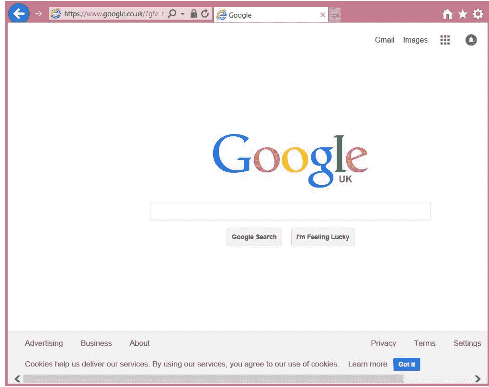

图 1.1：谷歌网站的主页或着陆页

亚马逊网站（`http://www.amazon.co.uk/`）在互联网上销售商品。如图 1.2 所示。


图 1.2：亚马逊网站的主页或着陆页

Booking 网站（`http://www.booking.com/`）用于在互联网上预订酒店。请查看下面的图 1.3。

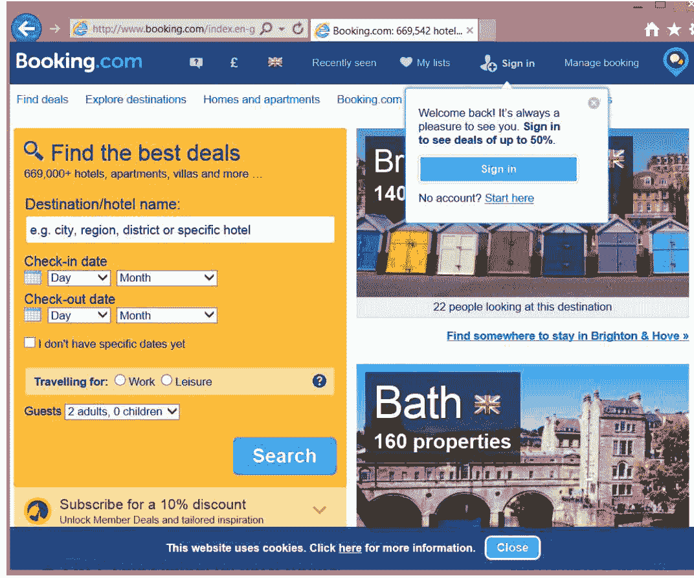

图 1.3：Booking.com 网站的主页或着陆页

维基百科网站（`http://www.wikipedia.org/`）用于在互联网上分享信息。如图 1.4 所示。

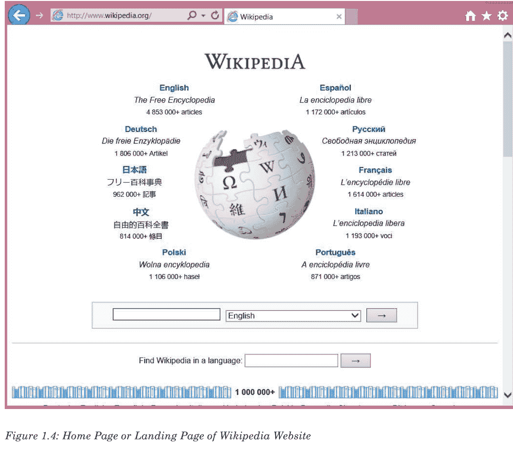

图 1.4：维基百科网站的主页或着陆页

你可以看到，你想用网站实现什么没有边界。天空才是极限。告诉我，你对自己网站有什么想法？

## 什么是网页？

你现在对网站是什么以及它能解决什么目的有了大致的了解。我们脑海中浮现的第一个问题是——这个网站是由什么构成的？这个问题催生了一个术语，叫做**网页**。

网站是网页的集合。这意味着一个网站由一个或多个网页组成。让我们通过图 1.5 所示的例子来理解这个概念。

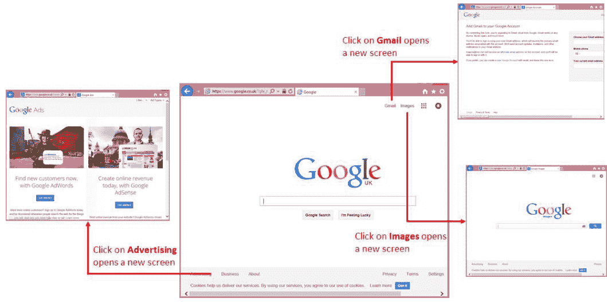

访问谷歌网站（`https://www.google.co.uk/`）。当你点击 **Gmail** 链接时，它会打开一个新屏幕。同样，当你点击 **图片** 或 **广告** 链接时，它会打开相应的新屏幕。还有很多类似的链接，但我只举了三个例子。现在，这些打开的屏幕中的每一个都是独立的网页。**每个屏幕代表一个网页**。通过这些链接和点击，很明显，网站是这些屏幕的集合。由于每个屏幕代表一个网页，使用这个类比，我们可以说“**网站是网页的集合**”。

要创建一个网站，你需要创建这些独立的屏幕或网页，然后将它们放置并链接在一起。当你打开网站时，首先打开的任何屏幕或网页被称为**主页或着陆页**。然后你从主页进入其他网页。

## 什么是 HTML？

我们了解到网站是由网页组成的。下一个自然而然的问题是——网页又是由什么构成的？

网页是使用 HTML 创建的。HTML 是一种用于定义或创建网页的语言。

HTML 是什么样子的？让我们用一种有趣的方式来探索一下。

如图 1.6 所示，在 Internet Explorer 浏览器中打开维基百科网站（`http://www.wikipedia.org/`）。在浏览器中，**用鼠标右键点击主页**。在右键菜单中，点击**查看源文件**选项，如下图 1.6 所示：

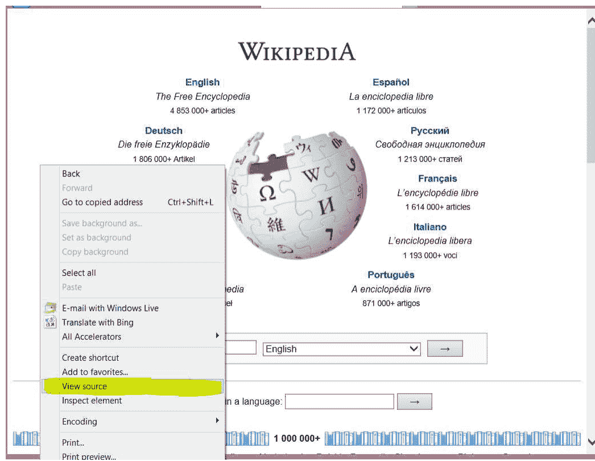

图 1.6：Internet Explorer 的右键菜单，显示“查看源文件”选项

点击“查看源文件”选项，将在记事本中打开主页背后的 HTML。这就是用于创建此网页的相同 HTML。请查看下图 1.7 中 HTML 的样子：

```html
<!DOCTYPE html>
<html lang="mul" dir="ltr">
<head>
<!-- Sysops: Please do not edit the main template directly; update /temp and synchronise. -->
<meta charset="utf-8">
<title>Wikipedia</title>
<!--[if lt IE 7]><meta http-equiv="imagetoolbar" content="no"><![endif]-->
<meta name="viewport" content="initial-scale=1.0, user-scalable=yes">
<link rel="apple-touch-icon" href="/static/apple-touch/wikipedia.png">
<link rel="shortcut icon" href="/static/favicon/wikipedia.ico">
<link rel="license" href="//creativecommons.org/licenses/by-sa/3.0/">
<link rel="stylesheet" href="//meta.wikimedia.org/w/load.php?debug=false&amp;lang=en&amp;modules=ext.gadget.wm-portal&amp;only=styles&amp;skin=vector&amp;*">
<style type="text/css">
.central-featured-logo{background:url(//upload.wikimedia.org/wikipedia/meta/0/08/Wikipedia-logo-v2_1x.png) center center no-repeat;left:0;top:0;width:100%;height:100%}
</style>
<!--[if lt IE 8]><style type="text/css">
.bookshelf-container .bookend, .otherprojects-icon{zoom:1;display:inline}
</style><![endif]-->
</head>
<body id="www-wikipedia-org">

<h1 class="central-textlogo" style="font-variant: small-caps;">

</h1>

<!-- container div for the central logo and the links to the most viewed language editions -->
<div class="central-featured">

<!-- logo -->
<div class="central-featured-logo"></div>

<!-- Rankings from http://stats.wikimedia.org/EN/Sitemap.htm (data from 2015-02-28) -->
<!-- Article counts from http://meta.wikimedia.org/wiki/List_of_Wikipedias/Table -->
<!-- #1. en.wikipedia.org - 8,567,867 views/hr -->
<div class="central-featured-lang lang1" lang="en">
<a class="link-box" href="//en.wikipedia.org/" title="English – Wikipedia – The Free Encyclopedia"><strong>English</strong><br>
<em>The Free Encyclopedia</em></a>
</div>
```

图 1.7：Internet Explorer 的“查看源文件”显示 HTML

使用上述方法，你可以查看任何网站上任何网页的 HTML。

目前的 HTML 对你来说可能还毫无意义。但别担心，一旦你读完这本书，你就能理解这里写的内容了。

## 总结

很好，你现在理解了基础知识。接下来的章节将详细描述与 HTML 相关的具体主题。你还在等什么？继续阅读，满足你的求知欲吧……

# 第 2 章：学习基础

在第一章中，我们理解了网站和网页的概念。我们了解到 HTML 是创建网页的语言。你也看到了一个真实网站的 HTML 示例。我认为我们已经准备好开始学习 HTML 的基础知识了。然后在接下来的章节中，我们将对 HTML 有更广泛的理解。

本章重点介绍 HTML 的结构以及如何在网页浏览器中查看 HTML。我们还将学习标签和属性，它们是 HTML 的基本构建块。**就像人体由细胞构成；HTML 由标签构成。**

## “Hello World”网页

我知道我们甚至还没有学到关于 HTML 的任何东西，但让我们鼓起一点勇气，在对它一无所知的情况下写下我们的第一个 HTML 网页。我们自己的第一个“Hello World”网页。听起来很棒，对吧！请按照以下步骤操作：

1. 打开**记事本**，屏幕为空白，如图 2.1 所示。

   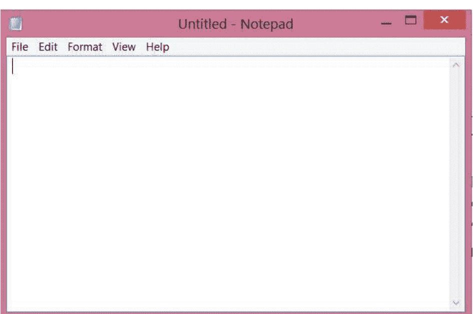

   图 2.1：空白记事本

2. 在这个记事本中，完全按照图 2.2 所示输入你的 hello world HTML。来吧，只有八行。不会花很长时间的。

   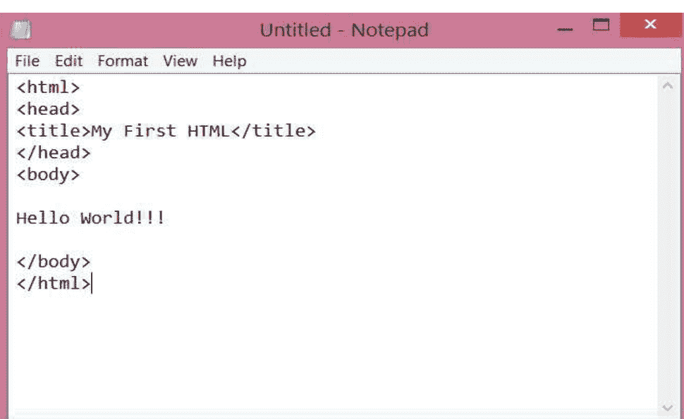

   图 2.2：“Hello World” HTML 标签

3. 将记事本文件保存为“`helloworld.html`”，放在某个文件夹位置，如图 2.3 所示。

   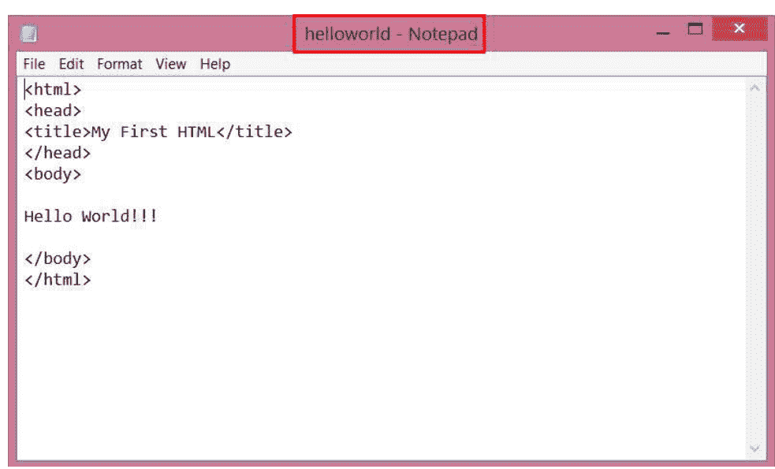

   图 2.3：helloworld HTML

   这是第一个基本课程——所有 HTML 文件都以“`.html`”或“`.htm`”扩展名保存。

4. 我们如何在网页浏览器中查看我们的第一个 HTML 网页？如图 2.4 所示打开 Internet Explorer（我使用的是 Internet Explorer 11 版本。你可以根据需要使用其他浏览器或版本。）。Internet Explorer 显示的是 Bing 地图网站。

   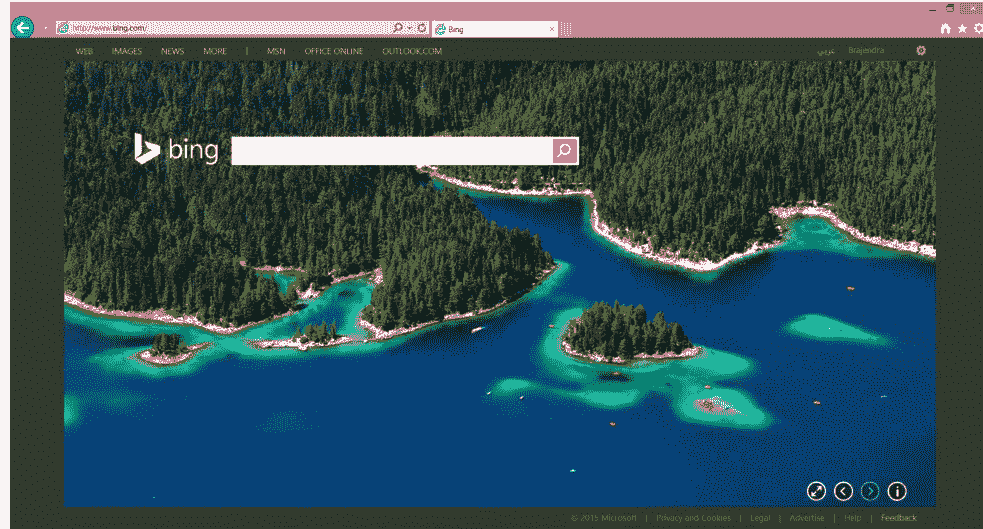

   图 2.4：Internet Explorer

5. 转到**Internet Explorer 窗口**，按下键盘上的 **Alt** 按钮。它将开始显示**文件菜单**，如下图 2.5 中方框所示。

   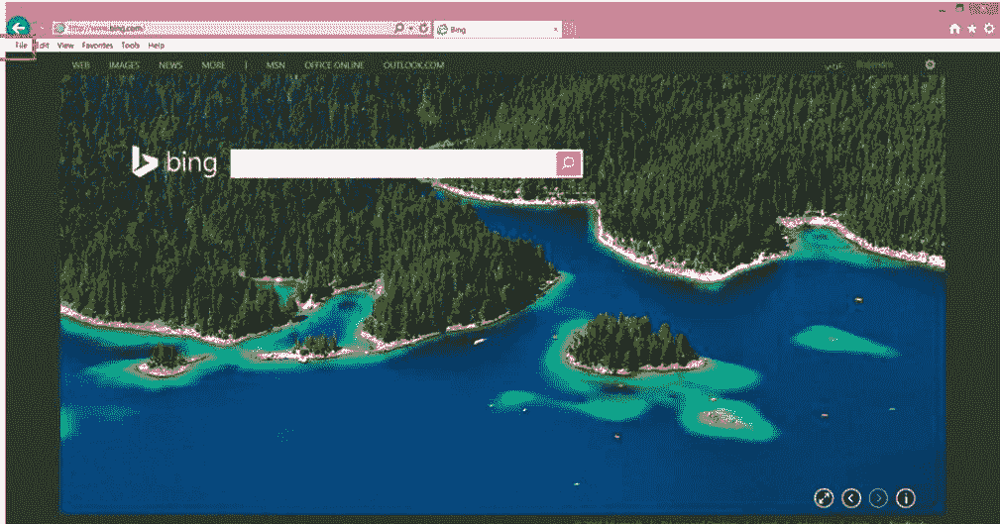

   *图 2.5：Internet Explorer 文件菜单*

6. 点击**文件**，然后点击**打开**菜单选项，如下图 2.6 所示。

   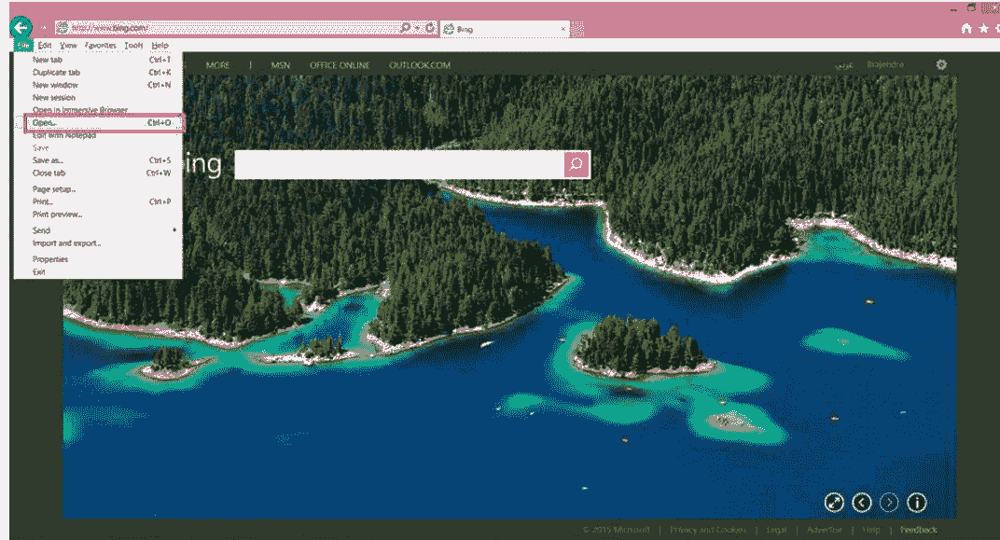

   图 2.6：文件 >> 打开菜单

7. 它将弹出**打开窗口**，如图 2.7 所示。

   

   图 2.7：打开窗口

8. 使用**浏览……按钮**，从你之前保存的**文件夹**位置选择**helloworld.html**文件。我在此演示中使用了文件夹位置“`C:\books\HTML`”。如下图 2.8 所示。

   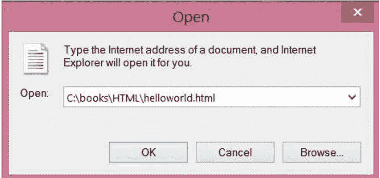

   *图 2.8：文件已选择。*

9. 点击确定按钮。它将在 Internet Explorer 中显示你的第一个 HTML 网页，如图 2.9 所示。查看你在 HTML 页面中输入的 Hello World 消息。

   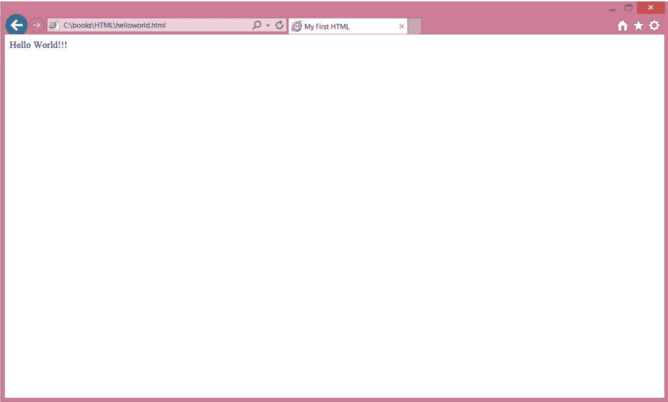

   图 2.9：文件已选择。

恭喜！你刚刚写下了你的第一个 HTML 网页。感觉如何？兴奋吗？还有更多内容等着你。

你应该记住并练习这些在记事本中创建 HTML，然后在网页浏览器（Internet Explorer）中查看的步骤，因为我们在后续章节的每个练习中都会这样做。

## 理解 HTML 结构

既然你已经写下了你的第一个 HTML 网页，让我们来理解它的含义。

正如我之前提到的，*就像人体由细胞构成；HTML 由标签构成*。你在上面 HTML 示例中看到的所有内容都是一个**标签**。例如 `<html>`、`<head>`、`<title>`、`<body>`、`</html>`、`</head>`、`</title>`、`</body>`，所有这些都称为标签。就像苹果被称为苹果，你被称为你的名字一样，这些东西被称为**标签**。我得说，这名字起得不错。每个标签在 HTML 中或者说在网页上都有其用途。

HTML 是网页的语言；你在第一章中学到了这一点。类似于任何其他语言（如英语），HTML 也有单词和语法。在这个类比中，标签就像单词。在英语中，你使用语法将单词组合在一起，写出有意义的句子。同样在 HTML 中，你使用 HTML 语法将标签组合在一起，写出作为网页有意义的内容。

你将在接下来的章节中学习这些标签或单词。我们现在将在本章的剩余部分学习 HTML 的语法。每当我们提到任何特定的 HTML 语法规则时，我们将用**HTML 语法**：提示来标记它。

例如，这是我们的第一条规则。

## HTML 语法

**HTML 语法：** 每个 HTML 标签都是成对出现的。你总会有一个像 `<tag>` 这样的开始标签，以及一个像 `</tag>` 这样的结束标签。开始标签写在 `<` 和 `>` 括号内。结束标签写在 `</` 和 `>` 括号之间。

让我们从我们的第一个标签开始。

## `<html>` 标签

看看下面显示的第一个标签。

```html
<html>
<head>
<title>My First Title</title>
</head>
<Body>

Hello World!

</Body>
</html>
```

你看到一个开始标签 `<html>`，然后是结束标签 `</html>`。`<html>` 和 `</html>` 标签就像是 HTML 文件的起点和终点。

**HTML 语法：** 所有 HTML 文件必须以 `<html>` 标签开始，并以 `</html>` 标签结束。

## `<head>` 标签

HTML 文件中下一个重要的标签是 `<head>` 标签。它在下面被高亮显示。


```html
<html>
<head>
<title>My First Title</title>
</head>
<Body>

Hello World!

</Body>
</html>
```

这个标签在真实的网页中用于包含脚本、样式和`<title>`标签。嗯，不要被这些新词搞混了。目前，我们将保持简单。你需要知道的是它包含了另一个重要的标签`<title>`。当你学习HTML的高级样式和编程时，你会更详细地了解`<head>`标签。

**HTML语法：** 开始的`<head>`标签紧跟在`<html>`标签之后。结束的`</head>`标签在`<body>`标签之前。`<head>`标签包含另一个叫做`<title>`的标签。

## `<title>`标签

什么是`<title>`标签？它是一个有趣且重要的标签。你可以在开始的`<title>`和结束的`</title>`标签之间写一些文本。无论你在这对标签之间写什么，都会出现在浏览器窗口的标题中。

这是我们第一个HTML的示例：

```html
<html>
<head>
<title>My First Title</title>
</head>
<Body>

Hello World!

</Body>
</html>
```

这是`<title>`标签在浏览器（本例中是Internet Explorer）窗口中的结果，如图2.10所示。你可以看到写在`<title>`和`</title>`标签之间的文本显示在Internet Explorer的标题中。

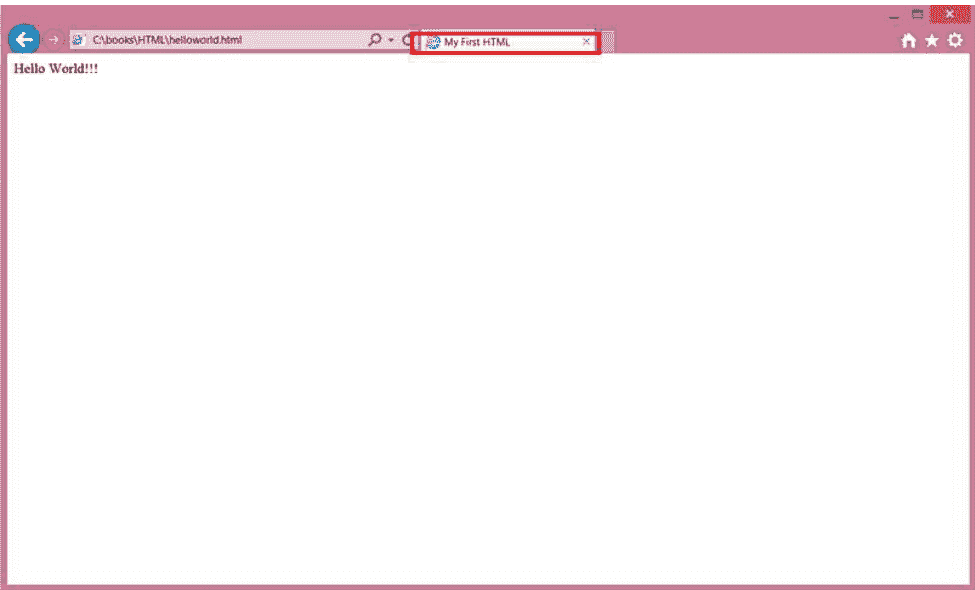

图2.10：Internet Explorer标题

**HTML语法：** `<title>`标签必须写在`<head>`标签内。它包含任何文本，然后显示在网页浏览器窗口的标题中。

**HTML语法：** `<title>`和`<head>`标签是可选的。这意味着，它们可以在HTML内部，也可以不在。在接下来的章节中，你会发现我们在许多示例中没有添加这两个标签，因为它们在那些示例中不是必需的。然而，在你的HTML中同时包含`<title>`和`<head>`标签是一个好习惯。

在真实的网站中，`<title>`标签用于在浏览器窗口的标题中显示网页的摘要或标题。

## `<body>`标签

HTML中最重要的主要标签是`<body>`标签。无论你在`<body>`标签内写什么，都会显示在浏览器窗口中。例如，在我们的第一个页面中，我们在`<body>`标签内写了Hello World!!!，它显示在浏览器窗口（Internet Explorer）中。

下面HTML中的body标签已被高亮显示。

```html
<html>
<head>
<title>My First Title</title>
</head>
<Body>
Hello World!
</Body>
</html>
```

body标签的内容显示在网页浏览器中，如下图2.11所示。

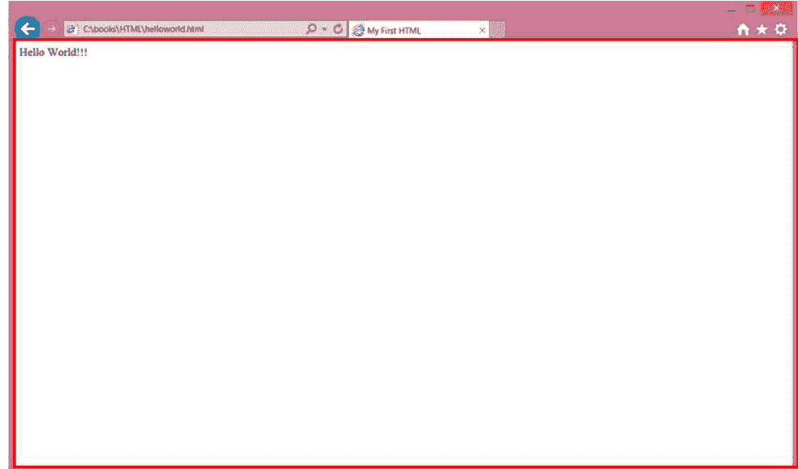

图2.11：浏览器中显示的`<body>`标签

让我们再举一个例子。访问Google网站 - [https://www.google.co.uk/](https://www.google.co.uk/)。你看，我已经在图2.12中框出了网页的一部分。这个框出的部分由各种标签组成，所有这些标签都在`<body>`和`</body>`内部。

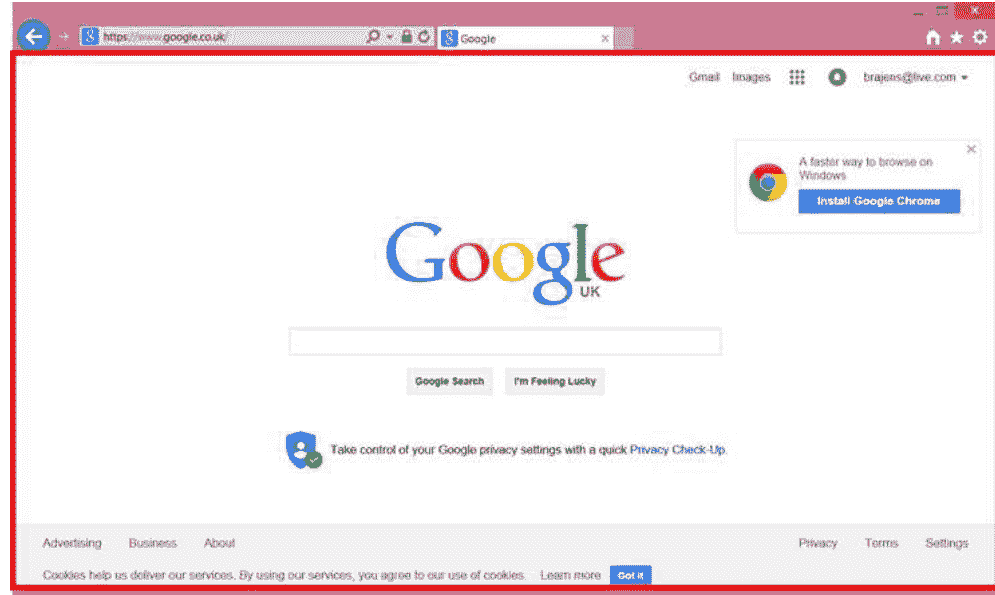

图2.12：Google网站主体

查看下面的图2.13。我高亮显示了一些在`<body>`和`</body>`内部用于构建网页的标签类型。

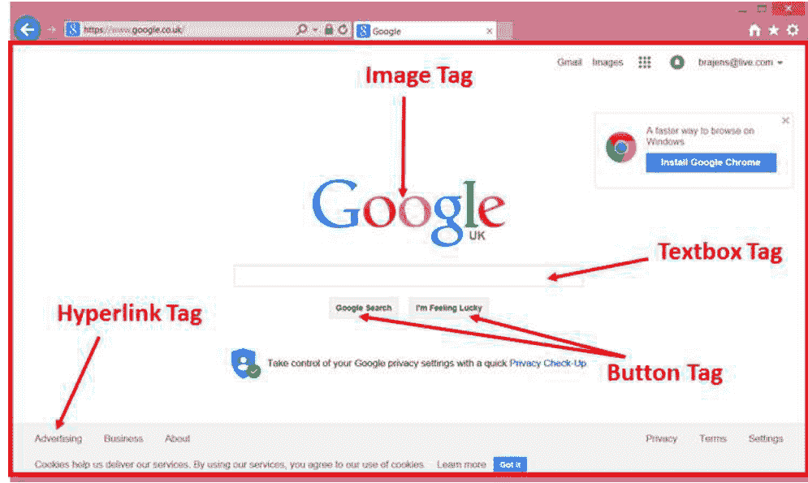

图2.13：Google网站主体标签

我高亮显示了一些标签，但这个页面上还有更多。每个标签在网页上都有特定的用途。例如，有些用于显示Google标志，有些用于输入搜索文本，有些用于点击以获取搜索结果。

你将在接下来的章节中学习许多这样的标签。`<body>`语法规则将始终适用。你学习的每个标签都将写在`<body>`和`</body>`标签之间。

**HTML语法：** 开始的`<body>`标签在`<head>`标签之后。结束的`</body>`标签在`</html>`标签之前。为了以所需方式显示你的网页而编写的每个其他标签都写在`<body>`和`</body>`标签之间。

编写标签名称时，始终使用小写英文字母，否则可能会出错。在网络世界中，用小写英文字母编写标签一直被视为**最佳实践**。我相信你想与**最佳实践**联系在一起。

有时标签也被称为**元素**或**HTML元素**。

## 标签的属性

你已经了解了标签和HTML结构。现在让我们学习**属性**，它是标签的重要组成部分。

属性意味着质量。在现实生活中，属性的目的是什么？让我们举个例子。当你看到一个红苹果时，你会说这个苹果的一个质量（或者说属性）是它是红色的。同样，当你遇到一个聪明的同学时，你会说这个同学有一个质量或属性，那就是聪明。

我们意识到，属性提供了关于某人或某事的额外细节。

属性在标签中也起着同样的作用。它们提供了关于标签的额外细节。

让我们以`<body>`标签为例；Body通常用于背景图像、背景颜色、字体大小等。

```html
<body background="image of the background" bgcolor="color of the background" id="name of the body">
```

在这个例子中，`<Body>`标签具有以下属性，如下表2.1所示。

表2.1：Body属性

| 属性 | 它告诉了`<body>`标签什么？ |
| :--- | :--- |
| `bgcolor` | 整个网页主体的背景颜色 |
| `background` | 整个网页主体的背景图像 |
| `Id` | 用于以编程方式搜索标签。你将在接下来的章节中了解更多关于此的信息。 |

与`<body>`标签类似，HTML中的所有标签都有自己的属性集。一些属性如`id`在所有标签中都是通用的。一个标签可以有多个属性。当你在接下来的章节中学习标签时，你也会同时学习它们的重要属性。

最后，让我们看看带有属性的标签结构。

```html
<tag attribute-name="attribute-value"></tag>
```

属性以**属性名="属性值"**的形式呈现在标签内。你在接下来的章节中学习的所有标签和属性都将遵循相同的结构。

## 总结

很好，你现在理解了HTML结构、标签和属性。你已经掌握了基本概念。是时候开始学习具体的标签了，它们解决什么问题，如何使用，以及它们在网页上的样子。本书其余章节的重点是标签和相关主题。继续阅读……

# 第3章 – 标题和段落

我们在上一章学习了HTML基础知识。你现在理解了HTML网页中标签的结构。有了这个基本理解，从现在开始，我们将学习特定的标签，了解它们在页面上的作用以及如何使用它们。

在本章中，我们将重点介绍**标题**和**段落**标签。什么是“标题”和“段落”？它们与你在书籍和笔记本中使用的“标题”和“段落”没有什么不同。标题用于提供某个主题的“标题”。段落用于提供主题的书面文本。网页中“标题”和“段落”标签的目的与它们在书籍中的使用方式没有区别。

## 标题和段落的示例

学习和理解某事的最好方法是在现实生活中“看到”它。我们现在将看看网页中标题和段落的示例。

访问维基百科的以下页面 - [https://en.wikipedia.org/wiki/London](https://en.wikipedia.org/wiki/London)。我实际上是在维基百科中寻找关于伦敦的信息。你可以在下面的图3.1中看到标题和段落的示例。

你可以看到，标题被用作标题，段落则用于提供长篇文本细节。例如，史前时期、罗马时期的伦敦等都是标题，其后紧跟着段落文本。

让我们学习如何在HTML页面中实现这一点。

## 学习细节

让我们先从标题开始。正如我们之前讨论的，标题用于提供标题。

你可以使用`<h1>`到`<h6>`标签来编写标题。图3.2展示了使用`<h1>`标签的标题示例。

```html
<html>
<body>
<h1>第四章标题</h1>
</body>
</html>
```

# 第四章标题

图3.2：h1示例

与`h1`类似，你也可以使用`h2`、`h3`、`h4`、`h5`或`h6`标签。当标题标签中的数字增加时，文本的大小会减小。以下是所有标题标签的示例，如图3.3所示。

```html
<html>
<body>
<h1>h1示例</h1>
<h2>h2示例</h2>
<h3>h3示例</h3>
<h4>h4示例</h4>
<h5>h5示例</h5>
<h6>h6示例</h6>
</body>
</html>
```

# h1示例

h2示例

h3示例

h4示例

h5示例

h6示例

图3.3：所有标题元素示例

在你的网页中，你可以根据想要显示的标题大小选择特定的标题编号标签。

使用起来是不是非常简单？我相信你会同意我的观点。现在让我们继续学习使用段落。

段落用于提供大段文本。我们使用`<p>`标签在网页上显示段落。图3.4展示了一个段落标签。

```html
<html>
<body>
<p>Lorem ipsum dolor sit amet, consectetur adipiscing elit. Curabitur justo lacus, elementum vel ornare quis, laoreet non diam. Duis id aliquam risus, sed dignissim metus. Duis feugiat ultricies tincidunt. Maecenas sed ultrices elit. Praesent egestas quam eros, eu suscipit risus. Sed aliquet metus in est feugiat egestas. Aenean bibendum purus sed maximus lobortis, orci tellus porta felis, eu molestie elit elit a metus. Nam lobortis lectus vitae malesuada pretium. Nam laoreet mauris feugiat felis sodales consequat. Duis quis lacinia arcu. Pellentesque ultricies sem vel magna blandit ultricies. Vestibulum gravida nunc in quam egestas, id porttitor enim eleifend posuere non.</p>
</body>
</html>
```

图3.4：段落示例

在上面的示例中，你可以看到如何在`<p>`和`</p>`标签之间编写长文本块来呈现段落文本。

当你在网页上将标题和段落标签组合在一起时，你会看到真实的示例。请参阅下面的示例，如图3.5所示。

```html
<html>
<body>
<h2> 标题1 </h2> 标题
<p>Lorem ipsum dolor sit amet, consectetur adipiscing elit. Curabitur justo lacus, elementum vel ornare quis, laoreet non diam. Duis id aliquam risus, sed dignissim metus. Duis feugiat ultricies tincidunt. Maecenas sed ultrices elit. Praesent egestas quam eros, eu suscipit risus. Sed aliquet metus in est feugiat egestas.</p> 段落
<h2> 标题2 </h2> 标题
<p>Lorem ipsum dolor sit amet, consectetur adipiscing elit. Curabitur justo lacus, elementum vel ornare quis, laoreet non diam. Duis id aliquam risus, sed dignissim metus. Duis feugiat ultricies tincidunt. Maecenas sed ultrices elit. Praesent egestas quam eros, eu suscipit risus. Sed aliquet metus in est feugiat egestas.</p> 段落
</body>
</html>
```

图3.5：标题与段落结合

它看起来像一本书的章节。不是吗？

最后还有一件事要分享。当你编写文本并想从下一行开始时，你可以在文本之间插入`<br>`标签来实现。请参阅下面的示例，如图3.6所示。

你可以看到，你可以直接在`<body></body>`标签之间将文本插入HTML页面，然后使用`<br>`标签插入下一行。

## 自己动手试试

你现在理解了如何使用标题和段落标签。我想给你一个练习，让你在网页上展示一个小故事。你创建一个网页，以图3.7所示的格式展示故事。

以下是执行此练习的指南：

- 打开记事本
- 使用标题和段落标签创建HTML。每个标题标签后跟相应的段落标签。在相应的标签之间输入文本。
- 使用`.htm`或`.html`扩展名保存HTML文件
- 使用网页浏览器打开HTML文件以查看结果。

如果需要任何帮助，请查看**练习1 – 贪婪的乌鸦**章节，找到上述网页的HTML。

## 总结

恭喜，你刚刚学会了使用标题和段落标签。不仅如此，你还创建了一个网页来展示故事。你是否有了构建故事网站的想法？嗯，一旦你详细学习了HTML，实现那个梦想就为期不远了。在那之前，继续阅读……

# 第四章 – 文本格式化

在上一章中，你学习了编写标题和段落。我希望你喜欢这个练习。我们将在本章继续学习更多文本内容，但主要关注文本格式化。

什么是**格式化**？在阅读任何书籍、查看任何网站上的文本或阅读Microsoft Word中的文档时，你一定观察到文本的某些部分显示为粗体（**粗体**）或带下划线（<u>下划线</u>）或斜体（*斜体*），以显示文本的重要性。在网页中使任何文本变为粗体、下划线或斜体称为“格式化”。

我们将学习格式化在HTML中是如何使用的。

## 文本格式化示例

是时候看看格式化的示例了。请访问维基百科的以下页面 - [https://en.wikipedia.org/wiki/India](https://en.wikipedia.org/wiki/India)。在下面图4.1所示的这个小段落中，你可以看到格式化的示例：

你会发现文本的某些部分或某些行被突出显示为粗体和斜体，以显示文本的重要性。显示文本的重要性是格式化的主要用途。

## 学习细节

是时候学习格式化的细节了。但在我们开始之前，让我们看看一些常见的格式化示例以及它们在下面表格中的样子。

表4.1：格式化样式

| 格式化样式 | 它的样子？ |
|---|---|
| 粗体 | **这是粗体文本。** |
| 斜体 | *这是斜体文本。* |
| 下划线 | <u>这是下划线文本。</u> |
| 小号 | <small>这是小号文本。</small> |
| 下标 | 这是<sub>下标</sub>文本。 |
| 上标 | 这是<sup>上标</sup>文本。 |

HTML中还有更多格式化方法，但本书将学习这些常用方法。

让我们从第一种方法开始，使文本**粗体**。要使文本粗体，你可以这样编写HTML：

`<b> 你的文本在这里 </b>`

这意味着，你将文本放在`<b>`和`</b>`标签之间使其变为粗体。`<b>`代表粗体。很简单，不是吗？

那么，使文本变为斜体需要什么呢？看看这里：

`<i> 你的文本在这里 </i>`

多么相似又简单！这里`<i>`代表斜体。猜猜看，所有其他格式化在HTML中的工作方式也相同。查看下面的表格，了解其他文本格式化的工作方式：

表4.2：格式化标签

| 格式化 | HTML标签 |
|---|---|
| 下划线 | `<u> 你的文本在这里 </u>` |
| 小号 | `<small> 你的文本在这里 </small>` |
| 下标 | `<sub> 你的文本在这里 </sub>` |
| 上标 | `<sup> 你的文本在这里 </sup>` |

到目前为止很有趣！让我们迈出下一步。思考一下，要使段落看起来像图4.2所示，需要什么。

Lorem ipsum dolor **sit amet**，consectetur adipiscing elit. Fusce varius, tortor et *pellentesque ultrices*，eros justo vehicula ligula，<u>non egestas massa</u> sapien vel mauris. Mauris eget ex rhoncus，<sub>fermentum</sub> risus eget, mattis magna. Vestibulum tincidunt venenatis justo, in <sup>fermentum mauris</sup> lobortis in.

图4.2：段落中的混合格式化

你可以看到不同方式的文本格式化与普通文本混合在一起。它是如何工作的？看看下面创建这种格式化的HTML标签。


```html
<html>
<head>
<title></title>
</head>
<body>
<p>
Lorem ipsum dolor <b> sit amet </b> consectetur adipiscing elit. Fusce varius tortor et <i> pellentesque ultrices </i>, eros justo vehicula ligula, <u> non egestas massa </u> sapien vel mauris. Mauris eget ex rhoncus, <sub> fermentum </sub> risus eget, mattis magna. Vestibulum tincidunt venenatis justo, in <sup> fermentum mauris </sup> lobortis in.
</p>
</body>
</html>
```

格式化的文本在段落标签中与普通文本混合或放置在一起。使用起来如此简单。你可以随心所欲地玩转文本格式化。

# 第四章

## 动手试试

又到了练习时间。我们将回顾上一章练习中创建的《贪婪的乌鸦》故事。我们将使用那个网页。但我们希望故事看起来像图4.3所示的那样：

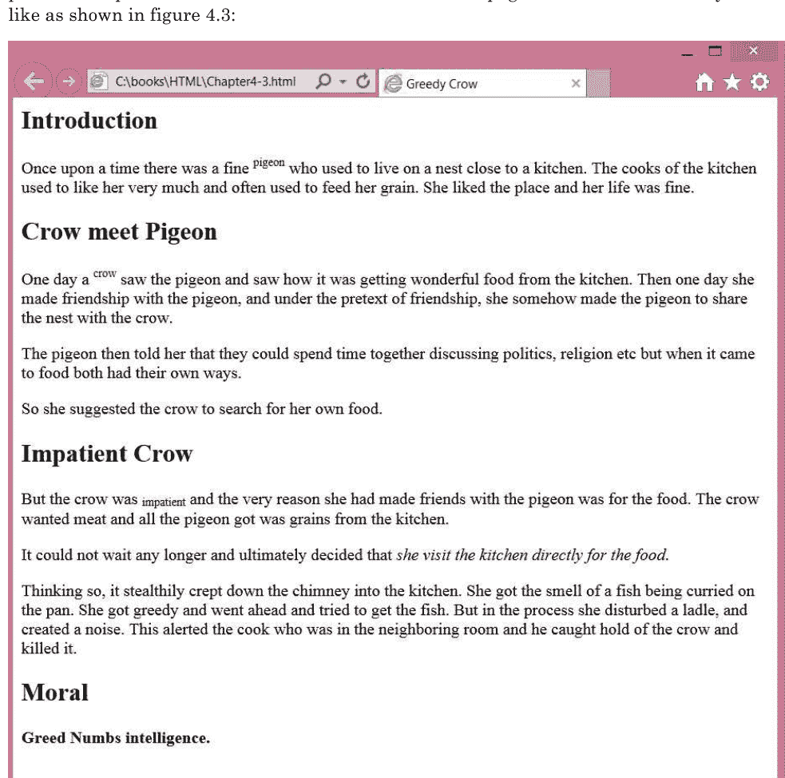

图4.3：练习用的格式化故事页面

以下是进行此练习的指南：

- 在记事本中打开《贪婪的乌鸦》网页。这是你在上一个练习中创建的网页。
- 将此文件“另存为”一个新名称（例如“Greedy_Crow_Formatted.html”）。
- 在保存的副本中，根据图4.3所示的格式要求，在段落文本中插入你的格式化标签。
- 插入所有格式化标签后，保存HTML文件。
- 使用网页浏览器打开HTML文件以查看结果。

如果你需要任何帮助，请查看**练习2 – 贪婪的乌鸦格式化**章节，以找到上述网页的HTML代码。祝你好运！

## 总结

恭喜你又完成了一章。你现在应该已经掌握了使用HTML创建网页的技巧。HTML在创建网站方面极其简单却又非常强大。我希望你的兴趣正在增加，学习更多知识的胃口也在变大。所以，继续阅读吧……

# 第五章 – 超链接

欢迎回来，朋友们！在前面的章节中，你学习了如何格式化文本。你一定已经意识到，使用HTML创建任何类型的内容（如故事、新闻或任何你想在网站上分享的文章）是多么简单而强大。

我们现在将学习HTML中最重要的元素之一，它叫做**超链接**。在前两章中，你了解到任何网站都是网页的集合。那么，在一个网站中，你如何从一个页面移动到另一个页面呢？通常，你使用超链接在网站中从一个页面移动到另一个页面。你点击网页上的一个超链接，它就会带你到另一个网页，如此类推。在HTML的世界里，我们说我们使用超链接从一个页面**导航**到另一个页面。

在本章中，我们将学习如何使用超链接。相信我，这非常简单。

## 超链接示例

我们将举一个每个人都见过的例子。我猜几乎每个人都见过！

访问网站 - [https://www.google.co.uk/](https://www.google.co.uk/)。请不要告诉我你以前没用过谷歌。在这个谷歌网站上，下面的图5.1展示了一些超链接的例子：

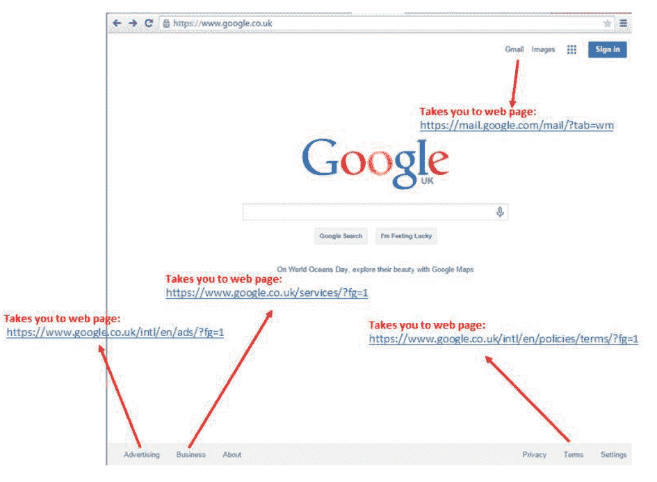

图5.1：超链接示例

这个网页上还有更多超链接，但我只展示了一些以便于理解。当你点击一个超链接时，它会带你到或者说导航到图中所示的网页。你可以看到，使用超链接，你能够访问谷歌网站的各种网页。

在上面的例子中，Advertising、Business、Terms、Gmail被称为超链接的“**文本**”。文本显示了网页上超链接的显示文字；人们可以阅读它来了解超链接的用途。当你点击超链接时，它带你去的网页被称为“**地址**”。我建议你记住并理解这两个术语，因为它们是超链接的基础。

是时候学习如何使用超链接了。

## 学习细节

让我们从一个例子开始。假设你想创建一个超链接，它应该带你到 [https://www.google.co.uk/](https://www.google.co.uk/) 网页，并且应该显示文本为“Google Search”。这意味着，超链接应该在网页上显示文本为“Google Search”（就像上面例子中的Advertising、Business、Terms、Gmail）。地址是 [https://www.google.co.uk/](https://www.google.co.uk/)。

你如何编写这样的超链接，看看：

```html
<html>
<head>
<title></title>
</head>
<body>
<a href="https://www.google.co.uk"> Google Search </a>
</body>
</html>
```

超链接由HTML标签`<a>`表示。在`<a>`和`</a>`标签之间，你编写超链接的**文本**。**文本**是超链接的显示文字。你在属性“**href**”中提供超链接的**地址**。**地址**的目的是告诉网页所在的位置。

这个超链接在HTML页面中将如图5.2所示：


*图5.2：Google Search 示例*

很简单，对吧？

让我们再举一个有趣的例子。如果我在超链接的地址中输入“#”，会发生什么，就像下面这样？

```html
<a href="#"> My Link </a>
```

你自己试试看。你会发现超链接不会带你去任何地方，而是让你停留在超链接所在的同一页面。很有趣，不是吗？

## 动手试试

在这个练习中，我们将创建一个网页，它将是一个**主搜索页面**。从这个页面，你可以导航到谷歌搜索、必应搜索、雅虎搜索和维基百科搜索。所有主要的搜索网站都在一个网页上。该网页将如图5.3所示。

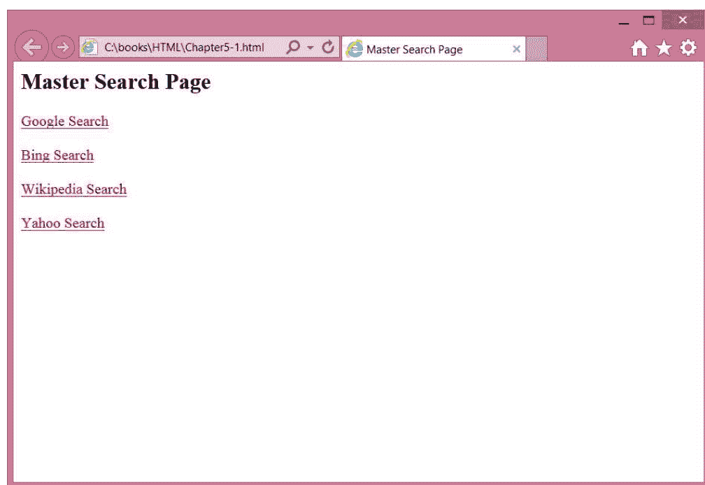

图5.3：练习用的主搜索页面

当你点击这些超链接时，它应该带你到各个搜索页面。下表显示了这些超链接的地址，你可以在创建网页时使用。

表5.1：超链接地址

| 超链接文本 | 地址 |
| :--- | :--- |
| **Google Search** | `https://www.google.co.uk/` |
| **Bing Search** | `https://www.bing.com/` |
| **Wikipedia Search** | `http://en.wikipedia.org/wiki/Searching` |
| **Yahoo Search** | `https://uk.search.yahoo.com/` |

以下是进行此练习的指南：

- 打开记事本。
- 使用标题和超链接标签创建HTML。对于每个超链接标签，使用表5.1中给出的文本和地址。
- 使用`.htm`或`.html`扩展名保存HTML文件。
- 使用网页浏览器打开HTML文件以查看结果。

如果你需要任何帮助，请查看**练习3 – 主搜索页面**章节，以找到上述网页的HTML代码。祝你好运！

## 总结

太棒了，又完成了一章。双倍的棒，因为你完成了HTML中最重要的概念之一。没有超链接，大型网站是不可能存在的，而你刚刚学习了它的基础知识。保持你的胃口，继续阅读……

# 第六章 – 图像

你在上一章学习了超链接。超链接是HTML中最重要的元素之一，因为它提供了在网页之间导航的方式。现在让我们转向一些视觉化的东西。**图像**或**图片**怎么样？有一句著名的谚语：“***一图胜千言***”。这句话展示了图片在传递信息方面的强大能力。网站展示图片是为了让网页更令人兴奋、更直观、更生动。

我们如何在任何网页上显示图像或图片？本章将尝试回答这些问题。

## 图像示例

让我们看看网页上的图片示例。请访问维基百科的以下页面 - [https://en.wikipedia.org/wiki/Albert_Einstein](https://en.wikipedia.org/wiki/Albert_Einstein)。你会看到如图6.1所示的图像：

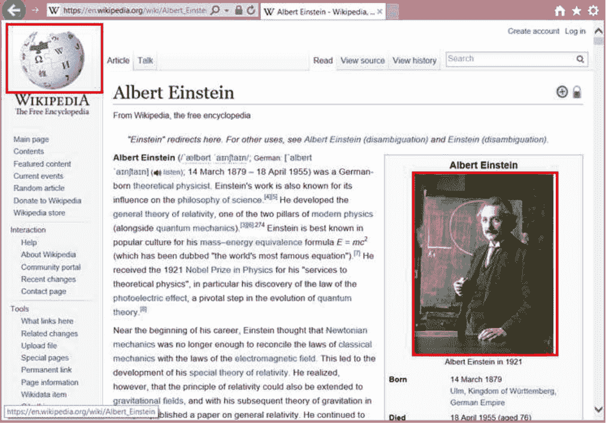

图6.1：图像示例

你可以看到我标记了两张图片——一张是**阿尔伯特·爱因斯坦**，另一张是**维基百科标志**。你不觉得这些图片让这个页面生动起来了吗？

网页上的图像可以有两种使用方式：

- 一种方式是仅仅显示图像。只是显示；没有其他。
- 另一种方式是将图像用作超链接。这意味着当你点击图像时，它会带你到另一个页面。多么有趣！

我们将在本章中学习这两种方式。

## 学习细节

我们如何在网页上显示图像？我们使用``标签来实现这个目的。请查看下面的例子：

```html
</img>
```

我们开始使用``标签，然后像处理任何HTML标签一样用`</img>`标签关闭它。但接着我们使用各种其他属性来确保图像在网页上显示。让我们看看下表中的这些属性。

表6.1：``标签的属性

| ``标签属性 | 用途 |
|---|---|
| `src` | **src**代表**source**（来源）。就像超链接一样，你为这个属性输入图像的地址。地址是此图像存储的位置。地址可以是基于互联网的图像。这意味着图像存储在互联网的某个地方，就像任何网页一样。例子是存储在维基百科的阿尔伯特·爱因斯坦图像。地址是：`https://upload.wikimedia.org/wikipedia/commons/thumb/3/3e/Einstein_1921_by_F_Schmutzer_-_restoration.jpg/220px-Einstein_1921_by_F_Schmutzer_-_restoration.jpg`或者它也可以是你电脑/笔记本电脑硬盘上的地址。这意味着图像存储在你本地电脑硬盘的某个地方。你提供图像的文件夹位置。例子是 - `file://C:/Books\HTMLforKids/mybook.jpg`。你可以使用大多数类型的图像，如**jpg**、**jpeg**、**png**、**gif**和**bmp**。 |
| `alt` | **alt**代表**alternate text**（替代文本）。如果由于某种原因图像无法在网页上显示，这是网页上显示的文本。它就像一个备用计划。你想在图像因某些问题无法显示时显示一些文本。 |
| `width` | 这是图像的宽度。如果你不提供这个值，它将以原始宽度显示图像。宽度以像素为单位。一个像素就像屏幕上的一个点。就像你用米或厘米测量距离一样；同样，你用像素测量图像的长度。 |
| `height` | 这是图像的高度。与宽度类似，它也以像素为单位。如果你不提供这个值，它将以原始高度显示图像。 |

让我向你展示如何在HTML中显示图片。我将使用上表中给出的阿尔伯特·爱因斯坦的图片地址，并在我的HTML页面中显示它。我会将高度设为200像素，宽度也设为200像素，就像一个正方形。HTML代码如下所示：

```html
<html>
<head>
<title></title>
</head>
<body>
<h2>Albert Einstein</h2>

</body>
</html>
```

该HTML页面将显示为下面图6.2所示的样子。

## 阿尔伯特·爱因斯坦

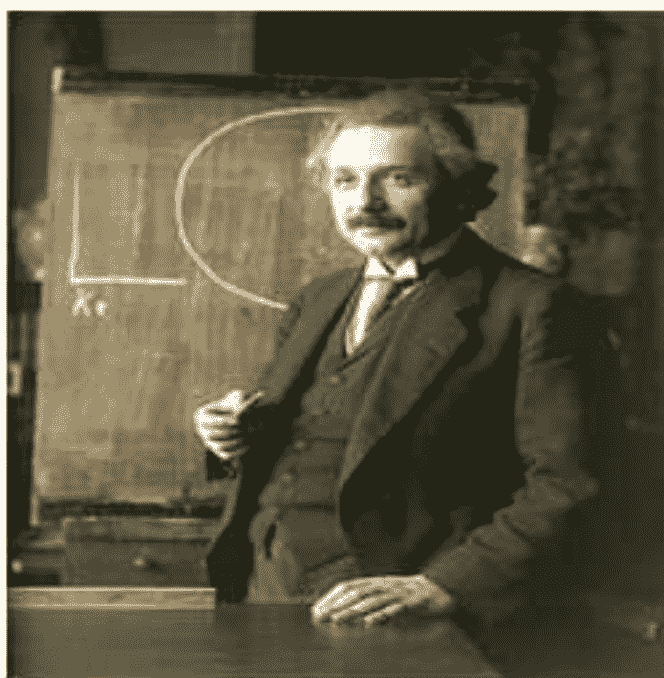

图6.2：网页显示效果

你可以看到，它按照我在``标签属性中指定的尺寸，以正方形（200 x 200）显示了图片。

如果图片出了问题会怎样？例如，你给了图片一个错误的地址。一旦出现问题，网页将显示为图6.3所示的样子。我建议你自己动手试试。

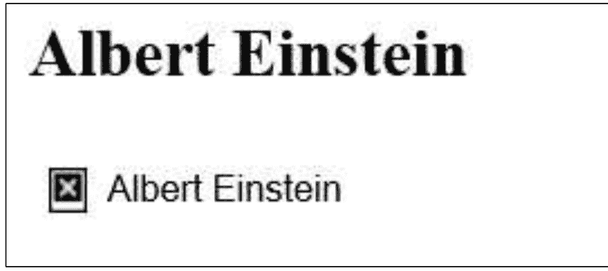

图6.3：图片问题

你观察得很对。它显示了在``标签属性中定义的**替代文本**，而不是图片。

让我们继续前进！那么，将图片用作超链接怎么样？听起来很棒！对吧？下面是超链接标签的结构（回顾上一章）：

```html
<a href="网页地址"> 超链接文本 </a>
```

要将图片设为超链接，你需要用``标签替换**超链接文本**。例如，如果我想将阿尔伯特·爱因斯坦的图片设为超链接，点击后跳转到维基百科页面，那么我的HTML`<a>`标签将如下所示：

```html
<a href="https://en.wikipedia.org/wiki/Albert_Einstein">
  
</a>
```

这不是很简单直观吗？我相信你会同意我的看法。

## 自己动手试试

是时候用一些图片来点亮网页了。今天，我给你布置一个练习，你将使用标题标签、段落标签以及图片标签。制作一个**艾萨克·牛顿网页**，使其看起来像图6.4。

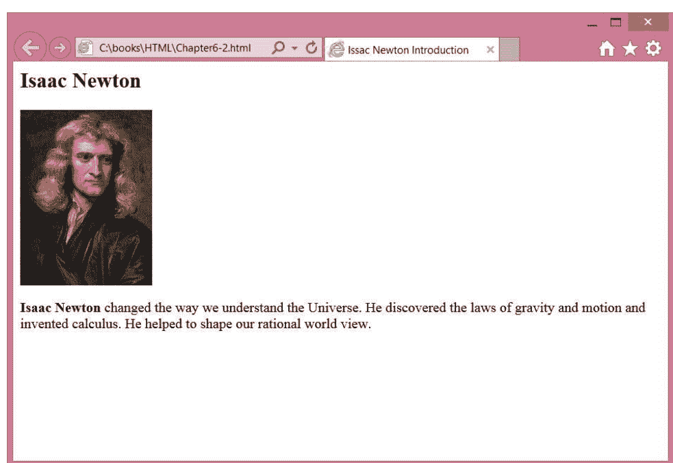

图6.4：用于练习的图片页面

请使用此URL（`https://upload.wikimedia.org/wikipedia/commons/thumb/3/39/GodfreyKneller-IsaacNewton-1689.jpg/220px-GodfreyKneller-IsaacNewton-1689.jpg`）在练习中显示牛顿爵士的图片。我希望高度为200像素，宽度为150像素。

以下是进行此练习的指南：

- 打开记事本。
- 使用标题、图片和段落标签创建HTML。图片的地址或位置已在前面的段落中提供。在``标签中提供图片的高度和宽度。在段落标签中编写关于牛顿爵士的文本。
- 使用`.htm`或`.html`扩展名保存HTML文件。
- 使用网页浏览器打开HTML文件以查看结果。

如果你需要任何帮助，请查看**练习4 – 艾萨克·牛顿**章节，以找到上述网页的HTML代码。祝你好运！

## 总结

太棒了，你又完成了一章。希望你喜欢它。我喜欢网页上的图片和超链接，因为它们使网站变得如此互动和生动。希望你也有同感。继续阅读...

# 第七章 – 列表

欢迎！希望你喜欢在上一章中玩转图片。那很迷人，不是吗？让我们回到创意写作上来。好的，告诉我，你的英语老师说过多少次，如果你有多个选项可以写，使用要点列表可以使内容更突出、更清晰。将你的选项写成要点列表，可使其更具可读性和表现力。

**列表**在HTML中用于在网页上创建基于要点的文本。目的相同，让你的写作更突出、更具可读性和表现力。

让我们来学习一下。

## 列表示例

我们将再次使用维基百科来查看列表的示例。请访问维基百科的以下页面 - [https://en.wikipedia.org/wiki/Main_Page](https://en.wikipedia.org/wiki/Main_Page)。你可以看到列表在下面图7.1中被高亮标记。

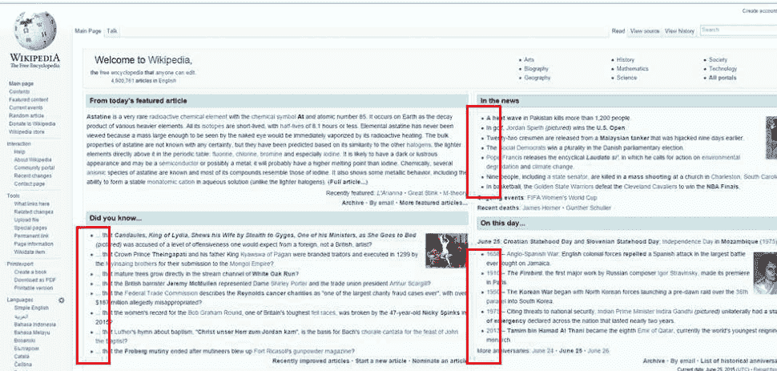

你可以看到网页上有三个列表或要点文本，用于显示新闻、当天的重要事件和一些事实。要点文本使页面更具可读性和条理性。

是时候学习细节了。

## 学习细节

HTML中存在三种类型的列表。下表列出了它们的名称并展示了它们的外观：

表7.1：HTML中的列表类型

| 类型 | 用途 | 外观 |
| :--- | :--- | :--- |
| 无序列表 | 显示标记为要点的文本行 | • 第一章<br>• 第二章<br>• 第三章<br>• 第四章 |
| 有序列表 | 显示标记有数字、字母或罗马数字的文本行 | 1. 第一章<br>2. 第二章<br>3. 第三章<br>4. 第四章 |
| 描述列表 | 显示为有序列表，并提供每个文本行的描述。当你想在列表中同时提供简短文本行和详细描述时，这尤其重要。 | 第一章 - 简介<br>第二章 - "你好" HTML<br>第三章 - 什么是元素和属性？<br>第四章 - 标题和段落 |

如果你回顾上面给出的维基百科页面示例，维基百科页面显示的是**无序列表**。

让我们详细看看每种类型的列表。我们将从无序列表开始。我们使用`<ul>`和`<li>`标签来创建无序列表。以下是这些标签的结构：

```html
<ul>
    <li>文本行一</li>
    <li>文本行二</li>
    <li>文本行三</li>
    <li>文本行四</li>
</ul>
```

**UL**代表**无序列表**。**LI**代表**列表项**。你在`<li>`标签下提供各个文本行项目。然后将`<li>`标签列在`<ul>`标签下。你可以根据需要添加任意数量的`<li>`项目。


上面表格中显示示例的 HTML 是什么？如图 7.2 所示。

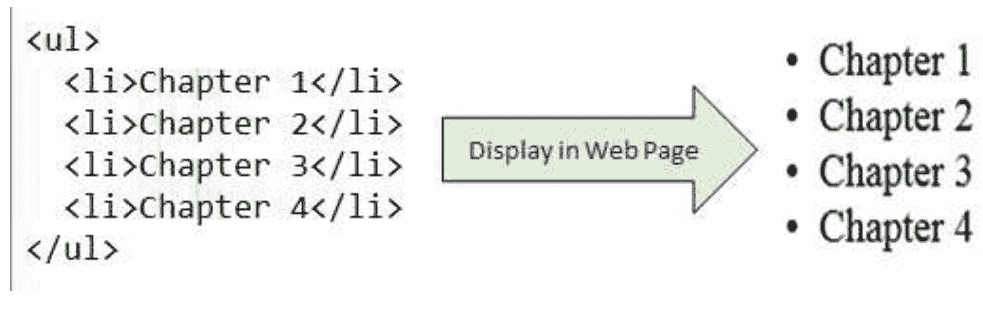

很简单，不是吗？

让我们看看有序列表。以下是有序列表标签的结构：

```html
<ol>
    <li>文本行一</li>
    <li>文本行二</li>
    <li>文本行三</li>
    <li>文本行四</li>
</ol>
```

多么可预测！顺便说一下，`OL` 代表有序列表。`LI` 具有相同的名称和用途。

让我们看看上面表格中给出的有序列表示例的 HTML 是什么样子。如图 7.3 所示。

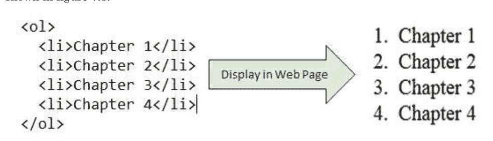

在上面的示例中，我们使用了数字（1, 2, 3...）来显示顺序。你也可以选择使用字母或罗马数字。你需要在`<ol>`标签中使用`type`属性来决定使用哪种选择。下表显示了`type`属性的示例。

表 7.2：`type` 属性示例

| 类型示例 | 外观 |
| :--- | :--- |
| `<ol type="1"><li>第一章</li><li>第二章</li><li>第三章</li><li>第四章</li></ol>` | 1. 第一章<br>2. 第二章<br>3. 第三章<br>4. 第四章 |
| `<ol type="A"><li>第一章</li><li>第二章</li><li>第三章</li><li>第四章</li></ol>` | A. 第一章<br>B. 第二章<br>C. 第三章<br>D. 第四章 |
| `<ol type="a"><li>第一章</li><li>第二章</li><li>第三章</li><li>第四章</li></ol>` | a. 第一章<br>b. 第二章<br>c. 第三章<br>d. 第四章 |
| `<ol type="I"><li>第一章</li><li>第二章</li><li>第三章</li><li>第四章</li></ol>` | I. 第一章<br>II. 第二章<br>III. 第三章<br>IV. 第四章 |
| `<ol type="i"><li>第一章</li><li>第二章</li><li>第三章</li><li>第四章</li></ol>` | i. 第一章<br>ii. 第二章<br>iii. 第三章<br>iv. 第四章 |

简单但功能强大。

最后，让我们来学习**描述列表**。以下是描述列表标签的结构：

```html
<dl>
    <dt>简短文本一</dt>
        <dd>文本一的详细描述</dd>
    <dt>简短文本二</dt>
        <dd>文本二的详细描述</dd>
    <dt>简短文本三</dt>
        <dd>文本三的详细描述</dd>
    <dt>简短文本四</dt>
        <dd>文本四的详细描述</dd>
</dl>
```

# 第 7 章

`DL` 代表**描述列表**。`DT` 代表**数据项**。`DT` 用于显示文本行的简短名称。你可以根据需要添加任意数量的`<dt>`标签。`DD` 代表**数据描述**。`DD` 用于显示简短文本行的详细描述。`<dd>`标签位于`<dt>`标签之后，因为它描述的是`<dt>`标签中显示的文本。

我承认这有点令人困惑，但你很快就能掌握它。让我们看看之前表格中示例对应的描述列表 HTML 会是什么样子。它显示在图 7.4 中。

```html
<dl>
  <dt>Chapter 1</dt>
  <dd>- Introduction</dd>
  <dt>Chapter 2</dt>
  <dd>- "Hello" HTML</dd>
  <dt>Chapter 3</dt>
  <dd>- What are Elements and Attributes?</dd>
  <dt>Chapter 4</dt>
  <dd>- Headings and Paragraphs</dd>
</dl>
```

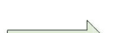

第 1 章

- 简介

第 2 章

- "Hello" HTML

第 3 章

- 什么是元素和属性？

第 4 章

- 标题和段落

图 7.4：描述列表示例

好的，现在我们来做练习。

## 动手试试

我希望你为一本 HTML 书籍创建一个**目录**网页。你将使用标题和描述列表标签。该网页应如图 7.5 所示。

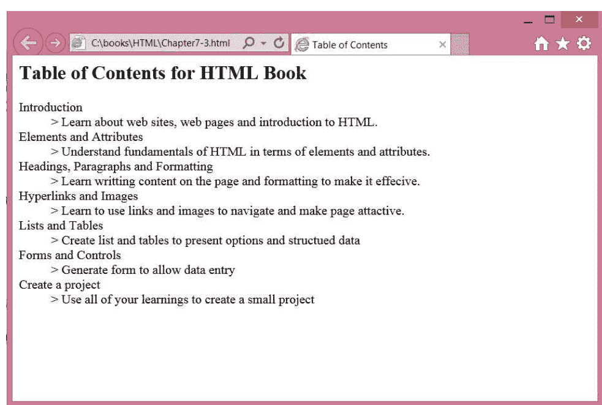

图 7.5：目录示例

以下是执行此练习的指南：

- 打开记事本。
- 使用标题和描述列表标签创建 HTML。在`<dl>`标签内依次使用`<dt>`和`<dd>`标签来创建目录。
- 使用 `.htm` 或 `.html` 扩展名保存 HTML 文件。
- 使用网页浏览器打开 HTML 文件以查看结果。

如果你需要任何帮助，请查看**练习 5 – 目录**章节以获取上述网页的 HTML 代码。祝你好运！

## 总结

祝贺你取得了令人印象深刻的进步。你已经完成了本书的一半。从本章开始，我们将学习一些稍微复杂的 HTML 标签。但我们将采用简单的方法来理解它们。所以，请继续阅读。

# 第 8 章 – 表格

在上一章中，你学习了如何使用列表来组织你的写作。列表使写作要点突出、更具可读性和更美观。还有另一种组织信息和写作的方式——它被称为**表格**。你一定在书本、网站以及你最喜欢的杂志中见过表格。表格帮助你将信息组织成行和列。

表格在网站上也用于类似的目的。它们帮助将写作或信息组织成行和列的结构。

让我们在本章中学习表格。

## 表格示例

我们将在维基百科上搜索足球世界杯来查看一个表格示例。请访问以下网页：[https://en.wikipedia.org/wiki/FIFA_World_Cup](https://en.wikipedia.org/wiki/FIFA_World_Cup)。在此页面上，查看**上座率**，你会找到一个如下图 8.1 所示的表格。

上座率

另见：体育赛事上座率列表

| | 年份 | 举办国 | 大洲 | 举办国表现* | 场馆/城市 | 总上座人数 | 比赛场次 | 场均上座人数 | 单场最高上座人数 | 上座率最高比赛场馆 |
|---|---|---|---|---|---|---|---|---|---|---|
| 1 | 1930 | 乌拉圭 | 南美 | 第 1 名 | 3 / 1 | 590,549 | 18 | 32,808 | 93,000 | 蒙得维的亚世纪球场 |
| 2 | 1934 | 意大利 | 欧洲 | 第 1 名 | 8 / 8 | 363,000 | 17 | 21,353 | 55,000 | 罗马国家体育场 |
| 3 | 1938 | 法国 | 欧洲 | 四分之一决赛 | 10 / 10 | 375,700 | 18 | 20,872 | 58,455 | 巴黎科隆布奥林匹克体育场 |
| 4 | 1950 | 巴西 | 南美 | 第 2 名 | 6 / 6 | 1,045,246 | 22 | 47,511 | 171,772 | 里约热内卢马拉卡纳体育场 |
| 5 | 1954 | 瑞士 | 欧洲 | 四分之一决赛 | 6 / 6 | 768,607 | 26 | 29,562 | 65,000 | 巴塞尔圣雅各布体育场 |
| 6 | 1958 | 瑞典 | 欧洲 | 第 2 名 | 12 / 12 | 819,810 | 35 | 23,423 | 51,800 | 索尔纳拉松达体育场 † |
| 7 | 1962 | 智利 | 南美 | 第 3 名 | 4 / 4 | 893,172 | 32 | 27,912 | 68,679 | 圣地亚哥国家体育场 |
| 8 | 1966 | 英格兰 | 欧洲 | 第 1 名 | 8 / 7 | 1,563,135 | 32 | 48,848 | 98,270 | 伦敦温布利球场 |
| 9 | 1970 | 墨西哥 | 北美 | 四分之一决赛 | 5 / 5 | 1,603,975 | 32 | 50,124 | 108,192 | 墨西哥城阿兹特克体育场 |
| 10 | 1974 | 西德 | 欧洲 | 第 1 名 | 9 / 9 | 1,865,753 | 38 | 49,099 | 83,168 | 西柏林奥林匹克体育场 |
| 11 | 1978 | 阿根廷 | 南美 | 第 1 名 | 6 / 5 | 1,545,791 | 38 | 40,679 | 71,712 | 布宜诺斯艾利斯河床球场 |
| 12 | 1982 | 西班牙 | 欧洲 | 前 12 名 | 17 / 14 | 2,109,723 | 52 | 40,572 | 95,500 | 巴塞罗那诺坎普球场 |
| 13 | 1986 | 墨西哥 | 北美 | 四分之一决赛 | 12 / 11 | 2,394,031 | 52 | 46,039 | 114,600 | 墨西哥城阿兹特克体育场 |
| 14 | 1990 | 意大利 | 欧洲 | 第 3 名 | 12 / 12 | 2,516,215 | 52 | 48,389 | 74,765 | 米兰圣西罗球场 |
| 15 | 1994 | 美国 | 北美 | 前 16 名 | 9 / 9 | 3,587,538 | 52 | 68,991 | 94,194 | 帕萨迪纳玫瑰碗球场 † |
| 16 | 1998 | 法国 | 欧洲 | 第 1 名 | 10 / 10 | 2,785,100 | 64 | 43,517 | 80,000 | 圣丹尼斯法兰西体育场 † |
| 17 | 2002 | 韩国和日本 | 亚洲 | 第 4 名 / 前 16 名 | 10 / 10 | 2,705,197 | 64 | 42,269 | 69,029 | 横滨国际综合竞技场（日本） |
| 18 | 2006 | 德国 | 欧洲 | 第 3 名 | 12 / 12 | 3,359,439 | 64 | 52,491 | 80,000 | 柏林奥林匹克体育场 |
| 19 | 2010 | 南非 | 非洲 | 小组赛 | 10 / 9 | 3,178,856 | 64 | 49,670 | 84,490 | 约翰内斯堡足球城体育场 |
| 20 | 2014 | 巴西 | 南美 | 第 4 名 | 12 / 12 | 3,429,873 | 64 | 53,592 | 74,738 | 里约热内卢马拉卡纳体育场 |
| | 总计 | | | | | 37,500,710 | 836 | 44,857 | 171,772 | 里约热内卢马拉卡纳体育场 (1950) |

图 8.1：表格示例

你可以看到诸如年份、国家名称、大洲、比赛场次等信息是如何被很好地组织在行和列结构中的。这难道没有让它更具可读性吗？我相信你同意这一点，而这正是表格的目的。

## 学习细节

在我们学习表格 HTML 标签之前，让我们先研究一些与表格相关的名称或定义。

请参考图 8.2 查看与表格相关的各种定义。

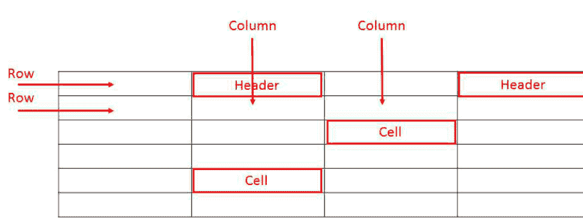

图 8.2：表格定义

**行**是表格中的水平线。你可以在表格中添加任意数量的行。行决定了表格的高度。

**列**是表格中的垂直线。同样，你可以根据需要在表格中添加任意数量的列。列决定了表格的宽度。

**单元格**是表格中行和列的交叉部分。表格中的单元格数量取决于表格中的行数和列数。你只能在单元格中书写信息。

**表头**是一种单元格类型，它是表格**第一行**中的单元格。通常，表头单元格描述列的名称。在上面的世界杯示例中，表头包含诸如年份、举办国、大洲、比赛场次等文本，显示了特定列中书写的信息类型。表头文本通常以粗体显示。

在 HTML 中，表格使用`<table>`、`<th>`、`<tr>`和`<td>`标签定义。`<th>`标签代表表头单元格。`<tr>`标签代表行。`<td>`标签代表单元格。`<table>`标签作为容器，将所有这些标签组合在一起。

让我们将这些标签映射到上面图 8.2 中显示的表格。映射关系已在图 8.3 中呈现。

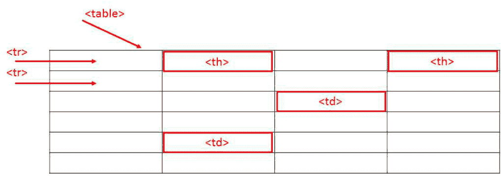

图 8.3：表格标签映射

`<table>`标签内的`<tr>`标签数量定义了表格中的行数。如果你想在表格中有五行，就在`<table>`标签内添加五个`<tr>`标签。

类似地，`<tr>`标签内的`<td>`标签数量定义了该行中的单元格数。如果你想要三个单元格，就在`<tr>`标签内添加三个`<td>`标签。

`<th>`标签的工作方式与`<td>`标签相同。

表头文本写在`<th></th>`标签内。单元格文本写在`<td></td>`标签内。

有了这个理解，让我们看看表格 HTML 的结构。

```html
<table border="width in pixel">
    <tr>
        <th>Header Text</th>
        <th>Header Text</th>
    </tr>
    <tr>
        <td>Cell Text</td>
        <td>Cell Text</td>
    </tr>
    <tr>
        <td>Cell Text</td>
        <td>Cell Text</td>
    </tr>
</table>
```

如果你观察这个结构，你可以将我上一段中谈到的不同表格标签联系起来。`border`属性以像素为单位显示表格线的宽度。如果你不提供`border`值，表格将没有边框线。

让我们看一个例子。请查看下面的 HTML：

```html
<html>
<head>
    <title>Table Example</title>
</head>
<body>
<table border="1">
    <tr>
        <th>Name</th>
        <th>Job Title</th>
    </tr>
    <tr>
        <td>Brajendra Singh</td>
        <td>Solution Architect</td>
    </tr>
    <tr>
        <td>Pathik Rawal</td>
        <td>Practice Lead</td>
    </tr>
</table>
</body>
</html>
```

HTML 网页看起来如下图 8.4 所示：

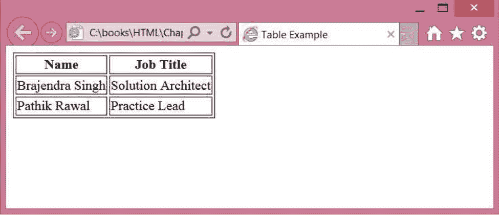

*图 8.4：表格示例网页*

在表格单元格（`<td>`）中，你可以写任何内容——文本、图片、超链接。在上面展示的足球示例中，你可以看到图片和超链接被用作单元格文本。

## 动手试试

在今天的练习中，我们将在网页上创建一个成绩单表格。该网页应如下图 8.5 所示。

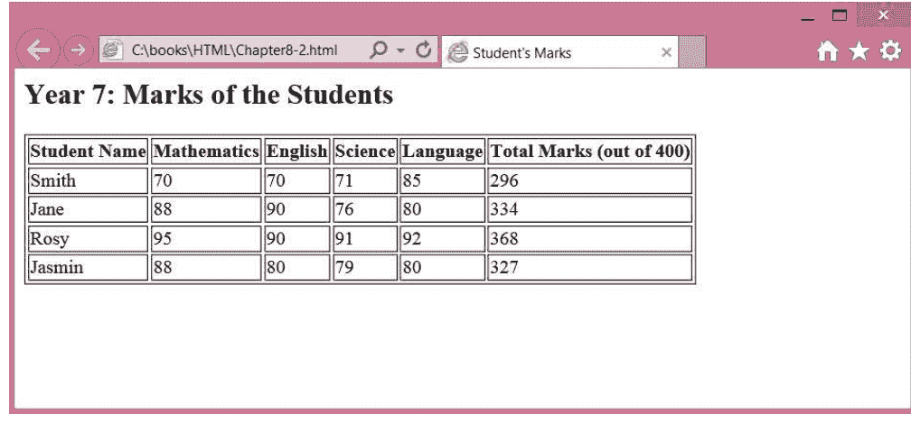

图 8.5：成绩单网页

以下是执行此练习的指南：

- 打开记事本。
- 使用`<table>`、`<th>`、`<td>`和`<tr>`标签创建 HTML。
- 使用六个`<td>`标签创建列，使用五个`<tr>`标签编写行。
- 在各个单元格中写入文本。
- 使用`.htm`或`.html`扩展名保存 HTML 文件。
- 使用网页浏览器打开 HTML 文件以查看结果。

如果需要任何帮助，请查看**练习 6 – 学生成绩**章节以获取上述网页的 HTML 代码。祝你好运！

## 总结

恭喜你完成了这一重要章节。希望你喜欢它。表格在组织网页数据方面具有巨大的能力。我希望你很快就能在你的某些网站中使用它。在此之前，请继续阅读……

# 第 9 章 – 页面样式

你在前面的章节中已经学习了 HTML 的大部分基础标签。你了解何时使用哪个标签以及用于什么目的。你可以将所有这些标签组合起来制作一个漂亮的网页。

我们还没有学习的是如何装饰标签？如何让它们变得五颜六色、大小各异或使用不同字体等？**样式**在 HTML 中用于装饰目的。样式就像是网页的化妆。你可以选择你的颜色、背景、阴影、线条，使页面更加美观和吸引人。

样式方法有很多。但本章我们将学习一些基础的。你将对如何使用样式有一个很好的了解，然后你可以通过进一步学习探索其他样式方法。准备好为你的网页上色吧！我们开始。

## 样式示例

嗯，没有确切的样式样本，因为每个页面都有样式——有些多，有些少。让我们看看 **Butlin's** 的网页，看看他们是如何使用样式为页面上色的。对于那些不知道 Butlin's 是什么的人，他们为儿童和家庭提供度假胜地。请访问以下网页：[http://www.butlins.com/](http://www.butlins.com/) 并查看如下图 9.1 所示的样式。

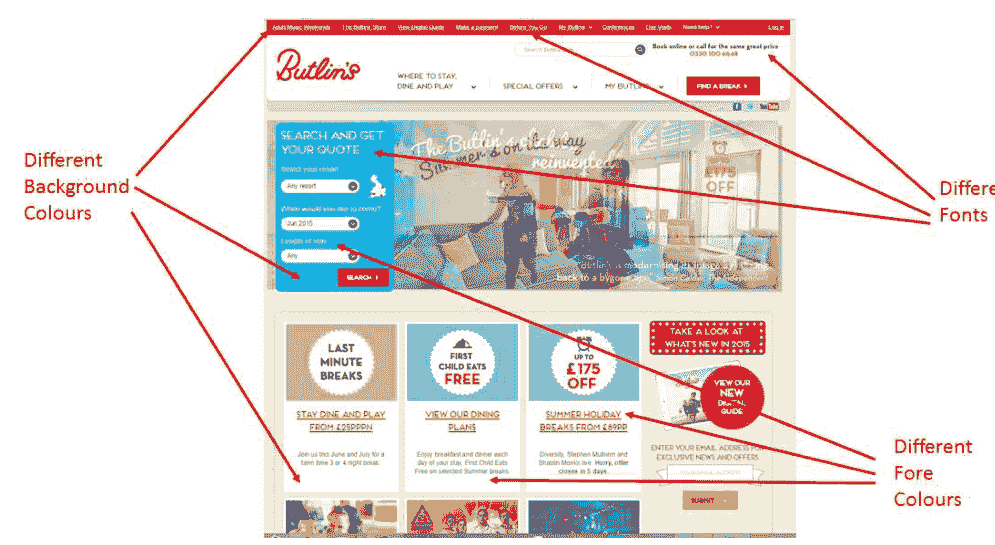

看，样式是如何被用来装饰网页的。它们看起来如此美丽和诱人。我想你已经对样式意味着什么有了概念。让我们详细学习它们。

## 学习细节

样式通过一个名为`style`的标签属性来应用。此属性可用于任何标签。它具有以下结构：

```html
style="property: value; property: value"
```

**属性**意味着你想使用什么样式。**值**意味着你选择了什么样式值；你希望你的页面或标签看起来如何。不太明白。好的，让我们看看下面的表格，其中列出了一些常见的样式名称、值及其用途。这对你来说就完全有意义了。

表 9.1：常用样式

| 样式属性 | 样式值 | 用途 |
|---|---|---|
| `background-color` | 红色、绿色、灰色，任何颜色 | 用于绘制网页的背景颜色 |


| color | 红色、绿色、灰色，任何颜色 | 用于绘制文本或超链接的颜色 |
|---|---|---|
| font-family | Verdana、Courier、Arial 等 | 决定使用哪种文本字体。 |
| font-size | 10 / 5 / 20 任何值 | 以像素为单位设置文本或超链接的大小 |
| text-align | 左、居中、右 | 将文本、超链接或图像左对齐、居中或右对齐。 |

你可以使用多个样式属性，但它们应该用**分号**（`;`）分隔。属性和值之间用**冒号**（`:`）分隔。

让我们看一个如图 9.2 所示的例子。让我们制作一个带有标题标签但没有样式的页面。

```html
<html>
<head>
<title>Style Example</title>
</head>
<body>
<h2>I am a heading.</h2>
</body>
</html>
```

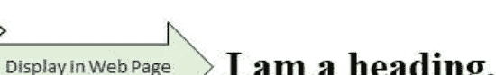

*图 9.2：无样式的标题标签*

现在，我们将添加样式，使标题标签看起来是红色的，如图 9.3 所示。

```html
<html>
<head>
<title>Style Example</title>
</head>
<body>
<h2 style="color:red">I am a heading.</h2>
</body>
</html>
```


*图 9.3：红色标题标签*

你可以看到我在`<h2>`标签中添加了`style`属性，属性为`color`，值为`red`。当我这样做时，它将`<h2>`标签的文本从黑色变成了红色。这就是样式的美妙之处。

让我们将`<h2>`文本的字体更改为**Arial**，如图 9.4 所示。

```html
<html>
<head>
<title>Style Example</title>
</head>
<body>
<h2 style="color:red;font-family:arial">I am a heading.</h2>
</body>
</html>
```


*图 9.4：Arial 字体的标题标签文本*

你看，字体现在改变了。文本样式看起来不同了。我添加了`font-family`属性，值为`arial`。我使用分号分隔了`color`和`font-family`两个属性。

让我们更改另一个标签的样式，为网页添加背景色。我将在 HTML 的`body`标签中使用`background-color`属性，值为`skyblue`。如图 9.5 所示。

```html
<html>
<head>
<title>Style Example</title>
</head>
<body style="background-color:skyblue">
<h2 style="color:red;font-family:arial">I am a heading.</h2>
</body>
</html>
```

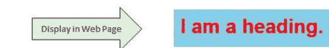

*图 9.5：背景样式*

你看，各种样式和属性的组合如何使你的网页变得丰富多彩。你所需要的只是对这些不同样式的了解和想象力。不是吗？

## 动手试试

作为练习，我们将重新访问你在练习 1 中创建的“贪婪的乌鸦”网页。我们将为这个页面添加颜色和样式。请对网页 HTML 进行必要的更改，使其看起来如图 9.6 所示。

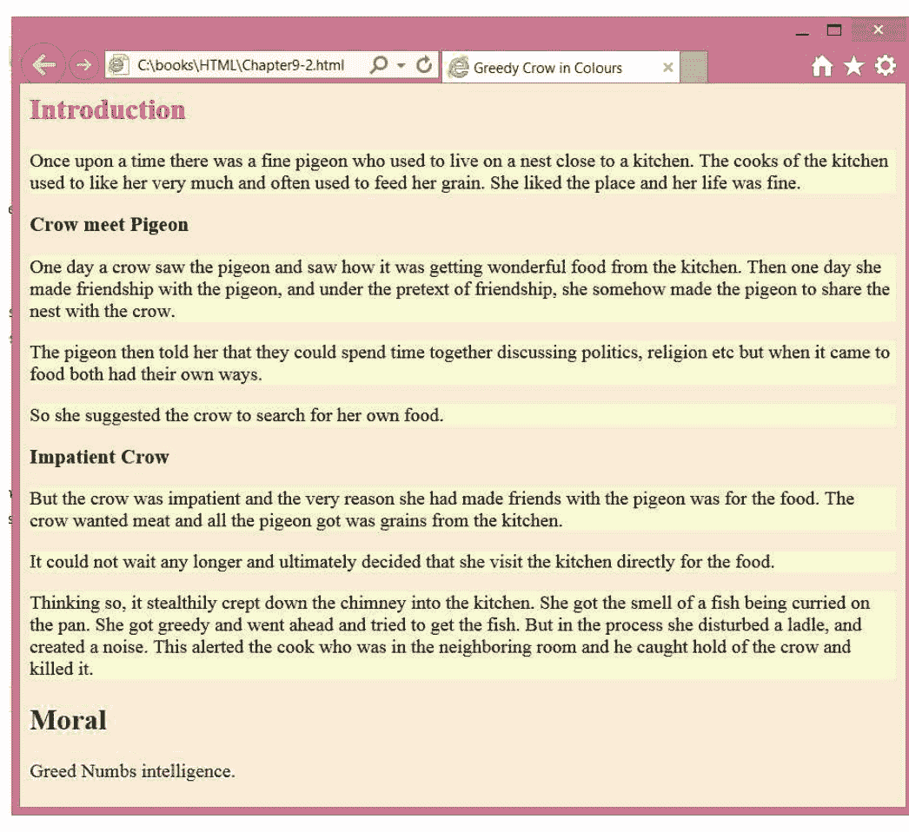

图 9.6：彩色故事网页

为了帮助你，请使用以下网页学习本练习中使用的各种颜色名称：http://www.w3schools.com/html/html_colornames.asp

以下是执行此练习的指南：

- 创建**练习1 – 贪婪的乌鸦**HTML 文件的副本，使用相同的扩展名`.htm`或`.html`。将复制的文件命名为新名称，例如**练习7 – 彩色贪婪的乌鸦**。
- 在记事本中打开**练习7 – 彩色贪婪的乌鸦**文件。
- 按照练习要求，对网页的文本、标题和正文应用不同的样式。你需要在相应的标签中添加`style`属性。
- 将更改保存到 HTML 文件。
- 使用网页浏览器打开 HTML 文件以查看结果。

如果需要任何帮助，请查看**练习7 – 彩色贪婪的乌鸦**章节以获取上述网页的 HTML 代码。祝你好运！

## 总结

恭喜你为一个简单的网页上了色。样式是为右脑——创造性部分准备的。你可以运用你的想象力和样式的力量，在你的网页中创作出一件壮观的艺术品。有些网页设计师专门从事样式设计，并以此谋生。我真的希望你有一天能使用这些技术。在此之前，请继续阅读……

# 第十章 – 使用 Iframe

你在上一章学习了样式。你现在知道如何更改背景、颜色、字体或字体大小，使你的网页看起来优雅。只需注入你的创造力，使用样式创建一个杰作网页。

在本章中，我们将讨论一个非常有趣的话题。如果你想在你自己的网页中显示维基百科网页怎么办？是的，你没看错。你不是要创建一个维基百科网页，而是要在你的网页中显示那个页面。你可以使用**Iframe**标签来实现这一点。

在你的页面中显示其他网页有时非常有用，当你只想在你的网页中利用其他网站时。你不想重新创建其他人的页面，而是为了你的目的重用它。

很有趣，对吧？

## Iframe 示例

我们将访问密歇根大学的网页来查看一个 Iframe 的例子。请访问该网站 - [http://sitemaker.umich.edu/iframe.example/the__iframe__lives_here](http://sitemaker.umich.edu/iframe.example/the__iframe__lives_here)。你会看到如下图 10.1 所示的 Iframe。

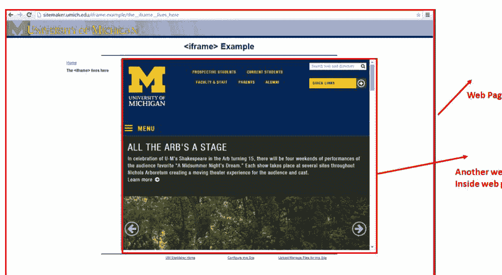

你可以看到浏览器中打开了一个网页。然后在这个浏览器网页内部，又打开了另一个网页。你可以对这个内部网页执行任何操作，比如点击、导航、输入数据等。这个内部网页是真实且活跃的。

## 学习细节

我们如何实现上面示例中展示的效果？`<iframe>`标签就是用于此目的。请查看下面`<iframe>`标签的结构：

```html
<iframe src="内部网页的地址" width="像素宽度" height="像素高度"></iframe>
```

我们开始和结束`<iframe>`标签，并使用属性来提供内部网页的地址。

**Src**代表**源**。我们在此属性中提供内部网页的地址。请回想一下我们在`<a>`标签的**href**属性和``标签的**src**属性中讨论过提供地址的方式吗？这与之类似。你提供想要放入 Iframe 中的网页或网站的地址。

**Width**是内部网页显示时的宽度，以像素为单位。

**Height**是内部网页的高度，同样以像素为单位。

让我们创建一个在内部显示维基百科页面的网页。该网页的 HTML 将如下所示：

```html
<html>
<head>
<title>学习Iframe</title>
</head>
<body>
<h1>在HTML中学习IFrame</h1>

<iframe src="https://en.wikipedia.org/wiki/Main_page" width="600" height="600"></iframe>

</body>
</html>
```

该网页将如下面的图 10.2 所示。

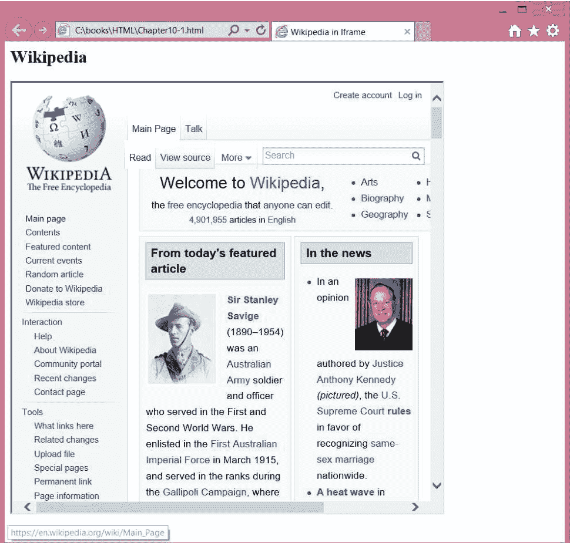

哇，你刚刚在你的页面中展示了维基百科页面。简单又棒！

许多网站不喜欢也不允许自己被放入 Iframe 中。谷歌网站就是一个例子。我们应该尊重他们的决定，尽量不要在 Iframe 中使用他们的网站。

## 自己动手试试

练习时间。我们将创建一个名为**我的搜索**的网页，该网页将在“我的搜索”网页内部同时显示必应搜索和维基百科搜索网站。嗯，我本想也使用谷歌和雅虎搜索，但它们不支持 Iframe，我完全尊重这一点。

你的网页将如图 10.3 所示。

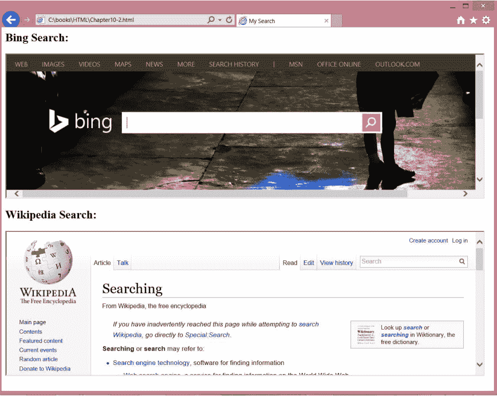

请继续操作并尝试这两个内部网页。它们将允许你执行所有操作。

以下是创建该网页的详细信息。

必应搜索的地址是：[https://www.bing.com/](https://www.bing.com/)

维基百科搜索的地址是：[http://en.wikipedia.org/wiki/Searching](http://en.wikipedia.org/wiki/Searching)

两个 Iframe 的高度均为 300，宽度均为 1000。

以下是执行此练习的指南：

- 打开记事本。
- 使用标题和 Iframe 标签创建 HTML。你需要两个 Iframe 标签来显示两个网站。网站的地址已在前面的段落中给出。
- 使用`.htm`或`.html`扩展名保存 HTML 文件。
- 使用网页浏览器打开 HTML 文件以查看结果。

如果你需要任何帮助，请查看**练习8 – 我的搜索**章节，以找到上述网页的 HTML。祝你好运！

## 总结

至此，Iframe 的使用就结束了。你在前面的章节中已经学习了许多标签和样式方法。你是否开始有了一些将它们组合起来制作一个精彩网页的想法？如果是这样，我要说，谁在阻止你？放手去做吧！继续阅读……

# 第11章 – 表单与控件

到目前为止，在前面的章节中，我们主要学习了如何在网页上显示信息，或者如何使用链接，或者如何使页面看起来更美观。现在，我们将专注于构建一个网页，让人们可以在网页上输入一些信息，或者使用他们的键盘和鼠标选择一些选项。我们通常将人们的此类活动称为**用户输入**。

我们都在各种网站上见过用户输入的例子。例如，在谷歌网站上，当你输入搜索文本并按下搜索按钮时，这就是一种用户输入。同样，当你或你的父母访问在线预订网站，通过输入开始日期、结束日期、人数等来预订酒店或航班时，这也是一种用户输入。

**表单与控件**用于创建此类用户输入。**表单**就像一个容器（就像之前表格是`<tr>`和`<td>`标签的容器一样），而**控件**是单个的用户输入项。当我说容器时，它类似于一本书是页面的容器。一本书包含一页或多页。同样，一个表单包含一个或多个控件。听起来不太明白，对吧？别担心，我们将在下一节的示例中再次理解它。

本章和下一章密切相关。在本章中，你将学习设计表单，而在下一章中，你将学习如何利用用户输入来执行一些业务操作。例如，在谷歌网站上，当我输入搜索文本并按下搜索按钮时，网站会返回搜索结果。提供这些搜索结果就是谷歌网站的业务操作。同样，根据用户的输入预订酒店或机票是业务操作的另一个例子。

## 表单与控件的示例

让我们从我们讨论的第一个例子开始。请访问谷歌网站（[https://www.google.co.uk/](https://www.google.co.uk/)），如图 11.1 所示。

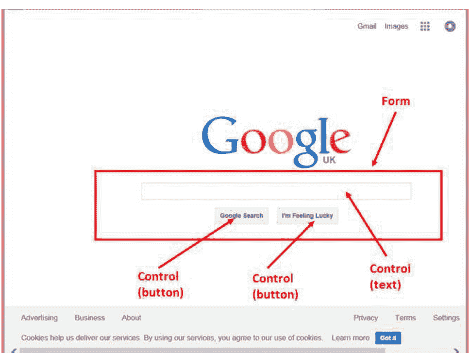

你可以在这个简单的网页中看到，有三个控件——一个输入搜索文本的地方，两个可点击的按钮。并且所有三个控件都在一个表单内。我是不是说过表单是包含一个或多个控件的容器？人们向这些控件提供用户输入，例如输入文本、从选项中选择或点击按钮。每个控件都是人们提供某种输入的一种方式。

为了强调这个想法，让我们看另一个例子。请打开 http://www.booking.com/ 网站，如图 11.2 所示。

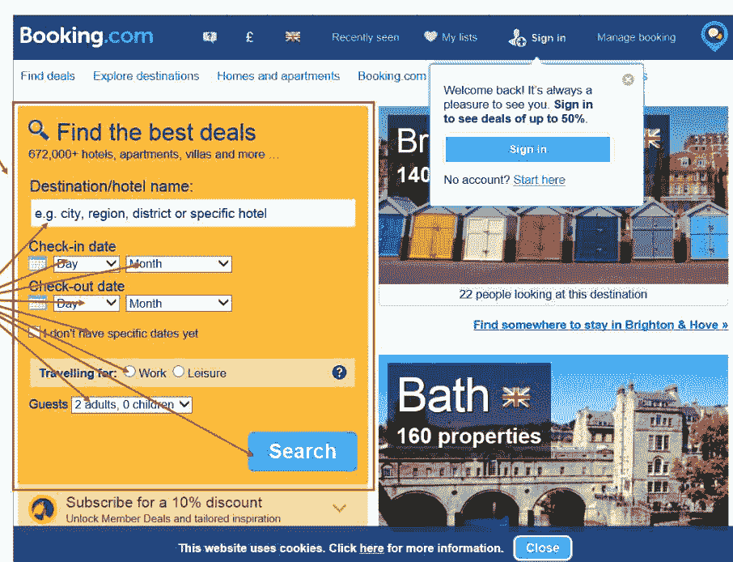

这是另一个例子，其中有一个表单包含超过 5-6 个控件。你在上面的图 11.2 中看到了更多类型的控件，例如选择入住日期、在工作和休闲之间选择选项的能力。

HTML 提供了各种类型的控件。我们将在本章的剩余部分学习它们。

在一个网页上，你可以有多个表单。每个表单可以拥有自己的一组控件。

## 学习细节

你现在理解了表单和控件的概念。HTML 中有各种类型的控件可用。但对于本书，我们将重点介绍一些在网页设计中常用的重要控件。

下表显示了 HTML 中不同类型的控件、控件的用途以及它们的外观。

**表11.1：控件类型**

| 控件类型 | 用途 | 外观 |
|---|---|---|
| 文本框 | 允许输入单行文本 | `<input type="text">` |
| 文本区域 | 允许输入多行文本 | `<textarea></textarea>` |
| 复选框 | 允许从给定选项中选择多个选项。 | ☑ 选项1<br>☐ 选项2<br>☑ 选项3 |
| 单选按钮 | 允许从给定选项中仅选择一个选项。 | ○ 选项1<br>● 选项2<br>○ 选项3 |
| 按钮 | 允许点击按钮以执行某些操作 | `<button>按钮</button>` |
| 下拉选择 | 允许从多个下拉选项中选择一个选项。 | `<select><option>选项1</option><option>选项2</option><option>选项3</option><option>选项4</option></select>` |

现在是时候学习这些单独的控件是如何工作的了——它们使用什么标签，哪些属性是有用的？

大多数控件使用相同的标签`<input>`。根据你使用的控件不同，`<input>`标签的**type**属性值也不同。很简单。

## 文本框控件

让我们从**文本框**类型控件开始。它用于输入单行文本或句子。以下是文本框类型控件标签的示例：

```html
<input type="text" id="control name"></input>
```

你可以看到它使用了`<input>`标签，**type**属性值为`"text"`，表明这是一个文本框类型控件。**Id**代表**标识符**，此属性用于为控件保留一个名称。就像老师在班级众多学生中通过你的名字找到你一样。Id 属性值可用于在众多控件中唯一地找到该控件。我们将在下一章更深入地学习 Id 属性的用法。

## 复选框和单选按钮控件

下一类控件是**复选框**和**单选按钮**。它们用于从给定的多个选项中进行选择。以下是这些控件的标签：

```html
<input type="checkbox" id="control name" >Option1</input>
<input type="radio" id="control name" >Option1</input>
```

两者再次使用`<input>`标签，但它们的`type`属性值分别是**checkbox**和**radio**。**Option1**是显示在网页上的选项文本。由于使用这些控件时，你在网页上提供了多个选项，因此通常需要添加多个复选框或单选按钮控件来显示多个选择。你很快就会看到一个这样的例子。

## 按钮控件

接下来，以下是**按钮**类型控件的标签结构：

```html
<input type="button" value="Button" id="control name" ></input>
```

`type`属性值是**button**。**value**属性中的文本是显示在网页上的按钮文本。

## 文本区域控件

让我们看看不使用`<input>`标签的控件。我们将从**文本区域**控件开始。标签如下所示：

```html
<textarea id="control name" rows="10" cols="30"></textarea>
```

我们使用**`<textarea>`**标签来创建此控件。由于文本区域可以接受多行文本，你还可以选择使用**rows**和**cols**属性来设置控件的高度和宽度。`rows`属性决定控件的高度。`cols`代表列数，它决定控件的宽度。它们都接受整数值。

## 选择控件

接下来我们将讨论**选择**控件，它允许从多个可用选项中选择一个。以下是选择控件的标签结构：

```html
<select id="control name">
<option> option1</option>
<option> option2</option>
<option> option3</option>
<option> option4</option>
</select>
```

标签以**`<select>`**开始，以**`</select>`**结束。在这两个标签之间，你可以放置多个**`<option></option>`**标签。每个**`<option>`**标签代表一个可供人们选择的选项。**`<option>`**和**`</option>`**标签之间的文本表示网页上显示的选项文本。根据网页上需要提供的选项数量，你在**`<select>`**标签之间添加两个或更多**`<option>`**标签。

我们现在讨论了所有重要的控件。我建议你再读一遍每个控件的说明，然后回顾表 11.1，看看控件标签在网页上是如何显示的。

## 表单

我们现在理解了所有类型的控件及其标签。让我们在 HTML 中将所有这些控件放在**`<form>`**标签下。毕竟，表单是所有控件的容器。包含表单和控件的 HTML 将如图 11.3 所示。

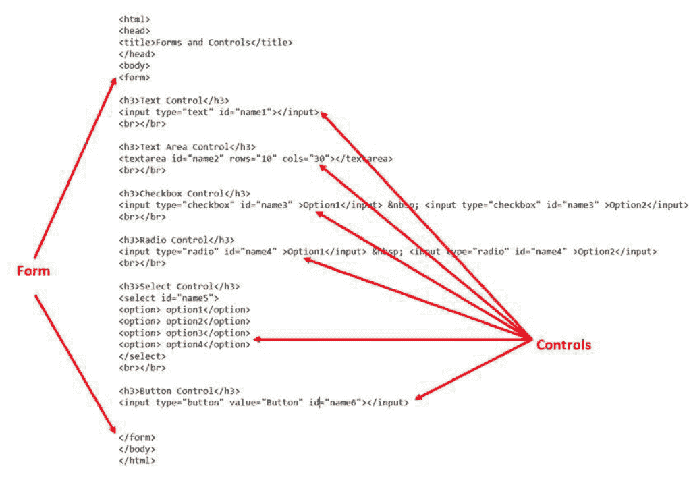

你可以看到，我已经将所有控件一个接一个地放在了`<form>`标签内。我用换行标签`<br>`分隔了每个控件，以便每个控件在垂直线上依次向下排列。这使得表单更具可读性。


如果你仔细观察，我添加了一个新元素`&nbsp;`。此元素用于在网页上任意位置放置空格。我在复选框和单选按钮控件之间添加了它们，以便在它们之间留出一些空间。在网页上，它将在给定的选项之间显示一个空格。

对于每个控件，我都使用了标题标签`<h3>`来显示控件的名称。

最后，我给控件分配了一些`id`（标识符），例如`name1`、`name2`等。我们将在下一章更详细地讨论这个属性。

那么，这个HTML看起来怎么样呢？如图11.4所示。

## 文本控件

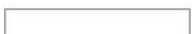

## 文本区域控件

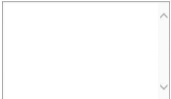

## 复选框控件

☐ 选项1 ☐ 选项2

## 单选按钮控件

○ 选项1 ○ 选项2

## 选择控件

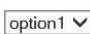

## 按钮控件

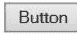

图11.4：表单HTML显示

很简单，对吧？我建议你逐一查看图11.3中显示的每个HTML控件，并检查它在图11.4中是如何在网页上显示的。在我们开始练习之前，你应该对每个控件标签都感到熟悉。

让我们做一些练习。

## 自己动手试试

我们将尝试创建一个**航班预订表单**，可用于预订机票。该表单将如图11.5所示。

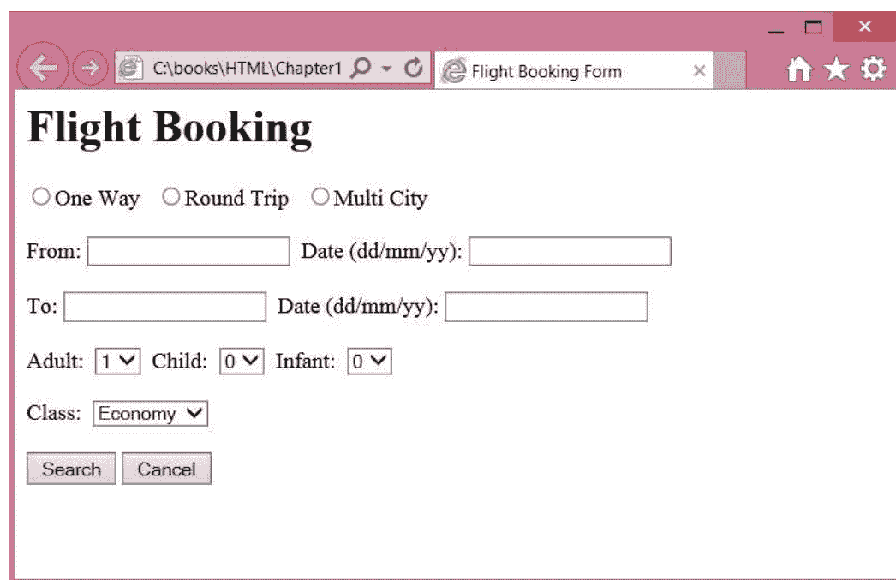

*图11.5：航班预订表单练习*

下表显示了每个选择类型控件的选项。

*表11.2：选择类型控件的选项*

| 选择类型控件 | 选项 |
| --- | --- |
| 成人 | 1, 2, 3, 4, 5 |
| 儿童 | 0, 1, 2, 3, 4 |
| 婴儿 | 0, 1, 2 |
| 舱位 | 头等舱, 商务舱, 经济舱 |

以下是执行此练习的指南：

- 打开记事本
- 使用单个表单和各种类型的控件创建HTML。参考本章前面部分学习如何使用每种类型的控件标签。
- 使用`.htm`或`.html`扩展名保存HTML文件
- 使用网页浏览器打开HTML文件以查看结果。

如果你需要任何帮助，请查看**练习9 – 航班预订**章节，以找到上述网页的HTML。祝你好运！

## 总结

恭喜，你刚刚完成了HTML中一个重要的概念。互联网上有许多商业应用程序或程序，其中大多数都使用基于表单的网页。在下一章，我们将学习如何使用这些控件值来执行一些业务操作和计算。这将使表单更加有趣。在那之前，请继续阅读……

# 第12章 – 用JavaScript润色

我们即将完成对HTML的基本理解。你在完成所有前面的章节方面做得非常出色。在前面的章节中，我们学习了表单和控件，主要关注在网页上设计表单。在现实世界中，表单用于解决现实生活中的业务问题，例如管理学生入学、管理你的所得税或预订酒店和航班以进行愉快的度假。

为了解决业务问题，需要一种称为**编程**的东西。通过编程，你告诉你的表单执行一些业务操作，如上面的例子所示。正如HTML是创建网页的语言，`JavaScript`是用于编程的语言。

编程是一个很大的主题，需要单独一本书来讲解。考虑到这种规模，我们将编程排除在本书的目标之外。但本章我们将进行最少的JavaScript编程，我们将从控件中读取值，并尝试进行一些计算以获得结果。这个最少的JavaScript将让你对编程有所了解，并肯定对你下一阶段的学习有所帮助。

## 编程示例

有一个网站[http://www.xe.com/](http://www.xe.com/)用于货币转换。例如，你可以输入`1`美元，然后知道其在英镑、欧元或任何其他货币中的等值。请访问此网站。在网页表单上，输入**10**作为货币值，选择**USD - 美元**作为第一种货币，选择**GBP – 英镑**作为第二种货币，然后点击图片。步骤如下图12.1所示。

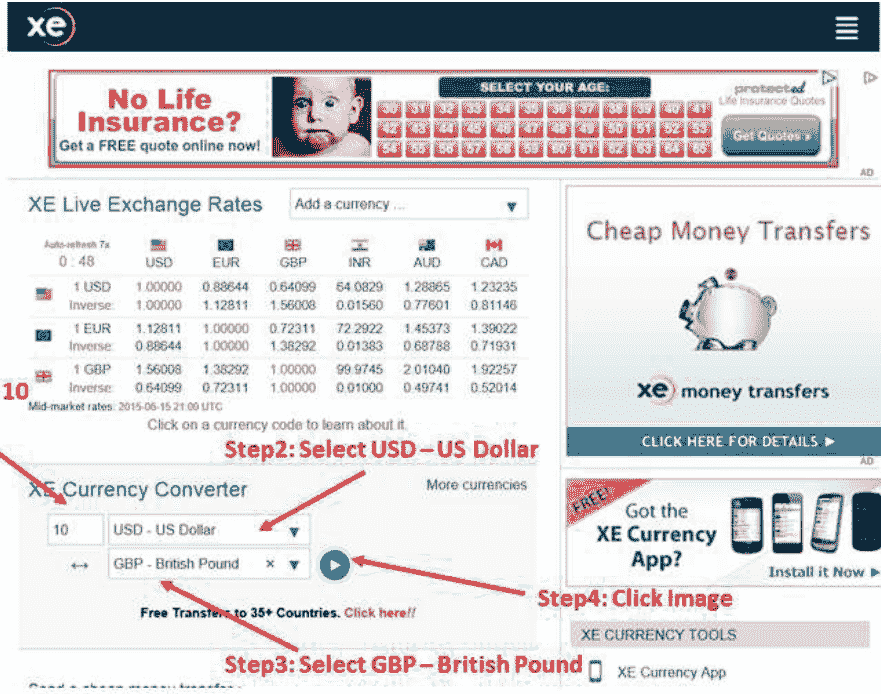

图12.1：货币转换

当你点击图片时，它会带你到第二个网页，该网页显示了如图12.2所示的美元金额对应的英镑等值。

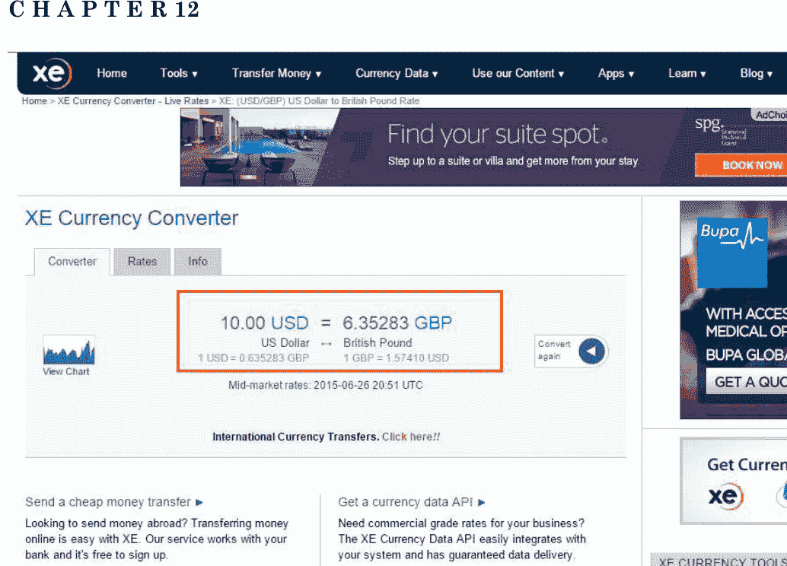

图12.2：货币转换结果

这个网站解决的业务问题（即，将一种货币值转换为另一种）之所以能够实现，是由于对表单和控件进行了编程。该程序读取了美元货币的值，然后使用一些计算将其转换为英镑等值并显示为结果。

我们将在本章尝试做一些类似的事情，但会更简单一些。

## 学习细节

为了学习JavaScript编程，我们将在网页上创建一个简单的表单，并在上面尝试简单的编程。

以下是下面图12.3所示表单的HTML代码。

```html
<html>
<head>
<title>Calculation on Form</title>
</head>
<body>
<form>
Number 1: &nbsp;;<input type="text" id="number1"></input>
Number 2: &nbsp;;<input type="text" id="number2"></input>
<br></br>
Result: &nbsp;<input type="text" id="result"></input>
<br></br>
<input type="button" value="multiply" id="multiplybutton"></input>&nbsp;
<input type="button" value="clear" id="clearbutton"></input>&nbsp;
</form>
</body>
</html>
```

图12.3：简单表单HTML

该表单有三个文本框控件，其标识名称为–`number1`、`number2`和`result`。有两个按钮，其标识名称为–`multiplybutton`和`clearbutton`。按钮的显示文本为`Multiply`和`Clear`。

HTML表单看起来如下图12.4所示：


图12.4：简单表单

在这个简单的表单中，我们将执行简单的编程以实现以下目标：

- ✓ **目标1：** 当你在`Number1`文本框中输入一个数字，在`Number2`文本框中输入另一个数字，然后点击`Multiply`按钮时，它将在`Result`文本框中显示两个数字的**乘积**。
- ✓ **目标2：** 当你点击`Clear`按钮时，它将**清除**或说**移除**`Number1`、`Number2`和`Result`文本框中给出的任何值。

准备好了！兴奋吗？我们开始吧。

## 从控件读取值的JavaScript

为了能够进行乘法运算，我们需要有某种方法来读取在控件中写入或输入的数字。然后我们才能对这些数字应用一些数学运算。我们如何从控件中读取文本或值？以下是从控件读取值的JavaScript语句：

```javascript
document.getElementById('control name').value
```

我确信这个JavaScript语句并没有太大意义。让我们像图12.5所示那样剖析这个语句，以了解更多关于它的信息。


该语句的第一部分是**HTML的主体**。它代表了HTML中`<body>`和`</body>`标签**之间**的所有内容。所有的HTML标签、元素和控件实际上都放置在HTML的主体中。我们在第2章中学习过这一点。

第二部分是**通过控件名称查找元素**。控件只是一种用于用户输入的HTML标签类型。你在上一章中已经了解了它。你一定已经看到我们在`Id`属性中提供了**控件名称**。此属性用于在HTML主体内单独标识控件。就像你的名字或学号是你在班级中的唯一标识符一样。在这第二部分中，我们说的是在HTML主体内查找一个名为“control name”的控件。

最后一部分说，既然你已经在HTML主体内找到了该控件，就去**读取该控件的值**。

用简单的英语来说，这个JavaScript语句的意思是**“在HTML主体内查找一个名为‘control name’的控件并读取其值”**。哇，看起来如此复杂的JavaScript竟然有如此简单的含义。

JavaScript语言区分大小写。这意味着你需要像此处语句所示那样，注意每个大写和小写字母来编写语句。如果你全部用小写字母、大写字母或以其他方式混合书写，那么它将无法工作并抛出错误。

因此，如果我需要读取前面所示HTML中名为`number1`的文本框控件的值，你的JavaScript语句将如下所示：

```javascript
document.getElementById('number1').value
```

## 向控件写入值的JavaScript

现在我们知道了如何从控件读取值，让我们也学习如何向控件写入值？毕竟，`number1`和`number2`的乘积必须写入名为`result`的控件中。这意味着乘积值必须写入`result`控件。

我们将借助**数学代数**来实现这一点。你们一定都学过代数中的**表达式**。看看这里的这个表达式问题：

> “将值5写入项x并表示为一个表达式”

你一定已经多次解决过这类问题。这是小菜一碟，对吧？表达式会是什么样子？

```text
x = 5
```

很简单。现在让我用我们的HTML方式来改变问题陈述。

> “将值5写入文本框控件result并表示为一个表达式”

新的表达式将非常相似：

```javascript
document.getElementById('result').value = 5
```

同样简单。我所做的就是通过其标识名称找到`result`控件，然后向其写入值5。与上面的项表达式完全类似。**这是另一个用于向控件写入某个值的JavaScript语句。**

## 执行数学运算的JavaScript

我们现在知道了JavaScript中的读取和写入语句。我们现在将专注于`number1`和`number2`的乘法。代数表达式将再次帮助我们。

看看这里的另一个表达式问题：

> “有三个项–x、y和z。编写一个表达式，将项x和y相乘，并将乘积结果赋值给项z”

问题有点长，但同样简单。现在的表达式会是什么样子？

```text
z = x * y
```

`(*)`是计算机中的乘法符号。类似地，`(+)`、`(-)`和`(/)`分别是加法、减法和除法的符号。

让我再次用我们的HTML方式来改变问题陈述：

> “有三个文本框控件–number1、number2和result。编写一个表达式，将number1和number2控件的值相乘，并将乘积结果作为值赋给控件result”

使用与上面相同的语句，在HTML控件上下文中的表达式将如下所示：

```javascript
document.getElementById('result').value = document.getElementById('number1').value * document.getElementById('number2').value
```

这是将两个控件的值相乘并赋值给第三个控件的JavaScript语句。类似地，你可以为减法、加法和除法编写JavaScript语句。只有运算符号会从`(*)`变为`(+)`、`(-)`或`(/)`。

让我们继续。如果有多个JavaScript语句怎么办？我们如何编写它们？如果有多个JavaScript语句，那么我们用分号`(;)`将它们分隔开。看看下面的例子：

```javascript
document.getElementById('number1').value = 5; document.getElementById('number2').value = 5
```

有两个JavaScript语句彼此相邻，但用分号`(;)`分隔。

## JavaScript事件

现在，在我们将所有内容整合到一个网页中之前，最后要学习一件事。让我再次展示本节开头分享的HTML对应的第一个目标。它在下面的图12.6中呈现。

- **目标1：** 当你在`Number1`文本框中输入一个数字，在`Number2`文本框中输入另一个数字，然后**点击Multiply按钮**时，它将在`Result`文本框中**显示两个数字的乘积**。

*图12.6：目标1*

我已经高亮了我现在要讨论的区域。目标是在**有人点击Multiply按钮时**，在`result`控件中显示`number1`和`number2`的乘积。JavaScript编程如何知道有人点击了按钮？

JavaScript编程中的此类事情由一个称为“**事件**”的术语管理。有各种类型的事件，它们在发生某些特殊情况时触发或发生。例如，在我们的例子中，按钮控件将有一个名为`onclick`的事件，当有人点击按钮时触发。类似于`onclick`，还有许多其他事件，如`onfocus`、`onblur`等。我不会深入细节，因为你需要更多关于编程的知识才能完全理解它。

回到`onclick`事件。以下是`onclick` JavaScript语句的外观：

```javascript
onclick="JavaScript Programming Statements"
```

如前所述，此事件在有人点击按钮时发生。当此事件发生时，它将执行提供给它的JavaScript编程语句。JavaScript语句可以是任何内容–读取、写入或执行我们之前学到的操作。

例如，看看下面的例子：

```javascript
onclick = "document.getElementById('number1').value = 5; document.getElementById('number2').value = 5"
```

在上面的JavaScript语句中，当`onclick`事件发生时，它将执行两个JavaScript语句，这两个语句将值5写入`number1`和`number2`控件。

我如何告诉HTML这个`onclick`事件是针对这个按钮的？你通过在按钮控件标签中添加`onclick`事件来实现。以下是示例：

```html
<input type="button" id="control name" onclick=" JavaScript Programming Statements" ></input>
```

事件是标签内部的一个属性。

## 整合所有内容

是时候将所有内容整合起来了。但在开始之前，让我再次展示HTML表单的目标，以唤起大家的记忆：

- ✓ **目标1：** 当你在**数字1**文本框中输入一个数字，在**数字2**文本框中输入另一个数字，然后点击**乘法**按钮时，它将在**结果**文本框中显示两个数字的**乘积**。
- ✓ **目标2：** 当你点击**清除**按钮时，它将**清除**或说**移除**在**数字1**、**数字2**和**结果**文本框中输入的任何值。

为了实现这些目标，我们将执行以下JavaScript编程：

- ✓ 在**乘法按钮**上放置**onclick事件**。此事件将包含一条JavaScript编程语句，该语句将`number1`和`number2`文本框控件的值相乘，并**写入**`result`文本框控件。这将满足目标1。
- ✓ 为了满足目标2，我们将在**清除按钮**上放置**onclick**事件。该事件将包含三条由分号`（;）`分隔的JavaScript语句。第一条语句将**写入空值**（两个单引号连在一起“ ”）到`number1`控件，第二条和第三条语句将分别写入空值到`number2`和`result`控件。目的是清除这些控件的值。在JavaScript中，两个单引号连在一起（‘ ’）意味着清除控件值。

我已使用上述JavaScript编程修改了之前的HTML，其外观如图12.7所示。

```html
<html>
<head>
<title>Calculation on Form</title>
</head>
<body>
<form>

Number1:&nbsp;<input type="text" id="number1"></input>
<br></br>
Number2:&nbsp;<input type="text" id="number2"></input>
<br></br>
Result:&nbsp;<input type="text" id="result"></input>
<br></br>
<input type="button" value="Multiply" id="multiplybutton" onclick="document.getElementById('result').value=document.getElementById('number1').value * document.getElementById('number2').value" ></input>&nbsp;

<input type="button" value="Clear" id="clearbutton" onclick="document.getElementById('number1').value=''; document.getElementById('number2').value=''; document.getElementById('result').value=''"></input>

</form>
</body>
</html>
```

图12.7：JavaScript编程


上述更改在图12.7中已突出显示。在上面的HTML中，我为两个按钮的`onclick`事件都插入了JavaScript编程。没有新内容，我们之前学到的所有内容都被整合起来，以满足某些业务需求或计算。

你现在可以试玩修改后的网页，并点击乘法/清除按钮查看结果，如图12.8所示。


图12.8：网页中的功能

是时候进行另一个练习了。

## 自己动手试试

这个练习非常简单。获取上面的HTML页面并进行如下更改：

- 在乘法按钮和清除按钮之间添加一个新按钮。此新按钮的显示文本应为“减法”。
- 当你点击减法按钮时，它将从`number1`控件的值中减去`number2`控件的值，并在`result`控件中显示结果。
- 复制现有的JavaScript并进行更改，例如将运算从乘法（`*`）改为减法（`-`）。

更新后的HTML应如图12.9所示。


图12.9：练习网页

如果你需要任何帮助，请查看**练习10 – 表单计算**章节，以找到上述网页的HTML。祝你好运！

## 总结

这结束了JavaScript编程的入门章节。关于编程还有很多东西需要学习，但你应该参考更高级别的书籍。本书主要侧重于让你在学习HTML及其使用方面迈出第一步。

在下一章中，你将找到一个未来学习参考表，你可以用它来继续学习HTML和JavaScript编程的高级主题。

正如我常说的和相信的，继续阅读……

# 第13章 – 未来学习参考

我相信你现在理解了HTML的基础知识。由于本书涵盖基础知识，你需要进一步学习以掌握HTML的高级主题。我们推荐以下参考资料供未来学习：

| 名称 | 类型 | 链接 |
| --- | --- | --- |
| HTML教程 | 在线免费教程 | `http://www.w3schools.com/html/default.asp` |
| HTML & CSS：设计和构建网站 | 书籍 | `http://www.amazon.co.uk/HTML-CSS-Design-Build-Sites/dp/1118008189/ref=sr_1_1?ie=UTF8&qid=1434477419&sr=8-1&keywords=HTML+%26+CSS%3A+Design+and+Build+Web+Sites` |
| W3的HTML参考 | 在线免费参考 | `https://docs.webplatform.org/wiki/html` |
| JavaScript教程 | 在线免费教程 | `http://www.w3schools.com/js/default.asp` |
| JavaScript：精粹 | 书籍 | `http://www.amazon.co.uk/JavaScript-Good-Parts-Douglas-Crockford/dp/0596517742/ref=sr_1_1?ie=UTF8&qid=1434479012&sr=8-1&keywords=JavaScript%3A+The+Good+Parts` |
| W3的JavaScript参考 | 在线免费参考 | `http://www.w3.org/standards/webdesign/script` |

祝你未来学习顺利。

# 练习1 – 贪婪的乌鸦

这是**第3章 - 标题和段落**中给出的练习的HTML。如果你在执行练习时遇到任何问题，请将其用作答案指南或指导。

```html
<html>
<head>
<title>Greedy Crow</title>
</head>
<body>

<h2>Introduction</h2>

<p>Once upon a time there was a fine pigeon who used to live on a nest close to a kitchen. The cooks of the kitchen used to like her very much and often used to feed her grain. She liked the place and her life was fine.</p>

<h2>Crow meet Pigeon</h2>

<p>One day a crow saw the pigeon and saw how it was getting wonderful food from the kitchen. Then one day she made friendship with the pigeon, and under the pretext of friendship, she somehow made the pigeon to share the nest with the crow.</p>

<p>The pigeon then told her that they could spend time together discussing politics, religion etc but when it came to food both had their own ways.</p>

<p>So she suggested the crow to search for her own food.</p>

<h2>Impatient Crow</h2>

<p>But the crow was impatient and the very reason she had made friends with the pigeon was for the food. The crow wanted meat and all the pigeon got was grains from the kitchen.</p>

<p>It could not wait any longer and ultimately decided that she visit the kitchen directly for the food.</p>

<p>Thinking so, it stealthily crept down the chimney into the kitchen. She got the smell of a fish being curried on the pan. She got greedy and went ahead and tried to get the fish. But in the process she disturbed a ladle, and created a noise. This alerted the cook who was in the neighboring room and he caught hold of the crow and killed it.</p>

<h2>Moral</h2>

<p>Greed Numbs intelligence.</p>

</body>
</html>
```

# 练习2 – 贪婪的乌鸦格式化

这是**第4章 - 格式化文本**中给出的练习的HTML。如果你在执行练习时遇到任何问题，请将其用作答案指南或指导。

```html
<html>
<head>
<title>Greedy Crow</title>
</head>
<body>

<h2>Introduction</h2>

<p>Once upon a time there was a fine <sup>pigeon</sup> who used to live on a nest close to a kitchen. The cooks of the kitchen used to like her very much and often used to feed her grain. She liked the place and her life was fine.</p>

<h2>Crow meet Pigeon</h2>

<p>One day a <sup>crow</sup> saw the pigeon and saw how it was getting wonderful food from the kitchen. Then one day she made friendship with the pigeon, and under the pretext of friendship, she somehow made the pigeon to share the nest with the crow.</p>

<p>The pigeon then told her that they could spend time together discussing politics, religion etc but when it came to food both had their own ways.</p>

<p>So she suggested the crow to search for her own food.</p>

<h2>Impatient Crow</h2>

<p>But the crow was impatient and the very reason she had made friends with the pigeon was for the food. The crow wanted meat and all the pigeon got was grains from the kitchen.</p>

<p>It could not wait any longer and ultimately decided that she visit the kitchen directly for the food.</p>

<p>Thinking so, it stealthily crept down the chimney into the kitchen. She got the smell of a fish being curried on the pan. She got greedy and went ahead and tried to get the fish. But in the process she disturbed a ladle, and created a noise. This alerted the cook who was in the neighboring room and he caught hold of the crow and killed it.</p>

<h2>Moral</h2>

<p>Greed Numbs intelligence.</p>

</body>
</html>
```

# 练习2

但乌鸦很不耐烦，她与鸽子交朋友的唯一原因就是为了食物。乌鸦想要肉，而鸽子从厨房得到的只是谷物。

它再也等不及了，最终决定直接去厨房找食物。

想到这里，它偷偷地从烟囱爬进了厨房。它闻到了平底锅里正在烹制的鱼的香味。它变得贪婪起来，上前试图拿到那条鱼。但在这个过程中，它碰到了一个长柄勺，发出了声响。这惊动了在隔壁房间的厨师，他抓住了乌鸦并杀死了它。

## 寓意

**贪婪会麻痹智慧。**

# 练习3 – 主搜索页面

这是**第 5 章 – 超链接**中练习的 HTML 代码。如果您在执行练习时遇到任何问题，可以将其用作答案参考或指导。

```html
<html>
<head>
<title>Master Search Page</title>
</head>
<body>
<h2>Master Search Page</h2>

<a href="https://www.google.co.uk/"> Google Search </a>
<br></br>
<a href="https://www.bing.com/"> Bing Search </a>
<br></br>
<a href="http://en.wikipedia.org/wiki/Searching"> Wikipedia Search </a>
<br></br>
<a href="https://uk.search.yahoo.com/"> Yahoo Search </a>

</body>
</html>
```

# 练习4 – 艾萨克·牛顿

这是**第 6 章 – 图像**中练习的 HTML 代码。如果您在执行练习时遇到任何问题，可以将其用作答案参考或指导。

```html
<html>
<head>
<title>Isaac Newton Introduction</title>
</head>
<body>
<h2>Isaac Newton</h2>

</img>

<p>
<b>Isaac Newton</b> changed the way we understand the Universe. He discovered the laws
of gravity and motion and invented calculus. He helped to shape our rational
world view.
</p>

</body>
</html>
```

# 练习5 – 目录

这是**第 7 章 – 列表**中练习的 HTML 代码。如果你在执行练习时遇到任何问题，请将其用作答案指南或指导。

```html
<html>
<head>
<title>Table of Contents</title>
</head>
<body>
<h2>Table of Content for HTML Book</h2>
<dl>
  <dt>Introduction</dt>
  <dd>> Learn about web sites, web pages and introduction to HTML.</dd>
  <dt>Elements and Attributes</dt>
  <dd>> Understand fundamentals of HTML in terms of elements and attributes.</dd>
  <dt>Headings, Paragraphs and Formatting</dt>
  <dd>> Learn writing content on the page and formatting to make it effective.</dd>
  <dt>Hyperlinks and Images</dt>
  <dd>> Learn to use links and images to navigate and make page attractive.</dd>
  <dt>Lists and Tables</dt>
  <dd>> Create list and tables to present options and structured data</dd>
  <dt>Forms and Controls</dt>
  <dd>> Generate form to allow data entry</dd>
  <dt>Create a project</dt>
  <dd>> Use all of your learnings to create a small project</dd>
</dl>

</body>
</html>
```

# 练习6 – 学生成绩

这是**第 8 章 – 表格**中练习的 HTML 代码。如果您在执行练习时遇到任何问题，可以将其用作答案指南或指导。


```html
<html>
<head>
<title>Student's Marks</title>
</head>
<body>
<h2>Year 7: Marks of the Students</h2>
<table border="1">
    <tr>
        <th>Student Name</th>
        <th>Mathematics</th>
        <th>English</th>
        <th>Science</th>
        <th>Language</th>
        <th>Total Marks (out of 400)</th>
    </tr>
    <tr>
        <td>Smith</td>
        <td>70</td>
        <td>70</td>
        <td>71</td>
        <td>85</td>
        <td>296</td>
    </tr>
    <tr>
        <td>Jane</td>
        <td>88</td>
        <td>90</td>
        <td>76</td>
        <td>80</td>
        <td>334</td>
    </tr>
    <tr>
        <td>Rosy</td>
        <td>95</td>
        <td>90</td>
        <td>91</td>
        <td>92</td>
        <td>368</td>
    </tr>
    <tr>
        <td>Jasmin</td>
        <td>88</td>
        <td>80</td>
        <td>79</td>
        <td>80</td>
        <td>327</td>
    </tr>
</table>
</body>
</html>
```

## 练习 7：彩色贪婪的乌鸦

这是**第 9 章 – 页面样式**中练习的 HTML 代码。如果您在执行练习时遇到任何问题，可以将其用作答案参考或指导。

```html
<html>
<head>
<title>Greedy Crow in Colors</title>
</head>
<body style="background-color:AntiqueWhite">
<h2 style="color:red">Introduction</h2>
<p style="background-color:LightGoldenRodYellow">Once upon a time there was a fine pigeon who used to live on a nest close to a kitchen. The cooks of the kitchen used to like her very much and often used to feed her grain. She liked the place and her life was fine.</p>
<h2 style="font-size:17">Crow meet Pigeon</h2>
<p style="background-color:LightGoldenRodYellow">One day a crow saw the pigeon and saw how it was getting wonderful food from the kitchen. Then one day she made friendship with the pigeon, and under the pretext of friendship, she somehow made the pigeon to share the nest with the crow.</p>
<p>The pigeon then told her that they could spend time together discussing politics, religion etc but when it came to food both had their own ways.</p>
<p>So she suggested the crow to search for her own food.</p>

<h2>Impatient Crow</h2>

<p>But the crow was impatient and the very reason she had made friends with the pigeon was for the food. The crow wanted meat and all the pigeon got was grains from the kitchen.</p>
<p>It could not wait any longer and ultimately decided that she visit the kitchen directly for the food.</p>
<p>Thinking so, it stealthily crept down the chimney into the kitchen. She got the smell of a fish being curried on the pan. She got greedy and went ahead and tried to get the fish. But in the process she disturbed a ladle, and created a noise. This alerted the cook who was in the neighboring room and he caught hold of the crow and killed it.</p>

<h2>Moral</h2>

<p>Greed Numbs intelligence.</p>
</body>
</html>
```

## 练习 8：我的搜索

这是**第 10 章 - 使用 Iframe**中练习的 HTML 代码。如果您在执行练习时遇到任何问题，可以将其用作答案参考或指导。

```html
<html>
<head>
<title>My Search</title>
</head>
<body>
<h2>Bing Search:</h2>
<iframe src="https://www.bing.com/" width="1000" height="300"></iframe>
<h2>Wikipedia Search:</h2>
<iframe src="http://en.wikipedia.org/wiki/Searching" width="1000" height="300"></iframe>
</body>
</html>
```

## 练习 9：航班预订

这是**第 11 章 - 表单和控件**中练习的 HTML 代码。如果您在执行练习时遇到任何问题，可以将其用作答案参考或指导。

```html
<html>
<head>
<title>Flight Booking Form</title>
</head>
<body>
<form>
<h1>Flight Booking</h1>

<input type="radio" id="triptype">One Way</input> &nbsp;
<input type="radio" id="triptype">Round Trip</input> &nbsp;
<input type="radio" id="triptype">Multi City</input>
<br></br>

From:&nbsp;<input type="text" id="txtfrom"></input>&nbsp;
Date (dd/mm/yy):&nbsp;<input type="text" id="txtfromdate"></input>
<br></br>

To:&nbsp;<input type="text" id="txtto"></input>&nbsp;
Date (dd/mm/yy):&nbsp;<input type="text" id="txttodate"></input>
<br></br>

Adult:&nbsp;
<select id="adult">
<option>1</option>
<option>2</option>
<option>3</option>
<option>4</option>
<option>5</option>
</select>

&nbsp;Child:&nbsp;
<select id="child">
<option>0</option>
<option>1</option>
<option>2</option>
<option>3</option>
<option>4</option>
</select>

&nbsp;Infant:&nbsp;
<select id="infant">
<option>0</option>
<option>1</option>
<option>2</option>
</select>
<br></br>

Class:&nbsp;
<select id="class">
<option>Economy</option>
<option>Business</option>
<option>First</option>
</select>
<br></br>

<input type="button" value="Search" id="searchbutton"></input>&nbsp;
<input type="button" value="Cancel" id="cancelbutton"></input>
</form>
</body>
</html>
```

## 练习 10：表单计算

这是**第 12 章 - 使用 JavaScript 进行修饰**中给出的练习的 HTML 代码。如果你在执行练习时遇到任何问题，可以将其作为答案参考或指导。

```html
<html>
<head>
<title>Calculation on Form</title>
</head>
<body>
<form>
Number1:&nbsp;<input type="text" id="number1"></input>
<br></br>

Number2:&nbsp;<input type="text" id="number2"></input>
<br></br>

Result:&nbsp;<input type="text" id="result"></input>
<br></br>

<input type="button" value="Multiply" id="multiplybutton"
onclick="document.getElementById('result').value=
document.getElementById('number1').value *
document.getElementById('number2').value"></input>&nbsp;

<input type="button" value="Subtract" id="subtractbutton"
onclick="document.getElementById('result').value=
document.getElementById('number1').value -
document.getElementById('number2').value"></input>&nbsp;

<input type="button" value="Clear" id="clearbutton"
onclick="document.getElementById('number1').value='';
document.getElementById('number2').value='';
document.getElementById('result').value=''"></input>
</form>
</body>
</html>
```
