# 业务开发者的 HTML：JavaServer Pages、PHP、ASP.NET、CGI 和 JavaScript 使用指南（业务开发者系列）

创造不同

库存剔除


首先，我要感谢Laura Ubelhor和Merrikay Lee。没有她们的帮助、鼓励和支持，这项工作将无法完成。Merrikay作为出版商提供了指导和鼓励。Laura为本书提供了大部分技术专长。她的经验和动力促使我埋头苦干，按需完成任务。我还要感谢她的丈夫Paul和她的狗Duke，感谢他们忍受她比平时更忙，陪伴他们的时间可能不如他们所愿。

我还要感谢我的家人。我所得到的爱护、支持和鼓励，其意义之重大，远非言语所能表达。生活向我们发出挑战，迫使我们成长或枯萎。这本书代表了我人生中的一个小进步，我希望其他人也能在他们的生活中发现它的用处。
—Kevin Forsythe

我要感谢Kevin邀请我参与这个项目。这是一次很棒的经历，我们合作得非常愉快。我一直很欣赏Kevin的写作风格和教学风格。我还要感谢Merrikay Lee。Merrikay是一位很好的合作伙伴，让写这本书成为一个非常舒适的过程。

我还要感谢我的家人的支持。特别感谢Paul的爱与耐心。我一直觉得自己很幸运，能拥有一个充满爱、给予支持的大家庭。我特别要感谢我的父亲，他教会了我一切——教会我全身心投入并乐在其中。只要用心寻找，总能找到积极的一面；如果真心想要某样东西并充满热情，只要努力，就能实现目标。

我希望这本书能给有经验的商业开发者带来信心，让他们轻松学习Web技能；也能让刚接触开发的新手勇于尝试，学习如何使用HTML投入实战。我一直很幸运，能从事自己热爱且充满激情的事业。我希望这本书能启发其他人实现同样的职业满足感。
—Laura Ubelhor


Digitized by the Internet Archive
in 2022 with funding from
Kahle/Austin Foundation

https://archive.org/details/htmlforbusinessd0000fors

HTML 是一个备受关注的主题。在我们看来，实际应用 HTML 处理业务会更加有趣。在当今时代，这是所有业务开发者都必须考虑的一个主题。我们很高兴编写本书，并投入了大量精力，为业务开发者提供一个全面的资源。

## 为什么又出一本关于 HTML 的书？

既然市面上已经有如此多关于 HTML 的书籍，为何还要再写一本？我们觉得，很少有书（如果有的话）能真正捕捉到业务应用程序程序员的真实需求。关于 Web 开发的书籍常常只关注于单一技术或语言。学会编写 HTML 只是成功的一半。这让我们想起多年前的一个广告，片中一位年轻的程序员兴奋地向老板展示他最新制作的公司网页，上面有燃烧着火焰的旋转标志。老板赞赏地点点头，然后说：“很好，现在你能把它和应付账款系统集成起来吗？”

有多少经验丰富的应用开发者，在多年构建复杂且高效应用程序后，突然被要求开发一个 Web 应用时感到措手不及？这就是我们编写本书的原因。本书提供了一份全面的指南，不仅涵盖 HTML，还包括基于浏览器的应用程序的诸多方面。你将学会的不仅仅是创建带有炫酷标志的网页。你将学会如何将实时数据实际部署到基于 Web 的应用程序中，并创建完全交互式的现代化应用程序。


## 本书是如何安排的？

本书的前几章介绍了 HTML，这是基于浏览器的应用程序的基础语言。本书涵盖的 HTML 内容既广泛又专注。我们并非试图教授 HTML 的所有可能功能，而是聚焦于对商业程序员最有用的那些部分。后续章节介绍了将真实应用数据集成到 Web 应用程序中的常用方法。

在回顾具体的编码技术时，如下所示的高亮代码会包含命令/标签以及任何相关参数：

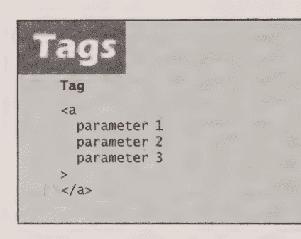

一致地展示命令将使你更容易将本书用作参考，翻阅页面查找所需内容。

你将为一个假想的企业“Bill's Barbeque Barn”回顾简单的 HTML 页面。最初的示例展示了为该企业创建一个提供网络存在和联系信息的主页。后续页面添加了额外的内容和更复杂的设计技术。之后，将回顾基于浏览器的应用程序。你将看到展示实际日常商业用途的示例应用程序。利用这些示例来帮助开发你自己的应用程序。

图 I.1 展示了我们为“Bill's Barbeque Barn”网站设定的起点。它并不复杂——只是一个简单的静态 HTML 文档。就图像、格式或样式表而言，这个网页上发生的事情很少。

这些特性将在本书的后续部分添加，但既然我们是应用程序开发人员，而非图形设计师，我们将从代码入手，而不是从创建美观炫目的网页开始。

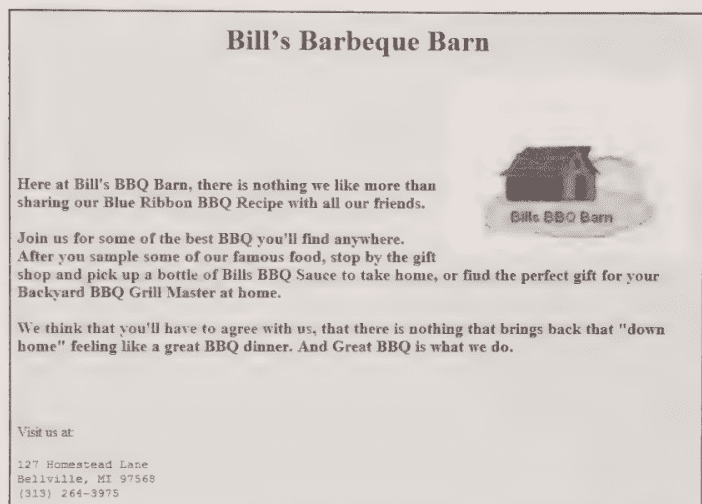

一旦我们涵盖了 HTML 的基础知识，我们将讨论与 HTML 交互的其他语言。很难想象一个商业 Web 应用程序仅用 HTML 就能创建。几乎每个 Web 应用程序都会结合其他东西来产生必要的动态内容。我们选择了几种最常用于开发 Web 应用程序的语言。每种语言在本书中都有单独的章节。

## 目标读者

本书的目标读者是商业开发者，或者那些考虑或有兴趣成为商业开发者的人。我们假设你们中的大多数人都有开发商业应用程序的经验。开发者可能非常熟悉传统的大型机/中端编程环境，但对基于 Web 的应用程序知之甚少。世界在不断变化，许多商业程序员发现自己需要学习如何在 Web 上开展业务。

在较大的机构中，商业应用程序开发人员可能不是创建和维护组织网站的人，但仍可能被期望通过该网站开发新的商业应用程序。这种协作环境并不新鲜。大多数 IT 人员都习惯于基于团队的开发和协作努力。你需要了解网站开发的所有细节才能编写商业应用程序吗？不，可能不需要。我们有意包含了许多传统网站的组成部分，旨在让你深入了解其工作原理，以便在整个应用程序开发过程中做出更好的决策。我们涵盖基础知识，然后深入探讨有趣的内容，并考虑到商业开发者的需求。

作为一名商业开发者，你很可能已经非常精通并习惯于一种或多种编程语言。它可能是 PC 上的 C++，IBM System i 上的 RPG，或者大型机上的 COBOL。虽然传统开发者通常在单个平台上工作，但 Web 开发可能需要使用多个平台。想到要跳出盒子，走出舒适区，可能会让人不知所措。我们这本书的目的是让你对此感觉更舒服，并帮助你学习新技能，这些技能可以在你的组织中应用，从而变得更高效、更多才多艺、更有价值。

## 我需要从零开始吗？

转向 Web 意味着从零开始吗？你需要抛弃现有的东西，重新开始吗？绝对不是。这不仅成本高昂，而且愚蠢。为什么不继续使用你现有的东西，并学习一些新工具来吸引更广泛的受众或为你的应用程序提供更广泛的访问呢？这使你能够保留对复杂业务逻辑的大量现有投资。

Web 开发意味着新的硬件吗？不一定。我们讨论的许多工具都可以在各种平台上使用。Java 技术可以用于任何支持 Java 虚拟机（通常称为 JVM）的平台。通常，会使用单独的服务器来托管网站。这是必要的吗？不，不一定；根据你的服务器大小、可用容量、安全问题和应用程序工作负载，你可能能够将应用程序托管在现有服务器上。然而，由于将应用程序开放到 Web 通常会带来新的安全考虑，你可能需要单独的服务器，尽管现有服务器有足够的容量。

## 选择开发工具

为开发项目选择最佳技术是一个复杂的问题。关于哪种工具是最佳工具存在很多争论。通常，争论似乎基于提供意见者的技术舒适区而带有偏见。偏见还在于认为需要使用单一技术的想法。商业程序员越深入 Web 应用程序开发，就越清楚有多种工具可供选择。所有这些工具都有积极的特性和功能，也有其局限性。

如果商业开发者正在寻找一种快速生成动态 Web 内容的方法，PHP 可能是正确的解决方案，因为它易于学习、价格低廉，并且可以在许多平台上使用。另一方面，.NET 技术的支持者对他们的开发工具和最终的解决方案非常满意，尽管它们通常局限于基于 Windows 的环境。Java 相关技术非常强大，可在各种平台和服务器上使用，但开发者常常因为学习曲线而望而却步。CGI 已经存在很长时间了，但似乎有一种趋势是用其他更简单、更灵活的技术取代 CGI。

哪种技术最适合你的组织？很可能需要结合这些或其他技术。

## 关于撇号的一点说明

这看起来可能有点随意，但我们需要处理“Bill's”（如“Bill's Barbeque Barn”）中那个小撇号的问题。对于你们中那些对此有眼光的人，你会注意到我们有时会省略撇号，并称之为“Bills Barbeque Barn”。让我们向你保证，我们（以及我们的编辑）确实知道所有格和复数之间的区别，但为了简单起见，我们选择有时省略撇号。那个小字符需要一些额外的代码（我们将在第 8 章向你展示），因此为了避免在早期章节中使编码复杂化，我们在必要时省略了它。我们希望你能原谅这种为了代码简洁而牺牲编辑正确性的做法。

## 总结

本书介绍了 HTML，涵盖了基础知识，使你能够开始开发网页。然后，我们在这些基本技能之上添加了层叠样式表、JavaScript 和表单处理。一旦我们涵盖了基础知识，我们就准备好深入探讨应用程序开发中真正有趣的部分！我们将介绍 PHP、Java、ASP.NET 和 CGI 等技术，这些技术将 HTML 转变为一种有用的商业应用程序开发语言。

哪些是满足你需求的正确选择？阅读本书后，你可能会看到，满足你的开发需求需要结合多种语言和工具。阅读完本书后，你将拥有足够的知识来着手业务，开始开发自己的 Web 应用程序。


本书由商业程序员为商业程序员编写。由于HTML是所有基于浏览器的商业应用程序的基础语言，我们将从这里开始。然而，任何基于浏览器的应用程序几乎肯定涉及除HTML之外的其他语言或工具。在后面的章节中，你将看到许多关于这些其他语言和工具如何与HTML集成的例子。

那么，什么是基于浏览器的应用程序呢？21世纪的应用程序开发可以分为两大类：*遗留的*和*现代的*。（这些术语在商业应用程序开发者中很常用，但有时可能会产生误导，因为遗留应用程序在设计上可能相当现代，而一些所谓的现代应用程序却有着可怕过时的设计。）现代应用程序开发进一步细分为两个子类别：*基于浏览器的*和*基于客户端的*。基于客户端的应用程序通常作为可执行文件部署到需要该应用程序的每台计算机上。这通常涉及一张或多张安装CD，或从网站进行长时间下载。而本书的主题——基于浏览器的应用程序，则大不相同。

网页浏览器是像微软的Internet Explorer或Mozilla的Firefox这样的程序。它被设计为一个通用的网页呈现器，接受来自远程Web服务器的复杂命令和数据流，并将它们组合成视觉上吸引人的网页。浏览器通常能够处理用多种不同语言编写的指令，但迄今为止最常见的是HTML，即*超文本标记语言*。

HTML是众多标记语言中的一种。它们都依赖于称为*标签*的小代码片段，这些代码片段与正在处理的内容混合在一起。对于HTML，一个标签通过围绕它的小于号和大于号来识别。例如，要创建一个大的页面标题，你可以这样编码：**<h1>我的页面标题</h1>**。`<h1>`标签向浏览器发出信号，表明后面的文本将显示得非常大，如图1.1所示。

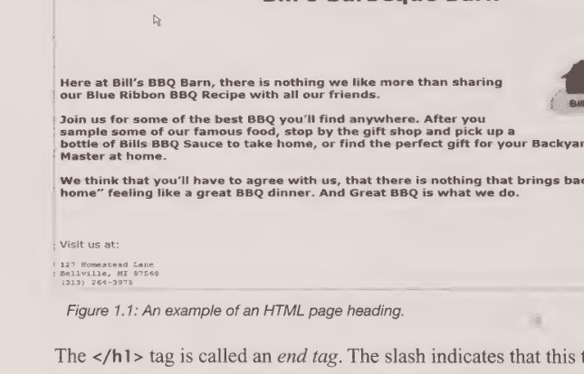

图1.1：HTML页面标题示例。

`</h1>`标签被称为*结束标签*。斜杠表示该标签结束了之前的标题标签。结束标签之后处理的任何文本都将以默认大小和样式出现。大多数（但不是所有）HTML标签都有相应的结束标签。

HTML是一种相对简单的语言。虽然它确实有一些怪癖，但不应该吓到任何人。通常，网页设计中最复杂的方面来自于将其他语言集成到HTML代码中，例如JavaScript和层叠样式表。

### 还有哪些附加语言？

最初，你将学习如何将JavaScript和层叠样式表（CSS）整合到你的网页中。然后，你将看到如何将这些页面与其他语言（如JSP、PHP、ASP.NET和CGI）结合，以提供数据库集成。

每种语言都有自己的优势和劣势。JavaScript是一种功能强大的基于Java的语言，以C++为模型，但更简单，并进行了关键的设计更改，以便更容易部署在各种计算机上。PHP是一种流行的脚本语言，专门为数据库集成而设计。这个HTML预处理器运行在Web服务器上，并创建动态HTML内容，通过浏览器返回给远程用户。ASP.NET在概念上与PHP相似，但语法类似于VB.NET，即微软Visual Basic（VB）在其.NET Framework上实现的版本。CGI编程实际上不是一种语言，而是一种涉及*通用网关接口*协议的技术。CGI定义了一种标准方法，让Web浏览器与远程Web服务器上自定义编写的应用程序进行交互。PHP和ASP.NET都依赖于专门的CGI程序。CGI程序可以用多种语言编写，为开发动态网页提供了强大而灵活的方法。

选择哪种语言取决于你，这将是基于多种因素（如你当前的技能、同事的技能、高管的指令、现有应用程序和个人偏好）做出的决定。我们的目标是提供用每种方法编写的基于浏览器的应用程序的完整、清晰且功能性的示例，使你能够在完成本书后立即投入工作。

### 什么是客户端？

客户端是用于访问Web应用程序的硬件设备。客户端可能是一台笔记本电脑或台式机，但也可能是一台手持设备，如PDA甚至手机。你的应用程序需要支持的设备通常取决于你的应用程序用户是谁以及他们使用什么设备访问互联网。这些设备还可能使用各种操作系统。虽然最常见的操作系统是Microsoft Windows，但还有许多其他可能性，包括Mac OS、Linux和Palm OS。

即使你网站的所有访问者都将在PC上使用Windows，他们也可能使用不同的屏幕尺寸和分辨率，这将影响网站和应用程序的外观。这可能会影响也可能不会影响应用程序的编码方式。例如，如果你的访问者将使用手持设备，你的应用程序可能需要设计并编码为能够轻松地在较小的屏幕上显示数据。如果你的应用程序有很多图形，那么考虑性能和外观将变得更加重要。（基于设备类型、操作系统、屏幕尺寸和分辨率的考虑在第13章有更详细的讨论。）

### 什么是浏览器？

浏览器是一种充当用户客户端和Web之间接口的软件。浏览器有时也被称为*Web客户端*。浏览器发送信息请求，接收该信息，并将其显示在用户客户端上。

你可能已经熟悉一些可用的浏览器。它们包括但不限于Internet Explorer、Firefox、Opera和Netscape。用于访问应用程序的浏览器可能影响外观，并对Web开发提出其他考虑因素。浏览器是免费的，并且流行度会变化。如果你的应用程序提供给普通互联网社区访问，许多不同的浏览器可能会被用来访问你的网站和应用程序。（浏览器在第13章有更详细的讨论。）

### 什么是HTML？

如果你正在创建一个Web应用程序，你几乎肯定会使用HTML。HTML已经存在了很长时间，并且肯定会在未来很长一段时间内继续使用。它是Web的语言，所以你绝对需要至少对其有基本的了解。HTML自最初诞生以来已经发生了变化，包含了使其更灵活、更易于用于Web应用程序开发的功能和特性。你将在后续章节中了解HTML。

纯HTML文档是静态的，意味着它以恒定状态存在。*客户端脚本*可以嵌入到HTML中，使Web应用程序动态化。最常用于客户端脚本的语言是JavaScript。你将在第8章学习JavaScript和客户端脚本。

HTML表单通常用作在Web应用程序中集成CGI的方式。如前所述，CGI是一种与Web服务器上的应用程序进行接口的协议。这涉及*服务器端脚本*。你将在后面的章节中学习CGI和服务器端脚本。

### 什么是Web服务器？

术语*Web服务器*可以指负责与客户端浏览器通信的程序。Web服务器接受来自客户端浏览器的HTTP请求并提供HTTP响应，包括可选的数据内容（通常以HTML文档和链接对象的形式）。术语*Web服务器*也可以指运行Web服务器程序的系统。Web服务器实际上有两个组成部分：硬件和软件。

编写Web应用程序并不一定意味着你需要购买新硬件。许多平台都可以用于托管网站。有些平台比其他平台更兼容、更适合Web开发，但大多数都能适应Web开发。你的组织可能已经有一个可用于托管网站和Web应用程序的系统。

需要决定是否需要额外的硬件来托管你的网站和Web应用程序。额外的硬件可能会增加另一层安全性。数据和应用程序可以位于同一系统上，或者你可能希望将数据分开以增加另一层安全性。另一方面，拥有额外的硬件需要额外的支持和管理。使用Web托管服务也应该被考虑在内。

### 使用了什么数据库？

本书中的示例几乎可以使用任何数据库。Web编程通常非常包容，大多数数据库都受到支持。本书中的示例主要使用Microsoft Access数据库和MySQL数据库，但第7章简要讨论了连接到Microsoft SQL Server数据库。第10章和第12章使用MySQL数据库，并包含了几个可用于在你的Web应用程序中整合动态数据库内容的连接示例。

### 我可以在哪里找到示例代码？

本书中使用的示例可在MC Press的网站（*www.mcpressonline.com*）上找到。转到论坛选项卡，然后选择MC Press产品下载和评论论坛。在那里你将找到一个标题列表。


## 第一章：基于浏览器的应用程序简介

按字母顺序排列。为业务开发人员选择HTML以查找下载文件。请随意下载并使用这些示例。我们希望本书及其包含的示例能帮助您尽可能快速、轻松地开发自己的基于Web的应用程序。本书中提供的所有代码示例都可以找到对应的代码文件。

## 开发过程

Web开发的工具和技术可能与传统业务编程不同，但过程非常相似。开发应用程序仍然需要分析、设计、编码、测试、文档、实施和支持。Web开发还需要考虑应用程序生命周期，并在设计中建立灵活性，以使其能够适应业务流程的变化。

您组织的开发标准应该更新，为开发者提供一个遵循的结构和流程，作为标准化指南。就像使用遗留代码进行开发一样，为Web开发制定预定义标准可以保持代码的一致性、有序性、易于维护和可管理性。

所有环境都有其独特的挑战，就像所有程序员都有自己独特的编码方法一样。您可以要求多个程序员为同一个解决方案编写代码，但没有一个应用程序的编码会完全相同。定义明确的开发过程可以最大限度地减少开发差异的影响。这对于Web应用程序和其他应用程序都是如此。组织也可能有内部要求，例如《萨班斯-奥克斯利法案》的合规性，这些要求不能被忽视，需要在开发过程中加以考虑。Web应用程序可能会增加另一个复杂因素，因为通常需要引入额外的硬件。例如，应用程序数据库和部分应用程序代码可能驻留在一个系统上，而基于浏览器的组件和服务器则位于另一个系统上。

花时间考虑Web开发如何融入开发过程，并制定明确的遵循流程。这将是值得投入的时间。当学习一门新的编程语言时，开发者会尝试坚持一种舒适的编码风格。如果没有预定义流程，开发者也会定义自己的流程。拥有明确的开发流程和编码风格将带来更一致的代码和更有序的应用程序。无论是您自己还是其他人需要回去修改、维护或调试代码，这种应用程序从长远来看都更容易支持。

一旦确定了用于Web开发的工具、技术和硬件基础设施，并且在实际开始开发之前，请考虑开发过程。此过程应定期重新审视。由于业务需求、业务需要和技术变化等原因，将会做出改变。与其他任何过程一样，开发过程可以被定义、重新审视和增强，以适应您组织的环境。该过程的非正式性和灵活性程度取决于您环境的具体情况。

## IT人员

与遗留应用程序一样，Web应用程序的开发任务可能由几个小组或部门负责。这在大型组织中尤其如此。一个小组可能负责应用程序设计和图形，另一个负责数据库支持，另一个负责管理，还有一个负责业务应用逻辑和开发。职责也可能按平台划分，因为Web应用程序通常涉及多个平台。这并不意味着Web开发比遗留开发需要更多的人员，但它确实意味着您必须考虑组件、任务和IT人员结构。人员结构将部分基于资源技能集和项目要求。在较小的组织中，开发人员可能还负责配置、Web设计和编码。然而，您经常会发现设计或编码方面的专家并不一定是配置或硬件基础设施方面的专家。因此，任务通常分散在不同的成员和部门之间。

组织的规模和资源的技能集对IT人员的结构有很大影响。如表1.1所示，小型组织需要具备非常多样化技能集并了解完整需求领域的个人。Web开发的一个有趣挑战是，它使业务开发人员能够尝试设计。通常，具有强大分析能力、能够处理复杂业务需求并将其转化为功能完善的应用程序的开发人员，在设计应用程序外观方面并不那么直观。这可能意味着要走出舒适区，但这并不意味着业务开发人员无法在IT人员结构中担任此角色。

**表1.1：按组织规模划分的IT人员角色**

| 组织规模 | IT人员角色 |
|---|---|
| 大型 | 通常按Web开发任务所需的各种角色划分为多个部门。部门可能包括但不限于：管理、项目负责人、硬件和运营支持、安全和管理、设计和图形、数据库管理和开发。Web项目的规模通常在范围和时间线上都较大。 |
| 中型 | 通常具有多个部门，但少于大型组织。通常基于员工技能集进行组合式结构划分。 |
| 小型 | 通常部门很少，甚至没有。员工身兼多职，是“多面手”。 |

虽然本书侧重于业务编程，但它也包括其他主题，以提供对Web开发众多领域的见解。无论您将负责许多Web应用程序任务还是仅负责编程，了解相关任务将帮助您培养扎实的Web编程技能，并让您更好地准备决定自己适合的位置。试图成为多面手可能会导致您成为万事通但无一精通。不要让自己不堪重负。我们特意聚焦于业务开发人员和编码动态业务应用，以便您理解所需的技术技能。您会发现，在获得一些经验后，用于Web开发的语言和工具往往有相似之处。无论您作为开发人员将担任什么角色，学习HTML都是有价值的。学习创建业务应用程序的通用语言总是有益的。

那么，这对作为开发者的您意味着什么呢？您可以专注于仅编码，或者您可以决定发展扩展的Web技能，以满足需要多样化技能集的角色要求。您的个人目标、工作状态和技能集将影响您在组织IT人员结构中的位置。具备多样化技能的开发人员将在角色和组织方面拥有更大的灵活性，找到更合适的定位。如果您除了业务应用Web开发之外还想学习其他技能，您可能会在中小型组织中感到更满足。如果您想将技能集中在应用程序编码和开发上，而不学习设计、管理或其他相关技能，那么大型组织可能更适合。

## 平台

创建Web应用程序并不一定意味着组织需要更改或添加新的平台。通常，如果现有硬件适合Web开发，可以继续使用。大多数组织已经设置了支持Web浏览器的客户端。浏览器支持是必不可少的。后端硬件可能与用户用于访问Web的客户端设备不同。配置还将包括一个Web服务器。Web服务器最受欢迎的平台之一是PC。这可能与组织内部网使用的同一台基于PC的服务器相同，或者出于安全目的，它可能是一台专门用于Web应用程序的服务器。

遗留代码可能会在Web应用程序中重用，并且很可能继续驻留在遗留平台上。数据库也可能继续驻留在其当前平台上。那么，您需要学习新的硬件操作系统吗？可能不需要，除非当前使用的平台不支持Web应用程序。

如果决定使用基于Java的技术，任何支持JVM（Java虚拟机）的平台都可以使用。如果决定使用ASP.NET，可能会使用Microsoft服务器。某些语言更适合特定的硬件，但用于Web开发的大多数语言都受到各种平台的支持。Web开发比遗留应用程序开发开放得多。其灵活性使平台决策更容易。

成本、资源技能和人员知识也将是决定使用哪些平台进行Web开发的因素。大多数组织已经具备有关支持Web浏览器的基于PC的客户端硬件的知识，以及能够用作Web服务器的平台的知识。

## 设备

Web应用程序开启了支持额外设备的能力。任何能够连接到互联网并提供基于浏览器模拟器的设备都可以用于Web应用程序。创建


并且使用 Web 应用程序使您能够通过各种设备提供用户访问，包括 PDA 和手机。

使用非传统设备的关键在于应用程序设计。设计需要适应所用设备的屏幕尺寸、键盘和操作系统。随着 Wi-Fi 使现场工作人员或车间工作人员能够轻松访问和使用应用程序，您可以为旧应用程序注入新的活力。（Wi-Fi 是 *wireless fidelity* 的缩写，一种常用于互联网连接的无线技术。）组织的销售人员可以使用他们的手机来确定库存数量。车间工作人员可以使用手持设备轻松查询制造要求。虽然本书不侧重于使用非常规设备构建应用程序，但它确实为您将这些基于 Web 的应用程序变为现实铺平了道路。

## Ajax

构建 Web 应用程序很有趣。然而，一些 Web 应用程序速度缓慢，有时会让用户感到沮丧。因为 Web 应用程序由多个组件组成，即使编码良好的网站有时也需要用户等待数据和页面加载。您可能在网站上看到过沙漏显示，而在后台，应用程序会经历处理步骤来评估输入、响应请求、检索信息，并通过您的 Web 浏览器将其格式化以进行显示。

*Ajax（Asynchronous JavaScript and XML）* 是一个流行词，而且有充分的理由。它是一种 Web 编程方式，可以消除沙漏和较慢的响应时间。它不是新技术；它是看待已经成熟稳定的技术的一种新方式。

Ajax 是一组相关的 Web 开发技术，用于创建动态、交互式的 Web 应用程序。使用 Ajax，数据、内容和设计被融合在一起。使用 Ajax 的主要优势和原因是提高了 Web 页面的响应能力和交互性。通过与服务器交换少量数据来实现改进，这样整个网页就不必在用户每次执行操作时重新加载。因为 Ajax 引擎正在处理请求，所以信息可以由 Ajax 引擎持有，并允许与应用程序和用户的交互独立于与 Web 服务器的任何交互发生。当用户在 Ajax 驱动的应用程序中单击某个内容时，所需的响应时间非常短。页面只需显示用户请求的内容。结果就是速度、功能性、可用性以及增加的 Web 页面交互性。

Web 应用程序通常被编码为用户和服务器之间的交互是 *同步的*，这意味着一个步骤必须跟随另一个步骤。如果用户单击链接并发起请求，则请求会发送到服务器，然后服务器处理请求并将结果返回给用户的 Web 浏览器。

Ajax 是 *异步的*，这意味着可以从服务器请求额外的数据并在后台加载，而不会干扰当前网页的显示和行为。JavaScript 通常是用于 Ajax 函数调用的脚本语言。JavaScript 在页面加载时加载，并处理客户端的大多数基本任务，包括数据验证、数据操作和数据显示，而无需往返服务器。同时，Ajax 引擎正在向服务器来回发送数据。数据传输不依赖于用户操作，并且并发发生。Ajax 站点中的数据是使用 XMLHttpRequest 对象检索的，该对象适用于所有与现代 Web 浏览器兼容的脚本语言。XML 经常与 Ajax 一起使用，但异步内容必须以 XML 格式并不是必需的。

Ajax 是一种基于跨平台可用性的灵活技术。它可以与各种平台、操作系统和 Web 浏览器一起使用。Ajax 基于开放标准，如 JavaScript 和 DOM。虽然 Ajax 本身超出了本书的范围，但您将在本书中了解更多关于 JavaScript 和 DOM 的知识。有免费的、开源的 Ajax 示例可供使用，适合大多数基于 Web 的应用程序项目。

一个很好的 Ajax 站点示例是 Google 地图（*http://maps.google.com/*）。访问该网站并查看它。在网站上移动、放大或移动地图时，等待时间确实非常少。

## SOA

当今另一个热门技术是 *SOA*，即 *面向服务的架构*。SOA 定义了两个或多个实体如何以一种使一个实体能够代表另一个实体执行工作单元的方式进行交互。这个工作单元被称为 *服务*。

SOA 实际上是一组相互通信的服务。通信可以包括服务简单传递数据或协调某些活动。服务交互使用定义良好的描述语言。SOA 是分布式计算的演进，基于用于异步和同步应用程序的请求-回复范例。

使用 SOA，应用程序的业务逻辑或单个定义的功能被模块化，并作为服务呈现给用户应用程序。关键在于每个交互都是自包含的，并且具有松耦合的性质。每个交互独立于任何其他交互。服务接口独立于实现。应用程序开发人员可以通过组合一个或多个服务来构建应用程序，而无需了解服务或服务的底层实现。例如，一个服务可以在 NT 服务器上用 .NET 或 Java 实现，而使用该服务的应用程序可能是在 AS400 上运行的 RPG。

支持 SOAP 的 Web 服务是 SOA 最常见的实现。*SOAP*，或 *简单对象访问协议*，是一个定义消息应用程序级结构的标准。为了使应用程序能够集成，它们必须对所使用的消息结构达成一致。SOAP 提供了一个应用程序级的消息结构，用于在许多通信协议上使用。支持 SOAP 的应用程序可以轻松地彼此交换信息，因此 SOAP 促进了完全不同的系统之间的集成。

SOA 的协议独立性意味着不同的使用者可以通过以不同的方式与服务通信来使用该服务。面向服务是一种构建自主服务系统的方法。使用 SOA，服务被构建成功能性的、灵活的、可靠的和可用的。新的服务拓扑可能会随着时间的推移而发展，因此使用 SOA 的系统也被构建为适应变化。

本书不侧重于 SOA，但它确实介绍了可用于开发 SOA 应用程序的技能和工具。

## 其他语言

本书从 HTML 开始，并继续介绍用于 Web 开发的其他编程语言。并非所有可能用于 Web 开发的语言都会在这里介绍。但是，已经仔细考虑介绍一些更常见的语言。您将找到许多可用于创建动态 Web 应用程序的选项和示例。

尽管 Web 开发已经存在多年，但与业务应用程序开发相比，它仍处于起步阶段。增长一直像野火一样，Web 开发用于业务应用程序绝不是一项成熟的技术。与任何其他增长中的技术一样，新的语言和工具继续被开发和引入。关于哪些是最好的以及未来哪些会流行，有很多争论。

许多用于 Web 开发的语言和工具非常相似。通常，使用语言的组合来创建 Web 应用程序。Web 开发在混合使用方面往往比传统开发开放得多。例如，传统上，RPG 用于在 AS400 上编码，COBOL 用于在大型机上，Visual Basic 用于在 Microsoft 服务器上。另一方面，Web 开发通常不会将组织锁定在特定平台或单一语言中。

那么，哪些语言可以用于 Web 开发呢？除了本书涵盖的工具（HTML、CSS、JavaScript、CGI、PHP、ASP 和 JSP）之外，许多其他语言也可能用于 Web 开发，包括 A、ActionScript、Ada95、AppleScript、BEF、C、C++、CCI、CMM、Dylan、Eiffel、GEL、Glyphic Script、Guile、hyperTalk、Icon、Java、KQML、Linda、Lingo、Lisp、Logo、ML、Modula-3、NewtonScript、Obliq、Perl、Phantom、Python、REXX、Ruby、ScriptX、SDI、Self、SIMPLE、Sloth、Smalltalk、SMSL、Spynergy、Tcl、Telescript、Tycoon、UserTalk、Viola、VBScript、WebGL、VRML、XHTML 和 XML。这绝不是一个完整的列表，但它让您了解可用于 Web 开发的工具范围。所有语言都有自己独特的特点、优点和缺点。本书侧重于一些最成熟、经过验证和流行的 Web 开发工具。


### 对Web技术的恐惧

许多习惯并精通所谓传统应用程序的业务应用开发者，一想到要使用Web技术来编写应用程序就感到有些畏惧。用非Web技术编写的应用程序同样可以用Web技术轻松实现。对于密集型数据录入任务，有人可能会说非Web应用程序是最佳选择。然而，这一点极具争议；一个设计精良、编码出色的Web应用程序完全可以满足密集型数据录入的需求。这更多是开发者个人偏好使然，而非客观观点。

这并不一定意味着你应该用Web技术重写所有的非Web应用程序。这既不现实也不实际。例如，考虑一个在非Web ERP软件包及其内部附加应用上投入巨大的组织。仅仅为了拥有一个基于Web的应用程序而着手重写整个ERP软件包及其附加应用，这是没有意义的。然而，当你已经在大力增强或重写一个应用程序，或开发一个新应用时，就不要畏惧Web技术。（我们将在第7章讨论如何重用遗留应用程序。）

有许多实际理由值得考虑并使用Web技术。业务应用开发正在变化，未来有一天可能由Web应用程序主导。甚至可以说，Web应用程序在商业环境中已经确立了主导地位。

虽然那些业务应用开发新手很可能已经在使用Web工具，但那些做了多年内部开发的程序员可能会觉得Web开发超出了他们的舒适区。如果你属于后者，那么是时候打破框框，拓展你的技能了。学习Web开发并不像乍看起来那么可怕。和其他任何技术一样，一旦你学会了它、使用了它，并建立起对其技术运作方式的舒适感和理解，你就能驾轻就熟了。

多年来，我们遇到过许多以各种方式接触过Web开发的开发者。一个典型的错误方式是：开发者被指派创建一个Web应用，然后被送去参加一个Java培训班，期望他回来时就掌握了开始编写代码所需的工具和知识。这不切实际，并且可能导致对Web开发的恐惧。Java本身并不可怕。它是一门非常健壮、强大且有用的语言。但同时，它也是一门复杂的语言，确实需要时间来学习。

我们在本书中特别注意，不只聚焦于单一技术，而是介绍并提供各种工具组合的示例，以便你在读完本书后能够开发业务应用。如果你对Web开发有点害怕，那么在读完本书后，你的恐惧将会消失，并且会渴望使用你所学到的工具。

### 拓展你的技能组合

随着组织变得更加全球化——扩张、合并和变化——每个人都需要更新自己的技能。你应该感到害怕吗？完全不必。拥抱变化是生活的常态。

作为一名经验丰富的业务开发者，思考一下技术在开发方面发生了怎样的变化。所取得的成就令人惊叹。业务依靠技术蓬勃发展。技术为业务的顺畅运行提供了框架，也为改进业务提供了机会。这种机会可以表现为资源节约或其他成本节约，也可以表现为满足基本的业务需求。

就在不久前，人们还可以争论Web可能只是一个阶段，可能不会长期存在。时间已经证明事实绝非如此。Web已经存在，其规模前所未有，并且仍在持续增长。同样，就在几年前，家中有台联网的电脑还很不寻常。现在，大多数家庭都有某种形式的互联网连接。技术变化迅速，使得几乎任何人都能接入互联网。作为一名业务应用开发者，这意味着如果你打算在职业生涯中继续前进，你可能需要将Web技术纳入你的技能组合。

你在哪里学习Web技能？有许多学习资源和选择。有些选择比其他选择更经济、更省时。关于各种Web主题的书籍和课程比比皆是。然而，根据我们的经验，大多数教育资料都专注于Web开发的特定环节，并且并非总是基于业务开发者的视角。我们在撰写本书时格外用心，以你——业务开发者——为中心。读完本书后，你将获得开始编写业务Web应用所需的工具。

### 就业市场

当今的就业市场仍然为传统编码人员提供一席之地，但更多时候，它要求具备某种Web技能。大多数企业已经发生了显著变化。收购、合并和全球业务基础设施如今已司空见惯。业务变化是一个重要因素。这对当今的业务应用开发者产生了重大影响。变化在业务基础设施中是常态，但不要被误导，认为它是一个移动靶，以至于无法确定将时间投资于何处来发展你的技能。

对于拥有合适技术技能的IT求职者来说，近期内前景依然强劲。婴儿潮一代开始步入退休年龄。虽然婴儿潮一代开始退休，但进入计算机领域的人数却在减少。根据加州大学洛杉矶分校教育研究所的数据，2001年至2005年间，潜在学生对计算机科学专业的兴趣下降了70%。未来IT工作者供给的减少，加上IT人口的老龄化，可能预示着一些组织在全球竞争力方面将面临问题。然而，对于希望在IT部门内晋升的程序员，或者对于刚进入就业市场的人来说，这将是个好消息。IT工作者的供给在下降，而需求持续增长。

近年来，组织开始重新投资于IT项目。趋势显示对业务分析师的需求强劲。根据Foote Partners的一项研究，公司正在寻求并愿意为那些帮助他们快速适应快速变化业务需求的技能支付溢价。趋势是根据符合组织业务需求的特定技术技能来奖励IT专业人士。对快速开发技能的需求也反映了许多组织对速度和敏捷性的高度重视。组织正投入更多资源培训其IT员工。培养和培训现有员工通常比寻找和雇佣新人才更容易、成本更低。

组织正在继续使其现有应用实现Web化，并寻求基于Web的解决方案，这使得基于Web的技能非常热门。拥有包括Ajax、Java、.NET和PHP在内的Web技能的业务开发者需求量很大。Java相关工作的增长有所放缓，但依然强劲，而.NET相关工作近年来则急剧增长。目前，这两种语言在可用工作机会方面不相上下。许多人认为这是因为Java在市场上存在时间更长，而.NET技术则更加成熟。

业务知识很重要，因为组织努力使IT服务与其支持的业务保持一致。对于拥有特定业务知识和系统分析技能的应用开发者的需求依然强劲。组织还希望开发者熟悉整个软件开发生命周期，并在领导力和沟通技巧方面全面发展。组织正在寻找拥有更广泛开发技能的个人。

当今的业务市场是全球化的。Web和技术在全球市场中扮演了重要角色。即使是小型组织也受到业务全球化的影响。Web使得大型和小型企业都能将其业务触角延伸到非常遥远的客户群体。

### 外包

外包是当今商业环境中一个普遍的考虑因素。引入这个话题的目的并不是要争论外包的优缺点。作为一名业务开发者，你只需了解它即可。

组织考虑外包有几个原因。一个原因可能是预算考虑。另一个原因可能是因为内部现有资源缺乏完成项目所需的技能。当组织决定将应用迁移到Web时，如果组织不具备必要的技能，外包很可能就会被考虑在内。如果你是一名经验丰富的内部业务开发者、承包商，或者只是刚涉足业务开发的人，拥有满足业务需求的适当技能将提升你的职业生涯。你正在阅读本书这一事实表明，你渴望提升自己的技能。

关于外包话题一直存在很多争议。声称IT工作正被大规模转移到海外的说法通常是


夸大其词。大多数追踪此类统计数据的组织得出的结论是，大约5%的IT工作岗位被外国工人取代。其中大多数是较低级别的编码工作、技术支持职位或呼叫中心工作。需要更高级技能的工作可能仍会保留在组织内部。根据2006年9月的SIM报告，2007年企业IT预算中仅有约3.3%被分配给离岸外包计划。在不久的将来需求将下降的技能包括日常编码和系统测试、应用维护、技术支持、数据连续性和数据恢复。这些技能属于越来越多地被外包和离岸的工作岗位。与客户服务和帮助企业增长相关的IT工作往往保留在组织内部。组织逐渐认识到，为了使外包工作有效进行，必须在接口和项目管理方面进行大量工作。

作为业务开发人员，这意味着什么？重要的是你的技能组合要先进并符合行业的需要。这当然包括Web开发技能。

## 总结

我们在本章涵盖了很多信息。希望它能启发你思考一些作为业务开发人员会影响你的考量。如果你真的想做，就能做到你设定的目标。愿望越强烈，你就越可能成功。迈出第一步总是意义重大的。本书将帮助你更轻松地迈出进入Web开发的第一步。如果你已经具备一些Web开发知识，你也会从本书中受益。

关于如何分配学习时间有许多选择。我们努力减少了你学习所需的时间，当你完成时，你将准备好编写一个业务Web应用程序。

## 第二章：HTML简介

为什么作为业务程序员的你需要花时间学习HTML？它究竟是什么？

## 为什么要学习HTML？

HTML是互联网上几乎所有网页的*事实上的*标准语言。虽然确实有其他选项可用于创建网页，但其中许多在执行时会动态创建HTML代码，因此仍然需要HTML知识。几乎不可想象，任何程序员能在不使用HTML的情况下部署基于浏览器的应用程序。

不持续更新技能的程序员面临专业过时的风险。你可能曾与某个不愿或无法更新其技能组合的人共事过。最终，那个人因某种原因失业了。以他或她所能提供的技能，再找到一份工作即使不是不可能，也是非常困难的。事后，那个人后悔没有更努力地学习新技能。

嗯，这回答了问题的一半。学习某些东西是必要的，但为什么是HTML？如前所述，它是浏览器应用程序开发中最常用的语言。如果你还没注意到，我们的行业正在进行巨大的转变。过去，许多业务应用程序是针对特定平台编写和定制的，使用该平台最常见的语言：大型机上的COBOL、Windows上的Visual Basic (VB)、Unix上的C++以及IBM上的RPG。所有这些语言都针对其运行的环境进行了优化。然而，根据定义，它们与特定环境绑定。将其中一个应用程序移植到另一个平台或以不同方式部署它是一个严峻的挑战。

通过互联网部署的基于浏览器应用程序的想法起源于1990年代初。蒂姆·伯纳斯-李发明了“万维网”一词和第一个Web浏览器，并随后创立了万维网联盟，也称为*W3C*。除了其他职责，W3C充当着Web技术发展的守护者。它为Web相关技术的许多方面提供指南、标准、建议和教育。你可以在*www.w3c.org*上了解更多关于W3C的信息。

也许W3C发布的最基本的指南是在*www.w3.org/TR/1999/REC-html401-19991224/*上找到的HTML规范。该文档提供了关于HTML语言的信息及其正确使用的建议。虽然这些指南绝不会阻止开发者以他们喜欢的方式编码，但了解它们是明智的。随着语言的不断发展，更改可能会使你编写的网页中的代码过时。例如，W3C指南指出了哪些HTML语言元素已*弃用*。弃用的功能仍保留在标准中，但人们理解它们可能在未来被移除。至少，它们的使用是不被鼓励的。由于许多现有页面包含这些弃用元素，我们将在本文中介绍它们。请查阅W3C指南以获取关于此问题的清晰文档。

## HTML究竟是什么？

首先，HTML代表*超文本标记语言*。它是一种相对简单的语言，用于定义在Web浏览器（如Microsoft的Internet Explorer）中显示的内容外观。HTML在1990年代初开发，随着互联网进入公众视野，它经历了快速的增长期。一个接一个的、快速而重要的增强功能被发布。现在，20多年后，变化的步伐已经放缓。在本章的其余部分，我们将探讨HTML编码的基础知识。

## 基本的HTML页面

HTML编码基于*标签*，由包围每个指令的小于号和大于号`<...>`识别。例如，要创建一个小标题，你可能会编码`<h5>Contact us at:</h5>`。`<h5>`标签向浏览器发出信号，表明后面的文本显示得比默认文本稍大、稍暗，如这里所示：

> **联系我们：**

`</h5>`标签称为*结束标签*。斜杠表示此标签结束了前面的`<h5>`标签。在结束标签之后处理的任何文本都以默认大小和样式显示。大多数（但并非所有）HTML标签都有对应的结束标签。

考虑图2.1中所示的简单网页，该网页在第1章中已介绍过。

> 图2.1：一个简单的网页。

任何HTML新手都可以创建这个非常简单的网页。它的代码如图2.2所示。这是显示该网页的完整源代码。它名为“Barbeque Barn.html”，但文件也可能以“.htm”结尾。在代码中，你可以看到对图片“bbqbarn.jpg”的引用。

**28 第二章：HTML简介**

```
<html>
<body><center>
<h1>Bill's Barbeque Barn</h1>
</center>
<right></right>
<br><br><br><br><br><br>
<left>
<h3>Here at Bill's BBQ Barn, there is nothing we like more than sharing our Blue Ribbon BBQ Recipe with all our friends.
<br><br>
Join us for some of the best BBQ you'll find anywhere. After you sample some of our famous food, stop by the gift shop and pick up a bottle of Bills BBQ Sauce to take home, or find the perfect gift for your Backyard BBQ Grill Master at home.
<br><br>
We think that you'll have to agree with us, that there is nothing that brings back that "down home" feeling like a great BBQ dinner. And Great BBQ is what we do.
</h3>
<br><br><br>
Visit us at:
<pre>
127 Homestead Lane
Bellville, MI 97568
(313) 264-3975
</pre>
</left></body>
</html>
```

*图2.2：图2.1所示页面的HTML代码。*

图2.2中的第一行代码包含`<html>`标签。此标签告诉浏览器其后的文本是HTML代码。由于浏览器必须能够处理用许多不同语言编写的数据，网页通常在代码开头标识其语言。图2.2最后一行的匹配`</html>`标签结束了源代码。

`<body>`标签标记网页可显示内容的开始。它包括许多可选属性，将在后续段落中讨论。匹配的结束`</body>`标签通常出现在源代码末尾的`</html>`标签之前。


## body 标签

```html
<body
text
alink
vlink
link
background
bgcolor
>
</body>
```

可选属性出现在 `<body>` 标签内，格式为 *属性 = 值*。标签中的属性之间应至少用一个空格分隔。`<body>` 标签最常用的属性之一是 **bgcolor**。使用它来设置整个网页的背景颜色。例如，将 `<body>` 标签更改为 `<body bgcolor="beige">` 会将整个页面的背景更改为米色，如图 2.3 所示。然而，图像的背景仍然是白色。稍后，我们将讨论处理图像的选项。

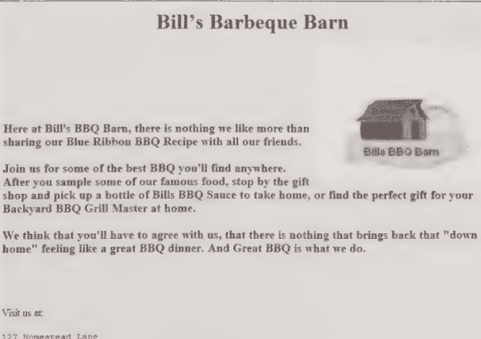

图 2.3：一个具有米色背景的示例网页。

**text**、**alink**、**vlink** 和 **link** 属性设置页面上文本的颜色。**text** 定义整个页面的默认文本颜色。其他属性定义超链接的颜色。**Alink** 表示活动链接的颜色，即当前正在使用的链接。**Vlink** 表示先前访问过的链接的颜色，而 **link** 设置未访问链接的颜色。浏览器通常保留其过去访问过的链接历史记录，因此即使某个网站是几个月前访问过的，它也可能显示为已访问状态。浏览器通常还包含一个清除此历史记录的选项，在这种情况下，除非再次访问，否则所有链接都不会显示为已访问。这些问题将在第 4 章中更详细地讨论。

**background** 属性指定一个图像用作平铺背景。通常，这些被称为“纹理”图像。这些图像是相对简单的无缝平铺图案，可以隐藏平铺之间的边界。此选项不支持将单个图像定义为页面背景，尽管第 3 章讨论了实现此目的的其他方法。

`<center>` 标签指示浏览器将页面内容在左右边距之间居中。浏览器会将所有内容居中，直到遇到 `</center>` 标签，或者直到另一个对齐命令取代它为止。此命令将标题 "Bill's Barbeque Barn" 居中。如果没有它，标题将默认左对齐。

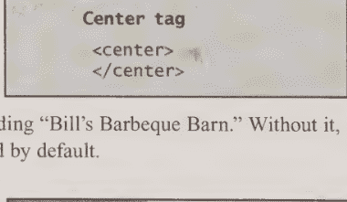

一级标题将标签内的文本定义为最粗体或最大的标题。每个浏览器对实际显示的文本大小都有一定的控制，例如，视力有限的用户可以定义他们喜欢的文本大小。Web 开发人员称之为“逻辑”文本大小。开发人员不是指定确切的尺寸，例如 12 像素，而是指定一个相对大小，例如 H1（大）、H3（中）或 H6（小）。

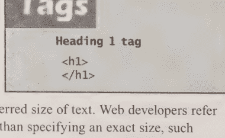

`<right>` 标签指示浏览器将页面内容右对齐，直到遇到 `</right>` 标签，或者直到另一个对齐命令取代它为止。你可能认为此命令用于将图 2.3 中的 bbqbarn.jpg 图像右对齐，但图像实际上并未受到它的影响。相反，`` 标签的 **align=right** 属性将图像强制放置在页面的右侧。`<right>` 命令不会影响浮动图像。

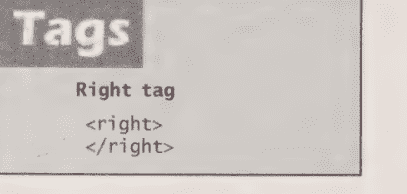

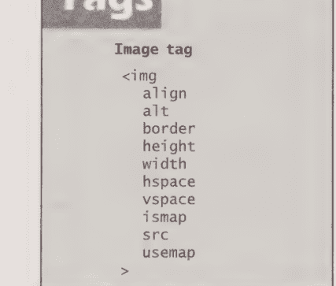

`` 标签在页面上放置一个图像。其属性根据需要修改图像。**align** 属性定义了图像周围的文本流。**align** 有五个选项：

- **Top** 将图像顶部与基线对齐。
- **Bottom** 将图像底部与基线对齐。
- **Middle** 将图像中部与基线对齐。
- **Left** 将图像浮动到左边距。
- **Right** 将图像浮动到右边距。

**Alt** 定义当用户将鼠标悬停在图像上时显示的替代文本。它也被盲人使用的页面阅读器以及 Google 和 Yahoo 等搜索引擎的 Web 爬虫使用，这些爬虫会编录页面内容。因此，虽然这是一个可选属性，但强烈建议提供它以帮助残障人士，并帮助你的页面被搜索引擎正确放置。

**Border** 以像素为单位定义图像边框的宽度。显然，边框会破坏图像与页面背景之间的任何“无缝”效果。然而，对于许多页面来说，这可能完全没问题。

**Height** 和 **width** 以像素或百分比为单位定义图片的尺寸。像素表示为整数，而百分比使用百分号 %。如果使用百分比，它是指整个页面的尺寸，因此设置为 50% 高度和宽度的图像的高度是页面的一半，宽度也是一半。调整图像大小时，请注意图像将如何缩放。如果更改图像的宽高比，某些图像看起来效果不好。定义为 200x100 的图像可以缩放为 300x300，但很可能看起来会变形。缩放为 400x200 可能看起来会更好。同样，许多图像在放大时会变得越来越模糊。

**Hspace** 指图像左右两侧的空白区域。
**Vspace** 指图像上下方的空白区域。**Src** 定义图像的位置。这可以是服务器上的物理位置，或者是到互联网上另一个位置的 URL（统一资源定位符）。如果在图像名称前没有给出路径（如 c:\ 或 http:\\），则假定该图像与网页位于同一位置。要指示图像存储在上一级文件夹中，请使用语法 ../文件名。

**Ismap** 指示图像有一个对应的服务器端图像映射。**Usemap** 指示一个客户端服务器映射。通常，图像映射适用于用作链接的图像。图像映射允许图像的不同部分链接到不同的位置，而不是为整个图像分配单个目标。例如，如果你有一张汽车的图片，你可以为车门、引擎盖、发动机、轮胎、内饰和后备箱定义不同的链接。这些链接可以是指向进一步描述这些区域的页面。图像映射将在第 3 章中更详细地讨论。

一个未包含在 W3C 标准中的常用属性是 **lowsrc**。一些浏览器（如 Microsoft 的 Internet Explorer）支持此属性。它定义一个小图像，该图像将在 `src` 属性中定义的主图像之前预加载并显示。当主图像非常大且加载缓慢时，lowsrc 图像提供了一个“占位符”图像。主图像加载后会覆盖 lowsrc 图像。随着台式计算机和互联网连接速度的提高，此选项变得不那么有用了。

为了说明图像标签的属性如何影响网页上的图像外观，让我们修改图像标签，如图 2.4 所示。由于代码中的此更改，网页发生了显著变化，如图 2.5 所示。图像现在位于左侧，大了很多，并且带有边框。替代文本（在此图中未显示）在将鼠标悬停在图像上时出现。

```html

```

图 2.4：图像的 HTML 代码。

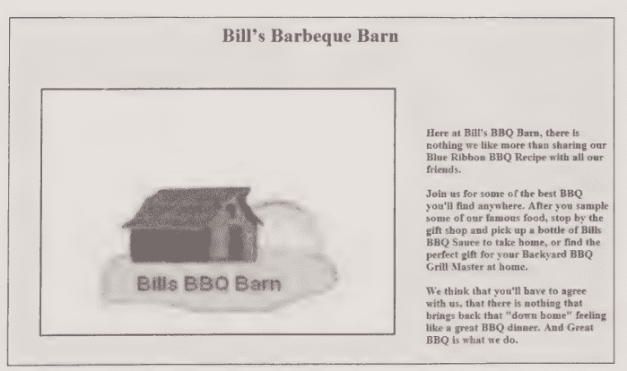

图 2.5：修改了 `` 标签后的网页。

好的，所以图 2.5 不是最漂亮的网页。请记住，这不是一本关于图形设计的书。它是关于 HTML 及其工作原理的。你很可能需要在网页上放置设施、产品和标志等图像。你也很可能需要控制这些图像的大小、位置、边框和其他属性。因此，尽管这里的示例可能看起来有点愚蠢，但它说明了 `` 标签的用法。不过，我们会将 `` 标签恢复原样，因为我们不想让我们的页面看起来像这样！

换行标签 `<br>` 没有结束标签。它强制浏览器在该位置插入一个换行符。默认情况下，浏览器会压缩网页中的空白区域，并按照浏览器认为最佳的方式排列内容。这有时会导致网页显示方式出现差异。示例网页使用了许多换行标签来强制在段落之间留出空行。稍后将讨论处理此问题的其他更高级的方法。


`<left>` 标签指示浏览器将页面内容左对齐，直到遇到结束 `</left>` 标签，或者直到另一个对齐命令取代它为止。如果没有其他对齐命令生效，这是默认行为。


三级标题 `<h3>` 将标签内的文本定义为中等粗细的标题。图 2.6 显示了各种标题级别，从 H1 到 H6。


预格式化文本放置在 `<pre>` 和 `</pre>` 标签之间。这个标签会覆盖浏览器自行压缩空白和空行的能力。当网页显示时，标签之间的任何空白和换行符都会被浏览器保留。对于具有特定格式的内容，如地址或数据集，`<pre>` 标签非常有用。

## 附加的 HTML 标签

`<pre>` 标签是我们入门网页中使用的最后一个 HTML 标签。不过，还有相当多的其他标签需要讨论。有些相当简单直接，而另一些则复杂得多。你将在本书剩余部分看到所有这些标签，但本章将重点关注剩余的简单 HTML 标签。

注释对于任何语言来说都是一个重要的特性，HTML 也不例外。你经常会发现注释在澄清网页中更复杂、更不直观的部分时特别有用。

`<head>` 标签必须放在 `<html>` 标签之后，而结束标签 `</head>` 必须出现在 `<body>` 标签之前。`<head>` 部分通常提供关于网页的附加信息，而不是要显示在页面上的额外内容。其他标签，如 `<title>`、`<link>` 和 `<meta>`，都包含在 `<head>` 部分中。`<title>` 标签将在下面讨论，而 `<meta>` 和 `<link>` 将在本章后面讨论。

`<title>` 和 `</title>` 标签之间的文本用作网页的标题。这个标题显示在窗口顶部，同时也显示在窗口最小化的标签页上。例如，如果我们为网页添加一个标题，修改后的 HTML 代码可能如图 2.7 所示。

```
<html>
<head>
<title>Bill's BBQ Barn</title>
</head>
<body>
```

图 2.7：创建标题的 HTML 代码。

图 2.8 显示了包含网页的窗口标题栏中的标题。当窗口最小化时，这也显示为标签页的标题，如图 2.9 所示。

图 2.8：网页标题栏中的标题示例。

图 2.9：最小化窗口标签页中的标题示例。

无序列表使用 `<ul>` 标签，通常称为项目符号。一些浏览器将 **compact** 属性用作列表应比平常显示更紧凑的信号。**type** 属性改变项目符号本身的外观。可能的值包括 **disk**、**square** 和 **circle**。如果我们想向网页添加一个菜单，可以使用无序列表使其从页面上的其他文本中脱颖而出。图 2.10 中显示的 HTML 代码生成了图 2.11 中所示的目录文本。

```
<ul type=disc>
<li>Bill's Sweet BBQ Sauce</li>
<li>Grandma's Secret Hot Sauce</li>
<li>Bill's Country Cookbook</li>
<li>Bill's Babyback Ribs</li>
<li>Bill's Beef Ribs</li>
</ul>
```

图 2.10：创建图 2.11 的 HTML 代码。

图 2.11：无序列表示例。

有时，项目符号并不适合你要列出的项目。是的，它们对于图 2.11 中所示的目录效果很好，但如果我们有一系列需要按特定顺序执行的指令呢？这就是有序列表的优势所在。type 属性的有效值包括 1、a、A、i 和 I。**start** 属性设置起始值。即使 **type** 不是数字，这个值也总是数字。例如，**start** 的值为 **2** 会生成 type a 的 "b"，以及 type i 的 "ii"。

图 2.12 显示了一个有序列表，其中添加了一些关于烹饪完美 BBQ 的说明。生成的说明如图 2.13 所示。

```
<ol type=1>
<li>Start with Bill's Sweet BBQ Sauce</li>
<li>Follow a great recipe such as "Backyard BBQ Babyback Pork Ribs" found on Page 17 in Bill's Country Cookbook</li>
<li>Get the highest quality Babyback Pork Ribs you can. If you don't know where to get your ribs, stop by the barn and take some home to cook up yourself.</li>
</ol>
```

图 2.12：创建图 2.13 的 HTML 代码。

```
1. Start with Bill's Sweet BBQ Sauce
2. Follow a great recipe such as "Backyard BBQ Babyback Pork Ribs" found on Page 17 in Bill's Country Cookbook
3. Get the highest quality Babyback Pork Ribs you can. If you don't know where to get your ribs, stop by the barn and take some home to cook up yourself.
```

图 2.13：有序列表示例。

如本例所示，列表从 1 开始，每次递增 1。只有少数受支持的选项。如果你需要其他样式，可以使用 `<li>` 标签的 **value** 属性手动创建。例如，要按十位数给菜单编号（虽然很傻，但这只是一个示例），请参见图 2.14。**value** 属性类似于 **start** 属性，其中的数字表示列表中某个特定值的序列。在字母列表中，10 代表 "j"，而不是数字 10。

```
<ol type=1>
<li value=10>Start with Bill's Sweet BBQ sauce</li>
<li value=20>Follow a great recipe such as "Backyard BBQ Babyback Pork Ribs" found on Page 17 in Bill's Country Cookbook</li>
<li value=30>Get the highest quality Babyback Pork Ribs you can. If you don't know where to get your ribs, stop by the barn and take some home to cook up yourself.</li>
</ol>
```

图 2.14：具有特定数值的有序列表。

第三种列表是定义列表。它旨在为一系列术语分配定义或描述。显然，如果你正在发布字典，这很有用，但它在其他地方也适用吗？在我们的示例网页中，我们可能想要添加对提供的各种口味的 BBQ 酱料的描述。实现此功能的代码如图 2.15 所示，并在图 2.16 中进行了说明。

```
<dl>
<dt>Honey BBQ</dt>
<dd>Our favorite traditional sweet and tangy sauce</dd>
<dt>Sweet Honey BBQ</dt>
<dd>Like Honey BBQ, but with a bit less tang and lot more sweet!</dd>
<dt>Prairie Fire BBQ</dt>
<dd>Our secret spicy BBQ sauce guaranteed to Sizzle!</dd>
</dl>
```

*图 2.15：定义列表的 HTML 代码。*

+   **Honey BBQ**
    > 我们最喜欢的、传统甜味带点酸的酱料

**Sweet Honey BBQ**
> 类似 Honey BBQ，但酸味更少，甜味更浓！

**Prairie Fire BBQ**
> 我们秘制的辣味 BBQ 酱料，保证让您大呼过瘾！

*图 2.16：定义列表示例。*

浏览器会根据各种因素（如屏幕分辨率和窗口大小）尽可能地对齐和定位列表中的文本。在大窗口中，图 2.13 中显示的说明会横跨整个屏幕。如果窗口大小缩小，浏览器会缩短页面的宽度，并在需要时添加更多行，如图 2.17 所示。

```
1. Start with Bill's Sweet BBQ Sauce
2. Follow a great recipe such as "Backyard BBQ Babyback Pork Ribs" found on Page 17 in Bill's Country Cookbook
3. Get the highest quality Babyback Pork Ribs you can. If you don't know where to get your ribs, stop by the barn and take some home to cook up yourself.
```

图 2.17：窄窗口中的有序列表。

段落标签不是必需的，但非常有价值。如果浏览器能够将一段文本识别为段落，它就能更好地将文本渲染到页面上。没有段落标签，你必须在段落之间显式地编写换行符。align 属性将文本设置为左对齐、右对齐或居中对齐。图 2.18 中的代码示例显示了示例网页中的文本重写后使用段落标签的情况。

```
<h3><p>Here at Bill's BBQ Barn, there is nothing we like more than sharing our Blue Ribbon BBQ Recipe with all our friends.
</p><p>Join us for some of the best BBQ you'll find anywhere. After you sample some of our famous food, stop by the gift shop and pick up a bottle of Bill's BBQ Sauce to take home, or find the perfect gift for your Backyard BBQ Grill Master at home.
</p><p>We think that you'll have to agree with us, that there is nothing that brings back that "down home" feeling like a great BBQ dinner. And Great BBQ is what we do.
</p></h3>
```

图 2.18：示例页面的 HTML 代码，使用了段落标签。


```
<hr width = 80%>
<hr width = 50% size=4 noshade>
```

你可以使用 `<hr>` 来通过定义不同的区域，为网页增加一些结构。

## 更新后的示例页面

让我们将之前讨论过的许多主题中的 HTML 代码添加到我们的网页中。图 2.21 中展示的修改后的代码创建了图 2.22 中更新后的网页。

```
<html>
<body><center>
<h1>Bill's Barbeque Barn</h1>
</center>
<right></right>
<br><br><br><br>
<left>
<h3><p>Here at Bill's BBQ Barn, there is nothing we like more than sharing our Blue Ribbon BBQ Recipe with all our friends.
</p><p>
Join us for some of the best BBQ you'll find anywhere. After you sample some of our famous food, stop by the gift shop and pick up a bottle of Bills BBQ Sauce to take home, or find the perfect gift for your Backyard BBQ Grill Master at home.
</p><p>
We think that you'll have to agree with us, that there is nothing that brings back that "down home" feeling like a great BBQ dinner. And Great BBQ is what we do.
</p></h3>
<br><br><br>
<hr size=4 width=80%>
<center><h4>Country Store</h4></center>
<ul type=disc>
<li>Bill's Sweet BBQ Sauce</li>
<li>Grandma's Secret Hot Sauce</li>
<li>Bill's Country Cookbook</li>
<li>Bill's Babyback Ribs</li>
<li>Bill's Beef Ribs</li>
</ul>
<hr size=4 width=80%>
<center><h4>BBQ Flavors</h4></center>
<dl>
<dt>Honey BBQ</dt>
<dd>Our favorite traditional sweet and tangy sauce</dd>
<dt>Sweet Honey BBQ</dt>
<dd>Like Honey BBQ, but with a bit less tang and lot more sweet!</dd>
<dt>Prairie Fire BBQ</dt>
<dd>Our secret spicy BBQ sauce guaranteed to Sizzle!</dd>
</dl>
<hr size=4 width=80%>
<center><h4>BBQ "How To"</h4></center>
<ol type=1>
<li>Start with Bill's Sweet BBQ sauce</li>
<li>Follow a great recipe such as "Backyard BBQ Babyback Pork Ribs" found on Page 17 in Bill's Country Cookbook</li>
<li>Get the highest quality Babyback Pork Ribs you can. If you don't know where to get your ribs, stop by the barn and take some home to cook up yourself.</li>
<hr size=4 width=80%>
<br>
```

访问我们：
<pre>
127 Homestead Lane
Bellville, MI 97568
(313) 264-3975
</pre>
</left></body>
</html>

图 2.21：创建图 2.22 所示网页的 HTML 代码（第 2 部分，共 2 部分）。

在 Bill's BBQ Barn，我们最喜欢的事情莫过于与所有朋友分享一个烧烤食谱。

加入我们，品尝一些你能找到的最好的烧烤。在品尝了我们著名的美食之后，别忘了去礼品店带一瓶 Bill's BBQ Sauce 回家，或者为你的后院烧烤大师找到一份完美的礼物。

我们认为你不得不同意我们的看法，没有什么能比一顿丰盛的烧烤晚餐更能唤起那种“家乡”感觉了。而美味的烧烤正是我们的专长。

## 乡村商店

- Bill's Sweet BBQ Sauce
- Grandma's Secret Hot Sauce
- Ed's Country Cookbook
- Bill's Babyback Ribs
- Bill's Beef Ribs

## 烧烤风味

- **Honey BBQ**：我们最爱的传统甜酸酱
- **Sweet Honey BBQ**：类似 Honey BBQ，但酸味少一些，甜味多一些！
- **Prairie Fire BBQ**：我们秘制的辣味烧烤酱，保证让你火辣过瘾！

## 烧烤“怎么做”

1. 使用 Bill's Sweet BBQ sauce 开始
2. 参照一个好食谱，例如《Bill's Country Cookbook》第 17 页的“Backyard BBQ Babyback Pork Ribs”
3. 尽可能获取最高品质的猪肋排。如果你不知道在哪里购买肋排，可以来我们的店，带些回家自己烹饪。

访问我们：

127 Homestead Lane
Bellville, MI 97568
(313) 264-3975

图 2.22：更新后的网页。

这个页面可能太长，无法在单个屏幕中完全显示，因此浏览器会根据需要添加滚动条以便你查看。通常，最好将所有的网页内容同时显示在一个屏幕上。垂直滚动偶尔使用，但水平滚动很少见，应该避免使用。

`<meta>` 标签向浏览器和网络爬虫提供有关网页的信息。*爬虫*是雅虎和谷歌等搜索引擎用来系统性地检查互联网上网页内容的工具。爬虫会对这些网页进行评估和编目，以便将其收录到搜索引擎中。

爬虫不断地在互联网上爬行，逐页检查。你网页中的 `<meta>` 标签可能会影响你在这些搜索引擎中的排名。你可以在第 14 章中了解更多关于搜索引擎的信息。这些 `<meta>` 标签究竟有多大用处，会随着互联网的不断发展而变化。去年有用的标签今年可能就没了用场，而我们今天不用的标签明年可能又会变得有用。这是一个需要定期重新评估的领域。出于我们的目的，我们将坚持使用一些最常见的 `<meta>` 标签值：“description”、“keywords”、“robot”、“content-type”、“content-style-type” 和 “content-language”。图 2.23 展示了我们添加了 `<meta>` 标签组的网页。

```
<head>
<meta http-equiv="Content-Type"
  content="text/html; charset=ISO-8859-1">
<meta http-equiv="Content-Style-Type"
  content="text/css">
<meta name="Description"
  content="Bill's BBQ Barn.">
<meta name="keywords"
  content="Bill's, BBQ, Barbeque, Barn">
<meta name="robot"
  content="noindex, follow">
</head>
```

*图 2.23：HTML `<meta>` 标签。*

不同的工具使用不同的标签。例如，一些网络爬虫使用 **keywords** 值，但很多不使用，因此这个值的效果取决于所使用的浏览器、工具和搜索引擎。**content-type** 值标识了正在使用的字符集。ISO-8859-1 是用于网页的典型字符集。为了获得最佳效果，请在所有页面上包含此标签，并根据其他语言的需要更改代码。**content-style-type** 值定义了为页面编码样式信息的方法。这将在第 5 章进一步讨论。

**description** 值提供了关于页面内容的简洁信息。这是大多数搜索引擎（如 Google）在向搜索者展示你的页面时所显示的文本。过去，**keywords** 值帮助搜索引擎评估哪些关键词搜索适用于每个网页。由于一些开发者滥用此值，它已不再被广泛使用。一些搜索引擎仍然会查看它，并且其他搜索引擎在未来重新考虑它的可能性始终存在。因此，以及因为它易于实现，我们仍然认为它很有用。

**robot** 值向评估你网页的网络爬虫提供指令。**noindex** 表示网络爬虫不应将其搜索引擎数据库收录此网页。此值可以设置为 **index**，这是默认值。**follow** 指示爬虫跟踪此页面上到其他页面的链接。其替代选项是设置为 **nofollow**。默认情况下，爬虫会跟踪你页面上的链接到其他页面。虽然一些网络爬虫会尊重 **robot** 值，但并非所有爬虫都这样做。通常，处理机器人的更好方法是使用机器人排除标准协议，如维基百科在此 URL 中所述：

> http://en.wikipedia.org/wiki/Robots_Exclusion_Standard

关于 `<meta>` 标签，最重要的一点是它不包含数据或内容。相反，它提供的是关于页面的信息。


`<!doctype>` 标签提供了关于网页编写方式的附加信息。通常有三种常用选项。第一种（如图 2.24 所示）将使用的 HTML 代码定义为“严格”（strict），从而禁止使用已弃用的标签。

```html
<!doctype html public "-//W3C//DTD HTML 4.01//EN">
```

*图 2.24：HTML `<!doctype>` 标签示例。*

对于允许使用已弃用标签的、规则较宽松的网页编码方式，请使用图 2.25 中所示的 `<!doctype>` 声明。

```html
<!doctype html public "-//W3C//DTD HTML 4.01 Transitional//EN">
```

*图 2.25：用于过渡规则的 HTML `<!doctype>` 标签。*

如果你的网页使用了框架集（第 6 章讨论），请包含图 2.26 所示的 **`<!doctype>`** 声明。**frameset** 选项基于过渡规则，并包含了针对框架集的扩展。无论你选择哪种声明，务必将其编码为 HTML 文档的第一行文本。

```html
<!doctype html public "-//W3C//DTD HTML 4.01 Frameset//EN">
```

*图 2.26：用于框架集规则的 HTML `<!doctype>` 标签。*

许多标签会影响屏幕上的文本整体显示。`<big>` 和 `<small>` 标签可使一段文本分别以比正常更大或更小的尺寸显示。`<blockquote>` 标签将一段文本定义并显示为引用，使其具有明显不同的外观。图 2.27 中的代码片段使用了这三个标签来创建图 2.28 所示的输出。

```html
This is some normal text<br>
<big>This is some really BIG text</big><br>
<small>This is some small text</small><br>
<code>x = obj.x;
    y = obj.y;</code>
```

要定义一段文本为引用，请使用 `<blockquote>` 标签。要将文本标记为插入或删除，请分别使用 `<ins>` 或 `<del>` 标签。

图 2.29 中的代码片段使用这些标签生成了图 2.30 所示的输出。

```html
This is some <del>normal</del>
<ins>typical</ins> text<br>
<blockquote>And you can quote me on that!</blockquote>
```

*图 2.29：HTML `<blockquote>` 代码。*

*图 2.30：使用 `<blockquote>`、`<ins>` 和 `<del>` 标签的示例。*

使用 `<i>`、`<u>` 和 `<b>` 可以创建斜体、下划线或粗体文本。这些是在许多其他语言和工具中常用的属性，因此这里无需更多解释。

下标和上标标签允许你处理诸如指数表示法和脚注之类的内容。图 2.31 中的代码片段展示了如何使用这些标签来创建图 2.32 中的输出。

```html
Fore more information on HTML check out the 3WC<sub>1</sub><br>
This is will increase your skills by 10<sup>3</sup> times.
```

*图 2.31：使用上标和下标标签的 HTML 代码。*

*图 2.32：`<sub>` 和 `<sup>` 标签的结果。*

到目前为止讨论的许多标签直接影响网页上内容的外观。这在 HTML 编码的早期阶段是可行的，但正如本章前面提到的，许多此类 HTML 代码已被弃用。不鼓励使用它们，并且在使用“严格”文档类型编码的 HTML 文档中，它们不被认为是可接受的。最终，对这些标签的支持可能会完全取消。然而，许多现有页面仍在使用它们，因此了解一些相关知识是必不可少的。

随着我们继续前进，我们将回顾控制网页文本外观的日益现代和复杂的方法。内联字体或样式表（第 5 章讨论）是实现此任务的主要手段。实际上，`<font>` 标签被弃用是因为样式表正在取代它。然而，`<font>` 标签在现有代码中仍然很常见，如图 2.33 所示。此代码示例的输出显示在图 2.34 中。

```html
<font size=4 face="Times" color="Blue">
Here is some Big Blue Text</Font><br>
<font size=-2 face="Verdana, Times" color="Red">
Here is some small red text</Font><br>
<font size=-1 face="Verdana, Times" color="Red">
Here is some bigger red text</Font><br>
And some normal sized text
```

*图 2.33：HTML `<font>` 标签。*

*图 2.34：使用 `<font>` 标签的页面示例。*

在图 2.34 的代码示例中，第二行和第三行是使用 Verdana 或 Times 字体打印的红色文本。按首选顺序列出字体，以指示浏览器使用在远程用户计算机上找到的第一个字体。这允许使用一些不太常见的字体以获得更好的效果，同时提供一个备用选项，以防首选字体不可用。字体大小可以输入为特定的数值，也可以输入为相对于默认大小的变体，如 -2。字体颜色可以列为文本名称，也可以列为十六进制代码。例如，红色可以编码为 #FF0000。

十六进制代码代表每种颜色的 RGB（红、绿、蓝）分量。该值由三部分组成。每部分由两个十六进制数字（0 到 9 和 A 到 F）组成，表示该分量在颜色中的量。因此，00 表示该颜色中没有该分量，而 FF 表示包含了该分量的最大量。有关常见颜色列表，请参阅附录 E。

需要特别注意的是，并非所有颜色在不同的浏览器上显示时看起来都一样。然而，有一些一直达成共识的颜色被称为浏览器安全色。坚持使用这些颜色将使你的网页在众多可用浏览器上提供更可靠的显示。

## 特殊字符

除了颜色的特殊代码外，还有字符的特殊代码。前面的示例使用了相当简单的文本。如果我们想包含引号、大于或小于符号或其他特殊字符怎么办？许多此类字符可以通过使用转义码来获得。图 2.35 中显示的代码片段使用转义码在文本周围添加引号，如图 2.36 所示。

```html
<blockquote>&ldquo;
And you can quote me on that!
&rdquo;</blockquote>
```

*图 2.35：带有引号特殊字符的 HTML `<blockquote>` 标签。*

*图 2.36：特殊字符示例。*

示例代码使用 **&ldquo;** 表示左双引号，**&rdquo;** 表示右双引号。有关特殊字符的完整列表，请参阅附录 B。

另一个非常重要的特殊字符是不换行空格 **&nbsp;**。此字符在屏幕上显示为空白，但与典型的空白不同，它不允许浏览器在该点换行。请记住，当浏览器在用户屏幕上显示你的网页时，它必须根据字体大小、窗口大小和其他因素调整文本流。这可能会导致浏览器在不恰当的位置分割一行文本。图 2.37 中的代码片段使用 **&nbsp;** 来防止在生成的输出中出现尴尬的换行，如图 2.38 所示。

```html
Welcome to Bill's BBQ Barn, home of our world famous Baby Back Ribs!
<br>
Welcome to Bill's BBQ Barn, home of our world famous Baby&nbsp;Back&nbsp;Ribs!
```

*图 2.37：包含不换行空格的 HTML 代码。*

```
Welcome to Bill's BBQ Barn, home of our world famous Baby Back Ribs!
Welcome to Bill's BBQ Barn, home of our world famous Baby Back Ribs!
```

*图 2.38：使用 **&nbsp;** 的示例。*

如果浏览器窗口缩小到恰好合适的大小，第一行文本看起来就像是“世界著名的婴儿”，而不是婴儿背肋排。第二行文本使用 **&nbsp;** 将这三个单词彼此分开，但防止浏览器在它们之间换行。

**&nbsp;** 的第二个功能是控制页面上文本的缩进。通常，HTML 代码中的额外空格会被忽略。然而，图 2.39 中的代码片段展示了如何使用 **&nbsp;** 来缩进特定数量的空格，如图 2.40 所示。


```
目录
- Bill的甜蜜烧烤酱
- 奶奶的秘密辣酱
- Bill的乡村食谱
- Bill的猪肋排
- Bill的牛肋排
```

图 2.39：使用不间断空格作为缩进的HTML代码。

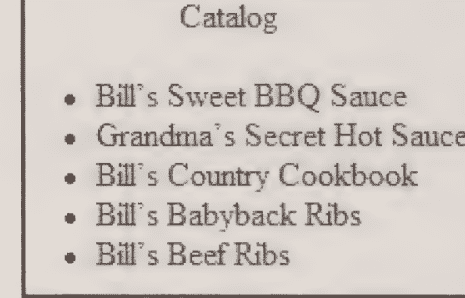

图 2.40：使用 `&nbsp;` 控制间距的示例。

## 总结

这就是HTML的全部内容吗？当然不是！这仅仅是冰山一角。我们已经介绍了HTML中的许多基本标签，但还有更多标签有待讨论。此外，请记住，此处讨论的某些标签已被3WC视为已弃用，可能会逐渐不再使用。然而，你今天仍会在许多网页上发现它们，因此对它们有一定了解是必要的。在本书的后面部分，你将了解到其中一些弃用选项的替代方案。

## 第三章：在网页中嵌入图像

图形是网页内容的关键形式。浏览器本质上是视觉化的，因此有效、清晰的图形对于你的网页至关重要。商业应用程序通常在产品目录和其他类型的网页中包含图像。有哪些类型的图像文件？我们如何将它们整合到网页中？视频呢？有哪些工具可用于处理图像？图像处理有哪些注意事项？我们将在本章中回答这些问题以及更多内容。

几乎从PC诞生的那一刻起，对更好图形的追求就开始了。IBM为其新PC推出的首款显卡——“彩色/图形监视器适配器”或称CGA，是一块相当有限的显卡，支持最多16种颜色和640x200像素的屏幕分辨率。1984年，它被“增强型图形适配器”或称EGA所取代。这款显卡支持最多64种颜色和最高640x350像素的分辨率。尽管一些第三方供应商提供了超出EGA的额外选项，但它一直主导市场直到1987年，当时IBM发布了新的“视频图形适配器”或称VGA显卡。

VGA是一种至今仍在使用的图形标准。通常，所有类型的图形硬件和软件都支持VGA或更好的图形模式。虽然VGA对于大多数现代图形应用来说并不足够，但它确实为制造商和开发者提供了一个安全的“回退”选项。VGA支持最多256种颜色和最高640x480的分辨率。需要特别注意的是，要达到最大分辨率，颜色数量必须减少；而要显示最大颜色数量，屏幕分辨率则必须降低。最终，IBM用XGA取代了VGA，但该标准并未在市场上占据主导地位。

VGA和XGA都在1989年被SVGA（也称为“超级VGA”）所取代。其最大分辨率从800x600开始，很快提高到1024x768像素。由于技术的改进，支持的颜色数量变得几乎无限。SVGA开发之后，显卡的增强和改进仍在继续，但“命名游戏”停滞了，制造商继续将图形标准称为SVGA，只是将新功能简单地融入旧标准中。

## 图像文件类型

尽管不同的视频标准可能令人困惑，但不同图像格式的数量甚至更令人震惊。每种格式都有其自身的优缺点。表3.1显示了常见格式及其优缺点的列表。

表3.1：图像格式的优缺点

| 格式 | 名称 | 优点 | 缺点 |
| :--- | :--- | :--- | :--- |
| FH | Freehand | 非常适合缩放和复杂图像 | 在网站中不常见，需要特定编辑器 |
| SWF | Flash文件 | 非常适合动画 | 归Adobe所有 |
| GIF | 图形交换格式 | 在网站中常见，是简单图像的良好选择 | 缺乏复杂图像的清晰度和鲜明度 |
| JPG, JPEG | JPEG | 提供比JPEG更复杂的渐进式下载 | 解压时间比JPEG长，不是开放标准 |
| JP2, J2K | JPEG 2000 | 提供比JPEG更复杂的渐进式下载 | 解压时间比JPEG长，不是开放标准 |
| PNG | 可移植网络图形 | 在网站中常见，提供增强的透明度 | 文件大小比GIF或JPEG大 |
| PSD | Photoshop文档 | 优秀的可编辑性 | 归Adobe所有，通常仅用于编辑应用程序 |
| PSP | Paintshop Pro | 优秀的可编辑性 | 归Corel所有，通常仅用于编辑应用程序 |
| TIFF | 标记图像文件格式 | 常用于印刷，质量优于JPEG。可扩展性极佳 | 大小比JPEG大 |
| BMP | Windows位图 | 质量好 | 大小大，下载速度慢 |

压缩描述了文件相对较小的程度。透明度是一个允许一个图像叠加在另一个图像之上的功能。透明图像的背景颜色不会显示。可扩展性反映了图像在尺寸增加时保持其清晰度的能力。

对于简单图像，GIF多年来一直是标准。然而，PNG提供了更好的功能，你可能会发现PNG图像的表现优于GIF。虽然GIF过去确实是动画最常用的格式，但最近，它经常被Flash图像文件所取代。

对于复杂图像和照片，JPEG过去是、现在仍然是首选的标准格式。TIFF文件确实比JPEG提供更高质量的图像，尤其是在图像被放大时，但它们也显著更大，因此下载时间更长。这会减慢网页的显示速度，并通常降低网站的感知质量。此外，某些浏览器默认可能不支持TIFF文件。不过，对于某些特定功能，特别是如果图像的主要功能是下载用于打印，TIFF额外的下载时间可能因其打印图像质量的提高而值得。

一些浏览器，特别是较旧的浏览器，对PNG文件的支持也不佳。如果这成为一个问题，你可能需要改用GIF。虽然PNG通常被认为是GIF的替代品，但它们也可以替代JPEG图像。在某些情况下，PNG格式的“无损”压缩比JPEG的“有损”压缩方法（可能丢失图像数据）在质量上提供了显著的改进。

## 将图像整合到网页中

正如你在第二章所看到的，图像可以使用 `` 标签轻松插入HTML代码中，如图3.1所示。

```

```

图3.1：HTML图像标签。

请记住，**src** 属性设置图像的名称和路径，而 **align** 控制文本围绕图像的流动方式。在本例中，图像与页面左侧对齐，文本在其右侧流动。**Hspace** 和 **vspace** 定义图像两侧、上方和下方的空白区域。这控制了文本与图像之间的距离。**Border** 决定是否在图像周围绘制边框，如果绘制，则指定其像素宽度。将边框设置为零可防止显示边框。**Height** 和 **width** 以像素为单位指定图像的尺寸。如果图像最初并非以指定尺寸保存，它将被拉伸或缩小以适应。**Alt** 提供图像的替代文本。当鼠标悬停在图像上时，会显示此文本。**alt** 参数也被为视障人士设计的浏览器以及一些搜索引擎在评估页面内容时使用。

如前所述，图像可以从其原始尺寸进行调整。例如，如果你有一张以300x300拍摄的产品图片，如图3.2所示的木炭烤架，它可以以各种尺寸放置在网页上。


*图3.2：分辨率为300x300的木炭烤架图像。*

图3.3中的示例网页以150x150、50x100和100x50像素重新显示了图3.2中的图像。


图3.3中的示例图片是使用图3.4中的代码创建的。

图3.3：不同尺寸的炭火烤架图片。

```html
<html>
<body>
&nbsp;&nbsp;&nbsp;&nbsp;&nbsp;150x150<br>
<br>
<br>

&nbsp;

&nbsp;&nbsp;&nbsp;&nbsp;&nbsp;&nbsp;&nbsp;<br>
50x100
&nbsp;&nbsp;&nbsp;&nbsp;&nbsp;&nbsp;&nbsp;
&nbsp;&nbsp;&nbsp;&nbsp;&nbsp;&nbsp;&nbsp;
100x50<br>
</body>
</html>
```

图3.4：将图像缩放到各种尺寸的HTML代码。

如您所见，使用`height`和`width`属性重新设置图像尺寸非常简单。更困难的部分是确定和管理图像的原始分辨率。要在Windows文件资源管理器中查找图像的分辨率，请右键单击该图像，选择**属性**，选择**摘要**选项卡，最后单击**高级**按钮以显示属性，如图3.5所示。掌握了图像的原始尺寸知识，调整大小就容易多了。

图3.5：图像属性。

一旦知道了图像的分辨率，在缩放时保持其比例就很容易了。某些应用程序可能需要特定尺寸的图像。请记住，如前所述，某些图像类型的缩放效果比其他类型更好。因此，重要的图像，例如产品图像，最好以完全相同的分辨率和文件类型存储。这将使网页呈现清晰、一致的外观。当然，如果您是为特定物品专门构建页面，可以独立管理这些图像。

通常，缩小图像比放大图像更能保持其质量。然而，您获得的结果可能差异很大，具体取决于文件格式和图像存储的DPI（每英寸点数）等因素。

我们如何在示例网页上扩展图像的使用？一个明显的改进是在待售商品目录中添加图像。图3.6显示了第2章的网页，其中包含一个目录。

## 比尔烧烤谷仓

**在比尔烧烤谷仓，我们最喜欢的事情就是与所有朋友分享我们的蓝带烧烤食谱。**

**加入我们，品尝您能找到的最棒的烧烤。在品尝了我们著名的美食后，请顺便到礼品店带一瓶比尔烧烤酱回家，或者为在家的后院烧烤大厨找到一份完美的礼物。**

**我们认为您会同意，没有什么能像一顿美味的烧烤晚餐那样带回那种“家常”的感觉。而美味的烧烤正是我们所做的。**

## 乡村商店

- 比尔甜味烧烤酱
- 奶奶秘制辣酱
- 比尔乡村食谱
- 比尔嫩排
- 比尔牛肋排

## 烧烤风味

**蜂蜜烧烤**
我们最喜欢的传统的甜而开胃的酱汁

**甜蜂蜜烧烤**
像蜂蜜烧烤一样，但开胃感少一些，甜味多很多！

**草原火焰烧烤**
我们秘制的辣味烧烤酱，保证让您滋滋作响！

## 烧烤“如何做”

1.  从比尔甜味烧烤酱开始
2.  遵循一个好食谱，例如“后院烧烤嫩排”（见比尔乡村食谱第17页）
3.  购买您能找到的最高质量的嫩排。如果您不知道从哪里购买肋排，请到谷仓来，带一些回家自己烹饪。

访问我们：
121 Bommerid Lane
Bellville, MO 67348
(123) 266-1075

图3.6：第2章更新后的示例网页。

该网页“乡村商店”目录部分的HTML代码如图3.7所示。

```html
<hr size=4 width=80%>
<center><h4>Country Store</h4></center>
<ul type=disc>
<li>Bill's Sweet BBQ Sauce</li>
<li>Grandma's Secret Hot Sauce</li>
<li>Bill's Country Cookbook</li>
<li>Bill's Babyback Ribs</li>
<li>Bill's Beef Ribs</li>
</ul>
<hr size=4 width=80%>
```

图3.7：目录部分的HTML代码。

在将图像添加到页面之前，我们必须有可用的图像文件。出于商业目的，图像通常来自营销和设计公司，尽管有些公司可能选择自行处理其图形。无论哪种情况，高质量且协调良好的图形的价值都不容低估。很少有程序员拥有创造美丽图像的创意天赋和技能（尽管当然有例外）。正如图3.8中的示例清楚表明的那样，我们是程序员，而不是平面设计师！因此，请不要被图像本身分散注意力。相反，请专注于将它们引入网页的编码技术。

图3.8：“乡村商店”目录的图片。

要将图3.8中的图形添加到网页中，我们在代码中插入``标签，如图3.9所示。请注意，我们还删除了无序列表。否则，页面同时包含图像和项目符号，看起来会有点“杂乱”。

```html
<center><h4>Country Store</h4></center>
<br>
 Bill's Sweet BBQ Sauce<br>
Grandma's Secret Hot Sauce<br>
Grandma's Country Cookbook<br>
Bill's Babyback Ribs<br>
Bill's Beef Ribs<br>
<hr size=4 width=80%>
<center><h4>BBQ Flavors</h4></center>
```

图3.9：显示五张图片的HTML代码。

不过，还有一个问题。这些图片相当大。在原始尺寸下，每张几乎都填满了屏幕。因此，我们需要将图片缩小到更适合目录的尺寸。原始图片的宽度均为354像素，高度为525像素。这不是一个非常常见的尺寸，但应该适用于我们的目的。图3.10中的代码展示了如何调整图片大小以更好地适应。

```html
<hr size=4 width=80%>
<center><h4>Country Store</h4></center>
<br>
 Bill's Sweet BBQ Sauce<br>
Grandma's Secret Hot Sauce<br>
Grandma's Country Cookbook<br>
Bill's Babyback Ribs<br>
Bill's Beef Ribs<br>
<hr size=4 width=80%>
```

图3.10：缩小图片尺寸后的HTML代码。

这些调整大小后的图片在更新后的页面上看起来更合适，如图3.11所示。不过，您可能注意到尺寸足够小以至于清晰度有所下降。我们可以通过创建一个指向更大图片的链接来解决这个问题，该图片很可能在另一个页面上，可能包含关于该物品的更多信息。

这个新部分，配有各种产品的“时髦”图片，是一个很大的进步，但我们仍然缺少很多细节。除了名称和图片，我们对产品尺寸、数量、价格、供应情况或其他任何信息一无所知。以下部分将讨论如何为图像添加链接，以便潜在客户可以获取有关他们感兴趣物品的更多信息。

## 我们可以如何处理视频文件？

视频文件通常作为广告或宣传材料包含在网页中。某些网页在加载时会自动播放视频，为页面创建一个“介绍”。至少在我们看来，这些努力更多地涉及网页设计师的兴趣，而非程序员。因此，我们将专注于一些您今天在商业中可能遇到的关于视频的基本且实用的用途。

我们的示例业务比尔烧烤谷仓与其他任何企业有着相同的问题。每当他们雇佣某人时，他们都需要培训其以正确的方式——他们的方式来完成工作。与其指派培训师来讲解每个新员工工作的最基本部分，比尔烧烤谷仓要求每位新员工复习通过互联网提供的培训视频。图3.12中的代码创建了一个包含这些视频的网页，如图3.13所示。

在比尔烧烤屋，我们以把事情做对、为顾客提供最舒适的家乡风味餐饮而自豪。

请观看以下视频，了解我们在比尔烧烤屋的做事方式。

---

### 培训视频

- [BBQ基础](BBQTrain1.wmv)
- [保持清洁](BBQTrain2.wmv)
- [服务至上](BBQTrain3.wmv)

点击图3.13中的任意一个链接，将启动如图3.14所示的界面，您可以选择直接打开并播放视频，或将其保存到磁盘。具体行为可能因浏览器而异，并取决于您的具体设置。根据视频的格式，您可能还需要安装额外的软件才能播放。

如果您选择立即打开并播放视频，如果下载速度跟不上视频播放的速度，可能会出现播放缓慢或“卡顿”的情况。这主要取决于您的连接速度和带宽。

与其提供视频链接，不如将视频直接嵌入页面本身。HTML中的`<embed>`标签允许您将视频内容和播放器“推送”到网页的表面上，使其感觉与页面更加融为一体。

`嵌入标签`
`<embed>`
`src`
`width`
`height`
`align`
`autostart`
`loop`
`playcount`
`volume`
`controller`
`pluginspage`
`>`
`</embed>`

图3.15中的代码展示了如何嵌入图3.16所示的视频。此代码示例使用了`<embed>`标签的几个属性。**Src** 标识了正在播放的视频文件的位置。**Height** 和 **width** 的功能与其他HTML标签相同，用于设置对象的大小。**Align** 控制视频播放器周围的文本流。（有关 **align** 属性的更多详细信息，请参阅第2章。）

`<hr size=4 width=80%>`
`<center><h4>培训视频</h4>`
`<pre>     BBQ基础                 保持清洁           服务`
` 至上  </PRE>`
`<embed width ="250" height= "200" src="BBQTrain1.wmv"`
`        autostart = "false"></embed>`
`<embed width ="250" height= "200" src="BBQTrain3.wmv"`
`        autostart = "false"> </embed>`
`<embed width ="250" height= "200" src="BBQTrain3.wmv"`
`        autostart = "false"></embed>`
`</center>`

**Autostart** 默认为 "true"，但可以设置为 "false"。此属性控制嵌入的视频文件是否应在页面显示时自动开始播放。**Loop** 控制视频播放的次数。它可以设置为一个特定的数字、"true" 或 "false"。"False" 是默认值，意味着影片将播放一次后停止。如果设置为 "true"，视频将循环播放直到停止。**Playcount** 也控制视频播放的次数，并且优先于 **loop** 属性。

**Volume** 设置范围为0到100，默认值为50。正如您所料，此属性控制视频文件音频部分的播放音量。将 **controller** 属性设置为 "true" 或 "false"，以指示是否应为用户显示视频播放器的控件。"True" 是默认值。如果选择 "false"，用户仍然可以右键单击视频播放器并使用弹出菜单中包含的控制选项。如果用户没有安装必要的播放器，**pluginspage** 属性会标识可以找到该播放器的网页，为用户提供安装所需播放器的简便机制。

虽然某些视频文件、Flash动画和多媒体演示文稿通常属于网络设计师的职责范围，但那些与产品、人力资源和内部培训紧密相关的内容，通常会成为程序员的职责。

## 使用带链接的图像

前面的示例展示了如何将图像直接嵌入到您的网页中。关于处理视频的讨论也展示了如何创建指向视频文件的链接。第4章将详细回顾链接，但本节简要概述如何链接到图像。

正如您在视频文件中看到的，您可以使用锚标签`<a>`来创建指向图像的简单链接。图3.17中的代码示例展示了我们如何为“乡村商店”目录部分中的产品全尺寸图像创建链接。图3.18展示了生成的网页。

`<hr size=4 width=80%>`
`<center><h4>乡村商店</h4></center>`
`<br>`
` 比尔的甜味烧烤酱`
`     <a href="Bills_Sweet.jpg">(全尺寸图片)</a><br>`
`奶奶的秘制辣酱`
`     <a href="Grandma_Spicy.jpg">(全尺寸图片)</a><br>`
`奶奶的乡村食谱`
`     <a href="Grandmas_Cookbook.jpg">(全尺寸图片)</a><br>`
`比尔的猪小排`
`     <a href="babybackribs.jpg">(全尺寸图片)</a><br>`
`比尔的牛肋排`
`     <a href="Beef_Ribs.jpg">(全尺寸图片)</a><br>`
`<hr size=4 width=80%>`

> 图3.18：指向全尺寸图像的链接。

图3.18使用文本“(full size image)”作为锚点，但有时您要么不想使用文本，要么有特定的其他需求。将一个图像链接到另一个更大的图像是相当常见的。图3.19展示了为此目录创建此类链接的HTML代码，使小图像链接到更大的版本。

`<hr size=4 width=80%>`
`<center><h4>乡村商店</h4></center>`
`<br>`
`<a href="Bills_Sweet.jpg"></a>比尔的甜味烧烤酱 <br>`
`<a href="Grandma_Spicy.jpg"></a>奶奶的秘制辣酱 <br>`
`<a href="Grandmas_Cookbook.jpg"></a>奶奶的乡村食谱 <br>`
`<a href="babybackribs.jpg"></a>比尔的猪小排 <br>`
`<a href="Beef_Ribs.jpg"></a>比尔的牛肋排 <br>`
`<hr size=4 width=80%>`

> 图3.19：使用图像作为链接的HTML代码。

正如您在图3.20中所看到的，页面上的每个小图像现在都有一个边框。虽然在黑白页面上您看不到，但每个边框都是在第2章讨论的`<body>`标签中分配的颜色。第一张图片有一个紫色边框，意味着它的链接已被访问过。其他边框都是蓝色的，意味着它们尚未被访问。这与文本颜色编码的默认设置一致。


前一个示例展示了如何使用图像作为另一个图像或网页的锚点。如果你有一张包含众多元素的大图像，每个元素都有其对应的链接目标，该怎么办呢？这就是*图像映射*。

举个例子，假设有一个关于汽车的网页。它可能包含一张汽车图片，然后允许用户点击汽车的不同部分，比如车门、车窗、车灯、轮胎和发动机。每次点击都可以作为不同的链接，将用户带到包含该特定汽车部件详细信息的网页。

对于我们示例网页，目录部分可以采用不同的图像处理方式，即展示一张精心摆放所有商品的单一桌面图像。用户随后可以点击他或她感兴趣的产品，使较大的图像显示出来。

图像映射，或称为`usemap`，用于标识图像的哪些部分链接到哪些页面或文件。为简化起见，并且因为我们不是平面设计师，我们将使用图3.8中展示的简单图像。这张略显粗糙的图像确实包含了五种产品，因此它是一个合理的图像映射示例。

图像映射需要两个要素：

- ``标签必须包含**usemap**属性，该属性前需加井号（#），用于定义要使用的图像映射。
- `<map>`标签及其属性必须定义图像内一系列可点击的区域，这些区域是链接到其他内容的。

映射的主要属性是其名称。该名称应与关联图像**usemap**属性中指定的名称匹配。`<area>`标签从属于`<map>`标签。每个`<area>`标签定义一个具有**形状**的可点击区域。有效的形状有表示矩形的**rect**、**circle**和表示多边形的**poly**。根据使用的形状，**coords**属性中的坐标指定方式也不同。

对于矩形，**coords**属性需要四个值：矩形左上角的x和y坐标，以及右下角的x和y坐标。定义矩形形状只需要这两个点。对于圆形，只需要三个坐标：圆心的x和y坐标，以及指定圆半径的第三个值。多边形更为复杂，因为定义区域外边界的点可以有任意多个。坐标应表示为一系列成对的x和y坐标。

**href**属性标识每个可点击区域的目标，而**alt**属性则为每个可点击区域提供替代文本。alt属性在图像映射中特别有用，因为当用户将鼠标悬停在图像上时，它会显示出来。如果每个可点击区域都有自己的alt文本，就更容易看清可点击区域之间的边界在哪里，以及它们可能指向何处。

图3.21中的示例展示了如何使用每种区域类型实现图像映射。

```
<map name="mymap">
<area shape=rect coords="10,10,60,30" href="first_image.jpg" alt="矩形图像">
<area shape=circle coords="100,30,20" href="second_image.jpg" alt="圆形图像">
<area shape=poly coords="200,10,250,5,240,60,210,55,190,45" href="third_image.jpg" alt="多边形图像">
</map>


```

图3.21：创建usemap的HTML代码。

图3.22展示了图3.21中定义的图像映射如何将图像的特定区域标记为指向其他图像的可点击链接。蓝色方框代表"MyPicture.jpg"图像，尺寸为300x100。三个灰色方框代表可以点击的图像映射区域。实际上，任何形状都可以用一个或多个这样的区域来表示。

图3.22：图像映射的布局。

程序员关于图像映射的第一个问题通常是：坐标从哪里来？许多网页制作工具都提供了创建图像映射的向导。然而，即使是像微软画图这样简单的工具，也能满足你的需求。只需在画图中打开一张图像，如图3.23所示，鼠标指针的坐标就会显示在窗口的右下角。只需将鼠标悬停在图像的关键点上并记录坐标，即可用于图像映射。无需追求完美；只需足够接近，让用户能够识别出图像中哪个视觉元素将此区域与其他区域区分开来即可。

之前，我们讨论过修改示例应用程序，以包含一张包含所有产品的单一大图像，而不是为每个产品使用单独的图像。重新定义页面的代码，包括处理各种产品链接所需的usemap，如图3.24所示。

```
<center>
<hr size=4 width=80%>
<h4>乡村商店</h4>
<br>

<map name="mymap">
<area shape=rect coords="5,5,105,160" href="Bills_Sweet.jpg" alt="比尔甜味烧烤酱">
<area shape=rect coords="120,5,220,160" href="Grandmas_Spic.jpg" alt="奶奶辣味酱">
<area shape=rect coords="230,5,330,160" href="Grandmas_Cookbook.jpg" alt="奶奶烹饪书">
<area shape=rect coords="340,5,440,160" href="Babybackribs.jpg" alt="猪肋排">
<area shape=rect coords="455,5,555,160" href="Beef_Ribs.jpg" alt="牛肋排">
</map>


</center>
<br>
<ul>
<li>比尔甜味烧烤酱</li>
<li>奶奶秘制辣酱</li>
<li>奶奶乡村烹饪书</li>
<li>比尔猪肋排</li>
<li>比尔牛肋排</li>
</ul>
<hr size=4 width=80%>
```

图3.24：带usemap的图像HTML代码。

这个图像映射中使用的坐标相当简单，因为每个产品占据的区域非常相似，并且所有产品都均匀分布且大小一致。如果它们更不规则，我们就需要使用更多样化的映射区域。使用现成且价格极具吸引力（免费）的画图程序，可以轻松确定usemap的坐标。

图3.25展示了最终生成的网页目录部分。在你将鼠标悬停在图像上之前，图像本身没有任何明显迹象表明它有关联的图像映射。此时，鼠标会变成指向手指形状，并显示替代文本。

- 比尔甜味烧烤酱
- 奶奶秘制辣酱
- 奶奶乡村烹饪书
- 比尔猪肋排
- 比尔牛肋排

图3.25：使用图像映射的目录部分。

## 处理图像的工具

市面上有大量现成的或可从互联网下载的图像处理工具。以下是一些更流行/有用的图像处理工具概览：

- Photoshop CS3—通常被认为是照片编辑软件之王，但此产品价格不菲。不过，正如他们所说，一分钱一分货。
- Photoshop Elements—这是流行的Photoshop工具更适中价格的版本。虽然它可能缺少一些高端选项，但对于一般编辑来说仍然很棒。
- Photo Impact—价格仅为Photoshop的一半，这款功能丰富的工具为你提供了很高的价值，但易用性稍逊。
- Photosuite—这是市场上价格最低的工具之一，但其功能远少于前面提到的工具。
- Paint Shop Pro Photo—这是另一款价格在中低端但具有高端能力的工具。
- Gimp—最初为Unix/Linux设计，这款开源免费照片编辑工具已被移植到Windows。
- Paint.net—另一款开源照片工具，这款是在微软的帮助下开发的。

-   网页设计工具——如果你使用网页设计工具，它很可能至少包含一些基本的照片编辑功能。有些工具还包含 GIF 动画制作向导和其他类似工具。

对于典型的商务应用，你可能不需要非常高端的照片编辑软件。如果你在进行图形设计工作，或者处理对图形要求特别高的应用，例如 CAD，你可能就需要了。如果你不确定自己需要什么，可以从一些免费或廉价的选项开始，如果需要再升级到更好的工具。

### 处理图像文件的注意事项

以下是一些处理图像文件时需要记住的技巧：

-   首先，务必了解你正在处理的文件格式以及选择每种格式的原因。不要假设你收到的图像文件总是最适合基于浏览器的应用程序的格式。

-   考虑图像的大小。较大的图像通常需要更长的加载时间，尽管这在很大程度上取决于你使用的文件格式。你使用的图像是否需要彼此保持一致？还是每个图像可以有独特的尺寸？

-   通常避免在网页上显示位图（BMP）和 TIFF 文件。这些文件最好通过提供图像链接来处理，让用户将其下载到他们的 PC 上并在本地进行处理。

-   请记住，通常将大图缩小到某个尺寸比从小图开始并将其放大要好。放大图像通常会降低其质量。

-   避免在一页上放置大量图像。减少图像数量可以减少页面加载时间，并使页面整体更易于操作。

-   在图像中使用透明度，使其与网页更好地融合。如果图像的背景与网页的颜色不同，通常会在图像周围产生一个难看的方形色块。这会降低应用程序的质感。

-   对于需要大量缩放的图像，PNG 格式可能比 JPEG 更好。请记住，JPEG 使用“有损”方案来编码图像，这意味着它在反复保存或缩放时可能会丢失数据。PNG 图像使用“无损”方案来编码数据，这使得它们在缩放时成为更好的选择。

### 我们的示例页面怎么样？

虽然我们不是平面设计师，但现在是时候更新我们示例页面的外观了。这是使用本章作为借口，用看起来更酷的东西替换那个卡通谷仓图片的绝佳时机。图 3.26 展示了我们示例页面的新布局。它也说明了我们绝对没有艺术天赋！

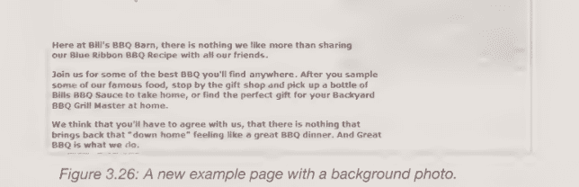

图 3.26：一张带有背景照片的新示例页面。

图 3.27 中的代码显示了图 3.26 所示最终页面的所有 HTML 代码。

```
<html>
<body background="barn4.jpg">

<h1>&nbsp;&nbsp;&nbsp;&nbsp;&nbsp;&nbsp;&nbsp;&nbsp;&nbsp;&nbsp;&nbsp;&nbsp;&nbsp;&nbsp;</h1>
<h1>&nbsp;&nbsp;&nbsp;&nbsp;&nbsp;&nbsp;&nbsp;&nbsp;</h1>
Bill's Barbeque Barn</h1>
<BR><BR><BR><BR><BR><BR>
<LEFT>
<H3><P>Here at Bill's BBQ Barn, there is nothing we like more than sharing<br>
our Blue Ribbon BBQ Recipe with all our friends.
</P><P>
Join us for some of the best BBQ you'll find anywhere. After you sample<br>
some of our famous food, stop by the gift shop and pick up a bottle of <br>
Bill's BBQ Sauce to take home, or find the perfect gift for your
Backyard <br>
BBQ Grill Master at home.
</P><P>
We think that you'll have to agree with us, that there is nothing
that <br> brings back that "down home" feeling like a great BBQ
dinner. And Great BBQ is what we do.
</P></H3>
<BR><BR><BR>
<HR size=4 width=80%>
<CENTER><H4>Country Store</H4></CENTER>
<ul type=disc>
<li>Bill's Sweet BBQ Sauce</li>
<li>Grandma's Secret Hot Sauce</li>
<li>Bill's Country Cookbook</li>
<li>Bill's Babyback Ribs</li>
<li>Bill's Beef Ribs</li>
</ul>
<HR size=4 width=80%>
<CENTER><H4>BBQ Flavors</H4></CENTER>
<dl>
<dt>Honey BBQ</dt>
<dd>Our favorite traditional sweet and tangy sauce</dd>
<dt>Sweet Honey BBQ</dt>
<dd>Like Honey BBQ, but with a bit less tang and lot more sweet!</dd>
<dt>Prairie Fire BBQ</dt>
<dd>Our secret spicy BBQ sauce guaranteed to Sizzle!</dd>
</dl>
<HR size=4 width=80%>
<CENTER><H4>BBQ "How To"</H4></CENTER>
<ol type=1>
<li>Start with Bill's Sweet BBQ sauce</li>
<li>Follow a great recipe such as "Backyard BBQ Babyback Pork
Ribs" found on Page 17 in Bill's Country Cookbook</li>
<li>Get the highest quality Babyback Pork Ribs you can. If you
don't know where to get your ribs, stop by the barn and take some
home to cook up yourself.</li>
</ol>
<HR size=4 width=80%>
<br>
Visit us at:
<PRE>
127 Homestead Lane
Bellville, MI 97568
(313) 264-3975
</PRE>
</LEFT></body>
</html>
```

图 3.27：图 3.26 的 HTML 代码（第 1 部分，共 2 部分）。
## 总结

正如你可能知道的，图像处理远不止我们在这里涵盖的内容，但那些更复杂的方面通常属于设计领域。他们是真正的艺术专业人士，以处理照片图像和设计工具为职业，并将图像融入印刷媒体、视频和网站中。

大多数程序员的关注点和经验围绕着数据和业务管理，他们并非有天赋的图形艺术家。这并不是说他们不能成为艺术家，但大多数人会同意，有艺术天赋的计算机程序员是罕见的。因此，本章重点介绍了在 HTML 中管理图像更实用和“以数据为中心”的方面。我们更关心像在线目录这样的应用程序，而不是背景图像以及网页的外观和感觉。

我们希望本章为你提供了将各类图像融入网页的实用见解和工具。显然，这只是冰山一角，但一旦你掌握了足够的知识开始，相对容易地自行前进。

## 第四章

## 添加链接和锚点

链接是任何网页上的基本要素。它们提供了一种简单的方式，让用户只需点击鼠标就能轻松地从一个页面导航到另一个页面。如果在网页之间切换需要不断输入 URL，上网冲浪的人就会少得多。

由于链接使用起来如此简单直观，它们已成为与公众互动的主要工具。对于许多网页来说，除了清晰易用之外，链接几乎没有其他要求。然而，对于企业来说，需求可能重要得多。网页之间的链接影响在搜索引擎中的排名。（有关搜索引擎的更多信息，请参见第 14 章。）链接到另一个网站深处的网页（“深度链接”）可能很有吸引力，但也有其陷阱。善用锚点可以显著改善大型网页内的导航。本章的剩余部分将讨论这些以及其他重要话题。

## 如何在页面上放置链接

在网页上放置链接的关键是锚点标签。该标签定义了页面上的一个可点击链接，并作为用户查看完链接页面后返回的锚点。

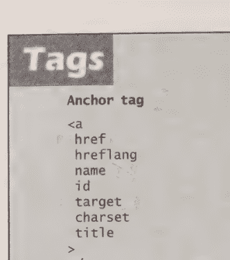

锚点标签具有许多属性。**href** 属性是最重要的，因为它定义了链接的目标。通常，这是另一个网页，但它也可以是当前页面上的不同位置，甚至是不同类型的文件。如果你的浏览器可以呈现该文件类型，你可以直接点击链接通过浏览器处理它。你的浏览器无法呈现的文件仍然可以右键单击并保存到本地 PC。

**hreflang** 属性设置网页的语言 ID。例如，对于美式英语，将其设置为 "en-US"。英式英语使用 "en"，日语使用 "ja"。

**name** 和 **id** 属性都提供了为锚点命名的机制。在锚点标签内，**name** 比 **id** 更常用，因此可能是更好的选择。然而，在未来的 HTML 版本中，**name** 属性可能会被 **id** 取代。其他文档中的链接，甚至同一文档中其他位置的链接，可以直接导航到命名的锚点，正如本章后面所讨论的。**target** 控制链接的行为。以下列表解释了 **target** 属性的选项：

*   `_Self` 在当前框架中打开链接。
*   `_Blank` 在新窗口中打开链接。
*   `_Parent` 在框架集的父框架中打开链接（在第 7 章中讨论）。
*   `_Top` 在最顶层窗口中打开链接。

**Title** 属性定义了链接的弹出提示文本，当用户将鼠标悬停在链接上时会显示该文本。**Charset** 指示应使用哪种字符集。最常见的字符集是“ISO-8859-1”，用于英语和许多欧洲语言。完整列表可在 http://www.iana.org/assignments/character-sets 找到。

图 4.1 中的代码片段展示了创建指向 Google 链接的 HTML 代码，如图 4.2 所示。这是可以创建的最简单、最基本的链接之一。

```html
<a href="http://www.google.com" title="Go to Google">Google</a>
```

*图 4.1：HTML 锚点标签的基本示例。*

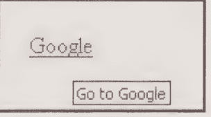

*图 4.2：由图 4.1 中代码创建的链接，显示提示文本。*

要更改此链接使其在新窗口中打开，请使用 **target** 参数，如图 4.3 所示。

```html
<a href="http://www.google.com" title="Go to Google"
 target="_blank">Google</a>
```

*图 4.3：在新窗口中打开的指向 Google 的超文本链接。*

图 4.3 中的代码片段显示 target 使用了小写字母。这很重要，因为某些浏览器可能不支持大写形式的值。如果你正在设计一个在新窗口中打开链接的应用程序，将窗口大小设置为小于原始窗口可能很有用，这样它就清楚地是一个显示在其“父”窗口上方的“子”窗口。第 8 章包含一些 JavaScript，可用于以特定大小打开子窗口。

## 第 4 章：添加链接和锚点

## 链接如何影响搜索引擎

链接不仅仅是提供到其他文档的连接。它们可以影响你的网页在搜索引擎中的排名。通常，指向你网站的入站链接最重要，而不是你写出的链接。因此，要改善网页在搜索结果中的排名，你能做的最好的事情之一就是让其他信誉良好的网站链接到你的网站。专注于让你所在行业的网站链接到你的网站——可能是业务合作伙伴的网站，或者客户或供应商的网站。这些链接中的锚文本应与你网站的关键词相关。

你的出站链接的锚文本也可能影响你页面的表面质量。拥有有效的链接，其锚文本包含指向信誉良好网站的相关关键词，可能会让你的网页在感知质量上略有提升。

还需要注意的是，不同的搜索引擎使用不同的规则，而这些规则在不断演变。因此，今天有效的方法明天可能就失效了。

## 深度链接

*深度链接* 是指链接到位于另一个网站内部深处的网页或其他文档的做法。这个网站可能属于你与之有业务往来的公司，或者只是为公众提供有用信息的网站。图 4.4 显示了一个深度链接的示例。

```html
<a href="http://www-03.ibm.com/systems/x/hardware/enterprise/x3850m2/flash.html"
    target="_blank">IBM Demo Video</a>
```

*图 4.4：深度链接示例。*

此链接仅在 IBM 重组其网站或移除该文件之前有效。一旦网站结构重组，你指向其页面的链接将不再有效。因此，链接到另一个网站最安全的方式是链接到其主页/主要页面。你的用户可以自己浏览网站以找到他们需要的文档。对你作为开发者来说，这可能既容易又安全，但效果不佳。你希望你的链接直接指向相关内容。通常，这是通过联系网站所有者并与其员工讨论来实现的。他们有可能提供一个无论内部结构如何变化都可能不会改变的 URL。但是，他们更有可能允许你链接到他们的网站，同时警告说，无法保证链接在任何时间段内都能继续工作。如果你确实有深度链接，请定期测试它们以确保它们继续正常工作。

## 如何使用锚点

到目前为止，在本章中，你已经了解了如何将锚点用作链接。现在，让我们讨论将它们用作……锚点！使锚点标签充当锚点的关键是 **name** 属性。如前所述，**id** 也可以使用，但 **name** 传统上更常用于此任务。

图 4.5 中的代码片段显示了在页面上定义锚点的 HTML 代码。如你所见，此锚点标签不包含 **href** 属性。由于它不是充当链接，因此不需要这样的属性。起始和结束标签（`<a>` 和 `</a>`）之间也没有锚文本。由于我们所做的只是标记页面的一部分，所以这样做没问题。另一个网页，甚至是同一网页的另一个部分，可能会链接到此锚点，将浏览器定位到该网页中的特定位置。

```html
<a name="location"></a>
```

*图 4.5：具有 name 属性的锚点标签。*

图 4.6 中的代码片段演示了如何链接到页面上的特定锚点。此链接在当前窗口中打开所请求的网页，并将其定位到名为“location”的锚点处。如你所见，锚点名称位于 HTML 文件名之后，并以井号（#）为前缀。

```html
<a href="your-document.html#location">Anchor-Text</a>
```

*图 4.6：指向图 4.5 中锚点的超文本链接。*

这样的链接在长页面上非常宝贵，这些页面包含目录或“常见问题”（FAQ）部分等特性。在这种情况下，锚点标记页面的特定部分，页面顶部的链接列表指向各个锚点。例如，图 4.7 中的代码用于一个 FAQ 页面，回答新 HTML 程序员可能有的问题。

```html
<html>
<body><center><h1>HTML FAQ's</h1></center>

Questions?
<br>
<br>
<a href="#mean">What does HTML mean?</a><br>
<a href="#do">What does HTML Do?</a><br>
<a href="#style">What is a Style Sheet?</a><br>
<a href="#link">How do I link to another web page?</a><br>
<a href="#tool">What tool do we use to edit HTML?</a><br>
<br>

<a name="mean"></a>
What does HTML mean?
<p>HTML stands for Hyper Text Markup Language.
There are many markup languages, of which HTML is one.
The language is designed to send a mix of text content and
links to other content to the user's web browser.</p>

<a name="do"></a>
What does HTML Do?
<p> HTML defines the method in which text and images can be
integrated by a web browser. The browser is responsible for
interpreting the document correctly and displaying it in a
fashion that integrates text with other
content such as images.</p>

<a name="style"></a>
What is a Style Sheet?
<p>A stylesheet is a document containing one or more style
definitions. These definitions control the look of a web
page. The same style sheet can be linked to multiple
documents allowing a single point of control for the look
of your web page.</p>

<a name="link"></a>
How do I link to another web page?
<p>As discussed earlier in the chapter, the anchor tag (<a>)
provides the mechanism by which a web page makes clickable links
to other web pages. The href attribute is the key to defining
the link.</p>

<a name="tool"></a>
What tool do we use to edit HTML?
<p>Numerous tools exist for editing web pages. You can use something as simple at NOTEPAD from Microsoft to edit your web page, Microsoft's Front Page, IBM's Websphere Studio, or Dreamweaver and Coldfusion from Adobe.</p>
</body>
</html>
```

*图 4.7：创建图 4.8 所示 FAQ 页面的 HTML 代码。*

此 HTML 代码创建了图 4.8 中所示的网页。顶部附近的问题显示为锚点。每个问题都使用锚点名称创建一个链接，指向页面下方回答该问题的特定部分。因此，`<a href="#style">` 链接连接到 `<a name="style">` 锚点。请注意，锚点本身不会在网页上显示，只显示在 `<a>` 和 `</a>` 标签之间编码的锚文本（或其他内容）。

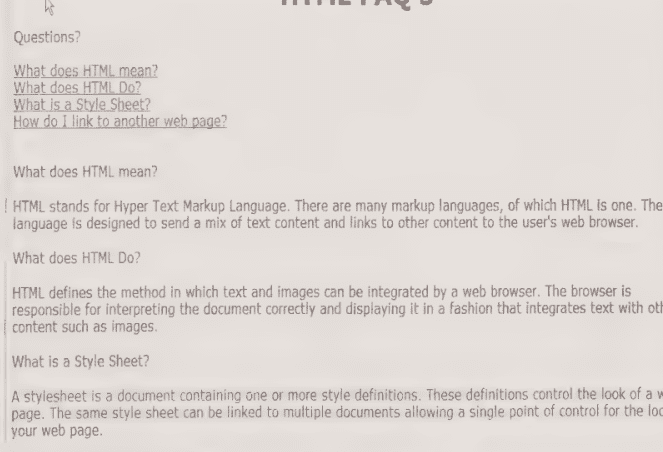

*图 4.8：使用命名锚点标签的 FAQ 页面。*


### 使用锚点的技巧

当链接到子文件夹时，最好在URL末尾加上斜杠（/），例如`href="http://www.mycompany.com/download/"`。这简化了服务器对链接的处理。否则，服务器需要进行大量处理来为你添加斜杠。同样，当链接到同一文件夹中的其他文件时，请使用本地引用，例如`href="mywebpage.html"`，而不是`href="http://www.mycompany.com/mywebpage.html"`。本地引用对服务器的要求更低，并能提高响应速度。

如果你想创建没有下划线的链接，可以尝试在锚点标签中添加**style**属性，如图4.9所示。

```
<a href="http://www.mycompany.com" STYLE="text-decoration: none">
some-anchor-text</a>
```

图4.9：一个没有下划线的超文本链接。

定期测试你的链接，以确保它们仍然有效。无效的链接会降低你网页的质量，无论是从观众的角度还是搜索引擎的排名来看。

### 其他类型的链接

前面的示例都涉及典型的HTML文件。这些链接只是引导浏览器在网页间移动，或者可能跳转到一个图像文件。此外，还有其他类型的链接。一个更常见的例子是*mailto*链接。如果你想提供一个可点击的链接，该链接能打开一个新邮件并填充一些内容，请尝试使用图4.10所示的代码。

```
<a href="mailto:kevin.forsythe@dmcconsulting.com?subject=HTML">
Send mail to Kevin</a>
```

图4.10：创建一个链接到默认邮件客户端的链接。

此示例创建了图4.11所示的链接。当点击该链接时，打开的邮件的目标地址和主题已经预先填好。


图4.11：网页上的mailto链接。

如果你有多个收件人，所有电子邮件地址将被列出，并用逗号分隔，如图4.12所示。

```
<a href="mailto:user@whoknows.com,another@whoknows.com?cc=boss@yourcompany.com,secretary@yourcompany.com">Send Some Mail</a>
```

图4.12：一个预定义了附加数据的mailto链接示例。

一个更复杂的示例会填充邮件的所有可填写部分。如图4.13所示，该链接包含了用于抄送（CC）和密送（BCC）部分的更多电子邮件地址，甚至在邮件正文中添加了一些文本。此HTML代码创建的链接看起来与图4.11完全相同，但点击后的行为不同。它只是比第一个示例填充了更多的字段。

```
<a href="mailto:kevin.forsythe@dmconsulting.com?cc=sales@yourcompany.com&bcc=IT@yourcompany.com&subject=HTML%20Book&body=Kevin,%0A%0AHello!">Send mail to Kevin</a>
```

图4.13：一个包含空格和换行符转义序列的mailto链接示例。

注意`%20`代码。它用于表示空格。实际上，在HTML和Book之间直接编写空格会导致mailto链接出错，因此使用了`%20`转义字符。它在邮件主题行中显示为空格。类似地，转义字符`%0A`会移到下一行。两个`%0A`（`%0A%0A`）在一起会在其他文本后创建一个空行。

还要注意，在第一个电子邮件地址之后，传递了一系列参数。第一个参数前有一个问号。其余参数前都有一个与号。在更复杂的URL中，这些代码对于更灵活地处理Web内容非常重要。图4.13中的mailto链接会创建一封如图4.14所示的电子邮件消息。

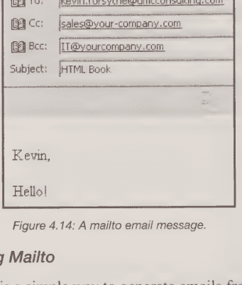

图4.14：一封mailto邮件消息。

### 使用mailto的缺点

mailto链接是从网页生成电子邮件的一种简单方式，但它确实有其缺点。首先，远程用户必须安装邮件客户端。没有邮件客户端，mailto链接将不知道执行哪个程序来打开新邮件。作为Web开发者，我们无法控制这一点。

第二个缺点是，垃圾邮件发送者会搜遍互联网，寻找mailto链接中的电子邮件地址，将其添加到他们的目录中。一些开发者建议使用转义序列`&#64;`来代替电子邮件地址中的“at”符号（@）。这在电子邮件消息中仍然会正确渲染，但（据说）可以防止垃圾邮件机器人读取到地址。

最后，使用mailto不如使用表单创建电子邮件那样专业。（这将在第10章关于PHP编程的内容中展示。）所以，使用mailto可能会给一些用户留下你是HTML新手的印象——虽然你确实是，但你可能不想让别人知道这一点！

### 使用FTP链接

另一种类型的链接是FTP链接。这个链接将mailto替换为FTP，如图4.15所示。

```
<a href="ftp://ftp.yoursite.com/yourfolder/yourfile.txt">
```

图4.15：一个FTP链接示例。

这种链接会自动从指定网站FTP传输指定文件，并将其下载到你的系统。目标网站不一定托管你的网页。

### 使用不可见链接

另一种链接涉及`<link>`标签。注意`<link>`没有结束标签。它只是定义相关文档，没有可见内容需要显示。

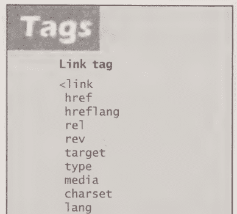

此标签可用于定义到其他文档的各种连接。例如，你可以使用`<link>`标签的**rel**属性来定义文档在一系列文档中的相对位置，如图4.16所示。

```
<html>
<head>
<title>Second Page</title>
<link rel="prev" href="page1.html">
<link rel="next" href="page3.html">
</head>
```

*图4.16：指向其他页面的不可见链接示例。*

这些链接应在文档的头部部分内编码。某些工具，如电子书阅读器，可能会查找这些标签，让读者可以轻松浏览组成较大文档（如一本书）的一系列HTML文档。

`<link>`标签的另一个非常实用的用途是定义样式表。样式表将在第5章详细讨论。目前，图4.17显示了一个指向样式表的简单链接。此链接将样式表文件标识为层叠样式表（CSS），该网页正在使用。简而言之，样式表包含一系列格式化定义。这些定义可以是从默认字体和大小到页面背景颜色等等的任何内容。

```
<head>
<link rel="stylesheet" type="text/css" href="stylesheet.css" />
</head>
```

图4.17：指向层叠样式表的链接。

也可以定义备用样式表，如图4.18所示，这样用户将来可能能够选择他们希望看到的页面显示格式。目前，它的价值不大，但随着浏览器的不断改进，它可能会变得更加有用。

```
<head>
<link rel="stylesheet" type="text/css" href="stylesheet.css" />
<link rel="alternate stylesheet" type="text/css"
      href="stylesheet2.css" />
</head>
```

图4.18：同时链接主样式表和备用样式表。

`<link>`标签还允许你定义页面的替代语言版本。只需添加如图4.19所示的代码，即可指向特定语言版本的页面。

```
<link rel="Alternate" HREF="page1.fr.html"
      hreflang="fr" title="Page1 - française">
<link rel="Alternate" href="page1.ja.html"
      hreflang="ja" charset="Shift_JIS"
      title="page1 - Japanese" lang="ja">
<link rel="Alternate" href="page1.pdf"
      type="application/pdf" media="print"
      title="page1 - PDF">
```

图4.19：链接到用于不同语言打印的备用HTML和PDF文档。


`rev` 属性定义了从 `href` 所指文档到当前文档的链接。换句话说，它是 `rel` 属性的反向。`rev` 和 `rel` 属性共同定义了链接的类型。许多链接类型的选择已定义在表 4.1 中。

**表 4.1：链接类型**

| 链接类型 | 描述 |
| :--- | :--- |
| Alternate | 一个用于替代当前链接所在文档的替换文档 |
| Stylesheet | 本页面使用的级联样式表 |
| Start | 一系列文档中的第一个文档 |
| Copyright | 一系列文档的版权声明 |
| Contents | 一系列文档的目录 |
| Next | 一系列文档中的下一个文档 |
| Prev | 一系列文档中的上一个文档 |
| Chapter | 一系列文档中的一个章节 |
| Section | 一系列文档中的一个小节 |
| Subsection | 一系列文档中的一个子节 |
| Glossary | 一系列文档的术语表 |
| Appendix | 一系列文档的附录 |
| Index | 一系列文档的索引 |
| Help | 本文档的附加信息资源 |
| Bookmark | 指向文档特定部分的书签 |

尽管这些链接类型看起来都很棒，但请记住，目前对它们的支持还比较有限。因此，请检查你使用的工具和浏览器，看看利用这些选项是否能带来任何优势。

## 那么我们的示例页面呢？

在第 3 章中，我们将示例网页中的谷仓图片更换为一张更精美的照片，而非最初使用的简单卡通图。我们该如何通过添加链接来改进这个网站？


```html
<html>
<body background="barn4.jpg">
<h1>&nbsp;&nbsp;&nbsp;&nbsp;&nbsp;&nbsp;&nbsp;&nbsp;&nbsp;&nbsp;&nbsp;&nbsp;
Bill's Barbeque Barn</h1>
<br><br><br>
<left>
<h3><p>Here at Bill's BBQ Barn, there is nothing we like more than sharing<br>
our Blue Ribbon BBQ Recipe with all our friends.
</p><p>
Join us for some of the best BBQ you'll find anywhere. After you sample<br>
some of our famous food, stop by the gift shop and pick up a bottle of <br>
Bill's BBQ Sauce to take home, or find the perfect gift for your Backyard <br>
BBQ Grill Master at home.
</p><p>
We think that you'll have to agree with us, that there is nothing that <br>
brings back that "down home" feeling like a great BBQ dinner. And Great BBQ is what we do.
</p></h3>
<br><br><br>
<hr size="4" width="80%">
Learn More about:<br>
&nbsp;&nbsp;&nbsp;&nbsp;&nbsp;&nbsp;&nbsp;<a href="Barbeque Barna.html" target="_blank">Country Store</a> <br>
&nbsp;&nbsp;&nbsp;&nbsp;&nbsp;&nbsp;&nbsp;<a href="Barbeque Barnb.html" target="_blank">BBQ Flavors</a> <br>
&nbsp;&nbsp;&nbsp;&nbsp;&nbsp;&nbsp;&nbsp;<a href="Barbeque Barnc.html" target="_blank">"How To" BBQ</a> <br>
</left></body>
</html>
```


请注意，所有链接的 `target` 属性都设置为了 `"_blank"`。这会导致这三个部分分别在它们自己的新窗口中打开。记住，字符实体 `&nbsp;` 会在页面上创建一个空白。我们在此广泛使用它来缩进部分文本。

乡村店铺页面（“Barbeque Barna.html”）的代码如图 4.21 所示。注意，该页面没有返回主页的链接。由于此页面是在新窗口中打开的，原始页面仍然保持打开状态。用户可以随时通过激活该窗口或关闭当前页面来返回主页。

```html
<html>
<body>
<center><h1>Bill's Barbeque Barn</h1></center>
<br><br><br>
<left>
<h4>&nbsp;&nbsp;&nbsp;&nbsp;&nbsp;&nbsp;&nbsp;&nbsp;&nbsp;&nbsp;&nbsp;&nbsp;&nbsp;&nbsp;&nbsp;&nbsp;&nbsp;&nbsp;&nbsp;&nbsp;
 Country Store</h4>
<ul type="disc">
<li>Bill's Sweet BBQ Sauce</li>
<li>Grandma's Secret Hot Sauce</li>
<li>Bill's Country Cookbook</li>
<li>Bill's Babyback Ribs</li>
<li>Bill's Beef Ribs</li>
</ul>
<hr size="4" width="80%">
</left></body>
</html>
```

图 4.21：乡村店铺页面的 HTML 代码。

BBQ 口味页面（“Barbeque Barnb.html”）的代码列在图 4.22 中。注意，代码位于 `<H4>` 标签内部。如果它们位于外部，浏览器很可能会将标题移至下一行，而不是像我们期望的那样将其向右平移。请记住，编码中这类细微的变化可能会对页面产生显著影响。

```html
<html>
<body>
<center><h1>Bill's Barbeque Barn</h1></center>
<br><br><br>
<left>
<h4>&nbsp;&nbsp;&nbsp;&nbsp;&nbsp;&nbsp;&nbsp;&nbsp;&nbsp;&nbsp;&nbsp;&nbsp;&nbsp;&nbsp;&nbsp;&nbsp;&nbsp;&nbsp;&nbsp;&nbsp;&nbsp;&nbsp;
 BBQ Flavors</h4>
<dl>
<dt>Honey BBQ</dt>
<dd>Our favorite traditional sweet and tangy sauce</dd>
<dt>Sweet Honey BBQ</dt>
<dd>Like Honey BBQ, but with a bit less tang and lot more sweet!
 </dd>
<dt>Prairie Fire BBQ</dt>
<dd>Our secret spicy BBQ sauce guaranteed to Sizzle!</dd>
</dl>
<hr size="4" width="80%">
</left></body>
</html>
```

图 4.22：BBQ 口味页面的 HTML 代码。

操作指南部分（“Barbeque Barnc.html”）的代码如图 4.23 所示。

```html
<html>
<body>
<center><h1>Bill's Barbeque Barn</h1></center>
<br><br>
<left>
<h4>&nbsp;&nbsp;&nbsp;&nbsp;&nbsp;&nbsp;&nbsp;&nbsp;&nbsp;&nbsp;&nbsp;&nbsp;&nbsp;&nbsp;&nbsp;&nbsp;&nbsp;&nbsp;BBQ "How To"</h4>
<ol type="1">
<li>Start with Bill's Sweet BBQ sauce</li>
<li>Follow a great recipe such as "Backyard BBQ Babyback Pork Ribs" found on Page 17 in Bill's Country Cookbook</li>
<li>Get the highest quality Babyback Pork Ribs you can. If you don't know where to get your ribs, stop by the barn and take some home to cook up yourself.</li>
<hr size="4" width="80%">
<br>
</left></body>
</html>
```

图 4.23：操作指南页面的 HTML 代码。

所有四个页面，或至少它们的部分内容，可以同时查看。图 4.24 展示了拥有四个打开窗口时网站可能的外观。

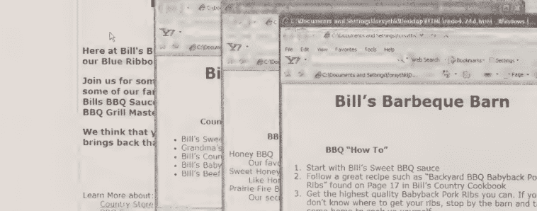

图 4.24：四个打开窗口的示例。

对于某些应用来说，这可能没问题，但你可能更倾向于在网站上获得更流畅的体验。因此，我们不在单独的窗口中打开新页面，而是让它们在当前窗口中打开。不过，这样做将需要我们添加一个返回主页的链接。当然，我们可以期望用户直接点击浏览器的“后退”按钮，但这可能是一个不好的假设。

主页中链接的代码通过移除 `"_target"` 值而发生变化。请记住，没有这个属性，链接将自动在当前窗口中打开。主页中链接的代码如图 4.25 所示。

```html
<hr size="4" width="80%">
Learn More about:<br>
&nbsp;&nbsp;&nbsp;&nbsp;&nbsp;&nbsp;&nbsp;&nbsp;<a href="Barbeque Barn6a.html">Country Store</a> <br>
&nbsp;&nbsp;&nbsp;&nbsp;&nbsp;&nbsp;&nbsp;&nbsp;<a href="Barbeque Barn6b.html">BBQ Flavors</a> <br>
&nbsp;&nbsp;&nbsp;&nbsp;&nbsp;&nbsp;&nbsp;&nbsp;<a href="Barbeque Barn6c.html">"How To" BBQ</a> <br>
```

图 4.25：在当前窗口中打开的超文本链接。

这些更改不会对页面的外观产生任何明显变化。只有在点击链接后，行为才会改变。你可以在图 4.26 中看到新页面的样子。该页面的修改后代码如图 4.27 所示。

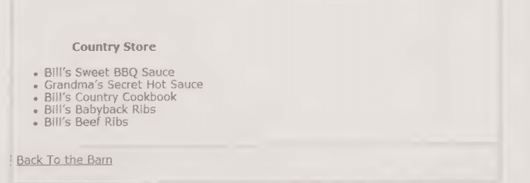

图 4.26：带有返回主页链接的乡村店铺页面。

```html
<html>
<body>

<CENTER><h1>Bill's Barbeque Barn</h1></CENTER>
<BR><BR><BR>
<LEFT>
<H4>&nbsp;&nbsp;&nbsp;&nbsp;&nbsp;&nbsp;&nbsp;&nbsp;&nbsp;&nbsp;&nbsp;&nbsp;&nbsp;&nbsp;&nbsp;&nbsp;Country Store</H4>
<ul type=disc>
<li>Bill's Sweet BBQ Sauce</li>
<li>Grandma's Secret Hot Sauce</li>
<li>Bill's Country Cookbook</li>
<li>Bill's Babyback Ribs</li>
<li>Bill's Beef Ribs</li>
</ul>

<HR size="4" width="80%">
<br>
<a href="Barbeque Barn6.html">Back to the Barn</a>
</LEFT></body>
</html>
```


## 总结

在创建链接时，请牢记它们的目的。通常，人们更容易吸收以小块形式呈现的信息。如果你创建了一个包含海量数据的单一大型页面，可能会使用户感到不知所措和困惑，或者至少让查找任何特定内容变得更加困难。更好的做法是创建一个较小的主页，其中包含指向其他页面的链接，这些页面提供特定主题的附加信息。每个页面应只包含大约一屏的数据量。可以添加更多页面，以将内容进一步分解成大小合适的页面。一个例外可能是数据列表，其中大量格式相似的数据行不会造成太大的混淆。

同时，请记住，无论我们或其他人给你什么技巧和指南，你都有责任管理用户浏览你页面时的体验。花时间思考他们可能如何使用你的网站，他们可能在寻找什么，以及他们可能试图完成什么。如果你在开发网页时牢记这些想法，你将极大地提升它们的有效性。
## 第5章
## 使用层叠样式表

层叠样式表提供了一种极佳且灵活的方式来控制网页的外观或呈现方式。对这个单一文档进行微小的更改就能显著改变多个网页的外观。这种易于控制页面设计的方法使你能够快速实现网站视觉效果和风格的调整。程序员们欣赏这种单一控制点的便利。

层叠样式表是一个以 .CSS 为后缀的文件。开发者通常将他们的层叠样式表命名为 *theme.css*。“Theme”（主题）是一个很好的文件名选择，因为样式表可以为网站创建视觉主题。你只需要让网站中的所有页面都引用同一个层叠样式表。也可以让多个样式表同时作用于同一个 HTML 文档。我们将在本章后面讨论如何实现这一点。

### 创建层叠样式表

你可以使用 `<link>` 标签将层叠样式表附加到你的网页。图 5.1 中的代码片段展示了这样一个链接的示例。当 HTML 页面被打开时，浏览器将搜索 theme.css 样式表以查找处理页面内容的规则。

```
<link href="theme.css" rel="stylesheet" type="text/css">
```

图 5.1：链接到一个层叠样式表。

你可以使用像记事本这样简单的工具，或者使用 Web 设计产品中的复杂工具来创建 theme.css 样式表。图 5.2 展示了一个基本的 theme.css 样式表的代码。

```
body {font-family : arial,courier new,times new roman;
}

h1 {font-family : times new roman;
}

h3 {font-family : times new roman;
}

p {font-family : courier new;
}
```

图 5.2：一个用于四个 HTML 标签的基本样式表。

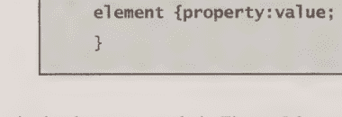

图 5.2 中 theme.css 代码中的样式适用于 HTML `<body>` 元素、`<h1>` 和 `<h3>` 标题元素以及段落元素。你可以用样式表做的基本事情之一就是为每个 HTML 元素定义默认样式。当渲染 HTML 文档时，样式会从样式表中读取并应用。还有其他定义样式的方法，例如使用样式类，我们将在本章后面讨论。

在定义元素的样式时，元素的标签（不带尖括号 `<>`）被列出，后面跟着花括号 `{}`。在这些花括号内，可以定义任何可用的属性。每个属性后面跟着一个冒号 (`:`)，然后是其关联的值。每个值后面跟着一个分号 (`;`)。可以根据需要列出其他属性。一旦所有属性都列出完毕，就编写结束花括号。

在 theme.css 中，四种元素样式中的每一种都为该元素设置了默认字体族。在 body 样式中，字体族被设置为 Arial。如果用户的计算机上没有 Arial 字体，则将使用列出的备用字体之一。只需按偏好顺序列出所有字体。用户计算机上第一个可用的字体将被使用。如果列出的字体都不可用，则将使用用户浏览器的默认字体。h1 和 h3 样式将字体族定义为 Times New Roman。第四种样式用于段落标签 `<p>`。此样式将默认字体设置为 Courier New。

有多种字体可供选择。等宽字体（如 Courier New）每个字母都使用完全相同的宽度。当你需要文本以特定方式对齐时，这使它们非常有吸引力。

图 5.3 展示了一个链接到 theme.css 样式表的示例网页的代码。该网页如图 5.4 所示。

```
<html>
<head>
<link href="theme.css" rel="stylesheet" type="text/css">
</head>
<body>
This font is Arial
<h1>This font is Times New Roman</h1>
<h3><P>This font is Courier New</P></h3>
</body>
</html>
```


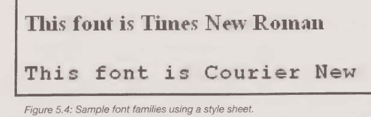

注意图 5.3 中，在第二个 `<h3>` 标签内，还有一个 `<p>` 标签，因此 theme.css 中的两个样式都在生效。通常，最内层或子元素将从父元素继承属性，但子元素也可以选择覆盖这些属性。两种元素样式都试图更改字体族，但 `<p>` 标签优先级更高，因为它是更内层的标签。因此，`<h3>` 标签中的文本以 Courier New 而不是 Times New Roman 显示。

### 字体还有哪些其他属性？

除了 **font-family** 属性外，你还可以设置字体大小、字体样式或字体粗细。或者，你可以设置 **font** 属性，它有几个值，包括样式、变体、粗细、大小和族。

```
{font-family:font1, font2,...
    font-size:size
    font-style:normal
                italic
                oblique
    font-weight:normal
                bold
                bolder
                lighter
                number
    font:style weight
            size family
}
```

大多数属性都有特定的选项可供选择。例如，**font-weight** 可以使用诸如 **lighter**、**normal**、**bold** 或 **bolder** 之类的相对术语。这些选择在此以**粗体**文本显示。其他属性允许多种不同的值。这些在此以***粗斜体***显示。例如，**font-weight** 接受一个 100 的倍数的数值，范围从 100 到 900。值 100 是最轻（最细）的字体粗细，而 900 是最重（最粗）的。

**font-size** 属性需要一个值，该值后面可以跟一个代码，例如 **12px**，表示 12 像素宽。以下是可用的大小代码：

- **em**，当前字体中字母 *m* 的宽度
- **ex**，当前字体中字母 *x* 的宽度
- cm，厘米
- mm，毫米
- pc，皮卡（1 皮卡 = 4.216 毫米）
- pt，磅（1 磅 = 1/12 皮卡）
- in，英寸
- px，像素

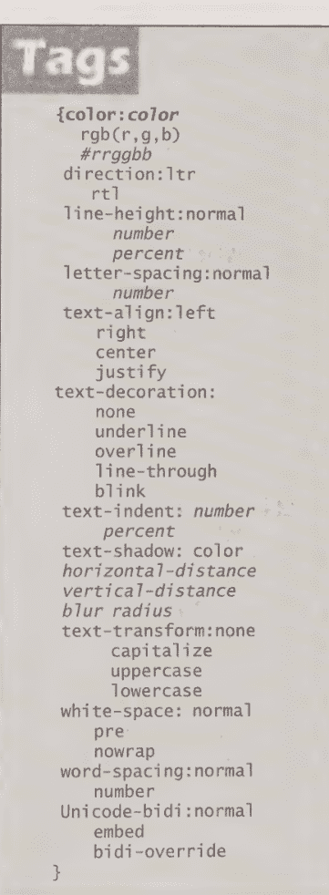

使用 **em** 和 **ex** 大小可以让你定义文本的某些部分的大小，而无需知道字体的基础大小。例如，指定值 **.5em** 意味着你希望字体比当前文本中字母 *m* 的大小小 50%。类似地，要定义比当前文本中字母 *x* 的大小大 20% 的大小，可以使用值 **1.2ex**。避免使用硬编码的字体大小可以为调整了自己字体大小的用户提供更好的支持。

使用 **font-style** 来决定文本是应以其正常形式、斜体还是倾斜文本打印。（倾斜打印的是“倾斜”的文本，在未经训练的眼睛看来，与斜体看起来相同。）

还有许多其他文本属性与字体没有直接关联。这些包括 **color**、**direction**、**line-height**、**letter-spacing**、**text-align**、**text-decoration**、**text-indent**、**text-shadow**、**text-transform**、**Unicode-bidi**、**white-space** 和 **word-spacing**。

**Color** 可以编码为特定的名称，如 *blue* 或 *red*，作为 RGB 十六进制值，或作为 RGB 十进制值（很少使用）。颜色名称易于使用，但并非所有浏览器都以完全相同的方式呈现颜色。16 种标准 HTML 颜色如表 5.1 所示，及其十六进制值。更多颜色可在附录 E 中找到。

十六进制值的示例有 #000000（黑色）、#c0c0c0（银色）和 #FFFFFF（白色）。每个十六进制代码由一个井号 (#) 后跟三个十六进制值（00 到 FF）组成，表示颜色的红色、绿色和蓝色值。大多数程序员都知道十六进制是一个基数为 16 的数字系统，其中 0=0，F=15。因此，十六进制代码 #3366CC 的红色值为 33，绿色值为 66，蓝色值为 CC，结果是一种中等灰蓝色。

表 5.1：标准颜色名称和十六进制代码
| 颜色名称 | 十六进制代码 |
|---|---|
| 水色 (Aqua) | #00FFFF |
| 黑色 (Black) | #000000 |
| 蓝色 (Blue) | #0000FF |
| 品红色 (Fuchsia) | #FF00FF |
| 灰色 (Gray) | #808080 |
| 绿色 (Green) | #008000 |
| 酸橙绿 (Lime) | #00FF00 |
| 栗色 (Maroon) | #800000 |
| 海军蓝 (Navy) | #000080 |
| 橄榄绿 (Olive) | #808000 |
| 紫色 (Purple) | #800080 |
| 红色 (Red) | #FF0000 |
| 银色 (Silver) | #C0C0C0 |
| 水鸭蓝 (Teal) | #008080 |
| 黄色 (Yellow) | #FFFF00 |
| 白色 (White) | #FFFFFF |


**字间距**控制文本字符之间的间隔。此属性可设置为**正常**值或一个具体的数值。

**文本对齐**属性可设置为**左对齐**、**右对齐**、**居中**或**两端对齐**。

**文本装饰**允许你为文本添加下划线或上划线效果。你也可以让文本显示为带有一条删除线，这通常用于表示已删除的文本。还可以添加闪烁效果。

**文本缩进**属性设置段落第一行文本的缩进量。它既可以输入为固定数值，也可以输入为百分比。

**文本阴影**为文本添加的阴影效果设置颜色。水平和垂直距离属性指定了阴影效果相对于文本的偏移距离。目前许多浏览器不支持此属性。

使用**文本转换**选项可以强制文本显示为大写或小写，或者将每个单词的首字母大写。

**空白处理**控制浏览器处理HTML文本中空白的方式。将其设置为**预格式化**会使文本的处理方式如同指定了HTML `<pre>` 标签。使用**不换行**值表示文本不应换行到下一行，它将持续在同一行上，直到文本结束或遇到换行标签 (`<br>`)。

**词间距**属性设置文本中每个单词之间的距离。请将其设置为一个特定的大小。

如果你使用**从右向左**的定向文本，可以将**双向文字**属性设置为**双向覆盖**，这将导致文本的第一个字母从右页边距开始打印，后续的每个字符都向左页边距移动。否则，**从右向左**设置只会使文本与右页边距对齐。关于一个例子，请考虑图5.5中的代码。如果应用了图5.6中的样式表，句子将从右向左打印，如图5.7所示。文本默认与右页边距对齐。

```
<p>this text prints right to left</p>
```

图 5.5：打印一行文本的HTML代码。

```
p {direction:rtl; unicode-bidi:bidi-override;}
```

图 5.6：控制图5.5中文本的样式表代码。


图 5.7：从右向左的文本。

这个例子可能有点滑稽，因为你很少需要从右向左打印文本。然而，其他大多数字体属性，如颜色赋值和字重，在印刷材料中并不明显。

### 哪些属性控制元素的排列？

使用内边距属性来控制元素周围的间距。

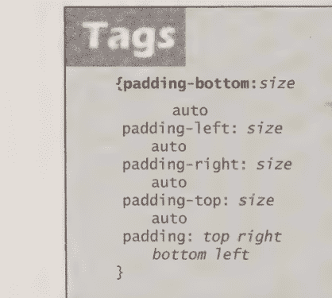

通常，网页上的每个元素都被分配一个矩形区域或“框”。影响页面上内容一般定位和排列的属性就是操作这些框的格式。通常，这些框是不可见的。*内边距*指的是元素内容与其边框之间的内部空间。你可以控制元素四个边的内边距值，或者如果你指定**内边距**属性，可以一次设置所有四边。

如果**内边距**只包含一个值，例如 `{padding:3px;}`，则该值应用于元素的所有四边。如果给出两个值，例如 `{padding:3px 2px;}`，第一个值用于上下边，第二个值用于左右边。当给出三个值时，第一个用于上边，第二个用于左右边，第三个用于下边。


**高度**和**宽度**属性指的是元素本身的大小。使用之前讨论过的**字体字重**属性中提到的任一格式来指定大小。**最大高度**和**最大宽度**属性指的是元素可以扩展到的最大尺寸。这些属性不是指定精确大小，而是为元素尺寸设置一个限制。**最小高度**和**最小宽度**控制元素可以缩小到的最小尺寸。

当浏览器在同一个页面上整合各种元素时，一些元素会被放置在另一些元素旁边。如有必要，你可以强制浏览器让元素的一侧或两侧不与相邻元素接触。例如，如果你想保持右侧空闲，可以将**清除**属性设置为**右**。

**底边距**属性设置元素距离其块区域底部边缘的距离。**左边距**、**右边距**和**顶边距**属性定义了元素内容距离该块边缘的距离。

使用**浮动**属性来标识元素应如何与其他元素排列。如果它应该向右浮动，则设置为**右**，向左浮动则设置为**左**，或者设置为**无**以防止它浮动。

**可见性**控制元素是否可见。对于应该可见的元素，将其设置为**可见**；对于应该保持在背景中的元素，设置为**隐藏**；如果元素需要隐藏但需要时可以快速显示，则设置为**折叠**。

**溢出**决定浏览器如何处理不适合对象定义空间的内容。将**溢出**设置为**可见**，以保证内容即使超出元素的最大尺寸也能可见。使用**隐藏**使溢出的内容不可见。使用**滚动**表示应为元素添加滚动条以允许访问其全部内容。**裁剪**设置溢出元素的裁剪区域大小。它接受四个值：上、右、左、下位置，这些位置标识了对象的右上角和元素可见部分的左下角。

| 标签 | 值 |
| :--- | :--- |
| 清除: | 无, 两者, 左, 右 |
| 底边距: | 数值, 自动 |
| 浮动: | 左, 右, 无 |
| 可见性: | 可见, 隐藏, 折叠 |
| 顶边距: | 数值, 自动 |
| 右边距: | 数值, 自动 |
| 左边距: | 数值, 自动 |
| 定位: | 静态, 相对, 固定, 绝对 |
| 裁剪: | 自动, 矩形(上, 右, 左, 下) |
| 溢出: | 可见, 隐藏, 滚动, 自动 |
| 垂直对齐: | 数值, 基线, 下标, 上标, 顶部, 文本顶部, 中部, 底部, 文本底部 |
| 层叠顺序: | 自动, 数值 |

使用**定位**属性来控制浏览器在页面上放置元素的方式。如果该属性设置为**绝对**，则元素的位置（上、右、左、下）是相对于页面本身而言的，独立于页面上的任何父元素。如果定位属性设置为**相对**，则元素的位置会从其通常出现的位置进行调整。因此，一个通常出现在距页面顶部10像素、距左侧20像素的元素，如果定位设置为**相对**，且顶边距和左边距属性都设置为5px，则它将出现在距页面顶部15像素、距左侧25像素的位置。

使用**层叠顺序**在网页中定义层级。默认情况下，所有内容都位于“0”索引层。放置在层叠顺序1的内容将覆盖其上，层叠顺序2的内容将覆盖层叠顺序1的内容。这提供了一种简单的内容覆盖机制。为避免分层并将所有内容保持在与父元素相同的层，请将**层叠顺序**指定为**自动**。

**垂直对齐**属性控制包含框内元素彼此之间的对齐方式。**基线**是默认值。它使行中的所有元素沿包含框的基线相互对齐。**下标**和**上标**使元素分别像下标和上标一样对齐。**顶部**、**底部**和**中部**使元素分别沿最高元素的顶部、最低元素的底部或所有元素的中部对齐。使用**文本底部**或**文本顶部**，元素会与父项**字体**属性的底部或顶部对齐。

### 哪些属性控制元素的显示？

**光标**和**显示**属性提供了自定义光标和页面文本外观的能力。光标可以修改为显示为各种指针、箭头或十字线。**显示**属性以多种方式影响文本。例如，它可以强制文本与其他文本内联显示，或强制文本以垂直列表形式显示。

重新格式化鼠标指针可能是与用户沟通的有用工具。例如，你可以使用光标来指示某个链接提供帮助信息。**cursor** 属性设置鼠标指针的外观。将其设置为 **crosshair** 可将鼠标指针更改为瞄准十字线。使用 **move** 可创建一个指示元素可被移动的鼠标指针。它看起来类似于十字线，但在每条线的末端都带有箭头。

**cursor** 的调整大小值会将指针切换为指向给定方向的大小调整箭头。因此，**e-resize** 光标是指向东-西方向的箭头，而 **nw-resize** 光标是指向西北-东南方向的箭头。

使用 **cursor** 的 **text** 值可将鼠标指针更改为文本区域中常用的垂直线。**Wait** 使光标变为沙漏，而 **help** 将其变为问号。

**display** 属性有广泛的选项，并且受到主要浏览器更广泛的支持。与其逐一介绍所有这些选项，我们将重点介绍一些更有用的选项。将 **display** 设置为 **none** 会导致元素不显示。这与之前讨论过的 **hidden** 值不同。隐藏的元素在页面上占据空间，其他元素会像它存在一样移动。`{Display:none}` 使浏览器忽略该元素，因此页面上的其他元素可能会被放置在未显示元素本应占据的空间中。

**block** 值的行为本质上就像段落一直以来的行为：换到新行，并避免将其他元素放置在其右侧或左侧。**inline** 选项使元素显示在当前块的当前行上。

图 5.8 中的代码示例创建了一系列超文本链接。图 5.9 显示了它们在浏览器中的正常外观。这些链接一个接一个地出现，直到达到右边距，此时文本会移动到下一行。

```html
<a href="abc.html">Link to page 2</a>
<a href="def.html">Link to page 3</a>
<a href="ghi.html">Link to page 4</a>
```

图 5.8：显示三个超文本链接的 HTML 代码。

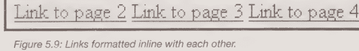

图 5.9：链接彼此内联显示。

如果你希望每个链接都像段落行为一样前进到下一行，可以使用 **display:block** 属性。为此，你可以将图 5.10 中的代码添加到层叠样式表中。输出将如图 5.11 所示发生变化。

```css
a {display:block;
}
```

图 5.10：用于块格式的层叠样式表。

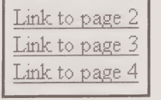

图 5.11：以块格式呈现的链接。

边距定义了边框和包含框边缘之间的空间。

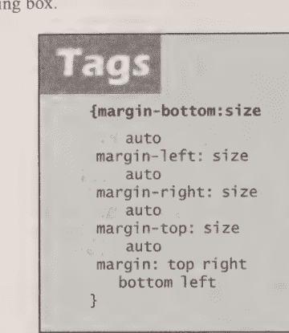

每个边距都可以设置为特定大小，就像之前描述的 **font-size** 属性一样。**margin** 属性允许你一次设置所有四个边距。如果只给出一个值，则所有四个边距都使用该值。如果给出两个值，则上边距和下边距使用第一个值，右边距和左边距使用第二个值。如果给出三个值，则第一个值用于上边距，第二个用于左边距和右边距，第三个用于下边距。

使用 **border** 属性设置边框的宽度、样式和颜色。将宽度设置为特定大小，就像 **font-size** 属性一样。样式可以设置为 **dashed**、**groove**、**inset** 或 **outset** 等值。默认边框样式是 **none**。颜色可以编码为颜色名称、十六进制值或 RGB 值。

## 标签

| 属性 | 值 |
| :--- | :--- |
| cursor | auto, crosshair, pointer, default, move, e-resize, ne-resize, nw-resize, n-resize, se-resize, sw-resize, s-resize, w-resize, text, wait, help |
| display | none, inline, block, list-item, run-in, compact, marker, table, inline-table, table-row-group, table-header-group, table-footer-group, table-column-group, table-row, table-column, table-cell, table-caption |

默认情况下，元素不显示边框。使用 **border-color** 仅设置边框的颜色属性。类似地，**border-width** 属性仅定义元素边框的宽度。**border-style** 属性可以设置为 **none** 以表示不显示边框，或设置为 **hidden** 以表示边框在页面上渲染但不可见。

**dotted**、**dashed** 和 **solid** 值显然描述了边框的外观。

**groove** 边框样式看起来像在网页表面切割出的凹槽。**Ridge** 创建一个围绕元素的 3D 凸起边框。**Double** 创建一个边框内的边框。**inset** 边框看起来像陷入网页表面，而 **outset** 值使元素看起来升高，就像位于按钮顶部一样。

使用 **border-top**、**border-left**、**border-right** 和 **border-bottom** 仅设置元素该部分的边框属性。

为了使图 5.11 中的链接在视觉上更加明显，我们可以添加一个边框。在这种情况下，图 5.12 中的代码添加了一个外凸边框，使其看起来高于网页表面，如图 5.13 所示。

```css
a {display:block; border-style:outset;
    width:14ex;text-align:center;
}
```

*图 5.12：带有特殊边框的锚标签的样式表代码。*

图 5.12 中的代码保留了前面示例中的块属性并添加了外凸边框。它还将宽度设置为 **14ex**（十四个 x），以便外凸边框不会一直延伸到页面的右边距。文本也在块内居中，以便在边框内整齐排列。这使得链接看起来像按钮。

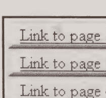

*图 5.13：具有特定宽度外凸边框的居中链接。*

## 哪些属性控制元素的背景？

使用 **background-image** 属性指定要用作元素背景的图像文件的 URL。指定 URL 时，请确保将其编码在 **url('...')** 包装器中，如下所示语法所示。

如果你希望背景图像在网页的可视区域内保持完全相同的位置，请将 **background-attachment** 属性设置为 **fixed**。如果将此属性设置为 **scroll**，则图像会随用户滚动元素内容而移动。

如果你不使用背景图像，而是想将背景设置为纯色，请使用 **background-color** 属性。将其设置为所需的颜色名称、十六进制代码或 RGB 值。

```css
Tags

{background-attachment: fixed
         scroll
background-color: color
                   rgb(r,g,b)
                   #(rr,gg,bb)
background-image:url('url')
background-position:
                   x y
                   top left
                   top center
                   top right
                   center left
                   center center
                   center right
                   bottom left
                   bottom center
                   bottom right
background-repeat: repeat
                   repeat-x
                   repeat-y
                   no-repeat
background: color
            image
            repeat
            attachment
            position
}
```
## 哪些属性控制元素的外观？

**list-style-type** 属性设置有序和无序列表要使用的特定符号。**disc**、**circle** 和 **square** 值创建了第 2 章讨论的标准符号。将类型设置为 **lower-roman** 可在有序列表中使用小写罗马数字，或使用 **upper-roman** 表示大写。**Upper-alpha** 创建使用大写字母字符的有序列表，而 **lower-alpha** 使用小写字母。**List-style-position** 有两个值：**inside** 缩进列表项，而 **outside**（默认值）将其打印为与当前文本对齐。

```
{
  list-style-type: disc, circle, square, decimal, decimal-leading-zero,
    lower-roman, upper-roman, lower-alpha, upper-alpha, lower-greek,
    lower-latin, upper-latin, Hebrew, armenian, georgian,
    cjk-ideographic, hiragana, katakana, hiragana-iroha, katakana-iroha;
  list-style: type position image;
  list-style-position: inside | outside;
  list-style-image: url(url);
  marker-offset: length | auto;
}
```

如果标准符号不够用，可以使用 **list-style-image** 属性来指定包含符号图像文件的 URL。请确保使用 `url(...)` 包裹 URL。许多人报告说 **list-style-image** 在多个浏览器中无法正确且一致地工作。如果遇到此问题，首先尝试将位置设置为 **outside**。如果这不能解决问题，您可能需要考虑将背景图像附加到文本，而不是使用 `<li>` 标签。

**marker-offset** 属性存在于 W3C 的 CSS 定义中，但目前很少（如果有的话）浏览器支持它。

要一次性设置样式、位置和/或图像，请使用 **list-style** 属性，然后提供类型、位置和 URL。根据需要，可以省略其中任何一项。

页面属性影响 HTML 文档的打印方式。两个最常见的属性是 **page-break-before** 和 **page-break-after**。将其中一个添加到元素以控制其处理分页的方式。

要强制在给定元素打印前分页，请将其 **page-break-before** 属性设置为 **always**。这将强制分页，无论它在页面的什么位置。设置 **page-break-inside** 属性以防止在给定元素内发生分页。

使用 **orphans** 属性设置必须打印在页面底部的最小行数，然后再转到下一页。类似地，**widows** 定义了在元素中间发生分页后，可以在新页面上打印的最小行数。

如果要允许图像打印到纸张边缘（忽略边距），请将 **marks** 属性设置为 **crop**。如果要在纸上打印对齐十字线（某些打印机用于确保正确对齐的特殊符号），请将此属性设置为 **cross**。

您可以通过将 **size** 属性设置为 **landscape** 或 **portrait** 来定义页面的基本布局。**Auto** 使用默认页面大小。如果要手动设置页面尺寸，只需提供长度和宽度即可。

还有特定的 CSS 属性可用于处理表格。例如，如果行和列大小一致，可以将 **table-layout** 设置为 **fixed**。表格第一行中单元格的大小提供了所有后续行使用的模板。这可以提高加载大型表格时的性能，因为浏览器不需要在显示时计算每个单元格的大小。

使用 **empty-cells** 属性控制如何处理空的表格单元格。如果您想隐藏空单元格不显示，请将其设置为 **hide**；或者设置为 **show**（默认值）以指示所有单元格应可见。

**border-collapse** 属性将两个相邻边框压缩为一个边框，创建更紧凑的表格。将此值设置为 **separate**（默认值）会显示两个相邻边框，中间有小间距。使用 **border-spacing** 属性控制边框分离时之间的空间大小。将 **border-spacing** 设置为一个值，该长度将用作垂直和水平边框的大小。或者，分别提供水平和垂直边框大小。**caption-side** 属性仅确定表格标题出现的一侧。可以将其设置为 **top**、**right**、**left** 或 **bottom**。

## 定义样式类

到目前为止，您已经看到了更改标准 HTML 元素属性的方法。然而，在级联样式表中有一个更强大的选项。您可以定义一种称为 *class*（类）的东西，它是一组可供一种或多种类型元素使用的属性。您可以将类定义为特定元素的子类，如图 5.15 所示。

```
P.question {font-weight:bold;
}
P.answer {font-weight:normal;
}
```
图 5.15：子类示例。

然后您可以编写一些使用该样式表的 HTML 代码，如图 5.16 所示。如您所见，样式表定义了两种类型的段落标签：问题类和答案类。问题将以粗体显示，而答案将以普通文本显示。

```
<p class="question" >我们如何定义样式类？</p>
<p class="answer">在样式表中使用 ".class-name" 语法</p>
```
图 5.16：由子类控制的 HTML 代码。

这种方法的优点在于，如果您决定将所有问题显示为，比如蓝色，答案显示为绿色，您只需更新样式表，所有引用它的页面都会更新。HTML 代码通过向标签添加 **class** 属性来引用该类。如果存在用该名称定义的段落类，其属性将应用于此元素。

您还可以选择定义完全独立于所有元素的类。此代码如图 5.17 所示。如您所见，类定义以句点 (.) 作为其第一个字符。

```
.question {font-weight:bold;
}
.answer {font-weight:normal;
}
```
图 5.17：类示例。

由于图 5.17 中的问题类未与特定 HTML 标签关联，任何标签都可以通过简单引用它来继承其属性。这允许多个元素（如段落和标题）获得相同的属性。

## 元素如何从父元素继承属性？

元素从其父元素继承它们能继承的任何属性。因此，如果 `<body>` 标签的 `font-family` 设置为 Arial，正文中打印文本的每个元素默认都会获取该字体属性。但是，任何定义了自己的 `font-family` 属性的子元素都会取代 `<body>` 标签中的值。

也可以在样式表中使用类来定义子元素的属性。例如，假设您使用定义列表 HTML 标签创建了一个问答列表。您可以使用图 5.18 中显示的样式类来定义定义术语和定义描述的外观。您还可以为主要和次要问题提供不同的外观。

```
.major {background:gray;font-size:120%; width=200px;
}
.minor {background:white; font-size 90%;
}
.question {color:blue;
}
.answer {color:black;
}
```
图 5.18：问答页面的样式。

图 5.18 中的样式将主要主题定义为具有灰色背景和较大的文本，而次要主题具有白色背景和较小的文本。行内的每个单元格都将从其父级继承这些属性。它们还将定义自己的类别为

问题，以蓝色打印，或答案，以白色打印。使用这些类的 HTML 表格代码见图 5.19。

```html
<dl class="major">
<dt class="question">Question 1</dt>
<dd class="answer">Answer for 1</dd>
<dl class="minor">
<dt class="question">Question 1.a</dt>
<dd class="answer">Answer for 1.a</dd>
<dt class="question">Question 1.b</dt>
<dd class="answer">Answer for 1.b</dd>
</dl>
<dt class="question">Question 2</dt>
<dd class="answer">Answer for 2</dd>
<dl class="minor">
<dt class="question">Question 2.a</dt>
<dd class="answer">Answer for 2.a</dd>
<dt class="question">Question 2.b</dt>
<dd class="answer">Answer for 2.b</dd>
</dl>
</dl>
```

图 5.19：问答页面的 HTML 代码。

`<dl>` 标签定义了一个新定义列表的开始。在这种情况下，它还选择类为 `major` 或 `minor`。`<dt>` 标签标识一个术语，或在此例中为一个问题，并将类定义为 `question`。`<dd>`，即定义描述，标签使用 `answer` 类。列表中出现的文本同时获得了 `<dt>` 和 `<dd>` 标签中设置的类，以及 `<dl>` 标签中设置的类的属性。这是因为 `<dt>` 和 `<dd>` 标签位于 `<dl>` 内部，使它们成为从父元素继承属性的子元素。

图 5.19 中的代码创建了图 5.20 所示的页面。所有问题以蓝色显示，而答案则以黑色显示。主要问题以较大的文本和灰色背景出现。`major` 类中的 **width** 属性将元素的宽度限制为 200 像素。如果没有这个属性，灰色背景将一直延伸到整个页面。

你可能会认为图 5.20 中的列表相当丑陋。虽然确实如此，但它提供了一个相当简单的方式来说明我们正在讨论的继承，而这正是我们的主要目标。

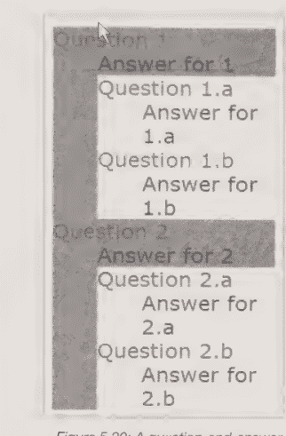

与其使用继承为问答列表提供所需的灵活性，我们本可以为单个元素分配多个类。层叠样式表的代码与图 5.18 相同，但 HTML 更改为图 5.21 中的代码。

```html
<dl>
<dt class="question major">Question 1</dt>
<dd class="answer major">Answer for 1</dd>
<dl class="minor">
<dt class="question minor">Question 1.a</dt>
<dd class="answer minor">Answer for 1.a</dd>
<dt class="question minor">Question 1.b</dt>
<dd class="answer minor">Answer for 1.b</dd>
</dl>
<dt class="question major">Question 2</dt>
<dd class="answer major">Answer for 2</dd>
<dl class="minor">
<dt class="question minor">Question 2.a</dt>
<dd class="answer minor">Answer for 2.a</dd>
<dt class="question minor">Question 2.b</dt>
<dd class="answer minor">Answer for 2.b</dd>
</dl>
</dl>
```

图 5.21：问答页面的替代 HTML 代码。

在这个版本的定义列表中，所有关于问题与答案、以及主要与次要的决定都已移至特定的 `<dt>` 和 `<dd>` 标签中。为了改善列表的外观，我们还为内部（次要）定义列表包含了 `minor` 类。如图所示，HTML 标签的 **class** 属性可以列出多个类。只需列出所有相关类，每个类之间用空格分隔。此修改代码的结果如图 5.22 所示，与之前的示例有明显不同。

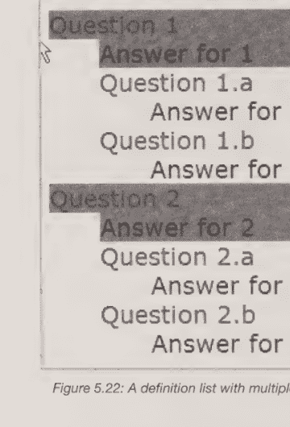

由于我们将 `major` 类从 `<dl>` 标签移至 `<dt>` 和 `<dd>` 标签，因此只有这些特定的问题和答案部分具有灰色背景。由于答案缩进在问题下方，并且两者都具有 200 像素的固定宽度，因此答案框的灰色阴影比问题更突出。我们可能希望为答案设置一个更小的宽度，以便它们在右侧对齐，但这是一个我们在此无需担心的外观调整。如果愿意，你可以自行完成。

同样可以定义为其他特定元素子元素的元素的样式。例如，你可以定义 `<li>` 标签在有序列表中的外观，使其与在无序列表中的外观不同。CSS 代码可能如图 5.23 所示。

```css
UL LI {
    color: blue;
    font-size: 120%;
}
OL LI {
    color: green;
    font-size: 100%;
}
```

图 5.23：无序列表和有序列表中列表项的样式。

使用此样式表，图 5.24 中所示的示例 HTML 代码创建了图 5.25 中的输出。

```html
<ul>
<li>Major Topic A</li>
<ol>
<li>Minor topic a.1</li>
<li>Minor topic a.2</li>
</ol>
<li>Major Topic B</li>
<ol>
<li>Minor topic b.1</li>
<li>Minor topic b.2</li>
</ol>
</ul>
```

图 5.24：创建图 5.25 中网页的 HTML 代码。

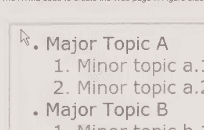


子类的另一种类型是 *后代选择器*，它标识从另一个元素派生的元素，但不一定是直接后代。例如，如果你在前面示例中的次要主题内添加定义列表，你将有几层元素。你将有一个包含 `<ul>` 的 `<ol>`，而 `<ul>` 又包含一个 `<dl>`。要为包含在有序列表中某处的定义列表分配样式，你需要使用图 5.26 中所示的代码。

```css
OL DL {
    color: green;
    font-size: 100%;
}
```

*图 5.26：位于有序列表内某处的定义列表的样式。*

如果需要定义作为另一个元素的孙元素或更远后代的定义列表的样式，你需要在 CSS 中使用图 5.27 中的代码。在此示例中，如果定义列表在 HTML 代码中直接位于有序列表下方，则此样式不会应用。它们之间必须至少有一个其他元素，此样式才会应用。

```css
OL ~ DL {
    color: green;
    font-size: 100%;
}
```

*图 5.27：至少是有序列表孙元素的定义列表的样式。*

如果需要标识兄弟元素，例如紧跟在 `<h3>` 标签之后的段落，你可以定义如图 5.28 所示的样式表。在这种情况下，加号表示 `<p>` 标签必须紧跟在 `<h3>` 标签之后。需要注意的是，与前面的示例不同，`<p>` 标签不在 `<h3>` 标签内部，而是与之相邻，位于更大的元素（如页面主体）内。

```css
H3 + P {
    color: blue;
    font-size: 100%;
}
```

*图 5.28：紧跟在 `<h3>` 标签之后的段落的样式。*

一旦你理解了这些基于元素关系识别各种选择器的基本方法，一种更复杂的、根据元素相互关系识别元素的方法是将多个依赖选择器串联在一起。例如，如果你想仅标识存在于段落中某处且紧跟在无序列表之后的那些有序列表，你可以编写图 5.29 中所示的 CSS 代码。

```css
P > UL + OL {
    color: blue;
    font-size: 100%;
}
```

*图 5.29：嵌套子类的示例。*

这乍一看可能是一种奇怪且不太有用的能力。然而，如果你想将一个无序列表嵌套在另一个内部，如图 5.30 所示呢？

```html
<ul>
<li>Major Topic A</li>
  <ul>
  <li>Minor topic a.1</li>
  <li>Minor topic a.2</li>
    <ul>
    <li>Tertiary topic a.2.1</li>
    <li>Tertiary topic a.2.2</li>
    </ul>
  </ul>
</ul>
```

*图 5.30：嵌套列表的 HTML 代码。*

通常，对于这样的嵌套列表，浏览器会为每一级的列表项分配不同的符号，如圆盘、圆圈和正方形。但如果你想改变的不只是符号呢？如果你想改变文本颜色和大小呢？你可以使用图 5.31 中的 CSS 代码来定义每一层嵌套无序列表的行为。

```css
ul {
    color: blue;
    font-size: 120%;
}
ul ul {
    color: green;
    font-size: 100%;
}
ul ul ul {
    color: Red;
    font-size: 80%;
}
```

*图 5.31：嵌套列表的样式。*

第一个样式是针对顶层无序列表的。如果你没有编写其他代码，它将应用于所有级别。第二个样式应用于

嵌套无序列表的第二级。第三种样式适用于所有至少嵌套了三层的无序列表。当此 CSS 代码与先前的 HTML 代码结合时，会产生图 5.32 所示的输出。要继续定义更深层次（如第四级或第五级）的不同外观，只需在开头添加具有四个或五个 **ul** 标识符的附加样式即可。

每当有多个选择器应用于一个元素时，最精确的那个选择器会优先应用。这里有一个确定优先级的公式，但它比我们想在这里解释的要复杂一些，因此简化后的规则是：

引用最多 ID（接下来讨论）的选择器优先。如果选择器引用的 ID 数量相同（或都没有），则引用的类数量决定哪个选择器优先。如果选择器引用的类数量相同（或都没有），则引用的 HTML 标签数量决定哪个选择器优先。如果两个选择器引用的 HTML 标签数量相同，则在样式表中最后列出的那个选择器优先。

## 什么是 ID？

到目前为止，我们几乎一直在讨论类。但还有一个叫做 *ID* 的实体。类用于为一个或多个 HTML 元素定义样式，而 ID 专门设计用于唯一标识单个元素。因此，如果一个页面有三个段落，你可以为所有三个段落分配相同的类，但也要为每个段落分配一个唯一的 ID，如图 5.33 所示。

```html
<p id="p1" class="notes">一些杂项信息</p>
<p id="p2" class="notes">更多杂项信息</p>
<p id="p3" class="notes">最后的杂项信息</p>
```

*图 5.33：带有 ID 的段落标签。*

任何三个段落共有的属性都可以通过类的样式来分配。但如果你只想让第二个段落以斜体打印，你可能会创建如图 5.34 所示的 CSS 代码。**.notes** 条目定义了 notes 类的样式，该样式随后应用于所有三个段落。CSS 中引用的所有 ID 标签都在 **id** 标识符前使用井号（#）表示。因此，以 **#p2** 开头的条目定义了第二个段落的样式。由于 HTML 代码同时包含一个类和一个 ID，两种样式都会应用。**id** 标签的条目会覆盖 notes 类中的任何冲突值。

```css
.notes {
    font-style: normal;
    width: 60%;
    margin-left: 20%;
}

#p2 {
    font-style: italic;
}
```

*图 5.34：notes 类和 p2 ID 的样式。*

图 5.33 中的三个段落与图 5.34 中的 CSS 代码一起，创建了图 5.35 中的输出。请记住，当你使用 **id** 标签时，它在 HTML 文档中应该是唯一的。

*图 5.35：带有类和 ID 的三个段落。*

## 使用层叠样式表能做什么

你可以为几乎每一个 HTML 元素定义样式规则，即使其中一些是毫无意义的，比如为嵌入式视频文件指定字体。到目前为止你看到的所有示例都相当简单。这是合适的，因为你只是想弄清楚这些东西是如何工作的。

样式表的主要用途之一是控制页面上的内容排列。通过 *排列*，我们指的不仅是字体大小、颜色等，还包括实际将元素移动到页面的各个位置。你可以做的一件很巧妙的事情是创建页面，这些页面可以通过简单地更改它们所使用的层叠样式表来彻底改变它们的外观和布局。我们将在第 6 章进一步讨论这一点。现在，让我们看看一个包含层叠样式表的网页修订版本。我们将更改页面以将谷仓图像作为背景引入。

修改后的 HTML 代码如图 5.36 所示。几乎所有的换行符、宽度属性，甚至背景图像都已被移除。之前的背景图像大小与整个页面相同，左侧和底部有空白区域。通过将背景图像的定义移到层叠样式表中，我们拥有了更好的工具来控制其行为，并且可以消除空白，使用一个只包含谷仓的较小图像。因为它更小，所以图像加载速度会比之前的页面快。你还会注意到散布在代码中的类定义。

```html
<html>
<head>
    <link href="bbqtheme.css" rel="stylesheet" type="text/css">
</head>
<body>
    <h1 class="heading1">比尔的烧烤谷仓</h1>
    <H3>
        <P class="intro">在比尔烧烤谷仓，没有什么比与所有朋友分享我们的蓝带烧烤食谱更让我们喜欢的了。
        </P>
        <P class="intro">
            加入我们，品尝你能找到的最好的烧烤。在品尝了我们著名的一些食物后，顺便去礼品店带一瓶比尔烧烤酱回家，或者为家里的后院烧烤烧烤大师挑选一份完美的礼物。
        </P>
        <P class="intro">
            我们认为你不得不赞同我们，没有什么能像一顿美味的烧烤晚餐那样带回那种“家乡”的感觉。而美味的烧烤正是我们所擅长的。
```

*图 5.36：BBQ 谷仓主页的修改后 HTML 代码（第 1 部分，共 2 部分）。*

```html
        </P>
    </H3>
    <BR><BR><BR>
    <HR>
    了解更多关于：<br>
    <a class="inset" href="BarbequeBarna.html" target="_blank">乡村商店</a>
    <a class="inset" href="BarbequeBarnb.html" target="_blank">烧烤风味</a>
    <a class="inset" href="BarbequeBarnc.html" target="_blank">“如何”烧烤</a>
</body>
</html>
```

*图 5.36：BBQ 谷仓主页的修改后 HTML 代码（第 2 部分，共 2 部分）。*

我们主页的新层叠样式表如图 5.37 所示。
这个层叠样式表将谷仓的图片定义为页面的背景，将其定位在右上角，并防止其重复，因此只显示一个谷仓。

```css
body {
    background: url(barn5.jpg);
    background-repeat: no-repeat;
    background-position: top right;
}

.heading1 {
    width: 70%;
    text-align: center;
    margin-bottom: 40px;
}

.intro {
    width: 60%;
}

h1 {
    width: 80%;
    text-align: center;
    height: 2px;
}

.inset {
    margin-left: 7em;
    width: 80%;
}

a.block {
    display: block;
    border-style: outset;
    width: 14ex;
    text-align: center;
    margin-left: 7em;
}
```

*图 5.37：BBQ 谷仓主页的层叠样式表。*

我们为第一个标题添加了底部边距，因此随后的文本会出现在页面更下方的位置。介绍部分的宽度定义为页面的 60%，因此它不会与背景图像重叠。水平线的几乎所有属性，包括其高度、宽度和对齐方式，都在层叠样式表中进行了控制。

**block** 类定义了页面底部超链接的样式。它定义了缩进、宽度、边框样式和对齐方式。如本章前面所述，**display:block** 属性在每个链接后强制换行。**outset** 边框使链接在页面上看起来像按钮。生成的网页如图 5.38 所示。

*图 5.38：使用层叠样式表更新的网页。*

## 总结

层叠样式表为网页设计提供了极大的灵活性和复杂性。将 HTML 与样式表结合可以创建更加复杂的网页，整个过程开始感觉更像是编程。
## 排列内容

现在你已经掌握了相当程度的 HTML 知识，并且学会了如何整合层叠样式表，你已经准备好应对网页设计的最后一个主要障碍：排列页面内容。这看起来可能很简单直接，但其中涉及许多微妙的问题。你的网页有多容易维护？用户在你的网站上导航有多顺畅？所有网页及其链接的整体设计是否清晰直观，未经培训的用户能否轻松找到他们需要的东西？

有很多方法可以控制页面上内容的排列。你可以使用表格将文本和图像整齐地排列成行和列。历史上（如果我们可以用这个词来描述我们出生时还不存在的东西），表格被用来控制整个页面的整体框架，但现在通常不推荐这样做。

框架（Frames）是专门为控制网页的整体框架而设计的。它们有一些非常有用的功能，非常适合排列内容，但它们的使用正在减少，取而代之的是其他方法。我们仍将在本章中讨论框架，因为你需要了解它们，以便处理许多仍在使用它们的网站。

`<div>` 和 `<span>` 标签是控制网页内容排列的最新 HTML 标签。这些标签与层叠样式表结合，是目前排列网页内容最被接受的方式。


## 内容编排的目的

在编排网页内容之前，你必须明确网站的目标是什么。你希望这个页面实现什么功能？以下是你网站页面可能要达成的一些目标：

-   向潜在客户介绍你的公司
-   产生销售线索
-   销售产品
-   与业务合作伙伴沟通
-   提供资源

根据你网站的侧重点——无论是上述之一，还是其他——其具体要求也会不同。因此，在你考虑如何编排页面内容之前，请先明确网站的最终目标。在设计网站时，请牢记这一目标。

## 向潜在客户介绍你的公司

向公众介绍你的公司是一项相对容易的任务。你可以通过一个静态网站来实现，这通常被称为“宣传册式网站”。实际上，你可以将公司印刷媒体中使用的美术设计融入你的网站。这样做很有用，因为它能保持所有营销材料视觉风格的一致性。基本上，这是将网站视为你营销计划的延伸。

## 产生销售线索

产生销售线索需要与网站访客进行某种形式的双向沟通。这可以很简单，例如设置一个电子邮件链接，让访客可以向你的销售部门发送信息以供跟进。也可以是一个输入表单，允许访客提供他们的兴趣信息，然后将这些信息发送到服务器上的一个CGI程序（稍后讨论），以便直接输入到你的数据库中。

## 销售产品

销售产品与用户所需的互动比产生线索更多。你不仅需要从访客那里获取某些信息，还需要能够详细展示你所提供的产品。这可能包括价格、描述，甚至产品图片。将此类动态信息放入静态网页是不现实的。你将如何确保价格保持最新和准确？你将如何处理添加新产品或移除过时产品？

由于这些问题，任何需要这种互动水平的网站都必须从数据库中获取数据。你很可能已经在数据库中维护了最新的产品信息，因此额外开销很小。有许多方法可以将动态内容从数据库交付到网页。除其他方法外，CGI程序、Java服务器页面、PHP或活动服务器页面都可以执行此任务。这四种常用方法将在本书后面讨论。

当你通过网站销售产品时，你的目标包括吸引用户访问网站、优化其在搜索引擎中的排名、产生大量点击量，并尽可能长时间地留住用户。

## 与业务合作伙伴沟通

与业务合作伙伴沟通基本上与销售产品所需的技术相同。但是，重点从展示目录和接受订单，转变为扩大公司在互联网上的影响力。你通常会通过这类网站呈现来自多个数据库的信息。信息可能包括订单状态、发货计划和库存水平。

业务合作伙伴需要访问你的网站以满足他们自己的业务需求。你不需要为他们做广告或吸引他们来访问。实际上，你很可能更关心阻止公众访问此类网站，只允许受信任的业务合作伙伴访问。

## 提供资源

提供资源几乎像制作宣传册式网站一样简单。资源是相对静态的信息集合，例如常见问题解答、用户手册、技术支持文档、操作视频、软件下载以及指向其他有用网站的链接。资源网站不像销售网站那样侧重于营销，而更倾向于提供大量指向文档和其他网站的链接。

与销售网站一样，搜索引擎优化对资源网站非常重要。然而，其重点在于为访客提供有用且易于找到的内容，而不必担心他们访问的频率或停留时间的长短。

## 表格

在商业编程中，我们经常需要列表。我们制作物品列表、订单列表、库存列表等。表格是整理数据列表的绝佳工具。因此，在开发网页时，表格很可能成为你的常用工具。

简单来说，表格就是数据网格。你指定一定数量的行和列，可能定义标题、页脚和其他属性，然后浏览器会处理其余部分。除非你提供特定指令以其他方式处理，否则浏览器会扩展或收缩行和列的大小以适应其中的内容。因此，你可以让某些列包含非常大的文本块或图像，而其他列则包含最少的信息，例如一个是/否标志（Y/N）。

尽管浏览器为我们处理了许多格式问题，但定义表格具体行为的选项仍然很多。因此，`<table>`标签有许多属性。例如，你可以将对齐方式定义为左对齐、居中对齐或右对齐。使用**bgcolor**属性设置表格的背景颜色，可以是颜色名称或十六进制代码。表格的总宽度由**width**属性控制，可以设置为特定的像素尺寸，或页面宽度的百分比。**Cellspacing**指的是表格中单元格之间的距离，而**cellpadding**指的是单元格边框与其内容之间的距离。

要显示单元格之间的边框，请将**border**属性设置为一或多个像素。当设置为零（默认值）时，不显示边框。**rules**属性定义表格内要显示的边框/分隔线。当**rules**设置为“none”时，仅显示外部边框。或者，它可以设置为“cols”，表示仅显示列之间的垂直分隔线，或“rows”以仅显示行之间的水平分隔线。

**frame**属性定义外部边框/框架的行为。将其设置为“void”可隐藏框架。如果此属性设置为“box”或“border”，则显示表格四边的框架。将其设置为“lhs”或“rhs”将分别仅显示左侧或右侧的框架。使用“hsides”仅显示框架的上下两侧，或使用“vsides”仅显示右侧和左侧。将**frame**属性设置为“above”或“below”将分别显示顶部或底部的框架。**summary**属性为视觉障碍用户提供表格的文本描述。

即使有了所有这些属性，仅靠`<table>`标签本身还不足以创建一个表格。最简单的表格也会包含行和数据的标签。这些标签定义了表格中的行和列。其他标签也会影响行和列的定义。我们将在本章后面讨论这些内容。

`<tr>`标签定义表格中的一行。此标签应始终编写在`<table>`和`</table>`标签之间。它的**align**和**bgcolor**属性提供了与表格本身相同的选项。valign属性允许你定义整行的垂直对齐方式。选项是“top”、“middle”和“bottom”。无论选择哪个，该行中每个单元格的内容都将对齐到该点。

`<td>`标签定义行中的每个独立单元格。它具有与`<tr>`标签相同的**align**、**bgcolor**和**valign**属性。使用**height**和**width**属性定义每个单元格的大小。**abbr**属性提供单元格内容的简要描述。使用**scope**属性为单元格分配标题，以供屏幕阅读器使用（本章后面讨论）。**nowrap**属性可防止单元格内的文本自动换行到下一行。这可能导致单元格非常宽。**colspan**和**rowspan**属性用于定义单元格跨越的列数或行数。

现在让我们向表格中添加几行数据，移除 `<table>` 标签的 **width** 属性，并移除第二个 `<td>` 标签的 **nowrap** 属性。这些更改的代码如图 6.3 所示，输出结果如图 6.4 所示。

```html
<table border=2>
<tr>
<td>1,254 bushels of apples</td>
<td>763 bushels of oranges</td>
<td>2,751 bushels of potatoes</td>
</tr>
<tr>
<td>323 bushels of apples</td>
<td>982 bushels of oranges</td>
<td>1,200 bushels of potatoes</td>
</tr>
<tr>
<td>769 bushels of apples</td>
<td>255 bushels of oranges</td>
<td>3,100 bushels of potatoes</td>
</tr>
</table>
```

图 6.3：多行表格的 HTML 代码。

| 1,254 bushels of apples | 763 bushels of oranges | 2,751 bushels of potatoes |
|-------------------------|------------------------|---------------------------|
| 323 bushels of apples   | 982 bushels of oranges | 1,200 bushels of potatoes |
| 769 bushels of apples   | 255 bushels of oranges | 3,100 bushels of potatoes |

图 6.4：一个包含三行的表格。

此示例说明了浏览器将如何调整每个单元格的大小以适应其内容，并调整表格的大小以适应所有单元格。有时这没问题，但通常我们需要控制表格大小的某些方面，以更好地管理其呈现给用户的方式。

图 6.4 中的表格缺少列标题和行标题。有一个专门用于列标题的特殊标签，那就是表格列标题（`<th>`）标签。

`<th>` 标签创建了一行专门设计为表格中其他行标题的单元格。包含标题的表格的修改代码如图 6.5 所示。您可以在图 6.6 中看到它创建的表格。

```html
<table border=2>
<tr align=center>
<th>Apples</th>
<th>Oranges</th>
<th>Potatoes</th>
</tr>
<tr>
<td>1,254 bushels</td>
<td>763 bushels</td>
<td>2,751 bushels</td>
</tr>
<tr>
<td>323 bushels</td>
<td>982 bushels</td>
<td>1,200 bushels</td>
</tr>
<tr>
<td>769 bushels</td>
<td>255 bushels</td>
<td>3,100 bushels</td>
</tr>
</table>
```

图 6.5：图 6.6 中表格的 HTML 代码。

| Apples | Oranges | Potatoes |
| --- | --- | --- |
| 1,254 bushels | 763 bushels | 2,751 bushels |
| 323 bushels | 982 bushels | 1,200 bushels |
| 769 bushels | 255 bushels | 3,100 bushels |

图 6.6：一个包含列标题的表格。

此表格中的标题已在每个单元格内居中。浏览器仍在自动调整单元格、行和表格本身的大小。您可以看到，随着我们向其添加越来越多的代码，表格正逐渐成形。为了使单元格稍大一些，给内容更多空间，我们可以使用 **cellpadding** 属性。我们还可以添加额外的列标题和行标题。图 6.7 中的代码示例包含了一个增强版表格，如图 6.8 所示。

142 第 6 章：安排内容

```html
<table border=2>
<tr align=center bgcolor=gray>
<th colspan=4>Produce (in Bushels)</th>
</tr>
<tr align=center bgcolor=gray>
<th>Warehouse</th>
<th>Apples</th>
<th>Oranges</th>
<th>Potatoes</th>
</tr>
<tr>
<td bgcolor=gray>Toledo</td>
<td>1,254 bushels</td>
<td>763 bushels</td>
<td>2,751 bushels</td>
</tr>
<tr>
<td bgcolor=gray>Detroit</td>
<td>323 bushels</td>
<td>982 bushels</td>
<td>1,200 bushels</td>
</tr>
<tr>
<td bgcolor=gray>Chicago</td>
<td>769 bushels</td>
<td>255 bushels</td>
<td>3,100 bushels</td>
</tr>
</table>
```

图 6.7：图 6.8 中表格的 HTML 代码。

图 6.8：一个包含更复杂标题的表格。

如您在此示例中所见，单元格不那么拥挤了，因为现在内容和单元格边框之间有一些额外的空间，并且标题会自动以更深的颜色加粗显示。我们为两个标题行和每个数据行的第一个单元格添加了灰色背景。顶部的单元格使用 **colspan** 属性将其自身扩展为四列宽。

现在我们已经从数据单元格中移除了单词 bushels，我们可以看到左对齐的文本对于数字来说效果不佳。如果蒲式耳计数与单元格的右侧对齐，看起来会更好。由于我们只想调整数据单元格的对齐方式，而不是整行，我们将对齐方式添加到单元格本身。我们还可以在右侧添加一列，其中包含表格的一些图例信息。因为我们希望这个单元格向下延伸跨越所有四行，所以我们将使用 rowspan 属性，并将其设置为五。图 6.9 中的代码包含了这些更改，创建了如图 6.10 所示的表格。

```html
<table border=2 cellpadding=2>
<tr align=center bgcolor=gray>
<th colspan=4>Produce (in Bushels)</th>
<th rowspan=5 width=10px>2 0 0 7</th>
</tr>
<tr align=center bgcolor=gray>
<th>Warehouse</th>
<th>Apples</th>
<th>Oranges</th>
<th>Potatoes</th>
</tr>
<tr align=right>
<td bgcolor=gray align=left>Toledo</td>
<td>1,254</td>
<td>763</td>
<td>2,751</td>
</tr>
<tr align=right>
<td bgcolor=gray align=left>Detroit</td>
<td>323</td>
<td>982</td>
<td>1,200</td>
</tr>
<tr align=right>
<td bgcolor=gray align=left>Chicago</td>
<td>769</td>
<td>255</td>
<td>3,100</td>
</tr>
</table>
```

图 6.9：图 6.10 中表格的 HTML 代码。

| Warehouse | Apples | Oranges | Potatoes |
| :--- | :--- | :--- | :--- |
| Toledo | 1,254 | 763 | 2,751 |
| Detroit | 323 | 982 | 1,200 |
| Chicago | 769 | 255 | 3,100 |

注意在图 6.9 中，年份是用空格隔开输入的。这允许浏览器在数字之间插入换行符，并且 10 像素的宽度太窄，无法让年份中的多个数字在同一行打印。为了尽可能简化对齐管理，我们在每个数据行开头的 `<tr>` 标签中添加了 **align=right** 属性。然后我们在仓库城市名称单元格中添加了 **align=left** 属性。

表格可以分为三个部分：表头、表体和表尾。

```html
<table header tag
<thead
    align
    valign
>
</thead>
```

```html
<table body tag
<tbody
    align
    valign
>
</tbody>
```

这个表格现在需要一行总计。这可以使用表尾部分来创建。与可以使用 `<th>` 单元格创建的标题不同，表尾单元格必须使用 `<tfoot>` 标签定义，该标签定义表格的页脚部分。

图 6.11 中的代码修改了我们的表格以利用这些部分。它创建了如图 6.12 所示的图像。

```html
<table border=2 cellpadding=2>
<thead>
<tr align=center bgcolor=gray>
<th colspan=5>Produce (in Bushels)</th>
</tr>
</thead>
<tbody>
<tr align=center bgcolor=gray>
<th>Warehouse</th>
<th>Apples</th>
<th>Oranges</th>
<th>Potatoes</th>
<th rowspan=4 width=10px>2 0 0 7</th>
</tr>
<tr align=right>
<td bgcolor=gray align=left>Toledo</td>
<td>1,254</td>
<td>763</td>
<td>2,751</td>
</tr>
<tr align=right>
<td bgcolor=gray align=left>Detroit</td>
<td>323</td>
<td>982</td>
<td>1,200</td>
</tr>
<tr align=right>
<td bgcolor=gray align=left>Chicago</td>
<td>769</td>
<td>255</td>
<td>3,100</td>
</tr>
</tbody>
<tfoot>
<tr align=right>
<td bgcolor=gray align=left>Total</td>
<td>2,346</td>
<td>2,000</td>
<td>7,051</td>
<td bgcolor=white></td>
</tr>
</tfoot>
</table>
```

图 6.11：图 6.12 中表格的 HTML 代码（第 1 部分，共 2 部分）。

图 6.12：一个包含页眉和页脚的表格。

在第一部分中，`<th>` 标签定义了标题内的单元格。在页脚部分，单元格使用标准 `<td>` 标签定义。为了使总计在视觉上更加突出，我们可以选择使用不同的文本颜色或背景颜色来定义页脚行。但就我们的目的而言，这已经足够好了。

## 屏幕阅读器

为了提高视力障碍用户对网页的可访问性，HTML 包含通过一种称为屏幕阅读器的专业软件类型定义补充信息的能力。此类软件包读取网页的内容，并向用户提供替代的呈现方式。例如，它们可能会放大文本或朗读文本。


为了提高我们表格的无障碍访问性，我们可能进行一些修改，例如将顶部行替换为标题（caption），并提供缩写来解释表格右侧格式异常的单元格表示年份。我们还将把城市名称单元格改为表头单元格，并为所有表头单元格添加 **scope** 属性。图6.13中的示例代码展示了经过这些修改后的图6.14表格的HTML代码。

```
<table border=2 cellpadding=2>
<Caption>Produce (in Bushels)</caption>
<thead>
</thead>
<tbody>
<tr align=center bgcolor=gray>
<th scope=col>Warehouse</th>
<th scope=col>Apples</th>
<th scope=col>Oranges</th>
<th scope=col>Potatoes</th>
<th rowspan=4 width=10px abbr="Year 2007">2 0 0 7</th>
</tr>
<tr align=right>
<th bgcolor=gray align=left scope=row>Toledo</th>
<td>1,254</td>
<td>763</td>
<td>2,751</td>
</tr>
<tr align=right>
<th bgcolor=gray align=left scope=row>Detroit</th>
<td>323</td>
<td>982</td>
<td>1,200</td>
</tr>
```
图6.13：图6.14表格的HTML代码（第1部分，共2部分）。

```
<tr align=right>
<th bgcolor=gray align=left scope=row>Chicago</th>
<td>769</td>
<td>255</td>
<td>3,100</td>
</tr>
</tbody>
<tfoot>
<tr align=right>
<th bgcolor=gray align=left scope=row>Total</th>
<td>2,346</td>
<td>2,000</td>
<td>7,051</td>
<td bgcolor=white></td>
</tr>
</tfoot>
</table>
```
图6.13：图6.14表格的HTML代码（第2部分，共2部分）。

Produce (in Bushels)

| Warehouse | Apples | Oranges | Potatoes |
| :--- | :--- | :--- | :--- |
| Toledo | 1,254 | 763 | 2,751 |
| Detroit | 323 | 982 | 1,200 |
| Chicago | 769 | 255 | 3,100 |
| Total | 2,346 | 2,000 | 7,051 |

图6.14：一个带有标题和表头的表格。

在表头中使用的 **scope** 属性是屏幕阅读器的重要工具。它有助于识别哪些数据属于哪些标题。我们大多数人能够轻松地从视觉上把握这种关系，但当表格被口头描述时，这要困难得多。还要注意，**scope** 同时应用于列和行。标题（如果提供）必须紧接在 `<table>` 标签之后。除了标题，这些修改对表格的显示方式没有产生任何差异。然而，希望这些改进能提升视觉障碍用户的使用体验。

无障碍访问性是一个难以确定的问题。不同的浏览器支持不同的标签，不同的阅读器使用不同的标签，不同的用户有截然不同的需求。我们在介绍这个主题时，力求聚焦于实用示例，但深入的探讨超出了本书的范围。如果无障碍访问性是贵组织的一个主要问题，则需要进行额外的相关研究。

## 列和列组

在本书前面部分，你了解了行组（`<thead>`、`<tbody>` 和 `<tfoot>`）如何更好地定义一个表格。类似地，列组可以更好地定义表格中的列。用于定义列的标签有两个：`<col>` 和 `<colgroup>`。使用 `<col>` 定义单列，而 `<colgroup>` 定义多列。

这两个标签的主要作用是为其所在列的所有单元格提供属性，而不是内容。更新后的表格外观与图6.14完全相同。然而，如图6.15所示的代码所示，`<col>` 和 `<colgroup>` 标签现在包含了大部分单元格格式化属性。

```
<table border=2 cellpadding=2>
<Caption>Produce (in Bushels)</caption>
<col bgcolor=gray align=left></col>
<colgroup span=3 align=right></colgroup>
<col width=4px></col>
<thead>
</thead>
<tbody>
<tr align=center bgcolor=gray>
<th scope=col>Warehouse</th>
<th scope=col>Apples</th>
<th scope=col>Oranges</th>
<th scope=col>Potatoes</th>
<th rowspan=4 abbr="Year 2007">2 0 0 7</th>
</tr>
<tr>
<th scope=row>Toledo</th>
<td>1,254</td>
<td>763</td>
<td>2,751</td>
</tr>
<tr>
<th scope=row>Detroit</th>
<td>323</td>
<td>982</td>
<td>1,200</td>
</tr>
<tr>
<th scope=row>Chicago</th>
<td>769</td>
<td>255</td>
<td>3,100</td>
</tr>
</tbody>
<tfoot>
<tr align=right>
<th scope=row>Total</th>
<td>2,346</td>
<td>2,000</td>
<td>7,051</td>
<td bgcolor=white></td>
</tr>
</tfoot>
</table>
```
图6.15：包含列和列组定义的表格的HTML代码。

在这个例子中，第一个 `<col>` 标签定义了第一列（包含城市名称）的属性。`<colgroup>` 标签跨越三列，为表格中所有数据单元格提供对齐方式。一些农产品标题单元格也受到影响，但它们的对齐方式将在 `<tr>` 标签内进行修正。

## 嵌套表格

有时一个表格并不够用，你可能需要在一个表格内嵌套一个或多个表格。本章到目前为止的示例生成了各地点的库存清单。如果每个地点储存不同的农产品怎么办？当然，我们可以简单地向表格添加更多列，但那样我们就没有理由将一个表格嵌套在另一个表格中了。

看看图6.16中的表格：它实际上是两个表格。外部表格包含每个地点的一行，在每个地点的数据单元格内，另一个表格列出了该地点的库存清单。请查看图6.17中的代码，它生成了图6.16。

```
<table border=2 cellpadding=2 margin-top=2px>
<Caption>Produce (in Bushels)</caption>
<col bgcolor=gray align=left></col>
<colgroup span=3 align=right></colgroup>
<col width=4px></col>
<thead>
</thead>
<tbody>
<tr>
<th scope=row>Toledo</th>
<td>
<table border=2 width=100%>
<tr bgcolor=gray>
<td>Apples</td>
<td>Oranges</td>
<td>Potatoes</td>
</tr>
<tr>
<td>1,254</td>
<td>763</td>
<td>2,751</td>
</tr>
</table>
</td>
</tr>
<tr>
<th scope=row>Detroit</th>
<td>
<table border=2 width=100%>
<tr bgcolor=gray>
<td>Oranges</td>
<td>Grapefruit</td>
<td>Pineapples</td>
</tr>
<tr>
<td>323</td>
<td>982</td>
<td>1,200</td>
</tr>
</table>
</td>
</tr>
<tr>
<th scope=row>Chicago</th>
<td>
<table border=2 width=100%>
<tr bgcolor=gray>
<td>Pineapples</td>
<td>Pears</td>
<td>Corn</td>
</tr>
<tr>
<td>769</td>
<td>255</td>
<td>3,100</td>
</tr>
</table>
</td>
</tr>
</tbody>
</table>
```
图6.17：嵌套表格的HTML代码（第2部分，共2部分）。

正如你所看到的，处理表格有很多选择。你可以定义列和行，格式化单元格，甚至将一个表格嵌套在另一个表格中。这里提供的代码应该为你要创建的大多数表格提供很好的示例。

任何需要将内容组织成明确定义的行和列的地方，表格都可能很有用。不过，请记住避免使用表格来定义整个网页的布局。这最好使用 `<div>` 和 `<span>` 标签来处理，我们将在本章后面讨论。

## 框架

框架与表格有些相似。如果需要，它们可以定义能组织成行和列的内容块。然而，框架，有时也称为 *框架集*，是专门设计用来控制网页布局的，而表格则不应被用于此任务。

尽管框架被设计用来控制页面布局，但它们存在一些争议性问题。与其在此深入讨论那个争议，我们更愿意把它留给你自己去深入探究（如果你愿意的话）。我们将专注于向你展示框架集的工作原理，以便你在需要时可以使用它们。然后，我们将在本章后面回顾在网页上安排内容的最佳方法。

一个简单的框架集可能包含两个框架。一个可能是沿着左侧的一个小框架，显示一系列链接，有时称为索引，而右侧较大的框架则显示所选内容。框架集中的每个框架都引用应填充该框架的内容的URL。图6.18中的代码示例展示了一个这样的双框架框架集的简单例子，如图6.19所示。

```
<html>
<frameset border=2 cols="30%,*">
<frame src="index.html">
<frame src="main.html">
<noframes>Frames not working</noframes>
</frameset>
</html>
```
图6.18：带有框架集的页面的HTML代码。


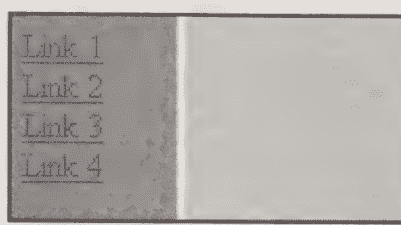

**图 6.19：一个两框架的框架集。**

本例使用 `<frameset>` 标签的 **border** 属性来定义框架之间两像素宽的边框。**framespacing** 属性也能实现相同功能，但不如 **border** 直观，因此此处未使用。**cols** 属性表明第一个框架的宽度占页面宽度的 30%，且是框架对中的左侧框架。第二个框架将填充页面剩余空间。（星号 * 表示使用剩余空间。）如果我们使用 **rows** 属性，框架将被水平分割。我们也可以使用 **bordercolor** 属性定义彩色边框，并且 **frameborder** 属性可以设置为 "yes" 或 "no"，以指示是否使用三维边框效果。

用户可以通过点击并拖动框架之间的边框来手动调整框架大小，除非设置了 **noresize** 属性。默认情况下，滚动条会在需要时出现，但你可以通过将 **scrolling** 属性设置为 "no" 来强制不显示滚动条。要控制框架内的边距，请使用 **marginwidth** 和 **marginheight** 属性。

## 框架中链接的目标

使用框架的一个关键技巧是控制链接加载到哪个窗口。在我们的两框架框架集中，链接位于左窗格。默认情况下，该框架中的链接会更改左窗格中显示的 HTML，但我们真正想做的是在右窗格（我们称之为“内容窗格”）中加载新页面。要控制链接文档加载到哪个框架，请为框架命名并在链接中使用 **target** 属性。要修改我们两框架示例中的链接，我们首先会如图 6.20 所示使用 **name** 属性。

```html
<html>
<frameset border=2 rows="30%,*" cols="30%,*">
  <frame src="index.html" name="index">
  <frame src="main.html" name="content">
  <noframes>Frames not working</noframes>
</frameset>
</html>
```

**图 6.20：为命名框架集编写的 HTML 代码。**

在这种情况下，我们将框架标记为 "index" 和 "content"。图 6.21 显示了会使一个框架中链接的目标在另一个不同框架中加载的代码行。结果如图 6.22 所示。

```html
<a href="barbeque barn.html" target="content">Link 1</a>
```

**图 6.21：在“内容”框架中打开的超文本链接。**


**图 6.22：一个带有指定目标链接的两框架框架集。**

对于链接，你还可以指定其他目标。以下是一些具有特定含义的特殊目标：

-   Target = "_blank" 在新窗口中打开链接。
-   Target = "_self" 在当前窗口中打开链接。
-   Target = "_parent" 在此框架的父框架中打开链接。
-   Target = "_top" 在最顶层的窗口框架中打开链接。
-   Target = "_search" 在搜索窗格中打开链接。

## 内联框架

到目前为止我们讨论的框架集在结构上是固定且僵化的。一种更灵活的框架类型是*内联框架*。它被称为内联框架，是因为框架及其内容被放置在网页上，就像内联元素（例如图像）一样。这使你能够将来自其他页面的内容拉取到放置在当前页面上的框架中。如果你有一个包含需要在多个页面上呈现信息的公共文档，你可能会这样做。每个这些页面都可能包含一个显示相同信息的内联框架。这样做的好处是信息存储在单个文档中，因此更易于维护。否则，在多个更改中保持相同信息的一致性将是困难且耗时的。

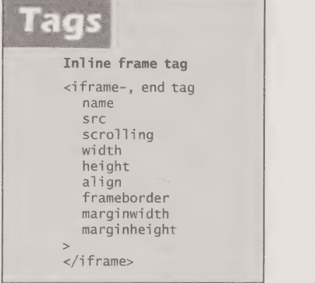

内联框架的属性与 **<frame>** 和 **<frameset>** 标签的属性类似。**src** 属性标识在框架内显示的文档，而其他属性控制显示的各种方面。

图 6.23 显示了一个简单内联框架示例的代码。图 6.24 显示了生成的网页。

```html
<html>
<body>
<p>This is just some text for paragraph one. We need to make this long enough so that it looks like it might be a real paragraph. How much more text do we need to add? What do you think?</p>
<p>Then we might start another
<iframe src="barbeque barn.html" width=45%>
if you see this, your browser does not support iframes
</iframe>
</p>
</body>
</html>
```

**图 6.23：内联框架的 HTML 代码。**

158 第 6 章：安排内容

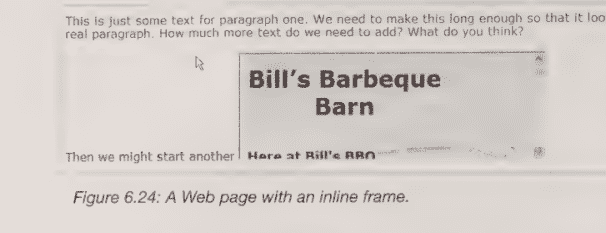

如你所见，内联框架放置在第二段的中间，宽度为页面宽度的 45%。因为 HTML 文档太长，无法放入内联框架的区域，所以添加了滚动条。还要注意图 6.23 中 `<iframe>` 和 `</iframe>` 标签之间的文本。句子“if you see this, your browser does not support iframes”应仅在用户的浏览器不支持内联框架时显示。

## `<div>` 和 `<span>` 标签

最后，或许也是最重要的用于控制网页上内容排列的标签是 `<div>` 和 `<span>`。这两个标签执行类似的任务，标记内容的一部分，并提供通过层叠样式表控制该内容呈现的能力。`<div>` 和 `<span>` 都只有很少的可设置属性。

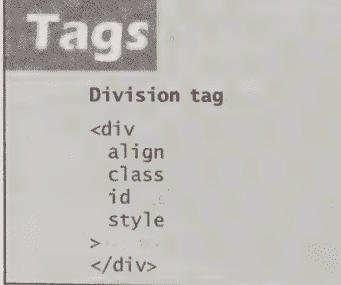

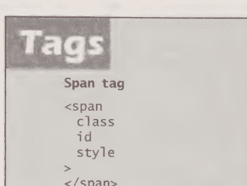

`<div>` 标签支持 align 属性，但不建议使用该属性，因为其功能可以通过层叠样式表来处理。这两个标签之间的一个区别是 `<span>` 是一个内联元素，它恰好出现在你编码的位置，很像内联框架，而 `<div>` 是一个块级元素，在其内容显示之前会执行换行。

图 6.25 中的简单代码示例使用 `<div>` 和 `<span>` 来创建图 6.26 所示的网页。

```html
<html>
<body>
<p>This is just some text for paragraph one. We need to make this long enough so that it looks like it might be a real paragraph. How much more text do we need to add? What do you think?</p>
<p>Then we might start another
<span>XXXXXXXXXX</span>
paragraph
</p>
<p>After that we could add a third
<div>YYYYYYYYYYYY</div>
paragraph
</p>
</body>
</html>
```

**图 6.25：包含 `<div>` 和 `<span>` 标签的 HTML 代码。**

160 第 6 章：安排内容

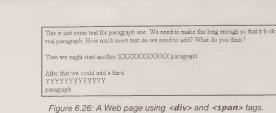

图 6.23 中的示例显示，`<span>` 标签中的 X 内联包含在段落中，而 `<div>` 标签在 Y 之前和之后强制换行。`<div>` 标签旨在定义页面的大部分区域，而 `<span>` 标签用于较小的内容部分。

要看到 `<div>` 和 `<span>` 如预期那样工作，你必须将层叠样式表纳入你的网页。通过为 `<div>` 和 `<span>` 标签分配类名，你可以为这些标签分配定位、对齐和其他格式属性。

你可以使用 `<div>` 和 `<span>` 标签提供类似于你在表格和框架中看到的页面格式。图 6.27 所示的网页左侧包含一个索引部分，右侧是一个内容窗格。索引的样式被绝对定位在页面的左上角，宽度为页面大小的 20%。内容窗格被定义为页面大小的 80%，并定位在页面的右上角。


层叠样式表的代码如图 6.28 所示。

```css
.index {width:20%; position:absolute; top:0; left:0;
}

.content {width:80%; position:absolute; top:0; right:0;
}
```

**图 6.28：用于图 6.29 中 HTML 的层叠样式表。**


如图6.29所示的网页代码使用`<link>`标签来指明要应用的样式表。它包含两个`<div>`标签，每个标签内都有一个`<iframe>`标签，用于从“index.html”或“barbeque barn.html”文档中加载内容。

```html
<html>
<head>
<link rel="stylesheet" type="text/css" href="TESTcss.css">
<body>
<div class="index">
<iframe src="index.html">
Your browser does not support frames
</iframe>
</div>
<div class="content">
<iframe src="barbeque barn.html">
Your browser does not support frames
</iframe>
</div>
</body>
</html>
```

图6.29：使用`<div>`和`<iframe>`标签以及样式表创建的页面的HTML代码。

## 总结

本章中，我们保持了示例的相当基础性。在我们讨论的所有标签中，表格可能是最普遍有用的，因为几乎所有的商业应用程序都需要将内容显示在整齐定义的行和列中。框架集和内联框架提供了额外的能力，可以将来自不同文档的内容融合到一个网页中。然而，使用这些标签来控制内容的呈现并不被推荐，更倾向于使用`<div>`和`<span>`标签。

请记住您网页的最终目的，并以支持该目的的方式组织您的内容。

# 第7章

## Web 应用概述

到目前为止，我们几乎完全在讨论HTML。既然我们已经有了基础，并理解了如何使用HTML来开发网页，现在是时候将网页应用到实际的商业应用程序中了。开发商业应用程序引入了新的考量因素和组件。

传统的商业应用程序通常使用单一系统和一个访问该系统的模拟器。Web 应用程序则将您的系统和软件开放给更多用户，并且通常涉及多个服务器。这些服务器可能位于本地、全国范围内，甚至在另一个国家。用户将使用Web浏览器连接和访问应用程序。这些应用程序将使用一个或多个附加工具（如 Active Server Pages、PHP、Java Server Pages 或 通用网关接口 (CGI) 程序）来提供动态网页。

在深入探讨这些工具之前，让我们更仔细地看看Web应用程序的组成部分。仅供内部员工使用的应用程序通常比向普通网络社区开放的应用程序复杂度低。无论哪种情况，Web应用程序都可能包含许多令人困惑的组件。但是，请记住，商业应用程序开发人员可能只负责系统的某一部分。特别是在中型和大型组织中，职责可能会分开，由Web管理员或系统人员负责系统配置、安全性和性能，而由另一个小组负责开发应用程序。

对于有经验的商业开发人员来说，这并不是什么新鲜事。这类似于传统应用程序中的职责分离。虽然商业开发人员可能不需要是配置、性能或安全方面的专家，但基本的理解会有所帮助。更好地理解系统组件和需求可以改进应用程序设计并提升应用程序质量。

## Web 应用系统组件

商业Web应用系统由硬件和软件组件组成，如图7.1所示。该图提供了对所需组件的基本理解，但根据组织特定环境的复杂性，可能还有额外的组件。您可能已经对基本组件有所了解，但为了填补任何空白，我们将对它们进行回顾。

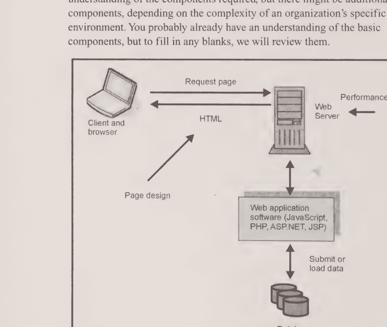

图7.1：一个Web应用系统。

## Web 应用系统组件

## 客户端

客户端是用于访问Web应用程序的硬件设备。它可能是笔记本电脑或台式机，也可能是手持设备，如PDA、PalmPilot或手机。请仔细考虑您的应用程序应该支持哪些类型的设备。这通常取决于您的应用程序用户是谁，以及他们使用什么设备访问互联网。

客户端设备可能会使用多种操作系统。当然，最常见的操作系统是Microsoft Windows。即使您的所有网站访客都在PC上使用Windows，他们也可能使用不同的屏幕尺寸和分辨率。屏幕尺寸和分辨率设置会影响网站和应用程序的外观。

所有这些因素都可能影响应用程序的编码方式。例如，如果您的用户通过手持设备访问您的站点，您的应用程序可能需要特殊的设计和编码技术，以便在较小的屏幕上轻松显示数据。如果您的应用程序包含大量图形，例如产品图片或徽标，那么考虑性能和外观的需求将变得更加重要。客户端设备类型、操作系统、屏幕尺寸和分辨率在第13章中有更详细的讨论。

## 浏览器

浏览器是充当客户端和万维网之间接口的软件。浏览器也被称为*Web客户端*。浏览器发送信息请求、接收信息并将其显示在客户端上。您可能已经熟悉可用的浏览器，例如Internet Explorer、Firefox、Opera和Netscape。浏览器通常是免费的，并且其流行度会变化。

浏览器会影响应用程序的外观，也可能为Web开发带来其他考量。如果您的应用程序供普通网络社区使用，您的站点很可能需要支持许多不同的浏览器。浏览器在第13章中有更详细的讨论。

## HTML

正如我们在前面章节中提到的，HTML是Web的语言，如果您正在创建Web应用程序，几乎肯定会用到它。HTML已经存在了很长时间，并且在未来很长一段时间内肯定还会被使用。然而，自其最初诞生以来，HTML已经发生了变化，包含了使其更灵活、更容易用于开发Web应用程序的功能和特性。HTML一直由标准控制，这极大地影响了兼容性，并使其成为Web上的通用标准。

HTML文档是静态的，这意味着它处于恒定状态。要使Web应用程序动态化，您可以向HTML添加客户端脚本。最常用的语言是JavaScript。JavaScript代码嵌入在HTML中。您将在第8章学习JavaScript和客户端脚本。另一种为HTML添加交互性的选择是使用包含CGI的表单。您将在第9章学习CGI。

## Web 服务器

Web服务器实际上包含两个组成部分：硬件和软件。因此，术语*Web服务器*可以指硬件，也可以指负责与客户端浏览器通信的程序。Web服务器接受来自客户端Web浏览器的HTTP请求，并提供HTTP响应，包括数据内容，通常以HTML文档和链接对象的形式。

编写Web应用程序并不一定意味着您需要购买新硬件。许多平台可用于提供网站服务，尽管有些平台比其他平台更兼容、更适合Web开发。您的组织可能已经有一个可用于托管网站和Web应用程序的系统。然而，额外的硬件可能有助于服务您的站点和Web应用程序，并作为增加另一层安全性的手段。另一方面，拥有额外的硬件需要额外的支持和管理。因此，您可能需要考虑使用Web托管服务，这将在本章后面讨论。

在Web服务器软件方面，有许多不同的产品可用，但有些产品比其他产品更受欢迎。表7.1列出了顶级Web服务器


虽然表7.1列出了前六名的软件产品，但被列入该列表并不意味着某个特定的服务器软件产品最符合您的需求。目前有数百种Web服务器程序可用。其中许多是为特定目的而创建的。服务器的选择需满足各种不同的需求和要求。表7.2是一份更完整的当前可用Web服务器软件列表。

表7.2：扩展的Web服务器软件列表
| | | | | |
| :--- | :--- | :--- | :--- | :--- |
| Abyss Web Server | Apache | Bad Blue | Eagle | Elemene |
| Google Web Server (GWS) | Httpperf | IBM Lotus Domino | IBM Websphere Application Server | In-kernel Web Server |
| Internet Information Services (IIS) | Jaminid | Kerio WebSTAR | Koala | LiteSpeed Web Server (Lighttpd) |
| MacHTTP | Macromedia JRun | Merak Mail Server | Mod wsgi | NetDynamics Application Server |
| Netscape Enterprise Server | Oversee | Oracle Application Server | Oracle HTTP Server | Personal Web Server |
| PoorMan | SAP Web Application Server | Server2Go | Stronghold | Sun Java System Web Server |
| Sun One Web Server | TV's server | UltiDev Cassini Web Server | WebLogic | WebSitePro |
| Windows Personal Web Server | Zeus Web Server | | | |

如何选择Web服务器软件？请考虑您的需求并确定具体要求。研究是关键。考虑并比较符合您要求和期望的服务器软件。以下是一些用于评估和比较的考虑因素：

-   提供的功能
-   提供的功能性
-   操作系统支持
-   成本
-   创建者
-   开源
-   软件许可
-   动态内容支持
-   支持的脚本语言
-   支持的数据库
-   平台兼容性
-   提供的安全性
-   管理和支持要求
-   性能和响应时间
-   可靠性

## 应用服务器

应用服务器与Web服务器不同。Web服务器提供客户端动态内容和网站静态组件的服务。应用服务器提供服务器端动态内容，并与数据库引擎集成。通常，应用服务器用于Web应用程序的业务逻辑和数据访问。大多数Web服务器也能够充当应用服务器。

应用服务器软件通常与中间件捆绑在一起，以使应用程序能够与依赖的应用程序（包括Web服务器和数据库管理系统）进行通信。一些应用服务器还包含API，使其与操作系统无关。*门户*是常见的应用服务器机制，通过它可以为多种设备类型提供单一入口点。表7.3展示了一些将应用服务器纳入应用程序设计的原因。

表7.3：Web应用服务器的优势

| 优势 | 描述 |
|---|---|
| 数据和代码完整性 | 通过将业务逻辑集中在一台或少数几台服务器机器上，可以保证为所有用户更新和升级应用程序。不存在旧版本应用程序以旧的、不兼容的方式访问或操作数据的风险。 |
| 安全性 | 通过中心点管理对数据和应用程序部分的访问提供了安全优势。使用应用服务器将身份验证的责任从潜在不安全的客户端层移开，而无需暴露数据库层。 |
| 集中配置 | 应用程序配置的更改，例如数据库服务器的迁移或新的系统设置，可以集中进行。 |
| 性能 | 客户端-服务器模型在高使用环境下提高了大型应用程序的性能。 |
| 总拥有成本 | 使用应用服务器可以通过开发业务应用程序时提供的优势为组织节省资金。 |

## 商业Web应用程序软件

为静态网站添加动态能力是Web开发的核心内容。用于添加该功能的编程工具非常重要。这不仅仅是学习HTML的问题。您将使用一系列工具的组合来创建您的Web应用程序。某种形式的HTML将是嵌入和执行应用程序逻辑的框架的一部分，而实际的编程代码可能在客户端或服务器端执行。

## 客户端编程和脚本

在客户端，动态内容是在客户端系统上生成的。Web服务器检索嵌入了代码的HTML页面并将其发送给客户端。然后，客户端上的Web浏览器处理页面中嵌入的代码。客户端代码可用于诸如更改内容、输入验证、识别环境条件或触发操作事件等事情。通常，嵌入HTML页面的脚本语言是JavaScript。

在客户端-服务器关系中执行的操作需要访问客户端上可用但服务器上不可用的信息或功能。客户端是专用的用户资源，因此在正确设计和编码的情况下，客户端处理可以提供快速的响应时间。在客户端完成处理也可能降低安全风险。

程序员有各种各样的工具可用于客户端编码。JavaScript（在第8章讨论）是最常见的工具。另一种选择是JavaScript和XML的组合，称为Ajax。其他选项包括Python、VBScript和Perl。

Java不是一种脚本语言，但它也可以用于客户端应用程序。Java是一种面向对象、与平台无关的语言，其根源在于C和C++。任何具有Java虚拟机的硬件都可以与Java一起使用。然而，Java比真正的脚本语言更复杂，学习曲线更长。Java是一种编译语言。源代码被编译成字节码，这实际上是程序执行时实际使用的。Java也可用于服务器端Web开发。

大多数Web服务器软件包也有用于创建动态内容的脚本网关。脚本网关在Web应用程序中用于提供连接客户端和服务器的网关。考虑两个用带门的篱笆隔开的场地。这两个场地就是客户端和服务器，而网关就是连接它们的门。CGI钩子是最常用的网关，允许开发者在程序控制下创建整个页面和图形。CGI钩子在客户端的HTML页面中启动。第9章将介绍使用CGI进行Web开发。

用户的浏览器设置决定了如何处理嵌入HTML中的客户端代码。目前，大多数（但不是全部）浏览器和设备支持JavaScript。但是，用户可以禁用此功能。有人可能会认为，关键任务编程和脚本应驻留在服务器端，以实现普遍可访问性。

## 服务器端编程和脚本

服务器端编程和脚本为您的网站添加动态性提供了另一种方式。图7.2提供了服务器端应用程序执行的高级摘要。如您所见，服务器端脚本或程序在客户端通过HTTP请求调用时执行。HTTP协议自1990年以来一直在使用。服务器端动态页面创建大约在1993年通过CGI成为可能。此后不久，服务器端嵌入被引入，提供了一种更直接的方式来包含服务器端脚本。

服务器端编程和脚本的一些用途包括以下内容：

-   处理用户、查询，检索和返回选定数据。
-   添加、更改或删除网页内容。
-   访问数据或数据库以检索、添加、更改或删除数据。
-   创建处理信息的应用程序。
-   基于业务逻辑开发应用程序。
-   提供安全性和访问控制。
-   验证数据或输入。
-   为不同类型的浏览器定制输出。
-   访问文件。
-   自定义网页使其用户友好。
-   提高应用程序性能。
-   翻译或转换数据格式。
-   与其他应用程序或系统进行接口。

基本上，服务器端开发用于与传统编程语言相同的所有任务。

与客户端脚本不同，服务器端脚本不允许用户查看源代码。客户端脚本对信息的访问权限更大

并且在用户的计算机上执行。服务器端脚本要求服务器安装语言解释器，并且无论使用何种客户端浏览器或操作系统，都能产生相同的结果。客户端脚本需要使用网站大多数用户所使用浏览器支持的语言编写。

服务器端Web应用程序创建有大量可用的应用开发工具。除了SSI，工具还包括ASP、ASP.NET、API、CGI、Java、Java Servlets、JavaServer Pages (JSP)、Perl、PHP、Python、Ruby、Ruby on Rails和Visual Basic。选择合适的工具可能看起来是一项艰巨的任务，但了解可用工具及其工作方式是第一步。你可能已经熟悉其中一些工具，或者可能已经就哪些工具符合你现有标准做出了决定。其中一些工具相对较快就能学会，如Visual Basic和PHP，而另一些，如Java，则需要更长的时间来学习和掌握。最常用的工具（ASP.NET、CGI编程、Java、JSP和PHP）将在后续章节中讨论。

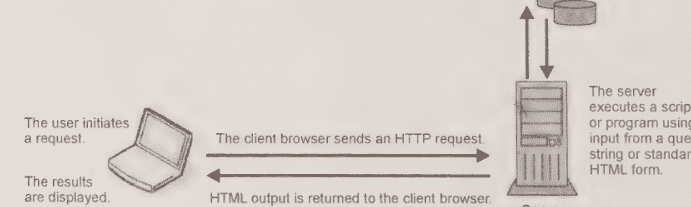

服务器端Web开发的另一个选择是使用*快速应用程序开发（RAD）*工具。RAD是一种能够更快开发应用程序的方法论。RAD的其他潜在好处包括为任何技能水平的开发人员提供创建Web应用程序的便利性，以及为开发人员提供访问支持资源的实用性。

许多RAD工具可用于Web应用程序开发。RAD工具是商业软件。它们附带支持资源，开发人员可以根据许可协议进行访问。并非所有RAD工具都相同。有些是特定于平台的，而有些是可移植的甚至是平台无关的。比较RAD工具对于你成功并满意地使用某个工具可能很重要。目前可用的一些RAD工具包括PlanetJ的WOW（Web Object Wizard）、BCD Web Smart、IBM Rational Developer、NetBeans、Lazarus、LANSA、Boa Constructor、NetBeans和RadRails。

没有单一的最佳工具用于服务器端应用程序开发。应考虑许多因素来确定什么最适合你的需求。这些因素包括手头的任务、安全考虑、开发人员技能水平、组织策略、流程和标准。要编写Web应用程序，开发人员应该有各种可用的工具。随着经验的积累，开发人员将学会如何为手头的任务选择最佳工具。

## 兼容性

审查你的系统组件是否兼容。研究并测试系统内所有的连接和交互点，以确保所选组件能良好协作且兼容。对于需要快速性能的站点和应用程序，或者流量很大的站点，检索和记录环境信息（包括使用的浏览器）是一个好主意。这些信息可以帮助你更好地了解用户的配置，以便进行分析和测试。

## 使用经过验证的成熟技术

不要为了追求前沿而冒险使用未经验证的技术。确保工具稳定且具有满足你要求的性能记录。选择拥有支持体系的技术。这个支持体系可以是一个你可以拨打的电话号码、一个Web用户社区，或者是拥有技术知识的已知资源。如果你选择常见、成熟的技术，并且遇到了与该技术相关的性能问题，其他人可能已经遇到过同样的情况，并且愿意分享解决方案。

通常，性能错误是由于不正确的编码技术或将技术与不兼容的组件结合使用造成的。在生产环境中使用这些工具之前，务必获取知识并清晰理解其工作方式。与任何技术一样，使用Web开发工具开发的应用程序应经过彻底测试。

## 测试设备、浏览器、操作系统和连接

在开发应用程序时，很容易忽视最终用户可能没有与你相同的设备、浏览器、操作系统和连接组合这一事实。例如，如果你使用的是高速连接，你的响应时间将与使用拨号连接的最终用户不同。

应用程序应使用不同的浏览器和不同版本的浏览器进行测试。所使用的浏览器可能对性能产生显著影响。通常，开发人员使用的是更新设备和更新版本的常见操作系统。如果你的最终用户可能使用不同的设备和不同的操作系统，你的应用程序需要解决任何差异。

一个好的Web应用程序测试计划应包括使用不同的设备、浏览器、操作系统和连接组合进行测试。考虑你的受众是谁以及应用程序的最终目标是什么。这将有助于确定测试所使用的工具。

## 数据库

数据库是信息的结构化集合，是一个由文件、记录和字段组成的电子文件系统。*数据库管理系统（DBMS）*或*关系数据库管理系统（RDMS）*是用于管理、查询和更新该数据的软件应用程序。你用于传统应用程序的DBMS或RDMS可能也可以用于你的Web应用程序，尽管有些数据库比其他数据库更适合Web应用程序。

在选择编程工具、Web服务器和Web应用程序服务器时，请考虑它们与现有数据库和DBMS或RDMS的兼容性。或者，出于安全目的，你可能选择将Web应用程序数据存储在不同的系统上。如果你的数据已经存储在不同的位置，或者使用了多个DBMS或RDMS，那么选择兼容性和安全性合适的工具就很重要。

## 使用SQL访问数据

在20世纪60年代，数据库软件需要使用复杂且难以维护和运行的大型机，并且通常需要巨大的资源来支持。每台大型机运行来自不同制造商的不同软件。SQL（结构化查询语言）在20世纪70年代被创建，作为任何数据库程序的新标准。它迅速获得了国际流行，因为它弥合了大型机之间的障碍，允许大型企业将其工作联网。

如今，SQL既是ANSI标准也是ISO标准。它是一种交互式编程语言，用于在RDMS中检索和更新数据。SQL构成了大多数现代数据库系统的骨干。它与大多数数据库和数据库引擎兼容，包括SQL Server、DB2、Oracle、Sybase、MySQL、dBase、Unix、Linux和Access。许多其他产品通过专有扩展支持SQL标准语言。

SQL知识对于从数据库存储或检索数据是无价的。如果你还不熟悉SQL，你需要认真考虑发展SQL技能。

## 数据库触发器

数据库触发器是由用户编写的程序，当在数据库中执行数据更改时，由DBMS激活。该更改可能是添加、更改或删除记录。

触发器的主要目的是监控数据库变化并提供启动操作的工具。触发器与应用程序无关，这意味着无论数据库更改的来源如何，触发器都会自动激活。当触发器被激活时，控制权从应用程序转移到数据库系统。然后触发器程序执行你指定的操作。一旦触发器操作完成，控制权返回给启动触发器的应用程序。执行的操作可能包括执行一个程序。图7.3展示了如何在Web应用程序中使用数据库触发器来重用遗留代码。（重用遗留代码将在本章后面更详细地讨论。）


## 网站设计

本书的重点不在于网站的外观，而在于为满足系统需求必须创建的业务应用程序。有时，程序员会负责图形和外观，但更常见的是由设计或营销团队负责图形和设计。然而，即使你不负责网站设计，在开发Web应用程序时，也有一些网站设计注意事项需要牢记，如表7.4所列。

## 表7.4：设计注意事项

| 设计注意事项 | 描述 |
| --- | --- |
| 符合现有标准 | 设计应与现有标准兼容。 |
| 开发实践 | 应考虑Web开发社区当前使用的开发实践和行业最佳实践。 |
| 设备支持 | 应考虑设备支持和设备独立性。 |
| 易用性 | 设计和编程工具应易于使用，避免不必要的复杂性。应用程序应便于开发者使用，实现有效的可用性和可访问性，并提供强大的互操作性。最终结果将是为终端用户提供的易用应用程序。 |
| 安全性 | 不应忽视安全性。设计必须为终端用户和开发者纳入安全措施。 |
| 国际化和本地化 | 应遵循国际化和本地化指南，并考虑当前实用的国际化解决方案。 |
| 开发空间 | 应考虑客户端和服务器端的Web应用程序开发空间。减少碎片化为作者提供了通用的实施框架，使Web应用程序的开发、打包和部署更加容易。 |
| Web交付 | 设计应侧重于Web交付和部署。 |

## 页面内容

在网页上提供过多信息会对用户体验产生负面影响。如果你认为用户会花时间阅读这样一个网页上的每个字，那你就错了。要确保用户阅读特定文本，请将其作为页面的第一句话或非常靠近页面顶部的内容。如果你需要与用户分享大量内容，请逻辑地分割内容并使用多个页面。

有时少即是多。不要用不需要的文本填满页面。这同样适用于图像。有时图像能产生巨大影响，并能为页面增添巨大价值，但过多的图像会分散用户的注意力。此外，在使用图形时，请考虑性能，如第3章所述。加载图像需要资源。应考虑图像的加载方式和时机。简单且逻辑清晰的页面是最有效的。

搜索引擎也可能对你的Web应用程序页面内容产生重大影响。本书后面会讨论搜索引擎。

178 第7章：Web应用程序概述

## 导航

用户如何在网页上操作很重要。同样，保持简单和逻辑清晰。尝试为应用程序的所有页面创建一个通用的导航结构。这将使用户的体验更加直观。

逻辑地组织任务和到其他页面的链接。尽量减少在文本段落中使用超链接。在文本段落中放置大量超链接会破坏一致导航结构的感觉。应规划好到网站页面的链接和导航，将类似功能分组。当需要到其他页面的超链接时，请将它们添加到段落底部或页面上的导航菜单中。

图7.4和图7.5是网站简单、易于理解和易于操作的示例。在这些示例中，菜单按钮放置在页面顶部，并且通过网页左侧的菜单列表也提供了导航功能。所使用的措辞简单，页面没有杂乱地堆砌过多信息。在这些网站中，始终使用相同的视觉外观、菜单和按钮，以增强用户体验。

图7.4：一个不杂乱的网页示例。

*图7.5：一个具有简单、清晰导航工具的网页。*

## 标准

标准是简化Web应用程序开发的有效且有用的机制。标准使得不同的开发者修改和支持Web应用程序变得容易得多。在这方面，Web应用程序开发与传统应用程序开发并无不同。

标准应包括文档、代码位置、使用的技术、网站设计、功能、特性和测试。一些开发者可能认为标准是限制，但他们应该理解标准使编码和调试任务变得容易得多。编码错误是应用程序问题的最常见的来源，使用标准可以将其最小化。Web标准还有助于确保所有网站用户能够访问相同的信息，并在使用Web应用程序时获得相同的体验。

明智地选择你的标准工具。如前所述，Web应用程序编程有许多可用选项。请确保选择稳定、可靠、经过验证且适合网站使用平台的工具。本书介绍了几种工具。了解可用的工具及其工作方式将有助于决定将哪些工具作为标准纳入。

## 其他注意事项

在你的网站设计中包含用户反馈的途径。使其易于使用和理解，因为反馈（无论是正面的还是负面的）都可以帮助改进你的应用程序。网站访问者通常不吝于分享他们认为你可以做得更好或如何改进你网站的见解。

除非你的网站性质另有规定，否则请确保提供易于找到的适当联系信息。没有什么比访问一个网站却找不到组织的地址或电话号码，并且无法轻松找到这些信息更令人沮丧的了。

考虑你的受众是谁以及应用程序的最终目标是什么。这将有助于确定应使用哪些类型的设备、操作系统和浏览器进行测试。

## 性能

在开发任何系统或应用程序时，性能都是一个严肃的课题，但在网络上尤为重要。Web服务器旨在快速接收和响应用户请求。缓慢的应用程序很快会导致终端用户的不满。

许多因素会影响性能。根据网站的目的，某些页面可能比其他页面具有更多的活动或更重的流量。在信息或查询页面上，如果用户必须等待响应或页面加载，你将很快失去他们的兴趣。如果你的网站旨在销售产品或服务，这可能会导致潜在客户转向响应更快的其他网站。在本节中，我们将回顾一些改进和控制网站性能的机会。

## Web应用程序设计

我们已经讨论了在设计网站和Web应用程序时应考虑的一些因素。设计将对性能产生影响。充斥着过多图像、文件格式导致文件过大、内容不必要且设计不佳的页面，都会导致加载缓慢。设计不仅限于静态内容，还包括动态组件。不必要的复杂性或糟糕的编码，例如与数据库进行多次交互而不是一次交互，可能会导致性能问题。

## 将任务卸载到客户端

客户端是用户专用的资源。而服务器则是共享资源。应用程序可以设计成将部分任务（如初步验证或脚本逻辑）卸载到客户端，以最小化服务器负载。客户端脚本并非万能解决方案，但显然作为用户的专用资源，应考虑使用它来最小化处理用户请求和响应所带来的性能影响。

## 配置

正确配置的Web服务器和系统将提升性能。一旦选定服务器，管理员应深入了解其工作原理及配置方法。其他硬件以及所使用的数据库也同样适用此原则。

开发基准测试脚本来测试服务器配置。使用实际应用程序进行测试是个好主意，同时需考虑用于访问网站的硬件设备和操作系统。通常，配置会提供许多控制性能的变量。确保清晰理解这些变量设置对配置的影响。

## 响应标准

制定响应标准。首先，估算可能同时访问站点和应用程序的潜在最大用户数量。考虑需要执行的代码以及应用程序是否会访问、检索和更新数据。基于这些信息，定义可接受的用户响应时间。制定的标准应与应用程序测试以及硬件和软件的选择协调使用。

## Web服务器性能

Web服务器的关键性能因素包括：

-   每秒请求数
-   每秒吞吐量（字节）
-   支持的并发级别
-   每个新连接请求的延迟响应时间（毫秒）

Web服务器根据并发客户端连接数和每秒可处理的最大请求数来定义负载限制。负载限制由配置、HTTP请求类型、页面内容是静态还是动态、服务器内容是否缓存、硬件限制以及所用操作系统的软件限制决定。当服务器达到其极限时，就会过载并变得无响应。

服务器可能因多种原因过载，包括：

-   用户流量过大
-   病毒
-   蠕虫
-   分布式拒绝服务攻击
-   互联网网络变慢
-   服务器停机

## HTTP流量管理器

HTTP流量管理器可用于监控和分类带宽使用情况。这为系统管理员提供了其网络设备的实时读数和长期使用趋势。最常见的用途是带宽管理，但您也可以监控网络的许多其他方面，如内存和CPU利用率。

## 流量负载

防火墙可用于阻止来自选定IP源的不需要的流量，或创建特定模式以减少服务器流量。HTTP流量管理器可用于丢弃、重定向或重写使用被识别为不需要的特定模式的请求。流量管理器还用于平滑网络使用高峰。Web缓存技术也可用于减少流量。

另一种可能性是使用不同的域名来提供静态和动态内容，或将大文件与中小型文件分开。其思想是完全缓存中小型文件，同时通过使用不同的配置来高效地提供大文件。也可以使用多台服务器来减少单台服务器的流量并平衡服务器负载。当然，增加RAM和处理器容量也是一个选项。如果服务器未针对您的需求进行适当配置，则可能需要这样做。

## 编码技术

应使用编码技术来最小化资源需求和编程错误。如前所述，建立标准将有助于确保应用程序性能良好且更易于支持。Web应用程序的设计与传统应用程序开发并无不同。保持简单。使用编码技术避免执行不必要的代码以及不必要的请求和响应交互。学习和理解语言是第一步。使用缓存和编程来防止缓冲区过载是提高性能的有效方法。

## 性能监控和日志工具

Web服务器软件通常包含或可购买性能监控和日志工具。这些工具提供收集信息以便进行分析，以确定您的系统是否在峰值性能下运行。它们还会告诉您所使用的组件是否无法满足用户需求。值得花时间了解有哪些可用工具并加以利用。

## 重用旧版代码

决定将Web应用程序作为业务系统的一部分，并不意味着您必须废弃已使用的应用程序。保留其中一些应用程序不变，仅在Web上部署选定的应用程序可能是合理的。许多组织已有现成的应用程序，他们投入了大量的资源、时间和资金。其中许多应用程序稳定且仍然非常适合业务需求。除非业务需求要求变更，否则没有理由重写所有应用程序。

应考虑重用旧版代码。这可能影响Web应用程序开发的设计、工具选择和框架。重用旧版代码或维护两个执行相同功能的不同程序版本并不总是可行的。如果您现有的应用程序包含详细而复杂的逻辑，有可能在不完全重写的情况下包含这些应用程序。您可以通过多种方式重用旧版代码。以下页面将讨论几种选项。

## API

应用程序接口（API）使一个程序能够与另一个程序通信。例如，可以在PHP、JSP或ASP.NET应用程序中使用API来执行与旧版应用程序的数据共享。API的开发是为了响应两个或更多不同软件应用程序之间交换信息的需求。API已存在很长时间，大多数系统都可以使用它们。存储过程和用户定义函数是两种类型的API。

## 存储过程

存储过程是可供使用关系数据库系统的应用程序使用的子程序。存储过程通常用于数据验证、访问控制或触发旧版应用程序的执行。存储过程用于整合和集中最初在应用程序中实现的逻辑。存储过程必须使用CALL语句调用（与用户定义函数不同，后者可以在SQL语句中像任何其他表达式一样使用）。以下是CALL语句的示例：

```
CALL procedurname(parm1, parm2)
```

存储过程可用于返回数据结果集，也可用作启动另一个应用程序执行的方法。存储过程还可以接收和返回变量，从而可以在Web应用程序和存储过程之间传递参数。虽然调用存储过程非常简单，但您需要特定于您的平台和DBMS的信息来创建存储过程。

在大多数平台上，存储过程只能用于执行SQL语句和指令。存储过程使用CREATE PROCEDURE语句编目在SQL系统目录中。然而，在i5上，存储过程的规则相对宽松；存储过程可以用多种语言编写，包括RPG、COBOL、FORTRAN、PL/I、REXX、CL和C。


## 第七章：Web 应用程序概述

使用非 SQL 语言编写的存储过程通常被称为*外部存储过程*。外部存储过程不一定需要包含嵌入式 SQL 语句，也不需要进行目录化。其他平台也提供类似功能。您需要验证所使用的平台是否提供此功能。

存储过程重复利用遗留代码的一个例子是，创建一个执行遗留应用程序的存储过程。在 Web 应用程序中，在存储过程调用内传递所需的参数。这样您就可以访问和使用遗留应用程序的复杂代码或广泛的业务逻辑，而无需重写。

图 7.6 展示了在 System i 上使用 SQL 创建存储过程以启动运行 RPGLE 程序的示例。在此示例中，在 MYLIB 库中创建了一个名为 MYSTRPRC 的存储过程。创建的过程引用了 MYLIBRARY 库中名为 MYRPGPGM 的 RPG 程序。此示例中未传递参数。

```
步骤 1：在 System i 上创建存储过程

CREATE PROCEDURE MYLIB/MYSTRPRC ( )
  DYNAMIC RESULT SETS 1
  LANGUAGE RPGLE
  SPECIFIC MYLIB/MYSTRPRC
  NOT DETERMINISTIC
  MODIFIES SQL DATA
  CALLED ON NULL INPUT
  EXTERNAL NAME 'MYLIBRARY/MYRPGPGM'
  PARAMETER STYLE GENERAL;

步骤 2：从 Web 应用程序调用存储过程

CallableStatement cstmt = connection.prepareCall("CALL MYLIBRARY.MYSTOREDRPROC");
```

*图 7.6：使用存储过程调用 iSeries RPGLE 程序。*

图 7.7 是另一个在 i5 上使用 SQL 创建存储过程以运行 CL 程序的示例。此示例与图 7.6 中的示例非常相似，不同之处在于它调用的是 CLP 而非 RPGLE 程序。此外，传递了两个参数：PARMIN 和 PARMOUT。调用语句来自一个 Java 程序。

```
步骤 1：创建存储过程
CREATE PROCEDURE LUBELHOR/HITACHICLP (IN PARMIN CHAR(120),
   PARMOUT CHAR(120))
   LANGUAGE CL
   SPECIFIC LUBELHOR/HITACHICLP
   NOT DETERMINISTIC
   MODIFIES SQL DATA
   CALL ON NULL INPUT
   EXTERNAL NAME LUBELHOR/HITACHICLP
   PARAMETER STYLE GENERAL

步骤 2：调用存储过程
CallableStatement cstmt = connection.prepareCall("CALL LUBELHOR/
HITACHICLP (?, ?)");
```

*图 7.7：使用存储过程调用 iSeries CL 程序。*

### 用户定义函数

用户定义函数 (UDF) 是重复利用遗留代码的另一个可能选项，对代码的修改很小甚至没有。大多数具有 SQL 根基的数据库管理应用程序都允许使用 UDF。调用遗留代码并非 UDF 的唯一目的，但它是其可能用途之一。

与存储过程类似，UDF 通过调用语句执行。存储过程和 UDF 之间的主要区别在于，存储过程必须使用调用语句调用，而 UDF 可以像任何其他表达式一样在 SQL 语句中使用。

图 7.8 是一个如何在 System i 上创建 DB2 UDF 以引用 RPGLE 程序的示例。（其他数据库系统和平台的语法会略有不同。）在示例中，传递一个整数变量，并将返回一个 15 位、0 位小数的值。创建后，此函数可以在 PHP、JSP 或 ASP.NET 中执行。

```
CREATE FUNCTION MYLIBRARY/MYFUNCTION(INTEGER)
RETURNS DECIMAL(15,0)
SPECIFIC MYUDFD1
DETERMINISTIC
LANGUAGE RPGLE
NO SQL
NO EXTERNAL ACTION
RETURNS NULL ON NULL INPUT
SCRATCHPAD
FINAL CALL
ALLOW PARALLEL
EXTERNAL NAME 'MYLIBRARY/MYUDFPROGRAM(MYPARM)'
PARAMETER STYLE DB2SQL;
```

*图 7.8：创建 UDF。*

虽然存储过程可以有输入和输出参数，但 UDF 只有输入参数。输出参数必须作为返回值返回。然而，UDF 返回单个值并不意味着它们不能包含具有复杂逻辑的应用程序。

一些具有 SQL 根基的数据库管理系统可能允许使用用户定义表函数 (UDTF)。UDTF 是一种返回虚拟表而非单个值的 UDF。使用 UDTF，您可以返回一组值。与存储过程类似，UDTF 允许在最小化更改的情况下重用代码，使您能够将遗留应用程序与 Web 应用程序协调使用。

图 7.9 中的 create function 语句标识了此示例中的函数名称 MYFUNCTION，位于 MYLIBRARY 库中。external name 关键字指定函数调用的 ILE CL 程序。在此示例中，它是 MYUDTFPGM，位于 MYLIBRARY 库中。示例使用了两个参数：PARM1 是字符值，PARM2 是十进制值。

```
CREATE FUNCTION MYLIBRARY/MYFUNCTION ()
RETURNS TABLE (
 PARM1    CHAR (10)
,PARM2    DECIMAL (5, 0)
)
LANGUAGE CLLE
PARAMETER STYLE DB2SQL
NOT DETERMINISTIC
NO SQL
CALLED ON NULL INPUT
NO DBINFO
NO EXTERNAL ACTION
NOT FENCED
NO FINAL CALL
DISALLOW PARALLEL
SCRATCHPAD
EXTERNAL NAME MYLIBRARY/MYUDTFPGM
CARDINALITY 1
```

*图 7.9：创建 UDTF。*

如果您想在 Web 应用程序中重用遗留代码，请研究 UDF 或 UDTF 的可能性。不同平台之间的语法通常非常相似。“如何做”这个问题的答案很可能可以在您的 DBMS 文档中找到。使用哪一个最好在彻底查阅特定于您平台的文档后做出决定。网络是另一个很好的研究来源。许多组织已使用 UDF 进行遗留代码重用。如果您使用的 DBMS 支持 UDF 或 UDTF，您将能够轻松地在网络上找到它们的示例。

### 转换工具

许多平台提供软件应用程序，可用于将遗留程序从一种语言转换为另一种语言。有时，转换工具被称为*迁移工具*。在某些平台上，这些工具可能免费提供，以鼓励使用更新的技术。在其他情况下，则必须购买这些工具。如果您想保留遗留代码但又不想重写应用程序，值得研究一下转换工具。完成转换所需的工作可以由内部员工或外部服务组织完成。转换还可用于将软件从一个平台移动到另一个平台，并以可在新平台上使用的格式进行。

如果您只需要重用少数几个应用程序，转换可能不值得。但是，如果您需要重用一个大型系统或所有应用程序，转换工具很可能就是正确的解决方案。

## 安全性

将应用程序开放给 Web 会引入新的安全考虑因素。如果您的站点和应用程序将由少数受控访问的用户使用，安全要求将远没有那么复杂。另一方面，如果您的站点和应用程序将被大量用户使用，安全性将更加复杂。用户的粗心疏忽和故意破坏或滥用系统的企图都会产生必须防止或至少最小化的安全风险。本书不专注于安全，我们认识到开发者并不承担全部责任。然而，开发者确实有影响，应该了解安全考虑因素和预防措施。在本节中，我们将回顾安全并考虑提供安全 Web 应用程序的一些机会。

表 7.5 列出了一些应考虑的潜在安全风险。这个列表相当令人生畏，并且随着不道德用户发明新的攻击系统的方式而不断增加。然而，通过考虑和行动，您的系统可以免受安全威胁。

| 安全威胁 | 描述 |
|---|---|
| 广告软件 | 广告软件是安装在您计算机上向您显示广告的软件。它会通过使用 RAM 和 CPU 周期来减慢您的系统速度。它还会通过使用带宽来获取广告来减慢您的互联网连接速度。此外，广告软件会增加系统的不稳定性，因为许多广告软件应用程序编程不佳。最后，广告软件会通过向您的屏幕弹出不需要的广告来惹恼您并浪费大量时间，这些广告需要您关闭它们才能返回使用您的 PC。 |
| DDOS | 在 DDOS（分布式拒绝服务）互联网攻击中，多个外部源攻击单个目标系统，目的是拒绝其用户的服务。DDOS 攻击以远高于目标系统处理能力的速率向其发送大量消息，使其减慢到无法使用的程度。 |
| 黑客攻击 | 黑客攻击是指试图未经授权访问网络和系统的尝试。 |
| 网络数据拦截 | 消息可以通过网络窃听从浏览器发送到服务器，反之亦然。窃听者可以在浏览器和服务器之间路径上的任何点进行操作。 |
| 按键记录 | 按键记录涉及在计算机上安装硬件以捕获输入的信息。这通常用于捕获个人详细信息，包括密码。 |


## 表7.5：潜在安全威胁（续）

| 安全威胁 | 描述 |
|---|---|
| 网络钓鱼 | 网络钓鱼是指试图通过伪装成授权实体来非法和欺诈性地获取敏感信息。它通常通过电子邮件或即时消息进行，并经常引导用户在网站上输入个人详细信息。 |
| Smurf攻击 | Smurf攻击是一种向受害站点生成大量计算机网络流量的方式。也就是说，它是一种拒绝服务攻击类型，通过伪造的广播ping消息泛滥目标系统。 |
| 垃圾邮件 | 垃圾邮件是指在互联网上大量发送相同信息的副本，试图将信息强加给本不想接收的人。大多数垃圾邮件是商业广告，通常涉及可疑产品、快速致富计划或半合法服务。 |
| 间谍软件 | 间谍软件是一种在用户浏览互联网时秘密收集用户信息的软件。此信息通常用于广告目的。间谍软件还可以收集电子邮件地址，甚至密码和信用卡号码。 |
| Trinoo | Trinoo是一组用于执行DDOS攻击的计算机程序。据信，Trinoo网络已在互联网上数千个被远程缓冲区溢出漏洞利用而妥协的系统上建立。Trinoo以允许攻击者在名为“cry baby”的文件夹中留下信息而闻名。只要端口80处于活动状态，该文件就会自我复制并定期修改。 |
| 特洛伊木马 | 特洛伊木马是一种伪装成另一个程序的程序。与病毒类似，这些程序是隐藏的并会引起不良影响。它们与病毒的不同之处在于，它们通常不是为了复制而设计的。 |
| 未经授权的访问 | 未经授权的访问试图窃取机密信息，在系统上执行命令以修改系统，收集系统信息，或发动拒绝服务攻击使机器暂时无法使用。 |
| 病毒 | 计算机病毒是设计用于从一台计算机传播到另一台计算机并干扰计算机操作的小型软件程序。病毒可能会损坏或删除计算机上的数据，使用电子邮件程序将自身传播到其他计算机，甚至擦除硬盘上的所有内容。病毒最容易通过电子邮件附件或即时消息传播。这就是为什么您永远不要打开电子邮件附件，除非您知道发件人是谁并且您正在期待它。病毒可以伪装成有趣图片、贺卡或音频和视频文件的附件。病毒也通过从互联网下载传播。它们可能隐藏在非法软件或其他您可能下载的文件或程序中。 |
| 蠕虫 | 蠕虫是一种自我复制的病毒，它不修改文件，而是驻留在活动内存中并复制自身。蠕虫使用操作系统的某些部分，这些部分是自动的，通常对用户不可见。蠕虫通常只有在它们不受控制的复制消耗系统资源，减慢或停止其他任务时才会被注意到。 |

## 安全实践

以下是一些有助于降低风险的安全实践：

-   限制机器上可用的登录帐户数量。删除不活跃的用户。
-   确保拥有登录权限的用户选择好的密码。Crack程序将帮助您检测选择不当的密码。
-   关闭未使用的服务。例如，如果您不需要在Web服务器主机上运行FTP，请删除该软件。同样适用于sendmail、gopher、NIS（网络信息服务）客户端、NFS（网络文件系统）、finger和systat。停用任何您不使用的服务。
-   移除您绝对不需要的shell和解释器。例如，如果您不运行任何基于Perl的CGI脚本，请移除Perl解释器。
-   定期检查系统和Web日志以发现可疑活动。
-   扫描安全日志以发现可疑活动。
-   使用互联网安全扫描软件并审查提供的信息。
-   确保在系统文件上正确设置权限，以防止篡改。
-   创建并使用防火墙。*防火墙*是一种安全方案，它防止未经授权的用户访问计算机网络，或监控网络与客户端之间的信息传输。
-   配置路由器以提供额外的安全性。
-   不要打开系统上的所有端口。
-   创建安全套接字层（SSL）。SSL是一种为互联网通信提供高度安全性的协议。
-   使用反间谍软件。反间谍软件保护您的客户端和服务器设备，并有助于保持个人详细信息安全。
-   使用防病毒软件检测病毒并防止其感染您的系统。

## 安全编码

开发人员对内置在应用程序中的安全措施有很大的控制权。传统应用程序开发中使用的许多相同的安全概念也适用于Web开发。表7.6列出了一些可用于降低安全风险的技术。

### 表7.6：安全编码技术

| 技术 | 描述 |
| :--- | :--- |
| 避免硬编码。 | 避免硬编码用户ID和密码，以及敏感信息。 |
| 谨慎使用CGI脚本。 | CGI本身并不安全。但是，CGI脚本必须像服务器本身一样谨慎编写，因为CGI提供了客户端和服务器之间的网关和连接。 |
| 谨慎使用SSI。 | 服务器端包含（SSI），嵌入HTML文档中的服务器指令片段，是另一个潜在的漏洞。SSI中可用指令的一个子集指示服务器执行任意系统命令和CGI脚本。除非作者意识到潜在问题，否则很容易引入无意的副作用。不幸的是，包含危险SSI指令的HTML文件非常容易编写。 |
| 测试应用程序。 | 在您的应用程序测试计划中，确保包括安全测试。创建并使用有效的安全风险列表进行测试。在测试期间发现安全漏洞所花费的额外时间提供了很高的资源投资回报率。安全风险应在测试期间发现，而不是在应用程序实施和投入生产时。 |
| 限制更新。 | 在应用程序中构建适当的逻辑，限制可以更新的数据量。不要依赖默认值或忽略设置限制。跟踪每次会话收到的更新尝试次数，并且不要允许用户在不适合时添加、更改或删除大量记录。 |
| 要求登录。 | 在适当时要求用户登录和密码。 |
| 进行身份验证。 | 在适当时构建用户身份验证。 |
| 注意客户端信息可见性。 | 当信息不应共享时，不要使用客户端脚本工具。当嵌入HTML中时，传递的参数和源代码很容易被查看。 |
| 验证输入。 | 验证来自所有不受信任数据源的输入。结合精心设计的输入验证可以消除大多数软件漏洞。验证外部数据源，包括命令行参数、网络接口、环境变量和用户控制的文件。 |
| 保持简单。 | 保持设计尽可能简单和小。复杂的设计会增加在配置、实施和持续使用过程中发生错误的可能性。随着安全设计变得越来越复杂，编码和支持应用程序所需的工作量也会增加。 |
| 定义安全要求。 | 在开发生命周期的早期识别并记录安全要求。定期重新审视安全要求，以反映环境和应用程序的变化。如果没有定义的安全要求，系统安全就不容易评估。安全要求需要包括已建立的组织要求，例如ISO或萨班斯-奥克斯利法案的要求。 |
| 建模威胁。 | 使用威胁建模来预测应用程序可能遭受的威胁。威胁建模包括识别关键资产、分解应用程序、识别和分类每个资产或组件的威胁、根据风险等级对威胁进行评级，然后开发在设计、代码和测试用例中实施的威胁缓解策略。 |
| 默认拒绝。 | 基于权限而不是排除来做访问决策。这意味着，默认情况下，访问被拒绝，并且设计确定允许访问的条件。 |
| 为安全策略设计。 | 创建符合您的安全策略的软件架构。设计您的应用程序以实施和强制执行安全策略。 |
| 使用编译器警告。 | 使用您的编译器可用的最高警告级别编译代码，并通过修改代码消除警告。忽略警告是有风险的。 |
| 采用安全编码标准。 | 为将要使用的语言和平台开发和使用安全编码标准。务必了解系统架构的安全能力和限制。 |
| 使用最小权限原则。 | 处理应以完成工作所需的最低权限级别执行。任何额外的权限应保持最短时间。这种方法减少了攻击者执行任意代码和以更高权限级别访问您的系统的机会。 |
| 使用有效的质量保证技术。 | 使用明确定义的质量保证技术可以有效识别和消除安全风险。质量保证技术应包括渗透测试、模糊测试和源代码审计。外部测试人员将带来独立的视角，并且应该能够在没有偏见或假设的情况下完成质量测试。 |
| 清理发送到其他系统的数据。 | 清理传递给复杂子系统的数据，例如命令shell、关系数据库和商用现成组件。攻击者可能能够通过使用SQL、命令或其他注入攻击来调用这些组件中未使用的功能。 |
| 构建多层防御。 | 分层构建安全防御。不要依赖单一的防御策略。确保有额外的层来捕获突破某一层的任何入侵。 |


## 第七章：Web 应用程序概述

## 安全策略

如果您是网站管理员、系统管理员或参与网络管理的其他人员，为提高网站安全性所能采取的最重要一步，就是创建一份书面的安全策略。这份安全策略应明确制定贵组织在以下方面的规则：

-   确定谁被允许使用该系统。
-   确定他们被允许在何时使用该系统。
-   确定他们被允许执行哪些操作。（不同的用户组可能被授予不同的访问权限级别。）
-   定义授予系统访问权限的程序。
-   定义撤销访问权限的程序，例如，当员工调岗或离职时。
-   定义系统可接受的使用方式。
-   确定远程和本地登录方法。
-   定义系统监控程序。
-   确定应对疑似安全漏洞的协议。
-   确定安全事件发生后的处理流程。

该策略需要被清晰地定义、传达、实施并遵守。

安全对您的系统至关重要。请制定一份安全计划，并将其融入您的设计、开发和测试标准中。定期回顾该计划，以涵盖应用程序环境的变化并应对新出现的安全风险。定期评估您的 Web 应用程序组件，并测试您的系统安全性。有关 Web 应用程序安全性的更多信息，请访问网站 http://www.w3.org/Security/Faq/。

## 密码保护

添加用户 ID 和密码提示，是仅允许预期用户访问系统、网页或 Web 应用程序的一种简单方法。当然，用户通常不喜欢被提示输入用户 ID 和密码。（您有多少次听到过：“我已经登录到网络了，为什么还需要再次登录？”）。然而，用户 ID 和密码在降低安全风险方面非常有效。

密码保护应经过仔细考虑。静态内容通常不需要这种安全级别（尽管在某些情况下可能需要）。包含动态内容的网站更可能需要用户 ID 和密码。同样，您网站上可能有些页面面向普通公众，可以不设保护，而其他页面则需要密码保护，因为它们仅面向特定用户。

HTML 表单上的密码字段类型会自动使密码对任何可能看到用户屏幕的人变得不可读。密码字段的使用示例可在第 9 章的“表单”部分找到。

## 数据保护

访问系统上的数据增加了需要实施安全措施的可能性。提示输入用户 ID 和密码是帮助保护数据的一种方式。如果您处理敏感数据，例如银行账号、社会安全号码或财务信息，您需要确保这些信息不会在互联网上被随意共享。加密有助于保护敏感数据。它转换并存储纯文本数据，使其对除持有加密密钥者以外的任何人不可读。

您在 Web 上发布的应用程序应具有多层安全防护，以防止不受欢迎的用户访问数据，以及防止数据被潜在地破坏或损坏。例如，恶意用户可能会用错误数据更新您的数据库，删除数据或添加大量数据以故意填满您的服务器。只读访问应是默认设置。仅在获得授权时才提供更新数据库的能力。当提供数据库更新功能时，应在应用程序设计中包含数据验证和用于限制事务大小的逻辑。所有数据库都提供某种形式的数据安全保护措施。请确保在需要的地方理解和实施安全措施。不要让您的数据处于无保护状态。

## 服务器安全

选择服务器时，请务必考虑其提供的安全保护。服务器通常配备完整的密码保护、身份验证和用户管理解决方案。以下是通过服务器管理软件提供的一些功能：

-   密码保护
-   身份验证
-   用户管理解决方案
-   按资源授予或拒绝任何用户/组的权限
-   设置用户起始和过期日期的能力
-   用户电子邮件权限控制
-   审计日志记录
-   网站文件保护，包括图像、数据库、HTML、脚本和程序
-   目录安全
-   并发用户登录保护
-   用户 ID 和密码尝试次数限制
-   防御黑客、蠕虫、网络钓鱼、垃圾邮件保护、病毒、特洛伊木马、间谍软件、广告软件、击键记录、DDOS、smurf 攻击、trinoo 及其他安全风险的功能
-   Active Directory 身份验证
-   内置防火墙功能
-   内置代理功能
-   内部用户访问方案
-   LDAP 身份验证
-   其他系统身份验证
-   安全套接字层 (SSL) 硬件
-   SSL 软件

如您所见，服务器管理软件提供了保护您的系统并提供安全性的手段。请务必利用提供的工具来保护您的服务器。

## Web 托管

您可能决定不自行托管网站，而是选择订阅 Web 托管服务。Web 托管服务提供各种解决方案，从免费、小规模的托管（可通过 FTP 或 Web 界面上传文件），到*主机托管*（即托管公司为不属于其所有但位于其数据中心的服务器提供互联网连接）。表 7.7 展示了所提供服务种类中的一部分。

### 表 7.7：Web 托管服务类型

| 服务 | 描述 |
| --- | --- |
| 免费网站托管 | 提供免费托管，功能和性能有限，通常以允许在您的网站上放置广告为交换条件。 |
| 共享 Web 托管 | 托管在与其它网站共享的服务器上，共享网站数量从几个到很多个不等。服务器被配置为共享服务器资源，包括 RAM 和 CPU。 |
| 分销 Web 托管 | 此类托管允许客户成为 Web 主机。分配的硬盘空间和带宽可用于托管第三方网站以获利。 |
| 虚拟专用服务器 | 此托管允许完全控制服务器，类似于租赁服务器。最便宜的专用计划通常是那些自管理或非托管的计划。在这种情况下，客户拥有对服务器的完全管理访问权限，并负责安全性和维护。 |
| 托管服务 | 提供专用服务器，并允许您通过 FTP 或其他远程管理工具管理数据。但是，不允许完全控制，因为托管服务保证所提供的服务质量，并承担修改、配置和支持的责任。 |
| 主机托管 Web 托管服务 | 通过此服务，您拥有服务器，而托管公司在物理上安置和支持它。这是提供的最昂贵的选项。通常，使用此服务，您会有自己的管理员，该管理员会访问托管中心以完成硬件升级或更改。 |
| 集群托管 | 使用多个服务器托管相同内容，以获得更好的资源利用率。 |
| 网格托管 | 网格托管相对较新。该服务提供一个服务器集群，该集群充当网格并由多个节点组成。网格配置使得此选项具有很高的容错性和稳定性。 |
| 文件托管系统 | 此服务为文件提供服务器空间。 |
| 图像托管服务 | 此服务为图像提供服务器空间。 |
| 视频托管服务 | 此服务为视频提供空间。 |
| 博客托管服务 | 此服务为博客提供空间。 |
| 一键托管 | 此服务允许互联网用户轻松地将一个或多个文件从其硬盘免费上传到一键托管服务器上。 |
| 购物车服务 | 此服务提供安全且受保护的购物车功能。 |

托管服务通常被大型组织用于外包网络基础设施。如何选择托管服务？最好的方法是考虑贵组织的网站和 Web 应用程序需求。托管服务提供商的名单无穷无尽。这些组织及其服务的信息很容易在网上获取。做好研究，并牢记您的目标和期望。以下是用于评估和比较的一些考量因素：

-   提供的服务
-   提供的电子邮件服务
-   支持的脚本软件
-   操作系统支持
-   兼容性
-   数据库支持
-   应用程序开发选项
-   安全性
-   提供的界面
-   托管商的专业领域
-   电子商务
-   业务经营时间
-   定价
-   托管可靠性和正常运行时间
-   服务级别协议
-   网络性能和响应时间


## 总结

自诞生以来，万维网已发生巨变。不久前，开发商业Web应用还未被普遍考虑。而今，这已成为常态。Web已从展示静态内容发展到包含动态内容的站点。组织内部正发生转变，倾向于将新应用创建为Web应用，并将现有应用迁移到Web上。此举使应用能够面向全球访问。可用的浏览器、Web服务器、Web应用服务器和编程技术也将持续演进。

向Web的跨越看似任务艰巨，但如同任何其他变革一样，一旦完成并投入使用，便会产生一种熟悉和适应感。幸运的是，诸如万维网联盟（W3C）之类的组织致力于制定标准。这些标准对开发者的日常工作产生了重大影响。

真正的Web应用所需的不仅仅是HTML。虽然HTML是构建一切的基础，但一旦你掌握了HTML，就需要开始获取开发Web应用所需的其他技能。

本章勾勒全局，展示HTML如何融入其中。要继续前进，你需要更多地了解PHP、Java和VB.NET等语言。接下来的章节将介绍其中一些语言，并展示它们如何与HTML集成，以开发真正动态的商业Web应用。

在学习后续章节时，请牢记全局。记住本章提出的诸多问题，例如性能、安全性、数据库访问以及与遗留应用的集成。我们在此分享的信息应能帮助你缩短学习曲线，并避免我们曾遇到的一些陷阱。

## 第八章

## 引入 JavaScript

前几章讨论了如何使用HTML创建静态文档。下一步是引入自动化，使网页动态化。有许多工具可用于实现此目的。本章介绍JavaScript，这是最流行的工具之一。JavaScript是一种相当简单但功能非常强大的编程语言。它通常与其他Web开发工具结合使用，以创建动态Web应用。

在本章中，你将通过示例学习JavaScript的基础知识，了解JavaScript如何在Web应用中使用。本章的示例基于常见浏览器（如Internet Explorer、Firefox和Netscape）中使用的最新版本的JavaScript。本章假设你具备基本的HTML知识。如有必要，请在继续学习前回顾前面关于HTML的章节。

## JavaScript 简介

HTML和JavaScript是两种不同的Web工具。HTML用于创建静态网页内容，而JavaScript则专为执行动态任务而设计。Java、Java Server Pages（JSP）和JavaScript并非同一事物。它们是完全不同的编程语言。

JavaScript程序由可执行的计算机代码行组成，可以直接嵌入HTML页面。JavaScript是一种*解释型*语言，意味着脚本无需预编译即可执行。JavaScript无需购买或许可，也不需要特殊的编辑器。要编写JavaScript代码，你可以使用任何工具，从像记事本这样的简单文本编辑器，到WDSc、Eclipse或Dreamweaver等Web开发工具。

JavaScript是目前Web上最流行的脚本语言。它是所有支持客户端脚本的Web浏览器都支持的唯一语言。（大多数浏览器都支持。）客户端JavaScript的替代方案包括VB Script和Perl。其他一些编程任务的替代方案是服务器端语言，如PHP、JSP、.NET或Java。使用哪种语言应基于你希望代码何时运行以及需要完成哪些任务。如果你的应用需要在网页加载之前运行代码，你会想使用服务器端语言。如果代码需要在页面加载后运行，JavaScript是一个不错的选择。因为JavaScript代码在客户端而非服务器上运行，它能快速响应用户操作，使应用对用户来说反应更灵敏。JavaScript并非为存储数据检索或更新而设计。

虽然JavaScript可以直接嵌入到你的HTML页面中，但如果代码需要在多个页面上重用，它应该被放入一个单独的文件中。文件的.js扩展名表明它是JavaScript。脚本文件通过插入<script>标签与HTML页面链接。

为了使JavaScript正常工作，必须在用户的浏览器设置中启用它。在较新的浏览器中，JavaScript脚本在受限的“沙箱”环境中运行，将其与操作系统的其他部分隔离开来。脚本仅被允许访问当前文档或来自同一站点的文档中的数据。不被允许访问本地文件系统、其他正在运行程序的内存空间或操作系统的网络层。这种封装旨在防止发生故障或恶意脚本在用户的环境中运行。

## JavaScript 与其他工具的比较

既然JavaScript并非唯一可用于使你的Web应用更动态的语言，那么它与其他工具相比如何呢？

## JavaScript 与服务器端脚本

与使用服务器端脚本（如CGI）来收集和验证表单上输入的数据相比，JavaScript更容易学习和编码。你很快就会看到，JavaScript并非一门难以学习的语言，并且可以轻松地置于HTML页面中。使用CGI脚本需要在HTML中为CGI放置一个钩子，同时还需要编写CGI脚本或程序。

JavaScript提供快速的响应时间，因为其验证在客户端使用专用资源进行，而非在服务器上。使用服务器端脚本时，信息必须从输入表单收集，发送到服务器进行处理，然后作为基于HTML的网页返回给浏览器。每当用户更改输入表单时，都必须执行此操作。这导致用户的响应时间变慢。

JavaScript与任何支持客户端脚本的浏览器兼容；它不像某些服务器端脚本语言那样依赖于平台。因此，JavaScript代码只需编写一次，即可在任何支持脚本的浏览器系统上工作。另一方面，服务器端脚本可用于更新数据库，而JavaScript并非为数据更新而设计。

JavaScript是一种轻量级语言，旨在处理表单和执行其他一些任务，使网页更具动态性。服务器端脚本提供了一个访问可能用于融入复杂逻辑的脚本和程序的入口。你可能会发现，在你的Web应用中，JavaScript和CGI等服务器端脚本语言都有其用武之地。

## JavaScript 与 VB Script

与JavaScript类似，VB Script允许将命令嵌入HTML文档。VB Script也是一种解释型语言，在客户端而非服务器上执行。事实上，JavaScript和VB Script在功能上非常相似。VB Script与JavaScript一样，通常用于从表单收集数据、验证其完整性和正确性，然后将其发送到服务器端应用以更新数据库。

JavaScript和VB Script之间最显著的区别在于语言语法。VB Script是Microsoft Visual Basic语言的一个快速且灵活的子集。而另一方面，JavaScript则源于C、C++和Java。

虽然如果你已经熟悉Visual Basic，VB Script可能是一个绝佳的选择，但JavaScript目前使用得更为广泛。更多开发者熟悉JavaScript语言而非VB Script，而且这种趋势似乎短期内不会改变。支持使用VB Script的人可能会对此提出异议，但很容易通过研究来支持这一结论。

对JavaScript的偏好超过VB Script可能源于这些语言的根源。VB Script植根于Microsoft特定的工具和平台，而JavaScript的根源则不依赖于特定平台。这并不是说使用VB Script不适合某些任务。事实上，你可以在同一个HTML页面中同时使用VB Script和JavaScript，尽管这并不常见。选择你最熟悉且符合你组织标准的工具。

## JavaScript 的优缺点

如同任何其他工具一样，JavaScript既有优点也有缺点。我们将重点介绍一些。

以下是JavaScript的一些优点：

-   易于学习
-   解释型语言，响应时间快
-   使用客户端资源，而非服务器端共享资源
-   可在任何允许客户端脚本的浏览器上运行
-   最流行的脚本语言；可用资源丰富
-   易于嵌入HTML
-   无需额外成本
-   平台无关
-   可轻松与其他语言集成使用

以下是JavaScript的一些缺点：

-   依赖浏览器支持
-   依赖于用户的浏览器设置以允许脚本运行


## JavaScript 能做什么？

JavaScript 是一款轻量级且非常实用的工具，适用于 Web 业务应用开发者。许多开发者都了解 JavaScript，其开发者社区也非常庞大。你可以使用 JavaScript 完成很多事情。以下是一些常见的 JavaScript 用途：

-   **响应事件** — JavaScript 可用于让你的 HTML 页面响应事件。点击鼠标、将鼠标光标移至热点区域、加载页面或图片、在表单中选择输入框、提交表单或输入按键，都可以触发一些 JavaScript 代码的执行。
-   **检测浏览器类型** — JavaScript 可用于检测访问网页的客户端所使用的浏览器类型。确定浏览器类型后，JavaScript 可进一步用于确定应执行哪些代码。这使你能够适应浏览器差异，如第 13 章所述。
-   **制作动态网页** — JavaScript 可用于使你的网页变得动态。JavaScript 可以通过特效、控制页面行为、动画以及包含动态文本来增强静态 HTML 页面。
-   **验证数据** — JavaScript 可用于验证数据。例如，假设用户需要填写一个在线表单。JavaScript 会在表单提交之前检查表单数据的格式和内容。如果输入无效，它会阻止表单提交，并告知用户需要修正哪些内容。请注意，此验证是在数据发送到服务器之前完成的。这消除了对服务器端验证处理的需求，为应用程序用户提供了快速的响应，并减少了服务器端的处理活动。
-   **读写 HTML 元素** — 由于 JavaScript 是为客户端交互设计的，因此可用于读取和更改 HTML 元素的内容。
-   **显示表单和弹出窗口** — JavaScript 可用于显示用于数据输入和验证的表单及弹出窗口。例如，它可用于提示输入用户 ID 和密码，然后在用户输入正确的登录信息后显示欢迎窗口。
-   **创建 cookies** — JavaScript 可用于创建 cookies，cookies 用于在网站访客的计算机上检索和存储信息。

## 语法

JavaScript 的语法以 Java 语法为蓝本。而 Java 语法又是以 C 和 C++ 语法为蓝本。JavaScript 的创建旨在让非程序员比使用 C、C++ 或 Java 更容易上手。使用过 C、C++ 或 Java 的程序员会发现 JavaScript 的语法非常熟悉。

## 大小写敏感

JavaScript 是一种大小写敏感的语言。所有关键字均为小写。所有变量、函数名和其他标识符必须使用一致的大小写进行输入。

## 注释

JavaScript 支持 C 和 C++ 风格的注释。在特殊字符 `/*` 和 `*/` 之间的一行或多行文本是注释，会被 JavaScript 忽略。同样，在 `//` 和当前行末尾之间的任何文本也是单行注释，同样会被 JavaScript 忽略。

图 8.1 展示了 JavaScript 注释的示例。第一个注释是以 `//` 开头的单行、C++ 风格注释。第二个注释是以 `/*` 开头并以 `*/` 结尾的多行、C 风格注释。

```
// Bill's Barbeque Barn - single line comment

/* Date: June 29, 2007
   Author: Laura A. Ubelhor
   Purpose: Script to prompt forUser id and password
   multiple line comment
*/
```

图 8.1：JavaScript 注释风格。

## 标识符

变量、函数和标签名称都是 JavaScript 标识符。标识符由任意数量的字母和数字，以及下划线字符 (_) 和美元符号 ($) 组成。标识符的第一个字符不能是数字。避免创建与全局属性和方法同名的变量。图 8.2 提供了合法标识符的示例。

```
x
X
Total_amount
total_amount
TotalAmount
Amount$
amount$
Amount123
amount123
```

图 8.2：合法标识符示例。

## 关键字

表 8.1 中列出的关键字对 JavaScript 解释器具有特殊含义，不能用作标识符。JavaScript 还有一些保留字，用于该语言的未来扩展。表 8.2 中显示的这些保留字不能用作标识符。

表 8.1：JavaScript 关键字
| break | case | catch | continue | default | delete |
| do | else | false | finally | for | function |
| if | in | instanceof | new | null | return |
| switch | this | throw | true | try | typeof |
| var | void | while | with | | |

表 8.2：JavaScript 保留字
| abstract | Boolean | byte | Char | class |
| const | debugger | double | Enum | export |
| extends | final | float | Goto | implements |
| import | int | interface | Long | native |
| package | private | protected | Public | short |
| static | super | synchronized | Throws | Transient |
| volatile | | | | |

# 208 第 8 章：集成 JavaScript

## 分号

JavaScript 语句以分号结尾。当语句后跟换行符时，结尾的分号可以省略。请注意，这对 JavaScript 程序中合法换行的位置施加了限制。如果一行本身可以构成一个完整的、合法的语句，则该语句不能跨两行书写。

在 Java 和 C++ 等编程语言中，每条代码语句必须以分号结尾。而在 JavaScript 中，分号通常是可选的。尽管如此，许多程序员仍使用分号作为标准，以便轻松识别语句的结束。

## 空白

JavaScript 会忽略标记之间的空白。空白是指没有字符表示的空位。空白字符包括空格字符、制表符和换行符。你可以使用空格、制表符和换行符来格式化或缩进代码，使其更具可读性。因此，以下三条 JavaScript 语句的解释方式将完全相同：

```
TotalAmount = Quantity * Price;
TotalAmount = Quantity * Price;
TotalAmount = Quantity * Price;
```

由于 JavaScript 会忽略空白，因此你可以使代码更具可读性和可理解性。

## 如何将 JavaScript 放入 HTML 页面

要将 JavaScript 插入 HTML 页面，请使用 `<script>` 标签和 **type** 属性，如图 8.3 所示。

```
<html>
<body>
<script type="text/javascript">
// JS0804 - JavaScript Within HTML Example
document.write("Welcome to Bills Barbeque Barn Product Page")
</script>
</body>
</html>
```

图 8.3：将 JavaScript 插入 HTML 页面，在浏览器中显示消息 “Welcome to Bills Barbeque Barn Product Page”。

`<script type="text/javascript">` 标签指明了 JavaScript 的起始位置。`</script>` 标签指明了 JavaScript 的结束位置。**document.write** 命令是一条用于向页面写入输出的 JavaScript 命令。由于 **document.write** 位于 JavaScript 开始和结束标签之间，浏览器会将该命令识别为 JavaScript，并将执行该行代码。

## JavaScript 代码放置位置

由于 JavaScript 在执行前无需任何预编译，因此它将在页面加载到浏览器时执行，除非其被专门设计为在事件发生或脚本被调用时执行。需要在页面加载时执行的脚本放在 HTML 的 body 部分。需要在显式调用或触发时执行的脚本放在 HTML 的 head 部分。多个脚本可以放置在 HTML 中，并且脚本可以同时放置在 head 和 body 部分。

在前面的示例中，JavaScript 位于 body 中，因此它在页面加载时执行。图 8.4 展示了同时在 HTML 页面的 body 和 head 部分中放置 JavaScript 的情况。当点击图 8.5 中的按钮时，head 中的脚本被执行，结果显示消息 “Welcome to Bills Barbeque Barn!”。

```
<html>
<head>
<script type="text/javascript">
// JS0811 - JavaScript in HTML Head and Body Section Example
function welcome()
{
document.write ("Welcome to Bills Barbeque Barn!")
}
</script>
</head>
<body>
<input type="button" value="View Welcome Message" onClick="welcome()" />
<script type="text/javascript">
document.write ("The Best Barbeque You'll Find Any Where!")
</script>
</body>
</html>
```

图 8.4：在 HTML 页面的 head 和 body 部分中放置 JavaScript。


## 使用外部 JavaScript 文件

当脚本需要在多个页面或多个网站上使用时，将其存储在外部文件中是一种实用的做法。文件保存时使用 .js 扩展名以表明这是一个 JavaScript 文件类型。要使用外部 JavaScript 文件，请在 `<script>` 标签的 `src` 属性中引用它。务必使用有意义的脚本文件名，以便于识别脚本文件。（本书中提供的示例使用了便于你交叉引用代码文件的名称。）

图 8.6 调用了位于 `js scripts` 文件夹中的脚本文件 `JS0815.js`。该文件的代码如图 8.7 所示。一个良好的实践是将你的脚本文件放在单独的文件夹中，以便于查找。

```
<html>
<body>
<script type="text/javascript" src="js scripts/JS0815.js">
// JS0814 - 使用外部文件脚本示例
</script>
</body>
</html>
```

图 8.6：从网页调用外部 JavaScript 文件。

```
// JS0815 - HTML 头部和主体部分中的 JavaScript 示例
// 作者 Laura A. Ubelhor，2007 年 7 月 29 日
document.write ("欢迎来到 Bills Barbeque Barn 产品页面！")
```

图 8.7：JS0815.js 文件，它将在浏览器中显示 "Welcome to Bills Barbeque Barn Product Page!"。

## 拆分文本字符串

代码行中的长文本字符串可以使用反斜杠进行拆分。然而，在文本字符串的引号之外不能拆分代码行。反斜杠不会影响输出；它只是为了提高代码的可读性。例如，图 8.8 的输出仍然会像之前的示例一样，在浏览器的同一行中显示 “Welcome To Bills Barbeque Barn!”。

```
document.write("Welcome To Bills \
Barbeque Barn!")
```

图 8.8：使用反斜杠拆分文本字符串。

## 变量

变量用于存储数据。变量通常使用 `var` 语句进行声明和初始化。虽然这是可选的，但这是一个推荐的做法，以便更快地识别变量。

变量必须以字母或下划线字符 (_) 开头。JavaScript 是一种区分大小写的语言，因此变量 *employee* 与变量 *EMPLOYEE* 不同。

变量可以包含任何数据类型的值。变量的值在脚本执行期间可以更改。通过按名称引用变量，可以显示或更改变量的值。

当在函数内声明一个变量时，它只能在该函数内部访问。离开该函数后，它将不再存在。这种类型的变量称为*局部变量*。可以在不同的函数中使用相同的变量名，因为它们只在声明它们的函数内被识别。局部变量存在于函数内部，并作为该函数参数对象的属性来实现。对象将在本章稍后讨论。

如果变量在函数外部定义，则它是全局变量，可以被页面上的所有函数访问。JavaScript 中的全局变量作为全局对象的属性来实现。与 C、C++ 和 Java 不同，JavaScript 没有块级作用域。在复合语句的花括号内声明的变量不受该块的限制，在其外部也是可见的。

全局变量的生命周期从打开页面开始，到关闭页面结束。以下是一些变量的示例：

```
var employeenumber = 105
employeenumber = 105
var employeelastname = "Forsythe"
employeelastname = "Forsythe"
```

变量名在等号的左边，要分配给变量的值在等号的右边。可以在同一行使用逗号分隔来定义多个变量，如下所示：

```
var employeenumber = 10005, employeelastname = "Forsythe"
```

## 数据类型

JavaScript 支持几种值数据类型，包括布尔值、数字和字符串，如表 8.3 所示。

| 类型 | 描述 | 示例 |
|---|---|---|
| 字符串 | 引号内的一系列字符 | "Welcome To Bills Product Page" |
| 数字 | 不在引号内的任何数字 | 7.13 |
| 布尔值 | 逻辑真或假 | True |
| 空值 | 没有任何值 | True |
| 对象 | 属于对象或数组的属性和方法 | |
| 函数 | 函数定义 | |

## 布尔值

布尔类型有两个可能的值：真或假。这些值由 JavaScript 关键字 **true** 和 **false** 表示。布尔值包括真或假、是或否、开或关，以及任何可以用一位信息表示的值。

## 数字

JavaScript 中的数字以 64 位浮点格式表示。JavaScript 不区分整数和浮点数。数字字面量在 JavaScript 程序中出现时使用数字序列的语法，可选的小数点和可选的指数。以下所有都是 JavaScript 中的有效数字：

* 17
* 29.62
* 158.2345092
* 000013
* 5.02e23

## 字符串

字符串是来自 16 位 Unicode 字符集的字母、数字和其他字符的序列。字符串字面量在 JavaScript 程序中出现在单引号或双引号之间。单引号和双引号可以相互嵌套。以下是一些字符串的示例：

* 'barbeque'
* "9.99"
* "Barbeque Barn"

特殊转义字符可以在字符串中用于插入引号、撇号、回车符或其他特殊字符。如表 8.4 所示，反斜杠字符开始特殊的转义序列，并可以放置在字符串中的任何位置。

**表 8.4：JavaScript 字符串转义字符**

| 字符 | 描述 |
| --- | --- |
| \\ | 单个反斜杠 (\)。 |
| \" | 双引号 (")。 |
| \' | 单引号 (')。 |
| \b | 退格。 |
| \f | 换页。 |
| \n | 换行。 |
| \r | 回车。 |
| \t | 制表符。 |
| \ddd | 一个介于 0 和 377 之间的八进制数，表示等效的 Latin-1 字符。例如，版权符号的八进制代码是 \251。 |
| \xXX | 一个介于 00 和 FF 之间的十六进制数，表示等效的 Latin-1 字符。例如，版权符号的十六进制代码是 /xA9。 |
| \uXXXX | 一个介于 00 和 FF 之间的十六进制数，表示等效的 Unicode 字符。例如，Unicode 版权符号的十六进制代码是 \u00A9。 |

图 8.9 是使用单引号转义字符在消息 “Welcome to Bill’s Barbeque Barn Product Page!” 中创建撇号效果的示例。

```
<html>
<body>
<script type="text/javascript">
// JS0822 - 字符串转义字符示例
document.write ("Welcome to Bill\\'s Barbeque Barn Product Page!")
</script>
</body>
</html>
```

图 8.9：使用字符串转义字符产生单引号。

JavaScript 中的字符串值是*不可变*的，这意味着它们的值不能被修改。可以使用*方法*来操作字符串。方法是关于与对象（如字符串对象）相关的操作。方法要么对对象执行某些操作，要么与对象一起执行某些操作，从而影响脚本或文档的其他部分。方法可以复制字符串的值并返回复制的值，但不能修改字符串的值。字符串类包含许多可用于操作字符串的方法。

## 运算符

表 8.5 至 8.8 列出了 JavaScript 支持的运算符。JavaScript 中使用的算术运算符与其他脚本和编程语言中使用的非常相似。

### 表 8.5：算术运算符

| 运算符 | 描述 | 示例 | 结果 |
|---|---|---|---|
| + | 加法 | x=5, y=7, x+y | 12 |
| - | 减法 | x=3, y=1, x-y | 2 |
| * | 乘法 | x=2, y=4, x*y | 8 |
| / | 除法 | x=4, y=2, x/y | 2 |
| % | 取模（除法余数） | x=5, y=2, x%y | 1 (5/2 的余数) |
| ++ | 递增 | x=2, x++ | 3 |
| -- | 递减 | x=2, x-- | 1 |

除了算术运算符，还提供了赋值运算符。赋值运算符根据其右操作数的值为其左操作数赋值。基本赋值运算符是等号，它将其右操作数的值赋给其左操作数。也就是说，$x = y$ 将 $y$ 的值赋给 $x$。其他赋值运算符通常是标准操作的简写。

### 表 8.6：赋值运算符

| 运算符 | 描述 | 示例 | 结果 | 等同于 |
|---|---|---|---|---|
| = | 赋值 | y=2, x=y | x=2 | x=y |
| += | 加法赋值 | x=2, y=3, x+=y | x=5 | x=x+y |
| -= | 减法赋值 | x=5, y=3, x-=y | x=2 | x=x-y |
| *= | 乘法赋值 | x=5, y=3, x*=y | x=15 | x=x*y |
| /= | 除法赋值 | x=6, y=2, x/=y | x=3 | x=x/y |
| %= | 取模赋值 | x=6, y=5, x%=y | x=1 | x=x%y |

比较运算符用于逻辑语句中，以确定变量或值之间的相等性或差异。比较运算符用于获取一个布尔值，该值指示比较的结果。


## 运算符优先级

运算符优先级决定了当多个运算符在一个表达式中组合时，它们的求值顺序。优先级较高的运算符会先被计算。结合性（左结合性或右结合性）则决定了相同优先级的运算符的处理顺序。表 8.9 从最高优先级（1）到最低优先级（17）进行了排序。

### 表 8.9：运算符优先级
| 优先级 | 结合性 | 运算符 | 运算符类型 | 执行的操作 |
| :--- | :--- | :--- | :--- | :--- |
| 1 | 从左到右 | [] | 成员表达式 | 成员访问 |
| 1 | 从左到右 | . | 成员表达式 | 成员访问 |
| 1 | 从右到左 | New | 成员表达式 | 创建新对象 |
| 2 | 从左到右 | () | 调用表达式 | 函数调用 |
| 2 | 从左到右 | [] | 调用表达式 | 函数调用 |
| 2 | 从左到右 | . | 调用表达式 | 函数调用 |
| 3 | 不适用 | ++ | 左值表达式 | 后置递增 |
| 3 | 不适用 | -- | 左值表达式 | 后置递减 |
| 4 | 从右到左 | ! | 一元表达式 | 逻辑非 |
| 4 | 从右到左 | ~ | 一元表达式 | 按位取反 |
| 4 | 从右到左 | + | 一元表达式 | 一元正号 |
| 4 | 从右到左 | - | 一元表达式 | 一元负号 |
| 4 | 从右到左 | Typeof | 一元表达式 | 返回对象类型 |
| 4 | 从右到左 | Void | 一元表达式 | 计算并返回 undefined |
| 4 | 从右到左 | delete | 一元表达式 | 调用 delete 方法 |
| 5 | 从左到右 | * | 乘法表达式 | 乘法 |
| 5 | 从左到右 | / | 乘法表达式 | 除法 |
| 5 | 从左到右 | % | 乘法表达式 | 取余 |
| 6 | 从左到右 | + | 加法表达式 | 加法 |
| 6 | 从左到右 | - | 加法表达式 | 减法 |
| 7 | 从左到右 | << | 移位表达式 | 按位左移 |
| 7 | 从左到右 | >> | 移位表达式 | 有符号右移 |
| 7 | 从左到右 | >>> | 移位表达式 | 无符号右移 |
| 8 | 从左到右 | < | 关系表达式 | 小于 |
| 8 | 从左到右 | <= | 关系表达式 | 小于或等于 |
| 8 | 从左到右 | > | 关系表达式 | 大于 |
| 8 | 从左到右 | >= | 关系表达式 | 大于或等于 |
| 8 | 从左到右 | In | 关系表达式 | 调用 has property 方法 |
| 8 | 从左到右 | instanceof | 关系表达式 | 调用 has instance 方法 |
| 9 | 从左到右 | == | 相等表达式 | 等于 |
| 9 | 从左到右 | != | 相等表达式 | 不等于 |
| 9 | 从左到右 | === | 相等表达式 | 严格等于 |
| 9 | 从左到右 | !== | 相等表达式 | 严格不等于 |
| 10 | 从左到右 | & | 按位与表达式 | 按位与 |
| 11 | 从左到右 | ^ | 按位或表达式 | 按位异或 |
| 12 | 从左到右 | \| | 按位或表达式 | 按位或 |
| 13 | 从左到右 | && | 逻辑与表达式 | 逻辑与 |
| 14 | 从左到右 | \|\| | 逻辑或表达式 | 逻辑或 |
| 15 | 从右到左 | ?: | 逻辑或表达式 | 条件表达式 |
| 16 | 从右到左 | = | 左值表达式 | 赋值表达式 |
| 16 | 从右到左 | += | 左值表达式 | 加法赋值 |
| 16 | 从右到左 | -= | 左值表达式 | 减法赋值 |
| 16 | 从右到左 | *= | 左值表达式 | 乘法赋值 |
| 16 | 从右到左 | /= | 左值表达式 | 除法赋值 |
| 16 | 从右到左 | %= | 左值表达式 | 取余赋值 |
| 16 | 从右到左 | <<= | 左值表达式 | 按位左移赋值 |
| 16 | 从右到左 | >>= | 左值表达式 | 按位右移赋值 |
| 16 | 从右到左 | >>>= | 左值表达式 | 无符号右移赋值 |
| 16 | 从右到左 | &= | 左值表达式 | 按位与赋值 |
| 16 | 从右到左 | ^= | 左值表达式 | 按位或赋值 |
| 16 | 从右到左 | \|= | 左值表达式 | 按位或赋值 |
| 17 | 从左到右 | , | 表达式 | 顺序求值 |

表 8.7：比较运算符
| 运算符 | 描述 | 示例 | 结果 |
| :--- | :--- | :--- | :--- |
| == | 等于 | x=5, y=5, z=7<br>x==y<br>x==z | True<br>False |
| != | 不等于 | x=5, y=5, z=7<br>x!=y<br>x!=z | False<br>True |
| > | 大于 | x=5, y=6, z=3<br>x>y<br>x>z | False<br>True |
| < | 小于 | x=5, y=6, z=3<br>x<y<br>x<z | True<br>False |
| >= | 大于或等于 | x=5, y=6, z=3<br>x>=y<br>x>=z | False<br>True |
| <= | 小于或等于 | x=5, y=6, z=3<br>x<=y<br>x<=z | True<br>False |

逻辑运算符通常与布尔值一起使用。当逻辑运算符与布尔值一起使用时，它们返回一个布尔值。然而，`&&` 和 `||` 运算符实际上返回的是其中一个指定操作数的值。如果逻辑运算符 `&&` 和 `||` 与非布尔值一起使用，它们可能返回一个非布尔值。

表 8.8：逻辑运算符
| 运算符 | 描述 | 示例 | 结果 |
| :--- | :--- | :--- | :--- |
| && | 与 | x=5<br>x==5 && x<3<br>x>3 && x==5 | False<br>True |
| \|\| | 或 | x=5<br>x>3 \|\| x>6<br>x==4 \|\| x==3 | True<br>False |
| ! | 非 | X=5<br>!(x==5) | False |
| | | !(x==4) | True |

圆括号用于改变运算符的优先级。括号内的表达式会被完全计算，然后其值才会被用于外部表达式。优先级较高的运算符会在优先级较低的运算符之前被计算。例如，考虑以下表达式：

OrderTotal$ = 9.99 * (2 + 3 + 4 - 1)

这个表达式中有六个运算符：=、*、()、+、+ 和 -。根据优先级，它们的计算顺序是：()、+、+、-、*、=。括号内表达式的计算是从左到右：2 + 3 + 4 - 1，结果为 8。接下来是乘法，所以 9.99 乘以 8，结果为 79.92。最后是赋值运算符。值 79.92 被赋给 OrderTotal$。

相等运算符 `==` 可用于比较两个字符串，以确定它们是否包含完全相同的字符序列，如图 8.10 所示。

```
var LastName = "UBELHOR"
LastName == "Ubelhor" // 结果为 false，因为 UBELHOR 与 Ubelhor 不相同
```

*图 8.10：使用相等运算符的 JavaScript 代码。*

不等运算符 `!=` 可用于比较字符串，以确定它们*不是*完全相同的字符序列，如图 8.11 所示。

```
var LastName = "UBELHOR"
LastName != "Ubelhor" // 结果为 true，因为 UBELHOR 与 Ubelhor 不相同
```

*图 8.11：不等运算符。*

加法运算符 `+` 可用于连接字符串和变量，如图 8.12 所示。

```
<html>
<body>
<script type="text/javascript">
// JS0827 - 使用加法运算符连接数据示例
var UserName = "Joe Walsh"
document.write ("欢迎访问 Bill\'s Barbeque Barn 产品页面 "
    + UserName)
</script>
</body>
</html>
```

*图 8.12：此代码将在浏览器中显示 "欢迎访问 Bill's Barbeque Barn 产品页面 Joe Walsh"。*

关系运算符（大于、小于、大于或等于、小于或等于）可用于使用字母顺序比较字符串，如图 8.13 所示。

```
<html>
<body>
<script type="text/javascript">
// JS0829 - 使用字母顺序比较字符串的关系运算符示例
var City1 = "Ubly"
var City2 = "Lakeville"
if (City1 > City2)
{
    document.write (City1 + " 在字母顺序上排在 " + City2 + " 之后")
}
</script>
</body>
</html>
```

*图 8.13：关系运算符比较字符串，在浏览器中生成 "Ubly 在字母顺序上排在 Lakeville 之后"。*

## 语句

JavaScript 程序由语句构成。JavaScript 中使用的大多数语句与 C、C++ 和 Java 语句的语法相同。


## 条件语句

条件语句根据条件的真假来执行相应的操作。当你需要对不同的决策执行不同的操作时，可以使用条件语句。条件语句区分大小写，并且必须全部小写，如表8.10所示。

| 语句 | 描述 |
| :--- | :--- |
| if | 仅当指定条件为真时，才执行代码 |
| if else | 如果条件为真，则执行一组代码；如果条件为假，则执行另一组代码 |
| if else if else | 当代码块中使用的条件为真时，执行多个代码块之一 |
| switch | 当代码块中使用的条件为真时，执行多个代码块之一 |

## If 语句

If语句用于当单个条件为真时执行代码。

```
if (condition)
{
    condition为真时执行的代码
}
```

图8.14中的代码显示了一条欢迎消息，并提示网站用户输入密码。如果输入的密码是 "BBQEmployee"，则条件为真，并显示额外的欢迎问候，如图8.15所示。

```
<html>
<body>
<script type language="javascript">
// JS0832 - If语句示例
document.write("欢迎来到 Bills Barbeque Barn 员工页面" + ".<BR>");
var passWord=prompt("请输入您的密码：","")
if (passWord =="BBQEmployee")
{
    document.write("欢迎来到员工工作日程页面" +
    ".<BR>");
}
</script>
</body>
</html>
```

图8.14：if语句示例（第2部分，共2部分）。

输入密码 "BBQEmployee"

欢迎来到 Bills Barbeque Barn 员工页面。
欢迎来到员工工作日程页面。

图8.15：当图8.14中的if语句为真时的结果。

**if else** 语句用于当单个条件为假时执行代码。

```
if (condition)
{
    condition为真时执行的代码
}
else
{
    condition为假时执行的代码
}
```

图8.16与图8.14非常相似，但我们添加了额外的代码以包含一个 **else** 语句。通过这个更改，如果输入了任何非有效用户密码的值，将显示一条消息告知网站用户密码无效，如图8.17所示。

```
<html>
<body>
<script type language="javascript">
// JS0835 - If Else语句示例
document.write("欢迎来到 Bills Barbeque Barn 员工页面" +
    ".<BR>");
var passWord=prompt("请输入您的密码：","")
if (passWord=="BBQEmployee")
{
    document.write("欢迎来到员工工作日程页面" +
        ".<BR>");
}
else
{
document.write("输入的密码无效");
}
</script>
</body>
</html>
```

图8.16：if else语句示例（第1部分，共2部分）。

图8.16：**if else** 语句示例（第2部分，共2部分）。

**输入的密码不等于 "BBQEmployee"**

欢迎来到 Bills Barbeque Barn 员工页面。
输入的密码无效

*图8.17：当图8.16中的 **if** 语句为假时的结果。*

**if else if else** 语句用于测试多个条件，并在条件为真时，控制执行某个代码块。最后的 **else** 用于在所有条件都为假时执行代码。

```
if (condition1)
{
condition为真时执行的代码
}
else if (condition2)
{
condition2为真时执行的代码
}
else
{
condition1和2都为假时执行的代码
}
```

图8.18中的代码与图8.16非常相似。然而，它添加了另一个 **if else**。

```
<html>
<body>
<script type language="javascript">
// JS0838 - If Else If Else语句示例
document.write("欢迎来到 Bills Barbeque Barn 员工页面" +
".<BR>");
var passWord=prompt("请输入您的密码：","")
if (passWord=="BBQEmployee")
{
document.write("欢迎来到员工工作日程页面" + ".<BR>");
}
else if (passWord=="BBQManager")
{
document.write("欢迎来到经理工作日程页面" + ".<BR>");
}
else
{
document.write("输入的密码无效");
}
</script>
</body>
</html>
```

*图8.18：**if else if else** 语句示例（第1部分，共2部分）。*

*图8.18：*if else if else* 语句示例（第2部分，共2部分）。*

在此示例中（如图8.19所示），如果用户输入 "BBQEmployee" 作为密码，将显示消息 "Welcome to the Employee Schedule Page"。如果用户输入 "BBQManager"，将显示消息 "Welcome to the Managers Work Schedule Page"。如果输入任何其他密码，将显示一条说明密码无效的消息。另外请注意使用换行符 <br>，确保接下来的文本显示在新行上。

> 输入密码 = "BBQManager"

欢迎来到 Bills Barbeque Barn 员工页面。
欢迎来到经理工作日程页面。

输入密码 = "BBQEmployee"

欢迎来到 Bills Barbeque Barn 员工页面。
欢迎来到员工工作日程页面。

输入除 "BBQEmployee" 或 "BBQManager" 以外的任何密码

欢迎来到 Bills Barbeque Barn 员工页面。
输入的密码无效

图8.19：图8.17中代码的运行结果。

## Switch 语句

**switch** 语句用于执行多个代码块之一。

```
switch(expression)
{
case 1:
 执行代码块 1
 break;
case 2:
 执行代码块 2
 break;
default:
 当 case 1 和 case 2 都为假时执行的代码块
}
```

case 和 **default** 关键字通常与 **switch** 语句一起使用。这些关键字不是JavaScript语句。相反，它们是标签。**break** 关键字可用于在条件为真时结束语句的执行。

图8.20中的代码使用 **switch** 来评估用户输入的密码。密码的值会与每个case的值进行比较。如果输入了 "BBQEmployee"，则存在case匹配，并显示警告框 "Welcome Employee!"。如果输入密码为 "BBQManager"，则存在case匹配，并显示警告框 "Welcome Manager!"。如果存在case匹配，**break** 将终止语句内剩余代码的执行。如果没有case匹配，default语句将执行警告框 "Password Is Invalid"，如图8.21所示。

```
<html>
<body>
<script type language="javascript">
// JS0841 Switch语句示例
document.write("欢迎来到 Bills Barbeque Barn 员工页面" + ",<BR>");
var passWord=prompt("请输入您的密码：","");
switch (passWord){
case "BBQEmployee":
alert("欢迎，员工！")
break;
case "BBQManager":
alert("欢迎，经理！")
break;
default :
alert("密码无效");
}
</script>
</body>
</html>
```

图8.20：**switch** 语句示例。

图8.21：输入无效密码时的结果。

## 表达式语句

与JavaScript一起使用的每个表达式都可以单独作为一条JavaScript语句。赋值、数学表达式和方法调用都是JavaScript语句的例子。以下是一些JavaScript表达式的例子：

```
x++;
y--;
OrderTotal$ = LineTotal1$ + LineTotal2$ + LineTotal3$ +Tax$
Greeting = "欢迎来到 Bills Barbeque Barn";
```

## 复合语句

当一系列JavaScript语句被包含在花括号 { } 中时，它被视为一条单独的复合语句。包含在花括号中的多条语句被视为复合语句。例如，**while** 循环的主体由一条语句组成。如果你想让循环执行多条语句，则需要一条复合语句。复合语句通常与 **if**、**if else**、**if else if else**、**for** 和 **switch** 语句一起使用。图8.22是一个复合语句的例子。

```
If (x == 1)
{
    If (y == 2)
        a = 5;
}
else
    a = 4;
```

图8.22：一条复合语句。

## 空语句

空语句就是一个单独的分号。尽管它不执行任何操作，但可用于编码空的循环体。然而，应谨慎使用空语句。某些编辑器会为空语句显示警告。

## 标签语句

标签语句提供了一个标识符，可以与 **break** 或 **continue** 语句一起使用。在标签语句中，**break** 或 **continue** 后面必须跟一个标签。任何类型的语句都可以与标签语句一起使用。标签语句的格式为 *标签: 语句*。

图8.23中的示例使用了两个标签，*labelxy* 和 *labely*。该脚本提示输入 x 的值（一个介于0到10之间的数字）。然后提示输入 y 的值（同样介于0到10之间）。当 x 的值为10时，将执行 *labely* 内的代码。如果 y 的值为5，代码执行将跳出 *labely* 内的代码，并继续执行 *labely* 循环之后的语句。在此示例中，只有当 x = 10 时，才会执行写入一行的代码。图8.24显示了各种输入的结果。

```
<html>
<body>
<script type="text/javascript">
// JS0845 标签语句示例
var x=prompt("请输入一个0到10之间的数字作为x的值：","");
var y=prompt("请输入一个0到10之间的数字作为y的值：","");
labelxy:
    if (10==x) {
        document.write("您输入了 " + x + ".<BR>");
        labely:
            if (5==y) {
                document.write("您输入了 " + y + ".<BR>");
                break labely;
                document.write("和为 " + (x+y) + ".<BR>");
            }
        document.write(x + " - " + y + " = " + (x-y) + ".<BR>");
    }
</script>
</body>
</html>
```

图8.23：标签语句示例。


您输入了 10。
10-4=6。

您输入了 10。
您输入了 5。

10-5=5。

*图 8.24：当 x=10 且 y=4，以及当 x=10 且 y=5 时的结果。*

## Break 语句

**break** 语句可用于 **while**、**for** 或带标签的语句中。在 **while** 或 **for** 循环中，**break** 将终止当前循环，并将控制权转移到循环结束后的下一个语句。在带标签的语句中，**break** 后面会跟一个标识该语句的标签，并将控制权转移到该带标签语句结束后的下一个语句。图 8.25 展示了一个在带标签语句中使用 **break** 的例子。**break** 和 **continue** 语句仅在 JavaScript 循环内部使用。

```
<html>
<body>
<script type="text/javascript">
// JS0848 Break Statement Example
var x=0
for (x=0;x<=20;x++)
{
if (x==5){break}
document.write("Number " + x)
document.write("<br />")
}
</script>
</body>
</html>
```

*图 8.25：**break** 语句示例。*

在图 8.25 的示例中，当 x 等于五时，**break** 将执行。遇到 **break** 时，控制权将被转移，循环将结束。该循环的结果如图 8.26 所示。

```
Number 0
Number 1
Number 2
Number 3
Number 4
```

*图 8.26：图 8.25 中代码的运行结果。*

## Continue 语句

**continue** 语句可以与 **while**、**for** 或带标签的语句一起使用。它将中断当前循环的执行，并继续执行当前循环之后的下一个语句。在 **while** 或 **for** 循环中，**continue** 将终止当前循环的本次执行，并立即开始循环的下一次迭代。与 **break** 语句不同，**continue** 不会终止整个循环的执行。在 **while** 循环中，执行将返回到增量表达式。在带标签的语句中，**continue** 后面会跟一个标识该带标签语句的标签。**continue** 语句将终止该带标签语句的本次执行，并继续执行标签语句内的后续代码。

在图 8.27 的示例中，会显示一个提示用户输入 y 值的对话框。当 y 的值等于三时，循环内的语句将被执行，并且执行将返回到 *labely* 循环的下一次迭代。当 y=3 和 y=2 时的结果如图 8.28 所示。

```
<html>
<body>
<script type="text/javascript">
// JS0850 Continue Labeled Statement Example
var y=prompt("Enter a number value between 0 and 5 for y:","")
labely:
    while (y < 5) {
        y++
        document.write("labely Loop y value is " + y + ".<BR>");
            if (3==y) {
                document.write("y is equal to 3!" + ".<BR>");
                continue labely;
            }
        }
    }
</script>
</body>
</html>
```

*图 8.27：在带标签语句中使用 **continue** 的示例。*

labely Loop y value is 4.
labely Loop y value is 5.

labely Loop y value is 3.
y is equal to 3!.
labely Loop y value is 4.
labely Loop y value is 5.

*图 8.28：图 8.27 中输入 y 值为 3，然后输入值为 2 时的结果。*

在图 8.29 中，代码将一直执行直到 x = 6。当 x = 5 时，**continue** 语句将指示执行流程跳转到循环的开头继续执行，绕过 **continue** 之后的语句。结果如图 8.30 所示。

```
<html>
<body>
<script type="text/javascript">
// JS0853 Continue Statement Example
var x=0
for (x=0;x<=6;x++)
{
if (x==5){continue}
document.write("Number " + x)
document.write("<br />")
}
</script>
</body>
</html>
```

*图 8.29：循环中的 *continue* 语句。*

Number 0
Number 1
Number 2
Number 3
Number 4

Number 6

*图 8.30：图 8.29 的运行结果。*

## 循环

JavaScript 有两种循环：**for** 和 **while**。

## While 循环

**while** 循环用于在条件为真时重复执行一段代码块。

```
while(condition)
{
statement1;
statement2;
}
```

图 8.31 中的 **while** 循环定义了一个循环，只要变量 x 小于五，就会执行多个语句，结果如图 8.32 所示。语句 x=x+1 在每次循环执行时将 x 的值加一。

```
<html>
<body>
<script type="text/javascript">
// FS0857 While Loop Example
var x=0
while (x<5)
{
document.write("BBQ Line " + x)
document.write("<br />")
x=x+1
}
</script>
</body>
</html>
```

*图 8.31：**while** 循环示例。*

```
BBQ Line 0
BBQ Line 1
BBQ Line 2
BBQ Line 3
BBQ Line 4
```

*图 8.32：执行该循环的结果。*

**do while** 循环是 **while** 循环的一种变体，它总会先执行一次代码块，然后只要条件为真，就会重复执行循环。循环总会执行一次，是因为循环体语句在条件测试之前就会被执行。

```
do
{
    statement1;
    statement2;
}
while (var<=endvalue)
```

请记住，花括号用于执行多条语句。如果只执行一条语句，则不需要花括号。

图 8.33 中的 **do while** 循环将至少执行一次，并且只要 x 小于零就会继续执行。变量 x 在每次循环执行时递增一。结果将只有一行 "BBQ Line 0"，因为一旦测试条件，就会发现其为假。

```
<html>
<body>
<script type="text/javascript">
// JS0860 Do While Loop Example
var x=0
do
{
document.write("BBQ Line " + x)
document.write("<br />")
x=x+1
}
while (x<0)
</script>
</body>
</html>
```

*图 8.33：**do while** 循环示例。*

## For 循环

**for** 循环重复执行指定的条件，直到条件为假。**for** 循环通常以一个初始化计数器的表达式开始。接着，对表达式的条件进行求值。如果条件为假，循环终止。如果条件为真，则执行循环体内的语句。可以使用花括号和分号来包含多条语句。

语句执行后，通常会有一个递增计数器的表达式，然后控制权返回到条件表达式进行下一次判断。

```
var = value
for condition; increment expression
{
  statement1;
  statement2;
}
```

图 8.34 中的示例以变量 x 初始化为零开始。只要 x 小于或等于四，循环就会继续运行，结果如图 8.35 所示。

```
<html>
<body>
<script type="text/javascript">
// JS0863 For Loop Example
var x=0
for (x=0;x<=4;x++)
{
  document.write("BBQ Line " + x)
  document.write("<br />")
}
</script>
</body>
</html>
```

```
BBQ Line 0
BBQ Line 1
BBQ Line 2
BBQ Line 3
BBQ Line 4
```

**for in** 循环是 **for** 循环的一种变体。它用于遍历数组的元素。对于数组中的每个元素，循环都会执行一次。

```
for (variable in object)
{
  statement1;
  statement2;
}
```

图 8.36 中的示例对数组中的每个元素执行 **document.write** 和 `<br>`，结果如图 8.37 所示。

```
<html>
<body>
<script type="text/javascript">
// JS0866 For In Loop Example
var x
var BBQSauce = new Array()
BBQSauce[0] = "Traditional."
BBQSauce[1] = "Sweet and Mild."
BBQSauce[2] = "Honey Mustard."
BBQSauce[3] = "Tangy Twist."
BBQSauce[4] = "Hot and Spicy."
BBQSauce[5] = "Flaming Hot"
for (x in BBQSauce)
{
document.write(BBQSauce[x] + "<br />")
}
</script>
</body>
</html>
```

*图 8.36：*for in* 循环示例。*

Traditional.
Sweet and Mild.
Honey Mustard.
Tangy Twist.
Hot and Spicy.
Flaming Hot.

*图 8.37：图 8.36 中循环的结果。*

## 函数

JavaScript 函数用于将那些由事件触发或通过函数调用来执行（而不是在页面加载时简单执行）的代码进行分组和隔离。函数可以从页面内的任何位置调用。如果函数保存在外部的 .js 文件中，也可以从其他页面使用。

函数可以在 HTML 文档的 `<head>` 或 `<body>` 部分定义。如果您希望函数在调用之前就加载完成，请将其放在 `<head>` 部分。


## 定义函数

回顾图8.4，HTML文档`<head>`部分中的JavaScript实际上是一个定义函数的示例。这个新函数被命名为“welcome”。因为它被放在`<head>`部分，所以会在点击“View Welcome Message”按钮时，于执行前就加载完成。

```
function functionname(var1, var2,...varx)
{
    statement1;
    statement2;
}
```

定义函数时，括号是必需的，即使不使用变量也是如此，因此你可以有一个像`functionname()`这样的函数。花括号定义了函数的开始和结束。

图8.4中的JavaScript示例由`onClick`事件触发。函数也可以被调用，如图8.38所示。在这个例子中，定义了一个名为`bbqSauces`的新函数。该函数被调用时，将`sauces`数组的值作为参数传递。当函数执行时，会显示酱汁列表，如图8.39所示。

```
<html>
<head>
<script language="javascript">
// JS0869 被调用函数示例
function bbqSauces(bbqSauce)
{
    document.write("<UL>\n")
    for (i = 0;i < bbqSauce.length;i++)
    {
        document.write("<LI>" + bbqSauce[i] + "\n")
    }
    document.write("</UL>\n")
}
</script>
</head>
<body>
<script language="javascript">
sauces = new
Array("Traditional","Zesty","Spicy","Sweet","Honey","Hot",
      "Flaming")
bbqSauces(sauces)
</script>
</body>
</html>
```

图8.38：一个被调用函数的示例。

- Traditional
- Zesty
- Spicy
- Sweet
- Honey
- Hot
- Flaming

图8.39：图8.38中被调用函数的结果。

## 预定义函数

JavaScript提供了许多可用的预定义函数，列于表8.11。这里提供的列表并非全部，但它让你了解有哪些预定义函数可用。

表8.11：JavaScript预定义函数
| 函数 | 描述 | 用法 |
| --- | --- | --- |
| eval(expr) | 此函数在不引用特定对象的情况下，对一串JavaScript代码进行求值。 | Expr是待求值的字符串。如果字符串表示一个表达式，`eval`会对该表达式求值。如果参数表示一条或多条JavaScript语句，`eval`会执行这些语句。不要调用此函数来计算算术表达式；JavaScript会自动计算算术表达式。 |
| isFinite(number) | 此函数对参数进行求值以确定它是否为有限数。 | Number是要评估的数字。如果参数不是数字，或是正无穷或负无穷，则此方法返回`false`。否则，返回`true`。例如，以下代码检查客户端输入以确定其是否为有限数：
if(isFinite(ClientInput) == true)
{
/* 采取具体步骤 */
} |
| isNaN(testValue) | 此函数对参数进行求值以确定它是否为非数字（NaN）。 | TestValue是你想评估的值。**parseFloat**和**parseInt**函数在评估非数字值时返回“NaN”。**isNaN**函数如果传入“NaN”则返回`true`，否则返回`false`。以下代码评估`floatValue`变量以确定其是否为数字，然后相应调用一个过程：
`floatValue=parseFloat(toFloat)`
`if (isNaN(floatValue)) {`
`  notFloat()`
`} else {`
`  isFloat()`
`} |
| parseInt(str [, radix]) | 当给定一个字符串作为参数时，这些函数返回一个数值。 | **parseInt**函数解析其第一个参数，即字符串*str*，并尝试返回指定基数（进制）的整数，该基数由第二个可选参数*radix*指示。例如，基数为10表示转换为十进制数，8表示八进制，16表示十六进制，依此类推。对于10以上的基数，字母表中的字母表示数字。例如，对于十六进制数（基数为16），使用A到F。如果**parseInt**遇到指定基数中不是数字的字符，它会忽略该字符及其后的所有字符，并返回到该点为止已解析的整数值。如果第一个字符无法转换为指定基数中的数字，则返回“NaN”。**parseInt**函数将字符串截断为整数值。 |
| parseFloat(str) | | **parseFloat**函数解析其参数，即字符串*str*，并尝试返回一个浮点数。如果遇到除符号（+或-）、数字（0-9）、小数点或指数之外的字符，它会返回到该点为止的值，并忽略该字符及其后的所有字符。如果第一个字符无法转换为数字，则返回“NaN”（非数字）。 |
| Number(objRef) | 此函数将对象转换为数字。 | *ObjRef*是一个对象引用。 |
| String(objRef) | 此函数将对象转换为字符串。 | *ObjRef*是一个对象引用。以下示例将Date对象转换为可读字符串：
`D = new Date (430054663215)`
`// 以下返回`
`// "Thu Aug 18 04:37:43 GMT-0700 (太平洋夏令时间) 1983"`
`x = String(D)` |
| escape(string) | 此函数返回参数在ISO拉丁字符集中的十六进制编码。 | 这些函数主要与服务器端JavaScript一起使用，用于编码和解码URL中的名称/值对。**escape**和**unescape**函数对非ASCII字符不能正常工作，已被弃用。 |
| unescape(string) | 此函数返回指定十六进制编码值的ASCII字符串。 | |

除了表8.11中的预定义函数外，还有一些特殊的消息函数，包括**alert**、**confirm**和**prompt**。这些函数提供了一种在对话框中显示用户消息、警报和确认提示的方法。你有多常在应用程序中需要这个功能？使用JavaScript的预定义函数，只需很少的代码。在你的应用程序中使用消息函数有无限的可能性。

### alert(message)

`alert`对话框函数显示一个带有由字符串`message`定义的消息的警报框。例如，图8.40中的函数显示了图8.41中的对话框。

```
<html>
<body>
<script language="javascript">
// JS0871 Alert示例
var Error1="Yes"
if (Error1="Yes") {
alert("发生错误！按“确定”继续。")
}
</script>
</body>
</html>
```

图8.41：从图8.40代码显示的对话框。

### confirm(message)

**confirm**函数显示一个消息和两个按钮：*确定*和*取消*。如果用户点击“确定”按钮，则返回`true`。如果用户点击“取消”，则返回`false`。图8.42使用**confirm**创建图8.43中的对话框。如果用户点击“确定”，则显示消息“已按确定，继续！”。如果用户点击“取消”，则显示消息“操作已取消！”。

```
<html>
<body>
<script language="javascript">
// JS0873 Confirm示例
if (confirm("按“确定”继续，或按“取消”取消操作"))
{
    document.write("已按确定，继续！")
}
else
{
    document.write("操作已取消！")
}
</script>
</body>
</html>
```

图8.42：**confirm**函数的一个示例。

图8.43：从图8.42代码显示的对话框。

### prompt(message)

**prompt**函数显示一个对话框，其中包含一条消息，提示用户在字段中输入文本，然后点击“确定”或“取消”。如果用户点击“取消”，则返回一个空值。如果用户点击“确定”，则返回在字段中输入的字符串值。图8.44中的**prompt**函数创建了图8.45中的对话框。在本章前面提示用户输入密码的示例中也使用了它。

```
<html>
<body>
<script language="javascript">
// JS0876 Prompt消息示例
document.write("欢迎来到Bill's烧烤屋员工页面" + ".<BR>");
var productSelection=prompt("请输入您的产品选择","")
if (productSelection != null)
{
document.write("您已选择 " + productSelection);
}
</script>
</body>
</html>
```

图8.44：**prompt**函数的一个示例。

图8.45：从图8.44代码显示的对话框。


图8.46显示了用户在对话框中输入“Hot and Spicy BBQ Sauce”时显示的消息。

> 欢迎访问Bills Barbeque Barn员工页面。您已选择Hot and Spicy BBQ Sauce

图8.46：图8.45中提示对话框的结果。

## return 语句

**return** 语句与函数一起使用，用于从该函数返回一个值。为 **return** 使用一个有意义的名称，这样你可以轻松识别该值的用途。例如，图8.47中的代码定义了函数 **calculatePrice**。当传入数量和单价时，该函数计算总价并返回值 **extendedCost**。根据示例HTML中的数量和单价，当函数执行时将显示消息“Extended Cost = 39.75”。

```
<html>
<head>
<script language="javascript">
// JSP0879 Function With Return Statement Example
function calculatePrice(quantity,unitPrice)
{
extendedCost=quantity*unitPrice
return extendedCost
}
</script>
</head>
<body>
<script language="javascript">
quantity = 5;
unitPrice = 7.95;
extendedCost = calculatePrice(quantity, unitPrice);
document.write("Extended Cost = " + extendedCost);
</script>
</body>
</html>
```

图8.47：**return** 语句的示例。

## 捕获错误

当浏览器在某个网站遇到错误时，通常会显示一个警告框，说明错误并询问用户是否希望调试。为了防止错误以这种方式被处理，你可以使用特殊的JavaScript语句来捕获和响应它们。错误可以使用 **try catch throw** 语句或 onerror 事件来处理。onerror 事件将在本章稍后描述。try catch throw 语句将在本节中介绍。

```
try {
    execute this block
} catch (error) {
    execute this block if there is an error
}
```

try 和 catch 语句可以不与 throw 一起使用，用于测试一段代码是否存在错误。try 用于识别错误，而 catch 包含在发生错误时要执行的代码。throw 语句允许创建一个异常。这些语句结合使用，可以用于数据验证、捕获错误以及在错误发生时控制响应。

图8.48是使用 try 和 catch 而不使用 throw 的示例。代码中存在一个故意设置的错误（"document.writ"），因此点击“Display Error Message”按钮会导致图8.49所示的对话框。如果你将代码中的错误从 *document.writ* 更正为 *document.write*，更正后的页面将显示“Welcome to Bills Barbeque Barn!”。

```
<html>
<head>
<script type="text/javascript">
// JS0882 Try Catch Example

var messageText=""
function message()
{
  try
  {
    document.writ ("Welcome To Bills Barbeque Barn!")
  }
  catch(error)
  {
    messageText="An error was encountered on this page.\n\n"
    messageText+="Description: " + error.description + "\n\n"
    messageText+="Click OK to continue.\n\n"
    alert(messageText)
  }
}
</script>
</head>
<body>
<input type="button" value="Display Error Message" onclick="message()"
/>
</body>
</html>
```

图8.48：*try catch* 示例。

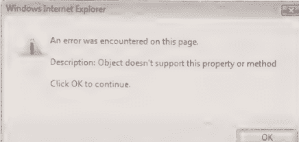

图8.49：JavaScript代码中发生错误时显示的对话框。

**try catch throw** 语句可以与 **if else** 语句一起使用，为错误提供多标准检查。这使你能够在不同的错误条件为真时显示不同的消息。图8.50中的代码提示用户输入一个项目编号，使用图8.51中的对话框。然后评估该编号。如果它大于10或小于1，则使用 **throw** 语句将错误发送到 **catch** 语句，后者显示相应的消息。

```
<html>
<body>
<script type="text/javascript">
// JS0885 Try Catch Throw Example
var item=prompt("Enter a item number between 1 and 10:", "");
document.write("You entered item number " + item + ".<br>");
try
{
if(item>10)
throw "Error1"
else if(item<1)
throw "Error2"
}
catch(er)
{
if(er=="Error1")
alert("The item number entered is greater than 10.")
if(er == "Error2")
alert("The item number entered is less than 1.")
}
</script>
</body>
</html>
```

图8.50：**try catch throw** 示例。

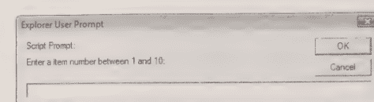

图8.51：图8.50中的代码创建的对话框。

假设用户输入一个零。错误将如图8.52所示处理。在此示例中，当用户输入一个小于1的数字时，将显示一条消息，说明输入的项目编号小于1。另一方面，如果用户输入11，则会显示图8.53中的错误消息。

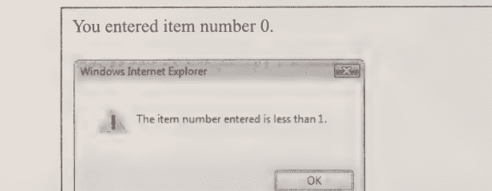

图8.52：用于小于1的项目编号的错误消息。

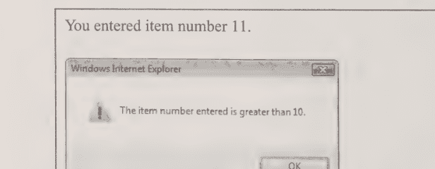

图8.53：用于大于10的项目编号的错误消息。

**try catch throw** 语句在商业应用程序中非常实用，用于在遇到错误时显示更有意义的消息。

## 对象

JavaScript与Java和C++一样，是一种*面向对象编程*（OOP）语言。OOP语言允许你定义自己的对象，也可以创建变量类型。（对象和变量类型创建是一项高级功能，本章不涉及。）对象是一种特殊的数据。一个对象具有*属性*和*方法*。属性是与对象关联的值。方法是可以在对象上执行的操作。本章将向你展示如何使用JavaScript提供的一些内置对象。

在JavaScript中，你与之交互的一切都是某种对象；从脚本中使用的字符串、数字和数组，到执行的函数。这不仅仅是一个模糊的对象概念。在JavaScript中，一切都是对象。JavaScript的Object类自动被所有其他对象继承。这意味着Object类的方法和属性由JavaScript中的所有对象支持和实现。

首先要考虑的是字符串对象，它用于操作一段存储的文本。它有两个属性：

- **length** 属性返回字符串中的字符数。
- **prototype** 属性允许你向对象添加属性和方法。

例如，在图8.54中，字符串对象的 **length** 属性用于确定变量 **welcomeGreeting** 中的字符数。变量的内容是“Welcome To Bills Barbeque Barn!”，因此代码运行时将显示消息“31”。

```
<html>
<body>
<script type="text/javascript">
// JS0890 Length Properties String Object Example
var welcomeGreeting="Welcome To Bills Barbeque Barn!";
document.write(welcomeGreeting.length)
</script>
</body>
</html>
```

图8.54：*length* 属性示例。

表8.12中列出的预定义字符串对象极大地扩展了JavaScript语言。所有预定义对象的格式都相同，因此一旦你理解了以下页面中的示例，你将能够轻松使用预定义列表中的任何对象。

表8.12：字符串对象的预定义方法

| 方法 | 描述 |
|---|---|
| anchor() | 创建一个HTML锚点 |
| big() | 以大字体显示字符串 |
| blink() | 显示闪烁的字符串 |
| bold() | 显示粗体字符串 |
| charAt() | 返回指定位置的字符 |
| charCodeAt() | 返回指定位置字符的Unicode值 |
| concat() | 将多个字符串连接在一起 |
| fixed() | 将字符串显示为“电传打字”文本 |
| fontcolor() | 以指定的字体颜色显示字符串 |
| fontsize() | 以指定的字体大小显示字符串 |
| fromCharCode() | 将Unicode值转换为字符串 |
| indexOf() | 返回字符串中首次出现指定字符串值的位置 |
| italics() | 以斜体显示字符串 |
| lastIndexOf() | 从指定位置开始从左到右搜索，返回字符串中最后出现指定字符串值的位置 |
| link() | 将字符串显示为超链接 |
| match() | 在字符串中搜索指定值 |
| replace() | 在字符串中用其他字符替换某些字符 |
| search() | 在字符串中搜索指定值 |
| slice() | 提取字符串的一部分，并将提取的值作为另一个字符串返回 |
| small() | 以小字体显示字符串 |
| split() | 将字符串分割成字符串数组 |
| strike() | 以“删除线”效果显示字符串 |
| sub() | 将字符串显示为下标 |
| substr() | 从起始索引开始提取字符串中指定数量的字符 |
| substring() | 提取字符串中起始和结束位置之间的字符 |
| sup() | 将字符串显示为上标 |
| toLowerCase() | 以全小写形式显示字符串 |
| toUpperCase() | 以全大写形式显示字符串 |


语句的格式为 *stringObject.property()* 或 *stringObject.method()*。此引用中的 *stringObject* 部分可以是任何求值为字符串的表达式，包括字符串字面量、包含字符串的变量或其他对象属性。括号用于传递任何参数。参数可以包括引号内的字符或用逗号分隔的一个或多个整数，具体取决于适用的情况。如果没有传递参数，默认转换的字符是字符串的第一个字符。

图 8.55 是 **toUpperCase** 方法的一个示例，它不需要参数。此示例将把字符串 "welcome to bills barbeque barn!" 转换为 "WELCOME TO BILLS BARBEQUE BARN!"

```
<html>
<body>
<script type="text/javascript">
var WelcomeMessage = "welcome to bills barbeque barn!"
// JS0892 To Upper Case Example
document.write(WelcomeMessage.toUpperCase())</script>
</body>
</html>
```

图 8.55：字符串对象的 **toUpperCase** 方法示例。

图 8.56 是另一个字符串方法的示例。在这种情况下，**concat** 方法确实需要括号中的一个参数来与字符串的其余部分连接。结果将显示 "Laura Ubelhor."

```
<html>
<body>
<script type="text/javascript">
// JS0894 concat Method Example
var fullName="Laura ".concat("Ubelhor");
document.write(fullName);
</script>
</body>
</html>
```

图 8.56：**concat** 方法示例。

## Date 对象

支持脚本的浏览器包含一个始终存在并准备就绪的 date 对象。表 8.13 列出的 date 对象方法可用于检索或设置日期和时间值。

### 表 8.13：Date 对象方法

| 方法 | 值范围 | 描述 |
|---|---|---|
| Date() | | 今天的日期和时间 |
| getTime() | 0–...... | 自 1/1/70 00:00:00 GMT 以来的毫秒数 |
| getYear() | 70-... | 指定年份减去 1900；2000 年及以上为四位数年份 |
| getMonth() | 0 – 11 | 一年中的月份（一月 = 0） |
| getFullYear() | | 四位数年份 |
| getDate() | 1 – 31 | 月中的日期 |
| getDay() | 0 – 6 | 星期几（星期日 = 0） |
| getHours() | 0 – 23 | 一天中的小时，24 小时制 |
| getMinutes() | 0 – 59 | 指定小时的分钟 |
| getSeconds() | 0 – 59 | 指定分钟的秒数 |
| setTime() | 0-...... | 自 1/1/70 00:00:00 GMT 以来的毫秒数 |
| setYear() | 70-... | 设置指定年份减去 1900；2000 年及以上为四位数年份 |
| setFullYear() | | 设置四位数年份；可选地，可以设置月份和日期 |
| setMonth() | 0 – 11 | 设置一年中的月份（一月 = 0） |
| setDate() | 1 – 31 | 设置月中的日期 |
| setDay() | 0 – 6 | 设置星期几（星期日 = 0） |
| setHours() | 0 – 23 | 设置一天中的小时，24 小时制 |
| setMinutes() | 0 – 59 | 设置指定小时的分钟 |
| setSeconds() | 0 – 59 | 设置指定分钟的秒数 |

除非在 date 对象的方法中指定了参数，否则 date 对象总是返回当前日期。图 8.57 中的示例检索当前日期，将其与各种 date 对象方法一起使用，并在浏览器中显示结果，如图 8.58 所示。

```
<html>
<body>
<script type="text/javascript">
// JS0896 Date Object Examples
var today=new Date();
var time1=today.getTime();
var year1=today.getYear();
var month1=today.getMonth();
var date1=today.getDate();
var day1=today.getDay();
var hours1=today.getHours();
var minutes1=today.getMinutes();
var seconds1=today.getSeconds();

var time1=today.getTime();
document.write("The Date is " + today + ".<BR>");
document.write("The Time is " + time1 + ".<BR>");
document.write("The Year is " + year1 + ".<BR>");
document.write("The Month is " + month1 + ".<BR>");
document.write("The Date is " + date1 + ".<BR>");
document.write("The Day is " + day1 + ".<BR>");
document.write("The Hour is " + hours1 + ".<BR>");
document.write("The Time is " + minutes1 + ".<BR>");
</script>
</body>
</html>
```

图 8.57：date 对象的 "get" 方法示例。

The Date is Wed Aug 15 02:42:39 EDT 2007.
The Time is 1187160159374.
The Year is 2007.
The Month is 7.
The Date is 15.
The Day is 3.
The Hour is 2.
The Time is 42.

图 8.58：图 8.57 的结果。

图 8.57 中的代码使用定义为变量 **today** 的当前日期。使用 "get" 方法和 date 对象返回的值存储在脚本中定义的变量中。图 8.59 显示了使用 "set" 方法的类似示例。结果显示在图 8.60 中。

```
<html>
<body>
<script type="text/javascript">
/* JS0898 Set Date Examples */

var today = new Date();
document.write("The current date is " + today + ".<br>");
var y = new Date();
var t = new Date();
t.setTime(9999999999999);
document.write("Example 9999999999999 since 1/1/70 00:00 GMT" + ".<br>");
document.write(t + ".<br>") ;

y.setYear(1891);
document.write("Example setting current date year to 1891" + ".<br>");
document.write(y + ".<br>") ;

var m = new Date();
m.setMonth(1);
document.write("Example setting current date month to 1" + ".<br>");
document.write(m + ".<br>");

var d = new Date();
d.setDate(1);
document.write("Example setting date within the month" + ".<br>");
document.write(d + ".<br>");

</script>
</body>
</html>
```

图 8.59：date 对象的 "set" 方法示例。

The current date is Wed Aug 15 17:10:39 EDT 2007.
Example 9999999999999 since 1/1/70 00:00 GMT.
Sat Nov 20 12:46:39 EST 2286.
Example setting current date year to 1891.
Sat Aug 15 17:10:39 EDT 1891.
Example setting current date month to 1.
Thu Feb 15 17:10:39 EST 2007.
Example setting date within the month.
Wed Aug 1 17:10:39 EDT 2007.

图 8.60：图 8.59 的结果。

日期类对于比较日期非常有用，这在业务应用中经常需要。例如，图 8.61 将发货日期与当前日期进行比较。如果发货日期小于或等于当前日期，则会提醒用户订单正在途中，如图 8.62 所示。如果发货日期大于当前日期，则会向用户提供日期。

```
<html>
<body>
<script type="text/javascript">
/* JS08100 Comparing Dates Example */
var shipDate=new Date()
shipDate.setFullYear(2007,7,12)
var today = new Date()
if (shipDate>today)
    alert("Your Order will ship on " + shipDate) ;
else
    alert("Your Order shipped on " + shipDate + " and is on its way") ;
</script>
</body>
</html>
```

图 8.61：在应用程序中比较日期。

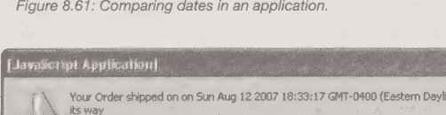

图 8.62：由图 8.61 中的代码产生的对话框。

在图 8.63 的示例中，交付日期计算为发货日期后的四天。显示一条消息，提供发货日期和到达日期，如下所示：

Your order is scheduled to ship on Mon Aug 20 19:09:15 EDT 2007.
Your order will arrive by Fri Aug 24 19:09:15 EDT 2007.

```
<html>
<body>
<script type="text/javascript">
/* JS08102 Example To Calculate Delivery Date */
var shipDate=new Date();
shipDate.setFullYear(2007,7,20);
var deliveryDate=new Date();
deliveryDate.setDate(shipDate.getDate()+4);
document.write("Your order is scheduled to ship on " +shipDate + ".<br>");
document.write("Your order will arrive by " +deliveryDate + ".<br>");
</script>
</body>
</html>
```

图 8.63：计算交付日期。

## Boolean 对象

Boolean 对象在需要条件测试结果的应用程序中很有用。它有两个可能的值：true 和 false。这些值可以表示真或假、开或关、是或否，或者任何其他可以存储在一位中的内容。Boolean 对象用于将非 Boolean 值转换为 true 或 false 值。它使用 **Boolean()** 关键字定义，如下所示：

var booleanTest=new Boolean()

如果 Boolean 对象没有初始值，或者其值为 0、-0、null、blank、false、undefined 或 NaN（非数字），则将其设置为 false。如果其值不是这些值之一，则为 true。Boolean 对象具有表 8.14 所示的方法。

### 表 8.14：Boolean 对象方法

| 方法 | 描述 |
| :--- | :--- |
| toSource() | 用于表示对象的来源 |
| toString() | 用于转换 Boolean 测试的结果，并将结果作为字符串返回 |
| valueOf() | 用于返回 Boolean 对象的原始值 |

## Math 对象

Math 对象使您能够执行常见的数学任务。当编码解决方案需要比简单算术更复杂的运算时，最有可能使用此对象。表 8.15 列出的 Math 对象的属性代表算术中需要的某些常量值。


表 8.15：Math 对象属性

| 属性 | 描述 |
| :--- | :--- |
| Math.E | 欧拉常数 |
| Math.LN2 | 2 的自然对数 |
| Math.LN10 | 10 的自然对数 |
| Math.LOG2E | 以 2 为底 E 的对数 |
| Math.LOG10E | 以 10 为底 E 的对数 |
| Math.PI | 圆周率 |
| Math.SQRT1_2 | 0.5 的平方根 |
| Math.SQRT2 | 2 的平方根 |

这些属性可在常规数学表达式中使用。例如，以下语句计算名为 **diameter** 的变量的周长：

周长 = diameter * Math.PI

Math 对象还包括方法，列于表 8.16。除 **Math.random()** 方法外，所有 Math 对象方法都接受一个或多个值作为参数。

表 8.16：Math 对象方法

| 方法（参数） | 描述 |
| :--- | :--- |
| Math.abs(n) | n 的绝对值 |
| Math.acos(n) | n 的反余弦值（弧度） |
| Math.asin(n) | n 的反正弦值（弧度） |
| Math.atan(n) | n 的反正切值（弧度） |
| Math.atan2(n1,n2) | 极坐标 n1 和 n2 的角度 |
| Math.ceil(n) | 大于或等于 n 的最小整数 |
| Math.cos(n) | n 的余弦值 |
| Math.exp(n) | 欧拉常数的 n 次幂 |
| Math.floor(n) | 小于或等于 n 的最大整数 |
| Math.log(n) | n 的自然对数（以 E 为底） |
| Math.max(n1,n2) | n1 或 n2 中的较大值 |
| Math.min(n1,n2) | n1 或 n2 中的较小值 |
| Math.pow(n1,n2) | n1 的 n2 次幂 |

254 **第 8 章：整合 JavaScript**

表 8.16：Math 对象方法（续）

| 方法（参数） | 描述 |
| :--- | :--- |
| Math.random() | 零到一之间的随机数 |
| Math.round(n) | 四舍五入到下一个整数 |
| Math.sin(n) | n 的正弦值（弧度） |
| Math.sqrt(n) | n 的平方根 |
| Math.tan(n) | n 的正切值（弧度） |

图 8.64 中的代码展示了一些 Math 对象方法的用法。该代码的结果如图 8.65 所示。

```html
<html>
<body>
<script type="text/javascript">
// JS08106 Math 对象属性示例
document.write("Absolute value of 133.17 is " + Math.abs(133.17)
+ "<br/>")
document.write("Absolute value of -133.17 is " +Math.abs(-133.17)
+ "<br/>")
document.write("Absolute value of 133.17 minus 225.17 is " +Math.
abs(133.17 - 225.17) + "<br/>")
document.write("Display a Random Number " + Math.random() +
"<br/>")
document.write("Display Another Random Number " + Math.random()
+ "<br/>")
document.write("The Square Root of 10 is "+ Math.sqrt(10) +
"<br/>")
document.write("The Square Root of 121 is "+ Math.sqrt(121) +
"<br/>")
</script>
</body>
</html>
```

图 8.64：使用 Math 对象方法。

Absolute value of 133.17 is 133.17

Absolute value of -133.17 is 133.17

Absolute value of 133.17 minus 225.17 is 92

Display a Random Number 0.6953919309453365

Display Another Random Number 0.6771415344548015

The Square Root of 10 is 3.1622776601683795

The Square Root of 121 is 11

图 8.65：图 8.64 中代码的运行结果。

## JavaScript 数组

数组是一种用于存储和操作有序数据集合的结构。作为业务应用程序员，你可能已经熟悉数组，但这里我们将进行简要回顾。

数组可以形象地视为一个表格，类似于电子表格。在 JavaScript 中，数组被限制为单列表格，行数可按需设置。多维数组可以通过对象数组来创建。这超出了本章的范围，但理解其可行性很重要。

本章前面的代码示例已经使用了数组。例如，图 8.66 重复了图 8.36 的代码，展示了一个 **for 循环** 的例子。该示例使用以下语句定义了一个数组：

```javascript
Var BBQSauce = new Array()
```

```html
<html>
<body>
<script type="text/javascript">
// JS08108 简单数组示例
var x
var BBQSauce = new Array()
BBQSauce[0] = "Traditional."
BBQSauce[1] = "Sweet and Mild."
BBQSauce[2] = "Honey Mustard."
BBQSauce[3] = "Tangy Twist."
BBQSauce[4] = "Hot and Spicy."
BBQSauce[5] = "Flaming Hot"
for (x in BBQSauce)
{
document.write(BBQSauce[x] + "<br />")
}
</script>
</body>
</html>
```


该数组被定义为一个名为 **BBQSauce** 的新变量。值通过方括号指定数组索引被 *填充*（加载）到数组中。示例数组的值填充如下：

```javascript
BBQSauce[0] = "Traditional."
BBQSauce[1] = "Sweet and Mild."
BBQSauce[2] = "Honey Mustard."
BBQSauce[3] = "Tangy Twist."
BBQSauce[4] = "Hot and Spicy."
BBQSauce[5] = "Flaming Hot"
```

最后，for 循环遍历数组元素并打印它们的内容，如图 8.67 所示。

- Traditional.
- Sweet and Mild.
- Honey Mustard.
- Tangy Twist.
- Hot and Spicy.
- Flaming Hot

图 8.67：图 8.66 的运行结果。

## 数组方法

表 8.17 列出了 JavaScript 数组对象方法。

| 方法 | 描述 |
|---|---|
| array.concat() | 连接多个数组并返回结果。 |
| array.join() | 由 separatorString 值分隔的数组条目字符串。join 方法用于将数组的所有元素连接成一个由指定字符串分隔符分隔的单个字符串。如果未指定分隔符，默认使用逗号。 |
| array.pop() | 移除并返回数组的最后一个元素。 |
| array.push() | 将一个或多个元素添加到数组的末尾并返回新长度。 |
| array.reverse() | 返回条目顺序相反的数组。 |
| array.shift(,[]) | 移除并返回数组的第一个元素。 |
| array.slice() | 从现有数组中返回选定的元素。 |
| array.sort() | 对数组的元素进行排序。 |
| array.splice() | 从数组中移除元素并添加新元素。 |
| array.toSource() | 表示对象的源代码。 |
| array.toString() | 将数组转换为字符串并返回结果。 |
| array.unshift() | 将一个或多个元素添加到数组的开头并返回新长度。 |
| array.valueOf() | 返回数组对象的原始值。 |

图 8.68 中的示例展示了数组对象方法 **sort** 的使用。图 8.68 使用了与前面示例相同的数组，但填充方式略有不同。数组的所有元素都在变量定义行中列出，用逗号分隔。此示例还创建了两个新函数 **OrdA** 和 **OrdD**，以定义降序或升序的排序顺序。如图 8.69 所示，数组的内容首先按原始顺序显示，然后按升序显示，最后按降序显示。

```html
<html>
<head>
<script type="text/javascript">
// JS08113 数组对象方法排序示例
function OrdA(a, b){ return (a-b); }
function OrdD(a, b){ return (b-a); }
</script>
</head>
<body>
<script type="text/javascript">
var x
var BBQSauce = new Array("Traditional", "Sweet and Mild", "Honey Mustard", "Tangy Twist", "Hot and Spicy", "Flaming Hot");

for (x in BBQSauce)
{
document.write(BBQSauce[x] + "<br />")
}

BBQSauce.sort( OrdA );
document.write('Ascending : ' + BBQSauce + '<br />');
BBQSauce.sort( OrdD );
document.write('Descending : ' + BBQSauce + '<br />');

</script>
</body>
</html>
```

图 8.68：**sort** 数组对象方法示例。

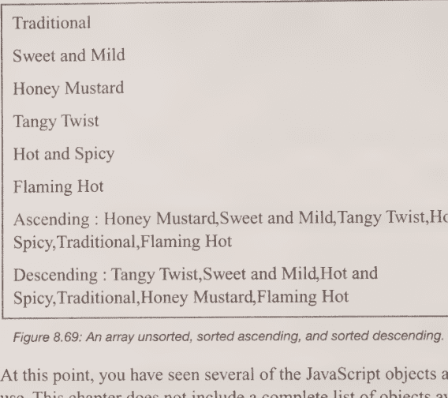

图 8.69：未排序、升序排序和降序排序的数组。

至此，你已经看到了一些可用的 JavaScript 对象。本章并未包含所有可用对象的完整列表，但你已经看到足够多的内容，了解它们的功能有多强大以及使用预定义对象有多容易。

## 事件

事件是可在 JavaScript 中使用的操作。它们是 JavaScript 的重要组成部分，提供了一种基于用户操作来使用可用对象的方式。事件使你能够创建动态的网页。许多网页元素都有与之关联的事件，这些事件可以触发函数执行操作。

## 事件处理程序

将客户端 JavaScript 嵌入 HTML 文档的一种方法是使用 HTML 标签的事件处理程序属性。事件处理程序是 HTML 4.0 中新增的 HTML 功能。当前版本的流行浏览器，包括 Firefox、Internet Explorer 和 Netscape，都支持事件处理程序。表 8.18 列出了一些可在 HTML 标签中使用的常见事件处理程序。

### 表 8.18：一些常见的事件处理器

| 处理器 | 触发事件 |
|---|---|
| onabort | 图像加载被中断 |
| onblur | 窗口或元素失去键盘焦点 |
| onchange | 显示的值发生改变 |
| onclick | 鼠标点击并释放 |
| ondblclick | 鼠标双击 |
| onerror | 图像或文档加载失败 |
| onfocus | 窗口或元素获得键盘焦点 |
| onkeydown | 键被按下 |
| onkeypress | 键被按下并释放 |
| onkeyup | 键被释放 |
| onload | 文档、图像或对象加载完成 |
| onmousedown | 鼠标按钮被按下 |
| onmousemove | 鼠标移动 |
| onmouseout | 鼠标移出元素 |
| onmouseover | 鼠标移入元素 |
| onmouseup | 鼠标按钮被释放 |
| onreset | 请求重置表单 |
| onresize | 窗口大小改变 |
| onselect | 文本被选中 |
| onsubmit | 请求提交表单 |
| onunload | 文档被卸载 |

事件处理器非常易于使用，结合 JavaScript 函数，其可能性是无穷的。例如，在商业应用中，单击一个按钮可能会显示订单状态。双击产品图片可能会触发显示产品的详情和价格。鼠标悬停在一个地点名称上可能会触发显示该地点的地址。接下来的几页将展示一些常见事件处理器的示例。

## Onclick（单击事件）

**onclick** 事件处理器在鼠标按钮按下并释放时被触发。图 8.70 中的示例使用 **onclick** 在单击图 8.71 中的按钮时显示订单状态。

```
<html>
<head>
<script type="text/javascript">
/* JS08116 Event handler onclick Example */
function orderStatus()
{
/* Example to calculate delivery date */
var shipDate=new Date();
shipDate.setFullYear(2007,7,20);
var deliveryDate=new Date();
deliveryDate.setDate(shipDate.getDate()+4);
document.write("Your order is scheduled to ship on " + shipDate + ".<br>");
document.write("Your order will arrive by " + deliveryDate + ".<br>");
}
</script>
</head>
<body>
<input type="button" value="Display Order Status" onclick="orderStatus()" />
</body>
</html>
```

图 8.70：**onclick** 事件处理器的示例。

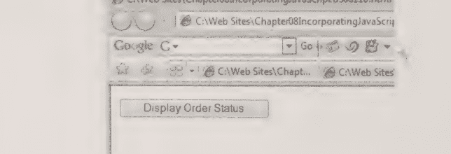

图 8.71：单击时将触发 *orderStatus* 函数的按钮。

事件的结果是以下消息：

> Your order is scheduled to ship on Mon Aug 20 00:54:01 EDT 2007.
> Your order will arrive by Fri Aug 24 00:54:01 EDT 2007.

## Onmousedown（鼠标按下事件）

在图 8.72 的示例中，当鼠标在图 8.73 的图像上按下按钮时，“Barbeque Barn”的地址将被显示。如果您在屏幕上的其他任何地方单击，则不会触发任何操作。**onmousedown** 事件不保证在相同目标上会发生 **onclick** 事件。例如，如果您将鼠标悬停在一个链接上，然后按下并按住点击按钮，接着将鼠标移开链接并释放按钮，则该链接不会被点击。

```
<html>
<head>
<script type="text/javascript">
/* JS08118 Event handler onmousedown Example */
function displayAddress()
{
document.write("Bills Barbeque Barn " + ".<br>");
document.write("127 Homestead Lane " + ".<br>");
document.write("Bellville, MI 97568 " + ".<br>");
document.write("(313) 264-3975 " + ".<br>");
}
</script>
</head>
<body>

</body>
</html>
```

图 8.72：**onmousedown** 事件处理器的示例。


图 8.73：当 **onmousedown** 事件发生时，此图像将被替换为地址。

## Onerror（错误事件）

在本章前面，您了解了 **try catch throw** 如何用于控制 Web 页面上遇到错误时的响应。**onerror** 事件也可用于控制错误。当页面上遇到错误时，会触发此事件。

要使用 **onerror**，必须创建一个函数来处理错误。该函数通过以下参数被调用：

*   **msg** —— 错误消息
*   **url** —— 导致错误的页面的 URL
*   **line** —— 错误发生的行号

**onerror** 返回的值决定了错误消息。如果它返回 false，浏览器会在 JavaScript 控制台中显示标准错误消息。如果它返回 true，浏览器则不会显示标准错误消息。

在图 8.74 的示例中，显示了一个按钮（如图 8.75 所示），提示用户显示欢迎消息。当按钮被按下时，由于代码中 **alert** 被错误地拼写为 *aaaaaddddlert*，因此会遇到错误。遇到错误时，**onerror** 事件被触发。它调用一个函数来显示一条包含错误、URL 地址和错误行号的消息，如图 8.76 所示。错误消息提示用户单击“确定”继续。

```
<html>
<head>
<script type="text/javascript">
/* JS08121 Event Handler onerror Example */
onerror=handleErr
var messageTxt=""
function handleErr(msg,url,l)
{
messageTxt="There was an error on this page.\n\n"
messageTxt+="Error: " + msg + "\n"
messageTxt+="URL: " + url + "\n"
messageTxt+="Line: " + l + "\n\n"
messageTxt+="Click OK to continue.\n\n"
alert(messageTxt)
return true
}
function message()
{
aaaaaddddlert("Welcome to Bills Barbeque Barn!")
}
</script>
</head>
<body>
<input type="button" value="Display Welcome Message"
       onclick="message()" />
</body>
</html>
```

*图 8.74：**onerror** 事件处理器的示例。*

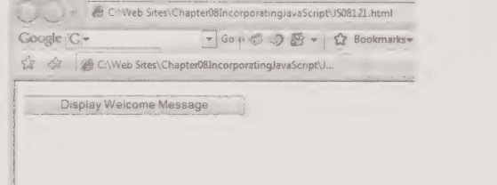

图 8.75：图 8.74 中代码的初始结果。

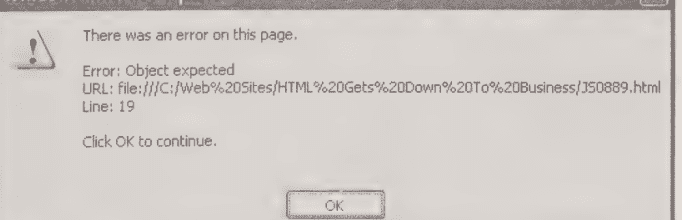

图 8.76：单击按钮时显示的错误消息。

## Cookies

Cookie 是由网页存储在访问者计算机上的一个变量。每次同一台计算机用浏览器请求该页面时，它也会发送 cookie。通过 JavaScript，您可以创建和检索 cookie 值。

Cookie 可用于多种原因。Cookie 可能用于控制用户访问网站时显示的消息，保留密码以便返回用户无需再次输入，或者存储日期以便用户查看其上次访问网站的时间。

在图 8.77 的 cookie 示例中，当用户第一次访问该网站时，会显示一个提示，要求输入用户的姓名。用户下次访问该网站时，将不会被要求输入姓名。相反，会显示一条“欢迎回来”的消息。

为了实现这一点，cookie 将用户名存储在用户的客户端计算机上。在此示例中，cookie 被设置为在 30 天后过期。当 cookie 过期时，用户下次访问时将再次被提示输入姓名，该新姓名将存储在 cookie 中。这个 cookie 需要三个函数：一个用于检查该用户是否存在 cookie，第二个用于在不存在 cookie 时存储用户姓名，第三个用于显示用户名提示或“欢迎回来”消息。

```
<html>
<head>
<script type="text/javascript">
/* JS08124 Cookie Example
/* function to check to see if cookie exists for the user */
/* the cookies are stored in the document cookie object */
/* if a cookie is found the value will be returned or if not found
   an empty */
/* string will be returned */
function retreiveCookie(cookie_name)
{
  if (document.cookie.length>0)
  {
    cookid_start=document.cookie.indexOf(cookie_name + "=")
    if (cookid_start!=-1)
    {
      cookid_start=cookid_start + cookie_name.length+1
      cookid_end=document.cookie.indexOf(";",cookid_start)
      if (cookid_end==-1) cookid_end=document.cookie.length
      return unescape(document.cookie.substring(cookid_start,cookid_end))
    }
  }
  return ""
}
/* function that stores the name of a cookie in a variable*/
/* the parameters of the function hold the name of the cookie,
   the value */
/* of the cookie and the number of days until the cookie expires */

function storeCookie(cookie_name,value,expireays)
{
var exdate=new Date()
exdate.setDate(exdate.getDate()+expireays)
document.cookie=cookie_name+ "=" +escape(value)+
((expireays==null) ? "" : ";expires="+exdate.toGMTString())
}
/* if the cookie user name exists a welcome back message will be */
/* displayed if not the user will be prompted to enter their user */
/* name and the store cookie function will be called */
function checkCookie()
{
username=retreiveCookie('username')
if (username!=null && username!="")
{alert('Welcome back to Bills Barbeque Barn '+username+'!')}
else
{
username=prompt('Please enter your user name:',"")
if (username!=null && username!="")
{
storeCookie('username',username,30)
}
}
}
</script>
</head>
<body onLoad="checkCookie()">
</body>
</html>
```

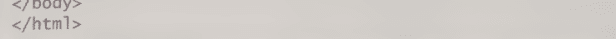

用户第一次运行应用程序时，会显示图 8.78 所示的屏幕。同一个用户下次访问该应用程序时，会显示图 8.79 所示的屏幕（只要 cookie 尚未过期）。


## 266 第8章：整合JavaScript

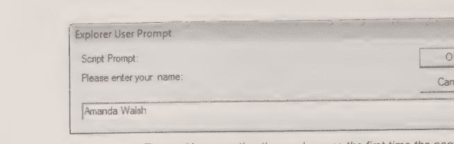

图8.78：页面首次加载时，Cookie请求用户提供姓名。

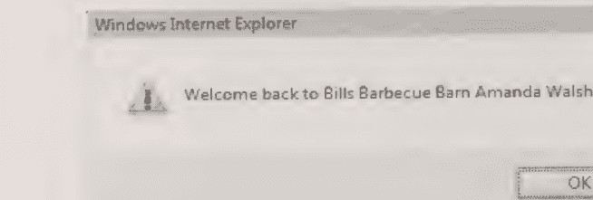

图8.79：在后续页面加载时，Cookie显示欢迎界面。

Cookies可以在企业应用中用于显示和使用用户特定的信息，就像这些信息在传统应用中被使用的方式一样。

### JavaScript表单验证

*表单验证*是检查表单是否按预期填写的过程。例如，可以验证电子邮件地址或电话号码的格式是否正确，或者可以验证必填字段以确保用户没有将其留空。JavaScript可用于在将数据发送到服务器之前验证HTML表单中的数据。使用JavaScript进行验证是即时的，因为它在客户端而非服务器上执行。

由于表单验证是企业应用开发者最有价值的JavaScript用途之一，本节中的示例比本章中的大多数示例更为详细和复杂。它使用一个基本的HTML表单（如图8.80所示），以及多个函数来执行各种表单验证任务。该表单请求输入名字、姓氏、电子邮件地址、电话号码、留言和回复方式。所有字段均为必填项。电子邮件地址必须采用有效格式，电话号码必须为数字，且回复字段必须从下拉列表中选择。在查看代码之前，请先查看表单。

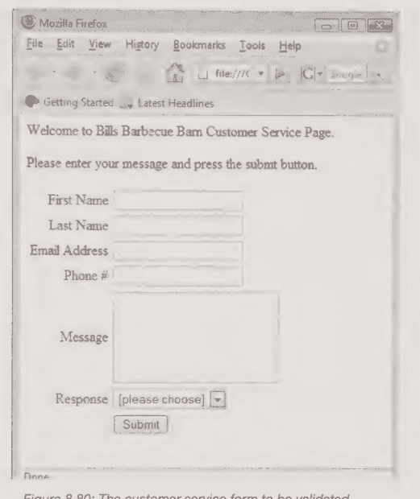

图8.80：待验证的客户服务表单。

使用标准HTML标签定义表单是一项相当简单的任务。图8.81展示了页面的代码，以及对JavaScript文件`JS08129.js`的引用，该文件包含了将用于验证表单数据的函数。（第9章将更详细地介绍如何用HTML编码表单。）

```
<html>
<head>
<script language="JavaScript" src="js scripts/JS08129.js" type="text/javascript">
//JS08128 Form Validation Example
</script>
</head>
<body>
<p>Welcome to Bills Barbeque Barn Customer Service Page.</p>
<p>Please enter your message and press the submit button.
</p>
<form action="" name="myform" >
```

图8.81：创建客户服务表单的代码（第1部分，共3部分）。

268 第8章：整合JavaScript

```
<table cellspacing="2" cellpadding="2" border="0">
    <tr>
        <td align="right">First Name</td>
        <td><input type="text" name="FirstName"></td>
    </tr>
    <tr>
        <td align="right">Last Name</td>
        <td><input type="text" name="LastName"></td>
    </tr>
    <tr>
        <td align="right">Email Address</td>
        <td><input type="text" name="Email"></td>
    </tr>
    <tr>
        <td align="right">Phone #</td>
        <td><input type="text" name="Phone"></td>
    </tr>
    <tr>
        <td align="right">Message</td>
        <td><textarea cols="20" rows="5" name="Message"></textarea>
        </td>
    </tr>
    <tr>
        <td align="right">Response</td>
        <td>
            <SELECT name="Response">
                <option value="" selected>[please choose]</option>
                <option value="001">No Response</option>
                <option value="002">Phone Call</option>
                <option value="003">Email Reply</option>
            </SELECT>
        </td>
    </tr>
    <tr>
        <td align="right"></td>
        <td><input type="submit" value="Submit"></td>
    </tr>
</table>
</form>
<script language="JavaScript" type="text/javascript">
    var frmvalidator = new Validator("myform");
    frmvalidator.addValidation("FirstName", "req", "Please enter your First Name");
    frmvalidator.addValidation("FirstName", "maxlen=20", "Max length for FirstName is 20");
    frmvalidator.addValidation("FirstName", "alpha");
    frmvalidator.addValidation("LastName", "req");
    frmvalidator.addValidation("LastName", "maxlen=20");
    frmvalidator.addValidation("Email", "maxlen=50");
    frmvalidator.addValidation("Email", "req");
    frmvalidator.addValidation("Email", "email");
```

图8.81：创建客户服务表单的代码（第2部分，共3部分）。

```
frmvalidator.addValidation("Phone", "maxlen=25");
frmvalidator.addValidation("Phone", "req");
frmvalidator.addValidation("Message", "maxlen=150");
frmvalidator.addValidation("Message", "req");
frmvalidator.addValidation("Response", "dontselect=0");
</script>
</body>
</html>
```

图8.81：创建客户服务表单的代码（第3部分，共3部分）。

验证可以通过多种方式完成。本示例使用一个JavaScript类来简化表单验证。图8.82是该JavaScript类的代码，存储在`JS08129.js`文件中。已创建函数来完成各种验证任务，并且每个表单字段元素都关联了一组验证描述符。验证描述符是指定要执行的验证类型的字符串。表单上的每个字段都有多个验证。

```
/* JS08129 Form validation functions */
function Validator(frmname)
{
    this.formobj=document.forms[frmname];
	if(this.formobj.onsubmit)
	{ this.formobj.old_onsubmit = this.formobj.onsubmit;
	  this.formobj.onsubmit=null;
	}
	else
	{ this.formobj.old_onsubmit = null;
	}
    this.formobj.onsubmit=form_submit_handler;
    this.addValidation = add_validation;
    this.setAddnlValidationFunction=set_addnl_vfunction;
    this.clearAllValidations = clear_all_validations;
}

/* Additional Validation Function */
function set_addnl_vfunction(functionname)
{ this.formobj.addnlvalidation = functionname;
}
/* Clear all validations function */
function clear_all_validations()
{ for(var itr=0;itr < this.formobj.elements.length;itr++)
  { this.formobj.elements[itr].validationset = null;
  }
}
/* form submit handler function */
```

图8.82：用于验证表单的JavaScript函数（第1部分，共5部分）。

270 第8章：整合JavaScript

```
function form_submit_handler()
{
    for(var itr=0;itr < this.elements.length;itr++)
        {
            if(this.elements[itr].validationset &&
               !this.elements[itr].validationset.validate())
                {
                    return false;
                }
        }
    if(this.addnlvalidation)
        {
            str=" var ret = "+this.addnlvalidation+"()";
            eval(str);
            if(!ret) return ret;
        }
    return true;
}

/* add validation function */
function add_validation(itemname,descriptor,errstr)
{
    if(!this.formobj)
        {
            alert("ERROR: the form object is not set properly");
            return;
        }// end if
    var itemobj = this.formobj[itemname];
    if(!itemobj)
        {
            alert("ERROR: Could not get the input object named: "+itemname);
            return;
        }
    if(!itemobj.validationset)
        {
            itemobj.validationset = new ValidationSet(itemobj);
        }
    itemobj.validationset.add(descriptor,errstr);
}

/* Validation description function */
function ValidationDesc(inputitem,desc,error)
{
    this.desc=desc;
    this.error=error;
    this.itemobj = inputitem;
    this.validate=vdesc_validate;
}

/* Vdesc validate function */
function vdesc_validate()
{
    if(!V2validateData(this.desc,this.itemobj,this.error))
        {
            this.itemobj.focus();
            return false;
        }
    return true;
}

/* Validation set function */
function ValidationSet(inputitem)
{
    this.vSet=new Array();
```

图8.82：用于验证表单的JavaScript函数（第2部分，共5部分）。

```
this.add = add_validationdesc;
this.validate = vset_validate;
this.itemobj = inputitem;
}
/* Add validation description */
function add_validationdesc(desc, error)
{
    this.vSet[this.vSet.length] =
        new ValidationDesc(this.itemobj, desc, error);
}
/* Vset validate function */
function vset_validate()
{
    for (var itr = 0; itr < this.vSet.length; itr++)
    {
        if (!this.vSet[itr].validate())
        {
            return false;
        }
    }
    return true;
}
/* Email validation function */
function validateEmailv2(email)
{
    if (email.length <= 0)
    {
        return true;
    }
    var splitted = email.match("^(.+)@(.+)$");
    if (splitted == null) return false;
    if (splitted[1] != null)
    {
        var regexp_user = /^"?[\w\-_.]*"?$/;
        if (splitted[1].match(regexp_user) == null) return false;
    }
    if (splitted[2] != null)
    {
        var regexp_domain = /^[\w\-.]*\.[A-Za-z]{2,4}$/;
        if (splitted[2].match(regexp_domain) == null)
        {
            var regexp_ip = /^\[\d{1,3}\.\d{1,3}\.\d{1,3}\.\d{1,3}\]$/;
            if (splitted[2].match(regexp_ip) == null) return false;
        }
    } // if
    return true;
}
return false;
}
/* Validate data function */
function V2validateData(strValidateStr, objValue, strError)
{
    var epos = strValidateStr.search("=");
    var command = "";
    var cmdvalue = "";
    if (epos >= 0)
    {
        command = strValidateStr.substring(0, epos);
        cmdvalue = strValidateStr.substr(epos + 1);
    }
```

图8.82：用于验证表单的JavaScript函数（第3部分，共5部分）。


## 第八章：整合 JavaScript

```javascript
else
{
  command = strValidateStr;
}
switch(command)
{
  case "req":
    {
      if(eval(objValue.value.length) == 0)
      {
        if(!strError || strError.length ==0)
        {
          strError = objValue.name + " : 必填字段";
        }//结束 if
        alert(strError);
        return false;
      }//结束 if
      break;
    }//case required
  case "maxlen":
    {
      if(eval(objValue.value.length) >  eval(cmdvalue))
      {
        if(!strError || strError.length ==0)
        {
          strError = objValue.name + " : 最多 " + cmdvalue + " 个字符";
        }//结束 if
        alert(strError + "\n[当前长度 = " + objValue.value.length + " ]");
        return false;
      }//结束 if
      break;
    }//case maxlen
  case "alpha":
    {
      var charpos = objValue.value.search("[A-Za-z]");
      if(objValue.value.length > 0 &&  charpos >= 0)
      {
        if(!strError || strError.length ==0)
        {
          strError = objValue.name + ": 仅允许使用字母字符。";
        }
        alert(strError + "\n [错误：字符位置 " + eval(charpos+1) + "]");
        return false;
      }
      break;
    }//alpha
  case "email":
    {
      if(!validateEmailv2(objValue.value))
      {
        if(!strError || strError.length ==0)
        {
          strError = objValue.name + ": 请输入有效的电子邮件地址";
        }
        alert(strError);
        return false;
      }
    }
    break;
}//case email
case "dontselect":
{
    if(objValue.selectedIndex == null)
    {
        alert("错误：对非选择项使用了 dontselect 命令");
        return false;
    }
    if(objValue.selectedIndex == eval(cmdvalue))
    {
        if(!strError || strError.length ==0)
        {
            strError = objValue.name + ": 请选择一个回复";
        }//结束 if
        alert(strError);
        return false;
    }
    break;
}//case dontselect
}//switch
return true;
}
```

图 8.82：用于验证表单的 JavaScript 函数（第 5 部分，共 5 部分）。

此示例大量使用了本章描述的 JavaScript 功能。让我们更仔细地看看这个应用。图 8.81 中的代码通过以下标签引用了图 8.82 中的外部 JavaScript 文件：

```html
<script language="JavaScript" src="js scripts/JS08129.js" type="text/javascript">
```

引用外部文件类似于将额外的代码包含在 HTML 页面的 `<head>` 部分中。将代码放在单独的文件中，可以使其被站点内的任何应用程序重复使用。（在现实情况中，会为文件使用更有意义的名称，例如 "formfieldvalidation.js"。）

如果表单中没有输入信息，用户点击“提交”按钮，将显示图 8.83 中的消息。FirstName 字段在 HTML 页面的表单中使用图 8.84 中的代码片段定义。

```html
<tr>
  <td align="right">First Name</td>
  <td><input type="text" name="FirstName"></td>
</tr>
```

图 8.84：FirstName 表单字段定义。

操作在用户点击“提交”按钮时开始，导致执行图 8.85 中的脚本代码。此代码首先定义一个名为 **frmvalidator** 的变量，它是将用于表单字段验证的验证器对象。此变量被传递了表单的名称 "myform"。接下来，添加验证，例如图 8.85 中所示的 FirstName 字段的验证。

```javascript
var frmvalidator = new Validator("myform");
  frmvalidator.addValidation("FirstName","req","请输入您的名字");
  frmvalidator.addValidation("FirstName","maxlen=20",
      "FirstName 的最大长度为 20");
  frmvalidator.addValidation("FirstName","alpha");
```

图 8.85：用于验证名字的 JavaScript。

第一个参数是字段名称 "FirstName"。第二个参数是验证描述符，用于指定要执行的验证类型。第三个参数是在字段值未通过验证时将显示的消息。使用此技术需要验证器在 HTML 页面的 **`</form>`** 结束标签之后定义。表单验证函数代码被执行。如果验证失败，将显示消息。

假设您输入的名字长度超过了允许的最大长度 20 个字符。由于数据验证，将显示图 8.86 中的消息，指示允许的最大长度和输入值的长度。

图 8.86：当名字超过最大长度时显示的验证消息。

当您继续测试表单页面上的每个字段验证时，请注意“Response”表单字段已被定义为值列表，如图 8.87 所示。

```html
<SELECT name="Response">
    <option value="" selected>[请选择]</option>
    <option value="001">无回复</option>
    <option value="002">电话回复</option>
    <option value="003">电子邮件回复</option>
</SELECT>
```

图 8.87：创建 "Response" 表单字段。

当用户点击下拉标签时，将显示回复的值列表，如图 8.88 所示。用户将从列表中选择一个回复。

图 8.88：下拉列表。

还要注意 "Message" 字段，它被定义为一个 20 列 5 行的文本区域。图 8.89 中的代码验证该字段不为空且不超过 150 个字符的最大值。

```javascript
frmvalidator.addValidation("Message","maxlen=150");
frmvalidator.addValidation("Message","req");
```

图 8.89：用于 "Message" 字段的验证器。

本节中的数据验证示例仅使用了可用的少数验证描述符。表 8.19 提供了可用描述符的更完整列表。

**表 8.19：验证描述符**

| 描述符 | 描述 |
| :--- | :--- |
| alpha / alphabetic | 输入的值必须是字母数据。 |
| alnum / alphanumeric | 输入的值只能包含数字和字符。 |
| dontselect=99 | 此验证器用于列表框中的输入项，当需要选择时。通常，索引值 0 与列表的默认值相关联。引用的数字将对应于默认值。在图 8.81 的示例中，[请选择] 的默认值的索引为零。 |
| Email | 输入的字段值必须是有效的电子邮件地址。 |
| gt=999 / greaterthan=999 | 输入的值大于传递的值。此验证器仅用于数字字段。 |
| lt=999 / lessthan=999 | 输入的值小于传递的值。此验证器仅用于数字字段。 |
| num / numeric | 输入的值必须是数字数据。 |
| maxlen=999 / maxlength=999 | 输入的值在字符数上不超过传递的最大值。 |
| min=999 / minlength=999 | 输入的值在字符数上至少与传递的最小值相同。 |
| regexp= | 该值使用正则表达式进行验证，正则表达式是定义模式的一系列字符。输入的值需要匹配正则表达式的模式。例如，要验证正数或负数，您可以使用 `regexp=^-{0,1}\d*\.{0,1}\d+$`。为了确保密码至少有六个符号，您可以使用 `regexp=^.{6,}$`。 |
| req / required | 字段值不能为空。 |

## 总结

我们在本章中涵盖了很多内容，但对于 JavaScript 的潜力我们才刚刚触及皮毛。显然，JavaScript 是 Web 应用程序开发的基本工具。它易于学习且对浏览器友好。它可以与其他工具协调使用，包括服务器端编程语言。

JavaScript 通常用于表单验证。表单将在第 9 章中更详细地讨论。表单也包含在第 10、11 和 12 章的 PHP、ASP.NET 和 Java Server Pages 的 Web 开发示例中。

阅读本章后，您应该了解 JavaScript 的基本语法，了解该语言适合的一些任务，并通过提供的示例获得一些实践经验。在完成示例后，您将准备好开始将 JavaScript 整合到您的 Web 业务应用程序中。当您准备好进一步深入时，有许多优秀的网站提供高级代码示例和论坛，供 JavaScript 开发者分享想法、经验和代码。


## 第9章

## 使用CGI进行Web开发

CGI，即通用网关接口，定义了外部网关程序和脚本与Web服务器通信的标准。CGI不是一种编程语言；它是网页或浏览器与运行程序的Web服务器之间的接口。你有时可能听说CGI是过时的技术。事实并非如此。用于CGI程序和脚本的语言范围很广，从存在已久的到近期创建的都有。

CGI通常用于Web应用程序中，以提供连接客户端和服务器的网关。设想两块田地之间有一道带门的栅栏。田地代表客户端和服务器，而CGI就是连接它们的门。

万维网兴起之初，只有一个Web服务器和一个Web客户端。HTTPd Web服务器由瑞士日内瓦的核研究中心（CERN）开发。HTTPd已成为许多Web服务器二进制可执行文件的通用名称。当CERN停止资助HTTPd的开发后，它被美国国家超级计算应用中心（NCSA）的软件开发小组接管。NCSA制作了第一个名为Mosaic的Web浏览器，后来又开发了Netscape客户端浏览器。Mosaic能够获取并查看由HTTPd服务器提供的静态HTML文档和图像。

随着Web的发展，搜索引擎被开发出来以帮助Web用户查找所需内容。搜索引擎需要能够处理用户输入的数据，并快速返回Web用户正在寻找的内容。早期的搜索引擎是通过扩展Web服务器并直接修改Web服务器代码来实现的。然而，重写源代码并不实际，因此NCSA制定了CGI规范。CGI迅速成为与基于外部服务器的应用程序交互并在Web上提供动态内容的标准。CGI的使用提供了强大的能力，常被用于基于Web的商业应用程序中。

HTML文档是静态的。它是一个内容不会从固定状态改变的文本文件。CGI允许网页的内容来自程序或脚本，而不仅仅是静态的HTML。使用CGI程序和脚本，Web应用程序可以变得动态。CGI实时执行，可以在Web应用程序内输出动态内容。

在第8章中，你学习了JavaScript如何在客户端提供动态内容。而CGI则利用在服务器端执行的程序和脚本。CGI程序或脚本几乎可以用任何能够从标准输入（stdin）读取、写入标准输出（stdout）并在Web服务器上运行的语言编写。Stdin指通过键盘或程序访问的文件进行的输入。Stdout指浏览器屏幕。

CGI允许Web应用程序在网站的Web服务器上运行程序，因此常用于处理表单输入、数据库更新或数据库查询。这些都是商业应用程序的关键任务。因为CGI在Web服务器上运行，使用时应考虑安全性。应对CGI脚本和程序的访问进行限制控制，作为预防措施，防止网站用户创建CGI程序。CGI程序和脚本通常位于一个特殊目录中，由IT人员（可能是网站管理员）直接管理。

## CGI的用途

CGI有许多用途，如表9.1所列。最常见的用途之一是处理表单。包含表单的网页将需要一个CGI脚本或程序来处理输入的信息。CGI也可用于将网页连接到数据库，以便用户查询数据。为了连接数据库，Web守护程序将执行一个CGI程序或脚本，将信息传输到数据库引擎，并接收要显示的结果。*守护程序*是一个在后台执行的程序，随时准备在需要时执行操作。守护程序的功能类似于操作系统的扩展，通常是一个在启动时启动的无人值守进程。

**表9.1：CGI的典型用途**

| 用途 | 示例 |
| :--- | :--- |
| 表单处理 | 处理在HTML表单中输入的数据。 |
| 发送电子邮件消息 | 当单击“提交”按钮时，向用户或指定电子邮件地址发送电子邮件消息。 |
| 数据库查询 | 连接到数据库，检索并显示内容。 |
| 显示HTML文档 | 在用户提交对脚本文件的请求后显示一个屏幕。这可以是一条消息、显示输入的数据，或者一个指向不同脚本文件的另一个表单页面。 |
| 与网站用户的信息交互、计数器和Cookie | 使用CGI计数器、Cookie，或确定用户的浏览器和操作系统。CGI也可用于确定页面被访问的次数或监控Web流量。 |
| 更新数据库 | 使用表单中输入的数据或包含基于用户输入逻辑的程序逻辑来更新数据库。 |
| 解码表单内容 | 使用表单内容触发应用程序逻辑执行。 |

## CGI与其他工具的比较

创建动态Web内容的方法有很多。何时选择CGI才是正确的？在决定时，请记住CGI不是一种编程或脚本语言，而是一种接口。CGI的用途可以被其他技术复制，例如JavaScript和ActiveX。然而，由于带宽或安全问题，一些最终用户的防火墙可能会阻止JavaScript或ActiveX等技术。与JavaScript或ActiveX不同，CGI不需要启用浏览器设置。因此，如果需要确保所有用户都能访问你的应用程序，CGI可能是有意义的。

## CGI与Java和JavaScript的比较

Java包含以servlet形式提供的标准API，这些API可用于与CGI脚本和程序相同的一些目的。然而，CGI和Java在本质上是不同的，并且并非总能在应用程序中互换。

CGI应用程序在服务器端执行，而Java或JavaScript程序可能在客户端执行。一般来说，需要在服务器上进行大量处理的应用程序（如访问或控制数据库、网关或其他Internet服务或协议）更适合使用CGI应用程序开发。另一方面，如果你想在网页上添加动画等动态特性，Java（可能还有JavaScript）可能更适合你。因为CGI应用程序在服务器端执行，它们会给Web服务器带来一些额外的负载，而客户端的Java和JavaScript则不会。

由于CGI的架构和可用的系统工具，CGI应用程序可以轻松使用服务器的硬盘或在Internet上发起网络连接。Java程序不能直接访问服务器的磁盘或轻松发起网络连接。（JavaScript则完全不能。）CGI应用程序不限于一种编程语言。它们仅受CGI规范的限制，该规范足够通用，允许使用C、Perl、C++和许多其他语言。CGI打开了通往这些语言所提供功能的大门。

最常见的是，开发人员决定使用CGI或Java，但也可以将两者作为互补工具使用。例如，一个CGI应用程序可以调用一个Java应用程序，一个Java应用程序可以使用CGI，甚至Java代码可以作为CGI程序使用。

## CGI与SSI、PHP或ASP的比较

CGI和SSI（服务器端包含）在许多用途上可以互换。通常，个人偏好决定了使用哪一种。CGI是一个通用标准，由所有主要HTTPd共同商定和支持。SSI不是通用标准，而是NCSA HTTPd的一项创新，后来被其他服务器广泛采用。CGI具有最佳的可移植性，但如果需求很简单，无需调用exec即可完成，SSI可能效率更高。

典型的SSI应用包括包含标准页脚、标识文档最后修改时间、显示页面计数器或嵌入CSS样式表。对于更复杂的应用程序，如处理表单，CGI通常是最佳选择。如果一个事务返回的响应不是HTML页面，SSI根本不是一种选择。现在有许多SSI主题的变体；最知名的可能是PHP和ASP。


## CGI 与 API 的对比

API 是由特定平台支持的专有编程接口。使用 API 可能会丧失所有可移植性。如果你确定你的应用程序只会在一个平台、一个操作系统和一个 HTTP 服务器上运行，并且存在合适的 API，那么就尽管去使用它。否则，请坚持使用 CGI。

## CGI 的优势与劣势

像任何其他工具一样，CGI 也有其优势和劣势。以下是它的一些优势：

-   使用几乎所有语言提供通用网关
-   不依赖特定平台
-   不依赖客户端设置；无论浏览器、设置或操作系统如何，都能提供访问
-   易于与其他工具结合
-   提供简单的服务器访问
-   易于在页面和应用程序之间传递变量

以下是 CGI 劣势的总结：

-   性能不高
-   依赖服务器支持
-   被误解为陈旧技术
-   需要考虑安全性

## CGI 的兼容性

在将 CGI 包含到 Web 应用程序之前，确保用于网站的服务器能够运行 CGI 脚本或程序非常重要。任何可以在 Web 服务器上运行的程序或脚本都可以用作 CGI 应用程序。通常，HTTP 服务器被用作遗留信息系统和 Web 服务器之间的网关。CGI 是 HTTP 服务器实现者之间的约定，它完全关乎如何集成使用 CGI 脚本和程序。CGI 规范目前由 NCSA 的软件开发组维护。

CGI 程序可以用几乎任何可以读取标准输入（stdin）并写入标准输出（stdout）的编程或脚本语言编写。这包括解释型语言、编译型语言或两者的组合。

CGI 脚本和程序可以使用以下部分语言编写：

-   ASP.NET
-   Basic
-   C 或 C++
-   Fortran
-   Java
-   JSP
-   Pascal
-   Perl
-   PHP
-   RPG
-   Unix Shell
-   Visual Basic

脚本可以使用多种语言编写，并且在包含 CGI 的网站中可以使用多种语言。那么，如何选择用于 CGI 的语言呢？你使用的应用程序平台可能会对你的决策产生影响。还应考虑性能、安全性、可靠性、可维护性、兼容性和可移植性。最好根据你的具体需求确定哪些因素最重要，并选择你的系统上可用且你熟悉掌握的语言。用于 CGI 编码的最常见语言是 C、C++、Perl 和 UNIX Shell。

最初的 CGI 程序是用 C 语言编写的，并需要编译成二进制可执行文件。编译后的 CGI 程序从名为 `cgi-bin` 的目录执行，而源文件目录名为 `cgi-src`。如今，大多数服务器都附带一个预配置的 cgi-bin 目录，用于存储 CGI 程序和脚本，但 CGI 程序并不必须使用此目录。网站通常被设计为对 CGI 执行的程序和脚本使用不同的目录结构。

对于有经验的开发者来说，CGI 的使用相当直接。要开始使用，请验证你的服务器是否已配置为运行 CGI 应用程序。查看你的 Web 服务器的手册、Readme 文件、ISP 网页和常见问题解答（FAQ）。网络上有许多站点提供各种免费的 CGI 应用程序，这些应用程序可能已经实现了你想要的功能。你可能会发现这些应用程序可以被复制和修改，以适应你的特定需求。有关 CGI 规范和 CGI 应用程序开发的信息也可以在 NCSA 站点 http://hoohoo.ncsa.uiuc.edu/cgi/interface.html 上找到。

## CGI 规范

CGI 应用程序与服务器通信有四种主要方式：环境变量、命令行、stdin 和 stdout。

## 环境变量

环境变量可用作 Web 服务器向 CGI 脚本传递信息的方法。环境变量被创建并被赋值。表 9.2 中列出的环境变量用于将有关信息请求的数据从服务器传递给 CGI 脚本或程序。这些变量在服务器执行 CGI 应用程序时设置。该表包括非请求特定和请求特定的变量，并对每个变量进行了描述。

### 表 9.2：CGI 环境变量

| 变量 | 描述 |
| :--- | :--- |
| **非请求特定：** | |
| SERVER_SOFTWARE<br>格式：名称/版本 | 回答请求（并运行网关）的信息服务器软件的名称和版本。 |
| SERVER_NAME | 服务器的主机名、DNS 别名或 IP 地址，如同出现在自我引用的 URL 中。 |
| GATEWAY_INTERFACE<br>格式：CGI/修订版 | 此服务器符合的 CGI 规范的修订版。 |
| **请求特定：** | |
| SERVER_PROTOCOL<br>格式：协议/修订版 | 此请求所使用的信息协议的名称和修订版。 |
| SERVER_PORT | 请求被发送到的端口号。 |
| REQUEST_METHOD | 发出请求的方法。对于 HTTP，这是 “GET”、 “HEAD”、 “POST” 等。 |
| PATH_INFO | 由客户端提供的额外路径信息。换句话说，可以通过脚本的虚拟路径名，后跟此路径末尾的额外信息来访问脚本。额外信息作为 PATH_INFO 发送。如果此信息来自 URL，服务器在传递给 CGI 脚本之前应对它进行解码。服务器提供 PATH_INFO 的转换版本，该版本接受路径并对其执行任何虚拟到物理的映射。 |
| PATH_TRANSLATED | 服务器提供 PATH_INFO 的转换版本，该版本接受路径并对其执行任何虚拟到物理的映射。 |
| SCRIPT_NAME | 正在执行的脚本的虚拟路径，用于自我引用的 URL。 |
| QUERY_STRING | 引用此脚本的 URL 中问号之后的信息。这是查询信息。它不应以任何方式解码。无论命令行解码如何，只要存在查询信息，此变量就应始终被设置。 |
| REMOTE_HOST | 发出请求的主机名。如果服务器没有此信息，则应设置 REMOTE_ADDR 并保持此变量未设置。 |
| REMOTE_ADDR | 发出请求的远程主机的 IP 地址。 |
| AUTH_TYPE | 如果服务器支持用户身份验证，并且脚本受到保护，则这是用于验证用户的特定于协议的身份验证方法。 |
| REMOTE_USER | 如果服务器支持用户身份验证，并且脚本受到保护，则这是用户已验证为的用户名。 |
| REMOTE_IDENT | 如果 HTTP 服务器支持 RFC 931 标识，则此变量将设置为从服务器检索到的远程用户名。此变量的用法应仅限于日志记录。 |
| CONTENT_TYPE | 对于附加了信息的查询，例如 HTTP POST 和 PUT，这是数据的内容类型。 |
| CONTENT_LENGTH | 由客户端提供的内容长度。 |
| HTTP_ACCEPT<br>格式：类型/子类型，类型/子类型 | 客户端将接受的 MIME 类型，由 HTTP 头给出。其他协议可能需要从其他地方获取此信息。根据 HTTP 规范，此列表中的每个项目应用逗号分隔。 |
| HTTP_USER_AGENT<br>通用格式：软件/版本，库/版本 | 客户端用于发送请求的浏览器 |

除了表 9.2 中定义的 CGI 环境变量外，还有从客户端接收的头行。如果任何头行被放入环境变量中，则前缀 *HTTP_* 后跟头名称。头名称中的任何破折号字符（-）都会更改为下划线（_）。服务器可能会排除任何它已经处理过的头，例如 Authorization、Content-type 和 Content-length。在必要时，如果包含这些头会超出任何系统环境限制，服务器可以选择排除任何或所有这些头。

## 命令行

CGI 命令行用于 ISINDEX 查询，这是一种使用 <ISINDEX> 标签和 <BASE HREF="*scriptname..."> 标签的特殊查询。用户输入的数据通过命令行发送给 CGI 程序。可以向 CGI 程序或脚本命令行传递多个参数，因为服务器会将客户端发送的任何加号（+）替换为空格。

## 标准输入

对于在头之后附加了信息的请求，例如 HTTP POST 或 PUT，信息将通过 stdin 发送给脚本。

## 标准输出

脚本将其输出发送到 stdout。此输出可以是脚本生成的文档，也可以是给服务器用于检索所需输出的指令。

## 安全性

如前所述，使用 CGI 确实会带来安全风险，因为它可能打开对服务器数据和应用程序所在位置的访问。因此，组织的关键数据和系统可能会面临潜在暴露。不过，可以采取很多措施来最小化这种风险。CGI 协议本身并非不安全；主要的安全漏洞来源是 CGI 脚本和程序。编写 CGI 应用程序必须像编写服务器或任何其他提供对组织数据访问的应用程序一样谨慎。理解良好的编程技术，以及用于服务器的系统安全特性、配置和环境，可以减少或消除安全问题。


## 第9章：使用CGI进行Web开发

可以说，编译语言编写的程序本质上比解释语言编写的程序更安全，因为编译后的程序是二进制文件，而解释程序则以可读格式存储。解释型脚本还需要一个解释器程序，该程序可能存在潜在的缺陷或安全风险。然而，编译语言也并非零风险，它们自身也可能存在安全问题。例如，C和C++等编译语言使用缓冲区溢出技术，这可能使巧妙的攻击者能够入侵你的系统。可以通过使用编码技术来限制缓冲区大小以避免此问题。另一个例子是用于更新数据库的程序。攻击者可能会找到漏洞，向数据库写入无尽的条目，填满你的磁盘空间。同样，有相对简单的解决方法，例如限制文件大小和限制单次更新条目的大小。

任何语言都有潜在的安全风险。你可以通过专注于良好的编码技术来防止逻辑错误和缺陷，从而减少问题。正确配置的Web服务器和适当的数据库管理也可以降低安全风险。开发者需要对他们工作的语言和环境有扎实的理解，包括安全方面的考虑。

如果你的应用程序处理的信息是机密或私密的，你需要构建额外的安全措施。考虑将数据放在访问受限的另一个位置，对数据进行加密，并在允许访问数据之前要求提供用户ID和密码。同样，理解你的数据库管理、服务器安全和编程工具是关键。理解这些要素的开发者能更好地预防潜在的安全问题。

服务器端包含是另一个潜在的安全漏洞。这些嵌入在HTML文档中的服务器指令可以指示服务器执行系统命令和CGI应用程序。如果开发者没有意识到潜在风险，很容易创建出存在安全漏洞或意外副作用的代码。应彻底审查安全配置，以确定控制措施和建议来防止安全风险。Apache、NCSA和其他一些服务器允许服务器管理员选择性地禁用可用于执行任意命令的包含类型。

有关CGI安全的更多信息，请访问网站 http://www.w3.org/Security/Faq/www-security-faq.html。

## 表单

CGI最常见的用途之一是处理Web应用程序中的表单。第8章介绍了用于从用户收集信息的表单。现在让我们更仔细地研究它们。

表单可用于从标准中进行选择、输入信息以更新数据库、创建选项菜单或提示输入用户ID和密码等操作。当表单的“提交”按钮被点击时，表单上的信息将被传输到Web服务器。当Web服务器接收到该信息时，它可以运行一个CGI脚本来处理它。CGI程序或脚本控制信息将如何被处理。

你需要做的第一件事是创建表单。创建后，可以向表单添加更多信息。表单使用HTML标签创建。在使用的示例中，将为Bill's Barbeque Barn创建一个表单，允许客户注册公司的邮件列表。该信息将用于说明如何使用HTML创建表单。该表单同样可以是产品订单表单、库存更新表单、用于输入员工信息的人力资源表单、应付账款录入表单，或任何可能在业务应用程序中使用的其他类型的表单。


`<form>`和`</form>`标签定义了表单的开始和结束。该表单将包含在HTML页面的主体中，如图9.1所示。

```
<html>
<head>
</head>
<body>
<!--CGI0901 - Form Example -->
<h1><center>Barbeque Barn Customer Mailing List Form
</center></h1>
<p align=center>Please Sign Up For Our Customer Mailing List.</p>
<form method=post action="/cgi-bin/mailing.php">
</form>
</body>
</html>
```

图9.1：一个包含空表单的简单HTML页面示例。

图9.1中的标签 **<form method=post action="cgi-bin/mailing.php">** 开始了表单，并指定了你的Web服务器上将用于处理通过表单提交的信息的CGI脚本。页面显示如图9.2所示。


图9.2：由图9.1生成的网页。

## 输入元素

在进一步讲解之前，让我们回顾一下HTML表单输入元素。表9.3列出了一些可以在HTML表单上使用的可能的输入元素。

表9.3：HTML表单输入元素

| 输入元素 | 描述 |
|---|---|
| 文本 | 单行文本输入字段。 |
| 密码 | 类似于文本字段，但以隐藏字符的方式呈现输入。用于密码或社会安全号码等敏感数据。 |
| 复选框 | 用于用户选择的图形复选框。 |
| 单选按钮 | 用于用户选择的图形单选按钮。 |
| 提交按钮 | 用于启动操作的图形按钮。 |
| 重置按钮 | 用于清除已输入字段值的图形按钮。 |
| 文件 | 提供附加文件能力的元素。其“value”属性用于指定文件名。 |
| 隐藏域 | 隐藏的输入元素，可用于向CGI应用程序传递值。 |
| 图像 | 创建一个类似按钮工作的图形元素。其“src”属性的值指定将用作按钮的图像的URI。当用户点击图像时，它将像提交按钮一样操作，但同时也会传递图像在页面上的位置坐标。这些坐标随后可用于在CGI应用程序中触发操作。 |
| 按钮 | 图形按钮。 |
| 文本区域 | 多行文本输入控件。用户可以在文本区域中输入无限数量的字符。 |
| 下拉框 | 可选择的列表。 |

表9.4列出了一些HTML表单输入元素的可能属性。这些属性可以插入到HTML表单元素的标签中以定义事件操作。

表9.4：输入元素属性

| 输入属性 | 描述 |
|---|---|
| Type | 指示输入元素的类型：button、checkbox、file、hidden、image、password、radio、reset、submit 或 text。 |
| Name | 分配输入元素的名称。 |
| Value | 指定输入元素的初始值。这是radio和checkbox元素的必填属性。对于所有其他输入元素是可选的。 |
| Checked | 对于radio或checkbox元素，此布尔属性指定按钮是否被选中。 |
| Disabled | 用于禁用输入元素。 |
| Readonly | 对于text或password元素，此属性指定输入值为只读。 |
| Size | 定义输入元素的初始宽度。 |
| Maxlength | 设置输入元素的最大长度。 |
| Src | 与image输入元素一起使用，指定图像位置。 |
| Alt | 替代文本。 |
| Usemap | 用于客户端图像映射。 |
| Ismap | 用于服务器端图像映射。 |
| Tabindex | 用于Tab键导航。 |
| Accesskey | 用于快捷键字符。 |
| 内在事件 | 用于根据事件的发生触发活动。内在事件包括 onfocus、onblur、onselect、onchange、onclick、ondblclick、onmousedown、onmouseup、onmouseover、onmousemove、onmouseout、onkeypress、onkeydown 和 onkeyup。 |
| Accept | 指示服务器允许的合法内容类型。 |

在接下来的章节中，示例将演示如何在HTML表单上定义各种不同的输入元素。

## 文本字段

下一步是向表单添加信息。可以定义文本框以允许用户在表单中输入文本。在图9.3的示例中，为字段 CustomerName、AddressLine1、AddressLine2、City、State、ZipCode、Phone 和 EmailAddress 添加了文本框。文本框已作为输入字段添加在 `<form>` 和 `</form>` 标签之间。文本框使用 `<input type="text">` 标签定义。字段名称使用 **name** 属性定义。字段大小使用 **size** 属性定义，该属性定义将在表单上显示的宽度，以字符为单位。字段的最大长度使用 **maxlength** 属性定义。这指定了可以为该字段输入的最大字符数。还要注意 `<br>` 标签，它将字段显示在单独的行上。

```
<html>
<head>
</head>
<body>
<!--CGI0903 - Form With Text Fields Example -->
```

图9.3：在HTML表单中创建文本框（2/2部分中的第1部分）。


## Bills Barbeque Barn 客户邮件列表表单

请注册我们的客户邮件列表。

```
<html>
<head>
</head>
<body>
<form method=post action="/cgi-bin/mailing.php">
<br>NAME........<input type = "text" name="CustomerName" size="50" maxlength="45">
<br>ADDRESS. <input type = "text" name="AddressLine1" size="50" maxlength="45">
<br>ADDRESS. <input type = "text" name="AddressLine2" size="50" maxlength="45">
<br>CITY.......... <input type = "text" name="City" size="30" maxlength="25">
<br>STATE...... <input type = "text" name="State" size="30" maxlength="25">
<br>ZIP CODE <input type = "text" name="ZipCode" size="20" maxlength="15">
<br>PHONE NUMBER <input type = "text" name="Phone" size="25" maxlength="20">
<br>EMAIL ADDRESS <input type="text" name="EmailAddress" size="25" maxlength="25">
</form>
</body>
</html>
```


用户可以将光标定位在文本框中并输入所需信息，如图 9.4 所示。


## 密码字段

密码字段允许用户输入机密信息，如登录 ID、信用卡号、银行账号或税号。其定义如图 9.5 所示。密码字段在用户输入时保护他人无法查看机密信息，但在信息通过互联网传输时并不提供保护。为了保护传输中的数据，Web 服务器必须是安全的。对于像密码这样的敏感信息，可以使用加密来进一步保护数据。加密将输入的数据从其原始形式转换为只有拥有解密密钥的人或应用程序才能读取的格式，从而防止未经授权的数据读取。

```
<html>
<head>
</head>
<body>
<!--CGI0905 - Form Password Example -->
<form method=post action="/cgi-bin/mailing.php">
<br>Your Email Address Will Be Used As Your User Id. Please Enter Your Password.
<br>Password...<input type = "password" name="Password" size="25" maxlength="15">
</form>
</body>
</html>
```

图 9.5：在 HTML 表单中创建密码字段。

图 9.6 显示了图 9.5 中 HTML 生成的屏幕。请注意，用户输入的每个字符都显示为星号，防止他人看到该字段的值。


图 9.6：包含密码字段的 HTML 表单。

## 单选按钮

我们在 Web 应用程序中都见过单选按钮。与单选按钮关联的值可以触发应用程序操作。在图 9.7 的示例中，单选按钮具有不同的名称。这样，用户可以选择一个或多个单选按钮来触发应用程序事件。

```
<html>
<head>
</head>
<body>
<!--CGI0907 - Form Radio Button Example -->
<form method=post action="/cgi-bin/mailing.php">
<br>Select The Type of Customer Contact You Would Like To Receive.
<br><input type = "radio" name="EmailMethod" value="Email"> Email
<input type = "radio" name="MailMethod" value="Traditional Mail"> Traditional Mail
<input type = "radio" name="PhoneMethod" value=" Phone"> Phone
</form>
</body>
</html>
```

图 9.7：创建单选按钮。

如图 9.8 所示，系统提示用户选择首选的客户联系类型。用户可以选择任何一种或所有联系类型。可以在应用程序中添加验证，要求用户至少选择一个选项。也可以使用复选框来实现此类应用。在编码之前，应考虑用于用户响应的表单元素。


图 9.8：包含三个不同单选按钮的 HTML 表单。

单选按钮也可以共享相同的控件名称，如图 9.9 所示。在此示例中，所有单选按钮都命名为 AgeGroup。当单选按钮共享一个名称时，它们是互斥的。当用户点击一个时，其他按钮将被关闭。可以添加验证以要求至少点击一个按钮。如果合理，其中一个按钮可以使用 `<input>` 元素的 **checked** 属性初始设置为默认选中状态。

```
<html>
<head>
</head>
<body>
<!--CGI0909 - Form Radio Button Example -->
<form method=post action="/cgi-bin/mailing.php">
<br>Please Select An Age Group.
<br><input type = "radio" name="AgeGroup" value="Under21"> Under 21
<input type = "radio" name="AgeGroup" value="Age21To39"> 21-39
<input type = "radio" name="AgeGroup" value="Age40To64"> 40-64
<input type = "radio" name="AgeGroup" value="65AndOver"> 65 and Over
</form>
</body>
</html>
```

图 9.9：共享名称的单选按钮的 HTML 代码。

如图 9.10 所示，系统提示用户选择一个年龄组。因为我们希望用户只选择一个组，所以共享控件名称符合我们的应用目标。

## 复选框

与单选按钮类似，复选框用作开/关开关，用户可以通过鼠标点击进行切换。当控件元素的 checked 属性被设置时，开关即处于开启状态。

在图 9.11 的代码中，复选框共享控件名称 FollowUpCall。即使复选框共享一个控件名称，它们也不像单选按钮那样是互斥的，因此有必要添加验证，要求用户选择其中一个选项。使用共享控件的单选按钮会更合适，因为它们会自动互斥。本示例旨在说明复选框和单选按钮的工作方式有何不同。

```
<html>
<head>
</head>
<body>
<!--CGI0911 - Form Check Box Example -->
<form method=post action="/cgi-bin/mailing.php">
<br>Would You Like A Follow Up Phone Call Describing Customer Mailing List Program.
<input type="checkbox" name="FollowUpCall" value="FollowUpYes"> Yes
<input type="checkbox" name="FollowUpCall" value="FollowUpNo"> No
</form>
</body>
</html>
```

图 9.11：共享名称的复选框的 HTML 代码（第 2 部分，共 2 部分）。


图 9.13 中的代码提示用户选择他们希望接收信息的项目。如图 9.14 所示，用户可以选择不选、选一个或多个项目。这是复选框的适当用途。

```
<html>
<head>
</head>
<body>
<!--CGI0913 - Form Check Box Example -->
<form method=post action="/cgi-bin/mailing.php">
<br>Select the Items You Would Like To Receive Information About.
<br><input type = "checkbox" name="Coupons" value="Coupons"> Coupons
<input type = "checkbox" name="News Letter" value="NewsLetter"> Newsletter
<inputtype="checkbox"name="SpecialEvents"value="SpecialEvents"> Special Events
<inputtype="checkbox"name="ProductSpecials"value="ProductSpecials"> Product Specials
</form>
</body>
</html>
```

图 9.13：在 HTML 表单中创建复选框（第 1 部分，共 2 部分）。


图 9.14：一个选中了多个复选框的表单。

复选框和单选按钮都是向 CGI 应用程序传递信息的有用工具。其结果可以被纳入编程逻辑中，以触发特定的事件和操作。

## 菜单/列表

`<select>` 表单元素提供了创建可供选择的选项菜单的功能。该功能可用作下拉菜单或列表。从菜单中选择单项可以触发路由到不同的网页或其他事件。图 9.15 中的示例要求用户根据列出的项目说明他们是如何了解 Bills Barbeque Barn 的。当用户点击下拉按钮时，项目列表将显示，如图 9.16 所示。

## 第 9 章：使用 CGI 进行 Web 开发

```
<html>
<head>
</head>
<body>
<!--CGI0915 - Form List Example -->
<form method=post action="/cgi-bin/mailing.php">
<br>How Did You Find Out About Bills Barbeque Barn?
<select name="Source">
<option value="" selected>[please choose]</option>
<option value="Radio">Radio</option>
<option value="Television">Television</option>
<option value="Internet">Internet</option>
<option value="Advertisement">Advertisement</option>
<option value="Referral">Referred By Someone</option>
<option value="Other">Other</option>
</select>
</form>
</body>
</html>
```

图 9.15：在 HTML 表单中创建下拉菜单。


当菜单关闭时，HTML 页面上列出的选项数量默认为 1。默认情况下，显示第一个项目，在此示例中为 *[please choose]*。通过在 `<select>` 标签中指定 size 属性，可以更改用户无需滚动即可看到的项目数量。例如，如果标签 `<select name="Source">` 改为


## 大文本区域

HTML 表单中的文本区域允许进行多行输入。要定义一个文本区域，必须指定其行数和列数，如图 9.17 所示。本例中的文本区域由五行组成，每行 50 列，总计可容纳 250 个字符，如图 9.18 所示。

```
<html>
<head>
</head>
<body>
<!--CGI0918 - Form Text Area Example -->
<form method=post action="/cgi-bin/mailing.php">
<br>Please Enter Comments and Suggestions
<br><textarea name="commentsbox" rows="5" cols="50" wrap>
</textarea>
</form>
</body>
</html>
```

图 9.17：在 HTML 表单中创建一个文本区域。

可以通过在代码的 `<textarea>` 和 `</textarea>` 标签之间输入文本来为文本区域设置默认初始值，如图 9.19 所示。

```
<br><textarea name="commentsbox" rows="5" cols="50" wrap>
Enter default text here
</textarea>
```

*图 9.19：创建带有默认文本的文本区域的代码。*

## 重置按钮

图 9.20 展示了一个包含重置按钮的 HTML 表单，该按钮用于清除表单上已输入的信息。参数 **type="reset"** 定义了重置按钮。参数 **value** 指定按钮上显示的文本。在本例中，该文本为“清除条目”，如图 9.21 所示。

```
<html>
<head>
</head>
<body>
<!--CGI0921 - Form Reset Example -->
<h1><center>BillsBarbequeBarnCustomerMailingListForm</center>
</h1>
<p align=center>Please Sign Up For Our Customer Mailing List.</p>
<form method=post action="/cgi-bin/mailing.php">
<br>NAME.......<input type="text" name="CustomerName" size="50" maxlength="45">
<br> <input type="reset" value="Clear Entries">
</form>
</body>
</html>
```

*图 9.20：创建一个带有重置按钮的表单。*

图 9.21：“清除条目”按钮会重置表单中的数据。

请尝试此示例。在“名称”字段中输入一些文本，然后单击“清除条目”按钮。该按钮会清除表单并将所有表单字段重置为其初始值。

## 提交按钮

提交按钮是 HTML 表单上一个非常重要的元素。当点击此按钮时，它会将表单上输入的信息发送到 Web 服务器。

与重置按钮类似，您希望在提交按钮上显示的文本也通过 **value** 参数来定义。例如，图 9.22 中的代码将在按钮上显示“提交”一词，如图 9.23 所示。

```
<html>
<head>
</head>
<body>
<!--CGI0923 - Form Submit Example -->
<h1><center>Bills Barbeque Barn Customer Mailing List Form</center>
</h1>
<p align=center>Please Sign Up For Our Customer Mailing List.</p>
<form method=post action="/cgi-bin/mailing.php">
<br>NAME.........<input type = "text" name="CustomerName" size="50"
maxlength="45">
<br> <input type="reset" value="Clear Entries">
<input type="submit" value="Submit">
</form>
</body>
</html>
```

图 9.22：向 HTML 表单添加一个提交按钮。

图 9.23：一个带有重置和提交按钮的 HTML 表单。

**form** 标签的 **method** 属性指定了用于将表单发送到服务器进行处理的 HTTP 方法。**method** 属性可以接受两个值之一：**get** 或 **post**。**method=get** 和 **method=post** 之间的区别在于表单数据编码方式。当表单处理是*幂等*的，即没有副作用时，应使用 **get** 方法。许多数据库查询不会影响数据库中的数据，因此它们是 **get** 的理想应用场景。如果处理表单可能会导致副作用，例如修改数据库，则应使用 **post**。然而，可能存在与长 URL 和非 ASCII 字符相关的问题，这使得即使是幂等处理，有时也必须使用 **post**。

## 整合所有内容

图 9.24 中的 HTML 页面将前面示例中介绍的所有表单元素整合到一个用于 Bill's Barbeque Barn 的邮件列表表单中。在这个例子中，表单中输入的数据需要被保留，因此我们使用 **post** 方法。在 /cgi-bin/mailing.php 中指定的 CGI 应用程序将用于处理信息并将其存储在数据库中。该应用程序是一个 PHP 脚本，但正如本章前面所述，它也可以用任何可用于 CGI 的语言来编写。我们将在本书的其他章节中介绍可用于 CGI 脚本的几种语言的细节，包括 PHP。在这个示例中，mailing.php 脚本用于存储输入的信息。该脚本也可能包含编辑检查以验证输入的数据。

```
<html>
<head>
</head>
<body>
<!--CGI0925 - Form With Input Fields Example -->
<h1><center>Bills Barbeque Barn Customer Mailing List Form</center></h1>
<p align=center>Please Sign Up For Our Customer Mailing List.</p>
<form method=post action="/cgi-bin/mailing.php">
<br>NAME........<input type = "text" name="CustomerName" size="50" maxlength="45">
<br>ADDRESS. <input type = "text" name="AddressLine1" size="50" maxlength="45">
<br>ADDRESS. <input type = "text" name="AddressLine2" size="50" maxlength="45">
<br>CITY.......... <input type = "text" name="City" size="30" maxlength="25">
<br>STATE....... <input type = "text" name="State" size="30" maxlength="25">
<br>ZIP CODE <input type = "text" name="ZipCode" size="20" maxlength="15">
<br>PHONE NUMBER <input type = "text" name="PhoneNumber" size="25" maxlength="20">
<br>EMAIL ADDRESS <input type = "text" name="EmailAddress" size="25" maxlength="25">
<br>Your Email Address Will Be Used As Your User Id. Please Enter Your Password.
<br>PASSWORD....<input type = "password" name="Password" size="25" maxlength="15">
<br>Select The Type of Customer Contact You Would Like To Receive.
<br><input type = "radio" name="EmailMethod" value="Email"> Email
<input type = "radio" name="MailMethod" value=" Traditional Mail"> Traditional Mail
<input type = "radio" name="PhoneMethod" value=" Phone"> Phone
<br>Please Select An Age Group.
<br><input type = "radio" name="AgeGroup" value="Under21"> Under 21
<input type = "radio" name="AgeGroup" value="Age21To39"> 21-39
<input type = "radio" name="AgeGroup" value="Age40To64"> 40-64
<input type = "radio" name="AgeGroup" value="65AndOver"> 65 and Over
<br>Would You Like A Follow Up Phone Call Describing Customer Mailing
List Program.
<br><input type="checkbox" name="FollowUpCall" value="FollowUpYes">
Yes
<input type = "checkbox" name="FollowUpCall" value="FollowUpNo">
No
<br>Select the Items You Would Like To Receive Information
About.
<br><input type = "checkbox" name="Coupons" value="Coupons">
Coupons
<input type = "checkbox" name="News Letter" value="Newsletter">
Newsletter
<input type="checkbox" name="SpecialEvents" value="SpecialEvents">
Special Events
<input type = "checkbox" name="Product Specials" value="Product
Specials"> Product Specials
<br>How Did You Find Out About Bills Barbeque Barn?
<select name="Source">
<option value="" selected>[please choose]</option>
<option value="Radio">Radio</option>
<option value="Television">Television</option>
<option value="Internet">Internet</option>
<option value="Advertisement">Advertisement</option>
<option value="Referral">Referred By Someone</option>
<option value="Other">Other</option>
</select>
<br>Please Enter Comments and Suggestions
<br><textarea name="commentsbox" rows="5" cols="50" wrap>
</textarea>
<br> <input type="reset" value="Clear Entries">
<input type="submit" value="Submit">
</form>
</body>
</html>
```

图 9.24：使用 HTML 表单元素创建邮件列表。

当在浏览器中加载此示例时将显示的表单如图 9.25 所示。此示例使用了表单的许多可用功能。


图 9.25：一个用于收集邮件列表信息的表单。

## 总结

当你的应用用户可能因防火墙或浏览器设置而无法使用其他技术时，CGI 很可能是 Web 应用开发的良好选择。如果你已经非常熟悉用于 CGI 的某种语言，并且没有时间或金钱去学习其他工具，它也是一个不错的选择。第 10、11 和 12 章包含了 PHP、ASP.NET 和 Java Server Pages 中的 CGI 示例。还包含了使用 **get** 进行简单查询和使用 **post** 更新数据库内容的应用示例。

# 第 10 章

## 使用 PHP 进行 Web 开发

在第 9 章关于 CGI 的讨论中，你了解到许多语言可用于服务器端编程，包括 Java、JSP、.NET 和 PHP。本章介绍 PHP，它代表 *PHP: Hypertext Preprocessor*。它是一种嵌入在 HTML 中的脚本语言。PHP 的大部分语法源自 C、Java 和 Perl，并带有一些独特的 PHP 特性。该语言的目标是让 Web 开发人员能够快速编写动态生成的页面。虽然 PHP 主要用于服务器端脚本，但它也可以从命令行界面使用或在独立的 GUI（图形用户界面）应用程序中使用。本章的重点是服务器端脚本，并考虑了业务应用开发者的需求。

PHP 可以完成任何其他 CGI 程序能做的事情，包括检索和使用输入数据、生成动态页面内容以及更新服务器存储的数据。PHP 最重要的特性之一是其对广泛数据库的支持。使用 PHP 编写能够检索和存储数据的动态 Web 应用程序非常容易。目前，PHP 支持表 10.1 中列出的数据库。

表 10.1：PHP 支持的数据库

| Adabas D | dBase | Direct MS-SQL | Empress |
| :--- | :--- | :--- | :--- |
| FilePro (只读) | FrontBase | Hyperwave | IBM DB2 |
| Informix | Ingres | Interbase | mSQL |
| MySQL | ODBC | Oracle (OCI7 OCI8) | Ovrimos |
| PostgreSQL | SQLite | Solid | Sybase |
| Velocis | Unix dbm | | |

PHP 对 ODBC（开放数据库连接标准）的支持意味着它可以用于连接任何支持 ODBC 的数据库，包括 Access 和 SQL Server。此外，除了表 10.1 中列出的数据库外，PHP 还可以使用 PDO 扩展，从而允许使用 PDO 扩展支持的任何数据库。

PHP 可用于解决业务应用需求、提升现有应用程序、创建用户界面，或使远程用户无需额外软件或硬件即可轻松访问应用程序。你将通过学习本章中的示例来了解 PHP 的基础知识，这些示例展示了如何在 Web 业务应用中使用它。对 HTML 的了解将有助于理解这些示例。如有必要，请在继续之前复习前面关于 HTML 的章节。

### PHP 与其他工具的比较

当然，有很多工具可供 Web 开发选择。为开发项目选择最佳技术是一个复杂的问题。你如何决定是否学习 PHP 以及将其用于什么目的？将 PHP 与其他工具进行比较将帮助你决定是否将其纳入你的工具包。

### PHP 与 JavaScript

从技术上讲，PHP 和 JavaScript 是截然不同的语言。如第 8 章所述，JavaScript 旨在用于客户端计算；其代码在本地浏览器（无论使用何种设备）上执行。而 PHP 可以在服务器上执行。PHP 比 JavaScript 更强大，旨在完成 JavaScript 无法完成的任务。例如，PHP 可以轻松地与各种数据库和其他服务器端应用程序交互。而 JavaScript 需要其他工具才能与数据库交互。

PHP 和 JavaScript 都源于 C 和 Java，因此它们的语法和语句非常相似。这两种语言也都嵌入在 HTML 中。选择 PHP 还是 JavaScript 取决于你对客户端功能与服务器端功能的需求。在应用程序中同时使用 PHP 和 JavaScript 可能是合理的。

### PHP 与 ASP.NET

ASP.NET 并不是一种真正的语言。ASP 是 *Active Server Pages* 的首字母缩写，而 .NET 指的是微软的 .NET 框架。用于编程 ASP.NET 的语言是 VB Script。ASP.NET 最大的缺点是它是一个专有系统，原生仅与微软的 Internet Information Server (IIS) 一起使用，尽管目前正在努力扩展其可移植性。

相比之下，PHP 是开源且高度可移植的。*开源* 指的是源代码可供公众免费使用和/或修改其原始设计的程序。PHP 与许多其他开源程序一样，是协作努力的产物，程序员们持续改进代码并与开源社区分享更改。

PHP 几乎可以在任何平台上运行。它通常被认为比 ASP.NET 更稳定、资源消耗更少。一些开发者认为 ASP.NET 更慢、更笨重。然而，ASP.NET 比 PHP 更容易学习。虽然 PHP 并不难，但 ASP.NET 非常容易，尤其是当开发者具有 Visual Basic 知识时。一些开发者还说 PHP 在添加高级功能（如支持 FTP 服务器、数据解析和连接性）方面更强大。

### PHP 与 Java

与 JavaScript 类似，从技术上讲 PHP 和 Java 也截然不同，尽管语言的语法相似。以下是 PHP 和 Java 差异的简要回顾：

- PHP 支持的数据类型比 Java 少。除了布尔型、整型、浮点型、字符串、数组和对象外，Java 还支持字符型、字节型、短整型和长整型数据类型。
- PHP 要求变量以美元符号 ($) 开头，而 Java 不需要。PHP 和 Java 都使用区分大小写的变量。在 PHP 中，变量在创建时即声明，类型由分配的值隐式确定。在 PHP 中，可以通过分配新值来改变变量类型。在 Java 中，变量在使用前必须声明特定的数据类型。
- PHP 包含库，而 Java 导入库。
- 在 PHP 中，常量通过函数定义。在 Java 中，常量像其他变量一样定义。
- PHP 通过值传递和通过引用传递方法参数。Java 仅通过值传递。
- PHP 和 Java 都支持函数调用，但 PHP 的函数调用更简单。
- Java 支持接口、多线程处理、抽象类和方法以及多态。PHP 不支持。
- PHP 支持类成员的公共作用域，而 Java 支持公共、私有和受保护作用域。
- PHP 允许忽略或引发错误。在 Java 中，错误处理使用 try、catch 和 finally 结构化。
- PHP 更适合基于 Web 的小型应用程序，因为其功能针对脚本编码。Java 更通用，适合较大的应用程序。
- PHP 比 Java 更容易学习。
- PHP 是开源的，而 Java 不是。
- Java 已经存在很长时间，拥有更大的用户社区。PHP 存在时间不长，但由于其学习曲线短和易于使用，其受欢迎程度增长迅速。

PHP 目前被认为是学习的“流行”语言。许多网站托管公司支持 PHP。Java 和 JSP 在大型项目中大放异彩，在这些项目中，精心开发的对象可以被重用和改进。大型项目意味着需要内部专用服务器来支持网站，而不是将网站托管出去。

与 Java 类似，PHP 语言得到了很好的支持。PHP 和 Java 技术可以在应用程序中一起使用。

### PHP 的优缺点

PHP 易于嵌入 HTML 中，并且具有在服务器上执行的优势。PHP 最大的优势之一是它非常易于程序员学习，并提供了许多高级功能来满足业务应用程序员的开发需求。表 10.2 回顾了使用 PHP 的其他优缺点。该回顾是相对于其他 Web 开发技术的。


## 表 10.2：PHP 的优势与劣势

| 优势 | 说明 |
| :--- | :--- |
| 易于学习 | PHP 的学习曲线非常短。程序员可以快速掌握这门语言并开始高效工作。 |
| 易于使用 | 脚本编写简单易用。许多人认为 PHP 比其他技术更易于使用。 |
| 成本低廉 | PHP 对商业和非商业用途及开发均免费且开源。 |
| 广泛的服务器支持 | 支持所有常见服务器。 |
| 广泛的浏览器支持 | 所有主流浏览器都支持 PHP。 |
| 强大的数据库访问能力 | PHP 支持种类繁多的数据库。 |
| 应用广泛 | PHP 非常流行，被广泛使用，目前正处于"流行"状态，拥有庞大的开发者和用户基础。很容易找到精通 PHP 的程序员。 |
| 广泛的用户支持 | 有海量的信息、示例和博客来支持庞大的 PHP 用户和开发者社区。多个网站专门提供 PHP 的信息和支持，包括 www.php.net 和 www.zend.com。 |
| 众多扩展 | PHP 拥有众多扩展，功能多样，例如 XML 处理和加密。同时还有大量可用的源代码，可以用来快速构建高级应用程序。 |
| 透明编译 | PHP 在执行前会使用一种特殊的字节码格式进行编译。编译过程对程序员和用户是透明的。可以对 PHP 页面进行更改，结果可以在浏览器中立即看到，无需像 JSP 那样执行额外的编译步骤。 |
| 性能快速 | PHP 以其执行速度而闻名。当用于密集的数据库交互时，与其他编程语言相比，PHP 表现良好。 |
| 计算相对较慢 | PHP 可能不是需要大量计算或复杂、细致业务逻辑的应用程序的最佳选择。在这些情况下，Java 技术或 .NET 可能更合适。 |
| 开源 | 大多数组织对开源技术持开放态度，但并非全部。 |

## 表 10.2：PHP 的优势与劣势（续）

| 劣势 | 说明 |
|---|---|
| 源代码可查看 | 与其他脚本语言一样，PHP 源代码经常嵌入在 HTML 中，用户可以轻松查看。对于大多数应用程序，这没有问题，但对于包含敏感信息的应用程序，则需要加以处理。 |
| 错误处理问题 | PHP 的错误处理目前不如其他一些服务器端 Web 开发语言健壮。PHP 社区对此非常了解，并正在努力改进错误处理。 |

PHP 适合许多应用需求。对于 Web 开发技能很少或没有的组织，PHP 易于学习。如果预算有限，PHP 很可能是一个合适的选择。如果应用程序需求需要从多种数据库访问数据，PHP 也可能是一个正确的选择。然而，如果需求包括大量计算和复杂的业务逻辑，其他技术可能更合适。

## PHP 简介

PHP 是一种服务器端、跨平台的脚本语言。与 JavaScript 类似，PHP 代码可以嵌入到 HTML 中。与 JavaScript 不同，PHP 在 Web 服务器上执行，而不是在客户端浏览器上执行。*跨平台*意味着 PHP 脚本可以在许多不同的操作系统和 Web 服务器上运行，并支持最流行的配置。PHP 目前可用于以下操作系统：

- i5/OS
- Linux
- Mac OS X
- Novell Netware
- OS/2
- RISC OS
- SGI IRIX 6.5.x
- Solaris (SPARC, INTEL)
- UNIX
- Windows

如前所述，PHP 是免费的。主要实现由 PHP Group 提供，并根据 PHP 许可证发布。PHP 需要下载、安装和配置软件。PHP 安装会生成一个名为 *php.ini* 的配置文件，其中包含配置值，控制 PHP 的行为，并提供将 PHP 配置为在大多数平台上舒适工作的能力。

目前，PHP 有两个主要版本正在积极开发中：5.x 和 4.4.x。2007 年 7 月 12 日，PHP Group 宣布将在 2007 年 12 月 31 日之后停止对 4.4.x 的积极开发。4.4.x 的关键安全更新将提供到 2008 年 8 月 8 日。因此，如果您是 PHP 新手，请下载并使用 5.x 版本。

对于没有 Web 编程经验的人来说，PHP 易于学习，同时为经验丰富的程序员提供了高级功能。语法与 Perl 和 C 非常相似。PHP 文件可以包含 HTML 标签、文本和脚本。PHP 文件的扩展名为 .php、.php3 或 .phtml。本章的示例使用 .php 扩展名。

## PHP 能做什么？

PHP 与大多数服务器端脚本语言一样，是创建包含数据库内容的动态网站的优秀工具。PHP 使用外部库和函数，使语言易于使用并提供广泛的功能。函数使语言非常健壮和强大。本章提供了几个示例，说明如何在商业应用网站中使用函数来整合 PHP。

以下是 PHP 可用于的一些具体示例：

- 处理需要从数据库检索数据的查询应用程序，例如库存查询、订单查询或员工工作日程查询。
- 读取和处理数据。
- 连接、读取和处理数据库内容，例如在线订购或客户反馈应用程序。
- 根据用户的 ID 和密码，或用户环境的特征（如浏览器、IP 地址和时间），提供不同的内容。例如，根据用户的特征，显示经理页面或员工页面。
- 提供客户或员工反馈机制。
- 显示图像或文本文档，例如包含详细产品图片和产品详情的产品目录，或显示员工图片和联系信息的联系人列表。
- 提供特定业务的编程逻辑。

## 准备 PHP

要完成本章中的示例，需要安装和配置支持 PHP 的服务器；需要下载、安装和测试 PHP；并且需要提供兼容的数据库。另外，请确保您的浏览器与 PHP 兼容。（大多数流行浏览器的最新版本都兼容。）

PHP 可以从 [http://www.php.net/downloads.php](http://www.php.net/downloads.php) 下载。该网站提供了如何下载的说明。该网站还详细介绍了哪些服务器和数据库支持与 PHP 一起使用。本章不涉及服务器和数据库配置。本章中的示例使用 Windows 操作系统、PHP 5.2.3、MySQL 作为数据库以及 Microsoft 的 ISAPI IIS 作为 Web 服务器。

PHP 代码通常会进行缩进，以便于阅读。虽然缩进没有官方标准，但通常使用非官方的缩进约定。然而，为了将代码格式化以适应文本页面，本章中的一些示例没有包含缩进。请记住，缩进不是必需的，但可以使代码更易于阅读和处理。

## PHP 基本语法

当 PHP 解析文件时，它会查找开始和结束标记，这些标记告诉它解释它们之间的代码。解析允许 PHP 嵌入各种不同的文档中，因为 PHP 解析器会忽略开始和结束标记之外的所有内容。

## 标记

PHP 代码块通常以 `<?php` 标记开始，以 `?>` 标记结束。两者之间的所有内容都是 PHP 程序代码，而不是 HTML。或者，可以使用类似于 JavaScript 的 `<script>` 标记。标记 `<script language="php">` 告诉 PHP，其后的所有内容都是 PHP 程序代码，而不是 HTML，直到遇到结束标记 `</script>`，如图 10.1 所示。

```
<html>
<body>
<script language="php">
</script>
</body>
</html>
```

图 10.1：PHP 脚本标记。

图 10.2 是一个简单的脚本，用于发送文本 "Welcome to Bills Barbeque Barn!" 进行显示。任何应用程序文本都可以这样显示。例如，不是 "Welcome to Bills Barbeque Barn"，文本可能是 "XYZ Company Inventory Inquiry"、"Mr. Widgets Purchase Order Inquiry Page"，或任何与正在编码的业务应用程序相关的文本。

```
<html>
<body>
<?php
// PHP1002.php
Echo "Welcome to Bills Barbeque Barn";
?>
</body>
</html>
```

图 10.2：一个简单的 PHP 脚本。

## 语句终止符

分号用于表示 PHP 命令的结束。分号不是必需的，但为了表明命令已完成，始终包含它是良好的实践。


## 注释

注释可以包含在PHP脚本中的任何位置，用于为代码添加说明或提高其可读性。PHP中使用的注释与其他任何编程语言中的注释一样重要。它们通常能使后续的维护工作更容易，因为它们能让其他开发者理解你的代码。与任何其他商业环境中的语言一样，PHP也应定义文档标准，包括注释标准。

PHP中可以使用两种类型的注释：

- 两个斜杠（//）表示单行注释。当前行到行尾的所有内容都被视为注释并被忽略。
- 组合“/*”和“*/”表示单行或多行注释。/* 和 */字符之间的所有内容都被视为注释并被忽略。

图10.3展示了一个PHP脚本中包含的两种注释行。

```
</html>
<head>
</head>
<body>
<?php
/*  PHP1003.php
    此脚本显示欢迎文本
*/
echo "Welcome to Bills Barbeque Barn!"; // 显示欢迎文本
?>
</body>
</html>
```

图10.3：PHP注释。

## Echo

**echo** 命令用于将文本发送到浏览器进行显示。该命令非常简单，以单词 *echo* 开头，后跟一个变量或你希望用引号括起来显示的文本，最后以分号结尾。图10.3使用了 **echo** 来显示 "Welcome to Bills Barbeque Barn!"。

## 变量

变量用于存储值，包括文本字符串、数字或数组。PHP中的变量必须以美元符号开头。一旦在PHP中设置了变量，就可以在脚本中重复使用。

与某些其他Web编程语言不同，PHP是一种 *弱类型* 语言，这意味着你可以随时将值赋给一个新变量，并开始使用该变量。变量在使用前不需要声明。PHP会根据用于设置变量的值自动将变量转换为正确的数据类型。在 *强类型* 语言中，你需要先声明或定义变量以及变量名和类型，然后才能使用它。

以下是PHP变量命名规则的摘要：

- 变量必须以美元符号开头。
- 变量名必须以下划线（_）或字母开头。
- 变量名不能包含空格。如果变量名包含多个单词，可以用下划线分隔单词，或使用大小写来区分它们，例如 `$variable_name` 或 `$variableName`。
- 变量名只能包含字母数字字符和下划线。不能使用特殊字符。

在PHP中设置变量的语法如下：

`$variableName = value;`

图10.4是使用字符串和数字设置变量值的示例。

```
</html>
<head>
</head>
<body>
<?php
/* PHP1005 定义变量 */
$text1 = "Welcome to Bills Barbeque Barn ";
$number1 = 1017;
echo $text1;
echo $number1;
?>
</body>
</html>
```

在这个例子中，字符串变量 text1 被设置为 "Welcome to Bills Barbeque Barn"，数字变量 number1 被设置为 1017，因此 Web 浏览器中会显示消息 "Welcome to Bills Barbeque Barn 1017"。

## 表达式

变量赋值的值不必是固定值。它可以是一个表达式。表达式是两个或多个值通过运算符组合以产生结果，如下所示：

```
$sum = 16 + 30;
echo $sum;
```

在这个例子中，变量 $sum 获取等号右侧表达式的值。16 的值被加到 30 上，因此结果将使用 echo 命令显示数字 46。

更进一步，相同的加法运算可以对两个变量执行：

```
$qty1 = 16;
$qty2 = 30;
$totalqty = $qty1 + $qty2;
echo $totalqty;
```

$qty1 和 $qty2 的值相加，并使用 echo，将再次显示数字 46。

## 数据类型

每个保存值的变量也有一个数据类型，该类型定义了它所保存的值的种类。PHP中的基本数据类型列在表10.3中。

| 数据类型 | 描述 | 值 |
| --- | --- | --- |
| 布尔型 | 真假值 | true 或 false |
| 整型 | 数值 | 正整数或负整数 |
| 双精度型或浮点型 | 浮点数值 | 任何十进制数 |
| 字符串型 | 字母数字值 | 任意数量的ASCII字符 |

变量的数据类型在赋值时设置。数据类型根据赋的值自动确定。可以使用 gettype 函数来确定 PHP 数据类型。图10.5是使用 **gettype** 函数的示例。在这种情况下，返回的结果将是 "double"。

```
</html>
<head>
</head>
<body>
<?php
/* PHP1009 gettype 函数示例 */
$price = 9.999;
echo gettype($price);
?>
</body>
</html>
```

*图10.5：gettype 函数。*

## 运算符

大多数其他脚本语言使用的标准运算符在 PHP 中也被使用。表10.4至10.7列出了支持的运算符。

| 运算符 | 描述 | 示例 | 结果 |
| :--- | :--- | :--- | :--- |
| + | 加法 | x=5, y=7<br>x+y | 12 |
| - | 减法 | x=3, y=1<br>x-y | 2 |
| * | 乘法 | x=2, y=4<br>x*y | 8 |
| / | 除法 | x=4, y=2<br>x/y | 2 |
| % | 取模（除法余数） | x=5, y=2<br>x%y | 1 (5/2 的余数) |
| ++ | 递增 | x=2<br>x++ | 3 |
| -- | 递减 | x=2<br>x-- | 1 |

基本的赋值运算符是等号，=。它不表示“等于”。它表示左操作数被设置为右侧表达式的值。除了这个基本的赋值运算符之外，还有用于所有二元算术和字符串运算符的“组合运算符”，这些组合运算符允许你在表达式中使用一个值，然后将其值设置为该表达式的结果。

### 表10.5：赋值运算符

| 运算符 | 描述 | 示例 | 结果 | 等同于 |
| :--- | :--- | :--- | :--- | :--- |
| = | 赋值 | y=2<br>x=y | x=2 | x=y |
| += | 加后赋值 | x=2, y=3<br>x+=y | x=5 | x=x+y |
| -= | 减后赋值 | x=5, y=3<br>x-=y | x=2 | x=x-y |
| *= | 乘后赋值 | x=5, y=3<br>x*=y | x=15 | x=x*y |
| /= | 除后赋值 | x=6, y=2<br>x/=y | x=3 | x=x/y |
| %= | 取模后赋值 | x=6, y=5<br>x%=y | x=1 | x=x%y |

比较运算符，顾名思义，允许你比较两个值。

### 表10.6：比较运算符

| 运算符 | 描述 | 示例 | 结果 |
| :--- | :--- | :--- | :--- |
| == | 等于 | x=5, y=5, z=7<br>x==y<br>x==z | True<br>False |
| != | 不等于 | x=5, y=5, z=7<br>x!=y<br>x!=z | False<br>True |
| > | 大于 | x=5, y=6, z=3<br>x>y<br>x>z | False<br>True |
| < | 小于 | x=5, y=6, z=3<br>x<y<br>x<z | True<br>False |
| >= | 大于等于 | x=5, y=6, z=3<br>x>=y<br>x>=z | False<br>True |
| <= | 小于等于 | x=5, y=6, z=3<br>x<=y<br>x<=z | True<br>False |

除了比较运算符，PHP还使用逻辑运算符。当你需要同时测试多个条件时，通常使用逻辑运算符。

### 表10.7：逻辑运算符

| 运算符 | 描述 | 示例 | 结果 |
|---|---|---|---|
| && | 与 | x=5<br>x==5 && x<3<br>x>3 && x==5 | False<br>True |
| \|\| | 或 | x=5<br>x>3 \|\| x>6<br>x==4 \|\| x==3 | True<br>False |
| ! | 非 | x=5<br>!(x==5)<br>!(x==4) | False<br>True |

## 条件语句

条件语句用于根据条件是真还是假来执行操作。它们提供了为不同决策执行不同操作的能力。条件语句区分大小写，必须使用小写字母编写，如表10.8所示。

### 表10.8：条件语句

| 语句 | 描述 |
|---|---|
| if | 仅当指定条件为真时才执行代码。 |
| if else | 如果条件为真，则执行一个代码块；如果条件为假，则执行另一个代码块。 |
| elseif | 当代码块中使用的条件为真时，执行多个代码块中的一个。 |
| switch | 此语句类似于针对同一表达式的一系列if语句。当你想将相同的变量或表达式与许多不同的值进行比较，并根据其等于哪个值来执行不同的代码块时，它非常有用。 |

## If语句

当需要在单个条件为真时执行代码时，使用if语句。

```
If (条件)
条件为真时执行的代码;
```

在图10.6的示例中，显示了初始欢迎消息 "Welcome to Bills Barbeque Barn Employee Page."。然后，密码被设置为 "BBQEmployee"。if条件现在为真，因此显示另一个欢迎问候语 "Welcome to the Employee Work Schedule Page."。注意 <br> 标签使消息显示在不同的行上。


## 第324页 第10章：使用PHP进行Web开发

```php
<html>
<body>
<?php
/* PHP1011 - 示例if语句 */
echo("欢迎来到Bill烧烤屋员工页面" . "<br>");
$password = "BBQEmployee";
if ($password=="BBQEmployee")
    echo ("欢迎来到员工工作时间安排页面" .
    "<br>");
?>
</body>
</html>
```

图 10.6：一个if语句的示例。

**if else**语句用于当条件为假时需要执行代码的情况。

```php
if (condition)
    代码在条件为真时执行;
else
    代码在条件为假时执行;
```

图10.7中的示例与图10.6非常相似，但我们添加了额外的代码以包含一个**else**。

```php
<html>
<body>
<?php
/* PHP1014 - 示例if else语句 */
echo("欢迎来到Bill烧烤屋员工页面" . "<br>");
$password = "BBQManager";
if ($password=="BBQEmployee")
    echo ("欢迎来到员工工作时间安排页面" .
    "<br>");
else
    echo ("密码无效。" . "<br>");
?>
</body>
</html>
```

图 10.7：一个if else的示例。

进行此更改后，如果密码值不是"BBQEmployee"，将显示一条消息通知网站用户密码无效，如图10.8所示。

> 输入的密码不等于 "BBQEmployee"

欢迎来到Bill烧烤屋员工页面。
密码无效

图 10.8：图10.7对于无效密码的结果。

**if elseif else**语句用于测试多个条件。当**if**条件为真时，与该语句关联的代码块将被执行。当它不为真时，将测试**elseif**条件，如果为真，将执行关联的代码块。该语句可能包含多个**elseif**语句。最后，当**if**和所有**elseif**条件都不为真时，最后的**else**用于关联一个要执行的代码块。

```php
if (condition1)
    代码在condition1为真时执行;
elseif (condition2)
    代码在condition2为真时执行;
else
    代码在condition1和2都为假时执行;
```

**if elseif else**示例将使用表单和两个文档，*PHP1017.html* 和 *PHP1017.php*，如图10.9所示。HTML页面中的任何表单元素都会自动提供给您的PHP脚本。HTML页面包含一个表单，用于提示用户输入密码。当用户输入密码并单击提交时，表单数据将发送到PHP1017.php文件。然后该密码将用于条件逻辑。

HTML文档 PHP1017.html：

```html
<html>
<body>
欢迎来到Bill烧烤屋！
<form action="PHP1017.php" method="post">
密码：<input type="text" name="password"/>
<input type="submit" />
</form>
</body>
</html>
```

PHP文档 PHP1017.php：

```php
<html>
<body>
<?php
/* PHP1017 - 示例elseif语句 */
if ($_POST["password"] == "BBQEmployee")
    echo ("欢迎来到员工工作时间安排页面" . "<br>");
elseif ($_POST["password"] == "BBQManager")
    echo ("欢迎来到经理工作时间安排页面" . "<br>");
else
    echo ("输入的密码无效" . "<br>");
?>
</body>
</html>
```

图 10.9：**if elseif else**语句。

**if elseif else**语句的条件逻辑控制着执行的操作。如图10.10所示，如果用户输入密码“BBQEmployee”，将显示消息“欢迎来到员工工作时间安排”。如果用户输入“BBQManager”，将显示消息“欢迎来到经理工作时间安排页面”。否则，将显示消息“输入的密码无效”。

密码输入 = "BBQEmployee"
欢迎来到员工工作时间安排页面

密码输入 = "BBQManager"：
欢迎来到经理工作时间安排页面

输入任何其他密码：
输入的密码无效

图 10.10：图10.9中代码的结果。

## Switch语句

**switch**语句用于执行多个代码块之一。它通常用于替代长的**if elseif else**语句，以执行多个代码块之一。**case**、**default**和**break**关键字常与**switch**一起使用。当**case**条件为真时，**break**关键字将结束**switch**的执行。

```php
switch(expression)
case 1:
    执行代码块 1;
    break;
case 2:
    执行代码块 2;
    default:
    当case 1和case 2都为假时执行的代码块;
```

图10.11中的示例与图10.9中的示例非常相似。事实上，提示屏幕完全相同。同样，密码被传递，但这次代码使用switch、case、break和default来处理不同的条件。结果将与图10.10相同。

HTML文档 PHP1021.html：

```html
<html>
<body>
欢迎来到Bill烧烤屋！
<form action="PHP1021.php" method="post">
密码：
  <input type="text" name="password"/>
  <input type="submit" />
</form>
</body>
</html>
```

PHP文档 PHP1021.php：

```php
<html>
<body>
<?php
/* PHP1021 - 示例switch语句 */

switch ($_POST["password"])
{
case "BBQEmployee":
    echo ("欢迎来到员工工作时间安排页面" .
          "<br>");
    break;
case "BBQManager":
    echo ("欢迎来到经理工作时间安排页面" .
          "<br>");
    break;
default:
    echo ("输入的密码无效" . "<br>");
}
?>
</body>
</html>
```

图 10.11：**switch**语句。

注意图10.11中**case**的语法：花括号括起语句，当找到匹配项时使用**break**，以便不执行剩余的case语句。**default**语句在没有条件为真时提供操作。相同的示例可用于许多其他应用程序，包括客户和供应商查询。

## 循环

PHP有两种循环：**while**循环和**for**循环。**for**循环执行相同代码块指定的次数。**while**循环在条件为真时执行代码块。

### While循环

**while**循环的语法非常简单：

```php
while(condition)
    语句
```

循环将一直重复，直到条件不再为真。图10.12定义了一个循环，当条件变量 $count 小于5时显示行号。变量 $count 在循环开始前初始化为1，每次循环执行时增加1，结果如下：

BBQ 第 1 行
BBQ 第 2 行
BBQ 第 3 行
BBQ 第 4 行

```php
<html>
<body>
<?php
/* PHP1023 - while循环示例 */
$count=1;
while($count<5)
{
  echo "BBQ 第 " . $count . " 行<br />";
  $count++;
}
?>
</body>
</html>
```

图 10.12：**while**循环。

**do while**循环是**while**循环的一个变体。此循环总是执行一次代码块，然后只要条件为真就重复循环。条件在循环语句执行后进行测试。

```php
do
{
  语句;
  语句;
}
while (condition);
```

图10.13定义了一个至少执行一次的循环，并且在条件变量**$count**小于零时执行。变量**$count**每次循环执行时增加1。当**$count**不再小于零时，语句为假。此循环总是至少执行一次，如图10.14所示的结果。

```php
<html>
<body>
<?php
/* PHP1026 - do while循环示例 */
$count=0;
do
{
  echo "BBQ 第 " . $count . " 行<br />";
  $count++;
}
while ($count<0);
?>
</body>
</html>
```

图 10.13：**do while**循环。

BBQ 第 0 行

相同示例，将代码行 while ($count<0) 更改为 while ($count<=5)。

BBQ 第 0 行
BBQ 第 1 行
BBQ 第 2 行
BBQ 第 3 行
BBQ 第 4 行

图 10.14：执行图10.13中代码的结果。

### For循环

**for**循环重复指定条件，直到条件为假。**for**循环以初始化计数器的表达式开始。接下来，计算表达式的条件，后跟一个用于增加计数器的表达式。如果条件为假，循环终止。如果条件为真，则执行循环的语句。可以使用花括号和分号包含多个语句。

```php
for (initialization; condition; increment)
{
  语句;
  语句;
}
```

图10.15中的示例以变量**$count**初始化为1开始。只要**$count**小于或等于4，循环就会继续运行，结果如下：

BBQ 第 1 行
BBQ 第 2 行
BBQ 第 3 行
BBQ 第 4 行

**foreach**循环用于遍历数组。在每次循环中，当前数组元素的值被赋给一个变量。数组索引增加1，下次循环将查看数组中的下一个元素。

```php
foreach (array as value)
{
  语句;
  语句;
}
```


图 10.16 中的示例对烧烤酱数组中的每个元素执行 **echo** 语句，结果如图 10.17 所示。

```
<html>
<body>
<?php
/* PHP1032 - Example foreach loop */
$bbqsaucearray=array("Traditional.", "Sweet and Mild.", "Honey Mustard.", "Tangy Twist.", "Hot and Spicy.", "Flaming Hot");
foreach ($bbqsaucearray as $value)
{
echo $value . "<br />";
}
?>
</body>
</html>
```

*图 10.16：**foreach** 循环。*

Traditional.
Sweet and Mild.
Honey Mustard.
Tangy Twist.
Hot and Spicy.
Flaming Hot.

*图 10.17：图 10.16 中代码的运行结果。*

## 数组

数组是一种可以存储和索引一组值的变量类型。数组对于具有共同点或逻辑上分组的数据非常有用，例如图 10.16 中包含烧烤酱的数组。数组可以可视化为表格，就像电子表格一样。与大多数其他编程语言一样，PHP 也能够使用数组，尽管其语法可能与你习惯的有所不同。

数组使用唯一的键进行存储，通常称为*索引*。索引为每个数据元素提供一个 ID，以便轻松访问。数组索引通常是数字，但也可以是另一个指定的值。

如果未指定，数组索引从数字索引 0 开始。在图 10.18 的示例中，索引是自动分配的。在图 10.19 的示例中，索引是手动分配的。

```
$bbqsaucearray[] = "Traditional.";
$bbqsaucearray[] = "Sweet and Mild.";
$bbqsaucearray[] = "Honey Mustard.";
$bbqsaucearray[] = "Tangy Twist.";
$bbqsaucearray[] = "Hot and Spicy.";
$bbqsaucearray[] = "Flaming Hot.";
```

*图 10.18：一个自动分配索引的数组。*

```
$bbqsaucearray[0] = "Traditional.";
$bbqsaucearray[1] = "Sweet and Mild.";
$bbqsaucearray[2] = "Honey Mustard.";
$bbqsaucearray[3] = "Tangy Twist.";
$bbqsaucearray[4] = "Hot and Spicy.";
$bbqsaucearray[5] = "Flaming Hot.";
```

*图 10.19：一个手动分配索引的数组。*

一旦数组被定义并填充，就可以使用了。*关联数组*使用文本键作为索引，以使索引更具描述性。图 10.20 和 10.21 中的示例使用关联索引定义了数组。两者的语法略有不同。在图 10.20 中，索引在单引号内定义，元素在双引号内。在图 10.21 中，索引在双引号内，并使用符号“=>”来表示索引和元素值之间的关系。请注意，数组索引必须是唯一的。

```
$bbqprice['Traditional']    = "3.89";
$bbqprice['Sweet and Mild'] = "3.59";
$bbqprice['Honey Mustard']  = "3.69";
$bbqprice['Tangy Twist']    = "3.79";
$bbqprice['Hot and Spicy']  = "3.99";
$bbqprice['Flaming Hot']    = "3.49";
```

*图 10.20：使用关联索引定义数组的一种方式。*

```
$bbqprice = array("Traditional" => 3.89, "Sweet and Mild" =>
3.59, "Honey Mustard" => 3.69, "Tangy Twist" => 3.79, "Hot and
Spicy" => 3.99, "Flaming Hot" => 3.49);
```

*图 10.21：使用关联索引定义数组的另一种方式。*

数组非常有用，在商业应用中使用它们的可能性是无限的。在图 10.22 的示例中，烧烤酱价格数组用于排序并显示按价格排列的酱料列表，如图 10.23 所示。（此代码还使用了 **asort**，一个可以与数组一起使用的预定义函数。本章稍后将解释函数。）

```
<html>
<body>
<?php
/* PHP1039 - Example sorted associative array */
$bbqprice['Traditional'] = "3.89";
$bbqprice['Sweet and Mild'] = "3.59";
$bbqprice['Honey Mustard'] = "3.69";
$bbqprice['Tangy Twist'] = "3.79";
$bbqprice['Hot and Spicy'] = "3.99";
$bbqprice['Flaming Hot'] = "3.49";
asort($bbqprice);
foreach ($bbqprice as $sauce => $price)
{
echo "$sauce: $price <br />";
}
?>
</body>
</html>
```

*图 10.22：一个带有关联索引的数组，已排序并显示。*

Flaming Hot: 3.49
Sweet and Mild: 3.59
Honey Mustard: 3.69
Tangy Twist: 3.79
Traditional: 3.89
Hot and Spicy: 3.99

*图 10.23：图 10.22 的结果。*

## 多维数组

PHP 也可以使用多维数组。多维数组是一个包含更多数组的数组。可以将其想象成一个有多个行和多个列的电子表格。多维数组在定义和使用方式上与常规数组非常相似。图 10.24 中的示例使用了一个多维销售数组。在销售数组内部是“Traditional”和“Hot and Spicy”数组。数组中的内容代表每月的销售数量；因此，每个数组中有 12 个条目。

```
<html>
<body>
<?php
/* PHP1041 Multidimensional array example sales by month for bbq sauces */
$sales = array
(
"Traditional"=>array
(
"5,000", "4,500", "4,750", "5,200", "5,000", "4,200",
"5,200", "4,960", "5,010", "4,325", "6,300", "7,200"
),
"Hot and Spicy"=>array
(
"3,000", "2,500", "3,750", "3,300", "3,000", "5,200",
"6,200", "3,020", "5,010", "3,325", "4,300", "5,300"
)
);
print_r ($sales);
echo "<br />";
echo "<br />";
echo "Sales for Traditional in January were ", $sales["Traditional"][0], "<br />";
?>
</body>
</html>
```

*图 10.24：一个*多维数组。*

此代码使用 print_r 语句打印出数组的值，如图 10.25 所示。

```
Array ( [Traditional] => Array ( [0] => 5,000 [1] => 4,500 [2] => 4,750 [3] => 5,200 [4] => 5,000 [5] => 4,200 [6] => 5,200 [7] => 4,960 [8] => 5,010 [9] => 4,325 [10] => 6,300 [11] => 7,200 ) [Hot and Spicy] => Array ( [0] => 3,000 [1] => 2,500 [2] => 3,750 [3] => 3,300 [4] => 3,000 [5] => 5,200 [6] => 6,200 [7] => 3,020 [8] => 5,010 [9] => 3,325 [10] => 4,300 [11] => 5,300 ) )

Sales for Traditional in January were 5,000
```

*图 10.25：图 10.24 的结果。*

## 函数

函数使得 PHP 脚本语言非常强大。函数用于定义一个任务，该任务可能包含多行代码。一旦定义，函数就可以通过单条指令调用。PHP 有数百个预定义的函数，可以执行各种任务。其中一些函数内置于 PHP 语言中，而另一些则只有在 PHP 中安装并激活特定扩展后才可用。

在本章中，我们将回顾一些预定义的函数。附录 C 提供了这些函数的更完整参考，但该列表仍不全面。如需完整列表，请访问官方网站 www.php.net。该网站提供了有关 PHP 语言的丰富信息，是非常有用的参考。

以下是部分可用的 PHP 内置函数。这些函数是 PHP 核心语言的一部分，无需特殊安装，但 Linux 平台需要对 php.ini 文件进行特殊更新才能使用日历、FTP 和 MySQL 函数。有关 php.ini 配置和更新的详细信息，请参阅 www.php.net。

- *数组函数*——数组函数允许你操作数组。还有用于从数据库查询填充数组的特定函数。
- *日历函数*——在使用不同的日历格式时，日历函数非常有用。
- *日期/时间函数*——日期/时间函数允许你提取和格式化服务器上的日期和时间。这些函数取决于服务器上的本地设置。日期/时间函数需要通过 php.ini 文件中的设置进行运行时配置。
- *DB2 函数*——这些函数支持使用 DB2 命令行接口（DB2 CLI）访问 IBM 的 DB2 通用数据库、IBM Cloudscape 和 Apache Derby 数据库。
- *dBase 函数*——这些函数允许你访问以 dBase 格式（.dbf）存储的数据库记录。
- *目录函数*——目录函数允许你检索有关目录及其内容的信息。


## 336 第10章：使用PHP进行Web开发

-   **错误函数** — 错误和日志记录函数允许进行错误处理和日志记录。错误函数允许用户定义错误处理规则并修改错误记录的方式。日志记录函数允许用户记录应用程序并将日志消息发送到电子邮件、系统日志或其他计算机。
-   **文件系统函数** — 文件系统函数允许你访问和操作文件系统。
-   **过滤器函数** — 过滤器函数用于验证和过滤来自不安全来源（如用户输入）的数据。
-   **FTP函数** — FTP函数通过文件传输协议（FTP）使客户端能够访问文件服务器。FTP函数用于打开、登录和关闭连接，以及上传、下载、重命名、删除文件和从文件服务器获取文件信息。并非所有FTP函数都适用于每个服务器或返回相同的结果。这些函数旨在提供对FTP服务器的详细访问。如果你只想从FTP服务器读取或写入文件，请考虑将`ftp://`包装器与文件系统函数一起使用。
-   **HTTP函数** — HTTP函数允许你在发送任何其他输出之前，操作Web服务器发送给浏览器的信息。
-   **邮件函数** — 邮件函数允许你直接从脚本发送电子邮件。要使邮件函数可用，必须安装并运行电子邮件系统。要使用的程序由`php.ini`文件中的配置设置定义。
-   **数学函数** — 数学函数可以处理整数和浮点类型范围内的值。
-   **杂项函数** — 杂项函数是那些不适合其他类别的函数。
-   **MySQL函数** — MySQL函数允许你访问MySQL数据库服务器。
-   **SimpleXML函数** — SimpleXML函数允许你将XML转换为对象。此对象可以像任何其他对象一样通过常规属性选择器和数组迭代器进行处理。其中一些函数需要最新的PHP版本。
-   **字符串函数** — 字符串函数允许你操作字符串。
-   **XML解析器函数** — 这些函数允许你解析（但不验证）XML文档。

如前所述，PHP还提供了许多其他函数，特定于某些数据库、操作系统、FTP、Java、.NET等。在编写业务应用程序时，你将使用函数。这些工具使得在应用程序中集成扩展功能变得非常容易，只需很少的编码。

函数非常有用，特别是对于可重用的代码。通过将任务分组到函数中，采用模块化编码方法有助于保持代码更易于管理。除了预定义的内置函数外，PHP函数也可以是用户定义的。每个函数都有一个原型，定义了它接受多少个参数、参数的数据类型以及函数返回的值。可选参数显示在方括号（[ ]）中。这适用于预定义和用户定义的函数。

函数以单词`function`开头，后跟一个应标识其功能的函数名，以及用于保存任何参数的圆括号。名称可以以字母或下划线开头，但不能以数字开头。调用函数时执行的代码包含在花括号内。图10.26是一个创建用户定义函数的示例，该函数将显示欢迎消息“Welcome to Bills Barbeque Barn!”。

```html
<html>
<body>
<?php
/* PHP1043 User defined function to display welcome message */
function display_welcome()
{
    echo "Welcome to Bills Barbeque Barn!" . "<br />";
}
display_welcome();
?>
</body>
</html>
```

图10.26：**display_welcome()** 用户定义函数。

图10.27中的示例使用另一个用户定义函数来计算销售税。此示例涉及函数圆括号内的一个参数，其使用方式与变量相同。

```html
<html>
<body>
<?php
/* PHP1045 User defined function to calculate sales tax */
function salestax($amount)
{
    $total = $amount * .06;
    return $total;
}
$price = 3.99;
$taxamount = salestax($price);
$total = $taxamount + $price;
echo "Unit Price : " . $price . "<br />";
echo "Tax Amount : " . salestax($price) . "<br />";
echo "Total : " . $total;
?>
</body>
</html>
```

图10.27：一个带参数的用户定义函数。

当图10.27中的**salestax()**函数被调用时，函数内定义的代码块将使用存储在变量**$amount**中的参数执行。在此示例中，**salestax()**被调用一次以计算变量**$taxamount**的值。接下来，通过将**$price**和**$taxamount**相加来计算总值，并从函数返回该值。然后，示例显示单价、税额和总价，如下所示：

Unit Price : 3.99
Tax Amount : 0.2394
Total : 4.2294

下一个示例使用存储在单独PHP文件中的函数，如图10.28所示。一个单独的文件可以包含公共的已创建函数，用于多个网站页面。该文件使用**include**语句包含在当前页面中，如图10.29所示。此示例中的函数使用传递给函数的两个参数（数量和价格）来计算扩展价格。调用函数后，将显示数量、价格和扩展价格。拥有一个公共函数文件使你可以在一处进行更改，从而改变函数在多个页面上的工作方式。

```html
<html>
<body>
<?php
/* PHP1047 User defined functions */
function ext_price($price, $quantity)
{
    $extprice = $price * $quantity;
    return $extprice;
}
?>
</body>
</html>
```

图10.28：从单独文件中包含的函数。

```html
<html>
<body>
<?php
/* PHP1048 Calculate extended price */
include ("PHP1047.php");
$quantity = 5;
$price = 3.99;
echo "quantity " . $quantity . "<br />";
echo "price " . $price . "<br />";
echo "extended price" . ext_price($quantity, $price);
?>
</body>
</html>
```

图10.29：使用单独文件中的函数计算扩展价格。

通过这些示例，你可以看到在PHP中定义和使用函数是多么容易。预定义函数的工作方式相同。

## 开始使用PHP进行业务开发

现在，有趣的部分开始了。我们将介绍、讨论并演练可用于在业务Web应用程序中提供PHP功能的示例。

## Cookies

Cookie是存储在访客计算机上的一个小文件。每次同一台计算机使用浏览器请求页面时，它也会发送Cookie。PHP提供了创建和检索Cookie值的功能。大多数当前版本的流行浏览器都能够支持Cookie。也可以使用表单来保留和传递数据。使用Cookie可以实现类似于其他业务应用程序中使用的功能，例如显示名称、ID或特定于应用程序用户的其他信息。这对于业务应用程序是否关键？这可能取决于应用程序的具体细节。提供特定于用户的信息或使用环境详细信息来控制应用程序逻辑或出于信息目的是很常见的。

Cookie可用于多种原因。Cookie可用于控制用户访问站点时显示的消息、保留密码以便返回用户无需再次输入，或存储日期，以便下次访客返回站点时显示上次访问的日期。例如，采购部门查询应用程序可能会显示用户上次访问页面的日期，以便用户更容易识别新条目。

预定义的**setcookie()**函数用于创建Cookie。此函数必须出现在`<html>`标签之前。创建Cookie的指令作为HTTP头在传输网页之前发送。Cookie有一个过期日期。有些Cookie仅在Web浏览器打开期间存在，并保存在客户端计算机的内存中。Cookie也可以有一个固定的过期日期，并保存在客户端硬盘驱动器上。如果在**setcookie()**函数中未发送**expires**属性，当浏览器关闭时，Cookie将被删除。

在图10.30的示例中，访客的名称将保存在Cookie **visitor_name**中。使用**time()**函数（60秒 x 60分钟 x 24小时 x 60天 = 5,184,000秒），该Cookie设置为在上次访问后60天过期。在此示例中，Cookie保留在注销页面上。这样，我们就可以在用户首次访问页面时不显示“welcome back”消息。

```php
<?php
// PHP1049 Logout page retain visitor name
// information will be retained for 60 days
setcookie(visitor_name, "Joe Walsh", time()+5184000);
?>
<html>
<head>
</head>
<body>
Thank you for visiting Bills Barbeque Barn!
</body>
</html>
```

图10.30：创建一个Cookie。


## 日期/时间

日期是商业应用程序的重要组成部分，常用于编程逻辑中。PHP没有原生的日期数据类型，但它提供了**date()**函数，该函数可将时间戳格式化为可读的日期和时间。*时间戳*是指自1970年1月1日午夜以来经过的秒数。这也被称为*Unix*时间戳。Unix时间戳的最大值取决于系统架构。大多数系统使用32位整数存储时间戳，在这种情况下，可以表示的最新时间是2038年1月19日凌晨3:14。

要获取当前时间戳，请使用**time()**函数。要以特定格式提供日期，请使用包含格式代码作为参数的**date()**函数。图10.34使用了**time()**，随后使用**date()**配合各种格式代码来实现不同类型的日期格式化。

```
<html>
<body>
<?php
/* PHP1053 Date and Time function example */
echo "Time function: " . time() . "<br />";
echo "Date function Format Codes:" . "<br />";
echo "a---Lowercase am or pm-----------------: " . date(a) . "<br />";
echo "A---Upper case AM or PM---------------: " . date(A) . "<br />";
echo "d---Two digit day of month 01 - 31-------: " . date(d) . "<br />";
echo "D---Three letter day name Mon - Sun------------: " . date(D) . "<br />";
echo "F---Full month name January - December-----------: " . date(F) . "<br />";
echo "g---12 hour hour with no leading zero 0 - 12----: " . date(g) . "<br />";
echo "G---24 hour hour with no leading zero 0 - 23----: " . date(G) . "<br />";
echo "h---12 hour hour with leading zero 01 - 12------: " . date(h) . "<br />";
echo "H---24 hour hour with leading zero 00 - 23------: " . date(H) . "<br />";
echo "i---Minutes with leading zero 00 - 59-----------: " . date(i) . "<br />";
echo "j---Day of month with no leading zero 1 - 31----: " . date(j) . "<br />";
echo "l---Full day name Monday - Sunday--------------: " . date(l) . "<br />";
echo "m---Month number with leading zeros 01 - 12-----: " . date(m) . "<br />";
echo "M---Three letter month name Jan - Dec----------: " . date(M) . "<br />";
echo "n---Month number with no leading zeros 1 - 12---: " . date(n) . "<br />";
echo "s---Seconds with leading zero 00 - 59----------: " . date(s) . "<br />";
echo "S---Ordinal suffix for day of month st,nd,rd or th-: " . date(S) . "<br />";
echo "w---Number of day of week 0 - 6, 0 is Sunday----: " . date(w) . "<br />";
echo "W---Week number 0 - 53------------------------: " . date(W) . "<br />";
echo "y---Two digit year number---------------------: " . date(y) . "<br />";
echo "Y---Four digit year number--------------------: " . date(Y) . "<br />";
echo "z---Day of year 0 - 365-----------------------: " . date(z) . "<br />";
?>
</body>
</html>
```

图10.34：**time()**和**date()**函数。

图10.35显示了图10.34中的代码在2007年8月21日星期二晚上10:01运行的结果。

图10.35：time()和date()函数的结果。

破折号、斜杠和句点等字符可以插入到**date()**参数中以提供额外的格式化。例如，图10.36中的代码将产生如下结果：

当前日期为：星期二 2007年8月21日 23:1:58
YYYY/MM/DD格式的当前日期为：2007/08/21

```
<html>
<body>
<?php
/* PHP1055 Formatted date function examples */
echo "The current date is: " . date("l F d,Y H:i:s") . "<br />";
echo "<br />";
echo "The current date in YYYY/MM/DD format:" . date("Y/m/d");
?>
</body>
</html>
```

图10.36：向**date()**示例添加额外格式。

**date()**函数实际上允许两个参数：

```
date(format, timestamp)
```

前面的示例使用了**format**参数。**timestamp**参数是可选的。如果未提供，将使用当前时间。

“创建时间”函数**mktime()**可用于日期计算。其格式如下：

```
mktime(hour, minute, second, month, day, year, is_dst)
```

图10.37中的示例使用**mktime()**计算未来一年、一个月和一天的日期，以确定帐户到期日期。如果今天的日期是08/21/2007，此示例将显示以下内容：

您的帐户将于09/22/2008到期。

```
<html>
<body>
<?php
/* PHP1058 Make time function calculate date 1 year, 1 month and
1 day from the current date example */
$expire_date = mktime(0,0,0,date("m")+1, date("d")+1,date("Y")+1);
echo "Today's date is: " . date("m/d/Y") . "<br />";
echo "<br />";
echo "Your account will expire on: " . date("m/d/Y", $expire_date);
?>
</body>
</html>
```

图10.37：**mktime()**函数。

本节仅浅尝了日期和时间功能，但示例展示了在PHP中处理日期的简便性以及预定义日期函数的强大功能。

## 电子邮件

电子邮件在当今已司空见惯。它是一种公认的通信形式，可以融入商业应用程序中，用于内部或外部通信。例如，当订单下达时，订单录入应用程序可能会向负责处理订单的部门发送电子邮件，告知应开始处理该订单。也可以向客户发送电子邮件，其中包含订单详情，包括预计的交货时间表。

虽然一些传统的应用程序开发语言未提供便于发送电子邮件的功能，但通过PHP可以使用**mail()**函数轻松发送电子邮件。只需要一个已安装并正常工作的电子邮件系统，并在php.ini文件中指定电子邮件服务器。可能需要检查电子邮件服务器的身份验证和授权设置以确定其配置。在图10.38中，使用了默认设置，但更改了**sendmail_from**地址。

```
[mail function]
; For Win32 only.
;SMTP = localhost
smtp_port = 25

; For Win32 only.
sendmail_from = myemail@sbcglobal.net
```

图10.38：php.ini中的电子邮件设置。

**mail()**函数的格式如下：

```
mail(to,subject,message,headers,parameters)
```

发送文本消息是使用PHP发送电子邮件最简单的方式。在图10.39中，发送了一封简单的电子邮件以感谢客户下单。在此示例中，使用了**ini_set()**函数来设置SMTP配置的值。

```
<html>
<body>
<?php
/* PHP1062 Sending a text email example */
ini_set('SMTP', 'mail.sbcglobal.net');
$to = "toemail@sbcglobal.net";
$subject = "Thank You";
$message = "Thank you for placing an order at Bills Barbeque Barn!";
$from = "myemail@sbcglobal.net";
$headers = "From: $from";
mail($to,$subject,$message,$headers);
echo "Mail Sent.";
?>
</body>
</html>
```

图10.39：一个简单的电子邮件示例。

“邮件已发送”消息将显示在网站页面上。图10.40是生成的已发送电子邮件。


电子邮件功能也可以与表单配合使用。例如，您可以使用反馈表单来触发一封电子邮件。图10.41是一个这样的HTML表单，图10.42是用于发送电子邮件的PHP文件。

```html
<html>
<head>
<!-- PHP1065 Customer service email form example -->
<br>
<form method="post" action="PHP1066.php">
  Email: <input name="email" type="text" /><br />
  Customer Service Message:<br />
  <textarea name="message" rows="15" cols="40">
  </textarea><br />
  <input type="submit" />
</form>
</head>
</html>
```

图10.41：创建客户服务反馈表单的HTML代码。

```php
<head>
<?php
/* PHP1066 Email form example */
ini_set('SMTP', 'mail.sbcglobal.net');
  $to = "myemail@sbcglobal.net";
  $email = $_REQUEST['email'] ;
  $message = $_REQUEST['message'] ;
  mail( $to, "Customer Service Feedback", $message, $email );
  echo "Email sent";
?>
</head>
</html>
```

图10.42：基于图10.41中的表单发送电子邮件的PHP代码。

在这个示例中，图10.43显示的表单提示输入电子邮件地址和客户服务消息。当点击“提交”时，将访问PHP1066.php文件来发送电子邮件。变量`$to`是接收客户服务消息的电子邮件地址。

网站用户填写电子邮件地址，输入消息，然后点击“提交”按钮。PHP1066.php被执行并显示消息“Email sent.”。生成的电子邮件如图10.44所示。

## 电子邮件注入攻击

前面的电子邮件示例使用了硬编码的电子邮件地址。PHP，像任何使用MIME和SMTP标准发送电子邮件的语言一样，存在电子邮件注入的潜在问题。*注入*是插入到电子邮件标题级别的内容。MIME和SMTP允许多个同名的头，这使得攻击者能够为消息定义额外的收件人，或添加“密送：”和“抄送：”。此外，消息容易受到攻击。为防止注入，当使用脚本创建电子邮件时，应验证或过滤输入数据。

**preg_match()** 函数可用于检查注入。此函数执行正则表达式匹配，查找特定模式，如图10.45所示。或者，您可以使用 **strpos()** 或 **strstr()** 函数来检查电子邮件地址中的“@”符号。

```php
$email_address = '/^[^@\s]+@([-a-z0-9]+\.)+[a-z]{2,}$/i';
if (!preg_match($email_address, $to_email))
{
    echo "Email address entered is invalid.";
}
```

*图10.45：使用 **preg_match()** 检查多个电子邮件地址。*

查找电子邮件注入的另一种可能性是使用 **eregi()** 函数。**eregi()** 函数是一个不区分大小写的正则表达式匹配。图10.46展示了使用此函数的示例。

```php
<html>
<body>
<?php
/* PHP1071 email form example with email injection check */
function injectcheck($field)
{
    //eregi function used to perform case insensitive match on to:
    //and cc:.
    // using cc:  will also catch bcc:.

    if(eregi("to:",$field) || eregi("cc:",$field))
    {
        return TRUE;
    }
}
```

*图10.46：带有电子邮件注入检查的电子邮件表单（第1部分，共2部分）。*

```php
else
{
    return FALSE;
}
}

//check to verify email field has been entered
echo $_REQUEST['email'];

if (isset($_REQUEST['email']))
{
    //check email address for injection
    $emailcheck = injectcheck($_REQUEST['email']);
    echo $email;
    if ($emailcheck==TRUE)
    {
        echo "Email entered is invalid please correct and try again.";
    }
    else
    {
        //send email
        $email = $_REQUEST['email'] ;
        $message = $_REQUEST['message'] ;
        mail("To: $email", "Subject: $subject",
        $message, "ubelhor@sbcglobal.net" );

        echo "Email sent to" . $email;
    }
}
else
//if the email address hasn't been entered display the form
{
    echo "<form method='post' action='PHP1072.php'>
    Email: <input name='email' type='text' /><br />
    Subject: <input name='subject' type='text' /><br />
    Customer Service Message:<br />
    <textarea name='message' rows='15' cols='40'>
    </textarea><br />
    <input type='submit' />
    </form>";
}
?>
</body>
</html>
```

图10.46：带有电子邮件注入检查的电子邮件表单（第2部分，共2部分）。

图10.47是一个可以用作发送电子邮件模板的电子邮件表单。消息、主题和电子邮件地址需要更改为应用程序的有效值。

```php
<html>
<head>
<?php
/* PHP1072 Email form example */
ini_set('SMTP', 'mail.sbcglobal.net');
$to = $_REQUEST['email'];
$email = "email@sbcglobal.net";
$message = $_REQUEST['message'] ;
$subject = $_REQUEST['subject'] ;
mail( $to, $subject,$message, $email );
echo "Email sent";
?>
</head>
</html>
```

*图10.47：电子邮件表单的模板。*

## PHP 错误处理

PHP 有一个可配置的错误报告系统，提供多种错误报告级别。可以通过错误报告函数和错误报告常量来更改级别。附录 C 列出了错误日志常量。要设置错误报告级别以显示所有警告和通知，请使用 `error_reporting(E_ALL);` 设置。

默认情况下不显示的通知类型通常不具威胁性，通常不会影响脚本的执行。为开发使用与生产网站不同的错误级别可能有所帮助。在生产网站上将错误显示在屏幕上可能会带来安全风险，因为这会暴露本不应与网站访客共享的信息，尤其是潜在的入侵者或竞争对手。`log_errors` 和 `display_errors` 配置指令允许您选择是将警告显示在屏幕上还是写入日志文件。`display_errors` 指令可以在 php.ini 文件中设置为 off，以防止任何错误在屏幕上显示。

图10.48是 php.ini 默认设置的代码片段。分号表示文件中的注释行。默认情况下，`display_errors` 是打开的。要将其关闭，请在 php.ini 文件中取消注释指定 `display_errors = Off` 的行，方法是删除行首的分号。

```ini
; - display_errors = Off                [Security]
;    With this directive set to off, errors that occur during the
;    execution of
;    scripts will no longer be displayed as a part of the script
;    output, and thus,
;    will no longer be exposed to remote users. With some errors,
;    the error message
;    content may expose information about your script, web server,
;    or database
;    server that may be exploitable for hacking. Production sites
;    should have this
;    directive set to off.
; - log_errors = On                   [Security]
;    This directive complements the above one. Any errors that
;    occur during the
;    execution of your script will be logged (typically, to your
;    server's error log,
;    but can be configured in several ways). Along with setting
;    display_errors to off,
;    this setup gives you the ability to fully understand what may
;    have gone wrong,
;    without exposing any sensitive information to remote users.
```

图10.48：php.ini 错误设置。

## 记录错误

**error_log()** 函数可用于将错误消息写入 Web 服务器日志文件或其他本地文件，或通过电子邮件发送错误消息。当 **log_errors** 在 php.ini 文件中打开时，错误将被记录。默认情况下是将错误写入 Web 服务器上的 PHP 日志文件。将错误发送给网站管理员也是一种选择，并且可以编码为仅发送选定的错误消息。图10.49是在发生特定错误时向网站管理员发送电子邮件的示例。

```php
<html>
<head>
<?php
// PHP1074 - Send an email error message example
// Error handler function
function customError($errno, $errstr)
{
  echo "<b>Error:</b> [$errno] $errstr<br />";
  echo "Error has been sent to the Webmaster";
  error_log("Error: [$errno] $errstr", 1,
  "toemail@sbcglobal.net", "From: fromemail@sbcglobal.net");
}
```

图10.49：通过电子邮件记录错误（第1部分，共2部分）。


## 错误处理组件

错误处理是创建PHP脚本的重要组成部分。不处理错误可能会使网站面临潜在的安全风险，为黑客或竞争对手提供访问网站信息的能力，或者给网站访问者留下网站不友好或不专业的印象。前面的例子涵盖了错误处理的一些功能。现在，让我们更仔细地看看这些组件。

在图10.50中，脚本尝试打开一个不存在的文件，因此会显示以下警告：

> **Warning: fopen(bbqbarn.txt) [function.fopen]: failed to open stream: No such file or directory in C:\Inetpub\wwwroot\BillsBarbeque\PHP1076.php on line 5**

此消息提供了大量不应共享的网站信息。

```html
<html>
<head>
<?php
// PHP1076 Example error handling open a file
$file = fopen("bbqbarn.txt", "r")
?>
</head>
Warning: fopen(bbqbarn.txt) [<A href="function.fopen">function.fopen</A>]:
failed to open stream: No such file or directory in
C:\Inetpub\wwwroot\BillsBarbeque\PHP1076.php on line 5
</html>
```

图10.50：一个打开文件的脚本，其错误处理不当。

为避免这种情况并处理错误，可以将文件存在性检查与 `die()` 函数结合使用，如图10.51所示。这次，结果友好得多。如果文件不存在，将显示以下消息：

### 文件 bbqbarn.txt 未找到

```html
<html>
<head>
<?php
// PHP1078 Example error handling open a file
// with a check the file exists and using the die
// function to exit the script
if(!file_exists("bbqbarn.txt"))
{
die("File bbqbarn.txt not found");
}
else
{
$file = fopen("bbqbarn.txt", "r");
}
?>
</head>
</html>
```

图10.51：使用 `die()` 进行错误处理。

此示例表明，当错误被妥善处理时，结果会更加安全和专业。请注意，在这种情况下，结束脚本并显示消息效果很好，但结束脚本可能并不总是符合应用程序的需求。

## 自定义错误处理器

早先向网站管理员发送电子邮件的示例使用了自定义错误处理器。现在，让我们更仔细地看看这个组件。创建错误处理器非常简单。可以定义自定义函数并保存在公共函数文件中，以供网站页面和Web应用程序共享，从而无需在多个页面中编写相同的代码。这是一个自定义错误函数的示例：

```
error_function(error_level, error_message, error_file, error_line, error_context)
```

前两个参数 `error_level` 和 `error_message` 是必需的；其余是可选的。`error_level` 参数指的是错误报告级别。例如，值2对应于 `E_WARNING`。（有关错误值常量和参数的更多信息，请参考附录C。）

图10.49中的示例将用于自定义错误函数。图10.52是函数定义。这个自定义函数使用了 `error_level` 和 `error_message` 参数。当函数被触发时，它会接收错误级别和错误消息，然后发送一封电子邮件。

```
// PHP1074 - Send an email error message example
// Error handler function
function customError($errno, $errstr)
{
    echo "<b>Error:</b> [$errno] $errstr<br />";
    echo "Error has been sent to the Webmaster";
    error_log("Error: [$errno] $errstr", 1,
    "toemail@sbcglobal.net", "From: fromemail@sbcglobal.net");
}
```

图10.52：创建一个自定义错误函数。

要触发 `customError()` 函数，我们首先需要将错误处理器设置为指向该函数：

```
set_error_handler("customError", E_USER_WARNING);
```

接下来，我们检查错误并触发错误函数。在图10.53中，订单数量大于25会触发错误。此示例中的订单实际值为99，因此错误函数将被触发。

```php
//Check for and trigger error
$orderquantity=99;
if ($orderquantity>25)
{
    trigger_error("Order quantity must be less than 25", E_USER_WARNING);
}
```

图10.53：触发错误函数。

当错误被触发时，会显示警告“Order quantity must be less than 25”。然后，自定义错误函数发送一封电子邮件，并导致消息“Error has been sent to the Webmaster”被显示。

更高级的错误管理可以通过异常处理来完成，以便在遇到错误时改变脚本执行的正常流程。这通过检查或验证，或者在遇到特定条件时来实现。可以组合使用 `try`、`throw` 和 `catch` 来进行更高级的错误处理。

## 过滤器

过滤器用于确保应用程序接收正确的输入。PHP提供了许多预定义的过滤器函数来验证或清理输入。（附录C列出了一些。）也可以创建自定义过滤器。

当网站需要外部数据输入时，就会使用过滤器。在网站上使用外部输入会带来安全考虑，但它也使网站更加动态。过滤可以最大限度地降低安全风险，同时提高和控制数据完整性。这些对于商业应用来说是重要的因素。

图10.54使用 `filter_var()` 过滤器函数来验证整数值是否为有效的整数。过滤器检查订单数量的变量输入，以确定它是否为有效的整数。在此示例中，结果将为 `true`，因此将显示消息“Order Quantity = 1”。如果将订单数量的值更改为 `x`（这不是一个有效的整数），将显示消息“Order Quantity is invalid”。

```html
<html>
<head>
<?php
// PHP1085 Filter validation example
$orderquantity = 1;
if(!filter_var($orderquantity, FILTER_VALIDATE_INT))
{
  echo("Order Quantity is invalid");
}
else
{
  echo("Order Quantity = " . $orderquantity);
}
?>
</head>
</html>
```

图10.54：过滤器验证。

类似的验证函数可用于布尔值、浮点数、正则表达式、URL、电子邮件和IP地址条目。

清理过滤器函数用于清理数据。将使用相同的订单数量示例来演示清理。在图10.55中，订单数量变量的输入是“abcdefg12”。**filter_sanitize_number_int()** 函数通过移除无效字符来清理订单数量的值。此示例中的结果是“12”。

```html
<html>
<head>
<?php
// PHP1088 Filter sanitization example
$orderquantity = "abcdefg12";
echo filter_var($orderquantity, FILTER_SANITIZE_NUMBER_INT);
?>
</head>
</html>
```

图10.55：过滤器清理。

类似的预构建清理函数可用于字符串、电子邮件、URL和浮点数条目。

除了预定义的过滤器函数外，还可以创建自定义函数。图10.56创建了一个自定义函数，用于将电话号码中的所有破折号替换为空格。

```html
<html>
<head>
<?php
// PHP1090 Custom function with filter callback
function convert_phone_number($phone_number)
{
    return str_replace("-", " ", $phone_number);
}
$phone_number = "248-701-9999";
echo filter_var($phone_number, FILTER_CALLBACK,
array("options"=>"convert_phone_number"));
?>
</head>
</html>
```

图10.56：一个自定义过滤器函数。

此示例使用了 **filter_callback()** 函数和一个包含自定义函数的数组。结果将返回电话号码“248-701-9999”为“248 701 9999”。

## 表单

表单通常用于网站上的用户输入。用户输入应该始终被验证。输入数据可以使用客户端的JavaScript进行验证。客户端验证更快，并减少了服务器的负载。然而，一个活动量很大的网站或使用数据库的网站，会涉及网站安全问题。当表单访问数据库时，可以使用PHP进行服务器端验证。

HTML中的表单非常简单，并且对于提交数据非常有用，如本书前面的示例所示。验证表单的一个好方法是将表单和处理脚本放在同一个文件中，而不是在单独的文件中，并让表单提交到自身。通过使用此技术，任何错误都可以在与表单相同的页面上显示，并且先前输入的数据将默认自动显示在表单上。使用这种方法将更容易确定错误以及导致错误的输入数据。

所有表单元素都自动可用于PHP脚本。PHP中使用 **$_GET**、**$_POST** 和 **$_REQUEST** 变量提交方法来从表单获取输入。**$_GET** 变量收集使用HTML表单方法 **get** 的表单的输入值。使用 **$_GET** 收集的数据

对所有人可见，并将显示在浏览器的地址栏中。`$_GET` 变量最多只能发送 100 个字符。它不应该用于发送不应被看到的信息，例如密码。因为数据可以在 URL 中看到，`$_GET` 通过保存 URL 信息允许书签功能。这对于重复性任务可能很有帮助，例如查看员工的工作时间表。

图 10.57 是一个在表单中使用 `$_GET` 的示例。该示例提示用户输入名字和姓氏，验证输入的数据，如果输入了有效的姓名，则显示员工的工作时间表。

```
HTML Document PHP1092.html:
<html>
<head>
<!-- PHP1092.html $_GET variable example -->
Welcome to Bills Barbeque Barn Employee Page!
<br>
Please enter your first and last name and press submit to view
your schedule.
<form action="PHP1092.php" method="get">
First Name: <input type="text" name="first_name" />
Last Name: <input type="text" name="last_name" />
<br>
<input type="submit" />
</form>
</head>
</html>
```

```
PHP Document PHP1092.php:
<html>
<body>
<?php
/* PHP1092 - $_GET variable example */
if (! preg_match( "/^[A-Za-z]+$/", trim($_GET["first_name"]) ))
echo ("Please enter your first name." . "<br>");
elseif (! preg_match( "/^[A-Za-z]+$/", trim($_GET["last_name"]) ))
echo ("Please enter your last name." . "<br>");
else
echo ("Employee Work Schedule Page." . "<br>");
echo ("Welcome " . $_GET["first_name"] . " " . $_GET["last_
name"] . "<br>");
?>
</body>
</html>
```

图 10.57：使用 `$_GET` 变量。

图 10.57 中的 HTML 会导致图 10.58 中的页面被显示。在此示例中，名字和姓氏已在页面的表单中输入。


图 10.58：由图 10.57 中的 HTML 创建的网页。

当表单提交时，文件 PHP1092.php 被启动。此文档验证数据，检查是否输入了有效的名字和姓氏。如果名字或姓氏无效，将显示一条消息提示输入有效条目。如果数据有效，则显示员工的工作时间表。工作时间表页面显示欢迎消息，并且还会在浏览器的 URL 行中包含表单输入的名字和姓氏的值，如下所示：

```
http://localhost/BillsBarbeque/PHP1092.php?first_name=Brent&last_name=Tinsey
```

请注意，名字和姓氏的值以及网站的路径都清晰可见。

PHP `$_REQUEST` 变量包含 `$_GET`、`$_POST` 和 `$_COOKIE` 的内容。`$_REQUEST` 变量可用于获取以 get 或 post 方法发送的表单数据的结果。一个对同一变量名同时使用 get 和 post 的应用程序可能是一个使用 `$_REQUEST` 变量的情况。可以认为，最好知道数据来自哪里，避免使用 `$_REQUEST` 变量。也可以认为，脚本有多个同名输入（例如，分别来自 `$_GET`、`$_POST` 和 `$_COOKIE` 变量）是一个相当令人困惑的设计。这也可能带来一些安全问题。无论如何，该变量可在 PHP 中使用。以下是使用 `$_REQUEST` 变量的一个示例：

```
echo ("Welcome " . $_REQUEST["first_name"] . " " . $_REQUEST["last_name"]. "<br>");
```

**$_POST** 变量是由 HTTP **post** 方法发送的变量名和值的数组。**$_POST** 变量用于从使用 HTML 方法 **post** 的表单中收集值。使用此方法收集和发送的信息对其他人是不可见的，并且对发送的信息量没有限制。当在 HTML 表单中使用 **post** 方法时，**$_POST** 变量可在 PHP 脚本中用于捕获输入的表单数据。本章前面的示例中已经使用过 **$_POST**。例如，可以回顾图 10.9。

表单验证的重要性是显而易见的。PHP 语言为应用程序程序员提供了许多选项和灵活性。应注意使应用程序用户友好且设计良好，就像任何其他编程语言中的应用程序一样。一个好的、考虑周全的设计将带来改进的应用程序。当通过过滤或验证发现错误时，应清晰识别错误并返回信息，以便用户可以更正错误。

## 会话

当用户访问一个动态网站时，应用程序被启动，发生一些活动，然后应用程序被关闭。这与传统的计算机会话非常相似。计算机知道用户是谁，应用程序何时启动以及何时结束。在互联网上，此信息不会自动保留在 Web 服务器上。PHP 会话可用于将信息存储在服务器上以供以后使用。信息仅在会话活动期间保留，并在会话结束时删除。如果必须保留，数据的永久记录可以存储在数据库中。

会话通过为每个访问者创建一个 UID（唯一标识符）来工作。UID 用于唯一标识和存储变量。PHP 会话将启动，然后会话信息将被存储。会话信息也可以被删除。

要启动会话，请使用 **session_start()** 函数。如图 10.59 所示，此函数必须放在 `<html>` 标签之前。一旦启动，用户的会话就在服务器上注册，用户信息可以使用分配给该会话的 UID 进行保存。

```
<?php
// PHP1097 PHP session example.
session_start();
if ($SESSION["last_visit"])
{
echo "Date of your last visit is: ";
echo date ("j F Y, H:i:s", $SESSION["last_visit"]);
echo "<br>";
echo "Total number of visits: " . $_SESSION["number_visits"];
}
else
echo "This is your first visit";
$_SESSION["last_visit"] = time();
$_SESSION["number_visits"]++;
?>
<html>
<body>
Welcome to Bills BBQ Barn!
</body>
</html>
```

图 10.59：启动 PHP 会话。

PHP `$_SESSION` 变量用于存储和检索会话变量。在此示例中，我们存储了上次访问信息。用户第一次访问该网站时，将显示以下消息：

> This is your first visit Welcome to Bills BBQ Barn!

每次在会话期间访问页面时，值都将被保存。如果访问其他网站页面，然后用户返回此页面，值将被记住。如果关闭浏览器，值将被重置。每次用户在会话期间返回此页面时，将显示一条消息，其中包含上次访问的日期和页面被访问的次数。

如前所述，会话也可以被删除。**unset()** 或 **session_destroy()** 函数可用于此目的。**unset()** 函数用于重置特定的会话变量。

```
<?php
unset($SESSION[number_visits]);
?>
```

**session_destroy()** 函数将用于销毁和重置会话。存储的会话数据将被删除。

```
<?php
session_destroy();
?>
```

## 处理数据

Web 业务应用程序通常需要从服务器上的数据库表或文件中检索数据和存储数据。PHP 可用于这些任务。

MySQL 是用于 Web 应用程序的最流行的开源数据库服务器，因此本章剩余的示例将使用它。在接下来的示例中，您将学习如何连接到 MySQL 数据库以及输入和输出数据。一些 SQL 知识有助于更好地理解这些示例，但并非必需。通过稍作修改，这些示例可以轻松用于访问其他数据库。可以在 www.php.net 网站上找到示例。

图 10.60 中的代码连接到 MySQL 服务器并从主工作时间表数据库中检索数据，该数据库位于名为 "workschedule" 的表中。检索到的数据显示在网页上。

```
<html>
<head>

<br>
Welcome to Bills Barbeque Barn Master Work Schedule Page!
<br>
Shift Date &nbsp; &nbsp; &nbsp; Shift &nbsp; Start Time End Time
<body>
<?php
// PHP10101 - Working with Data Example
// Connect to data source
mysql_connect("localhost", "userid", "password") or die(mysql_error());
// Select database
mysql_select_db("BillsBarbequeBarn") or die(mysql_error());
// Retrieve data
$data = mysql_query("SELECT * FROM workschedule")
or die(mysql_error());
// Display data in a table
Print "<table border cellpadding=3>";
while($info = mysql_fetch_array( $data ))
{
Print "<td>".$info['ShiftDate'] . "</td> ";
Print "<td>".$info['Shift'] . " </td>";
```

图 10.60：从 MySQL 数据库检索数据（第 1 部分，共 2 部分）。


## 图 10.60：从 MySQL 数据库检索数据（第 2 部分，共 2 部分）。

这里的代码不多，但它产生了很大的结果，如图 10.61 所示。真的就这么简单。


图 10.61：从 MySQL 数据库检索到的数据。

在此示例中，我们连接到 MySQL 数据库，因此连接类型是 **mysql_connect**：

```php
// Connect to data source
mysql_connect("localhost", "userid", "password") or die(mysql_error());
```

连接有三个参数：连接、用户 ID 和密码。连接是数据所在的 DSN。在此示例中，localhost 是位置，但它可以是 DNS 服务器名称或 IP 地址。用户 ID 和密码参数是连接 MySQL 数据库所需的 ID。此语句还使用 die() 函数在无法建立连接时结束脚本。

MySQL 数据库名称是 "BillsBarbequeBarn"：

```php
// Select database
mysql_select_db("BillsBarbequeBarn") or die(mysql_error());
```

再次使用 die() 函数，这次是在找不到数据库时结束脚本。接下来，检索数据：

```php
// Retrieve data
$data = mysql_query("SELECT * FROM workschedule")
or die(mysql_error());
```

从表 "workschedule" 中选择所有字段和记录，并存储在名为 $data 的变量中。

使用 mysql_fetch_array 语句访问数据。数据被放入变量 $info 中。while 语句继续获取数据，直到没有更多数据。最后，打印内容，列出字段 "ShiftDate"、"Shift"、"StartTime" 和 "EndTime"，并在 HTML 表格中显示：

```php
// Display data in a table
Print "<table border cellpadding=3>";
while($info = mysql_fetch_array( $data ))
{
Print "<td>".$info['ShiftDate']. "</td> ";
Print "<td>".$info['Shift']." </td>";
Print "<td>".$info['StartTime']." </td>";
Print "<td>".$info['EndTime']." </td></tr>";
}
Print "</table>";
```

图 10.62 中的示例添加了更多内容，以进一步展示如何在应用程序中使用数据。此示例从一个表单开始，提示用户输入名字和姓氏，如图 10.63 所示。当输入有效名称并单击提交按钮时，会从数据库中检索该员工的工作日程并显示。此应用程序使用与上一个相同的数据库和表。

# 第 10 章：使用 PHP 进行 Web 开发 第 366 页

```html
HTML Document PHP10107.html:

<html>
<head>
<!-- PHP10107.html Employee Schedule Inquiry example -->
Welcome to Bills Barbeque Barn Employee Page!
<br>
Please enter your first and last name and press submit to view your schedule.
<form action="PHP10107.php" method="get">
First Name: <input type="text" name="first_name" />
Last Name: <input type="text" name="last_name" />
<br>
<input type="submit" />
</form>
</head>
</html>
```

```php
PHP Document PHP10107.php:

<html>
<head>

<br>
Bills Barbeque Barn Employee Work Schedule Page!
<br>
<body>
<?php
if (! preg_match( "/^[A-Za-z]+$/", trim($_GET["first_name"]) ))
{
    echo ("Please enter your first name." . "<br>");
    die;
}
elseif (! preg_match( "/^[A-Za-z]+$/", trim($_GET["last_name"]) ))
{
    echo ("Please enter your last name." . "<br>");
    die;
}
else
    echo ($_GET["first_name"] . " " . $_GET["last_name"] . "'s Work Schedule." . "<br>");

?>
<?php
// Connect to data source
$lname="'" . $_GET["last_name"] . "'";
$fname="'" . $_GET["first_name"] . "'";
mysql_connect("localhost", "userid", "password") or die(mysql_error());
```

图 10.62：创建一个从数据库检索员工工作日程的应用程序（第 1 部分，共 2 部分）。

## 处理数据 第 367 页

```php
// Select database
mysql_select_db("BillsBarbequeBarn") or die(mysql_error());
// Retrieve data
$data = mysql_query("SELECT * FROM EmployeeSchedule WHERE LastName=$lname and FirstName=$fname order by ShiftDate")
or die(mysql_error());
// Display data in a table
Print "<table border cellpadding=3>";
while($info = mysql_fetch_array( $data ))
{
Print "<td>".$info['ShiftDate'] . "</td> ";
Print "<td>".$info['Shift'] . " </td>";
Print "<td>".$info['StartTime'] . " </td>";
Print "<td>".$info['EndTime'] . " </td>";
Print "<td>".$info['EmployeeNumber'] . " </td>";
Print "<td>".$info['FirstName'] . " </td>";
Print "<td>".$info['LastName'] . " </td></tr>";
}
Print "</table>";
?>
</body>
</head>
</html>
```

图 10.62：创建一个从数据库检索员工工作日程的应用程序（第 2 部分，共 2 部分）。


使用文件 PHP10107.html 中的表单提示用户输入名字和姓氏。当用户单击提交时，PHP10107.php 启动。代码首先验证输入的名称。如果名称有效，则建立连接并使用 SQL 检索数据。为了格式化 SQL 语句，使用用户输入的名字和姓氏进行选择。该示例首先使用 $_GET 检索字段，然后将名称格式化在单引号内，以遵循 SQL 语句的正确语法：

```php
$lname="'" . $_GET["last_name"] . "'";
$fname="'" . $_GET["first_name"] . "'";
```

如果输入 "Joe" 作为名字，"Walsh" 作为姓氏，SQL 语句将如下所示：

```sql
SELECT * FROM EmployeeSchedule WHERE LastName='Walsh' and FirstName='Joe' order by ShiftDate
```

SQL 语句从 "EmployeeSchedule" 表中选择所有姓氏为 "Walsh" 且名字为 "Joe" 的记录，并按班次日期排序数据：

```php
// Retrieve data
$data=mysql_query("SELECT * FROM EmployeeSchedule WHERE LastName=$lname and FirstName=$fname order by ShiftDate")
```

变量 $lname 和 $fname 允许使用 PHP10107.html 中显示的用户表单传递选择信息。这些变量还将选择标准格式化在单引号内，以适应适当的语句语法。

图 10.64 显示了 Joe Walsh 的日程，包括日期、班次、开始和结束时间、员工号、名字和姓氏。这种技术同样适用于许多其他业务查询。


Bills Barbeque Barn 员工工作日程页面！
Joe Walsh 的工作日程。

| 日期 | 班次 | 开始 | 结束 | 小时 | 员工 | 日 |
| :--- | :--- | :--- | :--- | :--- | :--- | :--- |
| 2007-07-01 | 早班 | 10:00:00 | 16:00:00 | 2 | Joe | Walk |
| 2007-07-02 | 晚班 | 16:00:00 | 22:00:00 | 2 | Joe | Walk |
| 2007-07-03 | 早班 | 10:00:00 | 16:00:00 | 2 | Joe | Walk |

图 10.64：员工工作日程查询的结果。

动态应用程序可能需要更新数据库表。我们将使用客户服务反馈应用程序来展示如何完成此操作。图 10.65 中的代码提示用户在表单中输入反馈信息，验证数据，并更新客户服务数据库。该示例很简单，但提供了完成更新和存储数据这一非常重要的任务的技术。同样的方法也可用于在线下单或更新其他数据。

```html
HTML file - PHP10113.html:

<html>
<head>
<!-- ** PHP10113 Customer service feedback form example ** -->
Bills Barbeque Barn Customer Service Feedback Page
<br>
<form method="post" action="PHP10113.php">
    Email: <input name="email" type="text" /><br />
    First Name: <input name="firstname" type="text" /><br />
```

## 第 10 章：使用 PHP 进行 Web 开发 第 370 页

```html
Last Name: <input name="lastname" type="text" /><br />
Phone Number: <input name="phonenumber" type="text" /><br />
Follow Up (Yes or No): <input name="followup" type="text" /><br />
Customer Service Message:<br />
<textarea name="message" rows="5" cols="40">
</textarea>
<br />
<input type="submit" />
</form>
</head>
</html>
```

```php
PHP file - PHP10113.php:

<html>
<head>

<br>
Bills Barbeque Barn Customer Feedback Page!
<br>
<body>
<?php
$email_address = '/^[^@\s]+@([-a-z0-9]+\.)+[a-z]{2,}$/i';
$message=$_POST["message"];
$phonenumber=$_POST["phonenumber"];
$followup=$_POST["followup"]
if (!preg_match($email_address, trim($_POST["email"])))
{
  echo "Email address entered is invalid.";
  die;
}
elseif (! preg_match( "/^[A-Za-z]+$/", trim($_POST["firstname"])))
{
  echo ("Please enter your first name." . "<br>");
  die;
}
elseif (! preg_match( "/^[A-Za-z]+$/", trim($_POST["lastname"])))
{
  echo ("Please enter your last name." . "<br>");
  die;
}
elseif (strlen($phonenumber)<1)
{
  echo ("Please enter your phone number." . "<br>");
  die;
}
elseif (trim($_POST["phonenumber"] == " " ))
```

图 10.65：更新客户服务数据库（第 1 部分，共 2 部分）。


```php
{
    echo ("请输入您的电话号码。" . "<br>");
    die;
}
elseif ($followup !== 'Yes' and $followup !== 'No')
{
    echo ("请输入 Yes 或 No 作为跟进选项。" . "<br>");
    die;
}
elseif (strlen($message)<1)
//if (strlen($username)<1)
{
    echo ("请输入您的留言。" . "<br>");
    die;
}
?>
<?php
// 格式化字段
$email="'" . $_POST["email"] . "'";
$lname="'" . $_POST["lastname"] . "'";
$fname="'" . $_POST["firstname"] . "'";
$phonenumber="'" . $_POST["phonenumber"] . "'";
$message="'" . $_POST["message"] . "'";
$followup="'" . $_POST["followup"] . "'";
// 连接数据源
mysql_connect("localhost", "userid", "password") or die(mysql_error());
// 选择数据库
mysql_select_db("BillsBarbequeBarn") or die(mysql_error());
// 添加数据
$data = mysql_query("INSERT INTO CustomerService (DateReceived,
TimeReceived, EmailAddress, FirstName, LastName, PhoneNumber,
Message, FollowUp, Status) VALUES(CURDATE(), CURTIME(), $email,
$fname, $lname, $phonenumber, $message, $followup, 'Open')")
or die(mysql_error());
echo "<br>";
echo "您的客户服务留言已发送成功！"
?>
</body>
</head>
</html>
```

PHP10113.html 中的代码显示了图 10.66 中的客户服务表单。一旦在表单中输入数据并点击提交按钮，PHP10113.php 文档就会被启动。数据使用 **$_POST** 检索，然后进行验证。如果数据有效，则建立 MySQL 连接，并使用 **INSERT INTO** MySQL 语法更新数据库表。列出了要更新的字段，并使用从表单检索到的数据填充相应的值。

372 第 10 章：使用 PHP 进行 Web 开发

图 10.66：客户服务反馈表单。

请注意图 10.65，状态默认为 'Open'，接收日期默认为当前日期，接收时间默认为当前时间。一旦更新完成，图 10.67 中的消息就会显示，让用户知道数据已发送。

图 10.67：让用户了解数据更新的结果。

PHP 也可以用来处理文本文件。首先必须使用 **fopen()** 函数打开文件。该函数使用两个参数。第一个是文件名，第二个是模式。图 10.68 中的示例以只读模式打开文件。表 10.9 列出了可以与 **fopen()** 一起使用的有效模式。

```php
$file=fopen("PHP10119.txt","r");
```

*图 10.68：文件打开函数。*

**表 10.9：文件打开函数的有效模式**

| 模式 | 描述 |
|---|---|
| r | 只读；从文件开头开始。 |
| r+ | 读/写；从文件开头开始。 |
| w | 只写；打开并清空文件内容，如果文件不存在则创建新文件。 |
| w+ | 读/写；打开并清空文件内容，如果文件不存在则创建新文件。 |
| a | 追加；打开并写入文件末尾，如果文件不存在则创建新文件。 |
| a+ | 读/追加；保留文件内容并写入文件末尾。 |
| x | 只写；创建新文件，如果文件已存在则返回 false 和错误。 |
| x+ | 读/写；创建新文件，如果文件已存在则返回 false 和错误。 |

图 10.69 中的示例读取文本文件 PHP10119.txt，以显示 Bills Barbeque Barn 七月份的优惠活动。使用 **fopen()** 和 **fclose()** 函数读取和显示文本文件。要访问文件，必须打开它。关闭文件也很重要。

**while** 循环使用文件结束函数 **feof()** 逐行读取文件，并使用 **echo** 显示内容。当到达文件末尾时，循环将完成，文本文件的内容将显示在屏幕上，如图 10.70 所示。

374 第 10 章：使用 PHP 进行 Web 开发

文本文件 - PHP10119.txt：

```
Bills Barbeque Barn 七月特惠！
 **************************************************
在线订购所有商品享9折优惠
优惠码：bbqonline0707
 **************************************************
下次光临 Bills Barbeque Barn
全单享8折优惠
优惠码：bbqonsite0707
 **************************************************
优惠有效期：2007年7月1日至2007年7月31日
```

PHP 文件 - PHP10119.php：

```php
<html>
<head>

<br>
Bills Barbeque Barn 特惠页面！
<br>
<body>
<?php
// PHP10119 - 读取和显示文本文件示例
$file = fopen("PHP10119.txt", "r") or exit("无法打开文件！");
// 显示文件内容，直到到达文件末尾
while(!feof($file))
{
  echo fgets($file). "<br />";
}
fclose($file);
?>
</body>
</head>
</html>
```

图 10.69：读取和显示文本文件的代码。

Bills Barbeque Barn 的月度特惠列表是这类应用的一个很好的例子。可以通过替换文本文档的内容来轻松更改促销信息，而无需对网站应用程序进行任何更改。相同的技术也可用于产品特定信息、员工流程或订单备注。

图 10.70：在网页上显示文本文件。

虽然本章中的示例使用 MySQL，但也可以使用其他数据库的连接。图 10.71 至 10.73 展示了其他一些数据库连接的示例。

```php
<?php

$db_host = "server.mynetwork";
$db_user = "dbuser";
$db_pass = "dbpass";

odbc_connect($db_host, $db_user, $db_pass, "SQL_CUR_USE_ODBC");

@odbc_setoption($this->db_connectid, 1, SQL_ATTR_COMMIT, SQL_TXN_NO_COMMIT)
    or die('Failed setoption: ' . odbc_error() . ":" . odbc_errormsg());

@odbc_setoption($this->db_connectid, 1, SQL_ATTR_DBC_DEFAULT_LIB, $this->dbname)
    or die('Failed select: ' . odbc_error() . ":" . odbc_errormsg());

?>
```

图 10.71：建立 ODBC 连接。

```php
<?php
$database    = 'SAMPLE';
$user        = 'db2inst1';
$password    = 'ibmdb2';

db2_connect($database, $user, $password);
?>
```

图 10.72：建立 DB2 连接。

```sql
INSERT INTO table VALUES(val1, val2, ... valn);
//MySQL 插入语句

INSERT INTO table VALUES(val1, val2, ... valn);
INSERT INTO schema.table VALUES(val1, val2, ... valn);
//DB2 插入语句
```

图 10.73：使用 DB2 表引用。

## 总结

本章涵盖了很多内容，但仅仅触及了 PHP 能力和功能的皮毛。PHP 可用于高级验证、XML 处理、FTP、文件上传等等。

显而易见，PHP 可以为商业 Web 应用程序带来动态能力。如果您的目标是快速上手 Web，PHP 是一个值得考虑的选择。它的用户群持续增长，该语言也持续发展，这要归功于 PHP 社区的努力。

## 第 11 章

### 使用 ASP 进行 Web 开发

在本章中，您将探索 Microsoft 的 Active Server Pages，也称为 *ASP*。最新版本的 ASP 包含在 Microsoft 的 .NET Framework 中，称为 *ASP.NET*。本章将详细介绍 ASP.NET 是什么、需要什么工具来使用它、它如何与 HTML 集成，以及如何与数据库集成。

### ASP 与其他工具的比较

正如您可能从“Active Server Pages”中的“Server”一词所猜测的那样，ASP.NET 的处理主要在服务器本身上进行。但请注意，ASP.NET 和旧版本的 ASP 之间存在差异。ASP.NET 是编译型的，而其前身不是。这赋予了 ASP.NET 显著的性能优势。ASP.NET 还提供了许多额外的控件。

因为 ASP.NET 建立在 Microsoft 的 .NET Framework 之上，所以它与公共语言运行库交互。因此，开发人员可以使用任何 .NET 语言进行编码。最常见的是 VB.NET 或 C#。本书使用 VB.NET，因为它为本书讨论的其他一些语言提供了独特的替代方案。VB.NET 也是一种非常流行的编程语言，因此使用该语言的示例将对大量读者有价值。


## ASP与PHP

正如你在上一章所学，PHP是开源且可移植性很强的，因为它几乎可以在任何平台上运行。通常认为，PHP比ASP更稳定，且资源需求更低。然而，对于一些已经熟悉Visual Basic的程序员来说，ASP可能比PHP更容易上手。

有人说，PHP在处理高级功能（如与FTP服务器交互、解析数据和连接性）方面更为强大。然而，另一些人则认为，ASP中提供的控件使许多编程工作变得异常简单。

## ASP与Java

ASP和Java在许多方面存在差异。首先，两种语言的语法不同。其次，Java是开源的，而ASP则由微软提供并支持。微软提供了许多ASP对象来辅助开发Web应用程序。要为Java找到类似的对象，你可能需要包含来自第三方的额外开源材料，或者自己开发工具。

## ASP与CGI

当你已经有大量可用于执行Web应用程序所需任务的有用代码时，CGI是最佳选择。使用CGI，你可以轻松地与这些现有应用程序进行交互，而无需学习大量新的编程语言。

然而，在创建执行重要任务（如验证输入数据）的真正复杂的Web页面时，CGI可能会变得非常耗时，这具体取决于你使用的平台、语言和可用工具集。对于正在开发新应用程序且几乎没有遗留代码可重用的企业，或者遗留代码可以通过存储过程访问的情况，ASP可能比CGI更合适。由于CGI应用程序的服务器端本质因服务器而异，而ASP的服务器端编码始终是一致的。

## ASP的优缺点

像任何其他工具一样，ASP也有其优点和缺点。以下是一些优点：

-   面向对象
-   所需代码较少
-   提供强大的预构建控件
-   可与任何.NET编程语言配合使用
-   服务器编译页面，在后续调用时提供更快的性能
-   安全性更好；代码永远不会发送到远程浏览器

以下是其主要缺点：

-   微软专有
-   基于Windows
-   相当复杂
-   难以控制大部分HTML代码

## ASP处理

虽然可以通过VB Script或JavaScript等脚本语言将客户端ASP.NET处理合并进来，但ASP.NET编码的重点仍然是服务器端。ASP.NET源文件以`.aspx`为后缀，而不是网页通常使用的`.htm`或`.html`。这个后缀向服务器表明，该文档包含HTML代码以及特殊的ASP.NET代码，这些代码必须在文档内容发送到远程用户之前进行处理。图11.1说明了这个过程，并展示了ASP.NET服务器端代码如何在运行时被动态HTML内容所替换。（为简单起见，在本章的其余部分，我们将把ASP.NET简称为ASP。）

## 第11章：使用ASP进行Web开发


图11.1：处理ASP文档。

图11.2显示了插入在HTML中的ASP代码。此代码创建了图11.3所示的网页。

```
<html>
<head>
<link rel="stylesheet" type="text/css" href="TESTcss.css">
</head>
<body>
<%Response.Write("<p>Paragraph One")%>
<%Response.Write("<p>Paragraph Two")%>
<%Response.Write("<p>Paragraph Three")%>
</body>
</html>
```

图11.2：创建三个段落的ASP代码。


图11.3：包含三个段落的ASP.NET页面。

代码包含了非常熟悉的HTML，但在文档中间有三行包含了一种新型代码。在HTML页面中需要执行服务器端逻辑的任何地方，都可以插入由`<%`和`%>`分隔的ASP代码。

此示例使用了**response.write**方法，该方法只是将给定的字符串插入到HTML页面中。字符串可以包含HTML标签、纯文本或两者的组合，如图11.2所示。


处理ASP文档并正确处理其中的代码需要一个特殊的服务器，例如微软的IIS（Internet Information Server）。此服务器是Windows的一个可选组件，可以使用Windows控制面板中的“添加或删除程序”向导进行安装。你可能需要安装CD来完成安装。

## 应使用哪些工具

要使用ASP.NET开发页面，你可能需要安装一个有助于创建网页的工具。微软提供了一个免费工具：Microsoft Visual Web Developer 2008 Express Edition。（但在撰写本文时，我们使用的是2005版，而非2008版。）你可以从微软网站下载该工具并获取更多信息：[http://www.microsoft.com/express/vwd](http://www.microsoft.com/express/vwd)。

安装后，此工具将协助编辑和管理包含ASP.NET的页面。要开始使用，请使用“文件”下拉菜单中的向导创建一个新网站，如图11.4所示。此向导会创建一个网页的框架，如图11.5所示。只需根据需要向此文档中插入HTML和ASP代码即可。

### 第382页 第11章：使用ASP进行Web开发


图11.4：ASP.NET向导。


图11.5：向导生成的默认HTML/ASP代码。

在向导创建的代码中，你会看到一些并非绝对必需的行。本章中的示例可能会省略部分或全部此默认代码，以便我们能更好地专注于讨论的示例。然而，在确定你理解更改默认代码的影响之前，最好在自己的开发工作中保持其原样。最初，专注于在`<div>`和`</div>`标签内（第13行和第15行之间）添加新代码。

要查看此或任何其他ASP.NET页面的呈现输出，只需右键单击页面并选择“在浏览器中查看”选项。如果当前页面有未保存的更改，系统会提示你在页面呈现前保存它们。但是，如果此页面链接到其他有更改的页面，这些更改将被忽略，并将使用这些页面的最后保存版本。

通过这种方式查看页面时，Visual Web Developer工具将在特定端口上激活临时服务器进程来处理请求。有关这些服务器进程的信息可以在系统托盘中找到。

## 服务器信息

如果你想使用IIS来呈现和测试你的网页，首先确保你已安装IIS Windows组件，如本章前面所述。安装完成后，将浏览器定向到URL“http://localhost”。这将显示图11.6所示的默认页面。


正如该页面所解释的，你尚未配置供试图连接到你服务器的用户使用的默认网站。任何试图连接的人都会收到一条通知，告知你的页面正在建设中。要为IIS服务器定义默认页面，请将你网站的文件加载到文件夹“c:\inetpub\wwwroot\”中，如图11.6所示。将初始页面设置为“default.aspx”或“default.htm”。此外，确保你已安装最新版本的.NET Framework，你可以通过Windows控制面板中的管理工具进行验证。

默认的.aspx页面可以通过简单地使用URL“http://localhost”来访问。要访问c:\inetpub\wwwroot\文件夹中的其他文档，只需在localhost目录中引用它们，例如“http://localhost/your-file.aspx”。


IIS 服务器适合托管单个网站或 FTP 站点。但是，对于涉及多个网站的更复杂实现，请考虑升级到 Windows Server。

## 在网页中编写 VB Script

需要在网页中包含客户端逻辑的 ASP 开发人员通常选择 VB Script 而不是 JavaScript，因为 VB Script 与 ASP 代码非常相似。VB Script 可以包含在网页的 `<head>` 或 `<body>` 部分中。`<script>` 和 `</script>` 标签充当代码的定界符。

更高级的 ASP 控件提供了开发人员通常必须通过客户端脚本使用 VB Script 或 JavaScript 等工具手动编码的大部分功能。虽然您当然可以继续使用客户端脚本执行这些功能，但您可能会发现使用一些较新的 ASP 控件将提高您的能力和生产力。与所有事情一样，在开始使用这些新控件时可能会有一些学习曲线。然而，从长远来看，投资开发这些技能应该会有超出本身的回报。

学习使用客户端 VB Script 也是开始 ASP 编程的好准备。您将熟悉 VB 语言语法，并学习手动执行 ASP 稍后将自动化的操作。脚本可以包括过程、函数和各种逻辑操作，允许您创建具有动态客户端处理的网页。客户端处理通常比基于服务器的逻辑提供更好的性能和响应性。

什么类型的任务适合客户端处理？客户端脚本最受欢迎的用途之一是编辑在网页上键入的信息。如果网页上的输入字段使用 VB Script 进行编辑，则代码会尽快执行，而无需先连接到远程 Web 服务器。

**document.write** 方法可能是 VB Script 中最重要的工具。它允许您将文本写入 HTML 文档。此文本可以包含 HTML 标签，也可以是纯文本。这在功能上类似于前面提到的 response.write ASP 方法。图 11.7 中的示例代码展示了如何使用 document.write 方法在网页上打印文本，如图 11.8 所示。


```
<html>
<head>
<link rel="stylesheet" type="text/css" href="TESTcss.css">
</head>
<body>
<script>
<!--
document.write("<CENTER><H1>VB SCRIPT HEADING</H1></CENTER>")
-->
</script>
<%Response.Write("<p>Paragraph One")%>
<%Response.Write("<p>Paragraph Two")%>
<%Response.Write("<p>Paragraph Three")%>
</body>
</html>
```

图 11.7：包含客户端 VB Script 的 ASP.NET 代码。


图 11.8：使用 **document.write** 创建的标题。

## 标签

```
<script type="text/vbscript">
<!--
...
-->
</script>
```

请注意图 11.7 中，`<script>` 标签内的 VB Script 代码被包裹在 HTML 注释标签内。这种技术通常用于处理不支持 VB Script 的浏览器。如果没有注释，任何不支持 VB Script 的浏览器可能会直接将带标签的代码作为文本内容打印出来。为防止 VB Script 代码以这种方式显示，它被包含在 HTML 注释中。任何支持 VB Script 的浏览器将忽略注释标签并执行代码。不支持 VB Script 的浏览器将看到 HTML 注释并忽略其中的所有代码。因此，一些 VB Script 开发人员将他们所有的 VB Script 代码都包含在 HTML 注释标签中。

## 标签

```
MsgBox(text, options, title)
```

VB Script 中另一个流行的工具是消息框，它向用户显示指定的文本。有大量与消息框相关的选项，涉及可用的按钮以及为消息框显示的图标。第三个参数是消息框的标题。除了这里讨论的参数外，还有其他参数。这些额外的参数处理选项帮助文本文档，超出了本主题的范围。

图 11.9 中的代码创建了图 11.10 所示的示例消息框。

```
<html>
<head>
<link rel="stylesheet" type="text/css" href="TESTcss.css">
</head>
<body>
<script type="text/vbscript">
document.write("<CENTER><H1>VB SCRIPT HEADING</H1></CENTER>")
dim rsp
rsp=MsgBox("This is a test message",16,"Sample Message Box")
</script>
<%Response.Write("<p>Paragraph One")%>
<%Response.Write("<p>Paragraph Two")%>
<%Response.Write("<p>Paragraph Three")%>
</body>
</html>
```

图 11.9：使用 **MsgBox** 函数。


图 11.10：来自 VB Script 的示例消息框。

**MsgBox** 函数返回的值表示用户选择了哪个选项。可能的值列表如下：

- 1 = 单击了“确定”按钮
- 2 = 单击了“取消”按钮
- 3 = 单击了“中止”按钮
- 4 = 单击了“重试”按钮
- 5 = 单击了“忽略”按钮
- 6 = 单击了“是”按钮
- 7 = 单击了“否”按钮

如图 11.10 所示，并非所有可能的按钮都会在每个消息框中显示。可用的按钮由函数第二个参数中的数字值控制。这个数字控制四个不同的选项；只需将每个组中的一个选项的数字值相加，即可确定在第二个参数中放置什么值。

第一个选项控制显示的按钮：

- 0 = “确定”按钮
- 1 = “确定”和“取消”按钮
- 2 = “中止”、“重试”和“忽略”按钮
- 3 = “是”、“否”和“取消”按钮
- 4 = “是”和“否”按钮
- 5 = “重试”和“取消”按钮

例如，如果您想在消息框上显示“重试”和“取消”按钮，您将在第二个参数中使用数字值 5。随着其他选项的选择，这可能会改变。

第二个选项控制图标：

- 0 = 无图标
- 16 = 关键图标（“X”）
- 32 = 查询图标（“?”）
- 48 = 消息图标（“!”）
- 64 = 信息图标（“i”）

要向消息框添加感叹号图标，您需要将 48 添加到先前的值 5，总计为 53。

第三个选项表示如果用户按下 Enter 键而不是单击按钮，则哪个按钮是默认按钮：

- 0 = 第一个按钮
- 256 = 第二个按钮
- 512 = 第三个按钮
- 768 = 第四个按钮

要将“取消”按钮定义为默认按钮，您需要将 256 添加到数字值 53，总计为 309。

第四个选项表示消息框的模态性质。这控制用户是否可以从消息框切换到其他应用程序：

- 0 = 应用程序模态
- 4096 = 系统模态

值为零使消息框对应用程序是模态的。这本质上意味着网页被锁定，直到用户在消息框中单击一个按钮。值 4096 将消息框定义为对整个系统是模态的，这意味着用户在响应消息框之前无法在计算机上执行任何操作。要将消息框定义为仅对应用程序是模态的，您需要将零添加到数字值，因此它将保持为 309。如果可能，请避免系统模态消息框，因为它们可能对用户非常令人沮丧。

使用 VB Script 可以做到比我们这里讨论的更多的事情。在本章的剩余部分，我们将继续探索 VB Script 的功能，但要明白，在本书的单章中无法完全探索它们。

## 定义变量

在图 11.9 的示例中，您可以看到如何使用 **dim** 语句定义变量 **rsp**。变量在使用前不一定要定义，但这是一个好主意，通常被认为是良好的编程实践。要要求 VB Script 中的所有变量在使用前都必须定义，请在 VB Script 部分的开头添加 **option explicit** 语句。


图 11.11 显示了此语句的示例。


## 使用数组

数组通过 **dim** 语句定义，只需在变量名后跟上包含数值的括号即可。数组是零基索引的，因此数组的元素数量比括号中的数字多一。例如，在图 11.13 中，**dim rsp(4)** 语句定义了一个包含五个元素的数组。第一个元素被加载为“Number One。”

当你有许多相似的值需要处理时，数组非常有用。我们将在本章剩余部分继续讨论数组。

## 定义子过程

子过程是 VB Script 中的代码段，通过名称标识，并可在 HTML 文档中的任何地方根据需要执行。

当你有一个任务需要在多个地方重复执行时，子过程特别有用。在这种情况下，子过程提供了一个单一的控制点，使代码更易于编写和维护。如果需要，你可以向子过程传递一个或多个参数。这些参数列在子过程名称后的括号中，用逗号分隔。要运行子过程中的代码，请使用 **call** 语句，并包含任何所需的参数。图 11.14 中的代码展示了一个子过程及其调用方式的示例。生成的网页如图 11.15 所示。

在图 11.14 的代码中，定义了变量 **showing**，然后将其传递给 **askimages** 子过程。此时，它尚未被赋值。我们主要将其传递给子过程，以便在子过程执行后可以接收到更新后的值。在子过程中，我们将参数定义为 **ans**。**ans** 变量对于子过程是局部的，这意味着它只能在 **askimages** 内部使用。子过程显示一个消息框，然后将返回信息加载到 **ans** 变量中，该信息指示按下了哪个按钮。当子过程结束时，该值被返回到 **showing** 变量中。

显然，这段代码有些简单。我们还没有对接收到的用户信息做太多处理。随着你在本章中对 VB Script 的熟悉，我们将使示例代码变得越来越有用。

## 定义函数

函数与子过程类似，但更专业化。它们是必须返回且仅返回一个值的过程。

函数可以有参数传递给它们，就像子过程一样。函数中对参数进行的任何更改都会传递回用于调用函数的变量。此外，必须将单个值加载到与函数同名的变量中。该值就是函数的返回值。

函数的调用方式与子过程不同。要调用函数，请将其及其参数（如果有）放在你的 VB Script 中，就像使用变量一样。图 11.16 中的代码展示了如何使用函数为变量提供值。

在 VB Script 代码中，任何可以使用常量值的地方，你可能都可以用返回值的函数调用来替代，如图 11.16 所示，其中变量 **showimg** 通过语句“**showimg = askimages().**”被加载。当处理此语句时，**askimages** 函数被调用且没有参数。（注意空括号。）当函数执行时，函数中的 **askimages** 变量被加载为消息框的结果。该值被返回到调用语句并替代函数使用。因此，该语句可以视为执行“**showimg = askimages.**”这意味着 **showimg** 变量本质上被设置为等于函数中的 **askimages** 变量的值。

## 内置函数

编写你自己的函数，如前面的示例所示，是扩展你所编写代码语言功能的强大方式。大多数语言都包含一些内置函数。这些函数通常执行常见任务，例如日期和时间操作、数据类型转换、字符串操作和基本算术。VB Script 有大量内置函数。其中一些，如 **MsgBox**，我们已经讨论过。回顾所有这些函数超出了本书的范围，但为了帮助你开始使用 VB Script，表 11.1 到 11.6 列出了内置函数。

表 11.1 显示了用于处理日期和时间的 VB Script 函数。使用 Date 函数返回当前系统日期。Time 函数返回当前系统时间。要返回当前日期和时间，请使用 Now 函数。

**表 11.1：日期和时间函数**

| 函数 | 描述 |
| :--- | :--- |
| Date | 返回当前系统日期 |
| DateAdd | 返回添加指定时间间隔后的日期 |
| DateDiff | 返回两个日期之间的差异 |
| DatePart | 返回日期的指定部分 |
| DateSerial | 返回指定年、月、日的日期 |
| DateValue | 返回一个日期 |
| Day | 返回月份中的天数（介于一到三十一之间） |
| FormatDateTime | 返回格式化的日期或时间 |
| Hour | 返回一天中的小时（介于零到二十三之间） |
| IsDate | 返回一个布尔值，指示指定值是否可以转换为日期 |
| Minute | 返回小时中的分钟（介于零到五十九之间） |
| Month | 返回一年中的月份（介于一到十二之间） |
| MonthName | 返回月份的名称 |
| Now | 返回当前系统日期和时间 |
| Second | 返回分钟中的秒数（介于零到五十九之间） |
| Time | 返回当前系统时间 |
| Timer | 返回从凌晨 12:00 开始的秒数 |
| TimeSerial | 返回指定小时、分钟和秒的时间 |
| TimeValue | 返回一个时间 |
| Weekday | 返回星期几（介于一到七之间） |
| WeekdayName | 返回指定星期几的名称 |
| Year | 返回年份 |


表 11.2 列出了用于转换和格式化的函数。要将一个值转换为货币金额，请使用 `FormatCurrency` 函数。使用 `FormatPercent` 函数可以将一个值转换为百分比。

**表 11.2：转换和格式化函数**

| 函数 | 描述 |
|---|---|
| `Asc` | 将字符串中的第一个字母转换为 ANSI 代码 |
| `CBool` | 将表达式转换为布尔（Boolean）子类型的变体 |
| `CByte` | 将表达式转换为字节（Byte）子类型的变体 |
| `CCur` | 将表达式转换为货币（Currency）子类型的变体 |
| `CDate` | 将有效的日期和时间表达式转换为日期（Date）子类型的变体 |
| `CDbl` | 将表达式转换为双精度（Double）子类型的变体 |
| `Chr` | 将指定的 ANSI 代码转换为一个字符 |
| `CInt` | 将表达式转换为整数（Integer）子类型的变体 |
| `CLng` | 将表达式转换为长整数（Long）子类型的变体 |
| `CSng` | 将表达式转换为单精度（Single）子类型的变体 |
| `CStr` | 将表达式转换为字符串（String）子类型的变体 |
| `FormatCurrency` | 返回一个格式化为货币的表达式 |
| `FormatDateTime` | 返回一个格式化为日期或时间的表达式 |
| `FormatNumber` | 返回一个格式化为数字的表达式 |
| `FormatPercent` | 返回一个格式化为百分比的表达式 |
| `Hex` | 返回指定数字的十六进制值 |
| `Oct` | 返回指定数字的八进制值 |

表 11.3 列出了 VBScript 中常用的数学函数。使用 `Int` 函数可以返回一个数字的整数部分。`Fix` 函数与 `Int` 功能相同，但在用于负数时行为不同。对于负值，`Int` 返回下一个最小的整数，而 `Fix` 返回下一个最大的整数。

### 表 11.3：数学函数
| 函数 | 描述 |
|---|---|
| `Abs` | 返回指定数字的绝对值 |
| `Atn` | 返回指定数字的反正切值 |
| `Cos` | 返回指定数字（角度）的余弦值 |
| `Exp` | 返回 e 的指定次幂 |
| `Hex` | 返回指定数字的十六进制值 |
| `Int` | 返回指定数字的整数部分 |
| `Fix` | 返回指定数字的整数部分 |
| `Log` | 返回指定数字的自然对数 |
| `Oct` | 返回指定数字的八进制值 |
| `Rnd` | 返回一个小于 1 但大于或等于零的随机数 |
| `Sgn` | 返回一个表示指定数字符号的整数 |
| `Sin` | 返回指定数字（角度）的正弦值 |
| `Sqr` | 返回指定数字的平方根 |
| `Tan` | 返回指定数字（角度）的正切值 |

表 11.4 包含用于操作数组的函数列表。使用 `UBound` 函数可以返回数组已使用的最大下标。`LBound` 函数返回数组已使用的最小下标。

### 表 11.4：数组函数
| 函数 | 描述 |
|---|---|
| `Array` | 返回一个包含数组的变体 |
| `Filter` | 返回一个基于筛选条件，包含字符串数组子集的、从零开始的数组 |
| `IsArray` | 返回一个布尔值，指示指定变量是否为数组 |
| `Join` | 返回一个由数组中多个子串连接而成的字符串 |
| `LBound` | 返回数组指定维度的最小下标 |
| `Split` | 返回一个包含指定数量子串的、从零开始的一维数组 |
| `UBound` | 返回数组指定维度的最大下标 |

表 11.5 列出了 VBScript 的字符串操作函数。`UCase` 函数将字符串转换为大写，而 `LCase` 函数将其转换为小写。使用 `Mid` 函数可以提取字符串的一部分。

### 表 11.5：字符串函数
| 函数 | 描述 |
|---|---|
| `InStr` | 从字符串的第一个字符开始，返回一个字符串在另一个字符串中首次出现的位置 |
| `InStrRev` | 从字符串的最后一个字符开始，返回一个字符串在另一个字符串中首次出现的位置 |
| `LCase` | 将指定字符串转换为小写 |
| `Left` | 返回从字符串左侧开始的指定数量的字符 |
| `Len` | 返回字符串中的字符数 |
| `LTrim` | 删除字符串左侧的空格 |
| `RTrim` | 删除字符串右侧的空格 |
| `Trim` | 删除字符串左右两侧的空格 |
| `Mid` | 从字符串中返回指定数量的字符 |
| `Replace` | 使用另一个字符串替换指定字符串中指定次数的部分 |
| `Right` | 返回从字符串右侧开始的指定数量的字符 |
| `Space` | 返回由指定数量的空格组成的字符串 |
| `StrComp` | 比较两个字符串并返回一个代表比较结果的值 |
| `String` | 返回一个包含指定长度的重复字符的字符串 |
| `StrReverse` | 反转字符串 |
| `UCase` | 将指定字符串转换为大写 |

表 11.6 包含其他杂项 VBScript 函数。使用 `MsgBox` 函数可以显示一个弹出消息框。`InputBox` 函数与消息框类似，但它还允许输入一个值。

### 表 11.6：杂项函数
| 函数 | 描述 |
|---|---|
| `CreateObject` | 创建一个指定类型的对象 |
| `Eval` | 计算一个表达式并返回结果 |
| `GetLocale` | 返回当前的区域设置 ID |
| `GetObject` | 从文件返回对一个自动化对象的引用 |
| `GetRef` | 允许你将一个 VBScript 过程连接到页面上的一个 DHTML 事件 |
| `InputBox` | 显示一个对话框，用户可以在其中输入内容和/或点击按钮，并返回输入的内容 |
| `IsEmpty` | 返回一个布尔值，指示指定变量是否已初始化 |
| `IsNull` | 返回一个布尔值，指示指定表达式是否不包含有效数据（null） |
| `IsNumeric` | 返回一个布尔值，指示指定表达式是否可以计算为数字 |
| `IsObject` | 返回一个布尔值，指示指定表达式是否为自动化对象 |
| `LoadPicture` | 返回一个图片对象；仅在 32 位平台上可用 |
| `MsgBox` | 显示一个消息框，等待用户点击按钮，并返回一个指示用户点击了哪个按钮的值 |
| `RGB` | 返回一个代表 RGB 颜色值的数字 |
| `Round` | 对一个数字进行四舍五入 |
| `ScriptEngine` | 返回正在使用的脚本语言 |
| `ScriptEngineBuildVersion` | 返回正在使用的脚本引擎的构建版本号 |
| `ScriptEngineMajorVersion` | 返回正在使用的脚本引擎的主版本号 |
| `ScriptEngineMinorVersion` | 返回正在使用的脚本引擎的次版本号 |
| `SetLocale` | 设置区域设置 ID 并返回之前的区域设置 ID |
| `TypeName` | 返回指定变量的子类型 |
| `VarType` | 返回一个指示指定变量子类型的值 |

## VB Script 的放置位置

在本章目前的示例中，VB Script 是编写在 HTML 文档的主体（body）部分的。这会导致 VB Script 在页面内容加载时执行。通常，当 VB Script 用于控制页面上包含的内容时，会采用这种方式。

VB Script 也可以包含在 HTML 文档的头部（heading）部分。这部分代码在页面显示之前就会加载，非常适合用于编写从页面其他地方调用的函数和过程。图 11.17 展示了如何在 HTML 文档的主体和头部部分编写 VB Script。

```
<html>
<head>
<link rel="stylesheet" type="text/css" href="TESTcss.css">
<script type="text/vbscript">
<!--
sub writeheadings()
document.write("<CENTER><H1>VB SCRIPT HEADING</H1></CENTER>")
end sub
function askimages()
askimages=MsgBox("Show Images?",36,"Image Question")
end function
-->
</script>
</head>
<body>
<script type="text/vbscript">
<!--
option explicit
dim showing
call writeheadings()
showing = askimages()
-->
</script>
<%Response.Write("<p>Paragraph One")%>
<%Response.Write("<p>Paragraph Two")%>
<%Response.Write("<p>Paragraph Three")%>
</body>
</html>
```

图 11.17：在 HTML 的头部和主体部分放置代码。

在这个例子中，**writeheadings** 过程和 **askimages** 函数被放置在 HTML 文档的头部部分。这允许代码在网页显示时加载，使其在需要时能够更快地执行。创建标准化的子过程来生成网页的通用部分，可以成为设计易于维护网页的宝贵工具。


## If 语句

**if** 语句是 VB Script 的一个重要特性。此语句允许我们做出决策，并在网页处理过程中动态控制其行为。**if** 语句有几种不同的格式。它可以是一行代码，其中某个条件导致单条语句执行。

```
if cond then VB Script
```

它也可以编写为带有一个 **end if** 的形式，该 **end if** 标记了一整个代码块的结束，当条件为真时，该代码块将被执行。

```
if cond then
    VB Script
end if
```

你可以添加一个 **else** 语句来定义一个代码块，当给定条件为假时，该代码块将执行。

```
if cond then
    VB Script
else
    VB Script
end if
```

条件是一个逻辑运算，用于比较两个或多个值，例如，**showImg = 6**。在本章前面的示例中，**showImg** 保存从消息框返回的值。消息框返回值为 6 表示其“是”按钮已被点击。我们可以添加一个 if 语句，当用户点击“是”按钮时，将图像添加到网页中。该代码如图 11.18 所示。

## 402 第 11 章：使用 ASP 进行 Web 开发

```
<script type="text/vbscript">
<!--
option explicit
dim showing
call writeheadings()
showing = askimages()
if showing = 6 then
    document.write("")
end if
-->
</script>
```

图 11.18：使用 if 语句。

如果 **showing** 变量等于六，则显示奶奶辣味烧烤酱的图像。然而，这不是编写此 **if** 语句最有效的方式。我们可以消除 **showing** 变量，并直接在 if 中调用 **askimages** 函数。但请注意，这仅在用户对问题的响应只需要一次时才更高效。如果在代码的多个地方都需要使用此响应，那么最好定义一个变量来保存该值，而不是执行两次代码。替代代码如图 11.19 所示。

```
<script type="text/vbscript">
<!--
option explicit
call writeheadings()
if askimages() = 6 then
    document.write("")
end if
-->
</script>
```

图 11.19：在 If 语句中使用函数。

在这两个 if 示例中，你可以看到 **chr(34)** 函数是如何用于在 HTML 标签中插入双引号的。**** 标签的 **src** 属性通常用双引号括起来。然而，在 **document.write** 方法中编写这些双引号，会与用于界定写入网页文本的双引号冲突。为避免这种冲突，我们使用 **chr(34)** 函数，它可以将双引号插入到 HTML 文档中，而不会与 VB Script 中使用的双引号冲突。

要创建一组互斥的条件列表，我们可以在 **if** 语句中添加 **elseif**。

例如，要测试一个变量的一系列不同值，我们可以如图 11.20 所示使用 **elseif**。此示例显示了测试 **showimg** 变量是否为 6（表示“是”按钮被点击）、或 7（表示“否”按钮被点击）、或其他任何值（那必然是“取消”按钮）。因为相同的值被测试了多次，我们使用 **showimg** 变量来保存 **askimages** 函数的返回值。

```
<script type="text/vbscript">
<!--
option explicit
dim showimg
showimg = askimages()
call writeheadings()
if showimg = 6 then
    document.write("")
elseif showimg = 7 then
    document.write("They said No Images")
else
    document.write("They Canceled")
end if
-->
</script>
```

图 11.20：使用 **elseif**。

## And/Or 条件

我们可以使用“and/or”逻辑使语句中的条件变得越来越复杂。这允许我们定义多个必须为真的条件，然后才能执行一段代码，并定义可选的条件，这些条件可能导致代码执行。

如果使用 **and**，则 **and** 两侧的条件必须都为真，代码才会执行。当使用 **or** 时，如果其任一侧的条件为真，代码就会执行。每个 **or** 代表一个全新的条件。列在 **or** 一侧的 **and** 对另一侧的测试没有影响。

## Select 语句

处理互斥测试集合的另一种方式是使用 **select** 语句。

此语句定义一个待测试的单个值，然后定义测试的内容以及当某个测试为真时运行的代码。在此语句中，所有测试都是互斥的。一旦发现某个测试为真并执行其关联代码，程序处理就会在 **end select** 之后继续。图 11.21 中的代码展示了我们如何使用 **select** 来重写前面的 **if/elseif** 示例。

```
<script type="text/vbscript">
<!--
option explicit
call writeheadings()
select case askimages()
    case 6
        document.write("")
    case 7
        document.write("They said No Images")
    case else
        document.write("They Canceled")
end select
-->
</script>
```

*图 11.21：使用 case 和 select。*

## For Next/Each 循环

有时，我们需要将一段代码循环执行特定次数。在这些情况下，**for next** 循环非常有用。

此循环定义一个索引变量，在循环内的 VB Script 代码执行之前，该变量被加载为起始数值。第一次执行代码后，索引增加一，然后代码重复执行。此过程持续进行，直到达到限制值。要按非一的值递增索引，请使用可选的 **step** 参数。要在达到限制之前退出循环，请使用 **exit for** 语句。此循环在处理数组时非常有用。

图 11.22 展示了如何使用 **for next** 循环在页面上显示图像。此示例显示了 **writeheading** 过程中的额外代码，该过程将一系列图像的 URL 加载到 **img** 数组中。页面主体中的脚本使用 **for next** 循环来遍历数组，询问用户每张图像是否应显示在页面上。显然，通常不会这样询问用户，但它通过一个简单的例子说明了该技术的工作原理。

```
<html>
<head>
<link rel="stylesheet" type="text/css" href="TESTcss.css">
<script type="text/vbscript">
<!--
sub writeheadings()
document.write("<CENTER><H1>VB SCRIPT HEADING</H1></CENTER>")
img(0) = "Granma_Spicy.jpg"
img(1) = "Granma_Sweet.jpg"
img(2) = "Granma_Secret.jpg"
img(3) = "Granma_Home.jpg"
img(4) = "Granma_Fire_n_Spice.jpg"
end sub
sub askimages(x)
if MsgBox("Show Image " & x,36,"Show Image " & x) = 6 then
document.write("")
end if
end sub
-->
</script>
</head>
<body>
<script type="text/vbscript">
<!--
option explicit
dim img(4)
Dim n
call writeheadings()
for n = 0 to 4
call askimages(n)
next
-->
</script>
<%Response.Write("<p>Paragraph One")%>
<%Response.Write("<p>Paragraph Two")%>
<%Response.Write("<p>Paragraph Three")%>
</body>
</html>
```

*图 11.22：一个 for next 循环。*

**for next** 循环的一个变体是 **for each** 循环。

```
Tags
for each x in array
    VB Script
    exit for
next
```

此循环旨在与数组一起使用。它遍历数组中的每个元素，将索引增加一。你可以使用 **exit** 语句跳出循环。我们可以将图 11.22 中的 **for next** 循环重写为 **for each** 循环，如图 11.23 所示。

```
for each n in imgs
    call askimages(n)
next
```

### 图 11.23：一个 *for each* 循环。

## Do While/Until 循环

另一种循环形式是 **do while**，它只要给定条件为真就会循环。**do while** 有两种不同的编码格式：一种在执行循环中的代码之前测试条件，另一种在循环至少处理一次之后测试条件。

```
Tags
do while *cond*
    VB Script
    exit do
loop
```

```
Tags
do
    VB Script
    exit do
loop while *cond*
```


## 408 第11章：使用ASP进行Web开发

要在条件变为假之前退出循环，可以使用 **exit do** 语句，它与 **exit for** 语句非常相似。在前面示例中使用 **for** 编写的相同循环，也可以用 **do while** 循环来实现，如图11.24和图11.25所示。

```
n = 0
do while n < 5
    call askimages(n)
    n = n + 1
```

图11.24：一个 **do while** 循环。

```
n = 0
do
    call askimages(n)
    n = n + 1
loop while n < 5
```

图11.25：另一种形式的 **do while** 循环。

另一种循环形式是 **do until**。

该语句与 **do while** 非常相似，但当给定条件为真时它会停止循环。它也可以用两种形式编码，一种是在代码执行前测试条件，另一种是在至少执行一次后测试。

**do until** 循环也可以在前面的例子中使用。图11.26和图11.27展示了 **do until** 循环的每种版本是如何工作的。

```
n = 0
do until n = 5
    call askimages(n)
    n = n + 1
loop
```

图11.26：一个 **do until** 循环。

```
n = 0
do
    call askimages(n)
    n = n + 1
loop until n = 5
```

图11.27：另一种形式的 **do until** 循环。

## 用于创建简单表格的ASP代码

既然你已经学习了VB脚本的基础知识，现在是时候仔细看看ASP.NET的服务器端代码了。由于本章只是一个简要介绍，我们将避免详细讨论你可以用ASP.NET做的所有可能的事情。那可以填满好几本书。相反，我们将专注于几个展示ASP.NET在商业应用中典型用途的实用示例。

表11.7到表11.11列出了用于操作网页的常见ASP.NET控件。表11.7重点介绍了HTML控件，这些是ASP.NET用于复制常见HTML标签功能的工具。例如，要在网页中创建一个表格，你会使用HtmlTable控件。

### 表11.7：ASP.NET中的HTML控件

| HTML服务器控件 | 描述 |
|---|---|
| HtmlAnchor | 控制 `<a>` 标签 |
| HtmlButton | 控制 `<button>` 标签 |
| HtmlForm | 控制 `<form>` 标签 |
| HtmlGeneric | 控制通用HTML元素，例如 `<body>`、`<div>`、`<span>`、`<p>` 或 `<font>` |
| HtmlImage | 控制 `<image>` 标签 |
| HtmlInputButton | 控制 `<input type="button">`、`<input type="submit">` 或 `<input type="reset">` 按钮 |
| HtmlInputCheckBox | 控制 `<input type="checkbox">` 标签 |
| HtmlInputFile | 控制 `<input type="file">` 标签 |
| HtmlInputHidden | 控制 `<input type="hidden">` 标签 |
| HtmlInputImage | 控制 `<input type="image">` 标签 |
| HtmlInputRadioButton | 控制 `<input type="radio">` 按钮 |
| HtmlInputText | 控制 `<input type="text">` 或 `<input type="password">` 标签 |
| HtmlSelect | 控制 `<select>` 标签 |
| HtmlTable | 控制 `<table>` 标签 |
| HtmlTableCell | 控制 `<td>` 和 `<th>` 标签 |
| HtmlTableRow | 控制 `<tr>` 标签 |
| HtmlTextArea | 控制 `<textarea>` 标签 |

表11.8列出了ASP.NET中的标准控件。这些控件提供了创建按钮、数据网格和日历等专用对象的能力。这组控件还包括用于连接数据库的工具，例如AccessDataSource。

### 表11.8：ASP.NET中的标准控件

| 控件 | 描述 |
|---|---|
| AccessDataSource | 定义到Microsoft Access数据库的连接 |
| AdRotator | 显示一系列图像 |
| Button | 显示一个按钮 |
| Calendar | 显示一个日历 |
| CalendarDay | 控制日历控件中的一天 |
| CheckBox | 显示一个复选框 |
| CheckBoxList | 创建一个多选复选框组 |
| DataGrid | 以网格形式显示数据源的字段 |
| DataList | 使用模板显示数据源中的项 |
| DetailsView | 带导航按钮显示数据源中的单行数据 |
| DropDownList | 创建一个下拉列表 |
| FormView | 显示数据源中的单行数据 |
| GridView | 控制一个增强型数据网格 |
| HyperLink | 创建一个超链接 |
| Image | 显示一个图像 |
| ImageButton | 显示一个可点击的图像 |
| Label | 显示可编程的静态内容（可以对其内容应用样式） |
| LinkButton | 创建一个超链接按钮 |
| ListBox | 创建一个单选或多选下拉列表 |
| ListItem | 创建列表中的一个项 |
| Literal | 显示可编程的静态内容（不能对其内容应用样式） |
| ObjectDataSource | 定义一个数据库连接 |
| Panel | 为其他控件提供一个容器 |
| PlaceHolder | 为代码添加的控件预留空间 |
| RadioButton | 创建一个单选按钮 |
| RadioButtonList | 创建一组单选按钮 |
| BulletedList | 创建一个项目符号列表 |
| Repeater | 显示一个绑定到控件的重复项列表 |
| SqlDataSource | 定义一个ADO.NET SQL连接 |
| Style | 设置控件的样式 |
| Table | 创建一个表格 |
| TableCell | 创建一个表格单元格 |
| TableRow | 创建一个表格行 |
| TextBox | 创建一个文本框 |
| Xml | 显示一个XML文件或XSL转换的结果 |
| XmlDataSource | 定义一个XML数据源 |

表11.9列出了ASP.NET验证控件。这些独特的控件提供了网页上用户输入的客户端编辑功能。例如，RangeValidator可以为另一个控件分配一个特定的范围。超出该范围的条目在页面传输到服务器之前就会被捕获。

### 表11.9：ASP.NET中的验证控件

| 验证服务器控件 | 描述 |
|---|---|
| CompareValidator | 将一个控件的值与另一个控件或值进行比较 |
| CustomValidator | 用于验证输入的自定义方法 |
| RangeValidator | 验证值是否在某个范围内 |
| RegularExpressionValidator | 验证输入是否匹配指定的模式 |
| RequiredFieldValidator | 将输入控件设为必填字段 |
| ValidationSummary | 显示网页中所有验证错误的报告 |

表11.10列出了用于在页面间导航的控件。这些专用控件允许用户在网站的不同页面之间导航。使用Menu控件可以创建弹出菜单。

### 表11.10：ASP.NET中的导航控件

| 控件 | 描述 |
|---|---|
| Menu | 显示静态和弹出式导航选项 |
| SiteMapPath | 显示返回主页的层次路径 |
| TreeView | 显示静态、动态或数据绑定的树形结构 |

表11.11包含了用于管理用户登录的ASP.NET控件。Login控件允许用户登录。LoginName控件显示当前登录用户的名称。

### 表11.11：ASP.NET中的登录控件

| 控件 | 描述 |
| :--- | :--- |
| Login | 控制用户登录界面 |
| PasswordRecovery | 检索或重置密码 |
| LoginName | 显示用户的名称 |
| ChangePassword | 控制更新密码 |
| LoginView | 基于登录状态显示模板 |
| LoginStatus | 检测状态并显示登录选项 |
| CreateUserWizard | 创建一个新用户 |

第一个示例是一个简单的网页，列出了存储在Access数据库的员工主表中的所有员工。ASP.NET代码如图11.28所示。它生成了图11.29所示的示例。

```
<%@ Import Namespace="System.Data.OleDb" %>
<script runat="server">
sub Page_Load
    dim dbconn,sql,dbcomm,dbread
    dbconn = New OleDbConnection("Provider=Microsoft.Jet.OLEDB.4.0;data source=" & Server.MapPath("App_Data\BBQData.mdb"))
    dbconn.Open()
    sql = "SELECT * FROM EmpMast"
    dbcomm=New OleDbCommand(sql,dbconn)
    dbread=dbcomm.ExecuteReader()
    emps.DataSource = dbread
    emps.DataBind()
    dbread.Close()
    dbconn.Close()
end sub
</script>
<html>
<head>
<link href="asp.css" rel="stylesheet" type="text/css">
</head>
<body>
<form id="Form1" runat="server">
<asp:DataList
    id="emps"
    runat="server">
    <HeaderTemplate>
```

图11.28：用于列出员工的ASP.NET代码（第1部分，共2部分）。


## 第1节（共3节）

图11.30中的代码片段定义了到Access数据库的OLEDB连接。

```asp
<%@ Import Namespace="System.Data.OleDb" %>

<script runat="server">
sub Page_Load
dim dbconn,sql,dbcomm,dbread
    dbconn = New OleDbConnection("Provider=Microsoft.Jet.OLEDB.4.0;data source=" & Server.MapPath("App_Data\BBQData.mdb"))
dbconn.Open()
    sql = "SELECT * FROM EmpMast"
dbcomm=New OleDbCommand(sql,dbconn)
dbread=dbcomm.ExecuteReader()
    emps.DataSource = dbread
    emps.DataBind()
dbread.Close()
dbconn.Close()
end sub
</script>
```

图11.30：图11.29对应的ASP.NET代码的第1部分。

本例使用Access而非SQL Server，因为您更易于创建一个用于测试的Access数据库。语句 `<script runat="server">` 将脚本定义为服务器端脚本。**Page_Load** 子过程在页面加载时自动执行。**dim** 语句定义了一系列弱类型变量。**dbconn** 语句定义到位于 **APP_Data** 文件夹中的Access数据库 **BBQData.mdb** 的连接。**Server.MapPath** 函数返回Access数据库的名称和路径。其路径相对于ASP文件而言。在本例中，ASP文件和数据库位于同一文件夹内。

**sql** 变量包含 **SELECT** 语句，该语句从 **EmpMast** 表中选取所有列。在示例数据库中，此表包含员工编号、姓名和职务。虽然我们选择了所有数据，但这并不意味着我们必须全部使用，但它们在需要时是可用的。**emps** 数据列表包含 **SELECT** 语句的结果，并通过将数据列表绑定到数据读取器来加载。数据列表加载完成后，读取器和数据库连接随即关闭。

## 第2节（共3节）

图11.31所示的ASP.NET文件部分开始了HTML代码。

```html
<html>
<head>
<link href="asp.css" rel="stylesheet" type="text/css">
</head>
<body>

<form id="Form1" runat="server">
<asp:DataList
id="emps"
runat="server">

<HeaderTemplate>
<asp:Table ID="Table1" runat=server>
<asp:TableHeaderRow>
<asp:TableHeaderCell Width="40" BackColor=#CCCCCC>Emp</asp:TableHeaderCell>
<asp:TableHeaderCell Width="100" BackColor=#CCCCCC>Name</asp:TableHeaderCell>
<asp:TableHeaderCell Width="100" BackColor=#CCCCCC>Title</asp:TableHeaderCell>
</asp:TableHeaderRow>
</asp:Table>
</HeaderTemplate>
```

图11.31：图11.29对应的ASP.NET代码的第2部分。

头部部分包含一个到级联样式表的链接，该样式表也存储在与ASP文件相同的文件夹中。主体部分包含一个名为 **Form1** 的简单表单。（表单在第9章中讨论过。）它还定义了 **emps** 数据列表。ASP页面将自动生成一个表格来存放数据列表中的信息。此表格使用三个专用控件设置的属性构建：**HeaderTemplate**、**ItemTemplate** 和 **FooterTemplate**。在本节中，**HeaderTemplate** 定义了一个表格和一个表头行，其中包含表格中每一列的标题单元格。单元格的宽度和背景色在此处设置。在下一节中，您将看到单元格属性是通过样式表设置的。

## 第3节（共3节）

**ItemTemplate** 控件定义了从数据列表中读取的每条记录的格式，如图11.32所示。

```asp
<ItemTemplate>
<asp:Table ID="Table2" runat=server>
<asp:tablerow ID="Tablerow1" runat=server>
<asp:tablecell ID="Number" runat=server CssClass=Number>
<%#Container.DataItem("EmpNbr")%>
</asp:tablecell>
<asp:tablecell ID="Name" runat=server cssclass=Name>
<%#Container.DataItem("EmpName")%>
</asp:tablecell>
<asp:tablecell ID="Title" runat=server cssclass=Title>
<%#Container.DataItem("EmpTitle")%>
</asp:tablecell>
</asp:tablerow>
</asp:Table>
</ItemTemplate>
<FooterTemplate>
Source: BBQData Database
</FooterTemplate>
</asp:Datalist>
</form>

</body>
</html>
```

图11.32：图11.29对应的ASP.NET代码的第3部分。

在本例中，每条记录被定义为一个包含一行和三个单元格的表格。宽度、颜色和其他属性在头部部分链接的样式表中定义。每个单元格使用 **cssclass** 属性定义了各自的类名。每个单元格通过 **Container.DataItem** 函数与数据列表中的数据项关联，该函数用于标识所需的数据列。数据项的名称对应于 **SELECT** 语句中读取的表的列名。**FooterTemplate** 定义了显示在表格底部的文本，然后数据列表、表单和网页全部关闭。

与此ASP.NET示例关联的级联样式表代码如图11.33所示。表格和表格行元素的宽度设置为300像素。表格的背景色设置为灰色。样式表包含表格数据元素的几个子类。每一列都有自己的类，具有特定的宽度和颜色。此处显示的一些类将在后续示例中使用。

```css
.data {width:20%; position:absolute; top:10; left:20;
}
.TblTitle {background-color:#CCCCCC;
}
table {width:300; background-color:gray;
}
tr {width:300;
}
td.number {width:40; background-color:white;
}
td.name {width:100; background-color:white;
}
td.title {width:100; background-color:white;
}
td.date {width:90; background-color:white;
}
td.start {width:90; background-color:white;
}
td.stop {width:90; background-color:white;
}
```

图11.33：级联样式表的代码。

## 创建更高级的表格

前面的示例展示了如何使用ASP.NET创建一个简单的列表。对于许多业务功能来说，这已经足够了；您可能只需要展示当前订单、库存、调度信息或类似信息的列表即可。然而，这并不总是足够的。您可能需要多层页面，例如，第一页展示员工姓名列表，姓名是超文本链接。点击员工姓名会显示该员工的日程信息的第二页。图11.34展示了构建初始员工列表的代码，如图11.35所示。

```asp
<%@ Page Language="VB" Debug="true" %>
<%@ Import Namespace="System.Data.OleDb" %>

<script runat="server">
sub Page_Load
    Dim dbconn, sql, dbcomm, dbread
    dbconn = New OleDbConnection("Provider=Microsoft.Jet.OLEDB.4.0;data source=" & Server.MapPath("App_Data\BBQData.mdb"))
dbconn.Open()
sql = "SELECT * FROM EmpMast"
dbcomm=New OleDbCommand(sql,dbconn)
dbread=dbcomm.ExecuteReader()
    emps.DataSource = dbread
    emps.DataBind()
End Sub
</script>
```

图11.34：创建图11.35中页面的ASP.NET代码（第1部分，共2部分）。

```asp
<asp:Table ID="Table1" runat=server>
<asp:TableHeaderRow>
<asp:TableHeaderCell Width="40" BackColor=#CCCCCC>Emp</asp:TableHeaderCell>
<asp:TableHeaderCell Width="100" BackColor=#CCCCCC>Name</asp:TableHeaderCell>
<asp:TableHeaderCell Width="100" BackColor=#CCCCCC>Title</asp:TableHeaderCell>
</asp:TableHeaderRow>
</asp:Table>
</HeaderTemplate>

<ItemTemplate>
<asp:Table ID="Table2" runat=server>
<asp:tablerow ID="Tablerow1" runat=server>
<asp:tablecell ID="Number" runat=server CssClass=Number>
<%#Container.DataItem("EmpNbr")%>
</asp:tablecell>
<asp:tablecell ID="Name" runat=server cssclass=Name>
<%#Container.DataItem("EmpName")%>
</asp:tablecell>
<asp:tablecell ID="Title" runat=server cssclass=Title>
<%#Container.DataItem("EmpTitle")%>
</asp:tablecell>
</asp:tablerow>
</asp:Table>
</ItemTemplate>
<FooterTemplate>
Source: BBQData Database
</FooterTemplate>

</asp:DataList>
</form>

</body>
</html>
```

图11.28：列出员工的ASP.NET代码（第2部分，共2部分）。

| 员工 | 姓名 | 职务 |
| --- | --- | --- |
| 1 | BBQ Bill | 大老板 |
| 2 | Grandma | 真正老板 |
| 3 | Jane Smith | 经理 |
| 4 | Joe Miller | 经理 |
| 5 | Karl Dunns | 厨师 |
| 6 | Tim Tyler | 厨师 |
| 7 | Kathy Randal | 厨师 |
| 8 | Sandy Brown | 厨师 |
| 9 | Tom Clark | 服务员 |
| 10 | Steve Hanes | 服务员 |
| 11 | Adam Greene | 服务员 |
| 12 | Alice Landon | 服务员 |
| 13 | Rebecca Walters | 服务员 |
| 14 | Tammy Yates | 服务员 |
| 数据来源：BBQData 数据库 | | |

您可以将此示例用作一个简单的模板，以显示数据库中任何表的数据。类似的代码可用于您的业务应用程序中，以列出诸如当前生产订单、发货计划、联系人列表或每日销售活动日志等信息。当然，列出数据的方式还有很多种，但这种方式相当简单易行。

在接下来的页面中，图11.28中的代码被拆分成更小的部分，并逐段进行讨论。


## 第11章：使用ASP进行Web开发

```vb
dbread.Close()
dbconn.Close()
End Sub
</script>

<html>
<head>
<link href="asp.css" rel="stylesheet" type="text/css">
</head>
<body>
<div class="data">
<form id="Form1" runat="server">
<asp:DataList
id="emps"
runat="server">

<HeaderTemplate>
<asp:Table ID="Table1" runat="server">
<asp:TableRow>
<asp:TableCell Width="40" BackColor="#CCCCCC">员工编号
</asp:TableCell>
<asp:TableCell Width="100" BackColor="#CCCCCC">姓名</asp:TableCell>
<asp:TableCell Width="100" BackColor="#CCCCCC">职位</asp:TableCell>
</asp:TableRow>
</asp:Table>
</HeaderTemplate>

<ItemTemplate>
<asp:Table runat="server">
<asp:TableRow runat="server">
<asp:TableCell ID="Number" runat="server" CssClass="Number">
<%#Container.DataItem("EmpNbr")%>
</asp:TableCell>
<asp:TableCell ID="Name" runat="server" CssClass="Name">
<a href='test6.aspx?Emp=<%#Container.DataItem("EmpNbr")%>&Nam=<%#Container.DataItem("EmpName")%>'><%#Container.DataItem("EmpName")%></a>
</asp:TableCell>
<asp:TableCell ID="Title" runat="server" CssClass="Title">
<%#Container.DataItem("EmpTitle")%>
</asp:TableCell>
</asp:TableRow>
</asp:Table>
</ItemTemplate>
<FooterTemplate>
数据来源：BBQData数据库
</FooterTemplate>

</asp:DataList>
</form>
</div>
</body>
</html>
```

*图11.34：创建图11.35所示页面的ASP.NET代码（第2部分，共2部分）。*

| 员工编号 | 姓名 | 职位 |
|-----|------|-------|
| 1 | BBQ Bill | 大老板 |
| 2 | Grandma | 真正的老板 |
| 3 | Jane Smith | 经理 |
| 4 | Joe Miller | 经理 |
| 5 | Karl Dunns | 厨师 |
| 6 | Tim Tyler | 厨师 |
| 7 | Kathy Randal | 厨师 |
| 8 | Sandy Brown | 厨师 |
| 9 | Tom Clark | 服务员 |
| 10 | Steve Hanes | 服务员 |
| 11 | Adam Greene | 服务员 |
| 12 | Alice Landon | 服务员 |
| 13 | Rebecca Walters | 服务员 |
| 14 | Tammy Yates | 服务员 |

数据来源：BBQData数据库

*图11.35：包含链接项目的表格*

图11.34中创建超链接的代码行在图11.36中再次显示。

```html
<asp:TableCell ID="Name" runat="server" CssClass="Name">
<a href="test6.aspx?Emp=<%#Container.DataItem("EmpNbr")%>
&Nam=<%#Container.DataItem("EmpName")%>"><%#Container.
DataItem("EmpName")%></a>
</asp:TableCell>
```

*图11.36：创建超链接的代码。*

在这种情况下，我们使用了一个简单的锚点标签并组合了**href**属性。它以下一个要打开的ASP页面的名称开始。然后，向URL中添加额外信息，将员工编号和姓名作为参数传递给下一页。参数列表以问号开始。每个参数以参数名称开始，后跟一个等号，然后是参数的值。参数之间用“与”符号（&）分隔。以这种方式传递的数据被称为*查询字符串*。例如，表格第二行中Grandma的查询字符串将如下所示：

**test6.aspx?Emp=2&Nam=Grandma**

请注意，数据项是如何被渲染到页面中的，而无需任何类型的拼接。

图11.37显示了日程数据页面的代码，图11.38显示了员工Grandma的结果。

```vb
<%@ Page Language="VB" Debug="true" %>
<%@ Import Namespace="System.Data.OleDb" %>

<script runat="server">
sub Page_Load
    Dim dbconn, sql, dbcomm, dbread, empnbr
    empnbr = Request.QueryString("Emp")

    dbconn = New OleDbConnection("Provider=Microsoft.Jet.OLEDB.4.0;data source=" & Server.MapPath("App_Data\BBQData.mdb"))
    dbconn.Open()
    sql = "SELECT Format(SchDate, 'Short Date') as SDate,Format(SchStart, 'Medium Time') as SStart,Format(SchEnd, 'Medium Time') as SEnd,SchJob FROM SchMast Where SchEmp = " & empnbr
    dbcomm = New OleDbCommand(sql, dbconn)
    dbread = dbcomm.ExecuteReader()
    emps.DataSource = dbread
    emps.DataBind()
    dbread.Close()
    dbconn.Close()
End Sub
</script>

<html>
<head>
<link href="asp.css" rel="stylesheet" type="text/css">
</head>
<body>
<form id="Form1" runat="server">
<asp:DataList
id="emps"
runat="server">
<HeaderTemplate>
<asp:Table ID="Table1" runat="server">
<asp:TableHeaderRow>
<asp:TableHeaderCell colspan="3" BackColor="#CCCCCC"><% Response.Write(Request.QueryString("Nam"))%></asp:TableHeaderCell>
</asp:TableHeaderRow>
<asp:TableHeaderRow>
<asp:TableHeaderCell Width="100" BackColor="#CCCCCC">日期
</asp:TableHeaderCell>
<asp:TableHeaderCell Width="100" BackColor="#CCCCCC">上班打卡时间
</asp:TableHeaderCell>
<asp:TableHeaderCell Width="100" BackColor="#CCCCCC">下班打卡时间
</asp:TableHeaderCell>
</asp:TableHeaderRow>
</asp:Table>
</HeaderTemplate>

<ItemTemplate>
<asp:Table runat="server" >
<asp:TableRow runat="server">
<asp:TableCell ID="Date" runat="server" CssClass="Date">
<%#Container.DataItem("SDate")%>
</asp:TableCell>
<asp:TableCell ID="Start" runat="server" CssClass="Start">
<%#Container.DataItem("SStart")%>
</asp:TableCell>
<asp:TableCell ID="Stop" runat="server" CssClass="Stop">
<%#Container.DataItem("SEnd")%>
</asp:TableCell>
</asp:TableRow>
</asp:Table>
</ItemTemplate>
<FooterTemplate>
数据来源：BBQData数据库
</FooterTemplate>

</asp:DataList>
</form>

</body>
</html>
```

*图11.37：创建图11.38所示页面的ASP代码（第2部分，共2部分）。*

| Grandma | | |
| --- | --- | --- |
| 日期 | 上班打卡时间 | 下班打卡时间 |
| 2007/12/8 | 下午 12:00 | 晚上 10:00 |
| 2007/12/9 | 下午 12:00 | 晚上 10:00 |
| 数据来源：BBQData数据库 | | |

*图11.38：选定的日程数据。*

这段代码与图11.34所示的非常相似，不同之处在于它有从查询字符串读取的输入参数。员工编号通过以下语句读取：

```vb
empnbr = Request.QueryString("Emp")
```

此语句将**Emp**参数的值加载到**empnbr**变量中。然后在组合**SELECT**语句时使用此变量。要使此页面正常工作，**SELECT**语句需要将显示的数据限制为仅一位员工（在此例中是“Grandma”）的日程条目。图11.39中的代码示例展示了**SELECT**语句是如何组合的。在此语句末尾，你可以看到**empnbr**变量是如何被拼接到**Where**子句中的。

```vb
sql = "SELECT Format(SchDate, 'Short Date') as SDate,Format(SchStart, 'Medium Time') as SStart,Format(SchEnd, 'Medium Time') as SEnd,SchJob FROM SchMast Where SchEmp = " & empnbr
```

*图11.39：构建精确**SELECT**语句的代码。*

**Format**函数修改来自Access数据库的每个日期和时间变量，以显示适当的信息。查询字符串中的员工姓名使用以下简单语句显示在表格标题中：

```vb
<%Response.Write(Request.QueryString("Nam"))%>
```

本章前面已经讨论过**response.write**方法。

## 在数据库中更新数据

假设我们想要创建一个页面来更新前几个示例中讨论的Access数据库中的日程数据。我们可以用多种方法来完成。ASP包含的一种标准数据控件是**FormView**。此控件旨在管理与数据库的连接，允许应用程序用户在表的所有行中导航。当用户在数据库中移动时，他或她可以编辑、删除或插入记录。当然，这些都是可配置的选项，所以如果你不想允许这些操作，可以禁用它们。

图11.40中的代码创建了图11.41所示的**FormView**控件。

```vb
<%@ Page Language="VB" Debug="true" %>
<%@ Import Namespace="System.Data.OleDb" %>
<%@ Import Namespace="System.Web.UI.WebControls" %>

<html>
<body>

<form id="Form1" runat="server">
<asp:FormView
    datasourceid="SchedSource"
    allowpaging="True"
    datakeynames="SchEmp, SchDate"
    id="sched"
    runat="server"
    BackColor="lightgray"
    BorderWidth="3"
    borderstyle="Inset">

<EditItemTemplate>
    SchEmp:
    <asp:Label ID="SchEmpLabel1" runat="server" Text='<%# Eval("SchEmp") %>'></asp:Label><br />
    SchDate:
    <asp:Label ID="SchDateLabel1" runat="server" Text='<%# Eval("SchDate") %>'></asp:Label><br />
    SchStart:
    <asp:TextBox ID="SchStartTextBox" runat="server" Text='<%# Eval("SchStart") %>'></asp:TextBox><br />
    SchEnd:
    <asp:TextBox ID="SchEndTextBox" runat="server" Text='<%# Bind("SchEnd") %>'>
    </asp:TextBox><br />
    SchJob:
    <asp:TextBox ID="SchJobTextBox" runat="server" Text='<%# Bind("SchJob") %>'>
    </asp:TextBox><br />
    <asp:LinkButton ID="UpdateButton" runat="server"
        CausesValidation="True" CommandName="Update"
        Text="更新">
    </asp:LinkButton>
    <asp:LinkButton ID="UpdateCancelButton" runat="server"
        CausesValidation="False" CommandName="Cancel"
        Text="取消">
    </asp:LinkButton>
</EditItemTemplate>
<InsertItemTemplate>
    SchEmp:
    <asp:TextBox ID="SchEmpTextBox" runat="server" Text='<%# Bind("SchEmp") %>'>
        </asp:TextBox><br />
    SchDate:
```

*图11.40：更新数据库的代码（第1部分，共3部分）。*


## 426 第11章：使用ASP进行Web开发

```
<asp:TextBox ID="SchDateTextBox" runat="server" Text='<%# Bind("SchDate") %>'>
</asp:TextBox><br />
SchStart:
<asp:TextBox ID="SchStartTextBox" runat="server" Text='<%# Bind("SchStart") %>'>
</asp:TextBox><br />
SchEnd:
<asp:TextBox ID="SchEndTextBox" runat="server" Text='<%# Bind("SchEnd") %>'>
</asp:TextBox><br />
SchJob:
<asp:TextBox ID="SchJobTextBox" runat="server" Text='<%# Bind("SchJob") %>'>
</asp:TextBox><br />
<asp:LinkButton ID="InsertButton" runat="server" CausesValidation="True" CommandName="Insert" Text="Insert">
</asp:LinkButton>
<asp:LinkButton ID="InsertCancelButton" runat="server" CausesValidation="False" CommandName="Cancel" Text="Cancel">
</asp:LinkButton>
</InsertItemTemplate>
<ItemTemplate>
SchEmp:
<asp:Label ID="SchEmpLabel" runat="server" Text='<%# Eval("SchEmp") %>'></asp:Label><br />
SchDate:
<asp:Label ID="SchDateLabel" runat="server" Text='<%# Eval("SchDate") %>'></asp:Label><br />
SchStart:
<asp:Label ID="SchStartLabel" runat="server" Text='<%# Eval("SchStart") %>'></asp:Label><br />
SchEnd:
<asp:Label ID="SchEndLabel" runat="server" Text='<%# Bind("SchEnd") %>'></asp:Label><br />
SchJob:
<asp:Label ID="SchJobLabel" runat="server" Text='<%# Bind("SchJob") %>'></asp:Label><br />
<asp:LinkButton ID="EditButton" runat="server" CausesValidation="False" CommandName="Edit" Text="Edit">
</asp:LinkButton>
<asp:LinkButton ID="DeleteButton" runat="server" CausesValidation="False" CommandName="Delete" Text="Delete">
</asp:LinkButton>
<asp:LinkButton ID="NewButton" runat="server" CausesValidation="False" CommandName="New" Text="New">
</asp:LinkButton>
</ItemTemplate>
</asp:FormView>
<asp:AccessDataSource ID="schedsource" runat="server"
    DataFile="~/App_Data/BBQData.mdb"
    selectcommand="SELECT Format(SchDate, 'Short Date') as SchDate, Format(SchStart, 'Medium Time') as SchStart, Format(SchEnd, 'Medium Time') as SchEnd, SchEmp, SchJob FROM [SchMast] ORDER BY [SchEmp], [SchDate], [SchStart]"
    DeleteCommand="DELETE FROM [SchMast] WHERE [SchEmp] = ? AND [SchDate] = ? AND [SchStart] = ?"
    InsertCommand="INSERT INTO [SchMast] ([SchEmp], [SchDate], [SchStart], [SchEnd], [SchJob]) VALUES (?, ?, ?, ?, ?)"
    UpdateCommand="UPDATE [SchMast] SET [SchEnd] = ?, [SchJob] = ? WHERE [SchEmp] = ? AND [SchDate] = ? AND [SchStart] = ?">
    <DeleteParameters>
        <asp:Parameter Name="SchEmp" Type="Int32" />
        <asp:Parameter Name="SchDate" Type="DateTime" />
    </DeleteParameters>
    <UpdateParameters>
        <asp:Parameter Name="SchEnd" Type="DateTime" />
        <asp:Parameter Name="SchJob" Type="String" />
        <asp:Parameter Name="SchEmp" Type="Int32" />
        <asp:Parameter Name="SchDate" Type="DateTime" />
        <asp:Parameter Name="SchStart" Type="DateTime" />
    </UpdateParameters>
    <InsertParameters>
        <asp:Parameter Name="SchEmp" Type="Int32" />
        <asp:Parameter Name="SchDate" Type="DateTime" />
        <asp:Parameter Name="SchStart" Type="DateTime" />
        <asp:Parameter Name="SchEnd" Type="DateTime" />
        <asp:Parameter Name="SchJob" Type="String" />
    </InsertParameters>
</asp:AccessDataSource>
</form>
</body>
</html>
```

*图 11.40：用于更新数据库的代码（第3部分，共3部分）。*


*图 11.41：一个用于更新数据库中数据的表单。*

## 第11章：使用ASP进行Web开发

这个简单的表单列出了表中的每一列，并在底部提供了一个导航工具，以便用户可以浏览所有记录。它还提供了编辑或删除当前记录，甚至插入新记录的选项。

所有这一切，如果你使用Visual Web Developer中的工具，你只需编写很少的代码即可完成。只需在你的网站中打开一个新文件，并选择 **Web Form** 选项。当新文件在编辑模式下打开时，选择页面左下角的 **Design** 选项。这会将你的视图从代码切换到调色板。使用通常位于屏幕左侧的工具箱，将一个 **FormView** 从数据控件拖到页面上。然后将一个 **AccessDataSource** 拖到页面上。图 11.42 显示了添加这两个控件后的页面。


一旦这些控件位于屏幕上，你可以右键单击 **AccessDataSource** 并选择 **Configure Data Source** 选项。这将引导你完成一系列提示，询问你想要连接的数据库在哪里，数据库中的哪个表，以及表中的哪些列。你还可以选择让此向导为你生成相应的 **SELECT**、**INSERT**、**UPDATE** 和 **DELETE** 命令。

右键单击 **FormView** 并选择 **AutoFormat** 选项，你可以从几个预配置的布局选项中选择一个。对于本示例，选择 **Black & Blue 2**。然后，选择 **FormView** 的属性，并将数据源更新为指向你已经放在页面上的 **AccessDataSource**。它们不是自动关联的，因为在更复杂的应用程序中，你可能在同一页面上使用多个数据源。如果你使用 EmpMast 表中的数据，你的控件看起来会像图 11.43 中的示例。


*图 11.43：配置选项后的新页面。*

这基本上就是创建一个可编辑的Access数据库接口所需的全部工作。要查看其运行效果，只需右键单击页面并选择 **View in Browser**。这将启动该页面并允许你更新数据库。

控件完成后，让我们回到图 11.40 中的一些代码。图 11.44 中显示的代码段展示了 **FormView** 的定义。在这种情况下，我们将表的键定义为员工编号和计划数据。背景颜色、样式和宽度也在这里设置。

```
<form id="Form1" runat="server">
<asp:FormView
    datasourceid="SchedSource"
    allowpaging="True"
    datakeynames="SchEmp, SchDate"
    id="sched"
    runat="server"
    BackColor=lightgray
    BorderWidth=3
    borderstyle=Inset>
```

*图 11.44：来自图 11.40 应用程序的 FormView 定义。*

图 11.45 中的代码片段仅显示 **EditTemplate**。这控制了表单在编辑模式下的外观和行为。如你所见，两个关键字段 **SchEmp** 和 **SchDate** 显示在 **Label** 控件中。它们是只读的，因此不允许更新这些列。其他字段都显示在文本框中，允许轻松更新。此部分以“更新”和“取消”按钮完成。

```
<edititemtemplate>
    SchEmp:
    <asp:Label ID="SchEmpLabel1" runat="server" Text='<%# Eval("SchEmp") %>'></asp:Label><br />
    SchDate:
    <asp:Label ID="SchDateLabel1" runat="server" Text='<%# Eval("SchDate") %>'></asp:Label><br />
    SchStart:
    <asp:TextBox ID="SchStartTextBox" runat="server" Text='<%# Eval("SchStart") %>'></asp:TextBox><br />
    SchEnd:
    <asp:TextBox ID="SchEndTextBox" runat="server" Text='<%# Bind("SchEnd") %>'>
    </asp:TextBox><br />
    SchJob:
    <asp:TextBox ID="SchJobTextBox" runat="server" Text='<%# Bind("SchJob") %>'>
    </asp:TextBox><br />
    <asp:LinkButton ID="UpdateButton" runat="server"
        CausesValidation="True" CommandName="Update"
        Text="Update">
    </asp:LinkButton>
    <asp:LinkButton ID="UpdateCancelButton" runat="server"
        CausesValidation="False" CommandName="Cancel"
        Text="Cancel">
    </asp:LinkButton>
</edititemtemplate>
```

*图 11.45：EditTemplate 代码。*

图 11.46 中的代码片段显示了 **InsertTemplate**。在这种情况下，所有列都是可编辑的，因为即使关键字段也需要在此处提供。

```
<InsertItemTemplate>
    SchEmp:
    <asp:TextBox ID="SchEmpTextBox" runat="server" Text='<%# Bind("SchEmp") %>'>
    </asp:TextBox><br />
    SchDate:
    <asp:TextBox ID="SchDateTextBox" runat="server" Text='<%# Bind("SchDate") %>'>
    </asp:TextBox><br />
    SchStart:
    <asp:TextBox ID="SchStartTextBox" runat="server" Text='<%# Bind("SchStart") %>'>
    </asp:TextBox><br />
    SchEnd:
    <asp:TextBox ID="SchEndTextBox" runat="server" Text='<%# Bind("SchEnd") %>'>
    </asp:TextBox><br />
    SchJob:
```

*图 11.46：InsertTemplate 代码（第1部分，共2部分）。*


```xml
<asp:TextBox ID="SchJobTextBox" runat="server" Text='<%# Bind("SchJob") %>'>
</asp:TextBox><br />
<asp:LinkButton ID="InsertButton" runat="server" CausesValidation="True" CommandName="Insert" Text="插入">
</asp:LinkButton>
<asp:LinkButton ID="InsertCancelButton" runat="server" CausesValidation="False" CommandName="Cancel" Text="取消">
</asp:LinkButton>
</InsertItemTemplate>
```

图 11.46：**InsertTemplate** 代码（第 2 部分，共 2 部分）。

图 11.47 中的代码片段展示了 **ItemTemplate**，它定义了用户仅浏览数据（而非编辑或插入）时表单的外观和行为。如本例所示，所有列都显示为只读的 **Label** 控件。用于切换到编辑或删除模式的按钮完善了模板。

```
<ItemTemplate>
    SchEmp:
        <asp:Label ID="SchEmpLabel" runat="server" Text='<%# Eval("SchEmp") %>'></asp:Label><br />
    SchDate:
        <asp:Label ID="SchDateLabel" runat="server" Text='<%# Eval("SchDate") %>'></asp:Label><br />
    SchStart:
        <asp:Label ID="SchStartLabel" runat="server" Text='<%# Eval("SchStart") %>'></asp:Label><br />
    SchEnd:
        <asp:Label ID="SchEndLabel" runat="server" Text='<%# Bind("SchEnd") %>'></asp:Label><br />
    SchJob:
        <asp:Label ID="SchJobLabel" runat="server" Text='<%# Bind("SchJob") %>'></asp:Label><br />
    <asp:LinkButton ID="EditButton" runat="server" CausesValidation="False" CommandName="Edit" Text="编辑">
    </asp:LinkButton>
        <asp:LinkButton ID="DeleteButton" runat="server" CausesValidation="False" CommandName="Delete" Text="删除">
    </asp:LinkButton>
    <asp:LinkButton ID="NewButton" runat="server" CausesValidation="False" CommandName="New" Text="新建">
    </asp:LinkButton>
</ItemTemplate>
```

图 11.47：**ItemTemplate** 代码。

图 11.48 中的最后一个代码片段展示了 **AccessDataSource**。你会看到，我们向 **SELECT** 语句中添加了与之前示例中使用的相同的 **Format()** 函数。同样，这会根据我们的需求正确格式化来自 Access 数据库的日期和时间字段。**SELECT** 语句之后，列出了 **DELETE**、**INSERT** 和 **UPDATE** 命令。每当引用 FormView 中的字段时，代码中会使用参数标记（即问号）。然后，在下方定义参数。

```
</asp:FormView>
<asp:AccessDataSource ID="schedsource" runat="server"
DataFile="~/App_Data/BBQData.mdb"
selectcommand="SELECT Format(SchDate, 'Short Date') as SchDate,Format(SchStart, 'Medium Time') as SchStart,Format(SchEnd, 'Medium Time') as SchEnd,SchEmp,SchJob FROM [SchMast] ORDER BY [SchEmp], [SchDate], [SchStart]" DeleteCommand="DELETE FROM [SchMast] WHERE [SchEmp] = ? AND [SchDate] = ?" InsertCommand="INSERT INTO [SchMast] ([SchEmp], [SchDate], [SchStart], [SchEnd], [SchJob]) VALUES (?, ?, ?, ?, ?)" UpdateCommand="UPDATE [SchMast] SET [SchEnd] = ?, [SchJob] = ? WHERE [SchEmp] = ? AND [SchDate] = ?">
<DeleteParameters>
<asp:Parameter Name="SchEmp" Type="Int32" />
<asp:Parameter Name="SchDate" Type="DateTime" />
</DeleteParameters>
<UpdateParameters>
<asp:Parameter Name="SchEnd" Type="DateTime" />
<asp:Parameter Name="SchJob" Type="String" />
<asp:Parameter Name="SchEmp" Type="Int32" />
<asp:Parameter Name="SchDate" Type="DateTime" />
<asp:Parameter Name="SchStart" Type="DateTime" />
</UpdateParameters>
<InsertParameters>
<asp:Parameter Name="SchEmp" Type="Int32" />
<asp:Parameter Name="SchDate" Type="DateTime" />
<asp:Parameter Name="SchStart" Type="DateTime" />
<asp:Parameter Name="SchEnd" Type="DateTime" />
<asp:Parameter Name="SchJob" Type="String" />
</InsertParameters>
</asp:AccessDataSource>
</form>
</body>
</html>
```

*图 11.48：AccessDataSource 代码。*

## 连接到 SQL Server

本章中的所有示例都涉及 Access 数据库。原因之一是分发 Access 数据库比 SQL Server 数据库略为简单，因此我们可以通过 MC Press 的网站 www.mcpressonline.com 将数据库提供给读者。请访问论坛，然后进入 MC 产品评论与下载。你可以在“下载”论坛中的书名下找到这些文件。

但是，如果你想改用 SQL Server 数据库，更改起来也很简单。只需转到工具箱中的 **数据控件**，将 **SQLDataSource** 拖到页面上，然后像前面讨论的 **AccessDataSource** 一样进行配置即可。配置完成后，只需通过更改相应数据控件的 **Datasource** 属性将其连接到数据源，就完成了。

## 总结

大量专用控件与强大的编程语言相结合，使 ASP.NET 成为一个极其多样化的开发环境。本章我们仅介绍了其编程的基础知识。要真正掌握 ASP.NET 需要付出相当大的努力，但我们希望这里的示例已经帮助你看到，一旦掌握了基础，你就可以相当轻松地创建出高效且有效的网页。

# 第 12 章

## Java Server Pages

先是 Java，然后是 JavaScript，现在是 Java Server Pages。它们名字相似，但却是不同的编程工具。是的，这确实令人困惑！第 8 章介绍了 JavaScript，这是一种可以嵌入 HTML 以使网页更具动态性的客户端脚本语言。本章将介绍 Java Server Pages（JSP）。与 JavaScript 一样，JSP 使网页更具动态性。与 PHP 和 ASP.NET 类似，JSP 是一种服务器端编程工具。

## JSP 概述

JSP 技术提供了一种简单、快速的方法来创建动态网页内容。JSP 规范是通过由 Sun Microsystems 主导的全行业倡议制定的。规范定义了服务器与 JSP 之间的交互，并描述了 JSP 的格式和语法。JSP 可以被视为 Servlet 的高级抽象，并作为 Servlet API 的扩展来实现。

JSP 是一种 Java 技术，允许程序员根据 Web 客户端的请求动态生成 HTML。该技术允许将 Java 代码和某些预定义操作嵌入到静态 Web 内容中。在本章中，你将了解 HTML 中使用的 JSP，学习 JSP 语法的基础知识，并通过示例学习如何在 Web 应用程序中使用 JSP。学习 JSP 不需要 Java 知识或经验，但如果你已经熟悉 Java，JSP 编程将会很容易。

JSP 语法添加了额外的标签，称为 JSP 动作，用于调用内置功能。这些标签允许创建 JSP 标签*库*，这些库充当标准 HTML 和 XML 标签的扩展。标签库提供了一种与平台无关的方式来扩展 Web 服务器的功能。JSP 页面是平台和 Web 服务器无关的。

JSP 页面使用 XML 标签和用 Java 编程语言编写的脚本段来封装生成网页内容的逻辑。JSP 页面通常具有扩展名 *.jsp*，或者可以使用扩展名 *.jspx* 进行 XML 部署。本章使用的是 *.jsp* 扩展名。任何格式标签（HTML 或 XML）都会直接传递回响应页面。通过这种方式，JSP 将页面逻辑与设计和显示分离。

JSP 页面由 JSP 编译器编译成 *Java servlets*。Servlet 是在服务器上运行的、用 Java 编程语言编写的程序。JSP 编译器可以生成 Java 代码的 servlet，然后由 Java 编译器编译，或者可以直接生成 servlet 的字节码。Servlet 可以调用 *JavaBeans* 在服务器上执行处理。JavaBeans 是用 Java 编写的类。它们用于将许多对象封装成单个“bean”对象。这个 bean 可以被传递和共享，而不是有许多单独的对象。

在现实世界中，你经常会发现许多相同类型的单个对象。同样，也有许多相同品牌和型号的汽车。每一辆都是根据同一套蓝图制造的，因此包含相同的组件。用面向对象的术语来说，一辆单独的汽车是被称为“汽车”的对象类的一个*实例*。*类*是创建单个对象的蓝图。*超类*是被继承的类。*继承*是一个对象获取另一个对象属性的过程。

JSP 技术旨在通过将 Web 表示与 Web 内容分离来简化创建页面的过程。在动态网站中，很可能会有静态数据和动态生成的数据的组合。这些数据将通过浏览器响应客户端请求而发送。JSP 引擎解释标签并生成所需的内容，例如通过调用 bean、使用 JDBC API 访问数据库或包含文件。然后，它以 HTML 或 XML 页面的形式将结果发送回浏览器。生成内容的逻辑被封装在服务器上处理的标签和 bean 中。

使用 JSP 页面比使用 servlet 做所有事情要容易得多。Servlet 是与非 Java 动态 Web 内容技术（如 PHP、CGI 和 ASP.NET）相对应的东西。Servlet 是在 Web 服务器上运行的程序。
```


服务器并动态构建 Web 页面。JSP 技术是构建高度可扩展的基于 Web 的应用程序架构的关键组件。

## JSP 的用途

JSP 可用于多种应用。以下仅是几个例子：

- 使用业务数据库数据的网页，例如，在线订单系统中显示库存数量或当前产品价格的应用程序。
- 基于用户提交数据的网页，例如，在线客户服务应用或在线订购应用。其他例子包括员工在线工作日程表或搜索引擎。
- 数据变化频繁的网页，例如，经常更新的特别活动页面。活动可能会改变，需要新页面，或者如果信息仍然最新，可能会返回之前构建的页面。

为什么使用 JSP 而不是其他工具？原因有很多。以下是其中一些：

- JSP servlet 高效、易用、可移植、平台独立且成本低廉。
- JSP 使得向原本静态的 HTML 页面添加动态内容变得简单方便。
- 与 JavaScript 比较，JavaScript 仅限于客户端环境。它可以在客户端动态生成 HTML，这是一个有用的功能，但除了 cookie，JavaScript 无法访问 HTTP 和表单提交数据。JavaScript 无法访问数据库等服务器端资源。通常，JSP 会与 JavaScript 一起使用。
- 与纯 servlet 比较，JSP 编写和修改更方便，并提供相同的功能。JSP 将外观与内容分离。这可能是一个重要的考虑因素，特别是对于拥有部分员工负责页面设计，另一部分员工负责网站动态内容的大型组织。
- 与传统 CGI 比较，JSP 的 servlet 允许您执行 CGI 难以或无法完成的几件事。例如，servlet 可以直接与 Web 服务器通信，而 CGI 程序不能。

## 438 第 12 章：Java Server Pages

此外，使用传统 CGI 时，每个 HTTP 请求都会启动一个新进程。使用 JSP servlet，Java 虚拟机 (JVM) 保持运行，每个请求由轻量级的 Java 线程处理，而不是重量级的操作系统进程。传统 CGI 为每个 CGI 程序请求在内存中加载请求。Servlet 有多个线程，但只有一个 servlet 类的副本。

- JSP 是一种与 .NET 类似的技术，在第 11 章中讨论过。但是，JSP 的动态部分是用 Java 编写的，而不是 Visual Basic 或其他 Microsoft 特定语言，因此 JSP 是可移植的，可以与非 Microsoft 操作系统和服务器一起使用，这与 .NET 不同。在使用非 Microsoft 技术或需要多平台的环境中，JSP 可能是首选。JSP 也可以在 Microsoft 服务器上使用。
- PHP 与 JSP 一样具有可移植性，而且可以说更容易学习。然而，与 JSP 相比，PHP 相当新。目前，关于 Java 技术（如 JSP）的信息比 PHP 技术多得多，尽管这在未来可能会改变。JSP 由 Sun 支持，PHP 由 Zend 支持。Sun 存在的时间要长得多，而且是一个更大的组织。这重要吗？在选择技术时，大公司的名字有时很重要。例如，公司政策在考虑可能获得的支持时，可能会认为这很重要。此外，PHP 是开源的。有些组织习惯于使用开源技术，而有些则不然。

JSP 已经存在了相当长的时间，并且已被许多大大小小的环境用于动态 Web 开发。然而，所有 JSP 的替代方案都有优点。这可能是一个困难的选择，应该考虑许多因素。请记住您的资源专业知识和您的组织目标，包括长期目标。当然，不要忘记您的 Web 应用程序的目的！工具的选择很可能涉及组合使用，包括 JSP。

## JSP 的优点和缺点

与所有其他 Web 开发工具一样，JSP 有优点和缺点。以下是它的一些优点：

- 可移植性。JSP 可在任何 JVM 机器上使用。
- Java 是一种非常流行的编程语言，拥有广泛的支持和资源知识。
- Java 是一种健壮且功能强大的语言。
- 您可以通过 JSP 轻松整合广泛的功能，而无需完全掌握 Java。
- JSP 提供完整的安全功能。
- 性能强大。
- JSP 将内容与表示分离，从而将设计者角色与开发者角色分离。
- JSP 允许多线程和多任务处理以适应资源。
- JSP 可以轻松地与其他语言和工具结合使用。
- 包含强大的错误识别和错误处理功能。

以下是 JSP 感知到的缺点：

- 比某些其他服务器端语言更难学习一点。
- 它是编译语言。执行代码之前需要额外的编译步骤。
- 调试可能很困难。

## 使用 Java Server Pages 需要什么

以下是开始使用 JSP 所需的内容：

- JSP 页面通常编译成 Java servlet 类。因此，要使用 JSP，您需要一个支持 Java 平台 servlet 规范的 JVM。大多数平台都支持 JVM。
- 获取并安装 JSP Servlet 和开发工具包。两者都可以从 Sun 网站 http://java.sun.com 免费下载。该网站上提供了有关如何下载、安装和配置工具的说明。
- 安装支持 JSP 的 Web 服务器。您可以在 Sun 网站上找到这些服务器的列表。该服务器需要下载、安装和配置。
- 选择一个编辑器。JSP 可以使用像记事本这样的简单文本编辑器编写，也可以使用功能更丰富的编辑器，提供语法检查等功能。Dreamweaver、Eclipse 和 WDSc 是一些支持 JSP 的全功能编辑器。

## 440 第 12 章：Java Server Pages

## 一个简单的 JSP 脚本

使用 JSP 技术构建的页面通常采用一次性的翻译阶段实现，该阶段在页面首次被调用时执行。该页面被编译成一个 Java servlet 类，并留在服务器内存中，为后续调用提供快速响应时间。

JSP 只是将 Java 放入 HTML 页面中。要将任何现有的 HTML 页面转换为 JSP，只需将其扩展名从 `.htm` 或 `.html` 更改为 `.jsp`。例如，考虑图 12.1 中的简单 HTML 页面。

```
<html>
<body>
<!-- JSP1201 - Simple JSP Example -->
Welcome to Bill's Barbeque Barn
</body>
</html>
```

图 12.1：一个简单的 JSP 脚本。

只需将该文件扩展名改为 `.jsp` 并在浏览器中加载它。浏览器中将显示与 HTML 文件相同的消息：

**欢迎来到 Bill's Barbeque Barn**

页面第一次加载时会花稍长一点时间。JSP 文件将以编译并加载的 Java servlet 类的形式转换为 Java 文件。编译只发生一次，下次运行时会快速加载。如果 JSP 文件被更改，它将在更改后的文件首次加载时再次编译。

## JSP 语法摘要

JSP 页面是一个包含两个基本元素的文本文档：静态数据（可以用任何基于文本的格式表示，如 HTML）和 JSP 代码（构建动态内容）。

标签在 JSP 代码中使用。所有 JSP 标签都是区分大小写的。在 JSP 中，一对单引号 ('..') 等同于一对双引号 ("..")。可以使用单引号或双引号。此外，等号和属性值之间不允许有空格。基本的 JSP 元素列在表 12.1 中。

## 表 12.1：JSP 语法

| 元素 | 语法 | 描述 |
|---|---|---|
| jsp:forward 操作 | `<%jsp:forward page="relative URL"/>` | 将客户端请求转发到 HTML 文件、JSP 文件或 servlet 进行处理。 |
| jsp:getProperty 操作 | `<jsp:getProperty name="propertyName" value="val"/>` | 获取 bean 属性的值，以便您可以在 JSP 页面中显示它。 |
| jsp:include 操作 | `<jsp:include page="relative URL" flush="true"/>` | 向对象发送请求并将结果包含在动态 JSP 文件中。 |
| jsp:plugin 操作 | `<jsp:plugin type="type" attribute="value"> .... </jsp:plugin>`<br>类型值：bean, applet<br>属性值：codebase="classFileDirectoryName", name="instanceName", archive="URIToArchive,...", align="value" (有效值：bottom, top, middle, left 或 right), height="displayPixels", width="displayPixels", hspace="leftRightPixels", vspace="topBottomPixels", jreversion="value" (有效值：JREVersionNumber 或 "1.1"), nspluginurl=URLToPlugin, iepluginurl="URLToPlugin" | 下载 Java 插件到客户端 Web 浏览器以执行 Java applet 或 bean。 |
| jsp:setProperty 操作 | `<jsp:setProperty att=val/>` | 设置 bean 中的一个或多个属性值。 |
| jsp:useBean 操作 | `<jsp:useBean att=val"/>` 或 `<jsp:useBean att=val"> .... </jsp:useBean>` | 查找或构建一个 Java bean。 |
| 隐藏注释 | `<%-- comment --%>` | 用于记录 JSP 文件。隐藏注释不会发送到客户端。 |
| HTML 注释 | `<!-- comment -->` | 创建注释。HTML 注释会在可查看的页面源代码中发送到客户端。 |
| 带表达式的 HTML 注释 | `<!-- comment [<%= expression %>] -->` | 带表达式的注释。表达式是动态的，在页面加载到 Web 浏览器时进行求值。 |


## 第12章：Java服务器页面

表12.1：JSP语法（续）

| 元素 | 语法 | 描述 |
| :--- | :--- | :--- |
| 声明 | `<%! declaration %>` | 声明在页面脚本语言中有效的变量或方法。该声明可被页面内的其他声明、脚本小程序或表达式引用。 |
| 表达式 | `<%= expression %>` | 定义一个Java表达式，该表达式在页面请求时被求值，转换为字符串，并直接内联发送到JSP响应的输出流中。 |
| 包含指令 | `<%@ include file="URL" %>` | 包含一个静态文件，并解析该文件中的JSP元素。 |
| 页面指令 | `<%@ page attribute="value" %>` | 向servlet引擎提供关于一般设置的指导。它定义了适用于整个JSP页面的属性。合法的属性及其**粗体**显示的默认值包括：autoflush="**true**\|false", buffer="sizekb\|none", contentType="MIME-Type", errorPage="url", extends="package.class", import="package.class", info="text", isErrorPage="**true**\|false", isThreadSafe="**true**\|false", language="java", session="**true**\|false" |
| 标签库指令 | `<%@ taglib uri="URIToTagLibrary" prefix="tagPrefix" %>` | 定义一个标签库以及用于JSP页面中自定义标签的前缀。 |
| 脚本小程序 | `<% code %>` | 包含一段在页面脚本语言中有效的代码片段。此标签在HTML页面中嵌入一段Java源代码脚本。Java代码被执行，其输出按顺序插入到HTML页面的其余部分。 |

四种主要类型的JSP构造可以嵌入到网页中。这些构造在表12.2中列出。

表12.2：JSP构造

| 构造 | 描述 |
|---|---|
| 模板文本 | 普通HTML。 |
| 脚本元素、对象和变量 | 用于指定将成为servlet一部分的Java代码。有许多预定义变量可以被访问和使用。 |
| 指令 | 用于控制servlet的结构。 |
| 动作 | 用于指定要使用的现有组件，并控制JSP引擎的行为。 |

## 模板文本

JSP页面的大部分通常由称为模板文本的静态HTML组成。HTML看起来就像普通的HTML。它遵循相同的语义法规则，并被传递给客户端。图12.1是一个完全使用模板文本的JSP页面示例。

## 脚本元素

JSP脚本元素用于将Java代码插入到将由JSP页面生成的servlet中。脚本元素有三种基本类型：声明标签、表达式标签和脚本小程序标签。

## 声明标签

声明标签用于声明一个或多个变量或方法。该变量或方法被放置在Java servlet类的主体内，且在现有方法之外。声明不会产生输出，通常与表达式和脚本小程序一起使用。

变量或方法在JSP文件中使用之前必须先声明。要在一个声明元素内声明多个变量或方法，用分号分隔它们。也可以使用在导入包中声明的变量和方法。包是一个命名空间，用于组织一组相关的类和接口。从概念上讲，包类似于计算机上的文件夹。你可能会将图像放在一个文件夹中，HTML放在另一个文件夹中，脚本放在另一个文件夹中。因为用Java编程语言编写的软件可以由数百个独立的类组成，所以通过将相关的类和接口放入包中来保持事物的组织是有意义的。图12.2给出了一些声明标签语法的示例。

```
<%! Declaration; Declaration; %>

<%! int price = 0; %>
<%!
int price = 0; quantity = 0;
string greeting= "Welcome";
%>
```

图12.2：声明标签语法。

为了简化JSP表达式和脚本小程序中的代码，请使用表12.3中列出的预定义变量。预定义变量也称为隐式对象。

表12.3：预定义变量

| 预定义变量/隐式对象 | 作用域 | 描述 | 一些有用的方法 |
| :--- | :--- | :--- | :--- |
| Application | 应用程序 | 与请求关联的HttpServletRequest。允许通过getParameter访问请求参数的内容、请求类型以及传入的HTTP头。 | getMimeType, getRealPath |
| Config | 页面 | 页面的ServletConfig对象。 | getInitParameter, getInitParameterNames |
| Exception | 页面 | 应用程序代码未捕获的异常。 | getMessage, getLocalizedMessage, printStackTrace, toString |
| Out | 页面 | 用于将输出发送到客户端的PrintWriter。为了使响应对象更有用，有一个名为JspWriter的带缓冲版本的PrintWriter。缓冲区大小可以通过页面指令的buffer属性进行调整或关闭。JSP表达式放置在输出流中，通常不需要引用out。它通常在脚本小程序中使用。 | clear, clearBuffer, flush, getBufferSize, getRemaining |
| Page | 页面 | servlet本身。 | JSP页面作者通常不使用 |
| pageContext | 页面 | 包含与整个页面关联数据的实例。给定的HTML页面可以在多个JSP之间传递。 | findAttribute, getAttribute, getAttributesScope, getAttributeNamesInScope |
| Response | 页面 | 与响应客户端相关的HttpServletResponse。<br>由于输出流是带缓冲的，因此可以合法地设置HTTP状态码和响应头。在常规servlet中，一旦输出已发送到客户端，设置HTTP状态码和响应头是不合法的。 | JSP页面作者通常不使用 |
| Request | 请求 | 与请求关联的HttpServletRequest。允许访问内容，包括通过getParameter访问参数、请求类型以及传入的HTTP头。 | getAttribute, getParameter, getParameterNames, getParameterValues |
| Session | 会话 | 与请求关联的HttpSession对象。<br>会话是自动创建的。如果通过页面指令的session属性关闭了session属性，那么当JSP页面被编译成servlet时尝试使用session将会发生错误。 | getId, getValue, getValueNames, putValue |

## 表达式标签

表达式标签用于定义一个表达式。该表达式被求值，转换为字符串，并插入到JSP文件中表达式出现的位置。转换为字符串允许在JSP文件中一行文本内（无论是否带有HTML标签）使用表达式。表达式用于将Java值直接插入到页面输出中。与需要分号结尾的脚本小程序不同，表达式不能使用分号结束。表达式可以是简单的或复杂的，可以由多个表达式组成。表达式从左到右求值。

任何有效的Java表达式都可以在表达式标签内使用。还有一些预定义变量可以在表达式标签内使用。这些变量被称为*表达式对象*，可用于请求、响应、会话信息和输出。表达式对象也被称为隐式对象。

图12.3给出了一些表达式标签语法的示例。在该图中，一个表达式用于获取远程主机名，而包含指令用于显示当前日期。该示例是在本地主机上提供的。代码的结果显示在图12.4中。

```
<%= expression %>

<HTML>
<HEAD>
<!-- JSP1204 - Expression Tag Example -->
<TITLE>Bills Barbeque Barn</TITLE>
</HEAD>
<BODY BGCOLOR="#CCCCFF" TEXT="#000000">
<TABLE BORDER=5 BGCOLOR="#6699CC">
  <TR><TH CLASS="TITLE">
    Expression Tag Example JSP1204</TABLE>
<P>
Example of Expression and Directives:
<UL>
  <LI><B>Expression.</B><BR>
    Bills Barbeque Barn Host Name: <%= request.getRemoteHost() %>
  <LI><B>Directive and Expression.</B><BR>
    <%@ page import = "java.util.*" %>
    Current Date: <%= new Date() %>
</UL>
</BODY>
</HTML>
```

*图12.3：表达式标签语法。*


## 脚本小程序标签

脚本小程序标签用于将代码插入到将被构建来生成 JSP 页面的 servlet 方法中。该标签将代码语句放置在 **Java** servlet 类的 **JSPService()** 服务方法内部。脚本小程序通常用于执行比表达式更复杂的任务。脚本小程序与表达式一样，可以访问相同的预定义变量。脚本小程序在处理客户端请求时执行。当从脚本小程序生成输出时，输出存储在 **out** 对象中。文本、HTML 标签和 JSP 元素必须位于脚本小程序之外。

脚本小程序可以包含在页面脚本语言中有效的变量或方法声明、语言语句和/或表达式。脚本小程序可用于多种任务，包括编写有效的脚本语言语句、编写表达式、声明变量或方法，以及使用通过 **jsp:useBean** 元素声明的对象。脚本小程序的开始标签是 `<%`，结束标签是 `%>`。脚本小程序语句需要以分号结束。

在图 12.5 中，使用了两个脚本小程序。请注意，脚本小程序以 `<%` 开始，以 `%>` 结束。第一个脚本小程序声明并初始化日期值。第二个脚本小程序使用 **out** 变量生成日期输出。脚本小程序本身不生成 HTML。HTML 输出是通过 **out** 变量创建的。该变量不需要声明，因为它已经预定义供脚本小程序使用。

```
<HTML>
<HEAD>
<TITLE>Bills Barbeque Barn</TITLE>
</HEAD>
<%
  // JSP1206 - Scriptlet Example
  // This scriptlet declares and initializes the date
  java.util.Date date = new java.util.Date();
%>
Welcome To Bills Barbeque Barn! <BR>
Today is:
<%
  // This scriptlet generates HTML date output
  out.println( String.valueOf( date ));
%>
</BODY>
</HTML>
```

图 12.5：脚本小程序语法。

## JSP 指令

JSP 指令，列于表 12.4，控制 JSP 编译器如何生成 servlet。指令影响 servlet 类的整体结构。有两种类型的指令：**include** 和 **page**。**include** 指令在 JSP 编译成 servlet 时，将一个文件插入到 servlet 类中。**page** 指令提供诸如导入类、允许多个页面同时执行以及允许 JSP 页面参与会话等功能。

| 指令 | 描述 |
|---|---|
| `<%@ include file="path" %>` | 在 JSP 页面编译成 servlet 时，包含本地系统上要包含的文件路径。 |
| `<%@ page autoFlush="true" %>` | 指示当页面缓冲区满时，JSP 是否应自动刷新页面缓冲区。默认值为 true。当缓冲区设置为 none 时，autoFlush 指令不能设置为 false。当 autoFlush 设置为 false 时，缓冲区满并溢出时会遇到异常。 |
| `<%@ page buffer=sizekb %>` | 以 kb 为单位设置页面缓冲区的大小，或使用 none 表示无缓冲区。默认值为 8kb。如果指定了大小，输出将按指定的大小进行缓冲。对于输出活动较多的页面，可能需要控制缓冲区大小。 |
| `<%@ page contentType="description" %>` | 设置 JSP 文件用于发送给客户端的响应的 MIME 内容类型和字符编码。可以使用任何对 JSP 容器有效的 MIME 类型或字符集。默认值为 MIME 类型 text/html，默认字符集为 ISO-8859-1。 |
| `<%@ page errorPage="path" %>` | 定义在运行 JSP 页面时发生未处理错误时要显示的页面。当路径以斜杠 (/) 开始时，路径将相对于 JSP 文件的根目录。 |
| `<%@ page extends="Java class" %>` | 更改生成的 servlet 的类。应谨慎使用 extends 属性，因为它可能影响质量和性能。当服务器已经使用了父类时，也会导致错误。 |
| `<%@ page import="package" %>` | 提供一种通过导入包或类来扩展页面功能的方法，这些包或类超出了 JSP 页面默认导入的类和包列表。这些类和包可以包括 java.lang.*, javax.servlet.*, javax.servlet.jsp.* 和 javax.servlet.http.*。你可以通过逗号分隔列出多个类。此 page 指令必须在调用导入类的元素之前指定。它是唯一可以在同一页面上多次出现的属性。 |
| `<%@ page info="description" %>` | 以字符串形式提供 JSP 页面的简要描述，可以使用 Servlet 的 getServletInfo() 方法检索。 |
| `<%@ page isErrorPage="true" %>` | 指示是否给予错误页面访问异常隐式变量的权限。设置为 true 时，该页面可用于 JSP 文件中的异常对象。默认值为 false。 |
| `<%@ page isThreadSafe="true" %>` | 控制 JSP 页面是否是线程安全的，这意味着它在多个线程（程序部分）同时执行期间将正常工作。线程安全还意味着应用程序将满足多个线程访问同一共享数据的需要，以及在给定时间只允许一个线程访问共享数据的需要。默认值为 true。当为 true 时，JSP 容器可以向 JSP 页面发送多个并发客户端请求。在这种情况下，应包含代码来同步对实例变量和多个客户端线程的访问。 |
| `<%@ page language="language" %>` | 指定用于编写脚本、声明、表达式以及 JSP 页面中包含的任何文件的语言。目前，java 是默认且唯一合法的语言选择。 |
| `<%@ page session="true" %>` | 告诉 JSP 页面是否参与会话。默认值为 true，使页面可以使用会话数据。当值为 false 时，不能使用会话对象。 |
| `<%@ page taglib prefix="x" uri="libraryname" %>` | 配置前缀为 x 的标签以使用标签库。本章稍后将讨论标签库。 |

指令的开始标签是 `<%@`，结束标签是 `%>`。语句由指令、属性和值组成，形式为 `<%@ directive attribute="value" %>`。可以在单个指令中使用多个属性设置，如图 12.6 所示。

```
语法：

<%@ directive attribute="value"
           attribute="value"
           attribute="value"
           attribute="value" %>

代码示例：

<%@page language="java"
import="java.sql.*,java.util.*"
session="true"
errorPage="ErrorPage.jsp" %>
```

图 12.6：具有多个属性设置的指令语法。

### Include 指令

**include** 指令用于将文件的内容引入当前文件。文件在 JSP 页面编译成 servlet 时被包含。文件的内容作为 servlet 对象的一部分被包含。在图 12.7 的示例中，包含检索当前日期代码的 JSP 文件 *JSP1209date.jsp* 将被包含在文件 *JSP1208.jsp* 中。文件 *JSP1209date.jsp* 的代码如图 12.8 所示。

```
<html>
<body>
<!-- JSP1208 - JSP Include Directive Example -->
Welcome To Bills Barbeque Barn! <BR>
     The current date and time is:
<%@ include file="JSP1209date.jsp" %>
</body>
</html>
```

图 12.7：JSP *include* 指令示例。

```
<!-- JSP1209date - JSP include directive example current date -->
<%= (new java.util.Date() ).toLocaleString() %>
```

图 12.8：使用 *include* 指令包含的 JSP 文件。

运行此文件时显示的消息如下：

Welcome To Bills Barbeque Barn!
The current date and time is: Sep 7, 2007 9:07:39 PM

这个简单的例子展示了如何轻松地将额外的代码合并到 JSP 文件中。如果包含的 JSP 文件被更改，则包含此文件的 JSP 文件必须重新编译。

### Page 指令

**page** 指令适用于当前 JSP 文件和 JSP 页面中包含的任何静态文件。此指令可以在 JSP 页面上多次使用，但每个属性在页面内只能使用一次，**import** 属性除外。通常，**page** 指令会一起放置在 JSP 文件的顶部。将指令分组放在顶部是一个标准，使开发人员更容易处理，但它们可以放置在任何地方。

图 12.9 使用了一些 **page** 指令的属性。在此示例中，**errorPage** 属性引用名为 *JSP1213errorpage.jsp* 的页面。该页面的代码如图 12.10 所示。


## 第452页 第12章：Java Server Pages

```html
<html>
<body>
<!-- JSP1211 - JSP页面指令示例 -->
欢迎来到Bill's Barbeque Barn <BR>
<%@ page autoFlush="true" %>
<%@ page buffer="8kb" %>
<%@ page contentType="text/html" %>
<%@ page errorPage="JSP1213errorpage.jsp" %>
<%@ page import = "java.util.*" %>
<%@ page info="JSP Page Directives Example" %>
<%@ page isErrorPage="false" %>
<%@ page isThreadSafe="true" %>
<%@ page language="java" %>
<%@ page session="true" %>
当前日期： <%= new Date() %>
</body>
</html>
```

图12.9：使用JSP **page**指令。

```html
<html>
<body>
<!-- JSP1213errorpage - JSP页面指令示例错误页 -->
<%@ page isErrorPage="true" %>
欢迎来到Bill's Barbeque Barn <BR>
发生错误！！
</body>
</html>
```

图12.10：一个**errorPage**文件。

此页面仅在页面遇到未处理的错误时被调用。在这种情况下，将显示以下消息：

**欢迎来到Bill's Barbeque Barn**
**发生错误！！**

该页面可能包含要显示的文本或额外的应用程序代码。

## JSP动作

JSP动作在运行时执行，并提供内置的Web服务器功能。JSP动作用于修改、使用或创建由JavaBeans表示的对象。动作使用XML语法。为与JSP一起使用提供了几种标准动作，列于表12.5。可以使用Java语言开发自定义动作。

| 动作 | 用途 | 描述 |
|---|---|---|
| jsp:fallback | 显示内容。 | 如果浏览器支持小程序时显示的内容。 |
| jsp:forward | 将请求者转发到新页面。 | 用于将请求和响应传递给另一个JSP或servlet。一旦传递，控制权将不会返回当前页面。 |
| jsp:getProperty | 将JavaBean的属性插入到输出中。 | 用于从指定的JavaBean获取一个属性。 |
| jsp:include | 在请求页面时包含一个文件。 | 类似于子程序。servlet会临时将请求和响应传递给指定的JSP。一旦另一个JSP完成，控制权将返回到当前JSP。此动作允许多个其他JSP共享代码。 |
| jsp:param | 指定一个额外参数。 | 可以在jsp:forward、jsp:include或jsp:params动作内部使用。此动作指定一个参数，该参数将包含在请求的当前参数之外。 |
| jsp:plugin | 生成浏览器代码，为Java插件创建`<object>`或`<embed>`标签。 | 生成特定于浏览器的标签以包含一个小程序。 |
| jsp:setProperty | 设置JavaBean的属性。 | 在指定的JavaBean中设置一个属性。 |
| jsp:useBean | 查找或实例化一个JavaBean。 | 创建或允许重用对当前JSP页面可用的JavaBean。 |

## jsp:fallback

`<jsp:fallback>`标签使您能够为不支持`<jsp:plugin>`动作的浏览器，或者当插件失败时，提供替代的HTML内容。位于`<jsp:fallback>`和`</jsp:fallback>`标签之间的HTML内容将在浏览器不支持小程序时显示。然而，大多数当前浏览器都支持`<jsp:plugin>`动作。

例如，如果图12.11中的插件失败，将显示以下内容：

> 欢迎来到Bill's Barbeque Barn
> 无法运行Java小程序！！

```html
<html>
<body>
<!-- JSP1215 - jsp:fallback动作示例 -->
欢迎来到Bill's Barbeque Barn <BR>
<jsp:plugin type="applet" code="BillsBarbeque"
    codebase="/bills/" height="800" width="500">
    <jsp:params>
        <jsp:param name="author" value="Laura"/>
    </jsp:params>
    <jsp:fallback>
        <font color=#FF0000 > 无法运行Java小程序！！</font>
    </jsp:fallback>
</jsp:plugin>
</body>
</html>
```

图12.11：使用`<jsp:fallback>`动作。

在这种情况下，插件将失败，因为它不存在。

## jsp:forward

`<jsp:forward>`标签用于将请求和响应传递给另一个JSP或servlet。控制权不会返回到当前JSP。在图12.12的示例中，*JSP1217.jsp* 使用 `<jsp:forward>`动作标签将页面定向到 *JSP1218.jsp*（如图12.13所示）。控制权保留在 *JSP1218.jsp* 且不会返回。参数 **forwardedFrom** 在传递之前设置在请求中。结果将是：

欢迎来到Bill's Barbeque Barn
我们从JSP1217.jsp转发而来！

```html
<html>
<body>
<!-- JSP1217 - JSP动作 jsp:forward 示例 -->
<jsp:forward page="JSP1218.jsp" >
    <jsp:param name="forwardedFrom" value="JSP1217.jsp" />
</jsp:forward>
</body>
</html>
```

图12.12：使用`<jsp:forward>`进行转发的JSP文件。

```html
<html>
<body>
<!-- JSP1218 - JSP动作 jsp:forward 示例 -->
欢迎来到Bill's Barbeque Barn <BR>
我们从JSP1217.jsp转发而来！
</body>
</html>
```

图12.13：JSP动作 jsp:forward 示例。

## jsp:getProperty

`<jsp:getProperty>`标签从指定的JavaBean中获取属性。在图12.14的示例中，从名为“clock”的JavaBean中检索月份、日期、年份、小时和分钟。在`<jsp:getProperty>`语句中，使用参数名引用bean，而property标识了正在检索的属性。

在图12.15所示的结果中，月份实际上是九月。这是因为`java.util.Date`类使用的月份数字是从0到11：0代表一月，1代表二月，11代表十二月。年份是当前年份减去1900。

```jsp
<%@ page language="java" contentType="text/html" %>
<html>
<body>
<!-- JSP1220 - JSP动作 jsp:getProperty 示例 -->
欢迎来到Bill's Barbeque Barn <BR>
<jsp:useBean id="clock" class="java.util.Date" />
当前日期和时间是：
<ul>
<li>月份：<jsp:getProperty name="clock" property="month" />
<li>日期：<jsp:getProperty name="clock" property="date" />
<li>年份：<jsp:getProperty name="clock" property="year" />
<li>小时：<jsp:getProperty name="clock" property="hours" />
<li>分钟：<jsp:getProperty name="clock" property="minutes" />
</ul>
</body>
</html>
```

图12.14：使用`<jsp:getProperty>`动作。


图12.15：图12.14的结果。

还有其他显示日期的方法，但就本示例而言，这是一种展示**jsp:getProperty**工作方式的简单方法。

## jsp:include

`<jsp:include>`动作标签类似于许多应用程序开发语言（包括System i上的RPG）中使用的子程序概念。Java servlet临时将请求和响应传递给指定的JSP。然后，一旦另一个JSP完成，控制权将返回到当前JSP。`<jsp:include>`标签允许JSP代码在多个JSP之间共享，而不是被复制。

图12.16中的示例包含了页面 *JSP1223.jsp*（如图12.17所示）。包含操作允许代码重用。注意**flush**参数。通常，它会被设置为true。然而，在某些情况下，当需要保留多个动作、指令或参数值时，可能应该将其设置为false。

```html
<html>
<body>
<!-- JSP1222 - JSP动作 jsp:include 示例 -->
<p>欢迎来到Bill's Barbeque Barn</p>
<jsp:include page="JSP1223.jsp" flush="true"/>
</body>
</html>
```

图12.16：使用`<jsp:include>`动作。

```jsp
<!-- JSP1223 - JSP动作 jsp:include 示例 -->
<%@ page import = "java.util.*" %>
<%
Date todaysdate = new Date();
out.print("<p>当前日期：" + todaysdate + "。</p>");
%>
```

图12.17：图12.16中包含的JSP页面。

在此示例中，第一个JSP显示“欢迎来到Bill's Barbeque Barn”，第二个JSP显示当前日期。这里有两种包含机制：包含指令和包含动作。包含指令在翻译阶段包含文件的内容。包含动作在请求处理阶段执行期间包含文件的内容。对于包含指令，JSP引擎在翻译阶段添加插入页面的内容，因此它不会对性能产生影响。对于包含动作，JSP引擎在运行时添加插入页面的内容，这给应用程序增加了额外的开销。

在性能可能受到明显影响的情况下包含大页面时要小心。不过，通常包含动作对性能的负面影响很小，但对灵活性有极大的提升。

## jsp:param

`<jsp:param>`标签可以在`<jsp:forward>`、`<jsp:include>`或`<jsp:plugin>`块内使用。该标签指定一个参数，该参数可供forward、include或plugin代码使用。

图12.18中的示例使用`<jsp:param>`与`<jsp:forward>`配合。此示例与图12.12中的forward示例非常相似。


## 12.12 和 图 12.13。在此例中，参数被传递给转到的页面 JSP1226.jsp，该页面使用 **getParameter** 请求来检索参数。然后，打印出 **forwardedFrom** 参数。结果将是以下消息：

欢迎来到比尔的烧烤小屋
转发自：JSP1225.jsp。

```html
<html>
<body>
<!-- JSP1225 - JSP Actions jsp:param Example -->
<jsp:forward page="JSP1226.jsp" >
<jsp:param name="forwardedFrom" value="JSP1225.jsp" />
</jsp:forward>
</body>
</html>
```


```html
<html>
<body>
<!-- JSP1226 - JSP Actions jsp:param Example -->
欢迎来到比尔的烧烤小屋 <BR>
<%
String forwardedFrom = request.getParameter("forwardedFrom");
out.print("<p>转发自：" + forwardedFrom + "。</p>");
%>
</body>
</html>
```


该应用不仅将用户转发到新页面，还传递一个参数供页面内部使用。尽管此示例很简单，但它应该能让你体会到 `<jsp:param>` 动作的强大与实用。

## jsp:plugin

`<jsp:plugin>` 动作用于在网页中包含 Java 插件小程序。Java 插件允许你使用 Sun Microsystems 提供的 Java 运行时环境（JRE），而不是使用通过客户端 Web 浏览器实现的 JVM。Java 插件技术是 JRE 标准版的一部分，它在主流浏览器和 Java 平台之间建立了连接。这种连接使得网站小程序可以在用户桌面的浏览器中运行。

插件可用于避免小程序与特定类型 Web 浏览器之间的问题。例如，用于 Internet Explorer 和 Netscape 的语法是不同的。使用 `<jsp:plugin>` 时生成的 Servlet 代码会动态检测浏览器类型，并为该浏览器发送相应的 `<object>` 和 `<embed>` 元素。插件充当浏览器和 JRE 之间的桥梁。

插件是存储在库文件中的可执行代码。开发人员通过在网页上放置特殊的 HTML 标签来“告知”浏览器使用此外部 JRE。一旦完成此操作，浏览器就可以运行 Java 小程序或 JavaBean 组件，这些组件可以访问此外部 JRE 的功能。

要使用插件，必须先下载它，可能还需要进行配置。Sun 在 http://java.sun.com/products/plugin/index.jsp 提供了可供各种用途下载的插件的详细信息。网络上有很多下载插件的来源。有些来源提供付费插件，而许多来源则提供免费插件。此外，开发人员还可以创建新的插件。

在图 12.20 的示例中，引用的小程序代码是 com.example.MyApplet。此示例展示了一种在网页中嵌入小程序的统一方式。`<object>` 标签提供了一种通用的嵌入小程序的方式。目前，`<jsp:plugin>` 不允许动态调用小程序。参数可以作为常量传递，但不能作为变量值传递。

```html
<jsp:plugin type=applet height="100%" width="100%"
    archive="myjarfile.jar,myotherjar.jar"
    codebase="/jspapplets"
    code="com.example.MyApplet" >
    <jsp:params>
        <jsp:param name="enableDebug" value="true" />
    </jsp:params>
    <jsp:fallback>
        Your browser does not support applets.
    </jsp:fallback>
</jsp:plugin>
```

图 12.20：使用 `<jsp:plugin>` 动作。

`<jsp:setProperty>` 动作用于在指定的 JavaBean 中设置属性。**jsp:setProperty** 动作可以使用四种可能的属性，如表 12.6 所列。

| 属性 | 描述 |
|---|---|
| Name | 此属性是必需的，指定要设置属性的 Bean。`<jsp:useBean>` 动作必须出现在 `<jsp:setProperty>` 动作之前。 |
| property | 此属性是必需的，指定要设置的属性。当使用值为 "*" 时，所有名称与 Bean 属性名称匹配的请求参数都将传递给 setter 方法。 |
| value | 此属性是可选的，指定属性的值。对于单个 `<jsp:setProperty>` 动作，不能同时使用 value 和 param 属性。可以使用其中一个，尽管两者都不是必需的。字符串值将通过目标包装类中的标准 valueOf 方法自动转换为数字、布尔值、字节和字符。例如，整数属性的值 "17" 将通过 Integer.valueOf 方法进行转换。 |
| param | 此属性是可选的，指定用于检索属性的请求参数。如果请求没有该参数，则不会执行任何操作。换句话说，不会将 null 值传递给属性的 setter 方法。<br>Bean 可以提供默认值。param 属性可用于覆盖属性值。Bean 本身可用于提供默认值，或者请求参数可用于提供值。<br>以下代码用于将 numberOfFields 属性设置为 numFields 请求参数值提供的值：<br>`<jsp:setProperty name="promptBean" property="numberOfFields" param="numFields" />`<br>如果 numFields 请求参数不存在，则不会执行任何操作。<br>当 value 和 param 属性都未使用时，相当于使用与属性名称匹配的 param 名称。当 value 和 param 属性都未使用时，可以使用 "*" 来迭代所有属性和与这些属性具有相同名称的匹配请求参数：<br>`<jsp:setProperty name="promptBean" property="*" />` |

`<jsp:useBean>` 动作用于实例化符合 JavaBean 规范的 Java 对象，并从 JSP 页面引用这些 Bean。换句话说，它创建或重用一个可供 JSP 页面使用的 JavaBean。`<jsp:useBean>` 可以使用几个属性，如表 12.7 所列。

### 表 12.7：`<jsp:useBean>` 的属性

| 属性 | 描述 |
|---|---|
| BeanName | 提供给 Bean 实例化方法的 Bean 名称。可以提供 type 和 beanName，省略 class 属性。 |
| Class | Bean 的完整包名。 |
| Id | 将引用 Bean 的变量名称。如果 id 和 scope 与先前使用的 Bean 对象相同，则将使用该对象，而不是实例化新的 Bean。 |
| Scope | 应将 Bean 提供给应用程序的上下文。有四个可能的值：application、page、request 和 session。只有在不存在具有相同 id 和 scope 的先前对象时，`<jsp:useBean>` 条目才会导致实例化新对象。 |
| Type | 将引用该对象的变量类型。变量的名称通过 id 属性指定。类型必须与类名匹配，或者是该类的超类或其接口。 |

图 12.21 中的示例展示了 `<jsp:useBean>` 和 `<jsp:setProperty>` 动作的用法，以及用户创建的 JavaBean 的使用。系统会提示用户输入其姓名。一旦姓名输入并提交，就会显示“你好”消息。该示例使用 Bean Manager 实例化类 **JavaSource.NameBean** 的一个实例，并将该类存储在属性 **promptBean** 中。由于 scope 属性值为 **request**，该属性将在请求的当前运行时内可用。该属性可以在所有从首先接收请求的主页包含或转发的 JSP 中共享。**scope** 属性可以是四个值之一，如表 12.8 所列。

```jsp
<%@ page import="JavaSource.*" %>
<jsp:useBean id="promptBean" class="JavaSource.NameBean"
    scope="request"></jsp:useBean>
<jsp:setProperty name="promptBean" property="*" />
<HTML>
<!-- JSP1230 - JSP Actions jsp:useBean and jsp:setProperty Example -->
<H3>Welcome to Bill's Barbeque Barn Inquiry Page!</H3>
<% if (promptBean.getNewName().equals("")) { %>
User Unknown.
<% } else { %>
Welcome
<%= promptBean.getNewName() %>
!
<% } %>
<P>Please Enter Your Name?
<FORM METHOD=get><INPUT TYPE=TEXT name=newName size=20> <INPUT
    TYPE=SUBMIT VALUE="Submit Your Name"></FORM>
</BODY>
</HTML>
```

图 12.21：使用 `<jsp:useBean>` 和 `<jsp:setProperty>` 动作。


## 第12章：Java服务器页面

表12.8：Scope属性的取值

| 取值 | 描述 |
| :--- | :--- |
| application | 这等同于使用全局变量。该属性对每个实例都可用，且永远不会被取消引用。 |
| Page | 该属性仅对当前JSP页面可用。 |
| Request | 该属性在请求的生命周期内可用。一旦请求被所有JSP处理完毕，该属性将被取消引用。 |
| Session | 该属性在用户当前会话的生命周期内可用。 |

图12.21引用了用户自定义的bean "NameBean"。虽然本章的重点是JSP，但此用户自定义JavaBean的Java源代码在图12.22中给出。你经常会看到JSP和Java在应用程序中一起使用。这个示例有助于你理解这是如何实现的。这并不意味着使用JSP就必须懂得如何编写Java代码。有许多现有的JavaBeans可以轻松地包含在应用程序中，可在Sun网站（www.Sun.com）以及网上的许多其他网站找到。

```java
/*JSP1231 Java NameBean Example */
package JavaSource;

public class NameBean {

    String newName="";

    public void NameBean() {  }

    public String getNewName() {
        return newName;
    }
    public void setNewName(String newName) {
        this.newName = newName;
    }
}
```

图12.22：用户自定义bean的Java代码。

此示例中的组件包括JSP文件 JSP1230.jsp 和 NameBean.java 中的用户自定义bean。图12.23是运行该应用程序时将显示的屏幕。


图12.23：图12.21代码运行后显示的屏幕。

应用程序启动时，页面首次显示，会提示用户输入姓名。同时，会显示文本“User Unknown”。这是因为以下代码检查了 **promptBean.getNewName** 的值：

```
<% if (promptBean.getNewName().equals("")) { %>
```

一旦用户输入姓名并点击 **Submit**，页面将重新显示输入的姓名和一条新消息，如图12.24所示。


图12.24：输入姓名后的屏幕。

这个示例不是一个完整的应用程序，但它应该能让你了解 **<jsp:useBean>** 和 **<jsp:setProperty>** 在商业应用中的可能性。该bean结合使用了HTML表单来提示输入 **name** 值，在JSP代码中使用输入的值，然后显示该值。这些是商业开发者非常熟悉的活动。

**<jsp:useBean>** 操作允许你将JavaBean加载到JSP页面。这是一个非常有用的功能，允许Java类的可重用性，而无需牺牲JSP相对于单独使用servlet所带来的便利。bean应存储在包含在站点类路径中的目录中。

## JSP隐式对象

JSP中的隐式对象是在JSP中自动可用的对象。它们是JSP容器提供给开发者的Java对象，可在表达式和小脚本中访问。它们被称为“隐式”，因为它们是自动实例化的。隐式对象由JSP环境创建，因此你无需初始化它。表12.9中的JSP隐式对象由JSP容器暴露，可供应用程序开发者引用。隐式对象充当通常通过servlet API定义的底层Java类或接口的包装器。

隐式对象为程序员提供了便利，被开发者广泛使用。本节将介绍它们，并在本章的代码示例中包含它们。隐式对象仅在系统生成的 **_jspService()** 方法内可见。在声明中创建的用户自定义方法内不可见。

**表12.9：JSP隐式对象**

| 隐式对象 | 描述 |
|---|---|
| Application | 表示从servlet配置对象获得的 **ServletContext**。用于查找关于servlet引擎和环境的信息。该信息由应用程序中的所有JSP和servlet共享。 |
| Config | 表示JSP的 **ServletConfig**。它提供对servlet实例初始化参数的访问。换句话说，它是servlet配置数据。 |
| Exception | 提供导致调用错误页面的未被捕获的可抛出对象。用于应用程序代码未捕获的异常。 |
| Out | 此JSPWriter对象用于将数据写入响应输出流。 |
| Page | 表示从JSP页面生成的、作为HTTPJSPPage的servlet实例。这等同于在小脚本代码中使用Java关键字this。 |
| PageContext | 表示一个PageContext实例，其中包含与整个页面相关的数据。一个HTML页面可能会传递给多个JSP。它是访问作用域命名空间和servlet相关对象的便捷API。pageContext对象为常见的servlet相关功能提供了包装方法。 |
| Request | 此HttpServletRequest对象提供HTTP请求信息，包括获取cookie、header和会话数据的方法。它代表客户端请求。 |
| Response | HttpServletResponse对象提供HTTP响应信息，包括cookie和其他header信息。它代表页面响应。 |
| Session | 此HttpSession对象可用于跟踪从一个请求到另一个请求的用户信息。session指令默认设置为true，因此会话默认有效。 |

请求-响应循环由一个客户端向服务器请求数据的请求，以及一个服务器向客户端发送数据的响应组成。此循环由请求和响应隐式对象表示，如图12.25所示。request对象处理从客户端发送的信息，response对象处理发送到客户端的信息。表12.10列出了request方法，表12.11列出了response方法。


图12.25：请求与响应循环。

表12.10：请求方法

| 返回类型 | 方法 | 描述 |
|---|---|---|
| HttpSession | getSession() | 返回与请求关联的会话 |
| String | getHeader(String headerName) | 返回与请求header名称关联的值 |
| Enumeration | getHeaderNames() | 返回与请求关联的所有header名称 |
| Cookie[] | getCookies() | 返回与请求关联的cookie |
| Object | getAttribute(String attributeName) | 返回与属性名称配对的对象 |
| void | setAttribute(String nameOfTheAttribute, Object valueOfTheAttribute) | 设置名为 nameOfTheAttribute 的属性的值为 valueOfTheAttribute |

表12.11：响应方法

| 返回类型 | 方法 | 描述 |
|---|---|---|
| Void | addCookie(Cookie cookie) | 将指定的cookie添加到响应中 |
| Void | addHeader(String headerName, String value) | 将header添加到响应中 |
| Void | sendError(int statusCode) throws IOException | 向客户端发送预定义的错误消息 |
| Void | sendRedirect(String newURL) throws IOException | 将客户端浏览器重定向到不同的URL |

Web应用程序信息可以存储在application、session和page作用域中，如图12.26所示。*page作用域*指的是与特定页面实例相关的信息。只要页面存在，服务器就会保留页面特定信息。*session作用域*包含与会话实例相关的信息。服务器保留会话特定信息，直到会话结束。*application作用域*包含应用程序中所有会话都可用的信息，只要应用程序正在运行。


你可以使用 `application`、`pageContext` 和 `session` 这些隐式对象来访问存储在应用程序、页面和会话作用域中的信息。这些对象的方法分别在表 12.12、12.13 和 12.14 中列出。

**表 12.12：Application 方法**

| 返回类型 | 方法 | 描述 |
| :--- | :--- | :--- |
| Object | `getAttribute(String attributeName)` | 返回与属性名称配对的对象 |
| Void | `setAttribute(String nameOfTheAttribute, Object valueOfTheAttribute)` | 将名为 `nameOfTheAttribute` 的属性设置为 `valueOfTheAttribute` 的值 |
| Enumeration | `getAttributeNames()` | 返回给定应用程序属性名称的数组 |

**表 12.13：pageContext 方法**

| 返回类型 | 方法 | 描述 |
| :--- | :--- | :--- |
| Object | `findAttribute(String attributeName)` | 在页面、会话、应用程序和请求作用域中搜索名为 `attributeName` 的属性，并返回该属性或 `null`（如果属性不存在） |
| Object | `getAttribute(String attributeName)` | 返回与属性名称配对的对象 |
| Void | `setAttribute(String nameOfTheAttribute, Object valueOfTheAttribute)` | 将名为 `nameOfTheAttribute` 的属性设置为 `valueOfTheAttribute` 的值 |
| HttpServletRequest | `getRequest()` | 返回与页面关联的请求对象 |
| HttpServletResponse | `getResponse()` | 返回与页面关联的响应对象 |

**表 12.14：Session 方法**

| 返回类型 | 方法 | 描述 |
| :--- | :--- | :--- |
| Object | `getAttribute(String attributeName)` | 返回与名为 `attributeName` 的属性配对的对象 |
| Void | `setAttribute(String nameOfTheAttribute, Object valueOfTheAttribute)` | 将名为 `nameOfTheAttribute` 的属性设置为 `valueOfTheAttribute` 的值 |
| String | `getAttributeNames()` | 获取所有属性的名称。 |

## JSP 标准标签库

除了使用预定义的 JSP 动作之外，你还可以使用 JSP 标签扩展 API 创建自定义动作。自定义动作是通过编写一个实现标签接口之一的 Java 类并提供一个指定标签及其对应 Java 实现类的标签库 XML 描述文件来创建的。JSP 标签库定义了声明式、模块化的功能，可被任何 JSP 页面重复使用。通过将标签功能移至标签实现类中，标签库减少了在 JSP 页面中嵌入大量 Java 代码的需求。

JSP 标准标签库也称为 JSTL。JSTL 将许多 Web 应用程序共有的核心功能封装为简单的标签。JSTL 支持常见的结构化任务，如迭代、条件、控制流和文本包含；用于操作 XML 文档的标签；国际化标签；以及 SQL 标签。例如，使用 JSTL，`<forEach>` 可以用于标准化迭代。这种标准化让你只需学习一个标签，就可以在多个 JSP 容器中使用它。

JSTL 定义的表达式语言是 JSP 2.0 规范不可或缺的一部分。你可能也对 JSTL 当前的可扩展机制感兴趣。JSTL 提供了一个框架，用于将自定义标签与 JSTL 标签集成。所有深入研究 JSTL 所需的信息都可以在 Sun 网站 http://java.sun.com/products/jsp/jstl/ 上找到。该页面包括 JSTL 特定的下载、API 规范、文档和论坛。表 12.15 列出了可用的 JSTL 库以及用于了解更多信息的链接。

### 表 12.15：JSP 标准标签库

| 库 | URL | 前缀 |
| :--- | :--- | :--- |
| JSTL core | http://java.sun.com/jsp/jstl/core | c |
| JSTL fmt | http://java.sun.com/jsp/jstl/fmt | fmt |
| JSTL sql | http://java.sun.com/jsp/jstl/sql | sql |
| JSTL xml | http://java.sun.com/jsp/jstl/xml | xml |
| JSTL functions | http://java.sun.com/jsp/jstl/functions | fn |

标准标签库提供了许多标准标签和函数。表 12.16 列出了许多这样的标签，表 12.17 列出了许多这样的函数。

### 表 12.16：JSTL 标准标签

| 库 | 标签 | 描述 |
| :--- | :--- | :--- |
| core | catch | 捕获其主体中发生的任何可抛出错误，并可选择地将其暴露出来 |
| | choose | 一个简单的条件标签，为互斥的条件操作（由 `<when>` 和 `<otherwise>` 标记）建立上下文 |
| | if | 一个简单的条件标签，如果提供的条件为真，则计算其主体内容，并可选择地暴露一个表示此条件评估结果的布尔脚本变量 |
| | import | 检索绝对或相对 URL，并将其内容暴露给页面、`"var"` 中的字符串或 `'varReader'` 中的 Reader |
| | forEach | 基本的迭代标签，接受多种不同的集合类型，并支持子集和其他功能 |
| | forTokens | 迭代由提供的分隔符分隔的标记 |
| | out | 类似于 `<%= ... %>`，但用于表达式 |
| | otherwise | `<choose>` 的子标签，位于 `<when>` 标签之后，仅在所有先前条件评估结果都为 false 时运行 |
| | param | 向包含的 `<import>` 标签的 URL 添加参数 |
| | redirect | 重定向到新的 URL |
| | remove | 移除一个作用域变量（如果指定了，则从特定作用域移除） |
| | set | 在某个作用域中设置表达式求值的结果 |
| | url | 创建一个带有可选查询参数的 URL |
| | when | `<choose>` 的子标签，如果其条件评估为真，则包含其主体内容 |
| fmt | requestEncoding | 设置请求字符编码 |
| | setLocale | 将给定的语言环境存储在语言环境配置变量中 |
| | timeZone | 为其主体中嵌套的任何时间格式化或解析操作指定时区 |
| | setTimeZone | 将给定的时区存储在时区配置变量中 |
| | bundle | 加载一个资源包，供其标签主体使用 |
| | setBundle | 加载一个资源包并将其存储在命名的作用域变量或 bundle 配置变量中 |
| | message | 将键映射到本地化消息并执行参数替换 |
| | param | 为包含的 `<message>` 标签提供参数替换的参数 |
| | formatNumber | 将数值格式化为数字、货币或百分比 |
| | parseNumber | 解析数字、货币值或百分比的字符串表示形式 |
| | formatDate | 使用提供的样式和模式格式化日期和/或时间 |
| | parseDate | 解析日期和/或时间的字符串表示形式 |
| sql | transaction | 为嵌套的数据库操作元素提供一个共享连接，设置为将所有语句作为一个事务执行 |
| | query | 执行其主体中定义的 SQL 查询或通过 `sql` 属性定义的查询 |
| | update | 执行其主体中定义的 SQL 更新或通过 `sql` 属性定义的更新 |
| | param | 将 SQL 语句中的参数设置为指定的值 |
| | dateParam | 将 SQL 语句中的参数设置为指定的 `java.util.Date` 值 |
| | setDataSource | 创建一个仅适用于原型设计的简单 DataSource |
| xml | choose | 一个简单的条件标签，为互斥的条件操作（由 `<when>` 和 `<otherwise>` 标记）建立上下文 |
| | out | 类似于 `<%= ... %>`，但用于 XPath 表达式 |
| | if | 一个 XML 条件标签，如果提供的 XPath 表达式评估为真，则计算其主体内容 |
| | forEach | XML 迭代标签 |
| | otherwise | `<choose>` 的子标签，位于 `<when>` 标签之后，仅在所有先前条件评估结果都为 false 时运行 |
| | param | 向包含的 `<transform>` 标签的 Transformer 添加参数 |
| | parse | 从 `"source"` 属性或 `'body'` 解析 XML 内容 |
| | set | 在 `"scope"` 中保存 XPath 表达式求值的结果 |
| | transform | 在给定源 XML 文档和 XSLT 样式表的情况下进行转换 |
| | when | `<choose>` 的子标签，如果其表达式评估为真，则包含其主体内容 |

### 表 12.17：JSTL 标准函数

| 类型 | 函数标签 | 描述 |
| :--- | :--- | :--- |
| Boolean | `contains(java.lang.String, java.lang.String)` | 测试输入字符串是否包含指定的子字符串 |
| Boolean | `containsIgnoreCase(java.lang.String, java.lang.String)` | 测试输入字符串是否以不区分大小写的方式包含指定的子字符串 |
| Boolean | `endsWith(java.lang.String, java.lang.String)` | 测试输入字符串是否以指定的后缀结尾 |
| Boolean | `startsWith(java.lang.String, java.lang.String)` | 测试输入字符串是否以指定的前缀开头 |
| Int | `indexOf(java.lang.String, java.lang.String)` | 返回字符串中第一次出现指定子字符串的索引 |
| Int | `length(java.lang.Object)` | 返回集合中的项目数，或字符串中的字符数 |
| java.lang.String | `escapeXml(java.lang.String)` | 转义可能被解释为 XML 标记的字符 |
| java.lang.String | `join(java.lang.String[], java.lang.String)` | 将数组的所有元素连接成一个字符串 |
| java.lang.String | `replace(java.lang.String, java.lang.String, java.lang.String)` | 返回将输入字符串中所有出现的 `"before"` 和 `"after"` 子字符串替换后产生的字符串 |
| java.lang.String | `split(java.lang.String, java.lang.String)` | 将字符串分割成子字符串数组 |


## 第12章：Java Server Pages

表12.17：JSTL标准函数（续）

| 类型 | 函数标签 | 描述 |
|---|---|---|
| java.lang.String | substring (java.lang.String, int, int) | 返回字符串的子集 |
| java.lang.String | substringAfter (java.lang.String, java.lang.String) | 返回特定子字符串之后的字符串子集 |
| java.lang.String | substringBefore (java.lang.String, java.lang.String) | 返回特定子字符串之前的字符串子集 |
| java.lang.String | toLowerCase (java.lang.String) | 将字符串的所有字符转换为小写 |
| java.lang.String | toUpperCase (java.lang.String) | 将字符串的所有字符转换为大写 |
| java.lang.String | trim (java.lang.String) | 移除字符串两端的空白字符 |

## 会话

用户在典型访问一个网站时，可能会浏览多个页面。会话对象允许应用程序开发者将特定于个别网站访问者的数据关联起来。数据可以存储在会话中，也可以从会话中检索。图12.27、12.28和12.29中的三个网页展示了一个使用会话来存储和检索用户名的应用程序。图12.27是一个HTML文件，用于提示网站用户输入姓名。图12.28是一个JSP页面，用于存储姓名并提供指向另一个网站页面的链接。图12.29是该链接所指向的页面。

```
<HTML>
<BODY>
<!-- JSP1237.html Session Example -->
Welcome To Bills Barbeque Barn Home Page! <BR>
<FORM METHOD=POST ACTION="JSP1238.jsp">
Please Enter Your Name and Press the Submit Button. <INPUT TYPE=TEXT NAME=siteusername SIZE=30>
<P><INPUT TYPE=Submit>
</FORM>
</BODY>
</HTML>
```

图12.27：会话示例中的HTML页面。

```
<%--JSP1238.jsp Session Example --%>
<%
    String name = request.getParameter( "siteusername" );
    session.setAttribute( "theUserName", name );
%>
<HTML>
<BODY>
<A HREF="JSP1239.jsp">Link to Bill's Barbeque Barn Inventory
Inquiry Page.</A>
</BODY>
</HTML>
```

图12.28：会话示例中的第一个JSP页面。

```
<%--JSP1239.jsp Session Example --%>
<HTML>
<BODY>
Bill's Barbeque Barn Product Inventory Inquiry Page! <BR> <BR>
Welcome <%= session.getAttribute( "theUserName" ) %> !
</BODY>
</HTML>
```

图12.29：会话示例中的第二个JSP页面。

首先显示的是页面JSP1237.html，如图12.30所示。它会提示用户输入姓名，并将会话中的用户姓名保留下来。使用**session.setAttribute**保留的姓名是“theUserName”。


图12.30：由图12.27中HTML代码生成的显示页面。

## 第12章：Java Server Pages

用户输入姓名并点击**提交**后，将通过以下消息被导向*JSP1238.jsp*页面：

**Link to Bill's Barbeque Barn Inventory Inquiry Page.**

此页面使用请求的**getParameter**来检索输入的姓名，并使用会话的**setAttribute**来保留输入的姓名。当网站用户点击提供的链接时，他或她将被导向JSP1239.jsp页面，并显示如下消息：

**Bill's Barbeque Barn Product Inventory Inquiry Page!**
**Welcome Brent Tinsey !**

会话值通过会话**getAttribute**检索，并用于显示“欢迎”消息。

此示例展示了会话在JSP中的实用性。可以通过添加另一个属性来保留更多数据。会话为业务应用程序开发者提供了许多实际用途。

会话默认是启用的。会话对象存储在服务器端，因此每个会话对象都会消耗少量系统资源。使用会话也会增加服务器流量，因为会话ID会从服务器发送到客户端。客户端在每次发出请求时都会发送会话ID。如果网站流量很大，并且存储的会话数据并非必需，你可以考虑通过在JSP页面中设置**page**指令为false来禁用会话，如下所示：

```
<%@ page session="false" %>
```

## Cookies

Cookies是发送到浏览器并由浏览器保存的小段信息。当访客返回网站时，可以检索和重用Cookies，为访客提供增强用户体验的便利。以下是Cookies的一些可能用途：

-   在网站会话期间识别用户，就像前面保留用户姓名以显示问候语的示例一样。
-   使用户在再次访问网站时能够绕过输入用户名和密码的步骤。
-   通过将Cookie信息整合到网站应用逻辑中来定制网站。例如，显示如何使用网站的说明页面在再次访问时将不会显示。

javax.servlet.http.Cookie类用于创建JSP Cookie。Cookie中包含的信息可以唯一标识一个客户端。一个Cookie由Cookie名称、Cookie值和可选属性组成。请求方法getCookies()用于检索Cookie信息并以Cookie对象数组的形式返回值。Cookie通过使用HttpServletResponse的addCookie方法添加到Set-Cookie响应头中。图12.31展示了添加Cookie的代码。

```
Cookie userCookie = new Cookie("username", "siteusername");
response.addCookie(userCookie);
```

*图12.31：添加一个Cookie。*

Cookie对象具有表12.18中列出的方法。

| Cookie对象方法 | 描述 |
| :--- | :--- |
| getComment()<br>setComment() | 获取或设置描述Cookie用途的注释，如果未定义注释则返回null。 |
| getDomain()<br>setDomain() | 获取或设置Cookie适用的域。Cookies通常会返回到发送它们的确切主机名。此方法可用于指示浏览器将用户返回到同一域内的其他主机。 |
| getMaxAge()<br>setMaxAge() | 获取或设置Cookie允许的最大有效期。该值以秒为单位存储，表示Cookie过期前将经过的时间。当未设置最大有效期时，Cookie将仅保留当前会话期间，不会存储在客户端。 |
| getName()<br>setName() | 获取或设置Cookie的名称。 |
| getPath()<br>setPath() | 获取或设置Cookie适用的路径。 |
| getSecure()<br>setSecure() | 获取或设置一个布尔值，指示Cookie是否只应通过加密连接（如SSL）发送。 |
| getValue()<br>setValue() | 获取或返回Cookie的值。 |

Cookie可用于提示输入一个值，并可以存储并在指定时间段内保留该值，以便网站访客返回网站时使用。Cookie依赖于连接的特定客户端。图12.32是一个请求Cookie的JSP示例。

```
<!--JSP1245.jsp Cookie Example -->
<%@ page language="java" %>
<%
String cookieName = "siteusername";
Cookie cookies [] = request.getCookies ();
Cookie myCookie = null;
if (cookies != null)
{
for (int i = 0; i < cookies.length; i++)
{
if (cookies [i].getName().equals (cookieName))
{
myCookie = cookies[i];
break;
}
}
}
%>
<html>
<body>
<%
if (myCookie == null) {
%>
No Cookie found with the name <%=cookieName%> <BR>
Welcome to Bill's Barbeque Barn! <BR>
<form method="post" action="JSP1246.jsp">
<p><b>Please Enter Your Name: </b><input type="text" name="siteusername"><BR>
<input type="submit" value="Submit">
</form>
<%
} else {
%>
<p>
Welcome <%=myCookie.getValue()%> To Bill's Barbeque Barn!
<%
}
%>
</body>
```

图12.32：*请求一个Cookie。*

在此示例中，**request.getCookies()**用于确定**siteusername** Cookie是否存在。如果不存在，将使用HTML表单提示用户“Please Enter Your Name”。当用户点击**Submit**时，浏览器将被导向*JSP1246.jsp*页面，如图12.33所示。

```
<%--JSP1246.jsp Cookie Example Set Cookie Provide Link --%>
<%@ page language="java" import="java.util.*"%>
<%
String siteusername=request.getParameter("siteusername");
if(siteusername==null) siteusername="";
Date now = new Date();
String timestamp = now.toString();
Cookie cookie = new Cookie ("siteusername",siteusername);
cookie.setMaxAge(90 * 24 * 60 * 60);
response.addCookie(cookie);
%>
<html>
<head>
<title>Cookie Saved</title>
</head>
<body>
<p><a href="JSP1245.jsp">Next Page to view the cookie value</a><p>
</body>
```

*图12.33：创建一个Cookie。*

此页面创建Cookie，保留**siteusername**的值，并提供一个链接返回“欢迎”页面。如果**siteusername**的Cookie值存在，其值将通过**getValue()**检索并显示在“欢迎”页面上。当客户端返回网站或在Cookie创建后用户点击链接返回“欢迎”页面时，将显示“欢迎”页面。在此示例中，请注意Cookie在90天内不会过期，因为**cookie.setMaxAge(90 * 24 * 60 * 60)**将90天、24小时、60分钟和60秒相乘。

如果未找到Cookie，显示的“欢迎”页面如图12.34所示。用户输入姓名并保存在**siteusername**中后，将显示一条包含返回主页链接的消息，如下所示：

**Next Page to view the cookie value**


## 访问数据库

作为一名商业应用开发者，你必须能够访问存储的数据。JSP可用于连接并从大多数数据库中检索数据，包括SQL Server、MySQL、DB2和Oracle。本章中的示例在本地系统上使用MySQL。这些示例稍作修改（包括使用适当的连接类型）即可用于其他数据库。

## 显示数据库记录

在第一个示例中，将显示一个员工表，该表包含自动分配的员工ID、姓氏、名字和职位。为了准备此示例，需要在你的PC上加载并配置MySQL作为本地数据源。本章并非旨在教授MySQL，但我们将简要介绍如何创建一个用于示例的MySQL数据库。以下是创建BillsBarbequeBarn数据库的MySQL语句：

```
CREATE DATABASE BillsBarbequeBarn;
```

以下是创建员工表的MySQL语句：

```
CREATE TABLE employee (id INT( 7 ) NOT NULL AUTO_INCREMENT ,
LastName VARCHAR( 30 ) , FirstName VARCHAR( 30 ) , Position
VARCHAR(30),
PRIMARY KEY (id)) TYPE = MYISAM ;
```

接下来，你需要向表中添加几条记录，以便有内容可以显示，如下所示：

```
INSERT INTO employee (LastName, FirstName, Position)
VALUES('Ubelhor', 'Laura', 'Waitress');
```

id字段被定义为自增字段，因此当添加一条记录时，其数值将自动分配。在表中添加更多记录，更改姓氏、名字和职位的值。

此示例使用单个JSP文件（如图12.35所示）提供一个显示屏幕，按姓氏然后名字的顺序列出员工。

```
<%--JSP1253.jsp 访问和显示数据 示例--%>
<%@ page language="java" import="java.sql.*" %>
<%
    String driver = "org.gjt.mm.mysql.Driver";
    Class.forName(driver).newInstance();
    Connection con=null;
    ResultSet rst=null;
    Statement stmt=null;
    try{
        String url="jdbc:mysql://localhost/BillsbarbequeBarn?user=youruserid&password=yourpassword";
        con=DriverManager.getConnection(url);
        stmt=con.createStatement();
    }catch(Exception e){
            System.out.println(e.getMessage());
        }
        rst=stmt.executeQuery("select * from employee
order by LastName, FirstName");
%>
<html>
  <body>
    <center><h2>Employee List</h2>
    <table border="1" cellspacing="0" cellpadding="0">
            <tr><td><b>Employee No</b></td><td><b>Last Name</b></td><td><b>FirstName</b></td><td><b>Position</b></td></tr>
```

该示例以以下指令开始：

```
<%@ page language="java" import="java.sql.*" %>
```

当然，Java被指定为JSP文件的语言。此指令很重要，因为它导入了java.sql.*类，可以在整个JSP代码中使用。**import**语句提供了访问数据和运行MySQL语句所需的java.sql类的访问权限。也可以导入其他类以访问各种数据库。

访问数据库时需要一个连接。如本章前面所述，变量或方法必须在JSP文件中使用之前声明。我们使用图12.36中的代码声明变量并建立与数据库的连接。

```
String driver = "org.gjt.mm.mysql.Driver";
Class.forName(driver).newInstance();
Connection con=null;
ResultSet rst=null;
Statement stmt=null;
```

在此示例中，变量**con**是连接类型，**rst**是用于保存数据库查询结果集的对象，**stmt**是用于执行查询的对象。

要连接到数据库，我们需要加载数据库驱动程序。在此例中，加载的是MySQL驱动程序。调用**Class.forName(driver)**会导致驱动程序类被加载。如前所述，JSP可以访问许多数据库。以下是一些可使用的其他驱动程序：

```
String driver = "com.mysql.jdbc.Driver";
String driverName = "com.ibm.as400.access.AS400JDBCDDriver";
String Driver = "oracle.jdbc.driver.OracleDriver";
```

驱动程序加载后，下一步是建立连接。执行此操作的代码如图12.37所示。

```
url="jdbc:mysql://localhost/BillsbarbequeBarn?user=userid&password=password";
con=DriverManager.getConnection(url);
```

图12.37：建立连接。

首先定义URL路径，以便连接可以使用它。MySQL的JDBC URL由*jdbc:mysql://*后跟MySQL服务器名称（在此示例中为*localhost*），然后是数据库名称*BillsbarbequeBarn*，最后是用户ID和密码组成。ID和密码需要有效，并具有访问数据库的权限。当URL传递给**DriverManager**类的**getConnection()**方法时，将返回连接对象，从而完成与数据库的连接。

连接可以定义得稍有不同，将URL、用户ID和密码作为单独的参数传递，如下所示：

```
con = DriverManager.getConnection (url, userName, password);
```
你可能出于安全考虑选择这样做。ID和密码将通过提示参数提供。

连接建立后，我们准备使用连接中指定的数据库和指定的表运行查询。通过调用**createStatement()**方法创建一个语句对象。创建语句对象后，我们就可以执行查询了。语句变量名是**stmt**，记录集变量是**rst**。查询在语句对象上执行，如图12.38所示。**executeQuery()**方法运行SQL语句，并在**rst**中返回一个结果对象。该方法还根据选择条件返回表中包含在查询中的记录数。

```
rst=stmt.executeQuery("select * from employee order by LastName, FirstName");
```

图12.38：查询执行。

总而言之，语句被创建，在**stmt**对象上调用**executeQuery()**方法，并将SQL查询字符串传递给**rst**结果集的方法**executeQuery()**。在语句中使用星号意味着表中的所有字段都包含在结果中。表中的所有记录将按姓氏和名字的顺序检索。

该示例还包括处理遇到的任何错误的代码，如图12.39所示。在此示例中，使用了**try**和**catch**。它们是一个组合，必须包含在同一代码块中。如果遇到异常，将显示一条消息。错误将在本章后面更详细地讨论。

```
try{
    }catch(Exception e){
        System.out.println(e.getMessage());
    }
}
```

图12.39：捕获错误。

执行查询并返回结果集后，结果可在应用程序中使用。结果集代表一个包含查询语句中指定字段的表。表游标最初位于所选的第一行之前。要访问结果集中的第一行，请使用**next()**方法，如图12.40所示。此方法将游标移动到下一条记录。如果下一行有效，则返回true，如果结果集中没有更多记录，则返回false。

```
while(rst.next()){
%>
<tr><td><%=rst.getInt("Id")%></td>
<td><%=rst.getString("LastName")%></td>
<td><%=rst.getString("FirstName")%></td>
<td><%=rst.getString("Position")%></td>
</tr>
<%
}
```

*图12.40：从结果集中读取行。*

**getString()**方法从当前行检索字符串值。在此示例中，检索了ID、姓氏、名字和职位的值。**getInt()**或**getDate()**方法将用于检索整数或日期值。（有关JDBC类型和其他可能使用的数据类型方法的列表，请参阅附录D。）

检索并显示这些值。我们遍历记录集直到访问到它们。最后，我们关闭表和连接，如图12.41所示。

```
rst.close();
stmt.close();
con.close();
```

*图12.41：关闭连接。*

将显示给用户的结果如图12.42所示。注意，员工ID、姓氏、名字和职位按姓氏然后名字的顺序显示。


## 向数据库添加数据

在下一个示例中，将向表中添加一条记录，并在添加记录后显示该表。**executeUpdate()** 方法用于向表中插入记录。与前面的示例一样，我们将使用 employee 表。图 12.43 展示了一个单独的 JSP 文件，它提供了一个输入表单，向 employee 表添加记录，并显示 employee 表的内容。

```
<%--JSP1266.jsp Accessing a Database - Add and Display Example--%>
<%@ page language="java" import="java.sql.*" %>
<%
    String driver = "org.gjt.mm.mysql.Driver";
    Class.forName(driver).newInstance();
    Connection con=null;
    ResultSet rst=null;
    Statement stmt=null;
    try{
        String url="jdbc:mysql://localhost/BillsbarbequeBarn?user=youruserid&password=yourpassword";
```

图 12.43：添加和显示数据（第 1 部分，共 4 部分）。

```
<head>
<title>Employee Entry Form Document</title>
<script language="javascript">
    function validate(objForm){
        if(objForm.lastname.value.length==0){
            alert("Please enter Last Name!");
            objForm.lastname.focus();
            return false;
        }
        if(objForm.firstname.value.length==0){
            alert("Please enter First Name!");
            objForm.firstname.focus();
            return false;
        }
        if(objForm.position.value.length==0){
            alert("Please enter Position!");
            objForm.position.focus();
            return false;
        }
        return true;
    }
</script>
</head>
<body><center>
<form action="JSP1266.jsp" method="post" name="entry" onSubmit="return validate(this)">
<input type="hidden" value="list" name="action">
<table border="1" cellpadding="0" cellspacing="0">
    <tr>
        <td>
            <table>
                <tr><td colspan="2" align="center"><h2>Employee Entry Form</h2></td></tr>
                <tr><td colspan="2"></td></tr>
                <tr><td>LastName:</td><td><input name="lastname" type="text" size="30"></td></tr>
                <tr><td>FirstName:</td><td><input name="firstname" type="text" size="30"></td></tr>
                <tr><td>Position:</td><td><input name="position" type="text" size="30"></td></tr>
            </table>
        </td>
    </tr>
</table>
</form>
</center>
```

图 12.43：添加和显示数据（第 3 部分，共 4 部分）。

```
size="30"></td></tr>
<tr><td colspan="2" align="center">
    <input type="submit"
    value="Submit"></td></tr>
        </table>
    </td>
</tr>
</table>
</form>
</center>
</body>
</html>
<%}%>
```

图 12.43：添加和显示数据（第 4 部分，共 4 部分）。

运行 JSP 文件时，将显示图 12.44 中的输入界面。该界面提示输入员工信息。

代码中包含 JavaScript 编辑检查，要求必须输入姓氏、名字和职位，如图 12.45 所示。JavaScript 在第 8 章介绍过，常与 JSP 结合用于客户端验证等任务。

如果在用户点击 **Submit** 时缺少姓氏、名字或职位，将显示如图 12.46 所示的消息。

当所有必填数据都已输入且用户点击 **Submit** 时，我们将再次循环执行代码。这次“action”不为空，因此将执行图 12.47 中的代码。该代码构造 MySQL 语句，将新数据插入 employee 表，并按职位顺序显示表中的所有记录。

```
if(request.getParameter("action") != null){
    String lastname=request.getParameter("lastname");
    String firstname=request.getParameter("firstname");
    String position=request.getParameter("position");
    stmt.executeUpdate("insert into employee(LastName,FirstName,Position) values('"+lastname+"','"+firstname+"','"+position+"')");

    rst=stmt.executeQuery("select * from employee order by position");
}
```

图 12.47：执行 MySQL *insert* 和 *select* 语句的代码。

在我们的示例中，数据库已包含十名员工。我们添加了员工 12，Jessie Weaver，经理。结果显示如图 12.48。

图 12.48：添加新员工的结果。

请注意“Add Another Employee”链接。点击该链接，应用程序将重新运行，并将重新显示员工输入表单。

在此示例中，员工 ID 是自动分配的，无需输入，因为该字段在 MySQL 表定义中被设置为自动递增。用于递增记录计数并为条目分配编号的整数 **no** 与员工 ID 不同。此示例添加了一行代码，使用 **no** 的累计值来显示员工总数。由于此整数在每次循环执行时递增，且循环执行直到结果集返回 false 值为止，因此整数计数比记录计数多一。图 12.49 中的代码处理了这个问题。

```
Total Number of Employees: <%=no - 1%> <br>
```

图 12.49：显示员工总数。

## 更新数据库

下一个示例进一步深入数据库访问，提供了在表中添加、更新和删除行的功能。同样，将使用 BillsBarbequeBarn 数据库的 employee 表。该表包含员工编号、姓氏、名字和职位字段。

此应用程序由四个 JSP 文件组成：

- 员工列表页面（主应用程序页面），JSP1275EEDisplay.jsp
- 员工添加页面，JSP1275Add.jsp
- 员工更新页面，JSP1275Update.jsp
- 员工删除页面，JSP1275Delete.jsp

主应用程序页面如图 12.50 所示，显示了 employee 表条目的列表，并提供了添加、更新或删除员工的选项。employee 表的行按姓氏顺序显示，然后是名字。员工列表页面还提供了员工总数。

```
<%--JSP1275EEDisplay.jsp Employee Modification Example--%>
<%@ page language="java" import="java.sql.*" %>
<%
    String driver = "org.gjt.mm.mysql.Driver";
    Class.forName(driver).newInstance();
    Connection con=null;
    ResultSet rst=null;
    Statement stmt=null;
    try{
        String url="jdbc:mysql://localhost/BillsbarbequeBarn?user=youruserid&password=yourpassword";
        con=DriverManager.getConnection(url);
        stmt=con.createStatement();
    }catch(Exception e){
        System.out.println(e.getMessage());
    }
    rst=stmt.executeQuery("select * from employee order by LastName, FirstName");
%>
<html>
<body>
<center><h2>Employee List</h2></center>
<table border="1" cellspacing="0" cellpadding="0">
    <tr><td><b>Employee No</b></td>
    <td><b>Last Name</b></td>
    <td><b>FirstName</b></td>
    <td><b>Position</b></td>
    <td><b>Update</b></td>
    <td><b>Delete</b></td>
    </tr>
<%
    int no=1;
    while(rst.next()){
%>
    <tr><td><%=rst.getInt("Id")%></td>
    <td><%=rst.getString("LastName")%></td>
    <td><%=rst.getString("FirstName")%></td>
    <td><%=rst.getString("Position")%></td>
        <td><a href="JSP1275EEUpdate.jsp?id=<%=rst.getInt("Id")%>">Update</a></td>
        <td><a href="JSP1275EEDelete.jsp?id=<%=rst.getInt("Id")%>">Delete</a></td>
    </tr>
<%
        no++;
    }

    rst.close();
    stmt.close();
    con.close();
%>
```

图 12.50：用于更新员工数据的主 JSP 页面（第 1 部分，共 2 部分）。

```
<tr>
</table>
    Total Number of Employees: <%=no - 1%> <br>
        <A HREF="JSP1275EEAdd.jsp">Add An Employee.</A>
</center>
<body>
<html>
```

图 12.50：用于更新员工数据的主 JSP 页面（第 2 部分，共 2 部分）。

图 12.50 中的文件创建并建立连接，显示 employee 表中的所有条目，并显示累计计数，如图 12.51 所示。

| Employee No | Last Name | FirstName | Position | Update | Delete |
|---|---|---|---|---|---|
| 2 | Forsythe | Kevin | BBQ Chef | Update | Delete |
| 6 | Otlakowski | Patricia | Waitress | Update | Delete |
| 9 | Reuss | Diana | Waitress | Update | Delete |
| 3 | Tinsey | Brent | Manager | Update | Delete |
| 10 | Ubelhor | Duke | Taster | Update | Delete |
| 1 | Ubelhor | Laura | Waitress | Update | Delete |
| 5 | Walsh | Amanda | Waitress | Update | Delete |
| 8 | Walsh | Joe | Manager | Update | Delete |
| 4 | Walsh | Sarah | Hostess | Update | Delete |
| 7 | Walsh | Trevor | Bus Boy | Update | Delete |
| 12 | Weaver | Jessie | Manager | Update | Delete |

Total Number of Employees: 11
Add An Employee.

图 12.51：用于更新员工数据的应用程序的初始屏幕。

请注意，有用于更新和删除记录的附加列。
还显示了用于添加员工的链接。当用户点击链接时，

应用程序会跳转到添加、修改或删除页面以完成相应操作，如图12.52所示。员工编号是访问员工记录的关键。

```html
<td><a href="JSP1275EEUpdate.jsp?id=<%=rst.getInt("Id")%>">Update</a></td>
<td><a href="JSP1275EEDelete.jsp?id=<%=rst.getInt("Id")%>">Delete</a></td>

<A HREF="JSP1275EEAdd.jsp">Add An Employee.</A>
```

*图12.52：用于更新、删除或添加员工记录的链接。*

对于更新和删除功能，参数**Id**将通过记录集类型变量传递以获取**Id**值。注意使用了`<%= %>`标签，以便使用**getint()**方法。

添加功能与前面将记录添加到表中的示例非常相似。但是，在此示例中，添加页面是通过HTML链接访问的。当用户点击主页上的链接时，将执行图12.53中的JSP文件，并显示图12.54中的屏幕。

```jsp
<%--JSP1275EEAdd.jsp 添加员工示例--%>
<%@ page language="java" import="java.sql.*" %>
<%
    String driver = "org.gjt.mm.mysql.Driver";
    Class.forName(driver).newInstance();
    Connection con=null;
    ResultSet rst=null;
    Statement stmt=null;
    try{
        String url="jdbc:mysql://localhost/BillsbarbequeBarn?user=youruserid&password=yourpassword";
        con=DriverManager.getConnection(url);
        stmt=con.createStatement();
    }catch(Exception e){
        System.out.println(e.getMessage());
    }
    if(request.getParameter("action") != null){
        String lastname=request.getParameter("lastname");
        String firstname=request.getParameter("firstname");
        String position=request.getParameter("position");
        stmt.executeUpdate("insert into employee(LastName,FirstName,Position)   values('"+lastname+"','"+firstname+"','"+position+"')");
%>
<html>
员工记录添加成功！<br> <br>
<A HREF="JSP1275EEDisplay.jsp">返回员工显示页面。</A>
</html>
<%}else{%>
<html>
	<head>
		<title>员工录入表单</title>
		<script language="javascript">
			function validate(objForm){
				if(objForm.lastname.value.length==0){
					alert("请输入姓氏！");
					objForm.lastname.focus();
					return false;
				}
				if(objForm.firstname.value.length==0){
					alert("请输入名字！");
					objForm.firstname.focus();
					return false;
				}
				if(objForm.position.value.length==0){
					alert("请输入职位！");
					objForm.position.focus();
					return false;
				}
				return true;
			}
		</script>
	</head>
	<body><center>
		<form action="JSP1275EEAdd.jsp" method="post" name="entry"
			onSubmit="return validate(this)">
			<input type="hidden" value="list" name="action">
			<table border="1" cellpadding="0" cellspacing="0">
				<tr>
					<td>
						<table>
							<tr><td colspan="2" align="center"><h2>员工录入表单</h2></td></tr>
							<tr><td colspan="2"> </td></tr>
							<tr><td>姓氏:</td><td><input name="lastname" type="text" size="30"></td></tr>
							<tr><td>名字:</td><td><input name="firstname" type="text" size="30"></td></tr>
							<tr><td>职位:</td><td><input name="position" type="text" size="30"></td></tr>
							<tr><td colspan="2" align="center"><input type="submit" value="添加员工"></td></tr>
						</table>
					</td>
				</tr>
			</table>
			<A HREF="JSP1275EEDisplay.jsp">不添加员工，返回员工显示页面。</A>
		</form>
	</center>
	</body>
</html>
<%}%>
```

*图12.53：添加员工。*

JavaScript代码用于客户端的字段验证。与本章前面的示例类似，该验证会检查以确保输入了姓氏、名字和职位。当用户点击“添加员工”按钮且没有字段验证错误时，操作参数值被设置为“添加员工”。该值不为空，因此执行SQL语句以插入记录。用户还可以选择通过HTML链接返回主应用程序页面而不添加员工。


*图12.54：用于添加员工的屏幕。*

当操作参数设置为“添加员工”时，将显示以下消息：

**员工记录添加成功！**

**返回员工显示页面。**

用户点击“返回员工显示页面”链接以返回主应用程序页面。在此示例中，已添加了员工13，如图12.55所示。请注意员工数量已增加。由于记录是按姓氏和名字显示的，因此新条目显示在页面顶部。


*图12.55：添加员工13后的主应用程序页面。*

更新功能通过点击“更新”链接引用来启动。它将执行图12.56中的JSP，并传递值为员工编号的**id**参数。

```jsp
<%--JSP1275EEUpdate.jsp 更新员工示例--%>
<%@ page language="java" import="java.sql.*" %>
<%
    String driver = "org.gjt.mm.mysql.Driver";
    Class.forName(driver).newInstance();
    Connection con=null;
    ResultSet rst=null;
    Statement stmt=null;
    try{
        String url="jdbc:mysql://localhost/BillsbarbequeBarn?user=youruserid&password=yourpassword";
        con=DriverManager.getConnection(url);
        stmt=con.createStatement();
    }catch(Exception e){
        System.out.println(e.getMessage());
    }
    if(request.getParameter("action") != null){
        int selectionId = Integer.parseInt(request.getParameter("id"));
        String lastname=request.getParameter("lastname");
        String firstname=request.getParameter("firstname");
        String position=request.getParameter("position");
        stmt.executeUpdate("UPDATE employee SET LastName='"+ lastname +"' , FirstName='"+ firstname +"' , Position='"+ position +"' where Id =12");
%>
<html>
员工编号 <%= request.getParameter("id") %> 更新成功！<br> <br>
<A HREF="JSP1275EEDisplay.jsp">返回员工显示页面。</A>
</html>
<%}else{%>
<%
    int selectionId = Integer.parseInt(request.getParameter("id"));
    String lastname=null;
    String firstname=null;
    String position=null;
    rst=stmt.executeQuery("select * from employee where Id = '"+ selectionId +"'");
    if (rst.next())
    {
        lastname = rst.getString("LastName");
        firstname = rst.getString("FirstName");
        position = rst.getString("Position");
    }
    else
    {
        lastname = "未知。";
        firstname = "未知。";
        position = "未知。";
    }
%>
<html>
<head>
    <script language="javascript">
    function validate(objForm){
        if(objForm.lastname.value.length==0){
            alert("请输入姓氏！");
            objForm.lastname.focus();
            return false;
        }
        if(objForm.firstname.value.length==0){
            alert("请输入名字！");
            objForm.firstname.focus();
            return false;
        }
        if(objForm.position.value.length==0){
            alert("请输入职位！");
            objForm.position.focus();
            return false;
        }
        return true;
    }
    </script>
</head>
<body><center>
    <form action="JSP1275EEUpdate.jsp" method="post" name="update" onSubmit="return validate(this)">
        <input type="hidden" value="list" name="action">
        <input type="hidden" value=<%= request.getParameter("id")%> name="id">
        <table border="1" cellspacing="0" cellpadding="0">
            <tr>
                <td colspan="4" align="center"><h2>员工更新表单</h2></td>
            </tr>
            <tr>
                <td><b>员工编号</b></td>
                <td><b>姓氏</b></td>
                <td><b>名字</b></td>
                <td><b>职位</b></td>
            </tr>
            <tr>
                <td><%=selectionId%></td>
                <td><input name="lastname" type="text" size="30" value="<%=lastname%>"></td>
                <td><input name="firstname" type="text" size="30" value="<%=firstname%>"></td>
                <td><input name="position" type="text" size="30" value="<%=position%>"></td>
            </tr>
            <tr>
                <td colspan="4" align="center"><input type="submit" value="更新员工"></td>
            </tr>
        </table>
    </form>
</center>
</body>
</html>
<%}%>
```

*图12.56：更新员工。*


## 更新员工（第3部分）

当更新页面首次显示时，action值为null。使用传入的id参数，执行如图12.57所示的查询，以检索匹配的员工记录。

```java
rst=stmt.executeQuery("select * from employee where Id = " + selectionId + "");
```

图12.57：按ID查询员工记录的查询语句。

在执行查询之前，定义了**selectionId**整数变量，并使用**getParameter()**方法将传入的**id**参数值设置给它。更新表单使用从查询中检索到的匹配选择的表行列值进行显示。行值通过插入JSP代码来设置显示字段的值，从而在表单表格内显示，如图12.58所示。

```html
<td><input name="lastname" type="text" size="30" value="<%=lastname%>"></td>
```

图12.58：设置HTML表单字段值。

更新还包含一个验证检查，以确保字段不为空。如果姓氏、名字或职位为空，将显示一条消息，提示用户输入缺失的值。

图12.59显示了如果在主应用程序页面上点击员工9的“更新”链接，更新函数的显示情况。在交换了名和姓进行更正后，用户点击“更新员工9”按钮。或者，用户可以点击“返回员工显示页面而不更新员工”链接。此HTML链接将在不完成更新的情况下将用户返回到主应用程序页面。


图12.59：更新员工记录的页面。

图12.59中显示的“更新员工9”按钮使用嵌入在JSP标签中的JSP代码来显示员工编号，如图12.60所示。

```jsp
<%= request.getParameter("id") %>
```

图12.60：在按钮上显示员工编号。

当点击“更新员工9”按钮时，隐藏字段值将可用于**post**操作，如图12.61所示。**id**字段将用于MySQL **update**语句的选择条件。在提交时，action值被设置为“更新员工”，该值将不再是null，从而触发**executeUpdate**的运行。

```html
<input type="hidden" value="list" name="action">
<input type="hidden" value=<%= request.getParameter("id")%> name="id">
```

图12.61：隐藏表单值。

姓氏、名字和职位的表单字段值将用于更新与**id**字段值匹配的员工ID对应的表行。更新完成后，将显示以下消息的HTML页面：

**员工ID 9成功更新！**

**返回员工显示。**

通过按下“返回员工显示”链接，主应用程序页面将再次显示员工列表，如图12.62所示。


图12.62：更新后的员工列表。

请注意，员工9在列表中的位置已更改，以反映其正确的姓氏*Reuss*。

此应用程序的最后一个功能是删除记录。当点击“删除”链接时，将加载图12.63所示的JSP文件。同样，

## 502 第12章：Java Server Pages

所选行的id值通过嵌入在HTML链接引用和getint()方法中的JSP代码作为参数传递。

```jsp
<!--JSP1275EEDelete.jsp 删除员工示例-->
<%@ page language="java" import="java.sql.*" %>
<%
    String driver = "org.gjt.mm.mysql.Driver";
    Class.forName(driver).newInstance();
    Connection con=null;
    ResultSet rst=null;
    Statement stmt=null;
    try{
        String url="jdbc:mysql://localhost/BillsbarqueBarn?user=youruserid&password=yourpassword";
        con=DriverManager.getConnection(url);
        stmt=con.createStatement();
    }catch(Exception e){
        System.out.println(e.getMessage());
    }
    if(request.getParameter("action") != null){
        int selectionId = Integer.parseInt(request.getParameter("id"));
        stmt.executeUpdate("delete from employee where Id = " + selectionId );
%>
<html>
    员工ID <%= request.getParameter("id") %> 成功删除！ <br> <br>
    <A HREF="JSP1275EEDisplay.jsp">返回员工显示。</A>
</html>
<% }else{ %>
<%
    int selectionId = Integer.parseInt(request.getParameter("id"));
    String lastname=null;
    String firstname=null;
    String position=null;
    rst=stmt.executeQuery("select * from employee where Id = " + selectionId + "");
    if (rst.next())
    {
        lastname = rst.getString("LastName");
        firstname = rst.getString("FirstName");
        position = rst.getString("Position");
    }
    else
    {
        lastname = "Unknown.";
        firstname = "Unknown.";
        position = "Unknown.";
    }
%>
<html>
    <head>
    </head>
    <body><center>
        <form action="JSP1275EEDelete.jsp" method="post"
              name="delete">
            <input type="hidden" value="list" name="action">
            <input type="hidden" value=<%=
                request.getParameter("id")%> name="id">
            <table border="1" cellspacing="0" cellpadding="0">
                <tr><td colspan="4" align="center"><h2>员工删除表单</h2></td></tr>
                <tr>
                    <td><b>员工编号</b></td>
                    <td><b>姓氏</b></td>
                    <td><b>名字</b></td>
                    <td><b>职位</b></td>
                </tr>
                <tr>
                    <td><%=selectionId%></td>
                    <td><%=lastname%></td>
                    <td><%=firstname%></td>
                    <td><%=position%></td>
                </tr>
                <tr><td colspan="4" align="center">
                    <input type="submit"
                           value="删除员工 <%= request.getParameter("id") %>">
                </td></tr>
            </table>
            <A HREF="JSP1275EEDisplay.jsp">返回员工显示页面而不删除员工。</A>
        </form>
    </center>
    </body>
</html>
<%%>
```

图12.63：删除员工（第2部分）。

删除JSP文件与更新JSP文件非常相似。最大的区别在于，页面检索员工行并将字段显示为HTML表单中的显示值，而不是表单输入字段。此外，**executeQuery**语句使用**delete** SQL语句。不需要字段编辑检查，因为应用程序不会更改字段的值。应用程序再次提供了通过HTML链接返回到主员工页面而不删除员工的功能。

图12.64所示的HTML页面是在点击员工10旁边的“删除”链接后显示的。


图12.64：员工删除页面。

当用户点击“删除员工10”按钮时，action值将被设置为“删除员工”，从而启动**executeUpdate**，并使用传入的**id**值来选择要从员工表中删除的行，如图12.65所示。

```java
**执行更新：**

if(request.getParameter("action") != null){
 int selectionId = Integer.parseInt(request.getParameter("id"));
 stmt.executeUpdate("delete from employee where Id = " + selectionId );
}

**检索ID：**

<html>
员工ID <%= request.getParameter("id") %> 成功删除！ <br> <br>
<A HREF="JSP127SEEDisplay.jsp">返回员工显示。</A>
</html>
```

图12.65：启动删除操作的executeUpdate。


删除操作完成后，将显示如图12.66所示的页面。HTML代码中嵌入了JSP代码，使用**getParameter()**函数来获取要显示的员工ID。


图12.66：删除确认屏幕。

点击“返回员工显示”链接后，应用程序将再次返回主应用程序页面，如图12.67所示。请注意，员工10，Duke Ubelhor，已不再包含在列表中，因此员工总数已从12变为11。


图12.77：删除后的员工列表。

检索、显示和更新数据的能力对于业务应用程序开发人员至关重要。本节中的示例展示了一些使用JSP编码实现此功能的方法。如您所见，Javascript通常嵌入在HTML中，并与JSP一起使用，将编辑字段等任务转移到客户端，而不是使用共享的服务器端资源。

尽管这些示例使用了MySQL，但只需稍作修改，它们也可以用于访问System i DB2数据库、SQL Server数据库、Oracle数据库或其他数据库源。同样，尽管这些示例使用了员工更新应用程序，但它们可以轻松地修改为更新其他业务数据库，例如库存、订单或总账数据库。

## 异常处理

如本章前面所述，异常处理是应用程序开发的重要组成部分。异常是一个未被捕获的可抛出对象，会导致错误。异常可能在连接数据库时、服务器宕机时、缓冲区满并溢出时，或者请求方法失败时发生。

可以通过编写代码将异常抛出到**try and catch**块中来捕获异常。在图12.68所示的示例中，如果在连接数据库时发生异常，它将被捕获，并显示一条消息。

```
try{
    String
    url="jdbc:mysql://localhost/BillsbarbecueBarn?user=youruserid &password=yourpassword";
    con=DriverManager.getConnection(url);
    stmt=con.createStatement();
}catch(Exception e){
    System.out.println(e.getMessage());
}
```

*图12.68：一个try catch异常。*

在代码中，**Exception**是一个隐式对象，它充当通常使用servlet API定义的底层Java类或接口的包装器。它用于应用程序代码未捕获的异常。

异常也可以通过在页面指令中指定错误页面来捕获。如果抛出异常，控制权将转移到指定的错误页面。使用这种形式的异常，您可以为用户提供更有意义的错误消息，并为系统管理员提供有关所遇到异常的详细信息。请仔细考虑是否要提供这些系统详细信息。对于对应用程序有重大影响的异常，它们可能更为重要。

以下页面中的示例说明了JSP页面的运行时错误处理功能。该示例包括三个页面：

- 产品列表页面（主应用程序页面），JSP1296.html。
- 表单处理程序页面，JSP1297.jsp。
- 异常处理错误页面，JSP1298.jsp。

## 508 第12章：Java服务器页面

图12.69中的HTML页面显示了一个表单，要求用户选择产品。该页面可能还包含列出产品的代码，但本示例保持简单以说明异常错误处理。输入字段将在图12.70所示的表单处理程序页面中使用。

```
<%--JSP1296.html 异常处理示例--%>
<html>
<head>
Bill's Barbeque Barn 产品列表页面。
</head>
<body>
<form action="JSP1297.jsp" method="post">
请输入产品编号：
<input type="text" name="product" />
<input type="submit" value="提交" />
</form>
</body>
</html>
```

图12.69：一个产品列表HTML页面。

```
<%--JSP1297.jsp 异常处理表单处理程序示例--%>
<%@ page errorPage="JSP1298.jsp" %>
<html>
<head>
Bill's Barbeque Barn 产品选择页面。
</head>
<body>
<%
int product;
product = Integer.parseInt(request.getParameter("product"));
%>
<p>感谢您选择产品编号 <%= product %>。</p>
<p><a href="JSP1296.html">返回Bill's Barbeque Barn 产品列表页面。</a>.</p>
</body>
</html>
```

图12.70：一个JSP表单处理程序页面。JSP1297.jsp 产品选择页面表单处理程序异常处理示例。

图12.71中的JSP文件是在用户点击表单的**提交**按钮时启动的异常处理页面。

```
<%--JSP1298.jsp 异常处理 异常处理程序错误页面示例--%>
<%@ page isErrorPage="true" import="java.io.*" %>
<html>
<body>
发生错误，产品选择无效！ <br>
<%= exception.toString() %><br>
<%
out.println("<!--");
StringWriter sw = new StringWriter();
PrintWriter pw = new PrintWriter(sw);
exception.printStackTrace(pw);
out.print(sw);
sw.close();
pw.close();
out.println("-->");
%>
</body>
</html>
```

图12.71：一个JSP异常处理程序页面。

启动应用程序后，将显示图12.72中的屏幕。


图12.72：主屏幕。

页面提示用户输入产品编号并点击**提交**。然后接收字段中的输入并在表单处理程序页面中使用。如图12.73所示，页面上的第一行代码包含一个指定**errorPage**的指令。

```
<%@ page errorPage="JSP1298.jsp" %>
```

图12.73：指定一个错误页面。

然后页面将产品声明为一个整型变量。如图12.74所示，使用方法**Integer.parseInt()**解析输入的值，并使用方法**request.getParameter()**检索该值。该方法的参数是表单字段product的名称。

```
<%
int product;
product = Integer.parseInt(request.getParameter("product"));
%>
```

图12.74：表单处理程序代码获取参数请求。

假设用户输入*1*作为产品编号。这是一个有效的整数，因此不会发生异常。将显示图12.75所示的页面。显示输入的产品编号，并为用户提供返回主产品列表的链接。


图12.75：未抛出异常时的结果。

然而，假设用户输入了一个无效的值。为了使JSP异常处理程序错误页面生效，需要指定**isErrorPage**属性，如图12.76所示。

```
<%@ page isErrorPage="true" import="java.io.*" %>
```

图12.76：**isErrorPage**属性。

在声明中，还指定了**java.io**类，以便为**PrintWriter**和**StringWriter**类提供功能。因为已经声明了**errorPage**，所以它已经使类型为**java.lang.Throwable**的异常对象名称可用。

除了异常本身，当遇到异常时，还为用户提供了一条程序员定义的消息。

如果用户输入*A*，将产生一个异常，并将显示以下消息：

> 发生错误，产品选择无效！
java.lang.NumberFormatException: For input string: "A"

用户被告知发生了错误。此外，堆栈跟踪信息已包含在HTML注释标签内，因此用户将只看到消息，而看不到堆栈跟踪信息。此信息可由系统管理员或开发人员使用，以提供有关发生的异常错误的详细信息。图12.77是创建堆栈跟踪信息的代码。

```
<%
out.println("<!--");
StringWriter sw = new StringWriter();
PrintWriter pw = new PrintWriter(sw);
exception.printStackTrace(pw);
out.print(sw);
sw.close();
pw.close();
out.println("-->");
%>
```

图12.77：捕获堆栈跟踪异常详细信息。

要捕获堆栈跟踪详细信息，请使用**PrintWriter**和**StringWriter**类。它们之所以可用，是因为在声明中包含了import java.io*包。要查看堆栈跟踪，请显示页面源代码。


## 512 第12章：Java Server Pages

异常处理至关重要。正如你所看到的，你可以使用JSP来控制向用户显示的消息，也可以控制应用程序在遇到错误时的反应方式。

## 总结

JSP是一种广泛使用、经过验证的Web开发技术。该语言功能强大，可在多种平台上运行，并与众多数据库兼容。JSP可以独立使用，但更常见的是与其他工具（包括JavaScript和Java）结合使用。

在本章中，你已经学习了JSP的基础知识。你还看到了它如何用于动态任务，包括数据检索和更新。其他代码示例可以轻松在网上找到，现在你对JSP有了基本的理解，将能够理解和使用这些示例。

掌握了本章提供的JSP知识后，你可以确定如何将JSP用于你的特定业务应用需求。你现在已准备好迈出下一步，将JSP整合到你的Web应用程序项目中。

## 第13章

## 常见浏览器的差异

你的Web应用程序项目的一个重要组成部分是网站在最终用户眼中的呈现效果。不太可能所有访问你网站的访客都使用相同的浏览器、硬件、操作系统和浏览器配置设置。在一个浏览器中，你的网站可能显示得非常完美，而在另一个浏览器中，它可能看起来完全不同，甚至根本无法正常工作。

市面上有众多Internet浏览器。不可能让你的网站在所有浏览器中都完全一致地工作。然而，通过理解浏览器差异，你可以在设计和开发网站时考虑它们，以最大化最终用户体验的一致性。在时间、金钱和资源的限制下，你应该尝试适应尽可能多的网站用户。

## W3C标准和指南

Web和HTML已经存在很长时间了。你用于编写网页的语言由万维网联盟（W3C）标准化，该联盟由Web的原始架构师Tim Berners-Lee于1994年10月创建。W3C是一个由约500个成员组织、全职员工和公众组成的国际联盟，他们共同致力于开发Web标准。W3C的使命是通过制定确保其长期增长的协议和指南，引导Web充分发挥其潜力。

W3C主要通过创建Web标准和指南来追求其使命。自1994年以来，W3C已发布了90多项标准，称为“W3C推荐标准”。W3C还从事教育和推广、开发软件，并作为关于Web讨论的开放论坛。为了使Web充分发挥其潜力，最基本的Web技术必须相互兼容，并允许用于访问Web的任何硬件和软件协同工作。W3C将此目标称为*Web互操作性*。通过为Web语言和协议发布开放（非专有）标准，W3C旨在避免市场和Web碎片化。W3C的目的是开发开放标准，使Web在互操作性方面不断演进。无论哪个企业或组织构建工具来支持它，Web之所以能工作，归功于W3C。

浏览器的创作者和供应商并不被要求遵循W3C提供的指南和标准。幸运的是，W3C的合规性对浏览器的受欢迎程度产生了影响，并对当前浏览器的互操作性产生了重大影响。因此，大多数当前浏览器在不同程度上遵循W3C制定的标准。大多数浏览器都可以从Internet免费下载，因此选择浏览器的权力留给了个人和组织。

一个经验丰富的Web网站开发者会考虑常见浏览器的差异，并设计Web应用程序以最小化这些差异的影响。创建同一网站的多个不同版本可以适应一些不同的浏览器要求，但这会给预算和资源带来巨大压力，并且仍然会让你面对各种变化和遗漏。可以创建一个纯文本版本的网站，它受浏览器差异的影响较小。然而，即使维护良好的纯文本网站，通常也缺乏动态、图形化网站的吸引力。

## 解决常见浏览器的差异

解决浏览器差异的第一步是列出你的项目中应该考虑哪些浏览器。设定一个目标。如果你觉得可以投入时间、金钱和资源，就把目标定高一些。一个好的设计应该能够与大约90-95%的受众一起工作。你应该使用确定的浏览器列表来测试你的网站。要知道，要构建一个在每一台计算机上运行的每一个浏览器版本中都完美显示的Web网站几乎是不可能的。如果你尝试这样做，你可能不得不放弃许多你真正想包含在网站中的功能。

一个用纯HTML编写的页面，没有任何样式表或脚本，在几乎任何浏览器中都可以看起来一样。然而，仔细观察，即使是纯文本页面在不同的浏览器中查看时也可能有所不同。有些差异可能非常小，你不会立即注意到。其他差异可能很明显。你网站上的页面越复杂，出现浏览器差异的可能性就越大。

## 需要考虑的浏览器问题

在时间、金钱和资源的限制下，通常不可能为所有用户设计Web应用程序。因此，确定大多数受众使用的软件，并设计以最大化你的网站对他们的有效性。用户硬件、设置和连接速度所施加的限制也必须考虑在内。

设计和测试Web应用程序的过程的一部分是列出其浏览器支持问题，如图13.1所示。一旦创建了这个列表，你可能会将它用于你所有的Web应用程序。该列表应定期重新评估，以适应应用程序用途和常见浏览器的变化。本章的其余部分将讨论此列表中的主题。

### Dia's BBQ Daim网站应用程序
#### 支持的浏览器清单

|  |  |
|---|---|
| 1 | 网站受众 |
| 2 | 语言 |
| 3 | 常见浏览器 |
| 4 | 浏览器功能和设置 |
| 5 | 硬件 |
| 6 | 显示器设置 |
| 7 | 操作系统支持 |
| 8 | Internet连接速度 |
| 9 | 图像格式支持 |
| 10 | 最小化浏览器差异的影响 |
| 11 | 文本格式支持 |
| 12 | 浏览器测试清单 |

图13.1：应用程序的支持浏览器清单。

## 516 第13章：常见浏览器的差异

## 网站受众

你的受众由访问和使用你的网站和应用程序的人员组成。请始终记住，你的网站是为人们服务的，人们是其成功的关键。

网站的目的应该仔细定义。这个目的决定了网站的用户将是谁。例如，员工会访问你的网站来确定他们的工作时间表还是订购用品？客户会查看你的网站来购买商品还是提交客户服务请求？确定网站的使用方式将决定你的受众是谁。

让我们以Bill's BBQ Barn为例来创建一个网站用户列表。它的网站由提供有关Bill's BBQ Barn信息的页面、客户产品订购表单、客户服务应用程序、更新员工信息的应用程序和员工工作时间查询应用程序组成。Bill's BBQ Barn的受众包括以下群体：

-   当地餐厅客户查询餐厅信息
-   寻求订购产品的客户
-   访问客户服务应用程序以记录和查看请求的客户
-   访问在线工作时间表的员工
-   更新员工数据的内部员工

接下来，你将需要考虑你的网站用户将如何访问Internet以及将使用哪些类型的浏览器。在Bill's BBQ Barn的案例中，我们知道大多数网站访客将是当地人从家中访问网站。我们还知道我们的大多数客户和所有员工都来自当地地区。然而，我们也想将当地以外的潜在客户包括在内。

既然我们知道我们的受众是谁，我们就可以进行一些研究。分配一名员工开发人员来确定我们大多数访客将使用什么样的浏览器。开发人员进行了一些研究，并带回了以下结果：


## 第518页 第13章：常见浏览器的差异

• 当地社区一直在积极推广新技术，并提供了如何使用网络的免费培训。因此，本地访问我们网站的用户很可能使用的是较新的浏览器和高速互联网连接。
• 购买我们这类产品的本地以外客户，其收入水平高于平均水平，并且很可能是精通技术的用户，使用相对较新的浏览器。

基于这项研究，我们可以确定一个支持的浏览器列表，以达到覆盖90-95%目标受众的目标。

如果你的用户只是通过局域网访问网站的内部员工，那么了解需要支持哪些浏览器类型会很容易。但对于更复杂的用户群体，确定正在使用的浏览器类型可能就比较困难了。如果你的网站已经上线并运行，你的日志文件将帮助你了解你的受众是谁。大多数网络服务器会将访问信息保存在日志文件中——通常源自W3C草案ELF（扩展日志文件）格式。此日志文件包含有关访问者的重要信息，包括用于访问你网站的软件的用户代理。此代理可以帮助你识别用于浏览你网站的浏览器类型。

可以使用多种日志分析工具来分析日志文件，或者可以使用计数服务来完成分析并提供统计数据。如果外部访问者对你网站的成功至关重要，日志文件可以帮助你在不遗漏相当一部分用户和避免浪费时间在很少访问你网站的浏览器之间找到平衡。一些浏览器，如Opera，可以伪装成其他用户代理，因此你可能无法从日志中获得所有浏览器类型的完全准确表示。但是，你将能够确定大多数访问你网站的浏览器。

你希望将网站的目标受众定位为谁？一个简单的答案是“大多数用户”。然而，你必须决定你的截止点是什么。你是否想支持最前沿的技术？你是否愿意承担排除掉15%用户的风险，而他们可能并非你受众的关键部分？有许多事情需要考虑。你应该在此任务上花费多少时间，可能取决于你的网站在多大程度上依赖于你无法轻易查明其浏览器的外部用户。

## 语言

大多数浏览器都提供多种语言版本。你的网站是否需要支持多种语言？这一考虑将帮助你创建支持的浏览器列表。如果你需要多语言支持，你将需要更改浏览器的设置。这可以通过你的Internet选项设置来完成，在Windows操作系统中如图13.2所示。在Windows中，这可以通过**控制面板**找到。

选择**语言**选项卡，将显示类似于图13.3的屏幕，列出了你的浏览器支持的语言。


如果你需要其他语言，点击**添加**按钮。将显示一个语言列表，如图13.4所示。


选择你想包含的语言，然后点击确定。该语言将被添加到你的浏览器支持的语言列表中，如图13.5所示。重复此过程，直到你的浏览器包含所有你想支持的语言。请记住，对于你支持列表上的所有浏览器，都需要重复此过程。


## 常见浏览器

网络用户可以使用多种浏览器。其中一些列在表13.1中。这个列表多年来已经发生变化和增长，并且肯定会继续变化。

截至2007年6月，IE 6.0版本是最常用的浏览器，但IE 7.0版本正在日益普及。多年来，IE一直是浏览器使用率的领导者。在编制常用浏览器列表时，请检查多个来源的统计数据，并考虑浏览器版本，如表13.2所示。

### 表13.1：常用浏览器

| 徽标 | 缩写 | 描述 |
| :---: | :--- | :--- |
|  | IE | Internet Explorer |
|  | FX | Firefox，2005年前标识为Mozilla |
|  | MOZ | Mozilla |
|  | SA | Safari，由Apple开发以支持Mac OS；2007年1月添加了对Windows XP的支持（以及Konqueror，两者在2007年前均标识为Mozilla） |
|  | O | Opera |
|  | N | Netscape，2006年后标识为Mozilla |
|  | AOL | AOL Explorer，基于Internet Explorer；以前称为AOL Browser |

### 表13.2：2007年6月浏览器流行度

| 浏览器 | 估计流行度，按用户百分比 |
| :--- | :---: |
| IE6 | 37.3% |
| FX | 34% |
| IE7 | 19.7% |
| IE5 | 1.5% |
| Moz | 1.4% |
| SA | 1.3% |
| O | 1.8% |

尽管Internet Explorer目前是最受欢迎的浏览器，但认为它支持的就是有效的，这种假设并不正确。IE有许多非标准特性，其他浏览器并不支持。真正的行业标准是由ECMA、ISO和W3C等标准组织发布的。

应该考虑是否包含对旧浏览器的支持。如果不包含，你可能会遗漏一些关键的市场人群。如果包含，你的维护成本将会增加，因为你将需要复制一些功能。同样，也应该考虑是否支持最新的浏览器。考虑你的网站受众，以及这些用户采用新技术的速度。新浏览器提供了新功能，也可能为开发带来新的考虑。如果你决定不对新浏览器进行测试，你将无法为未来可能需要你的关键受众的功能和特性做好准备。

浏览器支持许多不同的功能，你在向受众部署网站之前应加以考虑。不要假设你网站的所有用户都将拥有相同的浏览器功能和设置。如果你的网站很复杂，并使用了像cookies、JavaScript、Flash、弹出窗口、PHP、ASP.NET或JSP这样的高级功能，这可能是一项复杂的任务。保持简单。如果有重要的高级功能能为你的网站受众增加价值，你可能需要包含额外的代码以确保访问你的网站尽可能愉快。

## 硬件

你的网站是否打算在个人电脑以外的设备上运行，例如手持设备？这当然会影响关于兼容性的许多决策。运行Windows的PC是访问互联网的主要设备。如果在运行Windows的PC上测试你的网站就意味着它能在Mac操作系统和其他平台上运行，那该有多简单，但事实并非如此。如果你需要支持多个平台，测试量将显著增加。你可能需要在多台机器上测试多个浏览器。

排除非Windows操作系统可能是一个代价高昂的错误。考虑一下，你的车间员工是否使用手持设备？销售团队在路上是否使用黑莓手机或手机来访问应用程序？研究和统计数据是关键。考虑你的受众，并列出你将支持的设备清单。该清单需要包含在你网站的测试计划中。

## 显示器设置

并非每个访问网络的人都使用和你相同的显示器。如果你设计网站时设定在分辨率为1024x768的显示器上显示，那么使用较低分辨率（如800x600）的访问者在阅读你的页面时可能会遇到问题。一些用户可能仍然使用更低的设置，如640x480，但趋势是朝着800x600作为低分辨率标准发展。

在不同尺寸、不同分辨率设置的显示器上测试你网站的显示效果。使用不同的屏幕尺寸和分辨率，网站页面看起来会大不相同，如图13.6、13.7和13.8所示。由于你无法控制访问者使用的分辨率，最稳妥的方法是确保你的页面能在最广泛的受众中良好显示。目前，超过90%的用户将其显示器设置为1280x1024、1024x768或800x600分辨率，但常见的显示器设置会随着技术的变化而改变。根据这一知识，计划随着显示器技术的发展更新你的测试计划。


## 第十三章：常见浏览器的差异


图13.7：图13.6中的网页在1024x768分辨率下的显示效果。


图13.8：图13.6中的网页在1152x864分辨率下的显示效果。

在设计和开发Web应用时，请记住显示器设置可能会产生影响。不要试图在一页上塞入过多数据。使用不同的分辨率设置测试应用程序，以确保应用程序用户看到的内容是可读且符合预期的。

## 操作系统支持

访问您网站的访客将在其计算机或其他设备上使用各种操作系统。您不能假设他们使用与您的开发人员相同的操作系统。您需要了解您的受众最有可能使用哪些操作系统。同样，研究是关键。幸运的是，这项艰苦的工作已经为您完成了。您可以轻松地通过多种来源找到统计数据，例如杂志文章、书籍、调查，当然还有网站。网络可能是最易用的来源。您只需检索信息并得出自己的结论。

截至本文撰写时，单一操作系统——微软的XP，在个人电脑市场占据主导地位，拥有超过80%的市场份额。其次是Windows 2000（8%份额），其次是Windows 98（5%）和Macintosh（3%）。根据这些信息，可能考虑的操作系统列表包括：

- Windows XP
- Windows 2000
- Windows 98
- Vista
- Windows 2003
- Linux
- Mac OS

设计您的网站，使其能在最流行的操作系统上良好运行。您的目标是在资源和时间的限制下，尽可能接近100%地满足您的受众需求。以下列表包括支持不同操作系统用户的步骤：

-   找出哪些操作系统是普遍可用的。
-   收集并审查统计数据。
-   根据统计数据，结合您的受众得出结论。
-   创建您的网站将支持的操作系统列表。
-   确保有可用的设备进行测试。
-   将操作系统测试纳入您的测试计划。

## 互联网连接速度

多年来，技术发生了巨大变化，为互联网用户提供了比过去更快的连接选项。许多互联网用户拥有高速连接，包括ISDN、卫星、DSL、E1、有线电视、T2、以太网、E3、T3、OC3和T4。然而，仍然有用户使用拨号连接。拨号连接通常价格低廉，在某些农村地区，它可能仍然是可用的唯一互联网连接选项。大多数拨号连接可以支持56 Kbps的速度，尽管仍然有少数连接只支持28.8或14.4 Kbps。

如果您的目标受众包括从家中访问互联网的用户，您可能会有一些使用拨号连接的用户。例如，如果您的组织通过互联网销售家具，您网站的大多数用户可能都是从家中访问网站。不要假设因为您的网站在您的台式机上加载速度快，您的受众也会有相同的结果。考虑您将支持的最低速度，并确保将其作为测试过程的一部分。

## 图像格式支持

图像可以以多种格式创建，如第3章所述。GIF和JPEG是HTML中最常见的图像格式，但浏览器并不都支持相同的图像格式。对于图像至关重要的应用程序和网站，图像格式非常重要。

图像越大，所需的资源就越多。通常，图像质量越好，图像文件就越大。矢量文件可以最小化这种影响，但通常与所有浏览器不兼容。此外，图形的大小在不同计算机上查看时会根据显示器的分辨率而有很大差异。

## 最小化不同浏览器的影响

很容易看出，认识到浏览器的差异很重要。这些差异对您的网站如何显示以及受众留下的印象有很大影响。目标是在合理范围内，为尽可能多的网站访客设计出符合预期的应用程序。接下来，我们将考虑可以采取哪些措施来最小化浏览器差异的影响。

## 保持简单

保持简单！如果代码或页面不必要地复杂，浏览器差异会造成问题。简单性将产生一个吸引人且更易于使用的网站。这并不意味着您的网站必须平淡无奇。如果过于简单，您可能无法为受众实现预期目标。一个好的网站会给您的受众留下积极的印象。

保持简单可以通过明智地使用可用技术来实现。最好的选择通常是使用HTML或XHTML来指定结构，使用CSS来指定外观，并为网站中反复出现的页面元素选择精心设计的CSS类。如果您选择不使用CSS，可能会导致网站更大、更难维护，并且页面不一致。

您必须在网站设计中保持平衡。设计和内容应该分开。拥有大型网站和Web应用程序的大型组织通常会将人员组织起来，一组负责外观和网站支持，另一组则专注于应用程序编码。即使开发人员不支持网站设计，也不完全负责网站外观，他们也应该从概念上理解网站的设计，以便在设计和编码应用程序时考虑到网站的设计。

保持简单意味着专注于有效性。这将带来更好的网站、更少的代码和更容易的测试。在加入一个功能之前，考虑它对最终用户体验的影响。考虑提供额外的“哇”效果的复杂代码是否能为网站的目标带来价值。保持网站页面的一致性将增加价值，并降低网站的复杂性。您不希望您的访客想知道他们是否仍在同一个网站上，还是已经跳转到了另一个网站。

通用元素应该被重用。如果您有代码将在网站的其他页面中使用，请重用它。通过使用通用元素，您可以减少重新编码和重新测试的需要。有时，您只需多花一点时间使组件更通用一些，但这将回报您在整个网站中重用和简化代码的能力。（我们在JavaScript和JSP章节中已经提到过这一点。）

## 谨慎使用动态组件

业务应用程序包括Java、JavaScript、PHP和.NET等编程语言。当在您的网站中使用编程语言时，使用经过验证的标准组件和技术。

在网站中使用动态组件会增加额外的复杂性，并增加了因浏览器差异而产生不利影响的风险。创建动态页面也会增加开发成本，因为编码、测试和支持您的网站需要更多时间。

## 避免过度精确控制

您应该避免对网页布局进行过度精确的控制。如果您采用过度精确的方法，可能会创建出脆弱的页面，当浏览器没有按预期方式显示时就会出错。您将浪费时间与不同浏览器的布局方式以及用户偏好如何影响布局作斗争。

试图精确控制布局可能导致问题，包括块重叠、行间出现垂直间隙、内容因太大而无法放入块中被裁剪，以及页面拥挤。布局问题也会影响应用程序。例如，显示数据的应用程序对于只有几列的简单显示可能没问题，但由于页面布局不允许灵活地适应所需内容，可能无法容纳应用程序所需的所有信息。

## 检测不同浏览器的代码

如果您的网站必须在各种浏览器中显示，您可能希望通过编码技术来适应不同的浏览器。以下是一些可用于检测和响应所使用浏览器的编码技术。

让我们首先看看如何检测浏览器并为页面使用不同的CSS，方法是在HTML页面的`<head>`部分包含代码。在图13.9中，当浏览器是IE 5版本时，将使用文件`versionie5.css`。当浏览器是IE 6版本时，将使用文件`versionie6.css`。


## 最佳实践

为了使您的网站更加高效和富有成效，有许多事项需要牢记。这些最佳实践包括：牢记网站的整体目的、使用清晰且易于维护的文件夹结构，以及避免使用前沿技术。本章将讨论这些建议及其他重要事项。

### 聚焦网站目标

在设计网站和Web应用程序时，请专注于您的目标。不要随意添加组件和内容。一个优秀的网站应具备以下特点：

-   为网站访客提供他们想要和需要的内容。
-   保持信息更新。
-   加载速度快。
-   易于使用。
-   结构简洁。

如果您的网站内容过多、页面加载缓慢、难以使用、未提供最新信息，或者未能提供访客所寻找的内容，不仅会给访客留下不好的印象，还会因浏览器差异而增加出现不良结果的风险。

### 构建网站结构

保持网站文件结构简单。不要随意组织网站文件，或完全不使用任何结构。对于大型网站而言，这一点尤为关键，但对小型网站也同样重要。Web应用程序的结构很容易变得混乱无序。创建一个简单的结构，以便轻松组织网站的各个组件。使用简单且有意义的文件名。例如，如果有一张Logo图片，可以将文件命名为`Logo.jpg`。同样，“关于我们”的网页可以命名为`AboutUs.html`。让我们考虑一个包含以下组件的网站：HTML、CSS、JavaScript、图片和文档文件。

图14.1和图14.2中的示例虽然简单，但传达的信息很明确：将文件组织在简单的结构中，更容易找到它们。如果您将所有图片文件放在一个名为"images"的文件夹中，那么任何引用图片文件的代码都将使用`images/imagefilename.xxx`的格式。

```
C:\BillsBBQBarnSite
Abc.html
Abc.js
Abc.jpg
BBQ.html
CC.html
CC.jpg
CC.doc
DD.doc
```

*图 14.1: 未结构化的网站文件。*

```
ABC.html
BBQ.html
CCC.html
\JSFiles
Abc.js
CC.js
\Images
ABC.jpg
CC.jpg
\Docs
CC.doc
DD.doc
```

*图 14.2: 结构化的网站文件。*

在定义路径命名和文件命名规范时，请记住Windows不区分大小写，而其他操作系统可能区分。例如，Windows会认为`\Images`和`\images`指的是同一个文件夹，但其他一些操作系统则不会。

网站和应用程序的设计至关重要。您的网站和应用程序越复杂，拥有优秀设计就越为关键。前期在设计上投入的时间和精力将带来良好的最终产品，并从长远来看节省您的支持时间。应将文件结构定义和文件命名规范作为开发标准的一部分。

### 避免使用前沿技术

使用前沿的编码技术可能非常诱人。然而，“前沿”也可能意味着“危险边缘”。请谨慎选择编码技术。选择适合您业务需求的工具。

浏览器兼容性是选择使用哪些工具的关键考量因素。不要重复造轮子。在采用新工具之前先进行研究。选择在Web开发领域拥有良好记录和已验证能力的工具。有许多流行且经过验证的Web开发工具，包括JavaScript、PHP、JSP、.NET、HTML和CSS。您很可能会组合使用这些工具。

不要忘记您的目标。代码应满足您的应用程序需求，而不是为了尝试新技术而使用技术。如果您的公司目标只是使用前沿技术，请准备好在Web应用程序开发上投入更多的时间、金钱和其他资源。

### 使用CSS

仅使用CSS来确保布局一致性，并将CSS放在所有页面共享的文件中。浏览器有许多属性，其默认值在规范中未定义，这些属性在不同浏览器中可能有所不同。因此，您应完整指定CSS属性，以防止因浏览器默认设置差异而导致的问题。例如，默认的边距和内边距在规范中未定义，不同浏览器可能不同；为确保结果一致，您的CSS应同时设置两者。确保设计师和应用程序开发人员共同协作开发CSS，并考虑业务应用需求。

您可能需要针对不同的浏览器，甚至不同版本的浏览器，使用不同的CSS代码。这可以通过检测浏览器版本，并编写指向为其设计的CSS文件的代码来实现。

### 处理编码问题

编码错误是导致浏览器显示问题的主要原因之一。确保代码无错误对于防止因浏览器差异而产生的问题具有最大的影响。糟糕的代码会影响页面的外观、性能以及遇到的错误。编码不佳的网站会导致浏览器问题。

使用格式良好的HTML。标签应正确嵌套。不应省略结束标签。如果HTML格式不佳，某些浏览器将无法按预期显示您的网站。这同样适用于脚本和程序代码。您可能需要使用代码检查工具来识别和修正错误。代码检查器会警告偏离规范的代码。

不要假设一个看起来正常的页面就没有编码错误。在测试您的工作时，某些错误可能并不明显。不符合标准的浏览器可能会错误地产生结果。一些浏览器，尤其是IE，会尽力通过猜测设计师的意图来优雅地从错误中恢复，这掩盖了错误。通常，代码问题的第一个迹象就是您的页面在不同的浏览器或更新后的浏览器中看起来很糟糕。这也适用于应用程序编程。WDSC、Eclipse和DreamWeaver等工具可用于PHP、HTML、JSP、JavaScript和.NET。编码错误很少有正当理由。

### 遵循规范和标准进行编码

如前所述，规范由W3C发布。您可以在www.w3.org找到这些规范。请按照标准进行设计。在您的HTML和XHTML中使用`DOCTYPE`声明（DTD）。此声明使现代浏览器更严格地遵循标准，从而使浏览器行为更加一致。图14.3显示了严格HTML 4.01代码的DOCTYPE参考。

`DOCTYPE`声明应出现在HTML或XHTML文件的开头，以指定适用于该文件的标准。该声明必须在拼写和大小写上完全准确，才能生效。您可以在W3C网站上找到有效的`DOCTYPE`列表。

浏览器差异始终是Web网站开发项目需要考虑的重要因素。在处理浏览器差异时，尝试收集您的网站统计数据，以了解访问者使用哪些类型的浏览器和操作系统。

您的网站支持的浏览器列表应定期审查。列表的更改应反映在您的测试计划中。操作系统、屏幕分辨率、最流行的浏览器以及其他因素会随着时间而变化。本章的建议将有助于提高您的网站质量，并减少这些差异的影响。

表13.3中列出的比较运算符也可以使用。例如，在图13.10中，当浏览器版本小于或等于IE 5时，将使用文件`lessthanversion5.css`。

*表 13.3: 比较运算符*
| 运算符 | 描述 |
| --- | --- |
| ! | 非 |
| Lt | 小于 |
| Lte | 小于或等于 |
| Gt | 大于 |
| Gte | 大于或等于 |

```
<!--[if lte IE 5]>
<link rel="stylesheet" type="text/css" href="lessthanequalversion5.css" />
<![endif]-->
```

*图 13.10: 检查IE版本是否小于或等于5。*

```
<!--[if IE 5]>
<link rel="stylesheet" type="text/css" href="versionie5.css" />
<![endif]-->
<!--[if IE 6]>
<link rel="stylesheet" type="text/css" href="versionie6.css" />
<![endif]-->
```

*图 13.9: 检查IE版本。*


## 代码检查工具与验证器

不同的浏览器处理错误的方式各不相同。语法错误可以在测试期间发现，或者你可能会选择使用代码验证器或代码检查工具。*验证器*会检查你的文件，以确定CSS、HTML、XHTML、JavaScript、PHP、JSP和ASP.NET语法是否正确，并且是否符合编码规范。使用验证器是快速、简便地识别最明显错误的方法。在手动测试之前，请先修复验证器发现的所有语法错误和关键警告。查阅验证器的错误消息也有助于你更深入地了解HTML、CSS、PHP、JavaScript、JSP和.NET，从而提升你的工作质量。

*代码检查工具*有时也被称为*语法检查器*或*lint程序*。它们检查HTML或CSS中可能存在的问题。其中一些检查与验证器的功能类似。另一些则超出了验证器的范围，例如检查浏览器兼容性、失效链接、缺失文件、缺失标签等问题。举个例子，如果一个``标签的`src`属性引用的图片文件不存在，验证器不会报告错误，因为引用一个不存在的图片文件并不违反HTML语法规范。然而，代码检查工具应该会报告错误，或者至少发出警告，因为这很可能是代码指定了错误的文件或者该文件尚未创建。

在网上很容易找到代码验证器和检查工具。验证器通常是免费的。代码检查工具有时免费，但通常需要付费购买。W3C网站提供了免费的CSS和HTML代码验证器以及代码检查工具。代码检查工具和验证器依赖于DOCTYPE声明来确定所使用的标准。

## 编码标准与技术

编码有许多技巧。让10个程序员来编写一个应用程序，他们很可能都会采用不同的方式。例如，有些程序员倾向于使用复杂的代码，或者炫耀他们“令人惊叹”的技能。你不希望最终得到的代码只能由创建它的开发者来维护。编写代码时应秉持这样的理念：其他人可能不得不维护这个应用程序。制定标准将确保不一致性降到最低，并对持续的支持产生影响。无论你的组织是Web开发新手还是经验丰富的老手，这都适用。提前在标准上投入时间，将最大限度地减少后续的开发和支持需求。

在创建新页面或修改现有页面时，请一步一步地进行工作，每一步都要有可验证的结果。这种方法使你的开发和测试工作更容易。如果出现新问题，你知道它是由于你刚刚完成的操作引起的。因此，你只需回顾自上一步以来完成的少量工作即可。这个过程被称为*增量开发*。在进行任何测试之前进行大规模的更改，可能会使测试和调试成为一项耗时且令人沮丧的任务。

## 文档

文档是开发和更新应用程序的关键因素。文档完善的程序更容易支持和维护。文档不应是事后才考虑的事情。它应该在编写时就考虑到，以便其他开发人员能够轻松理解代码。在整合新代码、调试或纠正编程错误时，这一点至关重要。软件设计是一门艺术，其中对细节的高度关注必不可少。文档不完善的软件意味着某些细节将不清晰，容易被误解，并且常常会导致错误。

嵌入在应用程序中的文档应谨慎使用，因为它会增加HTML、CSS和JavaScript文件的页面加载时间。你可能会决定将文档存储在单独的文件中。

文档必须保持最新。不正确或过时的文档可能比没用更糟，会误导开发人员，浪费他们的时间和精力。

## JavaScript支持编码

JavaScript可能是你进行Web开发时将要使用的工具之一。大多数现代浏览器都支持JavaScript的使用。然而，旧版浏览器可能不支持JavaScript，或者用户可能已将其禁用。可以使用编码技术来适应不支持JavaScript的浏览器。

一种可能的方法是将`<script>`标签嵌入HTML注释块中。不支持JavaScript的浏览器会将代码视为注释并忽略它，而支持JavaScript的浏览器则会执行该代码。

在图14.4中，当所使用的浏览器支持JavaScript时，将显示如图14.5所示的警告框。当浏览器不支持JavaScript时，代码将被视为HTML注释并被忽略。

```html
<html>
<head>
<script language="javascript">
<!-- CS1320 - JavaScript Support Example -->
<!-- Just a comment to JavaScript Non Supported Browsers
alert ("JavaScript Is Supported By The Browser Being Used!");
-->
</script>
</head>
<body>
</body>
</html>
```

*图14.4：HTML注释中的JavaScript支持示例。*


*图14.5：启用JavaScript的浏览器显示的警告。*

你可能希望设计一个应用程序，当用户的浏览器能够支持JavaScript时以一种方式响应，而当它不支持JavaScript时以另一种方式响应。这可以通过使用嵌入HTML中的`<noscript>`标签来实现。支持JavaScript的浏览器能识别`<noscript>`标签，并忽略从`<noscript>`开始标签到`</noscript>`结束标签之间的所有内容。当浏览器不支持JavaScript时，浏览器无法识别`<noscript>`标签，因此会忽略它，但不会忽略`<noscript>`和`</noscript>`标签之间的内容。

图14.6是在支持JavaScript时显示图14.5中警告框的另一种方法。当不支持JavaScript时，将显示以下消息：“所使用的浏览器不支持JavaScript！”

```html
<html>
<head>
<script language="javascript">
<!-- CS1322 - JavaScript Support <noscript> Example -->
<!-- Just a comment to JavaScript Non Supported Browsers -->
alert ("JavaScript Is Supported By The Browser Being Used!");
-->
</script>
<noscript>
The browser being used doesn't support JavaScript!
</noscript>
</head>
<body>
</body>
</html>
```

*图14.6：`<noscript>`示例。*

这些技术可以轻松地用于融入特定于你应用程序的代码。如果你正在使用的浏览器支持JavaScript，可以暂时关闭JavaScript支持，然后运行这些示例。

如果为了适应支持JavaScript的浏览器而融入JavaScript代码，同时又为不支持JavaScript的浏览器编写其他代码，页面可能会变得相当复杂和庞大。另一种可能性是为支持JavaScript的浏览器和不支持JavaScript的浏览器创建单独的页面。例如，在图14.7中，当JavaScript启用时，将加载如图14.8所示的CS1326.html页面。

```html
<html>
<head>
<!-- CS1325 - JavaScript Support Example -->
<script language="javascript">
<!--
window.location.href="CS1326.html";
//-->
</script>
</head>
<body>
<noscript>
The browser being used doesn't support JavaScript!
</noscript>
</body>
</html>
```

*图14.7：为支持JavaScript的浏览器加载单独的页面。*

```html
<html>
<body>
<script language="javascript">
<!-- CS1326 - JavaScript Support Example -->
alert ("JavaScript Is Supported By The Browser Being Used!");
-->
</script>
JavaScript Enabled Page!
</body>
</html>
```

*图14.8：CS14.8文件内容。*

这个示例可以应用于大多数应用程序。请注意，代码是以`<head>`和`<body>`标签的组合形式嵌入HTML中的。


## 字体

有少数几种浏览器安全字体可用于减少常见浏览器之间的差异。通常，使用操作系统作为标准提供的原生字体是比较安全的。基本的 PC 字体包括以下几种：

- Arial
- **Arial Black**
- *Comic Sans*
- `Courier New`
- Georgia
- **Lucida Console**
- Tahoma
- Times New Roman

这些字体在网页上很常见。字体外观也会受到大小和颜色的影响。黑色是保持显示一致性的安全选择，但通常需要其他颜色来强调文本。使用浏览器安全字体可以使文本在不同浏览器中显示得更一致。请使用所选的字体类型、大小和颜色在不同的浏览器中进行测试。

## 文本

你可以将文本放入表格中，大多数浏览器都能识别。然后，你可以控制页面上文本的宽度。这样，无论访客的浏览器设置如何，对每个人来说看起来都是一样的。

## 测试

测试是你的 Web 项目的关键部分，就像在任何其他应用开发项目中一样。这一步不应该被草率对待。测试的目标是发现设计中的任何根本缺陷，识别编码错误，并确保你的网站按预期向受众显示。测试计划应包括对你网站所有页面的测试。如果你有一个大型、复杂的网站，我们建议在仅编码了几个页面后就完成初始测试。初始测试将及早发现设计缺陷，并最大限度地减少解决这些问题所需的时间。

测试需要全面，测试人员应努力使设计失败。一个设计良好的测试计划将在你的受众查看你的网站和 Web 应用程序之前发现缺陷。首先使用你的受众所使用的最常见浏览器进行测试。在你对测试结果满意后，再继续测试你的网站将支持的其余浏览器。你可能希望结合使用自动化工具来验证和测试你的网站。如前所述，有各种各样的自动化工具可用，包括代码验证器和检查器。通过最大限度地减少编码错误和节省测试大型、复杂网站的时间，这些工具的费用可能是合理的。在确认发现的问题已得到纠正并重新测试之前，不应认为测试已完成。

考虑你对缺陷的容忍度。很容易说你对错误零容忍，但考虑到浏览器的差异，这并不实际。如果你的网站面向小型或非正式受众，你的错误容忍度会比网站是你的企业声明时高得多。你的网站的目的和受众可能是确定你对错误和缺陷容忍度的关键。你必须考虑你将支持多少受众，以及你愿意花费多少费用来支持它。

制定一个正式的测试计划。将你的浏览器列表、设置、硬件和操作系统作为测试清单使用，如表 14.1 所示。将测试计划纳入你的标准开发程序中。测试计划应设计成可用于新的开发和网站更改。测试计划应包括对遇到问题的详细说明，以及计划采取的纠正错误的措施。

| 支持的浏览器 | 支持的操作系统 | 支持的显示器分辨率 | 支持的显示器尺寸 | 支持的连接速度 |
|---|---|---|---|---|
| IE 6 | Windows XP | 800 x 600 | 17" | 拨号上网, 56kbps |
| IE 7 | Windows 2000 | 1024 x 768 | 19" | DSL |
| Firefox | | 1280 x 1024 | | |
| Mozilla | | | | |
| Opera | | | | |

图 14.9 是一个示例测试计划，其中包括对英语的支持。该计划基于表 14.1 中的标准。当然，符合你组织需求的计划可能更复杂，并包含额外信息。

| 网站：Bill's BBQ Barn 网站 |
| 网站页面：主页 |
| 支持的语言：英语 (美国) [en-us] |
| 特殊功能和注意事项： |
| 日期：2007 年 7 月 16 日 |
| 测试人员姓名：Rickelle Walsh |
| 测试完成日期：2007 年 7 月 18 日 |
| 测试通过：否 |
| 支持的语言：英语 (美国) [en-us] |
| 说明：如果测试有效，在相应的框中输入 OK。如果测试失败，在相应的框中输入 X，并做笔记说明失败描述。 |

| 操作系统 | 显示器分辨率 | 显示器尺寸 | 连接速度 | IE 6 | IE 7 | Firefox | Mozilla | Opera |
|---|---|---|---|---|---|---|---|---|
| Win XP | 800x600 | 17" | 拨号上网 | Ok | Ok | X 文本难以阅读 | Ok | Ok |
| Win XP | 1024x768 | 17" | 拨号上网 | Ok | Ok | Ok | Ok | Ok |
| Win XP | 1280x1024 | 17" | 拨号上网 | Ok | Ok | Ok | Ok | Ok |
| Win XP | 800x600 | 17" | DSL | Ok | Ok | X 文本难以阅读 | Ok | Ok |
| Win XP | 1024x768 | 17" | DSL | Ok | Ok | Ok | Ok | Ok |
| Win XP | 1280x1024 | 17" | DSL | Ok | Ok | Ok | Ok | Ok |
| Win XP | 800x600 | 19" | 拨号上网 | Ok | Ok | X 文本难以阅读 | Ok | Ok |
| Win XP | 1024x768 | 19" | 拨号上网 | Ok | Ok | Ok | Ok | Ok |
| Win XP | 1280x1024 | 19" | 拨号上网 | Ok | Ok | Ok | Ok | Ok |
| Win XP | 800x600 | 19" | DSL | Ok | Ok | X 文本难以阅读 | Ok | Ok |
| Win XP | 1024x768 | 19" | DSL | Ok | Ok | Ok | Ok | Ok |
| Win XP | 1280x1024 | 19" | DSL | Ok | Ok | Ok | Ok | Ok |
| Win 2000 | 800x600 | 17" | 拨号上网 | Ok | Ok | X 文本难以阅读 | Ok | Ok |
| Win 2000 | 1024x768 | 17" | 拨号上网 | Ok | Ok | Ok | Ok | Ok |
| Win 2000 | 1280x1024 | 17" | 拨号上网 | Ok | Ok | Ok | Ok | Ok |
| Win 2000 | 800x600 | 17" | DSL | Ok | Ok | X 文本难以阅读 | Ok | Ok |
| Win 2000 | 1024x768 | 17" | DSL | Ok | Ok | Ok | Ok | Ok |
| Win 2000 | 1280x1024 | 17" | DSL | Ok | Ok | Ok | Ok | Ok |
| Win 2000 | 800x600 | 19" | 拨号上网 | Ok | Ok | X 文本难以阅读 | Ok | Ok |
| Win 2000 | 1024x768 | 19" | 拨号上网 | Ok | Ok | Ok | Ok | Ok |
| Win 2000 | 1280x1024 | 19" | 拨号上网 | Ok | Ok | Ok | Ok | Ok |
| Win 2000 | 800x600 | 19" | DSL | Ok | Ok | X 文本难以阅读 | Ok | Ok |
| Win 2000 | 1024x768 | 19" | DSL | Ok | Ok | Ok | Ok | Ok |
| Win 2000 | 1280x1024 | 19" | DSL | Ok | Ok | Ok | Ok | Ok |

图 14.9：测试计划示例。

## 总结

Web 设计项目与传统的应用设计项目有一些相似之处。良好的规划、设计、文档和测试是无可替代的。制定并遵循编码标准可以提高你创建功能齐全且易于维护的网站的能力。请务必使用最常见的浏览器测试你的网页。同时，使用最常见的屏幕分辨率进行测试。强烈建议同时使用层叠样式表和 JavaScript，以扩展你的网站功能并使其易于维护。

# 附录 A

## HTML 标签

| 标签 | 描述 |
|---|---|
| `<!--...-->` | 定义注释 |
| `<!DOCTYPE>` | 定义文档类型 |
| `<a>` | 定义锚点 |
| `<abbr>` | 定义缩写 |
| `<acronym>` | 定义首字母缩略词 |
| `<address>` | 定义地址元素 |
| `<applet>` | 定义小程序 |
| `<area>` | 定义图像映射中的区域 |
| `<b>` | 定义粗体文本 |
| `<base>` | 定义页面中所有链接的基准 URL |
| `<basefont>` | 定义基准字体 |
| `<bdo>` | 定义文本显示方向 |
| `<big>` | 定义大号文本 |
| `<blockquote>` | 定义长引用 |
| `<body>` | 定义 body 元素 |
| `<br>` | 插入单个换行符 |
| `<button>` | 定义按钮 |
| `<caption>` | 定义表格标题 |
| `<center>` | 定义居中文本 |
| `<cite>` | 定义引用 |
| `<code>` | 定义计算机代码文本 |
| `<col>` | 定义表格列的属性 |
| `<colgroup>` | 定义表格列组 |
| `<dd>` | 定义定义描述 |


## 附录 A：HTML 标签

| 标签 | 描述 |
| --- | --- |
| `<del>` | 定义删除文本 |
| `<dir>` | 定义目录列表 |
| `<div>` | 定义文档中的节 |
| `<dfn>` | 定义定义术语 |
| `<dl>` | 定义定义列表 |
| `<dt>` | 定义定义术语 |
| `<em>` | 定义强调文本 |
| `<fieldset>` | 定义字段集 |
| `<font>` | 定义文本字体、大小和颜色 |
| `<form>` | 定义表单 |
| `<frame>` | 定义子窗口（框架） |
| `<frameset>` | 定义框架集 |
| `<h1>` 到 `<h6>` | 定义标题 1 到标题 6 |
| `<head>` | 定义文档信息 |
| `<hr>` | 定义水平线 |
| `<html>` | 定义 HTML 文档 |
| `<i>` | 定义斜体文本 |
| `<iframe>` | 定义内联子窗口（框架） |
| `` | 定义图像 |
| `<input>` | 定义输入字段 |
| `<ins>` | 定义插入文本 |
| `<isindex>` | 定义单行输入字段 |
| `<kbd>` | 定义键盘文本 |
| `<label>` | 定义表单控件的标签 |
| `<legend>` | 定义字段集的标题 |
| `<li>` | 定义列表项 |
| `<link>` | 定义资源引用 |
| `<map>` | 定义图像映射 |
| `<menu>` | 定义菜单列表 |
| `<meta>` | 定义元信息 |
| `<noframes>` | 定义无框架节 |
| `<noscript>` | 定义无脚本节 |
| `<object>` | 定义嵌入对象 |
| `<ol>` | 定义有序列表 |
| `<optgroup>` | 定义选项组 |
| `<option>` | 定义下拉列表中的选项 |
| `<p>` | 定义段落 |
| `<param>` | 定义对象参数 |
| `<pre>` | 定义预格式化文本 |
| `<q>` | 定义短引用 |
| `<s>` | 定义删除线文本 |
| `<samp>` | 定义示例计算机代码 |
| `<script>` | 定义脚本 |
| `<select>` | 定义可选择列表 |
| `<small>` | 定义小文本 |
| `<span>` | 定义文档中的节 |
| `<strike>` | 定义删除线文本 |
| `<strong>` | 定义强文本 |
| `<style>` | 定义样式定义 |
| `<sub>` | 定义下标文本 |
| `<sup>` | 定义上标文本 |
| `<table>` | 定义表格 |
| `<tbody>` | 定义表格主体 |
| `<td>` | 定义表格单元格 |
| `<textarea>` | 定义文本区域 |
| `<tfoot>` | 定义表格页脚 |
| `<th>` | 定义表格标题单元格 |
| `<thead>` | 定义表格标题行 |
| `<title>` | 定义文档标题 |
| `<tr>` | 定义表格行 |
| `<tt>` | 定义电传打字机文本 |
| `<u>` | 定义下划线文本 |
| `<ul>` | 定义无序列表 |
| `<var>` | 定义变量 |

## 附录 B：特殊字符

| 字符 | 代码 | 名称 |
| :--- | :--- | :--- |
| " | &#34; | &quot; |
| & | &#38; | &amp; |
| < | &#60; | &lt; |
| > | &#62; | &gt; |
| 不间断空格 | &#160; | &nbsp; |
| ¡ | &#161; | &iexcl; |
| ¢ | &#162; | &cent; |
| £ | &#163; | &pound; |
| ¤ | &#164; | &curren; |
| ¥ | &#165; | &yen; |
| ¦ | &#166; | &brvbar; |
| § | &#167; | &sect; |
| ¨ | &#168; | &uml; |
| © | &#169; | &copy; |
| ª | &#170; | &ordf; |
| « | &#171; | &laquo; |
| ¬ | &#172; | &not; |
| ® | &#173; | &reg; |
| ¯ | &#174; | &macr; |
| ° | &#175; | &deg; |
| ° | &#176; | &deg; |
| ± | &#177; | &plusmn; |
| ² | &#178; | &sup2; |
| ³ | &#179; | &sup3; |
| ´ | &#180; | &acute; |
| µ | &#181; | &micro; |
| ¶ | &#182; | &para; |
| · | &#183; | &middot; |
| ¸ | &#184; | &cedil; |
| ¹ | &#185; | &sup1; |
| º | &#186; | &ordm; |
| » | &#187; | &raquo; |
| ¼ | &#188; | &frac14; |
| ½ | &#189; | &frac12; |
| ¾ | &#190; | &frac34; |
| ¿ | &#191; | &iquest; |
| À | &#192; | &Agrave; |
| Á | &#193; | &Aacute; |
| Â | &#194; | &Acirc; |
| Ã | &#195; | &Atilde; |
| Ä | &#196; | &Auml; |
| Å | &#197; | &Aring; |
| Æ | &#198; | &AElig; |
| Ç | &#199; | &Ccedil; |
| È | &#200; | &Egrave; |
| É | &#201; | &Eacute; |
| Ê | &#202; | &Ecirc; |
| Ë | &#203; | &Euml; |
| Ì | &#204; | &Igrave; |
| Í | &#205; | &Iacute; |
| Î | &#206; | &Icirc; |
| Ï | &#207; | &Iuml; |
| Ð | &#208; | &ETH; |
| Ñ | &#209; | &Ntilde; |
| Ò | &#210; | &Ograve; |
| Ó | &#211; | &Oacute; |
| Ô | &#212; | &Ocirc; |
| Õ | &#213; | &Otilde; |
| Ö | &#214; | &Ouml; |
| × | &#215; | &times; |
| Ø | &#216; | &Oslash; |
| Ù | &#217; | &Ugrave; |
| Ú | &#218; | &Uacute; |
| Û | &#219; | &Ucirc; |
| Ü | &#220; | &Uuml; |
| Ý | &#221; | &Yacute; |
| Þ | &#222; | &THORN; |
| ß | &#223; | &szlig; |
| à | &#224; | &agrave; |
| á | &#225; | &aacute; |
| â | &#226; | &acirc; |
| ã | &#227; | &atilde; |
| ä | &#228; | &auml; |
| å | &#229; | &aring; |
| æ | &#230; | &aelig; |
| ç | &#231; | &ccedil; |
| è | &#232; | &egrave; |
| é | &#233; | &eacute; |
| ê | &#234; | &ecirc; |
| ë | &#235; | &euml; |
| ì | &#236; | &igrave; |
| í | &#237; | &iacute; |
| î | &#238; | &icirc; |
| ï | &#239; | &iuml; |
| ð | &#240; | &eth; |
| ñ | &#241; | &ntilde; |
| ò | &#242; | &ograve; |
| ó | &#243; | &oacute; |
| ô | &#244; | &ocirc; |
| õ | &#245; | &otilde; |
| ö | &#246; | &ouml; |
| ÷ | &#247; | &divide; |
| ø | &#248; | &oslash; |
| ù | &#249; | &ugrave; |
| ú | &#250; | &uacute; |
| û | &#251; | &ucirc; |
| ü | &#252; | &uuml; |
| ý | &#253; | &yacute; |
| þ | &#254; | &thorn; |
| ÿ | &#255; | &yuml; |

## 附录 C：PHP 函数、常量、过滤器与参数

## 数组函数

| 函数 | 描述 |
|---|---|
| array() | 创建数组 |
| array_change_key_case() | 返回所有键为小写或大写的数组 |
| array_chunk() | 将数组分割成多个数组块 |
| array_combine() | 使用一个数组的值作为键名，另一个数组的值作为值，创建新数组 |
| array_count_values() | 返回一个数组，统计每个值出现的次数 |
| array_diff() | 比较数组值，返回差集 |
| array_diff_assoc() | 比较数组键名和键值，返回差集 |
| array_diff_key() | 比较数组键名，返回差集 |
| array_diff_uassoc() | 使用用户自定义的回调函数比较数组键名和键值，返回差集 |
| array_diff_ukey() | 使用用户自定义的回调函数比较数组键名，返回差集 |
| array_fill() | 用给定的值填充数组 |
| array_filter() | 使用用户自定义的回调函数过滤数组元素 |
| array_flip() | 交换数组中的键和值 |
| array_intersect() | 比较数组值，返回交集 |
| array_intersect_assoc() | 比较数组键名和键值，返回交集 |
| array_intersect_key() | 比较数组键名，返回交集 |
| array_intersect_uassoc() | 使用用户自定义的回调函数比较数组键名和键值，返回交集 |
| array_intersect_ukey() | 使用用户自定义的回调函数比较数组键名，返回交集 |
| array_key_exists() | 检查数组中是否存在指定的键名 |
| array_keys() | 返回数组中所有的键名 |
| array_map() | 将数组中的每个值发送到用户自定义的函数，该函数返回新值 |
| array_merge() | 合并一个或多个数组为一个数组 |
| array_merge_recursive() | 递归地合并一个或多个数组为一个数组 |
| array_multisort() | 对多个数组或多维数组进行排序 |
| array_pad() | 使用指定的值将数组填充到指定的长度 |
| array_pop() | 删除数组中的最后一个元素，并返回该元素的值 |
| array_product() | 计算数组中所有值的乘积 |
| array_push() | 将一个或多个元素插入数组的末尾 |
| array_rand() | 从数组中随机取出一个或多个元素 |
| array_reduce() | 使用用户自定义的回调函数将数组迭代计算为字符串 |
| array_reverse() | 将数组中的元素顺序翻转 |
| array_search() | 在数组中搜索给定的值，并返回键名 |
| array_shift() | 删除数组中的第一个元素，并返回被删除元素的值 |
| array_slice() | 返回数组中的指定部分 |
| array_splice() | 删除数组中的指定元素，并用新元素替换 |
| array_sum() | 计算数组中所有值的和 |
| array_udiff() | 使用用户自定义的回调函数比较数组值，返回差集 |
| array_udiff_assoc() | 比较数组键名，并使用用户自定义的回调函数比较数组值，返回差集 |
| array_udiff_uassoc() | 使用用户自定义的回调函数比较数组键名和数组值，返回差集 |
| array_uintersect() | 使用用户自定义的回调函数比较数组值，返回交集 |
| array_uintersect_assoc() | 比较数组键名，并使用用户自定义的回调函数比较数组值，返回交集 |
| array_uintersect_uassoc() | 使用用户自定义的回调函数比较数组键名和数组值，返回交集 |

续

## 数组函数

| 函数 | 描述 |
| :--- | :--- |
| array_unique() | 从数组中移除重复的值 |
| array_unshift() | 向数组开头插入一个或多个元素 |
| array_values() | 返回数组中所有的值 |
| array_walk() | 将用户自定义函数应用到数组中的每个成员 |
| array_walk_recursive() | 将用户自定义函数递归地应用到数组中的每个成员 |
| arsort() | 对数组进行逆向排序并保持索引关联 |
| asort() | 对数组进行排序并保持索引关联 |
| compact() | 创建一个包含变量及其值的数组 |
| count() | 计算数组中的元素个数，或对象中的属性个数 |
| current() | 返回数组中的当前元素 |
| each() | 返回数组中当前的键值对 |
| end() | 将数组的内部指针指向最后一个元素 |
| extract() | 从数组中将变量导入到当前的符号表 |
| in_array() | 检查数组中是否存在指定的值 |
| key() | 从数组中获取键 |
| krsort() | 按照键逆向排序数组 |
| ksort() | 按照键排序数组 |
| list() | 将变量赋值，如同它们是一个数组 |
| natcasesort() | 使用“自然排序”算法对数组进行不区分大小写的排序 |
| natsort() | 使用“自然排序”算法对数组进行排序 |
| next() | 将数组的内部指针向前移动一位 |
| pos() | current() 的别名 |
| prev() | 将数组的内部指针向后回退 |
| range() | 创建一个包含指定范围内元素的数组 |
| reset() | 将数组的内部指针指向第一个元素 |
| rsort() | 对数组进行逆向排序 |
| shuffle() | 将数组打乱 |
| sizeof() | count() 的别名 |
| sort() | 对数组进行排序 |
| uasort() | 使用用户定义的函数对数组进行排序并保持索引关联 |
| uksort() | 使用用户定义的函数按键对数组进行排序 |
| usort() | 使用用户定义的函数按值对数组进行排序 |

## 数组常量

| 常量 | 描述 |
| :--- | :--- |
| CASE_LOWER | 与 array_change_key_case() 一起使用，将数组键转换为小写 |
| CASE_UPPER | 与 array_change_key_case() 一起使用，将数组键转换为大写 |
| SORT_ASC | 与 array_multisort() 一起使用，按升序排序 |
| SORT_DESC | 与 array_multisort() 一起使用，按降序排序 |
| SORT_REGULAR | 用于正常比较项目 |
| SORT_NUMERIC | 用于数值比较项目 |
| SORT_STRING | 作为字符串比较项目 |
| SORT_LOCALE_STRING | 基于当前区域设置，作为字符串比较项目 |
| COUNT_NORMAL | 用于返回数组中元素的数量 |
| COUNT_RECURSIVE | 用于返回数组中递归元素的数量 |

## extract 类型和前缀参数

| 参数 | 描述 |
| :--- | :--- |
| EXTR_OVERWRITE | 如果发生冲突，覆盖现有变量。 |
| EXTR_SKIP | 如果发生冲突，不覆盖现有变量。 |
| EXTR_PREFIX_SAME | 如果发生冲突，在变量名前添加 *前缀* |
| EXTR_PREFIX_ALL | 为所有变量名添加 *前缀*。 |
| EXTR_PREFIX_INVALID | 仅为无效/数字变量名添加 *前缀*。 |
| EXTR_PREFIX_IF_EXISTS | 仅当同一变量的非前缀版本存在于当前符号表中时，才创建带前缀的变量名。 |
| EXTR_IF_EXISTS | 仅当变量已存在于当前符号表中时才覆盖它，否则不执行任何操作。 |
| EXTR_REFS | 以引用的方式提取变量。 |

## 日历函数

| 函数 | 描述 |
| :--- | :--- |
| cal_days_in_month() | 返回指定年份和日历的某个月份的天数 |
| cal_from_jd() | 将儒略日计数转换为指定日历的日期 |
| cal_info() | 返回给定日历的信息 |
| cal_to_jd() | 将日期转换为儒略日计数 |
| easter_date() | 返回指定年份复活节午夜的 Unix 时间戳 |
| easter_days() | 返回指定年份复活节距离3月21日的天数 |
| FrenchToJD() | 将法国共和历日期转换为儒略日计数 |
| GregorianToJD() | 将格里高利历日期转换为儒略日计数 |
| JDDayOfWeek() | 返回星期几 |
| JDMonthName() | 返回月份名称 |
| JDToFrench() | 将儒略日计数转换为法国共和历日期 |
| JDToGregorian() | 将儒略日计数转换为格里高利历日期 |
| jdtojewish() | 将儒略日计数转换为犹太历日期 |
| JDToJulian() | 将儒略日计数转换为儒略历日期 |
| jdtounix() | 将儒略日计数转换为 Unix 时间戳 |
| JewishToJD() | 将犹太历日期转换为儒略日计数 |
| JulianToJD() | 将儒略历日期转换为儒略日计数 |
| unixtojd() | 将 Unix 时间戳转换为儒略日计数 |

## 日期/时间函数

| 函数 | 描述 |
| :--- | :--- |
| checkdate() | 验证格里高利历日期 |
| date_default_timezone_get() | 返回默认时区 |
| date_default_timezone_set() | 设置默认时区 |
| date_sunrise() | 返回给定日期和地点的日出时间 |
| date_sunset() | 返回给定日期和地点的日落时间 |
| date() | 格式化本地时间/日期 |
| getdate() | 返回一个数组，其中包含 Unix 时间戳的日期和时间信息 |
| gettimeofday() | 返回一个数组，其中包含当前时间信息 |
| gmdate() | 格式化 GMT/UTC 日期/时间 |
| gmmktime() | 返回 GMT 日期的 Unix 时间戳 |
| gmstrftime() | 根据本地设置格式化 GMT/UTC 时间/日期 |
| idate() | 将本地时间/日期格式化为整数 |
| localtime() | 返回一个数组，其中包含 Unix 时间戳的时间组件 |
| microtime() | 返回当前时间的微秒数 |
| mktime() | 返回日期的 Unix 时间戳 |
| strftime() | 根据本地设置格式化本地时间/日期 |
| strptime() | 解析由 strftime() 生成的时间/日期 |
| strtotime() | 将英文文本日期或时间解析为 Unix 时间戳 |
| time() | 返回当前时间的 Unix 时间戳 |

## 日期常量

| 常量 | 描述 |
| :--- | :--- |
| DATE_ATOM | Atom (示例: 2005-08-15T16:13:03+0000) |
| DATE_COOKIE | HTTP cookies (示例: Sun, 14 Aug 2005 16:13:03 UTC) |
| DATE_ISO8601 | ISO-8601 (示例: 2005-08-14T16:13:03+0000) |
| DATE_RFC822 | RFC 822 (示例: Sun, 14 Aug 2005 16:13:03 UTC) |
| DATE_RFC850 | RFC 850 (示例: Sunday, 14-Aug-05 16:13:03 UTC) |
| DATE_RFC1036 | RFC 1036 (示例: Sunday, 14-Aug-05 16:13:03 UTC) |
| DATE_RFC1123 | RFC 1123 (示例: Sun, 14 Aug 2005 16:13:03 UTC) |
| DATE_RFC2822 | RFC 2822 (Sun, 14 Aug 2005 16:13:03 +0000) |
| DATE_RSS | RSS (Sun, 14 Aug 2005 16:13:03 UTC) |
| DATE_W3C | 万维网联盟 (示例: 2005-08-14T16:13:03+0000) |

## 目录函数

| 函数 | 描述 |
| :--- | :--- |
| chdir() | 更改当前目录 |
| chroot() | 更改当前进程的根目录 |
| dir() | 打开一个目录句柄并返回一个对象 |
| closedir() | 关闭一个目录句柄 |
| getcwd() | 返回当前目录 |
| opendir() | 打开一个目录句柄 |
| readdir() | 从目录句柄中读取一条记录 |
| rewinddir() | 重置目录句柄 |
| scandir() | 列出指定路径中的文件和目录 |

## 错误和日志函数

| 函数 | 描述 |
| :--- | :--- |
| debug_backtrace() | 生成回溯信息 |
| debug_print_backtrace() | 打印回溯信息 |
| error_get_last() | 获取最后发生的错误 |
| error_log() | 将错误发送到服务器错误日志、文件或远程目标 |
| error_reporting() | 指定报告哪些错误 |
| restore_error_handler() | 恢复之前的错误处理器 |
| restore_exception_handler() | 恢复之前的异常处理器 |
| set_error_handler() | 设置用户自定义函数来处理错误 |
| set_exception_handler() | 设置用户自定义函数来处理异常 |
| trigger_error() | 创建用户自定义错误消息 |
| user_error() | trigger_error() 的别名 |

## 错误函数参数

| 参数 | 描述 |
| :--- | :--- |
| error_level | 必需；为用户自定义错误指定错误报告级别；对应于日志常量编号 |
| error_message | 必需；为用户自定义函数指定错误消息 |
| error_file | 可选；指定发生错误的文件名 |
| error_line | 可选；指定发生错误的行号 |
| error_context | 可选；指定一个包含错误发生时所有正在使用的变量及其值的数组 |


## 错误与日志常量

| 错误值常量 | 描述 |
|---|---|
| 1 E_ERROR | 致命运行时错误；无法恢复的错误；脚本执行中止 |
| 2 E_WARNING | 非致命运行时错误；脚本执行不会中止 |
| 4 E_PARSE | 编译时解析错误；应仅由解析器生成 |
| 8 E_NOTICE | 运行时通知；发现可能是错误的情况，但也可能在正常运行时发生 |
| 16 E_CORE_ERROR | PHP 启动时的致命错误；类似于 PHP 核心中的 `E_ERROR` |
| 32 E_CORE_WARNING | PHP 启动时的非致命错误；类似于 PHP 核心中的 `E_WARNING` |
| 64 E_COMPILE_ERROR | 致命编译时错误；类似于由 Zend 脚本引擎生成的 `E_ERROR` |
| 128 E_COMPILE_WARNING | 非致命编译时错误；类似于由 Zend 脚本引擎生成的 `E_WARNING` |
| 256 E_USER_ERROR | 致命用户生成错误；类似于程序员使用 PHP 函数 `trigger_error()` 设置的 `E_ERROR` |
| 512 E_USER_WARNING | 非致命用户生成警告；类似于程序员使用 PHP 函数 `trigger_error()` 设置的 `E_WARNING` |
| 1024 E_USER_NOTICE | 用户生成通知；类似于程序员使用 PHP 函数 `trigger_error()` 设置的 `E_NOTICE` |
| 2048 E_STRICT | 运行时通知；PHP 建议的代码更改，以帮助代码的互操作性和兼容性 |
| 4096 E_RECOVERABLE_ERROR | 可捕获的致命错误；类似于 `E_ERROR`，但可以被用户定义的错误处理函数捕获；另请参阅 `set_error_handler()` |
| 8191 E_ALL | 所有错误和警告，但不包括 `E_STRICT` 级别 |

## 文件系统函数

| 函数 | 描述 |
|---|---|
| basename() | 返回路径中的文件名部分 |
| chgrp() | 更改文件组 |
| chmod() | 更改文件模式 |
| chown() | 更改文件所有者 |
| clearstatcache() | 清除文件状态缓存 |
| copy() | 复制文件 |
| delete() | 参见 `unlink()` 或 `unset()` |
| dirname() | 返回路径中的目录名部分 |
| disk_free_space() | 返回目录的可用空间 |
| disk_total_space() | 返回目录的总大小 |
| diskfreespace() | `disk_free_space()` 的别名 |
| fclose() | 关闭已打开的文件 |
| feof() | 测试已打开文件的文件指针是否到达文件末尾 |
| fflush() | 将缓冲输出刷新到已打开的文件 |
| fgetc() | 从已打开的文件中返回一个字符 |
| fgetcsv() | 从已打开的文件中解析一行，检查 CSV 字段 |
| fgets() | 从已打开的文件中返回一行 |
| fgetss() | 从已打开的文件中返回一行，去除 HTML 和 PHP 标签 |
| file() | 将文件读入数组 |
| file_exists() | 检查文件或目录是否存在 |
| file_get_contents() | 将文件读入字符串 |
| file_put_contents() | 将字符串写入文件 |
| fileatime() | 返回文件的上次访问时间 |
| filectime() | 返回文件的上次改变时间 |
| filegroup() | 返回文件的组 ID |
| fileinode() | 返回文件的 inode 号 |
| filemtime() | 返回文件的上次修改时间 |
| fileowner() | 返回文件的用户 ID（所有者） |
| fileperms() | 返回文件的权限 |
| filesize() | 返回文件大小 |
| filetype() | 返回文件类型 |
| flock() | 锁定或释放文件 |
| fnmatch() | 将文件名或字符串与指定模式进行匹配 |
| fopen() | 打开文件或 URL |
| fpassthru() | 从已打开的文件中读取直到文件末尾，并将结果写入输出缓冲区 |
| fputcsv() | 将一行格式化为 CSV 并写入已打开的文件 |
| fputs() | `fwrite()` 的别名 |
| fread() | 从已打开的文件中读取 |
| fscanf() | 根据指定格式从已打开的文件中解析输入 |
| fseek() | 在已打开的文件中定位 |
| fstat() | 返回关于已打开文件的信息 |
| ftell() | 返回已打开文件中的当前位置 |
| ftruncate() | 将已打开的文件截断到指定长度 |
| fwrite() | 写入已打开的文件 |
| glob() | 返回与指定模式匹配的文件名/目录数组 |
| is_dir() | 检查文件是否是目录 |
| is_executable() | 检查文件是否可执行 |
| is_file() | 检查文件是否是常规文件 |
| is_link() | 检查文件是否是链接 |
| is_readable() | 检查文件是否可读 |
| is_uploaded_file() | 检查文件是否通过 HTTP POST 上传 |
| is_writable() | 检查文件是否可写 |
| is_writeable() | `is_writable()` 的别名 |
| link() | 创建硬链接 |
| linkinfo() | 返回关于硬链接的信息 |
| lstat() | 返回关于文件或符号链接的信息 |
| mkdir() | 创建目录 |
| move_uploaded_file() | 将上传的文件移动到新位置 |
| parse_ini_file() | 解析配置文件 |
| pathinfo() | 返回关于文件路径的信息 |
| pclose() | 关闭由 `popen()` 打开的管道 |
| popen() | 打开管道 |
| readfile() | 读取文件并将其写入输出缓冲区 |
| readlink() | 返回符号链接的目标 |
| realpath() | 返回绝对路径名 |
| rename() | 重命名文件或目录 |
| rewind() | 将文件指针倒回文件开头 |
| rmdir() | 删除空目录 |
| set_file_buffer() | 设置已打开文件的缓冲区大小 |
| stat() | 返回关于文件的信息 |
| symlink() | 创建符号链接 |
| tempnam() | 创建唯一的临时文件 |
| tmpfile() | 创建唯一的临时文件 |
| touch() | 设置文件的访问和修改时间 |
| umask() | 更改文件的权限掩码 |
| unlink() | 删除文件 |

## 562 附录 C：PHP 函数、常量、过滤器与参数

## 文件系统常量

| 常量 | 描述 |
|---|---|
| GLOB_BRACE | 将 `{a,b,c}` 扩展以匹配 'a'、'b' 或 'c' |
| GLOB_ONLYDIR | 仅返回匹配模式的目录条目 |
| GLOB_MARK | 在返回的每个项目后添加斜杠 |
| GLOB_NOSORT | 按文件在目录中出现的顺序返回文件（不排序） |
| GLOB_NOCHECK | 如果没有找到匹配的文件，则返回搜索模式 |
| GLOB_NOESCAPE | 反斜杠不转义元字符 |
| PATHINFO_DIRNAME | 被检查的路径返回目录名 |
| PATHINFO_BASENAME | 被检查的路径返回基本文件名 |
| PATHINFO_EXTENSION | 被检查的路径返回扩展名 |
| FILE_USE_INCLUDE_PATH | 在包含路径中搜索文件 |
| FILE_APPEND | 追加到文件 |
| FILE_IGNORE_NEW_LINES | 不在每个数组元素末尾添加换行符 |
| FILE_SKIP_EMPTY_LINES | 跳过空行 |

## 过滤器函数

| 函数 | 描述 |
|---|---|
| filter_has_var() | 检查是否存在指定输入类型的变量 |
| filter_id() | 返回指定过滤器的 ID 号 |
| filter_input() | 从脚本外部获取输入并进行过滤 |
| filter_input_array() | 从脚部外部获取多个输入并进行过滤 |
| filter_list() | 返回所有支持的过滤器数组 |
| filter_var_array() | 获取多个变量并进行过滤 |
| filter_var() | 获取变量并进行过滤 |

## 过滤器

| 过滤器 | 描述 |
|---|---|
| FILTER_CALLBACK | 调用用户定义的函数来过滤数据 |
| FILTER_SANITIZE_STRING | 去除标签，可选地去除或编码特殊字符 |
| FILTER_SANITIZE_STRIPPED | "string" 过滤器的别名 |
| FILTER_SANITIZE_ENCODED | 对字符串进行 URL 编码，可选地去除或编码特殊字符 |
| FILTER_SANITIZE_SPECIAL_CHARS | 对 "<>>& 和 ASCII 值小于 32 的字符进行 HTML 转义 |
| FILTER_SANITIZE_EMAIL | 去除所有字符，但保留字母、数字和以下特殊字符：!#$%&'*+-/=?^_`{|}~@.[] |
| FILTER_SANITIZE_URL | 去除所有字符，但保留字母、数字和以下特殊字符：$-_.+!*'(),{|}~\<>#%";?:@&= |
| FILTER_SANITIZE_NUMBER_INT | 去除所有字符，但保留数字和 +‑ |
| FILTER_SANITIZE_NUMBER_FLOAT | 去除所有字符，但保留数字、+‑，以及可选的 eE |
| FILTER_SANITIZE_MAGIC_QUOTES | 应用 `addslashes()` |
| FILTER_UNSAFE_RAW | 不做任何处理，可选地去除或编码特殊字符 |
| FILTER_VALIDATE_INT | 将值验证为整数，可选地限定在指定范围内 |
| FILTER_VALIDATE_BOOLEAN | 对 "1"、"true"、"on" 或 "yes" 返回 TRUE；对 "0"、"false"、"off"、"no" 或 "" 返回 FALSE；其他情况返回 NULL |
| FILTER_VALIDATE_FLOAT | 将值验证为浮点数 |


| 过滤器 | 描述 |
|---|---|
| FILTER_VALIDATE_REGEXP | 根据正则表达式（Perl兼容正则表达式）验证值 |
| FILTER_VALIDATE_URL | 将值验证为URL，可选地要求包含特定组件 |
| FILTER_VALIDATE_EMAIL | 将值验证为电子邮件地址 |
| FILTER_VALIDATE_IP | 将值验证为IP地址，可选地仅验证IPv4或IPv6，或排除私有和保留地址范围 |

## FTP 函数

| 函数 | 描述 |
|---|---|
| ftp_alloc() | 为要上传到FTP服务器的文件分配空间 |
| ftp_cdup() | 将FTP服务器上的当前目录更改为父目录 |
| ftp_chdir() | 更改FTP服务器上的当前目录 |
| ftp_chmod() | 通过FTP设置文件权限 |
| ftp_close() | 关闭FTP连接 |
| ftp_connect() | 打开FTP连接 |
| ftp_delete() | 删除FTP服务器上的文件 |
| ftp_exec() | 在FTP服务器上执行程序/命令 |
| ftp_fget() | 从FTP服务器下载文件并保存到已打开的文件 |
| ftp_fput() | 从已打开的文件上传并保存到FTP服务器上的文件 |
| ftp_get_option() | 返回FTP连接的运行时行为 |
| ftp_get() | 从FTP服务器下载文件 |
| ftp_login() | 登录FTP连接 |
| ftp_mdtm() | 返回指定文件的最后修改时间 |
| ftp_mkdir() | 在FTP服务器上创建新目录 |
| ftp_nb_continue() | 继续接收/发送文件（非阻塞） |
| ftp_nb_fget() | 从FTP服务器下载文件并保存到已打开的文件（非阻塞） |
| ftp_nb_fput() | 从已打开的文件上传并保存到FTP服务器上的文件（非阻塞） |
| ftp_nb_get() | 从FTP服务器下载文件（非阻塞） |
| ftp_nb_put() | 上传文件到FTP服务器（非阻塞） |
| ftp_nlist() | 列出FTP服务器指定目录中的文件 |
| ftp_pasv() | 开启或关闭被动模式 |
| ftp_put() | 上传文件到FTP服务器 |
| ftp_pwd() | 返回当前目录名称 |
| ftp_quit() | ftp_close() 的别名 |
| ftp_raw() | 向FTP服务器发送原始命令 |
| ftp_rawlist() | 返回指定目录中文件的详细列表 |
| ftp_rename() | 重命名FTP服务器上的文件或目录 |
| ftp_rmdir() | 删除FTP服务器上的目录 |
| ftp_set_option() | 设置FTP连接的运行时选项 |
| ftp_site() | 向服务器发送SITE命令 |
| ftp_size() | 返回指定文件的大小 |
| ftp_ssl_connect() | 打开安全的SSL-FTP连接 |
| ftp_systype() | 返回FTP服务器的系统类型标识符 |

## FTP 常量

| 常量 | 描述 |
|---|---|
| FTP_ASCII | FTP传输模式ASCII |
| FTP_TEXT | FTP传输模式文本 |
| FTP_BINARY | FTP传输模式二进制 |
| FTP_IMAGE | FTP传输模式图像 |
| FTP_TIMEOUT_SEC | 设置FTP超时时间 |
| FTP_AUTORESUME | 自动确定get和put请求的恢复位置和起始位置 |
| FTP_FAILED | 表示异步传输失败 |
| FTP_FINISHED | 表示异步传输已完成 |
| FTP_MOREDATA | 表示异步传输仍在进行中 |

## HTTP 函数

| 函数 | 描述 |
|---|---|
| header() | 向客户端发送原始HTTP头 |
| headers_list() | 返回已发送（或准备发送）的响应头列表 |
| headers_sent() | 检查HTTP头是否已发送/发送到何处 |
| setcookie() | 向客户端发送HTTP cookie |
| setrawcookie() | 发送HTTP cookie，不对cookie值进行URL编码 |

## Mail 函数

| 函数 | 描述 |
|---|---|
| ezmlm_hash() | 计算EZMLM邮件列表系统所需的哈希值 |
| mail() | 允许你直接从脚本发送电子邮件 |

## Mail 参数

| 参数 | 描述 |
|---|---|
| To | 必需；指定电子邮件的接收者 |
| Subject | 必需；指定电子邮件的主题；不能包含任何换行符 |
| Message | 必需；定义要发送的消息；每行应用换行符 (\\n) 分隔；行不应超过70个字符 |
| Headers | 可选；指定附加头，如 From、Cc 和 Bcc；附加头应用 CRLF (\\r\\n) 分隔 |
| Parameters | 可选；向 sendmail 程序指定附加参数 |

## 数学函数

| 函数 | 描述 |
|---|---|
| abs() | 返回数字的绝对值 |
| acos() | 返回数字的反余弦值 |
| acosh() | 返回数字的反双曲余弦值 |
| asin() | 返回数字的反正弦值 |
| asinh() | 返回数字的反双曲正弦值 |
| atan() | 返回数字的反正切值，数值范围在 -PI/2 到 PI/2 弧度之间 |
| atan2() | 返回 (x,y) 点的角度 theta，数值范围在 -PI 到 PI 弧度之间 |
| atanh() | 返回数字的反双曲正切值 |
| base_convert() | 将数字从一种进制转换为另一种进制 |
| bindec() | 将二进制数转换为十进制数 |
| ceil() | 向上取整，返回大于等于该数的最小整数 |
| cos() | 返回数字的余弦值 |
| cosh() | 返回数字的双曲余弦值 |
| decbin() | 将十进制数转换为二进制数 |
| dechex() | 将十进制数转换为十六进制数 |
| decoct() | 将十进制数转换为八进制数 |
| deg2rad() | 将角度转换为弧度数 |
| exp() | 返回 Ex 的值 |
| expm1() | 返回 Ex – 1 的值 |
| floor() | 向下取整，返回小于等于该数的最大整数 |
| fmod() | 返回参数除法的余数（模） |
| getrandmax() | 返回调用 rand() 函数可能返回的最大随机数 |
| hexdec() | 将十六进制数转换为十进制数 |
| hypot() | 返回直角三角形斜边的长度 |
| is_finite() | 如果值是有限数字则返回 true |
| is_infinite() | 如果值是无限数字则返回 true |
| is_nan() | 如果值不是数字则返回 true |
| lcg_value() | 返回 (0,1) 范围内的伪随机数 |
| log() | 返回数字的自然对数（以E为底） |
| log10() | 返回数字的以10为底的对数 |
| log1p() | 返回 log (1+number) |
| max() | 返回两个指定数字中值较大的那个 |
| min() | 返回两个指定数字中值较小的那个 |
| mt_getrandmax() | 返回 mt_rand() 可能返回的最大值 |
| mt_rand() | 使用梅森旋转算法返回随机整数 |
| mt_srand() | 播种梅森旋转随机数生成器 |
| octdec() | 将八进制数转换为十进制数 |
| pi() | 返回 PI 的值 |
| pow() | 返回 x 的 y 次幂的值 |
| rad2deg() | 将弧度数转换为角度 |
| rand() | 返回随机整数 |
| round() | 将数字四舍五入到最接近的整数 |
| sin() | 返回数字的正弦值 |
| sinh() | 返回数字的双曲正弦值 |
| sqrt() | 返回数字的平方根 |
| srand() | 播种随机数生成器 |
| tan() | 返回角度的正切值 |
| tanh() | 返回角度的双曲正切值 |

## 数学常量

| 常量 | 描述 |
|---|---|
| M_E | 返回 e（约 2.718） |
| M_EULER | 返回欧拉常数（约 0.577） |
| M_LNPI | 返回 PI 的自然对数（约 1.144） |
| M_LN2 | 返回 2 的自然对数（约 0.693） |
| M_LN10 | 返回 10 的自然对数（约 2.302） |
| M_LOG2E | 返回以2为底的E的对数（约 1.442） |
| M_LOG10E | 返回以10为底的E的对数（约 0.434） |
| M_PI | 返回 PI（约 3.14159） |
| M_PI_2 | 返回 PI/2（约 1.570） |
| M_PI_4 | 返回 PI/4（约 0.785） |
| M_1_PI | 返回 1/PI（约 0.318） |
| M_2_PI | 返回 2/PI（约 0.636） |
| M_SQRTPI | 返回 PI 的平方根（约 1.772） |
| M_2_SQRTPI | 返回 2/PI的平方根（约 1.128） |
| M_SQRT1_2 | 返回 1/2 的平方根（约 0.707） |
| M_SQRT2 | 返回 2 的平方根（约 1.414） |
| M_SQRT3 | 返回 3 的平方根（约 1.732） |


## 杂项函数

| 函数 | 描述 |
| :--- | :--- |
| connection_status() | 返回当前的连接状态 |
| connection_timeout() | 在 PHP 4.0.5 中已弃用 |
| constant() | 返回常量的值 |
| define() | 定义一个常量 |
| defined() | 检查某个常量是否已定义 |
| die() | 打印一条消息并退出当前脚本 |
| eval() | 将字符串作为 PHP 代码进行计算 |
| exit() | 打印一条消息并退出当前脚本 |
| get_browser() | 返回用户浏览器的功能信息 |
| highlight_file() | 输出文件内容，并对 PHP 语法进行高亮显示 |
| highlight_string() | 输出字符串内容，并对 PHP 语法进行高亮显示 |
| ignore_user_abort() | 设置当远程客户端断开连接时是否中止脚本的运行 |
| pack() | 将数据打包成二进制字符串 |
| php_check_syntax() | 在 PHP 5.0.5 中已弃用 |
| php_strip_whitespace() | 返回文件的源代码，移除其中的 PHP 注释和空白字符 |
| show_source() | `highlight_file()` 的别名 |
| sleep() | 将代码执行延迟若干秒 |
| time_nanosleep() | 将代码执行延迟若干秒和纳秒 |
| time_sleep_until() | 将代码执行延迟直到指定的时间 |
| uniqid() | 生成一个唯一的 ID |
| unpack() | 从二进制字符串中解包数据 |
| usleep() | 将代码执行延迟若干微秒 |

## MySQL 函数

| 函数 | 描述 |
| :--- | :--- |
| mysql_change_user() | 已弃用；更改当前 MySQL 连接的用户 |
| mysql_client_encoding() | 返回当前连接的字符集名称 |
| mysql_close() | 关闭一个非持久的 MySQL 连接 |
| mysql_connect() | 打开一个非持久的 MySQL 连接 |
| mysql_create_db() | 已弃用；创建一个新的 MySQL 数据库；请改用 mysql_query() |
| mysql_data_seek() | 移动记录指针 |
| mysql_db_name() | 从 mysql_list_dbs() 的调用结果中返回数据库名称 |
| mysql_db_query() | 已弃用；发送一条 MySQL 查询；请改用 mysql_select_db() 和 mysql_query() |
| mysql_drop_db() | 已弃用；删除一个 MySQL 数据库；请改用 mysql_query() |
| mysql_errno() | 返回上一个 MySQL 操作的错误编号 |
| mysql_error() | 返回上一个 MySQL 操作的错误描述 |
| mysql_escape_string() | 已弃用；转义字符串以用于 mysql_query；请改用 mysql_real_escape_string() |
| mysql_fetch_array() | 从结果集中返回一行数据，作为关联数组和/或数字索引数组 |
| mysql_fetch_assoc() | 从结果集中返回一行数据，作为关联数组 |
| mysql_fetch_field() | 从结果集中返回列信息，作为对象 |
| mysql_fetch_lengths() | 返回结果集中每一行各字段内容的长度 |
| mysql_fetch_object() | 从结果集中返回一行数据，作为对象 |
| mysql_fetch_row() | 从结果集中返回一行数据，作为数字索引数组 |
| mysql_field_flags() | 返回结果集中与某个字段关联的标志 |
| mysql_field_len() | 返回结果集中某个字段的最大长度 |
| mysql_field_name() | 返回结果集中某个字段的名称 |
| mysql_field_seek() | 将结果指针移动到指定的字段 |
| mysql_field_table() | 返回指定字段所在的表名 |
| mysql_field_type() | 返回结果集中某个字段的类型 |
| mysql_free_result() | 释放结果内存 |
| mysql_get_client_info() | 返回 MySQL 客户端信息 |
| mysql_get_host_info() | 返回 MySQL 主机信息 |
| mysql_get_proto_info() | 返回 MySQL 协议信息 |
| mysql_get_server_info() | 返回 MySQL 服务器信息 |
| mysql_info() | 返回关于上一次查询的信息 |
| mysql_insert_id() | 返回上一个 INSERT 操作生成的 AUTO_INCREMENT ID |
| mysql_list_dbs() | 列出 MySQL 服务器上可用的数据库 |
| mysql_list_fields() | 已弃用；列出 MySQL 表的字段；请改用 mysql_query() |
| mysql_list_processes() | 列出 MySQL 进程 |
| mysql_list_tables() | 已弃用。列出 MySQL 数据库中的表。请改用 mysql_query() |
| mysql_num_fields() | 返回结果集中的字段数目 |
| mysql_num_rows() | 返回结果集中的行数 |
| mysql_pconnect() | 打开一个持久的 MySQL 连接 |
| mysql_ping() | 对服务器连接进行 ping 操作，如果没有连接则重新连接 |
| mysql_query() | 在 MySQL 数据库上执行一条查询 |
| mysql_real_escape_string() | 转义字符串以用于 SQL 语句 |
| mysql_result() | 返回结果集中某个字段的值 |
| mysql_select_db() | 设置活动的 MySQL 数据库 |
| mysql_stat() | 返回 MySQL 服务器的当前系统状态 |
| mysql_tablename() | 已弃用；返回某个字段的表名；请改用 mysql_query() |
| mysql_thread_id() | 返回当前线程 ID |
| mysql_unbuffered_query() | 在 MySQL 数据库上执行一条查询（不获取/缓冲结果） |

## MySQL 常量

| 常量 | 描述 |
| --- | --- |
| MYSQL_CLIENT_COMPRESS | 使用压缩协议 |
| MYSQL_CLIENT_IGNORE_SPACE | 允许函数名后有空格 |
| MYSQL_CLIENT_INTERACTIVE | 允许关闭连接前的交互式超时秒数 |
| MYSQL_CLIENT_SSL | 使用 SSL 加密（仅在 MySQL 客户端库 4+ 版本中可用） |
| MYSQL_ASSOC | 将列返回到数组中，以字段名作为数组索引 |
| MYSQL_BOTH | 将列返回到数组中，同时具有数字索引和字段名作为数组索引 |
| MYSQL_NUM | 将列返回到数组中，具有数字索引（从零开始） |

## SimpleXML 函数

| 函数 | 描述 |
| --- | --- |
| __construct() | 创建一个新的 SimpleXMLElement 对象 |
| addAttribute() | 为 SimpleXML 元素添加一个属性 |
| addChild() | 为 SimpleXML 元素添加一个子元素 |
| asXML() | 从 SimpleXML 元素获取 XML 字符串 |
| attributes() | 获取 SimpleXML 元素的属性 |
| children() | 获取指定节点的子节点 |
| getDocNamespaces() | 获取 XML 文档的命名空间 |
| getName() | 获取 SimpleXML 元素的名称 |
| getNamespaces() | 从 XML 数据获取命名空间 |
| registerXPathNamespace() | 为下一个 XPath 查询创建一个命名空间上下文 |
| simplexml_import_dom() | 从一个 DOM 节点获取 SimpleXMLElement 对象 |
| simplexml_load_file() | 从一个 XML 文档获取 SimpleXMLElement 对象 |
| simplexml_load_string() | 从一个 XML 字符串获取 SimpleXMLElement 对象 |
| xpath() | 在 XML 数据上运行一个 XPath 查询 |

## 字符串函数

| 函数 | 描述 |
| --- | --- |
| addcslashes() | 返回一个字符串，其指定字符前有反斜杠 |
| addslashes() | 返回一个字符串，其预定义字符前有反斜杠 |
| bin2hex() | 将 ASCII 字符串转换为十六进制值 |
| chop() | `rtrim()` 的别名 |
| chr() | 从指定的 ASCII 值返回一个字符 |
| chunk_split() | 将字符串分割成一系列较小的部分 |
| convert_cyr_string() | 将字符串从一个西里尔字符集转换为另一个 |
| convert_uudecode() | 解码一个 uudecoded 字符串 |
| convert_uuencode() | 使用 uuencode 算法编码字符串 |
| count_chars() | 返回一个 ASCII 字符在字符串中出现的次数并返回相关信息 |
| crc32() | 计算一个字符串的 32 位 CRC |
| crypt() | 单向字符串加密（哈希） |
| echo() | 输出字符串 |
| explode() | 将字符串分割成一个数组 |
| fprintf() | 将格式化的字符串写入指定的输出流 |
| get_html_translation_table() | 返回 htmlspecialchars() 和 htmlentities() 使用的翻译表 |
| hebrev() | 将希伯来语文本转换为可视化文本 |
| hebrevc() | 将希伯来语文本转换为可视化文本，并将换行符 (\n) 转换为 <br> 标签 |
| html_entity_decode() | 将 HTML 实体转换为字符 |
| htmlentities() | 将字符转换为 HTML 实体 |
| htmlspecialchars_decode() | 将某些预定义的 HTML 实体转换为字符 |
| htmlspecialchars() | 将某些预定义字符转换为 HTML 实体 |
| implode() | 从数组的元素返回一个字符串 |
| join() | `implode()` 的别名 |
| levenshtein() | 返回两个字符串之间的 Levenshtein 距离 |
| localeconv() | 返回本地数字和货币格式化信息 |
| ltrim() | 移除字符串左侧的空白字符 |
| md5() | 计算字符串的 MD5 哈希值 |
| md5_file() | 计算文件的 MD5 哈希值 |
| metaphone() | 计算字符串的 metaphone 键 |
| money_format() | 返回格式化为货币字符串的字符串 |
| nl_langinfo() | 返回特定的本地化信息 |
| nl2br() | 在字符串中每个换行符前插入 HTML 换行符 |
| number_format() | 用千位分隔符格式化数字 |
| ord() | 返回字符串第一个字符的 ASCII 值 |
| parse_str() | 将查询字符串解析到变量中 |
| print() | 输出一个字符串 |
| printf() | 输出格式化的字符串 |
| quoted_printable_decode() | 解码 quoted-printable 字符串 |
| quotemeta() | 引用元字符 |
| rtrim() | 移除字符串右侧的空白字符 |


## 附录 C：PHP 函数、常量、过滤器与参数

| 函数 | 描述 |
|---|---|
| setlocale() | 设置区域信息 |
| sha1() | 计算字符串的 SHA-1 哈希值 |
| sha1_file() | 计算文件的 SHA-1 哈希值 |
| similar_text() | 计算两个字符串的相似度 |
| soundex() | 计算字符串的 soundex 键值 |
| sprintf() | 将格式化的字符串写入变量 |
| sscanf() | 根据格式从字符串中解析输入 |
| str_ireplace() | 替换字符串中的一些字符（不区分大小写） |
| str_pad() | 将字符串填充到新的长度 |
| str_repeat() | 将字符串重复指定的次数 |
| str_replace() | 替换字符串中的一些字符（区分大小写） |
| str_rot13() | 对字符串执行 ROT13 编码 |
| str_shuffle() | 随机打乱字符串中的所有字符 |
| str_split() | 将字符串分割成数组 |
| str_word_count() | 统计字符串中的单词数 |
| strcasecmp() | 比较两个字符串（不区分大小写） |
| strchr() | 查找字符串在另一个字符串中的首次出现；是 strstr() 的别名 |
| strcmp() | 比较两个字符串（区分大小写） |
| strcoll() | 基于区域设置的字符串比较 |
| strcspn() | 返回在找到指定字符集的任何部分之前，字符串中找到的字符数 |
| strip_tags() | 从字符串中去除 HTML 和 PHP 标签 |
| stripcslashes() | 对用 addcslashes() 引号包裹的字符串进行反引号处理 |
| stripslashes() | 对用 addslashes() 引号包裹的字符串进行反引号处理 |
| stripos() | 返回字符串在另一个字符串中首次出现的位置（不区分大小写） |
| stristr() | 查找字符串在另一个字符串中的首次出现（不区分大小写） |
| strlen() | 返回字符串的长度 |
| strnatcasecmp() | 使用"自然排序"算法比较两个字符串（不区分大小写） |
| strnatcmp() | 使用"自然排序"算法比较两个字符串（区分大小写） |
| strncasecmp() | 比较字符串的前 n 个字符（不区分大小写） |
| strncasecmp() | 比较字符串的前 n 个字符（区分大小写） |
| strpbrk() | 在字符串中搜索字符集中的任何字符 |
| strpos() | 返回字符串在另一个字符串中首次出现的位置（区分大小写） |
| strrchr() | 查找字符串在另一个字符串中的最后一次出现 |
| strrev() | 反转字符串 |
| strripos() | 查找字符串在另一个字符串中最后一次出现的位置（不区分大小写） |
| strrpos() | 查找字符串在另一个字符串中最后一次出现的位置（区分大小写） |
| strspn() | 返回字符串中仅包含指定字符列表的字符数 |
| strstr() | 查找字符串在另一个字符串中的首次出现（区分大小写） |
| strtok() | 将字符串分割成更小的字符串 |
| strtolower() | 将字符串转换为小写字母 |
| strtoupper() | 将字符串转换为大写字母 |
| strtr() | 转换字符串中的某些字符 |
| substr() | 返回字符串的一部分 |
| substr_compare() | 从指定起始位置比较两个字符串（二进制安全，可选择是否区分大小写） |
| substr_count() | 统计子字符串在字符串中出现的次数 |
| substr_replace() | 用另一个字符串替换字符串的一部分 |
| trim() | 去除字符串两侧的空白字符 |
| ucfirst() | 将字符串的首字符转换为大写 |
| ucwords() | 将字符串中每个单词的首字符转换为大写 |
| vfprintf() | 将格式化的字符串写入指定的输出流 |
| vprintf() | 输出格式化的字符串 |
| vsprintf() | 将格式化的字符串写入变量 |
| wordwrap() | 按给定字符数换行字符串 |

## 字符串常量

| 常量 | 描述 |
|---|---|
| CRYPT_SALT_LENGTH | 包含系统默认加密方法的盐值长度；对于标准 DES 加密，长度为 2 |
| CRYPT_STD_DES | 如果支持使用两个字符盐值的标准 DES 加密，则设置为 1；否则为 0 |
| CRYPT_EXT_DES | 如果支持使用九个字符盐值的扩展 DES 加密，则设置为 1；否则为 0 |
| CRYPT_MD5 | 如果支持使用以 $1$ 开头的 12 字符盐值的 MD5 加密，则设置为 1；否则为 0 |
| CRYPT_BLOWFISH | 如果支持使用以 $2$ 或 $2a$ 开头的 16 字符盐值的 Blowfish 加密，则设置为 1；否则为 0 |

## XML 解析器函数

| 函数 | 描述 |
|---|---|
| utf8_decode() | 将 UTF-8 字符串解码为 ISO-8859-1 |
| utf8_encode() | 将 ISO-8859-1 字符串编码为 UTF-8 |
| xml_error_string() | 从 XML 解析器获取错误字符串 |
| xml_get_current_byte_index() | 从 XML 解析器获取当前字节索引 |
| xml_get_current_column_number() | 从 XML 解析器获取当前列号 |
| xml_get_current_line_number() | 从 XML 解析器获取当前行号 |
| xml_get_error_code() | 从 XML 解析器获取错误代码 |
| xml_parse() | 解析 XML 文档 |
| xml_parse_into_struct() | 将 XML 数据解析为数组 |
| xml_parser_create_ns() | 创建一个支持命名空间的 XML 解析器 |
| xml_parser_create() | 创建一个 XML 解析器 |
| xml_parser_free() | 释放一个 XML 解析器 |
| xml_parser_get_option() | 从 XML 解析器获取选项 |
| xml_parser_set_option() | 设置 XML 解析器中的选项 |
| xml_set_character_data_handler() | 设置字符数据的处理函数 |
| xml_set_default_handler() | 设置默认处理函数 |
| xml_set_end_namespace_decl_handler() | 设置命名空间结束声明的处理函数 |
| xml_set_external_entity_ref_handler() | 设置外部实体的处理函数 |
| xml_set_notation_decl_handler() | 设置符号声明的处理函数 |
| xml_set_object() | 在对象内使用 XML 解析器 |
| xml_set_processing_instruction_handler() | 设置处理指令的处理函数 |
| xml_set_start_namespace_decl_handler() | 设置命名空间开始声明的处理函数 |
| xml_set_unparsed_entity_decl_handler() | 设置未解析实体声明的处理函数 |

# 附录 D

## JDBC 数据类型

| 类型 | 推荐方法 | 允许的方法 |
| --- | --- | --- |
| BIGINT | getLong | getByte, getShort, getInt, getFloat, getDouble, getBigDecimal, getBoolean, getString, getObject |
| BINARY | getBytes | getString, getAsciiStream, getUnicodeStream, getBinaryStream, getObject |
| BIT | getBoolean | getByte, getShort, getInt, getLong, getFloat, getDouble, getBigDecimal, getString, getObject |
| CHAR | getString | getByte, getShort, getInt, getLong, getFloat, getDouble, getBigDecimal, getBoolean, getDate, getTime, getTimestamp, getAsciiStream, getUnicodeStream, getObject |
| DATE | getDate | getString, getTimestamp, getObject |
| DECIMAL | getBigDecimal | getByte, getShort, getInt, getLong, getFloat, getDouble, getBoolean, getString, getObject |
| DOUBLE | getDouble | getByte, getShort, getInt, getLong, getFloat, getBigDecimal, getBoolean, getString, getObject |
| FLOAT | getDouble | getByte, getShort, getInt, getLong, getFloat, getBigDecimal, getBoolean, getString, getObject |
| INTEGER | getInt | getByte, getShort, getLong, getFloat, getDouble, getBigDecimal, getBoolean, getString, getObject |
| LONGVARBINARY | getBinaryStream | getString, getBytes, getAsciiStream, getUnicodeStream, getObject |
| LONGVARCHAR | getAsciiStream | getByte, getShort, getInt, getLong, getFloat, getDouble, getBigDecimal, getBoolean, getString, getDate, getTime, getTimestamp, getObject |
| NUMERIC | getBigDecimal | getByte, getShort, getInt, getLong, getFloat, getDouble, getBoolean, getString, getObject |
| REAL | getFloat | getByte, getShort, getInt, getLong, getDouble, getBigDecimal, getBoolean, getString, getObject |
| SMALLINT | getShort | getByte, getInt, getLong, getFloat, getDouble, getBigDecimal, getBoolean, getString, getObject |
| TIME | getTime | getString, getTimestamp, getObject |
| TIMESTAMP | getTimestamp | getString, getDate, getTime, getObject |
| TINYINT | getByte | getShort, getInt, getLong, getFloat, getDouble, getBigDecimal, getBoolean, getString, getObject |
| VARCHAR | getString | getByte, getShort, getInt, getLong, getFloat, getDouble, getBigDecimal, getBoolean, getDate, getTime, getTimestamp, getAsciiStream, getUnicodeStream, getObject |
| VARBINARY | getBytes | getString, getAsciiStream, getUnicodeStream, getBinaryStream, getObject |


# 附录 E

## HTML 颜色

在下面的 HTML 颜色表中，颜色名称后的星号 (*) 表示标准 Windows 颜色。**粗体**名称表示 HTML 4.0 命名颜色。浏览器安全色是指其 RGB 值中的每对十六进制代码均从以下值中选择：00、33、66、99、CC 或 FF。

| 命名颜色 | 十六进制代码 |
| :--- | :--- |
| 古董白 | #FAEBD7 |
| **水绿色*** | #00FFFF |
| 碧绿色 | #7FFFD4 |
| 天蓝色 | #F0FFFF |
| 米色 | #F5F5DC |
| 素淡贻贝色 | #FFE4C4 |
| **黑色*** | #000000 |
| 白杏色 | #FFEBCD |
| **蓝色*** | #0000FF |
| 蓝紫色 | #8A2BE2 |
| 棕色 | #A52A2A |
| 实木色 | #DEB887 |
| 军校蓝 | #5F9EA0 |
| 黄绿色 | #7FFF00 |
| 巧克力色 | #D2691E |
| 珊瑚色 | #FF7F50 |
| 矢车菊蓝 | #6495ED |
| 玉米丝色 | #FFF8DC |
| 暗红色 | #DC143C |
| 青色（同水绿色） | #00FFFF |
| 深蓝色 | #00008B |
| 深青色 | #008B8B |
| 深金菊黄 | #B8860B |
| 深灰色 | #A9A9A9 |
| 深绿色 | #006400 |
| 深黄褐色 | #BDB76B |
| 深洋红色 | #BD008B |
| 深橄榄绿 | #556B2F |
| 深橙色 | #FF8C00 |
| 深兰花紫 | #9932CC |
| 深红色 | #8B0000 |
| 深鲑肉色 | #E9967A |
| 深海绿色 | #8FBC8F |
| 暗灰蓝色 | #483D8B |
| 暗石板灰 | #2F4F4F |
| 暗绿松石色 | #00CED1 |
| 暗紫罗兰色 | #9400D3 |
| 深粉色 | #FF1493 |
| 深天蓝色 | #00BFFF |
| 暗灰色 | #696969 |
| 道奇蓝 | #1E90FF |
| 耐火砖色 | #B22222 |
| 花白色 | #FFFAF0 |
| 森林绿 | #228B22 |
| **紫红色*** | **#FF00FF** |
| 庚斯博罗灰 | #DCDCDC |
| 幽灵白 | #F8F8FF |
| 金色 | #FFD700 |
| 金菊黄 | #DAA520 |
| **灰色*** | **#808080** |
| **绿色*** | **#008000** |
| 黄绿色 | #ADFF2F |
| 薄荷色 | #F0FFF0 |
| 亮粉色 | #FF69B4 |
| 印度红 | #CD5C5C |
| 靛蓝色 | #480082 |
| 象牙色 | #FFFFF0 |
| 卡其色 | #F0E68C |
| 薰衣草色 | #E6E6FA |
| 薰衣草红 | #FFF0F5 |
| 草绿色 | #7CFC00 |
| 柠檬绸色 | #FFFACD |
| 亮蓝色 | #ADD8E6 |
| 亮珊瑚色 | #F08080 |
| 亮青色 | #E0FFFF |
| 亮金菊黄 | #FAFAD2 |
| 亮绿色 | #90EE90 |
| 亮灰色 | #D3D3D3 |
| 亮粉色 | #FFB6C1 |
| 亮鲑肉色 | #FFA07A |
| 亮海绿色 | #20B2AA |
| 亮天蓝色 | #87CEFA |
| 亮石板灰 | #778899 |
| 亮钢蓝色 | #B0C4DE |
| 亮黄色 | #FFFFE0 |
| **酸橙色*** | #00FF00 |
| 酸橙绿 | #32CD32 |
| 亚麻色 | #FAF0E6 |
| 洋红色（同紫红色） | #FF00FF |
| **栗色*** | #800000 |
| 中碧绿色 | #66CDAA |
| 中蓝色 | #0000CD |
| 中兰花紫 | #BA55D3 |
| 中紫色 | #9370DB |
| 中海绿色 | #3CB371 |
| 中暗蓝灰色 | #7B68EE |
| 中春绿色 | #00FA9A |
| 中绿松石色 | #48D1CC |
| 中紫罗兰红 | #C71585 |
| 午夜蓝 | #191970 |
| 薄荷奶油色 | #F5FFFA |
| 雾玫瑰色 | #FFE4E1 |
| 鹿皮色 | #FFE4B5 |
| 纳瓦霍白 | #FFDEAD |
| 海军蓝* | #000080 |
| 老蕾丝色 | #FDF5E6 |
| 橄榄色* | #808000 |
| 橄榄绿 | #6B8E23 |
| 橙色 | #FFA500 |
| 橙红色 | #FF4500 |
| 兰花紫 | #DA70D6 |
| 苍金菊黄 | #EEE8AA |
| 苍绿色 | #98FB98 |
| 苍绿松石色 | #AFEEEE |
| 苍紫罗兰红 | #DB7093 |
| 番木瓜色 | #FFEFD5 |
| 桃肉色 | #FFDAB9 |
| 秘鲁色 | #CD853F |
| 粉色 | #FFC0CB |
| 梅红色 | #DDA0DD |
| 粉蓝色 | #B0E0E6 |
| 紫色* | #800080 |
| 红色* | #FF0000 |
| 玫瑰棕色 | #BC8F8F |
| 皇家蓝 | #4169E1 |
| 鞍棕色 | #8B4513 |
| 鲑肉色 | #FA8072 |
| 海绿色 | #2E8B57 |
| 海贝色 | #FFF5EE |
| 赭色 | #A0522D |
| 银灰色* | #C0C0C0 |
| 天蓝色 | #87CEEB |
| 板岩蓝 | #6A5ACD |
| 板岩灰 | #708090 |
| 雪白色 | #FFFAFA |
| 春绿色 | #00FF7F |
| 钢蓝色 | #4682B4 |
| 棕褐色 | #D2B48C |
| 水鸭蓝* | #008080 |

## 索引

- $ PHP 变量指示符，311
- <%%> 标签，447–448，**448**
- <%@> 标签，450
- / JavaScript 中的续行符，211
- & 特殊字符/转义码，52–53，**52**，**53**，**54**

## A

- A 语言，19
- `<a>` 锚标签，81–82，**82**，85–88，**85**，**86**，**87**，**88**。*另请参见* 链接，81
- `<abbreviation>` 标签，545t
- 绝对属性，109
- Access，11，175
- AccessDataSource，432，**432**
- `<acronym>` 标签，545t
- 操作，JSP，435，452–464，**453t**。*另请参见* 各 jsp:xxx 列表
- ActionScript，19
- Active Server Pages。*参见* ASP/ASP.NET 和 VB Script
- Ada95，19
- `<address element>` 标签，545t
- 广告软件，189t
- Ajax，16–17，23，170
  - 异步交互，17
  - DOM，17
  - JavaScript 与，17
  - XML 与，17
- 警报框，238，**238**，**239**
- alert 函数，238，**238**，**239**
- align 属性，31，41
- alink 属性，30
- 备选字体，31–32，58，71–72
- & 符号（特殊字符/转义码）
  - 字符，52–53，**52**，**53**，**54**
- `<anchor>` 标签，545t
- 锚点。*参见* 链接，锚点，81
- 并且/或者条件，在 ASP/ASP.NET/VB Script 中，403–404，**404**
- ANSI 标准，175
- Apache，288，335
- API，172，184
  - CGI 与 vs.，281，283
- 撇号，5
- 外观控件，116–120
- AppleScript，19
- `<applet>` 标签，545t
- 应用程序方法，JSP 与，467t
- 应用程序编程接口。*参见* API
- 应用程序作用域，466–468，**467**
- 应用程序服务器，168–169，**169t**。*另请参见* 服务器
- HTML 的应用，1，3–4
- `<area inside image map>` 标签，545t
- `<area>` 标签，71
- 参数，在 PHP 中，用括号括起，337
- 算术运算符，215，215t
- 内容编排，133–161，177，**178**
  - 业务伙伴沟通，135
  - 层叠样式表（CSS）与，133
  - 客户沟通，134
  - `<div>` 标签，133，153，158–161，**158–161**
  - 框架，153–158。*参见* 框架
  - 目的，134–136
  - 提供资源，135–136
  - 产生销售线索，134
  - 销售产品，134
  - `<span>` 标签，133，153，158–161，**158–161**
  - 表格，136–153。*参见* 表格
- 数组常量，556t
- 数组函数，553–555t
  - ASP/ASP.NET/VB Script 与，397，397t
- 数组，255–258，**255**，**256**，256–257t，**257**，**258**
  - ASP/ASP.NET/VB Script 与，390–391，**390**，397，397t
  - 方法，256–257，256–257t
  - 多维，在 PHP 中，332–334，**333**，**334**
  - PHP 与，331–334，**332**，**333**，**334**，335
  - 填充（加载），255–256，**256**
  - 排序，257–258，**257**，**258**
- AS400，19
- ASP/ASP.NET 和 VB Script，8，9，15，19，163，172，184，186，277，284，307，310，377–433，435，535
  - 优缺点，379
  - 并且/或者条件，403–404，**404**
  - 数组函数，397，397t
  - 数组，390–391，**390**，397，397t
  - `<body>` 标签，384
  - 浏览器支持，522
  - 调用语句，391–393，**391**
  - 调用函数，394，**394**
  - CGI vs.，281–282
  - 公共语言运行时与，377
  - 配置，383–384
  - 转换和格式化函数，396，396t
  - C# 与，377
  - 日期和时间函数，395t
  - dim 语句，389–390，**389**
  - `<div>` 标签，382
  - Do Until 循环，408–409，**408**，**409**
  - Do While 循环，407–408，**407**，**408**
  - document.write 方法，385，**385**
  - For Each 循环，406–407，**407**
  - For Next 循环，405，**405**，**406**
  - Format 函数，424
  - 窗体，424–428
    - 访问数据源，428
    - FormView 控件，424，**425–427**
    - 新建页面，428，**428**
  - 函数，内置，394–399，**395t**，**396t**，**397t**，**398t**，**399t**
  - 函数，定义，393–399，**393**
  - `<head>` 标签，384
  - href 属性，421
  - HTML 与，379–381，**380**
  - HTML 控件，409，409–410t
  - If 语句，401–403，**401**，**402**，**403**
  - Internet 信息服务器（IIS）与，381
  - Java vs.，378
  - JSP 与，436
  - 员工列表表示例，413–418，**413–418**
  - 登录控件，412，413t
  - 循环，405–409
  - 数学函数，396，397t
  - 消息框（MsgBox），386–389，**386**，**387**
  - 杂项函数，398，399t
  - 导航控件，412，412t
  - option explicit 语句，389–390，**390**
  - PHP vs.，310–311
  - 在 HTML 文档中放置 VB Script，399–400，400t
  - 处理，379–409
  - 查询字符串，421
  - response.write 方法，381，**381**
  - `<script>` 标签，384，386，**386**
  - select 语句，404，**404**，**405**，424
  - 服务器端代码，379
  - 服务器与，383–384
  - SQL Server 连接，433
  - 标准控件，410，410–411t
  - 字符串函数，398，398t
  - 子过程，定义，391–393，**391**，**392**


## 索引 589

使用表格，409–424
- 高级类型，419–424，**419–424**
- 其中的 Format 函数，424
- 其中的 href 属性，421
- 其中的 HTML 控件，409，409–410*t*
- 使用其的 "List Employees" 表格示例，413–418，**413–418**
- 登录控件，412，413*t*
- 其中的导航控件，412，412*t*
- 其中的 SELECT 语句，424
- 标准控件，410，410–411*t*
- 验证控件，411，411*t*
- 相关工具，381–383
- 使用其更新数据库数据，424–432
  - 用于此的 AccessDataSource，432，**432**
  - 用于此的 EditTemplate，429–430，**430**
  - 用于此的 InsertTemplate，430，**430–431**
  - 用于此的 ItemTemplate，431，**431**
  - 其中的验证控件，411，411*t*
- 其中的变量定义，389–390
- 使用其的 VB Script 代码，384–389，**385, 386, 387**
- VB.NET 及其，377
- 用于其的 Visual Web Developer 工具，381–383
- 用于其的向导，381–383，**382**
赋值运算符，215，215*t*
异步交互，基于浏览器的应用程序与，17
异步 JavaScript 和 XML。*参见* Ajax
元素的属性，29
表格列标签的属性，545*t*
本书的目标读者，3–4
网站的目标受众，浏览器选择与，516–517
自动属性，109
自动启动，视频，67
作为...的 URL 图像，114
JavaScript 中的反斜杠 (\) 续行符，211
基础 URL，545*t*
基线，109
Basic，284
BCD Web Smart，173
Beans，JSP 与，460–464，461*t*，**461，462*t*，462，463**
BEF，19
基准测试，181
伯纳斯-李，蒂姆，26，513
最佳实践，531–543。*另请参见* 网站设计
- 避免使用尖端技术，533
- 层叠样式表 (CSS)，533–534
- 代码检查器/验证器，535–536
- 代码规范和标准，534–535
- 编码错误，534
- 编码技术标准，536
- 颜色，540
- 文档，536–537
- 字体选择，540
- JavaScript 支持编码，537–539，**537–539**
- 设计时网站的目标，531
- 网站结构，532–533，**532**
- 测试，540–543，541*t*，542–543*t*
- 文本，540
bgcolor 属性，29
<big text> 标签，545*t*
<big> 标签，**47，48**
BIGINT JDBC 数据类型，579*t*
BINARY JDBC 数据类型，579*t*
BIT JDBC 数据类型，579*t*
块，111
块级 class，131–132
<blockquote> 标签，48–49，**48，49**
BMP 图像文件格式，56*t*，76
Boa Constructor，173
表格主体，144–146，**144–146**
<body> 标签，28–29，**29**，36，100，116，384，545*t*
其内的函数声明，234
粗体文本，49，**49**，102–103，545*t*
本书导航与布局，2–3
Boolean 对象，216，252，252*t*
布尔运算符（真/假），212

## B

<b> 标签，49，**49**
背景
- 其属性，30
- 颜色，29，115
- 填充/重复，115–116
- 定位，116
- 其属性，114–116，**115，116**
- 表格与，136

注：粗体数字表示插图和代码；*t* 表示表格。

## 590 索引

+   - 边框，32，58，112–114，**113，114**
  - 用于框架/框架集，155
  - 用于表格，119–120，**119**，137
- bottom 属性，107–108，109
- <br> 换行标签，34，**34**
- 花括号，在层叠样式表 (CSS) 中，100
- 方括号，在层叠样式表 (CSS) 中，100
- Break 语句，JavaScript，225，228，**228**，**229**
- 拆分长的 JavaScript 文本字符串，211，**211**
- 基于浏览器的应用程序，6–24，26。*另请参见* 浏览器；网站设计
  - 其额外语言，8–9
  - Ajax 与，16–17
  - 其中的异步交互，17
  - 浏览器与，7–8，10
  - CGI 与，10
  - 其中的客户端脚本，10
  - 基于客户端的 vs.，7
  - 客户端与，9–10
  - 数据库与，11
  - 定义，7
  - 开发流程，12–19
  - 设备支持，15–16
  - 其中的 HTML，8，10
  - IT 人员在开发中的角色，13–15，14t
  - JavaScript 与，10
  - 相关语言，19
  - 操作系统与，9
  - 平台与遗留代码支持，15。*另请参见* 遗留代码
  - 示例代码，11–12
  - 其中的服务器端脚本，10
  - 面向服务的架构 (SOA) 与，17–18
  - 所需技能，13–15，21–22
  - SOAP 与，18
  - 其中的同步交互，17
  - Web 服务器与，11
- 浏览器安全色，52
- 浏览器，7–8，10，165，279，513–529
  - 网站受众与，516–517
  - 层叠样式表 (CSS) 与，527
  - 问题清单，515，515t
  - 客户端与，170
  - 检测差异的编码，528–529，**529**
  - 支持的颜色，52
  - 控制页面布局与，528
  - 差异处理，514–515，515t
  - 动态内容与，528
  - 硬件要求，522
  - 图像格式支持与，526
  - 互联网连接速度与，526
  - Internet Explorer 作为...的流行度，520–522
  - JavaScript 及其检测，205
  - 语言配置，518–520，**518**，519，**520**
  - 常用列表，520–522，521t
  - 最小化差异影响，526–529
  - 显示器设置与，523–524，**523**，**524**
  - Mosaic，279
  - 操作系统与，522，525
  - 分辨率与，523–524，**523**，**524**
  - 屏幕阅读器与，146–149，**147–148**
  - 简单设计与，527
  - W3C 的标准和指南，513–514，522
  - 测试兼容性/性能，174
  - 网页互操作性，514
- 内置函数，ASP/ASP.NET，394–399，395t，396t，397t，398t，399t
- 项目符号列表，37–38，**37**，**38**，116–117，**117**
- 业务合作伙伴沟通，135

## C

- C 语言，19，170，184，206，211，220，282，284，285，288，309，310
- C++，9，19，25，170，206，211，220，245，282，284，288
- 日历
  - 日历函数，557t
  - PHP 与，335
- call 语句，在 ASP/ASP.NET/VB Script 中，391–393，**391**
- 标题，表格，120
- 层叠样式表 (CSS)，8，19，99–132，533–534，535。*另请参见* 内容排列
  - 其中的外观控件，116–120
  - 内容排列与，133
  - 使用其排列元素，130–132，**130–131**，**132**
  - 使用其设置背景，114–116，**115**，**116**
  - 基本示例，100，**100**
  - 方括号、花括号在其中，100
  - 浏览器与，527
  - CGI 与，282
  - 使用其更改样式/元素/排列，130–132，**130–131**，**132**
  - 其中的类定义，120–121，**120**，**121**
  - 创建，99–101
  - 使用其显示元素，属性控制，109–114
  - 其中的元素，100，101–102，106
  - 使用示例，129–132，**130–131**，**132**
  - 设置字体，101–106，**101–106**
  - 其中的 ID 实体，128–129，**129**
  - 属性继承，112–113
  - 链接到...，<link> 标签与，92，99–101，**99**
  - min-height/min-width，107
  - 父元素和子元素在其中，101–102
  - 分号和冒号在其中，100
  - 使用样式表，101，**101**
  - 表格与，119
  - 主题与，99
  - 网站设计与，527
  - 其守护进程，280–281
  - 数据库与，280
  - 早期开发，285
  - 环境变量，285–287，285–286t
  - 使用其的表单，289–304。*另请参见* 表单
    - 复选框，297–299，**297–298**，**299**
    - <form> 标签，289，**289**，**290**
    - 包含 CGI 的 HTML 页面，305，**305–306**，**307**
    - 输入元素，290–292，291t，292t
    - 菜单/列表，299–301，**300**
    - 密码字段，294，**294**，**295**
    - 单选按钮，295–297，**295**，**296**，**297**
    - 重置按钮，302–303，**303**
    - <select> 标签，299–301
    - 提交按钮，303–304，**303–304**
    - 文本字段，292–293，**292**，**293**
    - 文本输入区域（大），301–302，**301**，**302**
    - 用途，289
  - 表单与，289–304。*另请参见* 表单，289
  - Java 和 JavaScript vs.，281–282
  - JSP 与，436，437–438
  - PHP 与，309
  - 安全性与，287–289
  - 服务器端包含 (SSI) 与，288
  - 规范，285–287，285–286t
  - SSI, PHP, ASP vs.，281–282
  - 标准输入 (stdin) 在其中，280，287
  - 标准输出 (stdout) 在其中，280，287
  - 用途，280–281，**281t**
- 大小写敏感
  - 在 JavaScript 中，206
  - 在 JSP 中，440
- 目录网页，62，**62**
- cellpadding，137，141–142，**142**
- 表格中的单元格，138–139，**138**
- cellspacing，137
- <center> 标签，30，**30**，545t
- 欧洲核子研究中心 (CERN)，279
- CGA 标准，55
- CGI，5，9，19，163，170，171，172，191，202–203，279–307
  - 优缺点，283
  - API vs.，281，283
  - ASP/ASP.NET/VB Script 及其 vs.，378
  - 基于浏览器的应用程序与，10
  - 层叠样式表 (CSS) 与，282
  - cgi-bin 和 cgi-src 目录，用于，285
  - 其命令行，<ISINDEX> 标签用于，287
  - 兼容性问题，283–285
  - 配置，285
  - cgi-bin 和 cgi-src 目录，在 CGI 中，285
  - CHAR JDBC 数据类型，579t
  - 字符集，83
  - 复选框，297–299，**297–298**，**299**
  - 子选择器，125
  - 子元素。*参见* 父/子元素
  - <citation> 标签，545t
  - CL，184
  - 类
    - 块级，131–132
    - 子选择器，125
    - CSS 定义类，120–121，**120**，**121**
    - 日期类，251–252
    - 后代选择器，126
    - 继承 vs.，123–128，**123**
    - JSP 与，436

注：粗体数字表示插图和代码；*t* 表示表格。


## 索引

类, *续*
- 嵌套子类及其, 127
- Object, 245
- clear 属性, 107, **108**
- 客户端脚本, 10
- 客户端, 9-10, 165
    - Ajax 与其, 170
    - 浏览器与其, 170
    - JavaScript 与其, 170
    - 将任务卸载到客户端, 性能考量, 181
    - 操作系统, 165
    - 性能问题与其, 181
    - 平台, 165
    - 编程和脚本软件, 10, 169-170
    - 请求-响应周期, 465-468, **465**
    - 测试兼容性/性能, 174
- clip, 108-109
- Cloudscape, 335
- CMM, 19
- COBOL, 19, 184
- 代码示例, 28
- 编码
    - 代码检查器/验证器, 535-536
    - 文档, 536-537
    - 错误, 534
    - JavaScript 在 HTML 页面代码中的放置, 209, **209**, **210**
    - JavaScript 支持编码, 537-539, **537**-**539**
    - 性能问题与其, 183
    - 示例, 28
    - 使用编码的安全性, 192, 192-193t
    - 规范和标准, 534-535, **535**
    - 技术和标准, 536
- `<col>` 标签, 149-150, **149**, **150**
- `<colgroup>` 标签, 149-150, **149**, **150**
- collapse 属性, 108
- 共同定位, 197. *另请参见* Web 托管
- 冒号, 在层叠样式表 (CSS) 中, 100
- 颜色, 29, 52, 540
    - 背景, 29, **29**, 115
    - 浏览器安全, 52
    - 字体, 103-104, 104t
    - 十六进制代码, 104, 104t, 581-585t
- 框架/框架集中的列数, 155
- colspan/rowspan, 在表格中, 138, 142-143, **143**, **144**
- 列/行标题, `<th>` 标签, 140, **140**, **141**
- 表格中的列和列组, 149-150, **149**, **150**
- CGI 的命令行, `<ISINDEX>` 标签, 287
- `<comment>` 标签, 36, 545t
- 注释, 36
    - JavaScript 与其, 206, **206**
    - PHP 与其, 318, **318**
- 通用网关接口。*请参见* CGI
- 公共语言运行库, 377
- 比较运算符, 215, 216t
- 兼容性问题, 173
    - CGI 与其, 283-285
    - 数据库与其, 174
- 编译器, JSP 与其, 436
- Web 应用程序的组件, 164-183, **164**
- 复合语句, 在 JavaScript 中, 226, **226**
- 图像文件压缩, 57
    - 有损 vs. 无损, 57
- 计算机代码文本标签, 545t
- 条件语句
    - 在 JavaScript 中, 221-225, **221**-**224**
    - 在 PHP 中, 323-328, 323t
- 配置, 性能问题与其, 181
- 确认框, 239, **239**, **240**
- confirm 函数, 239, **239**, **240**
- 互联网连接速度, 526
- 常量
    - 数组, 556t
    - 日期, 558t
    - 错误, 560t
    - 文件系统, 563t
    - FTP, 566t
    - 日志记录, 560t
    - 数学, 569t
    - MySQL, 572t
    - 字符串, 577t
- 构造, 在 JSP 中, 443t
- 内容。*请参见* 内容安排
- content-style-type 值, 46
- content-type 值, 46
- Continue 语句, 在 JavaScript 中, 229-230, **229**, **230**
- controller 属性, 视频, 67-68
- 控制页面布局, 528
- 转换和格式化函数, 在 ASP/ASP.NET/VB Script 中, 396, 396t
- 用于遗留代码的转换工具, 188
- cookies, 264–266, **264**, **265**, **266**
    - 浏览器支持, 522
    - JavaScript 与其, 206
    - JSP 与其, 474–478, **475**, **478**, 475t
    - PHP 与其, 339–342, **340**, **341**, **342**
- 坐标, Paint 程序显示, 72, 73
- C#, ASP/ASP.NET/VB Script 与其, 377
- 爬虫。*请参见* Web 爬虫
- CREATE PROCEDURE 语句, 184
- 裁剪, 118–119
- 十字, 118–119
- 跨平台支持, 314
- crosshair 属性, 110
- cursor 属性, 109–110, **110**
- 自定义错误处理程序, 使用 PHP, 355–356, **355**, **356**
- 客户, 134

### D

- 守护进程, 在 CGI 中, 280–281
- 数据输入。*另请参见* 数据库
    - 连接到 MySQL 数据库, 363, **363–364**
    - 使用其进行数据验证, 371–372, **372**
    - 过滤器, 356–358, **357**, **358**
    - 用于输入元素, 290–292, 291t, 292t
    - 表单, 289–304. *另请参见* 表单
    - PHP 与其, 363–376. *另请参见* PHP
    - 提示框, prompt 函数, 239–240, **239**, **240**
    - 提示输入, 368
    - 查询字符串, 421
    - 从 MySQL 数据库检索数据, 365, **366**, **367**
    - 清洗和过滤, 357
    - 安全问题与其, 195
    - SELECT 语句与其, 368–369, **369**
    - 文本文件与其, File Open 函数, 373, **373**, 373t, 374, **374**, **375**
    - 使用其更新数据, 369–371
    - 数据验证, 195, 205, 266–276
- 数据安全, 195. *另请参见* 安全
- 数据类型
    - 布尔值 (true/false), 212
    - JavaScript, 212–220, 212t
    - JDBC, 579–580t
    - 松散类型与强类型变量, 319
    - 数字, 213
    - 运算符, 215–220, 215t, 216t, 217–219t
    - PHP 与其, 320–321, 320t, **321**
    - JavaScript 中运算符的优先级, 216, 217–218t, 219–220, **219**, **220**
    - 字符串, 213–214, 213–214t, **214**
- 数据库管理系统 (DBMS), 174, 176
- 数据库, 174–176. *另请参见* 数据输入; MySQL
    - 访问数据源, 在 ASP 中, 428
    - AccessDataSource, 432, **432**
    - 访问数据行, MySQL, 482–483, **483**, **484**
    - 添加/插入数据, 484–490, **484–487**, **488**, **489**, **490**, 493–501, **493–501**
    - ASP/ASP.NET/VB Script 与其, 更新数据, 424
    - 基于浏览器的应用程序与其, 11
    - CGI 与其, 280
    - 兼容性问题, 174
    - 连接到, 用于 PHP 和 MySQL, 363, **363–364**, 480–481, **481**
    - 创建, 在 MySQL 中, 478–484, **479–480**
    - 使用其进行数据验证, 371–372, **372**
    - 数据库管理系统 (DBMS) 与其, 174, 176
    - DB2 连接, 376
    - 删除数据, 432, 501–505, **502–506**, 501
    - EditTemplate, 429–430, **430**
    - MySQL 中的错误处理, 482, **482**
    - FormView 控件, 在 ASP 中, 424, **425–427**
    - INSERT 命令, 432
    - InsertTemplate, 430, **430–431**
    - ItemTemplate, 431, **431**
    - JSP 与其, 436, 478–506. *另请参见* JSP, 使用数据库访问
    - 打开数据库连接 (ODBC), 375, **375**
    - PHP 和支持, 309, 309t, 310, 335, 375, **375**, **376**
    - 提示输入, 368
    - 创建查询, 在 MySQL 中, 481–482, **482**
    - 关系数据库管理系统 (RDMS) 与其, 174, 176
    - 使用 PHP 和 MySQL 检索数据, **365**, **366**, **367**
    - SELECT 语句与其, 368–369, **369**, 432
    - SQL 数据访问, 175
    - 标准, 175
    - 触发器, 175–176, 176
    - UPDATE 命令, 432
    - 更新数据, 369, **369**–**371**, 490–505, **490**–**491**
    - 用户定义函数 (UDFs) 与其, 186–188, **187**, **188**
    - 验证数据, 在 MySQL 中, 495–501. *另请参见* 验证数据
- 日期常量, 558t
- DATE JDBC 数据类型, **579t**
- 日期/时间数据, 247–251, **247**–**252**, **248t**
    - ASP/ASP.NET/VB Script 与其, 395t
    - 函数, 557–558t
    - PHP 与其, 335, 342–345, **342**–**343**, **344**
- DB2, 175, 335, **376**, 478, 506
- DB2 调用级接口 (DB2 CLI), 335
- dBase, 175, 335
- `<dd>` 标签, 122, 124
- DDOS, 189t
- DECIMAL JDBC 数据类型, **579t**
- 声明标签, 在 JSP 中, 443–444, **442**
- 深度链接, 84–85, **84**
- Default 关键字, 在 JavaScript 中, 225
- 定义函数, 在 JavaScript 中, 235, **235**, **236**
- 定义描述符标签, **545t**
- 定义列表标签, **546t**
- 定义列表, 40, **40**, 122–123, **122**, **123**, **124**
- 定义术语标签, **546t**
- `<del>` 标签, 48–49, **48**, **49**
- DELETE, 432
- 已删除文本标签, **546t**
- 已弃用的语言元素, 26
- Derby, 335
- 后代选择器, 126
- description 值, 46
- 描述符, 验证, 276t
- 设计。*请参见* 网站设计
- 开发
    - ASP。*请参见* ASP/ASP.NET
    - 基于浏览器的应用程序与其, 12–19
    - CGI 用于。*请参见* CGI
    - 编码技术及其, 影响性能, 183
    - 遗留代码重用, 183–188. *另请参见* 遗留代码
    - PHP 用于。*请参见* PHP
    - 快速应用程序开发 (RAD) 与其, 172–173
    - 标准, 179
    - 工具, 选择, 5
- 开发套件, 用于 JSP, 439
- 设备支持, 基于浏览器的应用程序与其, 15–16
- dim 语句, 389–390, **389**
- 文本显示方向标签, **545t**
- 指令, 在 JSP 中, 448–450, 448–450t, **450**
- 目录, 在 PHP 中, 335
- 目录函数, **559t**
- 目录列表标签, **546t**
- 显示属性, 109–114, 109, **110**
- 显示器/监视器设置, 55
    - 浏览器与其, 523–524, **523**, **524**
- 分布式拒绝服务 (DDOS), **189t**
- `<div>` 标签, 133, 153, 158–161, **158**–**161**, 382
- `<dl>` 标签, 40, 122, 124
- Do Until 循环, 在 ASP/ASP.NET/VB Script 中, 408–409, **408**, **409**
- Do While 循环, ASP/ASP.NET/VB Script, 407–408, **407**, **408**
- DOCTYPE 声明 (DDD), 534–535, **535**, 536
- `<!doctype>` 标签, **46**, **47**, **47**
- HTML 中的文档, 10, 46, 47, **47**
- 文档信息标签, **546t**
- 文档标题标签, **547t**
- 文档类型标签, **545t**
- document.write 方法, 385, **385**
- 文档, 536–537
- 美元符号 ($) 作为 PHP 变量的指示符, 311
- DOM, 17
- DOUBLE JDBC 数据类型, **579t**
- DreamWeaver, 439, 534
- 下拉列表标签, **547t**

注：粗体数字表示插图和代码；*t* 表示表格。


## 索引 595

<dt> 标签，122，124
Dylan，19
动态与静态内容，166，201，205，437，528

错误常量，560t
错误函数，559t
参数，559t

## E

e-resize/no-resize 属性，110
echo 命令，PHP 中，318
Eclipse，439，534
ECMA 标准，522
编辑器，用于 JSP，439
EditTemplate，429–430，**430**
教育研究学院，加州大学洛杉矶分校，22
EGA 标准，55
Eiffel，19
元素，101–102，106
层叠样式表（CSS）与，101–102，106
内边距，106–107
Else，JavaScript 中，222–224，**222–224**
电子邮件
注入攻击，使用，349–351，**349–351**
邮件函数，567t
邮件参数，567t
mailto 链接，88–90，**88**，89，**90**
MIME 与，349
PHP 与，336，345–351，**346–351**
SMTP 与，346，349
<embed> 标签，视频，66–67，**66**，67
嵌入对象标签，546t
强调文本标签，546t
空语句，JavaScript 中，227
文件结束，feof 函数，PHP 与，373
结束标签，8，27
环境变量，CGI 中，285–287，285–286t
ERP，20

转义字符，52–53，**52**，**53**，**54**，213–214，213–214t，**214** *另见* 特殊字符
事件处理器，258–259，259t
事件，205，258–264，259t，**261–263**
事件处理器，258–259，259t
Onclick 事件处理器，259–260，**260**
Onerror 事件处理器，261–264，**262**，**263**，264
Onmousedown 事件处理器，261，**261**
表达式对象，446
表达式语句，JavaScript 中，226–230，**226–230**
表达式标签，JSP 中，445–446，**446**，447
表达式，PHP 中，320
扩展日志文件（ELF）格式，517
外部脚本，JavaScript 与，210，**210**

错误捕获，241–244，**242–244**，534
自定义错误处理器，使用 PHP，355–356，**355**，**356**
JavaScript 中，241–244，**242–244**
JSP 中，507–512，**507–511**
日志记录，352–353，**352–353**
MySQL 中，482，**482**
Onerror 事件处理器，261–264，**262**，**263**，**264**
PHP 中，336，351–356
try-catch-throw 语句，241–244，**242–244**，261，356，507

## F

feof 函数，PHP 中，373
FH 图像文件格式，56t
fieldset 标签，546t
File Open 函数，PHP 中，373，**373**，373t，374，**374**，**375**
文件系统常量，563t
文件系统函数，560–563t
文件系统，PHP 中，336
填充/重复背景，115–116
过滤器，564–565t
函数，564t
PHP 与，336，356–358，**357**，**358**
Firefox，7，10，165
防火墙，191
Flash，浏览器支持，522
FLOAT JDBC 数据类型，579t
float 属性，108
follow 值，46
<font> 标签，51–52，**51**，546t
字体，51–52，**51**，101，**101**，102–106，**102–106**，540
大号文本标签，545t
粗体，102–103，545t
层叠样式表（CSS）与，101
颜色，52，103–104，104t，546t
方向，103–104
强调文本，546t
缩进，104，105
斜体，102–103，546t
字母间距，103–104，105
行高与，103–104
属性，102–106，**102–106**
阴影，104，105
大小，102–103，546t
小号文本标签，547t
删除线标签，547t
文本对齐，103–104，105
文本装饰，103–104，105
变换，104，105
下划线，547t
Unicode，104，105
空格与，104，105
字间距与，104，105
Foote Partners，22
页脚，表格中，144–146，**144–146**
For Each 循环，ASP/ASP.NET/VB Script 中，406–407，**407**
For 循环
JavaScript 中，232–234，**233, 234**
PHP 中，330–331，**330, 331**
For Next 循环
ASP/ASP.NET/VB Script 中，405，**405, 406**
<form> 标签，289，**289, 290**，546t
Format 函数，424
表单，206，289–304，358–361
访问数据源，428
ASP/ASP.NET/VB Script 与，424–
CGI 用于，289–304
复选框，297–299，**297–298, 299**
<form> 标签用于，289，**289, 290**
FormView 控件，424，**425–427**
HTML 和 CGI 一起使用，305，**305–306, 307**
输入元素，290–292，291t，292t
JavaScript 与，206
菜单/列表，299–301，**300**
新页面，428，**428**
密码字段，294，**294, 295**
PHP 与，358–361，**359, 360**
post 和 get，358–361，**359, 360**
单选按钮，295–297，**295, 296, 297**
重置按钮，302–303，**303**
<select> 标签用于，299–301
提交按钮，303–304，**303–304**
文本字段，292–293，**292, 293**
文本输入区域（大），301–302，**301, 302**
用途，289
验证，266–276，**267–276**，275t
FormView 控件，424，**425–427**
FORTRAN，184，284
<frame> 标签，**154**，157，546t，*另见 frames*
框架/框架集，153–158
边框，155
cols/rows 属性，155
<frame> 标签，**154**，157，546t
<frameset> 标签，153，**153**，157，546t
框架间距，155
<iframe> 标签，158
索引，154
内联类型，156–158，**157, 158**
链接与，154，155–156，**156**
边距，155
noresize，155
滚动，155
src 属性，157
表格与，137
链接的目标，name 属性，155–156，**156**
双框架示例，154，**154, 155**
frameset 选项，47
<frameset> 标签，153，**153**，157，546t，*另见 frames/framesets*
框架间距，155
FTP，191，337
常量，566t
函数，565–566t
链接，90–91，**90**
PHP 与，335
函数
数组，553–555t
ASP/ASP.NET/VB Script 与，内置，394–399，395t，396t，397t，398t，399t
ASP/ASP.NET/VB Script 与，定义，393–399，**393**
<body> 标签与，234
日历，557t
日期时间，557–558t
定义，235，**235**，**236**
目录，559t
错误，559t
文件系统，560–563t
过滤器，564t
FTP，565–566t
<head> 标签与，234
HTTP，567t
JavaScript，234–241。*另见* JavaScript
JSP 和（JSTL）标准，471–472t
日志记录，559t
邮件，567t
数学，567–569t
杂项，570t
MySQL，570–572t
PHP 与，335–339
预定义，236，236–238t，238
SimpleXML，573t
字符串，573–576t
用户定义（UDFs），186–188，**187**，**188**
用户定义表函数（UDTFs），187–188，**188**
XML 解析器，577–578t

<head> 标签，8，**8**，36，384
函数声明，234
表头，表格中，144–146，**144–146**
headers 标签，546t
标题，表格列/行，<th> 标签，140，**140**，**141**
高度，32，58，59，67，107
帮助，110
HTML 颜色的十六进制代码，52，104，104t，581–585t
hidden 属性，108，110
HTML 历史，26
水平线，42，**42**，546t
托管，Web。*见* Web 托管
<hr> 标签，42，**42**
href 属性，71–72，421
链接与，82
hreflang 属性，82
hspace，32，58
HTML，25–54，166，199，279，533
ASP/ASP.NET/VB Script 与，379–381，**380**
CGI 与，279–280，305，**305–306**，**307**。*另见* CGI
表单输入元素，290–292，291t，292t
JavaScript 对比，201–202
JSP 与，435，436，440，**440**，443
PHP 与，310
VB Script 放置，399–400，400t
格式良好，534
HTML 文档标签，546t
<html> 标签，28，**28**，36
HTTP
函数，567t
PHP 与，336
Request，182
流量管理器，182
HTTPd Web 服务器，279
超链接，111，**111**
hyperTalk，19
超文本标记语言。*见* HTML
超文本预处理器。*见* PHP

## G

GCI，8
GEL，19
get，307，358–361，**359**，**360**
GIF 图像文件格式，56t，57
Gimp，75
全局变量，211
Glyphic Script，19
Google，32，45，83
Google Maps，17
表格列分组标签，545t
Guile，19

## H

<h> 标题标签，27，30，**30**，34，**34**，**35**，100
黑客，189t
事件处理器，258–259，259t
硬件要求，浏览器，522

## I

<i> 标签，49，**49**
IBM，25，173，335
Icon，19
id 属性，82
ID 实体，128–129，**129**
标识符，JavaScript 中，207，**207**
If else
PHP 中，324–326，**324–326**
JavaScript 中，222–224，**222–224**
If 语句
ASP/ASP.NET/VB Script 中，401–403，**401**，**402**，**403**
JavaScript 中，221–224，**221–224**
PHP 中，323–326，**324–326**
<iframe> 标签，158
图像映射标签，546t
图像映射，70–74，**71–75**
图像标签，546t
图像，31–34，**33**，55–79。*另见* 网站设计
对齐控制，57–58
alt/替换字体与，58，71–72
<area> 标签，71
BMP 文件，76
边框，58
浏览器与，格式支持，526
编码，**62–64**
压缩，57
coords 属性，71
显示器/监视器与，55
注意事项，76
格式，56–57，56t，76
高度和宽度，58，59
历史与开发，网页中，55
href 属性，71–72
hspace 和 vspace 属性，58
 标签，57–58，**57**，71
链接，68–70，**68–70**
有损与无损压缩，57
<map> 标签，71
映射，70–74，**71–75**
Paint 程序与，显示坐标，72，**73**
页面上的位置，62
属性，Windows 文件资源管理器中，60，**60**
分辨率，55–56，58，**58**，60
示例代码，77，**77–78**
可伸缩性，57，60–61，77
形状属性，71
大小调整，59–64，**59**，61，62–64，76
src 属性，57–58
标准，55–56
TIFF 文件，76
工具/程序，75–76
透明度，57，76
类型，55，56–57，56t
视频，64–68
对齐，67
自动启动，67
controller 属性，67–68
<embed> 标签，66–67，**66**，67
启动播放，65–66，**66**
循环控制，67
播放次数，67
pluginspage，68
大小调整，67，**67**
音量控制，67–68
Web 设计工具与操作，76
 标签，31–34，331，57–58，**57**，71。*另见* images
隐式对象，JSP 中，444，464–468，**464t**
include 指令，JSP 中，448–451，**451**
缩进，104，105
索引，框架/框架集与，154
索引值，46
继承，121–128
子选择器，125
类与，123–128，**123**
后代选择器，126
JSP 与，436
兄弟元素，126
注入攻击，电子邮件，349–351，**349–351**
内联，111
内联框架，156–158，**157**，**158**
内联子窗口标签，546t
输入元素，表单，290–292，291t，292t
输入字段标签，546t
<ins> 标签，48–49，**48**，49
INSERT，432
插入文本标签，546t
InsertTemplate，430，**430–431**
实例，JSP 与，436
INTEGER JDBC 数据类型，579t
数据拦截，189t

注：粗体数字表示插图和代码；*t* 表示表格。


互联网连接速度，526

互联网发展，26

Internet Explorer，7，10，165，520–522

Internet Information Server (IIS)，311，381

解释型语言，201–202

HTML 入门，25–54

不可见链接，91–93，**91**，**92**，93t

<ISINDEX> 标签与 CGI 命令行，287

ismap，32

ISO 字符集，83

ISO 标准，175，522

IT 员工
- 与就业市场，22–23
- 与外包，23–24
- 在基于浏览器的应用和开发中的角色，13–15
- 其技能，13–15，21–22

斜体文本，49，**49**，102–103，546t

ItemTemplate，431，**431**

## J

Java，4，19，23，170，172，199，202，211，220，245，284，309，310，312，337
- 与 ASP/ASP.NET/VB Script 的比较，378
- 与 CGI 的比较，281–282
- 与 JSP 的关系，435，439
- 与 PHP 的比较，311–312

Java Server Pages (JSP)，8，19，163，172，184，186，202，277，284，307，312，435–512，435，533，534，535
- 其中的操作，435，452–464，453t
- 优缺点，438–439
- 应用方法，467t
- 与 ASP 的关系，436
- 与 JavaBeans 的关系，460–464，461t，**461**，462t，**462**，**463**
- 浏览器支持，522
- 大小写敏感性，440
- 与 CGI 的关系，436，437–438
- 类，436
- 编译器，436
- 构造，443t
- Cookie，474–478，**475–478**，475t
- 数据库访问与 JDBC，436，478–506
    - 访问数据行，482–483，**483**，484
    - 向数据库添加数据，484–490，**484–487**，488，489，490
    - 添加/插入数据，493–501，**493–501**
    - 连接数据库，480–481，**481**
    - 创建 MySQL 数据库，478–484，**479–480**
    - 删除数据，501–505，**502–506**
    - 显示数据库记录，478–484
    - 错误处理，482，**482**
    - 创建查询，481–482，**482**
    - 更新数据库，490–505，**490–491**
    - 数据验证，495–501
- 声明标签，443–444，**442**
- 开发工具包，439
- 指令，448–450，448–450t，**450**
- 编辑器，439
- 错误/异常处理，507–512，**507–511**
- 表达式标签，445–446，**446**，447
- 标准函数 (JSTL)，471–472t
- 与 HTML 的关系，435，436，440，**440**，443
- 隐式对象，444，464–468，464t
- include 指令，448–451，**451**
- 继承，436
- 实例，436
- 与 Java 的关系，435，439
- 与 JavaScript 的关系，437
- jsp:fallback 操作，453–454，**454**
- jsp:forward 操作，454，**454**，**455**
- jsp:getProperty 操作，455–456，**455**，**456**
- jsp:include 操作，456–457，457
- jsp:param 操作，457–458，**458**
- jsp:plugin 操作，458–459，**459**
- jsp:setProperty 操作，460，460t
- jsp:UseBean 操作，460–464，461t，**461**，462t，**462**，**463**
- 与 .NET 的关系，438
- 包，443
- page 指令，448–450，451–452，**452**
- 页面作用域，466–468，**467**
- pageContext 方法，467–468t
- 与 PHP 的关系，436，438
- 插件，459
- 使用前提条件，439–440
- 引号作为定界符，440
- request 方法，466t
- 请求-响应周期，465–468，**465**
- response 方法，466t
- 脚本元素，443–448
- 脚本片段标签，447–448，**448**
- 服务器，439
- 与 Servlet、Servlet API 的关系，435，439
- session 方法，468t
- 会话，472–474，**472–474**
- 使用示例的简单脚本，440，**440**
- 标准函数，471–472t
- 标准 JSTL 标签，469–471t
- 超类，436
- 语法，440–443，441–442t
- 标签库 (JSTL)，435–436，468–472，469–472t
- 标签，440
- 模板文本，443
- 用途，437–438
- 预定义变量，444–445t
- 使用 JSP 进行网站设计，436，437
- 与 XML 的关系，436

Java Servlets，172

Java 虚拟机 (JVM)，4，15，170

JavaScript，8，9，19，170，201–277，533，534，535
- 优缺点，204–205
- 与 Ajax 的关系，17
- alert 函数，238，**238**，**239**
- 替代方案，202
- 数组，255–258，**255**，**256**，256–257t，**257**，**258**
- 反斜杠续行符，211
- Break 关键字，225
- Break 语句，228，**228**，**229**
- 拆分长文本字符串，211，**211**
- 浏览器支持，10，205，522
- 支持 C 和 C++ 风格注释，206
- 大小写敏感性，206
- 与 CGI 的比较，281–282
- 与 CGI 的比较，202–203
- 在 HTML 页面中的代码放置，209，**209**，210
- 使用 JavaScript 提供编码支持，537–539，**537–539**
- 注释，206，**206**
- 复合语句，226，**226**
- 条件语句，221–225，**221–224**
- confirm 函数，239，**239**，**240**
- Continue 语句，229–230，**229**，**230**
- 与 Cookie 的关系，206，264–266，264–265，**266**
- 数据类型，212–220，212t
    - 布尔值 (true/false)，212
    - 数字，213
    - 运算符，215–220，215t，216t，217–219t
    - JavaScript 中运算符的优先级，216，217–218t，219–220，**219**，**220**
    - 字符串，213–214，213–214t，**214**
- Default 关键字，225
- 自定义函数，235，**235**，**236**
- 使用 JavaScript 创建动态内容，205
- 空语句，227
- 错误捕获，241–244，**242–244**
- 转义字符，213–214，213–214t，**214**
- 事件与触发器，205，258–264，259t，261–263
- 表达式语句，226–230，**226–230**
- 使用外部脚本，210，**210**
- For 循环，232–234，**233**，**234**
- 表单验证，266–276，**267–276**，275t
- 表单，206
- 函数，234–241
- 与 HTML 的关系，201–202，205，208–212
- 标识符，207，**207**
- If 语句，221–224，**221–224**
- 插入到 HTML 页面中，208–212
- 解释型语言特性，201–202
- 与 JSP 的关系，437
- 关键字，207，207t
- 带标签的语句，227，**227**，**228**
- 循环，229–230，**229**，**230**，231–234，**231–234**
- 方法，214
- `<noscript>` 标签，538
- 面向对象编程 (OOP)，245
- 对象，245–254。*另请参阅* 对象
- 与 PHP 的比较，310
- 弹出窗口，206
- 运算符优先级，216，217–218t，219–220，**219**，**220**
- 预定义函数，236，236–238t，238
- prompt 函数，239–240，**239**，**240**
- 保留字，207，207t
- Return 语句，241，**241**
- 沙箱，202
- 脚本文件和 `<script>` 标签，202，208–209，208t，537
- 分号定界符，208
- 与服务端脚本的比较，202–203
- 语句，220–241
- Switch 语句，225，225，226
- 语法，206–208
- 用途，205–206
- 使用 JavaScript 验证数据，205
- 变量与 var 语句，211–212
- 与 VB Script 的比较，203–204，203
- While 循环，229–230，229，230，231–232，231，232
- 空白字符，208

JDBC 数据类型，579–580t

就业市场，22–23

JP2/J20 图像文件格式，56t

JPG/JPEG 图像文件格式，56t，77

JSP。*请参阅* Java Server Pages

jsp:fallback 操作，453–454，454
jsp:forward 操作，454，454，455
jsp:getProperty 操作，455–456，455，456
jsp:include 操作，456–457，457
jsp:param 操作，457–458，458
jsp:plugin 操作，458–459，459
jsp:setProperty 操作，460，460t
jsp:UseBean 操作，460–464，461t，461，462t，462，463

JSTL。*请参阅* 标签库 (JSTL)，JSP

文本对齐，31

浏览器语言配置，518–520，518，519，520

编程语言，8–9，19，25–26，170，184–185，199，202，284

LANSA，173

页面布局，119

Lazarus，173

left 属性，107–108

<left> 标签，34，34

遗留代码，183–188
- 与 API 的关系，184
- 与基于浏览器的应用的关系，15
- 转换/迁移工具，188
- 存储过程，184–185，185，186
- 用户定义函数 (UDF)，186–188，187，188
- 用户定义表函数 (UDTF)，187–188，188

字母间距，103–104，105

<li> 标签，39，124，125

标签库。*请参阅* 标签库，JSP

Linda，19

换行符，34，118，545t

行高，103–104

Lingo，19

链接与 <link>，30，36，81–98，91，92，93t，99–101，99
- <a> 锚标签，81–82，82，85–88，85，86，87，88
- 层叠样式表 (CSS)，92，99–101，99
- charset 属性，83
- 深度链接，84–85，84
- 显示属性，111–112，111
- 框架/框架集，154，155–156，156
- FTP 类型，90–91，90
- href 属性，82
- hreflang 属性，82
- 超链接，111，111
- 图像，68–70，68–70
- 不可见链接，使用 <link> 标签，91–93，91，92，93t
- 语言选择，82
- <link> 标签，99–101，99
- mailto，88–90，88，89，90
- name 和 id 属性，82

## K

键盘文本标签，546t
按键记录，189t
关键字，46
- 与 JavaScript 的关系，207，207t

KQML，19

## L

表单控件标签的标签，546t
JavaScript 中的带标签语句，227，227，228
横向页面方向，119

*注：粗体数字表示插图和代码；t 表示表格。*


链接与 <link>，*续*
    在新窗口、父/子窗口及尺寸中打开，83
    放置于页面上，81–82
    示例，93–97，**94–98**
    链接到 Google 的示例，83，**83**
    搜索引擎操作与链接，84
    以斜杠 (\) 结尾的链接，88
    链接的样式属性，88，**88**
    链接的目标属性，82–84，155–156，**156**
    链接的标题属性，83
    链接的类型，93t
lint 程序，535–536
Linux，9，175，525
    PHP 与 Linux，335
Lisp，19
使用 ASP 的员工列表表示例，413–418，**413–418**
列表项标签，546t
列表，116–117，**117**
    无序列表，37–38，**37**，38，116–117，**117**
    定义列表，40，**40**，122–123，**122**，123，**124**
    列表的继承与类，124–125，**125**
    表单中的菜单/列表，299–301，**300**
    嵌套列表，125–128，**125–128**
    有序/编号列表，39，**39**，**41**，116–117，**117**，546t
    无序列表，37–38，**37**，38，116–117，**117**，547t
负载，流量，182–183
局部变量，211
日志文件，扩展日志文件 (ELF) 格式，517
登录控件，ASP/ASP.NET/VB Script 与登录，412，413t
日志记录
    常量，560t
    扩展日志文件 (ELF) 格式，517
    函数，559t
逻辑运算符，216，216t
Logo，19
长引用标签，545t
LONGVARBINARY JDBC 数据类型，579t
LONGVARCHAR JDBC 数据类型，579t
循环控制，视频，67
循环
    在 ASP/ASP.NET/VB Script 中，405–409，405
    在 JavaScript 中，229–230，**229**，**230**，231–234，**231–234**
    在 PHP 中，328–331
弱类型与强类型变量，319
有损与无损压缩，57
lowsrc，32–33

## M

Mac OS，9，525
邮件。*参见* 电子邮件
mailto 链接，88–90，**88**，**89**，**90**
<map> 标签，71
图像映射，70–74，**71–75**
页边距，112，**112**
    框架/框架集的页边距，155
marker-offset 属性，117
标记语言，8
数学
    常量，569t
    函数，396，397t，567–569t
    对象，252–254，253t，**254**
    PHP 与数学，336
max-height/max-width，107
菜单/列表，299–301，**300**，546t
消息框 (MsgBox)，在 ASP/ASP.NET/VB Script 中，386–389，**386**，**387**
<meta> 标签，36，45–46，**45**，546t
元数据，36，45–46，**45**
方法，214
    数组方法，256–257，256–257t
    布尔对象方法，252，252t
    日期对象方法，248t
    数学方法，252–254，253t，**254**
    对象方法，245，246–247，246t，**247**
    字符串的预定义方法，246，246t
Microsoft，7，11，15，310，377，381，438
Microsoft Access，11
Microsoft Internet Explorer。*参见* 浏览器；Internet Explorer
middle 属性，109
遗留代码迁移工具，188
MIME，349
min-height/min-width，107
杂项函数，570t
ML，19

## 索引 603

Modula-3，19
监视器设置，浏览器设置，523–524，**523**，**524**
监控和日志记录性能，183。*另见* 日志记录；性能
Mosaic，279
move 属性，110
Mozilla Firefox，7
多维数组，在 PHP 中，332–334，**333**，**334**
MySQL，11，175，363–376，478
    访问 MySQL 中的数据行，482–483，**483**，**484**
    向 MySQL 数据库添加数据，484–490，**484**–**487**，**488**，**489**，**490**
    向 MySQL 添加/插入数据，493–501，**493**–**501**
    连接 MySQL 数据库，363，**363**–**364**，480–481，**481**
    MySQL 常量，**572t**
    使用 MySQL 创建数据库，478–484，**479**–**480**
    使用 MySQL 进行数据验证，371–372，**372**
    从 MySQL 删除数据，501–505，**502**–**506**
    MySQL 中的错误处理，482，**482**
    MySQL 函数，570–**572t**
    JSP 与 MySQL，478–506。*另见* JSP，使用数据库访问
    PHP 与 MySQL，335，336，363–376
    在 MySQL 中提示输入，368
    在 MySQL 中创建查询，481–482，**482**
    从 MySQL 检索数据，365，**366**，**367**
    MySQL 的 SELECT 语句，368–369，**369**
    在 MySQL 中更新数据，490–505，**490**–**491**，369，369–371
    在 MySQL 中验证数据，495–501
name 属性，82
国家超级计算应用中心 (NCSA)，279–280，284，288
导航控件，412，**412t**
导航，178，**179**
嵌套列表，125–128，**125**–**128**
嵌套表格，151–153，**151**–**152**
.NET 框架，5，9，18，23，184，202，310–311，337，377，533，534，535。*另见* ASP/ASP.NET 和 VB Script
    JSP 与 .NET 框架，438
NetBeans，173
Netscape，10，165，279

网络信息服务 (NIS)，191
网络文件系统 (NFS)，191
NewtonScript，19
nofollow 值，46
noframe 章节标签，**546t**
noindex 值，46
none，110
noresize，155
<noscript> 标签在，538，**546t**
Notepad，439
nowrap 表格和，138，139
有序/编号列表，39，**39**，**41**，116–117，**117**，546t
数字，213
NUMERIC JDBC 数据类型，**580t**
Object 类，245
面向对象编程 (OOP)，245
对象，245–254
    布尔对象，252，**252t**
    日期对象，247–251，**247**–**252**，**248t**
    JSP 中的表达式对象，446
    JSP 中的隐式对象，444，464–468，**464t**
    数学对象，252–254，**253t**，**254**
    对象的方法，245，246–247，**246t**，**247**
    对象的 Object 类，245
    面向对象编程 (OOP) 与对象，245
    字符串的预定义方法，246，**246t**
    对象的属性，245，**245**
    字符串对象，245
Obliq，19
<ol> 标签，125，126
Onclick 事件处理器，259–260，**260**
Onerror 事件处理器，261–264，**262**，**263**，**264**
Onmousedown 事件处理器，261，**261**
PHP 的开放数据库连接 (ODBC)，310，375，**375**
在新窗口中打开链接，父/子窗口及尺寸，83
Opera，10，165
操作系统，9，25–26。*另见* 浏览器；平台
    浏览器和操作系统，522，525
    客户端操作系统，165
    操作系统的兼容性问题，174
    PHP 和操作系统，314
运算符，215–220，215f，216f，217–219t
    PHP 和运算符，321–322，321t，322t，323t
option explicit 语句，389–390，**390**
选项组标签，546t
Oracle，175，478，506
有序/编号列表，39，**39**，**41**，116–117，**117**，546t
页面方向，119
孤行，118
外包，23–24
overflow 属性，108

## P

包，在 JSP 中，443
内边距，元素，106–107
分页，118
页面指令，在 JSP 中，448–450，451–452，**452**
页面标题，8
页面作用域，466–468，**467**
pageContext 方法，在 JSP 中，467–468t
Paint 程序，显示图像坐标，72，73
Paint Shop Pro，75
Paint.net，75
Palm OS，9
PalmPilot，165
段落，41，**41**，547t
object 标签的参数，547t
参数，邮件，567t
父/子元素。*另见* 继承
    层叠样式表 (CSS) 与父/子元素，101–102
    父/子元素的子选择器，125
    父/子元素的后代选择器，126
    父/子元素间的继承，121–128
    兄弟元素，126
Pascal，284
密码，194–195
    表单，密码字段在，294，**294**，**295**
    无效密码，JavaScript 编码，225，**225**，**226**
PDA，9，165
性能，180–183
    编码技术与性能，183
    HTTP 流量管理器与性能，182
    性能的监控和日志工具，183
    响应标准，181
    技术问题，新软件，173–174
    流量负载与性能，182–183
Perl，19，170，172，191，202，282，284，309
Phantom，19
网络钓鱼，190t
Photo Impact，75
Photoshop，75
Photosuite，75
PHP，5，8，9，19，23，163，172，184，186，199，202，277，284，307，309–376，435，533，534，535
    优点和缺点，312–314，313–314t
    括号中的 PHP 参数，337
    PHP 中的数组，331–334，**332**，**333**，**334**
    ASP/ASP.NET/VB Script 与 PHP 对比，310–311，378
    浏览器对 PHP 的支持，522
    CGI 与 PHP 对比，281–282，309
    PHP 中的注释，318，**318**
    PHP 中的条件语句，323–328，323t
    PHP 配置和特殊更新，315，316，335
    Cookie 和 PHP，339–342，**340**，**341**，**342**
    PHP 的跨平台支持，314
    使用 PHP 进行数据操作，363–376
        使用 PHP 连接 MySQL 数据库，363，**363–364**
        使用 PHP 进行数据验证，371–372，**372**
        在 PHP 中提示输入，368
        使用 PHP 从 MySQL 数据库检索数据，365，**366**，**367**
        PHP 的 SELECT 语句，368–369，**369**
        文本文件和 PHP，文件打开函数，373，**373**，**373t**，**374**，**374**，**375**
        使用 PHP 更新数据，369，**369–371**
    PHP 中的数据类型，320–321，320t，**321**
    数据库连接和 PHP，310，375，**375**，**376**
    PHP 支持的数据库，309，309t
    PHP 中的日期/时间函数，342–345，**342–343**，344
    PHP 下载，316
    PHP 中的 echo 命令，318
    文件结束，feof 函数，373
    PHP 中的错误处理，336，351–356
        错误处理组件，353–354，**354**
        自定义错误处理器，355–356，**355**，**56**

注意：**粗体**数字表示图示和代码；*t* 表示表格。


## 索引

-   记录，352–353，**352–353**
-   其中的表达式，320
-   其中的过滤器，336，356–358，**357，358**
-   其中的 For 循环，330–331，**330，331**
-   使用它的表单，358–361，**359，360**
    -   其中的 post 和 get，358–361，**359，360**
-   其中的函数，335–339
-   HTML 与，310
-   其中的 If 语句，323–326，**324–326**
-   安装，316
-   Java 与之对比，311–312
-   JavaScript 与之对比，310
-   JSP 与，436，438
-   其中的循环，328–331
-   其中的松散类型与强类型变量，319
-   邮件/电子邮件与，336，345–351，**346–351**
-   其中的多维数组，332–334，**333，334**
-   MySQL 与，363–376
-   开放数据库连接 (ODBC) 与，310，375，**375**
-   操作系统对其的支持，314
-   其中的运算符，321–322，321t，322t，323t
-   用于它的 `<php>` 标签，317
-   平台对其的支持，314
-   用于它的净化与过滤器，357
-   用于它的 `<script>` 标签，317
-   使用它进行服务器端脚本编写，309
-   其中的会话，361–363，**362**
-   其中的语句终止符（分号），317
-   其中的 Switch 语句，326–328，**327**
-   其语法，316–323
-   用于它的标签，317，**317**
-   用途，315–316
-   其中的变量，319–320，**319**
    -   变量，美元符号 ($) 指示符，311
-   版本，315
-   其中的 While 循环，328–329，**328，329**，373

-   playcount，视频，67
-   插件，用于 JSP，459
-   pluginspage，视频，68
-   PNG 图像文件格式，56t，57，77
-   策略，安全，194
-   弹出窗口，206
    -   JavaScript 与，206
-   填充数组，255–256，**256**
-   门户网站，169
-   纵向页面方向，119
-   position 属性，109
-   post，307，358–361，**359，360**
-   `<pre>` 标签，35，35
-   JavaScript 中运算符的优先级，216，217–218t，219–220，**219，220**
-   预定义函数，JavaScript 与，236，236–238t，238
-   字符串的预定义方法，246，246t
-   预格式化文本，35，547t
-   过程，存储过程，184–185，**185，186**
-   编程
    -   客户端，用于它的软件，169–170
    -   面向对象编程 (OOP) 与，245
    -   服务器端，用于它的软件，171–173，**172**，202–203，309，379，435
-   提示框，239–240，**239，240**
-   prompt 函数，239–240，**239，240**
-   提示输入，368
-   属性，对象，245，**245**
-   PSD 图像文件格式，56t
-   PSP 图像文件格式，56t
-   push button 标签，545t
-   Python，19，170，172

-   `<php>` 标签，317
-   PL/I，184
-   Planet J WOW，173
-   平台，15，25
    -   客户端，165
    -   兼容性问题，174
    -   跨平台支持，314
    -   PHP 与，314

## Q

-   查询，307，421
    -   MySQL，481–482，**482**
-   查询字符串，421
-   问答页面，121–123，**121–123**
-   引用，48–49，**48，49**，545t，547t
-   引号作为分隔符，在 JSP 中，440

## R

-   单选按钮，295–297，**295，296，297**

注意：粗体数字表示插图和代码；*t* 表示表格。

RadRails，173

快速应用程序开发 (RAD)，172–173

Rational Developer，173

REAL JDBC 数据类型，580t

关系数据库管理系统 (RDMS)，174，176

relative 属性，109

重复背景，115–116

请求方法，在 JSP 中，466t

请求-响应周期，465–468，465

应用程序/开发的要求，12

JavaScript 中的保留字，207，207t

重置按钮，302–303，303

分辨率，55–56，58，58，60

浏览器的分辨率，523–524，523，524

资源提供，135–136

resource reference 标签，546t

响应方法，466t

响应标准，181

response.write 方法，381，381

Return 语句，241，241

REXX，19，184

RGB 颜色。参见 颜色；颜色的十六进制代码

right, left, top, bottom 属性，107–108

`<right>` 标签，31，31

robot 值，46

Robots 排除协议，46

行，在框架/框架集中，155

行，在表格中，137–138，137

rowspan。参见 colspan/rowspan

RPG，19，25，184，284

RPGLE，185，186

Ruby，19，172

Ruby on Rails，172

## S

销售线索，134

示例代码，用于基于浏览器的应用程序，11–12

计算机代码标签示例，547t

JavaScript 沙箱，202

净化与过滤器，PHP，357

萨班斯-奥克斯利法案，12

SBScript，19

图像的可缩放性，57，60–61，77

作用域

应用程序、会话和页面作用域，466–468，467

表格与，138，147–148

屏幕阅读器，146–149，147–148

脚本文件和 `<script>` 标签，202

`<script>` 标签，537，547t

ASP/ASP.NET/VB Script 与，384，386，386

外部脚本与，210，210

JavaScript 与代码放置，208–209，208t

PHP 与，317

脚本编写

客户端，用于它的软件，169–170

外部脚本，210，210

用于脚本编写的 JavaScript，202，208–209，208t。另见 JavaScript

JSP 与，其元素，443–448

服务器端，用于它的软件，171–173，172，202–203，309，379，435

scriptlet 标签，447–448，448

ScriptX，19

滚动，108

滚动条，44–45，155

SDI，19

搜索引擎，32，45，177，279–280

CGI 与，279–280。另见 CGI

链接与，84

文档中的章节标签，546t，547t

安全套接字层 (SSL)，191

安全性，189–197

最佳实践，191

CGI 与，287–289

编码实践，192，192–193t

数据安全，195

电子邮件注入攻击与，349–351，349–351

防火墙与，191

FTP 与，191

密码保护与，194–195

策略，建立与执行，194

安全套接字层 (SSL) 与，191

服务器端包含 (SSI) 与，288

服务器安全，196–197

安全威胁，189，189–190t

数据验证与安全，195，205，266–276

SELECT 语句，368–369，369，424，432

Select 语句，在 ASP/ASP.NET/VB Script 中，404，**404**，**405**

`<select>` 标签，299–301

可选择列表标签，547t

Self，19

销售产品，134–135

分号

在级联样式表 (CSS) 中，100

在 JavaScript 中，208

在 PHP 中，作为语句终止符，317

服务器端包含 (SSI)，171，172

CGI 与之对比，281–282，288

服务器端脚本编写，10

服务器，166–169，279。另见 Web 服务器

应用程序服务器，168–169，169t

ASP/ASP.NET/VB Script 与，383–384

基准测试，181

CGI 与，279–280。另见 CGI

选择，选择标准，168

配置，181

扩展日志文件 (ELF) 格式与，517

HTTPd，279

JSP 与，439

将任务卸载到客户端，181

性能问题与，181–183，181

门户网站与，169

用于它们的编程和脚本软件，171–173，**172**，202–203，309，379，435

快速应用程序开发 (RAD) 与，172–173

服务器中的请求-响应周期，465–468，**465**

安全性，196–197。另见安全性，196

服务器端包含 (SSI) 与，171，172

可用软件，167，167t

Web 服务器，11，166–168，167t

唯一标识符 (UIDs)，361

阴影文本，104，105

短引用标签，547t

兄弟元素，126

SIMPLE，19

简单邮件传输协议。参见 SMTP

简单对象访问协议。参见 SOAP

SimpleXML

函数，573t

PHP 与，336

图像缩放，59–64，**59**，**61**，**62–64**，76

文本缩放，30，**47**，48，102–103

视频片段缩放，67，**67**

所需技能，13–15，21–22

`<small>` 标签，**47**，48，547t

SMALLINT JDBC 数据类型，580t

SMTP，346，349

smurf 攻击，190t

SOAP，18

Web 应用程序的软件，169–174

客户端编程和脚本，169–170

兼容性，173

性能和技术问题，173–174

快速应用程序开发 (RAD) 与，172–173

服务器端编程和脚本，171–173，**172**，202–203，309，379，435

软件开发组 (NCSA)，279，284

数组排序，257–258，**257**，**258**

垃圾邮件，190t

`<span>` 标签，133，153，158–161，**158–161**

特殊字符，52–53，**52**，**53**，54，549–552t

规范。另见编码技术；标准

用于 CGI，285–287，285–286t

用于 HTML，26

间谍软件，190t

SQL，11。另见 MySQL

使用它访问数据，175

存储过程与，184–185，**185**，**186**

用户定义函数 (UDF) 与，186–188，**187**，**188**

SQL Server，175，478，506

在 ASP 中连接到，433

面向服务的架构 (SOA)，

基于浏览器的应用程序与，17–18

servlets，Servlet API，435，439

会话方法，在 JSP 中，468t

会话，361–363，**362**

JSP 与，472–474，**472–474**

PHP 与，361–363，**362**

作用域，466–468，**467**

会话方法，JSP，468t

src，32，33，57

框架/框架集与，157

标准输入 (stdin)，280，287

标准输出 (stdout)，280，287

标准

浏览器与，513–514

编码标准，534–535

数据库标准，175

开发标准，12，179

图像显示标准，55

响应时间标准，181

JavaScript 中的语句，220–241。另见 JavaScript

静态 HTML 文档，166，201

stdin。参见 标准输入 (stdin)

stdout。参见 标准输出 (stdout)

存储过程，184–185，**185**，**186**

删除线文本标签，547*t*

字符串，213–214，213–214*t*，**214**

ASP/ASP.NET/VB Script 与，398，398*t*

常量，577*t*

转义字符，213–214，213–214*t*，**214**

函数，573–576*t*

不可变值，在 JavaScript 中

JavaScript 与，213–214，213–214*t*，**214**

JavaScript 与，拆分，211，**211**

方法与，214

对象，245

PHP 与，337

预定义方法，246，246*t*

加粗文本标签，547*t*

结构化查询语言。参见 SQL

style 属性，88，**88**

样式定义标签，547*t*

样式表。参见 级联样式表

上标和下标对齐，109，546*t*

`<sub>` 标签，50，**50**

子类。参见 类

提交按钮，303–304，**303**–**304**

子过程，在 ASP/ASP.NET/VB Script 中，

定义，391–393，**391**，**392**

下标文本，50，**50**，547*t*

摘要，表格与，137

Sun Microsystems，435，438，439

`<sup>` 标签，50，**50**

超类，JSP 与，436

上标文本，50，**50**，547*t*

SVGA 标准，56

SWF 图像文件格式，56*t*，56

Switch 语句

在 JavaScript 中，225，**225**，**226**

在 PHP 中，326–328，**327**

Sybase，175

同步交互，在基于浏览器的应用程序中，17

语法检查器，535–536

## T

`<table>` 标签，136，**136**，547*t*。另见 表格

表格，119，136–153

对齐，使用 valign，138，144

在 ASP/ASP.NET 和 VB Script 中，409–424

高级类型，419–424，**419**–**424**

Format 函数，424

href 属性，421

HTML 控件，409，409–410*t*

使用列表员工表示例，413–418，**413**–**418**

登录控件，412，413*t*

导航控件，412，412*t*

SELECT 语句，424

标准控件，410，410–411*t*

验证控件，411，411*t*

列标签的属性，545*t*

背景颜色，136

表格主体，144–146，**144**–**146**，547*t*

边框，119–120，137

单元格标签，547*t*

单元格内边距，137，141–142，**142**

单元格，`<td>` 标签，138–139，**138**

单元格间距，137

代码示例，**139**

colspan/rowspan，138，142–143，**143**，**144**

列/行标题，使用 `<th>` 标签，140，**140**，**141**

列和列组，149–150，**149**，**150**

`<div>` 标签与，153

空单元格，119

表格页脚，144–146，**144**–**146**，547*t*

表格的框架，137

## 表格（续）

- 列标签组，545t
- 表头，144–146，**144–146**，547t
- 隐藏单元格/元素，119
- 嵌套表格，151–153，**151–152**
- 不换行（nowrap），138，139
- 行（<tr>标签），137–138，**137**
- 范围（scope），138，147–148
- 屏幕阅读器与表格，146–149，**147–148**
- 显示/隐藏，119
- <span>标签与表格，153
- 摘要（summary），137
- <table>标签，136，**136**
- 用户自定义表函数，187–188
- 宽度，137

标签库（JSTL），435–436，468–472，469–472t

- 标签，2，8，27
  - HTML中的标签，545–547t
  - JSP中的标签，440
  - PHP中的标签，317，**317**

链接的目标，82–84，155–156，**156**

<td>标签，138–139，**138**

电传打字文本标签，547t

模板文本，JSP与，443

- 测试系统兼容性，174，540–543，541t，**542–543t**

文本，540

- 文本区域标签，547t
- 文本属性，30
- 文本底部/顶部属性，109
- 表单中的文本字段，292–293，**292**，**293**
- PHP中的文本文件与文件打开函数，373，373t，374，**374**，**375**
- 文本输入区域（大），301–302，**301**，**302**
- 文本值，110
- <th>标签，140，**140**，**141**
- 主题与层叠样式表（CSS），99
- 安全威胁，189，189–190t
- 抛出错误，try-catch-throw语句，241–244，**242–244**，261，356，507

THW标准，522

- TIFF图像文件格式，56t，57，76
- TIME JDBC数据类型，580t

标题栏，**37**

fieldset标签中的标题，546t

<title>标签，36–37，**36**，**37**

标题，36

开发工具，12–13

顶部属性，107–108，109

<tr>标签，137–138，**137**

- 流量负载，182–183
- HTTP流量管理器，182
- 转换文本，104，105

透明度，57，76

- 触发器（数据库），175–176，**176**，205
- trinoo，190t
- 特洛伊木马，190t
- 真/假，212

try-catch-throw语句，241–244，**242–244**，261，356，507

## U

<u>标签，49，**49**

<ul>标签，37–38，**37**，**38**，125，126

- 下划线文本，49，**49**，547t
- Unicode，104，105
- 唯一标识符（UIDs），361
- 统一资源定位符。*参见* URL，32

Unix，25，175

Unix Shell，284

- 无序列表，37–38，**37**，**38**，116–117，**117**，547t
- UPDATE，432

更新数据，369，**369–371**

URL，32，81。*另请参见* 链接

- 使用URL的背景图片，114
- 基础URL标签，545t

usemap，32，70–74，71–75

用户反馈，网站设计中的，180

- 用户自定义函数（UDFs），186–188，**187**，**188**
- 用户自定义表函数（UDTFs），187–188，**188**

## V

- 验证数据，195，205，266–276
  - ASP/ASP.NET/VB Script中的验证控件，411，**411t**
  - 描述符，276t
  - 表单验证，266–276，**267–276**，**275t**
  - MySQL，495–501
  - PHP与验证，371–372，**372**

*注：粗体数字表示插图和代码；t表示表格。*

验证器（代码），535–536

value属性，39

var语句，JavaScript中的，211–212

VARBINARY JDBC数据类型，580t

VARCHAR JDBC数据类型，580t

## 变量

- ASP/ASP.NET/VB Script中的变量，389–390
- dim语句，389–390，389
- CGI中的环境变量，285–287，285–286t
- 全局变量，211
- JavaScript中的变量，211–212
- JSP中的预定义变量，444–445t
- 局部变量，211
- 松散类型 vs. 强类型，319
- option explicit语句，389–390，390
- PHP中的变量与美元符号指示符，311，319–320，319

VB Script，170，202，203–204，311，384–389，385，386，387。*另请参见* ASP/ASP.NET 与 VB Script

VB.NET，9，199
ASP/ASP.NET/VB Script与，377

垂直对齐属性，109

VGA标准，55–56

## 视频，64–68。*另请参见* 图像

- 对齐方式，67
- 自动启动，67
- controller属性，67–68
- <embed>标签，66–67，66，67
- 启动播放，65–66，66
- 循环控制，67
- 播放次数（playcount），67
- pluginspage，68
- 尺寸调整，67，67
- 音量控制，67–68

Viola，19

病毒，190t

可见性属性（visibility），108

可见属性（visible），108

Vista，525

Visual Basic (VB)，9，19，25，172，204，284

vlink属性，30

音量控制，视频的，67–68

VRML，19

vspace，32，58

## W

W3C。*参见* 万维网联盟

等待，110

WDSc，439，534

## Web应用程序，163–199

- JSP中的应用程序方法，467t
- 浏览器，165
- 客户端，165
- 组成部分，164–183，164
- 数据库，174–176
  - 兼容性问题，174
  - 数据库管理系统（DBMS），174，176
  - SQL数据访问，175
  - 标准，175
  - 触发器，175–176，176
- 网站设计，176–180
- HTML，166
- 遗留代码重用，183–188
- 性能问题，180–183
  - 编码技术，183
  - 配置，181
  - HTTP流量管理器，182
  - 监控与日志工具，183
  - 将任务卸载给客户端，181
  - 响应标准，181
  - 服务器，181–182
  - 流量负载，182–183
- 门户，169
- 作用域，466–468，467
- 安全问题，189–197
- 服务器，166–169
  - Web服务器，166–168，167t
  - 应用服务器，168–169，169t
- 软件，169–174
  - 客户端编程与脚本，169–170
  - 兼容性，173
  - 性能与技术问题，173–174
  - 服务器端编程与脚本，171–173，172，202–203，309，379，435
  - 测试兼容性/性能，174
  - 静态 vs. 动态内容，166，201，205
- Web托管，197–198，197–198t

Web客户端。*参见* 浏览器

Web爬虫，32，45

Web开发，4–5

Web托管，197–198，197–198t

Web互操作性，浏览器与，514

Web对象向导（WOW），173

网页，**3**，27–35，**27**，**44**
  页面上的目录图片，62，**62**
  代码示例，**28**
  彩色背景，**29**
  缩放图像，**61**
  页面上使用的图像，77，77–78
  页面上的链接，93–97，**94**–98
  示例代码，42，43–**44**

Web服务器，11，166–168，167t。*另请参见* 服务器

网站设计，176–180。*另请参见* 内容安排；最佳实践；浏览器；图像
  应用程序、会话、页面作用域，466–468，**467**
  受众，516–517
  避免使用尖端技术，533
  最佳实践，531–543
  浏览器选择，516–517，526–529
  层叠样式表（CSS），527，533–534
  检测浏览器差异的编码，528–529，**529**
  考虑因素，177t
  内容，177，**178**。*另请参见* 内容安排
  控制页面布局，528
  动态内容，528
  字体选择，540
  图像与处理工具，76
  Internet连接速度，526
  JSP，436，437
  最小化不同浏览器的影响，526–529
  导航，178，**179**
  网站目标，531
  性能问题，180–183
  搜索引擎，177
  安全问题，189–197。*另请参见* 安全性
  简洁性，527，533
  标准，179
  网站结构，532–533，**532**
  测试，540–543，541t，542–543t
  用户反馈，180

Web Smart，173

网站管理员角色，163

WebScript，19

格式良好的HTML，534

While循环
  JavaScript中的，229–230，**229**，**230**，231–232，**231**，**232**
  PHP中的，328–329，**328**，**329**，373

空白字符，104，105，208

Wi-Fi，16

孤行，118

宽度，32，58，59，67，107

Windows，9，25，165，522，525
  弹出窗口。*参见* 弹出窗口
  无线保真。*参见* Wi-Fi
  在新窗口中打开，父/子窗口和尺寸调整，83

词间距，104，105

万维网（WWW）开发，26

万维网联盟（W3C），26，199，513–514

蠕虫，190t

WOW，Planet J，173

## X

XGA标准，56

XHTML，19，535

XML，16–19，170。*另请参见* Ajax
  JSP与XML，436
  PHP与XML，336，337

XML解析器
  函数，577–578t
  PHP与XML解析器，337

## Y

雅虎，32，45

## Z

z-index属性，109

Zend，438

*注：粗体数字表示插图和代码；t表示表格。*

---

## 面向商业开发者的HTML（含JavaServer Pages, PHP, ASP.NET, CGI 和 JavaScript）

本书由商业开发者为商业开发者编写，聚焦于商业应用中的HTML。使用本指南，像您这样的专业商业程序员——即使HTML经验很少或没有——也能快速掌握所需的知识和技能，从而为您的商业应用开发和部署健壮的、数据驱动的、基于Web的界面。

*面向商业开发者的HTML*并非又一本面向大众的“HTML入门”书籍。它专门针对商业环境相关的HTML方面，并涵盖了远超简单HTML的广泛技术，以展示使用HTML接口部署完整商业应用的过程。它还探讨了任何商业程序员使用企业数据开发基于浏览器的应用程序所需的最常见工具，例如JavaServer Pages、PHP、ASP.NET、CGI和JavaScript。

商业开发者不必钻研HTML的每一个微小细节，也无需成为所有“现有”Web语言的专家。*面向商业开发者的HTML*是商业开发者了解这些技术精髓的指南。在这两位知识渊博且经验丰富的作者引导下，您将能够很快开发并实施一个完整的基于浏览器的商业应用。

**通过阅读*面向商业开发者的HTML*，您将能够：**

- 学习部署健壮的、数据驱动的、基于Web的商业应用所需的HTML知识
- 了解其他技术如何与HTML交互以呈现企业数据
- 扩展您的技能集，不仅包括HTML，还包括JavaServer Pages、PHP、ASP.NET、CGI和JavaScript
- 理解开发和部署商业Web应用所需的所有组件

## 关于作者

Kevin Forsythe 在俄亥俄州托莱多的DMC Consulting担任首席讲师，负责各种主题的技术培训的开发和交付。他是COMMON用户组名人堂的获奖成员，并作为主题专家协助管理会议教育内容，同时也是该用户组的长期演讲者。Kevin利用其组织培训内容和清晰传达技术主题的能力，撰写了畅销书*SQL for eServer i5 and iSeries*，并与人合著了*IBM i5/iSeries Primer, Fourth Edition*。

Laura Ubelhor 拥有并经营Consultech Services, Inc.，这是一家成立于1992年、总部位于密歇根州罗切斯特的咨询公司。该组织专门提供一系列服务，包括商业应用的项目管理、设计、开发、实施和支持。Laura拥有丰富的实践经验，与众多客户合作过，涵盖多种业务和部署在各种平台上的应用，包括基于Web的商业应用。她在密歇根州东南部iSeries用户组中非常活跃，自1988年起担任董事会成员，并担任主席超过八年。

**MC Press** 完整产品列表包括：
- 书籍
- 多媒体
- 在线学习
- 培训课程
- www.MCPressOnline.com

级别：新手到中级
类别：计算机：Web编程
价格：$49.95 美元，$54.95 加元


MC Press Online, LP
125 N. Woodland Trail
Lewisville, TX 75077
