# HTML、JavaScript 与高级互联网技术基础入门指南


适用于35小时以上的教学。

## 本书所有者

州_______　书号_______  
省_______  
县_______  
区_______  
学区_______  
其他_______  

请按指示在左侧空白处填写信息。

| 发放对象 | 使用年份 | 状态 | 状态 |
| :--- | :--- | :--- | :--- |
|  |  | 发放 | 归还 |
| COBIE FUNK |  |  |  |
|  |  |  |  |
|  |  |  |  |
|  |  |  |  |
|  |  |  |  |
|  |  |  |  |
|  |  |  |  |

- 领用本教材的学生不得在任何页面上书写或以任何方式标记；消耗性教材除外。
- 教师应确保每个发放的课本上学生姓名都用墨水清晰地写在上述空格中。
- 记录书籍状况时应使用以下术语：新、良好、一般、较差、损坏。

CORTIE FUNIK


- 学校出版与营销副总裁：Cheryl Costantini
- 产品经理：David Rivera
- 编辑助理：Justine Brennan
- 制作总监：Patty Stephan
- 资深组稿编辑：Jane Mazares
- 高级营销经理：Kim Rytel
- 学校市场专家：Meagan Putney
- 开发编辑：Custom Editorial Productions, Inc.
- 制作编辑：Custom Editorial Productions, Inc.
- 排版：GEX Publishing Services
- 印刷：Banta—Menasha

## 回归基础……

### 借助这些令人兴奋的新产品

我们全新的短篇编程和应用套件系列书籍将提供学习此软件所需的一切。其他书籍包括：

**全新！HTML基础，第3版** Barksdale与Turner著

适用于初级至中级学习者，超过20小时的教学内容。

- 0-619-26626-0　教科书，平装
- 0-619-26628-7　教师资源
- 0-619-26629-5　复习包（数据CD）

**全新！HTML与JavaScript基础，第3版** Barksdale与Turner著

适用于初级至中级学习者，超过20小时的教学内容。

- 0-619-26625-2　教科书，平装
- 0-619-26628-7　教师资源
- 0-619-26629-5　复习包（数据CD）

**编程基础，使用Microsoft Visual Basic、C++、HTML和Java**

Knowlton与Barksdale著。

适用于初级至中级学习者，超过35小时的教学内容。

- 0-619-05803-X　教科书，精装
- 0-619-05801-3　教科书，平装
- 0-619-05802-1　教师资源
- 0-619-05800-5　活动手册
- 0-619-05949-4　复习包（数据CD）

**互联网基础** Barksdale、Rutter与Teeter著

适用于初级至中级学习者，超过35小时的教学内容。

- 0-619-05905-2　教科书，平装，活页装订
- 0-619-05906-0　教师资源

**全新！Microsoft Office 2003基础** Pasewark与Pasewark著

适用于初级至中级学习者，超过35小时的教学内容。

- 0-619-18335-7　教科书，精装，活页装订
- 0-619-18337-3　教师资源
- 0-619-18336-5　活动手册
- 0-619-18338-1　复习包（数据CD）

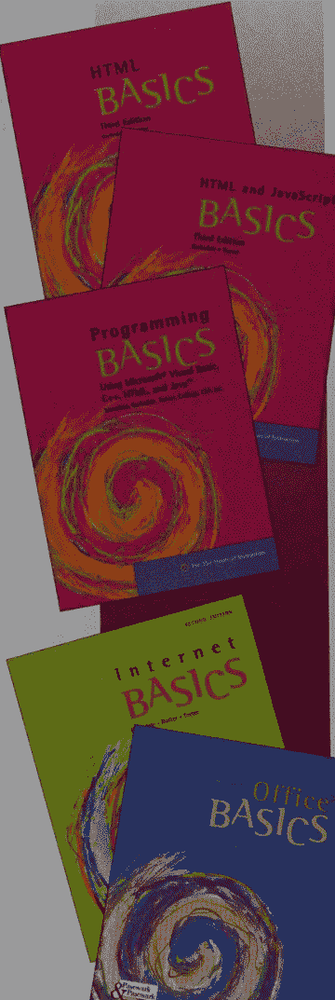

## 如何使用本书

一本关于HTML和JavaScript的好书应该具备什么？扎实的教学、实践技能培养和巩固。这就是你在*HTML、JavaScript与高级互联网技术基础*中将找到的。你不仅会发现一个色彩丰富、引人入胜的版面，还有许多增强学习的功能。

- **学习目标**——每节课开头都列出了学习目标，并附有建议完成时间。这让你可以预览将要学习的内容并安排自己的学习进度。
- **分步练习**——在简短的主题讨论之后，这些练习是课程的“动手实践”部分。只需按照步骤操作，即可巩固你学到的技能和概念。
- **SCANS（实现必要技能的秘书委员会）**——美国劳工部确定了从学校到职业的胜任能力。
- **页边框**——这些方框提供了关于课程主题的额外信息。
- **词汇**——课程中以粗体标识的术语，并在结尾进行总结。
- **增强型屏幕截图**——每页的屏幕截图现在都通过色彩和深度变得生动起来。

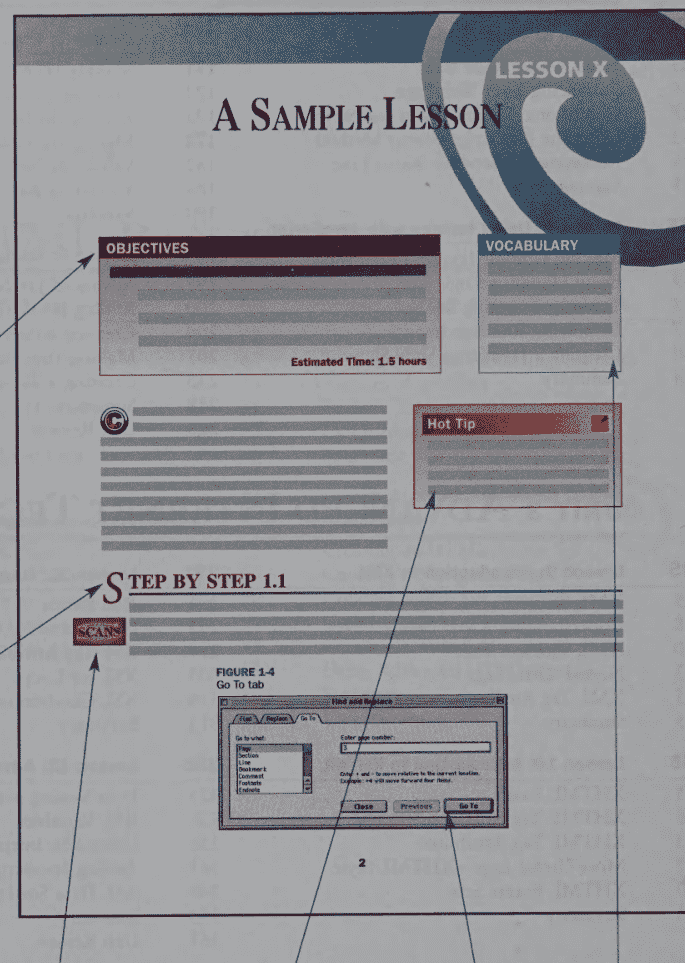

## 特别功能

- **特别功能框**——这些方框提供有关职业机会、如何创建更好网页的技巧以及互联网历史里程碑的有趣附加信息。
- **摘要**——每课结束时，你都会找到一个摘要，以帮助你完成课后活动。
- **词汇/复习题**——每课和每个单元结束时的复习材料，使你能够为评估所呈现的内容做好准备。
- **课程项目**——将所学内容进行动手实践，让你应用所涵盖的技术和概念。
- **批判性思维活动**——每课都为你提供机会，应用创造性分析并使用帮助系统来解决问题。
- **命令摘要**——每个单元结束时，都提供了一个命令摘要以供快速参考。
- **模拟**——每个单元结束时的动手任务，为你未来提供综合复习和练习的机会。
- **跨学科项目**——单元结束时的项目将互联网概念应用于各个学科的主题。

# 前言

众所周知互联网非常流行，但很少有人知道其中的原因。使互联网运行的技术已经存在了三十多年。那么，为什么网络会突然一炮而红？

互联网的飞速发展归功于超文本标记语言，即HTML，以及网络创造的开放平台环境。这个开放的HTML平台使得用JavaScript等编写的程序能够在Macintosh、Windows、Linux或任何其他连接到网络的计算机系统上运行。HTML和JavaScript为网站开发者提供了无与伦比的组合。

HTML是一种使文档和在线内容看起来很棒的相对简单的方法！HTML让网络引人注目。1995年，许多有实力的企业注意到并意识到他们可以在线做广告、推广产品，甚至在线销售产品——开发在线网站的热潮由此开始。

然而，尽管HTML有许多出色的特性，但它是一种功能有限的语言。有许多有用的任务仅靠HTML无法完成，因此许多专业网页使用了补充技术。尽管有几种不同的技术可以扩展HTML的基础功能，但JavaScript是最佳选择。与HTML一样，JavaScript的创建无需使用复杂或昂贵的开发软件。事实上，JavaScript源代码是通过标准文本编辑器或文字处理器直接输入到相应的HTML网页文件中的。但也许JavaScript语言最有价值的特点在于它建立在坚实的面向对象编程概念之上。这意味着你不仅可以快速掌握令人印象深刻的编程技能，还可以将这些技能应用于其他几种流行的编程语言，如Java、C++、Visual Basic甚至Pascal。

HTML和JavaScript协同工作。HTML是万维网的支柱。它是用于在互联网上分发数据的主要机制。JavaScript在HTML语言的基础上增加了交互性和新功能；但是，如果不了解HTML的结构，用JavaScript编写程序可能会令人困惑。对于任何想要创建像专业网页设计师开发的那样丰富多彩、支持JavaScript交互的网页的人来说，了解HTML的功能和结构至关重要。

幸运的是，HTML和JavaScript相对容易学习。HTML标签和JavaScript代码可以使用标准文本编辑器或文字处理器创建，无需购买昂贵的软件编译器。这些是HTML和JavaScript迅速流行起来的额外原因。

计算机软件的高科技世界总是在变化，互联网技术尤其如此。在未来几年，HTML和JavaScript将继续占据主导地位，但还有其他几种先进的互联网技术在某些领域正变得越来越流行和突出。

XML在许多企业中赢得了众多追随者，其强大的功能和灵活性将有助于确保其在未来可预见的时间内在行业中占据一席之地。XML已在许多情况下证明了其价值，并且被用于多种类型的硬件和操作系统。此外，XML还催生了其他基于其多平台能力的新兴标准。

万维网联盟（W3C）已宣布HTML标准“冻结”，并采纳了基于XML的XHTML标准作为未来的首选技术。当然，XHTML与HTML非常相似，但它强制执行XML语法规则，以帮助使网页更加一致和健壮。

尽管XML的使用绝不仅限于万维网，但它为这个环境提供了很多东西。但由于XML本身不传达任何显示信息，因此需要使用一种配套技术来构建可通过普通浏览器查看的基于XML的网页。这种技术就是XSL，有趣的是，它本身是另一个基于XML的标准。

XML/XSL网页的外观与标准HTML网页几乎相同。并且由于它们提供了基本相同的功能，它们同样可以从JavaScript的交互能力中受益。学会识别并结合利用XML、XSL和JavaScript的相对优势，对于互联网技术的学生来说，无疑将具有极高的价值。

Course Technology被公认为互联网相关教学的领导者。我们的使命是改变人们教授和学习技术的方式。在过去的十年里，HTML以及JavaScript等补充工具对社会产生的巨大影响，堪比五百多年前古登堡的印刷机。它们创造了一个你应该去学习的通信环境。有了这本书，你将改变看待互联网的方式，并了解如何为网络做出积极贡献。

## 本书的组织结构和特点

《HTML、JavaScript和高级互联网技术基础》的编写旨在让你能够快速、轻松地掌握HTML、JavaScript和高级互联网技术技能。分步讲解部分配有完整的插图且易于遵循，让你能够掌握基础知识。

全书分为十二个互动性动手实践课程：

- **第1课——快速掌握HTML**：介绍HTML的基本结构，并让你创建第一个基础网页。
- **第2课——HTML组织技术**：教你如何格式化网页，并给你创建超链接所需的技术。
- **第3课——HTML强力技术**：教你如何插入图形、整合表格，以及调整字体的大小、样式和颜色。
- **第4课——HTML结构设计技术**：教你如何让多个网页和导航系统协同工作。
- **第5课——什么是JavaScript？**：解释JavaScript的历史和目的，并展示如何将JavaScript集成到HTML网页中。本课还定义核心JavaScript术语，并描述JavaScript语法的一些最基本部分，包括关键字、运算符、对象和方法。
- **第6课——将图像与JavaScript结合使用**：向你展示如何将图形图像与JavaScript事件和函数结合使用，为网页添加一些令人印象深刻的视觉效果。这些效果包括图像翻转、超链接翻转、循环广告横幅、随机图像显示和电子幻灯片。
- **第7课——使用JavaScript创建表单**：在第3课介绍表单的基础上进行扩展。它演示了如何使用JavaScript增强HTML表单的功能。本课将教你如何设计电子表单、验证用户输入数据，并向用户提供适当的反馈。
- **第8课——将JavaScript与框架结合使用**：教你如何创建带参数列表的JavaScript函数、启用影响其他框架的超链接、启用影响其他框架的按钮，以及创建顶级JavaScript函数。这教你如何让多个网页框架相互交互。
- **第9课——XML简介**：概述可扩展标记语言的目的、特性和语法。学生还将学习如何使用网页浏览器验证XML文档的结构。
- **第10课——XHTML简介**：向学生介绍用于开发网页的下一代语言。XHTML基于XML，因此强制执行XML语法规则。教导学生如何将标准HTML文档转换为符合XHTML格式的文档。
- **第11课——XSL简介**：向学生展示如何将XML数据文档转换为有吸引力、结构化的网页。XSL也基于XML，并强制执行与XHTML相同的语法规则。但XSL还包括编程语言的许多基本功能，大大增强了其能力。
- **第12课——使用JavaScript的高级XSL**：向学生介绍XSL的一些高级功能，包括强大的标签和内置函数。本课还向学生展示如何将JavaScript集成到他们的XML/XSL网页中，以获得更强的交互吸引力。

当你学习更多网页设计教程（如*《网页设计基础》*）或高级编程教程时，这些技能将证明非常有价值。

*《HTML、JavaScript和高级技术基础》*逐步讲解了HTML、JavaScript和高级互联网技术的基础知识。每课包括：

- 课程目标，指明学习目标。
- 预计完成时间。
- 词汇，介绍本课中使用的新术语。
- 分步练习，教你需要了解的基础知识。
- 屏幕插图，为你学习的内容提供视觉强化。
- 与课程主题相关的互联网技巧侧边栏。
- 特别功能，如互联网里程碑和网络礼仪，提供有关互联网历史的信息。
- SCANS关联。

课后练习侧重于巩固你在本课中学到的技能，并全面复习应用技能的方法。课后功能包括：

- 课程摘要。
- 对本课中介绍的新术语进行词汇复习。
- 复习题，评估你对所学内容的理解。
- 用于应用本课所学概念的项目。

## 课后与单元复习

- 批判性思维活动，要求你针对各种HTML和JavaScript挑战，分析并阐述自己的观点。
- 单元复习旨在评估你对课程的整体理解。单元复习内容包括：
  - HTML标签和属性、命令摘要以及JavaScript代码摘要。
  - 复习题。
  - 跨学科活动，将HTML技能应用于语言艺术、科学、社会研究和数学领域。
  - 特殊的SCANS项目，帮助你掌握所学技能。
  - 职业模拟活动，帮助你将HTML技能应用于与工作相关的情境。
- 书末提供了一份术语表，为你定义我们都需要学习的那些棘手的HTML标签和术语。

## 本书使用指南

### 软件

- 用于查看网页的Internet Explorer或Netscape Navigator。
- 用于创建HTML文档的Windows记事本或Macintosh SimpleText。

目前这些工具几乎都预装在所有标准计算机上。你可以用记事本或SimpleText替代能够将文本文件另存为`.htm`或`.html`文档的文字处理器。

### 教师资源套件光盘

*教师资源套件*光盘包含丰富的教学支持材料，将帮助教师教授*HTML*、*JavaScript*和*高级互联网技术基础*。使用Internet Explorer阅读和访问*教师资源套件*，就像在互联网上实时冲浪一样。只需使用Internet Explorer打开`begin_html_teacher.htm`文件，然后点击浏览*教师资源套件*的各个部分。

这些文件可以直接从光盘复制到计算机的硬盘驱动器或网络驱动器。资源也可在线获取，网址为`www.course.com`。

也可以在线或从光盘访问单独的学生指南。打开学生文件夹，使用Internet Explorer选择`begin_html_student.htm`来访问学生模拟文件。

### SCANS

美国劳工部下属的“必要技能获取秘书委员会”（SCANS）被要求审视工作场所的需求，以及新学习者是否具备满足这些需求的能力。具体而言，该委员会被指示就进入就业所需的技能水平向部长提供建议。

SCANS的工作场所能力和基础技能已被整合到*HTML、JavaScript和高级互联网技术基础*中。工作场所能力被确定为：

1. 资源使用能力；
2. 人际交往能力；
3. 信息处理能力；
4. 系统理解力；
5. 技术知识与理解力。

基础技能被确定为：

1. 基本沟通技能；
2. 思维技能；
3. 个人品质。

学习者必须运用多项SCANS能力和基础技能的练习，在文中已用SCANS图标标出。

## 关于作者

卡尔·巴克斯代尔先生是犹他州普罗沃市法勒中学的教师。他为汤姆森公司编写了许多教科书，主题涉及互联网、网站、语音识别、个人数字助理（PDA），并且是教科书《数字工具》的合著者。巴克斯代尔先生曾是WordPerfect公司的员工，现在全国各地举办关于新技术的研讨会。他的研讨会涵盖语音识别、手写识别、平板电脑和PDA的使用等主题；每个主题都为中学和高中生以及教师精心设计。

E·谢恩·特纳先生目前是一家位于犹他州的福利实践管理公司的高级软件工程师。他为汤姆森公司编写了许多教科书，并为三家在线计算机杂志出版物撰写了大量软件评论。特纳先生于1994年在杨百翰大学攻读计算机科学硕士学位时，首次接触HTML。他曾在韦伯州立大学和科罗拉多技术大学教授计算机科学。除了是计算机技术领域的专业人士和作家外，特纳先生还是一位有成就的音乐家，作为犹他州首屈一指的铜管乐团成员演奏小号。特纳先生与妻子和九个孩子居住在犹他州。

# 致谢

作者公开感谢为本书的完成和成功做出贡献的许多人。

首先，我们要感谢学校出版与市场营销副总裁谢丽尔·科斯坦蒂尼和高级策划编辑简·马扎雷斯。他们为把握市场需求而提供的指导和远见，以及与我们合作的能力，是无价的。

接下来，我们要感谢产品经理大卫·里维拉、高级营销经理金·瑞特尔、学校市场专家梅根·普特尼以及编辑助理/副产品经理贾斯汀·布伦南。感谢你们为推广我们的产品和管理出版流程所提供的所有帮助。我们非常幸运能有你们参与出版，我们知道我们的成功很大程度上归功于你们的努力。

我们还要感谢质量保证团队，特别是苏珊·韦伦，她在确保文本、分步活动和单元末项目中的准确性及一致性方面做得非常出色。


最后，我们要感谢来自 Custom Editorial Productions, Inc. 的发展编辑罗丝·玛丽·库宾、制作编辑埃里卡·麦金泰尔以及补充材料开发人员简·克拉维。我们感谢你们为“确保我们的所有细节都准确无误”所做的努力。感谢你们的耐心和辛勤工作，确保我们的写作传达了我们试图表达的信息。我们同样感谢你们为将本书推向市场所做的努力。

# HTML 基础

## 单元 1

- **第 1 课**：1.5 小时  
  HTML 快速入门
- **第 2 课**：1.5 小时  
  HTML 组织技巧
- **第 3 课**：1.5 小时  
  HTML 高级技巧
- **第 4 课**：1.5 小时  
  HTML 结构设计技巧

**单元预计用时：**6 小时

# 第 1 课：HTML 快速入门

| 目标 | 词汇 |
| :--- | :--- |
| 完成本课后，你应该能够：<br>- 探索 HTML 标签。<br>- 输入起始标签。<br>- 正确保存文件。<br>- 将不同级别的标题整合到网页中。<br>- 创建无序列表、有序列表和嵌套列表。<br><br>预计用时：1.5 小时 | 尖括号<br>Flash<br>主页<br>HTML 页面<br>超文本标记语言 (HTML)<br>Internet Explorer<br>Java<br>JavaScript<br>Mosaic<br>Netscape Navigator<br>Web 浏览器<br>网页<br>网站<br>欢迎页 |

## 在网络上交流

每次你上网并开始点击链接时，都会打开一个又一个新的*网页*。网页可以由图片、文本和多媒体效果组成。它们的目的是与网络访客共享信息。网页由名为*Web 浏览器*的特殊软件程序显示，其工作是查找和显示网络信息。最流行的两种浏览器是*Internet Explorer*和*Netscape Navigator*。

*超文本标记语言*，或*HTML*，允许你创建网页。HTML 组织文档，并告诉 Web 浏览器网页在你的计算机屏幕上应如何显示。网页上的颜色、图片和背景由 HTML 标签决定。

HTML 标签适用于任何 Web 浏览器。如果你创建了一个网页，并且操作正确，你的 Web 浏览器就能读取它。事实上，HTML 是万维网的官方语言！

网络空间中还使用许多其他语言，例如*Java*，一种广泛应用于互联网应用程序的编程语言；*Flash*，一种高影响力的多媒体创作工具；以及*JavaScript*，一种类似 Java 的脚本语言，用于创建小型应用程序和多媒体效果。在所有这些网页开发工具中，HTML 是使用最广泛的。HTML 为其他这些程序的构建奠定了基础。

## HTML 的工作原理

HTML 标签在互联网上无处不在。它们可以在 Macintosh 或 Windows 计算机上显示网页。它们也能在 Linux 和 UNIX 计算机上工作，甚至在支持网络的手机、掌上设备和带有网络功能的电视上也能工作。

HTML 标签如此简单，任何人都能快速学会一些基本标签。它们通常成对出现，并包含在*尖括号*中。你可以在键盘的逗号键和句号键上找到这些括号。按住 Shift 键并按下这两个键中的任何一个，就可以创建一个尖括号。

为了更清楚地理解 HTML 标签是如何工作的，我们来分析下面的例子。如果你想在网页上将这本书的标题居中，你只需要输入：

```html
<CENTER>HTML and JavaScript BASICS</CENTER>
```

注意，这里有一个起始标签 `<CENTER>` 和一个结束标签 `</CENTER>`。这两个标签之间唯一的区别是结束标签的第一个尖括号后面有一个斜杠（`/`）。`<CENTER></CENTER>` 构成一对标签，如果你还没猜到的话，这些标签被称为居中标签。这些标签之间的任何内容都将在页面上居中显示。这些标签之外的任何内容都不会受到该命令的影响。没有比这更简单的了！

## 揭开页面之下的页面

互联网上充满了网页。有些非常有趣，有些非常激动人心，有些过于繁杂，还有些则枯燥乏味。

一个页面是有趣还是枯燥并不重要；所有页面都有相同的特征。让我们看看这意味着什么。

例如，你在图 1-1A 中看到的所有单词、图片和颜色，都是由你在图 1-1B 中看到的 HTML 标签组织和创建的。

图 1-1A 和图 1-1B 实际上是同一个页面，只是查看方式不同。

### 图 1-1A

`www.course.com` 的 Course Technology 主页

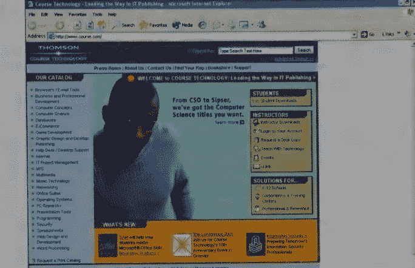

### 图 1-1B

图 1-1A 所示主页的 HTML 标签

```html
<!DOCTYPE HTML PUBLIC "-//W3C//DTD HTML 4.0 Transitional//EN">
<html>
<head>
<title>Course Technology - Leading the Way in IT Publishing</title>
<link rel="stylesheet" type="text/css" href="/apps/styles/structure.css">
<link rel="stylesheet" type="text/css" href="/apps/styles/formatting.css">

<script name="Redirect" language="JavaScript1.2">
<!--
function exploreTo(form) {
var myIndex = form.topic.selectedIndex;
window.location.href= form.dest.options[myIndex].value;
}

// -->
</script>

<script language="javascript">
<!--
function launch1() {
window.open('/apps/webreference/wrd_start.cfm','_rdi_win','height=480,width=620,scrollbars=yes,resizable=no');
}
function launchcrd1() {
window.open('/apps/centerreference/wrd_start.cfm','_cnt_win','height=480,width=620,scrollbars=yes,resizable=no');
}

function launchOfficeClosed() {
window.open('office_closed_temp.cfm','_cnt_win','height=635,width=490,scrollbars=yes,resizable=yes');
}
// -->
</script>
</head>
<body marginheight="0" marginwidth="0" topmargin="0" leftmargin="0">
<div align="center" id="banner">
<table cellpadding="0" cellspacing="0" border="0" width="750">
<tr>
```

注意，图 1-1B 并不十分美观。它展示了创建图 1-1A 中那个更令人兴奋的页面的 HTML 标签。图 1-1B 正好显示了那个彩色页面背后页面的真实面貌。网页浏览器解释这些标签，并创建普通网络用户所看到的网页。

标签有很多，使用方法也很多。这个提示应该能让你避免困惑：*HTML 标签只是给网页浏览器的指令。* 它们告诉浏览器如何显示信息。很多时候，你可以看着最终的网页，猜测是什么标签创造了这种效果。如果你记住这个提示，学习 HTML 会变得容易得多。

现在轮到你了。以下步骤将允许你打开一个自己选择的网页。查看页面之下的页面，就像从浏览器的“查看”菜单中选择“源代码”或某些类似的命令（如“页面源代码”）一样简单（参见图 1-3A 和 1-3B）。

### 分步操作 1.1

1. 通过双击其图标来打开你的网页浏览器，如图 1-2A 和 1-2B 所示。

   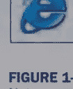

   

### 分步操作 1.1 续

2. 当一个页面出现时，使用鼠标将指针移到“查看”菜单上，如图 1-3A 和 1-3B 所示。

   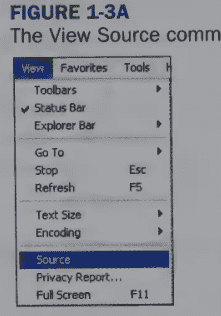

   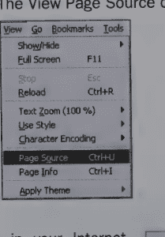

3. 在你的 `Internet Explorer (IE)` 浏览器中，选择**“查看”**然后选择**“源文件”**；或者在你的 `Netscape` 浏览器中，选择**“查看”**然后选择**“页面源代码”**。

   > **注意：**不同的浏览器可能使用不同的词语来表示此命令。请留意；该选项应该就在那里。

4. 检查彩色页面之下页面上出现的标签。这些标签看起来会像你在图 1-1B 中看到的标签。

5. 跳转到另外三四个其他网页并查看源代码。列出你反复遇到的七个标签。在下面的表格中猜测并记录它们的功能。

### 表 1-1：常用标签

| 序号 | 标签 | 它在网页上的效果 |
|---|---|---|
| 示例 | `<CENTER></CENTER>` | 使网页上的文本居中 |
| 1 |  |  |
| 2 |  |  |
| 3 |  |  |
| 4 |  |  |
| 5 |  |  |
| 6 |  |  |
| 7 |  |  |

6. 如果你今天结束了，就退出你的软件并关闭计算机。否则，继续下一节。

## 互联网里程碑

### 商业界发现网络

万维网 (WWW) 诞生于 20 世纪 80 年代末的欧洲。在接下来的五年左右时间里，它仅在学术界有限地使用。然而，直到 1994 年一种名为 *Mosaic* 的网络浏览器出现，它才真正抓住公众的想象力。它是第一个允许图片和文本同时伴随网页显示的网络浏览器。

人们对这种呈现和分享信息的新方式感到兴奋不已。随后，网景通信公司推出了名为 `Netscape Navigator` 的浏览器。网景在 1995 年引发了商业界的想象，从那时起，一切都变得不同了。

在短短几年内，万维网成为了我们今天所见的新的广告和商业媒介。公司和企业投入了数十亿美元，希望从这个新的黄金信息共享系统中获利。突然间，成千上万的企业网页创建者开始学习 HTML，以便将他们的商业网页上线。

## 以传统方式输入你的神秘标签

在开始输入标签之前，你需要了解用于描述用 HTML 标签创建的页面的许多术语。事实是，这些名称被如此交替使用，以至于大多数人完全没有意识到它们的含义之间存在细微的差别。

- **网页：**也称为 Web 文档，指任何用 HTML 创建并可放置在万维网上的页面。
- **主页：**公司、组织或个人的主要或首要网页。个人主页是你启动网页浏览器时看到的第一个页面。当你点击浏览器中的“主页”图标时，你将直接转到你的起始主页。
- **欢迎页：**专门为网站的新访客设计的页面。
- **HTML 页面：**也称为 HTML 文档，指任何用 HTML 创建并可以在万维网上显示的文档。
- **网站：**可以包含由特定公司、组织、学院或大学、政府机构或个人组织的许多相互关联的网页的集合。网站存储在网络服务器上。有许多网站，每个网站上都有数千个 HTML 页面。

现在都清楚了吗？不要让这些微妙的区别妨碍你理解网络的工作原理。

## 利用标签创造强大优势

创建 HTML 标签的方法有很多。你可以使用专业软件，如 Microsoft 的 FrontPage、Adobe 的 GoLive 或 Macromedia 的 Dreamweaver，来创建超级网页。这些程序可以帮助你组织 HTML 页面、输入文本、移动元素并创建卓越的网页效果，而无需输入任何 HTML 标签。许多较新版本的文字处理程序，如 Microsoft Word 和 Corel WordPerfect，也能实现同样的功能。这些文字处理器内置了 HTML 标签。

对于大多数网页，你会想使用这些程序之一。然而，在接下来的活动中，你将用传统方式输入 HTML 标签。学会用传统方式输入一些 HTML 标签，将使你在第 2 单元开始学习 JavaScript 时拥有巨大优势。让我们快速介绍一下基础知识。首先，通过输入一些标签，你将对 HTML 的实际工作原理有更深入的理解。其次，当出现微小的错误时，你将能够排除网页故障。第三，你将能够查看其他页面并了解它们如何实现某些效果。第四，你将更好地理解网页计算机上的文件和文件夹结构。最后，也是最重要的一点，你将理解 HTML 和 JavaScript 如何协同工作。

### 使用什么工具

几乎任何文字处理程序或文本编辑器都可以用于创建 HTML 和 JavaScript。这是 HTML 和 JavaScript 如此受欢迎的原因之一。你不需要像创建 Java、Shockwave 或其他一些需要大量软件支持的选项那样，需要任何专门的软件工具就能创建令人兴奋的网页。

我们的建议是使用最简单、最基础的工具。在 Windows 系统上，可以使用记事本。在 Macintosh 系统上，可以使用 SimpleText。这些程序易于使用，几乎在地球上的每一台计算机上都可用。你也可以使用自己喜欢的文字处理程序，例如 Microsoft Word、Corel WordPerfect 或 AppleWorks。不过，你需要稍微尝试一下每个文字处理程序，以了解其特性。本文提供了 Microsoft Word 和 AppleWorks 的操作说明作为示例。许多其他文字处理软件也具有类似的 HTML 创建功能。如果遇到任何困难，请查阅软件的帮助系统，或者转用记事本或 SimpleText 来完成分步练习。

> **网络小贴士**
>
> 像 Dreamweaver、GoLive 和 FrontPage 这样复杂的专业软件程序，确实能大大简化快速创建精美网页的工作。这些程序提供了允许你查看标签的选项。如果你正在使用其中一种程序，请选择 HTML 源代码选项，以便直接输入标签。

## 分步练习 1.2

1. 打开记事本、SimpleText 或你喜欢的文字处理软件。
2. 如有必要，创建一个新文档。
3. 按照图 1-4 所示的准确顺序输入标签。不要遗漏任何尖括号 (`<`) 或斜杠 (`/`)。每一个字符都很重要。

**图 1-4**

按照此处所示准确输入这些标签：

```html
1 <HTML>
2 <TITLE></TITLE>
3 <BODY>
4 <CENTER></CENTER>
5 <P></P>
6 <P></P>
7 <P></P>
8 <P></P>
9 <P></P>
10 </BODY>
11 </HTML>
```

## 分步练习 1.2（续）

4. 你刚才输入的标签被称为基础标签。它们包括大多数网页中都会出现的一组标准标签。但如果没有一些文本，你的页面会显得非常单调。按照图 1-5 所示，在标签之间输入文本。请注意，要输入的新文本以粗体显示。

**图 1-5**

按照此处所示准确地在标签之间输入文本：

```html
<HTML>
<TITLE>HTML and JavaScript</TITLE>
<BODY>
<CENTER>Creating HTML and JavaScript</CENTER>
<P>Learning to create HTML tags can help you in many ways:</P>
<P>You will develop a deeper understanding of how HTML really works.</P>
<P>You will be able to troubleshoot Web pages when errors occur.</P>
<P>You will be able to view other pages and learn how certain effects were created.</P>
<P>You will understand how HTML and JavaScript work together.</P>
</BODY>
</HTML>
```

5. 保持你的文本编辑器处于打开状态，继续进行分步练习 1.3，在那里你将学习如何保存 HTML 文件。

## 保存并查看你的 HTML 页面

HTML 文档是文本文件。这意味着它们以尽可能简单的方式保存。在大多数情况下，文本文件只保存你在键盘上看到的字母。所有复杂的文字处理命令都会被清除，只剩下字母。

将 HTML 保存为文本文件允许它在网络上传输得更快。然而，文本文件的问题在于大多数人不知道如何保存它们。在保存之前，你需要先了解一些事情。

> **网络小贴士**
>
> HTML 不区分大小写。你可以使用大写标签 `<TAGS>`，也可以使用小写标签 `<tags>`。大写标签 `<TAGS>` 更容易看见。如果你想强调标签，就使用大写 `<TAGS>`。如果你想强调文档中的文字，就使用小写 `<tags>`。
>
> 你甚至可以像 `<Tag>` 或 `<TAG></tag>` 这样混合使用大写和小写。不过，混合使用大小写不被视为良好的格式规范。

为了区分不同类型的文件，计算机会在文件名中添加文件扩展名。有时你可以在计算机上看到这些扩展名，有时则看不到。根据你计算机的设置，扩展名可能可见也可能不可见，但计算机上的软件知道它可以打开哪些文件类型。

扩展名被广泛使用。例如，在 Windows 中，文本文件以 `.txt` 结尾或扩展名保存。如果你经常使用文字处理程序，你可能见过这些流行的扩展名：

- `.doc`：Microsoft Word 文档
- `.rtf`：Microsoft 的富文本格式
- `.wpd`：Corel WordPerfect 文档
- `.txt`：文本文件
- `.html`：HTML 文件
- `.htm`：在某些计算机系统上的 HTML 文件


HTML 文件是带有`.html`或`.htm`扩展名的文本文件。虽然你需要的 HTML 格式被称为文本，但其结尾或扩展名必须是`.html`（如果你使用的是较旧的基于 Windows 的软件程序，则为`.htm`）。`.html`或`.htm`扩展名向网络浏览器表明这是一个 HTML 文本文件。`.html`扩展名就像竖起一个牌子说：“嘿，浏览器，读我。我是一份 HTML 文档。”

请跟我们一起操作。我们将向你展示如何使用不同的软件程序进行保存。请使用与你计算机系统上的软件最相似的软件说明。它们是记事本、Microsoft Word、SimpleText 和 AppleWorks。

## 分步练习 1.3

1. 从**文件**菜单中选择**另存为**。（Microsoft Word 用户注意！不要从文件菜单中选择“另存为网页”！请使用常规的“另存为”命令。）
2. 在“另存为”对话框中，创建一个新文件夹来保存你的 HTML 和 JavaScript 作品。
3. 对于 Windows 上的记事本和 Macintosh 上的 SimpleText，步骤非常相似。Word 和 AppleWorks 用户应跳到第 5 步。
4. 选择你希望保存文件的文件夹。
5. 按照图 1-6 所示，将你的文件命名为`one.html`。请向你的讲师确认，以确保你正确保存了文件。点击保存。如果一切保存正常，请继续第 6 步。

> 请向你的讲师确认你应该将作品保存在哪里。

> 较旧的 Windows 系统只接受`.htm`扩展名。

**图 1-6**

为文本文件指定`.html`扩展名

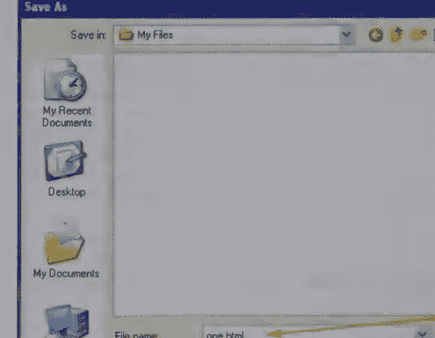

## 分步练习 1.3（续）

在你的文字处理软件中，还有一些额外的步骤。虽然记事本和 SimpleText 自动保存为纯文本，但文字处理程序会以其自己独特的格式保存。你必须从保存选项中选择正确的文本格式。这里提供了 Word 和 AppleWorks 的操作说明，以帮助你学习这一重要步骤。其他文字处理软件可能有自己的文本保存选项。请向你的讲师确认，以确保你遵循了适用于你的软件的正确步骤。

如果你是 Microsoft Word 用户，请执行以下步骤。

- a. 定位你想要放置文件的文件夹。
- b. 如图 1-7 所示，选择**纯文本**作为**保存类型**或格式类型。
- c. 将你的文件命名为`one.html`。
- d. 选择**保存**。

> **注意**：在较旧的 Windows 程序中，文件名将被截断或缩短为`one.htm`。

**图 1-7**

在 Microsoft Word 中保存文本文件

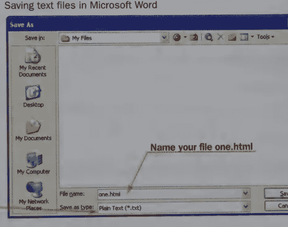

如果你是 AppleWorks 用户，请执行以下步骤。

- a. 定位你想要放置文件的文件夹。
- b. 选择**纯文本**作为**文件格式**。
- c. 如图 1-8 所示，将你的文件命名为`one.html`。
- d. 选择**保存**。

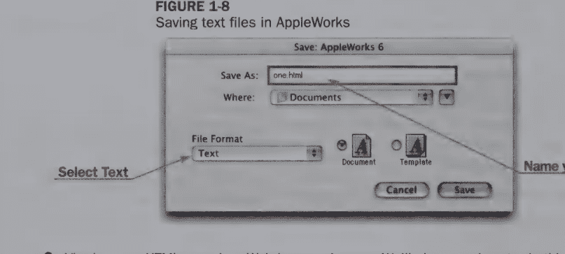

6. 在网络浏览器中查看你的 HTML 页面很简单。我们将向你展示如何在 Netscape 和 Internet Explorer 中操作。

如果你是 Internet Explorer 用户，请执行以下步骤。

- a. 打开你的网络浏览器。
- b. 选择**文件**，然后选择**打开**。
- c. 定位你保存文件的文件夹。选择**浏览**按钮来完成此操作。
- d. 在“打开”文本框中选择你的 HTML 文件，然后选择**打开**。
- e. 如图 1-9 所示，点击**确定**。


如果你是 Netscape Navigator 用户，请执行以下步骤。

- a. 打开你的网络浏览器。
- b. 从**文件**菜单中，选择**打开文件**。
- c. 如有必要，在“文件类型”选项下选择**所有文件**。
- d. 浏览到你保存文件的文件夹。
- e. 如图 1-10 所示，选择你的 HTML 文件，然后点击**打开**。

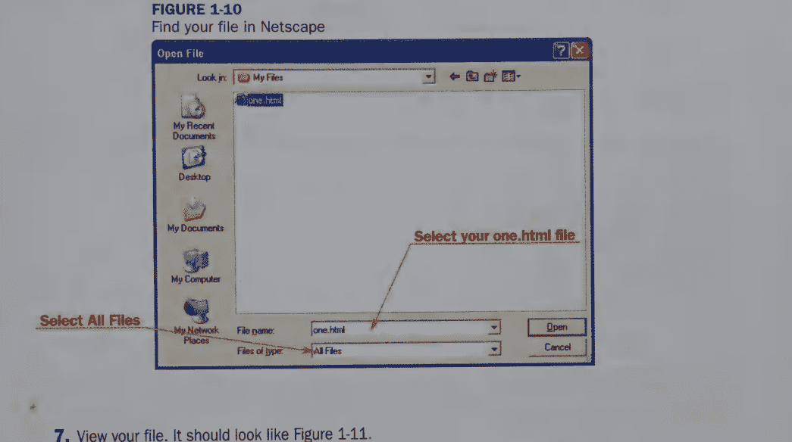

7. 查看你的文件。它应该看起来像图 1-11。

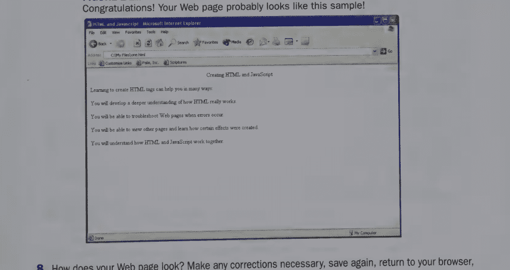

8. 你的网页看起来怎么样？进行任何必要的更正，再次保存，返回到你的浏览器，然后点击**重新加载**或**刷新**以查看你所做的更改。

## 使用标题

大多数印刷文档都使用标题来帮助读者找到重要的文本部分。想想你为学校写过的一份报告。主标题通常出现在页面的顶部中央。副标题或二级标题通常出现在纸张的侧面。它们通常以粗体显示。

HTML 提供了六个标准标题，或称标题大小，供你选择。在后续的分步指南中，你将学习更高级的方法来调整文本的大小和外观。尽管如此，标题标签提供了一种简单的方法来控制文本大小，使其突出显示，以便读者能够清晰地看到标题。

标题标签很容易记住。它们使用字母`H`加上从 1 到 6 的数字来表示标题的级别。标题数字表示标记标题的重要性级别，其中 1 最突出，6 最不突出。请查看：

- `<H1></H1>`
- `<H2></H2>`
- `<H3></H3>`
- `<H4></H4>`
- `<H5></H5>`
- `<H6></H6>`

> 互联网里程碑

## 浏览器大战

在过去的几年里，Netscape 和 Internet Explorer 一直在 Web 浏览器领域争夺霸主地位。但这并不是第一次浏览器之战。1994 年，占主导地位的浏览器叫做 Mosaic。它是伊利诺伊大学香槟分校国家超级计算中心的免费软件。在 Netscape 出现时，Mosaic 每月新增 60 万用户。但情况迅速发生了变化。

1995 年第一季度，Netscape 的 Navigator 浏览器以更快的速度赢得了声誉。到年中，它已占据了浏览器用户 50% 的份额，到年底，它占据了惊人的 80% 的浏览器市场。

Netscape 的主导地位很快受到竞争对手 Microsoft 的挑战，后者推出了 Internet Explorer 浏览器。Microsoft 免费分发其浏览器副本，希望能削弱 Netscape 的领先地位。Microsoft 还有一个优势，因为其 Windows 操作系统运行在超过 90% 的个人电脑上。通过使 Windows 和 Internet Explorer 协同工作，Microsoft 创建了一个更用户友好的 Web 系统。

然而，Microsoft 的优势导致了许多法律诉讼。多起反垄断诉讼辩称 Microsoft 正在利用其在 Windows 上的主导地位来打压 Netscape 并不公平地消除竞争。Microsoft 则声称它只是通过让 Internet Explorer 浏览器更易于访问来为其客户增加更多价值。

浏览器大战至今仍在继续。虽然 Microsoft 的 Internet Explorer 在大多数市场仍然是主导者，但 Netscape 的 Navigator 在许多领域仍然非常受欢迎。此外，还有其他新的 Web 浏览器正在进入网络空间。这些浏览器包括 Firefox、Camino、Opera 和 Safari。最终谁会胜出？

第 1 课 快速 HTML 知识

### HTML 基础

17

标题标签内的任何内容都会根据数字变大或变小。例如：

```html
<H1>VERY BIG</H1>
<H3>In the Middle</H3>
<H6>Very Small</H6>
```

在这个分步指南中，你将打开你一直在处理的 HTML 文件，并添加标题标签。

## 分步指南 1.4

1. 打开你的文本编辑器。
2. 如果需要，打开你的`one.html`或`one.htm`文件。如果你使用记事本，请在“文件类型”选项下选择“所有文件”，如图 1-12A 所示。否则，你将无法查看你的`.html`或`.htm`文件！如果你使用 Microsoft Word，当你打开`.html`文件时，Word 可能会像在 Web 浏览器中显示网页一样显示你的网页。要查看 HTML 标签，请从“视图”菜单中选择“HTML 源文件”，如图 1-12B 所示。

> 热门提示

当你在 Word 的“视图”菜单中选择“HTML 源文件”时，可能会出现一个对话框，说明尚未安装 HTML 源代码编辑器功能。你可能需要插入 Office CD 并安装此功能才能查看 HTML 源代码。

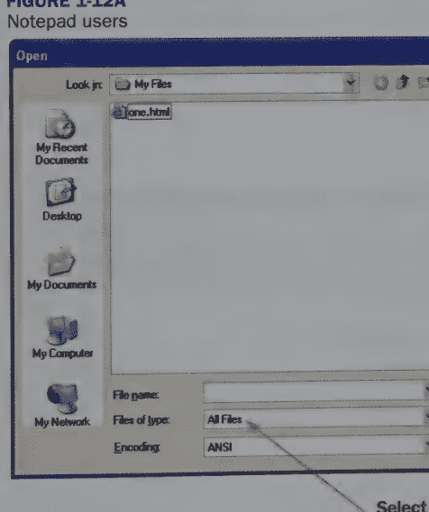

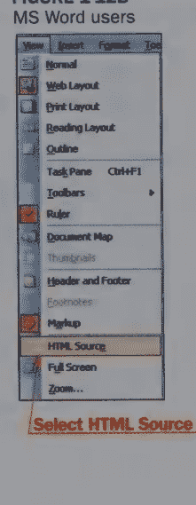

## 分步指南 1.4 续

3. 输入图 1-13 中粗体显示的标题标签。

**图 1-13**

添加标题标签

```html
<HTML>
<TITLE>HTML and JavaScript</TITLE>
<BODY>
<CENTER><H1>Creating HTML and JavaScript</H1></CENTER>
<P><H2>Learning to create HTML tags can help you in many ways: </H2></P>
<P><H3>You will develop a deeper understanding of how HTML really works. </H3></P>
<P><H4>You will be able to troubleshoot Web pages when errors occur. </H4></P>
<P><H5>You will be able to view other pages and learn how certain effects were created. </H5></P>
<P><H6>You will understand how HTML and JavaScript work together. </H6></P>
</BODY>
</HTML>
```

4. 将你的新 HTML 页面保存为`two.html`或`two.htm`。
5. 打开你的 Web 浏览器。打开你的`two.html`或`two.htm`文件，并查看它。它应该看起来像图 1-14。（Navigator 用户可能会看到“弹出窗口阻止程序”选项已开启和关闭。只需单击按钮即可切换当前设置。）标题标签确实改变了页面的外观。然而，在我们图 1-14 的示例中，标题标签被误用了。最多只有三个级别的信息：

   - `<H1></H1>`顶部的标题
   - `<H2></H2>`后跟冒号（`:`）的介绍性语句
   - `<H3></H3>`学习 HTML 标签的原因列表

**图 1-14**

网页中的标题

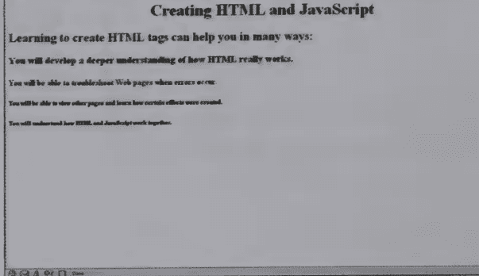

## 分步指南 1.4 续

6. 返回你的文档并重新组织标题标签。使用不超过三个`<H></H>`标签。花点时间思考你的标签选择，然后让你的文档易于阅读，强调本文档规定的三个级别。重新保存你的文件以使更改生效。
7. 如果你今天完成了，请退出你的软件并关闭计算机。否则，请继续下一节。

## 有序列表和无序列表

在上一个分步指南中，你被要求重新组织你的`two.html`文件，并以更一致的方式使用`<H>`标签。在这个分步指南中，我们将进一步规范化。组织网页信息最有效的方法之一是使用列表。有几种类型的列表，包括以下几种：

- 无序（或项目符号）列表`<UL></UL>`
- 有序（或编号）列表`<OL></OL>`

无序列表标签`<UL></UL>`创建项目符号列表。以开始标签`<UL>`开始列表，用列表标签`<LI></LI>`标记要列出的项目，并在列表末尾放置`</UL>`标签。试试看！

## 分步指南 1.5

1. 打开你的`two.html`或`two.htm`文件进行文本编辑。

## 分步指南 1.5 续

2. 在列表的开头和结尾输入`<UL></UL>`标签以创建无序列表，如图 1-15 所示。

**图 1-15**

输入无序列表标签

```html
<HTML>
<TITLE>HTML and JavaScript</TITLE>
<BODY>
<CENTER><H1>Creating HTML and JavaScript</H1></CENTER>
<P><H2>Learning to create HTML tags can help you in many ways: </H2></P>

<UL>
<LI><H3>You will develop a deeper understanding of how HTML really works.
</H3></LI>
<LI><H3>You will be able to troubleshoot Web pages when errors occur.
</H3></LI>
<LI><H3>You will be able to view other pages and learn how certain effects were created. </H3></LI>
<LI><H3>You will understand how HTML and JavaScript work together.
</H3></LI>
</UL>

</BODY>
</HTML>
```

3. 将列表中每个句子的`<P>`和`</P>`标签替换为`<LI>`和`</LI>`标签，如图 1-15 所示。
4. 将你的文件保存为`three.html`或`three.htm`。

## 分步指南 1.5 续

5. 在浏览器中查看你的页面，看看它的样子。它应该类似于图 1-16。

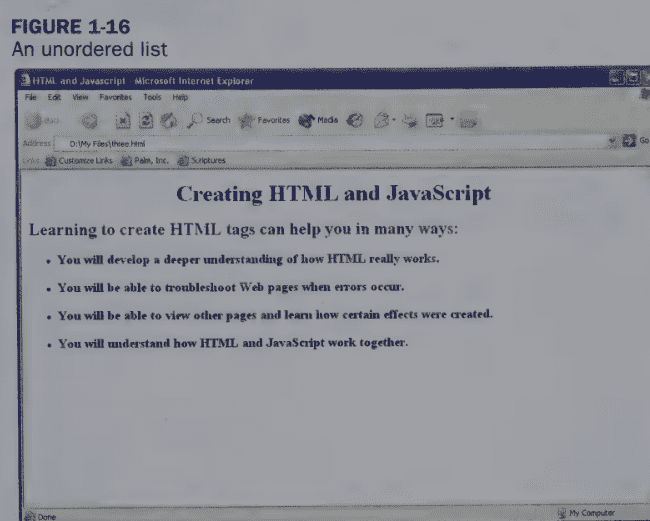

6. 如果需要，打开你的`three.html`或`three.htm`文件进行文本编辑。

## 分步指南 1.5 续

7. 将一对`<UL></UL>`标签更改为`<OL></OL>`标签，将你的列表从无序列表更改为有序列表，如图 1-17 所示。无需进行其他更改。

**注意**

不要使用数字零；使用字母 O 表示有序。

**图 1-17**

输入有序列表标签

```html
<HTML>
<TITLE>HTML and JavaScript</TITLE>
<BODY>
<CENTER><H1>Creating HTML and JavaScript</H1></CENTER>
<P><H2>Learning to create HTML tags can help you in many ways: </H2></P>

<OL>
<LI><H3>You will develop a deeper understanding of how HTML really works.
</H3></LI>
<LI><H3>You will be able to troubleshoot Web pages when errors occur.
</H3></LI>
<LI><H3>You will be able to view other pages and learn how certain effects were created.
</H3></LI>
<LI><H3>You will understand how HTML and JavaScript work together.
</H3></LI>
</OL>

</BODY>
</HTML>
```

8. 将你的文件保存为`four.html`或`four.htm`。

## 分步指南 1.5 续

9. 在浏览器中查看你的页面效果。它应该与图 1-18 相似。

**图 1-18**

有序或编号列表

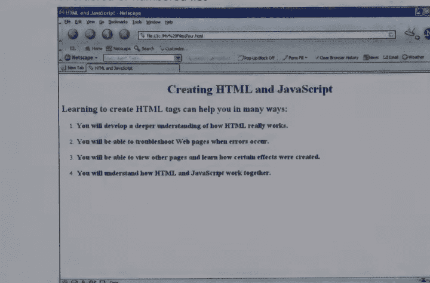

10. 如有需要，打开你的`four.html`或`four.htm`文件进行文本编辑。
11. 在列表中间添加两对`<UL></UL>`标签，如图 1-19 所示。

**图 1-19**

输入无序列表标签


```html
<HTML>
<TITLE>HTML and JavaScript</TITLE>
<BODY>
<CENTER><H1>Creating HTML and JavaScript</H1></CENTER>
<P><H2>Learning to create HTML tags can help you in many ways: </H2></P>

<OL>
<LI><H3>You will develop a deeper understanding of how HTML really works.
</H3></LI>

<UL>
<LI><H3>You will be able to troubleshoot Web pages when errors occur. </H3></LI>
<UL>
<LI><H3>You will be able to view other pages and learn how certain effects were created.
</H3></LI>
</UL>
</UL>

<LI><H3>You will understand how HTML and JavaScript work together.
</H3></LI>
</OL>
</BODY>
</HTML>
```

12. 将你的文件保存为`five.html`或`five.htm`。

13. 查看你的页面效果。它应该与图 1-20 相似。

**图 1-20** 嵌套和缩进列表

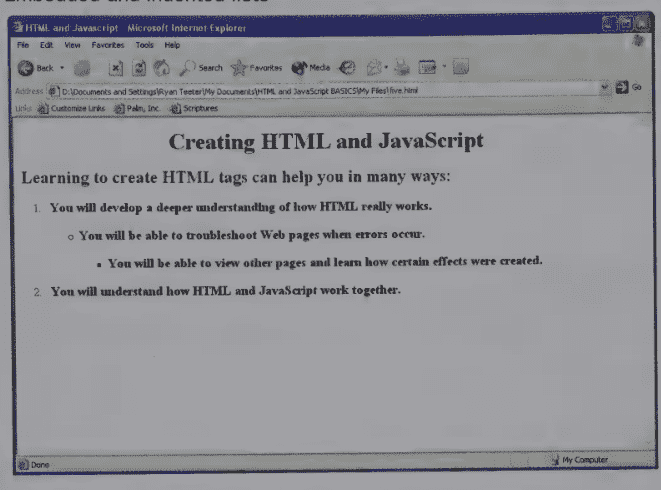

14. 如果你今天的学习到此结束，请退出软件并关闭电脑。否则，请继续阅读摘要部分。

## 摘要

在本课中，你学到了：

- 你可以识别 HTML 标签。
- 你可以输入起始标签。
- 你可以正确保存你的 HTML 文件。
- 你可以将不同级别的标题整合到网页中。
- 你可以创建无序列表、有序列表和嵌套列表。

## 词汇复习

定义以下术语：

- 尖括号
- Flash
- 主页
- HTML 页面
- 超文本标记语言（HTML）
- Internet Explorer
- Java
- JavaScript
- Mosaic
- Netscape Navigator
- Web 浏览器
- 网页
- 网站
- 欢迎页

# 复习题

## 判断题

如果陈述正确，请圈出 T；如果陈述错误，请圈出 F。

1. `<LI>` 标签定义一个列表项。
2. `<OL>` 标签创建一个带项目符号的列表。
3. `<CENTER>` 标签格式化文本，使其在页面上居中。
4. 学习 HTML 非常困难。
5. `<UL>` 标签创建一个没有特定顺序的列表。

## 填空题

在提供的空白处填写正确的单词或短语，完成以下句子。

1. 无序或 __________ 列表以非特定顺序显示项目。
2. 有序或 __________ 列表以数字顺序显示项目。
3. 文件 __________ 是三个字母的后缀，用于说明文件的类型。
4. __________ 是 Netscape 与之竞争的首款 Web 浏览器。
5. HTML 由 __________ 组成，这些是包含在尖括号（< >）中的命令。

## 笔答题

简要回答以下问题：

1. 想出一种方法，向从未创建过网页的人解释 HTML 标签的工作原理。你如何向新手解释 HTML 的工作原理？
2. 解释查看 HTML 网页源代码的过程。
3. 解释你必须如何保存 HTML 文本页面。
4. 什么是文件扩展名？请举例说明。
5. Mosaic、Netscape Navigator 和 Internet Explorer 是什么？它们各自对 Web 的发展做出了什么贡献？

## 项目

### 项目 1-1

你刚刚被聘为 GreatApplications, Inc. 的网站管理员，这是一家主要的软件和网站开发商，但你的 HTML 技能有限。你需要快速找到一些好的 HTML 信息！你该怎么做？

答案显而易见。上网。选择一个搜索门户网站，如 Yahoo!、Excite、Lycos 或其他搜索网站，并输入以下搜索词：

- Hypertext Markup Language
- HTML
- HTML Guides
- Learning HTML

使用下表记录标题和网址或 Web 地址，并简要总结你找到的有用 HTML 网页。

#### 表 1-2

有用的网页

| 标题栏中显示的标题 | Web 地址或 URL | 描述 |
| :--- | :--- | :--- |
|  |  |  |
|  |  |  |

### 团队项目

GreatApplications, Inc. 正在为其新网站欢迎页寻找设计创意。以三到四人为一组，列出你最喜欢的网页。找出七个很棒的网页，并讨论是什么让它们如此出色。进行投票，并根据你的投票将七个欢迎页从第 1 名到第 7 名进行排名。在下面列出你团队的选择，以供将来参考。

#### 表 1-3

设计精良的网页

| 排名 | 标题栏中显示的标题 | Web 地址或 URL |
| :--- | :--- | :--- |
| 1. |  |  |
| 2. |  |  |
| 3. |  |  |
| 4. |  |  |
| 5. |  |  |
| 6. |  |  |
| 7. |  |  |

## 网络项目

网站对许多公司、团体和个人都很重要。我们都知道，许多公司如果没有优质的网站就无法维持运营。但是，对于非营利组织和政府机构来说，外观精美的网站到底有多重要？

列出这些组织需要网站的原因：

政府机构：

非营利组织：

大学：

## 批判性思维

准备一个 100 到 250 字的答案，回答以下每个问题。

### 活动 1-1

万维网是一个共享 HTML 文件的大型计算机网络。在你的余生中，你可以每分钟访问一个新网页，但永远无法接近阅读可用网页的一小部分。网络空间中存在多少百万或数十亿的网页？虽然 HTML 使人们能够轻松共享网页，但 HTML 是否也导致了信息过载？如果是，如何导致的？

### 活动 1-2

以下标签集中存在一个错误，你需要找到并修复它。当前的标签会对你的页面造成什么影响？修复后它看起来是什么样的？

```html
<OL>
<LI>Item A</LI>
<UL>
<LI>Item A1</LI>
<LI>Item A2</LI>
</UL>
<LI>Item B</LI>
<UL>
<LI>Item B1</LI>
<LI>Item B2</LI>
</UL>
</UL>
```

### 活动 1-3

如何在 HTML 中创建一个复杂的提纲（你知道，就是你上次写研究论文时必须做的那种）？你的研究论文可以通过 HTML 在线以哪些方式增强？

## 摘要项目

所有优秀的作者都知道，在开始一个大型写作项目之前，最好先创建一个他们希望呈现的信息的提纲。提纲可以非常有效地帮助作者组织他们的思想，并确保他们的写作遵循逻辑的思想流。使用你在本课中学到的 HTML 技能，为一本书创建一个提纲，该书由单元、章节和小节组成。下面的图 1-21 将让你了解完成后的提纲应该是什么样子。

**图 1-21**

书籍提纲示例

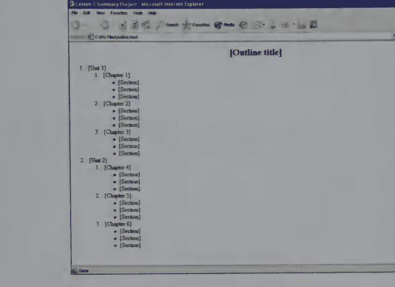

## 项目要求

- 你的提纲必须有一个居中显示在页面顶部的标题。
- 你的提纲必须包含至少两个有序列表的单元。
- 你的提纲每个单元必须包含至少三个章节，也是有序的。
- 你的提纲每个章节必须包含至少三个小节——不需要有序。

## HTML 组织技巧

### 学习目标

完成本课后，你应该能够：

- 使用单倍行距和双倍行距组织页面信息。
- 使用线条组织页面信息。
- 实现属性和值。
- 通过更改属性和值来更改网页的颜色默认值。
- 更改网页文本颜色。
- 创建指向网页内另一个位置的超链接。
- 创建指向 WWW 上任何位置的 URL 或网页的超链接。
- 创建指向你自己计算机上另一个网页的超链接。

**预计时间：1.5 小时**

### 词汇

- 属性
- 字体
- 十六进制
- 超链接
- 超文本链接
- 超文本传输协议（HTTP）
- 统一资源定位符（URL）
- 值

## 创建更好的网页

万维网是由成千上万的人共同创造的，他们不断地创建、改进和发布令人兴奋的网页。网络是一个可以充分发挥创造力的地方。你参与其中的乐趣只需要一点 HTML 和 JavaScript 知识。有了这些工具在手，你的想象力将是唯一的限制。

当你在冲浪网络时，你看到过非常令人兴奋的网页，也看到过其他平淡无奇的页面。一个精彩页面和一个沉闷页面之间的主要区别归结于细节——字母颜色、图片的选择，以及有助于页面整体组织的元素的选择。

你可以使用许多 HTML 技术使你的页面完美呈现。这些是单倍行距和双倍行距技巧以及其他专业的组织标签，可以使任何网页易于阅读。例如，可以通过在段落之间添加空格或在网页的不同部分之间放置线条来使网页更具吸引力。改变文本和页面背景的颜色也能让 HTML 文档更具吸引力。颜色的选择至关重要。在网络空间中，没有什么比一个搭配了所有错误颜色的网页更糟糕的了。使用恰到好处的颜色，你的页面将变得非常出色。

**字体**，即字母的样式，是可以更改的。每种字体都有其独特的风格。以下是一些最常见字体的示例：

这是 Times New Roman 字体。

这是 Arial 字体。

这是 Courier 字体。

**超文本链接**有助于使网页变得有趣且易于导航。正如它们常被称呼的那样，**超链接**允许用户点击并迅速跳转到网络上的另一个位置、另一个用户创建的页面，或当前文档中的某个位置。如果你的单个页面上有很多信息，创建一个索引可以帮助读者超级跳转到他们正在寻找的确切信息。

随着你学习本课教授的新 HTML 元素，你将接触到关于如何组织网页的新理念。

## 单倍行距和双倍行距

大多数 1995 年之前的早期网页，最好被描述为冗长、枯燥的文字集合。早期版本的 HTML 仅提供了将文本分成可读部分的最简单方式。

这种情况已经改变。再也没有理由创建一个枯燥、难以阅读的网页了。在下面的“分步操作”中，你将亲眼看到如何改善页面的可读性和组织性。

## 分步操作 2.1

1. 打开 Notepad、SimpleText 或你的文字处理软件。
2. 严格按照图 2-1 所示输入 HTML 网页信息。

> **注意**
>
> 如果你使用的是 Notepad，请在输入文本之前从**格式**菜单中选择**自动换行**选项。

**图 2-1**

严格按照所示输入这些标签和文字

```html
<HTML>
<TITLE>HTML and JavaScript</TITLE>

<BODY>
<CENTER><H1>Organizing Tags</H1></CENTER>

There are many ways to organize a Web page. This Web page will organize text, hypertext links, colors, and fonts. You'll also demonstrate single spacing, double spacing, and the use of line breaks.

This Web page will display how to organize Web pages in a number of ways using:

Powerful Lines
Hyperlinks to HTML and JavaScript Sources
Hyperlinks to Previously Created Web Pages
Fancy Fonts
Perfect Pictures
Orderly Tables
Extraordinary Extras

</BODY>
</HTML>
```

3. 像你在“分步操作 1.3”中所学的那样保存文件，文件名为` six.html`或` six.htm`。
4. 打开你的网页浏览器查看你的页面。它应该看起来很混乱，如图 2-2 所示。（如果需要回忆如何在浏览器中查看 HTML 文件，请回顾“分步操作 1.3”。）注意，虽然你在 HTML 中输入时页面可能看起来组织良好，但在没有一些组织性标签的情况下，网页上的页面组织结构就会瓦解。使用一些精选的标签确实可以清理页面。你可以用来组织页面的两个最简单的标签是`<P></P>`或段落标签，以及`<BR>`或换行标签。`<P></P>`标签在文本周围创建双倍行距。`<BR>`标签创建单倍行距的换行。

**图 2-2**

一个未组织的网页

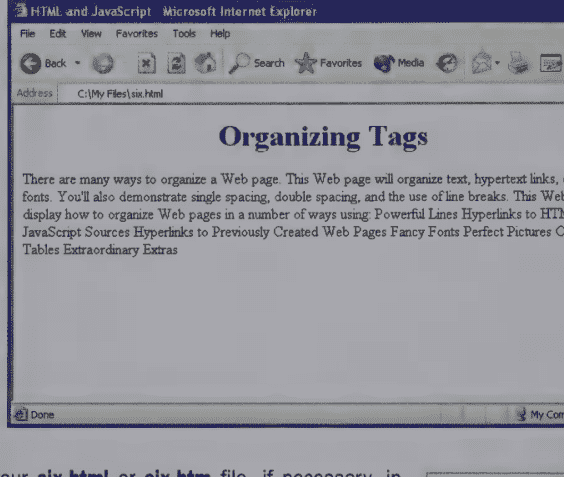

5. 如果需要，在你的文字处理器、Notepad 或 SimpleText 中打开你的`six.html`或`six.htm`文件。

> **注意**
>
> 如果你使用的是 Notepad，请在打开文件时从**格式**菜单中选择**自动换行**选项，以便在屏幕上看到所有文本。

6. 添加`<P></P>`和`<BR>`标签，如图 2-3 中粗体标记所示。

**图 2-3**

输入`<P></P>`和`<BR>`标签。

```html
<HTML>
<TITLE>HTML and JavaScript</TITLE>

<BODY>
<CENTER><H1>Organizing Tags</H1></CENTER>

<P>There are many ways to organize a Web page. This Web page will organize text, hypertext links, colors, and fonts. You'll also demonstrate single spacing, double spacing, and the use of line breaks. </P>

<P>This Web page will display how to organize Web pages in a number of ways using: </P>

<BR>Powerful Lines
<BR>Hyperlinks to HTML and JavaScript Sources
<BR>Hyperlinks to Previously Created Web Pages
<BR>Fancy Fonts
<BR>Perfect Pictures
<BR>Orderly Tables
<BR>Extraordinary Extras

</BODY>
</HTML>
```

7. 使用**另存为**选项将你重新组织的文件保存为`seven.html`或`seven.htm`。
8. 审视你的作品。这次它应该看起来好多了，类似于图 2-4。

**图 2-4**

`<P></P>`和`<BR>`标签清理网页

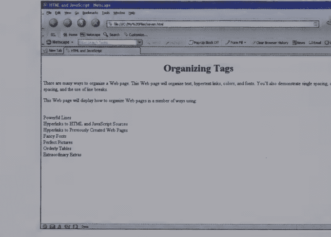

9. 继续到下一节，或者如果你今天完成了，请关闭软件并关闭计算机。

## 水平线和背景颜色

HTML 标签可以被增强。以`<BODY>`标签为例。你可以向 body 标签添加命令，这将显著改变网页的外观。例如，要更改网页的背景颜色，你可以添加背景**属性**（或特殊性质），并给标签一个颜色**值**（或属性的定义），如图 2-5 所示。

属性和值是帮助你组织网页的强大工具。使用最广泛的标签之一是`<HR>`或水平线。这个标签只是创建一条横跨页面的水平线。你也可以添加属性来改变水平线的大小和形状。

**图 2-5**

更改背景颜色


## 分步操作 2.2

1. 如果需要，打开你的`seven.html`或`seven.htm`文件进行文本编辑。
2. 在页面顶部附近的 BODY 标签内输入`BGCOLOR=YELLOW`，如图 2-5 中粗体所示。
3. 将你的作品保存为`eight.html`或`eight.htm`。
4. 在你的网页浏览器中查看这些更改。你的页面应该变成黄色。
5. 尝试实验。将背景颜色值更改为`BLUE`、`GREEN`、`RED`、`WHITE`或你选择的另一种颜色。
6. 切换回你的`eight.html`或`eight.htm`文件。在页面底部`</BODY>`标签之前，输入图 2-6 中粗体标记的各种`<HR>`标签、属性和值。

**图 2-6**

添加背景颜色和线条


```html
<HTML>
<TITLE>HTML and JavaScript</TITLE>

<BODY BGCOLOR=YELLOW>
<CENTER><H1>Organizing Tags</H1></CENTER>

<P>There are many ways to organize a Web page. This Web page will organize text, hypertext links, colors, and fonts. You'll also demonstrate single spacing, double spacing, and the use of line breaks. </P>

<P>This Web page will display how to organize Web pages in a number of ways using: </P>

<BR>Powerful Lines
<BR>Hyperlinks to HTML and JavaScript Sources
<BR>Hyperlinks to Previously Created Web Pages
<BR>Fancy Fonts
<BR>Perfect Pictures
<BR>Orderly Tables
<BR>Extraordinary Extras
<HR>

<P><H2>Powerful Lines</H2></P>

A Horizontal Rule tag 50% wide and 10 pixels high.
<HR WIDTH=50% SIZE=10>

A Horizontal Rule tag 25% wide and 20 pixels high.
<HR WIDTH=25% SIZE=20>

A Horizontal Rule tag 10% wide and 30 pixels high.
<HR WIDTH=10% SIZE=30>

A Horizontal Rule tag without attributes and values.
<HR>

</BODY>
</HTML>
```

7. 将你的文件保存为`nine.html`或`nine.htm`。

8. 在你的网页浏览器中查看水平线。你的页面应该看起来像图2-7。

## 图2-7

强大的线条

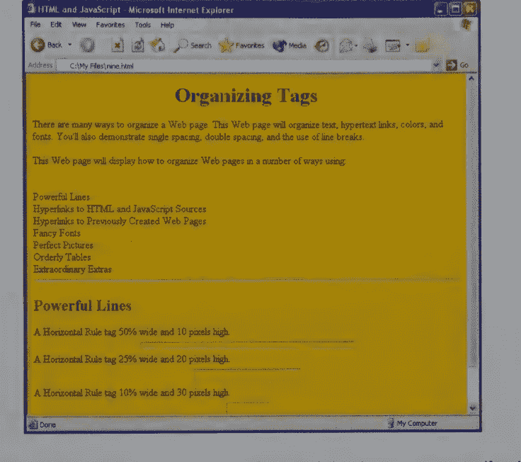

9. 继续到下一节，或者如果你今天完成了，请关闭软件并关闭计算机。


## 网络礼仪

### 糟糕的颜色选择

一些网页制作者选择的背景和颜色会使网页更难阅读。创建这些难以阅读的网页被认为是不礼貌的。在你将网页发布到万维网之前，请测试你的页面，确保所有文本在页面上清晰可见，并且你的颜色选择不会削弱你试图表达的内容。

另外，在做出选择时，考虑视觉障碍者和可能患有色盲的人是一个好主意。以不正确的方式混合红色和绿色色调可能会导致色盲人群阅读文本困难。将字体设置得太小会给视力不佳的人带来麻烦。使用深色背景配深色文字会使任何人阅读起来都很困难。

### 文档中的超链接

网页之所以流行，是因为它们能够以电子的速度轻松链接到其他页面或文档内的各个部分。超链接易于使用，但起初可能有点难以理解。

要使用超链接，只需点击该链接即可。链接可以是图片，也可以是带有下划线并显示为不同颜色的文字，如图2-8所示。

**互联网里程碑**

#### 十六进制颜色

计算机只使用数字。数值以计算机能理解的数字形式表示。通过为特定颜色使用特殊的数字或`十六进制`值，可以精细控制和改变颜色值，以匹配彩虹中几乎所有的颜色。十六进制的发明是计算领域最伟大的进步之一。十六进制数字采用16进制数制，而非我们人类通常使用的10进制数制。十六进制数字使用字母A、B、C、D、E、F以及数字0到9，共组合出16个不同的数字。例如，看看以下用数字表示的颜色值：

- 白色 = `#FFFFFF`
- 绿色 = `#00FF00`
- 黑色 = `#000000`
- 蓝色 = `#0000FF`
- 红色 = `#FF0000`
- 黄色 = `#FFFF00`

通过改变这些数字可以创建不同的色调。例如，在你的HTML页面上，使用十六进制数`00CCFF`可以创建出非常棒的天蓝色。想要漂亮的浅紫色？试试`FF95FF`。用`AAFF00`可以创建一种难看的绿色。在你的网页中用数字替换文本颜色值，看看会发生什么。例如，在`<BODY>`标签中试试这个，看看效果：

```html
BGCOLOR=#AAFF00 VLINK=#FF95FF TEXT=#00CCFF LINK=#FFFF00
```

第2课 HTML组织技巧

HTML基础 43

## 图2-8

超链接文本

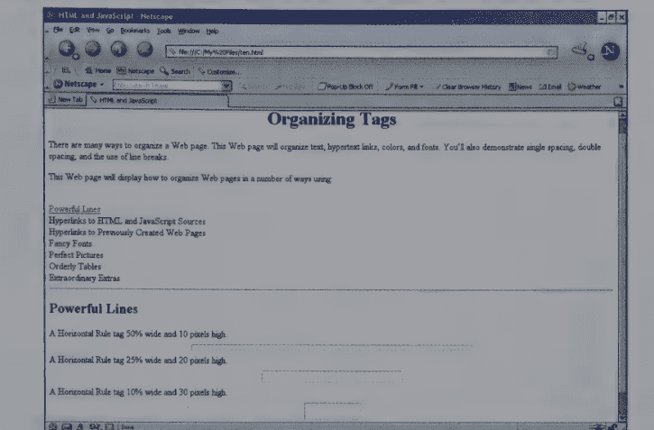

超链接是通过称为锚点标签的特殊标签创建的。该标签有几个部分。开始和结束标签被称为锚点或链接标签，看起来像这样：

```html
<A HREF="insert location of file"></A>
```

除非你定义了要链接到的位置，否则链接或锚点标签基本上没有用。有几种使用锚点标签的方法。你可以：

- 链接到你自己文档内的另一个位置。
- 链接到WWW上任何位置的URL或网页。
- 链接到你自己电脑上的另一个网页。

在分步操作2.4中，你将链接到WWW，在分步操作2.5中，你将为你迄今为止创建的所有网页创建超链接。在这个活动中，我们将开始在你的HTML页面内进行链接。

这些内部超链接帮助用户在你的网页的重要部分之间导航。你插入的第一个`<A>`标签将创建一个指向文档内某个位置的超文本链接。你将在步骤3中创建这个标签。属性是`HREF=`，值是`"#POWERFUL"`。引号和井号`#`都是必需的。

第二个锚点标签将标识你想要链接到的网页中的确切位置。在步骤4中，你将创建一个带有属性`NAME=`和名为`"POWERFUL"`的值（带引号）的标签。

## 分步操作 2.3

1. 如果需要，打开你的`nine.html`或`nine.htm`文件进行文本编辑。

2. 通过将`BGCOLOR`属性从`YELLOW`改为`WHITE`，将背景色改回白色。

3. 在第一个Powerful Lines列表项前后添加以下锚点`<A></A>`标签，如图2-9所示。

   ```html
   <BR><A HREF="#POWERFUL">Powerful Lines</A>
   ```

4. 在第二个Powerful Lines列表项周围插入以下锚点`<A></A>`标签，如下所示，并在图2-9中以粗体标出。

   ```html
   <P><H2><A NAME="POWERFUL">Powerful Lines</A></H2></P>
   ```

5. 将你的新文件保存为`ten.html`或`ten.htm`。

> **注意**
>
> 井号`#`可以通过按住Shift键并按数字3键来创建。引号（`""`）可以通过按住Shift键并按单引号（`'`）键来创建。


## 尊重WWW

你在网页中写的内容不应冒犯他人。你对自己创作和发布在WWW上的内容负责。尊重网络。创建网页时，请考虑以下准则：

- **R** = 责任：承担个人责任，只创建合乎道德且适当的内容。
- **E** = 每个人：努力创建每个人都能享受、欣赏并认为有价值的网页。
- **S** = 简洁：让你的网页易于导航。让信息易于查找。
- **P** = 目的：为你发布在网上的每个网页设定一个明确的目的。不要发布不必要的页面。
- **E** = 道德：确保你发布的每个网页的所有内容都符合你的价值观，并具有有益的目的。
- **C** = 正确：确保页面上所有单词拼写正确，所有句子书写正确，并且所有超链接都能正常工作。
- **T** = 完全值得访问：努力创建别人会认为完全值得花时间访问的页面。

## 分步操作 2.3（续）

6. 在你的网页浏览器中查看更改。你的链接应该看起来像图2-8中的示例。当你点击这个链接时，你应该会跳转到文档中Powerful Lines标题的位置。

7. 继续下一节，或者如果你今天到此为止，请关闭软件并关闭计算机。

## 图2-9

插入背景色和内部链接标签

```html
<HTML>
<TITLE>HTML and JavaScript</TITLE>

<BODY BGCOLOR=WHITE>
<CENTER><H1>Organizing Tags</H1></CENTER>

<P>There are many ways to organize a Web page. This Web page will organize text, hypertext links, colors, and fonts. You'll also demonstrate single spacing, double spacing, and the use of line breaks. </P>

<P>This Web page will display how to organize Web pages in a number of ways using: </P>

<BR><A HREF="#POWERFUL">Powerful Lines</A>
<BR>Hyperlinks to HTML and JavaScript Sources
<BR>Hyperlinks to Previously Created Web Pages
<BR>Fancy Fonts
<BR>Perfect Pictures
<BR>Orderly Tables
<BR>Extraordinary Extras
<HR>

<P><H2><A NAME="POWERFUL">Powerful Lines</A></H2></P>

A Horizontal Rule tag 50% wide and 10 pixels high.
<HR WIDTH=50% SIZE=10>

A Horizontal Rule tag 25% wide and 20 pixels high.
<HR WIDTH=25% SIZE=20>

A Horizontal Rule tag 10% wide and 30 pixels high.
<HR WIDTH=10% SIZE=30>

A Horizontal Rule tag without attributes and values.
<HR>

</BODY>
</HTML>
```

## 创建指向网络的超文本链接

最初让WWW流行起来的能力，就是能够从一个页面跳转到世界上任何地方的另一个页面。然而，在你能够这样做之前，你必须了解关于URL的一切。URL代表*统一资源定位符*。URL允许Web浏览器精确定位网络上的某个文件。这个概念其实非常简单。你见过类似下面这个示例的URL吗？

`http://www.course.com/webpagefolder/anotherfolder/afile.html`

当你在HTML网页中输入一个URL时，你是在标识一个指向位于网上某处的特定HTML文件的路径。这个文件可能在你的本地电脑上，也可能在网上的某个地方。

你通常可以在URL的末尾看到文件名。看看我们示例URL的末尾。文件名`afile.html`是一个HTML文件的名称（afile）。`.html`扩展名标识该文件为你的Web浏览器可以显示的HTML文档。

然而，在你能找到`afile.html`之前，你需要知道通往这个文件名的路径或方法。找到文件名路径的关键是查看其URL或网址。让我们通过将示例URL分解成各个部分来看看这是什么意思。

在某些URL中，你可能会看到字母`http`，后面跟着一个冒号和两个斜杠。`http://`告诉你的网络如何传输或移动你正在请求的文件。`HTTP`代表*超文本传输协议*。协议是一种用于通过网络传输数据的通信系统。它就像Web服务器与Web浏览器通信时使用的一种秘密数字语言。

地址的第二部分`www.course.com`是托管你正在寻找的网页的实际服务器（或网络计算机）的名称。`www`代表万维网。www告诉你服务器使用的是Web技术。`.course`部分是维护Web服务器的公司名称。在这个例子中，course是Course Technology的缩写。`.com`表示这是一个商业或企业网站。你可能会看到其他地址标记为`.edu`（教育）、`.gov`（政府网站）或`.biz`（商业网站）。

URL中其余部分的斜杠和名称（`/webpagefolder/anotherfolder/`）代表Web服务器上的文件夹。这些也称为子目录。你的计算机上也有子目录。图2-10展示了文件夹在Windows计算机上的组织方式。所有计算机都使用某种文件夹系统来组织文件。如果你想在计算机上找到一个文件，你需要知道该文件存储在众多可能文件夹中的路径。知道路径是找到你想要的网页的关键。

## 图2-10

Windows文件夹或目录组织

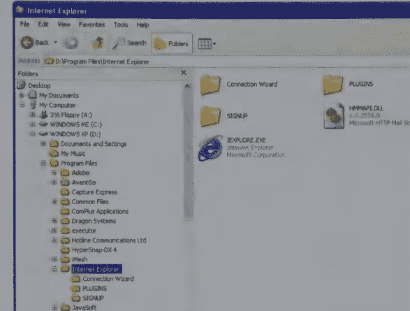

在你能够找到一个网站的欢迎页面之前，你需要知道URL。在本逐步指南中，你将输入一些在创建更好、更令人兴奋的Web竞赛中最重要的公司的URL。许多网站都提供有关HTML、JavaScript和其他重要Web工具的信息。它们包括：

- `http://www.microsoft.com`
- `http://www.sun.com`
- `http://home.netscape.com`
- `http://www.oracle.com`

## 逐步指南 2.4

1. 如果需要，打开你的`ten.html`或`ten.htm`文件进行文本编辑。

2. 创建一个超文本链接（如图2-11中加粗所示），从页面顶部的列表指向你正在创建的新部分。

   ```html
   <BR><A HREF="#HYPERLINKS">Hyperlinks to HTML and JavaScript Sources</A>
   ```

## 逐步指南 2.4（续）

3. 在你的网页最后一个`<HR>`标签下方和`</BODY>`标签之前，添加一个新的二级标题，文字为**Hyperlinks to HTML and JavaScript Sources**，如图2-11所示。包含`<A NAME>`标签，以便你可以从步骤2中创建的链接创建一个内部超文本链接。

   ```html
   <P><H2><A NAME="HYPERLINKS">Hyperlinks to HTML and JavaScript Sources</A></H2></P>
   ```

4. 在你的新标题下方和`</BODY>`标签之前，完全按照图2-11中加粗所示创建以下超文本链接。

   ```html
   <BR><A HREF="http://www.microsoft.com">Microsoft</A>
   <BR><A HREF="http://home.netscape.com">Netscape</A>
   <BR><A HREF="http://www.sun.com">Sun</A>
   <BR><A HREF="http://www.oracle.com">Oracle</A>
   <HR>
   ```

## 逐步指南 2.4（续）

图2-11 超文本链接标签


```html
<HTML>
<TITLE>HTML and JavaScript</TITLE>
<BODY BGCOLOR=WHITE>
<CENTER><H1>Organizing Tags</H1></CENTER>

<P>There are many ways to organize a Web page. This Web page will organize text, hypertext links, colors, and fonts. You'll also demonstrate single spacing, double spacing, and the use of line breaks. </P>

<P>This Web page will display how to organize Web pages in a number of ways using: </P>

<BR><A HREF="#POWERFUL">Powerful Lines</A>
<BR><A HREF="#HYPERLINKS">Hyperlinks to HTML and JavaScript Sources</A>
<BR>Hyperlinks to Previously Created Web Pages
<BR>Fancy Fonts
<BR>Perfect Pictures
<BR>Orderly Tables
<BR>Extraordinary Extras
<HR>

<P><H2><A NAME="POWERFUL">Powerful Lines</A></H2></P>

A Horizontal Rule tag 50% wide and 10 pixels high.
<HR WIDTH=50% SIZE=10>

A Horizontal Rule tag 25% wide and 20 pixels high.
<HR WIDTH=25% SIZE=20>

A Horizontal Rule tag 10% wide and 30 pixels high.
<HR WIDTH=10% SIZE=30>

A Horizontal Rule tag without attributes and values.
<HR>

<P><H2><A NAME="HYPERLINKS">Hyperlinks to HTML and JavaScript Sources</A></H2></P>

<BR><A HREF="http://www.microsoft.com">Microsoft</A>
<BR><A HREF="http://home.netscape.com">Netscape</A>
<BR><A HREF="http://www.sun.com">Sun</A>
<BR><A HREF="http://www.oracle.com">Oracle</A>
<HR>

</BODY>
</HTML>
```

## 逐步指南 2.4（续）

5. 你整个页面的标签现在应该像图 2-11 中那样。将你的工作保存为`eleven.html`或`eleven.htm`。

6. 在你的网页浏览器中查看你的工作。你的新链接应该如图 2-12 所示。

## 图 2-12

网页浏览器中的超链接

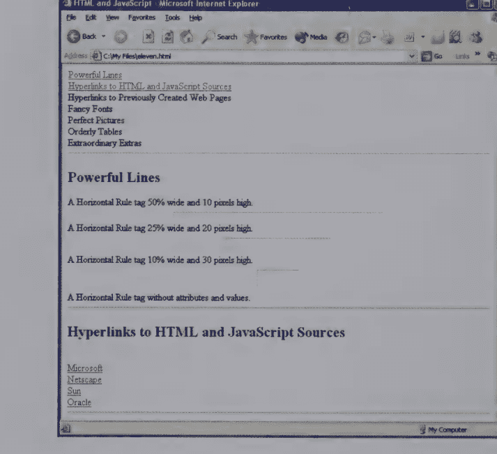

7. 如果你有实时的 Web 连接，尝试你的链接，看看它们是否有效！如果你的链接不能正常工作，请仔细检查你的标签并进行必要的更正。再次保存你的工作。然后在网页浏览器中重新加载或刷新你的页面并重试。

8. 继续下一节，或者如果你今天完成了，可以关闭软件并关闭计算机。

> **网络提示**
>
> 你的浏览器不会自动寻找你新更正的网页，除非你告诉它这样做。你可以通过几种方式做到这一点。你可以再次打开该页面，或者只需单击`Reload`或`Refresh`按钮，将网页的更新副本加载到你的浏览器中。

## 链接到你已经创建的页面

在本逐步指南中，你将链接到你在本书中创建的前 11 个 HTML 页面。以这种方式跟踪你的所有页面将帮助你快速回顾你取得的进展。

## 逐步指南 2.5

1. 如果需要，打开你的`eleven.html`或`eleven.htm`文件。

2. 创建一个超文本链接，从你页面顶部附近的列表指向你正在创建的新部分。要输入的文字如下所示，并在图 2-13 中加粗显示。

```html
<BR><A HREF="#PREVIOUS">Hyperlinks to Previously Created Web Pages</A>
```

3. 如图 2-13 所示，在你之前练习中添加的 HR 标签下方和`</BODY>`标签之前，添加一个名为 **Hyperlinks to Previously Created Web Pages** 的新二级标题。包含`<A NAME>`标签，以便你可以从步骤 3 中创建的链接链接到这个确切位置。

```html
<P><H2><A NAME="PREVIOUS">Hyperlinks to Previously Created Web Pages </A></H2></P>
```

4. 在文档末尾的新标题下方，完全按照图 2-13 中加粗所示创建超文本链接。

```html
<BR><A HREF="one.html">one</A>
<BR><A HREF="two.html">two</A>
<BR><A HREF="three.html">three</A>
<BR><A HREF="four.html">four</A>
<BR><A HREF="five.html">five</A>
<BR><A HREF="six.html">six</A>
<BR><A HREF="seven.html">seven</A>
<BR><A HREF="eight.html">eight</A>
<BR><A HREF="nine.html">nine</A>
<BR><A HREF="ten.html">ten</A>
<BR><A HREF="eleven.html">eleven</A>
<HR>
```

## 逐步指南 2.5（续）

5. 你整个页面的标签现在应该像图 2-13 中那样。将你的工作保存为`twelve.html`或`twelve.htm`。

## 图 2-13

创建链接到你已创建的网页

```html
<HTML>
<TITLE>HTML and JavaScript</TITLE>

<BODY BGCOLOR=WHITE>
<CENTER><H1>Organizing Tags</H1></CENTER>

<P>There are many ways to organize a Web page. This Web page will organize text,
hypertext links, colors, and fonts. You'll also demonstrate single spacing, double spacing, and the use of line breaks. </P>

<P>This Web page will display how to organize Web pages in a number of ways using: </P>

<BR><A HREF="#POWERFUL">Powerful Lines</A>
<BR><A HREF="#HYPERLINKS">Hyperlinks to HTML and JavaScript Sources</A>
<BR><A HREF="#PREVIOUS">Hyperlinks to Previously Created Web Pages</A>
<BR>Fancy Fonts
<BR>Perfect Pictures
<BR>Orderly Tables
<BR>Extraordinary Extras
<HR>

<P><H2><A NAME="POWERFUL">Powerful Lines</A></H2></P>

A Horizontal Rule tag 50% wide and 10 pixels high.
<HR WIDTH=50% SIZE=10>

A Horizontal Rule tag 25% wide and 20 pixels high.
<HR WIDTH=25% SIZE=20>

A Horizontal Rule tag 10% wide and 30 pixels high.
<HR WIDTH=10% SIZE=30>

A Horizontal Rule tag without attributes and values.
<HR>

<P><H2><A NAME="HYPERLINKS">Hyperlinks to HTML and JavaScript Sources</A></H2></P>

<BR><A HREF="http://www.microsoft.com">Microsoft</A>
<BR><A HREF="http://home.netscape.com">Netscape</A>
<BR><A HREF="http://www.sun.com">Sun</A>
<BR><A HREF="http://www.oracle.com">Oracle</A>
```

## 逐步指南 2.5（续）

### 图 2-13（续）

创建链接到你已创建的网页

```html
<HR>

<P><H2><A NAME="PREVIOUS">Hyperlinks to Previously Created Web Pages
</A></H2></P>

<BR><A HREF="one.html">one</A>
<BR><A HREF="two.html">two</A>
<BR><A HREF="three.html">three</A>
<BR><A HREF="four.html">four</A>
<BR><A HREF="five.html">five</A>
<BR><A HREF="six.html">six</A>
<BR><A HREF="seven.html">seven</A>
<BR><A HREF="eight.html">eight</A>
<BR><A HREF="nine.html">nine</A>
<BR><A HREF="ten.html">ten</A>
<BR><A HREF="eleven.html">eleven</A>
<HR>

</BODY>
</HTML>
```

# 分步练习 2.5 续

6. 在 Web 浏览器中查看你的作品。你新建的链接应如图 2-14 所示。测试每个链接，确保它们都能正常工作。进行任何必要的修正。

> **注意**
>
> 你所有的 HTML 文件必须位于同一个文件夹中，超链接才能正常工作。

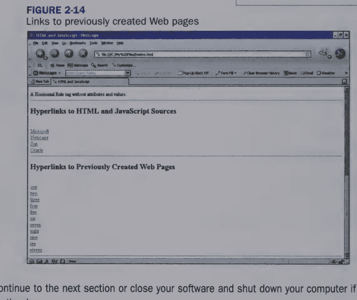

7. 继续下一节，或者如果你当天已完成工作，关闭软件并关闭计算机。

## 文本着色

在浏览网页时，你是否注意到文本颜色经常在不同页面间变化？在分步练习 2.1 中，你通过在`<BODY>`标签的`BGCOLOR=`属性中插入`YELLOW`值来更改了网页的背景颜色。然后你将背景更改为其他几种颜色。更改文本颜色同样简单。

表 2-1 展示了你可以更改的三种基本文本颜色类型。

### 表 2-1

文本颜色

| 文本类型 | 属性 |
| :--- | :--- |
| 1. 文本本身 | `TEXT=` |
| 2. 超文本链接颜色 | `LINK=` |
| 3. 已访问链接的颜色（或你已选择过的链接） | `VLINK=` |

## 分步练习 2.6

1. 如果需要，打开你的`twelve.html`或`twelve.htm`文件。

2. 在网页开头的 body 标签中，保持`BGCOLOR`为`WHITE`，但插入`TEXT=BLUE`、`LINK=RED`和`VLINK=GREEN`，如图 2-15 所示。

### 图 2-15

更改网页上的文本颜色

```html
<HTML>
<TITLE> HTML and JavaScript </TITLE>
<BODY BGCOLOR=WHITE TEXT=BLUE LINK=RED VLINK=GREEN>
```

3. 将你的作品另存为`thirteen.html`或`thirteen.htm`。在 Web 浏览器中查看你的作品。你的页面应显示为白色背景上的蓝色文本、红色超链接和绿色已访问链接，如图 2-16 所示。

4. 继续“总结”部分，或者如果你当天已完成工作，关闭软件并关闭计算机。

### 图 2-16

更改文本颜色

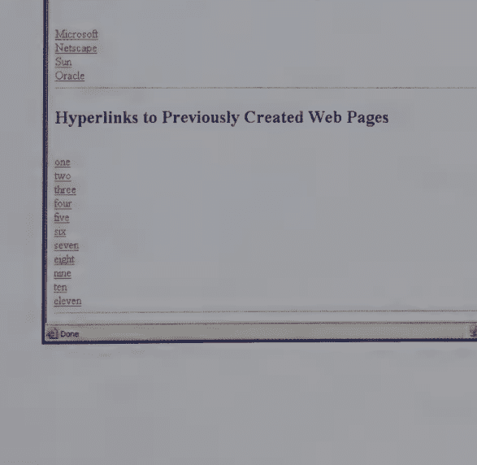

## 完美的校对技巧

校对 HTML 标签可能很困难。即使是细微的错误也会极大地改变网页的外观。以下是一些常见的错误需要检查：

- 确保你所有的尖括号`< >`都朝向正确的方向。
- 通常，网页制作者在输入尖括号或创建斜杠时会误用 Shift 键。这会导致在应该出现斜杠或尖括号的地方出现逗号、句号或问号。
- 如果所有文本都居中显示，也许你忘记了使用结束的`</CENTER>`标签。
- 如果你想要双倍空格而不是单倍空格，请使用`<P></P>`标签而不是`<BR>`标签。
- 如果项目符号出现在列表之后很远，也许你忘记了无序列表的结束标签`</UL>`。

> **网络乐趣**
>
> 另一个有趣的标签是`marquee`标签。任何放在`<MARQUEE> </MARQUEE>`之间的内容都会像股票行情播报一样在屏幕上滚动。该标签由微软为 Internet Explorer 浏览器设计，并非在所有浏览器上都有效。尝试一下，看看会发生什么！

## HTML 标准

HTML 是一个强大的工具，因为它允许各种计算机显示网页。使用 HTML，无论你使用的是 Macintosh 还是 Windows 机器，都没有关系。你甚至可以使用 Linux 或 UNIX 工作站或其他类型的计算机。HTML 网页可以被所有类型计算机查看的原因在于，存在所有 Web 浏览器都能理解的标准。新的标准和新的 HTML 标签及命令一直在被添加。每个新标签都会被提交给标准委员会进行审查。每隔一段时间，就会有足够多的新命令被添加到 HTML 中，从而开发出新的 HTML 版本。这些版本用数字标记：HTML 1、HTML 2、HTML 3、HTML 4 等。你可以在网上了解更多关于 HTML 标准的信息，并获得扩展你 HTML 技能的帮助。访问你的搜索门户，尝试以下搜索词：

- HTML
- HTML 标准
- HTML 标准委员会
- HTML 学习
- HTML 指南

## 总结

在本课中，你学习了：

- 你可以使用单倍和双倍行距来组织页面信息。
- 你可以使用线条来组织页面信息。
- 你可以使用属性和值来改进网页设计。
- 你可以更改颜色的默认值、属性和值。
- 你可以创建指向网页文档中某个位置的超文本链接。
- 你可以创建指向万维网上另一个页面的超文本链接。
- 你可以创建指向你自己计算机上网页的超文本链接。

## 词汇复习

| 定义以下术语： | | |
| :--- | :--- | :--- |
| 属性 | 超文本链接 | 统一资源定位符 (URL) |
| 字体 | 超文本传输协议 (HTTP) | 值 |
| 十六进制 | | |
| 超链接 | | |

# 复习题

## 判断题

如果陈述正确，请圈出 T；如果陈述错误，请圈出 F。

- T F 1. 十六进制数基于十进制数系运行。
- T F 2. `<BR>`标签在文本周围创建双倍空格。
- T F 3. `HREF`是`<A></A>`锚标签的一个属性。
- T F 4. 你可以更改网页上几乎任何文本的颜色。
- T F 5. `<HR>`标签创建单倍空格中断。

## 填空题

通过在提供的空格中填写正确的单词或短语来完成以下句子。

1. ________ 标签创建在屏幕上滚动的文本。
2. 你可以使用`<P>`标签来 ________ HTML 文档中的空格。
3. ________ 是一个用于通过网络传输数据的通信系统。
4. ________ 数使你能够用数字和字母定义一种颜色。
5. ________ 属性更改网页的背景颜色。

### 书面题

简要回答以下问题。

1. 哪个标签允许文本在屏幕上反复滚动？
2. 哪个十六进制值将创建黄色？
3. 你知道哪些标签不需要结束标签就能有效工作？
4. 三种常见的 HTML 错误是什么？
5. 为什么存在不同版本的 HTML？

## 项目

### 项目 2-1

在第 1 课的团队合作活动中，你找出了你能找到的最棒的网页。在这个项目中，GreatApplications, Inc. 希望你找出你能找到的五个最差的网页。这些将被用于培训研讨会，帮助新员工学习如何创建高质量的网页。你的经理建议你上网浏览，找到五个难以阅读、杂乱无章或乏味的网页例子，向新实习生展示哪些做法要避免。

上网寻找糟糕的网页示例。记录每个页面的标题和 URL，并列出几个这些页面糟糕的原因！

### 表 2-2

组织混乱的网页示例

| 标题栏中显示的标题 | 网址或 URL | 这个页面糟糕的原因 |
| :--- | :--- | :--- |
| 1. | | |
| 2. | | |
| 3. | | |
| 4. | | |
| 5. | | |

### 团队项目

GreatApplications, Inc. 正在举办一场设计竞赛，看谁能在网页上创建最有信息量且组织有序的网页。具体来说，他们正在寻找一个能够创建网页以通过网络向客户介绍新产品的团队。


比赛给三人到五人的团队两个小时的时间，来创建一个关于他们选择的某个产品的信息丰富的网页。组成你的团队，集思广益地构思一个要介绍的新产品。它可能是一个新的 DVD 或一个新的电脑游戏。可能是一种新的时尚或一辆新的汽车。就本次比赛而言，你选择什么产品并不重要，所以不要花太多时间来决定你将使用哪个产品。

创建你团队的网页竞赛作品。划分写作职责。让一个人输入基本标签并担任网络管理员。每个团队成员必须研究并撰写网页的一部分。通过编辑和修改彼此的写作和 HTML 标签进行协作。使用你在本课中学到的技巧来组织你希望呈现的信息。

### 网页项目

我们都知道团队合作的重要性。然而，有时团队合作是否比独自工作更困难？请回答以下关于团队共同创建网页的问题。

1. 在团队合作项目中，你们遇到了哪些问题？
2. 你们如何组织团队？如何分配工作？哪些团队成员负责哪些活动？
3. 团队合作是否创建了更好的网页？如果是，是如何做到的？
4. 对于其他试图创建网页的团队，你会给出什么建议？

## 批判性思维

请为以下每个问题准备一个100至250字的回答。

## 活动 2-1

你能否想出如何创建一个内部超链接，让你能从文档底部移动到顶部？请使用你在“分步教程 2.3”中学到的步骤，在`</BODY>`标签之前创建一个链接，该链接应链接到页面顶部。你的链接应如下所示：`[返回页首](#top)`。你认为一个返回页面顶部的链接为什么有价值？

## 活动 2-2

你认为最重要的10个网站是什么？它们对你为何重要？创建一个新的 HTML 页面，来索引和列出你最重要的个人网页。将该页面命名为**我的网络资源**。在学习本教程的过程中，不断添加你的网络资源页面。

# 总结项目

无论你未来选择何种职业，培养良好的沟通技巧都非常重要。例如，每个人都能从学习如何撰写格式规范的商务信函中受益。请使用你在本课中学习的 HTML 文本格式技巧，为你的老师撰写一封商务信函。完成后，你的信函应具有如图2-17所示示例信函的大致外观。

## 图 2-17

商务信函示例

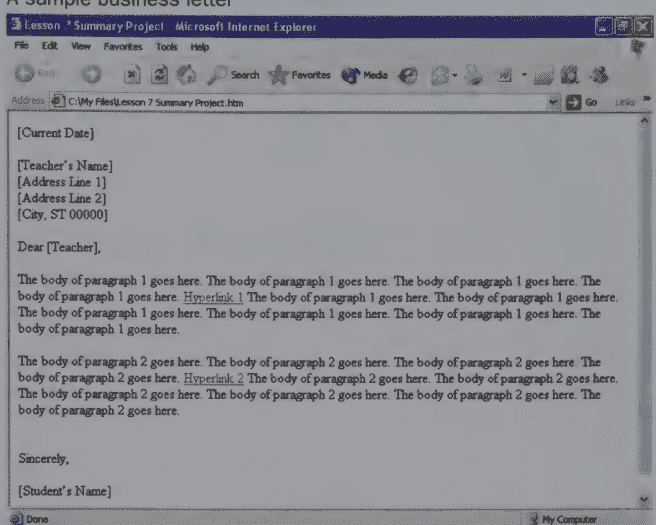

## 项目要求

- 你的信函应在页面顶部包含日期。
- 日期后应跟上地址和称呼。
- 信函正文必须包含至少两个完整的段落。
- 信函应以结束语和你自己的名字结尾。
- 你必须在每个段落中至少包含一个超链接。
- 文本应显示为蓝色，超链接应为红色。
- 确保调整浏览器窗口大小时，信函的格式保持不变。（段落之间的间距应保持一致。）

# 第三课

## HTML 强效技术

### 学习目标

完成本课后，你应能够：

- 控制字体的大小、样式和颜色。
- 从网络下载图片。
- 将图片插入你的网页。
- 更改图形的大小。
- 使用表格组织信息。
- 将图片转换为超链接。
- 将各种数据输入选项插入网页。

预计时间：1.5小时

### 词汇表

- `.gif`
- `.jpg` 或 `.jpeg`
- 图形交换格式
- 联合图像专家组
- 表格单元格

## 令人兴奋的网页

网页充满了图片、声音和影片，为页面增添了趣味。通常，万维网上的图片有两种，称为图形或图像。它们包括`.gif`文件（图形交换格式）和`.jpg`或`.jpeg`（联合图像专家组）文件。扩展名`.gif`和`.jpg`有助于告诉浏览器这些文件是图片，而不是`.html`文本文件，需要特殊处理。我们将在本课后面更详细地讨论和定义这些文件。

你对 HTML 了解得越多，就越能为你的网页添加令人兴奋的新效果和样式。正如我们在第二课中提到的，字体或字母样式是可以改变的。每种字体都有自己独特的风格。

通过使用`<FONT>`标签的多种属性和值，你可以以无限的方式操纵字体，正如你将在本课中很快体验到的那样。

表格允许将网页的各部分划分开，为你可能想包含的每个新元素或信息片段创建特定的空间。

表格、字体和图片可以为你的页面增添强大的功能。在本课中，你将学习如何操作这些特殊的 HTML 功能。你还将学习一些非凡的输入标签，这些标签将允许访问你网页的访客与你的网页进行交互。

## 字体属性与值

当你在`<BODY>`标签中更改文本颜色时，就像你在第二课的“分步教程 2.6”中所做的那样，你会更改整个页面单词的颜色。如果你想有更多的控制权（即，如果你想更改单个段落、单个句子甚至单个单词的大小、颜色或样式），请使用`<FONT>`标签。

使用`<FONT>`标签属性来控制：

- 使用 SIZE 属性`<FONT SIZE=#>`控制单词的大小。
- 使用 FACE 属性`<FONT FACE=#>`控制单词的样式。
- 使用 COLOR 属性`<FONT COLOR=#>`控制单词的颜色。

## 分步教程 3.1

1. 为你的文本编辑打开**thirteen.html**或**thirteen.htm**文件（来自第二课）。
2. 在页面顶部的列表中创建一个超文本链接，该链接将超链接到你将在本分步教程中创建的新部分。要输入的文本在此处和图3-1中以粗体显示。

   ```html
   <BR><A HREF="#FONTS">Fancy Fonts</A>
   ```

3. 如图3-1所示，在第二课“分步教程 2.6”末尾创建的`<HR>`标签下方，但在`</BODY>`标签之前，添加一个名为**Fancy Fonts**的新二级标题。这将完成你在本分步教程的步骤2中开始的内部超文本链接。

   ```html
   <P><H2><A NAME="FONTS">Fancy Fonts</A></H2></P>
   ```

4. 在新标题下方，靠近文档末尾，按照此处和图3-1中粗体所示，精确输入字体标签、属性和值。

   ```html
   <BR><FONT FACE=HELVETICA SIZE=4 COLOR=RED>This is the Helvetica font at Size 4</FONT>
   <BR><FONT FACE=TIMES SIZE=6 COLOR=GREEN>This is the Times font at Size 6</FONT>
   <BR><FONT FACE=ARIAL SIZE=8 COLOR=ORANGE>This is the Arial font at Size 8</FONT>
   <BR><FONT FACE=COURIER SIZE=2 COLOR=BLACK>This is the Courier font at Size 2</FONT>
   <HR>
   ```

## 分步教程 3.1（续）

5. 你的标签应看起来像图3-1中的那些。将你的作品保存为**fourteen.html**或**fourteen.htm**。

## 图 3-1 应用字体样式、大小和颜色

```html
<HTML>
<TITLE> HTML and JavaScript </TITLE>

<BODY BGCOLOR=WHITE TEXT=BLUE LINK=RED VLINK=GREEN>
<CENTER><H1>Organizing Tags</H1></CENTER>

<P>There are many ways to organize a Web page. This Web page will organize text, hypertext links, colors, and fonts. You'll also demonstrate single spacing, double spacing, and the use of line breaks. </P>

<P>This Web page will display how to organize Web pages in a number of ways using: </P>

<BR><A HREF="#POWERFUL">Powerful Lines</A>
<BR><A HREF="#HYPERLINKS">Hyperlinks to HTML and JavaScript Sources</A>
<BR><A HREF="#PREVIOUS">Hyperlinks to Previously Created Web Pages</A>
<BR><A HREF="#FONTS">Fancy Fonts</A>
<BR>Perfect Pictures
<BR>Orderly Tables
<BR>Extraordinary Extras

<HR>
<P><H2><A NAME="POWERFUL">Powerful Lines</A></H2></P>

A Horizontal Rule tag 50% wide and 10 pixels high.
<HR WIDTH=50% SIZE=10>

A Horizontal Rule tag 25% wide and 20 pixels high.
<HR WIDTH=25% SIZE=20>

A Horizontal Rule tag 10% wide and 30 pixels high.
<HR WIDTH=10% SIZE=30>

A Horizontal Rule tag without attributes and values.
<HR>

<P><H2><A NAME="HYPERLINKS">Hyperlinks to HTML and JavaScript Sources</A></H2></P>

<BR><A HREF="http://www.microsoft.com">Microsoft</A>
<BR><A HREF="http://home.netscape.com">Netscape</A>
<BR><A HREF="http://www.sun.com">Sun</A>
<BR><A HREF="http://www.oracle.com">Oracle</A>
<HR>
```

## 分步教程 3.1（续）

### 图 3-1（续）

应用字体样式、大小和颜色

```html
<P><H2><A NAME="PREVIOUS">Hyperlinks to Previously Created Web Pages
</A></H2></P>

<BR><A HREF="one.html">one</A>
<BR><A HREF="two.html">two</A>
<BR><A HREF="three.html">three</A>
<BR><A HREF="four.html">four</A>
<BR><A HREF="five.html">five</A>
<BR><A HREF="six.html">six</A>
<BR><A HREF="seven.html">seven</A>
<BR><A HREF="eight.html">eight</A>
<BR><A HREF="nine.html">nine</A>
<BR><A HREF="ten.html">ten</A>
<BR><A HREF="eleven.html">eleven</A>
<HR>

<P><H2><A NAME="FONTS">Fancy Fonts</A></H2></P>

<BR><FONT FACE=HELVETICA SIZE=4 COLOR=RED>This is the Helvetica font at Size 4</FONT>
<BR><FONT FACE=TIMES SIZE=6 COLOR=GREEN>This is the Times font at Size 6</FONT>
<BR><FONT FACE=ARIAL SIZE=8 COLOR=ORANGE>This is the Arial font at Size 8</FONT>
<BR><FONT FACE=COURIER SIZE=2 COLOR=BLACK>This is the Courier font at Size 2 </FONT>
<HR>

</BODY>
</HTML>
```

## 分步操作 3.1（续）

6. 在你的网页浏览器中查看你的作品。你的更改应如图 3-2 所示。进行任何必要的修正。

### 图 3-2

各种字体样式、大小和颜色

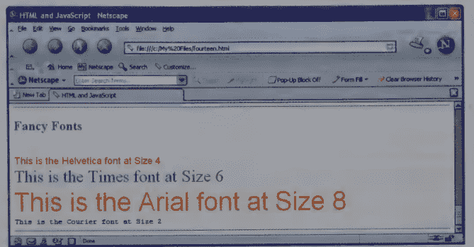

7. 继续下一节，或者如果你今天的工作已完成，请关闭你的软件并关机。

## 下载和插入图形

> **网络小贴士**
>
> 还有其他方法可以改变文本的外观。尝试在某些单词周围使用这些标签，看看它们会产生什么效果。你能猜出它们的作用吗？
>
> `<B></B>`
>
> `<EM></EM>`
>
> `<STRONG></STRONG>`
>
> `<I></I>`

图片可以在很多地方找到。你可以在你的剪贴画收藏中找到图片，用扫描仪将图片扫描到你的电脑中，绘制你自己的图片，或者从网络上复制它们。但是，在你能够在网页中轻松使用图片之前，你需要将它们转换为可接受的网络格式之一。常见的格式是`.gif`和`.jpg`或`.jpeg`。

第一种图形或图像格式`.gif`，最初由最早的在线公司之一 CompuServe 创建，旨在提供一种压缩图形格式，可以在低速调制解调器上轻松传输。图形交换格式通常缩写为 GIF。关于如何读 GIF 有些争议。在美国的一些地区，它读作硬`g`，就像 Kathie Lee GIFFord 中的发音一样。在美国的其他地区，它读作软`g`，就像 JIFfy 花生酱中的发音一样。两种读法都可以。毕竟，发音丝毫不会改变文件格式。

第二种常用格式是`.jpg`或`.jpeg`。精通网络的艺术家将其读作`J-Peg`。JPEG 是联合图像专家小组的缩写。这种格式遵循一套国际图形标准。JPEG 图形，就像 GIF 图片一样，足够紧凑，适用于互联网使用。

其他图形文件格式正在不断涌现。但如果你知道如何使用这两种格式，你就知道如何在万维网上使用任何其他图片格式。

## 分步操作 3.2

1. 打开你的网页浏览器。
2. 在你的网页浏览器中输入网址`www.course.com`。
3. 如图 3-3 所示，点击“搜索”框，然后输入本书的 ISBN。
4. 选择“搜索”并等待结果出现。
5. 点击本书的标题，然后选择名为“学生在线伴侣”的链接。
6. 点击“第 3 课”链接，并从出现的列表中选择“数据文件与图形”链接。向下滚动，直到你看到一条龙。

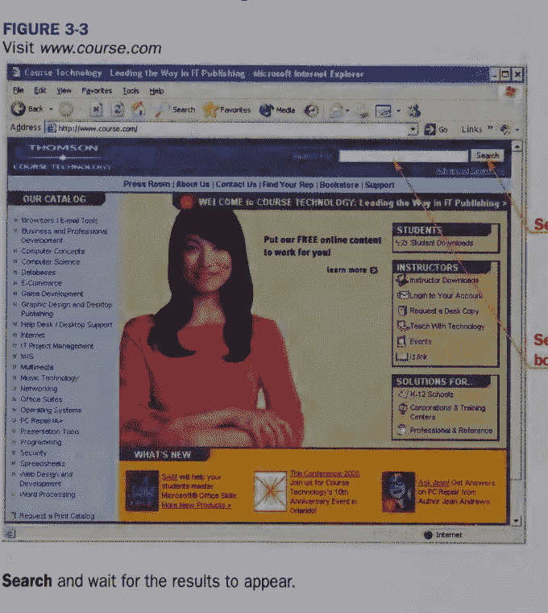

## 分步操作 3.2（续）

7. 如果你使用的是 Windows 电脑，请在龙的鼻子上单击鼠标右键，如图 3-4 所示。如果你使用的是 Macintosh 电脑，请在龙的鼻子上单击并按住鼠标按钮。

### 图 3-4

复制并保存图形


8. 从出现的列表中选择**将图像另存为...**或**将图片另存为...**命令，如图 3-5A 和 3-5B 所示。（注意：你浏览器上的命令措辞可能不同。请尝试出现的各种命令，直到找到正确的命令。）

### 图 3-5A

在 Netscape 中，选择保存图像

### 图 3-5B

在 Internet Explorer 中，选择另存图片

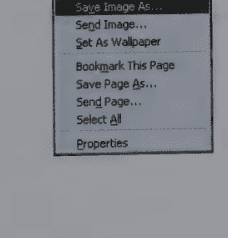

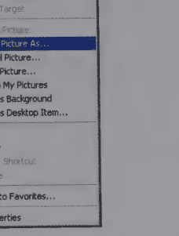

9. 将你的文件（名为`levy.gif`）保存在与你保存网页相同的文件夹中。

## 分步操作 3.2（续）

10. 在你的文字处理器或文本编辑器中打开你的**fourteen.html**或**fourteen.htm**网页。
11. 在页面顶部附近的列表中创建一个超文本链接，该链接将超链接到你将创建的新部分。要输入的文本在此处及图 3-6 中以粗体显示。

    ```html
    <BR><A HREF="#PICTURES">Perfect Pictures</A>
    ```

12. 如图 3-6 所示，在你先前创建的最后一个`<HR>`标签下方、`</BODY>`标签之前，添加一个名为**Perfect Pictures**的二级标题。包含`<A NAME>`标签，以便你可以完成在步骤 11 中开始的内部超文本链接。

    ```html
    <P><H2><A NAME="PICTURES">Perfect Pictures</A></H2></P>
    ```

13. 在你的新标题下方，靠近文档末尾处，输入一个图像源``标签，如此处及图 3-6 所示。请注意，你刚下载的文件名出现在引号之间。

    ```html
    
    <HR>
    ```

14. 你的标签现在应该看起来像图 3-6 中的那样。如果一切看起来正确，请将你的作品保存为**fifteen.html**或**fifteen.htm**。

### 图 3-6

插入图形或图像文件


```html
<HTML>
<TITLE> HTML and JavaScript </TITLE>
<BODY BGCOLOR=WHITE TEXT=BLUE LINK=RED VLINK=GREEN>
<CENTER><H1>组织标签</H1></CENTER>
<P>组织网页的方式有很多种。这个网页将组织文本、超链接、颜色和字体。你还将演示单倍行距、双倍行距以及换行符的使用。</P>
<P>这个网页将展示如何使用以下方式组织网页：</P>
<BR><A HREF="#POWERFUL">强力线条</A>
<BR><A HREF="#HYPERLINKS">指向 HTML 和 JavaScript 来源的超链接</A>
<BR><A HREF="#PREVIOUS">指向先前创建的网页的超链接</A>
<BR><A HREF="#FONTS">花式字体</A>
<BR><A HREF="#PICTURES">完美图片</A>
<BR>有序表格
<BR>非凡附加内容
<HR>
<P><H2><A NAME="POWERFUL">强力线条</A></H2></P>
一个宽度为 50%、高度为 10 像素的水平线标签。
<HR WIDTH=50% SIZE=10>

一个宽度为 25%、高度为 20 像素的水平线标签。
<HR WIDTH=25% SIZE=20>

一个宽度为 10%、高度为 30 像素的水平线标签。
<HR WIDTH=10% SIZE=30>

一个没有属性和值的水平线标签。
<HR>

<P><H2><A NAME="HYPERLINKS">指向 HTML 和 JavaScript 来源的超链接</A></H2></P>
<BR><A HREF="http://www.microsoft.com">微软</A>
<BR><A HREF="http://home.netscape.com">网景</A>
<BR><A HREF="http://www.sun.com">太阳微系统</A>
<BR><A HREF="http://www.oracle.com">甲骨文</A>
<HR>

<P><H2><A NAME="PREVIOUS">指向先前创建的网页的超链接</A></H2></P>
<BR><A HREF="one.html">一</A>
<BR><A HREF="two.html">二</A>
<BR><A HREF="three.html">三</A>
<BR><A HREF="four.html">四</A>
<BR><A HREF="five.html">五</A>
<BR><A HREF="six.html">六</A>
<BR><A HREF="seven.html">七</A>
<BR><A HREF="eight.html">八</A>
<BR><A HREF="nine.html">九</A>
<BR><A HREF="ten.html">十</A>
<BR><A HREF="eleven.html">十一</A>
<HR>

<P><H2><A NAME="FONTS">花式字体</A></H2></P>
<BR><FONT FACE=HELVETICA SIZE=4 COLOR=RED>这是 4 号 Helvetica 字体</FONT>
<BR><FONT FACE=TIMES SIZE=6 COLOR=GREEN>这是 6 号 Times 字体</FONT>
<BR><FONT FACE=ARIAL SIZE=8 COLOR=ORANGE>这是 8 号 Arial 字体</FONT>
<BR><FONT FACE=COURIER SIZE=2 COLOR=BLACK>这是 2 号 Courier 字体</FONT>
<HR>

<P><H2><A NAME="PICTURES">完美图片</A></H2></P>

<HR>
</BODY>
</HTML>
```

15. 在你的网页浏览器中查看你的作品。你的图片应如图 3-7 所示，但它在你的浏览器中可能显得更大或更小。

**图 3-7**

在浏览器中看到的你的 GIF 图像


16. 继续下一节，或者如果你今天的工作已完成，请关闭你的软件并关机。

## 各种尺寸的图片

通过更改标签的值，可以以多种方式修改图片。图片可以用作壁纸来覆盖整个网页的背景。它们可以对齐在页面的中央、左侧或右侧。根据你的需要，它们可以被放大或缩小。

你也可以使用`HEIGHT`和`WIDTH`属性来更改图片的大小。精确控制图片的大小对于使页面看起来清晰有趣非常有帮助。

在分步操作 3.3 的第一部分，你将把图片对齐到页面的右侧并将其变小。在第二部分，你将把三条不同大小的龙横跨页面对齐，然后通过操作几个标签将三条龙垂直放置在网页上。

> **网络小贴士**
>
> 一个常见的错误是在``标签中混淆了 R 和 C 的顺序。可以将其视为 IMaGe SouRCe 标签，这样你就不会忘记按正确的顺序放置字母。

> **网络小贴士**
>
> 让网页访客能够一键给你发送电子邮件的一个简单方法是创建以下标签：
>
> `<A HREF=mailto:your_email @address>你的名字</A>`。

## 分步操作 3.3

1. 打开你的`fifteen.html`或`fifteen.htm`文件进行文本编辑。
2. 在文档末尾附近，将以下信息添加到你的``标签中，如此处及图 3-8 中粗体所示。

   `<P></P>`

> **技术职业**
>
> **网络上的艺术家**
>
> 网站开发公司对艺术家的需求很大。曾经有一段时间，网页完全由文字或文本构成。如今，图片主导着网页，吸引了比以往任何时候都多的访客。
>
> 如果你正在考虑艺术职业，可以考虑互联网行业。你可能会发现你的大部分艺术作品最终会出现在网络上。拥有网站的大公司和网站开发者一直在寻找优秀的艺术家。
>
> 你可以使用任何你喜欢的媒介或方法来创作你的艺术。扫描仪可以将你的图片转换为数字图像。数字文件可以转换为适用于网络的格式，例如`.gif`或`.jpg`。你也可以使用各种艺术软件来创作你的艺术作品，或改进任何你已扫描为网络图像的艺术品。
>
> 成为网络艺术家的最佳训练是尽可能多地参加艺术课程。你用于转换艺术作品的图形工具很容易学会。而艺术家的技能则需要更多的时间来培养。

## 分步教程 3.3 续

3. 将您的更改保存为`sixteen.html`或`sixteen.htm`。
4. 在您的 Web 浏览器中查看您的更改。龙应该会出现得更小并且右对齐，如图 3-9 所示。
5. 接下来，创建三个横跨屏幕显示的图像，每个图形显示为不同的大小。为此，请在您的第一个`IMG SRC`标签下方输入以下标签，如此处及图 3-8 所示。

```html


```

6. 使用相同的`sixteen.html`或`sixteen.htm`文件名重新保存您的更改，并在 Web 浏览器中查看您的添加内容。您的更改应与图 3-9 中显示的三个图像相似。如果您的图形没有出现，请进行必要的更正，重新保存，然后再次查看。
7. 就在上一步输入的三个标签下方，添加两个`IMG SRC`标签，使用`<P>`标签使多个图形垂直显示。请完全按照此处及图 3-8 所示输入这些标签。

```html
<P></P>
<P></P>
```

8. 再次将您的更改保存为`sixteen.html`或`sixteen.htm`，并在 Web 浏览器中查看结果。查看图 3-8 和 3-9 以评估标签和图形应如何显示。在必要时进行更正，并在浏览器中查看任何更改。
9. 继续下一节，或者如果您今天完成了，请关闭您的软件并关闭计算机。

### 图 3-8 到处都是龙

```html
<HTML>
<TITLE> HTML and JavaScript </TITLE>
<BODY BGCOLOR=WHITE TEXT=BLUE LINK=RED VLINK=GREEN>
<CENTER><H1>Organizing Tags</H1></CENTER>
<P>There are many ways to organize a Web page. This Web page will organize text, hypertext links, colors, and fonts. You’ll also demonstrate single spacing, double spacing, and the use of line breaks. </P>
<P>This Web page will display how to organize Web pages in a number of ways using: </P>
<BR><A HREF="#POWERFUL">Powerful Lines</A>
<BR><A HREF="#HYPERLINKS">Hyperlinks to HTML and JavaScript Sources</A>
<BR><A HREF="#PREVIOUS">Hyperlinks to Previously Created Web Pages</A>
<BR><A HREF="#FONTS">Fancy Fonts</A>
<BR><A HREF="#PICTURES">Perfect Pictures</A>
<BR>Orderly Tables
<BR>Extraordinary Extras

<HR>
<P><H2><A NAME="POWERFUL">Powerful Lines</A></H2></P>

A Horizontal Rule tag 50% wide and 10 pixels high.
<HR WIDTH=50% SIZE=10>

A Horizontal Rule tag 25% wide and 20 pixels high.
<HR WIDTH=25% SIZE=20>

A Horizontal Rule tag 10% wide and 30 pixels high.
<HR WIDTH=10% SIZE=30>

A Horizontal Rule tag without attributes and values.
<HR>

<P><H2><A NAME="HYPERLINKS">Hyperlinks to HTML and JavaScript Sources</A></H2></P>

<BR><A HREF="http://www.microsoft.com">Microsoft</A>
<BR><A HREF="http://home.netscape.com">Netscape</A>
<BR><A HREF="http://www.sun.com">Sun</A>
<BR><A HREF="http://www.oracle.com">Oracle</A>
<HR>

<P><H2><A NAME="PREVIOUS">Hyperlinks to Previously Created Web Pages</A></H2></P>

<BR><A HREF="one.html">one</A>
<BR><A HREF="two.html">two</A>
<BR><A HREF="three.html">three</A>
<BR><A HREF="four.html">four</A>
<BR><A HREF="five.html">five</A>
<BR><A HREF="six.html">six</A>
<BR><A HREF="seven.html">seven</A>
<BR><A HREF="eight.html">eight</A>
<BR><A HREF="nine.html">nine</A>
<BR><A HREF="ten.html">ten</A>
<BR><A HREF="eleven.html">eleven</A>
<HR>

<P><H2><A NAME="FONTS">Fancy Fonts</A></H2></P>

<BR><FONT FACE=HELVETICA SIZE=4 COLOR=RED>This is the Helvetica font at Size 4</FONT>
<BR><FONT FACE=TIMES SIZE=6 COLOR=GREEN>This is the Times font at Size 6</FONT>
<BR><FONT FACE=ARIAL SIZE=8 COLOR=ORANGE>This is the Arial font at Size 8</FONT>
<BR><FONT FACE=COURIER SIZE=2 COLOR=BLACK>This is the Courier font at Size 2</FONT>
<HR>

<P><H2><A NAME="PICTURES">Perfect Pictures</A></H2></P>

<P></P>


<P></P>
<P></P>
<HR>

</BODY>
</HTML>
```


## 网络伦理

### 图片盗版

网络上的一个大问题是图片盗版。由于从网络上抓取图片非常容易，许多人在未获得许可的情况下这样做。许多图片受版权保护；也就是说，某人拥有它们。要使用它们，您需要获得许可或向所有者或艺术家付费。

例如，迪士尼拥有许多受版权保护的图像。他们已经对抓取并非法使用或修改迪士尼受版权保护图像的网站创建者提起了法律诉讼。

请考虑您从网络下载和使用的图片。它们可以供您免费使用吗？许多地方允许免费下载图像。例如，您从本书网站借用的图像已授权供您使用。

**图 3-9**

更改属性和值后的 GIF 图像

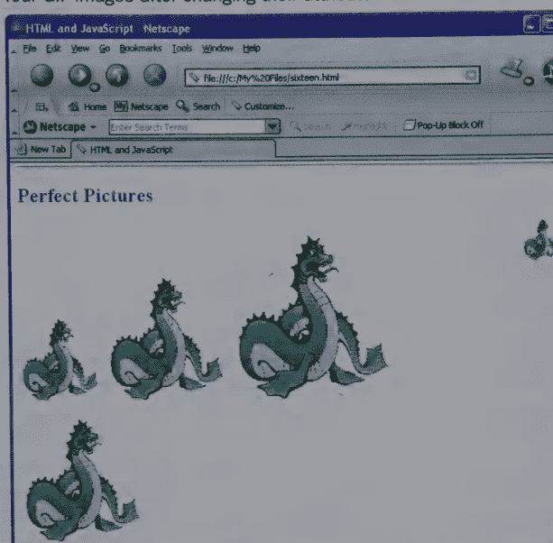

> **网络提示**
>
> 要将图片变成超链接，请尝试使用此系列标签、属性和值！

```html
<A HREF="http://www.course.com"></A>
```

> **网络提示**
>
> 要让图片成为您的背景，请在`<BODY>`标签中插入`BACKGROUND`属性，如下所示：

```html
<BODY BACKGROUND="levy.gif">
```

## 整洁的表格

当您想到一张摆放整齐、准备迎接盛大节日晚餐的餐桌时，您会想到一切都井井有条。所有餐具、盘子、杯子和银器都摆放有序，恰到好处。

电子表格也是如此。表格创建小方框，您可以在其中放置物品以保持其有序。在分步教程 3.4 中，您将创建一个表格，然后将许多您已学习过的标签插入到称为表格单元格的小方框中。

使用`<TABLE>`标签创建表格非常简单。通过添加`BORDER`属性和数字值，单元格可以具有边框。您还可以使用`CELLPADDING`属性使单元格在图片和文本周围显得更大。在单元格内，您可以将图片和文本与中心、左或右对齐。

## 分步教程 3.4

1. 如果有必要，请打开您的`sixteen.html`或`sixteen.htm`文件。
2. 在您页面顶部的列表中创建一个超文本链接，该链接将超链接到您正在创建的新部分。要输入的文本在此处及图 3-10 中以粗体显示。
3. 如图 3-10 所示，在您上一步分步教程中创建的`<HR>`标签下方、`</BODY>`标签之前，添加一个新的二级标题，名为**整洁的表格**。包含`<A NAME>`标签，以便您可以完成第 2 步中开始的内部超链接。
4. 在新标题下方，文档末尾附近，完全按照此处及图 3-10 中的粗体所示输入`<TABLE>`标签、属性和值。

```html
<BR><A HREF="#TABLES">Orderly Tables</A>

<P><H2><A NAME="TABLES">Orderly Tables</A></H2></P>
```


```html
<TABLE BORDER=5 CELLPADDING=10 ALIGN=CENTER>
<TR>
    <TH>Dragons</TH>
    <TH>Colors</TH>
    <TH>Fonts</TH>
</TR>
<TR>
    <TD></TD>
    <TD BGCOLOR=RED ALIGN=CENTER>Red</TD>
    <TD ALIGN=CENTER><FONT FACE=TIMES SIZE=7 COLOR=GREEN>Times</TD>
</TR>
<TR>
    <TD></TD>
    <TD BGCOLOR=GREEN ALIGN=CENTER>Green</TD>
    <TD ALIGN=CENTER><FONT FACE=COURIER SIZE=10 COLOR=GREEN>Courier</TD>
</TR>
</TABLE>
<HR>
```

5. 您的标签现在应如图 3-10 所示。将您的工作保存为`seventeen.html`或`seventeen.htm`。

## 图 3-10

### 在 HTML 中创建表格

```html
<HTML>
<TITLE> HTML and JavaScript </TITLE>

<BODY BGCOLOR=WHITE TEXT=BLUE LINK=RED VLINK=GREEN>
<CENTER><H1>Organizing Tags</H1></CENTER>

<P>There are many ways to organize a Web page. This Web page will organize text, hypertext links, colors, and fonts. You'll also demonstrate single spacing, double spacing, and the use of line breaks. </P>

<P>This Web page will display how to organize Web pages in a number of ways using: </P>

<BR><A HREF="#POWERFUL">Powerful Lines</A>
<BR><A HREF="#HYPERLINKS">Hyperlinks to HTML and JavaScript Sources</A>
<BR><A HREF="#PREVIOUS">Hyperlinks to Previously Created Web Pages</A>
<BR><A HREF="#FONTS">Fancy Fonts</A>
<BR><A HREF="#PICTURES">Perfect Pictures</A>
<BR><A HREF="#TABLES">Orderly Tables</A>
<BR>Extraordinary Extras

<HR>
<P><H2><A NAME="POWERFUL">Powerful Lines</A></H2></P>

A Horizontal Rule tag 50% wide and 10 pixels high.
<HR WIDTH=50% SIZE=10>

A Horizontal Rule tag 25% wide and 20 pixels high.
<HR WIDTH=25% SIZE=20>

A Horizontal Rule tag 10% wide and 30 pixels high.
<HR WIDTH=10% SIZE=30>

A Horizontal Rule tag without attributes and values.
<HR>

<P><H2><A NAME="HYPERLINKS">Hyperlinks to HTML and JavaScript Sources</A></H2></P>

<BR><A HREF="http://www.microsoft.com">Microsoft</A>
<BR><A HREF="http://home.netscape.com">Netscape</A>
<BR><A HREF="http://www.sun.com">Sun</A>
```

## 分步操作 3.4（续）

## 图 3-10（续）：在 HTML 中创建表格

```html
<BR><A HREF="http://www.oracle.com">Oracle</A>
<HR>

<P><H2><A NAME="PREVIOUS">指向先前创建的网页的超链接</A></H2></P>

<BR><A HREF="one.html">one</A>
<BR><A HREF="two.html">two</A>
<BR><A HREF="three.html">three</A>
<BR><A HREF="four.html">four</A>
<BR><A HREF="five.html">five</A>
<BR><A HREF="six.html">six</A>
<BR><A HREF="seven.html">seven</A>
<BR><A HREF="eight.html">eight</A>
<BR><A HREF="nine.html">nine</A>
<BR><A HREF="ten.html">ten</A>
<BR><A HREF="eleven.html">eleven</A>
<HR>

<P><H2><A NAME="FONTS">花式字体</A></H2></P>

<BR><FONT FACE=HELVETICA SIZE=4 COLOR=RED>这是大小为 4 的 Helvetica 字体</FONT>
<BR><FONT FACE=TIMES SIZE=6 COLOR=GREEN>这是大小为 6 的 Times 字体</FONT>
<BR><FONT FACE=ARIAL SIZE=8 COLOR=ORANGE>这是大小为 8 的 Arial 字体</FONT>
<BR><FONT FACE=COURIER SIZE=2 COLOR=BLACK>这是大小为 2 的 Courier 字体</FONT>
<HR>

<P><H2><A NAME="PICTURES">完美的图片</A></H2></P>

<P></P>


<P></P>
<P></P>
<HR>

<P><H2><A NAME="TABLES">整齐的表格</A></H2></P>
```

## 分步操作 3.4（续）

## 图 3-10（续）：在 HTML 中创建表格

```html
<TABLE BORDER=5 CELLPADDING=10 ALIGN=CENTER>
<TR>
    <TH>龙</TH>
    <TH>颜色</TH>
    <TH>字体</TH>
</TR>
<TR>
    <TD></TD>
    <TD BGCOLOR=RED ALIGN=CENTER>红色</TD>
    <TD ALIGN=CENTER><FONT FACE=TIMES SIZE=7
    COLOR=GREEN>Times</TD>
</TR>
<TR>
    <TD></TD>
    <TD BGCOLOR=GREEN ALIGN=CENTER>绿色</TD>
    <TD ALIGN=CENTER><FONT FACE=COURIER SIZE=10
    COLOR=GREEN>Courier</TD>
</TR>
</TABLE>
<HR>
</BODY>
</HTML>
```

## 分步操作 3.4（续）

6. 在你的 Web 浏览器中查看你的作品。你的新页面应该看起来像图 3-11。进行任何必要的更正。

## 图 3-11

### 在浏览器中看到的 HTML 表格

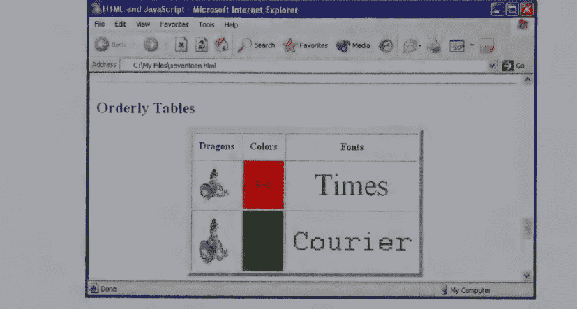

7. 继续下一节，或者如果你今天到此为止，请关闭你的软件并关闭计算机。

## 互联网里程碑

## 网络商业

多年来，网络一直是个难以谋生的地方。事实是，过了许多年，网络的商业潜力才得以实现。最早开始在网上获得可观利润的网络公司包括美国在线、雅虎和亚马逊。

一些公司通过敢于涉足他人不敢的领域而在网上取得了成功。许多人曾说网络永远无法取代书店。亚马逊的人们不同意这种理论，他们开始在网上销售图书。他们卖出的书如此之多，以至于其他图书公司很快意识到，他们必须上网，否则就会将大量业务拱手让给亚马逊。巴诺书店是最早加入亚马逊在万维网上销售的大型书商之一。

索尼发现网络是销售音乐 CD 的绝佳平台。领先的电子产品公司 Egghead.com 则发现网络是销售软件的好地方。你还能想到哪些其他类型的东西可能会在网上大卖？你能建立一个网络企业并通过网络赚大钱吗？

## 非凡的附加功能

在分步操作 3.5 中，你将学习一些额外的标签，它们能为你的网页增添非凡的功能。这些标签将允许访问你网页的人与文档进行交互。

HTML 中添加了许多数据输入或`<FORM>`标签选项。这些选项为你提供了多种向网页访问者提问的方式。这些标签为你的网页提供了额外的功能，可以使你的网页更加令人兴奋和与众不同。

在整个课程中，你将使用以下四种基本输入标签：

- 文本框 – 网站访问者可以在其中输入或键入回答的框。
- 下拉列表 – 显示一个选项和一个特殊的箭头符号，允许用户查看其他可能的响应。
- 单选按钮 – 有时也称为选项按钮，允许你从一组选项中选择一个。
- 复选框 – 当用户从一组中选择一个选项时，其中心会显示一个选中标记。

在完成本课的最后一个分步操作活动时，请思考应如何将新标签集成到你的网页中。别担心；你会以出色的字体颜色通过的！如有疑问，请复习之前活动中的步骤。下一页的图 3-12 展示了你将添加到网页中的新标签。

## 图 3-12：各种数据输入标签

```html
<FORM>
Enter your first name:
<INPUT TYPE="TEXT" SIZE="25">
<BR>
Enter your last name:
<INPUT TYPE="TEXT" SIZE="25">
<P>
<SELECT>
<OPTION SELECTED>Pick your favorite team from the list:
<OPTION>Chicago Bulls
<OPTION>Utah Jazz
<OPTION>Los Angeles Lakers
<OPTION>Indiana Pacers
<OPTION>New Jersey Nets
<OPTION>Phoenix Suns
</SELECT>
<P>
The best place to eat is:
<BR>
<INPUT TYPE="RADIO" NAME="BEST">Wendy's<BR>
<INPUT TYPE="RADIO" NAME="BEST">McDonald's<BR>
<INPUT TYPE="RADIO" NAME="BEST">Taco Bell<BR>
<INPUT TYPE="RADIO" NAME="BEST">Burger King<BR>
<INPUT TYPE="RADIO" NAME="BEST">Kentucky Fried Chicken<BR>
<P>
I like to eat:
<BR>
<INPUT TYPE="CHECKBOX">Hamburgers<BR>
<INPUT TYPE="CHECKBOX">Tacos<BR>
<INPUT TYPE="CHECKBOX">Chicken Strips<BR>
<INPUT TYPE="CHECKBOX">Fries<BR>
<INPUT TYPE="CHECKBOX">Hot Dogs<BR>
<P>
</FORM>
<HR>
```

## 分步操作 3.5

1. 如果需要，请打开你的`seventeen.html`或`seventeen.htm`文件。
2. 在你的网页末尾附近创建一个名为**非凡的附加功能**的部分。
3. 在网页顶部的索引列表中创建一个内部超文本链接，该链接将指向你正在创建的新部分。将此链接命名为**非凡的附加功能**。
4. 以你认为合适的任何方式更改新部分标题的颜色、字体大小和字体。
5. 在**非凡的附加功能**部分中，就在最后一个`<HR>`标签之后和页面底部的`</BODY>`标签之前，输入图 3-12 中显示的标签。
6. 将你的作品保存为`eighteen.html`或`eighteen.htm`。
7. 打开你的 Web 浏览器并尝试所有输入选项。它们应该看起来像图 3-13 中的那些。哪些能工作？纠正你发现的任何错误，重新保存，然后再次尝试。

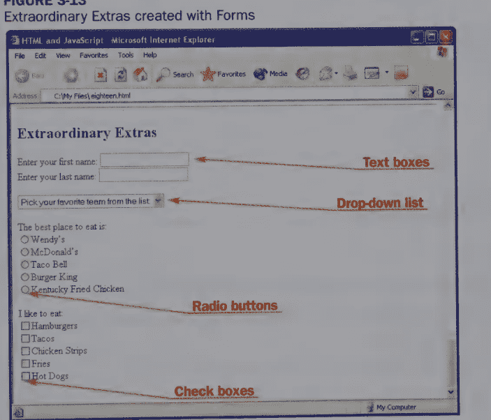

8. 修改你的表单选项。返回你的网页并更改所有选择项。
9. 将你的作品保存为`eighteen-2.html`或`eighteen-2.htm`并测试你的更改。它们工作得怎么样？
10. 继续进入摘要部分，或者如果你今天到此为止，请关闭你的软件并关闭计算机。

## 摘要

在本课中，你学到了：

- 你可以控制字体的大小、样式和颜色。
- 你可以从网络上下载图片。
- 你可以将图片插入到你的网页中。
- 你可以更改图形的大小。
- 你可以使用表格来组织信息。
- 你可以将图片转换为超链接。
- 你可以将各种数据输入选项插入到网页中。

> ### 网络小贴士
>
> 将你不打算使用的图片下载到学校网络被认为是不礼貌的。图形在计算机上占用大量空间。下载成百上千张图片却不使用，是浪费网络服务器驱动器空间。请考虑删除任何你实际上没有使用的图片。

## 词汇复习

定义以下术语：

| 术语 | 定义 | 术语 | 定义 |
|---|---|---|---|
| `.gif` | 图形交换格式 | 表格单元格 |  |
| `.jpg`或`.jpeg` | 联合图像专家组 |  |  |

## 复习问题

### 判断题

如果陈述正确则圈出 T，如果错误则圈出 F。

T F 1. 你只能通过放在`<BODY>`标签中的属性和值来更改字体的颜色。

T F 2. 你可以将图像放大或缩小到你喜欢的任何大小。

T F 3. GIF 代表“更大图像格式”。

T F 4. 所有图像都可以让你在互联网上免费使用。

T F 5. `CELLPADDING`属性会使表格单元格之间的区域变大或变小。

### 填空题

请在空格处填写正确的单词或短语，完成下列句子。

1. 你可以使用 __________ 标签在网页上有序地放置图片和文本。
2. __________ 标签使你能够收集访问者的信息。
3. __________ 图像格式由 CompuServe 创建。
4. __________ 标签在表单中创建一个下拉列表项。
5. __________ 图像格式是一项国际标准。

### 简答题

简要回答下列问题。

1. 为什么网页设计师在互联网上如此抢手？
2. 从网络上下载图片在什么情况下是非法的？
3. 如果不打算使用，为什么不要将图片下载到学校或工作场所的网络上？
4. 你将如何以及为何使用以下标签或属性？

```html
<B></B>
```

```html
<EM></EM>
```

```html
<STRONG></STRONG>
```

```html
<I></I>
```

```html
<ALIGN=CENTER>
```

5. 你会使用哪些标签来插入图形或超链接？

## 项目

## 项目 3-1

GreatApplications 公司希望进入在线电子游戏业务。然而，在开始编程下一款出色的在线视频游戏之前，它希望调查潜在客户，看看他们想玩和购买哪些类型的在线游戏。

头脑风暴想出 10 个问题，帮助 GreatApplications 公司了解客户在电子游戏程序中需要什么。运用你的`<FORM>`标签技能，创建一个在线调查来收集潜在客户的信息，例如受访者姓名和电子邮件地址。提出需要利用下拉列表、单选按钮和复选框的问题。

### 团队项目

GreatApplications 公司请你的团队规划一次世界巡演，向五个主要城市的人们展示其新的视频游戏软件。你的团队被要求使用`<TABLE>`标签创建巡演的活动日历。巡演必须在一个单一月份内进行，并应涉及五个主要城市。

创建日历时，请为你将访问的旅游城市制作旅游信息链接。使用`cellpadding`和单元格边框使表格更有趣。你甚至可以在单元格中放置图片，以展示你选择的用于软件发布的五个城市。

## 网络项目

你能多快地将`levy.gif`图形替换为另一个图形？想想你喜欢的另一个图形。如何操纵属性和值来以各种尺寸显示你的新图形？动手试试吧！进行更改！将你更改的文件保存为`web-project.html`或`web-project.htm`。

## 批判性思维

### 活动 3-1

就下列每个问题准备一份 100 至 250 字的回答。

1. 万维网和 HTML 对世界经济有多重要？是什么让它们如此重要？
2. 网络如何能使小企业受益，例如家庭经营的花店、当地的古董店或一家高档美发沙龙？


500 多年前，约翰内斯·古腾堡发明了活字印刷术，这导致普通人可获得的印刷材料数量激增，并改变了世界历史。那么 500 年后呢？人们将如何看待 HTML 的发明？

### 活动 3-2

就下列每个问题准备一份 100 至 250 字的回答。

1. 除了改变字体大小，你还可以对字体做哪些事情来让你的网页更有趣？
2. 表格如何用于在 HTML 页面中显示信息？使用表格标签可以创建哪些类型的东西？
3. 你希望在 HTML 中添加哪些额外的功能或标签？你认为应该添加哪些标签来赋予 HTML 更强大的能力？

### 活动 3-3

这些特殊的输入框要求用户提供不同类型的信息。你期望从以下 `FORM` 属性中得到什么类型的响应？

- `TEXT`
- `OPTION`
- `RADIO`
- `CHECKBOX`

# 总结项目

当地城市动物园聘请你创建一个网页，描述他们当前展出的一些动物。他们希望你的网页组织有序，并且还希望你包含动物的图片以及每个动物的简短描述段落。使用你在本课中关于表格、字体和图片的知识来完成这项作业。完成后，你的网页应类似于下图 3-14 所示的样式。

图 3-14 当地城市动物园的示例网页

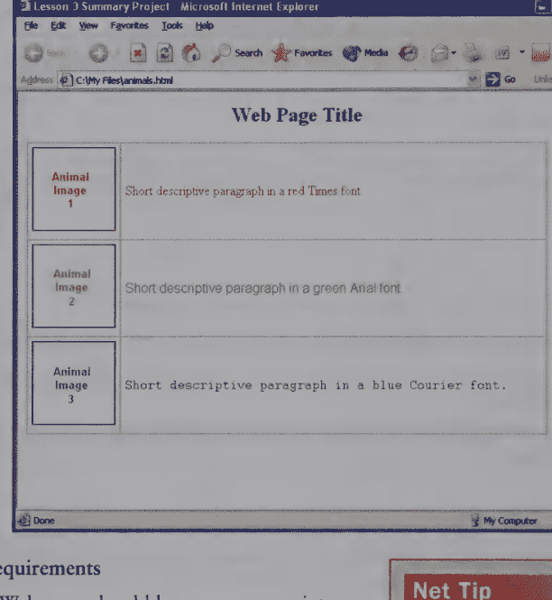

## 项目要求

- 你的网页顶部应有一个合适的标题。
- 你的动物图片在网页中应保持合适的大小。
- 每个动物的描述段落应使用多种字体和颜色显示。
- 段落宽度应约为 500 像素。
- 你的表格应有一个可见的边框来分隔每个单元格。

> **网络提示**

> 在页面中使用动物图片的最佳方式可能是在网络上搜索。一旦找到你想要使用的动物图片，请按照本课中的说明将图像下载到你的工作站。但是请记住，从网络上下载受版权保护的图片是不合适的。请避免使用任何在图片本身或其所在网页上显示版权信息的图片。

## HTML 结构设计技术

### 学习目标

完成本课后，你应该能够：

- 创建一个框架集。
- 添加一个导航栏。
- 制作一个欢迎页面。
- 创建一个嵌套框架集。
- 包含一个标题栏框架和页面。
- 利用框架和框架集选项。

预计学习时间：1.5 小时。

### 词汇表

- 框架（Frames）
- 框架集标签（Frame set tag）
- 左侧导航（Left-hand navigation）
- 导航栏（Navigation bar）
- 嵌套框架集（Nested frame set）
- 像素（Pixel）
- 标题栏（Title bar）

## 创建 HTML 框架集

在第 2 课中，你学习了如何通过使用超链接让网络浏览器从一个网页链接到另一个页面。现在是时候学习如何让你的网络浏览器在屏幕上同时显示两个或更多网页了！帮助你实现此目标的 HTML 标签是 `<FRAMESET>` 标签和 `<FRAME>` 标签。

顾名思义，框架集标签允许你在屏幕上定义一组称为框架的矩形区域（参见图 4-1）。每个框架都能够显示一个不同的网页。在某种程度上，你可以让你的网络浏览器表现得就好像你的计算机上同时运行着多个浏览器一样。然而，框架集允许一个框架中的网页与不同框架中的页面进行通信。你将在本课后面学习更多关于这个概念的内容。

### 图 4-1

网页上的三个框架

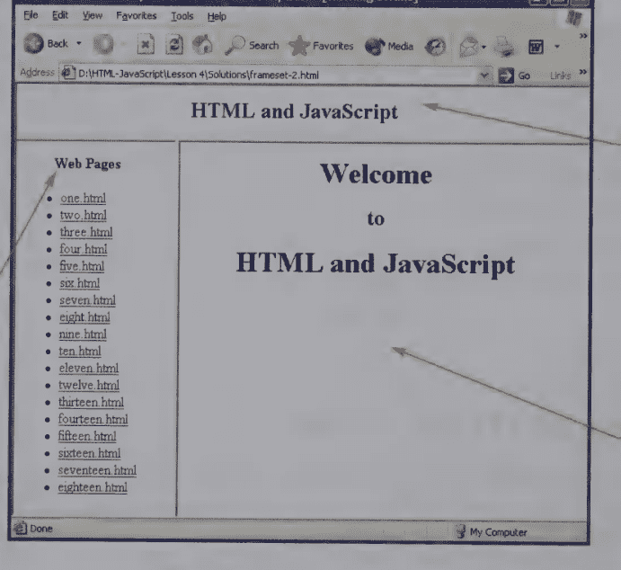

创建你的第一个 HTML 框架集文件时，你会注意到它与你在前面课程中创建的其他 HTML 页面有许多共同之处。但是，你也应该认识到一个重要的区别。具体来说，你会看到框架集页面不包含标准网页中如此重要的熟悉的 `<BODY>` 和 `</BODY>` 标签。相反，框架集页面将包含 `<FRAMESET>` 和 `</FRAMESET>` 标签，这些标签标记着框架定义的开始和结束。

此外，框架集标签可以包含 `ROWS` 属性或 `COLS` 属性。`ROWS` 属性的目的是为你提供定义水平框架并指定每个框架高度的方法。类似地，`COLS` 属性允许你创建垂直框架并指定每个框架的宽度。由于在任何给定的框架集中只能定义水平或垂直框架，因此 `<FRAMESET>` 标签可能包含 `ROWS` 属性或 `COLS` 属性，但不能同时包含两者。

正如你将在下面的步骤中看到的，框架集标签将封装两个或多个 `<FRAME>` 标签。反过来，`<FRAME>` 标签将包含至少两个重要属性，称为 `NAME` 和 `SRC`，它们分别允许你为每个框架命名，并指定你希望在每个框架中显示的源网页。`SRC`（源）属性的目的相当明显，但 `NAME` 属性的功能并非立竿见影。别担心。你将在步骤 4.4 中学习更多关于此属性的知识。

## 分步教程 4.1

1. 打开记事本、SimpleText 或您喜欢的文本编辑器。
2. 按照图 4-2 所示，准确地输入 HTML 文本。

   > **重要提示**
   >
   > 正如您已经了解到的，您可以使用 `.htm` 或 `.html` 扩展名来保存文件。请务必小心！如果您使用了 `.htm` 扩展名，则必须相应地更改图 4-2 中所有文件的名称。例如，在框架集文件中将 `navbar.html` 更改为 `navbar.htm`。

   > **注意**
   >
   > 星号（`*`）代表“剩余的所有部分”。

   图 4-2

   将文本文件命名为带有 `.html` 扩展名

   ```html
   <HTML>
   <TITLE>HTML and JavaScript</TITLE>

   <FRAMESET COLS="180,*">
   <FRAME NAME="LeftFrame" SRC="navbar.html">
   <FRAME NAME="RightFrame" SRC="welcome.html">
   </FRAMESET>
   </HTML>
   ```

3. 将您新创建的文件保存为 `frameset-1.html` 或 `frameset-1.htm`。请继续下一个分步教程部分，或者如果您今天已完成，请关闭您的系统。

   > **重要提示**
   >
   > 与 `ROWS` 和 `COLS` 属性一起使用的数字可以是绝对像素值或百分比值。像素是计算机显示器或屏幕内的一个独立的小光点。在步骤 2 中，您将框架集列设置为 180 像素宽。典型的计算机屏幕上有数千个像素，多得数不清。因此，有时计算屏幕百分比值比计算像素更容易。在决定为框架分配多少屏幕时，百分比值会自动计算屏幕的 5%、10%、50% 或更多。例如，`<FRAMESET COLS="20%,*">`。

## 创建导航栏

专业 Web 设计师经常使用的一种设计是将网页放在一个狭窄的左侧框架中，其中包含许多超链接。当用户单击其中任何一个链接时，相应的网页会显示在较大的右侧框架中。这种设计技术通常被称为*左侧导航*，包含超链接的网页被称为导航栏。*导航栏*是一系列超链接，通常在网页或框架中水平或垂直排列。它用于导航网站。图 4-3 展示了一个带有导航栏的网页示例。

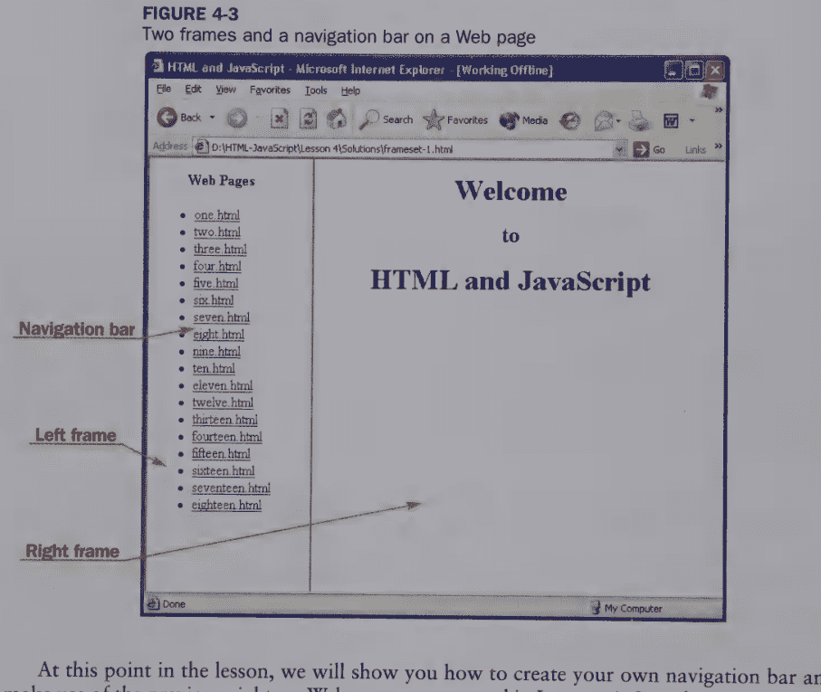

在本课程的这一点，我们将向您展示如何创建自己的导航栏，并利用您在课程 1、2 和 3 中创建的前十八个网页。您的导航栏将包含一个包含十八个超链接的无序列表，这些链接将指向您之前保存为 `one.html`、`two.html`、`three.html` 等的网页。

您将用于创建导航栏的 HTML 标签没有什么特别之处。事实上，它们都是您在前面课程中已经使用过的标签。但是，您将在 `<A>` 标签中看到一个新属性，该属性定义了指向将在右侧框架中显示的网页的超链接。此属性称为 `TARGET`，其目的是告诉浏览器应使用哪个框架来显示目标网页。您还应注意，`TARGET` 属性使用了您在分步教程 4.1 的 `<FRAME>` 标签中通过 `NAME` 属性定义的框架名称。

## 分步教程 4.2

1. 如果尚未打开，请打开记事本、SimpleText 或您喜欢的文本编辑器。
2. 按照图 4-4 所示，准确地输入 HTML 文本。

   图 4-4

   框架页面中的导航标签

   ```html
   <HTML>
   <TITLE>HTML and JavaScript</TITLE>

   <BODY>
   <CENTER><B>Web Pages</B></CENTER>
   <UL>
   <LI><A HREF="one.html" TARGET="RightFrame">one.html</A></LI>
   <LI><A HREF="two.html" TARGET="RightFrame">two.html</A></LI>
   <LI><A HREF="three.html" TARGET="RightFrame">three.html</A></LI>
   <LI><A HREF="four.html" TARGET="RightFrame">four.html</A></LI>
   <LI><A HREF="five.html" TARGET="RightFrame">five.html</A></LI>
   <LI><A HREF="six.html" TARGET="RightFrame">six.html</A></LI>
   <LI><A HREF="seven.html" TARGET="RightFrame">seven.html</A></LI>
   <LI><A HREF="eight.html" TARGET="RightFrame">eight.html</A></LI>
   <LI><A HREF="nine.html" TARGET="RightFrame">nine.html</A></LI>
   <LI><A HREF="ten.html" TARGET="RightFrame">ten.html</A></LI>
   <LI><A HREF="eleven.html" TARGET="RightFrame">eleven.html</A></LI>
   <LI><A HREF="twelve.html" TARGET="RightFrame">twelve.html</A></LI>
   <LI><A HREF="thirteen.html" TARGET="RightFrame">thirteen.html</A></LI>
   <LI><A HREF="fourteen.html" TARGET="RightFrame">fourteen.html</A></LI>
   <LI><A HREF="fifteen.html" TARGET="RightFrame">fifteen.html</A></LI>
   <LI><A HREF="sixteen.html" TARGET="RightFrame">sixteen.html</A></LI>
   <LI><A HREF="seventeen.html" TARGET="RightFrame">seventeen.html</A></LI>
   <LI><A HREF="eighteen.html" TARGET="RightFrame">eighteen.html</A></LI>
   </UL>
   </BODY>

   </HTML>
   ```

3. 将您新创建的文件保存为 `navbar.html` 或 `navbar.htm`。
4. 请继续下一个分步教程部分，以学习如何创建网站欢迎页，或者如果您今天已完成，请关闭您的系统。

   > **网络提示**
   >
   > 通常，当用户单击超链接时，目标网页将加载到与链接相同的框架中。`TARGET` 属性会覆盖此行为，并将适当的网页发送到“目标”框架。

## 创建网站欢迎页

通常，专业的网站开发者会创建一个欢迎页，用户首次访问该网站时会看到该页面。正如您在课程 1 中学到的，欢迎页的主要目的只是给用户留下对网站的良好第一印象，并确保他们了解该网站的目的。例如，一家希望通过网络销售书籍、音乐或其他产品的公司，希望创建一个花哨的欢迎页，以吸引用户的眼球、强调公司名称，并便于用户轻松访问网站的各个部分。

在接下来的分步教程部分中，您将创建一个非常简单的欢迎页。事实上，该页面中没有任何您在前面课程中未见过的 HTML 标签。但是，您应该认识到，这个页面有一个特定的目的，并且可以大大增强以使您的网站生动活泼，给用户留下难忘的体验。商业网站的主要目标之一是给用户一个再次光顾网站的理由。

## 分步教程 4.3

1. 如果尚未打开，请打开记事本、SimpleText 或您喜欢的文本编辑器。
2. 按照图 4-5 所示，准确地输入 HTML 文本。

   图 4-5

   创建一个简单的欢迎页

   ```html
   <HTML>
   <TITLE>HTML and JavaScript</TITLE>

   <BODY>
   <CENTER><FONT SIZE=6><B>Welcome</B></FONT></CENTER>
   <BR>
   <CENTER><FONT SIZE=5><B>to</B></FONT></CENTER>
   <BR>
   <CENTER><FONT SIZE=6><B>HTML and JavaScript</B></FONT></CENTER>
   </BODY>

   </HTML>
   ```

3. 将您新创建的文件保存为 `welcome.html` 或 `welcome.htm`。

## 分步教程 4.3（续）

4. 打开您的 Web 浏览器，并查看您在分步教程 4.1 中创建的 `frameset-1.html` 文档。您应该会看到类似图 4-6 的内容。

   > **注意**
   >
   > 请记住，您在之前的分步教程中创建的文件（`one.html`、`two.html` 等）必须与您在本分步教程中创建的文件位于同一文件夹中。如果它们不在同一文件夹中，您的超链接将无法正常工作。

   图 4-6

   带有导航栏的欢迎页

   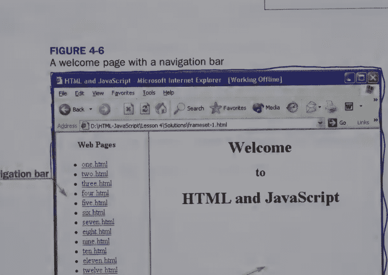

5. 请继续下一个分步教程部分，以学习如何创建嵌套框架集，或者如果您今天已完成，请关闭您的系统。

## 创建嵌套框架集

有时，您可能希望将第三个框架放入您的框架集中，这将使浏览器在浏览器窗口顶部显示一个水平框架。然后，您可以将一个新的网页放入这个新框架中，该框架可以用作您网站的固定标题。

如果您仔细关注了本课程第一部分的内容，您现在应该会问自己一个重要的问题。具体来说，我们很早就指出，框架集只能包含水平框架或垂直框架，但不能同时包含两者。那么，如果您已经在现有的框架集中定义了垂直框架，您应该如何创建一个水平框架来显示您的标题页呢？

嵌套框架集解决了这个问题。术语“嵌套”是程序员和 Web 开发人员用来描述一种结构、关键字或标签，其中包含一个或多个相同项目的附加实例。在这种情况下，您将在另一个 `<FRAMESET>` 标签内使用 `<FRAMESET>` 标签，以便同时创建垂直和水平框架。

## 分步教程 4.4

1. 如果尚未打开，请打开记事本、SimpleText 或您喜欢的文本编辑器。
2. 找到您在分步教程 4.1 中创建的 `frameset-1.html` 或 `frameset-1.htm` 文件。
3. 通过添加图 4-7 所示的粗体文本修改 HTML 文档。

   图 4-7

   将文本文件命名为带有 `.html` 扩展名

   ```html
   <HTML>
   <TITLE>HTML and JavaScript</TITLE>

   <FRAMESET ROWS="60,*">
   <FRAME NAME="UpperFrame" SRC="title.html">

   <FRAMESET COLS="180,*">
   <FRAME NAME="LeftFrame" SRC="navbar.html">
   <FRAME NAME="RightFrame" SRC="welcome.html">
   </FRAMESET>

   </FRAMESET>
   </HTML>
   ```

4. 将您新创建的文件保存为 `frameset-2.html` 或 `frameset-2.htm`。
5. 请继续下一节，为您的嵌套页面创建标题页，或者如果您今天已完成，请关闭您的系统。

## 创建标题栏

正如你在分步教程 4.2 中创建的网页被称为导航栏一样，一个专门用于显示网站固定标题的页面通常被称为标题栏。在本节中，你将创建一个标题栏，用于显示在你在前面练习中定义的新框架中。图 4-8 展示了一个带有标题栏的网页示例。

**图 4-8** 包含导航栏、标题栏和欢迎页面的三个框架

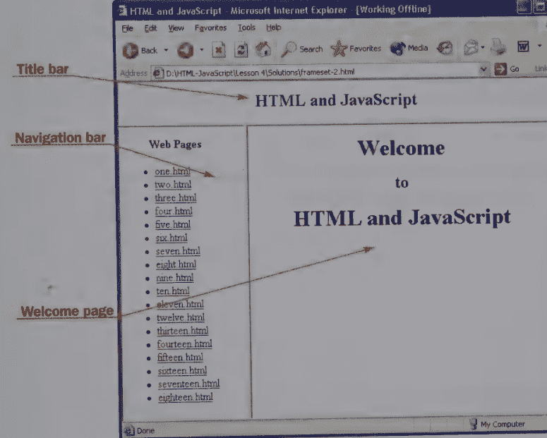

与你在分步教程 4.3 中创建的 `welcome.html` 或 `welcome.htm` 页面类似，这个标题栏网页将不包含任何新的 HTML 标签。但是，与欢迎页面一样，专业的网页开发者通常会不遗余力地创建一个引人注目且令人难忘的标题栏。不过，你的标题栏将会非常简单，以便你更容易地掌握这个新概念。

## 分步教程 4.5

1. 如果尚未打开，请打开记事本、SimpleText 或你最喜欢的文本编辑器。
2. 完全按照图 4-9 所示输入 HTML 文本。

   **图 4-9**

   标题页的标签

   ```html
   <HTML>
   <TITLE>HTML and JavaScript</TITLE>

   <BODY>
   <CENTER><FONT SIZE=5><B>HTML and JavaScript</B></FONT></CENTER>
   </BODY>

   </HTML>
   ```

3. 将新创建的文件保存为 `title.html` 或 `title.htm`。


4. 打开你的 Web 浏览器，查看你在分步教程 4.4 中创建的`frameset-2.html`或`frameset-2.htm`文档。你应该会看到一个类似图 4-10 的页面。

5. 框架页面可以由用户自定义。缓慢地将鼠标滚过框架之间的分隔条（称为框架分隔符），如图 4-10 所示。当出现双向箭头时，单击并拖动分隔条向左、向右、向上或向下移动。

**图 4-10**

拖动框架分隔符来自定义页面

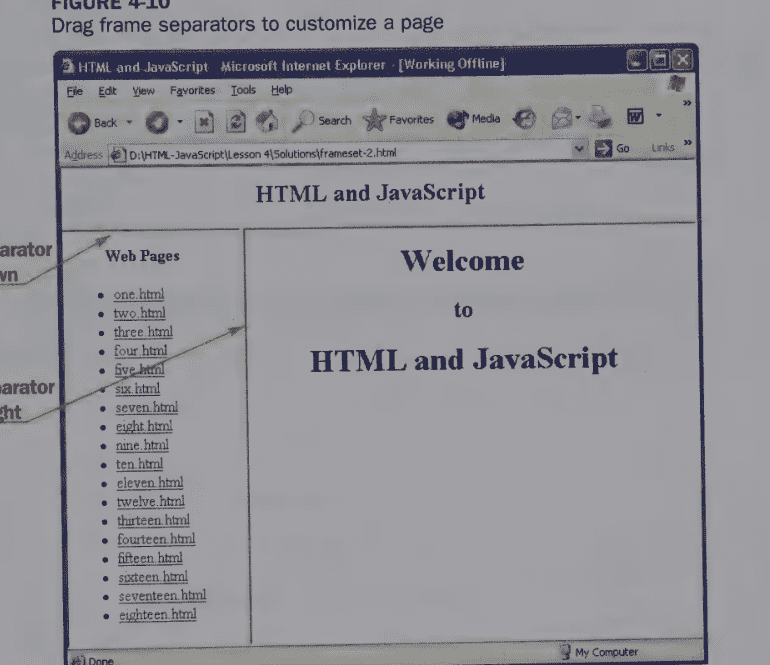

6. 继续下一节，或者如果你今天的学习到此结束，请关闭你的系统。

> **网络小贴士**
>
> 框架是学习网页如何组织成不同部分或区段的一种绝佳方式。表格则提供了另一种将页面划分为区段的方法，用于艺术设计和组织目的。

## 使用高级 HTML 选项

让我们花点时间对你到目前为止创建的框架和框架集进行一些观察。首先，你的 Web 浏览器正在显示框架分隔符，这使得一个框架在哪里结束、另一个框架从哪里开始变得一目了然。其次，如果你将鼠标光标直接悬停在这些框架分隔符中的任何一个上，你会看到鼠标指针改变形状，以指示框架分隔符可以移动。这意味着用户只需单击并将框架分隔符拖动到不同位置即可更改你的网页外观，正如你在前面的练习中体验到的那样。

我们刚刚描述的框架和框架集特性在某些情况下可能是理想的。然而，在许多情况下，专业的网页开发者不希望浏览器显示框架分隔符，也不希望用户能够随意更改屏幕布局。当开发者在其网页中包含定制的图形图像时，尤其如此。这些图像通常被设计成特定的大小，以适应精确尺寸的框架。如果浏览器显示框架分隔符，或者如果用户更改框架的大小，整个页面的布局可能会被打乱，resulting clutter of images would be very unappealing。

幸运的是，两个重要的 HTML 属性可以与`<FRAMESET>`和`<FRAME>`标签一起使用来解决这些问题，如图 4-11 所示。首先，你可以在`FRAMESET`标签中使用`BORDER`属性来调整框架分隔符的外观。此外，你还可以在`<FRAME>`标签中使用`NORESIZE`属性来指示浏览器用户不应能够更改框架的大小。这两个属性可以单独使用或一起使用，以获得你想要的外观和行为。

**图 4-11**

消除页面上的框架分隔符

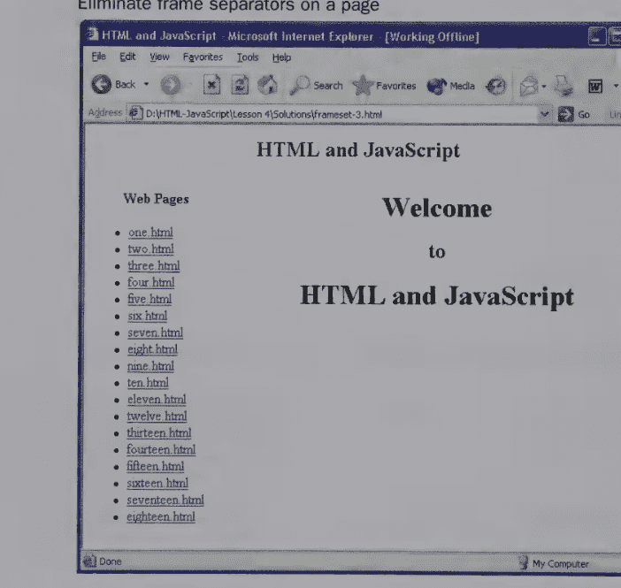

## 分步教程 4.6

1. 如果尚未打开，请打开记事本、SimpleText 或你最喜欢的文本编辑器。

2. 找回你在分步教程 4.4 中创建的`frameset-2.html`或`frameset-2.htm`文件。

3. 通过添加图 4-12 中所示的粗体文本修改 HTML 文档。

**图 4-12**

向扩展名为`.html`的文本文件添加内容

```html
<HTML>
<TITLE>HTML and JavaScript</TITLE>

<FRAMESET BORDER=0 ROWS="60,*">
<FRAME NAME="UpperFrame" NORESIZE SRC="title.html">

<FRAMESET BORDER=0 COLS="180,*">
<FRAME NAME="LeftFrame" NORESIZE SRC="navbar.html">
<FRAME NAME="RightFrame" NORESIZE SRC="welcome.html">
</FRAMESET>

</FRAMESET>
</HTML>
```

4. 将新创建的文件保存为`frameset-3.html`或`frameset-3.htm`。

5. 打开你的 Web 浏览器，查看你刚刚保存的`frameset-3.html`文档。你应该会看到类似图 4-11 的内容。

6. 继续下一节，或者如果你今天的学习到此结束，请关闭你的系统。

## 互联网里程碑

### HTML 创建工具

HTML 功能强大，但手工输入所有标签可能需要很长时间。终于有人问：“有什么方法可以让 HTML 创建更简单吗？”在 HTML 成为在线通信标准方式几年后，有进取心的程序员创建了软件工具，免去了输入所有尖括号和标签的麻烦。一些最受欢迎的网页开发工具包括 Macromedia Dreamweaver、Adobe GoLive 和 Microsoft FrontPage。这些工具中的每一个都帮助你以类似于专业人员在文字处理或桌面发布软件中创建文档的方式来创建网页。

在像 Dreamweaver 这样的程序中，当你在设计页面时，大多数标签会自动为你创建。但是，千万不要认为你不需要了解 HTML 标签就能使用这些强大而令人兴奋的网页创建工具！有时你需要编辑或更正这些产品创建的标签。标签视图始终可用。

例如，图 4-13 展示了一个使用 Dreamweaver 创建的网页。请注意，在屏幕的底部部分，你可以看到网页在线上呈现的样子。然而，在 Dreamweaver 工具的顶部部分，你仍然可以查看标签。了解标签的工作原理将帮助你成为专家级的 Dreamweaver 网页开发者和编辑者。

**图 4-13**

Dreamweaver 中的 HTML 标签

网页

## 总结

在本课中，你学到了：

- 你可以创建一个框架集。
- 你可以解释框架集的属性和值。
- 你可以在一个框架中创建导航栏。
- 你可以为框架页面创建一个简单的欢迎页面。
- 你可以插入嵌套的标签和属性。
- 你可以在网页上插入一个标题栏框架。

## 词汇复习

| 定义以下术语： | | |
| --- | --- | --- |
| 框架 | 导航栏 | 像素 |
| 框架集标签 | 嵌套框架集 | 标题栏 |
| 左手导航 | | |

# 复习题

## 判断题

如果陈述正确则圈选 T，如果陈述错误则圈选 F。

1. 框架集可以显示行或列。
2. 在框架集页面中可以省略`<BODY>`标签。
3. 当你使用 FrontPage、Dreamweaver 或 GoLive 等程序时，你必须手动键入标签。
4. 计算框架宽度的唯一方法是计算像素。
5. `TARGET`属性使框架分隔符消失。

## 填空题

在提供的空白处填写正确的单词或词组完成以下句子。

1. **frame setting**属性将网页指向要在特定框架中显示的页面。
2. `COLS`属性创建垂直分隔的框架。
3. `ROWS`属性创建水平分隔的框架。
4. `BORDER=0`属性使框架分隔符消失。
5. __________属性可防止网页查看者更改框架的大小。

### 书面题

简要回答以下问题。

1. 根据本课所述，欢迎页面的目的是什么？
2. 什么是左手导航？解释如何创建左手导航栏。
3. 根据本课所述，从程序员的角度来看，什么是嵌套？
4. 什么是像素值和百分比值？它们在框架集中是如何定义的？
5. 为什么网站开发者希望防止网站访问者调整框架页面上的行和列分隔符？

## 项目


### 项目 4-1

在项目 1-1 中，你使用了你的网页搜索技巧来定位关于 HTML、HTML 指南和学习 HTML 的信息。你的经理要求你将收集到的信息组织成一个新的仅使用两列的框架网页。

GreatApplications, Inc. 要求您创建一个带有左侧导航的网站，该网站将组织您在项目 1-1 和表 1-2 中收集的信息。这样，这些有用的网页就可以供公司中的每个人在线访问。在您的框架集页面的左侧创建一个导航框架，并将您链接到的信息显示在右侧框架中。您可以使用本教材中学到的所有标签来完成所有这些操作。

### 团队合作项目

在本团队合作项目中，您需要进行一项调查。为了完成调查，您和您的团队成员必须访问至少 100 个不同的网站。通过团队合作，这不会像最初看起来那么困难。在第 1 课的团队合作项目中，您已经确定了您能找到的最佳网页。在批判性思维活动 2-2 中，您将喜欢的页面组织起来，以便于参考，并将其保存为“我的网络资源”网页。在项目 2-1 中，您确定了您在网上能找到的五个最差的网页。在您的所有团队成员之间，你们一定已经访问了超过 100 个网站。

作为团队，请重新访问您列出的最佳和最差页面。如果需要，请访问其他网站。作为一个团队，您必须正好调查 100 个网站，并在访问时收集数据。分配任务，让每个成员负责查看一定百分比的网站，同时记录将以下问题应用于每个网站的结果。

#### 调查问题

1. **调查**。查看您的 100 个网页的源 HTML 代码，有多少个使用了框架标签或某种类型的框架组织来组织它们的网页？
2. **计算**。查看您的网页的源代码，这些页面中有多少个使用了表格标签来组织它们的网页？
3. **制表**。这些好网站和差网站中，使用左侧导航系统的百分比是多少？
4. **记录**。有多少个网站在网页顶部使用了导航系统？
5. 这些网站中有多少在网页顶部的标题栏区域使用了吸引人的图形或标志？
6. 根据您团队成员的意见，有多少百分比的受访网站拥有有效的欢迎页面？

## 网络项目

在项目 4-1 中，您创建了一个左侧导航系统，该系统将允许您与 GreatApplications, Inc. 的同事分享有关 HTML 的信息。在这个网络项目中，挑战一下自己。将您在项目 4-1 中创建的网页更改为一个从页面顶部栏导航的站点。在您的框架集中创建两行。在顶部框架中，使用屏幕的 20% 创建您的导航系统。在底部框架中，显示信息。将此项目保存为`WebProject-4.html`或`WebProject-4.htm`。

## 批判性思维

### 活动 4-1

在您看来，在完成前四课的学习后，您学到的关于 HTML 和创建网页的最重要的十件事是什么？准备一份 100-250 字的报告，解释为什么这十个项目被列入您的名单。将您的答案保存为`Activity 4-1`。

### 活动 4-2

在您结束 HTML 学习时，请思考一下您认为 HTML 存在的三个主要弱点。您会改变 HTML 的哪三件事？您认为有哪些弱点或可以改进的地方？用一份 100-250 字的报告详细说明您希望 HTML 如何变得更好、更易于使用，以及对您作为网站开发者更有帮助。将您的答案保存为`Activity 4-2`。

# 总结项目

专业网页设计师通常需要理解并利用 HTML 框架的灵活性，以使网站具有所需的外观。例如，一些商业网站被设计为顶部、底部或右侧导航栏，而不是本课中介绍的左侧导航栏。使用您所学到的关于框架和框架集的知识，重新组织图 4-10 中所示的网站，以说明右侧导航的使用。同时更改网站框架的结构，使导航栏跨越浏览器窗口的整个高度，而标题栏不跨越整个宽度。您重新组织的网页应类似于图 4-14。

## 图 4-14

一个带有右侧导航的示例网站

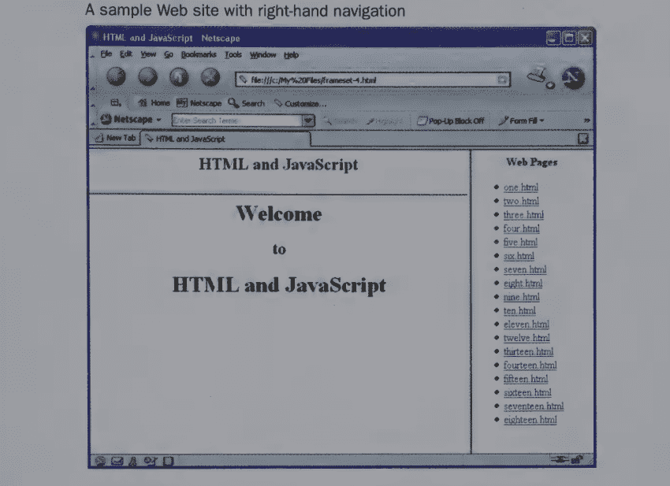

## 项目要求

- 您可以使用您在本课中创建的`title.html`、`welcome.html`和`navbar.html`文件来为您的新框架集提供内容。
- 上部（标题）框架的高度应约为 60 像素，右侧（导航）框架的宽度应约为 180 像素。
- 每个框架之间应由一个<u>不可</u>调整大小的框架边框分隔。
- 您可能需要使用之前课程中的概念（如字体和图像）来改善您的标题页和欢迎页的外观。

## HTML 标签和属性总结

| 标签或属性 | 结果 | 课程 |
| :--- | :--- | :--- |
| `<A>` `</A>` | 创建用于创建超链接的锚点标签 | 2 |
| `<B>` `</B>` | 使文本加粗 | 3 |
| `<BODY>` `</BODY>` | 标记将出现在 Web 浏览器正文部分中的文本 | 1 |
| `<BR>` | 在文本之间创建换行或单倍行距分隔符 | 2 |
| `<CENTER>` `</CENTER>` | 在网页上居中文本或图形 | 1 |
| `<EM>` `</EM>` | 强调或加粗文本 | 3 |
| `<FONT>` `</FONT>` | 更改网页文本的大小、字体和颜色 | 3 |
| `<FORM>` `</FORM>` | 在网页中插入表单集 | 3 |
| `<FRAME>` `</FRAME>` | 定义网页框架集中的框架 | 4 |
| `<FRAMESET>` `</FRAMESET>` | 标记框架集的开始和结束 | 4 |
| `<H1>` `</H1>` | 标记文本以最大标题字体大小显示 | 1 |
| `<H2>` `</H2>` | 标记文本以第二大标题字体大小显示 | 1 |
| `<H3>` `</H3>` | 标记文本以第三大标题字体大小显示 | 1 |
| `<H4>` `</H4>` | 标记文本以第三小标题字体大小显示 | 1 |
| `<H5>` `</H5>` | 标记文本以第二小标题字体大小显示 | 1 |
| `<H6>` `</H6>` | 标记文本以最小标题字体大小显示 | 1 |
| `<HR>` | 在网页各部分之间创建一条水平线 | 2 |
| `<HTML>` `</HTML>` | 表示网页的开始和结束 | 1 |
| `<I>` `</I>` | 使文本倾斜 | 3 |
| `` | 在网页中显示图像 | 3 |
| `<INPUT>` `</INPUT>` | 定义表单的输入控件。例如，单选按钮、复选框、文本字段等 | 3 |
| `<MARQUEE>` `</MARQUEE>` | 创建类似股票市场滚动信息的滚动字幕 | 2 |
| `<OL>` `<LI>` `</OL>` | 标记用于有序或编号（1, 2, 3）列表的文本 | 1 |
| `<OPTION SELECTED>` | 允许 Web 开发者定义选项列表中默认应选中的项。 | 3 |
| `<OPTION>` | 在选择列表中定义一个选项 | 3 |
| `<P>` `</P>` | 在文本之间创建段落或双倍行距分隔符 | 1 |
| `<SELECT>` `</SELECT>` | 在表单中定义选择选项列表 | 3 |
| `<STRONG>` `</STRONG>` | 强调或加粗文本 | 3 |
| `<TABLE>` `</TABLE>` | 用于在网页中定义表格和表格单元格 | 3 |
| `<TITLE>` `</TITLE>` | 标记将出现在 Web 浏览器标题栏中的文本 | 1 |
| `<TR>` `</TR>` | 定义表格中的一行 | 3 |
| `<UL>` `<LI>` `</UL>` | 标记用于无序或项目符号（•）列表的文本 | 1 |
| `ALIGN=` | 将文本和图形与网页的左侧、右侧和中心对齐 | 3 |
| `BACKGROUND=` | 将图形作为网页的背景输入 | 3 |
| `BGCOLOR=` | 定义网页的背景颜色 | 2 |
| `BORDER=` | 在表格单元格周围创建边框 | 3 |
| `CELLPADDING=` | 确定表格中分隔单元格的线条宽度 | 3 |
| `COLOR=` | 更改网页文本的颜色 | 3 |
| `COLS=` | 定义框架集中的列数 | 4 |
| `FACE=` | 更改正在显示的字体的样式或字体。例如，Times New Roman、Arial 或 Helvetica | 3 |
| `HEIGHT=` | 更改图形的高度 | 3 |
| `HREF=` | 超文本引用属性。定义网页、Internet 位置或其他在线资源的路径或位置 | 2 |
| `LINK=` | 更改超链接的颜色 | 2 |
| `NAME=` | 定义页面上位置或为每个框架命名的超文本引用属性 | 2, 4 |
| `NORESIZE` | 关闭用户调整框架大小的选项 | 4 |
| `ROWS=` | 定义框架集中的行数 | 4 |
| `SIZE=` | 更改水平线的高度或字体的大小 | 2, 3 |
| `SRC=` | 指定资源的来源，例如要插入网页的图像，或指定要在框架中显示的源网页 | 3, 4 |
| `TARGET=` | 将网页或图形指向框架集中的特定框架 | 4 |
| `TEXT=` | 更改网页上文本的颜色 | 2 |
| `TYPE=` | 定义表单使用的输入类型 | 3 |
| `VLINK=` | 更改已访问或选中的超链接的颜色 | 2 |
| `WIDTH=` | 更改水平线的宽度、图形的宽度或表格单元格的宽度 | 2, 3 |

# 复习题

## 匹配题

将右侧栏中的正确术语与左侧栏中的描述进行匹配。

| | | |
|---|---|---|
| | 1. 用于指示网页浏览器如何显示网页元素的专用 Web 语言。 | A. Dreamweaver |
| | 2. 一种类似 Java 的脚本语言，用于创建迷你应用程序和多媒体效果。 | B. gif |
| | 3. 通常成对出现，包含在尖括号中。 | C. HTML |
| | 4. 以 16 为基数的运算系统，使用字母和数字来表示值。 | D. HTTP |
| | 5. 属性的定义。 | E. 十六进制 |
| | 6. 用于将数据从 Web 服务器传输到 Web 浏览器的协议。 | F. 标签 |
| | 7. 符合国际标准的图形格式；足够紧凑，适合互联网使用。 | G. 嵌套 |
| | 8. 由一家名为 CompuServe 的公司创建的图形格式。该格式压缩图形，以便通过低速调制解调器传输。 | H. 值 |
| | 9. 程序员使用的术语，描述一种包含一个或多个相同项目附加实例的结构、关键字或标签。 | I. jpeg |
| | 10. 软件程序，可以避免手动输入每一个标签。 | J. JavaScript |

## 书面问题

简要回答以下每个问题。将答案保存在一个名为 HTML 单元总结的文件中。

- 1. 列出并解释你认为在大多数网页上都能找到的六种标签的功能。


## 2. 文件格式

列出并解释以下每种文件格式的来源。在你的解释中，指出哪些格式用于网页。

- **A.** `.doc`
- **B.** `.rtf`
- **C.** `.wpd`
- **D.** `.txt`
- **E.** `.htm`
- **F.** `.html`

## 3. 字体设置

解释至少两种增大或减小字体大小的方法。此外，描述至少两种更改字体的其他方法。

## 4. 锚标签和超链接

解释锚标签如何用于编写，以创建指向 Web 上站点和个人计算机上单个网页的超链接。在你的解释中，说明如何将图形转换为超链接。

## 5. 框架集

解释框架集如何工作，以及如何将网页定位到不同的框架中显示。

# 跨学科扫描项目

在这个练习中，你将展示 HTML 的实际应用。你将设计一个框架页面，帮助你组织至少五个学术学科领域的优质信息源。四个必需领域是语言艺术、科学、社会研究和数学。你再选择一个自己感兴趣的领域，例如外语、音乐、艺术、体育或技术。使用 Web 搜索工具（如`www.yahoo.com`或`www.google.com`）在这些学科领域中查找合法的学术资源。选择那些你会想反复访问以获取信息的网站。

这需要你进行仔细的思考和规划。技巧是——创建一个左侧导航栏，用于访问这些学科领域的资源页面。为你的框架集和导航栏页面发明自己的文件名。标题栏页面是可选的。测试所有链接，确保每个链接都能正常工作。

# 单元复习：HTML 基础

HTML 基础 115

## 语言艺术 1

找到五个与语言艺术学习相关的网站，并将它们放在一个目标页面上，该页面将出现在你的跨学科框架页面的右框架中。将此文件命名为`la-1.html`或`la-1.htm`。

## 科学 1

找到五个与科学学习相关的网站，并将它们放在一个目标页面上，该页面将出现在你的跨学科框架页面的右框架中。将此文件命名为`sci-1.html`或`sci-1.htm`。

## 社会研究 1

找到五个与社会研究学习相关的网站，并将它们放在一个目标页面上，该页面将出现在你的跨学科框架页面的右框架中。将此文件命名为`ss-1.html`或`ss-1.htm`。

## 数学 1

找到五个与数学学习相关的网站，并将它们放在一个目标页面上，该页面将出现在你的跨学科框架页面的右框架中。将此文件命名为`m-1.html`或`m-1.htm`。

## 你的自选学科 1

找到五个与你选择的学科学习相关的网站，并将它们放在一个目标页面上，该页面将出现在你的跨学科框架页面的右框架中。将此文件命名为`mychoice-1.html`或`mychoice-1.htm`。

# 复习项目

## 项目 1-1

你可能一直在想，我已经创建了几十个网页，但什么时候才能扩展出来，完全创建一个自己的网站呢？现在就是你发挥所有网页设计创造力的机会。为你的网站选择一个合适的主题或主题。运用你在本单元学到的所有技能，创建一个很棒的网站。发明你自己的 HTML 文件名。

## 项目 1-2

到现在为止，你可能认为你的网页是网络上最棒的站点。很可能确实是！然而，是时候看看这是否属实了！以三到四人一组，与你的队友分享你在跨学科项目和项目 1-1 中创建的网页。如果任何团队成员在使其页面元素正常工作方面遇到问题，小组共同解决这些问题。就如何改进页面相互提供建议。

# 模拟

## 工作 1-1

想象一下，你刚刚成为 GreatApplications, Inc. 网站的首席网页设计师和网页开发团队经理。为了提高团队在尖端技术方面的技能，你决定创建一个网页，列出将帮助你的团队成员更多了解 HTML、JavaScript、Flash 以及其他网页创建工具（如 Dreamweaver、FrontPage 或 GoLive）的网站。查看你在本单元中处理过的涉及编排 HTML 学习网站的页面。将这些添加到你的新网站中。然后，参考一些主要的网站开发公司，包括 Dreamweaver 和 Flash 的创造者 Macromedia、FrontPage 的创造者 Microsoft、GoLive 和其他在线多媒体工具的创造者 Adobe。使用网络搜索引擎（如`www.yahoo.com`或`www.google.com`）来找到你需要的资源。发明你自己的文件名。

## 工作 1-2

你想在高科技在线行业工作吗？如果是的话，你最好首先了解有哪些类型的工作可供选择，以及它们是否合你的心意。

上网访问一些主要的招聘网站，如`www.flipdog.com`或`www.monster.com`，搜索十个与网页开发相关的工作。如果你在这些网站上找不到这类工作，尝试在搜索引擎中输入**在线求职**。

创建一个简短报告，列出你找到的所有十个工作，并稍微解释一下在高科技网页设计行业从事这些工作所需的资格。将你的工作保存为**工作 1-2**。

# 总结项目

这是你展示已掌握本单元所有主要概念的机会。考虑表 U1-1 中的信息。该表总结了前三课中介绍的各种 HTML 主题。

你的任务是将这些信息组织成一个如图 U1-1 所示布局的网页。框架 A 将包含一个超链接列表，代表本书的前三课。框架 B 将包含自己的超链接列表，对应于某一课涵盖的主题。每次用户点击框架 A 中的超链接时，框架 B 都会更新。框架 C 将包含一个网页，该网页说明框架 B 中列出的一个主题，并且当用户点击框架 B 中的不同链接时，该网页会发生变化。图 U1-2 显示了如果用户点击框架 A 中的第 1 课和框架 B 中的标题，完成的网页可能呈现的示例。

## 表 U1-1

| 课程编号 | 涵盖主题 |
| --- | --- |
| 1 | 标题 |
| | 有序列表 |
| | 无序列表 |
| 2 | 水平线 |
| | 背景颜色 |
| | 超链接 |
| | 文本/超链接颜色 |
| 3 | 字体 |
| | 图像 |
| | 表格 |
| | 输入控件 |

## 图 U1-1

包含三个框架的网页

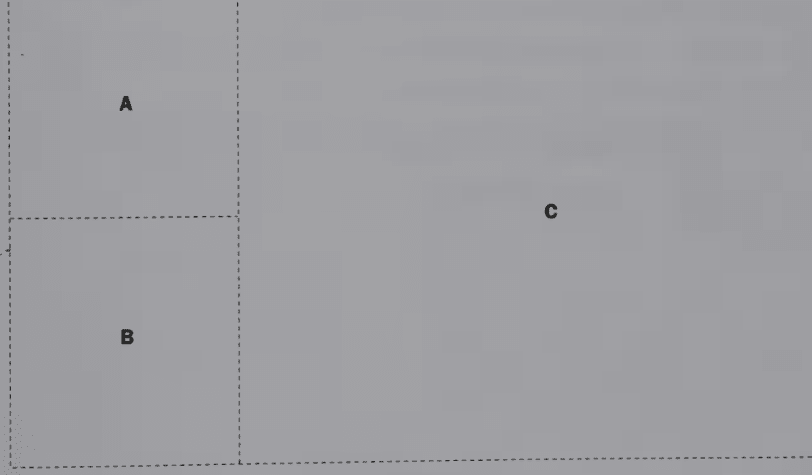

## 项目要求

- 你必须使用嵌套框架集来创建合适的网页布局。
- 将左侧两个框架的宽度设置为屏幕宽度的约 25%。
- 左侧两个框架的高度应各占屏幕高度的约 50%。
- 将你的主框架集页面命名为`unit1.html`。
- 你需要为你的主题列表创建三个网页。将你的三个文件分别命名为`topics1.html`、`topics2.html`和`topics3.html`。
- 你需要为你的示例页面创建十一个网页。将你的文件分别命名为`example1.html`、`example2.html`、`example3.html`等。

# 学习档案清单

将本单元的以下文件包含在你的学生学习档案中：

- HTML 单元总结问题
- 语言艺术 1
- 科学 1
- 社会研究 1
- 数学 1
- 你的自选科目 1
- 项目 1-1
- 项目 1-2
- 作业 1-1
- 作业 1-2

# JavaScript 的精彩世界

# 单元 2

- 第 5 课：什么是 JavaScript？（1.5 小时）
- 第 6 课：在 JavaScript 中使用图像（1.5 小时）
- 第 7 课：使用 JavaScript 创建表单（2 小时）
- 第 8 课：在框架中使用 JavaScript（2 小时）

单元预计时间：7 小时

# 什么是 JavaScript？

## 学习目标

完成本课后，你应该能够：

- 理解 JavaScript 的用途。
- 使用`<SCRIPT>`和`</SCRIPT>`标签。
- 使用 JavaScript 对象。
- 使用 JavaScript 方法。
- 理解 JavaScript 语法。

预计时间：1.5 小时

## 词汇表

- `<SCRIPT>`和`</SCRIPT>`标签
- 二进制代码
- 编译器
- 条件
- 解释
- 关键字
- 方法
- 对象
- 操作符
- 参数列表
- 编程语言
- 属性
- 脚本语言
- 状态栏
- 语法
- 标记

# Hello World Wide Web

JavaScript 有时被称为编程语言，但更准确地说，它是一种脚本语言。编程语言和脚本语言之间的区别很微妙，但理解这一点很重要。这两种语言都必须从人类可读的形式转换为机器可读的形式。

对于编程语言，这个过程由一种称为编译器的高度专业化软件在程序运行之前执行。程序员控制这一转换过程。

然而，对于脚本语言，程序员无需显式启动代码转换过程。当源代码被目标程序处理时，它会自动发生。更具体地说，HTML 文档必须由人编写，然后由 Web 浏览器处理。当该文档包含嵌入的 JavaScript 代码时，该代码会被浏览器解释，并“实时”转换为其机器可读的形式。解释是程序员用来描述这种在运行时自动进行的逐行转换过程的术语。

在正常情况下，JavaScript 函数的输出不过是一个或几个文本字符串，这些字符串被插入到宿主网页中。生成的 HTML 页面随后由浏览器处理，就好像它是由人输入到源文档中一样。

将 JavaScript 代码嵌入到网页中的真正威力在于，生成的文本可以从一天变到另一天，甚至从一分钟变到另一分钟。完全有可能一个人在他的 Web 浏览器中输入一个特定的 URL，看到一个与另一个输入完全相同 URL 的人看到的页面完全不同的网页。这些外观不同的网页可能是时间差异、位置差异甚至 Web 浏览器差异的结果。JavaScript 能够检测当前操作环境中的各种情况，并做出相应反应。这个概念在循序渐进 5.3 中进行了更详细的探讨。

Web 浏览器很容易检测特定的 HTML 页面是否包含嵌入的 JavaScript 代码。所要求的只是创建文档的人使用`<SCRIPT>`标签来标记 JavaScript 部分的开始，并使用`</SCRIPT>`标签来表示该部分的结束。Web 浏览器会将这两个标签之间的所有内容解释为 JavaScript 源代码，而不是标准的 HTML 文本。然后，浏览器将通过解释过程将脚本转换为其等效的机器可读形式，称为`二进制代码`。然后将执行此二进制代码，其输出（如果有）将被插入 HTML 文本流并显示，就好像它是由人输入到原始 HTML 文档中一样。

你需要理解的是，你将嵌入在`<SCRIPT>`和`</SCRIPT>`标签之间的脚本不能是你随意放入的任何旧文本。相反，文本必须符合某些规则，否则当你尝试查看页面时，Web 浏览器会在屏幕上显示令人不快的错误消息。这正是 JavaScript 被称为脚本语言的原因——因为它必须遵守称为程序`语法`的特定语法规则。在本课中，你将学习 JavaScript 对象和方法，以及 JavaScript 关键字和操作符。一旦你掌握了这些基本的编程元素，你将能够立即开始构建大型、复杂的脚本。

JavaScript 的主要目的是生成将插入标准 HTML 文本流的文本。JavaScript 本质上由许多称为`对象`的不可见实体组成，这些实体包含一组定义明确的功能。为了使 JavaScript 程序员能够利用这些功能，他们必须调用这些对象中称为`方法`的一个或多个专用函数的服务。程序员通过键入对象名称，后跟一个句点（`.` 字符），后跟方法名称来调用这些方法的服务。

方法名称后面总是跟着一个`参数列表`，即使该列表有时为空。理解方法参数的最佳方式可能是将其想象为食谱的配料清单。参数列表只是向方法提供其正确执行功能所需的信息。参数列表的语法由一个左括号、零个或多个参数项和一个右括号组成。例如，如果你想调用名为`document`的 JavaScript 对象的`write`方法，请键入以下代码行：

```javascript
document.write("A string of text.");
```

现在你已经看到了一个简单的 JavaScript 编码示例，让我们给你一个机会，将这个概念融入到带有嵌入式 JavaScript 的实际 HTML 文档中。

> **重要提示**
>
> 如果你的 Windows XP 版本安装了 Service Pack 2，当你尝试完成以下 JavaScript 活动时，可能会遇到各种警告消息。如果收到此类警告，只需单击启用 JavaScript 的选项即可。本书中的任何活动都不会以任何方式损坏你的系统。

## 循序渐进 5.1

1. 打开 Notepad、SimpleText 或你最喜欢的文本编辑器。
2. 如图 5-1 所示，精确输入 HTML 和 JavaScript 文本。

### 图 5-1

一个带有嵌入式 JavaScript 的 HTML 文件

```html
<HTML>
<HEAD>
<TITLE>HTML and JavaScript</TITLE>
</HEAD>
<BODY>
<SCRIPT>
document.write("Hello World Wide Web!");
</SCRIPT>
</BODY>
</HTML>
```

3. 将你新创建的文件保存为`js-one.html`或`js-one.htm`。

> **重要提示**
>
> 如果你是安装了 Service Pack 2 的 Windows XP 用户，你的浏览器可能会显示关于阻止活动内容的警告消息。如果发生这种情况，请单击警告并按照后续提示启用 JavaScript。你可能还想禁用活动内容警告，这样你就无需为每个活动都执行此操作。

4. 在你的 Web 浏览器中查看你的作品。生成的网页应如图 5-2 所示。继续下一节，或者如果你今天完成了，请关闭计算机。

### 图 5-2

你使用 JavaScript 创建的第一页

## 分析你刚输入的代码

此时你可能觉得这个网页看起来并不那么令人印象深刻。但请不要因此放弃 JavaScript，因为我们才刚刚开始。当你完成更多循序渐进的操作后，你将开始看到 JavaScript 的能力远不止这个简单网页所展示的那样。

## 增强你的网页

正如我们在本章前面提到的，名为`document.write()`的 JavaScript 方法只是将一串字符插入到标准的 HTML 文本流中。另一种理解方式是：当浏览器处理完 HTML 文档后，最终结果是`<SCRIPT>`标签、`</SCRIPT>`标签以及两者之间的所有内容都会从页面中移除，并被`write()`方法参数中出现的任何字符串所替代。这意味着你放在脚本标签之前或之后的任何 HTML 格式化标签都会像在没有嵌入 JavaScript 代码的页面中一样被处理。为了更清晰地说明这一点，让我们修改在循序渐进 5.1 中创建的网页。让我们添加一些 HTML 格式化标签，使我们的“Hello World Wide Web!”消息在屏幕上看起来更具吸引力。我们还要在页面上添加第二条消息，以确保你理解 HTML 和 JavaScript 之间的交互。

> **注意你的花括号！**
>
> JavaScript 语言的一个特点是初学者往往会纠结于花括号的使用。左花括号`{`表示语句块的开始，右花括号`}`标记该块的结束。
>
> 尽管 JavaScript 语法规则在花括号放置位置上有些灵活，但我们强烈建议你遵循本书中所示的风格。如果你开始在花括号的放置方式上变得随意或不一致，就很容易给自己造成严重问题。当左花括号的数量与右花括号的数量不匹配时，你的 Web 浏览器会报告语法错误。然而，花括号也可能以不会发生语法错误但脚本无法正确执行的方式放置。
>
> 关键在于，遵循几条简单的规则可以为你省去很多麻烦：
>
> 1. 始终将左花括号直接放在其所属关键字的下方。
> 2. 始终缩进包含在语句块内的语句。
> 3. 始终放置右花括号，使其在垂直方向上与其对应的左花括号对齐。

## 循序渐进 5.2

1. 打开 Notepad、SimpleText 或你最喜欢的文本编辑器（如果尚未打开）。
2. 找到你在循序渐进 5.1 中创建的`js-one.html`或`js-one.htm`文件。按照图 5-3 所示，添加加粗的 HTML 和 JavaScript 代码。

### 图 5-3

嵌入了两个 JavaScript 代码的 HTML 页面

```html
<HTML>
<HEAD>
<TITLE>HTML and JavaScript</TITLE>
</HEAD>
<BODY>
<CENTER>
<H1>
<SCRIPT>
document.write("Hello World Wide Web!");
</SCRIPT>
</H1>
<H3>
<SCRIPT>
document.write("Welcome to the exciting world of JavaScript");
</SCRIPT>
</H3>
</CENTER>
</BODY>
</HTML>
```

3. 将你新创建的文件保存为`js-two.html`或`js-two.htm`。
4. 在你的 Web 浏览器中查看你的作品。生成的网页应如图 5-4 所示。继续下一节，或者如果你今天完成了，就关闭计算机。

### 图 5-4

格式精美的 JavaScript 网页


## 分析你刚输入的代码

如果你清楚地理解了第 1 课中介绍的 HTML 材料，你应该能明白我们添加到本文档中的居中和标题标签的用途。你还应该理解，第一次`document.write()`方法生成的输出字符串将被插入到 HTML 文本流中`<CENTER>`和`</CENTER>`标签之间，以及`<H1>`和`</H1>`标签之间。同样，第二次调用`document.write()`产生的输出字符串将出现在`<CENTER>`和`</CENTER>`标签之间，以及`<H3>`和`</H3>`标签之间。

换句话说，`<H1></H1>`标签对只会影响第一个输出字符串的外观，而`<H3></H3>`标签对只会影响第二个字符串。但`<CENTER>`和`</CENTER>`标签会影响两个字符串的显示位置。你明白了吗？


警告：你可能会忍不住将 HTML 格式化标签（如 `<CENTER>`、`<H1>`、`<H3>` 等）放在 `<SCRIPT>` 和 `</SCRIPT>` 标签内，但不要这样做！你需要记住，网络浏览器会将你在脚本标签之间输入的所有内容都解释为 JavaScript 源代码。即使这些格式化标签在 HTML 上下文中是有效的，它们也不是有效的 JavaScript 语句。如果你错误地在 JavaScript 代码块内输入了 HTML 标签，你的浏览器将会返回一条令人不悦的错误消息。

## JavaScript 中的条件语句

细心的学生可能会看着前两个循序而问：“为什么我们甚至要用 JavaScript 在屏幕上显示文本消息？直接将文本输入到 HTML 文档中，去掉对 `document.write()` 方法的调用不是更简单吗？”

嗯，诚实的答案是：是的！那样做确实更简单。事实上，如果我们去掉脚本标签，网络浏览器显示结果的速度会稍快一些，因为它不必调用 JavaScript 解释器。但是，不要忘记 JavaScript 能够执行的功能远不止简单地将文本写入屏幕。

在下一个循序渐进中，你将使用 JavaScript 语言最强大的功能之一——条件语句。每种编程语言都具有做出决策的能力。或者用更专业的术语来说，每种语言都允许程序员评估一个特定的条件，然后根据评估结果执行不同的操作。

### 那些麻烦的分号是怎么回事？

如果你研究互联网上许多不同 JavaScript 网页的源代码，你会发现许多网页在每条语句后都有分号 `;`，而许多网页则没有。本课中所有 JavaScript 循序渐进练习的源代码列表都包含分号，但它们并非必需。如果你逐一进行每个练习并去掉末尾的分号，所有脚本仍然会正常运行。所以你可能会问自己它们为什么存在。答案是：这至少在这些示例中是个人偏好的问题。更重要的是，如果你从 JavaScript 编程转向其他一些编程语言（包括 Pascal、C++ 和 Java），你会发现分号不再是可选的。如果你忘记输入必需的分号，所有这些语言都会显示错误消息，因此养成使用分号的习惯是个好主意。毕竟，养成一个好习惯通常比改掉一个坏习惯容易得多。

## 注意你的语法！

JavaScript 中条件语句的语法非常重要。该语句以关键字 `if` 开始，然后在括号内指定一个条件。关键字被识别为语言定义的一部分。它是语言保留的，不能用作变量名。一些关键字的例子是 `if`、`else` 和 `return`。

条件之后是一个语句块，由左花括号 `{`、一条或多条 JavaScript 语句以及右花括号 `}` 组成。JavaScript 条件语句的结构如下所示：

```javascript
if ( <condition> )
{
    statement 1;
    statement 2;
    statement 3;
    .
    .
    .
    statement N;
}
```

JavaScript `if` 语句还支持一个可选的 `else` 子句，它定义了在指定条件不为真时要采取的操作。`else` 关键字紧跟在 `if` 子句的语句之后，并带有自己的语句块。包含可选 `else` 子句的 JavaScript 条件语句示例如下：

```javascript
if ( <condition> )
{
    statement i1;
    statement i2;
    statement i3;
    .
    .
    .
    statement iN;
}
else
{
    statement e1;
    statement e2;
    statement e3;
    .
    .
    .
    statement eN;
}
```

既然你知道了 JavaScript `if` 和 `if-else` 语句的基本结构，让我们稍微讨论一下语法中的条件部分（在上面的 JavaScript 示例中表示为 `<condition>`）。JavaScript 条件将始终由两个由关系运算符分隔的标记组成。

## 130 单元 2 JavaScript 的精彩世界

### 运算符

一个标记（token）可以是变量名（如 `x` 或 `count`），也可以是一个字面常量（如 `10` 或 `"Hello"`）。关系运算符可以是以下任意符号：

| 运算符 | 含义 |
|---|---|
| `==` | 等于 |
| `!=` | 不等于 |
| `<` | 小于 |
| `>` | 大于 |
| `<=` | 小于或等于 |
| `>=` | 大于或等于 |

既然你已经学会了如何在 JavaScript 中创建条件语句，那么让我们在一个实际的程序中运用这些知识。在下一个“分步指南”中，我们将在一个 Web 文档中加入一个简单的条件语句，并在这个过程中教你一个有用的编程技巧。互联网内容开发者通常需要根据特定用户的浏览器类型执行不同的任务。

> **注意**
>
> 请确保使用双等号（`==`）来测试相等性。如果忘记只用了一个等号，你的 Web 浏览器会用一条错误信息来提示你。


## 脚本语言

当网景通信公司（Netscape Communications Corporation）在 1995 年将 JavaScript 引入世界时，他们并非第一家向 Web 内容开发者提供新技术以增强 HTML 能力的公司。然而，他们是第一家提供功能齐全的脚本语言的公司，不久之后，其他公司也认识到了这项技术的优势。

虽然脚本语言并未提供完整编程语言的所有功能，但它也不需要使用复杂或昂贵的编译器软件。这使其成为新手程序员、教育机构或其他财力有限的组织理想的选择。

因此，在 1996 年，微软公司迅速加入了脚本语言的阵营，提供了 JScript 和 VBScript 作为行业标准 JavaScript 的替代方案。这些脚本语言在功能上与 JavaScript 大致相当，但它们也为在 Windows 平台上使用微软 Internet Explorer 的用户提供了一些额外的功能。与 JavaScript 一样，JScript 基于 Java 编程语言的语法，而 VBScript 则基于 Visual Basic 的编程语法。

专业 Web 开发者选择哪种脚本语言取决于他们特定的偏好和编程需求。但无论他们选择哪种语言，他们都应该感谢 JavaScript 启动了这场脚本语言运动。

JavaScript 程序将根据特定用户使用的浏览器类型做出反应。你即将创建的 JavaScript 程序将判断网络冲浪者是否在使用 Netscape Navigator，然后相应地做出反应。

## 分步指南 5.3

1. 打开记事本、SimpleText 或你最喜欢的文本编辑器（如果尚未打开）。
2. 调出你在**分步指南 5.2**中创建的 `js-two.htm` 或 `js-two.html` 文件。按照图 5-5 所示，准确地添加加粗的 HTML 和 JavaScript 代码。

### 图 5-5

包含 `if-else` 条件语句的 HTML/JavaScript 文档

```html
<HTML>
<HEAD>
<TITLE>HTML and JavaScript</TITLE>
</HEAD>
<BODY>
<CENTER>
<H1>
<SCRIPT>
    document.write("Hello World Wide Web!");
</SCRIPT>
</H1>
<H3>
<SCRIPT>
    document.write("Welcome to the exciting world of JavaScript");
</SCRIPT>
</H3>
<SCRIPT>
    if (navigator.appName == "Netscape")
    {
        document.write("You are using Netscape Navigator");
    }
    else
    {
        document.write("You are not using Netscape Navigator.<BR>");
        document.write("I'll bet you are using Microsoft Internet Explorer.");
    }
</SCRIPT>
</CENTER>
</BODY>
</HTML>
```

3. 将新创建的文件保存为 `js-three.html` 或 `js-three.htm`。

## 分步指南 5.3 续

4. 打开你的 Web 浏览器，查看你刚刚创建的 `js-three.html` 文档。你应该会看到类似图 5-6A 或图 5-6B 所示的内容。请继续阅读下一节，或者如果今天到此为止，请关闭你的计算机。

### 图 5-6A

使用 Netscape Navigator 查看时生成的网页

### 图 5-6B

使用 Internet Explorer 查看时生成的网页


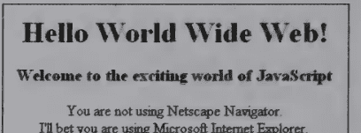

## 分析你刚刚输入的代码

尽管我们没有在 JavaScript 程序中添加大量代码，但我们确实引入了几个重要的概念。让我们花点时间回顾这些概念，以确保你对正在发生的事情有扎实的理解。

首先，这段 JavaScript 代码段中正在评估的条件是：

```javascript
(navigator.appName == "Netscape")
```

我们之前在本章中提到过，JavaScript 对象包含特殊的函数，称为方法（methods），用于执行各种任务。嗯，碰巧 JavaScript 对象也包含属性（properties），程序员可以访问这些属性来获取有关对象的信息。在这种情况下，我们利用 `navigator` 对象的 `appName` 属性来确定当前 Web 浏览器的应用程序名称。（请注意，在这个上下文中，单词 `navigator` 和单词 `browser` 可以互换使用。）如果这个名称是 Netscape，那么我们就知道用户正在运行 Netscape Navigator。否则，我们就知道用户没有运行 Netscape Navigator，因此他或她可能正在运行微软的 Internet Explorer（尽管也有可能是其他浏览器，但概率很小）。

这里需要学习的第二个重要概念是，一旦条件被评估，要么 `if` 语句块将被执行，要么 `else` 块将被执行——永远不会两者都执行。如果条件结果为真，将运行 `if` 块。如果条件为假，将运行 `else` 块。就这么简单。

在这个例子中，你需要认识到最后一点。到目前为止，我们一再提到在 HTML 文档中嵌入 JavaScript 源代码的概念。嗯，事实证明，在 JavaScript 文本字符串中嵌入 HTML 标签也是可能的，更不用说很有用了！仔细看看 `else` 语句块中对 `document.write()` 的第一次调用。注意 HTML `<BR>` 标签嵌入在输出文本字符串中。这个标签存在的原因是，我们希望第二段文本出现在单独的行上，而不是与第一段文本在同一行。为了实现这一点，我们必须在输出文本流中放置一个 `<BR>` 标签，这样浏览器才能识别 BREAK 命令。你跟上了吗？

## 使用 JavaScript 的 `alert()` 方法

在前面的三个活动中，我们使用了 `document.write()` 方法，这可能是 JavaScript 程序与用户通信最常用的方式。然而，脚本还有其他方式可以引起用户的注意。其中之一就是通过 JavaScript 的 `alert()` 方法。

`alert()` 方法的目的是允许程序显示一个特殊的对话框，提醒用户发生了预期事件或需要某种用户输入。与 `write()` 方法和 `appName` 属性一样，`alert()` 方法是 `window` 对象的一部分。JavaScript 解释器将 `window` 对象视为默认对象。脚本中出现的任何没有显式引用对象的方法或属性，都自动假定是 `window` 对象的一部分。因此，在调用 `alert()` 方法时，无需包含对象名称和句点（`.`）字符。让我们来试试 `alert()` 方法，好吗？

## 分步指南 5.4

1. 打开记事本、SimpleText 或你最喜欢的文本编辑器（如果尚未打开）。
2. 调出你在**分步指南 5.3**中创建的 `js-three.html` 或 `js-three.htm` 文件。

## 分步指南 5.4 续

3. 通过添加图 5-7 中加粗所示的文本，修改 HTML/JavaScript 文档。

### 图 5-7

包含对 `alert()` 方法调用的 HTML/JavaScript 源代码

```html
<HTML>
<HEAD>
<TITLE>HTML and JavaScript</TITLE>
</HEAD>
<BODY>
<CENTER>
<H1>
<SCRIPT>
document.write("Hello World Wide Web!");
</SCRIPT>
</H1>
<H3>
<SCRIPT>
document.write("Welcome to the exciting world of JavaScript");
</SCRIPT>
</H3>
<SCRIPT>
if (navigator.appName == "Netscape")
{
document.write("You are using Netscape Navigator");
alert("Netscape Navigator detected.");
}
else
{
document.write("You are not using Netscape Navigator.<BR>");
document.write("I'll bet you are using Microsoft Internet Explorer.");
alert("Netscape Navigator required.");
}
</SCRIPT>
</CENTER>
</BODY>
</HTML>
```

4. 将新创建的文件保存为 `js-four.html` 或 `js-four.htm`。

## 分步指南 5.4（续）

5. 打开你的网页浏览器，查看刚刚保存的 `js-four.html` 或 `js-four.htm` 文档。你应该会看到类似图 5-8A 或图 5-8B 的内容。继续下一节，或者如果今天的任务已完成，请关闭你的电脑。

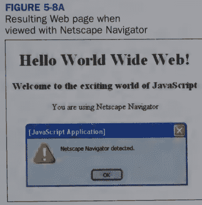

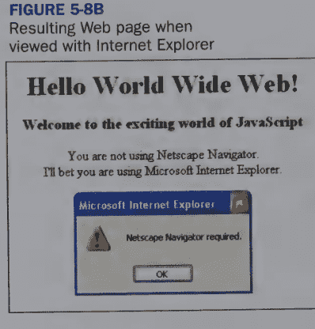

## 分析你刚刚输入的代码

希望这个活动能帮助你看到 `alert()` 方法在某些情况下可能很有用。它通常在 JavaScript 程序中用于让用户知晓发生了某些意外的错误情况。它也可以在程序需要用户某种确认才能继续执行时使用。在这两种情况下，`alert()` 方法都是 JavaScript 软件生成输出的另一种方式。

## 访问浏览器状态栏

你可能已经注意到，当你的网页浏览器加载包含许多对象的 HTML 文档时，它会在窗口底部显示各种消息。屏幕的这个区域被称为状态栏，并且可以从 JavaScript 程序内部访问。除了 `document.write()` 方法和 `alert()` 方法，这是 JavaScript 网页向用户传达信息的另一种方式。

你现在应该问自己的问题是：“我如何访问浏览器状态栏？”答案再次非常简单。在状态栏中显示的消息不过是存储在 `window` 对象 `status` 属性中的一个字符串值。这意味着你可以在 JavaScript 程序中随时通过包含如下语句来更改消息：

```javascript
window.status = "一串文本";
```

既然你已经明白了这有多么容易，让我们为你在上一个活动中编写的 JavaScript 程序添加两行新代码。这段代码将简单地强化由 `alert()` 方法显示的消息。

## 分步指南 5.5

1. 打开记事本、SimpleText 或你最喜欢的文本编辑器（如果尚未打开）。
2. 找到你在分步指南 5.4 中创建的 `js-four.html` 或 `js-four.htm` 文件。

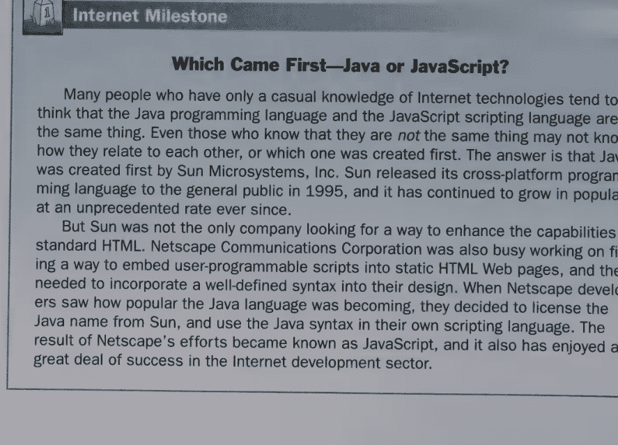

## 谁是先行者——Java 还是 JavaScript？

许多对互联网技术一知半解的人倾向于认为 Java 编程语言和 JavaScript 脚本语言是同一回事。即使那些知道它们不是同一回事的人，也可能不知道它们之间的关系，或者哪个是先被创造出来的。答案是 Java 由 Sun Microsystems, Inc.（太阳微系统公司）首先创建。Sun 于 1995 年将其跨平台编程语言发布给公众，自那以后，它以前所未有的速度持续增长，人气不断攀升。

但 Sun 并不是唯一一家寻求增强标准 HTML 功能的公司。Netscape Communications Corporation（网景通信公司）也忙于寻找将用户可编程脚本嵌入静态 HTML 网页的方法，他们需要在其设计中融入一套定义明确的语法。当网景的开发者看到 Java 语言变得如此受欢迎时，他们决定从 Sun 授权使用 Java 的名称，并在其自己的脚本语言中使用 Java 语法。网景努力的成果被称为 JavaScript，它在互联网开发领域也获得了巨大的成功。

## 分步指南 5.5（续）

3. 通过添加图 5-9 所示的粗体文本，修改 HTML/JavaScript 文档。

### 图 5-9

设置浏览器状态栏的 HTML/JavaScript 源代码


```html
<HTML>
<HEAD>
<TITLE>HTML and JavaScript</TITLE>
</HEAD>
<BODY>
<CENTER>
<H1>
<SCRIPT>
    document.write("Hello World Wide Web!");
</SCRIPT>
</H1>
<H3>
<SCRIPT>
    document.write("Welcome to the exciting world of JavaScript");
</SCRIPT>
</H3>
<SCRIPT>
if (navigator.appName == "Netscape")
{
    document.write("You are using Netscape Navigator");
    window.status = "Netscape Navigator detected.";
    alert("Netscape Navigator detected");
}
else
{
    document.write("You are not using Netscape Navigator.<BR>");
    document.write("I'll bet you are using Microsoft Internet Explorer.");
    window.status = "Netscape Navigator required.";
    alert("Netscape Navigator required");
}
</SCRIPT>
</CENTER>
</BODY>
</HTML>
```

4. 将新创建的文件保存为`js-five.html`或`js-five.htm`。

5. 打开你的网页浏览器，查看你刚刚保存的`js-five.html`或`js-five.htm`文档。你应该会看到类似图5-10A或图5-10B的内容。（警告：某些版本的 Internet Explorer 可能会在状态栏消息之前显示警告框。）关闭你的电脑。

## 图5-10A

使用 Netscape Navigator 查看时生成的网页

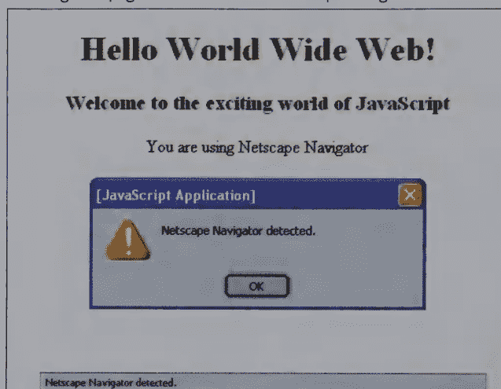

## 图5-10B

使用 Internet Explorer 查看时生成的网页

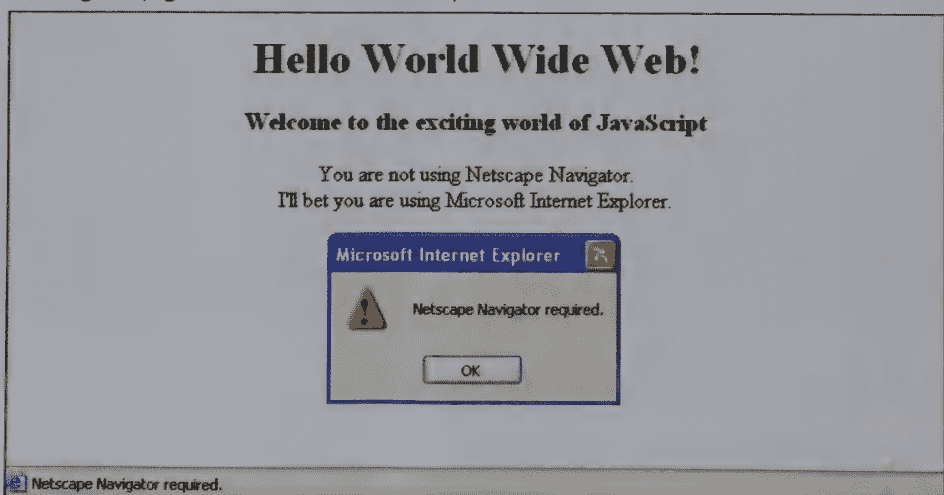

## 分析你刚刚输入的代码

正如我们本课前面提到的，JavaScript 与网络用户交互最常见的方式是通过`document.write()`方法。但浏览器状态栏也可以成为向用户传达信息的有效方式。在本例中，我们只是简单地使用状态栏来重复显示警告对话框中的消息。然而，更常见的情况是看到 JavaScript 程序使用状态栏来让用户知道它正在做什么。每当你的脚本即将启动一个可能耗时较长的过程时，例如下载一个大型图形文件，在状态栏中显示一条适当的消息是一个好主意。这对于确保用户知道她的计算机系统没有崩溃大有帮助。

## 总结

在本课中，你学到了：

- 你可以解释 JavaScript 的用途。
- 如何使用`<SCRIPT>`和`</SCRIPT>`标签。
- 你可以使用 JavaScript 对象。
- 你可以使用 JavaScript 方法。
- 你可以理解并应用 JavaScript 语法。

## Hello, World!

下次你去当地书店时，花几分钟时间浏览几本不同的编程书的前几章。在很多情况下，你会看到这些书中介绍的第一个编程示例是如何在特定语言中显示短语 Hello, World! 的。你认为作者以这种方式开始他们的书为什么如此普遍？嗯，答案很简单。

1978 年，贝尔实验室的两名员工 Brian Kernighan 和 Dennis Ritchie 出版了一本名为《C 程序设计语言》的书。这本书已证明自己是计算机软件史上最持久的编程教程之一。在过去的二十年里，这本书只修订过一次，第二版至今仍在印刷！本书中的第一个编程练习解释了如何使用名为`printf()`的 C 函数来显示短语 Hello, World。虽然 Kernighan 和 Ritchie 不太可能打算在编程书籍作者之间开创一个非正式的传统，但他们确实做到了！尽管我们稍作修改（改为 Hello World Wide Web!），但它仍然基于这个二十五年前的简单示例。

## 词汇复习

定义以下术语：

| `<SCRIPT>` 和 `</SCRIPT>` 标签 | 关键字 | 属性 |
| :--- | :--- | :--- |
| 二进制代码 | 方法 | 脚本语言 |
| 编译器 | 对象 | 状态栏 |
| 条件 | 运算符 | 语法 |
| 解释 | 参数列表 | 词法单元 |
|  | 编程语言 |  |

# 复习题

## 判断正误

如果陈述正确，请圈出 T；如果错误，请圈出 F。

1. JavaScript 是一种编程语言。
2. JavaScript 需要一个编译器。
3. 你在 HTML 文档中的`<SCRIPT>`和`</SCRIPT>`标签之间插入 JavaScript。
4. 方法名后面总是跟着一个参数列表。
5. 在 JavaScript 语句中，分号（`;`）并非总是必需的。

## 填空

在提供的空白处填写正确的单词或短语，完成以下句子。

1. 符号`{`和`}`被称为 ________ 花括号。
2. JavaScript 的`if`语句支持一个可选的`else`子句，该子句定义在指定条件不为真时采取的操作。
3. JavaScript 条件总是由两个 ________ 通过关系运算符分隔组成。
4. ________ Communications Corporation 于 1995 年将 JavaScript 介绍给世界。
5. `alert()`方法允许程序显示一个特殊的对话框，该对话框将警告用户发生了意外事件，或需要某种用户输入。

## 书面问题

请简要回答以下问题。

1. JavaScript 如何增强 HTML 的功能？
2. 什么是 JavaScript 对象？什么是对象方法和对象属性？
3. 最常用于生成输出的 JavaScript 方法是什么？
4. JavaScript 中条件语句的语法是什么？
5. `alert()`方法和`write()`方法有何不同？

## 项目

### 项目 5-1

GreatApplications 公司正在寻找精通 HTML 编程并熟悉 JavaScript 的优秀互联网程序员。为了测试潜在员工的知识水平，GreatApplications 正在进行一系列 HTML/JavaScript 测试。以下是测试的第一道题：

如你所知，步骤 5.1（`js-one.htm`或`js-one.html`）中使用的短语 "Hello World Wide Web!" 并无特别之处。请将此短语替换为 "Welcome to GreatApplications"。更改`write()`方法中的消息。请记住，您要显示的字符串必须用双引号（`"`）括起来。将修改后的文件保存为`js-test1.html`。

### 团队项目

团队合作是 GreatApplications 公司在员工身上始终看重的品质之一。GreatApplications 公司的职位候选人将被分成两到三人的小组。要求每个小组共同解决以下问题。评估潜在员工时，不仅看答案是否正确，还要看团队成员如何进行沟通，并以和谐、创造性的方式协作解决问题。在小组面试中，你所在的团队将接到以下两个项目。

**问题 1：** 显然，`<BR>`并非唯一可以嵌入 JavaScript 输出字符串的 HTML 格式化标签。你可以在`document.write()`语句中使用任何你想要的格式化标签。现在请发挥一下创造力，看看在这个练习的 JavaScript 代码中还能放入哪些其他标签。它们对最终生成的网页有什么影响（如果有的话）？将 HTML 标签放在`<SCRIPT></SCRIPT>`标签之外更好，还是嵌入到 JavaScript 文本字符串中更好？是否有需要同时使用两者的时候？请思考一下！将此文件保存为`js-test2.htm`或`js-test2.html`。

**问题 2：** 你应该已经明白，你可以将任何 HTML 标签与 JavaScript 一起使用，而不仅仅是标题和居中标签。尝试将前四课中描述的一些其他 HTML 标签插入到这个第五课的团队项目中，看看它们会产生什么效果。具体来说，尝试使用影响网页前景色和背景色的标签。例如，看看能否让你的 JavaScript 网页显示为蓝色背景上的黄色文字。或者尝试让`<H1>`文本的颜色与`<H3>`文本的颜色不同。将此文件保存为`js-test3.htm`或`js-test3.html`。

## 网络项目

在步骤 5.3 中，你创建了一个 JavaScript 程序来识别你的浏览器是否是 Netscape Navigator。GreatApplications 公司刚刚分配给你一项任务，需要修改这个程序，使其面向 Microsoft Internet Explorer（IE），而不是 Netscape 的 Navigator。这意味着你需要更改`js-four.htm`或`js-four.html`文件中的 JavaScript 条件语句，以及`if`和`else`语句块内的文本字符串措辞。

完成修改后，如果你有两种浏览器，都请用它们查看新文件，以确保其运行正确。每个浏览器都可以从各自的制造商网站上免费下载并安装到你的计算机上。将你的文件保存为`js-test4.htm`或`js-test4.html`。

## 批判性思维

### 活动 5-1

在步骤 5.3 的介绍中，我们提到条件语句是 JavaScript 最强大的功能之一。这个说法只是重复了伟大的计算机科学家 Joseph Weizenbaum 在 20 多年前发表的观点。1976 年，Weizenbaum 先生写了一本名为《Computer Power and Human Reason》的书，他在书中提出了计算机系统的真正力量在于其决策能力的观点。思考一下这个观点，然后回答以下问题：

1. 如果计算机不能做决策，它们会有多大用处？
2. 描述 JavaScript 决策语句的一般结构。
3. “评估条件”是什么意思？
4. 为什么你认为`if-else`语句的`else`子句是可选的？

### 活动 5-2

尝试解决以下一个或两个思考活动：

**思考活动 5-2A：** 一些 JavaScript 程序员利用浏览器状态栏的一种方式是向用户显示指令。在这种情况下，当警报对话框出现时，显示一条告诉用户该做什么的消息可能是有意义的。也就是说，状态栏可以包含一条消息，告诉用户单击“确定”按钮以继续处理脚本。为什么不直接进行此更改？尝试在不使用大量文字的情况下，使消息尽可能信息丰富。将你的文件保存为`js-test5.htm`或`js-test5.html`。（如果你使用的 Internet Explorer 版本在清除警报框之前不显示状态栏，你可能需要使用不同的方法。）

**思考活动 5-2B：** 在这个活动中，我们演示了如何定义一个条件语句来评估`navigator.appName`属性的内容，以确定它是否包含值 "Netscape"。但如果`appName`属性不包含值 Netscape，它包含什么值？你怎么才能知道？嗯，想一下`document.write()`方法。它能否用于显示除字面字符串（双引号内的）以外的内容？当然可以。它也可以用来显示 JavaScript 变量或对象属性的内容。现在你能写一条显示`appName`值的 JavaScript 语句吗？当然可以。将你的文件保存为`js-test6.htm`或`js-test6.html`。

## 总结项目

通过重新审视之前的活动，将你新获得的 JavaScript 知识付诸实践。找到你在第一课步骤 1.2 中创建并保存为`one.html`（在步骤 1.3 中）的 HTML 文件。用 JavaScript 代码替换此文件中的所有句子。更具体地说，使用`document.write()`方法将这五句话输出到你的网页。你完成的网页应看起来像图 5-11。

## 图 5-11

用 JavaScript 生成的一个简单网页

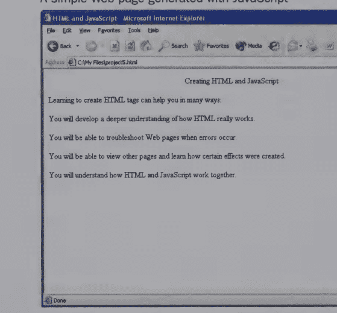

## 项目要求

- 使用你在第一课步骤 1.2 中创建的 HTML 代码。
- 用 JavaScript`document.write()`语句替换文本（句子）。
- 将你的新文件保存为`project5.html`或`project5.htm`。
- 在 Web 浏览器中查看你的新文件，以确保其外观正确。
- 使用浏览器的“查看源文件”命令查看页面源代码。将你看到的内容与你在文件`one.html`中创建的页面源代码进行比较。

# 在 JavaScript 中使用图像

## 目标

完成本课后，你应该能够：

- 理解 JavaScript 事件的名称和用法。
- 创建图像翻转效果。
- 创建超链接翻转效果。
- 构建循环横幅广告。
- 显示随机图像。
- 创建 JavaScript 幻灯片放映。

**预计时间：**1.5 小时

### 词汇表

- 数组（Array）
- 循环横幅广告（Cycling banner）
- 递减（Decrement）
- 事件（Event）
- 函数（Function）
- 超链接翻转（Hyperlink rollover）
- 图像翻转（Image rollover）
- 递增（Increment）
- 索引（Index）
- 实例化（Instantiate）
- 实数（浮点数）（Real number）
- 幻灯片放映（Slide show）
- 变量（Variable）

## 让图像动起来

在第 3 课中，我们提到了有效使用图像对于网页整体成功的重要性。嗯，无论网页是基于 HTML 还是 JavaScript 技术，这个原则都成立。标准 HTML 让你能够对图像做一些有趣的事情，而 JavaScript 则为你提供了一些额外的功能。

在本课中，我们将重点介绍常用于让图像在网页上动起来的 JavaScript 功能。一旦你学会了这些新技术，你很快就会在整个万维网上认识到它们的用法。到那时，你将不再需要想知道这些有趣页面的设计师是如何创造出如此引人注目的效果的。

在使用图像完成任何精彩效果之前，你需要理解 JavaScript 事件。在本书中，你可以将*事件*视为系统对某个特定条件发生的响应。其中一些条件是由 Web 浏览器软件本身生成的，但大多数是由用户执行某些操作引起的。这些操作可能包括移动鼠标、单击按钮，甚至是在屏幕上选择一段文本。但无论特定事件是如何产生的，JavaScript 都赋予你创建能够对其做出反应的网页的能力。当这些反应被巧妙地实现时，用户一定会对你的网页印象深刻。

处理图像时需要掌握的另一个重要概念是 JavaScript 函数的概念。*函数*不过是一段 JavaScript 代码，可以像第 5 课中使用的`document.write()`和`alert()`方法一样被调用。事实上，

## 第二单元 JavaScript 的精彩世界

方法和函数之间实际上没有区别，只是方法已经被定义为 JavaScript 编程环境的一部分。而另一方面，函数是由程序员编写的，可以包含任意数量的 JavaScript 语句，包括对 JavaScript 方法或其他函数的调用。

你此时可能还不清楚 JavaScript 事件和函数与网页中图形图像的使用有何关联。但请保持耐心，你很快就会看到它们之间的联系。事实上，这正是本课活动的目的。我们将把事件和函数与图像结合使用，创建一些有趣的效果，从而极大地提升你的网页质量。那么，如果你准备好了，让我们开始吧！

## 教导图像实现鼠标悬停效果

在第三课中，你学习了如何在网页中包含图形图像，还学会了如何将图像转换为超链接。现在我们将向你展示如何利用 JavaScript 的强大功能，使图形超链接能够响应鼠标移动。

更具体地说，我们将向你展示如何在用户将鼠标指针移动到图像上时改变图像的外观。这种 JavaScript 编程技术称为*图像悬停效果*。

要实现悬停效果，你首先需要了解如何使用名为`onMouseOver`和`onMouseOut`的 JavaScript 事件。每当用户将鼠标移动到特定对象上时，就会触发`onMouseOver`事件。同样，当用户将鼠标指针移开该对象时，会触发`onMouseOut`事件。你只需学习如何使用 JavaScript 来检测这些事件的发生，然后采取相应的操作。在分步练习 6.1 中，我们将在屏幕上显示一个蓝色箭头，然后当鼠标指针悬停在其上时将箭头变为红色。接着，当鼠标指针移开图像时，我们会将箭头颜色恢复为蓝色。听起来很简单，对吧？

## 分步练习 6.1

1. 在你的网络浏览器中输入网址`www.course.com`。
2. 点击搜索框，输入本书的标题（《HTML 与 JavaScript 基础》）。
3. 点击**搜索**并等待搜索结果出现。然后从结果列表中找到正确的书名并点击它。
4. 选择名为**学生在线伴侣**的链接。
5. 点击**第 6 课**链接，然后从出现的列表中选择**数据文件和图形**链接。
6. 将`bluearrow.gif`和`redarrow.gif`文件（见图 6-2A 和图 6-2B）下载到你保存网页的同一文件夹中。如果需要复习如何下载这些文件，请返回分步练习 3.2 获取帮助。

## 分步练习 6.1 续

7. 打开你的文本编辑器或文字处理软件，并完全按照图 6-1 所示输入 HTML/JavaScript 代码。

### 图 6-1

创建图像悬停效果的 JavaScript 代码


```html
<HTML>
<HEAD>
<TITLE>HTML and JavaScript</TITLE>
<SCRIPT>
var blueArrow = new Image;
blueArrow.src = "bluearrow.gif";
var redArrow = new Image;
redArrow.src = "redarrow.gif";

function turnBlue()
{
    document.arrow.src = blueArrow.src;
    return;
}

function turnRed()
{
    document.arrow.src = redArrow.src;
    return;
}
</SCRIPT>
</HEAD>
<BODY>
<CENTER>
<A HREF="webpage.html" onMouseOut="turnBlue()" onMouseOver="turnRed()">

</A>
</CENTER>
</BODY>
</HTML>
```

8. 将此文件保存在适当的文件夹中，命名为`js-six.html`。

9. 如果尚未打开，请打开你的网络浏览器。

10. 查看你的`js-six.html`页面。你的网页最初应类似于图6-2A，但当你将鼠标指针移动到箭头图像上时，其外观应变为图6-2B的样子。

11. 继续下一节内容，或者如果你今天的学习到此结束，请关闭计算机。

> **重要提示**
>
> 如果你是安装了Service Pack 2的Windows XP用户，你的浏览器可能会显示关于阻止活动内容的警告消息。如果发生这种情况，点击该警告并按照后续提示启用JavaScript。

## 分析你刚刚输入的代码

尽管图6-1中的HTML/JavaScript源代码不是很长，但它确实引入了几个你以前未曾见过的新特性。让我们花点时间确保你理解所有这些概念，因为你在整个课程中都会看到它们。

首先，你应该注意到`<SCRIPT>`和`</SCRIPT>`标签出现在HTML文档的头部部分，而不是主体部分。这意味着网络浏览器将在开始在屏幕上显示文档内容之前处理JavaScript代码。对于这份特定文档来说，这一点很重要，因为我们希望浏览器在显示网页主体之前，将蓝色和红色箭头图像都加载到内存中。如果我们没有这样做，浏览器就不知道当`onMouseOver`和`onMouseOut`事件发生时应该加载哪些图像，结果将是JavaScript错误信息。

接下来，你需要理解JavaScript代码（图6-1中的第5到8行）实际做了什么。第5行的语句（`var blueArrow = new Image;`）告诉JavaScript解释器创建一个新的`Image`对象，然后将该对象的引用保存到一个我们称之为`blueArrow`的变量中。请记住，JavaScript变量无非是被赋予字面值或对象的一个名称。一旦完成了这个赋值，就可以在整个HTML文档中使用这个名称来引用该特定的值或对象。

第6行的语句（`blueArrow.src = "bluearrow.gif";`）告诉JavaScript，`blueArrow`对象的源（`src`）属性将包含存储在文件`bluearrow.gif`中的图形图像。正是这条语句使得浏览器将蓝色箭头图像加载到内存中。一旦此任务完成，接下来的两条JavaScript语句执行的功能与前两条语句基本相同。

第7行的语句（`var redArrow = new Image;`）导致解释器创建一个新的`Image`对象，并将其命名为`redArrow`。第8行的语句（`redArrow.src = "redarrow.gif";`）将该对象的`src`属性设置为文件`redarrow.gif`中包含的图像，因此浏览器也会将此图像加载到内存中。你明白了吗？

## 事件处理逻辑

我们需要讨论的下一个概念是JavaScript事件处理逻辑。这是JavaScript的一个重要特性，因为它展示了JavaScript代码与标准HTML标签交互的另一种方式。

到目前为止，你使用过的所有JavaScript语句都位于`<SCRIPT>`和`</SCRIPT>`标签之间，对吧？JavaScript事件处理语句实际上被放置在一个标准的HTML标签内。在这个例子中，处理`onMouseOver`和`onMouseOut`事件的语句位于开始锚点（`<A>`）标签内。当`onMouseOver`事件发生时，会调用名为`turnRed()`的JavaScript函数，该函数将文档对象中的箭头对象的源（`src`）属性设置为`redArrow`对象的`src`属性。

同样，当`onMouseOut`事件发生时，会调用`turnBlue()`函数；此函数将文档的箭头对象的`src`属性设置为`blueArrow.src`属性的值。

因此，当鼠标指针悬停在箭头图像上时，`onMouseOver`事件触发（发生），图像源被赋值为`redarrow.gif`文件的内容。

以类似的方式，将鼠标指针移开箭头图像会导致`onMouseOut`事件触发，图像源被赋值为`bluearrow.gif`文件的内容。这讲得通吗？

我们想讨论的最后一点是关于`document.arrow`对象的来源。当我们使用名称`arrow`时，浏览器如何知道我们指的是哪个对象？幸运的是，答案非常简单。如果你仔细观察我们用来定义原始图像的``标签，你会看到我们包含了一个你以前没有使用过的新属性。

## 客户端/服务器应用程序工程师

无论你在美国企业界的哪个地方，都会发现对能够创建快速、可靠的客户端/服务器应用程序的软件开发人员有着很高的需求。客户端/服务器应用程序背后的主要思想是一个进程（或程序）将在中心位置运行，然后许多位于不同位置的客户端进程将向服务器进程发出请求并等待响应。

二十年前，这种类型的分布式系统只在大型公司、银行或航空公司预订机构中才能找到，因为它难以安装且维护成本高昂。如今，客户端/服务器架构对于小企业、政府机构甚至学区来说都已触手可及。然而不幸的是，拥有创建客户端/服务器软件系统的手段并不意味着很容易找到能够真正创建并编写此类系统正常运行所需程序的人。这就是为什么今天掌握扎实的JavaScript知识可能对你未来非常重要。JavaScript经常用于客户端/服务器应用程序的客户端，所以你可以肯定有很多公司正等着雇佣你。不要错过这个绝佳的机会！

这个属性被称为NAME，其目的是让你为图像对象分配一个变量名。在这个例子中，我们给图像对象起名为`arrow`，并且由于这个图像是我们HTML文档的一部分，它可以在JavaScript代码中通过`document.arrow`来引用。这开始变得有趣了，不是吗？

## 教授超链接实现翻转效果

既然你已经知道如何让图像实现翻转效果，现在让我们来学习如何创建超链接的翻转效果。正如你可能预料到的，超链接翻转效果与图像翻转效果非常相似。唯一的区别是，**超链接翻转**是在用户将鼠标移到超链接上时触发的，而不是在鼠标移到图像上时触发。这很合理，对吧？

如果你预期用于实现超链接翻转的JavaScript代码与图像翻转的代码相似，那么你不会失望。事实上，如果我们不告诉你需要做哪些改动，你可能需要仔细查看新的源代码两遍才能确定差异所在。准备好尝试一下了吗？我们开始吧。

### 分步指南 6.2

1. 打开你的文本编辑器或文字处理器，调出你在上一个分步指南中创建的`js-six.html`文件。

## 使用JavaScript事件

本课中的所有活动都使用了一个或多个JavaScript事件。然而，还有几个JavaScript事件在本课中没有讨论。但这并不意味着你不能进行一些独立学习，自己了解如何使用它们。以下是一份可用JavaScript事件的按字母顺序排列的列表，以及触发该事件的简要条件描述。

| 事件名称 | 事件触发条件 |
| --- | --- |
| `onAbort` | 用户中止了网页的加载。 |
| `onBlur` | 用户使一个对象失去焦点（对象失去焦点）。 |
| `onChange` | 用户以某种方式更改了对象。 |
| `onClick` | 用户用鼠标点击了一个对象。 |
| `onError` | JavaScript解释器遇到了脚本错误。 |
| `onFocus` | 用户激活了一个对象（对象获得焦点）。 |
| `onLoad` | Web浏览器完成了页面的加载。 |
| `onMouseOver` | 鼠标指针经过了一个对象。 |
| `onMouseOut` | 鼠标指针移出了一个对象。 |
| `onSelect` | 用户选中（高亮显示）了对象的内容。 |
| `onSubmit` | 用户提交了一个HTML表单。 |
| `onUnload` | Web浏览器将一个页面从内存中卸载。 |

### 分步指南 6.2 续

2. 接下来，按照图6-3中加粗显示的内容，在HTML和JavaScript源代码中输入更改。你需要删除一些JavaScript代码和一些HTML标签，以使你的新文件看起来与图6-3完全一致。

### 图 6-3

创建超链接翻转效果的JavaScript代码

```html
<HTML>
<HEAD>
<TITLE>HTML and JavaScript</TITLE>
<SCRIPT>
var blueArrow = new Image;
blueArrow.src = "bluearrow.gif";
var redArrow = new Image;
redArrow.src = "redarrow.gif";

function turnBlue()
{
	document.arrow.src = blueArrow.src;
	return;
}

function turnRed()
{
	document.arrow.src = redArrow.src;
	return;
}
</SCRIPT>
</HEAD>
<BODY>
<CENTER>
<A HREF="webpage.html" onMouseOut="turnBlue()" onMouseOver="turnRed()">
Next Page
</A>
<P>

</CENTER>
</BODY>
</HTML>
```

3. 将此文件以`js-seven.html`为名保存到相应的文件夹中。

4. 如果你的Web浏览器尚未打开，请打开它。

152 单元 2 JavaScript的精彩世界

### 分步指南 6.2 续

5. 查看你的`js-seven.html`页面。你的网页初始时应如图6-4A所示，但当你将鼠标指针移到“下一页”超链接上时，其外观应变为如图6-4B所示。请继续下一节内容，或者如果今天的任务已完成，请关闭你的计算机。


## 分析你刚刚输入的代码

如果你是一个敏锐的观察者，你会注意到这个HTML文档（`js-seven.html`）中的JavaScript语句与上一个文档（`js-six.html`）中的完全相同。因此，让我们确保你对HTML标签中所做的更改，以及这些更改与JavaScript代码之间的关系有一个扎实的理解。

> **网络提示**
>
> 当你有空闲时间时，花一个小时在网上搜索那些包含有趣图像或超文本翻转效果的网站。列出你最喜欢的网站，并尝试自己实现同样类型的翻转效果。

首先，`<A>`和`</A>`锚标签不再包含``标签，因此箭头图像不再是超链接引用的一部分。相反，锚标签现在包含了你刚刚添加的“下一页”文本。这意味着`onMouseOver`和`onMouseOut`事件将在鼠标移到新的超链接上时触发，而不是在鼠标移到箭头图像上时触发。然而，JavaScript代码执行的操作与之前相同，因此图像会像之前一样改变颜色。

你可能想知道为什么我们在超文本和箭头图像之间插入了段落标签。我们这样做是因为段落标签会将图像强制推到“下一页”超链接的下方。否则，图像将显示在超文本的右侧。（如果你想看看我们是什么意思，可以随意移除`<P>`标签并重新查看文件。）

你可能还想知道为什么在上一个分步指南中，箭头图像被一个蓝色矩形框包围，而这一次却没有。这个问题的答案是，在分步指南6.1中，图像被定义为一个超链接，而超链接图像通常由Web浏览器以蓝色边框显示。这就是为什么当箭头图像从蓝色变为红色时，蓝色边框仍然可见。但在分步指南6.2中，图像没有被定义为超链接，所以蓝色边框消失了。相反，“下一页”文本被定义为超链接，因此无论箭头图像的颜色如何，它都会以蓝色和下划线显示。明白了吗？（如果你想了解如何在分步指南6.1中消除蓝色矩形，请完成本课末尾的Web项目。）

## 创建循环横幅

当你在网上冲浪时，遇到包含不断变化的广告的商业网站可能相当常见。事实证明，这些循环横幅（也称为广告横幅）可以使用不同的互联网技术以多种方式创建。然而，创建这类广告最简单、最有效的方法之一是使用JavaScript事件和函数。

*循环横幅*实际上就是一系列图形图像，这些图像在每次切换之间会有短暂的停顿，依次显示。在序列中的所有图像都显示完毕后，浏览器将循环回到第一张图像并重新开始该序列。这就是为什么这种特定的网页增强功能被称为循环横幅的原因。

你可能认为创建一个循环横幅需要大量的时间和精力，但使用JavaScript却并非如此！在下一节中，我们将向你展示，只需几分钟就能将一个有效的广告展示集成到你的网页中。通过利用单个JavaScript事件，并定义一个简单的JavaScript函数，你将在循环横幅设计的世界中迈向名声与财富。你准备好迎接挑战了吗？

### 分步指南 6.3

1. 在这个活动中，你需要四个图形，你可以从学生指南中下载。在你的Web浏览器中输入网址`www.course.com`。

2. 点击搜索框并输入本书的标题（*HTML and JavaScript BASICS*）。

3. 点击**搜索**并等待搜索结果出现。然后从结果列表中找到正确的书名并点击它。

4. 选择名为**Student Online Companion**的链接。

5. 点击**Lesson 6**链接，并从出现的列表中选择**Data Files & Graphics**链接。

6. 将`lions.gif`、`tigers.gif`、`bears.gif`和`ohmy.gif`（见图6-6A、6-6B、6-6C和6-6D）图像下载到你一直保存网页的同一文件夹中。如果不小心将文件下载到不同的文件夹，你的网页将无法正常运行。（如果你需要复习如何下载这些文件，请返回到第3课的分步指南3.2寻求帮助。）

## 逐步操作 6.3 续

1. 打开你的文本编辑器或文字处理软件，完全按照图6-5所示输入HTML/JavaScript代码。

**图 6-5** 用于创建循环横幅的JavaScript代码

```html
<HTML>
<HEAD>
<TITLE>HTML and JavaScript</TITLE>
<SCRIPT>
var imgArray = new Array(4);
imgArray[0] = new Image;
imgArray[0].src = "lions.gif";
imgArray[1] = new Image;
imgArray[1].src = "tigers.gif";
imgArray[2] = new Image;
imgArray[2].src = "bears.gif";
imgArray[3] = new Image;
imgArray[3].src = "ohmy.gif";
var index = 0;

function cycle()
{
    document.banner.src = imgArray[index].src;
    index++;
    if (index == 4)
    {
        index = 0;
    }
    setTimeout("cycle()", 2000);
    return;
}
</SCRIPT>
</HEAD>
<BODY onLoad="cycle()">
<CENTER>

</CENTER>
</BODY>
</HTML>
```

2. 将此文件保存在适当的文件夹中，命名为`js-eight.html`。

3. 打开你的Web浏览器并查看你的`js-eight.html`页面。你的网页最初应看起来像图6-6A，但两秒延迟后，它应变为图6-6B的样子。再过两秒延迟后，它应变为图6-6C的样子，最后变为图6-6D的样子。如果完成今天的学习，请继续下一节内容或关闭你的计算机。

**图 6-6A**

你的循环横幅中的第一张图片

**图 6-6B**

你的循环横幅中的第二张图片


**图 6-6C**

你的循环横幅中的第三张图片

**图 6-6D**

你的循环横幅中的第四张图片


## 分析你刚刚输入的代码

我们再次在相对少量的源代码中引入了几个重要的JavaScript概念。让我们仔细查看图6-5中的源代码清单，确保你完全理解这里发生了什么。

> **网络提示**
>
> 当一个图形被定义为超链接时，浏览器将在其周围显示一个矩形边框。如果这个边框影响了页面的外观，请使用`BORDER`属性调整超链接边框的大小。在``标签中使用`BORDER = 0`的语句将移除该边框。


首先，看看第 5 行（`var imgArray = new Array(4);`）。这里我们正在创建一个新的 JavaScript 对象，你以前没有用过，称为数组。数组是一个相似对象的集合，可以通过变量名和索引来访问。索引是一个整数变量，用于标识正在引用数组的哪个元素。

数组在几乎每种现代计算机语言中都可用，因此熟悉它们很重要。在这种情况下，我们的数组被定义为最多包含四个元素，其变量名为`imgArray`。在这里，数组将包含四个 Image 对象，但数组也可以包含任何其他类型的 JavaScript 对象。

其次，考虑第 6 到 13 行的 JavaScript 语句。这些语句对你来说应该有些熟悉，因为它们本质上与逐步操作 6.2 中第 5 到 8 行的语句相同。第 6 行创建一个新的 Image 对象，并将其赋值为名为`imgArray`的数组中索引为 0 的元素。第 7 行然后将这个新对象的源（`src`）属性设置为包含名为`lions.gif`的文件的内容。类似地，第 8、10 和 12 行的 JavaScript 语句也创建了新的 Image 类型对象，这些新对象被赋值为名为`imgArray`的数组中索引值分别为 1、2 和 3 的元素。

第 9、11 和 13 行的语句将这三个新对象的`src`属性分别设置为文件`tigers.gif`、`bears.gif`和`ohmy.gif`的内容。现在这四个图形图像可以通过其他 JavaScript 语句非常快速地显示出来，我们稍后将进行描述。

第三，第 14 行的语句（`var index = 0;`）只是创建一个名为`index`的 JavaScript 变量，并将其赋值为 0。此变量将用于访问`imgArray`数组中的各个元素。

第四，第 16 到 26 行的 JavaScript 语句定义了一个名为`cycle()`的函数，此函数将使循环横幅中的图像一个接一个地显示。这是通过将`document.banner`对象的`src`属性设置为`imgArray`数组当前元素的`src`属性来实现的。然后我们增加存储在`index`变量中的值（使用`++`运算符），以便访问图像数组的下一个元素。术语递增意味着将值加 1。由于此数组唯一有效的索引是 0 到 3，我们必须测试`index`的值，以查看它是否超过了可接受的范围。换句话说，如果`index`包含值 4，我们必须将其设置回 0，以便使横幅图像循环回到序列的开头。然后我们的最后任务是设置一个计时器，在 2000 毫秒过去后（2000 毫秒等于 2 秒）再次调用`cycle()`函数。到目前为止，你还跟得上吗？

最后，我们需要解释的是整个循环横幅过程是如何开始的。如果你仔细查看我们 HTML 文档的`<BODY>`标签（在源代码清单的第 29 行），你会看到我们插入了一个新的 JavaScript 事件。这个事件称为`onLoad`，它在 Web 浏览器完成加载 HTML 网页的主体时触发。在这个例子中，浏览器加载名为`lions.gif`的图像（通过`NAME`属性赋予变量名`banner`），然后触发`onLoad`事件，这反过来导致`cycle()`函数被调用。然后`cycle()`函数将根据 JavaScript 的`setTimeout()`方法被连续每 2 秒调用一次，该方法在同一函数内被调用。你现在都弄清楚了吗？在这个活动中你学到了很多东西！


## 用基于零的数组改进编程语言

数组是为了解决定义程序中元素的复杂问题而发明的。几乎每种编程语言都支持数组的概念，但它们并非都以相同的方式实现数组索引。例如，如果你在其他编程语言（如 Basic、Fortran 或 Pascal）中定义一个 10 元素的数组，你会使用索引值 1、2、3,... 10 来访问这 10 个元素。但其他一些语言（包括 C++、Java 和 JavaScript）不使用这种基于 1 的索引技术。相反，它们实现了一种基于零的技术，使得一个 10 元素数组的有效数组索引为 0、1、2,... 9。起初你可能认为基于 1 的方法更有意义，因为它对新手程序员来说更容易理解。然而，如果你查看不同语言编译器生成的底层机器代码，你会看到基于 1 的方法对计算机硬件来说效率较低。这就是专业程序员倾向于使用基于零的语言进行软件开发项目的原因之一。

## 显示随机图像

在前面的活动中，你学习了如何按特定顺序显示一系列图形图像。有时网页设计师希望他们的图像以随机顺序出现。当特定网站包含大量图形图像集合，并且网站所有者希望系统随机选择一张图像进行显示时，通常会使用这种方法。

起初，你可能认为按固定顺序显示图像比随机显示要容易得多。但当你在 JavaScript 中编程时，情况并非如此。实际上，显示随机图像比创建循环横幅所需的代码行数更少。这主要是由于 JavaScript 内置支持随机数生成的能力。

由于此活动的大部分源代码与前一个活动相同，你将能够使用先前的文件并进行一些更改。事实上，你需要做的只是用一个名为`select()`的类似函数替换`cycle()`函数。你甚至不需要担心将图形文件下载到正确的文件夹，因为我们将使用与前一个活动相同的图像。你准备好开始了吗？

## 逐步操作 6.4

1. 打开你的文本编辑器或文字处理软件，并检索你在上一个逐步操作中创建的`js-eight.html`文件。

## 单元 2：JavaScript 的精彩世界

## 分步操作 6.4 续

2. 接下来，修改 HTML 和 JavaScript 源代码。用`select()`函数替换`cycle()`函数，并修改`<BODY>`标签中的`onLoad`事件，如图 6-7 所示（以粗体标出）。

### 图 6-7

用于显示随机图像的 JavaScript 代码

```html
<HTML>
<HEAD>
<TITLE>HTML and JavaScript</TITLE>
<SCRIPT>
var imgArray = new Array(4);
imgArray[0] = new Image;
imgArray[0].src = "lions.gif";
imgArray[1] = new Image;
imgArray[1].src = "tigers.gif";
imgArray[2] = new Image;
imgArray[2].src = "bears.gif";
imgArray[3] = new Image;
imgArray[3].src = "ohmy.gif";
var index = 0;

function select()
{
    index = Math.floor(Math.random() * 4);
    document.banner.src = imgArray[index].src;
    setTimeout("select()", 2000);
    return;
}
</SCRIPT>
</HEAD>
<BODY onLoad="select()">
<CENTER>

</CENTER>
</BODY>
</HTML>
```

3. 将此文件以`js-nine.html`为名保存到合适的文件夹中。

4. 如果尚未打开，请打开你的 Web 浏览器。

5. 查看你的`js-nine.html`页面。你的网页最初应看起来像图 6-6A、6-6B、6-6C 或 6-6D，然后图像应每两秒变化一次。与之前的分步操作不同，图像不会以可预测的顺序出现。继续到下一节，或者如果当天操作已完成，则关闭你的计算机。

## 分析你刚刚输入的代码

让我们快速回顾一下分步操作 6.4 中介绍的 JavaScript 概念。

首先，我们将函数名从`cycle()`改为`select()`，因为它更准确地反映了函数的目的和行为。由于这个名称的改变，我们还需要修改 HTML `<BODY>`标签中的`onLoad`事件语句，以便调用正确的函数名称。如果我们未能进行此项更改，Web 浏览器将会响应一条令人不快的错误消息。

其次，我们需要包含适当的 JavaScript 代码来生成一个随机数，然后将该数字转换为 0 到 3 之间（含）的有效数组索引。JavaScript 方法`random()`（属于 Math 对象的一部分）保证返回一个大于或等于 0.0 且小于 1.0 的实数。实数，也称为浮点数，是包含小数部分的数值。由于这个受限范围内的数字不能用作数组索引，我们需要将其缩放到适当的范围。在本例中，我们的数组有四个元素，因此我们将随机值乘以 4（使用`*`运算符）。现在我们得到一个实数，保证大于或等于 0.0 且小于 4.0。最后一步是调用`Math.floor()`方法，它将消除结果数字的小数部分。这意味着唯一可能的值是 0、1、2 和 3，而这些正是我们需要用作数组索引的值。

> **网络提示**
>
> HTML 不区分大小写。浏览器会以相同的方式解释``、``或``。然而，对于像 JavaScript 这样的编程语言来说，情况并非如此。在命名 JavaScript 对象、变量或函数时，你必须确保每次使用相同的大小写，因为 JavaScript 解释器会将`INDEX`、`index`和`Index`视为三个不同的变量。这将导致脚本每次运行时变量名的解释方式不同。

为了确保你对此过程感到放心，让我们来看一个例子。假设前两次调用`select()`函数时，`Math.random()`方法生成的随机值分别为 0.137、0.8312 和 0.54。当我们将这些数字乘以 4 时，得到的结果值分别为 0.548、3.3248 和 2.16。然后，当我们对这些新的实数运行`Math.floor()`方法时，最终存储在`index`变量中的数字将是 0、3 和 2。

显然，这些都是有效的数组索引值，因此显示的图像将是文件`lions.gif`的内容，接着是`ohmy.gif`，最后是`bears.gif`。或者换句话说，你会在屏幕上看到图 6-6A，然后是图 6-6D，最后是图 6-6C。你明白了吗？

## 创建 JavaScript 幻灯片放映

在之前的两个分步操作中，我们向你展示了如何创建 JavaScript 程序，这些程序会自动每两秒更改屏幕上的图像。但有时让用户自己决定何时更改图像更可取。当你允许用户通过单击鼠标上的某个对象来更改图像时，最终结果类似于电子幻灯片放映。

在下一个分步操作中，你将创建一个 JavaScript 程序，该程序将为用户提供两个标有`Back`和`Next`的超链接。当用户单击其中一个链接时，显示的图像将相应更改。

为了完成此任务，你需要修改你在上一个分步操作中创建的`js-nine.html`文件。你将移除`select()`函数，并插入两个名为`doBack()`和`doNext()`的新函数。然后，你将添加一些额外的 HTML 标签，使屏幕看起来更美观，并为用户提供适当的超链接，以使幻灯片放映的图像发生变化。你可能对开始这个练习感到兴奋，那么我们开始吧！为简单起见，我们将使用与前两个练习中相同的图形图像。

## 分步操作 6.5

1. 打开你的文本编辑器或文字处理器，并检索你在之前操作中创建的`js-nine.html`文件。
2. 删除`select()`函数，并用两个名为`doBack()`和`doNext()`的新函数替换它。
3. 通过删除`onLoad`事件和对`select()`函数的调用来更改`<BODY>`标签。
4. 在居中标签之间，你需要添加图 6-8 所示的额外 HTML 标签和文本，以使你的幻灯片放映在屏幕上看起来更美观。

## 分步操作 6.5 续

5. 完成编辑后，生成的文件应与图 6-8 中所示的源代码列表完全一致。

### 图 6-8

创建幻灯片放映所需的 JavaScript 代码

```html
<HTML>
<HEAD>
<TITLE>HTML and JavaScript</TITLE>
<SCRIPT>
var imgArray = new Array(4);
imgArray[0] = new Image;
imgArray[0].src = "lions.gif";
imgArray[1] = new Image;
imgArray[1].src = "tigers.gif";
imgArray[2] = new Image;
imgArray[2].src = "bears.gif";
imgArray[3] = new Image;
imgArray[3].src = "ohmy.gif";
var index = 0;

function doBack()
{
    if (index > 0)
    {
        index--;
        document.slideshow.src = imgArray[index].src;
    }
    return;
}

function doNext()
{
    if (index < 3)
    {
        index++;
        document.slideshow.src = imgArray[index].src;
    }
    return;
}
</SCRIPT>
</HEAD>
<BODY>
<CENTER>
<H2>My JavaScript Slide Show</H2>
<P>

<P>
<A HREF="javascript:doBack()">Back</A>
&nbsp;&nbsp;&nbsp;
<A HREF="javascript:doNext()">Next</A>
</CENTER>
</BODY>
</HTML>
```

6. 将你的新文件保存为`js-ten.html`。
7. 打开你的 Web 浏览器并查看你的`js-ten.html`文件。你的屏幕最初应看起来像图 6-9A。然而，当你持续单击`Next`超链接时，图像将发生变化，并看起来像图 6-9B、6-9C 和 6-9D。继续到下一节，或者如果当天操作已完成，则关闭你的计算机。

## 分析你刚刚输入的代码

我们再次在之前的分步操作中引入了新的 JavaScript 概念，所以让我们快速回顾一下，确保没有遗漏。JavaScript 代码的前几行（第 5 到 14 行）与之前的两个分步操作相同，因此你现在应该已经熟悉了。但你可能对`doBack()`和`doNext()`函数中的所有内容并不完全熟悉。让我们来逐步讲解。

在`doBack()`函数中，我们首先要测试`index`变量的值。如果它大于 0，那么我们知道当前显示的并非幻灯片放映中的第一张图片，因此需要返回序列中的上一张图片。这是通过递减`index`中存储的值（使用`--`运算符）然后将新的图片源加载到我们 HTML 文档的幻灯片放映对象中来实现的。正如你可能预料的那样，递减这个术语意味着将变量的当前值减去 1。但你应该知道，如果`index`的当前值是 0，那么`doBack()`函数将不执行任何操作。

当然，`doNext()`函数的内容与`doBack()`函数非常相似。我们首先检查`index`的值，看其当前值是否小于 3。如果是，那么我们知道当前显示的并非幻灯片序列中的最后一张图片，因此需要更改屏幕上的图片。这是通过递增`index`变量，然后将幻灯片放映对象的`src`属性设置为列表中的下一张图片来实现的。但是，如果`index`的值为 3，那么`doNext()`函数将不执行任何操作。

如果你对第 1 课到第 4 课的内容有扎实的理解，那么你应该对这个网页`body`标签中包含的大部分 HTML 代码感到非常熟悉。然而，有一些东西你以前没见过，所以我们也来解释一下。

你可能已经注意到`<u>Back</u>`超链接的`HREF`属性并没有包含对另一个 HTML 文档的引用。相反，它包含了一个对名为`doBack()`的 JavaScript 函数的引用。这意味着当用户点击这个超链接时，Web 浏览器将执行指定的函数，而不是加载一个新的 HTML 页面！很酷的东西，不是吗？

我们想在本课中讨论的最后一个问题涉及图 6-8 源代码清单第 44 行上出现的三个神秘符号`*&nbsp;*`。简而言之，这些符号是 HTML 命令，它们告诉 Web 浏览器在`<u>Back</u>`超链接和`<u>Next</u>`超链接之间放置一点额外的空间。对于这个 JavaScript 程序的正确运行来说，它们不是必需的，但它们在某种程度上改善了页面的外观。如果你愿意，可以随意从文件中删除这一行。

## 网络道德

## 版权代码侵权

我们在第 3 课中提到，网页开发者从商业网站下载受版权保护的图片然后将其用于自己的目的是非常不道德的。无论这些图片是用在标准 HTML 页面还是 JavaScript 页面中，这一点显然都成立。但当你开始开发增强型 JavaScript 网页时，你也应该意识到脚本盗版与图片盗版同样不道德。事实上，这不仅是不道德的，也是非法的！虽然下载和研究其他人编写的脚本有时是学习 JavaScript 的好方法，但你必须记住，版权法仍然适用。你可以自由地将公开可访问的 JavaScript 代码用于教育目的，但你不应该简单地从别人的网站上复制脚本到自己的网站上使用，除非你得到所有者的许可。

## 总结

在本课中，你学习了：

- 你可以理解 JavaScript 事件的名称和用途。
- 创建图片悬停效果。
- 创建超链接悬停效果。
- 构建循环横幅。
- 显示随机图片。
- 创建 JavaScript 幻灯片放映。

## 词汇复习

| 定义以下术语： |  |  |
|---|---|---|
| 数组 | 图片悬停效果 | 实数（浮点数） |
| 循环横幅（广告横幅） | 递增 |  |
| 递减 | 索引 | 幻灯片放映 |


| 事件 | 实例化（参见第 165 页的 Web 项目） | 变量 |
|---|---|---|
| 函数 | | |
| 超链接悬停效果 | | |

## 复习题

### 判断题

如果陈述为真，请圈出 T；如果为假，请圈出 F。

1. T F 触发或引发事件的条件总是由用户引起的。
2. T F `<SCRIPT></SCRIPT>` 标签可以出现在 HTML 文档的头部部分。
3. T F 变量被命名后，可以在整个 HTML 文档中使用它来引用该特定值或对象。
4. T F 所有的悬停效果都是超链接图片。
5. T F JavaScript 的 `random()` 方法将返回一个实数或浮点数。

### 填空题

在提供的空白处填写正确的单词或词组，以完成以下句子。

1. _________ 是对某些特定条件发生时的系统级响应。
2. _________ 只不过是一段可以被调用的 JavaScript 代码，就像 `document.write()` 方法一样。
3. 图片 _________ 是借助 `onMouseOver` 和 `onMouseOut` 事件创建的。
4. JavaScript _________ 只不过是一个被赋予字面值或对象的名称。
5. _________ 横幅也被称为广告横幅。

### 问答题

简要回答下列问题。

1. 什么是 JavaScript 事件？事件是如何产生的？
2. 什么是 JavaScript 函数？函数与方法有何不同？
3. 图片悬停效果与超链接悬停效果有何不同？
4. 什么是循环横幅？为什么它被称为“循环”？
5. `Math` 对象的方法 `random()` 和 `floor()` 的目的是什么？
6. 什么是 JavaScript 电子幻灯片放映？

## 项目

### 项目 6-1

在这个项目中，GreatApplications, Inc. 刚刚聘请你来接替一位最近为了更高薪水的工作而离开公司的 JavaScript 程序员。不幸的是，你的前任留下了一个重要的未完成项目。你必须修复在“分步指导 6.1”中创建的脚本。你可能已经注意到，如果你在鼠标指针位于箭头图片上时点击鼠标按钮，你的 Web 浏览器会显示一条错误消息。你认为为什么会发生这种情况？好吧，如果你想一分钟，这个箭头图片在这个文档中被定义为一个超链接，而超链接的目的是告诉浏览器在用户点击它时加载一个新的 HTML 文档。

仔细观察你的 `<A HREF=>` 标签和属性中的 HREF 属性。如果你点击这个特定的超链接，浏览器将尝试加载哪个网页文件？显然，答案是 `webpage.html` 文件。但这个文件真的存在吗？当然不存在；需要有人来创建它，对吧？我们认为那个人应该是你！

去创建一个令人兴奋的 HTML 页面，并将其保存为 `webpage.html`。然后，再次查看你的 `js-six.html` 页面，并通过点击变色的箭头图片来验证你的浏览器确实会显示你的新页面。不要忘记，你的新文件必须保存在与 `js-six.html` 文件相同的文件夹中。

### 团队项目

GreatApplications, Inc. 的管理团队决定，他们想要创建一个电子动物园，并希望在他们的公司网站上向公众提供。因此，他们给你们团队分配了创建一个 JavaScript 幻灯片放映的任务，该放映包含许多不同类型动物的图片。组成并组织三人或四人小组。每个成员都应该花一些时间在网上搜索合适的动物图片，然后你们必须创建一个 JavaScript 幻灯片放映程序来显示它们。从图 6-8 列出的源代码开始，然后进行必要的修改，使程序能够显示你们收集的动物图片。你可能想要更改的一些内容包括：

- 网页标题
- 图片文件名
- 幻灯片放映窗口的大小（尺寸）

将你们团队的工作保存为 `js-test7.html`。

### Web 项目

在团队项目中，你们发现替换图形和改变幻灯片放映的外观和感觉是多么容易。让我们假设一下，你们的图片集合不是只有四张，而是增加到了八张。你的 JavaScript 程序需要进行哪些更改才能使其与八张图片正常工作？首先，你需要将数组大小从四更改为八。然后，你需要学习一个新词，实例化，这是创建一个新对象并为其赋值的过程。你需要像在“分步指导 6.5”中为前四个数组元素做的那样，实例化四个新的数组元素。你认为这四个新数组元素的有效索引值是什么？如果你猜到了 4、5、6 和 7，那就完全正确了！不过，完成这一步后，你仍然需要进一步修改代码。你能识别出需要更改的地方吗？比如更改 `doNext()` 函数中的最后一个索引值？

将你的工作保存为 `js-test8.html`。

## 批判性思维

### 活动 6-1

在“分步指导 6.3”中，我们向你展示了如何创建一个循环横幅，或者有时被称为广告横幅。我们还提到，许多商业网站都包含广告横幅，通常位于其网页的顶部。但我们还没有解释的一件事是，为什么网上有这么多这样的网站。这基本上归结为一个金钱问题。网站所有者会向公司收取一定费用，以便在他们的网页上包含他们的广告。通过这种方式，许多网站可以为用户提供服务，但仍然能覆盖自己的运营成本。通过考虑以下问题来分析其中一些网站：

1. 哪些类型的企业可能会选择付费给其他公司来托管他们的广告横幅？
2. 哪些类型的产品和服务最有可能以此方式进行广告宣传？
3. 你认为为什么大多数广告横幅被定义为超链接？
4. 哪些类型的网站最有可能托管广告横幅？

### 活动 6-2

在“分步指导 6.1”中，我们向你展示了如何创建一个当鼠标经过图片时产生反应的悬停效果。在“分步指导 6.2”中，我们向你展示了如何创建一个当鼠标指针经过超链接时改变箭头颜色的悬停效果。但现在我们想知道你是否能创建一个对任一条件都能产生反应的悬停效果。

你能在你的 `js-seven.html` 文件中做一个小修改，使得当鼠标经过超链接或箭头图片时，箭头图片都会改变颜色吗？当然可以！你所需要做的就是将一个 HTML 标签从其当前位置移动到一个新位置。但到底是哪一个标签？通过检查和思考代码，你能找出需要移动哪个标签以及它需要移到哪里吗？试试看！

将你的工作保存为 `js-test9.html`。

### 活动 6-3

在分步教程 6.3 (`js-eight.html`) 中，你使用了 2000 毫秒的超时值。但有时不同的值可能更有效。尝试更改 `setTimeout()` 方法中调用的延迟值，看看不同的数字会产生什么效果。

将你的工作保存为 `js-test10.html`。

如果你非常聪明，可以将这个练习再深入一步。你可能意识到，在横幅序列中为每张图片设置不同的延迟值可能是可取的。如果你准备接受挑战，尝试在 HTML 文档的头部创建一个名为 `delay` 的第二个四元素数组。然后为新数组的每个元素分配不同的值（例如 1000、4000、3000 和 2000），并在 `setTimeout()` 方法调用中使用这些值。也就是说，用变量名 `delay[index]` 替换常数值 2000。如果你能正确完成这个任务，那么你就离理解 JavaScript 数组的基础知识不远了。你应该为自己感到骄傲！

将你更高级的工作保存为 `js-test10advanced.html`。

### 活动 6-4

有时，网页设计师喜欢创建以循环方式而非线性方式运行的幻灯片放映。这意味着，每当用户到达图像序列的任一端时，程序都会跳到相反的一端并继续显示图像。换句话说，如果用户当前正在查看幻灯片序列中的第一页，然后她点击“后退”超链接，下一张显示的图像将是该组中的最后一张图像。同样，当用户正在查看序列中的最后一张图像，然后点击“下一个”超链接时，她将立即看到第一张幻灯片图像。你认为你可以修改你的 `js-ten.html` 文件来以这种方式操作吗？我们相信你能做到！如果答案对你来说不是立竿见影，请回到分步教程 6.3 研究 JavaScript 的 `cycle()` 函数。它应该会告诉你所有你需要知道的信息！

将你的工作保存为 `js-test11.html`。

## 总结项目

在本课程中，你学习了许多有价值的 JavaScript 技能，使你能够创建循环横幅、随机图像显示和电子“幻灯片放映”。然而，你应该认识到，这些技术并不是互斥的。换句话说，对于给定的网页，你不一定只选择这些技术中的一种。如果你愿意，你可以将所有三种技术结合使用。通过创建一个使用所有这三种 JavaScript 图像技术的网页，来证明你已掌握本课程中介绍的所有概念。完成后，你的网页应类似于图 6-10。

## 图 6-10

包含三种 JavaScript 图像技术的网页


## 项目要求

- 使用你为分步教程 6.3 下载的相同图像文件。
- 在网页的上三分之一处创建一个循环横幅。
- 在网页的中间三分之一处创建一个随机图像显示。
- 在网页的下三分之一处创建一个幻灯片放映。
- 设计一种方法，在网页加载时同时启动循环横幅和随机图像显示。

# 使用 JavaScript 创建表单

## 目标

完成本课程后，你应该能够：

- 理解 JavaScript 输入控件的目的和用法。
- 理解数据验证的好处。
- 创建 HTML 表单。
- 使用 JavaScript 增强 HTML 表单的功能。

**预计时间：** 2 小时

## 词汇

- 复选框
- 控件/组件
- 数据验证
- 单选按钮
- 文本字段

## 使 HTML 表单更具功能性

在第 3 课中，你简要了解了 HTML 表单。在本课程中，我们将首先回顾第 3 课中介绍的信息，然后向你展示 JavaScript 如何增强 HTML 表单的功能。

我们通过定义网页上表单的整体布局来开始创建一个功能齐全、健壮的表单的过程。此步骤通过使用第 3 课中描述的适当 HTML 标签来完成。下一步是识别用户将与之交互的 HTML 表单中的各种对象。这些交互对象中的每一个（也称为控件或组件）都必须被赋予一个名称，以便可以在 JavaScript 代码中引用它们。最后一步是编写 JavaScript 函数，当用户触发特定的 JavaScript 事件时将调用这些函数。

你将在本课程中学习的最重要的概念之一是数据验证的思想。数据验证只是检查用户输入数据以确保其完整性和准确性的过程。虽然并不总是能够捕捉到用户在填写表单时可能犯的每一个错误，但可以检测到许多种错误。例如，如果用户忘记填写表单的一部分，JavaScript 可以轻松检测到缺少必要数据并相应地提醒用户。

为了让你有效地学习这些 JavaScript 表单处理概念，我们希望你假装自己为一家名为 "The JavaScript Pizza Parlor" 的新成立的披萨公司工作。作为这家新公司的员工，你的工作将是创建一个网页，允许客户通过互联网订购披萨。在你完成以下分步教程的过程中，你将学习如何使你的电子订单表单变得越来越好。

我们确信你已经迫不及待地想要开始了，那么就开始吧！

## 创建披萨订单表单

为 The JavaScript Pizza Parlor 创建有效订单表单的第一步是使用适当的 HTML 标签定义其在网页上的外观。在下面的分步教程中，你将使用第 3 课中介绍的几个标签和属性，使你的表单看起来美观且组织良好。完成的表单将仅包含标题、标签和用户输入控件，但要使它们在屏幕上都看起来很好需要时间和练习。请注意标题、字体和换行标签的使用方式，以控制披萨订单表单的最终外观。

你还应该密切关注在分步教程 7.1 中使用的几个 HTML 标签中出现的 NAME 属性。虽然这些名称根本不会影响表单的外观，但它们是文档的关键元素。它们将被你在后续分步教程中创建的 JavaScript 函数广泛使用。

## 分步教程 7.1

1. 打开你的文本编辑器或文字处理器，按照图 7-1 所示的 HTML 代码输入。

   **图 7-1**

   创建披萨订单表单的 HTML 代码

   ```html
   <HTML>
   <HEAD>
   <TITLE>HTML and JavaScript</TITLE>
   </HEAD>
   <BODY>
   <FORM NAME="PizzaForm">
   <H1>The JavaScript Pizza Parlor</H1>
   <BR>
   <H4>Step 1: Enter your name, address, and phone number:</H4>
   <FONT FACE="Courier">
   Name: &nbsp;&nbsp;&nbsp;<INPUT NAME="customer" TYPE="TEXT" SIZE=50><BR>
   Address: <INPUT NAME="address" TYPE="TEXT" SIZE=50><BR>
   City: &nbsp;&nbsp;&nbsp;<INPUT NAME="city" TYPE="TEXT" SIZE=16>
   State: <INPUT NAME="state" TYPE="TEXT" SIZE=4>
   Zip: <INPUT NAME="zip" TYPE="TEXT" SIZE=8><BR>
   Phone: &nbsp;&nbsp;<INPUT NAME="phone" TYPE="TEXT" SIZE=50><BR>
   </FONT>
   <BR><BR>
   <H4>Step 2: Select the size of pizza you want:</H4>
   <FONT FACE="Courier">
   <INPUT NAME="size" TYPE="RADIO">Small
   <INPUT NAME="size" TYPE="RADIO">Medium
   <INPUT NAME="size" TYPE="RADIO">Large<BR>
   </FONT>
   <BR><BR>
   <H4>Step 3: Select the pizza toppings you want:</H4>
   <FONT FACE="Courier">
   <INPUT NAME="toppings" TYPE="CHECKBOX">Pepperoni
   <INPUT NAME="toppings" TYPE="CHECKBOX">Canadian Bacon
   <INPUT NAME="toppings" TYPE="CHECKBOX">Sausage<BR>
   <INPUT NAME="toppings" TYPE="CHECKBOX">Mushrooms
   <INPUT NAME="toppings" TYPE="CHECKBOX">Pineapple
   <INPUT NAME="toppings" TYPE="CHECKBOX">Black Olives<BR>
   </FONT>
   <BR><BR>
   <INPUT TYPE="BUTTON" VALUE="Submit Order">
   <INPUT TYPE="BUTTON" VALUE="Clear Entries">
   </FORM>
   </BODY>
   </HTML>
   ```

2. 将此文件保存在适当的文件夹中，文件名为 `js-eleven.html`。
3. 如果你的网页浏览器尚未打开，请将其打开。

## 分步指南 7.1 续

4. 查看您的 `js-eleven.html` 文件。您的网页应该与图 7-2 类似。

   

5. 继续下一节，或者如果您今天的工作已完成，请关闭软件并关闭计算机。

## 分析您刚刚输入的代码

正如我们之前所述，STEP-BY-STEP 7.1 中使用的所有 HTML 标签都已在第 3 课中介绍过。但是，为确保您完全理解，让我们在继续本课的 JavaScript 部分之前，回顾一下这些概念。由于表单本身分为三个部分（或步骤），让我们仔细看看每个部分是如何工作的。

我们称为 Step 1 的部分由一个标题和六个带标签的文本字段组成。文本字段是一种输入控件，允许用户在网页上的特定位置输入字符串值。每个文本字段都分配了一个名称和一个大小。`&nbsp;` 符号用于对齐 Name、Address、City 和 Phone 字段的左边缘。

Step 2 部分由一个标题和三个带标签的单选按钮组成。单选按钮是一种输入控件，允许用户从一组选项中仅选择一个选项。在这种情况下，单选按钮标记为 Small、Medium 和 Large，以对应可用的披萨尺寸。Web 浏览器会将这三个选项视为一个集合，因为它们都具有相同的名称（`size`）。

最后部分，称为 Step 3，由标题和六个带标签的复选框组成。复选框是一种输入控件，允许用户从一组选项中选择任意数量的选项。与 Step 2 一样，这些复选框被赋予了与六种可用披萨配料相对应的标签。Web 浏览器也将这六个选项视为一个集合，因为它们都被分配了名称 `toppings`。

这个披萨订单表单的最后一部分包含两个按钮，位于页面底部，标记为 Submit Order 和 Clear Entries。这些输入控件的定义与其他控件一样使用了 `<INPUT>` 标签，但 TYPE 属性设置为 BUTTON，而不是 TEXT、RADIO 或 CHECKBOX。如果您尝试单击其中任何一个控件，您会发现它们目前不执行任何操作。使这些按钮发挥功能是接下来两个 STEP-BY-STEP 的目标。

## 使 Submit Order 按钮发挥功能

现在我们有了坚实的 HTML 基础，让我们开始使用 JavaScript 添加一些额外的功能。我们要做的第一件事是添加一个 JavaScript 函数，当用户单击 Submit Order 按钮时将调用该函数。在这种情况下，我们将简单地显示一个警告框，告知用户其披萨订单已提交至 The JavaScript Pizza Parlor。这是我们表单的一个重要部分，因为让用户知道程序正在做什么通常是一个好主意。


为了在单击`Submit Order`按钮时调用 JavaScript 函数，您需要使用一个新的 JavaScript 事件。正如您所料，这个事件称为`onClick`，每当单击类型为`BUTTON`的输入控件时就会触发。

既然您知道需要做什么，那就开始动手吧！

## 分步指南 7.2

1. 打开您的文本编辑器或文字处理器，并检索您在上一个活动中创建的`js-eleven.html`文件。
2. 添加`doSubmit()`JavaScript 函数定义，如图 7-3 中粗体所示。
3. 向定义`Submit Order`按钮的`<INPUT>`标签添加`onClick`事件语句。此更改也如图 7-3 中粗体所示。

### 图 7-3

具有功能性`Submit Order`按钮的披萨订单表单

```html
<HTML>
<HEAD>
<TITLE>HTML and JavaScript</TITLE>
<SCRIPT>
function doSubmit()
{
    alert("Your pizza order has been submitted.");
    return;
}
</SCRIPT>
</HEAD>
<BODY>
<FORM NAME="PizzaForm">
<H1>The JavaScript Pizza Parlor</H1>
<BR>
<H4>Step 1: Enter your name, address, and phone number:</H4>
<FONT FACE="Courier">
Name: &nbsp;&nbsp;&nbsp;<INPUT NAME="customer" TYPE="TEXT" SIZE=50><BR>
Address: <INPUT NAME="address" TYPE="TEXT" SIZE=50><BR>
City: &nbsp;&nbsp;&nbsp;<INPUT NAME="city" TYPE="TEXT" SIZE=16>
State: <INPUT NAME="state" TYPE="TEXT" SIZE=4>
Zip: <INPUT NAME="zip" TYPE="TEXT" SIZE=8><BR>
Phone: &nbsp;&nbsp;<INPUT NAME="phone" TYPE="TEXT" SIZE=50><BR>
</FONT>
<BR><BR>
<H4>Step 2: Select the size of pizza you want:</H4>
<FONT FACE="Courier">
<INPUT NAME="size" TYPE="RADIO">Small
<INPUT NAME="size" TYPE="RADIO">Medium
<INPUT NAME="size" TYPE="RADIO">Large<BR>
</FONT>
<BR><BR>
<H4>Step 3: Select the pizza toppings you want:</H4>
<FONT FACE="Courier">
<INPUT NAME="toppings" TYPE="CHECKBOX">Pepperoni
<INPUT NAME="toppings" TYPE="CHECKBOX">Canadian Bacon
<INPUT NAME="toppings" TYPE="CHECKBOX">Sausage<BR>
<INPUT NAME="toppings" TYPE="CHECKBOX">Mushrooms
<INPUT NAME="toppings" TYPE="CHECKBOX">Pineapple
<INPUT NAME="toppings" TYPE="CHECKBOX">Black Olives<BR>
</FONT>
<BR><BR>
<INPUT TYPE="BUTTON" VALUE="Submit Order" onClick="doSubmit()">
</FORM>
</BODY>
</HTML>
```

### 图 7-3（续）

```html
<INPUT TYPE="BUTTON" VALUE="Clear Entries">
</FORM>
</BODY>
</HTML>
```

4. 将新文件保存为`js-twelve.html`。
5. 打开您的 Web 浏览器并查看您的`js-twelve.html`文件。您的屏幕最初应类似于图 7-2，但当您单击`Submit Order`按钮时，应显示一个警告框，如图 7-4 所示。

> **重要提示**
>
> 安装了 Service Pack 2 的 Windows XP 用户可能会看到有关活动内容的警告。只需单击“确定”确认警告，然后按照提示启用 JavaScript。

### 图 7-4

单击`Submit Order`按钮后的披萨订单表单


6. 继续下一节，或者如果您今天的工作已完成，请关闭软件并关闭计算机。

## 分析您刚刚输入的代码

如果您稍加思考刚刚输入的代码，您应该会认识到并没有太多新内容。您刚刚添加的`doSubmit()`函数除了调用 JavaScript 的`alert()`方法外，没有做其他任何事情，该方法在第 5 课中已有描述。定义 JavaScript 函数的概念也在第 6 课中详细介绍过。因此，您应该对这部分程序感到非常熟悉。

## 使`Clear Entries`按钮发挥功能

您可能从个人经验中知道，人们在填写纸质表单时犯错误是非常普遍的。不幸的是，电子表单也是如此，尤其是当它们需要输入大量信息时。因此，网页设计者通常会包含某种清除按钮，允许用户单击一次即可擦除表单条目。

在我们的披萨订单表单中，最好给客户在提交订单后清除表单的能力。然后，可以下第二个订单，而无需逐个字段更改所有现有数据。

为了完成此任务，您需要向 HTML/JavaScript 文档添加另一个函数，称为`doClear()`。接下来，您应该向`Clear Entries`按钮的`<INPUT>`标签添加一个`onClick`事件，就像您在前一个 STEP-BY-STEP 中为`Submit Order`按钮所做的那样。此事件将调用`doClear()`函数以擦除任何现有的表单数据。明白了吗？

## 分步指南 7.3

1. 打开您的文本编辑器或文字处理器，并检索您在上一个 STEP-BY-STEP 中创建的`js-twelve.html`文件。

### 网络礼仪

在过去二十年中，许多软件开发人员已经了解到给予用户充分反馈的重要性。换句话说，程序员必须给用户某种视觉（或有时是听觉）线索，以了解程序正在做什么或何时完成其操作。花一分钟思考一下。如果一个普通计算机用户在电子表单上单击`Submit Order`按钮，但什么也没发生，您认为他会怎么做？

除非出现消息确认订单已实际提交，否则用户可能会再次单击该按钮。也许客户可能会再单击几次，希望能收到一些响应。其他一些用户甚至可能错误地认为他们的计算机已停止响应，需要重新启动！

当程序必须执行需要很长时间才能完成的操作时，这是一个特别重要的问题。例如，当您的 Web 浏览器通过缓慢的 Internet 连接下载大型图形图像时，JavaScript 程序必须提供某种视觉反馈来让您知道它实际上正在做某事，这一点至关重要。否则，您会看到很多不耐烦的用户无缘无故地重新启动他们的计算机。所以，请体谅用户，并设计您的 JavaScript 程序以提供大量适当的反馈。

## 分步教程 7.3 续

2. 在结束脚本标签`</script>`的正上方，添加`doClear()`函数的 JavaScript 代码，如图 7-5 中粗体所示。
3. 接下来，为“清除条目”按钮的`<INPUT>`标签添加`onClick`事件，这也显示在图 7-5 的粗体中。

## 图 7-5

一个带有功能性“清除条目”按钮的披萨订购表单

```html
<HTML>
<HEAD>
<TITLE>HTML and JavaScript</TITLE>
<SCRIPT>
function doSubmit()
{
    alert("Your pizza order has been submitted.");
    return;
}

function doClear()
{
    document.PizzaForm.customer.value = "";
    document.PizzaForm.address.value = "";
    document.PizzaForm.city.value = "";
    document.PizzaForm.state.value = "";
    document.PizzaForm.zip.value = "";
    document.PizzaForm.phone.value = "";
    document.PizzaForm.size[0].checked = false;
    document.PizzaForm.size[1].checked = false;
    document.PizzaForm.size[2].checked = false;
    document.PizzaForm.toppings[0].checked = false;
    document.PizzaForm.toppings[1].checked = false;
    document.PizzaForm.toppings[2].checked = false;
    document.PizzaForm.toppings[3].checked = false;
    document.PizzaForm.toppings[4].checked = false;
    document.PizzaForm.toppings[5].checked = false;
    return;
}
</SCRIPT>
</HEAD>
<BODY>
<FORM NAME="PizzaForm">
<H1>The JavaScript Pizza Parlor</H1>
<BR>
<H4>Step 1: Enter your name, address, and phone number:</H4>
<FONT FACE="Courier">
Name: &nbsp;&nbsp;&nbsp;<INPUT NAME="customer" TYPE="TEXT" SIZE=50><BR>
Address: <INPUT NAME="address" TYPE="TEXT" SIZE=50><BR>
City: &nbsp;&nbsp;&nbsp;<INPUT NAME="city" TYPE="TEXT" SIZE=16>
State: <INPUT NAME="state" TYPE="TEXT" SIZE=4>
Zip: <INPUT NAME="zip" TYPE="TEXT" SIZE=8><BR>
Phone: &nbsp;&nbsp;<INPUT NAME="phone" TYPE="TEXT" SIZE=50><BR>
</FONT>
<BR><BR>
<H4>Step 2: Select the size of pizza you want:</H4>
<FONT FACE="Courier">
<INPUT NAME="size" TYPE="RADIO">Small
<INPUT NAME="size" TYPE="RADIO">Medium
<INPUT NAME="size" TYPE="RADIO">Large<BR>
</FONT>
<BR><BR>
<H4>Step 3: Select the pizza toppings you want:</H4>
<FONT FACE="Courier">
<INPUT NAME="toppings" TYPE="CHECKBOX">Pepperoni
<INPUT NAME="toppings" TYPE="CHECKBOX">Canadian Bacon
<INPUT NAME="toppings" TYPE="CHECKBOX">Sausage<BR>
<INPUT NAME="toppings" TYPE="CHECKBOX">Mushrooms
<INPUT NAME="toppings" TYPE="CHECKBOX">Pineapple
<INPUT NAME="toppings" TYPE="CHECKBOX">Black Olives<BR>
</FONT>
<BR><BR>
<INPUT TYPE="BUTTON" VALUE="Submit Order" onClick="doSubmit()">
<INPUT TYPE="BUTTON" VALUE="Clear Entries" onClick="doClear()">
</FORM>
</BODY>
</HTML>
```

4. 将此文件以`js-thirteen.html`为名保存到相应的文件夹中。
5. 如果尚未打开，请打开你的网页浏览器。
6. 查看你的`js-thirteen.html`页面。你的网页最初应如图 7-2 所示。
7. 接下来，在第一步的文本字段中输入你的信息。
8. 在在线表单的第二步中选择披萨的尺寸。
9. 在在线表单的第三步中选择几种配料。
10. 现在点击表单底部的`Clear Entries`按钮。整个表单应立即变为空白，然后再次如图 7-2 所示。
11. 继续下一节，或者如果你今天的学习结束了，可以关闭软件并关闭计算机。

## 分析你刚刚输入的代码

正如你所看到的，使“清除条目”按钮功能化所需的步骤，与我们使“提交订单”按钮激活所用的步骤非常相似。然而，`doClear()`函数中引入了一些对你理解很重要的新概念。因此，让我们仔细看看这些 JavaScript 语句的作用。

`doClear()`函数的第一条语句利用了 TEXT 输入控件对象的`value`属性。在本例中，该文本控件被赋予名称`customer`，并且它是名为`PizzaForm`的 FORM 对象内的一个元素。而 FORM 对象本身又包含在我们在第 5 课中首次介绍的 document 对象中。因此，我们可以通过将空字符串（`""`）赋给`document.PizzaForm.customer.value`属性，轻松地清除存储在该文本字段中的值。

`doClear()`函数的接下来五条语句执行的操作本质上相同，只是它们引用的是名为`address`、`city`、`state`、`zip`和`phone`的文本控件对象。由于这五个控件也属于 HTML 文档内的 FORM 对象，因此它们使用`document.PizzaForm`前缀进行引用。此外，我们通过将其`value`属性赋值为空字符串来清除这五个控件，就像我们处理`customer`字段一样。

清除第二步中披萨尺寸值的操作方式类似，但这里有一个新概念在起作用。由于我们为所有三个 RADIO 输入控件赋予了相同的名称（`size`），JavaScript 解释器会将它们视为一个对象数组。这意味着我们必须使用索引值来指示我们想要访问哪个单选按钮。分配给数组元素的索引值将始终从 0 开始，并为遇到的每个新元素顺序递增。在本例中，标记为`Small`、`Medium`和`Large`的单选按钮将分别被分配索引值 0、1 和 2。每个这样的对象都包含一个名为`checked`的属性，该属性指示该选项是否被选中。我们只需将其`checked`属性设置为逻辑值`false`，即可清除所有这些选项。

> **技术职业**
>
> 当你在学习本课的各个活动时，你可能会想知道一家真正的披萨店如何通过网页接收订单。毕竟，这些程序中的 JavaScript 代码只是在屏幕上显示各种信息项。这些示例中并没有包含实际导致表单中输入的数据被发送到其他位置的编程指令，对吗？好吧，你可以放心，JavaScript 能够将信息发送到另一个位置。这种数据传输通常通过驻留在某处 Web 服务器上的通用网关接口（CGI）进行。当服务器接收到表单数据时，它由另一个程序处理，该程序通常是用 CGI 脚本编写的。
>
> CGI 脚本看起来很像 JavaScript 代码，并且它以解释方式处理，就像 JavaScript 一样。CGI 脚本程序能够执行许多不同的功能，但它们最常用于更新数据库系统。这意味着披萨公司，或任何其他类型的企业，可以使用任何数量的软件包来收集通过网络分发的电子表单中的信息。但我们这里要强调的要点是，CGI 脚本程序并非凭空出现。必须有人来编写它们，而那个人可能就是你！那些能在 JavaScript 编码技能之外增加 CGI 脚本知识的人，应该在软件领域相对容易找到工作。仔细想想吧！

第三步的披萨配料选项的工作原理与第二步的披萨尺寸选项完全相同。由于我们定义了六个具有相同名称（`toppings`）的 CHECKBOX 对象，它们被视为一个包含六个元素的数组。它们的索引值当然被分配为 0 到 5，并且当它们的`checked`属性设置为`false`时被清除。明白了吗？

## 验证文本字段

几乎每个为客户提供电子表单的企业，都需要以某种方式验证客户输入的数据。以 The JavaScript Pizza Parlor 为例。如果披萨店收到的订单表单中地址字段留空，这对披萨店有什么好处？他们怎么可能把披萨送到一个未知的地址？或者更糟糕的是，如果一个不体贴的恶作剧者决定提交数十份完全空白的披萨订单怎么办？这种情况只会给企业带来弊大于利。

为了接下来的分步教程，我们假设 The JavaScript Pizza Parlor 的老板希望你的 JavaScript 程序只接受在客户、地址、城市和电话字段中包含有效数据的订单。如果客户试图提交其中任何一项字段留空的订单，程序将显示相应的错误信息。

这是我们承诺你在本课中会学到的一种数据验证类型。那么，让我们开始编码吧。

## 分步教程 7.4

1. 打开你的文本编辑器或文字处理程序，并调出你在上一个分步教程中创建的`js-thirteen.html`文件。


2. 向`doSubmit()`函数中添加一个`if`语句，如图 7-6 中的粗体所示。

3. 接下来，在结束脚本标签之前，添加`validateText()` JavaScript 函数，如图 7-6 中的粗体所示。

## 图 7-6

一个验证文本字段的 JavaScript 表单

```html
<HTML>
<HEAD>
<TITLE>HTML and JavaScript</TITLE>
<SCRIPT>
function doSubmit()
{
    if (validateText() == false)
    {
        alert("Required data missing in Step 1");
        return;
    }
    alert("Your pizza order has been submitted.");
    return;
}
```

## 分步教程 7.4（续）

## 图 7-6（续）

```html
function doClear()
{
    document.PizzaForm.customer.value = "";
    document.PizzaForm.address.value = "";
    document.PizzaForm.city.value = "";
    document.PizzaForm.state.value = "";
    document.PizzaForm.zip.value = "";
    document.PizzaForm.phone.value = "";
    document.PizzaForm.size[0].checked = false;
    document.PizzaForm.size[1].checked = false;
    document.PizzaForm.size[2].checked = false;
    document.PizzaForm.toppings[0].checked = false;
    document.PizzaForm.toppings[1].checked = false;
    document.PizzaForm.toppings[2].checked = false;
    document.PizzaForm.toppings[3].checked = false;
    document.PizzaForm.toppings[4].checked = false;
    document.PizzaForm.toppings[5].checked = false;
    return;
}

function validateText()
{
    if (document.PizzaForm.customer.value == "") return false;
    if (document.PizzaForm.address.value == "") return false;
    if (document.PizzaForm.city.value == "") return false;
    if (document.PizzaForm.phone.value == "") return false;
    return true;
}
</SCRIPT>
</HEAD>
<BODY>
<FORM NAME="PizzaForm">
<H1>The JavaScript Pizza Parlor</H1>
<BR>
<H4>Step 1: Enter your name, address, and phone number:</H4>
<FONT FACE="Courier">
Name: &nbsp;&nbsp;&nbsp;<INPUT NAME="customer" TYPE="TEXT" SIZE=50><BR>
Address: <INPUT NAME="address" TYPE="TEXT" SIZE=50><BR>
City: &nbsp;&nbsp;&nbsp;<INPUT NAME="city" TYPE="TEXT" SIZE=16>
State: <INPUT NAME="state" TYPE="TEXT" SIZE=4>
Zip: <INPUT NAME="zip" TYPE="TEXT" SIZE=8><BR>
Phone: &nbsp;&nbsp;<INPUT NAME="phone" TYPE="TEXT" SIZE=50><BR>
</FONT>
<BR><BR>
<H4>Step 2: Select the size of pizza you want:</H4>
<FONT FACE="Courier">
<INPUT NAME="size" TYPE="RADIO">Small
<INPUT NAME="size" TYPE="RADIO">Medium
<INPUT NAME="size" TYPE="RADIO">Large<BR>
</FONT>
<BR><BR>
<H4>Step 3: Select the pizza toppings you want:</H4>
<FONT FACE="Courier">
<INPUT NAME="toppings" TYPE="CHECKBOX">Pepperoni
<INPUT NAME="toppings" TYPE="CHECKBOX">Canadian Bacon
<INPUT NAME="toppings" TYPE="CHECKBOX">Sausage<BR>
<INPUT NAME="toppings" TYPE="CHECKBOX">Mushrooms
<INPUT NAME="toppings" TYPE="CHECKBOX">Pineapple
<INPUT NAME="toppings" TYPE="CHECKBOX">Black Olives<BR>
</FONT>
<BR><BR>
<INPUT TYPE="BUTTON" VALUE="Submit Order" onClick="doSubmit()">
<INPUT TYPE="BUTTON" VALUE="Clear Entries" onClick="doClear()">
</FORM>
</BODY>
</HTML>
```

4. 将此修改后的文件保存为`js-fourteen.html`。

5. 打开你的网页浏览器并查看你的`js-fourteen.html`文件。如果你为所有必填字段输入了值并点击提交订单按钮，你应该会看到一条确认信息，如图 7-4 所示。但是，如果任何一个必填文本字段留空，你将看到一条错误信息，如图 7-7 所示。

## 图 7-7

文本字段验证错误信息


6. 继续下一节，或者如果你今天的学习结束了，可以关闭软件并关闭计算机。

## 分析你刚输入的代码

通常情况，我们向网页添加了相对少量的 JavaScript 代码，但这段代码阐述了几个重要的概念。

首先，`validateText()`函数与你迄今为止编写的任何其他函数都略有不同，因为它会返回一个值。返回一个值意味着，每当任何其他函数（在这种情况下是`doSubmit()`函数）被调用时，它的名称实质上会被它返回的值所替换。`validateText()`函数只能返回两个可能的值之一：`false`或`true`。如果`customer`对象、`address`对象、`city`对象或`phone`对象的`value`属性是空字符串，则返回`false`值。也就是说，如果这些字段中任何一个留空，就会返回`false`值。如果没有必填文本字段留空，则函数返回`true`值。

其次，`validateText()`函数的返回值与`doSubmit()`函数中的新`if`语句中的值`false`进行比较。如果返回值为 false，那么`doSubmit()`函数会显示一个警告框，让用户知道他或她留下了一个必填的文本字段为空。否则，用户将看到另一个警告框，确认披萨订单已提交。你现在清楚这个概念了吗？


## 互联网里程碑

## 赋值与比较

你可能已经注意到，本课中的许多 JavaScript 语句使用了一个等号（`=`），而另一些则使用了两个等号（`==`）。这样做的原因是，所有编程语言都必须区分将值赋给变量和将变量的内容与其他值进行比较。在 C、C++、Java 和 JavaScript 的情况下，赋值操作使用“=”字符完成，而比较操作则通过两个“==”字符执行。

那么，如果你混淆了这两个运算符会发生什么？嗯，答案取决于你所使用的语言。多年来，C 和 C++ 语言一直受到批评，因为它们允许程序员容易地混淆赋值运算符和比较运算符。这类错误通常很难发现，因为程序将正常编译和运行，但它会产生意想不到的结果。

然而，Java 语言设计者在定义其语法规则时考虑到了这个常见的陷阱。因此，如果你尝试使用错误的运算符，你会看到编译错误。不幸的是，JavaScript 的架构师在这方面没有效仿 Java 专家。与 C 和 C++ 一样，JavaScript 会毫无怨言地使用错误的运算符。当你犯这种错误时，唯一能得到的线索是程序行为异常或不稳定，所以在这方面请务必极其小心！

186 第 2 单元 令人兴奋的 JavaScript 世界

## 验证单选按钮

既然你知道如何检查空的文本字段，让我们考虑另一种类型的数据验证。在我们的披萨订单表单的第 2 步中，我们要求客户选择他或她想要的披萨尺寸。但是，如果客户没有这样做会发生什么？目前，无论此信息是否可用，订单都会被提交。这意味着在 JavaScript 披萨店收到订单的人将不知道客户想要什么尺寸的披萨。

幸运的是，我们将在下一个分步教程中添加一些新的 JavaScript 代码来防止这种情况发生。我们要做的就是向程序添加另一个数据验证函数，并向现有的`doSubmit()`函数添加一个新的`if`语句。

你准备好完成本课的最后一个活动了吗？那么我们开始吧！

## 分步教程 7.5

1. 打开你的文本编辑器或文字处理器，并调出你在上一个分步教程中创建的`js-fourteen.html`文件。

2. 向`doSubmit()`函数添加一个新的`if`语句，如图 7-8 中的粗体所示。

3. 接下来，在你的文件中`</SCRIPT>`标签之前插入一个名为`validateRadio()`的新函数，如图 7-8 中的粗体所示。

## 图 7-8

验证单选按钮选择的 JavaScript 表单

```html
<HTML>
<HEAD>
<TITLE>HTML and JavaScript</TITLE>
<SCRIPT>
function doSubmit()
{
    if (validateText() == false)
    {
        alert("Required data missing in Step 1");
        return;
    }
    if (validateRadio() == false)
    {
        alert("Required data missing in Step 2");
        return;
    }
    alert("Your pizza order has been submitted.");
    return;
}

function doClear()
{
document.PizzaForm.customer.value = "";
document.PizzaForm.address.value = "";
document.PizzaForm.city.value = "";
document.PizzaForm.state.value = "";
document.PizzaForm.zip.value = "";
document.PizzaForm.phone.value = "";
document.PizzaForm.size[0].checked = false;
document.PizzaForm.size[1].checked = false;
document.PizzaForm.size[2].checked = false;
document.PizzaForm.toppings[0].checked = false;
document.PizzaForm.toppings[1].checked = false;
document.PizzaForm.toppings[2].checked = false;
document.PizzaForm.toppings[3].checked = false;
document.PizzaForm.toppings[4].checked = false;
document.PizzaForm.toppings[5].checked = false;
return;
}

function validateText()
{
 if (document.PizzaForm.customer.value == "") return false;
 if (document.PizzaForm.address.value == "") return false;
 if (document.PizzaForm.city.value == "") return false;
 if (document.PizzaForm.phone.value == "") return false;
 return true;
}

function validateRadio()
{
 if (document.PizzaForm.size[0].checked) return true;
 if (document.PizzaForm.size[1].checked) return true;
 if (document.PizzaForm.size[2].checked) return true;
 return false;
}
</SCRIPT>
</HEAD>
<BODY>
<FORM NAME="PizzaForm">
<H1>The JavaScript Pizza Parlor</H1>
<BR>
<H4>Step 1: Enter your name, address, and phone number:</H4>
```

## 逐步操作 7.5 续

图 7-8（续）

```html
Name:      <INPUT NAME="customer" TYPE="TEXT" SIZE=50>
Address: <INPUT NAME="address" TYPE="TEXT" SIZE=50>
City:      <INPUT NAME="city" TYPE="TEXT" SIZE=16>
State: <INPUT NAME="state" TYPE="TEXT" SIZE=4>
Zip: <INPUT NAME="zip" TYPE="TEXT" SIZE=8>
Phone:     <INPUT NAME="phone" TYPE="TEXT" SIZE=50>

Step 2: Select the size of pizza you want:
<INPUT NAME="size" TYPE="RADIO">Small
<INPUT NAME="size" TYPE="RADIO">Medium
<INPUT NAME="size" TYPE="RADIO">Large

Step 3: Select the pizza toppings you want:
<INPUT NAME="toppings" TYPE="CHECKBOX">Pepperoni
<INPUT NAME="toppings" TYPE="CHECKBOX">Canadian Bacon
<INPUT NAME="toppings" TYPE="CHECKBOX">Sausage
<INPUT NAME="toppings" TYPE="CHECKBOX">Mushrooms
<INPUT NAME="toppings" TYPE="CHECKBOX">Pineapple
<INPUT NAME="toppings" TYPE="CHECKBOX">Black Olives

<INPUT TYPE="BUTTON" VALUE="Submit Order" onClick="doSubmit()">
<INPUT TYPE="BUTTON" VALUE="Clear Entries" onClick="doClear()">
</FORM>
</BODY>
</HTML>
```

4. 将此文件保存为`js-fifteen.html`。

5. 打开你的网页浏览器，查看你的`js-fifteen.html`文件。你的网页最初应如图 7-2 所示。但是，如果在选择披萨尺寸之前就点击“提交订单”按钮，你将看到图 7-9 所示的警告框。


6. 如果今天的学习已完成，请继续下一节或关闭软件并关闭计算机。

## 逻辑非运算符

与 C、C++ 和 Java 类似，JavaScript 允许你使用非运算符（`!`）来反转逻辑变量的值。换句话说，你可以在变量前加上一个`!`来将真值反转为假值，或将假值反转为真值。当程序员想要测试假条件时，这个运算符最常用。这意味着，每当一个变量（或函数返回值）与假值进行比较时（`== false`），可以使用`!`运算符来简化比较。以下是一个具体示例：

`If (validateText() == false)`等效于`If (!validateText())`

首选的假值测试方式取决于个人习惯。然而，经常看到新手程序员使用前一种方法，而专业编码者倾向于使用后一种技术。两种方式都能正常工作。

190 单元 2 JavaScript 的精彩世界

## 分析你刚刚输入的代码


你刚刚完成的这一节的主要思想与之前的逐步操作类似，但让我们确保你理解其中微妙的差异。

为了验证文本字段的内容，我们检查对象的 `value` 属性的内容，看它是否包含空字符串。为了验证一组单选按钮，我们需要测试每个对象的 `checked` 属性的值，看它是被设置为 `true` 还是 `false`。因此，`validateRadio()` 函数随后测试对象集中每个 `checked` 属性的值，如果遇到一个被选中的单选按钮，它就返回一个 `true` 值。然而，如果对象集中没有一个单选按钮被选中，该函数就返回一个 `false` 值。

`validateRadio()` 函数返回的真/假值由 `doSubmit()` 函数进行评估，就像之前对 `validateText()` 函数所做的那样。如果返回值是假值，那么用户将看到一个相应的警告框，告知他或她第 2 步未正确完成。此活动的最终结果是，客户将无法在未先选择披萨尺寸的情况下向 JavaScript 披萨店提交订单。

## 总结

在本课中你学习了：

- 你可以理解 JavaScript 输入控件的用途。
- 如何使用 JavaScript 输入控件。
- 你可以理解数据验证的好处。
- 如何创建一个能接受 JavaScript 代码的 HTML 表单。
- 如何用 JavaScript 增强 HTML 表单。


## 互联网里程碑：单选按钮一词的起源

自微软在 20 世纪 80 年代末推出其 Windows 操作系统以来，单选按钮一词在软件行业中已存在多年。但很少有人知道这个词的起源或确切含义。设计 Windows 界面的微软程序员认识到，将一组选项视为互斥通常是必要的。换句话说，在任何给定时间只能选择一个选项。他们还想给这种操作一个特殊的名称，以帮助用户理解这种行为。他们选择使用的术语是单选按钮，因为这些选项的行为类似于老式立体声系统上的功能选择按钮。这些老式立体声音响通常包含几个标有 AM、FM、FM STEREO、PHONO、TAPE 和 AUX 的按钮，允许用户选择音乐源。由于一次只能听一个音乐源，按下这些按钮中的任何一个都会导致其他被选中的按钮弹出。这些机械式单选按钮通常是圆形的，因此 Windows 程序员也给他们的单选按钮赋予了圆形形状。

## 词汇复习

定义以下术语：

- 复选框
- 数据验证
- 文本字段
- 控件/组件
- 单选按钮

# 复习题

## 判断题

如果陈述正确圈出 T，如果陈述错误圈出 F。

1. T F 数据验证是检查用户输入数据以确保其完整且准确的过程。
2. T F `NAME` 属性有助于在 HTML 表单中定义选择选项。
3. T F 术语单选按钮源自单词 `radial`，意思是圆形的。
4. T F 要让一个按钮在点击时调用一个 JavaScript 函数，你需要使用 `onClick` 事件。
5. T F 因为用户现在在互联网上经验如此丰富，程序员为 Web 表单事件的进度提供视觉或音频反馈被认为是烦人的。

## 填空题

通过在提供的空白处填写正确的单词或词组来完成以下句子。

1. 文本字段是一种 __________ 控件，允许用户在网页上的特定位置输入一个字符串值。
2. __________ 按钮是一种输入控件，允许用户从一组选项中只选择一个选项。
3. 一种 __________ 是一种输入控件，允许用户从一组选项中选择任意数量的选项。
4. JavaScript 语句使用单个等号（`=`）表示 __________ 操作。
5. JavaScript 语句使用双等号（`==`）表示 __________ 操作。

## 书面回答题

简要回答以下问题。

1. 什么是输入控件或组件？
2. 如何在 HTML 中定义文本字段、单选按钮、复选框和按钮？
3. 什么是数据验证？为什么它很重要？
4. 如何验证文本字段的内容？
5. 如何验证一组单选按钮？

## 项目


GreatApplications 公司刚刚与一家名为“四角披萨宫殿”的披萨公司赢得了一份重要的商业合同。这家公司希望 GreatApplications 创建一个基于 Web 的披萨订单表单，就像你在本课的逐步操作中为 JavaScript 披萨店创建的那个一样。

四角披萨宫殿在美国著名的“四角”地区开展业务。四角是一个地理区域，位于亚利桑那州（AZ）、科罗拉多州（CO）、新墨西哥州（NM）和犹他州（UT）的交界处。因此，四角披萨宫殿需要一个包含每个州两个字母缩写的下拉列表。这些信息将帮助公司计算每个州的销售税。你需要创建一个披萨订单表单并添加州代码下拉列表选择框。如果你不记得如何创建下拉列表控件，请参阅第 3 课的步骤 3.5。创建表单后，使用“清除”按钮清空这个新元素的内容，并在选择“提交”按钮时检查输入。

将你的工作保存为 `js-test12.html`。

## 网络项目

你在本课中一直操作的披萨订单表单显然是为教学目的而非商业用途设计的。然而，你认为是否存在一些真正通过网络销售披萨的披萨公司？进行一次互联网搜索，查找那些维护自己网页的披萨企业。统计一下，你当地披萨店中有多大比例（以百分比列出）提供网上订购披萨的能力？列出他们为方便顾客订购体验所采取的一些措施。

将你的工作保存为 `js-research1.txt`。

### 团队项目

你在 GreatApplications, Inc. 的主管对你在本课中一直在开发的“JavaScript 披萨店”电子订单表单相当满意。但是，她提出了一些修改要求！请作为一个团队完成这些更改。首先，在第一步的 `Phone:` 字段正下方，添加一个标记为 `E-mail:` 的新文本字段。接着，在第二步的 Large 单选按钮右侧，添加一个新的披萨尺寸单选按钮，标记为 `Jumbo`。最后，在表单区域的第三步部分，添加两个新的披萨配料选项，将你的两个新配料标记为 `Anchovies` 和 `Extra Cheese`，并将它们定位在现有配料的右侧（每行一个）。你能做到吗？

将你的工作保存为 `js-test13.html`。

## 批判性思维

### 活动 7-1

在本课中，我们已经详细讨论了数据验证的概念。在步骤 7.4 和 7.5 中，你学习了如何实现简单的验证技术。但是，如果要求你向同学解释这个概念，包括为什么使用这些技术很重要的原因，你能做到吗？数据验证是几乎所有专业计算机程序的基本组成部分，无论程序类型如何或使用何种编程语言编写。因此，你必须牢固理解这个概念。为帮助确保这一点，请回答以下问题。

1. 对于一个典型的表单，哪些类型的数据必须经过验证？
2. 对于文本验证，检查空白字段总是足够的吗？请解释。
3. 邮政编码字段的哪些特征可以用来测试其有效性？
4. 计算机程序是否总是能够验证表单上的每个字段？为什么或为什么不能？

### 活动 7-2

反馈永远不嫌多。返回并查看步骤 5.5 中关于浏览器状态行的信息。然后，在“JavaScript 披萨店”程序（保存为 `js-fifteen.html`）的 `doSubmit()` 函数中添加一条语句，使在警报框之外，状态行中也显示一条适当的消息。这应该是一个相对容易完成的任务，你不觉得吗？

将你的工作保存为 `js-test14.html`。

### 活动 7-3

你的主管仍然对“JavaScript 披萨店”表单不完全满意，因为一个或多个数据验证函数可能会失败。例如，如果第一步中的一个必填文本字段留空，她希望出现一条错误信息，指明哪个字段为空。此外，她希望当用户关闭警报框时，光标出现在那个特定的文本字段中。她还希望将第二步的错误信息重新措辞，使其以某种方式包含“披萨尺寸”这个词。

为了完成这项任务，你需要从 `doSubmit()` 函数中移除通用的错误信息，并在 `validateText()` 函数中插入特定的错误信息。你还需要使用 `focus()` 方法将光标移入适当的文本字段。你能完成这项工作吗？

> **实用技巧**

要将文本光标移入姓名字段，请使用以下 JavaScript 语句：

```javascript
document.PizzaForm.customer.focus();
```

将你的工作保存为 `js-test15.html`。

# 总结项目

如果你对本课中介绍的材料有了牢固的理解，你应该能够为几乎任何情况创建一个看起来专业的订单表单。通过为虚构的 JavaScript Computer Company 创建一个订单表单来展示你已掌握第 7 课的概念。这家公司希望你构建一个启用 JavaScript 的网页，允许客户订购包含他们所需确切组件的定制计算机系统。影响计算机系统功能和价格的特性包括 CPU 速度、RAM 和硬盘容量。创建一个看起来类似于图 7-10 所示的计算机订单表单。

图 7-10

计算机系统订单表示例


## 项目要求

- 为你的订单表单添加一个合适的标题。
- 包含一个客户信息部分，其中包含客户姓名、公司名称、地址行 1、地址行 2、城市、州和邮政编码的文本字段。除公司名称和地址行 2 外，所有这些字段都应为必填项。
- 包含一个计算机信息部分，其中包含 CPU 速度、RAM 大小、硬盘容量以及至少三个你选择的其他类别的单选按钮选项。前三个选项应为必填项，但最后三个可以是可选的。
- 在订单表单上添加两个按钮。一个按钮应验证表单，并在通过验证后提交订单。另一个按钮应完全清空表单。

# 第 8 课

## 使用 JavaScript 与框架

## 目标

完成本课后，你应该能够：

- 创建带参数列表的 JavaScript 函数。
- 创建影响框架的启用 JavaScript 的超链接。
- 创建影响框架的启用 JavaScript 的按钮。
- 创建顶级 JavaScript 函数。

预计时间：1.5 小时

### 词汇

- 子文档
- 函数参数
- 参数列表
- 父文档
- 父对象
- 顶级对象

## 高级 JavaScript 编程

你在第 5、6 和 7 课中编写的所有 JavaScript 代码都仅限于单个 HTML 文档范围内。但如果你回想一下第 4 课中介绍的内容，你应该意识到并非所有网页都仅由一个文件组成。事实上，任何包含框架集的网页总是由多个文件组成。必须有一个文件定义框架集，以及两个或更多定义该框架集中各个框架的附加文件。框架集文件被称为父文档，而包含在框架集中的框架文件被称为子文档。

那么问题就变成了，Web 用户是否可能在一个框架中执行某个操作，从而影响另一个不同框架的外观？答案是肯定的。构成网页的所有框架都可以通过 JavaScript 函数相互沟通，因为 Web 浏览器提供了一个框架可以交互的通用环境。实现这种跨框架协作的 JavaScript 代码比单文档代码稍微复杂一些，但你仍然完全能够掌握。你可能已经迫不及待想要开始了，那么我们就直接开始吧。

## 创建支持 JavaScript 的框架集

在编写允许不同框架交互的 JavaScript 代码之前，你必须先创建定义框架集的 HTML 文档。在接下来的分步指南中，我们将向你展示如何创建一个框架集，其中一个框架包含图像，另一个框架包含标准 HTML 表格。表格最初将包含无功能的文件名，你稍后会将它们转换为超链接。但目前的目标只是创建一个合适的基于框架的网页。

### 分步指南 8.1

1. 打开你的文本编辑器或文字处理器，完全按照图 8-1 所示输入 HTML 代码。

   图 8-1

   创建框架集的 HTML 代码

   ```html
   <HTML>
   <HEAD>
   <TITLE>HTML and JavaScript</TITLE>
   </HEAD>
   <FRAMESET ROWS="140,*">
   <FRAME NAME="upperFrame" SRC="upper1.html">
   <FRAME NAME="lowerFrame" SRC="lower1.html">
   </FRAMESET>
   </HTML>
   ```

2. 将此文件保存在适当的文件夹中，命名为 `js-sixteen.html`。
3. 清空编辑器或文字处理器的内容，完全按照图 8-2 所示输入 HTML 代码。

   > **注意**

   第 8 课的分步指南将引用第 6 课步骤 6.3、6.4 和 6.5 中使用的相同图像文件。如果你不再能访问 `lions.gif`、`tigers.gif`、`bears.gif` 和 `ohmy.gif` 图像文件，你需要重新下载它们。如果需要回顾下载这些文件的过程，请参阅步骤 6.3。

   图 8-2

   创建上部框架的 HTML 代码

   ```html
   <HTML>
   <HEAD>
   <TITLE>HTML and JavaScript</TITLE>
   </HEAD>
   <BODY>
   <CENTER>
   
   </CENTER>
   </BODY>
   </HTML>
   ```

4. 将此文件保存在适当的文件夹中，命名为 `upper1.html`。

### 分步教程 8.1（续）

5. 清空你的编辑器或文字处理器中的内容，然后完全按照图 8-3 所示输入 HTML 代码。

   **图 8-3**

   用于创建下方框架的 HTML 代码

   ```html
   <HTML>
   <HEAD>
   <TITLE>HTML and JavaScript</TITLE>
   </HEAD>
   <BODY>
   <CENTER>
   <H2>IMAGE LIST</H2>
   <TABLE>
   <TR><TD>1: LIONS.GIF</TD></TR>
   <TR><TD>2: TIGERS.GIF</TD></TR>
   <TR><TD>3: BEARS.GIF</TD></TR>
   <TR><TD>4: OHMY.GIF</TD></TR>
   </TABLE>
   </CENTER>
   </BODY>
   </HTML>
   ```

6. 将此文件以适当的文件夹保存为 `lower1.html`。
7. 打开你的 Web 浏览器，查看你的 `js-sixteen.html` 文件。你的屏幕应如图 8-4 所示。

   **图 8-4**

   一个基于框架的网页

   

8. 继续下一节，或者如果你今天的学习到此结束，则关闭你的软件并关闭计算机。

## 分析你刚刚输入的代码

你应该对上一个分步教程中的所有 HTML 代码都感到非常熟悉。但为了确保没有遗漏任何细节，让我们回顾一下前面三个 HTML 文件中介绍的最重要的概念。

第一个文件定义了一个框架集，这是第 4 课中最初介绍的形式。这个特定的框架集包含两个水平框架，分别命名为 `upperFrame` 和 `lowerFrame`。你创建的第二个文件 `upper1.html` 将被加载并显示在上方框架中，而第三个文件 `lower1.html` 将在下方框架中呈现给用户。

第二个文件也非常简单，因为它只是显示一张在屏幕上水平居中的图像。请注意，这张图像的 `NAME` 属性是 `upperImage`。

第三个文件定义了一个简单的表格，同样在屏幕上水平居中。该表格包含四行，每行包含一个图像文件的名称。目前，这些文件名只是纯文本，但它们可以很容易地转换成超链接。事实上，这是你在下一个分步教程中将执行的任务之一。

### 为你的框架集添加 JavaScript 代码

既然你已经创建了一个基于框架的网页来进行操作，我们可以向你展示如何用 JavaScript 使你的框架集具备功能性。你要做的第一件事是向显示在下方框架中的 HTML 文档添加一个 JavaScript 函数。这个函数的目的是改变上方框架文档中显示的图像。

一旦你定义了这个函数，你就可以将 HTML 表格中列出的纯文本文件名转换为超链接。当用户点击这些链接时，它们将调用 JavaScript 函数。你准备好开始了吗？

## 分步教程 8.2

1. 打开你的文本编辑器或文字处理器，找回你在上一个分步教程中创建的 `js-sixteen.html` 文件。
2. 修改将被加载到下方框架中的文件名，如图 8-5 中粗体所示。

   **图 8-5**

   用于定义框架集的 HTML 代码

   ```html
   <HTML>
   <HEAD>
   <TITLE>HTML and JavaScript</TITLE>
   </HEAD>
   <FRAMESET ROWS="140,*">
   <FRAME NAME="upperFrame" SRC="upper1.html">
   <FRAME NAME="lowerFrame" SRC="lower2.html">
   </FRAMESET>
   </HTML>
   ```

3. 将此修改后的文件保存为 `js-seventeen.html`。
4. 使用你的文本编辑器或文字处理器，找回你在上一个分步教程中创建的 `lower1.html` 文件。
5. 添加 JavaScript 函数和超链接锚点（`<A>`）标签，如图 8-6 中粗体所示。

   **图 8-6**

   为你的框架集添加功能的 HTML/JavaScript 代码


```html
<HTML>
<HEAD>
<TITLE>HTML and JavaScript</TITLE>
<SCRIPT>
function setImage(number)
{
  if (number == 1)
  {
    parent.upperFrame.document.upperImage.src = "lions.gif";
  }
  if (number == 2)
  {
    parent.upperFrame.document.upperImage.src = "tigers.gif";
  }
  if (number == 3)
  {
    parent.upperFrame.document.upperImage.src = "bears.gif";
  }
  if (number == 4)
  {
    parent.upperFrame.document.upperImage.src = "ohmy.gif";
  }
  return;
}
</SCRIPT>
</HEAD>
<BODY>
<CENTER>
<H2>IMAGE LIST</H2>
<TABLE>
<TR><TD><A HREF="javascript:setImage(1)">1: LIONS.GIF</A></TD></TR>
<TR><TD><A HREF="javascript:setImage(2)">2: TIGERS.GIF</A></TD></TR>
<TR><TD><A HREF="javascript:setImage(3)">3: BEARS.GIF</A></TD></TR>
<TR><TD><A HREF="javascript:setImage(4)">4: OHMY.GIF</A></TD></TR>
</TABLE>
</CENTER>
</BODY>
</HTML>
```

6. 将文件保存为`lower2.html`。

7. 打开你的 Web 浏览器，查看你的`js-seventeen.html`文件。你的屏幕初始显示应如图 8-7A 所示。但当你点击其中一个可用的超链接时，上方框架中的图像应根据你点击的文件名，相应地更改为图 8-7B、8-7C 或 8-7D 的样子。

> **重要提示**
>
> 安装了 Service Pack 2 的 Windows XP 用户可能会看到有关活动内容的警告。如果出现这种情况，请点击“确定”以确认警告，然后按照提示启用 JavaScript。


**图 8-7C**

点击 BEARS.GIF 超链接后的基于框架的网页


**图 8-7D**

点击 OHMY.GIF 超链接后的基于框架的网页


8. 继续下一节，或者如果你今天的学习到此结束，则关闭你的软件并关闭计算机。

## 分析你刚刚输入的代码

虽然这个基于框架的网页在外观和行为上与你在第 6 课中创建的网页没有太大不同，但这里运用了一些重要的新概念。我们将详细解释它们，以确保你理解。

首先，仔细看看名为`setImage`的 JavaScript 函数。所有 JavaScript 函数定义都包含一个参数列表，这只是函数执行其预期操作所需的数据项列表。到目前为止，你编写的所有 JavaScript 函数都具有空的参数列表，但这个最新的函数包含一个名为`number`的参数。`setImage`函数使用这个参数来确定使用哪个图形文件作为上方框架图像的源。

你应该理解的另一个重要概念是，`setImage`函数中的`number`参数的值来自下方框架中定义的四个超链接之一。请注意，所有锚点标签中的四个 HREF 属性都包含对同一个 JavaScript 函数的调用，但传递给该函数的参数对于每个图形文件名都是不同的。如果我们不利用 JavaScript 函数参数来区分不同的超链接，那么就需要定义四个不同的函数。参数方法更高效，尤其是当有十个、二十个甚至一百个不同的超链接，而不仅仅是四个时。

最后一点值得注意的是在`setImage`函数中使用了 JavaScript`parent`对象。要了解更多信息，请阅读题为“父子关系”的“互联网里程碑”。

### 创建基于框架的幻灯片放映

在第 6 课中，你创建了一个电子幻灯片放映，允许用户通过点击超链接或按钮来改变屏幕上显示的图像。在本课中，我们将向你展示如何创建一个基于框架的网页，它本质上执行相同的功能。稍后，我们将教你如何编写 JavaScript 代码，使这个网页具备功能性。但现在，我们将像在分步教程 8.1 中所做的那样。也就是说，我们将首先帮助你创建基本的框架集及其包含的框架。

你在下一个分步教程中用于上方框架的 HTML 文档将与你在前两个分步教程中使用的文档相同（`upper1.html`），但下方框架将包含一个带有两个控制按钮的新文档。最初，这些按钮将不具备功能，但我们稍后会处理这个问题。我们开始吧！


## 互联网里程碑

### 父子关系

如果你回顾你在第 6 课中编写的用于操作图像的 JavaScript 函数，你应该意识到这些函数与它们访问的图像定义在同一个文件中。然而，在分步教程 8.2 中，`setImage`函数定义在`lower2.html`文件中，而它访问的图像则定义在`upper1.html`文件中。

为了使 JavaScript 函数能够访问不同文件中的对象，这两个文件必须以某种方式链接起来。在这个特定的例子中，`upper1.html`和`lower2.html`文件都包含在一个共同的父框架集中，并且可以通过名为`parent`的 JavaScript 对象来引用这个框架集。还要记住，框架集文件定义了两个子框架，这些框架被命名为`upperFrame`和`lowerFrame`。上方框架包含一个 HTML 文档，该文档包含一个名为`upperImage`的图像对象（如图 8-2 中`upper1.html`文件所定义）。将所有这些信息整合起来，应该能帮助你理解图像对象的`src`属性是如何通过以下 JavaScript 代码设置的：

```javascript
parent.upperFrame.document.upperImage.src = "<filename>";
```

还要记住，图像对象并不是 JavaScript 函数可以跨框架引用的唯一对象类型。同样的技术可用于访问文本字段对象、下拉列表对象、按钮对象等。

## 分步操作 8.3

1. 打开你的文本编辑器或文字处理软件，找到你在上一个分步操作中创建的`js-seventeen.html`文件。

2. 如图 8-8 中粗体所示，修改将要加载到下层框架中的文件名。

**图 8-8**

定义框架集的 HTML 代码

```html
<HTML>
<HEAD>
<TITLE>HTML and JavaScript</TITLE>
</HEAD>
<FRAMESET ROWS="140,*">
<FRAME NAME="upperFrame" SRC="upper1.html">
<FRAME NAME="lowerFrame" SRC="lower3.html">
</FRAMESET>
</HTML>
```

3. 将此修改后的文件保存为`js-eighteen.html`。

4. 清空文本编辑器或文字处理软件的内容，然后按照图 8-9 所示，准确输入以下 HTML 代码。

**图 8-9**

用于电子幻灯片的 HTML 代码

```html
<HTML>
<HEAD>
<TITLE>HTML and JavaScript</TITLE>
</HEAD>
<BODY>
<CENTER>
<H2>WELCOME</H2>
<H3>to my</H3>
<H3>Electronic Slide Show</H3>
<BR>
<INPUT TYPE="BUTTON" VALUE="Prev Image">
<INPUT TYPE="BUTTON" VALUE="Next Image">
</CENTER>
</BODY>
</HTML>
```

5. 将此文件保存为`lower3.html`。

## 分步操作 8.3 续

6. 打开你的 Web 浏览器并查看你的`js-eighteen.html`文件。你的屏幕应该如图 8-10 所示。


7. 继续下一节内容，或者如果你今天的学习到此结束，请关闭你的软件并关闭计算机。

## 分析你刚刚输入的代码

与分步操作 8.1 中的情况一样，你刚刚创建的 HTML 代码中没有包含任何之前课程中未介绍过的内容。分步操作 8.3 的主要目的是确保你能够熟练地使用框架集和框架。下一个分步操作将向你展示如何通过使用 JavaScript 事件和函数，使“Prev Image”和“Next Image”按钮发挥作用。

## 使你的幻灯片按钮功能化

下一个分步操作的主要目的是向你展示如何使幻灯片按钮发挥作用。请注意，实现这一目标的方法不止一种。事实上，当你使用框架集时，总是有多种方法来解决特定的问题。

## 编程语言的发展历程

既然你已经对 JavaScript 有了初步了解，你可能对从事编程职业感兴趣。现在是成为一名程序员的好时机，因为编程语言已经取得了许多进步。编程语言有着悠久的历史，每种语言的发展都是为了让编程任务变得更容易。

机器语言是程序员与计算机交流的最早方式之一。机器语言命令看起来像二进制数。例如：

```
01010101
100001011 11101100
01001100
01001100
```

机器语言是计算机能够理解的系统。然而，它对程序员来说很难学习。随后出现了汇编语言，它使用单词作为汇编命令，然后这些命令被转换成特定于机器的指令。以下是汇编语言的一个示例：

```
PUSH BP
MOV BP,SP
DEC SP
DEC SP
```

汇编语言也非常困难，因此出现了一大批新的语言来简化编程，包括 Basic、Fortran、Pascal 和 Cobol。Pascal 代码的示例如下所示：

```pascal
program AddIt;
var
  i, j, k : integer;
begin
  i := 3;
  j := 2;
  k := i + j;
```

Pascal 开始看起来有点像你正在学习的 JavaScript。然而，JavaScript 更像其他更高级的语言，包括 C++、Visual Basic 和 Java。你在学习 JavaScript 过程中发现的许多内容都可以应用于这些其他语言。事实上，你在这些高级语言中发现的许多概念对你来说将会非常熟悉。

## 分步操作 8.4

回想一下你在分步操作 8.2 中创建的基于框架的网页的总体设计。在那一步中，我们选择在下层框架文档中创建一个 JavaScript 函数，该函数由同一文档中的超链接调用，但访问上层框架文档中的图像对象。在下一个分步操作中，我们将采用一种略有不同的方法。具体来说，我们将在上层框架文档中创建两个 JavaScript 函数，这些函数将访问同一文档中的图像对象，但将由下层框架文档中的按钮调用。

采用前一种方法或使用后一种技术实现 JavaScript 代码并不一定有任何优势或劣势。我们只是想让你明白，你有多种选择可用，你可以用不同的方式生成 JavaScript 解决方案。你选择哪种方法由你决定。

1. 打开你的文本编辑器或文字处理软件，找到你在上一个分步操作中创建的`js-eighteen.html`文件。

2. 如图 8-11 中粗体所示，修改将要加载到上层框架和下层框架中的文件名。

**图 8-11**

定义框架集的 HTML 代码

```html
<HTML>
<HEAD>
<TITLE>HTML and JavaScript</TITLE>
</HEAD>
<FRAMESET ROWS="140,*">
<FRAME NAME="upperFrame" SRC="upper2.html">
<FRAME NAME="lowerFrame" SRC="lower4.html">
</FRAMESET>
</HTML>
```

3. 将此修改后的文件保存为`js-nineteen.html`。

4. 使用你的文本编辑器或文字处理软件，找到你在分步操作 8.1 中创建的`upper1.html`文件。

## 分步操作 8.4 续

5. 如图 8-12 中粗体所示，添加 JavaScript 图像数组和函数代码。

**图 8-12**

实现幻灯片的 HTML/JavaScript 代码

```html
<HTML>
<HEAD>
<TITLE>HTML and JavaScript</TITLE>
<SCRIPT>
var images = new Array(4);
images[0] = new Image;
images[0].src = "lions.gif";
images[1] = new Image;
images[1].src = "tigers.gif";
images[2] = new Image;
images[2].src = "bears.gif";
images[3] = new Image;
images[3].src = "ohmy.gif";
var index = 0;

function prevImage()
{
  if (index > 0)
  {
    index--;
    document.upperImage.src = images[index].src;
  }
  return;
}

function nextImage()
{
  if (index < 3)
  {
    index++;
    document.upperImage.src = images[index].src;
  }
  return;
}
</SCRIPT>
</HEAD>
<BODY>
<CENTER>

</CENTER>
</BODY>
</HTML>
```

## 分步操作 8.4 续

6. 将文件保存为`upper2.html`。

7. 使用你的文本编辑器或文字处理软件，找到你在上一个分步操作中创建的`lower3.html`文件。

8. 如图 8-13 中粗体所示，添加 JavaScript 事件。

**图 8-13**

使两个按钮功能化的 HTML/JavaScript 代码

```html
<HTML>
<HEAD>
<TITLE>HTML and JavaScript</TITLE>
</HEAD>
<BODY>
<CENTER>
<H2>WELCOME</H2>
<H3>to my</H3>
<H3>Electronic Slide Show</H3>
<BR>
<INPUT TYPE="BUTTON" VALUE="Prev Image"
onClick="parent.upperFrame.prevImage()">
<INPUT TYPE="BUTTON" VALUE="Next Image"
onClick="parent.upperFrame.nextImage()">
</CENTER>
</BODY>
</HTML>
```

9. 将文件保存为`lower4.html`。

## 分步操作 8.4 续

10. 打开你的 Web 浏览器并查看你的`js-nineteen.html`文件。你的屏幕最初应该如图 8-14A 所示。但当你点击“Next Image”按钮时，你的屏幕应该会分别变成如图 8-14B、8-14C 和 8-14D 所示。


## 分步操作 8.4 续


11. 继续下一节内容，或者如果你今天的学习到此结束，请关闭你的软件并关闭计算机。

## 分析你刚刚输入的代码

让我们通过仔细研究我们添加到上层框架文档中的新 JavaScript 代码，来开始分析之前的分步操作活动。

首先，我们创建了一个四元素图像数组，用于包含构成我们幻灯片的四个图形。我们还添加了两个新的 JavaScript 函数，分别名为`prevImage()`和`nextImage()`，用于改变当前显示在屏幕上的图像。这段代码与你在第 6 课中创建的 JavaScript 代码几乎完全相同。（如果你忘记了 JavaScript 数组和数组索引的细节，请参考那一课。）

接下来，我们在下层框架文档中定义的两个按钮上都添加了`onClick`事件。你应该注意到，当点击相应的按钮时，这些`onClick`事件将导致 Web 浏览器调用上层框架文档中的相应函数。同样，这些 JavaScript 函数利用 JavaScript 的`parent`对象来访问父框架集，并通过`upperFrame`框架名称来访问上层框架中的 HTML 文档。

## 创建顶级 JavaScript 函数

正如你在前面的步骤中所看到的，如果两个文档包含在一个共同的框架集中，那么一个 HTML 文档访问另一个文档中的对象并不是特别困难。然而，你应该认识到，如果你正在处理一个包含嵌套框架集的网页，这个过程可能会变得有点复杂。（如果你不记得什么是嵌套框架集，请回顾第 4 课。）


如果你有一个嵌套在第二个框架集中的框架集，而第二个框架集又嵌套在第三个框架集中，如此类推，你可以通过使用正确序列的 JavaScript `parent` 对象来访问任何你希望访问的框架。换句话说，如果一个 HTML 文档想要访问其父框架集，它可以使用 `parent` 对象来实现。如果该页面需要访问其自身父级的父框架集，它可以使用两个 JavaScript `parent` 对象实例。要访问三级以上的框架集，则需要使用三个 `parent` 对象，以此类推。例如：

```javascript
onClick="parent.parent.parent.someFrame.someFunction()"
```

这种方法的问题在于，如果你大量引用 `parent` 对象，你的 JavaScript 代码会变得冗长、混乱且难以维护。在许多情况下，你可能会发现将许多 JavaScript 函数定义放在顶级框架集文件中要方便得多，这样每个 HTML 文档——无论它在网页框架中嵌套有多深——都可以通过使用 JavaScript 的 `top` 对象轻松访问这些函数。

在这个最后的步骤中，我们将向你展示如何创建一个顶级 JavaScript 函数，以及如何从下层文档中访问该函数。在一种情况下，你将把上层框架中的图像对象转换为一个调用该函数的超链接。此外，你将向下层框架文档添加一个新按钮，该按钮也将调用顶级函数。我们确信你渴望学习这些新概念，所以让我们开始吧！

> **网络礼仪**
>
> 我想你不得不承认 JavaScript 是一个宝贵的工具。然而，就像任何工具落入错误的手中一样，它也可能成为破坏性的东西。不幸的是，许多黑客使用 JavaScript 制造病毒，这些病毒会感染计算机并对计算机数据造成相当大的损害。这种活动不仅是极其非法的，而且是不道德的，对人们在计算机上做的重要工作有害。想一想，如果你知道你的一个朋友正在使用 JavaScript 编写病毒并在网上分发，你会怎么做？

## 分步操作 8.5

1. 打开你的文本编辑器或文字处理器，检索你在上一步中创建的 `js-nineteen.html` 文件。
2. 添加 JavaScript 函数，并按照图 8-15 中粗体所示修改将要加载到上层框架和下层框架的文件名。

### 图 8-15

定义框架集的 HTML 代码

```html
<HTML>
<HEAD>
<TITLE>HTML and JavaScript</TITLE>
<SCRIPT>
function message()
{
  alert("We're off to see the wizard!");
  return;
}
</SCRIPT>
</HEAD>
<FRAMESET ROWS="140,*">
<FRAME NAME="upperFrame" SRC="upper3.html">
<FRAME NAME="lowerFrame" SRC="lower5.html">
</FRAMESET>
</HTML>
```

3. 将修改后的文件保存为 `js-twenty.html`。
4. 使用你的文本编辑器或文字处理器检索你在上一步中创建的 `upper2.html` 文件。
5. 通过添加图 8-16 中粗体所示的锚点标签，将图像转换为超链接。

### 图 8-16

从图像超链接调用顶级函数的 HTML/JavaScript 代码

```html
<HTML>
<HEAD>
<TITLE>HTML and JavaScript</TITLE>
<SCRIPT>
var images = new Array(4);
images[0] = new Image;
images[0].src = "lions.gif";
images[1] = new Image;
images[1].src = "tigers.gif";
images[2] = new Image;
images[2].src = "bears.gif";
images[3] = new Image;
images[3].src = "ohmy.gif";
var index = 0;

function prevImage()
{
    if (index > 0)
    {
        index--;
        document.upperImage.src = images[index].src;
    }
    return;
}

function nextImage()
{
    if (index < 3)
    {
        index++;
        document.upperImage.src = images[index].src;
    }
    return;
}
</SCRIPT>
</HEAD>
<BODY>
<CENTER>
<A HREF="javascript:top.message()"></A>
</CENTER>
</BODY>
</HTML>
```

6. 将文件保存为 `upper3.html`。
7. 使用你的文本编辑器或文字处理器检索你在上一步中创建的 `lower4.html` 文件。
8. 按照图 8-17 中粗体所示添加新按钮。

### 图 8-17

从按钮调用顶级函数的 HTML/JavaScript 代码

```html
<HTML>
<HEAD>
<TITLE>HTML and JavaScript</TITLE>
</HEAD>
<BODY>
<CENTER>
<H2>WELCOME</H2>
<H3>to my</H3>
<H3>Electronic Slide Show</H3>
<BR>
<INPUT TYPE="BUTTON" VALUE="Prev Image"
onClick="parent.upperFrame.prevImage()">
<INPUT TYPE="BUTTON" VALUE="Next Image"
onClick="parent.upperFrame.nextImage()">
<BR><BR>
<INPUT TYPE="BUTTON" VALUE="Show Message"
onClick="top.message()">
</CENTER>
</BODY>
</HTML>
```

9. 将生成的文件保存为 `lower5.html`。
10. 打开你的 Web 浏览器并查看你的 `js-twenty.html` 文件。你的屏幕最初应如图 8-18A 所示。如果你点击上层框架中的图像，或点击下层框架中的 "Show Message" 按钮，你应该会看到一个如图 8-18B 所示显示的警报框。

### 图 8-18A

网页初始显示状态


### 图 8-18B

调用顶级 JavaScript 函数后的网页


## 分析你刚刚输入的代码

首先，让我们看看我们添加到 `js-twenty.html` 文件中的 JavaScript 函数 `message()`。这个函数本身没什么特别的。事实上，它只不过是调用 JavaScript 的 `alert()` 方法来显示其消息。然而，这个函数不寻常之处在于它包含在一个框架集文件中，而不是一个标准的 HTML 文档中。而且，由于这个特定的框架集文件恰好定义了顶级框架集，因此这个函数可以通过使用 JavaScript 的 `top` 对象被任何下层文档访问。

其次，我们将上层框架文档中的图像转换为超链接，以向你展示我们的顶级函数可以从图像超链接访问。我们还向下层框架文档添加了一个新按钮，以说明同样的顶级函数可以通过点击按钮来调用，并且这个按钮可以位于与图像超链接不同的 HTML 文档中。

我们想要呈现的最后一个概念是，这个顶级函数，以及任何其他 JavaScript 函数，都可以从任何 HTML 超链接（文本或图像）或任何 JavaScript 事件调用。（如果需要复习 JavaScript 事件的名称和用法，请参考第 6 课。）

## 总结

在本课中，你学到了：

- 你可以创建一个带有参数列表的 JavaScript 函数。
- 你可以创建启用 JavaScript 的超链接来影响其他框架。
- 你可以创建启用 JavaScript 的按钮来影响其他框架。
- 你可以创建顶级 JavaScript 函数。

## 词汇复习

| 定义以下术语： |  |  |
| --- | --- | --- |
| 子文档 | 参数列表 | 父对象 |
| 函数参数 | 父文档 | 顶级对象 |

# 复习题

## 判断题

如果陈述为真，请圈出 T；如果为假，请圈出 F。

1. T F 任何包含框架集的网页总是由多个文件组成。
2. T F 必须有一个文件定义框架集，以及一个额外的文件定义框架集中的框架。
3. T F 框架集文件被称为子文件或子文档。
4. T F JavaScript 函数定义包含一个参数列表，这是函数为执行其预期操作所需的数据项列表。
5. T F JavaScript 函数可以从任何 HTML 超链接调用，即使该超链接是文本或图像。

### 填空

通过在提供的空格中填入正确的单词或短语来完成以下句子。

1. 框架集文件也被称为 __________ 文档。
2. 框架集内包含的框架文件被称为 __________ 文档。
3. __________ 列表是函数执行其预期操作所需的数据项列表。
4. 如果页面需要访问其自身父级的父框架集，它可以使用 JavaScript `parent` __________ 的两个实例。
5. 在分步练习 8.2 中使用了一个四元素的图像 __________，其中包含构成幻灯片放映的四张图形。

### 书面问题

简要回答以下问题。

1. 框架集文件中的父文档起什么作用或完成什么任务？
2. 如何在框架集文件中识别或定义子文档？
3. 编写一个简短的 HTML 代码示例，该示例将创建四行，每行包含一个图像名称。
4. `onClick` 事件的作用是什么？
5. 当调用 `alert()` 方法时，它的作用是什么？

## 项目


## 项目 8-1

GreatApplications 公司即将完成与 Four Corners Pizza Palace 的重要合同。在最后一刻，它决定重新审查该项目。你能通过创建框架集并使用额外的 JavaScript 代码来处理一些信息来增强该项目吗？

重新审查你在分步练习 7.5 中完成的项目，并在本项目中改进它。确定将内容转换为集成额外 JavaScript 的框架式网站需要做什么。特别是，思考如何使用 JavaScript 重新设计列出亚利桑那州 (AZ)、科罗拉多州 (CO)、新墨西哥州 (NM) 和犹他州 (UT) 的 Four-Corners 地区信息。你实际上不需要创建该网站，只需在纸上规划并勾勒出你的想法。然后，将你的设计带到以下团队协作项目中找到的团队会议中。


## 团队协作项目

你和团队的其他成员已在纸上规划了整合本课学到的新 JavaScript 元素的 Four Corners Pizza Palace 网站的重新设计。作为团队，将你的想法整合在一起，在分析了团队提出的所有不同选项后重新创建该项目。看看你们能否作为一个团队重新设计该网站，将项目的不同部分分配给不同的团队成员。该项目必须至少有两个框架，并且数据必须由一个框架访问并使用 JavaScript 显示在另一个框架中。

将你的父页面保存为 `js-test16.html`，并根据你的判断命名其他文件。


## 网络项目

搜索五个支持 JavaScript 的网页。使用“查看源代码”命令，看看你能从这些网页资源中学到哪些新想法。你能找到哪些新的代码片段？你能观察到哪些新的方法？JavaScript 在这些网页中完成了哪些类型的事情？在将来创建自己的 JavaScript 页面时，是否有任何想法你可以使用？

将你的研究保存为 `js-test17.html`。

## 批判性思维

### 活动 8-1

在本课中，你学到了许多新技术。你已经成为了编码专家！GreatApplications 公司的一名新员工在理解某些代码的作用时遇到了困难。向这位新员工解释以下代码段。用你自己的话解释这段代码的作用。将你的描述保存为 `js-test18.html`。

```html
<TABLE>
<TR><TD>1: LIONS.GIF</TD></TR>
<TR><TD>2: TIGERS.GIF</TD></TR>
<TR><TD>3: BEARS.GIF</TD></TR>
<TR><TD>4: OHMY.GIF</TD></TR>
</TABLE>
```

### 活动 8-2

GreatApplications 公司的团队需要分析另一段代码。评估接下来的这段代码，并用你自己的话解释它完成了什么。将你的解释保存为 `js-test19.html`。

```html
<INPUT TYPE="BUTTON" VALUE="Prev Image"
       onClick="parent.upperFrame.prevImage()">
<INPUT TYPE="BUTTON" VALUE="Next Image"
       onClick="parent.upperFrame.nextImage()">
<BR><BR>
<INPUT TYPE="BUTTON" VALUE="Show Message"
       onClick="top.message()">
```

### 活动 8-3

这是最后一段需要解释的代码。评估接下来的这段代码，并解释代码是什么、它的作用以及它完成了什么。将你的解释保存为 `js-test20.html`。

```javascript
var images = new Array(4);
images[0] = new Image;
images[0].src = "lions.gif";
images[1] = new Image;
images[1].src = "tigers.gif";
images[2] = new Image;
images[2].src = "bears.gif";
images[3] = new Image;
images[3].src = "ohmy.gif";
var index = 0;
```

# 总结项目

回想一下在第 6 课团队协作项目中描述的电子动物园。GreatApplications 公司现在希望你创建一个利用 HTML 框架和 JavaScript 的电子动物园。你的新网页应在左侧显示一个导航栏，其中包含你的电子动物园中动物的列表。右侧框架将显示适当的标题，以及用户从列表中选择的任何动物的图片。当用户点击左侧的动物超链接时，将调用一个 JavaScript 函数来更改右侧显示的图像。你完成的网页应类似于图 8-19 所示。


## 项目要求

- 你的导航栏（左侧）应占据屏幕宽度的大约 25%。
- 你的导航栏应包含一个适当的标题和至少五个动物超链接。
- 你的主页面（右侧）应显示一个网页标题和当前所选动物的图片。
- 你的导航栏和主网页都不应包含 JavaScript 函数定义。你的 JS 函数应在父（框架集）页面中定义。
- 使用 JavaScript `top` 对象来访问你的 JavaScript 函数。

## JavaScript 的精彩世界

JavaScript 标签、方法和函数总结

| 标签或属性 | 结果 | 课程 |
| --- | --- | :---: |
| `!=` | 表示 *不等于* 的符号。 | 5 |
| `<` | 表示 *小于* 的符号。 | 5 |
| `<=` | 表示 *小于或等于* 的符号。 | 5 |
| `<FRAMESET ROWS="140,*"> <FRAME NAME="upperFrame" SRC="upper1.html"> <FRAME NAME="lowerFrame" SRC="lower1.html"> </FRAMESET>` | 用于建立框架集的示例 HTML 代码。 | 8 |
| `<INPUT NAME=" " TYPE="TEXT" SIZE=number>` | 用于创建用于数据输入的文本框的示例 HTML 标签。 | 7 |
| `<INPUT NAME="size" TYPE="RADIO">` | 用于创建单选按钮的示例 HTML 标签。 | 7 |
| `<INPUT NAME="toppings" TYPE="CHECKBOX">` | 用于创建复选框的示例 HTML 标签。 | 7 |
| `<INPUT TYPE="BUTTON" VALUE="The string of text">` | 用于创建按钮的示例 HTML 标签。 | 7 |
| `<SCRIPT> </SCRIPT>` | 表示嵌入在网页中的 JavaScript 代码开始和结束的 HTML 标签。 | 5 |
| `==` | 表示 *等于* 的符号。 | 5 |
| `>` | 表示 *大于* 的符号。 | 5 |
| `>=` | 表示 *大于或等于* 的符号。 | 5 |
| `alert("A string of text");` | 允许程序显示一个特殊对话框的方法，当发生预期事件或需要某种用户输入时，该对话框会提醒用户。 | 5 |
| `document.write("A string of text.");` | 称为 document 的 JavaScript 对象的 write 方法。 | 5 |


| 标签或属性 | 结果 | 课程 |
| :--- | :--- | :--- |
| `else { statement e1; statement e2; statement e3; statement eN; }` | 一个示例 JavaScript `else` 子句，它定义了当指定条件不为真时应执行的操作。 | 5 |
| `function cycle() { document.banner.src = imgArray[index].src; index++; if (index == 4) { index = 0; } setTimeout("cycle()", 2000); return; }` | 用于定义名为 `cycle()` 的函数的 JavaScript 代码示例，该函数设置一个计时器，将在 2000 毫秒后触发一个操作。 | 6 |
| `function doBack() { if (index > 0) { index--; document.slideshow.src = imgArray[index].src; } return; }` | 用于创建名为 `doBack()` 的函数的 JavaScript 代码示例，它测试 `index` 变量的值。如果 `index` 变量大于 0，该函数将递减或从当前值减去 1。 | 6 |
| `function doClear() { document.PizzaForm.customer.value = ""; return; }` | 用于创建名为 `doClear()` 的函数的代码示例，该函数清除输入框的内容。 | 7 |
| `function doNext() { if (index < 3) { index++; document.slideshow.src = imgArray[index].src; } return; }` | 用于创建名为 `doNext()` 的函数的 JavaScript 代码示例，它测试 `index` 变量的值。如果 `index` 变量小于 3，该函数将递增或在当前值上加 1。 | 6 |
| `function nextImage() { if (index < 3) { index++; document.upperImage.src = images[index].src; } return; }` | 用于创建名为 `nextImage()` 的函数的 JavaScript 代码示例，它将图像更改为数组中定义的下一张图像。 | 8 |

## 单元复习 JavaScript 的精彩世界

| 标签或属性 | 结果 | 课程 |
| :--- | :--- | :--- |
| `function prevImage() { if (index > 0) { index--; document.upperImage.src = images[index].src; } return; }` | JavaScript 代码示例，用于创建一个名为 `prevImage()` 的函数，该函数将图像切换为数组中定义的前一个图像。 | 8 |
| `function select() { index = Math.floor(Math.random() * 4); document.banner.src = imgArray[index].src; setTimeout("select()", 2000); return; }` | JavaScript 代码示例，用于创建一个名为 `select()` 的函数，该函数允许随机选择图像。 | 6 |
| `function setImage(number) { if (number == 1) { parent.upperFrame.document.upperImage.src = "lions.gif"; } if (number == 2) { parent.upperFrame.document.upperImage.src = "tigers.gif"; } if (number == 3) { parent.upperFrame.document.upperImage.src = "bears.gif"; } if (number == 4) { parent.upperFrame.document.upperImage.src = "ohmy.gif"; } return; }` | JavaScript 代码示例，用于创建一个名为 `setImage(number)` 的函数，该函数根据输入参数（number）的值设置图像的源（src）属性。 | 8 |
| `function validateText() { if (document.PizzaForm.customer.value == "") return false; return true; }` | JavaScript 代码示例，用于创建一个名为 `validateText()` 的函数，当用户未能输入数据时会发出警告。只能返回 true 或 false 的答案。 | 7 |
| `if ( <condition> ) { statement 1; statement 2; statement 3; ... statement N; }` | JavaScript 条件 `if` 语句的框架或示例。 | 5 |

## 第二单元 JavaScript 的精彩世界

| 标签或属性 | 结果 | 课程 |
| --- | --- | --- |
| `if (validateRadio() == false) { alert("Required data missing in Step 2"); return; } _____ function validateRadio() { if (document.PizzaForm.size[0].checked) return true; if (document.PizzaForm.size[1].checked) return true; if (document.PizzaForm.size[2].checked) return true; return false; }` | JavaScript 代码示例，用于创建一个名为 `validateRadio()` 的函数，当用户未能选择单选按钮时会发出警告。 | 7 |
| `math.random()` | 一种能够生成随机数的方法。 | 6 |
| `onAbort` | 一个 JavaScript 事件，当用户中止网页加载时触发。 | 6 |
| `onBlur` | 一个 JavaScript 事件，当用户使某个对象失去焦点（停用对象）时触发。 | 6 |
| `onChange` | 一个 JavaScript 事件，当用户以某种方式更改对象时触发。 | 6 |
| `onClick` | 一个 JavaScript 事件，当用户在对象上点击鼠标时触发。 | 6 |
| `onError` | 一个 JavaScript 事件，当 JavaScript 解释器遇到脚本错误时触发。 | 6 |
| `onFocus` | 一个 JavaScript 事件，当用户激活某个对象（对象获得焦点）时触发。 | 6 |
| `onLoad` | 一个 JavaScript 事件，当网页浏览器完成页面加载时触发。 | 6 |
| `onMouseOut` | 一个 JavaScript 事件，当用户将鼠标指针移出某个对象时触发。 | 6 |
| `onMouseOver` | 一个 JavaScript 事件，当用户将鼠标移到某个特定对象上时触发。 | 6 |
| `onSelect` | 一个 JavaScript 事件，当用户选择（高亮显示）对象的内容时触发。 | 6 |
| `onSubmit` | 一个 JavaScript 事件，当用户提交 HTML 表单时触发。 | 6 |
| `onUnload` | 一个 JavaScript 事件，当网页浏览器从内存中卸载页面时触发。 | 6 |
| `var` | 用于声明程序员定义的变量。 | 6 |

## 单元复习 JavaScript 的精彩世界

| 标签或属性 | 结果 | 课程 |
| :--- | :--- | :--- |
| `var imgArray = new Array(4); imgArray[0] = new Image; imgArray[0].src = "lions.gif"; imgArray[1] = new Image; imgArray[1].src = "tigers.gif"; imgArray[2] = new Image; imgArray[2].src = "bears.gif"; imgArray[3] = new Image; imgArray[3].src = "ohmy.gif"; var index = 0;` | JavaScript 代码示例，用于创建一个数组。变量名由程序员指定。 | 6 |
| `window.status = "A string of text";` | 一条 JavaScript 语句，用于更改 `window` 对象的 `status` 属性中存储的值。 | 5 |

# 复习题

### 配对题

将右栏中的正确术语与其左栏的描述进行匹配。

1. 将人类可读的代码转换为机器可读形式的软件。
2. JavaScript 代码被浏览器转换为机器可读形式的过程。
3. 一组定义明确的功能或不可见实体，由称为方法的一个或多个特定函数调用。
4. 一段可以被调用或唤起的 JavaScript 代码。
5. 系统对某些特定条件发生时的响应。
6. 一组相似对象的集合，可以通过变量名加索引的方式访问。
7. 检查用户输入数据以确保其完整和准确的过程。
8. 一种输入控件，允许用户在网页上的特定位置输入字符串值。
9. 一个定义框架集的文件和两个或多个定义该框架集中各个框架的附加文件。
10. 包含在框架集中的框架文件。

- A. 解释
- B. 数组
- C. 对象
- D. 数据验证
- E. 函数
- F. 编译器
- G. 父文档
- H. 子文档
- I. 事件
- J. 文本框

## 问答题

为以下每个问题撰写一个简要的回答。将答案保存在一个名为 `Unit 2 Summary` 的文件中。

1. 解释编译型和解释型编程语言与脚本语言之间的区别。
2. 解释参数列表的概念。
3. 什么是数组？请用 JavaScript 给出一个例子。
4. 什么是函数？请用 JavaScript 给出一个例子。
5. 解释框架集中父文档和子文档之间的关系，以及如何使用 JavaScript 让这些文档相互交互。

# 跨学科项目


在这个练习中，你将使用 HTML 和 JavaScript 为语言艺术、科学、社会研究、数学以及你选择的学科的学习者创建一个在线网页测验。技巧在于——你只需要创建一个测试表单，然后为每个学科添加不同的问题。换句话说，创建一个主测验，然后为每个学科领域更改问题。分别保存每个测验，最终你将得到五个独立的测验。

创建一个包含十个问题的在线测验表单。结合 HTML 和 JavaScript 来创建你的主问答 HTML/JavaScript 文档。使用多种提问类型：文本框，用于允许简短的书面回答；复选框，用于允许学习者从多个可能的答案中选择；单选按钮，用于允许学习者从一组选项中选择一个答案。使用 JavaScript 创建一个“清除”按钮，在测试结束时清除每个测验的所有答案。

回顾你在第一单元复习的跨学科项目中列出的网站。想象一下，你要访问你在那些项目中推荐的每个网站。你的任务是创建一个测验，以测试学习者是否真正访问了这些网站并从这些页面的内容中学到了东西。为以下学科领域添加问题到你的主在线测验表单中。分别保存每个测验。

### 语言艺术

编写十个问题并插入到你的 HTML/JavaScript 测验中。将此文件命名为 `la-quiz.html` 或 `la-quiz.htm`。

### 科学

编写十个问题并插入到你的 HTML/JavaScript 测验中。将此文件命名为 `sci-quiz.html` 或 `sci-quiz.htm`。

### 社会研究

编写十个问题并插入到你的 HTML/JavaScript 测验中。将此文件命名为 `ss-quiz.html` 或 `ss-quiz.htm`。

### 数学

编写十个问题并插入到你的 HTML/JavaScript 测验中。将此文件命名为 `m-quiz.html` 或 `m-quiz.htm`。

### 你选择的学科

编写十个问题并插入到你的 HTML/JavaScript 测验中。将此文件命名为 `mychoice-quiz.html` 或 `mychoice-quiz.htm`。

# 复习项目

### 项目 2-1

这是你创建一个结合 HTML 和 JavaScript 的 JavaScript 项目的机会，让某些事情发生！例如，考虑左侧导航框架中的超链接。当鼠标指针经过时，你能否使用 JavaScript 的 `onMouseOver` 事件在浏览器状态栏中显示每个网页的简要描述？你还能创建什么？你可以设计什么类型的开放式项目来增强你在网页中对 JavaScript 的使用和理解？将你的作品保存为 `Project 2-1`。

> **专家选做**

> 你可能选择通过使用 JavaScript 为动画效果来增强你在第一单元复习项目 1-1 中创建的项目。

## 项目 2-2

是时候向同样在项目 2-1 中使用 JavaScript 创建了创新功能的同伴们展示你的作品了。组成三到四人的小组，演示你们为跨学科项目创建的其中一个 HTML/JavaScript 测验。

如果任何小组成员在使页面元素正常工作时遇到问题，请作为一个团队来解决这些问题。就如何改进这些启用了 JavaScript 的页面，互相提供建议。

# 模拟

## 作业 2-1

在网上搜索五个以某种方式使用 JavaScript 来增强网站功能的网站。将网站列表和每个网站上使用的 JavaScript 代码简短示例，保存在一个名为 `Job 2-1` 的单一文字处理文件中。

## 作业 2-2

你想了解更多关于 JavaScript 的知识吗？搜索网络，看看是否有在线教程可以帮助你学习如何将 JavaScript 实施到你的网页中。至少学习一项新技术，并使用你新学到的 JavaScript 代码创建一个网页。将你的作业保存为 `Job 2-2`。

# 总结项目

在本单元中，你学习了如何使用 JavaScript 操作图像。此外，你还学习了如何使用 JavaScript 函数来验证用户在订单表单中输入的信息。现在，你可以通过创建一个实现了图像处理和表单验证逻辑的网页来证明你已经掌握了所有这些概念。

GreatApplications, Inc. 想要开始在互联网上销售计算机系统，他们需要你为他们创建一个在线订单表单。你的订单表单应允许客户选择不同类型的计算机机箱、显示器和打印机。并且，当客户进行选择时，系统总价应自动更新。订单表单还应允许客户输入他们的姓名、送货地址、电话号码和电子邮件地址，并且在将整个表单提交给 GreatApplications 之前，必须对整个表单进行验证。当你的整个订单表单完成时，它应该看起来像图 U2-1 中的那个。


## 项目要求

- 为你的订单表单提供一个合适的标题。
- 至少为客户提供三种机箱样式、显示器和打印机的选择。
- 显示客户所选项目的 125x125 像素图像。
- 你可以使用教师资源 CD 上提供的计算机组件图像，或者你可以从互联网下载自己的图像。
- 系统总价应在客户选择系统组件时自动更新，但不应由用户手动更改。（*提示：* 在此文本字段的 `<INPUT>` 标签中使用 `READONLY` 属性。）
- 当客户点击“提交订单”按钮时，应调用一个 JavaScript 函数来验证表单。除地址字段的第二行外，所有字段都应为必填项。（此字段应为可选。）
- 如果订单表单的任何部分未通过验证检查，则应显示相应的错误消息。
- 如果表单通过了所有验证检查，则应向客户发出一条消息，提示他们的订单已成功提交。
- “清除值”按钮在点击时应清除整个订单表单。

> **小贴士**

使用 `<INPUT>` 标签中的 `onClick` 事件处理程序来为每个单选按钮更新图像。

> **小贴士**

使用提供的 `blank.gif` 图像来清除计算机组件图像。

## 作品集检查清单

将本单元的以下文件包含在你的学生作品集中：

- JavaScript 单元总结问题
- 语言艺术测验
- 科学测验
- 社会研究测验
- 数学测验
- 你自选学科的测验
- 项目 2-1
- 作业 2-1
- 作业 2-2

# 高级互联网技术

## 第 3 单元

- 第 9 课 - XML 简介 (1.5 小时)


- 第 10 课 - XHTML 简介（1.5 小时）
- 第 11 课 - XSL 简介（2 小时）
- 第 12 课 - 使用 JavaScript 的高级 XSL（2 小时）

预计单元学习时间：7 小时


## XML 简介

### 学习目标

完成本课后，你应该能够：

- 创建简单的 XML 文档。
- 定义 XML 标签的语法规则。
- 创建和使用 XML 快捷标签。
- 理解嵌套 XML 标签的用法。
- 正确地定义 XML 标签属性。

预计学习时间：1.5 小时

### 词汇

- 指令标签
- 可扩展的
- 可扩展标记语言
- 名称-值对
- 平台中立
- 快捷标签
- 标签嵌套

## XML 基础

超文本标记语言（HTML）在过去十年中经历了巨大的增长，是目前使用最广泛的互联网技术。然而，许多其他技术也旨在利用互联网的基础设施。其中一种技术就是 XML，它是*可扩展标记语言*的缩写。由于 XML 也是一种标记语言，知道它与 HTML 有几个共同点可能不会让你感到惊讶。但是，它也有一些根本性的区别，你将在本课中学习到。

XML 在专业软件开发者中越来越受欢迎，原因多种多样。一方面，XML 是*平台中立的*，这意味着它可以在任何数量的不同计算机系统上使用。与 HTML 类似，XML 几乎可以被任何类型的计算机系统读取和处理，包括 Macintosh 工作站、基于 Windows 的 PC、运行某种形式 UNIX 的小型计算机，甚至是大型主机计算机。XML 非常适合许多需要在异构计算环境中运行的软件应用程序。此外，XML 文档和 HTML 文档一样，由文本组成，任何拥有文本编辑器的人都可以非常容易地创建。

## XML 与 HTML

HTML 不过是在文本中嵌入特殊标签的文本。这些标签作为 Web 浏览器的指令，描述应如何显示 HTML 文档中的文本。例如，标签 `<B>` 和 `</B>` 告诉浏览器这两个标签之间的文本应以粗体显示。同样，`<I>` 和 `</I>` 标签让浏览器知道其间的文本应以斜体显示。然而，这些示例 HTML 标签并没有向浏览器或用户传达任何含义。它们没有说明以粗体或斜体显示的是哪种数据。文本可能是一个名字、一个句子，或者是一串无意义的乱码。仅通过查看 HTML 标签是无法知道的。

另一方面，XML 采取了完全相反的方法。XML 标签描述位于开始和结束标签之间的文本的含义。但是，它们不提供关于应如何显示文本的任何指令。这些特性使得 XML 在某些情况下成为一种有用的技术，但不足以构建网页。你将在后续课程中学习如何将其他技术与 XML 结合起来创建网页。目前，以下练习将帮助你获得使用 XML 的经验。

> **小贴士**
>
> 在安装了 Service Pack 2 的 Windows XP 上使用 Internet Explorer 的学生，在第一次尝试查看其 XML 文件时可能会看到一条警告消息。如果发生这种情况，只需点击**确定**按钮来确认警告。然后选择 IE 的选项以允许阻止的内容，并点击**是**继续。

## 分步指导 9.1

1. 打开你首选的文本编辑器，并完全按照图 9-1 所示输入 XML 代码。

**图 9-1**

用于描述学生的示例 XML 代码

```xml
<?xml version="1.0" ?>
<student>
  <name>John Q. Smith</name>
  <address>123 Oak St. Denver, CO 80717</address>
  <phone>303-555-1212</phone>
</student>
```

2. 将此文件保存为 `one.xml`。
3. 打开你的 Web 浏览器并查看你的 `one.xml` 文件。你的屏幕应如图 9-2 所示。

## 分步指导 9.1（续）

**图 9-2**

在 Web 浏览器中查看示例 XML 文件


4. 关闭你的 Web 浏览器，但在文本编辑器中保持你的 `one.xml` 文件打开。

## 结果分析

如你所见，你的 Web 浏览器处理 XML 文档的方式与处理 HTML 文档不同。由于 XML 标签没有向浏览器传达任何关于应如何显示数据的信息，它只是显示整个文档——包括标签。如果你的 `one.xml` 文件被解释为标准的 HTML 文档，XML 标签将被视为无效的 HTML 标签并被忽略。

浏览器屏幕上显示的第一个标签被称为 XML *指令标签*，而不是标准数据标签。指令标签的目的仅仅是向 XML 解析器（解释器）传达一些信息，而不是描述 XML 文档中的数据。在这种情况下，指令标签告诉浏览器它应该根据 XML 1.0 版本语法规则来处理 XML 文档。指令标签通过在开角括号后紧跟一个问号字符（`?`），然后在闭角括号前紧跟一个问号字符来创建。

你还应该注意，Web 浏览器在显示 XML 文档时会自动格式化它们。注意 `</student>` 标签如何与 `<student>` 标签对齐，以及其他标签如何缩进在它们内部。还要注意 XML 指令标签以蓝色字体显示，而数据标签以红色显示。数据字段以黑色粗体显示。浏览器总是会这样格式化 XML 文档，无论它们是如何编写的。如果你想查看浏览器正在显示的 XML 文档的“原始”格式，你可以使用查看源代码选项，就像处理 HTML 文档一样。（如果忘记了如何查看网页源代码，请参考第 1 课。）

> **注意**
>
> 在 XML 文本旁边看到的红色短横线将在本课后面解释。

# 理解 XML 标签

正如你在前面的分步示例中创建的简单 XML 文档所显示的，XML 标签的构成方式与 HTML 标签相同。也就是说，它们被包含在尖括号（`< >`）中。所有 HTML 标签都可以是合法的 XML 标签，但反过来并不成立。XML 标签是*可扩展的*，这意味着它们不局限于预定义的集合。XML 文档可以包含任何能恰当地描述其定义数据的标签，并且可以创建的标签数量没有限制。这意味着像 `<NAME>`、`<ADDRESS>` 和 `<PHONE>` 这样的标签在特定的 XML 文档中都可以被视为有效。而且，正如你可能预料的那样，结束标签的构成也与 HTML 相同。也就是说，标签名称前会有一个斜杠字符（`/`）。与我们示例中的起始标签相对应的 XML 结束标签分别是 `</NAME>`、`</ADDRESS>` 和 `</PHONE>`。

尽管 XML 标签几乎可以包含任何内容，但它们仍然必须遵守各种语法规则。例如，每个起始 XML 标签都必须有一个对应的结束标签。此规则在 HTML 中并不强制执行，因为有一些 HTML 标签（如 `<BR>`、``、`<INPUT>` 等）不需要配对的结束标签。

另一个 XML 语法规则是结束标签必须始终以其对应的起始标签的相反顺序出现。此规则在 HTML 中也不强制执行。考虑以下示例：

```html
<B><I>Welcome to the wonderful world of XML!</B></I>
```

这一行文本在 HTML 中会被认为是可接受的，并会导致 Web 浏览器以粗体、斜体字体显示该句子。然而，根据 XML 规则，同一行文本将不被视为有效。`</B>` 标签将与最近使用的起始标签匹配，在此情况下是 `<I>` 标签。由于 `</B>` 不是 `<I>` 的有效结束标签，XML 解释器将拒绝这一行文本。要更正错误，必须反转结束标签的顺序，如下所示：

```html
<B><I>Welcome to the wonderful world of XML!</I></B>
```

以下练习将使你获得更多使用 XML 标签的经验。

# 分步指南 9.2

1. 如有必要，请打开你首选的文本编辑器，并获取你在上一个分步指南中创建的 `one.xml` 文件。
2. 如图 9-3 所示，准确添加两行新的 XML 代码。这些行应添加在结束 `</student>` 标签之前。


```xml
<grade>10</grade>
<gpa>3.34</gpa>
```

# 分步指南 9.2 续

3. 将此文件另存为 `two-a.xml`。
4. 打开你的 Web 浏览器并查看你的 `two-a.xml` 文件。你应该会看到一个类似于图 9-4 所示的错误消息。

**图 9-4**

在 Web 浏览器中看到的 XML 错误消息示例


5. 返回你的文本编辑器（如有必要），并获取你的 `two-a.xml` 文件。
6. 如图 9-5 所示，修改 "grade" 和 "gpa" 数据字段。

**图 9-5**

更正了语法错误的 XML 代码示例

```xml
<grade>10</grade>
<gpa>3.34</gpa>
```

7. 将修改后的文件另存为 `two-b.xml`。

# 分步指南 9.2 续

8. 打开你的 Web 浏览器（如有必要）并查看你的 `two-b.xml` 文件。你的文档应显示类似于图 9-6。
9. 关闭 Web 浏览器，但保持你的 `two-b.xml` 文件在文本编辑器中打开。

# 图 9-6

更正语法错误后的 XML 文档


## 分析结果

图 9-4 演示了当 XML 解释器遇到 XML 文档结构中的错误时如何反应。在这种情况下，浏览器显示错误消息以让用户知道 `</GPA>` 结束标签与 `<GRADE>` 起始标签不匹配。纠正此错误后，浏览器将如图 9-6 所示正确显示文档。请注意，浏览器仍然像在分步指南 9.1 中一样格式化并着色标签和数据值。

# XML 快捷标签

在 HTML 文档中，可以看到一个标签后面紧跟着其匹配的结束标签。考虑以下示例：

```html
<BR></BR>
</IMG>
<INPUT TYPE=TEXT SIZE=20></INPUT>
```

尽管这些示例对于 Web 浏览器来说是可接受的，但以这种方式编写的 HTML 文档有些不寻常。大多数 HTML 开发人员会简单地省略结束标签，生成的网页仍被认为是有效的，并且会由 Web 浏览器正常显示。

但是，XML 文档并非如此。正如本课前面所述，所有 XML 标签都必须伴随一个匹配的结束标签。简单地省略结束标签会导致 XML 语法错误。因此，XML 支持*快捷标签*的概念，它允许 XML 开发人员在没有任何中间数据的情况下，将起始标签和结束标签组合成一个标签。快捷标签通过将斜杠字符（`/`）放在结束尖括号内来创建。为了说明这一点，请考虑如何使用 XML 快捷标签重写前面的示例标签：

```xml
<BR/>

<INPUT TYPE=TEXT SIZE=20/>
```

以下练习将使你获得一些使用快捷标签的经验。

# 分步指南 9.3

1. 如有必要，请打开你首选的文本编辑器，并获取你在上一个分步指南中创建的 `two-b.xml` 文件。
2. 如图 9-7 所示，准确添加新的 XML 标签。（添加以粗体显示的标签。）

# 图 9-7

包含未匹配标签的 XML 代码示例

```xml
<?xml version="1.0"?>
<student>
  <marker1>
  <name>John Q. Smith</name>
  <address>123 Oak St. Denver, CO 80717</address>
  <phone>303-555-1212</phone>
  <grade>10</grade>
  <gpa>3.34</gpa>
  <marker2>
</student>
```

3. 将此文件另存为 `three-a.xml`。

# 分步指南 9.3 续

4. 打开你的 Web 浏览器并查看你的 `three-a.xml` 文件。你应该会看到一个类似于图 9-8 所示的错误消息。

**图 9-8**

在 Web 浏览器中看到的 XML 错误消息


5. 返回你的文本编辑器（如有必要），并获取你的 `three-a.xml` 文件。
6. 如图 9-9 中粗体所示，添加一个结束标签和一个快捷标签。

**图 9-9**

包含结束标签和快捷标签的 XML 代码

```xml
<?xml version="1.0"?>
<student>
  <marker1></marker1>
  <name>John Q. Smith</name>
  <address>123 Oak St. Denver, CO 80717</address>
  <phone>303-555-1212</phone>
  <grade>10</grade>
  <gpa>3.34</gpa>
  <marker2/>
</student>
```

7. 将修改后的文件另存为 `three-b.xml`。
8. 打开你的 Web 浏览器（如有必要）并查看你的 `three-b.xml` 文件。你的文档应显示如图 9-10。

# 分步指南 9.3 续

**图 9-10**

带有快捷标签的 XML 文档


9. 关闭 Web 浏览器，但保持你的 `three-b.xml` 文件在文本编辑器中打开。

## 分析结果

从图 9-8 中 Web 浏览器的错误消息可以看出，简单地省略 `<MARKER1>` 和 `<MARKER2>` 的结束标签是不可接受的。当浏览器的 XML 解析器到达结束 `</STUDENT>` 标签时，它会尝试将其与最近使用的起始标签（在此情况下为 `<MARKER2>`）匹配。由于标签不匹配，会导致 XML 语法错误。

有两种方法可以纠正 `three-a.xml` 文件中的错误。第一种方法是添加结束标签以匹配适当的起始标签。这是 `<MARKER1>` 标签所采用的方法。第二种解决方案是通过添加斜杠字符将未匹配的起始标签转换为快捷标签。此解决方案用于 `<MARKER2>` 标签。这两种更正允许浏览器正确显示 XML 文档。

你还应该注意，你的 Web 浏览器的 XML 解释器将 `<MARKER1>` 和 `<MARKER2>` 字段都显示为快捷标签，即使 `<MARKER1>` 并非以这种方式编写。因此，当你看到 XML 快捷标签时，能够识别和理解它们很重要。

# 嵌套的 XML 标签

与 HTML 类似，XML 支持*标签嵌套*的概念。嵌套只是将 XML 标签放置在其他 XML 标签内部。图 9-1 中的 XML 文档显示了 `<NAME>`、`<ADDRESS>` 和 `<PHONE>` 标签及其对应的结束标签，嵌套在 `<STUDENT> </STUDENT>` 标签对内。此示例说明了单层嵌套，但 XML 允许标签嵌套到多个层次。事实上，XML 标签可以嵌套的层次数量没有预定限制。

XML 支持标签嵌套，因为它允许 XML 开发人员将数据分解为更小、更有用的组成部分。例如，将名字分解为名字、中间名和姓氏组成部分通常很有用。同样，划分一个……

将完整地址分解为街道、城市、州和邮政编码等部分。甚至电话号码也可以被拆分为区号、前缀和后缀部分，有时这样做很有用。

XML 文档的创建者通常会缩进嵌套标签。这并非必需，但有助于直观地显示哪些标签嵌套在其他标签内部。请记住，无论您如何编写，Web 浏览器都会根据自身规则缩进所有 XML 文档。

## 分步操作 9.4

1. 如有必要，打开您首选的文本编辑器，并检索您在上一个分步操作中创建的 `three-b.xml` 文件。
2. 按照图 9-11 中粗体所示，通过添加嵌套标签来修改 XML 代码。


3. 将此文件保存为 `four.xml`。
4. 打开 Web 浏览器并查看您的 `four.xml` 文件。您应该会看到一个类似于图 9-12 所示的屏幕。

### 分步操作 9.4 续

图 9-12

包含嵌套 XML 标签的 XML 文档


5. 关闭 Web 浏览器，但让您的 `four.xml` 文件在文本编辑器中保持打开状态。

## 分析结果

正如预期的那样，Web 浏览器正确地显示了您带有两级嵌套的新 XML 文档。浏览器会缩进相应的数据字段，以直观地指示哪些值嵌套在更高级别的标签内。您还应该注意到，浏览器会在每个包含其他数据字段的标签旁边显示一个小的红色短横线（`-`）。这只是 XML 解释器帮助您验证 XML 文档整体结构是否正确的又一种方式。

## XML 标签属性

几乎每个 HTML 标签都支持一个或多个可选属性。大多数标签属性由一个名称和一个值组成，两者通过等号（`=`）字符分隔。这个序列通常被称为*名称-值对*，它位于定义标签的尖括号内部。XML 也支持标签属性，但 XML 中属性的规则比 HTML 中稍显严格。例如，所有 XML 标签属性都需要值，而一些 HTML 标签属性则不需要——仅有属性名称就足够了。考虑这些 HTML 示例：

```html
<OPTION SELECTED>
<INPUT TYPE=RADIO CHECKED>
<INPUT TYPE=TEXT READONLY>
```

在这些示例中，属性 `SELECTED`、`CHECKED` 和 `READONLY` 会指示 Web 浏览器执行相应的功能，尽管它们没有关联的值。可以为这些属性添加值，但这样做不会改变 HTML 处理器的行为。

HTML 标签属性与 XML 标签属性的另一个区别是，XML 要求所有属性值都必须用双引号（`"`）括起来。在 HTML 中，属性值不一定需要双引号。以下是一些额外的 HTML 示例：


```html
<HR SIZE=5>
<TABLE WIDTH=640 HEIGHT=480>

```

正如这些示例标签所示，HTML不要求在属性值周围使用双引号。如果HTML开发者选择使用双引号，文档将被正确解释，但这并非必需。无论是否有引号，Web浏览器都将显示完全相同的结果。

如果将前面六个HTML标签示例重写以符合XML语法规则，它们将写成如下形式：

```html
<OPTION SELECTED="TRUE">
<INPUT TYPE="RADIO" CHECKED="TRUE">
<INPUT TYPE="TEXT" READONLY="TRUE">
<HR SIZE="5">
<TABLE WIDTH="640" HEIGHT="480">

```

现在您知道如何在XML中正确创建标签属性了，但您可能在问自己为什么要在XML文档中使用属性。答案很简单：标签属性是区分同名标签的有效方式。这在HTML中也是如此。例如，`<INPUT>`标签告诉Web浏览器在网页上显示一个输入控件，但正是`TYPE`属性标识了要显示的控件类型（文本字段、单选按钮、复选框等）。有时XML开发者想要实现相同的功能。例如，可能需要使用一个属性来区分账单地址和送货地址。或者可能需要识别不同类型的电话号码——例如，家庭号码与工作号码。

以下练习将帮助您积累使用XML标签属性的经验。

## 分步操作 9.5

1. 如有必要，打开您首选的文本编辑器，并检索您在上一个分步操作中创建的`four.xml`文件。
2. 按照图9-13中粗体所示，通过添加标签属性来修改XML代码。

### 分步操作 9.5 续

**图 9-13**

包含标签属性的已修改XML代码

```xml
<?xml version="1.0"?>
<student type="high school">
    <marker1></marker1>
    <name>
        <first>John</first>
        <middle>Q.</middle>
        <last>Smith</last>
    </name>
    <address type="street">
        <street>123 Oak St.</street>
        <city>Denver</city>
        <state>CO</state>
        <zip_code>80717</zip_code>
    </address>
    <phone type="home">
        <area_code>303</area_code>
        <prefix>555</prefix>
        <suffix>1212</suffix>
    </phone>
    <grade>10</grade>
    <gpa>3.34</gpa>
    <marker2/>
</student>
```

3. 将此文件保存为`five-a.xml`。
4. 打开Web浏览器并查看您的`five-a.xml`文件。您应该会看到一个错误消息，如图9-14所示。

**图 9-14**

包含无效标签属性的XML文档的错误消息


### 分步操作 9.5 续

5. 返回您的文本编辑器并检索您的`five-a.xml`文件（如有必要）。
6. 按照图9-15所示，用双引号将属性值括起来。

**图 9-15**

包含双引号的已修改XML代码

```xml
<?xml version="1.0"?>
<student type="high school">
    <marker1></marker1>
    <name>
        <first>John</first>
        <middle>Q.</middle>
        <last>Smith</last>
    </name>
    <address type="street">
        <street>123 Oak St.</street>
        <city>Denver</city>
        <state>CO</state>
        <zip_code>80717</zip_code>
    </address>
    <phone type="home">
        <area_code>303</area_code>
        <prefix>555</prefix>
        <suffix>1212</suffix>
    </phone>
    <grade>10</grade>
    <gpa>3.34</gpa>
    <marker2/>
</student>
```

7. 将您的修改后文件保存为`five-b.xml`。
8. 打开Web浏览器（如有必要）并查看您的`five-b.xml`文件。您的文档应该看起来像图9-16。

### 分步操作 9.5 续

**图 9-16**

包含有效标签属性的XML文档


9. 关闭Web浏览器，但让您的`five-b.xml`文件在文本编辑器中保持打开状态。

## 分析结果

正如您从图9-14所看到的，如果标签属性值未正确地用双引号括起来，XML解析器会指示出来。一旦纠正了这个问题，XML文档将无错误地显示，如图9-16所示。

在这个特定示例中，我们为`<STUDENT>`、`<ADDRESS>`和`<PHONE>`标签添加了`TYPE`属性。假设而言，这些属性可用于区分不同类型的学生（例如，高中与大学）、地址（例如，街道地址与邮寄地址）或电话号码（例如，家庭电话与工作电话）。

## 总结

在本课中，您学习了：

- 如何创建简单的XML文档。
- 如何正确地定义XML标签。
- 如何创建和使用XML快捷标签。
- 如何在XML文档中嵌套标签。
- 如何正确地定义XML标签属性。

## 词汇复习

**定义以下术语：**

- 指令标签
- 名称-值对
- 快捷标签
- 可扩展的
- 平台无关
- 标签嵌套
- 可扩展标记语言

# 复习题

## 判断对错

圈出T表示陈述正确，圈出F表示陈述错误。

1. XML标签告诉Web浏览器如何显示其关联的数据。
2. 所有XML开始标签都需要一个相应的结束标签。
3. XML快捷标签是通过在结束尖括号内添加斜杠字符形成的。
4. XML不支持嵌套标签，如果使用会导致语法错误。
5. 所有XML标签都需要一个值，但值周围的双引号是可选的。

## 填空

通过在提供的空白处填写正确的单词或词组来完成以下句子。

1. XML是一个缩写，代表 __________。
2. XML标签是 __________，这意味着您可以创建的标签数量没有预定的限制。
3. 每当一个XML开始标签后面紧跟着其匹配的结束标签时，这两个标签可以被一个单独的 __________ 替换。
4. 将XML标签放置在其他XML标签内部被称为 __________。
5. 所有XML标签属性都由一个 __________ 组成，它是一个标识符后跟一个等号字符，再后跟一个用双引号括起来的字符串。

## 书面问题

简要回答以下每个问题。

1. HTML标签与XML标签在根本目的上有何区别？
2. 为什么所有HTML标签都可以被视为有效的XML标签，而并非所有XML标签都是有效的HTML标签？
3. XML中的指令标签与数据标签有何区别？
4. 什么是XML的快捷标签？在何种情况下可以使用它们？
5. 什么是名称-值对？它们在XML中如何使用？

# 项目

## 项目 9-1

GreatApplications 公司决定开展通过网络销售产品的业务。同时，他们决定在这项新业务中采用XML技术。你的第一个任务是创建一个简单的XML文档，以充分描述构成“客户”的各项数据字段。这些字段应包括唯一标识符（客户ID）、姓名、地址等。

创建一个XML文档，其结构应类似于图9-9（描述一名学生）所示。在你的客户XML文档中至少包含五个数据字段。将完成的XML文档保存为`project9-1.xml`，然后在Web浏览器中查看，以确保你的XML结构正确。如果文档包含任何语法错误，浏览器将显示错误消息。如果没有错误，你的客户记录应类似于图9-6中显示的学生记录。

## 团队协作项目

GreatApplications 公司管理层已审核了你为客户设计的XML文档，他们认为需要更详细的信息。请与三到四名同学组成一个团队，共同分析你们的客户XML文档，并确定在何处可以使用嵌套标签来提供有关客户的更有用的信息。识别哪些XML数据字段可以分解为两个或多个组件。将你们的结果汇编成一个表格，格式类似于表9-1。将文档保存为`teamwork.doc`。

**表 9-1**

XML嵌套标签表格

| XML 数据字段 | 数据组件 |
| --- | --- |
| 数据字段 1 | 组件 1, 组件 2, ..., 组件 N |
| 数据字段 2 | 组件 1, 组件 2, ..., 组件 N |
| 数据字段 3 | 组件 1, 组件 2, ..., 组件 N |
| ... | ... |
| 数据字段 N | 组件 1, 组件 2, ..., 组件 N |

## 网络项目

完成团队协作项目中的数据分析后，请开始实施你的设计。你应该首先获取你的`project9-1.xml`文件。进行必要的修改，添加定义你在团队协作项目中识别的数据组件的嵌套XML标签。完成修改后，将生成的文件保存为`web-project.xml`，然后在Web浏览器中查看你的文件。如果浏览器显示错误消息，请修复导致错误的XML语法错误（或多个错误）并重试。持续此过程，直到浏览器正确显示你的文档。

# 批判性思维

## 活动 9-1

创建一个表格，识别并解释那些在HTML中不一定强制执行的XML语法规则。你的表格应包含规则的简要描述，以及进一步说明这些差异的XML和HTML代码示例。你最终的作品应类似于表9-2。将表格保存为`activity9-1.doc`。

**表 9-2**

与HTML不同的XML语法规则表

| 规则描述 | XML 示例 | HTML 示例 |
| --- | --- | --- |
| XML 语法规则描述 1 | XML 示例 1 | HTML 示例 1 |
| XML 语法规则描述 2 | XML 示例 2 | HTML 示例 2 |
| XML 语法规则描述 3 | XML 示例 3 | HTML 示例 3 |
| ... | ... | ... |
| XML 语法规则描述 N | XML 示例 N | HTML 示例 N |

## 活动 9-2

尽管XML并非为网页开发而设计，但验证XML文档结构最有效的方法之一是在Web浏览器中查看它。请写一小段话，指出Web浏览器显示格式中哪些方面可以帮助XML开发者识别文档中的错误。

## 活动 9-3

你在 GreatApplications 公司的上级指示你在客户XML文档中包含一些额外信息。管理层决定需要为每位客户维护一个账单地址和一个配送地址。此外，他们希望支持至少三个电话号码（家庭、工作、其他），以供电话营销部门使用。

获取你的`web-project.xml`文件并进行适当的修改。使用XML标签属性来区分一种地址类型和另一种地址类型，以及区分一种电话号码类型和另一种电话号码类型。将修改后的文件保存为`activity9-3.xml`，然后在Web浏览器中查看你的新文档。如果文档显示不正常，请进行所有必要的更正。

# 总结项目

希望你在本课中学到了很多关于XML的知识，现在是你展示所学概念掌握程度的机会。

你应该认识到，GreatApplications 公司仅仅维护客户信息本身没有太大用处。他们还需要存储希望销售给这些客户的产品数据。创建一个描述产品相关多个数据字段的XML文档。在必要时使用嵌套XML标签和标签属性，并将完成的文档保存为`summary-project.xml`。在Web浏览器中查看时，你完成的文档应类似于图9-17。

## 项目要求

- 你的产品XML文档必须包含至少五个数据字段。
- 你的数据字段中必须有一个是唯一的产品标识符（产品ID）。
- 你必须包含至少一个嵌套数据字段。
- 包含至少一个XML标签属性。

# XHTML 简介

| 学习目标 |
| --- |
| 完成本课后，你应该能够： |
| - 创建简单的XHTML文档。 |
| - 识别不符合XHTML语法规则的常见HTML标签。 |
| - 将HTML标签和属性转换为XHTML格式。 |
| - 转换不包含值的HTML属性。 |
| - 将HTML框架集转换为XHTML。 |
| **预计学时：1.5小时** |

## 词汇

- 大小写敏感
- 文档类型定义（DTD）
- 文档类型标签（`<DOCTYPE>`）
- 可扩展超文本标记语言（XHTML）
- HTML过渡
- 快捷标签
- XML命名空间

## XHTML 基础

在上一课中，你学习了HTML和XML之间的根本区别。在本课中，你将学习一种结合了HTML和XML部分特性的相对较新的互联网技术。它被称为XHTML，代表*可扩展超文本标记语言*。同样，了解这种标记语言与其他两种标记语言有许多共同之处可能不会让你感到惊讶。

与HTML类似，XHTML是一种旨在指导Web浏览器如何在屏幕上显示数据的技术。它不像XML那样试图描述任何特定的数据。然而，XHTML强制执行与XML相同的语法规则。这意味着，根据HTML标准可能被视为语法正确的Web文档，在XHTML解释器看来可能不可接受。通过完成以下练习，你将获得识别HTML和XHTML之间差异的宝贵经验。你还将学习将现有网页转换为XHTML格式所需的内容。

## 基本文档规则

在第9课中，你了解到由于其可扩展性，并非所有XML文档都能被解释为有效的HTML网页。然而，所有HTML网页都可以被视为有效的XML文档，或者至少可以被*过渡*为有效的XML文档。*HTML过渡*是指通过定位并纠正（如果需要）所有不符合XML语法规则的HTML元素，将网页转换为有效的XML文档。正如你在第9课中学到的，这些元素可能包括不匹配的开始标签、未加引号的属性值或根本没有值的属性。一旦你的HTML文档符合所有XML语法规则，你本质上就得到了一个XHTML文档。

## 将HTML转换为XHTML

虽然经过转换的HTML文件已包含大部分有效XHTML文件的要求，但要开始使用，您还需要了解一些其他事项。例如，XHTML文件实际上就是包含供Web浏览器使用的特殊“指令”的XML文档。这些指令基本上告诉浏览器将该文件当作HTML网页来处理。

您需要了解的第一个“指令”是*文档类型标签*，它看起来像这样：

```xml
<!DOCTYPE document type>
```

其中的“文档类型”部分称为*文档类型定义*或DTD。实际上有三种不同的XHTML文档类型，但目前您只需关注一种——“过渡型”。这个特定标签如下所示：

```xml
<!DOCTYPE html PUBLIC "-//W3C//DTD XHTML 1.0 Transitional//EN"
"http://www.w3.org/TR/xhtml1/DTD/xhtml1-transitional.dtd">
```

您需要添加到已转换HTML文件中的第二个元素称为XML命名空间URL。*XML命名空间*只是一组规则，定义了在XML文档中哪些标签和标签属性是有效的。在这种情况下，我们希望使用一个命名空间，将HTML标签集定义为有效的XML标签。

指定XHTML文件XML命名空间的方法是向起始`<html>`标签添加一个属性。正如您从第9课中应能回忆起的，一个有效的XML属性由一个名称-值对组成。在这种情况下，属性名称为`xmlns`，值是您要使用的命名空间的URL。本课的所有练习中，您都应按如下方式指定XML命名空间。

```xml
<html xmlns="http://www.w3.org/1999/xhtml">
```

还有几条XHTML语法规则需要介绍，然后您就可以开始第一个XHTML练习了。

首先，HTML文档中的`<head></head>`部分是可选的，文档标题标签（`<title></title>`）可以放在`<body></body>`部分内。但在XHTML中并非如此。XHTML语法要求必须存在标题部分。如果存在标题标签，则必须放在文档标题部分，而不是文档主体中。

其次，XHTML文档的标题部分应包含一个meta标签，指定您希望浏览器使用的字符编码类型。详细描述此meta标签中可能使用的所有字符集超出了本书的范围。

### 您知道吗？

在涉及XML、XHTML、XSL和其他互联网技术的书籍和文章中，您会经常遇到“W3C”这个缩写。这个缩写代表*万维网联盟*，它是一个由行业专业人士组成的组织，共同讨论和定义万维网的互联网标准。（他们的网站地址是`www.w3c.org`。）本书中将使用的文档类型定义（DTD）和XML命名空间都是由该组织定义的。大多数行业专业人士都遵守W3C定义的标准，但这并非严格必要。例如，如果您想用大写字母编写XHTML标签，您可以创建自己的XML命名空间，而不是使用本课分步练习中指定的W3C命名空间。

需要说明的是，我们将使用UTF-8字符编码，这是美国最常用的编码类型。（它大致相当于ASCII字符集。）


最后，XHTML文档中的所有HTML标签必须以小写字母出现，而标准HTML允许大小写字母的任何组合。此限制的原因是XML区分大小写。换句话说，XML将`<HTML>`和`<html>`视为两个不同的标签。并且由于XML命名空间以小写字母定义HTML标签集，使用此命名空间的XHTML文档也必须包含小写标签，才能使这些标签被视为有效。

既然您已了解简单XHTML文档的基本构造，让我们开始第一个分步练习。

## 分步练习10.1

1. 打开您首选的文本编辑器，并完全按照图10-1所示输入XHTML代码。

### 图10-1

一个XHTML文档示例

```html
<!DOCTYPE xhtml PUBLIC "-//W3C//DTD XHTML 1.0 Transitional//EN"
"http://www.w3.org/TR/xhtml1/DTD/xhtml1-transitional.dtd">

<html xmlns="http://www.w3.org/1999/xhtml">

<head>
    <meta http-equiv="Content-Type" content="text/html;charset=utf-8"/>
    <title>XHTML Document 1</title>
</head>

<body>
    <center>
        <h1>Hello XHTML World!</h1>
    </center>
</body>
</html>
```

2. 将此文件保存为`one-x.html`。

3. 打开您的Web浏览器，查看您的`one-x.html`文件。您的屏幕应如图10-2所示。请保持文本编辑器和Web浏览器都打开，以便进行下一个练习。

### 图10-2

在Web浏览器中查看的XHTML文件示例


## 分析结果

如您所见，这个简单的XHTML文档与等效的HTML网页之间差异并不太大。但是，让我们回顾一下各种差异，以确保您牢固掌握了此处引入的新的XHTML概念。

首先，代码清单以`<!DOCTYPE>`标签开头，该标签将此网页定义为过渡型XHTML文档。接下来是XML命名空间，它决定了XHTML解析器（解释器）将认为哪些标签和标签属性是有效的，哪些不是。由于在`<html>`标签中已识别了XML命名空间，因此您输入的所有HTML标签都必须以小写字母出现，而不是大写或大小写混合字母。此外，网页的标题部分必须存在，如果指定了文档标题，则必须出现在`<head>`和`</head>`标签之间。指定UTF-8字符集的`<meta>`标签从技术上讲并非必需，但包含它是个好主意，以确保用户的Web浏览器选择正确的字符编码方法。

最后，您还应该认识到，这个XHTML文档中的每个起始标签都有一个匹配的结束标签。此外，每个结束标签必须以与其对应起始标签相反的顺序出现。这些事实在这个简单的入门网页中可能看起来不太重要，但当您完成本课剩余的练习时，这些XML规则将迫使您改变一些常规的HTML编码习惯，这一点将变得越来越明显。

## XHTML标签对与快捷标签

既然您已经从零开始创建了XHTML文件，我们将给您一个机会将HTML文档转换为XHTML。实际上，您只需要转换您在第2课中创建的HTML文件的一部分。

图2-3中的HTML代码示例展示了一些需要修改才能在XHTML环境中正常工作的简单HTML标签。考虑该清单中的以下HTML代码片段。

```html
<P>There are many ways to organize a Web page. This Web page will organize text, hyperlinks, colors, and fonts. You'll also demonstrate single spacing, double spacing, and the use of line breaks.
<P>This Web page will display how to organize Web pages in a number of ways using:

<BR>Powerful Lines
<BR>Hyperlinks to HTML and JavaScript Sources
<BR>Hyperlinks to Previously Created Web Pages
<BR>Fancy Fonts
<BR>Perfect Pictures
<BR>Orderly Tables
<BR>Extraordinary Extras
```

尽管这段代码片段只包含几个标签，而且都是非常简单的标签，但它仍然不符合XHTML语法规则。它展示了大小写问题（包含大写标签）和标签匹配问题（没有结束标签）。当然，将标签从大写改为小写非常直接。在需要的地方添加结束标签也不困难。然而，这样做可能导致代码看起来有点奇怪。考虑一下代码片段的下半部分在添加结束`</br>`标签后会是什么样子。

```html
<br></br>Powerful Lines
<br></br>Hyperlinks to HTML and JavaScript Sources
<br></br>Hyperlinks to Previously Created Web Pages
<br></br>Fancy Fonts
<br></br>Perfect Pictures
<br></br>Orderly Tables
<br></br>Extraordinary Extras
```

这是一个非常常见的情况，专业开发人员很可能会利用XHTML（像XML一样）支持快捷标签这一事实。正如您可能从第9课中回忆起的，XML快捷标签允许您在没有中间数据或嵌套标签的情况下，将起始标签和结束标签组合在一起。因此，在这种情况下，您可能希望使用`<br/>`快捷标签，而不是单独的起始和结束标签`<br></br>`。下面的练习将让您在这方面获得一些第一手经验。

### 热门提示

您将在本课中转换为XHTML的几乎所有HTML代码都来自第2课和第3课的练习。与其花很多时间重新输入这些代码，您不如从之前的练习中复制它们，并粘贴到您当前的项目中。要复制文本，只需在旧HTML文件中高亮显示（选择）文本，然后按Ctrl+C。然后将文本光标置于您的新XHTML文件中，按Ctrl+V粘贴。

## 分步练习10.2

1. 切换到您的文本编辑器，如果需要，请打开您在上一个分步练习中创建的`one-x.html`文件。

2. 将标题中的XHTML文档编号从1改为**2**。

3. 添加图10-3中所示的粗体文本。

### 图10-3

包含无效HTML标签的XHTML文件示例

```html
<!DOCTYPE xhtml PUBLIC "-//W3C//DTD XHTML 1.0 Transitional//EN"
"http://www.w3.org/TR/xhtml1/DTD/xhtml1-transitional.dtd">

<html xmlns="http://www.w3.org/1999/xhtml">

<head>
    <meta http-equiv="Content-Type" content="text/html;charset=utf-8"/>
    <title>XHTML Document 2</title>
</head>

<body>
    <center>
        <h1>Hello XHTML World!</h1>
    </center>

    <P>There are many ways to organize a Web page. This Web
    page will organize text, hyperlinks, colors, and fonts.
    You'll also demonstrate single spacing, double spacing,
    and the use of line breaks.
    <P>This Web page will display how to organize Web pages
    in a number of ways using:

    <BR>Powerful Lines
    <BR>Hyperlinks to HTML and JavaScript Sources
    <BR>Hyperlinks to Previously Created Web Pages
    <BR>Fancy Fonts
    <BR>Perfect Pictures
    <BR>Orderly Tables
    <BR>Extraordinary Extras
</body>

</html>
```

4. 将所有大写的HTML标签转换为小写，如图10-4中粗体所示。

## 图10-4

使用小写标签的XHTML文件示例

```html
<!DOCTYPE html PUBLIC "-//W3C//DTD XHTML 1.0 Transitional//EN"
"http://www.w3.org/TR/xhtml1/DTD/xhtml1-transitional.dtd">

<html xmlns="http://www.w3.org/1999/xhtml">

<head>
    <meta http-equiv="Content-Type" content="text/html;charset=utf-8"/>
    <title>XHTML Document 2</title>
</head>

<body>
    <center>
        <h1>Hello XHTML World!</h1>
    </center>

    <p>There are many ways to organize a Web page. This Web
    page will organize text, hyperlinks, colors, and fonts.
    You'll also demonstrate single spacing, double spacing,
    and the use of line breaks.
    <p>This Web page will display how to organize Web pages
    in a number of ways using:

    <br>Powerful Lines
    <br>Hyperlinks to HTML and JavaScript Sources
    <br>Hyperlinks to Previously Created Web Pages
    <br>Fancy Fonts
    <br>Perfect Pictures
    <br>Orderly Tables
    <br>Extraordinary Extras
</body>

</html>
```

5. 现在添加闭合的`</p>`标签，并将`</br>`标签转换为快捷标签，如图10-5中粗体所示。

### 图10-5

包含闭合标签和快捷标签的XHTML文件示例

```html
<!DOCTYPE xhtml PUBLIC "-//W3C//DTD XHTML 1.0 Transitional//EN"
"http://www.w3.org/TR/xhtml1/DTD/xhtml1-transitional.dtd">

<html xmlns="http://www.w3.org/1999/xhtml">

<head>
    <meta http-equiv="Content-Type" content="text/html;charset=utf-8"/>
    <title>XHTML Document 2</title>
</head>

<body>
    <center>
        <h1>Hello XHTML World!</h1>
    </center>
    <p>There are many ways to organize a Web page. This Web
    page will organize text, hyperlinks, colors, and fonts.
    You'll also demonstrate single spacing, double spacing,
    and the use of line breaks.</p>
    <p>This Web page will display how to organize Web pages
    in a number of ways using:</p>

    <br/>Powerful Lines
    <br/>Hyperlinks to HTML and JavaScript Sources
    <br/>Hyperlinks to Previously Created Web Pages
    <br/>Fancy Fonts
    <br/>Perfect Pictures
    <br/>Orderly Tables
    <br/>Extraordinary Extras
</body>

</html>
```

6. 将完成的XHTML文件保存为`two-x.html`。

7. 在你的Web浏览器中查看你的`two-x.html`文件。你的屏幕应与图10-6非常相似。保持文本编辑器和Web浏览器都打开，以进行下一个练习。

## 图10-6

从HTML完全过渡而来的XHTML文件示例


## 分析结果

这个练习的独特之处在于它结合了来自第2课的几个HTML概念和来自第9课的XML概念。最终结果是你第一个主要从现有HTML文档过渡而来的XHTML文档。

为了回顾，让我们总结一下你在这个网页上所做的事情，使其符合XHTML的语法规则。首先，你将HTML标签转换为小写。然后，你添加了闭合的`</p>`标签以匹配开始的段落标签（`<p>`），并把换行标签（`<br>`）改成了快捷标签。希望你觉得这些任务既简单又有教学意义。

## XHTML标签属性

现在你已经有了一些将简单HTML标签过渡到XHTML的经验，我们将看看带有属性的标签的过渡。下面取自第2课（图2-6）的另一段HTML代码片段，将很好地说明XHTML在标签属性方面的语法特点。

```html
<HR>

<P><H2>Powerful Lines</H2></P>

一个宽50%、高10像素的水平线标签：

<HR WIDTH=50% SIZE=10>

一个宽25%、高20像素的水平线标签：

<HR WIDTH=25% SIZE=20>

一个宽10%、高30像素的水平线标签：

<HR WIDTH=10% SIZE=30>

一个没有属性的水平线标签：

<HR>
```

希望你立刻就能认出这段代码片段中的HTML标签需要转换为小写。你还应该认识到，水平线（`<HR>`）标签需要存在匹配的闭合标签（`</HR>`）。然而，就像换行（`<BR></BR>`）标签一样，`<HR></HR>`标签对看起来相当奇怪，所以这是另一种通常使用快捷标签的情况。

如果你是一个敏锐的观察者，并且记得第9课中讨论XML标签属性语法规则的部分，你还应该认识到这些示例`<HR>`标签中的属性对于XHTML网页来说是不可接受的。首先，它们需要像HTML标签一样转换为小写。（我们正在使用的XML命名空间也施加了这个限制。）此外，每个名称-值对的值部分需要用引号括起来。

下面的练习将有助于巩固这些概念。

## 分步操作10.3

1. 切换到你的文本编辑器，如果需要，打开你在上一个练习中创建的`two-x.html`文件。

2. 将标题中的XHTML文档编号从2改为**3**。

3. 添加图10-7中所示的粗体HTML代码片段。

### 图10-7

包含新HTML代码片段的XHTML文档


```html
<!DOCTYPE xhtml PUBLIC "-//W3C//DTD XHTML 1.0 Transitional//EN"
"http://www.w3.org/TR/xhtml1/DTD/xhtml1-transitional.dtd">

<html xmlns="http://www.w3.org/1999/xhtml">

<head>
    <meta http-equiv="Content-Type" content="text/html;charset=utf-8"/>
    <title>XHTML Document 3</title>
</head>

<body>
    <center>
        <h1>Hello XHTML World!</h1>
    </center>

    <p>There are many ways to organize a Web page. This Web
    page will organize text, hyperlinks, colors, and fonts.
    You'll also demonstrate single spacing, double spacing,
    and the use of line breaks.</p>
    <p>This Web page will display how to organize Web pages
    in a number of ways using:</p>

    <br/>Powerful Lines
    <br/>Hyperlinks to HTML and JavaScript Sources
    <br/>Hyperlinks to Previously Created Web Pages
    <br/>Fancy Fonts
    <br/>Perfect Pictures
    <br/>Orderly Tables
    <br/>Extraordinary Extras

    <hr>
    <p><h2>Powerful Lines</h2></p>
    A Horizontal Rule tag 50% wide and 10 pixels high:
    <hr width=50% size=10>
    A Horizontal Rule tag 25% wide and 20 pixels high:
    <hr width=25% size=20>
    A Horizontal Rule tag 10% wide and 30 pixels high:
    <hr width=10% size=30>
    A Horizontal Rule tag without attributes:
    <hr>
</body>

</html>
```

将所有大写的 HTML 标签和属性转换为小写，如图 10-8 中粗体所示。

# 图 10-8

使用小写标签和属性的 XHTML 文档

```html
<!DOCTYPE xhtml PUBLIC "-//W3C//DTD XHTML 1.0 Transitional//EN"
"http://www.w3.org/TR/xhtml1/DTD/xhtml1-transitional.dtd">

<html xmlns="http://www.w3.org/1999/xhtml">

<head>
    <meta http-equiv="Content-Type" content="text/html;charset=utf-8"/>
    <title>XHTML Document 3</title>
</head>

<body>
    <center>
        <h1>Hello XHTML World!</h1>
    </center>

    <p>There are many ways to organize a Web page. This Web
    page will organize text, hyperlinks, colors, and fonts.
    You'll also demonstrate single spacing, double spacing,
    and the use of line breaks.</p>
    <p>This Web page will display how to organize Web pages
    in a number of ways using:</p>

    <br/>Powerful Lines
    <br/>Hyperlinks to HTML and JavaScript Sources
    <br/>Hyperlinks to Previously Created Web Pages
    <br/>Fancy Fonts
    <br/>Perfect Pictures
    <br/>Orderly Tables
    <br/>Extraordinary Extras

    <hr>
    <p><h2>Powerful Lines</h2></p>
    A Horizontal Rule tag 50% wide and 10 pixels high:
    <hr width=50% size=10>
    A Horizontal Rule tag 25% wide and 20 pixels high:
    <hr width=25% size=20>
    A Horizontal Rule tag 10% wide and 30 pixels high:
    <hr width=10% size=30>
    A Horizontal Rule tag without attributes:
    <hr>
</body>

</html>
```

逐步操作 10.3 续

# 图 10-9

使用快捷标签和带引号的属性值的 XHTML 文档

```html
<!DOCTYPE xhtml PUBLIC "-//W3C//DTD XHTML 1.0 Transitional//EN"
"http://www.w3.org/TR/xhtml1/DTD/xhtml1-transitional.dtd">

<html xmlns="http://www.w3.org/1999/xhtml">

<head>
    <meta http-equiv="Content-Type" content="text/html;charset=utf-8"/>
    <title>XHTML Document 3</title>
</head>

<body>
    <center>
        <h1>Hello XHTML World!</h1>
    </center>

    <p>There are many ways to organize a Web page. This Web
    page will organize text, hyperlinks, colors, and fonts.
    You'll also demonstrate single spacing, double spacing,
    and the use of line breaks.</p>
    <p>This Web page will display how to organize Web pages
    in a number of ways using:</p>

    <br/>Powerful Lines
    <br/>Hyperlinks to HTML and JavaScript Sources
    <br/>Hyperlinks to Previously Created Web Pages
    <br/>Fancy Fonts
    <br/>Perfect Pictures
    <br/>Orderly Tables
    <br/>Extraordinary Extras

    <hr/>
    <p><h2>Powerful Lines</h2></p>
    A Horizontal Rule tag 50% wide and 10 pixels high:
    <hr width="50%" size="10"/>
    A Horizontal Rule tag 25% wide and 20 pixels high:
    <hr width="25%" size="20"/>
    A Horizontal Rule tag 10% wide and 30 pixels high:
    <hr width="10%" size="30"/>
    A Horizontal Rule tag without attributes:
    <hr/>
</body>

</html>
```

逐步操作 10.4 续

# 图 10-11（续）

包含两个 HTML 代码片段的 XHTML 文档

```html
<html xmlns="http://www.w3.org/1999/xhtml">

<head>
  <meta http-equiv="Content-Type" content="text/html;charset=utf-8"/>
  <title>XHTML Document 4</title>
</head>

<body>
  <center>
    <h1>Hello XHTML World!</h1>
  </center>

  <p>There are many ways to organize a Web page. This Web page will organize text, hyperlinks, colors, and fonts. You'll also demonstrate single spacing, double spacing, and the use of line breaks.</p>
  <p>This Web page will display how to organize Web pages in a number of ways using:</p>

  <br/>Powerful Lines
  <br/>Hyperlinks to HTML and JavaScript Sources
  <br/>Hyperlinks to Previously Created Web Pages
  <br/>Fancy Fonts
  <br/>Perfect Pictures
  <br/>Orderly Tables
  <br/>Extraordinary Extras

  <hr/>
  <p><h2>Powerful Lines</h2></p>
  A Horizontal Rule tag 50% wide and 10 pixels high:
  <hr width="50%" size="10"/>
  A Horizontal Rule tag 25% wide and 20 pixels high:
  <hr width="25%" size="20"/>
  A Horizontal Rule tag 10% wide and 30 pixels high:
  <hr width="10%" size="30"/>
  A Horizontal Rule tag without attributes:
  <hr/>

  <p><h2>Perfect Pictures</h2></p>
  <p></p>
  
  
  
  <p></p>
  <p></p>
  <hr>

  <p><h2>Extraordinary Extras</h2></p>
  <form>
    Enter your first name:
    <input type="text" size="25">
    <br>
    Enter your last name:
    <input type="text" size="25">

    <p>
      <select>
        <option selected>Pick your favorite team from the list:</option>
        <option>Chicago Bulls</option>
        <option>Utah Jazz</option>
        <option>Los Angeles Lakers</option>
        <option>Indiana Pacers</option>
        <option>New Jersey Nets</option>
        <option>Phoenix Suns</option>
      </select>
    </p>

    The best place to eat is:
    <br>
    <input type="radio" name="best">Wendy's<br>
    <input type="radio" name="best">McDonald's<br>
    <input type="radio" name="best">Taco Bell<br>
    <input type="radio" name="best">Burger King<br>
    <input type="radio" name="best">KFC<br>

    <p>
      I like to eat:
      <br>
      <input type="checkbox">Hamburgers<br>
      <input type="checkbox">Tacos<br>
      <input type="checkbox">Chicken Strips<br>
      <input type="checkbox">Fries<br>
      <input type="checkbox">Hot Dogs<br>
    </p>
  </form>
</body>

</html>
```

逐步操作 10.4 续

将所有大写的 HTML 标签和属性转换为小写，如图 10-12 所示。

# 图 10-12

标签和属性均为小写的 XHTML 文档


```html
<!DOCTYPE xhtml PUBLIC "-//W3C//DTD XHTML 1.0 Transitional//EN"
"http://www.w3.org/TR/xhtml1/DTD/xhtml1-transitional.dtd">

<html xmlns="http://www.w3.org/1999/xhtml">

<head>
    <meta http-equiv="Content-Type" content="text/html;charset=utf-8"/>
    <title>XHTML Document 4</title>
</head>

<body>
    <center>
        <h1>Hello XHTML World!</h1>
    </center>

    <p>There are many ways to organize a Web page. This Web
    page will organize text, hyperlinks, colors, and fonts.
    You'll also demonstrate single spacing, double spacing,
    and the use of line breaks.</p>
    <p>This Web page will display how to organize Web pages
    in a number of ways using:</p>

    <br/>Powerful Lines
    <br/>Hyperlinks to HTML and JavaScript Sources
    <br/>Hyperlinks to Previously Created Web Pages
    <br/>Fancy Fonts
    <br/>Perfect Pictures
    <br/>Orderly Tables
    <br/>Extraordinary Extras

    <hr/>
    <p><h2>Powerful Lines</h2></p>
    A Horizontal Rule tag 50% wide and 10 pixels high:
    <hr width="50%" size="10"/>
    A Horizontal Rule tag 25% wide and 20 pixels high:
    <hr width="25%" size="20"/>
    A Horizontal Rule tag 10% wide and 30 pixels high:
    <hr width="10%" size="30"/>
    A Horizontal Rule tag without attributes:
    <hr/>

    <p><h2>Perfect Pictures</h2></p>
    <p></p>
    
    
    
    <p></p>
    <p></p>
    <hr/>

    <p><h2>Extraordinary Extras</h2></p>
    <form>
        Enter your first name:
        <input type="text" size="25"/>
        <br/>
        Enter your last name:
        <input type="text" size="25"/>
        <p>
            <select>
                <option selected="true">Pick your favorite team from the list:</option>
                <option>Chicago Bulls</option>
                <option>Utah Jazz</option>
                <option>Los Angeles Lakers</option>
                <option>Indiana Pacers</option>
                <option>New Jersey Nets</option>
                <option>Phoenix Suns</option>
            </select>
        </p>
        <p>
            The best place to eat is:
            <br/>
            <input type="radio" name="best"/>Wendy's<br/>
            <input type="radio" name="best"/>McDonald's<br/>
            <input type="radio" name="best"/>Taco Bell<br/>
            <input type="radio" name="best"/>Burger King<br/>
            <input type="radio" name="best"/>KFC<br/>
        </p>
        <p>
            I like to eat:
            <br/>
            <input type="checkbox"/>Hamburgers<br/>
            <input type="checkbox"/>Tacos<br/>
            <input type="checkbox"/>Chicken Strips<br/>
            <input type="checkbox"/>Fries<br/>
            <input type="checkbox"/>Hot Dogs<br/>
        </p>
    </form>
</body>

</html>
```

## 逐步操作 10.4 续

5. 现在确保每个标签都有一个匹配的结束标签，或者被转换为快捷标签。必须转换为 XHTML 语法的标签包括 `<br>`、``、`<input>`、`<hr>`、`<option>` 和 `<p>`，如**图 10-13**中粗体所示。

### 图 10-13

包含标签对和快捷标签的 XHTML 文档

```html
<!DOCTYPE xhtml PUBLIC "-//W3C//DTD XHTML 1.0 Transitional//EN"
"http://www.w3.org/TR/xhtml1/DTD/xhtml1-transitional.dtd">

<html xmlns="http://www.w3.org/1999/xhtml">

<head>
    <meta http-equiv="Content-Type" content="text/html;charset=utf-8"/>
    <title>XHTML Document 4</title>
</head>

<body>
    <center>
        <h1>Hello XHTML World!</h1>
    </center>

    <p>There are many ways to organize a Web page. This Web page will organize text, hyperlinks, colors, and fonts. You'll also demonstrate single spacing, double spacing, and the use of line breaks.</p>
    <p>This Web page will display how to organize Web pages in a number of ways using:</p>

    <br/>Powerful Lines
    <br/>Hyperlinks to HTML and JavaScript Sources
    <br/>Hyperlinks to Previously Created Web Pages
    <br/>Fancy Fonts
    <br/>Perfect Pictures
    <br/>Orderly Tables
    <br/>Extraordinary Extras

    <hr/>
    <p><h2>Powerful Lines</h2></p>
    A Horizontal Rule tag 50% wide and 10 pixels high:
    <hr width="50%" size="10"/>
    A Horizontal Rule tag 25% wide and 20 pixels high:
    <hr width="25%" size="20"/>
    A Horizontal Rule tag 10% wide and 30 pixels high:
    <hr width="10%" size="30"/>
    A Horizontal Rule tag without attributes:
    <hr/>
```

## 分步教程 10.4（续）

### 图 10-13（续）：包含标签对和快捷标签的 XHTML 文档

```html
<p><h2>Perfect Pictures</h2></p>
<p></p>


<p></p>
<p></p>
<hr/>

<p><h2>Extraordinary Extras</h2></p>
<form>
Enter your first name:
<input type="text" size="25"/>
<br/>
Enter your last name:
<input type="text" size="25"/>
<p>
<select>
<option selected="true">Pick your favorite team from the list:</option>
<option>Chicago Bulls</option>
<option>Utah Jazz</option>
<option>Los Angeles Lakers</option>
<option>Indiana Pacers</option>
<option>New Jersey Nets</option>
<option>Phoenix Suns</option>
</select>
</p>
<p>
The best place to eat is:
<br/>
<input type="radio" name="best"/>Wendy's<br/>
<input type="radio" name="best"/>McDonald's<br/>
<input type="radio" name="best"/>Taco Bell<br/>
<input type="radio" name="best"/>Burger King<br/>
<input type="radio" name="best"/>KFC<br/>
</p>
<p>
I like to eat:
<br/>
<input type="checkbox"/>Hamburgers<br/>
<input type="checkbox"/>Tacos<br/>
<input type="checkbox"/>Chicken Strips<br/>
<input type="checkbox"/>Fries<br/>
<input type="checkbox"/>Hot Dogs<br/>
</p>
</form>
</body>

</html>
```

6. 最后的转换步骤是为所有属性值添加双引号。对于没有值的 HTML 属性，你可以添加一个 `"true"` 值，如图 10-14 中**粗体**所示。

## 图 10-14

为属性添加双引号的 XHTML 文档

```html
<!DOCTYPE xhtml PUBLIC "-//W3C//DTD XHTML 1.0 Transitional//EN"
"http://www.w3.org/TR/xhtml1/DTD/xhtml1-transitional.dtd">

<html xmlns="http://www.w3.org/1999/xhtml">

<head>
    <meta http-equiv="Content-Type" content="text/html;charset=utf-8"/>
    <title>XHTML Document 4</title>
</head>

<body>
    <center>
        <h1>Hello XHTML World!</h1>
    </center>

    <p>There are many ways to organize a Web page. This Web
    page will organize text, hyperlinks, colors, and fonts.
    You'll also demonstrate single spacing, double spacing,
    and the use of line breaks.</p>
    <p>This Web page will display how to organize Web pages
    in a number of ways using:</p>

    <br/>Powerful Lines
    <br/>Hyperlinks to HTML and JavaScript Sources
    <br/>Hyperlinks to Previously Created Web Pages
    <br/>Fancy Fonts
    <br/>Perfect Pictures
    <br/>Orderly Tables
    <br/>Extraordinary Extras

    <hr/>
    <p><h2>Powerful Lines</h2></p>
    A Horizontal Rule tag 50% wide and 10 pixels high:
    <hr width="50%" size="10"/>
    A Horizontal Rule tag 25% wide and 20 pixels high:
    <hr width="25%" size="20"/>
    A Horizontal Rule tag 10% wide and 30 pixels high:
    <hr width="10%" size="30"/>
    A Horizontal Rule tag without attributes:
    <hr/>

    <p><h2>Perfect Pictures</h2></p>
    <p></p>
    
    
    
    <p></p>
    <p></p>
    <hr/>

    <p><h2>Extraordinary Extras</h2></p>
    <form>
        Enter your first name:
        <input type="text" size="25"/>
        <br/>
        Enter your last name:
        <input type="text" size="25"/>
        <p>
            <select>
                <option selected="true">Pick your favorite team from the list:</option>
                <option>Chicago Bulls</option>
                <option>Utah Jazz</option>
                <option>Los Angeles Lakers</option>
                <option>Indiana Pacers</option>
                <option>New Jersey Nets</option>
                <option>Phoenix Suns</option>
            </select>
        </p>
        <p>
            The best place to eat is:
            <br/>
            <input type="radio" name="best"/>Wendy's<br/>
            <input type="radio" name="best"/>McDonald's<br/>
            <input type="radio" name="best"/>Taco Bell<br/>
            <input type="radio" name="best"/>Burger King<br/>
            <input type="radio" name="best"/>KFC<br/>
        </p>
        <p>
            I like to eat:
            <br/>
            <input type="checkbox"/>Hamburgers<br/>
            <input type="checkbox"/>Tacos<br/>
            <input type="checkbox"/>Chicken Strips<br/>
            <input type="checkbox"/>Fries<br/>
            <input type="checkbox"/>Hot Dogs<br/>
        </p>
    </form>
</body>

</html>
```

**7.** 现在，将你完成的 XHTML 文件保存为`four-x.html`。


8. 在你的 Web 浏览器中查看`four-x.html`文件。你的网页的 *Perfect Pictures* 部分应如图 10-15 所示，而 *Extraordinary Extras* 部分则如图 10-16 所示。请保持文本编辑器和浏览器同时打开，以进行下一个练习。

## 图 10-15

文档 4 的 XHTML 网页——完美图片


## 图 10-16

文档 4 的 XHTML 网页——非凡附件


## 分析结果

本练习强化了将标签和属性转换为小写的概念。它还为你提供了额外的实践机会，以确保每个开始标签都有一个匹配的结束标签，或者在适当的情况下转换为快捷标签。此外，本练习为你提供了另一个通过将属性值括在双引号中来进行转换的机会，并引入了为任何没有值的 HTML 属性添加带引号的 `"true"` 值的概念。

现在你已经完成了第四个分步练习，你应该能够将大多数 HTML 文档转换为 XHTML。即使你遇到一个包含许多与你之前处理过的标签和属性不同的网页，相同的概念仍然适用。

## XHTML 框架集

在本课中，我们尚未涉及的 HTML 网页开发的一个领域是框架集的构建。最初，你可能认为将 HTML 框架集文档转换为 XHTML 与转换任何其他网页完全相同。嗯，过程大体相同，但有一个小的区别。用于确定转换型网页正确语法的文档类型定义需要同时存在`<head></head>`标签和`<body></body>`标签。但是，如果你回顾第 4 课中介绍的概念，你会记得 HTML 框架集文档不包含`body`标签。因此，除非对 XHTML 文档结构进行其他更改，否则标准 HTML 框架集无法转换为 XHTML。

幸运的是，使框架集文档在 XHTML 中正确工作的方式相对简单。这项任务只需通过更改`<DOCTYPE>`标签以包含不同的文档类型定义（DTD）即可完成。（甚至无需更改 XML 命名空间 URL，因为我们使用的命名空间 URL 也包含与框架相关的标签定义。）XHTML 框架集文档的正确 DTD 如下所示：

```html
<!DOCTYPE xhtml PUBLIC "-//W3C//DTD XHTML 1.0 Frameset//EN"
"http://www.w3.org/TR/xhtml1/DTD/xhtml1-frameset.dtd">
```

一旦你在完全转换的框架集文档中包含了此 DTD，你就可以顺利进行了！以下练习将帮助你获得一些关于 XHTML 框架集的经验。

## 分步教程 10.5

1. 切换到你的文本编辑器，清空编辑器内容，并完全按照图 10-17 所示输入 HTML 代码（取自图 4-2）。

### 图 10-17

HTML 框架集代码

```html
<HTML>
<TITLE>HTML and JavaScript</TITLE>

<FRAMESET COLS="180,*">
<FRAME NAME="LeftFrame" SRC="navbar.html">
<FRAME NAME="RightFrame" SRC="welcome.html">
</FRAMESET>
</HTML>
```

2. 添加支持框架集的 XHTML`<DOCTYPE>`标签。然后按照图 10-18 中**粗体**所示，通过将其改为小写并添加 XML 命名空间属性来转换`<HTML>`标签。

### 图 10-18

带有 XHTML`<DOCTYPE>`标签的 HTML 框架集

```html
<!DOCTYPE xhtml PUBLIC "-//W3C//DTD XHTML 1.0 Frameset//EN"
  "http://www.w3.org/TR/xhtml1/DTD/xhtml1-frameset.dtd">

<html xmlns="http://www.w3.org/1999/xhtml">
```

## 逐步操作 10.5（续）

### 图 10-18（续）

带有 XHTML`<DOCTYPE>`标签的 HTML 框架集

```html
<TITLE>HTML and JavaScript</TITLE>
<FRAMESET COLS="180,*">
<FRAME NAME="LeftFrame" SRC="navbar.html">
<FRAME NAME="RightFrame" SRC="welcome.html">
</FRAMESET>
</HTML>
```

3. 接下来，通过将文档标题置于`<head>`和`</head>`标签内，创建一个与 XHTML 兼容的头部。同时，将标题标签改为小写，并按照图 10-19 中的粗体部分修改标题文本。

### 图 10-19

带有有效头部的 HTML 框架集

```html
<!DOCTYPE xhtml PUBLIC "-//W3C//DTD XHTML 1.0 Frameset//EN"
"http://www.w3.org/TR/xhtml1/DTD/xhtml1-frameset.dtd">
<html xmlns="http://www.w3.org/1999/xhtml">
<head>
<meta http-equiv="Content-Type" content="text/html;charset=utf-8"/>
<title>XHTML Document 5</title>
</head>
<FRAMESET COLS="180,*">
<FRAME NAME="LeftFrame" SRC="navbar.html">
<FRAME NAME="RightFrame" SRC="welcome.html">
</FRAMESET>
</HTML>
```

4. 现在，通过将剩余的标签和属性改为小写，并将框架标签转换为快捷标签格式，来完成此框架集的转换。将左侧框架的源文件名从`navbar.html`更改为**`navbar-x.html`**。同时，将右侧框架的源文件从`welcome.html`更改为**`four-x.html`**，如图 10-20 中的粗体部分所示。

### 图 10-20

完全转换后的 HTML 框架集

```html
<!DOCTYPE xhtml PUBLIC "-//W3C//DTD XHTML 1.0 Frameset//EN"
"http://www.w3.org/TR/xhtml1/DTD/xhtml1-frameset.dtd">
<html xmlns="http://www.w3.org/1999/xhtml">
<head>
    <meta http-equiv="Content-Type" content="text/html;charset=utf-8"/>
    <title>XHTML Document 5</title>
</head>

<frameset cols="180,*">
    <frame name="LeftFrame" src="navbar-x.html"/>
    <frame name="RightFrame" src="four-x.html"/>
</frameset>

</html>
```

5. 将完成的文档保存为**`five-x.html`**。

6. 现在清空编辑器的内容，并按照图 10-21 所示输入 XHTML 代码。

### 图 10-21

示例 XHTML 导航栏

```html
<!DOCTYPE html PUBLIC "-//W3C//DTD XHTML 1.0 Transitional//EN"
 "http://www.w3.org/TR/xhtml1/DTD/xhtml1-transitional.dtd">

<html xmlns="http://www.w3.org/1999/xhtml">

<head>
    <meta http-equiv="Content-Type" content="text/html;charset=utf-8"/>
</head>

<body>
    <center><b>Sample Links</b></center>
    <ul>
        <li>Sample Link 1</li>
        <li>Sample Link 2</li>
        <li>Sample Link 3</li>
    </ul>
</body>

</html>
```

7. 将此文档保存为**`navbar-x.html`**。

8. 切换到你的 Web 浏览器并查看你的**`five-x.html`**文件。你基于框架的 Web 页面应如图 10-22 所示。

### 图 10-22

文档 5 的带框架 XHTML Web 页面


9. 关闭已打开的文件，但保持文本编辑器和 Web 浏览器打开，以便进行课程结束练习。

## 分析结果

为了确保你牢固掌握了本练习中介绍的新概念，让我们回顾一下你将简单的 HTML 框架集转换为 XHTML 所采取的步骤。

首先，你必须在文件中添加一个新的文档类型定义（`<DOCTYPE>`标签）。此 DTD 与你在所有先前练习中使用的不同，因为它需要支持包含`<frameset>`和`</frameset>`标签而非`<body>`和`</body>`标签的文档结构。你还必须在起始的`<html>`标签中添加 XML 命名空间属性。

接下来，你有必要为你的 XHTML 框架集创建一个有效的头部部分，然后将剩余的标签转换为 XHTML 语法。不要忘记，你几乎总是需要将`<frame>`标签转换为快捷标签，因为标准 HTML 文件通常不包含结束的`</frame>`标签。

既然你已经完成了本课程的最终逐步操作练习，你应该能够自如地将几乎任何 HTML 文件转换为 XHTML。即使你遇到包含本课程中未见过的标签和属性的 Web 页面，将这些文件转换为 XHTML 的规则也保持不变。

## 总结

在本课程中，你学习了：

- 如何创建简单的 XHTML 文档。
- 关于不符合 XHTML 语法规则的常见 HTML 标签以及如何识别它们。
- 如何将 HTML 标签和属性转换为 XHTML 格式。
- 如何转换不包含值的 HTML 属性。
- 如何将 HTML 框架集转换为 XHTML。

## 词汇复习

定义以下术语：

| 区分大小写 | 可扩展超文本标记语言（XHTML） | 快捷标签 |
| --- | --- | --- |
| 文档类型定义（DTD） | HTML 转换 | XML 命名空间 |
| 文档类型标签（`<DOCTYPE>`） |  |  |

# 复习题

## 判断正误

如果陈述为真，请圈出“T”；如果陈述为假，请圈出“F”。

- T  F 1. XHTML 是可扩展超文本标记语言的缩写。
- T  F 2. XHTML 与 HTML 或 XML 几乎没有任何共同之处。
- T  F 3. 与 XML 一样，XHTML 不支持快捷标签。
- T  F 4. 与 HTML 一样，XHTML 允许没有关联值的标签属性。
- T  F 5. 用于 XHTML 框架集的文档类型定义（DTD）标签与用于其他 XHTML 文档的 DTD 不同。

## 填空题

请通过在提供的空格处填写正确的单词或短语来完成以下句子。

1. 将现有的 HTML 文件转换为有效的 XHTML 文档的过程称为 ____________。
2. 一个 ____________ 是一套定义了 XML（以及 XHTML）文档语法规则的规范。
3. 只要 XHTML 的开始标签后面紧跟着其匹配的结束标签，这两个标签就可以被一个单独的 ____________ 所取代。
4. 任何区分大写字母和小写字母的语言都被称为是 ____________。
5. 创建 XHTML 框架集文档需要在其`<DOCTYPE>`标签中使用相应的 ____________。

## 书面问题

请简要回答以下每个问题。

1. 什么是 DTD，它在 XHTML 文档中如何使用？
2. XML 命名空间的目的是什么？
3. 请解释为什么 XHTML 标签必须使用小写字母，而 HTML 标签可以使用大写或小写字母。
4. 请描述如何将没有关联值的 HTML 属性转换为 XHTML。
5. 为什么需要为 XHTML 框架集文档使用特殊的 DTD？

## 项目

### 项目 10-1

请重新查看你在“分步操作 10.4”结束时保存为`four-x.html`的 XHTML 文档。此练习所基于的原始 HTML 代码（取自第 2 课和第 3 课）在网页顶部包含了多个主题，这些主题按顺序被转换成了内部超链接。点击其中一个链接会将用户带到网页中该特定主题的位置。

请为本课程中你转换的三个主题——“Powerful Lines”（强力线条）、“Perfect Pictures”（完美图片）和“Extraordinary Extras”（非凡附加）——为你的 XHTML 文档添加相同的功能。（如果你需要复习如何创建内部超链接，请参考第 3 课。）

当你的修改完成后，请将新的 XHTML 文档保存为`project10-1-x.html`。在浏览器中打开此文件以确保其功能正常。

### 团队合作项目

分成三到四人的小组，简要讨论你的`four-x.html`文件顶部列出但尚未实现的每个主题。这些主题包括：

- 指向 HTML 和 JavaScript 资源的超链接
- 指向先前创建的网页的超链接
- 华丽字体
- 有序表格

团队中的每位学生应选择其中一个主题，并将相应的 HTML 代码转换为 XHTML。（每个主题的 HTML 代码可以在第 3 课中找到。）

在每位团队成员完成其分配主题的工作后，他还应整合其他团队成员创建的已转换的 HTML 代码。此团队协作的最终成果应是一个功能完整的 XHTML 文档，每位学生都应将其保存为`teamwork-x.html`。

### 网页项目

请查看你作为“分步操作 10.5”的一部分创建的示例导航栏文件（并保存为`navbar-x.html`）。通过将项目符号列表项转换为可操作的超链接，将此文件转换为实际的导航栏。你可以自由地将这些链接指向你创建的其他 HTML 或 XHTML 文件，或者将它们指向网络上的任何适当资源。创建至少三个功能正常的超链接，以确保你理解如何在 XHTML 文档中创建导航链接。（如果你需要复习如何创建功能导航栏，请参考第 4 课的“分步操作 4.2”。）将你修改后的导航栏保存为**`navbar1-x.html`**。

## 批判性思维

### 活动 10-1

创建一个表格，识别并解释那些在标准 HTML 中不一定强制执行的 XHTML 语法规则。你的表格应包含规则的简要描述，以及进一步说明这些差异的 XHTML 和 HTML 代码示例。你的最终成果应类似于表 10-1。将你的表格保存为**`activity10-1.doc`**。

**表 10-1**

与 HTML 不同的 XHTML 语法规则表

| 规则描述 | XHTML 示例 | HTML 示例 |
| :--- | :--- | :--- |
| XHTML 语法规则 1 | XHTML 示例 1 | HTML 示例 1 |
| XHTML 语法规则 2 | XHTML 示例 2 | HTML 示例 2 |
| XHTML 语法规则 3 | XHTML 示例 3 | HTML 示例 3 |
| ... | ... | ... |
| XHTML 语法规则 N | XHTML 示例 N | HTML 示例 N |

### 活动 10-2

如果你仔细查看为“分步操作 10.4”创建的 XHTML 网页（*four-x.html*），你会发现它几乎是完全黑白的。（唯一的颜色来自“Levy”海怪的图片。）看看你能有多大的创意，为这个网页增添一些生机和色彩。尝试添加一些与页面内容相符的新图片。尝试使用新的字体、大小和颜色来增强文本的外观。也许你甚至可以添加一些额外的输入控件，如文本区域或按钮。

完成所有这些将使你进一步增强创建符合 XHTML 语法规则的有吸引力网页的能力。

将你最终的网页保存为**`activity10-2-x.html`**。

### 活动 10-3

重新检查你在“分步操作 10.5”中创建的基于框架的网页。思考一下如何修改此页面，使其包含三个框架而不是两个。通过向你之前的工作添加一个标题栏框架，获得一些关于 XHTML 框架集的额外经验。（如果你需要复习什么是标题栏，请参考第 4 课。）你可以通过向你的基础文档添加一个嵌套的框架集，并创建一个新的标题栏页面来在新框架中显示来实现这一点。你完成的网页应与第 4 课图 4-8 所示的结构相同。将你的最终成果保存为**`activity10-3-x.html`**。

# 总结项目

这是你展示已完全掌握 XHTML 开发技能的机会！请参考你在第 4 课中创建的、显示在图 4-8 中的基于框架的网页。你的任务是创建一个类似的基于框架的网页，但由 XHTML 文档而非标准 HTML 文档组成。你应该首先转换四个定义框架集、标题栏、导航栏和欢迎页面的 HTML 网页。然后进行必要的更改，使你完成的 XHTML 网页看起来像图 10-23 中的那样。将你的主框架集文件保存为**`frameset-x.html`**，标题栏页面保存为**`title-x.html`**，导航栏页面保存为**`links-x.html`**，欢迎页面保存为**`welcome-x.html`**。

**图 10-23**

带有嵌套框架的 XHTML 网页


## 项目要求

- 你的基础 XHTML 框架集文档必须包含一个嵌套的框架集。
- 你的标题栏页面应显示如图 10-23 所示的适当文本。
- 你的导航栏页面必须包含至少四个可操作的超链接。
- 你的欢迎页面应显示如图 10-23 所示的适当文本。
- 你导航栏中引用的网页应显示在右侧框架中（如图 10-23 中的欢迎页面所示）。


## XSL 简介

### 学习目标

完成本课后，你应该能够：

- 创建简单的 XML/XSL 网页。
- 理解什么是 XPath 以及如何使用它。
- 使用 `<xsl:value-of>` 标签来提取和显示 XML 数据。
- 使用 `<xsl:attribute>` 标签使网页内容动态化。
- 使用 `<xsl:for-each>` 标签重复显示 XML 数据。
- 使用 `<xsl:if>` 标签进行条件性的 XML 数据处理。

预计时间：2.0 小时

### 词汇表

- 绝对 XPath
- 节点
- 相对 XPath
- 样式表
- XML 样式表语言 (XSL)
- XML 样式表语言转换 (XSLT)
- XPath
- `<xsl:attribute>` 标签
- `<xsl:for-each>` 标签
- `<xsl:if>` 标签
- `<xsl:stylesheet>` 标签
- `<xsl:template>` 标签
- `<xsl:text>` 标签
- `<xsl:value-of>` 标签

### XSL 基础

在第 9 课中，你学习了 XML 以及它与 HTML 的区别。具体来说，你了解到 XML 标签的目的是描述它们所包含的数据，而 HTML 标签只是告诉 Web 浏览器如何显示数据，并不试图赋予这些数据任何含义。

在第 10 课中，你学习了一种相对较新的技术，称为 XHTML，它融合了 XML 的语法规则，同时保持了与 HTML 相同的通用目的。与 HTML 类似，XHTML 为 Web 浏览器提供了关于显示数据方式的指示，而不为这些数据分配任何含义。

在本课中，你将学习另一种专门设计为与 XML 配合使用的互联网技术。这项技术被称为 **XSL**，它是 *XML 样式表语言*的缩写。你将首次研究一种不仅仅是标记语言的 Web 技术。然而，如果你期望 XSL 与你一直学习的标记语言有显著不同，你肯定会失望。好消息是，事实上，XSL 的语法规则与 XML 和 XHTML 完全相同，因此你将能够基于你所学的知识继续前进。然而，XSL 确实包含几个独特的功能，赋予了它...

## 再次Hello World

在第10课中，您了解到即使最简单的XHTML网页也需要一组最小的标签集才能被识别为有效文档。对于XSL也是如此。但由于XSL仅作为XML的配套技术使用，我们需要从XSL文件所基于的XML文档的基本要求入手。请始终牢记，XML文档定义了一组数据，而其配套的XSL文件则告诉Web浏览器如何显示这些数据。

在第9课中，您已经学习了XML文档的基础知识。为了给您的XML数据加上一个吸引人的“面孔”，您只需添加一个指令标签。这个标签指定了将用于定义XML*样式表*的文件。（样式表就是一个定义它所显示的XML数据“外观”的文件。）这个标签看起来像这样：

```
<?xml-stylesheet type="text/xsl" href="[XSL文件的URL]"?>
```

既然您已经了解了XML文件的要求，让我们来看一下XSL文件的要素。首先，XSL文件必须遵守XML语法规则，因此其第一行始终是一个XML指令标签。

接下来，指令标签后面必须跟一个`<xsl:stylesheet>`标签，并且这个标签必须包含两个强制属性。第一个属性是`version`，它指定此样式表符合哪个版本的XSL。第二个属性是`xmlns:xsl`，其值指定用于验证XSL样式表标签和属性的XML命名空间的URL。（如果您不记得XML命名空间是什么，请参考第10课。）整个XSL文件以一个结束标签`</xsl:stylesheet>`结尾。

一个有效的XSL文件的另一个必需元素是`<xsl:template>`标签。此标签必须位于样式表开始和结束标签内部，并且它有一个名为`match`的强制属性。`match`属性的值标识XML数据集中的哪个节点（数据元素）将作为XSL样式的“根”节点。所有其他数据元素将根据它们与根节点的关系来定位。模板的结束由`</xsl:template>`标签标记。

在`<xsl:template>`和`</xsl:template>`标签内部，您将定义XML/XSL网页的大部分内容。这里应该会让您感到更熟悉，因为在模板标签内使用的大多数标签都是标准的HTML标签。或者更准确地说，这些标签将是XHTML标签，因为它们必须符合您在第10课中学到的所有XHTML语法规则。

既然您已经了解了XML和XSL文档的基础知识，就可以开始创建您的第一个XML/XSL网页了。这个网页将简单地以XSL风格，展示那句熟悉短语“Hello World!”的一个变体。

## 分步操作 11.1

1. 打开您首选的文本编辑器，按照图11-1所示准确输入XML代码。

**图11-1**

一个简单的XML文档

```xml
<?xml version="1.0"?>
<?xml-stylesheet type="text/xsl" href="xsl-one.xsl"?>

<document>
  <message>Hello XSL World!</message>
</document>
```

2. 将此文件保存为**xml-one.xml**。

3. 清空编辑器的内容，然后按照图11-2所示准确输入XSL代码。

**图11-2**

一个简单的XSL样式表

```xml
<?xml version="1.0"?>
<xsl:stylesheet version="1.0" xmlns:xsl="http://www.w3.org/1999/XSL/Transform">
<xsl:template match="/document">

<html>

<head>
  <title>XML/XSL Web Page 1</title>
</head>

<body>
  <center>
    <h1><xsl:value-of select="message"/></h1>
  </center>
</body>

</html>

</xsl:template>
</xsl:stylesheet>
```

4. 将此文件保存为**xsl-one.xsl**。

5. 打开您的Web浏览器，查看您在步骤2中保存的`xml-one.xml`。您的浏览器应该会显示一个类似图11-3的网页。请保持浏览器和文本编辑器都打开，以便进行下一个练习。

**图11-3**

一个简单的XML/XSL网页


## 分析结果

我们之前已经介绍了XML/XSL网页要求的基础知识，但让我们回顾一下这个特定练习的代码，以确保您理解这里呈现的所有重要概念。

首先，让我们看看XML文件的第二行。这一行由一个指令标签组成，它告诉您的浏览器使用样式表显示XML数据，并且该样式表包含在文件`xsl-one.xsl`中（如`href`属性所指定）。通过XSL文件将XML文档转换为可显示格式的过程被称为*XSLT*，即*XML样式表语言转换*。

接下来，让我们检查XSL文件的内容。该文档也以一个XML指令标签开头，指示浏览器根据XML 1.0规范解析文件。然后，该标签后面是一个XSL样式表标签，其中包含两个属性——一个用于将XSL 1.0标识为文档标准（`version`），另一个用于指定用于处理此样式表的XML命名空间的URL（`xmlns`）。

在开始的样式表标签之后，您将看到一个XSL模板（`<xsl:template>`）标签。此标签的`match`属性表明，基础XML数据集的`document`标签将作为此样式的根节点。这意味着XSL样式表内引用的所有数据元素，都将根据它们在XML数据集中相对于`document`节点的位置来定位。

您应该认识到，除了一个例外，所有其他标签都是您应该非常熟悉的标准HTML标签。但不要忘记它们必须符合XHTML语法规则，因此它们必须全部小写，所有开始标签必须有匹配的结束标签，等等。

我们尚未讨论的唯一一个XSL标签是`<xsl:value-of>`标签。此标签的目的是指示浏览器显示XML数据元素的值。此标签包含一个`select`属性，该属性标识要显示的特定数据元素的Xpath。（您将在下一节中学习Xpath。）在本例中，XML数据元素名为`message`，其值（在XML文档中定义）为“Hello XSL World!”。生成的XSLT（XSL转换）就是图11-3中显示的简单网页。

您还应该认识到，这个`value-of`标签是一个快捷标签。不要忘记，*每个*标签，包括您将在本课中学习的新XSL标签，都必须有一个匹配的结束标签，或者被写成快捷标签。

## 理解Xpath

关于创建XML/XSL网页，您可以学习的最重要的概念之一是*Xpath*。Xpath是一种用于标识XML数据集中特定数据元素的标准约定。它类似于Windows中的文件路径，或互联网上的Web地址。为了更好地理解这个概念，请考虑以下XML文档。

```xml
<student>
  <name>
    <first>John</first>
    <middle>Q.</middle>
    <last>Smith</last>
  </name>
  <address>
    <street>123 Cottonwood St.</street>
    <city>Afton</city>
    <state>WY</state>
    <zip>83110</zip>
  </address>
</student>
```

对于任何给定的数据元素，其*绝对Xpath*可以通过从XML数据集的最顶层（根节点）开始，并列出根节点和目标节点之间出现的每个低级别XML标签名称（节点）来构建。例如，学生姓氏的绝对Xpath将是`/student/name/last`。同样，学生所在城市的绝对Xpath将是`/student/address/city`。

但是，与文件路径和Web地址一样，Xpath不一定总是必须指定为绝对路径。例如，如果我们简单XML文档的`<name>`标签被视为XSL模板的根节点，那么学生名字的*相对Xpath*就只是`first`。同样，将`address`节点指定为XSL模板的根，就可以使用相对Xpath `zip`来标识学生的邮政编码。您明白了吗？如果还不明白，请先别慌！我们将在本节结束时的分步练习后回顾具体的例子。

## XSL中的简单文本

在HTML中显示文本很容易——您只需要输入文本，浏览器就会显示它。除非您特意插入某些HTML标签来改变文本的外观，否则文本将以默认字体和默认大小显示。

然而，在XSL中，您需要更加注意简单文本的使用。由于XML（和XSL）的语法要求比标准HTML更严格，您

此标签（及其匹配的闭合标签）的用途是确保浏览器不会将任何非字母数字字符与保留的XSL符号混淆。换言之，这些标签有助于确保句点（`.`）、逗号（`,`）、问号（`?`）等字符不被误解。你只需像这样使用XSL文本标签包裹你的文本：

```
<xsl:text>This is a simple string of text.</xsl:text>
```

在接下来的练习中，你将有机会实践你的XSL文本技巧。

## 分步操作 11.2

1. 切换到你的文本编辑器，如果需要，打开你在上一个分步操作中创建的 **xml-one.xml** 文件。

2. 将XML样式表标签中`href`属性的值更改为 **xsl-two.xsl**。然后，如图11-4中粗体所示添加文本。

**图 11-4**

你XML文件中的新数据元素

```xml
<?xml version="1.0"?>
<?xml-stylesheet type="text/xsl" href="xsl-two.xsl"?>

<document>
    <message>Hello XSL World!</message>
    
    <topic1>Powerful Lines</topic1>
    <topic2>Hyperlinks to HTML and JavaScript Sources</topic2>
    <topic3>Hyperlinks to Previously Created Web Pages</topic3>
    <topic4>Fancy Fonts</topic4>
    <topic5>Perfect Pictures</topic5>
    <topic6>Orderly Tables</topic6>
    <topic7>Extraordinary Extras</topic7>
</document>
```

3. 将此文件保存为 **xml-two.xml**。

4. 清空编辑器的内容，然后打开你在上一个分步操作中创建的`xsl-one.xsl`文件。

5. 将你的XML/XSL网页标题中的编号从1更改为 **2**。同时，如图11-5中粗体所示添加文本。将此文件保存为 **xsl-two.xsl**。

### 分步操作 11.2 续

**图 11-5**

你XSL文件中的新文本和标签

```xml
<?xml version="1.0"?>
<xsl:stylesheet version="1.0" xmlns:xsl="http://www.w3.org/1999/XSL/Transform">
<xsl:template match="/document">

<html>

<head>
  <title>XML/XSL Web Page 2</title>
</head>

<body>
  <center>
    <h1><xsl:value-of select="message"/></h1>
  </center>

  <p>
    <xsl:text>There are many ways to organize a Web page. This Web </xsl:text>
    <xsl:text>page will organize text, hyperlinks, colors, and fonts.</xsl:text>
    <xsl:text>You will also demonstrate single spacing, double spacing, </xsl:text>
    <xsl:text>and the use of line breaks.</xsl:text>
  </p>
  <p>
    <xsl:text>This Web page will display how to organize Web pages. </xsl:text>
    <xsl:text>There are many ways to organize a Web page. </xsl:text>
  </p>

  <br/><xsl:value-of select="topic1"/>
  <br/><xsl:value-of select="topic2"/>
  <br/><xsl:value-of select="topic3"/>
  <br/><xsl:value-of select="topic4"/>
  <br/><xsl:value-of select="topic5"/>
  <br/><xsl:value-of select="topic6"/>
  <br/><xsl:value-of select="topic7"/>
</body>

</html>

</xsl:template>
</xsl:stylesheet>
```

### 分步操作 11.2 续

6. 打开你的Web浏览器，查看你在步骤3中保存的`xml-two.xml`文件。你的浏览器应显示一个类似图11-6所示的网页。保持浏览器和文本编辑器都打开，以进行下一个练习。

**图 11-6** XML/XSL网页 2


## 分析结果

这个XML/XSL网页仍然不包含任何花哨的东西，但它很好地举例说明了本节介绍的主题。你现在应该对如何使用 `<xsl:text>` 和 `</xsl:text>` 标签有了清晰的认识。当你想在屏幕上显示静态（不变的）文本时，只需将文本字符串包裹在这些标签内即可。

在这个练习中，你也应该对Xpath有了更好的理解，即使我们使用的Xpath非常简单。例如，考虑第一个主题“Powerful Lines”的Xpath。如果我们想用绝对Xpath访问这个数据元素的值，我们可以使用像这样的标签：

```
<xsl:value-of select="/document/topic1"/>
```

然而，我们已经指定了 `/document` 作为我们XSL模板的根节点。因此，我们可以使用相对Xpath代替绝对Xpath，并将`select`属性的值简化为仅 `topic1`。

最后一点值得注意的是 `</p>` 闭合标签和 `<br/>` 简写标签的使用。永远不要忘记，你的XSL样式表的语法必须始终符合XHTML的规则！如果你陷入标准HTML的思维定势而忘记这样做，你的浏览器肯定会责备你。

## XSL标签属性

所有标记语言一个非常重要的部分是它们的标签支持的属性，无论是必需的还是可选的。XSL也是如此。但这是XSL与HTML、XHTML甚至XML有所不同的一个领域。XSL确实像这些标记语言一样支持标签属性，但它还通过一个名为 `<xsl:attribute>` 的标签提供了额外的能力。这个标签的目的是允许XSL在标签已经定义之后再向其添加属性。这种能力的价值可能不会立即显现，但它赋予了Web设计师制作动态网页的能力。动态属性的值可以在样式表对应的XML文档中设置。这意味着，如果设置其属性的XML数据发生变化，特定网页的外观可以随着用户的每次浏览而改变。

在接下来的分步操作中，你将亲身学习如何使用XSL属性标签。XSL样式表将定义几个水平线标签，但这些 `<HR>` 标签的属性值将在XML文档中指定。

## 分步操作 11.3

1. 切换到你的文本编辑器，如果需要，打开你在上一个分步操作中创建的 **xml-two.xml** 文件。


2. 将XML样式表标签中`href`属性的值更改为`xsl-three.xsl`。然后，如图11-7中粗体所示添加文本。

### 图 11-7

包含水平线属性值的XML文件

```xml
<?xml version="1.0"?>
<?xml-stylesheet type="text/xsl" href="xsl-three.xsl"?>

<document>
    <message>Hello XSL World!</message>
    
    <topic1>Powerful Lines</topic1>
    <topic2>Hyperlinks to HTML and JavaScript Sources</topic2>
    <topic3>Hyperlinks to Previously Created Web Pages</topic3>
    <topic4>Fancy Fonts</topic4>
    <topic5>Perfect Pictures</topic5>
    <topic6>Orderly Tables</topic6>
    <topic7>Extraordinary Extras</topic7>
    
    <hr1>
        <width>50%</width>
        <size>10</size>
    </hr1>
    <hr2>
        <width>25%</width>
        <size>20</size>
    </hr2>
    <hr3>
        <width>10%</width>
        <size>30</size>
    </hr3>
</document>
```

3. 将此文件保存为`xml-three.xsl`。

4. 清空编辑器的内容，然后打开你在上一个分步操作中创建的`xsl-two.xsl`文件。

5. 将你的XML/XSL网页标题中的编号从2更改为3。同时，如图11-8中粗体所示添加文本。

### 图 11-8 包含 `<xsl:attribute>` 标签的XSL样式表

```xml
<?xml version="1.0"?>
<xsl:stylesheet version="1.0" xmlns:xsl="http://www.w3.org/1999/XSL/Transform">
<xsl:template match="/document">

<html>

<head>
    <title>XML/XSL Web Page 3</title>
</head>

<body>
    <center>
        <h1><xsl:value-of select="message"/></h1>
    </center>

    <p>
        <xsl:text>There are many ways to organize a Web page. This Web </xsl:text>
        <xsl:text>page will organize text, hyperlinks, colors, and fonts.</xsl:text>
        <xsl:text>You will also demonstrate single spacing, double spacing, </xsl:text>
        <xsl:text>and the use of line breaks.</xsl:text>
    </p>
    <p>
        <xsl:text>This Web page will display how to organize Web pages. </xsl:text>
        <xsl:text>There are many ways to organize a Web page. </xsl:text>
    </p>

    <br/><xsl:value-of select="topic1"/>
    <br/><xsl:value-of select="topic2"/>
    <br/><xsl:value-of select="topic3"/>
    <br/><xsl:value-of select="topic4"/>
    <br/><xsl:value-of select="topic5"/>
    <br/><xsl:value-of select="topic6"/>
    <br/><xsl:value-of select="topic7"/>

    <hr/>
    <p><h2><xsl:value-of select="topic1"/></h2></p>
    <xsl:text>A Horizontal Rule tag </xsl:text>
    <xsl:value-of select="hr1/width"/>
    <xsl:text> wide and </xsl:text>
    <xsl:value-of select="hr1/size"/>
    <xsl:text> pixels high. </xsl:text>
    <hr>
      <xsl:attribute name="width">
        <xsl:value-of select="hr1/width"/>
      </xsl:attribute>
      <xsl:attribute name="size">
        <xsl:value-of select="hr1/size"/>
      </xsl:attribute>
    </hr>
    <xsl:text>A Horizontal Rule tag </xsl:text>
    <xsl:value-of select="hr2/width"/>
    <xsl:text> wide and </xsl:text>
    <xsl:value-of select="hr2/size"/>
    <xsl:text> pixels high. </xsl:text>
    <hr>
      <xsl:attribute name="width">
        <xsl:value-of select="hr2/width"/>
      </xsl:attribute>
      <xsl:attribute name="size">
        <xsl:value-of select="hr2/size"/>
      </xsl:attribute>
    </hr>
    <xsl:text>A Horizontal Rule tag </xsl:text>
    <xsl:value-of select="hr3/width"/>
    <xsl:text> wide and </xsl:text>
    <xsl:value-of select="hr3/size"/>
    <xsl:text> pixels high. </xsl:text>
    <hr>
      <xsl:attribute name="width">
```

## 分步教程 11.3 续

图 11-8（续）

使用 `<xsl:attribute>` 标签的 XSL 样式表

```xml
<xsl:value-of select="hr3/width"/>
</xsl:attribute>
<xsl:attribute name="size">
  <xsl:value-of select="hr3/size"/>
</xsl:attribute>
</hr>
<xsl:text>A Horizontal Rule tag without attributes and values.</xsl:text>
<hr/>
</body>

</html>

</xsl:template>
</xsl:stylesheet>
```

6. 将此文件保存为`xsl-three.xsl`。

7. 切换到你的 Web 浏览器，并查看你在步骤 3 中保存的`xml-three.xml`文件。你的浏览器应该会显示一个 Web 页面，当你向下滚动时，它看起来应该像图 11-9 中的那样。请保持浏览器和文本编辑器打开，以便进行下一个练习。

图 11-9

XML/XSL 网页 3


## 结果分析

这个分步教程不仅向你介绍了 `<xsl:attribute>` 标签，还让你很好地复习了前两个练习中介绍的一些概念。因此，让我们从回顾那些早期主题开始我们的分析。

首先，我们使用 `<xsl:value-of>` 标签来显示我们网页这一部分的“强力线条”标题。这是有益的，因为如果我们更改了 XML 文件中`topic1`数据元素的值，XSL 样式表将在上方的主题列表中以及下方的主题标题中显示新值。这种编码风格确保了主题列表和主题标题将始终保持匹配，并且如果需要更改，可以在 XML 文件中的一个地方进行修改。

接下来，我们大量使用了 `<xsl:text>` 标签来标记样式表中那些应该在屏幕上显示为静态文本的部分。但是屏幕上的动态部分——即那些可能在每次查看时发生变化的部分——是从 XML 文档中提取的。请注意，水平线的描述以及水平线本身，都从 XML 数据集中获取它们的值。这再次确保了线条的描述和实际线条将始终保持同步。

还值得注意的是这个网页新部分中使用的 XPath。例如，如果我们想对第二条水平线的宽度使用绝对 XPath，我们本可以在`select`属性中指定为`/document/hr2/width`。但是由于`/document`已被指定为 XML 数据集的根节点，我们可以通过使用相对 XPath`hr2/width`来缩短引用。

最后，你应该特别注意新引入的 `<xsl:attribute>` 标签。请注意，这些标签出现在开始 `<hr>` 和结束 `</hr>` 标签内。这表明我们正在向 `<hr>` 标签添加一个属性。同时请注意 `<xsl:attribute>` 标签的`name`属性决定了我们要添加的属性的名称。出现在开始 `<xsl:attribute>` 标签和结束 `</xsl:attribute>` 标签之间的值将用作我们添加到 `<hr>` 标签的新属性的值。这个值可以是直接输入样式表的常量，但在本例中，该值是通过 `<xsl:value-of>` 标签从 XML 数据集中提取的。

## 概念回顾

这实际上是 XSL 中最复杂的概念之一，所以我们再梳理一遍，以确保你理解这里发生的一切。首先，我们指定一个简单的水平线 (`<hr>`) 标签。然后，我们通过在 `<hr>` 和 `</hr>` 标签内包含两个 `<xsl:attribute>` 标签，来指示浏览器我们想向此标签添加两个新属性。这两个属性标签的`name`属性指明了我们向 `<hr>` 标签添加的两个属性的名称是`width`和`size`。然后，通过出现在两个 `<xsl:attribute>` 标签内的 `<xsl:value-of>` 标签，从 XML 文件中提取`width`和`size`属性的值。

## XSL for 循环

每种编程语言（Pascal、C++、Java 等）都包含多次重复一组指令的能力。到目前为止你学过的所有标记语言都没有这种能力。例如，在 HTML 中，如果你想让一个表格包含十行，你必须输入十组 `<tr>` 和 `</tr>` 标签。在这种标记语言中，没有办法告诉浏览器你想要将一组特定的标签重复十次。

在大多数方面，XML 样式表语言 (XSL) 更像是一种标记语言而不是编程语言。然而，在这方面它可以像编程语言一样行事，因为它确实提供了一种重复特定标签多次的方式。允许你实现这一点的 XSL 标签称为 `<xsl:for-each>` 标签。这个标签类似于 `<xsl:value-of>` 标签，因为它也需要一个名为`select`的属性。`select`属性标识了将控制循环过程的 XML 数据元素（或元素）的 XPath。

## for 循环示例

让我们看一个具体的例子。假设一个 XML 文档包含一个在给定学期获得荣誉榜的 101 名学生的名单。这个 XML 文件可能看起来像这样：

```xml
<honor_roll>
  <student1>John Q. Smith</student1>
  <student2>Mary Anderson</student2>
  <student3>Pedro Martinez</student3>
  .
  .
  .
  <student101>Laura Turner</student101>
</honor_roll>
```

如果荣誉榜数据确实是这样结构化的，你可以很容易地在 XSL 样式表中显示它，对吗？不幸的是，你将不得不使用 101 个不同的 `<xsl:value-of>` 标签来为 101 个不同的学生指定 101 个不同的 XPath。但得益于 XSL 消除重复标签的能力，有一种更好的方法来实现相同的目标。

第一步是对 XML 数据文件进行微小的更改，使其看起来像这样：

```xml
<honor_roll>
  <student>John Q. Smith</student>
  <student>Mary Anderson</student>
  <student>Pedro Martinez</student>
  .
  .
  .
  <student>Laura Turner</student>
</honor_roll>
```

现在，学生 XML 数据标签中的数字已被移除，你可以将`student`视为一个包含 101 个数据元素的组，而不是 101 个各包含一个数据元素的组。允许你以重复方式处理所有学生的 XSL 代码如下所示：

```xml
<xsl:for-each select="student">
  .
  .      (repeated tags)
  .
</xsl:for-each>
```

那么，现在你已经了解了 `<xsl:for-each>` 标签，你应该在使用它方面获得一些经验。如果你参考分步教程 3.3（在第 3 课中），你可能记得创建了一些 HTML 代码来显示六张名为“Levy”的海怪图片。在这个练习中，你将做同样的事情，但以更高效的 XSL 方式。每张图片的属性将存储在一个 XML 文件中，而你的 XSL 代码将在一个 for-each 循环中显示每张图片。

## 分步教程 11.4

1. 切换到你的文本编辑器，并在必要时打开你在上一个分步教程中创建的`xml-three.xml`文件。

2. 将 XML 样式表标签中`href`属性的值更改为`xsl-four.xsl`。然后添加图 11-10 中所示的加粗文本。

图 11-10

包含图像属性值的 XML 文件

```xml
<?xml version="1.0"?>
<?xml-stylesheet type="text/xsl" href="xsl-four.xsl"?>

<document>
    <message>Hello XSL World!</message>

    <topic1>Powerful Lines</topic1>
    <topic2>Hyperlinks to HTML and JavaScript Sources</topic2>
    <topic3>Hyperlinks to Previously Created Web Pages</topic3>
    <topic4>Fancy Fonts</topic4>
    <topic5>Perfect Pictures</topic5>
    <topic6>Orderly Tables</topic6>
    <topic7>Extraordinary Extras</topic7>

    <hr1>
        <width>50%</width>
        <size>10</size>
    </hr1>
    <hr2>
        <width>25%</width>
        <size>20</size>
    </hr2>
    <hr3>
        <width>10%</width>
        <size>30</size>
    </hr3>

    
        <height>50</height>
        <width>50</width>
    </img>
    
        <height>100</height>
        <width>100</width>
    </img>
    
        <height>150</height>
```

## 分步教程 11.4 续

图 11-10（续）包含图像属性值的 XML 文件

```xml
<width>150</width>
</img>

 <height>200</height>
 <width>200</width>
</img>

 <height>150</height>
 <width>150</width>
</img>

 <height>200</height>
 <width>200</width>
</img>
</document>
```

3. 将此文件保存为`xml-four.xml`。

4. 清除编辑器中的内容，然后检索你在上一个分步教程中创建的`xsl-three.xsl`文件。

5. 将你的 XML/XSL 网页（在标题中）的编号从 3 更改为 4。同时添加图 11-11 中所示的加粗文本。

图 11-11 使用 `<xsl:for-each>` 标签的 XSL 样式表


```xml
<?xml version="1.0"?>
<xsl:stylesheet version="1.0" xmlns:xsl="http://www.w3.org/1999/XSL/Transform">
<xsl:template match="/document">

<html>

<head>
 <title>XML/XSL Web Page 4</title>
</head>

<body>
 <center>
  <h1><xsl:value-of select="message"/></h1>
 </center>

 <p>
  <xsl:text>There are many ways to organize a Web page. This Web </xsl:text>
```

## 分步指南 11.4 续

图 11-11（续）包含 `<xsl:for-each>` 标签的 XSL 样式表

```xml
<xsl:text>page will organize text, hyperlinks, colors, and fonts.</xsl:text>
<xsl:text>You will also demonstrate single spacing, double spacing, </xsl:text>
<xsl:text>and the use of line breaks.</xsl:text>
</p>
<p>
<xsl:text>This Web page will display how to organize Web pages. </xsl:text>
<xsl:text>There are many ways to organize a Web page. </xsl:text>
</p>

<br/><xsl:value-of select="topic1"/>
<br/><xsl:value-of select="topic2"/>
<br/><xsl:value-of select="topic3"/>
<br/><xsl:value-of select="topic4"/>
<br/><xsl:value-of select="topic5"/>
<br/><xsl:value-of select="topic6"/>
<br/><xsl:value-of select="topic7"/>

<hr/>
<p><h2><xsl:value-of select="topic1"/></h2></p>
<xsl:text>A Horizontal Rule tag </xsl:text>
<xsl:value-of select="hr1/width"/>
<xsl:text> wide and </xsl:text>
<xsl:value-of select="hr1/size"/>
<xsl:text> pixels high. </xsl:text>
<hr>
<xsl:attribute name="width">
<xsl:value-of select="hr1/width"/>
</xsl:attribute>
<xsl:attribute name="size">
<xsl:value-of select="hr1/size"/>
</xsl:attribute>
</hr>
<xsl:text>A Horizontal Rule tag </xsl:text>
<xsl:value-of select="hr2/width"/>
<xsl:text> wide and </xsl:text>
<xsl:value-of select="hr2/size"/>
<xsl:text> pixels high. </xsl:text>
<hr>
<xsl:attribute name="width">
<xsl:value-of select="hr2/width"/>
</xsl:attribute>
<xsl:attribute name="size">
<xsl:value-of select="hr2/size"/>
</xsl:attribute>
</hr>
<xsl:text>A Horizontal Rule tag </xsl:text>
<xsl:value-of select="hr3/width"/>
<xsl:text> wide and </xsl:text>
<xsl:value-of select="hr3/size"/>
<xsl:text> pixels high. </xsl:text>
<hr>
<xsl:attribute name="width">
<xsl:value-of select="hr3/width"/>
</xsl:attribute>
<xsl:attribute name="size">
<xsl:value-of select="hr3/size"/>
</xsl:attribute>
</hr>
<xsl:text>A Horizontal Rule tag without attributes and values.</xsl:text>
<hr/>
<p><h2><xsl:value-of select="topic5"/></h2></p>
<xsl:for-each select="img">

<xsl:attribute name="height">
<xsl:value-of select="height"/>
</xsl:attribute>
<xsl:attribute name="width">
<xsl:value-of select="height"/>
</xsl:attribute>
</img>
</xsl:for-each>
</body>
</html>
</xsl:template>
</xsl:stylesheet>
```

6. 将此文件保存为`xsl-four.xsl`。

7. 打开你的 Web 浏览器，查看你在步骤 3 中保存的`xml-four.xml`文件。你的浏览器应显示一个与图 11-12 中所示相似的网页。在进行下一个练习之前，请保持浏览器和文本编辑器同时打开。

## 图 11-12

XML/XSL 网页 4


## 结果分析

本练习的几个部分强化了在分步指南 11.3 中介绍的概念。图像属性在 XML 文件中的设置方式，与上一个练习中水平线属性的设置方式完全相同。然而，有一个区别。后者 XML 文件中的六个图像标签都共享一个公共名称（``）。而前者 XML 文件中的三个水平线标签，则都有唯一的名称（`<hr1>`、`<hr2>`、`<hr3>`等）。正是这个小小的差异，使得你在本次练习中可以使用`<xsl:for-each>`标签，而不是必须使用六组独立的图像标签。

另一个需要注意的重要事项是数据 XPath 在`<xsl:for-each>`循环中的引用方式。如果我们想使用绝对 XPath 访问第一张图片的宽度值，该 XPath 应类似于`/document/img/width`。并且，由于 XSL 模板标签指定`/document`作为此样式表的根节点，你可能期望看到宽度属性的相对 XPath 显示为`img/width`。但相反，你看到宽度属性被简单地引用为`width`。这是为什么呢？嗯，原来`<xsl:for-each>`标签会临时将 XML 文档的根节点更改为包含在其`select`属性中引用的数据元素。在这种情况下，`select`属性指定了`img`数据元素，因此 for-each 循环内的每个相对 XPath 都将使用`/document/img`作为其根节点。

这就是为什么我们可以简单地将宽度和高度属性值分别访问为`width`和`height`。

## for 循环的优点

使用`<xsl:for-each>`标签的好处之一是，其执行的迭代次数由 XML 文件中匹配数据项的数量决定。无论我们想显示两张图片还是二十张，XSL 代码都能正确运行，无需任何更改。你应该记住，即使 XML 文件中没有匹配的数据元素，它也能正确运行。这意味着，如果没有要显示的相应数据，`<xsl:for-each>`循环内的标签根本不会被应用。

## XSL 条件标签

编程语言中另一个在标记语言中找不到的标准特性是条件语句。在 C++ 和 Java 等编程语言中，条件语句通常被称为 if 语句，因为控制条件评估的编程关键字是“if”。条件语句的目的是确定特定条件的状态，然后做出相应的反应。其最简单的形式是，如果条件为真，则导致一组指令执行，但如果条件为假，则不执行。

由于标记语言不具备此能力，它们不允许 Web 设计师指定一组仅在特定条件为真时才应用的标签。但 XSL 在这方面再次更类似于编程语言，而不是标记语言。XSL 支持一个名为`<xsl:if>`的标签，它允许你评估一个条件，如果条件为真，则应用一组标签。要评估的条件将显示在一个名为`test`的强制属性的值中。

`<xsl:if>`标签可以通过多种方式用于增强 XSL 样式表的外观或行为。但它最有用的用途之一是用于确定某个特定的 XML 数据元素是否存在。在接下来的分步指南中，你将使用`<xsl:if>`标签来确定应在下拉列表中选择哪些选项。如果表示某个选项应被选中的 XML 数据项存在，XSL 样式表将为`<option>`标签添加适当的属性。否则，该属性将不会被添加。

## 分步指南 11.5

1. 切换到你的文本编辑器，如有必要，打开你在上一个分步指南中创建的`xml-four.xml`文件。

2. 将 XML 样式表标签中`href`属性的值更改为`xsl-five.xsl`。然后添加图 11-13 中所示的粗体文本。

## 图 11-13

具有交互式控制属性值的 XML 文件

```xml
<?xml version="1.0"?>
<?xml-stylesheet type="text/xsl" href="xsl-five.xsl"?>

<document>
  <message>Hello XSL World!</message>

  <topic1>Powerful Lines</topic1>
  <topic2>Hyperlinks to HTML and JavaScript Sources</topic2>
  <topic3>Hyperlinks to Previously Created Web Pages</topic3>
  <topic4>Fancy Fonts</topic4>
  <topic5>Perfect Pictures</topic5>
  <topic6>Orderly Tables</topic6>
  <topic7>Extraordinary Extras</topic7>

  <hr1>
    <width>50%</width>
    <size>10</size>
  </hr1>
  <hr2>
    <width>25%</width>
    <size>20</size>
  </hr2>
  <hr3>
    <width>10%</width>
    <size>30</size>
  </hr3>

  
    <height>50</height>
    <width>50</width>
  </img>
  
    <height>100</height>
    <width>100</width>
  </img>
  
    <height>150</height>
    <width>150</width>
  </img>
  
    <height>200</height>
    <width>200</width>
  </img>
  <favorite-team>
    <option>
      <selected>true</selected>
      <team>Boston Celtics</team>
    </option>
    <option>
      <team>Chicago Bulls</team>
    </option>
    <option>
      <team>Los Angeles Lakers</team>
    </option>
    <option>
      <team>New York Knicks</team>
    </option>
    <option>
      <team>Utah Jazz</team>
    </option>
  </favorite-team>
  <best-place-to-eat>
    <option>
      <place>Arbys</place>
    </option>
    <option>
      <selected>true</selected>
      <place>Burger King</place>
    </option>
    <option>
      <place>McDonalds</place>
    </option>
    <option>
      <place>Taco Bell</place>
    </option>
    <option>
      <place>Wendys</place>
    </option>
  </best-place-to-eat>
</document>
```

## 分步操作 11.5（续）

图 11-13（续）

带有交互式控制属性值的 XML 文件

```xml
</best-place-to-eat>
<like-to-eat>
  <option>
    <food>Chicken Nuggets</food>
  </option>
  <option>
    <food>French Fries</food>
  </option>
  <option>
    <selected>true</selected>
    <food>Hamburgers</food>
  </option>
  <option>
    <selected>true</selected>
    <food>Roast Beef</food>
  </option>
  <option>
    <selected>true</selected>
    <food>Tacos</food>
  </option>
</like-to-eat>
</document>
```

3. 将此文件保存为`xml-five.xml`。

4. 清除编辑器中的内容，然后检索你在上一个分步操作中创建的`xsl-four.xsl`文件。

5. 将你的 XML/XSL 网页（在标题中）的编号从 4 更改为`5`。同时，按照图 11-14 中的粗体所示添加文本。

### 图 11-14

带有`<xsl:if>`标签的 XSL 样式表

```xml
<?xml version="1.0"?>
<xsl:stylesheet version="1.0" xmlns:xsl="http://www.w3.org/1999/XSL/Transform">
<xsl:template match="/document">

<html>

<head>
  <title>XML/XSL Web Page 5</title>
</head>
```

### 图 11-14（续）

带有`<xsl:if>`标签的 XSL 样式表


```xml
<body>
  <center>
    <h1><xsl:value-of select="message"/></h1>
  </center>

  <p>
    <xsl:text>There are many ways to organize a Web page. This Web </xsl:text>
    <xsl:text>page will organize text, hyperlinks, colors, and fonts.</xsl:text>
    <xsl:text>You will also demonstrate single spacing, double spacing, </xsl:text>
    <xsl:text>and the use of line breaks.</xsl:text>
  </p>

  <p>
    <xsl:text>This Web page will display how to organize Web pages. </xsl:text>
    <xsl:text>There are many ways to organize a Web page. </xsl:text>
  </p>

  <br/><xsl:value-of select="topic1"/>
  <br/><xsl:value-of select="topic2"/>
  <br/><xsl:value-of select="topic3"/>
  <br/><xsl:value-of select="topic4"/>
  <br/><xsl:value-of select="topic5"/>
  <br/><xsl:value-of select="topic6"/>
  <br/><xsl:value-of select="topic7"/>

  <hr/>

  <p><h2><xsl:value-of select="topic1"/></h2></p>

  <xsl:text>A Horizontal Rule tag </xsl:text>
  <xsl:value-of select="hr1/width"/>
  <xsl:text> wide and </xsl:text>
  <xsl:value-of select="hr1/size"/>
  <xsl:text> pixels high. </xsl:text>

  <hr>
    <xsl:attribute name="width">
      <xsl:value-of select="hr1/width"/>
    </xsl:attribute>
    <xsl:attribute name="size">
      <xsl:value-of select="hr1/size"/>
    </xsl:attribute>
  </hr>

  <xsl:text>A Horizontal Rule tag </xsl:text>
  <xsl:value-of select="hr2/width"/>
  <xsl:text> wide and </xsl:text>
  <xsl:value-of select="hr2/size"/>
```

### 图 11-14（续）

带有`<xsl:if>`标签的 XSL 样式表

```xml
<xsl:text> pixels high. </xsl:text>

<hr>
  <xsl:attribute name="width">
    <xsl:value-of select="hr2/width"/>
  </xsl:attribute>
  <xsl:attribute name="size">
    <xsl:value-of select="hr2/size"/>
  </xsl:attribute>
</hr>

<xsl:text>A Horizontal Rule tag </xsl:text>
<xsl:value-of select="hr3/width"/>
<xsl:text> wide and </xsl:text>
<xsl:value-of select="hr3/size"/>
<xsl:text> pixels high. </xsl:text>

<hr>
  <xsl:attribute name="width">
    <xsl:value-of select="hr3/width"/>
  </xsl:attribute>
  <xsl:attribute name="size">
    <xsl:value-of select="hr3/size"/>
  </xsl:attribute>
</hr>

<xsl:text>A Horizontal Rule tag without attributes and values.</xsl:text>

<hr/>

<p><h2><xsl:value-of select="topic5"/></h2></p>

<xsl:for-each select="img">
  
    <xsl:attribute name="height">
      <xsl:value-of select="height"/>
    </xsl:attribute>
    <xsl:attribute name="width">
      <xsl:value-of select="height"/>
    </xsl:attribute>
  </img>
</xsl:for-each>

<hr/>

<p><h2><xsl:value-of select="topic7"/></h2></p>

<form>
  <p>
    <xsl:text>Pick your favorite team from the list:</xsl:text>
    <br/>
    <select>
```

### 图 11-14（续）

带有`<xsl:if>`标签的 XSL 样式表

```xml
<option>- select -</option>

<xsl:for-each select="favorite-team/option">
  <option>
    <xsl:if test="selected = 'true'">
      <xsl:attribute name="selected">true</xsl:attribute>
    </xsl:if>
    <xsl:value-of select="team"/>
  </option>
</xsl:for-each>

</select>
  </p>

  <p>
    <xsl:text>The best place to eat is:</xsl:text>
    <br/>

    <xsl:for-each select="best-place-to-eat/option">
      <input type="radio" name="best">
        <xsl:if test="selected = 'true'">
          <xsl:attribute name="checked">true</xsl:attribute>
        </xsl:if>
      </input>
      <xsl:value-of select="place"/>
      <br/>
    </xsl:for-each>
  </p>

  <p>
    <xsl:text>I like to eat:</xsl:text>
    <br/>

    <xsl:for-each select="like-to-eat/option">
      <input type="checkbox">
        <xsl:if test="selected = 'true'">
          <xsl:attribute name="checked">true</xsl:attribute>
        </xsl:if>
      </input>
      <xsl:value-of select="food"/>
      <br/>
    </xsl:for-each>
  </p>
</form>
</body>

</html>

</xsl:template>
</xsl:stylesheet>
```

6. 将此文件保存为`xsl-five.xsl`。

7. 打开你的 Web 浏览器，并查看你在步骤 3 中保存的`xml-five.xml`文件。你的浏览器应该会显示一个类似于图 11-15 所示的网页。请保持浏览器和文本编辑器都打开，以便进行下一个练习。

**图 11-15**

XML/XSL 网页 5


## 分析结果

你再次学习了一些有价值的 XSL 概念，所以让我们复习一下这个最新的 XML/XSL 网页，以确保你牢固掌握了其中的所有内容。

首先，我们在 XML 文件中添加了三个名为`<favorite-team>`、`<best-place-to-eat>`和`<like-to-eat>`的新数据部分。在这三个部分中，我们都添加了五个`<option>`标签——对应于我们希望包含在网页中的每个选项。每个选项标签都包含与该选项对应的文本，并且一些选项包含`<selected>`标签。后一个标签指示（如果有）在生成的网页上应显示为已选定的可用选项。

相应的 XSL 样式表将第一组选项显示在下拉列表框中。第二组显示为一组单选按钮，第三组则构成一组复选框。由于每组数据中的所有选项共享一个通用的 XML 标签名称（`<option>`），我们可以使用`<xsl:for-each>`标签更高效地处理数据。但是`<selected>`标签并非出现在每组中的每个选项上，因此需要应用条件逻辑来正确构建网页。我们在每个`<xsl:for-each>`循环内部使用`<xsl:if>`标签，以确保选定的选项（或多个选项）的处理方式与其他选项不同。在第一部分中，我们向 select 控件中相应的`<option>`标签添加了 selected 属性。对于第二和第三部分，我们向相应的单选按钮和复选框添加了 checked 属性。

最后一点，让我们也确保你完全理解本练习中使用的相对 Xpath。在`<xsl:for-each>`标签内，select 属性指定了相对于每个数据部分中包含的选项的 Xpath。你需要认识到，例如，下拉列表框的相对 Xpath 不仅仅是`option`。它是`favorite-team/option`，因为我们想要处理的五个选项都包含在`<favorite-team>`标签内。同样的概念也适用于第二个和第三个 for-each 循环。但是一旦`<xsl:for-each>`标签选定了目标选项集，在 for-each 循环内部就不需要使用很长的 Xpath 了。

> **实用技巧**
>
> 请记住，`<xsl:for-each>`标签会临时更改文档根节点，以便在循环内使用更短的相对 Xpath。

## 总结

在本课中，你学习了：

- 创建简单的 XML/XSL 网页。
- 理解什么是 Xpath 以及如何使用它。
- 使用`<xsl:value-of>`标签提取和显示 XML 数据。
- 使用`<xsl:attribute>`标签使网页内容动态化。
- 使用`<xsl:for-each>`标签重复显示 XML 数据。
- 使用`<xsl:if>`标签进行条件性 XML 数据处理。

## 词汇复习

| 定义以下术语： | | |
| --- | --- | --- |
| 绝对 Xpath | XML 样式表语言转换 (XSLT) | `<xsl:if>`标签 |
| 节点 | Xpath | `<xsl:stylesheet>`标签 |
| 相对 Xpath | `<xsl:attribute>`标签 | `<xsl:template>`标签 |
| 样式表 | `<xsl:for-each>`标签 | `<xsl:text>`标签 |
| XML 样式表语言 (XSL) | | `<xsl:value-of>`标签 |

# 复习题

## 判断题

如果陈述正确，请在 T 上画圈；如果错误，请在 F 上画圈。

- T F 1. XSL 是 XML Stylesheet Language 的缩写。
- T F 2. XSL 和 XSLT 是缩写，含义相同，可以互换使用。
- T F 3. XSL 融合了编程语言和标记语言的部分特性。
- T F 4. Xpath 必须始终指定为绝对路径，而不能是相对路径。
- T F 5. XSL 无法检测某个特定的 XML 数据元素是否存在。

## 填空题

在提供的空格处填入正确的词语或短语，完成下列句子。

1. 经过 XSL 样式表处理后的 XML 文档结果被称为一个 ____________。
2. ____________ 是一种用于识别 XML 数据集中特定数据元素的约定。
3. ____________ 标签的用途是指定 XML 文档的根节点。
4. 允许一组标签被重复应用的 XSL 标签称为 ____________。
5. ____________ 标签允许 XSL 实现条件逻辑。

## 简答题

简要回答以下每个问题。

1. 什么是 XSL，什么是 XSLT？这两个术语之间有何关系？
2. 解释绝对 Xpath 和相对 Xpath 的区别。
3. 描述`<xsl:attribute>`标签的用途。它为 Web 开发人员提供了什么便利？
4. XSL 的“for 循环”是如何定义的，它如何工作？
5. 解释什么是条件逻辑，以及它在 XSL 中如何实现。

## 项目

### 项目 11-1

在循序渐进 11.3 中，你创建了一个显示三种水平线的 XSL 网页。在循序渐进 11.4 中，你学习了如何使用 XSL “for”循环更高效地处理重复性任务。回顾你为 XML/XSL 网页 4 创建的最终 XSL 代码，通过添加一个`<xsl:for-each>`标签使第三部分更高效。为此，你首先需要重新访问你的 XML 数据文件，并更改三个标签对的名称。具体来说，更改水平线标签，使它们共享一个通用名称`<hr>`。完成这些 XML 更改后，修改 XSL 样式表以使用`<xsl:for-each>`标签来显示这些行应该非常直接。将你完成的 XML 和 XSL 文件分别保存为`xml-project.xml`和`xsl-project.xsl`。

> 不要忘记更改 XML 文件第 2 行中的样式表引用！

### 团队项目

分成三到四名学生的小组，简要讨论 XML/XSL 网页 5 顶部列出但尚未实现的每个主题。这些主题包括：

- 指向 HTML 和 JavaScript 源的超链接
- 指向之前创建的网页的超链接
- 花式字体
- 整齐的表格

团队中的每位学生应选择其中一个主题，并添加相应的 XML 和 XSL 代码来实现该主题。

在每位团队成员完成其分配主题的工作后，他还应整合其他团队成员创建的 XML/XSL 代码。这个团队合作的最终成果应该是一个功能完整的 XML/XSL 网页，每位学生都应将其保存为`xml-teamwork.xml`和`xsl-teamwork.xsl`。

### Web 项目

回顾你在循序渐进 11.4 中完成的 XML/XSL 网页。请注意每个``标签的 src 属性是静态的。也就是说，对于 XSL for-each 循环生成的每张图片，它都是恒定的。另一方面，高度和宽度属性是动态的而非静态的。它们的值由基础 XML 文件中的数据元素决定。

在适当的教师监督下，上网查找五张与“Levy”巨兽图片有某种关联的图片。将这些图片下载到你的工作站，然后使用它们来改变网页“完美图片”部分的外观。为此，你首先需要为 XML 文件中的每个``标签添加一个新的数据元素。将此数据元素命名为 src，并在`<src>`和`</src>`标签之间键入每个图像的名称。这些新的`<src>`标签应与每个``标签已有的`<height>`和`<width>`标签非常相似。将你生成的文件保存为`xml-web.xml`。

修改 XML 文件后，你还需要修改对应的 XSL 文件。移除``标签中对`levy.gif`的静态引用。然后添加一组新的`<xsl:attribute>`标签，该标签将从 XML 文件中提取其值，并使用此数据元素作为 src 属性的值。在你完成对样式表的修改后，将其保存为`xsl-web.xsl`。

> **注意**
>
> 不要忘记更改 XML 文件第 2 行中的样式表引用！

## 批判性思维

### 活动 11-1

如果你浏览为本课创建的 XML/XSL 网页 (`xsl-five.xsl`)，你会发现它几乎是纯黑白的。（唯一的色彩在“Levy”巨兽的图片中。）看看你能发挥多少创意，为这个网页增添一些色彩和活力。首先，尝试为 XSL 样式表添加一些前景色和背景色。如果你有足够的冒险精神，尝试添加一些雅致的图片到样式表中，以增强网页的整体外观。将你的样式表保存为`xsl-act1.xsl`。

一旦你确定了一个令你满意的样式表，尝试识别那些可以通过在基础 XML 文件中添加属性值而变得动态的元素。例如，你可以添加 XML 标签来定义网页的主要前景色和背景色。你也可以添加其他数据，如图像文件名和尺寸（宽度和高度）。在你进行了任何你认为合适的更改后，将生成的 XML 文件保存为`xml-act1.xml`，并将修改后的样式表重新保存为`xsl-act1.xsl`。

### SCANS 活动 11-2

为了帮助确保你能熟练地使用 XSL 样式表，返回你为团队项目创建的`xsl-teamwork.xsl`文件。修改此文件，使第一部分列出的所有七个主题都成为超链接。同时修改每个部分的标题文本，使它们成为主题列表中相应超链接的目标。完成此任务将帮助你确保能向 XML/XSL 网页添加符合 XSL (XHTML) 语法规则的内容，而不会破坏已有的内容。一旦你完成此任务，请将你的新样式表保存为`xsl-act2.xsl`。

### SCANS 活动 11-3


你可以从本课中学到的最重要的概念之一是如何正确使用`Xpath`。为了确保你完全理解这个概念，请返回你在循序渐进 11.5 中创建的`xsl-five.xsl`文件。识别此样式表包含的所有相对`Xpath`，然后尝试用绝对`Xpath`逐一替换它们。如果你操作正确，你的样式表应继续正确显示网页。但如果你犯了错误，你将收到来自浏览器的错误信息，或者你会看到原始网页的一个或多个元素消失。每当你尝试更改一个`Xpath`时，请将你的样式表保存为`xsl-act3.xsl`。

> **注意**
> 
> 不要忘记更改你的`xml-five.xml`文件第 2 行中的样式表引用！

# 总结项目

这是你证明自己已完全掌握创建 XML/XSL 网页能力的机会！在这个项目中，你将创建一个填充了关于你同学信息的表格。你的表格应包含每位学生的姓氏、名字、最喜欢的 NBA 球队（如果有）、最喜欢去的就餐地点和最喜欢的食物。为了完成这个项目，你需要使用你在本课中学到的所有专用 XSL 标签。

你的学生信息表中的每一行将包含两列文本（用于姓和名）、一个下拉列表框（用于最喜欢的球队）、一组单选按钮（用于最喜欢的就餐地点）和一组复选框（用于最喜欢的食物）。（为了使选项数量更易于管理，每个下拉列表、单选按钮列表和复选框列表应仅包含四到六个选项。）参考图 11-16 了解你完成的网页应是什么样子。

**图 11-16**

XML/XSL 学生信息网页


## 项目要求

- 你的学生信息表必须有一个合适的标题。
- 你的表格必须有合适的列标题。
- 第三列必须包含一个下拉列表。
- 第四列必须包含一组单选按钮。
- 第五列必须包含一组复选框。
- 你的样式表必须使用 XSL 的`value-of`、`attribute`、`for-each`和`if`标签。
- 将你的 XML 和 XSL 文件命名为`xml-summary.xml`和`xsl-summary.xsl`。

# 第 12 课

## 结合 JavaScript 的高级 XSL

### 学习目标

完成本课后，你应该能够：

- 构建一个可对 XML 数据进行排序的 XSL 样式表。
- 定义并使用 XSL 变量。
- 识别并使用 XSL 内置函数。
- 将 JavaScript 函数集成到 XML/XSL 网页中。
- 使用 JavaScript 访问其他 XML 文档。

预计时间：2.0 小时

### 词汇表

- 数据排序
- 内置函数
- `name()`函数
- `position()`函数
- 变量
- XSL 取模 (mod) 运算符
- `<xsl:sort>`标签
- `<xsl:variable>`标签

# 使用 XSL 进行数据排序

在第 11 课中，你学习了大量关于 XML 样式表语言（XSL）的基本功能。你也初步了解了 XSL 使其具备部分高级编程语言能力的一些特性。在本课中，你将深入学习 XSL 的特性，包括各种高级标签和一些内置函数。一旦掌握这些特性，你就能够创建能够执行相当复杂的 XML 数据处理的 XSL 样式表。

# `<xsl:sort>`标签

当一个网页需要显示数据列表时，通常希望以特定的顺序显示该数据。操作信息使其按特定顺序出现的过程称为*数据排序*。例如，许多基于 Web 的应用程序会显示姓名列表，而按字母顺序显示这些姓名通常是有益的。事实上，数据列表越长，以某种可预测的顺序显示它就变得越重要。否则，要找到数据集中任何有用的信息会变得越来越困难。

无论数据是什么，都有几种不同的方式可以对数据列表进行排序。但如果 Web 开发人员必须手动对数据进行排序，这项任务可能会变得非常乏味。此外，网页通常允许用户以各种方式对数据进行排序，这也是很常见的。这意味着，如果用户希望以不同的顺序查看数据，那么费力地按一个标准手动排序可能不是很有用。例如，如果 Web 开发人员按姓氏对人员列表进行排序，那么对于任何希望或需要按名字排序列表的人来说，这都没有好处。

幸运的是，XSL 提供了一种简单、高效的方式来对信息进行排序。`<xsl:sort>`标签设计为与你在第 11 课中学到的`<xsl:for-each>`标签结合使用。`<xsl:for-each>`标签会选择所有匹配特定`Xpath`的信息，然后排序标签会在显示之前对这些信息进行排序。这意味着你无需手动对 XML 数据文件进行排序，就能让数据集以特定顺序显示。

让我们看一个具体的例子。假设你有一个学生信息列表，包含学生姓名（名和姓）、年级和 GPA。还假设这些信息存在于一个未排序的 XML 数据文件中，并且该文件需要按姓氏的字母顺序显示。下面的练习将教你如何使用 XSL 排序标签来完成这项任务。

# 分步指南 12.1

1. 打开你首选的文本编辑器，完全按照图 12-1 所示输入 XML 代码。

**图 12-1**

包含学生信息的 XML 文档

```
<?xml version="1.0"?>
<?xml-stylesheet type="text/xsl" href="xsl-six.xsl"?>

<document>
    <student>
        <last>Smith</last>
        <first>John</first>
        <grade>12</grade>
        <gpa>3.85</gpa>
    </student>
    <student>
        <last>Anderson</last>
        <first>Mary</first>
        <grade>10</grade>
        <gpa>3.03</gpa>
    </student>
    <student>
        <last>Martinez</last>
        <first>Pedro</first>
        <grade>11</grade>
        <gpa>3.55</gpa>
    </student>
    <student>
        <last>DeSisto</last>
        <first>Natalie</first>
        <grade>12</grade>
        <gpa>3.90</gpa>
    </student>
    <student>
        <last>Rosenberg</last>
        <first>Clayton</first>
        <grade>10</grade>
        <gpa>2.67</gpa>
    </student>
</document>
```

2. 将此文件保存为`xml-six.xml`。

3. 清除编辑器中的内容，然后完全按照图 12-2 所示输入 XSL 代码。

**图 12-2**

用于显示学生信息的 XSL 样式表

```
<?xml version="1.0"?>
<xsl:stylesheet version="1.0" xmlns:xsl="http://www.w3.org/1999/XSL/Transform">
<xsl:template match="/document">

<html>

<head>
<title>XML/XSL Web Page 6</title>
</head>

<body>
<center>
<h1>Student Information List</h1>
<table border="1" bordercolor="#000000" cellpadding="5" cellspacing="0">
<tr>
<td>
<table cellpadding="1" cellspacing="0">
<tr>
<td width="125">
<b>Last Name</b>
</td>
<td width="125">
<b>First Name</b>
</td>
<td width="75">
<b>Grade</b>
</td>
<td width="75">
<b>GPA</b>
</td>
</tr>
<xsl:for-each select="student">
    <tr>
        <td>
            <xsl:value-of select="last"/>
        </td>
        <td>
            <xsl:value-of select="first"/>
        </td>
        <td>
            <xsl:value-of select="grade"/>
        </td>
        <td>
            <xsl:value-of select="gpa"/>
        </td>
    </tr>
</xsl:for-each>
</table>
</td>
</tr>
</table>
</center>
</body>

</html>

</xsl:template>
</xsl:stylesheet>
```

4. 将此文件保存为`xsl-six.xsl`。

5. 打开你的 Web 浏览器，查看你在步骤 2 中保存的`xml-six.xml`文件。你的浏览器应该显示一个看起来像图 12-3 所示的网页。注意，学生信息出现的顺序与未排序的 XML 文件相同。

**图 12-3**

未排序的 XML/XSL 网页 6


6. 返回到你的文本编辑器，如图 12-4 中粗体所示，输入`<xsl:sort>`标签。

**图 12-4**

包含`<xsl:sort>`标签的 XSL 样式表

```
<?xml version="1.0"?>
<xsl:stylesheet version="1.0" xmlns:xsl="http://www.w3.org/1999/XSL/Transform">
<xsl:template match="/document">

<html>

<head>
 <title>XML/XSL Web Page 6</title>
</head>

<body>
 <center>
  <h1>Student Information List</h1>
  <table border="1" bordercolor="#000000" cellpadding="5" cellspacing="0">
   <tr>
    <td>
     <table cellpadding="1" cellspacing="0">
      <tr>
       <td width="125">
        <b>Last Name</b>
       </td>
       <td width="125">
        <b>First Name</b>
       </td>
       <td width="75">
        <b>Grade</b>
       </td>
       <td width="75">
        <b>GPA</b>
       </td>
      </tr>
<xsl:for-each select="student"><xsl:sort select="last"/>
  <tr>
    <td>
      <xsl:value-of select="last"/>
    </td>
    <td>
      <xsl:value-of select="first"/>
    </td>
    <td>
      <xsl:value-of select="grade"/>
    </td>
    <td>
      <xsl:value-of select="gpa"/>
    </td>
  </tr>
</xsl:for-each>
</table>
</td>
</tr>
</table>
</center>
</body>

</html>

</xsl:template>
</xsl:stylesheet>
```

7. 再次将此文件保存为`xsl-six.xsl`。

8. 切换到你的 Web 浏览器，并刷新你当前正在查看的`xml-six.xml`文件。你的浏览器现在应该按姓氏字母顺序显示学生信息列表，如图 12-5 所示。为下一个练习保持浏览器和文本编辑器打开。

**图 12-5**

已排序的 XML/XSL 网页 6


## 结果分析

你在本分步指南中执行的大部分任务并非新内容。它们仅仅是巩固了你在第 11 课中学到的一些概念。你创建的 XML 数据文件结构没有新意。你的 XSL 样式表的第一个版本也没有新意。这段 XSL 代码只是从 XML 数据集中提取学生信息，然后通过`for-each`循环显示它。

然而，在查看一次你的 XML/XSL 网页后，你被要求添加一个之前未见过的 XSL 标签。`<xsl:sort>`快捷标签只是指示你的浏览器在显示之前，根据指定`Xpath`处存储的数据值，对`for-each`循环提取的数据进行排序。你应该认识到这是 XSL 一个简单但强大的功能。

# XSL 变量

编程语言的另一个标准特性，即在标记语言中找不到的，是**变量**的支持。变量基本上只是分配给计算机内存中特定位置的名称。存储在该位置的值（或多个值）随后可以通过有意义的名称来引用，而不是通过晦涩的内存地址。

## 根据数据文件排序

对变量的支持是 XSL 更像编程语言而非标记语言的又一表现。有时，XSL 样式表将值存储在变量中，然后在后续某个时刻检索该值，这会非常有用。因此，XSL 的语言定义中包含了`<xsl:variable>`标签。此标签允许你从 XML 数据文件中检索一个值，并用一个有意义的名称保存它。然后，在样式表的任何需要访问此存储值的地方，你都可以随心所欲地使用这个变量名。

为了给你一个更具体的例子，考虑你在上一个分步指南中创建的样式表。在这个样式表中，你使用了一个特定的名称来标识学生信息应按其排序的列。然而，有时可能希望让 XML 数据文件（而不是 XSL 样式表）来决定使用哪一列进行排序。

在下面的分步指南中，你将向 XML 文件添加一个`<sort-by>`数据标签，该标签将标识用于排序目的的列。这个数据项将被你的样式表提取并存储在一个 XSL 变量中。然后，该变量将用于`<xsl:sort>`标签，以确定学生信息的排序方式。

## 分步指南 12.2

1. 切换到你的文本编辑器，并在必要时打开你在上一个分步指南中创建的`xml-six.xml`文件。

2. 将 XML 样式表标签中`href`属性的值更改为`xsl-seven.xsl`。然后如图 12-6 所示，添加粗体显示的文本。


```
<?xml version="1.0"?>
<?xml-stylesheet type="text/xsl" href="xsl-seven.xsl"?>
<document>
    <sort-by>last</sort-by>
    <student>
        <last>Smith</last>
        <first>John</first>
        <grade>12</grade>
        <gpa>3.85</gpa>
    </student>
    <student>
        <last>Anderson</last>
        <first>Mary</first>
        <grade>10</grade>
        <gpa>3.03</gpa>
    </student>
    <student>
        <last>Martinez</last>
        <first>Pedro</first>
        <grade>11</grade>
        <gpa>3.55</gpa>
    </student>
    <student>
        <last>DeSisto</last>
        <first>Natalie</first>
        <grade>9</grade>
        <gpa>3.90</gpa>
    </student>
    <student>
        <last>Rosenberg</last>
        <first>Clayton</first>
        <grade>10</grade>
        <gpa>2.67</gpa>
    </student>
</document>
```

3. 将此文件另存为`xml-seven.xml`。

4. 清空编辑器的内容，然后获取你在上一个分步指南中创建的`xsl-six.xsl`文件。

5. 将你的 XML/XSL 网页标题中的编号从 6 更改为**7**。然后如图 12-7 粗体所示，添加 XSL 变量标签并更改排序标签。

**图 12-7**

带有变量的 XSL 样式表


```xml
<?xml version="1.0"?>
<xsl:stylesheet version="1.0" xmlns:xsl="http://www.w3.org/1999/XSL/Transform">
<xsl:template match="/document">

<html>

<head>
<title>XML/XSL Web Page 7</title>
</head>

<body>
<center>
<h1>Student Information List</h1>
<table border="1" bordercolor="#000000" cellpadding="5" cellspacing="0">
<tr>
<td>
<table cellpadding="1" cellspacing="0">
  <tr>
    <td width="125">
      <b>Last Name</b>
    </td>
    <td width="125">
      <b>First Name</b>
    </td>
    <td width="75">
      <b>Grade</b>
    </td>
    <td width="75">
      <b>GPA</b>
    </td>
  </tr>
  <xsl:variable name="column" select="sort-by"/>
  <xsl:for-each select="student"><xsl:sort select="*[name()=$column]"/>
    <tr>
      <td>
        <xsl:value-of select="last"/>
      </td>
      <td>
        <xsl:value-of select="first"/>
      </td>
      <td>
        <xsl:value-of select="grade"/>
      </td>
      <td>
        <xsl:value-of select="gpa"/>
      </td>
    </tr>
  </xsl:for-each>
</table>
</td>
</tr>
</table>
</center>
</body>

</html>

</xsl:template>
</xsl:stylesheet>
```

6. 将此文件另存为`xsl-seven.xsl`。

7. 切换到你的Web浏览器，并查看你在步骤3中保存的`xml-seven.xml`文件。你的浏览器应显示一个类似于图12-8所示的网页。注意，学生信息是按姓氏排序的。


8. 现在，返回你的文本编辑器，打开你在步骤3中保存的`xml-seven.xml`文件。

9. 将`<sort-by>`标签的值从`last`更改为`first`，然后使用相同的名称（`xml-seven.xml`）保存文件。

10. 切换到你的Web浏览器，刷新`xml-seven.xml`文件，以查看你对步骤9中保存的文件所做的编辑。你的浏览器现在应显示一个类似于图12-9所示的网页。注意，学生信息是按名字排序的。保持浏览器和文本编辑器打开，以便进行下一个练习。

## 图 12-9

按名字排序的XML/XSL网页 7


## 分析结果

这个分步指南相当简单，但它展示了XSL的强大功能和多功能性。让我们重新梳理一遍这个练习，以确保你掌握了这个新概念。

首先，我们向你的XML文件添加了一个新的数据元素。`<sort-by>`标签的值标识了学生信息的哪一列将被XSL样式表用于排列显示顺序。这一点很重要，因为它允许XML数据文件决定排序顺序，而不是使用样式表中的固定值。

接下来，我们对样式表做了两个简单但重要的更改。第一个更改是添加了一个`<xsl:variable>`标签，它定义了一个名为`column`的XSL变量。此变量的值将从XML文件的`<sort-by>`节点中提取。第二个更改是修改了`<xsl:sort>`标签中`select`属性的值。这个新值对你来说可能看起来相当复杂和晦涩。然而，你真正需要理解的是，`<xsl:sort>`标签将使用与`column`变量值相等的节点名来排序学生信息。此表达式中的`name()`部分只是XSL支持的众多内置函数之一，我们将在下一节中更详细地解释。

## 使用XSL内置函数

XSL区别于标记语言的一个特点是它的*内置函数*。这些是内置在XSL处理器中的函数，可以从XSL标签内调用。它们的目的是返回有关XML数据值的信息，而不是数据值本身。例如，一个XSL内置函数可以返回XML数据字符串的长度，而不是字符串本身。

XSL内置函数库可以分为几个不同的组。这些组包括字符串函数、数字函数、布尔函数、日期/时间函数等等。详细分析所有XSL内置函数远超本书范围。

然而，你将在接下来的练习中体验到XSL最常用的函数之一。你将通过本课结束时的练习来体验其他内置函数。

## `position()` 函数

在下面的分步指南中，你将被介绍一个名为`position()`的内置函数。此函数返回节点在其所属节点组中的位置。此值通常与`<xsl:for-each>`标签结合使用，以确定当前正在处理的是循环的哪次迭代。我们将利用此功能来改进学生信息列表的外观。在循环的每次迭代中，我们将交替更改每个学生信息的背景色，从白色变为浅灰色，再变回白色。

## 分步指南 12.3

1. 切换到你的文本编辑器，并在必要时打开你在上一个分步指南中创建的`xml-seven.xml`文件。

2. 将XML样式表标签中`href`属性的值更改为`xsl-eight.xsl`，如图12-10粗体所示。

## 图 12-10

用于网页 8 的XML文件

```xml
<?xml version="1.0"?>
<?xml-stylesheet type="text/xsl" href="xsl-eight.xsl"?>

<document>
    <sort-by>first</sort-by>
    <student>
        <last>Smith</last>
        <first>John</first>
        <grade>12</grade>
        <gpa>3.85</gpa>
    </student>
    <student>
        <last>Anderson</last>
        <first>Mary</first>
        <grade>10</grade>
        <gpa>3.03</gpa>
    </student>
    <student>
        <last>Martinez</last>
        <first>Pedro</first>
        <grade>11</grade>
        <gpa>3.55</gpa>
    </student>
    <student>
```

## 分步操作 12.3 续

图 12-10（续）

网页 8 的 XML 文件

```xml
<last>DeSisto</last>
<first>Natalie</first>
<grade>12</grade>
<gpa>3.90</gpa>
</student>
<student>
<last>Rosenberg</last>
<first>Clayton</first>
<grade>10</grade>
<gpa>2.67</gpa>
</student>
</document>
```

3. 将此文件保存为`xml-eight.xsl`。

4. 清除编辑器的内容，然后打开您在上一个分步操作中创建的`xsl-seven.xsl`文件。

5. 将您的 XML/XSL 网页（在标题中）的编号从 7 改为 **8**。同时添加如图 12-11 中粗体所示的文本。

图 12-11

带有 `position()` 函数的 XSL 样式表

```xml
<?xml version="1.0"?>
<xsl:stylesheet version="1.0" xmlns:xsl="http://www.w3.org/1999/XSL/Transform">
<xsl:template match="/document">

<html>

<head>
<title>XML/XSL Web Page 8</title>
</head>

<body>
<center>
<h1>Student Information List</h1>
<table border="1" bordercolor="#000000" cellpadding="5" cellspacing="0">
<tr>
<td>
<table cellpadding="1" cellspacing="0">
  <tr>
    <td width="25">
      <br/>
    </td>
    <td width="125">
      <b>Last Name</b>
    </td>
    <td width="125">
      <b>First Name</b>
    </td>
    <td width="75">
      <b>Grade</b>
    </td>
    <td width="75">
      <b>GPA</b>
    </td>
  </tr>
  <xsl:variable name="column" select="sort-by"/>
  <xsl:for-each select="student"><xsl:sort select="*[name()=$column]"/>
  <xsl:if test="(position() mod 2) = 0">
    <tr>
      <td bgcolor="#BFBFBF">
        <xsl:value-of select="position()"/>
      </td>
      <td bgcolor="#BFBFBF">
        <xsl:value-of select="last"/>
      </td>
      <td bgcolor="#BFBFBF">
        <xsl:value-of select="first"/>
      </td>
      <td bgcolor="#BFBFBF">
        <xsl:value-of select="grade"/>
      </td>
      <td bgcolor="#BFBFBF">
        <xsl:value-of select="gpa"/>
      </td>
    </tr>
  </xsl:if>
  <xsl:if test="(position() mod 2) = 1">
    <tr>
      <td bgcolor="#FFFFFF">
        <xsl:value-of select="position()"/>
      </td>
      <td bgcolor="#FFFFFF">
        <xsl:value-of select="last"/>
      </td>
      <td bgcolor="#FFFFFF">
        <xsl:value-of select="first"/>
      </td>
      <td bgcolor="#FFFFFF">
        <xsl:value-of select="grade"/>
      </td>
      <td bgcolor="#FFFFFF">
        <xsl:value-of select="gpa"/>
      </td>
    </tr>
  </xsl:if>
</xsl:for-each>
</table>
</td>
</tr>
</table>
</center>
</body>
</html>
</xsl:template>
</xsl:stylesheet>
```

6. 将此文件保存为`xsl-eight.xsl`。

7. 切换到您的 Web 浏览器并查看您在步骤 3 中保存的`xml-eight.xml`文件。您的浏览器应显示一个看起来与图 12-12 中所示相似的网页。保持浏览器和文本编辑器打开，以便进行下一个练习。


## 分析结果

您的 XML/XSL 网页在规模和复杂度上持续增长，因此让我们确保您理解本节中介绍的新概念。您对 XML 文件所做的唯一更改是样式表的名称，所以我们直接来看 XSL 的更改。

首先，我们向学生信息表中添加了一个新列。然后我们使用`position()`函数返回的值用数字填充此列。我们还使用了`position`函数来帮助确定表格中每一行的背景颜色。我们实现此目的的方法是通过`<xsl:if>`标签和 **XSL 取模 (mod) 运算符**。此运算符将一个数字除以另一个数字，然后返回余数。任何偶数除以 2 总是返回余数 0，奇数则返回余数 1。我们使用这两个可能的值（在`<xsl:if>`标签的`test`属性内）来决定学生信息行应该以白色背景还是灰色背景显示。结果是交替的显示模式，增强了表格数据的可读性。

## 向 XSL 添加 JavaScript

尽管 XSL 相对于简单的标记语言具有许多优势，但它仍然有其局限性。因此，与 HTML 一样，XSL 也支持将 JavaScript 函数包含到其网页中。但是，将 JavaScript 代码集成到 XSL 样式表中并不像标记语言那样简单。您理解这种差异的原因很重要。

### JavaScript 在 HTML 中

如果您想向标准 HTML 文件添加一个或多个 JavaScript 函数，您只需要将`<script>`和`</script>`标签插入文档头部，然后在这两个标签之间编写任意数量的函数。您的浏览器只会忽略它在 script 标签内找到的任何内容，而此文本将被解释为 JavaScript 代码。

### JavaScript 在 XML 中

然而，在 XSL 的情况下，整个样式表被解析并解释为一个 XML 文档，并且没有对`<script>`或`</script>`标签给予特殊考虑。为了理解这一事实的重要性，请考虑以下 JavaScript 函数。

```javascript
function maximum(a, b)
{
   max = a;
   if (b > a) max = b;
   return max;
}
```

这个函数对 JavaScript 解释器来说非常简单。但考虑它会对 XML 解析器造成的问题。这段小代码片段包含许多 XML 解释器不准备处理的符号，例如圆括号、分号和“花括号”。此外，XML 解析器会识别“大于”符号 ( > ) 并错误地将其解释为不完整 XML 标签的一部分。显然，这最终会导致混乱，并从您的浏览器收到一条糟糕的错误消息。

### JavaScript 在 XSL 中

幸运的是，有一种方法可以解决这个困境。XSL 支持包含一个`<script>`标签，该标签指定外部 JavaScript 文件的位置。这种方法允许您在单独的文件中创建任意数量的 JavaScript 代码，然后在您的 XML/XSL 网页中访问该代码。调用这些函数的 JavaScript 事件（如`onClick`、`onMouseOver`、`onMouseOut`等）包含在 XHTML 标签中，就像在标准 HTML 中一样。接下来的练习将向您确切展示这是如何完成的。

## 分步操作 12.4

1. 切换到您的文本编辑器，如果需要，打开您在上一个分步操作中创建的`xml-eight.xml`文件。

2. 将 XML 样式表标签中`href`属性的值更改为`xsl-nine.xsl`，如图 12-13 中粗体所示。

## 图 12-13

网页 9 的 XML 文件

```xml
<?xml version="1.0"?>
<?xml-stylesheet type="text/xsl" href="xsl-nine.xsl"?>

<document>
  <sort-by>first</sort-by>
  <student>
    <last>Smith</last>
    <first>John</first>
    <grade>12</grade>
    <gpa>3.85</gpa>
  </student>
  <student>
    <last>Anderson</last>
    <first>Mary</first>
    <grade>10</grade>
    <gpa>3.03</gpa>
  </student>
  <student>
    <last>Martinez</last>
    <first>Pedro</first>
    <grade>11</grade>
    <gpa>3.55</gpa>
  </student>
  <student>
    <last>DeSisto</last>
    <first>Natalie</first>
    <grade>12</grade>
    <gpa>3.90</gpa>
  </student>
  <student>
    <last>Rosenberg</last>
    <first>Clayton</first>
    <grade>10</grade>
    <gpa>2.67</gpa>
  </student>
</document>
```

3. 将此文件保存为`xml-nine.xml`。


4. 清除编辑器的内容，然后打开您在上一个分步操作练习中创建的`xsl-eight.xsl`文件。

5. 将您的 XML/XSL 网页（在标题中）的编号从 8 改为 9。同时添加如图 12-14 中粗体所示的`<script>`标签和超链接。

## 图 12-14

带有`<script>`标签和超链接的 XSL 样式表

```xml
<?xml version="1.0"?>
<xsl:stylesheet version="1.0" xmlns:xsl="http://www.w3.org/1999/XSL/Transform">
<xsl:template match="/document">

<html>

<head>
 <title>XML/XSL Web Page 9</title>
 <script src="js-nine.js"/>
</head>

<body>
 <center>
  <h1>Student Information List</h1>
  <table border="1" bordercolor="#000000" cellpadding="5" cellspacing="0">
   <tr>
    <td>
     <table cellpadding="1" cellspacing="0">
      <tr>
       <td width="25">
        <br/>
       </td>
       <td width="125">
        <a href="javascript:sort(1)"><b>Last Name</b></a>
       </td>
       <td width="125">
        <a href="javascript:sort(2)"><b>First Name</b></a>
       </td>
       <td width="75">
        <a href="javascript:sort(3)"><b>Grade</b></a>
       </td>
       <td width="75">
        <a href="javascript:sort(4)"><b>GPA</b></a>
       </td>
      </tr>
      <xsl:variable name="column" select="sort-by"/>
      <xsl:for-each select="student"><xsl:sort select="*[name()=$column]"/>
       <xsl:if test="(position() mod 2) = 0">
        <tr>
         <td bgcolor="#BFBFBF">
```

## 分步指南 12.4（续）

图 12-14（续）包含`<script>`标签和超链接的 XSL 样式表

```xml
        <xsl:value-of select="position()"/>
      </td>
      <td bgcolor="#BFBFBF">
        <xsl:value-of select="last"/>
      </td>
      <td bgcolor="#BFBFBF">
        <xsl:value-of select="first"/>
      </td>
      <td bgcolor="#BFBFBF">
        <xsl:value-of select="grade"/>
      </td>
      <td bgcolor="#BFBFBF">
        <xsl:value-of select="gpa"/>
      </td>
    </tr>
  </xsl:if>
  <xsl:if test="(position() mod 2) = 1">
    <tr>
      <td bgcolor="#FFFFFF">
        <xsl:value-of select="position()"/>
      </td>
      <td bgcolor="#FFFFFF">
        <xsl:value-of select="last"/>
      </td>
      <td bgcolor="#FFFFFF">
        <xsl:value-of select="first"/>
      </td>
      <td bgcolor="#FFFFFF">
        <xsl:value-of select="grade"/>
      </td>
      <td bgcolor="#FFFFFF">
        <xsl:value-of select="gpa"/>
      </td>
    </tr>
  </xsl:if>
</xsl:for-each>
</table>
</td>
</tr>
</table>
```

## 图 12-14（续）

包含`<script>`标签和超链接的 XSL 样式表

```xml
</center>
</body>

</html>

</xsl:template>
</xsl:stylesheet>
```

6. 将此文件保存为`xsl-nine.xsl`。

7. 清空文本编辑器的内容，然后完全按照图 12-15 所示输入文本。

## 图 12-15

包含一个函数的 JavaScript 文件

```javascript
function sort(index)
{
    if (index == 1) column = "last name";
    if (index == 2) column = "first name";
    if (index == 3) column = "grade";
    if (index == 4) column = "GPA";
    message = "This function will sort the student\n";
    message += "information list by " + column + ".";
    alert(message);
    return;
}
```

8. 将此文件保存为`js-nine.js`。

9. 切换到你的 Web 浏览器，查看你在步骤 3 中保存的`xml-nine.xml`文件。你的浏览器应显示一个类似于图 12-16 所示的网页。

> **警告**
>
> 在 Internet Explorer 6.0 中打开`xml-nine.xml`文件时，你可能会看到信息栏及其对话框。点击**确定**以关闭该对话框。

## 图 12-16

XML/XSL 网页 9


10. 点击任意列标题，观察显示的 JavaScript 警告消息。

保持浏览器和文本编辑器打开，以进行下一个练习。

## 结果分析

让我们回顾一下本分步指南中介绍的概念，以确保没有误解。对 XML 数据文件的更改微乎其微，因此我们将直接讨论我们在 XSL 文件中添加的内容。

首先，我们在文档的头部部分添加了一个`<script>`标签，该标签的`src`属性将`js-nine.js`文件标识为 JavaScript 代码的源文件。接下来，我们添加了四个锚点（`<a>`）标签，将列标题转换为超链接。所有这四个超链接都调用同一个 JavaScript 函数（名为`sort()`），但每个超链接都传递一个不同的数字参数给该函数。然后，`sort()`函数使用这个值来确定是哪个列标题调用了它，并显示相应的警告消息。

如你所见，将 JavaScript 函数集成到你的 XML/XSL 网页中并非难事。然而，它确实有一个缺点，即需要你创建一个额外的文件（本例中为`js-nine.js`）。这个特定的 JavaScript 源文件只包含一个函数，但 JS 文件包含多个函数是很常见的。需要记住的重要概念是，可以在不破坏 XSL 样式表语法的情况下，将 JavaScript 代码包含在 XML/XSL 网页中。

## 使用 JavaScript 进行 XSL 数据排序

在上一节中，你学习了如何在 XSL 样式表中定义、集成和调用 JavaScript 函数。然而，该 JavaScript 函数只显示了一条关于它将要执行操作的消息，但实际上并没有执行。在本节中，你将完成 JavaScript 函数，使其能够真正地按照用户点击的任何列对学生信息列表进行排序。

## 修改用于排序的 XML 数据文件

在完成 JavaScript`sort()`函数之前，我们需要对 XML 数据文件进行一些修改。请记住，我们的 XSL 样式表将根据 XML 文件中`<sort-by>`标签的值来排序数据。但如果我们想以四种不同的方式排序列表，就需要四个不同的数据 XML 文件，每个可能的列对应一个。在接下来的分步指南中，你将创建这四个文件，然后你将看到 JavaScript`sort()`函数如何指示浏览器加载相应的 XML 文件以获取请求的排序顺序。

## 分步指南 12.5

1. 切换到文本编辑器，如果需要，打开你在上一个分步指南中创建的`xml-nine.xml`文件。

2. 将 XML 样式表标签中`href`属性的值更改为`xsl-ten.xsl`。然后按照图 12-17 中粗体所示设置`<sort-by>`标签的值。

## 图 12-17

`<sort-by>`标签设置为 last 的 XML 文件

```xml
<?xml version="1.0"?>
<?xml-stylesheet type="text/xsl" href="xsl-ten.xsl"?>

<document>
  <sort-by>last</sort-by>
  <student>
    <last>Smith</last>
    <first>John</first>
    <grade>12</grade>
    <gpa>3.85</gpa>
  </student>
  <student>
    <last>Anderson</last>
    <first>Mary</first>
    <grade>10</grade>
    <gpa>3.03</gpa>
  </student>
  <student>
    <last>Martinez</last>
    <first>Pedro</first>
    <grade>11</grade>
    <gpa>3.55</gpa>
  </student>
  <student>
    <last>DeSisto</last>
    <first>Natalie</first>
    <grade>12</grade>
    <gpa>3.90</gpa>
  </student>
  <student>
    <last>Rosenberg</last>
    <first>Clayton</first>
    <grade>10</grade>
    <gpa>2.67</gpa>
  </student>
</document>
```

3. 将此文件保存为`xml-ten-1.xml`。

4. 将`<sort-by>`标签的值从`last`更改为`first`，然后再次将文件保存为`xml-ten-2.xml`。

5. 现在将`<sort-by>`标签的值从`first`更改为`grade`，然后再次将文件保存为`xml-ten-3.xml`。

6. 最后，将`<sort-by>`标签的值从`grade`更改为`gpa`，然后再次将文件保存为`xml-ten-4.xml`。

7. 清空编辑器的内容，然后获取你在上一个分步指南中创建的`xsl-nine.xsl`文件。

8. 将你的 XML/XSL 网页的编号（在标题中）从 9 更改为 10。同时，按照图 12-18 中粗体所示更改`<script>`标签中的`src`属性。

## 图 12-18

网页 10 的 XSL 样式表

```xml
<?xml version="1.0"?>
<xsl:stylesheet version="1.0" xmlns:xsl="http://www.w3.org/1999/XSL/Transform">
<xsl:template match="/document">

<html>

<head>
 <title>XML/XSL Web Page 10</title>
<script src="js-ten.js"/>
</head>

<body>
  <center>
    <h1>Student Information List</h1>
    <table border="1" bordercolor="#000000" cellpadding="5" cellspacing="0">
      <tr>
        <td>
          <table cellpadding="1" cellspacing="0">
            <tr>
              <td width="25">
                <br/>
              </td>
              <td width="125">
                <a href="javascript:sort(1)"><b>Last Name</b></a>
              </td>
              <td width="125">
                <a href="javascript:sort(2)"><b>First Name</b></a>
              </td>
              <td width="75">
                <a href="javascript:sort(3)"><b>Grade</b></a>
              </td>
              <td width="75">
                <a href="javascript:sort(4)"><b>GPA</b></a>
              </td>
            </tr>
            <xsl:variable name="column" select="sort-by"/>
            <xsl:for-each select="student"><xsl:sort select="*[name()=$column]"/>
              <xsl:if test="(position() mod 2) = 0">
                <tr>
                  <td bgcolor="#BFBFBF">
                    <xsl:value-of select="position()"/>
                  </td>
                  <td bgcolor="#BFBFBF">
                    <xsl:value-of select="last"/>
                  </td>
                  <td bgcolor="#BFBFBF">
                    <xsl:value-of select="first"/>
                  </td>
                  <td bgcolor="#BFBFBF">
                    <xsl:value-of select="grade"/>
```

## 分步详解 12.5（续）

## 图 12-18（续）

网页 10 的 XSL 样式表

```xml
<td bgcolor="#BFBFBF">
    <xsl:value-of select="gpa"/>
</td>
</tr>
</xsl:if>
<xsl:if test="(position() mod 2) = 1">
    <tr>
        <td bgcolor="#FFFFFF">
            <xsl:value-of select="position()"/>
        </td>
        <td bgcolor="#FFFFFF">
            <xsl:value-of select="last"/>
        </td>
        <td bgcolor="#FFFFFF">
            <xsl:value-of select="first"/>
        </td>
        <td bgcolor="#FFFFFF">
            <xsl:value-of select="grade"/>
        </td>
        <td bgcolor="#FFFFFF">
            <xsl:value-of select="gpa"/>
        </td>
    </tr>
</xsl:if>
</xsl:for-each>
</table>
</td>
</tr>
</table>
</center>
</body>
</html>
</xsl:template>
</xsl:stylesheet>
```

9. 将此文件保存为`xsl-ten.xsl`。

10. 清空编辑器内容，然后打开你在上一“分步详解”中创建的`js-nine.js`文件。


## 11. 添加 JavaScript 代码

按图 12-19 中粗体所示，添加 JavaScript 代码。

### 图 12-19 包含更新后 `sort()` 函数的 JavaScript 文件

```javascript
function sort(index)
{
  if (index == 1) column = "last name";
  if (index == 2) column = "first name";
  if (index == 3) column = "grade";
  if (index == 4) column = "GPA";
  message = "This function will sort the student\n";
  message += "information list by " + column + ".";
  alert(message);
  window.location = "xml-ten-" + index + ".xml";
  return;
}
```

## 12. 保存 JavaScript 文件

将此文件保存为 `js-ten.js`。

## 13. 查看 XML 文件

切换到你的 Web 浏览器，查看你在步骤 3 中保存的 `xml-ten-1.xml` 文件。你的浏览器应显示一个类似于图 12-20 的网页。

### 图 12-20 XML/XSL 网页 10


## 14. 测试排序功能

点击任意列标题并注意结果。JavaScript 函数将显示一个警告消息，然后学生信息列表将以适当的顺序重新显示。请保持浏览器和文本编辑器打开，以完成课后练习。

## 结果分析

你再次学习了一些宝贵的概念，因此让我们回顾一下这个最终的 XML/XSL 网页，以确保所有元素对你而言都是清晰的。

首先，你创建了四个几乎相同的 XML 数据文件。唯一的区别是文件顶部 `<sort>` 标签的值。请注意，这四个文件并不引用四个不同的 XSL 样式表。它们都引用同一个样式表，而该样式表包含足够的信息来正确响应所有四个 XML 文件。

接下来，你更新了 XSL 样式表以显示正确的网页标题，并更新了其对新 JavaScript 源文件的引用。此任务执行起来非常简单。

最后，你为 JavaScript `sort()` 函数添加了一条新指令。这行新代码只是使用列标题超链接传入的索引参数来构造 XML 文件名。然后浏览器更新其 `location` 属性，这会使其加载指定的 XML 文件。

## 总结

在本课中，你学习了：

- 构建可对 XML 数据进行排序的 XSL 样式表。
- 定义和使用 XSL 变量。
- 识别和使用 XSL 内置函数。
- 将 JavaScript 函数集成到 XML/XSL 网页中。
- 使用 JavaScript 访问其他 XML 文档。

## 词汇复习

| 定义以下术语： |  |  |
| :--- | :--- | :--- |
| 数据排序 | `position()` 函数 | `<xsl:sort>` 标签 |
| 内置函数 | 变量 | `<xsl:variable>` 标签 |
| `name()` 函数 | XSL 取模（`mod`）运算符 |  |

# 复习题

## 判断对错

如果陈述为真，请圈选 T；如果为假，请圈选 F。

T F 1. XSL 样式表可以在显示数据之前对 XML 数据进行排序。

T F 2. 与编程语言一样，XSL 支持定义和使用变量。

T F 3. 与 JavaScript 不同，XSL 完全由标签组成，不包含任何内置函数。

T F 4. 由于会导致语法冲突，无法将 JavaScript 集成到 XML/XSL 网页中。

T F 5. JavaScript 函数无法指示 Web 浏览器加载和处理 XML 文件。

## 填空

通过在提供的空白处填写正确的单词或词组来完成以下句子。

1. 将列表中的信息重新组织成特定顺序的过程称为 ______。
2. ______ 基本上是分配给计算机内存空间中特定位置的名称。
3. XSL 运算符 ______ 返回整数除法运算的余数。
4. XSL 样式表可以使用 ______ 标签来标识要使用的 JavaScript 模块。
5. 内置函数 ______ 返回 XSL `for-each` 循环的当前迭代次数。

## 简答题

简要回答以下每个问题。

1. 描述 `<xsl:sort>` 标签的正确用法。
2. 什么是 XSL 变量？如何定义和访问它们？
3. 什么是 XSL 内置函数？
4. 解释为什么 JavaScript 代码不能直接嵌入到 XSL 样式表中。
5. 描述将 JavaScript 源文件与 XSL 样式表集成的过程。

## 项目

### 项目 12-1

回顾你在“分步详解 12.3”中创建的 XML/XSL 网页，并考虑如果 XML 文件不包含学生信息，最终网页会是什么样子。`<xsl:for-each>` 标签将不会执行，因此生成的网页看起来会相当奇怪，因为它会显示列标题而下方没有数据。在这种情况下，专业的网页开发者通常会在其样式表中包含逻辑，以显示一条消息向用户确认没有可用数据可供显示。

这看起来似乎是一个容易解决的问题，但有一个主要问题需要回答：“你如何知道 XML 文件是否包含学生数据？”幸运的是，XSL 包含一个名为 `count()` 的内置函数，可以为你回答这个问题。以下是其使用示例：

```xml
<xsl:if test="count(student) = 0">
```

使用此示例，修改你的 `xsl-eight.xsl` 样式表，以便在 XML 数据文件不包含学生信息时显示适当的消息。将你的更改保存为 `xsl-project.xsl`。通过创建一个新的 XML 文件（该文件引用 `xsl-project.xsl` 作为其 XSL 样式表，并且不包含任何学生数据）来测试你的新样式表。

### 团队项目

将你的班级分成三到四名学生的小组，并讨论以下问题：“为了添加一列新的学生数据并允许学生信息列表按此新列排序，你必须对你在‘分步详解 12.5’中创建的 XML、XSL 和 JavaScript 文件进行哪些更改？”

> **注意：** 将为创建或修改的每一列创建一个 XML 文件。如果你需要创建多个 XML 文件，请按顺序将它们命名为 `xml-team-1.xml`、`xml-team-2.xml` 等。

一旦你确定了必须进行的更改，就添加一个名为“City”的新列。正如你可能预期的那样，此数据项标识每位学生居住的城市。（这在农村地区可能很有帮助，例如，来自几个邻近城镇的学生可能就读于同一所学校。）将你的新项目文件保存为 `xml-team.xml`、`xsl-team.xsl` 和 `js-team.js`。

### Web 项目

在适当的讲师监督下，使用你喜欢的搜索引擎识别几个可以帮助初学者学习如何使用 XSL 创建网页的网站。花几分钟时间查看其中几个网站，并确定这些网站包含什么类型的信息。更具体地说，确定这些网站是否包含关于 XSL 标签、XSL 内置函数、XSL/JavaScript 集成或这些主题组合的信息。根据你的发现，完成一个类似于表 12-1 所示的表格，其中至少包含五个条目。

### 表 12-1

#### XSL 参考网站

| 网站地址 | XSL 标签？ | XSL 函数？ | XSL/JavaScript？ |
| :--- | :---: | :---: | :---: |
| www.website1.com | 是/否 | 是/否 | 是/否 |
| www.website2.com | 是/否 | 是/否 | 是/否 |
| www.website3.com | 是/否 | 是/否 | 是/否 |
| www.website4.com | 是/否 | 是/否 | 是/否 |
| www.website5.com | 是/否 | 是/否 | 是/否 |

## 批判性思维

### 活动 12-1

基本上所有的编程语言都具有评估条件，然后在条件为真时执行某些指令的能力。这通常被称为简单的“if”语句。XSL 中等同于简单“if”语句的是 `<xsl:if>` 标签。

然而，编程语言也支持复合“if”语句（也称为“if-else”语句）和“case”语句。前者允许程序在条件为真时采取一种操作，在条件为假时采取另一种操作。后者允许程序测试多个条件，并为每种可能的情况采取不同的操作。事实证明，XSL 也赋予了样式表类似行为的能力。这是通过 `<xsl:choose>` 标签实现的。

`<xsl:choose>` 标签的语法如下：

```xml
<xsl:choose>
  <xsl:when test="[condition 1]">
  </xsl:when>
  <xsl:when test="[condition 2]">
  </xsl:when>
  <xsl:when test="[condition 3]">
```

```xml
<xsl:when>
...
</xsl:when>
...
<xsl:otherwise>
</xsl:otherwise>
</xsl:choose>
```

使用此 XSL 标签，通过为每位学生的 GPA 进行颜色编码来增强你的学生信息列表的外观。如果 GPA 高于 3.0，则以绿色文本显示。如果 GPA 在 2.0 到 3.0 之间，则以黄色显示；如果低于 2.0，则以红色显示。准备一个合适的 XML 文件来测试你的新逻辑，并将最终的 XSL 样式表保存为 `xsl-activity1.xsl`。

> **重要提示**

> 你无法使用传统的大于（`>`）和小于（`<`）符号来完成此活动，因为这些符号是 XML 标签的一部分。你需要使用 `&gt;` 表示大于，使用 `&lt;` 表示小于。

### 活动 12-2

假设你有一个包含若干名（N）学生姓名的 XML 数据文件，该文件的结构如下：

```xml
<student>[学生姓名 1]</student>
<student>[学生姓名 2]</student>
<student>[学生姓名 3]</student>
...
<student>[学生姓名 N]</student>
```

现在假设你需要创建一个 XSL 样式表来显示这 N 个姓名。起初，使用 `<xsl:for-each>` 标签似乎很容易做到。但请仔细查看以下 XSL 代码片段：

```xml
<xsl:for-each select="student">
  <xsl:value-of select="???"/><br/>
</xsl:for-each>
```

这里需要解决的重要问题是 `<xsl:value-of>` 标签的 `select` 属性中应使用什么值。如果 `<student>` 标签包含一个内部标签，你只需使用该内部标签的名称即可。但在这种情况下没有内部标签。我们想要显示的值正是已经在 `for-each` 标签中选定的 XML 标签的值！幸运的是，XSL 提供了一个名为 `current()` 的内置函数来处理这种情况。只需将 `current()` 函数作为 `select` 属性的值插入即可。

为确保你理解了这个概念，请创建一个包含十个或更多学生姓名的简单 XML 文件。然后创建一个使用 `current()` 函数显示这些姓名的简单 XSL 样式表。将你的结果文件保存为 `xml-activity2.xml` 和 `xsl-activity2.xsl`。

### 活动 12-3

第 2 单元和第 3 单元中的“循序渐进”练习包含了许多使用 JavaScript `alert()` 方法的例子。此方法对于通知用户某事已发生，或在某些情况下通知用户某事即将发生非常有用。在“循序渐进”12.4 和 12.5 中，你使用了 `alert()` 方法来通知用户学生信息列表即将排序。

但是，你应该注意到，`alert()` 方法只赋予用户确认消息的能力。它不允许用户取消即将执行的操作。因此，JavaScript 还提供了一个 `confirm()` 方法，该方法确实为用户提供了这种能力。其用法如下：

```javascript
ok = confirm("[消息文本]");
```

当确认对话框出现时，它会像警报对话框一样显示一条消息。但是，确认对话框包含一个“确定”按钮和一个“取消”按钮，而警报对话框只显示一个“确定”按钮。如果用户点击“确定”按钮，则 `confirm()` 方法返回的值为 *true*；如果用户点击“取消”按钮，则返回 *false*。

利用这个新信息来修改你在“循序渐进”12.5 中创建的 JavaScript 模块的行为。将调用 `alert()` 方法替换为调用 `confirm()` 方法。然后添加逻辑，确保只有在用户点击“确定”按钮时才对学生信息列表进行排序。如果用户点击“取消”，则不采取任何操作。将你的更改结果保存到名为 `js-activity3.js` 的新 JavaScript 源文件中。

> **注意**

> 不要忘记更新你相应 XSL 样式表中 `<script>` 标签的 `src` 属性。

# 总结项目

在第 7 课中，你学习了电子表格数据验证的重要性，以及如何用 JavaScript 实现它。在这个项目中，你将有机会展示你也可以在 XML/XSL 网页中实现 JavaScript 数据验证功能。

回顾你在第 7 课创建的“JavaScript 披萨店”电子表格，并用 XML 数据文件和 XSL 样式表重新创建它。在你使表格外观符合要求（见图 12-21）后，创建一个 JavaScript 源文件，其中包含验证披萨订单表格所需的所有函数。将你的三个解决方案文件保存为 `xml-pizza.xml`、`xsl-pizza.xsl` 和 `js-pizza.js`。

> **注意**

> XSL 样式表中使用的 `&#xA0;` 实体可能会导致某些浏览器显示一个奇怪的 A 字符而不是空格。如有必要，你可以直接删除这些实体。

### 图 12-21 第 12 课总结项目网页


## 项目要求

- 你的披萨订单表格应有一个合适的标题。
- 表格上显示的披萨尺寸和披萨配料必须是 XML 文件中的数据元素。
- 你的 XSL 样式表必须能够适应任意数量的合理披萨尺寸和披萨配料。
- 无论表格上出现多少种披萨配料，你的 JavaScript 函数都必须正确验证表格。

# 高级互联网技术

## 高级互联网技术词汇表

| 标签和术语 | 描述 | 课程 |
| :--- | :--- | :---: |
| 绝对 `Xpath` | 从 XML 数据集的最顶层（根节点）开始构建，列出从根节点到目标节点之间出现的每个更低级别的 XML 标签名（节点）的数据元素路径术语。 | 11 |
| 区分大小写 | 适用于区分大写和小写字母的任何计算机语言的术语。 | 10 |
| 数据排序 | 将信息列表重新组织成特定顺序的过程。 | 12 |
| 指令标签 | 向 Web 浏览器提供指令的标记语言标签。 | 9 |
| `<DOCTYPE>` 标签 | 文档类型标签。此标签通知 Web 浏览器它即将处理的文档类型。 | 10 |
| 文档类型定义（DTD） | 一种专门的 XML 文件，它确定特定标记语言中标签和属性的正确语法。 | 10 |
| 可扩展 | 适用于对其可以支持的标签数量没有预定限制的标记语言的术语。 | 9 |
| `XHTML` |（可扩展超文本标记语言）一种符合 XML 语法规则的 HTML 形式。 | 10 |
| `XML` |（可扩展标记语言）一种通用的标记语言，它描述数据的含义，而不是数据应如何显示。 | 9 |
| HTML 过渡 | 将标准 HTML 文件转换为符合 XHTML 语法规则的格式的过程。 | 10 |
| 内置函数 | 可以从 XSL 标签调用的内部函数。 | 12 |
| `mod` 运算符 | XSL 取模运算符。此运算符返回整数除法的余数，而不是商。 | 12 |
| `name()` 函数 | 返回 XML 节点名称的 XSL 内置函数。 | 12 |
| 名称-值对 | XML 中所有标签属性的格式。 | 9 |
| 节点 | 一个数据元素。 | 11 |
| 平台无关 | 适用于可以在多种计算环境中运行的所有计算机语言的术语。 | 9 |
| `position()` 函数 | 返回 `for-each` 循环当前迭代次数的 XSL 内置函数。 | 12 |
| 相对 `Xpath` | 指定一个特定节点作为 XSL 模板的根节点，然后路径从该级别（而不是 XML 数据集的最顶层）开始，并列出在指定根节点和目标节点之间出现的每个更低级别的 XML 标签名（节点）的数据元素路径术语。 | 11 |
| 快捷标签 | 将一个开始标签及其匹配的结束标签组合成一个标签的 XML 标签。 | 9 |
| 样式表 | 描述 XML 数据应在 Web 浏览器中如何显示的 XSL 文档。 | 11 |
| 标签嵌套 | 将一个或多个标签放在开始-结束标签对内。 | 9 |
| 变量 | 计算机语言中分配给内存中特定位置的名称。 | 12 |
| XML 命名空间 | 定义一组可接受的标签和属性的 XML 文档。 | 10 |
| `XSL` |（XML 样式表语言）一种语言定义，定义了可用于描述 XML 数据应如何显示的 XML 标签和属性集。 | 11 |
| `XSLT` |（XML 样式表语言转换）当 XML 文档被 XSL 样式表处理后产生的输出。 | 11 |
| `Xpath` | 用于标识 XML 文档中特定数据元素的表示法约定。 | 11 |
| `<xsl:attribute>` 标签 | 向先前定义的标签添加属性的 XSL 标签。 | 11 |
| `<xsl:for-each>` 标签 | 可以重复处理多个 XML 数据元素的 XSL 标签。 | 11 |
| `<xsl:if>` 标签 | 允许对一个或多个标签进行条件处理的 XSL 标签。 | 11 |
| `<xsl:sort>` 标签 | 与 `for-each` 标签一起用于对 XML 数据列表进行排序的 XSL 标签。 | 12 |
| `<xsl:stylesheet>` 标签 | 指定当前样式表要使用的 XML 命名空间的 XSL 标签。 | 11 |


| `<xsl:template>` 标签 | 标识 XML 数据文件的相对根节点的 XSL 标签。 | 11 |

| `<xsl:text>` 标签 | 定义要在 XML/XSL 网页中显示的静态文本的 XSL 标签。 | 11 |

| `<xsl:value-of>` 标签 | 从 XML 文档中提取数据值的 XSL 标签。 | 11 |

| `<xsl:variable>` 标签 | 定义 XSL 变量名称和值的 XSL 标签。 | 12 |

# 复习题

## 匹配题

将右侧列中的正确术语与左侧列中的描述进行匹配。

1. 向 Web 浏览器提供指令，而非数据元素的描述。
2. 将开始标签及其匹配的结束标签组合成单个标签。
3. 用于在 XML 文档中标识特定数据元素的表示约定。
4. 返回整数除法运算余数的 XSL 运算符。
5. XML 标签属性的组合。
6. 区分大小写字母的计算机语言。
7. 指定 XML 数据文件相对根节点的 XSL 标签。
8. 定义 XSL 变量名称和值的 XSL 标签。
9. 用于指定 Web 浏览器即将处理的文档类型的标签。
10. 用于获取 `for-each` 循环当前迭代次数的 XSL 函数。

- A. `XPath`
- B. 区分大小写
- C. `<DOCTYPE>`
- D. 简写标签
- E. 名称-值对
- F. `<xsl:variable>`
- G. 指令标签
- H. `mod`
- I. `<xsl:template>`
- J. `position()`

## 简答题

简要回答下列每个问题。

1. 描述 XML 的目的和特点。
2. 阐明 HTML 与 XHTML 之间的主要区别。
3. 描述 XSL 区别于简单标记语言的特性。
4. 解释如何将 JavaScript 代码与 XSL 样式表集成。
5. 解释 XML、XHTML 和 XSL 之间的关系。

# 跨学科项目

在本练习中，你将使用 XML 和 XSL 创建一个 Web 页面，帮助用户查找可用于获取各种主题信息的书籍。

你的第一个任务是创建一个名为 `cc-project.xml` 的 XML 文档，其中包含 20 到 25 本书的信息。此 XML 文件将包含五个部分，每个部分包含 4 到 5 本书的信息。书籍信息应包括书名、作者、版权日期和出版商。书籍数据的 XML 格式应如下所示：

```xml
<book>
    <title>HTML and JavaScript</title>
    <author>E. Shane Turner</author>
    <copyright>2005</copyright>
    <publisher>Course Technology</publisher>
</book>
```

这五个部分应包括以下主题，并在 XML 文件中按如下方式指定：

### 语言艺术

在你的 XML 数据文件中包含一个部分，由 XML 标签 `<language-arts>` 和 `</language-arts>` 分隔。

### 科学

在你的 XML 数据文件中包含一个部分，由 XML 标签 `<science>` 和 `</science>` 分隔。

### 社会研究

在你的 XML 数据文件中包含一个部分，由 XML 标签 `<social-studies>` 和 `</social-studies>` 分隔。

### 数学

在你的 XML 数据文件中包含一个部分，由 XML 标签 `<math>` 和 `</math>` 分隔。

### 你选择的主题

在你的 XML 数据文件中包含一个部分，由 XML 标签 `<my-choice>` 和 `</my-choice>` 分隔。

你的下一个任务是创建一个名为 `cc-project.xsl` 的 XSL 样式表，以有组织的方式显示书籍信息。最终的 Web 页面应以表格格式显示信息，并按主题分组。示例 Web 页面如图 U3-1 所示。

### 图 U3-1

书籍信息 Web 页面


# 复习项目

## 项目 3-1

回顾第 2 单元复习末尾的第 2 单元总结项目要求。在该项目中，你被要求创建一个支持 JavaScript 的计算机系统订购表单。通过将此项目转换为带有 JavaScript 的 XML 和 XSL，展示你已掌握创建 XML/XSL Web 页面的能力。

你应首先创建一个名为 `project3-1.xml` 的 XML 文档，其中包含各种计算机组件的名称和价格。接下来，创建一个名为 `project3-1.xsl` 的 XSL 样式表，以显示图 U2-1 所示的订单表单。最后，创建一个名为 `project3-1.js` 的 JavaScript 源文件，以实现所有相应的 JavaScript 函数。

## 项目 3-2

重新查看你在第 12 课的“分步操作 12.5”中创建的 Web 页面。此 Web 页面显示学生信息列表，并允许用户以各种方式排序该列表。通过向此列表添加一个新列，展示你对 XML/XSL Web 页面的掌握程度。此附加列将包含每个学生的小照片（缩略图）。（注意：无需允许用户按此新列排序列表。）

要完成此任务，请将图像文件的名称添加到 XML 数据文件中的每个学生节点。然后，向你的 XSL 样式表添加一些新标签，以在每个学生姓名旁边的 64 × 64 像素框中显示图像。确保当用户更改学生列表的排序顺序时，图像应按预期方式移动。完成后，使用名称 `project3-2.xml`、`project3-2.xsl` 和 `project3-2.js` 保存你的修改文件。

# 模拟

## 任务 3-1

列出你喜欢访问的前 10 个网站。使用浏览器的“查看源代码”菜单选项，查看每个网站上几个网页的源代码。根据你所看到的内容，创建一个如下表所示的表格，指出每个网站的创建者是否使用了你在第 3 单元学习的任何高级互联网技术。你需要仔细思考要查找什么，以确定特定网站可能正在使用哪些技术。将你完成的表格保存为 `job3-1.doc` 或 `job3-1.txt`。

**表 U3-1**

使用高级互联网技术的网站

| 网站地址 | XML? | XHTML? | XSL? | JavaScript? |

| :--- | :---: | :---: | :---: | :---: |

| `www.website1.com` | 否 | 否 | 否 | 是 |

| `www.website2.com` | 否 | 是 | 否 | 否 |

| `www.website3.com` | 是 | 否 | 是 | 是 |

| ... | ... | ... | ... | ... |

| `www.website10.com` | 否 | 是 | 否 | 是 |

## 任务 3-2

有几个国家网站可帮助人们找到各种工作。（此类网站包括 `monster.com`、`careerbuilder.com`、`jobweb.com` 等。）选择各种此类网站，并进行一些职位搜索，以了解有多少雇主正在寻找具有高级互联网技术技能的人员。（搜索 Web 设计师、Web 开发人员、软件工程师等职位。）根据你的搜索结果，创建一个如下表所示的表格，以确定有多少职位在职位要求中列出了高级互联网技术技能。将你完成的表格保存为 `job3-2.doc` 或 `job3-2.txt`。

**表 U3-2**

要求高级互联网技术技能的可用职位

| 职位搜索网站 | XML? | XHTML? | XSL? | JavaScript? |

| :--- | :---: | :---: | :---: | :---: |

| `www.monster.com` | 38 | 6 | 12 | 29 |

| `www.careerbuilder.com` | 41 | 9 | 4 | 17 |

| `www.jobweb.com` | 16 | 3 | 8 | 11 |

| ... | ... | ... | ... | ... |

# 总结项目

这是你展示创建 XML/XSL Web 页面的掌握程度以及将这些技能与先前学习概念相结合的能力的机会。

对于此项目，你将创建一个 HTML 框架集，以显示多个 XML/XSL Web 页面。左侧框架将包含一个基于 XML 的导航栏，右侧框架最初将显示一个简单的 HTML 欢迎屏幕。但是，当用户单击左侧框架中的超链接时，右侧框架将显示相应的 XML/XSL Web 页面。示例 Web 页面如图 U3-2 所示。

### 图 U3-2

第 3 单元总结项目 Web 页面


## 项目要求

- 你的框架集应构建为名为 `unit3-summary.html` 或 `unit3-summary.htm` 的标准 HTML 文件。
- 你的左侧导航栏必须是 XML/XSL Web 页面。网页名称和地址必须包含在名为 `navbar.xml` 的 XML 文档中，并由名为 `navbar.xsl` 的样式表显示。
- 右侧框架中的初始欢迎屏幕应是一个简单的 HTML 文档，名为 `welcome.html` 或 `welcome.htm`。
- 在响应左侧框架中超链接点击时出现的右侧网页，应是你为第 11 课和第 12 课创建的 XML/XSL Web 页面。

## 学生作品集清单

将以下文件包含在你的学生作品集中：

- 高级互联网技术总结题
- 跨学科项目
- 项目 3-1
- 项目 3-2
- 任务 3-1
- 任务 3-2
- 第 3 单元总结项目

## 术语表

**A**

**绝对Xpath** 指从 XML 数据集的顶层（根节点）开始，列出根节点与目标节点之间出现的每个低级 XML 标签名（节点），以此构建出的数据元素路径。

**广告横幅** 请参阅“循环横幅”。

**尖括号** HTML 标签成对出现，并用尖括号括起来。括号位于键盘的逗号（`,`）和句号（`.`）键上。

**数组** 通过变量名和索引访问的一组相似对象。当你给多个控件赋予相同的名称时，它们就被视为一个对象数组。数组必须有一个索引值，该值总是从零开始，并随数组中每个元素的增加而增加。

**属性** 属性标签用于增强 HTML 标签。`<BODY>` 标签被认为是一个属性标签，因为许多不同类型的值被用来更改网页主体或背景的外观。

**B**

**二进制代码** JavaScript 代码经解释翻译后，会变成二进制代码或机器可读的代码。

**按钮** 使用 `TYPE` 属性而不是 `INPUT` 标签定义的输入控件。

**C**

**区分大小写** 对大小写字母进行区分。

**复选框** 一种允许用户从一组选项中选择任意一个或所有选项的输入控件。

**编译器** 一种高度专业的软件，它将人类可以理解的编程语言转换成计算机可以理解的语言。

**组件** 请参阅“控件”。

**条件** 由两个标记和一个关系运算符组成。条件语句告诉浏览器，如果满足此条件，则执行此函数；否则（`ELSE`），执行另一个函数。

**控件/组件** JavaScript 表单中的交互式对象。控件或组件必须被赋予一个名称，以便可以在 JavaScript 代码中引用它们。

**跨框架交互** 当一个框架中的操作影响到另一个不同框架的外观时所执行的动作。构成网页的所有框架都可以通过 JavaScript 函数相互通信。

**循环横幅** 多个图形依次显示，图像之间有停顿。图形以固定或随机顺序滚动。

**D**

**数据排序** 将信息列表重新组织成特定顺序的过程。

**数据验证** 检查用户输入数据以确保其完整性和准确性的过程。

**递减** 从值中减去一个数。

**指令标签** 用于向 XML 解释器发出指令的 XML 标签。

**文档类型定义（DTD）** 定义所处理文件类型的特殊文件。

**文档类型标签（`<DOCTYPE>`）** 标识当前文件应使用哪个 DTD 的特殊标签。

**E**

**事件** 操作系统对特定条件发生的响应。

**可扩展的** 允许添加标签（没有预定义的集合）。

**可扩展超文本标记语言** 缩写 `XHTML` 所代表的全称。

**可扩展标记语言** 缩写 `XML` 所代表的全称。

**F**

**Flash** 一种用于创建网页内容的高冲击力多媒体创作工具。

**字体** 也称为字母样式，字体决定网页文档中文本的外观。字体有三个可更改的属性：文本的大小、样式和颜色。

**框架** 一个矩形区域，是浏览器屏幕的一个子集，能够显示一个独立于屏幕上其他框架的网页。

**框架集** 允许在网页上定义一组称为框架的矩形区域，每个框架能够显示不同的网页。

**函数** 一段可以调用来执行特定任务的 JavaScript 代码。函数由程序员编写，可以包含任意数量的 JavaScript 语句，包括对其他函数或方法的调用。

**函数参数** 将参数传递给函数的有效方式，特别是当有十个、二十个或一百个不同的参数时。

**G**

**.gif** 图形交换格式的缩写。GIF 文件体积紧凑，是网页文档中使用的两种流行图形格式之一。扩展名 `.gif` 有助于告诉 Web 浏览器这些是图片，而不是网页文档。

**图形** 可以放置在网页文档中的图片。

**图形交换格式** 紧凑的图形，也称为 `.gif`，其尺寸足够小，可用于网页文档。

**H**

**十六进制** 十六进制数位使用的是 16 进制数字系统，而不是大多数人使用的 10 进制数字系统。十六进制数字使用字母 `A`、`B`、`C`、`D`、`E` 和 `F` 以及数字 `0` 到 `9` 来创建 16 个不同的数位。

**主页** 公司、个人或组织的主要网页。主页通常是你启动 Web 浏览器时看到的第一个页面。

**HTML** 超文本标记语言的缩写。

**HTML 页面** HTML 页面或 HTML 文档，是指任何用 HTML 创建并可以在万维网上显示的文档。

**HTML 转换** 将标准 HTML 文件转换为 XHTML 文件。

**HTTP** 代表超文本传输协议的缩写。在 Web 浏览器的位置栏中，通常以以下格式显示：`http://www.course.com`。

**超链接翻转** 当鼠标指针点击或移过超链接图形时会发生变化的图像。

**超链接** 允许用户点击网页文档中的特定位置，并将其链接到他们创建的另一个页面、万维网上的另一个网页，或当前文档中的另一个位置。

**超文本链接** 将网站访客传送到选定信息的链接。链接可以指向同一计算机上文档内的信息、另一文档中的信息，或指向互联网上任何 Web 服务器上的文档。链接通常用于使网页更有趣且更易于导航。

**超文本标记语言** 在网页文档中创建的标签，向 Web 浏览器发出指令。这些指令决定了网页文档在互联网上的外观和风格。

**超文本传输协议** Web 服务器用于与 Web 浏览器通信的数字语言类型。协议是一种用于通过网络传输数据的通信系统。

**I**

**图像** 指网页文档中图形的术语。单词 `IMG` 是 HTML 标签的一部分，用于确定万维网上图像的属性。

**图像翻转** 当鼠标指针移到图像上时，图像的外观会发生变化。

**递增** 向值中添加一个数。

**索引** 一个通常被赋值为零的变量。索引变量用于访问数组的信息。

**实例化** 创建一个新对象并为其赋值的过程。

**Internet Explorer** 用于在万维网上查看信息的两大主要 Web 浏览器之一。Internet Explorer 由 Microsoft Corporation 创建。

**解释** 程序员用来描述在运行时或当 Web 浏览器启动网页文档中启用的 JavaScript 命令时自动发生的逐行转换过程的术语。

**内置函数** 内置于 XSL 处理器中的函数，返回关于 XML 值的信息，而不是值本身。

**J**

**Java** 一种创建称为小程序的程序的编程语言。小程序可以使用类似于 HTML 文本的标签添加到网页文档中。

**JavaScript** 比 HTML 更强大，JavaScript 允许网页开发人员为网页文档添加编程功能，而无需了解编程语言。

**联合图像专家小组** 称为 `JPEG` 的紧凑图形，其尺寸足够小，可用于网页文档。

**.jpg 或 .jpeg** 联合图像专家小组的缩写。`.jpg` 或 `.jpeg` 文件体积紧凑，是网页文档中使用的两种流行图形格式之一。扩展名 `.jpg` 和 `.jpeg` 告诉 Web 浏览器这些是图片。

# K

**关键词** 编程语言识别为自身语言一部分的单词。关键词，如 `IF`、`ELSE` 或 `RETURN`，不能用作变量。

### L

**左侧导航** 一个狭窄的左侧框架，包含可用于导航网站的超链接。

# M

**方法** 对象中调用对象服务的专用函数。输入对象名称后跟一个句点即可调用方法。

**取模运算符** XSL 运算符，返回除法运算的余数而非商。

**Mosaic** 第一个允许在网页中包含图片和声音的网页浏览器。Mosaic 于 1992 年在伊利诺伊大学创建。

# N

**name( ) 函数** XSL 内置函数，返回 XML 节点的名称。

**名称-值对** XML 属性的名称及其关联的值。

**导航栏** 一系列超文本链接，通常在网页或框架中水平或垂直组织。用于导航网站。

**嵌套框架集** 程序员用来描述包含一个或多个相同项附加实例的结构、关键字或标签的术语。

**Netscape Navigator** 当今互联网上使用的两个主要网页浏览器之一。Navigator 于 1994 年创建，在 Mosaic 强大功能的基础上，增加了动画图形等附加功能到网页文档中。

**节点** 一个数据元素。

# O

**对象** 具有一组定义功能的不可见实体。

**运算符** 置于条件语句中两个标记之间。

# P

**参数列表** 提供编程方法正确执行特定功能所需的信息列表。

**像素** 计算机显示器内单个的微小光点。

**平台无关性** 可在多种类型计算机上运行的技术。

**position( ) 函数** XSL 内置函数，返回 `for-each` 循环的当前迭代次数。

**编程语言** 一种必须从人类可读格式转换为机器可读格式的语言。此过程通过使用编译器完成操作。

**属性** 程序员访问以获取对象信息的对象。

# R

**单选按钮** 一种允许用户从一组选项中仅选择一个的输入控件。


**实数**（浮点数）具有小数部分的实数。

**相对 Xpath** 用于构建指向数据元素路径的术语，通过指定特定节点作为 XSL 模板的根节点。然后路径将从该级别开始，而不是 XML 数据集的最高级别，并列出指定根节点和目标节点之间出现的每个较低级别的 XML 标签名（节点）。

**返回值** 每当调用函数时，其名称将被其返回的值替换。

# S

**<SCRIPT> 和 </SCRIPT> 标签** Web 文档中执行 JavaScript 语句所必需的开始和结束标签。所有 JavaScript 代码必须放置在开始和结束标签内。

**脚本语言** 一种无需通过编译器运行即可被理解的语言。网页浏览器获取人类可读格式并将其“实时”转换为机器可读格式。

**快捷标签** 结合开始和结束标签的 XML 标签。

**幻灯片** 用户点击图像时会变化的图像集合。

**状态行** 在浏览器窗口底部显示各种消息的屏幕区域，可以从 JavaScript 程序内部访问。

**样式表** 一个 XSL 文档。

**语法** 脚本语言的语法规则。

### T

**表格单元格** 可以放置内容以保持网页文档组织化的方框。每个表格框或单元格可以为文本应用不同的属性、使用不同的背景颜色或包含不同的图形。

**标签嵌套** 将 XML 标签放置在其他标签内部。

**文本字段** 允许用户在网页特定位置输入字符串值的输入控件。

**标题栏** 打开窗口或网页顶部框架中最顶部的栏。

**标记** 变量名或字面常量，后跟关系运算符。JavaScript 条件将始终包含两个标记。

**顶层对象** 无论在网页框架中嵌套多深，JavaScript 函数都可以在顶层框架集文件中定义。这些函数可以使用 JavaScript `top` 对象访问。

### U

**统一资源定位符** 缩写为 URL，定义通往文件或程序的路由或路径的互联网寻址方案。URL 用于在线资源的初始访问。

### V

**值** 用于定义属性。值与属性结合使用。例如，在标签 `<BODY BGCOLOR = RED>` 中，`Red` 是用于定义 `body` 标签中背景颜色属性的值。该值可以更改为十六进制数（如 `#0000ff`）或单词（如 `BLUE`）。

**变量** 分配给字面值或对象的名称。一旦分配，该名称即可在 HTML 文档中用于引用该特定值或对象。

**变量** 指代内存中特定位置的用户友好名称。

**VRML** 虚拟现实建模语言的缩写。万维网上使用的一种语言，允许人们查看和搜索三维景观和模型。

### W

**网页浏览器** 通常称为 Web 客户端，它允许用户与不同操作系统交互并在万维网上查看信息。它允许网页开发人员“实时”编译和解释 JavaScript。

**网页** 可以放置在万维网上的任何以 HTML 创建的页面。

**网站** 包括一系列可以链接到互联网上其他网站的网页。网站存储在 Web 服务器上。

**网站管理员** 被指派维护网站网页的人员。

**欢迎页** 网站的介绍页面。欢迎页通常包括网页所有者的电子邮件地址和姓名。

### X

**XML 命名空间** 一组命名规则，用于确定哪些标签有效，哪些无效。

**XML 样式表语言 (XSL)** XML 的配套语言，用于确定应如何显示数据元素。

**XML 样式表语言转换 (XSLT)** XML 文件经 XSL 样式表处理后产生的输出。

**Xpath** 用于标识特定 XML 数据元素的命名约定。

**<xsl:attribute> 标签** 用于向先前定义的 HTML 标签添加属性的 XSL 标签。

**<xsl:for-each> 标签** 用于处理共享公共名称的多个 XML 数据项的 XSL 标签。

**<xsl:if> 标签** 用于有条件地处理 HTML 标签的 XSL 标签。

**<xsl:sort> 标签** 在显示之前对 `for-each` 循环内数据进行排序的 XSL 标签。

**<xsl:stylesheet> 标签** 标识当前样式表要使用的 XML 命名空间。

**<xsl:template> 标签** 标识相应 XML 文档的“相对根”节点。

**<xsl:text> 标签** 允许样式表在网页中显示静态文本。

**<xsl:value-of> 标签** 从 XML 文档中提取数据值。

**<xsl:variable> 标签** 定义变量的 XSL 标签。

## 索引

**A**

**绝对 Xpath, 295**

广告横幅, 153–157, 233

Adobe, 9, 10, 104

`alert()` 方法, 133–135, 217, 223

Amazon.com, 82

美国在线, 82

代码分析。*参见* 代码分析

锚点标签 (`<A>`), 43, 149, 152

尖括号 (`<>`), 4, 56, 233

`appName` 属性, 132

数组, 155, 212, 233

网络艺术家, 73

汇编语言, 207

赋值与比较, 185

星号 (`*`), 93

属性, 38, 64–67, 73, 78, 92, 94, 150, 163, 172, 200, 203, 233

属性。*参见* 标签属性

**B**

**背景颜色, 38–41**

横幅, 153–157, 233

Barnes & Noble, 82

Basic 编程语言, 207

基本标签, 11

贝尔实验室, 139

二进制代码, 233

`.biz` 站点, 46

语句块, 126

正文部分, 148

正文文本 (`<BODY>` 标签), 38, 64

边框属性, 78

大括号 (`{ }`), 126, 129

尖括号 (`<>`), 4, 56

换行标签 (`<BR>`), 36, 133

浏览器。*参见* 网页浏览器

`<BR>` 标签, 133

项目符号列表, 19–25

网络商业, 8, 82

按钮, 233

- 清除条目, 178–182

- 框架中的, 207–213

- 图像, 206

- 单选, 174, 186–180

- 提交订单, 175–178

**C**

**职业, 73, 149, 181**

大小写敏感性, 257–258

单元格间距属性, 78

单元格, 表格, 78

蜂窝电话, 4

`</CENTER>` 标签, 4, 127

复选框, 83–85, 175, 182, 233

子文档, 204

清除条目按钮, 178–182

客户端-服务器应用工程师, 149

结束标签, `</p>`, 298

Cobol 编程语言, 207

代码分析

- `alert()` 方法, 135

- 浏览器状态行, 139

- 清除条目, 181–182

- 条件语句, 132–133

- 循环横幅, 155–156

- 表单, 174–175

- 框架, 200–204, 206

- HTML 标签更改, 152

- 带有内嵌 JavaScript 的 HTML, 126

- 图像翻转, 146–148

- 单选按钮, 190

- 随机图像, 159

- 幻灯片, 162–163, 212

- 提交订单, 177–178

- 文本验证, 185

- 顶层函数, 217–218

色盲, 41

颜色

- 背景, 38–41

- 字体, 64

- 十六进制, 42

- 文本, 54–56

`Cols` 属性, 92

通用网关接口 (CGI), 181

通信, 1–8

比较与赋值, 185

编译器, 123, 130, 233

组件, 171, 233

`.com` 站点, 46

条件语句, 128–133, 233

条件标签, XSL, 310–318

确认消息, 178

控件, 171, 233

版权, 76, 163

Corel WordPerfect, 9

C++ 编程语言, 207

*C 程序设计语言* (Kernighan 和 Ritchie), 139

跨框架交互, 233

网络商务, 82

`cycle()` 函数, 156, 224

循环横幅, 153–157, 233

**D**

**数据排序, 325–331, 348–353**

数据验证, 171, 233

递减, 163, 233

数字图像, 73

指令标签, 237

分布式系统, 149

`doBack()` 函数, 162, 224

`doClear()` 函数, 178, 224

`<!DOCTYPE>` 标签, 256, 280–281

`document.arrow` 对象, 149

文档超链接, 42–45

文档, 父与子, 197, 204

文档类型定义 (DTD), 256

- 用于 XHTML 框架集文档, 280

`document.write()` 方法, 133

`doNext()` 函数, 162

`doSubmit()` 函数, 177, 185, 186

双引号 (`""`), 将 HTML 标签转换为 XHTML 标签, 268, 276–278

双倍行距, 34–38

下载图形, 67–72

Dreamweaver 软件, 9, 10, 104

网络服务器驱动器空间, 86

下拉列表, 83–86

**E**

**电子商务, 8, 82**

`.edu` 站点, 46

Egghead.com, 82

电子表格, 78–82

*Else* 语句, 129, 132, 223

电子邮件, 73

内嵌 JavaScript。*参见* JavaScript

嵌套列表, 25

工程师, 客户端-服务器应用, 149

等号 (`=`), 185

等号 (`=`), 和名称-值对, 245

错误消息, 128

伦理, 互联网, 44, 76

# 374 索引

事件, 145–152, 178, 213, 226, 233

可扩展超文本标记语言 (XHTML)

    基础, 255–258

    框架集, 279–283

    标签对和快捷标签, 258–262

可扩展标记语言 (XML)

    用于排序的数据文件修改, 348–349

    基础, 235–237

    大小写敏感性, 256

    其中的 JavaScript, 342

    理解标签, 238–245

    XSL 作为配套技术, 292

可扩展标签, 238

扩展名, 文件, 11

F

反馈, 178

文件要素, XSL, 292

文件扩展名, 11

文件名, 11

文件, 文本, 11

Flash, 233

浮点数, 159

`<FONT COLOR>` 标签, 64

`<FONT FACE>` 标签, 64

`<FONT SIZE>` 标签, 64

`<FONT>` 标签, 59, 64–67

字体, 34, 64–67, 233

`for` 循环, 好处, 310

表单, 171–195

    其中的清除条目按钮, 178–182

    示例, 172–175

    功能, 171–172

    其中的单选按钮验证, 186–190

    其中的提交订单按钮, 175–178

    其中的文本字段验证, 182–185

Fortran 编程语言, 207

框架, 91–93, 197–221, 233

    其中的高级选项, 101–104

    其中的按钮, 209–213

    代码, 200–204

    嵌套, 98–102

    编程, 197–200

    幻灯片放映, 204–206

    顶层功能, 213–218

框架集, 234

框架集, XHTML, 280–284

`<FRAME>` 标签, 91–93

`<FRAMESET>` 标签, 91–93, 98–99, 223

免费软件, 16

FrontPage 软件, 9, 10, 104

函数参数, 204, 234

函数, 145, 234

    `alert()`, 223

    `cycle()`, 156, 159, 224

    `doBack()`, 162, 224

    `doClear()`, 178, 224

    `doNext()`, 162

    `doSubmit()`, 177, 185, 186

    内置函数, 336–341

    `math.random()`, 226

    `message()`, 217

    `nextImage()`, 206, 212, 224

    `position()`, 337–341

    `prevImage()`, 206, 212, 225

    `select()`, 157, 159, 225

    `setImage()`, 203, 225

    顶层函数, 213, 218

    更新后的 `sort()`, 352

    `validateRadio()`, 190

    `validateText()`, 225

G

`.gif` 文件, 63, 67, 234

术语表, 233–236

GoLive 软件, 9, 10

`.gov` 网站, 46

图形, 63–77, 145–168, 234

    循环横幅作为图形, 153–157

    下载和插入, 67–72

    字体属性和图形, 64–67

    JavaScript 事件和图形, 145–152

    随机图形, 157–159

    调整大小, 73–77

    幻灯片放映, 160–163

图形交换格式 (`.gif`), 63, 67, 234

古腾堡, 约翰内斯, 89

H

黑客, 213

页眉部分, 148

页眉, 兼容 XHTML 的, 282

标题 (`<H#>` 标签), 16–19, 127

高度属性, 73

十六进制颜色, 42

十六进制数字, 234

主页, 9, 234

水平线属性值, 299–300

水平线 (`<HR>`) 标签, 263

水平线 (`<HR>` 标签), 38

`HREF` 属性, 163, 203

`.htm` 扩展名, 12, 93

HTML, 234

HTML 创建工具, 104

`.html` 扩展名, 12, 93

HTML 页面, 234

HTML 源代码选项, 10

HTML 标准, 56

HTML 过渡, 255–256, 280–282

HTTP, 234

超链接, 218, 234

    在文档中, 42–45

    来自图像, 146–148

    鼠标悬停效果, 150–153, 234

超文本, 34, 46–50, 234

超文本标记语言 (HTML), 1–30, 234。*另请参见*

    JavaScript

    其中的表单, 171–172

    其中的标题, 16–19

    介绍, 1–8

    其中的 JavaScript, 342

    其中的列表, 19–25

    其中的标签, 9–11, 133

    查看页面, 9, 11–15

    与 XML 对比, 236

超文本传输协议 (HTTP), 46, 234

`if` 语句, 129, 132, 225–226

图像, 234

图像数组, 212

图像属性值, 305–306

图像翻转效果, 146–148, 234

图像。*参见* 图形

图像标签 (`/IMG/`), 149

`` 标签, 73

增量, 234

缩进列表, 25

索引, 155, 156, 234

索引, 34

侵权, 版权, 163

`<INPUT>` 标签, 178

`<INPUT>` 标签, 过渡到 XHTML, 268

`<INPUT NAME=` 标签, 223

插入图形, 67–72

实例化, 165, 234

交互式控制属性值, 包含此值的 XML 文件, 311–313

互联网道德, 44, 76

Internet Explorer, 3, 14, 16, 130, 234

Internet Explorer, 首次查看 XML 文件, 236

互联网里程碑

    赋值与比较, 185

    电子商务, 8, 82

    "Hello, world", 139

    十六进制颜色, 42

    HTML 创建工具, 104

    HTML 标准, 56

    Java 与 JavaScript 对比, 136

    逻辑“非”运算符, 189

    父文档和子文档, 204

    编程语言, 207

    单选按钮, 190

    脚本语言, 130

    基于零的数组, 156

解释, 123, 234

内置函数, XSL, 336–341

值取反, 189

    `math.random()`, 159

    `random()`, 159

    `setTimeout()`, 157

微软公司, 104, 130, 190

Microsoft Word, 9

取模运算符 (`mod`), XSL, 341

Mosaic 浏览器, 8, 16, 234

鼠标, 101, 146

活字印刷, 89

`onSelect` 事件, 150, 226

`onSubmit` 事件, 150, 226

`onUnload` 事件, 150, 226

Opera 浏览器, 16

运算符, 关系运算符, 129–130, 234

选项按钮, 83–85

`<OPTION>` 标签, 过渡到 XHTML, 269

选项, 高级, 101–104

有序列表 (`<OL>` 标签), 19–25

有条理的表格, 78–82

输出字符串, 127–128

# J

Java 编程语言, 3, 9, 234

JavaScript, 3, 123–143, 234

    添加到 XSL, 341–347

    `alert()` 方法, 133–135

    浏览器状态栏和 JavaScript, 136–139

    其中的条件语句, 128–133

    事件, 145–152

    作为编程语言, 123–126

    增强网页, 126–128

    使用 JavaScript 对 XSL 数据排序, 348–353

联合图像专家小组 (`.jpg`, `.jpeg`), 63, 67, 234

JScript, 130

# K

克尼根, 布莱恩, 139

关键字, 126, 129, 234

L

左侧导航, 94, 234

行, 38–41

链接标签, 48

链接, 超文本, 34, 46–50

Linux 计算机, 4

列表, 参数, 124, 203, 234

列表, 19–25

逻辑, 事件处理, 149–152

逻辑“非”运算符, 189


循环，XSL `for` 循环，303–310, 317–318

小写标签和属性，272–273

`lowerFrame`，200, 218

# M

机器语言，207

Macintosh 计算机，4

Macromedia，9, 10, 104

主标题，16

`<MARQUEE>` 标签，56

`math.floor()` 方法，159

`Math` 对象，159

`math.random()` 函数，159, 226

`message()` 函数，217

方法，124, 234

- `alert()`，133–135, 217
- `document.write()`，133
- `math.floor()`，159

# N

`NAME` 属性，92, 94, 150, 172, 200

名称-值对，245

国家超级计算中心，16

导航栏，94–95, 234

导航栏，XHTML，282

嵌套框架集，97–98, 213, 234

嵌套 XML 标签，243–245

网络道德，44, 76, 163

网络礼仪，44, 126, 178, 213

网景通信公司，8, 130, 136

网景导航者，3, 8, 14, 16, 234

网络服务器磁盘空间，86

`nextImage()` 函数，206, 212, 224

记事本，10

“非”运算符，逻辑，189

数字参数，203

编号列表，19–25

数字，实数，159

# O

对象，124, 132, 159, 213, 234

`onAbort` 事件，150, 226

`onBlur` 事件，150, 226

`onChange` 事件，150, 226

`onClick` 事件，150, 178, 213, 226

`onError` 事件，150, 226

`onFocus` 事件，150, 226

`onLoad` 事件，150, 159, 178, 226

`onMouseOut` 事件，146, 150, 178, 226

`onMouseOver` 事件，146, 150, 178, 226

# P

页面。参见超文本标记语言；网页

页面源代码，6

掌上设备，4

段落标签 (`<P>`)，36

参数列表，124, 203, 234

父文档，197, 204

父对象，234

Pascal 编程语言，207

PDA，4

百分比值，93

互联网盗版，76

像素，93, 234

平台无关性，定义，235

`Position()` 函数，337–341

`prevImage()` 函数，206, 212, 225

`printf()` 函数，139

编程，128, 150, 183–186

编程语言，123–126, 150, 234

校对，56

属性，132, 234

网络提示：

- 大小写敏感性，11, 159
- `doClear()` 函数，185
- 下载图形，68
- 电子邮件，73
- 超文本翻转效果，152
- `` 标签，73
- 网络服务器磁盘空间，86
- 重新加载和刷新按钮，50
- 表格，101
- `target` 属性，95
- 文本属性，67
- 网页软件，10

# R

单选按钮，83–85, 174, 186–190, 234

随机图形，157–159

`random()` 方法，159

可读性，34

实数，159, 234

刷新按钮，50

关系运算符，129–130

相对 XPath，293

重新加载按钮，50

`Return` 语句，129

返回值，234

RFunctions，145

里奇，丹尼斯，139

翻转效果，146–148, 150–152, 234

行属性，92

水平线 (`<HR>` 标签)，38

# S

保存 HTML 页面，11–15

扫描仪，73

脚本语言，123, 130, 236

`<SCRIPT>` 标签，124, 148, 228, 235

`<script>` 标签，344–346

`select()` 函数，157, 159, 225

分号 (`;`)，128

框架集，197–199

框架集，嵌套，213

`setImage()` 函数，203, 225

`setTimeout()` 方法，157

Shift 键，56

Shockwave，9

快捷标签：

- `<|br|>`，298
- XHTML，258–262, 273–275
- XML，240–243

简单文本，在 XSL 中，295–298

SimpleText，10

单倍行距，34–38

调整图形大小，73–77

斜杠，56

幻灯片放映，160–163, 204–206, 236

软件，网页创建，9

`Sort()` 函数，352

排序。参见数据排序

`Source` 属性，92

源代码，6, 10

行间距，34–38

标准，HTML，56, 145

语句块，126

状态栏，236

样式表：

- 使用 `position()` 函数，338–341
- 使用 `<script>` 标签和超链接，344–346
- 使用变量，333–336
- XML 样式表，292
- 使用 `<xsl:sort>` 标签，329–330

样式表，XSL，293

- 使用 `<xsl:for-each>` 标签，306–308
- 使用 `<xsl:if>` 标签，313–316

子目录，47

子标题，16

提交订单按钮，175–178

太阳微系统公司，136

语法，126, 129–132, 236

语法规则，XML，238, 263

# T

表格单元格，78, 236

表格，78–82, 101

标签属性：

- 双引号括起，276–278
- 小写，272–273
- XHTML，263–267
- XML，245–249
- XSL，299–303

标签嵌套，243

标签对，XHTML，258–262, 273–275

标签：

- 快捷标签，240–243, 298
- XHTML 标签，258–279
- XML 标签，237–245
- XSL 标签，292, 294–296, 299–303
- 另请参见特定标签类型

标签，HTML，4, 9–11, 133。另请参见特定标签类型

`target` 属性，94, 95

文本：

- 属性，67, 73
- 颜色，54–56
- 文件，11
- 字体，34
- JavaScript 字符串，133

文本框，83–86

文本字段，174, 182–185, 236

文本，简单文本，在 XSL 中，295–298

标题栏，99–101, 236

标记，129–130, 236

工具，HTML 创建，104

顶层函数，213–218

顶层对象，213, 236

印刷，活字印刷，89

# U

统一资源定位符 (`URL`)，43, 46, 124, 236

UNIX 计算机，4

无序列表 (`<UL>` 标签)，19–25

`upperFrame`，200, 213

# V

`validateRadio()` 函数，190

`validateText()` 函数，225

验证：

- 数据，169, 233
- 单选按钮，186–190
- 文本字段，182–185

值，38, 42, 64–67, 93, 189, 236

变量，148, 226–227, 236

变量，XSL，331–336

VBScript，130

查看 HTML 页面，11–15

病毒，213

Visual Basic 编程语言，130, 207

视障人士，41

VRML，236

# W

网络浏览器，读取 XML 文档，237

网络浏览器，3, 6, 8, 16, 234, 236

- Internet Explorer 作为浏览器，130
- 浏览器的解释，123–124
- 单选按钮和浏览器，174
- 浏览器的状态栏，136–139

网站管理员，236

网页，9, 33–62, 236。另请参见：

- 图形
- 设计师和网页，73
- 创建网页，33–38
- 文档超链接和网页，42–45
- 示例，51–54
- 网页的“附加功能”，83–86
- 网页中的超链接，42–45
- 到网页的超文本链接，46–50
- JavaScript 和网页，126–128
- 网页中的线条和背景颜色，38–41
- 校对网页，56
- 网页上的表格，78–82
- 网页中的文本颜色，54–56

欢迎页，9, 45, 96–97, 236

网站，9, 236

欢迎页，9, 47, 96–97, 236

宽度属性，73

Windows 计算机，4

Windows 界面，190

`window.status`，227

文字处理器，9

万维网联盟 (`W3C`)，256

# X

XHTML。参见可扩展超文本标记语言 (XHTML)

XML。参见可扩展标记语言 (XML)

XML 命名空间，256

XML 样式表语言 (`XSL`)：

- 添加 JavaScript 到 XSL，341–347
- 基础，291–295
- 条件标签，310–318
- 使用 XSL 进行数据排序，325–331, 348–353
- `for` 循环，303–310
- 内置函数，336–341
- 取模运算符 (`mod`)，341
- 标签属性，299–303
- 变量，331–336

XML 样式表语言转换 (`XSLT`)，294

XPath，295–298

- 循环内的数据引用，309–310

`<xsl:attribute>` 标签，299–303

`<xsl:for-each>` 标签，303–305

`<xsl:if>` 标签，310–316

`<xsl:sort>` 标签，325–331

`<xsl:stylesheet>` 标签，292

`<xsl:template>` 标签，292

`<xsl:text>` 标签，296

`<xsl:value-of>` 标签，294

`<xsl:variable>` 标签，332–336

# Y

雅虎 (.com)，82

## HTML、JavaScript 与高级互联网技术基础

本教材是我们 BASICS 系列的新作，提供关于 HTML、JavaScript 和高级互联网技术（包括 XML、XHTML 和 XSL）所有方面的循序渐进指导。从基础的 HTML 概念和技能，到 JavaScript 的定义、创建和使用，再到互联网技术的新趋势，本书均有涵盖。无需昂贵的编译器；只需使用 Microsoft® Internet Explorer 或 Netscape® Navigator 即可教授和学习这些必备的在线编程技能。本书是每个网页设计课程的必备教材。

## 内容概览

- 大量循序渐进的活动以巩固所学概念
- 动手实践练习和项目，旨在教授网页编程概念并激发学生兴趣
- 有趣的话题，如学习、组织和探索 HTML、JavaScript、XML、XHTML 和 XSL 的强大功能
- 教材特色包括“互联网里程碑”、“网络技巧”、“网络”、“团队合作”和“批判性思维项目”，以及支持网站以丰富学习体验

## 我们的辅助材料助您轻松教学

- 教师资源光盘包含解答、ExamView® 测试软件和题库、SCANS、课程计划等更多内容！

## 本系列其他图书

互联网基础

0-619-05905-2

网页设计基础

0-619-05964-8

编程基础

0-619-05803-X

COURSE TECHNOLOGY CENGAGE Learning

如需终身学习解决方案，请访问 `course.cengage.com`

访问我们的公司网站 `cengage.com`

ISBN-13: 978-0-619-26627-1

ISBN-10: 0-619-26627-9

9 780619 266271
