# HTML 与 JavaScript 实践指南


---


---

## 1. 编写程序实现 marquee 标签及其属性。

```html
<HTML>

    <HEAD>

        <TITLE>Marquee 标签示例！！！</TITLE>

    </HEAD>

    <BODY> <font color="blue"><marquee
    width="100%" height="15%" behavior="slide"
    direction="right" scrolldelay=10 scrollamount=8
    loop=20>

        <h1>Marquee 标签示例 ---></h1>

    </marquee>

    <marquee behavior="scroll" direction="left">

        <h1><--- 向左移动 </h1>

    </marquee> </font>

    <marquee behavior="alternate">

        <h1><----交替行为---></h1>

    </marquee>

</BODY> </HTML>
```

---

### 代码输出

---

## 2. 编写程序使用 HTML 显示班级时间表。

```html
<HTML>
  <HEAD>
    <TITLE>班级时间表</TITLE>
  </HEAD>
  <BODY>
    <H2 align="center">理学硕士 第<SUP>2</SUP>学期 </H2>
    <BR>
    <H4 align="center">班级时间表</H4>
    <TABLE border=1 align="center">
      <tr>
        <th>日期</th>
        <th>12:00-2:00</th>
        <th>2:00-2:45</th>
        <th>2:45-3:15</th>
        <th>3:15-4:30</th>
        <th>4:30-5:00</th>
      </tr>
      <tr>
        <td>星期一</td>
        <td>面向对象编程实验(批次 I)</td>
        <td>计算理论</td>
        <td>操作系统原理</td>
        <td>Web 技术</td>
        <td>数据挖掘</td>
      </tr>
      <tr>
        <td>星期二</td>
        <td>面向对象编程实验(批次 II)</td>
        <td>计算理论</td>
        <td>面向对象编程</td>
        <td>Web 技术</td>
        <td>数据挖掘</td>
      </tr>
      <tr>
        <td>星期三</td>
        <td>Web 技术实验(批次 I)</td>
        <td>操作系统原理</td>
        <td>面向对象编程</td>
        <td>Web 技术</td>
        <td>数据挖掘</td>
      </tr>
      <tr>
        <td>星期四</td>
        <td>-</td>
        <td>操作系统原理</td>
        <td>面向对象编程</td>
        <td>计算理论</td>
        <td>数据挖掘</td>
      </tr>
      <tr>
        <td>星期五</td>
        <td>Web 技术实验(批次 II)</td>
        <td>操作系统原理</td>
        <td>面向对象编程</td>
        <td>计算理论</td>
        <td>Web 技术</td>
      </tr>
    </TABLE>
  </BODY>
</HTML>
```

### 代码输出

| 日期 | 11:00-12:00 | 12:00-1:00 | 1:00-2:00 | 2:00-3:30 | 3:30-4:00 | 4:00-5:00 | 5:00-6:00 |
|---|---|---|---|---|---|---|---|
| 星期一 | 数据 | 实验(批次 1) | 计算机信息系统 | 计算机信息系统 | 计算机信息系统 | 计算机信息系统 | - |
| 星期二 | 数据 | 实验(批次 2) | 计算机信息系统 | 计算机信息系统 | 计算机信息系统 | 计算机信息系统 | - |
| 星期三 | 数据 | 实验(批次 3) | 计算机信息系统 | 计算机信息系统 | 计算机信息系统 | 计算机信息系统 | - |
| 星期四 | 数据 | 实验(批次 4) | 计算机信息系统 | 计算机信息系统 | 计算机信息系统 | 计算机信息系统 | - |
| 星期五 | 数据 | 实验(批次 5) | 计算机信息系统 | 计算机信息系统 | 计算机信息系统 | 计算机信息系统 | - |

---

## 3. 编写程序使用 HTML 实现表单。

```html
<HTML>

  <HEAD>

    <TITLE>表单示例</TITLE>

  </HEAD>

  <BODY>

    <FORM>

      <H2 align="center">员工数据</H2>

      <center>

        员工姓名 ：

        <input type="text" name="sname">

        <br><br>

        父亲姓名 ：

        <input type="text" name="fname">

        <br><br>

        性别 ：
```


# HTML 与 JavaScript 练习题

地址 :

<textarea rows=3 name="add">
</textarea>
<br><br>

创建密码 :

<input type="password" name="pwd">
<br><br>
<input type="reset" value="重置">
<input type="submit" value="提交">

</center>
</FORM>
</BODY>
</HTML>

### 代码输出

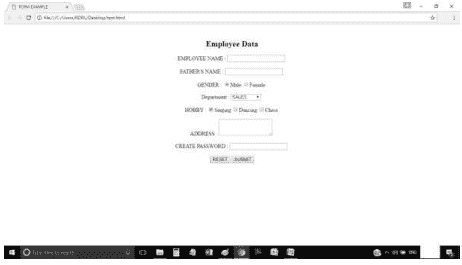

# HTML 与 JavaScript 练习题

## 4. 编写一个程序，使用 HTML 实现带有其属性的 img 标签。

<HTML>
  <HEAD>
    <TITLE>IMG EXAMPLE</TITLE>
  </HEAD>
  <BODY>
    <center>
      <H2>图像示例</H2>
      
    </center>
  </BODY>
</HTML>

### 代码输出

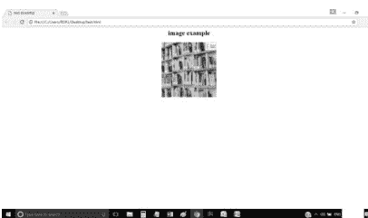

## 5. 编写一个程序，使用 HTML 实现下标和上标。

<HTML>
<HEAD>
<TITLE>HTML Subscript and superscript</TITLE>
</HEAD>
<BODY>
<center>
<H2>
下标 : H<sub>2</sub>O =
H<sub>2</sub> + O
<br><br>
上标 : 2<sup>4</sup> = 16
</H2>
</center>
</BODY>
</HTML>

### 代码输出


## 6. 编写一个程序，在 HTML 中实现框架。

<HTML>
  <HEAD>
    <TITLE>框架测试...</TITLE></HEAD>
    <FRAMESET COLS="30%,70%">
      <FRAMESET ROWS="75%,25%">
        <FRAME SRC="1.html" NAME="menu">
        <FRAME SRC="2.html" NAME="logo">
      </FRAMESET>
      <FRAMESET ROWS="*">
        <FRAME SRC="3.html" NAME="main">
      </FRAMESET>
    </FRAMESET>
  </HEAD>
</HTML>

## 7. 编写一个程序，在 HTML 中实现 SVG（可缩放矢量图形）。

<HTML>
  <HEAD>
    <TITLE>SVG EXAMPLE</TITLE>
  </HEAD>
  <BODY>
    <svg width="300" height="200">
      <polygon points="100,10,40,180,190,60,10,60,160,180" style="fill:lime;stroke:purple;stroke-width:5;fill-rule:evenodd;" />
    </svg>
  </BODY>
</HTML>

### 代码输出

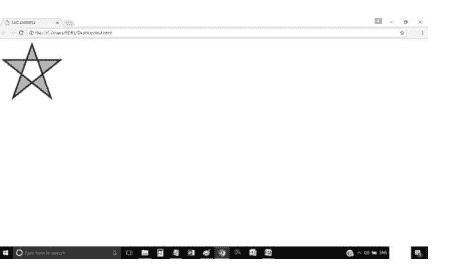

## 8. 编写一个程序，在 HTML 中实现内联 CSS。

<HTML>
<HEAD>
<TITLE>CSS EXAMPLE</TITLE>
</HEAD>
<BODY>
<h1 style="background-color:#d0e4fe;font-size:100px;"/>
内联 CSS
</h1>
</BODY>
</HTML>

### 代码输出

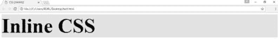


## 9. 编写一个程序，在 HTML 中实现内部 CSS。

<HTML>
<HEAD>
<TITLE>CSS EXAMPLE</TITLE>
<style>
h1
{
font-size: 100px;
background-color: yellow;
}
</style>
</HEAD>
<BODY>
<h1>
内部 CSS
</h1>
</BODY>
</HTML>

# HTML 与 JavaScript 练习题

### 代码输出

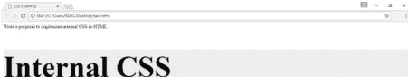

## 10. 编写一个程序，在 HTML 中实现外部 CSS。

<HTML>
  <HEAD>
    <TITLE>CSS EXAMPLE</TITLE>
    <link href="extrnal.css" rel="stylesheet" type="text/css">
  </HEAD>
  <BODY>
    <h1>
      外部 CSS
    </h1>
  </BODY>
</HTML>

**extrnal.css**

h1{ font-size: 200px;
  background-color: #d0e4fe;
  font-style:italic; }

# HTML 与 JavaScript 练习题

### 代码输出

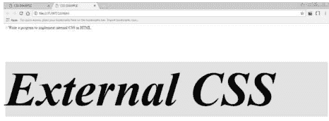

## 11. 编写一个程序，演示 alert()、prompt() 和 confirm() 函数。

<HTML>
  <HEAD>
    <TITLE>Predefined Functions</TITLE>
  </HEAD>
  <BODY>
    <script>
      alert("继续....？");
      var txt="";
      var name = prompt("请输入您的姓名...");
      var b = confirm("您确定吗？？？");
      if(b) document.write("<h1>欢迎 "+name+"</h1>");
      else document.write("<h1>输入已取消!!!!</h1>")
    </script>
  </BODY>
</HTML>

# HTML 与 JavaScript 练习题

## *代码输出*

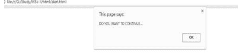

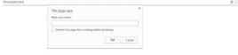


## 12. 编写一个程序，使用递归函数计算阶乘数。

<HTML>
<HEAD>
<TITLE>Predefined Functions</TITLE>
<script>
function fun()
{
var n = document.getElementById("n").value;
fact(n);
}
var f=1;
function fact(n)
{
if(n>0)
{
f = f*n;
fact(n-1);
}
}
</script>
</HEAD>
<BODY>
<input type="text" id="n" value="5">
<button onclick="fun()">阶乘</button>
<p id="demo"></p>
</BODY>
</HTML>

**替代实现：**

<HTML>
<HEAD>
<TITLE>Predefined Functions</TITLE>
<script>
function fun()
{
var n = document.getElementById("n").value;
fact(n);
}
var f=1;
function fact(n)
{
if(n>0)
{
f = f*n;
fact(n-1);
}
else
document.getElementById("result").innerHTML =
"阶乘 = "+f;
}
</script>
</HEAD>
<BODY>
<br><br>
请输入任意数字：
<input type="text" id="n">
<br><br>
<input type="submit" value="获取阶乘" Onclick="fun()">
<h2 id="result"></h2>
</BODY>
</HTML>

### 代码输出

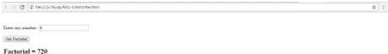

## 13. 编写一个程序，使用函数计算给定数字的立方。

<HTML>
    <HEAD>
        <TITLE>Predefined Functions</TITLE>
        <script>
            function fun()
            {
                var n = document.getElementById("n").value;

                document.getElementById("result").innerHTML =
                "结果 = "+n*n*n;
            }
        </script>
    </HEAD>
    <BODY>
        <br><br>
        请输入任意数字：
        <input type="text" id="n">
        <br><br>
        <input type="submit" value="获取立方" OnClick="fun()">

        <h2 id="result"></h2>
    </BODY>
</HTML>

# HTML 与 JavaScript 练习题

### 代码输出

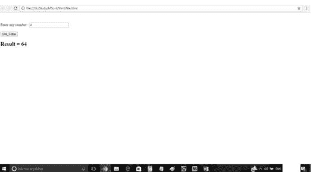

## 14. 编写一个程序，使用函数将摄氏度转换为华氏度。

<HTML>
	<HEAD>
		<TITLE>Predefined Functions</TITLE>
		<script>
			function fun()
			{
				var n = document.getElementById("n").value;
				var r = n*9/5 +32;
				document.getElementById("result").innerHTML = "结果 = "+r+" 华氏度";
			}
		</script>
	</HEAD>
	<BODY>
		<br><br>
		请输入任意数字：
		<input type="text" id="n">
		<br><br>
		<input type="submit" value="获取立方" Onclick="fun()">

		<h2 id="result"></h2>
	</BODY>
</HTML>

# HTML 与 JavaScript 练习题

### 代码输出

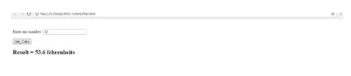

## 15. 编写一个程序，输入两个整数并使用 if() 和 else if() 显示较大的那个。

<HTML>
    <HEAD>
        <TITLE>Predefined Functions</TITLE>
    </HEAD>
    <BODY>
        <script>
            var a = prompt("请输入第一个数字....");
            var b = prompt("请输入第二个数字....");
            if(a>b) document.write("<h2>"+a+" 大于 "+b+"</h2>");
            else if(b>a) document.write("<h2>"+b+" 大于 "+a+"</h2>");
            else document.write("<h2>两者相等</h2>");
        </script>
    </BODY>
</HTML>

### 代码输出

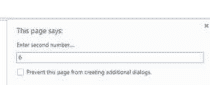

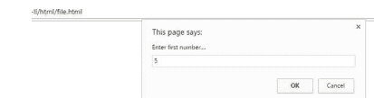

6 大于 5

## 16. 编写一个程序，使用循环找出三位的阿姆斯特朗数。

<HTML>
<HEAD>
<TITLE>Armstrong Numbers</TITLE>
</HEAD>
<BODY>
<script>
var i;
document.write("<h2>阿姆斯特朗数");
for(i=1;i<=999;i++)
{
if(Math.floor(i/100) == Math.floor(i%10))
{
if(Math.floor(i/100)==0)
document.write("<br>0"+i);
else document.write("<br>"+i);
}
}

</script>

</BODY>
</HTML>

### 代码输出

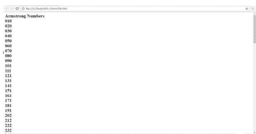


## 17. 编写一个JavaScript程序，使用嵌套for循环构建以下图案。

```
<HTML>

    <HEAD>

        <TITLE>Pattern</TITLE>

    </HEAD>

    <BODY>

        <script>

            var i,j;

            document.write("<h2>Pattern:<br>");

            for(i=0;i<10;i++)

            {

                for(j=0;j<=i;j++)

                document.write(" *");

                document.write("<br>");

            }

        </script>

    </BODY>

</HTML>
```

### 代码输出

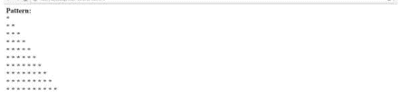

## HTML & JavaScript 练习题

## 18. 编写一个JavaScript程序，使用while循环计算两个正整数的最大公约数（GCD）。

```
<HTML>
  <HEAD>
    <TITLE>Pattern</TITLE>
    <script>
      function gcd()
      {
        var x = document.getElementById("x").value;
        var y = document.getElementById("y").value;
        var hcf=1;
        if(x<y)
        {
          var t = x;
          x = y;
          y = t;
        }
        while(hcf!=0)
        {
          hcf = x%y;
          x = y;
          y = hcf;
        }
        document.getElementById("result").innerHTML = "GCD = "+x;
      }
    </script>
  </HEAD>

  <BODY>
    <h2>
      输入两个数字：
      <input type="text" id="x">
      <input type="text" id="y">
    </h2>
    <br><br>
    <input type="submit" value="获取最大公约数" Onclick="gcd()">
    <br><br>
    <h2 id="result"></h2>
  </BODY>
</HTML>
```

### 代码输出

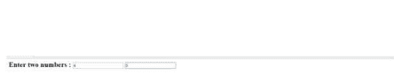


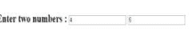

GCD = 1

## 19. 编写一个JavaScript函数，使用switch case将十进制数转换为二进制、十六进制或八进制数。

```
<HTML>
  <HEAD>
    <TITLE>Pattern</TITLE>
    <script>
      function convert()
      {
        var n = document.getElementById("x").value;
        var a = 0;
        if(document.getElementById("1").checked)
          a=1;
        else
        if(document.getElementById("2").checked)
          a=2;
        else
        if(document.getElementById("3").checked)
          a=3;
        switch(a)
        {
          case 1:
            var x=0,i=0;
            while(n>0)
            {
              x = x + n%2*Math.pow(10,i);
              n = Math.floor(n/2);
              i++;
            }
            document.getElementById("result").innerHTML =
              "二进制值 : "+x;
            break;
          case 2:
            var x=0,i=0;
            while(n>0)
            {
              x = x + n%16*Math.pow(10,i);
              n = Math.floor(n/16);
              i++;
            }
            document.getElementById("result").innerHTML =
              "十六进制值 : "+x;
            break;
          case 3:
            var x=0,i=0;
            while(n>0)
            {
              x = x + n%8*Math.pow(10,i);
              n = Math.floor(n/8);
              i++;
            }
            document.getElementById("result").innerHTML =
              "八进制值 : "+x;
            break;
          default:
            document.getElementById("result").innerHTML =
              "请选择转换器类型";
        }
      }
    </script>
  </HEAD>

  <BODY>
    <p>
      输入数字：
      <input type="text" id="x">
      <br><br>
      <input type="radio" name="cnvrt" value="1" id="1">二进制
      <input type="radio" name="cnvrt" value="2" id="2">十六进制
      <input type="radio" name="cnvrt" value="3" id="3">八进制
    </p>
    <br>
    <input type="submit" value="转换" Onclick="convert()">
    <br><br>
    <h2 id="result"></h2>
  </BODY>
</HTML>
```

### 代码输出

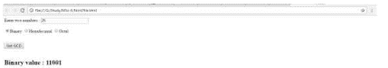

## 20. 编写一个JavaScript程序，找出数组中出现最频繁的元素。

```
<HTML>

<HEAD>
<TITLE>Array</TITLE>
</HEAD>

<BODY>
<script>
var arr = [3,2,3,2,2,2,2,2,2,4];
var a=1,c=0,item=arr[0],i,j;

for(i=0;i<arr.length;i++)
{
    for(j=i;j<arr.length;j++)
    if(arr[i]==arr[j]) c++;
    if(c>a)
    {
        item = arr[i];
        a = c;
    }
    c=0;
}

alert("数组中出现最频繁的元素 = "+item);
</script>

</BODY>

</HTML>
```

### 代码输出

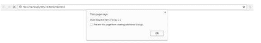

## 21. 编写一个JavaScript函数，获取指定月份的天数。

```
<HTML>

  <HEAD>

    <TITLE>Date</TITLE>

    <script>

      function getdays()

      {

        var m = document.getElementById("m").value;

        var y = document.getElementById("y").value;

        var day = new Date(y,m,0).getDate();

        document.getElementById("result").innerHTML = day+" 天";

      }

    </script>

  </HEAD>

  <BODY>
    <p>
      月份：
      <input type="text" id="m">
      <br><br>
      年份：
      <input type="text" id="y">
      <br><br>
      <input type="submit" value="获取天数" Onclick="getdays()">
      <br>
      <h2 id="result"></h2>
    </p>
  </BODY>
</HTML>
```

### 代码输出

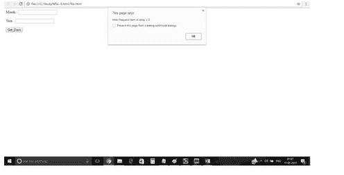

## 22. 编写一个JavaScript函数，向Date对象添加指定的分钟数。

```
<HTML>
    <HEAD>
        <TITLE>Date</TITLE>
        <script>
            function add()
            {
                var m = document.getElementById("m").value;
                var someDate = new Date();
                someDate.setMinutes(someDate.getMinutes()+m);
                document.getElementById("result").innerHTML = "分钟 "+someDate.getMinutes();
            }
        </script>
    </HEAD>
    <BODY>
        <p>
            要添加的分钟数：
            <input type="text" id="m">
            <br><br>
            <input type="submit" value="添加" Onclick="add()">
            <br>
            <h2 id="result"></h2>
        </p>
    </BODY>
</HTML>
```

## HTML & JavaScript 练习题

### 代码输出

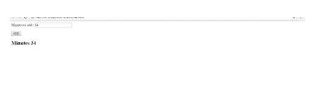


62

## 23. 编写一个程序，展示键盘的功能。

```
<html>
<head>
<script language="JavaScript">
function keyDown(){
    alert("按键被按下");
}
function keyUp(){
    alert("按键被释放");
}
function keypress(){
    alert("按键被按下并释放");
}
</script>
</head>
<body>
<input type="text" OnkeyDown="keyDown()"><br>
<input type="text" OnkeyUp="keyUp()"><br>
<input type="text" Onkeypress="keypress()"><br>
</body>
</html>
```

### 代码输出

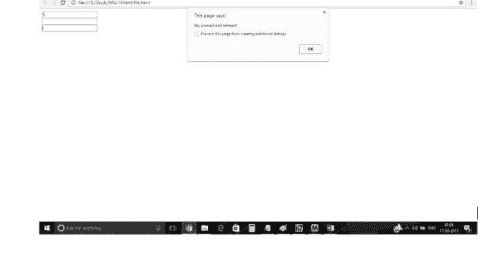

## HTML & JavaScript 练习题

## 24. 编写一个程序，使用which属性显示鼠标事件。

```
<html>

<head></head>

<body>

<div onmousedown="whichbutton(event)">点击此文本，使用任意鼠标按键将返回一个数字。

<p> 1=鼠标左键</p>

<p> 2=鼠标中键</p>

<p> 3=鼠标右键</p>

</div>

<p> <strong>注意：</strong> IE 8 或更早版本不支持 which 属性</p>

<script language="JavaScript">

function whichbutton(event){

alert("您按下了按钮 "+event.which);}

</script>

</body>

</html>
```

### 代码输出

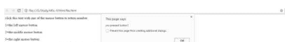

## 25. 编写一个程序，展示load和unload事件。

```
<html>
<head>
<script language="JavaScript">
function load(){
    alert("网页加载完成");
}
function unload(){
    alert("网页被卸载");
}
</script>
</head>
<body Onload="load()"
Onunload="unload()">
</body>
</html>
```

### 代码输出

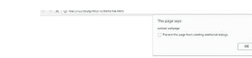

## 26. 编写一个程序，接收用户的真实数据并将其存储在cookie中。

```
<html>

<head>

<title>JavaScript创建Cookie - 接收真实数据. 示例1</title>

</head>

<body>

<h1 style="color: red">JavaScript创建Cookie，接收真实数据 - 示例1</h1><br>

<hr />

<script type="text/javascript">

//为确保以下JavaScript代码兼容XHTML而这样做。 <![CDATA[

var visitor_name = prompt("您叫什么名字？","");

var expr_date = new Date("July 30, 2017");

var cookie_date = expr_date.toUTCString();

final_cookie = "Name = " +

encodeURIComponent(visitor_name) + ";expires_on = "

+ cookie_date;

document.cookie = final_cookie;

alert(final_cookie);

//]]>

</script>

</body>

</html>
```

# HTML 与 JavaScript 练习题

## 编码输出

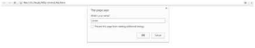


## 27. 编写一个程序从 Cookie 中检索值。

```
<html>
<head>
<title>JavaScript : Retrieve values from a cookie - example1</title>
</head>
<body>
<h1 style="color: red">JavaScript : Retrieve values from a cookie - example1</h1>
<hr />
<script type="text/javascript">
//This is done to make the following JavaScript code compatible to XHTML. <![CDATA[
var search_cookie = "my_cookie" + "="
if (document.cookie.length > 0)
{
// Search for a cookie.
offset = document.cookie.indexOf(search_cookie)
if (offset != -1)
{
    offset += search_cookie.length
    // set index of beginning of value
    end = document.cookie.indexOf(";",offset)
    if (end == -1)
    {
        end = document.cookie.length
    }
    alert(decodeURIComponent(document.cookie.substring(offset, end)))
}
}
//]]>
</script>
</head>
</body>
</html>
```

## 编码输出

JavaScript : Retrieve values from a cookie - example1

## 28. 编写一个 JavaScript 程序来检查表单验证。

```
<HTML>
    <HEAD>
        <TITLE>FORM EXAMPLE</TITLE>
        <script>
            function validation()
            {
                var x=document.forms["myForm"]["sname"].value;
                if(x==null||x=="")
                    alert("Student Name must be filled Out!!!");

                x = document.forms["myForm"]["fname"].value;
                if(x==null||x=="")
                    alert("Father's Name must be filled Out!!!");

                if(!document.getElementById("m").checked && !document.getElementById("f").checked)
                    alert("Please select Gender");

                //Email Validation
                x=document.forms["myForm"]["email"].value;

                var atpos=x.indexOf("@");
                var dotpos=x.lastIndexOf(".");

                if (atpos<1 || dotpos<atpos+2 || dotpos+2>=x.length)
                {
                    alert("Not a valid e-mail address");
                    return false;
                }

                var len =document.forms["myForm"]["pwd"].value.length;

                if(len<8) alert("Your Password is weak!!!");
            }
        </script>
    </HEAD>
    <BODY>
        <FORM name="myForm">
            <H2 align="center">STUDENT REGISTRATION</H2>
            <center>
            STUDENT NAME : 
            <input type="text" name="sname">
            <br><br>
            FATHER'S NAME : 
            <input type="text" name="fname">
            <br><br>
            GENDER : 
            <input type="radio" name="gendr" value="male" checked id="m">Male 
            <input type="radio" name="gendr" value="female" id="f">Female 
            <br><br>
            COURSE : 
            <select name=course>
                <option value="msc">MSC</option>
                <option value="mca">MCA</option>
            </select>
            </select>
            <br><br>
            HOBBY :
            <input type="checkbox" name="hoby" value="singing" checked>Singing
            <input type="checkbox" name="hoby" value="Dancing">Dancing
            <input type="checkbox" name="hoby" value="Chess">Chess
            <br><br>
            Email Address :
            <input type="text" name="email">
            <br><br>
            CREATE PASSWORD :
            <input type="password" name="pwd">
            <br><br>
            <input type="reset" value="RESET">
            <input type="submit" value="SUBMIT" Onclick="validation()">
            </center>
        </FORM>
    </BODY>
</HTML>
```

## 编码输出

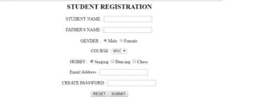


## 29. 编写一个 JavaScript 程序来显示数字时钟。

```
<HTML>
    <HEAD>
        <TITLE>Clock</TITLE>
        <script>
            function startTime()
            {
                var today=new Date();
                var h=today.getHours();
                var m=today.getMinutes();
                var s=today.getSeconds();
                // add a zero in front of numbers<10
                m=checkTime(m);
                s=checkTime(s);

                document.getElementById('txt').innerHTML=h+":"+m+":"+s;
                t=setTimeout(function(){startTime()},500);
            }

            function checkTime(i)
            {
                if (i<10)
                {
                    i="0" + i;
                }
                return i;
            }
        </script>
    </HEAD>
    <body onload="startTime()">
        <h1 align="center" id="txt"></h1>
    </body>
</HTML>
```

## 编码输出

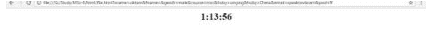


## 30. 编写一个 JavaScript 程序来实现任意两个字符串方法。

```
<HTML>
    <HEAD>
        <TITLE>Date</TITLE>
        <script>
            function strmethod()
            {
                var str = document.getElementById("m").value;
                var txt = str.toUpperCase();
                var rpc = str.replace("kumar","Kaushik");
                document.getElementById("result").innerHTML = "toUpperCase() : "+txt+"<br>replace() : "+rpc;
            }
        </script>
    </HEAD>
    <BODY>
        <p>
            Enter String :
            <input type="text" id="m">
            <br><br>
            <input type="submit" value="Apply_method" Onclick="strmethod()">
            <br>
            <h2 id="result"></h2>
        </p>
    </BODY>
</HTML>
```

## 编码输出

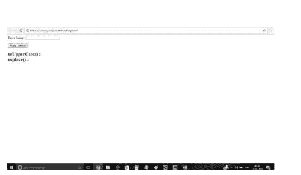

## 31. 编写一个 JavaScript 程序来检查一个数字是偶数还是奇数。

```
<HTML>
    <HEAD>
        <TITLE>Even Odd</TITLE>
        <script>
            function check()
            {
                var n = document.getElementById("m").value;
                if(Math.floor(n%2)==0)
                    document.getElementById("result").innerHTML = "Number is Even!!!";
                else
                    document.getElementById("result").innerHTML = "Number is Odd!!!";
            }
        </script>
    </HEAD>
    <BODY>
        <p>
            Enter any no.. :
            <input type="text" id="m">
            <br><br>
            <input type="submit" value="Even_or_Odd" Onclick="check()">
            <br>
            <h2 id="result"></h2>
        </p>
    </BODY>
</HTML>
```

## 编码输出

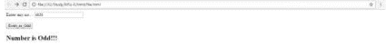


本书是完整的 HTML 和 JavaScript 编程集合。示例经过充分测试，并基于计算机科学硕士生的教学大纲。

我，Dheeraj Singh，感谢 Evincepub 出版团队在本书出版过程中的支持与帮助。我深信，它必将帮助那些寻求获取 HTML 和 JavaScript 编程知识的学生。

-Dheeraj Singh


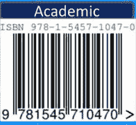
