# HTML & JavaScript 编程概念


## 加入我们的互联网世界

网站：`http://www.thomson.com`

团队负责人：凯伦·施莫赫

执行编辑：卡罗尔·沃尔茨

编辑：马克·切特姆

艺术协调员：迈克·布鲁萨德

特约编辑：玛丽·托德

制作公司：利腾编辑与制作公司

营销经理：拉里·奎尔斯，史蒂夫·赖特

内部设计：安妮·斯莫尔

封面设计：卢·安·塞辛

## 探索网络世界

使用西南教育出版公司的这些激动人心的新产品！

我们的网络相关编程书籍提供初级、中级和高级课程，以满足您的编程需求。

- 《HTML与JavaScript：编程概念》作者：特纳，巴克斯代尔。20+小时的教学内容。教授创建网页背后的基本编程概念。易于学习——无需编译器或特殊软件。
  - 学生用书，平装：0-538-68822-X
  - 电子教师CD-ROM：0-538-68823-8

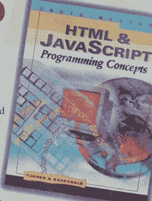

- 《HTML编程概念：简明课程》作者：特纳，巴克斯代尔。10+小时的教学内容。HTML基础入门，为未来学习网页维护或图形程序奠定坚实基础。
  - 学生用书，平装：0-538-69118-2
  - 电子教师CD-ROM：0-538-68823-8

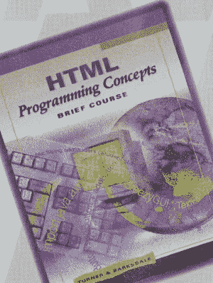

- 《Java编程与问题解决完整课程》作者：兰伯特和奥斯本，是学习Java最全面的教学文本。包含75+小时的教学内容，涵盖从初学者到高级的最广泛使用的Java功能。涵盖Windows和Macintosh平台的Java。
  - 学生用书，精装：0-538-68707-X
  - 学生课本-练习册/数据CD-ROM套餐，平装：0-538-68708-8
  - 活动练习册：0-538-68710-X
  - 电子教师CD-ROM套餐：0-538-68709-6

- 《Java：编程入门》作者：诺尔顿，在35+小时的教学内容中涵盖从初学者到中级的Java功能。该课本有精装和平装版本，仅适用于Windows版Java。
  - 学生用书，精装：0-538-68565-4
  - 学生用书/3.5"模板磁盘套餐，平装：0-538-68772-X
  - 活动练习册：0-538-68571-9
  - 电子教师CD-ROM：0-538-68557-3
  - 学生用书，精装/Microsoft Visual J++套餐：0-538-68774-6
  - 学生用书/3.5"模板磁盘套餐，平装/Microsoft Visual J++套餐：0-538-68773-8

- 《Java：互联网编程基础》作者：巴克斯代尔和诺尔顿等，让用户快速了解从初学者到高级的Java功能。包含15+小时的教学内容；重点在于小程序和活动。
  - 学生课本-练习册：0-538-68012-1
  - 学生课本-练习册/Microsoft Visual J++套餐：0-538-68564-6
  - 教师手册（在线）：0-538-68013-X

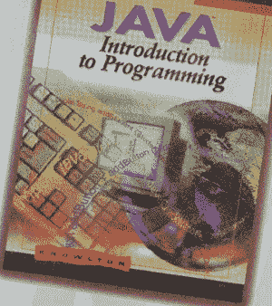

电子教师CD-ROM包含测试题、课程计划和解答。请咨询我们的`ProgramPaks`编译器软件捆绑包。

如需信息请致电`1-800-354-9706`。

加入我们的互联网世界：`www.swep.com`

## 本书使用指南

# 引言

各章节引言对每章内容进行简要概述，采用易于理解的对话式风格编写。

## HTML，通往JavaScript的大门

欢迎来到HTML，通往JavaScript的大门。

HTML是超文本标记语言的缩写。HTML在20世纪90年代引发了一场通信革命，改变了我们生活、交流和互动的方式。

HTML由标签组成，例如：

`<CENTER> (CENTER)`

HTML标签告诉网页浏览器，如网景公司的Navigator或微软的Internet Explorer，如何显示网页。这些标签是世界各地成千上万的网页服务器与想访问它们的人们之间交流的通用语言。没有HTML，万维网就不可能诞生。

JavaScript为网页增添了一抹亮色，使它们能以电子般的速度在网络中穿梭。JavaScript就像搭便车的旅客，搭载在网页上，与驾车者一同在高速公路上行驶。但JavaScript绝非搭便车者！HTML作为网页浏览器穿梭前行，一扇电子之门在HTML的力量下打开，JavaScript随即涌入。

当HTML标签和JavaScript进入您的网页浏览器时，奇妙的事情便会发生。图片可以移动，声音可以播放，可以提出问题，用户甚至可以创造性地改变信息。JavaScript的力量与HTML的力量相结合，使得网络成为了一个极佳的访问之地。

HTML由蒂姆·伯纳斯-李创造，他是瑞士欧洲核子研究中心（CERN）的一名研究员。他找到了一种方法，让人们可以通过电子文档链接进行远距离交流和信息共享。

JavaScript由网景通信公司在几年后创造。网景公司创造JavaScript是为了赋予HTML网页更多功能，正如他们发明JavaScript时所述。

JavaScript类似于一种叫做Java的编程语言，但无需任何编程技能或软件来准备称为小程序的Java程序。JavaScript可以直接输入到文字处理器中，就像HTML被输入到网页中一样。JavaScript拥有与网页一样的编程语言能力，却没有传统编程系统的繁琐。

在成功使用JavaScript之前，您需要了解HTML。本节将帮助您将JavaScript与HTML网页链接起来，以达到最佳效果。

- 第1章 - HTML快速入门 ............ 2
- 第2章 - HTML组织技巧 ............ 27
- 第3章 - HTML高级技巧 ............ 51

# 第1章：HTML快速入门

## 本章目标

在本章中，您将学习HTML标签。阅读完第1章后，您将能够：

- 发现HTML标签。
- 输入起始标签。
- 学习正确保存文件。
- 将不同级别的标题融入网页。
- 创建无序列表、有序列表和嵌入式列表。

## HTML术语

- 尖括号
- 主页
- HTML
- HTML页面
- 超文本标记语言
- Internet Explorer
- Java
- JavaScript
- Mosaic
- Netscape Navigator
- VRML
- 网页浏览器
- 网页
- 网站
- 网站管理员
- 欢迎页

### 在网络上交流

HTML，即超文本标记语言，允许您在网络上进行交流。它组织文档，并告诉网页浏览器网页在您的计算机监视器上应呈现的样子。网页上的字体、颜色和背景由HTML标签决定。

HTML标签适用于任何网页浏览器。如果您正确创建了一个HTML页面，您的网页浏览器就可以读取它。事实上，HTML是万维网的通用语言。虽然网络上还有许多其他语言（如VRML和JavaScript），但HTML是使用最广泛的。

HTML标签在网络上的任何地方都有效。HTML标签可以在Macintosh或Windows计算机上显示HTML页面。它们甚至可以在网络电视机和便携式设备上工作。HTML标签如此简单，任何人都可以快速学习一些基本标签。这些标签由成对出现的尖括号括起来。这些括号可以在键盘上M键的右侧找到。按下Shift键即可输入它们。

为了更好地理解标签的工作原理，请分析这个例子。如果您想在网页上将本书标题居中，可以这样写：

`<CENTER>HTML and JavaScript</CENTER>`

### 章节引言

章节引言提供本章的目标、术语和内容介绍。每一章都建立在前几章所学的技能和理解之上。

### 活动

活动旨在支持每一章的学习目标。这些活动涵盖了当今课堂和职场中最相关的网络编程主题。每个活动都从关键概念的简要说明开始。

分步骤指令提供实践强化，并简化了完成每个活动的过程。

#### 活动2.2

目标：在本活动中，你将学习如何更改网页的背景颜色，并使用属性和值创建不同宽度和长度的线条。

### 线条与背景颜色

### 属性与值

可以通过赋予HTML标签属性和值来增强它们。以`<BODY>`标签为例。你可以向`body`标签添加元素，这将显著改变你网页的外观。例如，要更改网页的背景颜色，你可以添加背景属性命令并为标签赋予一个颜色值，如图2.5所示。

试一试！

1. 打开你的`Seven.html`文件。

图2.5

更改背景颜色

```html
<BODY BGCOLOR=YELLOW>
```

Body标签

属性

记事本用户提醒：打开文件时，别忘了从“编辑”菜单中选择“自动换行”选项。

2. 在网页顶部附近的BODY标签内输入`BGCOLOR=YELLOW`，如图2.5中粗体所示。
3. 将你的作品保存为`Eight.html`。
4. 在网页浏览器中查看这些更改。你的页面应该变成黄色。
5. 进行实验。将属性更改为BLUE、GREEN、RED、WHITE或你选择的其他颜色。

### 网络常识

### 十六进制颜色

计算机只使用数字。值以计算机理解的数字形式表达。通过使用特定颜色的十六进制值，可以精确控制和更改颜色值，以匹配彩虹中几乎所有的颜色。

十六进制数字基于16进制数制运行，而不是我们人类通常使用的10进制数制。十六进制数字使用字母A、B、C、D、E、F以及数字0到9来创建其16个不同的数字。

例如，查看以下以数字表示的颜色值：

白色 = `#FFFFFF`

黑色 = `#000000`

红色 = `#FF0000`

绿色 = `#00FF00`

蓝色 = `#0000FF`

黄色 = `#FFFF00`

通过更改数字可以创建这些颜色的深浅。例如，在你的HTML页面上，使用数字`00CCFF`可以创建非常漂亮的天蓝色。想要漂亮的浅紫色吗？试试`FF95FF`。使用`AAFF00`可以创建一种难看的黏液绿色。

在你的网页中用数字替代文本颜色值，看看会发生什么。例如，试试这个：

```html
BGCOLOR=#AAFF00 VLINK=#FF95FF TEXT=#00CCFF LINK=#FFFF00
```

#### 侧边栏特色

**专题特色**贯穿全文，以简短、易读的格式呈现重要概念。

### 网络常识

**网络常识**呈现重要的技术信息。

**网络礼仪**讨论在线社区中的常见做法。

### 网络伦理

**网络伦理**为讨论与互联网相关的重要伦理和法律问题提供了一个平台。

## 互联网里程碑

**互联网里程碑**介绍了互联网发展中的重要历史基准。

## 章末总结

**网络词汇**以词汇练习的形式巩固文中介绍的关键概念。

**网络复习**简答题测试对重要章节信息的记忆。这为章节测试提供了极好的复习材料。

## 章节复习

### 网络词汇

定义以下术语：

1. 属性
2. 字体
3. 十六进制
4. HTTP
5. 超链接
6. 超文本链接
7. 超文本传输协议
8. 值

### 网络复习

简要回答以下问题：

1. 哪个标签会使文字反复闪烁？
2. 哪个十六进制值会创建黄色？

## 网络项目

### 创建在线调查

Great Applications, Inc. 想要进入在线视频游戏业务。然而，在开始编程下一个出色的在线视频游戏之前，它希望调查潜在客户，了解他们想玩和购买什么样的在线游戏。

进行头脑风暴，提出10个问题，帮助Great Applications了解其客户对视频游戏程序的需求。运用你的`(FORM)`标签技巧，创建一个在线调查，从潜在客户那里收集信息。让你的调查要求填写受访者的姓名和电子邮件地址。提出利用下拉列表、单选按钮和复选框的问题。

### 网络项目团队协作：表格之旅

Great Applications, Inc.要求你的团队策划一次世界巡回展，向五个主要城市的人们展示其新的软件视频游戏。你和你的团队被要求使用`(TABLE)`标签为这次巡回展创建一个活动日历。巡回展必须在一个月内进行，并应涉及五个主要城市。

在创建日历时，为你要访问的城市的旅游信息创建链接。使用单元格边距和单元格边框使表格更有趣。你甚至可以在单元格中放入图片，以展示你为软件发布选择的五个城市。

为了节省一些时间，借用你在活动3.4的“思考技术”部分创建的日历。修改这些标签以适应本练习。

### 撰写技术文章

在你完成关于HTML的这一部分并转到JavaScript之前，评估HTML对全球通信和经济的影响和重要性。

万维网和HTML对世界经济有多重要？

网络项目通过将用户的新工具和技能应用于一个持续的基于Web的业务项目，让其发挥作用。

网络项目团队协作是网络项目的团队选项，旨在强调团队合作实现共同目标的重要性。

撰写技术文章强调在新兴的、复杂的网络计算世界中发展写作和批判性思维技能的重要性。这些章末任务中的每一个都为建立个人作品集提供了机会。

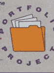

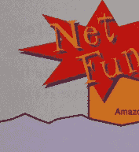

如果你有兴趣了解更多关于HTML的知识，你可以直接在网上订购HTML书籍。一个很棒的去处是`amazon.com`。`Amazon.com`是万维网上最大的书店。如果你在`amazon.com`找不到你想要的书，那它很可能不存在。在互联网里程碑报告《网络业务》第65页了解更多关于`Amazon.com`的信息。

**网络乐趣**旨在展示，借助互联网，可以同时学习和获得乐趣！

# 前言

每个人都知道互联网在过去几年变得多么流行，但很少有人知道原因。使互联网运行的硬件和软件技术已经存在了二十多年。那么，为什么它直到最近才突然一炮走红呢？

与其他任何技术相比，互联网的巨大成功在很大程度上要归功于超文本标记语言（HTML）的引入。HTML是万维网的支柱，是用于在信息高速公路上分发数据的主要机制。学习HTML的功能和结构对于任何想要创建像专业网站管理员开发的那种色彩丰富、引人注目的网页的人来说，都是必要的一步。幸运的是，HTML相对容易学习，可以使用标准文本编辑器或文字处理软件创建，并且几乎适用于任何类型的计算机系统。简而言之，很难想象有什么比这更好的技术供你探索。你将很快建立起信心和有用的计算机技能。

然而，尽管它有许多奇妙的特性，HTML仍然是一种有限的语言。许多有用的任务仅靠HTML是无法完成的，因此许多专业网页会使用一些补充技术。虽然有几种不同的技术可以扩展HTML的基本功能，但对你来说，JavaScript是比它们更好的选择。与HTML一样，JavaScript也可以在不使用复杂或昂贵的开发软件的情况下创建。事实上，JavaScript源代码是通过标准文本编辑器或文字处理软件直接输入到相应的HTML网页文件中的。但JavaScript语言最有价值的特性可能是它建立在坚实的、面向对象的编程概念之上。这意味着你不仅可以快速掌握令人印象深刻的编程技能，还可以将这些技能应用于其他几种流行的编程语言，如Java、C++，甚至Pascal。

《HTML与JavaScript：编程概念》均等分为两部分，每部分包含三章。第一部分完全致力于标准HTML，将为你开发高质量的网页打下坚实的基础。第二部分介绍JavaScript语言，将教你如何将JavaScript源代码与HTML集成，以增强网页的功能。六章中的每一章都介绍了几个HTML/JavaScript概念，然后提供了五个动手编程活动，为你提供如何将这些概念应用于实际网页的具体示例。以下是这六章的简要总结。

- 第1章：HTML快速入门包含对超文本标记语言的介绍。本章将教你什么是HTML标签以及如何在网页中创建有序和无序列表。它还涵盖了一些基本的文件管理技术，以确保你能正确保存和检索HTML文档文件。
- 第二章：HTML组织技巧侧重于几种可用于在网页上组织信息的HTML标签。这些标签使您能够调整行距、添加水平分隔线、设置背景颜色、设置文本颜色以及创建各种超链接。
- 第三章：HTML强效技巧讨论了几种高级HTML标签，它们提供了大大增强网页外观的方法。使用这些标签，您可以控制字体的大小、样式和颜色；包含图形图像；用表格组织数据；将图像变成超链接；以及使用不同类型的用户输入组件来创建电子表单。
- 第四章：什么是JavaScript？解释了JavaScript的历史和用途，并展示了如何将JavaScript集成到HTML网页中。本章还定义了几个基本的JavaScript术语，并描述了JavaScript语法的一些最基本的部分，包括关键字、运算符、对象和方法。
- 第五章：结合使用图像与JavaScript向您展示如何将图形图像与JavaScript事件和函数结合使用，为网页添加一些令人印象深刻的视觉效果。这些效果包括图像翻转、超链接翻转、循环广告横幅、随机图像显示和电子幻灯片放映。
- 第六章：使用JavaScript创建表单建立在第三章介绍的表单基础之上。它演示了如何使用JavaScript来增强HTML表单的功能。本章将教您如何布局电子表单、验证用户输入数据并向用户提供适当的反馈。

# 致谢

本书的作者衷心感谢西南教育出版公司的Mark Cheatham从始至终管理这个项目。我们还要感谢Litten编辑与制作公司的Malvine协调本书的版面设计，以及Todd出版服务公司的Mary出色的编辑技巧。

E. Shane Turner想要感谢Laura、Anthony、Diana和Katie，让我知道他们认为这本书有多“酷”。我还要向Stephani、Afton、Evan、Roman和Emma表达我的感激之情，感谢他们在整个项目期间不得不做出的许多牺牲。我深爱你们所有人。

Karl Barksdale想要感谢Hilary、Cory和Marriette在这个项目及许多其他项目中给予的持续鼓励和支持。

*Karl Barksdale*

*E. Shane Turner*


## 启动检查清单

### 硬件与浏览器软件要求


HTML 与 JavaScript：编程概念可在任何支持兼容网页浏览器的计算机系统上使用。要实现兼容，浏览器必须支持 JavaScript 语言规范的 1.1 版本。

兼容的浏览器包括：

- Netscape Navigator 3.0 或更高版本
- Microsoft Internet Explorer 3.0 或更高版本

支持这些网页浏览器的计算机系统包括：

- 运行 Microsoft Windows 的 PC
- Macintosh 系统
- UNIX 工作站

### 文本编辑器或文字处理软件

额外的软件要求仅仅是用于创建 HTML 和 JavaScript 源代码的文本编辑器或文字处理软件，例如记事本（Windows）、SimpleText（Mac）、Microsoft Word、WordPerfect、WordPro、ClarisWorks，甚至 Microsoft Works。

## HTML，通往 JavaScript 的门户

欢迎来到 HTML，JavaScript 的门户。

HTML 是一个有趣的缩写，源自超文本标记语言这几个词。HTML 在 20 世纪 90 年代开启了一场通信革命，改变了我们生活、交流和彼此互动的方式。

HTML 由许多小标签组成，像这样：

`<CENTER></CENTER>`

HTML 标签告诉网页浏览器（如 Netscape 的 Navigator 或 Microsoft 的 Internet Explorer）如何显示网页。这些标签伴随着网页，从其位于 Web 服务器上的“家园”，一路传输到世界各地想看到它们的人们。没有 HTML，万维网就永远不会被创造出来。

JavaScript 也离不开 HTML。JavaScript 搭载着 HTML 网页，以电子般的速度在 Web 上飞驰。JavaScript 就像卫星搭乘航天飞机的货舱进入深空一样，搭乘在网页上。当 HTML 航天飞机抵达你的网页浏览器时，一个特殊的 `<JAVASCRIPT>` 标签会打开一扇电子门，JavaScript 便开始工作了。

当 HTML 标签和 JavaScript 到达你的网页浏览器时，神奇的事情就会发生。图片可以移动，声音可以播放，问题可以得到交互式解答，人们可以以新的方式学习新知识。JavaScript 的力量与 HTML 的力量相结合，使 Web 成为一个值得造访的绝佳场所。

HTML 由瑞士研究员 Tim Berners-Lee 发明，他在 CERN（欧洲核子研究中心）工作。他找到了一种让身处异地的人们能够沟通和共享信息的方法。

JavaScript 是几年后由 Netscape 通信公司创建的。Netscape 决定要为 HTML 网页增添更多功能，于是发明了 JavaScript。

JavaScript 类似于一种叫做 Java 的编程语言，但两者有重要区别。Java 需要一些非常复杂的软件来准备称为 applet 的 Java 程序。JavaScript 可以像输入 HTML 一样直接输入到文字处理软件中。JavaScript 正是为网页增添激动人心功能的绝佳选择，无需传统编程系统的繁琐。

在成功使用 JavaScript 之前，你需要了解 HTML 的工作原理。这些知识将帮助你将 JavaScript 链接到 HTML 网页，以达到最佳效果。

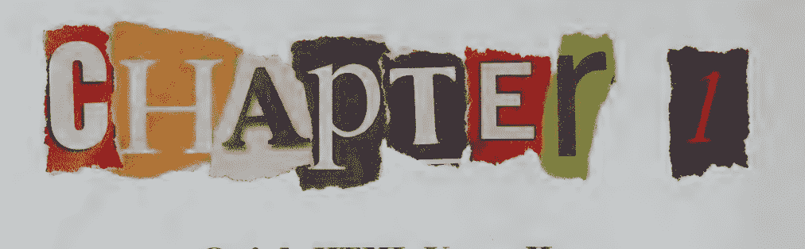

## HTML 速成指南

### 章节目标

在本章中，你将学习 HTML 标签。阅读完第 1 章后，你将能够：

1. 发现 HTML 标签。
2. 输入你的起始标签。
3. 学习正确保存文件。
4. 将不同级别的标题整合到网页中。
5. 创建无序列表、有序列表和嵌套列表。

### HTML 术语

- 尖括号
- 主页
- HTML
- HTML 页面
- 超文本标记语言
- Internet Explorer
- Java
- JavaScript
- Mosaic
- Netscape Navigator
- VRML
- 网页浏览器
- 网页
- 网站
- 网站管理员
- 欢迎页面

### 在 Web 上交流

HTML，即超文本标记语言，允许你创建网页。HTML 组织文档，并告诉网页浏览器应如何在你的电脑屏幕上显示网页。网页上的颜色、图片和背景由 HTML 标签决定。

HTML 标签适用于任何网页浏览器。如果你创建了一个 HTML 页面，并且做得正确，你的网页浏览器就能读取它。事实上，HTML 是万维网的官方语言。尽管在数字空间中还有许多其他语言（如 Java、VRML 和 JavaScript），但 HTML 是使用最广泛的。

HTML 标签在 Web 上无处不在。HTML 标签在 Macintosh 或 Windows 计算机上显示 HTML 页面。它们在 UNIX 和 Sun 计算机上也能工作。它们甚至可以在网络电视机和手机上工作。

HTML 标签非常简单，任何人都能很快学会一些基本的标签。它们通常成对出现，包含在尖括号中。这些括号可以在键盘的逗号键和句号键上找到。按下 Shift 键可以输入它们。

为了更清楚地理解标签是如何工作的，请分析这个例子。如果你想将这本书的标题在网页上居中，你可以写：

`<CENTER>HTML and JavaScript</CENTER>`

注意，这里有一个起始标签 `<CENTER>` 和一个结束标签 `</CENTER>`。这两个标签之间的唯一区别是结束标签的第一个尖括号后面有一个斜杠 `/`。标签 `<CENTER> </CENTER>` 构成了一对标签。如果你还没猜到，这些标签被称为“居中”标签。这些标签之间的任何内容都将在页面上居中显示。标签之外的任何内容都不会受到该命令的影响。没有比这更简单的了！

### 网络乐趣

如果你想在网上浏览最佳的超级网页列表，你只需访问 Yahoo! 即可。Yahoo! 按类别（如娱乐、商业、教育，以及我们最喜欢的两个类别 HTML 和 JavaScript）收录了所有优秀的网页。请访问 Yahoo!：[www.yahoo.com](http://www.yahoo.com)。

## 活动 1.1

### 目标

在本活动中，你将学习查看 HTML 源代码标签。

### 揭开页面之下的页面

Web 上充满了网页。有些非常有趣，有些非常精彩，有些过于繁杂，有些则单调乏味。无论页面是有趣还是乏味，所有页面都有一些非常相似的特征。让我们看看是什么意思。看看图 1.1a。

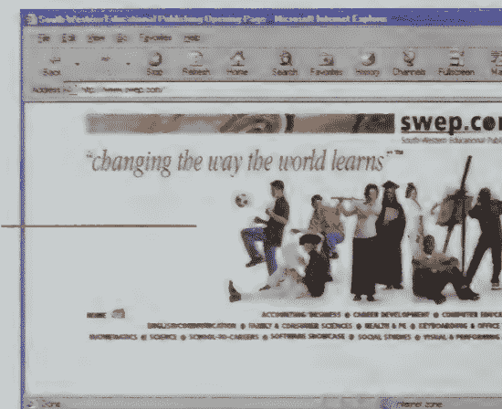

这个网页是由图 1.1b 所示的标签创建的。

图 1.1a：位于 www.swep.com 的西南教育出版社欢迎页面

图 1.1a 中你看到的所有文字、图片和颜色，都是由你在下图（图 1.1b）中看到的 HTML 标签组织和创建的。

图 1.1a 和图 1.1b 实际上是同一页面以不同方式呈现。

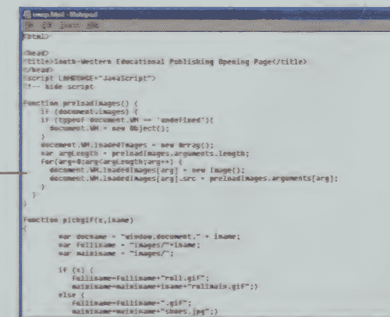

这页 HTML 标签创建了图 1.1a 所示的网页。

图 1.1b：图 1.1a 所示的西南教育出版社网页的 HTML 标签

## 互联网里程碑

### 商界发现 Web

万维网（WWW）于 20 世纪 80 年代末在欧洲创建。在接下来的大约五年里，它只在学术界有限地使用。然而，直到 1994 年，一种名为 Mosaic 的网页浏览器出现，才真正抓住了公众的想象力。Mosaic 是在伊利诺伊大学创建的。它是第一个允许图片和声音伴随网页的网页浏览器。

围绕这种呈现和共享信息的新方式，一种新的兴奋感被创造出来。随后，Netscape 通信公司发布了其名为 Netscape Navigator 的浏览器。Netscape 在 1995 年引起了商业界的想象，从那时起，一切都变得不同了。

在短短几年内，万维网就变成了我们今天所见的新型广告和商业媒介。公司和企业投入了数十亿美元，希望从这个全新的、黄金般的信息共享系统中获利。突然之间，成千上万的企业网站管理员开始学习 HTML，以便将他们的商业网页上线。

图 1.1b 并不太美观。它显示了创建图 1.1a 所示更精彩页面的 HTML 标签。图 1.1b 精确地展示了彩色页面背后的真实面貌。网页浏览器解释这些标签，并创建普通网民看到的网页。

有很多标签，也有很多使用它们的方法。这个提示应该能帮助你避免混淆。记住，HTML 标签只是给网页浏览器的指令。它们告诉浏览器如何显示信息。很多时候，你可以查看最终的网页，并猜出创建该效果的标签是什么。如果你记住这个提示，学习 HTML 会变得容易得多。

现在轮到你了。按照以下步骤打开一个你喜欢的网页。查看页面之下的页面就像在浏览器中从查看菜单中选择源代码或类似命令一样简单，如图 1.3a 和图 1.3b 所示。

- 通过双击其图标打开你的网页浏览器，如图 1.2a 和图 1.2b 所示。

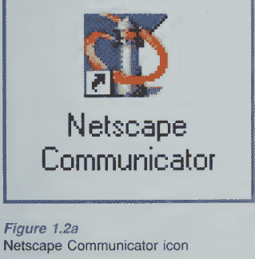

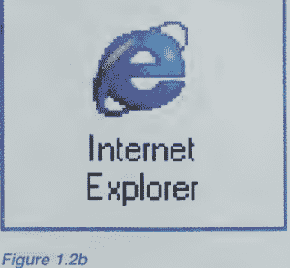

**第 1 章** HTML 速成指南

### 找出七个新标签并猜测它们的功能

当页面出现时，使用鼠标将指针移到查看菜单上，如图 1.3a 和 1.3b 所示。

在 Internet Explorer（IE）浏览器中选择查看然后选择源文件，或者在你使用的 Netscape Navigator 浏览器版本中选择查看然后选择源文件、页面源文件或文档源文件。（注意：不同的浏览器可能使用不同的词语来表示此命令。仔细寻找；该选项会出现在那里。）

检查大多数人在彩色页面下方看到的标签。这些标签看起来有点像你在本课开始时图 1.1b 中看到的标签。

跳转到另外三四个网页并“查看源文件”。列出你反复遇到的七个标签。在下面的表格中猜测并记录它们的功能。

| 编号 | 标签 | 它在网页上产生的效果 |
| :--- | :--- | :--- |
| 示例 | `<CENTER></CENTER>` | 在网页上居中显示文本。 |
| 1. |  |  |
| 2. |  |  |
| 3. |  |  |
| 4. |  |  |
| 5. |  |  |
| 6. |  |  |
| 7. |  |  |

## 关于技术的思考

万维网是一个共享 HTML 文件的大型计算机网络。网络空间中有多少百万或十亿个网页？你可以在余生中每分钟访问一个新网页，却永远无法接近阅读所有可用网页的一小部分。虽然 HTML 让人们能够轻松地共享网页，但它是否也导致了信息过载？

### 网页、主页、欢迎页、HTML 页面……有什么区别？

有许多术语用于描述 HTML 页面或文档。事实是，这些名称的使用如此互换，以至于大多数人完全不知道以下术语的含义存在细微差别：

- **网页：**网页或网络文档是任何可以用 HTML 创建并放置在万维网上的页面。
- **主页：**主页是公司、组织或个人的主页或主要页面。你的主页是你启动网络浏览器时看到的第一个页面。当你点击浏览器中的主页图标时，你将直接跳转到你的起始主页。
- **欢迎页：**欢迎页是专门为网站的新访客设计的。
- **HTML 页面：**HTML 页面或 HTML 文档是任何可以用 HTML 创建并在万维网上显示的文档。
- **网站：**网站可以包含由特定公司、组织、学院或大学、政府机构或个人组织的许多相互连接的网页集合。网站存储在网络服务器上。每个网站上可能有许多网站和数千个 HTML 页面。

现在都清楚了吗？不要让这些细微的区别妨碍你理解网络是如何工作的。在这一切之下，你仍然会发现 HTML 标签在执行它们的工作。

## 活动 1.2

### 目标

在这个活动中，你将输入你的初始 HTML 标签。

### 用传统方式输入你的神秘标签

有许多创建 HTML 标签的方法。你可以使用专门的软件，例如 Microsoft 的 FrontPage 或 Macromedia 的 Dreamweaver，来创建超级网页。使用这些程序，你可以组织你的 HTML 页面，输入文本，移动内容，并创建卓越的网页效果，而无需输入任何 HTML 标签。你也可以使用许多较新版本的文字处理程序来完成同样的工作，例如 Microsoft Word、WordPerfect 或 WordPro。这些文字处理程序内置了 HTML 标签。

对于大多数网页，你会想使用其中一种程序。它们易于使用，并提供许多强大的 HTML 工具供你使用。然而，在这个活动中，你将使用传统方式输入 HTML 标签。这样做有很好的理由：

- 首先，通过输入一些标签，你将更深入地理解 HTML 实际是如何工作的。
- 其次，当出现细微错误时，你将能够排除网页故障。
- 第三，你将能够查看其他页面并学习它们如何实现某些效果。
- 第四，你将更好地理解网页计算机上的文件和文件夹结构。
- 最后，也是最重要的，你将理解 HTML 和 JavaScript 如何协同工作。

学会用传统方式输入一些 HTML 标签将为你在第二节开始学习 JavaScript 时提供巨大优势。所以，让我们快速介绍基础知识。

> **网络提示**
>
> **大写或小写**
>
> HTML 不区分大小写。你可以使用大写字母（TAGS），也可以使用小写字母（tags）。这真的不重要。然而，每个网页设计者都有自己的偏好。当被问及时，大多数 HTML 标记员会告诉你大写字母（TAGS）更容易看清。所以，如果你要强调标签，使用大写字母（TAGS）。但是，如果你更愿意强调文档中的单词，使用小写字母（tags）。
>
> 你甚至可以将大写字母（TAGS）和小写字母（tags）混合使用，像这样（Tag），或者像这样（TAG）（`</tag>`）。然而，混合大小写不被认为是良好的形式。如果你喜欢可以这样做，但最好全部使用大写或全部使用小写。

### 使用什么工具

几乎任何文字处理程序或文本编辑器都可以用于创建 HTML 和 JavaScript。这是 HTML 和 JavaScript 如此受欢迎的原因之一。你不需要任何专门的软件工具就能创建像 Java、Shockwave 或其他一些软件密集型选项那样的令人兴奋的网页。

我们建议使用最简单、最基本可用的工具：

- 在 Windows 中，你可以使用附件菜单中的记事本。
- 在 Macintosh 上，你可以使用 SimpleText。

这些程序易于使用，几乎存在于地球上的每台计算机上。你也可以使用你最喜欢的文字处理程序，例如 Microsoft Word、WordPerfect、WordPro、ClarisWorks，甚至 Microsoft Works。然而，你需要对每个文字处理程序进行一点实验以了解其特性。提供了 Word 和 ClarisWorks 的说明作为示例。大多数其他文字处理程序具有类似的功能。如果你遇到任何困难，请查看软件的帮助系统，或者恢复使用记事本或 SimpleText 来完成活动。

其他更复杂的程序，如 FrontPage 和 Dreamweaver，真正能完成这项工作。两者都提供了允许你查看标签的选项。如果你正在使用这两个程序之一，请点击 HTML 源代码选项，以便你可以直接输入标签。

在这个活动中，你将学习如何输入标签。在下一个活动中，你将学习如何正确保存标签。你将需要一起完成活动 2 和活动 3；也就是说，连续完成！否则，你可能不得不输入所有内容两次，那确实会很遗憾。

1. 打开记事本、SimpleText 或你最喜欢的文字处理软件。
2. 如果需要，请开始一个新文档。

```html
<HTML>
<TITLE></TITLE>
<BODY>
<CENTER></CENTER>
<P></P>
<P></P>
<P></P>
<P></P>
<P></P>
</BODY>
</HTML>
```

3. 按照图 1.4 中所示的精确顺序输入标签。不要遗漏任何尖括号 `<` 或斜杠 `/`。一切都很重要。

```html
<HTML>
<TITLE>HTML and JavaScript</TITLE>
<BODY>
<CENTER>Creating HTML and JavaScript</CENTER>
<P>Learning to create HTML tags can help you in many ways:</P>
<P>You will develop a deeper understanding of how HTML really works.</P>
<P>You will be able to troubleshoot Web pages when errors occur.</P>
<P>You will be able to view other pages and learn how certain effects are created.</P>
<P>You will understand how HTML and JavaScript work together.</P>
</BODY>
</HTML>
```

4. 你刚刚输入的标签被称为基本标签。它们包括出现在大多数网页中的标准标签集。但是，如果没有一些文本，你的页面看起来会非常单调。在标签之间输入文本，如图 1.5 所示。注意，要输入的新文本以粗体显示。
5. 现在继续活动 1.3，学习如何保存 HTML 页面，这样你就不用再输入所有这些数据了！！赶快。只需停足够长的时间来阅读“关于技术的思考”信息，然后在铃声响起之前离开！

## 关于技术的思考

你认为以下标签在你的页面上会起什么作用？思考这些标签对如何让你的页面呈现。在下一个“关于技术的思考”部分，你将看到这些标签会产生什么效果。

- `<HTML></HTML>`
- `<TITLE></TITLE>`
- `<BODY></BODY>`
- `<CENTER></CENTER>`
- `<P></P>`

## 活动 1.3

### 目标

在本活动中，你将学习如何将 HTML 文档保存为文本文件。

## 保存并查看你的 HTML 页面

HTML 文档是文本文件。这意味着它们以尽可能简单的方式被保存。在大多数情况下，文本文件只保存你在键盘上看到的字母。所有复杂的文字处理命令都被清除，只留下字母。

以文本格式保存使得 HTML 能够在网上快速传输。然而，文本文件的问题在于大多数人不知道如何保存它们。在保存之前，你需要先了解一些事情。


## 文件类型与文件扩展名

为了区分不同类型的文件，计算机通常会在文件名后添加文件扩展名。有时你可以在电脑上看到这些扩展名，有时则看不到。根据你计算机的设置，扩展名可能可见也可能不可见，但你计算机上的软件知道它可以打开哪些文件类型。

扩展名被广泛使用。例如，在 Windows 中，文本文件以`.txt`结尾或扩展名保存。如果你经常使用文字处理软件，你可能见过这些常见的扩展名：

| 扩展名 | 描述 |
|---|---|
| `.doc` | Microsoft Word 文档 |
| `.rtf` | Microsoft 的富文本格式 |
| `.wpd` | Corel WordPerfect 文档 |
| `.txt` | 文本文件 |
| `.html` | HTML 文件 |
| `.htm` | 某些计算机系统上的 HTML 文件 |

> HTML 文件是带有`.html`或`.htm`扩展名的文本文件。

虽然你需要的 HTML 格式被称为文本，但结尾或扩展名必须是`.html`（如果你使用一些较旧的基于 Windows 的软件程序，则可以是`.htm`）。`.html`扩展名向网络浏览器表明这是一个 HTML 文本文件。`.html`扩展名就像竖起一个牌子写着：“嘿，浏览器，读我。我是一个 HTML 文档。”

请跟着操作。我们将向你展示如何使用不同的软件程序进行保存。选择与你计算机系统上软件最相似的一个。它们是：

- 记事本 (Notepad)
- Microsoft Word
- SimpleText
- ClarisWorks for Macintosh

从“文件”菜单中选择“另存为”。（Word 用户注意！如果出现“另存为 HTML”选项，请不要从“文件”菜单中选择它！请使用常规的“另存为”命令。）

在“另存为”对话框中，创建一个“新建文件夹”来保存你的 HTML 和 JavaScript 作品。

## 网络提示：用于网页的文件夹

创建一个文件夹来存放你的文件。创建文件夹很容易。在 Macintosh 上，从“文件”菜单中选择“新建文件夹”。用你能记住的名字为文件夹命名。在较新的 Windows 计算机上，过程相同。选择“文件”，“新建”，然后“文件夹”。或者，单击“另存为”对话框中的“创建新文件夹”框。为文件夹命名。

在较旧的 Windows 3.1 计算机上，打开“文件管理器”，选择“文件”，然后选择“创建目录”。

术语“目录”比“文件夹”一词早得多使用。文件夹内的文件夹被称为子目录。记住“目录”和“子目录”这两个术语。它们在网络空间中仍然常用。

对于 Windows 中的记事本和 Macintosh 上的 SimpleText，步骤非常相似。（注意：文字处理软件用户应跳至步骤 4。）

a. 选择你希望保存文件的文件夹。

b. 将你的文件命名为`One.html`，如图 1.6 所示。（注意：较旧的 Windows 系统只会接受`.htm`扩展名。）请向老师确认你已正确保存文件。如果一切保存正常，请跳至步骤 5。

**图 1.6** 使用`.html`扩展名命名文本文件

在你的文字处理软件中，还有一些额外的步骤。虽然记事本和 SimpleText 自动保存为纯文本，但文字处理软件以其自身独特的格式保存。你必须从保存选项中选择正确的文本格式。此处提供了适用于 Word 和 ClarisWorks 的说明，以帮助你学习这个重要步骤。其他文字处理软件也有文本保存选项。请咨询你的讲师，确保你按照软件的正确步骤操作。

### 适用于 Windows 95、98 或 NT 的 Microsoft Word

a. 找到你希望放置文件的文件夹。

b. 在“保存类型”中选择“纯文本”，如图 1.7 所示。

c. 将你的文件命名为`One.html`。（注意：在较旧的 Windows 程序中，名称将被截断或缩短为`One.htm`。）

d. 单击“保存”。

**图 1.7** 在 Microsoft Word 中保存文本文件

### 适用于 Macintosh 的 ClarisWorks

Macintosh 计算机使保存文本文件变得非常容易。

a. 找到你希望放置文件的文件夹。

b. 在“另存为”选项中选择“文本”。

c. 将你的文件命名为`One.html`，如图 1.8 所示。

d. 单击“保存”。

在你的网络浏览器中查看 HTML 页面很容易。由于存在一些细微的浏览器差异，我们在此提供几个示例供你参考。我们将向你展示如何在 Windows 和 Macintosh 浏览器中操作。

### 适用于 Windows 95、98、NT 或更高版本的 Internet Explorer 4.0

a. 打开你的网络浏览器。

b. 单击“文件”，然后单击“打开”。

c. 单击“浏览”按钮以定位你保存文件的文件夹。

d. 选择你的 HTML 文件，然后单击“打开”。

e. 如图 1.9 所示，单击“确定”。

### 适用于 Windows 95、98、NT 或更高版本的 Netscape 4.0

a. 打开你的网络浏览器。

b. 单击“文件”，然后单击“打开页面”。

c. 单击“选择文件”按钮以定位你保存文件的文件夹。

d. 选择你的 HTML 文件，然后单击“打开”。

e. 如图 1.10 所示，单击“打开”。

**图 1.10** 搜索你的文件

### 适用于 Macintosh 的 Internet Explorer

a. 打开你的网络浏览器。

b. 单击“文件”，然后单击“打开”。

c. 浏览到保存文件的文件夹。

d. 选择你的 HTML 文件，然后单击“打开”。

e. 如图 1.11 所示，单击“打开”。

**图 1.11** 查找你的文件

### 适用于 Macintosh 的 Netscape

a. 打开你的网络浏览器。

b. 单击“文件”，然后单击“打开文件”。

c. 浏览到保存文件的文件夹。

d. 选择你的 HTML 文件，然后单击“打开”。

e. 如图 1.12 所示，单击“打开”。

**图 1.12** 查找你的文件

- 查看你的文件。它应该看起来像图 1.13。
- 你的网页看起来如何？如果需要修改，请进行修正，再次保存，然后返回到你的浏览器查看你所做的更改。

**图 1.13**

恭喜！你的网页可能看起来像这个示例！

## 思考技术

以下是上一个“思考技术”部分问题的答案。

| 代码 | 描述 |
|---|---|
| `<HTML></HTML>` | 指示 HTML 网页的开始和结束。 |
| `<TITLE></TITLE>` | 将这些标签之间的任何文本置于网页顶部的标题栏中。 |
| `<BODY></BODY>` | 标记将在网络浏览器窗口主要部分显示的文本或信息的开始和结束。 |
| `<CENTER></CENTER>` | 使屏幕上的文本居中。 |
| `<P></P>` | 在页面上的文本之间放置双倍间距。 |

## 互联网里程碑：浏览器大战

在过去的几年里，网景的 Navigator 和微软的`Internet Explorer`浏览器一直在为争夺网络浏览器世界的统治地位而激烈竞争。这不是第一次浏览器大战。1994年，占主导地位的浏览器叫做 Mosaic。它是伊利诺伊大学厄巴纳-香槟分校国家超级计算中心的免费软件。在网景出现时，Mosaic 每月增加 60万新用户。但情况迅速发生了变化。

网景的浏览器因其更快的速度而获得了声誉。到年中，它已经占据了浏览器用户的50%，到年底，它占据了惊人的80%的浏览器市场。

网景的主导地位很快受到了竞争对手微软的挑战，后者推出了其`Internet Explorer`浏览器。微软免费分发其浏览器副本，以期侵蚀网景的领先地位。微软的另一个优势是其 Windows 操作系统在超过90%的个人计算机上运行。通过使 Windows 和`Internet Explorer`协同工作，微软创建了一个更用户友好的网络系统。

然而，微软的优势引发了多场法律诉讼。几起反垄断诉讼辩称，微软利用其在 Windows 上的主导地位来压制网景，并不公平地消除其竞争对手。微软则声称，它只是通过使其`Internet Explorer`浏览器更易于访问，为其客户增加了更多价值。

战斗仍在继续。最终谁会获胜？

# 使用标题

大多数印刷文档都使用标题来帮助读者找到文本的重要部分。想想你在学校写过的报告。主标题通常出现在页面顶部居中位置。副标题或二级标题通常出现在纸张侧边。它们通常以粗体显示。

HTML 为你提供六种标准标题或标题大小供选择。在后续活动中，你将学习到更复杂的方式来操纵文本的大小和外观。不过，标题标签为你提供了一种简单的方法来控制大小，使其突出显示，让读者能清楚地看到标题。

标题标签很容易记住。它们使用字母 H 加上 1 到 6 的数字来表示标题级别。标题数字表示标记标题的重要性级别，其中 1 是最突出的，6 是最不突出的。请看：

```html
<H1></H1>
<H2></H2>
<H3></H3>
<H4></H4>
<H5></H5>
<H6></H6>
```

标题标签内的任何内容都会根据数字变大或变小。例如：

```html
<H1>非常大</H1>
<H3>中等大小</H3>
<H6>非常小</H6>
```

在本活动中，你将打开一直在处理的 HTML 文件，并添加标题或标题标签。

1. 打开你的文字处理软件。
2. 重新打开你的`One.html`或`One.htm`文件。

**重要提示** 给记事本用户：在“文件类型”选项下选择“所有文件”，如图 1.14a 所示。否则，你将无法查看你的`.html`或`.htm`文件！

**重要提示** 给 Microsoft Word 用户：当你打开`.html`文件时，Word 可能会像 Web 浏览器一样显示你的网页。为了查看 HTML 标签，请从“视图”菜单中选择“HTML 源代码”，如图 1.14b 所示，然后你就可以继续处理你的标签了。

## 活动 1.4

**目标：**

在本活动中，你将学习调整 HTML 标题的大小。

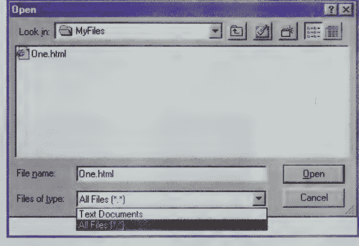

*图 1.14a*

记事本用户必须选择“所有文件”才能查看他们的标签。

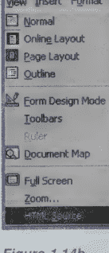

*图 1.14b*

Microsoft Word 用户必须选择“HTML 源代码”才能查看他们的标签。

# 第 1 章 HTML 快速入门

3. 输入图 1.15 所示的标题标签。

```html
<HTML>
<TITLE>HTML and JavaScript</TITLE>
<BODY>
<CENTER><H1>Creating HTML and JavaScript</H1></CENTER>
<P><H2>Learning to create HTML tags can help you in many ways:</H2></P>
<P><H3>You will develop a deeper understanding of how HTML really works.</H3></P>
<P><H4>You will be able to troubleshoot Web pages when errors occur.</H4></P>
<P><H5>You will be able to view other pages and learn how certain effects are created.</H5></P>
<P><H6>You will understand how HTML and JavaScript work together.</H6></P>
</BODY>
</HTML>
```

*图 1.15*

添加标题标签

4. 将你的新 HTML 页面保存为`Two.html`或`Two.htm`。
5. 打开你的 Web 浏览器，打开`Two.html`文件并查看它。它应该看起来像图 1.16。

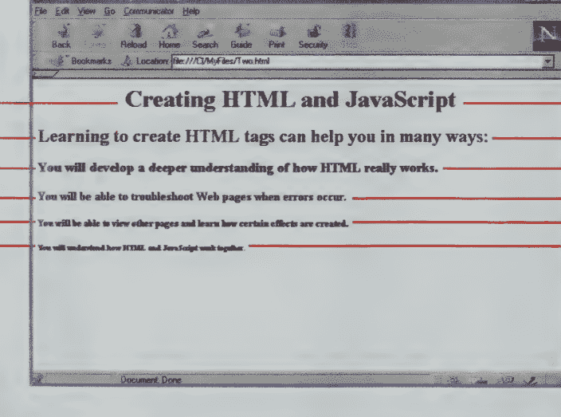

*图 1.16*

网页中的标题

## 科技思考

标题`<H></H>`标签确实会改变页面的外观。然而，在我们图 1.16 的示例中，标题标签被误用了。充其量，文档信息只有三个层级：

- `<H1>`顶部的标题
- `<H2>`冒号（`:`）后面的引言行
- `<H3>`学习 HTML 标签的四个理由列表

回到你的文档并重新组织标题标签。使用不超过三个`<H></H>`标签。想一想，然后使你的文档易于阅读，强调本文档规定的三个层级。

**重要提示** 给记事本用户：请记住在“文件类型”选项下选择“所有文件”，如图 1.14a 所示。否则，你将无法查看你的`.html`或`.htm`文件！

**重要提示** 给 Microsoft Word 用户：请记住，当你打开`.html`文件时，Word 可能会像 Web 浏览器一样显示你的网页。为了查看 HTML 标签，请从“视图”菜单中选择“HTML 源代码”，如图 1.14b 所示，然后你就可以继续处理你的标签了。


> 你想访问一个令人兴奋的地方吗？试试 Excite，网址是 [www.excite.com](http://www.excite.com)。Excite 是最受欢迎的 Web 搜索系统之一。使用 Excite，你可以查找任何方面的任何内容。尝试在搜索窗口中输入搜索词`HTML`或`JavaScript`，看看会得到什么结果。

## 活动 1.5

**目标：**

在本活动中，你将创建有序编号列表。

## 编号列表和项目符号列表

在上一个“科技思考”部分，你按要求重新组织了`Two.html`文件，并以更一致的方式使用`<H>`标签。在这个活动中，我们将进一步把事情整理得井井有条。

在 Web 页面上组织信息的最有力方法之一是使用列表。列表有几种类型，包括：

- 无序（通常是项目符号）列表`<UL></UL>`
- 有序或编号列表`<OL></OL>`

无序列表标签`<UL></UL>`将创建一个项目符号列表。用开头的`<UL>`无序列表标签开始你的列表，用列表`<LI></LI>`标签标记要列出的项目，并在列表末尾放置`</UL>`标签。试试看！

### 创建无序列表

当列表中的项目可以以任何顺序出现时，就使用无序列表。以下是在 HTML 中创建无序列表的方法：

1. 打开你的`Two.html`文件。

   > **重要提示** 给记事本用户：请记住在“文件类型”选项下选择“所有文件”，如图 1.14a 所示。否则，你将无法查看你的`.html`或`.htm`文件！
   >
   > **提示** 给 Microsoft Word 用户：请记住，当你打开`.html`文件时，Word 可能会像 Web 浏览器一样显示你的网页。为了查看 HTML 标签，请从“视图”菜单中选择“HTML 源代码”，如图 1.14b 所示，然后你就可以继续处理你的标签了。

2. 在列表的开头和末尾输入`<UL></UL>`标签，如图 1.17 所示。
3. 为列表中的每个句子添加`<LI></LI>`标签，如图 1.17 所示。
4. 将你的文件保存为`Three.html`。
5. 查看你的页面，看看效果如何。它应该类似于图 1.18。

### 创建有序列表

当项目应按特定顺序出现或你在列表中计数项目时，就使用有序列表。这个列表给出了学习 HTML 标签的四个理由。让我们快速将其转换为有序或编号列表：

6. 打开你的`Three.html`文件。

```html
<HTML>
<TITLE>HTML and JavaScript</TITLE>
<BODY>
<CENTER><H1>Creating HTML and JavaScript</H1></CENTER>
<P><H2>Learning to create HTML tags can help you in many ways:</H2></P>
<UL>
<LI><P><H3>You will develop a deeper understanding of how HTML really works.</H3></P></LI>
<LI><P><H3>You will be able to troubleshoot Web pages when errors occur.</H3></P></LI>
<LI><P><H3>You will be able to view other pages and learn how certain effects are created.</H3></P></LI>
<LI><P><H3>You will understand how HTML and JavaScript work together.</H3></P></LI>
</UL>
</BODY>
</HTML>
```

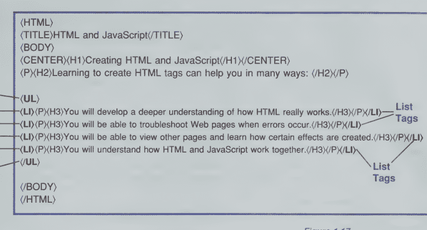

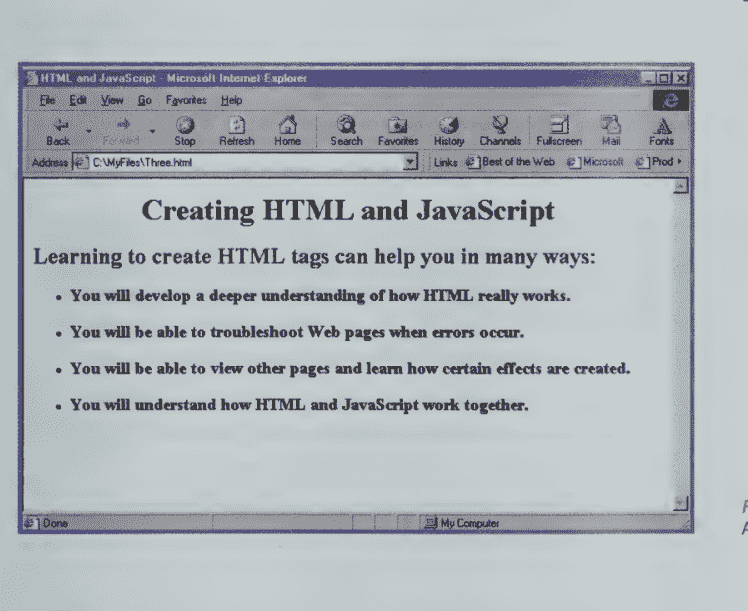

**重要提示** 给记事本用户：请记住在“文件类型”选项下选择“所有文件”，如图 1.14a 所示。否则，你将无法查看你的`.html`或`.htm`文件！

**提示** 给 Microsoft Word 用户：请记住，当你打开`.html`文件时，Word 可能会像 Web 浏览器一样显示你的网页。为了查看 HTML 标签，请从“视图”菜单中选择“HTML 源代码”，如图 1.14b 所示，然后你就可以继续处理你的标签了。


将`<UL></UL>`标签对更改为`<OL></OL>`标签对，如图 1.19 所示。无需进行其他更改。（注意：不要使用零；使用字母 O 表示有序。）

```html
<HTML>
<TITLE>HTML and JavaScript</TITLE>
<BODY>
<CENTER><H1>Creating HTML and JavaScript</H1></CENTER>
<P><H2>Learning to create HTML tags can help you in many ways:</H2></P>

<OL>
<LI><P><H3>You will develop a deeper understanding of how HTML really works.</H3></P></LI>
<LI><P><H3>You will be able to troubleshoot Web pages when errors occur.</H3></P></LI>
<LI><P><H3>You will be able to view other pages and learn how certain effects are created.</H3></P></LI>
<LI><P><H3>You will understand how HTML and JavaScript work together.</H3></P></LI>
</OL>

</BODY>
</HTML>
```

*图 1.19*

输入有序列表标签。

将你的文件保存为`Four.html`。

查看你的页面，看看效果如何。它应该类似于图 1.20。

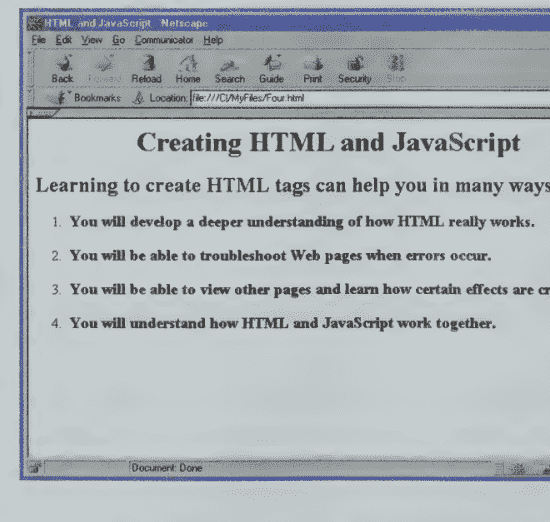

### 嵌套和缩进列表

有时你可能想要在列表中再嵌套一个列表，就像在大纲中一样。在这组步骤中，你将在编号列表内部缩进并创建无序列表。

20

第 1 章 HTML 快速入门

## 章节回顾

### 网络词汇

定义以下术语：

1. 尖括号
2. 主页
3. HTML
4. HTML 页面
5. 超文本标记语言
6. Internet Explorer
7. Java
8. JavaScript
9. Mosaic
10. Netscape Navigator
11. VRML
12. 网页浏览器
13. 网页
14. 网站
15. 网站管理员
16. 欢迎页面

### 网络回顾

简要回答以下问题：

1. 设想一种方法，向从未创建过网页的人解释 HTML 标签的工作原理。你如何向一个新手解释 HTML 的工作方式？
2. 解释查看 HTML 网页源代码的过程。
3. 解释必须如何保存 HTML 文本页面。
4. 什么是文件扩展名？请举例说明。
5. 什么是 Mosaic、Netscape Navigator/Communicator 和 Internet Explorer？它们各自对网络的发展有何贡献？

## 网络项目

### 寻找在线 HTML 资源

你刚刚被聘为 Great Applications, Inc. 的网站管理员，但你的 HTML 技能有限。你需要快速找到一些好的 HTML 信息！你该怎么做？

答案显而易见。上网。选择一个搜索引擎，如 Yahoo!、Excite、Lycos 或其他搜索工具，输入以下搜索词：

- 超文本标记语言
- HTML
- HTML 指南
- 学习 HTML

记录标题和 URL 或网址，并在下表中简要总结你找到的有用的 HTML 网页：

| 标题栏中显示的标题 | 网址或 URL | 描述 |
| --- | --- | --- |
| | | |
| | | |
| | | |
| | | |

### 网络项目团队合作：网络上七大最棒的网页

Great Applications, Inc. 正在为他们的新网站欢迎页面寻找设计灵感。请与三到四名队员组成团队，列出你们最喜欢的网页。找出七个很棒的网页，讨论是什么让它们如此出色。进行投票，并通过将七个欢迎页面从第一名排列到第七名来体现你们的投票结果。将你们团队的选择列在下面，以备将来参考。

| 排名 | 标题栏中显示的标题 | 网址或 URL |
| --- | --- | --- |
| | | |
| | | |
| | | |
| | | |
| | | |
| | | |
| | | |

## 关于技术的写作

网站对公司、团体和个人都很重要。我们都知道，没有高质量的网站，许多企业将无法经营。但是，对于非商业组织和政府机构来说，一个外观出色的网站究竟有多重要？

列出这些组织需要网站的原因。

**政府机构：**

**非营利组织：**

**大学：**

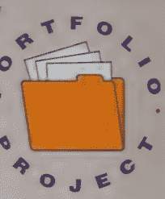

# 第 2 章

## HTML 组织技巧

### 章节目标

在本章中，你将了解如何组织你的网页。阅读第 2 章后，你将能够：

1. 使用单倍行距和双倍行距组织页面信息。
2. 使用分隔线组织页面信息。
3. 实现属性和值。
4. 通过更改属性和值来改变网页的默认颜色。
5. 更改文本颜色。
6. 创建三种类型的超链接：
   - 链接到你自己的文档内的另一个位置。
   - 链接到万维网上任意位置的 URL 或网页。
   - 链接到你自己电脑上的另一个网页。

### HTML 术语

- 属性
- 字体
- 十六进制
- HTTP
- 超链接
- 超文本链接
- 超文本传输协议
- 值

### 创建更好的网页

万维网是由成千上万的人不断创造、改进和发布令人兴奋的网页的成果。网络是一个可以完全发挥创造力的地方。要加入其中，你只需要对 HTML 和 JavaScript 有一些了解。掌握了这些工具，你的想象力将成为唯一的限制。

当您在浏览网络时，您看到过非常精彩的网页，也看到过其他效果平平的页面。一个出色的页面和一个枯燥的页面之间的主要区别在于细节——字体的选择、颜色、图片，以及有助于页面整体组织的元素选择。

有许多 HTML 技巧可以用来使你的页面完美呈现。有单倍行距和双倍行距技巧、分隔线技巧，以及其他专业的组织标签，可以使任何网页易于阅读。例如，可以通过在段落之间添加空白或在网页的不同部分之间放置分隔线来使网页更具吸引力。更改文本和页面背景的颜色也可以使 HTML 文档更具吸引力。颜色的选择极其重要。在网络空间里，没有什么比一个混合了所有错误颜色的网页更丑陋的了。使用恰当的颜色，你的页面将非常出色。

字体，或字母样式，是可以更改的。每种字体都有其独特的风格。以下是一些最常见字体的示例。

- 这是 Times New Roman。
- 这是 Arial。
- 这是 Courier。

超链接有助于使网页有趣且易于导航。超链接允许用户点击并快速跳转到网络空间中的另一个位置、他们创建的另一个页面，或当前文档中的某个位置。如果你在单个页面上有大量信息，创建索引可以帮助读者精确跳转到他们正在寻找的信息。

随着你学习本章教授的新 HTML 元素，关于如何组织网页的新想法会不断涌现。


> 想让某人抓狂吗？使用 Blink 标签。在任何一组单词周围放置`<BLINK></BLINK>`标签，它们会像大西洋城三流赌场的霓虹灯一样闪烁不停。闪烁标签会让你的网页观众感到心烦意乱。

## 单倍行距和双倍行距

大多数早期网页，即 1995 年之前的网页，可以描述为冗长、枯燥的文字集合。早期版本的 HTML 仅提供了将文本分割成可读部分的最简单方法。

这已经改变了。再也没有理由创建一个枯燥、难以阅读的网页了。在本活动中，你将亲身体验如何提高页面的可读性和组织性。

1. 打开你的文字处理软件。
2. 严格按照你所看到的方式输入以下网页信息。

记事本用户注意事项：在输入文本之前，从“*编辑*”菜单中选择“*自动换行*”选项。

```html
<HTML>
<TITLE>HTML and JavaScript</TITLE>

<BODY>
<CENTER><H1>Organizing Tags</H1></CENTER>

There are many ways to organize a Web page. This Web page will organize text, hypertext links, colors, and fonts. It will also demonstrate single spacing, double spacing, and the use of line breaks.

This Web page will display how to organize Web pages in a number of ways using:

Powerful Lines
Hyperlinks to HTML and JavaScript Sources
Hyperlinks to Previously Created Web Pages
Fancy Fonts
Perfect Pictures
Orderly Tables
Extraordinary Extras

</BODY>
</HTML>
```

**图 2.1**

严格按所示输入这些标签和单词。

3. 按照你在活动 1.3 中学到的方式保存文件，命名为`Six.html`或`Six.htm`。

打开你的 Web 浏览器并查看你的页面。它应该看起来很乱，如图 2.2 所示。

（如果你需要提醒如何在 Web 浏览器中查看`.html`文件，请回顾活动 1.3。）

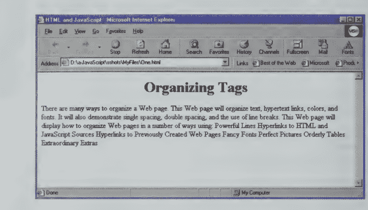

图 2.2

未经组织的网页

> ## 网络技巧
>
> ### 有些标签不需要成对出现
>
> 有些标签，如`<BR>`（换行标签），并不总是需要成对输入。例如，`<HR>`（水平线）标签可以单独创建一条线。段落标签也可以没有关闭的`</P>`标签。在大多数情况下，`<P>`标签可以单独完成工作。
>
> 留心观察。还有其他不需要成对的标签吗？

注意，尽管你在 HTML 中输入时页面可能看起来有组织，但如果没有一些组织标签，页面在 Web 上就会“崩溃”。使用几个精选的标签真的可以清理页面。

组织页面最容易使用的两个标签是`<P></P>`（段落标签）和`<BR>`（换行标签）。

- `<P></P>`标签在文本周围创建双倍间距。
- `<BR>`标签创建单倍间距的换行。

在你的文字处理器中重新打开`Six.html`文件。

Notepad 用户注意：打开文件时从*编辑*菜单中选择*自动换行*选项，这样你就可以在屏幕上看到所有文本。

按照图 2.3 中加粗标记的那样，添加`<P></P>`和`<BR></BR>`标签。

使用*另存为*选项将你重新组织的文件保存为`Seven.html`或`Seven.htm`。

检查你的工作。这次它应该看起来好多了，如图 2.4 所示。

## 思考技术

空白对文档的读者来说很重要。空白是一个术语，用来描述文本周围让读者眼睛得以休息并找到文档重要部分的区域。空白有助于为人类的眼睛打开文档。对比图 2.2 和图 2.4，看看我们所说的缺乏空白是什么意思。图 2.2 看起来很糟糕。没有空白来分隔文本中的文字。在图 2.4 中，问题已经得到了纠正。文档更容易阅读了。空白是如何让文档更容易阅读的？

```html
<HTML>
<TITLE>HTML and JavaScript</TITLE>

<BODY>
<CENTER><H1>Organizing Tags</H1></CENTER>

<P>There are many ways to organize a Web page. This Web page will organize text, hypertext links, colors, and fonts. It will also demonstrate single spacing, double spacing, and the use of line breaks.</P>

<P>This Web page will display how to organize Web pages in a number of ways using:</P>

<BR>Powerful Lines
<BR>Hyperlinks to HTML and JavaScript Sources
<BR>Hyperlinks to Previously Created Web Pages
<BR>Fancy Fonts
<BR>Perfect Pictures
<BR>Orderly Tables
<BR>Extraordinary Extras

</BODY>
</HTML>
```

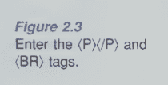

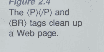

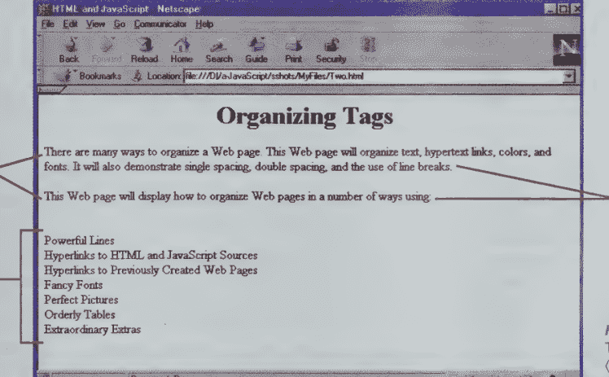

### 目标

在本活动中，你将学习如何更改网页的背景颜色，并且你将使用属性和值创建不同宽度和长度的线条。

### 线条和背景颜色

### 属性和值

HTML 标签可以通过赋予属性和值来增强。以`<BODY>`标签为例。你可以向`body`标签添加元素 Dramatically change the look of your Web page. 例如，要更改网页的背景颜色，你可以添加 background 属性命令并给标签一个颜色值，如图 2.5 所示。

试试看！

1. 打开你的`Seven.html`文件。

图 2.5

更改背景颜色

| Body 标签 | 属性 |
| --- | --- |
| `<BODY BGCOLOR=YELLOW>` | |

Notepad 用户提醒：打开文件时不要忘记从*编辑*菜单中选择*自动换行*选项。

2. 在网页顶部附近的`BODY`标签内输入`BGCOLOR=YELLOW`，如图 2.5 中加粗所示。
3. 将你的作品保存为`Eight.html`。
4. 在 Web 浏览器中查看这些更改。你的页面应该变成黄色。
5. 尝试一下。将属性更改为`BLUE`、`GREEN`、`RED`、`WHITE`或你选择的其他颜色。

### 十六进制颜色

计算机只使用数字语言。数值以计算机能理解的数字表示。颜色值可以被精确控制和更改，以匹配彩虹中几乎所有的颜色，方法是使用某些颜色的十六进制值。

十六进制数字采用 16 进制数系统，而不是我们人类通常使用的 10 进制数系统。十六进制数字使用字母 A、B、C、D、E 和 F 以及数字 0 到 9 来创建它们的 16 个不同数字。

例如，看看以下用数字表示的颜色值：

- `White = #FFFFFF`
- `Black = #000000`
- `Red = #FF0000`
- `Green = #00FF00`
- `Blue = #0000FF`
- `Yellow = #FFFF00`

这些颜色的阴影可以通过更改数字来创建。例如，一种非常漂亮的天蓝色可以用数字`00CCFF`在你的 HTML 页面上创建。想要一种漂亮的浅紫色吗？试试`FF95FF`。一种难看的黏液绿色可以用`AAFF00`创建。

在你的网页中将文本颜色值替换为数字，看看会发生什么。例如，试试这个：

```html
BGCOLOR=#AAFF00 VLINK=#FF95FF TEXT=#00CCFF LINK=#FFFF00
```

属性和值是帮助你组织网页的强大工具。最广泛使用的标签之一是`<HR>`（水平线）。打开你的`Eight.html`文件，添加图 2.6 所示的标签组。图 2.6 中标记的第一个`<HR>`标签不使用属性或值。该标签仅仅在页面中创建一条水平线。其他三个`<HR>`标签使用属性和值来更改线条的形状和大小。

重新打开你的`Eight.html`文件。输入各种`<HR>`标签、属性和值，如图 2.6 底部加粗所示，靠近`</BODY>`标签之前的位置。

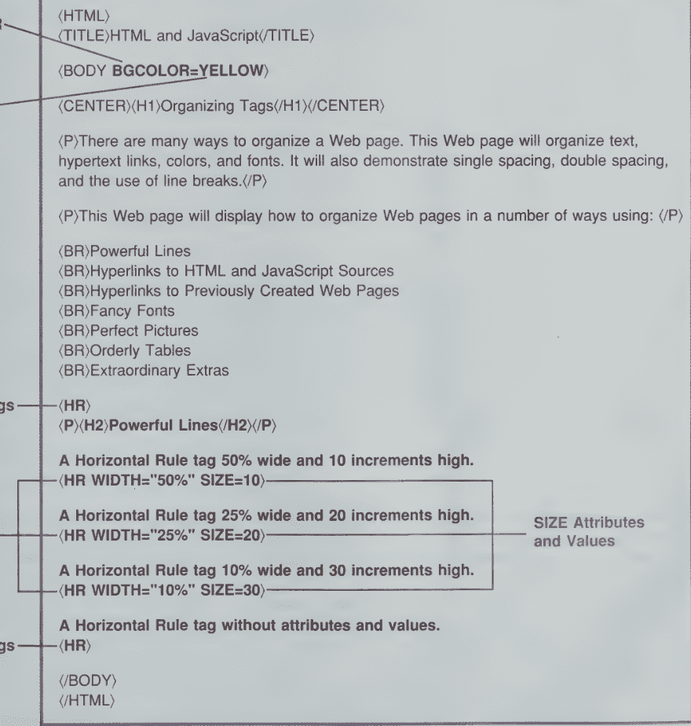

1. 将你的文件保存为`Nine.html`。
2. 在 Web 浏览器中查看水平线。页面应该看起来像图 2.7。

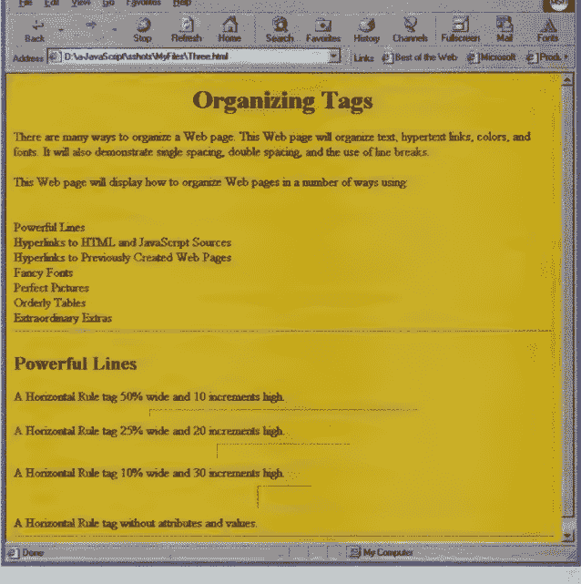

图 2.7

强大的线条

## 思考技术

你可以如何使用线条和颜色来让你的页面更生动？什么时候适合使用完整的 100% 线条？什么时候使用一半或 50% 的线条，甚至更小的 25% 线条更好？线条可以做多宽？

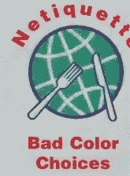

显示难以阅读的网页被认为是不礼貌的。一些网页构建者选择的背景和颜色使他们的网页难以阅读。在将你的网页发布到 WWW 之前，测试你的页面并确保所有文本都清晰显示在页面上，并且你的颜色选择不会分散你想要表达的内容。

此外，在选择颜色时，最好考虑视障人士和可能患有色盲的人。以不正确的方式混合红色和绿色色调可能会让色盲人士难以阅读文本。字体大小太小会给视力不佳的人带来麻烦。深色背景和深色文字会让任何人都难以阅读页面。

### 文档内部的超链接

网页之所以流行，是因为它们可以轻松链接到其他页面，或者以电子速度链接到文档中的各个部分。超链接很容易使用，但起初理解起来有点困难。

要使用超链接，你只需点击链接。链接可以是图片或带下划线的不同颜色文字，如图 2.8 所示。

超链接是用一种称为锚标签的特殊标签创建的。该标签有几个部分。开标签和闭标签称为锚标签或链接标签，看起来像这样：

```html
<A HREF="insert location of file"></A>
```

除非你定义了要链接到的位置，否则链接或锚标签几乎毫无用处。有几种使用链接标签的方法。你可以：

- 链接到自己文档中的另一个位置。


- 链接到 WWW 上任何位置的 URL 或网页。
- 链接到自己计算机上的另一个网页。

在活动 2.4 中，你将链接到 WWW；在活动 2.5 中，你将创建指向目前为止已创建的所有网页的超链接。在本活动中，我们将开始在你的 HTML 页面内部进行链接。

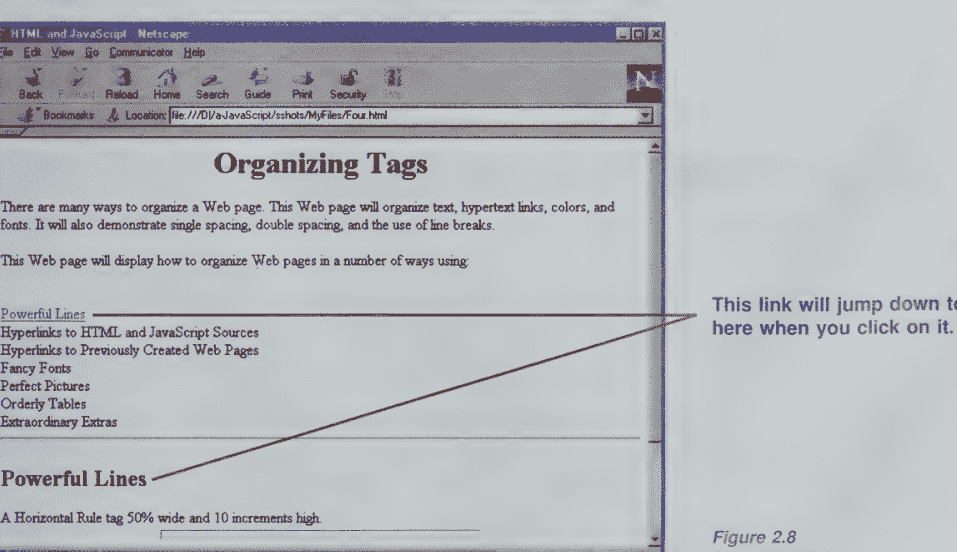

这些内部超链接可帮助用户在网页的重要部分之间导航。

您插入的第一个 `<A>` 标签将创建指向文档内某个位置的超文本链接。您将在第 2 步创建该标签。其属性为 `HREF=`，值为 `"#POWERFUL"`。引号是必需的，`#` 号也是必需的。

第二个锚点标签将标识您要链接到的网页中的确切位置。在第 4 步中，您将创建一个带有 `NAME=` 属性和名为 `"POWERFUL"` 的值的标签。

1. 打开您的 `Nine.html` 文件。
2. 将 `BGCOLOR` 属性从 `YELLOW` 改为 `WHITE`，从而将背景颜色改回白色。
3. 在第一个 *Powerful Lines* 列表项前后添加如下所示的锚点 `<A></A>` 标签，如图 2.9 所示。（注意：井号 `#` 可通过按住 Shift 键并按数字 3 键来创建。双引号 `"` 可通过按住 Shift 键并按单引号 `'` 键来创建。）
4. 围绕第二个 *Powerful Lines* 列表项插入如下所示的锚点 `<A></A>` 标签，如图 2.9 中加粗标记所示。
5. 将您的新文件另存为 `Ten.html`。
6. 在您的 Web 浏览器中查看更改。您的链接应如图 2.8 中的示例所示。当您单击该链接时，您应该会跳转到文档中的 Powerful Lines 标题处。

```html
<BR> <A HREF="#POWERFUL">Powerful Lines</A>
```

```html
<P><H2><A NAME="POWERFUL">Powerful Lines</A></H2></P>
```

## 网络道德——尊重 WWW

您在网页中写的内容不应冒犯他人。您需要对自己创建并发布到 WWW 上的内容负责。尊重网络。在创建网页时，请考虑以下准则：

- `R` = *责任*：承担个人责任，只创建合乎道德和适当的内容。
- `E` = *每个人*：尝试创建每个人都会享受、欣赏并认为有价值的网页。
- `S` = *简洁*：使您的网页易于导航，使信息易于查找。
- `P` = *目的*：为您发布到网络上的每个网页设定一个明确的目的。不要发布不必要的页面。
- `E` = *道德*：确保您发布的每个网页的所有内容都符合您的价值观，并具有有益的目的。
- `C` = *正确*：确保页面上的所有单词拼写正确，所有句子书写正确，所有超链接都有效。
- `T` = *绝对值得一访*：尝试创建其他人会认为绝对值得花时间访问的页面。

```html
<HTML>
<TITLE>HTML and JavaScript</TITLE>

<BODY BGCOLOR=WHITE>
<CENTER><H1>Organizing Tags</H1></CENTER>

<P>There are many ways to organize a Web page. This Web page will organize text, hypertext links, colors, and fonts. It will also demonstrate single spacing, double spacing, and the use of line breaks.</P>

<P>This Web page will display how to organize Web pages in a number of ways using: </P>

<BR><A HREF="#POWERFUL">Powerful Lines</A>
<BR>Hyperlinks to HTML and JavaScript Sources
<BR>Hyperlinks to Previously Created Web Pages
<BR>Fancy Fonts
<BR>Perfect Pictures
<BR>Orderly Tables
<BR>Extraordinary Extras

<HR>
<P><H2><A NAME="POWERFUL">Powerful Lines</A></H2></P>

A Horizontal Rule tag 50% wide and 10 increments high.
<HR WIDTH="50%" SIZE=10>

A Horizontal Rule tag 25% wide and 20 increments high.
<HR WIDTH="25%" SIZE=20>

A Horizontal Rule tag 10% wide and 30 increments high.
<HR WIDTH="10%" SIZE=30>

A Horizontal Rule tag without attributes and values.
<HR>

</BODY>
</HTML>
```

## 思考技术

您能否想出如何创建一个内部超链接，使您能够从文档底部跳转到顶部？使用您在本活动中学习的相同步骤，在 `</BODY>` 标签之前创建一个链接，该链接将带您返回页面顶部。您的链接应如下所示：<u>页面顶部</u>。将您额外努力完成的作品另存为 `TenToTop.html`。

您认为一个返回页面顶部的链接为什么有价值？

## 活动 2.4：创建指向 Web 的超文本链接

### 目标

在本活动中，您将创建指向包含 HTML、JavaScript 和 Web 上使用的其他语言信息的网站的链接。

WWW 最初流行起来的原因是能够从一个页面跳转到世界任何地方的另一个页面。然而，在您能够这样做之前，您必须完全了解 URL。URL 是统一资源定位符。URL 允许 Web 浏览器精确定位 Web 上的特定文件。这个概念实际上相当简单。

您是否见过类似此示例的 URL？

`http://www.swep.com/webpagefolder/anotherfolder/afileyouwant.html`

当您在 HTML 网页中输入一个 URL（统一资源定位符）时，您正在标识通往位于网络空间某处特定 HTML 文件的路径。此文件可能在您的本地计算机上，也可能在 Web 上的某处。

您通常可以在 URL 的末尾看到文件的名称。看看我们示例 URL 的末尾。文件名 `afileyouwant.html` 是一个 HTML 文件（`afileyouwant`）的名称。`.html` 扩展名标识该文件为一个可由 Web 浏览器显示的 HTML 文档。

然而，在您访问到 `afileyouwant.html` 之前，您需要知道通往此文件名的路径或方式。找到文件名路径的关键在于 URL 或网址。让我们通过将示例 URL 分解为其各个部分来看看这意味着什么。

在某些 URL 中，您可能会看到字母 `http` 后跟一个冒号和两个斜杠。`http://` 告诉您的网络如何传输或移动您请求的文件。**HTTP** 代表**超文本传输协议**。**协议**是一种用于通过网络传输数据的通信系统。它就像 Web 服务器用于与 Web 浏览器通信的神秘数字语言。

地址的第二部分（`www.swep.com`）是托管您正在寻找的网页的实际服务器名称。`www` 代表万维网。`www` 告诉您此服务器使用 Web 技术。`.swep` 部分是维护该 Web 服务器的公司名称。在这种情况下，`swep` 是西南教育出版公司的简称。`.com` 表示这是一个商业或企业网站。您可能会看到其他标记为 `.edu`（教育）或 `.gov`（政府网站）的地址。

URL 其余部分中的斜杠和名称（`/webpagefolder/anotherfolder/`）代表网络计算机上的文件夹。这些也称为子目录。您的计算机上也有子目录。图 2.10 显示了 Windows 计算机上文件夹的组织方式。所有计算机都使用某种文件夹系统来组织文件。如果您想在计算机上找到一个文件，您需要知道通过众多可能隐藏该文件的文件夹的路径。知道路径是找到所需网页的关键。

在您找到网站的欢迎页面之前，您需要知道 URL。在本活动中，您将为一些在创建更好、更激动人心的 Web 方面最重要的公司输入 URL。其中许多网站都有关于 HTML、JavaScript 和其他重要 Web 工具的信息。它们包括：

- `http://www.microsoft.com`
- `http://home.netscape.com`
- `http://www.sun.com`
- `http://www.oracle.com`

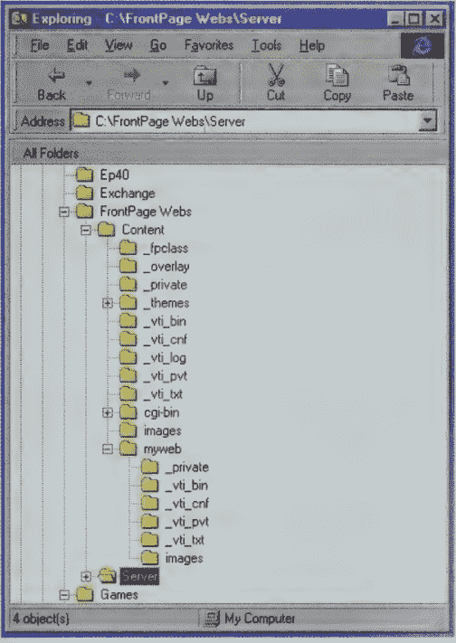

**图 2.10**——Windows 文件夹或子目录组织结构

1. 打开您的 `Ten.html` 文件。
2. 从页面顶部附近的列表和您正在创建的新部分之间，创建一个超文本链接（如图 2.11 中加粗标记所示）。

```html
<A HREF="#HYPERLINKS">Hyperlinks to HTML and JavaScript Sources</A>
```

3. 在您的网页最后一个 `<HR>` 标签之后和 `</BODY>` 标签之前，添加一个新的二级标题，标题文字为 Hyperlinks to HTML and JavaScript Sources，如图 2.11 所示。包含 `<A NAME>` 标签，以便您可以从第 2 步中创建的链接创建内部超文本链接。

```html
<P><H2><A NAME="hyperlinks"> Hyperlinks to HTML and JavaScript Sources</A></H2></P>
```

4. 在您的新标题下方、`</BODY>` 标签之前，按照以下所示以及图 2.11 中加粗的部分，创建以下超文本链接。

```html
<BR><A HREF="http://www.microsoft.com">Microsoft</A>
<BR><A HREF="http://home.netscape.com">Netscape</A>
<BR><A HREF="http://www.sun.com">Sun Microsystems</A>
<BR><A HREF="http://www.oracle.com">Oracle</A>
```

*图 2.11：超文本链接标签*

```html
<HTML>
<TITLE>HTML and JavaScript</TITLE>

<BODY BGCOLOR=WHITE>
<CENTER><H1>Organizing Tags</H1></CENTER>

<P>There are many ways to organize a Web page. This Web page will organize text, hypertext links, colors, and fonts. It will also demonstrate single spacing, double spacing, and the use of line breaks.</P>

<P>This Web page will display how to organize Web pages in a number of ways using: </P>

<BR><A HREF="#POWERFUL">Powerful Lines</A>
<BR><A HREF="#HYPERLINKS">Hyperlinks to HTML and JavaScript Sources</A>
<BR>Hyperlinks to Previously Created Web Pages
<BR>Fancy Fonts
<BR>Perfect Pictures
<BR>Orderly Tables
<BR>Extraordinary Extras

<HR>
<P><H2><A NAME="POWERFUL">Powerful Lines</A></H2></P>

A Horizontal Rule tag 50% wide and 10 increments high.
<HR WIDTH="50%" SIZE=10>

A Horizontal Rule tag 25% wide and 20 increments high.
<HR WIDTH="25%" SIZE=20>

A Horizontal Rule tag 10% wide and 30 increments high.
<HR WIDTH="10%" SIZE=30>

A Horizontal Rule tag without attributes and values.
<HR>

<P><H2><A NAME="HYPERLINKS"> Hyperlinks to HTML and JavaScript Sources </A></H2></P>
<BR><A HREF="http://www.microsoft.com">Microsoft</A>
<BR><A HREF="http://home.netscape.com">Netscape</A>
<BR><A HREF="http://www.sun.com">Sun Microsystems</A>
<BR><A HREF="http://www.oracle.com">Oracle</A>

</BODY>
</HTML>
```

5. 你的完整标签页面现在应该与图 2.11 中的一致。将你的作品保存为 `Eleven.html`。
6. 在网页浏览器中查看你的作品。你的新链接应该看起来像图 2.12。

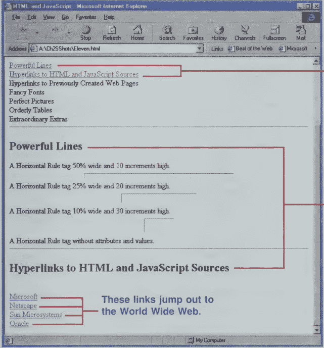

这些链接从这里跳转到这里的页面下方。

这些链接跳转到万维网。

**图 2.12：网页浏览器中的超链接**

7. 如果你有网络连接，尝试你的链接，看看它们是否有效！（注意：如果你的链接无法正常工作，仔细检查你的标签并进行必要的修正。重新保存你的作品。然后，在你的网页浏览器中重新加载或刷新页面，再次尝试。请记住，除非你先刷新，否则浏览器不会自动查找你新修正的网页。你可以通过几种方式来实现。你可以重新打开页面，或者点击*重新加载*或*刷新*按钮，将更新后的网页副本加载到你的浏览器中。）

## 技术思考

最重要的十个网站是什么？它们为什么对你重要？创建一个新的 HTML 页面，为你的最重要个人网页建立索引并列出它们。将该页面命名为 *My Web Resources*。在学习本书的过程中，持续添加到你的网页资源页面中。

**第 2 章** HTML 组织技巧

## 活动 2.5：链接到你已创建的页面

### 目标

在本活动中，你将创建指向你之前创建的网页的链接。

在本活动中，你将链接到你在本课程中已经创建的前 11 个 HTML 页面。以这种方式跟踪你的所有页面将帮助你快速回顾你所取得的进步。

1. 打开你的 `Eleven.html` 文件。
2. 从页面顶部附近的列表和你正在创建的新部分之间创建一个超文本链接。要输入的文本在此处和图 2.13 中以粗体显示。

```html
<BR><A HREF="#PREVIOUS">Hyperlinks to Previously Created Web Pages</A>
```

3. 在活动 2.3 中创建的网页链接列表之后，按照图 2.13 所示创建一个新的 `<HR>` 标签。
4. 如图 2.13 所示，在你刚创建的新 HR 标签下方、`</BODY>` 标签之前，添加一个名为 *Hyperlinks to Previously Created Web Pages* 的新二级标题。包含 `<A NAME>` 标签，这样你就可以从第 3 步创建的标签链接到这个确切位置。

```html
<HR>
<P><H2><A NAME="PREVIOUS">Hyperlinks to Previously Created Web Pages</A></H2></P>
```

5. 在文档末尾附近的新标题下方，按照此处和图 2.13 中加粗部分所示，精确创建以下超文本链接。

```html
<BR><A HREF="One.html">One</A>
<BR><A HREF="Two.html">Two</A>
<BR><A HREF="Three.html">Three</A>
<BR><A HREF="Four.html">Four</A>
<BR><A HREF="Five.html">Five</A>
<BR><A HREF="Six.html">Six</A>
<BR><A HREF="Seven.html">Seven</A>
<BR><A HREF="Eight.html">Eight</A>
<BR><A HREF="Nine.html">Nine</A>
<BR><A HREF="Ten.html">Ten</A>
<BR><A HREF="Eleven.html">Eleven</A>
```

6. 你的完整标签页面现在应该与图 2.13 中的一致。将你的作品保存为 `Twelve.html`。

> **网络提示：大写错误**
>
> 你可能听说过，在电子邮件或新闻组消息中使用大写字母被认为是 shouting。在网页上，输入大写文本并不被视为 shouting。相反，大写字母允许你*强调*文本。然而，大写字母往往使文本难以阅读。大写字母的使用应保留给标题或你希望读者注意的重要词语。全部大写的段落很难阅读！所以，请谨慎使用大写字母。


## HTML 与 JavaScript 示例

```
<HTML>
<TITLE>HTML and JavaScript</TITLE>

<BODY BGCOLOR=WHITE>
<CENTER><H1>Organizing Tags</H1></CENTER>

<P>There are many ways to organize a Web page. This Web page will organize text, hypertext links, colors, and fonts. It will also demonstrate single spacing, double spacing, and the use of line breaks.</P>

<P>This Web page will display how to organize Web pages in a number of ways using: </P>

<BR><A HREF="#POWERFUL">Powerful Lines</A>
<BR><A HREF="#HYPERLINKS">Hyperlinks to HTML and JavaScript Sources</A>
<BR><A HREF="#PREVIOUS">Hyperlinks to Previously Created Web Pages</A>
<BR>Fancy Fonts
<BR>Perfect Pictures
<BR>Orderly Tables
<BR>Extraordinary Extras

<HR>
<P><H2><A NAME="POWERFUL">Powerful Lines</A></H2></P>
A Horizontal Rule tag 50% wide and 10 increments high.
<HR WIDTH="50%" SIZE=10>

A Horizontal Rule tag 25% wide and 20 increments high.
<HR WIDTH="25%" SIZE=20>

A Horizontal Rule tag 10% wide and 30 increments high.
<HR WIDTH="10%" SIZE=30>

A Horizontal Rule tag without attributes and values.
<HR>

<P><H2><A NAME="HYPERLINKS">Hyperlinks to HTML and JavaScript Sources
</A></H2></P>

<BR><A HREF="http://www.microsoft.com">Microsoft</A>
<BR><A HREF="http://home.netscape.com">Netscape</A>
<BR><A HREF="http://www.sun.com">Sun Microsystems</A>
<BR><A HREF="http://www.oracle.com">Oracle</A>

<HR>
<P><H2><A NAME="PREVIOUS"> Hyperlinks to Previously Created Web Pages</A></H2></P>

<BR><A HREF="One.html">One</A>
<BR><A HREF="Two.html">Two</A>
<BR><A HREF="Three.html">Three</A>
<BR><A HREF="Four.html">Four</A>
<BR><A HREF="Five.html">Five</A>
<BR><A HREF="Six.html">Six</A>
<BR><A HREF="Seven.html">Seven</A>
<BR><A HREF="Eight.html">Eight</A>
<BR><A HREF="Nine.html">Nine</A>
<BR><A HREF="Ten.html">Ten</A>
<BR><A HREF="Eleven.html">Eleven</A>

</BODY>
</HTML>
```

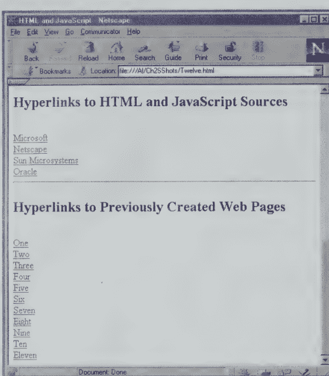

在网页浏览器中查看你的作品。你的新链接应该看起来像图 2.14。测试每个链接，确保它们都能正常工作。进行任何必要的修正。（注意：同样，如果你的链接无法正常工作，检查你的标签，进行必要的修正，然后重新保存你的作品。然后，在你的网页浏览器中重新加载或刷新页面。）

## 技术思考

既然你已经创建了超文本链接列表，如何将你的列表变成项目符号列表和编号列表？尝试使用`<OL>`、`<UL>`和`<LI>`标签将你的超链接变成项目符号列表和编号列表。

*图 2.14*

链接到之前创建的网页

HTML 是一种强大的工具，因为它允许各种计算机显示网页。使用 HTML，无论你运行 Macintosh 还是 Windows 机器都没关系。你甚至可以在 UNIX 工作站或其他类型的计算机上。

HTML 网页能够被各种类型的计算机看到的原因是，HTML 守护者维护着一套所有网页浏览器制造商自愿遵循的标准。新标准和

## 互联网里程碑

## HTML 标准

新的 HTML 标签和命令一直在增加。每个新标签都会提交给标准委员会审核。时不时地，足够多的新命令被添加到 HTML 中，以至于出现 HTML 的新版本。这些版本用数字标识，如 HTML 1、HTML 2、HTML 3、HTML 4 等。

你可以在线了解更多关于 HTML 标准的信息，并获得扩展 HTML 技能的帮助。前往你的搜索引擎，尝试以下搜索词。

- HTML Standards
- HTML Standards Committee
- HTML 1
- HTML 2
- HTML 3
- HTML 4
- HTML 5
- HTML Learning
- HTML Guides

### 文本着色

当你浏览网页时，可能会注意到文本颜色经常随着页面不同而变化。在活动 2.1 中，你通过在`<BODY>`标签的`BGCOLOR=`属性中插入`YELLOW`值，更改了网页的背景色。然后你又将背景色改为了其他几种颜色。更改文本颜色同样简单。

你可以更改三种基本的文本颜色类型：

#### 活动 2.6

**目标：**

在本活动中，你将更改文本、链接和已访问链接的颜色属性。

| 文本类型 | 属性 |
| :--- | :--- |
| 文本本身 | `TEXT=` |
| 超文本链接颜色 | `LINK=` |
| 已访问链接颜色（或你已选择过的链接） | `VLINK=` |

1. 打开你的*Twelve.html*文件。
2. 在网页开头的 body 标签中，保持`BGCOLOR`为`WHITE`，但将`TEXT=`设为`BLUE`，`LINK=`设为`RED`，`VLINK=`设为`GREEN`，如图 2.15 所示。
3. 将你的作品另存为*Thirteen.html*。

```
<HTML>
<TITLE>HTML and JavaScript</TITLE>

<BODY BGCOLOR=WHITE TEXT=BLUE LINK=RED VLINK=GREEN>
```

**图 2.15**

创建指向你之前网页的链接

## 网络提示

查找 HTML 错误

校对 HTML 标签可能很困难。即使是最轻微的错误也可能彻底改变网页的外观和结构。以下是一些常见的注意事项。

- 确保你所有的尖括号`<`和`>`方向正确。
- 网页编写者在创建尖括号或斜杠时，常常误用 Shift 键。这会导致本该出现斜杠或尖括号的位置出现逗号、句号或问号。
- 如果所有文本都居中显示，可能是你忘记了关闭`</CENTER>`标签。
- 如果你想要双空格而不是单空格，请使用`<P>`标签而不是`<BR>`标签。
- 如果列表后面出现了很长的项目符号，可能是你忘记了关闭无序列表标签`</UL>`。
- 很多时候需要引号来标识值。如果某个值不起作用，请检查是否需要“引号”。
- 确保每次修改网页后都保存文件。
- 不要忘记网页必须重新加载或刷新后更改才能生效。

在你的网页浏览器中查看你的作品。你的页面应该呈现白色背景上的蓝色文本、红色超链接和绿色已访问链接，如图 2.16 所示。

## 思考技术

尝试用下表列出的十六进制数值替换`<BODY>`标签中的颜色名称。在数字前使用数字或井号（`#`）。参见*网络知识：十六进制颜色*。一些最常见的十六进制数值是：

- 红色（RED）= `#FF0000`
- 绿色（GREEN）= `#00FF00`
- 蓝色（BLUE）= `#0000FF`
- 白色（WHITE）= `#FFFFFF`
- 黑色（BLACK）= `#000000`
- 黄色（YELLOW）= `#FFFF00`

*图 2.16*

*更改文本颜色*

> 另一个有趣的标签是跑马灯标签。放在跑马灯标签`<MARQUEE></MARQUEE>`之间的任何内容都会像股票行情指示器一样在屏幕上滚动。该标签由微软为 Internet Explorer 浏览器设计，并非在所有浏览器上都有效。试试看，会发生什么。在合适的浏览器中，它很酷！

## 章节复习

### 网络词汇

定义以下术语：

1. 属性（attributes）
2. 字体（fonts）
3. 十六进制（hexadecimal）
4. HTTP
5. 超链接（hyperlinks）
6. 超文本链接（hypertext links）
7. 超文本传输协议（Hypertext Transfer Protocol）
8. 值（values）

### 网络复习

简要回答以下问题：

1. 什么标签会让文字反复闪烁？
2. 哪个十六进制值会创建黄色？
3. 你知道哪些标签不需要关闭标签也能有效工作？
4. 三种常见的 HTML 错误是什么？
5. RESPECT 中的字母分别代表什么？
6. 为什么 HTML 有不同的版本？


#### 网上七大最无组织的页面

在第 1 章的网络项目团队合作练习中，你确定了你能找到的七个最棒的网页。在这个网络项目中，Great Applications, Inc. 希望你确定你能找到的七个最差的页面。这些页面将用于培训研讨会，帮助新员工学习如何创建高质量的网页。你的经理建议你上网冲浪，找到七个难以阅读、无组织或枯燥的网页的例子，向新实习生展示*不该*做什么。

上网寻找糟糕的网页例子。记录每个页面的标题和 URL，并用自己的话写一个简要总结，解释为什么这些页面质量很差！

| 标题栏中显示的标题 | 网址或 URL | 这些页面质量差的原因总结 |
|---|---|---|
| | | |
| | | |
| | | |
| | | |
| | | |
| | | |
| | | |
| | | |
| | | |
| | | |

#### 网络项目团队合作 构建产品信息页面

Great Applications, Inc. 正在举办一场设计竞赛，看看谁能构建信息最丰富、组织最合理的网页。具体来说，他们希望找到一个团队，能够创建通过网络向客户介绍新产品的网页。

比赛给三到五人的团队两个小时的时间，为他们选择的某个产品创建一个信息丰富的网页。组建你的团队，集思广益，想一个要介绍的新产品。它可以是新 CD 或新电脑游戏。可以是新时尚或新汽车。就本次比赛而言，你选择什么产品并不太重要，所以不要花太多时间决定使用哪个产品。

创建你团队的网页参赛作品。分配写作职责。让一个人输入基本标签并担任网页管理员。让每个团队成员研究并撰写网页的一部分。通过编辑和修改彼此的写作和 HTML 标签进行协作。使用你在本章学到的技术来组织你想呈现的信息。

## 关于技术的写作

我们都知道团队合作很重要。但是，是否有团队合作比单独工作更困难的时候？回答以下关于团队一起创建网页的问题。


在你参与网络项目团队合作活动中，作为团队一员一起工作时，遇到了什么问题？

你是如何组织你的团队的？你是如何分配工作的？哪些团队成员负责哪些活动？

团队合作是否创造了更好的网页？如果是，如何做到的？

你会给其他试图一起创建网页的团队什么建议？

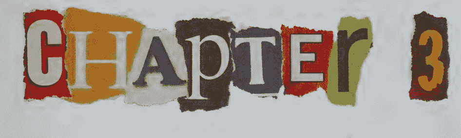

## HTML 高级技巧

### 章节目标

在本章中，你将为你的网页添加样式和特殊效果。阅读第 3 章后，你将能够：

1. 控制字体的大小、样式和颜色。
2. 从网上下载图片。
3. 将图片插入到你的网页中。
4. 更改图形的大小。
5. 使用表格组织信息。
6. 将图片转换为超链接。
7. 在网页中插入各种数据输入选项。

### HTML 术语

`.gif`

`.jpg`或`.jpeg`

字体（fonts）

图形（graphics）

图形交换格式（Graphics Interchange Format）

图像（image）

联合图像专家组（Joint Photographic Expert Group）

表格单元格（table cell）

### 精彩的网络

网络充满了图片、声音和电影，这些都为网页增添了趣味。通常，万维网上有两种图片（称为**图形**或**图像**）。它们包括`.gif`文件（**图形交换格式**）和`.jpg`或`.jpeg`（**联合图像专家组**）文件。扩展名`.gif`和`.jpg`有助于告诉你的浏览器这些文件是图片，而不是`.html`文本文件，需要特殊处理。

你对 HTML 了解得越多，就能为你的网页添加越多令人兴奋的新效果和样式。正如我们在第 2 章提到的，**字体**，即字母的样式，可以被更改。每种字体都有其独特的风格。

通过使用`<FONT>`标签的众多属性和值，你可以以无数种方式操作字体。

表格允许将网页的部分内容划分开来，为每个你可能想包含的新元素或信息片段创建特殊的空间。

表格、字体和图片可以为你的页面增添强大的功能。在本章中，你将学习操作这些特殊的 HTML 特性。你还将学习一些特殊的输入标签，它们将允许访问你网页的访客与你的网页进行互动。

## 活动 3.1

### 目标：

在本活动中，你将更改字体样式、大小和颜色。

## 字体属性和值

当你在`<BODY>`标签中更改文本颜色时（就像在活动 2.6 中所做的那样），你更改的是整个页面的文字颜色。如果你想有更多控制权（即，如果你想更改单个段落、单个句子甚至单个单词的大小、颜色或样式），请使用`<FONT>`标签。

使用`<FONT>`标签的属性来控制：

- 使用`SIZE`属性`<FONT SIZE=#>`控制文字大小
- 使用`FACE`属性`<FONT FACE=#>`控制文字样式
- 使用`COLOR`属性`<FONT COLOR=#>`控制文字颜色

1. 打开你的*Thirteen.html*文件。
2. 在页面顶部附近的列表中创建一个超文本链接，该链接将指向你在本活动中将要创建的新部分。要输入的文本在此处和图 3.1 中以粗体显示。

`<BR><A HREF="#FONTS">Fancy Fonts</A>`

3. 如图 3.1 所示，在你创建的活动 2.5 的网页链接列表之后，创建一个新的`<HR>`标签。
4. 如图 3.1 所示，在你刚创建的新`<HR>`标签下方、`</BODY>`标签之前，添加一个名为*Fancy Fonts*的二级标题。包含`<A NAME>`标签以完成你在步骤 2 中开始的内部超文本链接。

`<HR>`

`<P><H2><A NAME="FONTS"> Fancy Fonts </A></H2></P>`

5. 在新标题下方，靠近文档末尾，完全按照此处和图 3.1 粗体所示输入字体标签、属性和值。

`<BR><FONT FACE=HELVETICA SIZE=4 COLOR=RED>This is the Helvetica font at Size 4</FONT>`

`<BR><FONT FACE=TIMES SIZE=6 COLOR=GREEN>This is the Times font at Size 6</FONT>`

`<BR><FONT FACE=ARIAL SIZE=8 COLOR=ORANGE>This is the Arial font at Size 8</FONT>`

`<BR><FONT FACE=COURIER SIZE=2 COLOR=BLACK>This is the Courier font at Size 2</FONT>`

6. 你的标签现在应该看起来像图 3.1 中的那些。将你的工作保存为*Fourteen.html*。

## 网络小贴士

### 添加强调效果

还有其他方法可以改变文本的外观。在某些词语周围尝试这些标签，看看它们会产生什么效果。你能猜出它们的作用吗？

`<B></B>`

`<EM></EM>`

`<STRONG></STRONG>`

`<I></I>`


# HTML 高级技巧

## 活动 3.1：组织标签

以下是一个 HTML 文档示例，展示了如何组织网页中的文本、超链接、颜色和字体：

```
<HTML>
<TITLE>HTML and JavaScript</TITLE>
<BODY BGCOLOR=WHITE TEXT=BLUE LINK=RED VLINK=GREEN>
<CENTER><H1>Organizing Tags</H1> </CENTER>
(P)There are many ways to organize a Web page. This Web page will organize text, hypertext links, colors, and fonts. It will also demonstrate single spacing, double spacing, and the use of line breaks.</P>
(P>This Web page will display how to organize Web pages in a number of ways using: </P>
<BR>(A HREF="#POWERFUL")Powerful Lines</A>
<BR>(A HREF="#HYPERLINKS")Hyperlinks to HTML and JavaScript sources</A>
<BR>(A HREF="#PREVIOUS")Hyperlinks to previously created Web pages</A>
<BR>(A HREF="#FONTS")Fancy Fonts</A>
<BR>Perfect Pictures
<BR>Orderly Tables
<BR>Extraordinary Extras
<HR>
(P><H2>(A NAME="POWERFUL")Powerful Lines(/A)</H2)(/P)
A Horizontal Rule tag 50% wide and 10 increments high.
<HR WIDTH="50%" SIZE=10>
A Horizontal Rule tag 25% wide and 20 increments high.
<HR WIDTH="25%" SIZE=20>
A Horizontal Rule tag 10% wide and 30 increments high.
<HR WIDTH="10%" SIZE=30>
A Horizontal Rule tag without attributes and values.
<HR>
(P><H2>(A NAME="HYPERLINKS")Hyperlinks to HTML and JavaScript sources(/A)</H2)(/P)
<BR>(A HREF="http://www.microsoft.com")Microsoft(/A)
<BR>(A HREF="http://home.netscape.com")Netscape(/A)
<BR>(A HREF="http://www.sun.com")Sun Microsystems(/A)
<BR>(A HREF="http://www.oracle.com")Oracle(/A)
<HR>
(P><H2>(A NAME="PREVIOUS") Hyperlinks to previously created Web pages(/A)</H2)(/P)
<BR>(A HREF="One.html")One(/A)
<BR>(A HREF="Two.html")Two(/A)
<BR>(A HREF="Three.html")Three(/A)
<BR>(A HREF="Four.html")Four(/A)
<BR>(A HREF="Five.html")Five(/A)
<BR>(A HREF="Six.html")Six(/A)
<BR>(A HREF="Seven.html")Seven(/A)
<BR>(A HREF="Eight.html")Eight(/A)
<BR>(A HREF="Nine.html")Nine(/A)
<BR>(A HREF="Ten.html")Ten(/A)
<BR>(A HREF="Eleven.html")Eleven(/A)
<HR>
(P><H2>(A NAME="FONTS") Fancy Fonts </A></H2)(/P)
<BR>(FONT FACE=HELVETICA SIZE=4 COLOR=RED)This is the Helvetica font at Size 4(/FONT)
<BR>(FONT FACE=TIMES SIZE=6 COLOR=GREEN)This is the Times font at Size 6(/FONT)
<BR>(FONT FACE=ARIAL SIZE=8 COLOR=ORANGE)This is the Arial font at Size 8(/FONT)
<BR>(FONT FACE=COURIER SIZE=2 COLOR=BLACK)This is the Courier font at Size 2(/FONT)
</BODY>
</HTML>
```

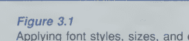

在你的网页浏览器中查看你的作品。你的更改应该看起来像图 3.2。进行任何必要的修正。

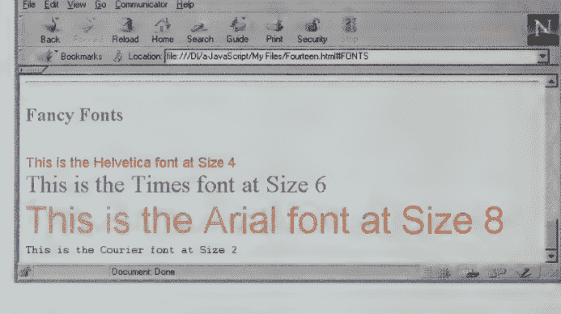

图 3.2 各种字体样式、大小和颜色

## 思考技术

你可以通过更改字体大小、字体颜色和字体来使你的页面更漂亮。你还能做哪些其他的字体更改？尝试更改你的 `Fourteen.html` 网页介绍性段落中的字体样式、颜色和大小。尝试几种新的字体颜色和字体组合。尝试从 1 到 9 的各种字体大小。将你的新作品保存为 `Fourteen-2.html`。

> **网络乐趣**
>
> 很容易为你的读者创建一种通过电子邮件回复你的网页的方式。只需使用 `mailto` 标签，如下所示：`<A HREF="mailto:your_email@address">Your Name</A>`。当你的用户点击链接时，会出现一个电子邮件表单。并非每个网页浏览器都设置正确来处理这个 `mailto` 标签，所以请尝试一下。在你能够实际发送邮件之前，你可能需要本地网站管理员的一些帮助。

## 下载和插入图形

## 活动 3.2

图片可以在许多地方找到。你可以在你的剪贴画收藏中找到图片，用扫描仪将图片扫描到你的计算机中，绘制你自己的图片，或者从网上复制它们。然而，在你能够在网页中轻松使用图片之前，你需要将它们转换为可接受的网页格式之一。这些通常包括：

**目标：** 在本活动中，你将从网上下载一个图形并将其插入网页。

- `.gif`
- `.jpg` 或 `.jpeg`

第一种图形或图像格式 `.gif` 最初由 CompuServe 创建，以提供一种可以在低速调制解调器上轻松传输的压缩图形格式。**图形交换格式**通常缩写为 GIF。关于如何读 GIF 存在一些争论。在美国的某些地区，它的发音像 Kathy Lee Gifford 中的 GIF。在美国的其他地区，它的发音像 JIFly 花生酱中的 GIF。两种发音都可以。毕竟，发音丝毫不会改变文件格式。

第二种常用格式是 `.jpg` 或 `.jpeg`。它被懂行的网站管理员读作 J-Peg。JPEG 是**联合图像专家小组**的缩写。这种格式遵循一套国际图形标准。JPEG 图形，像 GIF 图片一样，足够紧凑，适合互联网使用。

网络上还出现了其他图形文件格式。但如果你知道如何处理这两种格式，你就知道如何在万维网上处理任何其他图片格式。

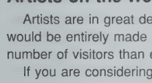

## 网络上的艺术家

艺术家在网站开发公司中非常抢手。曾几何时，网页完全由文字或文本组成。如今，图片似乎主导了网页，吸引了比以往更多的访问者。

如果你考虑从事艺术职业，可以考虑网络。你可能会发现你的大部分艺术作品最终都会出现在网络上。拥有网站的大型公司和网站开发者总是在寻找优秀的艺术家。

你可以使用任何你喜欢的媒介或方法来创作你的艺术。扫描仪可以获取你的图片并将其转换为数字图像。数字文件可以转换为可在网络上使用的格式。你也可以使用各种艺术软件来创作你的艺术作品，或者改进你扫描成网页图像的任何艺术。

对网页艺术家来说，最好的培训就是尽可能多地参加艺术课程。你需要用来转换艺术作品的图形工具很容易学习。艺术家的技能则需要更多时间来培养。

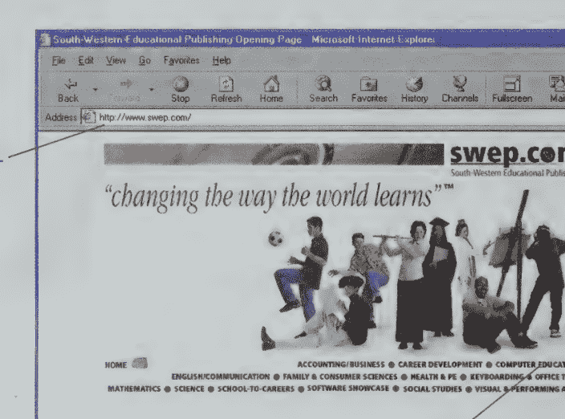

网址

图 3.3 访问 `www.swep.com`。

计算机教育

> **网络提示**
>
> **快捷地址**
>
> *已为《HTML与JavaScript：编程概念》的学生活动主页提供了一个快捷网址：`htmljava.swep.com`。*

1. 打开你的网页浏览器。
2. 在网页浏览器中输入网址 `www.swep.com`。
3. 如图 3.3 所示，点击*计算机教育*。
4. 在下一个屏幕的左侧，选择*产品与资源*。
5. 在计算机教育类别框中选择 `Internet`，然后点击“开始”！
6. 向下滚动，找到*《HTML与JavaScript：编程概念》*网页。
7. 点击*学生活动*链接。
8. 从你看到的列表中，点击*活动 3.2：完美图片*链接。向下滚动直到你看到一条龙。
9. 如果你使用的是 Windows 电脑，如图 3.4 所示，在龙的鼻子上单击鼠标右键。如果你使用的是 Macintosh 电脑，在龙的鼻子上点击并按住鼠标键。
10. 从出现的列表中选择*将图像另存为*或*将图片另存为*命令，如图 3.5a 和 3.5b 所示。（注意：你浏览器上的命令措辞可能有所不同。请尝试出现的不同命令，直到找到正确的命令。）

图 3.4 在 Windows 中，用鼠标右键单击龙的鼻子；在 Macintosh 上，则按住鼠标点击器。


56

第 3 章 HTML 高级技巧

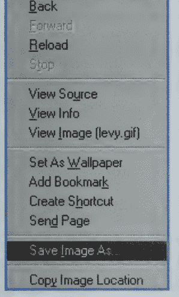

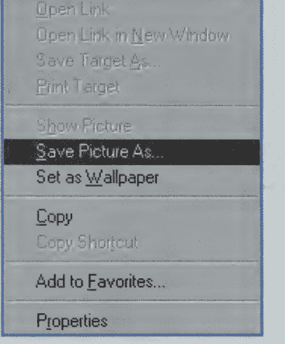

11. 将你的文件（名为 `Levy.gif`）保存在你一直保存网页的同一个文件夹中。
12. 在你的文字处理器或文本编辑器中打开你的 `Fourteen.html` 网页。
13. 在页面顶部附近的列表中创建一个超文本链接，该链接将链接到你即将创建的新部分。要输入的文本在此处和图 3.6 中以粗体显示。

```
<BR><A HREF="#PICTURES">Perfect Pictures</A>
```

> **网络提示**
>
> **（IMG SRC）标签中的一个常见错误**
>
> `IMG SRC` 是 `ImaGe SouRCe`（图像源）的缩写。许多人错误地使用这个标签，将 R 和 C 调换，输入了 `IMG SCR`。如果你忘记了这个标签，只需拼写出单词 "ImaGe" 和 "SouRCe"，就能得到正确的字母顺序。

14. 输入一个 `<HR>` 标签，如图 3.6 中粗体所示，该标签应位于你在前一个活动中创建的“花式字体”部分之后。
15. 如图 3.6 所示，在你刚刚创建的 `<HR>` 标签下方、`</BODY>` 标签之前，添加一个新的二级标题，名为*完美图片*。包含 `<A NAME>` 标签，这样你就可以完成第 13 步开始的内部超文本链接。

```
<HR>
<P><H2><A NAME= "PICTURES"> Perfect Pictures </A></H2></P>
```

16. 在你新标题的下方，靠近文档末尾的位置，输入一个图像源（`IMG SRC`）标签，如本处和图 3.6 所示。注意，你刚刚下载的文件名出现在引号之间。

```

```

第 3 章 HTML 高级技巧

57

17. 你的标签现在应该像图 3.6 中那样显示。如果一切看起来正确，请将你的工作保存为 `Fifteen.html`。

```
HTML
<TITLE> HTML and JavaScript </TITLE>

<BODY BGCOLOR=WHITE TEXT=BLUE LINK=RED VLINK=GREEN>
<CENTER><H1>Organizing Tags</H1></CENTER>

<P>There are many ways to organize a Web page. This Web page will organize text, hypertext links, colors, and fonts. It will also demonstrate single spacing, double spacing, and the use of line breaks.</P>

<P>This Web page will display how to organize Web pages in a number of ways using:</P>

<BR><A HREF="#POWERFUL">Powerful Lines</A>
<BR><A HREF="#HYPERLINKS">Hyperlinks to HTML and JavaScript sources</A>
<BR><A HREF="#PREVIOUS">Hyperlinks to previously created Web pages</A>
<BR><A HREF="#FONTS">Fancy Fonts</A>
<BR><A HREF="#PICTURES">Perfect Pictures</A>
<BR>Orderly Tables
<BR>Extraordinary Extras

<HR>
<P><H2><A NAME= "POWERFUL">Powerful Lines</A></H2></P>

A Horizontal Rule tag 50% wide and 10 increments high.
HR WIDTH="50%" SIZE=10

A Horizontal Rule tag 25% wide and 20 increments high.
HR WIDTH="25%" SIZE=20

A Horizontal Rule tag 10% wide and 30 increments high.
HR WIDTH="10%" SIZE=30

A Horizontal Rule tag without attributes and values.
HR

<P><H2><A NAME="HYPERLINKS">Hyperlinks to HTML and JavaScript sources</A></H2></P>
```

```
BR<A HREF="http://www.microsoft.com">Microsoft</A>
BR<A HREF="http://home.netscape.com">Netscape</A>
BR<A HREF="http://www.sun.com">Sun Microsystems</A>
BR<A HREF="http://www.oracle.com">Oracle</A>

<HR>
<P><H2><A NAME= "PREVIOUS">Hyperlinks to previously created Web pages</A></H2></P>

BR<A HREF="One.html">One</A>
BR<A HREF="Two.html">Two</A>
BR<A HREF="Three.html">Three</A>
BR<A HREF="Four.html">Four</A>
BR<A HREF="Five.html">Five</A>
BR<A HREF="Six.html">Six</A>
BR<A HREF="Seven.html">Seven</A>
BR<A HREF="Eight.html">Eight</A>
BR<A HREF="Nine.html">Nine</A>
BR<A HREF="Ten.html">Ten</A>
BR<A HREF="Eleven.html">Eleven</A>

<HR>
<P><H2><A NAME= "FONTS">Fancy Fonts</A></H2></P>

BR<FONT FACE=HELVETICA SIZE=4 COLOR=RED>This is the Helvetica font at Size 4</FONT>
BR<FONT FACE=TIMES SIZE=6 COLOR=GREEN>This is the Times font at Size 6</FONT>
BR<FONT FACE=ARIAL SIZE=8 COLOR=ORANGE>This is the Arial font at Size 8</FONT>
BR<FONT FACE=COURIER SIZE=2 COLOR=BLACK>This is the Courier font at Size 2</FONT>

<HR>
<P><H2><A NAME="PICTURES">Perfect Pictures</A></H2></P>

IMG SRC="levy.gif"

</BODY>
</HTML>
```

图 3.6

插入图形或图像文件

16. 在你的网页浏览器中查看你的作品。你的图片应该看起来像图 3.7，但在你的浏览器中它可能显得更大或更小。

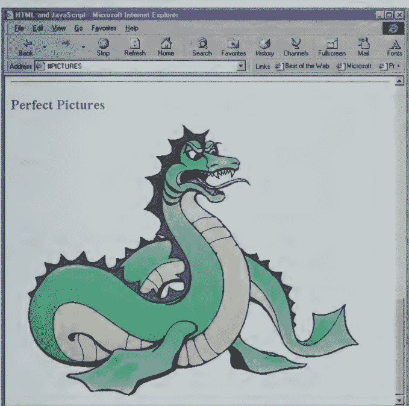

图 3.7

在浏览器中看到的你的 GIF 图像

## 思考技术

图片如何增加或减少网站的吸引力？你是否曾想访问一个没有图片的网页？为什么想或为什么不想？

下载另一张图片并将其放入你的网页。按照第 1 到 9 步操作，但这次，下载“龙骑士”戴娜的图片，她就在“龙”列维的下方。将这张图片插入你的网页。将你的新作品保存为 `Fifteen-2.html`。


如果你想更深入地了解 HTML，可以直接在网上订购 HTML 书籍。一个值得访问的好地方是 `amazon.com`。`Amazon.com` 是万维网上最大的书店。如果你在 `amazon.com` 找不到你要找的书，那它可能根本不存在。在互联网里程碑报告《网络业务》第 65 页可以了解更多关于 `Amazon.com` 的信息。

## 活动 3.3

**目标：**

在本次活动中，你将操作图形属性和值。

## 各种尺寸的图片

通过更改标签的值，可以多种方式修改图片。图片可以用作覆盖整个网页背景的墙纸。它们可以居中对齐，也可以靠左或靠右对齐。根据你的需要，它们可以变大或变小。

你也可以使用 `HEIGHT` 和 `WIDTH` 属性来改变图片的尺寸。精确控制图片的尺寸对于使页面看起来清晰和有趣非常有帮助。

在本活动的第一部分，你将把图片右对齐并使其变小。在第二部分，你将把三个不同尺寸的龙水平排列在页面上，然后通过操作几个标签，将三个龙垂直放置在网页上。

> **网络提示**
>
> **插入背景**
>
> 要让一张图片成为你的背景，请在 `BODY` 标签中插入 `BACKGROUND` 属性，如下所示：
>
> `BODY BACKGROUND="levy.gif"`
>
> 尝试用另一张图片作为你的背景。确保文件名出现在引号（`" "`）之间。

1. 打开你的 `Fifteen.html` 文件。

2. 在文档末尾附近，按照此处和图 3.8 中粗体所示，向你的 `IMG SRC` 标签添加以下信息。

```
<P></P>
```

3. 将你的更改保存为 `Sixteen.html`。

4. 在你的网页浏览器中查看你的更改。它应该如图 3.9 所示出现。

5. 接下来，创建三个横跨屏幕显示的图片，每个图形显示为不同的尺寸。为此，在第一个 `IMG SRC` 标签下方输入以下标签，如本处和图 3.8 所示。

```


```

6. 重新保存你的更改（使用相同的 `Sixteen.html` 文件名），并在你的网页浏览器中查看你的添加内容。你的更改应该类似于图 3.9 中标记的三个图像。如果你的图形没有显示，请进行必要的更正，重新保存，然后再次查看。

7. 就在你上一步输入的三个标签下方，再添加两个 `IMG SRC` 标签，使用 `/P` 标签使多个图形垂直出现。完全按照此处和图 3.8 所示输入这些标签。

```
<P></P>
<P></P>
```

8. 将你的更改重新保存为 `Sixteen.html`，并在网页浏览器中查看结果。参考图 3.8 和图 3.9 评估标签和图形的显示效果。在必要时进行更正，并在浏览器中检查任何更改。

## 组织标签

组织网页的方式多种多样。本网页将对文本、超文本链接、颜色和字体进行组织，同时演示单倍行距、双倍行距以及换行符的使用。

本网页将展示如何运用以下多种方式来组织网页：

- 强力横线
- 指向 HTML 和 JavaScript 源的超链接
- 指向先前创建的网页的超链接
- 华丽字体
- 精美图片
- 有序表格
- 额外补充

### 强力横线

宽度 50%、高度 10 个单位的水平线标签。

`<HR WIDTH="50%" SIZE=10>`

宽度 25%、高度 20 个单位的水平线标签。

`<HR WIDTH="25%" SIZE=20>`

宽度 10%、高度 30 个单位的水平线标签。

`<HR WIDTH="10%" SIZE=30>`

不带属性和值的水平线标签。

`<HR>`

### 指向 HTML 和 JavaScript 源的超链接

- [Microsoft](http://www.microsoft.com)
- [Netscape](http://home.netscape.com)
- [Sun Microsystems](http://www.sun.com)
- [Oracle](http://www.oracle.com)

### 指向先前创建的网页的超链接

- [一](One.html)
- [二](Two.html)
- [三](Three.html)
- [四](Four.html)
- [五](Five.html)
- [六](Six.html)
- [七](Seven.html)
- [八](Eight.html)
- [九](Nine.html)
- [十](Ten.html)
- [十一](Eleven.html)

### 华丽字体

- `<FONT FACE=HELVETICA SIZE=4 COLOR=RED>`这是 Helvetica 字体，字号为 4`</FONT>`
- `<FONT FACE=TIMES SIZE=6 COLOR=GREEN>`这是 Times 字体，字号为 6`</FONT>`
- `<FONT FACE=ARIAL SIZE=8 COLOR=ORANGE>`这是 Arial 字体，字号为 8`</FONT>`
- `<FONT FACE=COURIER SIZE=2 COLOR=BLACK>`这是 Courier 字体，字号为 2`</FONT>`

### 精美图片

```
<P></P>


<P></P>
<P></P>
```

**图 3.9** 更改属性和值后的 GIF 图片

## 关于技术的思考

你能多快地将 `levy.gif` 图片替换为另一张图片？想想你喜欢的另一张图片。在网页上找到它，并将其复制到你的网页文件夹中。（请务必先查看本活动中的*网络伦理*主题！）将 `Sixteen.html` 文件中所有 `levy.gif` 文件名替换为你想要显示的新图片名称。例如，将 `levy.gif` 替换为 `dayna.gif`，就能用屠龙者代替龙。调整属性和值，以各种尺寸显示你的新图片。将你的新作品保存为 `Sixteen-2.html`。

## 网络伦理：图片盗版

网络上的一个大问题是图片盗版。由于从网上获取图片非常容易，许多人在未经许可的情况下就这么做了。许多图片都是有版权的，也就是说，有人拥有它们。要使用这些图片，你需要获得艺术家的许可或支付费用。

迪士尼拥有许多受版权保护的图片。他们已经对非法使用或修改其版权图片的网站创建者采取了法律行动。

请慎重考虑你从网上下载和使用的图片。它们是否可以免费使用？有许多地方允许免费下载图片。例如，你从本书相关网站借用的图片已获得授权供你使用。

## 有序表格

当你想到一张摆放整齐、准备好用于盛大节日聚餐的餐桌时，你会想到一切是多么井然有序。所有的餐具、盘子、杯子和银器都排列整齐，各就各位。

电子表格也是如此。表格创建小方框，你可以在其中放置内容以保持整齐有序。在本活动中，你将创建一个表格，然后将你已经学过的许多标签插入到这些称为**表格单元格**的小方框中。

使用 `<TABLE>` 标签可以轻松创建表格。通过添加 `BORDER` 属性和数值，单元格可以拥有边框。你还可以使用 `CELLPADDING` 属性使图片和文字周围的单元格区域变大。在单元格内，你可以将图片和文字居中、左对齐或右对齐。

1. 打开你的 `Sixteen.html` 文件。

2. 在页面顶部附近的列表中创建一个超文本链接，链接到你正在创建的新部分。需要输入的文本在此处以粗体显示，如图 3.10 所示。

   `<BR><A HREF="#TABLES">有序表格</A>`

3. 在你在活动 3.2 和 3.3 中插入的图片之后，创建一个新的 `<HR>` 标签。

4. 如图 3.10 所示，在你刚创建的 `<HR>` 标签下方、`</BODY>` 标签之前，添加一个名为*有序表格*的二级标题。包含 `<A NAME>` 标签，以便完成你在步骤 2 中开始的内部超文本链接。

```
<HR>
<P><H2><A NAME="TABLES">有序表格</A></H2></P>
```

5. 在新标题下方、文档末尾附近，按照此处所示以及图 3.10 中粗体所示，输入 `<TABLE>` 标签、属性和值。

```
<TABLE BORDER=5 CELLPADDING=10 ALIGN=CENTER>
<TR>
    <TH>龙</TH>
    <TH>颜色</TH>
    <TH>字体</TH>
</TR>
<TR>
    <TD></TD>
    <TD BGCOLOR=RED ALIGN=CENTER>红色</TD>
    <TD ALIGN=CENTER><FONT FACE=TIMES SIZE=7 COLOR=GREEN>Times</TD>
</TR>
<TR>
    <TD></TD>
    <TD BGCOLOR=GREEN ALIGN=CENTER>绿色</TD>
    <TD ALIGN=CENTER><FONT FACE=COURIER SIZE=10>Courier</TD>
</TR>
</TABLE>
```

这些标签创建顶行。

这些标签创建中间行。

这些标签创建底行。

你的标签现在应该看起来如图 3.10 所示。将你的作品保存为 `Seventeen.html`。

**图 3.10** 在 HTML 中创建表格

## 活动 3.4

### 目标

在本活动中，你将创建一个表格，并用图片、颜色和各种文本填充其单元格。

### 网络小贴士：图片作为超链接

当链接是一张图片时，你该如何创建超链接？很简单。使用与创建超文本链接相同的标签结构，但用 `IMG SRC` 标签替换你通常输入的文字。试试看！

```
<P><A HREF="One.html"></A></P>
```

此链接将打开你用本书创建的第一个页面。想想从那时起你学到了多少！

**64**

**第 3 章** HTML 高级技巧

7. 在 Web 浏览器中查看你的作品。你的新链接应如图 3.11 所示。测试每个链接，确保它们都能正常工作。如有必要，进行任何修正。

**图 3.11** 浏览器中显示的 HTML 表格

## 思考技术

表格如何用于展示信息？你可以使用表格标签创建哪些东西？如何使用 HTML 表格标签创建一个月度日历？尝试一下。为本月创建一个日历。将你的作品保存为 `Calendar.html`。你可以在后续的练习中使用此文件。

## 互联网里程碑

## 网络商务

多年来，Web 一直是一个难以谋生之地。事实上，过了很多年，Web 的商业潜力才被认识到。最早开始在网上获得可观利润的一些 Web 公司包括美国在线（America Online）、雅虎（Yahoo!）和亚马逊（Amazon.com）。

有些公司之所以成功，是因为他们敢于涉足无人敢去的地方。多年来，互联网用户声称 Web 将很快取代印刷书籍。亚马逊公司的人对这一理论持不同意见，开始在 Web 上销售书籍。他们卖出了如此多的书，以至于其他图书公司意识到，他们必须上网，否则就要将很大一部分业务拱手让给亚马逊。巴诺书店（Barnes & Noble）是最早与亚马逊一起在 WWW 上销售图书的主要书商之一。索尼发现 Web 是销售音乐 CD 的好地方。Egghead 发现 Web 是销售软件的好地方。你还能想到哪些其他东西会在网上大卖？你能建立一个网络企业并从 Web 中赚很多钱吗？

## 活动 3.5

**目标：**

在本活动中，你将为页面添加多种数据输入标签。

## 非凡附加功能

在本活动中，你将学习一些额外的标签，这些标签能为你的 Web 页面增添非凡的功能。这些标签将允许访问你 Web 页面的人与文档进行交互。

HTML 中添加了许多数据输入选项，或称为 `<FORM>` 标签选项。这些选项为你提供了多种方式向访问你 Web 页面的访客提问。这些标签为你的 Web 页面提供了额外的功能。这些小"附加功能"可以使你的 Web 页面更加令人兴奋和非凡。

你将输入四种基本输入标签。它们包括：

- 文本框
- 下拉列表
- 单选按钮
- 复选框

这是你开始学习 JavaScript 之前的最后一项活动。所以，这在某种程度上是一种测试。我们不会给你所有可供参考的标签。思考一下你应该如何将这些新标签整合到你的 Web 页面中。别担心；你会以出色的字体颜色顺利通过。如果你有任何问题，请复习前面活动中的步骤。图 3.12 展示了你将添加到你的 Web 页面的新标签。

*图 3.12* 多种数据输入标签

```
<FORM>

Enter your first name:
<INPUT TYPE="TEXT" SIZE="25">
<BR>
Enter your last name:
<INPUT TYPE="TEXT" SIZE="25">
<P>

<SELECT>
<OPTION SELECTED>Pick your favorite team from this list:
<OPTION>Chicago Bulls
<OPTION>Utah Jazz
<OPTION>Los Angeles Lakers
<OPTION>Indiana Pacers
<OPTION>New Jersey Nets
<OPTION>Phoenix Suns
</SELECT>
<P>

The best place to eat is:
<BR>

<INPUT TYPE="RADIO" NAME="BEST">Wendy's<BR>
<INPUT TYPE="RADIO" NAME="BEST">McDonalds<BR>
<INPUT TYPE="RADIO" NAME="BEST">Taco Bell<BR>
<INPUT TYPE="RADIO" NAME="BEST">Burger King<BR>
<INPUT TYPE="RADIO" NAME="BEST">Kentucky Fried Chicken<BR>
<P>

I like to eat:
<BR>
<INPUT TYPE="CHECKBOX">Hamburgers<BR>
<INPUT TYPE="CHECKBOX">Tacos<BR>
<INPUT TYPE="CHECKBOX">Chicken Strips<BR>
<INPUT TYPE="CHECKBOX">Fries<BR>
<INPUT TYPE="CHECKBOX">Hot Dogs<BR>
<P>

</FORM>
```

文本框

下拉列表

## 非凡附加功能

输入你的名字：

输入你的姓氏：

从列表中选择你最喜欢的球队

最佳就餐地点是：

- Wendy's
- McDonalds
- Taco Bell
- Burger King
- Kentucky Fried Chicken

单选按钮

我喜欢吃：

- [ ] Hamburgers
- [ ] Tacos
- [ ] Chicken Strips
- [ ] Fries
- [ ] Hot Dogs

复选框

**图 3.13** 使用表单创建的非凡附加功能

1. 打开你的 `Seventeen.html` 文件。

2. 在你的 Web 页面末尾附近创建一个名为 *非凡附加功能* 的新部分。

3. 从你的 Web 页面顶部附近的索引列表创建一个内部超文本链接，链接到你正在创建的新部分。将这个链接命名为 *非凡附加功能*。

4. 以你认为合适的任何方式更改新部分标题的颜色、字体大小和字体样式。

5. 在你的新"非凡附加功能"部分中，在页面底部的 `</BODY>` 标签之前，输入图 3.12 中所示的标签。

6. 将你的作品保存为 `Eighteen.html`。

7. 打开你的 Web 浏览器并尝试所有输入选项。它们应如图 3.13 所示。哪些可以工作？改正发现的任何错误，重新保存，然后再试一次。

8. 制作你自己的表单。返回你的 Web 页面并更改所有选择项。

9. 将你的作品保存为 `Eighteen-2.html` 并测试你的更改。它们效果如何？

## 网络礼仪

## 下载过多图片

将你不打算使用的图片下载到学校网络被认为是不礼貌的。图形会占用计算机大量空间。下载数百张图片而不使用它们是对网络服务器驱动器空间的浪费。考虑删除你实际上不使用的任何图片。

## 思考技术

这些非凡的输入框都要求用户提供不同种类的信息。你会对以下 `FORM` 属性期望什么样的回应？

`TEXT`

`OPTION`

`RADIO`

`CHECKBOX`

第 3 章 HTML 高级技巧

67

## 章节回顾

### 网络词汇

定义以下术语：

1. `.gif`
2. `.jpg` 或 `.jpeg`
3. `fonts`
4. `graphics`
5. `Graphics Interchange Format`
6. `image`


## 7. Joint Photographic Expert Group

## 8. table cell

## 网络回顾

简要回答以下问题：

1. 为什么艺术家在 WWW 上如此抢手？
2. 什么时候从 Web 上取走图片是违法的？
3. 如果你不打算使用图片，为什么不将它们下载到学校或工作场所的网络很重要？
4. 如何使用以及为什么要使用以下标签？

```html
<B></B>
```

```html
<EM></EM>
```

```html
<STRONG></STRONG>
```

```html
<I></I>
```

5. 如何使用以及为什么要使用 `BACKGROUND` 属性？
6. 你会使用什么标签使图形成为超链接？


## 创建在线调查

Great Applications, Inc. 想要进入在线视频游戏业务。然而，在开始编写下一个伟大的在线视频游戏之前，它希望调查潜在客户，了解他们想玩和购买什么样的在线游戏。

头脑风暴 10 个问题，帮助 Great Applications 了解其客户希望在视频游戏程序中获得什么。运用你的 `<FORM>` 标签技能，创建一个在线调查，从潜在客户那里收集信息。让你的调查询问受访者的姓名和电子邮件地址。提出利用下拉列表、单选选择项和复选框的问题。

## 网络项目团队合作：表格之旅

Great Applications, Inc. 要求你的团队规划一次世界巡演，向五大城市的人们展示其新的软件视频游戏。你和你的团队被要求使用 `<TABLE>` 标签为此次巡演创建一个活动日历。巡演必须在一个月内进行，应涉及五个主要城市。

创建日历时，创建链接到你将在巡演中访问的城市的旅游信息。使用单元格内边距和单元格边框使表格更有趣。你甚至在单元格中放入图片来展示你为软件发布选定的五个城市。

为了节省一些时间，借用你在活动 3.4 的“思考技术”部分中创建的日历。修改这些标签以适应此练习。

## 撰写技术

在你完成 HTML 部分并进入 JavaScript 之前，评估 HTML 对全球通信和经济的影响和重要性。

WWW 和 HTML 对世界经济有多重要？

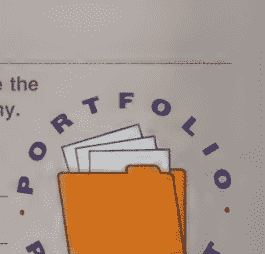

Web 如何使全球的小型企业受益？

# JavaScript 的激动人心世界

欢迎来到 JavaScript 的激动人心世界！在前三章中，你学习了使用超文本标记语言创建网页的基础知识，但现在是时候进入互联网开发的不同领域了。

HTML 在很多方面都是一个强大的工具，它能够在网络上完成许多有趣的事情。事实上，比任何其他技术，HTML 更是当今互联网如此受欢迎的关键。然而，HTML 有其局限性，这仍然是一个事实。有很多互联网编程任务无法用 HTML 完成，因此专业软件开发者很快就开始要求更多功能。结果，现在有几种不同的互联网技术可供选择，这些技术由多家不同的公司开发。你可能听说过其中一些产品，例如 CGI、PERL、CORBA、Java，当然还有 JavaScript。这些技术中的每一种都是为了满足不同的编程需求而设计的，因此专业程序员倾向于选择不同的工具来解决不同的问题。但它们都有一个共同点，那就是它们都依赖 HTML 以某种方式在赛博空间中导航。

你可以说超文本传输协议是信息高速公路，而 HTML 代表了在这条高速公路上行驶的各种“交通工具”。这些交通工具形状和大小各异，承载着不同类型的负载，但它们都有一个共同的纽带。

现在你已经了解了互联网的 HTML 基础，以及 JavaScript 被设计来增强这一基础。你可能不会惊讶地发现，网页开发者将 JavaScript 代码嵌入 HTML 文档的方式是使用两个特殊标签：

`<SCRIPT> </SCRIPT>`

|  |  |  |
| :--- | :--- | :--- |
| 第四章： | 什么是 JavaScript？ | 74 |
| 第五章： | 使用 JavaScript 操作图像 | 98 |
| 第六章： | 使用 JavaScript 创建表单 | 124 |

这些标签告诉网页浏览器，出现在这些标签之间的文本应被解释为 JavaScript 程序的一部分，而不是显示在屏幕上的字面信息。这是 JavaScript 开始将你带入编程世界，远离格式化世界的地方。然而，与真正的编程语言不同，JavaScript 不需要你去购买专门的软件包，将其从人类可读的形式（称为源代码）转换为机器可读的形式（称为目标代码、二进制代码、可执行代码或机器代码）。传统的编程语言，如 Pascal、C++ 甚至 Java，通过编译器执行转换，它们通常带有专门的编辑器、调试器、项目管理器、在线帮助系统等。这类软件包被称为集成开发环境，其中一些非常昂贵！但对于 JavaScript，你可以用创建 HTML 代码的完全相同的方式创建源代码——只需一个简单的文本编辑器或文字处理器。当包含嵌入式 JavaScript 程序的 HTML 文档被浏览器加载时，程序会被转换为机器代码并执行。其输出作为生成的 HTML 文档的一部分显示。换句话说，完全有可能一个网页文档在一台计算机系统上显示的内容与在另一台计算机系统上完全不同！它甚至可能在同一台计算机系统上，前一分钟显示的内容与后一分钟完全不同！我们将在第四章中了解更多关于这方面的内容。

JavaScript 赋予你许多成熟编程语言的功能，同时保持 HTML 编码的简单性。这真是一个有用且高效的组合！

希望这个关于 JavaScript 的简要介绍已经激发了你的兴趣，那么让我们开始忙碌地学习更多关于它是什么、它能做什么以及它是如何工作的知识。


## 什么是 JavaScript？

### 章节目标

在本章中，你将接触 JavaScript。阅读第四章后，你将能够：

1. 理解 JavaScript 的用途。
2. 使用 `<SCRIPT>` 和 `</SCRIPT>` 标签。
3. 学习使用 JavaScript 对象。
4. 学习使用 JavaScript 方法。
5. 理解 JavaScript 语法。

### JavaScript 术语

- 二进制代码
- 编译器
- 条件
- 解释
- 关键字
- 方法
- 对象
- 运算符
- 参数列表
- 编程语言
- 脚本语言
- `<SCRIPT>` 和 `</SCRIPT>` 标签
- 状态行
- 语法
- 标记
- 网页浏览器

### JavaScript 简介

JavaScript 有时被称为编程语言，但更准确地说它是一种脚本语言。编程语言和脚本语言之间的区别相当微妙，但理解起来很重要。这两种类型的语言都必须从人类可读的形式转换为机器可读的形式。对于编程语言，这一过程在程序运行之前由一种称为编译器的高度专业化软件执行。程序员不仅知道必须进行这种转换，而且还能控制操作。然而，对于脚本语言，则不需要显式调用代码转换过程。它会在源代码被目标程序处理时自动在后台发生。更具体地说，HTML 文档必须由人编写，然后由一种称为网页浏览器的特殊程序处理。当该 HTML 文档包含嵌入的 JavaScript 代码时，该代码会被网页浏览器解释，并“即时”转换为机器可读的格式。解释仅仅是程序员用来描述这种在运行时自动发生的逐行转换过程的术语。

在正常情况下，JavaScript 代码的输出只不过是一串（或可能是多串）文本，这些文本只是被插入到 HTML 页面中。生成的页面由网页浏览器显示，就像这些文本是被人直接输入到原始 HTML 源文档中一样。将 JavaScript 嵌入 HTML 文档的真正威力在于，上述生成的文本可以从一天到下一天，甚至从一分钟到下一分钟发生变化。完全有可能一个人在他的网页浏览器中输入一个特定的 URL，看到的网页与另一个人输入完全相同的 URL 看到的网页完全不同！这些差异可能是由于时间差异、位置差异，甚至是网页浏览器差异造成的。JavaScript 能够检测当前操作环境中的各种情况并做出相应的反应。这个概念在活动 4.3 中会有更详细的探讨。

网页浏览器检测特定的 HTML 页面是否包含嵌入的 JavaScript 代码非常容易。只需要文档创建者使用 `<SCRIPT>` 标签标记 JavaScript 部分的开始，然后使用 `</SCRIPT>` 标签表示该部分的结束。这两个标签之间的所有内容都将被网页浏览器解释为 JavaScript 源代码，而不是标准的 HTML 文本。然后浏览器将脚本（通过解释过程）转换为等效的机器可读形式，称为二进制代码。然后执行此二进制代码，其输出（如果有的话）将被插入到 HTML 文本流中，并像被人输入到原始 HTML 文档中一样显示。你跟上了吗？

你还需要理解的是，你将在 `<SCRIPT>` 和 `</SCRIPT>` 标签之间嵌入的脚本不能是你随意放进去的任何旧文本。相反，文本必须符合一些相当严格的规则，否则当你尝试查看页面时，网页浏览器会在屏幕上显示一个令人讨厌的错误消息。这正是为什么 JavaScript 被称为脚本语言——因为它必须遵守称为程序语法的精确语法规则。在本章中，你将学习 JavaScript 对象和方法，以及 JavaScript 关键字和运算符。一旦你掌握了这些基本的编程元素，你就能很快开始构建大型复杂的脚本。

废话少说——让我们开始工作吧！■

> 网络事实

### 谁先出现——Java 还是 JavaScript？

许多对互联网技术只有粗略了解的人倾向于认为 Java 编程语言和 JavaScript 脚本语言是同一回事。即使那些知道它们不是同一回事的人有时也会好奇它们如何相互关联，或者哪个是先创建的。答案是 Java 首先由 Sun Microsystems 公司创建。Sun 在 1995 年向公众发布了其新的跨平台编程语言，此后一直以前所未有的速度持续增长。

Sun 并不是唯一一家寻找增强标准 HTML 能力的公司。Netscape 通信公司也一直在忙于研究将可编程脚本嵌入 HTML 网页的方法，他们需要在设计中纳入一个定义良好的语法。当 Netscape 的开发者看到 Java 语言变得如此流行时，他们决定从 Sun 获得 Java 名称的许可，并在他们自己的脚本语言中使用 Java 语法。Netscape 努力的最终成果是 JavaScript，他们也在这项技术上取得了相当大的成功。

## 活动 4.1

**目标：**

在本活动中，你将学习使用文档对象的 `write()` 方法。

## 你好，万维网！

JavaScript 代码的主要目的是生成将被插入到标准 HTML 文本流中的文本。JavaScript 本质上由许多称为对象的不可见实体组成，这些对象包含一套定义明确的功能。为了让 JavaScript 程序员能够利用这些功能，他们必须调用这些对象内的一个或多个称为方法的专用函数。方法被调用的方式是，程序员输入对象的名称，后跟一个句点（即 `.` 字符），再跟上方法的名称。

方法名称后面始终跟随着一个参数列表，即使列表中有时没有任何条目。理解方法参数的最佳方式或许是将其想象成一个食谱的配料清单。参数列表只是为方法提供其正确执行特定功能所需的信息。参数列表的语法由一个左括号 `(`、零个或多个参数项（用逗号分隔）和一个右括号 `)` 组成。例如，如果你想调用 JavaScript `document` 对象的 `write()` 方法，你应该这样写：

```javascript
document.write("一段文本字符串")
```

现在你已经看到了一个简单的 JavaScript 编码示例，让我们给你一个机会，将这个示例整合到一个包含嵌入式 JavaScript 的实际 HTML 文档中。准备好了吗？那我们开始吧。

打开你的文本编辑器或文字处理器，完全按照图 4.1 所示输入 HTML/JavaScript 代码。（关于图 4.1 中部分文本缩进的原因，请参阅《网络礼仪：注意你的花括号》，第 89 页。）

```html
<HTML>
<HEAD>
<TITLE>JavaScript 活动 #1</TITLE>
</HEAD>
<BODY>
<SCRIPT>
    document.write("你好，万维网！");
</SCRIPT>
</BODY>
</HTML>
```

图 4.1

HTML 和 JavaScript 代码

将此文件保存在适当的文件夹中，命名为 `js-one.html`。

打开你的 Web 浏览器。查看你的 `js-one.html` 页面。你应该会看到一个类似图 4.2 的画面。（如果需要复习如何在 Web 浏览器中查看 `.html` 文件，请回顾活动 1.3。）

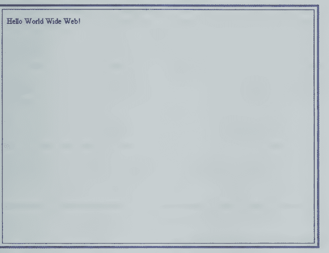

图 4.2

你使用 JavaScript 创建的第一个页面

此时，你可能在想这个网页看起来并不那么令人印象深刻。如果真是这样，你完全正确！但先别对 JavaScript 失望，因为我们才刚刚开始。等你完成了更多活动后，你将开始看到 JavaScript 的能力远不止这个简单网页所展示的。重点是，你现在写出了一行 JavaScript 代码，并且它真的起作用了！这应该有点价值，对吧？

## 思考技术

希望你能认识到，在这个练习中，“你好，万维网！”这句话并没有什么特别之处。这句话可以替换成任何其他文本字符串，JavaScript 代码仍然能正常工作。你唯一需要记住的是，你想要显示的文本必须出现在左双引号 `"` 和右双引号 `"` 之间。尝试更改 `write()` 方法中的消息，以确保你真正理解这里发生了什么。尝试输入一个很长的文本字符串，然后看看 Web 浏览器如何在屏幕上格式化文本。同时，尝试插入几条 `document.write()` 语句，看看浏览器如何处理它们。你可能会感到惊讶！

## 活动 4.2

**目标：** 在本活动中，你将学习 JavaScript 如何与 HTML 交互。

## 增强你的网页外观

正如我们在本章前面提到的，名为 `document.write()` 的 JavaScript 方法只是将一个字符字符串插入到标准 HTML 文本流中。另一种理解方式是，在浏览器处理完 HTML 文档后，实际效果是 `<SCRIPT>` 标签、`</SCRIPT>` 标签以及两者之间的所有内容都将从页面中剥离，并被 `write()` 方法参数中的任何字符串替换。这意味着我们在脚本之前或之后放置的任何 HTML 格式标签，都将像在没有任何嵌入式 JavaScript 代码的网页中一样被处理。为了更清楚地说明这一点，让我们修改在活动 4.1 中创建的网页。让我们添加一些 HTML 格式代码，使我们的“你好，万维网！”消息在屏幕上看起来更有吸引力。我们还要在页面上添加第二条消息，以确保你理解了 HTML 和 JavaScript 之间的交互。

1. 打开你的文本编辑器或文字处理器，并获取你在上一个活动中创建的 `js-one.html` 文件。
2. 将活动编号更改为 2。
3. 接下来，你将用刚刚用 JavaScript 创建的文本制作一个 `<H1>` 标题，并使用更多 JavaScript 创建一个新的 `<H3>` 标题。你还需要将两个标题居中。为此，在 `<BODY>` 和 `</BODY>` 标签内，添加 `<CENTER></CENTER>` 标签、`<H1></H1>` 标签、`<H3></H3>` 标签以及一行新的 JavaScript，如第 79 页顶部和图 4.3 中的粗体所示。

```html
<HTML>
<HEAD>
<TITLE>JavaScript 活动 #2</TITLE>
</HEAD>
<BODY>
<CENTER>
<H1>
<SCRIPT>
document.write("你好，万维网！");
</SCRIPT>
</H1>
<H3>
<SCRIPT>
document.write("欢迎来到激动人心的 JavaScript 世界。");
</SCRIPT>
</H3>
</CENTER>
</BODY>
</HTML>
```

图 4.3

包含 HTML 格式标签的 JavaScript 网页

78

第 4 章 什么是 JavaScript？

```html
<BODY>
<CENTER>
<H1>
<SCRIPT>
    document.write("你好，万维网！");
</SCRIPT>
</H1>
<H3>
<SCRIPT>
    document.write("欢迎来到激动人心的 JavaScript 世界。");
</SCRIPT>
</H3>
</CENTER>
```

4. 你的新文件应该像图 4.3。
5. 将你的新文件保存为 `js-two.html`。
6. 打开你的 Web 浏览器并查看你的 `js-two.html` 文件。你的页面应该看起来就像图 4.4。

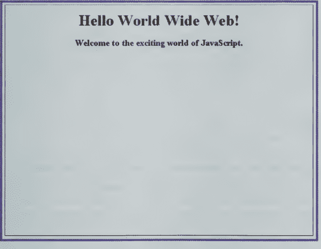

如果你对第 1 章介绍的 HTML 内容有了清晰的理解，你应该会对我们添加到本文档中的居中和标题标签的目的感到熟悉。你也应该理解，来自第一次调用（或出现）`document.write()` 方法的输出字符串将被插入到 HTML 文本流中的 `<CENTER>` 和 `</CENTER>` 标签之间，以及 `<H1></H1>` 标签之间。同样，第二次调用（出现）`document.write()` 产生的输出字符串也将出现在 `<CENTER></CENTER>` 标签之间，以及 `<H3></H3>` 标签之间。换句话说，`<H1></H1>` 标签只会影响第一个输出字符串的外观，而 `<H3></H3>` 标签只会影响第二个字符串。但是 `<CENTER></CENTER>` 标签会影响两个输出字符串的位置。明白了吗？


**警告：** 你可能很想将 HTML 格式标签（如 `<CENTER>` 或 `<H1>`）放在 `document.write()` 语句周围，而不是放在 `<SCRIPT>` 和 `</SCRIPT>` 标签外面。不要这样做！你需要记住，在脚本标签之间输入的所有内容都会被 Web 浏览器解释为 JavaScript 代码，而放错位置的 HTML 标签不符合 JavaScript 语法规则。尽管可以在 JavaScript 输出中嵌入 HTML 标签（如下一个活动所示），但这些标签不能放置在 JavaScript 语句周围。如果你尝试这样做，浏览器将会显示错误信息。

## 思考技术

你应该清楚，你可以将任何 HTML 标签与 JavaScript 一起使用，而不仅仅是标题和居中标签。尝试在本活动中插入前三章中描述的其他一些 HTML 标签，看看它们会产生什么效果。具体来说，尝试使用影响网页前景和背景颜色的标签。看看你是否能让 JavaScript 网页显示为黄色文本在蓝色背景上。或者尝试让 `<H1>` 文本的颜色与 `<H3>` 文本不同。你能做到，对吧？

## 网络提示

### 那些麻烦的分号是怎么回事？

如果你研究互联网上许多不同支持 JavaScript 的网页的源代码，你会发现其中许多在每个语句后都有分号（`;`），而许多则没有。本章所有 JavaScript 活动的源代码列表都包含分号，但它们并不是必需的。如果你逐一进行每个活动并移除结尾的分号，所有脚本仍将正常工作。所以你可能会问自己，为什么它们会存在。答案是，这至少在这些例子中是个人偏好的问题。但是，如果你从 JavaScript 编程转向其他一些编程语言（包括 Pascal、C++ 和 Java），你会发现分号不再是可选的。如果你忘记输入必需的分号，这些语言中的每一种都会显示错误信息，所以我们认为养成使用分号的习惯是个好主意。毕竟，学习一个好习惯通常比改掉一个坏习惯容易得多，对吧？

## JavaScript 中的条件语句

细心的学生可能会看着前两个练习然后问：“我们为什么要用 JavaScript 在屏幕上显示文本信息？直接把文本输入到 HTML 文档中，省去对 `document.write()` 方法的调用不是更简单吗？”嗯，诚实的回答是“是的！”那样做确实更简单。事实上，如果我们去掉 script 标签，网页浏览器甚至会稍微快一点地显示结果，因为它不需要调用 JavaScript 解释器。但是，不要忘记 JavaScript 能够执行的功能远不止将文本写入屏幕这么简单。在这个练习中，你将使用 JavaScript 语言中最强大的特性之一——**条件语句**。每种编程语言都具有做出决策的能力。或者用更专业的术语来说，每种语言都让程序员能够评估特定的条件，然后根据评估结果执行不同的操作。

JavaScript 中条件语句的语法非常重要。该语句以关键字 `if` 开头，然后在一对括号内指定一个条件。**关键字**被识别为语言定义的一部分。它由语言保留，不能用作变量名。关键字的一些示例包括 `if`、`else` 和 `return`。

条件之后是一个**语句块**，它由一个左大括号（`{`）、一条或多条 JavaScript 语句，以及一个右大括号（`}`）组成。JavaScript 条件语句的基本结构如图 4.5 所示。

### 练习 4.3

**目标：**

在这个练习中，你应该理解什么是条件语句以及它们是如何在 JavaScript 中实现的。

```javascript
if ((condition))
{
    statement 1;
    statement 2;
    statement 3;
    .
    .
    .
    statement N;
}
```

图 4.5

JavaScript 条件语句基本结构

## 互联网里程碑

### 脚本的起源

1995 年，当 Netscape Communications Corporation 向世界推出 JavaScript 时，他们并不是第一家为 Web 内容开发者提供增强 HTML 功能的新技术的公司。然而，他们是第一家提供功能齐全的脚本语言的公司，其他公司很快就认识到了这项技术的优势。

虽然脚本语言不具备完整编程语言的所有特性，但它也不需要使用复杂或昂贵的编译器软件。这使得它成为初学者程序员、教育机构或其他资金有限的组织的理想选择。

因此在 1996 年，Microsoft Corporation 迅速加入了脚本语言的行列，提供了 JScript 和 VBScript 作为业界标准 JavaScript 的替代品。这些脚本语言在功能方面与 JavaScript 大致相当，但对于在 Windows 平台上使用 Microsoft Internet Explorer 的用户，它们还提供了一些额外的功能。和 JavaScript 一样，JScript 基于 Java 编程语言的语法，而 VBScript 则基于 Visual Basic 的编程语法。

专业开发者选择哪种脚本语言取决于他们的个人偏好和编程需求。但无论他们选择哪种语言，他们都应该感谢 JavaScript 开启了脚本运动。

```javascript
if ((condition))
{
    statement i1;
    statement i2;
    statement i3;
    .
    .
    .
    statement iN;
}
else
{
    statement e1;
    statement e2;
    statement e3;
    .
    .
    .
    statement eN;
}
```

JavaScript 的 `if` 语句还支持一个可选的 `else` 子句，用于定义当指定条件不为真时要执行的操作。`else` 关键字紧跟在 `if` 子句的语句块之后出现，它包含自己的语句块。一个包含可选 `else` 子句的 JavaScript 条件语句示例如图 4.6 所示。

既然你已经了解了 JavaScript `if` 和 `if-else` 语句的基本结构，现在让我们来谈谈语法中的**条件**部分（在图 4.5 和 4.6 中显示为 `(condition)`）。JavaScript 条件总是由两个**标记**和一个关系**运算符**组成。标记可以是变量名（如 `x` 或 `count`）或字面常量（如 `10` 或 `Shane`）。关系运算符可以是以下任何一种：

| 运算符 | 含义 |
| --- | --- |
| `==` | 等于 |
| `!=` | 不等于 |
| `<` | 小于 |
| `>` | 大于 |
| `<=` | 小于或等于 |
| `>=` | 大于或等于 |

> 注意：在测试相等性时，请确保使用两个等号字符（`==`）。如果你忘记只用了一个等号，你的网页浏览器会用错误信息来“斥责”你！

现在你已经学会了如何在 JavaScript 中创建条件语句，让我们将这些知识应用到一个实际的程序中。在这个练习中，我们将包含一个简单的条件语句，并在此过程中教你一种有用的编程技巧。网页开发者根据特定用户使用的浏览器类型来执行不同的任务，这是相当常见的。你即将创建的 JavaScript 程序将判断用户是否在使用 Netscape Navigator，然后做出相应的反应。来看看吧！

1. 打开你的文本编辑器或文字处理器，调出 `js-two.html` 文件。
2. 将练习编号改为 3。
3. 在闭合的 `</H3>` 标签之后但在闭合的 `</CENTER>` 标签之前，输入一条新的 JavaScript 语句，如下面的内容和图 4.7 所示。

```html
</H3>
<SCRIPT>
    if (navigator.appName == "Netscape")
    {
        document.write("You are using Netscape Navigator.");
    }
    else
    {
        document.write("You are not using Netscape Navigator.<BR>");
```

```javascript
document.write("I'll bet you're using Internet Explorer.");
```

```html
}</SCRIPT>
</CENTER>
```

你完成的文件应该如图 4.7 所示。

```html
<HTML>
<HEAD>
<TITLE>JavaScript Activity #3</TITLE>
</HEAD>
<BODY>
<CENTER>
<H1>
<SCRIPT>
    document.write("Hello World Wide Web!");
</SCRIPT>
</H1>
<H3>
<SCRIPT>
    document.write("Welcome to the exciting world of JavaScript.");
</SCRIPT>
</H3>
<SCRIPT>
if (navigator.appName == "Netscape")
{
    document.write("You are using Netscape Navigator.");
}
else
{
    document.write("You are not using Netscape Navigator.<BR>");
    document.write("I'll bet you're using Internet Explorer.");
}
</SCRIPT>
</CENTER>
</BODY>
</HTML>
```

图 4.7

包含 `if-else` 条件语句的 HTML/JavaScript 文档

如果你想看看 JavaScript 能做什么的有趣演示，请打开浏览器并访问 `http://www.javascript.com`。这个网站包含了一个我们都熟悉的神秘 8 球玩具的网络版本。这个玩具的目的是回答你提出的任何问题。嗯，这个网站可以为你做同样的事情！

15. 完成编辑后，将结果文件保存为 `js-three.html`。

16. 启动你的网页浏览器，像前两个练习一样加载 `js-three.html` 文件。如果你使用的是 Netscape Navigator，你的屏幕现在应该如图 4.8a 所示。但如果你使用的是其他浏览器，你的屏幕应该如图 4.8b 所示。

*图 4.8a*

使用 Netscape Navigator 时生成的网页

*图 4.8b*

不使用 Netscape Navigator 时生成的网页

虽然我们没有在 JavaScript 程序中添加太多代码，但我们确实引入了几个重要的概念。让我们花一点时间来回顾这些概念，以确保你对这里发生的事情有扎实的理解。

首先，这个 JavaScript 程序中正在评估的条件是：

```javascript
(navigator.appName == "Netscape")
```

我们在本章前面提到过，JavaScript 对象包含特殊的函数，称为方法，用于执行各种任务。同样，JavaScript 对象还包含**属性**，程序员可以通过访问这些属性来获取有关对象的信息。在本例中，我们利用了 `navigator` 对象的 `appName` 属性来确定当前网页浏览器的应用程序名称。（请注意，在此上下文中，“navigator”一词可以与“browser”一词互换使用。）如果该名称为“Netscape”，则我们知道用户正在运行 Netscape Navigator。否则，我们知道用户没有运行 Netscape Navigator，所以他或她很可能正在运行 Microsoft 的 Internet Explorer（尽管有很小的可能性是其他浏览器）。

这里需要学习的第二个重要概念是，一旦条件被评估完毕，**要么**执行 `if` 语句块，**要么**执行 `else` 语句块——绝不会两个都执行。如果条件的结果为真，则执行 `if` 语句块。如果条件为假，则执行 `else` 语句块。就这么简单。

在这个示例中，我们还想让你认识到最后一点。到目前为止，我们一再提到将 JavaScript 源代码嵌入 HTML 文档的概念。嗯，事实证明，在 JavaScript 文本字符串中嵌入 HTML 标签不仅是可能的，而且非常有用！仔细查看 `else` 语句块中对 `document.write()` 的第一次调用。注意 HTML `<BR>` 标签嵌入在输出文本字符串中。之所以存在这个标签，是因为我们希望第二段文本出现在单独的一行上，而不是与第一段文本在同一行。为了实现这一点，我们必须在输出文本流中放置一个 `<BR>` 标签，以便浏览器识别换行命令。你还跟得上吗？很好。

## 思考技术

你认为 `<BR>` 是唯一可以嵌入 JavaScript 输出字符串的 HTML 格式标签吗？当然不是。你可以在 `document.write()` 参数字符串中使用任何你想要的格式标签。试着发挥一下创意，看看在这个练习的 JavaScript 代码中你还能放入多少其他标签。它们对生成的网页有什么影响？是将 HTML 标签放在 script 标签外部更好，还是将它们嵌入 JavaScript 文本字符串中更好？是否有些时候你可能两者都想要？思考一下！

# 第 4 章：什么是 JavaScript？

## 活动 4.4

**目标：**

在本次活动中，你将学习如何使用 JavaScript 的 `alert()` 方法。

### 使用 JavaScript 的 `alert()` 方法

在前面的三个活动中，我们使用了 `document.write()` 方法，这可能是 JavaScript 程序与用户交互的最常见方式。然而，脚本还有其他方式可以引起用户的注意。其中一种方式就是使用 JavaScript 的 `alert()` 方法。`alert()` 方法的目的是允许程序显示一个特殊的对话框，提醒用户发生了预期事件，或者需要某种用户输入。与 `write()` 方法或 `appName` 属性不同，`alert()` 方法不属于某个对象。相反，这个方法是 JavaScript 解释器本身的一部分，它直接与底层操作系统交互。（关于操作系统是什么以及它执行什么功能的详细描述超出了本书的范围。然而，在大多数 PC 上，操作系统是 Microsoft Windows；在 Macintosh 计算机上是 MacOS；在某些工作站上是 UNIX，等等。）因此，调用它时无需包含对象名称和句点（`.`）字符。让我们来试试看，好吗？

1. 像之前一样，打开你的文本编辑器或文字处理器，并打开 `js-three.html` 文件。
2. 将 `TITLE` 标签之间的活动编号更改为 4。
3. 按照第 87 页加粗部分和图 4.9 所示，在 `if` 语句块中添加一个 `alert` 语句。

#### 网络小贴士

**加空格还是不加空格**

如果你仔细查看图 4.7 的源代码列表，你会看到 `if` 关键字和条件的左括号之间有一个空格。你还会看到 `write` 方法名与其参数列表的左括号之间没有空格。尽管这看起来可能不一致，但这是大多数专业程序员的做法。

就 JavaScript 解释器而言，这两种情况下的空格都是可选的。你可以加空格也可以不加，脚本仍会正常运行。然而，JavaScript 语句和 JavaScript 方法调用之间存在明显的语法差异。JavaScript 语句总是包含一个或多个关键字，按照惯例，关键字周围应放置“空白”。另一方面，每个 JavaScript 方法名都必须伴随一个参数列表，因此最好在名称和其参数之间不加空格。

遵循这两个编程风格约定将使你的 JavaScript 代码更容易被其他程序员阅读。一开始你可能需要多想想，但这很快就会成为第二天性。

```javascript
{
    document.write("You are using Netscape Navigator.");
    alert("Netscape Navigator detected.");
}
```

4. 按照此处加粗部分和图 4.9 所示，在 `else` 语句块中添加第二个 `alert` 语句。

```javascript
{
    document.write("You are not using Netscape Navigator.<BR>");
    document.write("I'll bet you're using Internet Explorer.");
    alert("Netscape Navigator required.");
}
```

5. 完成对 HTML 文档的必要更改后，用新文件名 `js-four.html` 保存它。

```html
<HTML>
<HEAD>
<TITLE>JavaScript Activity #4</TITLE>
</HEAD>
<BODY>
<CENTER>
<H1>
<SCRIPT>
    document.write("Hello World Wide Web!");
</SCRIPT>
</H1>
<H3>
<SCRIPT>
    document.write("Welcome to the exciting world of JavaScript.");
</SCRIPT>
</H3>
<SCRIPT>
    if (navigator.appName == "Netscape")
    {
        document.write("You are using Netscape Navigator.");
        alert("Netscape Navigator detected.");
    }
    else
    {
        document.write("You are not using Netscape Navigator.<BR>");
        document.write("I'll bet you're using Internet Explorer.");
        alert("Netscape Navigator required.");
    }
</SCRIPT>
</CENTER>
</BODY>
</HTML>
```

图 4.9

包含 `alert()` 方法调用的 JavaScript 源代码


打开你的 Web 浏览器并查看你的 `js-four.html` 文件。如果你运行的是 Netscape Navigator，你的屏幕应该像图 4.10a 所示。但如果你运行的是 Microsoft 的 Internet Explorer，你的屏幕将像图 4.10b 所示。

希望这次活动能帮助你了解 `alert()` 方法在某些情况下可能很有用。它通常在 JavaScript 程序中需要用户意识到发生了某些意外错误情况时使用。然而，如果程序在继续执行前需要用户的某种确认，也可以使用它。无论哪种情况，`alert()` 方法都是 JavaScript 软件生成输出的另一种方式。

## 思考技术

在本次活动中，我们演示了如何定义一个条件语句，该语句评估 `navigator.appName` 属性的内容以确定其是否包含值 `"Netscape"`。但如果 `appName` 属性不包含值 `"Netscape"`，它包含什么值呢？你如何找出它呢？嗯，想一下 `document.write()` 方法。它是否只能用于显示字面字符串（在双引号中）？当然不是。它也可以用于显示 JavaScript 变量或对象属性的内容。现在你可以编写一个显示 `appName` 值的 JavaScript 语句了，不是吗？当然可以。试试看！

新手程序员往往难以掌握的一个 JavaScript 语言特性是使用“花括号”。左花括号（`{`）表示语句块的开始，右花括号（`}`）标记该块的结束。

1. 始终将左花括号直接放在它所属的关键字下方。
2. 始终缩进语句块中包含的语句。
3. 始终放置右花括号，使其与对应的左花括号垂直对齐。

尽管在放置这些花括号方面，JavaScript 语法规则具有一定的灵活性，但我们强烈建议你遵循本书所示的风格。如果你开始随意或不一致地放置花括号，很容易给自己造成严重问题。当左花括号的数量与右花括号的数量不对应时，你的 Web 浏览器将报告语法错误。然而，也可能出现花括号放置方式不会导致语法错误，但程序仍无法正确运行的情况。

底线是，遵循几条简单的规则可以省去你很多麻烦：

如果你记得遵循这些规则，就很容易看出哪些语句包含在特定的语句块中，以及该块属于哪个关键字。永远不要忘记，通常需要其他人阅读你的代码，而当语句块组织混乱或定义不仔细时，这会成为一项困难的任务。编写可读性强、格式逻辑一致、缩进规范的代码，这完全是出于专业礼节。所以请体谅一下！

## 访问浏览器状态行

你可能已经注意到，当你的 Web 浏览器加载包含许多对象的 HTML 文档时，它会在窗口底部显示各种消息。屏幕的这个区域被称为**状态行**，可以从 JavaScript 程序内部访问它。除了 `document.write()` 方法和 `alert()` 方法，这是 JavaScript 网页向用户传递信息的另一种方式。

你现在应该问自己的问题是：“我如何访问浏览器状态行？”答案再次非常简单。状态行中显示的消息无非是一个字符串值，存储在 `window` 对象的 `status` 属性中。这意味着你可以在 JavaScript 程序中随时通过包含如下语句来更改消息：

```
window.status = "A string of text";
```

既然你明白了这有多容易，让我们在你上一个活动编写的 JavaScript 程序中添加两行新代码。这段代码将简单地强化 `alert()` 方法显示的消息。

1. 像之前一样，打开你的文本编辑器或文字处理器，并打开 `js-four.html` 文件。
2. 将标题标签之间的活动编号更改为 5。
3. 按照此处加粗部分和图 4.11 所示，在 `if` 语句块中添加一个 `window.status` 语句。
4. 按照此处加粗部分和图 4.11 所示，在 `else` 语句块中添加第二个 `window.status` 语句。
5. 完成对 HTML 文档的必要更改后，用新文件名 `js-five.html` 保存你的新文件。

```
{
    document.write("You are using Netscape Navigator.");
    window.status = "Netscape Navigator detected.";
    alert("Netscape Navigator detected.");
}
```

```
{
    document.write("You are not using Netscape Navigator.<BR>");
    document.write("I'll bet you're using Internet Explorer.");
    window.status = "Netscape Navigator required.";
    alert("Netscape Navigator required.");
}
```

## JavaScript 活动 #5

```html
<HTML>
<HEAD>
<TITLE>JavaScript活动 #5</TITLE>
</HEAD>
<BODY>
<CENTER>
<H1>
<SCRIPT>
    document.write("Hello World Wide Web!");
</SCRIPT>
</H1>
<H3>
<SCRIPT>
    document.write("Welcome to the exciting world of JavaScript.");
</SCRIPT>
</H3>
<SCRIPT>
    if (navigator.appName == "Netscape")
    {
        document.write("You are using Netscape Navigator.");
        window.status = "Netscape Navigator detected.";
        alert("Netscape Navigator detected.");
    }
    else
    {
        document.write("You are not using Netscape Navigator.<BR>");
        document.write("I'll bet you're using Internet Explorer.");
        window.status = "Netscape Navigator required.";
        alert("Netscape Navigator required.");
    }
</SCRIPT>
</CENTER>
</BODY>
</HTML>
```


*图 4.11 设置浏览器状态行的 JavaScript 源代码*

你是否曾好奇过专业的语言规范是什么样子的？更具体地说，你想看看 JavaScript 的官方语言规范吗？如果是，请用你的网络浏览器查看以下 URL：

`http://lom.pvrr.ru/java/jsspec/titlepg2.htm`

这个网页包含了大量关于 JavaScript 1.1 脚本语言的技术信息。如果其中一些信息看起来有点超出了你的理解范围，别担心！我们将继续一步步引导你学习 JavaScript。你应该感到庆幸，你是在*使用*这门语言，而不是在*定义*它！

打开你的网络浏览器，查看你的 `js-five.html` 文件。如果你正在运行 Netscape Navigator，你的屏幕应该看起来像图 4.12a。但如果你正在运行微软的 Internet Explorer，你的屏幕会看起来像图 4.12b。

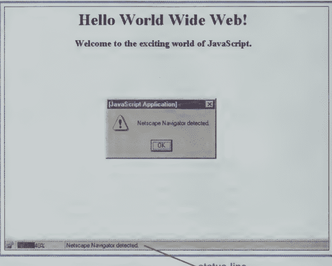

*图 4.12a*

你在 Netscape Navigator 中的屏幕

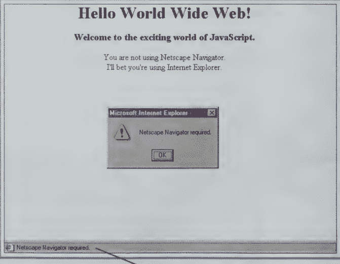

*图 4.12b*

你在 Internet Explorer 中的屏幕

正如我们在活动 4.4 中提到的，JavaScript 与网页浏览者交互最常见的方式是通过 `document.write()` 方法。但是，浏览器状态行也可以是一种向用户传递信息的有效方式。在这种情况下，我们只是简单地使用状态行来复述在警告对话框中显示的信息。然而，更常见的情况是看到 JavaScript 程序使用状态行来让用户知道它正在做什么。每当你的脚本即将启动一个可能耗时较长的过程（例如，下载一个大的图形图像）时，在状态行中显示一条恰当的信息是一个好主意。这可以在很大程度上确保用户知道他的系统没有崩溃。

## 思考技术

一些 JavaScript 程序员利用浏览器状态行的一种方式是向用户显示指令。在这种情况下，显示一条告诉用户在警告对话框出现时该做什么的消息可能是有意义的。也就是说，状态行可以包含一条告诉用户单击“确定”按钮以继续执行脚本的消息。你为什么不直接做这个修改呢？试着让消息尽可能提供信息，同时不用太多文字。你能做到吗？是的，当然可以！

### Hello, World!

下次你去本地书店时，花几分钟快速浏览几本不同编程书的前几章。在很多情况下，你会看到这些书中介绍的第一个编程示例都演示了如何用该特定语言显示短语“Hello, World!”。你认为为什么作者以这种方式开始他们的书如此普遍？嗯，答案很简单。

1978 年，贝尔实验室的两位名为 Brian Kernighan 和 Dennis Ritchie 的员工出版了一本名为 *The C Programming Language* 的书。这本书已被证明是计算机软件史上最持久的编程教程之一。在过去的二十年里，这本书只修订过一次，而且第二版至今仍在印刷！事实证明，这本书中的第一个编程练习解释了如何使用名为 `printf` 的 C 函数来显示短语“Hello, World.”。尽管 Kernighan 和 Ritchie 不太可能有意在编程书籍的作者中开创一种非正式的传统，但这正是他们所做的！尽管我们擅自对这个短语做了一些修改（改为“Hello, World Wide Web!”），但它仍然是基于二十年前这个简单的例子。

# 章节回顾

## 网络词汇

定义以下术语：

1. 二进制代码
2. 编译器
3. 条件
4. 解释
5. 关键字
6. 方法
7. 对象
8. 运算符
9. 参数列表
10. 编程语言
11. 脚本语言
12. `<SCRIPT>` 和 `</SCRIPT>` 标签
13. 状态行
14. 语法
15. 标记
16. 网络浏览器

## 网络回顾

简短回答以下问题：

1. JavaScript 如何增强 HTML 的功能？
2. 什么是 JavaScript 对象？什么是对象方法和对象属性？
3. 最常用于生成输出的 JavaScript 方法是什么？
4. JavaScript 中条件语句的语法是什么？
5. `alert()` 方法与 `document.write()` 方法在哪些方面有所不同？

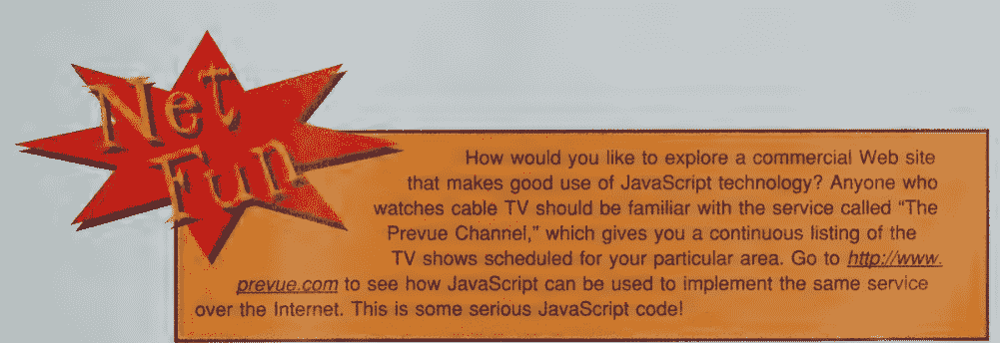

> 你想探索一个充分利用 JavaScript 技术的商业网站吗？任何看有线电视的人都应该熟悉一个叫做“The Prevue Channel”的服务，它为你提供你所在特定区域的电视节目连续列表。访问 `http://www.prevue.com`，看看如何在互联网上使用 JavaScript 实现同样的服务。这是一些相当严肃的 JavaScript 代码！

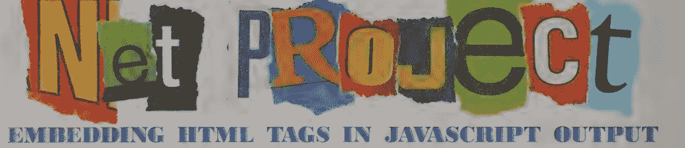

## 在 JavaScript 输出中嵌入 HTML 标签

Great Applications, Inc. 正在寻找一位熟练的互联网程序员，该程序员需要精通 HTML 编程和 JavaScript。为了测试潜在员工的知识，Great Applications 给每位候选人一个简单的 HTML/JavaScript 测试。该测试包含活动 4.2 中找到的 19 行源代码清单，每位申请人需要执行一个简单的任务。完成任务的说明如下：

- 从 HTML 文件中移除 `<H1>` 和 `</H1>` 标签，并将它们重新插入到第一个脚本部分的某个位置。移动这两个标签后，生成的 HTML 文件不得导致浏览器生成错误消息，但网页在屏幕上看起来应与之前完全相同。
- 对 `<H3>` 和 `</H3>` 标签做同样的处理。将它们移动到第二个脚本中的新位置，以便网页继续正确显示。

你能做到吗？我们相信，如果你仔细回顾活动 4.3，你一定能做到。

## 网络项目团队协作

### 改变 JavaScript 程序的浏览器定位

作为一个三到四人的团队，研究你在活动 4.5 中创建的 HTML/JavaScript 文件。假设 Great Applications, Inc. 刚刚给你们小组分配了重写这个程序的任务，使其面向微软的 Internet Explorer（IE），而不是面向网景的 Navigator。这意味着你将不得不更改 JavaScript 条件语句，以及 `js-four.html` 文件中 `if` 和 `else` 语句块内的文本字符串的措辞。

当你完成更改后，用 Netscape Navigator 和 Microsoft Internet Explorer 查看新文件，以确保它在两种浏览器中都能正确运行。

提示：当 Internet Explorer 运行时，`appName` 属性将包含值 `"Microsoft Internet Explorer"`。

## 撰写技术文章

在活动 4.3 的介绍中，我们提到条件语句是 JavaScript 最强大的功能之一。这个说法只是对二十多年前一位名叫 Joseph Weizenbaum 的杰出计算机科学家所做陈述的回应。1976 年，Weizenbaum 先生出版了一本名为 *Computer Power and Human Reason* 的书，他在书中提出了计算机系统的真正力量在于其决策能力的观点。思考一下这个观点，然后回答以下问题：

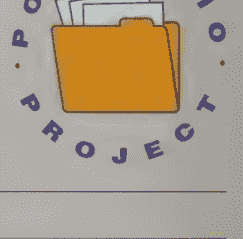

如果计算机不能做决策，它们会有多大用处？

描述 JavaScript 选择语句的一般结构：

_____________________________________________________________________

_____________________________________________________________________

_____________________________________________________________________

“评估条件”是什么意思？

_____________________________________________________________________

_____________________________________________________________________

_____________________________________________________________________

你认为 `if-else` 语句的 `else` 子句为什么是可选的？

_____________________________________________________________________

_____________________________________________________________________

_____________________________________________________________________

## 客户端/服务器应用程序工程师

无论你走到美国企业界的哪个角落，你都会发现对能够创建快速、可靠的客户端/服务器应用程序的软件开发人员的高需求。客户端/服务器应用程序背后的核心理念是，一个进程（或者本质上说是一个程序）将在中心位置运行，然后多个客户端进程在许多不同的位置运行，它们会向服务器进程发出请求并等待响应。

二十年前，这种“分布式”应用程序只能在大公司、银行或航空公司预订机构中找到，因为它们难以安装且维护成本昂贵。然而，随着互联网在我们社会中的广泛普及，建立和使用客户端/服务器架构的手段已经完全在小企业、政府机构甚至学区的可及范围之内。不幸的是，拥有创建客户端/服务器软件系统的手段并不意味着很容易找到能够做到这一点的人。这就是为什么掌握扎实的 JavaScript 技术知识将来可能被证明对你非常有利可图。JavaScript 经常被用于客户端/服务器应用程序的客户端，所以你可以确信有很多公司正等着雇佣你。不要错过这个绝佳的机会！

# 在 JavaScript 中使用图像

## 章节目标

在本章中，你将使用 JavaScript 来操作图像。阅读完第 5 章后，你将能够：

- 理解 JavaScript 事件的名称和用法。
- 理解 JavaScript 函数的用途和语法。
- 学习创建图像翻转效果。
- 学习创建超链接翻转效果。
- 学习创建循环横幅。
- 学习显示随机图像。
- 学习创建 JavaScript 幻灯片放映。

## JavaScript 术语

- 数组
- 循环横幅（广告横幅）
- 递减
- 事件
- 函数
- 超链接翻转
- 图像翻转
- 递增
- 索引
- 实例化
- 实数（浮点数）
- 幻灯片放映
- 变量

## 让图形图像焕发生机

在第 3 章中，我们提到过有效使用图形图像对于网页整体成功的重要性。无论是基于 HTML 还是 JavaScript 技术的网页，这一原则都同样适用。标准 HTML 让你能够对图像进行一些有趣的操作，而 JavaScript 则为你提供了一些额外的功能。在本章中，我们将重点介绍 JavaScript 中常用于让图形图像在网页上“焕发生机”的那些特性。一旦你学会了这些新技术，你很快就会在整个万维网上识别出它们的用法。到那时，你将不再需要好奇这些有趣页面的设计师是如何创造出如此引人注目的效果的。


在你能够用图像完成任何出色的工作之前，你需要先理解 JavaScript 事件。就本书而言，你可以将事件视为系统对某些特定条件发生的响应。其中一些条件是由网页浏览器软件本身生成的，但大多数是由用户执行某些操作引起的。这些操作可能包括移动鼠标、单击按钮对象，甚至在屏幕上选择一段文本。但无论特定事件是如何产生的，JavaScript 都赋予你创建能够对其作出反应的网页的能力。当这些反应被巧妙地实现时，用户一定会对你的网页印象深刻。

在使用图像时，你需要掌握的另一个重要概念是 JavaScript `函数`的概念。`函数`不过是一段 JavaScript 代码，可以像你在第 4 章中使用的 `document.write()` 和 `alert()` 方法一样被调用（或称为）。事实上，方法和函数之间并没有真正的区别，只是方法已经被定义为 JavaScript 编程环境的一部分。而函数则是由你编写的，可以包含任意数量的 JavaScript 语句，包括对 JavaScript 方法或其他函数的调用。

在这一点上，JavaScript 事件和函数与网页中图形图像的使用之间的关系可能对你来说并不明显。但只要耐心一点，你很快就会看到它们之间的联系。事实上，这正是本章活动的目的所在。我们将把事件和函数与图像结合使用，创造出一些有趣的效果，这些效果将极大地提升你的网页质量。所以如果你准备好了，让我们开始吧！■

## 网络提示

### 使用 JavaScript 事件

本章中的所有活动都使用了一个或多个 JavaScript 事件。然而，还有几个 JavaScript 事件在本章中没有讨论。但这并不意味着你不能进行一些“自主学习”并自己学会如何使用它们。以下是可用 JavaScript 事件的按字母顺序排列的列表，以及触发该事件的条件的简要描述。

| 事件名称 | 事件触发条件 |
|---|---|
| `onAbort` | 用户中止了网页的加载。 |
| `onBlur` | 用户停用了某个对象（对象失去焦点）。 |
| `onChange` | 用户以某种方式更改了某个对象。 |
| `onClick` | 用户在某个对象上点击了鼠标。 |
| `onError` | JavaScript 解释器遇到了脚本错误。 |
| `onFocus` | 用户激活了某个对象（对象获得焦点）。 |
| `onLoad` | 网页浏览器完成了页面的加载。 |
| `onMouseOver` | 鼠标指针经过某个对象。 |
| `onMouseOut` | 鼠标指针移出了某个对象。 |
| `onSelect` | 用户选择（高亮显示）了某个对象的内容。 |
| `onSubmit` | 用户提交了 HTML 表单。 |
| `onUnload` | 网页浏览器将页面从内存中卸载。 |

## 活动 5.1

### 目标

在本活动中，你将学习如何使用 JavaScript 创建图像翻转效果。

### 教会图像翻转

在第 3 章中，你学会了如何在网页中插入图形图像，你还学会了如何将图像变成超链接。现在我们将向你展示如何利用 JavaScript 的强大功能让图形超链接响应鼠标移动。更具体地说，我们将向你展示当用户将鼠标指针移动到图像上时，如何改变图像的外观。这种 JavaScript 编程技术被称为图像翻转。

要实现翻转效果，你需要知道的第一件事是如何使用名为 `onMouseOver` 和 `onMouseOut` 的 JavaScript 事件。当用户将鼠标移动到某个特定对象上时，会生成 `onMouseOver` 事件。同样，当用户将鼠标指针移出该对象时，会生成 `onMouseOut` 事件。你需要学习的只是如何使用 JavaScript 来检测这些事件何时发生，然后采取适当的行动。在本活动中，我们将在屏幕上显示一个蓝色箭头，然后当鼠标指针移到它上面时，将箭头变为红色。然后当鼠标指针移出图像时，我们再将箭头颜色改回蓝色。听起来很简单吧？那就让我们开始吧。

- 你需要在本活动中使用一些图形，这些图形将从 HTML & JavaScript：Programming Concepts 网页下载。因此，请打开你的网页浏览器并输入网址 `www.swep.com`。
- 点击屏幕底部的 Computer Education。
- 在下一个屏幕的左侧选择 Products & Resources。
- 在 Computer Education Categories 框中选择 Internet，然后点击 Go！
- 向下滚动，找到 HTML & JavaScript：Programming Concepts 网页。
- 点击 Student Activities 链接，然后点击 Activity 5.1 链接。
- 将 `bluearrow.gif` 和 `redarrow.gif` 文件下载到你一直保存网页的同一个文件夹中。
- 打开你的文本编辑器或文字处理器，按照图 5.1 所示的内容逐字输入 HTML/JavaScript 代码。
- 将此文件保存在适当的文件夹中，命名为 `js-six.html`。
- 如果你的网页浏览器尚未打开，请打开它。
- 查看你的 `js-six.html` 页面。你的网页初始时应该如图 5.2a 所示。但当你将鼠标指针移到箭头图像上时，它的外观应该变为如图 5.2b 所示。

## 热门提示

### 快捷地址

已为 HTML & JavaScript：Programming Concepts 学生活动主页提供了一个快捷地址：`htmljava.swep.com`。

## JavaScript 活动 #6

```html
<HTML>
<HEAD>
<TITLE>JavaScript Activity #6</TITLE>
<SCRIPT>
    blueArrow = new Image;
    blueArrow.src = "bluearrow.gif";
    redArrow = new Image;
    redArrow.src = "redarrow.gif";
</SCRIPT>
</HEAD>
<BODY>
<CENTER>
<A HREF="webpage.html"
    onMouseOver="document.arrow.src = redArrow.src;"
    onMouseOut="document.arrow.src = blueArrow.src;">

</A>
</CENTER>
</BODY>
</HTML>
```

*图 5.1*

用于创建图像翻转效果的 JavaScript 代码

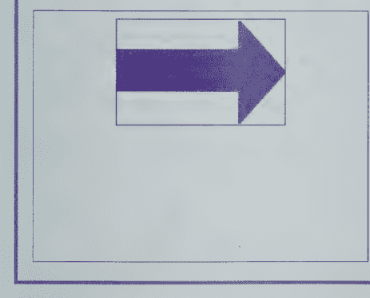

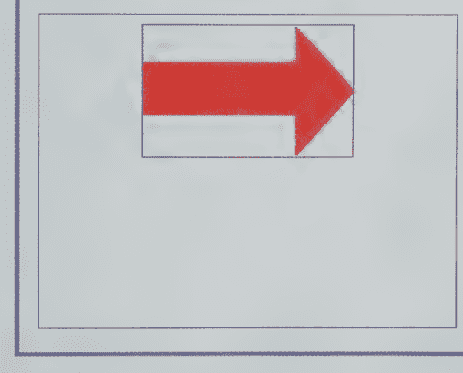

*图 5.2a*

你的网页初始显示的样子

*图 5.2b*

鼠标指针悬停在图像上时的网页显示

尽管图 5.1 中的 HTML/JavaScript 源代码篇幅不大，但它确实引入了几个你之前未曾见过的新特性。让我们花点时间确保你理解所有这些概念，因为你将在整个章节中反复用到它们。

首先，你应该注意到 `<SCRIPT>` 和 `</SCRIPT>` 标签出现在 HTML 文档的头部（header）部分，而不是主体（body）部分。这意味着 Web 浏览器会在开始在屏幕上显示文档内容之前处理 JavaScript 代码。这一点对于这个特定的文档至关重要，因为我们希望浏览器在显示网页主体之前，将蓝色和红色箭头图像都加载到内存中。如果我们没有这样做，当 `onMouseOver` 和 `onMouseOut` 事件发生时，浏览器将不知道该加载什么图像，结果就是出现 JavaScript 错误信息。

接下来，你需要理解图 5.1 中的 JavaScript 代码（第 5 行到第 8 行）实际做了什么。第 5 行的语句（`blueArrow = new Image();`）告诉 JavaScript 解释器创建一个新的 `Image` 对象，然后将对该对象的引用保存到一个我们称之为 `blueArrow` 的变量中。（请记住，JavaScript 变量只不过是一个被赋予字面值或对象的名称。一旦完成赋值，该名称就可以在整个 HTML 文档中用于引用该特定值或对象。）

接下来的第 6 行（`blueArrow.src = "bluearrow.gif";`）告诉 JavaScript，`blueArrow` 对象的源（`src`）属性将包含存储在文件 `bluearrow.gif` 中的图像。正是这条语句实际导致浏览器将蓝色箭头图像加载到内存中。一旦此任务完成，接下来的两条 JavaScript 语句执行的功能与前两条语句基本相同。

第 7 行的语句（`redArrow = new Image();`）导致解释器创建一个新的 `Image` 对象并将其命名为 `redArrow`。第 8 行的语句（`redArrow.src = "redarrow.gif";`）将该对象的 `src` 属性设置为文件 `redarrow.gif` 中包含的图像，因此浏览器也会将此图像加载到内存中。关于你网页的这一部分有什么问题吗？

我们接下来需要讨论的概念是 JavaScript 事件处理逻辑。这是 JavaScript 的一个重要特性，因为它展示了 JavaScript 代码与标准 HTML 标签交互的另一种方式。到目前为止，你使用的所有 JavaScript 语句都位于 `<SCRIPT>` 和 `</SCRIPT>` 标签之间，对吧？但是 JavaScript 事件处理语句实际上是放置在标准 HTML 标签内部的。在这个例子中，处理 `onMouseOver` 和 `onMouseOut` 事件的语句位于锚点（`<A></A>`）标签内。当 `onMouseOver` 事件发生时，`document` 对象中包含的 `arrow` 对象的源（`src`）属性被设置为 `redArrow` 对象的 `src` 属性。同样，当 `onMouseOut` 事件发生时，`document` 的 `arrow` 对象的 `src` 属性被赋值为 `blueArrow.src` 属性的值。因此，当鼠标指针悬停在箭头图像上时，`onMouseOver` 事件触发（发生），图像源被赋值为 `redarrow.gif` 文件的内容。类似地，将鼠标指针移出箭头图像会导致 `onMouseOut` 事件触发，图像源被赋值为 `bluearrow.gif` 文件的内容。这对你来说讲得通吗？很好！

我们最后要讨论的一点是 `document.arrow` 对象的来源。当我们使用名称 `arrow` 时，浏览器如何知道我们指的是哪个对象？幸运的是，答案非常简单。如果你仔细查看我们用于定义原始锚点图像的 `` 标签，你会看到我们包含了一个你之前没有用过的新属性。这个属性叫做 `NAME`，它的目的是允许你为图像对象分配一个变量名。在这个例子中，我们给图像对象取名为 `arrow`，并且由于这个图像是我们 HTML 文档的一部分，它可以在 JavaScript 代码中被引用为 `document.arrow`。现在开始变得有趣了，不是吗？

## 思考技术

你可能已经注意到，如果你的鼠标指针在箭头图像上时点击了鼠标按钮，你的 Web 浏览器会显示一条错误信息。你认为为什么会发生这种情况？嗯，如果你想一会儿，你应该意识到箭头图像在这个文档中被定义为一个超链接，而超链接的目的是告诉浏览器在用户点击它时加载一个新的 HTML 文档。所以仔细看看你的 `<A>` 标签的 `HREF` 属性。如果你点击这个特定的超链接，浏览器将尝试加载哪个网页文件？显然，答案是 `webpage.html` 文件，因为这是分配给 `HREF` 属性的文件名。但是这个文件真的存在吗？当然不存在。需要有人来创建它，对吧？我们认为那个人应该是你！动手创建一个非常简单的 HTML 页面，然后将其保存为 `webpage.html`。然后再次查看你的 `js-six.html` 页面，并验证当你点击箭头图像时，浏览器是否真的会显示你的新页面。别忘了这个新文件必须与 `js-six.html` 文件保存在同一个文件夹中。

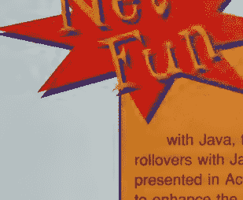

> 当你有空闲时间时，可以花一两个小时在网上搜索那些包含有趣的图像或超链接翻转效果的网站。在你列出了你最喜欢的网站之后，尝试自己实现同样类型的翻转效果。尽管有些网站使用 Java 实现翻转效果，但你没有理由不能模仿他们的想法，并用 JavaScript 创建自己的翻转效果。如果你能透彻理解活动 5.1 和 5.2 中介绍的概念，你就可以创建无数引人注目的效果来增强你的网页外观。

## 活动 5.2

### 教会超链接翻转

#### 目标

在本活动中，你将学习如何使用 JavaScript 创建超链接翻转效果。

既然你已经知道如何制作图像翻转，让我们向你展示如何创建超链接翻转。正如你可能预料的那样，超链接翻转与图像翻转非常相似。唯一的区别在于，超链接翻转是在用户将鼠标移动到超链接上时触发的，而不是在鼠标悬停在图像上时。这很合理，对吧？

所以，如果你期望制作超链接翻转所需的 JavaScript 代码与图像翻转的代码相似，你不会失望的。事实上，如果我们不告诉你需要做哪些改动，你可能得把新的源代码看两遍才能确定区别在哪里。你准备好尝试一下了吗？那我们开始吧。

1. 打开你的文本编辑器或文字处理器，并打开你在上一个活动中创建的 `js-six.html` 文件。
2. 将活动编号更改为 7。
3. 接下来，你将对定义超链接的开标签 `<A>` 做一些修改。如这里的粗体部分和图 5.3 所示，添加行 **Next Page**。
4. 然后，你将把箭头图像移出闭标签 `</A>` 之外，使其不再成为超链接引用的一部分。你还需要添加一个段落标签，如这里的粗体部分和图 5.3 所示。
5. 完成这些修改后，你的 JavaScript 源代码应该看起来和图 5.3 一模一样。
6. 将你的新文件保存为 `js-seven.html`。
7. 打开你的 Web 浏览器并查看你的 `js-seven.html` 文件。你的屏幕最初应如图 5.4a 所示。但是，当鼠标指针悬停在 **Next Page** 超链接上时，箭头图像将从蓝色变为红色，如图 5.4b 所示。

```html
<A HREF="webpage.html"
  onMouseOver="document.arrow.src = redArrow.src"
  onMouseOut="document.arrow.src = blueArrow.src">
Next Page
</A>
```

```html
Next Page
</A>
<P>

</CENTER>
```

## 创建轮播横幅

当您“在网上冲浪”时，很可能经常会遇到包含不断变化广告的商业网站。事实证明，这些轮播横幅（也称为广告横幅）可以使用不同的互联网技术以多种方式创建。然而，创建这类广告最简单高效的方法之一是使用 JavaScript 事件和函数。

轮播横幅实际上不过是一系列按顺序依次显示、每张图片之间有短暂间隔的图形图像。当序列中的所有图像显示完毕后，浏览器将循环回到第一张图像，并重新开始整个序列。这就是为什么这种特定的网页增强效果被称为“轮播”横幅的原因。

您可能认为创建轮播横幅需要大量时间和精力，但使用 JavaScript 并非如此！在这个活动中，我们将向您展示，只需几分钟就能将有效的广告展示集成到您的网页中。通过利用单个 JavaScript 事件，并定义一个简单的 JavaScript 函数，您就将在轮播横幅设计的世界中迈向名声与财富。您准备好迎接这个挑战了吗？让我们开始吧！

1. 就像在活动 5.1 中一样，您需要在本活动中使用一些图形。因此，请打开您的 Web 浏览器，访问 *HTML & JavaScript: Programming Concepts* 网页。
2. 单击 “Student Activities” 链接，然后单击 “Activity 5.3” 链接。
3. 将 `lions.gif`、`tigers.gif`、`bears.gif` 和 `ohmy.gif` 文件下载到您保存网页的完全相同的文件夹中。（如果不小心将文件下载到不同的文件夹，您的网页将无法正常运行。）
4. 打开您的文本编辑器或文字处理器，完全按照图 5.5 所示输入 HTML/JavaScript 代码。

> ## 实用提示
>
> ### 快捷地址
>
> 已为 HTML & JavaScript: Programming Concepts 学生活动主页提供了一个快捷方式：
>
> `htmljava.swep.com`
>
> ## 网络提示
>
> ### 了解边框知识
>
> 每当在 HTML 文档中将图形图像定义为超链接时，Web 浏览器会在其周围显示一个矩形边框。但有时这个边框会损害网页的整体外观。幸运的是，HTML 为网页设计者提供了使用 `BORDER` 属性调整超链接边框大小的功能。通过在 ``（图像）标签中包含 `BORDER=` 语句，内容开发者可以使超链接边框变粗或变细，或者完全使其消失。要查看此属性如何影响超链接图像，请尝试在活动 5.1 的 `` 标签中添加 `BORDER=0` 语句。如果操作正确，蓝色的超链接边框应该会消失。但是，图像悬停效果仍应像以前一样正常工作。


```html
<HTML>
<HEAD>
<TITLE>JavaScript Activity #8</TITLE>
<SCRIPT>
    imgArray = new Array(4);
    imgArray[0] = new Image;
    imgArray[0].src = "lions.gif";
    imgArray[1] = new Image;
    imgArray[1].src = "tigers.gif";
    imgArray[2] = new Image
    imgArray[2].src = "bears.gif";
    imgArray[3] = new Image;
    imgArray[3].src = "ohmy.gif";
    index = 0;

    function cycle()
    {
        document.banner.src = imgArray[index].src;
        index++;
        if (index == 4)
        {
            index = 0;
        }
        setTimeout("cycle()", 2000);
        return;
    }
</SCRIPT>
</HEAD>
<BODY onLoad="cycle();">
<CENTER>

</CENTER>
</BODY>
</HTML>
```

*图 5.5*

*创建轮播横幅的 JavaScript 代码*

5. 将此文件以`js-eight.html`的名称保存在适当的文件夹中。

6. 如果您的 Web 浏览器尚未打开，请打开它。

7. 查看您的`js-eight.html`页面。您的网页初始状态应如图 5.6a 所示。但经过两秒钟的延迟后，图像应变为图 5.6b 所示。再经过两秒钟的延迟，它应变为图 5.6c 所示，最后变为图 5.6d 所示。

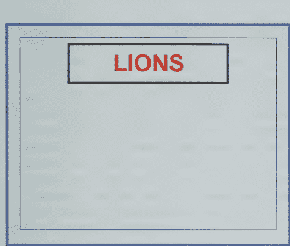

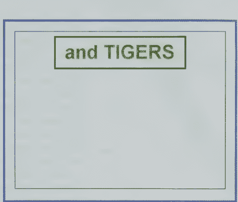

**图 5.6a**

您的轮播横幅的第一张图像

**图 5.6b**

您的轮播横幅的第二张图像

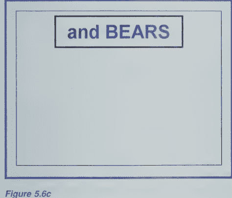


**图 5.6c**

您的轮播横幅的第三张图像

**图 5.6d**

您的轮播横幅的第四张图像

我们再次在相对少量的源代码中引入了几个重要的 JavaScript 概念。让我们仔细查看图 5.5 中的源代码清单，以确保您完全理解这里发生的事情。

首先，看看第 5 行（`imgArray = new Array(4);`）。这里我们正在创建一个新的 JavaScript 对象，一个您以前没有使用过的对象，称为数组。数组只是可以通过变量名和索引访问的相似对象的集合。数组几乎存在于每种现代计算机语言中，因此您熟悉它们非常重要。在这个例子中，我们的数组被定义为最多包含四个元素，其变量名叫做`imgArray`。在这种情况下，数组将包含四个`Image`对象，但数组也可以包含任何其他类型的 JavaScript 对象。

```html
<HTML>
<HEAD>
<TITLE>JavaScript Activity #7</TITLE>
<SCRIPT>
    blueArrow = new Image;
    blueArrow.src = "bluearrow.gif";
    redArrow = new Image;
    redArrow.src = "redarrow.gif";
</SCRIPT>
</HEAD>
<BODY>
<CENTER>
<A HREF="webpage.html"
  onMouseOver="document.arrow.src = redArrow.src"
  onMouseOut="document.arrow.src = blueArrow.src">
Next Page
</A>
<P>

</CENTER>
</BODY>
</HTML>
```

**图 5.3**

创建超链接悬停效果的 JavaScript 代码


**图 5.4a**

您的网页初始状态


**图 5.4b**

鼠标指针悬停在超链接上时的网页状态

如果您是一个敏锐的观察者，您会注意到这个 HTML 文档（`js-seven.html`）中的 JavaScript 语句与之前的文档（`js-six.html`）完全相同。因此，让我们确保您充分理解了 HTML 标签中所做的更改，以及这些更改如何与 JavaScript 代码相关联。

首先，`<A>` 和 `</A>` 锚点标签不再包含 `` 标签，因此箭头图像不再是超链接引用的一部分。相反，锚点标签现在包含了您刚刚添加的“Next Page”文本。这意味着当鼠标悬停在新的超链接上时，将触发`onMouseOver`和`onMouseOut`事件，而不是在悬停在箭头图像上时触发。然而，JavaScript 代码执行的操作与之前相同，因此图像就像之前一样改变颜色。

您可能想知道为什么我们在超文本和箭头图像之间插入了段落标签。我们这样做是因为段落标签会将图像强制移动到“Next Page”超链接下方。否则，图像将出现在超文本的右侧。（如果您想看看我们的意思，请随时删除`<P>`标签并重新查看文件。）

您可能还想知道为什么在之前的活动中箭头图像周围有一个蓝色矩形，但在本次活动中没有。这个问题的答案是：在活动 5.1 中，图像被定义为超链接，而 Web 浏览器通常会显示带有蓝色边框的超链接图像。这就是为什么当箭头图像从蓝色变为红色时，蓝色边框仍然可见的原因。但在活动 5.2 中，图像没有被定义为超链接，因此蓝色边框消失了。相反，“Next Page”文本被定义为超链接，因此无论箭头图像的颜色如何，它都显示为蓝色且带下划线。明白了吗？（如果您想知道如何消除活动 5.1 中的蓝色矩形，请参阅“网络提示：了解边框知识”，第 107 页。）

## 关于技术的思考

在活动 5.1 中，我们向您展示了如何创建当鼠标指针经过图像时做出反应的悬停效果。在活动 5.2 中，我们向您展示了如何创建当鼠标指针经过超链接时做出反应的悬停效果。但现在我们想知道您是否能创建一个对*任一*条件都做出反应的悬停效果？也就是说，您能否对`js-seven.html`文件进行一个小修改，使得当鼠标经过超链接*或*图像时，箭头图像都会改变颜色？您能做到吗？当然可以！您只需要做的是将一个 HTML 标签从当前位置移动到一个新位置。您能弄清楚需要移动哪个标签以及移动到哪里吗？试试看！

其次，考虑第 6 行到第 13 行的 JavaScript 语句。这些语句你可能觉得有些眼熟，因为它们本质上与之前活动的第 5 行到第 8 行相同。第 6 行创建了一个新的`Image`对象，并将其赋值给名为`imgArray`、索引为 0 的变量。第 7 行接着将这个新对象的`src`属性设置为包含名为`lions.gif`的文件内容。类似地，第 8、10 和 12 行的 JavaScript 语句也创建了新的`Image`类型对象，这些新对象被赋值给名为`imgArray`的变量，索引值分别为 1、2 和 3。第 9、11 和 13 行的语句则将这三个新对象的`src`属性分别设置为`tigers.gif`、`bears.gif`和`ohmy.gif`文件的内容。现在，这四个图形图像可以通过其他 JavaScript 语句非常快速地显示出来，我们稍后将会描述。

第三，第 14 行的语句（`index = 0;`）只是创建了一个名为`index`的 JavaScript 变量，并将值 0 赋给它。这个变量将用于访问`imgArray`数组中的各个元素。

第四，第 16 行到第 26 行的 JavaScript 语句定义了一个名为`cycle()`的函数，这个函数将使循环横幅中的图像依次显示。这是通过将`document.banner`对象的`src`属性设置为`imgArray`数组当前元素的`src`属性来实现的。然后，我们递增存储在`index`变量中的值（使用`++`运算符），以便访问图像数组的下一个元素。术语**递增**意味着给一个值加 1。由于这个数组的唯一有效索引是 0 到 3，我们必须测试`index`的值是否超出了可接受的范围。换句话说，如果`index`包含值 4，我们必须将其重置为 0，以使横幅图像循环回到序列的开头。那么，我们的最后一项任务是设置一个定时器，在 2000 毫秒后再次调用`cycle()`函数。（2000 毫秒等于 2 秒。）到目前为止，你还能跟上吗？

## 基于零的数组

几乎每种编程语言都支持数组的概念，但并非所有语言都以相同的方式实现数组索引。例如，如果你在 Basic、Fortran 或 Pascal 中定义一个包含 10 个元素的数组，你会使用索引值 1、2、3、……10 来访问这 10 个元素。但是其他一些语言（包括 C++、Java 和 JavaScript）并不使用这种从 1 开始的索引技术。相反，它们实现了一种基于零的技术，使得一个包含 10 个元素的数组的有效索引为 0、1、2、……9。起初你可能会认为从 1 开始的方法更有意义，因为它更容易被初学编程的人理解。然而，如果你查看不同语言编译器生成的底层机器代码，你会看到对于计算机硬件来说，从 1 开始的方法处理效率较低。这就是专业程序员倾向于在软件开发项目中使用基于零语言的一个原因。

最后，我们需要解释的是整个循环横幅过程是如何启动的。如果你仔细查看我们 HTML 文档的`<BODY>`标签（在源代码列表的第 29 行），你会发现我们插入了一个新的 JavaScript 事件。这个事件称为`onLoad`，它在 Web 浏览器完成加载 HTML 网页主体后触发。在这个例子中，浏览器加载名为`lions.gif`的图像（由`NAME`属性赋值给变量名`banner`），然后触发`onLoad`事件，这反过来导致`cycle()`函数被调用。然后，`cycle()`函数将每隔两秒被连续调用一次，这是为了响应 JavaScript 的`setTimeout()`方法，该方法在同一个函数内部被调用。现在你都弄明白了吗？我们在这个活动中学习了很多东西！

## 思考技术

对于这个特定的例子，2000 毫秒的超时值效果很好，但有时不同的值可能更有效。尝试更改`setTimeout()`方法调用中的延迟值，看看不同的数字会产生什么效果。如果你非常聪明，你可能会意识到这样一个事实：有时候，为横幅序列中的每张图像提供不同的延迟值可能是可取的。如果你觉得有能力接受挑战，尝试在 HTML 文档的头部创建第二个名为`delay`的四元素数组。然后为这个新数组的每个元素分配不同的值（比如 1000、4000、2000 和 3000），并在`setTimeout()`方法调用中使用这些值。也就是说，用变量名`delay[index]`替换常量值 2000。如果你能正确完成这个任务，那么你就在理解 JavaScript 数组基础方面迈出了重要一步。你应该为自己感到骄傲！

> 如果你想看一个在其布局中包含广告横幅的商业网站的优秀示例，请访问`http://www.lantimes.com`。这是 LANTimes 杂志的官方网站。广告横幅在屏幕顶部运行，如果你观看它们几分钟，你应该会注意到一种模式。特定产品的广告会播放其图像，然后这些图像会重复播放。这个重复的过程会持续一段时间，然后会出现一组全新的图像来宣传不同的产品。你认为 LANTimes 的网络工作人员为什么要将他们的广告横幅设计成这样工作的？

## 活动 5.4

### 目标

在这个活动中，你将学习如何随机顺序显示图像。

### 显示随机图像

在之前的活动中，你学习了如何按特定顺序显示一系列图形图像。但有时网页设计者希望他们的图像以随机顺序出现。这种方法通常用于特定网站包含大量图形图像集合，并且网站所有者希望系统随机选择一张图像进行显示的情况。

起初，你可能会认为按固定顺序显示图像比按随机顺序显示要容易得多。但当你用 JavaScript 编程时，情况并非如此。事实上，显示随机图像实际上比创建循环横幅所需的代码行数更少。这主要归功于 JavaScript 对随机数生成的内置支持。

由于本活动的大部分源代码与前一个活动相同，你将能够使用之前的文件并只做少量修改。事实上，你只需要用一个类似的名为`select()`的函数替换`cycle()`函数。你甚至不需要担心将图形文件下载到正确的文件夹，因为我们将使用与前一个活动相同的图像。你准备好开始了吗？

1. 打开你的文本编辑器或文字处理器，并检索你在上一个活动中创建的`js-eight.html`文件。

2. 将活动编号更改为 9。

3. 接下来，你将删除`cycle()`函数，并用一个名为`select()`的新函数替换它，如这里的粗体所示以及图 5.7 所示。

4. 然后你必须更改`<BODY>`标签，使`onLoad`事件调用新的`select()`函数，而不是旧的`cycle()`函数，如这里的粗体所示以及图 5.7 所示。

5. 当你完成后，最终的文件应该看起来与图 5.7 中看到的源代码列表完全一样。

6. 将你的新文件保存为`js-nine.html`。

7. 打开你的 Web 浏览器并查看你的`js-nine.html`文件。你的屏幕最初应该看起来像图 5.6a、5.6b、5.6c 或 5.6d，然后应该每两秒变化一次。与前一个活动不同，图像不会以任何可预测的顺序出现。

```javascript
function select()
{
    index = Math.floor(Math.random() * 4);
    document.banner.src = imgArray[index].src;
    setTimeout("select()", 2000);
    return;
}
```

```html
<BODY onLoad="select();">
```

## 图 5.7 用于显示随机图片的 JavaScript 代码

让我们快速回顾一下本活动中介绍的 JavaScript 概念。首先，我们将函数名从`cycle()`改为`select()`，因为它更准确地反映了函数的目的和行为。由于这个名称的改变，我们还需要修改 HTML `<BODY>`标签中的`onLoad`事件语句，以便它能调用正确的函数名。如果我们没有进行这个更改，Web 浏览器将会返回一条令人不快的错误消息。其次，我们需要包含适当的 JavaScript 代码来生成一个随机数，然后将该数字转换为 0 到 3 范围内的有效数组索引。JavaScript 方法`random()`（它是`Math`对象的一部分）保证返回一个大于或等于 0.0 且小于 1.0 的实数或浮点数。（实数是包含小数部分的数值。）由于这个受限范围内的数字不能用作数组索引，我们需要将其缩放到适当的范围。在这种情况下，我们的数组有四个元素，所以我们（使用`*`运算符）将随机值乘以 4。现在我们得到了一个保证大于或等于 0.0 且小于 4.0 的实数。最后一步是调用`Math.floor()`方法，该方法将消除结果数字的小数部分。这意味着唯一可能剩下的值是 0、1、2 和 3，这些正是我们需要用作数组索引的值。

为了确保你理解这个过程，让我们通过一个例子来说明。假设`select()`函数的前三次调用中，`Math.random()`方法生成了 0.137、0.8312 和 0.54 这三个随机值。当我们将这些数字乘以 4 时，结果值分别为 0.548、3.3248 和 2.16。然后，当我们将这些新的实数通过`Math.floor()`方法处理后，最终存储在`index`变量中的数字将分别为 0、3 和 2。显然，这些都是有效的数组索引值，因此显示的图像将依次是文件`lions.gif`、`ohmy.gif`和`bears.gif`的内容。或者换句话说，你的屏幕上将依次显示图 5.4a、图 5.4d 和图 5.4c。你理解了吗？

### 思考技术

假设一下，如果你的集合不是只有四张图形图像，而是增加到了八张，你的 JavaScript 程序需要做哪些更改才能使其正常工作？首先，你需要将数组大小从 4 改为 8，对吧？然后你需要像处理前四个元素一样**实例化**这四个新的数组元素。实例化只是创建一个新对象并为其赋值的过程。你认为这四个新数组元素的有效索引值会是什么？如果你猜的是 4、5、6 和 7，那你就完全正确了！不过，在完成这一步之后，你仍然需要再修改一行代码。你能认出是哪一行吗？如果你仔细阅读了本活动，我们相信你一定能做到！

### NET 小知识

#### 别太敏感！

在第 1 章中，我们告诉你 HTML 不关心你是用大写字母、小写字母还是两者的组合来输入它的标签。换句话说，HTML 不区分大小写。这意味着你可以将 HTML 图像标签输入为``、``甚至``，Web 浏览器都能很好地处理它。不幸的是，许多编程语言（包括 JavaScript）*并非*如此。当你输入 JavaScript 对象、变量或函数的名称时，必须确保每次使用相同的大小写，因为 JavaScript 解释器会将`index`、`Index`和`INDEX`视为三个不同的变量。由于 JavaScript 区分大小写的特性，错误地输入变量名可能会在脚本运行时导致错误消息，或者你可能只会看到意外或不准确的结果。所以务必小心！

## 创建 JavaScript“幻灯片”

在前两个活动中，我们向你展示了如何创建 JavaScript 程序，该程序会每两秒自动更改屏幕上的图像。但有时让用户自己决定何时更改图像更为理想。当你允许用户通过单击鼠标上的某个对象来更改图像时，最终结果类似于电子幻灯片。在本活动中，你将创建一个 JavaScript 程序，为用户提供两个分别标记为“后退”和“前进”的超链接。当用户单击其中一个链接时，显示的图像将相应更改。


为了完成此任务，你需要修改你在上一活动中创建的`js-nine.html`文件。你将删除`select()`函数，并插入两个名为`doBack()`和`doNext()`的新函数。然后，你将添加一些额外的 HTML 标签，使屏幕看起来更美观，并为用户提供适当的超链接，以使幻灯片图像发生变化。我打赌你对开始这个活动感到兴奋，那么我们开始吧！

> 注意：为简单起见，我们将使用与前两个活动中使用的相同的图形图像文件。

1. 打开你的文本编辑器或文字处理器，检索你在上一活动中创建的`js-nine.html`文件。
2. 将活动编号更改为 10。
3. 删除`select()`函数，并将其替换为名为`doBack()`和`doNext()`的两个新函数，如这里的粗体部分和图 5.8 所示。

```javascript
function doBack()
{
    if (index > 0)
    {
        index--;
        document.slideshow.src = imgArray[index].src;
    }
    return;
}

function doNext()
{
    if (index < 3)
    {
        index++;
        document.slideshow.src = imgArray[index].src;
    }
    return;
}
```

4. 更改`<BODY>`标签以删除对`select()`函数的调用。

## 活动 5.5

### 目标

在本活动中，你将学习如何使用图像和 JavaScript 创建电子幻灯片。

```html
<HTML>
<HEAD>
<TITLE>JavaScript 活动 #10</TITLE>
<SCRIPT>
    imgArray = new Array(4);
    imgArray[0] = new Image;
    imgArray[0].src = "lions.gif";
    imgArray[1] = new Image;
    imgArray[1].src = "tigers.gif";
    imgArray[2] = new Image;
    imgArray[2].src = "bears.gif";
    imgArray[3] = new Image;
    imgArray[3].src = "ohmy.gif";
    index = 0;

    function doBack()
    {
        if (index > 0)
        {
            index--;
            document.slideshow.src = imgArray[index].src;
        }
        return;
    }

    function doNext()
    {
        if (index < 3)
        {
            index++;
            document.slideshow.src = imgArray[index].src;
        }
        return;
    }
</SCRIPT>
</HEAD>
<BODY>
<CENTER>
<H1>我的 JavaScript 幻灯片</H1>
<P>

<P>
<H3>
<A HREF=javascript:doBack()>后退</A>
&nbsp &nbsp &nbsp
<A HREF=javascript:doNext()>前进</A>
</H3>
</CENTER>
</BODY>
</HTML>
```

在`center`标签内，你需要添加额外的 HTML 标签和文本，以使你的幻灯片在屏幕上看起来更美观，如这里的粗体部分和图 5.8 所示。

```html
<CENTER>
<H1>我的 JavaScript 幻灯片</H1>
<P>

<P>
<H3>
<A HREF=javascript:doBack()>后退</A>
&nbsp &nbsp &nbsp
<A HREF=javascript:doNext()>前进</A>
</H3>
</CENTER>
```

完成时，生成的文件应如图 5.8 中所示的源代码列表一样。

将新文件另存为`js-ten.html`。

打开 Web 浏览器并查看`js-ten.html`文件。您的屏幕最初应如图 5.9a 所示。但当您持续单击[Next](#)超链接时，图像应变为如图 5.9b、5.9c 和 5.9d 所示。


*图 5.9a*

幻灯片的第一张图片


*图 5.9b*

幻灯片的第二张图片


*图 5.9c*

幻灯片的第三张图片


*图 5.9d*

幻灯片的第四张图片

在本活动中，我们再次引入了一些新的 JavaScript 概念，所以让我们逐一介绍，确保您不会遗漏任何内容。JavaScript 代码的前几行（第 5 至 14 行）与前两个活动中的相同，因此您现在应该对它们感到熟悉。但您可能不太熟悉`doBack()`和`doNext()`函数中的所有内容。让我们逐步分析它们，好吗？

我们在`doBack()`函数中首先做的是测试`index`变量的值。如果它大于 0，那么我们知道我们**不是**在显示幻灯片的第一张图片，因此我们需要回退到序列中的上一张图片。这是通过递减存储在`index`中的值（使用`--`运算符）实现的，然后向 HTML 文档的`slideshow`对象加载新的图片源。正如您可能预料到的，术语`decrement`的意思是减去 1 个变量的当前值。但您应该注意，如果`index`的当前值**是**0，那么`doBack()`函数不执行任何操作。

`doNext()`函数的内容当然与`doBack()`函数非常相似。我们首先检查`index`的值，查看其当前值是否小于 3。如果是，那么我们知道我们不是在显示幻灯片序列中的最后一张图片，因此我们需要更改屏幕上的图像。这是通过递增`index`变量，然后将`slideshow`对象的`src`属性设置为列表中的下一张图片来实现的。但如果`index`的值是 3，那么`doNext()`函数不执行任何操作。

如果您对第 1 至 3 章中的材料有扎实的理解，那么您应该对包含在此 Web 页面的`body`标签中的大部分 HTML 代码感到完全自在。然而，有一些您之前从未见过的东西，所以让我们也解释一下。

## 网络伦理——版权侵权

我们在第 3 章中提到，网页开发人员从商业网站下载受版权保护的图像，然后将其用于自己的目的，这是非常不道德的。这显然无论图像是用于标准 HTML 页面还是 JavaScript 页面都成立。但当您开始开发 JavaScript 增强型网页时，您还应该意识到脚本盗版与图片盗版一样不道德。事实上，这不仅是不道德的，还是非法的！尽管下载和研究由其他人创建的脚本有时是学习 JavaScript 的好方法，但您必须记住版权法仍然适用。您可以自由地将公开可访问的 JavaScript 代码用于教育目的，但除非您获得所有者的许可，否则不应简单地从别人的网站复制脚本用于您自己的网站。

您可能已经注意到，[Back](#)超链接的`HREF`属性未包含对另一个 HTML 文档的引用。相反，它包含对名为`doBack()`的 JavaScript 函数的引用。同样，[Next](#)超链接的`HREF`属性引用 JavaScript 函数`doNext()`。这意味着当用户单击这些超链接之一时，Web 浏览器将执行指定的函数，而不是加载新的 HTML 页面！很酷吧，对吧？

我们在此活动中想讨论的最后一个项目是关于图 5.8 中源代码列表第 48 行中出现的三个神秘符号`&nbsp`。简而言之，这些符号是 HTML 命令，告诉 Web 浏览器在[Back](#)超链接和[Next](#)超链接之间放置一点额外的空间。它们不是此 JavaScript 程序正确运行所必需的，但它们在一定程度上改善了页面的外观。如果您愿意，可以随意从文件中删除此行。

## 思考技术

有时网页设计师喜欢创建以“循环”方式而非“线性”方式运作的幻灯片。这意味着每当用户到达图像序列的任一端时，程序将允许他跳到另一端并继续查看图像。换句话说，如果用户当前正在查看幻灯片序列中的第一张图片，然后他单击[Back](#)超链接，则显示的下一张图片将是该组中的最后一张。类似地，当用户正在查看序列中的最后一张图片，然后单击[Next](#)超链接时，他将立即看到第一张幻灯片图片。您认为您可以修改`js-ten.html`文件以这种方式运行吗？我们相信您能做到！如果答案对您来说不是立即显而易见的，请返回并研究活动 5.3 中的 JavaScript`cycle()`函数。它应该能告诉您需要了解的一切！

## 章节回顾

### 网络词汇

定义以下术语：

1. array（数组）
2. cycling banner（循环横幅/广告横幅）
3. decrement（递减）
4. event（事件）
5. function（函数）
6. hyperlink rollover（超链接翻转）
7. image rollover（图像翻转）
8. increment（递增）
9. index（索引）
10. instantiate（实例化）
11. real number（floating-point number）（实数/浮点数）
12. slide show（幻灯片）
13. variable（变量）

### 网络复习

简要回答以下问题：

1. 什么是 JavaScript 事件？事件是如何生成的？
2. 什么是 JavaScript 函数？函数与方法有何不同？
3. 图像翻转与超链接翻转有何不同？
4. 什么是循环横幅？为什么它被称为“循环”？
5. `Math`对象方法`random()`和`floor()`的用途是什么？
6. 什么是 JavaScript 幻灯片？

### 网络项目

#### 准备需求报告

假设 Great Applications, Inc. 刚刚雇用您来替代最近离职的一位 JavaScript 程序员。作为新员工的第一个任务是为您的主管准备一份关于前员工其中一个 JavaScript 程序的报告。（所讨论的程序是图 5.5 中的循环横幅列表。）他希望您的报告包含详细的步骤描述，说明如何将横幅的内容从四张图片扩展到八张，并使每张图片的延迟值可变。在回顾活动 5.3 和 5.4 中呈现的信息后，您应该能够在几乎不费吹灰之力的情况下为老板创建这份报告。不是吗？

#### 网络项目团队合作——使用 JavaScript 创建电子动物园

Great Applications, Inc. 的管理层决定他们要创建一个“电子动物园”，并希望将其放在公司网站上供公众使用。因此，他们给了您的团队创建包含许多不同种类动物图像的 JavaScript 幻灯片的任务。团队中的每个成员都应该花一些时间在网上搜索合适的动物图像，然后您必须创建一个 JavaScript 幻灯片程序来显示它们。从图 5.8 中的源代码列表开始，然后进行必要的修改以使其显示您收集的动物图像。您可能想要更改的一些内容包括：

- 网页标题
- 图像数组的大小
- 图像文件名
- 幻灯片窗口的大小（尺寸）
- `doNext()`函数中的“最后一个”索引值

## 写作关于技术

在活动 5.3 中，我们向您展示了如何创建循环横幅，或称为广告横幅。我们还提到有许多商业网站包含广告横幅，通常在其网页的顶部。但我们还没有解释的是，为什么网络空间中有这么多这样的网站。这基本上归结为货币问题。主机站点的所有者将向其他公司收取一定费用，以在主机网页中包含其广告。通过这种方式，许多网站可以为其用户提供免费服务，但仍能覆盖自己的运营成本。否则，许多网站主机将在很短的时间内倒闭。因此，请考虑以下问题：


*哪种类型的企业可能选择支付各种网站来托管其广告横幅？*

哪些类型的产品和服务最可能以这种方式进行广告宣传？

你认为为什么大多数广告横幅在宿主 HTML 页面中被定义为超链接？

哪些类型的网站最可能托管广告横幅？


## 网络广告代理

全国有很多公司通过互联网开展大量业务，以至于他们需要雇佣相当数量的员工来确保一切顺利运行，全天 24 小时。其中一些公司向其他公司提供产品广告服务，以帮助抵消其运营费用。如果这些广告服务吸引了足够多的客户，宿主公司有时会雇佣一名网络广告代理来处理与这部分业务相关的所有细节。广告代理通常负责寻找新客户，确保他们的广告需求得到满足，然后收取提供此项服务的相应费用。有些广告代理甚至会直接与客户合作，帮助他们设计能够有效吸引潜在客户兴趣的广告横幅。这种工作有时可能压力很大，但回报也可能非常丰厚。

# 第 6 章

## 使用 JavaScript 创建表单

### 本章目标

在本章中，你将使用 JavaScript 来增强 HTML 表单的功能。阅读第 6 章后，你将能够：

- 理解 JavaScript 输入控件的目的和用法。
- 理解数据验证的好处。
- 学习创建 HTML 表单。
- 学习如何使用 JavaScript 增强 HTML 表单的功能。

### JavaScript 术语

- 数组
- 按钮
- 复选框
- 控件/组件
- 数据验证
- 单选按钮
- 返回值
- 文本字段

## 使 HTML 表单更具功能性

在第 3 章的最后一个活动中，你简要介绍了 HTML 表单。在本章中，我们将首先回顾活动 3.5 中介绍的信息，然后向你展示 JavaScript 如何增强 HTML 表单的能力。

我们通过定义 Web 页面上表单的整体布局，开始创建一个功能齐全、稳健的表单的过程。这一步是通过使用第 3 章中描述的相应 HTML 标签来完成的。下一步是识别用户将与之交互的 HTML 表单中的各个对象。每个交互对象（也称为**控件**或**组件**）都必须赋予一个名称，以便在 JavaScript 代码中引用它们。然后，最后一步是编写 JavaScript 函数，这些函数将在用户触发特定的 JavaScript 事件时被调用。

你将在本章中学习的最重要的概念之一是**数据验证**的思想。数据验证只是检查用户输入数据以确保其完整和准确的过程。虽然并不总是能捕捉到用户在填写表单时可能犯的每一个错误，但有许多错误是可以检测到的。例如，如果用户忘记填写表单的一部分，JavaScript 可以轻松地检测到缺少必要数据并相应地提醒用户。

为了让你有效地学习这些 JavaScript 表单处理概念，我们希望你假装自己在一个新成立的名为“JavaScript 披萨店”的披萨公司工作。作为这家新公司的员工，你的工作是创建一个允许客户通过互联网下披萨订单的网页。在你进行以下活动时，你将学习如何让你的电子订单表单变得越来越好。我们相信你已经迫不及待地想要开始了，那么我们这就开始吧！


> 你在本章中一直处理的披萨订单表单显然是为教育目的而非商业目的设计的。然而，你认为是否有某些披萨公司真的在网上销售披萨呢？下次你有机会时，尝试在网上搜索那些拥有自己网页的披萨企业。这些企业中有多少允许你通过网络订购披萨？你可能会对你发现的结果感到惊讶！

## 活动 6.1

### 目标

在本次活动中，你将创建一个简单的 HTML 披萨订单表单。

### 创建披萨订单表单

为 JavaScript 披萨店创建一个有效订单表单的第一步是使用适当的 HTML 标签在网页上定义其外观。在本次活动中，你将使用第 3 章中介绍的几个标签和属性，使你的表单看起来吸引人且组织良好。完成的表单将仅由标题、标签和用户输入控件组成，但要让它们在屏幕上都看起来很好需要时间和练习。请注意标题、字体和换行标签是如何被用来控制披萨订单表单的最终外观的。

你还应该密切关注下面几个 HTML 标签中出现的`NAME`属性。虽然这些名称完全不影响表单的外观，但它们是文档的关键要素。它们将被你在后续活动中创建的 JavaScript 函数广泛使用。

让我们开始吧，好吗？

- 打开你的文本编辑器或文字处理器，并完全按照图 6.1 中所示输入 HTML 代码。
- 将此文件以`js-eleven.html`的名称保存在适当的文件夹中。
- 如果你的网络浏览器尚未打开，请打开它。


## CGI 脚本开发人员

在你完成本章中的各种活动时，你可能想知道实际的披萨企业如何通过网页接收订单。毕竟，这些程序中的 JavaScript 代码只是在屏幕上显示各种信息。这些示例中没有包含任何实际上会导致输入到表单中的数据被发送到另一个位置的指令，对吧？

好吧，你可以放心，JavaScript**确实**能够将信息发送到另一个位置，而这种数据传输通常会通过位于某处的 Web 服务器上的通用网关接口（CGI）进行。当服务器接收到表单数据时，它会由另一个程序处理，该程序通常用 CGI 脚本编写。


CGI 脚本看起来很像 JavaScript 代码，并且它以解释性的方式被处理，就像 JavaScript 一样。CGI 脚本程序能够实现许多不同的功能，但它们最常用于更新数据库系统。这意味着，披萨公司或任何其他类型的企业，可以使用任何数量的软件包来收集通过网络分发的电子表单中的信息。但我们在这里想强调的主要观点是：CGI 脚本程序并非凭空出现。必须有人来编写它们，而那个人可能是你！任何能够将 CGI 脚本知识添加到其 JavaScript 编码技能中的人，在软件领域找到一份工作应该相对容易。好好想想吧！

```html
<HTML>
<HEAD>
<TITLE>JavaScript Activity #11</TITLE>
</HEAD>
<BODY>
<H1>The JavaScript Pizza Parlor</H1>
<FORM NAME="pizzaForm">
<BR>
<H4>Step 1: Enter your name, address, and phone number:</H4>
<FONT FACE="COURIER">
Name: &nbsp;&nbsp;&nbsp;<INPUT TYPE="TEXT" SIZE=50 NAME="name"><BR>
Address: <INPUT TYPE="TEXT" SIZE=50 NAME="address"><BR>
City: &nbsp;&nbsp;&nbsp;<INPUT TYPE="TEXT" SIZE=16 NAME="city">
State: <INPUT TYPE="TEXT" SIZE=4 NAME="state">
Zip: <INPUT TYPE="TEXT" SIZE=8 NAME="zip"><BR>
Phone: &nbsp;&nbsp;<INPUT TYPE="TEXT" SIZE=50 NAME="phone"><BR>
</FONT>
<BR>
<BR>
<H4>Step 2: Select the size of pizza you want:</H4>
<FONT FACE="COURIER">
<INPUT TYPE="RADIO" NAME="size">Small
<INPUT TYPE="RADIO" NAME="size">Medium
<INPUT TYPE="RADIO" NAME="size">Large<BR>
</FONT>
<BR>
<BR>
<H4>Step 3: Select the pizza toppings you want:</H4>
<FONT FACE="COURIER">
<INPUT TYPE="CHECKBOX" NAME="topping">Pepperoni
<INPUT TYPE="CHECKBOX" NAME="topping">Canadian Bacon
<INPUT TYPE="CHECKBOX" NAME="topping">Sausage<BR>
<INPUT TYPE="CHECKBOX" NAME="topping">Mushrooms
<INPUT TYPE="CHECKBOX" NAME="topping">Pineapple
<INPUT TYPE="CHECKBOX" NAME="topping">Black Olives<BR>
</FONT>
<BR>
<BR>
<INPUT TYPE="BUTTON" VALUE="Submit Order">
<INPUT TYPE="BUTTON" VALUE="Clear Entries">
</FORM>
</BODY>
</HTML>
```

图 6.1

创建披萨订单表单的 HTML 代码

4. 查看你的`js-eleven.html`文件。你的网页应如图 6.2 所示。


*图 6.2*

一个 HTML 披萨订单表单

正如我们之前所述，本活动中使用的所有 HTML 标签都已在第 3 章中介绍过。但为了确保你完全理解所有内容，让我们来回顾一下其中的一些概念。由于表单本身被分为三个部分（或步骤），我们来仔细看看每个部分，了解它们具体是如何工作的。

我们称之为步骤 1 的部分由一个标题和六个带标签的**文本框**组成。（文本框是一种输入控件，允许用户在网页上的特定位置输入字符串值。）每个文本框都分配了大小和名称，并且使用`&nbsp;`符号来对齐姓名、地址、城市和电话字段的左边缘。

步骤 2 部分由一个标题和三个带标签的**单选按钮**组成。（单选按钮是一种输入控件，允许用户从一组选项中仅选择一个选项。）在这个例子中，单选按钮的标签分别为*小*、*中*和*大*，对应可用的披萨尺寸。Web 浏览器会将这三个选项视为一组，因为它们都被赋予了相同的名称（`size`）。

最后一个部分，称为步骤 3，由一个标题和六个带标签的**复选框**组成。（复选框是一种输入控件，允许用户从一组选项中选择任意数量的选项。）与步骤 2 的情况一样，这些复选框的标签对应六种可用的披萨配料。Web 浏览器也会将这六个选项视为一组，因为它们都被赋予了名称`topping`。

我们最后要提到的一点是，这个披萨订单表单包含两个**按钮**，位于页面底部。这些输入控件与其他控件一样使用`<INPUT>`标签定义，但 TYPE 属性设置为 BUTTON 而非 TEXT、RADIO 或 CHECKBOX。如果你尝试点击这些控件中的任何一个，你会发现它们目前不会执行任何操作。让这些按钮发挥作用是接下来两个活动的目标。

## 思考技术

如果你想确保自己对 HTML 表单有良好的理解，试着在你刚创建的披萨订单表单中添加四个新的输入控件。首先，添加一个新的文本框，标签为*Email*：将其定位在步骤 1 的*Phone*字段正下方。接下来，在步骤 2 中*Large*单选按钮的右侧添加一个新的披萨尺寸单选按钮，标签为*Jumbo*。最后，在表单的步骤 3 部分添加两个新的披萨配料选项。将你的两个新配料分别标记为*Anchovies*和*Extra Cheese*，并将它们定位在现有配料的右侧（每行一个）。你能做到吗？我们知道你可以！

## 网络知识

### “单选按钮”一词的由来

*单选按钮*这个术语自微软在 20 世纪 80 年代末推出 Windows 操作系统以来，就一直在软件行业中流传。但很少有人知道这个术语的起源或它的确切含义。其实，答案非常简单。设计 Windows 界面的微软程序员意识到，通常需要将一组选项视为互斥的。换句话说，在任何给定时间内，该组中只能选择一个选项。他们还希望给这种类型的选项起一个特殊名称，以帮助用户理解其行为。因此，他们选择使用的术语是*单选按钮*，因为这些选项的行为类似于老式立体声系统上的功能选择按钮。这些老式立体声通常包含标有 AM、FM、FM Stereo、Phono、Tape 和 Aux 的按钮，允许用户选择音乐源。由于一次只能听一个音乐源，按下其中任何一个按钮都会使之前选中的按钮“弹出”。此外，这些机械式的单选按钮通常是圆形的，所以 Windows 程序员也将这个形状赋予了他们的“单选按钮”。有时候现实比小说更离奇，对吧？

## 活动 6.2

### 使提交订单按钮发挥作用

**目标：**在本活动中，你将创建一个 JavaScript 函数，当点击*Submit Order*按钮时调用。

既然我们已经为披萨订单表单打下了坚实的 HTML 基础，让我们开始用 JavaScript 添加一些额外的功能。我们要做的第一件事是添加一个 JavaScript 函数，当用户点击*Submit Order*按钮时调用（执行）。在这种情况下，我们将简单地显示一个警告框，让用户知道他的披萨订单已提交给 JavaScript 披萨店。这是我们表单的重要组成部分，因为让用户知道程序正在做什么通常是个好主意。（有关此主题的更多信息，请参阅第 133 页的*网络礼仪：给我你的反馈*。）

为了让*Submit Order*按钮在被点击时调用 JavaScript 函数，你需要利用一个新的 JavaScript 事件。正如你可能预料的那样，这个事件叫做*onClick*，每当类型为 BUTTON 的输入控件被点击时就会触发。

既然你知道了需要做什么，那就动手吧！

1. 打开你的文本编辑器或文字处理器，获取你在上一个活动中创建的`js-eleven.html`文件。
2. 将活动编号改为 12。
3. 接下来，你需要添加`doSubmit()` JavaScript 函数定义，如下面粗体所示以及图 6.3。

```html
<TITLE>JavaScript Activity #12</TITLE>
<SCRIPT>
  function doSubmit(pizzaForm)
  {
    alert("Your pizza order has been submitted!");
    return;
  }
</SCRIPT>
```

4. 你需要做的最后更改是将 onClick 事件语句添加到定义*Submit Order*按钮的*INPUT*标签中。此更改如下面粗体所示以及图 6.3。

```html
<INPUT TYPE="BUTTON" VALUE="Submit Order"
       onClick="doSubmit(pizzaForm);">
```

5. 当你完成这些更改后，你新的 HTML/JavaScript 源代码应如图 6.3 所示。
6. 将你的新文件保存为`js-twelve.html`。

```html
<HTML>
<HEAD>
<TITLE>JavaScript Activity #12</TITLE>
<SCRIPT>
    function doSubmit(pizzaForm)
    {
        alert("Your pizza order has been submitted!");
        return;
    }
</SCRIPT>
</HEAD>
<BODY>
<H1>The JavaScript Pizza Parlor</H1>
<FORM NAME="pizzaForm">
<BR>
<H4>Step 1: Enter your name, address, and phone number:</H4>
<FONT FACE="COURIER">
Name: &nbsp;&nbsp;&nbsp;<INPUT TYPE="TEXT" SIZE=50 NAME="name"><BR>
Address: <INPUT TYPE="TEXT" SIZE=50 NAME="address"><BR>
City: &nbsp;&nbsp;&nbsp;&nbsp;<INPUT TYPE="TEXT" SIZE=16 NAME="city">
State: <INPUT TYPE="TEXT" SIZE=4 NAME="state">
Zip: <INPUT TYPE="TEXT" SIZE=8 NAME="zip"><BR>
Phone: &nbsp;&nbsp;<INPUT TYPE="TEXT" SIZE=50 NAME="phone"><BR>
</FONT>
<BR>
<BR>
<H4>Step 2: Select the size of pizza you want:</H4>
<FONT FACE="COURIER">
<INPUT TYPE="RADIO" NAME="size">Small
<INPUT TYPE="RADIO" NAME="size">Medium
<INPUT TYPE="RADIO" NAME="size">Large<BR>
</FONT>
<BR>
<BR>
<H4>Step 3: Select the pizza toppings you want:</H4>
<FONT FACE="COURIER">
<INPUT TYPE="CHECKBOX" NAME="topping">Pepperoni
<INPUT TYPE="CHECKBOX" NAME="topping">Canadian Bacon
<INPUT TYPE="CHECKBOX" NAME="topping">Sausage<BR>
<INPUT TYPE="CHECKBOX" NAME="topping">Mushrooms
<INPUT TYPE="CHECKBOX" NAME="topping">Pineapple
<INPUT TYPE="CHECKBOX" NAME="topping">Black Olives<BR>
</FONT>
<BR>
<BR>
<INPUT TYPE="BUTTON" VALUE="Submit Order" onClick="doSubmit(pizzaForm);">
<INPUT TYPE="BUTTON" VALUE="Clear Entries">
</FORM>
</BODY>
</HTML>
```

*图 6.3*

一个带有可用*Submit Order*按钮的披萨订单表单

7. 打开你的 Web 浏览器并查看你的`js-twelve.html`文件。你的屏幕最初应如图 6.2 所示，但当你点击*Submit Order*按钮时，应显示一个警告框，如图 6.4 所示。


图 6.4

点击*Submit Order*按钮后的披萨订单表单

如果你稍微思考一下这个活动，你应该会认识到这里并没有太多新内容。你刚添加的`doSubmit()`函数只不过是调用了第 4 章中描述的 JavaScript`alert()`方法。而定义 JavaScript 函数的概念在第 5 章中已有详细阐述。因此，你应该对程序的这部分内容感到非常熟悉。至于你添加到提交按钮（INPUT）标签上的 onClick 事件，它的外观和行为也与你在第 5 章中使用的`onMouseOver`、`onMouseOut`和`onLoad`事件一模一样。换句话说，你在理解本活动提出的概念时不应该遇到任何困难。不是吗？

> 注意：你可能会好奇为什么变量名`pizzaForm`既出现在`doSubmit()`函数定义中，又出现在 onClick 事件字符串中。我们将在下一个活动中解释这一点。

## 思考技术

正如我们在第 4 章中提到的，有时给用户提供多种反馈是有用的。回顾一下活动 4.5 中关于浏览器状态行的信息。然后在`doSubmit()`函数中添加一条语句，使得除了警告框之外，还能在状态行中显示适当的消息。这应该是一个相对容易完成的任务，你觉得呢？

## 让“清空条目”按钮生效

你可能有过这样的亲身经历：人们在填写纸质表单时常常会犯很多错误，以至于从头开始比纠正错误还要容易。不幸的是，电子表单也是如此，尤其是当需要输入大量信息时。因此，网页设计师通常的做法是包含某种“清空”按钮，让用户只需点击一下就能擦除所有表单条目。就我们的披萨订单表单而言，如果能让顾客在提交订单后清空表单，那就再好不过了。这样，再次下订单时就不需要一个一个地修改现有的数据了。

为了完成这项任务，你需要向 HTML/JavaScript 文档中添加另一个名为`doClear()`的函数。然后，你应该为*Clear Entries*按钮的`<INPUT>`标签添加一个 onClick 事件，就像你在上一个活动中对*Submit Order*按钮所做的那样。这个事件将调用`doClear()`函数来擦除任何现有的表单数据。明白了吗？

1. 打开文本编辑器或文字处理器，检索你在上一个活动中创建的`js-twelve.html`文件。
2. 将活动编号改为 13。

在过去二十年里，许多软件开发人员都认识到了给予用户充分反馈的重要性。换句话说，程序必须给用户某种视觉（有时是听觉）提示，告知其正在做什么或已经做了什么，这一点至关重要。稍想一下，如果一个普通计算机用户在电子表单上点击了*Submit Order*按钮却什么都没发生，你认为他会怎么做？除非出现一条消息确认订单确实已提交，否则他很可能会再次点击按钮，对吧？或者他可能会多点击几次，希望能得到某种响应。有些其他用户甚至可能错误地得出结论，认为他们的计算机已停止响应，需要重新启动！当程序必须执行需要很长时间才能完成的操作时，这一点尤为重要。例如，当你的 Web 浏览器通过缓慢的互联网连接下载大图片时，它必须给你某种视觉反馈，让你知道它确实在做一些事情。否则，你就会看到很多用户无缘无故地不耐烦地重启计算机！所以请体谅你的用户，设计你的 JavaScript 程序时给出大量适当的反馈。

3. 就在结束 script 标签之前，添加`doClear()`函数的 JavaScript 代码，如下面的粗体所示，见图 6.5。

```javascript
function doClear(pizzaForm)
{
    pizzaForm.name.value = "";
    pizzaForm.address.value = "";
    pizzaForm.city.value = "";
    pizzaForm.state.value = "";
    pizzaForm.zip.value = "";
    pizzaForm.phone.value = "";
    pizzaForm.size[0].checked = false;
    pizzaForm.size[1].checked = false;
    pizzaForm.size[2].checked = false;
    pizzaForm.topping[0].checked = false;
    pizzaForm.topping[1].checked = false;
    pizzaForm.topping[2].checked = false;
    pizzaForm.topping[3].checked = false;
    pizzaForm.topping[4].checked = false;
    pizzaForm.topping[5].checked = false;
    return;
}
</SCRIPT>
```

4. 接下来，你应该为 Clear Entries 按钮的`<INPUT>`标签添加 onClick 事件，如下面的粗体所示，见图 6.5。


```html
<INPUT TYPE="BUTTON" VALUE="Clear Entries"
    onClick="doClear(pizzaForm);"
```

5. 完成这些更改后，你完整的 HTML/JavaScript 源代码应如图 6.5 所示。

6. 将此文件保存在适当的文件夹中，文件名为 `js-thirteen.html`。

7. 如果尚未打开 Web 浏览器，请打开它。

8. 查看你的 `js-thirteen.html` 页面。你的网页最初应如图 6.2 所示。

9. 接下来，在第 1 步的文本字段中输入一些信息，在第 2 步中选择一个披萨尺寸，并在第 3 步中选择几种配料。

10. 现在点击表单底部的 Clear Entries 按钮。整个表单应立即变为空白，并再次看起来像图 6.2。

如你所见，让 Clear Entries 按钮生效所需的步骤与我们让 Submit Order 按钮生效所使用的步骤非常相似。然而，`doClear()` 函数中引入了一些新概念，理解这些概念对你来说很重要。因此，让我们仔细看看这些 JavaScript 语句在做什么。

```html
<HTML>
<HEAD>
<TITLE>JavaScript Activity #13</TITLE>
<SCRIPT>
    function doSubmit(pizzaForm)
    {
        alert("Your pizza order has been submitted!");
        return;
    }

    function doClear(pizzaForm)
    {
        pizzaForm.name.value = "";
        pizzaForm.address.value = "";
        pizzaForm.city.value = "";
        pizzaForm.state.value = "";
        pizzaForm.zip.value = "";
        pizzaForm.phone.value = "";
        pizzaForm.size[0].checked = false;
        pizzaForm.size[1].checked = false;
        pizzaForm.size[2].checked = false;
        pizzaForm.topping[0].checked = false;
        pizzaForm.topping[1].checked = false;
        pizzaForm.topping[2].checked = false;
        pizzaForm.topping[3].checked = false;
        pizzaForm.topping[4].checked = false;
        pizzaForm.topping[5].checked = false;
        return;
    }
</SCRIPT>
</HEAD>
<BODY>
<H1>The JavaScript Pizza Parlor</H1>
<FORM NAME="pizzaForm">
<BR>
<H4>Step 1: Enter your name, address, and phone number:</H4>
<FONT FACE="COURIER">
Name: &nbsp;&nbsp;&nbsp;<INPUT TYPE="TEXT" SIZE=50 NAME="name"><BR>
Address: <INPUT TYPE="TEXT" SIZE=50
            NAME="address"><BR>
City: &nbsp;&nbsp;&nbsp;&nbsp;<INPUT TYPE="TEXT"
            SIZE=16 NAME="city">
State: <INPUT TYPE="TEXT" SIZE=4 NAME="state">
Zip: <INPUT TYPE="TEXT" SIZE=8
            NAME="zip"><BR>
Phone: &nbsp;&nbsp;&nbsp;<INPUT TYPE="TEXT"
            SIZE=50 NAME="phone"><BR>
</FONT>
<BR>
<BR>
<H4>Step 2: Select the size of pizza you want:</H4>
<FONT FACE="COURIER">
<INPUT TYPE="RADIO" NAME="size">Small
<INPUT TYPE="RADIO" NAME="size">Medium
<INPUT TYPE="RADIO" NAME="size">Large<BR>
</FONT>
<BR>
<BR>
<H4>Step 3: Select the pizza toppings you want:</H4>
<FONT FACE="COURIER">
<INPUT TYPE="CHECKBOX"
            NAME="topping">Pepperoni
<INPUT TYPE="CHECKBOX"
            NAME="topping">Canadian Bacon
<INPUT TYPE="CHECKBOX"
            NAME="topping">Sausage<BR>
<INPUT TYPE="CHECKBOX"
            NAME="topping">Mushrooms
<INPUT TYPE="CHECKBOX"
            NAME="topping">Pineapple
<INPUT TYPE="CHECKBOX"
            NAME="topping">Black Olives<BR>
</FONT>
<BR>
<BR>
<INPUT TYPE="BUTTON" VALUE="Submit Order"
            onClick="doSubmit(pizzaForm);">
<INPUT TYPE="BUTTON" VALUE="Clear Entries"
            onClick="doClear(pizzaForm);">
</FORM>
</BODY>
</HTML>
```

图 6.5

带有生效的 Clear Entries 按钮的披萨订单表单。

`doClear()` 函数的第一条语句使用了 TEXT input 控件对象的 `value` 属性。在这个特定情况下，该文本控件被赋予了 `name` 这个名称，它是我们命名为 `pizzaForm` 的 FORM 对象中的一个元素。因此，我们可以通过向 `pizzaForm.name.value` 属性赋一个空字符串（`""`）来轻松清除该字段中存储的文本值。

`doClear()` 函数的下五条语句执行的是基本相同的操作，只是它们引用的是名为 Address、City、State、Zip 和 Phone 的文本控件对象。由于这五个控件也属于 FORM 对象，因此它们也同样用 `pizzaForm` 前缀来引用。此外，我们通过向它们的 `value` 属性赋一个空字符串来清除这五个控件，就像我们对 Name 字段所做的那样。

清除第 2 步中的披萨尺寸值的方式类似，但这里有一个新概念在起作用。由于我们给三个 RADIO input 控件都赋予了相同的名称（`size`），JavaScript 解释器会将它们视为一个对象数组。这意味着我们必须使用索引值来指明我们希望访问哪个单选按钮。数组元素的索引值总是从 0 开始，并且会随着遇到每个新元素而依次递增。在这种情况下，标记为 Small、Medium 和 Large 的单选按钮将分别被赋予索引值 0、1 和 2。每个对象都包含一个名为 `checked` 的属性，用来指示该选项是否被选中。我们只需将它们的 `checked` 属性设置为逻辑值 `false`，就可以清除所有这些选项。

第 3 步中的披萨配料选项与第 2 步中的披萨尺寸选项工作方式相同。由于我们用了相同的名称（`topping`）定义了六个这样的 CHECKBOX 对象，它们被处理为一个六元素数组。它们的索引值当然被赋为 0 到 5，当它们的 `checked` 属性被设置为 `false` 时即被清除。

> 下次你有一些空闲时间时，试着上网冲浪，看看能找到多少个包含某种电子表单的网站。电子表单只是网络空间的一小部分，还是几乎无处不在？这些表单中有多少是专为收集某种信息而设计的？有多少是为了让顾客能够通过网络订购某种产品？有多少提供某种服务？你认为这种技术只是一时的潮流，还是真的会一直存在下去？

最后，我们将信守承诺，解释一下函数定义和 `onClick` 事件字符串中 `pizzaForm` 对象名称的由来。正如前面段落所述，`doClear()` 函数对 `pizzaForm` 对象中的多个对象进行了引用，但这个对象直到 HTML 文档后面才定义。因此，为了正确处理该函数，必须告诉 JavaScript 解释器：`pizzaForm` 对象将作为参数由 `onClick` 事件传递给它。（如果你忘了什么是函数/方法参数，请回顾第 4 章。）换句话说，正是这个函数参数将 `doClear()` 函数中的 `pizzaForm` 变量名与后面定义的实际 HTML 表单关联起来。明白了吗？

## 深入思考技术

在这个例子中，我们选择给每个文本字段一个唯一的名称，但所有单选按钮共享同一个名称，所有复选框也是如此。然而，这种方法并非强制要求。事实上，我们也可以轻松地为所有文本字段赋予相同的名称，这样它们也会被当作对象数组来处理。为了确保你完全理解这个概念，请尝试将每个 TEXT 输入控件的 NAME 属性改为 `info`。然后相应修改 `doClear()` 函数中的语句，使你的披萨订单表单仍能正常运行。

> **网络提示**

### 赋值与比较

你可能已经注意到，本章中许多 JavaScript 语句使用单个等号（`=`），而另一些则使用两个等号（`==`）。原因在于，所有编程语言都必须区分给变量赋值和将变量的内容与其他值进行比较这两种操作。在 C、C++、Java 和 JavaScript 中，赋值操作使用 `=` 字符完成，而比较操作则通过两个 `==` 字符执行。那么，如果混淆了这两个运算符会怎样呢？答案取决于你使用的语言。多年来，C 和 C++ 语言一直备受诟病，因为它们允许程序员轻易混淆赋值运算符和比较运算符。这类错误通常很难找到，因为程序可以正常编译，但会产生意料之外的结果。然而，Java 语言的设计者在定义语法规则时考虑到了这一常见陷阱。因此，如果你尝试使用错误的运算符，将会看到编译错误。遗憾的是，JavaScript 的设计者在这方面没有效仿 Java 专家的做法。与 C 和 C++ 一样，JavaScript 会让你使用错误的运算符而没有任何报错。当你犯这种错误时，异常或不可预测的程序行为是你能得到的唯一线索，所以请务必格外小心！

## 验证文本字段

几乎每个向客户提供电子表单的企业，都需要以某种方式验证客户输入的数据。以 JavaScript 披萨店为例，如果收到地址字段为空的订单表单，对披萨生意有什么好处呢？他们怎么可能将披萨送到未知的地址？更糟的是，如果一个不怀好意的恶作剧者决定提交几十个完全空白的披萨订单呢？这种情况对生意造成的伤害大于好处。

为了本活动的目的，我们假设 JavaScript 披萨店的老板希望你的 JavaScript 程序只接受在姓名、地址、城市和电话字段中填有有效数据的订单。如果客户尝试提交任何一个这些字段为空的订单，程序将显示相应的错误消息。

这正是我们在本章承诺要教你的一种数据验证。那么，让我们开始编码吧。

1. 打开文本编辑器或文字处理软件，检索你在上一个活动中创建的 `js-thirteen.html` 文件。
2. 将活动编号改为 14。
3. 在打开 script 标签之后，添加 `validateText()` JavaScript 函数，如下所示的粗体部分以及图 6.6 所示。

```javascript
<SCRIPT>
function validateText(pizzaForm)
{
  if (pizzaForm.name.value == "")
  {
    return false;
  }
  if (pizzaForm.address.value == "")
  {
    return false;
  }
  if (pizzaForm.city.value == "")
  {
    return false;
  }
  if (pizzaForm.phone.value == "")
  {
    return false;
  }
  return true;
}
</SCRIPT>
```

```html
<HTML>
<HEAD>
<TITLE>JavaScript Activity #14</TITLE>
<SCRIPT>
function validateText(pizzaForm)
{
  if (pizzaForm.name.value == "")
  {
    return false;
  }
  if (pizzaForm.address.value == "")
  {
    return false;
  }
  if (pizzaForm.city.value == "")
  {
    return false;
  }
  if (pizzaForm.phone.value == "")
  {
    return false;
  }
  return true;
}

function doSubmit(pizzaForm)
{
  if (validateText(pizzaForm) == false)
  {
    alert("Required data missing in Step 1");
    return;
  }
  alert("Your pizza order has been submitted!");
  return;
}

function doClear(pizzaForm)
{
  pizzaForm.name.value = "";
  pizzaForm.address.value = "";
  pizzaForm.city.value = "";
  pizzaForm.state.value = "";
  pizzaForm.zip.value = "";
  pizzaForm.phone.value = "";
  pizzaForm.size[0].checked = false;
  pizzaForm.size[1].checked = false;
  pizzaForm.size[2].checked = false;
  pizzaForm.topping[0].checked = false;
  pizzaForm.topping[1].checked = false;
  pizzaForm.topping[2].checked = false;
  pizzaForm.topping[3].checked = false;
  pizzaForm.topping[4].checked = false;
  pizzaForm.topping[5].checked = false;
  return;
}
</SCRIPT>
</HEAD>
<BODY>
<H1>The JavaScript Pizza Parlor</H1>
<FORM NAME="pizzaForm">
<BR>
<H4>Step 1: Enter your name, address, and phone number:</H4>
<FONT FACE="COURIER">
Name: &nbsp;&nbsp;&nbsp;<INPUT TYPE="TEXT" SIZE=50 NAME="name"><BR>
Address: <INPUT TYPE="TEXT" SIZE=50 NAME="address"><BR>
City: &nbsp;&nbsp;&nbsp;<INPUT TYPE="TEXT" SIZE=16 NAME="city">
State: <INPUT TYPE="TEXT" SIZE=4 NAME="state">
Zip: <INPUT TYPE="TEXT" SIZE=8 NAME="zip">
<BR>
Phone: &nbsp;&nbsp;<INPUT TYPE="TEXT" SIZE=50 NAME="phone"><BR>
</FONT>
<BR>
<BR>
<H4>Step 2: Select the size of pizza you want:</H4>
<FONT FACE="COURIER">
<INPUT TYPE="RADIO" NAME="size">Small
<INPUT TYPE="RADIO" NAME="size">Medium
<INPUT TYPE="RADIO" NAME="size">Large<BR>
</FONT>
<BR>
<BR>
<H4>Step 3: Select the pizza toppings you want:</H4>
<FONT FACE="COURIER">
<INPUT TYPE="CHECKBOX" NAME="topping">Pepperoni
<INPUT TYPE="CHECKBOX" NAME="topping">Canadian Bacon
<INPUT TYPE="CHECKBOX" NAME="topping">Sausage<BR>
<INPUT TYPE="CHECKBOX" NAME="topping">Mushrooms
<INPUT TYPE="CHECKBOX" NAME="topping">Pineapple
<INPUT TYPE="CHECKBOX" NAME="topping">Black Olives<BR>
</FONT>
<BR>
<BR>
<INPUT TYPE="BUTTON" VALUE="Submit Order" onClick="doSubmit(pizzaForm);">
<INPUT TYPE="BUTTON" VALUE="Clear Entries" onClick="doClear(pizzaForm);">
</FORM>
</BODY>
</HTML>
```


图 6.6 验证文本字段的 JavaScript 表单

4. 最后，向`doSubmit()`函数添加一个`if`语句，如下所示的粗体部分以及图 6.6 所示。

```javascript
function doSubmit(pizzaForm)
{
    if (validateText(pizzaForm) == false)
    {
        alert("Required data missing in Step 1");
        return;
    }
}
```

5. 完成这些更改后，生成的文件应该与图 6.6 中的源代码列表完全一致。

6. 将新文件保存为`js-fourteen.html`。

7. 打开 Web 浏览器并查看`js-fourteen.html`文件。如果在任何必填文本字段为空时点击`Submit Order`按钮，你将看到图 6.7 中的错误消息。


与通常情况一样，我们向网页添加了相对较少的 JavaScript 代码，但这些代码阐明了一些重要的概念。

首先，`validateText()`函数与你到目前为止编写的任何其他函数略有不同，因为它**返回一个值**。返回值意味着每当调用该函数时（在本例中是在`doSubmit()`函数中），其名称本质上会被它所返回的值替代。`validateText()`函数只能返回两个可能的值之一：`false`或`true`。当至少有一个必填字段为空时返回`false`值，而只有当所有必填字段都包含数据时才返回`true`值。

当`Name`对象、`Address`对象、`City`对象或`Phone`对象的`value`属性为空字符串时，该函数将返回`false`。也就是说，如果这些字段中任何一个为空白，则返回`false`值。但如果所有必填文本字段都不为空白，则函数返回`true`值。

其次，`validateText()`函数的返回值会在`doSubmit()`函数中的新`if`语句中与`false`值进行比较。如果返回值为`false`，则`doSubmit()`函数会显示一个警告框，让用户知道他或她留下了一个必填文本字段为空白。否则，用户将看到一个不同的警告框，确认披萨订单已提交。这个概念你现在清楚了吗？很好！

注意：如果你好奇为什么`doClear()`函数使用单个等号（`=`）而`validateText()`函数使用两个等号（`==`），请参阅*Net Tip: 赋值与比较*，可在第 137 页找到。

## 思考技术

为了确保你理解这里使用的数据验证技术，让我们看看你是否能为你的程序添加一些新内容。假设 The JavaScript Pizza Parlor 的老板想要向所有通过网络订购过披萨的人群发优惠券。为此，他需要确保客户在`State`和`Zip`文本字段中输入有效数据。现在，就在`validateText()`函数中添加相应的代码，以便它也检查这两个字段是否为空字符串。这对你来说现在应该是项简单的任务了，对吧？

> ### 网络提示

#### 逻辑非运算符

与 C、C++ 和 Java 一样，JavaScript 允许你使用 NOT 运算符（`!`）反转逻辑变量的值。换句话说，你可以通过在变量前放置一个感叹号，将`true`值反转为`false`，或将`false`值反转为`true`。当程序员想要测试`false`条件时，此运算符最常用。这意味着，在任何变量（或函数返回值）与`false`值（`== false`）进行比较的地方，都可以通过使用`!`运算符来缩短比较。这里有一个具体的例子：

`if (validateText() == false)` 等同于 `if (!validateText())`

*测试`false`值的首选方式是个人品味问题。然而，经常看到初级程序员使用前一种方法，而专业编码员倾向于使用后一种技术。但无论哪种方式都能正常工作。*

## 活动 6.5

### 验证单选按钮

**目标：**

在此活动中，你将学习验证单选按钮的选择。

现在你知道如何检查空白文本字段了，让我们考虑另一种数据验证。在披萨订单表单的第 2 步中，我们要求客户选择他们想要的披萨尺寸。但如果他未能这样做会怎样？到目前为止，无论此信息是否可用，订单都会被提交。这意味着在 The JavaScript Pizza Parlor 接收订单的人将不知道客户想要的披萨尺寸。

幸运的是，我们将在此次活动中添加一些新的 JavaScript 代码，以防止这种情况发生。我们要做的就是在程序中添加另一个数据验证函数，并在现有的`doSubmit()`函数中添加一个新的`if`语句。

你准备好完成这个最终活动了吗？那就开始吧！

1. 打开你的文本编辑器或文字处理器，并检索你在上一个活动中创建的`js-fourteen.html`文件。

2. 将活动编号更改为 15。

3. 接下来，在文件的`(SCRIPT)`部分插入一个名为`validateRadio()`的新函数，如下面的粗体文本和图 6.8 所示。

```javascript
function validateRadio(pizzaForm)
{
    if (pizzaForm.size[0].checked == true)
    {
        return true;
    }
    if (pizzaForm.size[1].checked == true)
    {
        return true;
    }
    if (pizzaForm.size[2].checked == true)
    {
        return true;
    }
    return false;
}
```

4. 最后，你应该在`doSubmit()`函数中添加一个新的`if`语句，如下面的粗体文本和图 6.8 所示。

```javascript
if (validateRadio(pizzaForm) == false)
{
    alert("Required data missing in Step 2");
    return;
}
```

5. 完成后，生成的文件应与图 6.8 所示的源代码清单完全一致。

```html
<HTML>
<HEAD>
<TITLE>JavaScript Activity #15</TITLE>
<SCRIPT>
function validateText(pizzaForm)
{
    if (pizzaForm.name.value == "")
    {
        return false;
    }
    if (pizzaForm.address.value == "")
    {
        return false;
    }
    if (pizzaForm.city.value == "")
    {
        return false;
    }
    if (pizzaForm.phone.value == "")
    {
        return false;
    }
    return true;
}

function validateRadio(pizzaForm)
{
    if (pizzaForm.size[0].checked == true)
    {
        return true;
    }
    if (pizzaForm.size[1].checked == true)
    {
        return true;
    }
    if (pizzaForm.size[2].checked == true)
    {
        return true;
    }
    return false;
}

function doSubmit(pizzaForm)
{
    if (validateText(pizzaForm) == false)
    {
        alert("Required data missing in Step 1");
        return;
    }
    if (validateRadio(pizzaForm) == false)
    {
        alert("Required data missing in Step 2");
        return;
    }
    alert("Your pizza order has been submitted!");
    return;
}

function doClear(pizzaForm)
{
    pizzaForm.name.value = "";
    pizzaForm.address.value = "";
    pizzaForm.city.value = "";
    pizzaForm.state.value = "";
    pizzaForm.zip.value = "";
    pizzaForm.phone.value = "";
    pizzaForm.size[0].checked = false;
    pizzaForm.size[1].checked = false;
    pizzaForm.size[2].checked = false;
    pizzaForm.topping[0].checked = false;
    pizzaForm.topping[1].checked = false;
    pizzaForm.topping[2].checked = false;
    pizzaForm.topping[3].checked = false;
    pizzaForm.topping[4].checked = false;
    pizzaForm.topping[5].checked = false;
    return;
}
</SCRIPT>
</HEAD>
<BODY>
<H1>The JavaScript Pizza Parlor</H1>
<FORM NAME="pizzaForm">
<BR>
<H4>Step 1: Enter your name, address, and phone number:</H4>
<FONT FACE="COURIER">
Name: &nbsp;&nbsp;&nbsp;<INPUT TYPE="TEXT" SIZE=50 NAME="name"><BR>
Address: <INPUT TYPE="TEXT" SIZE=50 NAME="address"><BR>
City: &nbsp;&nbsp;&nbsp;<INPUT TYPE="TEXT" SIZE=16 NAME="city">
State: <INPUT TYPE="TEXT" SIZE=4 NAME="state">
Zip: <INPUT TYPE="TEXT" SIZE=8 NAME="zip"><BR>
Phone: &nbsp;&nbsp;<INPUT TYPE="TEXT" SIZE=50 NAME="phone"><BR>
</FONT>
<BR>
<BR>
<H4>Step 2: Select the size of pizza you want:</H4>
<FONT FACE="COURIER">
<INPUT TYPE="RADIO" NAME="size">Small
<INPUT TYPE="RADIO" NAME="size">Medium
<INPUT TYPE="RADIO" NAME="size">Large<BR>
</FONT>
<BR>
<BR>
<H4>Step 3: Select the pizza toppings you want:</H4>
<FONT FACE="COURIER">
<INPUT TYPE="CHECKBOX" NAME="topping">Pepperoni
<INPUT TYPE="CHECKBOX" NAME="topping">Canadian Bacon
<INPUT TYPE="CHECKBOX" NAME="topping">Sausage
<BR>
<INPUT TYPE="CHECKBOX" NAME="topping">Mushrooms
<INPUT TYPE="CHECKBOX" NAME="topping">Pineapple
<INPUT TYPE="CHECKBOX" NAME="topping">Black Olives<BR>
</FONT>
<BR>
<BR>
<INPUT TYPE="BUTTON" VALUE="Submit Order" onClick="doSubmit(pizzaForm);"><BR>
<INPUT TYPE="BUTTON" VALUE="Clear Entries" onClick="doClear(pizzaForm);">
</FORM>
</BODY>
</HTML>
```

### 图 6.8

一个验证单选按钮选择的 JavaScript 表单

6. 将你的新文件保存为`js-fifteen.html`。

7. 打开你的 Web 浏览器并查看你的`js-fifteen.html`文件。你的网页最初应看起来像图 6.2。但如果你在选择披萨尺寸之前点击了`Submit Order`按钮，你将看到一个警告框，如图 6.9 所示。

### The JavaScript Pizza Parlor

第 1 步：输入你的姓名、地址和电话号码：

| | |
|---|---|
| 姓名： | |
| 地址： | |
| 城市： | 州： 邮编： |
| 电话： | |

[JavaScript 应用程序] [第 2 步缺少必填数据]

第 2 步：选择披萨尺寸：

- ⚪ 小号
- ⚪ 中号
- ⚪ 大号

[确定]

第 3 步：选择你想要的披萨配料：

- ☐ 意大利辣香肠
- ☐ 加拿大培根
- ☐ 香肠
- ☐ 蘑菇
- ☐ 菠萝
- ☐ 黑橄榄

[提交订单] [清除条目]

### 图 6.9

单选按钮验证错误消息

此活动背后的主要思想与上一个活动类似，但让我们确保你理解了其中的细微差别。

为了验证文本字段的内容，我们检查对象的`value`属性的内容，看它是否包含空字符串。但要验证一组单选按钮，我们需要测试每个对象的`checked`属性的值，看它被设置为`true`还是`false`。因此，`validateRadio()`函数依次测试对象集中每个`checked`属性的值，如果遇到选中的单选按钮，则返回`true`值。但如果集合中没有选中任何单选按钮，则函数返回`false`值。

`validateRadio()`函数返回的`true`/`false`值由`doSubmit()`函数评估，就像`validateText()`函数一样。如果返回值为`false`，则用户将看到相应的警告框，让他知道第 2 步未正确完成。此活动的最终结果是，客户在未先选择披萨尺寸的情况下，将无法向 The JavaScript Pizza Parlor 提交订单。明白了吗？

> 思考技术

假设 The JavaScript Pizza Parlor 的老板已经决定，客户必须在订单表单被视为有效之前选择至少一种披萨配料。你能编写一个额外的函数（称为`validateCheckbox()`）来验证表单的第 3 步吗？你还能在`doSubmit()`函数中添加一个新的`if`语句来测试你新函数的返回值，并在数据验证失败时显示警告框吗？试试看。我们知道你能做到！

144

第 6 章 使用 JavaScript 创建表单

## 章节复习

## 核心词汇

定义以下术语：

1. 数组
2. 按钮
3. 复选框
4. 控件/组件
5. 数据验证
6. 单选按钮
7. 返回值
8. 文本字段

## 核心复习

简要回答以下问题：

1. 什么是输入控件或组件？
2. 在 HTML 中，文本字段、单选按钮、复选框和按钮是如何定义的？
3. 什么是数据验证？它为什么重要？
4. 如何验证文本字段的内容？
5. 如何验证一组单选按钮？

## 为表单添加下拉列表

假设 Great Applications, Inc. 刚刚赢得了一份与一家名为 The Electronic Pizza Place 的披萨公司的重大业务合同。该公司希望 Great Applications 创建一个基于 Web 的披萨订单表单，类似于你在活动 6.5 中为 The JavaScript Pizza Parlor 创建的表单。但是，The Electronic Pizza Place 仅在美国的"四角"地区开展业务，因此他们希望将`state`文本字段替换为一个下拉列表，其中包含亚利桑那州（AZ）、科罗拉多州（CO）、新墨西哥州（NM）和犹他州（UT）的双字母缩写。由于你现在对此类项目拥有丰富的经验，Great Applications 希望聘请你来创建这个电子表单。你能做到吗？

提示：如果你不记得如何创建下拉列表控件，请回顾第 3 章中的活动 3.5。

## 核心项目团队协作 改进用户反馈

你在 Great Applications, Inc. 的主管对你的团队为 The JavaScript Pizza Parlor 创建的电子订单表单相当满意。但是，他对表单在某个数据验证函数失败时的表现并不完全满意。例如，如果第 1 步中的某个必填文本字段留空，他希望出现的错误消息能指明哪个字段为空。此外，他希望当用户关闭警告框时，光标能出现在该特定文本字段中。作为最后一项更改，他还希望将第 2 步的错误消息重新措辞，使其以某种方式包含"pizza size"（披萨尺寸）这几个字。

为了完成这项任务，你的团队需要从`doSubmit()`函数中移除通用错误消息，并在`validateText()`函数中插入特定的错误消息。你的团队还需要使用`focus()`方法将光标定位到相应的文本字段中。你的团队能完成这项任务吗？

提示：要将文本光标定位到`Name`字段，你可以使用以下 JavaScript 语句：


```javascript
pizzaForm.name.focus();
```

# 关于技术的写作

在本章中，我们详细讨论了数据验证的概念。在活动 6.4 和 6.5 中，你已经学习了如何实现两种简单的验证技术。但如果要求你向一位同学解释这个概念，包括它为什么重要，你能做到吗？数据验证是几乎每个专业计算机程序的基本组成部分，无论它是什么类型的程序或使用什么语言编写。因此，你必须牢固掌握这个概念。为帮助确保你做到这一点，请回答以下问题：

- 典型的表单中必须验证哪些类型的数据？
- 检查空白字段对于文本验证来说是否总是足够的？请解释。
- 邮政编码字段的哪些特征可以用于验证有效性？
- 计算机程序是否总能验证表单上的每个字段？为什么能或为什么不能？

# 术语表

## 广告横幅

请参阅循环横幅。

## 尖括号

HTML 标签成对出现，并被尖括号包围。尖括号位于键盘上的逗号键和句点键上。

## 数组

一个由相似对象组成的集合，通过变量名和索引来访问。当你给多个控件赋予相同的名称时，它们被视为一个对象数组。数组必须有一个索引值，该值始终从零开始，并随数组中的每个元素递增。

## 属性

属性标签用于增强 HTML 标签。`<BODY>` 标签被认为是一种属性标签，因为许多不同类型的值被用来更改网页主体或背景的外观。

## 复选框

一种输入控件，允许用户从一组选项中选择任何一个或所有列出的选项。

## 编译器

一种高度专业化的软件，它接受人类可以理解的编程语言并将其转换为计算机可以理解的语言。

## 组件

请参阅控件。

## 条件

由两个标记和一个关系运算符组成。条件语句告诉浏览器：如果满足此条件，则执行此函数；否则（ELSE），执行不同的函数。

## 控件

JavaScript 表单中的一个交互对象。控件或组件必须被赋予一个名称，以便在 JavaScript 代码中被引用。

## 循环横幅

依次显示的多个图形，图像之间有停顿。图形以固定或随机顺序滚动。

## 事件

操作系统对特定条件发生的响应。

## 字体

也称为字母的样式，字体决定了 Web 文档中文本的外观。字体有三个可以更改的属性——文本的大小、样式和颜色。

## 函数

一段可以被调用来执行特定任务的 JavaScript 代码。函数由程序员编写，可以包含任意数量的 JavaScript 语句，包括对其他函数或方法的调用。

## 二进制代码

JavaScript 代码经过解释翻译后，会变成二进制代码，即机器可读的代码。

## 按钮

使用 `TYPE` 属性而非 `INPUT` 标签定义的输入控件。

## 数据验证

检查用户输入数据以确保其完整和准确的过程。

## 递减

从一个值中减去一个数字。

## `.gif`

Graphics Interchange Format（图形交换格式）的缩写。gif 文件体积紧凑，是 Web 文档中使用的两种流行图形格式之一。扩展名 `.gif` 有助于告诉 Web 浏览器这些文件是图片，而不是 Web 文档。

## 图形

可以放置在 Web 文档中的图片。

## 图形交换格式

紧凑的图形，通常称为 `.gif`，体积足够小，可以在 Web 文档中使用。

## 超文本传输协议

一种 Web 服务器用来与 Web 浏览器通信的数字语言类型。协议是一种用于通过网络传输数据的通信系统。

## 十六进制

十六进制数字基于 16 进制数制运行，而不是大多数人使用的 10 进制数制。十六进制数字使用字母 A、B、C、D、E 和 F 以及数字 0 到 9 来创建其 16 个不同的数字。

## Java

一种创建称为小程序（applets）的程序的编程语言。小程序可以使用类似于 HTML 标签的标签添加到 Web 文档中。

## 主页

公司、个人或组织的主要网页。主页通常是你启动 Web 浏览器时看到的第一个页面。

## JavaScript

比 HTML 更强大，JavaScript 允许初学网页开发人员在不需要了解任何编程语言的情况下为 Web 文档添加功能。

## 图像

另一个用于指代 Web 文档中图形的术语。该词中的字母 IMG 是用于确定万维网上图像属性的 HTML 标签的一部分。

## 联合图像专家小组

紧凑的图形，通常称为 `.jpegs`，体积足够小，可以在 Web 文档中使用。

## HTML

来自 Hypertext Markup Language（超文本标记语言）一词的缩写。

## 图像翻转

当鼠标指针移到图像上时，图像的外观会发生变化。

## `.jpg` 或 `.jpeg`

Joint Photographic Expert Group（联合图像专家小组）的缩写。`.jpg` 或 `.jpeg` 文件体积紧凑，是 Web 文档中使用的两种流行图形格式之一。扩展名 `.jpg` 和 `.jpeg` 告诉 Web 浏览器这些文件是图片，而不是 Web 文档。

## HTML 页面

HTML 页面，或称 HTML 文档，是任何以 HTML 创建并可在万维网上显示的文档。

## 递增

向一个值加上一个数字。

## 索引

一个通常被赋值为零的变量。索引变量用于访问数组中的信息。

## 实例化

创建一个新对象并为其赋值的过程。

## Internet Explorer

用于在万维网上查看信息的两大主要 Web 浏览器之一。Internet Explorer 由 Microsoft Corporation 创建，随每套 Windows 95、Windows 98 和 Windows NT 一起附带。

## 超链接翻转

当鼠标指针单击或移到超链接上时，图像的外观会发生变化。

## 解释

程序员用来描述在运行时或 Web 浏览器启动嵌入在 Web 文档中的 JavaScript 命令时自动发生的逐行转换过程的术语。

## 关键字

被编程语言识别为其语言一部分的单词。关键字，如 `IF`、`ELSE` 或 `RETURN`，不能用作变量。

## 超链接

允许用户单击 Web 文档中的特定位置，并将其链接到他们创建的另一个页面、万维网上的另一个网页，或当前文档中的另一个位置。

## 超文本链接

用于使网页更有趣且更易于导航。

## 超文本标记语言

在 Web 文档中创建的标签，用于向 Web 浏览器发出指令。这些指令决定了 Web 文档在互联网上的外观和风格。

## 方法

方法是对象内的专用函数，它们调用对象的服务。在你输入对象名称后跟一个句点，方法就会被调用。

# 马赛克（Mosaic）

第一款允许网页上的文本伴随图片和声音显示的 Web 浏览器。马赛克于 1994 年在伊利诺伊大学创建。


# 网景导航者（Netscape Navigator）

当今互联网上使用的两大 Web 浏览器之一。导航者于 1995 年创建，在马赛克的强大功能基础上增加了动画图形等额外功能，使其能够嵌入 Web 文档中。

# 实数（浮点数）

实数是带有小数部分的数字。

# 返回值

每当函数被调用时，它的名称会被其返回的值所替换。


# `<SCRIPT>` 和 `</SCRIPT>` 标签

Web 文档中 JavaScript 语句执行所必需的起始和结束标签。所有 JavaScript 代码都必须放置在起始标签和结束标签之间。


# 值（Values）

值标签可用于更改 Web 文档的背景颜色。以下值标签是颜色值的一个示例：`BGCOLOR=RED`。值标签通常与属性一起使用。在这个示例中，属性将是 `<BODY>` 标签。

# 变量（Variable）

分配给字面值或对象的名称。一旦分配，该名称可以在整个 HTML 文档中使用，以引用特定的值或对象。


# 对象（Objects）

具有已定义功能集合的不可见实体。

# 脚本语言（Scripting language）

不需要通过编译器运行即可被理解的语言。Web 浏览器会将人类可读的格式即时转换为机器可读的格式。

# VRML

万维网上使用的一种语言，允许人们查看和搜索三维场景和模型。VRML 代表虚拟现实标记语言（Virtual Reality Markup Language）。

# 运算符（Operators）

放置在条件语句中两个标记之间的符号。

# 幻灯片（Slide show）

当用户点击图片时会切换的一系列图片集合。

# 语法（Syntax）

脚本语言的语法规则。


# Web 浏览器（Web browser）

通常被称为 Web 客户端，因为它允许用户与不同的操作系统交互，并在万维网上查看信息。它允许 Web 页面开发者的 JavaScript 被即时编译和解释。


# 参数列表（Parameter list）

提供编程方法所需信息以正确执行特定功能的列表。

# 编程语言（Programming language）

需要从人类可读格式转换为机器可读格式的语言。这个过程通过使用编译器来完成。


# 表格单元格（Table cell）

可以用来放置内容的方框，以保持 Web 文档的条理性。每个表格方框或单元格可以应用不同的文本属性、不同的背景颜色，或者包含不同的图形。

# 文本字段（Text fields）

一种输入控件，允许某人在 Web 页面上的特定位置输入字符串值。

# 网页（Web page）

网页或 Web 文档，是指使用 HTML 创建并可以放置在万维网上的任何页面。

# 网站（Web site）

网站可以包含一系列网页，这些网页可以链接到互联网上的其他网站。网站存储在 Web 服务器上。

# 网站管理员（Webmaster）

被指定为网站维护 Web 页面的人。


# 单选按钮（Radio buttons）

一种输入控件，允许用户从一组选项中仅选择一个选项。

# 标记（Token）

变量名称或字面常量，后面跟着关系运算符。JavaScript 条件总是由两个标记组成。

# 欢迎页面（Welcome page）

当您访问万维网上的网站时的介绍页面。欢迎页面通常包含网页所有者的电子邮件地址和姓名。

Eine Analyse des aktuellen wissenschaftlichen Diskurses zur Theorie ... unterschiedlicher ... der ... 19 ...


# 索引

- `decrement`, 118
- `document.write()` method, 78
- `hypertext links`, 28, 35, 38, 42
- Hypertext Markup Language, see *HTML*
- Hypertext Transfer Protocol (`HTTP`), 38
- `ad banners`, 107
- `alert()` method, 86–87
- `angle brackets`, 2
- `applets`, 1
- `array`, 109, 136
  - zero-based, 110
- `artists on the Web`, 55
- `attributes`, 32, 52


- `event`, 98


- `image`, 51
  - random, 112
  - rollover, 100
- `increment`, 110
- `index`, 110
- `instantiate`, 114
- Internet Explorer, 14
- `interpretation`, 74
- file, types and extensions, 10
- fonts, 28, 51, 52
- `function`, 99
- background color, 32
- banners, cycling (ad), 107
- binary code, 75
- bulleted list, 18
- buttons, 129
  - functional, 130, 133
  - radio, 128, 129, 142


- `.gif`, 51, 55
- graphic images, 98
- graphics, 51
  - downloading and inserting, 55
- Graphics Interchange Format, see `.gif`
- Java, 1, 2, 75
- JavaScript, 2, 74, 75
- Joint Photographic Expert Group, see `.jpg` or `.jpeg`
- `.jpg` or `.jpeg`, 51, 55


- CGI Script, 126
- checkboxes, 128
- color, 45, 46
  - background and hexadecimal, 32
- compiler, 74
- condition, 82
- conditional statement, 81, 83
- controls/components, 124
- cycling (ad) banners, 107


- Headings, 15
- hexadecimal, 32
- home page, 7
- HTML, 1, 2
  - forms, 124
  - page, 7, 10
- `.html`, 38
- hyperlinks, 28, 35, 41
  - rollover, 104


- keyword, 81
- data validation, 124


- language
  - programming, 74
  - scripting, 74, 75
- lines, 32, 34
- lists
  - embedded and indented, 20, 22
  - numbered and bulleted, 18
  - ordered and unordered, 18
  - parameter, 76


- methods, 76
  - alert(), 86–87
  - document.write(), 78
- Mosaic, 5


- Netscape Navigator, 5
- numbered list, 18


- objects, 76
- operator, 82
- ordered list, 18


- pages
  - home, 7
  - HTML, 7, 10
  - Web, 4, 7, 27
  - welcome, 7
- parameter list, 76
- pictures, 60
- programming language, 74
- protocol, 38


- radio buttons, 128, 129, 142
- real number (floating-point number), 114
- returns a value, 140
- `<SCRIPT>` and `</SCRIPT>` tags, 75


- scripting language, 74, 75
- slide show, 115
- spacing, 29
- statement
  - block, 81
  - conditional, 81


`status line`, 90, 91

`syntax`, 75


`table cells`, 63

`tables`, 63

`tags`, 8, 30, 31, 37, 40, 66

`text color`, 45, 46

`text fields`, 128, 138

`tokens`, 82


`unordered list`, 18


`values`, 32, 52

`variable`, 102

`VRML`, 2


`Web browser`, 5, 41, 74

`Web page`, 4, 7, 27

- `appearance`, 78-79

`Web site`, 7

`Webmaster`, 5, 21

`welcome page`, 7

`World Wide Web (WWW)`, 76

- `communicating on`, 2

# HTML 与 JAVASCRIPT

## 编程概念

这本入门教材阐释了创建网页背后的编程基础知识。通过学习这些编程基础，你可以为学习 Microsoft® FrontPage 等 Web 程序打下坚实基础。

当你翻开书本，会看到以下内容：

- 一本自学教程，包含大量分步指导活动
- 侧边栏栏目（网络乐趣、网络小贴士、网络道德），让学习变得有趣，并以易于阅读的格式提供信息
- 职业特色栏目，将内容与就业机会相关联
- 个人和团队项目，让你能够应用所学技能
- 写作和批判性思维融入每一课
- 易于学习——无需编译器或特殊软件

**分析性练习有助于巩固学习**

**适合个人或小组学习**

**适用于 20 多小时的教学时长**

分步指导配合大量活动，让你快速上手

实践编程项目让你轻松应用所学知识

电子教师 CD-ROM 包含课程计划、解答、测试文件等内容

DPO8AA

ISBN 0-538-68822-X
