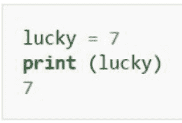
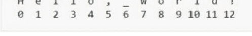

# HTML 快速启动指南：2 周内掌握 HTML 和 CSS 基础

## 引言

**赠品**：为表感谢，我想赠送您一份礼物。我附上了一些额外的书籍。请查看书末了解如何获取！

感谢您下载本书，"*HTML：两周内掌握 HTML 编程基础！*"

如今，使用互联网已不仅仅是奢侈，而是必需品。有时，不进行网络研究就无法完成工作，但作为对编程感兴趣的人，你是否曾好奇这些网站是如何运作的？它们内部发生了什么？

首先，你看到的每个网站之所以能运行，都归功于一种名为 HTML（超文本标记语言）的编程语言。没有 HTML，网站将无法像现在这样高效运行，也无法为你提供图片、视频甚至音频。简而言之，这些网站就不会像现在这样易于浏览和赏心悦目。

但是，在本书的帮助下，你只需两周时间就能掌握 HTML 编程的基础知识——这样你就可以开始制作自己的网页，并最终制作出一个完整的网站！

现在就阅读本书，了解如何做到。

再次感谢你下载本书，希望你喜欢它！

# 第一周

## 第一章：HTML 简史

在课程的第一周，最好先了解 HTML 到底是什么。

HTML 代表超文本标记语言，它由一组标记标签组成，并通过 HTML 标签来描述。

标记标签构成了 HTML 的基础，其中嵌套行（如 `<HTML>` 或 `</HTML>`）的使用非常普遍。这使其成为基石技术，与 `JavaScript` 和 `CSS` 一起。这使得网页上的内容也能轻松地在移动设备上显示——这一点在当今尤为重要，因为大多数人主要使用手机或平板电脑，因此你必须确保你创建的网站针对移动设备进行了优化。

HTML 的发展广泛归功于蒂姆·伯纳斯-李，他也被称为万维网（`www`）的创造者。早在 1989 年，他还是欧洲核子研究中心（CERN）的承包商，在那里工作期间，他撰写了一份备忘录，提议建立一个基于互联网的超文本系统。

然后，他在 1990 年代开始编写基于 HTML 的服务器和浏览器软件，并基于此创建了一个百科全书，欧洲核子研究中心将其用作其创建网站的基础。

伯纳斯-李也是第一个使用术语“HTML 标签”作为 HTML 的首个可用描述的人。它由 18 个构成相对 HTML 设计的基本元素组成，其中 11 个元素至今仍在使用。

HTML 也曾一度被定义为 SGML（标准通用标记语言）的主要应用之一。这种情况一直持续到 1993 年，互联网的第一个 HTML 草案得以实现。然而，该草案仅过了 6 个月就过期了。

1994 年，HTML 工作组成立，随之，HTML 2.0 最终于 1995 年完成，1996 年，HTML 的规范开始得到维护。1999 年，HTML 4.1 发布，2004 年，HTML 5 开始开发——证明了该语言的创新性。

在 HTML 的帮助下，交互式表单、对象和图片可以轻松嵌入网站。然后，在结构语义的帮助下，引用、链接、列表和段落也都被嵌入。HTML 还与 `JavaScript` 和 `CSS` 协同工作，使浏览器能够嵌入脚本。

自 1997 年以来，程序员被鼓励为网站使用 HTML 而不是 CSS（层叠样式表）。

## 第二章：框架与标签速查表

HTML 的框架由以下部分组成：

1. 文档类型由 `DOCTYPE` 声明描述。
2. 文档信息在 `<HEAD>` 和 `</HEAD>` 之间的文本中提供。
3. HTML 文档在 `<HTML>` 和 `</HTML>` 之间的文本中描述。
4. 文档标题在 `<TITLE>` 和 `</TITLE>` 之间的文本中提供。
5. `<H1>` 和 `</H1>` 之间的文本称为标题。它也可以用于 H2、H3、H4 等。
6. 文档的内容——即你在屏幕上阅读的内容——放在 `<BODY>` 和 `</BODY>` 之间的文本中。
7. 然后可以在 `<p>` 和 `</p>` 之间的文本中创建段落。

### 标签速查表

现在，说到标签，你必须记住它们通常是成对出现的，正如你在上面的框架中看到的那样。左边的是标签的开始（也称为开始标签），结束标签看起来几乎一样——只是在开头多了一个斜杠（`/`）。

以下是你将主要使用的标签：

`<DOCTYPE...>`

- `NAME` – 这指的是页面上的一个部分。
- `HREF` – 用于超链接，或用于添加你所引用的 URL 的名称。
- `onCLICK` – 这是运行的脚本，以便用户能够点击锚点（即，对于像 [google.com](http://google.com) 这样的东西，必须运行此脚本，这样用户在点击后才会真正被引导到链接）。

`<A>` 锚点

- `TITLE` – 这是正在打开的文档的标题。

## HTML 属性与标签参考

`<ADDRESS>`

`<App...>`

- `CODEBASE` – 这是通往小程序类的路径。
- `CODE` – 这决定了当前运行的应用程序。
- `HEIGHT` – 小程序的高度。
- `WIDTH` – 这决定了小程序的宽度。
- `ALIGN` – 这决定了周围文本在屏幕上的显示方式。

`<APPLET...>`

- `HSPACE` – 这是周围文本与小程序之间的水平间距。
- `VSPACE` – 这是周围文本与小程序之间的垂直间距。
- `NAME` – 这是赋予小程序的名称，也是其他引用它的小程序所使用的名称。
- `BORDER` – 这是环绕小程序的空白区域。
- `ARCHIVE` – 这是已压缩为一个文件的小程序组件集合。
- `HREF` – 这决定了你链接到的 URL。
- `MAYSCRIPT` – 这显示 Java 是否可以使用 JavaScript。
- `ALT` – 这是图像未正确显示时使用的替代文本。
- `SHAPE` – 这决定了屏幕上显示区域的形状。可以是以下之一：`POLY` | `RECT` | `CIRCLE` | `DEFAULT`。
- `COORDS` – 这些决定了链接区域中形状的坐标。

`<AREA...>`

- `TARGET` – 这决定了你必须进入的框架。
- `TITLE` – 这是对所使用区域的简短描述。
- `onCLICK` – 当用户将鼠标悬停在锚文本上时，此脚本应运行。
- `NOHREF` – 这意味着某个区域内不包含链接。

`<b>` 加粗文本

`<BASE>` 基础地址

`<Base Front>`

- `TARGET` – 这显示了文档必须进入的窗口。变体包括：“parent” | “black” | “top” | “shelf” | *窗口名称*。
- `SRC` – 这决定了音频或声音 URL。
- `FACE` – 项目的字体或字体。
- `COLOR` – 这是字体的颜色。
- `SIZE` – 正在使用的字体大小。

`<BG Sound>`

- `LOOP` – 这决定了音频或视频播放的次数。

`<FORM>`

- `ENCTYPE` – 这是页面上使用的表单类型。
- `onRESET` – 如果表单被重置，此脚本应运行。
- `SRC` – 这是必须添加到框架中的文件类型。
- `onSUBMIT` – 当表单被提交时，此脚本应运行。
- `SCROLLING` – 这决定了表单是否应该使用滚动条（可用 YES 或 NO 回答）。
- `MARGINWIDTH` – 这决定了表单边距的宽度。
- `MARGINHEIGHT` – 这决定了表单边距的高度。
- `ROWS` – 框架中的行数。
- `COLS` – 框架中的列数。

`<HEADERS: H1, H2, H3, H4, H5, H6>`

- `NOSHADE` – 这意味着不应使用阴影效果。
- `COLOR` – 线的颜色。

`<iFrame>` 内联框架

- `ALT` – 如果图像未加载，这将显示在屏幕上。
- `LONGDESC` – 这是正在使用的图像的长描述。
- `SUPPRESS` – 这意味着图像的图标在下载完成前不会显示。
- `MEDIA` – 这决定了链接到的媒体类型。可以是以下之一：`PRINT` | `PROJECTION` | `SCREEN` | `ALL` | `BRAILLE` | `AURAL`。
- `TYPE` – 这是正在使用的链接资源类型。
- `BEHAVIOR` – 使用的滚动类型。
- `GUTTER` – 这决定了列之间的间距。

`<OL>` 有序列表

- `VALUE` – 这决定了用户所选选项的值。
- `START` – 这显示了你必须开始计数的位置。
- `ALIGN` – 这意味着你希望将段落左对齐或右对齐。
- `LANGUAGE` – 这是使用的脚本语言（JAVA、CSS 等）。
- `BG` – 使用的背景色。
- `BACKGROUND` – 你希望用作页面背景的图片。
- `BORDERCOLOR` – 页面边框的颜色。
- `TYPE` – 使用的项目符号类型。可以是以下之一：`SQUARE` | `CIRCLE` | `DISC`。

现在明白了，是时候开始将所学付诸实践了！别担心，会有指导的！

## 第三章：使用 HTML 编辑器

编写 HTML 代码之前，你首先需要为它们打开正确的编辑器。虽然专业人士普遍使用 `Sublime Text` 和 `Microsoft WebMatrix`，但作为初学者，你可以使用记事本。

对于 Windows 7 及更早版本，只需单击 *开始*，然后选择 *所有程序* > *附件* > *记事本*。

对于 Windows 8 及其他更新版本，单击 *开始屏幕* > *记事本*。

现在，尝试将此内容输入记事本：

```
<!DOCTYPE html>
<html>
<body>

<h1>欢迎来到网络世界</h1>

<p>我的第一个页面</p>

</body>
</html>
```

然后，通过选择 *文件* > *另存为* 保存页面，并选择 *UTF-8*。但是，如果要使用西欧和美国字符，只需选择 *ANSI*。

要查看你在浏览器中制作的页面，只需点击并观看页面在你的浏览器中打开。

## 第四章：重要的 HTML 页面

现在是时候开始创建一个完整的基础 HTML 页面，看看它是什么样子了。再次记住，每个 HTML 页面或文档都应以 `<!DOCTYPE html>` 开头。这意味着它看起来应该像这样：

```
<!DOCTYPE html>
<html>
<body>

<h1>欢迎来到网络世界</h1>

<p>我的第一个页面</p>

</body>
</html>
```

请注意，声明会根据你使用的 HTML 类型而有所不同。这意味着你必须执行以下操作：

1. **XHTML 1.0:** `<!DOCTYPE html PUBLIC "-//W3C//DTD XHTML 1.0 Transitional//EN" "http://www.w3.org/TR/xhtml1/DTD/xhtml1-transitional.dtd">`
2. **HTML 4.01:** `<!DOCTYPE HTML PUBLIC "-//W3C//DTD HTML 4.01 Transitional//EN" "http://www.w3.org/TR/html4/loose.dtd">`
3. **HTML 5:** `<!DOCTYPE html>`

### 标题

当然，你的页面需要标题。它们就像书籍或文章中的小标题，因此你可以确切地知道页面中包含什么——换句话说，就是它的主题。

标题范围从 `<H1>` 到 `<H6>`。这里有一个好例子：

```
<h1>看看我的标题</h1>
<h2>看看我的标题</h2>
<h3>看看我的标题</h3>
```

```
<h4>看看我的标题</h4>
<h5>看看我的标题</h5>
<h6>看看我的标题</h6>
```

### 段落

段落也用于网页以及文章和小说中。当你看到 `<p>` 标签时，你就知道一个段落开始了。这也让你更容易阅读页面上的内容。

如果不使用段落，所有内容都会挤在一个空间里——使得它们极难阅读。为此，你可以尝试以下方法：

```
<p>阅读这个段落。</p>
<p>再读一个段落。</p>
```

### 图像

图像也可以用来美化你的网站。它让人们更想阅读网站，因为图像总能让事物看起来赏心悦目。这意味着你需要使用 `` 标签来实现。

它的属性如下：

1. `alt`（替代文本）
2. `src`（图像源）
3. `size`（宽度和高度）

例如：

```

```

### 链接

当然，也鼓励使用链接。这些是用 `<a>` 标签定义的。它让事物看起来赏心悦目，这样一切就不会只在一个页面上，读者可以被引导到你网站上的不同页面。

这里有一个好例子：

```
<a href="http://thechanels.com">查看此链接</a>
```

### 元素

HTML 页面中也使用了各种元素。如果你还记得，HTML 编码的网页中总是成对使用标签。

它应该看起来像这样：

```
<tagname>标签名</tagname>
```

例如：

```
<h1> 阅读这个标题 </h1>
<p> 你看到光了吗？ </p>
<b><p>什么是女性主义？</b></p>
```

所以基本上，整个文档是通过各种 `<HTML>` 标签来描绘的，这就是为什么必须使用开始 `<>` 标签和结束 `</>` 标签。没有它们，页面上的文字会混在一起——使得它们难以阅读。然后 `<body>` 标签定义了页面包含的内容。它还包含标题、段落和其他属性。

例如：

```
<html>
<body>
<h1>我的周日</h1>
<p>上个周日是最棒的周日，因为我们去了公园放风筝。
</p>
</body>
</html>
```

借助开始和结束标签，你可以理解屏幕上显示的内容。它们赋予页面很多意义——而不仅仅是一堆乱码。

其他重要的元素是标题 `<h1>` 和段落 `</p>`，这样也可以定义标题。标题的示例如下：

```
<h1> 看看这有多棒 </h1>
<h2> 你看到她去哪儿了吗？ </h2>
<h3> 你接下来要去哪里？ </h3>
```

## 第五章：HTML 属性

那么，在课程的第二周，你可以开始学习如何编写更复杂的 HTML 部分。为此，你可以从属性开始学习。

关于属性，你需要记住的最重要的事情如下：

1. HTML 元素可以拥有属性——属性有助于更好地解释元素。
2. 开始标签 `<>` 指定了属性。
3. 属性也以名称/值对的形式出现。它们看起来像这样：`name= “value”`（即 `img src = “1gdtjs.tumblr.com”`）。

现在，你可以看看下面各种类型的属性：

### Title 属性

同样，段落由 `<p>` 标签定义。然而，你也可以在段落中插入页面主题的标题。你可以尝试下面的示例：

```html
<p title="Who is Gossip Girl?">
After 6 years of scheming and failed plans, Gossip Girl finally introduced herself
—or himself, rather—to the Non-Judging Breakfast Club. People were surprised to
see that Gossip Girl is actually non other than Dan Humphrey, everyone's favorite
guy from Brooklyn. The guy from the outside actually wanted to be in! </p>
```

### Lang 属性

HTML 标签声明文档中使用的语言类型。这对于应用程序的可访问性至关重要——即使在不同的设备上也是如此。请记住，`html lang` 后的前两个字母将决定所使用的语言类型。如果你使用的是方言，则需要再添加两个字母。

例如：`en-US`（美式英语）、`en-UK`（英式英语）等。

为了更清楚，请看下面的示例：

```html
<!DOCTYPE html>
<html lang="en-US">
<body>

<h1>Who is Gossip Girl?</h1>
<p>Does anyone know who Gossip Girl is and where she could be found?</p>

</body>
</html>
```

### Size 属性

`` 标签定义了在 HTML 页面上显示的图像。

`Src` 然后决定了文件的来源，同时也考虑了图像的宽度和高度。然后你可以以像素为单位指定高度和宽度。

例如：

```html

```

### Href 属性

`<a>` 标签定义了 `Href` 属性。正如你现在可能已经知道的，这意味着周围存在 HTML 链接。你必须在属性本身中指定地址。

例如：

```html
<a href="http://abc1234.com">The World's Best Website</a>
```

### Alt 属性

要使用替代文本，最好使用 `Alt` 属性。这对于屏幕阅读器非常完美，它使查看网站的人能够更好地欣赏该网站。

例如：

```html

```

### 关于属性的其他提示

以下是关于属性时你需要牢记的其他重要事项：

1. 双引号样式在 HTML 中很普遍。然而，这并不一定意味着你不能再使用单引号样式。
2. 仍然最好使用小写字母。
3. 为了方便使用网站的人，请利用 `Alt` 属性。
4. 确保在 `size` 属性的帮助下提供足够的信息。
5. 使用 `href` 保持链接易于访问。不要只是将网站放在段落旁边。
6. 标题使你的页面更容易在线找到——请利用它们。

## 第六章：HTML 格式化

你最好也了解更多关于格式化和样式的知识，因为它们有助于使你的网页栩栩如生。通过正确运用样式和格式化，你的网站看起来会与周围的其他网站有所不同。让我们先从格式化开始。

### 格式化

在格式化方面，你需要理解的是使用了具有特殊含义的特殊元素，然后用于显示各种类型的文本。例如：

1. 小文本
2. 标记文本
3. 斜体文本
4. 粗体文本
5. 上标
6. 下标
7. 插入文本
8. 删除文本
9. 重要文本

因此，基本上需要使用以下标签：

1. `<b>` 粗体文本
2. `<mark>` 这意味着文本被标记或换句话说，高亮显示
3. `<del>` 这意味着文本已被删除
4. `<ins>` 这意味着文本已被插入


### 5. `<sup>` 上标文本

### 6. `<sub>` 下标文本

### 7. `<strong>` 这意味着文本很重要

### 8. `<small>` 定义比屏幕上显示的更小的文本

### 9. `<i>` 定义斜体文本

### 10. `<em>` 定义强调文本

为了帮助你更好地理解这些，你可以看看下面的示例。

#### 加粗文本

当你想表示某些内容极其重要时——例如标题或大标题，会使用此标签。

```html
<p>look at this normal text</p>

<p><strong>look at this strong text</strong>.</p>
```

#### 粗体文本

当然，有时你需要将屏幕上看到的一些单词格式化为粗体。这意味着文本很重要。例如，它可能是单词的含义、电影中的角色等。请看下面的示例：

```html
<p>look at this normal text.</p>
<p><b>look at this bold text</b>.</p>
```

#### 强调文本

这意味着你试图让人们阅读你文章中重要的部分。这通常出现在新闻文章或标题党文章中。为此，你可以尝试下面的示例：

```html
<p>look at this normal text.</p>

<p><em>look at this emphasized text</em>.</p>
```

#### 斜体文本

就像本书中的小标题一样，有时你确实需要将单词斜体化，以给读者留下更深刻的印象。这完全关乎语义。有时，它也用于表示段落中使用了其他语言——这在一些小说或双语作品中很常见。

```html
<p>look at this normal text.</p>
<p><i>look at this italicized text</i>.</p>
```

### 标记格式

标记格式意味着文本已被高亮显示。这通常用于美化页面，使其引人注目且友好。

这是一个很好的示例：

```html
<h2>HTML <mark>Marked</mark> Formatting</h2>
```

### 小号格式

小号格式基本上是将较小字体的文本显示在屏幕上。一个示例如下所示：

```html
<h2>HTML <small>Small</small> Formatting</h2>
```

### 插入格式

此格式意味着文本已被<u>插入</u>或添加。这是编辑页面或网站本身的好方法。这是一个很好的示例：

```html
<p>My favorite <ins>color</ins> is red.</p>
```

### 删除格式

这表示页面上的某些内容已被~~删除~~。

```html
<p>My favorite color is ~~blue~~ red.</p>
```

### 上标格式

这意味着文本以上标形式呈现。例如：

```html
<p>This is <sup>superscripted</sup> text.</p>
```

### 下标格式

这意味着文本以 `$_{下标}$` 形式呈现。例如：

```html
<p>This is <sub>subscripted</sub> text.</p>
```

## 第7章：HTML 样式

当然，考虑页面的样式也很重要。就像格式化一样，这有助于让你的页面独一无二——而不是与网上的其他所有内容相同。

众所周知，样式的语法如下：

`Style= “property:value;”`

两者都是 CSS 的形式，其中 `property` 是属性值，`value` 是 CSS 值。

关于样式，你必须记住以下几点：

1. **文本对齐。** 这应用于保持文本对齐。
2. **字体大小。** 这有助于你确定字体大小。
3. **字体族。** 这有助于你确定文本字体。
4. **颜色。** 这有助于你定义文本颜色。
5. **背景色。** 这将帮助你定义背景的颜色。
6. **样式。** 基本上，你必须使用它来帮助程序理解你正在为页面创建样式。

### 文本对齐

要对齐文本，你必须考虑水平对齐系统。为此，你可以尝试下面的示例：

```html
<h1 style="text-align:center;">Centered Heading</h1>
<p>Read this paragraph</p>
```

### 文本大小

这将帮助你为屏幕上的文本选择合适的字体大小。毕竟，并非所有内容都应该使用相同的字体，这一点至关重要。为此，你可以尝试下面的示例：

```html
<h1 style="font-size:100%;">This is a heading</h1>
<p style="font-size:160%;">This is a paragraph.</p>
```

### 字体

这完全在于选择你希望网站读者在屏幕上看到的字体类型。这也定义了字体族，就像下面所示的那样：

```html
<h1 style="font-family:verdana;">This is a heading</h1>
<p style="font-family:serif;">This is a paragraph.</p>
```

### 文本颜色

如果你想改变屏幕上的文本颜色，当然最好知道使用正确的属性，这就是文本颜色。为此，你可以尝试这个示例：

```html
<h1 style="color:pink;">This is a heading</h1>
<p style="color:black;">This is a paragraph.</p>
```

### 背景色

无论你想要白色、黑色、粉色还是任何其他颜色的背景，你都必须使用这种样式类型。这是一个将背景色更改为鲑鱼粉的好示例：

```html
<body style="background-color:salmonpink;">

<h1>This is a heading</h1>
<p>This is a paragraph.</p>

</body>
```

## 第8章：HTML 引用

有时你确实需要在页面上引用某些内容。例如，如果你需要将某些内容归因于另一个网站，最好不要歪曲他们的原话，这样你的读者才能获得真正有价值的阅读体验，并且知道你知道如何链接到正确的来源。

为此，你必须记住以下内容：

1. **`<q>`。** 这表示一个简短的内联引用。
2. **`<cite>`。** 这归因于页面上某个主题的标题。
3. **`<blockquote>`。** 这意味着你引用了外部来源的内容。
4. **`<bdo>`。** 这表示文本方向。
5. **`<address>`。** 这是联系信息引用。
6. **`<abbr>`。** 首字母缩略词或缩写。

### 长引用

例如，你创建了一个新的网站来倡导和照顾动物，并且你隶属于 WWF（世界自然基金会）。这意味着你可能需要从他们的网站引用。你会怎么做？

嗯，你可以使用长引用样式。这由 `<blockquote>` 表示，它将缩进段落。所以，如果你这样引用：

```html
<p>Here is a quote from WWF’s website:</p>
<blockquote cite="http://www.worldwildlife.org/who/index.html">
For 50 years, WWF has been protecting the future of nature.
The world’s leading conservation organization,
WWF works in 100 countries and is supported by
1.2 million members in the United States and
close to 5 million globally.
</blockquote>
```

你在屏幕上看到的内容将类似于：

> Here is a quote from WWF’s website:
>
> For 50 years, WWF has been protecting the future of nature. The world’s leading conservation organization, WWF works in 100 countries and is supported by 1.2 million members in the United States and close to 5 million globally.

### 短引用

对于短引用，你可以尝试使用 `<q>`。例如：

> `<p>ABC123's Goal is to: <q>Build a future where people know how to code without problems, and create the websites they want.</q></p>`

### 联系信息引用

如果你观察力敏锐，你会知道很多网站都使用“联系”标签页，你可以在其中看到网站所有者的联系信息。为此，你可以使用 HTML 的 `<address>` 代码。它通常以斜体显示并带有换行符。

例如：

```html
<address>
Written by Blair Waldorf </br>
Visit us at:<br>
blaircornelia.com<br>
New York, New York<br>
USA
</address>
```

### 缩写

缩写也属于引用。为此，你必须使用 `<abbr>` 标签。这样，搜索引擎、翻译系统和其他浏览器就能轻松获取信息。为此，你可以尝试下面的示例：

```html
<p>The <abbr title="World Wide Web">WWW</abbr> was founded in 1989.</p>
```

## 第9章：HTML CSS

最后，了解一下 CSS（层叠样式表）也是好的。它们可以美化你的页面，使其在视觉上更美观，并有助于确保导航也变得容易。它还允许你为网站添加更多功能。有 3 个重要的 CSS 元素，它们是：

1. **内部。** 这意味着你正在使用一个 `<style>` 元素，你可以在 HTML 的 `<head>` 部分找到它。
2. **内联。** 这描述了 HTML 样式属性。
3. **外部。** 这意味着你正在使用外部 CSS 文件。

### 重要元素

1. **样式。** 内部样式
2. **CSS 外边距。** 边框外部的空间
3. **CSS 内边距。** 边框内部的空间
4. **CSS 字体大小。** 这决定了文本大小
5. **CSS 字体族。** 这决定了字体来源
6. **CSS 颜色。** 这决定了所使用字体的颜色
7. **`<head>`。** 这指的是 `<link>` 和 `<style>` 元素
8. **`<link>`。** 指向外部 CSS 文件的链接
9. **`<style>`。** 内部 CSS 的样式

### 内部样式（内部 CSS）

这意味着你正在尝试定义网站中单个页面的样式。你可以在页面的 `<head>` 部分看到它。它封装了 `<style>` 元素。

例如：

```html
<!DOCTYPE html>
<html>
<head>
<style>
body {background-color:white;}
h1  {color:pink;}
p   {color:violet;}
</style>
</head>
<body>

<h1>Read this heading</h1>
<p>Read this paragraph </p>

</body>
</html>
```

### 内联样式（或内联 CSS）

内联 CSS 意味着你必须为页面中的单个元素应用独特的样式。这也属于 HTML 样式属性。例如，如果你想将 `<h1>` 标题的颜色更改为粉色，你可以尝试：

```html
<h1 style="color:pink;">This is a Pink Heading</h1>
```

### 外部样式（外部 CSS）

外部 CSS 主要是为网站中的多个页面定义样式——而不仅仅是单个页面。借助一个文件，你就能改变整个网站的外观，这确实让事情变得简单许多。

然后，你只需在页面的 `<head>` 部分添加一个指向外部 CSS 文件的链接即可。为此，你可以参考下面的示例：

```html
<!DOCTYPE html>
<html>
<head>
  <link rel="stylesheet" href="styles.css">
</head>
<body>

<h1>阅读此标题 </h1>
<p>阅读此段落。</p>

</body>
</html>
```

### CSS 字体

最后，为了轻松更改字体，请确保你知道如何区分元素。*颜色*决定了页面中 HTML 文本的颜色，*字体大小*关乎所使用的字号，而*字体系列*定义了字体所属的系列（即，*衬线体、无衬线体等*）。

```html
<!DOCTYPE html>
<html>
<head>
<style>
h1 {
    color: blue;
    font-family: serif;
    font-size: 100%;
}
p {
    color: red;
    font-family: courier;
    font-size: 120%;
}
</style>
</head>
<body>
<h1>阅读此标题</h1>
<p>阅读此段落。</p>
</body>
</html>
```

既然你已经掌握了基础知识，你终于可以创建自己的网站了！

### 结论

再次感谢你下载这本书！

我希望这本书能帮助你理解 HTML 编程，并希望你在短短 2 周内已经通过足够的练习来创建自己的网站！

下一步是不要害怕将你所学到的知识付诸实践！创建网页并查看它们的效果。如果一开始看起来不够好，不要担心，因为总有改进的空间——而且既然你了解了 HTML 编程，这对你来说会很容易！


最后，如果你喜欢这本书，我想请你帮个忙，你是否愿意在亚马逊上为这本书留下评论？这将不胜感激！

祝你好运！

### 引言

我要感谢你并祝贺你下载了这本书：“*在 2 周内掌握 SEO 基础*”。

本书包含了经过验证的步骤和策略，教你如何通过正确的方法在搜索引擎结果页面中达到顶级位置。

大多数业余搜索营销者都在寻找在选定关键词上快速排名的方法。由于不必要的紧迫感，其中一些人使用了搜索引擎所不赞成的方法。因此，许多人受到了过去搜索引擎算法更新的影响。本书为你提供了在 Google 和其他搜索引擎中排名的正确方法。这些是经过白帽 SEO 专业人士尝试和测试的搜索引擎优化基础知识。使用这些技术，即使在大型算法更新推出时，你的流量也不会受到重大影响。

（提供任何关于这本书的额外信息。确保引言能够推销这本书，因为人们可以在亚马逊或 Kindle 上预览时看到这些内容。你可以自己写这部分，也可以请你的书籍撰稿人来写。）

再次感谢你下载这本书，希望你喜欢它！

## 第1章：什么是 SEO，为什么它对你的网站很重要？

互联网是一个信息的海洋。它是一个由全球互联的计算机组成的网络。它使我们能够访问来自半个地球之外的计算机上的信息。

然而，互联网本身是一个大杂烩。它充满了满足数十亿个人需求的网页。早期，工程师们一直在寻找一种工具，可以组织网络上的所有信息，并帮助人们在最短的时间内找到他们想要的东西。

搜索引擎就是那个工具。

这就是搜索引擎的功能。它们通过让人工智能访问网页并收集信息，“爬取”尽可能多的网页。它们将爬取页面的信息添加到索引中。当一个人输入搜索查询时，搜索引擎会遍历所有爬取过的页面，并返回一个符合查询的页面列表。然后，它根据这些页面与用户查询的相关性进行组织。

每月有数十亿人使用搜索引擎。其中一些人可能对你的网站感兴趣。为了将流量引入你的网站，你希望你的网页在目标访客的搜索结果中排名靠前。

### 什么是搜索查询？

搜索查询是来自搜索引擎用户的问题。他们使用搜索引擎来寻找答案。以下是人们向搜索引擎提出的三种类型的问题：

### 我在哪里/如何找到[某物名称]？

有些人使用查询来寻找特定的现实世界物品或地点。一个人可能在纽约附近寻找一辆二手车。他通过输入以下内容让搜索引擎查找所有关于二手车的分类广告：

“纽约市二手车分类广告”

他发现结果太多，于是将搜索范围缩小为：

“曼哈顿 craigslist 二手雷克萨斯”

### 什么、何时和哪里的问题

然而，大多数时候，人们使用搜索引擎来寻找信息。例如，有些人使用搜索引擎来查找他们学校作业的答案。许多人也去搜索引擎查找与他们相关的时事新闻。人们不再寻找电话簿，而是觉得通过互联网查找企业的地址和联系方式更快。

### [公司名称]的网站是什么？

最后，人们使用搜索引擎前往网络上的特定区域。例如，有些人想去当地报纸的网站。他们不知道确切的网站地址，所以请 Google 引导他们前往那里。

在发达国家，搜索引擎已成为大多数人获取答案的主要来源。大多数像 Google 这样的搜索引擎的用户信任算法编译的搜索结果。大多数人期望在结果的前几位找到他们查询的答案。如果前五个结果似乎没有他们问题的答案，人们往往会认为他们使用的查询词一定有问题。就像那个在纽约寻找二手雷克萨斯的人一样，大多数人会改进他们的搜索。

### 这对你的网站有什么影响？

如果你想为网站吸引更多流量，就需要了解搜索引擎的工作原理，并能够优化你的网页，使其被抓取、索引，并显示在搜索结果页面的顶部。

在搜索引擎优化（SEO）方面，仅仅出现在搜索结果中是不够的。排名第一的结果被点击的几率超过 18%。你的网页在搜索引擎结果页面上的位置越靠后，获得的点击次数就越少。

随着智能手机的出现，人们起初认为网站的受欢迎程度会开始下降。普通人认为应用程序将取代搜索。即使这种情况确实会发生，到目前为止也尚未显现。尽管人们在台式电脑前花费的时间减少了，但他们仍在使用搜索来查找所需信息和想要的商品。针对手机屏幕优化了的网站将获得移动搜索的大部分流量。

### 第1天和第2天的活动：确定你的网站主题或利基市场

如果你的网站专注于一个主题，那么它在搜索引擎上获得排名会更容易。如果你已经有一个综合信息网站或博客，你可以根据已有的热门文章或内容来确定最佳主题。

在思考网站的主题或利基市场时，你还应该考虑建立网站的个人目标。你此后创建的内容类型应使你更接近实现目标。

## 第六章：计算机辅助设计


计算机辅助设计（Computer-Aided Design，简称 CAD）是指利用计算机软件来创建、修改、分析或优化设计的过程。它广泛应用于机械工程、建筑、电子和土木工程等领域。

### 6.1 CAD 的发展历史

- 1960年代：最早期的 CAD 系统诞生。
- 1980年代：PC 上的 CAD 软件开始普及。
- 2000年代至今：向三维建模和云协作发展。

### 6.2 核心功能

| 功能 | 说明 |
| --- | --- |
| 草图绘制 | 创建 2D 几何形状 |
| 建模 | 生成 3D 实体或曲面 |
| 装配 | 将多个零件组合成装配体 |
| 出图 | 生成标准的工程图纸 |

## 第二章：搜索引擎技术的局限性

搜索引擎是在网络上查找信息最受欢迎的工具。然而，即使搜索算法和页面抓取技术有了所有改进，这个工具仍然有很多局限性。例如，搜索引擎在抓取和索引一个网页后，无法直接自行判断该网页是否与用户相关。它需要寻找更多线索才能知道某个网页是否应该针对特定关键词出现在搜索结果的顶部。

作为网站管理员和搜索营销人员，你的工作就是为搜索引擎提供它们将你置于顶部结果所需的线索。搜索引擎专家将这些线索称为排名因素。排名因素是搜索引擎蜘蛛访问你的网站时寻找的信息。它们在索引过程中编制这些排名因素。一个网页在特定关键词搜索结果中的位置，将取决于其基于这些因素的排名分数有多好。

即使考虑了数百个排名因素，搜索引擎仍然有很多局限性。

### 搜索引擎有哪些局限性？

#### 爬虫机器人依赖链接进行导航

搜索引擎爬虫的目的是制作整个可搜索互联网的虚拟地图，这里指的是普通人可以访问的互联网部分。为了从一个页面跳转到另一个页面，它们使用所抓取页面中的超链接。这些数字桥梁是一个重要的排名因素。

如果你网站中的一些页面没有指向它的链接，那么你应该预料到它将不会被索引，也不会出现在搜索结果页面中。

#### 它们无法抓取受在线表单保护的页面

网站要求访问者成为会员是很常见的。要成为会员，你需要填写会员表单。搜索引擎没有配备可以填写所有类型表单的程序。因此，它们无法抓取网站管理员只向会员展示的任何信息。

#### 它们专精于文本内容

搜索引擎爬虫专长于从基于文本的网站收集信息。它们从非文本内容中收集和组织信息的能力非常有限。例如，爬虫机器人无法自行判断一张图片是什么样子。它们在视频、音频、图像、Flash和插件内容方面也面临类似的挑战。

为了绕过这个问题，搜索公司要求网站管理员将文本信息与这些内容一起包含。没有这些额外信息，网页中的某些类型的内容在排名时将不会被赋予很高的权重。

#### 它们需要关键词匹配

当用户使用搜索引擎时，他们通常输入一个描述他们正在寻找什么的短语。搜索引擎算法已经进化，比以往任何时候都更能为你提供相关的网页，准确率高达90%。然而，如果用户没有使用正确的术语，他们可能会遇到一些问题。数百万用户在搜索不熟悉的内容时使用不常见的术语。

这个限制在英语初学者中很常见。当他们不知道某样东西的单词时，他们可能会使用形容词来描述它。以英语为母语的人可能知道他想说什么，但搜索引擎没有编程来理解非母语使用者可能在询问什么。

当我们使用对搜索AI来说不熟悉的语言细微差别时，这个问题也变得难以处理。例如，同一个词在不同英语国家之间的拼写差异会影响你的搜索结果排名。如果你始终使用“behaviour”而不是“behavior”，搜索引擎可能会认为你的网页是为英国用户设计的。这将影响你在美国用户中的排名。

搜索营销的成功将很大程度上取决于你对所使用语言的了解。例如，如果你的目标是特定的少数群体作为网站的潜在访客，你应该了解他们语言使用的细微差别。了解他们的搜索行为也会有所帮助。

#### 专有名词与通用名词

由于对关键词的依赖，搜索引擎在正确理解词语的语境方面也面临挑战。当用户使用具有多重含义的关键词时，这个挑战变得更加困难。例如，流行文化广泛使用“black”这个词。有歌曲、电影和品牌包含这个词。在搜索中输入它们的人也可能指的是他们正在寻找的物品的颜色。因此，搜索引擎用户倾向于使用更长的短语进行搜索，以使结果更符合他们的需求。由于这种搜索行为，网站管理员开始针对长尾关键词。这些是人们搜索时通常使用的短语。它们超过三个单词长，指的是搜索者非常具体的需求。

搜索技术在不断变化。工程师们正在开发新形式的技术，以便人工智能能够绕过这些局限性。正是因为这些局限性，我们需要同时为用户和搜索引擎优化我们的网页。

### 第3天和第4天的活动

你应该花时间回顾本章讨论的搜索引擎局限性，并思考你的潜在访客通过搜索引擎访问你的网站时可能遇到的困难。

你还应该花时间检查你的网站在搜索引擎结果页面中的可见性。使用你所在行业或利基市场的通用关键词和短语。如果你在前三页都找不到你的网站，你需要做很多工作。如果你在前三页但不在第一页，你的目标是向上攀升。无论你处于什么位置，你都应该运用本书中的策略和信息来提升你网站的排名。

## 第三章：您的目标用户：搜索营销策略的起点

在为网站制定搜索营销策略时，您需要首先思考那些可能从您网站信息中获取价值的人群。他们是当在搜索结果页面中看到您的网页时，最有可能点击的那类人。搜索引擎在您的网站内容与需要它们的人们之间架起了桥梁。

### 描绘您的目标搜索引擎用户画像

互联网用户每月进行数十亿次搜索。然而，并非所有这些搜索都对您的网站有价值。寻找您网站上那类信息的人数取决于您网站所属行业或利基市场的受欢迎程度。利基市场越受欢迎，搜索者就越多。然而，热门的利基市场也意味着激烈的竞争。

为了在竞争中脱颖而出，您需要深入了解您理想中的访问者。为此，您可以为网站的理想访问者创建一个画像。如果您已经运营网站一段时间，或许可以通过您使用的分析软件，收集一些关于访问您网站人群类型的信息。以下是一些您需要的、关于访问者的信息类型：

- 年龄
- 性别
- 语言
- 位置
- 共同兴趣

获取这些信息后，您就能推测人们在使用搜索引擎时最可能使用的词汇。根据您网站的类型，您可能还需要一些额外信息。

### 您对访问者的目标

在创建了理想访问者的画像后，您需要决定当这些人到达您的网站时，您希望他们做什么。如果您在网站上销售产品，您可能需要调整设计，以确保用户能够从您已被索引的页面开始进行购买。

其他网站可能希望访问者填写表单、参与调查或注册会员。

设定一个目标也有助于您优化所针对的关键词类型。例如，如果您在销售某物，您可能需要针对与购买相关的短语。一些营销人员只针对处于购买过程后期的消费者所使用的短语。

### 第5天和第6天的活动：识别您的目标用户

接下来的活动是识别您网站理想访问者的特征。理想访问者指的是最有可能完成您所期望行动的人。您应该阐述这些人的共同点。除了第三章提到的信息外，您还应该研究其他服务于同一目标市场的网站。您应该查看它们的设计和提供的内容类型。

## 第四章：选择排名关键词

既然您已经知道目标访问者是谁，就需要选择他们在搜索您所提供的信息时会使用的正确关键词。

要了解目标用户使用的关键词，您需要设身处地为他们着想。您需要利用在画像中获得的信息，来推断您应该使用的正确语言类型。

您还需要提醒自己搜索引擎技术的局限性。您必须确保关键词能够代表您页面上展示的内容类型以及潜在访问者的意图。您的最终目标是提供潜在访问者所需的东西，然后将他们转化为买家、订阅者、会员，或者至少是回头客。

大多数初学者网站管理员认为，他们应该只选择一个强大的关键词，并将其用在网站的所有页面上。对搜索引擎而言，这种策略看起来非常像关键词堆砌。

如果您希望将您的网站打造成为您主题的首要信息来源，您就需要努力在与您网站主题相关的多个关键词上获得良好的排名。例如，如果您的网站是关于一个电视节目的，您可能希望在主页上针对它的标题进行优化。然后，您应该创建与该节目相关的文章或页面，比如一个关于角色的页面。在这个页面上，您可以使用像“[电视节目标题] 角色”这样的示例作为您的主要关键词。

有一些免费和付费的工具可以帮助您找到特定主题下最常用的关键词。其中最受欢迎的工具之一是谷歌Adwords关键词规划师。

### 在规划关键词时，您还应考虑以下因素

#### 您所提产品或服务的名称

这包括服务的通用名称和品牌。一些考虑购买的人通常知道自己想买哪个品牌，因此您应该有直接解答这些品牌相关问题的网站内容。这类内容有助于通过搜索找到您的网站。

#### 与您产品或服务相关的主题

您还应提供与产品或服务相关的主题内容。例如，许多公司网站包含公司动态。这表明您的网站是活跃的。最重要的排名因素之一就是更新频率。

#### 季节性流行关键词

您还应为预计会有高销量和高流量的季节准备搜索营销活动。例如，对于零售网站，圣诞节、情人节和感恩节是大事件。在这些季节，人们倾向于在线寻找线下购物的灵感。您应该利用人们在这些季节大肆消费的习惯。

### 在构建网页时使用关键词

每当您创建一篇博客文章或一个新的网页时，都需要考虑将要使用的目标关键词。您应该为创建的每个页面或文章瞄准一个主要关键词。您的关键词应与您希望访问者执行的活动保持一致。如果您希望访问者购买某物，您的目标就是创建一个针对具有购买意向的搜索者所使用关键词的网页。您也可以创建针对正在研究特定产品的搜索者所使用关键词的网页。

当您知道要排名的关键词后，下一个目标就是将它们战略性地放置在您的网页中。在将关键词放置在这些位置时，您必须确保它们出现得自然。您的首要目标是让人类访问者理解您的内容。用户体验总是比任何SEO策略都更重要。牢记这一点，您应将关键词放置在网站的以下部分：

#### URL扩展名

如果您的域名已经包含您想要排名的关键词，这会有所帮助。然而，大多数时候，您需要将关键词插入URL的后半部分，以确保它出现在地址栏中。

#### 标题标签

标题标签能让爬虫大致了解您的页面内容。通常，您需要尽早将关键词添加到标题标签中。这种策略的挑战在于，当您计划了一个有创意的标题时，有时过早地放入关键词会使标题显得不自然。如果出现这种情况，您应该优先考虑用户体验。

#### 页面顶部附近

您还应在内容的第一段中包含关键词。爬虫不会完全扫描冗长的内容。除了标题标签，爬虫还会试图从开头段落推断您的内容主题。这就是为什么您需要在这些区域包含关键词。

#### 页面的文本内容

除了第一段，您还应在内容的不同部分添加关键词3-4次。在这种情况下，您可能需要对主要关键词进行变形，以使其听起来自然，并避免给读者带来冗余感。

#### 图片的Alt属性

您还应在图片的alt属性中添加句子或描述。

这将有助于你的图片在搜索引擎的图片搜索功能中获得良好排名。你应确保只包含与内容相关的图片，同时努力创作独特的图片和照片。这将使你的图片在搜索结果页中脱颖而出，并可能带来更高的点击率。

### 元描述

上述所有属性将使网页在搜索引擎结果页中排名更靠前。为保持网页的高排名，你需要确保看到网页的人会点击进入你的页面。网页过往的点击率也是重要的排名因素。

两个重要因素可提升你在搜索引擎中的点击率。第一个是内容的标题（本节前文已讨论），第二个是标题下方的描述。大多数内容管理软件（CMS）默认使用正文的前段文字作为描述。你应咨询你的CMS如何添加元描述，以便控制在搜索结果页中标题下方显示的文本。你需要尝试不同的描述文案，才能找到点击率最高的版本。

### 第7-8天活动：进行关键词研究

当你已拥有网站和特定主题后，下一步是寻找能助你实现网站目标的关键词和短语。请参考本章提示，了解关键词在SEO中的作用及使用方法。除了广受欢迎的Google AdWords关键词规划师，你还可以使用其他免费在线工具来研究网站的最佳关键词。

#### 微软必应广告

这是必应版的关键词规划师。如果你的网站流量主要来自必应，也应使用此工具。

#### 谷歌趋势

谷歌趋势向你展示全球用户常用的热门关键词，同时允许你查看本国当前及过往的热门内容。你还能洞察某些关键词和短语多年来的热度波动。

## 第五章：用户体验影响你的排名

上一章我们讨论了确保目标关键词与网页内容及访客需求保持一致的重要性。

例如，若你的网站专注于健身器械，就应针对人们在线搜索此类产品时使用的关键词进行优化。

当用户点击搜索引擎结果页中指向你网页的链接时，他们带着需要满足的期望。在此例中，如果关键词定位准确，访客可能期望看到不同种类的力量训练工具。你也可能提供促进肌肉生长的食品补充剂。

假设访客通过“健身器械”这个关键词进入你的网站，却发现网站主要介绍瑜伽技巧并只评测瑜伽相关产品。此时访客会感到些许失望，可能点击移动设备或浏览器的“返回”按钮。

这就是不良用户体验的示例。搜索引擎努力避免将用户导向错误网站，同时也防止结构混乱的网站获得高排名。为确保只有最佳网站能在特定主题的搜索结果页中占据首位，搜索引擎算法会综合考虑多种排名因素。请检查你的网站是否具备以下能带来良好用户体验的排名因素：

- **关键词与主题的相关性**

  首要考虑的是你使用的关键词。当主题与主导关键词不匹配时，你的网页可能因无关内容获得排名，导致用户不满，甚至在未来算法更新中受到惩罚。

- **入站链接质量**

  链接向搜索引擎表明网页内容受欢迎，暗示未来可能感兴趣的用户将获得良好体验。

  热门网站在构建链接方面具有显著优势：更多人关注其内容，且发布后更易从其他优质网站获得链接。

- **导航结构**

  网站的导航同样重要。通常应确保访客从首页点击三次以内即可到达所有页面。若在建站阶段未规划导航，现在应列出所有网页并确保它们可从首页轻松访问。

- **用户参与度**

  当用户在搜索引擎结果页点击链接后立即返回，搜索引擎会认为用户对内容不满意。原因可能多种多样，例如网页加载速度过慢、内容不符需求，甚至可能只是微不足道的原因。无论何种原因，这都会影响网页排名。

  为防止这种情况，你应设计引人入胜的内容：若以文字为主，需写好首段以吸引用户；应提供图片以避免满屏文字；若含视频需确保正常运作且加载迅速；最后还应添加其他有趣内容的链接，避免访客“跳出”或在首页后离开。

- **机器学习洞察**

  SEO领域最重大的更新之一是2011年的熊猫算法。谷歌在排名算法中引入了SEO行业所称的“机器学习”部分。简言之，该算法模拟人类对网站质量的评判。当该更新推出时，许多老牌网站被新兴网站超越，因为后者的设计和整体用户体验更佳。黑帽SEO操作者成为更新的主要目标，但采用少量黑帽手段的优质网站也受到影响。

  谷歌的目标是清除搜索结果中体验不佳的劣质网站。只要你保持内容质量并确保用户满意，就能安全无忧。遵循本书提示，你将能规避过往及未来部分更新的负面影响。

### 第9-10天活动：根据理想访客偏好设计网站

你应确保网站外观符合理想访客的审美，所有内容需契合他们的需求。最后要测试网站导航：确保通过链接连接相关页面的内容；若有人协助，可请其在网站中查找特定信息，随后询问对导航设计的反馈。

## 第六章：构建网页链接概况

搜索引擎将链接视为流行度指标。熊猫算法更新后，谷歌仍将链接视为重要依据，但更严格地将其用作排名因素。

### 搜索引擎如何使用链接

#### 确保链接与主题相关

指向你网站的链接类型应取决于内容类型。例如，若提供娱乐新闻，发布链接的网站也应与娱乐相关，包括明星博客、论坛及其他娱乐新闻站点。

还需考虑网站的地域性。若你的网站服务于特定城市，来自同城市网站的链接比泛信息网站的链接更具权重。

#### 知名网站权重更高

寻找链接来源时还应考虑网站的流行度。来自《纽约时报》网站的链接比朋友博客的链接更有分量——搜索引擎视此类网站为可信赖来源。来自垃圾网站的链接则可能对你的网页造成损害。

#### 谨慎使用锚文本

在链接结构中，最重要的因素是锚文本（即链接代码中用户可见可点击的部分）。指向你网站的锚文本也应与主题相关，同时要确保看起来自然。若所有链接使用相同锚文本，谷歌可能认为你在操纵系统或采用黑帽手段。

建立链接。

### 随时间逐步建立链接

如果您的网站是新的，但已有数百个链接，搜索引擎也可能认为您正在使用此类方法。为避免这种情况发生，您应确保雇佣的SEO公司或专业人士不会不加区分地建立指向您网站的链接。

### 链接价值随时间推移而降低

业余营销人员还认为，只要链接是活跃的，其质量就会保持不变。然而，谷歌在排名时已将内容的新鲜度视为一个重要因素。随着链接到您的网站受欢迎程度下降，您的排名也会下降。为防止这种情况发生，您应定期产出内容以丰富您的链接组合。

### 第11至13天的活动

建立网站的链接组合需要大量时间，但采取这些步骤将帮助您启动这个过程。您的首要任务是找到也拥有与您类似网站的人。他们不应提供垃圾内容，并且应由信誉良好的公司或在线营销人员管理。

您的下一步是收集这些网站所有者的联系信息，并开始与他们沟通。最好的方法之一是提出在他们的网站上做客座发文。大多数网站管理员会欢迎在其网站上获得免费内容的机会。他们会审核您的内容，然后才会放行，因此您需要确保内容质量高。您需要2天时间来创建一个经过深入研究且优秀的文章，然后用1天时间开始发送电子邮件。

在第14天，您应该回顾排名的提升情况，并考虑还能做哪些其他任务来进一步改善排名。

### 结论

再次感谢您下载本书！

希望本书能帮助您了解SEO并提高您在搜索引擎结果页面上的排名。

下一步是继续学习和实施SEO的最佳实践。这个行业仍在发展。您需要随时了解最新的更新，以使您的网站在排名中保持竞争力。

最后，如果您喜欢本书，我想请您帮个忙，您是否愿意在亚马逊上为本书留下评论？我将不胜感激！

点击此处，在亚马逊上为本书留下评论！

也请务必订阅我的技术和编程通讯，以获取您的免费书籍并了解更多关于如何编程的信息。[点击此处](#)。

谢谢，祝您好运！

[点击此处获取使用Bluehost设置您的Wordpress网站的逐步说明。](#)

### 引言

我要感谢您并祝贺您下载《Python编程入门》一书。

本书包含掌握Python编程语言基础要素的经过验证的步骤和策略。

这本电子书将教您关于Python的重要信息。它将解释Python程序员正在使用的概念和想法。此外，它将为您提供实际的代码和语句。这意味着您将了解Python语言的理论和实践方面。

在本书中，您将学到：

- `Python`是什么
- 如何使用`Python`
- 常见的`Python`数据
- 以及更多内容！

再次感谢您下载本书。希望您喜欢！

## 第1章：什么是Python？

`Python`是一种高级且结构化的编程语言。您可以使用它来完成各种编程任务。此外，`Python`是一种开源语言：全球成千上万的计算机专家每天都在使用和改进它。一位名叫Guido Van Rossum的荷兰程序员在90年代初期创建了`Python`。他以一部名为“蒙提·派森的飞行马戏团”的喜剧节目来命名它。


计算机专家认为 Python 是一种强大的编程语言。系统管理员正在使用它来开发各种类型的计算机软件。实际上，Python 极大地帮助改进了 Linux 系统。Linux 的大部分主要组件都是使用 Python 编写的。IT 教授也使用这种语言来教授基础编程。这意味着 Python 用途广泛、功能强大且易于学习。

在执行之前，这种编程语言会自动编译成字节码。系统会将字节码保存到硬盘上。这意味着除非对源代码进行了修改，否则用户无需执行编译。此外，Python 是一种动态类型编程语言，允许（但不要求）面向对象的构造和特性。

与其他编程语言不同，Python 将空白字符视为其代码的重要组成部分。事实上，空白字符的重要性是 Python 最显著的特征。Python 使用缩进来指示代码块的起始点和结束点，而不是使用 C 编程语言所采用的块分隔符。

Python 的另一个酷炫之处在于它适用于所有平台。您可以轻松地在 Linux、Macintosh 和 Windows 计算机上安装和使用 Python。这意味着使用这种语言编写的计算机程序具有极高的可移植性：您可以在任何可用平台上使用它们。

## 第 2 章：Python 的交互模式

Python 编程语言有两种不同的模式：

1. **普通模式** – 在此模式下，您将使用内置解释器运行已编写完成的 Python 文件。
2. **交互模式** – 这是一个命令行程序，可以对您的每条语句给出即时反馈。此模式在执行存储在计算机内存中的先前语句时提供反馈。从技术上讲，交互模式在评估新输入到 Python 解释器的语句时，会同时进行单独评估和整体评估。

本章将重点介绍交互模式。要激活它，只需输入`python`而无需添加任何参数。这是学习编程语言的绝佳方式：您将尝试各种语句和语法变体。输入`python`后，屏幕将显示类似以下的信息：

```text
$ python
Python 3.0b3 (r30b3:66303, Sep  8 2008, 14:01:02) [MSC v.1500 32 bit (Intel)]
on win32
Type "help", "copyright", "credits" or "license" for more information.
>>>
```

重要提示：如果 Python 无法正常运行，请确保你已正确设置了环境路径。

请注意，消息末尾带有`>>>`符号。这些符号表示你正在使用 Python 的交互模式。在此模式下，系统会立即执行你输入的任何内容。实际上，如果你输入`1 + 1`，Python 会返回结果`2`。你可以使用此模式来熟悉 Python 并测试其功能。如果你学习了新的语句，可以激活交互模式并逐一测试。

下图展示了一个交互会话：

```python
>>> 5
5
>>> print (5*7)
35
>>> "hello" * 4
'hellohellohellohello'
>>> "hello".__class__
<type 'str'>
```

如你所见，Python 的交互环境是一个优秀的学习和编程工具。然而，使用时必须格外小心，因为它有时可能会造成混淆。例如，下图展示了一个在交互模式下有效的 Python 脚本：

```python
if 1:
    print("True")
print("Done")
```

如果你在交互模式下使用此脚本，会得到一个令人惊讶的结果：

```text
>>> if 1:
...     print("True")
... print("Done")
File "<stdin>", line 3
    print("Done")
SyntaxError: invalid syntax
```

Python 解释器提示第二个`print`的缩进不符合预期。在编写下一条语句之前，你需要使用一个空行来结束第一条语句（即`if`语句）。例如，你必须使用以下格式输入语句：

```python
if 1:
    print("True")

print("Done")
```

这将产生以下结果：

```text
>>> if 1:
...     print("True")
True
>>> print("Done")
Done
>>>
```

### 交互模式

你可以使用`-i`来激活交互模式。此标志将阻止 Python 在程序运行结束后立即关闭。计算机程序员经常使用此标志，尤其是在原型设计和调试阶段。以下是一个示例：

```bash
python -i hello.py
```

## 第 3 章：基础知识

在本节中，你将学习 Python 编程语言的基础知识。后续页面将教你如何使用 Python 创建程序。此外，你还将了解 Python 语句的不同部分，如字符串和变量。请仔细学习本章，因为它可以帮助你成为一名优秀的 Python 用户。

### 如何创建 Python 程序

通常，使用 Python 创建的程序就是普通的文本文件。这意味着你可以使用常规的文本编辑器进行编辑。使用你最喜欢的编辑器：你可以使用任何文本编辑软件来创建或改进 Python 程序。但是，如果你能使用一个具有 Python 语句语法高亮功能的编辑器，那就更好了。

### 你的第一个程序

经验不足的程序员通常通过编写`"Hello, World!"`程序来开始他们的 Python 之旅。在这里，程序只是简单地显示`"Hello, World!"`然后自行关闭。尝试这个简单的练习：

1. 打开你最喜欢的文本编辑器。
2. 创建一个文件并将其保存为`"hello.py"`。在该文件中，输入以下一行代码：

   `print('Hello, world!')`

```python
print('Hello, world!')
```

`"Hello, World!"`程序使用了`PRINT`，一个将语句参数发送到机器终端的函数。`PRINT`函数会在输出语句后添加一个换行符。因此，它会自动将光标移到下一行。

重要提示：对于 Python 版本 2，`PRINT`被视为一个语句而不是函数。这意味着你可以不使用任何括号来使用它。在这种情况下，`PRINT`做两件事：

- 它将整行发送到终端。
- 它允许用户通过在最后一个字符后放置逗号来指定多行语句。

你刚刚完成了你自己的程序。现在，你已经准备好使用 Python 运行它了。请注意，此过程因你使用的操作系统（OS）而异。

#### 对于 Windows 计算机

1. 创建一个新文件夹。你应仅将此文件夹用于 Python 计算机程序。将`hello.py`文件保存在此文件夹中。在本练习中，我们假设你将文件夹命名为：`C:\pythonfiles`。
2. 打开“开始”菜单并选择“运行…”。
3. 在对话框中输入`cmd`以打开操作系统的终端。
4. 输入`cd \pythonfiles`并按 Enter 键。此操作会将`pythonfiles`文件夹设置为当前目录。
5. 输入`hello.py`（即程序的文件名）来运行程序。

#### 对于 Mac 计算机

- 创建一个仅用于 Python 程序的文件夹。在本练习中，将此文件夹命名为`pythonfiles`并将其保存在计算机的主文件夹（即包含 Music、Movies、Pictures、Documents 等文件夹的那个）中。
- 将`hello.py`程序保存到`pythonfiles`文件夹中。
- 访问计算机的“应用程序”部分，前往“实用工具”，并启动“终端”软件。
- 在对话框中输入`cd pythonfiles`并按 Enter 键。
- 输入`python ./hello.py`来运行 Hello, World! 程序。

#### 对于 Linux 计算机

- 创建一个文件夹并命名为`pythonfiles`。然后，将`hello.py`文件保存在其中。
- 启动计算机的终端程序。请遵循以下说明：
  - 对于 KDE 用户 – 前往主菜单并选择“运行命令…”。
  - 对于 GNOME 用户 – 前往主菜单，访问“应用程序”部分，打开“附件”，然后选择“终端”。
- 输入`cd ~/pythonpractice`。
- 输入`python ./hello.py`来运行程序。

### 运行结果

屏幕必须显示：

```text
Hello, World!
```

就是这样。如果你的计算机屏幕显示此消息，你就做得非常棒。你离成为一名优秀的 Python 程序员又近了一步。

### Python 语言中的变量和字符串

本节将重点介绍字符串和变量。作为初学者，你应该知道这两种数据类型在 Python 编程语言中扮演着非常重要的角色。

#### 变量

基本上，变量是用来存储可变值的东西。这意味着你可以把变量看作是能装不同东西的盒子。请记住，你可以使用变量来存储不同的东西。不过，现在让我们用它们来存储数字。查看下面的截图：



上面的代码生成了一个名为`"lucky"`的变量。随后，它将该变量赋值为一个数字（即 7）。如果你向 Python“询问”存储在`lucky`中的数据，你会得到 7 作为响应。

你也可以编辑变量中的值。例如：

```python
changing = 3
print (changing)
3

changing = 9
print (changing)
9

different = 12
print (different)
12
print (changing)
9

changing = 15
print (changing)
15
```

通过上面的代码，你保存了一个名为`"changing"`的变量，将数字 3 赋给它，并确认第一条语句是正确的。之后，你将数字 9 赋给该变量，并询问系统新的内容。Python 语言用 9 替换了 3。

然后，你创建了一个名为`"different"`的新变量。你为这个变量赋值为 12。这意味着你现在有两个不同的变量，即：`changing`和`different`。这些变量存储着不同的数据——为其中一个设置新值不会影响另一个。

Python 允许你将一个现有变量的值赋给另一个变量。例如：

```python
red = 5
blue = 10
print (red, blue)
5 10

yellow = red
print (yellow, red, blue)
5 5 10

red = blue
print (yellow, red, blue)
5 10 10
```

为避免混淆，请记住，变量的名称总是显示在赋值运算符（即`=`符号）的左侧。而变量的值则显示在运算符的右侧。这意味着对于每个变量，你会先看到名称，然后看到值。

起初，代码创建了两个变量：`red`和`blue`。然后为它们分别赋值：5 和 10。请注意，你可以在`PRINT`函数中放置不同的参数，使其在单行中显示多个项目。结果显示，`red`保存了 5，而`blue`存储了 10。

接着，代码创建了另一个变量并命名为`"yellow"`。然后，代码指示 Python，`yellow`的值应该与`red`的值相同。因此，Python 将数字 5 赋给了`yellow`。

接下来，代码指示 Python，`red`的值必须改变，使其等于`blue`的值。`blue`的值是 10，所以 Python 将这个数字赋给了`red`（数字 5 被“丢弃”了）。在截图的最后部分，Python 显示了`red`、`blue`和`yellow`的值：分别是 10、10、5。

等等！代码告诉 Python，`yellow`的值必须等于`red`的值，不是吗？为什么截图显示`yellow`的值是 5，而`red`的值却是 10？这很简单。代码指示 Python，`yellow`在编码时应该具有`red`的值。一旦 Python 为`yellow`赋值，`red`和`yellow`之间的联系就中断了。`yellow`得到了 5——无论其原始来源发生什么变化，5 都将保持不变（除非有新的语句给出）。

#### 字符串

基本上，字符串是按特定顺序排列的字符列表。

什么是“字符”？让我们将这个概念与一个实体对象联系起来：键盘。任何你可以使用键盘输入的内容都被视为一个字符（例如数字、字母、标点符号等）。

例如，“Birthday”和“Halloween”都是字符串。这些字符串由字母（即字符）构成。你也可以在字符串中添加空格：“good morning”包含 12 个字符：`good` = 4，空格 = 1，`morning` = 7。目前，你的 Python 字符串可以包含任意数量的字符。这意味着在字符数量上没有任何限制。实际上，你甚至可以创建一个不包含任何字符的字符串（程序员称之为“空字符串”）。

在 Python 中，你可以用三种不同的方式声明字符串：

1. `(' ')` – 使用单引号。
2. `(" ")` – 使用双引号。
3. `(""")` – 使用三引号。

你可以使用以上任何一种方法。但是，请确保在声明字符串时保持一致性。使用相同的引号开始和结束你的字符串。请查看下面的截图：

```python
>>> print ('I am a single quoted string')
I am a single quoted string
>>> print ("I am a double quoted string")
I am a double quoted string
>>> print ("""I am a triple quoted string""")
I am a triple quoted string
```

正如你所看到的，引号开始和结束字符串。默认情况下，Python 会将你语句中的引号视为字符串的开始或结束标记。

然而，在某些情况下，你必须在语句中包含引号。这意味着你必须阻止 Python 过早地结束你的语句（即当它在代码中看到引号时）。你可以通过使用反斜杠来实现这一点。通过在引号前添加一个反斜杠，你是在告诉 Python 这些引号是字符串的一部分。在符号前放置反斜杠的操作被称为“转义”该特定符号。

**重要提示：**当在 Python 字符串中添加反斜杠时，你仍然需要“转义”它（即在需要的反斜杠前再放一个反斜杠）。这个操作将通知 Python 该反斜杠必须用作普通符号。分析下面的截图：

```python
>>> print ("So I said, \"You don't know me! You'll never understand me!\"")
So I said, "You don't know me! You'll never understand me!"
>>> print ('So I said, "You don\'t know me! You\'ll never understand me!"')
So I said, "You don't know me! You'll never understand me!"
>>> print ("This will result in only three backslashes: \\ \\ \\")
This will result in only three backslashes: \ \ \
>>> print ("""The double quotation mark (\") is used to indicate direct quotations.""")
The double quotation mark (") is used to indicate direct quotations.
```

分析完上面的例子后，你会意识到只有用于引用字符串的字符才必须被转义。这个简单的规则使得 Python 语句易于阅读。

为了帮助你进一步理解字符串，让我们回顾一下你的第一个 Python 程序：

```python
>>> print("Hello, world!")
Hello, world!
```

嗯，看起来你在学习字符串之前就已经使用过它们了。你还可以在 Python 编程语言中连接字符串。连接是通过在两个不同的字符串之间添加一个`+`号来将它们组合在一起的过程。让我们再次使用相同的程序：

```python
>>> print ("Hello, " + "world!")
Hello, world!
```

在上面的例子中，“Hello,”和“world!”是作为单独的字符串输入的。这是通过将两个字符串都放在引号中来完成的。然后，在字符串之间添加`+`号来组合（即连接）它们。你看到逗号和引号之间的空格了吗？那个空格是必需的：没有它，你会得到以下字符串：

```text
Hello,world!
```

Python 还允许你重复字符串。这意味着你不必多次输入相同的东西。要重复字符串，只需使用星号：

```python
>>> print("bouncy, " * 10)
bouncy, bouncy, bouncy, bouncy, bouncy, bouncy, bouncy, bouncy, bouncy, bouncy,
```

最后，你可以利用`len()`来计算构成任何字符串的字符数。你只需将要检查的字符串放在括号内。这是一个例子：

```python
>>> print(len("Hello, world!"))
13
```

### 变量与字符串 – 如何结合使用

既然你已经知道字符串和变量是如何工作的，你就准备好将它们结合使用了。

如前所述，变量可以存储不同类型的信息——甚至字符串。这里有一个例子：

```python
question = "What did you have for lunch?"
print(question)
```

上面的程序创建了一个名为`"question"`的变量。然后，它将字符串“What did you have for lunch?”存储在该变量中。最后，它指示 Python 输出该字符串。

需要注意的是，你不应该用引号将变量括起来。省略引号，你是在告诉 Python 你使用的是变量`question`，而不是字符串。如果你用引号将变量括起来，Python 会将其视为一个普通字符串。它会输出`"question"`而不是“What did you have for lunch?”

#### 如何结合字符串和数字

分析下面的截图：

```python
print ("Please give me a number: ")
number = raw_input()

plusTen = number + 10
print ("If we add 10 to your number, we get " + plusTen)
```

这段代码旨在从程序员那里接受一个数字，将该数字加十，并输出总和。但是，如果你运行它，你会得到以下错误消息：


```text
Traceback (most recent call last):
  File "test.py", line 7, in <module>
    print "If we add 10 to your number, we get " + plusTen
TypeError: cannot concatenate 'str' and 'int' objects
```

这里发生了什么？Python 没有输出一个数字，而是显示了“`TypeError`”。此消息意味着输入的信息存在问题。具体来说，Python 无法确定如何组合所使用的两种数据类型：字符串和整数。

例如，Python 假定“`number`”（即变量）包含的是一个字符串，而不是一个数字。如果程序员输入“15”，Python 会认为该变量包含一个 2 字符的字符串：1 和 5。你能做些什么来告诉 Python 15 是一个数字呢？

此外，当要求输出结果时，你是在指示 Python 将一个数字（即 `plusTen`）和一个字符串组合起来。这种编程语言不知道如何实现这一点。Python 只能组合两个字符串。你如何能让 Python 将数字视为字符串，以便将其与另一个字符串一起使用呢？

幸运的是，你可以使用两个强大的函数：

1. `str()` – 此函数可以将数字转换为字符串。
2. `int()` – 此函数可以将字符串转换为数字。

使用这些函数时，你只需将要转换的字符串或数字放在括号内。如果你将此方法应用于之前给出的代码，你将得到以下结果：

```python
print ("Please give me a number:",)
response = raw_input()

number = int(response)
plusTen = number + 10

print ("If we add 10 to your number, we get " + str(plusTen))
```

### 基本概念

Python 有 5 个基本概念，即：

1. **作用域** – 对于大型系统，你必须限制代码之间的关系。如果你想防止错误或不可预测的系统行为，这一点很重要。如果你不限制你的代码对其他代码的影响，整个系统可能会变得混乱。

   你可以通过为每个程序员分配特定的名称组来控制代码的“作用域”。例如，一个程序员使用国家名称，而另一个使用动物名称。这种技术可以帮助限制 Python 代码之间的连接。

2. **对象** – 与其他面向对象的语言类似，Python 使用代码和数据组。

   在 Python 中，你将使用“类”（该编程语言中使用的一组模板）来创建（即实例化）对象。对象具有“属性”，用于存储构成对象的不同数据和代码片段。

   访问对象的属性很容易：

   1. 输入对象的名称，并在后面放一个点。
   2. 指定你想要访问的属性的名称。

3. **命名空间** – Python 有一个预装函数 `dir()`，可以帮助你理解命名空间。启动 Python 解释器后，你可以使用 `dir()` 来显示默认或当前命名空间中的对象。请查看下面的截图：

   ```text
   Python 2.3.4 (#53, Oct 18 2004, 20:35:07) [MSC v.1200 32 bit (Intel)] on win32
   Type "help", "copyright", "credits" or "license" for more information.
   >>> dir()
   ['__builtins__', '__doc__', '__name__']
   ```

   你也可以使用 `dir()` 来列出模块命名空间中可用的名称。在这个例子中，让我们对 `_builtins_`（上面截图中的一个对象）使用 `type()`。此函数，即 `type()`，允许我们了解对象的文件类型。请查看下面的截图：

   ```python
   >>> type(__builtins__)
   <type 'module'>
   ```

   图片显示 `builtins` 是一个模块。这意味着你可以使用 `dir()` 列出 `builtins` 内部的名称。你会得到这样的结果：

   ```python
   >>> dir(__builtins__)
   ['ArithmeticError', ... 'copyright', 'credits', ... 'help', ... 'license', ... 'zip']
   >>>
   ```

   这个概念很容易理解。基本上，命名空间是名称可以驻留的地方。命名空间内的每个名称都与外部的名称完全不同。计算机程序员将这种“命名空间分层”称为“作用域”。通常，如果这些名称有值，你应该将它们放在命名空间内。例如：

   ```python
   >>> dir()
   ['__builtins__', '__doc__', '__name__']
   >>> name = "Bob"
   >>> import math
   >>> dir()
   ['__builtins__', '__doc__', '__name__', 'math', 'name']
   ```

   上图显示，你只需使用一个简单的语句（即 `import`）就可以将名称添加到任何命名空间。该代码使用 `import` 语句将 `math` 添加到活动命名空间。如果你想知道该对象是什么，可以运行此命令：

   ```python
   >>> math
   <module 'math' (built-in)>
   ```

   它说 `math` 是一个模块。因此，它有自己的命名空间。你可以使用 `dir()` 函数显示 `math` 命名空间内的名称：

   ```python
   >>> dir(math)
   ['__doc__', '__name__', 'acos', 'asin', 'atan', 'atan2', 'ceil', 'cos', 'cosh', 'degrees', 'e', 'exp', 'fabs', 'floor', 'fmod', 'frexp', 'hypot', 'ldexp', 'log', 'log10', 'modf', 'pi', 'pow', 'radians', 'sin', 'sinh', 'sqrt', 'tan', 'tanh']
   >>>
   ```

4. **大小写敏感** – 变量始终区分大小写。这意味着 `SMITH`、`Smith` 和 `smith` 是三个不同的变量。

5. **制表符和空格不能混用** – 由于空白字符在 Python 中很重要，请记住制表符和空格不能混用。在缩进 Python 语句时，请保持一致。如果你使用空格进行缩进，请坚持使用该字符。这是许多初学者忘记的一个重要概念。

   尽管制表符和空格外观相同，但当 Python 解释器读取它们时，它们赋予不同的含义。这意味着如果你在语句中混用它们，你会遇到错误或奇怪的结果。

   重要提示：如果你喜欢使用空格，请确保每次缩进按空格键四次。

## 第四章：序列

序列是编程中的基本结构之一，允许你轻松高效地保存值。Python 支持三种类型的序列，即：列表、元组和字符串。让我们详细讨论每种序列：

### 列表

顾名思义，列表是遵循某种排列的值的集合。你可以使用方括号创建列表。例如，你可以使用以下语句初始化一个空列表：

```python
spam = []
```

你应该使用逗号分隔值。这是一个示例列表：

```python
spam = ["bacon", "eggs", 42]
```

你可以在同一个列表中放置不同种类的值。例如，上面的列表包含数字和字母。

与字符串中的字符类似，你可以使用从零开始的索引访问列表项。访问列表项很容易。你只需指定该项所属列表的名称，然后指出列表中该项的编号，并用方括号括起该编号。以下是一个示例：

```python
>>> spam
['bacon', 'eggs', 42]
>>> spam[0]
'bacon'
>>> spam[1]
'eggs'
>>> spam[2]
42
```

Python 还允许你输入负整数。这些数字从列表中的最后一项开始反向计数。

```python
>>> spam[-1]
42
>>> spam[-2]
'eggs'
>>> spam[-3]
'bacon'
```

你可以使用 `len()` 来确定列表中项目的数量。请查看下图：

```python
>>> len(spam)
3
```

列表在某一方面类似于典型变量：它们允许你更改其中的项目。分析以下示例：

```python
>>> spam = ["bacon", "eggs", 42]
>>> spam
['bacon', 'eggs', 42]
>>> spam[1]
'eggs'
>>> spam[1] = "ketchup"
>>> spam
['bacon', 'ketchup', 42]
```

你还可以切片字符串：

```python
>>> spam[1:]
['eggs', 42]
>>> spam[:-1]
['bacon', 'eggs']
```

Python 提供了不同的方法将项目添加到任何列表。然而，最简单的方法是：

```python
>>> spam.append(10)
>>> spam
['bacon', 'eggs', 42, 10]
```

要删除项目，你可以对列表应用 `del` 语句。以下是一个示例：

```python
>>> spam
['bacon', 'and', 'eggs', 42, 10]
>>> del spam[1]
>>> spam
['bacon', 'eggs', 42, 10]
>>> spam[0]
'bacon'
>>> spam[1]
'eggs'
>>> spam[2]
42
>>> spam[3]
10
```

列表在每次删除项目后会自动“修复”自身。这意味着你不会看到项目编号中的任何间隙。

### 元组

元组与列表相似，除了一点：元组不能被编辑。创建元组后，你将无法以任何方式更改它。你不能扩展、编辑或删除元组内的元素。如果忽略这种不可变性，你可以说列表和元组是相同的。

声明元组时应该使用逗号：

```python
unchanging = "rocks", 0, "the universe"
```

有时，你必须使用括号来区分元组。这个过程类似于在同一行上执行多个赋值。下面是一个简单的例子：

```python
foo, bar = "rocks", 0, "the universe"  # 这里有 3 个元素
foo, bar = "rocks", (0, "the universe")  # 这里有 2 个元素，因为第二个元素是一个元组
```

### 字符串

你已经学习了字符串。然而，作为 Python 序列再次讨论它很重要。对于其他编程语言，你可以使用方括号（称为下标运算符）访问字符串内的字符元素。这种方法在 Python 中同样有效：

```python
>>> "Hello, world!"[0]
'H'
>>> "Hello, world!"[1]
'e'
>>> "Hello, world!"[2]
'l'
>>> "Hello, world!"[3]
'l'
>>> "Hello, world!"[4]
'o'
```

Python 使用此公式为索引分配数字：0 – n-1（n 代表字符串中的字符数）。请查看下面的屏幕截图：



索引与其后面的字符一起工作。对于负索引，你应该反向计数：

```python
>>> "Hello, world!"[-2]
'd'
>>> "Hello, world!"[-9]
'o'
>>> "Hello, world!"[-13]
'H'
>>> "Hello, world!"[-1]
'!'
```

与其他编程语言不同，Python 允许你在方括号内放置多达两个数字。你可以使用冒号（即 `:`）来完成此操作。对于专注于数字索引的序列，括号和冒号的组合返回索引之间的部分。这种技术称为“切片”。如果你切片一个字符串，你将得到“子字符串”。分析下面的屏幕截图：

```python
>>> "Hello, world!"[3:9]
'lo, wo'
>>> string = "Hello, world!"
>>> string[:5]
'Hello'
>>> string[-6:-1]
'world'
>>> string[-9:]
'o, world!'
>>> string[:-8]
'Hello'
>>> string[:]
'Hello, world!'
```

上面给出的语句显示了一个重要的规则：

> “如果你省略一个数字，Python 会将缺失的数字假定为该特定序列的开始或结束（取决于缺失数字的位置）。”

### 字典

字典类似于列表。与元组不同，字典允许用户修改其内容。这意味着你可以添加、编辑和删除任何字典的元素。列表和字典之间的主要区别在于：字典不会将其元素绑定到任何数字。

字典的元素有两个方面：（1）键和（2）值。如果你调用字典的键，你将获得与该特定键相关的值。计算机程序员将列表视为特殊的字典，其中数字表示每个元素的键。

#### 如何使用字典

声明字典时应该使用花括号。此外，声明字典元素时应遵循以下格式：（1）输入元素的键，（2）添加冒号，和（3）赋值。以下是一个示例：

```python
>>> definitions = {"guava": "a tropical fruit", "python": "a programming language", "the answer": 42}
>>> definitions
{'python': 'a programming language', 'the answer': 42, 'guava': 'a tropical fruit'}
>>> definitions["the answer"]
42
>>> definitions["guava"]
'a tropical fruit'
>>> len(definitions)
3
```

此外，向字典添加元素既简单又容易。这就像添加一个普通变量：

```python
>>> definitions["new key"] = "new value"
>>> definitions
{'python': 'a programming language', 'the answer': 42, 'guava': 'a tropical fruit', 'new key': 'new value'}
```

## 第五章：不同的数据类型

基本上，数据类型定义了对象的功能。在其他语言中，操作的有效性通过确保对象不能存储在要执行操作的位置来测试。这种系统被称为静态类型。

然而，Python 采用了一种不同的方法。这种编程语言允许你将对象的数据类型存储在该对象内部。Python 还会在你运行每个操作时立即检查其有效性。程序员将此系统称为动态类型。

本章重点介绍你可以与 Python 一起使用的不同类型的数据。

### 标准类型

Python 有一组标准数据类型。这些类型已预装到此编程语言中。让我们将这些类型分成几个小节。本节将使用 Python 官方文档中使用的层级系统：

#### 数值类型

- `int` – 代表整数。对于 Python 2.x，`int` 等同于 C 语言中的长整型。
- `long` – 代表长度不受限制的长整数。你会在使用 Python 2.x 的系统中找到此类型。
- `float` – 代表浮点数。浮点数等同于 C 语言中的双精度浮点数。
- `complex` – 此类型由复数组成。

#### 序列

- `list`
- `tuple`
- `bytes` – 这是在 0-255 范围内的数字序列。你会在使用 Python 3.x 的系统中找到 bytes。
- `bytearray` – 这是 `bytes` 的可变版本。
- `str` – 代表“字符串”。Python 2.x 系统将字符串表示为 8 位项目的序列。而 Python 3.x 系统则将其表示为 Unicode 项目的序列。

#### 集合

- `set` – 这是一组无序的不同对象。
- `frozenset` – 此类型是集合的不可变版本。

#### 映射

- `dict` – 代表 Python 字典。计算机程序员将此类型称为“哈希映射”或“关联数组”。通常，字典的每个元素都有一个对应的定义。

### 可变和不可变对象

在 Python 语言中，数据类型根据其内容的可变性进行分类。请记住，不可变数据类型会阻止你更改其内部的对象。这意味着你可以成功地对可变数据进行切片或重新分配对象。但是，不可变类型会给你一个错误消息。

这里有一个你应该记住的重要原则：变量是对机器内存中对象的简单引用。假设你使用以下语句将一个对象与一个变量配对：

```python
a = 1
s = 'abc'
l = ['a string', 456, ('a', 'tuple', 'inside', 'a', 'list')]
```

使用上面的语句，你使变量（即 `1`、`a` 和 `s`）指向特定的对象。Python 在机器内存中存储这种变量和对象之间的关系。因此，你可以随时方便地访问对象。

对于下一个例子，假设你使用下面的代码执行了重新赋值：

```python
a = 7
s = 'xyz'
l = ['a simpler list', 99, 10]
```

在这个新语句中，你将变量链接到其他对象。正如你之前所学，你只能更改可变对象（`l[0] = 1` 是可行的，但 `s[0] = "a"` 会给你一个错误消息）。

### 如何创建已定义类型的对象

- **字面整数** – 你可以通过三种不同的方式输入字面整数：
  - 对于十进制数 – 你可以直接输入这些数字。
  - 对于十六进制数 – 你必须在前面加上 `0X` 或 `0x` 来输入此类数字。
  - 对于八进制字面量 – 输入这些整数的方法取决于你使用的 Python 版本：
    - 对于 Python 2.x – 你必须在前面加上零才能输入八进制数。
    - 对于 Python 3.x – 你应该在前面加上 `0O` 或 `0o` 来输入八进制数。

- **浮点整数** – 你可以直接输入这些数字。

- **长整数** – 你可以通过两种方式输入长整数：
  - 直接输入（`112233445566778899` 被视为长整数）。
  - 通过添加字母“L”（`1L` 被视为长整数）。

  如果涉及短整数的计算溢出，它会自动转换为长整数。

- **复数** – 你可以通过添加两个数字（即实数和虚数）来输入此对象。然后，通过添加字母“j”来输入这些数字。这意味着 `11+2j` 和 `11j` 都是复数。

- **字符串** – 你可以将字符串输入为单引号或三引号对象。

  这两种类型之间的区别在于它们的分隔符和潜在长度。单引号字符串仅限于一行。你可以使用单引号或双引号对来输入单引号字符串。查看以下示例：


```text
'foo' works, and
"moo" works as well,
but
'bar' does not work, and
"baz' does not work either.
"quux'" is right out.
```

三引号字符串类似于它们的单引号对应物，但它们可以跨越多行。显然，它们的分隔符（即引号）应该匹配。你必须使用 3 个单引号或双引号来输入这些字符串。这里有一个有指导意义的截图供你参考：

```text
'''foo''' works, and
"""moo""" works as well,
but
'''bar'"" does not work, and
"""baz''' does not work either.
'''quux'"" is right out.
```

- 元组 – 你可以使用圆括号输入元组。在对象之间放置逗号以分隔它们。

```python
(10, 'Mary had a little lamb')
```

你可以通过将其括在圆括号中并添加一个逗号来输入单元素元组。这里有一个例子：

```python
('this is a stupid tuple',)
```

- 列表 – 列表的工作方式类似于元组，尽管它们需要方括号：

```python
['abc', 1, 2, 3]
```

- 字典 – 你可以通过列出一些值对并使用冒号分隔每对来创建“Python 字典”。使用逗号分隔字典条目。然后，用大括号括起这些语句。查看下面的图像：

```python
{'hello': 'world', 'weight': 'African or European?'}
```

## 空对象

Python 使用`None`作为空指针的类似物。在这方面，Python 与许多编程语言相似。实际上，`None`本身并不是一个空引用或空指针——它是一个只有一个实例的对象。你可以使用`None`作为函数的默认参数值。在 Python 中，你必须使用`is`而不是`==`来将对象与`None`进行比较。

## 第六章：你将遇到的错误

Python 用户会遇到三种类型的错误：异常、逻辑错误和语法错误。

### 异常

当 Python 解释器无法执行某个操作，尽管它知道应该做什么时，就会发生这些错误。一个很好的例子是在你离线时进行 Google 搜索：机器知道该怎么做但无法完成它。

### 逻辑错误

逻辑错误极难发现。此外，它们是你将遇到的最常见的错误。受逻辑错误影响的 Python 程序仍然可以运行。但是，它们可能会崩溃或产生意外的结果。

你可以使用调试器来查找和解决程序中的逻辑错误。

### 语法错误

这可能是最基本的错误类型。当 Python 解释器无法理解一段代码时，就会发生语法错误。根据程序员的说法，语法错误大多数时候是致命的——你无法执行包含此错误的代码。

语法错误通常是由拼写错误、错误的参数或错误的缩进引起的。这意味着每当你遇到语法错误时，你应该检查你的代码是否有这些错误。

我想感谢你花时间阅读我的书。作为我感激之情的表示，我想免费赠送你一本我排名第一的畅销书！

你将来还会收到很多很棒的免费内容！！只需点击下面的链接并输入你的姓名和电子邮件地址，即可立即获得免费内容！

[点击此处](https://example.com) 返回本书！
