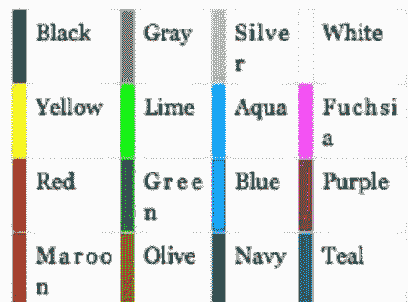

# HTML 快速创建高效网站指南

## HTML

### 免费赠品！！！

我们希望为您提供我们的[免费指南](FREE Guide)，助您开启改善生活的旅程，并提供独家访问我们突破性读书俱乐部的机会！！！这是一个每周提供一本新免费电子书的地方！此外，我们的成员正在积极讨论、评论和分享他们对本周图书以及帮助彼此突破人生障碍主题的看法！每月还有机会赢得25美元礼品卡！请享用您的[免费指南](FREE Guide)并访问[突破性读书俱乐部](Breakthrough Book Club)。


## 引言

HTML 或超文本标记语言是开发网页最常用的语言。它由 Berners-Lee 于 1991 年创建。标准 HTML 规范 HTML 2.0 于 1995 年发布。该语言的另一个主要版本 HTML 4.01 于 1999 年底发布。这是使用最广泛的 HTML 版本，现已被 2012 年发布的 HTML 5 取代。这基本上是其先前版本 HTML 4.01 的扩展。

### 这是为谁设计的？

本 HTML 教程专为有志成为开发者和网页设计师的人士设计。本教程通过实际示例和简明概述进行了足够详细的解释，以便初学者能够轻松理解，并为设计自己的网页提供足够的知识。通过一些实践，您可以获得更高水平的专业技能。

## 前提条件

开始本教程的前提条件是应具备使用 Linux 操作系统或 Windows 的一些基础知识。此外，您还应熟悉：

- 使用文本编辑器，如 `editplus`、记事本、`notepad++` 或其他任何文本编辑器。
- 在计算机上创建文件和目录。
- 在不同目录中导航。
- 不同的图像格式，如 PNG、JPG 等。
- 将内容输入文件并保存它们。

# 第1章：HTML中的基本标签

## 标题标签

标题是文档中的首要元素，每个文档都以标题开头。

在 HTML 中，您可以设置不同大小的标题。共有六种大小的标题，可以使用 `<h1>`、`<h2>`、`<h3>`、`<h4>`、`<h5>` 和 `<h6>` 元素进行设置。浏览器在显示时会在标题前后添加一行。下面是一个示例。

### 示例

```html
<!DOCTYPE html>
<html>
<head>
<title>Example for Heading</title>
</head>
<body>
<h1>This will be heading 1</h1>
<h2>This will be heading 2</h2>
<h3>This will be heading 3</h3>
<h4>This will be heading 4</h4>
<h5>This will be heading 5</h5>
<h6>This will be Heading 6</h6>
</body>
</html>
```

此代码将产生以下输出：

# 这将是标题1

## 这将是标题2

### 这将是标题3

#### 这将是标题4

##### 这将是标题5

###### 这将是标题6

## 段落标签

您可以使用 `<p>` 标签将内容组织成段落。要将文本设为段落，应将其置于开始标签 `<p>` 和结束标签 `</p>` 之间。下面是一个示例。

### 示例

```html
<!DOCTYPE html>
<html>
<head>
<title>Example for Paragraph</title>
</head>
<body>
<p>This text will be the first paragraph.</p>
<p>This text will be the second paragraph.</p>
<p>This text will be the third paragraph.</p>
</body>
</html>
```

此代码将产生以下输出：

这将是第一个段落。

这将是第二个段落。

这将是第三个段落。

## 换行标签

如果您希望在文本中添加换行，可以使用 `<br />` 元素，其后的任何文本将从新行开始。有些标签不需要结束标签，这样的标签称为空元素。`<br />` 元素就是这样的空元素。它们之所以这样称呼，是因为它们之间不包含内容。

`br` 和 `/` 字符之间有一个空格，如果不添加，旧浏览器将无法正确渲染换行。如果未添加 `/` 而只使用 `<br>`，则在 XHTML 中无效，无法工作。下面是一个示例。

### 示例

```html
<!DOCTYPE html>
<html>
<head>
<title>Example for Line Break</title>
</head>
<body>
<p>Hey<br /> How are you doing today?.<br /> Good Luck<br /> Peter</p>
</body>
</html>
```

此代码将产生以下输出：

Hey

How are you doing today?

Good Luck

Peter

## 内容居中

有时您需要将内容放置在表格单元格或页面的中心。对于这种情况，您可以使用 `<center>` 标签。下面是一个示例。

### 示例

```html
<!DOCTYPE html>
<html>
<head>
<title>Example for Centering the Content</title>
</head>
<body>
<p>This text has the default alignment.</p>
<center>
<p>This text is centered.</p>
</center>
</body>
</html>
```

此代码将产生以下输出：

这文本具有默认对齐方式。

这文本已居中。

## 水平线

您可以使用水平线直观地分隔文档中的各部分。`<hr>` 标签用于创建从左页边距到右页边距的水平线。这将相应地分隔行。例如，如果您想在两个段落之间插入换行，可以使用下面的代码。

### 示例

```html
<!DOCTYPE html>
<html>
<head>
<title>Example for Horizontal Line</title>
</head>
<body>
<p>This is the first paragraph. This is on the top of the line break.</p>
<hr />
<p>This is the second paragraph. This is at the bottom of the line break.</p>
</body>
</html>
```

上述代码将产生以下输出：

这是第一个段落。这在线的上方。

这是第二个段落。这在线的下方。

`<hr />` 标签也被归类为空元素。它不需要开始标签和结束标签，因为其之间没有内容。

`<hr />` 元素中的 `hr` 和 `/` 字符之间有一个空格。如果省略此空格，旧版浏览器在渲染水平线时可能会出现问题；如果漏掉了 `/`，则在 XHTML 中将不是有效元素。

## 保留格式

在某些情况下，你的文本应遵循与 HTML 文档中输入时相同的格式。在这种情况下，你可以使用 `<pre>` 标签。它表示预格式化文本。

任何在 `<pre>` 和 `</pre>` 标签之间输入的文本都将具有与源文档中相同的文本格式。这里有一个示例。

### 示例

```html
<!DOCTYPE html>
<html>
<head>
<title>保留格式示例</title>
</head>
<body>
<pre>
int main(void) {
    printf("Hello World!\n");
    // return 0;
}
</pre>
</body>
</html>
```

上述代码将产生以下输出。

```text
int main(void) {
    printf("Hello World!\n");
    // return 0;
}
```

## 不换行空格

在某些情况下，你不希望浏览器将单词跨行分割。在这种情况下，你可以使用不换行空格实体 `&nbsp;` 代替使用普通空格。请看以下示例以更好地理解。

### 示例

让我们以词语 James Bond 007 为例，我们不希望浏览器分割这些词。我们将使用不换行空格实体 `&nbsp;` 代替空格。

```html
<!DOCTYPE html>
<html>
<head>
<title>不换行空格示例</title>
</head>
<body>
<p>
电影中的特工是 "James&nbsp;Bond&nbsp;007。"
</p>
</body>
</html>
```

# 第2章：HTML 元素

这个家族中的元素将由一个起始标签定义。如果元素内部可以包含其他内容，它将有一个结束标签。对于结束标签，元素名称前会加上一个 `/`。下面列出了一些这样的元素。

| 起始标签 | 内容 | 结束标签 |
| :--- | :--- | :--- |
| `<i>` | 这是斜体字体内容 | `</i>` |
| `<marquee>` | 这是滚动文本内容。 | `</marquee>` |
| `<p>` | 这是段落内容。 | `</p>` |
| `<br />` | | |

这里，`<i>` 和 `</i>` 是一个元素，`<marquee>` 和 `</marquee>` 是另一个元素。有一些 HTML 元素不需要结束标签，例如 `<br />`、`<hr />`、`` 等。不需要结束标签的 HTML 元素被称为空元素。

HTML 文档为这些元素定义了一个树状结构，这个结构规定了 HTML 文档应该如何构建。它还规定了在文档的哪个部分应放置何种类型的内容。

## HTML 标签 vs. 元素

HTML 元素将使用起始标签定义。如果其内部放置了其他内容，它将有一个结束标签。

例如，`<i>` 是斜体文本的起始标签，`</i>` 是其结束标签。但是，`<i>This text is italic</i>` 是一个斜体文本元素。

## HTML中的嵌套元素

HTML 允许你在其他 HTML 元素内嵌套 HTML 元素。

这里有一个示例：

### 示例

```html
<!DOCTYPE html>
<html>
<head>
<title>嵌套元素示例</title>
</head>
<body>
<h2>This is <b>bold</b> heading</h2>
<p>This is <i>italic</i> text</p>
</body>
</html>
```

上述代码将产生以下输出：

This is **bold** heading

This is *italic* text

## 属性

到目前为止，我们已经看到了一些最简单的标签，如段落标签 `<p>`、标题标签 `<h1>`、`<h2>` 以及其他一些标签。这些标签可以被赋予一些额外的信息，称为属性。

HTML 中元素的特性可以使用属性来定义。属性将放置在元素的开始标签内，它们包含两个部分：名称和值。

属性的名称就是你希望设置的属性。例如，字体元素带有诸如颜色、大小、类型等属性，这些属性用于指示要在页面上显示的字体颜色、字体大小和字体类型。

属性的值就是你希望为该属性设置的值。属性的值应始终放在引号内。下面的示例将向你展示可以为上述给定的名称赋予的值：红色、3 和 Georgia，分别作为字体颜色、大小和类型。

在使用属性的名称和值时应小心，因为它们区分大小写。但是，W3C（万维网联盟）在其 HTML 4 建议中推荐使用小写的属性和属性值。

这里有一个示例。

### 示例

```html
<!DOCTYPE html>
<html>
<head>
<title>对齐属性示例</title>
</head>
<body>
<p align="right">此内容将右对齐</p>
<p align="center">此内容将居中对齐</p>
<p align="left">此内容将左对齐</p>
</body>
</html>
```

上述代码将产生以下输出：

此内容将右对齐。

此内容将居中对齐。

此内容将左对齐。

## 国际化属性

在 HTML 中，总共有三个国际化属性。它们可用于大多数 XHTML 元素，但并非所有元素。

- `dir`
- `lang`
- `xml:lang`

## dir 属性

你可以使用 `dir` 属性向浏览器指定文本流向。此属性可以接受两个值，如下表所示。

| 值 | 含义 |
| :--- | :--- |
| `ltr` | 从左到右（这将是默认值） |
| `rtl` | 从右到左（用于从右到左阅读的语言，如希伯来语或阿拉伯语） |

### 示例

```html
<!DOCTYPE html>
<html dir="rtl">
<head>
<title>显示方向</title>
</head>
<body>
这是IE 5渲染从右到左文本的方式。
</body>
</html>
```

上述代码将产生以下输出：

这是 IE 5 渲染从右到左文本的方式。

如果 `dir` 属性放在 `<html>` 标签内，它将决定整个文档文本的呈现方式。如果此属性用于另一个标签内，它只会控制该特定标签内文本的方向。

## lang 属性

你可以使用 `lang` 属性来指定文档中要使用的主要语言。在 HTML 中保留此属性的唯一原因是与 HTML 的早期版本保持向后兼容。在新的 XHTML 文档中，此属性已被 `xml:lang` 属性取代。

`lang` 属性的值采用 ISO 639 标准的两字符语言代码。你可以通过 [HTML语言代码：ISO 639](https://www.tutorialspoint.com/html_tags/html_language_codes.htm) 查看完整的语言代码列表。

### 示例

```html
<!DOCTYPE html>
<html lang="en">
<head>
<title>英语页面</title>
</head>
<body>
此页面使用英语语言
</body>
</html>
```

## xml:lang 属性

在 XHTML 中，`xml:lang` 属性用作 HTML 早期版本中使用的原始 `lang` 属性的替代品。如上所述，`xml:lang` 属性值应为 ISO-639 国家代码。

## 通用属性

还有几个其他属性可以与大多数 HTML 标签一起直接使用。这些属性的列表如下表所示。

| 属性 | 选项 | 功能 |
| :--- | :--- | :--- |
| `align` | right, left, center | 水平对齐标签 |
| `valign` | top, middle, bottom | 在 HTML 元素内垂直对齐标签。 |
| `bgcolor` | 数字、十六进制、RGB值 | 在元素后放置背景色 |
| `background` | URL | 在元素后放置背景图像 |
| `id` | 用户定义 | 为元素命名，以便与级联样式表一起使用。 |
| `class` | 用户定义 | 对元素进行分类，以便与级联样式表一起使用。 |
| `width` | 数值 | 指定表格、图像或表格单元格的宽度。 |
| `height` | 数值 | 指定表格、图像或表格单元格的高度。 |
| `title` | 用户定义 | 元素的“弹出”标题。 |

# 第3章：HTML中的格式化

如果你熟悉使用文字处理程序，你可能也很熟悉如何使文本加粗、斜体或下划线。HTML 和 XHTML 中总共有 10 个选项可用于指示你的文本将如何显示。

## 粗体文本

放置在 `<b>...</b>` 元素之间的任何内容都将显示为粗体文本。这里有一个示例。

### 示例

```html
<!DOCTYPE html>
<html>
<head>
<title>粗体文本示例</title>
</head>
<body>
<p>以下单词将以<b>粗体</b>字型显示。</p>
</body>
</html>
```

上述代码将产生以下输出：

以下单词将以**粗体**字型显示。

## 斜体文本

放置在 `<i>...</i>` 元素之间的任何内容都将显示为斜体文本。这里有一个示例。

### 示例

```html
<!DOCTYPE html>
<html>
<head>
<title>斜体文本示例</title>
</head>
<body>
<p>以下单词将以<i>斜体</i>字型显示。</p>
</body>
</html>
```

上述代码将产生以下输出：

以下单词将以*斜体*字型显示。

## 下划线文本

放置在 `<u>...</u>` 元素之间的任何内容都将显示为带下划线的文本。这里有一个示例。

### 示例

```html
<!DOCTYPE html>
<html>
<head>
<title>下划线文本示例</title>
</head>
<body>
<p>以下单词将使用<u>下划线</u>字体。</p>
</body>
</html>
```

上面的代码将产生以下 output：

以下单词将使用<u>下划线</u>字体。

## 删除线文本

任何放置在 `<strike>...</strike>` 元素之间的内容都将显示为删除线文本，即文本上有一条细线。以下是一个示例。

### 示例

```html
<!DOCTYPE html>
<html>
<head>
    <title>Strike Text Example</title>
</head>
<body>
    <p>The following word uses a <strike>strikethrough</strike> typeface.</p>
</body>
</html>
```

上面的代码将产生以下 output：

以下单词使用了<strike>删除线</strike>字体。

## 等宽字体

任何放置在 `<tt>...</tt>` 元素之间的内容都将显示为等宽字体。大多数可用字体都是变宽字体。这是因为不同的字母有不同的宽度。例如，字母 `w` 比 `i` 更宽。使用等宽字体，每个字母都将具有相同的宽度。以下是一个示例。

### 示例

```html
<!DOCTYPE html>
<html>
<head>
    <title>Example for Monospaced Font</title>
</head>
<body>
    <p>The following word uses a <tt>monospaced</tt> typeface.</p>
</body>
</html>
```

上面的代码将产生以下 output：


以下单词使用了<tt>等宽</tt>字体。

## 上标文本

你可以使用`<sup>...</sup>`元素在网页上添加上标。上标只是字体和字号与周围文本相同的文本，但它将显示在周围文本上方半个字符的高度。以下是一个示例。

**示例**

```html
<!DOCTYPE html>
<html>
<head>
    <title>Example for Superscript Text</title>
</head>
<body>
    <p>The following word uses a <sup>superscript</sup> typeface.</p>
</body>
</html>
```

上面的代码将产生以下 output：

以下单词使用了<sup>上标</sup>字体。

## 下标文本

你可以使用`<sub>...</sub>`元素在网页上添加下标。下标只是字体和字号与周围文本相同的文本，但它将显示在周围文本下方半个字符的高度。以下是一个示例。

**示例**

```html
<!DOCTYPE html>
<html>
<head>
    <title>Example for Subscript Text</title>
</head>
<body>
    <p>The following word uses a <sub>subscript</sub> typeface.</p>
</body>
</html>
```

上面的代码将产生以下 output：

以下单词使用了<sub>下标</sub>字体。

## 插入文本

任何放置在`<ins>...</ins>`元素之间的文本都将显示为插入文本。以下是一个示例。

**示例**

```html
<!DOCTYPE html>
<html>
<head>
    <title>Example for Inserted Text</title>
</head>
<body>
    <p>I want to drink <del>cola</del> <ins>wine</ins></p>
</body>
</html>
```

上面的代码将产生以下 output：

我想喝 <del>可乐</del> <ins>红酒</ins>

## 删除文本

任何放置在`<del>...</del>`元素之间的文本都将显示为删除文本。以下是一个示例。

**示例**

```html
<!DOCTYPE html>
<html>
<head>
    <title>Example for Deleted Text</title>
</head>
<body>
    <p>I want to drink <del>cola</del> <ins>wine</ins></p>
</body>
</html>
```

上面的代码将产生以下 output：

我想喝 <ins>红酒</ins>

## 放大文本

任何放置在`<big>...</big>`元素内的内容都将显示为比周围内容大一号的字体。以下是一个说明放大文本的示例。

**示例**

```html
<!DOCTYPE html>
<html>
<head>
    <title>Example for Larger Text</title>
</head>
<body>
    <p>You can add <big>larger</big> text in middle of a sentence using this.</p>
</body>
</html>
```

上面的代码将产生以下 output：

你可以使用此方法在句子中间添加<big>更大</big>的文本。

## 缩小文本

任何放置在`<small>...</small>`元素内的内容都将显示为比周围内容小一号的字体。以下是一个说明缩小文本的示例。

**示例**

```html
<!DOCTYPE html>
<html>
<head>
    <title>Example for Smaller Text</title>
</head>
<body>
    <p>You can add <small>smaller</small> text in middle of a sentence using this.</p>
</body>
</html>
```

上面的代码将产生以下 output：

你可以使用此方法在句子中间添加<small>更小</small>的文本。

## 分组内容

你可以使用`<div>`和`<span>`元素将多个元素分组在一起，以在页面中创建部分或小节。以下是一个示例。

**示例**

```html
<!DOCTYPE html>
<html>
<head>
    <title>Example for Div Tag</title>
</head>
<body>
    <div id="menu" align="middle">
        <a href="/index.htm">HOME</a> |
        <a href="/about/contact_us.htm">CONTACT</a> |
        <a href="/about/index.htm">ABOUT</a>
    </div>
    <div id="content" align="left" bgcolor="white">
        <h4>Some Content</h4>
        <p>The content will go here.....</p>
    </div>
</body>
</html>
```

这将产生以下 output：

首页 | 联系我们 | 关于我们

一些内容

内容将放在这里.....

另一方面，`<span>`元素只能用于对行内元素进行分组。在需要将段落或句子的一部分组合在一起的情况下，你可以使用`<span>`元素。以下是一个示例。

**示例**

```html
<!DOCTYPE html>
<html>
<head>
    <title>Example for Span Tag</title>
</head>
<body>
    <p>This is the example of <span style="color:green">span tag</span> and the <span style="color:red">div tag</span> along with CSS</p>
</body>
</html>
```

上面的代码将产生以下 output：

这是<span style="color:green">span标签</span>和<span style="color:red">div标签</span>与 CSS 一起使用的示例。

上述标签与 CSS 一起使用，允许你将样式附加到页面的特定部分。

## 第四章：HTML 短语标签

HTML 中的短语标签用于执行特定目的。它们看起来类似于其他标签，如`<b>`、`<i>`、`<pre>`和`<tt>`，我们在前面的章节中已经见过。在本章中，我们将介绍 HTML 中重要的短语标签。

### 强调文本

任何放置在`<em>...</em>`元素之间的内容都将显示为强调文本。以下是一个示例。

**示例**

```html
<!DOCTYPE html>
<html>
<head>
    <title>Example for Emphasized Text</title>
</head>
<body>
    <p>The following word uses a <em>emphasized</em> typeface.</p>
</body>
</html>
```

上面的代码将产生以下 output：

以下单词使用了<em>强调</em>字体。

### 标记文本

任何放置在`<mark>...</mark>`元素之间的内容都将显示为标记文本，带有黄色高亮。以下是一个示例。

**示例**

```html
<!DOCTYPE html>
<html>
<head>
    <title>Marked Text Example</title>
</head>
<body>
    <p>The following word has been <mark>marked</mark> with yellow</p>
</body>
</html>
```

上面的代码将产生以下 output：

以下单词已被标记为<mark>黄色</mark>。

### 加重文本

任何放置在`<strong>...</strong>`元素之间的内容都将显示为重要文本。以下是一个示例。

**示例**

```html
<!DOCTYPE html>
<html>
<head>
    <title>Strong Text Example</title>
</head>
<body>
    <p>The following word uses a <strong>strong</strong> typeface.</p>
</body>
</html>
```

上面的代码将产生以下 output：

以下单词使用了<strong>加粗</strong>字体。

## 文本缩写

在 HTML 中，你可以缩写文本。你可以通过将文本放在开始标签`<abbr>`和结束标签`</abbr>`之间来实现。完整描述应添加到 title 属性中（如果存在）。以下是一个示例。

**示例**

```html
<!DOCTYPE html>
<html>
<head>
    <title>Text Abbreviation</title>
</head>
<body>
    <p>My best friend's name is <abbr title="Abigail">Abi</abbr>.</p>
</body>
</html>
```

上面的代码将产生以下 output：

我最好的朋友的名字是 <abbr title="Abigail">Abi</abbr>。

## 首字母缩略词元素

你可以使用`<acronym>`元素在 HTML 中将你的文本标识为首字母缩略词。你应该将文本放在开始标签`<acronym>`和结束标签`</acronym>`之间以将其标识为首字母缩略词。以下是一个示例。

**示例**

```html
<!DOCTYPE html>
<html>
<head>
    <title>Acronym Example</title>
</head>
<body>
    <p>This chapter covers marking up text in <acronym>XHTML</acronym>.</p>
</body>
</html>
```

上面的代码将产生以下 output：

本章介绍在<acronym>XHTML</acronym>中标记文本。

## 文本方向

元素`<bdo>...</bdo>`代表双向覆盖。你可以使用此元素覆盖文本方向。以下是一个示例。

## 专用术语

你可以在网页中引入专用术语；为此可以使用元素`<dfn>...</dfn>`。这非常类似于段落中*斜体*文本的用法。

通常，当你第一次引入关键术语时，会使用`<dfn>`元素。现代浏览器会将`<dfn>`元素中的文本渲染为斜体格式。下面是一个示例。

示例

```html
<!DOCTYPE html>
<html>
<head>
    <title>专用术语示例</title>
</head>
<body>
    <p>以下单词是一个<dfn>专用</dfn>术语。</p>
</body>
</html>
```

上述代码将产生以下输出：

以下单词是一个专用术语。

## 引用文本

在 HTML 中，你可以引用来自不同来源的段落。为此，你需要将内容放在开始标签`<blockquote>`和结束标签`</blockquote>`之间。

放置在此元素中的任何文本通常会相对于其周围文本的左右边缘进行缩进。有时它使用斜体字体。下面是一个示例。

示例

```html
<!DOCTYPE html>
<html>
<head>
    <title>引用块示例</title>
</head>
<body>
    <p>以下关于 XHTML 的描述摘自 W3C 网站：</p>
    <blockquote>XHTML 1.0 是 W3C 针对 XHTML 的首个推荐标准，延续了早期在 HTML 4.01、HTML 4.0、HTML 3.2 和 HTML 2.0 方面的工作。</blockquote>
</body>
</html>
```

上述代码将产生以下输出：

以下关于 XHTML 的描述摘自 W3C 网站：

XHTML 1.0 是 W3C 针对 XHTML 的首个推荐标准，延续了早期在 HTML 4.01、HTML 4.0、HTML 3.2 和 HTML 2.0 方面的工作。

## 短引用

你可以使用`<q>...</q>`元素在句子中添加双引号。下面是一个示例。

示例

```html
<!DOCTYPE html>
<html>
<head>
    <title>双引号示例</title>
</head>
<body>
    <p>保罗在西班牙，<q>我想我是对的</q>。</p>
</body>
</html>
```

上述代码将产生以下输出：

保罗在西班牙，我想我是对的。

## 文本引用

当你引用某些文本时，通过将来源放在开始和结束标签`<cite> </cite>`之间，你可以指明来源。下面是一个示例。

示例

```html
<!DOCTYPE html>
<html>
<head>
    <title>引用示例</title>
</head>
<body>
    <p>本 HTML 教程源自 <cite>W3 HTML 标准</cite>。</p>
</body>
</html>
```

上述代码将产生以下输出：

本 HTML 教程源自 W3 HTML 标准。

## 计算机代码

如果你要在网页中添加任何编程代码，应该将其放在开始标签`<code>`和结束标签`</code>`之间。放置在此元素中的内容通常会以等宽字体呈现，就像其他编程书籍中的代码一样。下面是一个示例。

示例

```html
<!DOCTYPE html>
<html>
<head>
    <title>计算机代码示例</title>
</head>
<body>
    <p>这是常规文本。<code>这是代码。</code> 这是常规文本。</p>
</body>
</html>
```

上述代码将产生以下输出：

这是常规文本。这是代码。 这是常规文本。

## 键盘文本

在某些情况下，你需要读者使用键盘输入文本。在这种情况下，你可以使用元素`<kbd>...</kbd>`。此元素将指示需要输入的文本。下面是一个示例。

示例

```html
<!DOCTYPE html>
<html>
<head>
    <title>键盘文本示例</title>
</head>
<body>
    <p>常规文本。<kbd>这是 kbd 元素内的内容</kbd> 常规文本。</p>
</body>
</html>
```

上述代码将产生以下输出：

常规文本。这是 kbd 元素内的内容 常规文本。

## 编程变量

通常，此元素会与`<code>`和`<pre>`元素一起使用，以指示放置在此元素中的内容是变量。下面是一个示例。

示例

```html
<!DOCTYPE html>
<html>
<head>
    <title>变量文本示例</title>
</head>
<body>
    <p><code>document.write("<var>user-id</var>")</code></p>
</body>
</html>
```

上述代码将产生以下输出：

`document.write("user-id")`

## 程序输出

程序的示例输出可以使用元素`<samp>...</samp>`来指示。脚本也可以使用此元素指示。然而，它通常用于记录编码概念或程序。下面是一个示例。

示例

```html
<!DOCTYPE html>
<html>
<head>
    <title>程序输出示例</title>
</head>
<body>
    <p>程序的结果是 <samp>Hello World!</samp></p>
</body>
</html>
```

上述代码将产生以下输出：

程序的结果是 Hello World!

## 地址文本

你可以使用`<address>...</address>`元素提供地址。下面是一个示例。

示例

```html
<!DOCTYPE html>
<html>
<head>
    <title>地址示例</title>
</head>
<body>
    <address>1719 c, David Drive, Marietta, Atlanta, Georgia </address>
</body>
</html>
```

上述代码将产生以下输出：

1719 c, David Drive, Marietta, Atlanta, Georgia

# 第 5 章：Meta 标签

在 HTML 中，你被允许以不同方式指定元数据，即关于文档的额外重要信息。你可以使用 META 元素来包含名称/值对，以描述文档的属性，例如文档作者、作者、过期日期、关键词列表等。

这些额外信息可以使用`<meta>`标签提供。Meta 标签没有结束标签，因此它是一个空元素。尽管它是一个空元素，但信息可以通过其属性传递。

通常，你可以根据添加到文档中的信息，在文档中添加多个 meta 标签。文档的物理外观不会因为 meta 标签而受到任何影响。从应用程序的角度来看，是否包含 meta 标签并不重要。

## 为文档添加 Meta 标签

你可以通过在文档头部（由`<head>`和`</head>`标签表示）内添加`<meta>`标签来为页面提供元数据。除了其核心属性外，它们还可以具有以下属性：

| 属性 | 描述 |
| --- | --- |


| Name | 属性的名称。可以是任何内容。示例包括 keywords、description、author、revised、generator 等。 |
| --- | --- |
| content | 指定属性的值。 |
| scheme | 指定解释属性值的方案（如在 content 属性中声明）。 |
| http-equiv | 用于 HTTP 响应消息头。例如，`http-equiv` 可用于刷新页面或设置 Cookie。值包括 `content-type`、`expires`、`refresh` 和 `set-cookie`。 |

## 指定关键词

可以使用 `<meta>` 标签指定与文档相关的重要关键词。这些关键词将被各种搜索引擎稍后使用，还将用于为搜索索引你的页面。下面是一个示例。

### 示例

在下面的示例中，我们将单词 Ducati、Aprilia 和 BMW 作为与文档相关的重要关键词添加。

```html
<!DOCTYPE html>
<html>
<head>
    <title>Meta 标签示例</title>
    <meta name="keywords" content="Ducati, Aprilia, BMW" />
</head>
<body>
    <p>Hello World!</p>
</body>
</html>
```

上述代码将产生以下输出：

Hello World!

## 文档描述

你可以使用 `<meta>` 标签提供文档的简短描述。与关键词类似，搜索引擎在索引网页用于搜索时也会使用该描述。下面是一个示例。

### 示例

```html
<!DOCTYPE html>
<html>
<head>
    <title>Meta 标签示例</title>
    <meta name="keywords" content="Ducati, Aprilia, BMW" />
    <meta name="description" content="学习关于 Meta 标签。" />
</head>
<body>
    <p>Hello World!</p>
</body>
</html>
```

## 文档修订日期

`<meta>` 标签可用于提供有关文档最后更新的信息。各种网络浏览器在刷新你的网页时会使用此信息。下面是一个示例。

### 示例

```html
<!DOCTYPE html>
<html>
<head>
    <title>Meta 标签示例</title>
    <meta name="keywords" content="Ducati, Aprilia, BMW" />
    <meta name="description" content="学习关于 Meta 标签。" />
    <meta name="revised" content="Topgear, 7/7/15" />
</head>
<body>
    <p>Hello HTML5!</p>
</body>
</html>
```

## 文档刷新

您可以使用 `<meta>` 标签来指定页面自动刷新的持续时间。下面是一个示例。

### 示例

如果您希望网页每 10 秒自动刷新一次，请使用以下语法。

### 语法

```html
<!DOCTYPE html>
<html>
<head>
<title>Meta Tags Example</title>
<meta name="keywords" content="Ducati, Aprilia, BMW" />
<meta name="description" content="Learning about Meta Tags." />
<meta name="revised" content="Topgear, 7/7/15" />
<meta http-equiv="refresh" content="10" />
</head>
<body>
<p>Hello HTML5!</p>
</body>
</html>
```

## 页面重定向

使用 `<meta>` 标签，您可以将网页重定向到其他网页。您实际上可以通过指定秒数来指定重定向页面的时间。下面是一个示例。

### 示例

在以下示例中，当前页面将在 10 秒后重定向到另一个页面。如果未指定 `content` 属性，当前网页将立即重定向。

```html
<!DOCTYPE html>
<html>
<head>
<title>Meta Tags Example</title>
<meta name="keywords" content="Ducati, Aprilia, BMW" />
<meta name="description" content="Learning about Meta Tags." />
<meta name="revised" content="Topgear, 7/7/15" />
<meta http-equiv="refresh" content="5; url=http://www.topgear.com" />
</head>
<body>
<p>Hello HTML5!</p>
</body>
</html>
```

## 设置 Cookies

Cookies 不过是以小型文本文件形式存储在您计算机上的数据。Cookies 在 Web 服务器和 Web 浏览器之间交换，用于跟踪 Web 应用程序所需的信息。

使用 `<meta>` 标签，可以将 Cookies 存储在客户端，这些信息以后可以由 Web 服务器用于跟踪其站点的访问者。

### 示例

在以下示例中，当前页面将在 10 秒后重定向到另一个页面。如果未指定 `content` 属性，当前网页将立即重定向。

```html
<!DOCTYPE html>
<html>
<head>
<title>Meta Tags Example</title>
<meta name="keywords" content="Ducati, Aprilia, BMW" />
<meta name="description" content="Learning about Meta Tags." />
<meta name="revised" content="Topgear, 7/Jul/15" />
<meta http-equiv="cookie" content="userid=xyz; expires=Wednesday, 08-Aug-15 23:59:59 GMT;" />
</head>
<body>
<p>Hello HTML5!</p>
</body>
</html>
```

如果未包含过期日期和时间，Cookie 将被视为会话 Cookie。会话 Cookie 将在浏览器关闭时被删除。

## 设置作者名称

您可以使用 `meta` 标签在网页中设置作者名称。请参见以下示例。

### 示例

```html
<!DOCTYPE html>
<html>
<head>
<title>Meta Tags Example</title>
<meta name="keywords" content="Ducati, Aprilia, BMW" />
<meta name="description" content="Learning about Meta Tags." />
<meta name="author" content="Mahnaz Mohtashim" />
</head>
<body>
<p>Hello HTML5!</p>
</body>
</html>
```

## 指定字符集

您可以使用 `<meta>` 标签指定网页中使用的字符集。

### 示例

默认情况下，Web 服务器和 Web 浏览器使用 ISO-8859-1（Latin1）编码来处理网页。以下是设置 UTF-8 编码的示例：

```html
<!DOCTYPE html>
<html>
<head>
<title>Meta Tags Example</title>
<meta name="keywords" content="Ducati, Aprilia, BMW" />
<meta name="description" content="Learning about Meta Tags." />
<meta name="author" content="Mahnaz Mohtashim" />
<meta http-equiv="Content-Type" content="text/html; charset=UTF-8" />
</head>
<body>
<p>Hello HTML5!</p>
</body>
</html>
```

要提供带有传统中文字符的静态页面，网页必须包含用于设置 Big5 编码的 `<meta>` 标签：

```html
<!DOCTYPE html>
<html>
<head>
<title>Meta Tags Example</title>
<meta name="keywords" content="Ducati, Aprilia, BMW" />
<meta name="description" content="Learning about Meta Tags." />
<meta name="author" content="Mahnaz Mohtashim" />
<meta http-equiv="Content-Type" content="text/html; charset=Big5" />
</head>
<body>
<p>Hello HTML5!</p>
</body>
</html>
```

# 第 6 章：注释

注释不过是被 Web 浏览器忽略的代码片段。在 HTML 代码中添加注释是一个非常好的做法，尤其是在复杂文档中。注释指示文档的不同部分。它们也可用于向查看代码的其他人指示其他说明。通过增加代码的可读性，注释可以帮助用户轻松理解代码。

要在 HTML 中添加注释，您需要将内容放在标签 `<!-- ... -->` 之间。放置在这些标签内的任何内容都将被视为注释，浏览器将完全忽略它们。下面是一个示例。

### 示例

```html
<!DOCTYPE html>
<html>
<head>
<!-- Document Header Starts -->
<title>This is document title</title>
</head>
<!-- Document Header Ends -->
<body>
<p>The content of the document goes here.....</p>
</body>
</html>
```

此代码将产生输出，显示放在段落标签内的内容，但会隐藏放在注释标签内的内容。

文档的内容放在这里.....。

## 有效注释与无效注释

注释不能嵌套；这意味着您不能将注释放在另一个注释内。您应始终确保注释字符串开头没有空格。“--”（双破折号序列）不能出现在注释中，除非在结束标签（`-->`）中。下面是一个示例。

### 示例

在此示例中，我们将给出一个有效注释，它将被浏览器忽略。

```html
<!DOCTYPE html>
<html>
<head>
<title>Example for Comment</title>
</head>
<body>
<!-- This comment is valid -->
<p>The content of the document goes here.....</p>
</body>
</html>
```

上述代码将产生以下输出：

文档的内容放在这里.....。

以下示例将包含一个无效注释。浏览器不会隐藏无效注释，而是将其显示为内容。我们将在开头 `<` 和 `!` 之间添加一个额外的空格。

```html
<!DOCTYPE html>
<html>
<head>
<title>Example for Invalid Comment</title>
</head>
<body>
< !-- This comment is not a valid one -- >
<p>The content of the document goes here.....</p>
</body>
</html>
```

上述代码将产生以下输出：

< !-- This comment is not a valid one -->

文档的内容放在这里.....。

## 多行注释

到目前为止，我们只讨论了单行注释。但是，HTML 也支持多行注释。

您可以通过在多行中使用特殊的开始和结束标签 `<!--` 和 `-->`（分别放在第一行之前和最后一行之后）来增加代码的可读性，如以下示例所示。

### 示例

```html
<!DOCTYPE html>
<html>
<head>
<title>Multiline Comments</title>
</head>
<body>
<!--
This is an example of multiline comment and
it can be extended to any number of
lines you like.
-->
<p>The content of the document goes here.....</p>
</body>
</html>
```

上述代码将产生以下输出：

文档的内容放在这里.....。

## 条件注释

条件注释在除 Internet Explorer 之外的任何其他浏览器上都不起作用。其他浏览器会忽略条件注释。条件注释的支持从 Internet Explorer 5 开始。它们可用于为不同的 Internet Explorer 版本提供条件指令。下面是一个示例。

### 示例

```html
<!DOCTYPE html>
<html>
<head>
<title>Example for Conditional Comments</title>
<!--[if IE 6]>
Special instructions for IE 6 here
<![endif]-->
</head>
<body>
<p>The content of the document goes here.....</p>
</body>
</html>
```

在需要根据 IE 版本使用不同样式表的情况下，条件注释会很有帮助。

## 使用注释标签

HTML 代码的一部分可以被设为注释，并且有少数浏览器支持 `<comment>` 标签。下面是一个示例。

### 示例

```html
<!DOCTYPE html>
<html>
<head>
<title>Using Comment Tag</title>
</head>
<body>
<p>This is <comment>not</comment> Internet Explorer.</p>
</body>
</html>
```

如果您使用的是 IE，上述代码将产生以下输出：

This is Internet Explorer.

如果您使用的是除 IE 之外的其他浏览器，上述代码将产生以下输出：

This is not Internet Explorer.

## 注释脚本代码

在 HTML 代码中使用 VBScript 或 JavaScript 的情况下，明智的做法是将脚本代码放在适当的注释中。这将确保它们可以在较旧的浏览器中使用。下面是一个示例。

### 示例

```html
<!DOCTYPE html>
<html>
<head>
<title>Commenting Script Code</title>
<script>
<!--
document.write("Hakuna Matata!")
//-->
</script>
</head>
<body>
<p>Hakuna, Matata!</p>
</body>
</html>
```

以上代码将产生以下输出：

Hakuna Matata!

Hakuna, Matata!

## 注释样式表

当您将样式表与 HTML 代码一起使用时，最好将样式表代码放在适当的注释中。这将确保它们可以与旧版浏览器一起使用。我们将在另一章中学习样式表。这里有一个例子。

### 示例

```html
<!DOCTYPE html>
<html>
<head>
<title>Commenting Style Sheets</title>
<style>
<!--
.example {
    border: 1px solid #4a7d49;
//-->
</style>
</head>
<body>
<div class="example">Good, Morning!</div>
</body>
</html>
```

以上代码将产生以下输出：

Good, Morning!

# 第七章：HTML 表单

大多数网站至少有一页会征求访客的反馈，或者请求他们通过提供电子邮件来订阅。为了做到这一点，您需要在页面上放置多个文本框，用户可以在其中提供输入。表单几乎无处不在，只是不被注意而已。当您登录您的电子邮件、Facebook 或任何需要用户名和密码的网站时，您正在使用表单来输入数据。这可以通过 HTML 中的表单及其元素来完成。

表单背后的理念是，访客使用文本框输入一些数据，然后这些数据被发布到后端应用程序，如 ASP 或 PHP 脚本。此应用程序可以配置为使用网页创建者自己的逻辑算法执行任何操作。下面列出了一些常用的元素和属性，您必须了解它们才能创建一个能够吸引访客注意力的表单：

## Input

最重要的元素，您使用它从用户那里获取输入。有各种输入属性，如文本、单选按钮和提交按钮。单选按钮用于从您提供的不同选项中进行选择，其他两个则很容易理解。语法是 `<input>`。

### TextArea

当您希望用户输入超过单行的内容，例如描述其专业知识的段落时，您需要使用 `TextArea` 元素。

### Button

此元素创建一个按钮，点击时执行某些操作。

## Select

虽然在用户必须键入详细信息的表单中不需要，但了解此元素可以使您的访客更容易使用。`Select` 元素创建一个下拉列表，访客可以从中选择一个选项。

## Legend

如果您希望表单看起来井然有序，应该考虑的一个重要元素，`legend` 为 `fieldset` 标签元素创建标题，该标签将表单中的相关字段分组在一起。

## HTML5 元素


这些是 HTML5 独有的元素，不能在其他地方使用。

## Datalist

当您希望用户在开始键入时立即获得一个选项列表时，可以使用 Datalist。这与 Select 元素不同，后者用户只能从选项列表中进行选择。Datalist 元素在用户单击箭头标记时显示列表，并且在用户开始键入时也显示相关选项。

## Keygen

当您想创建一种安全的用户身份验证方式时，可以使用 `keygen` 元素。它创建 2 个密钥，其中一个本地存储（私钥），另一个发送到服务器（公钥）。

此列表涵盖了最常用的 HTML 表单元素，还有很多可以尝试。首先尝试这些，然后开始尝试不同的元素！下面是一些示例代码，您可以使用或修改以满足您的需求。`<form>` 标签必须用于在网页中使用表单元素。与元素相比，属性要多得多，因此大多数常用属性将在相应的代码之后进行解释。

## Form Action

在我们继续示例代码之前，有一个表单属性您*必须*了解，即“`form action`”。此属性决定了按下提交按钮后，输入的数据应发送到哪个页面。输入的数据就是在这里被处理的。处理意味着您可以向用户显示详细信息，或者将其发送到 MySQL 数据库，以便将来存储和使用。

然而，使用 `form action` 需要您事先了解 ASP 或 PHP 脚本。由于本书只专注于 HTML，因此这里不会讨论 ASP 和 PHP。网上有许多教程详细解释 PHP 和 ASP。理解起来并不难，而且您必须了解它，否则 HTML 表单就变得毫无用处，因为您需要将从用户那里获得的详细信息发送到表单处理程序，才能真正利用它们。

至于 `form action` 的语法，它相当简单：

```html
<form action="page.php" method="method_you_want">
```

## GET 和 POST

现在这很简单。`page.php` 指的是您想要发送详细信息的页面。如果您之前没有定义任何页面，那么您只会得到一个“文件未找到”消息，因为不存在这样的文件。

但是，如果您查看 URL 或查看“文件未找到”消息中提供的信息，您会注意到用户输入的详细信息会明确显示出来。这引出了 `form action` 中使用的方法。

有两种 `form action`，`GET` 和 `POST`。如果一开始没有选择任何选项，则默认设置为 `GET` 选项。

`GET` 的问题是，无论用户输入什么详细信息，它都会显示在 URL 中。虽然当用户在家时可能不会造成问题，但想象一下，当他或她在公共场所或在一台共用的计算机上使用您的表单输入详细信息时。一次小小的浏览历史检查就会打开之前访问过的网站，以及 URL 中的密码和用户名。这是一个巨大的安全威胁，这使得本指南转向 `POST` 方法。

在 `POST` 方法中，发生相同的动作——即将详细信息发送到 PHP 或 ASP 脚本或处理详细信息的页面——但 URL 上除了表单操作发送详细信息的页面外，不会显示任何内容。

如果您想使用 `POST` 方法，请使用以下语法：

```html
<form action="page.php" method="POST">
```

就这样！您现在已经成功创建了一个更注重安全性的表单。

## Name 属性

当您浏览下面给出的示例时，您会注意到在几个代码中都有属性 `name`。这与 `value` 属性不同，后者更改显示元素的名称——即用户看到的文本。

`name` 属性与 `form action` 协同工作，它使用您提供的任何文本作为变量的标识符来创建一个变量。例如，如果在某个表单输入类型之后立即给出 `name="user"`，那么该详细信息将存储在一个名为“user”的变量中，该变量将被发送到您使用 `form action` 创建的页面。在该页面中，每当您需要使用相应的详细信息时，都可以使用变量 `user` 来处理它。

通常，当您希望用户仅使用单个提交按钮提交一系列字段时，就有必要添加 `name` 属性。如果不这样做，信息将不会被发送到页面，并且如果您只为少数字段包含该属性，那么只有这些相应字段的详细信息才会被发送到页面进行进一步处理。

## Option 标签

在我们继续讨论输入类型以及您将在表单中使用的各种元素以使其易于使用之前，您需要了解一个名为 `<option>` 的重要标签。当您希望用户能够从选项列表中进行选择时，应使用此标签。

让我们看看 `option` 标签的语法：

```html
<option value="game1">Super Mario</option>
<option value="game2">Runescape</option>
```

如果您执行此代码，您会注意到屏幕上只显示了 Super Mario 和 Runescape 这些名称，而没有选择它们的选项。`option` 标签只创建选项，不负责将它们分组到一个字段中。这就是 `select` 和 `datalist` 元素的作用。`option` 标签与这些标签协同工作，但关于这两个新标签的更多信息稍后介绍。

目前，您理解这些基本标签和属性就足够了，这些将在后续示例中针对不同元素定期使用。现在让我们继续讨论不同的输入类型以及每种类型的示例代码，以便您更好地理解。

## Input

输入元素有多种类型。在您创建的每个表单中，您都会使用到其中的几种。让我们看看此类输入类型使用的基本语法：

## 文本

这支持一个单行输入字段（注意此字段仅接受文本）。

### 示例

```html
<!DOCTYPE html>
<html>
<body>
<form action="">
Username:<input type="text" name="username">
</form>
</body>
</html>
```

此代码在用户提供用户名时接受文本。用户输入的内容将存储在你发送文件的目标页面中一个名为 `username` 的变量中。表单操作（`form action`）留空，你可以插入任何希望信息发送到的页面。

## 提交

这会创建一个名为“Submit”（提交）的按钮，其功能如其名所示。它将输入的详细信息发送到表单处理器（`form handler`），这是表单操作的一个花哨名称。

### 示例

```html
<form action="action.php">
Username:<br>
<input type="text" name="userid"><br>
Password:<br>
<input type="password" name="pass"><br>
<input type="submit" value="Submit">
</form>
```

这里使用了另一个输入类型，称为密码（Password）。当指定 `<input type="password">` 时，文本框也接受特殊字符，并且一旦按下提交按钮，详细信息就会发送到表单处理器。

通过更改提交按钮的 `value`，你可以更改显示的文本。例如，设置 `value="Click to confirm"` 将创建一个显示“Click to confirm”的按钮，但执行提交按钮的操作。

## 单选按钮

单选按钮输入类型提供了一组用户可以选择的选项列表，用户在任何时候只能选择其中一个选项。

### 示例

```html
<form>
    <input type="radio" name="occupation" value="student"> Student<br>
    <input type="radio" name="occupation" value="unemployed"> Unemployed<br>
    <input type="radio" name="occupation" value="teacher"> Teacher
</form>
```

这创建了一组关于用户职业的选项。如果你希望某个特定选项默认被选中，可以通过在输入类型末尾添加 `checked` 来实现。

例如，将 `<input type="radio" name="occupation" value="student"> Student<br>` 替换为 `<input type="radio" name="occupation" value="student" checked> Student<br>` 将默认选中 Student。

## 复选框

当你想让用户从提供的选项中选择多个选项时，使用复选框。语法与其他输入类型相同。

### 示例

```html
<form action="action_page.php">
<input type="checkbox" name="gadget1" value="Laptop">I have a laptop<br>
<input type="checkbox" name="gadget2" value="PC">I have a PC<br>
<input type="submit">
</form>
```

此示例创建了 2 个复选框，询问用户是否拥有笔记本电脑和台式机。同样，如果你想让某些选项默认被选中，请在输入类型末尾添加 `checked`，如下所示：

```html
<input type="checkbox" name="gadget1" value="Laptop" checked>I have a laptop <br>
```

## 按钮

你可以利用按钮输入类型来定义点击按钮时执行的操作。

### 示例

```html
<input type="button" onclick="alert('HTML form tutorial!')" value="Click Here Please!">
```

这段小代码生成一个按钮，显示“Click Here Please!”，点击后会弹出一个消息框显示“HTML form tutorial”。与其他输入类型一样，更改 `value` 会更改按钮内显示的消息。

## 数字

这是一种只接受用户输入数字的输入类型。你可以选择数字的范围，用户将能够输入一个仅存在于该范围内的数字。当你想为生日或年龄等信息提供输入字段时，这很有用。该字段自动带有选择箭头，可以使用，或者用户也可以手动输入。

### 示例

```html
<!DOCTYPE html>
<html>
<body>
<form action="page.php">
Birthdate:
<input type="number" name="quantity" min="1" max="31">
<input type="submit" value="Confirm">
</form>
</body>
</html>
```

此示例代码将创建一个用于出生日期的输入字段，最大值为 31，最小值为 1。你显然可以根据需要更改这些数字。正如你可能猜到的，关键字 `min` 和 `max` 分别代表最小值和最大值。

但是，如果你的浏览器是 Internet Explorer 9 或更早版本，则此输入类型将不起作用。

## 文本区域

当你的表单要求用户输入个人详细信息时，你希望有一个可以接受多行输入的输入字段。在这种情况下，使用 `input type="text"` 将不起作用，你需要使用 `TextArea`。

### 示例

```html
<!DOCTYPE html>
<html>
<body>
<textarea rows="5" cols="75">
You can use this space to type whatever you want. All of this will be
displayed in the text field. If you decide to not give information or text that
appears by default, you can leave this space blank, and the user will be able
to enter his or her personal details or the relevant detail you want.
</textarea>
</body>
</html>
```

遗憾的是，这个示例代码只获取详细信息，但不处理这些信息。为了处理信息，你需要包含一个提交输入类型（前面讨论过）和一个表单操作。此表单操作必须将详细信息发送到网站上的相关页面（通常在网页本身内），在那里可以处理详细信息，并可以使用最终结果。

例如，如果你想将详细信息存储在数据库中，你需要通过表单操作来实现，而没有提交按钮这是不可能的。同样，很明显，`rows` 代表你希望输入字段具有的行数，`cols` 代表你希望的列数（基本上是每行的字母数，包括空格）。

## 范围

你可能在许多 HTML 表单中见过一个滑块，你可以在其中点击一个圆形按钮并将其拖动到要指示的数字或百分比的位置。你可以借助 `<input type="range">` 标签来实现。这会创建一个滑块，其最小值和最大值由你设置，用户可以使用它。

```html
<!DOCTYPE html>
<html>
<body>
<form action="action_page.php" method="get">
Percentage:
<input type="range" name="percent" min="0" max="100">
<input type="submit">
</form>
</body>
</html>
```

这将创建一个范围在 0-100% 之间的滑块，你将能够选择其中的任何值。但是，它只接受整数。一个理想的例子是，在一个获取用户体脂百分比、身高和体重输入的表单中，然后输出身体质量指数（BMI）。

这里，你可以使用滑块来获取用户的体脂百分比输入，而不是数字。最终，重要的是表单易于使用，而不是如何获取输入。

请注意，Internet Explorer 9 及其更早版本不支持 `<input type="range">` 标签。

## 时间和周

时间（time）和周（week）标签允许用户输入时间、周以及年份。如果你的表单要求用户输入他或她的出生年份，那么使用这些标签将使其变得更加容易，因为它会弹出一个时间或周选择器，用户只需从中选择时间、周和年份，而无需输入。

### 示例

```html
<!DOCTYPE html>
<html>
<body>
<form action="page.php">
Choose time:
<input type="time" name="time">
<input type="submit">
</form>
</body>
</html>
```

此示例创建了一个字段，用户必须输入时间，或者从时间选择器中选择（在他或她开始输入时应该会弹出）。重要的是要知道某些浏览器可能不支持此时间选择器，因此请务必事先检查，确保你需要用户做的是从选择器中选择，而不是输入。

类似地，可以使用 `input type="week"`、`datetime` 和 `month`。`week` 和 `month` 在大多数浏览器中有效，但 `datetime` 标签还提供时区。如果你只想要用户所在国家/地区的本地时间，那么使用 `datetime-local` 会更为合适。

同样，`datetime-local` 的代码与 `week` 和 `month` 的代码相同。这些只是你可以在（并且将会在）所有表单中使用的一些不同输入类型。既然你已经对不同的输入类型有了清晰的认识，现在是时候来了解一下这些输入类型中可以使用的不同元素了，它们能让你的表单看起来更美观，也更易于使用。

## Select

HTML 表单的 `select` 属性用于创建一个下拉列表。这个列表包含用户可以选取的选项。这与 `Number` 等属性不同，因为用户只能选取选项，而不能在其中输入任何内容。

### 示例

```html
<!DOCTYPE html>
<html>
<body>
<form action="page.asp" method="POST">
Username:<input type="text" name="userid">
<input type="submit" value="Store User ID">
<br>
List:
<select>
<option value="a">A</option>
<option value="b">B</option>
<option value="c">C</option>
<option value="d">D</option>
</select>
</form>
</body>
</html>
```

这里使用了 `POST` 方法，如前所述，这可以防止用户点击提交按钮时详细信息出现在 URL 中。在列表中，你可以根据需要添加任意多的选项，但请确保在每个选项后都包含 `</option>` 标签。

当你希望所选选项在你发送到的页面中具有特定的变量名时，可以使用 `name` 属性。你的代码应类似于：

```html
<select name="name_you_want_in_page">
```

## FieldSet 和 Legend

`Legend` 用于为 `<fieldset>` 标签添加标题。`Fieldset` 标签将你想要的元素组合在一起。使用 `Fieldset` 标签时，元素周围会出现一个可见的边框。这使得你的用户更容易阅读和理解需要输入什么内容。

`legend` 标签的作用是在 `fieldset` 的顶部创建一个标题，这进一步方便了用户。作为网站设计师，用户的舒适度应该是你的首要目标，因此，这些标签会派上用场。

### 示例

```html
<!DOCTYPE html>
<html>
<body>
<form>
<fieldset>
<legend>Education:</legend>
School: <input type="text"><br>
College: <input type="text"><br>
Further qualifications: <input type="text">
<input type="submit">
</fieldset>
</form>
</body>
</html>
```

这段代码将创建 3 个文本框，用户将在其中输入相应的信息，最后提供的提交按钮将执行与前面所述相同的操作。

## HTML5 元素

下面给出的元素只是 HTML5 中新增的各种元素中的两个。这些元素*仅*在 HTML5 中有效，不被以前的版本支持。

## Datalist


有时，在一个很长的列表中寻找特定选项可能相当烦人，尤其是当列表非常大的时候。在这种情况下，添加一个`datalist`而不是仅仅使用`<option>`标签，会让用户更轻松。`datalist`与`option`标签不同，因为用户实际上可以在你提供的字段中输入内容。一旦他或她开始输入，相关的选项就会弹出。你会注意到`datalist`与`number`标签非常相似，只不过这个是用于文本的。它充当输入字段的自动填充功能。

### 示例

```html
<!DOCTYPE html>
<html>
<body>
<form action="page.asp" method="get">
  <input list="bike" name="bike">
  <datalist id="bike">
    <option value="bike1">
    <option value="bike2">
    <option value="bike3">
    <option value="bike4">
    <option value="bike5">
  </datalist>
  <input type="submit">
</form>
</body>
</html>
```

尽管非常有用，但`datalist`标签只能在 HTML5 中使用，并且不被 Internet Explorer 9 或其之前的版本支持，甚至 Safari 也不支持。

## Keygen

当你需要对用户进行身份验证时，就需要使用`keygen`标签。这个标签的功能是创建一对密钥。其中一个密钥将存储在本地，另一个将发送到服务器。当然，本地存储的密钥将是私钥，另一个将是公钥。

```html
<!DOCTYPE html>
<html>
<body>
<form action="page" method="get">
Username: <input type="text" name="userid">
Encryption: <keygen name="password">
<input type="submit">
</form>
</body>
</html>
```

这里，名称`password`指的是你发送到的页面中存储生成密钥的变量名。不幸的是，这个标签不被任何版本的 Internet Explorer 支持，所以在实际将其应用到你的网站之前请谨慎考虑。

这就涵盖了你需要了解的 HTML 表单中大多数常用的基本元素。请记住，仅仅阅读是没有用的；你必须实际执行这些代码，进行实验，根据你的喜好修改它们，并最终开始编写自己的代码，以真正掌握 HTML 表单这一强大的工具。这不仅适用于 HTML 表单，也适用于 HTML 中的其他元素。既然我们已经了解了常用元素，让我们继续来看看一些可用于使你的表单更有条理的元素和属性。

## Optgroup

`<optgroup>`标签有助于将不同的选项分组。你可能会问，为什么需要对已经组合在一个字段中（通常使用`<select>`或`<datalist>`）的东西进行分组。为了澄清这个疑惑，让我们看一个例子：

假设你希望你的用户说明他或她当前使用的笔记本电脑型号。你可以简单地创建一个包含不同品牌笔记本电脑及其多个型号的巨大列表。虽然这可行，但用户从一个包含数千个选项的列表中选择笔记本电脑型号极其耗时。现在，如果你没有使用`<datalist>`而是使用了`<select>`，这几乎让用户无法找到他或她的型号，因为用户甚至无法输入前几个数字或字母来简化搜索。这虽然能产生结果，但效率低下。编码的真正理念在于优化时间消耗，无论是用户的时间还是处理时间。

这就是`<optgroup>`标签发挥作用的地方。假设你将同一品牌下的不同型号分组，你就能创建一个包含品牌名称的列表，并在每个品牌名称之间有一个包含型号的子列表。这不仅会让用户的选择过程更容易，也使你的列表更有条理，呈现出更专业和美观的外观。

### 示例

```html
<!DOCTYPE html>
<html>
<body>
<select>
<optgroup label="HP">
  <option value="envy">Envy</option>
  <option value="pavilion">Pavilion</option>
</optgroup>
<optgroup label="Lenovo">
  <option value="y50">Y50</option>
  <option value="y40">Y40</option>
</optgroup>
</select>
</body>
</html>
```

尝试在没有`<optgroup>`标签的情况下执行上述代码。你会注意到一个包含 Envy、Pavilion、Y50 和 Y40 的列表，没有顺序。现在使用上面给出的完全相同的代码，你将获得一个具有多个子标题（子标题的数量与使用的`<optgroup>`标签数量相同）的列表，型号将列在这些子标题下。如果你使用`<select>`标签从用户那里获取输入，并且你的选项数量相当多，那么你*必须*使用`<optgroup>`标签。

`<optgroup>`语法中的`label`是你想要赋予子标题的名称。请注意，只有选项可以被选中，子标题则不能。

## Readonly

有时你需要一个字段，其中包含一个固定的值或文本，用户不应能够更改，但应该能够看到。当你遇到这种情况时，`<readonly>`属性就很有用。顾名思义，用户将只能阅读字段中给出的内容，而无法对该字段进行更改。

`<readonly>`标签的语法是：

```html
<input type="type_you_need" name="name" value="value" readonly>
```

### 示例

```html
<!DOCTYPE html>
<html>
<body>

<form action="page.php">
您当前的位置：<br>
<input type="text" name="place" value="California" readonly>
<br>
</form>

</body>
</html>
```

当此代码执行后，你将能在输入框中看到`California`被显示出来，但无法对该字段进行任何更改。

## 自动完成

一个你绝对应该了解的元素，它能让用户操作更简便，特别是如果你的表单会被重复使用。如果用户需要每隔几天使用你的 HTML 表单提交报告，那么使用`<autocomplete>`标签将大大方便他们的操作。如果你了解 Google Chrome 浏览器中的自动填充功能，那么理解这个标签的作用应该会很容易。两者原理相同，只是用户需要先至少输入一次详细信息，表单才会开始自动填充字段。

让我们看看自动完成的基本语法，它通常与表单操作属性一起放置。这将启用表单所有元素的自动完成属性。

```html
<form action="page.php" autocomplete="on">
```

### 示例

```html
<!DOCTYPE html>
<html>
<body>
<form action="action_page.php" autocomplete="on">
姓名：<input type="text" name="name"><br>
年龄：<input type="number" name="age"><br>
工号 <input type="number" name="id" autocomplete="off"><br>
<input type="submit">
</form>
</body>
</html>
```

此代码将创建 3 个字段，分别用于姓名、年龄和工号。用户首次使用该表单时，必须完全输入所有详细信息。此后，每当使用表单时，只要双击字段或输入第一个字母，自动完成功能就会启动，从而大大简化了用户的操作。

请注意，工号的自动完成功能是关闭的。这样做是因为工号应当保密，不应向输入他人姓名的其他人显示。这基本意味着你可以通过添加`autocomplete="off"`来关闭你想要的字段的自动完成属性。

这涵盖了大多数 HTML 表单元素，你现在应该能够创建包含不同元素和属性的自己的表单了。请记住，始终尝试不同的元素，以找出能让表单易于使用的组合。表单的最终目标是易于使用，即使外行人也能快速填写。

# 第 8 章：HTML 图像

图像对于美化网页以及以简单方式解释复杂概念非常有帮助。在本章中，我们将通过简单步骤为你的网页添加图像。

## 插入图像

在 HTML 中，你可以使用``标签将任何图像添加到你的网页中。使用``标签的语法如下。

### 语法

``

``标签是一个空标签，这意味着它没有结束标签。你只能为此标签提供属性列表。下面是一个例子。

### 示例

要尝试下面的示例，你需要将`.htm`文件和图像放在同一个目录中。

```html
<!DOCTYPE html>
<html>
<head>
<title>在网页中使用图像</title>
</head>
<body>
<p>简单图像插入</p>

</body>
</html>
```

以上代码将生成包含该图像的输出。

简单图像插入

HTML 支持 JPEG、PNG 或 GIF 等图像格式。你可以根据需要使用这些图像格式中的任何一种。你应始终确保在`src`属性中指定图像的正确文件名。请始终记住，图像名称区分大小写。

有一个必需的属性叫做`alt`属性，它将在图像无法显示时为图像指定替代文本。

## 设置图像位置

建议你将图像单独保存在一个特定的目录中。我们将把`.htm`文件放在主目录中，把图像放在主目录下一个名为`images`的子目录中。下面是一个例子。

### 示例

在此示例中，我们将假设图像位置为`"/html/image/test.png"`。

```html
<!DOCTYPE html>
<html>
<head>
<title>在网页中使用图像</title>
</head>
<body>
<p>简单图像插入</p>

</body>
</html>
```

以上代码将生成包含指定图像的输出。

## 设置图像宽度/高度

根据你的需求，你可以借助`height`和`width`属性来设置图像的高度和宽度。图像的高度和宽度可以用其实际尺寸的百分比或像素值来指定。请注意，如果比例未保持，图像的原始分辨率将会改变。下面是一个例子。

### 示例

```html
<!DOCTYPE html>
<html>
<head>
<title>设置图像宽度和高度</title>
</head>
<body>
<p>设置图像宽度和高度</p>

</body>
</html>
```

以上代码将生成一个宽度为 200、高度为 150 的输出图像。

## 设置图像边框

每张图像默认都有边框。你可以使用`border`属性，以像素为单位指定边框的厚度。如果你希望移除图像周围的边框，应将厚度设置为 0。下面是一个例子。

### 示例

```html
<!DOCTYPE html>
<html>
<head>
<title>设置图像边框</title>
</head>
<body>
<p>设置图像边框</p>

</body>
</html>
```

以上代码将生成一个边框为 3 的输出。

## 设置图像对齐

所有图像默认都左对齐。你可以使用`align`属性指定图像的对齐方式，将其设置为右对齐或居中。下面是一个例子。

### 示例

```html
<!DOCTYPE html>
<html>
<head>
<title>设置图像对齐</title>
</head>
<body>
<p>设置图像对齐</p>

</body>
</html>
```

以上代码将生成一个右对齐、边框为 3 的输出图像。

# 第 9 章：HTML 列表

在 HTML 中，可以使用三种类型的列表来指定信息。列表必须至少包含一个列表元素。列表包含：

- `<ul>`：这是无序列表。列表项将使用纯项目符号列出。
- `<ol>`：这是有序列表。此列表中的列表项将使用不同的数字方案列出。
- `<dl>`：这是定义列表。定义列表中的项目将按照与词典中相同的方式排列。

## HTML 无序列表

无序列表可以定义为没有特定序列或顺序的项目集合。你可以使用`<ul>`标签创建此列表。此列表中的所有项目都将使用项目符号标记。下面是一个例子。

### 示例

```html
<!DOCTYPE html>
<html>
<head>
<title>HTML 无序列表</title>
</head>
<body>
<ul>
<li>苹果</li>
<li>芒果</li>
<li>香蕉</li>
<li>梨</li>
</ul>
</body>
</html>
```

以上代码将生成以下输出：

- 苹果
- 芒果
- 香蕉
- 梨

### `type`属性

实际上，你可以通过使用`<ul>`标签的`type`属性来指定要使用的项目符号类型。默认的项目符号类型是圆点。其他可能的选项有：

- `<ul type="disc">`
- `<ul type="square">`
- `<ul type="circle">`

### 示例

以下是一个使用了`<ul type="square">`的示例：

```html
<!DOCTYPE html>
<html>
<head>
<title>HTML 无序列表</title>
</head>
<body>
<ul type="square">
<li>苹果</li>
<li>芒果</li>
<li>香蕉</li>
<li>梨</li>
</ul>
</body>
</html>
```

以上代码将生成以下输出：

- 苹果
- 芒果
- 香蕉
- 梨

### 示例

以下是一个使用了`<ul type="disc">`的示例：

```html
<!DOCTYPE html>
<html>
<head>
<title>HTML 无序列表</title>
</head>
<body>
<ul type="disc">
<li>苹果</li>
<li>芒果</li>
<li>香蕉</li>
<li>梨</li>
</ul>
</body>
</html>
```

以上代码将生成以下输出：

- 苹果
- 芒果
- 香蕉
- 梨

### 示例

以下是一个使用了`<ul type="circle">`的示例：

```html
<!DOCTYPE html>
<html>
<head>
<title>HTML 无序列表</title>
</head>
<body>
<ul type="circle">
<li>苹果</li>
<li>芒果</li>
<li>香蕉</li>
<li>梨</li>
</ul>
</body>
</html>
```

以上代码将生成以下输出：

- 苹果
- 芒果
- 香蕉
- 梨

## HTML 有序列表

当您需要将列表项放在编号列表中，而不是使用常规项目符号列表时，可以在 HTML 中使用有序列表。您可以使用`<ol>`标签将项目放入有序列表。有序列表的编号从 1 开始，每当使用`<li>`向列表添加一个元素时，编号会递增 1。下面是一个例子。

### 示例

```html
<!DOCTYPE html>
<html>
<head>
<title>HTML 有序列表</title>
</head>
<body>
<ol>
<li>苹果</li>
<li>芒果</li>
<li>香蕉</li>
<li>梨</li>
</ol>
</body>
</html>
```

以上代码将产生以下输出：

1. 苹果
2. 芒果
3. 香蕉
4. 梨

### `type`属性

您可以使用`<ol>`标签的`type`属性来指定您喜欢的编号类型。数字将是默认的编号类型。其他可能的选项如下：

- `<ol type="A">`：大写字母。
- `<ol type="a">`：小写字母。
- `<ol type="I">`：大写罗马数字。
- `<ol type="i">`：小写罗马数字。
- `<ol type="1">`：默认阿拉伯数字。

### 示例

本示例中我们将使用`<ol type="1">`。

```html
<!DOCTYPE html>
<html>
<head>
<title>HTML 有序列表</title>
</head>
<body>
<ol type="1">
<li>苹果</li>
<li>芒果</li>
<li>香蕉</li>
<li>梨</li>
</ol>
</body>
</html>
```

以上代码将产生以下输出：

1. 苹果
2. 芒果
3. 香蕉
4. 梨

### 示例

本示例中我们将使用`<ol type="I">`。

```html
<!DOCTYPE html>
<html>
<head>
<title>HTML 有序列表</title>
</head>
<body>
<ol type="I">
<li>苹果</li>
<li>芒果</li>
<li>香蕉</li>
<li>梨</li>
</ol>
</body>
</html>
```

以上代码将产生以下输出：

I. 苹果  
II. 芒果  
III. 香蕉  
IV. 梨

### 示例

本示例中我们将使用`<ol type="i">`。


```html
<!DOCTYPE html>
<html>
<head>
<title>HTML 有序列表</title>
</head>
<body>
<ol type="i">
<li>苹果</li>
<li>芒果</li>
<li>香蕉</li>
<li>梨</li>
</ol>
</body>
</html>
```

以上代码将产生以下输出：

苹果

芒果

香蕉

梨

### 示例

本示例中我们将使用`<ol type="A">`。

```html
<!DOCTYPE html>
<html>
<head>
<title>HTML 有序列表</title>
</head>
<body>
<ol type="A">
<li>苹果</li>
<li>芒果</li>
<li>香蕉</li>
<li>梨</li>
</ol>
</body>
</html>
```

以上代码将产生以下输出：

苹果

芒果

香蕉

梨

### 示例

本示例中我们将使用`<ol type="a">`。

```html
<!DOCTYPE html>
<html>
<head>
<title>HTML 有序列表</title>
</head>
<body>
<ol type="a">
<li>苹果</li>
<li>芒果</li>
<li>香蕉</li>
<li>梨</li>
</ol>
</body>
</html>
```

以上代码将产生以下输出：

苹果

芒果

香蕉

梨

## `start`属性

您可以借助`<ol>`标签的`start`属性指定起始编号点。其他可能的选项如下（我们将从编号 3 开始）。

- `<ol type="1" start="3">` - 阿拉伯数字从 3 开始
- `<ol type="a" start="3">` - 字母从 c 开始
- `<ol type="A" start="3">` - 字母从 C 开始
- `<ol type="i" start="3">` - 罗马数字从 iii 开始
- `<ol type="I" start="3">` - 罗马数字从 III 开始

### 示例

下面是一个我们使用了`<ol type="i" start="3">`的示例。

```html
<!DOCTYPE html>
<html>
<head>
<title>HTML 有序列表</title>
</head>
<body>
<ol type="i" start="3">
<li>苹果</li>
<li>芒果</li>
<li>香蕉</li>
<li>梨</li>
</ol>
</body>
</html>
```

以上代码将产生以下输出：

苹果

芒果

香蕉

梨

# HTML 定义列表

XHTML 和 HTML 支持一种称为**定义列表**的列表样式。这里，条目将像在百科全书或字典中那样列出。使用定义列表非常适合表示项目列表、术语表或其他值/名称列表。

定义列表将使用以下给定标签：

- `<dl>` - 定义列表的开始
- `<dt>` - 一个术语
- `<dd>` - 术语定义
- `</dl>` - 定义列表的结束

这是一个使用`<dt>`的例子：

### 示例

```html
<!DOCTYPE html>
<html>
<head>
<title>HTML 定义列表</title>
</head>
<body>
<dl>
<dt><b>HTML</b></dt>
<dd>这代表超文本标记语言</dd>
<dt><b>HTTP</b></dt>
<dd>这代表超文本传输协议</dd>
</dl>
</body>
</html>
```

以上代码将产生以下输出：

HTML

这代表超文本标记语言

HTTP

这代表超文本传输协议

# 第 10 章：HTML 颜色

颜色在美化您的网页、使其看起来和感觉良好方面起着非常重要的作用。在页面级别，您可以使用`<body>`标签指定颜色。您也可以使用`bgcolor`属性为不同的标签设置颜色。

以下属性可用于`<body>`标签，通过它们可以设置不同的颜色。

- `vlink` - 这将设置已访问链接（点击过一次或多次的链接）的颜色
- `link` - 可以使用此属性设置链接文本的颜色。
- `alink` - 可以使用此属性设置选中链接或活动链接的颜色。
- `text` - 可以使用此属性设置正文文本颜色。
- `bgcolor` - 可以使用此属性设置背景颜色。

## HTML 颜色编码方法

HTML 中有三种不同的方法来设置网页的颜色。它们如下：

- **颜色名称** - 您可以直接指定颜色的名称，如红色、蓝色或绿色。
- **十六进制代码** - 您可以使用六位十六进制代码指定颜色。每种颜色都可以由其中存在的红、蓝、绿颜色表示。十六进制代码正是此的表示。
- **颜色十进制或百分比值** - 此值将使用`rgb()`属性指定。

现在我们将详细查看这些着色方案。

## HTML 颜色 - 颜色名称

您可以直接指定颜色的名称来将其设置为背景或文本颜色。W3C 列出了总共 16 种基本颜色，这些颜色与 HTML 验证器兼容。大多数主流浏览器支持超过 200 种不同的颜色。

### W3C 标准 16 种颜色

W3C 推荐的 16 种标准颜色列表如下。



### 示例

这是一个我们使用颜色名称设置背景颜色的示例。

```html
<!DOCTYPE html>
<html>
<head>
<title>HTML 按名称设置颜色</title>
</head>
<body text="blue" bgcolor="green">
<p>为正文和表格使用不同的颜色名称，并查看结果。</p>
<table bgcolor="black">
<tr>
<td>
<font color="white">此文本将在黑色背景上显示为白色。</font>
</td>
</tr>
</table>
</body>
</html>
```

## HTML 颜色 - 十六进制代码

十六进制代码正是颜色的六位表示。十六进制代码的前两位代表红色值，接下来的两位代表绿色值，最后两位代表蓝色值。十六进制代码将是`RRGGBB`。

您可以从图形软件（如 MS 画图、Paintshop Pro 或 Adobe Photoshop）中获取十六进制值。

十六进制代码前将有一个井号`#`。下表是使用十六进制代码的颜色。

| 颜色 | 颜色 HEX |
| :--- | :--- |
|  | `#000000` |
|  | `#FF0000` |
|  | `#00FF00` |
|  | `#0000FF` |
|  | `#FFFF00` |
|  | `#00FFFF` |
|  | `#FF00FF` |
|  | `#C0C0C0` |
|  | `#FFFFFF` |

### 示例

以下是通过十六进制颜色代码设置 HTML 标签背景的示例：

```html
<!DOCTYPE html>
<html>
<head>
<title>HTML 按十六进制设置颜色</title>
</head>
<body text="#0000FF" bgcolor="#00FF00">
<p>为正文和表格使用不同的十六进制颜色，并查看结果。</p>
<table bgcolor="#000000">
<tr>
<td><font color="#FFFFFF">此文本将在黑色背景上显示为白色。</font></td>
</tr>
</table>
</body>
</html>
```

## HTML 颜色 - RGB 值

颜色值可以使用`rgb()`属性指定。它分别接受红、绿、蓝三种颜色的三个值作为输入。每种颜色的范围从整数值 0 到 255 或百分比值。

下面列出了几种颜色的 RGB 值。

| 颜色 | 颜色 RGB |
| :--- | :--- |
|  | `rgb(0,0,0)` |
|  | `rgb(255,0,0)` |
|  | `rgb(0,255,0)` |
|  | `rgb(0,0,255)` |
|  | `rgb(255,255,0)` |
|  | `rgb(0,255,255)` |
|  | `rgb(255,0,255)` |
|  | `rgb(192,192,192)` |
|  | `rgb(255,255,255)` |

### 示例

以下是使用`rgb()`值通过颜色代码设置 HTML 标签背景的示例：

```html
<!DOCTYPE html>
<html>
<head>
<title>HTML Colors by RGB code</title>
</head>
<body text="rgb(0,0,255)" bgcolor="rgb(0,255,0)">
<p>Use different color code for for body and table and see the result.</p>
<table bgcolor="rgb(0,0,0)">
<tr>
<td>
<font color="rgb(255,255,255)">This text will appear white on black background.</font>
</td>
</tr>
</table>
</body>
</html>
```

**注意：** 并非所有浏览器都支持`rgb()`颜色属性。因此，在使用时应谨慎。

### 浏览器安全色

总共有 216 种颜色被认为是浏览器安全的。它们是计算机无关的颜色。这些颜色的范围是从十六进制代码`000000`到`FFFFFF`。所有具有 256 色调色板的计算机都支持这些颜色。

| | | | | | |
| :--- | :--- | :--- | :--- | :--- | :--- |
| `000000` | `000033` | `000066` | `000099` | `0000CC` | `0000FF` |
| `003300` | `003333` | `003366` | `003399` | `0033CC` | `0033FF` |
| `006600` | `006633` | `006666` | `006699` | `0066CC` | `0066FF` |
| `009900` | `009933` | `009966` | `009999` | `0099CC` | `0099FF` |
| `00CC00` | `00CC33` | `00CC66` | `00CC99` | `00CCCC` | `00CCFF` |
| `00FF00` | `00FF33` | `00FF66` | `00FF99` | `00FFCC` | `00FFFF` |
| `330000` | `330033` | `330066` | `330099` | `3300CC` | `3300FF` |
| `333300` | `333333` | `333366` | `333399` | `3333CC` | `3333FF` |
| `336600` | `336633` | `336666` | `336699` | `3366CC` | `3366FF` |
| `339900` | `339933` | `339966` | `339999` | `3399CC` | `3399FF` |
| `33CC00` | `33CC33` | `33CC66` | `33CC99` | `33CCCC` | `33CCFF` |
| `33FF00` | `33FF33` | `33FF66` | `33FF99` | `33FFCC` | `33FFFF` |
| `660000` | `660033` | `660066` | `660099` | `6600CC` | `6600FF` |
| `663300` | `663333` | `663366` | `663399` | `6633CC` | `6633FF` |
| `666600` | `666633` | `666666` | `666699` | `6666CC` | `6666FF` |
| `669900` | `669933` | `669966` | `669999` | `6699CC` | `6699FF` |
| `66CC00` | `66CC33` | `66CC66` | `66CC99` | `66CCCC` | `66CCFF` |
| `66FF00` | `66FF33` | `66FF66` | `66FF99` | `66FFCC` | `66FFFF` |
| `990000` | `990033` | `990066` | `990099` | `9900CC` | `9900FF` |
| `993300` | `993333` | `993366` | `993399` | `9933CC` | `9933FF` |
| `996600` | `996633` | `996666` | `996699` | `9966CC` | `9966FF` |
| `999900` | `999933` | `999966` | `999999` | `9999CC` | `9999FF` |
| `99CC00` | `99CC33` | `99CC66` | `99CC99` | `99CCCC` | `99CCFF` |
| `99FF00` | `99FF33` | `99FF66` | `99FF99` | `99FFCC` | `99FFFF` |
| `CC0000` | `CC0033` | `CC0066` | `CC0099` | `CC00CC` | `CC00FF` |
| `CC3300` | `CC3333` | `CC3366` | `CC3399` | `CC33CC` | `CC33FF` |
| `CC6600` | `CC6633` | `CC6666` | `CC6699` | `CC66CC` | `CC66FF` |
| `CC9900` | `CC9933` | `CC9966` | `CC9999` | `CC99CC` | `CC99FF` |
| `CCCC00` | `CCCC33` | `CCCC66` | `CCCC99` | `CCCCCC` | `CCCCFF` |
| `CCFF00` | `CCFF33` | `CCFF66` | `CCFF99` | `CCFFCC` | `CCFFFF` |

# 第 11 章：HTML 多媒体

如今，随着多媒体在互联网上的风靡，当今世界没有哪位设计师不想在他们的网站上添加多媒体。添加多媒体能确保你的网站看起来引人注目，而如果你的网站需要稳定的流量，那么添加此类媒体就变得必不可少。

当第一批浏览器问世时，它们只支持文本。你能想象一个只显示文本的网页吗？没有图片，没有视频，没有声音，没有 GIF 动图。最糟糕的是，只有一种字体和一种颜色！听起来是不是枯燥又无聊？这很可能正是当时的浏览器开发者们的想法，因为此后推出的浏览器都开始支持媒体了！

添加多媒体既简单又有趣，但需要你自己弄清楚——你的用户将使用的浏览器——是否会支持该媒体。大多数浏览器支持本章讨论的流行格式，但有时也会失效。在这些并不少见的情况下，你可能需要安装额外的程序（称为插件）才能让媒体在网页浏览器中正常工作。幸运的是，随着 HTML5 的出现，所有这些问题都将消失，多媒体的前景一片光明。

由于之前已经讨论过添加图像，本章将重点介绍如何将视频和声音集成到你的网页中。在你这样做的同时，你有责任让用户尽可能轻松地浏览你的网页。这意味着你需要决定是否希望一些图像和声音在页面一弹出就自动播放。如果你的网站面向富裕的用户，他们很可能拥有快速的互联网连接，这意味着加载这些图像和声音不会浪费他们的时间。想象一个网络连接非常慢的人。如果你开始在网页中添加声音和图像，使其在页面打开时就加载，那么由于网速慢，用户将永远无法正常使用你的网站。这是一个权衡：是让你的网页真正具有吸引力和吸引力，还是维护你的用户群。当你的网站是靠流量赚钱时，这是一个严肃的问题。维护你的用户群比向网页中添加大量媒体更重要，尤其是当你的网站主题并非围绕多媒体时。

解决了这个不幸但严肃的（关于加载的）问题，并完成了权衡决策后，让我们来看看如今最常用的一些流行视频和音频格式，以及一些将它们添加到网站中的示例代码。


| FF0000 | FF0033 | FF0066 | FF0099 | FF00CC | FF00FF |
|---|---|---|---|---|---|
| FF3300 | FF3333 | FF3366 | FF3399 | FF33CC | FF33FF |
| FF6600 | FF6633 | FF6666 | FF6699 | FF66CC | FF66FF |
| FF9900 | FF9933 | FF9966 | FF9999 | FF99CC | FF99FF |
| FFCC00 | FFCC33 | FFCC66 | FFCC99 | FFCCCC | FFCCFF |
| FFFF00 | FFFF33 | FFFF66 | FFFF99 | FFFFCC | FFFFFF |

## MPEG

MPEG 格式由动态图像专家组开发，一经问世就在互联网上风靡一时。作为迄今为止最流行的格式，它受到了所有浏览器的支持。没错，是所有浏览器！不幸的是，HTML5 非常挑剔，只允许少数几种视频格式，即 MP4、WebM 和 Ogg。因此，这里将不讨论 MPEG 格式。

在以前的 HTML 版本中，你需要安装额外的插件才能在网页上嵌入视频。尽管听起来很繁琐，但这在过去实际上是做事的方式。但现在，随着 HTML5 的出现，这个问题已经解决，视频现在可以像 HTML 使用 `` 标签支持图像一样（如前面章节所述），通过一个简单的 `<video>` 标签来包含。

## 添加视频

添加视频的基本语法是：

```html
<video>
<source>
</video>
```

现在，source 标签显然不应该是空的，如上所示。让我们看一个示例，然后我们将看到使用的不同属性，以及你可以使用哪些属性来进一步自定义视频在网页上的外观。

### 示例

```html
<!DOCTYPE html>
<html>
<body>
<video width="640" height="480" controls>
  <source src="example.mp4" type="example/mp4">
  <source src="example.ogg" type="example/ogg">
</video>
</body>
</html>
```

上述代码会将示例视频嵌入网站。如果你还没注意到，这里包含了 2 个视频。实际上只是一个视频的两种不同格式。浏览器会自动包含它支持的视频，并忽略其他视频格式。另外，当你决定在视频标签内包含文本时，仅在浏览器不支持该格式时才会显示。因此，检查浏览器是否支持特定格式的一个好（且简单）方法是在执行实际代码之前先尝试此代码：

```html
<!DOCTYPE html>
<html>
<body>
<video>
  <source src="example.mp4" type="example/mp4">
  Looks like your browser does not support the mp4 format. Try another browser, or change the format now.
</video>
</body>
</html>
```

只有在你选择的视频格式不被浏览器支持时，`<source>` 标签后给出的文本才会显示在你的屏幕上。

现在让我们来看一下此示例中包含的不同属性。

## 宽度和高度

在 `<video>` 标签下，提到了宽度和高度，这是视频在网页上显示时的尺寸。如果你不包含宽度和高度属性，浏览器将自动选择视频的默认宽高比。当你选择浏览器默认的视频尺寸时，视频在加载时会开始闪烁，这成为一个恼人的问题。

但是，如果你确实包含了这两个属性，但给出的宽高比低于实际视频的宽高比，那么网页上显示的视频将按比例缩小。如果你给宽度和高度属性的值大于视频的实际宽高比，那么视频将覆盖更多屏幕，但视频大小保持不变。其余区域将由黑色空间填充。对于用户来说，这看起来会非常糟糕，你应该不惜一切代价避免给出更大的宽高比。当最坏的情况发生，而你又无法找出视频的宽高比时，那就直接在不指定宽高比的情况下嵌入视频。默认的视频大小观感，会比同样大小的视频显示在大片黑色空间中要好得多。

## Controls

你一定在大多数使用过的视频流网站上见过播放、暂停、进度调节、音量、全屏切换、字幕/副标题和其他控件。这些不过是 HTML5 中的 `controls`（控件）。HTML5 使得添加这些选项变得极其简单；你只需在视频标签中包含 `controls` 这个词，所有这些选项就会在视频中可用。

需要注意的是，如果浏览器不支持，全屏选项可能对你不可用。你必须检查哪个浏览器接受你使用的视频格式，以及哪个浏览器允许全屏选项。

## Source

Source src 字面意思就是它的声音——这是你用来指定要嵌入网站的视频的。当你在不同格式中包含多个源文件时，浏览器将自动使用它识别的第一种格式。基本上，source 属性是你告诉浏览器选择它想要的任何格式的方式。

## Allowfullscreen

一个会让用户非常高兴的属性，allowfullscreen 属性名副其实。它给了用户使用全屏选项的选择。通常，当视频播放时，它们不会自动最大化，并且在大多数情况下不会有全屏播放视频的选项，因为视频通常在指定的 iframe 内播放。然而，在 HTML5 中，allowfullscreen 属性通过添加全屏功能使一切变得更好。当该属性启用时，你应该能够在视频的右下角看到一个全屏按钮，点击后可在全屏模式下打开视频。这个属性应该不会给你带来问题，因为大多数浏览器都允许全屏选项。这里你需要注意到的一个重要点是，仅当所使用的浏览器本身具有全屏选项时，allowfullscreen 属性才会起作用。

## Autoplay

这是一个非常危险的试验属性。它本身并没有任何技术问题，但这个功能可能会成就也可能会毁掉你的用户群。当包含 `<autoplay>` 属性时，你嵌入网站的视频会在页面加载后立即开始播放。虽然这看起来像是你在为用户自动播放视频，帮了他们一个忙，但如果用户网速很慢，页面加载会花费相当长的时间。这意味着你失去用户的机会急剧增加。

要启用自动播放，只需在视频标签末尾添加 `autoplay`，如下例所示：

```html
<!DOCTYPE html>
<html>
<body>
<video>
  <source src="example.mp4" type="example/mp4" autoplay>
```

看起来你的浏览器不支持 mp4 格式。尝试另一个浏览器，或立即更改格式。

```html
</video>
</body>
</html>
```

这是相同的代码，只是添加了自动播放。如果浏览器支持该视频格式，视频将在网页上自动播放。

至此，我们结束了关于在 HTML5 中使用视频标签将视频嵌入网页的讨论。HTML5 使得在网页上嵌入视频变得非常容易，但请务必注意并确保你用户将使用的网页浏览器确实支持该格式。

目前，只有 Google Chrome、Mozilla Firefox 和 Opera 共同支持 MP4、Ogg 和 WebM。请确保使用这些浏览器，以确保你嵌入的视频能够在网页上被查看。

现在让我们来看看如何将音频集成到你的网页中。

## 添加音频

与视频一样，在 HTML5 之前，音频无法轻松集成到网站中。网站设计师不得不使用称为插件的附加程序来让音频在网站中播放。也就是说，没有标准。HTML5 再次扫清了这些障碍，为我们带来了一种在网页中播放音频文件的新且简单的方法：`<audio>` 标签。

HTML 支持不同的音频格式，但只能借助恼人的插件（这些插件过去常常是网页崩溃的主要原因）。然而，HTML5 对音频和视频一样挑剔，仅允许 3 种格式。这些是 ogg、mp3 和 wav 格式。

手头有这三种选项，你脑海中可能会冒出一个问题：应该使用哪种格式？与平均视频文件的大小相比，所有这些格式都相形见绌，你应该可以使用其中任何一种。但是，扩展名为 mp3 的音频文件传统上比扩展名为 ogg 的音频文件更大。在质量方面，mp3 优于 ogg，但质量差异如此之小，你甚至无法识别。可以说，无论哪种方式，它都无关紧要。然而，就 wav 而言，ogg 和 mp3 格式在大小上都更小。

未压缩的 wav 音频文件大得惊人，但受到大多数浏览器的支持。Ogg 体积最小，但不幸的是并非通用。有几个浏览器不接受 ogg 音频文件。因此，mp3 音频文件将是最佳选择，因为它们大小适中，并且被所有浏览器支持。

现在让我们看一个例子，以便更好地理解如何将某些音频文件添加到你的网页：

```html
<!DOCTYPE html>
<html>
<body>
<audio controls>
  <source src="example.ogg" type="example/ogg">
  <source src="example.mp3" type="example/mpeg">
</audio>
</body>
</html>
```

## Source

代码中的 `<source>` 部分与上面视频部分解释的 `<source>` 做完全相同的事情。它只是告诉浏览器选择哪个音频文件。如果给出了多种格式，浏览器将决定采用它能支持的第一种格式。其他的将被忽略。

## Controls

`controls` 属性为网页上的音频文件提供播放、音量和暂停等选项，这些对于任何音频文件都是必不可少的。

当你不确定你使用的浏览器是否支持特定文件时，尝试执行以下示例代码：

```html
<!DOCTYPE html>
<html>
<body>
<audio controls>
  <source src="example.ogg" type="example/ogg">
  <source src="example.mp3" type="example/mpeg">
不支持，显然。
</audio>
</body>
</html>
```

如果你在屏幕上看到你上面输入的文本，那就意味着浏览器不支持你使用的格式。基本上，如果浏览器支持该格式，`<audio>` 和 `</audio>` 标签内的所有文本都不会显示。文本的显示清楚地表明你应该更改所使用的浏览器或格式。

## 嵌入 YouTube 视频

这是一个有趣且简单的方法，可以将在线视频嵌入你的网站。当然，你必须给予原创者应有的署名，但你可以嵌入在线视频。本章的下一部分将重点介绍如何将 YouTube 视频（使用最广泛的视频分享网站）嵌入到你自己的网站中。在 HTML5 中，你可以轻松嵌入视频，但如前所述，在 HTML 中嵌入视频和音频非常困难，除非你直接使用 YouTube。

要了解更多关于嵌入 YouTube 视频的信息，让我们首先来看并尝试理解此上下文中一个非常重要的元素的功能：

## iframe

iframe 标签用于指定一个内联框架（iframe 中的 `i` 代表 inline）。这意味着你可以在当前正在处理的文档中嵌入另一个文档。这是一种非常简单的方法来嵌入 YouTube 视频到你的网页中，这是推荐的方式。

通用语法如下：

```html
<iframe src="document_you_want_to_add">
</iframe>
```

与音频和视频标签一样，如果你想查看当前浏览器是否支持 iframe 标签，只需在 `<iframe>` 和 `</iframe>` 标签内添加一些文本。如果屏幕上显示了文本，说明浏览器不支持该标签。如果没有显示文本，则意味着浏览器已为你亮起绿灯，可以继续操作。

以下步骤将帮助你清晰地了解如何将 YouTube 视频添加到你的网页：

1. 记下视频 ID。当你在 YouTube 上播放视频时，会生成一个唯一的 ID，你应该记下来。
2. 在你的网页中创建 `<iframe>` 标签，并确保在播放器中包含你想要的任何高度和宽度比例。
3. 在 iframe 标签内，让 `src` 属性指向 YouTube 视频的 URL。这就是你之前记下的视频 ID 发挥作用的地方。就这么简单，不是吗？

下面是一个示例代码：

```html
<!DOCTYPE html>
<html>
<body>
<iframe width="420" height="345"
src="http://www.youtube.com/embed/enter_your_video_ID_here">
</iframe>
</body>
</html>
```

这就是你能用 YouTube 视频做的全部事情吗？当然不是！你可以创建播放列表，使用 YouTube 允许的自动隐藏、自动播放、控件和循环功能。

要使用这些参数，你需要在嵌入的 URL 后添加一个特定符号。在这个阶段，你实际上不需要知道这个符号的含义，只需知道你需要使用它就足够了。这个符号是问号，应添加在 URL 的末尾，后面跟着你要使用的参数。如果你想向同一个链接添加多个参数，则需要使用 `&` 符号。基本上，第一个参数使用问号，其他参数使用与符号。

现在让我们看看一种将这些参数添加到嵌入链接的简便方法：

```text
http://www.youtube.com/embed/enter_your_video_ID_here?autoplay=1
```

如果你注意到，autoplay 被赋值了一个数字。一个参数可以具有不同的功能。例如，autoplay 参数可以决定视频在打开时是默认播放还是不播放。因此，0 和 1 是它的值，其中 `autoplay=1` 代表启用自动播放，`autoplay=0` 代表禁用自动播放。这不仅适用于 autoplay，也适用于所有 YouTube 参数。YouTube 本身定义了这些参数，并为它们分配了对应功能的值，因此你必须遵循这种格式。

如果你想将多个参数添加到一个 URL 中，那么语法将如下所示：

```text
http://www.youtube.com/embed/enter_your_video_ID_here?
autoplay=1&controls=0
```

在这里，播放、暂停和进度控制等控件将不会显示，视频将自动开始播放。这就是 0 值对 controls 参数的作用。现在你已经了解了这些参数，你可能对参数的值产生了兴趣。以下是一些 YouTube 参数及其对应的值和功能：

### 自动隐藏

它决定播放器控件是否应显示。

- 值 0 使自动隐藏参数始终显示播放器控件。
- 值 1 在视频开始播放后立即隐藏播放器控件。
- 值 2 让浏览器根据播放器大小在 0 和 1 之间选择。如果播放器采用 16:9 或 4:3 比例，则选择选项 1，否则选择选项 0。默认选择此值。

### 自动播放

顾名思义，它决定视频是否在播放器加载后立即播放。

- 值 0 - 视频不会在播放器加载后立即播放。用户必须点击才能播放视频。由于观看视频的选择权应掌握在用户手中，因此此选项默认处于切换状态。
- 值 1 - 视频会在播放器加载后自动开始播放。

### 循环

循环参数用于决定视频是否应循环重复播放。让视频循环播放从来都不是个好主意，选择禁用循环选项对你最有利。

- 值 0 - 默认选择此项，视频只播放一次。
- 值 1 - 视频将持续播放并永远循环。

### 播放列表

你也可以创建 YouTube 视频的播放列表。你不需要创建单独的 src 代码，可以只使用一个源 URL 来创建播放列表。

首先，记下 YouTube 播放列表的 ID。你需要这个 ID，以便浏览器在将播放列表嵌入网页时能够引用它。现在你需要使用 videoseries 参数。

将播放列表嵌入网页的示例代码为：

`http://www.youtube.com/embed/videoseries?list=ID_you_took_note_of`

这里用于嵌入视频的方法（iframe）是所有方法中最简单的，也是 YouTube 高度推荐的。这并不一定意味着这是在网页上嵌入视频的唯一方式。在 `<iframe>` 标签流行之前，通常使用两个标签：`<object>` 和 `<embed>`。尽管自 2015 年初以来已弃用，但仍然可以使用这些标签，作为网站创建者和设计者，你也需要了解如何使用这些标签。

### Object

在 iframe 流行之前，object 标签是嵌入任何视频到网页上的事实标准。它运行良好，但存在一些严重的缺点，这就是为什么 YouTube 目前不赞成使用 `<object>` 标签来嵌入其视频。我们稍后将更详细地了解为什么 iframe 优于 object。现在，让我们看一个小例子，了解 `<object>` 标签的工作原理：

```html
<!DOCTYPE html>
<html>
<body>
<object width="420" height="315"
data="http://www.youtube.com/embed/enter_the_video_ID_here">
</object>
</body>
</html>
```

与 `<iframe>` 标签一样，object 标签也需要你指定宽度与高度的比例，否则视频开始加载时会遇到问题。与 `<object>` 标签的一个显著变化是视频在 `data` 属性中指定。这里没有源 src 属性。与 iframe 一样，`<object>` 标签有几个可用的属性，但你不会经常使用 `<object>` 标签，因此这里不会详细讨论，但如果你真的想了解 `<object>` 标签，网上有很多教程能够回答你所有的问题。

### Embed

Embed 的工作方式与 object 相同，但这里（再次）使用 `src` 属性指向 YouTube 视频。如果你使用的是非常旧的浏览器，那么 embed 标签可能是你在网页上嵌入视频的唯一选择。大多数非常旧的浏览器不支持 `<object>` 标签。

以下是一个示例，展示了如何使用 `<embed>` 标签来嵌入 YouTube 视频（或任何视频）：

```html
<!DOCTYPE html>
<html>
<body>
<embed width="420" height="315"
src="http://www.youtube.com/embed/enter_video_ID_here">
</body>
</html>
```

### 为什么是 iframe？

考虑到所有这些，现在让我们来理解为什么 `<iframe>` 标签比其他两个标签使用得多得多。


本质上，`iframe`及其嵌入的代码是动态的或“活的”。这意味着，如果设置被有意或无意地做出一些更改，嵌入的代码将自动调整自身以适应这些新更改。例如，要让某些视频运行，你需要安装 Shockwave Flash Player。如果用户没有安装这个插件，代码会自动允许用户借助网页中安装的插件或播放器来观看视频。

使用`iframe`标签的另一个优势是格式。如前所述，某些浏览器不允许某些格式。在 HTML5 中尤其如此，它只支持 3 种格式！但是，当你使用`<iframe>`标签中的`source src`属性包含不同格式的相同源文件时，浏览器就能够自动决定播放哪种格式，而无需用户或设计者干预。默认情况下，浏览器会选择它识别并支持的第一种格式。

虽然你现在可能觉得这是个微不足道的问题，但当你包含一个浏览器不支持格式的视频文件，最终只能盯着一个巨大的空白屏幕（几乎就像白屏死机）时，你就会理解`<object>`标签背后的问题了。

## 第11章：HTML 多媒体

说到`<object>`标签，最大的缺点在于它是静态的。更准确地说，随`<object>`标签一同嵌入的代码是静态的。这意味着它不允许代码根据设置的更改而变化。

当你使用`<iframe>`标签嵌入视频时，你无需过多关注 Shockwave Flash 播放器。相反，如果你决定使用`<object>`标签嵌入视频，而你的浏览器上没有安装所需的软件（播放器），那么你最终只能看到一个空白屏幕。

本质上，可以肯定地说，采用`<iframe>`方式是最好的，能产生最佳效果。只有在`<iframe>`失效的情况下，你才需要开始使用`<object>`和`<embed>`标签。

### 添加插件

你可能会在本章中多次遇到“插件”这个词。插件不过是些小巧、简单的辅助应用程序，它们能为浏览器提供额外功能。或许更准确地说，插件扩展了浏览器的功能。

有时你需要添加一个插件，以便让你正在使用的浏览器支持某些视频或音频文件。优秀网站的一个特点是尽可能少用插件，但这并不意味着你应该完全不用。插件通过让浏览器支持那些原本会导致白屏的格式，使你的任务变得简单得多。

在数十万种可用的插件中，Java 小程序被广泛使用。这是因为它们易于编码，并且可以从任何平台编码。

插件也是使用`<object>`和`<embed>`标签的主要原因。你可以为各种操作添加辅助应用程序。以下仅列出几项：

- 病毒扫描
- GPS
- Flash 播放器

如你所见，Flash 播放器也是一种插件。想象一下没有 Adobe Shockwave 上网冲浪！听起来很荒谬，不是吗？这就是为什么了解插件以及如何将它们添加到网页中变得如此重要。

要嵌入插件，你需要使用`<object>`和`<embed>`标签。现在让我们举一个例子，进一步理解`<object>`标签的工作原理。

```html
<!DOCTYPE html>
<html>
<body>
<object width="500" height="100" data="example.swf"></object>
</body>
</html>
```

`.swf`格式代表 Shockwave Flash，它是一种用于包含小型动画和声音文件的格式。`.swf`格式在设计时特别考虑了速度和效率，因此，使用`.swf`格式来显示小动画可能是个好主意。

现在来看属性：`width`和`height`的功能与之前解释的相同（它们决定对象的尺寸）。`data`属性用于指定你要显示的文件，无论是音频还是视频文件，以及其格式。

至此，HTML 多媒体章节结束。HTML5 将为多媒体制定新标准，分享媒体将变得前所未有的容易。因此，你必须了解 HTML5 的基础知识（当然，前提是你已经掌握了 HTML）。

# 第12章：HTML5 与语义

一旦你真正掌握了 HTML，你就会开始注意到你使用的标签通常毫无意义，除非你知道它的功能。例如，考虑`<div>`标签。当一个不懂 HTML 的人看到这个标签时，他或她永远无法理解这个标签的真正含义或其功能。

这虽然不算大问题，但确实挺烦人的。我们已经从只使用二进制数字进化到使用文本。为什么不更进一步，使用对人类和机器都有意义的文本呢？这正是 HTML5 所做的。

HTML5 添加了语义元素，使用它们使得 HTML 编码变得极其简单。我们已经详细讨论过一种语义元素，尽管当时没有提及：`<form>`。是的，表单标签就是一个语义元素！当你看到`<form>`标签时，你会立即意识到它与表单有关，并且可以开始相应地添加属性。

以下列出了 HTML5 提供的一些语义元素：

- `<details>`
- `<article>`
- `<section>`
- `<summary>`
- `<time>`
- `<aside>`
- `<mark>`

现在让我们继续看一些例子，了解这些标签是如何工作的。

### Article

`article`标签让你创建一篇文章。你当然可以创建一篇与网页有一定关联的文章，但文章的基本理念是每篇文章都应该是不同的。因此，当你想要提及一些脱离上下文或与网站主题毫不相关的内容时，可以使用`<article>`标签。

这是一个你可以尝试的示例代码：

```html
<!DOCTYPE html>
<html>
<body>
<article>
 <h2>这是文章的标题</h2>
 <p>借助article标签，你可以创建提供与网页无关内容的文章。</p>
</article>
</body>
</html>
```

上面的代码将执行给定的文本，标题使用`<h2>`的大小。

### Section

节是基于单一思想或主题的内容组。这就是它们与文章的区别，文章的主题可以是任何东西。节必须围绕一个主题展开，这样文字才有意义。下面是两个节在 HTML 中如何组合在一起的例子：

```html
<!DOCTYPE html>
<html>
<body>
<section>
 <h1>第1节</h1>
 <p>这是第1节的内容。本节说明HTML编码易于学习，但也容易忘记，所以如果你想成为专业人士，请保持练习！</p>
</section>
<section>
  <h1>第2节</h1>
  <p>这是第2节。本节想说的是，这本书涵盖了几乎所有概念，当你对基础知识有疑问时，总是可以回来参考它。</p>
</section>
</body>
</html>
```

如你所见，这两个节具有相同的主题——HTML，但它们试图表达的内容却大不相同。

### Aside

你可能经常看到主要内容显示在中间或左侧，而一些次要的、相关的内容显示在侧边栏中。这是借助`<aside>`标签实现的。此标签用于显示与主要主题相关的小段信息，可以放置在两侧。

```html
<!DOCTYPE html>
<html>
<body>
<p>这是关于HTML的主题。</p>
<aside>
  <h4>HTML</h4>
  <p>HTML是超文本标记语言。</p>
</aside>
</body>
</html>
```

### Details and Summary

你可能见过那个小箭头标记，点击它会展开一个小文本框并显示额外信息。因此，`details`是一种让用户选择查看信息的方式。`summary`标签让你为`details`标签添加标题。理解这一点的最好方法是看一个例子：

```html
<!DOCTYPE html>
<html>
<body>
<details>
  <summary>点击此处获取更多信息</summary>
  <p>这是额外信息。</p>
</details>
</body>
</html>
```

当你尝试这段代码时，你会注意到`summary`中的文本被显示为标题，而其他文本则进入可展开的文本框。这就是`details`和`summary`的工作原理。

### Figure and Figcaption

这再简单不过了。你可以添加一张图片，并借助`figure`和`figcaption`标签为其添加说明文字。

```html
<!DOCTYPE html>
<html>
<body>
<p>这是你的描述。与其为上传的图片提供说明文字作为描述，更好的做法是使用如图所示的<figcaption>标签。</p>
<figure>
  
  <figcaption>图1：这是你的说明文字。</figcaption>
</figure>
</body>
</html>
```

### 结语

创建网页多年来一直被笼罩在神秘主义和技术术语的迷雾中，但我希望我已经向你展示了它并没有你想象的那么可怕。事实上，HTML 实际上相当直接明了。

如果你正在寻找一种真正能有所成就且易于解释的爱好，那么你来对地方了。这些是你构建网页并迈向更高层次（如 CSS、Java、JavaScript、C++ 等，不胜枚举）的基础。记住，只要你掌握并真正理解你当下所处理的内容，你就永远不会力不从心。

如果有什么东西对你来说难以理解或令人困惑，我最好的建议是打开你的 TextEdit 或 Notepad，开始动手实践。在浏览器中加载它，看看它对你的页面做了什么。循序渐进地学习，必将引导你走向成功之路。永远没有理由在没有完全理解自己所做之事的情况下就贸然前进。

如果你发现自己需要回顾基础知识，或者只是不记得如何做一些简单的事情，请回到这本书，看看这些基础内容。有了我在本书中向你介绍的一切，你应该能够掌握网页的入门知识。

一旦你开了个头，接下来的事情就是一步一步地前进。所以祝你好运，行动起来，创建一个令人惊叹的网页吧。

感谢你的阅读！我需要你的帮助……

亲爱的读者：

希望您喜欢《HTML：快速入门指南——创建一个有效的网站》。作为作者，我必须告诉您，我非常珍视读者的反馈！我一直在寻求改进当前书籍并让下一本书更好的方法。

正是像您这样的读者，对书籍的成功和发展有着最大的影响！所以，请告诉我您喜欢什么、热爱什么，甚至讨厌什么。我很乐意听到您的声音，并且想请您帮个忙，如果您愿意的话，能否花一分钟时间为我的书留下评价。

无论您是喜欢还是讨厌——我都期待您的反馈。正如您可能从我的书中了解到的，如今获得书评并非易事，而您，作为读者，有能力成就或决定一本书的成败。

如果您能好心地[点击此处](http://www.amazon.com/Social-Media-Marketing-Facebook-Instagram-ebook/dp/B018Y68SWS)为本书留下评价，我将不胜感激！

再次衷心感谢您阅读《HTML：快速入门指南——创建一个有效的网站》并花费时间与我交流！期待在下一本书中与您再见！

## 查看出版商的更多作品……

**社交媒体：** 精通社交媒体营销——Facebook、Twitter、YouTube 和 Instagram

作者：格兰特·肯尼迪

[http://www.amazon.com/Social-Media-Marketing-Facebook-Instagram-ebook/dp/B018Y68SWS](http://www.amazon.com/Social-Media-Marketing-Facebook-Instagram-ebook/dp/B018Y68SWS)

**生存指南：** 预备生存者指南：通过狩猎、捕鱼、罐头制作和觅食做好准备

作者：杰克·坎贝尔

[http://www.amazon.com/Survival-Preppers-Permaculture-Bushcraft-Hydroponics-ebook/dp/B01573FBP8](http://www.amazon.com/Survival-Preppers-Permaculture-Bushcraft-Hydroponics-ebook/dp/B01573FBP8)

**马伽术：** 应对现实世界暴力的制胜方案

作者：乔治·席尔瓦

[http://www.amazon.com/Krav-Maga-Dominating-Solutions-Violence-ebook/dp/B01A2BL6CW](http://www.amazon.com/Krav-Maga-Dominating-Solutions-Violence-ebook/dp/B01A2BL6CW)

**日内交易：** 征服市场——股票、期权与外汇

作者：沃里克·利弗西奇

[http://www.amazon.com/Day-Trading-Dominate-Options-Covered-ebook/dp/B01A3LJCMM](http://www.amazon.com/Day-Trading-Dominate-Options-Covered-ebook/dp/B01A3LJCMM)

**搜索引擎优化：** 登顶首页的营销策略

作者：格兰特·肯尼迪

[http://www.amazon.com/SEO-Marketing-Strategies-analytics-optimization-ebook/dp/B01ACB7LQM](http://www.amazon.com/SEO-Marketing-Strategies-analytics-optimization-ebook/dp/B01ACB7LQM)
