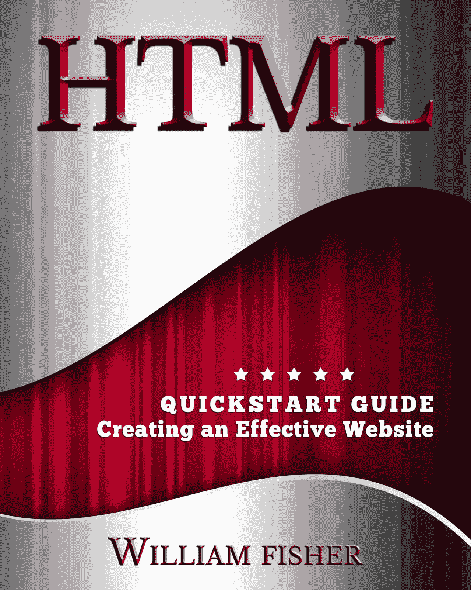
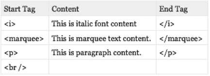
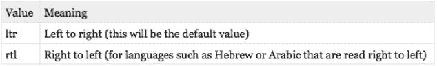
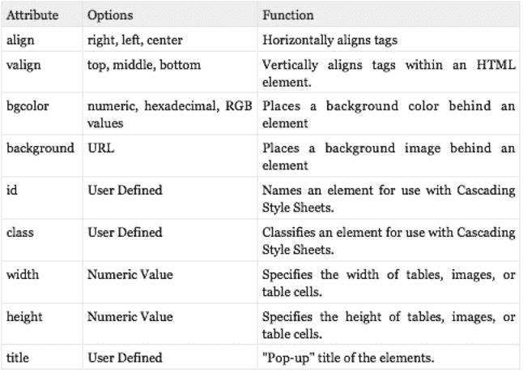
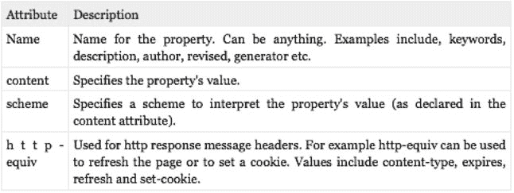
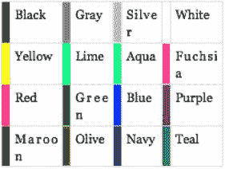
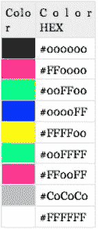
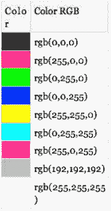
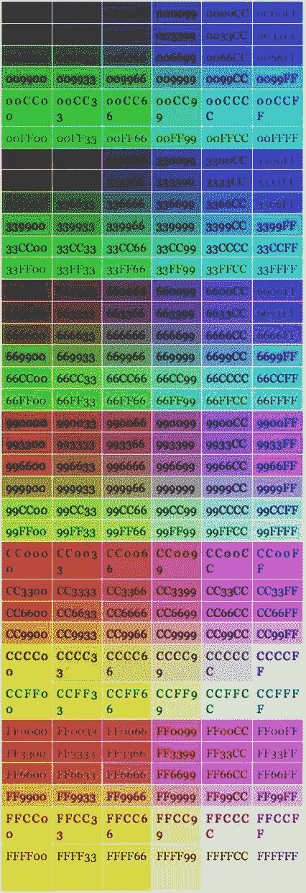

# HTML 快速启动指南 - 创建高效网站 (Wordpress, XHTML, JQuery, ASP, 浏览器, CSS, Javascript)





## 免费赠品！！！
我们为您提供免费指南，助您开启改善生活之路，并独家加入我们的突破性读书俱乐部！！！在这里，我们每周提供一本新的免费电子书！我们的会员还会积极讨论、评论和分享他们对本周之书的看法，以及帮助彼此突破生活障碍的话题！每月还有机会赢得 25 美元礼品卡！请享受您的免费指南并访问[突破性读书俱乐部](https://publishfs.leadpages.co/the-breakthrough-book-club-d/)


## 目录
- 引言
- 第 1 章：HTML 中的基本标签
- 第 2 章：HTML 元素
- 第 3 章：HTML 格式化
- 第 4 章：HTML 短语标签
- 第 5 章：元标签
- 第 6 章：注释
- 第 7 章：HTML 表单
- 第 8 章：HTML 图像
- 第 9 章：HTML 列表
- 第 10 章：HTML 颜色
- 第 11 章：HTML 多媒体
- 第 12 章：HTML5 与语义化
- 结论

## 引言

HTML（超文本标记语言）是开发网页最常用的语言。它由伯纳斯-李于 1991 年创建。标准 HTML 规范`HTML 2.0`于 1995 年发布。该语言的另一个主要版本`HTML 4.01`于 1999 年底发布。这是最广泛使用的 HTML 版本，现在已被 2012 年发布的`HTML 5`取代。这基本上是先前版本`HTML 4.01`的扩展。

### 适用对象？
本 HTML 教程专为有抱负的开发人员和网页设计师设计。本教程以足够的细节、实际示例和简单概述进行讲解，使初学者能够轻松理解，并提供足够的知识来设计自己的网页。通过一些练习，您可以获得更高水平的专业知识。

### 先决条件
开始本教程的先决条件是具备一些使用 Linux 操作系统或 Windows 的基本知识。此外，您还应熟悉：
- 使用文本编辑器，如`editplus`、`notepad`、`notepad++`或任何其他文本编辑器。
- 在计算机上创建文件和目录。
- 在不同目录之间导航。
- 不同的图像格式，如`PNG`、`JPG`等。
- 在文件中输入内容并保存。

# 第 1 章：HTML 中的基本标签

## 标题标签
标题是文档中的第一项，每个文档都以标题开头。在 HTML 中，您可以设置不同大小的标题。标题有六种大小，可以使用元素`<h1>`、`<h2>`、`<h3>`、`<h4>`、`<h5>`和`<h6>`进行设置。浏览器在显示时会在标题前后添加一行。以下是一个示例。

## 示例
```
<!DOCTYPE html>
<html>
<head>
<title>Example for Heading</title>
</head>
<body>
<h1>This will be heading 1</h1>
<h2>This will be heading 2</h2>
<h3>This will be heading 3</h3>
<h4>This will be heading 4</h4>
<h5>This will be heading 5</h5>
<h6>This will be heading 6</h6>
</body>
</html>
```
此代码将产生以下输出：
This will be heading 1
This will be heading 2
This will be heading 3
This will be heading 4
This will be heading 5
This will be Heading 6

## 段落标签
您可以使用`<p>`标签将内容组织成段落。要将文本变成段落，应将其放在`<p>`和`</p>`标签之间。以下是一个示例。

## 示例
```html
<!DOCTYPE html>
<html>
<head>
<title>Example for Paragraph</title>
</head>
<body>
<p>This will be the first paragraph.</p>
<p>This will be the second paragraph.</p>
<p>This will be the third paragraph.</p>
</body>
</html>
```
此代码将产生以下输出：
This will be the first paragraph.
This will be the second paragraph.
This will be the third paragraph.

## 换行标签
如果希望在文本中添加换行，可以使用`<br />`元素。有些标签不需要结束标签，这类标签称为空元素。`<br />`元素就是这样一个空元素，因为其中没有内容。

在 XHTML 中，如果不添加`/`而仅使用`<br>`，则无法正常工作。以下是一个示例。

## 示例
```html
<!DOCTYPE html>
<html>
<head>
<title>Example for Line Break</title>
</head>
<body>
<p>Hey<br />
How are you today?<br />
Good Luck<br />
Peter</p>
</body>
</html>
```
此代码将产生以下输出：
Hey
How are you today?
Good Luck
Peter

## 内容居中
有时您需要将内容放置在表格单元格或页面的中心。对于这种情况，可以使用`<center>`标签。以下是一个示例。

## 示例
```html
<!DOCTYPE html>
<html>
<head>
<title>Example for Centering the Content</title>
</head>
<body>
<p>This text has the default alignment.</p>
<center>
<p>This text is centered.</p>
</center>
</body>
</html>
```
此代码将产生以下输出：
This text has the default alignment.
This text is centered.

## 水平线
您可以使用水平线在视觉上分隔文档中的各个部分。`<hr>`标签用于创建从左边界到右边界的水平线。这将相应地分隔行。例如，如果要在两个段落之间插入换行，可以使用下面给出的代码。

## 示例
```html
<!DOCTYPE html>
<html>
<head>
<title>Example for Horizontal Line</title>
</head>
<body>
<p>This is the first paragraph. This is on the top of the line break.</p>
<hr />
<p>This is the second paragraph. This is at the bottom of the line break.</p>
</body>
</html>
```
上述代码将产生以下输出：
This is the first paragraph. This is on the top of the line break.
This is the second paragraph. This is at the bottom of the line break.


`<hr />` 标签也被归类为空元素。它不需要开始标签和结束标签，因为其中没有内容。

在 `<hr />` 元素中，字符 `hr` 和 `/` 之间有一个空格。如果省略了空格，旧版本的浏览器在渲染水平线时会出现问题；如果缺少 `/`，则在 XHTML 中它就不是一个有效的元素。

## 保留格式

在某些情况下，你的文本应保持与 HTML 文档中输入时相同的格式。此时你可以使用 `<pre>` 标签。它表示预格式化文本。

在 `<pre>` 和 `</pre>` 标签之间输入的任何文本都将保持与源文档中相同的文本格式。下面是一个示例。

示例

```html
<!DOCTYPE html>
<html>
<head>
<title>保留格式示例</title>
</head>
<body>
<pre>
int main(void) {
  printf("Hello World!\n");
  // return 0;

}
</pre>
</body>
</html>
```

上述代码将产生以下输出。

```
int main(void) {
  printf("Hello World!\n");
  // return 0;

}
```

## 不换行空格

在某些情况下，你不希望浏览器将单词跨行拆分。此时可以使用不换行空格实体 `&nbsp;` 来代替普通空格。请看下面的示例以更好地理解。

示例

```html
<!DOCTYPE html>
<html>
<head>
<title>不换行空格示例</title>
</head>
<body>
<p>
电影中的特工是 "James&nbsp;Bond&nbsp;007."</p>
</body>
</html>
```

# 第 2 章：HTML 元素

一个元素由其开始标签定义。如果元素内可以包含其他内容，则它会有结束标签。对于结束标签，元素名称前会加上一个 `/`。下面给出了一些此类元素。



这里，`<i>` 和 `</i>` 是一个元素，`<marquee>` 和 `</marquee>` 是另一个元素。有一些 HTML 元素不需要结束标签，例如 `<br />`、`<hr />`、`` 等。这些不需要结束标签的 HTML 元素被称为空元素。

HTML 文档为这些元素构建了一个树形结构，该结构规定了 HTML 文档应如何构建，同时也指定了文档的哪一部分应放置何种类型的内容。

## HTML 标签 vs. 元素

HTML 元素通过开始标签来定义。如果内部放置了其他内容，则它会有结束标签。

例如，`<i>` 是斜体文本的开始标签，`</i>` 是其结束标签。但 `<i>这段文本是斜体</i>` 是一个斜体文本元素。

## HTML 中的嵌套元素

HTML 允许你在其他 HTML 元素中嵌套 HTML 元素。下面是一个示例：

示例

```html
<!DOCTYPE html>
<html>
<head>
<title>嵌套元素示例</title>
</head>
<body>
<h2>这是一个<b>粗体</b>标题</h2>
<p>这是<i>斜体</i>文本</p>
</body>
</html>
```

上述代码将产生以下输出：

这是一个粗体标题

这是斜体文本

## 属性

到目前为止，我们已经看到了一些最简单的标签，如段落标签 `<p>`、标题标签 `<h1>`、`<h2>` 等。这些标签可以附加一些额外信息，称为属性。

HTML 元素的特性可以通过属性来定义。属性放在元素的开始标签内，包含两部分：名称和值。

属性名称就是你要设置的属性。例如，字体元素带有 color、size、type 等属性，用于指示页面上显示的字体颜色、字体大小和字体类型。

属性值就是你要设置的属性的值。属性值应始终放在引号内。下面的示例将展示可以为上述名称赋予的值：Red、3 和 Georgia，分别作为字体颜色、大小和类型。

在使用属性的名称和值时需小心，因为它们是区分大小写的。不过，W3C（万维网联盟）在其 HTML 4 推荐标准中建议使用小写的属性名称和属性值。

下面是一个示例。

示例

```html
<!DOCTYPE html>
<html>
<head>
<title>对齐属性示例</title>
</head>
<body>
<p align="right">此内容将右对齐</p>
<p align="center">此内容将居中对齐</p>
<p align="left">此内容将左对齐</p>
</body>
</html>
```

上述代码将产生以下输出：

此内容将右对齐。

此内容将居中对齐。

此内容将左对齐。

## 国际化属性

HTML 中共有三个国际化属性。这些属性适用于大多数 XHTML 元素，但并非全部。

- `dir`
- `lang`
- `xml:lang`

### `dir` 属性

你可以使用 `dir` 属性向浏览器指定文本流向方向。该属性可以取两个值，如下表所示。



示例

```html
<!DOCTYPE html>
<html dir="rtl">
<head>
<title>显示方向</title>
</head>
<body>
这是 IE 5 渲染从右到左文本的方式。
</body>
</html>
```

上述代码将产生以下输出：

这是 IE 5 渲染从右到左文本的方式。

如果 `dir` 属性放在 `<html>` 标签内，它将决定整个文档的文本呈现方式。如果该属性用在其他标签内，则仅控制该特定标签内包含的文本方向。

### `lang` 属性

你可以使用 `lang` 属性指示文档中使用的主要语言。在 HTML 中保留此属性的唯一原因是为了向后兼容旧版本的 HTML。在新的 XHTML 文档中，此属性已被 `xml:lang` 属性取代。

`lang` 属性的值采用 ISO 639 标准的 2 字符语言代码。你可以在 [HTML 语言代码：ISO 639](http://www.tutorialspoint.com/html/language_iso_codes.htm) 查看完整的语言代码列表。

示例

```html
<!DOCTYPE html>
<html lang="en">
<head>
<title>英文页面</title>
</head>
<body>
此页面使用英文
</body>
</html>
```

### `xml:lang` 属性

在 XHTML 中，`xml:lang` 属性用于替代早期 HTML 版本中使用的原始 `lang` 属性。如上所述，`xml:lang` 属性的值应为 ISO-639 国家代码。

## 通用属性

还有一些其他属性可以方便地与大多数 HTML 标签一起使用。这些属性的列表如下表所示。



# 第 3 章：HTML 中的格式化

如果你熟悉使用文字处理器，那么你可能也熟悉将文本设为粗体、斜体或下划线。HTML 和 XHTML 中共有 10 种选项可用于指示文本的显示方式。

## 粗体文本

放在 `<b>...</b>` 元素之间的任何内容都将显示为粗体文本。下面是一个示例。

示例

```html
<!DOCTYPE html>
<html>
<head>
<title>粗体文本示例</title>
</head>
<body>
<p>以下单词将以<b>粗体</b>显示。</p>
</body>
</html>
```

上述代码将产生以下输出：

以下单词将以粗体显示。

## 斜体文本

放在 `<i>...</i>` 元素之间的任何内容都将显示为斜体文本。下面是一个示例。

示例

```html
<!DOCTYPE html>
<html>
<head>
<title>斜体文本示例</title>
</head>
<body>
<p>以下单词将以<i>斜体</i>显示。</p>
</body>
</html>
```

上述代码将产生以下输出：

以下单词将以斜体显示。


## 下划线文本

任何放置在 `<u>............</u>` 元素之间的内容都将显示为下划线文本。这里有一个示例。

示例

```html
<!DOCTYPE html>
<html>
<head>
<title>Example for Underlined Text</title>
</head>
<body>
<p>The following word will be in an <u>underlined</u> typeface.</p>
</body>
</html>
```

上面的代码将产生以下输出：

接下来的单词将以<u>下划线</u>字体显示。

## 删除线文本

任何放置在 `<strike>...</strike>` 元素之间的内容都将显示为删除线文本，即穿过文本的一条细线。这里有一个示例。

示例

```html
<!DOCTYPE html>
<html>
<head>
<title>Strike Text Example</title>
</head>
<body>
<p>The following word uses a <strike>strikethrough</strike> typeface.</p>
</body>
</html>
```

上面的代码将产生以下输出：

接下来的单词将使用<s>删除线</s>字体。

## 等宽字体

任何放置在 `<tt>...</tt>` 元素之间的内容都将显示为等宽字体。大多数可用字体都是可变字体。这是因为不同的字母宽度不同。例如，字母 w 比 i 宽。使用等宽字体，每个字母将具有相同的宽度。这里有一个示例。

示例

```html
<!DOCTYPE html>
<html>
<head>
<title>Example for Monospaced Font</title>
</head>
<body>
<p>The following word uses a <tt>monospaced</tt> typeface.</p>
</body>
</html>
```

上面的代码将产生以下输出：

接下来的单词将使用等宽字体。

## 上标文本

你可以使用 `<sup>...</sup>` 元素在你的网页上添加上标。上标只是与周围文本具有相同字体和字号的文本，但它将显示在周围文本上方半个字符的高度。这里有一个示例。

示例

```html
<!DOCTYPE html>
<html>
<head>
<title>Example for Superscript Text</title>
</head>
<body>
<p>The following word uses a <sup>superscript</sup> typeface.</p>
</body>
</html>
```

上面的代码将产生以下输出：

接下来的单词将使用上标字体。

## 下标文本

你可以使用 `<sub>...</sub>` 元素在你的网页上添加下标。下标只是与周围文本具有相同字体和字号的文本，但它将显示在周围文本下方半个字符的高度。这里有一个示例。

示例

```html
<!DOCTYPE html>
<html>
<head>
<title>Example for Subscript Text</title>
</head>
<body>
<p>The following word uses a <sub>subscript</sub> typeface.</p>
</body>
</html>
```

上面的代码将产生以下输出：

接下来的单词将使用下标字体。

## 插入文本

任何放置在 `<ins>...</ins>` 元素之间的文本都将显示为插入文本。这里有一个示例。

示例

```html
<!DOCTYPE html>
<html>
<head>
<title>Example for Inserted Text</title>
</head>
<body>
<p>I want to drink <del>cola</del> <ins>wine</ins></p>
</body>
</html>
```

上面的代码将产生以下输出：

我想喝可乐葡萄酒

## 删除文本

任何放置在 `<del>...</del>` 元素之间的文本都将显示为删除文本。这里有一个示例。

示例

```html
<!DOCTYPE html>
<html>
<head>
<title>Example for Deleted Text</title>
</head>
<body>
<p>I want to drink <del>cola</del> <ins>wine</ins></p>
</body>
</html>
```

上面的代码将产生以下输出：

我想喝葡萄酒

## 较大字体

任何放置在 `<big>...</big>` 元素内的内容将显示为比周围其他内容大一号的字体。这里有一个解释较大文本的示例。

示例

```html
<!DOCTYPE html>
<html>
<head>
<title>Example for Larger Text</title>
</head>
<body>
<p>You canadd<big>larger</big> text in middle of a sentence using this.</p>
</body>
</html>
```

上面的代码将产生以下输出：

你可以使用此在句子中间添加较大的文本。

## 字体字体

任何放置在 `<small>...</small>` 元素内的内容将显示为比周围其他内容小一号的字体。这里有一个解释较小文本的示例。

示例

```html
<!DOCTYPE html>
<html>
<head>
<title>Example for Smaller Text</title>
</head>
<body>
<p> You can add <small>smaller</small> text in middle of a sentence using this.</p>
</body>
</html>
```

上面的代码将产生以下输出：

你可以使用此在句子中间添加较小的文本。

## 分组内容

使用 `<div>` 和 `<span>` 元素可以将内容分组。`<div>` 是一个块级元素，而 `<span>` 是内联元素。你可以使用它们来对页面内容进行布局和样式设置。这里有一个示例。

```html
<div>
  <p>这是一个段落。</p>
  <span>这是内联文本。</span>
</div>
```

上面的代码将产生以下输出：

这是一个段落。

这是内联文本。


## 缩写元素

你可以使用 `<acronym>` 元素在 HTML 中将文本标记为缩写。将文本放在开始标签 `<acronym>` 和结束标签 `</acronym>` 之间，即可将其标记为缩写。以下是一个示例。

示例

```html
<!DOCTYPE html>
<html>
<head>
<title>缩写示例</title>
</head>
<body>
<p>本章介绍如何在 <acronym>XHTML</acronym> 中标记文本。</p>
</body>
</html>
```

上述代码将产生以下输出：

本章介绍如何在 XHTML 中标记文本。

## 文本方向

`<bdo>...</bdo>` 元素代表双向覆盖。你可以使用此元素覆盖文本方向。以下是一个示例。

示例

```html
<!DOCTYPE html>
<html>
<head>
<title>文本方向示例</title>
</head>
<body>
<p>这段文本从左到右显示。</p>
<p><bdo dir="rtl">这段文本从右到左显示。</bdo></p>
</body>
</html>
```

上述代码将产生以下输出：

这段文本从左到右显示。

这段文本从右到左显示。

## 特殊术语

你可以在网页中引入特殊术语；为此，可以使用 `<dfn>...</dfn>` 元素。这与段落中的斜体文本非常相似。

通常，当你首次引入关键术语时，会使用 `<dfn>` 元素。现代浏览器会以斜体格式渲染 `<dfn>` 元素中的文本。以下是一个示例。

示例

```html
<!DOCTYPE html>
<html>
<head>
<title>特殊术语示例</title>
</head>
<body>
<p>以下单词是一个 <dfn>特殊</dfn> 术语。</p>
</body>
</html>
```

上述代码将产生以下输出：

以下单词是一个特殊术语。

## 引用文本

在 HTML 中，你可以引用来自其他来源的段落。为此，应将内容放在开始标签 `<blockquote>` 和结束标签 `</blockquote>` 之间。

放置在此元素内的任何文本通常会在其周围文本的左右边缘缩进。有时会使用斜体字体。以下是一个示例。

示例

```html
<!DOCTYPE html>
<html>
<head>
<title>块引用示例</title>
</head>
<body>
<p>以下关于 XHTML 的描述取自 W3C 网站：</p>
<blockquote>XHTML 1.0 是 W3C 针对 XHTML 的第一个推荐标准，它基于之前对 HTML 4.01、HTML 4.0、HTML 3.2 和 HTML 2.0 的工作。</blockquote>
</body>
</html>
```

上述代码将产生以下输出：

以下关于 XHTML 的描述取自 W3C 网站：

XHTML 1.0 是 W3C 针对 XHTML 的第一个推荐标准，它基于之前对 HTML 4.01、HTML 4.0、HTML 3.2 和 HTML 2.0 的工作。

## 短引用

你可以使用 `<q>...</q>` 元素在句子中添加双引号。以下是一个示例。

示例

```html
<!DOCTYPE html>
<html>
<head>
<title>双引号示例</title>
</head>
<body>
<p>保罗在西班牙，<q>我想我是对的</q>。</p>
</body>
</html>
```

上述代码将产生以下输出：

保罗在西班牙，我想我是对的。

## 文本引用

当你引用某些文本时，可以通过将来源放在开始标签 `<cite>` 和结束标签 `</cite>` 之间来指明来源。以下是一个示例。

示例

```html
<!DOCTYPE html>
<html>
<head>
<title>引用示例</title>
</head>
<body>
<p>本 HTML 教程源自 <cite>W3 的 HTML 标准</cite>。</p>
</body>
</html>
```

上述代码将产生以下输出：

本 HTML 教程源自 W3 的 HTML 标准。

## 计算机代码

如果你要在网页中添加任何编程代码，应将其放在开始标签 `<code>` 和结束标签 `</code>` 之间。此元素内的内容通常以等宽字体呈现，就像其他编程书籍中调用的那样。以下是一个示例。

示例

```html
<!DOCTYPE html>
<html>
<head>
<title>计算机代码示例</title>
</head>
<body>
<p>这是普通文本。<code>这是代码。</code>这是普通文本。</p>
</body>
</html>
```

上述代码将产生以下输出：

这是普通文本。这是代码。这是普通文本。

## 键盘文本

在某些情况下，你需要读者使用键盘输入文本。在这种情况下，你可以使用 `<kbd>...</kbd>` 元素。此元素将指示需要输入的文本。以下是一个示例。

示例

```html
<!DOCTYPE html>
<html>
<head>
<title>键盘文本示例</title>
</head>
<body>
<p>普通文本。<kbd>这是 kbd 元素内的内容</kbd>普通文本。</p>
</body>
</html>
```

上述代码将产生以下输出：

普通文本。这是 kbd 元素内的内容普通文本。

## 编程变量

通常，此元素会与 `<code>` 和 `<pre>` 元素一起使用，以指示此元素内的内容是变量。以下是一个示例。

示例

```html
<!DOCTYPE html>
<html>
<head>
<title>变量文本示例</title>
</head>
<body>
<p><code>document.write("<var>用户 ID</var>")</code></p>
</body>
</html>
```

上述代码将产生以下输出：

```
document.write("用户 ID")
```

## 程序输出

可以使用 `<samp>...</samp>` 元素指示程序的示例输出。脚本也可以使用此元素指示。然而，它通常用于记录编码概念或编程。以下是一个示例。

示例

```html
<!DOCTYPE html>
<html>
<head>
<title>程序输出示例</title>
</head>
<body>
<p>程序的结果是 <samp>Hello World!</samp></p>
</body>
</html>
```

上述代码将产生以下输出：

程序的结果是 Hello World!

## 地址文本

你可以使用 `<address>...</address>` 元素提供地址。以下是一个示例。

示例

```html
<!DOCTYPE html>
<html>
<head>
<title>地址示例</title>
</head>
<body>
<address>1719 c, David Drive, Marietta, Atlanta, Georgia</address>
</body>
</html>
```

上述代码将产生以下输出：

1719 c, David Drive, Marietta, Atlanta, Georgia

# 第 5 章：元标签

在 HTML 中，你可以通过不同方式指定元数据，即关于文档的额外重要信息。你可以使用 META 元素来包含描述文档属性的名称/值对，例如文档作者、作者、过期日期、关键词列表等。

这些额外信息可以通过 `<meta>` 标签提供。Meta 标签没有结束标签，因此它是一个空元素。虽然它是空元素，但信息可以通过其属性传递。

通常，你可以根据添加到文档中的信息，在文档中添加多个 meta 标签。meta 标签不会对文档的物理外观产生任何影响。从应用的角度来看，是否包含 meta 标签并不重要。

## 向文档添加元标签

你可以通过在文档的头部（由 `<head>` 和 `</head>` 标签表示）中添加 `<meta>` 标签来为页面提供元数据。除了核心属性外，它们还可以具有以下属性：



## 指定关键词

可以使用 `<meta>` 标签指定与文档相关的重要关键词。这些关键词稍后会被各种搜索引擎使用。它们也会用于为搜索索引你的页面。以下是一个示例。

示例

```html
<!DOCTYPE html>
<html>
<head>
<title>元标签示例</title>
<meta name="keywords" content="杜卡迪, 阿普利亚, 宝马" />
</head>
<body>
<p>Hello World!</p>
</body>
</html>
```

上述代码将产生以下输出：

Hello World!

## 文档描述

你可以使用 `<meta>` 标签提供文档的简短描述。与关键词类似，该描述也会在搜索引擎为搜索目的索引网页时被使用。以下是一个示例。

示例


```html
<!DOCTYPE html>
<<html>
<head>
  <title>Example for Meta Tags</title>
  <meta name="keywords" content="Ducati, Aprilia, BMW" />
  <meta name="description" content="Learning about Meta Tags." />
</head>
<body>
  <p>Hello World!</p>
</body>
</html>
```

## 文档修订日期

`<meta>` 标签可以提供有关文档最后更新的信息。各种网页浏览器在刷新您的网页时会使用这些信息。以下是一个示例。

## 示例

```html
<!DOCTYPE html>
<html>
<head>
  <title>Meta Tags Example</title>
  <meta name="keywords" content="Ducati, Aprilia, BMW" />
  <meta name="description" content="Learning about Meta Tags." />
  <meta name="revised" content="Topgear, 7/7/15" />
</head>
<body>
  <p>Hello HTML5!</p>
</body>
</html>
```

## 页面刷新

你可以使用 `<meta>` 标签来指定自动刷新页面的持续时间。以下是一个示例。

## 示例

如果你希望网页每 10 秒自动刷新一次，请使用下面的语法。

### 语法：

```html
<!DOCTYPE html>
<html>
<head>
  <title>Meta Tags Example</title>
  <meta name="keywords" content="Ducati, Aprilia, BMW" />
  <meta name="description" content="Learning about Meta Tags." />
  <meta name="revised" content="Topgear, 7/7/15" />
  <meta http-equiv="refresh" content="10" />
</head>
<body>
  <p>Hello HTML5!</p>
</body>
</html>
```

## 页面跳转

使用 `<meta>` 标签，你可以将网页重定向到其他网页。你实际上可以通过指定秒数来指定想要跳转页面的持续时间。以下是一个示例。

## 示例

在以下示例中，当前页面将在 10 秒后跳转到另一个页面。如果你留空 content 属性，当前网页将立即被重定向。

```html
<!DOCTYPE html>
<html>
<head>
  <title>Meta Tags Example</title>
  <meta name="keywords" content="Ducati, Aprilia, BMW" />
  <meta name="description" content="Learning about Meta Tags." />
  <meta name="revised" content="Topgear, 7/7/15" />
  <meta http-equiv="refresh" content="5; url=http://www.topgear.com" />
</head>
<body>
  <p>Hello HTML5!</p>
</body>
</html>
```

## 设置 Cookies

Cookies 无非是以小型文本文件的形式存储在你的计算机上的数据。Cookies 在网页服务器和网页浏览器之间交换，用于跟踪 Web 所需的信息。

使用 `<meta>` 标签可以将 Cookies 存储在客户端，这些信息稍后可以被网页服务器用于跟踪网站的访问者。

## 示例

在以下示例中，当前页面将在 10 秒后跳转到另一个页面。如果你留空 content 属性，当前网页将立即被重定向。

```html
<!DOCTYPE html>
<html>
<head>
  <title>Meta Tags Example</title>
  <meta name="keywords" content="Ducati, Aprilia, BMW" />
  <meta name="description" content="Learning about Meta Tags." />
  <meta name="revised" content="Topgear, 7/Jul/15" />
  <meta http-equiv="cookie" content="userid=xyz; expires=Wednesday, 08-Aug-15 23:59:59 GMT;" />
</head>
<body>
  <p>Hello HTML5!</p>
</body>
</html>
```

如果没有包含过期日期和时间，则 Cookie 将视为会话 Cookie（session cookie）。会话 Cookie 在浏览器关闭时删除。

## 设置作者名称

你可以使用 meta 标签在网页中设置作者名称。见下示例：

## 示例

```html
<!DOCTYPE html>
<html>
<head>
  <title>Meta Tags Example</title>
  <meta name="keywords" content="Ducati, Aprilia, BMW" />
  <meta name="description" content="Learning about Meta Tags." />
  <meta name="author" content="Mahnaz Mohtashim" />
</head>
<body>
  <p>Hello HTML5!</p>
</body>
</html>
```

## 指定字符集

你可以使用 `<meta>` 标签来指定网页内使用的字符集。

## 示例

默认情况下，Web 服务器和网页浏览器使用 ISO-8859-1（Latin1）编码来处理网页。以下是设置 UTF-8 编码的示例：

```html
<!DOCTYPE html>
<html>
<head>
  <title>Meta Tags Example</title>
  <meta name="keywords" content="Ducati, Aprilia,BMW" />
  <meta name="description" content="Learning about Meta Tags." />
  <meta name="author" content="Mahnaz Mohtashim" />
  <meta charset="UTF-8">
</head>
<body>
  <p>Hello HTML5!</p>
</body>
</html>
```


条件注释仅在 Internet Explorer 浏览器中有效，其他浏览器会忽略条件注释。条件注释从 Internet Explorer 5 开始支持，可用于针对不同版本的 Internet Explorer 提供条件指令。以下是一个示例。

## 示例

```html
<!DOCTYPE html><html>
<head>
  <title>条件注释示例</title>
<!--[if IE 6]>
  此处为针对 IE 6 的特殊指令
<![endif]-->
</head>
<body>
<p>文档内容在此处……</p>
</body>
</html>
```

当需要根据 IE 版本使用不同样式表时，条件注释会很有帮助。

## 使用注释标签

HTML 代码的一部分可以设为注释，少数浏览器支持 `<comment>` 标签。以下是一个示例。

## 示例

```html
<!DOCTYPE html><html>
<head>
<title>使用注释标签</title>
</head>
<body>
<p>这是<comment>不是</comment> Internet Explorer。</p>
</body>
</html>
```

如果你使用的是 IE，上述代码将产生以下输出：

这是 Internet Explorer。

如果你使用的是非 IE 的其他浏览器，上述代码将产生以下输出：

这不是 Internet Explorer。

## 注释脚本代码

当你在 HTML 代码中使用 VBScript 或 JavaScript 时，明智的做法是将脚本代码放在适当的注释中。这样可以确保它们能在旧版浏览器中使用。以下是一个示例。

## 示例

```html
<!DOCTYPE html><html>
<head>
<title>注释脚本代码</title>
<script>
<!--
  document.write("哈库纳马塔塔！")
//-->
</script>
</head>
<body>
<p>哈库纳，马塔塔！</p>
</body>
</html>
```

上述代码将产生以下输出：

哈库纳马塔塔！

哈库纳，马塔塔！

## 注释样式表

当你在 HTML 代码中使用样式表时，明智的做法是将样式表代码放在适当的注释中。这样可以确保它们能在旧版浏览器中使用。我们将在另一章中学习样式表。以下是一个示例。

## 示例

```html
<!DOCTYPE html><html>
<head>
<title>注释样式表</title>
<style>
<!--
.example {
  border:1px solid #4a7d49;
}
//-->
</style>
</head>
<body>
<div class="example">早上好！</div>
</body>
</html>
```

上述代码将产生以下输出：

早上好！

# 第 7 章：HTML 表单

大多数网站至少有一个页面用于征求访客反馈，或要求他们提供电子邮件进行订阅。要实现这一点，你需要在页面中放置多个文本框，供用户输入信息。表单几乎无处不在，尽管它常常被忽视。当你登录邮箱、Facebook 或任何需要用户名和密码的服务时，你就是在使用表单输入数据。在 HTML 中，这可以通过表单及其元素来实现。

表单的基本思路是：访客使用文本框输入数据，数据被提交到后端应用程序（如 ASP 或 PHP 脚本）。该应用程序可以根据网页创建者的逻辑算法配置为执行任何操作。以下是一些常用元素和属性，你必须了解它们才能创建吸引访客的表单：

## Input

这是最重要的元素，用于获取用户输入。它有多种输入属性，如文本、单选按钮和提交按钮。单选按钮用于从你提供的不同选项中进行选择，另外两种则相当直观。语法为 `<input>`。

## TextArea

当你希望用户输入超过一行的内容（例如描述其专业经验的段落）时，需要使用 `TextArea` 元素。

## Button

该元素创建一个按钮，点击后执行某些操作。

## Select

虽然在用户必须输入详细信息的表单中并非必需，但了解此元素能让访客操作更便捷。`Select` 元素创建一个下拉列表，访客可从中选择一个选项。

## Legend

如果你希望表单看起来有条理，这是一个重要的元素。`Legend` 为 `fieldset` 标签元素创建标题，该元素用于将表单中相关的字段分组。

## HTML5 元素

这些是 HTML5 特有的元素，不能在其他地方使用。

### Datalist

当你希望用户开始输入时立即显示选项列表，可以使用 `Datalist`。这与 `Select` 元素不同，后者用户只能从列表中选择。`Datalist` 元素在用户点击箭头标记时显示列表，并在用户开始输入时显示相关选项。

### Keygen

当你希望创建一种安全的方式来验证用户身份时，可以使用 `keygen` 元素。它会生成两个密钥：一个存储在本地（私钥），另一个发送到服务器（公钥）。

### Form Action

在进入示例之前，有一个属性你必须了解，即 `form action`。该属性决定按下提交按钮时数据应发送到哪个页面。所谓“处理”，是指你可以向用户显示详细信息，或将其发送到数据库。然而，使用 `form action` 需要你具备 ASP 的基础知识。由于本书仅聚焦于 HTML，因此不会讨论 ASP 和 PHP。网上有许多教程详细解释了 PHP 和 ASP。

`form action` 的语法非常简单：

```html
<form action="page.php" method="你希望使用的方法">
```

### Get 和 Post

这一点相当直观。`page.php` 指的是你要发送详细信息的页面。如果你之前没有定义页面，那么你只会收到“文件未找到”的消息。然而，如果你查看 URL 或浏览“文件未找到”消息中提供的信息，你会注意到用户输入的详细信息会显式地显示出来。这就引出了 `form action` 中使用的方法。

有两种表单动作：`GET` 和 `POST`。如果一开始没有选择任何选项，则默认使用 `GET` 选项。`GET` 的问题在于，用户输入的任何详细信息都会显示在 URL 中。虽然用户在家时这可能不是问题，但想象一下，当用户使用你的表单在公共场所或公用计算机上输入详细信息时，只需查看历史记录就能打开之前访问过的网站，以及 URL 中的密码和用户名。这是一个巨大的安全威胁，因此本指南倾向于使用 `POST` 方法。

在 `POST` 方法中，执行相同的操作——即详细信息被发送到 PHP 或 ASP 脚本，或一个处理详细信息的页面——但 URL 中除了 `form action` 发送详细信息的页面外，不会显示任何内容。

如果你想使用 `POST` 方法，请使用以下语法：

```html
<form action="page.php" method="POST">
```


就这些！你现在已经成功创建了一个更加注重安全的表单。

### name 属性

在阅读下方的示例时，你会在几段代码中注意到 `name` 属性。这与 `value` 属性不同，后者改变的是元素的名称——即用户看到的文本。`name` 属性与表单的 `action` 配合工作，并根据你提供的作为变量标识的文本创建一个变量。例如，如果你在某个表单输入类型之后给出 `name="user"`，那么该细节将被存储在一个名为 `user` 的变量中，并会被发送到你使用表单 `action` 创建的页面。在页面中，每当你需要使用相应的细节进行某些操作时，都可以通过变量 `user` 对其进行处理。

通常，当你希望用户通过单个提交按钮提交字段列表时，添加 `name` 属性是很有必要的。如果你没有这样做，信息将不会发送到页面；如果你只对少数几个字段包含了该属性，那么只有这些对应字段的细节会被发送到页面进行后续处理。

### option 标签

在我们讨论输入类型以及你将在表单中为了方便使用的使用的各种元素之前，你需要了解一个名为 `<option>` 标签的重要标签。当你希望用户能够从选项列表中选择时，就应该使用这个标签。让我们来看 `option` 标签使用的语法：

```html
<option value="game1" Super Mario>
<option value="game2" Runescape>
```

如果你执行这段代码，你会发现屏幕上只显示 Super Mario 和 Runescape 两个名称，而没有选择它们的选项。`option` 标签只创建选项，并没有将它们分组到单个字段中的功能。这正是 `select` 和 `datalist` 元素用用场。`option` 标签与这些标签配合工作，但关于这两个新标签的内容将在稍后介绍。

目前，只要理解这些基础标签和属性就足够了，它们将在后续不同元素的示例中频繁使用。现在让我们进入不同的输入类型以及每种类型的示例代码，以便你更好地理解。

### Input（输入）

有很多输入元素类型。你创建的每个表单都会用到其中几种。让我们来看看此类输入类型使用的基本语法：

```html
<input type="relevant_type" name="relevant_name" value="relevant_value">
```

#### Text（文本）

这启用了一个单行输入字段（注意，该字段只接受文本）。

示例

```html
<!DOCTYPE html>
<html>
<body>
<form action="">
Username:<input type="text" name="username">
</form>
</body>
</html>
```

这段代码在用户提供其用户名（Username）时接收其文本。用户的输入将存储在你发送文件所在页面中名为 `username` 的变量中。表单的 `action` 被留空了，你可以插入任何你想让信息发送到的页面。

#### Submit（提交）

这创建了一个名为“Submit”的按钮，其功能正如其名。它将输入的细节发送到表单处理器（form handler），这是表单 `action` 的高级名称。

示例

```html
<form action="action.php">
  Username:<br>
  <input type="text" name="userid"><br>
  Password:<br>
  <input type="password" name="pass"><br>
  <input type="submit" value="Submit">
</form>
```

在这里使用了另一种名为 `Password`（密码）的输入类型。当给出 `<input type="password">` 时，文本框也接受特殊字符，并且一旦按下 Submit 按钮，细节就会发送到表单处理器。通过更改提交按钮的 `value` 值，你可以更改文本。例如，给出 `value="Click to confirm"` 将创建一个显示“Click to confirm”的按钮，但执行的是提交按钮的操作。

#### Radio（单选框）

单选框输入类型为用户提供了一个供列表列表，用户在任何时间只能选择其中一个。

示例

```html
<form>
  <input type="radio" name="occupation" value="student"> Student<br>
  <input type="radio" name="occupation" value="unemployed"> Unemployed<br>
  <input type="radio" name="occupation" value="teacher"> Teacher
</form>
```

这创建了一个关于用户职业的选项列表。如果你希望某个特定选项被默认选中，可以通过输入类型的末尾添加 `checked` 来实现。

例如，将 `<input type="radio" name="occupation" value="student"> Student<br>` 替换为 `<input type="radio" name="occupation" value="student" checked> Student<br>` 将默认选中 Student。

#### Checkbox（复选框）

当你想要用户从你提供的选项中选择多个选项时，使用复选框。语法与其他输入类型相同。

示例

```html
<form action="action_page.php">
<input type="checkbox" name="gadget1" value="Laptop" >I have a laptop <br>
<input type="checkbox" name="gadget2" value="PC">I have a PC<br>
<input type="submit">
</form>
```

这个示例创建了 2 个复选框，询问用户是否拥有笔记本电脑和 PC。再次，如果你想让某些选项默认选中，在输入类型的末尾添加 `checked`：

```html
<input type="checkbox" name="gadget1" value="Laptop" checked>I have a laptop <br>
```

#### Button（按钮）

你可以利用按钮输入类型来定义点击按钮执行的操作。

示例

```html
<input type="button" onclick="alert('HTML tutorial!')" value="Click Here!">
```

这段小代码生成了一个显示“Click Here!”的按钮，点击时会弹出消息。与其他输入类型一样，更改 `value` 将更改按钮内部的消息。

#### Number（数字）

这是一种只接受用户数字的输入类型。你可以选择数字的范围，用户能够提供一个仅在该范围内的数字。当你想要为出生日期或年龄之类的提供输入字段时，这非常有用。该字段自带选择箭头，可以使用它们，或者用户也可以手动输入输入。

示例

```html
<!DOCTYPE html>
<html>
<body>
<form action="page.php">
Birthdate:
<input type="number" name="quantity" min="1" max="31">
<input type="submit" value="Confirm">
</form>
</body>
</html>
```

这段示例代码将创建一个出生日的输入字段，最大值为 31，最小值为 1。你可以根据喜好更改这些数字。`min` 和 `max` 关键字分别代表最小和最大，正如你可能到的。然而，如果你的浏览器是 Internet Explorer 9 或更早版本，这种输入类型将无法工作。

#### TextArea（文本区域）

当你的表单要求用户输入个人细节时，你需要一个可以接受多行输入的输入字段。在这种情况下，使用 `text` 输入类型将不起作用，你需要使用 `TextArea`。

示例

```html
<!DOCTYPE html>
<html>
<body>
<textarea rows="5" cols="75">
你可以使用这个空间输入任何你想输入的内容。所有内容都将显示在文本字段中。如果你决定不提供默认的信息或文本，可以留空这个空间，用户就可以输入他们的个人细节或你需要的相关细节。
</textarea>
</body>
</html>
```


这段示例代码遗憾地只获取了详情，但没有对这些详情进行任何处理。为了处理这些信息，你需要包含一个之前讨论过的 `submit` 类型的输入框以及一个表单的 `action`。这个表单 `action` 必须将详情发送到网站上的相关页面（通常在网页内部），在该页面上可以处理详情，并可以使用最终结果。例如，如果你想将详情存储在数据库中，你需要通过 `form action` 来实现，如果没有提交按钮，这是无法实现的。再次强调，这显而易见，但‘rows’代表你希望输入框拥有的行数，而‘cols’代表你希望的列数（基本上是每行的字母数，包括空格）。

## 范围（Range）

你可能在多个 HTML 表单中见过一个滑块，在其中你点击圆形按钮并将其拖动到你想要指示的数字或百分比的位置。你可以借助 `<range>` 标签来实现这一点。这会创建一个由你设置最小值和最大值的滑块，供用户使用。

```html
<!DOCTYPE html>
<html>
<body>
<form action="action_page.php" method="get">
百分比：
<input type="range" name="percent" min="0" max="100">
<input type="submit">
</form>
</body>
</html>
```

这会创建一个范围为 0-100% 的滑块，你能够选择中间的任何值。然而，这只接受整数。一个理想的示例是：在一个表单接收用户关于其体脂百分比、身高和体重的输入，然后给出质量指数（BMI）作为输出。在这里，你不需要以数字形式获取体脂百分比的输入，而是可以使用滑块来完成。最后，重要的是表单易于使用，而不是输入是如何获取的。

请注意，`<range>` 标签在 Internet Explorer 9 及其之前的版本中不受支持。

## 时间与周（Time and Week）

`time` 和 `week` 标签允许用户输入时间、周以及年份。如果你的表单要求用户输入出生年份，那么使用这些标签将变得简单得多，因为会弹出一个时间或周的选择器，用户只需从中选择时间、周和年份，而无需手动输入。

## 示例

```html
<!DOCTYPE html>
<html>
<body>
<form action="page.php">
选择时间：
<input type="time" name="time">
<input type="submit">
</form>
</body>
</html>
```

此示例创建了一个字段，用户必须其中输入时间，或者从时间选择器中选择，选择器会在用户开始输入时弹出。需要知道的是是，这种时间选择器在某些浏览器中可能不受支持，因此务必提前检查你是否需要用户从选择器中选择而不是手动输入。

同样，也可以使用输入类型 `week`、`datetime` 和 `month`。`week` 和 `month` 在大多数浏览器中都可以工作，但 `datetime` 标签还提供了时区。如果你只想要用户所在国家的本地时间，那么使用 `datetime-local` 会更合适。再次，`datetime-local` 的代码与 `week` 和 `month` 的代码相同。

这些是你可以在所有表单中使用（并在以后使用）的各种输入类型。现在你已经对不同的输入类型有了清晰的思路，是时候转向这些输入类型内部可以使用的不同元素了，让你的表单看起来更好且更易于使用。

## 下拉列表（Select）

HTML 表单的 `select` 属性创建一个下拉列表。该列表包含用户可以选择的选项。这与‘Number’等属性不同，因为用户只能选择选项，不能在其中输入任何内容。

## 示例

```html
<!DOCTYPE html>
<html>
<body>
<form action="page.asp" method="POST">
用户名：<input type="text" name="userid">
<input type="submit" value="存储用户 ID">
<br>
列表：
<select>
<option value="a">A</option>
<option value="b">B</option>
<option value="c">C</option>
<option value="d">D</option>
</select>
</form>
</body>
</html>
```

在这里，使用了 `POST` 方法，如前所述，它将防止详情在用户点击提交按钮时显示在 URL 中。在列表中，你可以添加任意数量的选项，但请确保在每个选项之后都包含 `</option>` 标签。当你希望选中的选项在发送到的页面中具有特定的变量名时，请使用 `name` 属性。你的代码看起来应该是这样：

```html
<select name="name_you_want_in_page">
```

## 字段组与图例（FieldSet and Legend）

`legend` 用于为 `<fieldset>` 标签提供标题。`fieldset` 标签将你想要的元素组合在一起。当使用 `fieldset` 标签时，元素周围会出现一个可见的边界。这使得你的用户更容易阅读和理解需要作为输入的内容。`legend` 标签的作用是在 `fieldset` 顶部创建一个标题，这使得用户更加方便。作为网站设计师，用户的舒适度应该是你的首要目标，这些标签会非常有用。

## 示例

```html
<!DOCTYPE html>
<html>
<body>
<form>
<fieldset>
<legend>教育</legend>
学校：<input type="text"><br>
大学：<input type="text"><br>
学历：<input type="text">
<input type="submit">
</fieldset>
</form>
</body>
</html>
```

此代码将创建文本框，用户在此填写详情，最后的提交操作如前所述。

## HTML5 元素

下面的元素是 HTML5 中添加的各种元素中的两个。这些元素在兼容 HTML5 的浏览器中工作。

### 数据列表（Datalist）

有时，在列表中寻找特定选项可能会很麻烦，特别是当列表很大时。在这种情况下，使用 `datalist` 而不是简单的 `<option>` 标签会让用户更方便。`datalist` 与数字标签不同，它用于文本。它作为输入框的自动填充功能。一旦用户开始输入，相关的选项就会弹出。

## 示例

```html
<!DOCTYPE html>
<html>
<body>
<form action="page.asp" method="get">
<input list="bike" name="bike">
<datalist id="bike">
<option value="bike1">
<option value="bike2">
<option value="bike3">
<option value="bike4">
<option value="bike5">
</datalist>
<input type="submit">
</form>
</body>
</html>
```

尽管非常实用，`datalist` 标签只能在 HTML5 中使用，Internet Explorer 9 及其之前的版本甚至不支持。

## 密钥生成（Keygen）

当你需要验证用户身份时，你需要使用 `keygen` 标签。该标签的功能是创建一对密钥。其中一个密钥将存储在本地，另一个将发送到服务器。当然，本地存储的密钥是私有的，另一个是公开的。

## 示例

```html
<!DOCTYPE html>
<html>
<body>
<form action="page" method="get">
用户名：<input type="text" name="userid">
加密：<keygen name="password">
<input type="submit">
</form>
</body>
</html>
```

在这里，`name` ‘password’指的是你发送到的页面中的变量名，该变量存储生成的密钥。遗憾的是，此标签不支持任何版本的 Internet Explorer，因此在实际在你的网站中实现它之前，请务必小心。


本文涵盖了您需要了解的 HTML 表单中最常用的基本元素。请记住，仅仅通读本文没有任何好处；您必须实际执行这些代码，进行实验，根据自己的喜好进行修改，最后开始编写自己的代码，才能真正掌握 HTML 表单这一强大工具。这不仅适用于 HTML 表单，也适用于 HTML 的其他元素。现在我们已经了解了常用元素，接下来让我们来看看一些可以使表单更加有条理的元素和属性。

### 选项组

`<optgroup>` 标签有助于将不同的选项分组。您可能会问，为什么要将已经在单个字段中分组的内容再次分组（通常使用 `<select>` 或 `<datalist>`）。为了消除这种困惑，让我们看一个例子：

假设您想让用户告诉您他或她目前使用的笔记本电脑型号。您可以简单地创建一个包含不同品牌笔记本电脑及其多种型号的巨大列表。虽然这是可行的，但对于用户来说，从包含数千个选项的列表中选择笔记本电脑型号是非常耗时的。如果您不使用 `<datalist>` 而是使用 `<select>`，这几乎使用户无法找到他或她的型号，因为用户甚至无法输入前几个数字或字母来简化搜索。这段代码会产生结果，但效率低下。编码的根本理念是优化用户和处理所消耗的时间。

这就是 `<optgroup>` 标签发挥作用的地方。假设您将同一品牌下的不同型号分组，您将能够创建一个包含品牌名称的列表，并在每个品牌名称之间有一个子列表，其中包含型号。这不仅会使选择过程对用户更加容易，还能组织您的列表，使其看起来更加专业和美观。

示例

```
<!DOCTYPE html>
<html>
<body>

<select>
  <optgroup label="HP">
    <option value="envy">Envy</option>
    <option value="pavilion">Pavilion</option>
  </optgroup>
  <optgroup label="Lenovo">
    <option value="y50">Y50</option>
    <option value="y40">Y40</option>
  </optgroup>
</select>

</body>
</html>
```

尝试在不使用 `<optgroup>` 标签的情况下执行上述代码。您会注意到一个包含 Envy、Pavilion、Y50 和 Y40 的列表，但没有顺序。现在使用上面给出的确切代码，您将获得一个包含多个子标题的列表（子标题的数量与使用的 `<optgroup>` 标签数量相同），模型将列在这些子标题下。如果您使用 `<select>` 标签从用户获取输入，并且您的选项数量很大，那么您必须使用 `<optgroup>` 标签。

`label` 在 `<optgroup>` 语法中是您想要给子标题的名称。请注意，只能选择选项，而不能选择子标题。

### 只读

有时您需要一个具有固定值或文本的字段，用户不应该能够更改，但应该能够看到。当您遇到这种情况时，`readonly` 属性就会派上用场。顾名思义，用户只能读取字段中给出的内容，而无法对字段进行更改。

`readonly` 标签的语法如下：

```
<input type="type_you_need" name="name" value="value" readonly>
```

示例

```
<!DOCTYPE html>
<html>
<body>

<form action="page.php">
Your current location:<br>
<input type="text" name="place" value="California" readonly>
<br>
</form>

</body>
</html>
```

执行此代码后，您将能够在输入字段中看到“California”显示，但无法对该字段进行任何更改。

### 自动完成

一个您绝对应该注意的元素，特别是如果您的表单要重复使用，它可以让事情对用户更加轻松。如果您的用户需要每隔几天使用您的 HTML 表单提交一份报告，那么使用 `autocomplete` 标签会使他或她更加轻松。如果您了解 Google Chrome 浏览器中的自动填充设置，那么理解这个标签的功能应该很容易。它的工作原理相同，只是用户必须首先至少输入一次详细信息，然后表单才会开始自动完成字段。

让我们看看自动完成的基本语法，它通常与表单动作一起放置。这会在所有表单元素中启用自动完成属性。

```
<form action="page.pgp" autocomplete="on">
```

示例

```
<!DOCTYPE html>
<html>
<body>

<form action="action_page.php" autocomplete="on">
Name:<input type="text" name="name"><br>
Age:<input type="number" name="age"><br>
Work ID <input type="number" name="id" autocomplete="off"><br>
<input type="submit">
</form>

</body>
</html>
```

此代码将创建 3 个字段，分别为姓名、年龄和工作 ID。第一次用户使用表单时，他或她必须完全输入详细信息。从此以后，每当使用表单时，只要双击字段或输入第一个字母，自动完成就会启动，使一切对用户更加方便。

请注意，工作 ID 的自动完成是关闭的。这样做是因为工作 ID 应该保密，不应该显示给输入他人姓名的人。这基本上意味着您可以通过在输入类型末尾添加 `autocomplete="off"` 来关闭您想要的字段的自动完成属性。

本文涵盖了大多数 HTML 表单元素，现在您应该能够使用不同的元素和属性创建自己的表单。请记住不断尝试不同的元素，以找出什么使表单易于使用。表单的最终目标是使其易于使用，这样即使是非专业人士也能快速填写。

# 第 8 章：HTML 图片

图片对于美化网页和以简单的方式解释网页的复杂概念非常有用。在本章中，我们将以简单的步骤向网页添加图片。

## 插入图片

在 HTML 中，您可以使用 `` 标签向网页添加任何图片。使用 `` 标签的语法如下。

语法：

```

```

`` 标签是一个空标签，这意味着它没有闭合标签。您只能为此标签提供属性列表。以下是一个示例。

示例

对于尝试以下示例，您需要将 `.htm` 文件和图片放在同一目录中。

```
<!DOCTYPE html>
<html>
<head>
<title>Using Image in Webpage</title>
</head>
<body>
<p>Simple Image Insert</p>

</body>
</html>
```

上述代码将产生一个包含所用图片的输出。

简单图片插入

HTML 支持 JPEG、PNG 或 GIF 等图片格式。您可以根据自己的舒适度使用任何这些图片格式。您应始终确保在 `src` 属性中指定正确的图片文件名。请始终记住，图片名称区分大小写。

有一个名为 `alt` 属性的必需属性，它将指定图片的替代文本，以防图片无法显示。

## 设置图片位置

建议您将图片单独放在一个特定目录中。我们将把 `.htm` 文件放在主目录中，并将图片放在主目录内名为 images 的子目录中。以下是一个示例。

示例

在这里，我们将图片位置假定为 `/html/image/test.png`，用于此示例。

```
<!DOCTYPE html>
<html>
<head>
<title>Using Image in Webpage</title>
</head>
<body>
<p>Simple Image Insert</p>

</body>
</html>
```

上述代码将产生一个包含指定图片的输出。

简单图片插入

## 设置图片宽度/高度


根据你的需求，你可以借助 `height` 和 `width` 属性设置图像的高度和宽度。图像的高度和宽度可以是相对于实际尺寸的百分比，也可以以像素为单位。请注意，如果不保持比例，图片的原始分辨率将会发生变化。以下是一个示例。

## 示例
```html
<!DOCTYPE html>
<html>
<head>
<title>设置图像宽度和高度</title>
</head>
<body>
<p>设置图像宽度和高度</p>

</body>
</html>
```
上面的代码将生成一个宽度为 200、高度为 150 的图像。

## 设置图像边框

默认情况下，每张图像周围都有一个边框。你可以使用 `border` 属性以像素为单位指定边框的厚度。如果你想移除图像周围的边框，应将厚度设置为 0。以下是一个示例。

```html
<!DOCTYPE html>
<html>
<head>
<title>设置图像边框</title>
</head>
<body>
<p>设置图像边框</p>

</body>
</html>
```
上面的代码将产生一个边框为 3 的输出。

## 设置图像对齐方式

默认情况下，所有图像都向左对齐。你可以使用 `align` 属性指定图像的对齐方式，将图像设置为右侧或居中。以下是一个示例。

## 示例
```html
<!DOCTYPE html>
<html>
<head>
<title>设置图像对齐方式</title>
</head>
<body>
<p>设置图像对齐方式</p>

</body>
</html>
```
上面的代码将生成一个向右对齐的图像，边框为 3。

# 第 9 章：HTML 列表

在 HTML 中，可以使用三种类型的列表指定信息。列表必须包含至少一个列表元素。列表包含：

- `<ul>` - 这是一个无序列表。列表项将使用普通的符号列出。
- `<ol>` - 这是一个有序列表。此列表中的项将使用不同的数字方案列出。
- `<dl>` - 这是一个定义列表。定义列表中的项目排列方式与字典中的排列方式相同。

## HTML 无序列表

无序列表可以定义为没有特殊顺序或次序的项目集合。你可以通过 `<ul>` 标签创建此列表。列表中的所有项目都将使用符号标记。以下是一个示例。

## 示例
```html
<!DOCTYPE html>
<html>
<head>
<title>HTML 无序列表</title>
</head>
<body>
<ul>
<li>Apple</li>
<li>Mango</li>
<li>Banana</li>
<li>Pear</li>
</ul>
</body>
</html>
```
上面的代码将产生以下输出：

Apple
Mango
Banana
Pear

### type 属性

你实际上可以通过使用 `<ul>` 标签的 `type` 属性来指定使用的符号类型。默认符号是实心圆（disc）。其他可能的选项有：

- `<ul type="disc">`
- `<ul type="square">`
- `<ul type="circle">`

## 示例
以下是一个使用了 `<ul type="square">` 的示例：
```html
<!DOCTYPE html>
<html>
<head>
<title>HTML 无序列表</title>
</head>
<body>
  <ul type="square">
    <li>Apple</li>
    <li>Mango</li>
    <li>Banana</li>
    <li>Pear</li>
  </ul>
</body>
</html>
```
上面的代码将产生以下输出：

Apple
Mango
Banana
Pear

## 示例
以下是一个使用了 `<ul type="disc">` 的示例：
```html
<!DOCTYPE html>
<html>
<head>
<title>HTML 无序列表</title>
</head>
<body>
  <ul type="disc">
    <li>Apple</li>
    <li>Mango</li>
    <li>Banana</li>
    <li>Pear</li>
  </ul>
</body>
</html>
```
上面的代码将产生以下输出：

Apple
Mango
Banana
Pear

## 示例
以下是一个使用了 `<ul type="circle">` 的示例：
```html
<!DOCTYPE html>
<html>
<head>
<title>HTML 无序列表</title>
</head>
<body>
  <ul type="circle">
    <li>Apple</li>
    <li>Mango</li>
    <li>Banana</li>
    <li>Pear</li>
  </ul>
</body>
</html>
```
上面的代码将产生以下输出：

Apple
Mango
Banana
Pear

## HTML 有序列表

当你需要对列表项进行编号时，可以在 HTML 中使用有序列表。你可以通过 `<ol>` 标签将列表项放入有序列表中。以下是一个示例。

## 示例
```html
<!DOCTYPE html>
<html>
<head>
<title>HTML 有序列表</title>
</head>
<body>
<ol>
<li>Apple</li>
<li>Mango</li>
<li>Banana</li>
<li>Pear</li>
</ol>
</body>
</html>
```
上面的代码将产生带编号的列表，从 1 开始。

### type 属性

你可以通过使用 `<ol>` 标签的 `type` 属性来指定编号类型。可选类型包括：

- `type="1"` - 阿拉伯数字（默认）
- `type="A"` - 大写字母
- `type="a"` - 小写字母
- `type="I"` - 大写罗马数字
- `type="i"` - 小写罗马数字

## 示例
以下是一个使用了 `<ol type="A">` 的示例：
```html
<!DOCTYPE html>
<html>
<head>
<title>HTML 有序列表</title>
</head>
<body>
  <ol type="A">
    <li>Apple</li>
    <li>Mango</li>
    <li>Banana</li>
    <li>Pear</li>
  </ol>
</body>
</html>
```
上面的代码将产生大写字母编号的输出。

## 示例
以下是一个使用了 `<ol type="a">` 的示例：
```html
<!DOCTYPE html>
<html>
<head>
<title>HTML 有序列表</title>
</head>
<body>
  <ol type="a">
    <li>Apple</li>
    <li>Mango</li>
    <li>Banana</li>
    <li>Pear</li>
  </ol>
</body>
</html>
```
上面的代码将产生小写字母编号的输出。

## 示例
以下是一个使用了 `<ol type="I">` 的示例：
```html
<!DOCTYPE html>
<html>
<head>
<title>HTML 有序列表</title>
</head>
<body>
  <ol type="I">
    <li>Apple</li>
    <li>Mango</li>
    <li>Banana</li>
    <li>Pear</li>
  </ol>
</body>
</html>
```
上面的代码将产生大写罗马数字编号的输出。

## 示例
以下是一个使用了 `<ol type="i">` 的示例：
```html
<!DOCTYPE html>
<html>
<head>
<title>HTML 有序列表</title>
</head>
<body>
  <ol type="i">
    <li>Apple</li>
    <li>Mango</li>
    <li>Banana</li>
    <li>Pear</li>
  </ol>
</body>
</html>
```
上面的代码将产生小写罗马数字编号的输出。

## HTML 定义列表

XHTML 和 HTML 支持一种被称为定义列表的列表样式。这里的实体将按照在百科全书或字典中的方式列出。使用定义列表非常表示项目列表、词汇表或其他值/名称列表。

定义列表将使用以下标签：

- `<dl>` - 定义列表的开始
- `<dt>` - 项目（术语）
- `<dd>` - 项目定义
- `</dl>` - 定义列表的结束

以下是使用 `<dt>` 的示例

```html
<dl>
  <dt>Term</dt>
  <dd>Term definition</dd>
</dl>
```


```
<!DOCTYPE html>
<html>
<head>
<title>HTML 定义列表</title>
</head>
<body>
<dl>
<dt><b>HTML</b></dt>
<dd>代表超文本标记语言</dd>
<dt><b>HTTP</b></dt>
<dd>代表超文本传输协议</dd>
</dl>
</body>
</html>
```

上述代码将产生以下输出：

HTML

代表超文本标记语言

HTTP

代表超文本传输协议

# 第 10 章：HTML 颜色

颜色在美化网页方面起着非常重要的作用，能让页面看起来赏心悦目。在页面级别，你可以通过 `<body>` 标签指定颜色。你也可以使用 `bgcolor` 属性为不同标签设置颜色。

`<body>` 标签提供以下属性，可用于设置不同的颜色。

- `vlink` – 设置已访问链接（点击过一次或多次的链接）的颜色。
- `link` – 用于设置链接文本的颜色。
- `alink` – 用于设置选中链接或活动链接的颜色。
- `text` – 用于设置正文文本的颜色。
- `bgcolor` – 用于设置背景颜色。

## HTML 颜色编码方法

HTML 中有三种不同的方法为网页设置颜色，如下所示：

- 颜色名称 – 你可以直接指定颜色名称，例如红色、蓝色或绿色。
- 十六进制代码 – 你可以使用六位十六进制代码指定颜色。每种颜色都可以通过其中包含的红色、蓝色和绿色来表示。十六进制代码正是这种表示方式。
- 颜色十进制值或百分比值 – 该值通过 `rgb()` 属性指定。

现在我们将详细探讨这些配色方案。

## HTML 颜色 – 颜色名称

你可以直接指定颜色名称来设置背景或文本颜色。W3C 列出了总共 16 种基本颜色，这些颜色可通过 HTML 验证器验证。大多数主流浏览器支持超过 200 种不同的颜色。

W3C 标准 16 种颜色

W3C 推荐的 16 种标准颜色列表如下。



示例

以下是一个使用颜色名称设置背景颜色的示例。

```
<!DOCTYPE html>
<html>
<head>
<title>按名称设置 HTML 颜色</title>
</head>
<body text="blue" bgcolor="green">
<p>为 body 和 table 使用不同的颜色名称，查看结果。</p>
<table bgcolor="black">
<tr>
<td>
<font color="white">这段文本将在黑色背景上显示为白色。</font>
</td>
</tr>
</table>
</body>
</html>
```

## HTML 颜色 – 十六进制代码

十六进制代码是颜色的六位数字表示。十六进制代码的前两位代表红色的值，中间两位代表绿色的值，最后两位代表蓝色的值。十六进制代码格式为 RRGGBB。

你可以从图形软件（如 MS Paint、Paintshop Pro 或 Adobe Photoshop）中获取十六进制值。

十六进制代码前会带有井号 # 或英镑符号。下面是一个使用十六进制代码表示颜色的表格。



示例

以下示例展示了如何通过十六进制颜色代码设置 HTML 标签的背景：

```
<!DOCTYPE html>
<html>
<head>
<title>按十六进制设置 HTML 颜色</title>
</head>
<body text="#0000FF" bgcolor="#00FF00">
<p>为 body 和 table 使用不同的十六进制颜色，查看结果。</p>
<table bgcolor="#000000">
<tr>
<td>
<font color="#FFFFFF">这段文本将在黑色背景上显示为白色。</font>
</td>
</tr>
</table>
</body>
</html>
```

## HTML 颜色 – RGB 值

颜色值可以通过 `rgb()` 属性指定。该属性分别接受红色、绿色和蓝色三个值作为输入。每个颜色的取值范围为整数 0 到 255，或百分比形式。

以下是一些颜色的 RGB 值列表。



示例

以下示例展示了如何通过 `rgb()` 值设置 HTML 标签的背景颜色：

```
<!DOCTYPE html>
<html>
<head>
<title>按 RGB 代码设置 HTML 颜色</title>
</head>
<body text="rgb(0,0,255)" bgcolor="rgb(0,255,0)">
<p>为 body 和 table 使用不同的颜色代码，查看结果。</p>
<table bgcolor="rgb(0,0,0)">
<tr>
<td>
<font color="rgb(255,255,255)">这段文本将在黑色背景上显示为白色。</font>
</td>
</tr>
</table>
</body>
</html>
```

注意：并非所有浏览器都支持 `rgb()` 颜色属性。因此在使用时需谨慎。

## 浏览器安全颜色

共有 216 种颜色被认为是浏览器安全的。它们是计算机无关的颜色。这些颜色的十六进制代码范围从 000000 到 FFFFFF。所有拥有 256 色调色板的计算机都支持这些颜色。



# 第 11 章：HTML 多媒体

随着多媒体在互联网上风靡一时，当今世界上没有设计师不想为自己的网站添加多媒体。添加多媒体能确保你的网站看起来令人惊艳，如果你的网站需要稳定的流量，那么添加此类媒体就变得必不可少。

当第一批浏览器问世时，它们只支持文本。你能想象一个只显示文本的网页吗？没有图片、没有视频、没有声音、没有 GIF。最糟糕的是，只有一种字体和一种颜色！听起来枯燥乏味，不是吗？这很可能正是当时浏览器开发者的想法，因为之后推出的浏览器开始支持媒体了！

添加多媒体非常容易且有趣，但你需要判断用户使用的浏览器是否支持该媒体。大多数浏览器支持本章讨论的流行格式，但有时也会失效。在这些并不罕见的情况下，你可能需要安装额外的程序（称为插件）才能让媒体在网页浏览器中正常工作。幸运的是，随着 HTML5 的出现，所有这些问题都将消失，多媒体前景一片光明。

由于之前已经讨论过添加图片，本章将重点介绍如何将视频和声音集成到网页中。在操作时，你有责任让用户尽可能轻松地浏览你的网页。这意味着你需要决定是否希望某些图片和声音在页面弹出时自动播放。如果你的网站面向经济条件较好的用户，他们很可能拥有快速的互联网连接，这意味着加载这些图片和声音不会浪费他们的时间。想象一下一个网速很慢的用户。如果你在网页中添加声音和图片，并让它们在页面打开时立即加载，那么由于网速慢，用户将永远无法正常使用你的网站。这是一个权衡：既要让网页吸引人、有吸引力，又要维护你的用户基础。当你的网站依靠流量赚钱时，这是一个严肃的问题。维护用户基础比在网页中添加大量媒体更重要，尤其是当你的网站并非围绕多媒体主题时。

在解决了这个略显枯燥但严肃的问题，并且你已做出权衡决定之后，让我们来看看目前最常用的一些流行视频和声音格式，以及如何将它们添加到网站中的示例代码。

## MPEG

由动态图像专家组（Moving Pictures Experts Group）开发的 MPEG 格式一经问世便风靡互联网。它是迄今为止最流行的格式，受到所有浏览器的支持。没错，是所有浏览器！但不幸的是，HTML5 非常挑剔，只允许少数几种视频格式，即 MP4、WebM 和 Ogg。因此，此处不讨论 MPEG 格式。


## 添加音频

与视频类似，在 HTML5 之前，音频无法轻松集成到网站中。网站设计师必须使用名为“插件”（plug-ins）的额外程序来让音频在网站中播放。这意味着当时并没有统一的标准。HTML5 再次扫清了这些困难，为我们带来了一种在网页中播放音频文件的新且简便的方法：`<audio>` 标签。

HTML 曾支持不同的音频格式，但仅得益于那些烦人的插件（这些插件曾是导致网页崩溃的主要原因）。然而，HTML5 对音频和视频也同样挑剔，只允许 3 种格式。它们分别是 `ogg`、`mp3` 和 `wav` 格式。


有了这三个选项，你脑中可能会出现这个问题：应该使用哪种格式？所有这些格式与平均视频文件的大小相比都是微不足道的，你应该可以使用其中任何一种。然而，传统上 `mp3` 扩展名的音频文件尺寸要比 `ogg` 扩展名的音频文件大。在质量方面，`mp3` 优于 `ogg`，但这种差异微小到你甚至无法察觉。可以说，用哪种格式其实并不重要。但对于 `wav`，`ogg` 和 `mp3` 格式的都更小。

未压缩的 `wav` 音频文件大得惊人，但大多数浏览器都支持它。`ogg` 最小，遗憾的是它并不通用。一些浏览器不接受 `ogg` 音频文件。因此，`mp3` 音频文件是最佳选择，因为它们的大小适中，并且被所有浏览器支持。

让我们一个示例，以便更好地理解如何将音频文件添加到你的网页中：

```html
<!DOCTYPE html>
<html>
<body>
  <audio controls>
    <source src="example.ogg" type="example/ogg">
    <source src="example.mp3" type="example/mpeg">
  </audio>
</body>
</html>
```

## 源码
代码中的 `<source>` 部分的作用与上面解释的视频部分中的 `<source>` 完全相同。它只是告诉浏览器应该选择哪一个音频文件。如果提供了多个格式，浏览器将决定采用它所支持的第一种格式。其他的将将被忽略。

## 控制功能
`controls` 属性为网页上的音频文件提供了播放、音量和暂停等选项，这些功能在任何音频文件中都是至关重要的。

当你不确定使用的浏览器是否支持特定文件时，请尝试执行以下示例代码：

```html
<!DOCTYPE html>
<html>
<body>
  <audio controls>
    <source src="example.ogg" type="example/ogg">
    <source src="example.mp3" type="example/mpeg">
    Does not support, apparently.
  </audio>
</body>
</html>
```

如果你在屏幕上看到了你上面输入的文本，那么意味着浏览器不支持你正在使用的格式。基本上，如果浏览器支持该格式，`<audio>` 和 `</audio>` 标签内的所有文本将不会显示。文本的显示是一个明确的信号，表明你应该更换正在使用的浏览器或正在使用的格式。

## 嵌入 YouTube 视频
这是一种在你的网站上嵌入在线视频的有趣且简单的方法。当然，你需要向原始所有者致谢，但你可以嵌入在线视频。本章的下一部分将重点介绍如何将 YouTube 视频（最常用的视频共享网站）嵌入你自己的网站中。在 HTML5 中，你可以轻松嵌入视频，但如前所述，除非使用 YouTube，否则在 HTML 中嵌入视频和音频是非常困难。

要了解更多关于嵌入 YouTube 视频的信息，让我们先查看并尝试理解此上下文中一个重要元素的功能：

### iframe
`<iframe>` 标签用于指定内联框架（iframe 中的‘i’代表 inline 内联）。这意味着你可以在当前正在工作的文档中嵌入另一个文档。这是在网页上嵌入 YouTube 视频的一种非常简单的方法，也是推荐的做法。

通用语法为：
```html
<iframe src="document_you_want_to_add"></</iframe>>
```

与音频和视频标签一样，如果你想查看当前浏览器是否支持 `<iframe>` 标签，只需在 `<iframe>` 和 `</iframe>` 标签之间添加一些文本。如果它显示在屏幕上，则说明浏览器不支持该标签。如果没有文本，则意味着浏览器向你发出了绿灯允许继续。

以下步骤将让你对如何将 YouTube 视频添加到你的网页有一个清晰的认识：

1.  注意视频 ID。当你在 YouTube 上播放视频时，会生成一个唯一的 ID，你应该将其记录。
2.  在你的网页中创建 `<iframe>` 标签，并确保包含播放器中你想要的任何高宽比例。
3.  在 `<iframe>` 标签内，让 `src` 属性指向 YouTube 视频的 URL。这就是你之前记录的视频 ID 发挥用场的地方。就是这样！非常简单，不是吗？

下面给出了示例代码：

```html
<!DOCTYPE html>
<html>
<body>
  <iframe width="420" height="345" src="http://www.youtube.com/embed/enter_your_video_ID_here"></</iframe>>
</body>
</html>
```

这就是你对 YouTube 视频能做的全部了吗？绝对不是！你可以创建播放列表，并利用 YouTube 允许你的自动隐藏、自动播放、控制和循环功能。

要使用这些参数，你必须在嵌入的 URL 之后添加特定的符号。在这个阶段，你并不需要知道该符号的含义，只需知道你必须使用它就足够。这个符号是问号 `?`，它应该添加到 URL 的末尾，后面紧跟你想使用的参数。如果你想在同一个链接中添加多个参数，则必须使用 `&` 符号。基本上，只需为第一个参数使用问号，后续参数使用波浪符号。

让我们现在来看一个添加这些参数的简单方法：
`http://www.youtube.com/embed/enter_video_ID_here?autoplay=1`

如果你注意到，`autoplay` 有不同的值。`autoplay=1` 代表启用自动播放，`autoplay=0` 代表禁用自动播放。YouTube 本身定义了这些参数并赋予了这些值。在需要在单个 URL 中添加多个参数的情况下，语法将如下：
`http://www.youtube.com/embed/enter_video_ID_here?autoplay=1&controls=0`

在这里，播放、暂停和进度控制控制将将显示。这就是值 0 对 `controls` 参数的作用。现在你了解了这些参数，你的兴趣可能被激发了。下面给出了一些 YouTube 参数及其值：

### Autohide
它决定是否显示播放器控制。
- 值 `0`：使 `autohide` 参数始终显示播放控制。
- 值 `1`：在视频开始播放后隐藏播放控制。
- 值 `2`：让浏览器根据播放器尺寸在 `0` 和 `1` 之间选择。如果播放器比例为 `16:9` 或 `4:3`，则选择选项 `1`，否则选择 `0`。

### Autoplay
正如其名，它决定视频是否在播放器加载时立即播放。
- 值 `0`：视频在播放器加载后不会播放。用户必须点击播放。
- 值 `1`：视频在播放器加载后立即播放。

### Loop
`loop` 参数用于决定视频是否应该循环反复播放。
- 值 `0`：默认选择此项，视频只播放一次。
- 值 `1`：视频将一直循环播放。

### Playlists
你还可以创建 YouTube 视频的播放列表。你不需要创建单独的 src 代码，可以使用单个源 URL 创建播放列表。


首先，记录下 YouTube 播放列表的 ID。你需要这个 ID，以便你的浏览器在网页上嵌入播放列表时能够引用它。现在，你必须使用 `videoseries` 参数。

在你的网页中嵌入播放列表的代码示例如下：

http://www.youtube.com/embed/videoseries?list=ID_you_took_note_of

这里用于嵌入视频的方法（`iframe`）是所有方法中最简单的，YouTube 也高度推荐使用它。这并不意味着这是在网页上嵌入视频的唯一方法。在 `<iframe>` 标签流行之前，通常会使用两个标签：`<object>` 和 `<embed>`。虽然它们从 2015 年初就开始废弃了，但仍然可以使用这些标签，而且作为网站的创建者和设计师，你需要了解这些标签的使用。

让我们来看一个示例，以进一步理解 `object` 和 `embed` 标签的语法：

### Object

在 `iframe` 流行之前，`object` 标签是在网页上嵌入任何视频的实际标准。它的运行效果非常好，但也有存在一些严重的缺点，这就是为什么 YouTube 目前不赞使用 `<object>` 标签来嵌入其视频。稍后我们将看到更多关于为什么 `iframe` 优于 `object` 的内容。现在，让我们来看一个小示例，看看 `<object>` 标签是如何工作的：

```html
<!DOCTYPE html>
<html>
<body>
<object width="420" height="315" data=“http://www.youtube.com/embed/enter_the_video_ID_here”></object>
</body>
</html>
```

与 `<iframe>` 标签一样，`object` 标签也你指定宽高的纵横比，否则当视频开始加载时你将面临问题。`<object>` 标签的一个显著变化是，视频是在 `data` 属性中指定的。这里没有源文件 `src` 属性。和 iframe 一样，有几个属性可以与 `<object>` 标签一起使用，但你不会经常使用 `<object>` 标签，因此在这里不会进行详细讨论；但如果你真的想学习 `<object>` 标签，网上有大量的教程可以回答你的所有查询。

### Embed

`Embed` 的工作方式与 `object` 相同，但这里（再次）使用 `src` 属性来指向 YouTube 视频。如果你使用的是非常老旧的浏览器，那么 `embed` 标签可能是你在网页上嵌入视频的唯一选择。大多数非常老老的浏览器都不支持 `<object>` 标签。

这里是一个描述如何使用 `<embed>` 标签来嵌入 YouTube 视频（或任何视频）的示例：

```html
<!DOCTYPE html>
<html>
<body>
<embed width="420" height="315" src=“http://www.youtube.com/embed/enter_video_ID_here”></embed>
</body>
</html>
```

### 为什么选择 iframe?

考虑到所有这些，让我们现在尝试理解一下为什么 `<iframe>` 标签比其他两个标签使用得广泛得多。

本质上，`iframe` 和随之嵌入的代码是动态或“实时”的。这意味着，如果对设置进行了有意或无意的任何更改，嵌入的代码将自动调整自身以适应这些新变化。例如，为了让某些视频运行，你需要安装 shockwave flash 播放器。如果用户没有安装它，代码会自动允许用户通过网页中安装的插件或播放器查看视频。使用 `iframe` 标签的另一个优势是所使用的格式。正如之前讨论过的，某些浏览器不允许某些格式。这在仅支持 3 种格式的 HTML5 中尤其如此！但当你使用 `<iframe>` 标签中的 `source-src` 属性以不同格式包含同一个源文件时，浏览器就能够在没有用户或设计师干预的情况下自动决定播放哪种格式。默认情况下，浏览器选择它识别并支持的第一种格式。虽然这现在听起来来说可能是一个微不足道的问题，但当你以浏览器不支持的格式包含视频文件，并最终面对一个巨大的空白屏幕（几乎就像“死亡白屏”一样）时，你就会理解 `<object>` 标签背后的问题了。

谈到 `<object>` 标签，最大的缺点是它是静态的。更准确地说，随 `<object>` 标签一起添加的嵌入代码是静态的。这意味着它不允许代码根据设置的更改而变化。当你使用 `<iframe>` 标签嵌入视频时，你不需要重视 shockwave-flash 播放器。形成鲜明对比的是，如果你决定使用 `<object>` 标签嵌入视频，并且浏览器上没有安装所需的软件（播放器），你最终看到的将是空白屏幕。

从本质上说，可以说采用 `<iframe>` 方式是最好的，并将产生最好的结果。只有在 `iframe` 失败的情况下，你才需要开始使用 `<object>` 和 `<embed>` 标签。

## 添加插件

你可能会在本章中看到“插件（plug-ins）”一词。插件无非小型、简单的辅助程序，为浏览器提供额外的功能。说插件扩展了浏览器的功能更为合适。在某些情况下，你会被要求添加插件，以便你正在使用的浏览器支持某些视频或音频文件。一个优秀网站的特点是尽可能减少插件，但这并不意味着你不应该有任何。插件也是使用 `<object>` 和 `<embed>` 标签的主要原因。为了嵌入插件，你需要使用 `<object>` 和 `<embed>` 标签。让我们现在来看一个示例以进一步理解 object 标签的工作：

```html
<!DOCTYPE html>
<html>
<body>
<object width="500" height="100" data=“example.swf"></object>
</body>
</html>
```

这结束了 HTML 多媒体的章节。HTML5 将为多媒体创建新标准，共享它将变得前所未有的简单。因此，你必须了解 HTML5 的基础知识（尽管是在掌握 HTML 之后）。

# 第 12 章：HTML5 与语义化

一旦你真正精通了 HTML，你就会开始注意到你使用的标签通常没有任何意义，除非你知道它是做什么的。例如，考虑 `<div>` 标签。当一个没有任何 HTML 知识的人看到这个标签时，他或她永远无法弄清楚标签的真实含义或功能。

我们从必须使用二进制数字演进到使用文本。为什么不更进一步，使用对人类和机器都有意义的文本呢？这正是 HTML5 所能的。通过 HTML5，添加了语义化元素，使用这些元素 HTML 编码变得极其简单。


# HTML5 语义元素

## 引言

我们已经详细讨论过一个语义元素，尽管当时没有提及：<form>。是的，<form> 标签是一个语义元素！当你看到 <form> 标签时，你会立刻意识到它与表单有关，并且可以开始相应地添加属性。

## 语义元素概述

以下是 HTML5 提供的部分语义元素列表：

- <details>
- <article>
- <section>
- <summary>
- <time>
- <aside>
- <mark>

现在我们将通过一些示例来了解这些标签的工作原理。

## 示例

### 文章

<article> 标签允许你创建一篇文章。当然，你可以创建与网页相关联的文章，但文章的一般理念是每篇文章都应该不同。因此，当你想要提及与网站主题完全无关或毫不相干的内容时，可以使用 <article> 标签。

以下是一个示例代码，你可以尝试运行：

```html
<!DOCTYPE html>
<html>
<body>
<article>
  <h2>This is the article’s heading</h1>
  <p>With the help of the article tag, you can create articles that provide content not related to the webpage.</p>
</article>
</body>
</html>
```

上述代码将执行给定的文本，标题以 <h2> 大小显示。

### 章节

章节是基于单一思想或主题的内容组。这就是它们与文章的区别，文章的主题可以是任何内容。章节必须围绕一个主题才能使表述有意义。以下是一个如何在 HTML 中组合两个章节的示例：

```html
<!DOCTYPE html>
<html>
<body>
<section>
  <h1>Section 1</h1>
  <p>This is section 1’s content. This section states that HTML coding is easy to learn, and easy to forget, so stay in practice if you want to become a professional!</p>
</section>
<section>
  <h1>Section 2</h1>
  <p>This is section 2\. This section would like to say that this book covers almost all the concepts, and you can always come back and refer to it when you get doubts regarding the basics.</p>
</section>
</body>
</html>
```

如你所见，这两个章节的主题都是 HTML，但它们要表达的内容却大相径庭。

### 侧边栏

很多时候，你可能见过主内容居中或靠左显示，而一些次要的关联内容显示在侧边栏中。这通过 <aside> 标签实现。该标签用于显示与主题相关的小段信息，可以放置在两侧。

```html
<!DOCTYPE html>
<html>
<body>
<p>This is the main topic, about HTML.</p>
<aside>
  <h4>HTML</h4>
  <p>HTML is Hyper Text Markup Language</p>
</aside>
</body>
</html>
```

### 详情与摘要

这是一个你可能见过的小箭头标记，点击后会展开一个小文本框并显示附加信息。<details> 因此是一种用户可以选择查看的附加信息方式。<summary> 标签允许你为 <details> 标签添加标题。理解这一点的最好方式是通过示例：

```html
<!DOCTYPE html>
<html>
<body>
<details>
  <summary>Click here for more info</summary>
  <p>This is the extra information.</p>
</details>
</body>
</html>
```

当你尝试这段代码时，你会注意到摘要中的文本会作为标题显示，而其他文本则进入可展开的文本框。这就是 <details> 和 <summary> 的工作方式。

### 图像与图注

这再简单不过了。你可以使用 <figure> 和 <figcaption> 标签为图像添加标题。

```html
<!DOCTYPE html>
<html>
<body>
<p>This is your description. Instead of giving a caption for the image you are uploading as a description, it might be a better idea to use the <figcaption> tag as shown below.</p>
<figure>
  
  <figcaption>Image1: This is your caption.</figcaption>
</figure>
</body>
</html>
```

## 结论

创建网页这件事多年来一直被神秘感和网络术语所笼罩，但我希望我已经向你表明，它并没有你想象的那么可怕。事实上，HTML 实际上是相当直观的。如果你正在寻找一种真正能有所成就且易于解释的爱好，那么你来对地方了。这些是你构建网页的基础，你可以进一步学习 CSS、Java、JavaScript、C++ 等等，永无止境。记住，如果你真正掌握并理解了当前所做的事情，你就永远不会力不从心。

如果有什么让你感到困惑或不解，我最好的建议是打开 TextEdit 或记事本，开始动手实践。在浏览器中打开它，看看它对你的页面有什么作用。一步一步地学习必然会带你走向成功。没有必要在完全理解所做的事情之前就急于前进。

如果你发现自己需要回归基础，或者只是不记得如何做某件简单的事，就回到这本书，看看基础知识。凭借我在本书中向你展示的一切，你应该能够掌握网页制作的开端，如果你能把握住开端，剩下的就是一步一步地迈出下一步。祝你好运，去创造一个精彩的网页吧。

感谢阅读！需要你的帮助……

亲爱的读者：

希望你喜欢《HTML：快速入门指南——创建一个有效的网站》。我必须告诉你，作为一名作者，我喜欢反馈！我一直在寻求改进现有书籍和使下一本书更好的方法。正是像你这样的读者对一本书的成功和发展有着最大的影响！所以，请告诉我你喜欢什么，你爱什么，甚至你讨厌什么。我很乐意收到你的反馈，我想请你帮个忙，如果你愿意的话，能否花一分钟时间评价我的书。喜欢它、讨厌它——我都乐于接受你的反馈。正如你可能从我的书中了解到的那样，如今评论来之不易，而你作为读者拥有决定一本书成败的力量。如果你愿意[点击此处](https://www.amazon.com/review/create-review?ie=UTF8&asin=B01ACB7OMS&channel=detail-glance&nodeID=133140011&ref_=cm_cr_dp_wrt_summary&store=digital-text)评价本书，我将不胜感激！再次感谢你阅读《HTML：快速入门指南——创建一个有效的网站》，并抽出时间与我相处！下次再见！

更多出版商推荐……

社交媒体：掌控社交媒体营销——Facebook、Twitter、YouTube 与 Instagram

作者：Grant Kennedy

[`www.amazon.com/Social-Media-Marketing-Facebook-Instagram-ebook/dp/B018Y68SWS`](http://www.amazon.com/Social-Media-Marketing-Facebook-Instagram-ebook/dp/B018Y68SWS)

生存：生存者准备指南，通过狩猎、钓鱼、罐装和采集让自己做好准备

作者：Jack Campbell

[`www.amazon.com/Survival-Preppers-Permaculture-Bushcraft-Hydroponics-ebook/dp/B01573FBP8`](http://www.amazon.com/Survival-Preppers-Permaculture-Bushcraft-Hydroponics-ebook/dp/B01573FBP8)

以色列防身术：主导现实世界暴力的解决方案

作者：George Silva

[`www.amazon.com/Krav-Maga-Dominating-Solutions-Violence-ebook/dp/B01A2BL6CW`](http://www.amazon.com/Krav-Maga-Dominating-Solutions-Violence-ebook/dp/B01A2BL6CW)

日内交易：主导市场——股票、期权与外汇

作者：Warrick Liversedge

[`www.amazon.com/Day-Trading-Dominate-Options-Covered-ebook/dp/B01A3LJCMM`](http://www.amazon.com/Day-Trading-Dominate-Options-Covered-ebook/dp/B01A3LJCMM)

SEO：主导首页的营销策略

作者：Grant Kennedy


[SEO 营销策略：分析与优化电子书](http://www.amazon.com/SEO-Marketing-Strategies-analytics-optimization-ebook/dp/B01ACB7LQM)
