# HTML、XHTML 与 CSS 入门指南

副总裁、出版人：Nicole Pinard

执行编辑：Kathleen McMahon

产品经理：Crystal Parenteau

副产品经理：Jon Farnham

编辑助理：Lauren Brody

市场总监：Cheryl Costantini

市场经理：Tristen Kendall

市场协调员：Stacey Leasca

印刷采购：Julio Esperas

制作总监：Patty Stephan

内容项目经理：Jennifer Feltri

开发编辑：Deb Kaufmann

文字编辑：Camille Kiolbasa

校对：Christine Clark

索引编制：Michael Brackney

QA 稿件审阅：John Freitas、Serge Palladino 和 Susan Whalen

艺术总监：Marissa Falco

封面设计：Lisa Kuhn、Curio Press, LLC

封面摄影：Tom Kates Photography

排版：Pre-Press PMG

在您当地的大学书店或我们首选的在线商店`www.CengageBrain.com`购买我们的任何产品。

## 前言

Shelly Cashman 系列® 提供计算机教育领域最优秀的教科书。我们为之前的 HTML 书籍广受好评而感到自豪。在每本 HTML 书籍的新版本中，我们都根据教师和学生的反馈进行了重大改进。《HTML、XHTML 和 CSS，第六版》系列图书延续了您所期待的 Shelly Cashman 系列的创新性、质量和可靠性。

2006 年和 2007 年，Shelly Cashman 系列开发团队仔细审视了我们的教学法，并分析了其在当今学生教学中的有效性。广泛的客户调查结果证实了该系列最知名的特点：其循序渐进、逐屏讲解的指导方式、项目导向的方法以及内容的高质量。

然而，我们了解到，如今进入计算机课程的学生与几年前参加这些课程的学生有所不同。当今的学生阅读较少，但需要记住更多内容。他们不仅需要能够执行技能，还需要保留这些技能并知道如何将其应用于不同的环境。当今的学生需要被持续吸引和挑战，以巩固他们所学的内容。

因此，我们重新致力于关注用户及其最佳学习方式。这一承诺体现在我们对 HTML 书籍所做的每一处修改中。

### 本教科书的目标

《HTML、XHTML 和 CSS：入门，第六版》旨在与其他入门级网页制作课程书籍结合使用。本书也适合作为独立教材，用于一学分课程或继续教育课程。无需具备网页开发或计算机编程经验。本书的具体目标如下：

- 教授使用全面的 Web 开发生命周期开发网页的基础知识。
- 让学生熟悉 HTML 和 CSS 语言，并创建适用于课程作业、专业用途和个人使用的网页。
- 让学生接触常见的网页格式和功能。
- 激发对万维网资源的好奇心和独立探索。
- 培养以练习为导向的方法，让学生通过示例学习。
- 鼓励自主学习，并帮助那些在远程教育环境中学习创建网页的人。

## 显著特点

**经过验证、注重项目规划的教学法**

每章都在一个项目规划框架内呈现一个需要解决的实际问题。通过使用“提前规划”框，鼓励对项目各个阶段的步骤进行批判性思考，项目导向得到了加强。分步指导和配套屏幕引导学生完成各个步骤。教学步骤辅以“问与答”、“实验步骤”和“顺便提一下”等功能。

**视觉吸引人的书籍，保持学生兴趣**

分步任务和配套图表为学生提供了丰富的视觉体验。屏幕上的标注既提供解释性信息，也提供导航信息，让学生在需要时就能获得所需信息。

**配套参考材料（附录）**

附录提供了有关 HTML、XHTML 和 CSS 主题的更多信息，包括 HTML 快速参考、浏览器安全色板和将网页发布到 Web 服务器等附录。

**集成万维网**

万维网通过以下内容融入 HTML、XHTML 和 CSS 的学习体验中：

1. “顺便提一下”注释；
2. 每章的“在线学习”部分。

**章节末学生活动**

丰富的章节末活动为学生提供了多种巩固机会，他们可以通过个人和小组作业应用和扩展他们的技能。

## 本教科书的组织结构

《HTML、XHTML 和 CSS：入门，第六版》包含四章关于 HTML、XHTML 和 CSS 的内容，以及五个附录。各章和附录的组织如下：

**第 1 章 – HTML 简介**

本入门章节为学生提供了互联网、万维网、网页、HTML 和 Web 开发的概述。主题包括网站的类型和目的、Web 浏览器、HTML 标准，以及文档对象模型（DOM）、可扩展超文本标记语言（XHTML）及其与 HTML 的关系。此外，还定义了 Web 编辑器、Web 开发生命周期的五个阶段，以及验证和测试网页可用性的重要性。

**第 2 章 – 使用内联样式创建和编辑网页**

在第 2 章中，学生将接触基本的 HTML 标签和网页的各个部分。主题包括启动和退出 Notepad++ 及浏览器、在 HTML 文件中输入标题和文本、使用 HTML 和 CSS 内联样式创建项目符号列表、添加图像和水平线、保存 HTML 文件并在浏览器中查看、验证 HTML 代码、查看网页的 HTML 源代码、打印 HTML 文件和网页，以及网页设计。

**第 3 章 – 创建带有链接、图像和嵌入式样式表的网页**

在第 3 章中，学生将接触链接的术语和定义。主题包括添加电子邮件链接、链接到同一网站上的另一个页面、链接到另一个网站、在页面内设置链接目标、链接到目标、使用绝对路径和相对路径、使用不同类型的图像文件、为图像指定替代文本、定义图像尺寸、文本环绕图像、将图像插入网页以及使用嵌入式样式表。

**第 4 章 – 使用外部样式表在网站中创建表格**

在第 4 章中，学生将学习如何使用 HTML 标签创建表格。首先，学生评估表格的需求。

## 章末学生活动

Shelly Cashman 系列 HTML、XHTML 和 CSS 教材的一个显著优势是，每章末尾都设有丰富的学生活动。结构良好的学生活动能决定学生是仅仅参与课堂，还是真正掌握所学知识。Shelly Cashman 系列教材中的活动包括以下部分。

**章节总结**

一个总结段落，随后列出本章完成的任务清单，并注明逐步、逐屏讲解所在的页码。

**在线学习**

每章都设有“在线学习”部分，包含六项练习。这些练习包括判断题、选择题、简答题、抽认卡、练习测试和学习游戏。

**应用所学知识**

此项练习通常要求学生打开并操作数据文件中的一个文件，该文件与本章所学活动相对应。如需获取学生数据文件，请按照本书封底内页的说明操作。

**拓展所学知识**

此项练习允许学生对本章所学的技能进行延伸和拓展。

**修正错误**

此项练习要求学生分析一个文档，找出错误和问题，并运用本章所学的技能来修正这些错误和问题。

**实验室实践**

每章包含三个深入的实践作业，要求学生运用本章的概念和技术，在计算机上解决问题。

**案例与场景**

包含五个独特的现实世界案例研究情境，其中“个人定制”是一个与学生个人生活相关的开放式项目，另外还有一个小组活动。

## 教师资源 CD-ROM

教师资源包括教学和测试辅助工具。

- **教师手册**：包含 Microsoft Word 格式的讲义，总结了每章的章节内容、图表和框注元素，以及教学提示、课堂活动、实验活动和快速测验。
- **教学大纲**：易于自定义的示例教学大纲，涵盖政策、作业、考试和其他课程信息。
- **图表文件**：教材中所有图表的电子版插图。
- **PowerPoint 演示文稿**：一个多媒体授课演示系统，为每章提供幻灯片。演示文稿基于章节目标设计。
- **习题解答**：包含所有章末习题和章节强化练习的解答。
- **试题库与试卷生成器**：试题库包含每章 112 道题目，涵盖客观题和批判性思维题型，并标注了页码参考。还包含试卷生成工具 `ExamView`，这是满足您客观题测试需求的终极工具。
- **学生数据文件**：包含学生完成练习所需的所有文件。
- **学生补充活动**：包括章节强化练习，这些练习是判断题、选择题和简答题，旨在帮助学生建立对所学知识的信心。

## 在线学习内容

Course Technology 与当今领先的远程学习解决方案提供商和课堂管理平台建立了合作关系。教师要访问这些材料，请访问我们密码保护的教师资源网站：`www.cengage.com/coursetechnology`。

教师资源包括以下内容：额外的案例项目、示例教学大纲、每章的 PowerPoint 演示文稿等。如需更多信息或教师用户名和密码，请联系您的销售代表。

学生要访问这些材料，必须购买与本教材标题和校园平台对应的 WebTutor PIN 码。学生资源（根据教师偏好而定）可能包括但不限于：主题复习、复习题和练习测试。

## 课程笔记

Course Technology 的“课程笔记”是六折页快速参考卡，以直观且用户友好的格式强化软件应用程序中最重要的概念和功能。课程笔记是学生在课程期间及课程结束后的极佳参考工具。

课程笔记适用于 Microsoft Office 2007、Word 2007、Excel 2007、Access 2007、PowerPoint 2007 和 Windows 7 等软件应用程序。还有基于主题的课程笔记，涵盖社交网络最佳实践、技术热点和 Web 2.0。

访问`www.cengage.com/ct/coursenotes`了解更多信息！

## 导览视频

使用“导览视频”产品线为您的课堂增添趣味和互动性。播放其中一个简短的迷你视频，为您的讲座增添趣味并激发课堂讨论。或者，将视频作为家庭作业布置，并要求学生完成每个主题附带的关联作业。

“导览视频”产品线免去了您为学生提供有关新技术和软件应用信息的准备工作，并帮助学生保持对与他们生活相关的内容的兴趣；所有内容都在一小时内完成！

## 关于我们的封面

Shelly Cashman 系列持续更新我们的方法和内容，以反映当今学生学习和体验新技术的方式。这种对学生成功的关注体现在我们的封面上，封面展示了来自 Westfield State College 的真实学生在课程中使用 Shelly Cashman 系列的情景，并反映了使用我们教材学习的学生的多样年龄和背景。

当您使用 Shelly Cashman 系列时，您可以确信您正在使用最有效的课程软件学习计算机技能。

## 教材导览

### Shelly Cashman 系列教学法：项目驱动——循序渐进——多样化评估

“提前规划”框通过鼓励学生在开始工作前对想要完成的任务进行战略性思考，帮助他们做好准备，从而创建成功的项目。

循序渐进的指导现在提供了点击操作之外的情境信息。每一步都解释了学生执行每个任务的原因，或操作将产生的结果。

| HTML 36 | HTML 第 2 章 | 使用内联样式创建和编辑网页 |
| --- | --- | --- |
| **提前规划**<br>**通用项目指南**<br>在创建网页时，您执行的操作和做出的决定将影响最终页面的外观和特性。创建网页时（例如上一页图 2-1 所示的项目），您应遵循以下通用指南： | | |
| 1. **完成网页规划。** 在开发网页之前，您必须了解网站的目的，确定网站的用户及其计算环境，并收集网页所需的信息。 | | |
| 2. **分析网页需求。** 在 Web 开发生命周期的分析阶段，您应分析网页应包含哪些内容。在此阶段，您需要确定用户需要的任务和信息。有关 Web 开发生命周期各阶段的信息，请参阅 HTML 15 页的表 1-4。 | | |
| 3. **选择网页内容。** 完成分析后，您需要确定网页应包含哪些内容。遵循“少即是多”的原则。文本越少，网页被阅读的可能性就越大。使用尽可能少的文字表达观点。 | | |
| 4. **确定您将用于此网页的文件命名约定。** 在开始创建和命名文件之前，您应决定文件命名的标准方式。是使用 `.htm` 还是 `.html` 扩展名？如本章后面所述，当主机 Web 服务器只允许短文件名时，使用 `.htm` 扩展名。当主机 Web 服务器允许长文件名时，使用 `.html` 扩展名。您应该给文件取什么名字来表明文件的内容或目的？例如，一个关于狗的网页，如果文件名能暗示其内容，则更有助于网站开发。 | | |
| 5. **确定将网页保存在何处。** 您可以将网页永久存储或保存在多种存储介质上，包括硬盘、USB 闪存盘、CD 或 DVD。您的导师或您为其开发网页的公司可能有特定的存储介质要求。 | | |
| 6. **确定在存储设备上使用什么文件夹结构。** 确定存储介质后，您还应确定保存网页的文件夹结构、结构和名称。这应在开始保存任何文件之前完成。 | | |

**网页元素**

网页的整体外观受其清晰传达信息的能力影响。改善网页外观或格式的示例包括添加图像、颜色或水平线。

**图形图像**

引人注目的图形图像有助于传达网页用途并增加视觉吸引力。图形可用于展示产品、好处，或直观地传达不易用文字表达的信息。

**图形图像的定位和格式化**

图像的位置和图形应能吸引路人的注意力，并将他们吸引到网页中。

**XHTML 合规性**

Web 开发的一个重要部分是确保您的网页遵循 XHTML 标准。万维网联盟（W3C）提供了一个在线验证器，允许您测试您的网页并修复任何错误。

**本章将详细阐述上述指南的具体细节。本章还将确定在创建图 2-1 所示网页过程中，针对这些指南所执行的操作。**

### 如何保存 HTML 文件

在创建此项目的过程中，您已执行了许多步骤，不想冒丢失目前工作的风险。此外，要在浏览器中查看 HTML，必须保存文件。以下步骤展示了如何保存 HTML 文件。

1. 将 USB 闪存盘连接到计算机的 USB 端口之一，点击 Notepad++ 菜单栏上的“文件”（图 2-15）。
2. 点击“文件”菜单上的“另存为”，显示“另存为”对话框（图 2-16）。

> **我必须保存到 USB 闪存盘吗？**  
> 不一定。您可以保存到任何设备或文件夹。文件夹是存储介质上的特定位置。使用相同的过程，但选择您的设备或文件夹。

## 教科书演练

HTML 76 HTML 第 2 章 使用内联样式创建和编辑网页

### 上传并验证文件

1. 点击浏览按钮。
2. 在您的存储设备上定位到`hungerfight.html`文件，然后点击该文件名。
3. 在“选择要上传的文件”对话框中点击打开按钮，文件路径和名称将出现在文件框中，如图 2-35 所示。

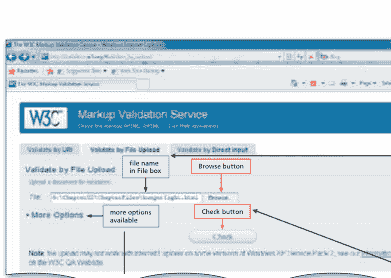

截图中的标注为学生提供他们需要时所需的信息。本系列教材一直使用大量标注以确保学生不会迷失方向。现在，使用颜色来区分标注中的内容，使其更具意义。

解释性标注总结了屏幕上正在发生的内容。

红色的导航性标注向学生展示需要点击的位置。

4. 点击检查按钮（图 2-35）。验证信息应会显示，如图 2-36 所示。
5. 返回到 Hunger Fight 网页，您可以通过点击浏览器的返回按钮，或点击任务栏中的 Internet Explorer 按钮来实现。

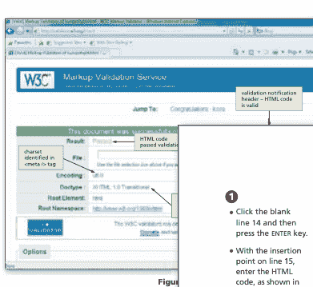

> **问与答**

**我如何知道我的 HTML 代码是否有效？**

通知标题将变为绿色，并且在结果区域，您应该会看到单词“Passed”。

**如果我的 HTML 代码未通过验证，我该怎么办？**

如果您的代码有错误，请编辑您的 HTML 文件以纠正错误。标记验证器指出了您代码中的错误。一旦您进行了必要的更改并保存了更正后的 HTML 文件，请向下滚动并点击重新验证按钮。

### 改进网页外观

1. 点击第 14 行的空白行，然后按 ENTER 键。
2. 在第 15 行的插入点处，输入以下 HTML 代码，如表 2-9 所示。在每行末尾按 ENTER（图 2-26）。

改进网页外观 HTML 67

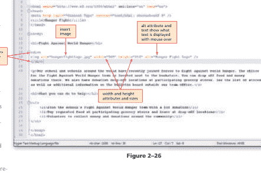

问与答框提供学生在逐步操作时可能有的问题，并在他们需要的地方提供关于他们所做事情的额外信息。

> **问与答**

**`alt`属性的目的是什么？**

`alt`属性有三个重要目的。首先，视觉障碍用户使用的屏幕阅读器会朗读替代文本。其次，在图像加载时会显示替代文本。最后，为了符合 XHTML 规范，`alt`标签是必需的。

**`<div>`和`</div>`标签的目的是什么？**

`<div>`标签在网页内建立一个区块。当您使用`<div> </div>`标签时，您能够设计使用 CSS 的布局，包括插入图像。

> **提前规划**

**进行其他视觉增强。**

除了图像，还有几种方法可以增加视觉趣味性。

**为标题添加颜色。**

网页开发者经常使用颜色来突出网页上的元素。选择的颜色应与为页面选择的图像相协调。它还应允许网页文本易于阅读。某些颜色，例如深色，可能不合适，因为它们在深色背景上无法有效显示。更改元素（如标题）的颜色时，通常最好将相同的样式应用于网页上的所有标题以保持一致性。

**更改项目符号列表的字体样式。**

有时更改项目符号列表中文本的样式在美学上是令人愉悦的。当您想引起对信息的注意时，您可以更改文本的颜色、样式和大小。

**插入水平线。**

使用水平线来分隔网页上的文本很有用。水平线用作页面的分隔符，用于分隔文本部分。

## 教科书演练

HTML 60 HTML 第 2 章 使用内联样式创建和编辑网页

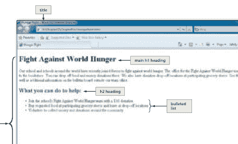

按 ENTER 键以显示`hungerfight.html`页面，就好像它已在 Web 上加载一样（图 2-23）。

> **问与答**

**如果我收到 Internet Explorer（IE）的警告，说“Internet Explorer 需要打开一个新窗口来显示此网页”该怎么办？**

如果此窗口打开，您应该点击确定按钮继续。然后您将在另一个 IE 窗口中看到您的网页显示。

> **问与答**

**如果我的页面显示不正确怎么办？**

请仔细对照图 2-19 检查您输入的`hungerfight.html`，并确保您没有犯任何打字错误或遗漏任何内容。更正错误，重新保存文件，然后重试。

> **其他方法**

1. 在 Windows 资源管理器中，双击 HTML 文件名以在默认浏览器中打开。
2. 在 Windows 资源管理器中，右键单击 HTML 文件名，单击“打开方式”，然后单击浏览器名称。
3. 如果菜单未显示，请单击“工具”、“工具栏”、“菜单栏”；在菜单栏上，单击“文件”、“打开”，然后浏览到所需文件。

> **顺便提一下**

### 用户界面设计

用户界面设计是网站的一个非常重要的方面。如果网站设计不佳，用户可能无法找到信息或完成任务，这会使网站变得无效。有许多资源讨论网页设计原则。


# HTML 82 HTML 第2章 使用内联样式创建和编辑网页

## 应用您的知识

6. 将修改后的 HTML 文件以`apply2-1solution.html`为文件名保存在`Chapter02\Apply`文件夹中。

7. 在`http://validator.w3.org/`验证您的 HTML 代码。

8. 输入`g:\Chapter02\Apply\apply2-1-solution.html`作为 URL，以在浏览器中查看修改后的网页。

9. 打印网页。

10. 按照教师指定的格式提交修改后的 HTML 文件和网页。

## 拓展您的知识

拓展您在本章学到的技能，并尝试新的技能。

### 创建定义列表

**操作说明：** 启动 Notepad++。打开来自学生数据文件`Chapter02\Extend`文件夹中的文件`extend2-1.html`。有关下载学生数据文件的说明，请参阅本书的封底内页，或联系您的教师以获取访问所需文件的信息。此示例网页包含以项目符号列表格式显示的所有网页文本。您将添加必要的标签以使其成为定义列表，其中术语为粗体，如图2-42所示。


执行以下任务：

1. 使用文件`extend2-1.html`中提供的文本，按照 HTML 52 页图2-14所示的定义列表代码，修改 HTML 代码，将网页从项目符号列表更改为定义列表。

2. 添加必要的 HTML 代码以使术语变为粗体（参见附录 D 中的`font-weight`样式）并添加背景色`#e0e0e0`（参见附录 D 中的`background-color`）。

3. 将修改后的文档以`extend2-1solution.html`为文件名保存在`Chapter02\Extend`文件夹中，验证网页，然后按照教师指定的格式提交。

## 改正错误

分析文档并更正所有错误和/或改进设计。

### 更正友好提醒网页

*操作说明：* 启动 Notepad++，打开来自学生数据文件`Chapter02\MakeItRight`文件夹中的文件`makeright2-1.html`。有关下载学生数据文件的说明，请参阅本书的封底内页，或联系您的教师以获取访问所需文件的信息。该网页是图2–43所示内容的一个修改版本。对网页进行必要的更正，使其看起来像图2–43。将标题格式设置为`Heading1`样式。居中对齐网页（参见附录 D 中的`text-align`属性以实现此目的）。添加两个10px的水平水平线，如图2–43所示。将文件以`makeright2-1solution.html`为文件名保存在`Chapter02\MakeItRight`文件夹中，验证网页，然后按照教师指定的格式提交。

3. 插入存储在`Chapter02\IntheLab`文件夹中的图像文件`cloudy.jpg`。右键单击图像，单击“属性”，然后单击“详细信息”选项卡以查看图像的尺寸，或在图形程序中打开它。请注意，列表中使用的项目符号是方形的。

4. 将 HTML 文件以`lab2-3solution.html`为文件名保存在`Chapter02\IntheLab`文件夹中。

5. 输入`g:\Chapter02\IntheLab\lab2-3solution.html`作为 URL，以在浏览器中查看网页。

6. 从浏览器打印网页。

7. 按照教师指定的格式提交修改后的 HTML 文件和网页。

## 案例与实践

运用您的创造性思维和问题解决技能来设计和实现解决方案。

*较容易 **较困难*

### 1：添加到食品募捐网页

社区食品银行主任 Wattigrey 先生喜欢您为 Lab 2-1 创建的网页。既然食品募捐活动已经结束，他希望您用即将到来的社区活动的新信息来更新网页。在更新您的网页之前，请在网上搜索其他食品银行或提供类似服务的部门如何使用他们的网站，以获取有关可包含的内容或可更改的格式的创意。他们的网页是什么样子的？您会对 Lab 2-1 网页做出哪些改变以反映其他地方的做法？运用本章介绍的概念，添加额外信息并更改格式，使页面更有趣和更具时效性。

### 2：创建艺术家网站

您正在为一位当地摄影师创建一个新网站。摄影师要求您为网页上的图像使用描述性的`alt`属性，因为他网页的许多观看者互联网连接非常慢，图像经常无法快速加载。在网上搜索有关为图像添加有用的、描述性的`alt`属性的信息。同时查找有关使用缩略图的信息。给出加快图像加载速度的建议。创建一个文档，用简短的段落解释您在研究中发现的信息。就如何使摄影师的网站更有效提出建议。

### 3：创建 CSS 属性网页

到目前为止，您在课堂上已经学到了很多关于使用层叠样式表（CSS）的知识。但是，对于如何插入某些样式，您仍有一些疑问。在网上研究信息（不要忘记查看 W3.org 网站），以找到列出补充附录 D 的 CSS 属性和值的网站。在 Word 文档中，添加您发现非常有帮助的 URL。在每个 URL 下方，写一个简短的段落，描述为什么您认为该网站对新的网页开发者可能有用。与同学分享您的 URL 列表。

### 4：创建个人网页

**个人定制** ←

您的班级教师希望将所有学生的网页发布到学校服务器上，以展示他或她的学生感兴趣的内容。创建一个包含个人信息的网页，列出诸如您的学校专业、过去从事过的工作以及您的爱好和兴趣等项目。为了使您的个人

在“案例与实践”练习中发现的**个人定制**练习要求学生创建一个与他们个人生活相关的开放式项目。

# 1 HTML、XHTML与CSS简介

## 学习目标

掌握本章内容后，你将能够：

- 描述互联网及其相关关键术语。
- 描述万维网及其相关关键术语。
- 描述网站的类型及其目的。
- 讨论网络浏览器并明确其用途。
- 定义超文本标记语言（HTML）及其用于 Web 开发的相关标准。
- 讨论层叠样式表（CSS）在 Web 开发中的应用。
- 定义文档对象模型（DOM）并描述其与 HTML 的关系。
- 定义可扩展超文本标记语言（XHTML）并描述其与 HTML 的关系。
- 识别用于创建 HTML 文档的工具。
- 描述 Web 开发生命周期的五个阶段。
- 描述不同的网站设计方法及其网站结构的目的。
- 讨论在整个 Web 开发生命周期中进行测试的重要性。
- 解释成为一个细致的 Web 用户的重要性。

## 引言

在深入探讨使用 HTML、XHTML 和 CSS 创建网页的细节之前，了解这些技术如何与互联网和万维网的发展相关联是很有帮助的。互联网始于计算机和计算机网络的连接。这种连接性对我们的日常生活产生了巨大影响。如今，全球数百万人可以访问互联网——这个世界上最大的网络。数十亿的网页目前在万维网上可用，提供了你能想象到的任何主题的信息。人们使用互联网搜索信息、与世界各地的人交流以及寻求娱乐。学生通过这个计算机网络注册课程、支付学费并查看期末成绩。商店和个人使用计算机连接销售产品，大多数行业依赖互联网和万维网进行商业交易。

超文本标记语言（HTML），以及最近出现的可扩展超文本标记语言（XHTML）和层叠样式表（CSS），使万维网得以存在。为了有效利用这些技术，你需要理解互联网和 HTML 背后的主要概念。在本章中，你将学习有关互联网、万维网、内联网和外联网的一些基础知识。你将了解网络浏览器、HTML 及相关关键术语的定义、Web 开发生命周期的五个阶段以及每个阶段涉及的任务。

## 什么是互联网？

如今，大多数人都在学校、家中、工作场所或当地图书馆接触过互联网。**互联网**是一个全球性的计算机和计算机网络集合，它通过调制解调器、电话线、电视电缆、卫星链路、光纤连接以及其他通信设备和媒体（图1-1）连接了数十亿台由企业、政府、教育机构、组织和个人使用的计算机。

**网络**是两台或多台连接在一起以共享资源和信息的计算机的集合。如今，高、中、低速数据线路连接着网络。这些数据线路允许数据（包括文本、图形图像以及音频和视频数据）从一台计算机传输到另一台。**互联网骨干网**是连接全球主要计算机系统的高速数据线路集合。**互联网服务提供商（ISP）**是与互联网骨干网建立永久连接的公司。ISP 利用高速或中速数据线路，允许个人和公司连接到骨干网以访问互联网。家庭互联网连接通常是连接到 ISP 的 DSL 或有线数据线路。

在大多数国家，数百万人使用家中、办公室、学校和公共场所（如图书馆）的计算机连接到互联网。连接到互联网的计算机用户可以访问各种服务，包括电子邮件、社交网络、在线购物和万维网（图1-2）。

**图1-2** 互联网提供了各种服务，如电子邮件和万维网。

## 什么是万维网？

**万维网**，也称为**Web**，是互联网中支持多媒体的部分，由一组相互链接的文档组成。为了支持多媒体，Web 依赖**超文本传输协议（HTTP）**，这是一组用于交换文本、图形、声音、视频和其他多媒体文件的规则。Web 上的链接文档或信息页面被称为**网页**。因为 Web 支持文本、图形、声音和视频，所以一个网页可以包含任何这些多媒体元素。Web 是不断变化的，由数十亿个网页组成。由于创建网页很容易，所以网页数量一直在增加。

> **互联网与万维网历史**
>
> 万维网联盟（W3C 或`w3.org`），这个管理 HTML 的事实上的组织，提供了特别丰富的互联网和万维网历史。在你的浏览器中搜索“互联网历史”或“WWW 历史”可以找到更多额外资料。

**网站**是由个人、公司、教育机构或其他组织创建和维护的相关网页集合。例如，如图1-3所示，许多组织，如芝加哥科学与工业博物馆，发布并维护网站。每个网站包含一个**主页**，这是用户访问网站时看到的第一个文档。主页通常作为网站上其他文档和文件的索引或目录。

## Web 服务器

网页存储在**Web 服务器**或**主机**上，这是一种存储并发送（服务）请求的网页和其他文件的计算机。任何安装了 Web 服务器软件并连接到互联网的计算机都可以充当 Web 服务器。每个网站都存储在一个或多个 Web 服务器上并从那里运行。大型网站可能分散在不同地理位置的多个服务器上。

为了使你开发的网页对你的受众可用，你必须发布这些页面。**发布**是将网页以及相关的文件（如图形和音频）复制到 Web 服务器上。一旦网页发布，无论 Web 服务器位于何处，任何有权访问互联网的人都可以查看它。例如，尽管芝加哥科学与工业博物馆的网站存储在美国某地的 Web 服务器上，但全世界任何人都可以查看。一旦网页发布，几乎任何计算机都可以读取它：无论你使用 Mac、Windows 还是 Linux 操作系统，使用各种计算机硬件，你都可以访问数十亿已发布的网页。

## 网站类型及其目的

网站的三大通用类型是互联网网站、内联网和外联网。表1-1列出了这三种类型网站的特征。

| 类型 | 用户 | 访问权限 | 应用 |
|---|---|---|---|
| 互联网 | 任何人 | 公开 | 用于向公众共享信息，如个人信息、产品目录、课程信息 |
| 内联网 | 员工或成员 | 私有 | 用于与员工或成员共享信息，如表格、手册、组织日程 |
| 外联网 | 特定的业务合作伙伴 | 私有 | 用于与业务合作伙伴和客户共享信息，如库存更新、产品规格、财务信息 |

**互联网网站**，也称为**网站**，是一个通常向公众开放的站点。个人、团体、公司和教育机构出于各种目的使用网站。内联网和外联网也使用互联网技术，但访问权限限于特定群体。**内联网**是一个私有网络，使用互联网技术在员工之间共享公司信息。内联网包含在公司或组织的网络内，这使其成为私有的，仅对需要访问的人可用。政策和程序手册通常可以在内联网上找到。其他文件，如员工目录、公司简报、产品目录和培训手册，也经常通过内联网分发。

**外联网**是一个私有网络，使用互联网技术与选定的企业合作伙伴或关键客户共享业务信息。公司和组织可以使用外联网共享产品手册、培训模块、库存状态和订单信息。外联网还可以允许零售商直接采购库存或在线支付账单。

公司使用网站在全球范围内宣传或销售其产品和服务，并为客户提供技术和产品支持。许多公司网站还支持**电子商务（电子商业）**，即在互联网上买卖商品和服务。使用电子商务技术，这些网站允许客户浏览产品目录、比价购物和在线订购产品。图1-4显示了亚马逊（Amazon.com），这是一家仅在线销售产品的公司。许多公司网站还提供职位发布和公告、常见问题解答（FAQ）部分、客户反馈链接以征求客户意见，以及可搜索的技术支持数据库。

**图1-4** 亚马逊（Amazon.com）是一家仅在线运营的公司。

### 内联网与外联网

有许多网站讨论有关内联网和外联网的创意。许多公司已经在使用这些技术，并分享他们的“最佳实践”技巧。CIO 内联网/外联网研究中心提供了关于构建和维护内联网或外联网的宝贵信息以及其他资源。

### 电子商务

如今，电子商务是商业运营的标准组成部分。然而，电子商务技术不断发展，提供新的应用和潜在用途。一些在线杂志专门致力于深入探讨电子商务。许多印刷杂志也提供了关于这种重要商业方式的有用信息。

学院、大学和其他学校利用网站发布关于学习领域的信息、提供课程信息或为学生在线注册课程。教师使用他们的网站发布公告、发布关于阅读材料的问题、列出联系信息，并提供讲义和幻灯片的便捷访问。如今，许多教师使用各自学校采用的课程管理软件来上传课程内容。在整个大学使用标准的课程管理产品，使学生更容易找到与他们各种课程相关的信息。许多课程管理工具允许教师为课程编写自己的网页内容。在许多系统中，教师可以使用网页在由学校提供的课程管理工具结构内为学生提供更多信息。除了通过网络与当前学生保持联系外，大学还利用网络与校友保持联系，如图1-5所示。

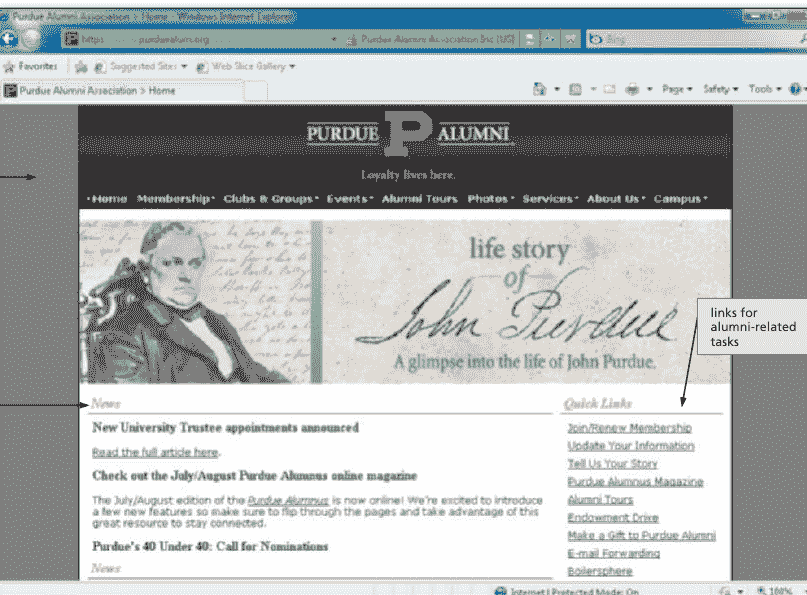

除了公司和教育机构使用互联网外，个人可能会创建包含其简历的个人网站，以便任何感兴趣的雇主都能轻松访问。家庭可以通过网站分享照片、视频和音频剪辑、故事、日程表或其他信息（图1-6）。许多个人网站允许密码保护，这为信息共享提供了更安全的环境。


## 网络浏览器

要在任何类型的网站上显示网页，计算机需要安装网络浏览器。**网络浏览器**，也称为**浏览器**，是一种解释和显示网页并使您能够查看和与网页交互的程序。微软的 Internet Explorer、Mozilla Firefox 和 Apple Safari 是当今流行的浏览器。浏览器提供多种功能，包括定位网页、在网页之间向前和向后链接、添加收藏夹或为网页添加书签以及选择安全设置。

要使用浏览器定位网页，您需要在浏览器的地址或位置栏中输入网页的统一资源定位符（URL）。**统一资源定位符（URL）**是可在互联网上访问的文档或其他文件的地址。网络上的 URL 示例如下：

```text
http://www.scsite.com/html6e/index.html
```

该 URL 指示浏览器使用 HTTP 通信协议来定位`scsite.com`网络服务器上`html6e`文件夹中的`index.html`网页。网页 URL 可以在各种地方找到，包括学校目录、名片、产品包装和广告。

超链接是万维网的重要组成部分。**超链接**，也称为**链接**，是用于将一个网页连接到同一服务器上的另一个网页，或用于链接位于世界任何地方的不同网络服务器上的网页的元素。单击超链接可让您快速从一个网页移动到另一个网页，用户无需关心网页的位置。您也可以单击超链接移动到同一网页的不同部分。

通过超链接，网站用户不一定必须以线性方式查看信息。相反，他或她可以单击可用的超链接以各种方式查看信息，如本章后面所述。许多不同的网页元素，包括文本、图形和动画，都可以用作超链接。图1-7展示了一些用作超链接的不同网页元素的示例。

## 什么是超文本标记语言？

网页是使用**超文本标记语言（HTML）**创建的，这是一种用于为万维网创建文档的创作语言。HTML 使用一组称为**标签**或**标记**的特殊指令来定义 Web 文档的结构和布局，并指定页面在浏览器中的显示方式。

网页是包含文本和 HTML 标签的文件。HTML 标签标记文本，以定义其作为网页查看时应如何显示。HTML 包含数百个标签，用于格式化网页和创建指向其他文档或网页的超链接。例如，HTML 标签`<p>`和`</p>`用于在段落文本上方插入一个带空行的空白行，`<table>`和`</table>`用于表示表格的开始和结束，`<hr />`用于在页面上显示一条水平线。图1-8a显示了创建图1-8b所示网页所需的 HTML 标签。您还可以通过使用属性来增强 HTML 标签，如图1-8a所示。**属性**为 HTML 标签定义额外的特性，如字体粗细或样式。


HTML 是**平台无关的**，这意味着您可以在一种类型的计算机上创建或编写 HTML 文件，然后在另一种类型的计算机上使用浏览器将该文件作为网页查看。无论您使用什么平台，页面看起来都是一样的。网络技术最大的好处之一是，相同的网页可以在许多不同类型的数字硬件上查看，包括智能手机等移动设备。

## HTML 元素

HTML 将描述性标签与表示文档在网页浏览器中应如何显示的特殊标签相结合。HTML 元素包括标题、段落、超链接、列表、图像等。大多数 HTML 元素由三部分组成：开始标签、内容和结束标签。例如，要指定某些文本在网页中以粗体显示，您需要输入以下 HTML 代码：

```html
<bold>this is bold text</bold>
```

其中`<bold>`是开始粗体代码，`</bold>`是结束粗体代码。下一页的表1-2显示了一些 HTML 元素的示例。

| 元素 | 标签 | 目的 |
|---|---|---|
| 标题 | `<title>...</title>` | 指示出现在浏览器标题栏中的标题 |
| 主体 | `<body>...</body>` | 指定网页上显示的内容；所有网页内容都插入在开始`<body>`标签和结束`</body>`标签之间 |
| 段落 | `<p>...</p>` | 在段落文本前插入一个空白行 |
| 换行符 | `<br />` | 在不添加空白行的情况下，在下一个元素前插入一个换行符 |

> **HTML元素**


关于HTML元素的信息源有很多。万维网联盟（`w3.org`）提供了最全面的标签和属性列表以及它们的使用示例。W3C的主要目标之一是帮助那些构建网站的人理解和利用使网络对所有人可访问的标准。

## HTML编码实践

与所有编程语言类似，HTML有一套编码实践，旨在简化创建和编辑HTML文件的过程，并确保网页在不同浏览器中正确显示。

创建HTML文件时，您应该使用空格和Tab键来分隔HTML代码的各个部分。在部分之间添加空格，无论是使用空行还是通过制表，可以让您立即查看相互关联的代码部分，并帮助您更清晰地查看文档中的HTML元素。HTML浏览器会忽略HTML文档中标签之间存在的空格，因此代码中插入的空格和缩进不会出现在网页上。图1-9显示了一个HTML文件的示例，其中代码部分用空行分隔，并有代码部分缩进。其他开发人员查看此代码时，可以立即看到特定部分在代码中的位置。

## HTML 版本

HTML 经历了多个版本，每个版本都扩展了 HTML 的能力。尽管 HTML 5.0 版本正在开发中，但尚未正式发布。目前最新的 HTML 版本是 HTML 4.01，尽管大多数浏览器仍然支持 HTML 3.2 和 2.0 版本。为确保浏览器能够正确解释每个新版本的 HTML，万维网联盟（W3C）维护着 HTML 标准或规范，这些标准在其网站上公开提供。正如本章后续所述，在开发测试阶段，确保网页在不同浏览器中按预期显示非常重要。

## 层叠样式表

本书第六版采取了新的方向，删除了已废弃的标签和属性。**已废弃**（Deprecated）的标签和属性是指在最新 W3C 标准中不再推荐使用的标签和属性。在附录 A 中，已废弃的标签和属性用星号标出。为了消除已废弃的 HTML 标签，本章的项目利用了层叠样式表（CSS）来改变网页的样式（或外观）。虽然 HTML 允许 Web 开发人员更改网页的结构、设计和内容，但它在定义一个或多个网页的整体外观或样式方面能力有限。**层叠样式表（CSS）** 允许你为各种网页元素指定样式。**样式**（Style）是定义网页元素外观的规则。**样式表**（Style Sheet）是一系列规则，用于定义整个网页或网站的样式。通过样式表，你可以通过更改字体族、字体大小、边距、链接规范等特征，以及颜色和边框等视觉元素，来改变一个或多个网页的外观。CSS 不用于向你的网站添加任何内容；它只是让你的内容看起来更有风格。

使用 CSS，你可以为单个网页内的元素或整个网站中的元素指定样式。例如，如果你希望网页上所有文本段落都缩进五个空格，你可以使用样式表来处理缩进，而不是为每个段落编写缩进代码。而且，如果你决定将缩进改为三个空格，你只需更改一行样式表代码，而不是更改每个段落的代码。因此，你可以看到使用 CSS 能节省大量时间，并使样式更改变得容易得多。

CSS 不是 HTML；它是一种用于增强 HTML 显示能力的独立语言。万维网联盟（W3C）——定义 HTML 标准的同一组织——也定义了 CSS 的规范。本书末尾的附录 A 以及在线提供的附录列出了允许你根据需要更改网页元素的 HTML 标签和相应属性，附录 D 则包含了与不同 CSS 元素相关的属性和值的完整信息。

## 文档对象模型（DOM）

HTML 可以与其他 Web 技术结合使用，以提供额外的网页功能。例如，**文档对象模型（DOM）** 这个术语描述了 HTML 标签、CSS 和一种脚本语言（如 JavaScript）的组合。DOM 允许 JavaScript 和其他语言操作底层文档的结构，以创建交互式的、动态的网页。这是一种模型，其中网页（或文档）包含可以操作的对象（元素、链接等）。这允许 Web 开发人员添加、删除或更改元素或属性。通过增强的

### CSS、DHTML 和 XHTML

`w3.org` 网站包含大量关于层叠样式表（CSS）、动态 HTML（DHTML）和可扩展 HTML（XHTML）的信息和教程。W3C 网站上建议的标准是大多数 Web 开发人员所遵循的标准。

DOM 可以比基础 HTML 网页更能响应访客的交互。并非所有交互式网页都需要 DOM，但如果你需要广泛的交互性，那么这可能是一个值得考虑的模型。CSS、JavaScript 和 DOM 将在本书的综合版（12 章）后续章节中介绍。

## 可扩展超文本标记语言（XHTML）

如你所知，HTML 使用标签来描述文档在 Web 浏览器中应如何显示，即网页格式。**可扩展标记语言（XML）** 是一种使用标签描述文档结构和内容（而非格式）的标记语言。**可扩展超文本标记语言（XHTML）** 是 HTML 格式的重新表述，使其符合 XML 的结构和内容规则。通过结合 HTML 和 XML，XHTML 结合了 HTML 的显示特性和 XML 要求的更严格的编码标准。

如果你创建了一个 HTML 网页，但没有完全遵循 XHTML 编码标准（例如，没有使用结束标签`</p>`），你计算机上的 Web 浏览器仍然可以正确解释和显示该网页。然而，较新类型的浏览器，例如用于手机或手持计算机的浏览器，无法解释不符合 XHTML 标准的 HTML 代码。由于 XHTML 具有如此严格的编码标准，它有助于确保用 XHTML 创建的网页可以被多种不同类型的应用程序读取。Web 开发中的一个重要步骤是检查你的网页是否符合 XHTML 标准。你将从第 2 章开始验证你的网页，并在整个本书中持续这一过程。

表 1–3 列出了一些 Web 开发人员应遵循的 XHTML 编码规则，以确保他们的 HTML 代码符合 XHTML 标准。本书中的所有项目都遵循 XHTML 标准（如第 2 章所述）并遵守表 1–3 中概述的规则。每条规则的具体细节在项目中使用时会详细解释。

**表 1–3 XHTML 编码实践**

| 实践 | 无效示例 | 有效示例 |

| :--- | :--- | :--- |

| HTML 文件必须包含 DOCTYPE 声明 | `<html><head><title>sample Web page</title>` | `<!DOCTYPE html PUBLIC "-//W3C//DTD XHTML 1.0 Transitional//EN" "http://www.w3.org/TR/xhtml1/DTD/xhtml1-transitional.dtd"><html><head><title>sample Web page</title></head>` |

| 所有标签和属性必须使用小写字母 | `<TABLE WIDTH="100%">` | `<table width="100%">` |

| 所有属性值必须用单引号或双引号括起来 | `<table width=100%>` | `<table width="100%">` |

| 所有标签都必须关闭，包括像`img`、`hr`和`br`这样没有结束标签的标签，但作为实践必须关闭 | `<br><hr><p>This is another paragraph` | `<br /><hr /><p>This is another paragraph</p>` |

| 所有元素必须正确嵌套 | `<p><strong>This is a bold paragraph</p></strong>` | `<p><strong>This is a bold paragraph</strong></p>` |

## 创建 HTML 文档的工具

你可以使用简单的文本编辑器（如 Notepad++、Notepad、TextPad 或 SimpleText）来使用 HTML 创建网页。**文本编辑器**（Text Editor）是一种允许用户输入、更改、保存和打印文本（如 HTML）的程序。文本编辑器没有许多高级功能，但它们确实允许你轻松地开发 HTML 文档。例如，如果你想将 DOCTYPE 标签插入到网页文件中，在任意文本编辑器中输入必要的文本即可，如图 1–10a 和图 1–10b 所示。虽然记事本（Notepad）（图 1–10b）是一个适用于 Web 开发的足够好的文本编辑器，但请注意它与 Notepad++ 的区别。Notepad++ 是一个功能更强大的文本编辑器，它在输入 HTML 代码时会使用颜色方案。

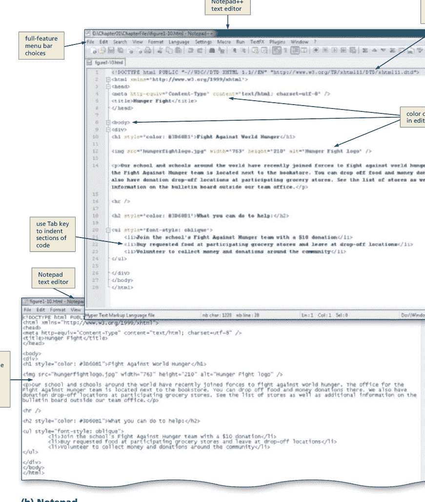

**(a) Notepad++**

**(b) Notepad**

**图 1–10** 使用像 Notepad++ 或 Notepad 这样的文本编辑器，你可以输入创建网页所需的 HTML 标签和文本。

你也可以使用 HTML 文本编辑器（如 EditPlus 或 BBEdit（适用于 Macintosh））来创建网页。**HTML 文本编辑器**（HTML Text Editor）是一种提供基本文本编辑功能以及更高级功能的程序，例如为各种 HTML 标签进行颜色编码、用于插入 HTML 标签的菜单以及拼写检查器。**HTML 对象编辑器**（HTML Object Editor），例如 Eiffel Software 对象编辑器，则提供了额外的轮廓编辑器功能，允许你展开和折叠 HTML 对象和属性、编辑参数以及查看附加到展开对象的图形。

许多流行的软件应用程序也提供了使你能够轻松开发网页的功能。例如，Microsoft Word、Excel 和 PowerPoint 具有“另存为网页”功能，通过自动向文档添加 HTML 标签，将文档转换为 HTML 文件。使用 Microsoft Access，你可以创建允许查看数据库中数据的网页。Adobe Acrobat 也具有创建 HTML 文件的导出功能。这些应用程序中的每一个都允许你向网页添加超链接、下拉框、选项按钮或滚动文本。

这些高级 Web 功能使得将任何文档、电子表格、数据库或演示文稿保存为网页显示变得简单。例如，公司政策和程序手册以及 PowerPoint 演示文稿可以轻松保存为网页并发布到公司的内部网。外部网用户可以被授予访问网页的权限，允许他们查看或更新存储在数据库中的信息。

> **免费 HTML 所见即所得编辑器**

有许多流行的所见即所得（WYSIWYG）编辑器正被许多初学 Web 开发人员用来创建设计精良、交互式的网站。你可以在大多数搜索引擎中搜索“WYSIWYG HTML 编辑器”来找到它们。

你也可以使用 WYSIWYG 编辑器（如 Adobe Dreamweaver、Amaya 或 CoffeeCup HTML Editor）来创建网页。**WYSIWYG 编辑器**（WYSIWYG Editor）是一种提供图形用户界面的程序，允许开发人员在开发过程中预览网页。WYSIWYG（发音为 wizzy-wig）是“What You See Is What You Get”（所见即所得）的缩写。WYSIWYG 编辑器在你向网页添加元素时会为你创建 HTML 代码，这意味着你不必直接输入 HTML 标签。WYSIWYG 编辑器的主要问题是它们经常生成“臃肿”的 HTML 代码（HTML 标签周围包含许多不必要的附加代码行）。

无论你使用哪种类型的程序来创建网页，理解 HTML 的具体细节都很重要，这样你才能在编辑器之外进行更改。例如，你可能能够用 Dreamweaver 创建网页，但如果你想做一些小的更改，了解 HTML 标签本身会非常有帮助。理解 Web 开发生命周期也很重要，这样你网站中的网页才能保持一致和完整。

## Web 开发生命周期

多年来，大学的信息技术课程一直强调在设计和实施新软件时遵循系统开发生命周期（SDLC）的重要性，以确保一致性和完整性。Web 开发过程应遵循类似的周期。全面的规划和分析确保开发人员能够提供用户想要的东西。如果你在没有彻底规划和分析的情况下就开始编写网页代码，你就有遗漏相关信息的风险。在项目开发的早期阶段对网站进行修改比修改已完成的网页要便宜得多。

本节概述的 Web 开发生命周期可用于任何类型或规模的 Web 开发项目。**Web 开发生命周期**（Web Development Life Cycle）是一个可用于开发任何复杂级别网页的过程。Web 开发生命周期包括以下阶段：规划、分析、设计与开发、测试，以及实施与维护。表 1–4 列出了在 Web 开发生命周期每个阶段应提出的一些问题。在整本书中，你将遵循这个系统化的周期来开发你的网页。

### Web 开发生命周期 HTML 15

**表 1–4 Web 开发阶段及问题**

| Web 开发阶段 | 需要思考的问题 |

| :--- | :--- |

| 规划 | • 这个网站的目的是什么？<br>• 谁会使用这个网站？<br>• 用户的计算环境是怎样的？<br>• 谁拥有并负责网站上的信息内容？<br>• 谁决定信息是否以及放在网站的什么位置？ |

| 分析 | • 用户需要执行哪些任务？<br>• 哪些信息对用户有用？<br>• 必须考虑哪些流程问题？ |

| 设计与开发 | • 网站将包含多少网页？<br>• 网页将如何组织？<br>• 什么类型的网站结构适合该内容？<br>• 如何才能最好地呈现内容以便于使用？<br>• 该网站将采用什么文件命名约定？<br>• 网页文件将使用什么文件夹结构？<br>• 如何在整个开发过程中应用 XHTML 标准？<br>• 哪些形式的多媒体能为网站带来积极贡献？<br>• 如何在不限制可用性的情况下解决无障碍访问问题？<br>• 会有国际受众吗？ |

| 测试 | • 网页是否通过万维网联盟 (W3C) 的 XHTML 合规验证流程？<br>• 网站内容是否正确？<br>• 网站功能是否正常？<br>• 用户能否找到完成所需任务的信息？<br>• 导航是否清晰易用？ |

| 实施与维护 | • 网站如何发布？<br>• 如何吸引用户访问并回访网站？<br>• 网站如何更新？<br>• 谁负责内容更新？<br>• 谁负责结构更新？<br>• 如何通知用户网站的更新？<br>• 网站是否会被监控？ |

### 网站规划

网站规划是 Web 开发生命周期的第一阶段，涉及确定网站的目标或目的。网站规划阶段的第一步是回答“这个网站的目的是什么？”这个问题。正如你所知，个人和团体出于各种目的设计和发布网站。个人开发网站是为了分享爱好、发布简历，或者仅仅分享关于个人兴趣的想法。组织创建网站是为了向成员通报即将举行的活动或招募新成员。企业创建网站是为了宣传和销售产品，或者为客户提供 24 小时在线支持。讲师发布网站，或使用学校的在线课程管理软件为其课程添加信息，以告知学生课程政策、作业和截止日期，以及课程要求。在你能够充分明确网站的预期目的之前，不应继续进行 Web 开发项目。

除了理解网站的目的，你还应该了解谁将使用该网站以及大多数用户的计算环境。了解目标受众的构成——包括年龄、性别、一般人口背景以及计算机熟练程度——将帮助你设计一个适合所有用户的网站。了解用户的计算环境将决定使用何种类型的 Web 技术。例如，如果大多数用户的互联网连接速度较慢，你肯定不想创建包含大型图形或多媒体元素的页面。

网站规划阶段的最后一个方面是确定内容所有者和作者。为此，你需要提出以下问题：

- 谁拥有并负责网站上的信息内容？

- 谁决定信息是否以及放在网站的什么位置？

一旦确定了谁将提供和授权网站内容，你就可以让这些人员参与 Web 开发项目的各个方面。

### 网站分析

在分析阶段，你需要对网站的内容和功能做出决策。为了帮助定义适当的内容和功能，你首先应该确定用户需要执行的任务。回答这个问题可以让你定义必要的内容以支持这些任务，并确定对用户有用的信息。无关内容应从网站中剔除，因为它没有任何作用。

在分析阶段，考虑支持网站功能所需的流程也很重要。例如，如果你确定用户应该能够通过网站订购产品，那么你还需要定义每次提交订单时要采取的流程或操作。例如，订单提交后，该订单将如何在后台业务应用程序（如库存控制和应付账款）中处理？用户是否会收到包含订单详情的电子邮件确认？分析阶段是 Web 开发生命周期中更重要的阶段之一。清晰地理解和定义网站所需的内容和功能，将指导你设计的网站类型，并减少网站开发过程中的更改。

**顺便提一下：无障碍访问标准**

创建一个对所有用户都无障碍的网站，可以让你的网站触及最广泛的受众。此外，根据美国《康复法案》第 508 条的规定，任何美国联邦机构使用的网站或技术都必须能够被残疾人使用。有关第 508 条指南，请参见附录 C。

### 网站设计与开发

在确定了网站的目的并定义了内容和功能之后，你需要考虑网站的设计。网站设计的一些关键考量包括：定义如何组织网页内容、选择合适的网站结构、确定如何使用多媒体、解决无障碍访问问题，以及为国际受众设计页面。网站设计最重要的方面之一是确定在网站上提供导航的最佳方式。如果用户无法轻松找到他们要寻找的信息，他们就不会再访问你的网站。

组织网页的方法有很多，就像组织报告或论文的方法有很多一样。表 1–5 列出了一些创建易于阅读和导航的网页的组织标准。

**表 1–5 网页组织标准**

| 元素 | 组织标准 | 原因 |

| :--- | :--- | :--- |

| 标题 | 使用简洁明了的标题，清晰解释页面的目的 | 标题帮助用户理解页面的目的；一个好的标题在搜索引擎结果列表中能解释页面内容 |

| 标题 | 使用标题来分隔主要主题 | 标题使网页更易于阅读；简单的标题清晰地解释了页面的目的 |

| 水平线 | 插入水平线来分隔主要主题 | 水平线提供图形元素来分隔网页内容 |

| 段落 | 使用段落来帮助划分大量文本 | 段落提供更短、更易读的文本部分 |

| 列表 | 适当时使用项目符号列表或编号列表 | 列表提供有组织、易于阅读的文本，读者可以快速浏览 |

| 页面长度 | 保持合适的网页长度 | 网页用户不一定总是会滚动查看较长页面上的信息；适当的页面长度增加用户查看关键信息的可能性 |

| 信息 | 将最重要的信息放在网页顶部以突出显示 | 网页用户会快速浏览页面；将关键信息放在页面顶部增加用户查看关键信息的可能性 |

| 其他 | 包含一个联系电子邮件地址；包含最后修改日期 | 电子邮件地址和日期为用户提供了联系网站开发者提出问题的方式；最后修改日期帮助用户判断网站信息的时效性 |

网站可以使用几种不同类型的结构，包括线性、层次和网状结构。每种结构以不同的方式链接或连接网页，以定义用户如何导航网站和查看网页。你应该根据用户将如何导航网站和查看网站内容来选择网站结构。


**线性**网站结构将网页以直线方式连接，如图 1–11 所示。如果网页上的信息需要按特定顺序阅读，线性网站结构是合适的。例如，如果第一个网页（模块 1）上的信息是理解第二个网页（模块 2）上的信息所必需的，你应该使用线性结构。每个页面都会有从一个网页到下一个网页的链接，以及返回到上一个网页的链接。在很多情况下，网页需要按顺序一个接一个地阅读。

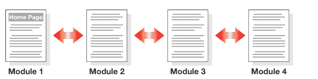

**图 1–11** 线性网站结构。

线性网站结构的一个变体包括添加一个指向网站主页的链接，如图 1–12 所示。对于某些网站，从一个

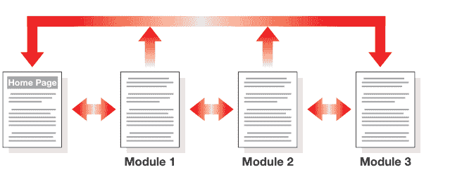

**图 1–12** 带有指向主页链接的线性网站结构。

## 用户界面设计

**层级式**网站结构以树状结构连接网页，如图 1-13 所示。这种层级结构适用于拥有主索引或目录页的网站，该页面链接到所有其他网页。在此结构中，主索引页显示一般信息，次级页面则包含更详细的信息。请注意图 1-13 中的信息组织是多么符合逻辑。网站访客可以轻松地从主页导航到三个模块中的任何一个。此外，访客也可以通过模块 3 的链接轻松进入模块 3 的测验。然而，这种结构固有的一个问题是在不同部分的页面之间移动不够方便。例如，要从模块 1 第 2 页移动到模块 3 总结，访客必须使用“后退”按钮回到主页，然后点击模块 3 的链接。这对于只有两个网页的网站来说尚可接受，但试想如果模块 1 有 100 个网页会怎样！

用户界面设计是网站的重要方面。如果网站设计不佳，用户可能无法找到所需信息或完成任务，这将使网站失去效果。

为了解决层级模型的问题，你可以使用网状模型（图 1-14）。**网状**网站结构没有固定的组织形式，如图 1-14 所示。网状结构最适合那些信息不需要按特定顺序阅读且提供多种导航选项的网站。万维网就使用了网状结构，因此用户可以按任何顺序浏览网页。请注意，在这种结构下，网站访客可以更轻松地在不同模块或模块总结之间移动。在这种模式下，你通常会在每个页面提供一个指向主页的链接，这导致从每个单独网页都有一个箭头指回主页（在这些小图中难以完全呈现）。如今，许多网站在每个网页的左上角放置一个图形图像（通常是公司或机构的标志）作为指向主页的链接。你将在本书后面使用这种技术。

大多数网站是线性、层级和网状结构的组合。网站上的某些信息可能从索引页开始按层级组织，其他信息可能可以从网站的各个区域访问，还有一些信息则可能按线性组织以便按特定顺序阅读。如果这有助于用户轻松导航网站，那么结合使用这三种结构是合适的。关键是尽可能高效地向用户提供正确的信息。

无论你使用何种结构，都应该平衡网站的广度和深度。**宽型网站**是指主页是主索引页，所有其他网页都单独链接到主页的网站（图 1-15）。

通过将其他网页的访问仅限于主页，宽型网站迫使用户在从一个网页移动到另一个网页时必须返回主页。这种结构使导航对用户来说耗时且受限。更好的结构是为用户提供导航选项，允许网页之间的直接移动。

**深型网站**是指拥有许多层级页面，需要用户多次点击才能到达特定网页的网站（图 1-16）。通过要求访客在到达目标页面之前浏览多个网页，深型网站迫使用户花费时间查看可能没有有用内容的中间页面。例如，注意在图 1-13（第 HTML 18 页）中查找模块 3 总结与在图 1-16 中查找相同网页（模块 3 总结）的区别。假设用户曾通过图 1-13 的网站学习过模块 3 的内容。然而，当用户使用图 1-16 的结构再次访问网站以复习模块 3 总结网页并进行模块 3 测验时，用户将不得不逐个网页地完整浏览整个模块 3 的内容，才能到达模块 3 总结页面。你可能希望让用户更容易地访问该网页。

作为网站开发者，你必须为网站选择合适的结构，并努力平衡广度和深度。用户访问网站是为了寻找信息以完成任务。良好的设计提供便捷的导航，使用户能够快速轻松地找到内容。除了规划网站本身的设计外，网站开发者还应在设计阶段早期规划文件命名和存储规范的具体细节。一旦确定了网站结构和实现网站目标所需的大致页面数量，你就需要确定文件命名和文件夹结构应遵循的标准。例如，将网页保存为`page1.html`和`page2.html`这样的名称无法告诉你这些网页的目的。更好的选择是将萨巴蒂娜披萨网站的主页命名为`sabatinahome.html`或`sabatinas.html`，而包含用户订单表单的网页可以命名为`orderform.html`。这些文件名不仅告诉了开发者，也告诉了未来维护网站的开发者这些网页的用途。

同样的原则适用于你网站开发中使用的文件夹结构。由于本书中的项目网页文件和图形文件很少，所有内容（网页和图形）都存储在一个文件夹中。然而，对于大型网站，你可能希望将网页文件与图形文件分开放置在不同的文件夹中。更大、更复杂的网站可能还需要一个单独的文件夹来存储视频或音频剪辑。你存储文件的位置将影响你如何在`HTML`代码中访问这些文件。在网站开发生命周期的规划阶段确定一个好的文件夹结构非常重要。你将在第 3 章了解更多关于有效文件夹结构的内容。

在设计和开发阶段，你还应考虑哪些类型的多媒体（如果有的话）能对网站体验产生积极贡献。例如，添加公司 CEO 的视频信息可能有用，但如果用户的计算环境无法支持视频播放，那么该视频就毫无意义。通常，除非多媒体技术能对网站体验产生积极贡献，否则不要在网站中使用先进的多媒体技术。如今，越来越多的网站使用音频和视频内容。这些新增内容有时能增强网站的整体目的，但有时也会分散信息传达。

最后，考虑可访问性和国际化问题。网站开发者应始终为多元化受众（包括残障人士和全球用户）设计可观看的内容。一个关键考虑因素是残障人士使用的软件可能与某些网站功能不兼容。例如，如果你在网站中使用图形，请务必为每个图形包含替代文本。为了支持国际受众，应使用全球通用的图标，避免内容中使用俚语表达，并构建加载速度快、适应低速连接的简单页面。

刚才讨论的设计问题只是你需要考虑的基本网页设计问题中的一部分。本书中，设计问题将根据相关项目进行探讨。互联网上也有许多优秀的网页设计资源可供参考。

一旦网站设计确定，就可以开始网站开发。本书其余章节除了讨论网页的实际开发外，还会介绍良好的网页标准。你将学习许多开发技术，包括链接、表格、图形、图像映射和网页表单。涵盖本书所教授的所有开发技术的核心是使用层叠样式表。

### 网页结构

网络上有许多资源可以进一步讨论网站结构。除了通用的设计信息外，还有一些付费或免费下载的工具可以帮助你设计网站。在搜索引擎中输入“网站结构”可以找到许多有价值的设计资源。

### 网站测试

网站应在 Web 设计和开发过程的各个阶段进行测试。测试过程应全面，并包括对网页内容、功能和可用性的审查。存在断链、缺失图形和错误内容的网站会给人留下不良印象。你需要吸引用户访问你的网站并维持他们的兴趣。如果访客发现你的网站测试和维护不善，他们再次访问的可能性就会降低。如果用户不经常访问网站，你就无法传达你的信息。测试内容和功能的一些基本步骤包括：

- 通过 W3C 标记验证服务运行每个网页进行验证。
- 校对页面内容和标题，检查拼写和语法是否准确。
- 检查链接以确保它们未损坏且链接正确。
- 检查图形以确认它们显示正常且链接正确。
- 确保已解决无障碍性和国际化问题。
- 测试表单和其他交互式页面元素。
- 测试页面以确保它们即使在较低速连接下也能快速加载。
- 打印每个页面以检查打印页面的外观。

**可用性**是衡量产品（例如网站）允许用户完成其目标的程度的指标。**可用性测试**是一种方法，通过这种方法，要求网站或其他产品的用户执行某些任务，以衡量产品的易用性和用户对体验的感知。网站的可用性测试应关注三个关键方面：内容、导航和呈现。

可用性测试可以通过多种方式进行；一种有效的方式是直接观察用户与网站交互（或使用网站）的情况。在观察用户时，你可以跟踪他们点击的链接，并记录他们的操作和评论。你甚至可以要求用户解释他们在浏览网站时试图完成什么任务。通过观察用户获得的信息，对于帮助识别网站中潜在的潜在问题区域非常有价值。例如，如果你观察到用户很难找到列出商店位置和营业时间的网页，你可能需要澄清链接描述或使链接在主页上更突出。

另一种进行可用性测试的方法是给用户一个要完成的特定任务（例如查找产品价格列表），然后观察他们如何导航网站来完成该任务。如果可能，请他们解释为什么选择某些链接。这两种观察方法都非常有价值，但都需要接触用户。

可用性测试也可以使用问卷调查或调查来完成。在编写问卷或调查时，务必编写开放性问题，这些问题可以为你提供有价值的信息。例如，问一个是/否问题“该网站在视觉上吸引人吗？”将无法收集到有用的信息。如果你将该问题改为使用量表响应，例如“使用 1 到 5 的量表（1 为低，5 为高）对该网站的视觉吸引力进行评分”，你可以从用户那里获得更有价值的意见。但是，请确保量表本身对用户来说是清晰易懂的。如果你打算选择 1 等同于“低”评分，但用户认为 1 表示“高”，那么你的调查结果就值得怀疑了。可用性测试问卷应始终为用户留出空间，以便撰写额外的解释性评论。

图 1-17 显示了你可能在网站可用性测试问卷中包含的问题类型和组织结构的一些示例。

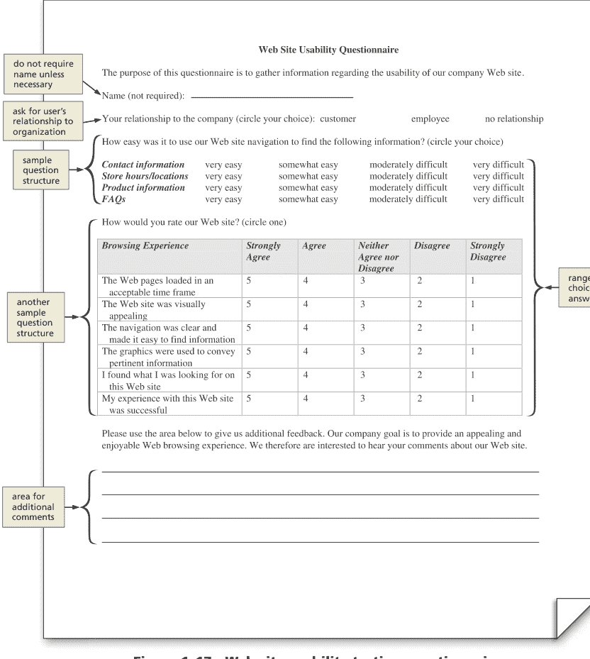

图 1-17 网站可用性测试问卷。

除了内容、功能和可用性测试外，还有其他类型的测试。对于新实施或维护的网站，还应进行另外两种类型的测试：兼容性测试和压力测试。**兼容性测试**是为了验证网站是否适用于各种浏览器和浏览器版本。最初，使用你的受众最可能使用的浏览器进行测试。不同的浏览器对网页的某些方面显示不同，因此在几种不同的浏览器中测试网页以验证它们在每个浏览器中正确显示非常重要。如果你使用了旧浏览器不支持的技术，或者需要插件，请考虑更改内容或为在旧浏览器中查看提供替代网页。如果你的受众同时使用 PC 和 Macintosh 计算机，你需要使用两个平台上的浏览器测试网页。你可能还需要在同一个浏览器的多个版本（通常是最新版本）中测试网页，以防用户尚未升级。

压力测试确定当更多用户访问网站时，你的网站上会发生什么。一个有 10 个用户同时访问的网站可能没问题。当 100 个用户同时使用该网站时，它的运行速度可能会慢到令人无法接受。压力测试验证网站在大量用户下是否能以可接受的速度运行。有许多案例表明，公司未能有效地对其网站进行压力测试。这种缺乏测试的结果是灾难性的，当太多用户尝试访问同一个网站功能时，网站会锁定。特别是对于用于电子商务的网站，保持在线至关重要。崩溃或锁定的网站不会销售产品或服务，公司可能会损失大量资金。

### 网站实施与维护

一旦网站测试完成并进行了所有必要的更改，就可以实施网站了。网站的实施涉及将网页实际发布到 Web 服务器。许多`HTML`编辑器和所见即所得编辑器提供发布功能。你也可以使用`FTP`软件（例如`WS_FTP`或`CuteFTP`）将你的网页发布到 Web 服务器。发布网站后，你应该再次测试网页以确认不存在明显的错误，例如断链或缺失图形。

在网站经过测试和实施后，你需要制定一个维护网站的过程；用户无疑会请求更改，及时的内容也需要更新。然而，你需要确保网站的更新不会损害网站的完整性和一致性。例如，如果你有几个不同的人在大型网站上更新不同的网页，你可能会发现很难在整个网站上保持一致的页面外观。你应该计划定期更新你的网站以保持内容最新。这可能是每小时、每天、每周或更少，具体取决于网站的目的。不要让你的内容变得过时、陈旧，或者包含指向不再存在的网页的断链。作为一个寻找与特定主题相关信息的用户，你有多大的可能性会相信一个写着“上次更新于 1998 年 12 月 10 日”的网站上的信息来自可靠来源？

为了帮助管理网站维护任务，首先确定谁负责更新内容、结构、功能等。然后，将更新责任限制给特定用户。确保实施由一名或多名 Web 开发人员控制，他们可以在网页发布前对其进行彻底测试。

随着网站的更新和更改，考虑通过图形横幅或“最新消息”公告通知用户，解释任何新功能以及这些功能将如何使他们受益。这种技术不仅使用户了解情况，还鼓励他们返回网站查看新内容。

最后，网站监控是维护网站的另一个关键方面。通常，托管网站的 Web 服务器会保留有关网站使用情况的日志。**日志**是列出从网站请求的所有网页的文件。网站日志是 Web 开发人员的宝贵信息来源。获取和分析日志可以让你确定诸如访客数量、浏览器类型和版本、连接速度、最常请求的页面以及使用模式等信息。有了这些信息，你可以设计一个对目标受众有效的网站，为访客提供丰富且有益的体验。

**快速参考**

有关`HTML`标签及其相关属性的列表，请参阅本书末尾的`HTML`快速参考（附录 A），或访问`HTML`快速参考网页（`scsite.com/HTML6e/qr`）。

### 做一个善于观察的 Web 用户

当你开始这门课程，并可能开始你的 Web 开发职业生涯时，一个有用的做法是成为一个善于观察的 Web 用户。我们大多数人每天使用几次（或更频繁）Web 来完成日常任务。作为 Web 开发人员，你应该从功能和设计的角度审视你访问的网页。正如本章末尾的第一个实验室练习中所述，你可以将你认为有效和无效、好和坏的网站添加为书签，并将它们作为你自己 Web 开发工作的参考。在搜索信息或在线购物时，留意 Web 上的趋势。例如，游动横幅过去在 Web 上非常流行，但现在其他设计技术已经取而代之。成为一个善于观察的 Web 用户可以帮助你成为一个更有效的 Web 开发人员。

### 章节摘要

在本章中，你学习了互联网、万维网以及相关技术，包括 Web 服务器和 Web 浏览器。你了解了`HTML`在创建网页中的核心作用，并回顾了用于创建`HTML`文档的工具。你还了解到大多数 Web 开发项目遵循一个五阶段生命周期。以下列表包含了你在本章中学习的所有新概念。

1. 描述互联网（HTML 2）。
2. 描述万维网（HTML 3）。
3. 定义 Web 服务器（HTML 4）。
4. 描述互联网、内联网和外联网（HTML 5）。
5. 讨论 Web 浏览器（HTML 7）。
6. 定义超文本标记语言（HTML 8）。
7. 描述 HTML 元素（HTML 9）。
8. 列出 HTML 编码实践（HTML 10）。
9. 解释 HTML 版本（HTML 11）。
10. 描述层叠样式表（HTML 11）。
11. 定义文档对象模型（HTML 11）。
12. 定义可扩展超文本标记语言（XHTML）（HTML 12）。
13. 描述用于创建 HTML 文档的工具（HTML 13）。
14. 讨论 Web 开发生命周期（HTML 14）。
15. 描述 Web 开发规划阶段的步骤（HTML 15）。
16. 解释 Web 开发分析阶段（HTML 16）。
17. 讨论 Web 设计与开发（HTML 16）。
18. 描述各种网站结构（HTML 17）。
19. 讨论网站测试的重要性，包括可用性测试、兼容性测试和压力测试（HTML 22）。
20. 讨论网站实施与维护（HTML 24）。
21. 解释成为一个善于观察的 Web 用户的重要性（HTML 24）。

### 在线学习

测试你对章节内容和关键术语的掌握程度。

**操作说明：**要完成在线学习练习，请启动浏览器，点击地址栏，然后输入网址`scsite.com/html6e/learn`。当`HTML`在线学习页面显示时，点击你想完成的练习链接并阅读说明。

#### 章节强化 TF、MC 和 SA

一系列判断题、选择题和简答题，测试你对章节内容的掌握程度。

#### 谁想成为计算机天才？

一个互动游戏，以电视智力竞赛节目的形式挑战你对章节内容的掌握程度。

#### 抽认卡

一个互动学习环境，你需要根据显示的定义识别相关的章节关键术语。

#### 术语轮盘

一个互动游戏，以电视节目《幸运轮盘》的形式挑战你对章节关键术语的掌握程度。

#### 模拟测试

一系列选择题，测试你对章节内容和关键术语的掌握程度。

#### 填字游戏挑战

一个填字游戏，挑战你对本章中呈现的关键术语的掌握程度。

## 应用你的知识

巩固技能并应用你在本章中学到的概念。

### 理解网页结构

*操作说明：* 图 1-18 展示了一家知名零售商 Costco 的网站。正如你在本章所学，三种常见的网站结构包括线性、层级和网状。根据这些信息，确定`Costco.com`网站使用的结构。回顾其他类似的网站，确定哪些网站设计功能对用户有益。将这些想法融入`Costco.com`的新网站设计中。用纸草绘`Costco.com`网站的新网站设计。

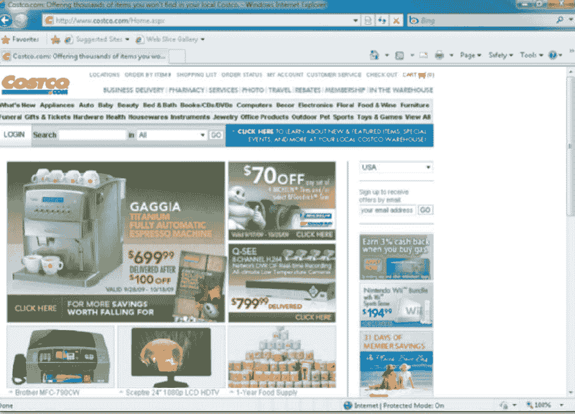

**图 1-18**

*执行以下任务：*

1. 启动浏览器。在浏览器中打开`Costco.com`网站。通过点击“文件”菜单上的“打印”或点击打印图标来打印主页。
2. 浏览`Costco.com`网站，确定该网站使用的结构（线性、层级或网状），然后将其写在打印稿上。
3. 找到另外两家在线零售商店网站。打印每个网站的主页。浏览这些网站，确定任何对用户有益的设计功能。
4. 使用你在步骤 3 中找到的在线零售网站的想法，在纸上为`Costco.com`网站草绘一个新的网站结构和设计。
5. 在打印稿和草图上写上你的名字，并将它们交给你的讲师。

## 拓展你的知识

拓展你在本章中学到的技能，并尝试新的技能。

### 评估用户调查

**操作说明：**启动你的文字处理程序。打开 Data Files for Students 中`Chapter01\Extend`文件夹中的文档`extend1-1.doc`。有关下载 Data Files for Students 的说明，请参阅本书的封底内页，或联系你的讲师以获取访问所需文件的信息。这个示例网站调查展示了在收集网站可用性反馈时可能提出的各种问题。正如本章中提到的，评估你的网站的可用性很重要。你将评估用户调查，并修改问题或添加适用于你所选网站的新问题。然后，你将请五个人参与你的调查。*执行以下任务：*

1. 连接到互联网，找出一个你认为令人困惑、难以使用或不吸引人的网站。
2. 按照图 1-17（第 HTML 20 页）提供的指南对用户调查进行更改，并将文件保存为`extend1-1solution.doc`。向调查添加问题，这些问题将帮助你确定用户对所选网站的看法。请记住，使用调查的目的是为了改进网站。因此，你的问题必须提供能够帮助你实现这一目标的信息。


- 3. 打印五份你编辑过的调查问卷，并将这些打印件分发给至少五位家庭成员或朋友。请他们完成关于你在步骤1中选择的网站的调查。收集他们的调查回复。

- 4. 确定你从调查结果中学到了什么。调查在确定所选网站需要改进的方面有多大帮助？你是否可以提出其他问题或不同类型的问题，从而提供关于该网站的更有价值的信息？

- 5. 确定你可以做些什么来改进你的网站调查。使用文字处理程序，在你的`extend1-1solution.doc`文档底部输入你的分析，然后按照讲师指定的格式提交。

### 修正错误

分析文档并更正所有错误和/或改进设计。

#### 更正网站类型表格

**操作说明：** 启动你的文字处理程序。打开`Data Files for Students`中`Chapter01\MakeItRight`文件夹中的文件`makeitright1-1.doc`。有关下载`Data Files for Students`的说明，请参阅本书的封底内页，或联系你的讲师以获取访问所需文件的信息。下页表1-7所示的文档是表1-5（第HTML 17页）的修改版本。该表格有意包含错误，列出了第1章中讨论的网页组织标准。在不参考表1-5的情况下，通过识别所列七个元素中每个的正确组织标准和原因，对表1-7进行必要的更正。将修订后的文档保存为`makeitright1-1solution.doc`，然后按照讲师指定的形式提交。

#### 修正错误（续）

**表1-7 网站类型**

| 元素 | 组织标准 | 原因 |
| :--- | :--- | :--- |
| 标题 | 使用这些来分隔主要主题 | 它们提供图形元素来分隔网页内容 |
| 标题 | 使用简单明了的标题，清晰地解释页面的目的 | 它们提供更短、更易于阅读的文本部分 |
| 水平线 | 在适当的情况下以项目符号或编号格式使用这些 | Web用户并不总是会滚动以查看较长页面上的信息；适当的页面长度增加了用户查看关键信息的可能性 |
| 段落 | 保持合适的网页长度 | Web用户会快速浏览页面；将关键信息放在页面顶部增加了用户查看关键信息的可能性 |
| 列表 | 插入这些图形元素来分隔主要主题 | 它们提供有组织、易于阅读的文本，读者可以快速浏览 |
| 页面长度 | 使用这些来帮助分隔大量文本 | 标题帮助用户理解页面的目的；好的标题在搜索引擎结果列表中解释了页面 |
| 信息 | 通过将最重要的信息放在网页顶部来强调 | 它们使网页更易于阅读；简单的标题清晰地解释了页面的目的 |

### 实验室

使用本章中介绍的指南、概念和技能来设计和/或创建文档。实验室按难度递增顺序列出。

#### 实验1：评估网站

**问题：** 在第1章中，你学习了成为一个善于观察的Web用户的重要性，这可以帮助你成为一个更有效的Web开发者。为了进一步发展这个概念，找到并讨论“好”和“坏”（“有效”和“无效”）的网站。启动你的浏览器和文字处理程序。打开`Data Files for Students`中`Chapter01\IntheLab`文件夹中的文件`lab1-1.doc`。有关下载`Data Files for Students`的说明，请参阅本书的封底内页，或联系你的讲师以获取关于访问本书所需文件的信息。

**操作说明：** 使用你的浏览器和列出的文件执行以下步骤。

1. 浏览互联网，找到一个“好”（即有效）或一个“坏”（即无效）的网站。根据你自己的观点，确定这些网站中哪些是“好”的，哪些是“坏”的。你将在下面的步骤2中具体说明你观点的原因。

2. 使用`lab1-1.doc`文件，对你选择的好坏网站的可用性进行评分。确保在调查中添加额外的评论，具体说明你对网站的正面或负面感受。使用文件名`lab1-1goodsolution.doc`和`lab1-1badsolution.doc`保存文档。

3. 与另一名同学组队，在回顾你选择的网站的同时讨论你的调查结果。同时，也回顾你的学生伙伴的网站和调查。

4. 打开名为`lab1-1comparison.doc`的文字处理文档，注意你的调查结果和你学生伙伴意见之间的任何分歧。确保包括

### 在实验室中

#### 实验室2：为学校咨询顾问设计一个网站

**问题：** 你所在学校的咨询部门希望你设计一个网站，以链接到学校主网站或从主网站链接过来。为此，你必须通过回答以下问题来完成规划和分析阶段：

- 学生希望在网站上完成哪些任务？
- 学校咨询顾问希望在网站上完成哪些任务？
- 应该包含哪些类型的信息？
- 谁将提供网站上的内容信息？

采访学校的一些学生，确定这些问题的答案。根据这些信息，你将为咨询部门网站的主页绘制一个设计草图，如图1-19所示的设计。

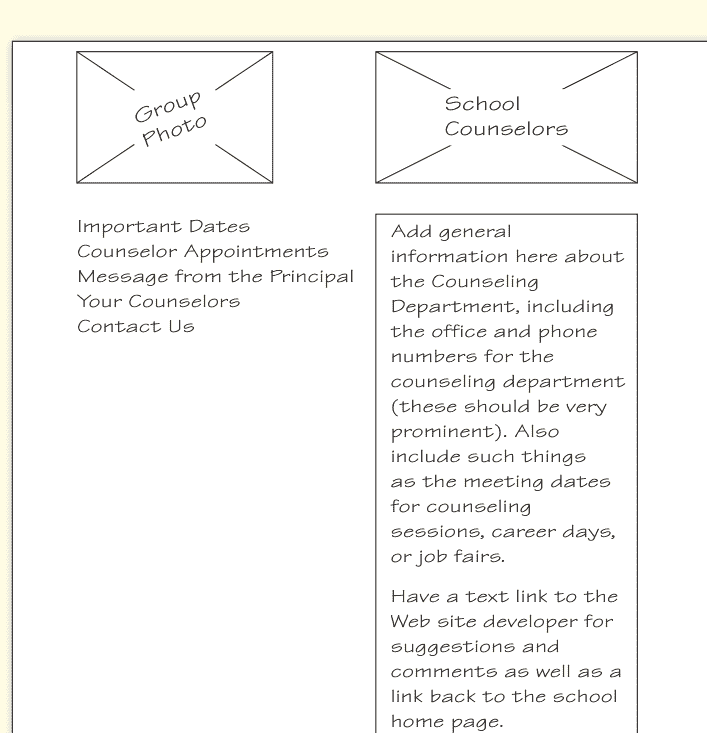

##### 说明

使用你的文字处理程序和纸张执行以下任务。

1. 回顾网站开发生命周期规划和分析阶段的问题，如HTML 15页表1-4所示。

2. 评估表中列出的这些问题的价值。添加你认为与咨询部门网站的规划和分析相关的其他问题。

3. 启动你的文字处理程序。如有必要，新建一个文档。输入你将用于规划和分析的问题。使用文件名`lab1-2solution.doc`保存文档。打印该文档。

4. 使用你开发的问题，采访学校咨询顾问，以确定网站中应包含哪些信息、谁将提供信息等。

5. 收集所需信息后，在纸上绘制网站主页的设计草图。

6. 与学校的学生和一些咨询顾问分享你的设计草图，听取他们对你设计的意见。

7. 根据学生和咨询顾问的反馈，在纸上重新绘制设计。

8. 在第一个设计草图上写上“原始设计”。

9. 在第二个设计草图上写上“第二个设计”。

10. 在`lab1-2solution`打印件和草图上写上你的名字，并将它们交给你的导师。

### 在实验室中

#### 实验室3：询问规划阶段问题：互联网、内联网和外联网设计

**问题：** 本章讨论了三种不同类型的网站——互联网、内联网和外联网。每种类型的网站都是为不同的目标受众设计的。想一个你经常光顾的企业（例如，餐厅、图书馆或卡片店），并思考该企业如何使用互联网、内联网和外联网网站。HTML 15页表1-4中的规划阶段问题已在表1-8中复制。确定这些问题的答案，并将你的想法填入表格。如果有难以/无法直接回答的问题（例如，*用户的计算环境是什么？*），请列出你能找到这些问题答案的方法。

##### 表1-8 规划阶段问题

| 规划问题 | 互联网 | 内联网 | 外联网 |
| :--- | :--- | :--- | :--- |
| 此网站的目的是什么？ | | | |
| 谁将使用此网站？ | | | |
| 用户的计算环境是什么？ | | | |
| 谁拥有并创作网站上的信息？ | | | |
| 谁决定信息是否/在哪里放在网站上？ | | | |

##### 说明

启动你的文字处理程序。打开学生数据文件中`Chapter01\IntheLab`文件夹中的文件`lab1-3.doc`。有关下载学生数据文件的说明，请参见本书的封底内页，或联系你的导师以获取有关访问所需文件的信息。使用你的文字处理程序执行以下任务。

1. 在表格的第一行中输入企业的类型。确定所有三种类型网站的第一个问题的答案，然后将答案输入到相应的表格单元格中。如果你选择的企业没有理由维护三种网站（互联网、内联网或外联网）中的任何一种，请在你的答案中彻底说明为什么不需要它。

2. 继续回答其他四个问题。

3. 使用文件名`lab1-3solution.doc`保存文件，然后按照你导师指定的格式提交。

## 案例与实践

运用你的创造性思维和问题解决技能来设计并实施一个解决方案。

- 较容易
- 较困难

#### 1：了解更多关于Web访问问题的信息

你的公司希望为员工提供在线课程。一些员工有身体障碍，在线课程必须让每个人都能访问。你的经理要求你了解更多关于无障碍指南的信息，以确定需要进行哪些更改才能让公司的在线课程对有身体障碍的人士可访问。在网上研究无障碍问题，并确定满足无障碍要求需要考虑哪些事项。请务必访问`W3.org`网站。在研究时考虑以下问题：在开发网页时，你必须考虑哪些类型的身体障碍？网站就无障碍性提出了哪些建议？为什么作为Web开发人员，这对你很重要？

#### 2：确定网站结构

你最近在`Triple-Tom Design`找到了一份Web开发人员的工作。在新工作中，你经常被要求重组客户现有的网站，使其更用户友好且更易于导航。找一个使用多种网站结构（线性、层级和/或网状）的网站。网站上传达的信息是否以适当的结构显示？该结构是否有效地支持了信息的传达？打印你找到的网站的主页。在一张空白纸上，绘制一个你认为可能更适合传达该信息的设计草图。使用文字处理程序创建一个文档，解释为什么你的新设计更有效。

#### 3：了解更多关于CSS的信息

本章介绍了在Web开发中使用层叠样式表（`CSS`）。你将在本书中广泛使用`CSS`，因此熟悉它非常重要。访问`W3Schools`网站（`w3schools.com`）以了解更多关于`CSS`的信息。在其他网站上找到另外三个关于`CSS`的信息来源。使用文字处理程序创建一个文档，简要描述`CSS`以及如何在Web开发中最好地利用它。

#### 4：为你妹妹设计一个网站

**个性化定制**

你妹妹想在网上销售她制作的珠宝。你想为她开发一个网站，既能展示她的珠宝，又能作为销售交易的手段。彻底调查其他在线珠宝商的网站，并打印其中三个网站的主页。在开始设计之前，你决定创建一个网站设计原则列表，网站将遵守这些原则。在网上搜索更多关于网站设计的信息。找到三个提供网站设计原则信息的网站。在文字处理文档中，将本章中提出的观点与其他网站中提出的观点结合起来，制作一份全面的网站设计原则列表。确定你打印的网站是否遵守良好的设计原则。在适当的地方，指出网站中讨论的任何相互冲突的设计原则。

#### 5：创建一个可用性调查

**团队协作**

你的学校最近更新了其网站。学校管理部门选择了一个团队来开发一份可用性调查问卷，你可以将其分发给一群用户（包括学生、家长和老师），以评估新网站。你希望通过分发这份调查问卷希望获得哪些类型的信息？你如何在调查问卷上传达信息，以便清楚地表明你所询问的内容？使用你的文字处理程序创建一份可用性调查问卷。将调查问卷分发给至少五个人，包括上述每个群体中至少一人。让参与者完成调查问卷，然后查看结果。如果可能的话，询问用户他们认为各个问题传达了什么信息。这是你想传达的吗？如果不是，思考更清晰、更相关的问题，并将调查问卷重新分发给另一组参与者。

## 2 使用内联样式创建和编辑网页

### 学习目标

当你能完成以下操作时，就说明你已掌握了本章内容：

- 识别网页的组成部分
- 启动`Notepad++`并描述其窗口
- 在`Notepad++`中启用自动换行
- 输入HTML标签
- 输入居中的标题和一段文本
- 创建无序列表、有序列表或定义列表
- 保存HTML文件
- 使用浏览器查看网页
- 激活`Notepad++`
- 识别网页图像的类型和属性
- 使用内联样式添加图像、更改标题颜色、更改项目符号列表样式以及添加水平线
- 在浏览器中查看HTML源代码
- 打印网页和HTML文件
- 退出`Notepad++`和浏览器

### 简介

在理解了Web开发生命周期后，你应该能很好地认识到正确的网站规划、分析和设计的重要性。完成这些阶段后，下一个阶段就是使用HTML实际开发网页。如第1章所述，网页是使用HTML创建的，它使用一组特殊标签来定义网页的结构、布局和外观。在本章中，你将使用基本的HTML标签来创建和编辑一个网页。

### 项目——抗击全球饥饿网页

第2章说明了如何为学校的“抗击全球饥饿”团队使用HTML创建一个网页，如图2–1a所示。该团队正在联合世界各地的其他学生来筹集捐款和资金。由于你是团队中唯一学习Web开发专业的成员，团队成员请求你帮助开发一个网页来宣传他们的事业。抗击全球饥饿网页将包含关于团队的一般信息，以及如何捐赠和参与的信息。

要输入用于创建网页的文本和HTML标签，你将使用一个名为`Notepad++`的程序，如图2–1b所示。`Notepad++`是一个基础的文本编辑器，你可以用于简单的文档或使用HTML创建网页。本书的早期版本使用了`Notepad`，它是Windows操作系统自带的文本编辑器。`Notepad`在输入HTML元素和网页内容方面表现良好，但`Notepad++`是一个功能更丰富、更先进的文本编辑器。`Notepad++`具有行号功能，这在阅读代码时非常有帮助。正如你将在本章后面看到的，它还对输入的文本进行颜色编码。由于其额外的多功能性，`Notepad++`是本版所选的文本编辑器。你将在创建网页时使用`Microsoft Internet Explorer`浏览器来查看它。默认情况下，`Internet Explorer`随Windows安装，而`Notepad++`可以从网上免费下载。如果你的电脑上没有`Notepad++`或`Internet Explorer`，其他文本编辑器或浏览器程序也可以使用。

### 概述

在阅读本章时，你将通过执行以下一般性任务来学习如何创建如图2–1所示的网页：

- 在`Notepad++`窗口中输入HTML代码。
- 将文件另存为HTML文件。
- 输入基本的HTML标签并向文件中添加文本。
- 通过添加标题和创建项目符号列表来组织文本。
- 使用内联样式增强网页的外观。
- 在浏览器中查看网页和HTML代码。
- 验证网页。
- 打印网页。

图2-1：（a）抗击全球饥饿网页。（b）用于创建该网页的HTML代码。

HTML 35

### 提前规划

#### 通用项目指南

在创建网页时，你所执行的操作和做出的决定将影响完成页面的外观和特征。在创建网页时，例如上一页图2–1所示的项目，你应该遵循以下通用指南：

1. **完成网页规划。** 在开发网页之前，你必须了解网站的目的，确定网站的用户及其计算环境，并决定谁拥有网页上的信息。

2. **分析网页的需求。** 在Web开发生命周期的分析阶段，你应该分析网页上应包含哪些内容。在这个阶段，你确定用户需要的任务和信息。有关Web开发生命周期阶段的信息，请参考第HTML 15页上的表1–4。

3. **选择网页的内容。** 一旦完成分析，你就需要确定网页上要包含哪些内容。遵循*少即是多*的原则。文本越少，网页被阅读的可能性就越大。用尽可能少的词来表达一个观点。

4. **确定此网页将使用的文件命名约定。** 在开始创建和保存文件之前，你应该决定一个标准的文件命名方式。你应该使用`.htm`还是`.html`扩展名？正如本章后面所解释的，当托管Web服务器只允许短文件名时，使用`.htm`扩展名。当托管Web服务器允许长文件名时，使用`.html`。你应该给文件取什么名字来表示文件的内容或目的？例如，将网页命名为`page1.html`并不能描述该网页是什么；一个更具描述性的名称有助于网站的开发。

5. **确定将网页保存在哪里。** 你可以将网页永久存储或保存在多种存储介质上，包括硬盘、USB闪存驱动器、CD或DVD。你的老师或你为其开发网页的公司可能有特定的存储介质要求。

6. **确定在存储设备上使用什么文件夹结构。** 一旦确定了要使用的存储介质，你还应该确定保存网页的文件夹位置、结构和名称。这应该在开始保存任何文件之前完成。

7. **确定如何格式化网页的各种元素。** 网页的整体外观显著影响其清晰传达信息的能力。你可以修改网页的外观或**格式**的例子包括添加图像、为标题添加颜色以及添加水平线。

8. **查找合适的图形图像。** 引人注目的图形图像有助于传达网页的整体信息并增加视觉吸引力。图形可用于展示产品、服务、结果或好处，或者直观地传达不易用文字表达的信息。

9. **确定图形图像的位置和格式。** 图形图像的位置和格式应该吸引路人的注意力，并引导他们阅读网页。

10. **测试网页的XHTML兼容性。** Web开发的一个重要部分是测试，以确保你的网页遵循XHTML标准。万维网联盟（`W3C`）有一个在线验证器，允许你测试你的网页并清楚地解释任何错误。

必要时，本章将在适当的地方提供有关上述指南的更多具体细节。本章还将确定在创建如图2–1a所示网页的过程中，针对这些指南所执行的操作和做出的决定。

### 网页的构成元素

如今，许多人——个人、学生、教师、企业高管、网络开发者等——出于个人或职业原因都在制作网页。每个人都有自己独特的风格，因此生成的网页也如同创造它们的人一样丰富多样。然而，大多数网页都包含几个基本特征或元素，如图2-2所示。

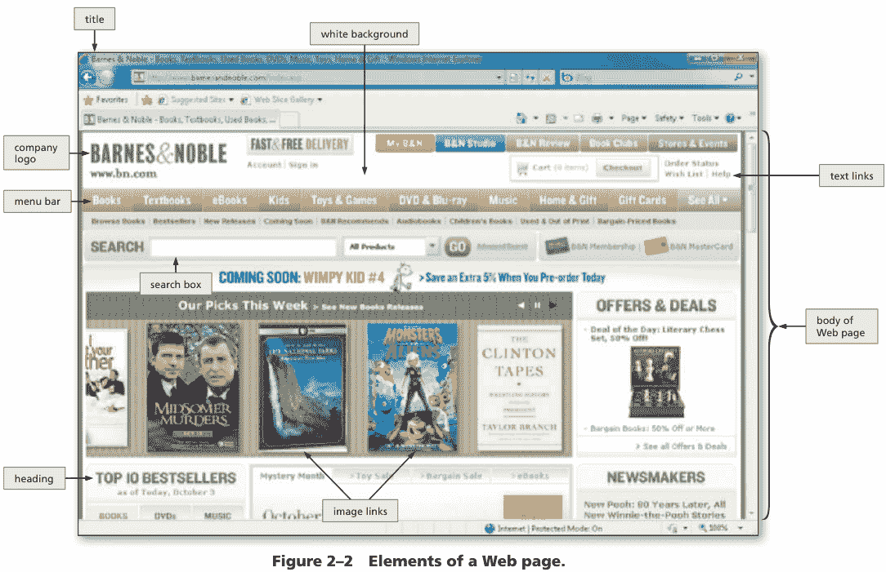

### 窗口元素

网页的**标题**是网页出现在浏览器窗口时，显示在标题栏和任务栏上的文本。如果用户将该页添加到浏览器的**收藏夹**或**书签**列表中，标题也就是分配给该页的名称。鉴于其重要性，你的网页应始终包含一个标题。标题通常是用户看到的第一个元素，应能标识页面的主题或目的。标题应简洁但具描述性，向访问者简要说明页面的内容或用途。

网页的**主体**包含显示在浏览器窗口中的信息。主体可以包含文本、图形和其他元素。网页会显示包含在`<body>`（主体开始）和`</body>`（主体结束）标签内的所有内容。网页的**背景**是一种纯色、图片或图形，网页的其他元素会呈现在此背景之上。选择背景时，务必确保它不会压倒网页上的信息。浏览网页时，注意那些无法让网页内容清晰显示的背景颜色或图像。这无疑是网络开发者应避免的做法。

> **收藏夹与书签**

`Internet Explorer`和`Mozilla Firefox`都有一项功能，允许你将网页添加到一个列表中，以便日后快速访问。`Internet Explorer`将这些称为“收藏夹”，而`Firefox`则称之为“书签”。网络开发者需要确保其网页包含描述性标题，因为这就是在书签或收藏夹中显示的标题。

### 文本元素


普通文本是用于网页主要内容的默认文本格式。普通文本可用于标准段落，或格式化为：粗体、斜体或下划线；显示为不同颜色等。你也可以使用内联级联样式表（`CSS`）来更改文本格式，这也是本书通篇采用的方法。普通文本也可用于一系列称为列表的文本项目。通常，列表带有项目符号或编号。列表的各种属性可以修改。例如，你可能希望使用方形项目符号而非默认的圆形项目符号，或者让列表文本显示为斜体或粗体。

标题用于突出文本段落或页面的不同部分。标题的字体大小比普通文本大，且通常为粗体、斜体或与普通文本颜色不同。标题大小从 1（最大）到 6（最小）。设置网页时，通常从一个标题大小切换到下一个最小的标题大小。

### 图像元素

网页通常使用几种不同类型的图形或图像，例如图标、项目符号、线条、照片、插图或其他图片。网页中使用的图像也称为内联图像，这意味着图像或图形文件不是 `HTML` 文件的一部分。相反，网络浏览器会将独立的图形文件合并到网页中，然后在浏览器窗口中显示。`HTML` 文件包含 `` 标签，用于告知浏览器应从服务器请求哪个图形文件、将其插入页面的何处以及如何显示。

网页通常使用几种不同类型的内联图像。图像映射是一种特殊的内联图像，你可以在其中将一个或多个区域定义为热点。热点是图像上的一个区域，当被选中时会激活一个功能。例如，图像映射中的每个热点可以链接到不同的网页。一些内联图像是动态的，这意味着它们包含动画并且外观可以变化。

水平线是横跨网页显示的线条，用于分隔页面的不同部分。虽然水平线的外观可以变化，但许多网页使用内联图像作为水平线。或者，你可以使用水平线标签（`<hr />`）添加简单的水平线，例如本章项目中使用的那条。

### 超链接元素

网页中更重要的元素之一是超链接，或称链接。链接是文本、图像或另一个网页元素，你点击它可以指示浏览器跳转到文件中的某个位置或从服务器请求一个文件。在网络上，链接是在网页之间以及网站之间导航的主要方式。链接不仅指向网页，还指向图形、声音、视频、程序文件、电子邮件地址以及同一网页的不同部分。

文本链接，也称为超文本链接，是最常用的超链接。例如，图 2-2 中的文本“订单状态”链接到用户的订单状态。当文本标识一个超链接时，它通常显示为带下划线的文本，颜色与网页上的其他文本不同。

图像链接也很常见。例如，图 2-2 中标识了两个图像链接。点击其中任一图像链接都会将用户发送（或链接）到另一个包含有关这些项目详细信息的网页。公司徽标通常作为指向主页或公司信息的图像链接。

### 定义网页结构

要创建 `HTML` 文档，你需要使用文本编辑器输入关于网页结构、网页内容以及应如何显示这些内容的说明。本书使用 Notepad++ 文本编辑器来输入所有项目和练习的 `HTML` 元素和内容。

在开始输入本项目的内容之前，你必须首先输入定义网页整体结构的标签。你需要插入一个 `<!DOCTYPE>` 标签和五个标签（`<html>`、`<head>`、`<meta />`、`<title>` 和 `<body>`）以及对应的结束标签（`</html>`、`</head>`、`</title>` 和 `</body>`）。这些标签定义了标准网页的结构，并将 `HTML` 文件划分为其基本部分：头信息和包含文本与图形的页面主体。

`<!DOCTYPE>` 标签用于告知浏览器该文档使用的是哪种 `HTML` 或 `XHTML` 版本和类型。万维网联盟（`W3C`）支持 `HTML` 或 `XHTML` 的三种文档类型：严格型、过渡型和框架集型。

当你想禁止使用已废弃的标签时，应指定**严格型**文档类型。**已废弃的标签**是 `W3C` 已标记为最终将从其规范中移除的标签，因为这些标签已被更新、功能更强的标签所取代。**过渡型**文档类型允许使用已废弃的标签。**框架集型**文档类型用于支持网页上的框架，也允许使用已废弃的标签。

`<!DOCTYPE>` 标签包含一个 `URL`，该 `URL` 引用了 `w3.org` 网站上的文档类型定义。尽管本书不使用已废弃的标签，但项目确实使用了 `XHTML 1.0` 过渡型文档类型，因为项目使用了一些 `XHTML 1.1` 标准不支持的标签（例如，`name`）。

**文档类型定义（DTD）**是一个文件，包含标签定义以及它们在网页中应如何使用的说明。本章的项目使用过渡型文档类型。

> **DOCTYPE 标签**
>
> W3Schools 网站提供了有关用于严格型、过渡型和框架集型文档类型的 `DOCTYPE` 标签的更多信息。要了解更多关于 `DOCTYPE` 标签的信息，请访问 `W3C` 网站。它提供了关于此标签及其他 `HTML` 标签的丰富信息。

### 定义 HTML 文档

`<!DOCTYPE>` 标签之后的第一组标签 `<html>` 和 `</html>`，表示 `HTML` 文档的开始和结束。这组标签包含网页的所有内容、格式化该内容的标签以及定义文档不同部分的标签。软件工具（如浏览器）使用这些标签来确定文件中 `HTML` 代码的起始和结束位置。

**头信息**

下一组标签 `<head>` 和 `</head>` 包含网页标题和其他文档头信息。插入到 `<head> </head>` 容器中的一个标签是元标签。`<meta />` 标签有多种功能。在本章中，它用于声明字符编码 `UTF-8`。

**统一码转换格式（UTF）**是一种压缩格式，允许计算机显示和处理文本。当浏览器遇到此元标签时，它将根据嵌入在标签中的特定 `UTF-8` 编码正确显示网页。`UTF-8` 是网页、电子邮件和其他应用程序的首选编码标准。选择的编码在验证网页时也很重要。元标签还有其他用途，将在本书后续章节中描述。

`<title>` 标签是另一个插入到 `<head> </head>` 容器中的标签。`<title>` 和 `</title>` 标签表示网页的标题，当网页在浏览器窗口中显示时，该标题会出现在浏览器标题栏和任务栏上。标题也是用户将页面添加到收藏夹或书签列表时赋予该页面的名称。

> **XHTML 合规性**
>
> 要使你的 `HTML` 文件符合 `XHTML` 标准，请始终以小写字母输入标签（`<!DOCTYPE>` 标签除外，它始终是大写）。在本书中，项目指导都遵循这些标准，以帮助你学习良好的 `HTML` 和 `XHTML` 编码实践。

**主体**

最后一组标签 `<body>` 和 `</body>` 包含网页的主要内容。所有文本、图像、链接和其他内容都包含在这最后一组标签内。下页的表 2-1 列出了到目前为止描述的标签功能，以及本章中你将使用的其他标签。

### HTML 40 HTML 第 2 章 使用内联样式创建和编辑网页

**表 2-1 基本 HTML 标签及其功能**

| HTML 标签 | 功能 |
| --- | --- |
| `<!DOCTYPE>` | 指明使用的 HTML 版本和类型；包含一个指向 DTD 的 URL 引用 |
| `<html> </html>` | 表示一个 HTML 文档的开始和结束 |
| `<head> </head>` | 表示文档中用于标题和其他文档头信息部分的开始和结束 |
| `<meta />` | 表示关于网页的隐藏信息 |
| `<title> </title>` | 表示标题的开始和结束。标题不会出现在网页的主体中，而是出现在浏览器的标题栏上。 |
| `<body> </body>` | 表示网页主体的开始和结束 |
| `<hn> </hn>` | 表示称为标题的文本段落的开始和结束；大小范围从 `<h1>` 到 `<h6>`。有关标题大小的示例，请参阅 HTML 46 页的图 2-8a。 |
| `<p> </p>` | 表示一个新段落的开始和结束；在新段落上方插入一个空行 |
| `<ul> </ul>` | 表示一个无序（项目符号）列表的开始和结束 |
| `<li> </li>` | 表示紧跟标签后面的项是列表中的一个项目 |
| `<hr />` | 插入一条水平线 |
| `<br />` | 在标签出现的位置插入一个换行符 |

### 顺便提一下：WordPad

WordPad 是 Windows 附带的一个文本编辑器，你也可以用它来创建 `HTML` 文件。要启动 WordPad，请单击任务栏上的“开始”按钮，将指针指向“开始”菜单上的“所有程序”，将指针指向“所有程序”子菜单上的“附件”，然后单击“附件”子菜单上的“WordPad”。WordPad 帮助提供了关于如何使用该产品的提示。

大多数 `HTML` 开始标签，如 `<html>`、`<head>`、`<title>` 和 `<body>`，都有相应的结束标签，`</html>`、`</head>`、`</title>` 和 `</body>`。请注意，对于没有结束标签的标签，如 `<meta />`、`<hr />` 和 `<br />`，标签使用一个空格后跟一个斜杠来关闭。

### 启动 Notepad++

随着网页的规划、分析和设计完成，你可以通过使用文本编辑器输入 `HTML` 来开始开发网页。

以下步骤假设 Windows 7 正在运行并且 Notepad++ 已安装，它将基于典型安装启动 Notepad++。你可能需要询问你的讲师如何在你的计算机上下载、安装和启动 Notepad++。

1. 单击 Windows 任务栏上的“开始”按钮以显示“开始”菜单。
2. 单击“开始”菜单左窗格底部的“所有程序”以显示“所有程序”列表。
3. 在“所有程序”列表中单击 Notepad++ 文件夹（图 2-3）。

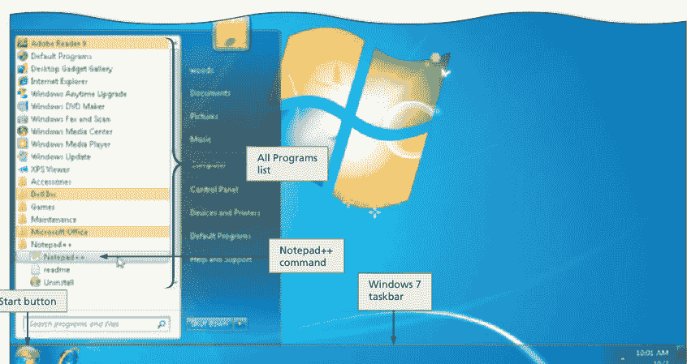

图 2-3

定义网页结构 HTML 41

4. 单击列表中的 Notepad++ 以显示一个空白的 Notepad++ 窗口（图 2-4）。
5. 如果 Notepad++ 窗口没有最大化，请单击 Notepad++ 标题栏上的“最大化”按钮将其最大化。

> **问答**
>
> **什么是最大化窗口？**
>
> 最大化窗口会充满整个屏幕。当你最大化一个窗口时，“最大化”按钮会更改为“还原”按钮。

> **问答**
>
> **我如何将 Notepad++ 添加到我的“开始”菜单或任务栏？**
>
> 要将 Notepad++ 添加到“开始”菜单或任务栏，请完成上面的步骤 1。右键单击 Notepad++，然后单击“附到开始菜单”或“附到任务栏”。

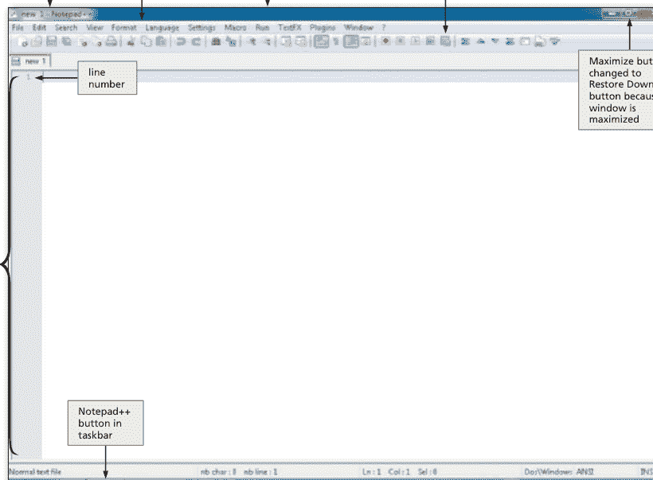

图 2-4

#### 其他方式

1. 如果桌面上有 Notepad++ 图标，双击它。
2. 如果“开始”菜单上有 Notepad++，则单击它。

> **顺便提一下**
>
> **Notepad++ 帮助**
>
> Notepad++ 拥有丰富的帮助信息。程序内部有 Notepad++ 帮助，在线也有帮助设施。NpWiki 是 Notepad++ 的维基，你可以访问。此维基的主要目的是作为所有关于 Notepad++ 信息的存储库。

### 在 Notepad++ 中启用自动换行

在 Notepad++ 中，除非启用了自动换行功能，否则在文本区域输入的文本会持续向右滚动。**自动换行**使文本行在窗口右边缘断开并出现在新的一行，因此所有输入的文本在 Notepad++ 窗口中都是可见的。

对于启用了自动换行的文本段落，即使它可能在 Notepad++ 中显示在多个物理行上，文本也都会出现在一个逻辑行号上。自动换行不会影响文本的打印方式。以下步骤展示了如何在 Notepad++ 中启用自动换行。

1. 单击菜单栏上的**视图**（图 2-5）。
2. 如果**自动换行**旁边没有复选标记，请单击**自动换行**。

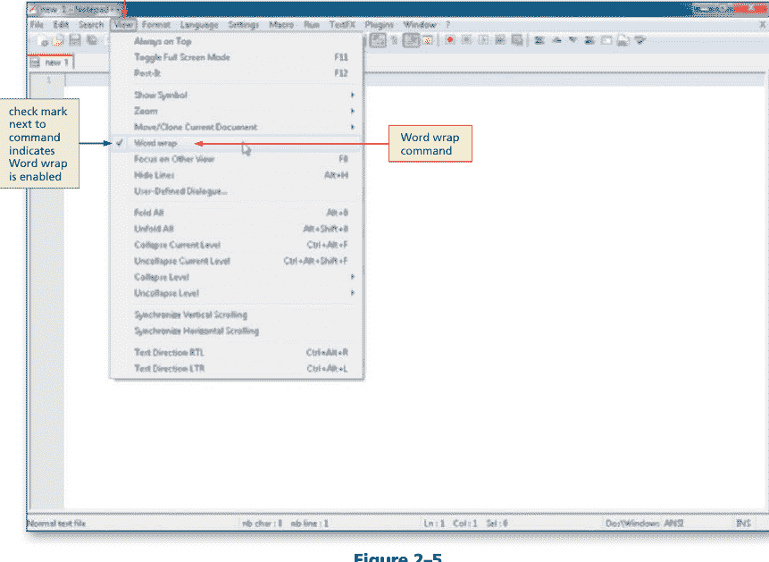

**图 2-5**

> **我如何知道自动换行是否已启用？**
>
> 当自动换行启用时，“视图”菜单上的“自动换行”命令前面会有一个复选标记，并且当你输入时，你的文字会留在屏幕上。

> **如果未启用自动换行，文本会发生什么情况？**
>
> 段落的文本在 Notepad++ 中会显示在一行上并滚动出屏幕，不过网页在浏览器中仍会正确显示。为了在 Notepad++ 中的可读性，你应该启用自动换行。

### 使用 HTML 标签定义网页结构

第一个任务是输入定义网页结构的初始标签。表 2-2 包含用于创建 HTML 35 页图 2-1a 所示网页的 `HTML` 标签和文本。在本章和整本书中，当需要输入大段 `HTML` 代码或文本时，你会在带有行号引用的表格中找到这些代码或文本，而不是在步骤中。步骤将指导你输入表格中显示的文本。

| 行号 | HTML 标签和文本 |
| :--- | :--- |
| 1 | `<!DOCTYPE html` |
| 2 | `PUBLIC "-//W3C//DTD XHTML 1.0 Transitional//EN "` |
| 3 | `" http://www.w3.org/TR/xhtml1/DTD/xhtml1-transitional.dtd ">` |
| 4 |  |
| 5 | `<html xmlns="http://www.w3.org/1999/xhtml" xml:lang="en " lang="en ">` |
| 6 | `<head>` |
| 7 | `<meta http-equiv="Content-Type " content="text/html;charset=utf-8 " />` |
| 8 | `<title>Hunger Fight</title>` |
| 9 | `</head>` |

以下步骤说明了如何输入定义网页结构的初始标签。

1. 输入表 2-2 中显示的 `HTML` 代码（图 2-6）。在每行末尾按回车键。如果在输入时出错，请使用退格键删除所有字符，直到并包括错误字符，然后继续输入。
2. 按回车键两次开始下一行代码，在 `</head>` 标签后留一个空行。
3. 将你输入的内容与图 2-6 进行比较。如果你发现错误，请使用鼠标指针或箭头键将插入点移动到每个错误的右侧，并使用退格键更正错误。

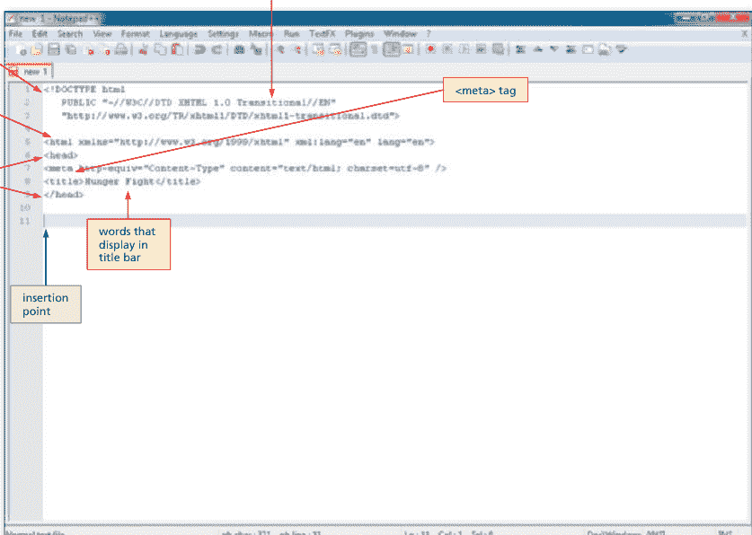

图 2-6

HTML 44 HTML 第 2 章 使用内联样式创建和编辑网页

- 在第 11 行，输入 `<body>` 然后按回车键两次。
- 输入 `</body>` 然后按回车键。
- 输入 `</html>` 作为结束标签（图 2-7）。
- 将你输入的内容与图 2-7 进行比较，并在必要时更正输入错误。

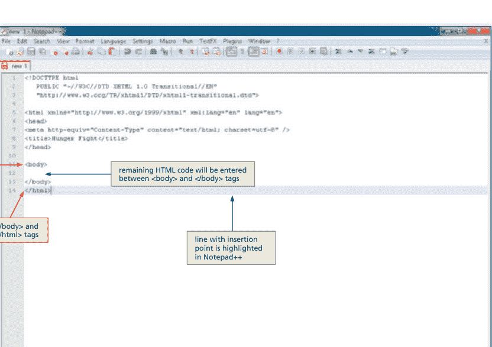

> **问答：为什么我使用过渡型文档类型？这不是允许使用已弃用的标签吗？**
>
> 是的，你可以使用过渡型文档类型来使用已弃用的标签。一些有效的标签（例如 `name`）不能与 `XHTML 1.1` 标准一起使用，因此本文本使用了带有过渡型文档类型的 `XHTML 1.0`。

> **问答：`<title>` 和 `<body>` 标签之间有什么区别？**
>
> 包含在 `<title> </title>` 标签中的文本是网页在浏览器窗口中显示时出现在浏览器标题栏上的内容。包含在 `<body> </body>` 标签中的文本和图形是在浏览器窗口中显示的内容。

> **问答：我是否必须为我开发的每个网页输入初始 HTML 标签？**
>
> 相同的初始 `HTML` 标签在许多其他章节中使用。为了避免重新输入这些标签，你可以保存刚刚输入的代码，并给它一个新的文件名，例如 `structure.html` 或 `template.html`。如果你将此文件保存在文件夹的根级别，你将在其他章节中轻松访问它。

> **问答：我可以使用大写或小写字母作为我的 HTML 代码吗？**
>
> 为了使你的 `HTML` 文件符合 `XHTML` 标准，请始终以小写形式输入标签（`<!DOCTYPE>` 标签除外，它始终是大写）。在本书中，项目说明遵循这些准则，以帮助你学习可接受的 `HTML` 和 `XHTML` 编码标准。

## 输入网页内容

> **确定如何格式化文本的各种元素。**
>
> 通过格式化网页上的字符和段落，你可以改善其整体外观。在网页上，请考虑以下格式化建议。
>
> - **有效利用标题。** 主标题通常是网页的第一行文字。它传达了网页的目的，例如呼吁为食品募捐活动提供帮助。应遵循标题大小标准，如下一页图 2-8 所示。主标题应为 1 号，子主题或副标题应为 2 号。通常，从一个标题大小直接跳到小两个尺寸的标题不是一个好主意。例如，如果你的主标题是 1 号，那么下一个标题应该是 2 号，而不是 4 号。
> - **在适当时使用默认文本大小。** 正文由标题和网页底部之间的所有文本组成。这部分文本以尽可能少的字数突出消息的关键点。它应该易于阅读和理解。在强调积极面的同时，正文必须真实、可信。默认的字体大小和样式适用于正文。
> - **使用项目符号突出关键段落。** **项目符号**是位于段落开头的圆点或其他符号。项目符号列表包含的具体信息，通过列表而非文字段落能更清晰地标识。

### 提前规划

HTML 第 2 章

### 输入网页内容

一旦你建立了网页结构，就该输入网页的内容了，包括标题、信息性文字段落和一个项目符号列表。

标题用于分隔文本或在网页上添加新主题。标题有几种样式和大小，由标签 `<h1>` 到 `<h6>` 表示，其中 `<h1>` 最大。通常，你为主标题使用 Heading 1 样式。下一页的图 2-8a 显示了一个使用不同大小标题的网页。一个网页通常只有一个主标题；因此，该网页的 `HTML` 文件通常只有一组 `<h1> </h1>` 标签。

保持网页外观一致的一种方法是对同一主题级别的标题使用相同的标题大小（图 2-8b）。注意，在图 2-8b 中，文字段落和项目符号列表都由 2 号标题分隔。这种分隔表明，这些文本（即两段文字加一个项目符号列表）在网页上都处于同等重要级别。

网页通常包含大量文本。由于你在 Notepad++ 中开启了自动换行（HTML 42 页图 2-5），你将在一个 Notepad++ 窗口中看到你输入的所有文本。将文本分成段落有助于分隔关键思想，并使文本更易阅读。段落之间通过使用 `<p>`（开始段落）和 `</p>`（结束段落）标签并插入一个空行来分隔。

在一个网页上放置过多文本不是一个好选择。你的受众可能会在大量文本中迷失方向。如果你发现自己必须按 Page Down 键几十次才能到达网页底部，你就需要考虑重构你的网页了。你可以将大量信息拆分到更多标题下，这样会更易于管理且更易读。


版权 2010 Cengage Learning。保留所有权利。不得全部或部分复制、扫描或复制。由于电子权利，一些第三方内容可能会从电子书和/或电子章节中被屏蔽。编辑审查认为，任何被屏蔽的内容都不会对整体学习体验产生重大影响。Cengage Learning 保留根据后续权利限制要求随时删除额外内容的权利。

# HTML 46：HTML 第 2 章

## 使用内联样式创建和编辑网页

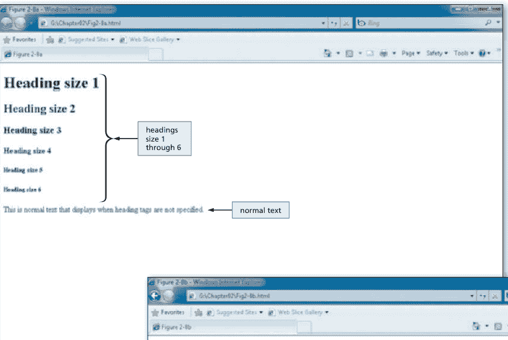

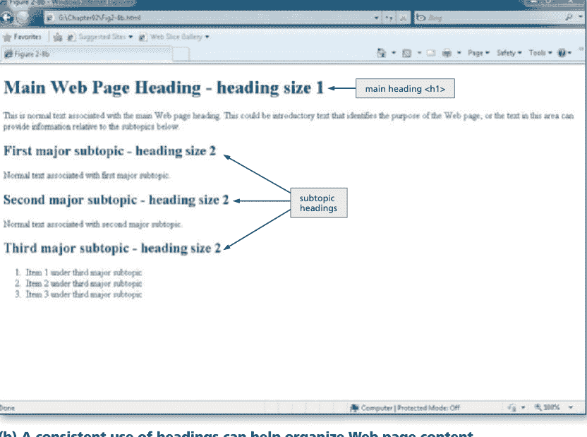

### (a) 六种标题大小的示例

**BTW：用于组织的标题**

在使用标题来组织内容并突出网页关键点时，请确保一致地使用它们。也就是说，如果你为特定级别的文本使用 Heading 2 (`<h2>`) 样式，那么你应该始终使用 Heading 2 样式来分隔该级别的信息。另外，不要在你的文档中跳过标题级别。例如，不要以 Heading 1 (`<h1>`) 样式开始，然后使用 Heading 3 (`<h3>`) 样式。

### (b) 一致地使用标题可以帮助组织网页内容

### 图 2-8

有时，当网页上的文本格式化为列表而不是段落时，用户更易于阅读和理解。HTML 提供了几种类型的列表，但最流行的是无序（项目符号）列表和有序（编号）列表。在 Web 开发生命周期的设计阶段，你需要确定构建网页内容和格式化网页文本的最有效方式。你的主要目标是给网页访问者一种有效的方法来找到他们需要的信息。如果用户无法轻松找到所需内容，他们将不会再次访问你的网站。

## 输入标题

标题“Fight Against World Hunger”（抗击世界饥饿）是主标题，表明了网页的主要信息。为了引起对这个标题的注意，你将使用 `<h1>` 标签。以下步骤说明如何在网页上输入标题。

1. 将插入点放在第 12 行，按一次 ENTER 键，在 `<body>` 标签后留一个空行。
2. 在文本区域输入 `<h1>Fight Against World Hunger</h1>`，然后按两次 ENTER 键（图 2-9）。

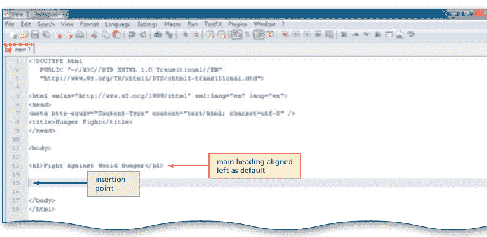

**图 2-9**

> **Q&A**
>
> 为什么在 `<body>` 标签和标题之后，你在 HTML 代码中额外加了一行？
>
> 为了可读性，插入了一个额外的行空间。这个空行不会在网页上显示。

## 输入文字段落

输入标题后，下一步是使用 `<p>` 标签添加一个文字段落。当浏览器在 HTML 文件中找到 `<p>` 标签时，它会开始一个新行，并在新段落上方插入一个空行。`</p>` 结束标签表示段落的结束。当你输入这个文字段落时，不要在每一行末尾按 ENTER 键。因为自动换行已开启，你的文本即使不按 ENTER 键也会自动换行。表 2-3 包含了段落中使用的 HTML 标签和文本。

**表 2-3：添加文字段落**

| 行 | HTML 标签和文本 |
| :--- | :--- |
| **15** | `<p>Our school and schools around the world have recently joined forces to fight against world hunger. The office for the Fight Against World Hunger team is located next to the bookstore. You can drop off food and money donations there. We also have donation drop-off locations at participating grocery stores. See the list of stores as well as additional information on the bulletin board outside our team office.</p>` |

以下步骤说明如何在 HTML 文件中输入文字段落。

1. 将插入点放在第 15 行，按照上一页表 2-3 所示输入 HTML 代码。输入此文本时，不要在每行末尾按 ENTER 键，并且在句点后只使用一个空格。
2. 按两次 ENTER 键，将插入点定位在第 17 行（图 2-10）。

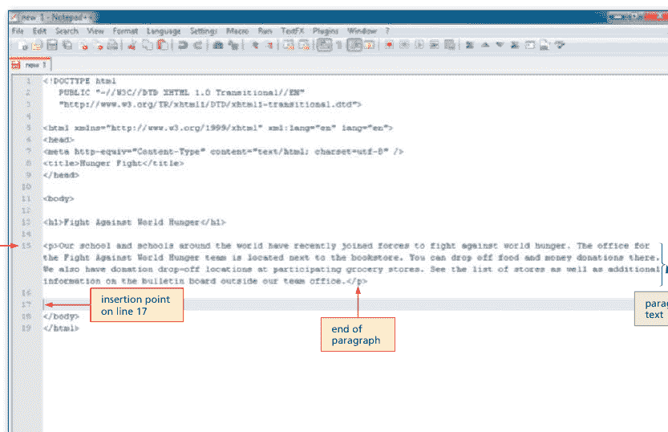

> 为什么在输入表 2-3 中的每一行代码后都不按 ENTER 键？
>
> 因为你在启动 Notepad++ 后立即开启了自动换行，你作为段落输入的文本会自动换到下一行。文本会到达 Notepad++ 窗口的末尾然后换行。如果你没有开启自动换行，你输入的文本会继续向右滚动，而左侧的文本会滚出屏幕。开启自动换行后，所有文本都保持在 Notepad++ 窗口中可见。

**BTW**

## 列表样式

有时将网页文本构建为列表会很有帮助。你可以使用几种列表选项。网页的目的决定了哪种方式更有效。有关可与列表一起使用的样式选项，请参阅附录 D 列表样式。

### 使用列表呈现内容

列表将文本结构化为项目符号格式。通常，列表是项目符号（无序）或编号（有序）的。**无序列表**，也称为**项目符号列表**，使用称为项目符号的小图像来格式化信息。图 2-11 显示了格式化为无序或项目符号列表的网页文本，以及用于创建这些列表的 HTML 代码。

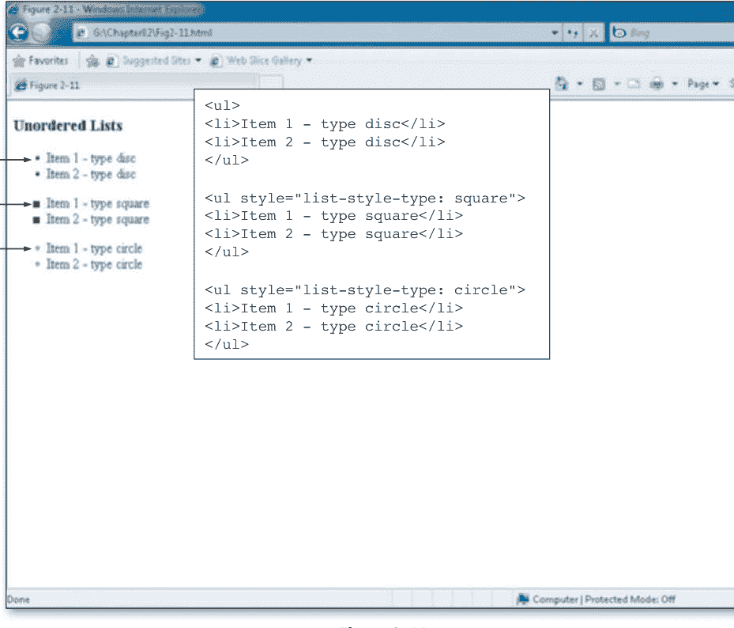

### 图 2–11

一个**有序列表**，也称为**编号列表**，使用数字或字母来格式化一系列信息。有序列表非常适合用来组织必须强调顺序的项目，例如一系列步骤。下一页的图 2–12 展示了格式化为有序列表或编号列表的网页文本，以及用于创建这些列表的 HTML 标签。

`<ul>` 和 `</ul>` 标签必须位于无序或项目符号列表的开头和结尾。`<ol>` 和 `</ol>` 标签用于有序或编号列表的开头和结尾。无序和有序列表有可选的项目符号和编号类型。如图 2–11 所示，无序列表可以使用三种不同的项目符号选项之一：圆点、方块或圆形。如果未指定类型，则使用默认的圆点。有序列表可以使用数字、字母或罗马数字，如图 2–12 所示。默认选项是使用阿拉伯数字，例如 1、2 和 3。

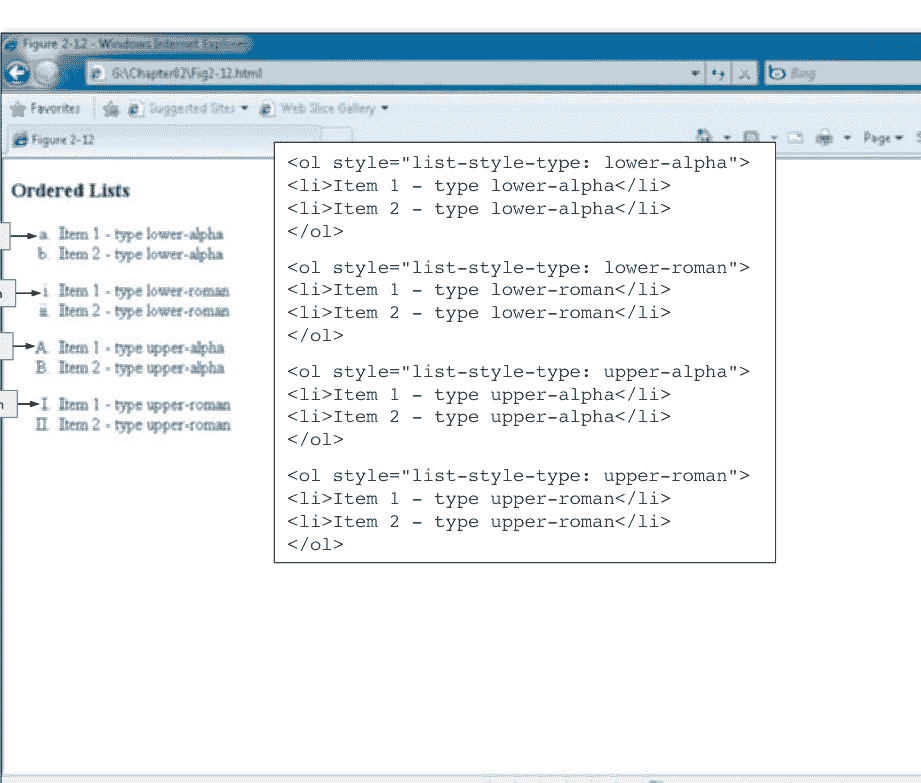

在输入 `<ul>` 或 `<ol>` 标签以定义列表类型后，使用 `<li>` 和 `</li>` 标签来定义有序或无序列表中的一个列表项。

## 创建无序列表

为了突出网站访问者可以为抗击全球饥饿做些什么，你将使用表 2–4 中所示的 HTML 标签和文本创建一个项目符号（无序）列表。请记住，每个列表项必须以 `<li>` 开头，并以 `</li>` 结尾。

| 行 | HTML 标签和文本 |
|---|---|
| 17 | `<h2>What you can do to help:</h2>` |
| 18 | |
| 19 | `<ul>` |
| 20 | `<li>Join the school's Fight Against World Hunger team with a $10 donation</li>` |
| 21 | `<li>Buy requested food at participating grocery stores and leave at drop-off locations</li>` |
| 22 | `<li>Volunteer to collect money and donations around the community</li>` |
| 23 | `</ul>` |

以下步骤说明了如何使用默认项目符号样式创建无序或项目符号列表。

### 1

- 将插入点放在第 17 行，输入如表 2–4 所示的 HTML 代码。当输入第 20、21 和 22 行的文本时，请确保在行首按 TAB 键，然后输入文本。在每行末尾按 ENTER 键。
- 在输入第 23 行后按 ENTER 键，使第 24 行为空行（图 2–13）。

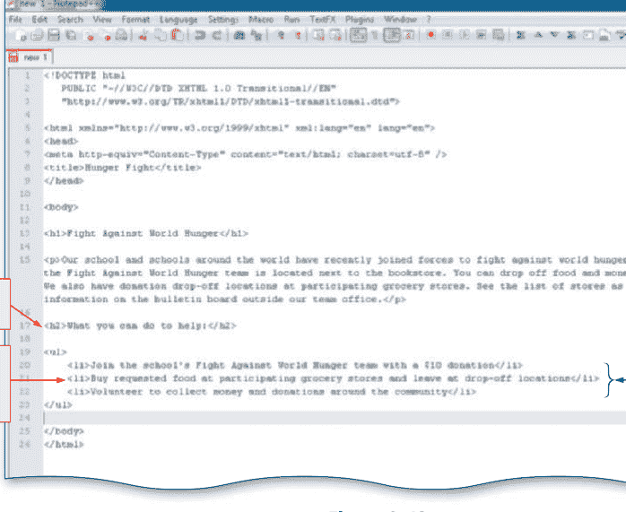

> **问答**
>
> 为什么在包含 `<li>`（列表项）代码的行开头按 TAB 键？
>
> 在输入列表项时使用 TAB 键（进行缩进）有助于格式化文本，使你能够轻松看出这段文本与段落文本不同。缩进文本有助于 Web 开发人员看到代码的某些部分是相互关联的。

> **问答**
>
> 此列表将包含哪些类型的项目符号？
>
> 因为代码未指定 `type` 属性，所以列表使用默认的圆点项目符号。其他项目符号选项有方块、圆形、数字、字母和罗马数字。你还可以使用图形图像作为项目符号，这将在后面的章节中介绍。

## 关于列表格式的更多信息

如果你使用不带属性的 `<ul>` 或 `<ol>` 开始标签，你将得到默认的项目符号（圆点）或编号样式（阿拉伯数字）。要更改项目符号或编号类型，需要在 `<ol>` 或 `<ul>` 标签内输入 `list-style-type` 属性。要创建带有方块项目符号的列表，你需要输入以下行：

```html
<ul style="list-style-type: square">
```

作为内联样式（CSS）代码。你可以在附录 D 中找到其他列表样式属性和值。

除了有序和无序列表，还有第三种列表，称为**定义列表**，它以类似字典的样式来偏移信息。虽然它们比无序或有序列表使用得少，但定义列表对于创建术语和定义的术语表很有用，如下一页的图 2–14a 所示。图 2–14b 显示了用于创建定义列表的 HTML 代码。

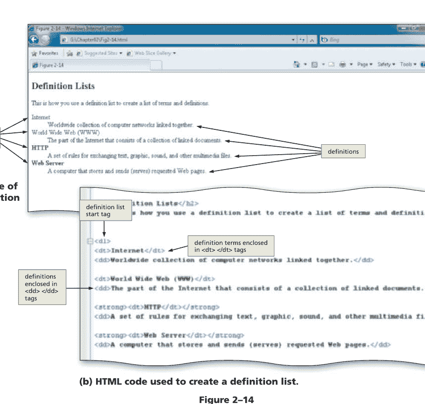

### 图 2-14

定义列表的语法不像无序和有序列表样式中使用的 `<ul>`、`<ol>` 或 `<li>` 结构那样直接。对于定义列表，你使用 `<dl>` 和 `</dl>` 标签来开始和结束列表。`<dt>` 标签表示一个术语，而 `<dd>` 标签通过将定义与术语偏移开，来标识该术语的定义。表 2-5 列出了定义列表的元素及其用途。

### 表 2-5：定义列表元素和用途

| 定义列表元素 | 用途 |
|---|---|
| `<dl>` `</dl>` | 开始和结束一个定义列表 |
| `<dt>` `</dt>` | 标识一个术语 |
| `<dd>` `</dd>` | 标识紧接其上的术语的定义 |

如图 2-14 所示，默认情况下，定义术语在行中左对齐，每个术语的定义都缩进，以便轻松区分它是上方术语的定义。为了更清晰地标出定义术语，你可能希望将术语加粗，如图 2-14 中最后两个定义（HTTP 和 Web Server）所示。你可以通过使用包含以下代码的内联样式来做到这一点：

```html
<dt style="font-weight: bold">
```

## 保存和组织 HTML 文件

在可以在 Web 浏览器中查看你的 HTML 文件之前，你必须保存它。保存你的 HTML 文件也很重要，原因如下：

- 如果在打开文本编辑器时关闭计算机或断电，内存中的文档将丢失。
- 如果你在完成项目前时间用完了，你可以在将来完成文档，而无需从头开始。

要保存文件，请使用 Notepad++ 的“文件”、“保存”命令。保存文件时，你需要为文件命名，并在后面加上文件扩展名。正如本书前面提到的，文件名应始终与其目的相关联。例如，将文件命名为 `page1` 并不能表明该文件的目的。将文件命名为 `hungerfight` 可立即识别出该文件与该主题有关。本书中的网页文件始终使用全小写字母命名，且没有空格。这是本书遵循的标准。

HTML 文件必须以 `.htm` 或 `.html` 扩展名结尾。许多较旧的 Web 服务器只能显示扩展名为 `.htm` 的页面，或短文件名（即，长度仅为八个字符的文件名）。扩展名为 `.html` 的 HTML 文件可以在运行允许长文件名（即，长度可达 255 个字符）操作系统的 Web 服务器上查看。几乎所有当前操作系统都允许长文件名，包括 Windows 7、Windows Vista、Windows XP、Windows Server 2003/2008、Windows 2000、Macintosh 和 Linux。对于运行不接受长文件名的操作系统的 Web 服务器，你需要使用 `.htm` 扩展名。在本书中，所有文件都使用 `.html` 扩展名保存。

本书中的所有项目都将使用非常简单的文件夹结构。因此，将文件组织在文件夹中很重要，这样项目或章末练习的所有文件，包括 HTML 代码和图形图像，都保存在同一文件夹中。如果你正确下载了“学生数据文件”（见本书内封底）中的文件，你将拥有所需的文件结构。当你最初保存 `hungerfight.html` 文件时，你将把它保存在 `Chapter02` 文件夹的 `ChapterFiles` 子文件夹中。第 2 章中使用的图形图像 `hungerfightlogo.jpg` 将存储在同一文件夹中 — `Chapter02\ChapterFiles`。因为本书中的章节项目相对简单且使用很少的图像，所以图像和 HTML 代码存储在同一文件夹中。然而，在实际应用中，一个网站可能有数百或数千个文件，将 HTML 代码和图形图像分离到不同的子文件夹中更为合适。你将在第 3 章中了解更多关于组织 HTML 文件和文件夹的信息。

### 确定保存网页的位置

保存网页时，你必须决定使用哪种存储介质。

- 如果你始终在同一台计算机上工作，并且不需要将项目传输到其他位置，那么你的计算机硬盘驱动器就足以作为存储位置。然而，将项目备份副本保存在单独的介质上是个好主意，以防文件损坏或计算机硬盘故障。
- 如果你计划在不同位置或在多台计算机上处理项目，那么你应该将项目保存在可移动介质上，例如 USB 闪存驱动器或 CD。本书中的项目使用 USB 闪存驱动器，它能快速可靠地保存文件，并且可以重复使用。CD 易于携带，并且由于通常只能保存文件一次，因此可作为项目最终版本的良好备份。
- 以上是关于保存文件的一般准则。你的讲师可能会给你特定的说明来保存你的工作，这些说明可能与下面的步骤不同。

HTML 54：HTML 第 2 章使用内联样式创建和编辑网页

### 保存 HTML 文件

你在创建这个项目的许多步骤中付出了努力，不想冒丢失已做工作的风险。此外，要在浏览器中查看 HTML，你必须保存文件。以下步骤展示了如何保存 HTML 文件。

将 USB 闪存驱动器连接到计算机的一个 USB 端口，然后单击 Notepad++ 菜单栏上的“文件”（File）（图 2-15）。

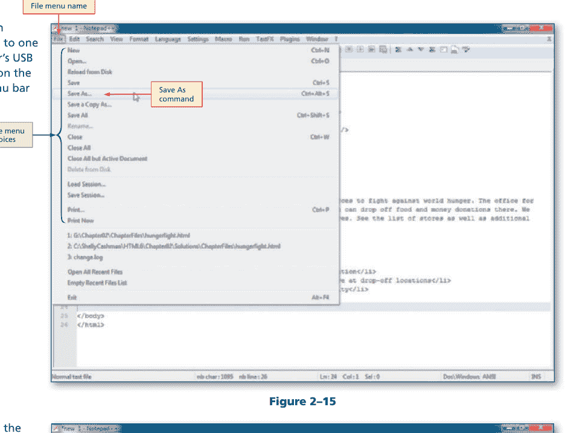

单击“文件”菜单上的“另存为”（Save As）以显示“另存为”对话框（图 2-16）。

> **问与答**
>
> 我必须保存到 USB 闪存驱动器吗？
>
> 不必。你可以保存到任何设备或文件夹。文件夹是存储介质上的特定位置。使用相同的过程，但选择你的设备或文件夹。

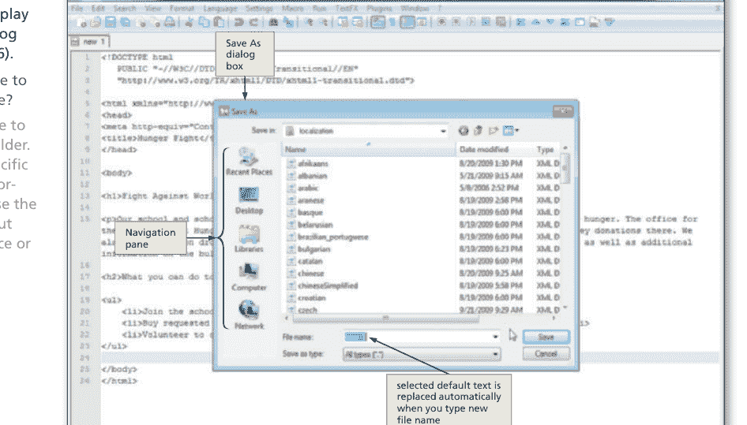

HTML 55：保存和组织 HTML 文件

**HTML 第 2 章**

### 3

- 在“文件名”（File name）文本框中输入 `hungerfight.html` 以更改文件名。输入文件名后不要按 ENTER 键。
- 单击对话框左侧的“计算机”（Computer）以显示可用驱动器列表（图 2-17）。
- 如有必要，滚动列表直到你的 USB 闪存驱动器（如 UDISK 2.0 (G:)）出现在可用驱动器列表中。

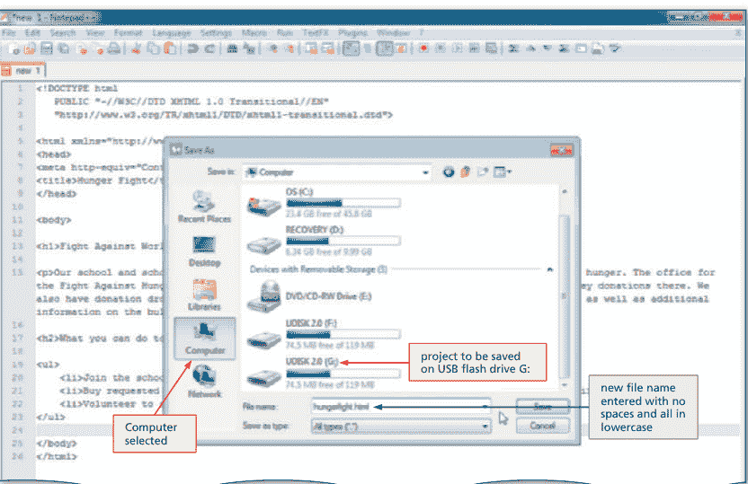

> **问与答** 为什么我的文件、文件夹和驱动器列表排列和命名方式与图中所示的不同？
>
> 你的计算机配置决定了文件和文件夹列表的显示方式以及驱动器的命名方式。

> **问与答** 如何知道我的文件将保存在哪个驱动器和文件夹中？
>
> Notepad++ 会显示可用驱动器和文件夹的列表。然后你选择要将文件保存到的驱动器和/或文件夹。

> **顺便提一下：存储你的文件**
>
> 许多学校为学生提供 Web 服务器上的空间来存储他们的网页。但是，将你的网页保存到另一种介质（例如 USB 闪存驱动器）可以确保你拥有创建的文件的备份副本。将网页文件保存到学校实验室计算机的硬盘驱动器上，可能会面临下次在该实验室时文件不存在的风险。许多学校会在每次计算机启动时删除实验室技术员安装之外的所有文件。

HTML 56：HTML 第 2 章使用内联样式创建和编辑网页

### 4

- 双击“计算机”列表中的 UDISK 2.0 (G:)（或你的存储设备）以选择 USB 闪存驱动器（本例中为驱动器 G）作为新的保存位置。
- 如有必要，打开 `Chapter02\ChapterFiles` 文件夹（图 2-18）。

> **问与答**
>
> 如果我的 USB 闪存驱动器有不同的名称或盘符怎么办？
>
> 你的 USB 闪存驱动器很可能有不同的名称和盘符，并且连接到不同的端口。请验证“计算机”列表中的设备是否正确。

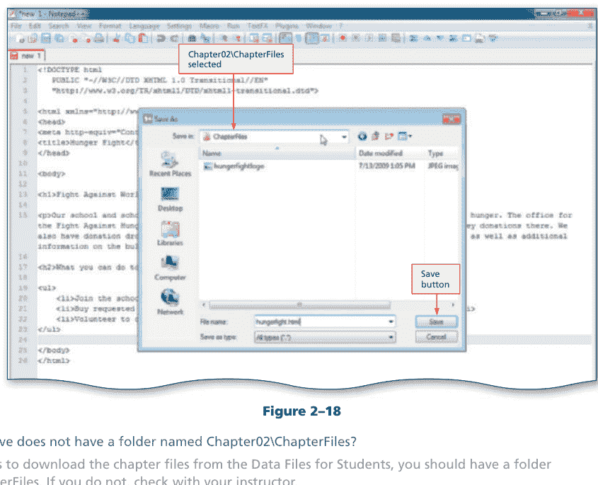

> **问与答**
>
> 如果我的 USB 闪存驱动器没有名为 `Chapter02\ChapterFiles` 的文件夹怎么办？


> 如果你按照步骤从“学生数据文件”下载了章节文件，你应该有一个名为`Chapter02\ChapterFiles`的文件夹。如果没有，请咨询你的讲师。

#### 5

- 单击“另存为”对话框中的“保存”（Save）按钮，将文件以`hungerfight.html`的名称保存在 USB 闪存驱动器上（图 2-19）。

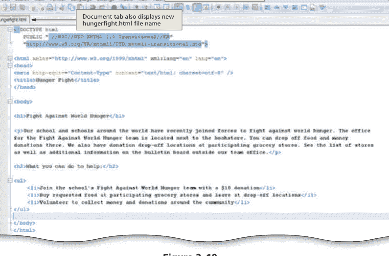

> **问与答**
>
> 我的文件现在只在 USB 驱动器上吗？
>
> 不，尽管 HTML 文件保存在 USB 驱动器上，但它也保留在内存中并显示在屏幕上（图 2-19）。Notepad++ 在标题栏和文档标签页上显示新的文件名。

**其他方式**

1. 按`CTRL+ALT+S`，输入文件名，单击“计算机”，选择驱动器或文件夹，单击“保存”（Save）按钮。

### 使用浏览器查看网页

在 HTML 文件中输入代码并保存后，你应该在浏览器中查看网页，以查看到目前为止网页的样子。HTML 文件在浏览器中的显示方式就像该文件可在网络上使用一样。通常，在开发过程中定期查看网页是良好的编码实践，因为它允许你查看各种 HTML 标签对文本的影响，并检查 HTML 文件中的错误。

如果当浏览器窗口打开时你的计算机连接到互联网，它会显示一个“主页”（home page），或“起始页”（start page），即每次 Internet Explorer 启动时出现的网页。

#### 启动浏览器

在 USB 驱动器上保存 HTML 文件后，下一步是使用浏览器查看网页。由于 Windows 是“多任务”的，你可以同时运行多个程序，例如 Notepad++ 和你的浏览器。以下步骤说明了如何启动浏览器来查看网页。

1. 单击任务栏上的 Internet Explorer 图标（图 2-20）。

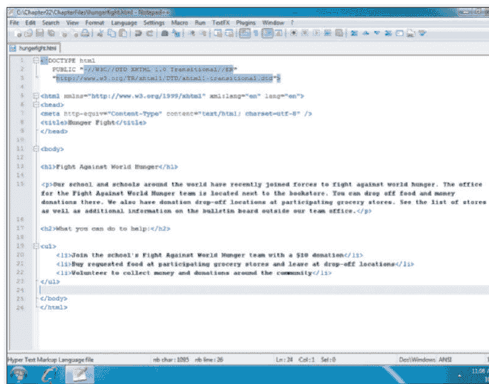

HTML 58 HTML 第 2 章 使用内联样式创建和编辑网页

2. 如有必要，单击“最大化”按钮以最大化浏览器窗口（图 2-21）。

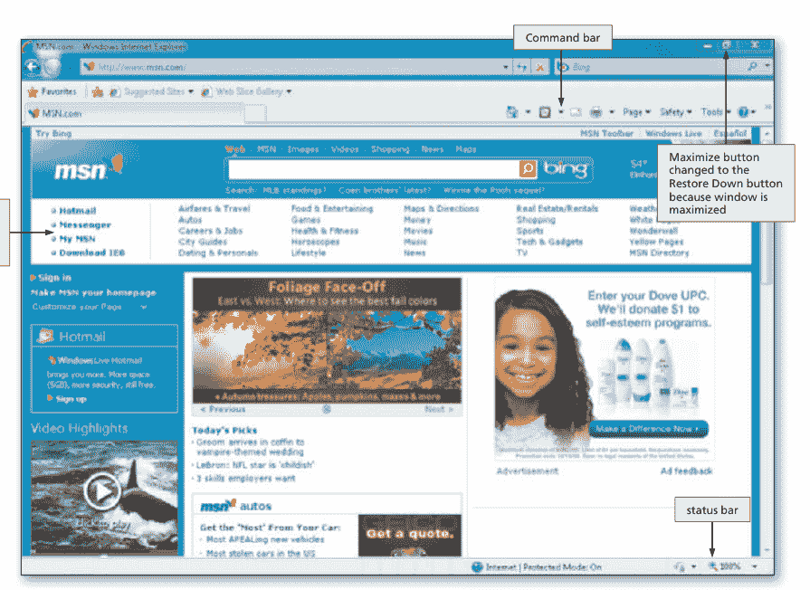

> **问与答**
>
> 为什么我的浏览器显示不同的窗口？
>
> 因为可以自定义浏览器设置以更改作为主页显示的网页，所以你的浏览器显示的主页可能不同。学校和组织通常会将其网站上的主页设置为实验室或办公室计算机上安装的浏览器的主页。

**其他方式**

1. 单击“开始”，“所有程序”，“Internet Explorer”。
2. 双击桌面上的 Internet Explorer 图标（如果存在）。

**顺便提一下：为多种浏览器开发网页**

开发网页时，你必须考虑访客可能使用的浏览器类型，包括 Windows 上的 Internet Explorer 和 Mozilla Firefox，或 Mac OS 上的 Safari 或 Internet Explorer。Apple 网站提供了创建可在多种浏览器中工作的网页的建议。彻底测试的一部分包括在不同版本的不同浏览器中打开你的网页。

### 在浏览器中查看网页

浏览器允许你打开位于计算机上的 Web 文件并拥有完整的浏览功能，就像该网页存储在 Web 服务器上并在网络上可用一样。以下步骤使用此技术在浏览器中查看 HTML 文件`hungerfight.html`。

1. 单击地址栏以选择地址栏上的 URL。
2. 输入`g:\Chapter02\ChapterFiles\hungerfight.html`以在地址栏上显示新的 URL（图 2-22）。只有在按 ENTER 键后，网页才会显示，如下一步所示。

> **问与答**
>
> 如何更正地址栏上的 URL？
>
> URL 显示在地址栏上。如果你在地址栏上输入了不正确的字母或符号，并在进入下一步之前注意到该错误，请使用 BACKSPACE 键擦除所有字符，直到并包括不正确的字符，然后继续输入。

> **问与答**
>
> 如果我的文件在不同的位置怎么办？
>
> 你可以在地址栏中输入文件的路径，或者浏览到你的文件，如下一页的“其他方式”所示。

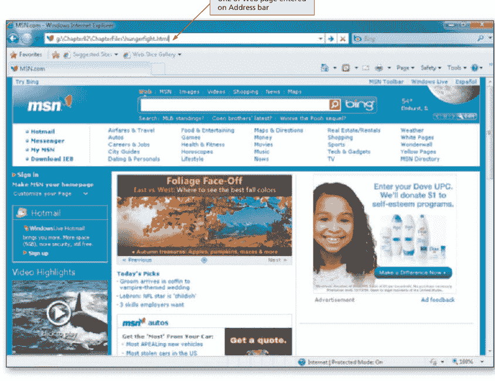

图 2-22

### 第二章 使用内联样式创建和编辑网页

按下 ENTER 键，即可像在 Web 上查看一样显示`hungerfight.html`页面（图 2–23）。

> 如果我收到 Internet Explorer (IE) 的警告，提示“Internet Explorer 需要打开一个新窗口来显示此网页”，该怎么办？如果发生这种情况，您应该点击“确定”按钮继续。随后您将在另一个 IE 窗口中看到您的网页。

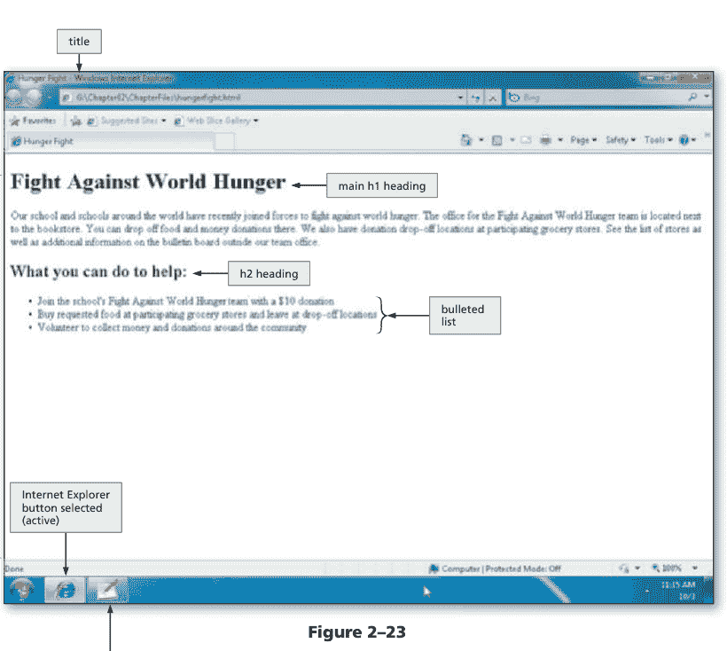

> 如果我的页面显示不正确怎么办？请仔细核对图 2–19 检查您在`hungerfight.html`中的输入，确保没有打字错误或遗漏。更正错误后，重新保存文件并再次尝试。

**其他方法**

- 在 Windows 资源管理器中，双击 HTML 文件名可在默认浏览器中打开。
- 在 Windows 资源管理器中，右键单击 HTML 文件名，单击“打开方式”，然后单击浏览器名称。
- 如果菜单未显示，请单击“工具”、“工具栏”、“菜单栏”；在菜单栏上单击“文件”、“打开”，然后浏览到所需文件。

> **用户界面设计**
>
> 用户界面设计是网站非常重要的一个方面。如果网站设计不佳，用户可能无法找到所需信息或完成任务，这会使网站失去效用。有许多优秀的网站讨论了网页设计原则。

### 激活 Notepad++

查看网页后，您可以通过向 HTML 文件添加额外的标签或文本来修改网页。要继续编辑，首先必须返回 Notepad++ 窗口。以下步骤说明了如何激活 Notepad++。

1. 单击任务栏上的 Notepad++ 按钮，最大化 Notepad++ 并使其成为活动窗口（图 2–24）。

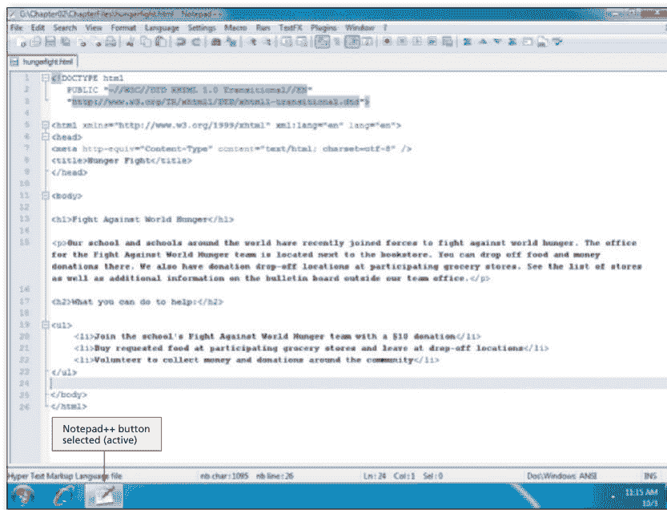

**图 2–24**

### 改善网页的外观

网页开发的目标之一是创建一个视觉上吸引人并能保持访问者兴趣的网页。本章目前开发的网页功能完备，但缺乏视觉吸引力。在本节中，您将学习如何通过添加图片、为标题添加颜色、添加水平线以及更改项目符号列表的字体样式，将网页外观从图 2–25a 所示的样式改善为图 2–25b 所示的样式。许多这些任务都可以通过使用样式表来完成。

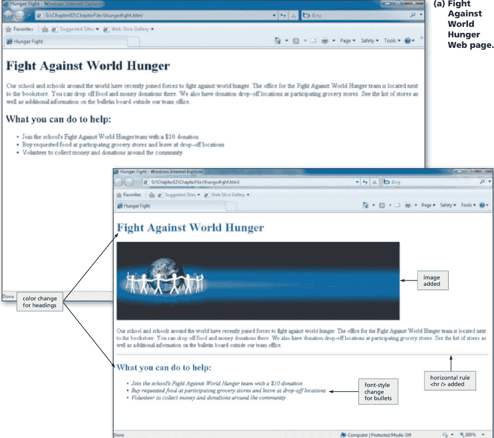

### 使用样式表

尽管 HTML 允许网页开发者更改网页的结构、设计和内容，但 HTML 在定义一个或多个网页的外观或样式方面能力有限。因此，样式表应运而生。

回顾一下，**样式**是定义网页上元素外观的规则。**样式表**是一系列定义网页或整个网站样式的规则。使用样式表，您可以通过更改字体系列、字体大小、边距和链接规范等特征来改变一个或多个网页的外观。

CSS 支持三种类型的样式表：内联、嵌入式和外部（或链接）。使用**内联样式**，您可以为单个 HTML 标签（例如标题）添加样式。

### 样式表优先级

如表 2–6 所示，CSS 支持的三种样式表在不同的层级控制网页的外观。每种样式表类型相对于其他类型也具有不同的优先级或优先级级别。例如，外部样式表用于定义网站中多个页面的样式。嵌入式样式表用于更改单个网页的样式，但会覆盖或优先于外部样式表中定义的任何样式。内联样式用于控制单个 HTML 标签内的样式，并优先于嵌入式和外部样式表中定义的样式。

**顺便提一下：内联样式**

当您想要更改单个 HTML 元素的外观（或样式）时，使用内联样式很有帮助。附录 D 包含了大多数浏览器支持的层叠样式表属性和值。本章中使用的内联样式可以在附录中找到。有关内联样式的更多信息，请参阅`w3.org`。

#### 表 2–6 样式表优先级

| 类型 | 层级和优先级 |
| --- | --- |
| 内联 | • 更改单个 HTML 标签内的样式<br>• 覆盖嵌入式和外部样式表 |
| 嵌入式 | • 更改单个网页的样式<br>• 覆盖外部样式表 |
| 外部 | • 更改网站中多个页面的样式 |

由于样式表具有不同的优先级，所有三种类型的样式表都可以在单个网页上使用。例如，您可能希望网页的某些元素与网站中的其他网页保持一致，但您也可能希望改变该网页某些部分的外观。您可以使用这三种类型的样式表来实现这一点。

### 样式语句格式

无论您使用何种类型的样式表，都必须使用**样式语句**来定义样式。以下代码显示了内联样式中使用的样式语句示例：

```html
<h1 style="font-family: Garamond; font-color: navy">
```

样式语句由选择器和声明组成。样式语句中标识页面元素的部分称为**选择器**。在此示例中，选择器是`h1`（标题大小 1）。样式语句中标识元素应如何显示的部分称为**声明**。在此示例中，声明是引号之间的所有内容：`font-family`和`font-color`属性及其值（分别是`Garamond`和`navy`）。声明至少包含一种要应用于所选元素的样式或**属性**。属性的示例包括`color`、`text-indent`、`border-width`和`font-style`。对于每个属性，声明包含一个相关的**值**，该值指定该特定属性的显示参数。

每个属性都接受基于该属性可以定义的样式的特定值。例如，属性`font-color`可以接受值`navy`，但不能接受值`10%`，因为那不是有效的颜色值。在本章的下一节中，您将为`h1`和`h2`标题将标题颜色更改为蓝色。在这种情况下使用内联样式是合适的，因为网页上只有两个标题需要更改。如果您有许多标题需要更改，嵌入式或外部样式表会更合适。这将在后面的章节中讨论。

**内联样式**

内联样式用于定义单个 HTML 标签的样式。例如，要更改单个段落的样式，您可以添加一个内联样式，其中`<p>`（段落）标签作为选择器，以及一个为该段落定义新的字体样式和样式值的声明，如下所示：

```html
<p style="font-style: italic; font-size: 8pt">
```

由于内联样式优先于其他类型的样式表并影响单个 HTML 标签的样式，当网页的某个部分需要具有与网页其余部分不同的样式时，内联样式很有帮助。在本章的项目中，内联样式用于更改网页上标题的颜色以及更改项目符号列表中的字体样式。

现在您已经了解了样式表和内联样式的工作原理，是时候考虑添加图片以增强网页的外观了。

#### 查找合适的图形图像

要在网页上使用图形图像（也称为图形），图像必须以数字方式存储在文件中。包含图形图像的文件可从各种来源获取：

- Microsoft 在 Web 上提供免费的数字图像供在文档中使用。其他网站也提供图像，其中一些是免费的，而另一些则需要付费。
- 您可以使用数码相机拍照并**下载**，这是将数字照片从相机复制到计算机的过程。
- 使用扫描仪，您可以将印刷的图片、图画或图表转换为数字文件。

如果您从除自己以外的来源收到图片，请在确定其不包含病毒之前不要使用该文件。**病毒**是一种可能损坏计算机上文件和程序的计算机程序。使用防病毒程序验证您使用的所有文件都是无病毒的。

**确定图形图像的位置和格式。** 图形的内容、大小、形状、位置和格式应能吸引过路人的兴趣，诱使他们停下来阅读网页。通常，图形是页面的视觉中心，也是视觉上最大的元素。如果您在图形图像中使用颜色，请确保它们是网页配色方案的一部分。

**确定图像的宽度和高度。** 图像的宽度和高度（以像素为单位）应始终在``标签中标识。浏览器使用这些尺寸来确定显示图像的大小。如果您未标识这些属性，浏览器必须确定大小。这会减慢浏览器的处理速度。

**为图像提供替代文本。** 每个图像都应始终使用替代文本。此文本对于使用屏幕阅读器（将计算机屏幕上的信息转换为音频输出）的视觉障碍用户特别有用。替代文本的长度应合理。

### 网页图片

图片以多种方式用于增强网页的外观，使其更有趣、更多彩。图片可用于添加背景色、帮助组织网页、澄清文本中阐述的观点，或作为指向其他网页的链接。图片也常用于分隔网页的不同部分（如使用水平线），或作为引导访客浏览网站的导航元素。

### 使用网页分区

有时将网页划分为若干分区（或部分）会很有帮助，这使你可以为不同的网页元素应用样式。在本书中，你始终使用起始`<div>`和结束`</div>`分区标签作为容器来插入图片。利用分区标签，你可以添加样式，例如居中图片或为图片添加背景色。

### 图片类型

网页使用三种类型的文件作为图片：GIF、JPEG 和 PNG（表 2-7）。**图形交换格式**（**GIF**）文件的扩展名为`.gif`。保存为 GIF（读作*jiff*或*giff*）的图形图像使用称为 LZW 压缩的技术，以使其在网页上下载时体积更小。标准（或非隔行扫描）GIF 图像在加载时逐行显示。隔行扫描 GIF 图像一次性全部加载，开始时呈现模糊外观，加载过程中逐渐变清晰。对大型图像使用隔行扫描 GIF 是一种好技巧，因为网页访客可以在图像加载时看到其模糊轮廓。然而，GIF 是一种专利格式，因此其广泛使用受到限制。

> **顺便提一下：图片**
>
> 网页上的图片会在各种环境中被查看，包括慢速的互联网连接和较慢的计算机。优化你的图片对于加快所有网页访客的下载速度非常重要。请在网上搜索有关图片优化的更多信息。

第二种图片文件类型是**便携式网络图形**（**PNG**），其扩展名为`.png`或`.ping`。PNG（读作*ping*）格式也是一种压缩文件格式，支持多种颜色和分辨率。万维网联盟（World Wide Web Consortium）开发了 PNG 格式作为无专利的图形标准，以替代 GIF 格式。大多数较新的浏览器支持 PNG 图像。

最后，**联合图像专家小组**（**JPEG**）文件的扩展名为`.jpg`、`.jpe`或`.jpeg`。JPEG（读作*JAY-peg*）是一种使用 LZW 以外的压缩技术保存的图形图像。JPEG 文件通常用于更复杂的图像，例如照片，因为 JPEG 文件格式比其他文件类型支持更多的颜色和分辨率。

**表 2-7 图片类型及用途**

| 图片类型 | 用途 |
| --- | --- |
| 图形交换格式 (GIF) | • 用于颜色较少（<256）的图像<br>• 允许透明背景 |
| 便携式网络图形 (PNG) | • 最新的图像格式<br>• 适用于所有类型的图像<br>• 允许不同程度的透明度 |
| 联合图像专家小组 (JPEG) | • 用于颜色较多（>256）的图像，例如照片 |

如果图片不是这些格式之一，你可以使用画图或图形编辑程序将图像转换为`.gif`、`.jpg`或`.png`格式。有些画图程序甚至允许你将 GIF 图像保存为隔行扫描格式。当今市场上有许多画图和图形编辑程序可用，例如 Adobe Photoshop 和 Corel Paint Shop Pro。

> **过度使用图片**
>
> 谨慎避免在网页上过度使用图片。使用过多的图片可能会使你的网页显得杂乱，或分散访客对网页目的的关注。图片应有其用途，例如传达内容、视觉上组织页面、提供超链接或服务于其他功能。

### 图片属性

你可以通过使用属性来增强 HTML 标签。**属性**为 HTML 标签定义附加特征。例如，你应该对所有``标签使用`width`和`height`属性。表 2-8 列出了可与``标签一起使用的属性。在本章中，`src`和`alt`属性用于``标签。图片属性将在后续章节中详细解释，因为它们在后续章节中会被使用。

**表 2-8 图片属性**

| 属性 | 功能 |
| :--- | :--- |
| `alt` | • 图片加载时显示的替代文本<br>• 对于屏幕阅读器（将计算机屏幕上的信息转换为音频输出）尤其有用<br>• 应简要说明图片的目的<br>• 通常应控制在 50 个字符以内 |
| `height` | • 定义图片的高度，以像素为单位<br>• 可改善加载时间 |
| `hspace` | • 定义图片与文本之间的水平间距 |
| `src` | • 定义要加载的图片的 URL |
| `vspace` | • 定义图片与文本之间的垂直间距 |
| `width` | • 定义图片的宽度，以像素为单位<br>• 可改善加载时间 |

### 添加图片

在早期，当网络主要用于研究人员相互分享信息时，拥有纯功能性的、仅含文本的网页是常态。如今，网页访客已习惯于更具图形化导向的世界，并期望网页使用能提供视觉趣味的图片。以下步骤说明了如何通过在 HTML 文件中输入``标签（使用表 2-9 所示的标签和文本）将图片添加到网页。

**表 2-9 添加图片**

| 行号 | HTML 标签和文本 |
| :--- | :--- |
| 15 | `<div>` |
| 16 | `` |
| 17 | `</div>` |

点击空白的第 14 行，然后按回车键。

将插入点放在第 15 行，输入如表 2-9 所示的 HTML 代码。在每行末尾按回车键（图 2-26）。

> **问与答**
>
> **`alt`属性的用途是什么？**
>
> `alt`属性有三个重要用途。首先，视力障碍用户使用的屏幕阅读器会大声朗读替代文本。其次，在图片加载时会显示替代文本。最后，XHTML 合规性要求使用`alt`标签。

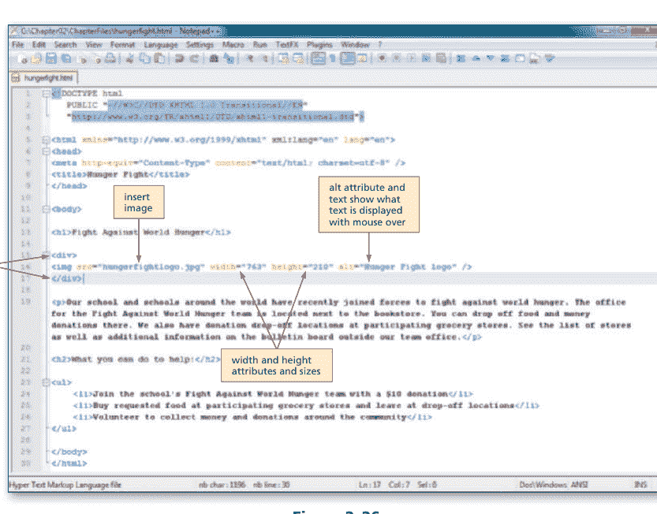

> **问与答**
>
> **`<div>`和`</div>`标签的用途是什么？**


> `<div>` 标签在网页内建立一个分区。当你使用 `<div>` `</div>` 标签时，你能够设计使用 CSS 的布局，包括插入图片。

**进行其他视觉增强。**

除了图片，还有几种方法可以增加视觉趣味性。

**为标题添加颜色。** 网页开发者经常使用颜色来突出网页上的元素。所选颜色应与为页面选择的图片相协调。它还应使网页文本易于阅读。有些颜色，例如深色，可能不合适，因为默认的黑色文本无法在深色背景上有效显示。更改元素（如标题）的颜色时，通常最好将相同的样式应用于网页上的所有标题，以保持一致性。

**更改项目符号列表的字体样式。** 有时，更改项目符号列表中的文本样式在美学上令人愉悦。当你想突出信息时，你可能希望将项目符号文本设置为斜体或粗体。

**插入水平线。** 使用水平线来分隔网页上的文本很有用。水平线用作页面的分隔符，用于分隔文本部分。

**提前规划**

颜色

图 2-7 并未列出所有可能的网页颜色。还有许多其他颜色可用于网页背景或文本字体。有关颜色的更多信息，请参见附录 B 或在网上搜索浏览器颜色。

### 其他视觉增强

一种吸引网页访客注意力的方法是使用颜色。许多颜色可用作网页背景、文本或链接。图 2-7 展示了网页上常用的颜色及其对应的六位数代码。六位数代码可用于指定背景、文本或链接的颜色。“抗击世界饥饿”网页上的标题目前是黑色（默认颜色）。你将通过使用内联样式为标题添加颜色来美化网页。

**十六进制颜色**

这是一些常见颜色及其十六进制等效值的表格。使用这些代码来定义背景、文本或链接的所需颜色。

**十六种预定义颜色**

（因为这些颜色属于 RGB 色谱，它们在屏幕上看起来会有些不同。）

图 2-7

**浏览器安全色**

网页开发者过去必须确保使用浏览器安全色（附录 B）。当今显示器的趋势是显示“真彩色”，这意味着显示器可以显示多达 1600 万种颜色中的任何一种。很少有人再使用 8 位显示器了，因此你通常不必将自己限制在浏览器安全色范围内。

图 2-7 中显示的颜色代码和名称可用于背景、文本和链接颜色。`color` 属性在 `<h1>` 和 `<h2>` 标签中用于指定这些标题的颜色。颜色 `#3D60B1` 将用于这些标题，因为它是上述步骤中插入的图形图像中包含的颜色之一。

另一种增强网页视觉效果的方法是更改部分文本的样式。这可以吸引对网页上特定文本的关注。在本节中，你将使用内联样式将项目符号列表中的文本更改为斜体样式。此更改有助于突出该项目符号列表中的三个要点。

### 为网页标题添加颜色

要更改网页上标题的颜色，必须在 HTML 文件的 `<h1>` 和 `<h2>` 标签中添加颜色属性。`颜色`属性允许您更改网页上各种元素的颜色。以下步骤展示了如何使用内联样式中的颜色属性添加颜色。

1. 在第 13 行的 `<h1>` 标签中，点击 "1" 之后、闭合括号之前的位置，然后按空格键。

2. 输入 `style="color: #3D60B1"` 作为“对抗世界饥饿”标题的颜色代码（图 2–29）。

3. 在第 21 行的 `<h2>` 标签中，点击 "2" 之后、闭合括号之前的位置，然后按空格键。

4. 输入 `style="color: #3D60B1"` 作为“你能提供什么帮助：”标题的颜色代码（图 2–29）。

> **问与答**

> 我能使用任何十六进制代码或颜色名称来更改标题颜色吗？

> 虽然您可以使用任何可用的十六进制代码或颜色名称，但您必须确保颜色适合您网页的标题。您不会希望标题颜色太浅，或者以其他方式削弱标题的效果。

> **问与答**

> 我能否使用复制/粘贴的方法，将内联样式从 `<h1>` 标签复制到 `<h2>` 标签？

> 是的，复制/粘贴会产生相同的结果。但是，如果您想将样式复制到网页的所有标题上，使用嵌入式或外部样式表会更容易，您将在接下来的两章中了解相关内容。

### 更改项目符号列表样式

要更改项目符号列表的样式，您需要再次使用带有 `font-style` 属性的内联样式。`font-style` 属性允许您更改所选字体或文本的样式。`font-style` 有三个值：`normal`、`italic` 和 `oblique`，尽管目前只有 `normal` 和 `italic` 得到浏览器的广泛支持。以下步骤展示了如何使用内联样式中的 `font-style` 属性添加字体样式。

1. 在第 23 行的 `<ul>` 标签中，点击 "l" 之后、闭合括号之前的位置，然后按空格键。

2. 输入 `style="font-style: italic"` 作为代码（图 2–30）。

### 添加水平线

以下步骤说明了如何向网页添加水平线。

1. 点击空白的第 20 行，然后按回车键。

2. 输入 `<hr />` 作为 HTML 标签，然后按回车键（图 2–31）。

3. 点击菜单栏上的“文件”，然后点击“保存”。

> **HTML 和 XHTML 标签**

> 网络上有许多优秀的资源列出了 HTML 和 XHTML 标签。有关 HTML 和 XHTML 的更多信息，请在搜索引擎中搜索“HTML 标签”或“XHTML 标签”。

### 在浏览器中刷新视图

当您在 Notepad++ 中继续开发 HTML 文件时，最好在修改时在浏览器中查看文件。在浏览器中查看修改后的网页时，务必点击“刷新”按钮，以确保显示最新版本的网页。下一页的步骤展示了如何在浏览器中刷新网页视图，以便查看修改后的网页。

1. 点击任务栏上的 Internet Explorer 按钮以显示主页。

2. 点击地址栏上的“刷新”按钮以显示修改后的网页（图 2–32）。

**其他方法**

1. 在 Internet Explorer 中，按 `F5` 刷新。

### 验证和查看 HTML 代码

在第 1 章中，您了解了验证 HTML 代码。网络上有许多验证服务可用，可用于确保您的 HTML 代码符合标准。这应始终是您网页测试的一部分。本书中使用的验证服务是 W3C 标记验证服务 (`validator.w3.org`)。XHTML 验证器会查看 `DOCTYPE` 语句，以确定您使用的是哪个版本的 HTML 或 XHTML，然后检查代码对于该版本是否有效。在本章中，项目使用的是 Transitional 代码。

如果验证检测到您的 HTML 代码中有错误，您会在标题栏（位于下一页的图 2–33a）中看到红色的警告“在将此文档作为 XHTML 1.0 Transitional 检查时发现错误！”。结果行显示了您拥有的错误数量。您可以向下滚动页面或点击“跳转到：验证输出”链接查看每个错误的详细注释。

需要注意的是，一个错误可能导致更多错误。例如，`hungerfight.html` 文件中的 `<hr />` 标签被更改为 `<hr>` 以展示包含错误的代码。图 2–33b 显示，在这种情况下，一个初始错误最终导致了总共四个错误。

源代码是用于创建网页或程序的代码或指令。对于网页，源代码就是 HTML 代码，然后由浏览器将其转换为图形化的网页。您可以在浏览器中查看任何网页的 HTML 源代码。此功能允许您检查自己的 HTML 源代码，以及查看其他开发者用于创建其网页的 HTML 代码。如果网页上的某个功能适合或吸引您的网页，您可以查看源代码以了解添加该功能所需的 HTML，然后将 HTML 代码的部分内容复制到您自己的网页中。

### 验证 HTML 代码

现在，您已将所有基本元素添加到网页中，并通过图像、颜色、斜体和水平线对其进行了增强，您需要验证您的代码。以下步骤说明了如何使用 W3 验证器验证 HTML 代码。

1. 点击浏览器上的地址栏以突出显示当前 URL。

2. 输入 `validator.w3.org` 以替换当前条目，然后按回车键。

3. 如果需要，当浏览器询问是否打开新窗口时，点击“确定”。

4. 点击“通过文件上传验证”选项卡（图 2–34）。

#### HTML 76 HTML 第 2 章 使用内联样式创建和编辑网页

2. 点击“浏览”按钮。

3. 在您的存储设备上找到 `hungerfight.html` 文件，然后点击文件名。

4. 点击“选择要上传的文件”对话框上的“打开”按钮，文件路径和名称将被插入到“文件”框中，如图 2–35 所示。

5. 点击“检查”按钮（图 2–35）。结果验证应如图 2–36 所示显示。

6. 返回“对抗饥饿”网页，可以通过点击浏览器上的“后退”按钮，或点击任务栏中的 Internet Explorer 按钮来完成。

> **问与答**

> 我如何知道我的 HTML 代码是否有效？

> 通知标题栏将变为绿色，并且在结果区域，您应该会看到单词“通过”。

> **问与答**

> 如果我的 HTML 代码未通过验证，我该怎么办？

> 如果您的代码有错误，请编辑您的 HTML 文件以更正错误。标记验证服务报告会列出代码中的问题。一旦您进行了必要的更改并保存文件，您可以使用“浏览”按钮打开更正后的 HTML 文件，然后向下滚动并点击“重新验证”按钮以验证更改后的代码。

最后，您添加了一条水平线以进一步增强此网页。正如本章前面所讨论的，水平线是网页上用作分隔符的线条，为页面上的各部分提供视觉上的分隔。您可以使用内联图像添加水平线，也可以使用水平线标签 (`<hr />`) 添加简单的水平线，如以下步骤所示。图 2–28 展示了各种水平线的示例以及用于添加它们的 HTML 代码。默认的水平线显示为页面上的第一条线。通过增加显示的像素数量可以为水平线添加尺寸。

**图 2–28**

### 查看网页的 HTML 源代码

你可以使用浏览器查看大多数网页的源代码。以下步骤展示了如何使用浏览器查看网页的 HTML 源代码。

1. 在命令栏上单击“页面”（图 2-37）。

2. 单击“查看源代码”，在默认的文本编辑器中查看 HTML 代码。

> 问与答

> 是否所有浏览器都允许我以相同的方式查看 HTML 源代码？

> Firefox 或 Safari 等浏览器与 Internet Explorer 不同，可能会使用不同的按钮或菜单选项来访问源代码。例如，在 Mozilla Firefox 中，选择“查看”，然后选择“页面源代码”。

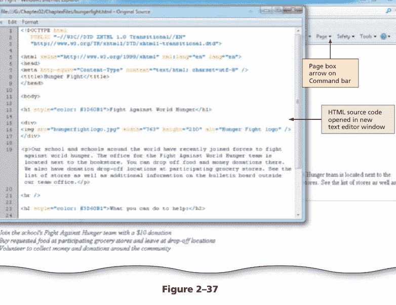

3. 单击文本编辑器标题栏上的“关闭”按钮以关闭活动的文本编辑器窗口（图 2-38）。

> 问与答

> 什么是默认的文本编辑器？

> 对于 Internet Explorer，它可能是记事本，但根据你的浏览器设置，也可能是 Notepad++ 或其他编辑器。

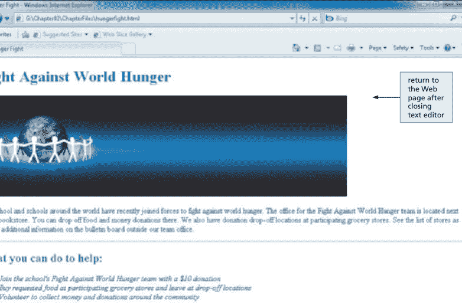

HTML 78 **HTML 第 2 章** 使用内联样式创建和编辑网页

### 打印网页和 HTML 文件

创建并保存 HTML 文件后，你可能想要打印一份 HTML 代码和相应的网页副本。文件的打印版本称为 **硬拷贝** 或 **打印件**。HTML 文件和网页的打印副本可用于参考或分发。在许多情况下，HTML 文件和网页会被打印并装订在活页夹中供他人使用。以下步骤展示了如何打印网页及其对应的 HTML 文件。

1. 根据打印机说明准备好打印机。

2. 在浏览器窗口中打开“抗击世界饥饿”网页，单击命令栏上的打印图标。

3. 当打印对话框出现时，单击“打印”按钮。

4. 当打印机停止打印网页时，取出打印件（图 2-39）。

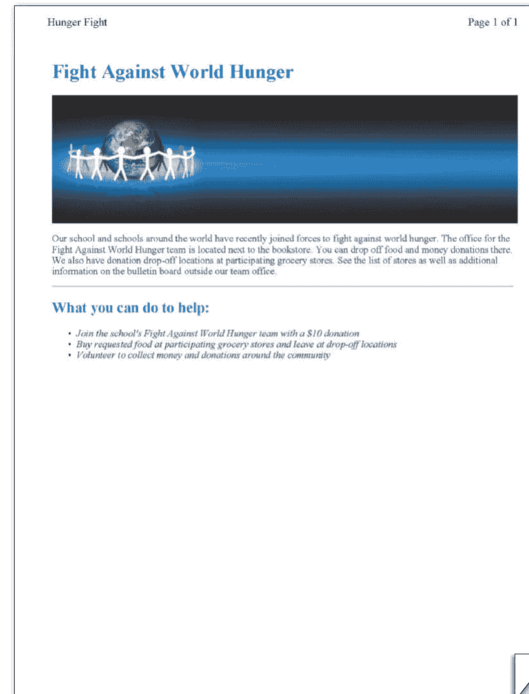

> **问与答**

> 是否有其他方式可以打印网页？

> 按 `CTRL+P` 可打开打印对话框，你可以在其中选择打印选项。你也可以使用“文件”菜单中的“打印”选项。

2. 单击任务栏上的 Notepad++ 按钮以激活 Notepad++ 窗口。

3. 单击菜单栏上的“文件”，单击“打印”命令，然后单击“打印”按钮以打印 HTML 代码的硬拷贝（图 2-40）。

> 问与答

> 为什么我需要打印 HTML 代码？

> 拥有硬拷贝打印件对于初学开发者来说是一个无价的工具。打印副本可以帮助你立即看到 HTML 标签与你在浏览器中查看的网页之间的关系。

```
<!DOCTYPE html
    PUBLIC "-//W3C//DTD XHTML 1.0 Transitional//EN"
    "http://www.w3.org/TR/xhtml1/DTD/xhtml1-transitional.dtd">

<html xmlns="http://www.w3.org/1999/xhtml" xml:lang="en" lang="en">
<head>
    <meta http-equiv="Content-Type" content="text/html; charset=utf-8" />
    <title>Hunger Fight</title>
</head>

<body>

<h1 style="color: #3D60B1">Fight Against World Hunger</h1>

<div>

</div>

<p>Our school and schools around the world have recently joined forces to fight against world hunger. The office for the Fight Against World Hunger team is located next to the bookstore. You can drop off food and money donations there. We also have donation drop-off locations at participating grocery stores. See the list of stores as well as additional information on the bulletin board outside our team office.</p>

<hr />

<h2 style="color: #3D60B1">What you can do to help:</h2>

<ul style="font-style: italic">
    <li>Join the school's Fight Against World Hunger team with a $10 donation</li>
    <li>Buy requested food at participating grocery stores and leave at drop-off locations</li>
    <li>Volunteer to collect money and donations around the community</li>
</ul>

</body>
</html>
```

图 2-40

HTML 80 HTML 第 2 章 使用内联样式创建和编辑网页

**快速参考**

有关 HTML 标签及其相关属性的列表，请参阅本书末尾的 HTML 快速参考（附录 A），或访问 HTML 快速参考网页 (`scsite.com/HTML6e/qr`)。有关 CSS 属性和值的列表，请参阅附录 D。

BTW

### 退出 Notepad++ 和浏览器

以下步骤展示了如何退出 Notepad++ 和浏览器。

1. 在 Notepad++ 中，单击“文件”菜单，然后单击“全部关闭”。

2. 单击 Notepad++ 标题栏上的“关闭”按钮。

3. 单击“抗击世界饥饿” Internet Explorer 标题栏上的“关闭”按钮。

### 章节总结

在本章中，你学习了如何识别网页元素、定义网页结构以及使用文本编辑器输入网页内容。你使用内联样式增强了网页外观，保存并验证了代码，并在浏览器中查看了网页和源代码。以下列出的项目包括你在本章中学到的所有新 HTML 技能。

1. 启动 Notepad++ (HTML 40)

2. 在 Notepad++ 中启用自动换行 (HTML 42)

3. 使用 HTML 标签定义网页结构 (HTML 42)

4. 输入标题 (HTML 47)

5. 输入段落文本 (HTML 47)

6. 创建无序列表 (HTML 50)

7. 保存 HTML 文件 (HTML 54)

8. 启动浏览器 (HTML 57)

9. 在浏览器中查看网页 (HTML 59)

10. 激活 Notepad++ (HTML 61)

11. 添加图像 (HTML 66)

12. 为网页标题添加颜色 (HTML 70)

13. 更改项目符号列表样式 (HTML 71)

14. 添加水平线 (HTML 72)

15. 在浏览器中刷新视图 (HTML 73)

16. 验证 HTML 代码 (HTML 75)

17. 查看网页的 HTML 源代码 (HTML 77)

18. 打印网页和 HTML 文件 (HTML 78)

19. 退出 Notepad++ 和浏览器 (HTML 80)

### 在线学习

测试你对章节内容和关键术语的了解。

*说明：* 要完成在线学习练习，请启动浏览器，单击地址栏，然后输入网址 `scsite.com/html6e/learn`。当 HTML 在线学习页面显示时，单击你要完成的练习链接并阅读说明。

**章节强化 判断题、单选题和简答题**

一系列判断题、单选题和简答题，测试你对章节内容的了解。

**谁想成为计算机天才？**

一个以电视问答节目风格挑战你对章节内容了解的互动游戏。

**闪卡**

一个互动学习环境，你在此识别与显示定义相关联的章节关键术语。

**术语轮盘**

一个以电视节目 *幸运轮盘* 风格挑战你对章节关键术语了解的互动游戏。

**模拟测试**

一系列单选题，测试你对章节内容和关键术语的了解。

**纵横字谜挑战**

一个挑战你对本章中呈现的关键术语了解的纵横字谜。

## 应用你的知识


巩固技能并应用你在本章中学到的概念。

## 编辑“应用你的知识”网页

**说明：** 启动`Notepad++`。从学生数据文件的`Chapter02\Apply`文件夹中打开文件`apply2-1.html`。有关下载学生数据文件的说明，请参阅本书的封底内页，或联系你的老师获取有关访问本书所需文件的信息。`apply2-1.html`是一个部分完成的 HTML 文件，你将用于此练习。图 2-41 显示了在添加额外的 HTML 标签和属性后，应在浏览器中显示的“应用你的知识”网页。

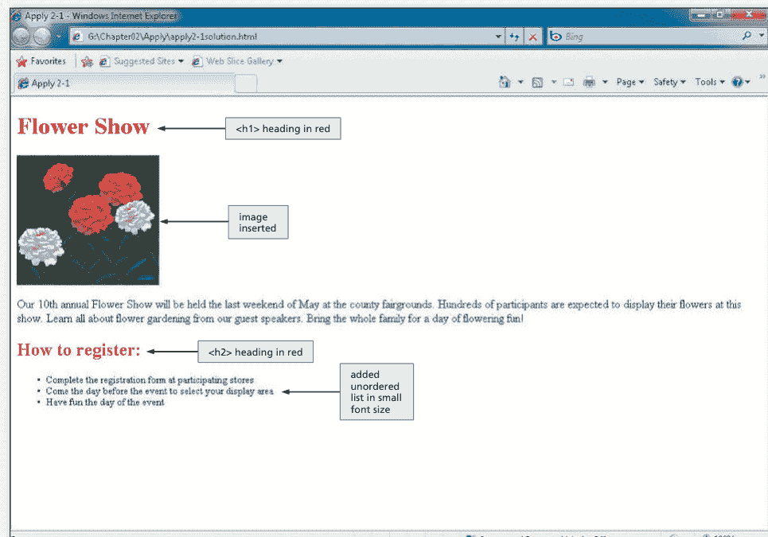

**图 2-41**

**执行以下任务：**

1. 输入`g:\Chapter02\Apply\apply2-1.html`作为 URL 以在浏览器中查看该网页。
2. 检查 HTML 文件及其在浏览器中的外观。
3. 使用`Notepad++`，更改 HTML 代码以使网页看起来与图 2-41 中显示的相似。两个标题都是红色的。（**提示：** 使用`style="color: red"`属性。）
4. 将图像`flowershow.jpg`（在`Chapter02\Apply`文件夹中）添加到网页。其宽度为 192 像素，高度为 175 像素。（**提示：** 将图像包含在`<div></div>`容器中，并记住使用`alt`属性。）
5. 使项目符号列表的字体变小。（**提示：** 使用`style="font-size: small"`属性。）

*续 >*

### HTML 82　HTML 第 2 章：使用内联样式创建和编辑网页

#### 运用你的知识（续）

6. 将修改后的 HTML 文件保存在`Chapter02\Apply`文件夹中，文件名为`apply2-1solution.html`。
7. 在`http://validator.w3.org/`上验证你的 HTML 代码。
8. 在浏览器中输入`g:\Chapter02\Apply\apply2-1solution.html`作为 URL 来查看修改后的网页。
9. 打印该网页。
10. 按照导师指定的格式提交修改后的 HTML 文件和网页。

## 拓展你的知识

拓展你在本章学到的技能，并尝试新的技能。

### 创建定义列表

**说明：** 启动`Notepad++`。打开来自学生数据文件夹`Chapter02\Extend`中的文件`extend2-1.html`。关于如何下载学生数据文件，请参见本书封底内页的说明，或联系导师获取访问所需文件的信息。此示例网页以项目符号列表格式包含了所有文本。你将添加必要的标签，使其成为一个术语为粗体的定义列表，如图 2-42 所示。

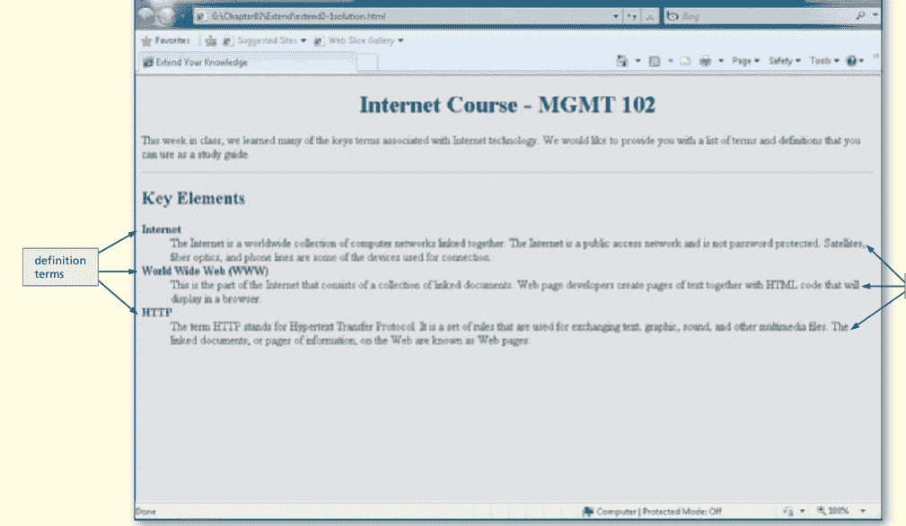

**执行以下任务：**

1. 使用文件`extend2-1.html`中提供的文本，按照第 HTML 52 页图 2-14 所示的定义列表代码，修改 HTML 代码，将网页从项目符号列表更改为定义列表。
2. 添加必要的 HTML 代码使术语变为粗体（参见附录 D 中关于`style`的`font-weight`部分）并设置背景色为`#e0e0e0`（参见附录 D 中的`background-color`）。
3. 将修改后的文档保存在`Chapter02\Extend`文件夹中，文件名为`extend2-1solution.html`，验证网页，然后按照导师指定的格式提交。

### 修正完善

分析文档，修正所有错误和/或改进设计。

### 修正“温馨提示”网页

**说明：** 启动`Notepad++`。打开来自学生数据文件夹`Chapter02\MakeItRight`中的文件`makeitright2-1.html`。关于如何下载学生数据文件，请参见本书封底内页的说明，或联系导师获取访问所需文件的信息。该网页是图 2-43 所示内容的修改版本。对网页进行必要的修正，使其看起来像图 2-43。将标题格式设置为居中对齐的 Heading 1 样式（参见附录 D 中的`text-align`属性以居中标题）。添加两条 10 像素高的水平线，如图 2-43 所示。将文件保存在`Chapter02\MakeItRight`文件夹中，命名为`makeitright2-1solution.html`，验证网页，然后按照导师指定的格式提交。

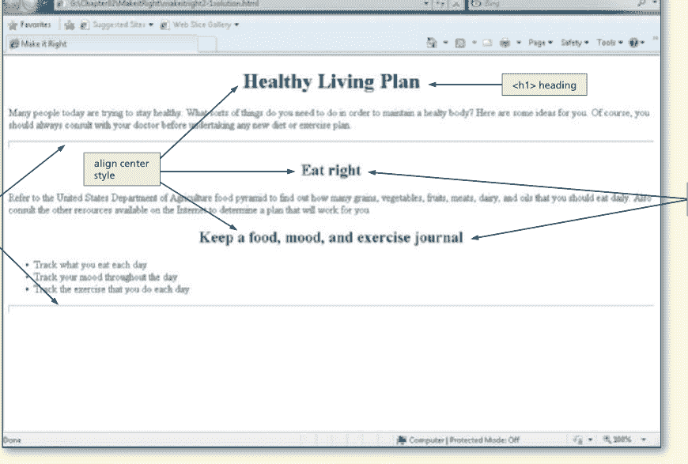

#### 图 2-43

## 实验室

### 实验 1：创建一个食品募捐活动网页

**问题：** 你曾为所在城市的社区食品募捐活动做过志愿服务。你想招募其他朋友一起来参与社区服务志愿服务。你被要求创建一个网页，展示你选择做志愿服务的原因，并告知人们他们如何也能提供帮助，如图 2-44 所示。

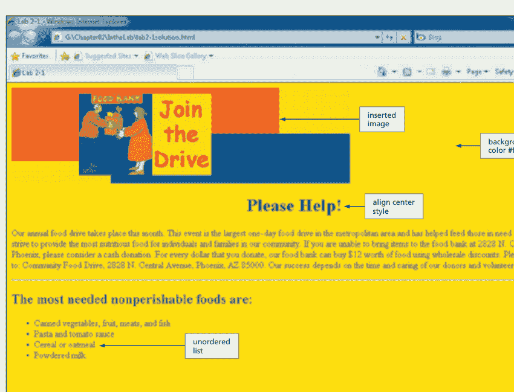

**说明：** 执行以下步骤：

1. 启动`Notepad++`并创建一个新的 HTML 文件，在`<title></title>`标签内设置标题为`Lab 2-1`。对于初始的 HTML 标签，如果你在本章项目开始时创建了`structure.html`文件，可以使用它；否则，请手动输入初始标签。
2. 开始`body`部分，添加`fooddrivelogo.gif`图片以及标题“Please Help!”。将标题格式设置为居中对齐的 Heading 1 样式。（提示：参见附录 D 中的`text-align`属性以居中标题。）
3. 如图所示，添加一个左对齐的 Heading 2 样式的标题。
4. 使用颜色代码`#f9fc05`为网页添加背景色。（提示：使用`style="background-color: color number"`属性。）
5. 如图 2-44 所示，添加一个包含不易腐烂食品的无序列表。
6. 将文件保存在`Chapter02\IntheLab`文件夹中，命名为`lab2-1solution.html`。
7. 打印`lab2-1.html`文件。
8. 在浏览器中输入`g:\Chapter02\IntheLab\lab2-1solution.html`作为 URL 来查看网页。
9. 打印该网页。
10. 按照导师指定的格式提交修改后的 HTML 文件和网页。

### 实验 2：创建一个信息类网页

**问题：** 你继续享受志愿服务，并决定制作一个网页公告，例如图 2-45 所示的那种，来宣传最新的食品募捐活动。

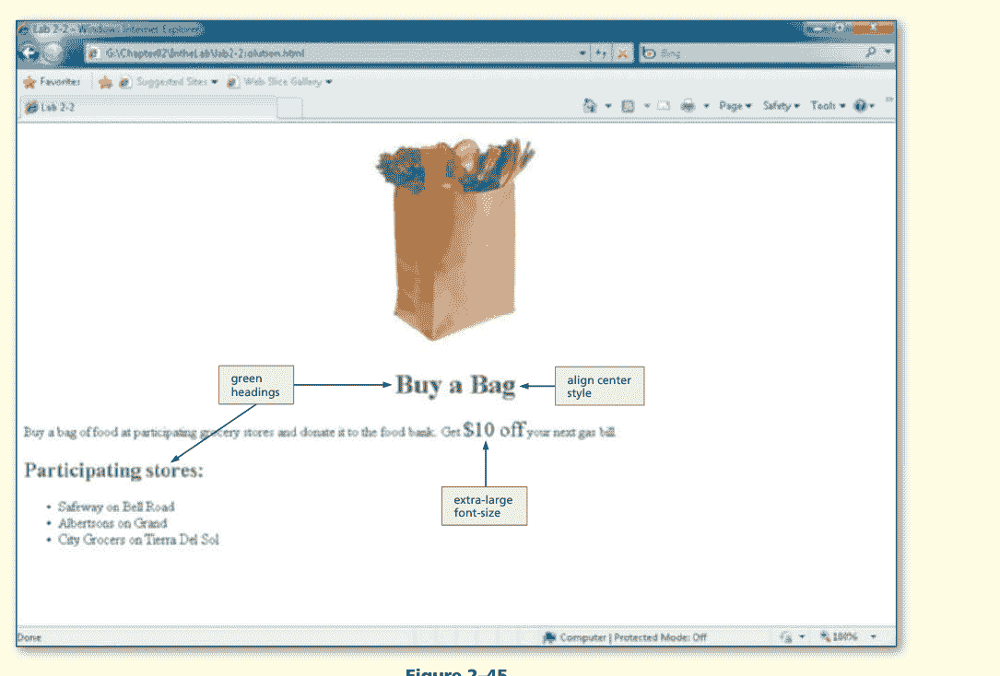

**说明：** 执行以下步骤：

1. 启动`Notepad++`并创建一个新的 HTML 文件，在`<title></title>`标签内设置标题为`Lab 2-2`。
2. 该网页使用`foodbag.jpg`图像文件，其宽度为 207，高度为 256。居中图像（参见附录 D 中的`text-align`属性）。两个标题均使用绿色。
3. 如图 2-45 所示，添加段落文本。将“$10 off”这几个词设置为 x-large 字体大小（参见附录 A 中的`<span>` HTML 标签以实现此效果）。
4. 创建一个项目符号列表，包含图中所示的信息。
5. 将文件保存在`Chapter02\IntheLab`文件夹中，使用文件名`lab2-2solution.html`。
6. 打印`lab2-2solution.html`文件。
7. 在浏览器中输入`g:\Chapter02\IntheLab\lab2-2solution.html`作为 URL 来查看网页。
8. 打印该网页。
9. 按照导师指定的格式提交修改后的 HTML 文件和网页。

**实验室（续）**

### 实验 3：构思一个个人网页

**问题：** 你的朋友们担心他们无法存钱。他们向你寻求帮助，因为你似乎总是能为不时之需存下钱。你决定构思一个网页，给他们提供一些建议。你计划使用一段文本和一个项目符号列表，如图 2-46 所示。图中的文本和项目符号应替换为你自己的省钱经验和技巧。

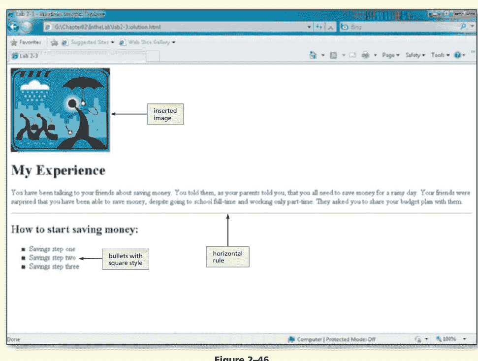

#### 图 2-46

**说明：** 执行以下步骤：

1. 启动`Notepad++`并创建一个新的 HTML 文件，在`<title></title>`标签内设置标题为`Lab 2-3`。
2. 包含一段简短的信息段落和一个项目符号列表，使用类似于图 2-46 所示的格式，来提供关于你省钱经验的信息。
3. 插入存储在`Chapter02\IntheLab`文件夹中的图像文件`cloudy.jpg`。右键单击图像，单击“属性”，然后单击“详细信息”选项卡以查看图像尺寸，或在图形程序中打开它。注意，列表使用的项目符号是方形的。
4. 将 HTML 文件保存在`Chapter02\IntheLab`文件夹中，使用文件名`lab2-3solution.html`。
5. 在浏览器中输入`g:\Chapter02\IntheLab\lab2-3solution.html`作为 URL 来查看网页。
6. 从浏览器中打印该网页。
7. 按照导师指定的格式提交修改后的 HTML 文件和网页。

## 案例与场景

运用你的创造性思维和问题解决技能来设计并实现解决方案。

- 较容易
- 较困难

### 1：为食品募捐网页添加内容

社区食品银行的主任 Wattigney 先生很喜欢你为实验 2-1 创建的网页。现在食品募捐活动已经结束，他希望你更新网页，添加关于即将举行的社区活动的新信息。在更新页面之前，请上网查阅其他食品银行或社区服务部门的网页，以获取关于可包含内容或格式更改的灵感。他们的网站是什么样的？你可以对实验 2-1 的网页做哪些更改，以反映其他地方的做法？运用本章介绍的概念，添加额外信息或更改格式，使页面更有趣且与时俱进。

### 2：创建一个艺术家网站

你正在为当地一位摄影师创建一个新网站。摄影师要求你为网页上的图像添加描述性的`alt`属性，因为他网站的许多访问者互联网连接速度很慢，图像经常无法快速加载。上网搜索关于为图像添加有用的、描述性`alt`属性的信息。同时查找关于使用缩略图图像的信息。提出加速图像加载的建议。创建一份文档，包含一段简短的段落，解释你在研究中发现的信息。就如何使摄影师的网站更有效提出建议。

### 3：创建一个 CSS 属性网页

到目前为止，你在课堂上已经学到了很多关于使用层叠样式表（CSS）的知识。但是，关于如何插入某些样式，你仍然有一些疑问。上网研究信息（别忘了查看`W3.org`网站），找到列出 CSS 属性和值的网站，以补充附录 D。在 Word 文档中，添加你觉得非常有用的 URL。在每个 URL 下方写一个简短的段落，描述你为什么认为该网站对新的网页开发者有用。与同学分享你的 URL 列表。

### 4：创建一个个人网页

**个性化**

你的班级讲师希望将所有学生的网页发布在学校服务器上，以展示他或她的学生对什么感兴趣。创建一个包含个人信息的网页，列出诸如你的专业、过去从事过的工作以及你的爱好和兴趣等项目。为了让你的个人

## 案例与实践（续）

为了让网页更具视觉吸引力，你可以在网络上搜索能反映你兴趣的图片。（请记住，如果图片受版权保护，除非遵循图片提供的使用指南，否则不能将其用于个人网页。）在网页中插入一两张图片，以帮助说明你是谁。

## 5：使用不同 CSS 属性创建网页

**协作学习**

与其他同学一起，复习附录 D 中的 CSS，以及“案例与实践 3”中介绍的 CSS 相关网站。尝试找出一些本章尚未使用过的 CSS 属性的应用方法（比如与边距相关的属性）。规划如何使用五个本章（第 2 章）未使用的 CSS 属性，来改进你在本章创建的其中一个网页（章节项目或章末项目）。在网页中实际运用这五种不同的 CSS 属性。在 Word 文档中说明你使用了哪些 CSS 属性，为什么使用它们，以及它们如何改进了网页。

# 3 创建包含链接、图像和内嵌样式表的网页

## 学习目标

学完本章内容，你应能掌握以下知识：

- 描述链接术语和定义
- 创建主页，并使用图像增强网页
- 使用内嵌样式表更改正文和标题格式
- 使用内嵌和行内样式为文本添加对齐和颜色
- 使用行内样式为无序列表的项目符号插入图像
- 添加指向同一网站内网页的文本链接
- 添加电子邮件链接
- 添加指向另一网站网页的文本链接
- 使用绝对路径和相对路径
- 保存、验证和查看 HTML 文件，并测试链接
- 使用样式类添加带文字环绕的图像
- 添加指向网页内目标的链接
- 复制和粘贴 HTML 代码
- 添加指向同一网站内网页的图像链接

# 3 创建包含链接、图像和内嵌样式表的网页

## 引言

万维网最有用且最重要的功能之一，就是能够将（链接）一个网页与其他网页连接起来——无论它们位于同一台服务器还是不同的服务器，也无论它们位于世界何处。通过使用超链接，网站访客可以从一个页面移动到另一个页面，并以任何顺序查看信息。许多不同的网页元素，包括文本、图形和动画，都可以用作超链接。

在本章中，你将创建使用文本链接和图像链接相互连接的网页。在上一章中，你使用行内样式更改了单个元素或 HTML 标签的外观。在本章中，你还将使用内嵌样式表来设置整个网页中标题和正文等元素的外观。在开始此项目之前，你应已完成网页开发生命周期的网站规划、分析和设计阶段。

## 项目——Getting Greener 网站

第 3 章演示如何使用 HTML 为 Getting Greener 网站（图 3-1a）创建主页，并编辑现有的`greenhome.html`网页（图 3-1b）以改善其外观和功能。你的哥哥 Dean 最近开设了一家环境咨询公司，命名为 Getting Greener。他想在互联网上宣传他的公司，并展示一个他做过绿色审计的示范住宅。他知道你上大学时学过网站开发，请你开发两个相互链接的网页：一个主页，和一个展示示范住宅的网页。

在你的分析中，你确定了四种基本链接类型。第一种是从同一网站内的一个网页链接到另一个网页。第二种是链接到不同网站上的网页。第三种是电子邮件链接。第四种是同一网页内的链接。你计划在哥哥的网站中使用所有这四种链接。

Getting Greener 主页（图 3-1a）包括一个徽标图片横幅、标题、一个使用图形图片作为项目符号的无序（项目符号）列表、一个电子邮件链接和一个指向另一网站网页的文本链接。该页面还包含一个指向`greenhome.html`网页的链接。

Green Home 网页（图 3-1b）包含两张图片，文字环绕着它们，并包含内部链接，允许访问者在网页内的各个部分之间轻松移动。该网页还有一个指向 Getting Greener 主页的图像链接。

(b) 示范绿色住宅网页。

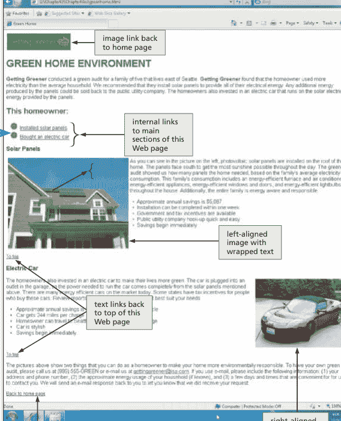

(a) Getting Greener 主页。

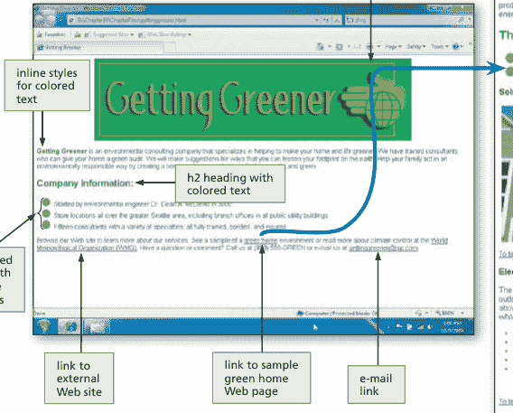

**图 3-1**

## 概述

在学习本章时，你将通过执行以下通用任务，学习如何创建图 3-1 所示的网页：

- 在`Notepad++`窗口中输入 HTML 代码。
- 将文件保存为 HTML 文件。
- 输入基本的 HTML 标签并为文件添加文本。
- 使用内嵌样式表、行内样式和类来更改文本和标题的格式。
- 使用行内样式创建以图形图片作为项目符号的项目符号列表。
- 添加指向同一网站内另一个网页的链接。
- 添加指向外部网站的链接。
- 添加电子邮件链接。
- 在同一网页内添加目标和链接。
- 在浏览器中查看网页和 HTML 代码。
- 验证网页。
- 打印网页。

## 项目规划指南

在创建网页时（如前一页图 3-1 所示的项目），你应遵循以下通用指南：

1. **规划网站。** 在开发多页网站之前，你必须规划网站的目的。有关网站开发生命周期规划阶段的信息，请参阅第 HTML 15 页的表 1-4。在此阶段，你需要确定网站的目的，识别网站的用户及其计算环境，并决定网页上信息的所有者。
2. **分析需求。** 在网站开发生命周期的分析阶段，你需要分析网页应包含哪些内容。第 3 章的网站开发项目与第 2 章完成的项目不同，因为它包含两个将相互链接的网页。因此，分析阶段的一部分包括确定多个网页如何协同工作以形成一个网站。
3. **设计网站。** 分析完成后，你需要设计网站。在此阶段，你需要确定网站的内容，包括文本和图形。本章特有的设计步骤还包括确定网站内部以及到外部网站的链接。
   1. **为网页选择内容。** 生命周期的这一部分也与上一章的项目不同，因为所有内容不必像第 2 章那样都出现在一个网页上。对于多页网站，你可以根据需要将内容分布到整个网站中。由于该网站的性质，图片是内容的重要组成部分。网站所有者希望展示其公司工作的样本。图片有助于展示一个家庭为变得更环保所做的努力。
   2. **确定你将使用哪种类型的层叠样式表（CSS）。** 你已经学习了如何使用行内样式来最好地支持网站的设计和目的。在本章中，你将同时使用行内和内嵌样式表来更改各种网页元素的外观（或样式）。你还将把类与内嵌样式表结合使用，以进一步控制网页元素的样式。你需要考虑这些选项中哪些最适合你网站的样式。
   3. **确定页面之间如何链接。** 该网站由一个**主页**（网站中的第一个页面）和一个你将链接到的次要网页组成。你需要确定如何从主页链接到次要页面（例如，使用文本或图形），以及如何链接回主页。
   4. **确定其他必要的链接。** 除了主页和次要网页之间的链接外，你还需要一个电子邮件链接。在网站主页上提供电子邮件链接，供访客提交评论或问题，这是网站开发者的标准做法。此外，次要网页（`greenhome.html`）是一个很长的页面，访客需要向下滚动进行导航。由于其长度，提供轻松快速的网页导航方式非常重要。你可以通过网页内的链接来实现这一点。
4. **开发网页并插入所有链接。** 分析和设计完成后，网站开发者使用 HTML 和 CSS 创建网页。在此步骤中应遵循良好的网站开发标准实践。良好实践的例子包括使用正确的初始 HTML 标签（如上一章所示），以及始终为图片识别替代文本。


## 5. 测试网站内的所有网页

网站开发的一个重要部分是进行测试，以确保你遵循 XHTML 标准。对于本书中的项目，你将使用万维网联盟（W3C）验证器，它可以让你测试你的网页，并清楚地解释发现的任何错误。测试时，你应该检查所有内容是否准确。此外，所有链接（外部、内部以及同一网站内的页面间链接）都应进行测试。

在必要时，本章会在适当之处提供关于上述指南的更具体细节。本章还将说明在创建图 3-1 所示网页过程中执行的操作和做出的决定。

### 在网页上使用链接

正如您所学，许多不同的网页元素，包括文本、图像和动画，都可以作为链接使用。文本和图像是最广泛用作链接的元素。图 3-2 展示了文本和图像链接的示例。

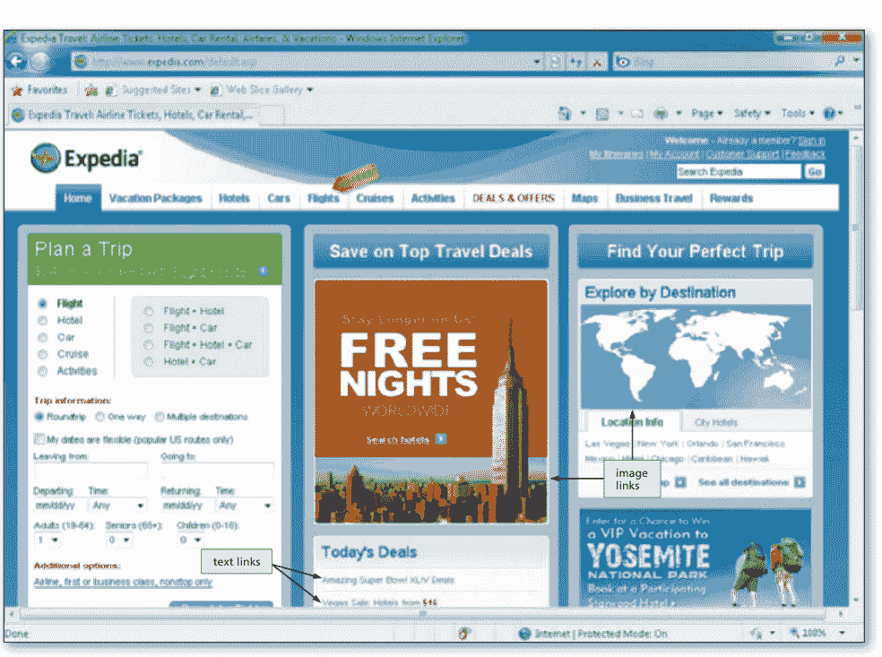

**图 3–2** 网页上的文本和图像链接。

在网页上使用文本链接时，请使用描述性文本作为可点击的词或短语。例如，“点击此处”这个短语并未向访客解释链接的目的。相比之下，“航班最高可省 40%”这个短语则表明该链接指向一个提供折扣机票的网页。

当文本标识一个链接时，它通常显示为带下划线的文本，其颜色与网页主体文本不同。除非在锚点`<a>`标签或`<body>`标签中另有更改，否则浏览器设置将定义整个网页中文本链接的颜色。例如，在 Internet Explorer 中，一个未被点击（或访问）过的正常链接的默认颜色是蓝色，已访问过的链接是紫色，而活动链接（用户刚刚点击的链接）的颜色会变化。下一页的图 3–3 展示了所有三种状态（正常、已访问、活动）的文本链接示例。通常，如图 3–3 所示，将鼠标指针移到链接上会导致鼠标指针变为手形指针。这种变化通知用户该文本或图像上存在一个可用链接。

> **链接帮助**
>
> 许多网站为 HTML 开发新手提供帮助。有关链接的更多信息，请在任何优秀的搜索引擎中搜索“HTML 教程”或“HTML 帮助”等关键词。

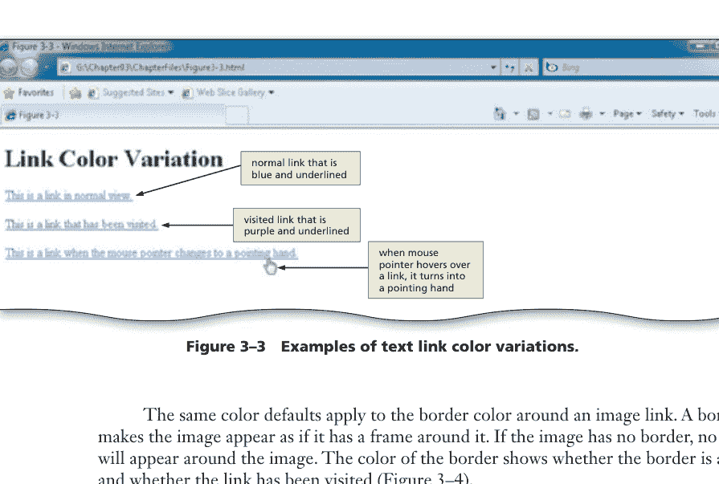

**图 3–3** 文本链接颜色变化示例。

同样的默认设置也适用于图像链接周围的边框颜色。边框使图像看起来像有一个框架围绕着它。如果图像没有边框，则不会在图像周围显示框架。边框的颜色显示该边框是否是一个链接，以及该链接是否已被访问（图 3-4）。


**图 3–4**

如果您想更改文本链接或图像链接边框的颜色以覆盖浏览器默认设置，您可以在锚点`<a>`或`<body>`元素中，使用嵌入式或外部样式表，或使用内联样式来指定这些更改。回想一下，您使用内联样式来更改单个元素的外观（或样式）。嵌入式样式表用于更改一个网页中类似元素的样式。最后，外部样式表包含在一个单独的`.css`文档中，用于更改整个网站的样式。（您将在下一章中使用外部样式表。）要在锚点元素中使用嵌入式或外部样式表来更改正常、已访问和活动链接颜色以覆盖默认设置，您需要使用以下格式：

```css
a {color: black}
```

其中`color`是您指定的颜色名称，如`black`，或十六进制颜色代码。要使用内联样式进行相同的更改，标签格式为：

```html
<a style="color: black">
```

您可以在锚点标签内使用`text-decoration`属性来禁用链接的下划线。`text-decoration`属性允许使用以下五个值之一来“装饰”文本：`underline`（下划线）、`overline`（上划线）、`line-through`（删除线）、`blink`（闪烁）或`none`（无）。此属性可用于多种标签，包括锚点标签。链接默认是带下划线的，以表明它们是链接。

在设计阶段，您应仔细考虑任何样式更改的利弊，特别是对默认样式的更改。在关闭链接下划线或更改默认链接颜色之前，请务必确保用户仍然能够立即看出特定文本被用作链接。如果您确定可以有效地关闭链接的下划线（就像您在本章后面创建的图像链接那样），您可以将`text-decoration`属性更改为`none`。要通过嵌入式或外部样式实现此操作，您需要输入以下代码：

```css
a {text-decoration: none}
```

要使用内联样式将`text-decoration`更改为`none`，请输入：

```html
<a style="text-decoration: none">
```

### 链接到同一网站内的另一个网页

网页通常包含链接，用于将一个网页连接到同一网站内的另一个页面。例如，访客可以点击网站首页（下一页图 3-5a）上的一个链接，连接并查看同一网站上的另一个网页（图 3-5b）。本项目中创建的网页包含指向同一网站内其他页面的链接：

1. Getting Greener 主页包含一个指向 Green Home 网页的文本链接。
2. Green Home 网页包含一个指回 Getting Greener 主页的图像链接。

要将`gettinggreener.html`主页上的“green home”这个词链接到`greenhome.html`网页，您需要以下 HTML 代码：

```html
<a href="greenhome.html">green home</a>
```

> **链接颜色**
>
> 您可以在流行的浏览器中更改链接颜色。在 Internet Explorer 中，您可以在“工具”菜单的“Internet 选项”中找到颜色选择。在 Mozilla Firefox 中，单击“工具”菜单、“选项”、“内容”选项卡。在这两种浏览器中，您都可以通过单击颜色网格来更改颜色。

> **网页上的链接**
>
> 锚点标签还允许访客在单个网页内移动。使用`name`属性允许在同一页面内从一个区域移动到另一个区域。这种链接技术很有用，尤其是在长页面上。链接索引也可以提供对网页内各个区域的便捷访问。
>
> 锚点`<a>`标签中的`href`表示，当“green home”这个词被点击时，访客将链接到`greenhome.html`网页。您使用`</a>`标签结束链接。如果您没有添加`</a>`标签，那么“green home”之后的所有文本都将被链接。


**图 3–5**

### 链接到另一个网站上的网页

网页开发最强大的功能之一是能够链接到网站外部的网页。网页开发者使用这些链接将他们的网页连接到其他包含相同主题信息的网页。正是这些链接赋予了网络作为互联资源的价值，并提供了它的“网络性”。在本项目中，主页（图 3-6a）包含一个指向另一个网站上页面的链接，访客可以在那里找到有关气候控制的更多信息（图 3-6b）。要将`gettinggreener.html`主页上的“World Meteorological Organization (WMO)”这个词链接到外部网站，您需要以下 HTML 代码：

```html
<a href="http://www.wmo.int/">World Meteorological Organization (WMO)</a>
```

请注意，该代码与用于链接到同一网站内网页的代码基本相同。但是，当链接到外部网站时，您必须添加完整的 URL（`http://www.wmo.int/`）。


（a）包含指向外部网站文本链接的网页。

![](img/5feb8d80ce2ce057eaaa00494ecd23e5_114_1.png）

（b）外部网站中被链接的网页。

**图 3–6**

### 在网页内链接

网页内的链接允许访客快速地从网页的一个部分移动到另一个部分。这对于内容较长、需要访客向下滚动才能看到所有内容的网页尤其重要。许多网页在页面顶部包含一个链接列表，如菜单或目录，其中包含指向网页内各个部分的链接（图 3-7）。在本项目中，Green Home 网页包含从网页顶部区域指向页面内其他区域的链接，以及指回网页顶部的链接。

在网页内进行链接有两个步骤：

1. 首先，您必须使用一个与链接目的相关的有意义名称来设置一个目标。
2. 然后，您使用给定的名称创建一个指向该目标的链接。

以下 HTML 代码显示了一个名为`solar`的目标的示例，然后是将该目标用作链接。第一条语句插入到您要链接到的网页部分的顶部。第二条语句插入到网页顶部的带项目符号的列表中。

```html
<a name="solar"></a>
<a href="#solar">Installed solar panels</a>
```

同样，请注意您也使用锚点`<a>`标签进行这种类型的链接。但是，对于这种页内链接，您需要在目标名称前插入`#`，以表明您想链接到网页的特定部分，而不一定是页面的顶部。有时当您浏览网页时，您可能会在链接地址中看到`#`。这通常会将您链接到网页的特定部分。


### 链接到电子邮件地址

一个设计良好的网页总是为访客提供一种方式，可以联系到公司中负责维护网站或处理客户问题和意见的人。提供联系信息的一个简便方法是在网站首页以及网站的其他页面上包含电子邮件链接。如图 3-8 所示，当访客点击电子邮件链接时，它会自动在默认电子邮件程序中打开一个新邮件，并在收件人字段中插入相应的联系电子邮件地址。然后访客可以输入并发送电子邮件以请求更多信息、评论或……

> **电子邮件链接**
>
> 您可以将多个电子邮件地址分配给`mailto:`标签。在`<a href=>`标签中使用格式`"mailto:first@isp.com, second@isp.com"`。一些较旧的浏览器可能不支持此标签。

## 创建主页

本章开发的第一个网页是“Getting Greener”网站的主页。主页是网站的主要页面，访问者通常会首先浏览。网站主页应通过简要说明其提供的内容、服务或功能来阐明网站的目的。主页还应明确指示访问者应点击哪些链接，以便在网站的不同页面间切换。网页开发者应设计网站，使网页间的链接清晰明了，导航顺畅。

网站主页还应包含电子邮件链接，以便访问者轻松找到个人或组织的联系信息。许多网站现在还会为网站开发团队设置额外的电子邮件链接。用户可以利用此链接向开发者报告网站问题或提供反馈意见。

HTML 100 HTML 第 3 章 创建包含链接、图像和内嵌样式表的网页

你将通过启动 Notepad++ 并输入初始 HTML 标签来开始创建主页。然后，为你的主页添加图像、标题、文本和无序列表。最后，添加文本和电子邮件链接，然后测试这些链接。

### 启动 Notepad++

以下步骤假设在 Windows 7 系统下运行，基于典型安装来启动 Notepad++。你可能需要询问你的老师如何在你的电脑上启动 Notepad++。

1. 单击 Windows 任务栏上的“开始”按钮，显示“开始”菜单。
2. 单击“开始”菜单左窗格底部的“所有程序”，显示“所有程序”列表。
3. 在“所有程序”列表中单击 Notepad++。
4. 在列表中单击 Notepad++ 以显示 Notepad++ 窗口。如果 Notepad 中已有之前项目打开的文件，现在通过单击每个打开文件的“关闭”按钮将它们全部关闭。
5. 如果 Notepad++ 窗口未最大化，请单击 Notepad++ 标题栏上的“最大化”按钮将其最大化（图 3-9）。
6. 单击菜单栏上的“查看”。
7. 如果“自动换行”命令旁没有选中标记，请单击“自动换行”。

#### 输入初始 HTML 标签以定义网页结构

就像你在第 2 章所做的那样，你将从定义网页结构的初始 HTML 标签开始你的文件。表 3-1 包含此任务所需的标签和文本。

> **复制初始结构**
>
> 请记住，你可以输入初始 HTML 标签并将该代码保存到名为`structure.html`的文件中，然后可以将其打开并用作所有 HTML 文件的基础。这消除了你在每个 HTML 文件开头输入相同代码的需要。只需记住，在打开`structure.html`后立即将其另存为新名称。

##### 表 3-1 初始 HTML 标签

| 行号 | HTML 标签和文本 |
| :--- | :--- |
| 1 | `<!DOCTYPE html` |
| 2 | `PUBLIC "-//W3C//DTD XHTML 1.0 Transitional//EN"` |
| 3 | `"http://www.w3.org/TR/xhtml1/DTD/xhtml1-transitional.dtd">` |
| 4 | |
| 5 | `<html xmlns="http://www.w3.org/1999/xhtml" xml:lang="en" lang="en">` |
| 6 | `<head>` |
| 7 | `<meta http-equiv="Content-Type" content="text/html;charset=utf-8" />` |
| 8 | `<title>Getting Greener</title>` |
| 9 | `</head>` |
| 10 | |
| 11 | `<body>` |
| 12 | |
| 13 | `</body>` |
| 14 | `</html>` |

以下步骤说明了如何输入定义网页结构的初始标签。

1. 输入表 3-1 所示的 HTML 代码。在每行末尾按回车键。如果在输入时出错，使用退格键删除所有字符直至并包括错误字符，然后继续输入。
2. 将插入点置于`<body>`和`</body>`标签之间的空行（第 12 行），然后按回车键（图 3-10）。
3. 将你输入的内容与图 3-10 进行比较。如果发现错误，请使用鼠标指针或箭头键将插入点移动到每个错误的右侧，并使用退格键更正错误。

### 保存 HTML 文件

输入了 Getting Greener 主页的初始 HTML 代码后，你应该保存文件。频繁保存文件可确保你不会丢失工作成果。在 Notepad++ 中保存文件还会为代码添加颜色，这可以帮助你更轻松地识别不同的元素。以下步骤说明了如何在 Notepad++ 中保存 HTML 文件。

HTML 102 HTML 第 3 章 创建包含链接、图像和内嵌样式表的网页

1. 将 USB 闪存驱动器连接到计算机的某个 USB 端口，单击 Notepad++ 菜单栏上的“文件”，然后单击“保存”。
2. 在“文件名”文本框中键入`gettinggreener.html`（不要按回车键）。
3. 单击 Windows 资源管理器窗口左窗格中的“计算机”，显示可用驱动器列表。
4. 如有必要，滚动列表直至看到`UDISK 2.0 (G:)`或你的存储设备的名称。
5. 打开`Chapter03\ChapterFiles`文件夹。
6. 单击“另存为”对话框中的“保存”按钮，将文件以`gettinggreener.html`为名保存在 USB 闪存驱动器的`Chapter03\ChapterFiles`文件夹中。

### 提前规划

- 确定如何格式化文本的各种元素。

在将图形和颜色元素插入网页之前，你应该规划好希望如何格式化它们。通过有效利用图形和颜色，你可以突出网页上的重要主题，而不会使其显得杂乱。考虑以下格式化建议。

- **有效利用图形**
  
  网页开发的一个重要部分是利用图形来吸引对网页的注意。通常，公司会将其网站上的标志与其印刷材料（如名片和信头纸）上使用的标志保持一致。在所有营销材料（包括网站）上使用相同的图形图像是向客户提供一致视觉和品牌形象的好方法。

- **使用与图形相关的标题**
  
  在许多情况下，公司会将标志横幅用作其主页的主标题，而不是使用`<h1>`标题。有时，将网页上标题和图形的颜色与标志横幅的颜色协调起来是很有好处的。这可以吸引人们对公司标志横幅的注意，并使网页在颜色协调下显得浑然一体。

  通常应遵循从`h1`（最大）到`h6`（最小）的标题大小标准。但是，在本项目中，你将公司标志横幅用作主标题，因此没有`h1`标题。因此，你从下一个较小的标题尺寸`h2`开始，如 HTML 91 页上的图 3-1a 所示。HTML 91 页上的图 3-1b 展示了在适当优先级中使用`h1`和`h2`标题。

#### 使用内联样式添加居中的横幅图像

Getting Greener 主页包含一个图像标志横幅，以提供视觉吸引力，吸引访问者的兴趣并推广公司品牌。以下步骤说明了如何使用内联样式在网页上居中图像，并使用``标签插入图像。

要使用内联样式，你需要`<div>`和`</div>`标签。请记住，`<div></div>`标签创建一个容器，用于定义网页中的逻辑分区。`<div>`标签类似于段落标签，但它允许你将页面划分为更大的部分，并定义网页中整个部分的样式。你可以定义页面的某个部分并为该部分赋予与周围文本不同的样式。

当你使用`<div>`和`</div>`标签时，你能够设计一个使用 CSS 的布局，包括插入图片。在这种情况下，你使用`<div></div>`标签将图片居中显示在网页上。表 3–2 包含了添加居中标志横幅的代码。

| 行号 | HTML 标签和文本 |
| :--- | :--- |
| 13 | `<div style="text-align: center">` |
| 14 | `` |
| 15 | `</div>` |

1. 将插入点放在第 13 行，输入表 3–2 中所示的 HTML 代码，并在每行末尾按 ENTER 键。确保使用 TAB 键将第二行代码缩进。这将把`<div>`的开始和结束标签与``标签分隔开，以突出显示图片插入。在第 15 行末尾按两次 ENTER 键，将插入点置于第 17 行（图 3–11）。

> **问与答：为什么我应该包含宽度、高度和替代文本属性？**
>
> 添加宽度和高度属性可以改善页面加载时间，因为浏览器无需在加载图片前计算其宽度和高度。但是，切勿使用高度和宽度属性来调整图片大小。请使用图形编辑软件调整大小并以不同的文件名保存。在`img`标签中使用的高度和宽度属性应反映图片的实际尺寸。替代文本属性在用户鼠标悬停在图片上以及图片加载过程中，提供了关于图片用途的信息。


> **问与答** `<div>` 和 `</div>` 标签的用途是什么？

`<div>` 标签定义 HTML 文档中的一个分区或部分。`<div>` 标签通常用于组合元素，以便使用样式进行格式化。在这种情况下，为了居中图片，你必须使用 `<div>` 和 `</div>` 标签。语句 `style="text-align: center"` 是使图片居中的内联样式。图片默认是左对齐的。

### 提前规划

**确定如何格式化主页的文本元素。**

在插入网页的文本元素之前，你应始终制定一个计划。通过对网页上的字符和段落进行格式化，你可以改善其整体外观。有效格式化文本也能让用户更清楚地理解网页的信息或目的。在网页上，请考虑以下格式化建议。

- **在适当时使用默认文本大小。** 正文文本由标题和网页底部之间的所有文本组成。此文本是网页的主要内容，应用于突出你信息的关键点。你可以通过使用文本段落和列表来丰富你的内容。
- **确定使用何种文本格式。** 在一个较长的网页中，通过改变文本样式来分隔标题之间的信息可能有所帮助。谨慎使用粗体、颜色或斜体文本能使网页看起来更有趣。确保不要过度格式化文本，因为这会使页面显得杂乱。在杂乱的网页中查找你正在搜索的内容会更加困难。
- **确定使用何种样式表。** 考虑使用样式表来改变文本元素的格式。如果文本在段落间有所不同，内联样式是一个不错的选择。如果你希望网页中的所有文本都相同，则嵌入式样式表是合适的。如果文本在多个网页中通用，则应使用外部样式表（将在下一章讨论）。
- **使用有序或无序列表突出关键文本。** 有序或无序列表包含特定信息，这些信息通过列表比通过文本段落能更清晰地标识。在本项目中，你使用项目符号（无序）列表，但通过更改所使用的项目符号类型来使其有所变化。使用图片作为项目符号使网页看起来美观，并且不同于无序列表的标准（默认）圆盘项目符号。
- **确定适合主页的其他信息。** 适合主页的其他信息包括：公司地址（通常位于标志中）、电话号码和电子邮件链接。

### 添加文本段落

在插入 Getting Greener 主页的地球标志图片后，你需要添加两段介绍 Getting Greener 的文本。表 3–3 显示了需要输入的标签和文本。

**表 3–3 添加两段文本的 HTML 代码**

| 行号 | HTML 标签和文本 |
|---|---|
| **17** | `<p>Getting Greener is an environmental consulting company that specializes in helping to make your home and life greener. We have trained consultants who can give your home a green audit. We will make suggestions for ways that you can lessen your footprint on the earth. Help your family act in an environmentally responsible way by creating a home environment that is safe, less costly, and green.</p>` |
| **18** | |
| **19** | `<p>Browse our Web site to learn more about our services. See a sample of a green home environment or read more about climate control at the World Meteorological Organization (WMO). Have a question or comment? Call us at (999) 555-GREEN or e-mail us at gettinggreener@isp.com.</p>` |

将插入点置于第 17 行，输入表 3-3 中所示的 HTML 代码。在第 17 行的 `</p>` 标签后按两次回车键，在第 19 行的 `</p>` 标签后按一次回车键。输入完这两段文本后，插入点位于第 20 行（图 3-12）。

> **问与答** 我是否必须为所有文本段落都加上 `</p>` 标签？

一个没有 `</p>` 标签的网页在浏览器中仍能正确显示。但是，该网页将无法通过 W3C 标记验证服务的验证。一个遗漏的 `</p>` 标签将导致验证过程中出现许多错误。

> **问与答** 如果我希望第二段文本的开头上方没有空白行该怎么办？

如果你希望第二段文本移到下一行且中间没有空白行，你将使用 `<br />` 标签而不是 `<p>` 和 `</p>`。

### 使用内联样式为项目符号列表增添趣味

你已决定在主页上使用无序（项目符号）列表来突出公司信息。为了将列表与页面的其余部分整合，并增加趣味性，你希望使项目符号与公司标志中的地球符号相同。为此，你将在列表上方添加一个 h2 标题，并使用内联样式来创建项目符号。

在无序列表上方插入一个 h2 标题，可在视觉上将列表与网页上的其他元素分隔开，并表明列表中的项目描述的是什么。h1 标题通常是网页的主标题，但在本例中，标志（`earthlogo.jpg`）被用来代替 h1 标题。它同样用于标识公司并吸引对网页顶部的注意。在标志横幅下使用 h1 标题将是多余的。因此，你将从 h2 标题开始，因为它较小且尺寸适中，适合用来分隔项目符号列表。

正如第 2 章所述，你可以使用多种列表样式类型（项目符号和数字）。在第 2 章的项目中，你使用了带有 `list-style-type` 属性的内联样式来制作方形项目符号。对于此网页，你将使用 `list-style-image` 属性来使用一个小图片（`earthbullet.jpg`）代替圆盘、圆形或方形项目符号。你通过将图片 `earthbullet.jpg` 指定为要显示的 URL 来代替项目符号来实现此操作。

### 创建使用图片作为项目符号的无序（项目符号）列表

表 3–4 显示了用于为 Getting Greener 主页添加 h2 标题并使用“地球”图片项目符号创建项目符号列表的 HTML 代码。

**表 3–4 创建使用图片项目符号的无序（项目符号）列表的 HTML 代码**

| 行号 | HTML 标签和文本 |
| :--- | :--- |
| **19** | `<h2>Company information:</h2>` |
| **20** | |
| **21** | `<ul style="list-style-image: url(earthbullet.jpg)">` |
| **22** | `<li>Started by environmental engineer Dr. Dean A. McDevitt in 2000</li>` |
| **23** | `<li>Store locations all over the greater Seattle area, including branch offices in all public utility buildings</li>` |
| **24** | `<li>Fifteen consultants with a variety of specialties; all fully trained, bonded, and insured</li>` |
| **25** | `</ul>` |

以下步骤展示了如何创建出现在 Getting Greener 主页上的无序（项目符号）列表。

1. 单击空白第 18 行，然后按 ENTER 键。
2. 输入表 3–4 中所示的 HTML 代码。
3. 在第 25 行的 `</ul>` 之后，按 ENTER 键在第 26 行插入一个空白行（图 3–13）。

> **问与答** 如果我想使用不同的项目符号类型该怎么办？

要使用开放圆形项目符号，请使用 `list-style-type: “circle”。` 要使用默认的圆盘（实心圆）项目符号，则无需包含 `list-style-type`。

### 在同一网站内添加指向其他网页的文本链接

针对本网站，`<a>` 和 `</a>` 标签用于在网页上创建链接。`<a>` 标签也被称为**锚点标签**，因为它用于创建指向同一网站内其他页面、外部网站网页、同一网页内部以及电子邮件链接的锚点。锚点标签还可用于指定目标 URL 的基本语言或指定链接的媒体类型。`href` 属性代表超文本引用。这是对网络上资源的引用（地址）。超链接可以指向网络上的任何资源，包括 HTML 页面、图像、音频文件或视频。用于创建链接的标签基本形式是：

```html
<a href="URL">linktext</a>
```

其中 `linktext` 是网页上显示的可点击单词或短语，`href`（超文本引用）的值是链接页面或文件的名称或 URL。表 3–5 显示了部分 `<a>` 标签属性及其功能。

| 属性 | 功能 |
| --- | --- |
| `href` | 指定链接页面或文件的 URL。 |
| `name` | 为当前锚点定义一个名称，使其可以成为另一个链接的目标或目的地。网页上的每个锚点必须使用唯一的名称。 |
| `rel` | 指示从当前文档到链接文档的正向关系。`rel` 属性的值是链接类型，例如 `prev`、`next`、`index` 或 `copyright`。例如，网页 `chapter3.html` 可能包含标签 `<a rel="next" href="chapter4.html">`，以指示到下一章 `chapter4.html` 的链接。 |
| `rev` | 指示从当前文档到链接文档的反向（向后）关系。`rev` 属性的值是链接类型，例如 `prev`、`next`、`index` 或 `copyright`。例如，`chapter3.html` 网页可能包含标签 `<a rev="prev" href="chapter2.html">`，以指示到上一章 `chapter2.html` 的链接。 |
| `type` | 指定链接页面或文件的内容类型（也称为媒体类型或 MIME 类型），以帮助浏览器确定是否可以处理该资源类型。内容类型的示例包括 `text/html`、`image/jpeg`、`video/quicktime`、`application/java`、`text/css` 和 `text/javascript`。 |

在创建链接之前，请确保您知道要链接的文件的 URL 或名称，以及将用作可点击单词或短语的文本。这些文字应具有描述性，并告诉网页访问者链接的目的。对于 Getting Greener 主页，文本链接是网页底部段落中的一个短语。

### 在同一网站内添加指向其他网页的文本链接

Getting Greener 主页包含一个指向 Green Home 网页的文本链接，该网页是同一网站的一部分。以下步骤说明了如何在网站内添加指向其他网页的文本链接。

1. 单击第 27 行单词 `green` 中字母 `g` 的正左侧。
2. 键入 `<a href="greenhome.html">` 以开始链接，将网页 `greenhome.html` 设置为链接网页。
3. 单击第 27 行单词 `home` 中字母 `e` 的正右侧。键入 `</a>` 以结束链接（图 3–14）。


> **Q&A**

> `href` 属性的作用是什么？

> `href` 代表“超文本引用”，并位于目标网页的 URL 之前。

**Q&A**

在浏览器中显示时，如何知道我的文本是否是一个链接？

在浏览器中，当鼠标指针位于链接上时，会变成指向手指的形状。此外，作为默认设置，用作链接的文本将显示为蓝色并带有下划线。您可以更改链接的颜色和样式，您将在本章后面进行此操作。

**Q&A**

如果我在链接中忘记插入 `</a>` 标签会怎样？

没有 `</a>` 标签的文本链接在浏览器中将无法正确显示。如果您忘记使用 `</a>` 标签来结束此文本链接，那么 `<a href="">` 标签之后的所有文本都将作为该链接。在此示例中，`green` 中字母 `g` 之后的所有文本都将链接到 `greenhome.html` 网页，这当然不是您想要的结果。

### 添加电子邮件链接

添加电子邮件链接类似于添加文本链接，但电子邮件链接的 `href` 属性值不是使用 URL，而是使用以下格式：

```html
<a href="mailto:address@email.com">linktext</a>
```

其中 `href` 属性值使用 `mailto` 一词表示这是一个电子邮件链接，后跟冒号和要发送电子邮件消息的电子邮件地址。当浏览器识别出被点击链接中的 `mailto` URL 时，它会自动在默认电子邮件程序中打开一个新消息，并在收件人字段中插入相应的联系人电子邮件地址。用于电子邮件链接的可点击文本通常是电子邮件链接中使用的电子邮件地址。网页还应在链接之前提供一些信息，以便访问者了解电子邮件链接的目的。

**电子邮件链接**

电子邮件链接在学校环境中可能无法工作，因为学校服务器上可能没有安装电子邮件客户端。因此，您可能无法测试此链接。

### 添加电子邮件链接

Getting Greener 主页包含一个电子邮件链接，以便客户可以联系 Getting Greener 获取更多信息或对网页发表评论。用于创建指向网页文本链接的 `<a>` 和 `</a>` 标签也用于创建电子邮件链接。以下步骤展示了如何向网页添加电子邮件链接。

1. 单击第 27 行开头 `gettinggreener@isp.com` 中字母 `g` 的正左侧。键入 `<a href="mailto:gettinggreener@isp.com">` 作为电子邮件链接的开始。当链接被点击时，这将链接到电子邮件地址 `gettinggreener@isp.com`。
2. 单击第 27 行电子邮件地址文本中 `isp.com` 的 `m` 之后且句点之前的位置。
3. 键入 `</a>` 以结束电子邮件链接，如图 3–15 所示。


> **Q&A**

> 我在第 27 行看到了 `gettinggreener@isp.com` 出现了两次。为什么需要两次？

> `gettinggreener@isp.com` 的第一次出现（在 `<a>` 标签内、`mailto:` 之后的那一个）是链接的目标。`gettinggreener@isp.com` 的第二次出现是将在浏览器中显示的文本链接本身。

### 向电子邮件链接添加其他信息

有时，除了主题外，您还需要在电子邮件正文中添加消息。当网页上放置了多个电子邮件链接，且每个链接都有不同目的时，此技术会非常有用。例如，一个电子邮件可能用于一般性问题，而另一个链接可能用于特定信息。您还可以包含抄送 (cc) 地址。例如，要在上述 `mailto:` 中仅包含主题或包含主题和正文消息文本，您将完成以下步骤。

### 向电子邮件链接添加主题

键入 `<a href="mailto:gettinggreener@isp.com?subject=green home">` 作为标签。

有时，除了主题外，您还需要在电子邮件正文中添加消息。当网页上放置了多个电子邮件链接，且每个链接都有不同目的时，此技术会非常有用。例如，一个电子邮件可能用于一般性问题，而另一个链接可能用于特定信息。使用 `subject` 和 `body` 属性对此场景会很有帮助。请注意，在以下示例中，两个属性（`subject` 和 `body`）用与符号分隔。以下步骤展示了如何将主题 "green home" 与消息文本 "How can I get a green audit?" 一起添加到电子邮件中，如图 3–16 所示。


**图 3–16**

### 添加主题及正文消息文本

键入 `<a href="mailto:gettinggreener@isp.com?subject=green home&body=How can I get a green audit?">` 作为标签。

### 在另一个网站的网页上添加文本链接

用于创建指向同一网站内网页文本链接的 `<a>` 和 `</a>` 标签，同样可用于创建指向另一个网站网页的链接。以下步骤将说明如何在 Green Home 网页上添加一个指向描述气候控制信息的外部网页的文本链接。

1. 点击第 27 行 `World` 中 `W` 的左侧，然后输入 `<a href="http://www.wmo.int/">` 来添加文本链接，该链接在点击时将连接到外部网站。
2. 点击第 27 行 `(WMO)` 中 `)` 的右侧，然后输入 `</a>` 来结束标签，如图 3-17 所示。


> **问与答** 这些链接在浏览器中显示时是什么样子的？

> 如果使用默认设置，文本链接将以蓝色带下划线的字体显示，以表明它是一个链接。当鼠标指针移到链接文本上时，指针也会变成手形。你将在本章后面更改该颜色。

**问与答** 我在浏览器的地址栏中输入 URL 时，从不输入 `http://` 部分。为什么我在链接中必须添加 `http://`？

虽然你不需要在浏览器中输入 URL 的 `http://` 部分，但在创建外部链接时，你必须始终将其作为 `href` 的一部分包含在内。有关更多信息，请参阅下文关于绝对路径和相对路径的讨论。

**问与答** 为什么这个外部链接需要 URL 的 `http://` 部分，而 Green Home 链接不需要？

Green Home 网页与你正在链接的主页存储在同一个文件夹中。因此，你不需要包含除网页文件名以外的任何信息。有关更多信息，请复习以下关于绝对路径和相对路径的部分。

### 使用绝对路径和相对路径


至此，重新审视文件组织和保存的整体概念是适当的。正如上一章所述，本书中的项目使用非常简单的文件夹结构。在本书中，图形图像与 HTML 文件存储在同一个文件夹中，例如在`Chapter03\ChapterFiles`文件夹中。然而，对于大多数实际应用来说，将 HTML 代码和图形图像分离到不同的文件夹中会更合适。下一页的图 3-18 显示了一个可能用于本书的更复杂文件结构的示例。

要理解如何使用这种文件夹结构，你需要确定文件的文件夹位置或路径。**路径**描述了可以找到文件的位置（文件夹或外部网站），从 UDISK `G:\` 驱动器（或计算机上的另一个驱动器）开始。这个起始位置也称为根目录。

在确定文件位置时，你可以使用绝对路径或相对路径。

**绝对路径**指定你要链接或显示图形的文件的确切地址。你可以将绝对路径想象成一个房屋的完整地址，包括门牌号、街道名、城市、州和邮政编码。为了使用该绝对地址，你必须将整个路径（或地址）提供给想要去那个特定房子的人。

当你从 Web 页面所在服务器之外的服务器引用 Web 页面时，必须使用绝对路径。在本章中，你使用了指向世界气象组织（WMO）的绝对路径。这是因为该网页位于本章创建的 Web 页面所在的服务器（或存储介质）之外。你为这个外部网站编写的链接语句是：

```html
<a href="http://www.wmo.int/">World Meteorological Organization (WMO)</a>
```

虽然绝对路径指明了文件的具体地址，但它们可能很繁琐。如果你必须将任何文件移动到不同的文件夹或不同的 Web 服务器，那么所有的绝对路径都必须更改。

**相对路径**指定文件相对于当前使用的文件所在位置的位置。这类似于告诉某人你的房子位于那条街上唯一加油站的四个门面之外。在这种情况下，你的地址是相对于起点——加油站的。因为你的用户有一个起点（加油站），你可以相对于起点描述终点地址（房子）。

相对路径允许你向上移动文件夹结构。因此，在示例中，如果你想从`Chapter03\ChapterFiles`文件夹中的 Web 页面`gettinggreener.html`（存储在 HTMLcode 子文件夹中）显示图像`earthlogo.jpg`（存储在 Images 子文件夹中），你需要使用以下相对路径结构：

```
/Images/earthlogo.jpg
```

查看图 3-18，你会将图像`earthlogo.jpg`存储在 Images 文件夹中，将 Web 页面本身，即`gettinggreener.html`文件，存储在 HTMLcode 子文件夹中。如果你移动到 HTMLcode 子文件夹并查看`gettinggreener.html`文件，图像`earthlogo.jpg`不会出现，因为它不在同一个子文件夹中。

要显示带有`earthlogo.jpg`图像的`gettinggreener.html`文件，你需要使用以下相对路径结构：

```html

```

另一个例子是你在本章中用于从主页链接到第二个 Web 页面，以及反向链接的相对地址。从主页`gettinggreener.html`链接到第二个 Web 页面的 HTML 代码是：

```html
<a href="greenhome.html">green home</a>
```

而从`greenhome.html` Web 页面返回到主页的 HTML 代码是：

```html
<a href="gettinggreener.html">home page</a>
```

再举一个例子，让我们看看如果你的本章项目有两个文件夹，代码会是什么样子。你目前在`Chapter03`文件夹中有一个`ChapterFiles`文件夹。要拥有与图 3-18 相同的基本文件夹结构，你需要创建第二个名为 Images 的文件夹，它与 ChapterFiles 在同一文件夹级别。这样你就会在`Chapter03`文件夹中有两个文件夹。

如果你将图像（`solar.jpg`和`car.jpg`）移动到那个 Images 文件夹，你访问这些图像的 HTML 代码将如下所示：

```html
<p></p>
<p></p>
```

只要可行，最好使用相对路径以提高灵活性。如果由于某种原因必须更改根文件夹（即层次结构中的“最高”文件夹），使用相对路径就不必更改所有地址。例如，如果你必须从`g:\Chapter03\`更改为另一个文件夹，所有相关的子文件夹将自动更改。而使用绝对地址，所有路径都必须单独更改。

## 使用样式增加趣味性和焦点

在第 2 章中，你学习了如何使用`<h1>`到`<h6>`标签改变标题的大小。网页上的任何文本，包括标题，都可以使用样式属性设置不同的颜色或样式，使其突出显示。

表 3-6 列出了一些可用于使用样式增强网页标准文本的属性。请记住，CSS 和样式是满足 XHTML 标准的首选技术。

> **字体属性**
>
> 有关更完整的 CSS 字体属性和值列表，请参阅附录 D。你也可以使用 HTML `<font>`标签（参见附录 A）设置字体特性，但本项目中不使用此已弃用的标签。

**表 3-6 字体属性和值**

| 属性 | 功能 |
|---|---|
| `color` | • 更改字体颜色<br>• 可以使用六位数字颜色代码或颜色名称 |
| `font-family` | • 更改字体族或类型<br>• 值包括字体，如 Verdana 或 Arial；如果未指定字体族，则文本使用默认字体显示 |
| `font-size` | • 更改字体大小<br>• 值可以是实际的数字大小、百分比或诸如 large、medium、small 等值 |
| `font-style` | • 更改字体样式<br>• 值包括 normal、italic 和 oblique |
| `font-weight` | • 更改字体粗细<br>• 值包括 normal、bold、bolder 和 lighter |

图 3-19 显示了其中几个属性如何影响文本的外观。


## 使用 HTML 标签增添趣味与重点

本书使用的 XHTML 1.0 Transitional 标准中，还有一种兼容的文本格式化方法。如第 2 章所述，使用 Transitional DOCTYPE 声明的网页允许使用已废弃的标签。这些网页能够成功验证 HTML 元素和属性，包括已废弃的元素。

文本也可以使用 HTML 中的格式标签进行格式化。在本项目的早期阶段，你曾通过内联样式更改网页上某些文本的字体粗细。除了样式表，你还可以使用 HTML 粗体标签（`<b> </b>`）来使文本加粗。

HTML 提供了多种可用于格式化文本的标签，其中部分列于表 3–7 中。这些标签不能用于高于 1.0 的 XHTML 标准，但可用于 XHTML 1.0 Transitional 标准。

| HTML 标签 | 功能 |
|---|---|
| `<b> </b>` | 物理样式标签，显示文本为粗体 |
| `<big> </big>` | 增大相对于周围文本的字体尺寸 |
| `<blockquote> </blockquote>` | 指定长引用；对文本段落进行缩进 |
| `<em> </em>` | 逻辑样式标签，显示强调文本（通常表现为斜体） |
| `<i> </i>` | 物理样式标签，显示文本为斜体 |
| `<pre> </pre>` | 将包含的文本设置为预格式化材料，即保留空格和换行符；常用于将另一个文档中的列格式文本粘贴到 HTML 代码中 |
| `<small> </small>` | 缩小相对于周围文本的字体尺寸 |
| `<strong> </strong>` | 逻辑样式标签，显示强强调文本（通常表现为粗体） |
| `<sub> </sub>` | 显示文本为下标（位于正常文本下方） |
| `<sup> </sup>` | 显示文本为上标（位于正常文本上方） |
| `<tt> </tt>` | 显示文本为电传打字或等宽字体文本 |

图 3–20 展示了一个包含部分 HTML 文本格式标签的示例网页。这些标签分为两类：逻辑样式标签和物理样式标签。

**逻辑样式标签**允许浏览器根据浏览器设置以及网页上其他文本来解释标签。例如，`<h2>`标题标签是一种逻辑样式，表示标题文本应大于普通文本但小于使用`<h1>`标题标签格式化的文本。`<strong>`标签是另一种逻辑样式，表示文本应具有强强调效果，大多数浏览器会将其解释为以粗体显示文本。

**物理样式标签**指定一种特定的字体更改，所有浏览器都严格解释该更改。例如，为确保文本显示为粗体，你会将其置于开始标签`<b>`和结束标签`</b>`之间。`<strong>`标签更符合 XHTML 标准，且不限制浏览器如何显示文本。实际上，当网页显示时，`<strong>`和`<b>`标签通常会产生相同的结果。

## 格式标签示例


（a）格式示例。

```html
<h1>Sample Formatting Tags</h1>

This is a sample of normal text with no formatting.

<strong>This is a sample of strong text.</strong>

<em>This is a sample of emphasized text.</em>

<blockquote>This is a sample of text that is surrounded by the start and end blockquote tags. Using these tags blocks the text in from the right and the left margins. This technique can be used to emphasize quotations of text that are large.</blockquote>

This is a sample of using the <sub>subscript</sub> and <sup>superscript</sup> tags.

<tt>This is teletype or monospace text.</tt>

<u>This is a sample of underlined text.</u>
```

（b）格式标签的 HTML 代码。

### 图 3-20

## CSS 类型

请记住，内联样式更改单个元素的样式；嵌入式样式表更改整个网页的样式；外部样式表更改同一网站中多个网页的样式。如果要更改单个元素的样式，请使用内联样式。

## 样式表优先级回顾

在第 2 章中，你学习了如何插入内联样式。本章的项目也使用了内联样式，并向你介绍了嵌入式样式表。你将在第 4 章学习第三种也是最后一种样式形式——外部样式表。

此时回顾第 2 章关于样式优先级的信息（参见第 HTML 63 页的表 2-6）将很有帮助。内联样式用于控制单个 HTML 标签内的样式，其优先级高于嵌入式和外部样式表。嵌入式样式表用于更改单个网页上元素的样式，但会覆盖或优先于外部样式表中定义的任何样式。外部样式表是扩展名为`.css`的独立文档，用于为网站中的多个页面定义样式。

由于样式具有不同的优先级级别，所有三种类型的样式都可以在单个网页上使用。例如，在本章的这一部分，你使用嵌入式样式表定义了`body`、`anchor`和`heading`样式，这些样式用于`getting-green.html`文件和`greenhome.html`文件。你还在每个网页上插入了一些内联样式。

由于优先级规则，内联样式优先于嵌入式样式表。例如，如果你使用嵌入式样式表将所有段落的字体设置为 Garamond 字体系列、正常文本类型和 12 号字体，你可以使用该段落`<p>`标签内的内联样式覆盖该字体系列、样式和大小。

也许有一个段落你想突出显示，因此你用内联样式使其加粗。或者有一个段落你想弱化处理，你用内联样式使其变小并变为斜体。在 Web 开发的设计阶段，确定如何以及何时使用各种样式非常重要。

> **确定使用哪种级别或类型样式表。**
>
> 由于优先级规则，通常最好首先查看最宽级别的样式。在本章项目中，你使用了内联和嵌入式样式表，其中嵌入式是更宽的级别。换句话说，嵌入式样式表用于整个网页，内联样式用于特定的 HTML 标签。在第 4 章中，你将为你的章节项目添加外部样式表（最宽的级别）。

- **确定哪些样式需要与网站使用的标准有所不同。** 有时你需要改变样式以引起对内容的注意或转移注意力。许多网站在主页底部有法律声明。这不一定需要与该网页上的其他内容使用相同的字体大小。因此，你可能会为该内容选择较小的字体大小，并可能使文本变为斜体。两种类型的样式表用于网站中不同的样式：嵌入式和内联。
- **使用嵌入式样式表影响单个网页。** 如果你希望样式仅影响一个（或少数几个）网页，而不是整个网站的所有页面，这种类型的样式很好用。
- **使用内联样式进行个别样式调整。** 如果你想更改一个网页中一个或几个元素的样式，那么使用内联样式是最合适的。如果样式适用于大多数（或全部）网页，请考虑使用嵌入式或外部样式表。

## 提前规划

## 使用嵌入式样式表

嵌入式样式表用于控制单个网页的样式。要将嵌入式样式表添加到网页，你需要在网页顶部定义头部部分的`<head> </head>`标签内插入开始`<style>`标签。添加所需的样式语句后，通过添加结束`</style>`标签来结束嵌入式样式表。

以下代码展示了将`h1`标题设置为 Garamond 字体系列、32 点大小的嵌入式样式表示例。此代码将添加到`<style> </style>`标签之间的`<head>`和`</head>`标签内：

```html
<style type="text/css">
h1 {font-family: Garamond;
    font-size: 32pt}
</style>
```

在此嵌入式样式中，`h1`（标题大小 1）元素是**选择器**，其余代码是**声明**。声明设置了两个不同属性的值。第一个属性-值语句将`h1`的字体系列设置为 Garamond。第二个属性-值语句将字体大小设置为 32 点。这意味着浏览器将使用 32 点 Garamond 字体显示所有`h1`标题。

你可以使用此嵌入式样式表轻松更改所有`h1`标题，而无需在每个单独的标题标签中使用内联样式进行相同的更改。

各种类型的层叠样式表允许你控制网页上众多元素的众多不同属性值。表 3-8 列出了 CSS 中使用的六个主要属性及其相关选项。附录 D 中包含了可在 CSS 中使用的所有属性和属性值的完整列表。

## HTML/CSS 术语

在 HTML 中，标签是指示浏览器如何显示网页的特殊指令。许多标签具有可进一步修改显示内容的属性。在 CSS 中，样式声明由选择器和声明组成。

样式声明中标识页面元素的部分称为选择器。样式声明中描述元素应如何显示的部分称为声明。声明至少包含一种要应用于所选元素的样式或属性。

### 表 3-8 CSS 属性与选项

| 属性名称 | 可控制的选项 |
|---|---|
| `background` | • 颜色<br>• 图像<br>• 位置 |
| `border` | • 颜色<br>• 样式<br>• 宽度 |
| `font` | • 字体族<br>• 大小<br>• 样式<br>• 变体<br>• 粗细 |
| `list` | • 图像<br>• 位置<br>• 类型 |
| `margin` | • 长度<br>• 百分比 |
| `text` | • 对齐<br>• 装饰<br>• 缩进<br>• 间距<br>• 空白 |

## 指定替代字体

如果网页所用字体在用户计算机上不可用，你可以创建一个字体列表，浏览器将据此决定使用何种字体。例如，若网页使用 Geneva 字体，但 Arial 或 Helvetica 字体同样适用，你可以创建一个用逗号分隔的可用字体列表，例如使用代码`<font face="geneva,arial,helvetica"> your text</font>`。

如果网页使用了访问者计算机上没有的字体，网页将以默认字体（通常是 Times New Roman）显示。

以下代码展示了本章项目中将用到的一个内部样式表的示例：

```html
<style type="text/css">
body {font-family: Arial, Verdana, Garamond;
      font-size: 11pt}
h1, h2 {color: #00934a}
a {color: black}
a:hover {background: #00934a;
         color: white}
</style>
```

这个内部样式表定义了页面上的四个元素：`body`、标题、链接以及链接悬停属性。

第一条样式声明使用**body**选择器来指定网页上的所有文本应使用 Arial、Verdana 或 Garamond 字体族之一，字号为 11 点。计算机并非总是安装了每种字体族，因此网页开发者通常指定多个字体族。如果第一个字体族不可用，则下一个生效。如果没有安装任何指定的字体族，则使用计算机的默认字体。字体族之间用逗号分隔。

第二条样式声明定义了`h1`和`h2`属性的值。值`#00934a`将使此网页上所有`h1`和`h2`标题显示为绿色。在首页中，没有`h1`标题，但在第二个网页中有。稍后在本章中，你将为那个同时包含`h1`和`h2`标题的网页使用相同的内部样式表。


第三条样式声明定义了链接元素的一个属性。选择器`a`用于表示链接元素。属性值语句`color: black`将链接的默认蓝色更改为黑色。因为样式声明使用`a`作为选择器，所以它会将所有链接状态（正常、已访问、活动）更改为这些属性值。你也可以通过创建三个分别以`a:link`、`a:visited`和`a:active`为选择器的独立样式声明，来为正常、已访问和活动链接定义独特的样式。

最后一条样式声明使用`a:hover`选择器来定义鼠标指针悬停在链接上时链接的样式。在此语句中，你使用了一个伪类（`hover`）来更精确地控制锚点（链接）元素。**伪类**通过冒号附加在选择器上，用于指定一种状态或与选择器的关系，从而让网页开发者能更深入地控制该选择器。使用伪类的格式为：

```
selector:pseudo-class { property: value; }
```

选择器和伪类之间用冒号分隔。应用于锚点或链接选择器时，有四个可用的伪类：

- `link`，用于未访问的链接
- `visited`，用于指向已访问页面的链接
- `active`，用于获得焦点时的链接（例如被点击时）
- `hover`，用于光标悬停在其上的链接。

`hover`语句告诉浏览器，当鼠标悬停在链接上时，显示绿色（`#00934a`）背景上的白色链接文本。添加链接悬停样式能显著改变链接的外观，并为网页增添交互维度。

内部样式表中的`<!--`和`-->`代码（位于开始样式`<style>`标签之后，结束样式`</style>`标签之前）是注释行。这些注释行告诉浏览器，如果浏览器无法解释注释行之间的代码，则忽略这些内容。因此，如果你的网页用户使用的浏览器版本较旧，可能无法解释内部样式表。旧版浏览器会识别注释开始标记`<!--`，并将该行之后直到`-->`之间的所有内容视为注释。这是一种良好的网页开发技巧。

请记住，内部样式表在三种样式类型中具有第二高的优先级。虽然行内样式会覆盖内部样式的属性，但内部样式表优先于外部样式表。

## 添加内部样式表语句

表3-9展示了用于指定此网页正文文本字体和大小的内部样式表CSS代码。

### 表3-9 内部样式表CSS代码

| 行号 | CSS选择器与声明 |
| :--- | :--- |
| 9 | `<style type="text/css">` |
| 10 | `<!--` |
| 11 |  |
| 12 | `body {font-family: Arial, Verdana, Garamond;` |
| 13 | `font-size: 11pt}` |
| 14 |  |
| 15 | `h1, h2 {color: #00934a}` |
| 16 |  |
| 17 | `a {color: black}` |
| 18 |  |
| 19 | `a:hover {background: #00934a;` |
| 20 | `color: white}` |
| 21 |  |
| 22 | `-->` |
| 23 | `</style>` |

以下步骤展示了如何输入内部样式表代码，将`h1`和`h2`标题改为绿色，将所有链接改为黑色，并将链接悬停颜色改为绿色背景配白色文字，以提供视觉冲击。

1. 将插入点置于第8行`<title>`标签的`>`之后，然后按`ENTER`键。
2. 输入表3-9中的代码，但在第23行末尾不要按`ENTER`键（图3-21）。


> **问答**
> **我还可以在网页上使用哪些其他样式？**
> 附录D列出了可用的CSS属性和值。你也可以在网上搜索CSS用于网页开发的示例。最后，做一个积极的网页访问者，去查看那些你认为特别有效或无效样式的网页的源代码。

> **问答**
> **有没有办法完全消除文本链接的下划线？**
> 你可以使用`a:hover {text-decoration: none}`来完全消除下划线。但需理解，用户在网页上寻找链接时会寻找带下划线的文本，因此请谨慎使用此方法。

## 添加用于颜色的行内样式

以下步骤展示了如何输入一个行内样式，为公司名称“Getting Greener”添加绿色（`#00934a`）和粗体字重，以提供视觉冲击并引起注意。此行内样式使用了`<span>`和`</span>`标签。`<span>`和`</span>`标签创建了一个容器，用户可以在其中添加行内样式。与定义HTML文档中块级结构或分区的`<div>`和`</div>`标签相比，`<span>`标签提供了更精细的样式控制。`<span>`标签告诉浏览器将所选样式应用于`<span></span>`容器内的所有内容。

1. 将插入点置于第32行`<p>`标签的`>`之后，输入`<span style="color: #00934a; font-weight: bold">`（图3-22）。
2. 将插入点置于第32行“Greener”中的“r”之后，输入`</span>`（图3-22）。


> **问答**
> **我还可以使用哪些其他字重？**
> 四种字重是`normal`、`bold`、`bolder`和`lighter`。如果未指定字重，默认为`normal`。

> **问答**
> **文本可以使用哪些不同的颜色？**
> 你可以为标题、文本和背景使用多种颜色。可以通过颜色名称或十六进制代码来命名颜色。示例请参见HTML第68页的图2-27。

## 保存HTML文件

“Getting Greener”首页的HTML代码完成后，你应该重新保存文件。以下步骤展示了如何保存一个先前已保存的HTML文件。

1. 点击Notepad++工具栏上的保存图标，将`gettinggreener.html`的最新版本保存到与上次相同的存储设备和文件夹中。

## 验证HTML、查看网页和测试链接

保存“Getting Greener”首页的HTML文件后，应进行验证以确保其符合当前的XHTML标准，并在浏览器中查看以确认网页按预期显示。同时，测试“Getting Greener”首页中的两个链接以验证它们功能正常也很重要。

### 验证 HTML 代码

1. 打开 Internet Explorer。
2. 导航到网站 `validator.w3.org`。
3. 单击“通过文件上传验证”选项卡。
4. 单击“浏览”按钮。
5. 在您的存储设备上找到 `gettinggreener.html` 文件，然后单击该文件名。
6. 单击“打开”按钮。
7. 单击“检查”按钮。应显示验证成功，如图 3-23a 所示。如果您的代码中有错误，您可能会看到类似图 3-23b 的屏幕。在此示例中，错误与缺少 `</p>` 标签有关。

> **如果我的 HTML 代码未通过验证怎么办？**
> 如果您的代码有错误，您应该编辑 HTML 文件以纠正错误。标记验证服务报告会清楚地列出您代码中的问题。一旦您做出必要的更改并保存文件，您可以再次使用“浏览”按钮打开更正后的 HTML 文件。然后使用“重新验证”按钮来验证更改后的代码。

> **为什么图 3-23b 中显示的第一个错误在第 34 行，而不是缺少 `</p>` 的第 32 行？**
> 通常，验证器会显示确切的错误和错误发生的行号。但是，有时验证器会显示由初始错误导致的后续错误。您可能需要查看第一个错误行之前的一行来找到初始错误，就像本例中一样。

> **常见验证错误**
> 常见的验证错误包括拼写错误的标签、选择器或属性；使用大写字母（`DOCTYPE` 除外）；以及不正确地嵌套标签。单个编码错误在验证期间可能导致多行错误。例如，图 3-23b 显示了一个网页，由于第 32 行缺少一个 `</p>` 标签，导致了七个错误。


版权所有 2010 Cengage Learning。保留所有权利。未经许可，不得全部或部分复制、扫描或复制。由于电子权利，某些第三方内容可能会从电子书和/或电子章节中被删除。编辑审查认为，任何被删除的内容都不会对整体学习体验产生重大影响。Cengage Learning 保留在后续权利限制要求时随时删除其他内容的权利。

## 打印 HTML 文件

HTML 代码通过验证后，最好将其打印一份纸质副本。

1. 单击任务栏上的 Notepad++ 按钮以激活 Notepad++ 窗口。
2. 单击菜单栏上的“文件”，然后单击“打印”命令，再单击“打印”按钮打印 HTML 代码的纸质副本（图 3–24）。

```html
<!DOCTYPE html
    PUBLIC "-//W3C//DTD XHTML 1.0 Transitional//EN"
    "http://www.w3.org/TR/xhtml1/DTD/xhtml1-transitional.dtd">
<html xmlns="http://www.w3.org/1999/xhtml" xml:lang="en" lang="en">
<head>
<meta http-equiv="Content-Type" content="text/html; charset=utf-8" />
<title>Getting Greener</title>
<style type="text/css">
<!--
body    {font-family: Arial, Verdana, Garamond;
         font-size: 11pt}

h1, h2  {color: #00934a}

a       {color: black}

a:hover {background: #00934a;
         color: white}
-->
</style>
</head>
<body>

<div style="text-align: center">
    
</div>

<p><span style="color: #00934a; font-weight: bold">Getting Greener</span> 是一家环境咨询公司，专门致力于帮助您让家庭和生活更环保。我们拥有训练有素的顾问，可以为您的家庭进行绿色审计。我们将建议您可以减少对地球足迹的方法。通过创造一个安全、成本更低、绿色环保的家庭环境，帮助您的家庭以对环境负责的方式行事。</p>

<h2>公司信息：</h2>

<ul style="list-style-image: url(earthbullet.jpg)">
<li>由环境工程师 Dean A. McDevitt 博士于 2000 年创立</li>
<li>在西雅图大都会区各地设有商店，包括在所有公共设施大楼内设有分支机构</li>
<li>十五名拥有各种专业领域的顾问；全部经过完全培训、担保和投保</li>
</ul>

<p>浏览我们的网站以了解更多信息。查看<a href="greenhome.html">绿色家庭</a>环境的示例，或在<a href="http://www.wmo.int/">世界气象组织 (WMO)</a> 阅读更多关于气候控制的内容。有问题或意见？致电 (999) 555-GREEN 或通过电子邮件 <a href="mailto:gettinggreener@isp.com">gettinggreener@isp.com</a> 联系我们。</p>

</body>
</html>
```

图 3–24

HTML 124 **HTML 第 3 章** 创建带有链接、图像和嵌入式样式表的网页

### 查看网页

以下步骤说明了如何在浏览器中查看 HTML 文件。

1. 打开 Internet Explorer。
2. 在 Internet Explorer 中，单击地址栏以选择地址栏中的 URL。
3. 键入 `g:\Chapter03\ChapterFiles\gettinggreener.html`（或您的文件的具体路径）以在地址栏中显示新的 URL，然后按 `ENTER` 键（图 3–25）。

> **问与答**
> **如果我的页面显示不正确怎么办？**
> 在 Notepad++ 中仔细检查您的 `gettinggreener.html` 代码，确保没有输入错误或遗漏任何内容。更正错误，重新保存文件，然后重试。


**图 3–25**

版权所有 2010 Cengage Learning。保留所有权利。未经许可，不得全部或部分复制、扫描或复制。由于电子权利，某些第三方内容可能会从电子书和/或电子章节中被删除。编辑审查认为，任何被删除的内容都不会对整体学习体验产生重大影响。Cengage Learning 保留在后续权利限制要求时随时删除其他内容的权利。

### 提前规划

**测试您的网页。**

- 确定您需要测试的内容。测试网页时，制定测试计划非常重要。计划测试什么可以确保网页的所有功能都得到测试。您应该特别测试网页本身的显示，并测试网页上的所有链接是否正常工作。
- 在浏览器中测试显示的网页。当然，测试的第一部分是验证您的网页在浏览器中是否按预期显示。问自己以下问题：(1) 图像是否全部显示在应有的位置？(2) 文本是否按预期呈现？(3) 链接是否按预期显示？
- 测试链接。在您的测试计划中，您需要处理您插入网页的所有链接。测试外部链接尤其重要，即那些您无法控制的链接。如果您需要链接到开发的网页之外，则应定期测试链接以确保它们仍然有效。创建一个矩阵会很有帮助，该矩阵包含三列信息。第一列包含有关网页上所有链接的信息。第二列包含有关这些链接预期结果的信息。第三列是您在测试期间完成的部分。如果链接测试正常，您可以在第三列中打勾来注明。如果链接测试结果不符合预期，您可以在第三列中注明实际结果。使用这样的技术可以更容易地进行彻底的测试。当您知道测试结果应该是什么时，这有助于您验证有效的链接。这是在网页由不同人员开发和测试时使用的优秀技术。矩阵将清楚地通知开发人员测试结果。

**网页测试**

网页开发的一个重要部分是测试网页链接。有关链接测试的更多信息，请在 Web 上搜索“HTML testing”等关键词，或访问万维网联盟 (`w3.org`) 网站。

### 测试网页上的链接

以下步骤显示了如何测试 Getting Greener 主页中的链接以验证它们是否正常工作。

- 在浏览器中显示 Getting Greener 主页时，指向电子邮件链接 `getting-greener@isp.com`，然后单击该链接以打开默认电子邮件程序，并在“收件人”文本框中填入地址 `getting-greener@isp.com`，如图 3–26 所示。
- 单击“撰写邮件”窗口中的“关闭”按钮。如果对话框询问是否要保存更改，请单击“否”。


### HTML第3章 创建包含链接、图像和内嵌样式表的网页

- 点击WMO链接测试网页上的外部链接。关闭浏览器窗口或使用“后退”按钮返回“变得更环保”主页。
- 将USB闪存驱动器插入G盘，指向绿色主页链接并点击该链接。二级网页`greenhome.html`将显示（图3–27），尽管它尚未完成。

> 问与答
> 为什么我点击链接时电子邮件无法工作？
> 您的计算机或学校服务器上可能未安装电子邮件客户端。因此，您可能无法测试此电子邮件链接。


### 打印网页

打印网页以备将来参考。

1. 关闭浏览器窗口或点击标准工具栏上的“后退”按钮，返回“变得更环保”主页。
2. 点击命令栏上的“打印”图标。
3. 打印“变得更环保”主页后（图3–28），点击绿色主页链接返回该网页。


### 编辑第二个网页

主页完成后，下一步是增强“绿色家园”网页。对于项目的这一部分，您将下载一个现有的网页文件并编辑HTML代码以创建网页，如下一页图3–29所示。您将添加两张图片并设置文本环绕图片显示。您还将添加另外两种类型的链接：同一网页内的链接以及指向同一网站中另一个网页的图像链接。

正如您所学，用于创建链接的`<a>`标签必须指定其链接到的页面、文件或位置。对于网页内的链接，`<a>`标签指定同一文件中的**目标**或命名位置。在向“绿色家园”网页添加链接和目标之前，您需要添加一个使用(`earthbullet.jpg`)图像作为项目符号的无序（项目符号）列表。此列表包含两个项目——“已安装太阳能电池板”和“已购买电动汽车”——并且必须添加到页面。这些列表项将作为指向“绿色家园”网页每个主要部分顶部标题的链接。当点击时，这些链接将把网页访问者移动到相应的目标，这些目标分别被命名为`solar`和`car`。


> **顺便提一下** **网页改进** 网页开发是一个持续的过程。在网页开发中，您创建一个网页，在浏览器中查看它，然后寻找改进页面外观的方法。

由于网页很长，良好的设计实践是为用户提供一种无需回滚即可快速返回网页顶部的方法。为此，网页包含两个名为“To top”的文本链接。这些链接位于“太阳能电池板”和“电动汽车”标题的正上方。点击时，任何“To top”链接都会将网页访问者带回页面顶部。

为了完成“绿色家园”网页，您将创建一个图像链接，以便用户可以点击“返回主页”链接返回“变得更环保”主页。网页底部已经插入了一个可用于返回主页的文本链接。从后续网页提供返回主页的链接始终很重要。您的访问者不应使用浏览器的“后退”按钮返回主页。


版权所有 2010 Cengage Learning. 保留所有权利。未经许可，不得以任何形式或任何方式（电子、机械、影印、录制或其他）复制、扫描或复制本出版物的任何部分。由于电子权利，某些第三方内容可能会在电子书和/或电子章节中被删除。编辑审查认为，任何被删除的内容不会对整体学习体验产生重大影响。Cengage Learning 保留随时删除额外内容的权利，如果后续权利限制要求这样做。

### 打开HTML文件

以下步骤说明如何在Notepad++中打开`greenhome.html`文件。

1. 点击任务栏上的Notepad++按钮。
2. 将USB闪存驱动器连接到计算机的一个USB端口，点击菜单栏上的“文件”，然后点击“打开”。
3. 点击导航窗格中的“计算机”以显示可用驱动器列表。
4. 如果需要，滚动列表直到显示UDISK 2.0 (G:)。
5. 如果需要，导航到USB驱动器 (G:)。点击`Chapter03`文件夹，然后在可用文件夹列表中点击`ChapterFiles`文件夹。
6. 在文件列表中点击`greenhome.html`。
7. 在“打开”对话框中点击“打开”按钮，显示`greenhome.html`网页的HTML代码，如图3–30所示。

> **如果我在Notepad++中打开另一个文件，我会丢失`gettinggreener.html`文件吗？**

> 即使在Notepad++中打开了另一个HTML文件，`gettinggreener.html`的最后保存版本仍将保留在USB驱动器上。此外，即使在Notepad++中打开了新文件，另一个文件（`gettinggreener.html`）仍保留在Notepad++的另一个标签页中。这是Notepad++的优点之一；您可以同时打开多个文件。


### HTML第3章 创建包含链接、图像和内嵌样式表的网页

### 提前规划

* **确定将使用哪些图形图像以及如何格式化它们。** 常言道，一图胜千言。在网页开发中，有时使用图片可以使您的信息更清晰、更有吸引力。在规划阶段，您必须考虑哪些图片有助于（而不是妨碍）您的内容。您还必须决定如何相对于图片对齐文本。有时将文本放在图片上方或下方是有意义的。将文本环绕在图片周围也可能合适。在创建网页之前，您需要确定所有这些细节。

* **确定长网页需要哪些链接。** 当您有一个特别长的网页（访问者必须使用PAGE DOWN键）时，您应该在网页内提供链接以便于导航。您需要决定在哪里放置分页是有意义的。通常最好在网页内放置指向主要主题的链接。确保网页访问者可以通过网页顶部的链接轻松移动到这些区域。

* **使用返回页面顶部的链接。** 对于长网页，另一种好技术是允许访问者从页面的多个位置轻松链接回网页顶部。在长网页顶部提供返回链接使浏览更加愉快。

* **创建返回主页的链接。** 如果可能，您应该始终从二级网页提供返回主页的链接。您的访问者不应使用浏览器的“后退”按钮返回网站主页。一种常见的网页开发实践是使用公司标志（通常是较小版本）导航回主页。同样，此图像链接以及此处提到的其他链接的目的是使您的网站易于导航。

### 在样式语句中使用类

请注意，`greenhome.html`文件包含与您在本章前面在`gettinggreener.html`文件中创建的相同的内嵌样式表。对于第二个网页，您将向内嵌样式表添加一个额外的元素（`img`）。为了在第二个网页（`greenhome.html`）上按需使用图像元素，您需要理解CSS中使用的类的概念。CSS类使您能对网页样式进行更多控制。

回想一下，样式语句由选择器和声明组成。标识页面元素的样式语句部分称为选择器。

```css
a {color: black}
```

上面的示例显示了`greenhome.html`网页中使用的内嵌样式表的一段。示例中的选择器是`<a>`（锚点或链接）。标识元素应如何显示的样式语句部分称为声明。在此示例中，声明是花括号之间的所有内容。这包括名为`color`的属性和名为`black`的值。

您还可以对网页上显示的样式进行另一级别的控制。例如，与其让所有段落文本以相同的样式显示，您可能希望页面第一段的样式与其他段落文本不同。为了获得更多控制以实现这些目的，您可以将HTML文件的特定元素定义为一个类别或**类**。然后可以为每个类创建特定的样式。在CSS中使用类使您能够选择性地将样式应用于HTML标签。

例如，通过使用一个类，你可以为同一网页上的起始段落应用一种样式，而为结束段落应用另一种样式。

在CSS中定义和使用类是一个两步过程。首先，通过添加标记来标记属于该类的任何元素：

```
class="classname"
```

其中 `classname` 是类的标识符或名称。任何词语都可以用作类名，只要它不包含空格。然而，通常应该使用描述性的名称来阐明类的用途（例如，`beginning`、`legallanguage` 或 `copyrighttext`），而不是描述类外观的名称（例如，`bluetext`、`largeritalic` 或 `boldsmallarial`）。使用描述用途的名称使代码更易于阅读和更灵活。在本章中，你将在 `img` 元素中使用类名 `align-left` 和 `align-right`。这立即告诉查看此代码的人，这些类定义的样式用于将图像左对齐或右对齐。

命名类后，你可以在选择器中使用类名，并为该类定义特定样式。例如，在嵌入式或外部样式表的 `<style>` 标签内，你可以输入以下格式的样式语句：

```
p.beginning {color: red;
             font: 20pt}
```

其中 `p` 表示该类适用于段落标签的特定类别，`beginning` 是类名。标签和类名用句点分隔。两者共同构成了样式语句的选择器。然后，声明列出了应应用于该类元素的属性-值语句。

例如，如果你想以20磅红色字体显示起始段落文本，你可以添加一个类似下一页图3-31a示例代码中所示的样式语句，然后使用标签 `<p class="beginning">` 来应用与 `p.beginning` 选择器关联的声明定义的样式。如果段落 `<p>` 标签在不带类名的情况下使用，段落将以默认格式或样式定义的其他格式显示。要在HTML标签中使用此类名，你需要键入：

```
<p class="beginning">
```

作为代码。

除了起始段落的样式外，图3-31a还显示了一个HTML代码示例，其中为中间和结束段落定义并应用了类。图3-31b显示了生成的网页在浏览器中的呈现效果。

你可以根据需要为网页添加任意多的类。这是一种非常有用的Web开发技术，为网页提供了灵活性和多样性。一个缺点是，类只能在嵌入式或外部样式表中定义和使用。因为使用类的目的是格式化一组元素，而不是单个元素，所以类在内联样式中不起作用。

下面的示例显示了 `greenhome.html` 网页嵌入式样式表的另一部分。在此示例中，你使用伪类来更精确地控制锚点元素的悬停状态。

```
a:hover {background: #00934a;
         color: white}
```


**图 3–31**

#### 获取图像

网络上有成千上万的图像文件可以免费下载并用于非商业目的。搜索“免费GIF”或“免费网络图像”来查找图像。如果你找到想要使用的图形，右键单击该图像，在快捷菜单上单击“图片另存为”，然后将图像保存到计算机上。许多应用程序都附带可用于网页的剪贴画。其他类型的数字图像，例如扫描仪扫描的图像或数码相机拍摄的照片，也可以包含在网页中。你也可以使用绘图或图像编辑程序创建图像。无论从哪里获取图像，始终遵守版权规则和法规。

### 添加带环绕文本的图像

如附录A所示，`` 标签具有许多属性，包括指定高度、宽度和替代文本的属性。

插入图像时，对齐也是一个关键考虑因素。对齐可以使图像和周围文本呈现完全不同的外观。图3-32显示了两张图像，第一张是左对齐的，它将任何文本环绕在图像的右侧。在本章中，你将使用嵌入式样式表将图像左浮动或右浮动，并将文本环绕在定位图像的右侧或左侧。你还可以在图像周围添加一些空间（边距），使其与文本分开。为了完成这些任务，你将使用 `float` 和 `margin` 属性。

`float` 属性指示在网页上插入元素时显示（或浮动）该元素的方向（在本例中为左右）。**浮动**像图像这样的元素允许该元素移动到 `float` 语句中指定的一侧。由于这种重新定位（浮动），其他元素，如文本，会向上移动并允许环绕在浮动元素旁边。当你首次在 Internet Explorer 中打开 `greenhome.html` 文件时（第 HTML 126 页的图 3–27），两张图像都是左对齐的。注意文本对齐在每张图像的下方，在图像右侧留出大量空白。图 3-27 中的文本不像第 HTML 128 页图 3-29 那样环绕在图像周围。你通过使用 `float` 属性来实现文本环绕。除了浮动元素外，你还应该在图像周围提供一些空间。`margin-left` 和 `margin-right` 属性指示在每个元素周围放置多少像素的空间。在本例中，每张图像的左右两侧将各有五像素的空间。图3-32显示了带有边距空间的图像示例。


图 3–32 左对齐和右对齐的图像。

有几种方法可以使用样式来对齐图像周围的文本。你可以使用内联样式（下面显示的HTML代码）或嵌入式样式表来完成此操作。使用内联样式添加左对齐和右对齐图像的HTML代码格式为：

```


```

其中 `float` 属性告诉浏览器在浮动图像元素时将其放在哪一侧，而 `margin` 属性告诉浏览器在图像周围添加多少空间（5像素）。使用内联样式是浮动图像元素、环绕文本和在图像周围添加边距的完全可接受的方式，但可能有更高效的方法来完成此操作。

如果你在页面上有大量图像需要浮动，最好在嵌入式样式表中使用类，而不是使用内联样式。

本项目采用两步法使用嵌入式样式表。首先，你将把类名 `align-left` 和 `align-right` 插入到将使用这些类的图像 `` 标签中。然后，你将这些类名（`align-left` 和 `align-right`）添加到嵌入式样式表中的图像 `` 元素中。要使用这种两步法，首先在网页内容中 `` 标签本身内添加左对齐和右对齐类名的HTML代码：

版权所有 2010 Cengage Learning。保留所有权利。不得全部或部分复制、扫描或复制。由于电子权利，一些第三方内容可能会从电子书和/或电子章节中被抑制。编辑审查认为，任何被抑制的内容都不会对整体学习体验产生重大影响。Cengage Learning 保留在后续权利限制要求时随时删除额外内容的权利。

```


```

这会将第一张图像左对齐，第二张图像右对齐。

其次，你必须在嵌入式样式表中插入 `img`（图像）属性，并在定义图像样式的部分添加那两个类名（`align-left` 和 `align-right`）。这涉及以下插入到嵌入式样式表中的代码：

```
img.align-left     {float: left;
                    margin-left: 5px;
                    margin-right: 5px}
img.align-right    {float: right;
                    margin-left: 5px;
                    margin-right: 5px}
```

其中 `img` 是属性元素，`align-right` 和 `align-left` 是类名。类名 `align-right` 和 `align-left` 是任意的；你可以将它们命名为任何名称。命名类时，使用有意义的名称。注意类名与元素 `img` 用句点分隔。

控制图像周围空间的另一种方法是使用段落 `<p>` 标签。记住，段落标签会在其后的下一个对象（文本或图像）上方插入一个空行。图3-33a显示了在插入太阳能图像之前使用 `<p>` 标签的示例，而图3-33b显示了在 `` 标签之前不使用 `<p>` 标签的示例。在本项目中，我们将在 `` 标签之前使用段落标签，以在图像和标题之间提供更多空间。


图 3–33

### 使用缩略图图像

许多网络开发者使用缩略图图像来提升页面加载速度。**缩略图图像**是原始图像的较小版本。缩略图用作链接，点击后将加载全尺寸图像。图3-34a展示了一个缩略图图像的示例。点击图像后，浏览器会加载全尺寸图像（图3-34b）。加载图像可能耗时较长，具体取决于图像的*尺寸*和复杂性。使用缩略图图像可以让访客自行决定是否查看全尺寸图像。

要创建图像的缩略图版本，可以在绘图或图像编辑程序中将图像调整为更小的尺寸，然后使用不同的文件名保存。接着，将缩略图图像作为链接添加到网页中，指向该图像的较大版本。添加链接到较大图像的缩略图图像的HTML代码形式如下：

```
<a href="largeimage.gif"></a>
```

其中 `largeimage.gif` 是全尺寸图像的文件名，`thumbnail.gif` 是较小版本图像的文件名。在这个简单的缩略图示例中，访客点击缩略图图像即可查看较大图像，但全尺寸图像的网页上没有“返回”按钮或链接让用户返回原始网页。在这种情况下，访客必须使用浏览器标准工具栏上的“后退”按钮才能返回到显示缩略图图像的原始网页。然而，对于大多数网络开发项目，你始终希望为访客提供链接，而不是强制他们使用“后退”按钮。


> **缩略图尺寸**

缩略图的尺寸因图像的清晰度和用途而异。通常，高度100–150像素、宽度100–150像素是合适的尺寸。如果你需要访客即使在小尺寸下也能看到更多图像内容，那么较大的缩略图是可以的。如果缩略图在很小的尺寸（100 x 100）下就能轻易辨认，那么该尺寸就是合适的。此外，你不应该通过HTML代码中的高度和宽度属性来调整图像尺寸。你应该在编辑程序中调整图像大小，并用新的文件名保存。

### 使用CSS类让文本环绕图像

现在，你将使用嵌入式样式表让文本环绕在`greenhome.html`网页上的两张图片周围。请记住，嵌入式样式表仅对嵌入它的网页生效。嵌入式样式表放置在网页文件顶部的 `<head> </head>` 容器内。

以下步骤将向你展示如何通过向`img`标签添加类名，然后在嵌入式样式表中定义这些类，来插入带有环绕文本的左对齐和右对齐图像。表3-10显示了你在步骤3中定义这些类所需的代码。

1. 在Notepad++中显示`greenhome.html`文件，点击第44行`src`中的`s`左侧，开始向第一个 `` 标签添加类名。
2. 输入 `class="align-left"` 并按下空格键，以便在你刚输入的内容和`src`之间有一个空格。
3. 点击第62行`src`中的`s`左侧，开始向第二个 `` 标签添加类名。
4. 输入 `class="align-right"` 并按下空格键，以便在你刚输入的内容和`src`之间有一个空格（图3-35）。


5. 如图3-36所示，高亮显示第22行的 `<!-- Insert image style classes here -->`，以开始添加图像类。


> **问与答**

我必须按DELETE键来删除我在步骤2中高亮显示的文本吗？

不，你不必按DELETE键来删除第22行的文本。只要文本被高亮显示，当你开始在步骤3中输入HTML代码时，文本就会自动删除。

#### 表3-10 用于在嵌入式样式表中插入类定义的CSS代码

| 行 | CSS选择器与声明 |
|---|---|
| 22 | `img.align-right {float: right;` |
| 23 | `margin-left: 5px;` |
| 24 | `margin-right: 5px}` |
| 25 | |
| 26 | `img.align-left {float: left;` |
| 27 | `margin-left: 5px;` |
| 28 | `margin-right: 5px}` |

3. 输入表3-10中的HTML代码，但不要在第28行末尾按回车键。此HTML代码插入了嵌入式样式表，该样式表将被上一步中插入的`align-left`和`align-right`类名使用。这将使图像在网页上左对齐或右对齐，文本环绕在右侧或左侧，并在图像周围留出五像素的水平空间（图3-37）。


> 为什么我们在这个样式表中使用`float`属性？

`float`属性允许你在网页上定位元素（本例中为图片）。

> 为什么我们需要`margin-left`和`margin-right`属性？

这些属性为要插入的图像的左侧和右侧提供了空间（本例中为五像素）。如果未输入这些属性，文本将紧挨着图像对齐。在图像和文本这两个元素之间留出一点空间，可以使版面更整洁。

### 清除文本环绕

指定图像对齐方式并定义文本环绕方式后，你必须输入一个换行符（`<br />`）标签来停止文本环绕。你使用`<br style="clear: both" />`、`<br style="clear: left" />`或`<br style="clear: right" />`标签来标示文本应停止环绕的位置。以下步骤展示了如何输入代码来清除文本环绕。

1. 高亮显示第62行的`<!--Insert Clear left here -->`，然后输入`<br style="clear: left" />`作为标签（图3-38）。


2. 高亮显示第80行的`<!--Insert Clear right here -->`，然后输入`<br style="clear: right" />`作为标签，以清除左对齐和右对齐图像的文本环绕，如图3-39所示。


> **问与答**

如果不使用`<br style="clear: direction" />`标签会发生什么？

你环绕图像后的文本将无法按照预期显示。后续文本将继续环绕，超出文本和图像组合的末尾。

> **问与答**

有没有一个标签可以清除所有对齐方式？

有。`<br style="clear: both" />`标签可以清除所有文本对齐。

版权所有 2010 Cengage Learning。保留所有权利。未经许可，不得全部或部分复制、扫描或复制。由于电子权利限制，部分第三方内容可能在电子书和/或电子章节中被抑制。编辑审查认为，任何被抑制的内容不会对整体学习体验产生实质性影响。Cengage Learning保留在后续权利限制要求时随时删除额外内容的权利。

### 在网页内添加链接

本项目最后要添加的链接是Green Home网页内部的链接。由于Green Home网页相当长，为访客提供一个位于网页顶部的菜单或列表，以便立即跳转到其他部分，会更加方便。图3-40显示了如何点击页面顶部项目符号列表中的文本链接“已安装太阳能电池板”，链接到网页另一部分的“太阳能电池板”部分。当鼠标指针移动到“已安装太阳能电池板”文字上并点击时，浏览器会重新定位或链接到名为`solar`的目标位置。注意，当鼠标悬停在链接上时，链接会变为绿色背景和白色文本。这是因为该网页上嵌入了`a:hover`样式。


要在同一网页内创建链接，首先必须为链接创建目标。链接目标使用带有`name`属性的`<a>`标签创建，形式如下：

```html
<a name="targetname"></a>
```

其中`targetname`是该网页内链接目标的唯一名。注意，该标签使用`name`属性而非`href`属性，并且在开始`<a>`和结束`</a>`标签之间不包含任何文本，因为目标本身不打算在网页上显示为可点击链接。相反，链接目标用于标记网页的特定区域，以便可以将链接定向到该区域。

指向链接目标的链接使用带有`href`属性的`<a>`标签创建，形式如下：

```html
<a href="#targetname">
```

其中`targetname`是该网页中链接目标的名称。注意，该标签使用`href`属性，后跟井号（`#`）和引号内的目标名称。

### 设置链接目标

下一步是为网页的太阳能电池板和电动汽车部分设置链接目标。以下步骤展示了如何在“绿色家园”网页中设置这两个链接目标。

1. 在第48行，高亮选中`<!-- Insert solar target here -->`这一行。
2. 输入`<a name="solar"></a>`来创建一个名为`solar`的链接目标（图3–41）。


### 图3–41

1. 在第66行，高亮选中`<!--Insert car target here -->`这一行。
2. 输入`<a name="car"></a>`来创建一个名为`car`的链接目标（图3–42）。

> 问与答：这些目标的开始锚点和结束锚点标签之间没有任何内容，它们能正常工作吗？

这些目标仅仅是占位符，因此不需要包含任何文字或短语；它们只需要一个目标名称，如锚点标签所示。


### 图3–42

### 在网页内添加指向链接目标的链接

下一步是使用表3–11中所示的代码来添加链接目标。

#### 表3–11 用于插入带链接项目符号列表的HTML代码

| 行号 | HTML标签与文本 |
| :--- | :--- |
| **46** | `<ul style="list-style-image: url(earthbullet.jpg)">` |
| **47** | `<li><a href="#solar">Installed solar panels</a></li>` |
| **48** | `<li><a href="#car">Bought an electric car</a></li>` |
| **49** | `</ul>` |

接下来的步骤展示了如何添加代码以创建一个无序（项目符号）列表，然后将这些列表项用作指向网页内链接目标的链接。

1. 在第46行，高亮选中`<!--Insert unordered list here -->`这一行。
2. 输入表3–11中的HTML代码，但在第49行末尾不要按ENTER键。此HTML代码插入一个项目符号列表，该列表提供了指向上面插入的两个目标（`solar`和`car`）的链接。请注意，这里使用了与主页上相同的`earthbullet.jpg`图像作为项目符号（图3–43）。这有助于保持整个网站的风格一致性。


> **问与答**

> 链接必须使用项目符号列表吗？

> 不，你可以使用任何文本来链接到上一步中创建的目标。使用项目符号列表使得链接易于使用，并将它们集中在网页的一个区域。

HTML 142 **HTML 第3章** 创建包含链接、图像和嵌入式样式表的网页

### 添加指向页面顶部目标的链接

在此步骤中，你将添加两个“返回顶部”链接，以提供快速返回网页顶部的方法。要创建这些链接，首先需要在页面顶部设置一个目标，然后创建指向该目标的链接。你还将使用内联样式使链接文本比常规字体更小。以下步骤说明了如何添加指向页面顶部目标的链接。


1. 在第36行，高亮选中`<!--Insert Top target here -->`这一行。
2. 输入`<a name="top"></a>`作为标签，这将在网页顶部创建一个名为`top`的目标（图3-44）。

图3-44


3. 在第67行，高亮选中`<!--Insert first To top link here -->`这一行。
4. 输入`<p><a href="#top"><span style="font-size: small">To top</span></a></p>`作为标签（图3-45）。

> **问与答** 为什么这个链接使用小号字体？

> 返回页面顶部的链接应该既不显眼又足够醒目，以区别于页面上的其他文本。请注意，网页最底部返回主页的文本链接也是同样大小的字体。

图3-45

版权所有 2010 Cengage Learning。保留所有权利。不得以任何形式复制、扫描或复制全部或部分内容。由于电子版权，部分第三方内容可能在电子书和/或电子章节中被省略。编辑审查认为，任何被省略的内容不会对整体学习体验产生重大影响。Cengage Learning 保留根据后续版权限制要求随时删除额外内容的权利。

### 复制和粘贴HTML代码

复制和粘贴功能对于在不同位置输入相同代码非常有用。以下步骤展示了如何将链接代码复制并粘贴到HTML代码的其他三个位置。

1. 在第67行，高亮选中HTML代码`<p><a href="#top"><span style="font-size: small">To top</span></a></p>`。
2. 单击菜单栏上的“编辑”，然后单击“复制”。
3. 在第85行，高亮选中`<!--Insert second To top link here -->`这一行以定位光标。
4. 单击菜单栏上的“编辑”，然后单击“粘贴”，将复制的HTML代码粘贴到第85行（图3–46）。


### 向网页添加图像链接

最后一步是从“绿色家园”网页添加一个图像链接，链接回“走向绿色”主页。你之前使用嵌入式样式表设置的链接样式规定，链接背景色为绿色，文本为白色。然而，对于图像链接，这并不合适。为了仅在此实例中覆盖嵌入式样式表，你将使用内联样式设置一个透明的背景色（`background-color: transparent`）和无文本装饰（`text-decoration: none`，即无下划线）。请记住，根据样式优先级规则，内联样式优先于嵌入式样式表。这两种样式（`background-color: transparent; text-decoration: none`）确保图像周围不会出现边框，并且链接图像下方没有线条。表3–12显示了用于插入图像链接的代码。

#### 表3–12 用于插入返回主页图像链接的HTML代码

| 行号 | HTML标签与文本 |
| :--- | :--- |
| **38** | `<div>` |
| **39** | `<a href="gettinggreener.html" style="background-color: transparent; text-decoration: none">` |
| **40** | `</a>` |
| **41** | `</div>` |

接下来的步骤展示了如何在“绿色家园”网页的顶部创建一个图像链接。

- 高亮选中第38行的`<!--Insert image and link back to home here -->`这一行。
- 输入表3–12中的HTML代码，但在第41行末尾不要按ENTER键。此HTML代码插入一个从图像`earthsm.jpg`返回主页的链接。此图像是你在主页上使用的`earthlogo.jpg`图像的缩小版本（图3–47）。


### 图3–47

### 保存、验证和打印HTML文件

完成“绿色家园”网页的HTML代码后，应保存HTML文件，在`w3.org`上验证该网页，并打印一份文件作为参考。

1. 如有必要，激活Notepad++窗口。
2. 单击菜单栏上的“文件”，然后单击“文件”菜单上的“保存”，将HTML文件保存为`greenhome.html`。
3. 打开一个新的浏览器窗口，访问`validator.w3.org`。
4. 单击“通过文件上传验证”选项卡，浏览到`greenhome.html`网页，然后单击“打开”。
5. 单击“检查”按钮以确定该网页是否有效。如果文件无效，请进行更正、重新保存并重新验证。
6. 单击任务栏上的Notepad++按钮以显示`greenhome.html`代码。单击菜单栏上的“文件”，单击“文件”菜单上的“打印”，然后在“打印”对话框中单击“打印”按钮以打印HTML代码。

在样式语句中使用类 **HTML 145**

### 查看和测试网页

HTML代码验证并保存后，你应该查看该网页并测试链接。

1. 单击任务栏上的Internet Explorer按钮，在浏览器中查看该页面。
2. 单击标准工具栏上的“刷新”按钮以显示对网页所做的更改，此时页面应与HTML 91页上的图3–1b相似。
3. 通过单击网页顶部项目符号列表中的两个链接，验证所有内部链接是否正常工作。同时确保检查两个“返回顶部”链接。最后，验证指向主页的图像链接是否有效。

> 如何判断在链接和目标显示在同一浏览器窗口中的内部链接是否有效？

> 要看到链接跳转，你可能需要还原并调整浏览器窗口大小，使目标不可见，然后单击链接。

### 打印网页

1. 单击命令栏上的“打印”图标以打印网页（图3–48）。


**图3–48**

**HTML 146 HTML 第3章** 使用链接、图像和嵌入式样式表创建网页

### 快速参考

关于HTML标签及其关联属性的列表，请参阅本书末尾的HTML快速参考（附录A），或访问本书的快速参考网页（`scsite.com/HTML6e/qr`）。关于CSS属性和值的列表，请参阅附录D，或访问`scsite.com/HTML6e/qr`。

### 退出Notepad++和浏览器

1. 在Notepad++中，单击“文件”菜单，然后单击“全部关闭”。
2. 单击Notepad++标题栏上的“关闭”按钮。
3. 单击所有打开的浏览器窗口的“关闭”按钮。

### 章节总结

在本章中，你学习了如何开发一个包含链接、图像和格式化文本的双页网站。你学习了如何使用内联和嵌入式样式表以及样式类来格式化每个网页中的元素。下面列出的项目包括了你在本章中学到的所有新的HTML和CSS技能。

1. 使用内联样式添加居中对齐的横幅图像（HTML 102）
2. 使用图像作为项目符号创建无序（项目符号）列表（HTML 106）
3. 添加指向同一网站内另一个网页的文本链接（HTML 108）
4. 添加电子邮件链接（HTML 109）
5. 添加指向另一个网站中网页的文本链接（HTML 111）
6. 添加嵌入式样式语句（HTML 119）
7. 添加用于设置颜色的内联样式（HTML 121）
8. 测试网页上的链接（HTML 125）
9. 使用CSS类实现文本环绕图像（HTML 136）
10. 清除文本环绕（HTML 138）
11. 设置链接目标（HTML 140）
12. 添加指向网页内链接目标的链接（HTML 141）
13. 添加指向页面顶部目标的链接（HTML 142）
14. 复制和粘贴HTML代码（HTML 143）
15. 添加指向网页的图像链接（HTML 143）

### 在线学习

测试你对章节内容和关键术语的掌握程度。

**说明：**要完成在线学习练习，请启动你的浏览器，单击地址栏，然后输入网址`scsite.com/HTML6e/learn`。当HTML在线学习页面显示时，单击你要完成的练习链接并阅读说明。

- **章节巩固：**判断题、多选题和简答题  
  一系列判断题、多选题和简答题，测试你对章节内容的理解。
- **谁想成为计算机天才？**  
  一个互动游戏，以电视智力竞赛节目的形式挑战你对章节内容的掌握。
- **抽认卡**  
  一个互动学习环境，在这里你将识别与显示的定义相关联的章节关键术语。
- **术语轮盘**  
  一个互动游戏，以电视节目“幸运轮盘”的形式挑战你对章节关键术语的掌握。
- **模拟测试**  
  一系列多选题，测试你对章节内容和关键术语的掌握。
- **填字游戏挑战**  
  一个填字游戏，挑战你对本章中介绍的关键术语的理解。

版权所有 2010 Cengage Learning。保留所有权利。未经许可，不得以任何形式或任何方式（电子、机械、影印、录制或其他）复制、扫描或重复本出版物的任何部分。由于电子权利的原因，某些第三方内容可能会从电子书和/或电子章节中删除。编辑审查认为，任何被删除的内容不会对整体学习体验产生重大影响。Cengage Learning保留随时删除额外内容的权利，如果后续权利限制要求这样做。

## 应用你的知识

巩固你学到的技能，并应用本章中学习的概念。

### 使用内联样式为网页添加文本格式

**说明：**启动Notepad++。打开学生数据文件的`Chapter03\Apply`文件夹中的文件`apply3-1.html`。有关下载学生数据文件的说明，请参见本书的封底内页，或联系你的讲师以获取有关访问所需文件的信息。

`apply3-1.html`文件是一个部分完成的HTML文件，你将在本次练习中使用它。图3–49显示了在添加了额外的HTML标签和属性后，应用你的知识网页在浏览器中的预期显示效果。

执行以下任务：

1. 在你的浏览器中输入`g:\Chapter03\Apply\apply3-1.html`作为URL来查看网页。
2. 在Notepad++中检查HTML文件，并在浏览器中查看其外观。
3. 在Notepad++中，更改HTML代码，使网页看起来类似于图3–49中所示。
4. 使用内联样式创建一个左对齐的`h1`标题“Dorm Room Doctors”，并将其设为蓝色。


5. 使用 `<div></div>` 容器，将图像 `garbage.jpg`（宽度=600，高度=428）右对齐。为该图像设置左右边距为 10 像素。（确保使用 `alt` 属性。）

6. 将第一段设为大字体。将该段中的单词“YES”设为红色。（提示：使用 `<span>` 标签。）

7. 第二段应为正常字体，但将单词“sanity”设为蓝色和斜体。

8. 在第三段中，将电话号码和电子邮件地址设为红色，并使用更粗的字重。

9. 将修改后的 HTML 文件以 `apply3-1solution.html` 为文件名保存在 `Chapter03\Apply` 文件夹中。


**图 3–49**

10. 验证你的代码。

11. 打印修改后的 HTML 文件。

12. 在你的浏览器中输入 `g:\Chapter03\Apply\apply3-1solution.html` 作为 URL 来查看修改后的网页。

13. 打印该网页。

14. 按照讲师指定的格式提交修改后的 HTML 文件和网页。

## 拓展你的知识

拓展你在本章中学到的技能，并尝试新技能。

### 创建目标和链接

**说明：** 启动 Notepad++。打开学生数据文件的 `Chapter03\Extend` 文件夹中的文件 `extend3-1.html`。有关下载学生数据文件的说明，请参见本书的封底内页，或联系你的讲师以获取有关访问所需文件的信息。此示例 HTML 文件包含图 3–50 所示网页的所有文本。你将添加必要的标签，使此网页显示左对齐和右对齐的图像、文本格式和链接，如图 3–50 所示。


执行以下任务：

1. 插入以下嵌入式样式表：

```css
body         {font-family: Garamond, Arial, Verdana;
               font-size: 12pt}
h1, h2       {color: #ce007b;
               font-variant: small-caps}
img          {hspace: 20}
.align-right {float: right;
               margin-left: 15px;
               margin-right: 15px}
.align-left  {float: left;
               margin-left: 15px;
               margin-right: 15px}
a            {text-decoration: underline;
               color: #ce007b}
a:hover      {background: #ce007b;
               color: white}
```

2. 确保所有其他样式都使用内联样式。添加代码将第二张图片右对齐，并同样设置边距为 15 像素。（提示：记住要清除两张图片的对齐方式。）

3. 添加 HTML 代码以创建三个目标（一个在网页顶部，一个在第一个 `h2` 标题附近，最后一个在第二个 `h2` 标题附近）。同时创建两个返回顶部的链接，字号为 `small`，如图 3–50 所示。

4. 验证你的 HTML 代码并测试所有链接。

5. 将修改后的文档保存为 `extend3-1solution.html`，并按照讲师指定的格式提交。


## 分析文档；更正所有错误并改进设计

### 更正大峡谷网页

**说明：** 启动 Notepad++。打开学生数据文件的 `Chapter03\MakeItRight` 文件夹中的文件 `makeitright3-1.html`。有关下载学生数据文件的说明，请参见本书的封底内页，或联系你的讲师以获取有关访问所需文件的信息。该网页是下一页图 3–51 所示内容的一个修改版本。对该网页进行必要的更正，使其看起来像该图。此网页的背景颜色为 `#ffffc5`。使用内联样式使图像浮动并提供边距。该网页使用的图像 `grandcanyon1.jpg` 和 `grandcanyon2.jpg` 的宽度和高度分别为 346, 259 和 321, 288。

### 在实验室中

### 实验室 1：创建带有链接的网页

**问题：** 你的指导老师希望你创建一个网页，以展示你对链接目标的知识。请按照图 3–52 所示，创建一个网页来演示此技术。请在网页中为所有样式使用内联样式。

*操作步骤：* 执行以下步骤：

1. 启动 Notepad++，创建一个新的 HTML 文件，并在主标题部分设置标题“实验 3-1”。

2. 开始 `body` 部分，添加图像 `recycle.gif` 并将其左对齐。使用 `margin-left` 和 `margin-right` 属性，值设为 10 像素。

3. 添加标题“帮助地球 - 回收利用”。将标题格式设置为 `Heading 1` 样式，左对齐，斜体，字体颜色为黑色。

4. 添加一个包含三个列表项的无序列表，如图 3–52 所示。这三个列表项将用于链接到它们下方的三个文本部分。

5. 添加一个 `Heading 2` 样式的标题“关于回收”，并设置一个名为 `about` 的链接目标。根据你对此主题的研究输入一段文本，如图 3–52 所示。

6. 添加一个 `Heading 2` 样式的标题“时间”，并设置一个名为 `when` 的链接目标。根据你对此主题的研究输入一段文本，如图 3–52 所示。

7. 添加一个 `Heading 2` 样式的标题“联系方式”，并设置一个名为 `contacts` 的链接目标。输入段落文本，如图 3–52 所示。

8. 在页面顶部创建一个名为 `top` 的链接目标。

9. 在页面底部创建一个“返回顶部”链接，如图 3–52 所示。将该链接设置为指向页面顶部的 `top` 目标。

10. 从项目符号列表创建到三个目标的链接。

11. 创建一个电子邮件链接，如图 3–52 所示。

12. 将 HTML 文件保存在 `Chapter03\IntheLab` 文件夹中，文件名为 `lab3-1solution.html`。

13. 验证 `lab3-1solution.html` 文件。

14. 打印 `lab3-1solution.html` 文件。

15. 在浏览器中输入 URL `g:\Chapter03\IntheLab\lab3-1solution.html` 以查看网页。

16. 打印该网页。

17. 按照指导老师指定的格式提交 HTML 文件和网页。

### 实验室 2：创建带有链接的网页

**问题：** 你的指导老师希望你创建一个网页，以展示你对链接目标的知识。请按照图 3–53 所示，创建一个网页来演示此技术。

*操作步骤：* 执行以下步骤：

1. 启动 Notepad++，创建一个新的 HTML 文件，并在主标题部分设置标题“实验 3-2”。

2. 开始 `body` 部分，添加一个居中的 `h1` 标题。

3. 将以下代码添加到嵌入式样式中。注意，所有文本链接都与网页顶部的 `h1` 标题具有相同的背景颜色。这是因为你在嵌入式样式中放置了如下代码：

4. 添加一个包含三个列表项的无序列表，如图 3–53 所示。这三个列表项将用于链接到它们下方的三个文本部分。

5. 添加一个标题（不是标题标签）“带有大型瀑布的后院”，并使用 `font-weight: bolder`。添加图像 `largewaterfall.jpg`，宽度为 294，高度为 247。

6. 添加第二个标题“带有池塘的后院”和图像 `pond.jpg`（宽度=324；高度=243）。设置一个名为 `pond` 的链接目标。根据你对此主题的研究输入一段文本，如图 3–53 所示。

7. 添加第三个标题“带有小型瀑布的后院”和图像 `smallwaterfall.jpg`（宽度=304；高度=234）。

8. 在页面顶部创建一个名为 `top` 的链接目标。

9. 添加三个“返回顶部”链接，每个部分之后一个，如图 3–53 所示。将该链接设置为指向页面顶部的 `top` 目标。

10. 从项目符号列表创建到三个目标的链接。

11. 创建一个电子邮件链接，如图 3–53 所示。

12. 将 HTML 文件保存在 `Chapter03\IntheLab` 文件夹中，文件名为 `lab3-2solution.html`。

13. 验证 `lab3-2solution.html` 文件。

14. 打印 `lab3-2solution.html` 文件。

15. 在浏览器中输入 URL `g:\Chapter03\IntheLab\lab3-2solution.html` 以查看网页。

16. 打印该网页。

17. 按照指导老师指定的格式提交 HTML 文件和网页。

```css
h1          {color: #00934a;
             font-family: Arial, Verdana, Garamond}
h2          {color: #00934a;
             font-family: Arial, Verdana, Garamond}
p           {font-family: Arial, Verdana, Garamond;
             font-size: 11pt}
a           {text-decoration: none;
             color: black;
             font-family: Arial, Verdana, Garamond}
a:hover     {background: #00934a;
             color: white}
ul          {font-family: Arial, Verdana, Garamond;
             list-style-type: square}
```

### 实验室 3：创建两个相互链接的网页

**问题：** 你的通讯课程老师要求班上每位学生创建一个两页的网站，以帮助班上的同学更多地了解你所学的专业领域。她建议以图 3–54a 和 3–54b 所示的基本模板作为起点。第一个网页（图 3–54a）是一个主页，包含关于你专业的基本信息。请尽量回答网页上列出的问题（例如，你为什么选择这个专业）。如果可能，在网页的某处添加一张与你所选领域相关的图片。添加一个指向第二个网页的链接。第二个网页（图 3–54b）包含一段文本和带链接的编号列表。

*操作步骤：* 执行以下步骤：

1. 启动 Notepad++，创建一个新的 HTML 文件，并在主标题部分设置标题“实验 3-3”。

2. 在第一个网页中，包含一个 `Heading 1` 样式的标题，类似于图 3–54a 所示，以及一段简短的文本。尝试为标题使用任何颜色（示例中使用的是海军蓝）。

3. 创建一个指向第二个网页 `lab3-3specifics.html` 的文本链接。

4. 将 HTML 文件保存在 `Chapter03\InTheLab` 文件夹中，文件名为 `lab3-3solution.html`。验证 `lab3-3solution.html` 文件。打印 `lab3-3solution.html` 文件。

5. 创建一个新的 HTML 文件，并在主标题部分设置标题“实验 3-3 详细信息”。

6. 在第二个网页中，包含一个 `Heading 1` 样式的标题，类似于图 3–54b 所示，一段简短的文本，以及两个 `Heading 2` 样式的标题。为标题使用任何颜色；示例中 `h1` 使用海军蓝，`h2` 使用黑色。从一致性的角度考虑，你可能希望将这些标题都设为同一种颜色。（*提示：* 可以使用嵌入式样式。）

7. 创建两个有序（编号）列表，每个列表至少包含两个项目，这些项目链接到另一个网站上的网页。添加一个链接返回到第一个网页，如图 3–54b 所示。

8. 将 HTML 文件保存在 `Chapter03\IntheLab` 文件夹中，文件名为 `lab3-3specifics.html`。验证 `lab3-3specifics.html` 文件。打印 `lab3-3specifics.html` 文件。

9. 在浏览器中输入 URL `g:\Chapter03\IntheLab\lab3-3solution.html` 以查看网页。点击文本链接跳转到第二个网页。点击列表中的链接以测试它们。

10. 打印网页。

11. 按照指导老师指定的格式提交 HTML 文件和网页。

## 案例与实践

运用你的创造性思维和问题解决技能来设计和实现解决方案。

- **较简单**
- **较困难**

### 1：为“变得更环保”网站添加网页

Laquisha Carter 对“变得更环保”系列网页印象深刻，现在希望添加一个网页，列出其他你可以做的环保“绿色”事项。在网络上搜索至少四个包含有关其他你可以做的环保事项信息的网站。创建一个网页，包含一个 `Heading 1` 样式的标题、一段简短的描述性文本，以及指向这些网站的链接列表。修改“变得更环保”主页，添加指向新网页的链接。

### 2：创建带有文本格式的网页

你最近获得了为 Jose Sanchez Painters 开发网页的实习机会。Sanchez 先生要求你更新他网站的主页，使其在视觉上更具吸引力。作为第一步，你计划创建一个包含示例文本格式的网页，例如图 3–20（第 HTML 116 页）所示的格式，与 Sanchez 先生分享并听取他对格式类型偏好的意见。创建这样一个网页，包含格式为粗体、斜体、下划线、上标和下标的文本；为每种类型的文本使用不同的颜色和大小。大部分样式使用 CSS 样式，但也使用本章中显示的一些文本格式标签。确定你为什么选择使用其中一种而不是另一种（即样式与格式标签）。确保包含一个使用 `font-weight: bold` 的示例和一个使用 `bolder` 的示例，以查看它们并排显示时的比较效果。将它们与使用 `<bold>` 或 `<strong>` 作为格式标签进行比较。发挥创意，确保网页看起来不错，但新样式不会分散内容的注意力。准备好向你的客户 Sanchez 先生解释为什么某些字体系列（例如非常花哨的手写体）可能不合适。

### 3：添加指向外部网站的图像链接

为了进一步更新“变得更环保”网站，你希望添加图像链接，使“绿色家园”网页上的图片也成为指向外部网站网页的链接。在网络上搜索与项目中使用的两个“绿色家园”图像相关的具体信息。修改“绿色家园”网页，使每个“绿色”图像都用作指向外部网站网页的链接。添加链接后，你发现页面上的文本段落与图片距离太近。修改“绿色家园”网页，使用 `float` 属性与 `` 元素中的 `margin` 属性一起使用，为每张图片添加间距。同时尝试使用 `` 元素的其他属性的两种变体，除了 `float` 和 `margin`。（*提示：* 参见附录 D 获取思路。）

## 案例与场景（续）

### 4：创建带有文本链接和链接颜色定义的网页

**个性化定制**

你的姐姐拥有一家服装店，并为她的公司开发了一个网站。她不满意公司网页上的链接在未访问时显示为蓝色，访问后变为紫色，因为这些颜色与公司标志不匹配。她请你更新网页。创建一个类似于 HTML 第 94 页图 3–4 的网页，其中包含三个指向外部网站网页的文本链接。添加适当的链接样式来定义你姐姐要求的链接颜色。同时，解释为什么你可能不想将链接颜色从标准的蓝色和紫色更改掉，但也要展示如何在适应不同颜色的同时不使用户感到困惑。

### 5：创建一个包含五个页面的网站原型

**团队协作**

你在 Uptown Enterprises 的经理要求你的团队为在线杂志 CityStuff 的新娱乐版块创建一个简单的五页网页原型。主页应包含艺术、音乐、电影和餐饮的标题和简短段落文本。每个段落中都有一个指向对应四个详细网页之一的链接（例如，艺术链接应连接到艺术网页）。主页底部还包含一个电子邮件链接。添加一个“返回顶部”链接，该链接连接到页面顶部的一个目标位置。四个详细网页应包含指向感兴趣的外部网站的链接以及返回主页的链接。如果可能，还可以找到合适的图像用作背景或在网页中使用，并设置文本环绕图像。记住使用 CSS。在设计阶段确定对于这个网站是使用内联样式表、嵌入式样式表还是两者结合使用更好。


## 使用外部样式表在网站中创建表格


### 学习目标

当你能够做到以下几点时，你就已经掌握了本章的内容：

- 定义表格元素
- 描述规划、设计和编码表格的步骤
- 创建一个用于包含文本链接的水平菜单栏的无边框表格
- 创建一个外部样式表来为整个网站定义样式
- 利用类来增强对样式的控制
- 将外部样式表链接到需要应用其样式的网页
- 将 HTML 代码复制并粘贴到新文件
- 创建一个带边框的表格并插入文本
- 使用 `cellspacing` 和 `cellpadding` 属性来调整单元格之间和内部的间距
- 利用内联样式来更改网页上各个元素的样式
- 为行和单元格添加背景颜色
- 在表格下方插入标题
- 使用 `rowspan` 属性创建跨多行的标题

## 4 使用外部样式表在网站中创建表格

### 引言


到目前为止，你已经学习了如何制作基本的网页，以及如何在同一个网站内部或外部将一个网页链接到另一个网页。你还学习了如何创建内联样式和嵌入式样式表来改变网页元素的外观。

在本章的项目中，你将创建一个外部（链接的）样式表来为多个网页中的元素设置样式。本章的项目还将通过教你如何使用带有行和列的表格来组织和呈现网页上的信息，从而扩展你的 HTML 知识。

在本章中，你将学习表格中使用的元素，以及如何规划、设计和编码表格。你将学习如何使用表格创建带有文本链接的水平菜单栏，以及创建表格来组织文本和图像。你将通过操作表格和段落的属性和特性，更改边框、颜色和间距，并添加表格标题来增强网站。

### 项目——Sabatina's Pizza 网站

拥有一个可靠的网站可以让公司的客户更容易找到该商家，提供一种传达公司品牌的方式，并允许公司提供额外的服务。

作为 Sabatina's Pizza 的广告总监，你想要增强 Sabatina 的网站，以增加公司对现有和新客户的曝光度，并整合从客户反馈调查中收集的想法。新网站将允许客户浏览概述餐厅提供的开胃菜、沙拉和披萨的信息表格。

如图 4–1a 所示，Sabatina's Pizza 主页包含一个公司标志横幅和一个位于标志下方的无边框表格，该表格包含一个菜单栏。无边框表格使用户能够轻松访问网站中的所有页面。此表格出现在网站的每个网页上。

开胃菜、沙拉和披萨网页（图 4–1b、4–1c 和 4–1d）各自在顶部包含公司标志横幅和相同的无边框表格，以及一个带有边框的表格，用于显示该特定网页的内容。

在本项目中，你将创建`sabatinas.html`和`appetizers.html`网页。你将编辑`salads.html`网页（图 4–1c）以添加`cellspacing`和`cellpadding`属性，从而调整单元格之间的间距。`pizza.html`网页文件（图 4–1d）也将被编辑，以添加包含表格信息的标题，并使用`rowspan`属性创建跨多行的标题。

在你阅读本章并完成项目的过程中，你将学习如何规划、设计和编码表格以创建用户友好的网站。你还将学习如何格式化表格以及如何组合表格功能以使页面更易于阅读。此外，你还将学习创建带有文本链接的菜单栏。

### Sabatina's Pizza 网站

#### (a) Sabatina's Pizza 主页


- 在所有段落的左右两侧添加了 50 磅的页边距。
- 在网站的所有网页顶部插入了公司标志横幅图像。
- 在所有网页中插入了用于导航的菜单栏。
- 在主页中添加了电子邮件链接。

#### (b) 开胃菜网页


- 返回主页的链接。
- 开胃菜链接加粗并斜体，以指示用户位于开胃菜网页上。
- 带有 5 像素边框和带有背景颜色及白色文本表头的表格。
- 沙拉菜单选项加粗并斜体，以指示用户位于沙拉网页上。

| 项目 | 规格 | 价格 |
|---|---|---|
| 面包棒 | 4 根 | $3.95 |
| 炸鱿鱼 | 6 人份 | $8.95 |
| 马苏里拉芝士条 | 6 根 | $5.95 |
| 酿蘑菇 | 6 人份 | $6.95 |

#### (c) 沙拉网页


| 项目 | 中份 | 大份 |
|---|---|---|
| 凯撒沙拉 | $4.95 | $8.95 |
| 地中海沙拉 | $4.95 | $6.95 |
| 希腊沙拉 | $4.95 | $8.95 |
| 日式沙拉 | $4.95 | $7.95 |

- 添加了`cellpadding="5px"`和`cellspacing="10px"`以增强表格样式。
- 披萨菜单选项加粗并斜体，以指示用户位于披萨网页上。

#### (d) 披萨网页


- 两次使用了`rowspan`属性，每次跨三行。
- 使用了与沙拉网页相同的`cellpadding`和`cellspacing`。
- 在表格下方插入标题以澄清信息。

附加配料包括蘑菇、橄榄、意大利辣香肠——每项 $2.00。

#### 图 4-1

HTML 159

### 概述

当你阅读本章时，你将通过执行以下通用任务来学习如何创建前一页图 4-1a 至 4-1d 所示的网页：

- 在 Notepad++ 窗口中输入 HTML 代码。
- 将文件保存为 HTML 文件。
- 输入基本 HTML 标签并向文件添加文本。
- 添加带有文本链接的水平菜单栏。
- 创建一个带边框的表格以有组织地显示信息。
- 创建一个外部样式表来为网站中的所有网页设置样式。
- 使用类来增强对所使用样式的控制。
- 将外部样式表链接到网页。
- 利用内联样式来更改网页上各个元素的样式。
- 添加通过`cellpadding`和`cellspacing`增强表格的 HTML 标签。
- 使用`rowspan`功能增强网页表格。
- 为表格添加标题。
- 打印 HTML 代码和网页。

### 通用项目指南

在创建网页时，你执行的操作和做出的决定将影响最终页面的外观和特性（样式）。在创建网页（如图 4-1a 至 4-1d 所示的那些网页）时，你应遵循以下通用指南：

1. **完整的网页规划。** 在开发网页之前，你必须了解网站的目的，确定网站的用户及其计算环境，并决定谁拥有网页上的信息。
2. **分析网页的内容和组织结构。** 在开发生命周期的分析阶段，你应该分析网页上应包含哪些内容以及如何组织这些信息。在此阶段，你需要确定要传达的信息，以便你可以使用不同的技术在网页上突出显示该信息。有关开发生命周期阶段的信息，请参考 HTML 第 15 页的表 1-4。
3. **确定网页的内容和组织。** 一旦完成分析，你需要具体确定要在网页上包含哪些内容。使用表格，你可以非常有组织地显示网页内容。表格可用于仅显示文本，也可显示图形图像或文本和图像的组合。通过为列或行标题使用不同的颜色，某些文本可以更好地突出显示。其他信息则通过跨行和跨列技术更有效地显示。这些都应在编码网页之前确定。
4. **确定如何格式化网页的各种元素。** 网页的整体外观或样式对其清晰传达信息的能力有显著影响。此外，你还希望为网站访问者提供便捷的导航。添加图像和颜色有助于传达你的信息，添加指向网站内其他网页的链接的菜单栏使网站易于导航。确定使用哪些样式表来设置整体外观或样式，包括外部、嵌入式和内联样式表。同时确定需要实现哪些格式化标签属性。
5. **确定保存网页的位置。** 你可以永久存储一个网页，或将其保存到各种存储介质上，包括硬盘、USB 闪存盘、CD 或 DVD。你还可以指定存储介质上的特定位置来保存网页。根据你的分析，识别出所需的绝对和相对地址方式。
6. **创建网页和链接。** 在分析和设计完网站后，你需要开发各个网页。在整个网站中保持一致的外观非常重要。要一致地使用图形和链接，以免让网站访客感到困惑。
7. **测试网站内的所有网页。** 网站开发的一个重要部分是测试，以确保你遵循 XHTML 标准。本书使用万维网联盟（W3C）验证器，它可以让你测试你的网页并清楚地解释你遇到的任何错误。此外，你应检查所有内容的准确性并测试所有链接。

必要时，本章将在适当的地方详细阐述上述指南的更多细节。本章还将说明在创建图 4-1a 至 4-1d（位于 HTML 159 页）所示网页过程中，针对这些指南所执行的操作和做出的决策。

### 规划和设计多页网站

你在本章创建的网站由四个网页组成：`sabatinas.html`、`appetizers.html`、`salads.html`和`pizza.html`。

对于多页网站，你需要设计网站整体的外观，以及各个网页的外观。你将同时使用格式标签属性和样式表来创建网站的整体外观（或样式）。

**外部样式表**用于定义网站中多个页面的样式。使用外部（链接的）样式表时，你需要先在一个单独的文件中创建样式表，该文件保存时使用`.css`扩展名。然后，将这个样式表链接到你想要应用它的任何网页中。

在第 2 章和第 3 章中，你学习了如何将内联和嵌入式样式表插入到网页中。回想一下，内联样式表用于更改单个 HTML 标签的样式。嵌入式样式表插入在单个网页的`<head>`和`</head>`标签之间的样式容器（`<style>`和`</style>`）中。嵌入式样式表用于更改整个网页上元素的样式。

对于本章中你拥有一个多页网站的项目，你将学习如何创建外部或链接的样式表。

### 使用表格创建网页

**表格**允许你使用 HTML 标签来组织网页上的信息。当你想将文本和图像排列成行和列，以使信息对网页访客来说简单明了时，表格非常有用。你可以使用表格来创建具有报纸式文本列或结构化信息列表的网页。

表格可以很复杂，使用`rowspan`和`colspan`属性来跨越行和列，单元格中的背景颜色，以及边框来提供格式化（下一页图 4-2a）。表格也可以很简单，只有基本的网格格式和没有颜色（图 4-2b）。表格的目的有助于确定何种格式是合适的。

- (a) 复杂表格。
- (b) 简单表格。

#### 图 4-2

在第 3 章中，你学习了如何让文本环绕图像。你也可以使用表格来定位文本和图像，如图 4-3 所示；这是一个无边框表格，用于将文本定位在地图图像的左侧。

使用表格来定位文本和图像，而不是简单地让文本环绕图像的一个优点是，你可以更精确地控制文本和图像的位置。

#### 图 4-3：在表格中定位的图像和文本

表格也可以用来在图像周围创建边框或框架。图 4-4 显示了一个网页，其中将图像插入到一个单行单单元格的表格中。边框设置为 15 像素宽，以创建框架的外观。

使用表格来创建框架是一种简单的技术，它使图像看起来更精致并突出了图像。

#### 图 4-4：用作图像框架的表格

### 表格元素

表格由行、列和单元格组成，类似于电子表格。

- **行**是信息的一条水平线。
- **列**是信息的一条垂直线。
- **单元格**是行和列的交点。

下一页图 4-5 展示了这三个元素的例子。在图 4-5a 中，表格的第五行具有灰色背景。在图 4-5b 中，第四列具有桃色背景。在图 4-5c 中，第 2 列和第 6 行交叉处的单元格具有金色背景。

如图 4-5c 所示，单元格可以是两种类型之一：标题单元格或数据单元格。

**标题单元格**以粗体和居中对齐显示文本。**数据单元格**显示左对齐的普通文本。

在使用**HTML**创建表格时，理解行、列和单元格元素很重要。属性和设置是相对于这些表格元素设置的。例如，你可以为整个信息行、单个单元格或一行中的一个或多个单元格设置属性。

> **关于表格**
>
> 表格有多种用途。它们可以以表格形式存储信息，或在网页上创建布局。使用表格创建的布局为网页开发者提供了更大的灵活性。你可以更好地控制信息或图像的位置。许多流行的网站都使用表格。
>
> **表格元素**
>
> 许多网络资源讨论了表格部分，并提供了大量示例和技巧。有关 HTML 表格部分的更多信息，可以在网上搜索“HTML Table Elements”或“Table Properties”等关键词。

### 为表格元素添加样式

如前所述，有多种方法可以设置网页元素的样式（或外观）。你可以使用格式标签属性（例如，在表格上设置`cellpadding`和`cellspacing`）来设置外观或样式。你也可以使用内联、嵌入式或外部（链接的）样式表来设置样式。

在网站开发生命周期的设计阶段，你需要确定如何设置网页元素的样式。在本章中，你将使用外部（链接的）样式表来为整个网站中的表格设置样式。

### 表格边框、表头、标题和规则

表格包含诸如表格边框、表头、表格标题和规则属性等功能（图 4-6）。

**表格边框**是包围表格周长的线。**表头**与标题单元格相同——它是任何包含粗体文本的单元格，用于指示行或列的用途。表头行用于标识每列数字的含义，跨列和跨行的标题用于提供额外信息。表头也被非可视浏览器用来识别表格内容。

有关使你的网页对全球近 20% 有某种残疾的人口可用的具体信息，请参阅附录 C 中的指南。

**表格标题**是位于表格上方或下方的描述性文本，进一步说明表格的用途。

表格可以单独或组合使用这些功能。表格的目的决定了使用哪些功能。例如，图 4-6 所示的表格列出了几列数字。表头行用于标识每列数字的含义，跨列和跨行的标题用于提供额外信息。最后，表格标题解释了每个数字以千为单位（即表中列出的 10 代表 10,000）。

| 滑旱冰安全设备 |  |  |  |  |
|---|---|---|---|---|
| **第一季度销售量** | **头盔** | **护腕** | **护肘** | **护膝** |
|  | 10 | 35 | 7 | 36 |
|  | 8 | 25 | 17 | 9 |
|  | 36 | 7 | 20 | 15 |

数字以千为单位列出。

另一个有用的表格特性是`rules`属性，它能在表格中创建水平或垂直的分隔线。`rules`属性允许网页开发者选择在表格中显示哪些内部边框。它支持多个值，以提供不同的格式化选项。

例如，使用`rules="none"`会创建一个没有内部边框的表格。使用`rules="cols"`会在表格的每一列之间创建垂直分隔线（图 4–7a），而使用`rules="rows"`会在表格的每一行之间创建水平分隔线（图 4–7b）。附录 A 提供了有关`rules`属性支持值的更多信息。

### 确定表格的必要性、规划与编码

为网页创建表格是一个三步骤过程：

1. 确定是否需要表格。
2. 规划表格。
3. 对表格进行编码。

以下各节将详细讨论这些步骤中的每一步。

### 确定是否需要表格

首先，你必须确定是否需要表格。并非所有网页都需要使用表格。一个通用原则是，当表格有助于以更易于网页访客阅读的方式组织信息或网页元素时，就应该使用表格。

如果网页需要显示结构化的、有组织的信息列表，或者包含必须以非常特定方式定位的文本和图像，那么表格在网页上通常很有用。

图 4–8a 和 4–8b 展示了信息以文本形式显示在表格和项目符号列表中的示例。要呈现此信息，表格（图 4–8a）将是更好的选择。项目符号列表（图 4–8b）可能会让网页看起来尚可接受，但表格能更清晰地呈现信息。

- **(a) 包含信息表格的网页。**
- **(b) 包含信息项目符号列表的网页。**

#### 图 4-8

### 规划表格

要创建有效的表格，你必须规划信息在表格中将如何呈现，然后进行良好的设计。在编写任何 HTML 代码之前，先在纸上草绘表格。

表格在纸上草绘出来后，更容易看清需要创建多少行和多少列，表格是否包含标题，以及是否有任何标题跨越多行或多列。首先在纸上构思表格，在你尝试确定使用哪些 HTML 表格标签来创建表格时，可以节省时间。

例如，要创建一个列出越野队成员跑步时间的简单表格，你可能会在纸上草绘出下页图 4-9a 所示的表格。如果跑步者参加了两种不同距离的比赛，例如 5K 和 10K，那么这些信息可以包含在图 4-9b 所示设计的表格中。

如果表格需要包含每种比赛距离的不同比赛日期，那么这些信息可以包含在图 4-9c 所示的表格中。最后，为了让网页访客更容易理解表格，表格应包含跨越多行和多列的标题以及一个标题说明。

例如，在图 4–9b 中，标题 5K 和 10K 各自跨越了两列数据。因为使用了列合并，你可以轻松看出哪些跑步者参加了 5K 或 10K 比赛。在图 4–9c 中，由于使用了行合并，你可以轻松看出每场比赛的日期。

在输入任何 HTML 代码之前，应在规划阶段考虑此类设计问题。图 4–10 展示了表格在编码后可能的样子。在本章的项目中，你将结合使用各种样式表和格式化标签属性来创建表格。

> **表格教程**
>
> 表格教程可通过在线资源获取。教程会逐步引导你完成表格创建过程。在网络搜索“HTML Table Tutorial”这个短语，可以找到优秀的信息资源。

#### (a) 简单表格

| NAME1 | NAME2 | NAME3 | NAME4 |
|---|---|---|---|
| TIME | TIME | TIME | TIME |

#### (b) 添加了列合并

| 5K | 10K |
|---|---|
| NAME1 NAME2 | NAME3 NAME4 |
| TIME TIME | TIME TIME |

#### (c) 添加了行合并

|  | 5K | 10K |
|---|---|---|
|  | NAME1 | NAME2 | NAME3 | NAME4 |
| Meet Dates | MAY 5 | TIME | TIME | TIME | TIME |
|  | MAY 12 | TIME | TIME | TIME | TIME |
|  | MAY 19 | TIME | TIME | TIME | TIME |
|  | MAY 26 | TIME | TIME | TIME | TIME |

#### 图 4–9

### 对表格进行编码

在完成表格设计后，你可以开始使用 HTML 标签对表格进行编码。表 4–1 列出了用于创建表格的四种主要 HTML 标签。每个标签都有许多属性，这些属性将在本章后面讨论。

图 4–11a 展示了这些标签在 HTML 文件中使用的示例，图 4–11b 展示了生成的网页。如图 4–11b 所示，该表格有四行（一个表头和三行数据单元格）和两列。

在图 4–11a 的 HTML 文件中，行由起始`<tr>`标签和结束`</tr>`标签表示。对于这个简单的表格，表格的列数是根据每行中的单元格数量来确定的。如图 4–11b 所示，每行有两个单元格，结果是一个有两列的表格。（在本章后面，你将学习如何在`<table>`标签中指定列数。）

如图 4–11a 中的 HTML 所示，第一行包含表格标题单元格，由起始`<th>`标签和结束`</th>`标签表示。在第二、第三和第四行中，单元格包含数据，由起始`<td>`标签和结束`</td>`标签表示。

在生成的表格中，如图 4–11b 所示，第 1 行中的表头显示为粗体居中文本。第 2 至 4 行中数据单元格的文本是左对齐的常规文本。

图 4–11b 中的表格有边框，并添加了 5 像素的`cellspacing`以进一步突出单元格之间的差异。你将在本章后面了解`cellspacing`。

### 表格标签属性


表 4–1 中列出的四种主要表格标签中的每一个都有不同的属性。表 4–2 列出了表格标签及其相关的主要属性。`<th>` 和 `<td>` 标签都用于指定单元格的内容，它们具有相同的属性。表 4–2 中列出的许多表格标签属性将用于创建 Sabatina's Pizza 网站。

| 标签 | 属性 | 功能 |
|---|---|---|
| `<table></table>` | `border`<br>`cellspacing`<br>`cellpadding`<br>`cols`<br>`width` | • 以像素为单位定义表格边框的宽度<br>• 以像素为单位定义单元格之间的间距<br>• 以像素为单位定义单元格内容与其边框之间的间距<br>• 定义列数<br>• 根据窗口宽度设置表格宽度 |
| `<tr></tr>` | `valign` | • 垂直对齐行（顶部、居中、底部） |
| `<th></th>`<br>和<br>`<td></td>` | `colspan`<br>`rowspan`<br>`valign` | • 设置单元格跨越的列数<br>• 设置单元格跨越的行数<br>• 垂直对齐单元格（顶部、居中、底部） |

> **提前规划**

**识别各种网页元素的格式。**

在向网页插入表格或图形元素之前，你应该规划好你希望如何格式化它们。通过有效地利用表格和图形，你可以更好地组织网页上最重要的主题。考虑以下格式化建议。

- **有效利用图形。** 网页开发的一个重要部分是利用图形来吸引对网页的关注。通常，公司在其网站上使用与其印刷材料（如名片和信笺）上相同的徽标。在所有营销材料（包括网站）上使用相同的图形图像，是向客户提供一致视觉形象和品牌信息的好方法。色彩丰富的公司徽标也可以为网页增添引人注目的元素。

- **格式化表格以组织网页内容。** 有时表格周围没有边框更好，而有时边框会增强表格的外观，这取决于表格的内容和目的。在本章中，你将使用有边框和无边框的表格。另一个考虑是表格放置的位置（左对齐、右对齐或居中对齐）。

- **确定使用何种表格格式。** 当使用表格来组织文本链接时，重要的是首先决定如何格式化表格。虽然你可能不想通过创建一个带有粗边框的表格来分散对文本链接的注意力，但你需要以易于查找的方式分隔文本链接。创建一个无边框表格，并在文本链接之间添加分隔符（例如，管道符号），有助于组织但又不分散对链接的注意力。

- **识别需要哪些链接。** 多页网站中的每个网页都应该有一个返回网站主页的链接。网页开发者通常使用公司徽标来链接回主页。在这个项目中，徽标也是网页的核心图像。因此，更好的选择可能是提供一个名为“Home”的文本链接，供访问者用来返回主页。每个网页都应该包含指向网站上其他页面的链接。将这些链接放在每个网页顶部的表格中，有助于访客轻松导航，并且在网站的所有网页上提供导航菜单栏对于保持一致性也很重要。如果网页非常长，那么将相同的文本链接表放在网页底部可能也是一个好主意。同样，提供链接的目的是使网站易于导航。

### 创建带有横幅标志和无边框表格的主页

本章项目中开发的第一个网页是 Sabatina's Pizza 网站的主页。正如你所学到的，主页是网站的主要页面，通常也是网站访客首先看到的内容。访客随后点击链接，从主页浏览到网站中的其他网页。Sabatina's Pizza 的主页包含公司标志作为横幅图片，以及一个无边框表格，其中包含三个指向其他页面的链接：开胃菜网页、沙拉网页和披萨网页。主页还提供了一个电子邮件链接，方便访客轻松联系 Sabatina's Pizza。

### 启动 Notepad++

创建 Sabatina's Pizza 网站的第一步是启动 Notepad++ 并确保启用了自动换行。以下步骤假设运行的是 Windows 7，并基于典型安装方式启动 Notepad++。你可能需要询问你的指导老师如何在你的电脑上启动 Notepad++。

1. 单击 Windows 任务栏上的“开始”按钮以显示“开始”菜单。
2. 单击“开始”菜单左窗格底部的“所有程序”以显示“所有程序”列表。
3. 单击“所有程序”列表中的 Notepad++。
4. 单击列表中的 Notepad++ 以显示 Notepad++ 窗口。
5. 如果 Notepad++ 窗口未最大化，请单击 Notepad++ 标题栏上的“最大化”按钮将其最大化。
6. 单击菜单栏上的“视图”。
7. 如果“自动换行”命令旁边没有勾选标记，请单击“自动换行”。

### 输入用于定义网页结构的初始 HTML 标签

就像你在第 2 章和第 3 章中所做的那样，你以定义网页结构的初始 HTML 标签开始你的文件。表 4-3 包含了此任务的标签和文本。

**表 4-3 初始 HTML 标签**

| 行 | HTML 标签和文本 |
| :--- | :--- |
| 1 | `<!DOCTYPE html` |
| 2 | `PUBLIC "-//W3C//DTD XHTML 1.0 Transitional//EN"` |
| 3 | `"http://www.w3.org/TR/xhtml1/DTD/xhtml1-transitional.dtd">` |
| 4 | |
| 5 | `<html xmlns="http://www.w3.org/1999/xhtml" xml:lang="en" lang="en">` |
| 6 | `<head>` |
| 7 | `<meta http-equiv="Content-Type" content="text/html; charset=utf-8" />` |
| 8 | `<title>Sabatina’s Pizza Home</title>` |
| 9 | `</head>` |
| 10 | |
| 11 | `<body>` |
| 12 | |
| 13 | `</body>` |
| 14 | `</html>` |

以下步骤说明了如何输入定义网页结构的初始标签。

1. 输入表 4-3 中所示的 HTML 代码。在每行末尾按回车键。如果在输入时出错，请使用退格键删除错误字符及之前的所有字符，然后继续输入。
2. 将插入点置于 `<body>` 和 `</body>` 标签之间的空行（第 12 行），然后按回车键将插入点置于第 13 行（图 4-12）。
3. 将你输入的内容与图 4-12 进行比较。如果发现错误，请使用鼠标指针或箭头键将插入点移动到每个错误的右侧，然后使用退格键更正错误。

**图 4-12**

### 保存 HTML 文件

输入 Sabatina's Pizza 主页的初始 HTML 代码后，你应该保存该文件。经常保存文件可确保你不会丢失工作成果。在 Notepad++ 中保存文件还会为代码添加颜色，这有助于你更轻松地识别不同的元素。以下步骤说明了如何在 Notepad++ 中保存 HTML 文件。

1. 将 USB 闪存驱动器连接到计算机的某个 USB 端口，单击 Notepad++ 菜单栏上的“文件”，然后单击“保存”。
2. 在“文件名”文本框中键入 `sabatinas.html`（不要按回车键）。
3. 单击“另存为”对话框左窗格中的“计算机”以显示可用驱动器列表。
4. 如有必要，滚动列表直到显示 UDISK 2.0 (G:) 或你的存储设备的名称。
5. 打开 `Chapter04\ChapterFiles` 文件夹。
6. 单击“另存为”对话框中的“保存”按钮，将文件以 `sabatinas.html` 为名保存在 USB 闪存驱动器的 `Chapter04\ChapterFiles` 文件夹中。

### 插入并居中图片

Sabatina's Pizza 主页的第一项任务是插入公司标志横幅 `sabatinaslogo.jpg`。如本书前面所述，公司标志通常用于代表公司的所有沟通中，包括网站、名片和公司信头纸。表 4-4 包含了添加居中标志横幅图片的 HTML 代码。

**表 4-4 用于添加居中标志横幅图片的 HTML 代码**

| 行 | HTML 标签和文本 |
| :--- | :--- |
| 13 | `<div style="text-align: center">` |
| 14 | `` |
| 15 | `</div>` |

以下步骤展示了如何添加居中横幅图片。

- 将插入点置于第 13 行，输入表 4-4 中所示的 HTML 代码，并在每行末尾按回车键。确保使用 Tab 键缩进第二行代码。这将 `<div>` 起始和结束标签与 `` 标签分开，突出显示图片插入。在第 15 行末尾按两次回车键，将插入点置于第 17 行（图 4-13）。

**图 4-13**

> 当我按回车键结束第 14 行时，Notepad++ 也缩进了第 15 行。如何移除缩进？

> 你必须按左箭头键或退格键回到左边距，然后再插入 `</div>` 标签。

> 如何确定图片的高度和宽度？

> 你可以通过在画图或图像编辑程序中打开图片来确定其高度和宽度。一旦知道了高度和宽度，你也可以通过在 `` 标签中使用 `width` 和 `height` 属性来调整宽度和高度。请注意，这样做可能会导致图片在网页上看起来扭曲。

> 为什么我不能直接将 `` 标签放在 `<center></center>` 容器中来居中这张图片？

> 如果你查看附录 A 中的 `<center>` 标签，你会看到它已过时。本书使用层叠样式表和 `<div></div>` 容器，而不是过时的标签。

### 使用表格创建水平菜单栏

本项目创建的网站由四个网页组成。访客应该能够轻松地从一个网页移动到其他三个网页中的任何一个。在网页顶部显著位置提供菜单栏（图 4-14）可以让访客方便地访问导航链接。你将创建一个表格来容纳菜单栏链接。

**图 4-14**

**导航**

已有研究评估了在网页上放置导航栏和列表的最佳位置。研究结果各不相同，表明网页顶部、侧边和底部的导航选项在访客易用性方面显示出细微差别。网页导航最重要的方面是让选项足够容易找到，这样访客就不必费力搜索。

本节及其他表格的所有样式都在外部样式表中设置，你将在本章下一节中创建该样式表。水平菜单栏表格是无边框的（未使用 `border` 属性），有一行和七列（每个分隔符是一列，文本链接也是一列）。为了更好地使菜单栏与 Sabatina's Pizza 标志对齐，表格被设置为窗口宽度的 60%，这样它就不会像标志一样宽。菜单栏有四个链接——首页、开胃菜、沙拉和披萨——分别链接到 `sabatinas.html`、`appetizers.html`、`salads.html` 和 `pizza.html` 网页。每个链接都插入在一个单独的列（单元格）中。`|`（管道）符号包含在四个链接之间的列中，以便在视觉上分隔它们。

表格中每个列（单元格）的宽度在外部样式表中指定，该样式表将在本章后面链接到主页和该网站中的所有其他网页。（如果你没有为这些单元格定义宽度，宽度默认为单元格中单词或符号的大小。）主页和其他三个网页中使用的类也在外部样式表中定义。需要将 `menuword` 和 `menupipe` 类插入菜单栏，以采用外部样式表中定义的样式。类 `menuword` 将用于将包含单词（即首页、开胃菜、沙拉和披萨）的每个单元格设置为表格宽度的 23%。`menupipe` 类将用于将包含管道符号的每个单元格设置为表格大小的 1%。当你以百分比指定大小时，通常最好不要设置完整的 100% 宽度。`menuwordselect` 类用于突出显示浏览器中正在查看的页面的链接。例如，当你单击开胃菜网页的链接时，菜单栏中的开胃菜一词会变为粗体和斜体。每个网页使用 `menuwordselect` 类来标记一个链接词。

就像你在第 3 章中所做的那样，你在创建类之前将类名添加到你的网页中，在本例中，是在外部样式表中创建。所有菜单栏样式都由外部样式表控制。如果你不使用外部样式表，你就必须在网站的每个网页的每个菜单栏中输入每种样式。使用外部（链接）样式表的优点是，如果你需要在整个网站中进行更改，你只需在一个地方进行更改。

### 创建包含文本链接的水平菜单栏

表 4–5 显示了用于水平菜单栏表格的 HTML 代码。

#### 表 4–5 插入菜单栏的 HTML 代码

| 行 | HTML 标签和文本 |
| :--- | :--- |
| **17** | `<table class="menu">` |
| **18** | `<tr>` |
| **19** | `<td class="menuwordselect"><a href="sabatinas.html">Home</a></td>` |
| **20** | `<td class="menupipe">|</td>` |
| **21** | `<td class="menuword"><a href="appetizers.html">Appetizers</a></td>` |
| **22** | `<td class="menupipe">|</td>` |
| **23** | `<td class="menuword"><a href="salads.html">Salads</a></td>` |
| **24** | `<td class="menupipe">|</td>` |
| **25** | `<td class="menuword"><a href="pizza.html">Pizza</a></td>` |
| **26** | `</tr>` |
| **27** | `</table>` |

以下步骤展示了如何创建一个包含指向网站四个页面的文本链接的表格，链接之间用竖线符号分隔。竖线符号通常位于 **ENTER** 键上方；按下 Shift 键和 `\`（反斜杠）键即可输入。

1. 将插入点置于第 17 行，输入如表 4–5 所示的 HTML 代码，每行后按 ENTER 键。使用 TAB 键按表格所示缩进代码。在第 28 行（图 4–15）后再按一次 ENTER 键，将插入点定位到第 29 行。


> **问答**

**为什么要用 TAB 键缩进代码？**

缩进是组织代码的好方法，可以使代码段清晰易辨。你可以立即看出哪些代码行属于表格中的单行（包含在缩进的 `<tr> </tr>` 标签内）。当表格中有许多行时（如在 `pizza.html` 文件中），这会很有帮助。

### 添加文本段落

接下来，必须向网页添加两段文本。文本显示在你刚刚插入的链接菜单栏下方。你使用段落 `<p>` 标签在菜单栏和文本之间插入一个空行。表 4–6 包含了添加文本段落的代码。

#### 表 4–6 添加文本段落的 HTML 代码

| 行 | HTML 标签和文本 |
| :--- | :--- |
| 29 | `<p>Sabatina’s Pizza recently opened in the Highlands. It has already become a popular place for family and friends to meet and have a great meal. Sabatina’s offers many kinds of pizza, both thin and thick crust. They also have delicious appetizers and salads. There is ample seating on the inside of the restaurant and more seating on our lovely shaded patio outside. We have carry-out orders and also make deliveries.</p>` |
| 30 | |
| 31 | `<p>Please look through our Web site to learn more about our menu. Want to place a carry-out order? Call us at (999) 555-SABAS or e-mail us at <a href="mailto:sabatinas@isp.com"><span style="text-decoration:underline">sabatinas@isp.com</span></a>.</p>` |

以下步骤演示了如何添加文本段落。

1. 将插入点置于第 29 行，输入如表 4–6 所示的 HTML 代码以插入文本段落，每行（包括第 31 行）后按 ENTER 键（图 4–16）。


### 保存 HTML 文件

Sabatina's Pizza 首页的 HTML 代码完成后，你应该重新保存该文件。以下步骤展示了如何保存一个先前已保存过的 HTML 文件。

1. 单击 Notepad++ 工具栏上的“保存”图标，将 `sabatinas.html` 的最新版本保存到与上次保存时相同的存储设备和文件夹中（图 4–17）。


### 查看网页并测试链接

保存 Sabatina's Pizza 首页的 HTML 文件后，应在浏览器中查看它，以确认网页显示符合预期。目前还不要验证或打印网页，因为你仍然需要向文件中添加一个语句（链接）。同时，测试 Sabatina's Pizza 首页上的四个链接以验证它们按预期运行也很重要。

### 查看网页

以下步骤演示了如何在浏览器中查看 HTML 文件。

1. 在 Internet Explorer 中，单击地址栏以选择地址栏上的 URL。
2. 在浏览器的地址栏中键入 `g:\Chapter04\ChapterFiles\sabatinas.html` 或你的文件位置，然后按 ENTER 键显示网页（图 4–18）。


### 测试网页上的链接


以下步骤展示了如何测试 Sabatina's Pizza 首页上的链接，以验证它们是否正常工作。

1. 在浏览器中显示 Sabatina 首页时，指向电子邮件链接`sabatinas@isp.com`并单击该链接，将打开默认的电子邮件程序，并在“收件人”文本框中填入地址`sabatinas@isp.com`。

2. 单击“新邮件”窗口中的“关闭”按钮。如果出现对话框询问是否要保存更改，请单击“否”。

3. 将 USB 闪存盘插入 G 盘，从刚创建的首页单击“Salads”链接。从 Salads 页面单击返回“Home”页面。接下来，从“Home”页面单击“Pizza”链接。从 Pizza 页面单击返回“Home”页面。“Appetizers”页面的链接将无法工作，因为该网页尚未创建；你将在本章后面创建它。

## 外部样式表

外部样式表是最全面的样式表类型，可用于控制网站内许多网页的一致性和外观。将外部样式表添加到网页涉及两步过程：首先创建外部样式表，然后将此样式表链接到所需的网页。外部样式表最有益的特性是，你只需更改外部样式表，就可以轻松更改所有已链接该样式表的网页的样式（外观）。例如，本章项目中所有四个网页的字体系列和字体大小都是在外部样式表中设置的。如果网站所有者决定不喜欢该字体系列或字体大小的外观（或样式），你只需在一个文件——外部样式表中进行更改。将此过程与使用内嵌样式表或（最坏的情况）内联样式将字体系列和字体大小插入网站中每个单独的网页进行比较。要更改所有字体系列和字体大小样式，你必须更改这些样式所在的每一个地方。外部（链接）样式表是为整个网站更改样式最有效、最强大的方式。

外部样式表是一个包含选择器和声明的文本文件，用于定义要应用于整个网站的样式。下面的示例代码展示了用于设置表格、段落和链接格式的外部样式表。请注意此外部样式表中类的使用（例如`menu`、`menuword`、`menupipe`），它为用于导航的表格提供了更精细的控制级别。

> **顺便提一下** **类**
> 
> 请注意，类名是在定义元素后使用句点 (.) 命名的。因此，`table .menu`语句定义了一个名为`menu`的类，该类将与`table`元素一起使用。

```
table    {width: 65%;
          margin-left:auto;
          margin-right:auto;
          font-family: Arial, Verdana, Garamond;
          font-size: 12 pt}

.menu    {text-align: center;
          width: 60%}

.menuword {width: 23%}

.menupipe {width: 1%}

th       {color: white;
         background-color: #ff1828}

caption  {caption-side: bottom;
         font-style: italic}

p        {margin-left: 50pt;
         margin-right: 50pt;
         font-family: Arial, Verdana, Garamond;
         font-size: 12pt}

a        {text-decoration: none;
         font-family: Arial, Verdana, Garamond;
         font-size: 12pt;
         color: black}
```

外部样式表的格式与内嵌样式表的格式非常相似。然而，外部样式表不需要`<style> </style>`标签来开始和结束样式表；它只需要样式语句。

要创建外部样式表，请使用 Notepad++ 或其他文本编辑器在文本文件中输入所有样式语句，然后以`.css`（代表层叠样式表）扩展名保存该文本文件。例如，上面显示的代码可以保存为文件名`styles1.css`，然后链接到多个网页。

请记住，`<head>`标签用于多种目的。HTML 文档的`<head></head>`容器中包含的信息向浏览器和搜索引擎提供信息，但不会显示在网页本身。以下标签可在`<head></head>`容器内使用：`<base>`、`<link>`、`<meta>`、`<script>`、`<style>`和`<title>`。对于要应用外部样式表中样式的每个网页，必须在网页的`<head></head>`标签之间插入一个类似于下面示例代码的`<link />`标签：

```
<link rel="stylesheet" type="text/css" href="styles1.css" />
```

`<link />`标签表明样式表`styles1.css`应应用于此网页。属性-值语句`rel="stylesheet"`定义了链接文档的关系（即，将其定义为样式表）。属性-值语句`type="text/css"`指示链接文档中使用的内容和语言。属性-值语句`href="styles1.css"`指示链接样式表`styles1.css`的名称和位置。要将此样式表应用于网站中的其他页面，你需要在每个网页的`<head></head>`标签之间插入相同的`<link />`标签。

**提前规划**

确定在你的网页中要使用的样式表或其他格式类型。

- 确定哪些样式将贯穿网站的所有网页。网站内各网页之间，有些内容应保持一致。例如，如果使用表格，其样式通常在整个网站中保持通用或一致。字体族（`font-family`）样式也是网站所有网页中普遍通用的内容。对于需要应用到多页网站所有网页的样式，请考虑使用外部（或链接）样式表。由于本章项目是一个四页网站，这正好是应用外部（或链接）样式表的绝佳实例。你在本项目中使用一个外部样式表来设置正文、段落、链接和部分表格的样式。

- 识别需要与网站通用样式不同的元素。
  - 对于样式仅适用于某个特定网页的页面，考虑使用嵌入式样式表。当你希望一个网页内的元素看起来彼此相似时，可以使用嵌入式样式表。然而，在第4章的项目中，你不会使用嵌入式样式表。
  - 对于任何单个元素独特的样式，考虑使用内联样式，例如当你希望某个网页上的一个单词或段落看起来与其他所有内容都不同时。在本项目中，你使用内联样式来对齐图像并变换一些文本。
  - 考虑使用格式标签属性为单个元素添加样式。在本项目中，你使用了`cellpadding`和`cellspacing`属性以及其他属性。

### 添加外部样式表

下一步是创建一个外部样式表（`.css`文件）并将其链接到将要使用的网页上。这个外部（链接的）样式表将为正文文本、段落、链接和表格格式设置样式。

由于`font-family`和`font-size`样式用于所有网页上的所有文本，你可以将该样式放在`body`元素中，在外部样式表中标记为`body`。所有链接（在外部样式表中标记为`a`）将在所有状态下（正常、已访问和活动状态）均为黑色，并且不使用文本装饰（即，文本链接将不会带下划线）。大多数表格的宽度将设置为相对于窗口的65%。例外情况是你之前创建的菜单栏表格，它将稍小一些（宽度为60%）。最后，你将使用类（class），如第3章所讨论的，以对网站表格中的特定元素进行更精细的控制。你为菜单栏链接使用了一个名为`menu`的类。你还希望用竖线符号分隔菜单栏的表格单元格。为此，你使用名为`menuword`和`menupipe`的类来指定每个单元格的宽度。你还插入了一个名为`menuwordselect`的类，该类将在网站的菜单表中稍后使用。请注意，类名是在元素定义之后用句点（.）命名的。因此，`table.menu`语句标识了一个名为`menu`的类，该类将与表格元素一起使用。

**提前规划**

创建并链接外部样式表。

外部样式表是最强大且优先级最低的样式表。使用此样式表，你可以通过创建外部（.css）样式表并将其链接到所有网页，轻松地为整个网站创建统一的外观。

- 创建`.css`文件。第一步是创建外部样式表本身。此文件包含你想要的所有样式语句，必须以`.css`作为文件扩展名保存。确保将此文件存储在与其他网页相同的文件夹中。
- 将外部样式表链接到网页。第二步是将外部样式表（.css文件）链接到你希望应用样式的网页上。`link`语句放置在`<head>`和`</head>`标签之间。

### 创建外部样式表

表4-7显示了Sabatina's Pizza网站外部样式的样式语句。要创建外部样式表，你需要打开一个新的文本文件，并输入定义网页样式的CSS代码。编写样式语句后，将文件保存为`.css`扩展名，以将其标识为CSS文件。

#### 表4-7 外部样式表代码

| 行 | CSS 属性与值 |
| :--- | :--- |
| 1 | `body {font-family: Arial, Verdana, Garamond;` |
| 2 | `font-size: 12 pt}` |
| 3 | |
| 4 | `p {margin-left: 50pt;` |
| 5 | `margin-right: 50pt}` |
| 6 | |
| 7 | `a {text-decoration: none;` |
| 8 | `color: black}` |
| 9 | |
| 10 | `table {width: 65%;` |
| 11 | `margin-left:auto;` |
| 12 | `margin-right:auto}` |
| 13 | |
| 14 | `.menu {text-align: center;` |
| 15 | `width: 60%}` |
| 16 | |
| 17 | `.menuword {width: 23%}` |
| 18 | |
| 19 | `.menuwordselect {width: 23%; font-weight: bolder; font-style: italic}` |
| 20 | |
| 21 | `.menupipe {width: 1%}` |
| 22 | |
| 23 | `th {color: white;` |
| 24 | `background-color: #ff1828}` |
| 25 | |
| 26 | `caption {caption-side: bottom;` |
| 27 | `font-style: italic}` |

以下步骤说明如何创建并保存外部样式表。

1. 如有必要，单击任务栏上的Notepad++按钮以显示`Sabatinas.html`。单击菜单栏上的“文件”，然后单击“新建”。

   

2. 按照表4-7所示输入CSS代码，使用TAB键对齐文本，如图4-19所示。

   > 为什么此步骤打开了一个新文件，却没有关闭我在Notepad++中的旧文件？
   > 
   > 除了行号显示外，Notepad++（与记事本相比）最棒的特性之一就是可以同时打开多个文件。这在像你当前这样需要创建一个文件同时影响另一个文件的情况下非常有帮助。你可以在Notepad++中单击选项卡在不同文件之间切换。

3. 将USB驱动器插入电脑，单击菜单栏上的“文件”，然后单击“另存为”。在“文件名”文本框中键入`styles1.css`。如有必要，导航到`G:\Chapter04\ChapterFiles`文件夹。单击“另存为”对话框中的“保存”按钮，将文件保存为`styles1.css`。

   ```
   body{font-family: Arial, Verdana, Garamond;
       font-size: 12 pt}

   p          {margin-left: 50pt;
              margin-right: 50pt}

   a          {text-decoration: none;
              color: black}

   table{width: 65%;
         margin-left:auto;
         margin-right:auto}

      .menu    {text-align: center;
              width: 60%}

      .menuword {width: 23%}

      .menuwordselect {width: 23%; font-weight: bolder; font-style: italic}

      .menupipe {width: 1%}

   th         {color: white;
              background-color: #ff1828}

   caption {caption-side: bottom;
            font-style: italic}
   ```

4. 单击“文件”菜单，单击“文件”菜单上的“打印”，然后在“打印”对话框中单击“打印”按钮，打印样式的硬拷贝（图4-20）。

   图4-20

### 检查外部样式表

由于外部样式的CSS代码比较复杂，有必要回顾一下以了解其功能。你在HTML第181页表4-7中输入并显示的CSS代码，为网页上的四个主要元素定义了新样式：正文（`body`）、段落（`p`）、链接（`a`）和表格（`table`）。在外部样式表中按顺序插入样式是一个好主意（但不是必需的）。

第1行和第2行的第一个样式语句输入如下：

```
body {
    font-family: Arial, Verdana, Garamond;
    font-size: 12 pt
}
```

用于更改整个网站文本的字体族和字体大小。你使用`body`元素，因为你希望这些样式应用到整个网站的文本上（图4-19）。如果你想将一个字体族或字体大小应用于段落文本，而将另一个字体族和字体大小应用于链接文本，那么你应该使用`p`和`a`元素而不是`body`来创建这些样式。本项目使用了三种不同的字体族样式（Arial、Verdana和Garamond），以防查看网页的计算机没有第一种（Arial）或第二种（Verdana）字体族。如果计算机都没有这三种字体族，则使用正常（默认浏览器）字体族。

接下来的样式应用于段落（`p`）元素，位于第4行和第5行：

```
p {
    margin-left: 50pt;
    margin-right: 50pt
}
```

通过此样式，你添加了左右各50点宽的边距。这使段落文本从左右两边各向内缩进50点。要查看此样式语句对此网站首页外观的影响，请对比HTML第159页的图4-1a和HTML第177页的图4-18。

第7行和第8行通过使用链接（`a`）元素定义了所有链接的样式：

```
a {
    text-decoration: none;
    color: black
}
```

此语句设置链接没有文本装饰（下划线），并使所有链接状态（正常、已访问和活动状态）均为黑色。将`text-decoration`设置为`none`后，浏览器将不会在任何链接下显示下划线。将链接颜色在整个网站中设置为黑色，消除了你通常会看到的蓝色和紫色（正常和已访问）链接颜色。从图4-1a到4-1d，你可以看到用户可以通过菜单栏中链接文本的样式来判断他们所在的页面；他们正在访问的页面名称在菜单栏中以粗体和斜体显示。这是通过你刚刚创建的`styles1.css`文件中定义的`menuwordselect`类实现的。例如，你可以看到，当你在主页网页上时，“Home”链接的样式（下一页的图4-21）更暗（更粗）并且是斜体。当你从一页移动到另一页时，这种更粗和斜体的样式会移动到相应的页面文本链接上。为了实现此功能，`menuwordselect`类被插入到相应的文本链接中。`menuwordselect`类在每个网页上只使用一次。

**颜色**

要查找确切的颜色，你可以在图形图像编辑程序中打开徽标，使用其中一种工具（如吸管工具）单击徽标本身。然后，如果你查看颜色框，你应该能看到该颜色的六位十六进制代码。

### HTML 184 HTML 第四章 使用外部样式表在网站中创建表格

在此外部样式表中，所有与表格相关的样式从第10行到第27行集中插入：

```
table {width: 65%; margin-left:auto; margin-right:auto}
.menu {text-align: center; width: 60%}
.menuword {width: 23%}
.menuwordselect {width: 23%; font-weight: bolder; font-style: italic}
.menupipe {width: 1%}
th {color: white; background-color: #ff1828}
caption {caption-side: bottom; font-style: italic}
```

第10到12行定义了网页上所有表格的通用样式。所有表格（菜单栏除外）的宽度将是浏览器窗口宽度的65%。你通过一个名为`menu`的类（记住这可以是任意名称）来控制菜单栏表格的宽度，如`styles1.css`网页文件中的代码所示。`margin:auto`语句使`table`元素相对于窗口边缘水平居中。由于`auto`指示符的存在，两侧使用的值是相等的。

第14到21行，在`table`元素下方，有四个命名的类：`menu`、`menuword`、`menuwordselect`和`menupipe`。这些行是缩进的，以便你能立即看出它们与`table`元素相关。第15行将`menu`类的样式指定为60%，而不是其他所有表格的65%。第14行告诉浏览器将表格单元格内的文本居中显示。请参阅图4-22查看这些样式创建的差异。


`menuword` 类将该列的宽度设置为23%。`menupipe` 类将带有管道符号 `|` 的列宽度设置为1%。`menuwordselect` 类通过使文本加粗和斜体化来突出显示某个词。在图4-22中，选中的词是 Appetizers。看看菜单栏中那个词是如何加粗和斜体化的。你可以将这些类（`menu`、`menuword`、`menuwordselect` 和 `menupipe`）与你刚刚在 `sabatinas.html` 文件中输入的 HTML 代码一起使用。对于 Sabatina's Pizza 主页，`menuwordselect` 类用于“Home”链接（图4-19，第 HTML 182 页）。当你点击 Appetizers 链接时，单词 Appetizers 将会显示为粗体和斜体，因为你会为那个链接使用 `menuwordselect` 类。请在图4-22中查看该代码的效果。

在第23和24行，你定义了所有表头（`<th>`）的样式。你指定了背景颜色为 `#ff1828`（一种红色），文本颜色为白色（图4-22）。使用的红色与 Sabatina's Pizza 标志横幅中的红色相同。

图 4-22

CSS 代码的最后一部分，第26和27行，定义了应用于表格标题（caption）的样式。你希望所有标题都在表格下方对齐并显示为斜体。

### 链接到外部样式表

Sabatina's Pizza 网站中有四个网页需要相同的样式：`sabatinas.html`、`appetizers.html`、`salads.html` 和 `pizza.html`。将外部样式表链接到这些网页中的每一个，可以为它们提供相同的边距、段落文本、链接和表格样式。

要链接外部样式表，必须在每个这四个网页上插入一个 `<link />` 标签。用于链接外部样式表的 `<link />` 标签被添加到网页 HTML 代码的 `<head></head>` 标签内。`<link />` 标签的通用格式为：

```html
<link rel="stylesheet" type="text/css" href="styles1.css" />
```

其中 `rel="stylesheet"` 确立链接的文档是样式表，`type="text/css"` 指示包含样式表的文本文件使用的是 CSS 语言，而 `href="styles1.css"` 提供了链接样式表的名称和位置（URL）。要将样式表链接到网页，`<link />` 标签必须使用 `"stylesheet"` 作为 `rel` 属性的值，使用 `text/css` 作为 `type` 属性的值。用作 `href` 属性值的 URL 会有所不同，具体取决于用作外部样式表的文件的名称和位置。这里使用的 URL 表明外部样式表 `styles1.css` 位于网站的主目录或根目录中。

### 如何链接到外部样式表

创建并保存外部样式表 `.css` 文件后，你可以使用 `<link />` 标签将此外部样式表链接到你想要应用该样式的任何网页。请注意，`link` 标签与 `` 标签类似，没有单独的结束标签（例如 `<body>` 和 `</body>`）。因此，你应该在标签内 `>` 前的空格后使用 `/` 来表示标签的结束。

以下步骤说明了如何使用 `<link />` 标签添加到外部样式表的链接，然后保存 HTML 文件。

1. 在 Notepad++ 中单击 `sabatinas.html` 选项卡，使其成为活动窗口。
2. 在 `sabatinas.html` 文件打开的情况下，单击第8行末尾 `>` 之后的位置，然后按两次 ENTER 键。你的插入点应该位于第10行。
3. 输入 `<link rel="stylesheet" type="text/css" href="styles1.css" />` 作为 HTML 代码，然后按 ENTER 键，如图4-23所示。
4. 单击 Notepad++ 工具栏上的“保存”按钮。

添加外部样式表 HTML 187

> **问与答** 使用外部样式表——插入那个 link 语句——就这些吗？
>
> 是的，要使用外部样式表中指定的样式，这就是你需要做的全部。除非嵌入式或内联样式表优先，否则外部样式表中指定的样式将应用于该页面。另外请记住，如果你想更改某个样式，只需在外部（链接的）样式表本身中更改它。它会自动在任何链接到此外部样式表的网页中生效。（如果该网页已在浏览器中打开，请记得单击“刷新”按钮。）

> **问与答** `styles1.css` 文件中的表格样式是否会对网站中的所有表格生效？
>
> 只要你将样式表链接语句插入到网页中，表格样式就会生效。请记住，你可以使用嵌入式或内联样式表来覆盖这些样式。如果网站中有一个表格你希望与其他所有表格有所不同，你就会这样做。

> **问与答** 为什么外部样式表有时被称为链接样式表？
>
> 你上面创建的样式表相对于使用它的网页来说是外部的（相对于内联或嵌入在网页中）。这就是为什么它被称为外部样式表。外部样式表是通过将其链接到网页中来使用的。它被称为“链接”是因为你使用 `<link />` 标签来插入它。

### 验证和打印 HTML、查看网页以及测试链接

保存 Sabatina's Pizza 主页的 HTML 文件后，应对其进行验证以确保它符合当前的 XHTML 标准，并在浏览器中查看以确认网页按预期显示。测试 Sabatina's Pizza 主页中的链接以验证它们按预期运行也很重要。

### 如何验证网页

以下步骤说明了如何验证 HTML 文件。

1. 打开 Internet Explorer 并导航到 `validator.w3.org`。
2. 单击“Validate by File Upload”选项卡。
3. 单击“Browse”按钮。
4. 在存储设备上找到 `sabatinas.html` 文件并单击该文件名。
5. 在“Choose File to Upload”对话框中单击“Open”按钮，文件名将被插入到“File”框中。
6. 单击“Check”按钮。

> **问与答** 如果我的 HTML 代码没有通过验证过程怎么办？
>
> 如果你的文件未通过验证，请修改文件以更正错误。然后你应该重新验证该文件。

### 如何打印 HTML 文件

在你的 HTML 代码通过验证后，最好将其打印一份纸质副本。

1. 单击任务栏上的 Notepad++ 按钮以激活 Notepad++ 窗口。
2. 单击菜单栏上的“File”，单击“Print”命令，然后单击“Print”按钮以打印 HTML 代码的纸质副本（图4-24）。

### 查看、测试和打印网页

1. 点击 Windows 任务栏上的 Internet Explorer 按钮以启动 Internet Explorer。
2. 在 Internet Explorer 中，点击地址栏以选择其中的 URL。
3. 输入 `g:\Chapter04\ChapterFiles\sabatinas.html`（或您文件的特定路径）以在地址栏中显示新的 URL，然后按 **ENTER** 键。
4. 点击 Salads 和 Pizza 链接以测试它们是否正常工作。
5. 点击 Internet Explorer 命令栏上的打印按钮以打印网页（图 4-25）。


图 4-25

### 创建第二个网页

您已经创建了 Sabatina’s Pizza 主页，其中包含一个用于方便导航到网站其他页面和外部样式表的水平文本链接菜单栏。现在是时候创建其中一个链接页面了——开胃菜页面（下一页的图 4-26）。与主页一样，开胃菜页面包含标志图像和水平文本链接菜单栏。在每个页面顶部放置 Sabatina’s Pizza 标志和水平菜单栏，可确保整个网站的一致性。菜单栏列出了四个网页——主页、开胃菜、沙拉和披萨——链接之间用 `|`（竖线）符号分隔。菜单栏下方是一个表格，列出了 Sabatina’s Pizza 提供的开胃菜。

### HTML 第 4 章 使用外部样式表在网站中创建表格


图 4-26

创建开胃菜网页的第一步是添加 HTML 标签来定义网页结构、Sabatina’s Pizza 标志横幅图像和水平菜单栏。由于标志横幅图像和菜单栏与主页上的相同，您可以从主页复制并粘贴 HTML 代码，然后为开胃菜页面进行编辑。您需要复制/粘贴此代码，因为您已经通过在浏览器中打开 `sabatinas.html` 文件测试过它，并且知道代码可以正常工作。与其重新键入代码并可能出错，不如通过复制/粘贴来确保其正确性。

### 将 HTML 代码复制并粘贴到新文件

以下步骤说明如何将定义网页结构和水平菜单表的 HTML 标签从 HTML 文件 `sabatinas.html` 复制到新的 HTML 文件。

1. 如有必要，点击任务栏上的 Notepad++ 按钮，然后点击 `sabatinas.html` 选项卡使其成为活动窗口。
2. 点击第 1 行 `<!DOCTYPE html>` 标签中 `<` 符号的正左侧。
3. 拖动鼠标选中至第 30 行的 `</table>` 标签，以高亮显示第 1 至 30 行。
4. 按 CTRL+C 将选定的行复制到剪贴板。
5. 点击 Notepad++ 菜单栏上的文件，然后点击新建。
6. 按 CTRL+V 将剪贴板的内容粘贴到新文件中。按两次 ENTER 键将插入点定位在第 32 行。
7. 将第 8 行 `<title>` 中的文字 Pizza Home 更改为 ~ Appetizers（使用波浪号 ~ 字符）。
8. 将第 22 行的单词 `menuwordselect` 更改为 `menuword`。
9. 将第 24 行的单词 `menuword` 更改为 `menuwordselect`。

版权所有 2010 Cengage Learning。保留所有权利。未经许可，不得全部或部分复制、扫描或复制。由于电子权利，某些第三方内容可能在电子书和/或电子章节中被屏蔽。编辑审查认为，任何被屏蔽的内容不会对整体学习体验产生重大影响。Cengage Learning 保留随时删除额外内容的权利，如果后续权利限制要求这样做的话。

### 保存 HTML 文件

添加了结构代码和菜单表的 HTML 代码后，应该保存 `appetizers.html` 文件。

将 USB 驱动器插入计算机后，点击菜单栏上的文件，然后点击另存为。在文件名文本框中输入 `appetizers.html`。

如有必要，点击另存为列表中的 USB (G:)。在可用文件夹列表中双击 Chapter04 文件夹，然后双击 ChapterFiles 文件夹。点击另存为对话框中的保存按钮（图 4-27）。


确定第二个网页需要哪些样式。

在为开胃菜网页添加更多代码之前，请思考您已定义的样式，并确定此网页中是否有任何内容需要与外部样式表不同。任何差异都可以作为格式属性、内联样式或嵌入式样式表插入，这将覆盖外部样式表中定义的样式。

- 审查外部样式表中的表格格式，看看它是否适合此页面。当表格用于定位文本和图像元素时，无边框表格通常是合适的。在其他情况下，例如当表格用于构建信息列和行时，边框是合适的。
- 确定可能需要应用到此页面表格的其他样式。确保您的表格足够清晰，使用户能够轻松识别他们需要的信息，这一点很重要。您可能需要从基本的表格格式开始，并根据需要添加选项。

### 添加带边框的表格

在 `styles1.css` 外部样式表中定义的无边框表格样式非常适合每个页面上出现的水平菜单。然而，无边框格式在呈现关于 Sabatina’s Pizza 提供的开胃菜的三列五行信息时效果较差。图 4-28a 显示了在带边框的表格中的此信息。图 4-28b 显示了在无边框表格中的相同信息。如图所示，使用带边框的表格使开胃菜网页上的信息更易于阅读，并提供了一个使表格具有三维外观的框架。


图 4-28

### 创建带边框的表格并插入文本

创建图 4-28a 所示的表格首先需要创建一个包含三列五行的表格。表格的第一行用于列标题；其他行用于数据。正如您所学到的，表格标题单元格 `<th>` 在外观上与数据单元格 `<td>` 不同。标题单元格中的文本显示为粗体且居中，而数据单元格中的文本显示为正常且左对齐。在您在项目早期部分创建的外部样式表 `styles1.css` 中，您将表格标题单元格的背景颜色设置为 `#ff1828`，文本颜色设置为白色。表 4-8 包含用于在开胃菜网页上创建开胃菜表格的 HTML 标签和文本。

**表 4-8 创建表格的 HTML 代码**

| 行号 | HTML 标签和文本 |
| :--- | :--- |
| **32** | `<br />` |
| **33** | `<table border="5">` |
| **34** | `<tr>` |
| **35** | `<th>Item</th>` |
| **36** | `<th>Size</th>` |
| **37** | `<th>Cost</th>` |
| **38** | `</tr>` |
| **39** | |
| **40** | `<tr>` |
| **41** | `<td>Breadsticks</td>` |
| **42** | `<td>4 pieces</td>` |
| **43** | `<td>$3.95</td>` |
| **44** | `</tr>` |
| **45** | |
| **46** | `<tr>` |
| **47** | `<td>Calamari</td>` |
| **48** | `<td>Serves 6</td>` |
| **49** | `<td>$8.95</td>` |
| **50** | `</tr>` |
| **51** | |
| **52** | `<tr>` |
| **53** | `<td>Mozzarella sticks</td>` |
| **54** | `<td>6 pieces</td>` |
| **55** | `<td>$5.95</td>` |
| **56** | `</tr>` |
| **57** | |
| **58** | `<tr>` |
| **59** | `<td>Stuffed mushrooms</td>` |
| **60** | `<td>Serves 6</td>` |
| **61** | `<td>$6.95</td>` |
| **62** | `</tr>` |
| **63** | `</table>` |
| **64** | |
| **65** | `</body>` |
| **66** | `</html>` |

以下步骤说明了如何创建带边框的表格并在标题和数据单元格中插入文本。

1. 将插入点放在第 32 行，按照表 4-8 所示输入开胃菜表格的 HTML 代码，使用 TAB 键创建缩进，除最后一行外每行后按 ENTER 键（图 4-29）。


> **问答**
>
> **表格边框行（第 33 行）中的数字代表什么？**
>
> 它代表您希望边框具有的像素数。数字越高，边框越宽。

> **问答**
>
> **在 `<table>`、`<tr>`、`<th>` 和 `<td>` 标签中是否可以使用其他属性？**
>
> 许多其他属性可用于与 `<table>` 相关的标签中（参见附录 A）。审查这些属性的最佳方法是在简单表格中尝试它们以查看效果。在网页上并排查看具有各种指定属性的表格，可帮助您确定使用哪些属性。

> **问答**
>
> **为什么我们为标题使用白色字体颜色？**
>
> 因为背景颜色很深（`#ff1828`），如果标题是默认的黑色，您将不容易阅读。将深色背景上的字体颜色更改为白色，使其更易于阅读。

### 保存、验证、查看和打印网页

添加完剩余的 HTML 代码后，执行以下步骤来保存、验证、查看和打印开胃菜网页。

1. 在 Notepad++ 中，点击工具栏上的保存图标以保存 `appetizers.html`。
2. 点击任务栏上的 Internet Explorer 按钮。
3. 使用 W3C 验证器服务验证 `appetizers.html` 网页。
4. 点击 Notepad++ 按钮返回 Notepad++。
5. 打印 `appetizers.html` Notepad++ 文件（图 4-30）。
6. 使用后退按钮或 Internet Explorer 选项卡返回 Sabatina’s 主页。
7. 点击主页上的开胃菜链接以显示最新的文件。
8. 点击命令栏上的打印按钮以打印网页，如图 4-31 所示。

### 创建第二个网页

HTML 195

HTML 第 4 章


```html
<!DOCTYPE html
    PUBLIC "-//W3C//DTD XHTML 1.0 Transitional//EN"
    "http://www.w3.org/TR/xhtml1/DTD/xhtml1-transitional.dtd">
<html xmlns="http://www.w3.org/1999/xhtml" xml:lang="en" lang="en">
<head>
<meta http-equiv="Content-Type" content="text/html;charset=utf-8" />
<title>Sabatina's ~ Appetizers</title>
<link rel="stylesheet" type="text/css" href="style1.css" />
</head>
<body>
<div style="text-align: center">

</div>
<table class="menu">
    <tr>
        <td class="menuword"><a href="sabatinas.html">Home</a></td>
        <td class="menupipe">|</td>
        <td class="menuwordselect"><a href="appetizers.html">Appetizers</a></td>
        <td class="menupipe">|</td>
        <td class="menuword"><a href="salads.html">Salads</a></td>
        <td class="menupipe">|</td>
        <td class="menuword"><a href="pizza.html">Pizza</a></td>
    </tr>
</table>
<br />
<table border="5">
    <tr>
        <th>Item</th>
        <th>Size</th>
        <th>Cost</th>
    </tr>
    <tr>
        <td>Breadsticks</td>
        <td>4 pieces</td>
        <td>$3.95</td>
    </tr>
    <tr>
        <td>Calamari</td>
        <td>Serves 6</td>
        <td>$8.95</td>
    </tr>
    <tr>
        <td>Mozzarella sticks</td>
        <td>6 pieces</td>
        <td>$5.95</td>
    </tr>
    <tr>
        <td>Stuffed mushrooms</td>
        <td>Serves 6</td>
        <td>$6.95</td>
    </tr>
</table>
</body>
</html>
```

# Sabatina's ~ 开胃菜

第 1 页，共 1 页


+ 首页 | 开胃菜 | 沙拉 | 披萨

| 项目 | 份量 | 价格 |
| :--- | :--- | :--- |
| 面包棒 | 4 根 | $3.95 |
| 炸鱿鱼 | 6 人份 | $8.95 |
| 芝士条 | 6 根 | $5.95 |
| 酿蘑菇 | 6 人份 | $6.95 |

图 4–30

图 4–31

版权所有 © 2010 Cengage Learning。保留所有权利。未经许可，不得以任何形式或任何方式（整体或部分）进行复制、扫描或复制。由于电子权利，某些第三方内容可能会在电子书和/或电子章节中被抑制。编辑审查认为，任何被抑制的内容不会对整体学习体验产生重大影响。Cengage Learning 保留随时删除其他内容的权利，如果后续权利限制要求这样做的话。

HTML 196 **HTML 第 4 章** 使用外部样式表在网站中创建表格

## 测试网页上的链接

确认网页显示符合预期后，应测试水平菜单栏上的四个链接，以验证它们是否按预期工作。以下步骤展示了如何测试`appetizers.html`网页上的链接。将图 4–32a（起始网页）与图 4–32b（在下一节中输入 HTML 代码后的最终网页）进行比较。

1. 点击“首页”链接，切换到 Sabatina's Pizza 首页。
2. 点击“开胃菜”链接，返回`appetizers.html`网页。
3. 点击“披萨”链接。（您将在项目的后面部分为披萨页面添加一个标题。）
4. 点击“沙拉”链接（图 4–32a）。

> **问与答** 为什么沙拉网页没有应用外部样式表中的样式？
>
> 为了让外部样式表生效，您必须将`<link>`语句插入到沙拉文件的 HTML 代码中。


## 添加链接、单元格间距和单元格边距

开胃菜网页上的信息表没有使用`cellspacing`或`cellpadding`属性。因此，每个数据单元格的大小被自动设置为插入文本所需的最小尺寸。然而，`salads.html`网页应该通过将`cellspacing`和`cellpadding`属性添加到`<table>`标签来修改，以使用单元格间距和单元格边距。

**单元格间距（Cellspacing）**定义表格中单元格之间的像素空间数。增加单元格间距会使每个单元格周围的边框看起来更粗（比较图 4–33b 与图 4–33a 中的边框厚度）。虽然没有官方默认值，但浏览器通常使用 2 作为单元格间距的默认值。

**单元格边距（Cellpadding）**定义单元格内容与单元格边框之间的像素空间数。换句话说，如果您添加单元格边距，您就是在为该单元格内的内容提供更多空间。单元格边距的默认值是 1。图 4–33a 和 4–33b 展示了使用`cellspacing`和`cellpadding`的`<table>`标签属性如何影响表格的外观。


**(a)**

**(b)**

**图 4–33** 有和没有单元格间距及单元格边距的表格。

## 打开 HTML 文件

- 确定是否需要使用单元格边距、单元格间距或两者都用。您首先应该考虑的是是否根本需要这些间距属性。如果您的内容无需修改间距就能传达给用户，那么您可能不需要这样做。再次查看`appetizers.html`网页。那里的信息完全可读，并且没有单元格边距或单元格间距。
- 确定使用何种表格间距。如果您决定确实需要在数据单元格内部或周围插入间距，那么接下来您应该考虑在表格内部提供多少空间。单元格间距是每个单元格边框之间的空间。单元格边距是单元格内容与其边框之间的空间。这两个属性的作用都是使信息表更易于阅读。没有经验法则规定应该使用多少单元格边距或单元格间距。尝试不同的值，看看对表格的影响。

在以下步骤中，您将激活 Notepad++ 并打开`salads.html`网页文件。

1. 点击任务栏上的 Notepad++ 按钮。
2. 将 USB 驱动器插入电脑，点击菜单栏上的“文件”，然后点击“文件”菜单上的“打开”。
3. 如有必要，导航到 USB 驱动器上的`Chapter04\ChapterFiles`文件夹。
4. 双击文件列表中的`salads.html`，在 Notepad++ 中打开文件（图 4–34）。


## 链接到外部样式表

在这个网页中，您需要做的第一件事是链接到包含您希望此网页拥有的整体样式的外部样式表。

1. 在第 10 行，高亮显示短语`<!--Insert link statement here -->`。
2. 输入`<link rel="stylesheet" type="text/css" href="styles1.css" />`以输入到外部样式表的链接。不要按 ENTER 键。

> **提醒我一下，这个链接语句是做什么的？**
>
> 此语句将此网页链接到您之前创建的外部样式表。您需要这个到外部（或链接）样式表的链接，以便将这些样式应用到网页。

## 向表格添加单元格间距和单元格边距

打开`salads.html`文件后，可以添加添加单元格间距和单元格边距的 HTML 代码。以下步骤展示了如何向表格添加单元格间距和单元格边距。

1. 在第 33 行的`border="5"`语句中的第二个双引号（"）之后立即单击，然后按空格键。
   
   输入`cellpadding="5" cellspacing="10"`作为属性和值，但不要按 ENTER 键（图 4–35）。
   
   - 更改`cellpadding`和`cellspacing`属性中的值，看看这对表格有什么影响。尝试使用更小或大得多的值，看看效果。


> **如果我在表格标签中没有指定单元格边距和单元格间距，它们的值是多少？**
>
> 单元格边距的默认值是 1，而单元格间距的默认值是 2。
>
> **我可以为不同的单元格设置不同的单元格边距和单元格间距吗？**
>
> 不，您不能为不同的单元格设置不同的单元格边距和单元格间距。此属性仅对`<table>`（整个表格）标签可用。

HTML 200 **HTML 第 4 章** 使用外部样式表在网站中创建表格

## 保存、验证、打印 HTML 文件和打印网页

1. 将 USB 驱动器插入电脑，点击菜单栏上的“文件”，然后点击“保存”以保存`salads.html`文件。
2. 点击任务栏上的 Internet Explorer 按钮，显示 Sabatina's ~ Salads 页面。
3. 使用 W3C 验证服务验证网页。
4. 使用“后退”按钮或 Internet Explorer 选项卡返回到 Sabatina's ~ Salads 页面。
5. 点击地址栏上的“刷新”图标以显示最新的文件。
6. 点击命令栏上的“打印”按钮打印网页。
7. 点击 Notepad++ 按钮返回到 Notepad++。打印文件。

## 另外

### 行和列合并

创建跨行和跨列的标题可以更清晰地定义表格。许多网站包含有关行和列合并的信息。有关行和列合并的更多信息，请在网上搜索。许多教程对列和行合并的使用提出了很好的建议。

## 添加标题和合并行

如果需要向表格添加不适合表格数据单元格的信息，标题可能是一个不错的选择。例如，查看 HTML 159 页图 4–1d 中的`pizza.html`网页。标题指明了表格中列出的披萨可供选择的额外配料。那“额外配料”的信息不适合表格的标题或数据单元格。将该信息作为 h1 或 h2 标题也不合适。将该信息放在标题中是一个完美的解决方案。

当您想将几个单元格合并为一个时，可以使用行或列合并。您可以在表格中的任何位置合并行或列。通常，行和列合并用于在表格中创建标题。`<th>`或`<td>`标签的`rowspan`属性设置单元格跨过的行数。虽然本章项目只使用了行合并，但您也可以合并列。`<th>`或`<td>`标签的`colspan`属性设置单元格跨过的列数。HTML 168 页的图 4–10 显示了列和行合并的示例。请注意，5K 和 10K 标题各跨两列。标题 *Meet Dates* 跨四行信息。

图 4–36 显示了过程开始时`pizza.html`网页的外观。所有表格内容都存在，但没有行或列合并。您在设计阶段决定这个表格会受益于行合并，但列合并不必要。您将输入 HTML 代码以完成行合并（图 4–37）。在图 4–37 中，标题 *Thin Crust Pizza* 是行合并的一个例子。在这种情况下，该标题跨三行。在同一图中，单词 *Thick Crust Pizza* 也跨三行信息。

### 添加标题和跨行 HTML 201


**图 4-36** 增强功能之前的比萨网页。


**图 4-37** 增强功能之后的比萨网页。

HTML 202 **HTML 第 4 章** 使用外部样式表在网站中创建表格

决定跨行或跨列的第一步是在纸上绘制表格设计，如图 4-38 所示。同样，对于此网页，已确定无需跨列。表格将比萨类型按薄底和厚底进行组织，因此这两个主要标题应采用跨行。

| | 奶酪 | 香肠 | 蔬菜 |
|---|---|---|---|
| **薄底比萨** | 中号 - $ 7.95 | 中号 - $ 8.95 | 中号 - $ 8.95 |
| | 大号 - $ 9.95 | 大号 - $ 10.95 | 大号 - $ 10.95 |
| **厚底比萨** | 中号 - $ 9.95 | 中号 - $ 10.95 | 中号 - $ 10.95 |
| | 大号 - $ 11.95 | 大号 - $ 12.95 | 大号 - $ 12.95 |

**图 4-38**

定义完表格的主要部分后，您必须确定每个标题应跨多少行。例如，第一个标题“薄底比萨”应跨三行。第二个标题“厚底比萨”也应跨三行。在以下步骤中，您将打开文件`pizza.html`，链接外部样式表`styles1.css`，并添加`rowspan`属性以创建跨行的表格标题。

> **提前规划**
>
> - **确定是否需要标题。** 标题可以帮助阐明表格的用途。对于某些表格，例如用于定位图像的表格和用于创建菜单栏的表格，标题并不适用。用于组织信息列和行的表格，例如比萨表格，可以通过标题来阐明或添加有关表格内容的信息，从而受益。标题标签必须直接插入`<table>`标签之后。
>
> - **确定是否使用跨行和跨列。** 表格的用途决定了您是否需要添加跨行或跨列。如果内容被分解为逻辑信息段，您可能需要包含跨行或跨列以使内容清晰。如果您决定添加跨行或跨列，最好先在纸上勾画您的想法。这可以帮助您更清楚地理解需要在何处使用哪些标签。
>
> - **确定背景是否需要不同颜色。** 您可以通过有效改变背景颜色来帮助访客更轻松地阅读充满信息的表格。如果您对同一级别（或类型）的信息使用相同的背景颜色，可以帮助在视觉上组织信息。同样，如果背景颜色非常深，您可能需要使用浅色字体颜色。

## 打开 HTML 文件

1. 单击任务栏上的 Notepad++ 按钮。
2. 将 USB 驱动器插入计算机后，单击菜单栏上的“文件”，然后单击“文件”菜单上的“打开”。
3. 如有必要，导航到 USB 驱动器上的`Chapter04\ChapterFiles`文件夹。
4. 双击文件列表中的`pizza.html`以在 Notepad++ 中打开该文件。

## 链接外部样式表

在此网页中，您需要做的第一件事是链接包含您想要用于此网页样式的外部样式表。

1. 选中第 10 行的文本`<!--Insert link statement here -->`。
2. 输入`<link rel="stylesheet" type="text/css" href="styles1.css" />`以输入到外部样式表的链接。不要按`ENTER`键。

## 添加表格标题

标题使用`<caption></caption>`标签添加到表格中，以包围标题文本。使标题斜体并将其与表格底部对齐的格式包含在现在链接到此页面的外部样式表（`styles1.css`）中。

以下步骤展示了如何在比萨表格下方添加标题。

1. 选中第 35 行的文本`<!--Insert caption statement here -->`。
2. 输入`<caption>Additional ingredients include mushrooms, olives, pepperoni - $2.00 per item</caption>`作为标签，以在表格下方添加斜体标题（图 4-39）。

### 实验

- 向标题语句添加内联样式，将`caption-side`对齐到顶部（标题的顶部对齐是默认值）。内联样式将覆盖外部样式表。请记住，在完成标题后，将内联样式移除，以便外部样式表中的默认底部对齐再次生效。

> **问答**
>
> **为什么我会使用`caption`标签？**
>
> 标题进一步解释了表格的主要目的，或添加了不适合表格其他位置的信息。其他用途包括标识计量单位或给表格编号或标题。


**图 4-39**

## 创建跨行标题

以下步骤说明了如何输入 HTML 代码以创建两个各跨三行的标题。

1. 选中第 38 行的`<!--Insert first rowspan heading here -->`。


2. 按`TAB`键两次，然后输入`<th rowspan="3">`Thin Crust，然后按`ENTER`键；下一行会自动缩进到相同级别。
3. 输入`<br/>`Pizza，然后按`ENTER`键。
4. 输入`</th>`作为 HTML 代码，但不要按`ENTER`键（图 4-40）。


> **上述步骤中 `<br />` 标签的目的是什么？**

> `<br />` 标签将单词 Pizza 移动到第二行，以便第一列不会比表格中的其他列宽太多。

> **为什么我们在此表格中不使用 `colspan` 属性？**

> `colspan` 属性用于添加跨列表格中的标题。在此比萨表格中，跨列既不必要也不合适。一列信息涉及比萨上的配料，另外两列包含中号和大号比萨的价格。没有适合跨这三列的列标题。

### 2

- 选中第 59 行的 `<!--Insert second rowspan heading here -->`。

- 按 `TAB` 键两次，然后输入 `<th rowspan="3">Thick Crust`，然后按 `ENTER` 键。

- 输入 `<br />Pizza`，然后按 `ENTER` 键。

- 输入 `</th>` 作为 HTML 代码，但不要按 `ENTER` 键（图 4-41）。


**图 4-41**

为什么跨行标题（Thin Crust Pizza）和数据行（Cheese）之间没有额外的一对 `<tr> </tr>` 标签？

> Thin Crust Pizza 和 Cheese 在被跨的同一行（第 1 行）上。第 2 行包含 Sausage 行；第 3 行是 Veggie 行。因此，`rowspan` 值设置为 3。跨行的文本（Thin Crust Pizza 和 Thick Crust Pizza）始终与第一行文本对齐。

### 实验

- 从您在第 39 行和第 60 行输入的 HTML 代码中移除 `<br />` 标签。看看这如何改变表格的外观。

- 将第 39 行和第 60 行的 `<br />` 标签更改为 `<p>` 标签（不要忘记 `</p>`）。看看这对表格的外观有什么影响。

### 保存、验证和打印 HTML 文件

1. 将 USB 驱动器插入计算机后，单击 Notepad++ 工具栏上的“保存”图标以保存 `pizza.html` 文件。

2. 使用 `validator.w3.org` 网页验证 HTML 文件。

3. 打印 Notepad++ 文件。

HTML 206 HTML 第 4 章 使用外部样式表在网站中创建表格

### 查看并打印网页

1. 单击任务栏上的 Internet Explorer 按钮。

2. 单击菜单表上的 Pizza 链接以显示 Pizza 网页。

3. 打印输入了 `rowspan` 属性的网页（图 4-42）。


图 4-42

### 退出 Notepad++ 和浏览器

1. 在 Notepad++ 中，单击“文件”菜单，然后单击“全部关闭”。

2. 单击 Notepad++ 标题栏上的“关闭”按钮。

3. 单击浏览器标题栏上的“关闭”按钮。如有必要，单击“关闭所有标签页”按钮。

### 章节总结

在本章中，你学习了如何创建和链接外部样式表，了解了表格元素，以及在 HTML 中规划、设计和编码表格的步骤。你还学习了如何使用背景色、`cellspacing`、`cellpadding`、标题以及跨行表头来增强表格。下面列出的项目包含了你在本章中学到的所有新 HTML 技能。

- 1. 插入并居中图片 (HTML 173)

- 2. 使用文本链接创建水平菜单栏 (HTML 175)

- 3. 创建外部样式表 (HTML 181)

- 4. 链接到外部样式表 (HTML 186)

- 5. 复制并粘贴 HTML 代码到新文件 (HTML 190)

- 6. 创建带边框的表格并插入文本 (HTML 193)

- 7. 为表格添加单元格间距和单元格边距 (HTML 199)

- 8. 添加表格标题 (HTML 203)

- 9. 创建跨行表头 (HTML 204)

### 在线学习

**测试你对章节内容和关键术语的掌握程度。**

*说明：* 要完成在线学习练习，请启动浏览器，点击地址栏，然后输入网址 `scsite.com/html6e/learn`。当 HTML 在线学习页面显示后，点击你想完成的练习链接并阅读说明。

#### 章节强化 判断题、选择题和简答题

一系列判断题、选择题和简答题，用于测试你对章节内容的掌握程度。

#### 谁想成为电脑天才？

一个互动游戏，以电视问答节目的形式挑战你对章节内容的了解。

#### 抽认卡

一个互动学习环境，你需要根据显示的定义识别章节关键术语。

#### 术语轮盘

一个互动游戏，以电视节目《幸运轮盘》的形式挑战你对章节关键术语的掌握。

#### 模拟测试

一系列选择题，用于测试你对章节内容和关键术语的掌握程度。

#### 填字游戏挑战

一个填字游戏，挑战你对本章中呈现的关键术语的了解。

### 应用所学

巩固你在本章中学到的技能并应用所学概念。

#### 在网页上编辑表格

说明：启动 Notepad++。打开学生数据文件中 `Chapter04\Apply` 文件夹下的 `apply4-1.html` 文件。关于如何下载学生数据文件的说明，请参阅本书的封底内页，或联系你的老师了解如何访问所需文件。`apply4-1.html` 文件是一个部分完成的 HTML 文件，你将用于本次练习。图 4-43 展示了在添加了额外的 HTML 标签和属性后，“应用所学”网页在浏览器中应有的显示效果。


##### 图 4–43

执行以下任务：

- 1. 输入 URL `g:\Chapter04\Apply\apply4-1.html` 以在浏览器中查看网页。

- 2. 检查 HTML 文件及其在浏览器中作为网页的显示外观。

- 3. 为表格添加边框为 10，单元格间距为 15，单元格边距为 15。

- 4. 添加图 4-43 所示网页上显示的其他功能所需的所有 HTML 代码。你的更改应包括一个跨越三列信息的 `colspan` 表头，以及两个各跨越三行的 `rowspan` 表头。主标题的字体大小为 `large`。

- 5. 用于标题的颜色分别为：`colspan` - `#ff9473`；第一个 `rowspan` - `#ffff6b`；第二个 `rowspan` - `#a5de94`（如果你想，可以尝试其他颜色）。

- 6. 将修改后的文件以文件名 `apply4-1solution.html` 保存在 `Chapter04\Apply` 文件夹中。

- 7. 使用 W3C 验证器服务验证代码。

- 8. 打印修改后的 HTML 文件。

- 9. 输入 URL `g:\Chapter04\Apply\apply4-1solution.html` 以在浏览器中查看网页。

- 10. 打印网页。

- 11. 以老师指定的格式提交修改后的 HTML 文件和网页。

HTML 210 HTML 第 4 章 使用外部样式表在网站中创建表格

### 拓展知识

拓展你在本章中学到的技能，并尝试新的技能。

#### 创建带线框的表格

说明：启动 Notepad++。打开学生数据文件中 `Chapter04\Extend` 文件夹下的 `extend4-1.html` 文件。关于如何下载学生数据文件的说明，请参阅本书的封底内页，或联系你的老师了解如何访问所需文件。这个示例 HTML 文件包含图 4–44 所示网页的所有文本。你需要添加必要的标签，使这个网页显示如图 4–44 所示的表格。


图 4–44

执行以下任务：

- 1. 添加 HTML 代码，使表格在网页上左对齐。将数据单元格中的文本右对齐。（*提示：* 复习 `text-align` 属性。）并为其设置边框为 12，单元格边距为 15。

- 2. 插入必要的额外 HTML 代码，将线框（参见附录 A）更改为仅显示列线。

- 3. 将背景色设置为 `#e0e0e0`。

- 4. 添加本章未使用的其他表格属性，以进一步增强表格。（*提示：* 参见附录 A。）

- 5. 将修改后的文档保存为 `extend4-1solution.html`，并使用 W3C 验证器服务验证代码。

- 6. 创建一个外部样式表，包含以下样式，并将其保存为 `styleextend4-1.css`。

- 7. 将 `styleextend4-1.css` 链接到网页 `extend4-1solution.html` 中。

```
table		{text-align: center}
.twentyfive	{width: 25%}
.fifteen	{width: 15%}
```

- 8. 重新保存 `extend4-1solution.html`。打印修改后的 HTML 文件和网页，并以老师指定的格式提交。

### 修正错误

分析文档并纠正所有错误和/或改进设计。

#### 修正高尔夫球场锦标赛日程表

说明：启动浏览器。打开学生数据文件中 `Chapter04\MakeItRight` 文件夹下的 `makeitright4-1.html` 文件。关于如何下载学生数据文件的说明，请参阅本书的封底内页，或联系你的老师了解如何访问所需文件。该网页是图 4–45 所示内容的一个修改版本。对网页进行必要的修正，使其看起来像图 4–45，所有样式都使用内联样式。网页应包含六列信息，以及一个跨越所有六列的主标题。第二行在第一个单元格中包含图像 `golf.jpg`。第二行还在人的名和姓之间有一个换行。（提示：使用 `<br />` 标签。）将文件保存为 `makeitright4-1solution.html` 并验证代码。


### 实验室

#### 实验 1：创建包含多张图片的表格

*问题：* Beautiful Backyards（参见第 3 章末尾的实验室 3-2）的业主希望评估在其公司主页上使用表格的潜力，并将其与在实验室 3-2 中创建的网页进行比较。你需要创建一个网页，展示这两张图片，以及如何使用表格来显示它们和相关的文本，如图 4-46 所示。


##### 图 4-46

*说明：* 执行以下步骤：

- 1. 启动一个新的 HTML 文件，在主标题部分设置标题为“实验室 4-1”。

- 2. 与实验室 3-2 一样，`<h1>` 标题的颜色应为 `#00934a`。

- 3. 使用 `large` 字体大小插入网页顶部显示的文本。（*提示：* 你可以从实验室 3-2 复制/粘贴文本。）

- 4. 添加一个居中的无边框表格，包含两列两行，单元格边距为 15。

- 5. 在第一行的第一列插入图像 `largewaterfall.jpg`。（*提示：* 你可以使用 Microsoft Paint 确定每张图像的宽度和高度，或右键单击图像并选择属性。）

- 6. 将第二张图像 `pond.jpg` 添加到同一行的第二列。

- 7. 开始新的一行，为每张图像添加文本。

- 8. 在 `Chapter04\IntheLab` 文件夹中，以文件名 `lab4-1solution.html` 保存 HTML 文件。

- 9. 使用 W3C 验证器服务验证网页。

- 10. 打印 `lab4-1solution.html` 文件。

- 11. 在浏览器中打开 `lab4-1solution.html` 文件，将其作为网页查看。

*续 >*

### 在实验室中

#### 实验室 2：创建两个链接的网页

**问题：** 你在 Voytkovich 古董店的经理要求你创建两个网页，类似于图 4-47a 和图 4-47b 中所示的网页。第一个网页是一个主页，展示关于 Voytkovich 古董店的信息，并包含两个链接。第一个页面上的“价格”链接将链接到古董店的商品价格列表。第二个名为“链接”的链接，应引导网页访问者前往你选择的另一个与古董相关的网页。你可以选择一个博物馆或另一个你选择的类似网站。对于此项目，请使用内联样式表、外部（链接的）样式表和格式化标签属性的组合来完成任务。

**说明：** 执行以下步骤：

1. 开始一个新的 HTML 文件，在主标题部分设置标题为“Lab 4-2a”。

2. 创建一个一行两列的无边框表格，左侧数据单元格包含图像 `mask.jpg`，右侧数据单元格包含橄榄色、`xx-large` 大小的文字“Voytkovich Antiquities”（在这些单词之间使用 `<br />` 标签）。

3. 创建第二个一行两列的无边框表格。在第一列中，包含两个文本链接，分别名为“Prices”（链接到 `lab4-2bsolution.html`）和“Links”（链接到你选择的古董网站）。包含文本和一个电子邮件链接，如图 4-47a 所示。

4. 创建一个包含以下样式的外部样式表。将其保存为 `lab4-2styles.css`。将此外部样式表链接到网页中。

5. 使用文件名 `lab4-2asolution.html` 在 `Chapter04\IntheLab` 文件夹中保存 HTML 文件。使用 W3C 验证服务验证该文件。打印 HTML 文件。

6. 开始一个新的 HTML 文件，在主标题部分设置标题为“Lab 4-2b”。将外部样式表 `lab4-2styles.css` 链接到该文件。

7. 创建一个五行两列、边框宽度为 5 像素、`cellpadding` 为 15、`cellspacing` 为 5 的表格。

8. 如图 4-47b 所示，将第一个标题跨两列显示，使用橄榄色文本，大小为 `large`。

9. 在相应的表格单元格中输入标题“Item”和“Price”以及附加信息，如图 4-47b 所示。确保包含一个返回主页的链接（字体大小为 `small`）。

10. 在 `Chapter04\IntheLab` 文件夹中使用文件名 `lab4-2bsolution.html` 保存 HTML 文件。使用 W3C 验证服务验证该文件。打印 HTML 文件。

```css
body {
    font-family: Arial, Verdana, Garamond;
    font-size: 11pt;
}

a {
    text-decoration: none;
    color: black;
}

table {
    width: 65%;
    margin-left: auto;
    margin-right: auto;
}

.menu {
    text-align: left;
    width: 20%;
}

.content {
    width: 80%;
}
```

11. 在浏览器中打开 `lab4-2asolution.html` 文件，并测试“Prices”链接以验证它是否链接到 `lab4-2bsolution.html` 网页。

12. 打印两个网页。

13. 按照讲师指定的格式提交修改后的 HTML 文件、`.css` 文件和网页。

**图 4–47**

(a)

(b)

---

#### 实验室 3：创建日程表

**问题：** 你想创建一个网页和一个外部样式表，列出你的钢琴练习和志愿服务日程，类似于图 4-48 中所示的网页。该网页将使用一个带有跨多行多列图像的表格来组织信息。

**说明：** 执行以下步骤：

1. 开始一个新的 HTML 文件，在主标题部分设置标题为“Lab 4-3”。

2. 在网页中，创建一个有边框的表格，在浏览器中以 90% 的宽度显示，并且只显示行，如图 4-48 所示。*（提示：查看 `rules` 属性。）*

3. 包含标题和数据单元格，如所示，并在数据单元格中填写有效信息（即，根据正常活动日程的，真实的日期和时间）。主标题应跨三列居中对齐。除主标题外的数据应有 10 像素的缩进。

4. 添加两个图像 `piano.jpg` 和 `volunteer.jpg`，包含所有适当的图像属性，每个图像跨五行。

5. 外部样式表应包含以下样式，并保存为 `lab4-3styles.css`：

6. 将 `lab4-3styles.css` 链接到 HTML 文件，并将 HTML 文件保存为 `lab4-3solution.html`。

7. 使用 W3C 验证服务验证 HTML 文件。

8. 打印 HTML 和 CSS 文件。

9. 从浏览器打印网页。

10. 按照讲师指定的格式提交 HTML 文件、`.css` 文件和网页。

```css
body {
    font-family: Arial, Verdana, Garamond;
    font-size: 11pt;
}

th.subtitle {
    text-align: left;
    text-indent: 10px;
}

td {
    text-indent: 10px;
}
```

*（注：`<th>` 元素将文本左对齐。你会在何处使用名为 `subtitle` 的这个类？）*

**图 4–48**

---

## 案例与实践

运用你的创造性思维和问题解决技能来设计并实现一个解决方案。

**较易** •• **较难**

- **1：为 Sabatina’s 网站添加内容**

  在 Sabatina’s 披萨项目中，你创建了一个包含许多不同网页元素样式的外部样式表。分析哪些样式可能适合更改或添加，并制定更改的设计计划。对样式表进行更改，并使用另一个文件名保存更改（记住给文件名加上 `.css` 扩展名）。修改 Sabatina’s 披萨网页之一中的链接语句以使用新的外部样式表名称。让其他学生评估使用新外部样式表的页面，将其与使用原始外部样式表的相同页面进行比较。如果你喜欢你的更改并决定要在所有页面中进行这些更改，请修改其他 Sabatina’s 网页以包含对新 `.css` 文件的链接。

- **2：在网络上查找表格**

  你们学院的院长想要更新学院网站的网页。她请求你帮助完成这项工作，并希望看到一个提案。你认为表格是展示你学院提供的各种学术课程、潜在课程安排和活动日程表的完美格式。浏览网络，寻找用于展示你学院网站所需信息的表格示例。打印这些页面，以便你有具体的示例可以展示给院长。准备一份文件，向院长解释你将如何为你们学院的特定需求使用此类表格。尝试使用故事板（一种图形组织器，包含一系列按顺序显示的插图或图像，并直观地描绘你的想法）。勾勒一个网页设计草图（参见 HTML nn 页图 4–9 和 HTML nn 页图 4–40），该设计结合表格来实现你的目的。

- •• **3：研究样式表类**


你在 WebSource 的经理希望你准备一个关于本章所述样式表中类使用的简要介绍。他要求你找到至少两个描述样式表中类使用的网站，然后回顾这些网站中讨论的技术与本章所述和使用的样式表方法有何异同。介绍还应讨论如何使用类可以帮助使网页开发更有效——无论是在开发单个网页还是开发整个网站时。

## 4：创建时间表

**个性化应用**

你们的计算机俱乐部希望你创建一个表格，列出计算机实验室的会议、开放实验室和实验课时间。勾勒一个基本表格格式用于此目的，并询问一些朋友（或同学）他们的看法。一旦你为网页确定了一个好的设计，就开始编码所需的表格。当你开始构建网页时，你开始思考其他表格属性，这些属性可以使网页看起来更好。创建一个带有基本五行两列、1 像素边框表格的网页。查看附录 A 中列出的其他表格属性，包括 `rules` 属性。在其他网站（包括 W3C 网站 `www.w3.org`）上查找关于这些属性的信息。修改你网页上的基本表格，以包含至少其中四个属性。

## 5 创建礼品店网站

**协作**

Triple-D Design 的设计团队受邀为一位现有客户创建一份提案，旨在解释使用层叠样式表的价值。请选择一个你熟悉的网站。确认该网站未使用三种类型样式表中的任何一种。绘制该网站的层级结构图。分析这三种样式表如何应用于该网站，并制作一份大纲，阐述它们如何增强网站的页面或板块、提升样式一致性或使网站更易于维护。向网站所有者撰写一份提案，描述你可以通过样式表添加的功能及其带来的益处，并与网站当前使用的格式化技术进行对比。例如，你可以针对网站中某个 `<font>` 标签的使用次数展开论述，并将其与使用一个外部样式表和一个链接语句的便捷性进行比较。运用本章项目中讨论的其他观点，强调样式表的其他优势。以投标书的形式撰写提案，给出开发工作的时间估算和成本。将你的层级结构图和样式表大纲作为提案的附录。

### 特别专题 1

### 吸引访客访问你的网站

### 学习目标

当你能够完成以下任务时，即已掌握本特别专题的内容：

- 为你的网页添加关键词和描述
- 寻找合适的网站服务器
- 确定域名的可用性
- 讨论网页发布选项
- 制定推广计划以宣传你的网站

### 简介

在第 3 章中，你创建了“Get Greener”网站，该网站由两个网页组成。在本特别专题中，你将学习如何对该网站进行微调，以确保其能吸引访客。网站是一种被动营销工具；如果无人知晓其存在，它就毫无用处。仅仅开发一个网站是不够的。你还需要对网页进行修改，以确保它们能吸引访客。

### 项目 — 吸引访客

网站已成为全球范围内重要的沟通手段。企业利用网站与客户和供应商沟通。教师创建网站以与其他教师和学生交流，而个人用户则创建网站与家人、朋友及其他人士分享个人生活的点滴。

在第 3 章中，你创建了“Get Greener”的主页 `gettinggreener.html`，如图 1 所示。本专题中的项目将向你展示如何利用 `<meta />` 标签为该页面添加关键词和描述，以帮助寻找相关主题的网站访客找到你的网页。

### 概述

在阅读本专题的过程中，你将学习如何为你之前开发的网页元标签（图 1a）添加关键词和描述，如图 1b 所示。你还将学习如何找到托管站点、确定域名、发布网页以及通过执行以下通用任务来制定广告计划：

- 决定你应该使用哪些元名称（关键词和描述）。
- 将关键词和描述插入元标签中。
- 识别可用的域名。
- 为你的网站确定合适的托管方案。
- 制定广告计划。

### 项目 — 吸引访客 HTML 223

### 图 1

### 通用项目指南

在第 3 章的“Get Greener”主页中，你添加了一个标题“Get Greener”，其中包含了关键词“greener”。这个词“greener”确定了网站的主题，但尽管你的主题很明确，你的网站还需要做更多工作。一旦你的网页完成，你需要发布它并吸引访客。有几种方法可以吸引访客，你将在接下来的项目中完成这些。在准备这个项目时，你应遵循以下通用指南：

### 提前规划

1. **确定你应该使用的元名称。** 在 `<meta />` 标签内可以使用不同的元名称，包括关键词和描述。在此步骤中，你需要决定是使用关键词、描述，还是在不同的元标签中同时使用关键词和描述。

2. **确定反映网站目的的关键词和描述。** 在向元标签添加关键词和描述之前，你需要确定适用于网站的词语和描述。当网络用户搜索信息类网站时，他们会将这些关键词或描述输入搜索引擎。你应该设身处地为寻找与你网站主题相关的信息的用户着想。这有助于你构想出有效的关键词。这些关键词/描述是除了网页标题或正文内容中已包含的相关短语之外的补充。

（续）

### 提前规划（续）

3. **确定可用的域名。** 网页地址或 URL 是宣传你网页的重要部分。你可以注册你的域名，这将使网络用户更容易找到你的站点。你需要决定几个备选方案，然后确定这些域名是否已被注册。如果你选择的名称尚未注册，你可以购买并注册它。

4. **评估你的网站托管替代方案。** 许多网站开发人员可以访问他们自己的公司网站服务器。如果你可以访问，那么你就不必考虑其他网站托管选项。如果这不是一个选择，那么你需要找到一个网站服务器来托管你的网页。

5. **制定广告计划。** 你有许多选择来宣传你的网页。大多数公司会在所有公司通信中包含 URL，包括信头、广告和产品。与相关网站共享链接也有助于吸引访客。你需要制定一个计划，整合最有效的技术来有效宣传你的网页。

### 添加关键词

你已经创建了本专题中使用的 HTML 文件。你使用的是在第 3 章中创建的文件 `gettinggreener.html`。该页面包含一些关键词：你在网页的标题中添加了单词“greener”；你还在网页内容中使用了短语“environmental consulting company”、“green audit”和“green home”。任何这些短语都可能被寻找与环境或“绿色”问题相关的公司的访客使用。你可以通过向 `<meta />` 标签添加额外的关键词和短语，来明确指定你希望搜索引擎找到的关键词。

与其他项目一样，你使用 Notepad++ 通过添加关键词和描述来增强此文件。要在网页中包含额外信息，你将遵循以下通用步骤：

1. 在 Notepad++ 中打开 `gettinggreener.html` 文件。
2. 向新的 `<meta />` 标签中添加关键词和描述。
3. 保存并验证文件。

### 打开文件

在这个项目中，你将为已创建的 `gettinggreener.html` 网页添加关键词和描述。以下步骤向你展示如何添加关键词。

1. 启动 Notepad++。
2. 在 `G:\` 驱动器中存储的 `Chapter03\ChapterFiles` 文件夹中打开 `gettinggreener.html` 文件（图 2）。
3. 如有必要，在 Notepad++ 中启用自动换行。

> **问与答 如果我没有创建第 3 章的 `gettinggreener.html` 文件怎么办？**
>
> 你的讲师应该有一份 `gettinggreener.html` 文件的副本。

**其他方法**

1. 在 Windows 资源管理器中右键单击文件名 `gettinggreener.html`，选择“用 Notepad++ 编辑”。

在 `<meta />` 标签中，您可以使用几种元名称，如表 1 所示。您在迄今为止创建的所有网页中插入的初始 HTML 代码中已经包含了一个元标签。这行代码：

```
<meta http-equiv="Content-Type" content="text/html; charset=utf-8" />
```

已包含在本书的所有网页中。如前所述，该语句将字符编码声明为 UTF-8。Unicode 转换格式（UTF）是一种压缩格式，允许计算机显示和处理文本。当浏览器遇到此元标签时，它将根据标签中嵌入的特定 UTF-8 编码正确显示网页。UTF-8 是网页、电子邮件和其他应用程序的首选编码标准。

一些更常用的元名称列于表 1 中。在本项目中，您将使用其中的两个：`description` 和 `keywords`。某些搜索引擎使用关键词来查找您的网页。其他搜索引擎则使用您网页内容中包含的关键词。最佳方案是将关键词同时放在这两个地方。另一方面，`description` 是一些搜索引擎在您的网页 URL 旁边添加的描述性文字，用于描述网页内容。访问者通常会查看此描述，以确定是否要从搜索引擎显示的 URL 列表中点击该特定链接（或 URL）。每种元名称使用的格式如下：

```
<meta name="keywords" content="green ideas, eco friendly" />
<meta name="description" content="Seattle area home or business environmental consulting." />
```

其中，`name` 标识您使用的元元素类型，`content` 标识使用的具体短语或单词。

> **SEO**
>
> SEO 是搜索引擎优化（Search Engine Optimization）或搜索引擎优化师（Search Engine Optimizer）的缩写。SEO 是提高您网站访问量的过程。优化网站涉及编辑网页的内容和 HTML，以增加其与特定关键词的相关性，并消除搜索引擎页面索引功能的障碍。要了解更多信息，请在互联网上搜索 SEO。

### 元名称

#### 表 1 元名称及其功能

| 元名称 | 功能 |
|---|---|
| `author` | 提供文档作者的名称 |
| `description` | 提供文档的描述 |
| `keywords` | 提供描述文档的关键词列表 |

### 添加关键词

以下步骤说明如何向 `gettinggreener.html` 网页添加关键词。

1. 单击第 7 行末尾的 `>` 之后，按 ENTER 键将插入点置于第 8 行。
2. 输入 `<meta name="keywords" content="green ideas, eco friendly"/>`，然后按 ENTER 键（图 3）。

### 添加描述

以下步骤说明如何向您的网页添加元标签描述。

1. 如有必要，将插入点置于第 9 行。
2. 输入 `<meta name="description" content="Seattle area home or business environmental consulting."/>`，但不要按 ENTER 键（图 4）。

> **关键词和描述之间有区别吗？**
>
> 有。搜索引擎使用关键词来查找您的网页，而它们则在各自的网页 URL 旁边显示描述。

> **如果我的网页内容中已有相关关键词，为什么还要在 `<meta />` 标签中添加其他单词？**
>
> 对于那些选择一种方法而非另一种的搜索引擎来说，在两个地方都标识关键词总是有帮助的。

### 保存、验证和打印文档

您已输入完元标签。与所有 Web 开发项目一样，您现在需要保存、验证和打印文件。

1. 在 Notepad++ 中，单击工具栏上的“保存”图标，以保存带有新元标签的文件。
2. 使用 `w3.org` 验证服务验证文件。
3. 文件成功验证后，打印文件（图 5）。

```html
<!DOCTYPE html
    PUBLIC "-//W3C//DTD XHTML 1.0 Transitional//EN"
    "http://www.w3.org/TR/xhtml1/DTD/xhtml1-transitional.dtd">
<html xmlns="http://www.w3.org/1999/xhtml" xml:lang="en" lang="en">
<head>
<meta http-equiv="Content-Type" content="text/html; charset=utf-8" />
<meta name="keywords" content="green ideas, eco friendly" />
<meta name="description" content="Seattle area home or business environmental consulting." />
<title>Getting Greener</title>
<style type="text/css">
<!--
body {font-family: Arial, Verdana, Garamond;
      font-size: 11pt}
h1, h2 {color: #00934a}
a {color: black}
a:hover {background: #00934a;
         color: white}
-->
</style>
</head>
<body>
<div style="text-align: center">
   
</div>
<p><span style="color: #00934a; font-weight: bold">Getting Greener</span> 是一家环境咨询公司，专门致力于帮助您的家庭和生活变得更环保。我们拥有经过培训的顾问，可以为您的家庭进行绿色审计。我们将就如何减少您在地球上的足迹提出建议。通过创建一个安全、成本更低且绿色环保的家庭环境，帮助您的家人以负责任的环境方式行事。</p>
<h2>公司信息：</h2>
<ul style="list-style-image: url(earthbullet.jpg)">
<li>由环境工程师 Dean A. McDevitt 博士于2000年创立</li>
<li>在西雅图大都会区各处设有门店，包括所有公共事业建筑内的分支机构</li>
<li>拥有十五名具备各种专业技能的顾问；全部经过充分培训、有担保并投保</li>
</ul>
<p>浏览我们的网站，了解我们的更多服务。查看 <a href="greenhome.html">绿色家居</a> 环境的示例，或在 <a href="climatecontrol.html">气候控制</a> 页面上阅读更多关于气候控制的信息。</p>
</body>
</html>
```

### 确定域名

您可以使用发布网页的服务器的域名以及指向您特定页面的路径，作为网页地址或 URL 的选项。**域名**是 URL 中的服务器名称部分。您也可以在互联网上注册自己的域名，每年大约 10 美元。这有时使访问者更容易找到您的网页。对于 `gettinggreener.html` 文件，您可以为您的 Getting Greener 网站注册一个可用的域名。

要确定您考虑的域名是否可用，您可以从 InterNIC 开始搜索。InterNIC 是美国商务部注册的服务标志。InterNIC 网站（`www.internic.net/alpha.html`）由互联网名称与数字地址分配机构（ICANN）运营，旨在向公众提供有关互联网域名注册服务的信息。ICANN 负责管理和协调域名系统（DNS），以确保每个互联网地址都是唯一的，并且所有互联网用户都能找到所有有效的地址。

> **InterNIC**
>
> InterNIC 包含有关互联网域名注册服务的可信公共信息。InterNIC 网站有一个常见问题解答部分、有关域名注册商的信息，以及域名争议的链接。

### 检查域名可用性

要检查域名是否可用，请完成以下步骤：

1. 打开 Internet Explorer。
2. 在地址栏中输入 `http://www.internic.net/alpha.html`，如图 6 所示。
3. 查阅网站的常见问题解答部分，以更好地理解域名命名过程。
4. 单击 Whois 链接，查看之前为 `gettinggreener` 注册了哪些域名。您可以尝试 `.com`、`.net` 或 `.org` 来查看结果。

### 寻找网络托管网站

Web 开发过程的下一步是发布您的网页，以便访问者可以看到它们。为了发布您的网站，您需要托管服务。网络托管有许多可用选项。您需要访问一台 Web 服务器，以便将您网站中的所有网页上传到该服务器。

一种选择是使用您用来连接互联网的 ISP（互联网服务提供商）。ISP 有时为其客户提供空间来托管网站。如果您注册了自己的域名，您甚至可以让您的 ISP 在其服务器上使用您的新域名设置虚拟域名或共享网络托管。您的 ISP 的服务器可以设置为通过使用虚拟域为多个网站分配托管服务和带宽。换句话说，虽然您注册了域名 `gettinggreener.com`，但您的 ISP 会将其托管在自己的 Web 服务器上。虚拟网络托管是一种便宜得多的选择，因为您不必为专门托管您的网站的专用服务器付费。您可以向您的 ISP 咨询详情。

第二种选择是使用收取网站托管费用的公司。有数千家公司提供网络托管服务。大多数收取月费，但有些提供免费的网络托管，以换取您网站上的广告。

最后一种选择是您自己设置 Web 服务器。您必须对技术有足够的了解才能设置并使其运行。

如果您选择利用自己的 ISP 或网络托管服务，您需要考虑几件事。这些包括：

- 总成本是多少？比较月费或年费；最高的成本并不总是提供最好的服务。
- 您有多少可用空间？您需要评估您当前的需求（即文件大小、图形大小）以及未来的未来需求（即您将创建多少更多信息）。
- 连接速度有多快？连接到互联网的速度对于高效地服务您的访问者很重要。
- 总共有多少带宽传输可用？您网站中的网页数量和大小以及图形图像的数量和大小是需要考虑的重要因素。
- 他们提供技术支持吗？您可能偶尔需要帮助，尤其是在开始时。
- 他们提供跟踪服务吗？许多托管公司允许您通过查看跟踪日志来了解访问者如何使用您的网站。

选择网络托管服务后，您需要将文件传输到该服务器。

### 发布您的网站

确定网站托管策略后，下一步是发布您的网页，以便访问者可以看到它们。**发布**您的网站意味着将您的文件传输到 Web 服务器。文件传输有许多可用选择。您可以使用文件传输协议（FTP）程序，例如适用于 Windows 的 WS-FTP（图 7）或适用于 Mac 的 Fetch（有关 FTP 程序的更多信息，请参见附录 E）。此外，许多网页编辑器也提供发布功能。网页发布后，最后一步是宣传其位置以吸引访问者。

> **网站托管**


今天有多种网站托管选项可供选择。要搜索网络托管服务，请使用不同的搜索引擎来寻找不同的替代方案。确保使用本页所示的清单来评估托管服务和费用。

## 推广你的网站

既然你的网页已经发布，你需要让潜在的网站访问者知道它的存在。你需要制定一个全面的推广计划。如果没人访问，发布网站就毫无意义。启动推广活动有几种方法：

- 将你的网址印在名片、公司宣传册、信纸和电子邮件签名中。
- 在通讯和印刷文章中宣传你的网址。
- 向人们口头介绍你的网站。
- 查找并提交到你所在行业的目标目录和搜索引擎。
- 购买横幅广告。
- 协商互惠链接：如果其他网站同意链接到你的网站，你也同意链接到他们的网站。
- 利用你所在行业的新闻组。

### 搜索引擎

谷歌和雅虎都包含关于优化你网站的信息。查阅他们的网站管理员指南，获取关于在其搜索引擎注册的绝佳建议。谷歌甚至提供了一个“谷歌入门”部分，解释谷歌如何索引和提供网页服务。

## 在搜索引擎注册

你已经完成了元标签的输入、发布和网站推广。下一步是在两个最受欢迎的搜索引擎——谷歌和雅虎上注册你的网站。同时，将你的网站提交到专注于与你网站主题相关的专业搜索引擎也是个好主意。

### 如何在搜索引擎注册你的网站

下一步将向你展示如何将你的网页注册到谷歌和雅虎搜索引擎。

1. 在`Internet Explorer`中，在地址栏输入`http://www.google.com/addurl.html`并按回车键（图8）。
2. 按照指示添加你的网址。
3. 对于雅虎注册，在`Internet Explorer`地址栏输入`http://search.yahoo.com/info/submit.html`并按回车键（图9）。
4. 按照指示添加你的网址。

### 功能摘要

在本功能介绍中，你学习了如何在网页中插入关键词和描述元标签。你还学习了关于域名、如何寻找网络主机、发布你的网页、推广你的网站以及在搜索引擎注册你的网站。下面列出的项目包括你在本功能介绍中学到的所有新技能。

1. 添加关键词 (`HTML 226`)
2. 添加描述 (`HTML 226`)
3. 检查域名可用性 (`HTML 228`)
4. 在搜索引擎注册你的网站 (`HTML 230`)

## 实验室

使用本章介绍的指南、概念和技能设计和/或创建一个文档。实验室按难度递增的顺序列出。

### 实验室 1：创建发布和推广计划

*问题：* 你的任务是应用本特别功能介绍中列出的想法和建议，撰写一份全面的发布和推广计划。该计划应全部记录在一个可以提交给指导老师的`Word`文档中。

*说明：*

1. 确定一个可用于你的“走向绿色”网站的可用域名。
2. 研究并确定几个可能的网络托管选项。针对每个托管选项，回答本特别功能介绍部分涵盖的所有六个问题。
3. 研究并确定关于在谷歌和雅虎上注册你的网站的具体细节。
4. 撰写一份推广计划，说明你可以推广网站的具体方法。具体计划应包括：
   a. 查找与网站所反映行业相关的目标目录和搜索引擎
   b. 调查购买横幅广告的利弊
   c. 确定你可能与之建立互惠链接的网站
   d. 查找与网站所反映行业相关的新闻组
5. 将文件以`Lab SF1-1 Advertising`为名保存。按照指导老师指定的格式提交文件。

### 实验室 2：为另一个网站吸引访问者

*问题：* 在这项任务中，你将评估另一个网站，完成与本功能介绍中相同的基本步骤，以提高该网站在互联网上的可见性。

*说明：*

1. 选择一个你感兴趣的网站，并打开该网站的主页。
2. 查看主页上使用的元标签（如果有的话）。（*提示：* 查看页面源代码以查看这些标签。）确定如何为这个网页利用额外的元标签。哪些关键词和描述适合使用？其他相关网站使用哪些关键词和描述？
3. 撰写一份推广计划，说明你可以推广这个网站的具体方法。具体计划应包括：
   a. 查找与网站所反映行业相关的目标目录和搜索引擎
   b. 确定你可能与之建立互惠链接的网站
   c. 查找与网站所反映行业相关的新闻组
4. 将文件以`Lab SF1-2 Advertising`为名保存。按照指导老师指定的格式提交文件。

## 附录 A：HTML 快速参考

### HTML 和 XHTML 编码标准

`HTML`是最初用于在万维网上发布超文本的语言。它是一种基于标准通用标记语言（`SGML`）的非专有格式。`HTML`文档可以使用多种工具创建，从简单的文本编辑器（如记事本和`Notepad++`）到复杂的所见即所得（`WYSIWYG`）创作工具（如`Adobe Dreamweaver`）。可扩展标记语言（`XML`）是一种使用标签来描述文档结构和内容，而不仅仅是格式的标记语言。

可扩展超文本标记语言（`XHTML`）是`HTML`的一种重新表述，使其符合`XML`的结构和内容规则。通过结合`HTML`和`XML`，`XHTML`提供了`HTML`的显示功能和`XML`要求的更严格的编码标准。

表 A–1 列出了一些重要的`XHTML`编码实践，`Web`开发人员应遵循这些实践，以确保其`HTML`代码符合万维网联盟（`W3C`）定义的`XHTML`标准。本书中的项目遵循`XHTML`标准并遵守表 A–1 中概述的规则。此信息也显示在第 1 章的表 1–3 中。

#### 表 A–1 XHTML 编码实践

| 实践 | 无效示例 | 有效示例 |
| :--- | :--- | :--- |
| `HTML`文件必须包含`DOCTYPE`声明 | `<html> <head><title>sample Web page</title>` | `<!DOCTYPE html PUBLIC "-//W3C//DTD XHTML 1.0 Transitional//EN" "http://www.w3.org/TR/xhtml1/DTD/xhtml1-transitional.dtd"> <html> <head><title>sample Web page</title></head>` |
| 所有标签和属性必须使用小写字母 | `<TABLE WIDTH="100%">` | `<table width="100%">` |
| 所有属性值必须用单引号或双引号括起来 | `<table width=100%>` | `<table width="100%">` |
| 所有标签必须关闭，包括没有结束标签但必须作为实践关闭的标签，如`img`、`hr`和`br` | `<br> <hr> <p>This is another paragraph` | `<br /> <hr /> <p>This is another paragraph</p>` |
| 所有元素必须正确嵌套 | `<p><strong>This is a bold paragraph</p></strong>` | `<p><strong>This is a bold paragraph</strong></p>` |

### HTML 标签和属性

`HTML`使用诸如`<h1>`和`<p>`之类的标签将文本结构化为标题、段落、列表、超链接等。许多`HTML`标签具有属性，可以通过不同的方式定义，以进一步修改网页的外观。表 A–2 列出了`HTML`标签及其关联属性。该列表简要描述了每个标签及其属性。每个属性的默认值在描述列中以粗体表示。有关所有`HTML`标签的完整列表、更彻底的描述、示例以及`XHTML`编码标准，请访问万维网联盟网站 [www.w3.org](http://www.w3.org)。

随着万维网联盟不断更新`HTML`规范，`HTML`标签会被添加、删除，并由较新的标签替换。在表 A–2 的列表中，已弃用的元素——可以被较新元素替换的标签——用星号标出。已弃用的元素仍可使用，并且大多数浏览器仍然支持它们。浏览器在不久的将来可能仍会支持已弃用的标签和属性，但最终这些标签可能会过时，因此无法保证未来的支持。因此，最佳实践是不使用已弃用的标签。过时的元素不再使用，并且不受常见浏览器支持。本附录未列出过时的元素。

#### 表 A–2 HTML 标签和属性

| HTML 标签和属性 | 描述 |
| :--- | :--- |
| **`<!DOCTYPE>`** | 指示使用的`XHTML`版本 |
| **`<!--Text here-->`** | 插入不可见的注释 |
| **`<a>....</a>`** | 锚点；创建超链接或片段标识符 |
| `charset=*character set*` | 指定链接资源的字符编码 |
| `href=*url*` | 指定目标`URL`的超链接引用 |
| `name=*text*` | 为包围的文本指定名称，使其可以成为超链接的目标 |
| `rel=*relationship*` | 指示从当前页面到目标的关系 |
| `rev=*relationship*` | 指示从目标到当前页面的关系 |
| `target=*name*` **\*** | 定义链接资源将出现在其中的窗口或框架的名称 |
| **`<address>....</address>`** | 用于作者身份、电子邮件地址或地址等信息；在某些浏览器中，包围的文本以斜体和缩进显示 |
| 无属性 | |
| **`<area>....</area>`** | 在客户端图像映射上创建可单击区域或热点 |
| `coords=*value1, value2*` | 指定定义热点边缘的坐标；以逗号分隔的值列表 |
| `href=*url*` | 指定目标`URL`的超链接引用 |
| `nohref` | 指示该区域没有关联链接 |
| `shape=*shape*` | 标识区域的形状（`poly`、`rect`、`circle`） |
| `target=*name*` **\*** | 定义链接资源将出现在其中的窗口或框架的名称 |
| **`<b>....</b>`** | 指定文本以粗体显示 |
| 无属性 | |
| **`<base />`** | 标识文档中所有相对`URL`的基础 |
| `href=*url*` | 指定用于解析文档中所有相对`URL`的绝对`URL` |
| `target=*name*` **\*** | 定义超链接页面在其中显示的默认窗口或框架的名称 |

### 表 A-2 HTML 标签和属性 *（续）*

| HTML 标签和属性 | 描述 |
| --- | --- |
| **`<big>....</big>`** | 将包含文本的大小增加到比周围文本更大的字体尺寸；确切的显示尺寸取决于浏览器和默认字体 |
| 无属性 | |
| **`<blockquote>.....</blockquote>`** | 将包含的文本设置为引用格式，在左右两侧缩进显示 |
| 无属性 | |
| **`<body>.....</body>`** | 定义网页内容的开始和结束 |
| `alink=color` | 定义活动链接的颜色 |
| `background=url` | 指定要用作背景的图像 |
| `bgcolor=color` | 设置文档的背景颜色 |
| `link=color` | 定义尚未访问的链接的颜色 |
| `vlink=color` | 定义已访问链接的颜色 |
| **`<b>....</b>`** | 将包含的文本设置为粗体显示 |
| 无属性 | |
| **`<br />`** | 插入换行符 |
| `clear=margin` | 设置下一行从指定边距（`left`, `right`, `all`, `none`）清除的位置开始；用于阻止文本环绕 |
| **`<caption>....</caption>`** | 为表格创建标题 |
| `align=position` | 设置标题位置（`top`, `bottom`, `left`, `right`） |
| **`<center>....</center>`** | 将包含的文本在页面上水平居中显示 |
| 无属性 | |
| **`<cite>.....</cite>`** | 表示包含的文本是引文；文本通常以斜体显示 |
| 无属性 | |
| **`<code>.....</code>`** | 表示包含的文本是程序代码样本；文本通常以等宽字体（如`Courier`）显示 |
| 无属性 | |
| **`<col>.....</col>`** | 将表格中的列组织成列组，以共享属性值 |
| `align=position` | 设置列内文本的水平对齐方式（`char`, `center`, `top`, `bottom`, `left`, `right`） |
| `span=value` | 设置跨越`<col>`元素的列数 |
| `valign=position` | 指定列内文本的垂直对齐方式（`top`, `middle`, `bottom`） |
| `width=value` | 设置列组中每一列的宽度 |
| **`<colgroup>.....</colgroup>`** | 包含一组`<col>`标签，并将列分组以设置属性 |
| `align=position` | 指定列内文本的水平对齐方式（`char`, `center`, `top`, `bottom`, `left`, `right`） |
| `char=character` | 指定用于对齐列值的字符（例如，句点用于对齐货币值） |
| `charoff=value` | 指定要偏移与`char`属性中指定字符对齐的数据的字符数 |
| `span=number` | 设置`<col>`元素跨越的列数 |
| `valign=position` | 指定列内文本的垂直对齐方式（`top`, `middle`, `bottom`） |
| `width=value` | 设置`colgroup`语句跨越的每一列的宽度 |
| `<dd>....</dd>` | 表示包含的文本是定义列表中的定义 |
| 无属性 | |
| `<div>....</div>` | 在`HTML`文档中定义块级结构或区域 |
| `align=*position*` | 指定内容块的对齐方式（`center`, `left`, `right`） |
| `class=*name*` | 为每个区域类别分配类名 |
| `id=*name*` | 为特定内容块分配唯一名称 |
| `<dl>....</dl>` | 创建定义列表 |
| 无属性 | |
| `<dt>....</dt>` | 表示包含的文本是定义列表中的术语 |
| 无属性 | |
| `<em>....</em>` | 表示包含的文本应被强调；通常以斜体显示 |
| 无属性 | |
| `<fieldset>....</fieldset>` | 将相关的表单控件和标签分组 |
| `align=*position*` | 指定图例相对于字段集的对齐方式（`top`, `bottom`, `middle`, `left`, `right`） |
| `<font>....</font>` | 定义包含文本的外观 |
| `size=*value*` | 以绝对值（1 到 7）或相对值（例如 +2）设置字体大小 |
| `color=*color*` | 设置字体颜色；可以是十六进制值（`#rrggbb`）或表示预定义颜色值的单词（例如 `navy`） |
| `face=*list*` | 指定字体系列；多个条目应以逗号分隔 |
| `point-size=*value*` | 为下载字体设置文本的磅值大小 |
| `weight=*value*` | 设置字体的粗细，范围从 100（最细）到 900（最粗） |
| `<form>....</form>` | 标记网页表单的开始和结束 |
| `action=*url*` | 指定处理表单的应用程序的`URL`；必需属性 |
| `enctype=*encoding*` | 指定表单元素值的编码方式 |
| `method=*method*` | 指定用于将表单参数（数据）传递给服务器的方法 |
| `target=*text*` | 指定显示表单结果的框架或窗口 |
| `<frame>....</frame>` | 在框架集中界定一个框架 |
| `frameborder=*option*` | 指定是否显示框架边框（`yes`, `no`） |
| `marginheight=*value*` | 在框架内容上下方添加 *n* 像素的空间 |
| `marginwidth=*value*` | 在框架内容左右两侧添加 *n* 像素的空间 |
| `name=*text*` | 指定框架的名称 |
| `noresize` | 阻止用户调整框架大小 |
| `scrolling=*option*` | 添加或不添加滚动条——始终（`yes`）、从不（`no`）或需要时添加（`auto`） |
| `src=*url*` | 定义在框架中显示的源文档的`URL` |
| `<frameset>....</frameset>` | 定义框架集中的一组框架 |
| `cols=*value1, value2,...*` | 定义框架集中框架的数量和宽度 |
| `rows=*value1, value2,...*` | 定义框架集中框架的数量和高度 |
| `frameborder=*option*` | 指定是否显示框架边框（`yes`, `no`） |
| `<hn>.....</hn>` | 定义标题级别 n，范围从最大（`h1`）到最小（`h6`） |
| `align=*position*` | 指定标题对齐方式（`left`, `center`, `right`） |
| `<head>.....</head>` | 界定`HTML`文档头部的开始和结束 |
| 无属性 | |
| `<hr />` | 插入水平线 |
| `align=*type*` | 指定水平线的对齐方式（`left`, `center`, `right`） |
| `noshade` | 指定不使用 3D 阴影，并将线的两端设为圆形 |
| `size=*value*` | 将线的粗细设置为以像素为单位的值 |
| `width=*value*` 或 *%* | 将线的宽度设置为以像素为单位的值或页面宽度的百分比；推荐使用百分比 |
| `<html>.....</html>` | 表示`HTML`文档的开始和结束 |
| `version=*data*` | 指示使用的`HTML`版本；通常不使用 |
| `<i>.....</i>` | 将包含的文本设置为斜体显示 |


| 无属性 | |
|---|---|
| `<iframe>.....</iframe>` | 在 HTML 文档内创建一个内联框架，也称为浮动框架或子窗口 |
| `align=position` | 根据上下文对齐框架（`top`、`middle`、`bottom`、`left`、`right`） |
| `frameborder=option` | 指定是否显示框架边框（`1=yes`；`0=no`） |
| `height=value` | 将框架高度设置为以像素为单位的值 |
| `marginheight=value` | 将框架内容与其上下边框之间的边距设置为以像素为单位的值 |
| `marginwidth=value` | 将框架内容与其左右边框之间的边距设置为以像素为单位的值 |
| `name=text` | 为当前框架分配名称 |
| `noresize` | 阻止用户调整框架大小 |
| `src=url` | 定义在框架中显示的源文档的 URL |
| `width=value` | 将框架宽度设置为以像素为单位的值 |
| `scrolling=option` | 添加或不添加滚动条——始终（`yes`）、从不（`no`）或需要时添加（`auto`） |
| `.....</img>` | 在当前网页中插入图像 |
| `align=type` | 定义图像相对于文本或页面边距的对齐方式（`top`、`middle`、`bottom`、`right`、`left`） |
| `alt=text` | 在浏览器无法显示图像时提供图像的文本描述；应始终使用 |
| `border=value` | 将图像周围边框的厚度设置为以像素为单位的值；默认大小为 3 |
| `height=value` | 将图像的高度设置为以像素为单位的值；应始终使用 |
| `src=url` | 指定要显示的图像的 URL；必需属性 |
| `usemap=url` | 指定定义此图像内 href 的坐标和链接映射 |
| `width=value` | 将图像的宽度设置为以像素为单位的值；应始终使用 |
| `<input>.....</input>` | 定义表单中使用的控件 |
| `alt=text` | 为控件或图像按钮提供简短描述；适用于不支持内联图像的浏览器 |

### 表 A–2 HTML 标签与属性

| HTML 标签和属性 | 描述 |
|---|---|
| `<input>...</input>`（续） | |
| `checked` | 将单选按钮和复选框设置为选中状态 |
| `disabled` | 禁用该控件 |
| `maxlength=value` | 设置文本或密码控件允许输入的最大字符数 |
| `name=text` | 为控件分配一个名称 |
| `readonly` | 防止对控件进行更改 |
| `size=value` | 将控件的初始大小设置为以字符为单位的值 |
| `src=url` | 如果控件设置为图像，则标识图像的位置 |
| `tabindex=value` | 指定表单中元素之间的制表顺序，其中 1 为第一个元素 |
| `type=type` | 定义控件的类型（`text`，`password`，`check box`，`radio`，`submit`，`reset`，`file`，`hidden`，`image`，`button`） |
| `usemap=url` | 关联一个由 `<map>` 元素定义的图像映射 |
| `value=data` | 设置控件的初始值 |
| `<ins>...</ins>` | 标识并显示文本为相对于先前版本已插入文档的内容 |
| `cite=url` | 指定包含有关插入文本更多信息的文档的 URL |
| `datetime=datetime` | 更改的日期和时间 |
| `<kbd>...</kbd>` | 设置封闭文本显示为类似键盘的输入 |
| 无属性 | |
| `<label>...</label>` | 为表单控件创建一个标签 |
| `for=data` | 指示标签所应用的元素的名称或 ID |
| `<legend>...</legend>` | 为 `<fieldset>` 标签定义的 fieldset 元素分配一个标题 |
| 无属性 | |
| `<li>...</li>` | 将封闭文本定义为列表中的列表项 |
| `value=value1` * | 插入或重新以 `value1` 开始计数 |
| `<link />` | 建立 HTML 文档与另一个文档（例如外部样式表）之间的链接 |
| `charset=character set` | 指定链接资源的字符编码 |
| `href=url` | 定义链接文档的 URL |
| `name=text` | 命名当前锚点，以便它可以作为其他链接的目标 |
| `rel=relationship` | 指示从当前页面到目标的关系 |
| `rev=relationship` | 指示从目标到当前页面的关系 |
| `target=name` | 定义链接资源将出现的框架的名称 |
| `type=mime-type` | 指示链接文档的数据或媒体类型（例如，链接样式表使用 `text/css`） |
| `<map>...</map>` | 指定客户端图像映射；必须包含 `<area>` 标签 |
| `name=text` | 为图像映射分配一个名称 |
| `<meta />` | 提供有关 HTML 文档的附加数据（元数据） |
| `content=text` | 指定 `<meta>` 信息的值；必需 |
| `http-equiv=text` | 指定元数据的 HTTP 等效名称；告诉服务器在将 HTML 文档发送到客户端时，在 HTTP 头中包含该名称和内容 |
| `name=text` | 为元数据分配一个名称 |
| `scheme=text` | 提供用于解释 `content` 属性中信息的附加上下文 |
| `<noframes>...</noframes>` | 定义要在不支持框架的浏览器中显示的内容；包含此标签非常重要 |
| 无属性 | |
| `<object>...</object>` | 在 HTML 文档中包含一个外部对象，如图像、Java 小程序或其他外部对象，大多数浏览器支持不佳 |
| `archive=url` | 指定包含将预加载供对象使用的类和其他资源的存档的 URL |
| `classid=url` | 指定嵌入对象的 URL |
| `codebase=url` | 设置对象的基础 URL；有助于解析相对引用 |
| `codetype=type` | 标识对象中数据的内容类型 |
| `data=url` | 标识对象数据的位置 |
| `Declare` | 指示对象将仅被声明，而不会安装在页面中 |
| `height=value` | 将对象的高度设置为以像素为单位的值 |
| `name=text` | 为对象分配一个控件名称，以便在表单中使用 |
| `standby=text` | 定义对象加载时显示的消息 |
| `tabindex=value` | 指定元素之间的制表顺序，其中 1 为第一个元素 |
| `type=type` | 指定对象的内容或媒体类型 |
| `usemap=url` | 关联一个由 `<map>` 元素定义的图像映射 |
| `width=value` | 将对象的宽度设置为以像素为单位的值 |
| `<ol>...</ol>` | 定义一个包含编号列表项元素（`<li>`）的有序列表 |
| `type=option` * | 设置或重置列表的编号格式；选项包括：`A`=大写字母，`a`=小写字母，`I`=大写罗马数字，`i`=小写罗马数字，或 `1`=阿拉伯数字 |
| `<option>...</option>` | 定义选择列表中的各个选项，由 `<select>` 元素定义 |
| `label=text` | 为选项提供一个比其内容中指定的更短的标签 |
| `Selected` | 将选项设置为列表中的默认或选中选项 |
| `value=value` | 设置当用户选择该选项时返回给服务器的值 |
| `Disabled` | 禁用选项项 |
| `<p>...</p>` | 划分段落；自动在文本之间插入空行 |
| `align=position` * | 对齐段落内的文本（左、居中、右） |
| `<param>...</param>` | 向对象或小程序传递参数，由 `<object>` 或 `<applet>` 元素定义 |
| `id=text` | 为元素分配一个标识符 |
| `name=text` | 定义对象所需参数的名称 |
| `type=type` | 指定对象的内容或媒体类型 |
| `value=data` | 设置参数的值 |
| `valuetype=data` | 标识 `value` 属性中使用的参数类型（`data`，`ref`，`object`） |
| `<pre>...</pre>` | 保留封闭文本的原始格式；保持换行和间距与原始文本相同 |
| 无属性 | |
| `<q>...</q>` | 将封闭文本设置为短引用 |
| `lang=option` | 定义引用将显示的语言 |
| `<samp>...</samp>` | 将封闭文本设置为显示为来自计算机程序或脚本的示例输出；通常以等宽字体显示 |
| 无属性 | |
| `<script>...</script>` | 将客户端脚本插入 HTML 文档 |
| `defer` | 指示浏览器应延迟执行脚本 |
| `src=url` | 标识外部脚本的位置 |
| `type=mime-type` | 指示脚本语言的数据或媒体类型（例如，JavaScript 命令使用 `text/javascript`） |
| `<select>...</select>` | 定义一个表单控件以创建多选菜单或滚动列表；包含一组 `<option>` 标签以定义一个或多个选项 |
| `name=text` | 为选择列表分配一个名称 |
| `multiple` | 设置列表以允许多选 |
| `size=value` | 设置列表中可见选项的数量 |
| `disabled` | 禁用选择列表 |
| `tabindex=value` | 指定列表项之间的制表顺序，其中 1 为第一个元素 |
| `<small>...</small>` | 设置封闭文本以较小的字体显示 |
| 无属性 | |
| `<span>...</span>` | 创建一个用户定义的容器，为 HTML 文档添加内联结构 |
| 无属性 | |
| `<strike>...</strike>` *** | 设置封闭文本以强强调显示；通常显示为粗体文本 |
| 无属性 | |
| `<strong>...</strong>` | 设置封闭文本以强强调显示；通常显示为粗体文本 |
| 无属性 | |
| `<style>...</style>` | 包围嵌入的样式表规则，供 HTML 文档使用 |
| `media=data` | 标识样式的预期介质（`screen`，`tty`，`tv`，`projection`，`handheld`，`print`，`braille`，`aural`，`all`） |
| `title=data` | 指示样式表的标题 |
| `type=data` | 指定样式语言的内容或媒体类型（例如，链接样式表使用 `text/css`） |
| `<sub>...</sub>` | 设置封闭文本以下标形式显示 |
| 无属性 | |
| `<sup>...</sup>` | 设置封闭文本以上标形式显示 |
| 无属性 | |
| `<table>...</table>` | 标记表格的开始和结束 |
| `align=position` *** | 对齐表格文本（左、右、居中、两端对齐、字符对齐） |
| `border=value` | 将表格周围的边框设置为以像素为单位的值 |
| `cellpadding=value` | 设置每个单元格内容周围的间距为以像素为单位的值 |

## 附录 B

### 浏览器安全色板

#### 浏览器安全色

有三个硬件组件帮助将颜色呈现给计算机用户：处理器、显卡和显示器。由于现有组件的种类繁多，用户看到的颜色质量差异很大。用户计算机上的软件，特别是网页浏览器，也会影响颜色在显示器上的显示方式。对于网页开发者而言，浏览器是显著限制颜色显示的关键因素。要为网页浏览器产生的所有可能颜色变化做好规划，即使不是不可能，也极为困难。使用浏览器安全色可以适应不同浏览器的差异，但同时也限制了网页上可以使用的颜色总数。

共有 216 种浏览器安全色，它们在包括 Windows 和 Macintosh 操作系统以及 Internet Explorer 和 Mozilla Firefox 浏览器在内的不同显示器、操作系统和浏览器上都能良好显示。在网站上使用颜色时，请记住，仅使用这 216 种浏览器安全色可能会受到很大限制，特别是对于那些使用 256 色显示器的大约 10% 的网站访客。在这些显示器上，只有浏览器安全色会被显示。如果您决定使用非浏览器安全色，访客的浏览器将尝试通过混合（这一过程称为抖动）任何数量的 216 种可接受颜色来创建该颜色。生成的颜色可能与您预期的颜色略有不同。

有关 216 种浏览器安全色的完整列表，请参见下一页的表 B-1，或访问 Shelly-Cashman 系列 HTML 网页（`scsite.com/html6e`）并点击“颜色图表”。也可以找到指向其他提供浏览器安全色信息的网站的链接。

请注意，在指明要使用的特定颜色时，您可以使用颜色名称和颜色编号。例如，您可以使用编号 `#000099`（参见下一页的颜色样本）或单词“navy”来指定相同的颜色。同时请注意，为了符合 XHTML 标准，颜色名称（如“navy”或“silver”）必须全部使用小写字母。

### APP 12 HTML 附录 B 浏览器安全色板

#### 表 B–1 浏览器安全色

| 第1列 | 第2列 | 第3列 | 第4列 | 第5列 | 第6列 |
|---|---|---|---|---|---|
| `#ffffff` | `#ffffcc` | `#ffff99` | `#ffff66` | `#ffff33` | `#ffff00` |
| `#ffccff` | `#ffcccc` | `#ffcc99` | `#ffcc66` | `#ffcc33` | `#ffcc00` |
| `#ff99ff` | `#ff99cc` | `#ff9999` | `#ff9966` | `#ff9933` | `#ff9900` |
| `#ff66ff` | `#ff66cc` | `#ff6699` | `#ff6666` | `#ff6633` | `#ff6600` |
| `#ff33ff` | `#ff33cc` | `#ff3399` | `#ff3366` | `#ff3333` | `#ff3300` |
| `#ff00ff` | `#ff00cc` | `#ff0099` | `#ff0066` | `#ff0033` | `#ff0000` |
| `#ccffff` | `#ccffcc` | `#ccff99` | `#ccff66` | `#ccff33` | `#ccff00` |
| `#ccccff` | `#cccccc` | `#cccc99` | `#cccc66` | `#cccc33` | `#cccc00` |
| `#cc99ff` | `#cc99cc` | `#cc9999` | `#cc9966` | `#cc9933` | `#cc9900` |
| `#cc66ff` | `#cc66cc` | `#cc6699` | `#cc6666` | `#cc6633` | `#cc6600` |
| `#cc33ff` | `#cc33cc` | `#cc3399` | `#cc3366` | `#cc3333` | `#cc3300` |
| `#cc00ff` | `#cc00cc` | `#cc0099` | `#cc0066` | `#cc0033` | `#cc0000` |
| `#99ffff` | `#99ffcc` | `#99ff99` | `#99ff66` | `#99ff33` | `#99ff00` |
| `#99ccff` | `#99cccc` | `#99cc99` | `#99cc66` | `#99cc33` | `#99cc00` |
| `#9999ff` | `#9999cc` | `#999999` | `#999966` | `#999933` | `#999900` |
| `#9966ff` | `#9966cc` | `#996699` | `#996666` | `#996633` | `#996600` |
| `#9933ff` | `#9933cc` | `#993399` | `#993366` | `#993333` | `#993300` |
| `#9900ff` | `#9900cc` | `#990099` | `#990066` | `#990033` | `#990000` |
| `#66ffff` | `#66ffcc` | `#66ff99` | `#66ff66` | `#66ff33` | `#66ff00` |
| `#66ccff` | `#66cccc` | `#66cc99` | `#66cc66` | `#66cc33` | `#66cc00` |
| `#6699ff` | `#6699cc` | `#669999` | `#669966` | `#669933` | `#669900` |
| `#6666ff` | `#6666cc` | `#666699` | `#666666` | `#666633` | `#666600` |
| `#6633ff` | `#6633cc` | `#663399` | `#663366` | `#663333` | `#663300` |
| `#6600ff` | `#6600cc` | `#660099` | `#660066` | `#660033` | `#660000` |
| `#33ffff` | `#33ffcc` | `#33ff99` | `#33ff66` | `#33ff33` | `#33ff00` |
| `#33ccff` | `#33cccc` | `#33cc99` | `#33cc66` | `#33cc33` | `#33cc00` |
| `#3399ff` | `#3399cc` | `#339999` | `#339966` | `#339933` | `#339900` |
| `#3366ff` | `#3366cc` | `#336699` | `#336666` | `#336633` | `#336600` |


| #3333ff | #3333cc | #333399 | #333366 | #333333 | #333300 |
| --- | --- | --- | --- | --- | --- |
| #3300ff | #3300cc | #330099 | #330066 | #330033 | #330000 |
| #00ffff | #00ffcc | #00ff99 | #00ff66 | #00ff33 | #00ff00 |
| #00ccff | #00cccc | #00cc99 | #00cc66 | #00cc33 | #00cc00 |
| #0099ff | #0099cc | #009999 | #009966 | #009933 | #009900 |
| #0066ff | #0066cc | #006699 | #006666 | #006633 | #006600 |
| #0033ff | #0033cc | #003399 | #003366 | #003333 | #003300 |
| #0000ff | #0000cc | #000099 | #000066 | #000033 | #000000 |

版权所有 © 2010 Cengage Learning。保留所有权利。不得以任何方式部分或全部复制、扫描或复制。由于电子权利，某些第三方内容可能会从电子书和/或电子章节中被删除。编辑审查认为，任何被删除的内容不会对整体学习体验产生实质性影响。Cengage Learning 保留随时删除额外内容的权利，如果后续权利限制要求如此。

## 附录 C

### 无障碍标准与 Web

### 使 Web 无障碍化

全球近 20% 的人口存在某种形式的残疾，即限制个人执行特定任务的身体状况。美国国会于 1973 年通过了《康复法案》，旨在促进残疾人的经济独立。1998 年，国会修订了该法案，以反映信息技术的最新变化。第 508 条规定，联邦政府开发、采购、维护或使用的任何电子信息都必须对残疾人无障碍。妨碍个人使用 Web 的残疾主要分为四类：视觉、听觉、运动和认知。这一修正案对网页的设计和开发方式产生了深远影响。

尽管第 508 条专门针对联邦政府创建和维护的网站，但所有合格的 Web 开发者都遵循第 508 条指南。将所有人（包括残疾人）视为网站的潜在用户非常重要。忽视近 20% 人口的需求是不良的做法。

万维网联盟 (W3C) 制定了自己的一套称为 Web 无障碍倡议 (WAI) 的指南。这些指南涵盖了第 508 条规则中定义的许多相同问题，并相对于卓越的网站设计对其进行了扩展。

### 第 508 条指南示例

第 508 条指南的 13 个部分如下：

- **子部分 A——总则**
  - 1194.1 目的。
  - 1194.2 应用。
  - 1194.3 一般例外。
  - 1194.4 定义。
  - 1194.5 等效便利。
- **子部分 B——技术标准**
  - 1194.21 软件应用程序和操作系统。
  - 1194.22 基于 Web 的内联网和互联网信息及应用程序。16 条规则。
  - 1194.23 电信产品。
  - 1194.24 视频和多媒体产品。
  - 1194.25 独立的封闭产品。
  - 1194.26 台式机和便携式计算机。
- **子部分 C——功能性能标准**
  - 1194.31 功能性能标准。
- **子部分 D——信息、文档和支持**
  - 1194.41 信息、文档和支持。

Web 开发者应彻底审查这些指南。我们将在以下部分重点关注内联网和互联网开发的具体指南。

第 508 条的子章节 § `1194.22`，**基于 Web 的内联网和互联网信息及应用程序**，是影响 Web 设计的修正案部分。§ `1194.22` 内有 16 段，以字母 (a) 到 (p) 标识。这 16 段描述了网站的每个组件应如何设计以确保无障碍性。以下是这 16 段的列表：

#### § `1194.22 (a)` **应为每个非文本元素提供文本等效物（例如，通过“alt”、“longdesc”或元素内容）。**

包含网页内容的图形图像应包含文本替代（例如，使用 `alt` 或 `longdesc` 属性）。为了良好的 Web 开发实践，所有图像都应包含 `alt` 属性来描述该图像，如项目 2 所示。

#### § `1194.22 (b)` **任何多媒体演示的等效替代方案应与演示同步。**

音频片段应包含内容的文本记录；视频片段需要隐藏式字幕。

#### § `1194.22 (c)` **网页的设计应确保通过颜色传达的所有信息在不依赖颜色的情况下也可获得，例如通过上下文或标记。**

尽管颜色是大多数网页的重要组成部分，但如果颜色对网站内容有显著贡献，您需要考虑那些患有色盲形式的网站访问者。

#### § `1194.22 (d)` **文档应组织得无需依赖关联样式表即可阅读。**

样式表在 Web 开发中扮演着重要角色。然而，某些浏览器允许用户创建自己的自定义样式表，这可能会改变您指定的样式表。使用样式表开发网站时，请确保即使您指定的样式表被关闭，网站仍保持其功能。

#### § `1194.22 (e)` **应为服务器端图像映射的每个活动区域提供冗余文本链接。**

#### § `1194.22 (f)` **应提供客户端图像映射来代替服务器端图像映射，除非该区域无法用可用的几何形状定义。**

这意味着 Web 开发者最好使用客户端图像映射，除非地图使用了客户端不允许的形状。如果 Web 开发者选择使用服务器端图像映射，则应提供图像映射上每个链接的文本替代。

#### § `1194.22 (g)` **应为数据表标识行和列标题。**

#### § `1194.22 (h)` **对于具有两个或更多逻辑行或列标题级别的数据表，应使用标记来关联数据单元格和标题单元格。**

您应将表格结构化为线性方式。换句话说，表格内容应一次显示一个单元格，先从左到右遍历每一行，然后再移到下一行。

#### § `1194.22 (i)` **框架应使用有助于框架识别和导航的文本进行命名。**

非可视化浏览器一次打开一个框架站点。因此，Web 开发者为每个框架命名非常重要，并且该名称应反映该框架的内容。您可以使用 `title` 或 `name` 属性，但由于非可视化浏览器使用哪个属性有所不同，Web 开发者应同时使用这两个属性。

#### § `1194.22 (j)` **页面的设计应避免导致屏幕以高于 2 Hz 且低于 55 Hz 的频率闪烁。**

网页上的动画可能会让许多人感到恼火。然而，它们也可能对患有某些认知或视觉残疾或癫痫障碍的人造成相当大的伤害。因此，您应确保动画在所述范围内，并且应尽可能限制使用动画。您还应确保必要的页面内容在没有动画的情况下也可用。

#### § `1194.22 (k)` **当无法通过其他任何方式满足本部分规定时，应提供一个具有等效信息或功能的纯文本页面以使网站符合本部分规定。每当主页面更改时，纯文本页面的内容也应更新。**

如果您无法遵守其他 15 条指南，则应提供纯文本页面来显示页面内容。您还应提供一个易于访问的链接，指向该纯文本网页。

#### § `1194.22 (l)` **当页面使用脚本语言显示内容或创建界面元素时，脚本提供的信息应使用可通过自适应技术读取的功能性文本来标识。**

脚本通常用于创建更有趣和动态的网页。您应确保脚本的功能对于使用非可视化浏览器的任何人仍然可用。

#### § `1194.22 (m)` **当网页要求客户端系统上存在小程序、插件或其他应用程序来解释页面内容时，该页面必须提供一个链接，指向符合 `1194.21 (a)` 至 `(i)` 的插件或小程序。**

您网页上使用的任何小程序或插件也应符合第 508 条。Web 开发者应提供一个链接，指向符合第 508 条的小程序或插件。

#### § `1194.22 (n)` **当电子表单设计为在线填写时，该表单应允许使用辅助技术的人员访问完成和提交表单所需的信息、字段元素和功能，包括所有说明和提示。**

表单需要对任何人无障碍，包括那些使用非可视化浏览器的人。因此，您应在网页中包含的任何表单上的按钮、输入框和文本区域框中包含 `value` 属性或替代文本。

#### § `1194.22 (o)` **应提供一种方法，允许用户跳过重复的导航链接。**

在网页最顶部提供文本链接会很有帮助，这样非可视化浏览器的用户可以快速链接到网站的内容。一些 Web 开发者使用一个链接，允许用户通过使用透明图像立即跳转到网页的主要内容。

#### § `1194.22 (p)` **当需要计时响应时，应提醒用户并给予充足的时间来表明需要更多时间。**

需要通过通知用户进程即将超时，来给予用户充足的响应因不活动而超时的时间。然后应提供一种简单的方式来请求额外时间。

### WAI 指南

WAI 为 Web 开发者确定了 14 条指南。每个指南内都包含一组检查点，说明如何将该指南应用于特定的网站功能。每个检查点都有一个优先级分数，显示 WAI 对该指南的重视程度。所有 Web 开发者都应查看 `www.w3c.org/WAI` 官方网站上的信息，以获取有关这些指南的完整信息，并应将这些指南以及以下关于指南应用的建议应用于其网页开发。

WAI 的三个优先级是：

- 优先级 1：Web 内容开发者**必须**满足此检查点。否则，一个或多个群体将发现无法访问文档中的信息。满足此检查点是一些群体能够使用 Web 文档的基本要求。
- 优先级 2：Web 内容开发者**应该**满足此检查点。否则，一个或多个群体将发现难以访问文档中的信息。满足此检查点将消除访问 Web 文档的重大障碍。
- 优先级 3：Web 内容开发者**可以**处理此检查点。否则，一个或多个群体将发现访问文档中的信息有些困难。满足此检查点将改善对 Web 文档的访问。

表 C-1 包含了 WAI 准则及其检查点和相应的优先级值。

### 表 C-1

| WAI 准则与检查点 | 优先级 |
| --- | --- |
| **1. 为听觉和视觉内容提供等效替代。** | |
| **1.1** 为每个非文本元素提供文本等效（例如，通过“alt”、“longdesc”或元素内容）。*这包括：* 图像、文本的图形化表示（包括符号）、图像映射区域、动画（例如，动画 GIF）、小程序和可编程对象、ASCII 艺术、框架、脚本、用作列表项目符号的图像、间隔符、图形按钮、声音（无论是否与用户交互）、独立音频文件、视频的音轨和视频。 | 1 |
| **1.2** 为服务器端图像映射的每个活动区域提供冗余文本链接。 | 1 |
| **1.3** 在用户代理能够自动朗读视觉轨道的文本等效之前，为多媒体演示的视觉轨道的重要信息提供音频描述。 | 1 |
| **1.4** 对于任何基于时间的多媒体演示（例如，电影或动画），将等效替代（例如，说明文字或视觉轨道的音频描述）与演示同步。 | 1 |
| **1.5** 在用户代理能够渲染客户端图像映射链接的文本等效之前，为客户端图像映射的每个活动区域提供冗余文本链接。 | 3 |
| **2. 不要仅依赖颜色。** | |
| **2.1** 确保所有通过颜色传达的信息也可以在不使用颜色的情况下获得；例如，从上下文或标记中获取。 | 1 |
| **2.2** 确保前景和背景颜色的组合在有色觉缺陷者查看时或在黑白屏幕上查看时提供足够的对比度。 | 2 |
| **3. 使用标记语言和样式表，并正确使用。** | |
| **3.1** 当存在适当的标记语言时，使用标记语言而非图像来传达信息。 | 2 |
| **3.2** 创建符合已发布正式语法的文档。 | 2 |
| **3.3** 使用样式表控制布局和呈现。 | 2 |
| **3.4** 在标记语言属性值和样式表属性值中使用相对单位而非绝对单位。 | 2 |
| **3.5** 使用标题元素来传达文档结构，并根据规范使用它们。 | 2 |
| **3.6** 正确标记列表和列表项。 | 2 |
| **3.7** 标记引文。不要将引文标记用于缩进等格式化效果。 | 2 |
| **4. 澄清自然语言用法。** | |
| **4.1** 明确标识文档文本中自然语言的更改以及任何文本等效（例如，说明文字）。 | 1 |
| **4.2** 在文档中首次出现每个缩写或首字母缩略词时，指定其展开形式。 | 3 |
| **4.3** 标识文档的主要自然语言。 | 3 |
| **5. 创建可优雅转换的表格。** | |
| **5.1** 对于数据表格，标识行和列标题。 | 1 |
| **5.2** 对于具有两个或多个逻辑级别的行或列标题的数据表格，使用标记来关联数据单元格和标题单元格。 | 1 |
| **5.3** 不要将表格用于布局，除非表格在线性化后有意义。否则，如果表格没有意义，则提供替代等效（可以是线性化版本）。 | 2 |
| **5.4** 如果表格用于布局，请不要使用任何结构化标记进行视觉格式化。 | 2 |
| **5.5** 为表格提供摘要。 | 3 |
| **5.6** 为标题标签提供缩写。 | 3 |
| **6. 确保采用新技术的页面能够优雅转换。** | |
| **6.1** 组织文档，使其可以在没有样式表的情况下阅读。例如，当 HTML 文档在没有关联样式表的情况下渲染时，仍然必须能够阅读该文档。 | 1 |
| **6.2** 确保在动态内容更改时更新其等效内容。 | 1 |
| **6.3** 确保在脚本、小程序或其他可编程对象关闭或不支持时，页面仍然可用。如果无法做到这一点，请在可访问的替代页面上提供等效信息。 | 1 |
| **6.4** 对于脚本和小程序，确保事件处理程序与输入设备无关。 | 2 |
| **6.5** 确保动态内容可访问，或提供替代呈现或页面。 | 2 |
| **7. 确保用户控制对时间敏感的内容更改。** | |
| **7.1** 在用户代理允许用户控制闪烁之前，避免导致屏幕闪烁。 | 1 |
| **7.2** 在用户代理允许用户控制闪烁之前，避免导致内容闪烁（即，以规律的速率更改呈现，例如打开和关闭）。 | 2 |
| **7.3** 在用户代理允许用户冻结移动内容之前，避免页面中的移动。 | 2 |
| **7.4** 在用户代理提供停止刷新的功能之前，不要创建定期自动刷新的页面。 | 2 |
| **7.5** 在用户代理提供停止自动重定向的功能之前，不要使用标记来自动重定向页面。相反，配置服务器执行重定向。 | 2 |
| **8. 确保嵌入式用户界面的直接可访问性。** | |
| **8.1** 使可编程元素（如脚本和小程序）可直接访问或与辅助技术兼容（如果功能重要且未在其他地方呈现，则为优先级 1，否则为优先级 2）。 | 2 |
| **9. 为设备无关性进行设计。** | |
| **9.1** 提供客户端图像映射，而非服务器端图像映射，除非区域无法用可用的几何形状定义。 | 1 |
| **9.2** 确保任何具有自身接口的元素都可以以设备无关的方式操作。 | 2 |
| **9.3** 对于脚本，指定逻辑事件处理程序，而非依赖设备的事件处理程序。 | 2 |
| **9.4** 通过链接、表单控件和对象创建逻辑制表符顺序。 | 3 |
| **9.5** 为重要链接（包括客户端图像映射中的链接）、表单控件和表单控件组提供键盘快捷键。 | 3 |
| **10. 使用临时解决方案。** | |
| **10.1** 在用户代理允许用户关闭弹出窗口之前，请勿导致弹出窗口或其他窗口出现，并且在不通知用户的情况下不要更改当前窗口。 | 2 |
| **10.2** 在用户代理支持标签与表单控件之间的显式关联之前，对于所有具有隐式关联标签的表单控件，确保标签放置正确。 | 2 |
| **10.3** 在用户代理（包括辅助技术）正确并排呈现文本之前，为*所有*将文本并排、自动换行布局的表格提供线性文本替代（在当前页面或其他页面上）。 | 3 |
| **10.4** 在用户代理正确处理空控件之前，在编辑框和文本区域中包含默认的占位符字符。 | 3 |
| **10.5** 在用户代理（包括辅助技术）清晰呈现相邻链接之前，在相邻链接之间包含非链接、可打印字符（由空格包围）。 | 3 |
| **11. 使用 W3C 技术和指南。** | |
| **11.1** 在 W3C 技术可用且适合任务时使用它们，并在支持时使用最新版本。 | 2 |
| **11.2** 避免使用 W3C 技术的已弃用功能。 | 2 |
| **11.3** 提供信息，以便用户可以根据自己的偏好接收文档（例如，语言、内容类型等）。 | 3 |
| **11.4** 如果在尽最大努力后，您无法创建可访问的页面，请提供指向替代页面的链接，该页面使用 W3C 技术、可访问、具有等效信息（或功能），并且与无法访问（原始）页面的更新频率相同。 | 1 |
| **12. 提供上下文和定位信息。** | |
| **12.1** 为每个框架添加标题，以便于框架识别和导航。 | 1 |
| **12.2** 如果仅凭框架标题不明显，请描述框架的目的以及框架如何相互关联。 | 2 |
| **12.3** 在自然且适当的情况下，将大块信息划分为更易于管理的组。 | 2 |
| **12.4** 将标签与其控件显式关联。 | 2 |
| **13. 提供清晰的导航机制。** | |
| **13.1** 明确标识每个链接的目标。 | 2 |
| **13.2** 提供元数据，为页面和站点添加语义信息。 | 2 |
| **13.3** 提供有关站点一般布局的信息（例如，站点地图或目录）。 | 2 |
| **13.4** 以一致的方式使用导航机制。 | 2 |
| **13.5** 提供导航栏以突出显示并允许访问导航机制。 | 3 |
| **13.6** 对相关链接进行分组，标识该组（供用户代理使用），并在用户代理执行此操作之前提供绕过该组的方法。 | 3 |
| **13.7** 如果提供搜索功能，请为不同的技能水平和偏好启用不同类型的搜索。 | 3 |
| **13.8** 将区分信息放在标题、段落、列表等的开头。 | 3 |
| **13.9** 提供有关文档集合（即，包含多个页面的文档）的信息。 | 3 |
| **13.10** 提供跳过多行 ASCII 艺术的方法。 | 3 |

版权所有 2010 Cengage Learning。保留所有权利。不得以任何形式全部或部分复制、扫描或复制。由于电子权利，某些第三方内容可能在电子书和/或电子章节中被屏蔽。编辑审查认为，任何被屏蔽的内容不会对整体学习体验产生重大影响。如果后续权利限制需要，Cengage Learning 保留在任何时候删除额外内容的权利。

### 附录 C 无障碍标准与 Web

#### 表 C-1（续）

| WAI 指南与检查点 | 优先级 |
| --- | --- |
| **14. 确保文档清晰简洁。** | |
| **14.1** 使用最适合网站内容的、最清晰和最简洁的语言。 | 1 |


## 14.2 在有助于理解页面内容的地方，使用图形或听觉呈现来补充文本。

## 14.3 创建跨页面一致的呈现样式。

## 附录 D

### CSS 属性与值

本附录简要回顾了层叠样式表（CSS）的概念和术语，并列出了大多数浏览器支持的 CSS 级别 1 和 2 的属性与值。

### CSS 概念与术语

CSS 支持三种类型的样式表：内联、嵌入和外部（或链接）。**样式**是定义网页元素外观的规则。内联样式用于更改单个元素（如标题或段落）的外观（或样式）。**样式表**是一系列定义网页或整个网站样式的规则。**样式语句**会更改特定的元素，但不会影响文档中的其他元素。使用嵌入式样式表时，您需要在 HTML 文档的`<head></head>`标签之间，将样式表添加到`<style></style>`容器中。嵌入式样式表允许您定义整个网页的样式。使用链接或外部样式表时，您需要创建一个包含所有要应用样式的文本文件，并将其保存为扩展名为`.css`的文件。然后，您可以在网站中任何希望使用这些样式的网页上添加指向此外部样式表的链接。外部样式表为您提供了最大的灵活性，非常适合将相同的格式应用于网站中的所有网页。外部样式表还使得跨网页快速更改格式变得容易。

样式语句中标识要更改的页面元素的部分称为**选择器**。在下面的示例中，选择器是`h1`（标题大小 1）元素。样式语句中标识元素应如何显示的部分称为**声明**。在此示例中，声明是花括号之间的所有内容`{color: red}`。这包括名为`color`的属性和名为`red`的值。您可以在嵌入式和外部样式表中使用下面的语句。使用外部（链接）样式表时，您需要将选择器和声明保存为`.css`文件。然后，您可以将该文件链接到希望应用这些样式的任何网页中。

```
h1 {color: red}
```

要将相同的样式语句添加到嵌入式样式表中，您必须将选择器和声明放在`<style></style>`容器内，如下所示。此代码将插入到`<head></head>`容器内。

```
<style type="text/css">
h1    {color: red}
</style>
```

这两种样式表（嵌入式和外部）为您提供了最大的灵活性。例如，如果您希望所有`h1`和`h2`标题都显示为红色，只需添加以下代码：

```
h1, h2          {color: red}
```

您也可以将`h1`标题的样式更改作为内联样式。您需要按照以下格式将代码插入到网页的主体中：

```
<h1 style="color: red">
```

虽然这可能非常有用，但您需要理解，您必须为网页中的每个`h1`（或`h2`或`h3`）标题插入相同的声明。这使得内联样式不如其他样式表灵活。

如表 D–1 所示，CSS 支持的三种样式表在不同层级控制着网页的外观。每种样式表类型相对于其他类型也具有不同的优先级或优先顺序。例如，外部样式表用于定义网站中多个页面的样式。嵌入式样式表用于更改一个网页的样式，但会覆盖或优先于外部样式表中定义的任何样式。内联样式表用于控制单个 HTML 标签内的样式，并优先于嵌入式和外部样式表中定义的样式。

**表 D–1 CSS 优先级**

| 类型 | 层级与优先级 |
| :--- | :--- |
| 内联 | • 更改单个 HTML 标签内的样式<br>• 覆盖嵌入式和外部样式表 |
| 嵌入式 | • 更改一个网页的样式<br>• 覆盖外部样式表 |
| 外部 | • 更改网站中多个页面的样式 |

由于样式表具有不同的优先级，所有三种类型的样式表都可以在单个网页上使用。例如，您可能希望网页的某些元素与网站中的其他网页相匹配，但同时您也希望能够改变该网页某些部分的外观。您可以使用这三种类型的样式表来实现这一点。

目前正在定义一个更新版本的层叠样式表 CSS3，但本附录不涉及。CSS3 采用模块化方法处理样式表，这使得 CSS 能够以更及时和灵活的方式进行更新。

有关更全面的 CSS 属性和值列表，请参阅`www.w3.org`网站。除了关于 CSS 级别 1 和 2 的大量信息外，w3 网站还提供了关于 CSS3 的广泛信息，从其历史到其在当今浏览器中的使用。该网站还包括许多用于学习 CSS 级别 1 和 2 以及 CSS3 的在线教程。

### CSS 属性

表 D-2 至 D-10 显示了各类 CSS 属性的属性名称、描述和有效值。以粗体列出的值是默认值。

### 可接受的度量单位

下面的许多属性在其属性值中使用度量单位。表 D-2 列出了可使用的可接受度量单位。

**表 D-2 度量单位**

| 属性名称 | 描述 | 值 |
|---|---|---|
| 颜色 | 颜色可以是关键字或数字 RGB 规范 | [关键字 – aqua、black、blue、fuchsia、gray、green、lime、maroon、navy、olive、purple、red、silver、teal、white 和 yellow] [#rrggbb] |
| 长度 | 表示相对长度（em、ex、px）和绝对长度（in、cm、mm、pt、pc） | em – 相对于浏览器默认字体大写字母 M 的大小<br>ex – 相对于浏览器默认字体小写字母 x 的大小<br>px – 代表一个像素，最小的度量单位<br>in – 一英寸<br>cm – 一厘米<br>mm – 一毫米<br>pt – 1/72 英寸<br>pc – 1/12 英寸 |
| 百分比 | 值总是相对于另一个值；如果未定义则为默认值 | 相对于父元素宽度或高度的百分比 |

### 背景和颜色样式

颜色和微妙的背景可以显著增强网页的样式。您可以使用这些样式表属性设置元素的背景或颜色。但是，并非所有浏览器版本都支持这些样式属性，因此请注意，并非所有用户都能看到由这些属性设置的背景和颜色样式。表 D–3 提供了背景和颜色属性列表。

**表 D-3 背景和颜色属性**

| 属性名称 | 描述 | 值 |
|---|---|---|
| 背景 | background 属性是一个简写属性，用于在样式表中同时设置单个背景属性（即 background-color、background-image、background-repeat、background-attachment 和 background-position）。 | |
| 背景附件 | 将背景图像设置为固定，或随页面滚动 | scroll fixed |
| 背景颜色 | 设置元素的背景颜色 | **transparent** [颜色] |
| 背景图像 | 设置图像作为背景 | **none** [url] |
| 背景位置 | 设置背景图像的起始位置 | [长度] [百分比] bottom center left right top |
| 背景重复 | 设置背景图像是否/如何重复 | **repeat** repeat-x repeat-y no-repeat |
| 颜色 | 设置元素的前景色 | [颜色] transparent |

### 边框样式

可以使用表 D-4 中列出的边框属性，对边框任意一侧或所有侧的样式、颜色和宽度进行多种更改。使用`border-color`、`border-width`或`border-style`边框属性可以为边框的所有侧设置样式。使用诸如`border-top-width`、`border-right-color`或`border-bottom-style`之类的样式属性，则可以选择仅为表格单元格的上、右、下或左边框设置宽度、颜色或样式。如果不使用样式表属性更改边框样式，则会显示默认边框。

**表 D-4 边框属性**

| 属性名 | 描述 | 值 |
| :--- | :--- | :--- |
| border-color | 设置四条边框的颜色；可以设置一到四种颜色 | [color] transparent |
| border-top-color<br>border-right-color<br>border-bottom-color<br>border-left-color | 分别设置上、右、下、左边框的颜色 | [color] |
| border-style | 设置四条边框的样式；可以设置一到四种样式 | **none** dashed dotted double groove inset outset ridge solid |
| border-top-style<br>border-right-style<br>border-bottom-style<br>border-left-style | 分别设置上、右、下、左边框的样式 | **none** dashed dotted double groove inset outset ridge solid |
| border-width | 简写属性，用于在一条声明中设置四条边框的宽度；可以设置一到四个值 | **medium** [length] thick thin |
| border-top-width<br>border-right-width<br>border-bottom-width<br>border-left-width | 分别设置上、右、下、左边框的宽度 | **medium** [length] thick thin |

### 分类样式

这些属性更多地是将元素分类，而不是设置特定的视觉参数。表 D-5 列出了可以使用的常用分类属性。

**表 D-5 分类属性**

| 属性名 | 描述 | 值 |
| :--- | :--- | :--- |
| display | 描述元素在画布上如何/是否显示，画布可能是打印页面、计算机显示器等 | **block**<br>inline<br>list-item<br>none |
| white-space | 声明如何处理元素内的空白：`'normal'`方式（空白被折叠）、`pre`（行为类似于 HTML 中的`<pre>`元素）或`nowrap`（仅通过`<br />`元素进行换行） | **normal**<br>pre<br>nowrap |

### 字体样式

可以使用`font`属性和各种字体属性来更改元素的字体。为元素设置字体系列时，可以使用逗号分隔的列表设置一个或多个字体或字体系列。每个字体系列通常包含几个字体定义。例如，Arial 字体系列包括 Arial Black 和 Arial Narrow。如果指定了多个字体，浏览器会评估用户的系统，并使用系统中安装的第一个字体系列。如果系统中没有样式表中指定的任何字体系列，浏览器将使用默认的系统字体。表 D-6 列出了常用字体属性。

**表 D-6 字体属性**

| 属性名 | 描述 | 值 |
| :--- | :--- | :--- |
| font | 简写属性，用于在样式表的同一位置设置`font-style`、`font-variant`、`font-weight`、`font-size`、`line-height`和`font-family` | |
| font-family | 元素的字体系列名称和/或通用系列名称的优先级列表 | [family-name]<br>cursive<br>fantasy<br>monospace<br>sans-serif<br>serif |
| font-size | 设置字体的大小 | [length]<br>[percentage]<br>large<br>medium<br>small<br>x-large<br>x-small<br>xx-large<br>xx-small |
| font-style | 设置字体的样式 | **normal**<br>italic<br>oblique |
| font-variant | 以小型大写字体或正常字体显示文本 | **normal**<br>small-caps |
| font-weight | 设置字体的粗细 | **normal**<br>bold<br>bolder<br>lighter |

### 列表样式

使用与列表样式相关的属性可以设置标识列表项的标记类型。例如，无序列表标记可以是实心圆盘、空心圆或方块。有序列表标记可以是十进制数、小写字母、小写罗马数字、大写字母或大写罗马数字。表 D-7 提供了兼容浏览器的列表属性。

**表 D-7 列表属性**

| 属性名 | 描述 | 值 |
| :--- | :--- | :--- |
| list-style-image | 设置图像作为列表项标记 | **none**<br>url |
| list-style-position | 相对于列表项内容缩进或扩展列表项标记 | **outside**<br>inside |
| list-style-type | 设置列表项标记的类型 | **disc**<br>circle<br>square<br>decimal<br>lower-alpha<br>lower-Roman<br>upper-alpha<br>upper-Roman |

### 外边距和内边距样式

可以使用表 D-8 中列出的外边距和内边距属性，对元素周围的宽度和间距进行多种更改。内边距是元素边缘与其边框起始处之间的空间。如果增加元素周围的内边距，就是在其边框内增加了空间。因此，边框需要覆盖的区域就变大了。

可以使用`margin`或`padding`属性设置元素四边的外边距和内边距宽度。使用诸如`margin-top`、`margin-right`、`padding-left`或`padding-bottom`之类的`margin`和`padding`属性，则可以选择仅为元素的上、右、下或左侧设置外边距或内边距。

**表 D-8 外边距和内边距属性**

| 属性名 | 描述 | 值 |
| :--- | :--- | :--- |
| margin | 简写属性，用于在样式表的同一位置设置`margin-top`、`margin-right`、`margin-bottom`和`margin-left`。 | |
| margin-top<br>margin-right<br>margin-bottom<br>margin-left | 分别设置元素的上、右、下、左外边距 | [length]<br>[percentage]<br>auto |
| padding | 简写属性，用于在一条声明中设置内边距属性 | |
| padding-top<br>padding-right<br>padding-bottom<br>padding-left | 分别设置元素的上、右、下、左内边距 | [length]<br>[percentage] |

### 杂项格式样式

可以使用表 D-9 中列出的属性对元素周围的宽度和间距进行其他更改。这些属性可以应用于文本元素。然而，它们在图像等元素上最为有用。

可以使用`width`或`height`属性设置图像或文本的宽度或高度，或者设置框的大小。`float`和`clear`属性会改变元素在网页上的位置。你可以在网页上浮动图像，并清除不接受浮动元素的一侧。

**表 D-9 杂项格式属性**

| 属性名 | 描述 | 值 |
| :--- | :--- | :--- |
| width | 可应用于文本元素，但在图像等元素上最为有用 | [length] [percentage] **auto** |
| height | 可应用于文本元素，但在图像等元素上最为有用 | [length] **auto** |
| float | 值为`none`时，元素将在其在文本中出现的位置显示；值为`left`（`right`）时，元素将移动到左侧（右侧），文本将环绕在元素的右侧（左侧） | left right **none** |
| clear | 指定元素是否允许其两侧有浮动元素 | **none** left right both |

### 文本样式

文本样式可用于更改字间距、对齐方式、行高（不推荐）和文本装饰，以及其他文本属性。`text-transform`属性可以将文本转换为全大写、全小写，或用于将每个单词的首字母大写。使用`text-align`，可以将文本左对齐、右对齐、居中对齐或两端对齐。文本样式属性列于表 D-10。

**表 D-10 文本属性**

| 属性名 | 描述 | 值 |
| :--- | :--- | :--- |
| letter-spacing | 增加或减少字符之间的间距 | **normal** [length] |
| line-height | 设置文本基线之间的间距 | **normal** [length] [number] [percentage] |
| text-align | 对齐元素中的文本 | left right center justify |
| text-decoration | 为文本添加装饰 | **none** blink line-through overline underline |

**表 D-10 文本属性（续）**

| 属性名称 | 描述 | 值 |
|---|---|---|
| text-indent | 缩进元素中文本的第一行 | [长度] [百分比] |
| text-transform | 控制文本的大写形式 | **none** capitalize lowercase uppercase |
| vertical-align | 设置文本的垂直位置 | **baseline** [长度] [百分比] bottom middle sub super text-bottom text-top top |
| word-spacing | 增加或减少单词之间的间距 | **normal** [长度] |

版权所有 2010 Cengage Learning。保留所有权利。未经许可，不得以任何形式或方式（全部或部分）复制、扫描或复制。由于电子权利，某些第三方内容可能会从电子书和/或电子章节中删除。编辑审查认为，任何被删除的内容都不会对整体学习体验产生重大影响。Cengage Learning 保留在后续权利限制要求时随时删除额外内容的权利。

## 将网页发布到 Web 服务器


发布您的网站意味着将您的文件传输到 Web 服务器（Web 主机），该服务器将使您的网页全天候（24/7）在网上可用。发布涉及两个基本步骤：选择 Web 主机并将您的网站文件（通常通过 FTP）上传到该主机。

## 选择 Web 主机

有许多 Web 托管选项可用，详情请参阅“吸引访客到您的网站”专题中的“寻找网站托管服务”部分。常见的选项是使用您用于连接互联网的 ISP，或使用网站托管服务。

您的互联网服务提供商（ISP）可能会为其客户提供托管网站的空间。如果提供，您应联系您的网络系统管理员或 ISP 的技术支持人员，以确定其 Web 服务器是否支持 FTP，并获取访问 Web 服务器所需的权限。还有其他托管网站的选择。您可以使用任何浏览器搜索免费的网站托管服务。无论您选择哪个 Web 主机，您都必须获取用户名和密码才能访问主机。

## 将文件上传到主机

一旦您选择了 Web 主机，您将需要一个程序来将您的文件传输到 Web 服务器。最常见的文件传输程序称为 FTP。文件传输协议（FTP）是一种 Internet 标准，允许计算机与 Internet 上的其他计算机交换文件。FTP 的开发是为了促进跨各种计算机可靠且高效地共享文件。在 PC 上运行的 FTP 程序有时被称为 FTP 客户端。

Internet 上有许多免费的 FTP 程序可用。在任何浏览器中搜索 FTP，您将找到各种程序。阅读文档以确保该程序适用于您的计算机和操作系统。然后下载并安装您选择的 FTP 程序。

## APP 32 HTML 附录 E 将网页发布到 Web 服务器

现在，您可以使用您的 FTP 程序将您的网页上传到服务器。请确保包含组成您网站的所有 HTML 文件、CSS 文件和任何图形文件。表 E-1 显示了使用 FTP 上传文件的步骤。所有必要的信息（例如，用户名）应由 Web 主机的网络管理员为您提供。完成每个步骤的具体按键或鼠标点击可能因 FTP 客户端而异。

### 表 E-1 使用 FTP 上传您的网站文件

1. 启动您的 FTP 程序。
2. 输入网络管理员提供的主机名/地址。
3. 选择主机类型。
4. 输入您被授予的用户 ID 和密码，然后单击“确定”按钮。
5. 您应该能在 FTP 对话框中看到本地系统（您的计算机）和远程系统（Web 主机）。
6. 使用向上箭头查找存储文件的文件夹；使用向上箭头在远程系统上定位文件夹。
7. 突出显示您要上传的文件，然后单击向右箭头将文件移动到远程系统。

## 索引

注意：粗体页码表示关键术语。

### 符号

- `<!--...-->` 标签：注释代码，HTML 119，APP 2
- `<!DOCTYPE>` 标签（DOCTYPE 声明），HTML 39，HTML 40，HTML 43，APP 2
  - 网站资源，HTML 39
- `.`（句点）：类名符号，HTML 178
- `..`（两个句点）：向上移动文件夹符号，HTML 113
- `|`（管道符号）：文本链接分隔符，HTML 175，HTML 180
- `#`（井号）：链接地址符号，HTML 98，HTML 139

### A

- `a` 元素（锚点/链接元素），HTML 95，HTML 130，HTML 183
- `<a>` 标签（锚点标签），HTML 95–96，HTML 97，HTML 98，HTML 99，HTML 127，APP 2
  - 属性，HTML 107–108，APP 2
  - `href` 属性，HTML 96，HTML 99，HTML 107，APP 2
- 绝对路径，HTML 112–113
- Access 数据：从网页访问，HTML 14
- 无障碍标准，HTML 21
  - 研究，HTML 31
  - 508 条款指南，HTML 16，APP 13–16
  - WAI 指南，APP 13，APP 16，APP 17–20
- Acrobat 文件：转换为 HTML 文档/文件，HTML 14
- `<address>` 标签，APP 2
- 对齐文本：
  - 属性和值，APP 28，APP 29
  - 文本环绕图像，HTML 132–134，HTML 136–137；
  - 停止/清除环绕，HTML 138
- `alt` 属性（`` 标签），HTML 66，HTML 67，HTML 87，APP 5
- 图像的替代文本，HTML 64
  - `alt` 属性，HTML 66，HTML 67，HTML 87，APP 5
- Amazon.com，HTML 5
- 分析网站，HTML 16
  - 相关问题，HTML 15
- 锚点元素。请参阅 `a` 元素
- 锚点标签。请参阅 `<a>` 标签
- 应用程序文档：转换为 HTML 文档/文件，HTML 14
- `<area>` 标签，APP 2

### B

- `<b>` 标签，HTML 115，APP 2
- 背景属性：
  - 选项，HTML 118
  - 和值，APP 24
- 背景，HTML 37
- 横幅图像：
  - 添加，HTML 102–103
  - 标志横幅，HTML 102，HTML 171
- `<base />` 标签，APP 2
- `<big>` 标签，HTML 115，APP 3
- 空白行，HTML 10
  - 插入，HTML 45，HTML 47–48，HTML 134
- `blink` 属性值，APP 28
- `<blockquote>` 标签，HTML 115，APP 3
- 正文（HTML 文档的），HTML 10，HTML 37
  - 定义样式，HTML 183
- `body` 属性（`<a>` 标签），HTML 110
- `<body>` 标签，HTML 39，HTML 40，HTML 44，APP 3
- 正文文本，HTML 45
- 粗体标签。请参阅 `<b>` 标签
- 文本加粗：
  - 使用粗体标签，HTML 115–116
  - 使用内联样式，HTML 52
- 书签（收藏夹），HTML 37
- 图像链接的边框颜色，HTML 94
  - 更改，HTML 95
- 边框属性：
  - 选项，HTML 118
  - 和值，APP 25
- 无边框表格，HTML 162，HTML 171
- 边框：
  - 图像链接边框颜色，HTML 94；
  - 更改，HTML 95
  - 表格边框，HTML 165，HTML 170
  - 带边框的表格，HTML 192；创建，HTML 193–194
- `<br />` 标签，HTML 40，APP 3
- 宽泛型网站，HTML 19–20
- 浏览器安全色，HTML 68，APP 11–12
- 浏览器（Web 浏览器），HTML 7
  - 较新类型，HTML 12
  - 刷新视图，HTML 73
  - 启动，HTML 57–58
  - 在浏览器中查看 HTML 代码，HTML 75，HTML 77
  - 在浏览器中查看网页，HTML 59–60，HTML 73，HTML 124，HTML 145，HTML 189，HTML 194，HTML 200，HTML 206

### C

- 大写：属性和值，APP 28，APP 29
- `<caption>` 标签，APP 3
- 标题。请参阅表格标题
- 层叠样式表（CSS），HTML 2，HTML 11，HTML 21
  - 基本概念/术语，HTML 62–64，APP 21–22
  - 较新版本（CSS3），APP 23
  - 属性。请参阅属性和值
  - 研究，HTML 31
  - 另请参阅类（在样式声明中）；嵌入式样式表；外部样式表；内联样式；样式表；样式声明
- 标签的大小写，HTML 39，HTML 44
- `cellpadding`，HTML 197，HTML 198
  - 添加，HTML 199
- 单元格（表格的），HTML 163–164
- `cellspacing`，HTML 197，HTML 198
  - 添加，HTML 199
- `<center>` 标签，HTML 173，APP 3
- 图像居中，HTML 173
- 字符编码：UTF-8，HTML 39
- `<cite>` 标签，APP 3
- 类名符号（`.`），HTML 178
- 类（在样式声明中）（CSS），HTML 130–132
  - 菜单栏类，HTML 174，HTML 175，HTML 180，HTML 185
  - 命名，HTML 131，HTML 178
  - 伪类，HTML 119
  - 研究，HTML 218
  - 使用类实现文本环绕图像，HTML 133–134，HTML 136–137；
  - 停止/清除环绕，HTML 138
- 分类属性：和值，APP 26
- `clear` 属性和值，APP 28
- 关闭，Notepad++，HTML 80，HTML 146，HTML 206
- 结束标签，HTML 12，HTML 40，APP 1
- `<code>` 标签，APP 3
- 编码标准/实践：
  - HTML，HTML 10，HTML 11；
  - 组织标准，HTML 16–17，HTML 27，HTML 28
  - UTF-8 字符编码，HTML 39
  - XHTML，HTML 12，APP 1

索引 1

版权所有 2010 Cengage Learning。保留所有权利。未经许可，不得以任何形式或方式（全部或部分）复制、扫描或复制。由于电子权利，某些第三方内容可能会从电子书和/或电子章节中删除。编辑审查认为，任何被删除的内容都不会对整体学习体验产生重大影响。Cengage Learning 保留在后续权利限制要求时随时删除额外内容的权利。

### 索引

- `<col>` 标签，附录 3
- `<colgroup>` 标签，附录 3
- 颜色代码，常用，HTML 68
- `color` 属性及其值，附录 23
  - 背景颜色，附录 24
  - 字体颜色，HTML 114
- 为标题着色，HTML 67，HTML 68，HTML 114
  - 使用嵌入式样式表，HTML 120
  - 使用内联样式，HTML 70，HTML 121
- 颜色：
  - 浏览器安全色，HTML 68，附录 11–12
  - 常用颜色代码，HTML 68
  - 查找颜色，HTML 183
  - 用于链接。*参见* 链接颜色
  - 预定义颜色，HTML 68
  - 属性。*参见* `color` 属性及其值
- `colspan` 属性（`<th>`/`<td>` 标签），HTML 200
- 表格中的列分隔线，HTML 166
- 列（表格的），HTML 163–164
  - 跨列，HTML 200–202，HTML 204–205
- 注释代码（`<!---->`），HTML 119，附录 2
- 公司。*参见* 商业
- 兼容性测试（在浏览器上测试网站），HTML 22–23，HTML 58
- 容器：
  - 用于嵌入式样式表，HTML 117，HTML 161
  - 用于内联样式，HTML 121
- 内容：
  - 定义，HTML 16
  - 强调或包含重要信息，HTML 17
  - 输入内容，HTML 45–52
  - 测试，HTML 22–23
- 内容所有者和作者：识别，HTML 16
- 将应用程序文档转换为 HTML 文档/文件，HTML 14
- 协调标题与图形，HTML 102，HTML 105
- 复制和粘贴 HTML 代码，HTML 143，HTML 190
- CSS。*参见* 级联样式表
- `.css` 扩展名，HTML 63，附录 21

### D

- 数据单元格（表格的），HTML 163
- 修改日期：包含，HTML 17
- `<dd>` 标签，HTML 52，附录 4
- 声明（在样式语句中），HTML 63，HTML 117，HTML 118，HTML 130，附录 21
- 深度网站，HTML 20–21
- 定义列表，HTML 51–52
  - 创建，HTML 52，HTML 82–83
- 已废弃的标签/属性，HTML 11，HTML 39，HTML 115，附录 2
- 设计和开发网站，HTML 16–21，HTML 29–30，HTML 32，HTML 161
  - 相关问题，HTML 15
  - 使用日志，HTML 24
- 数字图像。*参见* 图像
- 残疾人法律。*参见* 第 508 条（康复法案）
- `<div>` 标签，HTML 65，HTML 102–103，附录 4
- 将网页划分为多个部分，HTML 65，HTML 102–103
- `<dl>` 标签，HTML 52，附录 4
- DOCTYPE 声明。*参见* `<!DOCTYPE>` 标签
- 文档对象模型 (DOM)，HTML 11–12
- 文档类型定义 (DTD)，HTML 39
- DOM (Document Object Model)，HTML 11–12
- 双句点 (`..`)：向上移动文件夹符号，HTML 113
- `<dt>` 标签，HTML 52，附录 4
- DTD (Document Type Definition)，HTML 39

### E

- 电子商务，HTML 5
  - 最佳实践资源，HTML 5
- 电子邮件地址：包含，HTML 17
  - *另见* 电子邮件链接
- 电子邮件链接，HTML 98–99，HTML 99
  - 添加，HTML 99，HTML 109
  - 为主题和信息添加，HTML 109–110
- 用于创建 HTML 文档/文件的编辑器，HTML 13–14，HTML 24
- `<em>` 标签，HTML 115，附录 4
- 嵌入式样式表，HTML 63，HTML 117，附录 21，附录 22
  - 用于嵌入式样式表的容器，HTML 117，HTML 161
  - 使用嵌入式样式表创建网页，HTML 117–121
  - 外部样式表与嵌入式样式表，HTML 63，HTML 178
  - 与内联样式比较，HTML 62–63
  - 优先级，HTML 63，HTML 116，HTML 119，附录 22
  - 使文本环绕图像，HTML 133–134，HTML 136–137；
    - 停止/清除环绕，HTML 138
- 强调重要信息，HTML 17
- HTML 代码中的错误，HTML 73–74
  - 常见验证错误，HTML 122
- 评估：
  - 用户调查，HTML 27
  - 网站，HTML 28–29
- Excel 文档：转换为 HTML 文档/文件，HTML 14
- 可扩展超文本标记语言。*参见* XHTML
- 可扩展标记语言 (XML)，HTML 12，附录 1
- 外部样式表，HTML 63，附录 21，附录 22
  - 添加，HTML 178–179，HTML 180
  - 创建，HTML 179，HTML 180–182
  - 使用外部样式表创建网页，HTML 178–189
  - 与嵌入式样式表和内联样式比较，HTML 178
  - 链接到，HTML 179，HTML 180，HTML 186–187，HTML 199，HTML 203
  - 优先级，HTML 63，HTML 116，HTML 119，附录 22
  - 外部样式表中的样式语句，HTML 183–185
- 外联网，HTML 5
  - 最佳实践资源，HTML 5

### F

- 收藏夹（书签），HTML 37
- `<fieldset>` 标签，附录 4
- 对抗世界饥饿网页项目，HTML 34–35
  - 通用准则，HTML 36
  - *另见本章各处*
- 文件传输协议。*参见* FTP
- 查找颜色，HTML 183
- 在网络上查找表格，HTML 218
- `float` 属性，HTML 132，HTML 133
  - 及其值，附录 28
- 浮动图像，HTML 132–134
- 文件夹结构，HTML 21，HTML 53，HTML 111
  - 访问路径，HTML 111–114
- 字体族，HTML 118
- 字体属性：
  - 选项，HTML 118
  - 及其值，HTML 114，附录 26
  - *另见特定属性*
- `<font>` 标签，HTML 114，附录 4
- `font-family` 属性及其值，HTML 114，附录 26
- `font-size` 属性及其值，HTML 114，附录 26
- `font-style` 属性及其值，HTML 71，附录 26
- 字体：
  - 字体族，HTML 118
  - 属性。*参见* 字体属性
  - 指定，HTML 119–120，HTML 180，HTML 183
  - 指定替代字体，HTML 118
- `<form>` 标签，附录 4
- 格式化文本，HTML 38，HTML 104
  - 加粗文本，HTML 52
  - 使用类，HTML 130–132
  - 标题，HTML 114–116。*另见* 为标题着色
  - 使用内联样式，HTML 121，HTML 147–148
  - 规划，HTML 45，HTML 102，HTML 104
  - 用于格式化的标签，HTML 115–116
- `<frame>` 标签，附录 4
- 框架集文档类型，HTML 39
- `<frameset>` 标签，附录 4
- 为图像加框，HTML 163
- FTP (File Transfer Protocol)，附录 31
- FTP 程序（软件），HTML 24，附录 31
  - 使用其上传文件，附录 32
- 功能：
  - 定义，HTML 16
  - 测试，HTML 22–23

### G


- Getting Greener 网站项目，HTML 90–91
  - 规划准则，HTML 92
  - 另见本章各处
- GIF (Graphics Interchange Format) 文件，HTML 65，HTML 66
- 目标（对于网站）：识别，HTML 15
- 图形图像。参见图像
- 图形交换格式 (GIF) 文件，HTML 65，HTML 66
- 图形编辑程序，HTML 66

### H

- `<h1>` 到 `<h6>` 标签，HTML 40，HTML 45，HTML 47，附录 5
- `<head>` 标签，HTML 39，HTML 40，HTML 179，附录 5
- 表头行。参见表头
- 表头，表格：行标题，HTML 165
  - 另见标题单元格
- 标题单元格（表格的），HTML 163
- 标题，HTML 38
  - 着色。参见为标题着色
  - 一致性使用，HTML 45，HTML 46，HTML 105
  - 与图形协调，HTML 102，HTML 105
  - 输入，HTML 47
  - 格式化，HTML 114–116。另见为标题着色
  - 主标题，HTML 45，HTML 46，HTML 47
  - 组织标准，HTML 16
  - 调整大小，HTML 45，HTML 46
  - 在表格中。参见标题单元格
  - 标签，HTML 39，HTML 40，附录 5
- `height` 属性（`` 标签），HTML 64，HTML 66，附录 5
- `height` 属性及其值，附录 28
- 层次化网站结构，HTML 18
  - 深度网站，HTML 20–21
- 主页（起始页），HTML 4，HTML 57，HTML 99
  - 创建，HTML 99–101
  - 在主页上格式化文本，HTML 104
  - Getting Greener 主页，HTML 90
  - 链接到主页，HTML 17–18，HTML 18–19，HTML 19–20，HTML 128–129
  - 命名选项，HTML 53
- 水平菜单栏。参见菜单栏，水平
- 水平线，HTML 38，HTML 67，HTML 69
  - 添加，HTML 69，HTML 72
  - 组织标准，HTML 17
  - 表格中的行分隔线，HTML 166
- 主机。参见 Web 服务器
- 热点（在图像中），HTML 38
- 链接的悬停样式，HTML 119
- `<hr />` 标签，HTML 38，HTML 40，附录 5
- `href` 属性（`<a>` 标签），HTML 96，HTML 99，HTML 107，附录 2
- `hspace` 属性（`` 标签），HTML 66
- `.htm` 扩展名，HTML 53
- HTML (Hypertext Markup Language)，HTML 2，HTML 8–11
  - 代码。参见 HTML 代码
  - 元素。参见 HTML 元素
  - 平台无关性，HTML 9
  - 快速参考，附录 1–10
  - 样式限制，HTML 11
  - 标签。参见标签 (HTML)
  - 版本，HTML 11
- HTML 代码（源代码）：
  - 复制和粘贴，HTML 143，HTML 190
  - 错误，HTML 73–74；常见验证错误，HTML 122
  - 文件。参见 HTML 文档/文件
  - 缩进，HTML 175
  - 冗余代码，HTML 14
  - 从下一行开始，HTML 43
  - 验证，HTML 22，HTML 73–74，HTML 75–76，HTML 122，HTML 144，HTML 187，HTML 194，HTML 200，HTML 205
  - 查看，HTML 75，HTML 77
- HTML 文档/文件：
  - 编码标准/实践，HTML 10，HTML 11；组织标准，HTML 16–17，HTML 27，HTML 28
  - 将应用程序文档转换为 HTML 文档/文件，HTML 14
  - 定义，HTML 39–40，HTML 42–45
  - 元素。参见 HTML 元素
  - 修改日期，HTML 17
  - 命名，HTML 53
  - 打开，HTML 129，HTML 198，HTML 202
  - 打印，HTML 79，HTML 123，HTML 144，HTML 188，HTML 200，HTML 205
  - 保存，HTML 53–56，HTML 101–102，HTML 121，HTML 144，HTML 172–173，HTML 176–177，HTML 191，HTML 194，HTML 200，HTML 205
  - 存储，HTML 53，HTML 55
  - 用于创建的工具，HTML 13–14，HTML 24
  - W3C 支持的类型，HTML 39
  - 上传到 Web 服务器，附录 31–32
  - 验证。参见验证 HTML 代码
- HTML 元素，HTML 9，HTML 10
  - 嵌套，HTML 12，附录 1
  - 另见 HTML 标签的属性；标签 (HTML)；网页元素
- `.html` 扩展名，HTML 53
- HTML Goodies 网站，HTML 38
- HTML 对象编辑器，HTML 14
- `<html>` 标签，HTML 40，HTML 44，附录 5
- HTML 文本编辑器，HTML 14，HTML 24
- HTTP (Hypertext Transfer Protocol)，HTML 3
  - 超链接。参见链接
  - 超文本链接。参见文本链接
  - 超文本标记语言。参见 HTML
  - 超文本传输协议 (HTTP)，HTML 3

### I

- `<i>` 标签，HTML 115，附录 5
- 识别：
  - 内容所有者和作者，HTML 16
  - 目标，HTML 15
  - 用户任务，HTML 16
  - 用户，HTML 15–16
- `<iframe>` 标签，附录 5
- 图像属性，HTML 66
- 图像链接边框颜色，HTML 94
  - 更改，HTML 95
- 图像链接：
  - 添加，HTML 143–144，HTML 155
  - 边框颜色，HTML 94；更改，HTML 95
  - 链接到主页，HTML 128–129
  - 缩略图，HTML 135
- 图像（图形），HTML 38，HTML 65，HTML 102
  - 添加（插入），HTML 66–67，HTML 132–134，HTML 173
  - 替代文本，HTML 64；`alt` 属性，HTML 66，HTML 67，HTML 87，附录 5
  - 属性，HTML 66
  - 横幅。参见横幅图像
  - 作为项目符号，HTML 105–106
  - 居中，HTML 173
  - 与标题协调，HTML 102，HTML 105
  - 浮动，HTML 132–134

### IND 4 索引

### I

- 图像：
  - 框选，HTML 133
  - 功能，HTML 66
  - 获取（来源），HTML 64，HTML 132
  - 中的热点，HTML 38
  - 内联图像，HTML 38
  - 优化，HTML 65
  - 过度使用，HTML 66
  - 与表格一起放置，HTML 162
  - 调整大小，HTML 135
  - 存储，HTML 53
  - 包含多张图像的表格，HTML 213–214
  - 作为指向较大图像链接的缩略图，HTML 135
  - 类型，HTML 65–66
  - 利用，HTML 102，HTML 170
  - 文本环绕，HTML 132–134，HTML 136–137；停止/清除环绕，HTML 138
- `` 标签，HTML 64，HTML 132，APP 5
  - 属性，HTML 66，APP 5
- 实现和维护网站，HTML 24
  - 相关问题，HTML 15
- 重要信息：强调，HTML 17
- 缩进（缩进），HTML 10
  - 代码，HTML 175
  - 列表，HTML 51
- `index.html` 属性及值，APP 29
- 个人（人员）：网站用途，HTML 6–7，HTML 15
  - 另请参见用户
- 信息。参见内容
- 信息类网页：创建，HTML 85–86
- 初始标签：用其定义网站结构，HTML 42–44，HTML 100–101，HTML 171–172
- 内联图像，HTML 38
- 内联样式，HTML 62–63，HTML 64，HTML 117，APP 21，APP 22
  - 使用其添加横幅图像，HTML 102–103
  - 使用其为标题着色，HTML 70，HTML 121
  - 为其准备的容器，HTML 121
  - 嵌入式样式表 vs.，HTML 62–63
  - 外部样式表 vs.，HTML 63，HTML 178
  - 使用其格式化文本，HTML 121，HTML 147–148
  - 优先级，HTML 63，HTML 116–117，HTML 119，APP 22
  - 使用其重新设置项目符号/无序列表的样式，HTML 68，HTML 71，HTML 105
  - 网站资源，HTML 63
  - 使用其让文本环绕图像，HTML 133
- `<input>` 标签，APP 5–6
- `<ins>` 标签，APP 6
- 插入点：移动，HTML 43
- 交互式网页，HTML 11
- 互联网，HTML 2–3
  - 无障碍标准，APP 14–20
  - 可用的服务，HTML 3
  - 网站资源，HTML 3
  - 另请参见万维网
- 互联网骨干网，HTML 3
- 互联网服务提供商（ISP），HTML 3
- 互联网站点。参见网站
- 内联网，HTML 5
  - 无障碍标准，APP 14–20
  - 最佳实践资源，HTML 5
- ISP（互联网服务提供商），HTML 3

### J

- 联合图像专家小组（JPEG）文件，HTML 65
- JPEG（联合图像专家小组）文件，HTML 65

### K

- `<kbd>` 标签，APP 6
- 了解。参见识别

### L

- `<label>` 标签，APP 6
- 在线学习练习，HTML 25
- `<legend>` 标签，APP 6
- 长度属性及值，APP 23
- 字母间距属性及值，APP 28
- `<li>` 标签，HTML 40，HTML 50，APP 6
- 换行，HTML 10
- 行高属性及值，APP 28
- 删除线属性值，APP 28
- 线性网站结构，HTML 17
  - 宽泛型网站，HTML 19–20
- 链接地址符号（#），HTML 98，HTML 139
- 链接颜色：更改，HTML 95
  - 图像链接边框颜色，HTML 94；更改，HTML 95
  - 文本链接颜色，HTML 93，HTML 94；更改，HTML 95
- 链接元素。参见 a 元素
- `<link />` 标签，HTML 179，APP 6
- 链接目标：添加指向它们的链接，HTML 141–143
  - 创建/设置，HTML 139，HTML 140，HTML 148–149
- 链接样式表。参见外部样式表
- 链接到电子邮件地址，HTML 98–99，HTML 99
- 链接到外部样式表，HTML 179，HTML 180，HTML 186–187，HTML 199，HTML 203
- 链接到链接目标，HTML 141–143
- 链接到网页：
  - 同一站点上的其他页面，HTML 96–97，HTML 111
  - 同一站点上的页面，HTML 95–96，HTML 107–108，HTML 113，HTML 154–155；主页，HTML 17–18，HTML 18–19，HTML 19–20，HTML 128–129
  - 同一页面，HTML 95，HTML 98，HTML 127–128，HTML 139–143
- 链接（超链接/超链接元素），HTML 7–8，HTML 38，HTML 90，HTML 107，HTML 130
  - 添加。参见链接
  - 颜色。参见链接颜色
  - 使用其创建网页，HTML 93–99，HTML 150–153，HTML 156
  - 定义样式，HTML 183
  - 电子邮件链接，HTML 98–99，HTML 99
  - 用作链接的元素类型，HTML 93
  - 图像。参见图像链接
  - 鼠标指针悬停，HTML 93
  - 研究，HTML 93
  - 状态，HTML 93，HTML 119
  - 样式：定义，HTML 119，HTML 120
  - 测试，HTML 125–126，HTML 178，HTML 196
  - 文本。参见文本链接
  - 类型，HTML 90
  - 另请参见链接
- 列表项：定义，HTML 50
- 列表属性：选项，HTML 118
  - 及值，APP 27
- 列表样式图像属性及值，HTML 105，HTML 106，APP 27
- 列表样式类型属性及值，HTML 51，APP 27
- 列表，HTML 38
  - 定义列表，HTML 51–52，HTML 82–83
  - 缩进，HTML 51
  - 有序列表（编号列表），HTML 46，HTML 49–50
  - 组织标准，HTML 17
  - 属性和值，APP 27
  - 类型，HTML 46，HTML 51
  - 无序。参见无序列表（项目符号列表）
- 逻辑样式标签（用于格式化文本），HTML 115
- 徽标横幅，HTML 102，HTML 171
- 用作项目符号的徽标，HTML 105–106
- 网站日志，HTML 24
- 长文件名：支持的操作系统，HTML 53

### M

- 主标题，HTML 45，HTML 46，HTML 47
  - 徽标横幅作为，HTML 102，HTML 171
- 维护网站，HTML 24
- `<map>` 标签，APP 6
- 边距属性：
  - 选项，HTML 118
  - 及值，APP 27
- 属性值的测量单位，APP 23
- 菜单栏，水平：创建，HTML 174–175，HTML 180，HTML 185
- `menu` 类，HTML 175，HTML 180
- `menupipe` 类，HTML 174，HTML 175，HTML 180，HTML 185
- `menuword` 类，HTML 174，HTML 175，HTML 180，HTML 185
- `menuwordselect` 类，HTML 174，HTML 175，HTML 180，HTML 185
- `<meta />` 标签，HTML 39，HTML 40，APP 6–7
- 修改日期（HTML 文件）：包含，HTML 17
- 监控网站，HTML 24
- 鼠标指针悬停在链接上，HTML 93
- 上移文件夹符号（..），HTML 113
- 网站上的多媒体技术，HTML 21

### N

- `name` 属性（`<a>` 标签），HTML 107，HTML 139，APP 2
- 命名：
  - 类，HTML 131，HTML 178
  - HTML 文档/文件，HTML 53
  - 文本链接，HTML 93
  - 网页，HTML 21
- 导航栏：放置，HTML 174
- 嵌套 HTML 元素，HTML 12，APP 1
- 网络，HTML 3
- `<noframes>` 标签，APP 7
- 普通文本，HTML 38
- 记事本，HTML 13
- Notepad++，HTML 13，HTML 34
  - 激活，HTML 61
  - 添加到开始菜单/任务栏，HTML 41
  - 启用自动换行，HTML 42
  - 帮助信息，HTML 41
  - 退出（关闭），HTML 80，HTML 146，HTML 206
  - 启动，HTML 40–41，HTML 100，HTML 171
- 编号列表。参见有序列表
- 有序列表的编号：更改，HTML 51
  - 选项，APP 27

### O

- 对象编辑器：HTML 编辑器，HTML 14
- `<object>` 标签，APP 7
- 已弃用元素（标签/属性），HTML 115，APP 2
- `<ol>` 标签，HTML 49，APP 7
- 打开 HTML 文件，HTML 129，HTML 198，HTML 202
- 操作系统：长文件名支持，HTML 53
- 优化图像，HTML 65
- `<option>` 标签，APP 7
- 有序列表（编号列表），HTML 46，HTML 49–50
  - 编号。参见有序列表的编号
- HTML 元素的组织标准，HTML 16–17，HTML 27，HTML 28
- 组织：网站用途，HTML 15
  - 另请参见用户
- 上划线属性值，APP 28
- 过度使用图像，HTML 66

### P

- p 元素（段落），HTML 183
- `<p>` 标签，HTML 40，APP 7
  - 插入空行，HTML 45，HTML 47–48，HTML 134
- 内边距属性：及值，APP 27
  - 另请参见 cellpadding
- 页面长度：组织标准，HTML 17
- 绘图程序，HTML 66


- 段落标签。*参见* `<p>` 标签

- 段落，HTML 10

  - 添加/输入，HTML 47–48，HTML 104–105，HTML 176
  - 添加项目符号，HTML 45
  - 定义样式，HTML 183
  - 格式化开头/中间/结尾段落，HTML 130–132
  - 组织标准，HTML 17
  - 分隔，HTML 45

- `<param>` 标签，APP 7

- 路径：绝对路径 vs. 相对路径，HTML 111–114

- 百分比属性及值，APP 23

- 句点（`.`）：类名符号，HTML 178

- 双句点（`..`）：上移文件夹符号，HTML 113

- 个人网页：创建，HTML 86–87，HTML 87–88

- 人员。*参见* 个人

- 物理样式标签（用于格式化文本），HTML 115

- 竖线符号（`|`）：文本链接分隔符，HTML 175，HTML 180

- 使用表格放置文本和图像，HTML 162

- 规划表格，HTML 167–168，HTML 170

- 规划网页：

  - 选择样式级别，HTML 117，HTML 180
  - 外部样式表，HTML 180
  - 格式化文本，HTML 45，HTML 102，HTML 104
  - 获取和格式化图像（图形），HTML 64，HTML 130
  - 链接，HTML 107，HTML 130
  - 存储 HTML 文件，HTML 53，HTML 55
  - 样式，HTML 191
  - 表格间距/单元格间距/单元格内边距，HTML 198
  - 表格，HTML 167–168，HTML 170，HTML 202
  - 测试，HTML 125
  - 利用图像（图形），HTML 102，HTML 170
  - 视觉增强，HTML 67

- 规划网站，HTML 15–16，HTML 161

  - 项目指南，HTML 92
  - 相关问题，HTML 15，HTML 30–31

- HTML 的平台独立性，HTML 9

- PNG（便携式网络图形）文件，HTML 65

- 手形鼠标指针，HTML 93

- 便携式网络图形（PNG）文件，HTML 65

- 井号（`#`）：链接地址符号，HTML 98，HTML 139

- PowerPoint 文档：转换为 HTML 文档/文件，HTML 14

- `<pre>` 标签，HTML 115，APP 8

- 样式/样式表的优先级，HTML 63，HTML 116–117，HTML 119，APP 22

- 预定义颜色，HTML 68

- 打印 HTML 文件，HTML 79，HTML 123，HTML 144，HTML 188，HTML 200，HTML 205

- 打印网页，HTML 78，HTML 127，HTML 145，HTML 189，HTML 194，HTML 200，HTML 206

- 属性和值（CSS），HTML 63–64，APP 23–29

  - 背景，APP 24；选项，HTML 118
  - 边框，APP 25；选项，HTML 118
  - 颜色，APP 23；背景色，APP 24；字体颜色，HTML 114
  - 字体，APP 26；选项，HTML 118
  - 列表，APP 27；选项，HTML 118
  - 主要属性选项，HTML 118
  - 边距，APP 27；选项，HTML 118
  - 内边距，APP 27
  - 研究，HTML 87
  - 间距，APP 27，APP 28，APP 28–29
  - 文本，APP 28–29；选项，HTML 118
  - 度量单位，APP 23
  - 利用，HTML 88
  - 视觉参数，APP 26
  - 网站资源，APP 23

样式语句中的伪类，HTML 119

发布网页，HTML 4，HTML 24，APP 31–32

臃肿的 HTML 代码，HTML 14

### Q

`<q>` 标签，APP 8

问卷调查（在可用性测试中），HTML 22，HTML 23

关于 Web 开发阶段的问题，HTML 15

退出 Notepad++，HTML 80，HTML 146，HTML 206

### R

在浏览器中刷新视图，HTML 73

康复法案。*参见* 第 508 节

`rel` 属性（`<a>` 标签），HTML 107，APP 2

相对路径，HTML 113–114

调整图像大小，HTML 135

重新设计无序列表（项目符号列表），HTML 67，HTML 68，HTML 71，HTML 105

`rev` 属性（`<a>` 标签），HTML 108，APP 2

行标题，HTML 165

*另见* 标题单元格

表格中的行线，HTML 166

（表格的）行，HTML 163–164

跨行，HTML 200–202，HTML 204–205

`rowspan` 属性（`<th>`/`<td>` 标签），HTML 200

规则：在表格中，HTML 166，HTML 210–211

*另见* 水平线

### S

Sabatina's Pizza 网站项目，HTML 158–160

通用指南，HTML 160–161

*另见本章各处*

`<samp>` 标签，APP 8

选择器（在样式语句中），HTML 63，HTML 117，HTML 118，HTML 130，APP 21

应用于其上的伪类，HTML 119

服务器。*参见* Web 服务器（主机）

互联网上可用的服务，HTML 3

`<small>` 标签，HTML 115，APP 8

源代码，HTML 75

*另见* HTML 代码

间距，HTML 10

属性和值，APP 27，APP 28，APP 28–29

在表格中，HTML 198。*另见* `cellspacing`

*另见* 空行

间距属性：和值，APP 27，APP 28，APP 28–29

`<span>` 标签，HTML 121，APP 8

表格中跨行/列，HTML 200–202，HTML 204–205

`src` 属性（`` 标签），HTML 66，APP 5

标准。*参见* 无障碍标准；编码标准/实践

开始菜单：将 Notepad++ 添加到，HTML 41

起始页。*参见* 主页

启动：

- 浏览器，HTML 57–58
- 下一行代码，HTML 43
- Notepad++，HTML 40–41，HTML 100，HTML 171

存储：

- HTML 文件，HTML 53，HTML 55
- 图像，HTML 53

网站压力测试，HTML 23

严格文档类型，HTML 39

`<strike>` 标签，APP 8

删除线：属性值，APP 28

`<strong>` 标签，HTML 115，APP 8

结构。*参见* 文件夹结构；网页结构；网站结构

样式表，HTML 11，HTML 62–64，APP 21–23

选择级别，HTML 117，HTML 180

优先级，HTML 63，HTML 116–117，HTML 119，APP 22

*另见* 内嵌样式表；外部样式表；内联样式

`subject` 属性（`<a>` 标签），HTML 110

`<sup>` 标签，HTML 115，APP 8

调查。*参见* 用户调查

Web 开发的系统开发生命周期。*参见* Web 开发生命周期

### T

制表，HTML 10

表格边框，HTML 165，HTML 170

表格标题，HTML 165，HTML 200，HTML 202

添加，HTML 203

为其定义样式，HTML 185

表头：

- 为其定义样式，HTML 185
- 标题行，HTML 165

*另见* 标题单元格

`<table>` 标签，HTML 169，APP 8–9

属性，HTML 170

表格，HTML 161–163

无边框表格，HTML 162，HTML 171

边框，HTML 165，HTML 170

带边框，HTML 192；创建，HTML 193–194

标题。*参见* 表格标题

`cellpadding`，HTML 197，HTML 198，HTML 199

`cellspacing`，HTML 197，HTML 198，HTML 199

创建，HTML 166–170；带边框，HTML 193–194；带多张图像，HTML 213–214；带规则，HTML 210–211；在线教程，HTML 168

用表格创建菜单栏，HTML 174–175

用表格创建网页，HTML 161–178

为其定义样式，HTML 184–185

确定是否需要，HTML 166–167

编辑，HTML 208–209

元素，HTML 163–164

特性，HTML 165–166

在 Web 上查找，HTML 218

用表格为图像添加边框，HTML 163

用表格放置文本和图像，HTML 162

规划，HTML 167–168，HTML 170

表中的规则，HTML 166，HTML 210–211

时间表，HTML 216–217，HTML 218

已废弃标签，HTML 11，HTML 39，HTML 115，APP 2

用于格式化文本，HTML 115–116

初始标签，HTML 42–44，HTML 100–101

逻辑样式标签（用于格式化文本），HTML 115

嵌套，HTML 12，APP 1

过时标签，HTML 115，APP 2

物理样式标签（用于格式化文本），HTML 115

快速参考，APP 2–10

研究，HTML 72

用于表格，HTML 168–169；属性，HTML 170

网站资源，HTML 10，HTML 11，HTML 24，APP 2

XHTML 编码标准，HTML 12，APP 1

*另见* 特定标签

任务栏：将 Notepad++ 添加到，HTML 41

`<tbody>` 标签，APP 9

`<td>` 标签，HTML 169，APP 9

属性，HTML 170，HTML 200

测试链接，HTML 125–126，HTML 178，HTML 196

测试网页，HTML 125，HTML 145，HTML 189

测试网站，HTML 22–23

相关问题，HTML 15

文本，HTML 38

对齐。*参见* 对齐文本

图像的替代文本，HTML 64，HTML 132；`alt` 属性，HTML 66，HTML 67

加粗，HTML 52

格式化。*参见* 格式化文本

用表格放置，HTML 162

属性和值，APP 28–29

文本环绕图像，HTML 132–134，HTML 136–137；停止/清除，HTML 138

*另见* 标题；段落

文本编辑器，HTML 13

HTML 编辑器，HTML 14，HTML 24

WordPad，HTML 40

文本属性：选项，HTML 118 和值，APP 28–29

文本换行。*参见* 文本环绕图像

`text-align` 属性和值，APP 28

`text-decoration` 属性和值，HTML 95，APP 28

`text-indent` 属性和值，APP 29

`text-transform` 属性和值，APP 28，APP 29

`<textarea>` 标签，APP 9

`<tfoot>` 标签，APP 9–10

`<th>` 标签，HTML 169，APP 10

属性，HTML 170，HTML 200

`<thead>` 标签，APP 10

缩略图作为链接指向更大的图像，HTML 135

`<title>` 标签，HTML 40，HTML 44，APP 10

标题，HTML 10，HTML 37

组织标准，HTML 16

用于创建 HTML 文档/文件的工具，HTML 13–14，HTML 24

`<tr>` 标签，HTML 169，APP 10

属性，HTML 170

过渡性文档类型，HTML 39，HTML 44，HTML 115

`<tt>` 标签，HTML 115，APP 10

在线教程：用于创建表格，HTML 168

`type` 属性（`<a>` 标签），HTML 108

### U

`<u>` 标签，APP 10

`<ul>` 标签，HTML 40，HTML 49，APP 10

下划线文本（用于文本链接），HTML 38，HTML 93

禁用，HTML 95

下划线属性值，APP 28

Unicode 转换格式（UTF），HTML 39

统一资源定位符（URL），HTML 7

属性值的度量单位，APP 23

无序列表（项目符号列表），HTML 45，HTML 46，HTML 48–49

用户调查，HTML 22

创建，HTML 32

评估，HTML 27

用户任务：识别，HTML 16

用户：

- 识别（了解），HTML 15–16
- 观察，HTML 22
- 调查。*参见* 用户调查

网站用途，HTML 5–7，HTML 15

UTF（Unicode 转换格式），HTML 39

UTF-8 字符编码，HTML 39

### V

验证 HTML 代码，HTML 22，HTML 73–74，HTML 75–76，HTML 122，HTML 144，HTML 187，HTML 194，HTML 200，HTML 205

常见验证错误，HTML 122

验证服务，HTML 73

值。*参见* 属性值；属性和值

`<var>` 标签，APP 10

版本（HTML），HTML 11

`vertical-align` 属性和值，APP 29

查看 HTML 代码，HTML 75，HTML 77

查看网页，HTML 59–60，HTML 73，HTML 124，HTML 145，HTML 177，HTML 189，HTML 194，HTML 200，HTML 206

视觉参数：分类属性和值，APP 26

`vspace` 属性（`` 标签），HTML 66

### W

W3C。*参见* 万维网联盟

W3C 标记验证服务，HTML 73

WAI（Web 无障碍倡议）：无障碍指南，APP 13，APP 16，APP 17–20

指南：通用，HTML 36，HTML 160–161；规划，HTML 92

Sabatina's Pizza 网站项目，HTML 158–160，HTML 160–161

*另见各相应章节*

网页元素，HTML 10，HTML 37–38

组织标准，HTML 16–17，HTML 27，HTML 28

样式。*参见* 样式

*另见* 背景；主体；图像；链接；文本；标题；*以及* HTML 元素

网页结构：

- 定义，HTML 39，HTML 42–44，HTML 100–101，HTML 171–172
- 保存并重用，HTML 100

网页，HTML 3，HTML 8

来自 Access 数据，HTML 14

为其添加图像链接，HTML 143–144，HTML 155

创建，HTML 84–87，HTML 87–88，HTML 155；第二个网页，HTML 189–190；带内嵌样式表，HTML 117–121；带外部样式表，HTML 178–189；指南。*参见* Web 开发项目下；带内联样式。*参见* 内联样式；链接的页面，HTML 214–215；带链接，HTML 93–99，HTML 150–153，HTML 156；带表格，HTML 161–178；网站资源，HTML 38

划分为部分，HTML 65，HTML 102–103

元素。*参见* 网页元素

主页。*参见* 主页

交互式页面，HTML 11

链接到另一个站点的页面，HTML 96–97，HTML 111

链接到同一站点的页面，HTML 95–96，HTML 107–108，HTML 113，HTML 154–155；主页，HTML 17–18，HTML 18–19，HTML 19–20，HTML 128–129

链接到外部样式表，HTML 179，HTML 180，HTML 186–187，HTML 199

链接到其上的链接目标，HTML 141–143

链接到同一页面，HTML 95，HTML 98，HTML 127–128，HTML 139–143

修改（改进），HTML 61–73，HTML 81–82，HTML 83，HTML 87，HTML 127–129，HTML 149–150，HTML 212，HTML 219

命名，HTML 21

组织标准，HTML 16–17，HTML 27，HTML 28

规划。*参见* 规划网页

打印，HTML 78，HTML 127，HTML 145，HTML 189，HTML 194，HTML 200，HTML 206

发布，HTML 4，HTML 24，APP 31–32

保存。*参见* 保存 HTML 文件

保存并重用结构，HTML 100

存储，HTML 53，HTML 55

结构。*参见* 网页结构

样式。*参见* 样式

测试，HTML 125，HTML 145，HTML 189

验证，HTML 22，HTML 144。*另见* 验证 HTML 代码

查看，HTML 59–60，HTML 73，HTML 124，HTML 145，HTML 177，HTML 189，HTML 194，HTML 200，HTML 206

*另见* HTML 文档/文件；网站

Web 服务器（主机），HTML 4

选择，APP 31

将网页发布到，HTML 4，HTML 24，APP 31–32

上传 HTML 文件到，APP 31–32

网站结构，HTML 17–21，HTML 26

改进，HTML 31

网站资源，HTML 21

*另见* 网页结构

网站，HTML 4，HTML 5

无障碍性。*参见* 无障碍标准

分析，HTML 16；相关问题，HTML 15

创建，HTML 156；指南。*参见* Web 开发项目下


设计和开发，HTML 16–21，HTML 29–30，HTML 32，HTML 161；相关问题，HTML 15；使用日志，HTML 24

评估，HTML 28–29

文件夹结构，HTML 21

实施和维护，HTML 24；相关问题，HTML 15

日志，HTML 24

监控，HTML 24

多媒体技术，HTML 21

观察和学习，HTML 24

规划。*参见* 规划网站

发布，APP 31–32

结构。*参见* 网站结构

测试，HTML 22–23；相关问题，HTML 15

类型，HTML 4–5，HTML 30

用户界面设计，HTML 18，HTML 60

用途，HTML 5–7，HTML 15

*另见* 网页；*以及特定* 网站

网状网站结构，HTML 18–19

`width`属性（``标签），HTML 64，HTML 66，APP 5

`width`属性和值，APP 28

窗口元素，HTML 37

*另见* 背景；主体；标题

Word文档：转换为HTML文档/文件，HTML 14

自动换行，HTML 42

在Notepad++中启用，HTML 42

`word-spacing`属性和值，APP 29

WordPad，HTML 40

万维网（Web），HTML 3–4

网站资源，HTML 3

*另见* 网页；Web服务器；网站

万维网联盟（W3C）：

CSS标准，HTML 11

支持的HTML文档类型，HTML 39

HTML标准，HTML 10，HTML 11

HTML更新，APP 2

互联网和Web历史，HTML 3

WAI指南，APP 13，APP 16，APP 17–20

文本环绕图像，HTML 132–134，HTML 136–137

停止/清除，HTML 138

所见即所得编辑器，HTML 14，HTML 24

### X

XHTML（可扩展超文本标记语言），HTML 2，HTML 12，APP 1

编码标准/实践，HTML 12，HTML 39，APP 1

XML（可扩展标记语言），HTML 12，APP 1
