# HTML、XHTML 与 CSS：完全指南（第六版）（谢利·卡什曼）

## 前言

Shelly Cashman Series® 提供最优质的计算机教育教材。我们为先前的 HTML 书籍广受好评而感到自豪。每当我们推出新版 HTML 书籍时，都会根据教师和学生的反馈做出重大改进。*HTML, XHTML, and CSS, Sixth Edition* 继续秉持您对 Shelly Cashman Series 所期待的创新、品质与可靠性。

在 2006 年和 2007 年，Shelly Cashman Series 开发团队仔细审视了我们的教学法，并分析了其在教导当今学生方面的有效性。一项广泛的客户调查结果证实了该系列最著名的特点：其循序渐进、逐步演示的指导方式、项目导向的方法以及内容的高质量。

然而我们发现，如今进入计算机课程的学生与几年前选修这些课程的学生有所不同。当今的学生阅读量减少，但需要记忆的内容更多。他们不仅需要能够执行操作技能，还需要记住这些技能并知道如何将其应用于不同的场景。当今的学生需要持续参与和接受挑战，才能记住他们所学的内容。

因此，我们重新承诺专注于用户及其最佳学习方式。这一承诺体现在我们对 HTML 书籍所做的每一项更改中。

### 本教材的目标

*HTML, XHTML, and CSS: Complete, Sixth Edition* 旨在用于创建网页入门课程中与其他书籍结合使用，或用于两个学分学时的课程或继续教育课程中作为独立教材。本书也适合作为一个学分学时课程或继续教育课程的独立教材。无需任何网页开发或计算机编程经验。本书的具体目标如下：

- 通过全面的 Web 开发生命周期来教授开发网页的基础知识
- 让学生熟悉 HTML 和 CSS 语言，并创建适用于课程作业、专业用途和个人使用的网页
- 让学生接触常见的网页格式和功能
- 激发学生对万维网资源的好奇心和独立探索
- 培养以练习为导向的方法，允许学生通过示例学习
- 鼓励独立学习，并帮助那些在远程教育环境中学习创建网页的人

### 显著特点

**强调项目规划的成熟教学法** 每章在项目规划框架内提出一个需要解决的实际问题。通过使用“提前规划”框，鼓励学生对项目各个阶段的进展方式进行批判性思考，从而加强了项目导向性。带有支持屏幕的逐步指导引导学生完成各个步骤。教学步骤通过“问答”、“实验步骤”和“顺便提一下”等功能得到支持。

**引人入胜、保持学生兴趣的视觉化书籍** 带有支持性图表的分步任务，为学生提供了丰富的视觉体验。屏幕上的注释同时提供解释性信息和导航信息，在学生需要时为他们提供所需信息。

**参考支持材料（附录）** 附录提供了有关 HTML、XHTML 和 CSS 主题的附加信息，例如 HTML 快速参考、CSS 属性和值以及将网页发布到 Web 服务器等附录。

**整合万维网** 通过 (1) “顺便提一下”注释；以及 (2) 每章的“在线学习”部分，将万维网整合到 HTML、XHTML 和 CSS 的学习体验中。

**章末学生活动** 丰富的章末活动为学生提供了多种强化机会，他们可以通过个人和小组作业来应用和扩展他们的技能。

### 本教材的组织结构

*HTML, XHTML, and CSS: Complete, Sixth Edition* 包含八个章节和两个关于 HTML、XHTML 和 CSS 的专题特色，以及六个附录。各章和附录组织如下：

**第 1 章 – HTML 简介** 这一介绍性章节为学生提供了互联网、万维网、网页、HTML 和 Web 开发的概述。主题包括网站的类型和目的、Web 浏览器、HTML 标准，以及文档对象模型（DOM）和可扩展超文本标记语言（XHTML）及其与 HTML 的关系。此外，还定义了 Web 编辑器、Web 开发生命周期的五个阶段，以及验证和测试网页可用性的重要性。

**第 2 章 – 使用内联样式创建和编辑网页** 在第 2 章中，学生将接触基本的 HTML 标签和网页的各个部分。主题包括启动和退出 Notepad++ 和浏览器、在 HTML 文件中输入标题和文本、使用层叠样式表和内联样式用 HTML 创建项目符号列表、添加图像和水平线、保存 HTML 文件并在浏览器中查看、验证 HTML 代码、查看网页的 HTML 源代码、打印 HTML 文件和网页，以及网页设计。

**第 3 章 – 创建包含链接、图像和嵌入式样式表的网页** 在第 3 章中，学生将接触链接术语和定义。主题包括添加电子邮件链接、链接到同一网站上的另一个页面、链接到另一个网站、设置页面内的链接目标、链接到目标、使用绝对路径和相对路径、使用不同类型的图像文件、为图像指定替代文本、定义图像尺寸、使文本环绕图像、将图像插入网页，以及使用嵌入式样式表。

**第 4 章 – 使用外部样式表在网站中创建表格** 在第 4 章中，学生将学习如何使用 HTML 标签创建表格。首先，学生评估表格需求，然后规划表格。主题包括表格定义和术语、表格用途、创建无边框表格；将图像插入表格；表格内的垂直和水平对齐、为单元格添加颜色、添加到另一个页面的链接、添加电子邮件链接、使用 `rowspan` 和 `colspan` 属性、添加标题、单元格内和单元格间的间距，以及创建和使用外部样式表。

**专题特色 1 – 吸引访问者访问您的网站** 在此特色中，学生将学习如何宣传他们的网页。主题包括使用 `meta` 标签和关键字、将网页提交给搜索引擎、宣传网页以及寻找网站托管站点。

**第 5 章 – 创建图像映射** 在第 5 章中，学生将学习如何使用图像映射创建更高级的网页导航。主题包括图像映射的目的和考虑因素、选择适合映射的图像、将图像划分为热点、从这些热点创建链接，以及将文本链接与图像链接结合使用。

**第 6 章 – 在网页上创建表单** 在第 6 章中，学生将创建一个用于收集用户输入的表单。主题包括表单基础、在表单上添加复选框、单选按钮、文本框和其他控件、创建提交和重置按钮，以及创建电子邮件链接以将表单信息提交回网页数据收集者。学生还将接触使用高级选择菜单和 `fieldset` 标签来分隔信息组。

**第 7 章 – 使用高级层叠样式表** 在第 7 章中，学生将接触一些更高级的层叠样式表（CSS）用法。主题包括添加用于导航的下拉菜单、添加弹出图像效果，以及使用 CSS 替代 HTML 表格标签来设置表格样式。

**第 8 章 – 为网页添加多媒体内容** 在第 8 章中，学生将学习如何为网页添加音频和视频剪辑。主题包括多媒体内容对网页的好处和限制、音频和视频格式，以及嵌入式多媒体的常用参数。

**专题特色 2 – 转换您网站中的框架** 在此特色中，学生将学习将带有框架布局的网站转换为无框架网站的方法。主题包括框架定义文件、不同的框架布局，以及将框架转换为传统网页。

**附录 A – HTML 快速参考** 附录 A 包含一个 HTML 快速参考，其中列出了最常用的标签及其相关属性。

**附录 B – 浏览器安全调色板** 附录 B 总结了 216 种浏览器安全颜色，这些颜色在不同显示器、操作系统和浏览器上显示效果同样良好。

**附录 C – Web 可访问性标准** 附录 C 概述了 Web 可访问性问题以及开发人员用来创建可访问网站的 Section 508 Web 可访问性准则。

**附录 D – CSS 属性和值** 附录 D 提供了层叠样式表（CSS）属性和值的列表及其使用说明。

**附录 E – 发布您的网站** 附录 E 简要概述了如何将网页发布到 Web 主机，还讨论了如何选择 Web 主机以及如何通过 FTP 上传您的 Web 文件。

**附录 F – 符号和字符快速参考** 附录 F 显示了用于在 HTML 和 XHTML 中表示特殊符号和字符的实体字符。

### 章末学生活动

Shelly Cashman系列HTML、XHTML和CSS教材的一个显著优势是，每章末尾都设有丰富的学生活动。精心设计的学生活动能让学生产生本质区别：是仅仅参与课堂，还是真正掌握所学信息。Shelly Cashman系列教材中的活动包括以下内容。

**章节总结** 以一段总结性文字开头，随后列出本章完成的任务清单，并注明逐步、逐屏解释所在的具体页码。

**在线学习** 每章都包含一个在线学习部分，由六个练习组成。这些练习包括判断题、选择题、简答题、闪卡练习、模拟测试和学习游戏。

**知识应用** 此类练习通常要求学生打开并操作与本章所学活动相关的数据文件。要获取学生数据文件副本，请遵循本书封底内侧的说明。

**知识拓展** 此练习让学生能够在本章所学技能的基础上进行延伸和拓展。

**纠错练习** 此练习要求学生分析文档，找出错误和问题，并运用本章所学技能进行纠正。

**实验室** 每章包含三个深度作业，要求学生运用章节概念和技巧在计算机上解决问题。

**案例与实践** 包含五个独特的现实世界案例研究情境，其中一个是“个人化实践”，这是一个与学生个人生活相关的开放式项目，另外还有一个小组活动。

### 教师资源光盘

教师资源包含教学和测试辅助工具。

**教师手册** 包含章节摘要讲义、图表和框注元素说明、教学提示、课堂活动、实验室活动以及Microsoft Word格式的快速测验。

**教学大纲** 易于自定义的示例教学大纲，涵盖教学政策、作业、考试和其他课程信息。

**图表文件** 教科书中所有图表的电子版插图。

**PowerPoint演示文稿** 基于章节目标的多媒体授课演示系统，提供每章的幻灯片。

**练习答案** 包含所有章末练习和章节强化练习的解答。

**试题库与试题生成器** 试题库包含每章112道题目，涵盖客观题和批判性思维题型，并标注页码参考。同时包含试题生成工具ExamView，这是满足您客观题测试需求的终极工具。

**学生数据文件** 包含学生完成练习所需的所有文件。

**学生补充活动** 包括章节强化练习，即判断题、选择题和简答题，帮助学生巩固所学内容。

### 在线学习内容

Course Technology已与当今领先的远程学习解决方案提供商和课堂管理平台建立了合作。教师可访问`www.cengage.com/coursetechnology`上受密码保护的教师资源获取此材料。教师资源包括：额外的案例项目、示例教学大纲、每章的PowerPoint演示文稿等。如需更多信息或教师用户名和密码，请联系您的销售代表。学生要访问此材料，必须购买针对本教材和您所在校园平台的WebTutor PIN码。学生资源可能包括（取决于教师偏好，但不限于）：主题复习、复习题和模拟测试。

### 课程笔记

Course Technology的CourseNotes是六折页快速参考卡，以直观易用的格式强化软件应用程序最重要的概念和功能。CourseNotes是学生在课程期间及课后极佳的参考工具。CourseNotes适用于Microsoft Office 2007、Word 2007、Excel 2007、Access 2007、PowerPoint 2007和Windows 7等软件应用程序。还有基于主题的CourseNotes，涵盖社交网络最佳实践、科技热点和Web 2.0。访问`www.cengage.com/ct/coursenotes`了解更多！

### 导游式教学

使用“导游式”产品系列为您的课堂增添活力和互动性。播放其中一个简短的迷你影片，为您的讲座增添趣味，激发课堂讨论。或者，将影片布置为家庭作业，并要求学生完成每个主题附带的关联作业。“导游式”产品系列省去了为学生提供新技术和软件应用信息的准备工作，帮助学生保持对与生活相关内容的投入；所有这些都在一小时内完成！

### 关于我们的封面

Shelly Cashman系列持续更新我们的方法和内容，以反映当今学生学习和体验新技术的方式。这种对学生成功的关注体现在我们的封面上，封面展示了来自Westfield州立学院的真实学生在其课程中使用Shelly Cashman系列教材的场景，反映了使用我们教材学习的学生的多样年龄和背景。当您使用Shelly Cashman系列时，您可以确信自己正在使用最有效的课程软件学习计算机技能。

## 教材导览

### Shelly Cashman系列教学法：项目驱动——循序渐进——多样化评估

“提前规划”框通过鼓励学生在开始工作前从战略角度思考要实现的目标，帮助他们创建成功的项目。

循序渐进的指导现在提供了超越点击操作的背景信息。每个步骤都说明了学生执行每个任务的原因，或执行后将产生的结果。

HTML 36 HTML 第2章 使用内联样式创建和编辑网页

提前规划

### 通用项目指南

在创建网页时，您执行的操作和做出的决定将影响完成页面的外观和特性。在创建网页时，例如上一页图2-1所示的项目，您应遵循以下通用指南：

1. **完成网页规划。** 在开发网页之前，您必须了解网站的目的，确定网站的用户及其计算环境，并决定谁拥有网页上的信息。

2. **分析网页需求。** 在Web开发生命周期的分析阶段，您需要决定网页上应显示哪些信息。在此阶段，您要确定用户需要完成的任务和所需信息。有关Web开发生命周期各阶段的信息，请参考HTML 15页的表1-4。

3. **选择网页内容。** 完成分析后，您需要确定要在网页上包含哪些内容。遵循“少即是多”的原则。文本越少，网页被阅读的可能性就越大。用尽可能少的文字表达观点。

4. **确定本网页将使用的文件命名约定。** 在开始创建和保存文件之前，您应确定网页文件和存储介质的标准命名方式。例如，本书在Web服务器仅允许短文件名时使用`.htm`扩展名，当Web服务器允许长文件名时使用`.html`。您应该给文件起什么名字来表明其内容或用途？例如，将网页命名为`page1.html`并不能描述该网页是什么；更具描述性的名称有助于网站开发。

5. **确定网页存储位置。** 您可以将网页永久存储或保存在各种存储介质上，包括硬盘、USB闪存驱动器、CD或DVD。您的教师或您正在为其开发网页的公司可能有特定的存储介质要求。

6. **确定存储设备上使用的文件夹结构。** 确定要使用的存储介质后，您还应确定保存网页的文件夹位置、结构和名称。这应在开始保存任何文件之前完成。

HTML 54 HTML 第2章 使用内联样式创建和编辑网页

### 保存HTML文件

在创建此项目过程中，您已执行了许多步骤，不希望冒丢失已做工作的风险。此外，要在浏览器中查看HTML，必须保存文件。以下步骤说明如何保存HTML文件。

1. 将USB闪存驱动器连接到计算机的USB端口之一，单击Notepad++菜单栏上的“文件”（图2-15）。

图2-15

2. 单击“文件”菜单上的“另存为”以显示“另存为”对话框（图2-16）。

> 问与答
> 必须保存到USB闪存驱动器吗？
> 不。您可以保存到任何设备或文件夹。文件夹是存储介质上的特定位置。使用相同的过程，但选择您的设备或文件夹。

图2-16

## 教材导览

HTML 76 HTML 第2章 使用内联样式创建和编辑网页

屏幕截图

截图中的标注在学生需要时提供所需信息。本系列一直使用大量标注以确保学生不会迷失方向。现在，使用颜色来区分标注中的内容，使其更具意义。

2

- 单击“浏览”按钮。
- 在您的存储设备上定位`hungerfight.html`文件，然后单击该文件名。
- 在“选择要上传的文件”对话框中单击“打开”按钮，文件路径和名称将插入到“文件”框中，如图 2-35 所示。

![img/73fc3b64ea0846b18cdda9c068a26345_15_0.png]

> 解释性标注总结了屏幕上正在发生的事情。

红色的导航标注向学生展示在哪里单击。

3

- 单击“检查”按钮（图 2-35）。生成的验证通知将显示，如图 2-36 所示。
- 返回“Hunger Fight”网页，可以通过单击浏览器的“后退”按钮，或单击任务栏中的 Internet Explorer 按钮。

![img/73fc3b64ea0846b18cdda9c068a26345_15_1.png]

> 问答框为学生在执行步骤时可能遇到的问题提供答案，并在需要的地方提供关于他们正在做之事的附加信息。

如何知道我的 HTML 代码是否有效？

通知标题将为绿色，在“结果”区域中，您应该会看到“通过”这个词。

如果我的 HTML 代码未通过验证怎么办？

如果您的代码有错误，请编辑 HTML 文件以更正错误。“主要...”指出了您的代码哪里有问题。进行必要的更改并保存更正后的 HTML 文件后，向下滚动并单击“重新验证”按钮。

提升网页外观 HTML 57

1

- 单击第 14 行的空白行，然后按 ENTER 键。
- 将插入点放在第 15 行，输入表 2-9 中所示的 HTML 代码。在每行末尾按 ENTER 键（图 2-26）。

![img/73fc3b64ea0846b18cdda9c068a26345_15_2.png]

> `alt` 属性的目的是什么？

`alt` 属性有三个重要用途。首先，视觉障碍用户使用的屏幕阅读器会大声朗读替代文本。其次，图像加载时会显示替代文本。最后，XHTML 兼容性要求使用 `alt` 标签。

> `<div>` 和 `</div>` 标签的目的是什么？

`<div>` 标签在网页内建立一个分区。当您使用 `<div> </div>` 标签时，您就能设计使用 CSS 的布局，包括插入图像。

进行其他视觉增强。

除了图像，还有几种方法可以增加视觉吸引力。

- 为标题添加颜色。网页开发者经常使用颜色来引起对网页元素的注意。选择的颜色应与页面选定的图像协调。它还应使网页文本易于阅读。有些颜色，例如深色，可能不合适，因为默认的黑色文本在深色背景颜色上无法有效显示。由于网页在不同显示器上可能看起来不同，通常最好对网页上的所有标题应用相同的样式以保持一致性。

- 更改项目符号列表的字体样式。有时，更改项目符号列表中的文本样式在美学上令人愉悦。当您想引起对信息的注意时，可能需要将项目符号文本设置为斜体或加粗。

- 插入水平线。使用水平线来分隔网页上的文本很有用。水平线用作页面的分隔符，用于分隔文本部分。

提前规划

HTML 第2章

## 教材导览

HTML 60 HTML 第2章 使用内联样式创建和编辑网页

![img/73fc3b64ea0846b18cdda9c068a26345_16_0.png]

图 2-23

**2** • 按 ENTER 键，像在 Web 上可用一样显示`hungerfight.html`页面（图 2-23）。


## Q&A：Internet Explorer 警告

如果我收到 Internet Explorer（IE）的警告，说“Internet Explorer 需要打开一个新窗口来显示此网页”，该怎么办？

如果发生这种情况，您应该单击“确定”按钮继续。然后您将看到您的网页在另一个 IE 窗口中显示。

## Q&A：页面显示不正确

如果我的页面显示不正确怎么办？

根据图 2-19 仔细检查您输入的 `hungerfight.html` 内容，确保没有无意中遗漏任何内容。更正错误，重新保存文件，然后重试。

## 其他方法

“其他方法”框通常出现在许多步骤序列之后，解释了完成所呈现任务的其他方式。

1. 在 Windows 资源管理器中，双击文件名以在默认浏览器中打开。
2. 在 Windows 资源管理器中，右键单击文件名，单击“打开方式”，单击浏览器名称。
3. 单击“工具”、“工具栏”；如果未显示则取消选中“收藏夹栏”。在菜单栏上单击“文件”、“打开”，然后浏览到所需文件。

HTML 82 HTML 第 2 章 使用内联样式创建和编辑网页

## BTW：用户界面设计

用户界面设计是网站极其重要的一个方面。如果网站设计不佳，用户可能无法找到所需信息或执行任务，这会使网站变得无效。有几个优秀的网站可以讨论网页设计原则。

## 应用你的知识（续）

6. 使用文件名 `apply2-1solution.html` 将修改后的 HTML 文件保存在 `Chapter02\Apply` 文件夹中。
7. 在 `http://validator.w3.org/` 验证您的 HTML 代码。
8. 输入 `g:\Chapter02\Apply\apply2-1solution.html` 作为 URL，以在浏览器中查看修改后的网页。
9. 打印网页。
10. 按照您老师指定的格式提交修改后的 HTML 文件和网页。

## 扩展你的知识

扩展您在本章中学到的技能，并尝试新技能。

### 创建定义列表

**说明：** 启动 Notepad++。打开来自学生数据文件的 `Chapter02\Extend` 文件夹中的文件 `extend2-1.html`。有关下载学生数据文件的说明，请参阅本书的封底内页，或联系您的老师以获取有关访问所需文件的信息。此示例网页包含以项目符号列表格式呈现的所有网页文本。您将添加必要的标签，使其成为带有加粗术语的定义列表，如图 2-42 所示。

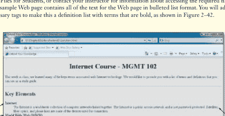

图 2-42

每章末尾的“扩展你的知识”项目允许学生扩展和延伸在本章内学到的技能。学生运用批判性思维尝试新技能以完成每个项目。

**执行以下任务：**

1. 使用文件 `extend2-1.html` 中给定的文本，按照 HTML 52 页图 2-14 所示的定义列表代码，修改 HTML 代码，将网页从项目符号列表更改为定义列表。

### 使其正确

项目要求学生分析文件，发现其中的错误，并使用他们在本章中学到的技能进行修复。

2. 添加必要的 HTML 代码以使术语加粗（有关样式请参见附录 D 中的 `font-weight`），并设置背景颜色为 `#e0e0e0`（有关背景颜色请参见附录 D）。
3. 使用文件名 `extend2-1solution.html` 将修改后的文档保存在 `Chapter02\Extend` 文件夹中，验证网页，然后按照您老师指定的格式提交。

## 使其正确

分析文档并更正所有错误和/或改进设计。

### 更正友好提醒网页

**说明：** 启动 Notepad++。打开来自学生数据文件的 `Chapter02\MakeItRight` 文件夹中的文件 `makeitright2-1.html`。有关下载学生数据文件的说明，请参阅本书的封底内页，或联系您的老师以获取有关访问所需文件的信息。该网页是您在图 2-43 中所见内容的修改版本。对网页进行必要的更正，使其看起来像图 2-43。将标题格式设置为使用 Heading 1 样式并在网页上居中对齐（有关如何居中标题请参见附录 D 中的 `text-align` 属性）。添加两个 10px 大小的水平线，如图 2-43 所示。将文件以 `makeitright2-1solution.html` 为名保存在 `Chapter02\MakeItRight` 文件夹中，验证网页，然后按照您老师指定的格式提交：

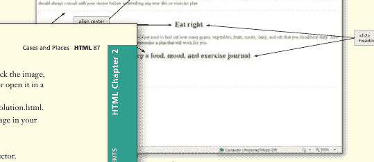

图 2-43

3. 插入存储在 `Chapter02\IntheLab` 文件夹中的图像文件 `cloudy.jpg`。右键单击图像，单击“属性”，然后单击“详细信息”选项卡以查找图像的尺寸，或在图形程序中打开它。请注意，用于列表的项目符号是方形的。
4. 使用文件名 `lab2-3solution.html` 将 HTML 文件保存在 `Chapter02\IntheLab` 文件夹中。
5. 输入 `g:\Chapter02\IntheLab\lab2-3solution.html` 作为 URL，以在浏览器中查看网页。
6. 从浏览器打印网页。
7. 按照您老师指定的格式提交修改后的 HTML 文件和网页。

## 案例与实践

运用您的创造性思维和问题解决技能来设计并实施解决方案。

★ 较简单　★★ 较困难

### ★ 1：添加到食品募捐网页

社区食品银行的主任 Wattigney 先生喜欢您为实验 2-1 创建的网页。既然食品募捐已经结束，他希望您用即将到来的社区活动的新信息更新该网页。在更新页面之前，请在网上搜索以查看其他食品银行或社区服务部门的网页，以获取有关要包含的内容或要更改的格式的想法。他们的网站是什么样子？您能否对实验 2-1 网页进行一些更改以反映其他地方的做法？使用本章介绍的概念，添加附加信息或更改格式，使页面更有趣且与时俱进。

### ★★ 2：创建艺术家网站

您正在为当地的一位摄影师创建一个新网站。摄影师要求您为网页上的图像使用描述性的 `alt` 属性，因为他的网页的许多观众的互联网连接速度非常慢，图像通常无法快速加载。在网上搜索有关为图像添加有用的、描述性的 `alt` 属性的信息。还要查找有关使用缩略图的信息。给出加快图像加载速度的建议。创建一个文档，包含一个简短段落，解释您在研究中找到的信息。就如何使摄影师的网站更有效率提出建议。

### ★★ 3：创建 CSS 属性网页

到目前为止，您在课堂上已经学到了很多关于使用层叠样式表（CSS）的知识。不过，关于如何插入某些样式，您可能仍有一些问题。在网上搜索信息（不要忘记查看 W3.org 网站），找到列出 CSS 属性和值的网站，以补充附录 D。在 Word 文档中，添加您发现非常有用的 URL。在每个 URL 下方，写一个简短的段落，描述为什么您认为该网站对新的网页开发者有用。与同学分享您的 URL 列表。

### ★★ 4：创建个人网页

#### 使其个性化

您的班级老师希望将所有学生的网页发布到学校服务器上，以展示他或她的学生对什么感兴趣。创建一个个人信息网页，列出诸如您的学校专业、过去从事过的工作以及您的爱好和兴趣等项目。为了使您的个人

在“案例与实践”练习中找到的“使其个性化”练习要求学生创建一个与其个人生活相关的开放式项目。

# 1 HTML、XHTML 与 CSS 简介


## 学习目标

当你能够完成以下事项时，就掌握了本章的内容：

- 描述互联网及其相关关键术语
- 描述万维网及其相关关键术语
- 描述网站的类型和目的
- 讨论 Web 浏览器并明确其用途
- 定义用于 Web 开发的超文本标记语言（HTML）及其相关标准
- 讨论级联样式表（CSS）在 Web 开发中的应用
- 定义文档对象模型（DOM）并描述其与 HTML 的关系
- 定义可扩展超文本标记语言（XHTML）并描述其与 HTML 的关系
- 识别用于创建 HTML 文档的工具
- 描述 Web 开发生命周期的五个阶段
- 描述不同的网站设计方法以及每种网站结构的目的
- 讨论在整个 Web 开发生命周期中进行测试的重要性
- 解释成为一个有观察力的 Web 用户的重要性

## 简介

在深入探讨使用 HTML、XHTML 和 CSS 创建网页的细节之前，先了解一下这些技术与互联网和万维网发展的关系是很有用的。互联网始于计算机和计算机网络的连接。这种连接性对我们的日常生活产生了巨大的影响。如今，全球数百万人可以访问世界上最大的网络——互联网。数十亿网页——提供你能想象到的任何主题的信息——目前都可在万维网上获取。人们使用互联网来搜索信息、与世界各地的人交流以及寻求娱乐。学生通过这个计算机网络注册课程、支付学费并查看期末成绩。商店和个人使用计算机连接销售他们的产品，大多数行业都依赖互联网和万维网进行商业交易。超文本标记语言（HTML）以及近期的可扩展超文本标记语言（XHTML）和级联样式表（CSS）使得万维网得以存在。为了有效地利用这些技术，你需要理解互联网和 HTML 背后的主要概念。在本章中，你将学习关于互联网、万维网、内联网和外联网的一些基础知识。你将了解 Web 浏览器、HTML 及其相关关键术语的定义、Web 开发生命周期的五个阶段，以及每个阶段涉及的任务。

## 什么是互联网？

如今，大多数人已经在学校、家里、工作场所或当地的图书馆接触过互联网。**互联网**是计算机和计算机网络的全球集合，它使用调制解调器、电话线、电视电缆、卫星链路、光纤连接以及其他通信设备和媒体（图 1–1），连接了用于企业、政府、教育机构、组织和个人的数十亿台计算机。

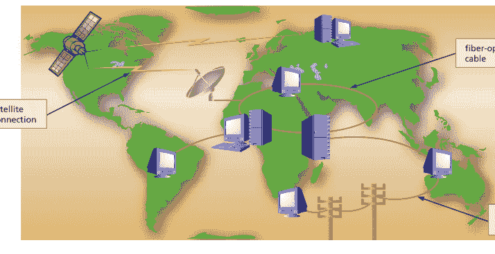

**图 1–1 互联网是计算机网络的全球集合。**

**网络**是连接在一起以共享资源和信息的两台或多台计算机的集合。如今，高速、中速和低速数据线路连接着网络。这些数据线路允许数据（包括文本、图形图像以及音频和视频数据）从一台计算机移动到另一台计算机。**互联网骨干网**是连接世界各地主要计算机系统的高速数据线路集合。**互联网服务提供商（ISP）**是与互联网骨干网建立永久连接的公司。ISP 使用高速或中速数据线路，允许个人和公司连接到骨干网以访问互联网。家庭互联网连接通常是连接到 ISP 的 DSL 或电缆数据线路。

全球大多数国家的数百万人使用他们家中、办公室、学校以及图书馆等公共场所的计算机连接到互联网。连接到互联网的计算机用户可以访问各种服务，包括电子邮件、社交网络、在线购物和万维网（图 1–2）。


**图 1–2 互联网提供多种服务，例如电子邮件和万维网。**

> **互联网和 WWW 历史**
>
> 万维网联盟（W3C 或 `w3.org`）——管理 HTML 的事实上的组织——提供了关于互联网和万维网的特别丰富的历史。在你的浏览器中搜索“Internet history”或“WWW history”可以找到许多额外的资料来源。

## 什么是万维网？

**万维网**，也称为 **Web**，是互联网中支持多媒体的部分，由链接文档的集合组成。为了支持多媒体，Web 依赖于**超文本传输协议（HTTP）**，这是一组用于交换文本、图形、声音、视频和其他多媒体文件的规则。Web 上的链接文档或信息页面被称为**网页**。因为 Web 支持文本、图形、声音和视频，所以一个网页可以包含这些多媒体元素中的任何一种。Web 不断变化，由数十亿个网页组成。由于创建网页的简便性，网页数量一直在增加。

**网站**是由个人、公司、教育机构或其他组织创建和维护的相关网页的集合。例如，如图 1–3 所示，许多组织，如芝加哥科学与工业博物馆，发布和维护网站。每个网站都包含一个**主页**，这是用户访问该网站时看到的第一个文档。主页通常作为指向网站上显示的其他文档和文件的索引或目录。

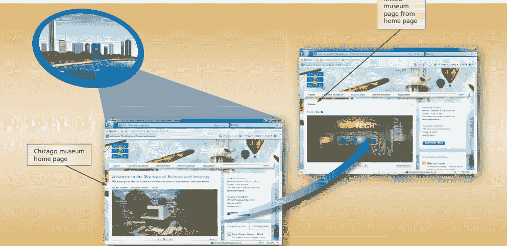

**图 1–3 网站是由个人、公司、教育机构或其他组织创建和维护的相关网页的集合。**

## Web 服务器

网页存储在 **Web 服务器**或**主机**上，这是一台存储并发送（提供）所请求网页和其他文件的计算机。任何安装了 Web 服务器软件并连接到互联网的计算机都可以充当 Web 服务器。每个网站都存储在一个或多个 Web 服务器上，并在其上运行。一个大型网站可能分布在地理位置不同的多个服务器上。

为了使你开发的网页可供你的受众访问，你必须发布这些页面。**发布**是将网页及相关文件（如图形和音频）复制到 Web 服务器的过程。一旦网页发布，无论 Web 服务器位于何处，任何有权访问互联网的人都可以查看它。例如，尽管芝加哥科学与工业博物馆的网站存储在美国某地的 Web 服务器上，但世界上的任何人都可以查看它。一旦网页发布，几乎任何计算机都可以读取它：无论你使用 Mac、Windows 还是 Linux 操作系统，使用各种计算机硬件，你都可以访问数十亿已发布的网页。

## 网站的类型和目的

网站的三大通用类型是互联网网站、内联网和外联网。表 1–1 列出了这三种网站的特征。

| 类型 | 用户 | 访问权限 | 应用 |
| --- | --- | --- | --- |
| 互联网网站 | 任何人 | 公共 | 用于与公众共享信息，如个人信息、产品目录、课程信息 |
| 内联网 | 员工或成员 | 私有 | 用于与员工或成员共享信息，如表格、手册、组织日程 |
| 外联网 | 特定的业务合作伙伴 | 私有 | 用于与业务合作伙伴和客户共享信息，如库存更新、产品规格、财务信息 |

**互联网网站**，也称为 **Web 网站**，通常是向公众开放的网站。个人、团体、公司和教育机构出于各种目的使用网站。内联网和外联网也使用互联网技术，但访问权限仅限于特定群体。**内联网**是一个使用互联网技术在公司内部共享公司信息的私有网络。内联网包含在公司或组织的网络内，这使其成为私有的，仅对需要访问的人开放。政策和程序手册通常可以在内联网上找到。其他文件，如员工名录、公司简报、产品目录和培训手册，也经常通过内联网分发。

> **内联网和外联网**
>
> 有许多讨论内联网和外联网创意的网站。许多公司已经在使用这些技术，并分享他们的“最佳实践”技巧。CIO 内联网/外联网研究中心提供了关于构建和维护内联网或外联网的宝贵信息，以及其他资源。

**外联网**是一个使用互联网技术与特定的公司合作伙伴或关键客户共享业务信息的私有网络。公司和组织可以使用外联网来共享产品手册、培训模块、库存状态和订单信息。外联网还可能允许零售商直接采购库存或在线支付账单。

公司使用网站在世界范围内宣传或销售他们的产品和服务，同时也为他们的客户提供技术和产品支持。许多公司网站还支持**电子商务（e-commerce）**，即在互联网上买卖商品和服务。使用电子商务技术，这些网站允许客户浏览产品目录、比较购物和在线订购产品。图 1–4 显示了 Amazon.com，这是一家仅在线销售产品的公司。许多公司网站还提供职位发布和公告、常见问题解答（FAQ）部分、客户反馈链接以征求客户意见，以及可搜索的技术支持数据库。

> **电子商务**
>
> 今天，电子商务已成为商业活动的标准部分。然而，电子商务技术仍在不断变化，提供新的应用和潜在用途。有几本在线杂志专门深入探讨电子商务。许多印刷杂志也提供了关于这种重要商业方式的有用信息。

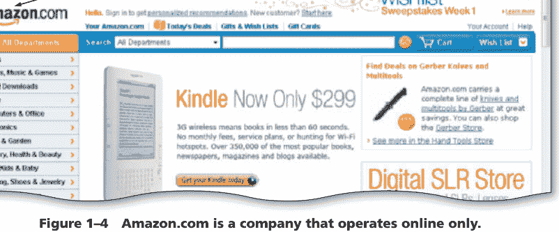

HTML 6 HTML 第 1 章 HTML、XHTML 和 CSS 简介

学院、大学和其他学校使用网站来发布关于学习领域的信息、提供课程信息或在线为学生注册课程。教师使用他们的网站发布公告、发布阅读材料的问题、列出联系信息以及提供讲义和幻灯片的便捷访问。如今，许多教师使用其所在学校采用的课程管理软件来上传课程内容。在大学范围内使用标准的课程管理产品，使学生更容易找到与其各种课程相关的信息。许多课程管理工具允许教师为课程编写自己的 Web 内容。在许多系统中，教师可以在学校提供的课程管理工具的结构内，使用网页为其学生提供进一步信息。除了通过网络与在校学生保持联系外，大学还利用网络与校友保持联系，如图 1-5 所示。

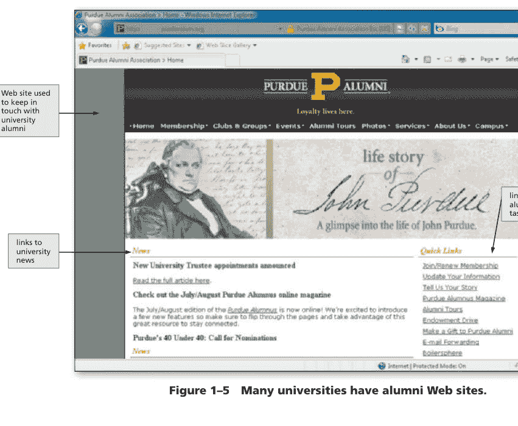

图 1-5 许多大学都有校友网站。

除了公司和教育机构使用互联网外，个人可能会创建包含其简历的个人网站，以便任何感兴趣的雇主都能轻松访问。家庭可以通过网站分享照片、视频和音频剪辑、故事、日程安排或其他信息（图 1-6）。许多个人网站允许密码保护，这为信息共享提供了更安全的环境。

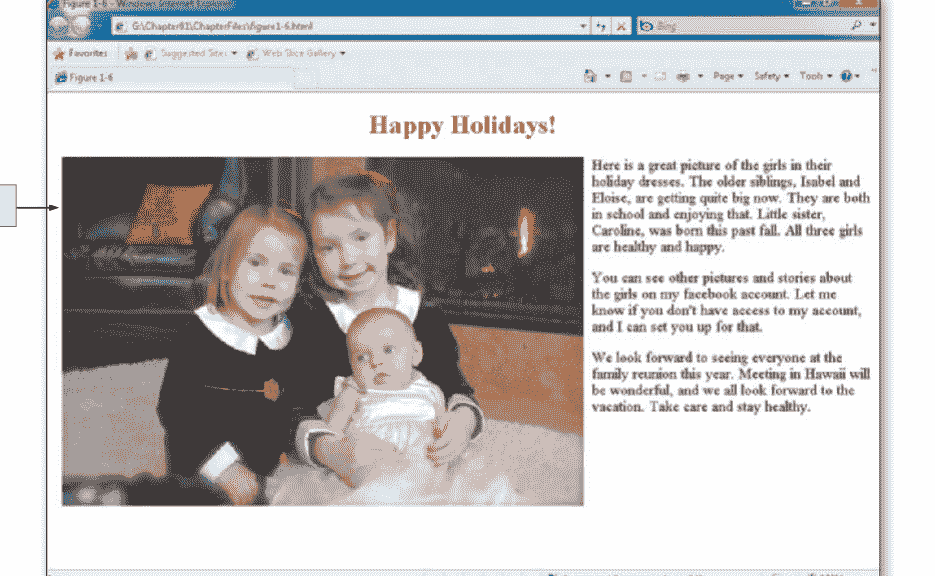

图 1-6 个人网站用于与家人和朋友沟通。

## Web 浏览器

要在任何类型的网站上显示网页，计算机需要安装 Web 浏览器。**Web 浏览器**，也称为**浏览器**，是一种解释和显示网页的程序，使你能够查看和与网页交互。微软的 Internet Explorer、Mozilla Firefox 和 Apple Safari 是当今流行的浏览器。浏览器提供各种功能，包括定位网页、在网页之间向前和向后链接、收藏或书签一个网页以及选择安全设置。

要使用浏览器定位网页，你需要在浏览器的地址栏或位置栏中输入该网页的统一资源定位符（URL）。**统一资源定位符（URL）**是可在互联网上访问的文档或其他文件的地址。Web 上的一个 URL 示例如下：

```text
http://www.scsite.com/btmb6e/index.html
```

该 URL 指示浏览器使用 HTTP 通信协议在 `scsite.com` Web 服务器上的 `html6e` 文件夹中定位 `index.html` 网页。网页 URL 可以在广泛的地方找到，包括学校目录、名片、产品包装和广告。

超链接是万维网的重要组成部分。**超链接**，也称为**链接**，是一种用于将一个网页连接到位于同一服务器上的另一个网页的元素，或者用于链接位于世界上任何地方的其他 Web 服务器上的网页。单击超链接可以让你快速从一个网页移动到另一个网页，而用户不必关心网页位于何处。你也可以单击超链接移动到同一网页的不同部分。


通过超链接，网站用户不必以线性方式查看信息。相反，他或她可以单击可用的超链接，以多种方式查看信息，正如本章后面所描述的。许多不同的网页元素，包括文本、图形和动画，都可以用作超链接。图1-7展示了用作超链接的几种不同网页元素的示例。

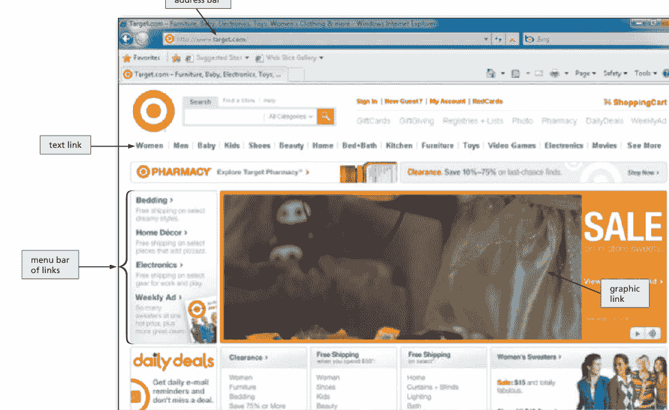

图1-7 网页可以使用许多不同的网页元素作为超链接。

## 什么是超文本标记语言？

网页是使用**超文本标记语言（HTML）**创建的，这是一种用于为万维网创建文档的创作语言。HTML使用一组称为**标签**或**标记**的特殊指令来定义Web文档的结构和布局，并指定页面在浏览器中的显示方式。

网页是包含文本和HTML标签的文件。HTML标签标记文本，以定义其在Web上作为页面查看时应如何显示。HTML包含数百个用于格式化网页和创建指向其他文档或网页的超链接的标签。例如，HTML标签`<p>`和`</p>`用于表示一个新段落，其上方有一个空白行，`<table>`和`</table>`用于表示表格的开始和结束，`<hr />`用于在页面上显示一条水平线。图1-8a显示了创建图1-8b所示网页所需的HTML标签。你还可以通过使用属性来增强HTML标签，如图1-8a所示。**属性**定义HTML标签的额外特征，如字体粗细或样式。

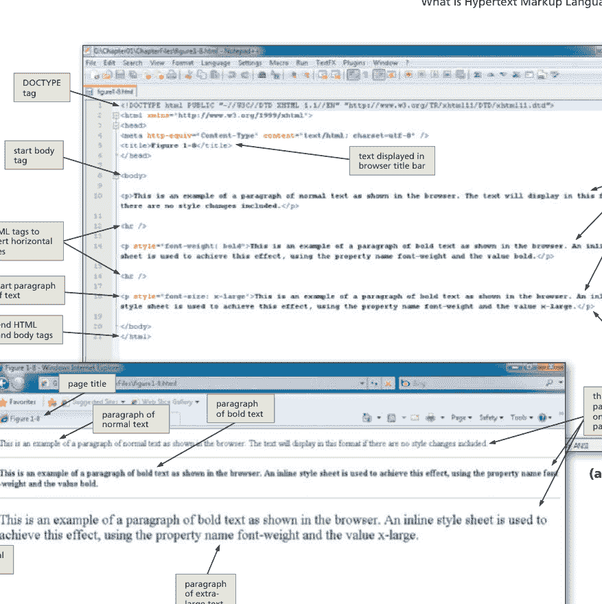

HTML是**平台无关的**，这意味着你可以在一种类型的计算机上创建或编写一个HTML文件，然后在另一种类型的计算机上使用浏览器将该文件作为网页查看。无论你使用什么平台，页面看起来都是一样的。Web技术最大的好处之一是，同一个网页可以在许多不同类型的数字硬件上查看，包括智能手机等移动设备。

## HTML元素

HTML将描述性标签与表示文档在Web浏览器中应如何显示的特殊标签相结合。HTML元素包括标题、段落、超链接、列表、图像等。大多数HTML元素由三部分组成：开始标签、内容和结束标签。例如，要指定某些文本在网页中应显示为粗体，你需要输入以下HTML代码：

```
<bold>this is bold text</bold>
```

其中`<bold>`是开始粗体代码，`</bold>`是结束粗体代码。下一页的表1-2显示了一些HTML元素的示例。

## 表1-2 HTML元素

| 元素 | 标签 | 用途 |
|---|---|---|
| 标题 | `<title>...</title>` | 指示浏览器标题栏上显示的标题 |
| 主体 | `<body>...</body>` | 指定网页上显示的内容；所有网页内容都插入在开始`<body>`标签和结束`</body>`标签之间 |
| 段落 | `<p>...</p>` | 在段落文本前插入一个空白行 |
| 换行 | `<br />` | 在下一个元素前插入换行符，不插入空白行 |

关于HTML元素的信息来源众多。万维网联盟（`w3.org`）提供了最全面的标签和属性列表及其使用示例。W3C的主要目标之一是帮助那些构建网站的人理解和利用标准，使网络对所有人可访问。

## HTML编码实践

与所有编程语言类似，HTML有一套编码规范，旨在简化创建和编辑HTML文件的过程，并确保网页在不同的浏览器中正确显示。

创建HTML文件时，你应该使用空格和Tab键来分隔HTML代码的部分。在部分之间添加空格（无论是空行还是制表符），可以让你立即看到相互关联的代码部分，并帮助你更清晰地查看文档中的HTML元素。HTML浏览器会忽略HTML文档中标签之间存在的空格，因此在代码中插入的空格和缩进不会出现在网页上。图1-9展示了一个HTML文件的示例，其中代码部分通过空行分隔，并进行了缩进。其他查看此代码的开发人员可以立即看到特定部分在代码中的位置。

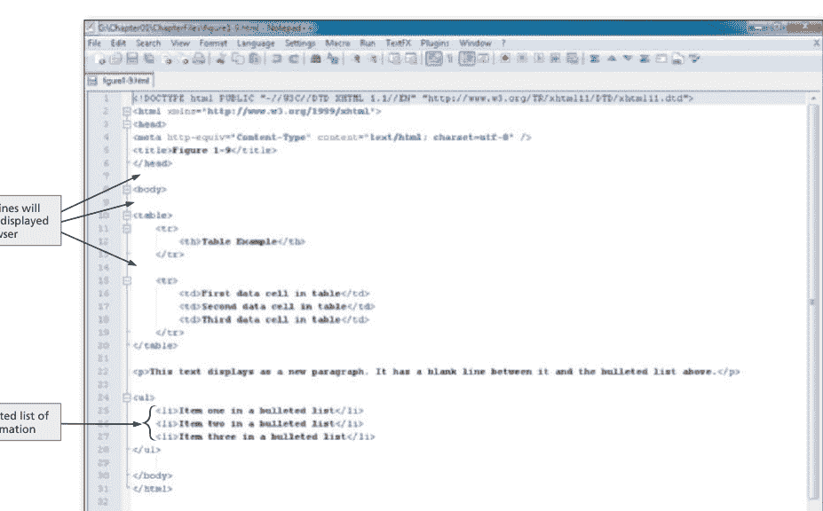

图1-9 在HTML代码中添加空格可以分隔部分，使阅读更容易。

## HTML 版本

HTML 已历经多个版本，每个版本都扩展了 HTML 的能力。尽管 HTML 5.0 版本仍在开发中，但尚未发布。目前最新的 HTML 版本是 HTML 4.01，不过大多数浏览器仍然支持 HTML 3.2 和 2.0 版本。为确保浏览器能正确解释每个新版本的 HTML，万维网联盟（W3C）制定了 HTML 标准或规范，并在其网站上公开发布。正如本章后面所述，在开发测试阶段，验证网页在不同浏览器中按预期显示非常重要。

## 级联样式表

本书在第 6 版中通过移除已弃用的标签和属性，采用了新的方向。**已弃用**的标签和属性是指在最新的 W3C 标准中不再推荐使用的标签和属性。在附录 A 中，已弃用的标签和属性已用星号标出。为了消除已弃用的 HTML 标签，本章项目使用了级联样式表（CSS）来改变网页的样式（或外观）。虽然 HTML 允许网页开发者修改网页的结构、设计和内容，但其在定义一个或多个网页的外观或样式方面存在局限性。**级联样式表（CSS）**允许你为各种网页元素指定样式。**样式**是定义网页元素外观的规则。**样式表**是一系列定义网页或整个网站样式的规则。通过样式表，你可以通过更改字体族、字体大小、边距和链接规范等特性，以及颜色和边框等视觉元素，来改变一个或多个网页的外观。CSS 不用于向你的网站添加任何内容；它只是让你的内容看起来更具风格。

> CSS、DHTML 和 XHTML
>
> `w3.org` 网站提供了大量关于级联样式表（CSS）、动态 HTML（DHTML）和可扩展 HTML（XHTML）的信息和教程。W3C 网站建议的标准是大多数网页开发者所遵循的标准。

通过 CSS，你可以为单个网页内或整个网站中的某个元素指定样式。例如，如果你想让网页上所有文本段落都缩进五个空格，你可以使用样式表来处理缩进，而不是为每个段落编写缩进代码。而且，如果你决定将缩进改为三个空格，你只需更改样式表中的一行，而不是更改每个段落的代码。因此，你可以看到使用 CSS 可以节省大量时间，并使样式更改变得更加容易。

CSS 不是 HTML；它是一种独立的语言，用于增强 HTML 的显示能力。万维网联盟（W3C）——即制定 HTML 标准的同一组织——也制定了 CSS 规范。本书末尾的附录 A 以及在线提供的附录列出了允许你根据需要更改网页元素的 HTML 标签和相应属性，附录 D 则详细介绍了与不同 CSS 元素相关的属性和值。

## 文档对象模型（DOM）

HTML 可以与其他 Web 技术结合使用，为网页提供额外的功能。例如，术语**文档对象模型（DOM）**描述了 HTML 标签、CSS 和脚本语言（如 JavaScript）的组合。DOM 允许 JavaScript 和其他语言操纵底层文档的结构，以创建交互式的、动态的网页。这是一种模型，其中网页（或文档）包含可以被操纵的对象（元素、链接等）。这使得网页开发者可以添加、删除或更改元素或属性。使用 DOM 增强的网页比基本的 HTML 网页更能响应访客的交互。并非所有交互式网页都需要 DOM，但如果你需要广泛的交互性，那么这可能是一个值得考虑的模型。CSS、JavaScript 和 DOM 将在本书的综合版本（12 章）后续章节中介绍。

## 可扩展超文本标记语言（XHTML）

正如你所了解的，HTML 使用标签来描述文档在 Web 浏览器中的显示方式，即网页格式。**可扩展标记语言（XML）**是一种使用标签来描述文档结构和内容的标记语言，而非格式。**可扩展超文本标记语言（XHTML）**是 HTML 格式的重新表述，使其符合 XML 的结构和内容规则。通过结合 HTML 和 XML，XHTML 融合了 HTML 的显示特性以及 XML 要求的更严格的编码标准。

如果你用 HTML 创建网页，但没有完全遵循 XHTML 编码标准（例如，没有使用结束标签 `</p>`），你电脑上的 Web 浏览器仍然可以正确解释和显示该网页。然而，较新类型的浏览器，例如用于手机或手持电脑的浏览器，无法解释不符合 XHTML 标准的 HTML 代码。由于 XHTML 具有如此严格的编码标准，它有助于确保用 XHTML 创建的网页能被多种不同类型的应用程序读取。Web 开发的一个重要步骤是检查你的网页是否符合 XHTML 标准。你将从第 2 章开始验证你的网页，并在整个学习过程中持续进行。

表 1–3 列出了一些 Web 开发者应遵循的 XHTML 编码规则，以确保他们的 HTML 代码符合 XHTML 标准。本书中的所有项目都遵循 XHTML 标准（如第 2 章所述）并遵守表 1–3 中概述的规则。每条规则的具体细节将在项目中使用时详细解释。

**表 1–3 XHTML 编码实践**

| 实践 | 无效示例 | 有效示例 |
| :--- | :--- | :--- |
| HTML 文件必须包含 DOCTYPE 语句 | `<html><head><title>示例网页</title>` | `<!DOCTYPE html PUBLIC "-//W3C//DTD XHTML 1.0 Transitional//EN" "http://www.w3.org/TR/xhtml1/DTD/xhtml1-transitional.dtd"><html><head><title>示例网页</title></head>` |
| 所有标签和属性必须使用小写字母 | `<TABLE WIDTH="100%">` | `<table width="100%">` |
| 所有属性值必须用单引号或双引号括起来 | `<table width=100%>` | `<table width="100%">` |
| 所有标签必须关闭，包括如 `img`、`hr` 和 `br` 等没有结束标签的标签，但必须作为实践进行关闭 | `<br><hr><p>这是另一个段落` | `<br /><hr /><p>这是另一个段落</p>` |
| 所有元素必须正确嵌套 | `<p><strong>这是一个加粗段落</p></strong>` | `<p><strong>这是一个加粗段落</strong></p>` |

## 创建 HTML 文档的工具

你可以使用简单的文本编辑器（如 Notepad++、Notepad、TextPad 或 SimpleText）创建 HTML 网页。**文本编辑器**是允许用户输入、更改、保存和打印文本（如 HTML）的程序。文本编辑器没有许多高级功能，但它们确实可以让你轻松地开发 HTML 文档。例如，如果你想将 DOCTYPE 标签插入网页文件，只需在任何文本编辑器中输入必要的文本，如图 1–10a 和图 1–10b 所示。尽管记事本（Notepad）（图 1–10b）是一个适用于 Web 开发的文本编辑器，但请注意它与 Notepad++ 的区别。Notepad++ 是一个更强大的文本编辑器，它在输入 HTML 代码时使用颜色方案。

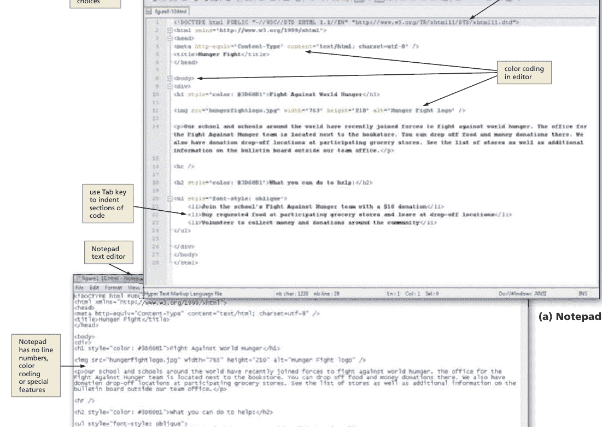

图 1–10 使用像 Notepad++ 或 Notepad 这样的文本编辑器，你输入 HTML 标签和文本来创建网页。

你也可以使用 HTML 文本编辑器（如 EditPlus 或 BBEdit（适用于 Macintosh））创建网页。**HTML 文本编辑器**是提供基本文本编辑功能以及更高级功能的程序，例如为各种 HTML 标签着色、用于插入 HTML 标签的菜单以及拼写检查器。**HTML 对象编辑器**（如 Eiffel Software 对象编辑器）提供了额外的大纲编辑器功能，允许你展开和折叠 HTML 对象和属性、编辑参数以及查看附加到展开对象的图形。

许多流行的软件应用程序也提供了让你轻松开发网页的功能。例如，Microsoft Word、Excel 和 PowerPoint 具有“另存为网页”功能，通过自动向文档添加 HTML 标签，将文档转换为 HTML 文件。使用 Microsoft Access，你可以创建允许查看数据库中数据的网页。Adobe Acrobat 也有一个导出功能，可以创建 HTML 文件。这些应用程序中的每一个也都允许你向网页添加超链接、下拉框、选项按钮或滚动文本。

这些高级 Web 功能使得将任何文档、电子表格、数据库或演示文稿保存为网页显示变得简单。例如，公司政策和流程手册以及 PowerPoint 演示文稿可以轻松保存为网页并发布到公司内部网。可以给予外部网用户访问权限，让他们查看或更新存储在数据库中的信息。

你也可以使用 WYSIWYG 编辑器（如 Adobe Dreamweaver、Amaya 或 CoffeeCup HTML Editor）创建网页。**WYSIWYG 编辑器**是提供图形用户界面的程序，允许开发者在开发过程中预览网页。WYSIWYG（发音为 wizzy-wig）是“所见即所得”的首字母缩写。WYSIWYG 编辑器会在你添加元素到网页时为你创建 HTML 代码，这意味着你不必直接输入 HTML 标签。WYSIWYG 编辑器的主要问题是它们经常生成“臃肿的”HTML 代码（HTML 标签周围包含许多不必要的额外代码行）。

无论你使用哪种类型的程序来创建网页，理解 HTML 的具体细节都很重要，这样你才能在编辑器之外进行更改。例如，你可能能够用 Dreamweaver 创建一个网页，但如果你想做一些小改动，了解 HTML 标签本身是非常有帮助的。理解 Web 开发生命周期也很重要，这样你网站中的网页才能保持一致和完整。

> 顺便说一下
>
> **免费的 HTML WYSIWYG 编辑器**
>
> 有许多流行的 WYSIWYG 编辑器被许多初级 Web 开发者用来创建设计良好、交互式的网站。你可以在大多数搜索引擎中搜索“WYSIWYG HTML editor”来找到它们。

## Web 开发生命周期

多年来，大学和学院的信息技术课程一直强调在设计和实施新软件时遵循系统开发生命周期的重要性，以确保一致性和完整性。Web 开发过程应遵循类似的周期。全面的规划和分析确保开发者能够提供用户想要的东西。如果你在没有彻底规划和分析的情况下就开始编写网页代码，你可能会面临遗漏相关信息的风险。在项目开发的早期阶段对网站进行纠正，比更改已完成的网页要便宜得多。

本节概述的 Web 开发生命周期可用于任何类型或规模的 Web 开发项目。**Web 开发生命周期**是一个可用于开发任何复杂级别网页的过程。Web 开发生命周期包括以下阶段：规划、分析、设计和开发、测试以及实施和维护。表 1–4 列出了在 Web 开发生命周期每个阶段应问的几个问题。在整本书中，你将在开发网页时遵循这个系统性的周期。

## 表 1–4 网页开发阶段与问题

| 网页开发阶段 | 需要询问的问题 |
| :--- | :--- |
| 规划 | • 此网站的目的是什么？<br>• 谁会使用此网站？<br>• 用户的计算环境是怎样的？<br>• 网站信息的所有者和创建者是谁？<br>• 谁决定信息是否以及放置在网站的哪个位置？ |
| 分析 | • 用户需要执行哪些任务？<br>• 哪些信息对用户有用？<br>• 必须考虑哪些流程因素？ |
| 设计与开发 | • 网站将包含多少网页？<br>• 网页将如何组织？<br>• 什么样的网站结构适合其内容？<br>• 如何最好地呈现内容以便于使用？<br>• 此网站将采用什么文件命名规范？<br>• 网页文件将使用什么文件夹结构？<br>• 如何在整个开发过程中应用 XHTML 标准？<br>• 哪些形式的多媒体对网站有积极贡献？<br>• 如何在不限制可用性的情况下解决无障碍问题？<br>• 是否会有国际受众？ |
| 测试 | • 网页是否通过了万维网联盟（W3C）的 XHTML 合规性验证流程？<br>• 网站内容是否正确？<br>• 网站功能是否正常？<br>• 用户能否找到完成所需任务所需的信息？<br>• 导航是否清晰且易于使用？ |
| 实施与维护 | • 网站如何发布？<br>• 如何吸引用户访问和再次访问网站？<br>• 网站如何更新？<br>• 谁负责内容更新？<br>• 谁负责结构更新？<br>• 如何通知用户网站已更新？<br>• 网站是否会被监控？ |

## 网站规划

网站规划是网页开发生命周期的第一阶段，涉及确定网站的目标或目的。网站规划阶段的第一步是回答“此网站的目的是什么？”这个问题。正如你所了解到的，个人和团体出于各种目的设计和发布网站。个人创建网站以分享他们的爱好、发布简历，或仅仅是分享关于个人兴趣的想法。组织创建网站以让成员了解即将到来的活动或招募新成员。企业创建网站以宣传和销售产品，或为客户提供 24 小时在线支持。讲师发布网站，或使用学校的在线课程管理软件为他们的课程添加信息，以告知学生课程政策、作业和截止日期，以及课程要求。在你能充分确定网站的预期目的之前，你不应继续进行网页开发项目。

除了了解网站的目的，你还应该了解谁会使用该网站以及大多数用户的计算环境。了解目标受众的构成——包括年龄、性别、一般人口统计背景和计算机素养水平——将帮助你设计一个适合所有用户的网站。了解用户的计算环境将决定使用何种类型的网页技术。例如，如果大多数用户使用低速互联网连接，你就不希望创建包含大型图形或多媒体元素的页面。

网站规划阶段的最后一个方面是确定内容所有者和创建者。为此，你需要询问以下问题：

- 网站信息的所有者和创建者是谁？
- 谁决定信息是否以及放置在网站的哪个位置？

一旦你确定了谁将提供并授权网站内容，你就可以让这些人参与网页开发项目的各个方面。

## 网站分析

在分析阶段，你需要就网站内容和功能做出决策。为了帮助定义适当的内容和功能，你首先应该确定用户需要执行的任务。回答这个问题可以让你定义必要的内容以促进这些任务，并确定对用户有用的信息。无关内容应从网站中删除，因为它不服务于任何目的。

在分析阶段，考虑支持网站功能所需的流程也很重要。例如，如果你确定用户应该能够通过网站订购产品，那么你还需要定义每次提交订单时要采取的流程或操作。例如，订单提交后，如何在后台业务应用程序（如库存控制和应付账款）中处理该订单？用户是否会收到包含订单详细信息的电子邮件确认？分析阶段是网页开发生命周期中更重要的阶段之一。清晰地理解和定义网站所需的内容和功能，将指导你设计的网站类型，并减少网站开发过程中的变更。

## 顺便说一下

### 无障碍标准


创建一个对所有用户都可访问的网站可以使你的网站覆盖最广泛的受众。此外，根据第 508 条法律规定，任何美国联邦机构使用的网站或技术都必须可供残障人士使用。有关第 508 条指南，请参见附录 C。

## 网站设计与开发

在确定网站目的并定义内容和功能后，你需要考虑网站的设计。网站设计中的一些关键考虑因素包括定义如何组织网页内容、选择适当的网站结构、确定如何使用多媒体、解决无障碍问题以及为国际受众设计页面。网站设计中最重要的方面之一是确定在网站上提供导航的最佳方式。如果用户无法轻松找到他们正在寻找的信息，他们就不会再回到你的网站。

组织网页的方法有很多，就像组织报告或论文的方法有很多一样。表 1–5 列出了一些创建易于阅读和导航的网页的组织标准。

### 表 1–5 网页的组织标准

| 元素 | 组织标准 | 原因 |
| :--- | :--- | :--- |
| 标题 | 使用能清楚解释页面目的的简单标题 | 标题帮助用户理解页面的目的；一个好的标题可以在搜索引擎结果列表中解释页面 |
| 标题 | 使用标题分隔主要主题 | 标题使网页更易于阅读；简单的标题清楚地解释了页面的目的 |
| 水平线 | 插入水平线以分隔主要主题 | 水平线提供图形元素来分隔网页内容 |
| 段落 | 使用段落来帮助划分大量文本 | 段落提供更短、更易读的文本部分 |
| 列表 | 适当时使用项目符号或编号列表 | 列表提供有组织、易于阅读的文本，读者可以浏览 |
| 页面长度 | 保持合适的网页长度 | 网页用户并不总是滚动查看较长页面上的信息；适当的页面长度增加了用户查看关键信息的可能性 |
| 信息 | 将最重要的信息放在网页顶部以强调 | 网页用户快速浏览页面；将关键信息放在页面顶部增加了用户查看关键信息的可能性 |
| 其他 | 包含联系电子邮件地址；包含最后修改日期 | 电子邮件地址和日期为用户提供了一种联系网站开发者以提出问题的方式；最后修改日期帮助用户判断网站信息的时效性 |

网站可以使用几种不同类型的结构，包括线性、层级和网状结构。每种结构以不同的方式链接或连接网页，以定义用户如何导航网站和查看网页。你应该根据用户将如何导航网站和查看网站内容来为网站选择一种结构。

**线性**网站结构将网页以直线连接，如图 1-11 所示。如果网页上的信息应按特定顺序阅读，则线性网站结构是合适的。例如，如果第一个网页（模块 1）上的信息对于理解第二个网页（模块 2）上的信息是必要的，你应该使用线性结构。每个页面都会有从一个网页到下一个网页的链接，以及返回到上一个网页的链接。在许多情况下，网页需要一个接一个地阅读。

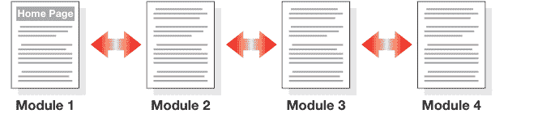

线性网站结构的一种变体包括添加指向网站主页的链接，如图 1-12 所示。对于某些网站，从一个模块跳转到下一个模块仍然很重要，但你也希望让用户能随时轻松访问主页。在这种情况下，你仍然需要提供从模块网页到上一个和下一个模块的链接，但每个网页也应包含一个返回主页的链接。这样，用户就不必多次点击上一个链接才能返回主页。

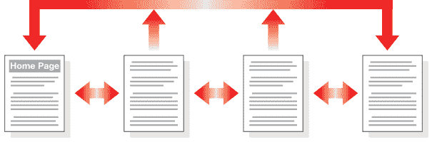

### 用户界面设计

用户界面设计是网站的一个重要方面。如果一个网站设计不佳，用户可能无法找到所需信息或完成任务，这会使网站失效。

**层次化**的网站结构将网页以树状结构连接，如图 1-13 所示。层次化的网站结构适用于具有主页索引或目录页的网站，该页面链接到所有其他网页。在这种结构下，主页会显示一般信息，次级页面则包含更详细的信息。注意图 1-13 中信息的组织是多么符合逻辑。网站访问者可以轻松地从主页前往任意一个模块。此外，访问者也可以通过模块 3 链接轻松进入模块 3 测验。然而，这种结构的一个固有问题是，无法轻松地从一个部分跳转到另一个部分。例如，要从模块 1 第 2 页跳转到模块 3 摘要，访问者必须使用“后退”按钮返回主页，然后点击模块 3 链接。对于只有两个网页的网站来说，这还算可以忍受，但试想如果模块 1 有 100 个网页会怎样！

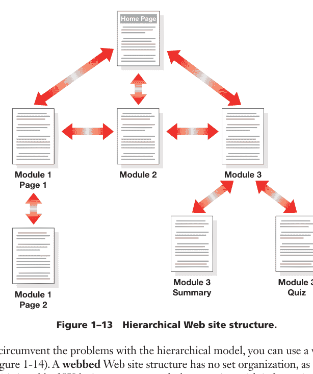

为了规避层次模型的问题，你可以使用网状模型（图 1-14）。**网状**的网站结构没有固定的组织形式，如图 1-14 所示。网状的网站结构最适合那些信息不需要按特定顺序阅读且有众多导航选项的网站。万维网就使用网状结构，因此用户可以按任何顺序在网页间导航。注意，在这种结构下，网站访问者可以更容易地在模块或模块摘要之间移动。使用这种模型，你通常需要在每个页面提供一个指向主页的链接，这导致从每个单独的网页都有一条额外的箭头指回主页（在这些小图中很难描绘出来）。当今许多网站都在每个网页的左上角放置一个图形图像（通常是公司或机构的标志）作为返回主页的链接。你将在本书后面使用这种技巧。

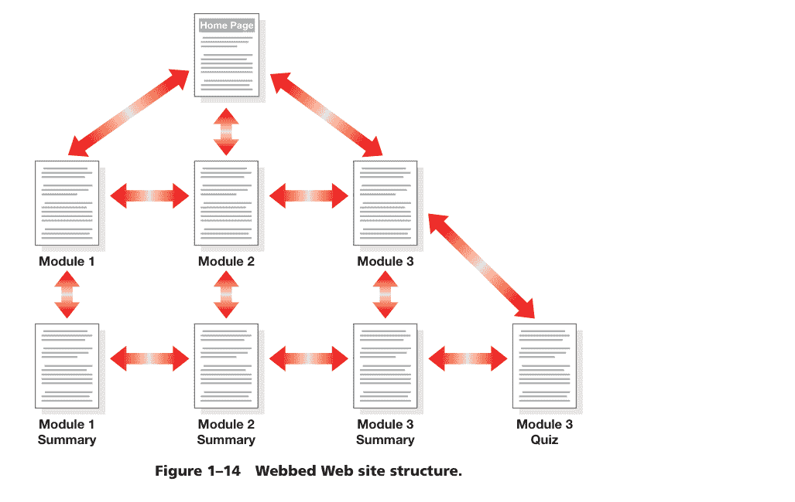

图 1-14 网状的网站结构。

大多数网站是线性、层次化和网状结构的组合。网站上的某些信息可能从索引页开始进行层次化组织，其他信息可能可以从网站的所有区域访问，还有一些信息可能被组织成线性结构以便按特定顺序阅读。如果这种组合能帮助用户轻松导航网站，那么使用这三种结构的组合是合适的。关键在于以最有效的方式向用户提供正确的信息。

无论你使用哪种或哪些结构，都应该平衡网站的广度和深度。广度大的网站是指主页是主要索引页，所有其他网页都单独链接到主页（图 1-15）。

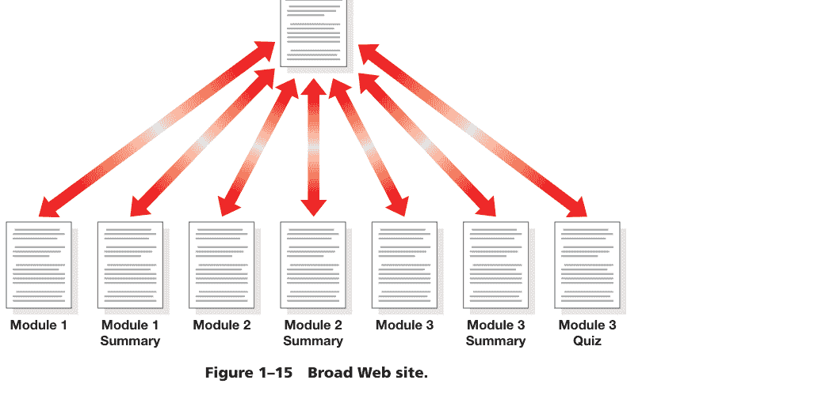

图 1-15 广度大的网站。

通过只允许用户从主页访问其他网页，广度大的网站迫使用户返回主页才能从一个网页跳转到另一个。这种结构使导航耗时且对用户有限制。更好的结构应该为用户提供导航选择，允许在网页之间直接移动。

**深度大的网站**是指具有许多层级的网站，需要用户点击多次才能到达特定网页（图 1-16）。通过要求访问者在到达目标页面之前浏览多个网页，深度大的网站迫使用户花费时间查看可能没有有用内容的中间页面。例如，请注意在第 HTML 18 页的图 1-13 中查找模块 3 摘要

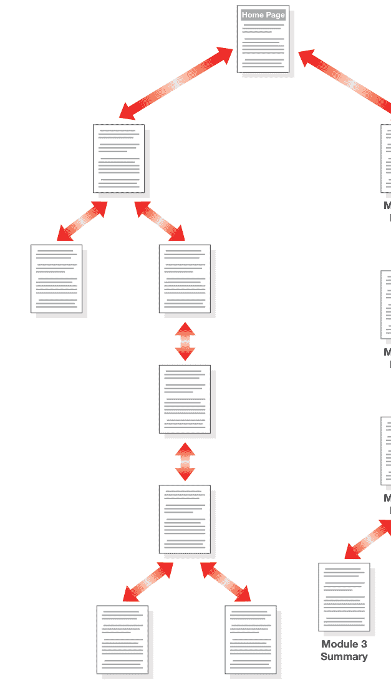

与在图 1-16 中查找相同网页（模块 3 摘要）之间的区别。假设用户曾经通过图 1-13 的网站学习过模块 3 的材料。然而，当用户使用图 1-16 的结构返回网站以复习模块 3 摘要网页并参加模块 3 测验时，用户必须逐个网页地完全浏览模块 3 的材料才能到达模块 3 摘要页。你可能希望让用户能更方便地访问该网页。

作为 Web 开发人员，你必须为网站选择合适的结构，并努力平衡广度和深度。用户访问网站是为了寻找信息以完成任务。良好的设计提供便捷的导航，让用户能够快速轻松地找到内容。除了规划网站本身的设计外，Web 开发人员还应始终在设计阶段早期规划文件命名和存储约定的具体细节。一旦确定了网站结构和为实现网站目标所需的大致页面数量，你就需要确定文件命名和文件夹结构应使用哪些标准。例如，将你的网页保存为 `page1.html` 和 `page2.html` 这样的名字，并不能告诉你这些网页的用途。一个更好的选择是将 Sabatina Pizza 网站的主页命名为 `sabatinahome.html` 或 `sabatinas.html`，而包含用户订单表单的网页可以命名为 `orderform.html`。这些文件名告诉开发人员以及未来维护该网站的开发人员这些网页的用途。

同样的原则也适用于你在 Web 开发中使用的文件夹结构。本书中的项目包含的网页文件和图形文件很少，因此所有内容（网页和图形）都存储在一个文件夹中。然而，对于大型网站，你可能希望将网页文件与图形文件分开存放。更大、更复杂的网站可能还需要一个专门存放视频或音频剪辑的文件夹。文件存储的位置会影响你在 HTML 代码中访问这些文件的方式。在 Web 开发生命周期的规划阶段确定一个好的文件夹结构非常重要。你将在第 3 章中了解更多关于有效文件夹结构的知识。

在设计和开发阶段，你还应该考虑哪些类型的多媒体（如果有的话）能对网站体验产生积极贡献。例如，添加一段来自公司首席执行官的视频信息可能有用，但如果你用户的计算环境无法支持视频播放，那么视频就毫无意义。通常，除非多媒体技术能对网站体验产生积极贡献，否则不要在网站中使用高级多媒体技术。如今，越来越多的网站在使用音频和视频内容。这些新增内容有时能增强网站的整体目标，但有时也会分散信息的传达。

最后，要考虑可访问性和国际化问题。Web 开发人员应始终为包括身体残障用户和全球用户在内的多样化受众进行设计。一个关键考虑因素是，身体残障人士使用的软件可能与某些网站功能不兼容。例如，如果你在网站中使用了图形，请务必为每个图形包含替代文本。为了支持国际受众，应使用能被全球理解的通用图标，避免内容中使用俚语表达，并构建能通过低速连接快速加载的简单网页。

刚刚讨论的设计问题只是你需要考虑的基本网页设计问题中的一部分。在本书的全过程中，设计问题将结合每个项目进行讨论。互联网上也有许多优秀的网页设计资源。

一旦网站设计确定，Web 开发就可以开始了。本书其余章节将讨论良好的网页标准，以及网页的实际开发。你将学习许多开发技术，包括链接、表格、图形、图像映射和 Web 表单。涵盖本书所有开发技术的总纲是层叠样式表的使用。

> **BTW 网页结构**
>
> 网络上有很多资源可以进一步讨论网站结构。除了通用的设计信息外，还有许多付费或免费下载的工具可以帮助你设计网站。在搜索引擎中输入“网站结构”可以找到许多有价值的设计资源。

`HTML 22` **HTML 第 1 章** HTML、XHTML 和 CSS 简介

## 网站测试

测试应在网站的所有页面上进行。你还应测试网页内的链接、指向网站中其他网页的链接，以及指向外部网站的链接。测试是 Web 开发的重要组成部分，它能确保你的网页按预期工作。

### 顺便提一下

## 网站测试

一个网站应在 Web 设计和开发过程的不同阶段进行测试。测试过程应全面，包括对网页内容、功能和可用性的审查。链接失效、图像缺失和内容不正确的网站会给人留下糟糕的印象。你想吸引用户访问你的网站并保持他们的兴趣。如果访客发现你的网站测试和维护不佳，他们就不太可能再次访问。如果用户不经常访问网站，你就无法传递信息。测试内容和功能的一些基本步骤包括：

- 通过 W3C 标记验证服务验证每个网页
- 校对页面内容和标题，检查拼写和语法是否准确
- 检查链接，确保它们未失效且链接正确
- 检查图形，确认它们显示正常且链接正确
- 确保解决无障碍访问和国际化问题
- 测试表单和其他交互式页面元素
- 测试页面，确保它们加载迅速，即使在较慢的连接上
- 打印每个页面，检查打印出来的效果

**可用性**是衡量一个产品（如网站）让用户能够完成其目标的程度。**可用性测试**是一种方法，通过要求网站或其他产品的用户执行特定任务，来衡量产品的易用性以及用户对体验的感知。网站的可用性测试应关注三个关键方面：内容、导航和呈现。

可用性测试可以通过多种方式进行；一种有效的方法是直接观察用户与网站交互（或使用网站）。当你观察用户时，可以追踪他们点击的链接并记录他们的操作和评论。你甚至可以要求用户解释他们在浏览网站时试图完成什么任务。通过观察用户获得的信息，对于识别网站中潜在的问题区域非常有价值。例如，如果你观察到用户难以找到列出商店位置和营业时间的网页，你可能需要澄清链接描述，或者使这些链接在主页上更显眼。

进行可用性测试的另一种方法是给用户一个具体任务来完成（例如找到产品价格表），然后观察他们如何导航网站来完成任务。如果可能，请他们解释为什么选择某些链接。这两种观察方法都非常有价值，但需要接触到用户。

也可以通过问卷调查或民意调查来完成可用性测试。编写问卷或调查时，务必提出开放式问题，以获取有价值的信息。例如，问一个是/否问题“这个网站在视觉上有吸引力吗？”将收集不到有用的信息。如果你将该问题改为使用量表回应，例如，“请使用 1 到 5 的等级（1 为最低，5 为最高）来评价这个网站的视觉吸引力”，你可以从用户那里获得更有价值的输入。但是，请确保量表本身对用户来说是清晰易懂的。如果你打算让选择“1”等同于“低”评级，但用户认为“1”意味着“高”，那么你的调查结果就值得怀疑了。可用性测试问卷应始终包含供用户撰写额外解释性评论的空间。

图 1-17 展示了在网站可用性测试问卷中可能包含的一些问题类型和组织结构示例。

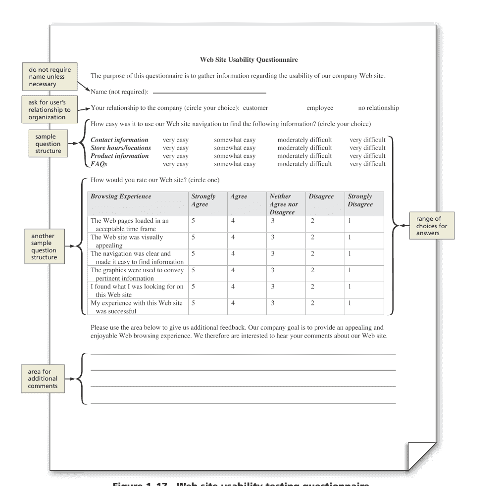

除了内容、功能和可用性测试外，还有其他类型的测试。对于新实施或维护的网站，还应进行另外两种测试：兼容性测试和压力测试。**兼容性测试**是为了验证网站在各种浏览器和浏览器版本上都能正常工作。最初，应使用你的受众最可能使用的浏览器进行测试。不同的浏览器在显示网页的某些方面有所不同，因此在几种不同的浏览器中测试网页非常重要，以验证它们在每个浏览器中都能正确显示。如果你使用了较旧浏览器不支持的技术或需要插件的技术，请考虑更改内容或为在较旧浏览器中查看提供备用网页。如果你的受众同时使用 PC 和 Macintosh 计算机，你需要在两种平台上的浏览器中测试网页。你可能还想在几个版本的同一种浏览器（通常是两个最新版本）中测试网页，以防用户尚未升级。

**压力测试**用于确定当更多用户访问你的网站时会发生什么。一个有 10 个用户同时访问的网站可能运行正常。当 100 个用户同时使用网站时，它可能以令人无法接受的缓慢速度运行。压力测试验证网站在大量用户访问时能否以可接受的速度运行。有许多案例中，公司未能对其网站进行有效的压力测试。这种缺乏测试的后果是灾难性的，当太多用户试图访问同一网站功能时，网站会锁死崩溃。尤其是对于用于电子商务的网站，保持网站在线至关重要。崩溃或锁死的网站无法销售产品或服务，公司可能会损失大量金钱。

## 网站实施与维护

一旦网站测试完成并进行了必要的更改，网站就可以实施了。网站的实施涉及将网页实际发布到 Web 服务器。许多 HTML 编辑器和所见即所得编辑器都提供发布功能。你也可以使用 FTP 软件，如 WS_FTP 或 CuteFTP，将你的网页发布到 Web 服务器。发布网站后，你应该再次测试网页，以确认没有明显的错误，如失效的链接或缺失的图像。

网站经过测试和实施后，你需要制定一个流程来维护网站；用户无疑会要求更改，时效性内容也需要更新。但是，你需要确保网站的更新不会损害网站的完整性和一致性。例如，如果你有几个不同的人更新大型网站上的各种网页，你可能会发现很难在整个网站上保持页面外观的一致。你应该计划定期更新你的网站，以保持内容最新。这可能是每小时、每天、每周，或者更少频率，具体取决于网站的目的。不要让你的内容变得陈旧、过时，或者包含指向不再存在的网页的失效链接。作为一个寻找特定主题信息的用户，你有多大可能相信一个写着“最后更新于 1998 年 12 月 10 日”的网站上的信息来自可靠来源？

为了帮助管理网站维护任务，首先要确定谁负责更新内容、结构、功能等。然后，将更新责任限制给特定用户。确保实施由一个或多个 Web 开发人员控制，他们可以在网页发布前对其进行彻底测试。

随着网站的更新和更改，考虑通过图形横幅或“最新动态”公告通知用户，解释任何新功能以及这些功能将如何使他们受益。这项技术不仅让用户了解信息，还鼓励他们回访网站查看最新内容。

最后，网站监控是维护网站的另一个关键方面。通常，托管网站的 Web 服务器会保留有关网站使用情况的信息日志。**日志**是列出网站所有被请求网页的文件。网站日志是 Web 开发人员的无价信息来源。获取和分析日志可以让你确定诸如访客数量、浏览器类型和版本、连接速度、最常请求的页面以及使用模式等信息。有了这些信息，你可以为你的目标受众设计一个有效的网站，为访客提供丰富且有益的体验。

## 成为一名敏锐的 Web 用户

在你开始这门课程，并可能开始你的 Web 开发职业生涯时，一个有用的做法是成为一名敏锐的 Web 用户。我们大多数人每天使用多次 Web（或更频繁）来完成日常任务。作为一名 Web 开发人员，你应该以功能性和设计的眼光审视你访问的网页。正如本章末尾第一个“实验室实践”练习中所述，你可以将你认为有效和无效、好和坏的网站添加为书签，并将它们作为你自己 Web 开发工作的参考。在搜索信息或进行在线购物时，留意 Web 上的趋势。例如，动态横幅过去在 Web 上非常流行，但现在其他设计技术已经取而代之。成为一名敏锐的 Web 用户可以帮助你成为更有效的 Web 开发人员。

# 章节摘要

在本章中，你已了解了互联网、万维网以及相关技术，包括 Web 服务器和 Web 浏览器。你学习了 HTML 在创建网页中的核心作用，并回顾了用于创建 HTML 文档的工具。你还了解到大多数 Web 开发项目遵循五阶段生命周期。以下列表包含了你在本章中学习的所有新概念。

1. 描述互联网 (`HTML 2`)
2. 描述万维网 (`HTML 3`)
3. 定义 Web 服务器 (`HTML 4`)
4. 描述互联网、内联网和外联网 (`HTML 5`)
5. 讨论 Web 浏览器 (`HTML 7`)
6. 定义超文本标记语言 (`HTML 8`)
7. 描述 HTML 元素 (`HTML 9`)
8. 列出 HTML 编码实践 (`HTML 10`)
9. 解释 HTML 版本 (`HTML 11`)
10. 描述层叠样式表 (`HTML 11`)
11. 定义文档对象模型 (`HTML 11`)
12. 定义可扩展超文本标记语言（XHTML） (`HTML 12`)
13. 描述用于创建 HTML 文档的工具 (`HTML 13`)
14. 讨论 Web 开发生命周期 (`HTML 14`)
15. 描述 Web 开发规划阶段的步骤 (`HTML 15`)
16. 解释 Web 开发分析阶段 (`HTML 16`)
17. 讨论 Web 设计与开发 (`HTML 16`)
18. 描述各种网站结构 (`HTML 17`)
19. 讨论网站测试的重要性，包括可用性测试、兼容性测试和压力测试 (`HTML 22`)
20. 讨论网站实施与维护 (`HTML 24`)
21. 解释成为一个有洞察力的 Web 用户的重要性 (`HTML 24`)

测试你对章节内容和关键术语的掌握程度。


说明：要完成“在线学习”练习，请启动浏览器，点击地址栏，然后输入网址`scsite.com/html6e/learn`。当“HTML 在线学习”页面显示后，点击你想要完成的练习链接并阅读说明。

## 章节巩固：判断题、多选题和简答题

一系列判断题、多选题和简答题，用于测试你对章节内容的掌握程度。

## “谁想成为计算机天才？”

一款互动游戏，以电视问答节目的形式挑战你对章节内容的了解。

## 闪卡

一个互动学习环境，你需要根据显示的定义，识别章节关键术语。

## 术语轮盘

一款互动游戏，以电视节目《幸运轮盘》的形式挑战你对章节关键术语的掌握。

## 模拟测试

一系列多选题，用于测试你对章节内容和关键术语的掌握。

## 填字游戏挑战

一个填字游戏，挑战你对本章中呈现的关键术语的了解。

## 运用你的知识

巩固你在本章学到的技能并应用所学概念。

### 理解网页结构

说明：图 1–18 展示了知名零售商 Costco 的网站。正如你在本章所学，三种常见的网站结构包括线性、层级式和网状结构。基于这些信息，确定 Costco.com 网站使用的结构。浏览其他类似的网站，确定哪些网站设计特性对用户有益。将这些想法融入 Costco.com 的新网站设计中。使用纸张勾勒出 Costco.com 网站的新设计方案草图。

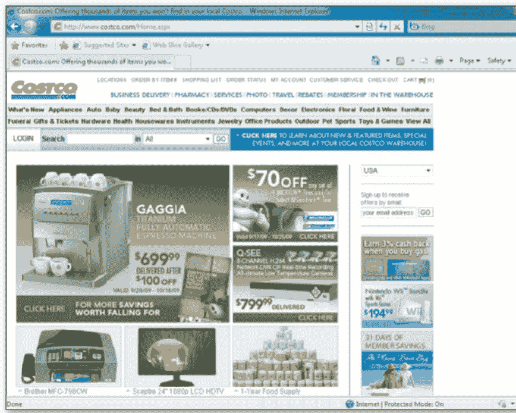

图 1–18

完成以下任务：

1. 启动浏览器。在浏览器中打开 Costco.com 网站。通过点击“文件”菜单上的“打印”或点击打印图标来打印主页。
2. 浏览 Costco.com 网站，确定该网站使用的结构（线性、层级式或网状），然后将结果写在打印件上。
3. 找到另外两个在线零售商店网站。打印每个网站的主页。浏览这些网站，识别对用户有益的设计特性。
4. 利用你在步骤 3 中找到的在线零售网站的想法，在纸上勾勒出 Costco.com 网站的新网站结构和设计。
5. 在打印件和草图上写下你的名字，并将其交给你的导师。

# 拓展你的知识

拓展你在本章学到的技能，并尝试新的技能。

### 评估用户调查

说明：启动你的文字处理程序。打开 Data Files for Students 中`Chapter01\Extend`文件夹里的`extend1-1.doc`文档。有关下载 Data Files for Students 的说明，请参阅本书封底内页，或联系你的导师获取访问所需文件的信息。这个示例网站调查展示了在收集网站可用性反馈时可能问到的各种问题。正如章节中提到的，评估你网站的可用性非常重要。

你将评估用户调查，并修改问题或添加适用于你所选网站的新问题。然后，你将邀请五个人来完成你的调查。

完成以下任务：

1. 连接到互联网，并确定一个你认为令人困惑、难以使用或缺乏吸引力的网站。
2. 根据 HTML 20 页图 1–17 提供的一些准则对用户调查进行修改，并将文件另存为`extend1-1solution.doc`。在调查中添加问题，以帮助你确定用户对所选网站的看法。请记住，使用调查的目的是改进网站。因此，你的问题必须为你提供能够帮助你实现这一目标的信息。
3. 打印五份你编辑过的调查问卷，并将这些打印件分发给至少五位家庭成员或朋友。让他们针对你在步骤 1 中选择的网站完成调查。收集他们的调查反馈。
4. 确定你从调查结果中学到了什么。调查在确定所选网站所需改进方面有多大帮助？是否有其他类型的问题你可以提出，从而能提供关于该网站的更有价值的信息？
5. 确定你可以做些什么来改进你的网站调查。使用文字处理程序，在你的`extend1-1solution.doc`文档底部键入你的分析，然后按照导师指定的格式提交。

# 使其正确

分析文档并纠正所有错误和/或改进设计。

### 纠正网站类型表

说明：启动你的文字处理程序。打开 Data Files for Students 中`Chapter01\MakeItRight`文件夹里的`makeitright1-1.doc`文件。有关下载 Data Files for Students 的说明，请参阅本书封底内页，或联系你的导师获取访问所需文件的信息。如后续表 1–7 所示的文档，是表 1–5（HTML 17 页）的修改版本。该表格故意包含了错误，列出了第 1 章讨论的网页组织标准。在不参考表 1–5 的情况下，通过识别所列七个元素中每个的正确组织标准和原因，对表 1–7 进行必要的更正。将修订后的文档另存为`makeitright1-1solution.doc`，然后按照导师指定的格式提交。

### 表 1-7 网站类型

| 元素 | 组织标准 | 原因 |
|---|---|---|
| 标题 | 使用它们来分隔主要主题 | 这些提供图形元素来分隔网页内容 |
| 标题行 | 使用能清晰解释页面目的的简单标题 | 这些提供更短、更易读的文本部分 |
| 水平分隔线 | 在适当的情况下，以项目符号或编号格式使用这些 | Web 用户并不总是滚动查看较长页面上的信息；适当的页面长度增加用户查看关键信息的可能性 |
| 段落 | 保持合适的网页长度 | Web 用户会快速浏览页面；将关键信息放在页面顶部增加用户查看关键信息的可能性 |
| 列表 | 插入这些图形元素来分隔主要主题 | 这些提供有组织、易于阅读的文本，读者可以快速浏览 |
| 页面长度 | 使用它们来帮助分割大量文本 | 标题帮助用户理解页面的目的；一个好的标题能在搜索引擎结果列表中解释页面内容 |
| 信息 | 通过将最重要的信息放在网页顶部来强调它们 | 这些使网页更易于阅读；简单的标题能清晰地解释页面的目的 |

## 在实验中

使用本章介绍的指南、概念和技能设计和/或创建文档。实验按难度递增顺序列出。

### 实验 1：评估网站

问题：在第 1 章中，你了解了做一个有洞察力的 Web 用户的重要性，这可以帮助你成为一个更有效的 Web 开发者。为了进一步发展这个概念，找出并讨论“好”和“坏”（“有效”和“无效”）的网站。启动你的浏览器和文字处理程序。打开 Data Files for Students 中`Chapter01\InTheLab`文件夹里的`lab1-1.doc`文件。有关下载 Data Files for Students 的说明，请参阅本书封底内页，或联系你的导师获取访问本书所需文件的信息。

说明：使用你的浏览器和列出的文件执行以下步骤。

1. 浏览互联网，找到一个“好”（即有效）或“坏”（即无效）的网站。根据你自己的观点，确定这些网站中什么是“好”的，什么是“坏”的。你将在下面的步骤 2 中具体说明你观点的具体原因。
2. 使用`lab1-1.doc`文件，对你选择的“好”网站和“坏”网站的可用性进行评级。确保在调查中添加额外评论，具体说明你对该网站的正面或负面感受。使用文件名`lab1-1goodsolution.doc`和`lab1-1badsolution.doc`保存文档。
3. 与另一名同学组队，在查看你选择的网站时讨论你的调查结果。同时回顾你的学伴选择的网站和调查。
4. 打开名为`lab1-1comparison.doc`的文字处理文档，记录你的调查结果与你的学伴意见之间的任何分歧。确保包括

## 实验室环节

### 实验 2：为学校心理咨询中心设计网站

**问题：** 你所在学校的咨询部门希望你设计一个网站，能够与学校主网站进行链接。为此，你必须完成规划和分析阶段，回答以下问题：

- 学生希望在网站上完成哪些任务？
- 学校咨询师希望在网站上完成哪些任务？
- 应包含哪些类型的信息？
- 谁将提供网站内容信息？

采访学校里的几位学生，确定这些问题的答案。根据这些信息，你将绘制心理咨询中心网站主页的设计草图，例如图 1-19 所示的设计。

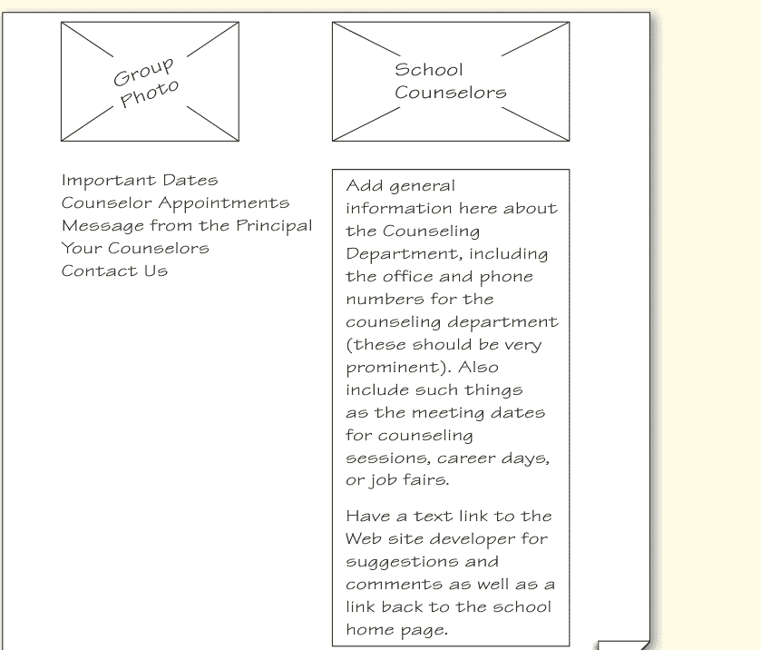

### 图 1–19

## 实验室环节（续）

说明：使用你的文字处理程序和纸张执行以下任务。

1. 回顾网页开发生命周期中规划和分析阶段的问题，如 HTML 15 页的表 1-4 所示。
2. 评估表中列出的这些问题的价值。添加你认为与咨询部门网站规划和分析相关的其他问题。
3. 启动你的文字处理程序。如有必要，打开一个新文档。输入你将用于规划和分析的问题。使用文件名`lab1-2solution.doc`保存文档。打印该文档。
4. 使用你制定的问题，采访学校咨询师，确定网站应包含哪些信息，谁将提供这些信息，等等。
5. 收集所需信息后，在纸上绘制网站主页的设计草图。
6. 将你的设计草图与学校的学生和一些咨询师分享，征求他们对你设计的意见。
7. 根据学生和咨询师的意见进行任何修改，在纸上重新绘制设计图。
8. 在第一张设计草图上写上“原始设计”。
9. 在第二张设计草图上写上“第二版设计”。
10. 在`lab1-2solution`打印件和草图上写下你的名字，并交给你的导师。

## 实验室环节

### 实验 3：提出规划阶段问题：互联网、内联网和外联网设计

问题：本章讨论了三种不同类型的网站——互联网、内联网和外联网。每种类型的网站都针对不同的目标受众。思考一个你经常光顾的企业（例如，餐厅、图书馆或卡片店），以及该企业如何可能利用互联网、内联网和外联网网站。表 1-4（HTML 15 页）中的规划阶段问题已在表 1-8 中复制。确定这些问题的答案，并将你的想法填入表格中。如果有些问题难以/无法直接回答（例如，“用户的计算环境是什么？”），列出你可以找到这些问题答案的方法。

| 规划问题 | 互联网 | 内联网 | 外联网 |
|---|---|---|---|
| 这个网站的目的是什么？ |  |  |  |
| 谁会使用这个网站？ |  |  |  |
| 用户的计算环境是什么？ |  |  |  |
| 谁拥有并编写网站上的信息？ |  |  |  |
| 谁决定信息是否/放置在网站的何处？ |  |  |  |

说明：启动你的文字处理程序。打开“Data Files for Students”文件夹中`Chapter01\InTheLab`的`lab1-3.doc`文件。有关下载“Data Files for Students”的说明，请参阅本书的内封底，或联系你的导师获取访问所需文件的信息。使用你的文字处理程序执行以下任务。

1. 在表格的第一行输入企业的类型。确定三种网站类型中第一个问题的答案，然后将答案输入到相应的表格单元格中。如果你选择的企业没有理由维护三种网站类型（互联网、内联网或外联网）中的任何一种，请在你的答案中详细说明为什么他们不需要它。
2. 继续回答其他四个问题。
3. 使用文件名`lab1-3solution.doc`保存文件，然后按照导师指定的格式提交。

## 案例与实践

运用你的创造性思维和问题解决技能来设计和实施解决方案。

- • 较容易
- •• 较困难

### • 1：深入了解网络访问问题

你的公司希望为员工提供在线课程。一些员工有身体方面的挑战，因此确保在线课程对所有人都无障碍访问至关重要。你的经理要求你了解更多关于无障碍访问准则的信息，以确定需要进行哪些更改，才能使公司的在线课程对有身体挑战的人群无障碍访问。研究网络上的无障碍访问问题，并确定需要考虑哪些需求以满足无障碍访问要求。务必访问`W3.org`网站。在研究时，请考虑以下问题：在开发网页时，你需要考虑哪些类型的身体挑战？网站为无障碍访问提供了哪些建议？为什么这对作为网页开发者的你很重要？

### • 2：确定网站结构

你最近开始在 Triple-Tom Design 担任网页开发者。在你的新工作中，你经常被要求重组客户现有的网站，使其更用户友好、更易于导航。找一个使用了不止一种网站结构（线性、层级式和/或网状）的网站。网站上传达的信息是否以适当的结构显示？该结构是否有效地支持了所传达的信息？打印你找到的网站的主页。在一张白纸上，草绘一个你认为可能更适合该信息传递的设计。使用文字处理程序创建一个文档，解释为什么你的新设计更有效。

### •• 3：深入了解 CSS

本章介绍了级联样式表（CSS）在网页开发中的使用。你将在本书中广泛使用 CSS，因此熟悉它非常重要。访问 W3Schools 网站（`w3schools.com`）以了解更多关于 CSS 的信息。在其他网站上找到三个关于 CSS 的其他信息来源。使用文字处理程序创建一个文档，简要描述 CSS 以及你如何最好地将其用于网页开发。

## 案例与实践（续）

### •• 4：为你姐姐设计一个网站

**个性化项目**

你姐姐想在网上销售她制作的首饰。你想为她开发一个网站，能够展示她的首饰，并作为销售交易的手段。彻底调查其他在线珠宝商的网站，并打印其中三个的主页。在开始设计之前，你决定创建一个网站设计原则列表，网站将遵守这些原则。在网上搜索更多关于网站设计的信息。找到三个提供网站设计原则信息的网站。在文字处理文档中，将本章提出的想法与其他网站上提出的想法结合起来，制定一个全面的网站设计原则列表。确定你打印的网站是否符合良好的设计原则。在适当的情况下，指出网站中讨论的任何相互冲突的设计原则。

### •• 5：创建可用性调查问卷

**团队协作**

你所在的学校最近更新了其网站。学校管理层选择了一个团队来开发可用性调查或问卷，你可以将其分发给一组用户（包括学生、家长和老师）来评估新网站。通过分发这份调查或问卷，你希望获得哪些类型的信息？你如何在调查或问卷上传达信息，以便清晰地识别你所询问的内容？使用你的文字处理程序创建一个可用性调查问卷。将调查或问卷分发给至少五个人，包括上面确定的每个群体中至少一人。让参与者完成调查或问卷，然后查看结果。如果可能，询问用户他们认为各个问题传达了什么信息。这是否是你想要传达的？如果不是，请思考更清晰、更相关的问题，并将调查问卷重新分发给另一组参与者。

# 2 使用内联样式创建和编辑网页

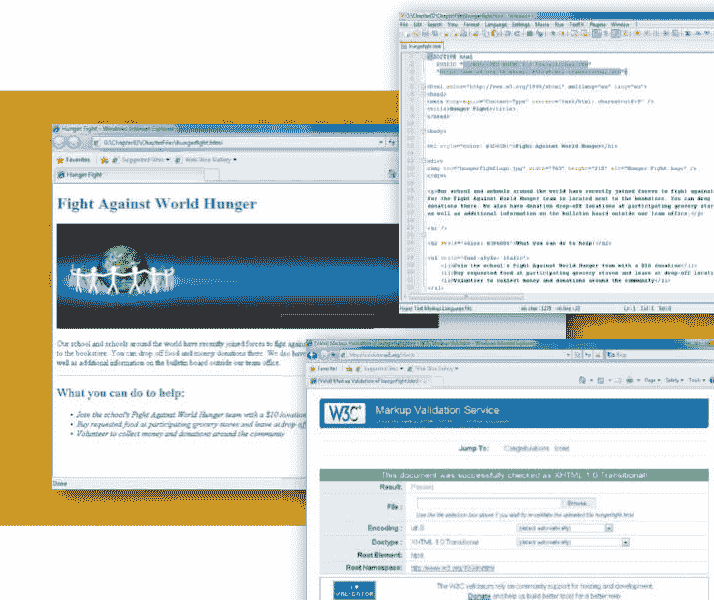

## 学习目标

当你能够做到以下几点时，你就掌握了本章的内容：

- 识别网页的各个元素
- 启动 Notepad++ 并描述 Notepad++ 窗口
- 在 Notepad++ 中启用自动换行
- 输入 HTML 标签
- 输入一个居中的标题和一段文本
- 创建无序列表、有序列表或定义列表
- 保存 HTML 文件
- 使用浏览器查看网页
- 激活 Notepad++
- 识别网页图像的类型和属性
- 使用内联样式添加图像、更改标题颜色、更改项目符号列表样式以及添加水平线
- 在浏览器中查看 HTML 源代码
- 打印网页和 HTML 文件
- 退出 Notepad++ 和浏览器

# 2 使用内联样式创建和编辑网页

## 引言

在理解了 Web 开发生命周期之后，你应该对恰当的网站规划、分析和设计的重要性有了很好的认识。完成这些阶段之后，下一个阶段就是使用 HTML 实际开发网页。正如第 1 章所讨论的，网页是通过 HTML 创建的，HTML 使用一组特殊标签来定义网页的结构、布局和外观。在本章中，你将使用基本的 HTML 标签来创建和编辑一个网页。

## 项目 — 抵抗世界饥饿网页

第 2 章阐述了如何使用 HTML 为学校的“抵抗世界饥饿”团队创建一个网页，如图 2–1a 所示。该团队正在与其他世界各地的学生一起收集捐款和资金。由于你是小组中唯一主修 Web 开发的学生，团队成员请求你帮助开发一个网页来宣传他们的事业。“抵抗世界饥饿”网页将包括关于团队的一般信息，以及如何捐款和参与的信息。

为了输入用于创建网页的文本和 HTML 标签，你将使用一个名为`Notepad++`的程序，如图 2–1b 所示。`Notepad++`是一个基本的文本编辑器，你可以用它来处理简单文档或使用 HTML 创建网页。本书之前的版本使用了 Notepad，它是 Windows 操作系统的一部分。Notepad 在输入 HTML 元素和网页内容方面表现良好，但`Notepad++`是一个功能更丰富、特性更多的文本编辑器。`Notepad++`具有行号显示功能，这在阅读代码时非常有帮助。它还会对你输入的文本进行语法高亮显示，正如你将在本章后面看到的那样。由于其额外的灵活性，本版选择了`Notepad++`作为文本编辑器。你将使用 Microsoft Internet Explorer 浏览器来查看你创建的网页。默认情况下，Internet Explorer 随 Windows 安装，而`Notepad++`可以从网上免费下载。如果你的计算机上没有`Notepad++`或 Internet Explorer，其他文本编辑器或浏览器程序也可以工作。

## 概述

当你阅读本章时，你将通过执行以下一般任务来学习如何创建图 2–1 所示的网页：

- 在`Notepad++`窗口中输入 HTML 代码。
- 将文件另存为 HTML 文件。
- 输入基本的 HTML 标签并向文件中添加文本。
- 通过添加标题和创建项目符号列表来组织文本。
- 使用内联样式增强网页的外观。
- 在浏览器中查看网页和 HTML 代码。
- 验证网页。
- 打印网页。

## HTML

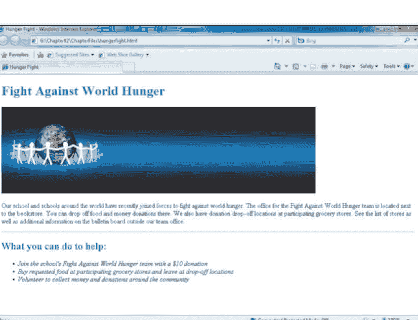

（a）抵抗世界饥饿网页。

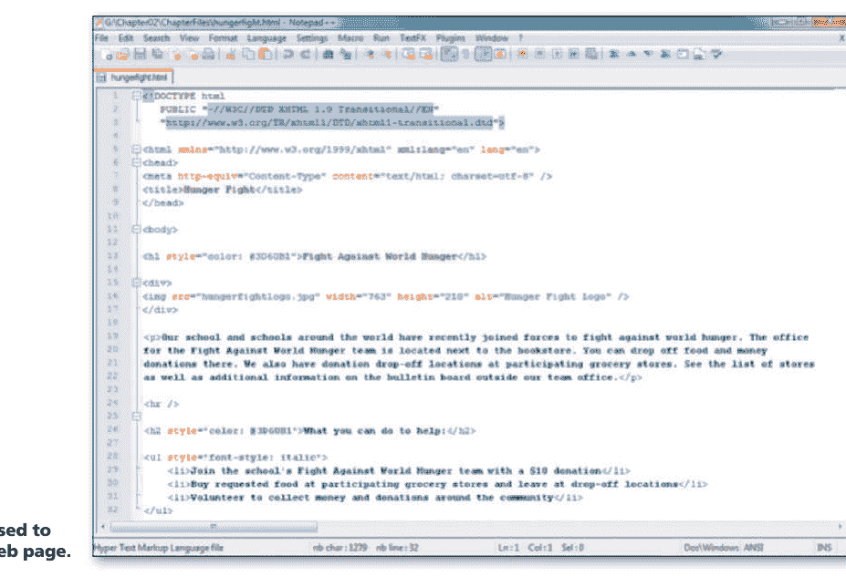

（b）用于创建该网页的 HTML 代码。

图 2-1

HTML 35

## 通用项目指南

在创建网页时，你所执行的操作和做出的决定将影响最终页面的外观和特性。在创建网页时，例如前一页图 2–1 所示的项目，你应该遵循以下通用指南：

1. 完成网页规划。在开发网页之前，你必须了解网站的目的，确定网站的用户及其计算环境，并决定谁拥有网页上的信息。


## 2. 分析网页需求

在 Web 开发生命周期的分析阶段，你应该分析网页应包含哪些内容。在这个阶段，你需要确定用户需要的任务和信息。关于 Web 开发生命周期各阶段的信息，请参阅第 HTML 15 页上的表 1–4。

## 3. 选择网页内容

完成分析后，你需要确定网页应包含哪些内容。遵循“少即是多”的原则。文本越少，网页被阅读的可能性就越大。使用尽可能少的词语来表达观点。

## 4. 确定网页文件命名约定

在开始创建和保存文件之前，你应该决定一个标准的文件命名方式。是应该使用`.htm`还是`.html`扩展名？正如本章后面所解释的，当托管的 Web 服务器只允许短文件名时，使用`.htm`扩展名。当托管的 Web 服务器允许长文件名时，使用`.html`。

你应该给文件起什么名字来表明文件的内容或目的？例如，将网页命名为`page1.html`并不能描述该网页是什么；一个更具描述性的名称有助于网站的开发。

## 5. 确定保存网页的位置

你可以将网页永久存储或保存在多种存储介质上，包括硬盘、USB 闪存盘、CD 或 DVD。你的老师或你正在为其开发网页的公司可能有特定的存储介质要求。

## 6. 确定文件夹结构

一旦确定了要使用的存储介质，你还应该确定保存网页的文件夹位置、结构和名称。这应该在开始保存任何文件之前完成。

## 7. 确定网页元素的格式

网页的整体外观显著影响其清晰传达信息的能力。你可以修改网页外观或格式的示例包括添加图像、为标题添加颜色以及添加水平线。

## 8. 寻找合适的图形图像

引人注目的图形图像有助于传达网页的整体信息并增加视觉吸引力。图形可用于展示产品、服务、结果或益处，或直观地传达不易用文字表达的信息。

## 9. 确定图形图像的位置和格式

图形图像的位置和格式应吸引路人的注意力，并引导他们阅读网页。

## 10. 测试网页是否符合 XHTML 标准

Web 开发的一个重要部分是测试，以确保你的网页遵循 XHTML 标准。万维网联盟（W3C）有一个在线验证器，允许你测试你的网页并清楚地解释任何错误。

必要时，本章将在适当位置提供有关上述指南的更多具体细节。本章还将指出在创建图 2–1a 所示网页过程中，针对这些指南所执行的操作和做出的决定。

## 网页的元素

如今，许多人——个人、学生、教师、企业高管、Web 开发人员等——出于个人或专业原因正在创建网页。每个人都有自己的风格，生成的网页也像创建它们的人一样多样化。然而，大多数网页包含几个基本特性或元素，如图 2–2 所示。

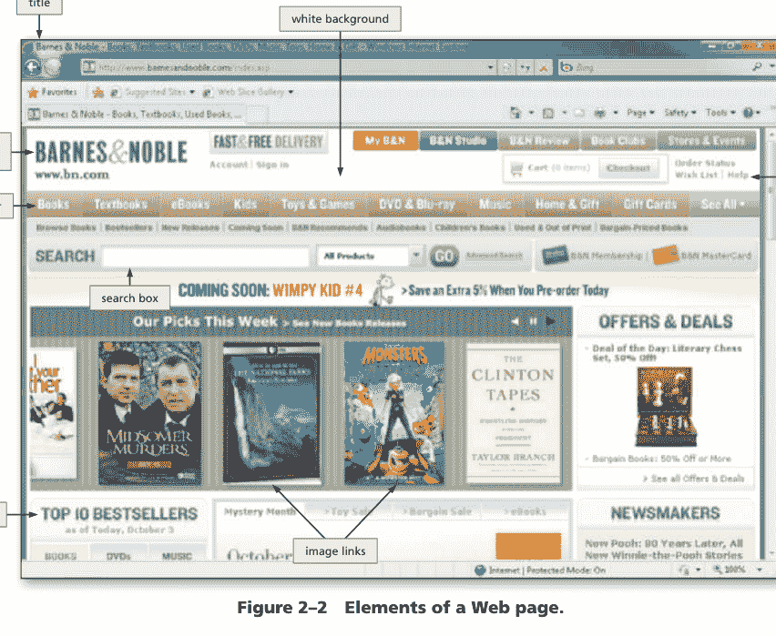

## 窗口元素

网页的**标题**是网页出现在浏览器窗口时，显示在浏览器标题栏和任务栏上的文本。如果用户将页面添加到浏览器的**收藏夹**或**书签**列表中，该标题也是分配给该页面的名称。由于其重要性，你的网页应始终包含标题。标题通常是第一个看到的元素，应能识别页面的主题或目的。标题应简洁但具有描述性，并向访问者简要说明页面的内容或目的。

网页的**主体**包含在浏览器窗口中显示的信息。主体可以包括文本、图形和其他元素。网页显示包含在`<body>`（起始主体）和`</body>`（结束主体）标签内的所有内容。网页的**背景**是一种纯色、图片或图形，网页上的其他元素都显示在其上。选择背景时，请确保它不会压倒网页上的信息。在浏览网页时，请注意那些背景颜色或图片不允许网页内容清晰显示的页面。这无疑是 Web 开发人员应避免的“反面教材”。

> **顺便提一下 | 收藏夹和书签**
>
> Internet Explorer 和 Mozilla Firefox 都有一个功能，允许你将网页添加到列表中，以便将来快速访问。Internet Explorer 将这些称为“收藏夹”，而 Firefox 称之为“书签”。Web 开发人员需要确保他们的网页包含一个描述性的标题，因为这就是显示在书签或收藏夹中的标题。

## HTML 资源

网络上有许多关于 HTML 和网页开发的优质信息源。其中较好的资源之一是 HTML Goodies 网站，它提供了各种主题的入门指南和教程，以及免费下载和讨论区。要了解更多关于此网站的信息，请在搜索引擎中搜索“HTML Goodies”一词。

## 文本元素

**普通文本**是用于网页主要内容的默认文本格式。普通文本可以用于标准段落，或格式化为：粗体、斜体或带下划线；不同颜色等。你也可以使用内联级联样式表（CSS）来更改文本格式，这也是本书中贯穿使用的方法。普通文本也可以用于一系列称为**列表**的文本项。通常，列表带有项目符号或编号。列表的各种属性可以更改。例如，你可能想要方形项目符号而不是默认的圆形项目符号，或者列表文本采用斜体或粗体。

**标题**用于分隔文本段落或页面的不同部分。标题字体比普通文本更大，并且通常是粗体、斜体或与普通文本颜色不同。标题大小从 1（最大）到 6（最小）不等。在设置网页时，通常从一个标题大小切换到下一个最小的标题大小。

## 图像元素

网页通常使用几种不同类型的图形或图像，例如图标、项目符号、线条、照片、插图或其他图片。网页中使用的图像也称为**内联图像**，这意味着图像或图形文件不是 HTML 文件的一部分。相反，网络浏览器在显示网页时，会将单独的图形文件合并到网页中。HTML 文件包含``标签，用于告诉浏览器从服务器请求哪个图形文件、在页面上的哪个位置插入它以及如何显示它。

网页通常使用几种不同类型的内联图像。**图像映射**是一种特殊类型的内联图像，你可以在其中将一个或多个区域定义为热点。**热点**是图像中被选中时会激活某个功能的区域。例如，图像映射中的每个热点都可以链接到不同的网页。一些内联图像是**动态的**，这意味着它们包含运动并且外观可以变化。

**水平线**是显示在网页上用于分隔页面不同部分的线条。虽然水平线的外观可以变化，但许多网页使用内联图像作为水平线。或者，你可以使用水平线标签（`<hr />`）来添加简单的水平线，例如本章项目中使用的那种。

## 超链接元素

网页中更重要的元素之一是超链接，或简称链接。**链接**是文本、图像或其他网页元素，你可以点击它来指示浏览器跳转到文件中的某个位置或向服务器请求文件。在网络上，链接是在网页之间和网站之间导航的主要方式。链接不仅指向网页，还指向图形、声音、视频、程序文件、电子邮件地址以及同一网页的不同部分。

文本链接，也称为超文本链接，是最常用的超链接。例如，图 2-2 中的文本“订单状态”链接到用户的订单状态。当文本标识超链接时，它通常显示为带下划线的文本，颜色与网页其余文本不同。

图像链接也很常见。例如，图 2-2 中标识了两个图像链接。点击其中任一图像链接都会发送（或链接）用户到另一个包含有关这些项目更多信息的网页。公司徽标通常用作指向主页或公司信息的图像链接。

## 定义网页结构

要创建 HTML 文档，你需要使用文本编辑器输入有关网页结构、网页内容以及应如何显示该内容的说明。本书使用 Notepad++ 文本编辑器来输入所有项目和练习的 HTML 元素和内容。

在开始输入本项目的内容之前，你必须首先输入定义网页整体结构的标签。这是通过插入一个`<!DOCTYPE>`标签和五个标签（`<html>`、`<head>`、`<meta />`、`<title>`和`<body>`）以及结束标签（`</html>`、`</head>`、`</title>`和`</body>`）来完成的。这些标签定义了标准网页的结构，并将 HTML 文件划分为其基本部分：头信息和包含文本和图形的页面主体。

`<!DOCTYPE>`标签用于告诉浏览器文档使用哪个版本的 HTML 或 XHTML 以及文档类型。万维网联盟（W3C）支持三种 HTML 或 XHTML 的文档类型：严格型、过渡型和框架集型。

**严格型**文档类型用于禁止使用已弃用的标签。**已弃用标签**是 W3C 标记为最终将从其规范中移除的标签，因为这些标签已被更新、功能更强的标签所取代。**过渡型**文档类型允许使用已弃用标签。**框架集型**文档类型用于支持网页上的框架，也允许使用已弃用标签。

`<!DOCTYPE>`标签包含一个引用`w3.org`网站上文档类型定义的 URL。虽然本书不使用已弃用标签，但项目确实使用 XHTML 1.0 过渡型文档类型，因为项目使用了一些 XHTML 1.1 标准不支持的标签（例如`name`）。**文档类型定义（DTD）**是一个包含标签定义及其在网页中使用说明的文件。本章的项目使用过渡型文档类型。

> **DOCTYPE 标签**
>
> W3Schools 网站提供了有关用于严格型、过渡型和框架集型文档类型的 DOCTYPE 标签的更多信息。要了解更多关于 DOCTYPE 标签的信息，请访问 W3C 网站。它提供了关于此标签和其他 HTML 标签的丰富信息。

## 定义 HTML 文档

`<!DOCTYPE>`标签之后的第一组标签`<html>`和`</html>`表示 HTML 文档的开始和结束。这组标签包含网页的所有内容、格式化该内容的标签以及定义文档不同部分的标签。软件工具（如浏览器）使用这些标签来确定文件中 HTML 代码的起始和结束位置。

### 头部分

下一组标签`<head>`和`</head>`包含网页标题和其他文档头信息。插入到`<head> </head>`容器中的标签之一是 meta 标签。`<meta />`标签有多种功能。在本章中，它用于声明字符编码 UTF-8。**Unicode 转换格式（UTF）**是一种压缩格式，允许计算机显示和处理文本。

当浏览器遇到此 meta 标签时，它将根据标签中嵌入的特定 UTF-8 编码正确显示网页。UTF-8 是网页、电子邮件和其他应用程序的首选编码标准。在验证网页时，所选编码也很重要。meta 标签的其他用途将在本书后续章节中描述。

`<title>`标签是另一个插入到`<head> </head>`容器中的标签。`<title>`和`</title>`标签表示网页的标题，当网页在浏览器窗口中显示时，标题会出现在浏览器标题栏和任务栏上。当用户将页面添加到收藏夹或书签列表时，标题也是赋予该页面的名称。

> **XHTML 合规性**
>
> 要使你的 HTML 文件符合 XHTML 标准，请始终以小写字母输入标签（`<!DOCTYPE>`标签除外，它始终是大写的）。在本书中，项目说明遵循这些标准，以帮助你学习良好的 HTML 和 XHTML 编码实践。

### 主体部分

最后一组标签`<body>`和`</body>`包含网页的主要内容。所有文本、图像、链接和其他内容都包含在这最后一组标签中。下一页的表 2-1 列出了迄今为止描述的标签的功能，以及本章中使用的其他标签。

## 表 2–1 基本 HTML 标签及其功能

| HTML 标签 | 功能 |
| --- | --- |
| `<!DOCTYPE>` | 指示所用 HTML 的版本和类型；包含指向 DTD 的 URL 引用 |
| `<html> </html>` | 指示 HTML 文档的开始和结束 |
| `<head> </head>` | 指示文档中用于标题和其他文档头信息的部分的开始和结束 |
| `<meta />` | 指示有关网页的隐藏信息 |
| `<title> </title>` | 指示标题的开始和结束。标题不会出现在网页正文中，而是出现在浏览器的标题栏上。 |
| `<body> </body>` | 指示网页正文的开始和结束 |
| `<hn> </hn>` | 指示称为标题的文本区域的开始和结束；大小范围从`<h1>`到`<h6>`。有关标题大小示例，请参见 HTML 46 页上的图 2–8a。 |
| `<p> </p>` | 指示新段落的开始和结束；在新段落上方插入一个空行 |
| `<ul> </ul>` | 指示无序（项目符号）列表的开始和结束 |
| `<li> </li>` | 指示紧跟在标签之后的项目是列表中的一个项目 |
| `<hr />` | 插入水平线 |
| `<br />` | 在标签出现的位置插入换行符 |

### 写字板

写字板是 Windows 附带的一个文本编辑器，您也可以用它来创建 HTML 文件。要启动写字板，请单击任务栏上的“开始”按钮，指向“开始”菜单上的“所有程序”，指向“所有程序”子菜单上的“附件”，然后单击“附件”子菜单上的“写字板”。写字板帮助提供了有关如何使用该产品的提示。

大多数 HTML 开始标签，如`<html>`、`<head>`、`<title>`和`<body>`，都有对应的结束标签，`</html>`、`</head>`、`</title>`和`</body>`。请注意，对于没有结束标签的标签，如`<meta />`、`<hr />`和`<br />`，标签使用一个空格后跟一个正斜杠来关闭。

## 启动 Notepad++

网页的规划、分析和设计完成后，您可以使用文本编辑器输入 HTML 来开始开发网页。

以下步骤假设 Windows 7 正在运行且已安装 Notepad++，并基于典型安装启动 Notepad++。您可能需要向您的讲师咨询如何为您的计算机下载、安装和启动 Notepad++。

1. 单击 Windows 任务栏上的“开始”按钮以显示“开始”菜单。
2. 单击“开始”菜单左窗格底部的“所有程序”以显示“所有程序”列表。
3. 单击“所有程序”列表中的 Notepad++ 文件夹（图 2–3）。

   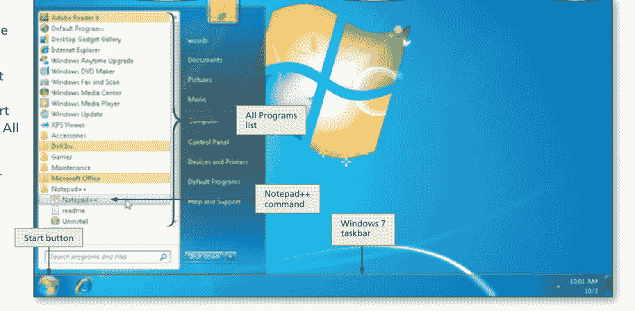

4. 单击列表中的 Notepad++ 以显示一个空白的 Notepad++ 窗口（图 2–4）。

如果 Notepad++ 窗口未最大化，请单击 Notepad++ 标题栏上的“最大化”按钮以将其最大化。

### Q&A

**什么是最大化窗口？**

最大化窗口会填满整个屏幕。当您最大化一个窗口时，“最大化”按钮会更改为“还原”按钮。

**图 2–4**

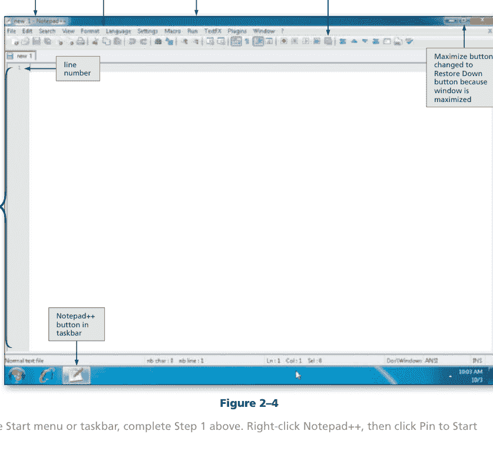

### Q&A

**如何将 Notepad++ 添加到我的“开始”菜单或任务栏？**

要将 Notepad++ 添加到“开始”菜单或任务栏，请完成上面的步骤 1。右键单击 Notepad++，然后单击“附到「开始」菜单”或“附到任务栏”。

| 其他方式 |  |
| --- | --- |
| 1. 双击桌面上的 Notepad++ 图标（如果存在） | 2. 如果“开始”菜单上存在 Notepad++，则单击它 |

> **BTW**
>
> **Notepad++ 帮助**
>
> Notepad++ 提供了丰富的帮助信息。程序内部有 Notepad++ 帮助，也有在线帮助设施。NpWiki 是您可以访问的 Notepad++ 维基。这个维基的主要目的是成为所有关于 Notepad++ 信息的储存库。

## 在 Notepad++ 中启用自动换行

在 Notepad++ 中，除非启用了自动换行功能，否则文本区域中输入的文本会持续向右滚动。**自动换行**使文本行在窗口右边缘处断开并出现在新的一行，这样所有输入的文本在 Notepad++ 窗口中都是可见的。

对于段落文本，启用自动换行后，即使文本在 Notepad++ 中可能显示在多个物理行上，所有文本也都会显示在一个逻辑行号上。自动换行不会影响文本的打印方式。以下步骤展示了如何在 Notepad++ 中启用自动换行。

1. 单击菜单栏上的“查看”（图 2–5）。
2. 如果“自动换行”旁边没有选中标记，请单击“自动换行”。

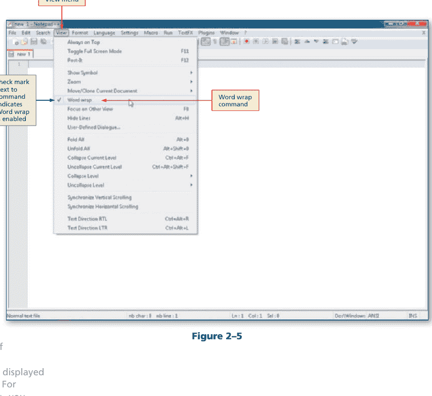

> **如何知道是否启用了自动换行？**
>
> 当启用自动换行时，“查看”菜单上的“自动换行”命令前面会有一个选中标记，并且当您输入时，您的文字会保留在屏幕上。
>
> **如果未启用自动换行，文本会怎样？**
>
> 段落的文本在 Notepad++ 中会全部显示在一行上并滚动出屏幕，尽管网页在浏览器中仍然会正确显示。为了在 Notepad++ 中便于阅读，您应该启用自动换行。

## 使用 HTML 标签定义网页结构

第一个任务是输入定义网页结构的初始标签。表 2–2 包含了用于创建 HTML 35 页图 2–1a 所示网页的 HTML 标签和文本。在本章及全书中，当需要输入大段 HTML 代码或文本时，您会发现这些代码或文本位于带有行号参考的表格中，而不是在步骤中。步骤将指导您输入表格中显示的文本。

| 行 | HTML 标签和文本 |
| --- | --- |
| 1 | `<!DOCTYPE html` |
| 2 | `PUBLIC "-//W3C//DTD XHTML 1.0 Transitional//EN "` |
| 3 | `" http://www.w3.org/TR/xhtml1/DTD/xhtml1-transitional.dtd ">` |
| 4 |  |
| 5 | `<html xmlns="http://www.w3.org/1999/xhtml" xml:lang="en " lang="en ">` |
| 6 | `<head>` |
| 7 | `<meta http-equiv="Content-Type " content="text/html;charset=utf-8 " />` |
| 8 | `<title>Hunger Fight</title>` |
| 9 | `</head>` |

以下步骤说明了如何输入定义网页结构的初始标签。

1. 输入表 2–2 中所示的 HTML 代码（图 2–6）。在每行末尾按 ENTER 键。如果在输入时出错，请使用 BACKSPACE 键删除所有字符（包括错误字符），然后继续输入。
2. 按两次 ENTER 键开始下一行代码，在`</head>`标签后留一个空行。
3. 将您输入的内容与图 2–6 进行比较。如果发现错误，请使用鼠标指针或箭头键将插入点移动到每个错误的右侧，并使用 BACKSPACE 键纠正错误。

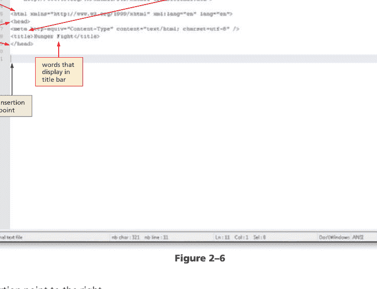

4. 在第 11 行，输入`<body>`然后按两次 ENTER 键。
5. 输入`</body>`然后按 ENTER 键。
6. 输入`</html>`作为结束标签（图 2–7）。


- 将您输入的内容与图 2–7 进行比较，必要时纠正输入错误。

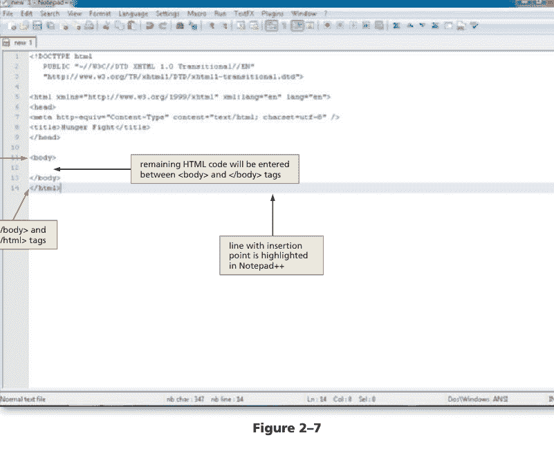

> **Q&A**

> **为什么我使用过渡性文档类型？这难道允许使用已弃用的标签吗？**

> 是的，您可以使用过渡性文档类型来使用已弃用的标签。一些有效标签（例如`name`）不能与 XHTML 1.1 标准一起使用，因此本书使用带有过渡性文档类型的 XHTML 1.0。

**图 2–7**

> **Q&A**

> **`<title>` 和 `<body>` 标签有什么区别？**

> 包含在`<title> </title>`标签内的文本是在浏览器窗口中显示网页时出现在浏览器标题栏上的内容。包含在`<body> </body>`标签内的文本和图形是在浏览器窗口中显示的内容。

> **Q&A**

> **我是否必须为我开发的每个网页都输入初始 HTML 标签？**

> 相同的初始 HTML 标签在许多其他章节中也会用到。为避免重复输入这些标签，您可以保存刚刚输入的代码，并为其指定一个新文件名，例如`structure.html`或`template.html`。如果您将此文件保存在文件夹的根级别，您将在其他章节中轻松访问它。

> **Q&A**

> **我的 HTML 代码可以使用大写或小写字母吗？**

> 为使您的 HTML 文件符合 XHTML 标准，请始终以小写字母输入标签（`<!DOCTYPE>`标签除外，它始终是大写）。在本书中，项目指南遵循这些准则，以帮助您学习可接受的 HTML 和 XHTML 编码标准。

## 提前规划

**明确如何格式化文本的各种元素。**

通过格式化网页上的字符和段落，可以提升页面的整体外观。在设计网页时，请考虑以下格式化建议。

- **有效利用标题。** 主标题通常是网页的第一行文字，用于传达网页的主旨，例如为食品募捐活动寻求帮助。标题大小应遵循标准，具体可参考下一页的图 2-8。主标题应使用 1 号字体，子主题或副标题应使用 2 号字体。通常不建议直接从一级标题跳到三级标题。例如，如果你的主标题是 1 号字体，那么下一个标题应使用 2 号字体，而不是 4 号字体。

- **适当使用默认文本大小。** 正文是指标题与网页底部之间的所有文字。正文应尽可能简明扼要地突出信息要点，做到易于阅读和理解。正文在强调积极面的同时，也必须保持真实、可信。默认字体大小和样式适用于正文内容。

- **使用项目符号突出关键段落。** 项目符号是位于段落开头的点或其他符号。项目符号列表能比普通段落更清晰地呈现具体信息。

## 输入网页内容

建立网页结构后，就可以输入网页内容了，包括标题、信息文本段落和项目符号列表。

标题用于分隔文本或在网页上引入新主题。标题有多种样式和大小，由`<h1>`到`<h6>`标签表示，其中`<h1>`最大。通常，主标题使用 Heading 1 样式。下一页的图 2-8a 展示了使用不同大小标题的网页示例。一个网页通常只有一个主标题；因此，该网页的 HTML 文件通常也只有一对`<h1> </h1>`标签。保持网页外观一致性的方法之一，是对同一主题级别的标题使用相同的字号（图 2-8b）。注意，在图 2-8b 中，文本段落和项目符号列表之间都使用了 2 号标题进行分隔。这种分隔表明，这些文本（即两个段落加一个项目符号列表）在网页上具有同等的重要性。

网页通常包含大量文本。由于你在 Notepad++ 中开启了自动换行（参见第 HTML 42 页的图 2-5），你输入的所有文本都会在一个 Notepad++ 窗口中显示。将文本分成段落有助于分离关键思想，使文本更易于阅读。段落之间使用空行分隔，并用`<p>`（段落开始）和`</p>`（段落结束）标签标记。在一个网页上放置过多文本并非明智之举，用户可能会在大量文本中迷失方向。如果你发现自己需要按几十次 Page Down 键才能到达网页底部，那么你就需要考虑重构网页了。你可以将大量信息拆分到更多标题下，这样会更易于管理和阅读。

## HTML 第 2 章：使用内联样式创建和编辑网页

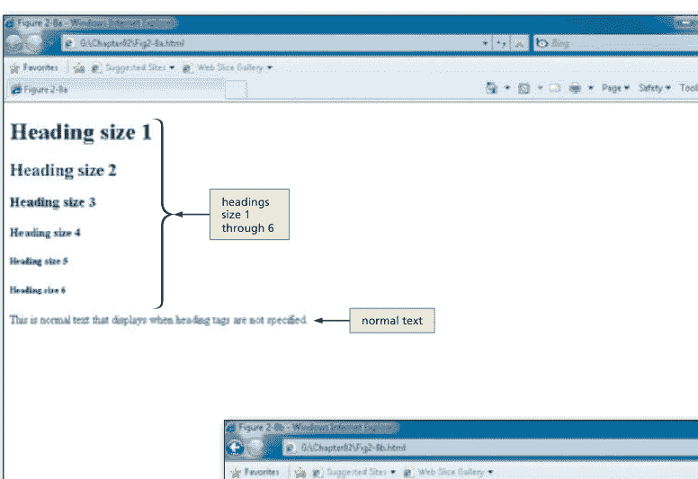

(a) 六种标题大小的示例。

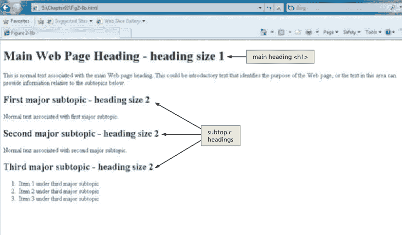

(b) 统一使用标题有助于组织网页内容。

**图 2-8**

### 用于组织的标题

使用标题来组织网页内容并强调要点时，请确保保持一致性。也就是说，如果你对特定级别的文本使用了 Heading 2（`<h2>`）样式，那么你就应该始终使用 Heading 2 样式来划分该级别的信息。同时，不要在文档中跳过标题级别。例如，不要从 Heading 1（`<h1>`）样式开始，然后直接使用 Heading 3（`<h3>`）样式。

有时，将网页上的文本格式化为列表而不是段落，用户更容易阅读和理解。HTML 提供了多种列表类型，其中最常用的是无序（项目符号）列表和有序（编号）列表。在 Web 开发生命周期的设计阶段，你需要决定最有效的结构化网页内容和格式化网页文本的方法。你的主要目标是为网页访问者提供一种有效的方式来找到他们所需的信息。如果用户无法轻松找到所需内容，他们就不会再次访问你的网站。

## 输入标题

标题“Fight Against World Hunger”（对抗全球饥饿）是主标题，表明了网页的主要信息。为了突出这个标题，你将使用`<h1>`标签。以下步骤说明如何在网页上输入标题。

1. 将插入点置于第 12 行，按一次 ENTER 键，在`<body>`标签后留出一个空行。
2. 在文本区域输入`<h1>Fight Against World Hunger</h1>`，然后按两次 ENTER 键（图 2-9）。

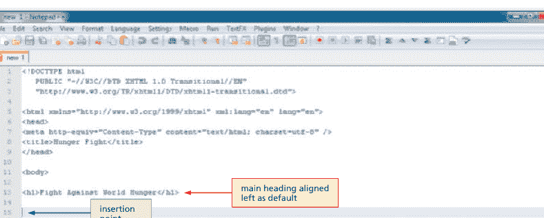

> **问答**

> 为什么要在 HTML 代码中，于`<body>`标签和标题之后添加一个空行？

> 插入额外的空行是为了提高可读性。这个空行不会显示在网页上。

## 输入段落文本

输入标题后，下一步是使用`<p>`标签添加段落文本。当浏览器在 HTML 文件中找到`<p>`标签时，它会另起一行，并在新段落上方插入一个空行。`</p>`结束标签表示段落的结束。输入段落文本时，不要在每行末尾按 ENTER 键。因为开启了自动换行，即使不按 ENTER 键，文本也会自动换行。表 2-3 列出了该段落中使用的 HTML 标签和文本。

### 表 2-3 添加段落文本

| 行号 | HTML 标签和文本 |
| :--- | :--- |
| 15 | `<p>Our school and schools around the world have recently joined forces to fight against world hunger. The office for the Fight Against World Hunger team is located next to the bookstore. You can drop off food and money donations there. We also have donation drop-off locations at participating grocery stores. See the list of stores as well as additional information on the bulletin board outside our team office.</p>` |

以下步骤说明如何在 HTML 文件中输入段落文本。

1. 将插入点置于第 15 行，按照前一页表 2-3 所示输入 HTML 代码。输入此文本时，不要在每行末尾按 ENTER 键，并且句点后只用一个空格。
2. 按两次 ENTER 键，将插入点置于第 17 行（图 2-10）。

> **为什么不在表 2-3 中每行代码后都按 ENTER 键？**

> 因为你在启动 Notepad++ 后立即开启了自动换行，所以你输入的段落文本会自动换到下一行。文本到达 Notepad++ 窗口的末尾后就会换行。如果你没有开启自动换行，文本在输入时会持续向右滚动，左侧的文本会滚出屏幕。开启自动换行后，所有文本都将在 Notepad++ 窗口中保持可见。

## 使用列表呈现内容

列表将文本组织成条目化的格式。通常，列表分为项目符号（无序）列表或编号（有序）列表。**无序列表**也称为**项目符号列表**，使用称为项目符号的小图像来格式化信息。图 2-11 展示了格式化为无序（或项目符号）列表的网页文本以及用于创建这些列表的 HTML 代码。

> **列表样式**

> 有时将网页文本组织成列表会很有帮助。有多种列表选项可供选择。网页的用途决定了哪种方式更有效。有关可用于列表的样式选项，请参阅附录 D“列表样式”。

## 图 2–11

**有序列表**，也称为**编号列表**，使用数字或字母以序列形式组织信息。有序列表非常适合用于需要强调顺序的条目，例如一系列步骤。下一页的图 2–12 展示了网页文本如何格式化为有序或编号列表，以及用于创建这些列表的 HTML 标签。

无序或项目符号列表的开头和结尾必须使用`<ul>`和`</ul>`标签。有序或编号列表的开头和结尾使用`<ol>`和`</ol>`标签。无序列表和有序列表都有可选的项目符号和编号类型。如图 2-11 所示，无序列表可以使用三种不同的项目符号选项之一：实心圆盘、方形或空心圆圈。如果未指定类型，则使用默认的实心圆盘。有序列表可以使用数字、字母或罗马数字，如图 2-12 所示。默认选项是使用阿拉伯数字，例如 1、2 和 3。

HTML 50 HTML 第 2 章 使用内联样式创建和编辑网页

## 图 2-12

输入`<ul>`或`<ol>`标签以定义列表类型后，使用`<li>`和`</li>`标签来定义有序或无序列表中的列表项。

## 创建无序列表

为了突出网站访问者可以为抗击世界饥饿做些什么，你将使用表 2-4 中所示的 HTML 标签和文本创建一个项目符号（无序）列表。请记住，每个列表项必须以`<li>`开头，以`</li>`结尾。

### 表 2-4 添加无序列表

| 行 | HTML 标签和文本 |
| --- | --- |
| **17** | `<h2>What you can do to help:</h2>` |
| **18** | |
| **19** | `<ul>` |
| **20** | `<li>Join the school’s Fight Against World Hunger team with a $10 donation</li>` |
| **21** | `<li>Buy requested food at participating grocery stores and leave at drop-off locations</li>` |
| **22** | `<li>Volunteer to collect money and donations around the community</li>` |
| **23** | `</ul>` |

以下步骤说明如何使用默认项目符号样式创建无序或项目符号列表。

1. 将插入点放在第 17 行，输入如表 2-4 所示的 HTML 代码。在输入第 20、21 和 22 行的文本时，确保在行首按 TAB 键，然后输入文本。在每行末尾按 ENTER 键。
2. 输入第 23 行后按 ENTER 键，在第 24 行留一个空行（图 2-13）。

> **为什么要在包含`<li>`（列表项）代码的行首按 TAB 键？**

在输入列表项时使用 TAB 键（以缩进）有助于格式化文本，使你可以轻松看出此文本与段落文本不同。缩进文本有助于网页开发者看到代码的某些部分彼此相关。

> **此列表将包含哪种类型的项目符号？**

由于代码未指定 `type` 属性，因此列表使用默认的实心圆盘项目符号。其他项目符号选项包括方形、圆圈、数字、字母和罗马数字。你也可以使用图形图像作为项目符号，这将在后面的章节中进行。

## 关于列表格式的更多信息

如果使用不带属性的`<ul>`或`<ol>`起始标签，你将获得默认的项目符号（实心圆盘）或编号样式（阿拉伯数字）。要更改项目符号或编号类型，需在`<ol>`或`<ul>`标签内输入`list-style-type`属性。要创建带有方形项目符号的列表，你需要输入以下行作为内联样式（CSS）代码：

```html
<ul style="list-style-type: square">
```

你可以在附录 D 中找到其他列表样式属性和值。

除了有序列表和无序列表，还有第三种列表，称为定义列表，它以类似字典的样式突出显示信息。虽然它们的使用频率低于无序列表或有序列表，但定义列表对于创建类似术语表的术语和定义列表非常有用，如图 2-14a（下一页）所示。图 2-14b 显示了用于创建定义列表的 HTML 代码。

**(a) 定义列表示例。**

**(b) 用于创建定义列表的 HTML 代码。**

## 图 2-14

定义列表的语法不像无序和有序列表样式中使用的`<ul>`、`<ol>`或`<li>`结构那样直接。对于定义列表，你使用`<dl>`和`</dl>`标签来开始和结束列表。`<dt>`标签表示一个术语，`<dd>`标签通过缩进将定义与术语区分开来，以标识该术语的定义。表 2-5 列出了定义列表的元素及其用途。

### 表 2-5 定义列表元素及其用途

| 定义列表元素 | 用途 |
| --- | --- |
| `<dl>` `</dl>` | 开始和结束一个定义列表 |
| `<dt>` `</dt>` | 标识一个术语 |
| `<dd>` `</dd>` | 标识紧接其上的术语的定义 |

如图 2-14 所示，默认情况下，定义术语在行内左对齐，每个术语的定义都缩进，以便轻松区分它是上方术语的定义。为了更清晰地标识定义术语，你可能希望将术语加粗，如图 2-14 中最后两个定义（HTTP 和 Web Server）所示。你可以通过使用包含以下代码的内联样式来实现：

```html
<dt style="font-weight: bold">
```

## 保存和组织 HTML 文件

在可以在 Web 浏览器中查看 HTML 文件的外观之前，你必须保存它。出于以下原因，保存 HTML 文件也很重要：

- 如果在文本编辑器打开时关闭计算机或断电，内存中的文档将丢失。
- 如果在完成项目前时间用完，你可以在未来完成文档，而无需从头开始。

要保存文件，请使用 Notepad++ 的“文件”、“保存”命令。保存文件时，你需要为文件命名，并在其后添加文件扩展名。如本书前面所述，文件名应始终与其目的相关。例如，将文件命名为`page1`并不能说明该文件的目的。将文件命名为`hungerfight`可立即识别出该文件与该主题相关。本书中的网页文件始终使用全小写字母命名，且不含空格。这是本书始终遵循的标准。

HTML 文件必须以`.htm`或`.html`扩展名结尾。许多较旧的 Web 服务器只能显示扩展名为`.htm`或短文件名（即长度不超过八个字符的文件名）的页面。扩展名为`.html`的 HTML 文件可以在运行允许长文件名（即长度最多为 255 个字符的文件名）操作系统的 Web 服务器上查看。几乎所有当前的操作系统都允许长文件名，包括 Windows 7、Windows Vista、Windows XP、Windows Server 2003/2008、Windows 2000、Macintosh 和 Linux。对于运行不允许长文件名操作系统的 Web 服务器，你需要使用`.htm`扩展名。在本书中，所有文件都使用`.htm`扩展名保存。

你将使用一个非常简单的文件夹结构来组织本书中的所有项目。因此，将文件组织到文件夹中非常重要，以便一个项目或章末练习的所有文件，包括 HTML 代码和图形图像，都保存在同一个文件夹中。如果你已从学生数据文件中正确下载了文件（参见本书的内封底），你将拥有所需的文件结构。最初保存`hungerfight.html`文件时，你会将其保存在 Chapter02 文件夹的 ChapterFiles 子文件夹中。第 2 章中使用的图形图像`hungerfightlogo.jpg`将存储在同一个文件夹 — `Chapter02\ChapterFiles`中。由于本书中的章节项目相对简单且使用较少的图像，因此图像和 HTML 代码存储在同一个文件夹中。然而，在实际应用中，一个网站中可能存在数百甚至数千个文件，将 HTML 代码和图形图像分离到不同的子文件夹中更为合适。你将在第 3 章中学习更多关于组织 HTML 文件和文件夹的知识。

> **HTML 文件名**

HTML 文件的扩展名为`.html`或`.htm`。

网站的首页通常称为`index.html`、`index.htm`、`default.html`或`default.htm`。请向服务提供商确认他们使用哪个名称。

**保存你的工作**

最好在工作时定期保存 HTML 文件，以避免丢失当前已完成工作的风险。你可以养成在大量添加信息（即一个段落）后保存文件的习惯。在输入多个难以重新操作的 HTML 标签后，你可能也想保存文件。

**确定保存网页的位置。**

保存网页时，你必须决定使用哪种存储介质。

- 如果你总是在同一台计算机上工作，并且不需要将项目传输到其他位置，那么计算机的硬盘驱动器作为存储位置就足够了。然而，最好在单独的介质上保存项目的备份副本，以防文件损坏或计算机硬盘故障。
- 如果你计划在不同位置或多台计算机上处理项目，则应将项目保存在可移动介质上，例如 USB 闪存驱动器或 CD。本书中的项目使用 USB 闪存驱动器，它能快速可靠地保存文件，并且可以重复使用。CD 易于携带，并且通常是最终版本项目的良好备份，因为它们通常只能保存文件一次。
- 以上是关于保存文件的一般准则。你的讲师可能会给出与以下步骤不同的、针对保存工作的具体说明。

## 提前规划

## 保存 HTML 文件

在创建此项目的过程中，您已经完成了许多步骤，不想冒险丢失迄今为止已完成的工作。此外，要在浏览器中查看 HTML，必须保存文件。以下步骤展示如何保存 HTML 文件。


1. 将 USB 闪存驱动器连接到计算机的一个 USB 端口，然后单击 Notepad++ 菜单栏上的“文件”（图 2–15）。

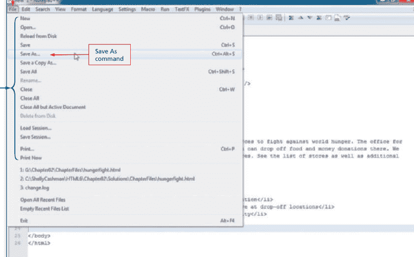

图 2–15

2. 单击“文件”菜单上的“另存为”以显示“另存为”对话框（图 2–16）。

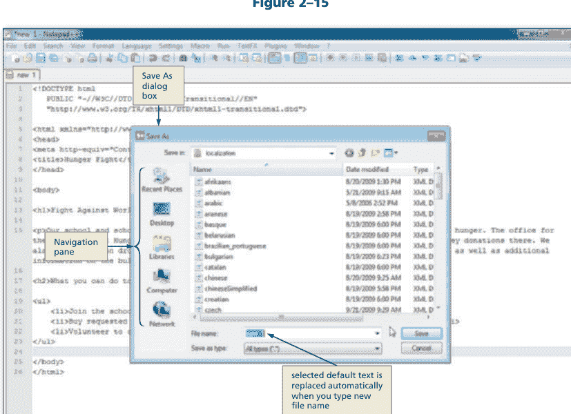

> **问与答**
>
> **我必须保存到 USB 闪存驱动器吗？**
>
> 不。您可以保存到任何设备或文件夹。文件夹是存储介质上的一个特定位置。使用相同的过程，但选择您的设备或文件夹。

3. 在“文件名”文本框中键入 `hungerfight.html` 以更改文件名。键入文件名后不要按回车键。

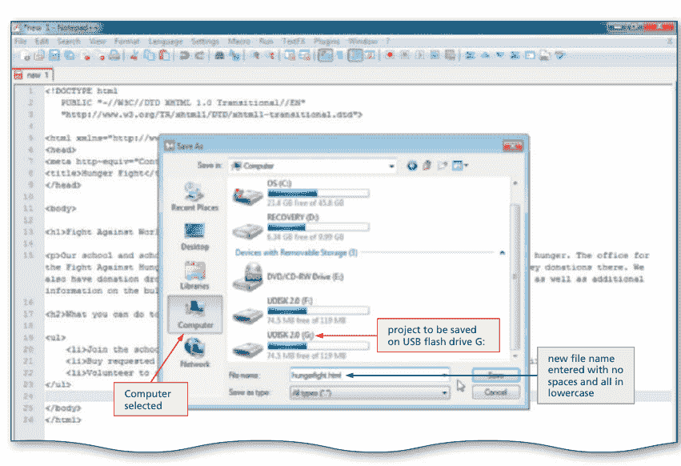

4. 单击对话框左侧的“计算机”以显示可用驱动器列表（图 2–17）。

   如果需要，请滚动直到您的 USB 闪存驱动器（例如 `UDISK 2.0 (G:)`）出现在可用驱动器列表中。

> **问与答**
>
> **为什么我的文件、文件夹和驱动器列表与图中显示的排列和命名不同？**
>
> 您计算机的配置决定了文件和文件夹列表的显示方式以及驱动器的命名方式。
>
> **问与答**
>
> **我如何知道我的文件将保存在哪个驱动器和文件夹中？**
>
> Notepad++ 会显示可用驱动器和文件夹的列表。然后您可以选择要将文件保存到的驱动器和/或文件夹。
>
> **另外**
>
> **存储您的文件**
>
> 许多学校为学生在 Web 服务器上提供空间来存储他们的网页。然而，将您的网页保存到另一种介质（例如 USB 闪存驱动器）可确保您拥有已创建文件的备份副本。将网页文件保存到学校实验室计算机的硬盘驱动器上，存在下次在该实验室时文件不在那里的风险。许多学校会删除除计算机启动时由实验室技术员安装的文件之外的所有文件。

5. 在“计算机”列表中双击 `UDISK 2.0 (G:)`（或您的存储设备），选择 USB 闪存驱动器，在本例中为驱动器 G，作为新的保存位置。

> 如果我的 USB 闪存驱动器有不同的名称或驱动器号怎么办？您的 USB 闪存驱动器很可能具有不同的名称和驱动器号，并且连接到不同的端口。请验证您“计算机”列表中的设备是否正确。

6. 如果需要，请打开 `Chapter02\ChapterFiles` 文件夹（图 2–18）。

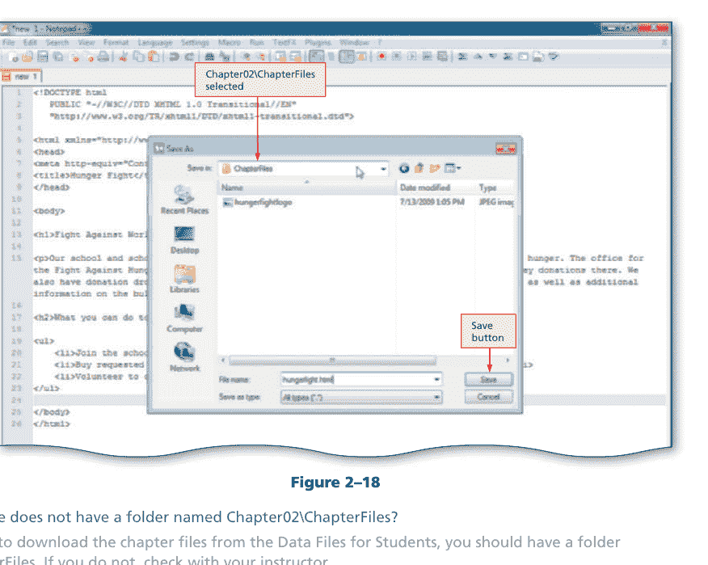

> 如果我的 USB 闪存驱动器没有名为 `Chapter02\ChapterFiles` 的文件夹怎么办？如果您按照从学生数据文件下载章节文件的步骤操作，您应该有一个名为 `Chapter02\ChapterFiles` 的文件夹。如果没有，请咨询您的讲师。

7. 单击“另存为”对话框中的“保存”按钮，将文件以 `hungerfight.html` 为名保存在 USB 闪存驱动器上（图 2–19）。

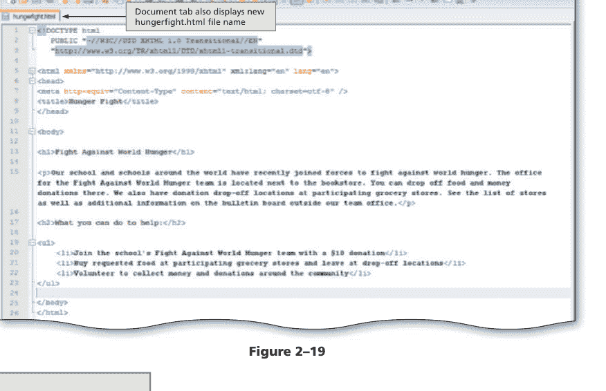

> 现在我的文件只在 USB 驱动器上吗？不是，虽然 HTML 文件保存在 USB 驱动器上，但它也保留在内存中并显示在屏幕上（图 2–19）。Notepad++ 在标题栏和文档选项卡上显示新的文件名。

**其他方法**

1. 按 `CTRL+ALT+S`，键入文件名，单击“计算机”，选择驱动器或文件夹，单击“保存”按钮。

## 使用浏览器查看网页

在 HTML 文件中输入代码并保存后，您应该在浏览器中查看网页，看看网页目前的样子。HTML 文件在浏览器中的显示方式，就像该文件在 Web 上可用一样。通常，在开发过程中定期查看网页是一种良好的编码实践，因为它可以让您看到各种 HTML 标签对文本的影响，并检查 HTML 文件中的错误。

如果在浏览器窗口打开时您的计算机连接到互联网，它会显示一个**主页**或**起始页**，这是每次启动 Internet Explorer 时出现的网页。

## 启动浏览器

HTML 文件保存在 USB 驱动器上后，下一步是使用浏览器查看网页。因为 Windows 是**多任务**的，您可以同时运行多个程序，例如 Notepad++ 和您的浏览器。以下步骤说明如何启动浏览器以查看网页。

1. 单击任务栏上的 Internet Explorer 图标（图 2-20）。

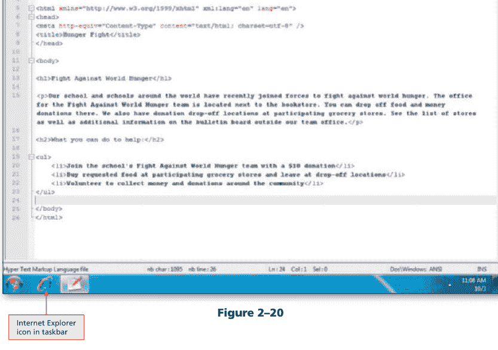

图 2–20

2. 如果需要，单击“最大化”按钮以最大化浏览器窗口（图 2–21）。

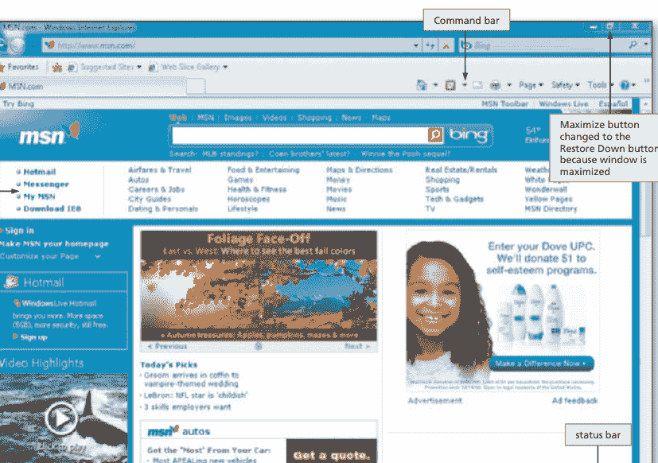

> **问与答**
>
> **为什么我的浏览器显示一个不同的窗口？**
>
> 因为可以自定义浏览器设置来更改显示为首页的网页，所以您的浏览器显示的首页可能不同。学校和组织通常将他们网站上的一个主页设置为实验室或办公室计算机上安装的浏览器的首页。

**其他方法**

1. 单击“开始”，“所有程序”，“Internet Explorer”。
2. 如果桌面上有 Internet Explorer 图标，双击该图标。

> **另外**
>
> **为多种浏览器开发网页**
>
> 开发网页时，您必须考虑访客将使用的浏览器类型，包括 Windows 版的 Internet Explorer 和 Mozilla Firefox，或 Mac OS 版的 Safari 或 Internet Explorer。Apple 网站提供了创建可在多种浏览器中工作的网页的建议。全面测试的一部分包括在不同的浏览器版本中打开您的网页。

## 在浏览器中查看网页

浏览器允许您打开位于您计算机上的 Web 文件，并具有完整的浏览功能，就像网页存储在 Web 服务器上并在 Web 上提供一样。以下步骤使用此技术在浏览器中查看 HTML 文件 `hungerfight.html`。

1. 单击“地址栏”以选择地址栏上的 URL。
2. 键入 `g:\Chapter02\ChapterFiles\hungerfight.html` 以在地址栏上显示新的 URL（图 2–22）。在按 ENTER 键之前不会显示网页，如下一步所示。

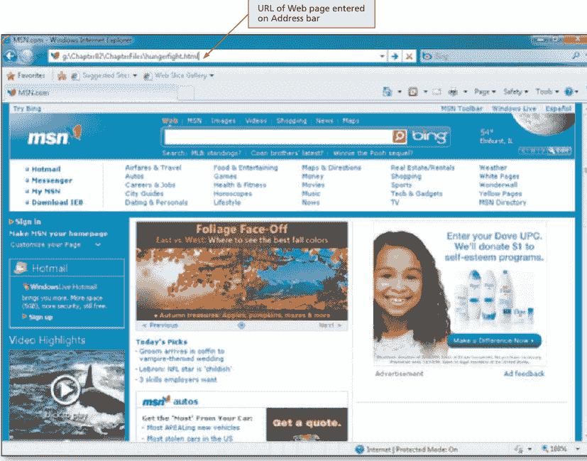

> **问与答**
>
> **如何更正地址栏上的 URL？**
>
> URL 显示在地址栏上。如果您在地址栏上键入了错误的字母或符号，并在进行下一步之前注意到错误，请使用退格键擦除所有字符直到错误字符（包括错误字符），然后继续键入。
>
> **如果我的文件位于不同的位置怎么办？**
>
> 您可以在地址栏中键入文件的路径，或者浏览到您的文件，如下一页的“其他方法”所示。

3. 按 ENTER 键以显示 `hungerfight.html` 页面，就像它在 Web 上可用一样（图 2–23）。

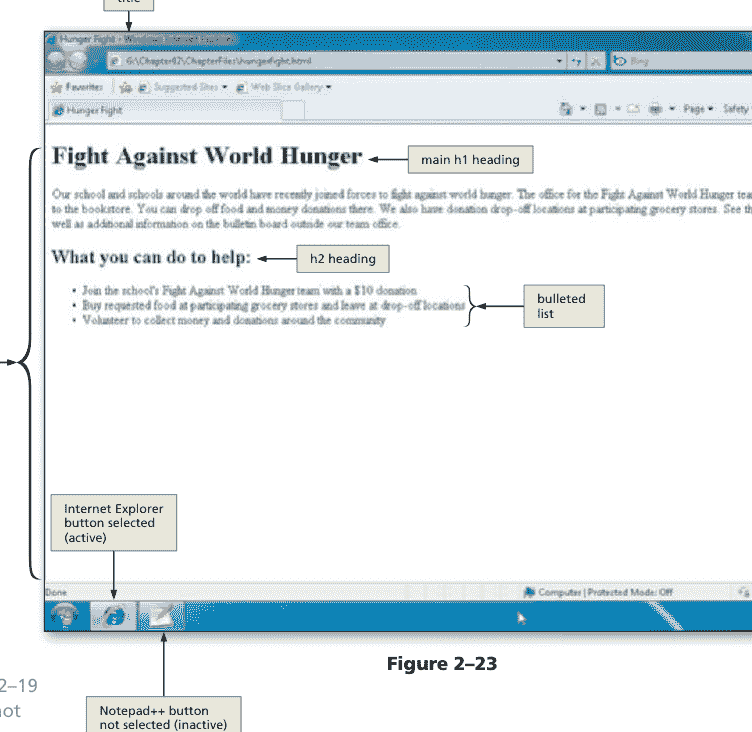

图 2–23

> **问与答**
>
> **如果我收到 Internet Explorer (IE) 的警告，说“Internet Explorer 需要打开一个新窗口才能显示此网页”怎么办？**
>
> 如果发生这种情况，您应该单击“确定”按钮继续。然后您将看到您的网页显示在另一个 IE 窗口中。
>
> **问与答**
>
> **如果我的页面没有正确显示怎么办？**
>
> 仔细检查您输入的 `hungerfight.html` 与图 2–19，确保没有输入错误或遗漏任何内容。更正错误，重新保存文件，然后重试。

**其他方法**

| 方法 1 | 方法 2 | 方法 3 |
|---|---|---|
| 在 Windows 资源管理器中，双击 HTML 文件名以在默认浏览器中打开 | 在 Windows 资源管理器中，右键单击 HTML 文件名，单击“打开方式”，单击浏览器名称 | 如果菜单未显示，单击“工具”、“工具栏”、“菜单栏”；在菜单栏上单击“文件”、“打开”，然后浏览到所需文件 |

> **另外**
>
> **用户界面设计**
>
> 用户界面设计是网站的一个非常重要的方面。如果一个网站设计不佳，用户可能无法找到所需信息或完成任务，这使得该网站变得无效。有许多优秀的网站讨论了网页设计原则。

## 激活 Notepad++

查看网页后，你可以通过向 HTML 文件添加额外的标签或文本来修改该网页。要继续编辑，你首先必须返回到 Notepad++ 窗口。以下步骤说明了如何激活 Notepad++。

1. 点击任务栏上的 Notepad++ 按钮，最大化 Notepad++ 并使其成为活动窗口（图 2–24）。

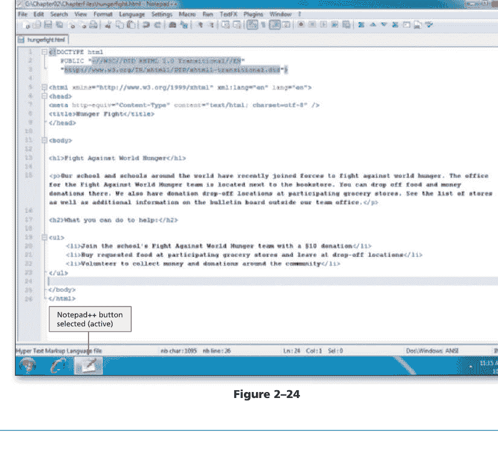

## 改善网页的外观

网页开发的目标之一是创建视觉上吸引人并能保持访客兴趣的网页。本章目前开发的网页功能齐全，但缺乏视觉吸引力。在本节中，你将学习如何通过添加图像、为标题添加颜色、添加水平线以及更改项目符号列表的字体样式，将网页外观从图 2–25a 所示改善为图 2–25b 所示。其中许多任务可以通过使用样式表来完成。

**HTML 62 HTML 第 2 章** 使用内联样式创建和编辑网页

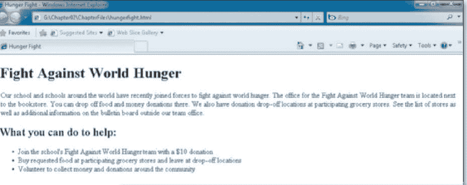

(a) “对抗世界饥饿”网页。

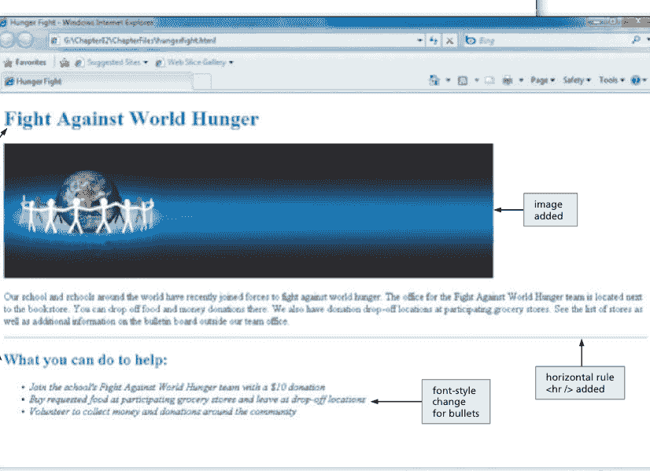

标题颜色变更

图像已添加

添加了水平线 `<hr />`

项目符号字体样式变更

(b) 格式化后改善外观的“对抗世界饥饿”网页。

图 2-25

## 使用样式表

尽管 HTML 允许网页开发者更改网页的结构、设计和内容，但 HTML 在定义一个或多个网页的外观或样式方面能力有限。因此，样式表应运而生。

回顾一下，**样式**是定义网页上元素外观的规则。**样式表**是为网页或整个网站定义样式的一系列规则。使用样式表，你可以通过更改字体系列、字体大小、边距和链接规范等特性来改变一个或多个网页的外观。

CSS 支持三种类型的样式表：内联、嵌入式和外部（或链接式）。使用**内联样式**，你可以为单个 HTML 标签（如标题或段落）添加样式。该样式会更改该特定标签，但不会影响文档中的其他标签。使用**嵌入式样式表**，你将样式表添加到 HTML 文档的 `<head>` 标签中，以定义整个网页的样式。使用链接样式表，即**外部样式表**，你创建一个包含所有要应用的样式的文本文件，并将该文本文件保存为 `.css` 扩展名。然后，你可以在网站中的任何网页上添加指向此外部样式表的链接。外部样式表为你提供了最大的灵活性，非常适合将相同的格式应用于网站中的所有网页。外部样式表还使在网页之间快速更改格式变得容易。你将在本章的项目中使用内联样式来增强标题（更改颜色）和项目符号列表（更改字体样式）的样式。

### 样式表优先级

如表 2–6 所示，CSS 支持的三种样式表在不同级别上控制网页的外观。每种样式表类型与其他类型相比，也具有不同的优先级级别。例如，外部样式表用于定义网站中多个页面的样式。嵌入式样式表用于更改一个网页的样式，但会覆盖外部样式表中定义的任何样式或优先于它们。内联样式用于控制单个 HTML 标签内的样式，并优先于嵌入式和外部样式表中定义的样式。

### 内联样式

当你想更改单个 HTML 元素的外观（或样式）时，使用内联样式很有帮助。附录 D 包含了大多数浏览器支持的层叠样式表属性和值。本章中使用的内联样式可在该附录中找到。有关内联样式的更多信息，请查看 `w3.org`。

表 2–6 样式表优先级

| 类型 | 级别与优先级 |
|---|---|
| 内联 | • 更改单个 HTML 标签内的样式<br>• 覆盖嵌入式和外部样式表 |
| 嵌入式 | • 更改一个网页的样式<br>• 覆盖外部样式表 |
| 外部 | • 更改网站中多个页面的样式 |

由于样式表具有不同的优先级级别，因此三种类型的样式表可以在单个网页上同时使用。例如，你可能希望网页的某些元素与网站中的其他网页保持一致，但你也可能希望改变该网页某些部分的外观。你可以通过使用这三种类型的样式表来实现这一点。

### 样式语句格式

无论你使用何种类型的样式表，都必须使用**样式语句**来定义样式。以下代码显示了在内联样式中使用的样式语句示例：

```html
<h1 style="font-family: Garamond; font-color: navy">
```

样式语句由选择器和声明组成。样式语句中标识页面元素的部分称为**选择器**。在此示例中，选择器是 `h1`（标题大小 1）。样式语句中标识元素应如何显示的部分称为**声明**。在此示例中，声明是引号之间的所有内容：`font-family` 和 `font-color` 属性及其值（分别为 `Garamond` 和 `navy`）。声明包括至少一种要应用于所选元素的样式类型或**属性**。属性示例包括 `color`、`text-indent`、`border-width` 和 `font-style`。对于每个属性，声明包括一个相关的**值**，该值指定该特定属性的显示参数。

每个属性接受特定的值，具体取决于该属性可以定义的样式。例如，`font-color` 属性可以接受值 `navy`，但不能接受值 `10%`，因为那不是有效的颜色值。在本章的下一节中，你将为 `h1` 和 `h2` 标题将标题颜色更改为蓝色。在这种情况下使用内联样式是合适的，因为网页上只有两个标题需要更改。如果你有许多标题要更改，使用嵌入式或外部样式表会更合适。这将在后续章节中讨论。

### 内联样式

内联样式用于定义单个 HTML 标签的样式。例如，要更改单个段落的样式，你可以添加一个内联样式，将 `<p>`（段落）标签作为选择器，并添加一个声明，为该段落定义新的字体样式和样式值，如下所示：

```html
<p style="font-style: italic; font-size: 8pt">
```

由于它们优先于其他类型的样式表并影响单个 HTML 标签的样式，因此当网页的某一部分需要具有与网页其余部分不同的样式时，内联样式很有帮助。在本章的项目中，使用内联样式来更改网页上标题的颜色以及项目符号列表中的字体样式。

现在你了解了样式表和内联样式的功能，是时候考虑添加图像来增强网页的外观了。

### 寻找合适的图形图像

要在网页上使用图形图像（也称为图形），该图像必须以数字形式存储在文件中。包含图形图像的文件可从多种来源获取：

- 微软在网页上提供免费的数字图像，可供在文档中使用。其他网站也有可用的图像，其中一些是免费的，而另一些则需要付费。
- 你可以用数码相机拍照并**下载**它，这是将数字照片从相机复制到计算机的过程。
- 使用扫描仪，你可以将打印的图片、绘图或图表转换为数字文件。

如果你从非你本人的来源收到图片，请在确定其不包含病毒之前不要使用该文件。**病毒**是一种可能损坏计算机上文件和程序的计算机程序。使用防病毒程序来验证你使用的所有文件均无病毒。

### 确定图形图像的位置和格式

图形的内容、大小、形状、位置和格式应能吸引路人的兴趣，诱使他们停下来阅读网页。通常，图形是页面的中心吸引力，在视觉上是页面上最大的元素。如果在图形图像中使用颜色，请确保它们是网页配色方案的一部分。

### 确定图像的宽度和高度

图像的宽度和高度（以像素为单位）应始终在 `` 标签中标识。浏览器使用这些尺寸来确定显示图像的大小。如果你未标识这些属性，浏览器必须自行确定大小。这会减慢浏览器的处理速度。

### 为图像提供替代文本

应始终为每张图像使用替代文本。此文本对于使用屏幕阅读器（将计算机屏幕上的信息转换为音频输出）的视力障碍用户特别有用。替代文本的长度应合理。

## 网页图像

图像被用于多种方式，以增强网页的外观，使其更有趣和丰富多彩。图像可用于添加背景颜色、帮助组织网页、帮助阐明文本中提出的观点，或作为链接指向其他网页。图像也常用于分隔网页部分（例如使用水平线），或作为允许访客浏览网站的导航元素。

## 使用网页分区

有时将网页划分为区域（或部分）会有所帮助，这允许你对不同的网页元素应用样式。在本书中，你始终使用开始 `<div>` 和结束 `</div>` 分区标签作为插入图像的容器。利用分区标签，你可以添加样式，例如居中图像或为图像添加背景颜色。

## 图像类型

网页使用三种类型的文件作为图像：GIF、JPEG 和 PNG（表 2-7）。**图形交换格式（GIF）**文件的扩展名为 `.gif`。保存为 GIF（发音为 *jiff* 或 *giff*）的图形图像使用称为 LZW 压缩的压缩技术，以使其在 Web 上下载时更小。标准（或非隔行）GIF 图像在加载时逐行显示。隔行 GIF 图像一次性加载，从模糊的外观开始，在加载过程中变得清晰。对大图像使用隔行 GIF 是一种好技术，因为网页访客可以在图像加载时看到其模糊轮廓。然而，GIF 是一种受专利保护的格式，因此其广泛使用受到限制。

第二种图像文件类型是**便携式网络图形（PNG）**，其扩展名为 `.png` 或 `.ping`。PNG（发音为 *ping*）格式也是一种压缩文件格式，支持多种颜色和分辨率。万维网联盟将 PNG 格式开发为一种图形标准和无专利的 GIF 格式替代方案。大多数较新的浏览器支持 PNG 图像。

最后，**联合摄影专家组（JPEG）**文件的扩展名为 `.jpg`、`.jpe` 或 `.jpeg`。JPEG（发音为 *JAY-peg*）是一种使用 LZW 以外的压缩技术保存的图形图像。JPEG 文件通常用于更复杂的图像，例如照片，因为 JPEG 文件格式比其他文件类型支持更多的颜色和分辨率。

### 关于图像

网页上的图像在多种环境中查看，包括到 Internet 的慢速连接和较慢的计算机。优化你的图像对于提高所有网页访客的下载速度很重要。请在 Web 上搜索有关图像优化的更多信息。

**表 2-7 图像类型和用途**

| 图像类型 | 用途 |
|---|---|
| 图形交换格式（GIF） | • 用于颜色较少（<256）的图像<br>• 允许透明背景 |
| 便携式网络图形（PNG） | • 最新的图像格式<br>• 用于所有类型的图像<br>• 允许透明度变化 |
| 联合摄影专家组（JPEG） | • 用于颜色较多（>256）的图像，例如照片 |


如果图像不是这些格式之一，你可以使用绘图或图形编辑程序将图像转换为`.gif`、`.jpg`或`.png`格式。一些绘图程序甚至允许你将GIF图像另存为隔行格式。如今市场上有许多绘图和图形编辑程序，例如Adobe Photoshop和Corel Paint Shop Pro。

### 滥用图像

请谨慎避免在网页上过度使用图像。使用过多图像可能会使你的网页显得杂乱，或使访客分心，偏离网页的目的。图像应有其用途，例如传达内容、直观地组织页面、提供超链接或服务于其他功能。

## 图像属性

你可以通过使用属性来增强HTML标签。**属性**为HTML标签定义附加特征。例如，你应该对所有``标签使用`width`和`height`属性。表2-8列出了可与``标签一起使用的属性。在本章中，`src`和`alt`属性将用于``标签。图像属性将被详细解释，因为它们将在后续章节中使用。

**表2-8 图像属性**

| 属性 | 功能 |
|---|---|
| `alt` | • 图像加载时显示的替代文本<br>• 对于屏幕阅读器特别有用，它将计算机屏幕上的信息转换为音频输出<br>• 应该简要表示图像的目的<br>• 通常应不超过50个字符 |
| `height` | • 定义图像的高度，以像素为单位<br>• 提高加载时间 |
| `hspace` | • 定义分隔图像与文本的水平空间 |
| `src` | • 定义要加载的图像的URL |
| `vspace` | • 定义分隔图像与文本的垂直空间 |
| `width` | • 定义图像的宽度，以像素为单位<br>• 提高加载时间 |

## 添加图像

在早期，Web主要被需要彼此共享信息的研究人员使用，拥有纯功能性、纯文本的网页是常态。如今，网页访客已习惯于更图形化的世界，并期望网页使用能提供视觉趣味的图像。以下步骤说明如何通过在HTML文件中输入``标签（使用表2-9所示的标签和文本）来向网页添加图像。

**表2-9 添加图像**

| 行 | HTML标签和文本 |
|---|---|
| 15 | `<div>` |
| 16 | `` |
| 17 | `</div>` |

- 单击空白行14，然后按ENTER键。
- 将插入点放在第15行，输入HTML代码，如表2-9所示。在每行末尾按ENTER（图2-26）。

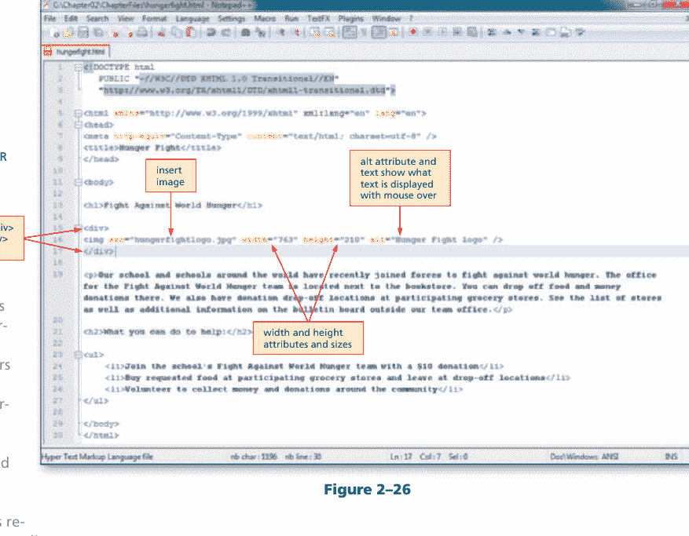

> **问与答** alt属性的目的是什么？
>
> alt属性有三个重要目的。首先，视力障碍用户使用的屏幕阅读器会大声读取替代文本。其次，图像加载时会显示替代文本。最后，alt标签是符合XHTML标准所必需的。

> **问与答** `<div>`和`</div>`标签的目的是什么？
>
> `<div>`标签在网页内建立一个分区。当你使用`<div>` `</div>`标签时，你就能够设计使用CSS的布局，包括插入图像。

### 进行其他视觉增强

除了图像之外，还有几种方法可以增加视觉趣味性。

### 为标题添加颜色

网页开发者经常使用颜色来引起对网页元素的注意。所选颜色应与页面选定的图像相协调。它还应使网页文本易于阅读。某些颜色，例如深色，可能不合适，因为默认的黑色文本无法在深色背景上有效显示。更改标题等元素的颜色时，通常最好对网页上的所有标题应用相同的样式以保持一致性。

### 更改项目符号列表的字体样式

有时从美学角度来看，更改项目符号列表中的文本样式是令人愉悦的。当你想强调信息时，可能需要将项目符号文本设为斜体或粗体。

### 插入水平线

使用水平线来分隔网页上的文本很有用。水平线用作页面的分隔符，用于分隔文本部分。

### 提前规划

图2-27并未列出所有可能的网页颜色。还有许多其他颜色可用于网页背景或文本字体。有关颜色的更多信息，请参阅附录B或在Web上搜索浏览器颜色。

## 其他视觉增强

帮助吸引网页访客注意力的一种方法是使用颜色。有许多颜色可用作网页背景、文本或链接。图2-27显示了网页上常用的颜色及其对应的六位数字代码。六位数字代码可用于指定背景、文本或链接的颜色。“对抗世界饥饿”网页上的标题当前为黑色（默认颜色）。你将通过使用内联样式为标题添加颜色来美化网页。

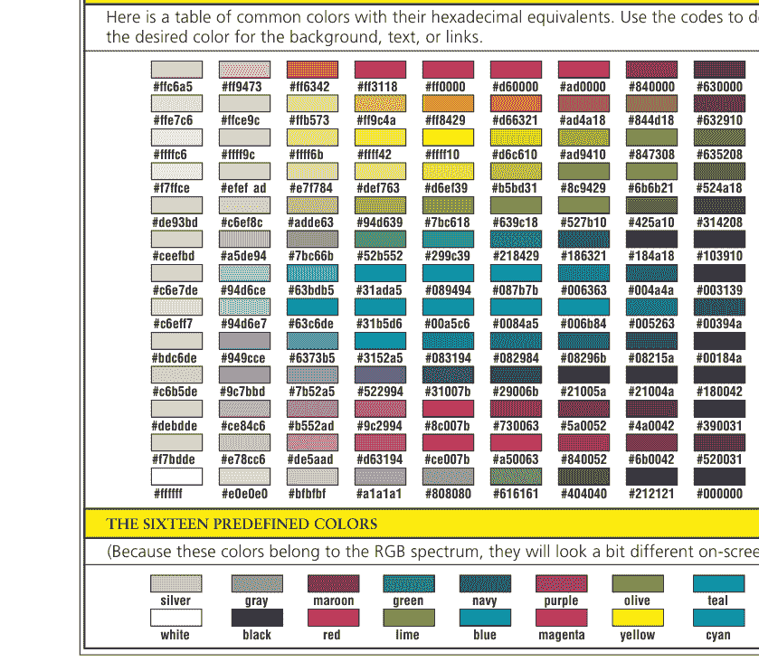

网页开发者过去必须确保使用浏览器安全的颜色（附录B）。如今显示器的趋势是显示“真彩色”，这意味着显示器可以显示1600万种颜色中的任何一种。现在很少有人使用8位显示器，因此你通常不必将自己限制在浏览器安全的颜色范围内。

图2-27中显示的颜色代码和名称可用于背景、文本和链接颜色。在`<h1>`和`<h2>`标签中使用`color`属性来指定这些标题的颜色。颜色`#3D60B1`将用于这些标题，因为它是上面步骤中插入的图形图像中找到的颜色之一。

另一种视觉增强网页的方法是更改某些文本的样式。这会引起对网页上特定文本的关注。在本节中，你将使用内联样式将项目符号列表中的文本更改为斜体样式。此更改有助于引起对该项目符号列表中三个要点的注意。

最后，你添加一条水平线来进一步增强这个网页。如本章前面所讨论的，水平线是网页上用作分隔符的线条，用于在页面上提供视觉分隔。你可以使用内联图像来添加水平线，或者使用水平线标签（`<hr />`）来添加一条简单的水平线，如以下步骤所示。图2-28展示了多种水平线的示例以及用于添加它们的HTML代码。页面上的第一条线展示了默认的水平线。通过增加显示的像素数量，可以为水平线添加维度。

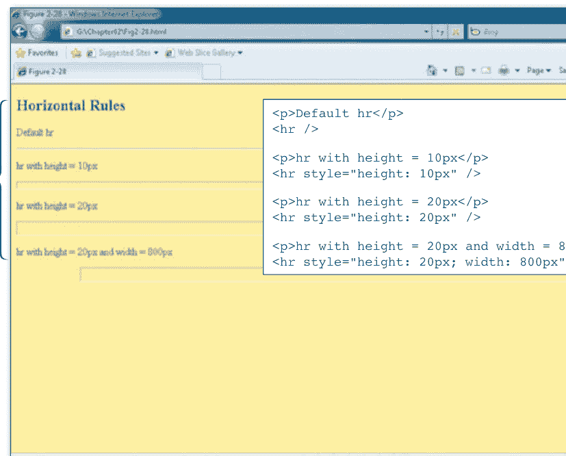

## 图2-28

## 为网页标题添加颜色

要更改网页标题的颜色，必须在HTML文件的`<h1>`和`<h2>`标签中添加颜色属性。`color`属性允许你更改网页上各种元素的颜色。以下步骤展示了如何在内联样式中使用颜色属性添加颜色。

1. 单击第13行`<h1>`中“1”之后、闭合括号之前的位置，然后按空格键。
2. 输入`style="color: #3D60B1"`作为“对抗世界饥饿”标题的颜色代码（图2-29）。
3. 单击第21行`<h2>`中“2”之后、闭合括号之前的位置，然后按空格键。
4. 输入`style="color: #3D60B1"`作为“你能做些什么来提供帮助：”标题的颜色代码（图2-29）。

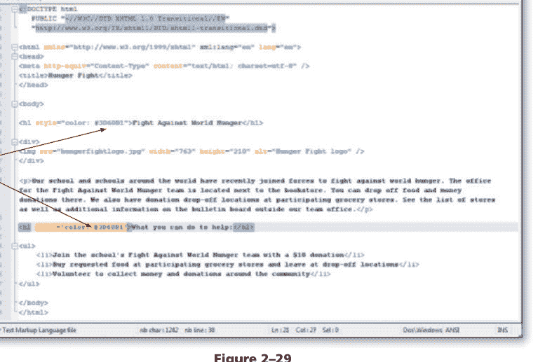

> **问与答** 我可以使用任何十六进制代码或颜色名称来更改标题颜色吗？
>
> 虽然你可以使用任何可用的十六进制代码或颜色名称，但你必须确保颜色适合你网页的标题。你不希望标题颜色太浅，或者以其他方式削弱标题的效果。

> **问与答** 我能否使用复制/粘贴过程将内联样式从`<h1>`标签复制到`<h2>`标签？
>
> 是的，复制/粘贴会产生相同的结果。但是，如果你想将样式复制到网页上的所有标题，使用嵌入式或外部样式表会更容易，你将在接下来的两章中学习相关内容。

## 更改项目符号列表样式

要更改项目符号列表的样式，你再次使用带有`font-style`属性的内联样式。`font-style`属性允许你更改所选字体或文本的样式。`font-style`有三个值：`normal`、`italic`和`oblique`，尽管只有`normal`和`italic`得到各种浏览器的广泛支持，适用于网页上元素的各种属性。以下步骤展示了如何在内联样式中使用颜色属性添加颜色。

1. 单击第23行`<ul>`中“|”之后、闭合括号之前的位置，然后按空格键。
2. 输入`style="font-style: italic"`作为代码（图2-30）。

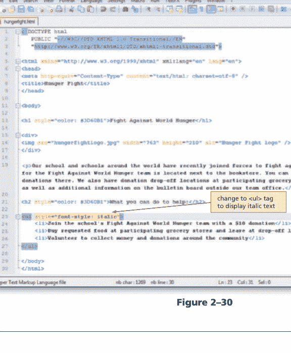

图2-30

HTML 72 HTML 第2章 使用内联样式创建和编辑网页

## 添加水平线

以下步骤说明如何向网页添加水平线。

1. 单击空白行20，然后按回车键。
2. 输入`<hr />`作为HTML标签，然后按回车键（图2-31）。
3. 单击菜单栏上的“文件”，然后单击“保存”。

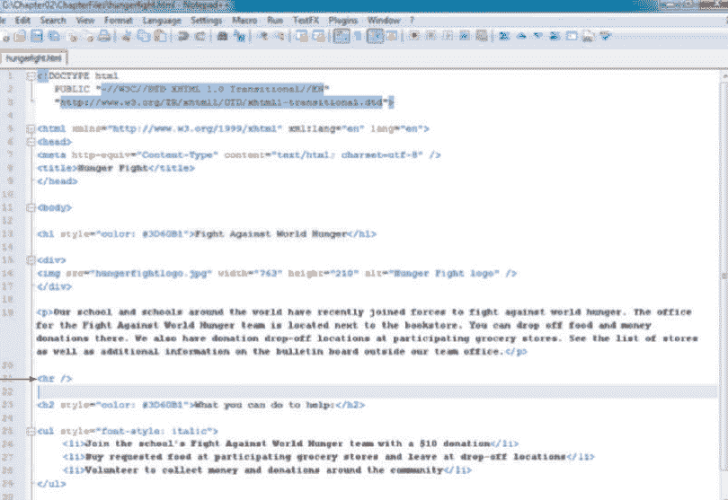


> **HTML和XHTML标签**
>
> 网络上有优秀的资源列出了HTML和XHTML标签。有关HTML和XHTML的更多信息，请在搜索引擎中搜索“HTML标签”或“XHTML标签”。

## 在浏览器中刷新视图

当你在Notepad++中继续开发HTML文件时，最好在进行修改时在浏览器中查看文件。在浏览器中查看修改后的网页时，务必单击“刷新”按钮，以确保显示最新版本的网页。下一页的步骤展示了如何在浏览器中刷新网页视图，以便查看修改后的网页。

- 单击任务栏上的Internet Explorer按钮以显示主页。
- 单击地址栏上的“刷新”按钮以显示修改后的网页（图2-32）。


## 验证和查看HTML代码

在第1章中，你阅读了关于验证HTML代码的内容。网络上有许多验证服务可用，可用于确保你的HTML代码符合标准。这应该是你网页测试的一部分。本书中使用的验证服务是W3C标记验证服务（`validator.w3.org`）。XHTML验证器会查看DOCTYPE语句以确定你使用的是哪个版本的HTML或XHTML，然后检查代码对于该版本是否有效。在本章中，项目使用的是过渡型代码。

如果验证检测到你的HTML代码中存在错误，你将在标题栏中看到警告“在将此文档作为XHTML 1.0过渡型进行检查时发现错误！”，该标题栏为红色（见下一页图2-33a）。结果行显示你拥有的错误数量。你可以向下滚动页面或单击“转到：验证输出”链接以查看每个错误的详细评论。

需要注意的是，一个错误可能导致更多错误。例如，`hungerfight.html`文件中的`<hr />`标签被更改为`<hr>`以展示错误代码。图2-33b显示，在这种情况下，一个初始错误导致总共四个错误。


图2-33

源代码是用于创建网页或程序的代码或指令。对于网页，源代码是HTML代码，然后由浏览器翻译成图形化的网页。你可以从浏览器中查看任何网页的HTML源代码。此功能允许你检查自己的HTML源代码，以及查看其他开发者用于创建其网页的HTML代码。如果网页上的某个功能适合或吸引你的网页，你可以查看源代码以理解添加该功能所需的HTML，然后将HTML代码的部分内容复制到你自己的网页上。

## 验证HTML代码

既然你已经为网页添加了所有基本元素，并用图像、颜色、斜体和线进行了增强，你需要验证你的代码。以下步骤说明了如何使用W3C验证器验证你的HTML代码。

1. 单击浏览器上的地址栏以高亮显示当前URL。
2. 输入`validator.w3.org`以替换当前条目，然后按回车键。
3. 如果浏览器要求打开新窗口，请在必要时单击“确定”。
4. 单击“通过文件上传验证”选项卡（图2-34）。


HTML 76 HTML 第2章 使用内联样式创建和编辑网页

1. 单击“浏览”按钮。
2. 在存储设备上找到`hungerfight.html`文件，然后单击文件名。
3. 单击“选择要上载的文件”对话框上的“打开”按钮，文件路径和名称将插入到“文件”框中，如图2-35所示。
4. 单击“检查”按钮（图2-35）。应显示验证结果，如图2-36所示。
5. 返回到“Hunger Fight”网页，可以通过单击浏览器上的“后退”按钮，或单击任务栏中的Internet Explorer按钮。


> **问与答** 我如何知道我的HTML代码是否有效？
>
> 通知标题将为绿色，在“结果”区域中，你应该会看到“通过”这个词。

> **问与答** 如果我的HTML代码未通过验证，我该怎么办？
>
> 如果你的代码有错误，请编辑你的HTML文件以纠正错误。标记验证服务报告会列出你的代码中的问题。一旦你进行了必要的更改并保存文件，你可以使用“浏览”按钮打开更正后的HTML文件，然后向下滚动并单击“重新验证”按钮以验证更改后的代码。


## 查看网页的HTML源代码

你可以使用浏览器查看大多数网页的源代码。以下步骤展示了如何使用浏览器查看网页的HTML源代码。

1. **单击命令栏上的“页面”（图2-37）。**
2. **单击“查看源文件”，在默认的文本编辑器中查看HTML代码。**

> 所有浏览器都允许我以相同的方式查看HTML源代码吗？
>
> Firefox或Safari等浏览器与Internet Explorer不同，可能使用不同的按钮或菜单选项来访问源代码。例如，在Mozilla Firefox中，选择“查看”然后选择“页面源代码”。


3. **单击文本编辑器标题栏上的“关闭”按钮，关闭活动的文本编辑器窗口（图2-38）。**

> 默认的文本编辑器是什么？
>
> 对于Internet Explorer，它很可能是记事本，但也可能是Notepad++或其他编辑器，具体取决于你的浏览器设置。


## 打印网页和HTML文件

创建HTML文件并保存后，你可能希望打印一份HTML代码和最终网页的副本。文件、网页或其他文档的打印版本称为**纸质副本**或**打印件**。HTML文件和网页的打印副本可以保留以供参考或分发。在许多情况下，HTML文件和网页会被打印出来并放在活页夹中供他人使用。以下步骤展示了如何打印网页及其对应的HTML文件。

1. 根据打印机说明准备好打印机。
2. 当“对抗世界饥饿”网页在浏览器窗口中打开时，单击命令栏上的打印图标。
3. 当“打印”对话框出现时，单击“打印”按钮。
4. 当打印机停止打印网页时，取回打印件（图2-39）。


> **问答**
>
> 还有其他打印网页的方法吗？
>
> 按下`CTRL+P`会打开“打印”对话框，你可以在其中选择打印选项。你也可以使用“文件”菜单的“打印”选项。

图2-39

## HTML 第2章

验证和查看HTML代码 HTML 79

2

- 单击任务栏上的Notepad++按钮以激活Notepad++窗口。
- 单击菜单栏上的“文件”，单击“打印”命令，然后单击“打印”按钮以打印HTML代码的纸质副本（图2-40）。

> **问答**
>
> 为什么我需要打印HTML代码？
>
> 拥有纸质打印件对初学开发者来说是一个宝贵的工具。打印副本可以帮助你立即看到HTML标签和你在浏览器中查看的网页之间的关系。


图2-40

HTML 80 HTML 第2章 使用内联样式创建和编辑网页

**快速参考**

有关HTML标签及其相关属性的列表，请参阅本书末尾的HTML快速参考（附录A），或访问HTML快速参考网页（`scsite.com/HTML6e/qr`）。有关CSS属性和值的列表，请参阅附录D。

## 退出Notepad++和浏览器

以下步骤展示了如何退出Notepad++和浏览器。

1. 在Notepad++中，单击“文件”菜单，然后单击“全部关闭”。
2. 单击Notepad++标题栏上的“关闭”按钮。
3. 单击Internet Explorer的“饥饿对抗”标题栏上的“关闭”按钮。

# 章节总结

在本章中，你学习了如何识别网页的元素、定义网页结构以及使用文本编辑器输入网页内容。你使用内联样式增强了网页外观，保存并验证了你的代码，并在浏览器中查看了你的网页和源代码。下面列出的项目包括你在本章中学到的所有新的HTML技能。

1. 启动Notepad++（HTML 40）
2. 在Notepad++中启用自动换行（HTML 42）
3. 使用HTML标签定义网页结构（HTML 42）
4. 输入标题（HTML 47）
5. 输入一段文本（HTML 47）
6. 创建无序列表（HTML 50）
7. 保存HTML文件（HTML 54）
8. 启动浏览器（HTML 57）
9. 在浏览器中查看网页（HTML 59）
10. 激活Notepad++（HTML 61）
11. 添加图片（HTML 66）
12. 为网页标题添加颜色（HTML 70）
13. 更改项目符号列表样式（HTML 71）
14. 添加水平线（HTML 72）
15. 在浏览器中刷新视图（HTML 73）


- 16. 验证 HTML 代码（HTML 75）
- 17. 查看网页的 HTML 源代码（HTML 77）
- 18. 打印网页和 HTML 文件（HTML 78）
- 19. 退出 Notepad++ 和浏览器（HTML 80）

# 在线学习

测试你对章节内容和关键术语的了解。

说明：要完成“在线学习”练习，请启动浏览器，单击地址栏，然后输入网址`scsite.com/html6e/learn`。当 HTML“在线学习”页面显示时，单击你想要完成的练习的链接并阅读说明。

## 章节强化：判断题、选择题和简答题

一系列测试你对章节内容了解的判断题、选择题和简答题。

## 谁想成为计算机天才？

一个以电视问答节目风格挑战你对章节内容了解的互动游戏。

## 闪卡

一个互动学习环境，你根据显示的定义识别与之相关的章节关键术语。

## 术语轮盘

一个以电视节目《幸运轮盘》风格挑战你对章节关键术语了解的互动游戏。

## 模拟测试

一系列测试你对章节内容和关键术语了解的选择题。

### 纵横字谜挑战

一个挑战你对本章所呈现的关键术语了解的纵横字谜。

# 应用你的知识

巩固技能并应用你在本章中学到的概念。

## 编辑“应用你的知识”网页

**说明：** 启动 Notepad++。从学生数据文件的`Chapter02\Apply`文件夹中打开文件`apply2-1.html`。有关下载学生数据文件的说明，请参阅本书的封底内页，或联系你的老师了解获取本书所需文件的信息。

`apply2-1.html`文件是一个部分完成的 HTML 文件，你将用于此练习。图 2-41 展示了在添加了额外的 HTML 标签和属性后，“应用你的知识”网页在浏览器中应有的显示效果。


**执行以下任务：**

1. 输入`g:\Chapter02\Apply\apply2-1.html`作为 URL，在浏览器中查看网页。
2. 检查 HTML 文件及其在浏览器中的外观。
3. 使用 Notepad++ 更改 HTML 代码，使网页看起来与图 2-41 所示的相似。两个标题都是红色的。（*提示：* 使用`style="color: red"`属性。）
4. 将图片`flowershow.jpg`（位于`Chapter02\Apply`文件夹中）添加到网页。其宽度为 192 像素，高度为 175 像素。（*提示：* 将图片包含在`<div> </div>`容器中，并记得使用`alt`属性。）
5. 使项目符号列表使用较小的字号。（*提示：* 使用`style="font-size: small"`属性。）

### 应用你的知识（续）

6. 使用文件名`apply2-1solution.html`将修改后的 HTML 文件保存在`Chapter02\Apply`文件夹中。
7. 在`http://validator.w3.org/`验证你的 HTML 代码。
8. 输入`g:\Chapter02\Apply\apply2-1solution.html`作为 URL，在浏览器中查看修改后的网页。
9. 打印网页。
10. 按照老师指定的格式提交修改后的 HTML 文件和网页。

# 拓展你的知识

拓展你在本章中学到的技能，并尝试新技能。

## 创建定义列表

*说明：* 启动 Notepad++。从学生数据文件的`Chapter02\Extend`文件夹中打开文件`extend2-1.html`。有关下载学生数据文件的说明，请参阅本书的封底内页，或联系老师了解获取所需文件的信息。此示例网页包含以项目符号列表格式呈现的所有网页文本。你将添加必要的标签，使其成为一个定义列表，其中术语为粗体，如图 2-42 所示。


**图 2-42**

*执行以下任务：*

1. 使用`extend2-1.html`文件中提供的文本，按照 HTML 52 页图 2-14 所示的定义列表代码，修改 HTML 代码，将网页从项目符号列表更改为定义列表。
2. 添加必要的额外 HTML 代码，使术语显示为**粗体**（样式参见附录 D 中的`font-weight`），并添加背景颜色`#e0e0e0`（样式参见附录 D 中的`background-color`）。
3. 将修改后的文档保存在`Chapter02\Extend`文件夹中，文件名为`extend2-1solution.html`，验证网页，然后按照你老师指定的格式提交。

## 让它正确

分析文档，修正所有错误和/或改进设计。

### 修正“友好提醒”网页

**操作说明：** 启动 Notepad++。打开“学生数据文件”中`Chapter02\MakeItRight`文件夹下的文件`makeitright2-1.html`。关于下载“学生数据文件”的说明，请参见本书的封底内页，或联系你的老师获取所需文件的信息。该网页是图 2–43 所示内容的一个修改版本。对网页进行必要的修正，使其看起来像图 2–43。将标题格式设置为“标题 1”样式，并在网页上居中对齐（标题居中可参见附录 D 中的`text-align`属性）。添加两个`size-10px`的水平线，如图 2–43 所示。将文件保存在`Chapter02\MakeItRight`文件夹中，命名为`makeitright2-1solution.html`，验证网页，然后按照你老师指定的格式提交。


## 实验室

### 实验 1：创建一个食品募捐网页

**问题：** 你曾为所在城市的社区食品募捐活动做过志愿者工作。你想招募其他朋友加入社区服务志愿者行列。有人请你创建一个网页，展示你选择做志愿者的原因，并告知人们如何也能提供帮助，如图 2–44 所示。


图 2–44

**操作说明：** 执行以下步骤：

1. 启动 Notepad++，创建一个新的 HTML 文件，在`<title> </title>`标签内输入标题`Lab 2-1`。对于初始 HTML 标签，如果你在本章项目开始时创建了`structure.html`文件，可以使用它，否则请输入初始标签。
2. 开始`body`部分，添加`fooddrivelogo.gif`图片以及标题“Please Help!”。将标题格式设置为“标题 1”样式，并在网页上居中对齐。（*提示：* 标题居中可参见附录 D 中的`text-align`属性。）
3. 添加一个左对齐的标题，如图所示，使用“标题 2”样式。
4. 为网页添加背景颜色，使用颜色代码`#f9fc05`。（*提示：* 使用`style="background-color: 颜色编号"`属性。）
5. 添加一个关于不易腐烂食品的无序列表，如图 2–44 所示。
6. 将文件保存在`Chapter02\IntheLab`文件夹中，命名为`lab2-1solution.html`。
7. 打印`lab2-1.html`文件。
8. 在浏览器中输入`g:\Chapter02\InTheLab\lab2-1solution.html`作为 URL 来查看网页。
9. 打印该网页。
10. 按照你老师指定的格式提交修改后的 HTML 文件和网页。

## 实验室

### 实验 2：创建一个信息网页

**问题：** 你继续享受志愿服务，并决定准备一个网页公告（如图 2-45 所示），以推广最新的食品募捐活动。


图 2-45

**操作说明：** 执行以下步骤：

1. 启动 Notepad++，创建一个新的 HTML 文件，在`<title> </title>`标签内输入标题`Lab 2-2`。
2. 该网页使用`foodbag.jpg`图像文件，其宽度为 207，高度为 256。将图像居中对齐（可参见附录 D 中的`text-align`属性）。两个标题都使用绿色。
3. 添加如图 2-45 所示的段落文本。将“$10 off”这几个词设置为超大字号（`x-large`）（可参见附录 A 中的`<span>`HTML 标签来帮助实现）。
4. 创建一个带项目符号的列表，内容如图所示。
5. 将文件保存在`Chapter02\IntheLab`文件夹中，使用文件名`lab2-2solution.html`。
6. 打印`lab2-2solution.html`文件。
7. 在浏览器中输入`g:\Chapter02\IntheLab\lab2-2solution.html`作为 URL 来查看网页。
8. 打印该网页。
9. 按照你老师指定的格式提交修改后的 HTML 文件和网页。

## 实验室

### 实验 3：制作一个个人网页

**问题：** 你的朋友们担心他们存不下钱。他们向你寻求帮助，因为你似乎总是能存下钱以备不时之需。你决定制作一个网页，为他们提供一些建议。你计划使用一个段落文本和一个带项目符号的列表，如图 2–46 所示。图中的文本和项目符号应替换为你自己的省钱经验和技巧。


图 2–46

**操作说明：** 执行以下步骤：

1. 启动 Notepad++，创建一个新的 HTML 文件，在`<title> </title>`标签内输入标题`Lab 2-3`。
2. 包含一个简短的信息段落和一个带项目符号的列表，格式与图 2–46 所示的类似，以提供关于你的省钱经验的信息。
3. 插入存储在`Chapter02\IntheLab`文件夹中的图像文件`cloudy.jpg`。右键单击图像，单击“属性”，然后单击“详细信息”选项卡以查看图像的尺寸，或在图形程序中打开它。请注意，列表使用的项目符号是方形的。
4. 将 HTML 文件保存在`Chapter02\IntheLab`文件夹中，使用文件名`lab2-3solution.html`。
5. 在浏览器中输入`g:\Chapter02\IntheLab\lab2-3solution.html`作为 URL 来查看网页。
6. 从浏览器打印该网页。
7. 按照你老师指定的格式提交修改后的 HTML 文件和网页。

## 案例与场景

运用你的创造性思维和问题解决技能来设计并实施一个解决方案。

• 较容易 •• 较难

### 1：为食品募捐网页添加内容

社区食品银行的主任瓦蒂尼先生喜欢你在实验 2-1 中创建的网页。现在食品募捐活动已经结束，他希望你更新网页，发布关于即将到来的社区活动的新信息。在更新页面之前，先在网上搜索其他食品银行或社区服务部门的网页，以获取关于应包含的内容或应更改的格式的想法。他们的网站是什么样子的？你是否可以对实验 2-1 的网页进行一些改变，以反映其他地方的做法？运用本章介绍的概念，添加额外信息或更改格式，使页面更有趣、更有时效性。

### 2：创建一个艺术家网站

你正在为当地一位摄影师创建一个新网站。摄影师要求你为网页上的图片使用描述性的`alt`属性，因为他网页的许多访问者网络连接速度很慢，图片经常无法快速加载。在网上搜索关于为图片添加有用的、描述性的`alt`属性的信息。同时查找关于使用缩略图的信息。提供加快图片加载速度的建议。创建一个文档，用一段简短的文字解释你在研究中找到的信息。就如何使摄影师的网站更有效提出建议。

### 3：创建一个 CSS 属性网页

到目前为止，你在课堂上已经学到了很多关于使用层叠样式表（CSS）的知识。但是，关于如何插入某些样式，你仍有一些疑问。在网上研究信息（别忘了查看 W3.org 网站），找到列出 CSS 属性和值的网站，以补充附录 D。在一个 Word 文档中，添加你发现非常有用的 URL。在每个 URL 下面，写一段简短的文字，描述你为什么认为该网站对新的网页开发者有帮助。与同学们分享你的 URL 列表。

### 4：创建一个个人网页

**让它个性化**

你的班级老师想将所有学生的网页发布在学校服务器上，以展示他/她的学生们感兴趣的内容。创建一个包含个人信息的网页，列出诸如你的学校专业、过去从事过的工作以及你的爱好和兴趣等条目。为了让你的个人网页会更有趣，在网络上搜索能反映你兴趣的图片。（请记住，如果图片有版权，除非遵循图片提供的指南，否则不能将其用于个人网页。）在网页中插入一两张图片，以帮助解释你是谁。

### 案例与实践（续篇）

网页会更有趣，在网络上搜索能反映你兴趣的图片。（请记住，如果图片有版权，除非遵循图片提供的指南，否则不能将其用于个人网页。）在网页中插入一两张图片，以帮助解释你是谁。

### 5：使用不同 CSS 属性创建网页

## 协同作业

与其他同学一起，复习附录 D 中的 CSS 以及在案例与实践 3 中找到的专门介绍 CSS 的网站。尝试找到一些在本章中尚未使用的 CSS 属性（例如与边距相关的内容）的用途。计划如何使用五个在第二章中未使用的 CSS 属性来改进你在本章中创建的其中一个网页（可以是章节项目或章末项目）。在网页中运用这五种不同的 CSS 属性。在 Word 文档中解释你使用了哪些 CSS 属性、为何使用它们以及它们如何改进了网页。

# 3 使用链接、图像和嵌入式样式表创建网页


## 学习目标

当你能够做到以下几点时，你将掌握本章的内容：

- 描述链接术语和定义
- 创建主页并使用图像增强网页
- 使用嵌入式样式表更改正文和标题格式
- 使用嵌入式和内联样式为文本添加对齐和颜色
- 使用内联样式为无序列表中的项目符号插入图像
- 添加指向同一网站中另一个网页的文本链接
- 添加电子邮件链接
- 添加指向其他网站上网页的文本链接
- 使用绝对路径和相对路径
- 保存、验证和查看 HTML 文件并测试链接
- 使用样式类添加带有环绕文本的图像
- 添加指向网页内目标的链接
- 复制和粘贴 HTML 代码
- 添加指向同一网站中另一个网页的图像链接

# 3 使用链接、图像和嵌入式样式表创建网页

## 引言

万维网最有用和最重要的特性之一是能够将一个网页与位于世界任何地方的其他网页（在同一服务器或不同 Web 服务器上）连接（链接）起来。使用超链接，网站访问者可以从一个页面移动到另一个页面，并按任意顺序查看信息。许多不同的网页元素，包括文本、图形和动画，都可以用作超链接。在本章中，你将创建使用文本链接和图像链接相互链接的网页。在上一章中，你使用了内联样式来更改单个元素或 HTML 标签的外观。在本章中，你还将使用嵌入式样式表为整个网页设置标题和正文文本等元素的外观。在开始此项目之前，你应已完成开发生命周期中的网站规划、分析和设计阶段。

## 项目——Getting Greener 网站

第 3 章说明了如何使用 HTML 为 Getting Greener 网站创建主页（图 3–1a），并编辑现有的`greenhome.html`网页（图 3–1b）以改善其外观和功能。你的哥哥 Dean 最近开了一家环境咨询公司，命名为 Getting Greener。他想在网上宣传他的公司，并展示一个他做过绿色审计的样板住宅。他知道你在大学里学习过网站开发，因此请你开发两个相互链接的网页：一个主页，和一个包含样板住宅的网页。在你的分析中，你确定有四种基本类型的链接可以使用。第一种是从同一网站中的一个网页链接到另一个网页。第二种是链接到不同网站上的网页。第三种是电子邮件链接。第四种是在一个网页内的链接。你计划为哥哥的网站使用所有这四种类型的链接。

Getting Greener 主页（图 3–1a）包括一个标志图像横幅、标题、一个以图形图像作为项目符号的无序（项目符号）列表、一个电子邮件链接，以及一个指向另一个网站上网页的文本链接。此页面还包括一个指向`greenhome.html`网页的链接。Green Home 网页（图 3–1b）包含两个带有环绕文本的图像，以及内部链接，允许访问者轻松地在网页的各个部分之间移动。该网页还有一个指向 Getting Greener 主页的图像链接。

（a）Getting Greener 主页。


（b）样板 Green Home 网页。


图 3–1

## 概览

在阅读本章时，你将通过执行以下通用任务来学习如何创建图 3–1 所示的网页：

- 在 Notepad++ 窗口中输入 HTML 代码。
- 将文件保存为 HTML 文件。
- 输入基本的 HTML 标签并为文件添加文本。
- 使用嵌入式样式表、内联样式和类来更改文本和标题的格式。
- 使用内联样式创建以图形图像作为项目符号的项目列表。
- 添加指向同一网站中另一个网页的链接。
- 添加指向外部网站的链接。
- 添加电子邮件链接。
- 在同一网页内添加目标和链接。
- 在浏览器中查看网页和 HTML 代码。
- 验证网页。
- 打印网页。

### 提前规划

### 项目规划指南

当你创建网页时，例如上一页图 3–1 所示的项目，你应该遵循以下通用指南：

1. **规划网站。** 在开发多页网站之前，你必须规划网站的目的。有关网站开发生命周期规划阶段的信息，请参考第 HTML 15 页的表 1–4。在此阶段，你确定网站的目的，识别网站的用户及其计算环境，并决定谁拥有网页上的信息。
2. **分析需求。** 在网站开发生命周期的分析阶段，你需要分析要在网页中包含哪些内容。第 3 章的网站开发项目与第 2 章完成的项目不同，因为它包含两个将相互链接的网页。因此，分析阶段的一部分包括确定多个网页如何协同工作以形成一个网站。
3. **设计网站。** 分析完成后，你设计网站。在此阶段，你确定网站的内容，包括文本和图形。本章特定的设计步骤还包括确定网站内和指向外部网站的链接。
   - **a. 选择网页内容。** 生命周期的这一部分也与前一章的项目不同，因为所有内容不必像第 2 章那样出现在一个网页上。对于多页网站，你可以根据需要将内容分布在整个网站中。由于此网站的性质，图片是内容的重要组成部分。网站所有者希望展示其公司工作的样本。图片有助于展示一个家庭为变得更加环保所做的努力。


- b. **确定你将使用的层叠样式表类型。** 你已经学习了如何使用内联样式来最好地支持网站的设计和目的。在本章中，你将利用内联和嵌入式样式表来改变各种网页元素的外观（或样式）。你还将使用嵌入式样式表结合类，以进一步控制网页元素的样式。你需要考虑这些选项中哪一种最适合你的网站样式。

- c. **确定页面之间如何链接。** 此网站包含一个**主页**（网站中的第一个页面）和一个你将链接到的次要网页。你需要确定如何从主页链接到次要页面（例如，使用文本或图形），以及如何链接回主页。

- d. **确定还需要哪些其他链接。** 除了主页和次要网页之间的链接外，你还需要一个电子邮件链接。网站开发者在网站主页上提供电子邮件链接以供访客评论或提问是标准做法。此外，次要网页（`greenhome.html`）是一个很长的页面，需要访客向下滚动进行导航。由于其长度，提供方便快捷的网页导航方式非常重要。你可以通过使用网页内的链接来实现这一点。

## 4. 开发网页并插入所有链接

分析和设计完成后，网站开发者使用 HTML 和 CSS 创建网页。在此步骤中应遵循良好的网站开发标准实践。良好实践的例子包括使用适当的初始 HTML 标签（如前一章所示），并始终为图像标识替代文本。

## 5. 测试网站内的所有网页

网站开发的重要部分是测试，以确保你遵循 XHTML 标准。对于本书中的项目，你将使用万维网联盟验证器，该工具允许你测试你的网页并清楚地解释它发现的任何错误。测试时，你应该检查所有内容的准确性。此外，所有链接（外部、内部和同一网站内的页面之间）都应进行测试。

如有必要，本章将在适当的地方介绍有关上述指南的更详细信息。本章还将说明在创建图 3–1 所示网页时执行的操作和做出的决策。

## 在网页上使用链接

正如你所了解到的，许多不同的网页元素，包括文本、图像和动画，都可以作为链接。文本和图像是用作链接最广泛的元素。图3-2展示了文本链接和图像链接的示例。


图3-2 网页上的文本和图像链接。

在网页上使用文本链接时，请使用描述性文本作为可点击的词或短语。例如，短语“点击此处”并未向访客解释链接的目的。相反，短语“航班节省高达40%”则表明该链接指向一个提供折扣机票的网页。

当文本标识一个链接时，它通常显示为带下划线的文本，颜色与网页主体文本不同。除非在锚点 `<a>` 或 `<body>` 标签中另行更改，否则浏览器设置将定义整个网页中文字链接的颜色。例如，在 Internet Explorer 中，未点击（或未访问）的普通链接的默认颜色是蓝色，已访问的链接是紫色，而活动链接（用户刚刚点击的链接）颜色会变化。下一页的图3-3展示了三种状态（普通、已访问和活动）的文本链接示例。通常，如图3-3所示，将鼠标指针移到链接上会导致鼠标指针变为手形指针。此变化通知用户该文本或图像上有一个可用链接。

> **顺带一提 | 链接帮助**

许多网站为新的 HTML 开发者提供帮助。有关链接的更多信息，请在任何优秀的搜索引擎中搜索“HTML 教程”或“HTML 帮助”等关键词。


**图3-3 文本链接颜色变化示例。**

同样的颜色默认设置也适用于图像链接周围的边框颜色。边框使图像看起来像是周围有一个框架。如果图像没有边框，则不会在图像周围出现框架。边框的颜色显示该边框是否是一个链接，以及该链接是否已被访问（图3-4）。


**图3-4**

如果你想更改文字链接或图像链接边框的颜色以覆盖浏览器默认设置，你可以在锚点 `<a>` 或 `<body>` 元素中使用嵌入式或外部样式表，或使用内联样式来指定这些更改。回想一下，你使用内联样式来更改单个元素的外观（或样式）。嵌入式样式表用于更改一个网页中类似元素的样式。最后，外部样式表包含在一个单独的 `.css` 文档中，用于更改整个网站的样式。（你将在下一章中使用外部样式表。）要在锚点元素中使用嵌入式或外部样式表来更改普通、已访问和活动链接的颜色（从默认值更改），你需要使用以下格式：

> `a {color: black}`

其中 `color` 是指定的颜色名称，例如 `black`，或十六进制颜色代码。要使用内联样式进行相同的更改，标签格式为：

> `<a style="color: black">`

你可以使用锚点标签内的 `text-decoration` 属性来禁用链接的下划线。**text-decoration 属性**允许文本使用五种值之一进行“装饰”：`underline`、`overline`、`line-through`、`blink` 或 `none`。此属性可用于多种标签，包括锚点标签。链接默认带有下划线，以表明它们是链接。

在设计阶段，你应该仔细考虑任何样式更改的利弊，特别是对默认样式的更改。在关闭链接下划线或更改默认链接颜色之前，请确保用户仍然能够立即看到特定文本被用作链接。如果你确定可以有效地关闭链接的下划线（就像你在本章后面创建的图像链接那样），你可以将 `text-decoration` 属性更改为 `none`。要使用嵌入式或外部样式执行此操作，你需要输入以下代码：

> `a {text-decoration: none}`

要使用内联样式将 `text-decoration` 更改为 `none`，请输入：

> `<a style="text-decoration: none">`

## 在同一网站内链接到另一个网页

网页通常包含链接，用于将一个网页连接到同一网站内的另一个页面。例如，访客可以点击网站首页（下一页的图3-5a）上的一个链接，连接并查看同一网站上的另一个网页（图3-5b）。在此项目中创建的网页包含指向同一网站内其他页面的链接：

1. Getting Greener 主页包含一个指向 Green Home 网页的文本链接；
2. Green Home 网页包含一个指回 Getting Greener 主页的图像链接。

要将 `gettinggreener.html` 主页上的“green home”一词链接到 `greenhome.html` 网页，你需要以下 HTML 代码：

```html
<a href="greenhome.html">green home</a>
```

> **链接颜色**

你可以在流行的浏览器中更改链接颜色。在 Internet Explorer 中，你可以在“工具”菜单的“Internet 选项”中找到颜色选择。在 Mozilla Firefox 中，点击“工具”菜单、“选项”、“内容”选项卡。在这两种浏览器中，你都可以通过点击颜色网格来更改颜色。

> **网页上的链接**

锚点标签还允许访客在单个网页内移动。使用 `name` 属性允许在同一页面内从一个区域移动到另一个区域。这种链接技术非常有用，特别是在长页面上。链接索引也可以提供对网页内各个区域的便捷访问。

锚点 `<a>` 标签中的 `href` 表示当“green home”一词被点击时，访客将链接到 `greenhome.html` 网页。你用 `</a>` 标签结束链接。如果你没有添加 `</a>` 标签，那么“green home”之后的所有文本都将被链接。


## 链接到另一个网站的网页

Web 开发最强大的功能之一是能够链接到你网站之外的网页。Web 开发者使用这些链接将他们的网页连接到其他包含相同主题信息的网页。正是这些链接赋予了 Web 作为互联资源的价值，并提供了其“网络性”。在此项目中，主页（图3-6a）包含一个链接，指向另一个网站上的页面，访客可以在那里找到关于气候控制的更多信息（图3-6b）。要将 `gettinggreener.html` 主页上的“World Meteorological Organization (WMO)”一词链接到外部网站，你需要以下 HTML 代码：

```html
<a href="http://www.wmo.int/">World Meteorological Organization (WMO)</a>
```

请注意，该代码与用于链接到同一网站内网页的代码基本相同。但是，当你链接到外部网站时，必须添加完整的 URL (`http://www.wmo.int/`)。


图3-6

## 在网页内链接

网页内的链接允许访客快速从网页的一个部分移动到另一个部分。这在长网页中尤其重要，访客需要向下滚动才能看到所有内容。许多网页在页面顶部包含一个链接列表，如菜单或目录，其中包含指向网页内各部分的链接（图3-7）。在此项目中，Green Home 网页包含从网页顶部部分到页面内其他部分的链接，以及返回网页顶部的链接。

在网页内链接有两个步骤。首先，你必须设置一个目标，使用对链接目的有意义的名称。然后，你使用给定的名称创建一个指向该目标的链接。以下 HTML 代码展示了一个名为 `solar` 的目标示例，然后将该目标用作链接。第一条语句插入到你希望链接到的网页部分的顶部。第二条语句插入到网页顶部的项目符号列表中。

```html
<a name="solar"></a>
<a href="#solar">Installed solar panels</a>
```

再次注意，你也使用锚点 `<a>` 标签进行这种类型的链接。但是，对于这种页面内链接，你需要在目标名称前插入 `#`，以表示你想要链接到网页的特定部分，而不一定是页面的顶部。有时当你在浏览网页时，你可能会在链接地址中看到 `#`。这通常会将你链接到网页的特定部分。


图3-7 带有内部链接的网页。

## 链接到电子邮件地址

一个设计良好的网页总是为访客提供一种联系方式，联系负责维护网站或处理客户问题和评论的公司人员。提供联系信息的一种简单方法是在网站主页以及其他网页上包含电子邮件链接。如图3-8所示，当访客点击电子邮件链接时，它会自动在默认的电子邮件程序中打开一个新邮件，并在“收件人”字段中插入适当的联系电子邮件地址。然后访客可以输入并发送电子邮件以请求更多信息、评论或...

> **电子邮件链接**

你可以为 `mailto:` 标签分配多个电子邮件地址。在 `<a href=>` 标签中使用 `"mailto:first@isp.com, second@isp.com"` 的格式。一些较旧的浏览器可能不支持此标签。

对于这类链接，你再次使用锚点 `<a>` 标签。不过，在 `href` 属性中，你使用 `mailto:电子邮件地址` 作为值。在这段代码中，电子邮件地址 `gettinggreener@isp.com` 出现两次，这看起来可能有些奇怪。电子邮件地址的第一次出现是用于链接本身。`gettinggreener@isp.com` 的第二次出现则用作网页上作为链接的文本。


## 创建主页

本章开发的第一个网页是“Getting Greener”网站的主页。主页是一个网站的主页面，通常是网站访客首先看到的页面。网站主页应通过简要说明其提供的内容、服务或功能来阐明网站的目的。主页还应清楚地指示访客应点击哪些链接，以便在网站的不同页面之间移动。

网页开发者应以清晰明了的方式设计网站，确保从一个网页到另一个网页的链接显而易见，导航清晰。网站主页还应包含一个电子邮件链接，以便访客能够轻松找到个人或组织的联系信息。现在许多网站还包括一个指向网页开发团队的额外电子邮件链接。用户可以利用这个电子邮件链接，向网页开发者报告网站的任何问题或对网站发表评论。

你将通过启动 Notepad++ 并输入初始 HTML 标签来开始创建主页。然后，你将为你的主页添加一张图片、标题、文本和一个无序列表。最后，你将添加文本和电子邮件链接，然后测试这些链接。

## 启动 Notepad++

以下步骤假设 Windows 7 正在运行，并基于典型安装启动 Notepad++。你可能需要向你的指导老师询问如何在你的计算机上启动 Notepad++。

1. 单击 Windows 任务栏上的“开始”按钮，显示“开始”菜单。
2. 单击“开始”菜单左窗格底部的“所有程序”，显示“所有程序”列表。
3. 在“所有程序”列表中单击 Notepad++。
4. 在列表中单击 Notepad++ 以显示 Notepad++ 窗口。如果 Notepad++ 中已有之前项目打开的文件，现在通过单击每个打开文件上的“关闭”按钮将它们全部关闭。
5. 如果 Notepad++ 窗口未最大化，请单击 Notepad++ 标题栏上的“最大化”按钮将其最大化（图3-9）。
6. 单击菜单栏上的“视图”。
7. 如果“自动换行”命令旁边没有勾选标记，请单击“自动换行”。


## 输入定义网页结构的初始 HTML 标签

就像你在第2章中所做的那样，你以定义网页结构的初始 HTML 标签开始你的文件。表3-1包含了此任务的标签和文本。

> **复制初始结构**

请记住，你可以输入初始 HTML 标签并将该代码保存到名为 `structure.html` 的文件中，然后你可以打开该文件并将其用作所有 HTML 文件的基础。这消除了你在每个 HTML 文件开头输入相同代码的需要。只需记住，一旦打开 `structure.html`，就立即用新名称保存它。

### 表 3-1 初始 HTML 标签

| 行号 | HTML 标签和文本 |
| :--- | :--- |
| 1 | `<!DOCTYPE html` |
| 2 | `PUBLIC "-//W3C//DTD XHTML 1.0 Transitional//EN"` |
| 3 | `"http://www.w3.org/TR/xhtml1/DTD/xhtml1-transitional.dtd">` |
| 4 |  |
| 5 | `<html xmlns="http://www.w3.org/1999/xhtml" xml:lang="en" lang="en">` |
| 6 | `<head>` |
| 7 | `<meta http-equiv="Content-Type" content="text/html;charset=utf-8" />` |
| 8 | `<title>Getting Greener</title>` |
| 9 | `</head>` |
| 10 |  |
| 11 | `<body>` |
| 12 |  |
| 13 | `</body>` |
| 14 | `</html>` |

以下步骤说明了如何输入定义网页结构的初始标签。

1. 输入表3-1中所示的 HTML 代码。在每行末尾按回车键。如果你在输入过程中出现错误，请使用退格键删除所有字符，直到包括错误字符在内，然后继续输入。
2. 将插入点置于 `<body>` 和 `</body>` 标签之间的空行（第12行），然后按回车键（图3-10）。
3. 将你输入的内容与图3-10进行比较。如果你发现错误，请使用鼠标指针或箭头键将插入点移动到每个错误的右侧，并使用退格键更正错误。


**图 3–10**

## 保存 HTML 文件

输入 Getting Greener 主页的初始 HTML 代码后，你应该保存该文件。频繁保存文件可确保你不会丢失工作成果。在 Notepad++ 中保存文件还会为代码添加颜色，这有助于你更轻松地识别不同的元素。以下步骤说明了如何在 Notepad++ 中保存 HTML 文件。

**HTML 102 HTML 第 3 章** 创建包含链接、图像和嵌入式样式表的网页

1. 将 USB 闪存驱动器连接到计算机的一个 USB 端口，单击 Notepad++ 菜单栏上的“文件”，然后单击“保存”。
2. 在“文件名”文本框中键入 `gettinggreener.html`（不要按回车键）。
3. 在 Windows 资源管理器窗口的左窗格中单击“计算机”，以显示可用驱动器列表。
4. 如有必要，滚动直到在可用驱动器列表中显示 `UDISK 2.0 (G:)` 或你的存储设备的名称。
5. 打开 `Chapter03\ChapterFiles` 文件夹。
6. 单击“另存为”对话框中的“保存”按钮，将文件保存到 USB 闪存驱动器的 `Chapter03\ChapterFiles` 文件夹中，文件名为 `gettinggreener.html`。

> **提前规划**

**确定如何格式化文本的各种元素。**

在将图形和颜色元素插入网页之前，你应该规划如何格式化它们。通过有效利用图形和颜色，你可以引起人们对网页上重要主题的注意，而不会使其显得杂乱。请考虑以下格式化建议。

- **有效利用图形。** 网页开发的一个重要部分是利用图形来引起人们对网页的关注。通常，公司在其网站上使用与其相关的印刷材料（如名片和信头纸）上相同的标识。在所有营销材料（包括网站）上使用相同的图形图像，是向客户提供一致视觉和品牌信息的好方法。
- **使用与图形相关的标题。** 在许多情况下，公司使用标识横幅作为其主页的主标题，而不是使用 `<h1>` 标题。有时，将网页上标题和图形的颜色与标识横幅协调起来是很好的。这可以引起人们对公司标识横幅的关注，并使网页看起来协调一致。标题大小标准通常应遵循从 `h1`（最大）到 `h6`（最小）。然而，在本项目中，你使用公司标识横幅作为主标题，因此你没有 `h1` 标题。因此，你从下一个较小的标题 `h2` 开始，如 HTML 第91页图3-1a所示。HTML 第91页的图3-1b显示了 `h1` 和 `h2` 标题在适当优先级中的使用。

## 使用内联样式添加居中的横幅图像


Getting Greener 主页包含一个图像标识横幅，以提供视觉吸引力，吸引访客的兴趣并推广公司的品牌。以下步骤说明了如何使用内联样式居中图像以及使用``标签插入图像，从而将图像添加到网页。

要使用内联样式，你需要`<div>`和`</div>`标签。请记住，`<div>`和`</div>`标签创建一个容器，用于定义网页中的逻辑分区。`<div>`标签类似于段落标签，但它允许你将页面划分为更大的部分，并定义网页内整个部分的样式。你可以定义页面的一个部分，并为该部分提供一个与周围文本不同的样式。

当使用`<div>`和`</div>`标签时，你可以设计使用 CSS 的布局，包括插入图片。在此例中，你使用`<div></div>`标签将图片在网页上居中。表 3–2 包含了添加居中标志横幅的代码。

| 行号 | HTML 标签和文本 |
| :--- | :--- |
| 13 | `<div style="text-align: center">` |
| 14 | `` |
| 15 | `</div>` |

1. 将插入点置于第 13 行，输入表 3–2 中所示的 HTML 代码，并在每行末尾按回车键。确保使用 TAB 键缩进第二行代码。这将使开始和结束`<div>`标签与``标签分开，突出显示图片的插入。在第 15 行末尾按两次回车键，将插入点定位到第 17 行（图 3–11）。


## 图 3–11

> **为什么我应该包含`width`、`height`和`alt`属性？**
>
> 添加`width`和`height`属性可以提高页面加载时间，因为浏览器在加载图片前无需计算其宽度和高度。但是，切勿使用`height`和`width`属性来调整图片大小。请使用图形编辑软件调整大小并以不同的文件名保存。`img`标签中使用的`height`和`width`属性应反映图片的实际大小。`alt`属性在用户鼠标悬停于图片上以及图片加载时，提供有关图片用途的信息。

> **`<div>`和`</div>`标签的用途是什么？**
>
> `<div>`标签在 HTML 文档中定义一个分区或部分。`<div>`标签通常用于分组元素并为其应用样式。在此例中，要使图片居中，你必须使用`<div>`和`</div>`标签。语句`style="text-align: center"`是使图片居中的内联样式。图片默认为左对齐。

## HTML 第 3 章：使用链接、图片和嵌入式样式表创建网页

### 提前规划

确定如何格式化主页的文本元素。在插入网页的文本元素之前，你应始终制定一个计划。通过对网页上的字符和段落进行格式化，你可以改善其整体外观。有效地格式化文本也能使网页的信息或目的对用户更加清晰。在网页上，请考虑以下格式化建议。

- 在适当的时候使用默认文本大小。正文由标题和网页底部之间的所有文本组成。这些文本是网页的主要内容，应用于突出你信息的要点。你可以通过使用段落和列表来丰富你的内容。
- 确定使用哪些文本格式。在一个长网页中，通过变换文本样式来分隔标题之间的信息可能会有所帮助。谨慎使用粗体、颜色或斜体文本可以使网页外观更有趣。请确保不要过度格式化文本，因为这会使页面显得杂乱。在一个杂乱的网页上，更难找到你所搜索的内容。
- 确定使用哪些样式表。考虑使用样式表来变换文本元素的格式。如果文本在各段落之间变化，使用内联样式是不错的选择。如果你希望网页中的所有文本都相同，嵌入式样式表是合适的。如果文本在多个网页上通用，则应使用外部样式表（将在下一章讨论）。
- 使用有序或无序列表突出关键文本。有序或无序列表包含特定信息，通过列表比通过一段文本能更清晰地识别。在本项目中，你使用一个项目符号（无序）列表，但通过改变使用的项目符号类型来使其有所变化。使用图片作为项目符号使网页看起来很棒，并且与标准（默认）的无序列表圆点符号不同。
- 确定适合主页的其他信息。适合主页的其他信息包括：公司地址（通常在标志中）、电话号码和电子邮件链接。

## 添加段落文本

为 Getting Greener 主页插入地球标志图片后，你需要添加两段介绍 Getting Greener 的文本。表 3–3 显示了需要输入的标签和文本。

| 行号 | HTML 标签和文本 |
| --- | --- |
| 17 | `<p>Getting Greener 是一家环境咨询公司，专注于帮助你的家庭和生活更加环保。我们拥有训练有素的顾问，可以为你的家庭进行绿色审计。我们将为你提供减少地球足迹的建议。通过创建一个安全、更经济、绿色的家庭环境，帮助你的家庭以负责任的方式行事。</p>` |
| 18 |  |
| 19 | `<p>浏览我们的网站，了解更多关于我们的服务。查看绿色家庭环境的示例，或在世界气象组织（WMO）阅读更多关于气候控制的信息。有问题或意见？请致电 (999) 555-GREEN 或发送电子邮件至 gettinggreener@isp.com。</p>` |

将插入点置于第 17 行，输入表 3–3 中所示的 HTML 代码。在第 17 行的`</p>`标签后按两次回车键，在第 19 行的`</p>`标签后按一次回车键。输入两个段落后，插入点位于第 20 行（图 3–12）。

> **问与答：我是否必须用`</p>`标签结束所有段落文本？**
>
> 没有`</p>`标签的网页在浏览器中可以正确显示。但是，该网页将无法通过 W3C 标记验证服务的验证。遗漏一个`</p>`标签会在验证期间导致许多错误。

> **问与答：如果我希望第二个段落开始时上方没有空行怎么办？**
>
> 如果你希望第二个段落移动到下一行且中间没有空行，你应使用`<br />`标签而不是`<p>`和`</p>`。


## 使用内联样式为项目符号列表增添趣味

你已决定使用无序（项目符号）列表来突出主页上的公司信息。为了将列表与页面的其余部分整合，并增添趣味，你希望使项目符号与公司标志中的地球符号相同。为此，你将在列表上方添加一个`h2`标题，并使用内联样式来创建项目符号。

在无序列表上方插入一个`h2`标题，可以在视觉上将列表与网页上的其他元素分开，并表明列表中的项目描述什么。`h1`标题通常是网页的主标题，但在本例中，标志（`earthlogo.jpg`）被用作`h1`标题的替代品。它具有相同的目的，即标识公司并引起对网页顶部的注意。在标志横幅下使用`h1`标题会显得冗余。因此，你将从`h2`标题开始，因为它更小且尺寸适合突出项目符号列表。

正如第 2 章所述，你可以使用各种列表样式类型（项目符号和数字）。在第 2 章项目中，你使用了带有`list-style-type`属性的内联样式来制作方形项目符号。对于这个网页，你将使用`list-style-image`属性来使用一个小图片（`earthbullet.jpg`）代替圆点、圆圈或方形项目符号。你是通过将图片`earthbullet.jpg`标识为要显示的 URL（而不是项目符号）来实现的。

## 创建使用图片作为项目符号的无序（项目符号）列表

表 3–4 显示了为 Getting Greener 主页添加`h2`标题并创建带有“地球”图片项目符号的项目符号列表的 HTML 代码。

| 行号 | HTML 标签和文本 |
| --- | --- |
| 19 | `<h2>Company information:</h2>` |
| 20 |  |
| 21 | `<ul style="list-style-image: url(earthbullet.jpg)">` |
| 22 | `<li>Started by environmental engineer Dr. Dean A. McDevitt in 2000</li>` |
| 23 | `<li>Store locations all over the greater Seattle area, including branch offices in all public utility buildings</li>` |
| 24 | `<li>Fifteen consultants with a variety of specialties; all fully trained, bonded, and insured</li>` |
| 25 | `</ul>` |

以下步骤展示了如何创建出现在 Getting Greener 主页上的无序（项目符号）列表。

1. 单击空白的第 18 行，然后按回车键。
2. 输入表 3–4 中所示的 HTML 代码。
3. 在第 25 行的`</ul>`之后，按回车键在第 26 行插入一个空行（图 3–13）。


> **问与答**
>
> 如果我想使用不同的项目符号类型怎么办？
>
> 对于空心圆圈项目符号，使用`list-style-type: "circle"`。要使用默认的圆点（实心圆）项目符号，则无需包含`list-style-type`。

### 提前规划

**规划如何以及在何处使用这四种类型的链接。**

- **确定如何从主页链接到同一网站内的另一个页面。** 链接到同一网站内的另一个网页通常使用文本链接。在决定使用哪些词语时，请确保文本链接清晰易懂。使用诸如“点击此处”之类的短语并不能清晰地表明链接将跳转到何处。选择诸如“绿色之家”之类的词语，则告诉网站访问者，如果他们想查看绿色之家的示例，就点击该链接。
- **在主页上使用电子邮件链接。** 一个良好的标准做法是在主页上包含一个电子邮件链接。同样，使用诸如“点击此处”之类的词语，不如使用公司实际的电子邮件地址（本例中为`gettinggreener@isp.com`）作为电子邮件链接文本有效。
- **为主页确定外部链接。** 网站的访问者可能希望获得有关某个主题的额外信息，因此也可以在主页上包含一个链接。链接到外部网站（即当前网站边界之外的网站）以提供额外信息是合适的。同样，选择对该链接有意义的词语或短语非常重要。
- **在长网页上使用内部链接。** 另一个良好的标准做法是在网页较长时（即你必须多次按 PAGE DOWN 键才能到达网页末尾）在网页内包含链接。内部链接有助于访问者在长网页内更轻松地导航。还可以考虑使用链接帮助访问者轻松返回长网页的顶部。

### 在同一网站内添加指向另一个网页的文本链接

#### 其他链接

你也可以创建指向其他网页（即非`http`网页）、FTP 站点和新闻组的链接。要链接到 FTP 站点，请输入`ftp://URL`，而不是本项目中使用的`http://URL`。对于新闻组，请输入`news:新闻组名称`，对于新闻组中的任何特定文章，请输入`news:文章名称`作为条目。

就本网站而言，`<a>`和`</a>`标签用于在网页上创建链接。`<a>`标签也称为**锚点标签**，因为它用于为链接到同一网站内的另一个页面、外部网站中的网页、同一网页内的链接以及电子邮件链接创建锚点。锚点标签也可用于指定目标 URL 的基本语言或指定链接的媒体类型。`href`属性代表超文本引用。这是指向网络上资源的引用（地址）。超链接可以指向网络上的任何资源，包括 HTML 页面、图像、声音文件或视频。用于创建链接的标签的基本形式是：

```html
<a href="URL">linktext</a>
```

其中`linktext`是网页上显示的、可点击的单词或短语，而`href`（超文本引用）的值是被链接页面或文件的名称或 URL。表 3-5 显示了一些`<a>`标签属性及其功能。

| 属性 | 功能 |
| --- | --- |
| `href` | 指定被链接页面或文件的 URL。 |
| `name` | 为当前锚点定义一个名称，以便它可以成为另一个链接的目标或目的地。网页上的每个锚点都必须使用唯一的名称。 |
| `rel` | 表示从当前文档到被链接文档的正向关系。`rel`属性的值是链接类型，例如`prev`、`next`、`index`或`copyright`。例如，网页`chapter3.html`可能包含标签`<a rel="next" href="chapter4.html">`，以指示链接到下一章`chapter4.html`的网页。 |
| `rev` | 表示从当前文档到被链接文档的反向（向后）关系。`rev`属性的值是链接类型，例如`prev`、`next`、`index`或`copyright`。例如，`chapter3.html`网页可能包含标签`<a rev="prev" href="chapter2.html">`，以指示链接到上一章`chapter2.html`的网页。 |
| `type` | 指定被链接页面或文件的内容类型（也称为媒体类型或 MIME 类型），以帮助浏览器确定是否可以处理该资源类型。内容类型的示例包括`text/html`、`image/jpeg`、`video/quicktime`、`application/java`、`text/css`和`text/javascript`。 |

在创建链接之前，请务必知道要链接的文件的 URL 或名称，以及将用作可点击单词或短语的文本。这些词语应具有描述性，并告诉网页访问者链接的目的。对于 Getting Greener 主页，文本链接是网页底部段落中的一个短语。

### 在同一网站内添加指向另一个网页的文本链接

Getting Greener 主页包含一个指向 Green Home 网页的文本链接，该网页是同一网站的一部分。以下步骤说明了如何在同一网站内添加指向另一个网页的文本链接。

1. 点击第 27 行单词 green 中字母 g 的左侧。输入`<a href="greenhome.html">`以开始链接，将网页`greenhome.html`设置为被链接的网页。
2. 点击第 27 行单词 home 中字母 e 的右侧。输入`</a>`以结束链接（图 3–14）。


> **`href`属性的作用是什么？**
>
> `href`代表“超文本引用”，并位于目标网页的 URL 之前。

> **如何知道我在浏览器中显示的文本是否是一个链接？**
>
> 在浏览器中，当鼠标指针悬停在链接上时，会变成手形指针。此外，默认情况下，用作链接的文本将是蓝色并带有下划线。你可以更改链接的颜色和样式，这将在本章后面介绍。

> **如果我忘记在链接中插入`</a>`标签会怎样？**
>
> 没有`</a>`标签的文本链接在浏览器中将无法正确显示。如果你忘记使用`</a>`标签结束此文本链接，`<a href="">`标签之后的所有文本都将作为该链接的一部分。在此示例中，green 中字母 g 之后的所有文本都将链接到`greenhome.html`网页，这当然不是你想要的。

### 添加电子邮件链接

添加电子邮件链接类似于添加文本链接，但电子邮件链接的`href`属性值不是使用 URL，而是使用以下形式：

```html
<a href="mailto:address@email.com">linktext</a>
```

其中`href`属性值使用`mailto`一词表示这是一个电子邮件链接，后跟冒号和要发送电子邮件消息的电子邮件地址。当浏览器识别出被点击链接中的`mailto` URL 时，它会自动在默认电子邮件程序中打开一个新邮件，并在收件人字段中插入相应的联系人电子邮件地址。用于电子邮件链接的可点击文本通常是电子邮件链接中使用的电子邮件地址。网页还应在链接之前提供一些信息，以便访问者了解电子邮件链接的目的。

> **电子邮件链接**
>
> 电子邮件链接在学校环境中可能不起作用，因为学校服务器上可能没有安装电子邮件客户端。因此，你可能无法测试此链接。

### 添加电子邮件链接

Getting Greener 主页包含一个电子邮件链接，以便客户可以联系 Getting Greener 以获取更多信息或对网页发表评论。用于创建指向网页的文本链接的`<a>`和`</a>`标签也可用于创建电子邮件链接。以下步骤展示了如何向网页添加电子邮件链接。

1. 点击第 27 行`gettinggreener@isp.com`开头字母 g 的左侧。输入`<a href="mailto:gettinggreener@isp.com">`作为电子邮件链接的开始。当链接被点击时，这将链接到电子邮件地址`gettinggreener@isp.com`。
2. 点击第 27 行电子邮件地址文本中`isp.com`字母 m 之后和句点之前的位置。
3. 输入`</a>`以结束电子邮件链接，如图 3-15 所示。


> **我在第 27 行看到了两个`gettinggreener@isp.com`。为什么需要两个？**
>
> 第一个`gettinggreener@isp.com`（位于链接`<a>`标签内`mailto:`之后）是链接的目标。第二个`gettinggreener@isp.com`是在浏览器中显示的文本链接本身。

## 向电子邮件链接添加其他信息

有时，除了主题外，你还需要在电子邮件正文中添加一条消息。当一个网页上有多个电子邮件链接，并且每个链接都有不同的目的时，此技巧会非常有帮助。例如，一个电子邮件链接可用于一般性问题，而另一个链接可能用于特定信息。你也可以包含一个抄送（cc）地址。例如，要在上述`mailto:`中仅包含主题或包含主题和正文消息文本，你需要完成以下步骤。

## 向电子邮件链接添加主题

输入`<a href="mailto:gettinggreener@isp.com?subject=green home">`作为**该**标签。


有时，除了主题外，你还需要在电子邮件正文中添加一条消息。当网页上放置了多个电子邮件链接，且每个链接都有不同目的时，这种技巧会非常有用。例如，一个电子邮件链接可能用于一般性问题，而另一个链接可能用于特定信息。在这种情况下，使用主题和正文属性会很有帮助。请注意，在下面的示例中，这两个属性（主题和正文）通过一个 `&` 符号分隔。以下步骤展示了如何将主题“green home”与消息文本“How can I get a green audit?”一起添加到电子邮件中，如图 3-16 所示。


图 3-16

## 添加主题及正文消息文本

输入 `<a href="mailto:gettinggreener@isp.com?subject=green home&body=How can I get a green audit?">` 作为该标签。

创建主页 HTML 111

# HTML 第 3 章

## 向另一个网站的网页添加文本链接

用于在同一网站内创建指向网页文本链接的 `<a>` 和 `</a>` 标签，也用于创建指向另一个网站网页的链接。以下步骤说明了如何在 Green Home 网页上添加一个文本链接，该链接指向一个描述气候控制信息的外部网页。

1. 单击第 27 行 `World` 中的 `W` 左侧紧邻处，然后输入 `<a href="http://www.wmo.int/">` 以添加点击后将连接到外部网站的文本链接。


2. 单击第 27 行 `(WMO)` 中的 `)` 右侧紧邻处，然后输入 `</a>` 以结束标签，如图 3-17 所示。

> **问与答**

这些链接在浏览器中显示时是什么样子？

如果使用默认设置，文本链接将以蓝色、带下划线的字体显示，表示它是一个链接。当鼠标指针移到链接文本上时，指针也会变为手形。你将在本章稍后部分更改该颜色。

> **问与答**

当我在浏览器的地址栏中输入 URL 时，我从不输入 `http://` 部分。为什么我在链接中必须添加 `http://`？

虽然你不需要在浏览器的 URL 中输入 `http://`，但在创建外部链接时，你始终必须将此作为 `href` 的一部分包含在内。有关更多信息，请参阅下文关于绝对路径和相对路径的讨论。

> **问与答**

为什么这个外部链接需要 URL 的 `http://` 部分，而 green home 链接不需要？

Green Home 网页与你正在链接的主页存储在同一文件夹中。因此，除了网页文件名外，你不需要包含任何其他信息。有关更多信息，请回顾以下关于绝对路径和相对路径的部分。

## 使用绝对路径和相对路径

此时，重新审视文件如何组织和保存的总体概念是合适的。如上一章所述，本书中的项目使用了非常简单的文件夹结构。在本书中，图形图像与 HTML 文件存储在同一文件夹中，例如，在 `Chapter03\ChapterFiles` 文件夹中。然而，对于大多数实际应用，将 HTML 代码和图形图像分开存放在不同的文件夹中会更合适。下一页的图 3-18 显示了本书可以使用的更复杂文件结构的示例。

要理解如何使用这种文件夹结构，你需要确定文件的文件夹位置或路径。**路径**描述了可以找到文件的位置（文件夹或外部网站），起始于 `UDISK G:\` 驱动器（或你计算机上的另一个驱动器）。这个起始位置也称为根目录。在确定文件位置时，你可以使用绝对路径或相对路径。**绝对路径**指定了你链接或显示图形的文件的确切地址。你可以将绝对路径想象成一个房屋的完整地址，包括门牌号、街道名称、城市、州和邮政编码。为了使用该绝对地址，你必须将整个路径（或地址）告诉想要去那个特定房屋的人。当从你的网页所在服务器之外的服务器引用网页时，你必须使用绝对路径。在本章中，你使用了指向世界气象组织的绝对路径。这是因为该网页位于本章创建的网页所在的服务器（或存储介质）之外。你为此外部网站使用的链接语句是：

```
<a href="http://www.wmo.int/">World Meteorological Organization (WMO)</a>
```

尽管绝对路径指定了文件的具体地址，但它们可能很麻烦。如果你必须将任何文件移动到不同的文件夹或不同的 Web 服务器，那么所有绝对路径都必须更改。

**相对路径**指定文件相对于当前使用文件所在位置的位置。这类似于告诉某人你的房子位于那条街上唯一加油站的四个门之外。在这种情况下，你的地址是相对于起点——加油站的。因为你的用户有一个起点（加油站），所以你可以相对于起点描述终点地址（房子）。相对路径允许你在文件夹结构中向上移动。因此，在示例中，如果你想从 `Chapter03\ChapterFiles` 文件夹内的 Web 页面 `gettinggreener.html`（存储在 `HTMLcode` 子文件夹中）显示图像 `earthlogo.jpg`（存储在 `Images` 子文件夹中），你将使用以下相对路径结构：

```
\Images\earthlogo.jpg
```

查看图 3-18，你将图像 `earthlogo.jpg` 存储在 `Images` 文件夹中，并将网页本身——`gettinggreener.html` 文件存储在 `HTMLcode` 子文件夹中。如果你移动到 `HTMLcode` 子文件夹并查看 `gettinggreener.html` 文件，图像 `earthlogo.jpg` 将不会显示，因为它不在同一子文件夹中。要显示带有 `earthlogo.jpg` 图像的 `gettinggreener.html` 文件，你将使用以下相对路径结构：

```

```

另一个示例是本章中用于从主页链接到第二个网页的相对寻址，反之亦然。从主页 `gettinggreener.html` 链接到第二个网页的 HTML 代码是：

```
<a href="greenhome.html">green home</a>
```

而从 `greenhome.html` 网页返回到主页的 HTML 代码是：

```
<a href="gettinggreener.html">home page</a>
```

再举一个例子，让我们看看如果你的本章项目有两个文件夹，代码会是什么样子。你目前在 `Chapter03` 文件夹中有一个 `ChapterFiles` 文件夹。为了拥有与你在图 3-18 中看到的相同的基本文件夹结构，你需要创建第二个名为 `Images` 的文件夹，该文件夹与 `ChapterFiles` 处于同一文件夹层级。这样你将在 `Chapter03` 文件夹中有两个文件夹。如果你将图像（`solar.jpg` 和 `car.jpg`）移动到该 `Images` 文件夹，那么你访问这些图像的 HTML 代码将如下所示：

```
<p></p>
<p></p>
```

在可行的情况下，最好使用相对路径以获得灵活性。如果由于某种原因必须更改根文件夹（即层次结构中的“最高”文件夹），如果你使用了相对路径，则无需更改所有寻址。例如，如果你必须更改

## 使用样式增加页面趣味与焦点

在第二章中，你已学习如何通过 `<h1>` 至 `<h6>` 标签调整标题大小。网页上的任何文本（包括标题）均可通过样式属性设置不同的颜色或样式以使其突出显示。表3-6列出了可用于增强网页标准文本样式的部分属性。请记住，CSS 和样式是满足 XHTML 标准的首选技术。

**字体属性**

更完整的 CSS 字体属性及取值列表请参见附录 D。你也可以通过 HTML `<font>` 标签设置字体特性（见附录 A），但此已废弃标签在本项目中不再使用。

表3-6 字体属性与取值

| 属性 | 功能 |
| :--- | :--- |
| `color` | • 更改字体颜色<br>• 可使用六位颜色代码或颜色名称 |
| `font-family` | • 更改字体族或类型<br>• 取值包括字体（如 Verdana 或 Arial）；若未指定字体族，则文本显示默认字体 |
| `font-size` | • 更改字体大小。<br>• 取值可以是实际数字尺寸、百分比，或 `large`、`medium`、`small` 等值 |
| `font-style` | • 更改字体样式<br>• 取值包括 `normal`、`italic` 和 `oblique` |
| `font-weight` | • 更改字体粗细<br>• 取值包括 `normal`、`bold`、`bolder` 和 `lighter` |

图3-19 展示了其中几个属性对文本外观的影响。


## 使用 HTML 标签增加页面趣味与焦点

还有另一种格式化文本的方式，且符合本书所用的 XHTML 1.0 Transitional 标准。使用 Transitional DOCTYPE 声明的网页允许使用已废弃标签，具体说明见第二章。这些网页能成功验证 HTML 元素和属性（包括废弃元素）。文本也可使用 HTML 中的格式标签进行格式化。在本项目早期，你曾通过内联样式更改网页上某些文本的 `font-weight`。除了该样式表，你也可以使用 HTML 加粗标签（`<b> </b>`）来使文本加粗。HTML 提供了多个可用于格式化文本的标签，其中部分列于表3-7。这些标签不适用于高于 1.0 的 XHTML 标准，但可用于 XHTML 1.0 Transitional 标准。

### 表3-7 文本格式标签

| HTML 标签 | 功能 |
| --- | --- |
| `<b> </b>` | 物理样式标签，将文本显示为加粗 |
| `<big> </big>` | 与周围文本相比增大字体尺寸 |
| `<blockquote> </blockquote>` | 指定长引用；缩进文本段落的页边距 |
| `<em> </em>` | 逻辑样式标签，以强调方式显示文本（通常显示为斜体） |
| `<i> </i>` | 物理样式标签，将文本显示为斜体 |
| `<pre> </pre>` | 将包含的文本设置为预格式化材料，即保留空格和换行符；常用于将另一文档中列格式文本粘贴到 HTML 代码时 |
| `<small> </small>` | 与周围文本相比减小字体尺寸 |
| `<strong> </strong>` | 逻辑样式标签，以强强调方式显示文本（通常显示为加粗） |
| `<sub> </sub>` | 将文本显示为下标（位于正常文本下方） |
| `<sup> </sup>` | 将文本显示为上标（位于正常文本上方） |
| `<tt> </tt>` | 将文本显示为电传或等宽字体文本 |

图3-20展示了一个包含部分HTML文本格式标签的示例网页。这些标签分为两类：逻辑样式标签和物理样式标签。**逻辑样式标签**允许浏览器根据浏览器设置（相对于网页上的其他文本来解释标签。例如，`<h2>`标题标签是一种逻辑样式，表示标题文本应比常规文本大但比使用`<h1>`标题标签格式化的文本小。`<strong>`标签是另一种逻辑样式，表示文本应具有强烈强调，大多数浏览器将其解释为以粗体显示文本。**物理样式标签**指定了特定的字体更改，所有浏览器都严格解释。例如，要确保文本显示为粗体，应将其置于开始标签`<b>`和结束标签`</b>`之间。`<strong>`标签更符合XHTML标准，且它不规定浏览器如何显示文本。实际上，`<strong>`和`<b>`标签在网页显示时通常具有相同效果。

## BTW

### 已废弃和已过时的标签

已废弃的元素或属性是指已过时的元素或属性。已废弃的元素可能在未来变得过时，但大多数浏览器继续支持已废弃的元素以实现向后兼容。你仍可在本书使用的过渡文档类型中使用已废弃的标签。已过时的元素和属性没有浏览器支持的保证，并且它们在W3C规范中不再定义。

## BTW

### 逻辑样式与物理样式

有关逻辑样式与物理样式之间差异的更多信息，请在网上搜索关键字“HTML逻辑样式”或“HTML物理样式”。

HTML 116 HTML 第3章 创建包含链接、图像和嵌入式样式表的网页


图3-20

> BTW CSS 类型

记住，内联样式更改单个元素的样式；嵌入式样式表更改整个网页的样式；外部样式表更改同一网站中多个网页的样式。如果想更改单个元素的样式，请使用内联样式。

## 样式表优先级回顾

在第二章中，你学习了如何插入内联样式。本章中的项目也使用了内联样式，并向你介绍了嵌入式样式表。你将在第四章学习第三种也是最后一种形式的样式——外部样式表。此时回顾第二章中关于样式优先级的信息（见第HTML 63页的表2-6）将很有帮助。内联样式用于控制单个HTML标签内的样式，并优先于嵌入式和外部样式表。嵌入式样式表用于更改单个网页上元素的样式，但会覆盖或优先于外部样式表中定义的任何样式。外部样式表是具有`.css`扩展名的单独文档，用于为网站中的多个页面定义样式。

由于样式具有不同的优先级，单个网页上可以使用所有三种类型的样式。例如，在本章的这一部分，你使用嵌入式样式表为`getting-green.html`文件和`greenhome.html`文件定义了`body`、`anchor`和`heading`样式。你还在每个网页上插入了一些内联样式。由于优先级规则，内联样式优先于嵌入式样式表。例如，如果你使用嵌入式样式表使所有段落的`font-family`为Garamond、文本类型为normal、大小为12，你可以通过该段落`<p>`标签内的内联样式覆盖该特定段落的`font-family`、样式和大小。也许你想突出显示某个段落，因此用内联样式使其加粗。或者也许你想淡化某个段落，于是用内联样式使其变小并变斜体。在网页开发的设计阶段，确定如何以及何时使用各种样式非常重要。

**确定使用哪种级别或样式表的样式。**

由于优先级规则，通常最好先查看最宽级别的样式。在本章项目中，你使用了内联和嵌入式样式表，其中嵌入式是更宽的级别。换句话说，嵌入式样式表用于整个网页，而内联样式用于特定的HTML标签。在第四章中，你将为章节项目添加外部样式表（最宽级别）。

- **确定哪些样式需要与网站中使用的标准不同。**

  有时你需要更改样式以引起对内容的注意或将其淡化。许多网站在主页底部有法律声明。这不一定需要与网页上其他内容具有相同的`font-size`。因此，你可能选择较小的`font-size`，并可能使该内容的文本为斜体。对于网站中不同的样式，使用两种类型的样式表：嵌入式和内联。

- **使用嵌入式样式表影响单个网页。** 如果你想让样式仅影响一个（或几个）网页，而不是整个网站的所有页面，这种类型的样式很适用。

- **使用内联样式处理单个样式。** 如果你想更改单个网页上一个或几个元素的样式，那么使用内联样式是最合适的。如果样式旨在用于网页的大部分（或全部）内容，请考虑使用嵌入式或外部样式表。

## 使用嵌入式样式表

嵌入式样式表用于控制单个网页的样式。要向网页添加嵌入式样式表，请在定义标题部分的`<head> </head>`标签内，在网页顶部插入开始`<style>`标签。添加所需的样式语句后，添加结束`</style>`标签以结束嵌入式样式表。

以下代码展示了将`h1`标题设置为Garamond字体族、字号32磅的嵌入式样式表示例。此代码应添加在`<head>`和`</head>`标签之间，置于`<style> </style>`标签内：

```
<style type="text/css">
h1 {font-family: Garamond;
    font-size: 32pt}
</style>
```

在此嵌入式样式中，`h1`（标题大小1）元素是**选择器**，其余代码是**声明**。声明设置了两个不同属性的值。第一个属性值语句将`h1`的`font-family`设置为Garamond。第二个属性值语句将`font-size`设置为32磅。这意味着浏览器将所有`h1`标题显示为32磅的Garamond字体。你可以使用此嵌入式样式表轻松更改所有`h1`标题，而无需在每个单独的标题标签中用内联样式进行相同的更改。

多种类型的层叠样式表允许您控制网页上各种元素的多种不同属性值。表3-8列出了CSS中使用的六个主要属性及相关选项。CSS中可以使用的属性和属性值的完整列表包含在附录D中。

## HTML/CSS术语

在HTML中，标签是给浏览器的特殊指令，用于指定网页的显示方式。许多标签具有属性，可帮助进一步修改显示内容。在CSS中，样式*语句*由选择器和声明组成。样式语句中标识页面元素的部分称为*选择器*。样式语句中标识元素应如何显示的部分称为*声明*。声明至少包含一种应用于所选元素的样式或属性。

**表3–8 CSS属性与选项**

| 属性名称 | 可控制的选项 |
|---|---|
| `background` | `color`<br>`image`<br>`position` |
| `border` | `color`<br>`style`<br>`width` |
| `font` | `family`<br>`size`<br>`style`<br>`variant`<br>`weight` |
| `list` | `image`<br>`position`<br>`type` |
| `margin` | `length`<br>`percentage` |
| `text` | `alignment`<br>`decoration`<br>`indentation`<br>`spacing`<br>`white space` |

以下代码展示了您将在章节项目中使用的嵌入式样式表示例：

## 指定替代字体


如果网页字体在用户计算机上不可用，您可以创建一个字体列表，浏览器将确定使用哪种字体。例如，如果网页使用`Geneva`字体，但`Arial`或`Helvetica`也能很好地工作，您可以创建一个以逗号分隔的可接受字体列表，使用`<font face="geneva,arial,helvetica">`您的文本`</font>`作为代码。如果网页使用的字体网页访问者的计算机上没有，网页将使用默认字体（通常是`Times New Roman`）显示。

```
<style type="text/css">
body    {font-family: Arial, Verdana, Garamond;
         font-size: 11pt}
h1, h2  {color: #00934a}
a       {color: black}
a:hover {background: #00934a;
         color: white}
</style>
```

这个嵌入式样式表定义了页面上的四个元素：`body`、标题、链接和链接悬停属性。第一个样式语句使用`body`选择器来指定网页上的所有文本应使用以下字体系列之一：`Arial`、`Verdana`或`Garamond`，字号为11磅。计算机并不总是安装所有字体系列，因此网页开发者通常指定多个字体系列。如果第一个字体系列不可用，则下一个生效。如果未安装任何指定的字体系列，则使用计算机的默认字体。用逗号分隔字体系列。

第二个样式语句定义了`h1`和`h2`属性的值。值`#00934a`将使此网页上所有`h1`和`h2`标题显示为绿色。在主页上，没有`h1`标题，但第二个网页上有，在本章后面，您将为该网页（同时包含`h1`和`h2`标题）使用这个相同的嵌入式样式表。

第三个样式语句定义了链接元素的一个属性。选择器`a`用于表示链接元素。属性值语句`color: black`改变了链接的默认蓝色。因为样式语句使用`a`作为选择器，它会将所有链接状态（普通、已访问、活动）更改为这些属性值。您也可以通过创建三个独立的样式语句，分别使用`a:link`、`a:visited`和`a:active`作为选择器，为普通、已访问和活动链接定义独特的样式。

最后一个样式语句使用`a:hover`选择器来定义当鼠标指针指向或悬停在链接上时链接的样式。在此语句中，您使用伪类（`hover`）来更精确地控制锚点（链接）元素。伪类通过冒号附加到选择器上，用于指定选择器的状态或关系，使网页开发者能更精确地控制该选择器。使用伪类的格式如下：

```
选择器:伪类 { 属性: 值; }
```

选择器和伪类之间用冒号分隔。应用于锚点或链接选择器时，可以使用四个伪类：

- `link`，用于未访问的链接
- `visited`，用于已访问页面的链接
- `active`，用于链接获得焦点时（例如，被点击时）
- `hover`，用于鼠标悬停在链接上时。

悬停语句告诉浏览器，当鼠标悬停在链接上时，显示绿色的（`#00934a`）背景和白色的链接文本。添加链接悬停样式会显著改变链接的外观，并为网页增添互动维度。

嵌入式样式表中使用的`<!--`和`-->`代码（位于开始样式`<style>`标签之后和结束样式`</style>`标签之前）是注释行。这些注释行告诉浏览器，如果它无法解释注释行之间的代码，就忽略它们。因此，如果您的网页用户使用的浏览器不是最新版本，它可能无法解释嵌入式样式表。较旧的浏览器会看到注释的开始`<!--`，并将该行与`-->`之间的所有内容视为注释。这是一种良好的网页开发技巧。

请记住，嵌入式样式表在三种样式类型中具有第二高的优先级。虽然内联样式会覆盖嵌入式样式表的属性，但嵌入式样式表优先于外部样式表。

## 添加嵌入式样式表语句

表3-9展示了用于指定此网页正文文本字体和大小的嵌入式样式表的CSS代码。

**表3–9 嵌入式样式表的CSS代码**

| 行 | CSS选择器和声明 |
|---|---|
| 9 | `<style type="text/css">` |
| 10 | `<!--` |
| 11 | |
| 12 | `body {font-family: Arial, Verdana, Garamond;` |
| 13 | `font-size: 11pt}` |
| 14 | |
| 15 | `h1, h2 {color: #00934a}` |
| 16 | |
| 17 | `a {color: black}` |
| 18 | |
| 19 | `a:hover {background: #00934a;` |
| 20 | `color: white}` |
| 21 | |
| 22 | `-->` |
| 23 | `</style>` |

以下步骤展示了如何输入嵌入式样式表代码，以将`h1`和`h2`标题更改为绿色，将所有链接更改为黑色，并将链接悬停颜色更改为绿色背景白色文本以提供视觉冲击。

1. 在第8行`</title>`中的`>`之后立即单击，然后按`ENTER`键。
2. 输入表3-9中的代码，但在第23行末尾不要按`ENTER`键（图3–21）。

> **问与答** 我还可以在网页上使用哪些其他样式？附录D列出了可用的CSS属性和值。您也可以在网上搜索CSS在网页开发中使用的示例。最后，做一个积极的网页访问者，查看您认为特别有效或无效的样式的网页源代码。

> **问与答** 有办法完全消除文本链接上的下划线吗？您可以使用`a:hover {text-decoration: none}`来完全消除下划线。但是请理解，用户在寻找网页上的链接时会寻找带下划线的文本，因此请谨慎使用此方法。

## 添加用于颜色的内联样式

以下步骤展示了如何输入内联样式，以绿色（`#00934a`）和粗体字重添加公司名称“Getting Greener”，以提供视觉冲击并引起注意。使用此内联样式时，您将使用`<span>` `</span>`标签。`<span>` `</span>`标签创建一个容器，用户可以在其中添加内联样式。与定义HTML文档中块级结构或分区的`<div>` `</div>`标签相比，`<span>`为样式提供了更精细的控制级别。`<span>`标签告诉浏览器将所选样式应用于`<span></span>`容器内的任何内容。

- 在第32行`<p>`中的`>`之后立即插入光标，键入`<span style="color: #00934a; font-weight: bold">`（图3–22）。
- 在第32行`Greener`中的`r`之后立即插入光标，键入`</span>`（图3–22）。

> **问与答** 我还可以使用哪些其他字重？四种字重是`normal`、`bold`、`bolder`和`lighter`。如果不指定字重，`normal`是默认值。

> **问与答** 我可以使用哪些不同的文本颜色？您可以为标题、文本和背景使用多种颜色。您可以按颜色名称或十六进制代码命名颜色。示例请参见第HTML 68页图2-27。

## 保存HTML文件

完成Getting Greener主页的HTML代码后，您应该重新保存文件。以下步骤展示了如何保存之前已保存过的HTML文件。

- 单击Notepad++工具栏上的“保存”图标，将`gettinggreener.html`的最新版本保存在与上次保存时相同的存储设备和文件夹中。

## 验证HTML、查看网页和测试链接

保存Getting Greener主页的HTML文件后，应对其进行验证以确保符合当前的XHTML标准，并在浏览器中查看以确认网页按预期显示。测试Getting Greener主页中的两个链接以验证它们是否按预期运行也很重要。

## 验证 HTML 代码

1. 打开`Internet Explorer`。
2. 导航至网站`validator.w3.org`。
3. 点击“通过文件上传验证”选项卡。
4. 点击“浏览”按钮。
5. 在你的存储设备上找到`gettinggreener.html`文件，并点击该文件名。
6. 点击“打开”按钮。
7. 点击“检查”按钮。应该会显示验证成功，如图 3-23a 所示。如果你的代码中有错误，你可能会看到一个类似于图 3-23b 的屏幕。在此示例中，错误与缺失的`</p>`标签有关。

> 如果我的 HTML 代码无法验证怎么办？如果你的代码有错误，你应该编辑你的 HTML 文件以更正这些错误。标记验证服务报告会清楚地列出你的代码有什么问题。一旦你做出了必要的更改并保存了文件，你可以再次使用“浏览”按钮来打开更正后的 HTML 文件。然后你可以使用“重新验证”按钮来验证更改后的代码。

> 为什么图 3-23b 中显示的第一个错误在第 34 行，而不是缺失`</p>`标签的第 32 行？通常，验证器会显示确切的错误以及错误发生的行号。然而，有时验证器会显示由初始错误导致的后续错误。你可能需要查看第一个错误行之前的一行，以找到初始错误，如此处所示。

常见的验证错误包括：拼写错误的标签、选择器或属性；使用大写字母（`DOCTYPE`除外）；以及标签嵌套不正确。一个编码错误在验证期间可能导致多行错误。例如，图 3-23b 显示了一个网页，由于第 32 行缺失一个`</p>`标签而导致了七个错误。


## 图 3-23

## 打印 HTML 文件

在你的 HTML 代码通过验证后，最好将其打印一份纸质副本。

1. 单击任务栏上的 Notepad++ 按钮以激活 Notepad++ 窗口。
2. 单击菜单栏上的“文件”，然后单击“打印”命令，接着单击“打印”按钮以打印 HTML 代码的纸质副本（图 3-24）。

```html
<!DOCTYPE html
PUBLIC "-//W3C//DTD XHTML 1.0 Transitional//EN"
"http://www.w3.org/TR/xhtml1/DTD/xhtml1-transitional.dtd">
<html xmlns="http://www.w3.org/1999/xhtml" xml:lang="en" lang="en">
<head>
<meta http-equiv="Content-Type" content="text/html; charset=utf-8" />
<title>Getting Greener</title>
<style type="text/css">
<!--
body    {font-family: Arial, Verdana, Garamond;
         font-size: 11pt}

h1, h2  {color: #00934a}

a       {color: black}

a:hover {background: #00934a;
         color: white}
-->
</style>
</head>
<body>

<div style="text-align: center">
    
</div>

<p><span style="color: #00934a; font-weight: bold">Getting Greener</span> is an environmental consulting company that specializes in helping to make your home and life greener. We have trained consultants who can give your home a green audit. We will make suggestions for ways that you can lessen your footprint on the earth. Help your family act in an environmentally responsible way by creating a home environment that is safe, less costly, and green.</p>

<h2>Company information:</h2>

<ul style="list-style-image: url(earthbullet.jpg)">
<li>Started by environmental engineer Dr. Dean A. McDevitt in 2000</li>
<li>Store locations all over the greater Seattle area, including branch offices in all public utility buildings</li>
<li>Fifteen consultants with a variety of specialties; all fully trained, bonded, and insured</li>
</ul>

<p>Browse our Web site to learn more about our services. See a sample of a <a href="greenhome.html">green home</a> environment or read more about climate control at the <a href="http://www.wmo.int/">World Meteorological Organization (WMO)</a>. Have a question or comment? Call us at (999) 555-GREEN or e-mail us at <a href="mailto:gettinggreener@isp.com">gettinggreener@isp.com</a>.</p>

</body>
</html>
```

图 3-24

## 查看网页

以下步骤说明如何在浏览器中查看 HTML 文件。

1. 打开`Internet Explorer`。
2. 在`Internet Explorer`中，单击地址栏以选择地址栏中的 URL。
3. 输入`g:\Chapter03\ChapterFiles\gettinggreener.html`（或你文件的特定路径）以在地址栏中显示新的 URL，然后按`ENTER`键（图 3-25）。

> **问与答** 如果我的页面没有正确显示怎么办？

请在 Notepad++ 中仔细检查你的`gettinggreener.html`代码，确保你没有犯任何打字错误或遗漏任何内容。更正错误，重新保存文件，然后重试。


## 测试你的网页。

- 确定你需要测试的内容。测试网页时，有一个测试计划很重要。计划测试什么可以确保网页的所有功能都得到测试。你应该具体测试网页本身的显示，并测试网页上的所有链接是否正常工作。
- 在浏览器中测试显示的网页。当然，测试的第一部分是验证你的网页是否按预期显示在浏览器中。问自己以下问题：(1) 所有图像是否都显示在应有的位置？(2) 文本是否按预期呈现？(3) 链接是否按预期显示？
- 测试链接。在你的测试计划中，你需要处理你插入到网页中的所有链接。测试外部链接尤其重要，即那些你无法控制的链接。如果你需要链接到你开发的网页之外，那么请定期测试这些链接以确保它们仍然有效。创建一个矩阵很有帮助，该矩阵包含三列用于信息。第一列包含有关网页上所有链接的信息。第二列包含有关这些链接预期结果的信息。第三列是你在测试期间完成的一列。如果链接测试正常，你可以在第三列中做标记。如果链接测试结果不符合预期，你可以在第三列中说明实际结果。使用这样的技术可以更容易进行彻底测试。当你知道测试结果应该是什么时，它可以帮助你验证有效的链接。当不同的人开发和测试网页时，这是一个极好的技术。该矩阵将清楚地通知开发人员测试结果。

## 提前计划

> 顺便说一句，网页测试

网页开发的一个重要部分是测试网页链接。有关链接测试的更多信息，请在网上搜索“HTML 测试”等关键词，或查看万维网联盟 (`w3.org`) 网站。

## 测试网页上的链接

以下步骤展示了如何测试 Getting Greener 主页上的链接，以验证它们是否正常工作。

1. 在浏览器中显示 Getting Greener 主页时，指向电子邮件链接`gettinggreener@isp.com`，然后单击该链接以打开默认电子邮件程序，并将地址`gettinggreener@isp.com`放入“收件人”文本框中，如图 3-26 所示。
2. 单击“撰写邮件”窗口中的“关闭”按钮。如果对话框询问是否要保存更改，请单击“否”。


图 3-26

HTML 126 HTML 第 3 章 使用链接、图像和嵌入式样式表创建网页

2. 单击 WMO 链接以测试网页上的外部链接。关闭浏览器窗口或使用“后退”按钮返回到 Getting Greener 主页。
3. 当 USB 闪存驱动器插入驱动器 G 时，指向绿色家园链接并单击该链接。将显示二级网页`greenhome.html`（图 3-27），尽管它尚未完成。

> 问与答 当我单击链接时，我的电子邮件不工作。为什么会发生这种情况？你的计算机或学校服务器上可能没有安装电子邮件客户端。因此，你可能无法测试此电子邮件链接。


图 3-27

## 打印网页

将网页打印出来以备将来参考。

1. 关闭浏览器窗口，或单击标准工具栏上的“后退”按钮返回到 Getting Greener 主页。
2. 单击命令栏上的“打印”图标。
3. 打印完 Getting Greener 主页后（图 3–28），单击绿色的“主页”链接返回到该网页。


图 3–28

## 编辑第二个网页

主页完成后，下一步是增强 Green Home 网页。对于项目的这一部分，你将下载一个现有的网页文件，并编辑 HTML 代码来创建网页，如图 3–29 所示。你将添加两张图片并设置文本环绕图片。你还将添加两种额外的链接类型：同一网页内的链接和指向同一网站中另一个网页的图片链接。

正如你所了解的，用于创建链接的 `<a>` 标签必须指定它链接到的页面、文件或位置。对于网页内的链接，`<a>` 标签指定同一文件中的目标或命名位置。在向 Green Home 网页添加链接和目标之前，你需要添加一个无序（项目符号）列表，该列表使用 `earthbullet.jpg` 图像作为项目符号。此列表包含两个项目——已安装太阳能电池板和已购买电动汽车——必须将其添加到页面中。这些列表项将充当指向 Green Home 网页每个主要部分顶部的标题的链接。单击这些链接将使网页访问者跳转到目标，目标分别命名为 `solar` 和 `car`。

由于网页非常长，为用户提供一种无需向后滚动即可快速返回网页顶部的好方法是一个很好的设计实践。为此，网页包含两个名为“返回顶部”的文本链接。这些链接位于“太阳能电池板”和“电动汽车”标题的正上方。单击时，任何“返回顶部”链接都会将网页访问者带回到页面顶部。

为了完成 Green Home 网页，你将创建一个图片链接，以便用户可以单击“返回主页”链接回到 Getting Greener 主页。网页底部已经插入了一个可以用于返回主页的文本链接。从后续网页提供返回主页的链接始终很重要。你的访问者不应需要使用浏览器的“后退”按钮才能返回到主页。

> **网页改进**
>
> 网页开发是一个持续的过程。在网页开发中，你创建一个网页，在浏览器中查看它，然后寻找改进页面外观的方法。

## 打开 HTML 文件

以下步骤说明了如何在 Notepad++ 中打开 `greenhome.html` 文件。

1. 单击任务栏上的 Notepad++ 按钮。
2. 将 USB 闪存驱动器连接到计算机的某个 USB 端口后，单击菜单栏上的“文件”，然后单击“打开”。
3. 在导航窗格中单击“计算机”以显示可用驱动器列表。
4. 如有必要，滚动直到在可用驱动器列表中显示 UDISK 2.0 (G:)。
5. 如有必要，导航到 USB 驱动器 (G:)。单击 Chapter03 文件夹，然后在可用文件夹列表中单击 ChapterFiles 文件夹。
6. 在文件列表中单击 `greenhome.html`。
7. 单击“打开”对话框中的“打开”按钮以显示 `greenhome.html` 网页的 HTML 代码，如图 3–30 所示。

> **常见问题解答**
>
> **如果我在 Notepad++ 中打开另一个文件，我会丢失 `gettinggreener.html` 文件吗？**
>
> `gettinggreener.html` 的最后保存版本仍会保留在 USB 驱动器上，即使在 Notepad++ 中打开了另一个 HTML 文件。此外，即使在 Notepad++ 中打开新文件后，另一个文件（`gettinggreener.html`）仍然在 Notepad++ 的另一个选项卡中保持打开状态。这是 Notepad++ 的优势之一；你可以同时打开多个文件。


## 在样式语句中使用类

- **确定将使用哪些图形图像以及如何格式化它们。** 人们常说一图胜千言。在网页开发中，有时使用图片可以使你的信息更清晰、更具吸引力。在规划阶段，你必须考虑哪些图片有助于（而不是阻碍）你的内容。你还必须决定如何相对于图片对齐文本。有时将文本放在图片上方或下方是有意义的。将文本环绕在图片周围可能也是合适的。在创建网页之前，你需要确定所有这些细节。
- **识别长网页中需要哪些链接。** 当你有一个特别长的网页（访问者必须使用 PAGE DOWN 键的那个）时，你应该在网页内提供链接以便于导航。你需要决定在何处放置分页是合理的。通常最好在网页内为主题部分提供链接。确保通过在网页顶部附近提供链接，使网页访问者可以轻松移动到这些区域。
- **使用返回页面顶部的链接。** 对于长网页，另一个好技术是允许访问者从页面上的多个位置轻松链接回网页顶部。在长网页顶部提供返回链接可以使浏览更加愉快。
- **创建返回主页的链接。** 如果可能，你应该始终从次要网页提供返回主页的链接。你的访问者不应需要使用浏览器的“后退”按钮才能返回到网站的主页。常见的网页开发实践是使用公司标志（通常是较小的版本）来导航回主页。同样，此图片链接以及此处提到的其他链接的目的是使你的网站易于导航。

请注意，`greenhome.html` 文件包含与本章前面在 `gettinggreener.html` 文件中创建的嵌入式样式表相同。对于第二个网页，你将向嵌入式样式表添加一个额外的元素（`img`）。为了根据需要在第二个网页（`greenhome.html`）上使用图片元素，你需要理解 CSS 中使用的类的概念。CSS 类使你能够更好地控制网页上的样式。

回想一下，样式语句由选择器和声明组成。样式语句中标识页面元素的部分称为选择器。

```css
a {color: black}
```

上面的示例显示了 `greenhome.html` 网页中使用的嵌入式样式表的一部分。示例中的选择器是 `a`（锚点或链接）。样式语句中标识元素应如何显示的部分称为声明。在此示例中，声明是花括号之间的所有内容。这包括名为 `color` 的属性和名为 `black` 的值。

你还可以对网页上显示的样式进行另一级别的控制。例如，与其让所有段落文本都显示相同的样式，你可能希望页面上第一个段落的样式与其他段落文本不同。为了获得对此目的的更多控制，你可以将 HTML 文件的特定元素定义为类别或类。然后你可以为每个类创建特定的样式。因此，在 CSS 中使用类允许你选择性地将样式应用于 HTML 标签。

例如，使用一个类，你可以在同一网页上为开头段落应用一种样式，为结尾段落应用另一种样式。在 CSS 中定义和使用类是一个两步过程。首先，属于该类的任何元素都通过添加以下标签来标记：

```html
class="classname"
```

其中 `classname` 是类的标识符或名称。任何单词都可以用作类名，只要它不包含空格。但是，一般来说，你应该使用描述性名称来说明类的用途（例如 `beginning`、`legallanguage` 或 `copyrighttext`），而不是描述类外观的名称（例如 `bluetext`、`largeritalic` 或 `boldsmallarial`）。使用描述目的的名称使代码更易于阅读且更灵活。在本章中，你将使用 `img` 元素中的类名 `align-left` 和 `align-right`。这立即告诉查看此代码的人，这些类定义的样式用于将图像左对齐或右对齐。

在命名类之后，你可以在选择器中使用类名，并为该类定义特定的样式。例如，在嵌入式或外部样式表的 `<style>` 标签内，你输入以下格式的样式语句：

```css
p.beginning {color: red;
            font: 20pt}
```

其中 `p` 表示该类适用于段落标签的特定类别，`beginning` 是类名。标签和类名用句点分隔。标签和类名一起构成样式语句的选择器。然后声明列出应应用于该类中元素的属性-值语句。

例如，如果你想以 20 点红色字体显示开头段落文本，你将添加一个样式语句，如图 3–31a 下一页示例代码中所示，然后使用标签 `<p class="beginning">` 来应用与 `p.beginning` 选择器关联的声明所定义的样式。如果段落 `<p>` 标签在没有类名的情况下使用，段落将以默认格式或样式定义的其他格式显示。要在 HTML 标签中使用此类名，你将输入：

```html
<p class="beginning">
```

作为代码。

除了开头段落的样式外，图 3–31a 还显示了为中间和结尾段落定义和应用类的 HTML 代码示例。图 3–31b 显示了最终网页在浏览器中的显示效果。

你可以根据需要向网页添加任意数量的类。这是一种非常有用的网页开发技术，允许网页的灵活性和多样性。一个缺点是类只能定义用于嵌入式或外部样式表。因为使用类的目的是格式化一组元素，而不是单个元素，所以类在内联样式中不起作用。

下面的示例显示了 `greenhome.html` 网页中嵌入式样式表的另一部分。在此示例中，你使用伪类来更好地控制锚点元素的悬停状态。

```css
a:hover       {background: #00934a;
              color: white}
```

## 获取图像

网络上有成千上万的图像文件可以免费下载，用于非商业目的。搜索“免费 GIF”或“免费网络图像”即可找到图像。如果找到想要使用的图形，请右键单击该图像，在快捷菜单上单击“图片另存为”，然后将图像保存到您的计算机中。许多应用程序自带可用于网页的剪贴画。其他类型的数字图像，例如扫描仪扫描的图像或数码相机拍摄的照片，也可以包含在网页中。您还可以使用绘图或图像编辑程序创建图像。无论从何处获取图像，都应始终遵守版权规定。

## 添加带有环绕文本的图像

如附录 A 所示，`` 标签具有许多属性，包括用于指定高度、宽度和替代文本的属性。插入图像时，对齐也是关键的考虑因素。对齐可以使图像和周围的文本呈现出完全不同的外观。图 3–32 展示了两个图像，其中第一个是左对齐的，任何文本都会环绕在图像的右侧。在本章中，您将使用嵌入式样式表来将图像向左或向右对齐（浮动），并将文本环绕在定位图像的右侧或左侧。您还会在图像周围添加一些空间（边距），使其与文本隔开。为了完成这些任务，您需要使用 `float` 和 `margin` 属性。

`float` 属性指示在网页上插入的元素应朝哪个方向（在此例中为左和右）显示（或浮动）。将图像这样的元素浮动，允许该元素移动到 `float` 语句中指定的方向。由于这种重新定位（浮动），其他元素（如文本）会向上移动，并被允许环绕在浮动元素旁边。当您首次在 Internet Explorer 中打开 `greenhome.html` 文件（见第 HTML 126 页的图 3–27）时，两个图像都是左对齐的。请注意，文本对齐在每个图像的下方，导致图像右侧留有大量空白。图 3–27 中的文本并不像第 HTML 128 页的图 3–29 那样环绕图像。您通过使用 `float` 属性实现了文本环绕。除了浮动元素外，还应为图像周围提供一些空间。`margin-left` 和 `margin-right` 属性指示在每个元素周围添加多少像素的空间。在此例中，每个图像的左右两侧将各有五像素的空间。图 3–32 展示了带有边距空间的图像示例。

**图 3–32 左对齐和右对齐的图像。**

有多种方法可以使用样式将文本环绕在图像周围。您可以使用内联样式（下面显示的 HTML 代码）或嵌入式样式表来实现这一点。使用内联样式添加左对齐和右对齐图像的 HTML 代码格式为：

```html


```

其中 `float` 属性告诉浏览器在哪个方向浮动图像元素，`margin` 属性告诉浏览器在图像周围添加多少空间（5 像素）。使用内联样式来浮动图像元素、环绕文本以及在图像周围添加边距空间，是一种完全可以接受的方法，但可能存在更有效的方法。

如果页面上有许多需要浮动的图像，则最好在嵌入式样式表中使用类，而不是使用内联样式。

本项目采用两步法使用嵌入式样式表。首先，您需要将类名 `align-left` 和 `align-right` 插入到将使用这些类的图像 `` 标签中。然后，您在嵌入式样式表中为图像 `` 元素添加这些类名（`align-left` 和 `align-right`）。要使用这种两步法，首先在网页内容的 `` 标签本身中添加用于左对齐和右对齐类名的 HTML 代码：

```html


```

这将使第一张图像左对齐，第二张图像右对齐。

其次，您需要在嵌入式样式表中插入 `img`（图像）属性，并在定义将用于图像的样式的位置添加这两个类名（`align-left` 和 `align-right`）。这涉及以下插入到嵌入式样式表中的代码：

```css
img.align-left {
    float: left;
    margin-left: 5px;
    margin-right: 5px
}

img.align-right {
    float: right;
    margin-left: 5px;
    margin-right: 5px
}
```

其中 `img` 是属性元素，`align-right` 和 `align-left` 是类名。类名 `align-right` 和 `align-left` 是任意的；您可以将它们命名为任何名称。命名类时，请使用有意义的名称。请注意，类名与元素 `img` 用句点分隔。

控制图像周围空间的另一种方法是使用段落 `<p>` 标签。请记住，段落标签会在其后的下一个对象（文本或图像）上方插入一个空行。图 3–33a 展示了在插入 Solar 图像之前使用 `<p>` 标签的示例，而图 3–33b 展示了在 `` 标签之前不使用 `<p>` 标签的示例。在本项目中，我们将在 `` 标签之前使用段落标签，以便在图像和标题之间提供更多空间。

图 3–33

## 使用缩略图

许多网络开发人员使用缩略图来改善页面加载时间。**缩略图**是图像本身的较小版本。缩略图用作链接，当点击时，将加载全尺寸图像。图 3–34a 展示了一个缩略图的示例。当点击图像时，浏览器会加载全尺寸图像（图 3–34b）。加载图像可能需要很长时间，具体取决于图像的大小和复杂性。使用缩略图可以让访问者决定是否查看全尺寸图像。

要创建图像的缩略图版本，可以在绘图或图像编辑程序中将图像调整为较小的尺寸，然后使用不同的文件名保存。然后，将缩略图作为指向较大版本图像的链接添加到网页中。添加指向较大图像的缩略图图像的 HTML 代码形式如下：

```html
<a href="largeimage.gif"></a>
```

其中 `largeimage.gif` 是全尺寸图像的名称，`thumbnail.gif` 是图像较小版本的名称。在这个简单的缩略图示例中，访问者点击缩略图图像以查看较大的图像，但在全尺寸图像网页上没有“返回”按钮或链接供用户返回原始网页。在这种情况下，访问者必须使用浏览器“标准”工具栏上的“后退”按钮才能返回显示缩略图图像的原始网页。但是，对于大多数网络开发项目，您始终希望为访问者提供链接，而不是迫使他们使用“后退”按钮。

## HTML 136 HTML 第三章 创建包含链接、图像和嵌入式样式表的网页

## 使用 CSS 类将文本环绕在图像周围

现在，您将使用嵌入式样式表将 `greenhome.html` 网页上的两个图像周围的文本环绕起来。请记住，嵌入式样式表仅对其嵌入的网页生效。嵌入式样式表放置在网页文件顶部的 `<head> </head>` 容器内。

以下步骤向您展示如何通过向 `img` 标签添加类名，然后在嵌入式样式表中定义这些类，来插入带有环绕文本的左对齐和右对齐图像。表 3–10 展示了您将在步骤 3 中定义类所需的代码。

### 步骤

1. 在 Notepad++ 中显示 `greenhome.html` 文件，单击第 44 行 `src` 中 `s` 的左侧，开始向第一个 `` 标签添加类名。
   - 键入 `class="align-left"` 并按空格键，以便在您刚键入的内容和 `src` 之间有一个空格。
   - 单击第 62 行 `src` 中 `s` 的左侧，开始向第二个 `` 标签添加类名。
   - 键入 `class="align-right"` 并按空格键，以便在您刚键入的内容和 `src` 之间有一个空格（图 3–35）。
2. 突出显示第 22 行的 `<! Insert image style classes here -->`，如图 3–36 所示，开始添加图像类。

> **问答**
>
> **我是否必须按 DELETE 键来删除我在步骤 2 中突出显示的文本？**
>
> 不，您不必按 DELETE 键来删除第 22 行的文本。只要文本被突出显示，当您在步骤 3 中开始键入 HTML 代码时，文本会自动删除。

### 表 3-10 在嵌入式样式表中插入类定义的 CSS 代码

| 行号 | CSS 选择器和声明 |
|---|---|
| 22 | `img.align-right {float: right;` |
| 23 | `margin-left: 5px;` |
| 24 | `margin-right: 5px}` |
| 25 |  |
| 26 | `img.align-left {float: left;` |
| 27 | `margin-left: 5px;` |
| 28 | `margin-right: 5px}` |


在第 28 行末尾，输入表 3-10 中的 HTML 代码，但不要按回车键。这段 HTML 代码插入了嵌入式样式表，该样式表将被上一步插入的 `align-left` 和 `align-right` 类名所使用。这将使图像在网页上左对齐或右对齐，文本会环绕在图像的右侧或左侧，并且图像周围有五像素的水平间距（图 3-37）。


> **为什么我们在这里使用 `float` 属性？**
>
> `float` 属性允许你将元素（在这种情况下是照片）定位在网页上。

> **为什么我们需要 `margin-left` 和 `margin-right` 属性？**
>
> 这些属性为被插入图像的左侧和右侧提供了（本例中是）五像素的空间。如果没有输入这些属性，文本将紧贴图像排列。在这两个元素之间留出一点空间可以使图像和文本更整洁。

## 清除文本环绕

在指定了图像对齐方式并定义了文本环绕方式后，你必须输入一个换行（`<br />`）标签来停止文本环绕。你可以使用 `<br style="clear: both" />`、`<br style="clear: left" />` 或 `<br style="clear: right" />` 标签来指示文本应停止环绕的位置。以下步骤展示了如何输入代码以清除文本环绕。

1. 高亮显示第 62 行的 `<!--Insert Clear left here -->`，然后输入 `<br style="clear: left" />` 作为标签（图 3-38）。


2. 高亮显示第 80 行的 `<!--Insert Clear right here -->`，然后输入 `<br style="clear: right" />` 作为标签，以清除左对齐和右对齐图像的文本环绕，如图 3-39 所示。

> **问与答**
>
> **如果不使用 `<br style="clear: direction" />` 标签会发生什么？**
>
> 你跟随在环绕图像之后的文本将不会按预期显示。后续文本将继续环绕，超出文本和图像组合的末尾。


> **问与答**
>
> **是否有一个标签可以清除所有对齐方式？**
>
> 是的。`<br style="clear: both" />` 标签可以清除所有文本对齐。

## 在网页内添加链接

本项目中要添加的最后一个链接是 Green Home 网页内部的链接。由于 Green Home 网页很长，如果在网页顶部有一个菜单或列表，方便访客立即跳转到另一个部分，那会容易得多。图 3-40 展示了如何点击页面顶部无序列表中的文本链接“Installed solar panels”，该链接会链接到网页另一部分的“Solar Panels”部分。当鼠标指针移动到“Installed solar panels”这些词上并被点击时，浏览器会重新定位，或说链接到名为 `solar` 的目标。注意，当鼠标悬停在链接上时，链接会变成绿色背景和白色文本。这是因为该网页上嵌入了 `a:hover` 样式。


要在同一网页内创建链接，首先必须创建链接目标。链接目标使用带有 `name` 属性的 `<a>` 标签创建，格式如下：

```html
<a name="targetname"></a>
```

其中 `targetname` 是该网页内链接目标的唯一名称。注意，该标签使用的是 `name` 属性，而不是 `href` 属性，并且在起始 `<a>` 和结束 `</a>` 标签之间没有包含任何文本，因为该目标不打算作为可点击的链接出现在网页上。相反，链接目标旨在标记网页的特定区域，以便可以将链接指向该区域。

链接到链接目标使用带有 `href` 属性的 `<a>` 标签创建，格式如下：

```html
<a href="#targetname">
```

其中 `targetname` 是该网页中链接目标的名称。注意，该标签使用 `href` 属性，后跟井号（`#`）和引号括起来的目标名称。

**HTML 140 HTML 第 3 章** 创建包含链接、图像和嵌入式样式表的网页

## 设置链接目标

下一步是为网页的“Solar Panels”和“Electric Car”部分设置链接目标。以下步骤展示了如何在 Green Home 网页中设置这两个链接目标。

1. 高亮显示第 48 行的 `<!-- Insert solar target here -->`。

   输入 `<a name="solar"></a>` 以创建一个名为 `solar` 的链接目标（图 3-41）。


2. 高亮显示第 66 行的 `<!--Insert car target here -->`。

   输入 `<a name="car"></a>` 以创建一个名为 `car` 的链接目标（图 3-42）。


> **问与答**
>
> **这些目标的起始锚点和结束锚点标签之间没有任何内容。它们能工作吗？**
>
> 这些目标只是占位符，所以它们不需要任何文字或短语；它们只需要一个目标名称，如锚点标签所示。

## 在网页内添加指向链接目标的链接

下一步是使用表 3-11 所示的代码添加链接目标。

**表 3-11 插入包含指向链接目标的无序列表的 HTML 代码**

| 行号 | HTML 标签和文本 |
|---|---|
| 46 | `<ul style="list-style-image: url(earthbullet.jpg)">` |
| 47 | `<li><a href="#solar">Installed solar panels</a></li>` |
| 48 | `<li><a href="#car">Bought an electric car</a></li>` |
| 49 | `</ul>` |

以下步骤展示了如何添加代码以创建无序（项目符号）列表，然后将列表项用作指向网页内链接目标的链接。

1. 高亮显示第 46 行的 `<!--Insert unordered list here -->`。

2. 输入表 3-11 中的 HTML 代码，但在第 49 行末尾不要按回车键。这段 HTML 代码插入了无序列表，该列表提供了指向上面插入的两个目标（`solar` 和 `car`）的链接。注意，你使用了在主页上用作项目符号的同一个 `earthbullet.jpg` 图像（图 3-43）。这有助于保持网站的一致性。


> **问与答**
>
> **我必须使用无序列表来做这些链接吗？**
>
> 不必，你可以使用任何文本来链接在上一步中创建的目标。使用无序列表可以使链接易于使用，并将链接集中在网页的一个区域。

**HTML 142 HTML 第 3 章** 创建包含链接、图像和嵌入式样式表的网页

## 添加指向页面顶部目标的链接

在这一步中，你添加两个“返回顶部”链接，以便提供一种快速返回网页顶部的方式。要创建这些链接，你首先在页面顶部设置目标，然后创建指向该目标的链接。你还将使用内联样式使链接文本小于常规字体大小。以下步骤说明了如何添加指向页面顶部目标的链接。

1. 高亮显示第 36 行的 `<!--Insert Top target here -->`。

   输入 `<a name="top"></a>` 作为标签，它将在网页顶部创建一个名为 `top` 的目标（图 3-44）。


2. 高亮显示第 67 行的 `<!--Insert first To top link here -->`。

   输入 `<p><a href="#top"><span style="font-size: small">To top</span></a></p>` 作为标签（图 3-45）。

> **问与答**
>
> **为什么你对这个链接使用小号字体？**
>
> 返回页面顶部的链接应该微妙但又能被注意到，以便与页面上的其他文本区分开来。注意，网页最底部返回主页的文本链接也是同样的小号字体。


## 复制和粘贴 HTML 代码

复制和粘贴功能对于在不同位置输入相同代码非常有用。以下步骤展示了如何将链接代码复制并粘贴到 HTML 代码中的另外三行。

1. 选中第 67 行的 HTML 代码 `<p><a href="#top"><span style="font-size: small">To top</span></a></p>`。

2. 点击菜单栏上的“编辑”，然后点击“复制”。

3. 选中第 85 行的 `<!--Insert second To top link here -->` 以定位光标。

4. 点击菜单栏上的“编辑”，然后点击“粘贴”，将你复制的 HTML 代码粘贴到第 85 行（图 3-46）。

## 向网页添加图片链接

最后一步是从“绿色家园”网页添加一个图片链接，链接回“变得更绿”主页。你之前使用内嵌样式表设置的链接样式规定，链接背景色为绿色，文本为白色。然而，对于图片链接，这并不合适。为了仅对此实例覆盖内嵌样式表，你将使用内联样式设置一个透明的背景色（`background-color: transparent`）和无下划线的文本装饰（`text-decoration: none`）。请记住，根据样式优先级规则，内联样式优先于内嵌样式表。这两种样式（`background-color: transparent; text-decoration: none`）确保了图片周围不会出现边框，且链接图片下方没有线条。表 3-12 展示了用于插入图片链接的代码。

**表 3-12 用于插入主页图片链接的 HTML 代码**

| 行号 | HTML 标签和文本 |
|---|---|
| 38 | `<div>` |
| 39 | `<a href="gettinggreener.html" style="background-color: transparent; text-decoration: none">` |
| 40 | `</a>` |
| 41 | `</div>` |

以下步骤展示了如何在“绿色家园”网页顶部创建图片链接。

1. 选中第 38 行的 `<!---Insert image and link back to home here -->`。输入表 3-12 中的 HTML 代码，但不要在第 41 行末尾按回车键。这段 HTML 代码插入了一个从图片 `earthsm.jpg` 链接回主页的链接。此图片是你在主页上使用的 `earthlogo.jpg` 图片的较小版本（图 3-47）。

## 保存、验证和打印 HTML 文件

“绿色家园”网页的 HTML 代码完成后，应保存该 HTML 文件，在 `w3.org` 验证该网页，并打印一份文件副本作为参考。

1. 如有必要，激活 Notepad++ 窗口。

2. 点击菜单栏上的“文件”，然后点击“文件”菜单上的“保存”，将 HTML 文件另存为 `greenhome.html`。

3. 打开一个新的浏览器窗口并访问 `validator.w3.org`。

4. 点击“通过文件上传验证”选项卡，浏览到 `greenhome.html` 网页，然后点击“打开”。

5. 点击“检查”按钮以确定网页是否有效。如果文件无效，请进行更正、重新保存并重新验证。

6. 点击任务栏上的 Notepad++ 按钮以显示 `greenhome.html` 代码。点击菜单栏上的“文件”，点击“文件”菜单上的“打印”，然后点击“打印”对话框中的“打印”按钮以打印 HTML 代码。

## 查看和测试网页

HTML 代码验证并保存后，你应该查看该网页并测试链接。

1. 点击任务栏上的 Internet Explorer 按钮以在浏览器中查看该页面。

2. 点击标准工具栏上的“刷新”按钮以显示对网页所做的更改，此时网页应如 HTML 91 页的图 3-1b 所示。

3. 通过点击网页顶部项目符号列表中的两个链接，验证所有内部链接是否正常工作。同时务必检查两个“To top”链接。最后，验证链接到主页的图片链接是否有效。

> **问与答**
>
> **当链接和目标在同一浏览器窗口中显示时，我如何判断内部链接是否有效？**
>
> 要查看链接跳转的效果，你可能需要将浏览器窗口还原并调整大小，使目标不可见，然后点击该链接。

## 打印网页

1. 点击命令栏上的打印图标以打印网页（图 3-48）。

**HTML 146 HTML 第 3 章** 创建包含链接、图片和内嵌样式表的网页

**另外**

**快速参考**

有关 HTML 标签及其相关属性的列表，请参阅本书末尾的 HTML 快速参考（附录 A），或访问本书的快速参考网页（`scsite.com/HTML6e/qr`）。有关 CSS 属性和值的列表，请参阅附录 D，或访问 `scsite.com/HTML6e/qr`。

## 退出 Notepad++ 和浏览器

1. 在 Notepad++ 中，点击“文件”菜单，然后点击“全部关闭”。

2. 点击 Notepad++ 标题栏上的“关闭”按钮。

3. 点击所有打开的浏览器窗口上的“关闭”按钮。

# 章节总结

在本章中，你学习了如何开发一个包含链接、图片和格式化文本的两页网站。你学习了如何使用内联和内嵌样式表以及样式类来格式化每个网页中的元素。以下列出的项目包含了你本章学到的所有新的 HTML 和 CSS 技能。

1. 使用内联样式添加居中对齐的横幅图片（HTML 102）
2. 创建使用图片作为项目符号的无序（项目符号）列表（HTML 106）
3. 添加指向同一网站内其他网页的文本链接（HTML 108）
4. 添加电子邮件链接（HTML 109）
5. 添加指向另一个网站中网页的文本链接（HTML 111）
6. 添加内嵌样式语句（HTML 119）
7. 添加用于设置颜色的内联样式（HTML 121）
8. 测试网页上的链接（HTML 125）
9. 使用 CSS 类实现文字环绕图片（HTML 136）
10. 清除文字环绕（HTML 138）
11. 设置链接目标（HTML 140）
12. 添加指向网页内链接目标的链接（HTML 141）
13. 添加指向页面顶部目标的链接（HTML 142）
14. 复制和粘贴 HTML 代码（HTML 143）
15. 向网页添加图片链接（HTML 143）

# 在线学习

测试你对章节内容和关键术语的掌握程度。

*操作说明：* 要完成“在线学习”练习，请启动浏览器，点击地址栏，然后输入网址 `scsite.com/html6e/learn`。当 HTML 在线学习页面显示时，点击你想要完成的练习的链接并阅读说明。

- **章节巩固 判断题、多选题和简答题**
  
  一系列测试你对章节内容掌握程度的判断题、多选题和简答题。

- **谁想成为电脑天才？**
  
  一个以电视问答节目形式挑战你对章节内容掌握程度的互动游戏。

- **抽认卡**
  
  一个互动学习环境，你需要根据显示的定义来识别章节的关键术语。

- **术语轮盘**
  
  一个以电视节目《幸运轮盘》风格挑战你对章节关键术语掌握程度的互动游戏。

- **模拟测试**
  
  一系列测试你对章节内容和关键术语掌握程度的多选题。

- **纵横字谜挑战**
  
  一个挑战你掌握本章呈现的关键术语的纵横字谜。

## 应用知识

巩固技能并应用你本章学到的概念。

### 使用内联样式为网页添加文本格式

*操作说明：* 启动 Notepad++。打开学生数据文件的 `Chapter03\Apply` 文件夹中的文件 `apply3-1.html`。有关下载学生数据文件的说明，请参阅本书的封底内页，或联系你的老师获取访问所需文件的信息。

`apply3-1.html` 文件是一个部分完成的 HTML 文件，你将用于此练习。图 3-49 显示了添加额外的 HTML 标签和属性后，应如何在浏览器中显示“应用知识”网页。

*执行以下任务：*

1. 在浏览器中输入 `g:\Chapter03\Apply\apply3-1.html` 作为 URL 来查看该网页。
2. 在 Notepad++ 中检查 HTML 文件及其在浏览器中的外观。
3. 在 Notepad++ 中，更改 HTML 代码使网页看起来与图 3-49 所示相似。
4. 使用内联样式创建一个左对齐的 `h1` 标题“Dorm Room Doctors”，并将其设置为蓝色。
5. 使用 `<div></div>` 容器将图片 `garbage.jpg`（宽度=600，高度=428）右对齐。给图片设置 10 像素的左右边距。（确保使用 `alt` 属性。）
6. 将第一段设置为大号字体。在该段落中将单词“YES”着色为红色。（*提示：* 使用 `<span>` 标签。）
7. 第二段应为正常字体，但将单词“sanity”设置为蓝色和斜体。
8. 在第三段中，将电话号码和电子邮件地址设置为红色和更粗的字体粗细。
9. 使用文件名 `apply3-1solution.html` 将修改后的 HTML 文件保存在 `Chapter03\Apply` 文件夹中。

**图 3-49**

*应用你的知识 续*

10. 验证你的代码。
11. 打印修改后的 HTML 文件。
12. 在浏览器中输入 `g:\Chapter03\Apply\apply3-1solution.html` 作为 URL，以查看修改后的网页。


- 13. 打印该网页。
- 14. 按照你老师指定的格式提交修改后的 HTML 文件和网页。

# 拓展你的知识

拓展你在本章学到的技能，并尝试新的技能。

## 创建目标与链接

*操作说明：* 启动 Notepad++。从学生数据文件的 `Chapter03\Extend` 文件夹中打开 `extend3-1.html` 文件。关于如何下载学生数据文件，请参阅本书的封底内页说明，或联系你的老师获取有关访问所需文件的信息。此示例 HTML 文件包含了如图 3-50 所示网页的所有文本。你将添加必要的标签，使此网页显示左右对齐的图片、文本格式和链接，如图 3-50 所示。


执行以下任务：

1. 插入以下嵌入式样式表：

```css
body {font-family: Garamond, Arial, Verdana;
       font-size: 12pt}

h1, h2 {color: #ce007b;
        font-variant: small-caps}

img {hspace: 20}

.align-right {float: right;
               margin-left: 15px;
               margin-right: 15px}

.align-left {float: left;
              margin-left: 15px;
              margin-right: 15px}

a {text-decoration: underline;
   color: #ce007b}

a:hover {background: #ce007b;
          color: white}
```

2. 确保所有其他样式都使用内联样式。添加代码将第二张图片右对齐，并同样设置 15px 的边距。（*提示：* 记得为两张图片清除对齐方式。）

3. 添加 HTML 代码以创建三个目标（一个在网页顶部，一个在第一个 `h2` 标题附近，最后一个在第二个 `h2` 标题附近）。同时创建两个返回顶部的链接，字体大小为 small，如图 3-50 所示。

4. 验证你的 HTML 代码并测试所有链接。

5. 将修改后的文档保存为 `extend3-1solution.html`，并按照你老师指定的格式提交。

## 修正它

分析文档；纠正所有错误并改进设计。

### 修正大峡谷网页

*操作说明：* 启动 Notepad++。从学生数据文件的 `Chapter03\MakeItRight` 文件夹中打开 `makeitright3-1.html` 文件。关于如何下载学生数据文件，请参阅本书的封底内页说明，或联系你的老师获取有关访问所需文件的信息。该网页是下一页图 3-51 所示内容的一个修改版本。对网页进行必要的修正，使其看起来像该图。此网页的背景颜色是 `#ffffc5`。使用内联样式使图片浮动并提供边距。该网页使用的图片是 `grandcanyon1.jpg` 和 `grandcanyon2.jpg`，它们的宽度和高度分别为 346、259 和 321、288。

*续 >*

#### 修正它 *续*

- 链接到带有圆形项目符号的目标
- 为图片添加 15px 边距
- 链接回页面顶部的目标


图 3-51

## 实验室练习

### 实验 1：创建带有链接的网页

*问题：* 你的老师希望你创建一个网页，展示你对链接目标的知识。你被要求创建一个网页来演示这种技术，类似于图 3-52 所示的网页。在网页中对所有样式使用内联样式。

*操作说明：* 执行以下步骤：

1. 启动 Notepad++，创建一个新的 HTML 文件，并在主标题部分设置标题“Lab 3-1”。
2. 开始 `body` 部分，添加图像 `recycle.gif` 并使其左对齐。使用 `margin-left-and-right`，值为 10 像素。
3. 添加标题“Help the Earth - Recycle”。将标题格式化为 Heading 1 样式，左对齐，斜体，字体颜色为黑色。
4. 添加一个包含三个列表项的无序列表，如图 3-52 所示。这三个项目将用于链接到下方它们对应的三个文本部分。

   

5. 添加一个 Heading 2 样式的标题“About Recycling”，并设置一个名为 `about` 的链接目标。根据你对该主题的研究输入一段文本，如图 3-52 所示。
6. 添加一个 Heading 2 样式的标题“When”，并设置一个名为 `when` 的链接目标。根据你对该主题的研究输入一段文本，如图 3-52 所示。
7. 添加一个 Heading 2 样式的标题“Contacts”，并设置一个名为 `contacts` 的链接目标。输入段落，如图 3-52 所示。
8. 在页面顶部创建一个名为 `top` 的链接目标。
9. 在页面底部创建一个顶部链接，如图 3-52 所示。将该链接设置为指向页面顶部的 `top` 目标。
10. 创建从项目符号列表到三个目标的链接。
11. 创建一个电子邮件链接，如图 3-52 所示。
12. 将 HTML 文件保存在 `Chapter03\IntheLab` 文件夹中，文件名为 `lab3-1solution.html`。
13. 验证 `lab3-1solution.html` 文件。
14. 打印 `lab3-1solution.html` 文件。
15. 在浏览器中输入 URL `g:\Chapter03\IntheLab\lab3-1solution.html` 以查看该网页。
16. 打印该网页。
17. 按照你老师指定的格式提交 HTML 文件和网页。

### 实验 2：创建带有链接的网页

*问题：* 你的老师希望你创建一个网页，展示你对链接目标的知识。你被要求创建一个网页来演示这种技术，类似于图 3-53 所示的网页。


图 3-53

*操作说明：* 执行以下步骤：

1. 启动 Notepad++，创建一个新的 HTML 文件，并在主标题部分设置标题“Lab 3-2”。
2. 开始 `body` 部分，添加一个居中的 `h1` 标题。
3. 在嵌入式样式中添加以下代码。注意所有文本链接都与网页顶部的 `h1` 标题具有相同的背景颜色。这是因为你在嵌入式样式中放入了如下代码：

```css
h1     {color: #00934a;
         font-family: Arial, Verdana, Garamond}
h2     {color: #00934a;
         font-family: Arial, Verdana, Garamond}
p     {font-family: Arial, Verdana, Garamond;
         font-size: 11pt}
a     {text-decoration: none;
         color: black;
         font-family: Arial, Verdana, Garamond}
a:hover {background: #00934a;
         color: white}
ul     {font-family: Arial, Verdana, Garamond;
         list-style-type: square}
```

4. 添加一个包含三个列表项的无序列表，如图 3-53 所示。这三个项目将用于链接到下方它们对应的三个文本部分。
5. 添加一个标题（非标题）“Backyard with a Large Waterfall”，并使用 `font-weight` 为 `bolder`。添加宽度为 294、高度为 247 的图像 `largewaterfall.jpg`。
6. 添加第二个标题“Backyard with a Pond”，以及图像 `pond.jpg`（宽度=324；高度=243）。设置一个名为 `pond` 的链接目标。根据你对该主题的研究输入一段文本，如图 3-53 所示。
7. 添加第三个标题“Backyard with a Small Waterfall”，以及图像 `smallwaterfall.jpg`（宽度=304；高度=234）。
8. 在页面顶部创建一个名为 `top` 的链接目标。
9. 添加三个“To top”链接，每个部分之后一个，如图 3-53 所示。将该链接设置为指向页面顶部的 `top` 目标。
10. 创建从项目符号列表到三个目标的链接。
11. 创建一个电子邮件链接，如图 3-53 所示。
12. 将 HTML 文件保存在 `Chapter03\IntheLab` 文件夹中，文件名为 `lab3-2solution.html`。
13. 验证 `lab3-2solution.html` 文件。
14. 打印 `lab3-2solution.html` 文件。
15. 在浏览器中输入 URL `g:\Chapter03\IntheLab\lab3-2solution.html` 以查看该网页。
16. 打印该网页。
17. 按照你老师指定的格式提交 HTML 文件和网页。

HTML 154 HTML 第 3 章 创建包含链接、图像和内嵌样式表的网页

## 实验室实践

### 3：创建两个链接的网页

**问题：** 你的传播学讲师要求班上每位学生创建一个两页的网站，帮助班上同学更多了解你所学专业领域。她建议以图 3-54a 和图 3-54b 所示的基本模板作为起点。第一个网页（图 3-54a）是主页，包含关于你专业的基本信息。请务必回答网页上列出的问题（例如，你为何选择这个专业），如图所示。如果可能，在网页某处添加一张与你所选领域相关的图片。添加一个指向第二个网页的链接。第二个网页（图 3-54b）包含一段文字和带链接的编号列表。

**操作步骤：** 请执行以下步骤：

1. 启动 Notepad++ 并创建一个新的 HTML 文件，在主标题区域设置标题为 Lab 3-3。
2. 在第一个网页中，包含一个如图 3-54a 所示的 Heading 1 样式标题和一段简短的文字。尝试使用任意颜色作为标题颜色（示例中使用海军蓝）。
3. 创建一个指向第二个网页 `lab3-3specifics.html` 的文本链接。
4. 将 HTML 文件以文件名 `lab3-3solution.html` 保存在 `Chapter03\IntheLab` 文件夹中。验证 `lab3-3solution.html` 文件。打印 `lab3-3solution.html` 文件。
5. 创建一个新的 HTML 文件，在主标题区域设置标题为 Lab 3-3 Specifics。
6. 在第二个网页中，包含一个如图 3-54b 所示的 Heading 1 样式标题、一段简短文字和两个 Heading 2 样式标题。标题可使用任意颜色；示例中 h1 使用海军蓝，h2 使用黑色。为保持一致性，你可能希望将这些标题设置为相同颜色。（提示：可使用内嵌样式实现。）
7. 创建两个有序（编号）列表，每个列表至少包含两个作为外部网站链接的项目。如图 3-54b 所示，添加一个返回第一个网页的链接。
8. 将 HTML 文件以文件名 `lab3-3specifics.html` 保存在 `Chapter03\IntheLab` 文件夹中。验证 `lab3-3specifics.html` 文件。打印 `lab3-3specifics.html` 文件。
9. 在浏览器中输入 URL `g:\Chapter03\IntheLab\lab3-3solution.html` 查看网页。点击文本链接前往第二个网页。点击列表中的链接进行测试。
10. 打印网页。
11. 按照讲师指定的格式提交 HTML 文件和网页。


## 案例与实践

运用你的创造性思维和问题解决能力来设计并实现解决方案。

- • 较易
- •• 较难

### • 1：为 Getting Greener 网站添加网页

Laquisha Carter 对 Getting Greener 网页印象深刻，现在希望添加一个网页，列出你可以采取的其他“绿色”环保行动。在网上搜索至少四个包含其他环保行动信息的网站。创建一个网页，包含 Heading 1 样式标题、一段简要描述性文字，以及指向这些网站的链接列表。修改 Getting Greener 主页，添加指向新网页的链接。

### •• 2：创建带文本格式的网页

你最近获得了为 Jose Sanchez Painters 开发网页的实习机会。Sanchez 先生要求你更新他网站的主页，使其更具视觉吸引力。第一步，你计划创建一个包含示例文本格式的网页，如 HTML 116 页图 3-20 所示，与 Sanchez 先生分享，听取他对格式类型的偏好。创建这样一个网页，包含加粗、斜体、下划线、上标和下标格式的文本；为每种文本类型使用不同的颜色和大小。大部分样式使用 CSS 样式，但也使用本章所示的一些文本格式标签。确定你选择使用样式而非格式标签的原因（即样式与格式标签的对比）。务必包含一个使用 `bold` 标签的 `font-weight` 示例和一个使用 `bolder` 的示例，观察它们并排显示时的对比。将它们与使用 `<bold>` 或 `<strong>` 作为格式标签的效果进行对比。发挥创意，确保网页看起来美观，同时新样式不会分散内容注意力。准备好向客户 Sanchez 先生解释为何某些字体系列（例如非常花哨的风格）可能不合适。

### •• 3：添加指向外部网站的图像链接

为了进一步更新 Getting Greener 网站，你想添加图像链接，使 Green Home 网页上的图片也成为指向外部网站的链接。搜索网页，获取项目中使用的两个 Green Home 图片的具体信息。修改 Green Home 网页，使每张“绿色”图片都作为指向外部网站网页的链接。添加链接后，你认为页面上的文字段落与图片距离过近。修改 Green Home 网页，在 `` 元素中使用 float 属性和边距，在每张图片周围添加空间。此外，尝试使用除了 float 和 margin 之外，其他可用于 `` 元素的属性的两种变体。（提示：参见附录 D 获取灵感。）

### •• 4：创建带文本链接并定义链接颜色的网页

**个性化任务**

你姐姐拥有一家服装店，最近为公司开发了一个网站。她不满意公司网页上的链接在未访问时显示为蓝色，已访问时显示为紫色，因为这些颜色与公司标志不匹配。她要求你更新网页。创建一个类似于 HTML 94 页图 3-4 的网页，包含三个指向外部网站网页的文本链接。添加适当的链接样式，定义你姐姐要求的链接颜色。同时，解释为何你可能不想将链接颜色从标准的蓝色和紫色更改，但展示如何在不混淆用户的情况下适应不同颜色。

### • 5：创建包含五个页面的原型网站

**协作任务**

Uptown Enterprises 的经理要求你的团队为在线杂志 CityStuff 新娱乐版块创建一个简单的五页网页原型。主页应包含艺术、音乐、电影和餐饮的标题和简要文字描述。每段文字中包含一个指向对应详细网页的链接（例如，艺术链接应连接到艺术网页）。主页底部还包含一个电子邮件链接。添加一个返回页首链接，连接到页面顶部的目标位置。四个详细网页应包含指向相关外部网站的链接和返回主页的链接。如果可能，还应找到合适的图片用作背景或在网页中使用，并设置文字环绕图片。记得使用 CSS。在设计阶段确定此网站使用内联样式表还是内嵌样式表，或两者兼用会更好。

# 4 使用外部样式表在网站中创建表格


## 学习目标

当你能够完成以下操作时，便掌握了本章内容：

- 定义表格元素
- 描述规划、设计和编码表格的步骤
- 创建用于带文本链接的水平菜单栏的无边框表格
- 创建外部样式表以在整个网站中定义样式
- 利用类（class）更灵活地控制样式
- 将外部样式表链接到需要应用其样式的网页
- 将 HTML 代码复制并粘贴到新文件
- 创建带边框的表格并插入文本
- 使用 `cellspacing` 和 `cellpadding` 属性调整单元格间距和内边距
- 利用内联样式更改网页上单个元素的样式
- 为行和单元格添加背景颜色
- 在表格下方插入标题
- 使用 `rowspan` 属性创建跨行的标题

## 使用外部样式表在网站中创建表格

## 简介

到目前为止，你已经学习了如何制作基本的网页，以及如何将一个网页链接到另一个网页，无论是同一网站内还是外部网站。你还学习了如何创建内联样式和嵌入式样式表，以更改网页元素的外观。在本章的项目中，你将创建一个外部（链接）样式表，用于设置多个网页中元素的样式。该项目还将通过教你如何使用带行列的表格来组织和呈现网页上的信息，从而扩展你的 HTML 知识。在本章中，你将了解表格中使用的元素，以及如何规划、设计和编码表格。你将学习如何使用表格创建带有文本链接的水平菜单栏，以及创建表格来组织文本和图像。你将通过操作表格和段落的属性、更改边框、颜色和间距，并添加表格标题来增强网站。

## 项目 — Sabatina 披萨网站

拥有一个可靠的网站使公司的客户更容易找到该场所，提供了一种传达公司品牌的方式，并允许公司提供额外服务。作为 Sabatina 披萨的广告总监，你想增强 Sabatina 的网站，以增加公司对现有和新客户的曝光度，并整合从客户反馈调查中收集的想法。新网站将允许客户浏览列出餐厅提供的开胃菜、沙拉和披萨的信息表格。


如图 4-1a 所示，Sabatina 披萨主页包含一个公司标志横幅和一个无边框表格，该表格在标志下方包含一个菜单栏。无边框表格使用户可以轻松访问网站中的所有页面。该表格在网站的每个网页上都可用。开胃菜、沙拉和披萨网页（图 4-1b、4-1c 和 4-1d）顶部都包含公司标志横幅和相同的无边框表格，以及一个带有边框的表格，显示该特定网页的内容。在本项目中，你将创建`sabatinas.html`和`appetizers.html`网页。你将编辑`salads.html`网页（图 4-1c）以添加`cellspacing`和`cellpadding`属性，从而调整单元格之间的间距。`pizza.html`网页文件（图 4-1d）也将被编辑，添加一个包含有关表格信息的标题，并使用`rowspan`属性创建跨越多行的标题。

在本章阅读和项目实践中，你将学习如何规划、设计和编码表格，以创建用户友好的网站。你还将学习格式化表格并组合表格功能，以使页面更易于阅读。此外，你还将学习创建带有文本链接的菜单栏。

HTML 158

## 图 4-1

### (a) Sabatina 披萨主页

### (b) 开胃菜网页

| 项目 | 规格 | 价格 |
|---|---|---|
| 面包棒 | 4 根 | $3.95 |
| 炸鱿鱼 | 6 人份 | $8.95 |
| 芝士条 | 6 根 | $5.95 |
| 酿蘑菇 | 6 人份 | $6.95 |

### (c) 沙拉网页

| 项目 | 中份 | 大份 |
|---|---|---|
| 凯撒沙拉 | $4.95 | $8.95 |
| 地中海沙拉 | $4.95 | $6.95 |
| 希腊沙拉 | $4.95 | $8.95 |
| 日式沙拉 | $4.95 | $7.95 |

### (d) 披萨网页

|  |  | 中号 | 大号 |
|---|---|---|---|
| 薄底披萨 |  |  |  |
|  | 芝士 | $7.95 | $9.95 |
|  | 香肠 | $8.95 | $10.95 |
|  | 蔬菜 | $8.95 | $10.95 |
| 厚底披萨 |  |  |  |
|  | 芝士 | $9.95 | $11.95 |
|  | 香肠 | $10.95 | $12.95 |
|  | 蔬菜 | $10.95 | $12.95 |

> 其他配料包括蘑菇、橄榄、意大利辣香肠 - 每样 $2.00

## 概述

在阅读本章时，你将通过执行以下通用任务来学习如何创建前一页图 4-1a 到 4-1d 所示的网页：

- 在`Notepad++`窗口中输入 HTML 代码。
- 将文件保存为 HTML 文件。
- 输入基本 HTML 标签并向文件添加文本。
- 添加带有文本链接的水平菜单栏。
- 创建带有边框的表格，以有组织的方式显示信息。
- 创建外部样式表，为网站中的所有网页设置样式。
- 使用类（`class`）以更精细地控制所使用的样式。
- 将外部样式表链接到网页。
- 利用内联样式更改网页上各个元素的样式。
- 添加通过`cellpadding`和`cellspacing`增强表格的 HTML 标签。
- 通过跨行（`rowspanning`）增强网页表格。
- 为表格添加标题。
- 打印 HTML 代码和网页。

## 提前规划

### 通用项目指南

创建网页时，你执行的操作和做出的决定将影响完成页面的外观和特性（样式）。在创建网页（如图 4-1a 到 4-1d 所示）时，你应遵循以下通用指南：

1. **完成网页规划。** 在开发网页之前，你必须了解网站的目的，确定网站的用户及其计算环境，并决定网页上的信息归谁所有。
2. **分析网页的内容和组织结构。** 在 Web 开发生命周期的分析阶段，你应该分析网页上应包含哪些内容以及如何组织这些信息。在此阶段，你需要确定要传达的信息，以便可以使用不同的技术在网页上突出显示这些信息。有关 Web 开发生命周期各阶段的信息，请参阅 HTML 15 页的表 1-4。
3. **选择网页的内容和组织结构。** 完成分析后，你需要具体确定网页上要包含哪些内容。使用表格，你可以非常有组织地展示网页内容。表格可用于仅显示文本，也可以显示图形图像或文本和图像的组合。一些文本最好通过使用不同颜色的列或行标题来突出显示。其他信息则更有效地使用行合并和列合并技术来展示。这些都应在编码网页之前确定。
4. **确定如何格式化网页的各种元素。** 网页的整体外观或样式对其清晰传达信息的能力有显著影响。此外，你希望为网站访问者提供便捷的导航。添加图像和颜色有助于传达你的信息，添加带有指向网站内其他网页链接的菜单栏使网站易于导航。确定用于整体外观或样式的样式表，包括外部、嵌入式和内联样式表。同时确定需要实现哪些格式化标签属性。
5. **确定将网页保存在哪里。** 你可以永久存储网页，或者将其保存在各种存储介质上，包括硬盘、USB 闪存驱动器、CD 或 DVD。你还可以指定存储介质上的特定位置来保存网页。根据你的分析，识别所需的适当绝对和相对地址。
6. **创建网页和链接。** 分析和设计网站后，你需要开发各个网页。在整个网站中保持一致的外观非常重要。一致地使用图形和链接，这样你的网站访问者就不会感到困惑。
7. **测试网站中的所有网页。** Web 开发的重要部分是测试，以确保你遵循 XHTML 标准。本书使用万维网联盟（W3C）验证器，它允许你测试你的网页，并清楚地解释你遇到的任何错误。此外，你应检查所有内容的准确性并测试所有链接。

必要时，将在本章的适当位置提供有关上述指南的更多具体细节。本章还将确定在创建 HTML 159 页图 4-1a 至 4-1d 所示网页时，针对这些指南所执行的操作和做出的决定。

## 规划和设计多页网站

你在本章中创建的网站由四个网页组成：`sabatinas.html`、`appetizers.html`、`salads.html`和`pizza.html`。对于多页网站，你需要设计网站本身的整体外观以及各个网页。你将使用格式化标签属性和样式表来创建网站的整体外观（或样式）。**外部样式表**用于定义网站中多个页面的样式。对于外部（链接）样式表，你首先在一个单独的文件中创建样式表，该文件以`.css`扩展名保存。然后，你将此样式表链接到要使用它的任何网页中。

在第 2 章和第 3 章中，你学习了如何在网页中插入内联和嵌入式样式表。回想一下，内联样式表用于更改单个 HTML 标签的样式。嵌入式样式表插入在单个网页的`<head>`和`</head>`标签之间，位于样式容器（`<style>`和`</style>`）内。嵌入式样式表用于更改整个网页上元素的样式。对于本章中的项目，由于你有一个多页网站，你将学习如何创建外部或链接样式表。

## 使用表格创建网页

**表格**允许你使用 HTML 标签在网页上组织信息。当你想将文本和图像排列成行列，以使信息对网页访问者直观清晰时，表格非常有用。你可以使用表格创建带有报纸式文本列或结构化信息列表的网页。表格可以很复杂，使用`rowspan`和`colspan`属性来跨行和列，单元格背景色，以及边框来提供格式（下一页的图 4-2a）。表格也可以很简单，使用基本的网格格式且没有颜色（图 4-2b）。表格的用途有助于定义什么样的格式是合适的。

## HTML 第4章 使用外部样式表在网站中创建表格


（b）简单表格。

图 4-2

在第3章中，你学习了如何让文本环绕图像。你也可以使用表格来定位文本和图像，例如图4-3所示的表格；这是一个无边框表格，用于将文本定位在地图图像的左侧。使用表格来定位文本和图像而不是仅仅让文本环绕图像的一个优点是，你可以对文本和图像的放置位置有更大的控制权。


图 4-3 在表格中定位的图像和文本。

表格也可用于在图像周围创建边框或框架。图4-4显示了一个网页，其中插入了一个包含一行一单元格的表格。边框宽度设置为15像素，以创建相框的外观。使用表格创建相框是一种简单的技术，它能让图像看起来更精致并突出显示图像。


图 4-4 用作图像框架的表格。

## 表格元素

表格由行、列和单元格组成，非常类似于电子表格。**行**是一行水平的信息线。**列**是一列垂直的信息线。**单元格**是行和列的交点。下一页的图4-5展示了这三种元素的示例。在图4-5a中，表格的第五行具有灰色背景。在图4-5b中，第四列具有桃色背景。在图4-5c中，第2列和第6行交叉处的单元格具有金色背景。

如图4-5c所示，单元格可以是两种类型之一：标题单元格或数据单元格。**标题单元格**以粗体居中对齐的文本显示。**数据单元格**显示左对齐的普通文本。

理解行、列和单元格元素在使用 HTML 创建表格时非常重要。属性和特性是相对于这些表格元素设置的。例如，你可以为整行信息、单个单元格或一行中的一个或多个单元格设置属性。

> **表格**
>
> 表格在各种用途中都很有用。它们可以以表格形式存储信息，或在网页上创建布局。使用表格创建的布局为网页开发者提供了更大的灵活性。你可以更好地控制信息或图像的放置位置。许多流行的网站都使用表格。


图 4-5

## 为表格元素添加样式

如前所述，有许多方法可以设置网页元素的样式（或外观）。你可以使用格式标签属性（例如，在表格上设置`cellpadding`和`cellspacing`）来设置外观或样式。你也可以使用内嵌、嵌入式或外部（链接）样式表来设置样式。在网页开发生命周期的设计阶段，你需要确定如何为网页上的元素设置样式。在本章中，你将使用一个外部（链接）样式表来为整个网站中的表格设置样式。

> **表格元素**
>
> 许多网络资源讨论了表格的组成部分，并提供了大量示例和技巧。有关 HTML 表格部分的更多信息，请在网络上搜索诸如 HTML Table Elements 或 Table Properties 等关键词。

## 表格边框、表头、标题和分隔线

表格包括表格边框、表头、表格标题和`rules`属性等功能（图4-6）。**表格边框**是包围表格周边的线条。**表头**与标题单元格相同——它是任何具有粗体文本的单元格，用于指示行或列的用途。表头行用于标识每列中数字的含义，而跨列和跨行的标题用于提供额外信息。表头也被非视觉浏览器用来识别表格内容。有关使你的网页对世界上近20%有某种残疾的人可用的具体信息，请参见附录C中的指南。**表格标题**是位于表格上方或下方的描述性文本，进一步描述表格的用途。

表格可以单独或组合使用这些功能。表格的用途决定了使用这些功能中的哪些。例如，图4-6所示的表格列出了数字列。表头行用于标识每列中数字的含义，而跨列和跨行的标题用于提供额外信息。最后，表格标题解释说每个数字都基于千位（即，表格中列出的10代表10,000）。


**图 4-6** 表头、边框和标题。

另一个有用的表格功能是`rules`属性，它在表格中创建水平或垂直线。**`rules`属性**允许网页开发者选择在表格中显示哪些内部边框。它支持多个值以提供不同的格式选项。例如，使用`rules="none"`创建一个没有内部线条的表格。使用`rules="cols"`创建一个在每列之间有垂直线条的表格（图4-7a），而`rules="rows"`创建一个在每行之间有水平线条的表格（图4-7b）。附录A提供了有关`rules`属性支持的值的更多信息。


图 4-7

## 确定表格的需求、规划与编码

为网页创建表格是一个三步过程：(1) 确定是否需要表格，(2) 规划表格，(3) 编写表格代码。以下各节将详细讨论这些步骤中的每一步。

## 确定是否需要表格

首先，你必须确定是否需要表格。并非所有网页都需要使用表格。一般规则是，当表格有助于组织信息或网页元素，从而使网页访问者更容易阅读时，就应该使用表格。如果网页需要显示结构化的、有组织的信息列表，或者包含必须以非常特定方式定位的文本和图像，那么表格通常在网页上非常有用。图4-8a和图4-8b展示了分别以表格和项目符号列表形式显示为文本的信息示例。为了呈现这些信息，表格（图4-8a）将是更好的选择。项目符号列表（图4-8b）可能会给网页一个可接受的外观，但表格能更清晰地呈现信息。


（a）包含信息表格的网页。


（b）包含信息项目符号列表的网页。

图 4-8

## 规划表格

要创建有效的表格，你必须规划信息将如何在表格中显示，然后创建一个好的设计。在编写任何 HTML 代码之前，先在纸上勾画表格。在纸上勾画出表格后，更容易看出需要创建多少行和列，表格是否包含标题，以及是否有任何标题跨行或跨列。先在纸上构思表格，可以在你确定使用哪些 HTML 表格标签来创建表格时节省时间。

例如，要创建一个列出各种越野队成员跑步时间的简单表格，你可能会在下一页勾画出如图4-9a所示的表格。如果跑步者参加两种不同距离的比赛，例如5K和10K，该信息可以包含在如图4-9b所示设计的表格中。如果表格需要包含每种比赛距离的不同比赛日期，则该信息可以包含在如图4-9c所示的表格中。最后，为了使表格更容易被网页访问者理解，表格应包含跨行和跨列的标题以及一个标题。例如，在图4-9b中，标题5K和10K各跨两列数据。因为使用了列跨距，你可以轻松看出哪些跑步者参加了5K或10K比赛。在图4-9c中，由于行跨距，你可以轻松

HTML 168 HTML 第4章 使用外部样式表在网站中创建表格

说明每场比赛的举办日期。诸如这样的设计问题应在输入任何 HTML 代码之前的规划阶段就加以考虑。图4–10展示了编码后的表格可能的外观。在本章的项目中，你将综合使用各种样式表和格式标签属性来创建表格。

> **表格教程**
>
> 表格教程可通过在线资源获取。教程会一步步引导你完成表格创建过程。在网络中搜索“HTML Table Tutorial”这一短语，即可找到优质信息资源。

| NAME1 | NAME2 | NAME3 | NAME4 |
|---|---|---|---|
| TIME | TIME | TIME | TIME |

（a）简单表格。

|  | 5K | 10K |
|---|---|---|
| NAME1 | NAME2 | NAME3 | NAME4 |
| TIME | TIME | TIME | TIME |

（b）添加了列合并。

|  |  | 5K | 10K |
|---|---|---|---|
|  |  | NAME1 | NAME2 | NAME3 | NAME4 |
| Meet Dates | MAY 5 | TIME | TIME | TIME | TIME |
|  | MAY 12 | TIME | TIME | TIME | TIME |
|  | MAY 19 | TIME | TIME | TIME | TIME |
|  | MAY 26 | TIME | TIME | TIME | TIME |

（c）添加了行合并。

图 4–9


## 编写表格代码

完成表格设计后，你就可以开始使用 HTML 标签为表格编写代码了。表4–1展示了用于创建表格的四种主要 HTML 标签。这些标签中的每一个都有许多属性，这些属性将在本章后面讨论。图4–11a展示了这些标签在 HTML 文件中的一个使用示例，图4–11b则展示了生成的网页。如图4–11b所示，该表格有四行（一个表头和三行数据单元格）和两列。行在图4–11a的 HTML 文件中由起始`<tr>`标签和结束`</tr>`标签标示。对于这个简单的表格，表格的列数是根据每行内的单元格数量确定的。如图4–11b所示，每行有两个单元格，因此生成了一个包含两列的表格。（本章后面，你将学习如何在`<table>`标签中指明列数。）

如图4–11a中的 HTML 所示，第一行包含表格标题单元格，由起始`<th>`标签和结束`</th>`标签标示。在第二、三、四行中，单元格包含数据，由起始`<td>`标签和结束`</td>`标签标示。在图4–11b所示的生成表格中，第1行的表头呈现为加粗和居中的文本。第2至4行数据单元格中的文本为左对齐和普通文本。图4–11b中的表格有边框，并添加了5像素的`cellspacing`以进一步突出单元格之间的差异。你将在本章后面学习`cellspacing`。

### 表 4–1 HTML 表格标签

| 标签 | 功能 |
|:---|:---|
| `<table></table>` | • 指示表格的开始和结束<br>• 所有其他表格标签都插入在这对标签之间 |
| `<tr> </tr>` | • 指示表格行的开始和结束<br>• 行由标题单元格或数据单元格组成 |
| `<th> </th>` | • 指示表格标题（也称为标题单元格）的开始和结束<br>• 表格标题默认为加粗文本和居中对齐 |
| `<td> </td>` | • 指示表格中数据单元格的开始和结束<br>• 数据单元格默认为普通文本和左对齐 |

（b）生成的网页表格。

图 4–11


## 表格标签属性

表4–1中列出的四种主要表格标签（在HTML 169页）各有不同的属性。表4–2列出了表格标签及其相关的主要属性。用于指定单元格内容的`<th>`和`<td>`标签具有相同的属性。表4–2中列出的许多表格标签属性将在创建Sabatina's Pizza网站时使用。


### 表 4–2 表格标签属性与功能

| 标签 | 属性 | 功能 |
| --- | --- | --- |
| `<table> </table>` | `border` | • 以像素为单位定义表格边框的宽度 |
|  | `cellspacing` | • 以像素为单位定义单元格之间的间距 |
|  | `cellpadding` | • 以像素为单位定义单元格内容与其边框之间的间距 |
|  | `cols` | • 定义列数 |
|  | `width` | • 相对于窗口宽度设置表格宽度 |
| `<tr> </tr>` | `valign` | • 垂直对齐行（顶部、中部、底部） |
| `<th> </th>` | `colspan` | • 设置单元格跨越的列数 |
| 和 | `rowspan` | • 设置单元格跨越的行数 |
| `<td> </td>` | `valign` | • 垂直对齐单元格（顶部、中部、底部） |

> **识别各种网页元素的格式**

在网页中插入表格或图形元素之前，你应该规划好希望如何格式化它们。通过有效利用表格和图形，你可以更好地组织网页上最重要的主题。请考虑以下格式化建议。

- **有效利用图形。** 网页开发的一个重要部分是使用图形来吸引人们对网页的注意。通常，公司在其网站上使用与其印刷材料（如名片和信笺抬头）相同的标志。在所有营销材料（包括网站）上使用相同的图形图像是向客户提供一致的视觉形象和品牌信息的好方法。色彩丰富的公司标志也能为网页增添引人注目的元素。
- **使用表格格式化以组织网页内容。** 有时表格周围没有边框会更好，而有时边框则能增强表格的外观，这取决于表格的内容和目的。在本章中，你将同时使用有边框和无边框的表格。另一个考虑因素是表格放置的位置（左对齐、右对齐或居中对齐）。
- **确定使用何种表格格式。** 当使用表格来组织文本链接时，首先决定如何格式化表格非常重要。虽然你可能不想通过创建一个粗边框的表格来分散对文本链接的注意力，但你需要以一种易于查找的方式对文本链接进行分隔。创建一个无边框表格，并在文本链接之间使用分隔符（例如，管道符号`|`），有助于组织内容而不分散对链接的注意力。
- **确定需要哪些链接。** 多页网站中的每个网页都应包含一个链接回网站主页。网页开发者通常使用公司标志来链接回主页。在这个项目中，标志也是网页的中心图像。因此，更好的选择可能是提供一个名为“Home”的文本链接，供访问者用于返回主页。每个网页都应包含指向网站中其他页面的链接。将这些链接放在每个网页顶部的表格中，有助于访问者轻松导航，并且在网站的所有网页中提供导航菜单栏对于保持一致性也很重要。如果网页很长，在网页底部放置相同的文本链接表格也可能是个好主意。再次强调，提供链接的目的是为了便于网站导航。

## 创建带有横幅标志和无边框表格的主页

本章项目中开发的第一个网页是Sabatina's Pizza网站的主页。正如你所学，主页是网站的主要页面，也是网站访问者通常首先查看的页面。访问者随后通过点击链接从主页跳转到网站中的其他网页。Sabatina's Pizza的主页包含作为横幅图像的公司标志，以及一个包含三个指向其他页面链接的无边框表格：开胃菜网页、沙拉网页和披萨网页。主页还提供了一个电子邮件链接，方便访问者轻松联系Sabatina's Pizza。

## 启动 Notepad++

创建Sabatina's Pizza网站的第一步是启动`Notepad++`并确保启用了自动换行。以下步骤假设运行的是Windows 7，并基于典型安装启动`Notepad++`。你可能需要询问你的老师如何在你的电脑上启动`Notepad++`。

1. 单击Windows任务栏上的“开始”按钮以显示“开始”菜单。
2. 单击“开始”菜单左窗格底部的“所有程序”以显示“所有程序”列表。
3. 在“所有程序”列表中单击`Notepad++`。
4. 在列表中单击`Notepad++`以显示`Notepad++`窗口。
5. 如果`Notepad++`窗口未最大化，请单击`Notepad++`标题栏上的“最大化”按钮以将其最大化。
6. 单击菜单栏上的“视图”。
7. 如果“自动换行”命令旁边没有选中标记，请单击“自动换行”。

## 输入初始 HTML 标签以定义网页结构

正如你在第2章和第3章所做的那样，你的文件以定义网页结构的初始HTML标签开始。表4–3包含了此任务所需的标签和文本。

### 表 4–3 初始 HTML 标签

| 行 | HTML标签和文本 |
|---|---|
| 1 | `<!DOCTYPE html` |
| 2 | `PUBLIC "-//W3C//DTD XHTML 1.0 Transitional//EN"` |
| 3 | `"http://www.w3.org/TR/xhtml1/DTD/xhtml1-transitional.dtd">` |
| 4 |  |
| 5 | `<html xmlns="http://www.w3.org/1999/xhtml" xml:lang="en" lang="en">` |
| 6 | `<head>` |
| 7 | `<meta http-equiv="Content-Type" content="text/html; charset=utf-8" />` |
| 8 | `<title>Sabatina's Pizza Home</title>` |
| 9 | `</head>` |
| 10 |  |

以下步骤演示了如何输入定义网页结构的初始标签。

1. 输入表4-3中所示的HTML代码。在每行末尾按回车键。如果在输入时出错，使用退格键删除包括错误字符在内的所有字符，然后继续输入。
2. 将插入点置于`<body>`和`</body>`标签之间的空白行（第12行），然后按回车键将插入点移至第13行（图4-12）。
3. 将你输入的内容与图4-12进行比较。如果发现错误，使用鼠标指针或方向键将插入点移动到每个错误的右侧，并使用退格键纠正错误。

## 保存 HTML 文件

输入Sabatina披萨主页的初始HTML代码后，你应该保存文件。频繁保存文件可以确保你不会丢失工作内容。在`Notepad++`中保存文件还会为代码添加颜色，帮助你更容易识别不同元素。以下步骤演示了如何在`Notepad++`中保存HTML文件。

1. 将USB闪存驱动器连接到计算机的某个USB端口，单击`Notepad++`菜单栏上的“文件”，然后单击“保存”。
2. 在“文件名”文本框中输入`sabatinas.html`（不要按回车键）。
3. 在“另存为”对话框的左窗格中单击“计算机”，以显示可用驱动器列表。
4. 如有必要，滚动列表直到看到`UDISK 2.0 (G:)`或你的存储设备名称。
5. 打开`Chapter04\ChapterFiles`文件夹。
6. 单击“另存为”对话框中的“保存”按钮，将文件以`html`为名保存到`Chapter04\ChapterFiles`文件夹中的USB闪存驱动器上。

## 插入并居中图片

Sabatina披萨主页的第一个任务是插入公司标志横幅`Sabatinaslogo.jpg`。如本书前面所述，公司标志通常用于代表公司的所有沟通中，包括网站、名片和公司信笺。表4–4包含了用于添加居中标志横幅图像的HTML代码。

### 表 4–4 用于添加和居中图片的 HTML 代码

| 行 | HTML标签和文本 |
|---|---|
| 13 | `<div style="text-align: center">` |
| 14 | `` |
| 15 | `</div>` |

以下步骤展示了如何添加居中的横幅图像。

1. 将插入点置于第13行，输入表4–4中所示的HTML代码，在每行末尾按回车键。确保使用Tab键缩进第二行代码。这将``标签与`<div>`标签的开始和结束分开，突出了图像插入。在第15行末尾按两次回车键，将插入点移至第17行（图4–13）。

> **问与答** 当我在第14行末尾按回车键时，`Notepad++`也缩进了第15行。如何移除缩进？
>
> 你必须按左箭头键或退格键回到左页边距，然后再插入`</div>`标签。

> **问与答** 我如何确定图片的高度和宽度？
>
> 你可以在绘图或图像编辑程序中打开图片来确定其高度和宽度。一旦知道了高度和宽度，你也可以通过在``标签中使用`width`和`height`属性来调整宽度和高度。请注意，这样做可能会导致图片在网页上看起来变形。

> **问与答** 为什么我不能直接将``标签放在`<center></center>`容器中来居中这个图片？
>
> 如果你在附录A中查找`<center>`标签，你会看到它已被弃用。本书使用层叠样式表和`<div></div>`容器，而不是已弃用的标签。

## 使用表格创建水平菜单栏

本项目创建的网站由四个网页组成。访问者应该能够轻松地从一个网页移动到其他三个网页中的任何一个。在网页顶部显眼地提供一个菜单栏（图4–14）可以让访问者方便地访问导航链接。你将创建一个表格来容纳菜单栏链接。

### 图 4–14

**导航**

已经进行了研究，以评估在网页上放置导航栏和列表的最佳位置。研究结果各不相同，表明网页顶部、侧面和底部的导航选项在访客易用性方面显示出细微差异。网页导航最重要的方面是使选项易于定位，这样访问者就不必费力寻找。

本表和其他所有表格的样式都在外部样式表中设置，你将在本章的下一节中创建该样式表。水平菜单栏表格是无边框的（未使用`border`属性），并有一行七列（每个分隔符是一列，文本链接也是一列）。为了更好地将菜单栏与Sabatina的披萨标志对齐，表格设置为窗口宽度的60%，这样它就不会和标志一样宽。菜单栏有四个链接——主页、开胃菜、沙拉和披萨——分别链接到网页`sabatinas.html`、`appetizers.html`、`salads.html`和`pizza.html`。每个链接都插入在一个单独的单元格中。`|`（竖线）符号包含在四个链接之间的单元格中，以在视觉上分隔它们。

表格中每个单元格的宽度都在外部样式表中指定，该样式表将在本章后面链接到主页和本网站的所有其他网页。（如果你没有为这些单元格定义宽度，宽度将默认为单元格中单词或符号的大小。）主页和其他三个网页中使用的类也在外部样式表中定义。`menuword`和`menupipe`类需要插入到菜单栏中，以采用外部样式表中定义的样式。`menuword`类将用于将包含文字（即主页、开胃菜、沙拉和披萨）的每个单元格设置为表格宽度的23%。`menupipe`类将用于将包含竖线符号的每个单元格设置为表格宽度的1%。当你以百分比指定大小时，通常最好不要设置整个100%的宽度。`menuwordselect`类用于在浏览器中高亮显示当前正在查看的页面的链接。例如，当你单击开胃菜网页的链接时，菜单栏中的单词“Appetizers”将以粗体和斜体显示。每个网页都使用`menuwordselect`类来处理一个链接词。

就像你在第3章所做的那样，你在创建类之前将类名添加到你的网页中，在这种情况下，是在外部样式表中。所有菜单栏样式都由外部样式表控制。如果你不使用外部样式表，你就必须在网站中每个菜单栏的每个网页中键入每个样式。使用外部（链接）样式表的优点是，如果你需要在整个网站中进行更改，你只需在外部样式表中更改一次即可。然后，该更改将在链接了外部（链接）样式表的每个网页中生效。使用外部样式表，你只需创建一次`.css`文件，并通过一行代码将其链接到每个网页。

## 使用文本链接创建水平菜单栏

表4–5显示了水平菜单栏表格的HTML代码。

### 表 4–5 用于插入菜单栏的 HTML 代码

| 行 | HTML标签和文本 |
|---|---|
| 17 | `<table class="menu">` |
| 18 | `<tr>` |
| 19 | `<td class="menuwordselect"><a href="sabatinas.html">Home</a></td>` |
| 20 | `<td class="menupipe">|</td>` |
| 21 | `<td class="menuword"><a href="appetizers.html">Appetizers</a></td>` |
| 22 | `<td class="menupipe">|</td>` |
| 23 | `<td class="menuword"><a href="salads.html">Salads</a></td>` |
| 24 | `<td class="menupipe">|</td>` |
| 25 | `<td class="menuword"><a href="pizza.html">Pizza</a></td>` |
| 26 | `</tr>` |
| 27 | `</table>` |

以下步骤展示了如何创建一个包含指向网站四个页面的文本链接的表格，链接之间用竖线符号分隔。竖线符号通常位于回车键上方；当你按下Shift和`\`（反斜杠）键时即可插入。

1. 将插入点置于第17行，输入表4–5中所示的HTML代码，在每行后按回车键。使用Tab键缩进代码，如表中所示。在第28行（图4–15）之后再按一次回车键，将插入点移至第29行。

> **问与答** 为什么使用Tab键缩进我的代码？
>
> 缩进是组织代码的好方法，这样各个部分就容易识别。你可以立即看到哪些代码行与表格中的单个行相关，这些行包含在缩进的`<tr>` `</tr>`标签中。当你有很多行时，比如在`pizza.html`文件中，这很有帮助。

### 图 4–15

## 添加段落文本

接下来，必须向网页添加两段文本。这些文本将显示在您刚刚插入的链接菜单栏下方。您使用段落`<p>`标签在菜单栏和文本之间插入一个空行。表4–6包含了添加段落文本的代码。

### 表 4–6 用于添加段落文本的 HTML 代码

| 行号 | HTML 标签与文本 |
|---|---|
| 29 | `<p>Sabatina's Pizza 最近在高原区开业。它已经成为家人和朋友聚会、享受美食的热门场所。Sabatina's 提供多种披萨，包括薄底和厚底。他们还有美味的开胃菜和沙拉。餐厅内部有充足的座位，我们可爱的户外阴凉露台也有更多座位。我们提供外卖服务，也负责配送。</p>` |
| 30 |  |
| 31 | `<p>请浏览我们的网站以了解更多菜单信息。想下单外卖？请致电 (999) 555-SABAS 或通过电子邮件 <a href="mailto:sabatinas@isp.com"><span style="text-decoration: underline">sabatinas@isp.com</span></a> 联系我们。</p>` |

以下步骤演示如何添加段落文本。

1. 将插入点置于第29行，按照表4–6所示输入HTML代码以插入段落文本，在每一行后按回车键，包括第31行（图4–16）。


## 保存 HTML 文件

Sabatina's Pizza主页的HTML代码完成后，您应该重新保存文件。以下步骤展示了如何保存一个先前已保存过的HTML文件。

1. 单击`Notepad++`工具栏上的保存图标，将`sabatinas.html`的最新版本保存在与上次相同的存储设备和文件夹中（图4–17）。


## 查看网页并测试链接

保存Sabatina's Pizza主页的HTML文件后，应在浏览器中查看以确认网页显示符合预期。您暂时不会验证或打印网页，因为您还需要向文件中添加一条语句（链接）。同样重要的是测试Sabatina's Pizza主页上的四个链接，以验证它们是否按预期工作。

## 查看网页

以下步骤演示如何在浏览器中查看HTML文件。

1. 在`Internet Explorer`中，单击地址栏以选中地址栏上的URL。
2. 在浏览器的地址栏中输入`g:\Chapter04\ChapterFiles\sabatinas.html`或您的文件位置，然后按回车键显示网页（图4–18）。


## 测试网页上的链接

以下步骤展示了如何测试Sabatina's Pizza主页上的链接，以验证它们是否正常工作。

1. 在浏览器中显示Sabatina主页时，指向电子邮件链接`sabatinas@isp.com`并单击该链接，以打开默认的电子邮件程序，并在“收件人”文本框中填写地址`sabatinas@isp.com`。
2. 单击“新邮件”窗口中的“关闭”按钮。如果对话框询问是否要保存更改，请单击“否”。
3. 当USB闪存驱动器在驱动器G中时，从刚刚创建的主页单击“沙拉”链接。从“沙拉”页面单击返回“主页”。接下来，从“主页”单击“披萨”链接。从“披萨”页面单击返回“主页”。“开胃菜”页面的链接将无法工作，因为该网页尚未创建；您将在本章后面创建它。

## 外部样式表

外部样式表是最全面的样式表类型，可用于控制网站内多个网页的一致性和外观。向网页添加外部样式表涉及一个两步过程：创建外部样式表，然后将该样式表链接到所需的网页。外部样式表最有益的特性是，您只需更改外部样式表，即可轻松更改所有链接了该样式表的网页的样式（外观）。例如，本章项目中所有四个网页的`font-family`和`font-size`都在外部样式表中设置。如果网站所有者决定不喜欢该`font-family`或`font-size`的外观（或样式），您只需在一个文件——外部样式表中进行更改。将此过程与将`font-family`和`font-size`插入网站中的每一个网页（使用嵌入式样式表或（最坏的情况）内联样式）进行比较。若要更改所有`font-family`和`font-size`样式，您必须更改这些样式所在的每一个位置。外部（链接的）样式表是更改整个网站样式最有效、最强大的方式。


外部样式表是一个包含选择器和声明的文本文件，用于您希望在整个网站中应用的样式。下面的示例代码展示了用于设置表格、段落和链接格式的外部样式表示例。注意，此外部样式表中使用了类（例如`.menu`、`.menuword`、`.menupipe`），这为导航表格内提供了更精细的控制级别。

> **顺便提一下**
>
> **类**
>
> 注意，类在元素定义后用句点（`.`）命名。因此，`table .menu`语句标识了一个名为`menu`的类，该类将与`table`元素一起使用。

```css
table {width: 65%;
    margin-left:auto;
    margin-right:auto;
    font-family: Arial, Verdana, Garamond;
    font-size: 12 pt}

.menu {text-align: center;
    width: 60%}

.menuword {width: 23%}

.menupipe {width: 1%}

th {color: white;
    background-color: #ff1828}

caption {caption-side: bottom;
         font-style: italic}

p {margin-left: 50pt;
   margin-right: 50pt;
   font-family: Arial, Verdana, Garamond;
   font-size: 12pt}

a {text-decoration: none;
   font-family: Arial, Verdana, Garamond;
   font-size: 12pt;
   color: black}
```

外部样式表的格式与嵌入式样式表的格式非常相似。然而，外部样式表不需要`<style>` `</style>`标签来开始和结束样式表；它只需要样式语句。

要创建外部样式表，请在 Notepad++ 或其他文本编辑器中输入所有样式语句到一个文本文件中，然后使用`.css`（表示层叠样式表）扩展名保存该文本文件。例如，上面显示的代码可以保存为文件名`styles1.css`，然后链接到多个网页。

请记住，`<head>`标签用于多种目的。HTML 文档中`<head>` `</head>`容器包含的信息为浏览器和搜索引擎提供信息，但不会显示在网页本身上。以下标签可以在`<head>` `</head>`容器内使用：`<base>`、`<link>`、`<meta>`、`<script>`、`<style>`和`<title>`。对于您希望应用外部样式表中样式的每个网页，必须在网页的`<head>` `</head>`标签内插入一个类似于下面示例代码的`<link />`标签：

```html
<link rel="stylesheet" type="text/css" href="styles1.css" />
```

`<link />`标签表示样式表`styles1.css`应应用于此网页。属性值语句`rel="stylesheet"`定义了链接文档的关系（即定义它为一个样式表）。属性值语句`type="text/css"`指示链接文档中使用的内容和语言。属性值语句`href="styles1.css"`指示链接样式表`styles1.css`的名称和位置。要将此样式表应用于网站中的其他页面，您需要在每个网页的`<head>` `</head>`标签之间插入相同的`<link />`标签。

HTML 180 **HTML 第 4 章** 使用外部样式表在网站中创建表格

> **确定您的网页中使用何种类型的样式表或其他格式。**

- 确定网站中哪些样式将在网页之间通用。网站中某些内容应在网页之间保持一致。例如，如果使用表格，它们的样式通常在网站中是通用的或一致的。`font-family`样式通常也是网站中所有网页通用的内容。考虑使用外部（或链接的）样式表来设置将涵盖多页网站中所有网页的样式。由于这是一个四页的网站，本章中的项目是外部（或链接的）样式表的完美应用。您在本项目中使用外部样式表来设置正文、段落、链接和一些表格的样式。

- 识别需要与网站通用样式不同的元素。
  - 考虑使用嵌入式样式表用于样式仅适用于特定网页的网页。当您希望一个网页内的元素彼此相似时，可以使用嵌入式样式表。但是，在第 4 章的项目中，您不会使用嵌入式样式表。
  - 考虑使用内联样式用于任何对单个元素唯一的样式，例如当您希望一个网页上的一个单词或段落看起来与所有其他不同时。在本项目中，您使用内联样式来对齐图像和改变一些文本。
  - 考虑使用格式化标签属性为单个元素添加样式。在本项目中，您使用`cellpadding`和`cellspacing`属性以及其他属性。

## 添加外部样式表

下一步是创建一个外部样式表（`.css`文件），并将其链接到将使用它的网页。外部（链接的）样式表将设置正文文本、段落、链接和表格格式的样式。

由于`font-family`和`font-size`样式用于所有网页上的所有文本，您可以将该样式放在`body`元素中，在外部样式表中标识为`body`。所有链接（在外部样式表中标识为`a`）将在所有状态（正常、已访问和活动）下显示为黑色，并且不使用文本装饰（即文本链接不会加下划线）。大多数表格将具有相对于窗口 65% 的宽度。例外情况是您之前创建的菜单栏表格，它将略小（60% 宽度）。最后，您将使用第 3 章中讨论的类，以便更好地控制网站表格中的特定元素。您使用名为`menu`的类来表示菜单栏链接。您还希望用管道符号分隔菜单栏表格单元格。为此，您使用名为`menuword`和`menupipe`的类来指定每个单元格的宽度。您还插入了一个名为`menuwordselect`的类，该类稍后用于网站中的菜单表格。注意，类在元素定义后用句点（`.`）命名。因此，`.table .menu`语句标识了一个名为`menu`的类，该类将与`table`元素一起使用。

> **创建并链接外部样式表。**
>
> 外部样式表是功能最强大且优先级最低的样式表。通过此样式表，您可以轻松创建外部（`.css`）样式表并将其链接到所有网页，从而在整个网站中创建统一的外观。

- 创建`.css`文件。第一步是创建外部样式表本身。此文件包含您想要的所有样式语句，必须保存为扩展名为`.css`的文件名。请确保将此文件存储在与其它网页相同的文件夹中。
- 将外部样式表链接到网页。第二步是将外部样式表（`.css`文件）链接到您希望应用样式的网页。链接语句放在`<head>`和`</head>`标签之间。

### 创建外部样式表

表 4–7 展示了用于 Sabatina's Pizza 网站的外部样式表的样式语句。要创建一个外部样式表，你需要打开一个新的文本文件，并输入定义网页样式的样式语句的 CSS 代码。编码完样式语句后，将文件保存为`.css`扩展名，以将其标识为 CSS 文件。

**表 4–7 外部样式表代码**

| 行 | CSS 属性和值 |
| :--- | :--- |
| **1** | `body {font-family: Arial, Verdana, Garamond;` |
| **2** | `  font-size: 12 pt}` |
| **3** | |
| **4** | `p {margin-left: 50pt;` |
| **5** | `  margin-right: 50pt}` |
| **6** | |
| **7** | `a {text-decoration: none;` |
| **8** | `  color: black}` |
| **9** | |
| **10** | `table {width: 65%;` |
| **11** | `  margin-left:auto;` |
| **12** | `  margin-right:auto}` |
| **13** | |
| **14** | `.menu {text-align: center;` |
| **15** | `  width: 60%}` |
| **16** | |
| **17** | `.menuword {width: 23%}` |
| **18** | |
| **19** | `.menuwordselect {width: 23%; font-weight: bolder; font-style: italic}` |
| **20** | |
| **21** | `.menupipe {width: 1%}` |
| **22** | |
| **23** | `th {color: white;` |
| **24** | `  background-color: #ff1828}` |
| **25** | |
| **26** | `caption {caption-side: bottom;` |
| **27** | `  font-style: italic}` |

HTML 182 HTML 第 4 章 使用外部样式表在网站中创建表格

以下步骤说明了如何创建和保存外部样式表。

1. 如果需要，单击任务栏上的 Notepad++ 按钮以显示`sabatinas.html`。单击菜单栏上的“文件”，然后单击“新建”。


按照表 4-7 所示输入 CSS 代码，使用 TAB 键对齐文本，如图所示（图 4-19）。

**问答**

**为什么这一步打开了一个新文件，却没有关闭我在 Notepad++ 中已打开的旧文件？**

除了行号之外，Notepad++（与记事本相比）最棒的功能之一是你可以同时打开多个文件。这在像你这里的情况中很有帮助，即你正在创建一个影响另一个文件的文件。你可以单击 Notepad++ 中的标签页在文件之间切换。

2. 将 USB 驱动器插入计算机后，单击菜单栏上的“文件”，然后单击“另存为”。在“文件名”文本框中输入`styles1.css`。如有必要，导航到`G:\Chapter04\ChapterFiles`文件夹。单击“另存为”对话框中的“保存”按钮，将文件保存为`styles1.css`。

```css
body{font-family: Arial, Verdana, Garamond;
     font-size: 12 pt}
p  {margin-left: 50pt;
    margin-right: 50pt}
a  {text-decoration: none;
    color: black}
table{width: 65%;
      margin-left:auto;
      margin-right:auto}
     .menu {text-align: center;
            width: 60%}
     .menuword {width: 23%}
     .menuwordselect {width: 23%; font-weight: bolder; font-style: italic}
     .menupipe {width: 1%}
th     {color: white;
       background-color: #ff1828}
caption {caption-side: bottom;
       font-style: italic}
```

单击“文件”菜单，单击“文件”菜单上的“打印”，然后单击“打印”对话框中的“打印”按钮，打印样式表的硬拷贝（图 4-20）。

# 图 4-19

# 图 4-20

## 检查外部样式表

由于外部样式表的 CSS 代码很复杂，有必要进行回顾以了解其功能。你输入并显示在 HTML 181 页表 4-7 中的 CSS 代码为网页上的四个主要元素定义了新样式：`body`、段落、链接和表格。建议（但不是必需）在外部样式表中按顺序插入样式。

第 1 行和第 2 行的第一个样式语句输入如下：

```css
body {
    font-family: Arial, Verdana, Garamond;
    font-size: 12 pt
}
```

用于更改整个网站中文本的`font-family`和`font-size`。你使用`body`元素，因为你希望这些样式应用于整个网站的文本（图 4-19）。如果你想将一种`font-family`或`font-size`应用于段落文本，而将另一种`font-family`和`font-size`应用于链接中的文本，则应使用元素`p`和`a`而不是`body`来创建这些样式。本项目使用了三种不同的`font-family`样式（Arial、Verdana 和 Garamond），以防查看网页的计算机没有第一种（Arial）或第二种（Verdana）`font-family`。如果计算机没有这三种`font-family`中的任何一种，则使用正常（默认浏览器）的`font-family`。

接下来的样式应用于第 4 行和第 5 行的段落（`p`）元素：

```css
p {
    margin-left: 50pt;
    margin-right: 50pt
}
```

通过此样式，你添加了左右各 50 点宽的边距。这使段落文本在左右两侧都向内缩进 50 点。要查看此样式语句对网站首页外观的影响，请对比 HTML 177 页的图 4-18 和 HTML 159 页的图 4-1a。

第 7 行和第 8 行使用链接（`a`）元素为所有链接定义了样式：

```css
a {
    text-decoration: none;
    color: black
}
```

此语句将链接设置为没有`text-decoration`（下划线），并使所有链接状态（正常、已访问和活动）的颜色变为黑色。将`text-decoration`设置为`none`后，浏览器不会在任何链接下显示线条。将链接颜色设置为黑色，消除了通常会出现的蓝色和紫色（正常和已访问）链接颜色。从图 4-1a 到 4-1d 可以看到，用户可以通过菜单栏中链接文本的样式来判断他们所在的页面；他们正在访问的页面名称在菜单栏中显示为粗体和斜体。这是通过你刚刚创建的`styles1.css`文件中定义的`menuwordselect`类实现的。例如，当位于主页时，可以看到主页链接（下一页图 4-21）的样式更暗（更粗）且为斜体。当你在页面之间移动时，这种更粗和斜体的样式会移动到相应页面的文本链接上。为此功能，将`menuwordselect`类插入到适当的文本链接中。每个网页只使用一次`menuwordselect`类。

**颜色**

要查找确切的颜色，可以在图形图像编辑程序中打开标志，并使用其中一种工具（例如取色器工具）单击标志本身。然后查看颜色框，你应该会看到该颜色的六位十六进制代码。

# HTML 第 4 章 使用外部样式表在网站中创建表格


在这个外部样式表中，所有与表格相关的样式都从第 10 行到第 27 行一起插入：

```css
table				{width: 65%;
					 margin-left:auto;
					 margin-right:auto}

.menu				{text-align: center;
					 width: 60%}

.menuword			{width: 23%}

.menuwordselect		{width: 23%;  font-weight: bolder;
					 font-style: italic}

.menupipe			{width: 1%}

th				{color: white;
					 background-color: #ff1828}

caption				{caption-side: bottom;
					 font-style: italic}
```

第 10 行到第 12 行确定了网页上所有表格的通用样式。所有表格（菜单栏除外）的宽度将是浏览器窗口的 65%。你通过命名一个叫做`menu`的类（记住这可以是任何任意名称）来控制菜单栏表格的宽度，如`styles1.css`网页文件中的代码所示。`margin:auto`语句使元素`table`相对于窗口边缘水平居中。由于`auto`指定符，用于每侧的值是相等的。

在第 14 行到第 21 行，在`table`元素下方，有四个命名类：`menu`、`menuword`、`menuwordselect`和`menupipe`。这些行缩进以便你可以立即看到它们与`table`元素相关。第 15 行将`menu`类的样式指定为 60%，而不是其他所有表格的 65%。第 14 行告诉浏览器在表格单元格内居中显示文本。参见图 4–22 中这些样式创建的差异。

`menuword`类将该列的宽度设置为 23%。`menupipe`类将带有管道符号的列宽度设置为 1%。`menuwordselect`类通过使一个词加粗和斜体来指定要突出显示的词。在图 4–22 中，选定的词是“Appetizers”。注意菜单栏中的那个词是如何加粗和斜体的。你可以将这些类（`menu`、`menuword`、`menuwordselect`和`menupipe`）与你刚刚在`sabatinas.html`文件中输入的 HTML 代码一起使用。对于 Sabatina's Pizza 主页，`menuwordselect`类用于“Home”链接（HTML 182 页，图 4–19）。但是，当你单击“Appetizers”链接时，单词“Appetizers”将以粗体和斜体显示，因为你将对该链接使用`menuwordselect`类。参见图 4–22 中该代码的效果。


在第 23 行和第 24 行，你确定了所有表格标题（`<th>`）的样式。你指定背景颜色为 `#ff1828`（一种红色），文本颜色为白色（图 4–22）。使用的红色与 Sabatina's Pizza 标志横幅中的红色相同。


图 4–22

CSS 代码的最后一部分，第 26 行和第 27 行，定义了要应用于表格标题的样式。你希望所有标题都对齐在表格下方并显示为斜体。

## 链接外部样式表

Sabatina's Pizza 网站中有四个网页需要相同的样式：`sabatinas.html`、`appetizers.html`、`salads.html` 和 `pizza.html`。将外部样式表链接到每一个这些网页，可以为它们提供相同的页边距、段落文本、链接和表格样式。

要链接外部样式表，必须在这四个网页中的每一个上插入一个 `<link />` 标签。用于链接外部样式表的 `<link />` 标签被添加在网页 HTML 代码的 `<head></head>` 标签内。`<link />` 标签的一般格式是：

```html
<link rel="stylesheet" type="text/css" href="styles1.css" />
```

其中 `rel="stylesheet"` 确定链接的文档是样式表，`type="text/css"` 表示包含样式表的文本文件使用 CSS 语言，`href="styles1.css"` 提供链接样式表的名称和位置（URL）。要将样式表链接到网页，`<link />` 标签必须使用 `"stylesheet"` 作为 `rel` 属性的值，使用 `text/css` 作为 `type` 属性的值。用作 `href` 属性值的 URL 会根据用作外部样式表的文件的名称和位置而变化。这里使用的 URL 表明外部样式表 `styles1.css` 位于网站的主目录或根目录中。

## 如何链接到外部样式表

创建并保存外部样式表（`.css` 文件）后，你使用 `<link />` 标签将外部样式表链接到任何你希望应用该样式的网页。请注意，链接标签是那些（如 `` 标签）没有单独结束标签（例如 `<body>` 和 `</body>`）的标签之一。因此，你应在标签中的空格之后、`>` 之前使用 `/` 来表示标签的结束。

以下步骤说明了如何使用 `<link />` 标签添加到外部样式表的链接，然后保存 HTML 文件。

1. 在 Notepad++ 中单击 `sabatinas.html` 选项卡，使其成为活动窗口。
2. 在 `sabatinas.html` 文件打开的情况下，单击第 8 行末尾 `>` 之后的位置，然后按两次 ENTER 键。你的插入点应位于第 10 行。
3. 输入 `<link rel="stylesheet" type="text/css" href="styles1.css" />` 作为 HTML 代码，然后按 ENTER 键，如图 4–23 所示。
4. 单击 Notepad++ 工具栏上的“保存”按钮。


使用外部样式表只需插入那个链接语句吗？

是的，使用外部样式表中定义的样式，你只需做这些。外部样式表中指定的样式将应用于该页面，除非嵌入式或内联样式表优先级更高。还要记住，如果你想更改某个样式，只需在外部（链接的）样式表本身中进行更改。它会自动在任何链接到该外部样式表的网页中生效。（如果该网页已在浏览器中打开，请记得单击“刷新”按钮。）

`styles1.css` 文件中的表格样式是否会对网站内的所有表格生效？

只要你将样式表链接语句插入到网页中，表格样式就会生效。请记住，你可以用嵌入式或内联样式表覆盖这些样式。如果你希望网站中某个表格的样式与其他所有表格不同，就会这样做。

为什么外部样式表有时被称为链接样式表？

你上面创建的样式表相对于它所使用的网页是外部的（相对于内联或嵌入式）。这就是为什么它被称为外部样式表。外部样式表是通过将其链接到网页中来使用的。之所以称为链接，是因为你使用 `<link />` 标签来插入它。

## 验证和打印 HTML、查看网页和测试链接

在保存 Sabatina's Pizza 主页的 HTML 文件后，应对其进行验证以确保符合当前的 XHTML 标准，并在浏览器中查看以确认网页显示符合预期。测试 Sabatina's Pizza 主页中的链接以验证它们是否按预期运行也很重要。

## 如何验证网页

以下步骤说明了如何验证 HTML 文件。

1. 打开 Internet Explorer 并导航到网站 `validator.w3.org`。
2. 单击“通过文件上传验证”选项卡。
3. 单击“浏览”按钮。
4. 在你的存储设备上找到 `sabatinas.html` 文件，然后单击该文件名。
5. 在“选择要上传的文件”对话框中单击“打开”按钮，文件名将被插入到“文件”框中。
6. 单击“检查”按钮。

如果我的 HTML 代码未通过验证过程怎么办？

如果你的文件未通过验证，请修改文件以纠正错误。然后你应该重新验证该文件。

## 如何打印 HTML 文件

在 HTML 代码通过验证后，最好打印一份纸质副本。

1. 单击任务栏上的 Notepad++ 按钮以激活 Notepad++ 窗口。
2. 单击菜单栏上的“文件”，单击“打印”命令，然后单击“打印”按钮以打印 HTML 代码的纸质副本（图 4–24）。


```text
C:\ShellyCashman\HTML6\Chapter04\Solutions\ChapterFiles\sabatinas.html

<!DOCTYPE html PUBLIC "-//W3C//DTD XHTML 1.0 Transitional//EN" "http://www.w3.org/TR/xhtml1/DTD/xhtml1-transitional.dtd">
<html xmlns="http://www.w3.org/1999/xhtml" xml:lang="en" lang="en">
<head>
<meta http-equiv="Content-Type" content="text/html; charset=utf-8" />
<title>Sabatina's Pizza Home</title>
<link rel="stylesheet" type="text/css" href="styles1.css" />
</head>
<body>
<div style="text-align: center">

</div>
<table class="menu">
<tr>
<td class="menuwordselect"><a href="sabatinas.html">Home</a></td>
<td class="menupipe">|</td>
<td class="menuword"><a href="appetizers.html">Appetizers</a></td>
<td class="menupipe">|</td>
<td class="menuword"><a href="salads.html">Salads</a></td>
<td class="menupipe">|</td>
<td class="menuword"><a href="pizza.html">Pizza</a></td>
</tr>
</table>
<p>Sabatina's Pizza recently opened in the Highlands. It has already become a popular place for family and friends to meet and have a great meal. Sabatina's offers many kinds of pizza, both thin and thick crust. They also have delicious appetisers and salads. There is ample seating on the inside of the restaurant and more seating on our lovely shaded patio outside. We have carry-out orders and also make deliveries.</p>
<p>Please look through our Web site to learn more about our menu. Want to place a carry-out order? Call us at (999) 555-SABAS or e-mail us at <a href="mailto:sabatinas@isp.com"><span style="text-decoration: underline">sabatinas@isp.com</span></a>.</p>
</body>
</html>
```

## 如何查看、测试和打印网页

1. 单击 Windows 任务栏上的 Internet Explorer 按钮以激活 Internet Explorer。
2. 在 Internet Explorer 中，单击地址栏以选择地址栏中的 URL。
3. 输入 `g:\Chapter04\ChapterFiles\sabatinas.html`（或你文件的具体路径）以在地址栏中显示新的 URL，然后按 ENTER 键。
4. 单击“沙拉”和“披萨”链接以测试它们是否正常工作。
5. 单击 Internet Explorer 命令栏上的“打印”按钮以打印网页（图 4–25）。


## 图 4–25

## 创建第二个网页

你已经创建了 Sabatina's Pizza 主页，其中包含一个用于轻松导航到网站其他页面的文本链接水平菜单栏，以及一个外部样式表。现在是时候创建其中一个链接页面了——开胃菜页面（下一页的图 4–26）。与主页一样，开胃菜页面也包含徽标图像和一个文本链接水平菜单栏。在每个页面顶部放置 Sabatina's Pizza 徽标和水平菜单栏，可以使整个网站保持一致性。菜单栏列出了四个网页——主页、开胃菜、沙拉和披萨——链接之间用 `|`（管道）符号分隔。菜单栏下方是一个表格，列出了 Sabatina's Pizza 提供的开胃菜。

## HTML 第 4 章：使用外部样式表在网站中创建表格

创建开胃菜网页的第一步是添加 HTML 标签，以定义网页结构、Sabatina's Pizza 的标志横幅图片和水平菜单栏。由于标志横幅图片和菜单栏与主页上的相同，你可以从主页复制并粘贴 HTML 代码，然后为开胃菜页面进行编辑。之所以复制/粘贴此代码，是因为你已经通过在浏览器中打开 `sabatinas.html` 文件测试过它，并且你知道该代码有效。与其重新输入代码并可能出错，复制/粘贴可以确保其正确性。

## 将 HTML 代码复制并粘贴到新文件

以下步骤展示了如何将定义网页结构和水平菜单表的 HTML 标签从 HTML 文件 `sabatinas.html` 复制到新的 HTML 文件。

1. 如有必要，单击任务栏上的 Notepad++ 按钮，然后单击 `sabatinas.html` 选项卡使其成为活动窗口。
2. 立即单击第 1 行 `<!DOCTYPE html` 标签中 `<` 的左侧。
3. 拖动至第 30 行的 `</table>` 标签，以突出显示第 1 到第 30 行。
4. 按 CTRL+C 将选中的行复制到剪贴板。
5. 单击 Notepad++ 菜单栏上的“文件”，然后单击“新建”。
6. 按 CTRL+V 将剪贴板的内容粘贴到新文件中。按两次 ENTER 键，将插入点定位在第 32 行。
7. 将第 8 行 `<title>` 中的“Pizza Home”更改为“~ Appetizers”（使用波浪号 `~` 字符）。
8. 将第 22 行的单词“menuwordselect”更改为“menuword”。
9. 将第 24 行的单词“menuword”更改为“menuwordselect”。

## 保存 HTML 文件

添加了结构代码和菜单表的 HTML 代码后，应保存 `appetizers.html` 文件。

1. 将 USB 驱动器插入计算机，单击菜单栏上的“文件”，然后单击“另存为”。在“文件名”文本框中键入 `appetizers.html`。
2. 如有必要，在“保存位置”列表中单击“USB (G:)”。双击“Chapter04”文件夹，然后在可用文件夹列表中双击“ChapterFiles”文件夹。在“另存为”对话框中单击“保存”按钮（图 4-27）。

图 4-27

> **确定第二个网页需要哪些样式。**
>
> 在为开胃菜网页添加更多代码之前，思考一下你已经定义了哪些样式，并确定此网页中是否有任何内容需要与外部样式表不同。任何差异都可以作为格式属性、内联样式或嵌入式样式表插入，这些将覆盖外部样式表中定义的样式。
>
> - 查看外部样式表中的表格格式，看看是否适合此页面。当表格用于定位文本和图像元素时，无边框表格通常很合适。在其他情况下，例如当表格用于构建信息的列和行时，边框是合适的。
> - 识别可能需要应用到此页面表格上的任何其他样式。确保你的表格足够清晰，以便用户可以轻松识别他们需要的信息，这一点很重要。你可能想从基本表格格式开始，并在必要时添加选项。

## 添加带边框的表格

在 `styles1.css` 外部样式表中定义的无边框表格样式非常适合出现在每个页面上的水平菜单。然而，无边框格式在呈现 Sabatina's Pizza 可用的三列五行开胃菜信息时效果较差。图 4-28a 显示了在带边框的表格中的这些信息。图 4-28b 显示了在无边框表格中的相同信息。如图所示，使用带边框的表格使开胃菜网页上的信息更易于阅读，并提供了一个框架，使表格具有三维外观。

(a) 带边框的表格。

列和行由边框分隔

(b) 无边框的表格。

列和行未由边框分隔

图 4-28

## 创建带边框的表格并插入文本

创建如图 4-28a 所示的表格涉及首先创建一个包含三列五行的表格。表格的第一行用于列标题；其他行用于数据。正如你所了解到的，表格标题单元格 `<th>` 与数据单元格 `<td>` 在外观上有所不同。标题单元格中的文本显示为粗体和居中，而数据单元格中的文本显示为正常和左对齐。在你在项目先前部分创建的外部样式表 `styles1.css` 中，你为表格标题单元格设置了背景色 `#ff1828` 和白色文本。表 4-8 包含用于在开胃菜网页上创建开胃菜表格的 HTML 标签和文本。

**表 4-8 用于创建表格的 HTML 代码**

| 行号 | HTML 标签和文本 |
| :--- | :--- |
| 32 | `<br />` |
| 33 | `<table border="5">` |
| 34 | `<tr>` |
| 35 | `<th>Item</th>` |
| 36 | `<th>Size</th>` |
| 37 | `<th>Cost</th>` |
| 38 | `</tr>` |
| 39 |  |
| 40 | `<tr>` |
| 41 | `<td>Breadsticks</td>` |
| 42 | `<td>4 pieces</td>` |
| 43 | `<td>$3.95</td>` |
| 44 | `</tr>` |
| 45 |  |
| 46 | `<tr>` |
| 47 | `<td>Calamari</td>` |
| 48 | `<td>Serves 6</td>` |
| 49 | `<td>$8.95</td>` |
| 50 | `</tr>` |
| 51 |  |
| 52 | `<tr>` |
| 53 | `<td>Mozzarella sticks</td>` |
| 54 | `<td>6 pieces</td>` |
| 55 | `<td>$5.95</td>` |
| 56 | `</tr>` |
| 57 |  |
| 58 | `<tr>` |
| 59 | `<td>Stuffed mushrooms</td>` |
| 60 | `<td>Serves 6</td>` |
| 61 | `<td>$6.95</td>` |
| 62 | `</tr>` |
| 63 | `</table>` |
| 64 |  |
| 65 | `</body>` |
| 66 | `</html>` |

以下步骤说明了如何创建带边框的表格并将文本插入标题和数据单元格。

1. 当插入点位于第 32 行时，按照表 4-8 所示，输入开胃菜表格的 HTML 代码，使用 TAB 键创建缩进，并在除最后一行外的每行后按 ENTER 键（图 4-29）。

问答：表格边框线（第 33 行）中的数字代表什么？

它代表你希望边框具有的像素数。数字越高，边框越宽。

问答：在 `<table>`、`<tr>`、`<th>` 和 `<td>` 标签中还可以使用其他属性吗？

许多其他属性可以在 `<table>` 相关标签中使用（参见附录 A）。审查这些属性的最佳方法是在简单的表格中尝试它们以查看效果。在网页上并排查看具有不同指定属性的表格，有助于你确定使用哪些属性。

问答：为什么标题使用白色字体颜色？

因为背景色非常深（`#ff1828`），如果标题是默认的黑色，你将无法轻松阅读。在深色背景色上将字体颜色更改为白色，使其更易于阅读。

## 保存、验证、查看和打印网页

添加剩余的 HTML 代码后，执行以下步骤以保存、验证、查看和打印开胃菜网页。

1. 在 Notepad++ 中，单击工具栏上的“保存”图标以保存 `appetizers.html`。
2. 单击任务栏上的 Internet Explorer 按钮。
3. 使用 W3C 验证服务验证 `appetizers.html` 网页。
4. 单击 Notepad++ 按钮返回 Notepad++。


5. 打印`appetizers.html` Notepad++文件（图4-30）。

6. 使用“后退”按钮或Internet Explorer选项卡返回到Sabatina's主页。

7. 单击主页上的“Appetizers”链接以显示最新的文件。

8. 单击命令栏上的“打印”按钮以打印网页，如图4-31所示。

```html
<!DOCTYPE html
    PUBLIC "-//W3C//DTD XHTML 1.0 Transitional//EN"
    "http://www.w3.org/TR/xhtml1/DTD/xhtml1-transitional.dtd">

<html xmlns="http://www.w3.org/1999/xhtml" xml:lang="en" lang="en">
<head>
<meta http-equiv="Content-Type" content="text/html;charset=utf-8" />
<title>Sabatina's - Appetizers</title>

<link rel="stylesheet" type="text/css" href="style1.css" />

</head>

<body>

<div style="text-align: center">
    
</div>

<table class="menu">
    <tr>
        <td class="menuword"><a href="sabatinas.html">Home</a></td>
        <td class="menupipe">|</td>
        <td class="menuwordselect"><a href="appetizers.html">Appetizers</a></td>
        <td class="menupipe">|</td>
        <td class="menuword"><a href="salads.html">Salads</a></td>
        <td class="menupipe">|</td>
        <td class="menuword"><a href="pizza.html">Pizza</a></td>
    </tr>
</table>

<br />
<table border="5">
    <tr>
        <th>Item</th>
        <th>Size</th>
        <th>Cost</th>
    </tr>

    <tr>
        <td>Breadsticks</td>
        <td>4 pieces</td>
        <td>$3.95</td>
    </tr>

    <tr>
        <td>Calamari</td>
        <td>Serves 6</td>
        <td>$8.95</td>
    </tr>

    <tr>
        <td>Mozzarella sticks</td>
        <td>6 pieces</td>
        <td>$5.95</td>
    </tr>

    <tr>
        <td>Stuffed mushrooms</td>
        <td>Serves 6</td>
        <td>$6.95</td>
    </tr>
</table>

</body>
</html>
```

图4-30

Sabatina's ~ Appetizers

第1页，共1页

| 项目 | 规格 | 价格 |
|---|---|---|
| Breadsticks | 4 pieces | $3.95 |
| Calamari | Serves 6 | $8.95 |
| Mozzarella sticks | 6 pieces | $5.95 |
| Stuffed mushrooms | Serves 6 | $6.95 |

图4-31

## 测试网页上的链接

确认网页显示符合预期后，应测试水平菜单栏上的四个链接，以验证它们是否按预期工作。以下步骤展示了如何测试`appetizers.html`网页上的链接。将图4-32a（起始网页）与图4-32b（在下一节输入HTML代码后的结束网页）进行比较。

1. 点击主页链接，切换到萨巴蒂娜披萨主页。

2. 点击开胃菜链接，返回到`appetizers.html`网页。

3. 点击披萨链接。（您将在项目的稍后部分为披萨页面添加标题。）

4. 点击沙拉链接（图4-32a）。

> **问与答**
>
> 为什么沙拉网页没有使用外部样式表中的样式进行格式化？
>
> 要使外部样式表生效，您必须将`<link>`语句插入到沙拉文件的HTML代码中。


## 图4-32

## 添加链接、单元格间距和单元格边距

开胃菜网页上的信息表格未使用`cellspacing`或`cellpadding`属性。因此，每个数据单元格的大小被自动设置为插入该单元格的文本所需的最小尺寸。然而，`salad.html`网页应通过向`<table>`标签添加`cellspacing`和`cellpadding`属性进行修改，以使用这些属性。

**Cellspacing**定义表格中单元格之间的像素间距。增加`cellspacing`会使每个单元格周围的边框看起来更粗（比较图4-33b与图4-33a的边框粗细）。虽然没有官方默认值，但浏览器通常将`cellspacing`的默认值设为2。

**Cellpadding**定义单元格内容与其边框之间的像素间距。换句话说，如果您添加`cellpadding`，您会给单元格内的内容提供更多空间。`cellpadding`的默认值是1。图4-33a和4-33b展示了使用`cellspacing`和`cellpadding` `<table>`标签属性如何影响表格的外观。

> **Cellspacing**
>
> `cellspacing`属性在单元格之间添加像素。`cellspacing`的目的是在单元格分隔之间增加额外空间，无论是否存在边框。有边框时，`cellspacing`会增加单元格之间的边框大小。无边框时，`cellspacing`会增加单元格之间的空白区域。


> **Cellpadding**
>
> `cellpadding`属性在单元格边框内添加像素。`cellpadding`的目的是防止单元格内的内容看起来与其他单元格的内容过于接近。通过指定一个标签，`cellpadding`将一次性设置单元格右、左、上、下的边距。

图4-33 使用和不使用`cellspacing`及`cellpadding`的表格。

# HTML 第4章 使用外部样式表在网站中创建表格

## 提前规划

- 确定是否需要使用`cellpadding`、`cellspacing`或两者。您首先应该考虑是否完全需要这些间距属性。如果您的内容无需修改间距就能很好地传达给用户，那么也许您不需要这样做。再次查看`appetizers.html`网页。那里的信息完全可读，并且没有`cellpadding`或`cellspacing`。

- 确定使用哪种表格间距。如果您确定需要在数据单元格内部或周围插入空格，那么接下来您应该考虑在表格内提供多少空间。`Cellspacing`是每个单元格边框之间的空间。`Cellpadding`是单元格内容与其边框之间的空间。这两个属性都有助于使信息表格更易于阅读。没有经验法则说明应该使用多少`cellpadding`或`cellspacing`。尝试不同的值，看看对表格的影响。

## 打开HTML文件

在以下步骤中，您将激活Notepad++并打开`salads.html`网页文件。

1. 点击任务栏上的Notepad++按钮。

2. 将USB驱动器插入计算机，点击菜单栏上的“文件”，然后点击“文件”菜单上的“打开”。

3. 如有必要，导航到USB驱动器上的`Chapter04\ChapterFiles`文件夹。

4. 在文件列表中双击`salads.html`，以在Notepad++中打开该文件（图4-34）。


## 链接到外部样式表

您在此网页上需要做的第一件事是链接到包含您希望此网页拥有的整体样式的外部样式表。

1. 突出显示第10行的短语`<!--Insert link statement here -->`。

2. 键入`<link rel="stylesheet" type="text/css" href="styles1.css" />`以输入到外部样式的链接。不要按回车键。

> **提醒我，这个链接语句是做什么的？**
>
> 此语句将此网页链接到您之前创建的外部样式表。您需要此链接到外部（或链接的）样式表，才能将这些样式应用到网页。

## 向表格添加Cellspacing和Cellpadding

`salads.html`文件打开后，可以添加用于添加`cellspacing`和`cellpadding`的HTML代码。以下步骤展示了如何向表格添加`cellspacing`和`cellpadding`。

1. 点击第33行`border="5"`语句中第二个`"`（引号）的右侧，然后按空格键。

   - 键入`cellpadding="5" cellspacing="10"`作为属性和值，但不要按回车键（图4-35）。

   - **实验**
   
     更改`cellpadding`和`cellspacing`属性中的值，看看这对表格有什么影响。尝试使用更小或大得多的值来查看效果。


> **如果在表格标签中未指定`cellpadding`和`cellspacing`的值，它们是多少？**
>
> `cellpadding`的默认值是1，而`cellspacing`的默认值是2。
>
> **我可以为不同的单元格设置不同的`cellpadding`和`cellspacing`吗？**
>
> 不，您不能为不同的单元格设置不同的`cellpadding`和`cellspacing`。此属性仅适用于`<table>`（整个表格）标签。

## 保存、验证、打印和查看HTML文件，以及打印网页

1. 将USB驱动器插入计算机，点击菜单栏上的“文件”，然后点击“保存”以保存`salads.html`文件。

2. 点击任务栏上的Internet Explorer按钮，显示萨巴蒂娜的~沙拉页面。

3. 使用W3C验证服务验证该网页。

4. 使用“后退”按钮或Internet Explorer选项卡返回到萨巴蒂娜的~沙拉页面。

5. 点击地址栏上的“刷新”图标以显示最新文件。

6. 点击命令栏上的“打印”按钮打印该网页。

7. 点击Notepad++按钮返回到Notepad++。打印该文件。

## 行和列合并

创建跨越多行多列的标题可以更清晰地定义表格。许多网站都包含有关行和列合并的信息。有关行和列合并的更多信息，请在网上搜索。许多教程对列和行合并的使用有很好的建议。

## 添加标题和合并行

如果您需要向表格添加无法放入表格数据单元格的信息，那么标题可能是一个不错的选择。例如，查看第159页图4-1d中的`pizza.html`网页。该标题列出了表格中披萨可用的额外配料。该“额外配料”信息不适合放入表格的标题单元格或数据单元格中。将其作为`h1`或`h2`标题也不合适。将该信息放在标题中是一个完美的解决方案。

当您想将多个单元格合并为一个时，可以使用行合并或列合并。您可以在表格中的任何位置合并行或列。通常，行和列合并用于在表格中创建标题。`<th>`或`<td>`标签的**rowspan属性**设置一个单元格跨越的行数。虽然本章项目仅使用行合并，但您也可以合并列。`<th>`或`<td>`标签的**colspan属性**设置一个单元格跨越的列数。第168页图4-10展示了列合并和行合并的示例。请注意，5K和10K标题各自跨越（或横跨）两列。标题“比赛日期”跨越（或横跨）四行信息。

图4-36显示了`pizza.html`网页在开始时的样子。所有表格内容都已存在，但没有行或列合并。您在设计阶段决定此表格将受益于行合并，但列合并是不必要的。您将输入HTML代码来完成行合并（图4-37）。在图4-37中，标题“薄底披萨”是行合并的一个例子。在这种情况下，此标题跨越三行。在同一图中，单词“厚底披萨”也跨越三行信息。

添加标题和跨行显示HTML 201


图4-36增强前的披萨网页。


图4-37增强后的披萨网页。

决定跨行或跨列的第一步，是在纸上绘制表格设计草图，如图4-38所示。同样，对于这个网页，我们判断不需要跨列。该表格将披萨类型按薄底和厚底进行组织，因此这两个主标题应该使用跨行。

|  | 奶酪 | 中份 - $7.95 | 大份 - $9.95 |
|---|---|---|---|
| 薄底披萨 | 香肠 | 中份 - $8.95 | 大份 - $10.95 |
|  | 蔬菜 | 中份 - $8.95 | 大份 - $10.95 |
|  | 奶酪 | 中份 - $9.95 | 大份 - $11.95 |
| 厚底披萨 | 香肠 | 中份 - $10.95 | 大份 - $12.95 |
|  | 蔬菜 | 中份 - $10.95 | 大份 - $12.95 |

图4-38

定义了表格的主要部分后，你必须确定每个标题应跨多少行。例如，第一个标题“薄底披萨”应跨三行。第二个标题“厚底披萨”也应跨三行。在以下步骤中，你将打开文件`pizza.html`，链接外部样式表`styles1.css`，并添加`rowspan`属性以创建跨行的表格标题。

## 提前规划

- 确定是否需要标题。标题有助于阐明表格的目的。对于某些表格，例如用于定位图像和创建菜单栏的表格，标题并不合适。用于构建信息列和行的表格（如披萨表格）则可以通过添加标题来阐明或补充有关表格内容的信息。`<caption>`标签必须直接插入在`<table>`标签之后。

- 确定是否使用行和列合并。表格的用途决定了你是否需要添加行或列合并。如果内容被分解为逻辑信息段，你可能需要包含行或列合并以使内容清晰。如果决定添加行或列合并，最好先在纸上勾勒出你的想法。这可以帮助你更清楚地理解需要在何处使用哪些标签。

- 确定是否需要不同的背景颜色。你可以通过有效地改变背景颜色来帮助访问者更轻松地阅读充满信息的表格。如果你为相同级别（或类型）的信息使用相同的背景颜色，可以帮助在视觉上组织信息。同样，如果背景颜色非常深，你可能需要使用浅色字体颜色。

## 打开HTML文件

1. 单击任务栏上的Notepad++按钮。

2. 将USB驱动器插入计算机后，单击菜单栏上的“文件”，然后单击“文件”菜单中的“打开”。

3. 如有必要，导航至USB驱动器上的`Chapter04\ChapterFiles`文件夹。

4. 双击文件列表中的`pizza.html`，在Notepad++中打开该文件。

## 链接外部样式表

在这个网页中，你需要做的第一件事是链接到包含你希望用于此网页样式的外部样式表。

1. 选中第10行的文本`<!--Insert link statement here -->`。

2. 键入`<link rel="stylesheet" type="text/css" href="styles1.css" />`以输入对外部样式表的链接。不要按ENTER键。

## 添加表格标题

使用`<caption> </caption>`标签包裹标题文本，即可将标题添加到表格中。使标题变为斜体并在表格底部对齐的格式已包含在现在链接到此页面的外部样式表（`styles1.css`）中。

以下步骤展示了如何在披萨表格下方添加标题。

1. 选中第35行的文本`<!--Insert caption statement here -->`。

2. 键入`<caption>Additional ingredients include mushrooms, olphins, pepperoni - $2.00 per item</caption>`作为标签，在表格下方添加斜体标题（图4-39）。

### 实验


- 向标题语句添加一个内联样式，将标题对齐方式设置为顶部（标题的顶部对齐是默认值）。内联样式将覆盖外部样式表。完成标题后，请记得移除内联样式，以便外部样式表中的底部对齐默认设置再次生效。

### 问答

**为什么我会使用标题标签？**

标题进一步解释了表格的主要目的，或者添加无法放入表格其他位置的信息。其他用途包括标识测量单位，或为表格提供编号或标题。


## 创建跨行标题

以下步骤说明了如何输入 HTML 代码来创建两个各跨三行的标题。

1. 选中第 38 行的 `<!--Insert first rowspan heading here -->`。
2. 按两次 TAB 键，然后键入 `<th rowspan="3">Thin Crust`，然后按 ENTER 键；下一行会自动缩进到同一级别。
3. 键入 `<br />Pizza`，然后按 ENTER 键。
4. 键入 `</th>` 作为 HTML 代码，但不要按 ENTER 键（图 4–40）。


**问答**：上述步骤中的 `<br />` 标签有什么作用？

**答**：`<br />` 标签将单词“Pizza”移到第二行，以使第一列不会比表格中的其他列宽太多。

**问答**：为什么我们不在这个表格中使用 `colspan` 属性？

**答**：`colspan` 属性用于添加在表格中跨列的标题。在这个披萨表格中，跨列既不必要也不合适。一列信息是关于披萨上的配料，另外两列包含中份和大份披萨的定价。没有适合跨这三列的列标题。

5. 选中第 59 行的 `<!--Insert second rowspan heading here -->`。
6. 按两次 TAB 键，然后键入 `<th rowspan="3">Thick Crust`，然后按 ENTER 键。
7. 键入 `<br/>Pizza`，然后按 ENTER 键。
8. 键入 `</th>` 作为 HTML 代码，但不要按 ENTER 键（图 4–41）。

## 保存、验证和打印 HTML 文件

1. 将 USB 驱动器插入计算机后，单击 Notepad++ 工具栏上的“保存”图标以保存 pizza.html 文件。
2. 使用 `validator.w3.org` 网页验证 HTML 文件。
3. 打印 Notepad++ 文件。

**问答**：为什么在跨行标题（薄底披萨）和数据行的 HTML 代码（奶酪）之间没有额外的一对 `<tr>` `</tr>` 标签？

薄底披萨和奶酪位于被跨接的同一行（第 1 行）上。第 2 行包含香肠所在的行；第 3 行是蔬菜所在的行。因此，`rowspan` 值设置为 3。跨行的文本（薄底披萨和厚底披萨）始终与第一行文本对齐。

### 实验

- 从你在第 39 和 60 行输入的 HTML 代码中移除 `<br />` 标签。看看这会如何改变表格的外观。
- 将第 39 和 60 行的 `<br />` 标签更改为 `<p>` 标签（不要忘记 `</p>`）。看看这对表格的外观有什么影响。


## 查看和打印网页

1. 单击任务栏上的 Internet Explorer 按钮。
2. 单击菜单表上的 Pizza 链接以显示披萨网页。
3. 打印已输入 `rowspan` 属性的网页（图 4–42）。


图 4–42

## 退出 Notepad++ 和浏览器

1. 在 Notepad++ 中，单击“文件”菜单，然后单击“全部关闭”。
2. 单击 Notepad++ 标题栏上的“关闭”按钮。
3. 单击浏览器标题栏上的“关闭”按钮。如有必要，单击“关闭所有选项卡”按钮。

# 章节总结

在本章中，你学习了如何创建和链接外部样式表，了解了表格元素，以及在 HTML 中规划、设计和编码表格的步骤。你还学习了如何使用背景颜色、单元格间距、单元格边距、标题以及跨行标题来增强表格。下面列出的项目包含了你在本章学到的所有新 HTML 技能。

1. 插入并居中图像（HTML 173）
2. 使用文本链接创建水平菜单栏（HTML 175）
3. 创建外部样式表（HTML 181）
4. 链接到外部样式表（HTML 186）
5. 将 HTML 代码复制并粘贴到新文件（HTML 190）
6. 创建带边框的表格并插入文本（HTML 193）
7. 向表格添加单元格间距和单元格边距（HTML 199）
8. 添加表格标题（HTML 203）
9. 创建跨行标题（HTML 204）

# 在线学习

测试你对章节内容和关键术语的掌握程度。

*说明：* 要完成在线学习练习，请启动浏览器，单击地址栏，然后输入网址 `scsite.com/html6e/learn`。当 HTML 在线学习页面显示后，单击你要完成的练习链接并阅读说明。

### 章节巩固：判断题、选择题和简答题

一系列判断题、选择题和简答题，测试你对章节内容的掌握程度。

## 谁想成为计算机天才？

一个互动游戏，以电视问答节目的风格挑战你对章节内容的掌握。

### 抽认卡

一个互动学习环境，你需要根据显示的定义识别章节关键术语。

## 术语轮盘

一个互动游戏，以电视节目《Wheel of Fortune》的风格挑战你对章节关键术语的掌握。

### 练习测试

一系列选择题，测试你对章节内容和关键术语的掌握。

### 纵横字谜挑战

一个纵横字谜，挑战你对本章中呈现的关键术语的掌握。

# 应用你的知识

巩固技能，并应用你在本章学到的概念。

### 在网页上编辑表格

**说明：** 启动 Notepad++。从学生数据文件的 `Chapter04\Apply` 文件夹中打开 `apply4-1.html` 文件。关于下载学生数据文件的说明，请参阅本书的封底内页，或联系你的导师以获取访问所需文件的信息。`apply4-1.html` 是一个部分完成的 HTML 文件，你将在本练习中使用它。图 4-43 显示了在添加了额外的 HTML 标签和属性后，“应用你的知识”网页在浏览器中应有的显示效果。


**图 4-43**

执行以下任务：

1. 在浏览器中输入 URL `g:\Chapter04\Apply\apply4-1.html` 来查看网页。
2. 检查 HTML 文件及其在浏览器中作为网页的外观。
3. 为表格添加边框为 10、单元格间距为 15 以及单元格边距为 15。
4. 添加图 4–43 中网页所示的任何额外功能所需的 HTML 代码。你的更改应包括一个跨三列信息的 `colspan` 标题，以及两个各跨三行的 `rowspan` 标题。主标题的字体大小为 `large`。
5. 标题使用的颜色：`colspan` 为 `#ff9473`；第一个 `rowspan` 为 `#ffff6b`；第二个 `rowspan` 为 `#a5de94`（如果你想，可以尝试其他颜色）。
6. 使用文件名 `apply4-1solution.html` 将修改后的文件保存在 `Chapter04\Apply` 文件夹中。
7. 使用 W3C 验证服务验证代码。
8. 打印修改后的 HTML 文件。
9. 在浏览器中输入 URL `g:\Chapter04\Apply\apply4-1solution.html` 来查看网页。
10. 打印该网页。
11. 按照你导师指定的格式提交修改后的 HTML 文件和网页。

# 拓展你的知识

拓展你在本章学到的技能，并尝试新的技能。

### 创建带边框的表格

**说明：** 启动 Notepad++。从学生数据文件的 `Chapter04\Extend` 文件夹中打开 `extend4-1.html` 文件。关于下载学生数据文件的说明，请参阅本书的封底内页，或联系你的导师以获取访问所需文件的信息。此示例 HTML 文件包含图 4-44 所示网页的所有文本。你添加必要的标签，使此网页显示图 4-44 所示的表格。


**图 4-44**

执行以下任务：

1. 添加 HTML 代码，将表格左对齐于网页。将第一列的数据单元格文本右对齐。（*提示：* 复习 `text-align` 属性。）同时设置边框为 12，单元格边距为 15。
2. 插入必要的额外 HTML 代码，以更改边框（参见附录 A）使其仅显示列边框。
3. 将背景着色为 `#e0e0e0`。
4. 添加本章未使用的其他表格属性，以进一步增强表格。（*提示：* 参见附录 A。）
5. 将修改后的文档保存为 `extend4-1solution.html`，并使用 W3C 验证服务验证代码。
6. 创建一个包含以下样式的外部样式表，并将其保存为 `stylesextend4-1.css`。
7. 将 `stylesextend4-1.css` 链接到网页 `extend4-1solution.html` 中。

```css
table       {text-align: center}
.twentyfive {width: 25%}
.fifteen    {width: 15%}
```

8. 重新保存 `extend4-1solution.html`。打印修改后的 HTML 文件和网页，并按照你导师指定的格式提交。

## 纠错与完善

分析文档并纠正所有错误和/或改进设计。

### 纠正高尔夫球场锦标赛日程表

**说明：** 启动你的浏览器。从学生数据文件的 `Chapter04\MakeItRight` 文件夹中打开 `makeitright4-1.html` 文件。关于下载学生数据文件的说明，请参阅本书的封底内页，或联系你的导师以获取访问所需文件的信息。该网页是图 4–45 所示内容的修改版本。对网页进行必要的修正，使其看起来像图 4–45，对所有样式使用内联样式。该网页应包含六列信息，以及一个跨越所有六列的主标题。第二行的第一个单元格包含图像 `golf.jpg`。第二行的人名名和姓之间还有一个换行。（*提示：* 使用 `&lt;br /&gt;` 标签。）将文件保存为 `makeitright4-1solution.html` 并验证代码。


**图 4–45**

## 实验室

### 实验 1：创建包含多个图像的表格

**问题：** Beautiful Backyards（参见第 3 章末尾的实验 3-2）的业主希望评估在其公司主页上使用表格的可能性，并将其与实验 3-2 中创建的网页进行比较。你被要求创建一个网页，显示两张图像，以及如何使用表格来展示它们和相关的文本，如图 4–46 所示。


**图 4–46**

**说明：** 执行以下步骤：

1. 创建一个新的 HTML 文件，在主标题部分包含标题 “Lab 4-1”。
2. 与实验 3-2 一样，`<h1>` 标题的颜色应为 `#00934a`。
3. 使用字体大小 `large` 插入网页顶部行所示的文本。（*提示：* 你可以从实验 3-2 复制/粘贴文本。）
4. 添加一个居中、无边框的表格，包含两列两行，单元格边距为 15。
5. 在第一行第一列插入图像 `largefall.jpg`。（*提示：* 你可以使用 Microsoft Paint 确定每张图像的宽度和高度，或右键单击图像并选择属性。）
6. 在同一行的第二列添加第二张图像 `pond.jpg`。
7. 开始一个新行，为每张图像添加文本。
8. 使用文件名 `lab4-1solution.html` 将 HTML 文件保存在 `Chapter04\IntheLab` 文件夹中。
9. 使用 W3C 验证服务验证网页。
10. 打印 `lab4-1solution.html` 文件。
11. 在你的浏览器中打开 `lab4-1solution.html` 文件，将其作为网页查看。

*续接 >*

## 实验室（续）

12. 打印该网页。
13. 按照你导师指定的格式提交修改后的 HTML 文件和网页。

### 实验 2：创建两个链接页面

**问题：** 你在 Voytkovich Antiquities 的经理要求你创建两个网页，类似于图 4-47a 和 4-47b 所示的页面。第一个网页是一个主页，介绍有关 Voytkovich Antiquities 的信息，以及两个链接。第一个页面上的 “Prices” 链接将链接到古董店商品的价格清单。第二个名为 “Links” 的链接应引导网页访问者前往你选择的另一个与古董相关的网页。你可以选择一个博物馆或另一个你选择的类似网站。在此项目中，请组合使用内联样式表、外部（链接）样式表和格式标签属性来完成任务。

**说明：** 执行以下步骤：

1. 创建一个新的 HTML 文件，在主标题部分包含标题 “Lab 4-2a”。
2. 创建一个单行两列的无边框表格：左侧数据单元格中放置图像 `mask.jpg`，右侧数据单元格中放置橄榄色、尺寸为 `xx-large` 的文本 “Voytkovich Antiquities”（在这些词之间使用 `<br />` 标签）。
3. 创建第二个单行两列的无边框表格。在第一列中，包含两个名为 “Prices”（链接到 `lab4-2bsolution.html`）和 “Links”（链接到你选择的古董网站）的文本链接。包含文本和一个电子邮件链接，如图 4-47a 所示。
4. 创建一个包含以下样式的外部样式表。将其保存为 `lab4-2styles.css`。将此外部样式表链接到网页中。

```css
body    {font-family: Arial, Verdana, Garamond;
        font-size: 11 pt}

a       {text-decoration: none;
        color: black}

table   {width: 65%;
        margin-left:auto;
        margin-right:auto}

.menu   {text-align: left;
        width: 20%}

.content {width: 80%}
```

5. 使用文件名 `lab4-2asolution.html` 将 HTML 文件保存在 `Chapter04\IntheLab` 文件夹中。使用 W3C 验证服务验证文件。打印 HTML 文件。
6. 创建一个新的 HTML 文件，在主标题部分包含标题 “Lab 4-2b”。将外部样式表 `lab4-2styles.css` 链接到该文件中。
7. 创建一个五行两列的表格，边框为 5 像素，单元格边距为 15，单元格间距为 5。
8. 如图 4-47b 所示，将第一个标题跨两列合并，文本为橄榄色，尺寸为 `large`。
9. 在相应的表格单元格中输入标题 “Item” 和 “Price”，以及附加信息，如图 4-47b 所示。确保包含一个返回主页的链接（字体大小为 `small`）。
10. 使用文件名 `lab4-2bsolution.html` 将 HTML 文件保存在 `Chapter04\IntheLab` 文件夹中。使用 W3C 验证服务验证文件。打印 HTML 文件。

### 实验 3：创建时间表

**问题：** 你希望创建一个网页和一个外部样式表，用于列出你的钢琴练习和志愿服务时间表，类似于图 4-48 所示的内容。该网页将使用一个表格，其中包含跨越多行多列的图片来组织信息。

**操作说明：** 请执行以下步骤：

1. 创建一个新的 HTML 文件，在主标题部分使用标题“Lab 4-3”。
2. 在网页中，创建一个带边框的表格，该表格在浏览器中仅显示行，宽度占浏览器的 90%，如图 4-48 所示。（提示：参见 `rules` 属性。）
3. 如图所示包含标题和数据单元格，数据单元格中填写有效的信息（即，根据正常的活动计划填写真实的日期和时间）。主标题应在三列上居中对齐。除主标题外的所有数据应有 10 像素的缩进。
4. 添加两张图片 `piano.jpg` 和 `volunteer.jpg`，并包含所有适当的图片属性，每张图片跨越五行。
5. 外部样式表应包含以下样式，并保存为 `lab4-3styles.css`。
6. 将 `lab4-3styles.css` 链接到 HTML 文件，并将 HTML 文件保存为 `lab4-3solution.html`。
7. 使用 W3C 验证服务验证 HTML 文件。
8. 打印 HTML 和 CSS 文件。
9. 从浏览器打印网页。
10. 按照指导老师指定的格式提交 HTML 文件、`.css` 文件和网页。

```css
body {font-family: Arial, Verdana, Garamond;
      font-size: 11 pt}
th.subtitle {text-align: left; text-indent: 10px}
td {text-indent: 10px}
```

（注意：`<th>` 元素使文本左对齐。你将在哪里使用名为 `subtitle` 的类？）

### 钢琴练习时间表


| 星期 | 时间 |
| --- | --- |
| 第 1 天 | 时间 1 |
| 第 2 天 | 时间 2 |
| 第 3 天 | 时间 3 |
| 第 4 天 | 时间 4 |

### 儿童夏令营时间表


| 星期 | 时间 |
| --- | --- |
| 第 1 天 | 时间 1 |


| 第 2 天 | 时间 2 |
| 第 3 天 | 时间 3 |
| 第 4 天 | 时间 4 |

每张图片跨越五行

每个标题跨越三列

`lab4-3styles.css` 外部样式表设置网页的样式

图 4–48

## 应用场景与拓展

运用你的创造性思维和问题解决能力来设计并实现一个解决方案。

- 较易 ●● 较难

- **1：扩展 Sabatina's Pizza 网站**

在 Sabatina's Pizza 项目中，你已经创建了一个包含许多针对不同网页元素样式的外部样式表。分析哪些样式适合修改或添加，并制定修改的设计计划。对样式表进行更改，并以另一个文件名保存更改（记得为文件名添加 `.css` 扩展名）。修改 Sabatina's Pizza 网页之一中的链接语句，以使用新的外部样式表名称。让其他同学评估使用新外部样式表的页面，并将其与使用原始外部样式表的同一页面进行比较。如果你喜欢自己的更改并决定要将这些更改应用到所有页面，请修改其他 Sabatina's 网页以包含指向新 `.css` 文件的链接。

- **2：在互联网上查找表格**

你们学院的院长希望更新学院网站的网页。她请你帮忙完成这项工作，并希望看到一份提案。你认为表格是展示学院提供的各种学术项目、潜在课程表和活动日历的理想格式。浏览互联网，寻找可用于你学院网站所需信息（如学术项目、课程表等）的表格示例。打印这些页面，以便向院长展示具体的例子。准备一份文件，向院长解释你将如何使用这些表格来满足你学院的特定需求。尝试使用故事板（一种包含一系列按顺序显示的插图或图像的图形组织器，可直观地展示你的想法）。绘制一个融入表格的网页设计草图（参见 HTML 书第 nn 页的图 4–9 和第 nn 页的图 4–40）。

- **●● 3：研究样式表类**

WebSource 的经理希望你就本章中描述的样式表中“类”的使用做一个简短的介绍。他要求你找到至少两个描述样式表中类使用的网站，然后回顾这些网站中讨论的技术与本章中描述和使用的样式表方法有何异同。介绍还应讨论使用类如何使 Web 开发更有效——无论是在开发单个网页时，还是在开发整个网站时。

- **●● 4：创建时间表**

**个性化应用**

你们的计算机俱乐部希望你创建一个表格，列出计算机实验室的会议、开放实验和实验课时间。为此目的绘制一个基本的表格格式草图，并询问一些朋友（或同学）的意见。一旦你确定了网页的良好设计，就开始编写所需表格的代码。在开始构建网页时，你开始考虑其他可以使网页外观更佳的表格属性。创建一个包含基本五行两列、边框为 1 像素的表格的网页。查看附录 A 中列出的其他表格属性，包括 `rules` 属性。在其他网站（包括 W3C 网站 www.w3.org）上查找有关这些属性的信息。修改网页上的基本表格，至少整合其中四个属性。

- **•• 5：创建礼品店网站**

## 团队协作

Triple-D Design 的设计团队受邀为一位现有客户创建一份提案，以说明使用层叠样式表的价值。选择一个你熟悉的网站。验证该网站未使用三种类型样式表中的任何一种。绘制该网站的层级结构图。确定如何在该网站中使用这三种类型的样式表，并制定一份大纲，解释它们如何增强网站的页面或部分、增加样式一致性或使网站更易于维护。向该网站的所有者撰写一份提案，描述你可以使用样式表添加的功能以及这样做的好处（相对于该网站目前使用的格式化技术）。例如，你可以举例说明网站中某个特定 `<font>` 标签的使用次数，并将其与使用一个外部样式表和每页一个链接语句的便捷性进行对比。使用章节项目中讨论的其他想法来强调样式表的其他好处。以投标书的形式撰写提案，给出开发工作的相关时间估算和成本。将你的层级结构图和样式表大纲作为附录包含在提案中。

# 特色专题 1

## 吸引访客访问你的网站


## 学习目标

当你能够完成以下任务时，即表明你已掌握本专题的内容：

- 向你的网页添加关键词和描述
- 寻找合适的网站服务器
- 确定域名的可用性
- 讨论网页发布选项
- 制定广告计划以推广你的网站

## 简介

在第 3 章中，你开发了“Getting Greener”网站，该网站包含两个网页。在本特色专题中，你将学习如何对该网站进行微调，以确保它能吸引访客。网站是一个被动的营销工具；如果没有人知道它的存在，它就没有任何用处。仅仅开发一个网站是不够的。你还必须对网页进行修改，以确保它们能吸引访客。

## 项目——吸引访客

网站已成为全球通信的重要手段。企业利用网站与客户和供应商沟通。教师创建网站与其他教师和学生交流，私人用户创建网站与家人、朋友和其他人分享他们的个人生活。

在第 3 章中，你创建了“Getting Greener”主页 `gettinggreener.html`，如图 1 所示。本专题中的项目将向你展示如何利用 `<meta />` 标签向该页面添加关键词和描述，以帮助寻找此类主题的网站访客找到你的网页。

## 概述

在阅读本专题的过程中，你将学习如何向先前为网页开发的 meta 标签（图 1a）中添加关键词和描述，如图 1b 所示。你还将学习如何通过执行以下通用任务来寻找托管网站、确定域名、发布网页以及制定广告计划：

- 决定你应该使用哪些 meta 名称（关键词和描述）。
- 将关键词和描述插入到 meta 标签中。
- 识别可用的域名。
- 为你的网站确定一个合适的托管方案。
- 制定广告计划。

项目 — 吸引访客 **HTML 223**

特别功能 1

```
<!DOCTYPE html
 PUBLIC "-//W3C//DTD XHTML 1.0 Transitional//EN"
 "http://www.w3.org/TR/xhtml1/DTD/xhtml1-transitional.dtd">
<html xmlns="http://www.w3.org/1999/xhtml" xml:lang="en" lang="en">
<head>
<meta http-equiv="Content-Type" content="text/html; charset=utf-8" />
<title>Getting Greener</title>
<style type="text/css">
<!--
body {font-family: Arial, Verdana, Garamond;
      font-size: 11pt}
h1, h2 {color: #00934a}
a {color: black}
a:hover {background: #00934a;
         color: white}
-->
</style>
</head>
<body>
<div style="text-align: center">
    
</div>
<p><span style="color: #00934a; font-weight: bold">Getting Greener</span> is an environmental consulting company
```


**(b) 启动网页。**


## 通用项目指南

在第 3 章的 Getting Greener 主页中，你添加了一个标题 "Getting Greener"，其中包含了关键词 "greener"。这个词 "greener" 标识了网站的主题内容，但尽管你的主题很明确，你的网站还需要做更多工作。一旦你的网页制作完成，你需要发布它并吸引访客。有几种方法可以吸引访客，你将在接下来的项目中完成。为准备这个项目，你应遵循以下通用指南：

1. **确定你应该使用的元名称。** 你可以在 `<meta />` 标签中使用不同的元名称，包括关键词和描述。在这一步中，你需要决定是使用关键词还是描述，或者在不同的元标签中同时使用关键词和描述。

2. **确定反映网站目的的关键词和描述。** 在将关键词和描述添加到你的元标签之前，你需要确定适用于该网站的词语和描述。当网络用户搜索信息丰富的网站时，他们会在搜索引擎中输入这些关键词或描述。你应该设身处地地为一个寻找与你网站主题相关的信息的用户着想。这有助于你提出行之有效的关键词的最佳想法。这些关键词/描述是对已包含在网页标题或正文内容中的相关短语的补充。

3. **确定可用的域名。** 网页地址或 URL 是宣传你网页的重要组成部分。你可以注册你的域名，这将使网络用户更容易找到你的网站。你需要决定几个可能性，然后确定这些域名是否已被注册。如果你选择的名称尚未被注册，你可以购买并注册它。

4. **评估你的网络托管选项。** 许多网络开发人员可以访问他们自己的公司网络服务器。如果你可以访问，那么你就无需考虑其他网络托管选项。如果这不是一个选项，那么你需要找一个网络服务器来托管你的网页。

5. **制定广告计划。** 你有多种选择来宣传你的网页。大多数公司会在所有公司信函中包含 URL，包括信头、广告和产品。与相关网站分享链接也有助于吸引访客。你需要确定一个计划，以结合最有效的技术来有效宣传你的网页。

## 添加关键词

你已经创建了此特别功能中使用的 HTML 文件。你使用在第 3 章创建的文件 `gettinggreener.html`。该页面包含一些关键词：你在网页标题中添加了 "greener" 一词；你还在网页内容中使用了 "environmental consulting company"、"green audit" 和 "green home" 等短语。这些短语中的任何一个都可能被搜索处理环境或 "绿色" 问题的公司的访客使用。你可以通过向 `<meta />` 标签添加额外的关键词和短语，来明确标识你希望搜索引擎查找的关键词。

与其他项目一样，你使用 Notepad++ 通过添加关键词和描述来增强此文件。要将额外信息包含在你的网页中，你将遵循以下通用步骤：

1. 在 Notepad++ 中打开 `gettinggreener.html` 文件。
2. 将关键词和描述添加到新的 `<meta />` 标签中。
3. 保存并验证文件。

## 如何打开文件

在此项目中，你将向已创建的 `gettinggreener.html` 网页添加关键词和描述。以下步骤向你展示如何添加关键词。

1. 启动 Notepad++。
2. 打开存储在 G:\ 驱动器上的 Chapter03\ChapterFiles 文件夹中的 `gettinggreener.html` 文件（图 2）。
3. 如有必要，在 Notepad++ 中启用自动换行。

> 如果我没有第 3 章的 `gettinggreener.html` 文件怎么办？

你的讲师应该有一份 `gettinggreener.html` 文件的副本。

**其他方式**

1. 在 Windows 资源管理器中右键单击文件名 `gettinggreener.html`，选择 "用 Notepad++ 编辑"


图 2

## 元名称

有几个元名称可以在 `<meta />` 标签中使用，如表 1 所示。你已经在初始 HTML 代码中包含了一个元标签，该代码被插入到迄今为止创建的每个网页中。这一行

```
<meta http-equiv="Content-Type" content="text/html; charset=utf-8" />
```

在全书的所有网页中都有包含。如前所述，此语句声明字符编码为 UTF-8。Unicode 转换格式 (UTF) 是一种压缩格式，允许计算机显示和处理文本。当浏览器遇到此元标签时，它将基于嵌入在标签中的特定 UTF-8 编码来正确显示网页。UTF-8 是网页、电子邮件和其他应用程序的首选编码标准。

> **顺便说一下 SEO**

SEO 是 Search Engine Optimization（搜索引擎优化）或 Search Engine Optimizer（搜索引擎优化器）的缩写。SEO 是增加网站流量的过程。优化网站涉及编辑网页中的内容和 HTML，以提高其与特定关键词的相关性，并消除搜索引擎索引功能的障碍。要查找更多信息，请在互联网上搜索 SEO。

一些更常用的元名称列在表 1 中。在此项目中，你使用其中两个元名称：`description` 和 `keywords`。一些搜索引擎使用关键词来查找你的网页。其他搜索引擎则使用你网页内容中包含的关键词。最好的计划是在这两个地方都放置关键词。另一方面，`description` 是一些搜索引擎添加在你的网页 URL 旁边以描述网页内容的文本。访问者通常查看该描述以决定是否要从搜索引擎显示的 URL 列表中点击该特定链接（或 URL）。用于每种元名称类型的格式是：

```
<meta name="keywords" content="green ideas, eco friendly" />
<meta name="description" content="Seattle area home or business environmental consulting." />
```

其中 `name` 标识你使用的元元素类型，`content` 标识使用的特定短语或词语。

HTML 226 **特别功能 1** 吸引访客访问你的网站

### 表 1 元名称及其功能

| 元名称 | 功能 |
| :--- | :--- |
| author | 提供文档作者的名称 |
| description | 提供文档的描述 |
| keywords | 提供描述文档的关键词列表 |

## 如何添加关键词

以下步骤说明如何向 `gettinggreener.html` 网页添加关键词。

1. 单击第 7 行末尾的 `>` 之后，然后按 ENTER 键，将插入点定位到第 8 行。
2. 键入 `<meta name="keywords" content="green ideas, eco friendly"/>`，然后按 ENTER 键（图 3）。


## 如何添加描述

以下步骤说明如何向你的网页添加元标签描述。

1. 如有必要，将插入点定位到第 9 行。
2. 键入 `<meta name="description" content="Seattle area home or business environmental consulting."/>`，但不要按 ENTER 键（图 4）。

> 关键词和描述之间有区别吗？

有。搜索引擎使用关键词来查找你的网页，而它们在相应的网页 URL 旁边显示描述。


> 如果我的网页内容中已经有相关的关键词，为什么还要在 `<meta />` 标签中添加其他词语？

对于那些选择一种方法而非另一种的搜索引擎来说，在两个地方都标识关键词总是有帮助的。

## 保存、验证并打印文档

您已经完成了元数据标签的输入。与所有Web开发项目一样，现在您需要保存、验证并打印该文件。

1. 在Notepad++中，点击工具栏上的保存图标，以保存带有新元数据标签的文件。
2. 使用w3.org的验证服务来验证文件。
3. 一旦文件验证成功，即可打印该文件（图5）。


```html
<!DOCTYPE html
    PUBLIC "-//W3C//DTD XHTML 1.0 Transitional//EN"
    "http://www.w3.org/TR/xhtml1/DTD/xhtml1-transitional.dtd">

<html xmlns="http://www.w3.org/1999/xhtml" xml:lang="en" lang="en">
<head>
<meta http-equiv="Content-Type" content="text/html; charset=utf-8" />
<meta name="keywords" content="green ideas, eco friendly" />
<meta name="description" content="Seattle area home or business environmental consulting." />
<title>Getting Greener</title>
<style type="text/css">
<!--
body    {font-family: Arial, Verdana, Garamond;
         font-size: 11pt}

h1, h2  {color: #00934a}

a       {color: black}

a:hover {background: #00934a;
         color: white}

-->
</style>
</head>

<body>

<div style="text-align: center">
    
</div>

<p><span style="color: #00934a; font-weight: bold">Getting Greener</span> is an environmental consulting company that specializes in helping to make your home and life greener. We have trained consultants who can give your home a green audit. We will make suggestions for ways that you can lessen your footprint on the earth. Help your family act in an environmentally responsible way by creating a home environment that is safe, less costly, and green.</p>

<h2>Company information:</h2>

<ul style="list-style-image: url(earthbullet.jpg)">
<li>Started by environmental engineer Dr. Dean A. McDevitt in 2000</li>
<li>Store locations all over the greater Seattle area, including branch offices in all public utility buildings</li>
<li>Fifteen consultants with a variety of specialties; all fully trained, bonded, and insured</li>
</ul>

<p>Browse our Web site to learn more about our services. See a sample of a <a href="greenhome.html">green home</a> environment or read more about climate control at the <a href="climate.html">climate control</a> page.</p>

</body>
</html>
```

图5

## 确定域名

您可以使用发布网页的服务器的域名加上指向特定页面的路径，作为网页地址或URL的选项。**域名**是URL中的服务器名称部分。您也可以在互联网上注册自己的域名，每年大约花费10美元。这有时会让访问者更容易找到您的网页。对于`gettinggreener.html`文件，您可以为您的Getting Greener网站注册一个可用的域名。

要确定您考虑的域名是否可用，您可以从InterNIC开始搜索。InterNIC是美国商务部的注册服务标志。InterNIC网站（`www.internic.net/alpha.html`）由互联网名称与数字地址分配公司（ICANN）运营，向公众提供有关互联网域名注册服务的信息。ICANN负责管理和协调域名系统（DNS），以确保每个互联网地址都是唯一的，并且所有互联网用户都能找到所有有效的地址。

### 检查域名可用性

要检查域名是否可用，请完成以下步骤：

1. 打开Internet Explorer。
2. 在地址栏中输入`http://www.internic.net/alpha.html`，如图6所示。
3. 查看网站的常见问题解答部分，以更好地了解域名命名流程。
4. 点击Whois链接，查看之前为`gettinggreener`注册了哪些域名。您可以尝试`.com`、`.net`或`.org`来查看结果。


图6

## 寻找网站托管服务

Web开发过程的下一步是发布您的网页，以便访问者可以查看它们。要发布您的网站，您需要托管服务。有许多网站托管选项可用。您需要能够访问一个Web服务器，以便将您网站中的所有网页上传到该服务器。

一个选项是使用您用来连接互联网的ISP（互联网服务提供商）。ISP有时会为其客户提供托管网站的空间。如果您注册了自己的域名，您甚至可以让您的ISP在其服务器上使用您的新域名设置一个虚拟域或共享Web托管。您的ISP服务器可以设置为通过虚拟域将托管服务和带宽分配给多个网站。换句话说，尽管您注册了域名`gettinggreener.com`，但您的ISP会将其托管在自己的Web服务器上。虚拟Web托管是一个便宜得多的选项，因为您不必为托管您网站的专用服务器付费。您可以向您的ISP咨询详情。第二个选项是使用收费的网站托管公司。有数千家公司提供Web托管服务。大多数按月收费，但有些提供免费的Web托管，以换取您网站上的广告。最后一个选项是您自己设置Web服务器。您需要了解足够的技术知识来设置它并保持其运行。

如果您选择使用自己的ISP或Web托管服务，您需要考虑一些事项。这些包括：

- 总成本是多少？比较月度或年度成本；最高的成本并不总是提供最好的服务。
- 您有多少可用空间？您需要评估您当前的需求（即，文件大小、图形大小）以及未来的未来需求（即，您将创建多少更多信息）。
- 连接速度有多快？连接到互联网的速度对于高效服务您的访问者很重要。
- 可用的总带宽传输量是多少？您网站中的网页数量和大小以及图形图像的数量和大小是需要考虑的重要因素。
- 他们提供技术支持吗？您可能偶尔需要帮助，尤其是在开始时。
- 他们提供跟踪服务吗？许多托管公司允许您通过查看跟踪日志来了解访问者如何使用您的网站。

选择网站托管服务后，您需要将文件传输到该服务器。

## 发布您的网站

一旦您确定了网站托管策略，下一步就是发布您的网页，以便访问者可以查看它们。**发布**您的网站意味着将您的文件传输到Web服务器。有许多文件传输选项可用。您可以使用文件传输协议（FTP）程序，例如适用于Windows的WS-FTP（图7）或适用于Mac的Fetch（有关FTP程序的更多信息，请参见附录E）。此外，许多网页编辑器也提供发布功能。一旦您的网页发布完毕，最后一步就是宣传其位置以吸引访问者。

HTML 230 **特别专题 1** 吸引访问者访问您的网站


图7

## 宣传您的网站

既然您的网页已经发布，您需要向潜在的网站访问者传播信息。您需要制定一个全面的广告计划。如果没有人访问，发布网站就没有任何意义。有几种方式可以开始广告宣传：

- 在您的名片、公司手册、文具和电子邮件签名中放置您的URL。
- 在时事通讯和印刷文章中宣传您的URL。
- 口头告诉别人您的网站。
- 查找并被列入您所在行业的目标目录和搜索引擎。
- 购买横幅广告。
- 协商互惠链接，即您同意链接到某个网站，前提是他们同意链接到您的网站。
- 利用您所在行业的特定新闻组。

> **顺便提一下搜索引擎**
>
> 谷歌和雅虎都包含有关优化您网站的信息。查阅他们的网站管理员指南，获取在他们的搜索引擎中注册的好点子。谷歌甚至提供了一个“Google 101”部分，解释谷歌如何索引和提供Web服务。

## 在搜索引擎中注册

您已经完成了元数据标签的输入、发布和网站宣传。下一步是在两个最受欢迎的搜索引擎谷歌和雅虎上注册您的网站。在与您网站主题相关的专业搜索引擎上注册您的网站也是一个好主意。

## 向搜索引擎注册您的网站

接下来的步骤将向您展示如何向Google和Yahoo!搜索引擎注册您的网页。

1. 在Internet Explorer的地址栏中输入`http://www.google.com/addurl.html`并按回车键（图8）。
2. 按照说明添加您的URL。


1. 要注册Yahoo!，请在Internet Explorer地址栏中输入`http://search.yahoo.com/info/submit.html`并按回车键（图9）。
2. 按照说明添加您的URL。


## 功能摘要

在本专题中，您学习了如何在网页中插入关键字和描述元标签。您还了解了域名、如何搜索网站主机、发布网页、推广网站以及向搜索引擎注册您的网站。下面列出的项目包含了您在本专题中学到的所有新技能。

1. 添加关键字 (HTML 226)
2. 添加描述 (HTML 226)
3. 检查域名可用性 (HTML 228)
4. 向搜索引擎注册您的网站 (HTML 230)

## 实验室实践

使用本章介绍的指南、概念和技能来设计和/或创建一个文档。实验室按难度递增顺序列出。

### 实验1：创建发布和广告计划

*问题：* 您的任务是应用本专题中列出的思路和建议，编写一个全面的发布和广告计划。该计划应全部记录在Word文件中，以便提交给您的导师。

*说明：*

1. 确定一个可用于您的“变得更绿”网站的域名。
2. 研究并确定几个可能的网站托管选项。针对每个托管选项，回答本专题部分涵盖的所有六个问题。
3. 研究并确定向Google和Yahoo!注册您网站的具体细节。
4. 编写一个广告计划，阐述推广您网站的具体方式。具体计划应包括：
   a. 查找与网站所反映行业相关的特定目录和搜索引擎
   b. 调查购买横幅广告的利弊
   c. 确定可能与您建立互惠链接的网站
   d. 查找与网站所反映行业相关的新闻组
5. 将文件保存为Lab SF1-1 Advertising。按照导师指定的格式提交文件。

## 实验室实践

### 实验2：吸引访问者访问另一个网站

*问题：* 在这项作业中，您需要评估另一个网站，完成与本专题中相同的基本步骤，以提高该网站在互联网上的可见性。

*说明：*

1. 选择一个您感兴趣的网站，并打开该网站的主页。
2. 查看主页上使用的元标签（如果有）。（*提示：* 查看页面源代码以检查这些标签。）确定如何为此网页使用额外的元标签。哪些关键字和描述适合使用？其他相关网站使用了哪些关键字和描述？
3. 编写一个广告计划，阐述推广该网站的具体方式。具体计划应包括：
   a. 查找与网站所反映行业相关的特定目录和搜索引擎
   b. 确定可能与您建立互惠链接的网站
   c. 查找与网站所反映行业相关的新闻组
4. 将文件保存为Lab SF1-2 Advertising。按照导师指定的格式提交文件。

# 5 创建图像地图


## 学习目标

当您能够做到以下几点时，您就掌握了本章的内容：

- 定义与图像映射相关的术语
- 列出服务器端和客户端图像地图的区别
- 命名图像地图的两个组成部分并描述实现图像地图的步骤
- 区分适合和不适合用于映射的图像
- 在图像上草绘热点
- 描述`x`和`y`坐标如何与垂直和水平对齐相关联
- 在Paint中打开图像并使用Paint定位图像地图坐标
- 创建主页
- 创建表格、将图像插入表格，并使用`usemap`属性定义图像地图
- 在网页中插入特殊字符
- 使用`<map>` `</map>`标签来开始和结束一个地图
- 使用`<area>`标签来指示映射区域的形状、坐标和URL
- 为网站中使用的样式创建外部样式表

## 简介

第2至4章中的许多网页都使用了``标签来添加图像。在第3章中，还通过使用`<a> </a>`标签将图像定义为链接的可点击元素，将其用作返回主页的链接。当图像用作链接时（如第3章），整个图像成为可点击元素或热点。而对于图像地图，整个图像不必都可点击；相反，一个或多个特定区域充当热点。图像地图是一种特殊类型的内联图像，您在其中定义一个或多个区域作为热点。例如，图像地图中的每个热点都可以链接到同一网页的另一部分或不同的网页。以这种方式使用图像地图为网页开发者提供了极大的灵活性，以及包含导航选项的创造性方式。网页不必仅使用文本链接，而是可以包含一个图像地图，突出显示网站的关键部分，并允许用户通过单击图像地图的相应区域导航到该部分。

## 项目 — Bright Idea®

第5章展示了如何创建一个图像地图，链接到Bright Idea网站中的其他网页。Bright Idea网站包括主页和三个额外的网页，每个网页都使用图像地图和文本链接链接到主页，以及一个电子邮件链接，如图5-1所示。在第5章中，您将创建Bright Idea网站的主页（图5-1a）和一个外部样式表，该样式表用于网站中的所有网页。在此主页上，您包含一个链接到`brightidea@isp.com`电子邮件地址的链接，该链接将打开电子邮件程序，如图5-1b所示。图5-1c和5-1d所示的网页包含在学生数据文件中。（有关下载学生数据文件的说明，请参见本书的封底内页，或联系您的导师获取访问所需文件的信息。）使用HTML标签创建图像地图，以支持图像中的四个可点击区域。网络的一个关键特性是其对图形的支持，因此网络访问者期望在访问的网页上看到许多图像。图像使网页更具吸引力和趣味性，而对于图像地图来说，它们提供了一种创造性的导航工具。

(a) 主页。


(b) 电子邮件链接。


(c) 信息页面。


(d) 搜索页面。


图5-1

HTML 235

# HTML 第5章 创建图像地图

## 概述

在阅读本章时，您将学习如何通过执行以下通用任务来创建上一页图5-1所示的网页：

- 在Notepad++窗口中输入HTML代码。
- 将文件保存为HTML文件。
- 在Microsoft Paint中查看图像以查看图像地图坐标。
- 输入基本HTML标签并向文件添加文本。
- 插入要用作图像地图的图像。
- 通过在图像上映射热点来创建图像地图。
- 创建链接到其他网页和带有水平菜单栏的主页的链接。
- 向主页添加特殊字符。
- 创建外部样式表并将链接插入主页。
- 保存并打印HTML和CSS代码。
- 验证、查看和打印网页。

## 通用项目指南

在创建网页时（例如上一页图5-1所示的项目），您应遵循以下通用指南：

1. **规划网站。** 与多页网站一样，在开始编写HTML代码之前，您应该先规划网站。有关开发生命周期规划阶段的信息，请参考HTML 15页的表1-4。
2. **分析需求。** 在开发生命周期的分析阶段，您应该分析网页要包含哪些内容。第5章中的Web开发项目与其他章节完成的项目不同，因为它包含图像地图。因此，分析阶段的部分内容包括确定使用什么图像以及在图像地图中放置链接的位置。
3. **选择图像。** 您需要选择一个具有可区分区域的图像，这些区域可以用作链接。并非所有图像都适合进行图像映射，正如本章所描述的。
4. **确定要使用为链接的图像地图区域。** 一旦选择了合适的图像，您需要确定如何划分图像地图以设置链接。您需要确保热点（链接）区域不会相互重叠。
5. **确定其他必要的链接。** 除了主页和次要网页之间的链接外，您还需要在此网站上提供电子邮件链接。为访客提供电子邮件链接以获取评论或问题，是Web开发人员的普遍标准做法。此外，您需要提供链接到网站上的所有其他网页（`information.html`和`search.html`）。


6. **创建网页、图像地图和链接**

一旦分析和设计完成，您就可以创建网页了。应遵循良好的 Web 开发标准实践，例如使用前几章所示的初始 HTML 标签，为图像地图中的所有热点提供文本链接，并始终为图像标识替代文本。

7. **测试网站中的所有网页**

测试您的页面以确保它们符合 XHTML 标准非常重要。在本书中，您使用万维网联盟（W3C）验证器来验证您的网页。此外，您应该检查所有内容的准确性。最后，所有链接（图像地图热点、文本链接和同一网站内的页面间链接）都应进行测试。

必要时，本章将在适当的地方介绍有关上述指南的详细信息。本章还将确定在创建图 5-1 所示的网页过程中执行的操作和做出的决策。

## 图像热点简介

在本章中，你将使用图像热点在单个菜单栏图像中创建四个可点击区域：一个指向主页的链接、一个电子邮件链接、一个指向“信息”页面的链接以及一个指向“搜索”页面的链接。所有四个可点击区域均为圆形。图 5–2 展示了四个圆形可点击区域，每个区域都包含一个特定区域。当网页访客点击其中一个圆形可点击区域时，将链接到一个电子邮件窗口或一个相关的网页（主页、信息页或搜索页）。


### 使用图像热点

使用图像热点提供导航元素的风险之一在于，如果图像未能加载，用户将无法导航到其他链接的网页。另一个潜在问题是，为图像热点使用大型图像可能会增加在较低网速连接下页面下载所需的时间。为避免此类性能问题，一些人在浏览网页时选择关闭图像显示，只显示文本。这些用户以及基于文本的浏览器用户，也将无法导航依赖图像热点的网页。

因此，使用图像热点进行导航的网页还应包含指向 URL 的文本链接，并在图像热点中反映这些链接，如下一页的图 5–3a 所示。将文本链接与图像热点结合使用，可确保即使图像未下载或网页访客关闭了图像显示（如图 5–3b 所示），用户仍可使用文本链接导航到其他网页。


图 5–3

图像热点可以通过多种方式增强网页的功能性和吸引力。例如，图像热点可用作**图像热点按钮栏**，即一个使用图形图像的菜单栏，如图 5–4 及本章项目所示。这使得菜单栏成为网页更具吸引力的特色功能。


图 5-4 图像热点菜单栏。

图像热点还可用于将地理地图划分为热点区域，如图 5-5 所示。网页访客可以点击地图上的某个地理区域，并链接到有关该位置的更多信息。


图 5-5 地图网页上的图像热点。

剧院可以使用图像热点来显示场馆的座位图（图 5–6）。你可以开发一个应用程序，将票务购买网页链接到座位图图像热点，并允许客户选择他们的座位。此地图展示了各个餐桌的布局，有助于客户了解剧院的整体布局。


图像热点常用于网站导航。许多在线 HTML 资源都讨论了图像热点的用途并提供了使用建议。可查阅万维网联盟网站（`www.w3schools.com`）的 `w3schools` 部分，获取全面的图像热点信息。

图像热点可用于多种应用。例如，如果你想创建一个展示假期旅行的网站，你可以拍摄旅行纪念品的数码照片（图 5–7a），并将其用作图像热点，将个人纪念品与你在某个访问国家拍摄的照片（图 5–7b）链接起来。

(a) 架子上的纪念品图像热点。


(b) 希腊度假期间拍摄的照片。

图 5–7

房地产应用中也使用房屋平面图的图像热点（图 5–8）。该地图允许潜在客户点击房屋中特定房间的热点，以查看该房间的图片或获取更多信息。使用这样的图像热点，人们可以在线查看待售房屋。


图 5–8 平面图可用作图像热点。

### 服务器端与客户端图像热点

图像热点有两种类型：服务器端和客户端。

在**服务器端图像热点**中，图像由客户端（浏览器）显示，并由一个运行在 Web 服务器上的程序实现。当网页访客点击服务器端图像热点上的链接时，浏览器会将鼠标点击的 `x` 和 `y` 坐标发送到 Web 服务器，服务器解释这些坐标，然后根据这些坐标将访客链接到正确的网页。因此，对于服务器端图像热点，Web 服务器完成所有工作。

在**客户端图像热点**中，浏览器完成所有工作。大多数 Web 开发人员更倾向于使用客户端图像热点，它不必将鼠标点击的 `x` 和 `y` 坐标发送到 Web 服务器进行解释。相反，坐标与要链接到的 URL 一起包含在 HTML 文件中。当网页访客点击客户端图像热点时，浏览器会处理数据，无需与 Web 服务器交互。

服务器端图像热点的一个优势是，大多数（如果不是全部）浏览器都支持服务器端图像热点，而一些较旧的浏览器不支持客户端图像热点。然而，服务器端图像热点也有缺点。它们需要额外的软件才能在 Web 服务器上运行。这要求服务器管理员定期维护和更新服务器软件。此外，特定网站服务器上可用的图像热点在使用前必须向服务器注册。虽然此过程很简单，但必须完成。此外，对该已注册图像热点的所有更改都必须在 Web 服务器上协调，这不允许快速更新。

客户端图像热点有助于减轻 Web 服务器的负载，通常下载更快，并在用户点击链接时提供更快的响应。在本章的项目中，你将在 Bright Idea 网站的主页上创建一个包含四个链接的客户端图像热点。你将在本章后面了解更多关于客户端和服务器端图像热点的信息。

- **理解图像热点流程。**

在向网页插入图形和颜色元素之前，你应该规划如何格式化它们。通过有效利用图形和颜色，你可以突出网页上的重要主题，而不会使其显得过于拥挤。为网页创建客户端图像热点是一个四步过程：

1. 选择要用作图像热点的图像。并非所有图像都适合用于良好的图像热点。那些没有明显边界的图像不易映射。除了给 Web 开发人员带来查找要绘制点的困难外，不明显的区域也使访客难以看出一个链接在哪里结束，另一个在哪里开始。在选择要映射的图像时，请明智选择。

2. 在图像上勾勒出热点区域。有时最好打印一份图像副本，并在纸质图像上绘制热点区域。然后，你可以在使用图像编辑软件处理图像时，拿着这份纸质副本进行检查。在勾勒（无论是在纸上还是在软件中）时，请确定对于你想要链接的特定区域，哪些形状（即圆形、矩形或多边形）更合理。基于此判断，开始下一步在图像上绘制这些区域。

3. 为每个热点映射图像坐标。本章将解释为每个可链接区域需要提供哪些 `x` 和 `y` 坐标。需要考虑的一点是确保可链接区域不要相互重叠。这种重叠最终会混淆你的网站访客，因为他们以为会链接到一个区域，但坐标却将他们带到了其他地方。

4. 为图像热点创建 HTML 代码。为图像热点编写 HTML 代码与你迄今为止在本书中所做的任何事情都不同。当你创建图像热点时，首先插入图像本身，然后在 HTML 代码中稍后使用该地图的名称进行标识。在代码的更下方，你实际使用该名称并标识出形成热点周围边界的地图区域。

## 创建图像热点

图像热点由两个组件组成：一个图像和一个定义热点及其链接 URL 的地图定义。

### 选择图像

并非所有图像都是图像热点的合适候选。一个合适的图像，也是图像热点的良好选择，是那些具有明显视觉区域的图像。例如，下一页图 5–9a 中显示的美国地图图像具有明显、易于观察的区域，这些区域可作为理想的热点。用户可以轻松选择地图上的单个区域，以链接到有关每个区域的更多信息。然而，图 5–9b 中的图像将不是一个好选择，因为各州的边界不明显。

> 图像

并非所有图像都适合用于图像热点。合适的图像具有明显的视觉区域，可以轻松划分为可点击区域。不合适的图像没有明显的视觉区域，因此不是图像热点的良好选择。

### 勾勒热点区域的边界

为图像映射选择合适的图像后，下一步就是在图像中勾勒出热点（可点击区域）。图 5–10 展示了一个图像映射的示例，其中热点边界已在图像上勾勒出来。该示例使用了一张欧洲地图，并将两个国家（西班牙和瑞典）定义为热点。因此，该图像映射将包含两个国家的热点，每个热点可以链接到不同的网页。

**图 5–10** 图像映射热点的勾勒区域。

图 5–11 展示了 Bright Idea 菜单栏图像的放大版本。在此截图中将其放大，是为了更清晰地展示如何在该特定图像上勾勒热点。本章使用 `menubar.jpg` 作为图像映射，图中已勾勒出热点。该图像包含在学生数据文件中。

四个圆形区域（标记为 Home、E-mail、Information 和 Search）被定义为热点，它们将链接到电子邮件窗口或包含每个选项信息的网页。为每个热点映射图像坐标的过程基于此初始草图。此图像菜单栏中使用的四个图标易于识别。第一个链接 Home 使用的图标显示了一个房子轮廓，这在网页上通常用于主页链接。第二个图标是一个信封，也通常用于表示电子邮件链接。第三个图标是一个小写字母“i”，常用于表示信息链接。第四个图标是一个放大镜，这是常用来表示搜索链接的符号。

**图 5–11** 勾勒的圆形区域将用作热点。

### 映射图像坐标

确定如何将图像划分为热点区域后，你必须确定每个区域的 `x` 和 `y` 坐标。`x` 和 `y` 坐标基于相对于 `x` 轴和 `y` 轴的位置。**`x` 轴**沿图像底部水平延伸，而 **`y` 轴**沿图像左侧垂直延伸。因此，图像的左上角是坐标点 `(0,0)`，如图 5–12 所示。

**坐标对**中的第一个数字是 `x` 坐标，第二个数字是 `y` 坐标。图 5–12 显示了包含图像 `menubar.jpg` 的 Paint 窗口中起始的 `(0,0)` `x` 和 `y` 坐标。当鼠标指针在图像上向下移动时，`y` 坐标数字增加；当鼠标指针在图像上向右移动时，`x` 坐标数字增加。移动鼠标指针时，其相对于图像的位置坐标会显示在状态栏上。

你可以使用简单或复杂的图像编辑或绘图程序来确定图像上各点的 `x` 和 `y` 坐标。在本项目中，使用 Paint 程序来查找在将单个图像划分为多个区域的映射定义中将使用的 `x` 和 `y` 坐标。

图 5–12

映射区域可以使用三种形状之一：矩形、圆形或多边形。这些形状如图 5–13 所示。要定义图像的映射区域，你必须确定该形状的 `x` 和 `y` 坐标，然后将各种映射形状的坐标插入 HTML 代码中。

# 图 5–13

对于矩形映射区域，你使用左上角和右下角的坐标。例如，如下一页图 5–14a 所示，矩形的左上角 `x` 和 `y` 坐标为 `(46,35)`，右下角为 `(137,208)`。对于矩形，你在 `shape` 属性的值中使用 `rect`。

对于圆形映射区域，你使用中心点和半径作为坐标。图 5–14a 中圆形的中心点 `x` 和 `y` 坐标为 `(308,113)`。如果鼠标指针沿 `y` 轴 `(113)` 移动到圆的边缘，`x` 轴为 `380`。半径可以通过圆的右边界 `x` 轴值 `(380)` 减去中心点的 `x` 轴值 `(308)` 来计算，得出半径为 `72 (380 – 308)`。对于圆形，你在 `shape` 属性的值中使用 `circle`。

对于多边形映射区域，你必须使用形状每个角的坐标。例如，在图 5–14a 中，多边形有五个角，坐标分别为 `(78,309)`、`(183,251)`、`(316,262)`、`(317,344)` 和 `(136,402)`。对于多边形形状，你在 `shape` 属性的值中使用 `poly`。图 5–14b 展示了如何在定义这三个形状为可点击区域所需的映射语句中使用这些 `x` 和 `y` 坐标。

HTML 248 HTML 第 5 章 创建图像映射

```html
<map name="shapes" id="shapes">
    <area shape="rect" coords="46,35,137,208" href=" " alt=" " />
    <area shape="circle" coords="308,113,72" href=" " alt=" " />
    <area shape="poly" coords="78,309,183,251,316,262,317,344,136,402"
          href=" " alt=" " />
</map>
```

(b) 映射形状的 HTML 代码。

图 5–14

在 Bright Idea 图像（`menubar.jpg`）中，图像映射将对四个热点使用四个圆形形状，如 HTML 245 页图 5–11 所示。可点击区域被映射为圆形，包围以下区域：Home、E-mail、Information 和 Search。

## 编写映射代码

创建图像映射的最后一步是编写映射的 HTML 代码。要创建客户端图像映射，使用 `<map>`、`</map>` 和 `<area>` 标签。映射开始标签（`<map>`）和映射结束标签（`</map>`）创建客户端图像映射。`<area>` 标签定义映射的具体区域以及这些区域的链接和锚点。

每个映射区域的 `x` 和 `y` 坐标通过 `coords` 属性插入到 `<area>` 标签中，用引号括起来并用逗号分隔。编写映射所需的 HTML 标签、属性和值将在本章后面讨论。

> **处理图像。**

为了确定图像映射点的 `x` 和 `y` 坐标，你需要在所选软件工具中打开图像。

- **选择一个软件工具。** 运行 Windows 操作系统的计算机已经有一个可用的图像编辑工具，即 Paint。本章向你展示如何在 Paint 中处理图像。有关其他建议的编辑软件产品，请参阅 HTML 254 页表 5–2。

- **编辑图像。** 有时在将图像用于网页之前需要对其进行修改（你可能需要调整其大小或重新定位）。Paint 还为你提供 `` 标签所需的图像尺寸（即宽度和高度）。

- **对图像进行其他更改。** 在 Paint 中，你可以对图像进行其他更改，例如水平或垂直翻转图像，或更改图像的颜色。其他图形编辑软件选项提供了各种工具来轻微或显著地更改图像。

**提前规划**

## 使用 Paint 定位 X 和 Y 坐标

正如你所了解的，你可以使用简单或复杂的图像编辑或绘图程序来确定图像上各点的 `x` 和 `y` 坐标。在本章中，使用 Paint 程序来查找在将单个图像划分为多个区域的映射定义中使用的 `x` 和 `y` 坐标。

## 启动 Paint

以下步骤说明了如何启动 Paint。

1. 单击任务栏上的“开始”按钮。
2. 在“开始”菜单上指向“所有程序”，单击“所有程序”子菜单上的“附件”，然后指向“附件”子菜单上的“Paint”（图 5–15）。
3. 单击“Paint”。

## “画图”窗口

“画图”窗口包含一些与其他应用程序中的文档窗口类似的元素。“画图”窗口的主要元素是绘图区、功能区的“主页”选项卡、“画图”按钮、工具区域、颜色区域和状态栏，如图 5–16 所示。

- 绘图区 — **绘图区**是显示图像的区域。
- “主页”选项卡 — 功能区上的**“主页”选项卡**包含用于创建和编辑图像最常用的工具和命令。
- “画图”按钮 — “主页”选项卡左侧的**“画图”按钮**包含一个下拉箭头，可访问“打开”、“保存”和“打印”等功能，这些功能在早期版本的 Windows 中位于“文件”菜单上。
- 工具区域 — “主页”选项卡上的**工具区域**显示用于编辑或绘制图像的工具。在本项目中，将使用工具区域中的铅笔工具来查找菜单栏图像的 `x` 和 `y` 坐标。
- 颜色区域 — “主页”选项卡上的**颜色区域**显示一个调色板，可用于设置前景、背景或绘图中其他元素的颜色。
- 状态栏 — **状态栏**显示鼠标指针在图像上当前位置中心的坐标。

### 所有运行 Windows 的电脑都包含“画图”吗？

是的，“画图”应该包含在所有 Windows 操作系统中。

### 如何了解更多关于使用“画图”的信息？

“画图”帮助实用程序非常好。你可以使用其搜索选项或索引搜索信息。“画图”帮助提供了许多任务的分步说明。

“画图”的帮助功能可以回答你关于使用这个流行工具的问题。“画图”可用于识别用作图像地图的图像中的 `x` 和 `y` 坐标。它也可用于创建用作图像地图的图像。

2 • 如果需要，单击标题栏右侧的“最大化”按钮以最大化窗口（图 5–16）。


## 在“画图”中打开图像文件

本章中用于图像地图的图像文件（`menubar.jpg`）存储在“学生数据文件”中。此图像是一个菜单栏，包含从左到右的圆形图标，用于以下导航功能：主页、电子邮件、信息和搜索。以下步骤说明如何在“画图”中打开图像文件。

1. 将 USB 驱动器插入电脑，单击“画图”按钮箭头，然后单击“打开”。
2. 如果左侧导航窗口中未显示“电脑”，请滚动直到显示“电脑”。
3. 单击“电脑”以显示可用驱动器列表。
4. 如果需要，滚动直到“UDISK 2.0 (G:)”或你的驱动器出现在可用驱动器列表中。
5. 双击该驱动器，然后双击“Chapter05”文件夹，再在可用文件夹列表中双击“ChapterFiles”文件夹。
6. 单击“menubar.jpg”图像，然后在“打开”对话框中单击“打开”按钮，以显示本章将用于图像映射的图像，如图 5–17 所示。


## 定位图像的 X 和 Y 坐标

下一步是定位图像上需要映射区域的 `x` 和 `y` 坐标。如图 5–18 所示，图像映射应包含四个可点击的圆形区域，这些区域将链接到其他网页。对于四个可链接的地图区域中的每一个，首先必须确定中心 `x` 和 `y` 坐标对。然后，你在圆周上定位一个点以确定圆的半径。


正如你所了解的，`x` 和 `y` 坐标从图像左上角的`(0,0)`开始，如 HTML 246 页的图 5–12 所示。如前所述，将鼠标指针向右移动（水平）会增加`x`坐标，向下移动（垂直）会增加`y`坐标。因为菜单栏图像（在`menubar.jpg`图像上用红色勾画）中的四个可点击区域是圆形的，所以地图定义必须包含每个圆形形状中心的`x`和`y`坐标。然后，你在圆的边缘上找到一个点以确定圆的半径。这三个数字（中心的`x`、`y` + 半径）定义了圆形形状的热点。

表 5–1 显示了四个圆形地图区域的`x`和`y`坐标。第一个数字是`x`坐标，第二个数字是`y`坐标。例如，主页圆由主页圆中心的一对`x`和`y`坐标以及表示圆半径的数字组成。第一个`x`坐标是`35`，第一个`y`坐标是`18`。然后你在圆周上找到一个点，这给出了主页地图形状中的下一个`x`坐标。圆边缘上的那个`x`坐标点是`50`，因此该圆的半径为`15`（即`50 – 35`）。对于每个圆，你找到圆中心的`x`和`y`坐标。然后，你在圆周上定位一个点，这将给你半径。注意，每个圆形形状的半径（`15`）是相同的（表 5–1），因为四个圆形形状大小都相同。这些`x`和`y`坐标用于`<area>`标签中，以创建图像映射的地图定义。

### 表 5–1 圆中心 X 和 Y 坐标及圆半径

| 位置 | 坐标和半径 |
|---|---|
| 主页 | 35,18,15 |
| 电子邮件 | 71,18,15 |
| 信息 | 107,18,15 |
| 搜索 | 144,18,15 |

## 定位图像的 X 和 Y 坐标

以下步骤说明了如何通过将鼠标指针移动到各个点来定位每个可点击圆形区域边界点的`x`和`y`坐标，以查看这些点的`x`和`y`坐标。虽然你不需要为本项目记录坐标，但通常你会这样做。不过在这种情况下，你将把坐标与表 5–1 中显示的坐标进行比较，该表列出了本项目`<area>`标签中使用的精确坐标。

1. 如果需要，单击工具区域中的“铅笔”按钮（图 5–19）。


2. 将鼠标指针移动到主页图标圆的中心，并记下状态栏中指示的该点的`x`和`y`坐标。移动鼠标，直到坐标读数为`(35,18)`（图 5–20a）。（不要单击鼠标按钮。）

3. 将鼠标指针沿着主页图标的`x`轴移动。坐标应读数为`(50,18)`（你的坐标可能略有不同），如状态栏所示（图 5–20b）。（不要单击鼠标按钮。）通过从图 5–20b 中找到的`x`坐标（`50`）减去图 5–20a 中找到的初始`x`坐标（`35`）来计算圆的半径。因此半径为`15`。此圆形热点要使用的三个坐标是`35,18,15`，如表 5–1 所示。

4. 通过遵循 HTML 252 页表 5–1 中的`x`和`y`坐标，将鼠标指针移动到菜单栏图像上其他三个圆形形状（电子邮件、信息和搜索）热点的中心和边缘。

5. 完成后，单击标题栏右侧的“关闭”按钮。如果提示，不要保存对文件的任何更改。


> 我不确定这个练习的目的，因为项目的坐标已经提供给我们了。为什么我要用“画图”执行这些步骤？

就项目而言，坐标是给定的。然而，正常的图像映射过程包括：找到合适的图像，草拟出你认为边界在哪里，以及使用显示该信息的软件工具自己找到坐标。本练习的目的是熟悉使用“画图”来查找坐标。

> 我注意到，除了铅笔工具，我还可以使用“自由形状选择”和“选择”工具在状态栏上显示`x`和`y`坐标。使用它们可以吗？

使用这三种工具中的任何一种都可以达到此目的。你只是想查看热点区域的`x`和`y`坐标。

### 实验

- 尝试“主页”选项卡上的“图像”和“颜色”区域。它们为你提供了许多更改图像的选项。确保使用不同的文件名保存文件，以便“学生数据文件”文件夹中包含的图像文件保持未更改状态。

## 图形软件

许多图形工具可用于高级图像创建和维护。其中一个更流行的工具是 Adobe Photoshop。Photoshop 允许你创建可用作图像映射的图像，或从现有图像中裁剪出部分区域。

## 其他软件工具

尽管 Paint 允许你手动识别地图区域的坐标，但也有专门的图像映射软件工具可以简化此过程（参见表 5-2）。这些工具允许你单击图像以定义图像映射的可点击区域，然后自动生成图像映射所需的`x`和`y`坐标以及 HTML 代码。如果可能，请下载表 5-2 中列出的一个软件工具，并使用该软件来映射`menubar.jpg`图像中的可点击区域。作为进一步练习，在 Paint 中打开 Data Files for Students 的`Chapter05\ChapterFiles`文件夹中的`shapecoord.gif`文件（图 5-21），并使用鼠标指针识别坐标以映射`shapecoord.gif`图像中的可点击区域。你也可以尝试使用表 5-2 中的一个或多个工具来映射图像中的可点击区域。

### 表 5-2 图像映射软件工具

| 工具 | 平台 |
|---|---|
| Mapedit | Windows, UNIX, Mac OS |
| CoffeeCup Image Mapper | Windows |
| Imagemapper | Linux/X-Window |


> 开始主页。

就像前面章节中的其他项目一样，在开始新的网页之前，你需要回顾良好的 Web 开发标准。

- **使用必需的 HTML 结构标签。** 你将为此项目验证你的网页，因此请确保使用使页面符合 XHTML 的 HTML 标签。这包括使用`<meta>`标签和 DOCTYPE 语句。
- **尽可能复制已有内容。** 在前面的章节中，你通过将 HTML 代码从一个已完成的页面复制到另一个页面来简化操作。在此项目中你也应该这样做。一旦网页通过验证，你就知道最初的 HTML 标签是正确的。然后将这些代码行复制/粘贴到下一个网页文件是合理的。如果你在整个网站中使用相同的菜单栏，将该代码从一个网页复制到另一个网页也是合理的。

## 提前规划

## 创建主页

在将图像映射添加到 Bright Idea 网站的主页之前，必须先创建主页。主页包括一个无边框表格、一个标志图像和段落文本。在主页底部，插入了一个文本链接表格。文本链接允许网页访问者导航到主页、电子邮件链接、`information.html`网页和`search.html`网页。

## 启动 Notepad++

1. 单击 Windows 任务栏上的“开始”按钮以显示“开始”菜单。
2. 单击“开始”菜单左窗格底部的“所有程序”以显示“所有程序”列表。
3. 在“所有程序”列表中单击 Notepad++。
4. 在列表中单击 Notepad++ 以显示 Notepad++ 窗口。
5. 如果 Notepad++ 窗口未最大化，请单击 Notepad++ 标题栏上的“最大化”按钮以最大化它。
6. 单击菜单栏上的“视图”。
7. 如果“自动换行”命令旁边没有勾选标记，请单击“自动换行”。

## 输入初始 HTML 标签以定义网页结构

要创建主页，你将启动 Notepad++ 并输入初始 HTML 标签来定义网页的整体结构，如下一页的表 5-3 所示。请注意，此代码部分添加了一行额外的代码。第 10 行是将名为`styles5.css`的外部样式表链接到网页的链接语句。你将在本项目后面创建外部样式表。

HTML 256 HTML 第 5 章 创建图像映射

### 表 5-3 定义网页结构的 HTML 代码

| 行 | HTML 标签和文本 |
|---|---|
| 1 | `<!DOCTYPE html` |
| 2 | `PUBLIC "-//W3C//DTD XHTML 1.0 Transitional//EN"` |
| 3 | `"http://www.w3.org/TR/xhtml1/DTD/xhtml1-transitional.dtd">` |
| 4 |  |
| 5 | `<html xmlns="http://www.w3.org/1999/xhtml" lang="en" xml:lang="en">` |
| 6 | `<head>` |
| 7 | `<meta http-equiv="Content-Type" content="text/html;charset=utf-8" />` |
| 8 | `<title>Bright Idea</title>` |
| 9 |  |
| 10 | `<link rel="stylesheet" type="text/css" href="styles5.css" />` |
| 11 |  |
| 12 | `</head>` |
| 13 |  |
| 14 | `<body>` |
| 15 |  |
| 16 |  |
| 17 | `</body>` |
| 18 | `</html>` |

1. 输入表 5-3 中显示的 HTML 代码。在每行末尾按 ENTER 键。如果在输入时出错，请使用 BACKSPACE 键删除所有字符直到并包括错误字符，然后继续输入。
2. 将插入点置于空白的第 16 行（图 5-22）。
3. 将你输入的内容与图 5-22 进行比较。如果发现错误，请使用鼠标指针或方向键将插入点移动到每个错误的右侧，然后使用 BACKSPACE 键更正错误。


## 保存 HTML 文件

输入 Bright Idea 主页的初始 HTML 代码后，你应该保存文件。频繁保存文件可确保你不会丢失工作。在 Notepad++ 中保存文件还会为代码添加颜色，这有助于你更轻松地识别不同的元素。

1. 将 USB 闪存驱动器连接到计算机的某个 USB 端口，单击 Notepad++ 菜单栏上的“文件”，然后单击“保存”。
2. 在“文件名”文本框中键入`brightidea.html`（不要按 ENTER）。
3. 单击左侧导航窗格中的“计算机”以显示可用驱动器列表。
4. 如有必要，滚动直到可用驱动器列表中显示 UDISK 2.0 (G:) 或你的存储设备的名称。
5. 打开`Chapter05\ChapterFiles`文件夹。
6. 单击“另存为”对话框中的“保存”按钮，将文件以`brightidea.html`为名保存在 USB 闪存驱动器的`Chapter05\ChapterFiles`文件夹中。

## 创建表格

开发主页的下一个任务是创建一个居中、无边框的表格，该表格有一行三列，如图 5-23 所示。第一个数据单元格包含图像`brightidealogo.jpg`。第二个数据单元格包含带有公司名称 Bright Idea 的`<h1>`标题。第三个单元格包含作为注册商标符号的特殊字符。你将在本章后面了解有关插入特殊字符的更多信息。


表格的三个单元格是使用创建表格数据单元格的`<td>`标签创建的。正如你在第 4 章所学，`<td>`标签默认将单元格内容在垂直方向上居中对齐，在水平方向上左对齐。如图 5-23 所示，表格应使用垂直对齐，以便所有单元格的内容与单元格顶部对齐。因此，HTML 代码应使用带有`valign="top"`属性的`<tr>`标签来创建使用垂直对齐的表格行。使用此标签无需将每个表格数据单元格设置为使用垂直对齐。

### 表 5-4 创建表格

表 5-4 显示了插入用于容纳公司标志的表格的代码。

| 行 | HTML 标签和文本 |
|---|---|
| 16 | `<table style="margin-left: auto; margin-right: auto">` |
| 17 | `<tr>` |
| 18 | `<td>` |
| 19 | `` |
| 20 | `</td>` |
| 21 |  |
| 22 | `<td>` |
| 23 | `<h1>Bright Idea</h1>` |
| 24 | `</td>` |

以下步骤创建一个无边框表格，其中包含一个使用垂直对齐的表格行。

1. 将插入点置于第 16 行，输入 HTML 代码，按表 5-4 所示对齐，然后按两次 ENTER 键将插入点置于第 26 行（图 5-24）。

> **问与答** 当你将`margin-left`和`margin-right`属性设置为`auto`时会发生什么？

将这些属性设置为`auto`是居中表格的方法。


## 插入特殊字符

创建主页的下一步是添加注册商标符号，如 HTML 第 257 页的图 5–23 所示。注册商标符号（®）是附录 F 中列出的特殊字符之一。你需要使用`&reg;`实体来显示注册商标符号。这些预定义的实体字符能增强你创建的网页内容。注册商标符号是个人、商业组织或其他类型法律实体用来标识带有该商标的产品或服务源自特定来源的独特标识符。此符号表示该商标已获得联邦注册。此符号与 ™（商标）符号不同，™ 符号表示个人或企业要么有未决的联邦商标申请，要么仅仅是声称对该商标拥有权利。™ 符号的实体是`&trade;`，详见附录 F。

你需要在上面表格的第三个数据单元格中插入`&reg;`实体。如果你尝试在`<h1>`标题内插入此符号，符号的大小将与标题大小相同，这太大了（图 5–25a）。如果你尝试在`</h1>`标签后插入 ® 符号，它会将符号移到新行（图 5–25b）。最好的方法是在表格中为该符号插入一个独立的数据单元格。

此外，在主页的第一段文本中，你需要通过添加`&quot;`特殊字符实体来为文本添加引号（见附录 F）。有些浏览器如果你直接输入引号本身，可能会显示引号。但在你的 Web 开发中，你需要考虑到如果不使用`&quot;`符号，某些浏览器可能无法显示它们。

### 插入特殊字符

以下步骤插入注册商标符号。

1. 将插入点置于第 26 行，按两次 TAB 键，输入`<td>&reg;</td>`，然后按 ENTER 键。
2. 输入`</td>`，然后按 ENTER 键。
3. 按一次 SHIFT-TAB 回退一个制表符，输入`</tr>`，然后按 ENTER 键。
4. 按 SHIFT-TAB 回退到左页边距，输入`</table>`，然后按两次 ENTER 键，将光标置于第 31 行，如图 5–26 所示。

### 图像映射教程

网络上有很多优秀的资源讨论图像映射。有关教程的更多信息，请使用任何优秀的搜索引擎搜索“图像映射教程”一词。

## 插入用作图像映射的图像

创建主页的下一步是添加表 5–5 中描述的图像，该图像用作图像映射。图像`menubar.jpg`存储在学生数据文件中。此图像由四个可用作热点的圆形图标组成。每个图标都有一个导航功能的图片：主页、电子邮件、信息和搜索。它们是用于标识导航的常用标准。

表 5–5 显示了与``标签相关的属性。你将在此项目中使用`usemap`属性，这是一个客户端图像映射。**客户端图像映射**是一种由浏览器（客户端）而不是 Web 服务器上的 CGI 脚本运行的图像映射。你将运行映射所需的所有信息、图像和热点坐标都提供在 HTML 文档中。映射的功能在客户端提供，而不是在服务器端。当访问者点击图像映射上的热点时，浏览器会打开相应的 URL。

**服务器端图像映射**使用 CGI 脚本来使映射工作。`ismap`属性告诉浏览器将用户鼠标点击的坐标直接发送到服务器上的关联映射文件。如果你查看附录 C “可访问性标准和 Web”，你会看到从可用性角度来看，使用客户端图像映射而不是服务器端图像映射是有原因的。§1194.22(f) 条款规定：“应提供客户端图像映射，而不是服务器端图像映射，除非无法使用可用的几何形状定义区域。”此外，WAI 准则在准则 9.1 中也解决了这个问题，其中指出：“提供客户端图像映射，而不是服务器端图像映射，除非无法使用可用的几何形状定义区域。”

### 表 5–5 用于创建图像映射的标签属性

| 标签 | 属性 | 功能 |
|---|---|---|
| `` | `usemap` | 指示客户端图像映射的 URL |
|  | `ismap` | 指示服务器端图像映射 |

Bright Idea 主页将使用客户端图像映射。因此，添加图像的 HTML 代码将使用``标签的属性——`src`、`width`、`height`和`usemap`——如下所示：

```html

```

其中`src`属性标识图像，`width`和`height`属性定义图像大小。

`usemap`属性向浏览器指示将用于该图像的客户端图像映射。客户端图像映射放在`<map>`标签内，并定义用于图像映射的图像上区域的`x`和`y`坐标。添加用作图像映射的图像时，`usemap`属性的值（在本例中为`usemap="#menubar"`）指示浏览器应使用名为`menubar`的图像映射作为其图像映射源。

### 图像宽度和高度

正如你在前面的项目中所学，指定`width`和`height`属性有助于提高页面加载时间。通过在 HTML 代码中标识这些属性，浏览器无需确定图像的宽度和高度。

## 插入用作图像映射的图像

以下步骤显示如何插入用作图像映射的图像。

1. 如有必要，单击第 31 行。
2. 输入`<div style="text-align:center">`，然后按 ENTER 键。


3. 按一次 `TAB` 键，输入 ``，然后按 `ENTER` 键。

4. 按 `SHIFT+TAB` 回退到左页边距，输入 `</div>`，然后按两次 `ENTER` 键（图 5–27）。

> **问：** 我不明白 `usemap` 属性的用途。你能解释一下吗？

**答：** `usemap` 属性用于标识将在此网页末尾插入的映射的图像。`usemap` 属性中的值（即 `#menubar`）告诉浏览器这是一个图像映射，并且它需要查找名为 `menubar` 的 `<map>` 标签和 `id` 来获取映射信息。

> **问：** 如果我想加速大型图像的下载，我可以使用 `width` 和 `height` 属性更改图像尺寸使其变小吗？

**答：** 虽然你可以这样做，但你不应该这样做。使用这些属性更改图像仍会强制浏览器下载整个图像，然后按你指定的 `width` 和 `height` 属性显示它。如果你想通过使图像变小来加速下载，你应该使用画图（或其他图像编辑软件）更改尺寸，然后保存图像。在画图中，使用“主页”选项卡上“图像”组中的“调整大小”按钮。

## 添加标题和文本段落

现在你为主页添加标题和文本段落。一个 `<h2>` 标题会太大，因此你使用内联样式将文本设置为大号。你使用 `&quot;` 特殊字符实体为文本添加引号。此文本的 HTML 代码如表 5–6 所示。

### 表 5–6 标题和段落的 HTML 代码

| 行号 | HTML 标签和文本 |

| :--- | :--- |

| **35** | `<p style="font-size: large; text-align: center">Welcome to Bright Idea</p>` |

| **36** | |

| **37** | `<p>Bright Idea is a family-owned business that has been serving the needs of entrepreneurs and innovators for over forty years. Our first &quot;bright idea&quot; was to gather together pioneering individuals who wanted to share their thoughts, get feedback on new ideas, and help other inventive people.</p>` |

| **38** | |

| **39** | `<p>We advise clients on a wide range of creative endeavors. We have over 200 patents registered today with another 20 in process. Our clients have created new and innovative businesses, services, tools, safety devices, and engineering models.</p>` |

以下步骤显示如何输入标题和文本段落的标签。

1. 如有必要，单击第 35 行。

2. 输入表 5–6 中显示的 HTML 代码，然后按两次 `ENTER` 键（图 5–28）。

> **实验**

*   在第一段中，移除 “bright idea” 一词前后的 `&quot;`，改用普通引号，并保存文件。在浏览器中打开文件以查看是否显示引号。根据你的浏览器，这可能会也可能不会显示引号。这就是为什么使用 `&quot;` 实体更好。

## 添加标题和无序列表

主页还包含一个章节标题和一个无序（项目符号）列表，用于标识公司的特殊才能。表 5–7 显示了此部分的代码。你使用了一个图片（`bulletbulb.png`）作为列表中的项目符号。为了保持一致性，标题的字体大小被设置为与前一个标题相同的大小（大）。你还插入了 `margin-left` 样式，将章节标题和无序列表向右缩进。你在无序列表上使用了更多的左边距，以适应项目符号图片。

**表 5–7 插入无序列表的 HTML 代码**

| 行 | HTML 标签和文本 |

|---|---|

| 41 | `<p style="font-size: large"><span style="margin-left: 20pt">We can help you develop your:</span></p>` |

| 42 | |

| 43 | `<div style="margin-left: 50pt">` |

| 44 | `<ul style="list-style-image: url(bulletbulb.png); font-size: 11pt; font-style: italic">` |

| 45 | `<li>Patents</li>` |

| 46 | `<li>Innovative ideas</li>` |

| 47 | `<li>Entrepreneurship efforts</li>` |

| 48 | `</ul>` |

| 49 | `</div>` |

以下步骤展示了如何为无序列表输入标签。

1. 如有必要，单击第 41 行。

2. 输入表 5–7 中所示的 HTML 代码，然后按两次 `ENTER` 键（图 5–29）。

## 创建带有文本链接的水平菜单栏

下一步是在页面底部创建一个由文本链接组成的水平菜单栏，这些链接与图像映射链接相对应。如前所述，网页包含指向图像映射中所有 URL 的文本链接非常重要，以防图像未下载、用户正在使用某种文本阅读器，或用户的浏览器设置为不显示图像。请注意，你使用了另一个特殊字符实体，即波浪号 (`~`)，放在菜单选项之间，使用字符实体 `\&sim;`。

表 5–8 显示了用于创建水平菜单栏的 HTML 代码。如第 54 到 57 行所示，HTML 代码将菜单栏添加到表格的一个数据单元格中。

**表 5–8 创建水平菜单栏的 HTML 代码**

| 行 | HTML 标签和文本 |

|---|---|

| 51 | `<table style="margin-left: auto; margin-right: auto">` |

| 52 | `<tr>` |

| 53 | `<td>` |

| 54 | `<a href="brightidea.html">Home</a> \&sim;` |

| 55 | `<a href="mailto:brightidea@isp.com">E-mail</a> \&sim;` |

| 56 | `<a href="information.html">Information</a> \&sim;` |

| 57 | `<a href="search.html">Search</a>` |

| 58 | `</td>` |

| 59 | `</tr>` |

| 60 | `</table>` |

以下步骤展示了如何在主页底部创建文本链接。

1. 如有必要，单击第 51 行。

2. 输入表 5–8 中所示的 HTML 代码，然后按两次 `ENTER` 键（图 5–30）。

> **问与答**

> **我注意到我们在本书的许多项目中都使用了水平菜单栏。有没有其他方式来显示菜单？**

> 显示菜单有很多不同的方式。使用水平菜单栏是因为它在这些项目中从审美角度是合理的。一个好主意是在互联网上查看其他菜单栏选项并查看 HTML 源代码。通过查看其他 Web 开发者的网页和源代码，你可以获得很多想法。请记住，菜单栏的全部意义在于为你的网站访问者提供轻松的导航。

**创建图像映射。** 这是图像映射四步流程中的最后一步。HTML 代码对图像映射的要求非常具体。只需要一个不正确的坐标或一个错误的形状，图像映射就无法按预期工作。

*   **使用 `<map>` 标签。** `<map>` 标签标识图像映射的名称和 ID。名称拼写正确，并且在 `` 标签的 `usemap` 属性中使用相同的名称，这一点很重要。

*   **使用 `<area>` 标签。** `<area>` 标签在图像映射中也非常重要。你在此标签中标识区域形状以及 x 和 y 坐标。同样，即使一个数字输入错误，也可能使图像映射几乎无法使用。图像映射软件（在第 HTML 254 页描述）使这成为一个没有意义的问题，因为它会自动将坐标插入到 HTML 代码中。

## 使用 HTML 标签和属性对图像映射进行编码

到目前为止，本章已经介绍了创建图像映射的四个步骤中的三个：已选择并添加了用作图像映射的 `menubar.jpg` 图像到主页；已在 `menubar.jpg` 图像上绘制了热点；并使用 Paint 定位了图像上作为热点的每个映射区域的 x 和 y 坐标。完成这些步骤后，最后一步是使用 HTML 对图像映射进行编码。表 5–9 显示了用于创建图像映射的两个 HTML 标签以及它们的几个关键属性。

| 标签 | 属性 | 功能 |

| :--- | :--- | :--- |

| `<map> </map>` | | • 创建客户端图像映射 |

| | name | • 定义映射的名称 |

| `<area>` | | • 定义 `<map>` 元素内的可点击区域，以及链接和锚点 |

| | shape | • 指示映射区域的形状；可能的值是 `rect`、`poly` 和 `circle` |

| | coords | • 指示界定映射区域的点的 x 和 y 坐标 |

| | href | • 指示用于映射区域的链接 (URL) |

| | alt | • 指示图像的替代文本 |

开始标签 `<map>` 和结束标签 `</map>` 定义了包含客户端图像映射的代码部分。`<area>` 标签用于定义图像映射上的可点击区域。`<area>` 标签的一个示例如下：

```
<area shape="circle" coords="107,18,15" href="information.html"
      alt="Info" />
```

其中，具有 `circle` 值的 `shape` 属性将可点击的映射区域定义为一个圆。`shape` 属性的其他可能值是 `poly`（多边形）和 `rect`（矩形）。`alt` 属性定义图像的替代文本。`coords` 属性指示圆心的 x 和 y 坐标对，作为可链接区域的起点。对于圆，接下来你必须确定圆的半径。你通过将圆周（边缘）上的一个点沿着 x 轴移动到圆边缘的一个点来选择，然后从圆心的 x 轴坐标中减去该 x 轴坐标。最后，`href` 属性指定链接的 URL。在此示例中，网页访问者点击由中心 x,y (107,18) 和半径为 15 的圆边缘界定的圆内的任何地方，都将链接到网页 `information.html`。

要插入圆形、矩形和多边形形状（如第 HTML 248 页图 5–14 所示）的 `<area>` 标签，HTML 代码如下所示：

```
<area shape="circle" coords="308,113,72" href="circle.html">
<area shape="rect" coords="46,35,137,208" href="rect.html">
<area shape="poly" coords="78,309,183,251,316,262,317,344,
                          136,402" href="poly.html">
```

### 创建图像映射

对于 Bright Idea 主页上的图像映射，创建了四个可点击区域：主页、电子邮件、信息和搜索。所有四个可点击区域都是圆形的。表 5–10 显示了用于为主页上的 `menubar.jpg` 图像创建图像映射的 HTML 代码。第 62 行将图像映射的名称定义为 `menubar`，这是添加 `menubar.jpg` 图像的 `` 标签的 `usemap` 属性中引用的名称。第 63 到 66 行定义了四个圆形的映射区域，基于第 HTML 252 页表 5–1 中列出的 x 和 y 坐标。每个圆形映射区域链接到网站上的三个其他网页之一或电子邮件链接。

| 行 | HTML 标签和文本 |

|---|---|

| 62 | `<map name="menubar" id="menubar">` |

| 63 | `<area shape="circle" coords="35,18,15" href="brightidea.html" alt="Home" />` |

| 64 | `<area shape="circle" coords="71,18,15" href="mailto:brightidea@isp.com" alt="Email" />` |

| 65 | `<area shape="circle" coords="107,18,15" href="information.html" alt="Info" />` |

| 66 | `<area shape="circle" coords="144,18,15" href="search.html" alt="Search" />` |

| 67 | `</map>` |

以下步骤说明了如何输入 HTML 代码，为 `menubar.jpg` 图像创建图像映射。

1. 如有必要，单击第 62 行。

2. 输入表 5–10 中所示的 HTML 代码，然后按一次 `ENTER` 键（图 5–31）。

> **对于这个项目，我使用了所有圆形形状。我能否为这四个可点击区域使用其他形状？**

> 对于这些菜单按钮，真的没有其他形状可以使用了。例如，你可能考虑为主页链接使用多边形形状，但这会使可点击区域太小。

> **我能否为此图像映射使用其他 x 和 y 坐标？**

> 是的。这是图像映射中一个非常主观的部分。你需要选择在你看来有意义的边界点。只需确保这些点对你的网页访问者来说也有意义。同时，注意不要重叠这些点，否则你将得到错误的结果。

## 保存 HTML 文件

Bright Idea 主页的 HTML 代码完成后，你应该重新保存该文件。

1. 点击 Notepad++ 工具栏上的“保存”图标，将最新版本的 `brightidea.html` 保存在与上次相同的存储设备和文件夹中。

## 验证网页

1. 打开 Internet Explorer 并导航到网站 `validator.w3.org`。

2. 点击“通过文件上传验证”选项卡。

3. 点击“浏览”按钮。

4. 在你的存储设备上找到 `brightidea.html` 文件，然后点击该文件名。

5. 在“选择要上传的文件”对话框中点击“打开”按钮，文件名将被插入到“文件”框中。

6. 点击“检查”按钮。

## 查看网页和测试链接

保存 Bright Idea 主页的 HTML 文件后，应在浏览器中查看该文件，以确认网页显示效果符合预期。同时，测试 Bright Idea 主页上的四个链接以验证其是否按预期工作也非常重要。

## 查看网页

1. 在 Internet Explorer 中，点击地址栏以选中地址栏上的 URL。

2. 在浏览器的地址栏中输入 `g:\Chapter05\ChapterFiles\brightidea.html` 并按回车键显示网页（如后一页的图 5–32 所示）。

> 问答

> 为什么信息和搜索链接已经可以工作了？

> 这些链接可以工作是因为文件 `information.html` 和 `search.html` 存储在学生数据文件的 `Chapter05\ChapterFiles` 文件夹中。

**HTML 268  HTML 第 5 章** 创建图像映射


图 5–32

> **测试**

> 尤其是对于图像映射，彻底在浏览器中测试网页非常重要。如果 x 坐标或 y 坐标输入错误一个数字，整个图像映射就可能出错。务必通过测试你的网页，确保可点击区域正好在你想要的位置。

## 测试网页上的链接

1. 在浏览器中显示主页时，指向电子邮件链接 `brightidea@isp.com` 并点击该链接，打开默认电子邮件程序，并将地址 `brightidea@isp.com` 填入“收件人”文本框。

2. 在“新邮件”窗口中点击“关闭”按钮。如果对话框询问是否要保存更改，请点击“否”。

3. 将 USB 闪存盘插入 G 盘，从刚刚创建的主页点击“信息”链接。然后使用图像映射或文本链接点击“返回主页”。接着，点击另一个链接以测试学生数据文件中提供的另一个网页 (`search.html`)。测试从这些网页返回主页的链接。

## 打印 HTML 文件

在你的 HTML 代码通过验证后，最好打印一份纸质副本。

1. 点击任务栏上的 Notepad++ 按钮以激活 Notepad++ 窗口。

2. 点击菜单栏上的“文件”，然后点击“打印”命令，再点击“打印”按钮以打印 HTML 代码的纸质副本（图 5–33）。

## 图 5-33

### 提前规划

> **规划外部样式表。**

> 主页已完成，但缺少一些样式细节。在整个网站中保持一致的外观非常重要。通过创建外部样式表，你可以以出色的样式保持这种一致的外观。

*   确定你想使用的样式。正如你所看到的，有许多样式可用于增强你的网站（参见附录 D）。你可以在本网站中使用的一些样式包括：

    *   字体族 – 保持一致的字体族非常重要，因为字体风格是你在整个网站中看到最多的。

    *   字号 – 出于与上述相同的原因，你应该保持字号的一致性；但也有例外，尤其是网页上的标题。

    *   边距 – 利用边距有助于定义网页的结构。

    *   链接周围的边框 – 你并不总是希望看到用作链接的图像周围有边框；将边框设置为零有时是更好的样式。

### 创建外部样式表


主页完成后，下一步是创建一个外部样式表，并将其链接到网站中的所有页面。你已经在`brightidea.html`文件的第 10 行将链接语句添加到了 HTML 代码中。此语句告诉浏览器链接到名为`styles5.css`的外部（链接）样式表。如果当前没有可用的`styles5.css`文件（如此时的情况），则使用的样式是默认样式，如图 5–34a 所示。一旦你创建了`styles5.css`外部样式表，你的网页看起来将如图 5–34b 所示。

(a) 创建外部样式表之前的主页。


图 5–34


## (b) 创建外部样式表之后的主页。

图 5–34（续）

要创建外部样式表，你首先需要在 Notepad++ 中启动一个新文件。请记住第 4 章的内容，外部样式表不需要你用于所有网页的初始 HTML DOCTYPE 标签。外部样式表仅包含你想在整个网站中使用的各种样式的代码。

### 创建外部样式表

表 5–11 包含了所有网页中使用的外部样式表的 CSS 代码。第 1 和第 2 行定义了网页的`font-family`和`font-size`。第 4 和第 5 行将左右边距设置为 20 点。这将为从网页边缘到段落文本开始处提供 20 点的空间。第 8 和第 11 行将链接的`font-size`设置为九磅，且无文本装饰（无下划线）。第 13 行将图像周围的边框设置为零。

表 5–11 外部样式表代码

| 行 | CSS 属性和值 |
|---|---|
| 1 | `body {font-family: Arial, Verdana, Garamond;` |
| 2 | `font-size: 11 pt}` |
| 3 | |
| 4 | `p {margin-left: 20pt;` |
| 5 | `margin-right: 20pt;` |
| 6 | `font-size: 11pt}` |
| 7 | |
| 8 | `a {font-size: 9pt;` |
| 9 | `margin-left: auto;` |
| 10 | `margin-right: auto;` |
| 11 | `text-decoration: none}` |
| 12 | |
| 13 | `img {border: 0px}` |

**HTML 第 5 章 创建图像映射**

以下步骤展示如何创建外部样式表。

1. 如有必要，点击任务栏上的 Notepad++ 按钮。
2. 点击工具栏上的“新建”按钮。
3. 输入表 5-11 中所示的 HTML 代码（图 5-35）。


## 保存和打印 CSS 文件

1. 将 USB 驱动器插入计算机后，点击菜单栏上的“文件”，然后点击“另存为”。在“文件名”文本框中输入`styles5.css`。
2. 如有必要，在“保存在”列表中点击`UDISK (G:)`或你的存储设备。点击`Chapter05`文件夹，然后在可用文件夹列表中双击`ChapterFiles`文件夹。在“另存为”对话框中点击“保存”按钮。
3. 点击菜单栏上的“文件”，然后在“文件”菜单上点击“立即打印”（图 5-36）。

```
body {font-family: Arial, Verdana, Garamond;
    font-size: 11 pt}

p    {margin-left: 20pt;
    margin-right: 20pt;
    font-size: 11pt}

a    {font-size: 9pt;
    margin-left: auto;
    margin-right: auto;
    text-decoration: none}

img  {border: 0px}
```

## 查看网页

1. 点击任务栏上的 Internet Explorer 按钮。
2. 点击菜单栏图像映射上的“信息”区域以显示网页，如图 5–37 所示。


## 测试和打印网页

1. 在信息网页上，点击“主页”链接（文本或图像映射均可）。
2. 点击命令栏上的“打印”按钮以打印网页。
3. 点击测试其他链接，包括文本链接和菜单栏上的链接。如果任何链接无法正常工作，请返回 Notepad++ 修改 HTML 代码，保存更改，然后在浏览器中重新测试链接。

## 退出 Notepad++ 和浏览器

1. 在 Notepad++ 中，点击“文件”菜单，然后点击“关闭所有”。
2. 点击 Notepad++ 标题栏上的“关闭”按钮。
3. 点击浏览器标题栏上的“关闭”按钮。如有必要，点击“关闭所有选项卡”按钮。

HTML 274 HTML 第5章 创建图像映射

# 章节摘要

### 快速参考

关于特殊字符列表，请参见本书末尾的“符号与字符快速参考”（附录F），或访问本书的快速参考网页（`scsite.com/HTML6e/qr`）。

在本章中，你已经学习了如何开发一个网站，该网站利用首页上的图像映射来创建三个可点击的区域。下面列出的项目包括你在本章中学习的所有新的HTML技能。

- 1. 启动画图程序 (HTML 249)
- 2. 在画图程序中打开图像文件 (HTML 251)
- 3. 确定图像的X和Y坐标 (HTML 252)
- 4. 插入特殊字符 (HTML 260)
- 5. 插入用作图像映射的图像 (HTML 261)
- 6. 创建图像映射 (HTML 266)
- 7. 创建外部样式表 (HTML 271)

# 在线学习

测试你对本章内容和关键术语的掌握程度。

说明：要完成“在线学习”练习，请启动浏览器，单击地址栏，然后输入网址`scsite.com/html6e/learn`。当HTML“在线学习”页面显示后，单击你想要完成的练习链接并阅读说明。

## 章节强化 判断题、选择题和简答题

一系列判断题、选择题和简答题，用于测试你对本章内容的掌握。

## 谁想成为计算机天才？

一个互动游戏，以电视问答节目的形式挑战你对本章内容的知识。

## 闪卡

一个互动学习环境，在这里你可以根据显示的定义识别本章的关键术语。

## 术语轮盘

一个互动游戏，以电视节目《幸运轮盘》的风格挑战你对本章关键术语的掌握。

## 模拟测试

一系列选择题，用于测试你对本章内容和关键术语的掌握。

## 填字游戏挑战

一个填字游戏，挑战你对本章中呈现的关键术语的掌握。

## 运用你的知识

巩固你在本章学习的技能并应用相关概念。

### 将图像映射添加到网页

问题：你决定运用图像映射技能创建一个网页，描述你公司的年度销售数据。你计划创建一个类似于图5-38所示的网页，使用文件`barchart.png`（注意不同的图像类型）作为图像映射，链接到四个网页，其中包含该年四个季度各种销售情况的信息。


**图5-38**

说明：启动画图程序和Notepad++。执行以下步骤：

- 1. 使用画图程序，从学生数据文件的`Chapter05\Apply`文件夹中打开文件`barchart.png`。关于下载学生数据文件的说明，请参见本书的封底内页，或联系你的老师获取访问所需文件的信息。
- 2. 柱状图图像上的每个区域都是一个矩形区域。在规划图像映射的形状时，请运用良好的判断力，确保没有可点击的区域从一个矩形形状重叠到另一个，并且每个形状与其各自的区域相匹配。使用画图程序，估算在`barchart.png`图像上创建四个可点击区域所需的 x 和 y 坐标。记下这些坐标以备后用。
- 3. 使用 Notepad++，创建一个新HTML文件，在标题部分设置标题为“Apply 5-1”。添加标题和文本，如图5-38所示。使用断开的竖线（参见附录F）分隔文本链接。
- 4. 开始主体部分，添加一个颜色为`#000064`的标题。使用画图程序确定``标签所需图像的尺寸。将图像对齐到文本的右侧。

*续 >*

**运用你的知识** *续*

- 5. 在``标签中使用`usemap`属性`usemap="#chart"`。
- 6. 输入创建名为`chart`的图像映射所需的`<map> </map>`标签。
- 7. 输入在图像`barchart.png`上定义四个可点击区域所需的`<area>`标签。使用在步骤2中确定的 x 和 y 坐标，并将`href`属性设置为链接到学生数据文件中的`sample.html`文件，或创建你自己的二级网页。
- 8. 将HTML文件保存到`Chapter05\Apply`文件夹中，文件名为`apply5-1solution.html`。使用W3C验证网页。打印HTML文件。
- 9. 在你的浏览器中打开文件`apply5-1solution.html`，测试图像映射和文本链接，验证它们是否链接到正确的网页。
- 10. 打印主网页和三个链接的网页。
- 11. 按照老师指定的格式提交完成的HTML文件和网页。

# 拓展你的知识

拓展你在本章学习的技能，并尝试新技能。

### 创建图像映射

*说明：* 启动 Notepad++。从学生数据文件的`Chapter05\Extend`文件夹中打开文件`extend5-1.html`。关于下载学生数据文件的说明，请参见本书的封底内页，或联系你的老师获取访问所需文件的信息。`extend5-1.html`文件是一个需要完成的部分HTML文件。图5-39显示了完成后的“拓展你的知识”网页在浏览器中的预期外观。

*执行以下任务：*

- 1. 输入网址`G:\Chapter05\Extend\extend5-1.html`，在浏览器中查看该网页。
- 2. 检查HTML文件及其在浏览器中作为网页的外观。
- 3. 使用画图程序，从`Chapter05\Extend`文件夹中打开文件`samerica.jpg`。确定在地图图像上创建三个可点击区域所需的 x 和 y 坐标，分别为阿根廷、巴西和秘鲁各一个。你可以对这三个区域使用矩形或多边形形状。
- 4. 向`extend5-1.html`文件添加HTML代码，创建一个图像映射，将地图图像上的每个可点击区域链接到你选择的外部网页。
- 5. 为其中一个国家创建一个网页。研究该国的信息并包含一些有趣的事实。在二级网页上包含一些图像，但请注意有关图像使用的版权法律。
- 6. 添加代码创建水平菜单栏，如图5-39所示。


**图5-39**

- 7. 将修改后的文件保存到`Chapter05\Extend`文件夹中，文件名为`extend5-1solution.html`。
- 8. 验证网页以确保你符合当前标准。
- 9. 完全测试链接。
- 10. 打印修改后的HTML文件。
- 11. 输入网址`G:\Chapter05\Extend\extend5-1solution.html`，在浏览器中查看该网页。
- 12. 打印该网页。
- 13. 按照老师指定的格式提交完成的HTML文件和网页。

## 纠错与完善

分析文档并纠正所有错误和/或改进设计。

### 修正旅行社网页

说明：启动 Notepad++。从学生数据文件的`Chapter05\MakeItRight`文件夹中打开文件`makeitright5-1.html`。关于下载学生数据文件的说明，请参见本书的封底内页，或联系你的老师获取访问所需文件的信息。该网页是图5-40所示网页的修改版本。对网页进行必要的修正，使其看起来与图示一致。该网页使用图像`getaway.gif`。在网页底部添加四个文本链接，如图5-40所示，使用表5-12中的链接名称建议和URL。按照老师指定的格式提交完成的HTML文件和网页。

#### 表5-12 图像映射坐标、URL和文本链接

| 文本链接 | 图像映射坐标 | URL |
| --- | --- | --- |
| 滑雪与雪景 | 55,96,253,134 | `http://www.coloradoski.com/` |
| 冲浪与阳光 | 301,93,497,134 | `http://www.nationalgeographicexpeditions.com/` |
| 高尔夫与水疗 | 55,161,244,201 | `http://www.seasidegolf.com/` |
| 冒险之旅 | 283,158,498,195 | `http://www.abercrombiekent.com/index.cfm` |


## 在实验室中

### 实验 1：创建一个环保网页

**问题：** 你非常热衷于让你的家和学校变得环保。你决定创建一个类似于图 5-41 的网页，使用`earthfriendly.jpg`文件作为图像映射，链接到你选择的六个网页。

**操作说明：** 启动画图程序和 Notepad++。执行以下步骤：

1. 使用画图程序，打开`Chapter05\InTheLab`文件夹中的`earthfriendly.jpg`文件。
2. 确定在图形图像上创建六个矩形可点击区域所需的 x 和 y 坐标，每个区域一个，包括三个回收袋、两个链接栏（重复使用和拒绝）和一个垃圾桶。记下这些坐标以备后用。
3. 使用 Notepad++ 创建一个新的 HTML 文件，在标题部分设置标题为 "Lab 5-1"。添加文本链接，如图 5-41 所示。
4. 插入图像`earthfriendly.jpg`。在``标签中使用`usemap`属性`usemap="#ecomenu"`。
5. 输入创建名为`ecomenu`的图像映射所需的`<map> </map>`标签。
6. 输入在`earthfriendly.jpg`图像上定义六个矩形可点击区域所需的`<area>`标签。使用在步骤 2 中确定的 x 和 y 坐标，并将`href`属性设置为显示学生数据文件中提供的`sample.html`网页。
7. 作为加分项目，将元素链接到你选择的的相关网站。


**图 5-41**

*续 >*

在实验室中 *续*

1. 使用画图程序，打开`Chapter05\IntheLab`文件夹中的`moneymap.jpg`文件。
2. 图像上的每个区域都是圆形。在规划图像映射的形状时，请运用良好的判断力，确保没有可点击区域从一个圆形重叠到另一个圆形，并且每个形状对其各自的区域都有意义。使用画图程序，估算在`moneymap.jpg`图像上创建四个圆形可点击区域所需的 x 和 y 坐标。
3. 使用 Notepad++ 创建一个新的 HTML 文件，在标题部分设置标题为 "Lab 5-2"。添加标题和文本，如图 5-42 所示。
4. 在主体部分开始添加一个一行两列的表格。将右侧数据单元格中的文本居中。确保在文本段落中包含欧元、日元和英镑的特殊字符（见附录 F），如图 5-42 所示。（为什么美元符号不需要特殊字符？）电子邮件文本和链接应该是表格下方的一个段落。
5. 在``标签中使用`usemap`属性`usemap="#moneymap"`。
6. 输入创建名为`moneymap`的图像映射所需的`<map> </map>`标签。
7. 输入在`moneymap.jpg`图像上定义四个圆形可点击区域所需的`<area>`标签。使用在步骤 2 中确定的 x 和 y 坐标，并将`href`属性设置为链接到学生数据文件中作为文件提供的四个网页，或创建你自己的辅助网页。为了加分，在四个链接的网页中插入相关信息。
8. 将 HTML 文件保存在`Chapter05\IntheLab`文件夹中，文件名为`lab5-2solution.html`。使用 W3C 验证网页。打印 HTML 文件。
9. 在浏览器中打开文件`lab5-2solution.html`，测试图像映射和文本链接，验证它们是否链接到正确的网页。
10. 打印主网页和四个链接的网页。
11. 按照你老师指定的格式提交完成的 HTML 文件和网页。

### 实验 2：货币映射

**问题：** 你正在经济学课上学习不同面额的货币。你决定创建一个显示四种不同货币（美元、欧元、日元和英镑）信息的网站。运用你的图像映射技能，创建一个具有四个圆形链接的网页。你计划创建一个类似于图 5-42 所示的网页，使用`moneymap.jpg`文件作为图像映射，链接到四个网页（`dollar.html`、`euro.html`、`yen.html`和`pound.html`），每个网页包含关于所选货币的一条信息。

**操作说明：** 启动画图程序和 Notepad++。执行以下步骤：

1. 使用画图程序，打开`Chapter05\IntheLab`文件夹中的`moneymap.jpg`文件。
2. 图像上的每个区域都是圆形。在规划图像映射的形状时，请运用良好的判断力，确保没有可点击区域从一个圆形重叠到另一个圆形，并且每个形状对其各自的区域都有意义。使用画图程序，估算在`moneymap.jpg`图像上创建四个圆形可点击区域所需的 x 和 y 坐标。
3. 使用 Notepad++ 创建一个新的 HTML 文件，在标题部分设置标题为 "Lab 5-2"。添加标题和文本，如图 5-42 所示。
4. 在主体部分开始添加一个一行两列的表格。将右侧数据单元格中的文本居中。确保在文本段落中包含欧元、日元和英镑的特殊字符（见附录 F），如图 5-42 所示。（为什么美元符号不需要特殊字符？）电子邮件文本和链接应该是表格下方的一个段落。
5. 在``标签中使用`usemap`属性`usemap="#moneymap"`。


6. 输入创建名为 `moneymap` 的图像映射所需的 `<map> </map>` 标签。

7. 输入在 `moneymap.jpg` 图像上定义四个圆形可点击区域所需的 `<area>` 标签。使用在步骤 2 中确定的 x 和 y 坐标，并将 `href` 属性设置为链接到学生数据文件中作为文件提供的四个网页，或创建你自己的辅助网页。为了加分，在四个链接的网页中插入相关信息。

8. 将 HTML 文件保存在 `Chapter05\IntheLab` 文件夹中，文件名为 `lab5-2solution.html`。使用 W3C 验证网页。打印 HTML 文件。

9. 在浏览器中打开文件 `lab5-2solution.html`，测试图像映射和文本链接，验证它们是否链接到正确的网页。

10. 打印主网页和四个链接的网页。

11. 按照你老师指定的格式提交完成的 HTML 文件和网页。


**图 5-42**

## 实验 3：创建锻炼网页

**问题：** 你正努力过上更健康的生活方式，并研究了根据体重计算六种不同活动燃烧的卡路里。为了帮助其他也对锻炼好处感兴趣的人，你创建了一个网站首页，类似于下一页的图 5-43。

**操作说明：** 启动画图程序和 Notepad++。执行以下任务：

1. 使用画图程序，打开学生数据文件 `Chapter05\InTheLab` 文件夹中的 `exercisemap.jpg` 文件。

2. 使用画图程序，确定在地图图像上创建六个可点击区域所需的 x 和 y 坐标，使用矩形区域。记下这些坐标以备后用。

3. 使用 Notepad++ 创建一个新的 HTML 文件，在主标题部分设置标题为 `"Lab 5-3"`。

4. 在主体部分开始添加 `exercisemap.jpg` 图像，如图 5-43 所示。

5. 在 `` 标签中使用 `usemap` 属性 `usemap="#menubar"`。

6. 输入创建名为 `menubar` 的图像映射所需的 `<map> </map>` 标签。

续 >

在实验室中 *续*


**图 5-43**

7. 输入在 `exercisemap.jpg` 图像上定义六个可点击区域所需的 `<area>` 标签。使用在步骤 2 中确定的 x 和 y 坐标，并将 `href` 属性设置为你确定的六种不同活动的锻炼活动网页的 URL。将可点击区域链接到名为 `hiking.html`、`jumping.html`、`playingball.html`、`skiing.html`、`water.html` 和 `yoga.html` 的网页。

8. 将 HTML 文件保存在 `Chapter05\IntheLab` 文件夹中，文件名为 `lab5-3solution.html`。验证网页。打印 HTML 文件。

9. 创建与链接对应的六个网页，如上所示命名它们。使用学生数据文件中的 Word 文档 `lab5-3ActivityChart.doc` 查找每种活动按体重计算的燃烧卡路里。

10. 在浏览器中打开文件 `lab5-3solution.html`，测试图像映射和文本链接，验证它们是否链接到正确的网页。

11. 打印主网页和六个链接的网页。

12. 按照你老师指定的格式提交完成的 HTML 文件和网页。

## 案例与实践

运用你的创造性思维和问题解决技能来设计并实现解决方案。

### 较容易

### 较难

#### 1：完善“创意点子”网站

“创意点子”公司的董事会喜欢新网站的主页。他们希望你创建更多信息页和搜索页的最终版本。对于信息页，你应该搜索类似的公司，并将你找到的样本添加到信息页上。保存并验证添加了额外信息的网页。按照讲师指定的格式提交。对于搜索页，你应该研究如何最好地处理网页上的搜索功能。有哪些资源可供公司用于其网站的搜索？（提示：尝试搜索“powered by Google”。）将你找到的任何信息记录在纸上，并讨论需要做些什么才能拥有一个有效的搜索功能。按照讲师指定的格式提交。

#### 2：推广图书馆服务

你所在社区图书馆的营销总监想要创建一个新的图形化主页，以突出图书馆提供的不同服务，包括：图书预订、视频租赁、可用会议室以及配备互联网访问的计算机。使用学生数据文件中 `Chapter05\CasesandPlaces` 文件夹里的 `books.jpg` 图像创建一个网页。首先，在“画图”程序中打开 `books.jpg` 图像，确定可以用作三四个链接的热区。为了增加难度，使用“画图”中的文本工具在这些链接对应的图书上添加相关文字。（提示：在“画图”帮助工具中搜索“文本”。）从这些热区创建链接到描述相应服务的后续网页。确保在页面底部包含文本链接，以镜像图像映射中的链接。

#### 3：关闭图像浏览

如本章所述，一些网站访客在浏览时会关闭图形。通过在线研究统计数据，了解有多少网络用户在浏览时关闭图形，从而评估这种做法的普遍程度。掌握此信息后，在网上搜索三个使用了图像映射的网站。记录加载这三个带有图像映射的网页所需的时间。在你的浏览器中关闭图形（在 Internet Explorer 中，单击工具栏上的“工具”，然后单击“Internet 选项”，再单击“高级”选项卡；向下滚动，在“多媒体”下单击“显示图片”以取消选中它）。接下来，清除浏览器的历史记录（在 Internet Explorer 中，单击工具栏上的“工具”和“Internet 选项”，然后在“浏览历史记录”下单击“删除”按钮）。重新加载每个网页，并再次记录页面加载所需的时间，这次没有图像。确定关闭图像后网页是否加载得更快。浏览每个网页，并确定尽管图形已关闭，你是否仍能使用所有链接。

#### 4：研究图像映射软件

##### 个性化实践

你对进一步了解表 5–2（第 HTML 254 页）中列出的一些图像映射软件工具非常感兴趣。查看列出的每个工具的信息，包括相关成本、免费试用版可用性、支持的平台以及易用性。如果任何网站提供免费试用版，并且你使用的是自己的计算机（或你的讲师或实验室协调员允许），请下载该软件并用它创建一个图像映射。将使用这些工具的技术与本章中使用“画图”的技术进行比较。撰写一份可用产品的概要，包括相关成本、免费试用版可用性、支持的平台以及易用性。

续上页>

### 案例与实践（续）

#### 5：创建团队图像映射

##### 协作完成

你团队的每个成员都应该找一张描绘团队成员并可用作图像映射的图像。该图像可以包含代表你们不同专业领域、你们参与的体育运动或俱乐部，甚至个人兴趣的区域。如果找不到一张合适的图像，你可以使用“画图”（或其他图形编辑工具）将你找到的相关图像组合起来，制作你自己的图像映射。一旦有了图像映射，勾勒出你将用作热区的区域。使用该图像映射将这些热区链接到你自己的个人网页。

# 6 在网页上创建表单

## 学习目标

当你能够做到以下几点时，你就掌握了本章的内容：

- 定义与表单相关的术语
- 描述不同的表单控件及其用途
- 使用 `<form> </form>` 标签
- 使用 `<input/>` 标签
- 创建文本框
- 创建复选框
- 创建包含多个选项的选择菜单
- 使用 `<select>` 标签
- 使用 `<option>` 标签
- 创建单选按钮
- 创建文本区域框
- 创建提交按钮
- 创建重置按钮
- 使用 `<fieldset>` 和 `<legend>` 标签对表单信息进行分组

# 6 在网页上创建表单

## 引言

迄今为止完成的项目的目标是向网站访客呈现信息。在本章中，你将学习如何通过添加用于用户输入的表单，从网站访客那里获取信息。

使用网页表单进行用户输入可以减少错误的可能性，因为客户在包含在网页中的表单上直接输入数据或选择选项。表单有输入字段，提醒用户输入信息，并将选择限制在有效选项内，以避免数据输入错误。表单提供了一种从网页访客那里收集所需信息的简便方法。

在本章中，你将学习如何使用 HTML 在网页上创建表单。该表单将包含多个控件，包括复选框、下拉列表、单选按钮和文本框。你还将学习添加提交按钮和重置按钮，客户可以使用它们提交填写好的表单或清除之前输入到表单中的信息。最后，你将学习使用 `<fieldset>` 标签以用户友好的方式对表单上的信息进行分组，并使用 `<legend>` 标签为表单内的分组添加标签。

## 项目——在网页上创建表单

萨巴蒂娜披萨网站（第 4 章）取得了巨大成功。许多顾客访问该网站浏览菜单选择。萨巴蒂娜的所有者决定添加一个在线订购表单，但这对顾客来说一直很麻烦。他们必须按照订单表单网页上的说明操作，打印表单，填写他们的菜单选择，然后传真订单。虽然订单通常是完整的，但有时缺少关键信息，或者客户请求的选项不可用。萨巴蒂娜的所有者询问你是否存在一种更简单、更不易出错的方式让顾客在线订购菜单项目。

萨巴蒂娜披萨订单表单网页包含在本章的学生数据文件中。在本项目中，你将输入 HTML 标签来修改萨巴蒂娜披萨所有者最初创建的基于文本的订单表单网页（图 6-1a），并从中创建一个基于 Web 的订单表单，如图 6-1b 所示。该页面请求与基于文本的网页相同的信息，但它是使用基于 Web 的表单创建的，允许用户输入数据、选择选项，然后将表单提交到表单上指示的电子邮件地址。

HTML

（a）萨巴蒂娜的文本订单表单。

基于文本的表单

文本框

单选按钮

复选框

三个表单分组

选择控件

提交和重置按钮

（b）萨巴蒂娜的 Web 订单表单。

**图 6-1**

HTML 287

HTML 288 HTML 第 6 章 在网页上创建表单

## 项目概览

在阅读本章时，你将通过执行以下通用任务来学习如何创建前一页图 6-1b 所示的网页：

- 将 HTML 代码输入 Notepad++ 窗口。
- 将文件保存为 HTML 文件。
- 输入基本的 HTML 标签并向文件添加文本。
- 插入标签以创建包含多个输入控件的表单。
- 在表单上创建提交按钮和重置按钮。
- 使用 `<fieldset>` 和 `<legend>` 标签为表单增加组织性和趣味性。
- 添加嵌入式样式表以格式化网页上的特定元素。
- 保存并打印 HTML 代码。
- 验证、查看并打印网页。

### 提前规划

## 通用项目指南

在创建网页时，例如前一页图 6-1 所示的项目，你应遵循以下通用指南：

1. **规划网站。** 在开始编写 HTML 代码之前，你应该规划希望收集的信息。有关网络开发生命周期规划阶段的信息，请参考第 HTML 15 页的表 1-4。在此阶段，你确定网络表单的目的，识别表单的用户及其计算环境，并决定如何最好地使用网页捕获所需信息。

2. **分析需求。** 在网络开发生命周期的分析阶段，你应该分析网页表单中应包含哪些内容。本章的网络开发项目与其他章节完成的项目不同，因为它包含一个表单。因此，分析阶段的部分工作包括确定要收集哪些信息以及用于此收集的最佳表单输入控件。

3. **确定要使用的控件类型。** 表单旨在收集的信息类型决定了表单中使用的控件。例如，在只能从列表中选择一个选项的情况下，你应该使用单选按钮控件。在可以选择多个选项的情况下，你可以使用复选框或选择控件。如果你希望用户能够添加自己的评论，可以使用文本区域框。大多数表单使用多种控件的组合，而不仅仅是一种类型。

4. **确定其他必要的表单选项。** 表单组织是网页表单开发的一个重要方面。你希望确保用户理解需要提供哪些信息。你还希望表单具有吸引力且易于使用。考虑使用 `fieldset` 和 `legend` 标签以吸引人的方式划分表单，并将信息隔离成逻辑子集。

5. **创建网页表单和链接。** 一旦分析和设计完成，网络开发人员就使用 HTML 创建网页表单。在此步骤中应遵循良好的网络开发标准实践。良好实践的示例包括使用适合特定需求的表单控件。

6. **测试网页表单。** 网络开发的一个重要部分是测试，以确保你遵循 XHTML 标准。在本书中，我们使用万维网联盟（W3C）验证器，它允许你测试你的网页并清楚解释你遇到的任何错误。此外，在测试时，你应验证所有控件是否按预期工作。最后，提交按钮和重置按钮都应经过测试。

必要时，本章将在适当的地方介绍有关上述指南的更具体细节。本章还将确定在创建图 6-1 所示网页时针对这些指南执行的操作和做出的决定。

## 网页表单

图 6-1b（HTML 287 页）所示的萨巴蒂娜订单网页，展示了一个用于向网页访客请求特定信息的网页表单示例。一个网页表单包含三个主要组件：

- 输入控件
- 一个 `<form>` 标签，其中包含处理表单所需的信息
- 一个提交按钮，用于发送待处理的数据

## 输入控件

**输入控件**是表单上任何类型的输入机制。一个表单可以包含多种不同的输入控件，分为数据输入控件和文本输入控件。**数据输入控件**可以是单选按钮（radio）、复选框（checkbox）、提交按钮（submit）、重置按钮（reset）或选择菜单（select）。**文本输入控件**允许用户通过以下方式输入文本：

- **文本框**（text），用于少量文本
- **文本区域框**（textarea），用于较大量文本
- **密码文本框**（password），用于输入密码

如图 6-1b 所示，本章开发的表单使用了多种不同的数据和文本输入控件。在可用的输入控件中，表 6-1 列出的八种最常用于表单创建。

> **表单**
>
> 互联网上有许多 HTML 指南讨论了网页中表单的使用。其中许多网站是由大学创建和维护的。这些指南提供了关于 HTML 标签和属性用途与使用的实用技巧。要查看 HTML 指南，请使用搜索引擎搜索“HTML 指南”或相关短语。

| 控件 | 功能 | 备注 |
| :--- | :--- | :--- |
| text | • 创建用于相对少量文本的单行字段 | • 指定字段的大小和总的最大长度 |
| password | • 与用于单行数据输入的文本框相同 | • 将输入的文本显示为项目符号（或进行掩码） |
| textarea | • 创建用于相对大量文本的多行字段 | • 指定该区域的行数和列数 |
| select | • 创建一个下拉列表或选择菜单，访客可从中选择一个或多个选项 | • 指定列表的行数长度 |
| checkbox | • 创建单个项目或项目列表 | • 指示可选中的单个项目 • 指示可选择的多于一个项目的列表 |
| radio | • 创建一个列表项 | • 指示列表中只能选择一个项目 |
| submit | • 提交表单以进行处理 | • 告诉浏览器将表单上的数据发送到服务器 |
| reset | • 重置表单 | • 将所有输入控件恢复到默认状态 |

**文本控件**创建一个用于单行输入的文本框（见下一页图 6-2）。文本控件有两个属性：

- **size**，决定表单上显示的字符数
- **maxlength**，指定输入字段的最大长度

字段的最大长度可以超过表单上显示的字段大小。例如，考虑一个字段大小为三个字符，最大长度为九个字符。如果网页访客输入的字符超过文本框的大小（三个字符），字符会向左滚动，最多可输入九个字符。例如，此代码创建一个用于输入用户姓氏的文本框：

```html
<p>Last Name: <input name="lastname" type="text" size="25" />
```

**密码控件**也创建一个用于单行输入的文本框（图 6-2），但输入到字段中的字符可以显示为星号或项目符号。密码文本框保存访客输入的密码。密码显示为一系列字符、星号或项目符号，由网页开发者决定，每个输入的密码字符对应一个。此功能旨在帮助保护访客的密码在输入时不被他人观察到。


### 单选按钮

老式汽车收音机是通过一排大的黑色塑料按钮操作的。按下一个按钮，你会收到一个预设的广播电台。一次只能按下一个按钮。表单上的单选按钮与老式收音机按钮的工作方式相同——一次只能按一个。而复选框可以一次选择多个选项。

**单选控件**将网页访客限制为只能从选择列表中选择一个选项（图 6-3）。每个选项前都有一个**单选按钮**或选项按钮，通常显示为一个空心圆圈。当访客选择其中一个单选按钮时，列表中所有其他单选按钮会自动取消选中。默认情况下，所有单选按钮都未选中。要设置特定按钮为默认值，您需要在 `<input />` 标签内使用 `checked` 值。以下是创建两个单选控件的示例代码：

```html
<input name="ingredient" type="radio" value="sausage" />Sausage
<input name="ingredient" type="radio" value="veggie" />Veggie
```


**复选框控件**允许网页访客（a）从单个项目列表中选择一个项目，或（b）从选择列表中选择多个选项（图 6-3）。复选框列表中的每个选项可以是开启或关闭状态。默认情况下，所有复选框都未选中。

可以通过在 `<input />` 标签内使用 `checked` 值来更改默认值，使特定的复选框被预选为默认选项。以下是复选框控件的示例代码：

```html
<input name="additional" type="checkbox" value="mushrooms" /> Mushrooms
```

选择控件创建一个选择菜单，访客可以从中选择一个或多个选项（图 6-4）。这避免了访客需要在文本或文本区域字段中输入信息。选择控件适用于可选项目数量有限的情况。用户点击列表箭头以查看菜单中的所有选项。点击时，首先显示默认选项并高亮显示以指示其被选中。以下是选择控件的示例代码：

```html
<select name="payment">
<option>American Express</option>
<option>Visa</option>
<option>MasterCard</option>
</select>
```


文本区域控件创建一个允许多行输入的字段（图6-5）。当需要或期望网页访客提供大量输入时，文本区域字段非常有用。文本区域控件有两个主要属性：

- `rows`，指定文本区域字段的行数
- `cols`，指定文本区域字段的列数

文本区域控件使用以下代码创建：

```html
What other items would you like to see on our menu?
<textarea name="other" rows="3" cols="100"></textarea>
```

`fieldset`控件（见下一页图6-5）有助于将相关的表单元素分组在一起。这使得表单更易于阅读和填写。图6-5中的表单部分显示了两个分组：一个具有左对齐的标题，另一个具有右对齐的标题。使用`fieldset`标签来分隔信息，可以让网页访客立即看到表单中包含两个（或更多）类别的信息。用户填写表单越容易，他们就越有可能完成它。`fieldset`控件使用以下代码创建：

```html
<fieldset><legend>Payment Method</legend></fieldset>
```

**顺便提一下**

**文本区域**

要创建文本区域，网页开发者需指定网页访客可以输入信息的行数和列数。文本区域的最大字符数为32,700。一个好办法是将文本区域的列数保持在50或更少。以此为限制，文本区域将适合大多数屏幕。

# HTML 第6章 在网页上创建表单


`提交控件`和`重置控件`分别创建提交按钮和重置按钮（图6-6）。`提交按钮`将信息发送到相应的位置进行处理。`重置按钮`清除表单中输入的所有内容，将输入控件重置为默认状态。网页表单必须包含一个提交按钮，大多数还包含一个重置按钮。提交和重置控件使用以下代码创建：

```html
<input type="submit" value="Submit" />
<input type="reset" value="Reset" />
```


无论具体类型如何，每个输入控件都有一到两个属性：

- `name`，用于标识当表单提交处理时发送的特定信息。所有控件都有`name`属性。
- `value`，是命名的输入控件中包含的数据类型（即网页访客输入的数据）。除文本区域外的所有控件也都有`value`属性。对于文本区域字段，由于输入的可变性，无法使用`value`属性。

当网页访客点击表单上的提交按钮时，控件名称和该控件内包含的数据值都会被发送到服务器进行处理。

## 用于创建表单的HTML标签

表单语句以`<form>`标签开始，以`</form>`标签结束。表单中的输入控件可以使用HTML标签或HTML标签的属性来创建。例如，`<select>`和`<textarea>`控件分别使用HTML标签`<select>`和`<textarea>`创建。其他输入控件则使用HTML标签的属性创建。例如，文本框、复选框、单选按钮以及提交和重置按钮都是使用`<input />`标签的`type`属性创建的。表6-2列出了本章中用于创建订单表单的HTML标签。网页表单中可以任意组合使用这些元素。

| 标签 | 功能 | 备注 |
|---|---|---|
| `<fieldset> </fieldset>` | 对表单上的相关控件进行分组 | 可选使用，以提高可读性 |
| `<form> </form>` | 创建一个允许用户输入的表单 | 创建表单时必需 |
| `<input />` | 使用多种`type`属性值定义表单中使用的控件 | 输入控件必需 |
| `<legend> </legend>` | 定义在分组边框中显示的文本 | 使用`<fieldset>`标签时可选使用 |
| `<select> </select>` | 创建一个供访问者选择的选项菜单 | 选择项必需 |
| `<option> </option>` | 在`<select>`标签中指定一个选项 | 必需，每个选项一个 |
| `<textarea> </textarea>` | 创建一个可输入多行文本的区域 | 用于多行文本输入时必需 |

## 用于创建表单的HTML标签属性

许多用于创建表单的HTML标签都具有多个属性。表6-3列出了一些用于创建表单的HTML标签及其主要属性和功能。

| 标签 | 属性 | 功能 |
|---|---|---|
| `<form> </form>` | `action` | 服务器完成操作的URL |
|  | `method` | HTTP方法（`post`） |
|  | `target` | 资源将被显示的位置 |
| `<input />` | `type` | 输入控件的类型（`text`, `password`, `checkbox`, `radio`, `submit`, `reset`, `file`, `hidden`, `image`, `button`） |
|  | `name` | 控件的名称 |
|  | `value` | 如果控件被选中则提交的值（单选按钮和复选框控件必需） |
|  | `checked` | 将单选按钮设置为选中状态（同一组中只能有一个被选中） |
|  | `disabled` | 禁用控件 |
|  | `readonly` | 用于文本密码 |
|  | `size` | 表单上显示的字符数 |
|  | `maxlength` | 可输入的最大字符数 |
|  | `src` | 指向服务器上存储的图片位置的URL |
|  | `alt` | 图片控件的替代文本 |
|  | `tabindex` | 设置控件元素之间的Tab键切换顺序 |

> **表单教程**

还有什么比使用网络上的教程更能深入了解HTML表单标签的呢？许多网站提供按主题分组的课程，从最初的HTML标签开始。通常会提供索引以便于使用。大多数教程使用示例来教授HTML创建网页的重要知识点。要查找HTML教程，请使用流行的搜索引擎在网络上搜索。

表6-3 用于创建表单的HTML标签的属性和功能（续）

| 标签 | 属性 | 功能 |
|---|---|---|
| `<legend> </legend>` | `align` | • 指定图例的对齐方式 |
| `<select> </select>` | `name` | • 元素的名称 |
|  | `size` | • 网页首次打开时可见的选项数量 |
|  | `multiple` | • 允许在选择列表中进行多项选择 |
|  | `disabled` | • 禁用控件 |
|  | `tabindex` | • 设置控件元素之间的Tab键切换顺序 |
| `<option> </option>` | `selected` | • 指定某个选项是否被选中 |
|  | `disabled` | • 禁用控件 |
|  | `value` | • 如果控件被选中则提交的值 |
| `<textarea> </textarea>` | `name` | • 控件的名称 |
|  | `rows` | • 高度（行数） |
|  | `cols` | • 宽度（列数） |
|  | `disabled` | • 禁用控件 |
|  | `readonly` | • 用于文本密码 |
|  | `tabindex` | • 设置控件元素之间的Tab键切换顺序 |

## 在网页上创建表单

在本章中，你将修改Sabatina's Pizza网站中使用的基于文本的订单表单网页。该文件`sabatinasorderform.html`目前仅包含文本，未使用表单或表单控件（见第HTML 287页图6-1a）。使用这种基于文本的订单表单对用户来说很不方便，他们必须打印表单，填写必要的订单信息，然后将该信息传真到文本开头段落中列出的电话号码。

文件`sabatinasorderform.html`存储在本章的学生数据文件中。有关下载学生数据文件的说明，请参见本书封底，或联系你的老师以获取访问所需文件的信息。在Notepad++中打开此文件后，你将输入HTML代码，将这个基于文本的网页转换为如第HTML 287页图6-1b所示的网页表单。

> **提前规划**

**处理表单信息**

创建网页表单时，最重要的问题之一就是确定一旦信息被输入后该如何处理。处理信息的一种方法是使用CGI脚本，这是一种之前用HTML以外的编程语言编写的代码。从表单收集的信息通常用于填充数据库。CGI脚本提供了更好的处理这些信息的方式。在本书范围内，我们使用第二种方法来处理信息，即`post`方法。`post`可用于将信息发送到电子邮件地址。

- **使用CGI脚本。** 此操作超出了本书的范围，但它是处理网页表单中输入的信息更高效的方式。Web开发人员必须了解服务器上具备何种脚本功能才能加以利用。
- **发送到电子邮件地址。** 由于我们不知道您所在位置的Web服务器上有哪些可用的CGI脚本，本章我们将使用电子邮件发送技术。发送到电子邮件地址的信息不易直接使用，因此需要采取其他步骤来处理通过电子邮件接收到的数据。

# 启动Notepad++并打开HTML文件

以下步骤说明如何启动Notepad++并打开HTML文件`sabatinasorderform.html`。

1. 启动Notepad++，如有必要，请最大化窗口。
2. 将USB驱动器插入计算机，单击菜单栏上的“文件”，然后单击“打开”。
3. 如有必要，导航到USB驱动器上的`Chapter06\ChapterFiles`文件夹。
4. 在文件列表中单击`sabatinasorderform.html`。
5. 单击“打开”按钮，在Notepad++中打开`sabatinasorderform.html`文件（图6-7）。


## 创建表单并确定表单处理方式

向网页添加表单时，第一步是创建表单并确定表单提交时的处理方式。开始标签`<form>`和结束标签`</form>`将网页的一部分区域指定为表单。在`<form>`和`</form>`标签之间，可以添加表单控件来请求不同类型的信息并允许相应的输入响应。一个表单可以包含任意数量的控件。

`<form>`标签的`action`属性指定了表单提交时执行的操作。表单中输入的信息可以通过电子邮件发送到电子邮件地址，也可以用于更新数据库。虽然电子邮件选项是可行的，但许多网站使用通用网关接口脚本来处理表单信息。**CGI脚本**是用编程语言（如PHP或Perl）编写的程序，它与Web服务器进行通信。CGI脚本将网页表单上输入的信息发送到服务器进行处理。由于这种处理涉及本书范围之外的编程任务，因此本章创建的订单表单中输入的信息将以附件形式提交到一个电子邮件地址。该电子邮件地址将在`<form>`标签中指定为`action`属性的值。

`<form>`标签的`method`属性指定了表单中输入的数据发送到服务器进行处理的方式。HTML中主要使用两种方法：`get`方法和`post`方法。**get方法**将名称-值对附加到`action`属性中指定的URL末尾。**post方法**将包含名称-值对的单独数据文件发送到`action`属性中指定的URL（或电子邮件地址）。大多数Web开发人员更喜欢`post`方法，因为它更加灵活。使用`get`方法时需要谨慎。一些Web服务器限制URL的大小，因此使用`get`方法有截断相关信息的风险。本章中的表单将使用`post`方法。

以下HTML代码使用`post`方法和`action`属性创建了一个表单，该表单信息应通过附加数据文件发送到电子邮件地址：

```html
<form method="post" action="mailto: sabatinas@isp.com">
```

当表单被提交时，一个包含输入数据的文件将作为电子邮件附件发送到电子邮件地址`sabatinas@isp.com`。

## 创建表单并确定表单处理方式

以下步骤展示了如何输入HTML代码来创建表单并确定表单处理方式。

1. 高亮选中第13行的词语`<!--Insert form method statement here -->`。
2. 键入`<form method="post" action="mailto: sabatinas@isp.com">`以用新标签替换高亮显示的词语。
3. 单击空白的第62行并按回车键。
4. 键入`</form>`但不要按回车键（图6-8）。


## 如何更改文本消息

更新基于文本的订单表单网页的下一步是修改提示用户通过电子邮件提交问卷的文本。表6-4显示了用于向用户提供如何提交订单表单信息说明的新HTML代码。

| 行号 | HTML标签和文本 |
|:---|:---|
| **22** | `<td>Once you have selected the items that you want to order and the payment type, click the Submit button to process the order.</td>` |

以下步骤说明了如何更改文本消息以提供关于如何使用订单表单的说明。

1. 选中第18行。
2. 输入表6-4中所示的HTML代码，按照所示进行缩进，但不要按回车键（图6-9）。
3. 选中第22行到第57行（在空行58之前结束），然后按删除键（图6-9）。


**表单控件**

在创建网页表单之前，你应该规划好你希望如何对其进行格式化。通过有效利用输入控件，你可以突出网页上的重要数据收集区域，而不会使其显得杂乱。创建一个有效的表单包括：

1. 确定要收集的数据。对于设计用来销售产品的表单，你需要访问者的姓名和地址信息。确保为每个字段提供足够的空间，以免遗漏重要信息。例如，一个只有10个字符长的地址字段可能会截断很多街道名称。
2. 确定使用哪种类型的控件。对于姓名和地址等数据，你需要文本输入区域。对于信用卡类型等数据，存在一个有限的子集（即美国运通、Visa和万事达卡），因此选择控件是合适的。当你询问访问者对哪种披萨感兴趣时，可以使用复选框，它允许多选。对于只有两种选择的答案（即是/否，或厚底/薄底披萨？），单选按钮更合适。
3. **有效地布局输入区域。** 你可能需要的第一个输入项是访问者的姓名和地址信息。这应该放在页面顶部。此外，如果合乎逻辑，你可以将信息组合在同一行上，以使网页表单足够短，这样访问者就不必滚动太多。请注意，在我们的订单表单中，城市/州/邮政编码位于网页的同一行上。另一个需要考虑的是在最初联系访问者或客户之后使用电子邮件地址。电子邮件地址是与访问者或客户保持沟通的好方法。一旦公司拥有了客户的电子邮件地址，就可以向他们发送新闻通讯、优惠券和一般信息。
4. **使用分组技术以提高清晰度。** 在网页表单上，你可能想做的最后一件事是将类似的输入项分组在一起。使用`fieldset`标签将个人信息与订单信息以及访问者可能做出的其他注释隔离开来。

## 添加文本框

如前所述，文本框允许单行输入。下面的HTML代码展示了用于向表单添加文本框的代码示例：

```html
<input name="address" type="text" size="25" maxlength="25" />
```

`<input />`标签创建一个输入控件，而属性和值`type="text"`指定输入控件是一个文本框。输入控件的`name`属性被设置为值`address`，以描述要在此文本框中输入的信息。当表单提交时，该名称用于区分与其他字段相关联的值。

`size`属性表示表单上出现的文本框的大小。在下面的HTML代码中，`size="25"`将文本字段设置为25个字符长度，这意味着文本框中只会显示25个字符。`maxlength`属性`maxlength="25"`将可以在文本框中输入的字符数限制为25个字符。`maxlength`属性指定的字符数（25）与`size`属性（25）相同，因此用户输入的所有字符都将显示在文本框中。如果你指定的最大字符数大于`size`属性中指定的字符数，那么当用户输入时，额外的字符会在文本框中向右滚动。

## 如何添加文本框

创建订单表单的下一步是在表单中添加七个文本框，供用户输入名字、姓氏、街道地址、城市、州、邮政编码和电子邮件地址。表6-5显示了向表单添加七个文本框的HTML代码。每个文本框的大小为25个字符，但邮政编码文本框只有10个字符。没有指定`maxlength`属性，这意味着用户可以输入超过25个字符的文本项，但文本框中只显示25个字符。

| 行号 | HTML标签和文本 |
|:---|:---|
| **22** | `<p>Last Name: <input name="lastname" type="text" size="25" />` |
| **23** | `First Name: <input name="firstname" type="text" size="25" />` |
| **24** | `<br />Street Address: <input name="address" type="text" size="25" />` |
| **25** | `<br />City: <input name="city" type="text" size="25" />` |
| **26** | `State: <input name="state" type="text" size="25" />` |
| **27** | `ZIP: <input name="zip" type="text" size="10" />` |
| **28** | `E-mail Address: <input name="email" type="text" size="25" /></p>` |


以下步骤说明了如何向表单添加文本框。

1. 如有必要，单击第 22 行。
2. 输入表 6-5 中所示的 HTML 代码，然后按两次回车键（图 6-10）。


**问与答** 我如何知道每个字段应该设置多大的尺寸？

为各种输入区域确定合理的字段尺寸。例如，只为姓氏允许 10 个字符是不明智的，因为现在很多人使用带连字符的姓氏，而且姓氏可能超过 10 个字符。为了提高你对字段尺寸的判断力，请观察你填写的在线表格和纸质表格。同时，想想较长的街道或城市名称，并在你创建的表单中尝试使用这些名称。

**问与答** 如果我不在`<input />`标签中指定类型，默认值是什么？

`<input />`标签的默认类型是文本框。因此，如果在`<input />`标签中未使用`type`属性，它将创建一个文本框。

## 如何保存 HTML 文件

因为你打开了一个已经创建的文件，所以你可以按`CTRL+S`键来保存你到目前为止所做的工作。在项目过程中要经常这样做。

1. 将 USB 闪存盘连接到计算机的一个 USB 端口，按住`CTRL`键，然后按`s`键。

**其他方法**

1. 单击“文件”，然后单击“保存”
2. 单击 Notepad++ 工具栏上的“保存”图标

## 添加单选按钮

下一步是向表单添加单选按钮。请记住，当用户只能从两个或多个选项中选择一个时，单选按钮是合适的。具有“是”或“否”答案的问题非常适合使用单选按钮。对于“厚底”或“薄底”（披萨）以及“中份”和“大份”，你只能做出一个选择。单选按钮也可以有超过两个的选项。对于“芝士”、“香肠”或“蔬菜”，你只能从三个选项中选择一个。在订单表单网页上，单选按钮允许用户选择对一个问题的唯一答案。

## 如何添加单选按钮

表 6-6 包含了向订单表单网页添加一组单选按钮的 HTML 代码。

| 行号 | HTML 标签和文本 |
| :--- | :--- |
| 30 | `<br />Pizza (select type, size, and ingredients):` |
| 31 | `<br /><input name="pizzatype" type="radio" value="thin" />Thin` |
| 32 | `<input name="pizzatype" type="radio" value="thick" />Thick` |
| 34 | `<br /><input name="size" type="radio" value="medium" />Medium` |
| 35 | `<input name="size" type="radio" value="large" />Large` |
| 37 | `<br /><input name="ingredient" type="radio" value="cheese" />Cheese` |
| 38 | `<input name="ingredient" type="radio" value="sausage" />Sausage` |
| 39 | `<input name="ingredient" type="radio" value="veggie" />Veggie` |

以下步骤说明了如何向表单添加三组单选按钮。

1. 检查插入点是否在第 30 行，缩进一个制表符位。
2. 输入表 6-6 中所示的 HTML 代码，然后按两次回车键（图 6-11）。


> 我是否可以使用复选框来代替这个控件，而不是单选按钮？你可以使用复选框，但用于此信息没有意义。在这种情况下，这是一个明确的是或否的答案。使用复选框，你是在假设他们可以进行多项选择。再次强调，要参考大多数网页开发中使用的标准。

## 添加复选框

复选框与单选按钮类似，不同之处在于它们允许选择多个选项。当只能选择一个选项时，应使用单选按钮，而当用户可以选择多个选项时，应使用复选框。

下面的 HTML 代码展示了用于向表单添加复选框的代码示例：

```html
<input name="additional" type="checkbox" value="mushrooms" /> Mushrooms
```

`<input />`标签创建一个输入控件，而属性`type="checkbox"`指定该输入控件是一个复选框。输入控件的`name`属性被设置为值`additional`。当表单提交时，该名称用于将与这些复选框字段关联的值与其他字段的值区分开。`value`属性`"mushrooms"`表示如果此复选框被选中，则在表单中提交的值。

## 添加复选框

在订单表单网页中，使用了三个复选框，允许用户选择一种或多种配料进行添加。表 6–7 显示了向表单添加三个复选框的 HTML 代码。

| 行号 | HTML 标签和文本 |
|---|---|
| 41 | `<p>Add the following:` |
| 42 | `<input name="additional" type="checkbox" value="mushrooms" />Mushrooms` |
| 43 | `<input name="additional" type="checkbox" value="olives" />Olives` |
| 44 | `<input name="additional" type="checkbox" value="pepperoni" />Pepperoni</p>` |

接下来的步骤演示了如何输入 HTML 代码以向表单添加复选框。

1. 检查插入点是否在第 41 行，缩进一个制表符。
2. 输入表 6–7 所示的 HTML 代码，然后按两次`ENTER`键（图 6–12）。

> 我如何确定是将字段列在同一行，还是在字段之间使用换行符或段落分隔符？

请考虑网页本身的“房产”（可用空间量）。如果你有一个特别长的表单，需要访问者向下滚动，请考虑将字段横向排列，而不是纵向排列在表单中。你不想让信息过于拥挤，但也不想强迫访问者过度滚动。

## 添加选择菜单

选择控件用于创建一个选择菜单，访问者可以从一个或多个选项中进行选择。当可选项数量有限时，选择控件是合适的。下一页的图 6–13 显示了订单表单中使用的基本选择菜单，列表中有三种信用卡类型（Visa、MasterCard 和 American Express）作为选项。通过在线表单接受信用卡的主题是一个严肃的话题。更多信息请参见本页的 BTW。

> 安全性

安全性是一个需要理解的重要问题，尤其是在在线表单中收集信用卡信息时。请在网上搜索有关使用`https SSL`站点与`http`站点的具体信息。同时，搜索有关发送未加密电子邮件的漏洞的信息。

HTML 302 HTML 第 6 章 在网页上创建表单

图 6–13 选择控件。

如果你不指定`size`属性，则只显示一个选项以及一个列表箭头，如图 6–13 所示。当单击列表箭头时，选择菜单会显示所有选择选项。当用户在列表中选择一个选项（如 Visa）时，它会突出显示。

## 添加选择菜单

表 6–8 显示了用于创建图 6–13 所示选择菜单的 HTML 代码。

表 6–8 用于添加选择菜单的 HTML 代码

| 行号 | HTML 标签和文本 |
| :--- | :--- |
| 46 | `<p>Credit card type:` |
| 47 | `<select name="payment">` |
| 48 | `<option>American Express</option>` |
| 49 | `<option>Visa</option>` |
| 50 | `<option>MasterCard</option>` |
| 51 | `</select>` |

以下步骤演示了如何向网页表单添加选择菜单。

1. 检查插入点是否在第 46 行，缩进一个制表符。输入表 6–8 所示的 HTML 代码，然后按两次`ENTER`键（图 6–14）。

> 我如何知道该使用哪种控件类型？

请考虑网页的“房产”，同时考虑可用性。如果你有 20 个选项，使用选择控件可能没有意义。对于三种信用卡选项（American Express、Visa、MasterCard），使用选择控件是有意义的，因为用户熟悉这种模式。你也可以看看其他 Web 开发人员使用的控件类型，并应用那些对你的场景有意义的控件。

## 添加更高级的选择菜单

选择菜单有许多变体，超出了订单表单网页中使用的简单选择菜单。HTML 293 和 HTML 294 页的表 6–3 列出了`<select>`标签的几个属性。使用这些属性，可以选择菜单设置为显示多个选项或仅一个选项，并带有下拉列表允许用户选择另一个选项。还可以定义选择菜单，使其有一个选项在启动时被预选为默认值。

图 6–15 显示了选择菜单的示例。用于创建每个选择菜单的 HTML 代码显示在下一页的图 6–16 中。

**图 6–15** 带有变体的选择控件示例。

示例 1 中的选择菜单是一个基本的选择菜单，除了名称和列表选项外没有指定任何属性。由此产生的选择菜单使用一个列表菜单，允许用户从列表中选择一个选项。默认情况下没有选中任何选项。示例 2 中的选择菜单使用`size`属性值 3 来指示启动时菜单中应显示三个选项。用户可以使用上下滚动箭头查看列表中的其他选项。示例 3 中的选择菜单使用`multiple`属性，允许用户在列表中选择多个选项。要选择多个选项，用户必须首先选择一个选项，然后按住`CTRL`键并单击列表中的其他选项。如果用户想选择几个连续的选项，他或她可以选择第一个选项，然后按住`SHIFT`键并选择最后一个选项。第一个选项和最后一个选项之间的所有选项将自动被选中。示例 4 中的选择菜单也包含`multiple`属性，因此可以选择一个或多个选项。此外，示例 4 提供了一个在启动时选择一个选项（在本例中为黄色）的示例。如图 6–16 中的 HTML 代码所示，`<option>`标签中的`selected`属性包含黄色，以表示黄色应在启动时被选中。

**选项**

当网页访问者可以从有限数量的选项中进行选择时，`<select>`和`<option>`标签很有用。然而，如果选项数量变得太多，列表就难以阅读。更好的想法可能是将类似的选项组合成子菜单。你可以在想要用于子菜单的第一组的第一个`<option>`标签之前使用`<optgroup>`标签。在该组的最后一个选项之后，使用`</optgroup>`标签。

选择菜单的目的决定了应使用的选择菜单类型以及创建该选择控件所需的 HTML 代码。使用图 6–16 中所示的基本标签和属性，你可以创建各种各样的选择菜单，以适应几乎任何目的。

```
**示例 1：**
<select name="color">
    <option>Red</option>
    <option>Blue</option>
    <option>Yellow</option>
    <option>Green</option>
    <option>Black</option>
    <option>White</option>
</select>

**示例 2：**
<select name="color" size="3">
    <option>Red</option>
    <option>Blue</option>
    <option>Yellow</option>
    <option>Green</option>
    <option>Black</option>
    <option>White</option>
</select>

**示例 3：**
<select name="color" multiple="multiple">
    <option>Red</option>
    <option>Blue</option>
    <option>Yellow</option>
    <option>Green</option>
    <option>Black</option>
    <option>White</option>
</select>

**示例 4：**
<select name="color" multiple="multiple">
    <option>Red</option>
    <option>Blue</option>
    <option selected="selected">Yellow</option>
    <option>Green</option>
    <option>Black</option>
    <option>White</option>
</select>
```

**图 6–16** 用于创建选择菜单的 HTML 代码。

## 添加额外的文本框

创建订单表单网页的下一步是添加两个额外的文本框，分别用于信用卡号和有效期。表 6–9 显示了用于添加额外文本框的 HTML 代码。这里使用文本字段而不是文本区域字段，因为用户只需要输入一行字符。

## 表6–9 添加额外文本框的HTML代码

| 行号 | HTML标签与文本 |
|---|---|
| 53 | 信用卡号码： |
| 54 | `<input name="cardnum" type="text" size="20" maxlength="20" />` |
| 55 | |
| 56 | 有效期至： |
| 57 | `<input name="cardexp" type="text" size="4" maxlength="4" /></p>` |

以下步骤说明如何向网页表单中添加两个额外的文本框。

1. 确认插入点位于第53行，缩进两个制表符位置。
2. 输入表6–9所示的HTML代码，然后按两次`ENTER`键（图6–17）。如有必要，使用`BACKSPACE`键将插入点对齐到第59行的开头。

## 添加多行文本框

下一步是向表单中添加一个多行文本框。请记住，当你需要一个多行输入区域时，就会使用多行文本框。单行文本框只允许用户输入一行信息。对于多行内容，请使用多行文本框控件。

订单表单包含一个多行文本框，允许用户添加关于菜单上其他项目的额外说明。由于回复可能不止一行，因此使用多行文本框控件。

**反馈**

使用表单的一个好方法是获取访问者的反馈。访问者的建议不仅可以帮助改进网站，还能让访问者感受到你关心他们的意见。考虑访问者反馈有助于提高客户满意度。

## 添加多行文本框

下一步是向表单中添加一个多行文本框。使用多行文本框是因为你希望用户能够输入多行内容。表6–10包含了指定多行输入文本框的标签和文本。

## 表6–10 添加多行文本框的HTML代码

| 行号 | HTML标签与文本 |
|---|---|
| 59 | `<br />您还想在我们的菜单上看到哪些其他项目？` |
| 60 | `<br /><textarea name="other" rows="3" cols="100"></textarea>` |

## HTML 第6章 创建网页表单

以下步骤说明如何向订单表单中添加多行文本框。

1. 如有必要，单击第59行。
2. 输入表6-10所示的HTML代码，然后按`ENTER`键（图6-18）。

> **问答**

> **我如何知道多行文本框应该设置多大？**

> 你需要再次参考大多数网页开发中使用的标准。你还必须在浏览器中查看多行文本框，以了解其大小如何影响网页表单。例如，如果我们把行数设为4而不是3，网页访问者将无法在页面底部看到“感谢您的订单。”消息。这是你希望访问者无需滚动就能看到的内容。

## 添加提交和重置按钮

当你在`<input>`标签内使用`type="submit"`属性和`value`或`type="reset"`属性和`value`时，会创建一个简单的默认按钮。`<button>`标签也可用于创建提交按钮。`<button>`标签允许你使用图像作为按钮，而不是使用默认按钮样式。按钮文本的外观可以使用`<style>`标签进行更改。这些标签在创建提交或重置按钮时为你提供了更大的灵活性。

除非表单中输入的信息可以提交以供处理，否则表单控件是无用的。创建订单表单的下一步是在网页表单底部添加两个按钮。第一个按钮“提交”，用于提交表单。当访问者点击此按钮时，表单中输入的数据将被发送到相应的位置进行处理。第二个按钮“重置”，会清除表单中输入的所有数据。

以下HTML代码展示了用于在网页表单上创建提交和重置按钮的`<input />`标签：

```
<p><input type="submit" value="Submit" />
<input type="reset" value="Reset" /></p>
```

HTML代码的第一行在网页表单上创建了一个提交按钮。提交按钮是通过在`<input />`标签中使用`type="submit"`属性创建的。`value`属性用于指示按钮面上应显示的文本——在本例中是“提交”。

当用户点击提交按钮时，当前在表单中输入的所有数据将被发送到相应的位置进行处理。表单提交时采取的操作基于`<form>`标签中指定的`method`和`action`属性。在本表单开头的`<form>`标签中，HTML代码将表单属性设置为`method="post"`和`action="mailto:sabatinas@isp.com"`。因此，当用户点击提交按钮时，一个包含所有输入数据的数据文件将自动作为电子邮件附件发送到电子邮件地址`sabatinas@isp.com`。默认情况下，数据文件名为`Postdata.att`。

以下代码展示了使用`post`方法发送到电子邮件地址的数据文件示例。在此示例中，用户选择了薄底、香肠披萨的单选按钮，并使用美国运通卡支付：

```
payment=American Express&pizzatype=thin&ingredient=sausage
```


表单中输入的数据在数据文件中以名称-值对的形式出现——控件在`name`属性中指定的名称，后跟在控件中输入或选择的值。在上面的示例中，用户在由名为`payment`的字段控制的下拉菜单中选择了美国运通，并点击了由名为`pizzatype`的字段控制的薄底单选按钮。用户还选择了由名为`ingredient`的字段控制的香肠单选按钮。一个与符号（`&`）将所有名称-值对连接在一起，使其更易于阅读。此电子邮件的接收者可以获取此格式的信息并解码所请求的内容。可以开发一个简单的程序，使用 C++ 或 Java 等不同的编程语言编写，该程序读取电子邮件中的信息并将其转换为更可用的格式。如本章前面所述，CGI 脚本是从表单中收集大量信息的更好方法，但这超出了本书的范围。

重置按钮也是任何表单的重要组成部分。重置表单会清除先前在文本框或多行文本框中输入的任何信息，并将单选按钮、复选框、下拉菜单和其他控件重置为其初始值。如上面 HTML 代码的第二行所示，重置按钮是通过在`<input />`标签中使用`type="reset"`属性创建的。`value`属性用于指示按钮面上应显示的文本——在本例中是“重置”。

## 添加提交和重置按钮

以下步骤说明如何向表单中添加提交按钮和重置按钮。

1. 突出显示第 62 行的语句`<!--Insert Submit and Reset buttons here -->`。
2. 输入`<p><input type="submit" value="Submit" />`以创建提交按钮，然后按 ENTER 键。
3. 输入`<input type="reset" value="Reset" />`以创建重置按钮。不要按 ENTER 键（图 6–19）。

> **提交选项似乎非常容易使用。我还需要做其他事情来处理数据吗？**
>
> 不需要，提交按钮与你在表单标签中提供的语句配合工作，以处理输入的数据。
>
> **为什么我需要重置按钮？**
>
> 最好始终在提交按钮旁边提供重置按钮。这有助于清除输入的所有数据，以防访问者想要重新开始或改变主意或犯错。
>
> **如果访问者使用重置按钮，对我在标签中包含的默认值有什么影响？**
>
> 重置会将这些默认值恢复为标签中包含的原始值。换句话说，如果你使用了默认值，重置不会清除该值。

HTML 308 HTML 第 6 章 创建网页表单

## 提前规划

### 组织表单

使用`fieldset`标签分隔和组织表单上的信息时，请考虑以下几点：

- **必填与可选信息。** 你可以将所有必填信息分组到表单的一个部分，并将所有可选信息放入另一个分组。通过这样做，你可以立即将注意力吸引到表单上的必填信息。
- **总体组织。** 使用分组来增强表单的外观和感觉会很有帮助。特别是在长表单的情况下，使用分隔符有助于引导访问者的注意力。

### 顺便提一下：分组

良好网页设计的一个重要部分是使表单易于使用。如果你的网站访问者能够轻松理解所请求的信息，他们就更有可能完成表单。你可以使用`<fieldset>`标签将类似的信息分组在一起。

## 使用表单分组组织表单

创建网页表单的一个重要方面是使表单易于网站访问者理解。例如，将类似信息分组可以使信息更易于阅读和理解，从而更易于完成。分组在有些信息必填而有些可选的情况下尤其有用。例如，在订单表单中，所有个人信息都是必填的（例如，姓名、地址和信用卡号）。订单信息（即披萨类型、尺寸和配料）也是必填的。然而，表单上的最后一个问题（您还想在我们的菜单上看到哪些其他项目？）是可选的。因此，应修改表单以对必填和可选信息进行分组。

一个`fieldset`控件用于在表单上对类似信息进行分组。以下 HTML 代码展示了用于向网页表单添加`fieldset`控件的`<fieldset>`标签：

```html
<fieldset><legend align="left">客户信息</legend>
</fieldset>
```

`fieldset`标签内的`<legend>`标签是可选的。使用`<legend>`标签为`fieldset`创建图例，这是出现在分组边框中的文本，如图 6–20 中的示例所示。`align`属性用于将图例与`fieldset`控件的左侧或右侧对齐。

图 6–20 表单上的`fieldset`控件。

在您将要创建的订单表单网页中，添加了三个`fieldset`控件来对表单上的相似信息进行分组。第一个`fieldset`控件用于分组客户信息，如图 6–21 所示。第一个`fieldset`控件的标题为“客户信息”，并设置为左对齐。第二个`fieldset`控件用于分组订单信息。第二个`fieldset`控件的标题为“您的订单”，并设置为左对齐。第三个`fieldset`控件用于分组支付信息，其标题为“支付方式”，同样设置为左对齐。这些分组划分了表单，使其更具可读性，并清楚地定义了哪些信息是必需的，哪些是可选的。


**图 6–21**

## 添加 Fieldset 控件以创建表单分组

以下步骤展示了如何添加三组`fieldset`标签，以便在网页表单上创建信息分组。

1. 在第 22 行开头的`<p>Last Name`之前单击，然后按 ENTER 键。

   

   - 将插入点移回第 22 行。如有必要，使用 BACKSPACE 键移回左页边距。输入`<fieldset><legend>客户信息</legend>`作为开始第一个`fieldset`的标签（图 6–22a）。

   **图 6–22 (a)**

   - 在第 29 行的`</p>`之后单击，然后按 ENTER 键。
   - 如有必要，使用 BACKSPACE 键移回左页边距，在第 30 行输入`</fieldset>`以结束第一个`fieldset`，然后按 ENTER 键。
   - 将插入点放在第 32 行，输入`<fieldset><legend>您的订单</legend>`以开始第二个`fieldset`。
   - 在第 47 行的`</p>`右侧（即`Pepperoni</p>`行的末尾）单击，然后按 ENTER 键。
   - 如有必要，使用 BACKSPACE 键移回左页边距，输入`</fieldset>`，然后按 ENTER 键。
   - 在第 50 行，输入`<fieldset><legend>支付方式</legend>`以开始第三个`fieldset`。
   - 在第 62 行的`</p>`右侧（即`<input name="cardexp" type="text" size="4" maxlength="4" /></p>`行的末尾）单击，然后按 ENTER 键。
   - 如有必要，使用 BACKSPACE 键移回左页边距，输入`</fieldset>`以结束第三个`fieldset`（图 6–22b）。


**问与答：** `<legend>`对齐的默认值是什么？

如果您没有特别指定，标题将左对齐。

**问与答：** 除了默认样式，我可以使用其他选项，比如带颜色的边框，配合`<fieldset>`标签吗？

是的，您可以为`<fieldset>`标签设置边距、字体、颜色等。对于这些选项，您可以使用内嵌式、嵌入式或外部级联样式表（CSS）。

### 添加嵌入式样式表

创建订单表单网页的下一步是添加一个嵌入式样式表，以改进所有三个分组中标题的外观。图 6–23a 显示了当前未更改标题样式的网页。请注意，标题的默认位置在左侧，默认颜色为黑色。图 6–23b 显示了在嵌入式样式表中插入新标题样式后的网页。请记住，嵌入式样式表会更改单个网页的样式。嵌入式样式表插入在网页`<head>`部分的`<style></style>`容器中。

使用表单分组组织表单 HTML 311


图 6–23

在此样式表中，您更改了标题的颜色、字体样式和字体大小（第 13 至 15 行），使其变为红色（以匹配 Sabatina 的标志）并小于周围的文本。您还使用了`float`属性（第 12 行）将标题左对齐。在第 3 章中，您使用了`float`属性来相对于网页文本对齐图像。`float`属性指定了在网页上插入的元素（标题）应显示（或浮动）的方向（在此情况下为左或右）。使用诸如`float`之类的对齐元素是一种有效的网页开发实践，因为它可以轻松地更改对齐方式（如果您选择这样做）。

### 添加嵌入式样式表

表 6–11 显示了用于添加嵌入式样式表以格式化表单字段标题的 HTML 代码。

### 表 6–11 添加嵌入式样式表的 HTML 代码

| 行 | HTML 标签和文本 |
|---|---|
| 9 | `<style type="text/css">` |
| 10 | `<!--` |
| 11 | |
| 12 | `legend {float: left;` |
| 13 | `color: #ff1828;` |
| 14 | `font-style: italic;` |
| 15 | `font-size: small}` |
| 16 | |
| 17 | `-->` |
| 18 | `</style>` |

以下步骤说明了如何向网页表单添加嵌入式样式表。

1. 在第 9 行高亮显示语句`<!--Insert embedded style sheet here -->`。
2. 输入表 6–11 所示的 HTML 代码，但不要在第 18 行按 ENTER 键（图 6–24）。


## 保存 HTML 文件

订单表单网页完成后，应保存 HTML 文件。以下步骤说明了如何再次将`sabatinasorderform.html`文件保存到 USB 驱动器上。

1. 将 USB 驱动器插入计算机，单击菜单栏上的“文件”，然后单击“保存”以再次保存`sabatinasorderform.html`文件。

## 验证、查看和测试网页

完成 Sabatina 的订单表单网页后，您应该验证代码，并在浏览器中查看和测试它，以确认网页按预期显示且控件按预期工作。请注意，您无法测试“提交”按钮，因为它会自动生成一封发送至`sabatinas@isp.com`的电子邮件，而这是一个不存在的电子邮件地址。当您从在线表单收集信息时，测试信息是否准确非常重要。处理与服务器端处理相关的验证问题超出了本书的范围。测试控件后，应打印每个网页及其 HTML 代码以备将来参考。以下步骤说明了如何验证、查看和测试网页。

1. 通过在`validator.w3.org`上上传文件来验证`sabatinasorderform.html`文件。
2. 在 Internet Explorer 中，单击地址栏以选择地址栏上的 URL，输入`g:\Chapter06\ChapterFiles\sabatinasorderform.html`或您的文件位置，然后按 ENTER 键以显示完成的 Sabatina 披萨订单表单（图 6–25，见下一页）。
3. 检查表单，确保所有拼写正确且控件位置合适。
4. 测试表单上的所有文本框。尝试在`cardnum`和`cardexp`框中输入超过允许最大字符数的内容。
5. 单击复选框以进行测试。因为复选框用于选择多个选项，所以您应该能够同时选择一个、两个或三个框。
6. 单击列表箭头并选择三个选项之一，以测试选择控件。
7. 单击单选按钮进行测试。您应该只能做出一个选择（厚底或薄底；中号或大号；奶酪、香肠或蔬菜）。
8. 通过输入一段文本来测试文本区域。验证它允许输入的字符比文本区域中显示的字符更多。
9. 单击“重置”按钮。它应清除并将所有控件重置为其原始（默认）状态。

**HTML 314 HTML 第 6 章 在网页上创建表单**


## 打印网页和 HTML

1. 单击命令栏上的打印图标以打印网页。
2. 单击任务栏上的 Notepad++ 按钮以激活`sabatinasorderform.html`。
3. 单击菜单栏上的“文件”，然后单击“打印”。在“打印”对话框中单击“打印”按钮以打印 HTML 文件（图 6–26）。


图 6–26

**BTW 快速参考** 如需 HTML 标签及其相关属性列表，请参阅本书附录 A，或访问 HTML 快速参考网页（`scsite.com/HTML6e/qr`）。如需 CSS 属性和值列表，请参阅本书附录 D，或访问 CSS 快速参考网页（`scsite.com/HTML6e/qr`）。

## 退出 Notepad++ 和浏览器

1. 在 Notepad++ 中，单击“文件”菜单，然后单击“关闭所有”。
2. 单击 Notepad++ 标题栏上的“关闭”按钮。
3. 单击浏览器标题栏上的“关闭”按钮。如有必要，请单击“关闭所有选项卡”按钮。

# 章节摘要

在本章中，你已经学习了如何将基于文本的网页转换为带有各种用户输入控件的网页表单。下面列出的项目包含了你在本章学到的所有新 HTML 技能。

1. 创建表单并识别表单处理流程（HTML 296）
2. 更改文本消息（HTML 297）
3. 添加文本框（HTML 298）
4. 添加单选按钮（HTML 300）
5. 添加复选框（HTML 301）
6. 添加选择菜单（HTML 302）
7. 添加多行文本框（HTML 305）
8. 添加提交和重置按钮（HTML 307）
9. 添加域集控件以创建表单分组（HTML 309）

# 在线学习

测试你对章节内容和关键术语的了解。

*说明：* 要完成在线学习练习，请启动浏览器，单击地址栏，然后输入网址`scsite.com/html6e/learn`。当 HTML 在线学习页面显示时，单击你要完成的练习链接并阅读说明。

**章节巩固 T/F、MC 和 SA**

一系列判断题、选择题和简答题，测试你对章节内容的了解。

**谁想成为电脑天才？**

一个互动游戏，以电视智力竞赛节目的形式挑战你对章节内容的了解。

**记忆卡**

一个互动学习环境，你需要根据显示的定义识别章节关键术语。

**术语转盘**

一个互动游戏，以电视节目《幸运转盘》的风格，挑战你对章节关键术语的了解。

**模拟测试**

一系列选择题，测试你对章节内容和关键术语的了解。

**纵横字谜挑战**

一个纵横字谜，挑战你对本章中呈现的关键术语的了解。

# 应用你的知识

巩固技能并应用你在本章学到的概念。

### 创建课程评估网页表单

说明：启动 Notepad++。从学生数据文件的`Chapter06\Apply`文件夹中打开文件`apply6-1.html`。有关下载学生数据文件的说明，请参阅本书封底内页，或联系你的讲师以获取有关访问所需文件的信息。此示例 HTML 文件包含如图 6–27 所示的课程评估调查网页的所有文本。你将添加必要的标签来制作网页表单，如图 6–27 所示。


图 6–27

执行以下任务：

1. 使用 Notepad++，添加必要的 HTML 代码，使网页看起来类似于图 6–27 所示的网页。表单中使用的控件包括：
   1. 一个用于课程编号的文本框。
   2. 五组用于课程评估选项的单选按钮。
   3. 一个具有 3 行 80 列的多行文本框。
2. 添加 HTML 代码以添加提交和重置按钮。
3. 使用 post 方法将电子邮件发送到`email@isp.com`。
4. 将修改后的文档保存为`apply6-1solution.html`。
5. 验证你的 HTML 代码并测试所有控件。
6. 打印网页和 HTML。
7. 按照讲师指定的格式提交解决方案。

# 拓展你的知识

拓展你在本章学到的技能，并尝试新技能。

### 创建一个餐厅调查问卷网页

**说明：** 启动 Notepad++。通过添加表单控件和分组来创建表单，如图 6–28 中的“拓展你的知识”网页所示。


*执行以下步骤：*

1. 使用 Notepad++，创建网页，添加任何必要的 HTML 代码，使网页看起来类似于图 6–28 所示的网页。代码应包括：
   1. 一个包含特殊字符的`h2`标题（*提示：参见附录 F。*）。
   2. 三个用于访客外出就餐次数的单选按钮。
   3. 五个用于访客所吃食物类型的复选框。
   4. 一个具有三个选项的选择框，用于确定他们就餐地点的因素：价格、离家远近、食物质量。


#### e. 一个具有 3 行 60 列的多行文本框

2. 添加必要的 HTML 代码以添加两个具有如图所示图例的分组。使用带有类或内联样式的嵌入式样式表将图例更改为红色和斜体。将第一个图例左对齐，第二个图例右对齐。

3. 添加必要的 HTML 代码以添加提交和重置按钮。

4. 使用文件名`apply6-1solution.html`保存修改后的文件。

5. 验证你的 HTML 代码并测试所有控件。

6. 打印修改后的 HTML 文件。

7. 在浏览器中查看网页。

8. 打印网页。

9. 按照讲师指定的格式提交文件。

## 纠错

分析文档并修正所有错误和/或改进设计。

### 修正网球场调查网页

说明：启动 Notepad++。从学生数据文件的`Chapter06\MakeItRight`文件夹中打开文件`makeitright6-1.html`。有关下载学生数据文件的说明，请参阅本书封底内页，或联系你的讲师以获取有关访问所需文件的信息。该网页是你在图 6–29 中看到内容的修改版本。对网页进行必要的修正，使其看起来与该图一致。在网页顶部`h2`标题的左侧使用图像`tennis.png`。将文件保存为`makeitright6-1solution.html`。


HTML 320 HTML 第 6 章 在网页上创建表单

## 实验室

### 实验室 1：创建学校书店调查

**问题：** 学校书店的工作人员希望调查学生们的购书习惯，以确定他们在哪里购买书籍。工作人员请你创建一个包含如图 6–30 所示问题的网页表单。


图 6–30

说明：执行以下步骤：

1. 使用 Notepad++，创建一个新的 HTML 文件，在主标题部分包含标题“实验 6-1”。在页面顶部添加网页标题“书店调查”。

2. 创建一个表单，并使用`post`方法识别表单处理流程，将`action`属性设置为`mailto:email@isp.com`。

3. 添加七个用于名字、姓氏、家庭或学校地址、城市、州、邮政编码以及电子邮件地址的文本框。

4. 添加两个单选按钮，供用户说明他们是否使用校园书店。

5. 添加一个选择菜单，包含三个你选择的选项（或使用 Arnie's Books、LaFollet Shops 和 University Bookstore），供用户选择他们购物的书店，如图 6–30 所示。

6. 创建第二组单选按钮，供用户说明他们是否在互联网上购买过书籍，如图 6–30 所示。

7. 创建一个用于附加评论的多行文本框，并将其设置为 6 行 100 列。

8. 在网页表单底部添加提交和重置按钮。

9. 在`Chapter06\IntheLab`文件夹中，使用文件名`lab6-1solution.html`保存 HTML 文件。验证网页。打印 HTML 文件。

10. 在浏览器中打开`lab6-1solution.html`文件，并测试除提交按钮以外的所有控件。

11. 打印网页。

12. 按照讲师指定的格式提交文件。

### 实验室 2：录音棚调查

**问题：** Abuizam 录音棚正在收集有关客户音乐品味的信息。他们想知道客户听什么类型的音乐和电台。公司请你创建一个如图 6–31 所示的网页表单调查。


说明：执行以下步骤：

1. 使用 Notepad++，创建一个新的 HTML 文件，在主标题部分包含标题“实验 6-2”。

2. 创建一个表单，并使用`post`方法识别表单处理流程，将`action`属性设置为`mailto`你的电子邮件地址（如果你没有电子邮件地址，请使用`email@isp.com`）。

3. 添加两个用于姓名和电子邮件地址的文本框，如图 6–31 所示。

4. 添加一组单选按钮和六个复选框，供用户选择他们的音乐偏好。

5. 添加一个最初显示四行并允许多重输入的选择菜单。其中一个菜单选项应在启动时被选中。使用本地电台的呼号和频率作为你的选项。

HTML 322 HTML 第 6 章 在网页上创建表单

*实验室实践续*

- 插入一个 2 行 60 列的文本区域，供用户提供建议。
- 在网页表单底部添加一个提交按钮和一个重置按钮。
- 在标题中添加`music.png`图片和注册商标符号，如前一页图 6–31 所示。
- 使用文件名`lab6-2solution.html`将 HTML 文件保存在`Chapter06\IntheLab`文件夹中。验证网页。打印 HTML 文件。
- 在浏览器中打开`lab6-2solution.html`文件并测试所有控件。仅当您使用了自己的电子邮件地址作为表单`action`属性的值时，才测试提交按钮。
- 打印网页。
- 按照您老师指定的格式提交文件。

## 实验室实践

### 实验 3：使用字段集控件组织表单

**问题：** 您在 Horizon Learning 的经理要求您创建一个网页表单，供 HTML 初级开发者作为设计良好、用户友好的表单范本。通过为几个不同的网站创建表单，您已经了解到使用字段集控件对表单控件进行分组可以创建出条理清晰、易于阅读的表单。创建一个使用三个字段集控件的网页表单，如图 6–32 所示。


**图 6–32**

说明：执行以下步骤：

1. 使用 Notepad++，创建一个新的 HTML 文件，在主标题部分设置标题为`Lab 6-3`。

2. 添加网页标题“表格中的嵌套分组和控件”。

3. 创建一个表单，并使用`post`方法标识表单处理程序，将`action`属性设置为`mailto`加上您的电子邮件地址（如果您没有电子邮件地址，请使用`email@isp.com`）。

4. 添加两个用于姓名和电子邮件地址的文本框。

5. 添加两个单选按钮，预选选项 2，如图 6–32 所示，以及四个复选框，选择选项 4。

6. 添加一个 5 行 35 列的文本区域，如图 6–32 所示。

7. 插入一个选择菜单，选项从选项 1 到选项 4。设置选择菜单显示三行，并将选项 1 作为默认选项预选。

8. 在网页表单底部添加一个写着“提交表单”的提交按钮和一个写着“重置表单”的重置按钮。

9. 添加三个字段集控件来分组其他表单控件，如图 6–32 所示。将两个子分组嵌套在主分组内。

10. 使用文件名`lab6-3solution.html`将 HTML 文件保存在`Chapter06\IntheLab`文件夹中。验证网页。打印 HTML 文件。

11. 在浏览器中打开`lab6-3solution.html`文件并测试所有控件。仅当您使用了自己的电子邮件地址作为表单`action`属性的值时，才测试提交按钮。

12. 打印网页。

13. 按照您老师指定的格式提交文件。

## 案例与实践

运用您的创造性思维和问题解决技能来设计并实现一个解决方案。

- 较易
- 较难

### 1：创建旅行表单

Getaway Travel 的营销总监要求您创建一个网页表单，允许客户查询该机构提供的四种旅行套餐：滑雪与冰雪、冲浪与阳光、高尔夫与水疗以及探险。运用本章学到的技术，创建一个带有输入控件的网页表单，允许客户查询一种或多种旅行套餐。默认情况下，表单上选中所有旅行套餐。此外，还包括用于客户提供邮政地址、电子邮件地址以及对新旅行套餐建议的输入控件。包含提交和重置按钮，并在表单的`action`属性中使用您的电子邮件地址。创建网页后，输入信息并提交表单。打印包含信息的数据文件，并指出哪些名称-值对与表单上的哪些控件相关。

### 2：将纸质表单转换为在线表单

作为您的网页开发项目的一部分，您的老师要求您找到一份您学校、俱乐部或另一个组织目前正在使用的文本形式表单。将此文本形式的表单转换为网页表单。首先在纸上设计表单，考虑为每个输入区域使用最合适的字段。设计完成后，使用 HTML 开发网页表单。测试表单，测试完成后，向控制该表单的组织中的几个人展示该表单。向他们解释为什么使用网页表单收集信息比使用印刷的、文本形式的表单更好。

### 3：使用表单收集信息

Sabatina's Pizza 的老板对他们的新在线订购表单非常兴奋。然而，该表单在订购时有一些限制。例如，开胃菜和沙拉（参见第 4 章）未列在表单上，因此没有人可以在线订购它们。此外，根据表单目前的设置，客户每种商品只能订购一份。客户可能想订购两份或更多份同种类型的披萨。分析这些需求，并开始设计一个允许客户订购开胃菜和沙拉以及每种商品订购多份的设计。同时，思考表单可以改进的其他方式。（*提示：* 查阅其他披萨店在线订购表单。）将您所有的设计想法汇总，创建一份纸质设计。将此设计展示给您的老师后，将新的控件添加到您在本章创建的表单中。

### 4：使表单更易于使用

#### 个性化设计

您叔叔的汽车俱乐部希望从俱乐部成员那里收集信息。在网上搜索两三个用于从俱乐部成员收集信息的网页表单示例。将这些表单作为示例打印出来。如果您是这些网站的网页开发者，您会如何更新这些表单以收集更多信息或使表单更易于使用？使用您找到的示例网页，绘制一个汽车俱乐部的网页表单设计草图。开发一个网页表单作为示例与您叔叔分享。

### 5：创建旅行日志

#### 协同工作

您的团队在您所在社区一家小公司的网页开发部门工作。您有兴趣学习最新的编程技术，以便与时俱进。在本章中，表单中的数据以文件形式发送到电子邮件地址。本章提到 CGI 脚本以及 PHP 和 Perl 编程语言是处理表单提交信息的更好、更安全的方法。虽然 CGI 脚本和 Perl 编程超出了本书的范围，但它们是值得研究的重要主题。在网上搜索有关 CGI 脚本、PHP 和 Perl 与表单结合使用的更多信息。尝试找到解释如何使用这些技术的在线教程。在线收集信息还有哪些其他选项？开发一个网页，列出讨论这些主题的各种网站链接。在每个链接下，写一段简短的段落，解释每个网站的目的以及为什么值得查阅。


# 7 使用高级层叠样式表


## 学习目标

当您能够完成以下操作时，您就掌握了本章的内容：

- 为网页添加嵌入式样式表
- 使用嵌入式样式表更改正文和链接样式
- 使用嵌入式样式表创建下拉菜单栏
- 更改下拉菜单的颜色和字体样式
- 创建外部样式表
- 使用外部样式表更改段落边距和字体样式
- 使用外部样式表创建悬停弹出窗口
- 使用类、伪类和分区实现弹出功能
- 使用`<link>`标签插入指向外部样式表的链接
- 为打印网页添加外部样式表

## 简介

在前几章中，你使用了 HTML 标签和层叠样式表（CSS）来更改网页在 Web 浏览器中的显示方式，例如添加斜体、粗体、颜色、标题和表格。这也被称为网页的样式。在本章中，你将扩展你的 CSS 知识，为你的网页增添更多功能。你将插入下拉菜单，供网站访客用于导航。这个高级技术是通过更复杂的 CSS 代码实现的。你还将使用一种高级 CSS 技术添加弹出图像效果。这种方法向你展示了一种比使用表格更好的格式化网页的方式。使用 CSS 构建网页结构比使用表格更加灵活。

## 项目——使用高级层叠样式表

Sapperzein 画廊在几年前创建了一个网站。尽管该网站设计精良且效果不错，但他们现在希望通过下拉菜单和图像效果来改进他们的网站。他们聘请你使用高级层叠样式表（CSS）来增强他们的网站。

根据 Sapperzein 先生的要求，你使用高级层叠样式表添加了一个下拉菜单结构，如图 7–1b 所示。考虑到 Sapperzein 画廊网站将持续发展，你建议修改网站以使用嵌入式和外部层叠样式表（CSS）。你向他解释，层叠样式表可以保持网站整体外观的一致性——尤其是对于包含许多页面的网站，并能使页面外观更加精致。你建议创建一个外部样式表，并将其链接到其他网页。这个样式表可以方便地链接到网站中的所有页面，用于为网页上的图像添加弹出效果（图 7–1b）。此外，你还想创建第二个外部样式表，该样式表仅用于打印网页内容，而不包括菜单栏。Sapperzein 先生对这个计划表示支持，并鼓励你尽快开始。


### (a) 没有样式表的网页


### (b) 带有样式表的网页

## 图 7-1

HTML 327

HTML 328 HTML 第 7 章 使用高级层叠样式表

## 概述

在阅读本章时，你将学习如何通过执行以下常规任务来创建上一页图 7–1 所示的网页：

- 规划 CSS 结构。
- 在 Notepad++ 窗口中输入 HTML 代码。
- 将文件保存为 HTML 文件。
- 输入基本 HTML 标签并向文件中添加文本。
- 在嵌入式样式表中使用`<style>`标签。
- 创建外部 CSS 文件，并使用`<link />`标签将其链接到网页中。
- 在浏览器中查看网页和 HTML 代码。
- 验证网页。
- 测试并打印网页。

## 提前规划

### 通用项目指南

在创建网页时，例如图 7–1（HTML 第 327 页）所示的项目，你应该遵循以下通用指南：

1. **规划网站。** 首先，你应该确定使用层叠样式表（CSS）是否适合你的网站。如果你有几个网页，并且需要一种可以轻松更新的一致样式，那么 CSS 是一个不错的选择。如果你只有一个包含大多静态内容和格式的单页，可能不需要 CSS。

2. **分析需求。** 在 Web 开发生命周期的分析阶段，你应该分析网页应包含哪些内容。第 7 章介绍了可用于 Web 开发的高级 CSS 技术。使用样式表可以消除为简单更改而编辑多个网页的需要。可以编辑一个外部样式表，以在网站范围内进行更改。分析阶段的一部分包括确定多个网页如何使用 CSS 协同工作。在本章中，你将创建嵌入式和外部样式表。

3. **选择网页内容。** 对于多页网站，你可以根据需要在整个网站中分配内容。

4. **确定要为页面使用的样式表类型及其优先级。** 如果你确定 CSS 是合适的，那么你必须决定哪种类型的样式表最好。对于具有许多共同外观页面的网站，外部样式表可能是最佳选择。对于页面共同外观较少的网站，使用嵌入式或内联样式表可能是更好的选择。此外，了解样式表优先级有助于你理解每个样式如何与其他样式相互作用。

5. **创建样式表。** 一旦分析和设计完成，Web 开发人员就使用 CSS 创建网页。在这一步应遵循良好的 Web 开发标准实践。嵌入式和内联样式表用于特定的网页中。外部样式表必须首先创建并保存为`.css`文件。然后，必须在所有要使用外部样式表的网页中插入链接语句。

6. **测试网站中的所有网页。** Web 开发的重要部分是测试，以确保你遵循 XHTML 标准。在本书中，你将使用万维网联盟（W3C）验证器，它可以让你测试你的网页，并清楚地解释你遇到的任何错误。在测试时，你应该检查所有内容的准确性。最后，所有带有样式表（外部和嵌入式）的网页都应按照本书设定的标准进行验证。

在必要时，本章将在适当的地方提供有关上述指南的更具体细节。本章还将识别在创建图 7–1（HTML 第 327 页）所示的网页过程中，执行的操作和做出的决策。

## 使用样式表

正如你在前面的章节中学到的，尽管 HTML 允许 Web 开发人员更改网页的结构、设计和内容，但它在定义一个或多个网页的外观或样式方面能力有限。因此，创建了层叠样式表（CSS）。使用 CSS，你可以为网站中的所有网页建立标准外观。使用 CSS，你可以避免添加重复代码来格式化相同类型信息的繁琐步骤。例如，你不必在单独的`<p>`标签中将所有段落文本设置为 10pt Verdana 字体，而是可以在外部样式表（`.css`文件）中定义该样式，并将该外部文件链接到所有网页。CSS 也非常适合格式化包含表格材料的网页，而无需使用 HTML 表格标签。

### 顺便提一下

#### CSS

万维网联盟（W3C）拥有大量关于层叠样式表（CSS）的信息。你可以从该网站了解 CSS 的新内容、访问 CSS 测试套件，并找到 CSS 创作工具的链接。欲了解更多信息，请访问 W3C 网站并搜索 CSS。

样式是定义网页中元素外观的规则，而样式表是一系列定义网页或整个网站样式的规则。CSS 有三种类型：内联、嵌入式和外部。在前面的章节项目中，你已经使用了所有三种类型，通过更改字体系列、字体大小、边距和链接规范等特性来改变一个或多个网页的外观。在本章中，你将学习使用更高级的 CSS 功能为网页增添功能。

首先，使用嵌入式样式表为网站首页添加下拉菜单（图 7–2a）。在这种情况下使用嵌入式样式表，是因为该菜单仅出现在首页。创建了一个外部样式表（图 7–2b）用于打印，并将其链接到首页`sapperzein.html`中。添加这些样式表后，Sapperzein 画廊的首页变得更具吸引力、更精致、更专业（图 7–2c）。然后创建了一个外部样式表，用于为网站中的其他网页添加弹出功能（图 7–2d）。你使用外部样式表，是因为该样式将在多个网页上保持一致。该外部样式表被链接到其他希腊和庞贝页面，以提供图 7–2e 所示的弹出效果。

HTML 330 HTML 第 7 章 使用高级层叠样式表


图 7-2


图 7-2（续）

HTML 332 HTML 第 7 章 使用高级层叠样式表

## 样式表优先级回顾


如前几章所述，每种样式表类型相对于其他类型具有不同的优先级或优先权。表 7-1 回顾了样式表的优先级。

### 表 7-1 样式表优先级

| 类型 | 层级与优先级 |
|---|---|
| 行内样式 | • 用于更改单个 HTML 标签内的样式<br>• 覆盖嵌入式和外部样式表 |
| 嵌入式样式 | • 用于更改一个网页的样式<br>• 覆盖外部样式表 |
| 外部样式 | • 用于更改网站中多个页面的样式 |

## 提前规划

### 确定要使用哪些样式表

使用样式表时，首先要考虑制定一个考虑样式表优先级的计划。本项目仅使用嵌入式和外部样式表。

- **对于希望在整个网站中使用的样式，请使用外部样式表。** 如前所述，CSS 最大的好处是能够在整个网站中统一应用样式。对于希望外观一致的网页，请使用外部样式表。
- **对于单个网页的样式，请使用嵌入式样式表。** 如果你希望样式只影响一个（或少数几个）网页，而不是网站中的所有页面，那么这种类型的工作表就很适用。
- **对于个别样式，请使用行内样式表。** 如果你想更改一个网页中一个或几个部分的样式，那么使用行内样式表是最合适的。如果该样式适用于大多数（或所有）网页，你可能需要改用嵌入式或外部样式表。

## 为 Sapperzein Galleries 网站添加样式表

本章的 Sapperzein Galleries 网站由九个文件组成，如表 7-2 所示。第一个网页`sapperzein.html`是该网站的主页。`sapperzein.html`文件包含网页顶部的导航菜单，还包括公司标志和主页内容。

### 表 7-2 第 7 章项目使用的文件

| 文件名 | 启动时的用途和显示细节 | 第 7 章中的更改 |
|---|---|---|
| `sapperzein.html` | • 网站主页<br>• 包含一个菜单选项的无序列表、一个图像标志和一段文本 | • 添加一个创建下拉菜单的嵌入式样式表 |
| `greece.html` | • 包含弹出功能所需的文本和图像 | • 添加一个外部样式表链接，当用户悬停在较小的图像上时显示大的弹出图像 |
| `pompeii.html` | • 包含弹出功能所需的文本和图像 | • 添加一个外部样式表链接，当用户悬停在较小的图像上时显示大的弹出图像 |
| `styles7.css` | • 启动时为空；从零开始创建 | • 创建一个外部样式表<br>• 保存为`.css`文件 |
| `printpage.css` | • 启动时为空；从零开始创建 | • 创建一个外部样式表<br>• 保存为`.css`文件 |
| `cactus.html`<br>`flowers.html`<br>`group.html`<br>`individuals.html` | • 包含初始 HTML 代码和外部样式表链接语句的虚拟网页 | • 本章不对这些网页做任何操作；你可以将它们用作额外网页的起点 |

在本项目中，你将为 Sapperzein Galleries 网站中的网页添加不同类型的样式表。要添加样式表，你需要修改存储在学生数据文件`Chapter07/ChapterFiles`文件夹中的三个网页：`sapperzein.html`、`greece.html`和`pompeii.html`。你还将创建两个外部样式表文件：`styles7.css`和`printpage.css`。除了表 7-2 中列出的文件外，本章项目所需的所有图像文件也存储在学生数据文件中。有关下载学生数据文件的说明，请参见本书的封底内页，或联系你的老师以获取有关访问所需文件的信息。

> **创建嵌入式样式表。**
>
> 如果你想在网页内设置样式，你会使用嵌入式样式表。就这个网站而言，你只想在主页上创建一个下拉导航菜单。你通过在主页上创建嵌入式样式表来设计该菜单。

## 提前规划

- **确定哪些网页差异足够大，值得使用嵌入式样式表。** 一个网站中可能只有一两个网页与所有其他页面略有不同。在这种情况下，使用嵌入式样式表是合理的。如果该网页（或少数几个页面）中有一些样式需要重复使用，那么使用嵌入式样式表比使用一系列行内样式表更好。例如，如果你想让一个网页中所有段落文本都具有相同的样式，那么嵌入该样式比在该网页中向每个段落标签添加样式更有意义。

- **将嵌入式样式表复制到其他网页。** 如果你有一些网页应该具有相同的样式，请在一个网页中插入嵌入式样式表，保存、验证并测试它。一旦你确认它按预期工作，你就可以将嵌入式样式表复制/粘贴到其他网页中。

- **在必要时更改为外部样式表。** 如果你发现嵌入式样式表的样式随着时间的推移在更多网页中使用，你应该创建一个外部样式表，并将其链接到你之前插入了嵌入式样式表的所有网页。例如，如果你决定希望在网站的所有网页上都有下拉菜单，你应该将嵌入式样式表中的代码移到外部样式表中，并将该外部样式表链接到网站中的所有网页。

## 使用嵌入式样式表添加导航菜单

为 Sapperzein Galleries 网站添加样式表的第一步是向网站主页`sapperzein.html`添加一个嵌入式样式表。首先，必须在 Notepad++ 中打开 HTML 文件`sapperzein.html`。然后你输入嵌入式样式表的代码。图 7-3a 显示了学生数据文件中提供的默认样式（没有样式表）的主页，图 7-3b 显示了添加嵌入式样式表后的同一网页。


## 启动 Notepad++ 并打开 HTML 文件

1. 启动 Notepad++，如有必要，最大化窗口。
2. 将 USB 驱动器插入电脑，点击菜单栏上的“文件”，然后点击“打开”。
3. 如有必要，导航到 USB 驱动器上的`Chapter07\ChapterFiles`文件夹。
4. 双击文件列表中的`sapperzein.html`，打开如图 7-4 所示的文件。


## 设置正文样式和链接样式，并添加下拉菜单

你将为嵌入式样式表输入的代码如图 7-5 所示。然而，在输入代码之前，你应该对要设置的样式有更多的了解。

HTML 336 **HTML 第7章** 使用高级层叠样式表


### 单词间距

`word-spacing`属性是增加单词之间额外空间的好方法。你可以使用任何长度单位，包括：英寸、厘米、毫米、磅、派卡、ems、x-height 和像素。

嵌入式样式表的代码必须插入在开始的`<style>`标签（第 10 行）和结束的`</style>`标签（第 34 行）之间，它们位于 head 元素内。在样式标签容器内，Web 开发人员通常遵循编码实践，添加 HTML 开始注释代码`<!--`（第 11 行）和结束注释代码`-->`（第 33 行）。开始和结束的 HTML 注释行隐藏了较旧浏览器无法解释的任何脚本语言。

让我们首先看看图 7-5 中的 CSS 代码将在 Sapperzein Galleries 的主页上创建什么。此代码将通过创建一个导航菜单栏（参见 HTML 334 页的图 7-3b）来增强显示在网页顶部的三个无序列表，菜单栏上有“Travel”、“Nature”和“Family”字样。它还将改善每个无序列表中用作子菜单的两个列表项的外观。HTML 334 页的图 7-3b 显示了两个列表项：Greece 和 Pompeii。注意菜单栏和子菜单上不同的背景颜色。这种技术利用 CSS 实现了菜单和子菜单系统的外观。你也可以在这里使用图形图像，例如菜单栏。例如，你可以利用第 5 章中使用的`menubar.jpg`图像来实现相同的菜单和子菜单效果。

将菜单样式的用途（图 7-5）与`sapperzein.html`文件（图 7-4）中提供的 HTML 代码（如下所示）以及生成的网页（HTML 334 页的图 7-3b）进行比较可能会对你有所帮助。启动时`sapperzein.html`文件中使用的 division 和无序列表的结构如下（已添加行号）：

```html
16    <div id="menubar">
17        <div id="menu1" class="menu">Travel
18            <ul>
19                <li><a href="greece.html">Greece</a></li>
20                <li><a href="pompeii.html">Pompeii</a></li>
21            </ul>
22        </div>
```

## 简写属性

简写属性非常实用，能让你的 CSS 代码非常高效。你可以将简写属性用于多种不同的元素，包括内边距、边框、外边距和字体。有关简写属性的详细信息，请参阅 w3.org 网站。

`padding`属性可以有一个到四个值。表 7-3 展示了简写声明及其对应的结果值。

### 表 7-3 简写属性

| 内边距属性声明 | 结果值 |
|---|---|
| `padding: 25px 50px 75px 100px;` | 上内边距为 25px<br>右内边距为 50px<br>下内边距为 75px<br>左内边距为 100px |
| `padding: 25px 50px 75px;` | 上内边距为 25px<br>左右内边距均为 50px<br>下内边距为 75px |
| `padding: 25px 50px;` | 上下内边距均为 25px<br>左右内边距均为 50px |
| `padding: 25px;` | 所有四个内边距均为 25px |

请注意，所有三个菜单栏选项（旅行、自然、家庭）都包含在网页的一个分区（段落）中，如上方第 16 行`<div>`和第 37 行`</div>`所示。这个分区被赋予 id 名称`menubar`。注意图 7-5 中，第 16 至 18 行定义了 CSS 代码中将要用于`id="menubar"`的样式。在这个分区内还有三个无序列表（分别对应旅行、自然和家庭），每个列表包含两个列表项。这些无序列表都使用了`class="menu"`（参见图 7-5 中的第 20、22 和 25 行）。因此，CSS 代码第 20 至 30 行定义的样式将反映在三个无序列表的子菜单列表项中。

嵌入式样式表（图 7-5）中的第 12 行通过使用`body`元素设置了整个网页的字体族。第 14 行设置了链接颜色并关闭了`text-decoration`（即下划线）。第 16 至 30 行设置了将显示在网页顶部的下拉菜单栏的样式，如 HTML 第 339 页图 7-7a 所示。在第 16 至 18 行，你为将用于`<div>`标签中名为`menubar`的元素设置了边框（上、右、下、左）。所有边框都设置为`4px solid`样式。上边框和左边框设置为相同的颜色，而下边框和右边框设置为另一种颜色。背景色设置为`#eeeeee`，而文本颜色设置为`#100375`。第 18 行声明的这一部分：

```css
height: 23px
```

将区域高度设置为 23 像素。这是你在开发网页时需要调整的。你需要根据默认字体大小来确定所需的空间大小。

第 20 行（图 7-5）设置了名为`menu`的类的样式。该声明：

```css
.menu {float: left; padding: 0.1em 3em 0.1em 0.5em; cursor: default}
```

将文本浮动到左侧。`padding`属性使用了“简写属性”代码。**简写属性**允许网页开发者缩短代码。你不必使用`padding-top`、`padding-bottom`、`padding-right`和`padding-left`，而是可以在一个属性中指定所有内边距值，如第 20 行所示。第 20 行还使用`cursor: default`作为声明，将光标设置为默认值。如果没有这个声明，你将看不到如图 7-6a 所示的光标。插入了这个光标代码声明后，你会看到如图 7-6b 所示的光标。同时请注意，你在该声明中将内边距设置为“em”度量值。表 7-4 描述了网页开发者可以使用的单位。

### 补充说明：行高

CSS 的`line-height`属性让你能够控制行高。通过此属性，你可以控制文本行之间的垂直间距。添加`line-height`值有三种不同的方式：按数字、按长度单位和按百分比。如果你按数字指定，浏览器会使用`font-size`属性来确定间距。你也可以使用`em`和`pt`按单位设置高度。最后，你可以通过百分比来确定行间距。

### 补充说明：Em 单位

`em`是 CSS 中非常有用的单位，因为它能自动适应网页访问者使用的字体大小。

| 单位 | 描述 |
|---|---|
| `%` | 百分比 |
| `in` | 英寸 |
| `cm` | 厘米 |
| `mm` | 毫米 |
| `em` | 1em 等于当前字体大小；2em 表示当前字体大小的 2 倍。例如，如果一个元素以 12pt 字体显示，那么 2em 就是 24pt |
| `ex` | 一个 ex 是字体的 x 高度（x 高度通常是字体大小的一半） |
| `pt` | 磅（1 pt = 1/72 英寸） |
| `pc` | 派卡（1 pc = 12 磅） |
| `px` | 像素（计算机屏幕上的一个点） |

嵌入式样式表的下一部分代码（图 7-5 中 HTML 第 336 页的第 22 至 30 行）为菜单栏和子菜单指定了额外的样式。图 7-6b 显示了启动时的菜单栏。图 7-7a 显示了当指针位于三个主菜单选项（旅行、自然、家庭）之一上时的菜单栏。这由 CSS 代码第 22 和 23 行中的样式语句定义。图 7-7b 显示了当网站访问者将鼠标悬停在三个无序列表中每个列表的两个列表项之一上时的菜单栏。此样式在第 27 和 30 行定义，其中使用了`:hover`伪类。

> ### CSS 伪类
>
> 为了扩展 CSS 的可能性，你可以使用伪类（例如，链接悬停）。如果使用得当，CSS 伪类可用于为某些选择器添加特殊效果。

接下来，是一些你还不熟悉的属性。CSS 代码中的第 22 行为菜单类中的无序列表（`ul`）设置了一个样式。它首先将`display`设置为`none`。这意味着在网页启动时（即用户悬停在菜单上之前），无序列表不会显示（图 7-7a）。`position`属性用于在网页上定位元素。如果不使用`position`属性，元素将按照它们在代码中出现的顺序显示在网页上。例如，如果你在 HTML 代码中输入了一行文本，然后在代码中插入了一张图片，那么文本将显示在图片之前。`position: absolute`代码设置样式，使菜单文本保持固定，不会移动。表 7-5 列出了`position`的可用属性值。

### 表 7-5 Position 属性值

| 属性值 | 值描述 |
|---|---|
| `absolute` | 生成一个绝对定位的元素，相对于第一个定位（position 不为 static）的父元素进行定位 |
| `fixed` | 生成一个绝对定位的元素，相对于浏览器窗口进行定位 |
| `relative` | 生成一个相对定位的元素，相对于其正常位置进行定位，因此“left: 10”会将其左位置向右移动 10 像素 |
| `static` | 默认值；无定位；元素出现在正常文档流中 |
| `inherit` | 规定应该从父元素继承`position`属性的值 |

当你在第 23 行添加`list-style: none`代码时，你关闭了无序列表默认项目符号（圆点）的显示。代码`margin: 0.1em 0 0 0`是边距的简写属性声明。当你在第 25 和 27 行设置样式`display: block`时，`ul`元素将在其前后生成一个块级框（换行）。

最后，第 32 行设置了一个新的分区 id 名称，称为`content`。这个分区用于`sapperzein.html`文件中从第 39 行`<div>`标签开始的部分。这将是仅用于 Sapperzein 画廊主页上文本段落的样式。再次复习此材料时，请结合图 7-5、打开的`sapperzein.html`文件以及图 7-7 一起查看，以全面理解这个嵌入式样式表。

### 度量值

何时最好使用“em”度量而不是“pt”度量？有许多高级网页设计资源讨论了这个话题。使用任何度量值的主要目标都是设计一个易于阅读的网页。

### 添加嵌入式样式表

表 7-6 展示了将直接在主页`sapperzein.html`的 HTML 代码头部部分输入的嵌入式样式表的 CSS 代码。

### 表 7-6 嵌入式样式表的代码

| 行号 | CSS 代码 |
|---|---|
| 10 | `<style type="text/css">` |
| 11 | `<!--` |
| 12 | `body {font-family: Verdana, Arial, sans-serif}` |
| 14 | `a {text-decoration: none; color: #100375}` |
| 16 | `#menubar {border-top: 4px solid #e5e5e5; border-right: 4px solid #b2b2b2;` |
| 17 | `border-bottom: 4px solid #b2b2b2; border-left: 4px solid #e5e5e5;` |
| 18 | `background-color: #eeeeee; color: #100375; height: 23px}` |
| 20 | `.menu {float: left; padding: 0.1em 3em 0.1em 0.5em; cursor: default}` |
| 22 | `.menu ul {display: none; position: absolute; background-color: #e5e5e5; color: #100375;` |
| 23 | `list-style: none; margin: 0.1em 0 0 0; padding: 0}` |

### 表 7-6 嵌入式样式表代码（续）

| 行号 | CSS 代码 |
|---|---|
| 25 | `.menu ul li {display: block; font-size: small; padding: 0.2em}` |
| 26 |  |


| 27 | `div.menu:hover ul { margin: 0; padding: 0; display: block; }` |
|---|---|
| 28 | `border-bottom: .15em solid #b2b2b2; border-left: .15em solid #b2b2b2 }` |
| 29 |  |
| 30 | `div.menu ul li:hover { background-color: #cccccc }` |
| 31 |  |
| 32 | `div.content { margin-left: 20px; margin-right: 20px; padding-top: 5%; color: #100375 }` |
| 33 | `-->` |
| 34 | `</style>` |

以下步骤说明如何将嵌入式样式表添加到 Web 页面`sapperzein.html`中。

1. 高亮选中第 10 行的注释`<!--Insert embedded style sheet here -->`。
2. 输入表 7-6（图 7-8）所示的 CSS 代码。

> **问与答**
>
> **如何轻松了解你的计算机系统支持哪些字体？**
>
> 一种方法是查看应用程序（如 Microsoft Word 的字体菜单）中显示的字体名称和示例。你可能想在 Word 等应用程序中尝试不同的字体和大小，看看它们的效果。你也可以将 Word 文档另存为网页，然后在浏览器中查看。


> **问与答**
>
> **为什么要对链接使用“悬停”技术？**
>
> 它增加了一点交互性，在此情况下，有助于为用户突出显示菜单和子菜单结构。

## 实验

- 移除第 22 行的`position: absolute`语句，看看当鼠标悬停在“Travel”一词上时，对“Nature”和“Family”这两个词有什么影响。然后再将该语句加回去。

## 字体族

你也可以使用从 100 到 900 的数值来指定字体粗细（`font-weight`）。未加粗的普通文本的值为 400。每个更大的数字至少和它上面的数字一样粗，而 900 是字体最粗的选项。浏览器在显示网页时决定每个值的粗细程度。

## 保存、验证和查看 HTML 文件

在将嵌入式样式表添加到`sapperzein.html`网页后，你应该保存 HTML 文件，并查看网页以检查样式更改。

1. 将 U 盘插入计算机，单击菜单栏上的“File”（文件），然后单击“Save”（保存）。
2. 使用 W3C 验证服务验证网页。
3. 在 Web 浏览器中打开`sapperzein.html`文件，以显示完成的导航菜单，如`sapperzein.html`网页顶部所示（图 7–9）。


### 创建外部样式表

外部样式表是功能最强大且优先级最低的样式表。使用此样式表，你可以通过创建外部（`.css`）样式表并将其链接到所有其他网页，轻松地在整个网站中创建统一的外观。在本章项目中，每个主要类别（Travel、Nature、Family）有两个列表项，即你希望具有统一外观的六个网页。

- **创建外部样式表。**第一步是创建文件本身。这个文件包含了你想要的所有样式语句，必须保存为`.css`文件扩展名。请确保将此文件与其他网页存储在同一文件夹中。
- **将外部样式表链接到网页。**第二步是将外部样式表（`.css`文件）链接到你想要应用它的网页中。`<link>`语句放置在`<head>`和`</head>`标签之间。
- **根据需要为你的代码添加注释。**添加到此外部样式表的 CSS 代码很复杂。注释可以帮助你记忆并解释你做了什么。注释不会显示在网页上，但它们会与 CSS 代码一起保留在文件中。

## 使用外部样式表添加弹出效果

正如你在前面章节中所学到的，外部样式表是一个单独的文本文件，其中包含定义网页元素在多个页面上外观的样式语句。在你创建了包含所有所需样式语句和注释的文本文件后，将文件保存为`.css`文件扩展名以将其标识为 CSS 文件。然后，你使用`<link>`标签将外部样式表链接到你想要应用样式的网页。

## 构建网页结构

了解如何通过将网页划分为逻辑部分来构建网页结构非常有用。在前面的章节中，你使用了`<div> </div>`标签进行结构划分。具体来说，你通过将图像元素放置在`<div> </div>`容器中来对齐图像。你也使用`<div> </div>`标签设置了特定的样式。当你使用`<div> </div>`标签时，你能够设计使用 CSS 的布局，包括插入图像。

> **另外 | 盒模型**
>
> 盒模型是一个需要理解的重要概念。确定网页的有效结构涉及正确确定盒模型控制。在网络上搜索“box model”（盒模型）一词，可以找到许多讨论盒模型控制原理的资源。

构建网页结构时，理解盒模型的概念也很有用。**盒模型**描述了网页上显示的元素的结构。一旦你将框定位在网页上，你就可以通过操作其内边距、边框和外边距来控制其外观，如图 7–10 所示。**外边距**指定元素与网页上其他内容之间的空间。**边框**是围绕元素内容的部分。**内边距**是元素内容与框边框之间的空间。这四个元素（内容、内边距、边框和外边距）决定了元素内容在浏览器中的显示方式。


> **另外 | 盒模型故障排除**
>
> 你还可以在 Firebug 或 Google Chrome 的开发者工具等盒模型故障排除工具中找到大量信息。

在本节完成的外部样式表中，你将操作其中一些特性（边框、下边距、上边距）。你还使用`<div> </div>`标签来划分网页以实现弹出效果。

## 使用层叠样式表创建弹出效果

用于外部样式表的 CSS 代码定义了一种新样式，该样式为网页提供了弹出功能。在这种情况下，你添加了链接和悬停功能，允许网站访客将鼠标悬停在图像上，并显示更大版本的图像。

用于弹出功能的两个文件，`greece.html`和`pompeii.html`，存储在学生的数据文件中。这些文件已经准备好用于弹出效果，但需要在外部样式表创建并保存后插入链接语句。查看其中一个文件（`greece.html`）中的代码，有助于了解你将要输入的 CSS 代码在 HTML 文件中是如何使用的。来自`greece.html`的 HTML 代码如下：

```html
<div id="sizes">
<p><a>
    
    
</a></p>
<p><a>
    
    
</a></p>
<p><a>
    
    
</a></p>
</div>
```

> **另外 外部样式表验证器**
>
> 对于外部样式表，请务必使用位于`w3.org`验证服务（`http://jigsaw.w3.org/css-validator/#validate_by_upload`）的 CSS 验证器。

要理解 CSS 代码如何应用于 HTML 代码，有两个方面需要讨论。表 7–7 包含了你将输入到名为`styles7.css`的外部样式表中的 CSS 代码。上面来自`greece.html`的 HTML 代码显示了一个 id 为“sizes”的 division，以及三组用于三幅图像的图像，如 HTML 327 页图 7–1b 所示。

表 7–7 中的第 4 行和第 7–8 行定义了`greece.html`代码中使用的 id“sizes”的样式。此代码开头的`<div>`语句在 HTML 代码开头标识了一个 id“sizes”。表 7–7 中的第 1 行创建了一个类名“small”，该类与图像元素一起使用。第 4 行和第 7 行标识了一个类名“large”，如上面`greece.html`代码所示。请注意，第 4 行标识了在 id 为 sizes 的 division 中使用的图像链接的样式，该链接属于名为 large 的类（`a img.large`）。第 4 行还告诉浏览器将大图像的高度和宽度设置为零。这样做的最终效果是大图像在启动时不显示。

第 7 行针对相同的元素（`a`和`img`）和相同的类（large），但这次它为悬停伪类（`a:hover`）设置了样式。此样式语句告诉浏览器，当用户将鼠标悬停在小图像上时，放大类名为 large 的图像。

图片的“放大”版本被设置为绝对位置，距离浏览器窗口顶部 68 像素，距离窗口左侧 170 像素。放大后图片的高度为 389 像素，宽度为 500 像素。这段 CSS 代码可以放大图片，但你也可以使用相同的基本代码结构来显示文本或其他元素。

## 创建并打印外部样式表

要创建外部样式表，请新建一个文本文件，然后输入表 7-7 所示的 CSS 代码。编写完样式语句后，请将文件保存为`.css`文件扩展名，以将其标识为 CSS 文件。

### 表 7–7 外部样式表代码

| 行 | CSS 代码 |
|---|---|
| 1 | `img.small { border: none; text-decoration: none }` |
| 2 | `/* 在左侧图片周围不显示边框 */` |
| 3 |  |
| 4 | `div#sizes a img.large { height: 0; width: 0; border-width: 0 }` |
| 5 | `/* 通过将高度和宽度设为零来隐藏较大的图片 */` |
| 6 |  |
| 7 | `div#sizes a:hover img.large { position: absolute; top: 68px; left: 170px; height: 389px;` |
| 8 | `width: 500px; border: none }` |
| 9 | `/* 当用户将鼠标悬停在网页左侧的某个较小图片上时，使较大的图片显示在与右侧框架相同的位置 */` |
| 10 |  |
| 11 |  |
| 12 | `p { margin-bottom: 26px; margin-top: 26px; font-size: small;` |
| 13 | `font-family: Verdana, Arial, sans-serif; color: #100375 }` |
| 14 | `/* 为p元素添加底部和顶部外边距，使其与大图片大致对齐 */` |

以下步骤演示了如何创建一个外部样式表来定义网页样式。

1. 如有必要，单击任务栏上的 Notepad++ 按钮。单击菜单栏上的“文件”，然后单击“新建”。输入表 7–7 所示的 CSS 代码。将 USB 驱动器插入电脑后，单击菜单栏上的“文件”，然后单击“另存为”。在“文件名”文本框中输入`styles7.css`。如有必要，导航到 USB 驱动器上的`Chapter07\Chapterfiles`文件夹。单击“另存为”对话框中的“保存”按钮，将文件保存为`styles7.css`（图 7–11）。单击“文件”菜单，单击“文件”菜单上的“打印”，然后在“打印”对话框中单击“打印”按钮。


图 7–11

## 链接外部样式表

你现在希望将这种弹出功能添加到 Sapperzein Galleries 网站的两个网页中：`greece.html`和`pompeii.html`。将外部样式表链接到每个网页，即可让你能够以弹出格式放大图片。

要链接外部样式表，必须在这两个网页中的每一个都插入一个`<link>`标签。用于链接外部样式表的`<link>`标签被添加到网页 HTML 的`<head>`标签内。`<link>`标签的一般格式是：

```html
<link rel="stylesheet" type="text/css" href="styles7.css" />
```

其中，`rel="stylesheet"`确认链接的文档是一个样式表，`type="text/css"`指明包含样式表的文本文件使用的是 CSS 语言，`href="styles7.css"`提供了链接样式表的名称和位置（URL）。要将样式表链接到网页，`<link>`标签必须使用`"stylesheet"`作为`rel`属性的值，并使用`text/css`作为`type`属性的值。用作`href`属性值的 URL 会根据用作外部样式表的文件的名称和位置而变化。此处使用的 URL 表明，外部样式表`styles7.css`位于网站的主目录或根目录中。

## 链接外部样式表

以下步骤演示了如何使用`<link>`标签添加到外部样式表的链接，然后保存 HTML 文件。

- 如有必要，单击任务栏上的 Notepad++ 按钮。
- 将 USB 驱动器插入电脑后，单击菜单栏上的“文件”，然后在“文件”菜单上单击“打开”。
- 如有必要，导航到`G:\Chapter07\ChapterFiles`文件夹。单击`greece.html`文件。
- 单击“打开”对话框中的“打开”按钮。
- 突出显示第 10 行上的文本`<!--Insert external style sheet link statement here -->`。
- 输入`<link rel="stylesheet" type="text/css" href="styles7.css" />`以输入到外部样式表的链接（图 7–12）。


> **问答**
>
> `styles7.css`中的样式是否会对网站内的所有菜单生效？
>
> 只要你将样式表链接语句插入到网页中，菜单样式就会生效。请记住，你可以使用嵌入式或内联样式表来覆盖这些样式。如果你想要某些内容与外部样式表中使用的样式有所不同，就可以这样做。

## 使用外部样式表添加弹出窗口

### HTML 347

- 单击菜单栏上的“文件”，然后在“文件”菜单上单击“保存”。
- 使用 W3C 服务验证网页。
- 返回到浏览器窗口，使用菜单栏单击“Travel”，然后单击“Greece”。将鼠标悬停在网页上显示的每张图片上（图 7–13），以查看网页的变化。


图 7–13

## 将剩余的 HTML 文件链接到外部样式表

你已将`greece.html`页面链接到外部样式表`styles7.css`。现在你需要将`pompeii.html`网页链接到同一个样式表。以下步骤展示了如何向 Pompeii 网页添加`<link>`标签，然后保存文件。

1. 如有必要，单击任务栏上的 Notepad++ 按钮。
2. 将 USB 驱动器插入电脑后，单击菜单栏上的“文件”，然后在“文件”菜单上单击“打开”。
3. 如有必要，导航到`G:\Chapter07\ChapterFiles`文件夹。单击`pompeii.html`文件。
4. 单击“打开”对话框中的“打开”按钮。
5. 突出显示第 10 行上的文本`<!--Insert external style sheet link statement here -->`。
6. 输入`<link rel="stylesheet" type="text/css" href="styles7.css" />`以输入到外部样式表的链接。

## 保存、验证和测试网页

1. 单击菜单栏上的“文件”，然后在“文件”菜单上单击“保存”。
2. 验证网页。对于外部样式表，请确保使用位于`http://jigsaw.w3.org/css-validator/#validate_by_upload`的 CSS 验证器。
3. 在 Web 浏览器中打开`pompeii.html`并进行测试，以确保弹出样式已生效。

## 创建用于打印的外部样式表

接下来，你将创建一个用于打印网页的外部样式表。当网站访问者打印网页时，他们通常希望打印网页的内容，而不包括导航菜单栏。你可以通过创建一个专门用于设置打印网页样式的外部样式表来限制打印内容。

## 理解页面框模型

在这个外部样式表中，你将使用`@page`规则添加一个页面框来格式化打印页面。一个**页面框**是一个包含两个区域的矩形区域：页面区域和边距区域。页面区域包括布局在页面上的元素（或框）。边距区域环绕着页面区域；页面边距区域是透明的。Web 开发人员可以在`@page`规则内指定页面框的边距。一个**@page规则**包含关键字`@page`，后跟一个可选的页面选择器，然后是一个声明块。页面选择器让 Web 开发人员能够灵活地指定第一页、所有左页或所有右页。例如，你可以为网站的打印第一页指定不同的边距。因此，你可以在你的`@page`规则中使用`:first`伪类，使用如下语句：

```css
@page :first { }
```

打印外部样式表不使用任何可选的页面选择器。它在`@page`规则中包含一个如下语句的声明：

```css
@page { margin: 0.5in }
```

与其他外部样式表一样，你必须首先创建外部样式表，然后使用`<link />`语句将该样式表链接到你想要使用它的网页中。

## 创建并打印用于打印的外部样式表

表 7–8 显示了用于打印的外部样式表的代码。


| 行 | CSS代码 |
| :--- | :--- |
| 1 | `@page {margin: 0.5in}` |
| 2 | `/* 将打印页面设置为半英寸边距 */` |
| 3 |  |
| 4 | `#menubar {display: none}` |
| 5 | `/* 不打印显示在网页顶部的菜单栏 */` |
| 6 |  |
| 7 | `.content {text-align: left; font-size: 12pt; font-family: sans-serif}` |
| 8 | `.content img {border-width: 0px; width: 8.778in; height: 2.444in}` |
| 9 | `/* 为content类设置特定样式 */` |

- 如有需要，点击任务栏上的 `Notepad++` 按钮。点击菜单栏上的“文件”，然后点击“新建”。
- 按照表 7–8 所示输入 CSS 代码。
- 将 USB 驱动器插入电脑后，点击菜单栏上的“文件”，然后点击“另存为”。在“文件名”文本框中输入 `printpage.css`。如有需要，请导航至 USB 驱动器上的 `Chapter07\ChapterFiles` 文件夹。点击“另存为”对话框中的“保存”按钮，将文件保存为 `printpage.css`（图 7–14）。


- 点击“文件”菜单，点击“文件”菜单上的“打印”，然后点击“打印”对话框中的“打印”按钮，打印 CSS 代码。

## 链接外部样式表

以下步骤说明如何使用 `<link>` 标签添加到外部样式表的链接，然后保存 HTML 文件。

1. 点击 `Notepad++` 中的 `sapperzein.html` 选项卡。
2. 点击第 8 行 `</title>` 末尾 `>` 的右侧，并按两次 ENTER 键。
3. 输入 `<link rel="stylesheet" type="text/css" href="printpage.css" media="print" />` 以输入到外部样式表的链接（图 7–15）。
4. 点击菜单栏上的“文件”，然后点击“文件”菜单上的“保存”。


## 打印 HTML 文件

1. 点击“文件”菜单上的“打印”，然后点击“打印”对话框中的“打印”按钮，打印 `sapperzein.html` 代码。

## 测试外部样式表

以下步骤说明如何测试 `printpage.css` 外部样式表。

1. 点击任务栏上的 Internet Explorer 按钮，然后点击网页底部的“返回 Sapperzein Galleries”链接。
2. 点击“刷新”按钮。
3. 点击命令栏中的“打印”图标箭头，然后点击“打印预览”（图 7–16），以验证菜单栏不会被打印。

> 问答：还有哪些其他样式可能适合打印？

如上所述，网站访问者通常希望打印网页的内容，而不一定是格式。因此，您可能希望更改标题（`h1` 到 `h6`）的打印方式。您可以向 `printpage.css` 添加一个样式，以特定尺寸（可能略大于网页的一般内容）打印所有标题。您还可能希望更改浏览器中显示的网页边距与打印页面上的边距。


## 退出 Notepad++ 和浏览器

查看并打印 HTML 和 CSS 文件后，项目即告完成。

1. 关闭所有打开的浏览器窗口。
2. 点击 `Notepad++` 菜单栏上的“文件”，然后点击“关闭所有”。
3. 点击 `Notepad++` 窗口标题栏上的“关闭”按钮。

顺便参考：有关 CSS 属性和值的列表，请参阅本书后面的 CSS 快速参考（附录 D），或访问 CSS 快速参考网页（`scsite.com/HTML6e/qr`）。

# 章节总结

在本章中，您已学习如何在嵌入式和外部样式表中添加高级 CSS 功能，以使您的网页具有一致且精美的外观，并添加功能。下面列出的项目包括您在本章中学习的所有新的 HTML 和 CSS 技能。

1. 添加嵌入式样式表（HTML 340）
2. 创建并打印外部样式表（HTML 345）
3. 链接到外部样式表（HTML 346）
4. 为打印创建并打印外部样式表（HTML 348）

# 在线学习

测试您对章节内容和关键术语的了解。

说明：要完成“在线学习”练习，请启动浏览器，点击地址栏，然后输入网址 `scsite.com/html6e/learn`。当 HTML “在线学习”页面显示时，点击要完成的练习的链接并阅读说明。

**章节强化 判断题、选择题和简答题**

一系列判断题、选择题和简答题，测试您对章节内容的了解。

**谁想成为计算机天才？**

一款互动游戏，以电视智力竞赛节目的风格挑战您对章节内容的了解。

**闪卡**

一个互动学习环境，您在此识别与显示定义相关的章节关键术语。

**术语轮盘**

一款互动游戏，以电视节目《Wheel of Fortune》的风格挑战您对章节关键术语的了解。

**模拟测试**

一系列选择题，测试您对章节内容和关键术语的了解。

**填字游戏挑战**

一个填字游戏，挑战您对本章介绍的关键术语的了解。

## 应用知识

巩固技能并应用您在本章中学到的概念。

**创建一个埃及网站**

*说明：* 启动 `Notepad++` 和浏览器。使用浏览器，从学生数据文件的 `Chapter07\Apply` 文件夹中打开 `apply7-1.html` 文件。有关下载学生数据文件的说明，请参阅本书的封底内页，或联系您的老师了解访问所需文件的信息。`apply7-1.html` 文件是本练习所需的部分完成的 HTML 文件。图 7–17 显示了在添加必要代码后，“应用知识”网页在浏览器中的显示效果。


**图 7–17**

*执行以下任务。*

1. 检查 HTML 文件及其在浏览器中的外观。
2. 将以下样式表嵌入到 `apply7-1.html` 文件中：

```css
body {font-family: Verdana, Arial, sans-serif;
      background: #edbf79}

a {text-decoration: none; color: #5a3702}

#menubar {border-top: 4px solid #f4dab2; border-right: 4px
          solid #e0a140; border-bottom: 4px solid #e0a140;
          border-left: 4px solid #f4dab2; background-color:
          #f5cb8a; color: #5a3702; height: 23px}

.menu {float: left; padding: 0.1em 3em 0.1em 0.5em;
       cursor: default}
```

```css
.menu ul {display: none; position: absolute;
background-color: #f4dab2; color: #5a3702;
list-style: none; margin: 0.1em 0 0 0; padding: 0}
.menu ul li {display: block; font-size: small; padding: 0.2em}
div.menu:hover ul {margin: 0; padding: 0; display: block;
border-bottom: .15em solid #e0a140; border-left:
.15em solid #e0a140}
div.menu ul li:hover {background-color: #e0a140}
div.content {margin-left: 20px; margin-right: 20px;
padding-top: 8%; color: #5a3702}
```

3. 在网页的 body 中插入必要的 HTML，以使用嵌入式样式表中的类。（提示：参考章节项目以帮助您确定这些类应插入的位置。）
4. 将文件另存为 `apply7-1solution.html`，验证代码，然后打印文件。
5. 在浏览器中查看网页。
6. 按屏幕上的布局打印网页。
7. 以老师指定的格式提交解决方案。

## 拓展知识

拓展您在本章中学到的技能，并尝试新技能。

### 创建外部样式表

说明：您将创建并保存一个外部样式表，然后将其链接到学生数据文件 `Chapter07\Extend` 文件夹中的 `extend7-1.html` 文件。有关下载学生数据文件的说明，请参阅本书的封底内页，或联系您的老师了解访问所需文件的信息。此 HTML 文件包含图 7–18 所示网页的所有文本。


执行以下任务：

1. 在 `Notepad++` 中启动一个新文件，并添加以下 CSS 代码以创建一个新的外部样式表，指定以下内容：
   - 所有链接为红色、加粗且无文本装饰。
   - 表格左边距为 10，颜色为红色，字号为 14pt。
   - 悬停颜色为黄色，背景为红色。
2. 将文件另存为 `extend7-1styles.css` 并打印文件。
3. 从学生数据文件中打开 `extend7-1.html` 文件，并添加一条链接语句到外部样式表 `extend7-1styles.css`。
4. 将文件另存为 `extend7-1solution.html`，验证代码，然后打印文件。
5. 在浏览器中打开 `extend7-1solution.html` 文件并打印网页。
6. 以老师指定的格式提交解决方案。

## 改正错误

分析文档并纠正所有错误和/或改进设计。

### 纠正情人节晚餐舞会网页

*说明：* 启动 `Notepad++`。从学生数据文件的 `Chapter07\MakeItRight` 文件夹中打开文件 `makeitright7-1.html`。有关下载学生数据文件的说明，请参阅本书的封底内页，或联系您的老师了解访问所需文件的信息。该网页是图 7–19 所示内容的修改版本，但它包含一些错误。虽然嵌入式样式表中的代码包含您想要的样式，但 CSS 代码不正确。对网页进行必要的更正，使其看起来像该图。


## 在实验室中

## 实验 1：为打印创建外部样式表

*问题：* 你被要求创建一个样式表，该样式表可用于许多人个人网页的打印。你决定在外部样式表中设置打印样式，以便它可以轻松地链接到任意数量的网页文件。你使用 `lab7-1.html` 文件进行此练习。网页的 HTML 代码已完成，如图 7–20a 所示。你应创建外部样式表以生成图 7–20b 的效果。


*操作说明：* 执行以下步骤以创建外部样式表并将其链接到学生数据文件中的 HTML 文件。

1. 使用 `Notepad++`，创建一个新的外部样式表文件，用于打印。
2. 使用 CSS，创建样式结构，使网页上的菜单栏不被打印。（*提示：* 使用 `menubar` 类。）同时，将打印页面的网页内容左对齐，字体大小为 12 磅 Times New Roman 字体。（*提示：* 使用 `content` 类。）
3. 将文件保存为 `lab7-1print.css`。
4. 在学生数据文件的 `Chapter07\IntheLab` 文件夹中打开 HTML 文件 `lab7-1.html`。添加指向外部样式表 `lab7-1print.css` 的链接。
5. 将 HTML 文件保存在 `Chapter07\IntheLab` 文件夹中，命名为 `lab7-1solution.html`。验证文件，然后打印它。
6. 在浏览器中打开文件 `lab7-1solution.html`。使用打印预览测试你的打印外部样式表是否正常工作。
7. 打印网页的打印预览视图。
8. 按照讲师指定的格式提交解决方案。

## 实验 2：添加外部和内联样式表

*问题：* 你父亲的企业 Bold Ones Painting 正在参加家居园艺展，希望创建一个网页来通知人们有关该活动的信息。活动协调员要求你创建一个包含企业信息和电子邮件地址链接的网页，如图 7–21 所示。该网页应链接到外部样式表 `lab7-2styles.css`，该文件位于学生数据文件的 `Chapter07\IntheLab` 文件夹中。外部样式表不完整，因此你必须添加一些选择器和声明来完成它。


### 图 7–21

*操作说明：* 执行以下步骤。

1. 使用 `Notepad++`，在学生数据文件的 `Chapter07\IntheLab` 文件夹中打开 HTML 文件 `lab7-2styles.css`。
2. 将以下样式添加到外部样式表：
   - `h1` 和 `h2`：“Baskerville Old Face”、“Calligrapher”、“Arial”字体，更粗的字重，颜色 `#ff3300`。
   - 段落：“Sans Serif”、“Baskerville Old Face”字体，黑色，左边距 10 pt。
3. 使用相同文件名保存文件。
4. 使用 `Notepad++`，在学生数据文件中打开 HTML 文件 `Chapter07\IntheLab\lab7-2.html`。
5. 添加必要的链接以应用 `lab7-2styles.css` 外部样式表中的样式。
6. 在最后一个文本段落中添加一个内联样式表，将字体设置为 Verdana，大小为 10pt。
7. 在提供的无边框表格中，将图像 `boldones.jpg` 添加到网页的顶部数据单元格中。在图像旁边插入一个 `<h1>` 标题标签，包含文字 Bold Ones Painting，并按指示添加换行。同时添加一个 `<h2>` 标题，包含斜体文字 For Your Home or Office。（提示：使用内联样式。）
8. 将文件保存为 `lab7-2solution.html`，验证文件，并打印它。
9. 在浏览器中打开 `Chapter07\IntheLab\lab7-2solution.html` 文件。
10. 打印网页。
11. 按照讲师指定的格式提交解决方案。

## 实验 3：为弹出窗口开发外部样式表

*问题：* Sabatina’s Pizza 的所有者希望继续增强他们的网站。他们希望包含一个弹出窗口，显示一些意大利面食的配料和营养信息，如图 7–22 所示。文件 `lab7-3.html` 是一个 HTML 文件，包含网页的部分结构。文件 `lab7-3.html` 包含在学生数据文件的 `Chapter07\IntheLab` 文件夹中。在此练习中，你将创建一个嵌入式样式表，当用户将鼠标悬停在意大利面食图像上时，会弹出图像下方的文本。研究三种意大利面食（宽面条、千层面和意大利饺子），以了解配料和营养信息，用于你的弹出窗口文本。


### 图 7–22

*操作说明：* 执行以下步骤。

1. 在 `Notepad++` 中打开 `lab7-3.html` 文件，并添加一个嵌入式样式表，包含图 7–22 所示的样式。
2. 添加嵌入式样式表以设置以下内容：
   - 链接应为 1em 无衬线字体，内边距为 5 和 10 像素，外边距为 0 0 1 像素（提示：使用简写属性）；右边框应为 5 像素，颜色 `#ff1828`。
   - 当用户将鼠标悬停在链接上时，右边框应为双线样式，宽度 5 像素，颜色为白色。
   - 启动时，三个意大利面食图像下方的文本不应显示；使用 `<span> </span>` 标签控制悬停时弹出文本的显示；将文本块定位为绝对定位，上边距 220 像素，左边距 550 像素；文本块宽度应为最小 180 像素，具体取决于你在研究中找到的文本量；使用内边距 5 像素和外边距 10 像素；文本应为白色，背景为黑色。
3. 将配料/营养信息添加到 HTML 文件中。
4. 将文件保存为 `lab7-3solution.html`，验证它，然后打印 HTML 代码。
5. 在浏览器中打开网页，测试当鼠标悬停在每个意大利面食图像上时，弹出窗口是否显示，如图 7–22 所示。打印网页。
6. 按照讲师指定的格式提交解决方案。

## 案例与实践

运用你的创造性思维和问题解决技能来设计并实施解决方案。

- **较容易**
- **较困难**

### 1：在线查找 CSS 信息

浏览互联网，找到两个讨论高级层叠样式表（CSS）的网站。除了第 2 至 7 章中已使用的方式外，CSS 还能如何应用于你的网页开发？你还可以使用哪些其他属性和值来格式化你的网页？创建仅用于打印的外部样式表还有哪些其他方法？思考这些其他技术，并准备好讨论你想利用的其他高级 CSS。

### 2：尝试更多样式

Sapperzein 先生对 Sapperzein Galleries 网站中样式表的使用印象深刻，并希望探索可应用的额外样式。使用附录 D，找到三个第 7 章中未使用但适合此类型网站的 CSS 属性。确保对此进行彻底分析；即，不仅仅是找到三个属性，而是通过你的分析和设计过程确定哪三个属性对该网站有益。然后修改你在章节项目中使用的 `styles7.css` 样式表，以包含这些属性和值。将样式表保存为 `Chapter07\CasesandPlaces` 文件夹中的 `styles7new.css`。更新网页 `sapperzein.html` 中的链接，然后使用新样式表在浏览器中查看网页。这些新属性的使用如何改善了网页的外观？

### 3：应用弹出文本


创建一个使用多个图片的网站。使用本章介绍的基本弹出技术，在网站访问者将鼠标悬停在某个图片上时，弹出文本而不是更大的图像。确定你如何使用此文本弹出功能，以及它为何可能对你的网页开发有所帮助。写一篇一页的论文，阐述你对使用 CSS 创建的文本弹出窗口的看法。

## 4：确定如何在网站上使用CSS

**个性化操作**

选择一个你熟悉的网站。验证该网站是否未使用三种样式表类型中的任何一种。绘制网站层次结构图。确定三种样式表类型如何在该网站中应用，并制定一个大纲，解释它们将如何帮助增强网站的页面或部分、增加样式一致性或使网站更易于维护。向网站所有者撰写一份提案，描述你可以使用样式表添加的功能以及这样做的好处，相对于网站当前使用的格式化技术。例如，你可以讨论网站中某个特定的`<font>`标签的使用次数，并与使用一个外部样式表和每页一个链接声明的便捷性进行对比。使用项目中讨论的其他想法来强调样式表的其他好处。以投标形式撰写提案，给出与开发工作相关的时间估算和成本。将层次结构图和样式表大纲作为提案的附录。

## 5：完成Sapperzein画廊网站

**团队协作**

在这个团队练习中，你将完成Sapperzein画廊网站。在学生的Data Files中的`Chapter7\ChapterFiles`文件夹中提供了四个额外的虚拟网页。剩下的四个网页分别是`cactus.html`和`flowers.html`，它们从Nature菜单选项中下拉显示；以及`group.html`和`individuals.html`，它们从Family菜单选项中下拉显示。第一步，在你的团队中确定Nature菜单项是否对团队成员有吸引力。如果没有，确定另一个类别来替代Nature，以及两个下拉子菜单类别来替代Cactus和Flowers。所有团队都应使用Family类别来完成此项目。一旦确定了第三个类别，你需要拍摄与这四个最终下拉项相关的图片，并完成提供的网页。

此页有意留白


# 8 在网页中添加多媒体内容


## 学习目标

当你能够做到以下几点时，你就已经掌握了本章的内容：

- 描述多媒体在网站中的优势和局限性

- 识别音频和视频格式

- 描述嵌入式多媒体的参数

- 向网页添加音频片段

- 向网页添加视频片段

# 8 在网页中添加多媒体内容

## 简介

在前面的章节中，你使用了HTML标签和CSS代码来更改网页在网页浏览器中的显示方式。你学习了如何使用网页表单从网站访问者那里收集数据。你还学习了创建下拉菜单和弹出窗口的高级CSS技术。在本章中，你将学习如何插入音频和视频片段形式的多媒体内容。

## 项目——为历史课网站添加多媒体

在你的美国历史课上，你正在学习柏林墙。几位美国总统在柏林墙的勃兰登堡门发表了著名的演讲。你们班创建了一个网站，描述了其中两次演讲的历史意义，一次是肯尼迪总统的，一次是里根总统的。你的老师艾米·西尔科女士希望你增强该网站，使这些演讲尽可能“真实”。历史课网站包含一个主页（图8–1a）和两个链接的网页（图8–1b和图8–1c）。主页包含一张柏林墙的图片，用作导航的图像映射。另外两个页面使用该图像的一部分来导航肯尼迪总统和里根总统的演讲，以及解释每场演讲中最重要句子的文本。你觉得添加多媒体文件（一个音频和一个视频）可能有助于使西尔科女士的历史课网站对学生更具吸引力。学生阅读演讲中的历史性重要句子是一回事，但看到或听到这句话被说出可能产生更大的影响。多媒体内容可以提供这种宝贵的经验。由于使用多媒体内容比较复杂，你必须首先研究如何将多媒体添加到网页中。西尔科女士支持该计划，并鼓励你尽快开始。

### 概述

当你阅读本章时，你将通过执行以下通用任务来学习如何将多媒体内容添加到图8–1b和图8–1c所示的两个网页中：

- 规划网站中多媒体的使用

- 输入HTML代码以插入音频片段

- 输入HTML代码以插入视频片段

- 将文件保存为HTML文件

- 在浏览器中查看网页和HTML代码

- 验证网页

- 测试并打印网页


**(a) 历史课网站的主页。**

**(b) 包含视频片段的网页。**

**(c) 包含音频片段的网页。**

**图8–1**

## 通用项目指南

在创建网页时，例如图8–1所示的章节项目，你应该遵循以下通用指南：

1. **规划网站。** 首先，你应该确定使用多媒体内容是否适合你的网站。如果你的主题是音频或视频能够增强访问者体验的那种，那么多媒体是一个不错的选择。

2. **分析需求。** 在开发生命周期的分析阶段，你应该分析要在网页上包含哪些内容。第8章介绍了一种新的网页开发技术——向你的网页添加多媒体内容；这种技术可以增强你在其他章节中开发的文本和图形内容。

3. **为网页选择内容。** 你总是希望你的内容能为网站访问者的体验带来积极影响。因此，你必须像评估文本或图形内容一样评估多媒体内容。许多来源可供网站使用。你可以轻松创建自己的视频和音频片段，并将其插入到相应的网页中。你还可以利用在线提供的免费使用的音频和视频片段。

HTML 363

**提前规划**

**HTML 364 HTML 第8章 在网页中添加多媒体内容**

**提前规划（续）**

4. **确定要融入网页的多媒体类型。** 你选择的多媒体类型基于内容的目的。如果你想提供背景音乐，音频片段就可以了；在这种情况下不需要视频片段。但是，对于更复杂的主题，视频片段可能更有效。例如，如果你向某人解释钢琴上的中央C在哪里，视频片段更合适。如果你想让某人体验一场不以“如何做”方式解释事物的演讲，那么音频片段是可接受的。

5. **创建或找到多媒体内容并将其插入网站。** 一旦分析和设计完成，网页开发者就会为网站创建或找到合适的多媒体内容。再次考虑免费使用的内容来源。否则，自己开发多媒体内容可能是一次有趣的体验。在插入多媒体的步骤中，应遵循良好的网页开发标准实践。

6. **测试网站中的所有网页。** 网页开发的一个重要部分是测试，以确保你遵循XHTML标准。在本书中，你使用万维网联盟（W3C）验证器，它可以让你测试你的网页并清楚地解释你遇到的任何错误。在测试时，你应该检查所有内容的准确性。最后，所有包含多媒体内容的网页都应根据本书设定的标准进行验证。

必要时，将在本章的适当位置提供有关上述指南的更多具体细节。本章还将指出在创建上一页所示的图8–1网页时，针对这些指南所执行的操作和做出的决定。

# 使用多媒体

万维网（Web）的流行部分归因于能够查看包含图形图像、音频和视频的网页的能力。这些添加对网站来说可能非常精彩，并为用户提供更增强、更有效的浏览体验。然而，有时添加多媒体可能会分散对网站信息的注意力。始终记住网站的目的。如果多媒体内容增强了该目的，则应包含它。如果多媒体内容分散了网站的目的，那么你应该重新考虑使用它。

**多媒体**定义为文本、声音和视频的结合，以表达想法或传达信息。过去，在Web上使用多媒体有些限制。大多数人通过拨号连接到互联网，因此带宽（即数据传输容量）不足以容纳音频、视频甚至一些图形图像所需的大文件。昨天的Web主要是基于文本的，带有少量背景颜色和小型图形图像。如今，大多数人拥有宽带互联网连接，具有更大的数据传输容量。因此，今天包含大型图形、音频和视频的多媒体网页很常见。

多媒体在网页上被广泛使用。许多公司利用视频向潜在客户展示新产品或如何使用现有产品。你可能可以在自己进行医疗程序之前在线审查该程序。你可以从提供这些格式内容的网页上查看电影片段或收听音频录音的片段。**播客**，一系列按顺序发布的音频或视频片段，在学术和企业环境中越来越普遍。此外，一些教师依靠多媒体内容来强调课程的重要方面。确定多媒体内容可能在何处增强学习或观看体验非常重要。你不想让你的网站访问者被分散注意力

多媒体。本章增强的网站是基于历史信息构建的。为了提升用户体验，你在两个不同的网页上插入了音频和视频片段。这些片段恰到好处地丰富了每个网页的内容；它们不会分散对信息的注意力。

本章介绍了多媒体在Web开发中的应用。重点讨论两种不同的多媒体形式：音频和视频。其他多媒体格式虽然存在，但本章未涉及，包括Java小程序、Flash和自动幻灯片。完成的网页（图8-2a和8-2b）对网站访问者更有用，因为它们包含了提供有价值多媒体内容的相关音频和视频片段。

**顺便说一下 | 幻灯片、Java和Flash**

你可以使用大多数视频编辑软件轻松地从图片创建幻灯片。Java小程序是一种用Java编程语言编写的程序，可以包含在网页中。Adobe Flash是一个流行的多媒体平台，本章不作讨论。请在网上搜索有关这些格式的更多信息。


## 多媒体资源

在网上搜索可用于下载免费音频和视频片段的资源。确定一种方法来跟踪网站、具体的许可语言以及你下载的片段。这是确保你遵守该网站要求指南的好方法。

# 创建或查找多媒体文件

你可以通过自己创建或查找现有文件来获取多媒体文件。自己创建多媒体文件的好处是不必担心许可协议。缺点是它们的质量可能不如专业制作的文件。你可以使用麦克风和专为编辑数字文件设计的软件创建自己的音频文件。如今有许多软件可用于音频创建和编辑。如果你确实使用了任何专业开发的文件部分，请确保理解并遵守所有许可要求。

对于视频文件，数码摄像机允许你创建可用于网页的片段。这正是YouTube等视频网站如此受欢迎的原因。对于Windows环境，许多新电脑上都安装了Windows Movie Maker。MAGIX Movie Edit Pro软件是另一个选择，它提供在线支持、博客、通讯以及访问各种软件的免费下载。Corel VideoStudio提供了简单和更高级的菜单系统选项，无论是新手电影编辑者还是专业人士都能轻松使用。Roxio Creator是另一个允许你创建专业质量视频的软件选项。许多其他Windows软件选项提供免费试用版，可以使用几天或几周。

## 多媒体软件

有许多软件产品可用于制作和编辑音频和视频内容。搜索你可以使用的产品名称。价格水平各不相同，但你或许能找到可以下载的免费试用版。

对于Mac用户，iMovie预装在大多数新电脑上，是一个绝佳的选择。DVD Studio Pro是另一个Mac选项，支持所有专业音频格式。Final Cut Studio为你提供了进行电影项目工作所需的灵活性，无论是个人还是团队协作。Final Cut Studio允许你进行技术控制并结合创意选项。Mac操作系统上还有许多其他多媒体软件产品可用。

Adobe Premiere Elements是另一个备受好评的电影编辑软件解决方案，可在Mac或Windows操作系统上使用。Adobe提供了一个经常更新的在线模板和效果库。与许多多媒体软件产品一样，Premiere Elements提供了作为新手或专业人士进行编辑的能力。

你可以尝试下载软件的免费试用版（如果有的话），用它来编辑你制作的电影。你甚至可以尝试几个不同的程序，看看它们如何工作。大多数多媒体软件操作方式相似，并提供用户友好的帮助工具，你可以使用它来指导你完成编辑过程。大多数产品还提供模板和效果，你可以用来增强呈现多媒体的创意方面。

要在网络上查找多媒体资源，请搜索“免费音频或视频”。许多网站包含这些类型的多媒体文件。再次强调，请确保理解并遵守你在网络上找到的任何多媒体内容所附带的许可协议。

# 嵌入式与外部多媒体

嵌入媒体的概念与插入内联图像类似。嵌入的媒体文件显示在网页内，用户可以在页面上直接访问音频或视频播放器控件。由于媒体文件直接嵌入网页中，你可以用周围的文本或图形图像来补充音频或视频片段资源。`<object>`标签用于插入嵌入内容。图8-3展示了肯尼迪总统演讲的嵌入式视频片段如何用标题、文本和菜单栏进行补充。

外部媒体文件通过网站访问者点击的链接进行访问。这为访问者提供了下载或不下载文件的选项。与嵌入式媒体不同，外部媒体显示在调用它的网页上下文之外。`<embed>`标签用于定义外部交互内容或插件。使用外部链接是YouTube等网站中常用的Web开发实践。尽管外部媒体文件经常使用，但`<embed>`标签不符合XHTML标准，因此本章不会介绍该标签。

## `<embed>`标签

`<embed>`标签不符合XHTML标准，因此本章不使用。然而，许多人确实使用`<embed>`标签。请在网上搜索有关此标签的更多信息。


**图8-3** 启动时带有视频片段的完成网页。

# 媒体播放器和插件

浏览器的功能包括显示文本和前面章节讨论的图形格式。为了播放音频或视频文件，浏览器需要一种称为播放器或插件的应用程序的帮助。**媒体播放器**是用于播放多媒体文件的计算机软件。大多数软件媒体播放器支持多种媒体格式，包括音频和视频文件。本章使用的Windows Media Player可以播放音频和视频。一些媒体播放器仅适用于音频文件，称为音频播放器，而另一些仅适用于视频文件，称为视频播放器。这些播放器的制造商专注于提供更好的用户体验，因为它们是专门为特定媒体类型量身定制的。Windows Media Player随Microsoft Windows一起提供。Mac操作系统预装了QuickTime Player用于播放电影，以及iTunes用于播放各种媒体格式。

**插件**（也称为加载项或附加组件）是添加到浏览器（或其他程序）中的额外软件，旨在提供程序本身（本例中为浏览器）不具备的功能。换句话说，为了让嵌入式媒体文件在浏览器中工作，网站访问者需要拥有正确的插件。大多数浏览器确实安装了各种插件，但网站访问者也可以从浏览器制造商处下载和安装必要的插件。常见的插件包括Windows Media Player、Apple QuickTime Player、Adobe Flash和Shockwave、Microsoft Silverlight以及Adobe Acrobat。

## 播放器和插件

调查你所使用的浏览器版本有哪些可用的插件。（在Internet Explorer中，单击“工具”菜单，然后选择“管理加载项”。）在网上搜索有关列出插件的信息，并确定是否有其他有用的插件可以下载。

## HTML 第8章：为网页添加多媒体内容

### 更新或安装插件

您的网站访客可能没有播放您网站上多媒体内容所需的插件。许多网站讨论了如何最好地让用户获取此类软件。

Internet Explorer（本书中使用）利用专有的ActiveX控件。当IE遇到多媒体文件时，它会搜索相应的ActiveX控件。如果找不到，通常会询问用户是否要安装该控件。一些浏览器会引导用户前往可以下载所需插件的网站。给网页开发者的建议是使用通用格式，如`.wmv`、`.mp4`、`.m4u`、`.flv`和`.mp3`。让用户知道正在使用的格式也是个好主意。如果插件未安装，IE通常提供安装功能。如今，许多网站也提供指向播放文件所需ActiveX控件相应制造商的链接。

正如您将在下一节中看到的，各种音频和视频格式可以在多种播放器上播放。对于嵌入式多媒体，最好使用多种播放器支持的格式。

### 音频和视频文件格式

网络上可以使用多种音频和视频格式。表8-1列出了最常用的音频文件格式，表8-2列出了常见的视频文件格式。网络上使用的音频文件通常利用文件压缩技术。这会减小文件大小，但也可能降低音质。表8-1中包含的非压缩音频格式有：AIFF、AU和WAV。在本项目中，您将插入一个`.mp3`文件。

#### 表8-1：常见音频文件格式

| 格式 | 文件扩展名 | 描述 |
|---|---|---|
| AIFF | `.aiff` | • Apple使用的标准音频文件格式。• 限于合成器和音乐文件。• 比其他格式小得多。 |
| AU | `.au` | • Sun、UNIX和Java使用的标准音频文件格式。• 可以压缩。 |
| MIDI | `.mid`, `.rmi` | • 乐器数字接口（MIDI）。• 限于合成器和音乐文件。• 比其他格式小得多。 |
| MP3 | `.mp3` | • 最流行的音乐存储格式之一。• 将文件压缩到未压缩文件大小的大约1/10。 |
| MP4 | `.mp4` | • 基于QuickTime格式创建；用于音频和视频。• 是一种更快捷、高速、高质量的媒体。• 可与QuickTime播放器、Adobe Flash播放器或RealPlayer一起使用。 |
| RealAudio | `.ra`, `.ram` | • 为通过互联网流式传输音频而设计。• 音质不如其他格式。 |
| WAV | `.wav` | • Windows的标准音频格式。• 常用于存储非压缩的CD质量声音文件。• 提供压缩以减小文件大小。 |

您选择的视频格式取决于您预期访问您网站的访客。您的网站访客大多数是Mac用户还是PC用户？您的普通用户拥有的计算机水平（例如，RAM或缓存大小）和连接速度（例如，宽带）如何？在本项目中，您将插入一个`.wmv`文件。

#### 表8-2：常见视频文件格式

| 格式 | 文件扩展名 | 描述 |
| --- | --- | --- |
| AVI | `.avi` | • 音频视频交错格式。• 由Microsoft开发，用于Windows。• 可以同时包含音频和视频数据。• 需要Windows Media Player。 |
| Flash视频 | `.flv` | • 由Adobe开发。• 网络上嵌入视频的首选格式。• 被Google和YouTube使用。 |
| MPEG | `.mpg`, `.mpeg`, `.mp3` | • 动态图像专家组。• 可以高度压缩，从而得到较小的文件大小。• 需要QuickTime播放器、RealPlayer或Windows Media Player，这些都很容易下载。 |
| MP4 | `.mp4` | • 基于QuickTime格式创建；用于音频和视频。• 是一种更快捷、高速、高质量的媒体。• 可与QuickTime播放器、Adobe Flash播放器或RealPlayer一起使用。 |


| 格式 | 扩展名 | 特点 |
| --- | --- | --- |
| QuickTime | `.mov` | • 由Apple Computer为Windows和Apple计算机开发。<br>• 文件压缩可以减小文件大小。<br>• 需要QuickTime播放器或Adobe Flash播放器，这些都很容易下载。 |
| RealVideo | `.rm`、`.rv` | • 由RealNetworks开发的专有视频格式。<br>• 需要RealPlayer。 |
| Shockwave Flash | `.swf` | • 小型Web格式。<br>• 可以包含音频、视频或动画。<br>• 需要Adobe Flash播放器。 |
| Windows Media | `.wmv` | • 由Microsoft开发。<br>• 最初设计用于互联网流媒体应用。<br>• 需要Windows Media Player。 |

### 将音频文件添加到网页

艾米·瑟克女士的历史课网站由三个文件组成。第一个网页`brandenburg.html`是主页，包含一个用于网站导航的图像映射以及两段文本。此网页不会更改。下一个网页`reagan.html`是您将插入音频文件`reagan-audio.mp3`的文件。第三个页面`kennedy.html`将包含一个视频剪辑。此网站中的所有网页都链接到外部样式表`styles8.css`。外部样式表文件也不会更改。但是，请查看该文件，以便熟悉网站中使用的样式。特别注意外部样式表中命名的类，并查看这些类在`kennedy.html`和`reagan.html`文件中的使用方式。

#### 音频剪辑

许多优秀的网页设计网站讨论了在网页开发中使用音频剪辑。搜索关于如何最有效利用音频剪辑的想法。

#### 多媒体`<object>`标签

万维网联盟（W3C）拥有大量关于使用`<object>`标签的信息。有关可用于此标签的属性的更多信息，请访问W3C网站并搜索`<object>`标签。

### Object标签

`object`元素支持多种不同的媒体类型，包括：图片、声音、视频以及其他对象。术语`object`用于描述人们想要放入HTML文档中的事物。附录A列出了可用于`<object>`标签的属性。

要插入音频剪辑，您将使用与视频剪辑相同的`classid`（即Windows Media Player）。用于音频剪辑插入的`<object>`语句如下：

```html
<object classid="clsid:6BF52A52-394A-11D3-B153-00C04F79FAA6"
        height="45" width="250">
    <param name="URL" value="reagan-audio.mp3" />
</object>
```

`classid`是一个指定正在使用的ActiveX控件的属性。表8-3显示了可用ActiveX控件的`classid`。对于音频剪辑的插入，您使用Windows Media Player的`classid`。必须正确指定`classid`，否则多媒体内容可能无法正常工作或根本无法工作。`classid`不区分大小写，因此您可以按表8-3所示输入`classid`字符串，或全部使用小写字母。此信息也可以在每个制造商的网站上找到。

#### 表8-3：ActiveX控件的类ID

| ActiveX控件 | 类ID |
| --- | --- |
| Flash Shockwave Player | `D27CDB6E-AE6D-11cf-96B8-444553540000` |
| Java Applet | `8AD9C840-044E-11D1-B3E9-00805F499D93` |
| QuickTime Player | `02BF25D5-8C17-4B23-BC80-D3488ABDDC6B` |
| RealAudio Player | `CFCDAA03-8BE4-11cf-B84B-0020AFBBCCFA` |
| Windows Media Player | `6BF52A52-394A-11d3-B153-00C04F79FAA6` |

`object`语句还包括`height`和`width`属性——即对象的高度和宽度（以像素为单位）。您为音频文件包含高度和宽度，以标识您想要显示的播放器控制面板视图。表8-4显示了指定不同宽度时产生的控制面板。表8-4中的所有情况下，对象的高度均为45像素，这为水平查看播放器控制提供了足够的空间。这些不是精确数字，而是建议的宽度，用于在右栏中显示图像。您可以尝试调整宽度和高度，以查看最适合您应用程序的设置。

#### 表8-4：Windows Media Player的控制面板视图

| 宽度设置 | 产生的控制显示 | 图像 |
| --- | --- | --- |
| 42像素 | 显示快进和播放/暂停按钮 |  |
| 66像素 | 显示后退、快进、播放/暂停和停止按钮 |  |
| 118像素 | 添加上一个和下一个按钮 |  |
| 250像素 | 添加音量控制（完整控制面板） |  |

图8–4展示了各种宽度尺寸如何显示相对于网页的播放器控件。在外部样式表`styles8.css`中，`class="audio"`的左边距设置为375像素。这意味着无论控件宽度如何设置，对象都显示在距左边界375像素处。图8–4a至图8–4d说明了表8–4中显示的控件如何呈现，每个控件都从左侧375像素处开始。当然，如果你决定使用不同的控件宽度，你会想要调整外部样式表中的左边距。与大多数网页开发决策一样，应用目的将决定你为何选择不同的宽度。例如，如果你希望网站访问者只能播放和停止音频片段，而不允许他们调整音量，你会将宽度设置为42像素。


## 参数

本章未讨论的许多其他对象参数也可用。各种ActiveX控件具有可用于该控件的不同参数。请在线查阅其他参数可能对你网页开发有效的信息。

## 对象标签参数

每种类型的播放器都有各种可用的`<object>`标签参数。参数标识了你为其分配参数的对象的行为和外观。表8–5列出了Windows Media Player最常用的参数。

### 表8–5 Windows Media Player常用参数

| 参数 | 默认值 | 描述 |
| :--- | :--- | :--- |
| `autostart` | `true` | 指定当前媒体项是否自动开始播放 |
| `balance` | `0` | 指定当前立体声平衡；值范围从–100到100 |
| `baseURL` | [无默认值] | 指定用于URL脚本命令（嵌入在媒体项中）的相对路径解析的基础URL |
| `enabled` | `false` | 指定Windows Media Player控件是否启用 |
| `fullscreen` | `false` | 指定视频内容是否以全屏模式播放 |
| `mute` | `false` | 指定音频是否静音 |
| `playcount` | `1` | 指定媒体项将播放的次数；最小值为1 |
| `rate` | `1.0` | 指定播放速率；0.5相当于正常播放速度的一半，2相当于两倍 |
| `showaudiocontrols` | `true` | 设置是否显示音频控件 |
| `showcontrols` | `true` | 设置是否显示播放器控件 |
| `showdisplay` | `false` | 设置是否显示显示区域 |
| `showstatusbar` | `false` | 设置是否显示状态栏 |
| `stretchtofit` | `false` | 指定当视频窗口大于视频图像尺寸时，控件显示的视频是否自动调整大小以适应视频窗口 |
| `uimode` | `full` | 指定用户界面中显示哪些控件；可能的值有：`invisible`、`none`、`mini`、`full` |
| `URL` |  | 指定要播放的媒体项的名称；你可以指定本地文件名或URL |
| `volume` | [上次设置；0–100] | 零表示无音量，100表示最大音量 |
| `windowlessvideo` | `false` | 指定或检索一个值，指示Windows Media Player控件是否在无窗口模式下渲染视频；当`windowlessvideo`设置为`true`时，播放器控件直接在客户区渲染视频，因此你可以应用特效或将视频与文本分层 |

尽管你在本章中没有向任何网页添加任何QuickTime（QT）视频片段，但表8–6列出了另一种流行播放器Apple QuickTime最常用的参数。要查看任何播放器的完整参数，请在线查阅制造商的网站。

### 表8–6 Apple QuickTime常用参数

| 参数 | 默认值 | 描述 |
| :--- | :--- | :--- |
| `autoplay` | `true` | 指定当前媒体项是否自动开始播放 |
| `bgcolor` | [无默认值] | 设置对象的背景颜色 |
| `controller` | `true` | 指定是否显示播放器控件 |
| `endtime` | [无默认值] | 指定视频结束的片段时间 |
| `loop` | `true` | 以连续循环播放片段 |
| `mute` | `false` | 指定音频是否静音 |
| `src` | [无默认值] | 指定片段的来源 |
| `starttime` | [无默认值] | 指定视频开始的片段时间 |
| `volume` | [上次设置] | 设置初始音频音量 |

你在`<object></object>`容器中为音频片段添加一个参数，如下所示。

```html
<object classid="clsid:6BF52A52-394A-11D3-B153-00C04F79FAA6"
    height="45" width="250">
    <param name="URL" value="reagan-audio.mp3" />
</object>
```

如表8–5所示，`URL`参数标识要播放的音频片段。在这种情况下，你正在插入一个MPEG（`.mp3`）文件。这是里根总统在勃兰登堡门发表他著名演讲的一段简短音频片段。一旦你打开包含此`<object>`语句的网页，`reagan-audio.mp3`音频片段就会立即开始播放（注意表8–5中的`autostart`默认值）。这个网页包含一张里根总统的图片，因此立即开始播放音频可能是合适的。如前所述，网站的目的决定了你使用的参数。想象你自己是一个网站访问者。当你进入一个网站时，一段响亮的音频片段立即播放，你感觉如何？如果你没有暂停或停止片段的选项，你会怎么想？在设计网站时，始终考虑你自己的浏览习惯、喜好和厌恶。如果你不想自动启动`.mp3`文件，你会在`<object></object>`容器内添加`<param name="autostart" value="false" />`语句。通过这个音频片段的插入，你确实提供了播放器控制面板，让用户有机会暂停或停止音频片段。

**插入音频文件**

如果你想让你的网站访问者能够听到内容或背景音乐，你会将音频文件插入网页。在本网站的情况下，你将插入里根总统的著名演讲“戈尔巴乔夫先生，推倒这堵墙！”的音频片段。

- 确定网页上你想要插入音频片段的区域。对于正在开发的网站来说，这很简单。有一个`reagan.html`网页讨论了该总统的演讲。里根总统的照片已经插入到网页中。因为这是一个音频片段，并且只有播放器控制栏会显示，所以你将音频片段直接插入在总统照片下方。
- 决定你应该使用哪些参数（如果有的话）。对于这个音频片段，你只想使用默认设置播放它，因此你不会设置任何参数。音频片段将在网页打开时自动开始播放。网站访问者将能够使用默认提供的播放器控制面板暂停、停止或重播音频片段。

**提前规划**

## 启动Notepad++并打开HTML文件

1. 启动Notepad++，必要时最大化窗口。
2. 将USB驱动器插入计算机，导航到`Chapter08\ChapterFiles`文件夹。
3. 双击文件列表中的`reagan.html`以打开图8–5所示的文件。

> **问与答**
>
> **第28行的“audio”类是什么目的？**
>
> 这是在外部样式表`styles8.css`中标识的类，你在第10行链接到该表。如果你尚未这样做，你应该查看该外部样式表。所有类（第21、25和28行）都是在该外部样式表中创建的。
>
> **为什么此文件中包含映射容器（第32至36行）？**
>
> 注意第16行包含一个图像文件，其中包含`usemap="#menubar"`语句。第32行将该映射标识为`menubar`，这是一个用于导航的图像映射。


## 在网页中添加音频剪辑

`reagan.html`网页文件除`<object>`语句外已基本完成，该语句将在下一步添加。表8-7展示了此语句的HTML代码。

| 行号 | HTML代码 |
| :--- | :--- |
| 29 | `<object classid="clsid:6BF52A52-394A-11D3-B153-00C04F79FAA6" height="45" width="250">` |
| 30 |  |
| 31 | `<param name="URL" value="reagan-audio.mp3" />` |
| 32 |  |
| 33 | `</object>` |

以下步骤展示了如何在里根总统的网页中添加音频剪辑。

1. 在第29行，选中文字`<!-- Insert audio statements here -->`。
2. 输入表8-7中的HTML代码，按图示进行缩进。
3. 单击菜单栏中的“文件”，然后单击“保存”以保存`reagan.html`文件（图8-6）。


> **我如何知道各种ActiveX控件应使用哪个`classid`？**
>
> 第HTML 370页的表8-3列出了最常用ActiveX控件的`classid`。如果使用其他控件，可以访问制造商的网站或通过网络搜索找到它们的`classid`。

### 实验

- 更改`width`和`height`属性值，并在每次更改后保存文件。在浏览器中打开网页，查看更改如何影响控件面板的显示。

## 验证并查看使用ActiveX控件的网页

与往常一样，你应该先验证网页，然后再查看。当尝试链接到里根网页时，你的浏览器很可能会阻止该网页的ActiveX内容并显示安全通知。Internet Explorer默认设置安全级别为高。这会禁止ActiveX控件在没有你干预的情况下运行。以下步骤说明了如何验证网页，然后在Internet Explorer中响应安全通知以查看网页。

1. 使用W3C验证服务验证`reagan.html`网页。
2. 将USB驱动器插入计算机，导航到`Chapter08\ChapterFiles`文件夹，并在Web浏览器中打开`brandenburg.html`文件以显示此网站的主页。单击Reagan链接导航到新保存的文件。
3. 由于Internet Explorer的高安全级别，你会在浏览器顶部的黄色栏中收到通知，如图8-7所示。


### 问与答

> **如果我使用Internet Explorer以外的浏览器，ActiveX控件和安全通知会出现吗？**
>
> 不会。ActiveX控件仅在Internet Explorer Web浏览器中显示。如果你在另一个浏览器中显示此页面，多媒体控件面板将不会出现，音频文件也不会播放。

4. 单击浏览器窗口顶部黄色栏中的任意位置以查看选项（图8-8）。


图8-8

5. 单击“允许阻止的内容”选项以显示图8-9所示的对话框。


图8-9

6. 在“安全警告”对话框中单击“是”以显示图8-10所示的带有音频控件的完整网页。


图8-10

### 问与答

> **我是否必须对网站中的每个页面都响应安全问题？**
>
> 不，你只需要在给定的网站内响应一次。例如，如果你接下来打开`kennedy.html`网页（在插入视频剪辑后），你不会再被要求回答这些安全问题。
>
> **我可以更改IE中的安全级别吗？**
>
> 可以，但你需要考虑这意味着什么。如果你禁用IE中的高安全级别，那么你将允许所有ActiveX控件自动运行。最好保持安全级别不变，并按此处所示响应提示。

## 打印网页和HTML文件

1. 从浏览器打印里根网页。
2. 单击任务栏上的Notepad++按钮。
3. 从Notepad++打印`Reagan.html`文件。

## 创建视频剪辑

视频剪辑可以为网页添加有价值的内容。视频剪辑有许多用途。公司使用剪辑进行培训或传达CEO的信息。讲师使用视频帮助在线课程中的学生更好地理解复杂主题。许多人只是在个人网站或YouTube上为了娱乐而使用视频剪辑。

- 利用能增强网页内容的视频剪辑。在章节项目中，一段现场演讲的视频剪辑为网页增添了价值。
- 决定是否使用`autostart`参数。有时你希望强制用户先阅读网页上的一些材料，然后再观看相应的视频剪辑。在这种情况下，你需要关闭`autostart`并强制用户单击“播放”以观看视频。
- 根据需要使用`uimode`和`stretchtofit`参数。展示视频的方式有很多种。有时你希望视频只是网页的一小部分；有时你希望它成为全部内容或全屏显示。有时你希望显示控件面板；有时则不需要。你需要确定在各种参数中使用什么值，以增强观看体验。

## 向网页中添加视频剪辑


下一步是将视频文件`kennedy-video.wmv`添加到`kennedy.html`文件中。为此，你可以使用`<object></object>`容器，就像为音频剪辑所做的那样。你继续使用 Windows Media Player（WMP）ActiveX 控件，因此`classid`是相同的。你为此次视频插入添加了不同的参数。

以下 HTML 代码片段展示了为添加此视频剪辑而添加的语句。

视频剪辑的文件大小可能很大，这取决于剪辑的长度及其质量。请搜索有关将视频剪辑纳入网站时文件大小的经验法则信息。

```html
<object classid="clsid:6BF52A52-394A-11D3-B153-00C04F79FAA6">
    <param name="URL" value="kennedy-video.wmv" />
    <param name="autostart" value="false" />
    <param name="uimode" value="full" />
    <param name="stretchtofit" value="true" />
</object>
```

请注意，`classid`特定于 Windows Media Player ActiveX 控件（参见第 HTML 370 页的表 8-3）。参数可在第 HTML 372 页的表 8-5 中找到。这次你没有输入`width`和`height`属性，以便你可以看到此视频剪辑在其默认大小下的样子。但是，你可以在`<object>`标签中添加`width`和`height`属性。这是你可以实验的内容。由于你在`<object></object>`容器内插入了`stretchtofit`参数，无论你在`width`和`height`属性中指定什么大小，视频剪辑都将被拉伸。请记住，你有一个链接到外部样式表`styles8.css`，因此如果你确实更改了`width`和`height`，你可能还需要更改左边距尺寸。

用于视频剪辑插入的四个参数是：`URL`、`autostart`、`uimode`和`stretchtofit`。`URL`参数在视频剪辑中的使用方式与音频剪辑相同。它指定了你想要插入的对象的名称。`autostart`参数的默认值为`"true"`，这意味着剪辑将自动开始，除非你通过输入`<param name="autostart" value="false" />`命令将`autostart`设置为`"false"`。关闭`autostart`后，你的网站访问者必须单击 ActiveX 控件面板上的播放按钮才能开始播放视频剪辑。就像在 Web 开发生命周期分析阶段做出的其他决定一样，你必须决定什么最适合你的应用程序。你是希望音频或视频剪辑在网页打开时立即开始播放，还是最好强制你的用户启动它们？

下一个参数语句`<param name="uimode" value="full" />`指定显示哪些控件。对于此项目，`uimode`设置为`full`。图 8-11a 显示了当`uimode`设置为`full`时的媒体播放器窗口。图 8-11b 显示了当`uimode`设置为`none`时的网页。请注意，这是一种不可用的情况。你将`uimode`设置为`none`，并且没有设置`autostart`。因此，你的网站访问者无法访问控件来启动视频。由于`autostart="false"`语句，视频也不会自动播放。图 8-11c 显示了当`uimode`设置为`mini`时的网页。将图 8-11c 中的网页与图 8-11a 进行比较。虽然用户可以访问一些控件，但他们无法访问所有控件。最后，图 8-11d 是当`uimode`设置为`invisible`时显示的网页。同样，由于你将`autostart`设置为`false`，你什么也没显示，也什么也听不到和看不到。对于视频剪辑来说，这是不可用的。对于音频剪辑来说，这可能是有效的。如果你想听到背景声音但又不想看到控件，你可以设置一个不可见的`uimode`，同时将`autostart`设置为`true`（默认值）。


图 8–11（续）

此容器中使用的最后一个参数是`stretchtofit`。当视频窗口大于视频图像的尺寸时，`stretchtofit`参数会调整视频大小以适应视频窗口。就本视频而言，它在 Windows Media Player 中的尺寸小于视频窗口。此选项的默认值为`false`，因此对网页的影响如图 8–12a（下一页）所示的视频片段。图 8–12b 显示了将`stretchtofit`设置为`true`时的网页。

图 8–12

## 将视频片段添加到网页

要将视频文件`kennedy-video.wmv`添加到`kennedy.html`文件中，你需要使用`<object></object>`容器，就像处理音频片段一样，但参数不同。表 8-8 显示了添加视频片段的代码。

| 行号 | HTML 代码 |
|---|---|
| `26` | `<object classid="clsid:6BF52A52-394A-11D3-B153-00C04F79FAA6">` |
| `27` |  |
| `28` | `<param name="URL" value="kennedy-video.wmv" />` |
| `29` | `<param name="autostart" value="false" />` |
| `30` | `<param name="uimode" value="full" />` |
| `31` | `<param name="stretchtofit" value="true" />` |
| `32` |  |
| `33` | `</object>` |

1. 如果需要，请单击任务栏上的 Notepad++ 按钮。
   - 将 U 盘插入计算机后，从`Chapter08\ChapterFiles`文件夹中打开`kennedy.html`文件（图 8–13）。

2. 高亮显示第 26 行的词语`<!--Insert the video statements here -->`。
   - 输入表 8–8 中所示的 HTML 代码（图 8–14）。
   - 保存文件。

> **问答**
>
> 决定是否应在网页打开时自动播放视频片段的因素是什么？
>
> 你的具体网页目的决定了此选项。如果你希望网站访问者事先阅读一些文本，就像此处的情况，你应该将`autostart`设置为`false`，迫使访问者在想观看视频时点击播放按钮。

> **问答**
>
> 我喜欢在视频片段周围留出很多空白。我必须拉伸视频以适应屏幕吗？
>
> 不必。默认设置是不拉伸视频；这就是为什么你需要通过`stretchtofit="true"`参数来关闭它。这是一项你应该尝试的设置。

### 实验

- 向`<object>`语句添加`width`和`height`属性。更改`width`和`height`的值，并在每次更改后保存文件。在浏览器中打开网页，查看更改如何影响视频的显示效果。然后移除`width`和`height`属性。

## 验证和查看网页

将视频片段添加到`kennedy.html`网页文件后，你需要验证文件并查看网页，以审查样式更改。

1. 使用 W3C 验证服务验证网页。
2. 返回网站主页，并在浏览器中单击`kennedy.html`文件的导航链接以查看更改（图 8–15）。

## 打印网页和 HTML 文件

1. 从浏览器打印 Kennedy 网页。
2. 打印 Notepad++ 中的`kennedy.html`文件。

## 快速参考

有关 HTML 标签和属性的列表，请参阅本书末尾的 HTML 快速参考（附录 A），或访问 HTML 快速参考网页（`scsite.com/HTML6e/qr`）。

# 章节摘要

在本章中，你学习了如何在网页中嵌入音频和视频文件。下面列出的项目包括你在本章中学习的所有新 HTML 技能。

1. 将音频片段添加到网页（HTML 375）
2. 使用 ActiveX 控件验证和查看网页（HTML 376）
3. 将视频片段添加到网页（HTML 382）

# 在线学习

测试你对章节内容和关键术语的掌握程度。

*说明：* 要完成在线学习练习，请启动浏览器，单击地址栏，然后输入网址`scsite.com/html6e/learn`。当 HTML 在线学习页面显示后，单击你要完成的练习链接并阅读说明。

## 章节强化：判断题、选择题和简答题

一系列判断题、选择题和简答题，用于测试你对章节内容的掌握程度。

## 谁想成为电脑天才？

一个互动游戏，以电视问答节目的形式挑战你对章节内容的知识。

## 抽认卡

一个互动学习环境，你需要根据显示的定义识别章节关键术语。

## 术语轮盘

一个互动游戏，以电视节目 *Wheel of Fortune* 的形式挑战你对章节关键术语的掌握。

## 练习测试

一系列选择题，用于测试你对章节内容和关键术语的掌握程度。

## 填字游戏挑战

一个填字游戏，挑战你对章节中呈现的关键术语的知识。

# 应用你的知识

巩固技能并应用你在本章中学到的概念。

## 添加背景声音

*说明：* 启动 Notepad++ 和浏览器。使用浏览器，从学生数据文件的`Chapter08\Apply`文件夹中打开`apply8-1.html`文件。有关下载学生数据文件的说明，请参阅本书的封底内页，或联系你的导师以获取有关访问所需文件的信息。图 8-16 显示了在浏览器中添加必要代码后，“应用你的知识”网页应有的外观。

## 应用你的知识（续）

*执行以下任务：*

1. 在 Notepad++ 中打开`apply8-1.html`文件，使用以下选项添加`04geeseflyhonk.mp3`音频片段：
   1. 插入音频片段时，使其不显示控制面板。（*提示：* 参阅第 HTML 370 页的表 8–4。）
   2. 将音频片段重复三次。（*提示：* 参阅第 HTML 372 页的表 8–5。）
2. 将文件另存为`apply8-1solution.html`。验证代码并打印文件。
3. 按照导师指定的格式提交解决方案。

# 拓展你的知识

拓展你在本章中学到的技能，并尝试新的技能。

## 组合音频和视频文件

*说明：* 启动 Notepad++。从学生数据文件的`Chapter08\Extend`文件夹中打开文件`extend8-1.html`。有关下载学生数据文件的说明，请参阅本书的封底内页，或联系你的导师以获取有关访问所需文件的信息。将文件另存为`extend8-1solution.html`。此文件包含如图 8–17 所示的网页。

**图 8–17**

执行以下任务：

1. 在 Notepad++ 中打开`extend8-1solution.html`文件，使用以下选项添加`bkgrndnature.mp3`音频片段：
   1. 插入音频片段时，使其不显示控制面板。
   2. 不显示音频片段。
2. 使用以下选项添加视频片段`brook.wmv`：
   1. 拉伸视频以适应窗口。
   2. 不显示控制面板。
3. 保存文件；验证代码；打印文件。
4. 按照导师指定的格式提交解决方案。

# 使其正确

分析文档，并更正所有错误和/或改进设计。

## 更正“狗狗把戏”网页

说明：启动 Notepad++。从学生数据文件的`Chapter08\MakeItRight`文件夹中打开文件`makeitright8-1.html`，并将其另存为`makeitright8-1solution.html`。有关下载学生数据文件的说明，请参阅本书的封底内页，或联系你的导师以获取有关访问所需文件的信息。该网页是你在图 8–18 中所见内容的修改版本，但它包含一些错误。`dogtricks.wmv`视频不应自动播放，并应以默认大小显示，同时显示控制面板。对网页进行必要的修正，使其与图示一致。

图 8–18

# 在实验室中

## 实验 1：创建优美的音乐

**问题：** 你的钢琴老师想看看钢琴演奏的音频片段在网页上会是什么样子。她希望能够暂停、停止和重播该音频片段。她还希望在片段播放时看到声波的可视化图像，如图 8–19 所示。


**说明：** 执行以下步骤。

1. 使用 Notepad++，打开学生数据文件中`Chapter08\IntheLab`文件夹内的 HTML 文件`lab8-1.html`。
2. 将音频片段`piano.wav`添加到网页中。
3. 不允许此视频自动开始播放。
4. 添加显示此音频片段所需的参数，以便在音乐播放时可以看到声波，如图 8–19 所示。（提示：查看`uimode`参数。）
5. 添加显示 ActiveX 控件控制面板所需的参数。
6. 将 HTML 文件保存在`Chapter08\IntheLab`文件夹中，文件名为`lab8-1solution.html`。验证文件然后打印它。
7. 在 Internet Explorer 中测试该网页。
8. 按照你老师指定的格式提交解决方案。

## 实验 2：全屏视频

**问题：** 你的生物课正在学习鸟类迁徙。你读到过一些研究人员如何尝试在美国重新引入美洲鹤，并帮助圈养繁殖的美洲鹤参与迁徙。你找到了一个显示这些努力正在进行的视频片段。你决定创建一个网页来展示这个视频。你希望视频在监视器的全屏上显示，如图 8–20 所示。


图 8–20

**说明：** 执行以下步骤。

1. 使用 Notepad++，打开学生数据文件中`Chapter08\IntheLab`文件夹内的 HTML 文件`lab8-2.html`。
2. 将视频片段`whooper.wmv`添加到网页中。
3. 不允许此视频自动开始播放。
4. 添加所需的参数，以在全屏上显示此视频并带有完整的控制面板，如图 8–20 所示。
5. 将 HTML 文件保存在`Chapter08\IntheLab`文件夹中，文件名为`lab8-2solution.html`。验证文件然后打印它。
6. 在 Internet Explorer 中测试该网页。
7. 按照你老师指定的格式提交解决方案。

## 实验 3：添加同时播放的音频和视频片段

**问题：** 你想为你的魔术表演创建一个网页，该网页使用来自两个不同来源的音频和视频，如图 8–21 所示。对于肯尼迪视频片段，音频和视频在同一个文件中。使用两个媒体文件（`magicshow.wmv`和`magicmusic.mp3`）可以达到相同的效果（音频 + 视频），但使用的是两个独立的文件。举个例子，当你自己拍摄视频但想将其与你自己创建或找到的合适音频组合时，可能会使用这种技术。本实验向你展示如何组合独立的音频和视频文件以同时播放。文件`lab8-3.html`是一个除了插入两个多媒体对象所需的语句外已经完整的文件。文件`lab8-3.html`包含在学生数据文件的`Chapter08\IntheLab`文件夹中。


图 8–21

**说明：** 执行以下步骤。

1. 在 Notepad++ 中打开文件`lab8-3.html`。将文件另存为`lab8-3solution.html`。
2. 将`magicshow.wmv`文件作为视频插入。确保它尽可能填满 Windows Media Player 窗口，但不要填满整个监视器屏幕。视频应自动开始播放。WMP 窗口上不应有任何控制面板，如图 8–21 所示。
3. 插入`magicmusic.mp3`文件。此音频片段根本不应显示，但它应自动开始播放。
4. 保存文件，验证它，然后打印它。
5. 在 Internet Explorer 中测试该网页。
6. 按照你老师指定的格式提交解决方案。
7. 附加题：如果你下载了视频编辑软件，尝试将这两个文件合并成一个视频文件。这将如何改变你在步骤 2 和 3 中插入的代码？

# 案例与实践

运用你的创造性思维和问题解决技能来设计并实现一个解决方案。

• 较易　•• 较难

## 1：在线查找多媒体信息

在互联网上搜索本章未讨论过的 ActiveX 控件（参见第 HTML 370 页的表 8–3 获取一些想法）。为什么你会使用 Flash 而不是 Windows Media Player 或 QuickTime？Java Applet 的功能与 Windows Media Player 或 QuickTime 的功能有何异同？RealAudio 与它的竞争对手有何不同？确定何时你会使用本章已完成练习中所使用控件以外的 ActiveX 控件。

## 2：其他多媒体格式

查看第 HTML 368 页和 HTML 369 页表 8–1 和 8–2 中列出的音频和视频格式。在本章中，你只使用了两种文件类型：`.mp3`和`.wmv`。这些其他格式有什么好处？这些格式与本章中使用的格式相比有何优劣？为什么你会选择一种格式而不是另一种？哪种媒体格式比其他格式更普遍？在线搜索至少三种其他格式的免费音频或视频片段。

## 3：影片制作软件

搜索可用于制作或编辑电影和音频片段的软件。大多数可用于编辑或制作电影的软件也可用于音频文件。查找有免费试用期的软件。下载该软件并尝试使用它，使用学生数据文件中提供的视频和音频片段。确保复制你计划使用的文件并保存原始文件，以防万一发生任何情况。在使用软件时，如果遇到任何问题，请使用帮助实用程序。向全班演示该软件。

## 4：添加到第 8 章网站

**个性化**


谁是你最喜欢的美国总统？那位总统是否曾发表演讲或访问过柏林墙？如果你找不到关于那位总统在那里演讲的信息，那位总统以哪次演讲闻名？找到那位美国总统的音频或视频片段，并将该片段添加到第 8 章网站。如果那位总统任职于音频或视频片段可用之前的时代，你还可以寻找什么？是否有某人装扮成那位总统发表演讲的“重现”片段？你可以录制一次著名演讲的音频并使用总统的照片吗？为了容纳新的片段，你需要对图像映射做什么？如果你使用一次柏林墙演讲以外的演讲，如何重构该网站？

### 5：创建视频

#### 团队合作

与你的团队合作，分析并设计一个可以用于你创建的网站的视频。你可能想要对场景进行故事板设计（即，用一系列按顺序显示的插图或图像来图形化地组织一个过程，以便可视化动作）以使其完全设计好。使用数码摄像机拍摄视频。使用在案例与实践 3 中评估的软件，编辑视频以使其文件大小合理（如有必要）。创建一个可以插入此视频的网站。与全班分享你的网站和视频。

# 特别功能 2：转换你网站上的框架


## 学习目标

当你能够做到以下几点时，你就掌握了本特别功能的内容：

- 定义与框架相关的术语。
- 识别框架网站结构的所有部分。
- 讨论框架定义文件的目的和设计。
- 确定替代网站上框架的结构。
- 开发一个替代框架的网站。

## 引言

> **《美国残疾人法案》**  
> 查阅致力于此法案的网站`www.ada.org`。它包含了关于与该法案相关的标准的丰富信息，包括有关网站功能的信息。

**框架** 是网页的一个矩形区域——本质上是一个窗口——可以在其中显示一个单独的网页。框架允许用户在一个浏览器窗口中同时显示多个网页。每个框架显示一个不同的、单独的网页，每个网页都能够与其他网页进行交互。

包含框架的网页在外观和行为上都不同于之前项目中创建的网页。本书中的项目不使用框架，因为许多屏幕阅读器（例如视障人士使用的那些）难以显示使用框架的网站。《美国残疾人法案》（ADA）标准建议网站不要使用框架。

除了残疾人设备的问题外，使用框架进行网站开发还可能存在其他潜在问题。当人们将网页添加为书签或收藏夹时，框架可能会导致问题。存储的是框架定义，而这可能不是用户想要保存的页面。搜索引擎也可能在索引使用框架的网站时遇到问题。最后，当用户打印带有框架的网页时，他们可能无法获得屏幕上看到的内容。

然而，许多网站确实使用了框架结构，作为网站开发人员，你可能负责维护基于框架的网站。本特别功能解释了框架及其使用方法，并向你展示如何将网站从框架结构转换，以更好地适应 ADA 标准并解决其他与框架相关的问题。

## 项目——转换框架

本特别功能中介绍的网站基于框架结构。为了理解框架结构，你必须知道什么是框架定义以及它是如何工作的。你还必须理解网站中的其他网页如何与框架定义文件相关联。

在本特别功能中，你将查看学生数据文件中提供的基于框架的网页。请参阅本书封底内侧获取下载学生数据文件的说明，或联系你的老师获取访问所需文件的信息。

图 1a 显示了使用框架的初始网站。红色虚线表示网页被划分为框架的位置。你可以看到顶部框架（红色虚线以上的网页部分）包含一张足球运动员的图像和一个用于导航的菜单栏。底部框架（红色虚线以下的网页部分）包含网页内容。

你查看框架定义文件（图 1b）并了解它如何与网站中的其他文件协同工作。然后你将了解可以替代框架结构的选项。最后，你重新设计该网站，使其外观相似但移除了框架（图 1c 和 1d）。

## 概述

在阅读本功能时，你将学习如何评估创建图 1a 所示网站的框架定义文件。然后，你将使用之前学过的技术，将使用框架构建的网站（图 1b）转换为不使用框架构建的网站（图 1c 和 1d）。

你通过执行以下通用任务来完成此操作：

- 确定使用框架定义文件来构建网站。
- 识别可以用来重构网站的其他网站设计方法。
- 对提供的网页进行必要的更改以重构网站。
- 验证并测试网页。

## 项目——将框架 HTML 395 进行转换

启动网页被分为两个框架——上方框架包含一个图像和菜单栏，下方框架包含网页内容。

- 红色虚线仅用于演示；不会出现在网页上。
- 下方框架设置为网页的 62%。
- 上方框架设置为网页的 38%。
- 将网页分为两行或两个框架的 HTML 代码；第一行设置为 38%，第二行设置为 62%。
- 第一行显示网页`sf2menu.html`。
- 第二行显示网页`sf2home.html`。
- 框架定义文件中的 HTML 代码。
- 完成的网页看起来一样，但没有框架结构。
- 将标志和菜单栏复制到网站中的所有网页。

(a)

(b)

(c)

(d)

图 1


```html
<!DOCTYPE html PUBLIC "-//W3C//DTD XHTML 1.0 Frameset//EN"
"http://www.w3.org/TR/xhtml1/DTD/xhtml1-frameset.dtd">
<html xmlns="http://www.w3.org/1999/xhtml" xml:lang="en" lang="en">
<head>
<meta http-equiv="Content-Type" content="text/html;charset=utf-8" />
<title>Special Feature 2</title>
</head>
<frameset rows="38%,62%">
<frame src="sf2menu.html" id="menu" name="menu" frameborder="0" />
<frame src="sf2home.html" id="win-main" name="win-main" frameborder="0" />
</frameset>
</html>
```


```html
<!DOCTYPE html PUBLIC "-//W3C//DTD XHTML 1.0 Transitional//EN"
"http://www.w3.org/TR/xhtml1/DTD/xhtml1-transitional.dtd">
<html xmlns="http://www.w3.org/1999/xhtml" xml:lang="en" lang="en">
<head>
<meta http-equiv="Content-Type" content="text/html;charset=utf-8" />
<title>SF2 Home</title>
<link rel="stylesheet" type="text/css" href="sf2styles.css" />
</head>
<body>
<div style="text-align: center;">

</div>
<p class="smalltext">| <a href="sf2schedule.html">Schedule</a> | <a href="sf2signup.html">Sign up</a> | <a href="sf2home.html">Home</a> |</p>
</div>
<p class="largestext">Get your cleats and your knee pads ready!</p>
<p class="smalltext">We're very excited to start another soccer season in Schererville, Indiana. In addition to the reigning champion <b>Riverdale High Kickers</b>, we have six other teams fighting for the championship this year. The competition is sure to be intense -- and the season is shaping up to be a lot of fun for players and spectators alike!</p>
<p class="largestext">Start Date</p>
<p class="smalltext">The season's anticipated start date is the <b>third Friday of April</b>. All games will be played on Fridays, Saturdays, and Sundays on the fields behind the McDevitt Recreational Center.</p>
</body>
</html>
```

## 通用项目指南

本项目中使用的网页已经完成了框架结构。为了更改结构，你首先需要了解当前框架结构的工作原理。然后，你才能确定可用于更改结构的技术。

为本项目做准备，你应该遵循以下通用指南：

1. **审查框架结构的布局。** 框架可以有不同的布局。你可以有一个两框架布局，其中网页顶部或左侧有一个菜单栏，或者一个三或四框架布局。你必须首先评估现有的框架结构。
2. **确定框架定义文件的目的和结构。** 一旦确定了结构，你需要审查框架定义文件，看看它如何应用于布局。必须这样做，以便你可以适当地转换网站。
3. **确定可用于重构网站的转换策略。** 网站需要有效地转换。你可以使用不同的技术，但每种技术都需要评估其有效性和效率。
4. **进行必要的更改。** 一旦确定了技术，你需要对网站进行必要的更改，将其从框架结构转换为新结构（如本书所有章节中所开发的）。

## 框架

框架代表一种仍在使用中的较旧技术。在互联网上研究术语“frames”或“HTML frames”，以确定它们在当前 Web 开发中的普遍程度。

## 框架定义文件

框架定义文件告诉浏览器要显示哪些框架，并构建框架布局。这是你在浏览器中打开以查看网站的文件。框架定义文件包含启动时在框架中打开的两个、三个或四个网页的名称。

表 1 显示了用于创建框架结构的框架标签和属性。

### 表 1 框架标签属性

| 标签 | 属性 | 功能 |
|---|---|---|
| `<frameset>` | `cols` | • 指示列数 |
|  | `rows` | • 指示行数 |
| `<frame>` | `frameborder` | • 打开或关闭框架边框（1 或 0） |
|  | `marginwidth` | • 调整框架左右边距 |
|  | `marginheight` | • 调整框架内文档的上下边距 |
|  | `noresize` | • 锁定框架边框以禁止调整大小 |
|  | `name` | • 定义用作目标的框架名称 |
|  | `scrolling` | • 指示是否存在滚动条 |
|  | `src` | • 指示要在框架中显示的网页或其他文件 |

为图 1a（第 HTML 395 页）所示网页创建此框架结构的 HTML 代码包含在`sf2index.html`框架定义文件中，如下所示（已添加行号）：

```html
1   <!DOCTYPE html
2       PUBLIC "-//W3C//DTD XHTML 1.0 Frameset//EN"
3       "http://www.w3.org/TR/xhtml1/DTD/xhtml1-frameset.dtd">
4   <html xmlns="http://www.w3.org/1999/xhtml" xml:lang="en"
       lang="en">
5   <head>
6   <meta http-equiv="Content-Type" content="text/
       html;charset=utf-8" />
7   <title>Special Feature 2</title>
8   </head>
9   <frameset rows="38%,62%">
10  <frame src="sf2menu.html" title="menu" name="menu"
       frameborder="0" />
11  <frame src="sf2home.html" title="win-main" name="win-main"
       frameborder="0" />
12  </frameset>
13  </html>
```

注意代码第 2 和 3 行中，你在所有章节项目中使用的单词“Transitional”被替换为“Frameset”。这是因为使用框架的文档类型是 Frameset。

在上面的代码中，还要注意插入了一个框架集（第 9 行），它包含两行（上和下），分别创建了网页的 38% 和 62% 的两个部分（或框架）。（如果你想将框架结构设置为菜单框架在左，内容框架在右，你需要将框架集代码行中的属性“rows”更改为“cols”，并根据需要调整百分比。）

每个使用的`<frame />`标签将始终对应一个框架。也就是说，`<frame />`标签定义了框架集中的一个特定窗口（或框架）。框架集中的每个框架可以具有不同的属性，如边框、滚动、调整大小的能力等，但每个框架一次只包含一个网页，如下所述。

启动时（在代码的第 10 和 11 行），你可以看到`sf2menu.html`文件在第一个（顶部）框架中打开，而`sf2home.html`文件在第二个（底部）框架（或行）中打开。换句话说，顶部框架（`sf2menu.html`，包含标志和菜单栏）显示在网页顶部的 38%，而名为`sf2home.html`的内容框架（或部分）显示在网页底部的 62%。

还要注意第 11 行将该框架的目标名称设为`win-main`作为标识符。名称`win-main`被`sf2menu.html`文件（稍后显示）用作所有内容显示在其中的目标框架。

> **顺便提一下** | 框架集
>
> 框架集可以看作是一个带有各种窗格的窗户。每个窗格内是一个独立的网页。框架定义文件是定义在各个窗格中显示的网页的 HTML 文件。框架集中使用的每个网页都可以在浏览器中独立查看，也可以在框架集中查看。

## 特别功能 2：转换您网站上的框架

### 查看使用框架的网站

要查看本项目中使用的带框架的网站，您需要在浏览器中打开`sf2index.html`框架定义文件。然后打开 HTML 文件，并将此网站与框架定义文件中显示的代码进行比较。

1. 将 USB 驱动器插入电脑，启动您的浏览器。
2. 打开学生数据文件夹中`SF2\ChapterFiles`文件夹内的`sf2index.html`文件（图 2a）。
3. 点击菜单选项（Schedule、Sign-up 和 Home）以查看整个网站。


**图 2 (a)**

### 框架布局

- 启动 Notepad++，并打开学生数据文件夹中`SF2\ChapterFiles`文件夹内的`sf2index.html`框架定义文件（图 2b）。


> **问与答**
>
> **如何判断该网站使用了框架？**
>
> 唯一能完全确定结构使用了框架的方法是查看网页源代码。您会立即看到网页的结构（如图 2b 所示）是用框架开发的。在这个网站中，足球标志和菜单栏始终位于网页的顶部区域（或框架），并且该区域是静态的（即始终保持不变）。来自`sf2home.html`文件的内容显示在底部框架（名为`win-main`的目标窗口）中。
>
> 网站访问者可以点击三个菜单项（Schedule、Sign-up、Home）中的任意一个，这些网页的内容就会显示在网页的动态（即变化的）目标`win-main`（底部框架）中。

### 框架布局

框架布局可以有多种设计方式。网站的目标和用途决定了哪种布局合适。例如，Scherville Soccer 网站使用了基本的两框架结构，如图 2a 和 2b 所示。顶部的菜单保持不变，底部的内容框架则会变化。

**关于网页设计的题外话**：无论您是使用框架还是其他任何导航技术，设计都非常重要。有许多网站提供有关框架使用和其他网页设计技术的信息。这些网站包含指向示例网站的链接，这些示例网站展示了高级网页设计主题。还有许多设计技巧可以帮助您创建一个既信息丰富又吸引人的网站。

图 3 展示了一个三框架结构，通常用于在第三个框架中显示公司标志（顶部）。要创建如图 3 所示的三框架结构，HTML 代码如下。这一次，您首先确定两行。在第二行内，确定两列。代码中使用了两个`frameset`标签，因为这些标签定义了窗口内框架的结构。

```html
<frameset cols="25%,75%">
<frameset rows="20%,80%">
<frame src="header.html" title="header" name="header" scrolling="no" />
<frame src="menu.html" title="menu" name="menu" />
</frameset>
<frame src="home.html" title="win-main" name="win-main" />
</frameset>
```


**图 3**

如图 4 所示的四框架结构可用于将标题图片与标题文本分开。创建如图 4 所示的四框架结构所需的 HTML 代码如下。这一次，您首先确定两行，每行有两列。


```html
<frameset rows="30%,70%">
  <frameset cols="25%,75%">
    <frame src="logo.html" title="logo" name="logo" />
    <frame src="header.html" title="header" name="header" />
  </frameset>
  <frameset cols="25%,75%">
    <frame src="menu.html" title="menu" name="menu" />
    <frame src="home.html" title="win-main" name="win-main" />
  </frameset>
</frameset>
```


## 确定转换策略

现在您已经理解了框架定义文件的目的和组织方式，必须决定如何将网站从框架结构转换为符合 ADA 标准的结构。您有多种方法可以选择来完成此转换。

一种方式类似于您在第 7 章项目中所做的，使用 `<div>` 和 `</div>` 标签在用户将鼠标悬停在图像上时提供一个弹出窗口。然而，这里您希望第二个网页的内容始终可见，而不仅仅是在用户悬停时。使用 division 标签，您可以布局网页，使菜单在一个 division（或部分）中保持不变，而内容显示在第二个 division（或部分）中。

## 复制菜单栏的 HTML 代码

以下步骤说明了如何从 `sf2menu.html` 文件中复制必要的菜单栏代码。

- 如有必要，启动 Notepad++。
- 将 USB 驱动器插入电脑，打开 `SF2\ChapterFiles` 文件夹中的 `sf2menu.html` 文件。

> **问与答**
>
> **为什么打开这个文件而不是框架定义文件 `sf2index.html`？**
>
> 框架定义文件 `sf2index.html` 只包含框架的结构。`sf2menu.html` 包含您想要复制到网站其他网页的标志和菜单栏。

- 高亮显示第 16 到 23 行（图 5）。
- 单击菜单栏上的“编辑”，然后单击“复制”。


## 将代码粘贴到主页并编辑代码

以下步骤说明了如何将上面复制的代码粘贴到主页并编辑代码以删除 `target` 属性。

1. 在 Notepad++ 中，打开 USB 驱动器上 `SF2\ChapterFiles` 文件夹中的 `sf2home.html` 文件。
2. 单击第 14 行 `<body>` 标签的 `>` 之后，然后按两次 ENTER 键。
3. 单击菜单栏上的“编辑”，然后单击“粘贴”。
4. 删除第 19、20 和 21 行上的代码 `target="win-main"`（图 6）。
5. 单击工具栏上的“保存”图标，使用新代码保存 `sf2home.html` 文件。


> **问与答**
>
> **通过复制/粘贴这段代码，我可以为我的网站访问者提供与框架结构相同的外观，对吗？**
>
> 是的，您的网站将在没有框架结构的情况下以相同的方式运行，图像和菜单栏位于网页顶部，内容在底部变化。
>
> **问与答**
>
> **为什么我必须删除 `target="win-main"` 代码？**
>
> `target` 命名是为了支持框架结构内的动态（即变化的）框架。由于现在只有一个网页，没有框架结构，因此无需指定目标框架。

## 将代码复制并粘贴到其他网页

以下步骤说明了如何将菜单栏代码复制并粘贴到 Schedule 和 Signup 网页中。

1. 在新保存的 `sf2home.html` 文件中复制第 16 到 23 行（第 19 到 21 行的代码 `target="win-main"` 应已删除）。
2. 在 Notepad++ 中，打开 `sf2schedule.html` 文件。单击第 16 行的开头，然后按一次 ENTER。将插入点移回第 16 行，并粘贴复制的八行代码。
3. 单击工具栏上的“保存”图标，使用新代码保存 `sf2schedule.html` 文件（图 7）。
4. 打开 `sf2signup.html` 文件。单击第 16 行的开头，然后按一次 ENTER。将插入点移回第 16 行，并粘贴相同的八行代码。
5. 单击工具栏上的“保存”图标，使用新代码保存 `sf2signup.html` 文件。


## 验证并打印文档

您已完成输入标志和菜单栏所需的代码。与所有 Web 开发项目一样，您现在需要保存、验证和打印文件。

1. 使用 `w3.org` 验证服务验证 `sf2home.html`、`sf2schedule.html` 和 `sf2signup.html`。
2. 文件全部验证成功后，打印这些文件。

## 在浏览器中查看网站

与其他所有项目一样，在浏览器中查看网页并测试所有链接非常重要。转换网站结构后，您需要打开 `sf2home.html` 文件作为起始点，而不是框架定义文件 `sf2index.html`。

1. 如有必要，启动您的浏览器。在浏览器中打开文件 `sf2home.html`（图 8）。
2. 通过单击菜单栏项目 Schedule、Sign-up 和 Home 来测试所有链接。


## 功能总结

在此功能中，您学习了如何将框架结构的网站转换为不使用框架的网站。这是 Web 开发的一个重要方面，因为 ADA 合规标准不完全支持框架。下面列出的项目包括您在此功能中学到的所有新的 Web 开发技能。

1. 查看使用框架的网站（HTML 398）
2. 复制菜单栏的 HTML 代码（HTML 402）
3. 将代码粘贴到主页并编辑代码（HTML 403）
4. 将代码复制并粘贴到其他网页（HTML 404）

## 在实验室中

根据本章介绍的指导原则、概念和技能，设计和/或创建一份文档。实验室按难度递增的顺序排列。

### 实验 1：确定转换框架的另一种方法

**问题：** 你的任务是研究框架转换策略，并确定将网站从框架结构转换为非框架结构的另一种方法。

**操作指南：**

1. 在线搜索有关框架相关 ADA 合规性问题的更多信息。
2. 查阅可用于转换采用框架结构的网站的其他技术。
3. 撰写一篇论文，探讨本专题中讨论的主题。你的论文应：
   - 明确框架可能不是有效网站结构的原因。
   - 确定可用于重构网站的技术。
   - 确定如何在你自己的网站开发中利用这些技术。
4. 将论文保存为 Lab SF2-1 Conversion Strategies。按照你老师指定的格式提交文件。

### 实验 2：转换第二个网站

**问题：** 在此任务中，你将把一个基于框架结构的网站转换为非框架结构，如图 9 所示。

**操作指南：**

1. 在浏览器中，打开学生数据文件中的 `LabSF2-2.html` 文件。
2. 查阅此文件中突出显示的网站的结构和功能。
3. 确定如何通过从其当前框架结构进行转换来重构网站。你的转换策略可以是本专题中使用的策略，也可以是你在实验 1 研究中找到的另一种策略。
4. 对网站中的网页进行更改。将新文件保存为 `LabSF2-2solution.html`，验证所有文件，测试网站，并打印修改后的网站页面。
5. 按照你老师指定的格式提交文件。

在实验室 **HTML** 407


**图 9**

# 附录 A

## HTML 快速参考

### HTML 与 XHTML 编码标准

HTML 是用于在万维网上发布超文本的原始语言。它是一种基于标准通用标记语言（SGML）的非专有格式。HTML 文档可以使用各种工具创建，从简单的文本编辑器（如记事本和 Notepad++），到复杂的所见即所得（WYSIWYG）创作工具（如 Adobe Dreamweaver）。可扩展标记语言（XML）是一种使用标签描述文档结构和内容，而不仅仅是格式的标记语言。

可扩展超文本标记语言（XHTML）是 HTML 的重新制定，使其符合 XML 的结构和内容规则。通过结合 HTML 和 XML，XHTML 提供了 HTML 的显示功能和 XML 所需的更严格的编码标准。

表 A-1 列出了一些重要的 XHTML 编码实践，Web 开发人员应遵循这些实践，以确保其 HTML 代码符合万维网联盟（W3C）定义的 XHTML 标准。本书中的项目遵循 XHTML 标准并遵守表 A-1 中概述的规则。此信息也显示在第 1 章的表 1-3 中。

### 表 A-1 XHTML 编码实践

| 实践 | 无效示例 | 有效示例 |
| :--- | :--- | :--- |
| HTML 文件必须包含 DOCTYPE 声明 | `<html>`<br>`<head><title>示例网页</title>` | `<!DOCTYPE html PUBLIC "-//W3C//DTD XHTML 1.0 Transitional//EN" "http://www.w3.org/TR/xhtml1/DTD/xhtml1-transitional.dtd">`<br>`<html>`<br>`<head><title>示例网页</title></head>` |
| 所有标签和属性必须使用小写字母 | `<TABLE WIDTH="100%">` | `<table width="100%">` |
| 所有属性值必须用单引号或双引号括起来 | `<table width=100%>` | `<table width="100%">` |
| 所有标签都必须关闭，包括没有结束标签的 `img`、`hr` 和 `br` 等标签，但按照实践要求必须关闭 | `<br>`<br>`<hr>`<br>`<p>这是另一个段落` | `<br />`<br>`<hr />`<br>`<p>这是另一个段落</p>` |
| 所有元素都必须正确嵌套 | `<p><strong>这是一个加粗的段落</p></strong>` | `<p><strong>这是一个加粗的段落</strong></p>` |

### HTML 标签与属性

HTML 使用像 `<h1>` 和 `<p>` 这样的标签将文本组织成标题、段落、列表、超链接等等。许多 HTML 标签都有属性，这些属性可以通过不同的方式定义，以进一步修改网页的外观。表 A-2 列出了 HTML 标签及其关联的属性。该列表简要描述了每个标签及其属性。每个属性的默认值在“描述”列中以粗体文本表示。有关所有 HTML 标签的全面列表、更详细的描述、示例以及 XHTML 编码标准，请访问万维网联盟网站 `www.w3.org`。

随着万维网联盟不断更新 HTML 规范，HTML 标签会被添加、删除并被更新的标签所取代。在表 A-2 的列表中，已弃用的元素——可以被更新元素替换的标签——用星号（*）标记。已弃用的元素仍然可用，并且大多数浏览器仍然支持它们。浏览器在不久的将来可能仍会支持已弃用的标签和属性，但最终这些标签可能会过时，因此不能保证未来的支持。因此，最佳实践是不使用已弃用的标签。已过时的元素不再使用，也不受常见浏览器支持。本附录不列出已过时的元素。

### 表 A-2 HTML 标签与属性

| HTML 标签与属性 | 描述 |
| :--- | :--- |
| `<!DOCTYPE>` | 指示使用的 XHTML 版本 |
| `<!--此处放置文本-->` | 插入不可见的注释 |
| `<a>....</a>` | 锚点；创建超链接或片段标识符 |
| `charset=字符集` | 指定链接资源的字符编码 |
| `href=url` | 指定目标 URL 的超链接引用 |
| `name=文本` | 为被包围的文本指定名称，使其成为超链接的目标 |
| `rel=关系` | 指示从当前页面到目标的关系 |
| `rev=关系` | 指示从目标到当前页面的关系 |
| `target=窗口名称 *` | 定义链接资源将出现的窗口或框架的名称 |
| `<address>....</address>` | 用于作者信息、电子邮件地址或地址等信息；在某些浏览器中，包围的文本显示为斜体并缩进 |
| 无属性 | |
| `<area>....</area>` | 在客户端图像映射上创建一个可单击的区域或热点 |
| `coords=值1, 值2` | 指定定义热点边缘的坐标；逗号分隔的值列表 |
| `href=url` | 指定目标 URL 的超链接引用 |
| `Nohref` | 指示没有链接与该区域关联 |
| `shape=形状` | 标识区域的形状（poly、rect、circle） |
| `target=窗口名称 *` | 定义链接资源将出现的窗口或框架的名称 |
| `<b>....</b>` | 指定文本以粗体显示 |
| 无属性 | |
| `<base />` | 标识文档中所有相对 URL 的基地址 |
| `href=url` | 指定用于解析文档中所有相对 URL 的绝对 URL |
| `target=窗口名称 *` | 定义超链接页面显示的默认窗口或框架的名称 |
| `<big>....</big>` | 将被包围文本的大小增加到比周围文本更大的字体大小；确切的显示大小取决于浏览器和默认字体 |
| 无属性 | |
| `<blockquote>....</blockquote>` | 将被包围的文本设置为显示为引用，左右缩进 |
| 无属性 | |
| `<body>....</body>` | 定义网页内容的开始和结束 |
| `align=颜色 *` | 定义活动链接的颜色 |
| `background=url *` | 标识要用作背景的图像 |
| `bgcolor=颜色 *` | 设置文档的背景颜色 |
| `link=颜色 *` | 定义尚未访问的链接的颜色 |
| `vlink=颜色 *` | 定义已访问链接的颜色 |
| `<b>....</b>` | 将被包围的文本设置为以粗体显示 |
| 无属性 | |
| `<br />` | 插入换行符 |
| `clear=边距 *` | 设置下一行在指定边距清除的点开始（left、right、all、none）；用于阻止文本环绕 |
| `<caption>....</caption>` | 为表格创建标题 |
| `align=位置 *` | 设置标题位置（top、bottom、left、right） |
| `<center>....</center> *` | 将被包围的文本在页面上水平居中 |
| 无属性 | |
| `<cite>....</cite>` | 指示被包围的文本是引用；文本通常显示为斜体 |
| 无属性 | |
| `<code>....</code>` | 指示被包围的文本是来自程序的代码示例；文本通常显示为等宽字体，如 Courier |
| 无属性 | |
| `<col>....</col>` | 将表格中的列组织成列组以共享属性值 |
| `align=位置` | 设置列内文本的水平对齐方式（char、center、top、bottom、left、right） |
| `span=值` | 设置 `<col>` 元素跨越的列数 |
| `valign=位置` | 指定列内文本的垂直对齐方式（top、middle、bottom） |
| `width=值` | 设置列组中每列的宽度 |
| `<colgroup>....</colgroup>` | 包围一组 `<col>` 标签并将列分组以设置属性 |
| `align=位置` | 指定列内文本的水平对齐方式（char、center、top、bottom、left、right） |
| `char=字符` | 指定用于对齐列值的字符（例如，使用句点对齐货币值） |
| `charoff=值` | 指定与 `char` 属性中指定的字符对齐的数据的字符偏移量 |
| `span=数字` | 设置 `<col>` 元素跨越的列数 |
| `valign=位置` | 指定列内文本的垂直对齐方式（top、middle、bottom） |
| `width=值` | 设置 `colgroup` 语句跨越的每列的宽度 |

## 表 A-2 HTML 标签和属性（续）

| HTML 标签和属性 | 描述 |
| :--- | :--- |
| `<dd>....</dd>` | 表示被包围的文本是定义列表中的一个定义 |
| *无属性* | |
| `<div>....</div>` | 在 HTML 文档中定义块级结构或分区 |
| `align=position *` | 指定内容块的对齐方式（center、left、right） |
| `class=name` | 为每个类别的分区分配类名 |
| `id=name` | 为特定内容块分配一个唯一名称 |
| `<dl>....</dl>` | 创建定义列表 |
| *无属性* | |
| `<dt>....</dt>` | 表示被包围的文本是定义列表中的一个术语 |
| *无属性* | |
| `<em>....</em>` | 表示被包围的文本应被强调；通常以斜体显示 |
| *无属性* | |
| `<fieldset>....</fieldset>` | 将相关的表单控件和标签分组 |
| `align=position` | 指定图例相对于字段集的对齐方式（top、bottom、middle、left、right） |
| `<font>....</font> *` | 定义被包围文本的外观 |
| `size=value *` | 以绝对值（1 到 7）或相对值（例如 +2）设置字体大小 |
| `color=color *` | 设置字体颜色；可以是十六进制值（#rrggbb）或预定义颜色值的单词（例如 navy） |
| `face=list *` | 标识字体名称；多个条目应用逗号分隔 |
| `point-size=value *` | 为下载的字体设置文本的点大小 |


# 附录 A HTML 快速参考

| HTML 标签与属性 | 描述 |
| :--- | :--- |
| `weight=value` * | 设置字体的粗细，范围从 100（最细）到 900（最粗） |
| `<form>....</form>` | 标记网页表单的开始和结束 |
| `action=url` | 指定将处理该表单的应用程序的 URL；必需属性 |
| `enctype=encoding` | 指定表单元素值的编码方式 |
| `method=method` | 指定将表单参数（数据）传递到服务器的方法 |
| `target=text` | 指定显示表单结果的框架或窗口 |
| `<frame>....</frame>` | 在框架集中划定一个框架 |
| `frameborder=option` | 指定是否显示框架边框（`yes`、`no`） |
| `marginheight=value` | 在框架内容的上方和下方添加 *n* 像素的空间 |
| `marginwidth=value` | 在框架内容的左侧和右侧添加 *n* 像素的空间 |
| `name=text` | 指定框架的名称 |
| `noresize` | 防止用户调整框架大小 |
| `scrolling=option` | 是否添加滚动条——始终（`yes`）、从不（`no`）或需要时添加（`auto`） |
| `src=url` | 定义在框架中显示的源文档的 URL |
| `<frameset>....</frameset>` | 定义框架集中的框架集合 |
| `cols=value1, value2,...` | 定义框架集中框架的数量和宽度 |
| `rows=value1, value2,...` | 定义框架集中框架的数量和高度 |
| `frameborder=option` | 指定是否显示框架边框（`yes`、`no`） |
| `<hn>...</hn>` | 定义标题级别 n，范围从最大（`h1`）到最小（`h6`） |
| `align=position` * | 指定标题的对齐方式（`left`、`center`、`right`） |
| `<head>...</head>` | 界定 HTML 文档头的开始和结束 |
| 无属性 | |
| `<hr />` | 插入水平线 |
| `align=type` * | 指定水平线的对齐方式（`left`、`center`、`right`） |
| `noshade` * | 指定不使用 3D 阴影并圆化线的两端 |
| `size=value` * | 将线的厚度设置为像素值 |
| `width=value or %` * | 将线的宽度设置为像素值或页面宽度的百分比；推荐使用百分比 |
| `<html>...</html>` | 表示 HTML 文档的开始和结束 |
| `version=data` | 指示使用的 HTML 版本；通常不使用 |
| `<i>...</i>` | 设置被包围的文本以斜体显示 |
| 无属性 | |
| `<iframe>...</iframe>` * | 在 HTML 文档中创建一个内联框架，也称为浮动框架或子窗口 |
| `align=position` * | 根据上下文对齐框架（`top`、`middle`、`bottom`、`left`、`right`） |
| `frameborder=option` * | 指定是否显示框架边框（`1=yes`；`0=no`） |
| `height=value` * | 将框架高度设置为像素值 |
| `marginheight=value` * | 设置框架内容与其顶部和底部边框之间的边距为像素值 |
| `marginwidth=value` * | 设置框架内容与其左侧和右侧边框之间的边距为像素值 |
| `name=text` * | 为当前框架分配一个名称 |
| `noresize` * | 防止用户调整框架大小 |
| `src=url` * | 定义在框架中显示的源文档的 URL |
| `width=value` * | 将框架宽度设置为像素值 |
| `scrolling=option` * | 是否添加滚动条——始终（`yes`）、从不（`no`）或需要时添加（`auto`） |
| `...</img>` | 在当前网页中插入图像 |
| `align=type` * | 根据文本或页面边距定义图像对齐方式（`top`、`middle`、`bottom`、`right`、`left`） |
| `alt=text` | 在浏览器无法显示图像时提供图像的文本描述；应始终使用 |
| `border=value` * | 将图像周围的边框厚度设置为像素值；默认大小为 3 |
| `height=value` | 将图像高度设置为像素值；应始终使用 |
| `src=url` | 指定要显示的图像的 URL；必需 |
| `usemap=url` | 指定定义此图像内 `href` 的坐标和链接映射 |
| `width=value` | 将图像宽度设置为像素值；应始终使用 |
| `<input>...</input>` | 定义表单中使用的控件 |
| `alt=text` | 为控件或图像按钮提供简短描述；用于不支持内联图像的浏览器 |
| `checked` | 将单选按钮和复选框设置为选中状态 |
| `disabled` | 禁用该控件 |
| `maxlength=value` | 设置文本或密码控件允许输入的最大字符数 |
| `name=text` | 为控件分配一个名称 |
| `readonly` | 防止更改控件 |
| `size=value` | 将控件的初始大小设置为字符数 |
| `src=url` | 如果控件设置为图像，则标识图像的位置 |
| `tabindex=value` | 指定表单中元素的选项卡顺序，1 表示第一个元素 |
| `type=type` | 定义控件的类型（`text`、`password`、`check box`、`radio`、`submit`、`reset`、`file`、`hidden`、`image`、`button`） |
| `usemap=url` | 关联由 `<map>` 元素定义的图像映射 |
| `value=data` | 设置控件的初始值 |
| `<ins>...</ins>` | 标识并显示相对于先前版本在文档中插入的文本 |
| `cite=url` | 指定包含有关插入文本更多信息的文档的 URL |
| `datetime=datetime` | 变更的日期和时间 |
| `<kbd>...</kbd>` | 设置被包围的文本显示为类似键盘输入 |
| 无属性 | |
| `<label>...</label>` | 为表单控件创建标签 |
| `for=data` | 指示标签所应用元素的名称或 ID |
| `<legend>...</legend>` | 为 `fieldset` 元素分配标题，如 `<fieldset>` 标签所定义 |
| 无属性 | |
| `<li>...</li>` | 将被包围的文本定义为列表中的列表项 |
| `value=value1` * | 插入或从 `value1` 重新开始计数 |
| `<link />` | 建立 HTML 文档与另一个文档之间的链接，例如外部样式表 |
| `charset=character set` | 指定链接资源的字符编码 |
| `href=url` | 定义链接文档的 URL |
| `name=text` | 为当前锚点命名，使其可以作为其他链接的目标 |
| `rel=relationship` | 表示从当前页面到目标的关系 |
| `rev=relationship` | 表示从目标到当前页面的关系 |
| `target=name` | 定义链接资源将出现的框架的名称 |
| `type=mime-type` | 表示链接文档的数据或媒体类型（例如，链接样式表的 `text/css`） |
| `<map>...</map>` | 指定客户端图像映射；必须包含 `<area>` 标签 |
| `name=text` | 为图像映射分配一个名称 |
| `<meta />` | 提供有关 HTML 文档的附加数据（元数据） |
| `content=text` | 指定 `<meta>` 信息的值；必需 |
| `http-equiv=text` | 指定元数据的 HTTP 等效名称；告诉服务器在向客户端发送 HTML 文档时在 HTTP 头中包含该名称和内容 |
| `<meta />` (续) | |
| `name=text` | 为元数据分配一个名称 |
| `scheme=text` | 为解释 `content` 属性中的信息提供额外的上下文 |
| `<noframes>...</noframes>` | 定义要在不支持框架的浏览器中显示的内容；包含此标签非常重要 |
| 无属性 | |
| `<object>...</object>` | 在 HTML 文档中包含一个外部对象，例如图像、Java 小程序或其他外部对象，大多数浏览器对其支持不佳 |
| `archive=url` | 指定包含将预加载供对象使用的类和其他资源的归档文件的 URL |
| `classid=url` | 指定嵌入对象的 URL |
| `codebase=url` | 设置对象的基础 URL；有助于解析相对引用 |
| `codetype=type` | 标识对象中数据的内容类型 |
| `data=url` | 标识对象数据的位置 |
| `Declare` | 表示该对象将仅被声明，而不会安装在页面中 |
| `height=value` | 将对象的高度设置为以像素为单位的值 |
| `name=text` | 为对象分配一个控件名称，以便在表单中使用 |
| `standby=text` | 定义对象加载时显示的消息 |
| `tabindex=value` | 指定元素之间的切换顺序，1 为第一个元素 |
| `type=type` | 指定对象的内容或媒体类型 |
| `usemap=url` | 关联由 `<map>` 元素定义的图像映射 |
| `width=value` | 将对象的宽度设置为以像素为单位的值 |
| `<ol>...</ol>` | 定义一个有序列表，其中包含带编号的列表项元素 (`<li>`) |
| `type=option` * | 设置或重置列表的编号格式；选项包括：`A`=大写字母，`a`=小写字母，`I`=大写罗马数字，`i`=小写罗马数字，或 `1`=阿拉伯数字 |
| `<option>...</option>` | 定义选择列表中的各个选项，由 `<select>` 元素定义 |
| `label=text` | 为选项提供比其内容中指定的更简短的标签 |
| `Selected` | 将选项设置为列表中的默认或选中选项 |
| `value=value` | 设置用户选择该选项时返回给服务器的值 |
| `Disabled` | 禁用选项项 |
| `<p>...</p>` | 分隔段落；在文本之间自动插入空行 |
| `align=position` * | 对齐段落内的文本（左对齐、居中、右对齐） |
| `<param>...</param>` | 向对象或小程序传递参数，由 `<object>` 或 `<applet>` 元素定义 |
| `id=text` | 为元素分配一个标识符 |
| `name=text` | 定义对象所需的参数名称 |
| `type=type` | 指定对象的内容或媒体类型 |
| `value=data` | 设置参数的值 |
| `valuetype=data` | 标识 `value` 属性中使用的参数类型（`data`, `ref`, `object`） |
| `<pre>....</pre>` | 保留包含文本的原始格式；保持换行和间距与原稿一致 |
| 无属性 | |
| `<q>....</q>` | 将包含的文本设置为短引用 |
| `lang=option` | 定义引用将出现的语言 |
| `<samp>....</samp>` | 将包含的文本设置为显示计算机程序或脚本的示例输出；通常以等宽字体显示 |
| 无属性 | |
| `<script>....</script>` | 将客户端脚本插入 HTML 文档 |
| `defer` | 表示浏览器应延迟执行脚本 |
| `src=url` | 标识外部脚本的位置 |
| `type=mime-type` | 指示脚本语言的数据或媒体类型（例如，JavaScript 命令为 `text/javascript`） |
| `<select>....</select>` | 定义一个表单控件，用于创建多选菜单或滚动列表；包含一组 `<option>` 标签以定义一个或多个选项 |
| `name=text` | 为选择列表分配一个名称 |
| `multiple` | 设置列表允许多选 |
| `size=value` | 设置列表中可见选项的数量 |
| `disabled` | 禁用选择列表 |
| `tabindex=value` | 指定列表项之间的切换顺序，1 为第一个元素 |
| `<small>....</small>` | 将包含的文本设置为以较小的字体显示 |
| 无属性 | |
| `<span>....</span>` | 创建一个用户定义的容器，为 HTML 文档添加内联结构 |
| 无属性 | |
| `<strike>....</strike>` * | 将包含的文本设置为以强烈强调显示；通常显示为粗体文本 |
| 无属性 | |
| `<strong>....</strong>` | 将包含的文本设置为以强烈强调显示；通常显示为粗体文本 |
| 无属性 | |
| `<style>....</style>` | 包含用于 HTML 文档的嵌入式样式表规则 |
| `media=data` | 标识样式的预期介质（`screen`、`tty`、`tv`、`projection`、`handheld`、`print`、`braille`、`aural`、`all`） |
| `title=data` | 指示样式表的标题 |
| `type=data` | 指定样式语言的内容或媒体类型（例如，链接样式表为 `text/css`） |
| `<sub>....</sub>` | 将包含的文本设置为以下标形式显示 |
| 无属性 | |
| `<sup>....</sup>` | 将包含的文本设置为以上标形式显示 |
| 无属性 | |
| `<table>....</table>` | 标记表格的开始和结束 |
| `align=position` * | 对齐表格文本（左对齐、右对齐、居中、两端对齐、字符对齐） |
| `border=value` | 将表格周围的边框设置为以像素为单位的值 |
| `cellpadding=value` | 将每个单元格内容周围的内边距设置为以像素为单位的值 |
| `cellspacing=value` | 将单元格之间的间距设置为以像素为单位的值 |
| `summary=text` | 提供表格目的和结构的摘要 |
| `width=value` or `%` | 将表格宽度设置为像素或窗口百分比 |
| `frame=option` | 定义要显示的外部边框（框架）的哪些部分（`void`, `above`, `below`, `hsides`, `lhs`, `rhs`, `vsides`, `box`, `border`） |
| `rules=option` | 指定表格单元格之间要显示的内部边框（`none`, `groups`, `rows`, `cols`, `all`） |
| `<tbody>....</tbody>` | 定义表格主体中的行组 |
| `align=option` | 对齐文本（左对齐、居中、右对齐、两端对齐、字符对齐） |
| `char=character` | 指定用于对齐列值的字符（例如，用于对齐货币值的句点） |
| `charoff=value` | 指定要偏移的字符数，以便与 `char` 属性中指定的字符对齐 |
| `valign=position` | 设置组中单元格的垂直对齐方式（顶部、中部、底部、基线） |
| `<td>....</td>` | 定义表格中的一个数据单元格；默认情况下内容左对齐且为普通文本 |
| `bgcolor=color` * | 定义单元格的背景颜色 |
| `colspan=value` | 定义单元格跨越的相邻列数 |
| `rowspan=value` | 定义单元格跨越的相邻行数 |
| `width=n` or `%` * | 将表格宽度设置为像素或占整个表格宽度的百分比 |


| headers=`idrefs` | 定义当前单元格的表头单元格列表 |
| --- | --- |
| abbr=`text` | 提供单元格内容的缩写版本，以便在空间有限时浏览器可以使用 |
| scope=`option` | 指定元素为其定义表头单元格的单元格（row、col、rowgroup、colgroup） |
| align=`position` | 指定水平对齐方式（左对齐、居中、右对齐、两端对齐、字符对齐） |
| char=`character` | 指定用于对齐列值的字符（例如，用于对齐货币值的句点） |
| charoff=`value` | 指定要偏移的字符数，以便与 char 属性中指定的字符对齐 |
| valign=`position` | 设置组中单元格的垂直对齐方式（顶部、中部、底部、基线） |
| `<textarea>....</textarea>` | 在表单中创建一个多行文本输入区域 |
| cols=`value` | 定义文本输入区域中的列数 |
| name=`data` | 为文本区域分配一个名称 |
| rows=`value` | 定义文本输入区域中的行数 |
| disabled | 禁用该元素 |
| readonly | 防止用户编辑文本区域中的内容 |
| tabindex=`value` | 指定元素之间的切换顺序，1 为第一个元素 |
| `<tfoot>....</tfoot>` | 将行标识并分组为表格页脚 |
| align=`position` | 指定水平对齐方式（左对齐、居中、右对齐、两端对齐、字符对齐） |
| char=`character` | 指定用于对齐列值的字符（例如，用于对齐货币值的句点） |
| charoff=`value` | 指定要偏移的字符数，以便与 char 属性中指定的字符对齐 |

## 表 A-2 HTML 标签与属性（续）

| HTML 标签与属性 | 描述 |
| --- | --- |
| `<tfoot>....</tfoot>`（续） | |
| valign=`位置` | 设置单元格组内的垂直对齐方式（顶部、居中、底部、基线） |
| `<th>.....</th>` | 定义表格标题单元格；内容默认加粗并居中对齐 |
| bgcolor=`颜色` * | 定义单元格的背景颜色 |
| colspan=`值` | 定义单元格跨越的相邻列数 |
| rowspan=`值` | 定义单元格跨越的相邻行数 |
| 宽度=`n` 或 `%` * | 以像素或占整个表格宽度的百分比形式设置表格宽度 |
| `<thead>.....</thead>` | 将行识别并组合为表格标题部分 |
| align=`位置` * | 指定水平对齐方式（左、居中、右、两端对齐、字符） |
| char=`字符` | 指定用于对齐列值的字符（例如，使用小数点对齐货币值） |
| charoff=`值` | 指定用于偏移与 `char` 属性中指定字符对齐的数据的字符数 |
| valign=`位置` | 设置单元格组内的垂直对齐方式（顶部、居中、底部、基线） |
| `<title>.....</title>` | 定义 HTML 文档的标题；应始终使用 |
| 无属性 | |
| `<tr>.....</tr>` | 定义表格中的一行单元格 |
| bgcolor=`颜色` * | 定义单元格的背景颜色 |
| align=`位置` * | 指定水平对齐方式（左、居中、右、两端对齐、字符） |
| char=`字符` | 指定用于对齐列值的字符（例如，使用小数点对齐货币值） |
| charoff=`值` | 指定用于偏移与 `char` 属性中指定字符对齐的数据的字符数 |
| valign=`位置` | 设置单元格组内的垂直对齐方式（顶部、居中、底部、基线） |
| `<tt>.....</tt>` | 将包含的文本设置为电传或计算机风格的等宽字体格式 |
| 无属性 | |
| `<u>.....</u>` * | 设置包含的文本显示下划线 |
| 无属性 | |
| `<ul>.....</ul>` | 定义一个包含项目符号列表项元素（`<li>`）的无序列表 |
| type=`选项` * | 设置或重置列表的项目符号格式；选项包括：圆形、实心圆、方形 |
| `<var>.....</var>` | 表示包含的文本是变量的名称；用于标记变量或程序参数 |
| 无属性 | |

APP 10 HTML 附录 A HTML 快速参考

# 附录 B

## 浏览器安全色板

有三种硬件组件帮助向计算机用户呈现颜色：处理器、显卡和显示器。由于存在的组件种类繁多，用户看到的颜色质量差异很大。用户计算机上的软件，特别是 Web 浏览器，也会影响显示器上颜色的显示方式。对于 Web 开发人员来说，限制颜色的主要是浏览器。为 Web 浏览器可能产生的所有颜色变化做规划即使不是不可能，也是非常困难的。使用浏览器安全色可以适应浏览器的差异，但它也限制了网页上使用的颜色数量。

共有 216 种浏览器安全色在不同的显示器、操作系统和浏览器上都能很好地显示——包括 Windows 和 Macintosh 操作系统，以及 Internet Explorer 和 Mozilla Firefox 浏览器。在网站上使用颜色时，请记住，仅使用这 216 种浏览器安全色可能非常受限，特别是对于大约 10% 使用 256 色显示器的网络访问者。在那些显示器上，只有浏览器安全色才会被显示。如果您决定使用非浏览器安全色，访问者的浏览器将尝试通过混合（一个称为抖动的过程）任意数量的 216 种可接受的颜色来创建该颜色。产生的颜色可能与您预期的颜色略有不同。

有关 216 种浏览器安全色的完整列表，请参见下一页的表 B–1，或访问 Shelly-Cashman 系列 HTML 网页（`scsite.com/html6e`）并单击“颜色图表”。也可以找到链接到其他有关浏览器安全色信息的网站。

请注意，在指定要使用的特定颜色时，您可以使用颜色名称以及颜色编号。例如，您可以使用编号 `#000099`（参见下一页的颜色样本）或单词“navy”来指定相同的颜色。另请注意，为符合 XHTML 标准，颜色名称如“navy”或“silver”必须全部小写。

APP 12 HTML 附录 B 浏览器安全色板

| `#ffffff` | `#ffffcc` | `#ffff99` | `#ffff66` | `#ffff33` | `#ffff00` |
| --- | --- | --- | --- | --- | --- |
| `#ffccff` | `#ffcccc` | `#ffcc99` | `#ffcc66` | `#ffcc33` | `#ffcc00` |
| `#ff99ff` | `#ff99cc` | `#ff9999` | `#ff9966` | `#ff9933` | `#ff9900` |
| `#ff66ff` | `#ff66cc` | `#ff6699` | `#ff6666` | `#ff6633` | `#ff6600` |
| `#ff33ff` | `#ff33cc` | `#ff3399` | `#ff3366` | `#ff3333` | `#ff3300` |
| `#ff00ff` | `#ff00cc` | `#ff0099` | `#ff0066` | `#ff0033` | `#ff0000` |
| `#ccffff` | `#ccffcc` | `#ccff99` | `#ccff66` | `#ccff33` | `#ccff00` |
| `#ccccff` | `#cccccc` | `#cccc99` | `#cccc66` | `#cccc33` | `#cccc00` |
| `#cc99ff` | `#cc99cc` | `#cc9999` | `#cc9966` | `#cc9933` | `#cc9900` |
| `#cc66ff` | `#cc66cc` | `#cc6699` | `#cc6666` | `#cc6633` | `#cc6600` |
| `#cc33ff` | `#cc33cc` | `#cc3399` | `#cc3366` | `#cc3333` | `#cc3300` |
| `#cc00ff` | `#cc00cc` | `#cc0099` | `#cc0066` | `#cc0033` | `#cc0000` |
| `#99ffff` | `#99ffcc` | `#99ff99` | `#99ff66` | `#99ff33` | `#99ff00` |
| `#99ccff` | `#99cccc` | `#99cc99` | `#99cc66` | `#99cc33` | `#99cc00` |
| `#9999ff` | `#9999cc` | `#999999` | `#999966` | `#999933` | `#999900` |
| `#9966ff` | `#9966cc` | `#996699` | `#996666` | `#996633` | `#996600` |
| `#9933ff` | `#9933cc` | `#993399` | `#993366` | `#993333` | `#993300` |
| `#9900ff` | `#9900cc` | `#990099` | `#990066` | `#990033` | `#990000` |
| `#66ffff` | `#66ffcc` | `#66ff99` | `#66ff66` | `#66ff33` | `#66ff00` |
| `#66ccff` | `#66cccc` | `#66cc99` | `#66cc66` | `#66cc33` | `#66cc00` |
| `#6699ff` | `#6699cc` | `#669999` | `#669966` | `#669933` | `#669900` |
| `#6666ff` | `#6666cc` | `#666699` | `#666666` | `#666633` | `#666600` |
| `#6633ff` | `#6633cc` | `#663399` | `#663366` | `#663333` | `#663300` |
| `#6600ff` | `#6600cc` | `#660099` | `#660066` | `#660033` | `#660000` |
| `#33ffff` | `#33ffcc` | `#33ff99` | `#33ff66` | `#33ff33` | `#33ff00` |
| `#33ccff` | `#33cccc` | `#33cc99` | `#33cc66` | `#33cc33` | `#33cc00` |
| `#3399ff` | `#3399cc` | `#339999` | `#339966` | `#339933` | `#339900` |
| `#3366ff` | `#3366cc` | `#336699` | `#336666` | `#336633` | `#336600` |
| `#3333ff` | `#3333cc` | `#333399` | `#333366` | `#333333` | `#333300` |
| `#3300ff` | `#3300cc` | `#330099` | `#330066` | `#330033` | `#330000` |
| `#00ffff` | `#00ffcc` | `#00ff99` | `#00ff66` | `#00ff33` | `#00ff00` |
| `#00ccff` | `#00cccc` | `#00cc99` | `#00cc66` | `#00cc33` | `#00cc00` |
| `#0099ff` | `#0099cc` | `#009999` | `#009966` | `#009933` | `#009900` |
| `#0066ff` | `#0066cc` | `#006699` | `#006666` | `#006633` | `#006600` |
| `#0033ff` | `#0033cc` | `#003399` | `#003366` | `#003333` | `#003300` |
| `#0000ff` | `#0000cc` | `#000099` | `#000066` | `#000033` | `#000000` |

# 附录 C

## 无障碍标准与网络

### 让网络无障碍

全球近 20% 的人口有某种形式的残疾，这是一种限制个人执行某些任务能力的身体状况。美国国会于 1973 年通过了《康复法案》，旨在促进残疾人的经济独立。1998 年，国会修正了该法案以反映信息技术的最新变化。第 508 条要求联邦政府开发、采购、维护或使用的任何电子信息都必须能够被残疾人访问。妨碍个人使用网络的残疾主要分为四类：视觉、听觉、运动和认知。此修正案对网页的设计和开发方式产生了深远影响。

尽管第 508 条专门针对联邦政府创建和维护的网站，但所有合格的 Web 开发人员都遵守第 508 条指南。将每个人（包括残疾人）都视为您网站的潜在用户非常重要。忽视我们近 20% 人口的需求是糟糕的做法。

万维网联盟（W3C）制定了自己的一套指南，称为网络无障碍倡议（WAI），用于无障碍标准。这些指南涵盖了第 508 条规则中定义的许多相同问题，并就卓越的网站设计对其进行了扩展。

### 第 508 条指南示例

第 508 条指南的 13 个部分如下：

- A 部分—总则
  - 1194.1 目的。
  - 1194.2 应用。
  - 1194.3 一般例外。
  - 1194.4 定义。
  - 1194.5 等效便利性。

- B 部分—技术标准
  - 1194.21 软件应用程序和操作系统。
  - 1194.22 基于 Web 的内联网和互联网信息与应用程序。共 16 条规则。
  - 1194.23 电信产品。
  - 1194.24 视频和多媒体产品。
  - 1194.25 独立式、封闭式产品。
  - 1194.26 台式机和便携式计算机。

- C 部分—功能性能标准
  - 1194.31 功能性能标准。

- D 部分—信息、文档和支持
  - 1194.41 信息、文档和支持。

Web 开发者应彻底查阅这些指南。我们将在以下章节中重点介绍针对内联网和互联网开发的具体指南。

第 508 条的 § 1194.22 小节，**基于 Web 的内联网和互联网信息与应用程序**，是影响 Web 设计的修正案部分。§ 1194.22 内有 16 段内容，标记为 (a) 至 (p)。这 16 段描述了网站的每个组件应如何设计以确保可访问性。以下是这 16 段的列表：

#### § 1194.22 (a)

**必须为每个非文本元素提供等效文本（例如，通过 `alt`、`longdesc` 或元素内容提供）。**

包含网页内容的图形图像应包含文本替代内容（例如，使用 `alt` 或 `longdesc` 属性）。作为良好的 Web 开发实践，所有图像都应包含 `alt` 属性来描述该图像，如项目 2 所示。

#### § 1194.22 (b)

**任何多媒体演示的等效替代内容必须与演示同步。**

音频片段应包含内容的文字稿；视频片段需要隐藏式字幕。

#### § 1194.22 (c)

**网页的设计应确保通过颜色传达的所有信息在不使用颜色的情况下也能获取，例如通过上下文或标记。**

虽然颜色是大多数网页的重要组成部分，但如果颜色对网站内容有显著影响，您需要考虑那些有色盲形式的网站访客。

#### § 1194.22 (d)

**文档应组织得无需依赖关联的样式表即可阅读。**

样式表在 Web 开发中扮演着重要角色。然而，某些浏览器允许用户创建自己的自定义样式表，这可能会更改您指定的样式表。在使用样式表开发网站时，请确保即使您指定的样式表被关闭，网站仍能保持其功能。

#### § 1194.22 (e)

**必须为服务器端图像映射的每个活动区域提供冗余文本链接。**

以及：

#### § 1194.22 (f)

**应提供客户端图像映射代替服务器端图像映射，除非其区域无法用可用的几何形状定义。**

这意味着 Web 开发者最好使用客户端图像映射，除非该映射使用了客户端不允许的形状。如果 Web 开发者选择使用服务器端图像映射，则应为图像映射上的每个链接提供文本替代内容。

#### § 1194.22 (g)

**必须为数据表标识行标题和列标题。**

以及：

#### § 1194.22 (h)

**对于具有两个或更多逻辑行或列标题级别的数据表，应使用标记来关联数据单元格和标题单元格。**

您应将表格结构化，使其以线性方式呈现。换句话说，表格内容应一次显示一个单元格，从左到右遍历每一行，然后再移至下一行。

#### § 1194.22 (i)

**框架应使用便于框架识别和导航的文本进行标题标记。**

非视觉浏览器一次打开一个框架站点。因此，Web 开发者为每个框架命名非常重要，并且该名称应反映该框架的内容。您可以使用 `title` 或 `name` 属性，但由于非视觉浏览器在使用哪个属性上存在差异，Web 开发者应同时使用这两个属性。

#### § 1194.22 (j)

**页面设计应避免引起屏幕以高于 2 Hz 且低于 55 Hz 的频率闪烁。**

网页上的动画可能会让许多人感到烦恼。然而，它们也可能对某些有认知或视觉障碍或癫痫障碍的人造成相当大的伤害。因此，您应确保动画频率落在所述范围内，并尽可能限制动画的使用。您还应确保必要的页面内容可以在没有动画的情况下获取。

#### § 1194.22 (k)

**当无法通过任何其他方式满足本部分规定时，必须提供具有等效信息或功能的纯文本页面，以使网站符合本部分的规定。纯文本页面的内容应在主页面更改时同步更新。**

如果您无法遵守其他 15 条指南，您应该提供一个纯文本页面来显示页面内容。您还应提供一个易于访问的链接，指向该纯文本网页。

#### § 1194.22 (l)

**当页面利用脚本语言显示内容或创建界面元素时，脚本提供的信息必须用自适应技术可读的等效文本进行标识。**

脚本通常用于创建更有趣和动态的网页。您应确保脚本的功能对于使用非视觉浏览器的人仍然可用。

#### § 1194.22 (m)

当网页要求客户端系统上存在小程序、插件或其他应用程序以解释页面内容时，该页面必须提供指向符合 1194.21 (a) 至 (i) 的插件或小程序的链接。

您网页上使用的任何小程序或插件也应符合第 508 条。Web 开发者应提供指向符合第 508 条的小程序或插件的链接。

#### § 1194.22 (n)

当电子表格设计为在线填写时，该表格应允许使用辅助技术的人员访问完成和提交表格所需的信息、字段元素和功能，包括所有指示和提示。

表格需要让任何人，包括使用非视觉浏览器的人，都能访问。因此，您应为网页上包含的任何表格中的按钮、输入框和文本区域框包含 `value` 属性或替代文本。

#### § 1194.22 (o)

**必须提供一种方法，允许用户跳过重复的导航链接。**

在网页的最顶部提供文本链接会有所帮助，这样非视觉浏览器的用户就可以快速链接到网站的内容。一些 Web 开发者使用一个链接，允许用户通过使用透明图像立即跳转到网页的主要内容。

#### § 1194.22 (p)

当需要定时响应时，必须提醒用户并给予其足够的时间来表明需要更多时间。


用户需要有足够的时间对因不活动而超时做出反应，通过通知用户进程即将超时。然后应为用户提供一种简便的方法来请求额外的时间。

## WAI 指南

WAI 为 Web 开发者指定了 14 条指南。每条指南内都包含一系列检查点，说明如何将该指南应用于特定的网站功能。每个检查点都有一个优先级分数，显示 WAI 对该指南的重视程度。所有 Web 开发者都应查阅官方网站 `www.w3c.org/WAI` 上的信息，以获取有关这些指南的完整信息，并应将这些指南以及以下关于指南应用的建议应用于其网页开发。

WAI 的三个优先级是：

**优先级 1：** Web 内容开发者**必须**满足此检查点。否则，一个或多个群体将发现无法访问文档中的信息。满足此检查点是某些群体能够使用 Web 文档的基本要求。

**优先级 2：** Web 内容开发者**应该**满足此检查点。否则，一个或多个群体将发现难以访问文档中的信息。满足此检查点将消除访问 Web 文档的重大障碍。

**优先级 3：** Web 内容开发者**可以**处理此检查点。否则，一个或多个群体将发现访问文档中的信息有些困难。满足此检查点将改善对 Web 文档的访问。

表 C–1 列出了 WAI 指南及其检查点和相应的优先级值。

| WAI 指南与检查点 | 优先级 |
| :--- | :--- |
| **1. 为听觉和视觉内容提供等效替代方案。** | |
| **1.1** 为每个非文本元素提供文本等效方案（例如，通过 `alt`、`longdesc` 或元素内容）。*这包括*：图像、文本的图形表示（包括符号）、图像映射区域、动画（例如，动画 GIF）、小程序和程序化对象、ASCII 艺术、框架、脚本、用作列表项目符号的图像、分隔符、图形按钮、声音（无论是否与用户交互播放）、独立音频文件、视频的音频轨道和视频。 | 1 |
| **1.2** 为服务器端图像映射的每个活动区域提供冗余文本链接。 | 1 |
| **1.3** 在用户代理能够自动朗读视觉轨道的文本等效方案之前，为多媒体演示的视觉轨道提供重要信息的听觉描述。 | 1 |
| **1.4** 对于任何基于时间的多媒体演示（例如电影或动画），将等效替代方案（例如，字幕或视觉轨道的听觉描述）与演示同步。 | 1 |
| **1.5** 在用户代理渲染客户端图像映射链接的文本等效方案之前，为客户端图像映射的每个活动区域提供冗余文本链接。 | 3 |
| **2. 不要仅依赖颜色。** | |
| **2.1** 确保所有通过颜色传达的信息在没有颜色的情况下也能获得；例如，通过上下文或标记。 | 1 |
| **2.2** 确保前景和背景颜色组合在有色觉缺陷的人查看或在黑白屏幕上查看时提供足够的对比度。 | 2 |
| **3. 正确使用标记和样式表。** | |
| **3.1** 当存在适当的标记语言时，使用标记而不是图像来传达信息。 | 2 |
| **3.2** 创建符合已发布的正式语法的文档。 | 2 |
| **3.3** 使用样式表来控制布局和呈现。 | 2 |
| **3.4** 在标记语言属性值和样式表属性值中使用相对单位而不是绝对单位。 | 2 |
| **3.5** 使用标题元素来传达文档结构，并根据规范使用它们。 | 2 |
| **3.6** 正确标记列表和列表项。 | 2 |
| **3.7** 标记引文。不要将引文标记用于格式化效果，例如缩进。 | 2 |
| **4. 阐明自然语言的使用。** | |
| **4.1** 清晰标识文档文本和任何文本等效方案（例如，字幕）中自然语言的变化。 | 1 |
| **4.2** 在文档中首次出现时指定每个缩写或首字母缩略词的扩展形式。 | 3 |
| **4.3** 标识文档的主要自然语言。 | 3 |
| **5. 创建能优雅转换的表格。** | |
| **5.1** 对于数据表格，标识行和列标题。 | 1 |
| **5.2** 对于具有两个或更多逻辑级别的行或列标题的数据表格，使用标记关联数据单元格和标题单元格。 | 1 |
| **5.3** 不要使用表格进行布局，除非表格在顺序化后仍然有意义。否则，如果表格没有意义，请提供一个等效的替代方案（可能是一个顺序化的版本）。 | 2 |
| **5.4** 如果使用表格进行布局，不要使用任何结构性标记来实现视觉格式化。 | 2 |
| **5.5** 为表格提供摘要。 | 3 |
| **5.6** 为标题标签提供缩写。 | 3 |
| **6. 确保采用新技术的页面能优雅转换。** | |
| **6.1** 组织文档，使其在不使用样式表的情况下也能阅读。例如，当 HTML 文档在没有关联样式表的情况下呈现时，仍然必须能够阅读该文档。 | 1 |
| **6.2** 确保在动态内容更改时更新其等效方案。 | 1 |
| **6.3** 确保在脚本、小程序或其他程序化对象被关闭或不受支持时页面可用。如果不可能，请在替代的可访问页面上提供等效信息。 | 1 |
| **6.4** 对于脚本和小程序，确保事件处理程序与输入设备无关。 | 2 |
| **6.5** 确保动态内容可访问或提供替代呈现方式或页面。 | 2 |
| **7. 确保用户控制时间敏感的内容更改。** | |
| **7.1** 在用户代理允许用户控制闪烁之前，避免导致屏幕闪烁。 | 1 |
| **7.2** 在用户代理允许用户控制闪动之前，避免导致内容闪动（即，以规律的速率更改呈现，例如打开和关闭）。 | 2 |
| **7.3** 在用户代理允许用户冻结移动内容之前，避免页面中的移动。 | 2 |
| **7.4** 在用户代理提供停止刷新的能力之前，不要创建定期自动刷新的页面。 | 2 |
| **7.5** 在用户代理提供停止自动重定向的能力之前，不要使用标记自动重定向页面。而是配置服务器执行重定向。 | 2 |
| **8. 确保嵌入式用户界面的直接可访问性。** | |
| **8.1** 使脚本和小程序等程序化元素可直接访问或与辅助技术兼容（如果功能重要且未在其他地方呈现，则为优先级 1，否则为优先级 2）。 | 2 |
| **9. 为设备独立性而设计。** | |
| **9.1** 提供客户端图像映射而不是服务器端图像映射，除非该区域无法用可用的几何形状定义。 | 1 |
| **9.2** 确保任何具有自己界面的元素都可以以与设备无关的方式操作。 | 2 |
| **9.3** 对于脚本，指定逻辑事件处理程序而不是设备相关的事件处理程序。 | 2 |
| **9.4** 通过链接、表单控件和对象创建逻辑制表顺序。 | 3 |
| **9.5** 为重要链接（包括客户端图像映射中的链接）、表单控件和表单控件组提供键盘快捷方式。 | 3 |
| **10. 使用临时解决方案。** | |
| **10.1** 在用户代理允许用户关闭弹出窗口之前，不要导致弹出窗口或其他窗口出现，并且不要在不通知用户的情况下更改当前窗口。 | 2 |
| **10.2** 在用户代理支持标签和表单控件之间的显式关联之前，对于所有具有隐式关联标签的表单控件，确保标签正确定位。 | 2 |
| **10.3** 在用户代理（包括辅助技术）正确渲染并排文本之前，为所有以并行、自动换行列布局的文本的表格提供线性文本替代方案（在当前页面或某些其他页面上）。 | 3 |
| **10.4** 在用户代理正确处理空控件之前，在编辑框和文本区域中包含默认的占位符字符。 | 3 |
| **10.5** 在用户代理（包括辅助技术）清晰渲染相邻链接之前，在相邻链接之间包含非链接、可打印字符（用空格包围）。 | 3 |
| **11. 使用 W3C 技术和指南。** | |
| **11.1** 当 W3C 技术可用且适合任务时使用它们，并在支持时使用最新版本。 | 2 |
| **11.2** 避免使用 W3C 技术的已弃用功能。 | 2 |
| **11.3** 提供信息，以便用户可以根据其偏好接收文档（例如，语言、内容类型等）。 | 3 |
| **11.4** 如果在尽力而为后仍无法创建可访问的页面，请提供指向替代页面的链接，该页面使用 W3C 技术、可访问、具有等效信息（或功能），并且更新频率与不可访问（原始）页面相同。 | 1 |
| **12. 提供上下文和方向信息。** | |
| **12.1** 为每个框架命名，以便于框架识别和导航。 | 1 |
| **12.2** 如果仅靠框架标题不明显，请描述框架的目的以及框架之间的关系。 | 2 |
| **12.3** 在自然且适当时，将大块信息分成更易于管理的组。 | 2 |
| **12.4** 将标签与其控件显式关联。 | 2 |
| **13. 提供清晰的导航机制。** | |
| **13.1** 清晰标识每个链接的目标。 | 2 |
| **13.2** 提供元数据以向页面和站点添加语义信息。 | 2 |
| **13.3** 提供有关站点总体布局的信息（例如，站点地图或目录）。 | 2 |
| **13.4** 以一致的方式使用导航机制。 | 2 |
| **13.5** 提供导航栏以突出显示并提供对导航机制的访问。 | 3 |
| **13.6** 将相关链接分组，标识该组（供用户代理使用），并且在用户代理执行此操作之前，提供一种绕过该组的方法。 | 3 |
| **13.7** 如果提供搜索功能，请为不同的技能水平和偏好启用不同类型的搜索。 | 3 |
| **13.8** 将区分信息放置在标题、段落、列表等的开头。 | 3 |
| **13.9** 提供有关文档集合（即包含多个页面的文档）的信息。 | 3 |
| **13.10** 提供一种跳过多行 ASCII 艺术的方法。 | 3 |

# 附录 D

## CSS 属性与值

本附录简要回顾层叠样式表（CSS）的概念和术语，并列出大多数浏览器支持的 CSS 1 级和 2 级属性及其值。

## CSS 概念与术语

CSS 支持三种类型的样式表：内联、嵌入式和外部（或链接式）。**样式**是定义网页上某个元素外观的规则。内联样式用于更改单个元素（如标题或段落）的外观（或样式）。**样式表**是一系列规则，定义了网页或整个网站的样式。**样式语句**只更改特定的元素，不会影响文档中的其他元素。对于嵌入式样式表，你需要在 HTML 文档的 `<head></head>` 标签之间的 `<style></style>` 容器内添加样式表。嵌入式样式表允许你为整个网页定义样式。对于链接式或外部样式表，你需要创建一个包含所有要应用的样式的文本文件，并将文件扩展名保存为 `.css`。然后，你可以在网站中任何想要使用这些样式的网页上，添加指向此外部样式表的链接。外部样式表为你提供了最大的灵活性，非常适合将相同的格式应用到网站的所有网页中。外部样式表还使得快速更改多个网页的格式变得非常容易。

样式语句中标识你想要更改的页面元素的部分称为选择器。在下面的示例中，选择器是 `h1`（标题大小 1）元素。样式语句中标识元素应如何显示的部分称为声明。在此示例中，声明是花括号 `{color: red}` 之间的所有内容。这包括名为 `color` 的属性和名为 `red` 的值。你可以在嵌入式和外部样式表中使用下面的语句。对于外部（链接式）样式表，你需要将包含选择器和声明的文件保存为 `.css` 文件。然后，将该文件链接到任何你希望应用这些样式的网页中。

```
h1      {color: red}
```

要将相同的样式语句添加到嵌入式样式表中，你必须将选择器和声明放在 `<style></style>` 容器内，如下所示。此代码将插入 `<head></head>` 容器内。

```
<style type="text/css">
h1	{color: red}
</style>
```

这两种样式表（嵌入式和外部）为你提供了最大的灵活性。例如，如果你希望所有 `h1` 和 `h2` 标题都显示为红色，只需添加以下代码即可：

```
h1, h2		{color: red}
```

你也可以将 `h1` 标题的样式更改作为内联样式。你可以按照以下格式将该代码插入网页的 `body` 中：

```
<h1 style="color: red">
```

尽管这可能非常有用，但请理解，你必须为网页中的每个 `h1`（或 `h2` 或 `h3`）标题插入相同的声明。这使得内联样式不如其他样式表灵活。

如表 D–1 所示，CSS 支持的三种样式表在不同的层级上控制着网页的外观。每种样式表类型相对于其他类型也具有不同的优先级或优先顺序。例如，外部样式表用于为网站中的多个页面定义样式。嵌入式样式表用于更改一个网页的样式，但会覆盖或优先于在外部样式表中定义的任何样式。内联样式表用于控制单个 HTML 标签内的样式，并优先于在嵌入式和外部样式表中定义的样式。

### 表 D–1 CSS 优先级

| 类型 | 层级与优先级 |
|---|---|
| 内联 | • 更改单个 HTML 标签内的样式<br>• 覆盖嵌入式和外部样式表 |
| 嵌入式 | • 更改一个网页的样式<br>• 覆盖外部样式表 |
| 外部 | • 更改网站中多个页面的样式 |

由于样式表具有不同的优先级，因此所有三种类型的样式表都可以在单个网页上使用。例如，你可能希望网页的某些元素与网站中的其他网页保持一致，但同时也希望改变该网页某些部分的外观。你可以通过使用这三种类型的样式表来实现这一点。

目前，一个较新版本的层叠样式表 CSS3 正在定义中，但本附录不涵盖其内容。CSS3 采用了模块化方法处理样式表，这使得 CSS 能够以更及时、更灵活的方式进行更新。

有关更全面的 CSS 属性和值列表，请参阅 `www.w3.org` 网站。除了关于 CSS 1 级和 2 级的大量信息外，W3 网站还提供了关于 CSS3 的广泛信息，从其历史到当今与浏览器的使用。该网站还包括许多用于学习 CSS 1 级、2 级以及 CSS3 的在线教程。

## CSS 属性

表 D–2 到 D–10 显示了各类 CSS 属性的属性名称、描述和有效值。**粗体**列出的值为默认值。

### 可接受的度量单位

下面的许多属性在属性值中使用度量单位。表 D–2 列出了可以使用的可接受度量单位。

#### 表 D–2 度量单位

| 属性名称 | 描述 | 值 |
| :--- | :--- | :--- |
| `color` | 颜色可以是关键字或数字 RGB 规范 | [关键字 – aqua, black, blue, fuchsia, gray, green, lime, maroon, navy, olive, purple, red, silver, teal, white, and yellow]<br>[#rrggbb] |
| `length` | 表示相对（em, ex, px）和绝对（in, cm, mm, pt, pc）长度 | em – 相对于浏览器默认字体的大写字母 M 的大小<br>ex – 相对于浏览器默认字体的小写字母 x 的大小<br>px – 表示一个像素，最小的度量单位<br>in – 一英寸<br>cm – 一厘米<br>mm – 一毫米<br>pt – 1/72 英寸<br>pc – 1/12 英寸 |
| `percentage` | 值总是相对于另一个值；如果未定义则为默认值 | 父元素宽度或高度的百分比 |

## 背景和颜色样式

颜色和细微的背景可以显著增强网页的样式。你可以使用这些样式表属性设置元素的背景或颜色。然而，并非所有浏览器版本都支持这些样式属性，因此请注意，并非所有用户都能看到由这些属性设置的背景和颜色样式。表 D–3 提供了背景和颜色属性的列表。

| 属性名称 | 描述 | 值 |
|---|---|---|
| `background` | `background` 属性是一个简写属性，用于在同一位置同时设置各个背景属性（即 `background-color`, `background-image`, `background-repeat`, `background-attachment`, 和 `background-position`）。 | |
| `background-attachment` | 将背景图像设置为固定，或随页面滚动 | scroll<br>fixed |
| `background-color` | 设置元素的背景颜色 | **transparent**<br>[color] |
| `background-image` | 设置图像作为背景 | **none**<br>[url] |
| `background-position` | 设置背景图像的起始位置 | [length]<br>[percentage]<br>bottom<br>center<br>left<br>right<br>top |
| `background-repeat` | 设置背景图像如何重复 | **repeat**<br>repeat-x<br>repeat-y<br>no-repeat |
| `color` | 设置元素的前景颜色 | [color]<br>transparent |

## 边框样式

使用表 D-4 中列出的边框属性，可以更改任何或所有边框的样式、颜色和宽度。使用 `border-color`、`border-width` 或 `border-style` 边框属性，你可以为边框的所有边设置样式。使用诸如 `border-top-width`、`border-right-color` 或 `border-bottom-style` 之类的属性，则可以选择仅为表格单元格的上边、右边、下边或左边设置宽度、颜色或样式。如果你没有使用样式表属性更改边框样式，则将显示默认边框。

**表 D–4 边框属性**

| 属性名称 | 描述 | 值 |
| :--- | :--- | :--- |
| `border-color` | 设置四条边框的颜色；可有一到四种颜色 | [color] transparent |
| `border-top-color` `border-right-color` `border-bottom-color` `border-left-color` | 分别设置上边、右边、下边和左边边框的颜色 | [color] |


| border-style | 设置四条边框的样式；可有一到四种样式 | `none` `dashed` `dotted` `double` `groove` `inset` `outset` `ridge` `solid` |
|---|---|---|
| border-top-style border-right-style border-bottom-style border-left-style | 分别设置上边、右边、下边和左边边框的样式 | `none` `dashed` `dotted` `double` `groove` `inset` `outset` `ridge` `solid` |
| border-width | 用于在一条声明中设置四条边框宽度的简写属性；可有一到四个值 | `medium` `[length]` `thick` `thin` |
| border-top-width border-right-width border-bottom-width border-left-width | 分别设置上边、右边、下边和左边边框的宽度 | `medium` `[length]` `thick` `thin` |

## 分类样式

这些属性更多地是将元素分类，而不是设置特定的视觉参数。表 D-5 列出了可用的常用分类属性。

**表 D–5 分类属性**

| 属性名称 | 描述 | 值 |
| :--- | :--- | :--- |
| `display` | 描述元素是否以及如何在画布上显示，画布可能在打印页面、计算机显示器等上。 | `block`<br>`inline`<br>`list-item`<br>`none` |
| `white-space` | 声明如何处理元素内的空白：‘normal’方式（空白被折叠）、`pre`（行为类似于 HTML 中的 `<pre>` 元素）或 `nowrap`（仅通过 `<br />` 元素进行换行） | `normal`<br>`pre`<br>`nowrap` |

## 字体样式

可以使用 `font` 属性和各种字体属性来更改元素的字体。为元素设置字体系列时，可以使用逗号分隔的列表设置一种或多种字体或字体系列。每个字体系列通常包含多个字体定义。例如，Arial 字体系列包括 Arial Black 和 Arial Narrow。如果指定了多种字体，浏览器会评估用户的系统，并使用系统上安装的第一种字体系列。如果系统中没有安装样式表中指定的字体系列，浏览器将使用默认系统字体。表 D-6 列出了常用字体属性。

**表 D–6 字体属性**

| 属性名称 | 描述 | 值 |
| :--- | :--- | :--- |
| `font` | 用于在样式表的同一位置设置 `font-style`、`font-variant`、`font-weight`、`font-size`、`line-height` 和 `font-family` 的简写属性。 | |
| `font-family` | 为元素设置优先级的字体系列名称和/或通用系列名称列表 | `[family-name]`<br>`cursive`<br>`fantasy`<br>`monospace`<br>`sans-serif`<br>`serif` |
| `font-size` | 设置字体大小 | `[length]`<br>`[percentage]`<br>`large`<br>`medium`<br>`small`<br>`x-large`<br>`x-small`<br>`xx-large`<br>`xx-small` |
| `font-style` | 设置字体样式 | `normal`<br>`italic`<br>`oblique` |
| `font-variant` | 以小型大写字体或普通字体显示文本 | `normal`<br>`small-caps` |
| `font-weight` | 设置字体粗细 | `normal`<br>`bold`<br>`bolder`<br>`lighter` |

## 列表样式

使用与列表样式相关的属性可以设置标识列表项的标记类型。例如，无序列表标记可以是实心圆盘、空心圆或方块。有序列表标记可以是十进制数、小写字母、小写罗马数字、大写字母或大写罗马数字。表 D-7 提供了兼容的浏览器列表属性。

| 属性名称 | 描述 | 值 |
| :--- | :--- | :--- |
| `list-style-image` | 将图像设置为列表项标记 | `none`, `url` |
| `list-style-position` | 相对于项目内容缩进或扩展列表项标记 | `outside`, `inside` |
| `list-style-type` | 设置列表项标记的类型 | `disc`, `circle`, `square`, `decimal`, `lower-alpha`, `lower-Roman`, `upper-alpha`, `upper-Roman` |

## 外边距和内边距样式

使用表 D-8 中列出的外边距和内边距属性，可以更改元素的宽度及其周围的间距。内边距是元素边缘与其边框起始位置之间的空间。如果增加元素的内边距，就是在其边框内添加空间。因此，边框需要覆盖更大的区域。

你可以使用 `margin` 或 `padding` 属性来设置元素四边的外边距和内边距宽度。使用诸如 `margin-top`、`margin-right`、`padding-left` 或 `padding-bottom` 之类的外边距和内边距属性，则可以选择仅为元素的上边、右边、下边或左边设置外边距或内边距。

| 属性名称 | 描述 | 值 |
| :--- | :--- | :--- |
| `margin` | 用于在样式表的同一位置设置 `margin-top`、`margin-right`、`margin-bottom` 和 `margin-left` 的简写属性。 | |
| `margin-top`, `margin-right`, `margin-bottom`, `margin-left` | 分别设置元素的上边、右边、下边和左边外边距 | `[length]`, `[percentage]`, `auto` |
| `padding` | 用于在一条声明中设置内边距属性的简写属性 | |
| `padding-top`, `padding-right`, `padding-bottom`, `padding-left` | 分别设置元素的上边、右边、下边和左边内边距 | `[length]`, `[percentage]` |

## 其他格式样式

可以使用表 D-9 中列出的属性来更改元素的宽度和周围间距。这些属性可以应用于文本元素。然而，它们在图像等元素上最为有用。

你可以使用 `width` 或 `height` 属性来设置图像或文本的宽度或高度，或者框的大小。`float` 和 `clear` 属性会改变元素在网页上的位置。你可以在网页上浮动图像，并清除不允许有浮动元素的一侧。

**表 D–9 其他格式属性**

| 属性名称 | 描述 | 值 |
| :--- | :--- | :--- |
| `width` | 可应用于文本元素，但在图像等元素上最为有用 | `[length]` `[percentage]` `auto` |
| `height` | 可应用于文本元素，但在图像等元素上最为有用 | `[length]` `auto` |
| `float` | 当值为 `none` 时，元素将在其在文本中出现的位置显示；当值为 `left`（`right`）时，元素将被移到左边（右边），文本将在元素的右边（左边）环绕 | `left` `right` `none` |
| `clear` | 指定元素是否允许其两侧有浮动元素 | `none` `left` `right` `both` |

## 文本样式

文本样式可用于更改字符间距、对齐方式、行高（不推荐）和文本装饰，以及其他文本属性。`text-transform` 属性可以将文本转换为全部大写、全部小写，或者将每个单词的首字母更改为大写。使用 `text-align`，你可以将文本左对齐、右对齐、居中对齐或两端对齐。文本样式属性列于表 D-10。

**表 D–10 文本属性**

| 属性名称 | 描述 | 值 |
| :--- | :--- | :--- |
| `letter-spacing` | 增加或减少字符之间的间距 | `normal` `[length]` |
| `line-height` | 设置文本基线之间的间距 | `normal` `[length]` `[number]` `[percentage]` |
| `text-align` | 对齐元素中的文本 | `left` `right` `center` `justify` |
| `text-decoration` | 为文本添加装饰 | `none` `blink` `line-through` `overline` `underline` |

CSS 属性 APP 29

HTML 附录 D

| 属性名称 | 描述 | 值 |
|---|---|---|
| `text-indent` | 缩进元素中的第一行文本 | `[长度]` `[百分比]` |
| `text-transform` | 控制文本大小写转换 | `none` `capitalize` `lowercase` `uppercase` |
| `vertical-align` | 设置文本的垂直对齐方式 | `baseline` `[长度]` `[百分比]` `bottom` `middle` `sub` `super` `text-bottom` `text-top` `top` |
| `word-spacing` | 增加或减少单词之间的间距 | `normal` `[长度]` |

本页留白


# 附录 E

## 将网页发布到 Web 服务器

**发布**你的网站意味着将你的文件传输到一个 Web 服务器（Web 主机），该服务器将使你的页面全天候（24/7）在网络上可用。发布涉及两个基本步骤：选择一个 Web 主机，并将你的网站文件（通常通过 FTP）上传到该主机。

## 选择 Web 主机

有许多 Web 主机托管选项可用，详细信息请参阅“吸引访客到您的网站”专题文章中的“寻找网站托管站点”部分。常见的选项是使用你用来连接到互联网的 ISP（互联网服务提供商），或者使用专门的 Web 主机托管服务。

你的互联网服务提供商（ISP）可能为其客户提供托管网站的空间。如果有，你应该联系你的网络系统管理员或 ISP 的技术支持人员，以确定他们的 Web 服务器是否支持 FTP，并获取访问 Web 服务器所需的权限。托管网站还有其他选项。你可以使用任何浏览器搜索免费的 Web 主机。无论你选择哪个 Web 主机，你都必须获得用户名和密码才能访问该主机。

## 将文件上传到主机

一旦你选择了 Web 主机，你需要一个程序来将你的文件传输到 Web 服务器。最常见的文件传输程序称为 FTP。**文件传输协议（FTP）** 是一种互联网标准，允许计算机与互联网上的其他计算机交换文件。FTP 的开发是为了可靠且高效地促进各种计算机之间的文件共享。在 PC 上运行的 FTP 程序有时被称为 FTP 客户端。

互联网上有很多免费的 FTP 程序。在任何浏览器中搜索 FTP，你会找到各种各样的程序。阅读文档以确保该程序与你的计算机和操作系统兼容。然后下载并安装你选择的 FTP 程序。

现在你可以使用你的 FTP 程序将你的网页上传到服务器。确保包含构成你网站的所有 HTML 文件、CSS 文件以及任何图形文件。表 E-1 显示了使用 FTP 上传文件的步骤。所有必要的信息（例如，用户名）都应由 Web 主机的网络管理员提供给你。完成每个步骤的具体按键或鼠标点击可能因 FTP 客户端而异。

**表 E-1 使用 FTP 上传你的网站文件**

1. 启动你的 FTP 程序。
2. 输入网络管理员提供的主机名/地址。
3. 选择主机类型。
4. 输入提供给你的用户 ID 和密码，然后单击“确定”按钮。
5. 你应该在 FTP 对话框中看到本地系统（你的计算机）和远程系统（Web 主机）。
6. 使用向上箭头查找你存储文件的文件夹；也使用向上箭头在远程系统上定位文件夹。
7. 突出显示你要上传的文件，然后单击向右箭头将文件移动到远程系统。

# 附录 F

## 符号和字符快速参考

### 使用符号和特殊字符

有一种方法可以通过使用实体字符引用来将特殊字符插入到你的 HTML 和 XHTML 代码中。表 F-1 到 F-3 包含了最常用的实体字符、数学和技术字符以及箭头字符。本书中的几个项目使用了预定义的实体字符来增强你创建的网页内容。

你可以在 `www.unicode.org` 找到完整的字符列表。

| 符号 | 实体 | 描述 |
| :--- | :--- | :--- |
| & | `&amp;` | 和号 |
| ¦ | `&brvbar;` | 断竖线 |
| ¢ | `&cent;` | 分符号 |
| © | `&copy;` | 版权符号 |
| ¤ | `&curren;` | 货币符号 |
| † | `&dagger;` | 剑号 |
| ‡ | `&Dagger;` | 双剑号 |
| € | `&euro;` | 欧元符号 |
| > | `&gt;` | 大于号 |
| « | `&laquo;` | 左尖双角引号 |
| < | `&lt;` | 小于号 |
| — | `&mdash;` | 全角破折号 |
| [Tab] | `&nbsp;` | 不间断空格（可用于网页中的制表） |
| – | `&ndash;` | 半角破折号 |
| ¬ | `&not;` | 非符号 |
| ¶ | `&para;` | 段落符号 |
| £ | `&pound;` | 英镑符号 |
| " | `&quot;` | 引号 = APL 引号 |
| ® | `&reg;` | 注册商标符号 |
| » | `&raquo;` | 右尖双角引号 |
| § | `&sect;` | 分节符号 |
| ™ | `&trade;` | 商标符号 |
| ¥ | `&yen;` | 日元/人民币符号 |

APP 34 HTML 附录 F 符号和字符快速参考

**表 F-2 数学和技术字符**

| 符号 | 实体 | 描述 |
|---|---|---|
| ∧ | `&and;` | 逻辑与 |
| ∠ | `&ang;` | 角 |
| ≈ | `&asymp;` | 约等于 |
| ∩ | `&cap;` | 交集 |
| ∪ | `&cup;` | 并集 |
| ° | `&deg;` | 度符号 |
| ÷ | `&divide;` | 除号 |
| ≡ | `&equiv;` | 恒等于 |
| ∃ | `&exist;` | 存在 |
| f | `&fnof;` | 函数 |
| ∀ | `&forall;` | 任意 |
| ½ | `&fract12;` | 分数二分之一 |
| ¼ | `&fract14;` | 分数四分之一 |
| ¾ | `&fract34;` | 分数四分之三 |
| ≥ | `&ge;` | 大于或等于 |
| ∞ | `&infin;` | 无穷大 |
| ∫ | `&int;` | 积分 |
| ∈ | `&isin;` | 属于 |
| ≤ | `&le;` | 小于或等于 |
| µ | `&micro;` | 微符号 |
| ∇ | `&nabla;` | 梯度算子 |
| ≠ | `&ne;` | 不等于 |
| ∋ | `&ni;` | 包含成员 |
| ∂ | `&part;` | 偏微分 |
| ⊥ | `&perp;` | 垂直 |
| ± | `&plusmn;` | 正负号 |
| ∏ | `&prod;` | n元乘积 |
| ∝ | `&prop;` | 与...成比例 |
| √ | `&radic;` | 平方根 |
| ∼ | `&sim;` | 相似于 |
| Σ | `&sum;` | n元求和 |
| ∴ | `&there4;` | 因此 |

**表 F-3 箭头字符**

| 符号 | 实体 | 描述 |
|---|---|---|
| ↓ | `&darr;` | 向下箭头 |
| ↔ | `&harr;` | 左右箭头 |
| ← | `&larr;` | 向左箭头 |
| → | `&rarr;` | 向右箭头 |
| ↑ | `&uarr;` | 向上箭头 |

# 索引

注意：粗体页码表示关键术语。

### 符号

- `<!--...-->` 标签：注释代码，HTML 119, APP 2
- `<!DOCTYPE>` 标签（DOCTYPE 声明），HTML 39, HTML 40, HTML 43, HTML 255, HTML 271, APP 2
- `.`（句点）：类名符号，HTML 131, HTML 178, HTML 180
- `..`（双句点）：向上移动文件夹符号，HTML 113
- `|`（管道符号）：文本链接分隔符，HTML 175, HTML 180
- `#`（井号）：链接地址符号，HTML 98, HTML 139

### A

- 绝对路径，**HTML 112–113**
- 访问数据：从网页访问，HTML 14
- 无障碍标准，HTML 21
  - 研究，HTML 31
  - 第 508 条指南，HTML 16, APP 13–16
  - WAI 指南，APP 13, APP 16, APP 17–20
- Acrobat 文件：转换为 HTML 文档/文件，HTML 14
- `<form>` 标签的 `action` 属性，**HTML 296**
- ActiveX 控件，HTML 370
  - `classid` 属性及，375, **HTML 370**
  - Internet Explorer 的使用，HTML 368
  - 互联网搜索，HTML 391
  - 参数，HTML 372, HTML 380
  - 用于验证/查看网页，HTML 376–378
  - 在 Windows Media Player 中，HTML 379
- 插件。参见 `plug-ins`
- 插件。参见 `plug-ins`
- `<address>` 标签，APP 2
- Adobe Acrobat 插件，HTML 367
- Adobe Flash 插件，HTML 367
- Adobe Photoshop，HTML 254
- Adobe Premiere Elements 软件，HTML 366


- Adobe Shockwave 插件，HTML 367
- `a` 元素（锚点/链接元素），HTML 95, HTML 130, HTML 131, HTML 183
- AIFF (`.aiff`) 音频文件格式，HTML 368
- `align` 属性，HTML 294, HTML 308
- 文本对齐：
  - 属性和值，APP 28, APP 29
  - 围绕图像的文本环绕，HTML 132–134, HTML 136–137
  - 停止/清除，HTML 138
- `alt` 属性（`` 标签），HTML 66, HTML 67, HTML 87, HTML 265, APP 5
- 图像的替代文本，HTML 64
  - 另见 `alt` 属性
- Amazon.com，HTML 5
- 美国残疾人法案 (ADA) 网站框架标准，HTML 394
- 和号 (`&`)，HTML 307
- 分析网站，HTML 16
  - 相关问题，HTML 15
- 锚点元素。参见 `a` 元素
- 锚点标签。参见 `<a>` 标签
- Apple：
  - 使用的音频文件格式，368
  - iMovie 软件，HTML 366
  - 插件，367
  - QuickTime (`.mov`) 视频文件格式，HTML 369, HTML 370；常用参数，HTML 372–373
  - 另见 Mac 计算机
- 应用程序文档：转换为 HTML 文档/文件，HTML 14
- `<area>` 标签，APP 2
  - 在图像映射中，HTML 248, HTML 252, HTML 265
- 箭头字符，APP 34
- `<a>` 标签（锚点标签），HTML 95–96, HTML 97, HTML 98, HTML 99, HTML 127, APP 2
- 属性，HTML 107–108, APP 2
  - 另见 `href` 属性；`name` 属性，HTML 107, HTML 139, APP 2
  - `subject` 和 `body` 属性，HTML 110
- （HTML 标签的）属性，HTML 8–9, APP 2–10
  - 已弃用的属性，HTML 11, APP 2
  - 图像属性，HTML 66
  - 过时的属性，APP 2
  - 网站资源，HTML 10, HTML 11, HTML 24
  - XHTML 编码标准，HTML 12, APP 1
- 属性值，APP 2–10
  - XHTML 编码标准，HTML 12, APP 1
- AU (`.au`) 音频文件格式，HTML 368
- 音频文件格式，HTML 368
  - 添加到网页，HTML 369–378
    - Apple QuickTime 参数，HTML 372–373
    - 背景声音，HTML 385–386
    - 常见格式，HTML 368
    - 创建音乐，HTML 388
    - `object` 语句 HTML 代码，HTML 375
    - `object` 标签，HTML 369–370
    - `object` 标签参数，HTML 372–373
    - 规划阶段，HTML 373
    - 与视频文件同时播放，HTML 389–390
    - 使用 ActiveX 控件验证/查看，HTML 376–378
    - Windows Media Player 参数，HTML 372
  - 常见格式，HTML 368
  - `autoplay` 参数（用于 Apple QuickTime），HTML 372
  - `autostart` 参数（用于 Windows Media Player），HTML 372
- AVI (`.avi`) 音频/视频文件格式，HTML 369

### B

- 背景属性：
  - 选项，HTML 118
  - 和值，APP 24
- 背景，HTML 37
- `balance` 参数（用于 Windows Media Player），HTML 372
- 横幅图像：
  - 添加，HTML 102–103
  - 徽标横幅，HTML 102, HTML 171
- `<base />` 标签，APP 2
- `baseURL` 参数（用于 Windows Media Player），HTML 372
- `bgcolor` 参数（用于 Apple QuickTime），HTML 372
- `<big>` 标签，HTML 115, APP 3
- 空行，HTML 10
  - 插入，HTML 45, HTML 47–48, HTML 134
- `blink` 属性值，APP 28
- `<blockquote>` 标签，HTML 115, APP 3
- （HTML 文档的）主体，HTML 10, HTML 37
  - 样式，HTML 183
- `body` 属性（`<a>` 标签），HTML 110
- `<body>` 标签，HTML 39, HTML 40, HTML 44, HTML 256, APP 3
- 正文文本，HTML 45
- 文本加粗：
  - 使用内联样式，HTML 52
  - 使用粗体标签，HTML 115–116
- 粗体标签。参见 `<b>` 标签
- 书签（收藏夹），HTML 37
- 图像链接的边框颜色，HTML 94
  - 更改，HTML 95
- 无边框表格，HTML 162, HTML 171
- 边框属性：
  - 定义，HTML 343
  - 选项，HTML 118
  - 和值，APP 25
- 边框：
  - 图像链接边框颜色，HTML 94
  - 更改，HTML 95
  - 表格边框，HTML 165, HTML 170
  - 带边框的表格，HTML 192；创建，HTML 193–194
- 盒模型，HTML 343
- Bright Idea 网站，HTML 234–235, HTML 243, HTML 245, HTML 248, HTML 255, HTML 257, HTML 261, HTML 266–267, HTML 283
- 广泛的网站，HTML 19–20
- 浏览器。参见 Web 浏览器
- 浏览器安全颜色，HTML 68, APP 11–12
- `<br />` 标签，HTML 40, APP 3

### C

- `<b>` 标签，HTML 115, APP 2
- 项目符号列表。参见无序列表
- 项目符号段落，HTML 45
- 项目符号，HTML 45
  - 更改，HTML 51
  - 用作项目符号的图像，HTML 105–106
  - 选项，HTML 49, APP 27
- 企业（公司）：网站使用，HTML 5, HTML 15
  - 另见用户
- 图像映射上的按钮栏，HTML 238
- 首字母大写：属性和值，APP 28, APP 29
- 题注。参见表格题注
- `<caption>` 标签，APP 3
- 层叠样式表 (CSS)，HTML 2, HTML 11, HTML 21
  - 基本概念/术语，HTML 62–64, APP 21–22
  - 外部样式表代码，HTML 271
  - 使用 CSS 创建弹出窗口，HTML 344–345；应用文本，HTML 358
  - 确定网站用途，HTML 359
  - 在线查找相关信息，HTML 358
  - 测量值，HTML 339, HTML 340
  - 更新版本 (CSS3)，APP 23
  - 规划阶段，HTML 328, HTML 332
  - 定位属性值，HTML 340
  - 优先级回顾，HTML 332
  - 属性和值，HTML 271
  - 伪类，HTML 339
  - 研究，HTML 31
  - Sapperzein Galleries 网站项目。参见 Sapperzein Galleries 网站项目
  - 保存和打印，272
  - 样式实验，HTML 358
  - 类型，HTML 329–332
  - 用途，HTML 329
  - 另见嵌入式样式表；外部样式表；内联样式表；属性和值 (CSS)；样式；样式表；样式声明
- 标签大小写，HTML 39, HTML 44
- 单元格边距，HTML 197, HTML 198
  - 添加，HTML 199
- 单元格（表格中），HTML 163–164
- 单元格间距，HTML 197, HTML 198
  - 添加，HTML 199
- 居中图像，HTML 173
- `<center>` 标签，HTML 173, APP 3
- CGI 脚本，HTML 260
  - 定义，HTML 296
  - 在表单创建中，HTML 294, HTML 296, HTML 307
- 字符编码：UTF-8，HTML 39
- 复选框 (checkbox)，HTML 289, HTML 290
  - 添加到网页表单中，HTML 300–301
- 复选框控件，HTML 290–291
- 圆形值，HTML 265
- `<cite>` 标签，APP 3
- 类（在样式声明中）(CSS)，HTML 130–131
  - 在嵌入式样式表中，HTML 130–132
  - 在外部样式表中，HTML 178–179
  - ActiveX 控件的 ID，HTML 370
  - 菜单栏类，HTML 174, HTML 175, HTML 180, HTML 185
  - 命名，HTML 131, HTML 178
  - 伪类，HTML 119, HTML 131
  - 研究，HTML 218
  - 使用类围绕图像环绕文本，HTML 133–134, HTML 136–137；停止/清除环绕，HTML 138
- `classid` 属性
  - 选择，HTML 375
  - 添加音频片段的代码，HTML 370, HTML 373, HTML 375
  - 添加视频片段的代码，HTML 370, HTML 379, HTML 382, HTML 383
  - 定义，HTML 370
- ActiveX 控件的类 ID：
  - 在 Apple QuickTime 中，HTML 373
  - 选择确定，HTML 375
  - HTML 代码：用于添加到音频片段，HTML 375；用于添加到视频片段，HTML 382
  - 在 Windows Media Player 中，HTML 370, HTML 379
- 分类属性：和值，APP 26
- 类名符号 (`.`)，HTML 131, HTML 178, HTML 180
- 清除属性和值，APP 28
- 可点击区域，在热点和图像映射中，HTML 234, HTML 237, HTML 243, HTML 244, HTML 247–248, HTML 251–252, HTML 254, HTML 265–266, HTML 268
  - 另见热点（在图像中）
- 客户端图像映射，HTML 242–243, HTML 248, HTML 260–261
- 关闭 Notepad++，HTML 80, HTML 146, HTML 206
- 结束标签，HTML 12, HTML 40, APP 1
- `<code>` 标签，APP 3
- 编码标准/实践：
  - HTML，HTML 10, HTML 11
  - 组织标准，HTML 16–17, HTML 27, HTML 28
  - 在 Notepad++ 中修改，HTML 273
  - UTF-8 字符编码，HTML 39
  - XHTML，HTML 12, HTML 39, APP 1
- Coffee Cup Image Mapper，HTML 254
- `<colgroup>` 标签，APP 3
- 颜色代码，常用，HTML 68
- 标题着色，HTML 67, HTML 68, HTML 114
- 使用嵌入式样式表，HTML 120
- 使用内联样式，HTML 70, HTML 121
- 颜色属性和值，APP 23
  - 背景色，APP 24
  - 字体颜色，HTML 114
- 颜色，用于链接。参见链接颜色，属性。参见颜色属性和值
- 浏览器安全色，HTML 68, APP 11–12
- 常用颜色代码，HTML 68
- 查找，HTML 183
- 预定义颜色，HTML 68
- `cols`：作为 `textarea` 控件属性，HTML 291
- `colspan` 属性 (`<th>`/`<td>` 标签)，HTML 200
- `<col>` 标签，APP 3
- 列（在表格中），HTML 163–164
- 列间规则，HTML 166
- 合并列，HTML 168, HTML 200, HTML 202
- 列合并，HTML 168, HTML 200, HTML 202
- 注释代码 (`<!--...-->`)，HTML 119, APP 2
- 通用网关接口 (CGI) 脚本。参见 CGI 脚本
- 公司。参见企业
- 兼容性测试（网站在浏览器上），HTML 22–23, HTML 58
- 容器（标签集）：
  - `<div></div>` 标签（外部样式表），HTML 343
  - `<head></head>` 标签（HTML 文档），HTML 39, HTML 40, HTML 42, HTML 179
  - `<object></object>` 标签：用于音频片段，HTML 373；用于视频片段，HTML 379, HTML 381, HTML 382
  - `<span></span>` 标签（内联样式），HTML 121
  - `<style></style>` 标签（嵌入式样式表），HTML 117, HTML 161, HTML 310, HTML 366
- 内容（网站/网页）：
  - 定义，HTML 16
  - 输入，HTML 45–52
  - 组织标准，HTML 17, HTML 28
  - 测试，HTML 22–23, HTML 125, HTML 145, HTML 189, HTML 313
  - 测试链接，HTML 125–126, HTML 178, HTML 196
- 内容所有者和作者：识别，HTML 16
- 控制器参数（用于 Apple QuickTime），HTML 372

### D

- 数据单元格（表格中），HTML 163
- 数据输入控件，HTML 289
- 修改日期：包含，HTML 17
- `<dl>` 标签，HTML 52, APP 4
- 声明（在样式声明中），HTML 63, HTML 117, HTML 118, HTML 130, APP 21
- 深度网站，HTML 20–21
- 定义列表，HTML 51–52
  - 创建，HTML 52, HTML 82–83
- 已弃用的标签/属性，HTML 11, HTML 39, HTML 115, APP 2
- 设计和开发网站，HTML 16–21, HTML 29–30, HTML 32, HTML 161
- 禁用属性，HTML 294
- 将网页划分为部分，HTML 65, HTML 102–103
- `<div>` 标签，HTML 65, HTML 102–103, HTML 343, APP 4
- `<dl>` 标签，HTML 52, APP 4
- DOCTYPE 声明。参见 `<!DOCTYPE>` 标签
- 文档头，HTML 39
- 文档对象模型 (DOM)，HTML 11–12
- 文档类型定义 (DTD)，HTML 39
- DOM (Document Object Model)，HTML 11–12
- 双点 (`.`)：向上移动文件夹符号，HTML 113
- 下拉菜单，HTML 327
  - 添加到嵌入式样式表，HTML 329, HTML 335–340
  - 主页示例，HTML 330
  - 移动代码，HTML 333
- DTD (Document Type Definition)，HTML 39
- `<dt>` 标签，HTML 52, APP 4
- DVD Studio Pro 软件，HTML 366

### E

- 电子商务，HTML 5
- 用于创建 HTML 文档/文件的编辑器，HTML 13–14, HTML 24
- 电子邮件地址：
  - 包含，HTML 17
  - 链接到，HTML 98, HTML 99, HTML 109
  - 另见电子邮件链接
- 电子邮件链接，HTML 98–99
  - 添加，HTML 98, HTML 99, HTML 109
  - 添加主题和信息，HTML 109–110
  - 来自图像映射，HTML 237, HTML 245
- 嵌入式样式表，HTML 62, HTML 63, HTML 116, HTML 117–120, APP 21, APP 22
  - 添加，HTML 119–120, HTML 332, HTML 340–341
  - 添加下拉菜单，HTML 335–340
  - 添加导航菜单，HTML 334–342
  - 其中的类，HTML 130–132
  - 代码，HTML 335, HTML 336–337, HTML 339, HTML 340–341
  - 其容器，HTML 117, HTML 161
  - 创建，HTML 333
  - 使用创建网页，HTML 117–120, HTML 130–132
  - 外部样式表 vs.，HTML 178
  - 在网页表单创建中，HTML 312–313
  - 优先级，HTML 63, HTML 116, HTML 119, APP 22
  - 设置正文和链接样式，HTML 335–340
  - 简写属性，HTML 337
  - 其中的样式声明，HTML 117, HTML 118–119
  - 用途，HTML 329–330；单页网页样式，HTML 332
  - vs. 内联样式，HTML 64, HTML 117, HTML 180


- 使用围绕图像环绕文本，HTML 133–134，HTML 136–137；停止/清除环绕，HTML 138

`<embed>` 标签，HTML 367

强调重要信息，HTML 17，HTML 28

`<em>` 标签，HTML 115，APP 4

启用参数（用于 Windows Media Player），HTML 372

时间参数（用于 Apple QuickTime），HTML 372

实体字符，APP 33

HTML 代码中的错误，HTML 73–74

- 常见验证错误，HTML 122

- 评估：
  - 外部样式表，HTML 218
  - 用户调查，HTML 27
  - 网站，HTML 28–29，HTML 218，HTML 219

Excel 文档：转换为 HTML 文档/文件，HTML 14

可扩展超文本标记语言。*参见* XHTML

可扩展标记语言（XML），HTML 12，APP 1

## F

外部样式表，HTML 62，HTML 63，HTML 116，HTML 178–189，APP 21，APP 22

- 添加，HTML 178，HTML 180，HTML 356–357
- 分析/更正错误，HTML 354
- 链接的音频文件，HTML 369
- 其中的类，HTML 178–179
- 其代码，HTML 271，HTML 344–345；添加注释，HTML 342
- 创建，HTML 179，HTML 180，HTML 181–182，HTML 270–272，HTML 342，HTML 348，HTML 353–354；用于定义网页样式，HTML 345；用于打印，HTML 348–351，HTML 355；使用 CSS，HTML 344–345
- 评估，HTML 218
- 从其链接，HTML 342
- 链接到，HTML 179，HTML 180，HTML 186–187，HTML 199，HTML 203，HTML 342，HTML 346–348，HTML 349
- 页面盒子模型，HTML 348
- `@page` 规则，HTML 348
- 规划，HTML 270
- 弹出功能，HTML 331，HTML 358；添加，HTML 329，HTML 332–333，HTML 343–347，HTML 357–358；使用 CSS 创建，HTML 344–345；开发，HTML 357–358
- 优先级，HTML 63，HTML 116，HTML 119，APP 22
- `style8.css`，HTML 371，HTML 374，HTML 379
- 其中的样式声明，HTML 183–185
- 测试，HTML 350
- 用于整个网站，HTML 332
- 用途，HTML 329，HTML 332
- vs. 嵌入式样式表，HTML 178
- vs. 内联样式，HTML 64，HTML 178
- 网页结构，HTML 343；盒子模型，HTML 343；内边距，HTML 343

外部网，HTML 5

- 最佳实践资源，HTML 5

收藏夹（书签），HTML 37

域集控件，HTML 291–292

- 用于创建表单分组，HTML 308–310

## IND 4 索引

`<fieldset>` 标签，HTML 291，APP 4

其功能，HTML 293

“对抗世界饥饿”网页项目，HTML 34–35

通用指南，HTML 36

另见本章其余部分

文件传输协议。见 FTP

查找颜色，HTML 183

在网络上查找表格，HTML 218

Flash 视频（`.flv`）视频文件格式，HTML 369

浮动图像，HTML 132–134

`float` 属性，HTML 132，HTML 133

用于网页表单创建，HTML 311

及其值，APP 28

文件夹结构，HTML 21，HTML 53，HTML 111

- 访问路径，HTML 111–114

字体：

- 字体族，HTML 118；属性及其值，HTML 114，APP 26
- 属性：选项，HTML 118
- 指定方法，HTML 119–120，HTML 180，HTML 183；值，HTML 114，APP 26；及其值，HTML 114

指定，HTML 119–120，HTML 180，HTML 183；替代方案，HTML 118

`font-size` 属性及其值，HTML 114，APP 26

`font-style` 属性及其值，HTML 71，APP 26

`<font>` 标签，HTML 114，APP 4

格式化图像，HTML 64，HTML 130

格式化文本，HTML 38，HTML 104，HTML 155

- 加粗文本，HTML 52
- 使用嵌入式样式表，HTML 130–131
- 使用外部样式表，HTML 178–189，HTML 183
- 标题，HTML 114–116。另见为标题着色
- 使用内联样式，HTML 121，HTML 147–148
- 规划，HTML 45，HTML 102，HTML 104
- 用于格式化的标签，HTML 115–116

网页表单创建，HTML 285–324

- 应用：课程评估表，HTML 317；fieldset 控件/表单组织，HTML 322–323；录音室调查，HTML 321–322；餐厅问卷，HTML 318–319；学校书店调查，HTML 320–321
- CGI 脚本，HTML 294，HTML 296
- 复选框，HTML 300–301
- 嵌入式样式表，HTML 312–313
- 表单分组组织，HTML 308–310
- `get` 和 `post` 方法，HTML 96
- 使用的 HTML 标签，HTML 293
- 其属性，HTML 293–294
- 表单流程标识，HTML 296
- 输入控件，HTML 289–292，HTML 297–298
- 项目规划指南，HTML 288，HTML 294，HTML 297
- 单选按钮，HTML 297，HTML 299–300，HTML 307
- 选择菜单，HTML 301–302
  - 高级菜单，HTML 302–304
- 提交/重置按钮，HTML 306–307
- `textarea` 文本域，HTML 305–306
- 文本框，HTML 298–299；附加文本框，HTML 304–305
- 文本消息，更改，HTML 297–298

`<form>` 标签，HTML 289，HTML 293

- `action` 属性，HTML 296
- `method` 属性，HTML 296

框架，HTML 394

- 另见将网站转换为框架

框架集文档类型，HTML 39，HTML 394

`<frameset>` 标签，HTML 396，HTML 400–401，APP 4

`<frame>` 标签，HTML 396，HTML 400–401，APP 4

图像加框，HTML 163

FTP（文件传输协议），APP 31

FTP 程序（软件），HTML 24，APP 31

- 使用其上传文件，APP 32

`fullscreen` 参数（用于 Windows Media Player），HTML 372

功能（网站/网页）：

- 定义，HTML 16
- 测试，HTML 22–23，HTML 58

## G

`get` 方法（表单创建中），HTML 296

“变得更绿”网站项目，HTML 90–91

- 规划指南，HTML 92
- 另见本章其余部分

GIF（图形交换格式）文件，HTML 65，HTML 66

目标（网站）：识别，HTML 15

图形图像。见图像

图形编辑程序，HTML 66

图形交换格式（GIF）文件，HTML 65，HTML 66

## H

`<h1>` 到 `<h6>` 标签，HTML 40，HTML 45，HTML 47，HTML 115，HTML 257，HTML 259，APP 5

`<head></head>` 标签（HTML 文档），HTML 39，HTML 40，HTML 42，HTML 43，HTML 117，HTML 179，HTML 256，APP 5

表头行，HTML 165

表头。见表头

标题单元格（表格中），HTML 163，HTML 165

标题，HTML 38

- 为标题着色。见为标题着色
- 一致使用，HTML 45，HTML 46，HTML 105
- 与图形协调，HTML 102，HTML 105
- 输入，HTML 47
- 格式化，HTML 114–116
- 格式化。另见为标题着色
- 主标题，HTML 45，HTML 46，HTML 47
- 组织标准，HTML 16，HTML 28
- 调整大小，HTML 45，HTML 46
- 表格中的标题。见表头
- 标签。见 `<h1>` 到 `<h6>` 标签；`<head></head>` 标签（HTML 文档）

`height` 属性（`` 标签），HTML 64，HTML 66，APP 5

`height` 属性及其值，APP 28

分层网站结构，HTML 18

- 深层网站，HTML 20–21

主页（起始页），HTML 4，HTML 57，HTML 99

- 创建（步骤），HTML 99–101，HTML 255–270；定义网页结构，HTML 255–256；插入特殊字符，HTML 258–259，HTML 260，APP F；保存 HTML 文件，HTML 256；启动 notepad++，HTML 255；创建表格，HTML 257–258
- “对抗世界饥饿”网页，HTML 34–35，HTML 36
- 格式化其上的文本，HTML 104
- “变得更绿”网站主页，HTML 90，HTML 91
- 链接到主页，HTML 17–18，HTML 18–19，HTML 19–20，HTML 95–96，HTML 128–129
- 名称选项，HTML 53
- Sabatina's Pizza 网站主页，HTML 158，HTML 159

水平菜单栏。见菜单栏，水平

水平线，HTML 38，HTML 67，HTML 69

- 添加，HTML 69，HTML 72
- 组织标准，HTML 17，HTML 28
- 表格中，HTML 166

主机。见 Web 服务器

（图像中的）热点，HTML 38，HTML 234，HTML 242，HTML 243

- 图像映射中的热点，HTML 234，HTML 237，HTML 251，HTML 254，HTML 265–266，HTML 268
  - 圆形热点，HTML 252–253，HTML 260
  - 确定热点，HTML 283；划分热点，HTML 239，HTML 246；链接到网页，HTML 284；映射 x 和 y 坐标，HTML 243，HTML 246–248；勾勒热点边界，HTML 243–245，HTML 265；溢出防止/测试，HTML 236

链接的悬停样式，HTML 119，HTML 120

`href` 属性（`<a>` 标签），HTML 96，HTML 97，HTML 98，HTML 99，HTML 107，HTML 112，HTML 113，HTML 265，APP 2

`<hr />` 标签，HTML 38，HTML 40，APP 5

`hspace` 属性（`` 标签），HTML 66

`.htm` 扩展名，HTML 53

## HTML（超文本标记语言），HTML 2，HTML 8–11

- 代码。*见* HTML 代码
- 元素。*见* HTML 元素
- 平台无关性，HTML 9
- 快速参考，APP 1–10
- 样式化限制，HTML 11
- 标签。*见* 标签（HTML）
- 版本，HTML 11

## HTML 代码（源代码）

- 添加：音频文件，HTML 370，HTML 373，HTML 375；嵌入式样式表，HTML 312–313；单选按钮，HTML 300；选择菜单，HTML 302，HTML 304；提交/重置按钮，HTML 305–307；`textarea` 文本域，HTML 305–306；文本框，HTML 298–299，HTML 305；视频片段，HTML 370，HTML 379，HTML 382，HTML 383
- 更改文本消息，HTML 297
- 复制和粘贴，HTML 143，HTML 190
- 定义网页结构，HTML 256
- 嵌入式样式表，HTML 335，HTML 336–337，HTML 339，HTML 340–341
- 代码中的错误，HTML 73–74；常见验证错误，HTML 122
- 外部样式表，HTML 271，HTML 342，HTML 344–345
- 文件。*见* HTML 文档/文件
- 使用 `fieldset` 控件创建表单分组，HTML 309–310
- 图像映射，HTML 243，HTML 248–249，HTML 266
- 用于图像映射的 HTML 代码，HTML 243，HTML 248–249，HTML 266
- 缩进，HTML 175
- 膨胀代码，HTML 14
- 开始下一行，HTML 43
- 用于创建表格，HTML 258
- 文本链接分隔符（|），HTML 175，HTML 180
- 验证，HTML 22，HTML 73–74，HTML 75–76，HTML 122，HTML 144，HTML 187，HTML 194，HTML 200，HTML 205，HTML 267，HTML 313，HTML 342，HTML 376–378，HTML 384
- 查看，HTML 75，HTML 77

## HTML 文档/文件

- 编码标准/实践，HTML 10，HTML 11；组织标准，HTML 16–17，HTML 27，HTML 28
- 将应用程序文档转换为 HTML，HTML 14
- 定义，HTML 39–40，HTML 42–44，HTML 100–101，HTML 171–172
- 元素。*见* HTML 元素
- 修改日期，HTML 17
- 命名，HTML 53
- 打开，HTML 129，HTML 198，HTML 202
- 打印，HTML 79，HTML 123，HTML 144，HTML 188，HTML 200，HTML 205
- 保存，HTML 53–56，HTML 101–102，HTML 121，HTML 144，HTML 172–173，HTML 176–177，HTML 191，HTML 194，HTML 200，HTML 205，HTML 299，HTML 342
- 存储，HTML 53，HTML 55
- 创建工具，HTML 13–14，HTML 24
- W3C 支持的类型，HTML 39
- 上传到 Web 服务器，APP 31–32
- 验证。*见* 验证 HTML 代码

## HTML 元素，HTML 9，HTML 10

- 嵌套，HTML 12，APP 1
- *另见*（HTML 标签的）属性；标签（HTML）；网页元素

`.HTML` 扩展名，HTML 53

HTML Goodies 网站，HTML 38

HTML 对象编辑器，HTML 14

`<html>` 标签，HTML 39，HTML 40，HTML 43，APP 5

- *另见* 标签（HTML）

HTML 文本编辑器，HTML 14，HTML 24

## HTTP（超文本传输协议），HTML 3

超链接。*见* 链接

超文本链接。*见* 文本链接

超文本标记语言。*见* HTML

超文本传输协议（HTTP），HTML 3

### I

识别：

- 内容所有者和作者，HTML 16
- 目标，HTML 15
- 用户和用户任务，HTML 15–16

`<iframe>` 标签，APP 5

图像属性，HTML 66

图像链接边框颜色，HTML 94

- 更改，HTML 95

图像链接，HTML 38

- 添加，HTML 143–144，HTML 155
- 边框颜色，HTML 94；更改，HTML 95
- 链接到主页，HTML 95–96，HTML 128–129
- 缩略图，HTML 135

图像映射按钮栏，HTML 238

## 图像映射，HTML 38

- 应用使用示例，HTML 239–242
- 其中的 `<area>` 标签，HTML 248，HTML 252，HTML 265
- 客户端图像映射，HTML 242–243
- 组成部分（两个），HTML 243
- 创建：编写映射代码，HTML 248–249，HTML 265–267；标题/段落文本，HTML 262；带有文本链接的水平菜单栏，HTML 264；插入图像，HTML 261；选择图像，HTML 243–244；映射图像坐标，HTML 246–248；勾勒热点边界，HTML 244–245；标签/标签属性，HTML 265–266；测试链接，HTML 273；标题/无序列表，HTML 263
- 从图像映射发出的电子邮件链接，HTML 237，HTML 245
- 外部样式表创建，HTML 270–272
- 通用项目指南，HTML 236
- 主页创建。*见* 主页条目下的内容
- 其中的热点，HTML 234，HTML 237，HTML 251，HTML 254，HTML 265–266，HTML 268
  - 圆形热点，HTML 252–253，HTML 260
  - 确定热点，HTML 283；划分热点，HTML 239，HTML 246；链接到网页，HTML 284；映射 x 和 y 坐标，HTML 243，HTML 246–248；勾勒热点边界，HTML 243–245，HTML 265；溢出防止/测试，HTML 236


- HTML 代码创建，HTML 243，HTML 248–249，HTML 266
- 为其选择图像，HTML 243
- 其中的 `` 标签，HTML 249，HTML 260
- 在图像映射中插入图像，HTML 260–265
- 其中的 `<map>` 标签，HTML 248，HTML 261，HTML 265
- 规划阶段，HTML 243
- 服务器端图像映射，HTML 242–243
- 软件工具，HTML 253
- 用于创建的标签，HTML 261
- 链接到 URL 的文本链接，HTML 237
- 其中的 `usemap` 属性，HTML 260，HTML 261
- 使用，HTML 237–238
- *另见* Bright Idea 网站；Paint 程序

## 图像（图形）

横幅。*见* 横幅图像，HTML 38，HTML 65，HTML 102

- 添加（插入），HTML 66–67，HTML 132–134，HTML 173
- 替代文本（用于...），HTML 64。*另见* `alt` 属性
- 属性，HTML 66
- 作为项目符号，HTML 105–106
- 居中，HTML 173
- 与标题协调，HTML 102，HTML 105
- 浮动，HTML 132–134
- 格式化，HTML 64，HTML 130
- 添加边框，HTML 163
- 功能，HTML 66
- 获取（来源），HTML 64，HTML 132
- 热点区域，HTML 38
- 内联图像，HTML 38
- 链接到，HTML 143–144，HTML 155
- 定位 x 和 y 坐标，HTML 251–253
- 优化，HTML 65
- 过度使用，HTML 66
- 与表格结合放置，HTML 162，HTML 213–214
- 调整大小，HTML 135
- 为图像地图选择，HTML 243–244
- 存储，HTML 53
- 作为链接指向更大图像的缩略图，HTML 135
- 在网页上显示/隐藏，HTML 238
- 类型，HTML 65–66
- 在图像地图中的使用，HTML 236
- 利用，HTML 102，HTML 170
- 文字环绕，HTML 132–134，HTML 136–137；停止/清除环绕，HTML 138

`Imaptool`（图像地图软件工具），HTML 254

`` 标签，HTML 64，HTML 132，APP 5
- 属性，HTML 66，HTML 261，APP 5
- 在图像地图中，HTML 249，HTML 260

`iMovie` 软件，HTML 366

实施与维护网站，HTML 24

相关问题，HTML 15

重要信息：强调，HTML 17，HTML 28

缩进（缩进），HTML 10

代码，HTML 175

列表，HTML 51

属性和值，APP 29

个人（人员）：网站用途，HTML 6–7，HTML 15

*另见* 用户

信息。*参见* 内容

信息型网页：创建，HTML 85–86

初始标签：使用初始标签定义网页结构，HTML 39–40，HTML 42–44，HTML 100–101，HTML 171–172

内联图像，HTML 38

## 内联样式表

HTML 62–63，HTML 64，HTML 116，HTML 117，HTML 326，HTML 332，HTML 333，APP 21，APP 22

- 添加，HTML 356–357
- 使用内联样式表添加横幅图像，HTML 102–103
- 使用内联样式表加粗文本，HTML 52
- 使用内联样式表为标题着色，HTML 70，HTML 121
- 内联样式表的容器，HTML 121
- 与嵌入式样式表对比，HTML 64，HTML 117，HTML 180，HTML 332，HTML 333
- 与外部样式表对比，HTML 64，HTML 178，HTML 328，HTML 332
- 使用内联样式表格式化文本，HTML 121，HTML 147–148
- 用于单个样式，HTML 332
- 优先级，HTML 63，HTML 116–117，HTML 119，APP 22
- 使用内联样式表重新设计项目符号/无序列表样式，HTML 68，HTML 71，HTML 105
- 内联样式表中的样式语句，HTML 63–64
- 用途，HTML 332
- 网站资源，HTML 63
- 使用内联样式表实现文字环绕图像，HTML 133

输入控件，HTML 289–292

`<input>` 标签，HTML 290，HTML 293，HTML 301，HTML 307，APP 5–6

插入点：移动，HTML 43

`<ins>` 标签，APP 6

交互式网页，HTML 11

互联网，HTML 2–3

无障碍标准，APP 14–20

可用服务，HTML 3；验证服务，HTML 73

网站资源，HTML 3

*另见* 万维网（Web）

互联网骨干网，HTML 3

## Internet Explorer

- 更改安全级别，HTML 378
- 插件位置，HTML 367
- 使用 Internet Explorer 测试外部样式表，HTML 350
- 使用 Internet Explorer 测试网页，HTML 381，HTML 388，HTML 389
- 在 Internet Explorer 中启用图形，HTML 283
- 使用 ActiveX 控件，HTML 368，HTML 376
- 使用 Internet Explorer 验证网页，HTML 267，HTML 313
- 使用 Internet Explorer 查看网页，HTML 267，HTML 273

互联网服务提供商（ISPs），HTML 3

互联网站点。*参见* 网站

内部网，HTML 5

无障碍标准，APP 14–20

最佳实践资源，HTML 5

`ismap` 属性，HTML 261

ISPs（互联网服务提供商），HTML 3

# J

Java 小程序，HTML 365，HTML 370

联合图像专家小组（JPEG）文件，HTML 65

JPEG（联合图像专家小组）文件，HTML 65

# K

`<kbd>` 标签，APP 6

了解：用户，HTML 15–16

*另见* 识别

# L

`<label>` 标签，APP 6

在线学习练习，274，HTML 25，HTML 80，HTML 146，HTML 207

`<legend>` 标签，HTML 291，HTML 293，HTML 308，APP 6

`length` 属性和值，APP 23

`letter-spacing` 属性和值，APP 28

线性网站结构，HTML 17

宽泛型网站，HTML 19–20

换行符，HTML 10

`line-height` 属性和值，APP 28

`line-through` 属性值，APP 28

链接地址符号（`#`），HTML 98，HTML 139

## 链接颜色

- 更改，HTML 95
- 图像链接边框颜色，HTML 94；更改，HTML 95
- 文本链接颜色，HTML 93，HTML 94；更改，HTML 95

链接样式表。*参见* 外部样式表

link 元素。*参见* a 元素

链接到电子邮件地址，HTML 98，HTML 99，HTML 109

链接到外部样式表，HTML 179，HTML 180，HTML 186–187，HTML 199，HTML 203，HTML 346–347，HTML 349

链接到图像，HTML 143–144，HTML 155

链接到链接目标，HTML 141–143

## 链接到文本

- 在另一个网站上，HTML 96–97，HTML 111
- 在同一网站上，HTML 95–96，HTML 107–108

## 链接到网页

- 在另一个网站上，HTML 96–97，HTML 111
- 在同一网站上，HTML 95–96，HTML 107–108，HTML 113，HTML 154–155；主页，HTML 17–18，HTML 18–19，HTML 19–20，HTML 95–96，HTML 128–129；同一页面，HTML 95，HTML 98，HTML 127–128，HTML 139–143

链接（超链接/超链接元素），HTML 7–8，HTML 38，HTML 90，HTML 93–99，HTML 107，HTML 130

- 添加。*参见* 链接条目
- 颜色。*参见* 链接颜色
- 使用链接创建网页，HTML 93–99，HTML 150–151，HTML 152–153，HTML 156，HTML 214–215
- 用作链接的元素类型，HTML 93
- 电子邮件。*参见* 电子邮件链接
- 图像。*参见* 图像链接
- 从图像地图到 URL 的链接，HTML 237
- 鼠标指针移动到链接上时，HTML 93
- 研究，HTML 93
- 状态，HTML 93，HTML 119
- 样式，HTML 119，HTML 120，HTML 179，HTML 183
- 目标。*参见* 链接目标
- 测试，HTML 125–126，HTML 178，HTML 196，HTML 273
- 文本。*参见* 文本链接
- 类型，HTML 90
- *另见* 热点区域（图像中）

`<link />` 标签，HTML 179，HTML 186，APP 6

## 链接目标

- 创建/设置，HTML 139，HTML 140，HTML 148–149
- 链接到，HTML 141–143

列表项：定义，HTML 50

列表属性：选项，HTML 118 和值，APP 27

列表，HTML 38

- 定义列表，HTML 51–52，HTML 82–83
- 缩进，HTML 51
- 有序列表（编号列表），HTML 46，HTML 49–50
- 组织标准，HTML 17，HTML 28
- 属性和值，APP 27
- 样式，HTML 48
- 类型，HTML 46，HTML 51
- 无序。*参见* 无序列表（项目符号列表）

`list-style-image` 属性和值，HTML 105，HTML 106，APP 27

列表样式，HTML 48

`list-style-type` 属性和值，HTML 51，APP 27

`<li>` 标签，HTML 40，HTML 50，APP 6

逻辑样式标签，HTML 115

标志横幅，HTML 102，HTML 171

作为项目符号的徽标，HTML 105–106

网站日志，HTML 24

长文件名：操作系统支持，HTML 53

循环参数（用于 Apple QuickTime），HTML 373

# M

Mac 电脑：多媒体软件，HTML 366–367

用户识别（与 PC 相比），HTML 368

`MAGIX Movie Edit Pro` 软件，HTML 366

`mailto` 操作，HTML 296

主标题，HTML 45，HTML 46，HTML 47

标志横幅作为主标题，HTML 102，HTML 171

维护网站，HTML 24

相关问题，HTML 15

`Mapedit`（图像地图软件工具），HTML 254

`<map>` 标签，APP 6

- 在图像地图中，HTML 248，HTML 261，HTML 265

边距属性，HTML 132–133

- 定义，HTML 343
- 选项，HTML 118 和值，APP 27

数学和技术字符，APP 34

`maxlength`（最大长度），HTML 289–290

属性值的测量单位，APP 23

媒体播放器和插件，HTML 367–368

*另见* Apple；RealAudio（.ra, .ram）音频文件格式；Windows Media Player；各个播放器和插件

菜单栏，水平：创建，HTML 174–175，HTML 180，HTML 185

`menu` 类，HTML 175，HTML 180

`menupipe` 类，HTML 174，HTML 175，HTML 180，HTML 185

`menuword` 类，HTML 174，HTML 175，HTML 180，HTML 185

`menuwordselect` 类，HTML 174，HTML 175，HTML 180，HTML 185

`<meta />` 标签，HTML 39，HTML 40，HTML 43，HTML 255，APP 6–7

`method` 属性：`<form>` 标签的，HTML 296

Microsoft Silverlight 插件，HTML 367

MIDI（.mid, .rmi）音频文件格式，HTML 368

修改日期（HTML 文件）：包含，HTML 17

监控网站，HTML 24

鼠标指针移动到链接上，HTML 93

上移文件夹符号（`..`），HTML 113

MP3（.mp3）音频文件格式，HTML 368

MP4（.mp4）音频文件格式，HTML 368

MPEG（.mpg, .mpeg, .mp3）视频文件格式，HTML 369，HTML 373

MP4（.mp4）视频文件格式，HTML 369

网站上的多媒体技术。*参见* 网页，添加多媒体内容

`multiple` 属性，HTML 294

静音参数：用于 Apple QuickTime，HTML 373；用于 Windows Media Player，HTML 372

# N

`name` 属性，HTML 292

- `<a>` 标签，HTML 107，HTML 139，HTML 265，HTML 294，APP 2
- `<input />` 标签，HTML 293
- `<select>` 标签，HTML 294
- `<textarea>` 标签，HTML 294

命名：类，HTML 131，HTML 178

HTML 文档/文件，HTML 53

文本链接，HTML 93

网页，HTML 21

导航栏：放置，HTML 174

嵌套 HTML 元素，HTML 12，APP 1

网络，HTML 3

`<noframes>` 标签，APP 7

普通文本，HTML 38

## Notepad++

HTML 13，HTML 34

- 激活，HTML 61
- 添加到“开始”菜单/任务栏，HTML 41
- 在 Notepad++ 中修改代码，HTML 273
- 在 Notepad++ 中启用自动换行，HTML 42
- 创建外部样式表，HTML 272
- 用于创建表单，HTML 295
- 帮助信息，HTML 41
- 用于创建主页，HTML 255
- 打印 HTML 文件，HTML 268
- 退出（关闭），HTML 80，HTML 146，HTML 206，HTML 273，HTML 316，HTML 351
- 在 Notepad++ 中保存文件，HTML 257
- 启动，HTML 40–41，HTML 100，HTML 171，HTML 295，HTML 335，HTML 374，HTML 399

编号列表。*参见* 有序列表

用于有序列表的数字：更改，HTML 51

选项，APP 27

# O

对象编辑器：HTML 编辑器，HTML 14

`<object></object>` 标签：用于音频剪辑，HTML 373；用于视频剪辑，HTML 379，HTML 381，HTML 382

对象，HTML 369

对象语句：代码：用于向网页添加音频剪辑，HTML 375；用于向网页添加视频剪辑，HTML 379

`height`/`width` 属性，HTML 370

`<object>` 标签，HTML 369–371，APP 7

ActiveX 控件的 `classid`，HTML 370

参数，HTML 372–374

## 索引 8 索引

- 观察和学习网站，HTML 24
- 过时的元素（标签/属性），HTML 115，APP 2
- `<ol>` 标签，HTML 49，APP 7
- 打开 HTML 文件，HTML 129，HTML 198，HTML 202
- 操作系统：长文件名支持，HTML 53
- `<optgroup>` 标签，HTML 304
- 优化图像，HTML 65
- 选项按钮。参见单选按钮（radio）
- `<option>` 标签，HTML 293，HTML 304，APP 7
- 有序列表（编号列表），HTML 46，HTML 49-50
  - 另请参阅有序列表的编号
- HTML 元素的组织标准，HTML 16-17，HTML 27，HTML 28
- 组织：
  - 网站使用，HTML 15
  - 另请参阅用户
- 上划线属性值，APP 28
- 过度使用图像，HTML 66

### P

- 内边距属性：
  - 定义，HTML 343
  - 和值，APP 27
  - 另请参阅 `cellpadding`
- 页面框，HTML 348
- 页面长度：组织标准，HTML 17，HTML 28
- `@page` 规则，HTML 348
- 画图程序（用于在图像映射中查找 x 和 y 坐标），HTML 246-253
  - 帮助功能，HTML 250
  - 启动说明，HTML 249-250
  - 定位 x 和 y 坐标，HTML 251-253，HTML 274
  - 打开图像文件，HTML 251
  - 启动，HTML 249
  - 窗口元素，HTML 250
- 段落，HTML 10
  - 添加/输入，HTML 47-48，HTML 104-105，HTML 176
  - 项目符号，HTML 45
  - 格式化开头/中间/结尾段落，HTML 131-132
  - 组织标准，HTML 17，HTML 28
  - 分隔，HTML 45
  - 样式，HTML 179，HTML 183
- 段落标签。参见 `<p>` 标签
- `<param>` 标签，APP 7
- 密码控件，HTML 290
  - 通过其创建文本框，HTML 290
- 密码文本框（password），HTML 289
- 路径：绝对路径与相对路径，HTML 111-114
- p 元素（段落），HTML 131，HTML 183
- 百分比属性和值，APP 23


- 句点（`.`）：类名符号，`HTML 131`，`HTML 178`，`HTML 180`
- 省略号（`..`）：向上移动文件夹符号，`HTML 113`
- 个人网页：创建，`HTML 86-87`，`HTML 87-88`
- 人员。参见个人
- 物理样式标签，`HTML 115`
- 管道符号（`|`）：文本链接分隔符，`HTML 175`，`HTML 180`
- 使用表格放置文本和图像，`HTML 162`，`HTML 213-214`
- 规划表格，`HTML 167-168`，`HTML 170`，`HTML 202`
- 规划网页：
  - 选择样式级别，`HTML 117`，`HTML 180`
  - 外部样式表，`HTML 180`
  - 格式化图像，`HTML 64`，`HTML 130`
  - 格式化文本，`HTML 45`，`HTML 102`，`HTML 104`
  - 获取图像，`HTML 64`
  - 链接，`HTML 107`，`HTML 130`
  - 项目指南，`HTML 160-161`
  - 存储 HTML 文件，`HTML 53`，`HTML 55`
  - 样式，`HTML 191`
  - 表格，`HTML 167-168`，`HTML 170`，`HTML 202`
  - 表格间距/单元格间距/单元格内边距，`HTML 198`
  - 测试，`HTML 125`
  - 利用图像（图形），`HTML 102`，`HTML 170`
  - 视觉增强，`HTML 67`
- 规划网站，`HTML 15-16`，`HTML 161`，`HTML 236`
  - 项目指南，`HTML 92`
  - 相关问题，`HTML 15`，`HTML 30-31`
- HTML 的平台无关性，`HTML 9`
- 播放次数参数（用于 Windows Media Player），`HTML 372`
- 插件（附加组件/插件），`HTML 367`
  - 另请参阅各个插件
- PNG（便携式网络图形）文件，`HTML 65`
- 播客，`HTML 364`
- 手型鼠标指针，`HTML 93`
- 外部样式表中的弹出功能，`HTML 331`，`HTML 358`
  - 使用 CSS 创建，`HTML 344-345`
  - 应用文本，`HTML 358`
  - 开发，`HTML 332-333`，`HTML 357-358`
- 便携式网络图形（PNG）文件，`HTML 65`
- `post` 方法（在表单创建中），`HTML 296`
- 井号（`#`）：链接地址符号，`HTML 98`，`HTML 139`
- PowerPoint 文档：转换为 HTML 文档/文件，`HTML 14`
- 样式/样式表优先级，`HTML 63`，`HTML 116-117`，`HTML 119`，`APP 22`
- 预定义颜色，`HTML 68`
- 预定义实体字符，`APP 33`
- `<pre>` 标签，`HTML 115`，`APP 8`
- 打印 HTML 文件，`HTML 79`，`HTML 123`，`HTML 144`，`HTML 188`，`HTML 200`，`HTML 205`，`HTML 268-269`，`HTML 314`
- 打印网页，`HTML 78`，`HTML 127`，`HTML 145`，`HTML 189`，`HTML 194`，`HTML 200`，`HTML 206`，`HTML 273`，`HTML 314`，`HTML 348`，`HTML 378`，`HTML 384`
- 属性和值（CSS），`HTML 63-64`，`APP 23-29`
  - 背景，`APP 24`；选项，`HTML 118`
  - 边框，`APP 25`；选项，`HTML 118`
  - 层叠样式表，`HTML 271`
  - 颜色，`APP 23`；背景色，`APP 24`；字体颜色，`HTML 114`
  - 字体，`HTML 114`，`APP 26`；选项，`HTML 118`
  - 列表，`APP 27`；选项，`HTML 118`
  - 主要属性选项，`HTML 118`
  - 外边距，`APP 27`；选项，`HTML 118`
  - 内边距，`APP 27`
  - 研究，`HTML 87`
  - 间距，`APP 27`，`APP 28-29`
  - 文本，`APP 28-29`；选项，`HTML 118`
  - 度量单位，`APP 23`
  - 使用，`HTML 88`
  - 视觉参数，`APP 26`
  - 网站资源，`APP 23`
- 样式语句中的伪类，`HTML 119`，`HTML 131`
- `<p>` 标签，`HTML 40`，`APP 7`
  - 插入空行，`HTML 45`，`HTML 47-48`，`HTML 134`
  - 在样式表中，`HTML 329`
- 发布（网页），`HTML 4`，`HTML 24`，`APP 31-32`
- 冗余 HTML 代码，`HTML 14`

### Q

- `<q>` 标签，`APP 8`
- 问卷调查（在可用性测试中），`HTML 22`，`HTML 23`
- 关于 Web 开发阶段的问题，`HTML 15`
  - 规划阶段问题，`HTML 15`，`HTML 30-31`
- QuickTime（`.mov`）视频文件格式，`HTML 367`，`HTML 369`，`HTML 370`
  - 常用参数，`HTML 372-373`
- 退出 Notepad++，`HTML 80`，`HTML 146`，`HTML 206`，`HTML 273`
- 退出 Web 浏览器，`HTML 273`
- 引号符号（`&quot;`），`HTML 259`

### R

- 单选按钮（radio），`HTML 289`，`HTML 290`
  - 添加到网页表单中，`HTML 297`，`HTML 299-300`，`HTML 307`
- 单选控件，`HTML 290`
- 速率参数（用于 Windows Media Player），`HTML 372`
- RealAudio（`.ra, .ram`）音频文件格式，`HTML 368`，`HTML 370`
  - ActiveX 控件的类 ID，`HTML 370`
  - 与 Windows Media Player 比较，`HTML 391`
- RealVideo（`.rm, .rv`）文件格式，`HTML 369`
- 在浏览器中刷新视图，`HTML 73`
- 注册商标符号（`®`），`HTML 259`
- 康复法案。参见 Section 508
- 相对路径，`HTML 113-114`
- `rel` 属性（`<a>` 标签），`HTML 107`，`APP 2`
- 重置按钮（reset），`HTML 289`，`HTML 292`
  - 添加到网页表单中，`HTML 306-307`
- 重置控件，`HTML 292`
- 调整图像大小，`HTML 135`
- 重新设置无序列表（项目符号列表）的样式，`HTML 67`，`HTML 68`，`HTML 71`，`HTML 105`
- `rev` 属性（`<a>` 标签），`HTML 108`，`APP 2`
- 行（在表格中），`HTML 163-164`
  - 表头行，`HTML 165`
  - 行间分隔线，`HTML 166`
  - 跨行，`HTML 168`，`HTML 200-202`，`HTML 204-205`
  - 作为 textarea 控件属性，`HTML 291`
- `rowspan` 属性（`<th>`/`<td>` 标签），`HTML 200`
- 行跨距，`HTML 168`，`HTML 200-202`，`HTML 204-205`
- Roxio Creator 软件，`HTML 366`
- 分隔线：在表格中，`HTML 166`，`HTML 210-211`
  - 另请参阅水平分隔线

### S

- Sabatina's Pizza 网站项目，`HTML 158-160`
  - 通用指南，`HTML 160-161`
  - 另请参阅本章其余部分
- `<samp>` 标签，`APP 8`
- Sapperzein Galleries 网站项目，`HTML 326-327`，`HTML 329`
  - 使用嵌入式样式表添加导航菜单，`HTML 334-342`
  - 使用外部样式表添加弹出窗口，`HTML 332-333`，`HTML 343-347`
  - 添加样式表，`HTML 332-332`
  - 创建用于打印的外部样式表，`HTML 347-351`
- 保存 HTML 文件，`HTML 53-56`，`HTML 101-102`，`HTML 121`，`HTML 144`，`HTML 172-173`，`HTML 176-177`，`HTML 191`，`HTML 194`，`HTML 200`，`HTML 205`
- 保存网页结构，`HTML 100`
- 表格中的日程表，`HTML 216-217`，`HTML 218`
- 学校：网站使用，`HTML 6`
  - 另请参阅用户
- `<script>` 标签，`APP 8`
- Section 508（康复法案），`APP 13`
  - 无障碍指南，`HTML 16`，`APP 13-16`
- 选择控件，`HTML 291`
  - `selected` 属性，`HTML 294`
- 选择菜单，`HTML 291`
  - 添加到网页表单中，`HTML 301-304`
- 选择器（在样式语句中），`HTML 63`，`HTML 117`，`HTML 118`，`HTML 130`，`APP 21`
  - 应用于其上的伪类，`HTML 119`，`HTML 131`
- `<select>` 标签，`HTML 291`，`HTML 293`，`HTML 303-304`，`APP 8`
- 服务器。参见 Web 服务器（主机）
- 服务器端图像映射，`HTML 242-243`，`HTML 260`
- 互联网上可用的服务，`HTML 3`
  - 验证服务，`HTML 73`
- 形状属性，`HTML 265`
- Shockwave Flash（`.swf`）视频文件格式，`HTML 369`，`HTML 370`
- 简写属性，`HTML 337`
- `showaudiocontrols` 参数（用于 Windows Media Player），`HTML 372`
- `showcontrols` 参数（用于 Windows Media Player），`HTML 372`
- `showdisplay` 参数（用于 Windows Media Player），`HTML 372`
- `showstatusbar` 参数（用于 Windows Media Player），`HTML 372`
- 大小，`HTML 289`
- `size` 属性
  - 用于 `<input />` 标签，`HTML 293`
  - 用于 `<select>` 标签，`HTML 294`
- 幻灯片放映（多媒体演示），`HTML 365`
- `<small>` 标签，`HTML 115`，`APP 8`
- 图像映射的软件工具，`HTML 253`
- 源代码，`HTML 75`
  - 另请参阅 HTML 代码
- 间距，`HTML 10`
  - 属性和值，`APP 27`，`APP 28-29`
  - 在表格中，`HTML 198`（另请参阅 `cellspacing`）
  - 另请参阅空行
- 间距属性和值，`APP 27`，`APP 28-29`
- 表格中的跨行（跨列），`HTML 168`，`HTML 200-202`，`HTML 204-205`
- `<span></span>` 标签（内联样式），`HTML 121`
- `<span>` 标签，`HTML 121`，`APP 8`
- 特殊字符：
  - 箭头字符，`APP 34`
  - 实体字符，`APP 33`
  - 在主页中插入，`HTML 259`，`HTML 260`
  - 数学和技术字符，`APP 34`
- `src` 属性（`` 标签），`HTML 66`，`HTML 113`，`APP 5`
- `src` 参数（用于 Apple QuickTime），`HTML 373`
- 标准。参见无障碍标准；编码标准/实践
- 启动：
  - 浏览器，`HTML 57-58`
  - 下一行代码，`HTML 43`
  - Notepad++，`HTML 40-41`，`HTML 100`，`HTML 171`
- 开始菜单：将 Notepad++ 添加到，`HTML 41`
- 起始页。参见主页
- `starttime` 参数（用于 Apple QuickTime），`HTML 373`
- 存储：
  - HTML 文件，`HTML 53`，`HTML 55`
  - 图像，`HTML 53`
- 网站压力测试，`HTML 23`
- `stretchtofit` 参数（用于 Windows Media Player），`HTML 372`
- 严格文档类型，`HTML 39`
- `<strike>` 标签，`APP 8`
- 删除线：属性值，`APP 28`
- `<strong>` 标签，`HTML 115`，`APP 8`
- 结构。参见文件夹结构；网页结构；网站结构
- `style8.css` 外部样式表，`HTML 371`，`HTML 374`，`HTML 379`
- 样式，`HTML 11`，`HTML 62`，`HTML 116`，`APP 21`
  - 用于 HTML 文档正文，`HTML 183`
  - 选择级别，`HTML 117`，`HTML 180`
  - 定义，`HTML 329`
  - 用于链接，`HTML 119`，`HTML 120`，`HTML 179`，`HTML 183`
  - 用于段落，`HTML 179`，`HTML 183`
  - 规划，`HTML 191`

### T

- 制表符，`HTML 10`
- `tabindex` 属性，`HTML 294`
- 表格边框，`HTML 165`，`HTML 170`
- 表格标题，`HTML 165`，`HTML 200`，`HTML 202`
  - 添加，`HTML 203`
  - 样式，`HTML 179`，`HTML 185`
- 表头，`HTML 165`
  - 表头行，`HTML 165`
  - 标题单元格，`HTML 163`，`HTML 165`
  - 样式，`HTML 185`
- 表格，`HTML 161–178`，`HTML 163`
  - 无边框表格，`HTML 162`，`HTML 171`
  - 边框，`HTML 165`，`HTML 170`
  - 带边框，`HTML 192`；创建，`HTML 193–194`
  - 标题。参见表格标题
  - `cellpadding` 属性，`HTML 197`，`HTML 198`，`HTML 199`
  - `cellspacing` 属性，`HTML 197`，`HTML 198`，`HTML 199`
  - 创建，`HTML 166–170`；带边框，`HTML 193–194`；包含多张图片，`HTML 213–214`；带分隔线，`HTML 210–211`；在线教程，`HTML 168`
  - 用表格创建菜单栏，`HTML 174–175`
  - 确定是否需要，`HTML 166–167`
  - 编辑，`HTML 208–209`
  - 元素，`HTML 163–164`
  - 特性，`HTML 165–166`
  - 在网上查找，`HTML 218`
  - 用表格框住图片，`HTML 163`
  - 表头。参见表头
  - 用表格放置文本和图片，`HTML 162`，`HTML 213–214`
  - 规划，`HTML 167–168`，`HTML 170`，`HTML 202`
  - 表格中的分隔线，`HTML 166`，`HTML 210–211`
  - 表格中的时间表，`HTML 216–217`，`HTML 218`
  - 表格中的间距，`HTML 198`。另请参阅 `cellspacing`
  - 合并行（列），`HTML 168`，`HTML 200–202`，`HTML 204–205`
  - 样式，`HTML 164`，`HTML 178–179`，`HTML 184–185`
  - 标签，`HTML 168–169`；属性，`HTML 170`
- `<table>` 标签，`HTML 169`，`APP 8–9`
  - 属性，`HTML 170`
  - 在插入特殊字符中，`HTML 260`
- 标签（HTML），`HTML 8–9`，`HTML 118`，`APP 2–10`
  - 大小写，`HTML 39`，`HTML 44`
  - 闭合标签，`HTML 12`，`HTML 40`，`APP 1`
  - 已弃用标签，`HTML 11`，`HTML 39`，`HTML 115`，`APP 2`
  - 用于格式化文本，`HTML 115–116`
  - 用于创建表单，`HTML 293`；属性，`HTML 293–294`
  - 用于图像映射，`HTML 261`
  - 初始。参见初始标签
  - 逻辑样式标签，`HTML 115`
  - 嵌套，`HTML 12`，`APP 1`
  - 已废弃标签，`HTML 115`，`APP 2`
  - 物理样式标签，`HTML 115`
  - 快速参考，`APP 2–10`
  - 研究，`HTML 72`
  - 标签集。参见容器
  - 用于表格，`HTML 168–169`；属性，`HTML 170`
  - 网站资源，`HTML 10`，`HTML 11`，`HTML 24`，`APP 2`
  - XHTML 编码标准，`HTML 12`，`APP 1`


另请参阅特定标签

## 任务栏

- 将 `Notepad++` 添加到，HTML 41
- 从任务栏启动画图，HTML 249

`<tbody>` 标签，APP 9

`<td>` 标签，HTML 169，APP 9

- 属性，HTML 170，HTML 200
- 在创建表格数据单元格中，HTML 257–258
- 在插入特殊字符中，HTML 260

测试外部样式表，HTML 350

测试链接，HTML 125–126，HTML 178，HTML 196

测试网页，HTML 125，HTML 145，HTML 189，HTML 313

测试网站，HTML 22–23，HTML 58

- 相关问题，HTML 15

文本，HTML 38

- 对齐。参见对齐文本
- 图片的替代文本，HTML 64。另请参阅 `alt` 属性
- 加粗，HTML 52
- 格式化。参见格式化文本
- 链接到：另一个网站上的，HTML 96–97，HTML 111；同一站点上的，HTML 95–96，HTML 107–108
- 与表格一起放置，HTML 162，HTML 213–214
- 属性和值，APP 28–29
- 围绕图片环绕，HTML 132–134，HTML 136–137；停止/清除环绕，HTML 138
- 另请参阅标题；段落

`text-align` 属性和值，APP 28

文本区域框（`textarea`），HTML 289

- 添加到网页上的表单中，HTML 305–306

文本区域控件：属性，HTML 291

文本区域字段，HTML 291，HTML 292

`<textarea>` 标签，HTML 293，APP 9

基于文本的 Web 浏览器，HTML 237

文本框（`text`），HTML 289

- 添加到表单（网页上），HTML 298–299；添加额外的文本框，HTML 304–305
- 为密码控件创建，HTML 290

文本控件，HTML 289

`text-decoration` 属性和值，HTML 95，APP 28

文本编辑器，HTML 13

- HTML 编辑器，HTML 14，HTML 24
- 写字板，HTML 40
- 另请参阅 `Notepad++`

`text-indent` 属性和值，APP 29

文本输入控件，HTML 289

文本链接颜色，HTML 93，HTML 94

- 更改，HTML 95

文本链接，HTML 38

- 代码分隔符（`|`），HTML 175，HTML 180
- 颜色，HTML 93，HTML 94；更改，HTML 95
- 使用文本链接创建菜单栏，HTML 175
- 图像映射与文本链接对比，HTML 234
- 链接到另一个网站上的网页，HTML 96–97，HTML 111
- 链接到同一站点上的网页，HTML 95–96，HTML 107–108
- 命名，HTML 93
- 带下划线的文本，HTML 38，HTML 93

文本链接分隔符（`|`），HTML 175，HTML 180

文本消息（在表单上），HTML 297

文本属性：

- 选项，HTML 118
- 和值，APP 28–29

`text-transform` 属性和值，APP 28，APP 29

文本环绕。参见围绕图片环绕文本

`<th>` 标签，HTML 169，APP 10

- 属性，HTML 170，HTML 200

`<thead>` 标签，APP 10

`<tfoot>` 标签，APP 9–10

缩略图作为链接指向更大的图片，HTML 135

`<title>` 标签，HTML 39，HTML 40，HTML 44，APP 10

标题，HTML 10，HTML 37

商标（™）符号，HTML 259

过渡型文档类型，HTML 39，HTML 44，HTML 115

`<tr>` 标签，HTML 169，APP 10

- 属性，HTML 170
- 在创建表格数据单元格中，HTML 257–258
- 在插入特殊字符中，HTML 260

在线教程：创建表格，HTML 168

`<u>` 标签，APP 10

更新网站，HTML 24

将 HTML 文件上传到 Web 服务器，APP 31–32

URL 参数（用于 Windows Media Player），HTML 372

URLs（统一资源定位符），HTML 7

UTF（Unicode 转换格式），HTML 39

UTF-8 字符编码，HTML 39

`<u>` 标签，APP 10

可用性，HTML 22

可用性测试，HTML 22–23

`usemap` 属性，HTML 260，HTML 261

USB 闪存驱动器：

- 从中打印 CSS 文件，HTML 272
- 将文件保存到：外部样式表，HTML 345；框架文件，HTML 398，HTML 402，HTML 403；HTML 文件，HTML 54–56，HTML 102，HTML 257，HTML 299，HTML 342；图像映射文件，HTML 251；打印样式表，HTML 349
- 从中测试网页上的链接，HTML 268

用户界面设计，HTML 18，HTML 60

用户：

- 识别（了解），HTML 15–16
- 观察，HTML 22
- 调查。参见用户调查

用户调查，HTML 22

### V

验证 HTML 代码，HTML 22，HTML 73–74，HTML 75–76，HTML 122，HTML 144，HTML 187，HTML 194，HTML 200，HTML 205，HTML 267，HTML 313，HTML 342，HTML 376–378，HTML 384

常见验证错误，HTML 122

验证服务，HTML 73

`vspace` 属性（`` 标签），HTML 66

视觉增强，HTML 68–73

视觉参数：分类属性和值，APP 26

音量参数：用于 Apple QuickTime，HTML 373；用于 Windows Media Player，HTML 372

### W

W3C（万维网联盟）：

- 支持的 HTML 文档类型，HTML 39
- HTML 标准，HTML 10，HTML 11
- HTML 更新，APP 2
- 图像映射信息，HTML 240
- 组织标准，HTML 16，HTML 28
- 网站用途，HTML 5–7，HTML 15
- Internet 和 Web 历史，HTML 3
- 创建，HTML 32
- 评估，HTML 27
- 用户任务：识别，HTML 16
- 网页验证测试，HTML 236，HTML 267
- 用于创建 HTML 文档/文件的工具，HTML 13–14，HTML 24
- XHTML 标准，HTML 236
- W3C 标记验证服务，HTML 73
- 网状网站结构，HTML 18–19
- Web 浏览器（浏览器），HTML 7
- 较新类型，HTML 12
- 退出，HTML 273，HTML 316
- 刷新视图，HTML 73
- 启动，HTML 57–58
- 基于文本的，HTML 237
- 在浏览器中查看框架，HTML 398–399，HTML 405

WAI（Web 无障碍倡议）：

- 无障碍指南，APP 13，APP 16，APP 17–20
- 服务器端图像映射指南，HTML 260
- 优先级级别（优先级），APP 16

WAV（`.wav`）音频文件格式，HTML 368

Web 无障碍倡议。参见 WAI

网状网站结构，HTML 18–19

Web 浏览器（浏览器），HTML 7

- 较新类型，HTML 12
- 退出，HTML 273，HTML 316
- 刷新视图，HTML 73
- 启动，HTML 57–58
- 基于文本的，HTML 237
- 在浏览器中查看框架，HTML 398–399，HTML 405

Web 开发生命周期，HTML 3

网站结构，网状，HTML 18–19

网站用途，HTML 5–7，HTML 15

网站：

- 创建，HTML 32
- 评估，HTML 27
- 用户任务：识别，HTML 16
- 网页验证测试，HTML 236，HTML 267
- 用于创建 HTML 文档/文件的工具，HTML 13–14，HTML 24
- XHTML 标准，HTML 236
- W3C 标记验证服务，HTML 73

Web。参见万维网（the Web）

万维网（the Web），HTML 3

- Internet 和 Web 历史，HTML 3
- 组织标准，HTML 16，HTML 28
- 网站用途，HTML 5–7，HTML 15

W3C 标准，HTML 10，HTML 11

- HTML 更新，APP 2
- 图像映射信息，HTML 240
- WAI 指南，APP 13，APP 16，APP 17–20

XHTML 编码标准，HTML 12，APP 1

## IND 12 索引

另见分析网站；设计和开发网站；实施和维护网站；规划网站；测试网站

Web 开发项目：

- 对抗世界饥饿网页项目，HTML 34–35，HTML 36
- 环保网站项目，HTML 90–91，HTML 92
- 指南：通用，HTML 36，HTML 160–161；规划，HTML 92
- 历史课网站项目，HTML 362–365，HTML 367，HTML 371，HTML 376–378，HTML 380–384
- Sabatina 披萨店网站项目，HTML 158–160，HTML 160–161，HTML 286–287，HTML 289，HTML 294–296，HTML 311，HTML 313
- Sapperzein 画廊网站项目，HTML 326，HTML 329，HTML 332–337，HTML 340–342，HTML 346，HTML 349，HTML 358

网页元素，HTML 10，HTML 37–38

组织标准，HTML 16–17，HTML 27，HTML 28

另见背景；正文；图像；链接；文本；标题；以及 HTML 元素

网页：

- 来自 Access 数据，HTML 14
- 添加图像链接，HTML 143–144，HTML 155
- 盒子模型，HTML 343
- 创建，HTML 84–87，HTML 87–88，HTML 155；第二个网页，HTML 189–194；指南。参见 Web 开发项目；链接页面，HTML 214–215；带链接，HTML 93–99，HTML 150–151，HTML 152–153，HTML 156，HTML 214–215；Web 开发项目。参见 Web 开发项目；网站资源，HTML 38；带嵌入式样式表。参见嵌入式样式表；带外部样式表。参见外部样式表；带内联样式表。参见内联样式表
- 分节，HTML 65，HTML 102–103
- 编辑/改进，HTML 61–73，HTML 81–82，HTML 83，HTML 87，HTML 149–150，HTML 212，HTML 218，HTML 219（另见图像；链接；样式；表格）；第二个网页，HTML 127–129
- 元素。参见网页元素
- 表单创建。参见表单创建，用于网页
- 主页。参见主页
- 图像地图增强，HTML 237–238
- 图像。参见图像
- 关闭图像时，HTML 238
- 打开图像时，HTML 238
- 交互式页面，HTML 11
- 链接页面，HTML 214–215
- 链接到：电子邮件地址，HTML 98，HTML 99，HTML 109；外部样式表，HTML 179，HTML 180，HTML 186–187，HTML 199，HTML 203；外部样式表到，HTML 342；热点到，HTML 284；链接目标，HTML 141–143；另一个站点的页面，HTML 96–97，HTML 111
- 链接到同一站点的页面，HTML 95–96，HTML 107–108，HTML 113，HTML 154–155；主页，HTML 17–18，HTML 18–19，HTML 19–20，HTML 95–96，HTML 128–129；同一页面，HTML 95，HTML 98，HTML 127–128，HTML 139–143
- 链接。参见链接
- 命名，HTML 21
- 组织标准，HTML 16–17，HTML 27，HTML 28
- 内边距，HTML 343
- 规划。参见规划网页
- 打印，HTML 78，HTML 127，HTML 145，HTML 189，HTML 194，HTML 200，HTML 206，HTML 273，HTML 314
- 发布，HTML 4，HTML 24，APP 31–32
- 保存。参见保存 HTML 文件
- 保存和重用结构，HTML 100
- 存储，HTML 53，HTML 55
- 结构。参见网页结构
- 样式。参见样式
- 测试，HTML 125，HTML 145，HTML 189，HTML 268，HTML 273，HTML 329
- 验证，HTML 22，HTML 144，HTML 267（另见验证 HTML 代码）；ActiveX 控件，HTML 376–378
- 查看，HTML 59–60，HTML 73，HTML 124，HTML 145，HTML 177，HTML 189，HTML 194，HTML 200，HTML 206，HTML 267，HTML 273；ActiveX 控件，HTML 376–378

网页，添加多媒体内容，HTML 21，HTML 362–392

- 音频文件格式，HTML 368，HTML 369–378；Apple QuickTime 参数，HTML 372–373；背景声音，HTML 385–386；通用格式，HTML 368；创建音乐，HTML 388；对象声明 HTML 代码，HTML 375；对象标签，HTML 369–371；对象标签参数，HTML 372–373；规划阶段，HTML 373；与视频文件同时播放，HTML 389–390；使用 ActiveX 控件验证/查看，HTML 376–378；Windows Media Player 参数，HTML 372
- `classid` 属性：选择，HTML 375；添加音频片段的代码，HTML 370，HTML 373，HTML 375；添加视频片段的代码，HTML 370，HTML 379，HTML 382，HTML 383；定义，HTML 370
- 结合音频和视频文件，HTML 386–387
- 内容选择，HTML 363–364；嵌入式与外部媒体，HTML 366–367
- 创建或查找多媒体文件，HTML 366
- 决定因素，HTML 364，HTML 368
- 插入多媒体，HTML 364
- 媒体播放器和插件，HTML 367–368；音频文件格式，HTML 368；视频文件格式，HTML 369
- PC 与 Mac，HTML 368
- 规划阶段，HTML 363
- 在线信息来源，HTML 391
- 测试页面，HTML 364
- 使用多媒体，HTML 364–365
- 视频文件格式，HTML 369，HTML 379–384；全屏，HTML 389；HTML 代码，HTML 382–383；与音频文件同时播放，HTML 389–390；验证/查看网页，HTML 384

另见 ActiveX 控件的类 ID

网页结构：

- 使用外部样式表，HTML 343
- 定义，HTML 39–40，HTML 42–44，HTML 100–101，HTML 171–172
- 保存和重用，HTML 100

Web 服务器（主机），HTML 4

- 选择，APP 31
- 发布网页到，HTML 4，HTML 24，APP 31–32
- 上传 HTML 文件到，APP 31–32

网站，HTML 4，HTML 5

- 可访问性。参见可访问性标准
- 分析，HTML 16；相关问题，HTML 15
- 宽型网站，HTML 19–20
- 内容。参见内容
- 创建。参见 Web 开发项目
- 深型网站，HTML 20–21
- 设计和开发，HTML 16–21，HTML 29–30，HTML 32，HTML 161；相关问题，HTML 15；使用日志，HTML 24
- 确定 CSS 用途，HTML 359
- 评估，HTML 28–29，HTML 218，HTML 219
- 文件夹结构。参见文件夹结构
- 功能，HTML 16；测试，HTML 22–23，HTML 58
- 实施和维护，HTML 24；相关问题，HTML 15


- 日志，`HTML 24`
- 监控，`HTML 24`
- 多媒体技术，`HTML 21`
- 观察和学习，`HTML 24`
- 规划。参见规划网站
- 发布，`APP 31–32`
- 结构。参见网站结构
- 测试，`HTML 22–23`、`HTML 58`；相关问题，`HTML 15`
- 类型，`HTML 4–5`、`HTML 30`
- 用户界面设计，`HTML 18`、`HTML 60`
- 用途，`HTML 5–7`、`HTML 15`

另见网页和特定网站。

网站，转换为框架，`HTML 393–407`

- 代码：用于复制的菜单栏，`HTML 402`；用于复制/粘贴到其他网页，`HTML 404`；用于创建结构，`HTML 397`；用于框架布局，`HTML 399–401`；用于粘贴到主页/编辑，`HTML 403`
- 确定转换策略，`HTML 401–407`
- 框架定义文件，`HTML 396–399`
- 框架标签属性，`HTML 396`
- 布局类型，`HTML 396`、`HTML 400`
- 规划阶段，`HTML 395–396`
- 项目描述，`HTML 394–396`
- 验证/打印文件，`HTML 404`
- 在 Web 浏览器中查看，`HTML 405`
- 查看带框架的网站，`HTML 398–399`

网站结构，`HTML 17–21`、`HTML 26`

- 改进，`HTML 31`

网站资源，`HTML 21`

另见网页结构。

`width` 属性（`` 标签），`HTML 64`、`HTML 66`、`APP 5`

`width` 属性和值，`APP 28`

窗口元素，`HTML 37`

另见背景；正文；标题。

`windowlessvideo` 参数（用于 Windows Media Player），`HTML 372`

Windows Media Player，`HTML 367`、`HTML 370`

- ActiveX 控件，`HTML 370`、`HTML 379–380`；类 ID，`HTML 370`
- 音频片段插入代码，`HTML 370`
- `classid` 代码，`HTML 370`、`HTML 373`、`HTML 375`、`HTML 379`、`HTML 382`、`HTML 383`
- 控制面板视图，`HTML 370`
- Flash 对比，`HTML 391`
- 使用的参数，`HTML 372`
- 视频片段插入代码，`HTML 381`、`HTML 382`、`HTML 390`
- 视频文件格式，`HTML 369`
- 与 RealAudio 对比，`HTML 391`

Windows Media（`.wmv`）视频文件格式，`HTML 369`

- 控制面板视图，`HTML 370`

Windows Movie Maker（软件），`HTML 366`

Word 文档：转换为 HTML 文档/文件，`HTML 14`

WordPad，`HTML 40`

`word-spacing` 属性和值，`APP 29`

自动换行，`HTML 42`

- 在 Notepad++ 中启用，`HTML 42`

万维网（Web），`HTML 3–4`

另见 Web 浏览器；Web 开发生命周期；Web 开发项目；网页；网页，添加多媒体内容；Web 服务器；网站。

万维网联盟。参见 W3C。

文本环绕图像，`HTML 132–134`、`HTML 136–137`

- 停止/清除，`HTML 138`

所见即所得编辑器，`HTML 14`、`HTML 24`

### X

`x` 和 `y` 坐标（用于可链接区域），`HTML 243`

- 映射，在图像地图中，`HTML 246–248`
- Paint 程序用于查找，`HTML 246`、`HTML 249–253`

XHTML（可扩展超文本标记语言），`HTML 2`、`HTML 12`、`APP 1`

- 在代码中定义网页结构，`HTML 256`
- 编码标准/实践，`HTML 12`、`HTML 39`、`HTML 236`、`HTML 288`、`APP 1`
- 外部媒体文件不兼容，`HTML 366–367`
- 使页面符合标准，`HTML 255`
- 测试标准，`HTML 236`、`HTML 288`、`HTML 329`、`HTML 364`
- 验证 HTML 标签，`HTML 255`
- W3C 标准，`HTML 236`

XML（可扩展标记语言），`HTML 12`、`APP 1`

- 在代码中定义网页结构，`HTML 256`

### Y

YouTube 网站，`HTML 366`、`HTML 367`、`HTML 369`、`HTML 379`

索引 `IND 13`
