# HTML、XHTML 和 CSS 入门指南（第七版）（傻瓜书（计算机技术））

## 在 Dummies.com 获取更多资源与功能

### 从免费速查表开始

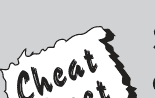

速查表包括：

- 核对清单
- 图表
- 常用说明
- 以及其他实用内容！

要获取本书专属的速查表，请访问：`www.dummies.com/cheatsheet/html`

### 在 Dummies.com 变得更聪明

Dummies.com 通过数千个答案让你的生活更轻松，内容涵盖从去除墙纸到使用最新版 Windows 等方方面面。

请查看我们的：

- 视频
- 图解文章
- 分步指南

此外，每月参与我们的 Dummies.com 抽奖活动，您还有机会赢取丰厚奖品。*

想要每周获取 Dummies 的资讯吗？请订阅以下主题的新闻通讯：

- 数码摄影
- Microsoft Windows 与 Office
- 个人理财与投资
- 健康与养生
- 计算、iPod 与手机
- eBay
- 互联网
- 美食、家居与园艺

### 在 Dummies.com 探索“如何做”

*抽奖活动并非在所有国家/地区都适用；请访问 Dummies.com 查看官方规则。


## 关于作者

艾德·蒂特尔是一位自由撰稿人、顾问，偶尔担任网络技术领域的专家法律证人，他在德克萨斯州美丽的奥斯汀附近居家工作。艾德自 1986 年起为行业出版物撰稿，并参与了超过 140 本书的编写。艾德也为 Wiley 参与了许多其他书目的工作，包括《Windows Server 2008 傻瓜书》、《XML 傻瓜书》和《NetWare 网络傻瓜书》等。最近，他参与了各种《傻瓜书》的定制书目，包括关于集群计算、移动回传、XBRL 标记和运营商以太网的小册子。

艾德在多个 TechTarget.com 网站（如 SearchNetworking.com 和 SearchWindows.com）上撰写博客，提供专家问答并供稿。他还为 ITExpertVoice、Tom's Hardware、Tom's Guide 等网站撰稿。当他不忙于工作时，艾德喜欢旅行、打台球和与家人共度时光。他也喜欢花时间在厨房里疯狂烹饪，或者为他痴迷烹饪的妻子 Dina 担任副厨。可通过电子邮件 `etittel@yahoo.com` 联系艾德。

杰夫·诺布尔设法同时兼顾多重身份：他是全球软件公司 CA Technologies 的首席用户设计师，Ultrends.com（一个关于用户界面设计优缺点的博客）的副编辑，以及 Conquest Media（`www.conquestmedia.com`）的所有者——一家位于德克萨斯州奥斯汀的网络和应用程序设计小公司。杰夫拥有超过十二年的设计经验，专精于网站和企业软件应用的各个方面（设计、构建、优化、解释等）。除了本书，他还为 Wiley 的另外六本《傻瓜书》系列的网络设计和编程书目担任了技术编辑。在远离电脑的有限空闲时间里，杰夫喜欢做一些幼稚的活动，比如吃不健康的过量糖果和打破东西，也喜欢一些轻松的爱好，如远足、旅行和园艺。杰夫可提供网站和企业应用咨询。可通过电子邮件 `jeff@conquestmedia.com` 联系他。

## 作者致谢

哇！真不敢相信我们已经出到《HTML 傻瓜书》的“幸运第 13 版”了。在我参与的所有书籍中，这本书跨越的时间和版本比其他任何书都要多。所以再次感谢读者们，让这本书持续保持强劲的生命力。我们还要感谢我们的读者和 Wiley 的编辑们提供了宝贵的反馈，以推动本书的持续改进。现在不要停——继续告诉我们你想要什么。特别是，告诉我们你喜欢和不喜欢这第二本全彩版的地方。

让我也感谢一些参与过先前版本的人员，包括 J. Michael Stewart、Natanya Anderson、Dori Smith、Tom Negrino、Mary Burmeister、Brock Kyle、Chelsea Valentine、Dawn Davidson 和 Kim Lindros。并且，再次感谢我的合著者兼朋友杰夫·诺布尔，他注入了深刻的见解和热情。我感谢你的想法、你的辛勤工作以及你在接触网络专家新秀方面的经验。也要感谢 Mary Kyle Inks，她专业地管理了这个项目。

在 Wiley，我必须感谢 Bob Woerner 和 Jean Nelson 的卓越努力，以及 Brian Walls、Teresa Artman 和 Christopher McGee 在设计、排版、内容和覆盖方面所做的工作。特别感谢排版服务部的友善人士，他们进行了巧妙的页面布局，并确保所有色彩编码的元素清晰明了。

感谢我可爱的妻子 Dina Kutueva-Tittel 和我好奇的儿子 Gregory，他们忍受了我有时古怪而紧张的日程安排。我并不总是像可能的那样容易相处，但希望随着时间的推移和努力，我会有所改善。也感谢我的父亲 Al Tittel，他为我和我的家人所做的一切，以及更频繁地来看望我们。希望您能看到我们的第 14 版付印！最后，深切感谢并纪念 Cecilia Katherine Kociolek Tittel（1919 年 4 月 3 日–2009 年 9 月 11 日）。感谢妈妈，您鼓励了我对文字和写作的热爱：我每天都想念您。

*艾德·蒂特尔*

我想感谢我的女友，艾莉森·马尔博士，感谢她一直以来对我的包容，并给予我时间和空间去完成这类书籍的创作。我想指出，根据我的计算，艾莉森的智商大约是我的 15 倍，但不知何故，她仍然允许我一直假装自己总是对的。我知道她曾试图给我解释过至少十几遍“魔法图”，但我仍然搞不懂——显然那并不是指术士和魔法精灵。特别感谢德克萨斯州休斯顿贝勒医学院的艾达·F·奥伦戈医生及其他工作人员。如果没有你们，我很可能现在已经不在人世了。

感谢埃德·蒂特尔允许我再次加入，并在最新一版中承担更多责任。这本书一直是我人生中最伟大的成就之一，为我带来了不可思议的机会，我由衷地感谢你。致斯莱德·德利伯托，感觉就像昨天你还在教我如何设计我的第一个网站。技术和软件会随时间变化，但我至今在职业上取得的许多成就，都可以追溯到十二年前你最初的那堂设计和 Photoshop 课程。

特别感谢我的老板兼导师拉塞尔·威尔逊，你一直支持并信任我，毫无疑问让我成为了一个更好的设计师和更好的人。我表达得不够多，我欠你一份大人情，感谢你为我所做的一切——看，这份感谢现在白纸黑字写下来了。

致 CSS 大师埃里克·迈耶，感谢你同意为本书撰写前言。多年来，我从你的大量著作中学到了很多，能在一本有你署名的书中留下我的名字，是巨大的荣幸。同时，我也想将此书献给我的朋友扎克·比蒂，他于 1997 年不幸被一名醉驾司机杀害。请勿酒后驾车，你可能会害死比你酷得多的人。

杰夫·诺布尔

## 出版社致谢

我们为这本书感到自豪；请将您的意见发送至 `http://dummies.com/custhelp`。其他意见，请联系我们的客户服务部：美国境内请致电 `877-762-2974`，境外请致电 `317-572-3993`，或传真至 `317-572-4002`。

以下是一些帮助将此书推向市场的人士：

### 采编、编辑与媒体开发

- **项目编辑：** 琼·纳尔逊
- **执行编辑：** 鲍勃·沃纳
- **文案编辑：** 布莱恩·沃尔斯
- **技术编辑：** 克里斯托弗·麦吉
- **编辑经理：** 凯文·基什纳
- **媒体开发项目经理：** 劳拉·莫斯-霍利斯特
- **媒体开发助理项目经理：** 珍妮·斯威舍
- **媒体开发助理制片人：** 乔什·弗兰克、玛丽莲·哈默尔、道格拉斯·库恩和肖恩·帕特里克
- **编辑助理：** 阿曼达·格雷厄姆
- **高级编辑助理：** 切丽·凯斯
- **漫画：** 里奇·坦南特（`www.the5thwave.com`）

### 排版服务

- **项目协调员：** 克里斯蒂·里斯
- **版面设计与图形：** 萨曼莎·K·切罗利斯、乔伊斯·豪伊、拉沃恩·罗伯茨
- **校对员：** 劳拉·鲍曼、林赛·利特雷尔
- **索引编制：** BIM 索引与校对服务
- **特别帮助：** 特雷莎·阿特曼

### 技术类 Dummies 丛书出版与编辑

- **理查德·斯瓦德利，**副总裁兼执行集团出版人
- **安迪·卡明斯，**副总裁兼出版人
- **玛丽·贝德纳雷克，**执行采编总监
- **玛丽·C·科德尔，**编辑总监

### 消费类 Dummies 丛书出版

- **黛安·格雷夫斯·斯蒂尔，**副总裁兼出版人

### 排版服务

- **黛比·斯泰利，**排版服务总监

## 前言

**你**手中所持的，是通往更广阔世界的第一步。

何出此言？因为它介绍了网络的基础知识。掌握了本书的知识，你就可以开始构建自己的网页——更重要的是，你可以审视已有的网页，并理解它们是如何构建起来的。这就像是拥有了透视眼、神奇的水晶球，或是 X 光视力。而且，这一切都比你想象的要容易得多。

这听起来可能有点疯狂，但事实并非如此。整个 HTML 元素列表可以写在一张纸上，而你日常需要使用的 80% 的元素都非常容易理解。你可以在不到一小时的时间内掌握它们。CSS 稍微复杂一些——把所有属性写在一张纸上可能需要使用法律免责声明那么小的字体——但基础非常简单，其余的则会随着经验的积累而掌握。

你可能会疑惑，既然有 Dreamweaver 这样的程序可以代劳，为什么还要学习这些？原因就像雕塑家需要懂得如何凿石，或汽车修理工需要理解发动机和变速箱如何工作一样。当出现问题时，你需要有能力介入并修复它。最终，通过练习，你将达到能够比任何点击工具都更高效、更优雅地从头构建网页的程度。

这就是为什么，即使你通常对代码清单和其他等宽字体文本感到不适，也应该放松下来。（来，深呼吸。屏住——然后呼气。很好。）把你在本书中学到的东西想象成乐高积木。每一块积木本身都非常简单，但你可以用各种有趣、有时甚至令人惊叹的方式将它们组合在一起。这就是乐趣所在！

每一段史诗般的旅程都始于第一步。你的第一步就在接下来的页面中。细细品味它们。你看待网络的方式将从此不同。

*Eric A. Meyer*

## 引言

欢迎来到万维网，或者说更简单的*网络*，那狂野、古怪而奇妙的可能性世界。在本书中，我们将揭示作为网络生命线的标记语言的方方面面——超文本标记语言（HTML）及其表亲 XHTML，以及用于让其他内容变得美观的层叠样式表（CSS）语言。因为 HTML 和 XHTML（本书中我们使用`(X)HTML`来指代两者）以及 CSS 用于构建网页，学习使用它们将使你步入网页作者和内容开发者的行列。

如果你曾尝试构建自己的网页但发现它太令人生畏，现在你可以放松了。如果你会打电话或早上能找到钥匙，那么你也能成为一名`(X)HTML`作者。不开玩笑！

本书尽量减少技术术语，并尽可能使用通俗易懂的英语。除了关于超文本、`(X)HTML`和网络的平实讲解外，我们还包含了大量的例子，以及逐个标签的说明，帮助你以最小的麻烦构建网页。我们还提供了关于网页创建后如何处理的例子，以便你可以发布它们。我们也解释了 HTML4、HTML5 和 XHTML 之间的区别，这样你就可以决定是坚持使用最知名、最长寿的网络标记语言（HTML），还是采用其更新、更强大的后继者（XHTML）。

本书有一个配套网站，包含书中章节中可用的`(X)HTML`和 CSS 示例——以及你可以用来装饰自己文档并惊艳朋友的酷炫小工具的指针。访问`www.dummieshtml.com`并开始浏览。

## 关于本书

将本书视为一本友好、平易近人的指南，帮助你掌握`(X)HTML`和 CSS，并构建可读、美观的网页。这些东西并不难学，但它们包含许多细节，在构建自己的网页时必须处理。本书涵盖的主题包括：

- 设计与构建网页
- 上传和发布网页供全世界查看
- 测试和调试你的网页
- 介绍 HTML5 和层叠样式表

你不需要多年的艰苦训练、高超的审美天赋或在冰溪中进行仪式性的沐浴就能构建网页。如果你能告诉别人如何开车到你家，你就能构建一个有用的网页文档。本书的目的不是把你变成火箭科学家（或者，就此而言，把火箭科学变成`(X)HTML`）。目的是向你展示一个外观精美、可读性强的网页所需的设计和技术要素，并给你构建它的信心！

## 如何使用本书

本书告诉你如何使用`(X)HTML`和 CSS 让你的网页在万维网上运行起来。我们告诉你设计和构建有效的网页文档需要什么，以便将你的想法和信息带到在线世界——如果这是你想要的话——也许还能在传达它们的过程中获得一些高科技的乐趣。

为了便于阅读，本书在文本中使用了一些约定。例如，所有`(X)HTML`和 CSS 代码都以等宽字体显示，像这样：

```
<head><title>What's in a Title?</title></head>...
```

当你输入`(X)HTML`代码、CSS 或其他相关内容时，请务必完全按照你看到的方式复制信息，包括尖括号（`<` 和 `>`），因为它们是使`(X)HTML`和 CSS 工作的魔法的一部分。否则，你将学会如何组织和管理使你页面独特的内容，我们也会确切地告诉你如何将`(X)HTML`和 CSS 的元素与你自己的作品混合使用。

书页的页边距没有广阔网络空间那样多的空间。因此，长行的`(X)HTML`和 CSS 标记，或网站地址（称为 URL，即统一资源定位符）可能会跨两行或更多行显示。请记住，你的计算机将这样的行显示为一行`(X)HTML`或 CSS，或一个 URL——所以如果你输入那段代码，请在一行内完成。如果看到换行，不要插入任何硬回车。我们通过在标点符号处换行并缩进超出部分来提示你标记应该都在一行，像这样：

```
http://www.infocadabra.transylvania.com/nexus/plexus/lexus/praxis/okay/this/is/a/make-believe/URL/but/some/real/ones/are/SERIOUSLY/long-too.html
```

HTML4 并不在意你输入的标签文本是大写、小写还是大小写混合（字符实体或字符编码除外）。然而，HTML5、XHTML 和 CSS 仅要求标签文本使用小写。因此，为了使你的代码尽可能接近我们的风格，请将所有（X）HTML 和 CSS 标签文本，以及其他代码，*全部使用小写*。


如果你拥有本书的较早版本，这会与之前的说明相反。永恒而令人敬畏的 HTML 标准的守护者——万维网联盟（W3C）——已经更改了规则，因此我们遵循他们的指引。我们并不制定规则，但我们*确实*知道如何参与其中！

我们的代码清单采用了颜色编码，其中特定颜色表示不同类型的标记。我们在第 1 章关于标记颜色编码的部分对此进行了解释。（注意所有插图也使用了漂亮的颜色！）

## 三个冒昧的假设

人们常说，做假设会让假设者和被假设的对象都显得愚蠢。（不过*他们*到底是谁？我们*假设*我们知道，但……算了。）

你不需要成为编程神秘技艺的巫师，也不需要计算机科学的博士学位。你甚至不需要详细理解计算机内部的工作原理，就能处理本书中的材料。

即便如此，出于实用性的考虑，我们还是对您，亲爱的读者，做几点假设：你能开关电脑；你知道如何使用鼠标和键盘；并且你想出于乐趣、盈利或其他完全属于你自己的深奥原因来构建自己的网页。我们还假设你拥有可用的互联网连接和网页浏览器。

如果你能写一个句子，并且知道标题和段落之间的区别，你就能在网页上构建和发布你自己的文档。剩下的就是细节——而我们会帮助你！

## 本书组织方式

本书包含六个主要部分，其排列方式类似于俄罗斯*马特里奥什卡*（套娃）。部分包含至少三个章节，每个章节包含若干个模块化的节。这样，你可以使用本书来回跳转，在索引或目录中查找主题或关键词，或者从头到尾通读全书。

# 4 零基础学 HTML、XHTML 与 CSS，第 7 版

## 第一部分：认识（X）HTML 和 CSS

本部分为 Web 以及人们用来挖掘其宝藏的软件奠定了基础，概述并介绍了 Web 以及人们用来挖掘其宝藏的软件。它还解释了 Web 的工作原理，包括本书涵盖的（X）HTML 和 CSS，以及将这些内容传递给最终用户的服务器端软件和服务（当我们不专注于系统内部运作时）。

（X）HTML 文档，也称为网页，是 Web 上信息、组织和传递的基本单元。在这里，你还会了解 HTML 是关于什么的，超文本如何丰富普通文本，以及 CSS 如何修改和管理文本在屏幕上的显示方式。接下来，你将在 Web 领域漫步，构建你的第一个（X）HTML 文档。

## 第二部分：使用（X）HTML 格式化网页

HTML 将普通文本与称为标记的特殊字符混合在一起，用于指示浏览器如何显示（X）HTML 文档。在本部分中，你将了解标记，特别是（X）HTML 标记。我们首先对（X）HTML 文档的组织和结构进行了一次引人入胜的讨论。（好吧……我们认为它很有趣，并希望你也这么认为。）接下来我们解释如何将文本组织成块和列表。然后我们探讨使（X）HTML 中带有“H”（超链接）的超链接是如何工作的。之后，我们讨论如何在网页中查找和使用图形图像，并进行一些花哨的格式化操作来美化这些页面。

在整个部分中，我们包含了（X）HTML 标记元素（标签）及其工作原理的讨论。到你完成第二部分时，期望对 HTML 是什么以及如何使用它有一个良好的整体概念。见鬼，我们甚至在第二部分末尾包含了一章，指导你避开过时或不再推荐的标记，这样当你看到它时就能认出来（并避免自己使用那些陈腐的垃圾）。

## 第三部分：精确控制网页和样式

第三部分从讨论层叠样式表（CSS）开始——这是另一种标记语言，它允许（X）HTML 纯粹处理内容，而它则处理网页在 Web 浏览器中显示或在其他设备（PDA、手机和为视障用户提供的特殊辅助设备）上渲染时的外观。在探索 CSS 语法和结构并了解如何使用它们之后，你将学习如何操作网页上文本、背景等的颜色和字体。我们为你提供了大量示例，帮助你设计和构建商业级的（X）HTML 文档。你可以开始使用相关的（X）HTML 标签语法和结构，这些是你需要了解的，以便构建复杂的网页。

## 第四部分：脚本与（X）HTML


（X）HTML不擅长在文本和图形显示时为其增添光彩（这正是CSS的强项）。而且（X）HTML本身真的不能`做`太多事情。Web设计师通常使用脚本工具在（X）HTML框架上构建交互式、动态的网页，为其增加交互性。

在本部分中，你将了解能够使网页与用户交互的脚本语言，这些语言还提供了响应用户输入或操作以及在过程中获取和处理数据的方法。你将接触到通用的脚本语言，我们将直接跳转到最流行的一种——JavaScript。你将发现这种脚本语言的基本元素，以及如何为网页增加交互性。你还将探索脚本的典型用途，你可以将其扩展并添加到你自己的网站中。我们继续探索如何将第三方内容嵌入你的网页，利用他人的动态内容，毫不费力地美化你的网站，并从Flickr、Twitter、YouTube和Google Maps等服务中获得大量不错的回报。

在整个部分中，示例、建议和细节向你展示了脚本和嵌入式组件如何增强你网站的功能——以及用户访问你页面时的体验。

## 第五部分：（X）HTML的未来

（X）HTML世界正在发生大事，许多变化即将到来。在本部分中，我们将向你介绍新事物，向你展示它的样子以及它能做什么（当然，前提是浏览器支持），并告诉你不久的将来可以期待什么。

你会发现一章关于移动设备（如智能手机、iPad和其他可访问Web的便携式电子小玩意）的（X）HTML。你还会找到一章关于一个新改进版本的HTML——即HTML5——即将出现在你附近的浏览器中，也许还会出现在你的网站上。此外，还有另一章关于即将到来的CSS版本——即CSS3。我们提供了很酷的示例，所有这些你都可以在我们的配套网站`www.dummieshtml.com`上查看（或者不查看，取决于你的Web浏览器允许）。

## 第十部分

在本部分中，我们总结并提炼了（X）HTML神秘秘诀的精髓。在这里，你可以进一步阅读关于酷炫的Web工具，回顾HTML标记的首要注意事项，并了解如何在其他人看到之前发现并消除你页面中潜在的bug和错误。

## 本书中使用的图标


此图标表示技术细节，这些信息既丰富又有趣，但对编写HTML并非绝对关键。


此图标标记有用信息，这些信息使HTML标记或其他重要内容比你担心的要简单得多。


此图标突出显示你不应忽略的内容——不要忽视这些温和的提醒（你拯救的生命、理智或页面可能正是你自己的）。


看到此图标时请小心。它警告你不应该做的事情；如果你忽视相关的智慧，后果可能很严重。


以此图标突出显示的信息提供了最佳实践——这是我们在刚开始时希望得到的建议！这些技巧可以为你节省购买头痛药的时间和金钱。

## 接下来从哪里开始

这里就是你选择方向并上路的地方！从哪里开始并不重要。别担心。你能搞定。我们知道你正准备好度过一段美好时光。尽情享受吧！

# 第一部分

# 认识（X）HTML和CSS

`第5波`  作者：里奇·坦南特

“你需要做的，是平衡主页后方停着的皮卡车形象与前景中那台坏掉的洗衣机。”

## 本书结构...

在这里，我们探索并解释基础的HTML文档链接和结构。我们还将解释Web浏览器在将所有这些内容传输到用户桌面时所扮演的角色。我们甚至解释（X）的来历——即，使用XML语法重新描述原始HTML标记以创建（X）HTML——并进一步帮助你理解（X）HTML与普通HTML有何不同（根据某些说法，可能更好）。我们还将审视通用网页的结构，构成网页的各个部分，以及CSS如何帮助管理它们的呈现、布局，甚至在用户显示屏上出现时的颜色。

接下来，我们将引导你完成创建和查看一个简单网页的练习，以便你理解其中涉及的内容。我们还将解释如何对现有网页进行修改，以及如何将你的更改（或新页面）发布到线上。

本部分最后以一段激昂的劝诫结束，即在创建太多标记之前，先弄清楚你在做什么。一栋精心建造的房子始于一套蓝图和建筑图纸，而一个网页（和网站）也应该始于一个计划或地图，大致了解你的页面将在网络空间中处于什么位置，以及成群结队的用户如何找到它们。

## 第1章

### 关于HTML、CSS和Web，你至少需要知道这些

**本章内容**

- 在文本文件中创建HTML
- 提供和浏览网页
- 理解链接和URL
- 理解基础HTML语法
- 理解基础CSS

**欢**迎来到Web、（X）HTML和CSS的奇妙世界。只需掌握一点知识，稍加练习，并有话可说，你就可以构建属于自己的小片网络空间，或改进现有作品。

你会注意到我们在整本书中都使用（X）HTML。这是我们创造的一个首字母缩略词，代表“HTML或XHTML”，其中HTML是超文本标记语言，XHTML是可扩展超文本标记语言。虽然HTML和XHTML并不完全相同，但它们非常相似，足以让本书的参考内容有意义。

本书是你理解Web文档、美化现有页面或创建集复杂设计、多媒体和脚本于一体的复杂而精彩页面的实用指南。

学习HTML的最佳方式是立即动手，所以本章正是这样做的：它让你快速掌握（X）HTML和CSS如何在网页背后运作的基础知识，向你介绍它们的基础构建块。当你完成本章学习后，你将了解（X）HTML和CSS的工作原理，从而可以立即开始创建或编辑网页。

### 网页的自然栖息地

网页可以容纳多种内容，例如*文本、图形、表单、音频和视频文件*，甚至*交互式游戏*。

只需在Web上浏览片刻，你就能看到以多种方式呈现的信息和内容盛宴。每个网站都不同，但大多数都有一个共同点：超文本标记语言（也称为HTML）。你也会经常遇到可扩展超文本标记语言（XHTML）和层叠样式表（CSS）。

无论网页包含什么信息，每个网页都是使用HTML（或某种合理的类似物）创建的。HTML是将网页粘合在一起的灰浆；图形、内容和其他信息是砖块；CSS告诉网页在显示时应该如何呈现。

产生网页的HTML文件只是文本文件，XHTML和CSS文件也是如此。这种对文本文件的使用正是Web能如此良好运作的原因。文本是计算机的通用语言。你在Windows计算机上创建的任何文本文件——包括任何HTML、XHTML或CSS文件——在Mac或任何其他操作系统上都能同样良好地工作。

但网页*不仅仅*是文本文件。网页是由一种特殊的、不受重视的、富含糖分的文本制成的，这种文本被称为HTML、XHTML或CSS。每个都使用自己特定的指令集，你将其（与你的内容一起）包含在文本文件中，以指定页面的外观和行为。

跟着我们，发现关于（X）HTML和CSS你需要知道的一切！

### 超文本

HTML中的特殊指令允许文本行指向（即*链接到*）网络空间中的其他东西。这种指针被称为*超链接*。超链接是将万维网粘合在一起的胶水。在你的Web浏览器中，超链接通常显示为蓝色并带有下划线。当你点击一个超链接时，它会将你带到其他地方。

无论是否是超文本，网页都是一个文本文件，这意味着你可以在任何创建纯文本的应用程序（如记事本或TextEdit）中创建和编辑网页。一些软件工具提供了花哨的选项和应用程序（在第23章中介绍）来帮助你创建网页，但它们生成的文本文件与你使用纯文本编辑器创建的相同。然而，我们认为，那些刚开始学习HTML的人最好使用简单的文本编辑器。只需在PC上打开记事本（或在Mac上打开TextEdit），你就可以开始了。

在创建HTML时，避免使用WordPad或Microsoft Word等文字处理器。它们会在网页中引入各种你可能既不需要也不想要的额外代码。

万维网名副其实。它字面意思就是一张由世界各地Web服务器托管的在线页面组成的网络，通过将页面连接在一起的超链接以数万亿种方式相互连接。没有这样的链接，Web将只是一堆独立的页面。

Web的大部分价值源于其能够链接到同一网站或另一网站上的页面和其他资源（如图像、可下载文件和媒体演示）。例如，USA.gov（`www.usa.gov`）是一个门户网站——其唯一功能是提供对其他网站的访问。如果你不确定哪个政府机构处理购房者的首次贷款，或者你想安排参观国会大厦，请访问图1-1所示的网站以了解信息。

图1-1：USA.gov使用超链接帮助访客查找政府信息。

Web浏览器是专门为读取HTML指令（称为标记）并显示生成的网页而创建的。

标记存在于文本文件中（与你的内容一起），向浏览器发出指令。例如，查看图1-2所示的页面。通过检查其底层HTML，你可以看到页面的组成和格式。

图1-2：为了达到目前的良好外观，这个网页包含多个部分以及大量的HTML和CSS标记。

此页面包含一个图像、一个描述页面的标题、几段关于你其中一位作者的文本，以及一个包含指向简历和出版物列表链接的地址块。

然而，页面的不同部分使用不同的格式：

- 页面顶部的标题比段落中的文本更大。
- 文本块之间的空白间距比块内连续文本行之间的间距更大。
- 一些文本是白色的，一些是橙色的，还有一些是浅蓝色的。

浏览器知道以特定方式显示页面的这些组件，这要归功于*HTML标记*，如代码清单1-1所示。（你将在本章末尾看到完整的代码清单1-1。）

任何包含在尖括号（小于号和大于号：`< >`）中的文本都是HTML*标签*（通常称为*标记*）。例如，括号内的`<p>`（`<p>...</p>`）标记标识段落内的文本。文件头`<style>`和`</style>`标签之间的标记使用CSS定义此页面上使用的各种HTML元素的外观和感觉。真的就这么简单。你将标记嵌入文本文件，以及供读者查看的文本，以告诉浏览器如何显示你的Web页面。

标签和标签之间（以及标签内）的内容统称为*元素*。尖括号`< >`包含HTML和XHTML标记，花括号`{ }`包含CSS标记。

### 浏览器

用户在Web拼图中的部分是Web浏览器。Web浏览器读取用HTML、XHTML和CSS编写的指令，并使用这些指令在你的屏幕上显示Web页面内容。

你应该始终以人们将使用Web浏览器查看内容的想法来编写HTML。只需记住，存在不止一种浏览器，而且每种浏览器都有多个版本。

通常，Web浏览器从Web服务器请求并显示通过Internet可用的Web页面。你也可以显示保存在你自己计算机上的HTML页面，然后再将它们提供给Internet上的Web服务器。当你在开发自己的HTML页面时，你可以在浏览器中查看这些页面（称为*本地*页面）。你可以使用本地页面来很好地了解人们在页面上线后所看到的内容。

*每个Web浏览器都以自己的方式解释HTML*。相同的HTML在不同的浏览器中看起来可能不完全相同。当你使用基础HTML时，差异会很小，但随着你添加其他元素（如脚本和多媒体），渲染标记会变得复杂。

第2章展示了如何使用Web浏览器查看你第一个网页的本地副本。

有些人使用纯文本Web浏览器，如Lynx，因为：

- 他们视力受损，无法使用图形显示。
- 他们喜欢精简、快速的Web浏览器，只显示文本。

## 14 第一部分：认识 (X)HTML 和 CSS

### 多样化的浏览器

网络世界充满了各种形态和规模的浏览器——或者更准确地说，是各种版本和功能集。一些流行的浏览器包括微软 Internet Explorer、Mozilla Firefox、Apple Safari 和 Google Chrome。其他浏览器，如 Opera 和 Lynx，也被广泛使用。作为 HTML 开发者，你必须超越自己使用的浏览器经验和偏好进行思考。每个用户都有其个人的浏览器偏好和设置。

每个浏览器渲染 HTML 的方式都略有不同。每个浏览器处理 JavaScript、多媒体、样式表和其他 HTML 附加组件的方式也不同。再将不同的操作系统加入其中，事情就变得非常有趣了。

通常浏览器之间的差异很小。但有时，HTML、文本和媒体的特定组合会让某个特定的浏览器不堪重负。在使用 HTML 时，你应该尽可能在多种不同的浏览器上测试你的页面。请至少在你的系统上安装三种不同的浏览器进行测试。我们推荐使用最新版本的 Internet Explorer、Firefox 和 Chrome。

Yahoo! 有一个相当完整的浏览器列表，地址是：

`http://dir.yahoo.com/Computers_and_Internet/Software/Internet/World_Wide_Web/Browsers`

### Web 服务器

如果你的 HTML 页面无法与世界分享，那它们就没什么大用。Web 服务器使这成为可能。Web 服务器是一台计算机，它：

- 连接到互联网
- 运行 Web 服务器软件
- 响应来自 Web 浏览器的网页请求

几乎任何计算机都可以成为 Web 服务器，包括你的家庭电脑。但 Web 服务器通常是专门用于此任务的计算机。你不需要成为互联网或计算机专家就能发布你的网页，但你必须找到一个 Web 服务器来托管你的页面：

- 如果你为一个公司网站制作页面，你的 IT 部门可能有一个 Web 服务器。（请向你的 IT 专家咨询信息。）
- 如果你正在创建一个新网站，你需要为你的网页找一个托管服务。

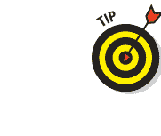

找到一个便宜的主机很容易——只需要简单的 Google 搜索即可。一个便宜的主机是 GoDaddy（`www.godaddy.com`），目前月费低至 1.99 美元。你甚至可以通过一点努力找到免费的网站托管服务。Free Web Hosts 维护着一份免费主机提供商的列表。可以在 `www.free-web-hosts.com` 上查看它们。第 3 章将介绍如何确定你的托管需求并找到完美的提供商。

### URL 的结构

网络由数十亿个资源组成，每个资源都可以被链接。一个资源的精确位置是链接到它的关键。没有精确的地址（统一资源定位符，或 URL），你就无法在 Web 浏览器中使用地址栏直接访问网页。

URL 是 Web 资源的标准寻址系统。每个资源（网页、网站或单个文件）都有一个唯一的 URL。URL 的工作方式很像你的邮寄地址。图 1-3 标明了 URL 的组成部分。

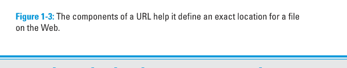

图 1-3：URL 的组成部分帮助其定义网络上一个文件的精确位置。

### 介绍互联网协议

浏览器和服务器之间的交互是由一套计算机通信指令实现的：超文本传输协议（HTTP）。该协议定义了浏览器应如何请求网页，以及 Web 服务器应如何响应这些请求。

HTTP 并不是互联网上唯一的协议。简单邮件传输协议（SMTP）和邮局协议（POP）使得电子邮件交换成为可能，而文件传输协议（FTP）允许你跨互联网上传、下载、移动、复制和删除文件和文件夹。好消息是，Web 浏览器和服务器为你完成了所有 HTTP 工作，所以你只需要将页面放到服务器上或在浏览器中输入一个网址。

要了解 HTTP 的工作原理，请查看 David Gourley 和 Brian Totty 关于 HTTP 消息的章节，可以通过 Google 图书搜索使用“understanding http transactions”作为搜索字符串找到。从 `http://books.google.com` 开始你的搜索，然后向下滚动，直到看到指向“HTTP: the definitive guide”的链接，并查看第 80 页。

每个 URL 组件都有助于定义网页或资源的位置：

- **协议：** 指定浏览器请求文件时遵循的协议。网页协议是 `http://`（大多数 URL 的常见开头）。
- **域名：** 指向文件所在的通用网站（例如 `www.sun.com`）。一个域名可以托管少量文件（如个人网站）或数百万个文件（如大型企业网站，例如 `www.sun.com`）。
- **路径：** 指明你必须导航的文件夹序列才能到达特定文件。例如，要访问位于 `developers` 文件夹中的 `evangcentral` 文件夹中的一个文件，你需要使用 `/developers/evangcentral/` 路径。
- **文件名：** 指定浏览器访问目录路径中的哪个文件。

尽管图 1-3 中显示的 URL 不是公开可访问的，但它指向该域名并提供了一个指向名为 `file.html` 的特定文件的路径：

```text
http://www.domain.com/mainfolder/subfolder/file.html
```


第 6 章详细介绍了如何使用 HTML 和 URL 为你的网页添加超链接，第 3 章则介绍了在准备好将网站迁移到 Web 服务器后，如何为你自己的网站获取一个 URL。

## (X)HTML 的组成部分

以下部分将揭开 X 的神秘面纱。本节展示：

- HTML 和 XHTML 之间的区别
- HTML 的编写方式（其语法）
- 管理 HTML（和 XHTML）使用的规则
- HTML（和 XHTML）标记中重要部分和部件的名称
- 如何最好、最正确地使用 (X)HTML 功能

### HTML 和 XHTML：有什么区别？

HTML 是*超文本标记语言*，是 20 世纪 80 年代末和 90 年代初开发的标记语言，用于描述网页。HTML 现在被世界万维网联盟（W3C）的众多标准描述（规范）所收录。最后一个 HTML 规范于 1999 年完成。

当你在 HTML 前面加上一个 X 变成 XHTML 时，你就得到了一个基于可扩展标记语言（XML）的、经过改进的新版 HTML。XML 的设计目的是与计算机、软件和互联网良好地协同工作。


HTML 的原始形式存在一些不规则性，这可能会让读取 HTML 文档的软件感到困扰。另一方面，XHTML 使用极其规则和可预测的语法，更易于软件处理。XHTML 有朝一日会取代 HTML，但 HTML 仍在持续发展。本书涵盖了这两种类型，并向你展示了在自己的 HTML 文档前加上 X 并将其转换为 XHTML 的步骤。

- 大多数 HTML 和 XHTML 标记是相同的。
- 在少数情况下，HTML 和 XHTML 标记看起来略有不同。
- 在少数情况下，HTML 和 XHTML 标记的使用方式必须不同。

本书展示了如何创建在 HTML 和 XHTML 中都能工作的代码。

## 语法和规则

HTML 是一种用于描述网页内容的简单直接的语言。XHTML 甚至要求更低。它们的组件易于使用——当你了解一点 (X)HTML 的使用方法时。HTML 和 XHTML 标记都有三种类型的组件：

- **元素**：使用标签标识 HTML 页面的不同部分。
- **属性**：关于元素实例的信息。
- **实体**：非 ASCII 文本字符，例如版权符号（©）和带重音的字母（É）。实体源于标准通用标记语言，即 SGML。

描述网页内容的每一个 HTML 和/或 XHTML 标记位都包含元素、属性和实体的某种组合。

本章涵盖了元素、属性和实体的基本形式和语法。本书的第二部分和第三部分展示了元素和属性如何：

- 描述文本的种类（如段落或表格）
- 在页面上产生效果（如更改字体样式）
- 为页面添加图像和链接

## 第一部分：了解 (X)HTML 和 CSS

## 标记着色

在我们的代码示例中呈现 HTML、XHTML 和 CSS 信息时，我们使用着色来帮助你通过标记区分内容。以下是你在阅读所有代码清单时应牢记的颜色图例：

- **紫色** 表示在 (X)HTML 文档中使用的 DOCTYPE 声明。这实际上是一种完全不同的标记语言，称为标准通用标记语言，或 SGML。SGML 用于标识 (X)HTML 文档在构建和内容上遵循的特定规则集。它也适用于字符实体的代码，例如：

  `&pos;`

  `&123;`

- **浅绿色** 表示普通的 XHTML 和 HTML 标记。
- **深绿色** 表示 XML 标记。
- **橙色** 表示层叠样式表，或 CSS，标记。
- **蓝色** 表示 JavaScript。

我们只在代码清单和代码块中对标记着色，因为当代码出现在正文中时，它会严重影响可读性。在这种情况下，我们只需使用不同的等宽字体——正如你将在我们讨论 HTML 标记的第一个段落中关于 `<html>`、`<head>` 和 `<title>` 元素的讨论中看到的那样。

还有一件事：如果你使用 HTML 编辑器，例如 HTML Kit、Dreamweaver、Kompozer 或其他工具，你会发现这些工具也使用文本着色来帮助你识别不同类型的标记。问题是，这些工具中没有一个以相同的方式做到这一点，而且没有一个与我们在此处采用的方式匹配——我们选择了在四色印刷页面上易于查看（和区分）的颜色；而其他工具则选择在 LCD 显示屏上看起来不错的颜色。

## 元素

元素是 (X)HTML 的构建块。你使用它们来描述页面上的每一段文本。元素由标签及其之间的内容组成。元素主要有两种类型：

- 内容由标签对及其之间的内容组成的元素。
- 使用单个标签向页面插入某些内容的元素。

# 第 1 章：关于 HTML、CSS 和 Web 你至少需要知道的

### 标签对

描述内容的元素使用*标签对*来标记元素的开始和结束。开始和结束标签对如下所示：

```html
<tag>...</tag>
```


内容——例如*段落*、*标题*、*表格*和*列表*——总是使用标签对：

- ✔ 开始标签（`<tag>`）告诉浏览器：“元素从这里开始。”
- ✔ 结束标签（`</tag>`）告诉浏览器：“元素到这里结束。”

实际内容是出现在开始标签和结束标签之间的内容。例如，清单 1-1 中的 Ed Tittel 页面使用段落元素（`<p>`）来包围段落文本（为清晰起见，我们省略了 CSS 内联标记）：

```html
<p>Ed started writing about computing subjects in 1986 for a
Macintosh oriented monthly magazine. By 1989 he had contributed to such
publications as LAN Times, Network World, Mac World, and LAN Magazine. He worked
on his first book in 1991, and by 1994 had contributed to over a dozen different
titles.</p>
```

### 单个标签

向页面插入某些内容的元素称为*空元素*（因为它们不包含任何内容），只使用单个标签，如下所示：

```html
<tag />
```


图像和换行符会向 HTML 文件中插入某些内容，因此它们使用一个标签。

XHTML 和 HTML 之间的一个关键区别是，在 XHTML 中，所有空元素必须在结束大于符号前以斜杠结尾。这是因为 XHTML 基于 XML，而 XML 的规则是使用斜杠关闭空元素，如下所示：

```html
<tag/>
```

但是，为了使这种标记在旧版浏览器中可读，你应该在结束斜杠前插入一个空格，如下所示：

```html
<tag />
```

这个空格允许旧版浏览器忽略结束斜杠（因为它们不了解 XHTML）。理解 XHTML 的较新浏览器会忽略空格并精确解释标签，即 `<tag/>`（符合 XML 规则）。


HTML 不要求空元素使用斜杠，但这种标记已*弃用*（即，尽管它仍在某些标记中出现，但已被视为过时）。一个 HTML 空元素如下所示：

```html
<tag />
```

清单 1-1 使用图像元素（``）在页面上包含图像：

```html

```

`` 元素引用一个图像。当浏览器显示页面时，它会用该图像指向的文件（属性执行指向，如下一节所示）替换 `` 元素。遵循前面介绍的 XHTML 规则，在 HTML 中显示为 `` 的内容在 XHTML 中显示为 ``（这适用于所有单个标签元素）。

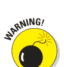

你不能随意创建 HTML 或 XHTML 元素。(X)HTML 的合法元素属于一个非常特定的集合——如果你使用的元素不属于该集合，每个浏览器都会忽略它们。你可以使用的元素在 HTML 4.01 或 XHTML 1.0 规范中定义。（HTML 4.01 的规范可以在 `www.w3.org/TR/html4` 找到，而 XHTML 1.0 的规范可以在 `www.w3.org/TR/xhtml1` 找到。）

### 嵌套

许多页面结构结合了嵌套元素。将你的嵌套元素想象成可以整齐地相互套入的*手提箱*。

例如，项目符号列表使用两种元素：

- `<ul>` 元素指定列表是无序的（带项目符号）。
- `<li>` 元素标记列表中的每个项目。

当你通过使用这种方法组合元素时，请确保在关闭外部元素之前完全关闭内部元素：

```html
<ul>
    <li>Item 1</li>
    <li>Item 2</li>
</ul>
```

### 属性

属性允许元素在描述内容或工作方式上具有多样性。属性允许你根据情况以不同方式使用元素。例如，`` 元素使用 `src` 属性来指定要包含在页面上的图像的位置：

```html

```

在这段 HTML 中，`` 元素本身是向浏览器表明你想包含图像的一个通用标志；`src` 属性提供了你想包含的图像的具体信息——在本例中是 `header.gif`。其他属性（如 `width` 和 `height`）提供了关于如何显示该图像的信息，而 `alt` 属性则提供了图像的文本替代方案，供纯文本浏览器显示（或供文本转语音阅读器为视障人士朗读）。

第 7 章详细描述了 `` 元素及其属性。

你将属性包含在要使用的元素的开始标签中——在元素名称之后但在结束符号之前，如下所示：

```html
<tag attribute="value" attribute="value">
```

XML 语法规则规定属性值必须始终出现在引号中，但你可以在开始标签或单个标签中以任何顺序包含属性及其值。

每个 (X)HTML 元素都有一组可以使用的属性，但你不能随心所欲地混合搭配属性和元素。有些属性可以接受任何文本作为值，因为值可以是任何内容，例如图像或要链接到的页面的位置。其他属性有特定的值列表可供属性取用，例如在表格单元格中对齐文本的选项。

HTML 4.01 和 XHTML 1.0 规范精确地定义了你可以为任何给定元素使用哪些属性以及每个属性可以取哪些值（如果明确指定）。

第二部分和第三部分的每一章都涵盖了你可以为每个 (X)HTML 元素使用哪些属性。另请参阅我们的在线内容，获取已弃用的 (X)HTML 标签和属性的完整列表。


## 第一部分：认识 (X)HTML 与 CSS

## 实体

文本使网络成为可能，但它存在局限性。*实体*是你可以显示在网页上的特殊字符。

## 非 ASCII 字符

基本美国信息交换标准代码（ASCII）文本定义了相当少的字符。它不包括一些特殊字符，例如*商标符号*、*分数*和*重音字符*。

例如，如果我们把图 1-2 中的文本段落翻译成德语，结果包含三个带变音符号的 *u* 字符（ü），如图 1-4 所示。

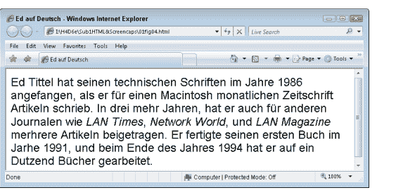

图 1-4：ASCII 文本无法表示所有文本字符，因此 HTML 实体来代替完成这项工作。

ASCII 文本不包含带变音符号的 *u*，所以 HTML 使用*实体*来表示此类字符。浏览器会将实体替换为其引用的字符。每个实体以（`&`）开头，以分号（`;`）结尾；实体最初源自 SGML，因此我们将其用紫色标注以反映其起源。以下标记中实体以粗体显示：

```html
<html>
<head>
<style type="text/css">
  body {
    font-family: sans-serif;
    font-size: large;
  }
  cite {
    font-family: serif;
    font-style: italic;
  }
</style>
```

## 第 1 章：关于 HTML、CSS 和网络你需要知道的最少知识

```html
</style>
<title>Ed auf Deutsch</title>
</head>
<body>
<p>Ed Tittel hat seinen technischen Schriften im Jahre 1986 angefangen, als er f&uuml;r einen Macintosh monatlichen Zeitschrift Artikeln schrieb. In drei mehr Jahren, hat er auch f&uuml;r anderen Journalen wie <cite>LAN Times</cite>, <cite>Network World</cite>, und <cite>LAN Magazine</cite> mehrere Artikeln beigetragen. Er fertigte seinen ersten Buch im Jarhe 1991, und beim Ende des Jahres 1994 hat er auf ein Dutzend B&uuml;cher gearbeitet.</p>
</body>
</html>
```

表示带变音符号 *u* 的实体是 `&uuml;`。

## (X)HTML 字符代码

ISO-Latin-1 字符集的编码默认提供，相关实体（完整表格的指针见第 24 章）可以无需特殊操作即可调用和使用。但使用前面提到的其他编码则需要包含特殊标记，以告诉浏览器必须解释 Unicode 字符代码。（Unicode 是一个国际标准——实际上是 ISO 标准 10646——它包含了足够多的字符代码来处理大多数独特的字母表，以及其他大量符号和非字母字符。）这种特殊标记的形式是 `<meta http-equiv="Content-Type" content="text/html; charset=UTF-8">`；由于 `charset` 的值是 `UTF-8`，你可以引用第 24 章中出现的常用 Unicode 值。


尽管当今的浏览器普遍支持 UTF-8，但可以预期在未来一两年内会看到对 UTF-16 字符代码的支持。这将使浏览器能更有效地处理非罗马字母，如阿拉伯语、片假名（日语）或韩文，而目前一些浏览器在正确渲染这些文字方面存在困难。

## 标签字符

懂 HTML 的软件假设某些 HTML 字符，如大于号和小于号，应该被隐藏而不显示在最终的网页上。如果你确实想在页面上显示大于号或小于号，你必须明确告诉浏览器你的意图。以下实体允许你显示通常属于隐藏 HTML 标记部分的字符：

- 小于号（`<`）：`&lt;`
- 大于号（`>`）：`&gt;`
- 和号（`&`）：`&amp;`

**24 第一部分：认识 (X)HTML 与 CSS**

`<` 和 `>` 符号用于标记中，但这些符号是*给浏览器的指令*，不会显示在页面上。如果你需要在网页上显示这些符号，请在标记中包含它们的实体，如下所示：

```html
<p>The paragraph element identifies some text as a paragraph:</p>
<p>&lt;p&gt;This is a paragraph.&lt;/p&gt;</p>
```

在前面的标记中，第一行使用*标签*来描述一个段落，第二行显示了如何使用*实体*来描述 `<` 和 `>` 符号。

图 1-5 在浏览器窗口中显示了这些实体作为字符的样子。

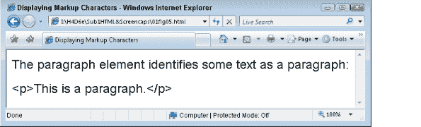

图 1-5：实体让 `<`、`>` 和 `&` 符号出现在浏览器窗口中。

## 注释

注释包括 (X)HTML 文件中最终页面不显示的文本。每个注释都由两个特殊的标记字符序列表示：

- 每个注释以字符串 `<!--` 开始。
- 每个注释以字符串 `-->` 结束。

在下面的代码中，注释解释了每个标记元素的功能及其在 HTML 标记层次结构中的位置。

元素被组织成一个结构：

- 有些元素只能出现在其他元素内部。
- 对于结构良好的 (X)HTML 文档，有些元素是必需的。

```html
<html> <!-- This tag should always occur at or near the beginning of any well-formed HTML document -->
<head> <!-- The head element supplies information to label the whole HTML document -->
```

## 第 1 章：关于 HTML、CSS 和网络你需要知道的最少知识

```html
<title>Welcome to Ed Tittel.com</title> <!-- The text in the title element
appears in the title bar of the browser window when the page
is viewed -->
</head> <!-- closes the head element -->

<body> <!-- The content that appears on any Web page appears or is
invoked from inside the body element -->
<!-- Skip a bunch of copy here . . . -->
<!-- Subtitle text -->
<h1>Contact:</h1>
<!-- List -->
<ul>
<li><b>Email:</b> etittel at yahoo dot com</li>
<li><b>Address:</b> 2443 Arbor Drive, Round Rock, TX 78681-2160</li>
<li><b>Phone:</b> 512-252-7497 (No solicitors, please)</li>
<li>List of publications available in: <a href="docs/v_et.doc"
target="_blank">MS Word</a></li>
<li>Resume available in: <a href="docs/Resu-et13.doc" target="_blank">
MS Word</a></li>
</ul></body> <!-- End of the body section -->
</html> <!-- End of the HTML document -->
```


前面的文档被分为头部和正文两部分。在每个部分中，会出现特定种类的元素。可能存在许多组合——而这正是你在整本书中所看到的！

> 要查看本书中构建的任何及所有屏幕截图的完整、有效的`HTML`文件，请访问网站`www.dummieshtml.com`并查看每一章的部分。例如，前面的标记在其中表现为`01Listing01.html`。

## 组织 HTML 文本

除了分为头部和正文部分外，`HTML`文档中的文本可以通过多种方式组织。

### 文档头部

在头部部分内，除了标题外，你还可以定义各种标签和信息，主要用于描述后续文档，例如使用的字符集、关于当前文档的元数据、要调用的脚本和样式信息。正文部分是实际内容所在的地方，大多数`(X)HTML`元素也出现在这里。

## 第一部分：认识 (X)HTML 与 CSS

### 文档标题

标题（使用`h1`到`h6`元素表示）不同于`HTML`文档头部。单个标题结构化其后的文本，而头部则标识或描述整个文档。


在 Ed Tittel 页面示例中，`h1`元素将页面底部的“联系”区块分隔开。

### 段落及其他

当你想在网页上放置连续文本时，段落元素`p`（包括`<p>`和`</p>`标签）会将文本分成段落。你也可以使用`<hr />`元素创建水平线（规则）。

`HTML`还包括各种方法来强调或标识段落内的文本；本书的第二部分和第三部分展示了一些这样的方法。

### 列表

`HTML`允许轻松定义无序或项目符号列表。也提供了创建其他类型列表（包括编号列表）的各种机制。列表可以嵌套在列表中，以创建你的列表可能需要的任何层级结构（例如，当概述一个复杂主题或模拟具有多个标题级别的目录时）。第 5 章更详细地介绍了创建列表。

### 表格

除了提供多种列表机制外，`HTML`还包含定义表格的标记。（表格在`HTML`设计中一度非常流行，并且曾被用于各种页面布局；如今，它们被用于表格，正如其应被使用的那样。）结构是标记工作方式的一部分，因此在表格的定义中，你可以：

- 区分列标题和表格数据
- 管理行和列的布局方式

### 层叠样式表标记

`CSS`标记可以出现在独立的样式表文档中、`HTML`文档头部的一块文本中，或者附加在单个`HTML`元素的`style`属性中——甚至可以是这三种形式的某种组合！`CSS`的作用是提供对字体选择、文本与背景的颜色运用、页面中文本及其他元素的定位，以及（正如老广告词所说）“还有很多很多”。

## 第一章：关于 HTML、CSS 和 Web 的最低知识要求

你将在本书的第三部分深入探讨`CSS`，但我们也会根据当前主题的需要，在全书中穿插介绍一些`CSS`的基础知识。你可以不使用`CSS`来构建网站（使用`CSS`会增加工作量），但若要精确控制外观和布局，它就是得心应手的工具！

### HTML 文档中的图像

在任何`HTML`文档中添加图像都非常简单。精心规划和使用图像能极大地提升网页效果。第 7 章将展示如何从文件中获取图像。第 9 章将介绍如何使用复杂的标记来定位图像，并让文本环绕其排版。在此过程中，你还将学习如何挑选和运用有趣且引人入胜的图像，为你的网页增添魅力与信息量。

### 链接与导航工具

网页结构应帮助访客在多个页面间轻松导航，查找（并有望找到）感兴趣的项目，并快速便捷地到达他们最想去的地方。链接提供了将人们引入你网页的机制，因此第 6 章将展示如何：

- 引用外部项目或资源
- 从一个页面跳转到另一个页面
- 在页面内部跳转
- 为页面添加结构和组织性

随着你想要呈现给访客的信息量增加，结构与组织性的重要性也相应提升。

*导航工具*（用于建立在网站内移动的标准机制和工具）提供了创建和呈现网页（及网站）结构给访客的方式，同时也提供了让用户获取和使用组织化选项菜单的机制。

当你将所有这些结合起来，最终成果应是一套组织良好、易于理解、使用和导航的信息与图像集合。

## 第一部分：了解 (X)HTML 和 CSS

### 清单 1-1：认识一位作者！

清单 1-1 在此完整呈现，并采用彩色编码以区分其使用的各种标记类型。你可能认为这只是 Ed 的自夸，但我们也要赶紧指出，这正是本书第 16 章所描述的“关于我”页面的基础，我们希望这只会让它更有趣，而非相反！

### 清单 1-1：Ed Tittel 的“关于我”网页

```html
<!DOCTYPE html PUBLIC "-//W3C//DTD XHTML 1.0 Transitional//EN" "http://www.w3.org/TR/xhtml1/DTD/xhtml1-transitional.dtd">
<html xmlns="http://www.w3.org/1999/xhtml">
<head>
<meta http-equiv="Content-Type" content="text/html; charset=UTF-8" />
<title>Ed Tittel - Edtittel.com</title>
<style type="text/css">

body {
    background-image: url(images/background_page.gif);
    font-family: Verdana, Arial, Helvetica, sans-serif;
    font-size: .9em;
    line-height: 1.3;
    color: #FFF;
    margin: 0px;
    padding: 0px; }
#container{
    width: 794px;
    margin: 0px auto; }
#headerGraphic{
    background-image: url(images/header.gif);
    width: 794px;
    height: 160px; }
b {
    font-weight: bold;
    }
h2 {
    font-weight: bold;
    font-size: 1.5em;
    color:#96CDFF;
    border-bottom: 1px solid white; }

h1 {
    font-weight: bold;
    font-size: 1.2em;
    color:#96CDFF; }
ul{
    list-style-type: none;
    margin: 0px;
    padding: 0px; }
a:link {
    font-weight : bold;
    text-decoration : none;
    color: #FF7A00;
    background: transparent; }
a:visited {
    font-weight : bold;
    text-decoration : none;
    color: #91a3b4;
    background: transparent; }
a:hover {
    color: #FA0000;
    background: transparent;
    text-decoration : underline; }
a:active {
    color: #494949;
    background: transparent;
    font-weight : bold;
    text-decoration : underline; }
</style>
</head>

<body>
<div id="container">
<!-- Ed 的顶部图片和标题 -->
<div id="headerGraphic"></div>
<!-- 标题文本 -->
  <h2>关于我</h2>
  <!-- 段落 -->
    <p>Ed Tittel 自 20 世纪 80 年代初开始从事计算机行业及相关工作，当时他离开学术界，成为一名程序员。在写了七年代码并管理开发项目之后，他转向了该行业更“软”的一面，从事售前技术和营销角色。从 1981 年到 1994 年，他先后在六家公司工作，包括 Information Research Associates、Burroughs、Schlumberger 和 Novell。</p>
    <p>Ed 于 1986 年开始为一家面向 Macintosh 的月刊撰写计算机主题的文章。到 1989 年，他已为 LAN Times、Network World、Mac World 和 LAN Magazine 等出版物撰稿。他在 1991 年参与了第一本书的写作，到 1994 年已为十几本不同的著作做出了贡献。</p>
    <p>自 1994 年起，Ed 一直从事全职自由撰稿工作，其间有两次短暂的其他工作经历（1987-88 年在 Tivoli，2006 年在 NetQoS, Inc.）。他参与撰写了超过 140 本计算机书籍，包括众多《…For Dummies》系列、大学教科书、认证备考材料等。如今，Ed 偶尔修订一本书籍，为 Tom's Hardware、TechTarget 和 ITExpertVoice 撰稿，并为 HP 等大型企业提供在线课程教学。</p>
    <p>要了解更多关于 Ed 的专业经历，请阅读他的<a href="bio.htm">专业简介</a>。</p>
<!-- 副标题文本 -->
<h1>联系方式：</h1>
<!-- 列表 -->
<ul>
    <li><b>电子邮件：</b> etittel at yahoo dot com</li>
    <li><b>地址：</b> 2443 Arbor Drive, Round Rock, TX 78681-2160</li>
    <li><b>电话：</b> 512-252-7497 （请勿推销）</li>
    <li>出版物列表可在此获取：<a href="docs/v_et.doc" target="_blank">MS Word</a></li>
    <li>个人简历可在此获取：<a href="docs/Resu-et13.doc" target="_blank">MS Word</a></li>
</ul>

</div>
</body>
</html>
```

在本书一开始就要啃下这么一大堆`HTML`，确实令人望而生畏。不过，请相信我们：如果你阅读了足够多的本书内容，这一切都会变得豁然开朗！


如果你访问我们为本书建立的网站`www.dummieshtml.com`，会发现内容是按章节划分的。如果你下载第 1 章的资源，就会找到清单 1-1 所示页面的源代码，文件名为`aboutme.html`。你还需要下载两个图像文件——`background_page.gif`和`header.gif`。本章中展示我们所构建网页的其他各种屏幕截图，其对应的`HTML`文件也包含在第 1 章的下载资源中（这个集合中没有名为`01fig01.html`的文件——那是山姆大叔的页面！——但你会找到名为`01fig04.html`和`01fig05.html`的页面）。

## 第二章：创建和查看网页

### 本章内容

- 规划你的网页
- 编写一些`HTML`
- 保存你的页面
- 离线和在线查看你的页面

创建你自己的网页可能看起来令人生畏，但绝对充满乐趣，经验告诉我们，最好的开始方式就是立即全身心投入。一开始你可能会有些手忙脚乱，但不用费太多力气，就能让头保持在水面之上。

本章将引导你完成创建网页的基本步骤。我们不会停下来解释你使用的每一段标记——这会留到其他章节。相反，我们希望让你熟悉使用标记和内容来创建并查看一个足够简单的网页。

### 开始之前

创建`HTML`文档与使用 Microsoft Word 等文字处理软件创建文档不同，因为你最终需要使用两个应用程序：

- 你在文本或`HTML`编辑器中创建网页。
- 你在 Web 浏览器中查看结果。

尽管许多`HTML`编辑器（如 Dreamweaver 和 HTML-Kit）都提供了浏览器预览功能，但在实际的 Web 浏览器（如 Internet Explorer、Firefox 或 Safari）中预览你的网页仍然很重要，这样你才能像最终用户那样查看它们。在一个应用程序中编辑，然后切换到另一个应用程序查看作品，可能感觉有些奇怪，但你很快（几乎是立刻）就能像专业人士一样在文本/`HTML`编辑器和浏览器之间自如切换了。

## 第一部分：认识 (X)HTML 与 CSS

因为并非所有的 Web 浏览器都生而平等（或完全相同），你的网页在不同的 Web 浏览器下可能会呈现不同的外观。养成并保持在多个浏览器中预览网页的习惯，这样你才能看到最终用户打开同一页面时所看到的效果。

要开始创建你的第一个 Web 页面，你需要两种类型的软件：

- **文本编辑器，例如 Notepad、TextPad 或 SimpleText。**

  我们将在第 23 章更详细地讨论这些工具，但这里先做一个简要介绍。Notepad 是 Windows 系统自带的文本编辑器。TextPad 是一款可从`www.textpad.com`获取的共享文本编辑器。SimpleText 是 Macintosh 操作系统的一部分。

- **Web 浏览器。**

我们将建议你使用纯文本编辑器来创建你的第一个 Web 页面，原因如下：

- **高级`HTML`编辑器，例如 Expression Web 或 Dreamweaver，通常会将你的`HTML`隐藏起来。对于你的第一个页面，你希望看到`HTML`的全部（有限）风采。**

- **如果你使用的是 Dreamweaver CS5 或更高版本，可以轻松查看你的`HTML`。只需点击“代码”选项卡，你隐藏的`HTML`就会显示出来。你也可以在首选项文件中设置 Dreamweaver 为永久视图`HTML`，即指定默认为代码视图。**

- **在你熟悉`HTML`、`XHTML`和`CSS`的标记、语法以及文档结构之后，你可以平滑地过渡到更高级的编辑器。**

- **功能花哨的文字处理器（换句话说，例如 Microsoft Word）经常在后台插入额外的文件信息（例如，用于显示或打印文件的格式化指令）。你在编辑时无法看到或更改这些额外信息，更糟糕的是，它们会干扰你的`HTML`或`XHTML`。**

## 从头开始创建页面

使用`HTML`从头开始创建 Web 页面需要四个基本步骤：

1. 规划你的页面设计。
2. 在文本编辑器中将`HTML`和文本组合，使设计成为现实。
3. 保存你的页面。
4. 在 Web 浏览器中查看你的页面。

拿出你的文本编辑器和 Web 浏览器——然后卷起袖子开始吧。

### 步骤 1：规划一个简单的设计

我们发现，在开始工作时，花几分钟时间规划页面的整体方法，可以使创建过程更快、更轻松。

在这一步中，你不需要创建复杂的图表或精心设计的图形展示。只需草草记下你希望页面上有什么内容以及如何安排这些内容的想法。

> 你甚至不必在办公桌前就能规划一个简单的设计。拿上记事本和铅笔到户外，在阳光下设计，或者在吃午餐时在餐巾纸上涂鸦。记住，这应该是件有趣的事！

本章中的示例是我们对传统 "Hello World" 练习的诠释，这种练习几乎存在于每一种现有的编程语言中：学习一种新编程语言时，你学到的第一件事就是如何在屏幕上显示 Hello World。在我们的示例中，我们代之以创建一封给世界的简短信函，因此页面内容更充实，有更多的文本可供处理。图 2-1 展示了我们为这个页面设计的基本方案。

注释：水绿色背景

白色文字

图 2-1：花几分钟勾勒你的页面设计可以让编写`HTML`更容易。

页面的设计包括四个组成部分：

- 一个实用的标题：Hello World
- 几个段落，解释`HTML`如何帮助你与全世界交流
- 结尾：此致
- 签名

草草记下一些关于你想在页面上使用的配色方案的笔记。对于我们的示例页面，我们使用水绿色背景和白色文字，标题是 "HTML Makes the Web Go Round"。

当你知道希望在页面上展示什么信息后，就可以继续步骤 2——编写标记。

### 步骤 2：编写一些 HTML

准备好创建`HTML`时，你有几个不同的选择。最终，你可能会结合使用这些选项中的一些：

- 如果你已经有一些只想用`HTML`来描述的文本，将该文本保存为纯文本文件，然后在其周围添加`HTML`标记。
- 开始创建标记，并在进行过程中添加内容。

本章中的示例始于 Word 2007 文档格式中的一些文本。我们将内容保存为文本文件，在文本编辑器中打开该文件，并在文本周围添加标记。

要将 Word 2007 文件另存为文本文档，请选择“文件”→“另存为”。在出现的对话框中，从“保存类型”下拉列表中选择“纯文本 (*.txt)”。（在较旧版本的 Word 中，文件类型名称可能略有不同。例如，在 Word 2003 中，你会从“保存类型”下拉列表中选择“纯文本 (*.txt)”。只需确保在较旧版本的 Word 中选择了文本或`*.txt`选项。）

图 2-2 显示了我们的信函草稿在转换为文本用于我们的页面之前，在 Microsoft Word 中的样子。

## 第 2 章：创建并查看网页

图 2-2：我们页面的文本内容，在文字处理形式下的信函。

### 清单 2-1：“Hello World!” 信函的完整 HTML 页面


```html
<!DOCTYPE html PUBLIC "-//W3C//DTD XHTML 1.0 Transitional//EN"
    "http://www.w3.org/TR/xhtml1/DTD/xhtml1-transitional.dtd">
<html xmlns="http://www.w3.org/1999/xhtml">

<head>
    <title>HTML Makes the Web Go Round</title>
    <meta http-equiv="Content-Type" content="text/html;charset=utf-8" />
</head>

<body style="color: white;
            background-color: teal;
            font-size: 12pt;
            font-family: sans-serif;">

<h1>Hello World!</h1>

<p>We sincerely believe that basic HTML knowledge is essential to
    designing, building, and maintaining readable and workable Web
    pages. Our goal in this book is to explain what HTML, XHTML, and
    CSS are and how they work, and then to show you exactly how to
    use them to best advantage.
</p>

<p>Along the way, we will examine the principles and best practices
that govern Web page design and construction, and help you
understand how to make your content accessible to the broadest
possible audience.
</p>

<p>By the time you work your way through this book's contents, you
should feel comfortable with creating and managing your own Web
site. You should also understand what it takes to identify your
audience, communicate with that audience, and keep your content
fresh and interesting to keep them coming back for more.
</p>

<p>Sincerely,</p>
<p>Jeff Noble and Ed Tittel, your humble authors</p>

</body>
</html>
```

HTML 标记包含一系列描述信函内容的标记元素和属性：

- `<html>` 元素将文档定义为 HTML 文档。
- `<head>` 元素为文档创建一个标题部分。
- `<title>` 元素定义一个在浏览器标题栏中显示的文档标题。

`<title>` 元素位于 `<head>` 元素的内部。

- `<body>` 元素容纳在浏览器窗口中显示的文本。

`<body>` 元素内 `style=""` 属性后面的标记是 CSS，即层叠样式表标记语言。CSS 表明我们希望在水绿色背景上显示白色文字，文字比通常要大，并且使用无衬线字体。（你将在第 9 章和第 10 章中全面了解样式和属性。）

- `<h1>` 元素将 Hello World 文本标记为一级标题。
- `<p>` 元素标识文档中的每个段落。

不要担心 HTML 元素如何工作的细节。它们在第 4 章和第 5 章中有详细介绍。此外，一个 Web 页面还包括图形、脚本和其他元素，我们在这个人为设计的简单示例中特意避免了这些元素，以保持事情简单！然而，我们将在本书后面详细涵盖所有这些内容。

# 第 2 章：创建和查看网页

在创建好 HTML 页面（或者你想查看的第一个部分）后，你必须先保存它，才能在浏览器中查看你的成果。

## 步骤 3：保存你的页面

你使用文本编辑器创建 HTML 文档，并用网页浏览器查看它们。在将你的 HTML 页面交给浏览器处理之前，你必须先保存该页面。当你正在构建一个页面时，你应该将它保存一份副本到本地硬盘，并使用浏览器在本地查看。

## 为你的文件选择存放位置和名称

当你将文件保存到硬盘时，请记住以下几点：

- 你需要能够再次找到它。
- 文件名应该对你有意义，这样你不用打开文件就能识别其内容。
- 文件名应该在网页浏览器中表现良好。

在你的硬盘上创建一个专门用于存放网页的文件夹。将其命名为“Web Pages”或“HTML”（或任何对你来说有意义的名称），并确保将其放在容易找到的位置。

不要在页面名称中使用空格。某些操作系统——最著名的是 Unix 和 Linux（当今最流行的网站托管操作系统）——不能容忍文件名中包含空格；请使用下划线（`_`）或连字符（`-`）代替。避免在文件名中使用其他标点符号，并且通常尽可能保持文件名简短也是一个好主意。

在我们的示例中，我们将文件保存在一个名为“Web-Pages”的文件夹中，并将其命名为（鼓点响起）`html-letter.html`，如图 2-3 所示。

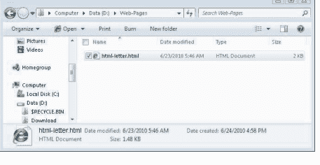

**第一部分：了解 (X)HTML 和 CSS**

## `.htm` 或 `.html`

实际上，你可以为你的页面选择以下两种后缀之一：`.html` 或 `.htm`。（我们的示例文件名`html-letter.html`使用了`.html`后缀。）


较短的 `.htm` 是“8.3”DOS 时代的遗留物，那时文件名只能包含八个字符加上一个描述文件类型的三字符后缀。如今，操作系统可以支持长文件名和长于三个字母的后缀，因此我们建议你使用 `.html`。

Web 服务器和 Web 浏览器对 `.htm` 和 `.html` 的处理同样出色。


坚持使用一种文件名选项。浏览器和服务器对 `.html` 和 `.htm` 文件的处理方式相同，但它们实际上是不同的后缀，因此会创建不同的文件名。（名称`html-letter.html`与`html-letter.htm`不同。）当你创建超链接（在第 6 章介绍）时，这种差异非常重要。

## 步骤 4：查看你的页面

保存好网页副本后，你就可以在网页浏览器中查看它了。请按照以下步骤在 Internet Explorer 中查看你的网页。（如果你使用的是其他浏览器，步骤可能有所不同。）

1. 如果你还没有打开浏览器，请现在打开它。
2. 选择“文件”\“打开”。
3. 在出现的“打开”对话框中，单击“浏览”按钮。
4. 在出现的新对话框中，浏览你的文件系统，直到找到你的 HTML 文件，然后选中它，使其出现在“文件名”区域。

   图 2-4 显示了一个已高亮显示、准备打开的 HTML 文件。
5. 单击“打开”按钮。

   你将回到“打开”对话框。（**注意：**如果你已经连接到互联网，某些版本的 Internet Explorer 会警告你，出于安全原因，它们必须为你的本地文件打开一个新的浏览器窗口；这完全没问题。）
6. 单击“确定”。

   页面以其全部风采出现在你的网页浏览器中，如图 2-5 所示。


你实际上还没有在 Web 上查看这个文件；你只是在查看保存在本地硬盘上的一个副本。所以不要把这个文件的 URL 给任何人——但请放心编辑 HTML 源文件并查看你所做的任何更改。

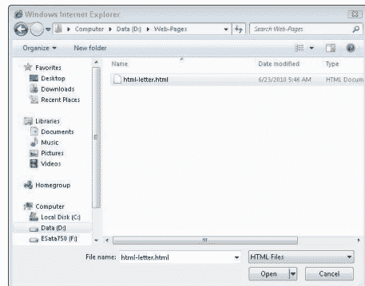

**图 2-4：**使用 Internet Explorer 导航到你的网页。

### 提示

在本地浏览器中查看网页更快的方法是将 HTML 文件拖放到打开的浏览器窗口中。你可以从 Windows 资源管理器或任何提供文件级访问权限的程序中执行此操作。

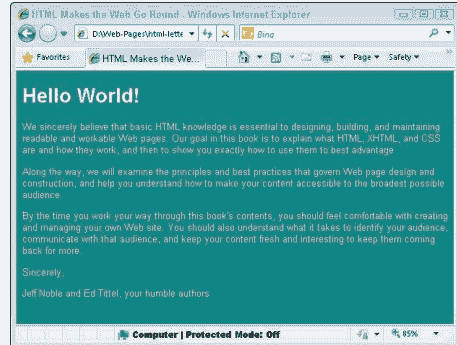

**图 2-5：**在你的网页浏览器中查看本地文件。

## 编辑现有网页

很可能，在你第一次在网页浏览器中查看页面后，你会想改变它的一件事（至少）。毕竟，在创建标记时，你无法真正看到页面的实际外观。你可能认为一级标题太大，或者你确实想要绿色背景上的紫色文本（实际上是个糟糕的主意）。

要对在文本编辑器中创建并在浏览器中查看的网页进行更改，请重复以下步骤，直到你对其最终外观满意为止：

1. 保持显示 HTML 页面的浏览器窗口打开，返回到文本编辑器。
2. 如果 HTML 页面在文本编辑器中没有打开，请打开它。你应该在浏览器和文本编辑器中打开相同的文件，如图 2-6 所示。
3. 在文本编辑器中更改 HTML 及其内容。
4. 保存更改。这是一个重要的步骤。如果你不保存更改，你将在网页浏览器中看不到它们。
5. 返回到网页浏览器，单击“刷新”按钮。

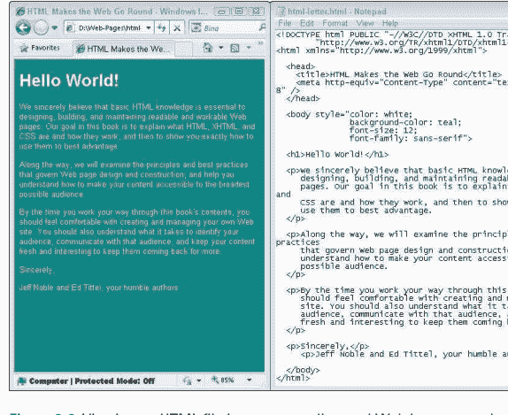

**图 2-6：**在文本编辑器和网页浏览器中同时查看 HTML 文件。

如果你在工作时同时在文本编辑器和浏览器中打开 HTML 文件，检查更改将轻而易举。你可以在编辑器中快速保存更改，切换到浏览器并刷新，切换回编辑器进行更多更改，保存，然后再切换回浏览器并刷新，如此往复。

在我们的示例信件中，我们决定——在 HTML 页面的初稿之后——我们应该在信中添加一个日期。图 2-7 显示了我们为添加日期而对 HTML 所做的更改，以及在网页浏览器中的显示结果。

> **警告！**
>
> 这种编辑 HTML 页面的方法仅适用于保存在你的本地硬盘上的页面。如果你想编辑存储在 Web 服务器上的页面，你必须将页面副本保存到硬盘，编辑它，验证你的更改，然后将文件重新上传到服务器，如下一节所述。

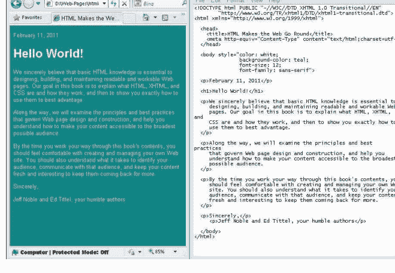

## 将你的页面发布到网上

当你对你的网页感到满意时，是时候将它发布到网上了。第 3 章详细讨论了将页面发布到网上所需的操作，但简要总结为几个快速步骤：

1. 找一个网页托管提供商来提供你的网页。
2. 使用 FTP 客户端或网页浏览器连接到你的 Web 服务器。
3. 将 HTML 文件从你的硬盘复制到 Web 服务器。
4. 使用你的网页浏览器通过互联网查看该文件。

你的 Web 主机可能是一个公司 Web 服务器，或者是一个你付费给互联网服务提供商（ISP）使用的服务器。如果你还没有主机，请仔细检查你的互联网 ISP，确认你的服务套餐是否包含 Web 服务器访问权限。无论你在哪里找到空间，请从提供商那里获取将网站文件移动到何处以及使用哪个 URL 的详细信息。使用你的托管提供商信息中指定的用户名和密码将文件传输到你的 Web 服务器。

例如，要将我们的信件托管在`www.dummieshtml.com/examples/ch02`上，我们使用 Internet Explorer 访问该站点并提供了相应的名称和密码（我们从 ISP 那里获得）。一组文件夹和文件出现了。

我们通过一个简单的拖放操作，从 Windows 资源管理器将文件复制到 Internet Explorer。

此页面的 URL 是`http://www.dummieshtml.com/examples/ch02/html-letter.html`，该页面现在由 Web 浏览器提供服务，而不是来自本地文件系统，如图 2-8 所示。

第 3 章详细介绍了如何向全世界提供你的网页。

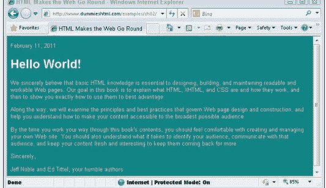

# 第 3 章

## 周密的规划能防止页面性能不佳

### 本章内容

- 规划你的网页
- 定义你的网站层次结构
- 创建用户友好的导航
- 托管你的网站
- 上传和编辑你的网站

网站的整体设计定义了其用户界面（UI）。当你设计一个好的 UI 时，你提供的是让用户能轻松顺畅地浏览网站的工具。本章概述了针对 (X)HTML 和 CSS 的标准网站设计原则。这些原则确保 UI 的可用性和有效性。

UI 是让用户能够访问网站信息的机制。每个 UI 都是独特的，但都由相同的元素（文本、图形和媒体文件）构成，并通过 (X)HTML 将它们组织在一起。

如果出现以下情况，访问者可能不会再回到你的网站：

- 网站难以导航。
- 网站充斥着闪烁的文字和冲突的颜色。
- 网站不能帮助人们找到他们想要的东西。

如果你能做到以下几点，那么你就创建了一个可靠的 UI：

- 网站的导航直观易懂。
- 图片和媒体能够衬托你的设计，而不会喧宾夺主。
- 你尽一切可能帮助人们找到他们想要的信息。

本章将引导你通过简单的步骤来设计网站和基本的网页。（其他章节将详细解释标记语言的每一个细微差别。）

## 规划你的网站

创建有效的网站 UI，一个重要的第一步与标记语言无关，而是与规划息息相关。在你的网站变得过于庞大之前（或者如果你还没有开始构建网站，那么在开始之前），请明确你网站的确切目的和目标。当你了解了网站的范围和目标，你就能创建一个更好的界面来体现它们。

在设计网站之前，先问自己以下几个问题：

- 你为什么要创建这个网站？
- 你想向用户传达什么？
- 你的目标受众是谁？例如：
  - 你的用户平均年龄是多少？
  - 你的受众对互联网的熟练程度如何？
- 你的网站需要多少页面？
- 你将使用什么样的层次结构来组织你的页面？例如：
  - 用户会线性地浏览你的网站吗？
  - 用户会在不同主题之间跳转吗？

回答了这些问题，你就能更好地理解网站的目标和需求。例如，一个在线商店可能有以下目标：

- 让访客浏览在线目录并将商品放入购物车。
- 为访客提供购买购物车中商品的方式。
- 帮助用户做出明智的购买决定。
- 方便商品退货和换货。
- 征求用户对目录中他们希望看到的商品或改进网站方式的反馈。
- 允许用户对商品进行评论和评分。

明确的目标有助于你更好地理解为了实现这些目标，你需要在网站上做些什么。例如，要实现在线商店的功能，你的网站将需要以下内容：

- 一个完整的在线目录，配有购物车
- 购物指南或其他信息，帮助用户做出更好的购买决策
- 帮助和反馈部分，可能包括消息论坛，让用户和专家互动
- 一套用于加速退货和换货的工具

当你为网站确立了目标，你就可以识别最适合包含在内的元素，例如：

- 导航系统，如站点地图、导航菜单或面包屑导航，用于标识网站的主要区域，帮助用户：
  - 快速识别他们当前在网站的哪个部分
  - 在网站的不同部分之间移动而不会迷路
- 一套标准的设计元素，如按钮、页面标题样式和颜色规范，确保用户在同一网站的不同页面间移动时保持方向感
- 目录项目的标准展示，包括产品相关信息，如产品图片和描述、价格和库存数据
- 设计精良的表单，帮助用户在目录中查找商品、将商品放入购物车并购买、请求退款或退货，以及向网站提交评论
- 解释购买选项、产品退货和其他有用信息的页面，这些页面仍然易于阅读和导航

你网站的目标应该决定网站的：

- UI 元素：
  - 当你添加到现有网站时，识别那些：
    - 符合网站新部分目标的 UI 元素
    - 与网站整体 UI 设计相辅相成的 UI 元素
- 设计
- 组织结构

## 设计很重要

本章推荐了良好的设计原则，但选择网站的颜色方案和整体外观与感觉取决于你。一个人觉得好看的东西，另一个人可能觉得丑陋。


一个为企业建立的网站，会对潜在客户或合作伙伴产生第一印象，应该反映你的企业风格。例如，如果你经营一家建筑公司，简洁的线条和干净的外观可能是展示公司形象的最佳方式。如果你经营一家花店，你的网站可以更有机一些（好吧，花哨一些），并加以装饰，让访客在走进你的店铺时对预期体验有所了解。

如果你是网页设计或图形设计新手，并且需要一个能彰显你企业在网络上存在的网站，可以考虑寻求专业网页设计师的帮助。使用他创建的图片、布局和导航辅助工具来构建和管理网站。一旦建立起来，一个独特且一致的外观和感觉是很容易维护的。

无论谁设计了你的网站，都要花时间征求同行、朋友、家人以及其他愿意诚实评价网站外观好坏的人的意见。一个来自了解并尊重你的人的负面但建设性的批评，远比一个你试图争取其业务的人说“呃，真丑”要好。而且，在私下被批评总比在公开场合受打击压力小得多！

## 绘制你的网站地图

如果你知道如何到达目的地，就更容易到达那里。绘制你的网站地图可以是规划——以及后续运营——网站的关键步骤。这个过程涉及两个创造性的阶段：

- 在纸上或电子方式创建一个视觉指南，用于指导网站的开发
- 在你的网站上创建一个视觉指南，帮助访客在网站上线运行后找到他们的路径

这两者在良好的 UI 设计中都占有一席之地，因此每个都单独成节。

## 使用地图进行网站开发

站点地图是一种辅助导航工具，为用户提供另一种查找所需内容的方式。站点地图展示了网站的所有内容，让访客可以一览无余地看到所有选项。

当你在网站开发过程中创建和使用站点地图时——即使网站只包含几个页面——你可以识别：

- 你需要构建的页面
- 页面之间的相互关系
- 你需要的导航元素

作为额外的好处，站点地图为你提供了一份页面的检查清单。

例如，图 3-1 显示了美国国税局（IRS）网站（`www.irs.gov/sitemap`）站点地图的一部分。

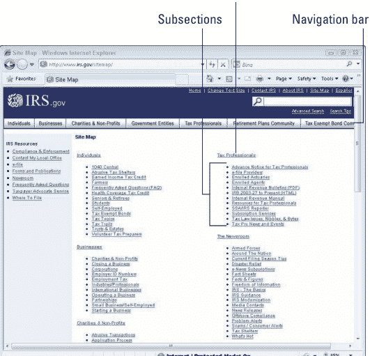

**图 3-1：**美国国税局网站的站点地图。

这张地图显示，IRS 网站包含众多主要部分。每个主要部分显示从 2 到 26 个不等的子部分。每个子部分链接到一个与该子部分主题和内容相关的页面或文档。


> 如果你计划一次构建网站的一部分……

如果你计划一次构建一个页面或一个部分的网站，你可以创建最终网站的地图，然后决定先构建哪些页面最有意义。当你对网站如何发展有了一个清晰的工作构想时，你就可以在每个阶段规划进一步的扩展。

例如，假设你为公司的网站创建了站点地图，并且网站需要一个常见问题解答（FAQ）部分。如果在网站启动时 FAQ 部分还没有完全完成，也不必惊慌——前提是有人提前规划以容纳新的部分，并将这种能力构建到了网站中。只需在网站启动时省略指向 FAQ 部分的链接（和提及）。

当 FAQ 部分准备就绪时：

- 将该部分添加到网站。
- 在主要导航元素中添加一个链接。

如果你知道资源即将到来，你可以创建一个导航方案，在 FAQ 部分准备就绪时容纳它。然而，如果没有站点地图和完整的网站规划，整合新的部分可能需要大量的时间和精力。

不要创建“建设中”的部分，这些部分除了暗示某天可能会出现内容外，别无他物。如果你的网站暗示了它实际上并不提供的信息，用户会感到失望。相反，考虑在主页的一个小部分突出显示“即将推出”的内容，这样访客就知道新的信息稍后会提供，但不要将任何无法访问的内容集成到你的导航栏或按钮中。

### 将地图用作视觉用户指南

尽可能多地（在现实条件下）为访客提供选项，以帮助他们在网站中导航，因为人们使用多种方法来查找信息：

- 有些人喜欢被引导。
- 有些人喜欢四处翻找。
- 有些人喜欢看到所有可能的选项，然后选择一个。

*站点地图会随着网站的增长而增长。* 如果你的网站又大又复杂，你的地图可能需要几个屏幕才能显示。当你上网冲浪时，像 `www.microsoft.com`、`www.hp.com` 和 `www.amazon.com` 这样的大型网站不提供站点地图，因为它们的地图会非常庞大且难以管理。但较小的网站（如 `www.symantec.com`）则有效地使用站点地图。

你需要决定站点地图是否是适合你网站的良好导航工具。在做出决定时，以下是一些值得思考的要点：

- 如果你只有几个页面，站点地图可能是*多余*的。
- 如果符合以下情况，站点地图可能是*最佳*选择：
  - 你的网站包含多个板块。
  - 你想不出其他方便的途径来访问你的内容。

许多专家认为，站点地图总是有益的。它们尤其有助于那些使用辅助设备（屏幕阅读器、盲文打印机等）浏览网页的访客。站点地图对于导航那些缺少页脚链接或使用图形而非 HTML 标记作为导航技术的网站也非常便利。站点地图还有助于那些关闭了浏览器 JavaScript 功能的用户（在这种情况下，使用悬停图片进行导航的网站将变得无法使用）。作为额外的好处，站点地图也有助于搜索引擎绘制网站所有页面的地图。

## 构建稳固的导航

你在网站上使用的导航可以成就网站，也可以毁掉网站。如果访客在你的网站上找不到他们想要的内容，他们很可能会离开并且再也不回来。你网站上使用的导航类型取决于：

- **你的网站有多少页面：** 如果只有几个页面，导航可以简单地使用主页上的链接列表，帮助用户跳转到每个其他页面。
- **你如何组织页面：** 如果你的网站有许多页面，组织成不同的板块，你的主页可能只链接到板块标题（而不是每个单独的页面）。

`www.dummies.com` 网站包含大量页面，组织成各种板块；因此，在任何导航方案中链接到所有页面都是不切实际的。此外，该网站包含关于各种主题的文章、速查表和视频，以及书籍信息。该网站可以组织成书籍、文章、速查表和视频，但访客更有可能寻找特定主题的信息，因此其组织方式是按主题划分的。主页（见图 3-2）自豪地展示了这些主题区域。

如果你点击一个主题区域，你仍然可以通过点击左上角的“查看所有主题”按钮（如图 3-3 所示）访问所有主题区域。你无需为了选择新主题而返回主页；你可以随时打开显示的弹出菜单。

## 第一部分：认识 (X)HTML 和 CSS

主题链接到相关信息（书籍、视频、文章和速查表）。

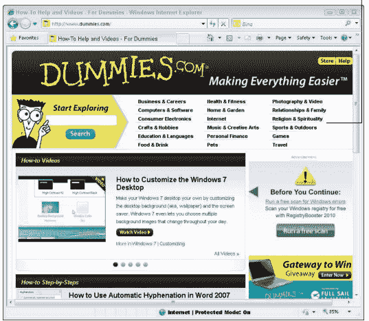

图 3-2：Dummies.com 网站按主题组织。

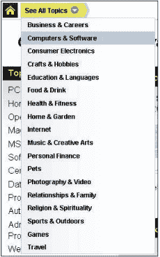

图 3-3：该网站的主要主题区域可通过“查看所有主题”按钮访问。

第三章：周密规划防止页面性能低下

图 3-4 展示了游戏主题导航区域（左侧，呼应主页布局）及其子主题。链接不同，但整个网站的通用导航方案是一致的。在本地主题下方出现了一个速查表区域，最受欢迎的文章则根据用户访问情况显示在中间列。这向访客展示了他们在网站各处浏览时可以期待什么。

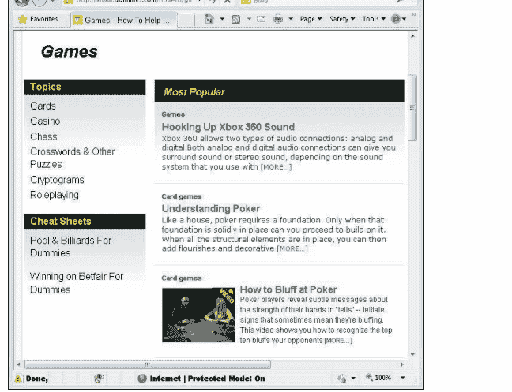

图 3-4：游戏区域包含子主题、速查表和热门文章。

每个页面最上方的导航区域包含一组常规链接，这些链接出现在网站的每个页面上，帮助访客从任何地方快速访问重要区域：一个搜索框加上商店（购物）和帮助按钮。在每个页面的底部，是一组指向 Dummies.com 网站信息的链接：订阅或退订电子邮件通讯、我的账户、商店（购物）、隐私政策、联系我们等等（见图 3-5）。

像购物车和帮助链接一样，此类链接（以及网站版权声明）必须出现在每个页面上，但无需突出显示。将这些链接包含在一致的网站页脚中，可以在不遮挡特定主题或子主题关键内容的前提下，让它们始终可用。

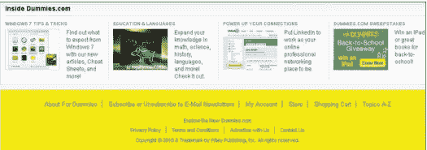

图 3-5：页面底部为访客提供了进一步的导航辅助。

> 如果你创建一个地图来辅助网站开发，它也能帮助你设计网站导航。依次考虑地图上的每个页面；列出每个页面必须包含的链接。通常，会浮现出一种模式，帮助你识别网站的主要导航元素（例如链接到主要主题区域和版权通知）和子导航元素（在主题页面上链接到子主题）。

在了解你需要什么之后，你可以为你的用户界面设计一个可视化方案。你是想在顶部使用按钮，侧面使用按钮，还是两者兼用？你需要一个链接到版权或隐私信息的页脚吗？如果你的板块中包含板块，再包含板块，你如何才能最好地帮助人们浏览它们？回答这类问题是构建稳固导航系统的途径，它能帮助用户在你的网站上找到方向——让他们专注于他们此行的目的，而不是如何到达那里。

> 无论你设计什么导航方案，始终为你的访客提供一种从网站任何地方返回主页的方式。你网站的主页是通往网站其余部分的大门。如果访客迷路了或者想重新开始，确保他们能轻松无误地回到起点。

> 在你设计好网站导航方案并构建了几个页面后，找一个不熟悉你网站的人来使用它。为了帮助这个人，提供一个包含三四个你希望完成的任务的列表——也许是访问的页面或需要填写的表格。如果你的测试访客迷路了或者对导航有很多疑问，重新调整你的方案。审阅者还可以建议如何使导航功能更清晰、更容易使用。你可能对你的网站和内容太过熟悉，以至于看不到初次用户会立即发现的导航问题。无知未必总是福，但它确实能提供信息！

## 规划外部链接

没有超链接，网络就不成其为网络。毕竟，超链接将你的网站与网络的其余部分连接起来，并将一组页面转变为一个有凝聚力的网站。但是，过度使用或误用链接会损害网站——甚至可能让你损失一些业务。

### 明智地选择站外链接

与外部链接相比，内部链接简直是小菜一碟；毕竟，当你链接到你自己网站上的页面时，所有这些页面都在你的控制之下。你知道它们今天有什么内容，它们明天是否会存在，以及它们上面会有什么内容。然而，当你链接到其他人网站上的资源时，一切都变得不确定：

- 你不维护这些页面。
- 你无法修改页面的内容。
- 你当然也不知道这些页面是否会消失。

你的访客也不知道——直到他们遇到“404 文件或目录未找到”消息（这通常是*断开的链接*的标志，现在该链接已指向别处）。404 消息中的文本因托管该断开链接网站的服务器而异。


我们建议遵循以下准则：

- **链接到网站的一个板块，而不是特定页面。** 页面会来来去去，但通用的组织结构更持久。
- **链接到公司网站。** 公司网站比个人维护的网站更具持久性。
- **不要直接链接到媒体文件，例如 PDF 和图像。** 如果你想链接到另一个网站上的资源，请链接到包含这些资源的页面，而不是实际的媒体文件。网站经常更新资源或给它们重命名。然而，链接到资源的页面几乎总是会更新以反映新名称。因此，资源页面是更安全的链接选择。


链接到其他网站意味着你对这些网站的支持或认可。当访客从你的网站跟随链接到其他网站时，他们假设你认可那个新网站。这种隐含的认可使得几条准则变得必要：

- **如果您不希望自己的网站与某个网站的内容产生关联，就不要链接到该网站。** 查明您是否认可某个看似相关的网站的唯一方法，就是在链接之前访问并查看该网站。
- **定期检查您的链接。** 务必确保：
  - 网站所有者没有变更。
  - 网站内容依然恰当。

当域名到期时，新所有者可能会接管该域名并发布新的内容，这些内容可能是：

- 完全无关的。
- 损害您形象的（例如，展示色情内容）。

## 制作有用的链接文本

您为链接关联的文本与链接本身同样重要。这些文本会告诉用户链接将引导他们前往何处，以便他们决定是否继续访问。因此，*访问 Dummies.com 以阅读更多关于本书的内容*该请求因被认为风险较高而被拒绝。

## UI 设计资源

我们推荐以下网站和书籍，供您在网站和界面设计方面参考，以创建出色的用户界面：

- 关于设计基础的速成课程，请阅读 `www.webdesignfromscratch.com` 上的“基础”和“设计流程”文章。
- 雅各布·尼尔森致力于创建可访问的网页内容，这意味着所有内容对所有访问者都可用，包括那些可能因各种障碍而无法遵循视觉或听觉导航提示的访客。他的网站 `http://useit.com` 充斥着关于创建可访问网站的资源和文章。
- 本书的作者之一，杰夫·诺布尔，是 UI 趋势网站（`http://uitrends.com`）的副主编，该网站涵盖与网站和 Web 应用程序设计相关的有趣用户界面设计和趋势。
- 嘿，负面示例也很有用。《网页设计反面教材》通过评估糟糕的设计来引导你走向好的设计。确保你的网站看起来不像 `www.webpagesthatsuck.com` 上展示的任何一个。
- 由丽莎·洛帕克所著的《*Web 设计傻瓜书*（第 2 版）》是迈向拥有惊艳外观的精致网站的又一步。
- 由理查德·曼德和巴德·史密斯所著的《*网页可用性傻瓜书*》，可以帮助你微调网站，使其使用起来极其简单，这对于吸引访客持续回访大有帮助。
- Web 设计师资源库（`www.webdesignerdepot.com`）是一个社区网站，专注于与网站设计相关的所有内容——排版、设计技巧、编码（仅举几例）。这是寻找所有设计问题答案的绝佳场所。
- 破界媒体（`www.smashingmagazine.com`）可以帮助你找到所需的一切，从灵感（照片、示例、展示）到设计（Photoshop 文档，通常也称为 PSD、字体），再到编码（CSS、JavaScript、WordPress）以及图形（壁纸、背景、图标）等所有内容。

## 使用 FTP 传输文件

在这两种选项中，FTP 几乎总是可行的。FTP 是在互联网上传输文件的标准方式，任何托管服务提供商都应该提供对 Web 服务器的 FTP 访问。当你在提供商处设置网站时，它通常会提供书面文档（纸质或在线）来告诉你如何将文件传输到 Web 服务器。这些信息中会包含一个 FTP URL，通常采用 `ftp://ftp.domain.com` 的格式。

你可以使用 FTP 客户端，例如 SmartFTP（`www.smartftp.com`）、WS_FTP（`www.ipswitch.com/Products/WS_FTP`）和免费的 FileZilla（`filezilla-project.org`），来连接到 FTP URL。（Mac 用户可能更喜欢 Fetch，网址为 `www.fetchsoftworks.com`，或 Cyberduck，网址为 `cyberduck.ch`。）你的提供商会给你一个用户名和密码，用于通过 FTP 访问你的 Web 服务器目录。然后，你可以使用客户端界面将文件移动到你的站点。真的就是这么简单。

如果你想从你的网站获取文件副本并进行修改，你可以通过三个步骤完成：

1. 使用 FTP 客户端的界面下载副本。
2. 进行修改。
3. 使用 FTP 客户端的界面上传更改后的文件。

每个 FTP 客户端的界面都不同，但它们都相当简单。第 23 章包含更多关于寻找好的 FTP 客户端的信息；所以当你找到一个时，花几分钟时间阅读它的文档。

你可能不需要 FTP 软件来将文件移动到你的 Web 服务器：

- 许多浏览器，例如当前版本的 Internet Explorer 和 Firefox，都包含基本的内置 FTP 支持。你可以上传或下载文件，但可能无法创建或删除目录。
- 许多 Web 实用程序，例如 Dreamweaver，也包含文件管理功能。

## 使用托管服务提供商的网站传输文件

为了提高可用性并减少技术支持电话，许多 Web 托管服务提供商提供网页，帮助你上传和管理你的网站文件，而无需使用单独的 FTP 实用程序甚至 (X)HTML 编辑器内部的 FTP 工具。大多数这些工具允许你以多种方式管理你的站点，例如：

- 上传和下载文件。
- 创建和删除目录。
- 移动文件。
- 删除文件。

如果你与托管服务提供商合作，请了解它是否有一套基于 Web 的工具来管理你的站点。

在选择提供商时，请牢记以下几点：

- 在开始传输文件之前，请阅读提供商的文档。每个提供商的界面都不同。
- 大多数提供 Web 界面的提供商不会阻止你使用 FTP 管理站点。
- 如果提供商的界面很棘手，或者你更喜欢 FTP，请使用 FTP。

## 第二部分：使用 (X)HTML 设置网页格式

### 本部分内容……

在这里，我们描述使网页可用且有吸引力的标记和文档结构。我们研究 HTML 文档结构（包括文档头和文档体），并向你展示如何正确地将各部分组合在一起。之后，我们讨论如何在块和列表中组织文本。

接下来，我们解释 (X)HTML 中的链接如何提供将整个万维网连接在一起的粘合剂。为了帮助你图解说明，我们还解释了如何向页面添加图形。因此，我们涵盖了构建良好、比例协调的网页的基本构建块——这并非巧合。

第二部分的最后一章涉及*已弃用的*标记——即不再安全或明智使用的 HTML 元素和属性。尽管这些已弃用的元素和属性在 HTML4 中有效，但其中只有一部分在 XHTML 中有效，而在 HTML5 中则完全无效。这就是为什么我们希望你在看到它们时能识别出来，以及为什么我们在你创建网页时建议你避免使用它们。

## 第 4 章：创建 (X)HTML 文档结构

**本章内容**

- 创建基本的 (X)HTML 文档结构。
- 定义 (X)HTML 文档头。
- 创建结构完整的 (X)HTML 文档。

简单的 (X)HTML 文档的框架由头部和主体组成。*头部*向浏览器提供有关文档的信息，而*主体*包含在浏览器窗口中显示的内容。创建任何 (X)HTML 文档的第一步是定义其框架。

本章涵盖了构建 (X)HTML 文档基本结构所需的所有主要元素——包括其头部和主体。我们还向你展示如何告诉浏览器你正在使用哪个版本的 HTML 或 XHTML。虽然版本信息对用户来说不是必需的，但浏览器会使用它来确保正确显示文档内容。

## 建立文档结构

尽管没有两个 (X)HTML 页面是完全相同的——每个页面都使用独特的内容和元素组合来定义页面——但每个正确构建的 (X)HTML 页面都遵循相同的基本文档结构：

- 一个将文档标识为 (X)HTML 文档的声明。
- 一个文档头。
- 一个文档主体。

每次创建 (X)HTML 文档时，你都从这些元素开始。然后填入内容和标记以创建单独的页面。

> 尽管基本文档结构是每个 (X)HTML 文档的必备要求，但反复创建它可能会变得单调乏味。大多数 (X)HTML 编辑工具在创建新文档时会自动设置基本文档结构。

## 标记你的 (X)HTML 文档

任何 (X)HTML 文档的开头都是文档类型声明（DTD），或 DOCTYPE 声明。这行标记指定了你正在使用的 HTML 或 XHTML 版本，并让浏览器知道如何解释后续内容。我们将在本章中使用 XHTML 1.0 规范，因为这是大多数浏览器和编辑工具所期望的。

### 添加 HTML DOCTYPE 声明

如果你选择创建 HTML 4.01 文档而不是 XHTML 文档，可以从三种可能的 DOCTYPE 声明中选择：

- **HTML 4.01 Transitional：** 这是 HTML 4.01 最包容的版本，它包含了所有 HTML 结构元素以及所有表现元素：

```html
<!DOCTYPE HTML PUBLIC "-//W3C//DTD HTML 4.01 Transitional//EN"
"http://www.w3.org/TR/html4/loose.dtd">
```

- **HTML 4.01 Strict：** 这个精简版的 HTML 排除了所有表现相关元素，转而使用样式表来驱动页面显示：

```html
<!DOCTYPE HTML PUBLIC "-//W3C//DTD HTML 4.01//EN"
"http://www.w3.org/TR/html4/strict.dtd">
```

- **HTML 4.01 Frameset：** 此版本以 HTML 4.01 Transitional 为基础，并添加了使框架成为可能的所有元素：

```html
<!DOCTYPE HTML PUBLIC "-//W3C//DTD HTML 4.01 Frameset//EN"


`"http://www.w3.org/TR/html4/frameset.dtd">`

> 尽管使用 HTML 4.01 Frameset 仍然是创建 DOCTYPE 声明的有效方式，但框架集不再被视为最佳实践，决定使用框架集前应谨慎。

### 添加 XHTML DOCTYPE 声明

要创建 XHTML 文档，请使用以下 DOCTYPE 声明之一：

## `<html>` 元素

在指定文档遵循哪个版本的 (X)HTML 后，添加一个 `<html>` 元素来包含页面中的所有其他 (X)HTML 元素：

```html
<!DOCTYPE html PUBLIC "-//W3C//DTD XHTML 1.0 Transitional//EN"
     "http://www.w3.org/TR/xhtml1/DTD/xhtml1-transitional.dtd">

<html>

</html>
```

与 HTML 框架集类似，使用 XHTML 框架集也不再被视为最佳实践。

XHTML DTD 描述与第 1 章定义的 HTML DTD 描述类似。HTML DTD 在 `www.w3.org/TR/html401/sgml/dtd.html` 有详细文档；XHTML DTD 则在 `www.w3.org/TR/xhtml1/dtds.html` 有文档说明。

## 添加 XHTML 命名空间

*命名空间* 是 XML 文档中元素和属性所使用名称的集合。XHTML 使用一个特殊的名称集合；因此，它需要一个 XML 命名空间定义，如下所示：

```html
<!DOCTYPE html PUBLIC "-//W3C//DTD XHTML 1.0 Transitional//EN"
     "http://www.w3.org/TR/xhtml1/DTD/xhtml1-transitional.dtd">

<html xmlns="http://www.w3.org/1999/xhtml">

</html>
```

不要被命名空间困住。如果你使用其他 XML 词汇，你需要了解命名空间。对于简单的 XHTML 文档，你只需要记住包含 XHTML 命名空间。前面的代码片段向你展示了确切的操作方法！不过，如果你跳过这一步，你的 XHTML 文件将无法在 `validator.w3.org` 上通过验证。

## 添加文档头

任何 (X)HTML 文档的 `head` 部分是其两个主要组件之一；另一个主要组件是 `body`。头部或称 `header`，提供了关于文档的基本信息，包括其标题和 `meta-data`（关于信息的信息），例如关键词、字符编码、作者信息和描述。如果你希望在页面中使用样式表，关于该样式表的信息也应放入头部。

第 9 章全面概述了创建层叠样式表（CSS），并展示了如何将它们包含在 (X)HTML 文档中。

定义页面头部的 `<head>` 元素紧跟在 `<html>` 开始标签之后：

```html
<!DOCTYPE html PUBLIC "-//W3C//DTD XHTML 1.0 Transitional//EN"
    "http://www.w3.org/TR/xhtml1/DTD/xhtml1-transitional.dtd">

<html xmlns="http://www.w3.org/1999/xhtml">
  <head>
    <meta http-equiv="Content-Type" content="text/html; charset=UTF-8" />
  </head>
</html>
```

用于字符编码的元数据元素：

```html
<meta http-equiv="Content-Type" content="text/html; charset=UTF-8">
```

也是网页在 `validator.w3.org` 上通过验证所必需的。不要遗漏它！

## 为页面设置标题

每个 (X)HTML 页面都需要一个描述性的标题来告诉访客页面的内容。此文本会出现在浏览器窗口最顶部的标题栏中，如图 4-1 所示。页面标题应简洁明了且信息丰富。（例如，*我的主页* 就不如 *Jeff 的网页设计服务* 信息丰富。）

通过在 `<head>` 元素内使用 `<title>` 元素来定义页面标题：

```html
<!DOCTYPE html PUBLIC "-//W3C//DTD XHTML 1.0 Transitional//EN"
    "http://www.w3.org/TR/xhtml1/DTD/xhtml1-transitional.dtd">

<html xmlns="http://www.w3.org/1999/xhtml">
  <head>
    <meta http-equiv="Content-Type" content="text/html; charset=UTF-8" />
    <title>Jeff 的网页设计服务</title>
  </head>
</html>
```

图 4-1：(X)HTML 页面标题会出现在 Web 浏览器的标题栏中。

搜索引擎使用 `<title>` 的内容来在响应查询时列出网页。页面标题可能是网络冲浪者阅读关于你页面的第一段文字，特别是当他们通过搜索引擎找到它时。事实上，搜索引擎很可能会在结果页上将你的页面标题列在众多其他结果中，这给了你唯一一次吸引冲浪者注意并说服她选择你页面的机会。一个精心制作的标题就能做到这一点。

标题也用于书签和浏览器的历史记录中，所以保持你的标题简短精炼。

## 定义元数据

元数据是指关于数据的数据。在网络的语境中，这意味着描述你网页的数据。一个页面的元数据可能包括：

- 关键词
- 你页面的描述
- 关于页面作者的信息
- 你用来创建页面的软件应用程序

## 元素和属性

你通过以下方式定义 (X)HTML 页面的每一段元数据：

- `<meta />` 元素
- `name` 和 `content` 属性

例如，以下元素为一个咨询服务页面创建了关键词列表和描述：

```html
<!DOCTYPE html PUBLIC "-//W3C//DTD XHTML 1.0 Transitional//EN"
    "http://www.w3.org/TR/xhtml1/DTD/xhtml1-transitional.dtd">

<html xmlns="http://www.w3.org/1999/xhtml">
  <head>
    <title>Jeff 的网页设计服务</title>
      <meta http-equiv="Content-Type" content="text/html; charset=UTF-8" />
      <meta name="keywords"
        content="Web consulting, page design, site construction" />
      <meta name="description"
        content="Synopsis of Jeff's skills and services" />
  </head>
</html>
```

## 自定义名称

(X)HTML 规范不：

- 预定义你可以在页面中包含哪些类型的元数据
- 指定如何命名不同的元数据片段，例如关键词和描述

因此，例如，你可以不使用 `keywords` 和 `description` 作为关键词和描述元数据的名称，而同样可以轻松地使用 `kwrd` 和 `desc`，如以下标记所示：

```html
<!DOCTYPE html PUBLIC "-//W3C//DTD XHTML 1.0 Transitional//EN"
    "http://www.w3.org/TR/xhtml1/DTD/xhtml1-transitional.dtd">

<html xmlns="http://www.w3.org/1999/xhtml">
  <head>
    <title>Jeff 的网页设计服务</title>
    <meta http-equiv="Content-Type" content="text/html; charset=UTF-8" />
    <meta name="kwrd"
      content=" Web consulting, page design, site construction " />
    <meta name="desc" content="Synopsis of Jeff's skills and services" />
  </head>
</html>
```

如果你可以为 `<meta>` 的 `name` 和 `content` 属性使用任意旧值，系统如何知道如何处理元数据？答案是它们不知道。每个搜索引擎的工作方式都不同。虽然 *keywords* 和 *description* 是常用名称，但搜索引擎可能不会识别或使用你包含的其他元数据名称。尽管搜索引擎偶尔无法识别你可能包含的任何元数据名称，但使用它们仍然是增加你的网站在搜索引擎中被找到机会的有效方式。

许多开发人员使用元数据来：

- 为那些查看页面源代码的人留下信息
- 为未来的浏览器和搜索引擎使用此类元数据做准备

虽然关键词和页面描述是可选的，但搜索引擎会使用它们来收集关于你网站的信息。过去，有些人会过度填充他们网站的 `<meta />` 标签，试图让他们的网站在搜索结果中出现尽可能多次。不过，现代搜索引擎已经足够“智能”，会考虑到这一点，并会在排名时降低 `<meta />` 标签的权重或完全忽略它们。如果你想让搜索引擎机器人（简称爬虫）发现你的网站，请确保在 `<meta />` 标签中包含详细且简洁的信息。

## 将用户重定向到另一个页面

你可以使用头部中的元数据向 Web 浏览器发送关于它们应如何显示（或以其他方式处理）你网页的消息。网页构建者通常以这种方式使用 `<meta />` 元素，将页面访客从一个页面自动重定向到另一个页面。例如，如果你曾经遇到一个页面写着 `此页面已移动。请等待 10 秒以自动发送到新位置。`（或类似内容），你就见识过这个技巧的运用。

要使用 `<meta />` 元素向浏览器发送消息，你需要遵循以下一般步骤：

1. 使用 `http-equiv` 属性代替 `name` 属性。
2. 从一个预定义的值列表中进行选择，这些值代表给浏览器的指令。

这些值使用你可以通过 HTTP 头发送给浏览器的指令，但更改文档的 HTTP 头比将指令嵌入到网页本身要困难得多。

## 第二部分：使用 (X)HTML 格式化网页

若要指示浏览器将用户从一个页面重定向到另一个页面，你需要特别执行以下操作：

1. 使用带有 `http-equiv="refresh"` 属性的 `<meta />` 元素。
2. 调整 `content` 属性的值，以指定刷新发生前的秒数以及你想要跳转到的 URL。

例如，以下标记中的 `<meta />` 元素行会创建一个在 15 秒后跳转到 `www.w3.org` 的刷新：

```html
<!DOCTYPE html PUBLIC "-//W3C//DTD XHTML 1.0 Transitional//EN"
    "http://www.w3.org/TR/xhtml1/DTD/xhtml1-transitional.dtd">

<html xmlns="http://www.w3.org/1999/xhtml">
  <head>
    <title>All About Markup</title>
    <meta http-equiv="Content-Type" content="text/html; charset=UTF-8" />
    <meta http-equiv="refresh" content="15; url= http://www.w3.org/" />
  </head>

  <body>
    <p>This page is still in development. Until we are done, please visit
      the <a href="http://www.w3.org">W3C Website</a> for the definitive
      collection of markup-related resources.
    </p>

    <p>Please wait 10 seconds to be automatically redirected to the W3C.</p>
  </body>
</html>
```

重定向网页时需谨慎使用元数据。当某些搜索引擎发现元数据重定向被使用时，会认为该网站试图进行垃圾信息传播。这可能导致你的网站或网页被*从搜索结果中移除*，或从搜索引擎的索引中删除。当你熟练掌握使用元数据进行重定向后，可以进阶到下一阶段，尝试使用 HTTP 状态码 `301` 进行重定向，这需要通过位于 Web 服务器根目录下的 `.htaccess` 文件来强制执行基于服务器的重定向。虽然基于服务器的 `301` 重定向超出了本书的讨论范围，但简单的 Google 搜索可以引导你找到许多优质资源，例如位于 `www.mastersitemanager.com/857/301-htaccess-redirect-tutorial` 的 Master Site Manager 网站上的 `.htaccess` 文件重定向/重写教程。

较旧的 Web 浏览器可能不知道如何处理使用 `http-equiv` 元素进行页面重定向的 `<meta />` 元素。请务必在页面上包含一些文本和链接，以便当你的 `<meta />` 元素无法工作时，访问者可以手动链接到你的新目标页面。链接使用锚点（`<a>`）元素，这将在第 3 章中讨论。

如果用户的浏览器不知道如何处理你的重定向，用户只需点击页面上的链接即可前往新页面，如图 4-2 所示。


> 你可以将 `http-equiv` 属性与 `<meta />` 元素结合用于多种目的，例如设置页面的过期日期和指定页面使用的字符集（语言）。要了解你的 `http-equiv` 选项有哪些（以及如何使用它们），请查看以下 URL 上的 HTML META 标签词典：
>
> `http://vancouver-webpages.com/META/metatags.detail.html`

## 创建 (X)HTML 文档主体

设置好页面头部、创建标题并定义一些元数据后，你就可以创建将在浏览器窗口中显示的 (X)HTML 标记和内容了。`<body>` 元素容纳你的文档内容。

如果你想在浏览器窗口中显示内容，请将其放入 `<body>` 元素中，如下所示：

```html
<!DOCTYPE html PUBLIC "-//W3C//DTD XHTML 1.0 Transitional//EN"
    "http://www.w3.org/TR/xhtml1/DTD/xhtml1-transitional.dtd">

<html xmlns="http://www.w3.org/1999/xhtml">
  <head>
    <meta http-equiv="Content-Type" content="text/html; charset=UTF-8" />
    <title>Jeff's Web Design Services</title>
    <meta name="kwrd"
          content=" Web consulting, page design, site construction " />
    <meta name="desc" content="Synopsis of Jeff's skills and services" />
  </head>

  <body style="color: white;
        background-color: teal;
        font-size: 1.2;
        font-family: sans-serif">
    <h1>Jeff's Web Design Services</h1>
    <p>Jeff has helped many Texas clients, large and small, to design and
    publish their company and professional Web sites. He specializes in
    cutting-edge Web designs, dynamic multimedia, and companion print-
    design solutions to suit all business needs.</p>

    <p>For more information, e-mail
    <a href="mailto:jeff@conquestmedia.com">Jeff Noble</a></p>
  </body>
</html>
```

图 4-3 展示了浏览器如何显示这个完整的 (X)HTML 页面：

- `<title>` 元素的内容位于窗口的标题栏中。
- `<meta />` 元素完全不影响页面的外观。
- 只有包含在 `<h1>` 和 `<p>` 元素（位于 `<body>` 元素内）中的段落文本才会实际显示在浏览器窗口中。


## 第五章：文本和列表

**本章内容**

- 处理基本的文本块
- 操作文本块
- 创建项目符号列表、编号列表和定义列表


HTML 文档包含文本、图像、多媒体文件、链接和其他内容片段，你可以通过使用标记元素和属性将它们塑造成一个网页。你使用文本来创建诸如标题、段落和列表之类的内容。创建一个可靠的 HTML 文档的第一步是奠定坚实的基础，以确立文档的结构。

## 格式化文本

以下是文本块的超技术定义：在 HTML 元素内部占据一行或多行的内容块。

实际上，任何 HTML 页面都是文本块的集合：

- 页面上的每个内容片段都必须是某个块级元素的一部分。
- 每个块级元素都位于页面的 `<body>` 元素内部。

HTML 识别几种你可以在文档中使用的文本块类型，包括（但不限于）：

- 段落
- 标题
- 块引用
- 列表
- 表格
- 表单

### 行内元素与文本块

行内元素和文本块的区别很重要。本章描述的 HTML 元素指的是文本块。*行内元素*是位于块级元素*内部*的一个单词或一串单词（例如文本强调元素，如 `<em>` 或 `<strong>`）。行内元素必须嵌套在块级元素内；否则，你的 HTML 文档在语法上是不正确的。

行内元素，如链接和格式化元素，旨在链接到（或改变）这些块内找到的几个单词或几行内容的外观。

## 段落

段落在网页中比任何其他文本块出现得更频繁。


HTML 浏览器不会识别你在编辑器中创建页面时输入的硬回车。你必须使用 `<p>` 元素来告诉浏览器，将直到闭合 `</p>` 标签的所有文本打包为一个段落。

### 格式

要创建一个段落，请遵循以下步骤：

1. 在文档主体中添加 `<p>`。
2. 输入段落的内容。
3. 添加 `</p>` 以关闭该段落。

它的外观如下：

```html
<!DOCTYPE html PUBLIC "-//W3C//DTD XHTML 1.0 Transitional//EN"
  "http://www.w3.org/TR/xhtml1/DTD/xhtml1-transitional.dtd">
<html xmlns="http://www.w3.org/1999/xhtml" xml:lang="en" lang="en">
<head>
  <meta http-equiv="Content-Type" content="text/html; charset=ISO-8859-1" />
  <title>All About Blocks</title>
</head>
<body>
  <p>This is a paragraph. It's a very simple structure that you will use time and again in your Web pages.</p>
  <p>This is another paragraph. What could be simpler to create?</p>
</body>
</html>
```

此 HTML 页面包含两个段落，每个段落都用单独的 `<p>` 元素标记。大多数 Web 浏览器会在页面上的每个段落之后添加一个换行符和整行空白，如图 5-1 所示。

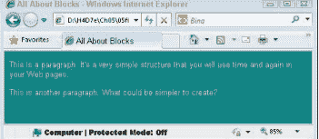

不规范的 HTML 编码者在创建段落时不使用闭合 `</p>` 标签。虽然一些浏览器允许这种可疑的做法而不报错，但省略闭合标签不是好的实践，因为：

- 语法不正确
- 会导致样式表问题
- 可能导致页面在不同浏览器中显示不一致

你可以使用层叠样式表（CSS）来控制段落格式（颜色、样式、大小和对齐方式），这将在第 9-12 章中介绍。

## 标题

标题将文档划分为若干部分。本书使用标题和副标题将每一章划分为若干部分，你也可以对你的网页做同样的事情。标题：

- 创建组织结构
- 打断页面上的文本流
- 提供视觉线索，说明内容片段是如何分组的

HTML 包含六个用于文档中不同标题级别的元素：

- `<h1>` 是最突出的标题（标题 1）
- `<h6>` 是最不突出的标题（标题 6）

使用 HTML 标题级别时，请遵循从低到高的数字顺序。也就是说，在使用二级标题之前先使用一级标题，在使用三级标题之前先使用二级标题，依此类推。如果你想改变标题的外观，第 10 章和第 11 章将向你展示如何使用样式表来实现这一目的。

## 第二部分：使用 (X)HTML 格式化网页

### 格式化

要创建标题，请按照以下步骤操作：

1. 在文档主体中添加 `<hn>`。
2. 输入标题的内容。
3. 添加 `</hn>`。

在此上下文中，n 表示你想要创建的标题级别编号。例如，要创建一级标题，你需要将 n 替换为数字 1，并在页面中添加 `<h1>`；对于二级标题，添加 `<h2>`，依此类推。

### 浏览器显示

每个浏览器显示标题级别的方式都不同，正如你在接下来的两个小节中所见。

#### 图形浏览器

大多数图形浏览器使用独特的尺寸和字体来显示标题：

- 一级标题（`<h1>`）是最大的（通常比段落的默认文本大小大两到三个字号）。
- 所有标题默认使用粗体，而段落文本默认使用常规（非粗体）字体。
- 六级标题（`<h6>`）是最小的，可能比默认的段落文本小两到三个字号。

以下 HTML 标记代码片段展示了所有六种标题的实际效果：

```html
<!DOCTYPE html PUBLIC "-//W3C//DTD XHTML 1.0 Transitional//EN"
"http://www.w3.org/TR/xhtml1/DTD/xhtml1-transitional.dtd">
<html xmlns="http://www.w3.org/1999/xhtml" xml:lang="en" lang="en">
  <head>
    <meta http-equiv="Content-Type" content="text/html; charset=ISO-8859-1" />
    <title>关于块的所有信息</title>
  </head>

  <body>
    <h1>一级标题</h1>
    <h2>二级标题</h2>
    <h3>三级标题</h3>
    <h4>四级标题</h4>
    <h5>五级标题</h5>
    <h6>六级标题</h6>
  </body>
</html>
```

图 5-2 展示了在浏览器中渲染的 HTML 页面中的标题。

**图 5-2：** Web 浏览器显示从一级到六级的标题。

使用 CSS 来控制标题的外观，包括颜色、大小、间距和对齐方式。

默认情况下，大多数浏览器为标题使用 Times Roman 字体。字号随着标题级别的升高而减小。（一级到六级标题的默认字号分别为 24、18、14、12、10 和 8 点字体。）你可以使用 CSS 覆盖任何此格式。

#### 纯文本浏览器

纯文本浏览器使用不同于图形浏览器的标题约定，因为纯文本浏览器使用单一的字符大小和字体来显示所有内容。一些值得考虑的优秀纯文本浏览器包括 Lynx、ELinks、Cygwin 和 MIRA。

## 控制文本块

文本块构成了你页面的基础。你可以将这些块分解成更小的部分，以更好地引导读者阅读你的内容。

### 块引用

*块引用*是一段引用或受版权保护来源的摘录，你将其在页面上分隔开。使用 `<blockquote>` 元素来包围引用内容：

```html
<!DOCTYPE html PUBLIC "-//W3C//DTD XHTML 1.0 Transitional//EN"
    "http://www.w3.org/TR/xhtml1/DTD/xhtml1-transitional.dtd">
<html xmlns="http://www.w3.org/1999/xhtml" xml:lang="en" lang="en">
    <head>
        <meta http-equiv="Content-Type" content="text/html; charset=ISO-8859-1" />
        <title>名言警句</title>
    </head>

    <body>
        <h1>一段鼓舞人心的名言</h1>
        <p>当我需要一点灵感来提醒自己为何在教室里度过时光时，我只需记住李·艾柯卡说过的话：</p>
        <blockquote>
            在一个完全理性的社会里，我们中最好的人会成为教师，而我们其余的人将不得不满足于其他工作。
        </blockquote>
    </body>
</html>
```

大多数 Web 浏览器以轻微的左缩进显示块引用内容，如图 5-3 所示。

**图 5-3：** Web 浏览器通常会缩进块引用以将其与段落区分开。

## 预格式化文本

通常情况下，HTML 会忽略文档内的空白字符。浏览器不会显示块元素内的：

- 硬回车
- 换行符
- 大量空白空间

以下标记包含了各种硬回车、换行符和许多空格。图 5-4 显示 Web 浏览器忽略了所有这些内容。

```html
<p>This is a paragraph with a lot of white space thrown in for fun (and as a test of course).</p>
```

图 5-4：Web 浏览器会常规性地忽略空白空间。

预格式化文本元素（`<pre>`）指示浏览器在显示你的内容时保持所有空白字符不变（参见以下示例）。使用 `<pre>` 元素代替 `<p>` 元素，以使浏览器应用你所有的空白字符，如图 5-5 所示。

```html
<!DOCTYPE html PUBLIC "-//W3C//DTD XHTML 1.0 Transitional//EN" "http://www.w3.org/TR/xhtml1/DTD/xhtml1-transitional.dtd">
<html xmlns="http://www.w3.org/1999/xhtml" xml:lang="en" lang="en">
  <head>
    <meta http-equiv="Content-Type" content="text/html; charset=ISO-8859-1" />
    <title>空白空间</title>
  </head>
  <body>
    <pre>This is a paragraph

                        with a lot of white space

                                    thrown in for fun (and as a test of course).
    </pre>
  </body>
</html>
```

你可能希望浏览器显示 HTML 页面中的空白空间，其中适当的间距很重要，例如用于：

- 代码示例
- 列式数据、数字或其他对格式敏感的文本
- 文本表格

图 5-5：使用预格式化文本强制浏览器识别空白空间。

> 你可以将 `<pre>` 元素嵌套在 `<blockquote>` 元素内，以仔细控制引用文本行在页面上的显示方式。或者更好的方法是，忘记这些标签，使用 CSS 在 `<div>` 元素内定位文本块。

## 水平线

使用水平线元素（`<hr />`）可以帮助你在页面中包含实心直线（分隔线）。

浏览器根据 `<hr />` 元素创建分隔线，因此用户无需等待图像下载。水平线是一个很好的选择，用于：

- 将页面分成逻辑部分。
- 将页眉和页脚与页面其余部分分隔开。

### 格式化

当你在页面中包含 `<hr />` 元素时，如下所示的 XHTML，浏览器会用一条线将其替换，如图 5-6 所示。

```html
<!DOCTYPE html PUBLIC "-//W3C//DTD XHTML 1.0 Transitional//EN"
    "http://www.w3.org/TR/xhtml1/DTD/xhtml1-transitional.dtd">
<html xmlns="http://www.w3.org/1999/xhtml" xml:lang="en" lang="en">
<head>
    <meta http-equiv="Content-Type" content="text/html; charset=ISO-8859-1" />
    <title>水平线</title>
</head>

<body>
    <p>This is a paragraph followed by a horizontal rule.</p>

    <hr />

    <p>This is a paragraph preceded by a horizontal rule.</p>
</body>
</html>
```

**图 5-6：** 使用 `<hr />` 元素向你的页面添加水平线。

水平线总是单独占一行；你不能在段落（或其他块元素）中间添加 `<hr />` 元素，并期望分隔线出现在块的中间。

以下这段 HTML 代码创建了一个水平线，它占据页面宽度的 45%，高度为 4 像素（px），居中对齐，并且关闭了阴影：

```html
<p>This is a paragraph followed by a horizontal rule.</p>
<hr width="45%" size="4" align="center" noshade="noshade" />
<p>This is a paragraph preceded by a horizontal rule.</p>
```

图 5-7 展示了添加这些属性如何改变分隔线的显示方式。（*注意：*这些属性已弃用，最好用第 9-12 章所述的 CSS 等效属性替换。弃用的属性在第 8 章中介绍。）

**图 5-7：** 水平线标记使浏览器能够以适应当前页面显示的大小来显示分隔线。

图 5-8 展示了如何在现实世界中使用水平线来突出显示重要内容。EdTittel.com 主页使用彩色实线将页脚与页面其余部分分隔开。

### 第二部分：使用 (X)HTML 格式化网页

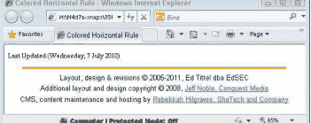

图 5-8：EdTittel.com 首页使用彩色分隔线将页面内容与页脚信息分开。

> 正如文件头中的 `<style>` 部分清晰展示的那样，CSS 让您能够极大地控制水平分隔线的颜色、宽度和页面覆盖范围。

## 组织信息

列表是分组相似元素的强大工具，它们为网站访问者提供了一种便捷的方式来聚焦信息组。几乎所有内容都适合放入列表，从一组组指令到一系列链接集合。

列表使用元素的组合——至少包含两个组件：

- 一个标记元素，用于声明：“嘿，浏览器！接下来的项目要放入列表。”
- 用于声明项目内容的标记元素，例如：“嘿，浏览器！这是列表中的一个项目。”

HTML 支持三种类型的列表：

- 有序列表
- 无序列表
- 定义列表

## 有序列表

有序列表至少包含两个项目，每个项目前都有一个编号。当项目的顺序或优先级很重要时，请使用有序列表。

创建有序列表需要使用两种元素：

- 有序列表元素（`<ol>`）用于指定一个编号列表。
- 列表项元素（`<li>`）用于标记列表中的每个项目。

### 格式

一个包含三个项目的有序列表需要按照以下顺序排列元素和内容：

1. `<ol>`
2. `<li>`
3. 第一个列表项的内容
4. `</li>`
5. `<li>`
6. 第二个列表项的内容
7. `</li>`
8. `<li>`
9. 第三个列表项的内容
10. `</li>`
11. `</ol>`

以下标记定义了一个包含三个项目的有序列表：

```html
<!DOCTYPE html PUBLIC "-//W3C//DTD XHTML 1.0 Transitional//EN"
    "http://www.w3.org/TR/xhtml1/DTD/xhtml1-transitional.dtd">
<html xmlns="http://www.w3.org/1999/xhtml" xml:lang="en" lang="en">
  <head>
    <meta http-equiv="Content-Type" content="text/html; charset=ISO-8859-1" />
    <title>Numbered Lists</title>
  </head>

  <body>
    <h1>Things to do today</h1>
    <ol>
      <li>Feed cat</li>
      <li>Wash car</li>
      <li>Grocery shopping</li>
    </ol>
  </body>
</html>
```

图 5-9 展示了浏览器如何渲染此标记。您实际上不需要为列表中的每个项目指定编号；浏览器会根据标记识别出列表项，并默认添加编号（包括每个编号后的句点）。

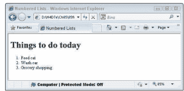

图 5-9：使用 `<ol>` 和 `<li>` 标签创建有序列表。

如果您交换列表中的前两个项目，页面显示时它们仍然是按顺序编号的，如图 5-10 所示。

```html
<ol>
  <li>Wash car</li>
  <li>Feed cat</li>
  <li>Grocery shopping</li>
</ol>
```

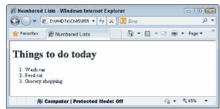

图 5-10：网络浏览器根据项目出现的顺序为列表设置编号。

### 编号

两种不同的 `<ol>` 属性控制着有序列表的外观：

- **start**：指定列表的起始编号。
  - 默认起始编号是 1，但您可以将任何数字指定为新列表的起始编号。


- 当您在无编号段落或其他块级元素后恢复列表时，请指定起始编号。


- `type`：指定列表的编号样式。您可以从五种预定义的编号样式中选择：

| 值 | 样式 |
|---|---|
| `1` | 十进制数字 |
| `a` | 小写罗马字母 |
| `A` | 大写罗马字母 |
| `i` | 小写罗马数字 |
| `I` | 大写罗马数字 |

以下标记使用有序列表元素和属性来构建一个从 5（罗马数字中的 V）开始、使用大写罗马数字的列表：

```html
<ol start="5" type="I">
  <li>Wash car</li>
  <li>Feed cat</li>
  <li>Grocery shopping</li>
</ol>
```

图 5-11 展示了属性如何影响浏览器中列表的外观。

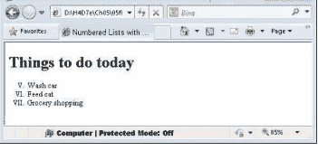

图 5-11：`start` 和 `type` 属性决定了有序列表在浏览器中的显示方式。

如果您使用 CSS 来定义格式，就能更精确地控制列表。这就是为什么列表标记的 `start` 和 `type` 属性已被弃用（即，在当前版本的 HTML 中被视为过时而被放弃）。

## 无序列表

无序列表由一个或多个项目组成，每个项目前都有一个项目符号（通常是圆点；本书有时也使用对勾符号作为项目符号）。

如果项目的呈现顺序对于理解所呈现的信息不是必需的，请使用这种类型的列表。

### 格式

无序列表需要以下内容：

- 无序列表元素（`<ul>`）用于指定一个带项目符号的列表。
- 列表项元素（`<li>`）用于标记列表中的每个项目。
- 无序列表元素的结束标签（`</ul>`）表示列表已结束。

一个包含三个项目的无序列表（bulleted list 的另一种名称）需要按照以下顺序排列元素和内容：

1. `<ul>`
2. `<li>`
3. 第一个列表项的内容
4. `</li>`
5. `<li>`
6. 第二个列表项的内容
7. `</li>`
8. `<li>`
9. 第三个列表项的内容
10. `</li>`
11. `</ul>`

以下标记将一个包含三个项目的列表格式化为带项目符号的列表：

```html
<!DOCTYPE html PUBLIC "-//W3C//DTD XHTML 1.0 Transitional//EN"
    "http://www.w3.org/TR/xhtml1/DTD/xhtml1-transitional.dtd">
<html xmlns="http://www.w3.org/1999/xhtml" xml:lang="en" lang="en">
  <head>
    <meta http-equiv="Content-Type" content="text/html; charset=ISO-8859-1" />
    <title>Bulleted Lists</title>
  </head>

  <body>
    <h1>Things to do today</h1>
    <ul>
      <li>Feed cat</li>
      <li>Wash car</li>
      <li>Grocery shopping</li>
    </ul>
  </body>
</html>
```

图 5-12 展示了浏览器如何用项目符号渲染这个列表。

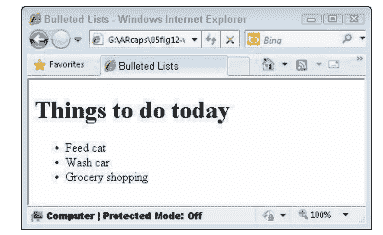

图 5-12：无序列表使用项目符号而不是数字来标记项目。

如果您想对列表的格式施加更多控制，包括使用自定义图形作为项目符号的能力，请使用 CSS。

## 定义列表

定义列表将术语和定义组合成一个单一的列表，需要三种不同的元素来完成列表：

- `<dl>`：包含列表定义（dl = definition list）
- `<dt>`：定义列表中的一个术语（dt = definition term）
- `<dd>`：定义一个术语的定义（dd = definition list definition）

您可以在一个列表（`<dl>`）中根据需要包含任意多个术语（由 `<dt>` 定义）。每个术语可以有一个或多个定义（由 `<dd>` 定义）。

创建一个包含两个项目的定义列表需要按照以下顺序排列元素和内容：

1. `<dl>`
2. `<dt>`
3. 第一个术语名称
4. `</dt>`
5. `<dd>`
6. 第一个项目的定义内容
7. `</dd>`
8. `<dt>`
9. 第二个术语名称
10. `</dt>`
11. `<dd>`
12. 第二个项目的定义内容
13. `</dd>`
14. `</dl>`

以下定义列表包含三个术语，其中一个术语有两个定义：

```html
<!DOCTYPE html PUBLIC "-//W3C//DTD XHTML 1.0 Transitional//EN"
    "http://www.w3.org/TR/xhtml1/DTD/xhtml1-transitional.dtd">
<html xmlns="http://www.w3.org/1999/xhtml" xml:lang="en" lang="en">
<head>
    <meta http-equiv="Content-Type" content="text/html; charset=ISO-8859-1" />
    <title>Definition Lists</title>
</head>

<body>
    <h1>Markup Language Definitions</h1>
    <dl>
        <dt>SGML</dt>
            <dd>The Standard Generalized Markup Language</dd>
        <dt>HTML</dt>
            <dd>The Hypertext Markup Language</dd>
            <dd>The markup language you use to create Web pages.</dd>
        <dt>XML</dt>
            <dd>The Extensible Markup Language</dd>
    </dl>
</body>
</html>
```

图 5-13 展示了浏览器如何显示此 HTML。

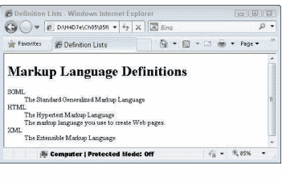

> 提示：如果您觉得列表中的项目间距过近，可以使用 CSS 样式来精细控制列表外观的各个方面，如第 9 章所示。

## 嵌套列表

你可以通过将列表*嵌套*在列表内来创建子类别。嵌套列表的一些常见用途包括：

- 网站地图和其他导航工具
- 在线书籍和论文的目录
- 大纲

你可以组合三种列表中的任意一种来创建*嵌套列表*，例如多级目录或混合了编号标题与项目符号列表项作为最低大纲级别的大纲。

以下示例从一个编号列表开始，该列表定义了当天要做的事情清单，并使用三个项目符号列表将这些项目进一步分解为具体任务：

```html
<!DOCTYPE HTML PUBLIC "-//W3C//DTD HTML 4.01 Transitional//EN">
<html>
  <head>
    <meta http-equiv="Content-Type" content="text/html; charset=UTF-8">
    <title>Nested Lists</title>
  </head>

  <body>
    <h1>Things to do today</h1>
    <ol>
      <li>Feed cat
        <ul>
          <li>Rinse bowl</li>
          <li>Open cat food</li>
          <li>Mix dry and wet food in bowl</li>
          <li>Deliver on a silver platter to Pixel</li>
        </ul>
      </li>
      <li>Wash car
        <ul>
          <li>Vacuum interior</li>
          <li>Wash exterior</li>
          <li>Wax exterior</li>
        </ul>
      </li>
      <li>Grocery shopping
        <ul>
          <li>Plan meals</li>
          <li>Clean out fridge</li>
          <li>Make list</li>
          <li>Go to store</li>
        </ul>
      </li>
    </ol>
  </body>
</html>
```

所有嵌套列表都遵循相同的标记模式：

- 顶层有序列表中的每个列表项之后都跟着一个完整的二级列表。
- 二级列表位于顶层列表内部，而不是在列表项内部。

图 5-14 显示了浏览器如何在其显示中反映这种嵌套。

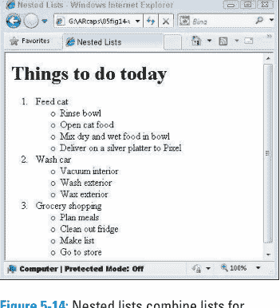

在构建嵌套列表时，请仔细观察开始和结束标签。*最后打开的最先关闭*是一个重要的原则。如果没有正确地打开和关闭标签，列表可能无法使用一致的缩进或编号，或者文本可能因为某个列表从未正确关闭而错误地缩进。

## 第 6 章：链接到在线资源

### 本章内容

- 创建简单链接
- 在新窗口中打开链接页面
- 设置指向网页内特定位置的链接
- 创建指向非网页资源的链接

超链接，或简称为链接，连接着 Web 上的 (X)HTML 页面和其他资源。当你在页面中包含一个链接时，你就使访问者能够从你的页面跳转到另一个网站、你网站上的另一个页面，甚至是同一页面上的另一个位置。没有链接，页面就是一个孤立的个体，与 Web 的其他部分脱节。有了链接，该页面就成为了万维网这个几乎无边无际的信息集合的一部分。

### 基本链接

要创建一个链接，你需要：

- **Web 地址**（称为统一资源定位符；URL），即作为链接目标的网站或文件的地址。它通常以 `http://` 开头。
- Web 页面中的**一些文本**，用于标记或描述链接。请尽量确保你使用的文本能提供关于所链接资源的有用信息。
- **一个带有 `href` 属性的锚点元素（`<a>`）**，将所有这些元素组合在一起。用于创建链接的元素称为*锚点元素*，因为你用它来将 URL 锚定到页面上的某些文本。当用户在浏览器中查看你的页面时，他们可以单击该文本来激活链接并访问你在该链接中指定的 URL 的页面。你将完整的 URL 插入到 `href` 属性中。这会告诉链接应该跳转到哪里。

你可以将基本链接的结构想象成一个芝士汉堡（或你喜欢的素食替代品）。URL 是奶酪，链接文本是肉饼，锚点标签是面包。很美味，对吧？

例如，如果你有一个描述 HTML 标准的网页，你可能希望引导网络冲浪者访问万维网联盟 (W3C) —— 一个管理所有与 (X)HTML 标准相关事务的组织。指向 W3C 网站 `www.w3.org` 的一个基本链接如下所示：

```html
<p>The <a href="http://www.w3.org">World Wide Web Consortium</a> is the standards body that oversees the ongoing development of the XHTML specification.</p>
```

你在锚点元素的 `href` 属性中指定链接 URL（`http://www.w3.org`）。锚点元素的开始和结束标签（`<a>` 和 `</a>`）之间的文本（World Wide Web Consortium）标记或描述了该链接。

图 6-1 显示了浏览器如何显示这段标记。

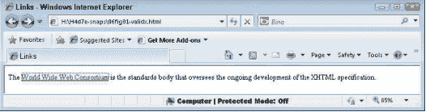

你还可以将 URL 锚定到图像上，这样用户就可以单击图像来激活链接。有关创建链接图像的更多信息，请参阅第 7 章。有关 URL 详细讨论，请参阅第 1 章。

### 链接选项

你可以链接到各种在线资源：

- 其他 (X)HTML 页面（在你的网站上或在另一个网站上）
- 同一个 (X)HTML 页面上的不同位置
- 根本不是 (X)HTML 页面的资源，例如电子邮件地址、图片和文本文件

### 锚点元素不是块级元素

锚点元素是*内联元素*——也就是说，它们适用于文本块中的一些单词或字符（你想要用作链接的文本），而不是为文本块定义格式。锚点元素通常位于段落（`<p>`）或其他块级元素内，例如段落或列表项。当你创建链接时，你应该始终在块级元素内创建它，例如段落、列表项、标题甚至表格单元格。有关块级元素的更多信息，请参阅第 5 章。

尽管许多 Web 浏览器即使你没有将它们嵌套在块级元素中也能很好地显示锚点，但有些浏览器（如下所列）对此类 (X)HTML 语法违规的处理效果不佳：

- 用于手持设备或移动电话的纯文本浏览器
- 用于视障人士的文本转语音阅读器

基于文本的浏览器依赖块级元素来正确划分页面的各个部分。没有块级元素，这些浏览器可能会将你的链接显示在错误的位置。

链接的位置、标题和目的地对网站访问者如何感知链接有着巨大的影响。第 3 章介绍了在网站设计中使用链接的最佳实践。

你创建的链接类型取决于你链接到的位置。

### 绝对链接

*绝对链接*使用完整的 URL 将浏览器连接到网页或在线资源。

使用完整 URL 指向资源的链接被称为*绝对*链接，因为它们提供了指向另一个 Web 资源的完整、独立的路径。当你链接到别人网站上的一个页面时，Web 浏览器需要 URL 中的每一点信息来找到该页面。浏览器从 URL 中的域名开始，沿着路径找到特定文件。

当你链接到别人网站上的文件时，必须在锚点元素的 `href` 属性中使用绝对 URL。以下是一个示例：

```text
http://www.website.com/directory/page.html
```

### 相对链接

*相对链接*使用一种简写来指定你指向的资源的 URL。

在 (X)HTML 页面中使用相对链接时，请遵循以下准则：

- 在同一域中的资源之间创建相对链接。
- 因为两个资源都在同一域中，所以从 URL 中省略域信息。

> 相对 URL 使用你链接到的资源的位置来标识你链接到的资源的位置（例如，`page.html`）。

相对链接类似于告诉某人他或她需要去东区购物中心。如果这个人已经知道东区购物中心在哪里，他或她就不需要额外的指引。Web 浏览器的行为方式相同。

如果你在网站上使用相对链接，即使你更改了：

- 服务器
- 域名

你的链接仍然有效。

### 简单链接

当你在同一网站的页面之间创建链接时，可以利用相对 URL。如果你想从 `http://www.mysite.com/home.html` 创建一个到 `http://www.mysite.com/about.html` 的链接，你可以在 `home.html` 上的锚点元素中使用这个简化的相对 URL：

```html
<p>Learn more <a href="about.html">about</a> our company.</p>
```

当浏览器看到一个没有域名的链接时，浏览器会假设该链接是相对的，并使用链接页面中的域名和路径来查找被链接的页面。不过，前面的示例仅在 `home.html` 和 `about.html` 位于同一目录中时才有效。

### 站点链接

随着你的网站变得越来越复杂，并且你将文件组织到不同的文件夹中，你仍然可以使用相对链接。但是，你必须在相对 URL 中提供额外的信息，以帮助浏览器找到与你链接所在的文件不在同一目录中的文件。

在文件名前使用 `../`（两个点和一个斜杠）表示浏览器应在目录结构中向上移动一级。

此过程的标记如下所示：

```html
<a href="../docs/home.html">Documentation home</a>
```

## (XHTML) 链接中 `http://` 的重要性

浏览器让上网冲浪变得尽可能简单。如果你在浏览器的地址栏中输入 `www.sun.com`、`sun.com`，或者通常甚至只输入 *sun*，浏览器会贴心地调出 `http://www.sun.com`。虽然当你在浏览器窗口中输入网址时这种技术有效，但当你编写标记语言时，它却不起作用。

你在 HTML 标记中使用的网址必须是*完全格式化*的（在所有细节上完整）。浏览器不会解释不包含页面协议的网址。如果你忘了 `http://`，你的链接可能就无法工作！

此锚点元素中的标记指示浏览器：

1. 从链接文档所在的文件夹向上移动一级。
2. 找到一个名为 **docs** 的文件夹。
3. 找到一个名为 **home.html** 的文件。

当你创建相对链接时，你链接*到*的文件的位置总是相对于你链接*从*来的文件。当你创建相对网址时，如果浏览器从你链接所在的页面开始，要到达你链接到的页面，请追踪浏览器采取的路径。该路径定义了你需要的网址。

## 常见错误

每个网络资源——网站、页面或图片——都有一个唯一的网址。网址中一个不正确的字母就会产生一个*失效链接*，导致错误页面（通常是 HTTP 错误 `404 文件或目录未找到`）。


网址是如此挑剔，以至于一个简单的拼写错误就会使链接失效。

如果一个网址不起作用，可以尝试以下策略：

> ✓ **检查大小写。** 一些网络服务器（尤其是 Linux 和 Unix）是*区分大小写*的（它们区分大写字母和小写字母）。例如，这样的服务器将文件名`Bios.html`和`bios.html`视为网络服务器上的不同文件。这意味着任何寻找特定网址的浏览器*必须*在必要时使用大写和小写字母。确保链接中的大小写与网址的大小写匹配。

为了避免网站上的文件出现问题，请遵循标准命名约定。通常，只使用小写字母可以简化你的工作。

> ✓ **检查扩展名。** `Bios.htm`和`Bios.html`是两个不同的文件。如果你的链接网址使用一个扩展名，而实际文件名使用另一个，你的链接将无法工作。

为了避免网站上的扩展名问题，选择`.html`或`.htm`*并坚持使用该扩展名*。

> ✓ **检查文件名。** 例如，`bio.html`和`bios.html`是两个不同的文件。

> ✓ **复制粘贴。** 如果可以复制，请避免重新输入网址。创建一个有效网址的最佳且最万无一失的方法如下：

> *a. 在浏览器中加载一个页面。*

> *b. 从浏览器的地址栏或链接文本框中复制网址。*

> *c. 将网址粘贴到你的 (X)HTML 标记中。*

用于抓取网址的复制粘贴方法假定你从某个网站抓取它们。如果你在浏览器中打开 PC 上的一个本地文件，你会看到类似这样的内容：`file:\\I:\H4D6e\html_letter.html`。以下是解析所有内容的方法：

> ✓ `file:\\`是 Internet Explorer 的一个约定，用于标识该文档是你本地文件系统中的一个文件。

> ✓ `I:\`是一个驱动器号。

> ✓ `H4D6e\`是该驱动器上的一个文件夹或目录。

> ✓ `html_letter.html`——在这种情况下是最右边的文本元素——是你打开的 HTML 文件的名称。

你不能在网站上使用这样的网址，所以请不要尝试！

我们大多数人至少有一次收到过因地址不完整或不准确而被退回的信件，上面写着无法投递。当地址不正确时，邮局无法知道如何定位预期的收件人。网址也是如此。如果没有完全格式化的网址，网络服务器不知道如何定位目标网页。网址通常采用以下形式：

> ✓ **协议标识符后跟冒号 (:)** ——这通常是用于超文本传输协议的`http`，用于安全服务器站点的`https`，或用于文件传输站点的`ftp`。

> ✓ **主机名** ——这通常是域名（如 editittel.com）或 IP 地址。主机名前面总是有两个斜杠 (//)。

> ✓ **目录路径** ——目录路径前面有一个正斜杠 (/)，它们将用户定向到所寻求的特定网页。

因此，完全格式化网址的形式是`<protocolidentifier>://<hostname>/<directorypath>`或`http://www.mywebsite.com/mywebpage`。

## 自定义链接

你可以自定义链接以

- 在新窗口中打开链接的文档
- 链接到你自己网页中的特定位置
- 链接到 (X)HTML 页面以外的项目，例如
  - 便携式文档格式 (PDF) 文件
  - 压缩文件
  - 文字处理文档

## 新窗口

网络之所以能工作，是因为你可以通过使用一个简单的锚点元素将你网站上的页面链接到其他人网站上的页面。但是，当你链接到别人的网站时，你实际上是把用户从你自己的网站上送走了。

为了让用户留在你的网站上，HTML 可以在新窗口或同一浏览器窗口中的新标签页中打开链接的页面。（Internet Explorer、Firefox、Chrome 和其他浏览器会打开新标签页。如果你愿意，你可以将 Internet Explorer 和其他浏览器的首选项设置为在新窗口中打开，而不是在新标签页中打开。）在锚点元素中简单地添加`target`属性，就会在新的浏览器窗口（或标签页）中打开该链接，而不是在当前窗口中打开：

```html
<p>The <a href="http://www.w3.org" target="_blank">World Wide Web Consortium</a> is the standards body that oversees the ongoing development of the XHTML specification.</p>
```

当你给`target`属性一个`_blank`值时，这会告诉浏览器

1. 保持链接页面在当前窗口中打开。
2. 在新窗口或标签页中打开链接的页面。

无论你使用哪种文档类型 (DTD)（严格型或过渡型），如果你向锚点添加目标，都可能使你的代码无效。如果你使用严格型 DTD，那么新窗口，或任何使用`target`属性的情况，都会使你的标记无效。如果你在向锚点添加目标之前就知道你正在使用哪种文档类型，这可以为你节省数小时的时间（更不用说那些头疼事了！），特别是当你的标记无法验证而你试图找出原因时！DTD 在第 4 章中有详细介绍，请查阅以获取更多信息。

使用`target="_blank"`属性的结果如图 6-2 所示。

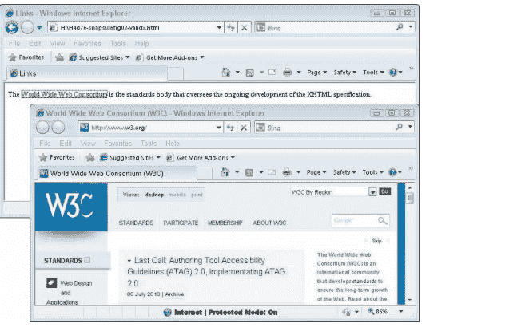

**图 6-2：** 使用`target`属性为链接文件打开一个新的 Internet Explorer 窗口。

> 弹出窗口会激怒一些用户。请谨慎使用此技术——并且要节制。此外，使用`target`属性在 XHTML 严格型 DTD 中将无法通过验证（不过在过渡型 DTD 中可以正常工作）。

你可以使用 JavaScript 来控制弹出窗口的大小、位置和外观，以及在它们上面放置按钮以帮助用户快速关闭它们。第 13 章更详细地介绍了弹出窗口——包括 JavaScript 细节。

## 网页中的位置

网页中的位置可以标记出来，以便通过以下位置的链接直接访问

- 同一页面
- 同一网站
- 其他网站

在向网页添加链接时，请记住以下几点：

> 提示：对于读者来说，几个简短的页面可能比一个带有内部链接的长页面更方便地呈现信息。大型页面中的链接对于快速访问目录、目录表和词汇表非常有效。

> 警告！：文档内链接在你自己的网站上效果最好，在那里你可以创建和控制标记。当你链接到别人网站上的位置时，你受其管理者的摆布，因为那个人控制着可链接的位置。如果网站设计师删除或重命名了你链接的任何位置，你的链接将会失效。

## 命名链接位置

要标识并创建一个页面内的位置以供其他链接直接访问，请使用带有`name`属性的空锚点元素，如下所示：

```html
<a name="top"></a>
```

> 记住：标记该位置的锚点元素不会影响任何周围内容的外观。你可以在需要的地方标记位置，而不用担心你的页面外观会如何改变。

## 链接到命名位置

正如我们之前提到的，你可以标记位置以便通过链接直接访问

- 同一页面内
- 同一网站内
- 其他网站上

## 第二部分：使用 (X)HTML 格式化网页

在同一页面内，链接可以帮助用户浏览单个网页。文档内超链接包括以下常见功能：

- 返回顶部链接
- 目录

文档内超链接，也称为命名文档链接，使用如下形式的 URL：

```
<a href="#top">Back to top</a>
```

井号（#）表示您指向的是当前页面上的一个位置，而非另一个页面上的位置。

代码清单 6-1 展示了如何将两个锚点元素组合起来，链接到同一页面上的某个位置。（使用文档内链接的文档通常较长。本文档较短，以便您能轻松看到顶部锚点元素的使用方法。）

### 代码清单 6-1：文档内超链接

```
<!DOCTYPE html PUBLIC "-//W3C//DTD XHTML 1.0 Transitional//EN"
"http://www.w3.org/TR/xhtml1/DTD/xhtml1-transitional.dtd">
<html xmlns="http://www.w3.org/1999/xhtml" lang="en" xml:lang="en">
<head>
  <meta http-equiv="Content-Type" content="text/html; charset=ISO-8859-1" />
  <title>Intradocument hyperlinks at work</title>
</head>
<body>
  <h1><a name="top"></a>Web-Based Training</h1>
  <p>Given the importance of the Web to businesses and other organizations,
  individuals who seek to improve job skills, or fulfill essential job
  functions, are turning to HTML and XML for training. We believe this
  provides an outstanding opportunity for participation in an active and
  lucrative adult and continuing education market.</p>
  <p><a href="#top">Back to top</a></p>
</body>
</html>
```

## 第六章：链接到在线资源

图 6-3 展示了此 HTML 标记在 Web 浏览器中的显示效果。如果用户点击“返回顶部”链接，浏览器将跳转回顶部位置——该位置由`<a name="top"></a>`标记。此示例的文本较短，但您可以通过调整浏览器窗口大小，使每行仅显示两三个单词，来观察其工作原理。

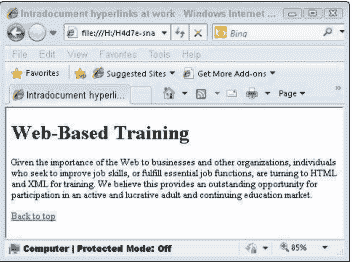

图 6-3：使用锚点元素标记页面上的位置并创建链接。

## 在同一网站内

您可以组合使用文档内和文档间链接，将访问者引导至您网站上另一个网页的某个位置。因此，要链接到您网站上名为`home.html`的页面中名为`descriptions`的位置，请使用以下标记：

```
<p>Review the <a href="home.html#descriptions">document descriptions</a>
	to find the documentation for your particular product.</p>
```

## 在其他网站上

如果您知道另一个网站上的某个页面有标记位置，您可以使用绝对 URL 指向该页面上的特定位置，如下所示：

```
<p>Find out how to
<a href="http://www.yourcompany.com/training/online.htm#register">
register</a> for upcoming training courses led by our instructors.</p>
```

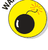

请务必定期检查所有链接，以便发现并修复断开的链接。

开放目录项目提供了大量免费和商业工具，可以帮助您更轻松地查找和修复断开的链接：

```
http://www.dmoz.org/Computers/Software/Internet/Site_Management/Link_Management/
```

## 非 HTML 资源

链接几乎可以连接到任何类型的文件，例如：

- 文字处理文档
- 电子表格
- PDF 文件
- 压缩文件
- 多媒体

非 HTML 链接的两个绝佳用途是软件和 PDF 下载页面。

### 文件下载

非 Web 文件也必须通过互联网访问，因此它们拥有独特的 URL，就像 HTML 页面一样。Web 服务器上的任何文件（无论其类型）都可以使用 URL 进行链接。

例如，如果您希望用户从网页下载一个名为`doc.pdf`的 PDF 文件和一个名为`software.zip`的 Zip 压缩包，请使用以下 HTML 代码：

```
<h1>Download the new version of our software</h1>
<p><a href="software.zip">Software</a></p>
<p><a href="doc.pdf">Documentation</a></p>
```


您无法预知用户浏览器对点击指向非 Web 文件的链接会做出何种反应。浏览器可能会：

- 提示用户保存文件
- 不下载文件而直接显示文件内容（对于 PDF 很常见）
- 显示错误消息（如果浏览器无法处理或无法识别相关文件类型）


为帮助用户成功下载文件，您应该向用户提供：

- 关于所用文件格式的尽可能多的信息
- 处理文件所需的任何特殊工具
  - *压缩文件*：要处理 Zip 文件的内容，如果用户的操作系统本身不支持 Zip 文件，他们需要使用压缩实用程序，例如 WinZip 或 ZipIt。
  - *PDF 文件*：要查看 PDF 文件，用户需要免费的 Adobe Acrobat Reader。

第六章：链接到在线资源

您可以通过添加说明文字和链接，使下载标记更友好，如下所示：

```
<h1>Download our new software</h1>
<p><a href="software.zip">Software</a></p>
<p><b>Note:</b>
You need a zip utility such as
<a href="http://www.7-zip.org">7Zip</a> (Windows) or
<a href="http://www.maczipit.com">ZipIt</a> (Macintosh)
to open this file.</p>
<p><a href="doc.pdf">Documentation</a></p>
<p><b>Note:</b> You need the free
<a href="http://get.adobe.com/reader/">Adobe Reader</a>
to view this file.</p>
```

图 6-4 展示了浏览器如何呈现此 HTML——以及您点击“Software”链接时它显示的对话框。

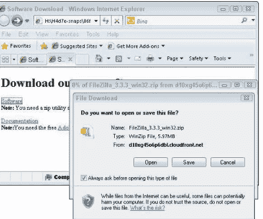

图 6-4：此浏览器提示您保存或查看 Zip 文件。

## 电子邮件地址

指向电子邮件地址的链接可以自动打开一个新的电子邮件窗口，并填写好正确的收件人地址。这是帮助用户向您发送评论和请求邮件的好方法。


104 第二部分：使用 (X)HTML 格式化网页

电子邮件链接使用标准的锚点元素和`href`属性。`href`属性的值是接收电子邮件地址，前面加上`mailto:`。

```
<p>Send us your
<a href="mailto:comments@mysite.com">comments</a>.</p>
```


用户的浏览器配置决定了浏览器如何处理电子邮件链接。大多数浏览器会自动执行以下两个基本步骤：

1. 在默认的电子邮件程序中打开一个新的邮件撰写窗口。
2. 将`href`属性中的地址插入到邮件的“收件人”字段中。


不幸的是，网页的`mailto:`链接是垃圾邮件发送者获取电子邮件地址的主要来源之一。创建一个接收反馈的表单通常是更好的选择；更好的做法是在电子邮件地址上使用 JavaScript 加密。（更多信息，请参阅 Steven Chapman 的优秀文章“隐藏您的电子邮件地址”，网址为`http://javascript.about.com/library/blemail1.htm`。）我们通常倾向于以`jeff at conquest media dot com`的形式提供电子邮件地址，知道人们足够聪明，会用`@`替换`at`，用`.`替换`dot`，但地址收集者通常没那么精明。如果您确实选择使用表单，请注意这也可能带来安全问题——务必验证您的输入，或采取措施避免所谓的 SQL 注入攻击。更多信息，请参阅 Colin Mackay 的文章“SQL 注入攻击及一些预防技巧”，网址为`www.codeproject.com/KB/database/SQLInjectionAttacks.aspx`。

## 第七章

# 查找和使用图片

### 本章内容

- 确定图片的合适格式
- 将图片添加到网页
- 创建可触发链接的图片和图像地图


网页设计师使用图片来传递重要信息、引导网站导航，并为网页的整体外观和感觉做出贡献。然而，您必须正确使用图片，否则可能会降低其效果。

使用得当，图片是页面设计的关键元素。使用不当，它们则可能使页面难以阅读、难以理解或无法访问。


本章是关于如何在网页上使用图片的速成课程。您将了解哪些图像格式对 Web 友好，以及如何使用 (X)HTML 元素将图片添加到您的网页。您还将了解如何将链接附加到图片，以及如何为网页创建图像地图。

## 图片在网页中的作用

网站中的图片可以是标志或可点击的导航辅助工具，也可以展示内容；它们还可以使页面看起来更美观，或者用于统一或阐释页面主题。白宫主页 (`www.whitehouse.gov`) 是图片以多种方式增强和贡献于网页的完美示例，如图 7-1 所示，其中白宫标志、照片甚至美国国徽都被有效地运用。

## 第二部分：使用 (X)HTML 格式化网页

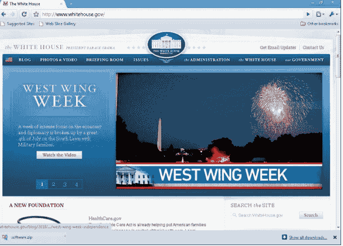

图 7-1：白宫网页以多种方式使用图像。

## 创建适合网络的图像

你可以通过多种方式创建和保存图形，但只有少数几种格式实际上适合用于打算在网页上展示的图像。在创建适合网络的图像时，你必须注意文件格式和大小。

通常，图形文件格式是特定于操作系统或软件应用程序的。由于你无法预测访问者的计算机和软件会是什么（除了他们会使用某种网络浏览器），你需要任何人都能用任何浏览器查看的图像。这意味着你需要使用*跨平台*的文件格式，用户可以使用任何版本的 Microsoft Windows、Mac OS 或 Linux 查看。

这三种压缩图形格式最适合在网络上通用：

- **图形交换格式 (GIF)：** 保存为 GIF 的图像通常比保存为其他格式的文件更小。GIF 仅支持最多 256 种颜色，因此如果你尝试将一张具有数百万种颜色的图像保存为 GIF，你会损失图像质量。GIF 是不太复杂、非摄影图像（如线条图和剪贴画）的最佳格式。
- **联合图像专家小组 (JPEG)：** JPEG 文件格式支持 24 位颜色（数百万种颜色）和复杂图像，如照片。JPEG 是跨平台且与应用程序无关的。一个好的图像编辑工具可以帮助你调整压缩，以便在图像质量和文件大小之间找到最佳平衡。
- **便携式网络图形 (PNG)：** PNG 是最新的跨平台且与应用程序无关的图像文件格式。它的开发旨在汇集 GIF 和 JPEG 的最佳方面。PNG 具有与 GIF 相同的压缩方式，但像 JPEG 一样支持 24 位颜色（甚至 32 位颜色）。

任何好的图形编辑工具（如第 23 章中提到的那些）都允许你将图像保存为这些格式中的任何一种。尝试它们，看看将图形从一种格式转换为另一种格式如何改变其外观和文件大小，然后选择产生最佳效果的格式。

表 7-1 显示了按图像类型选择文件格式的指南。

| 文件格式 | 最佳用途 | 注意事项 |
|---|---|---|
| GIF | 线条图和其他颜色较少、细节较少的图像 | 如果图像是复杂的图像或照片，请不要使用此格式。 |
| JPEG | 照片和其他具有数百万种颜色和大量细节的图像 | 不要用于线条图。当压缩文件时，此格式会过多地损失质量。 |
| PNG | 照片和其他具有数百万种颜色和大量细节的图像 | 不要用于线条图。PNG 在质量和文件大小之间提供了最佳平衡。 |

## 优化图像

在为网页构建图形时，请在文件质量和文件大小之间保持健康的平衡。如果你用喜欢的搜索引擎查找，可以找到关于缩减图像文件大小和优化整个网站以实现快速下载的优秀教程。有关帮助你构建快速下载页面的提示和技巧，请查阅以下便捷资源：

- 优化图像：`www.yourhtmlsource.com/optimisation/image optimisation.html`
- 优化网络图形：`www.websiteoptimization.com/speed/12`

有关图形格式的完整概述，请访问：

- W3C 的“网络上的图形”文章：`www.w3.org/Graphics`
- Quackit.com 的网络图形教程：`www.quackit.com/web_graphics/tutorial`

## 将图像添加到网页

当图像准备好用于网络时，你需要使用正确的标记将其添加到页面，但你也需要知道将图像存储在哪里。

### 图像位置

你可以将网站的图像存储在多个地方。如果使用*相对* URL 存储效果最佳——存储在网站上与其他 (X)HTML 文件一起的位置。你可以将图像存储在与 (X)HTML 文件相同的根目录下，如果你有很多文件，这可能会造成混淆，或者你可以在网站的根文件中创建一个 `graphics` 或 `images` 目录。

相对链接连接来自同一网站的资源。你使用绝对链接连接两个不同网站上的资源。有关相对链接和绝对链接之间区别的完整讨论，请参阅第 6 章。

以下是将图像存储在自己网站上的三个令人信服的理由：

- **控制权：** 当图像存储在你的网站上时，你保持对它们的完全控制。你知道你的图像不会消失或改变，你可以优化它们。
- **速度：** 如果你链接到其他网站上的图像，你永远不知道该网站何时可能宕机或响应极慢。链接到其他网站上的图像也会导致该网站的所有者为显示在你的页面上（在另一个网站上！）所需的带宽付费。
- **版权：** 如果你链接到另一个网站上的图像以在你的页面上显示它们，你可能违反版权法。如果你必须这样做，请获得版权所有者的许可，以便在你的网站上存储和显示图像。

### 使用 `` 元素

图像 (``) 元素是一个*空*元素（有时称为*单例标签*），你将其放置在页面上你希望图像显示的位置。

空元素只使用一个标签，没有单独的开始或结束标签。

以下标记将一个名为 `07fg02-cd.jpg` 的图像（保存在与 (X)HTML 文件相同的目录中）放置在两个段落之间：

```html
<!DOCTYPE html PUBLIC "-//W3C//DTD XHTML 1.0 Transitional//EN"
    "http://www.w3.org/TR/xhtml1/DTD/xhtml1-transitional.dtd">
<html xmlns="http://www.w3.org/1999/xhtml" lang="en" xml:lang="en">
<head>
    <meta http-equiv="Content-Type" content="text/html; charset=ISO-8859-1" />
    <title>Optical Disks at Work</title>
</head>
<body>
    <h1>CD/DVD as a Storage Medium</h1>
    <p>CD-ROMs and DVDs have become a standard storage option in today's computing
    world because they are inexpensive and easy to use.</p>
    
    <p>To read from a CD or DVD, you only need a standard CD-ROM drive, but to
    create CDs or DVDs, you need a DVD burner (all DVD burners can read
    and write CDs as well).</p>
</body>
</html>
```

网络浏览器将 `` 元素替换为作为 `src` 属性值提供的图像文件，如图 7-2 所示。

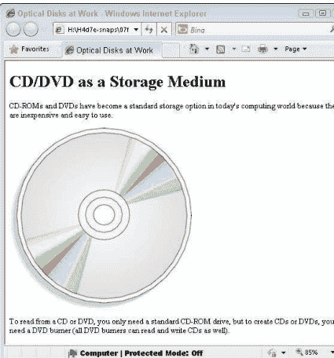

图 7-2：使用 `` 元素在网页中放置图形。

`src` 属性类似于你用于锚点 (`<a>`) 元素的 `href` 属性。`src` 属性指定你希望在页面上显示的图像的位置。前面的示例指向与引用它的 HTML 文件位于同一文件夹中的图像文件。

## 添加替代文本和标题文本

*替代文本*描述图像，以便那些由于某种原因无法看到图像的人可以访问该文本以了解更多关于图像的信息。添加替代文本（通常被 HTML 从业者称为“alt 文本”）是一种好的做法，因为它考虑到了：

- 视力受损的用户可能无法看到图像，必须依靠替代文本来让文本到语音阅读器为他们朗读。
- 使用图形功能有限的手机浏览器访问网站的用户。
- 使用调制解调器连接速度较慢且不显示图像的用户。

一些搜索引擎和编目工具使用替代文本来索引图像。

你的大多数用户会看到你的图像，但要为那些不会看到的人做好准备。(X)HTML 规范要求你提供替代文本来描述网页上的每个图像。在 `` 元素上使用 `alt` 属性将此信息添加到你的标记中，如下所示：

```html
<!DOCTYPE html PUBLIC "-//W3C//DTD XHTML 1.0 Transitional//EN"
        "http://www.w3.org/TR/xhtml1/DTD/xhtml1-transitional.dtd">
<html xmlns="http://www.w3.org/1999/xhtml" lang="en" xml:lang="en">
<head>
    <meta http-equiv="Content-Type" content="text/html; charset=ISO-8859-1" />
    <title>Inside the Orchestra</title>
</head>
<body>
    <p>Among the different sections of the orchestra you will find:</p>
    <p> Strings</p>
    <p> Brass</p>
    <p> Woodwinds</p>
</body>
</html>
```

当浏览器不显示图像（或不能，如纯文本浏览器 Lynx）时，它们会显示替代文本，如图 7-3 所示。（我们在 Internet Explorer 中关闭了图像以生成此屏幕截图。）

## 第7章：查找与使用图片

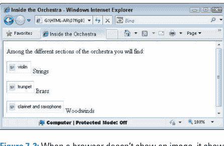

**图7-3：** 当浏览器无法显示图片时，会显示替代文本。

当浏览器显示图片时——包括 Internet Explorer、Firefox、Chrome、Safari 和 Opera——会将标题文本显示为弹出提示，当你将鼠标指针悬停在图片上几秒钟后，如图 7-4 所示。这需要在每个 `` 元素中添加 `title` 属性，这也是为什么它在前面的标记中也被包含的原因。*注意：* `alt` 文本是页面验证所必需的，但 `title` 文本则不是必需的。

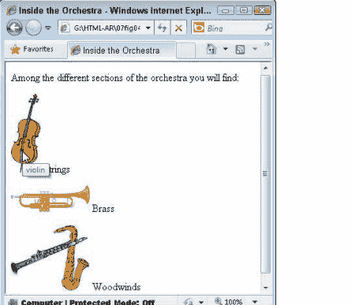

**图7-4：** 浏览器将标题文本显示为弹出提示。

这意味着你可以使用替代文本向无法看到图片的人描述图片，和/或使用标题文本为同一图片提供有用（或有趣）的信息。

> W3C 的 Web 无障碍倡议（WAI）提供了关于如何创建有用且可用的视觉内容替代方案的实用提示，详见 `www.w3.org/TR/WCAG10-TECHS/#gl-provide-equivalents`。

## 指定图片尺寸

你可以使用 `` 元素的 `height` 和 `width` 属性，让浏览器知道图片的高度和宽度（以像素为单位；px）：

```html
<p>Brass</p>
```

大多数浏览器会先下载页面关联的 HTML 和文本，然后再下载页面图片。为了不让用户等待整个页面的下载，浏览器通常会先显示文本，然后在图片可用时再填充。如果你告诉浏览器图片的大小，浏览器就可以在页面显示中为它预留位置。这会加快将图片添加到网页的过程。

你可以在任何图像编辑程序中，或在 Windows 和 Mac OS 内置的图像查看器中检查图片的像素宽度和高度。（你可能只需在 Windows 或 Mac OS 中查看图片属性，即可看到其高度和宽度。）

`height` 和 `width` 属性的另一个妙用是通过使用一个小彩色方块来创建页面上的彩色线条。例如，以下标记将一个 10x10 像素的蓝色方块添加到网页中：

```html

```

使用 `` 元素的 `height` 和 `width` 属性来设置图片的高度和宽度。因此，我们使用这些值在浏览器窗口中创建一个 10x10 像素的蓝色方块（如图 7-5 顶部所示），即使原始图片是 600 x 600 像素。一般来说，使用这些属性来缩小图片尺寸是安全的，尽管你总是需要在测试期间仔细检查结果。对于任何对宽高比敏感的图片，你需要通过将原始尺寸除以某个公约数来保持其宽高比。

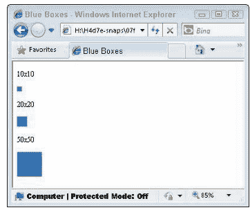

**图7-5：** 一系列小的蓝色方块。

图 7-5 还显示了尺寸为 20 x 20 和 50 x 50 像素的方块。以下是标记中为产生其他两个方块而对 `height` 和 `width` 值所做的更改：

```html


```

使用此技术，你可以将单个图像（如蓝色方块，大小仅为 2.39KB）变成各种线条——甚至方块：

- 这可以确保页面上所有分隔线和其他边框元素使用相同的颜色，因为它们都基于相同的图形。
- 如果你决定将所有蓝色线条更改为绿色，只需更改图像即可。你创建的每条线都会改变颜色。

当你指定的图片高度和宽度与图片的实际高度和宽度不同时，你依赖于浏览器来缩放图片显示。这对于单色图像（如蓝色方块）效果很好，但对于包含多种颜色或包含实际照片的图像则效果不佳。浏览器无法很好地调整图像大小，最终可能导致图像失真。图 7-6 显示了浏览器在标记将图片高度乘以四、宽度乘以二时（注意它与富鲁格尔号的相似之处！），处理放大喇叭图片的效果有多差：

```html
<p>Brass</p>
```

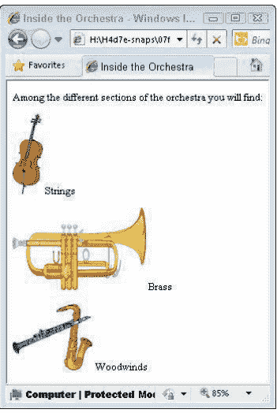

**图7-6：** 不要使用浏览器来调整复杂图像的大小；请使用图形编辑器。

> 如果你需要同一图像的多种尺寸——例如用于徽标或导航按钮——请使用一个大图像作为该图形的主版本，并制作较小的版本；这样可以让你更好地控制每个图像的最终外观和感觉。

## 图片边框与对齐

图片元素支持 `border` 属性，并且在 (X)HTML 标记中支持多种图片对齐选项，但它们已弃用，转而使用 CSS。虽然你可以在必要时使用这些控件，但我们将在第 8 章讨论弃用标记时仅简要提及它们，并在第 10 章解释如何使用 CSS 控制图片边框、定位、对齐、间距、文本环绕等。如果尚未充分说明这一点，我们强烈建议你对文本和图片使用 CSS 进行边框、定位和对齐，让 (X)HTML 专注于它最擅长的工作：表示和指向实际内容。

## 带链接的图片

网页经常使用图片进行导航。它们比纯文本链接更美观，并且你可以通过一个元素同时为页面添加形式和功能。

### 触发链接

要创建触发链接的图片，你将 `` 元素替代为文本，后者将作为你的链接锚点。以下标记链接文本：

```html
<p><a href="http://www.w3.org">Visit the W3C</a></p>
```

此标记用适当的图标替代文本 `Visit the W3C`：

```html
<p><a href="http://www.w3.org"></a>
</p>
```

前面的标记创建了一个链接到 `http://www.w3.org` 的图片链接。在前面的示例中，替代文本现在是 `Visit the W3C Web Site`，因此无法看到图片的用户知道链接指向何处。当用户将鼠标指针移到图片上时，光标会从箭头变为指向的手（或浏览器用于链接的任何图标）。

我们在这张图片周围包含了一个 2 像素的边框，作为视觉提示，让用户知道它也作为链接。边框呈现为浅蓝色轮廓（如图 7-7 所示），直到链接被访问。之后，蓝色轮廓变为紫色，以告知用户此链接已被访问过。

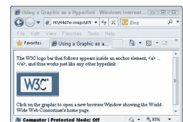

**图7-7：** 结合图片和锚点元素来创建图片链接。

只需快速点击图片即可启动 W3C 网站。就这么简单。


> 如本章前面所示，如果你想阻止浏览器在你的图片周围显示蓝色线条，应将你用于链接的任何图片的边框设置为`0`。然而，没有了线条，用户需要其他视觉（或替代文本）线索，以便知道图片是链接。确保作为链接的图片向用户（当然是有品味地）传达“我是链接！”。在所有情况下，如果自动轮廓被消除，你应该将轮廓构建到图形本身中，或添加标题表明该图片作为链接。

## 创建图片地图

当你使用``元素与锚点元素创建图片链接时，只能为该图片附加一个链接。要创建连接不同区域链接到页面上不同位置的更大图片，你需要图片地图。

要创建图片地图，你需要两样东西：

- **一张图片**，其具有用户显而易见的不同区域
  - 例如，一张公园的图片可能显示一个游乐场、一个野餐区和一个池塘区域。
- **标记**，将地图上的不同区域映射到不同的 URL。

## 元素和属性

使用``元素将地图图片添加到你的页面中，就像添加任何其他图片一样。此外，包含`usemap`属性，让浏览器知道该图片地图信息应随该图片一起使用。`usemap`属性的值是你的地图名称。

你使用两个元素和一组属性来定义图片地图：

- `<map>`保存地图信息。`<map>`元素使用`name`属性来标识地图。`name`的值应与该地图关联的``元素中的`usemap`值匹配。
- `<area />`将地图的特定部分链接到 URL。`<area />`元素采用以下属性来定义地图每个部分的具体信息：
  - `shape`：指定区域的形状（使图片地图工作的可点击热点）。你可以选择`rect`（矩形）、`circle`和`poly`（三角形或多边形）。
  - `coords`：定义区域的坐标。矩形的坐标包括左、右、上、下四个点。圆形的坐标包括圆心的 x 和 y 坐标以及圆的半径。多边形的坐标是多边形所有顶点的 x 和 y 坐标集合。你可以使用图像映射编辑器（如来自`www.boutell.com/mapedit`的`Mapedit`）或图形编辑器（如来自`www.corel.com`的`PaintShop Photo Pro`）来确定图像坐标；`Mapedit`还能为你记录这些坐标。
  - `href`：指定该区域链接到的 URL（可以是绝对路径或相对路径）。
  - `alt`：为图像区域提供替代文本。

### 标记

以下定义了一个名为`NavMap`的三区域映射，链接到名为`07fg07-navmap.gif`的图形文件：

```html

<map name="NavMap" />
    <area shape="rect" coords="0,0,99,30" href="home.html" alt="Home"
        title="Home" />
    <area shape="rect" coords="102,0,202,30" href="about.html" alt="About"
        title="About" />
    <area shape="rect" coords="202,0,301,30" href="products.html"
        alt="Products" title="Products" />
</map>
```

图 7-8 展示了浏览器如何显示此标记。

当鼠标悬停在映射的某个区域上时，光标会变成指向手形（就像悬停在任何其他超链接上一样）。因此，请利用标题文本（`title`）来包含有关链接的有用信息，并使映射对视障人士更加友好。

图像映射的一个常见用途是将地点地图（州、国家、城市等）转换为可链接的映射。About.com 的图像映射教程（位于`http://webdesign.about.com/od/imagemaps/a/aabg051899a.htm`）提供了更多关于手动构建图像映射的细节。HTML Goodies 在`www.htmlgoodies.com/tutorials/image_maps/index.php`提供了丰富的图像映射教程和信息。要查看实现前面图像映射示例的更完整的 HTML 文件，请参阅本书的网站`www.dummieshtml.com/examples/ch07/07fg09-validx.html`。

手动创建图像映射可能很棘手。请使用图形编辑器来识别映射中的每个点，*然后*为其创建适当的标记。大多数 (X)HTML 工具都包含帮助你制作图像映射的实用程序。如果你使用此类工具，可以快速且很少出错地创建图像映射。有关 (X)HTML 工具的更多信息，请参阅第 23 章。

使用图像映射时请谨慎。如果你正在创建一个可视化辅助工具（例如一张显示链接到不同国家的地图），使用图像映射非常合理。另一方面，你不应该将带有图像映射的图形用于网站的主要导航。（嗯，你*可以*这样做，但你不会喜欢结果的！）始终使用 (X)HTML 和 CSS 进行网站的主要导航，或者如果你必须使用图形图像映射，请在该映射旁边提供一个基于文本的替代方案，以便网站的视障访问者也能通过使用备用控件成功导航。

一般来说，导航的最佳方式是使用文本作为按钮标签，并让 CSS 处理使按钮看起来美观的相关工作。这一点将在第 20 章关于 CSS3 的部分进一步讨论，但你也可以简单地使用 CSS 2.1 来制作一些外观相当不错的按钮。

# 第三部分：精确控制网页和样式

## 本部分内容

在这里，我们将介绍和描述层叠样式表（CSS），这是一种强大的标记语言，旨在补充 (X)HTML 并管理网页在浏览器中的呈现方式。(X)HTML 可以通过包含外部样式表或 (X)HTML 文档中的内联 CSS 样式来引用 CSS。

你将首先熟悉 CSS 的多种多样功能，查看不同类型的样式表，并了解当多个样式表应用于单个网页时的处理规则（这就是 CSS 中“层叠”的由来）。当然，你还将了解如何构建和使用 CSS 来实现诸如创建视觉布局、定位单个元素以及处理字体等任务。因为 CSS 还提供了控制页面颜色和文本外观的方法，所以我们也向你展示如何运用这些功能。

# 第 8 章：已废弃的 (X)HTML 标记

## 本章内容

- 理解废弃
- 查找废弃的标记
- 梳理废弃的元素
- 列出废弃的属性
- 清理废弃标记后的遗留问题

根据定义，“废弃”意味着“表示不赞成、谴责”或“宣布某物过时或已被取代”。然而，当 (X)HTML 的讨论转向废弃标记时——你会发现这个术语既适用于标记元素也适用于属性——无论这种标记多么令人不快，请放心，这个词使用的是第二种含义！也就是说，不推荐使用废弃标记，因为万维网联盟（W3C）确信它不会永远存在，并且使用废弃标记会导致各种不良的编码习惯、错误行为，甚至可能招致牢狱之灾（最后一句是开玩笑）。

要理解标记为何被废弃，你需要思考 (X)HTML 的基本作用，以及 CSS 如何融入对 Web 的现代理解。首先，也是最重要的，(X)HTML 的职责是捕获和传递内容，包括图形和文本信息，以及大量的指向点（超链接将“超”放入了超文本中）。

HTML 的早期实现包含了许多呈现控制元素以及内容元素和链接机制。随着时间的推移，Web 设计者认识到将内容与呈现分离是极其可取的。CSS 已经接管了呈现的角色，其能力和效率远超 HTML 所能。当你查看本章涵盖的废弃标记元素和属性时，你会发现绝大多数都是呈现控制，最好转交给 CSS，还有一些是现已过时的工具、技术和页面设计方法的历史遗留物。

当然，你可以找到许多使用废弃标记的网站，甚至可能在自己的工作中也时不时地发现一些废弃标记。不过，使用这些标记风险自负，并且帮自己一个忙：当旧页面让位于新页面时，花时间并付出努力，将那些讨厌的旧废弃标记从你的页面中清除出去！

## 现在，赞助商有话说

如果你查看 W3C 网站上当前的 HTML 4 规范（可在`www.w3.org/TR/REC-html40/conform.html`获取），你会找到以下用于解释废弃和过时标记的语言：

> **废弃**
>
> 废弃元素或属性是指已被较新构造所取代的元素或属性。废弃元素在参考手册的适当位置定义，但明确标记为废弃。废弃元素可能在未来版本的 HTML 中变得过时。
>
> 用户代理应出于向后兼容的原因继续支持废弃元素。
>
> 元素和属性的定义清楚地指明哪些是废弃的。
>
> 本规范包含示例，说明如何避免使用废弃元素。在大多数情况下，这取决于用户代理对样式表的支持。通常，作者应使用样式表来实现样式和格式化效果，而不是使用 HTML 呈现属性。当存在可替代的样式表时，HTML 呈现属性已被废弃。...
>
> **过时**
>
> 过时元素或属性是指用户代理不保证支持的元素或属性。过时元素不再在规范中定义，但出于历史原因列在参考手册的变更部分中。

当你阅读这段文字时，“用户代理”（user agent）是一个技术术语，指任何读取和解释 (X)HTML 标记的程序。这主要意味着某种类型的 Web 浏览器，尽管许多其他程序也读取标记（想想搜索引擎、验证器、编辑器等等）。请注意，大多数程序会支持废弃标记，但其使用最好避免——你猜对了——通过样式表，或者 CSS。

## 已弃用元素

我们按照字母顺序在表 8-1 中列出了这些已弃用元素。如果存在替代标记或替代技术（你能说“CSS”吗？），我们也会指出。如果类型是`pair`，则表示该元素需要开始和结束标签（例如，`<center>this</center>`）；如果类型是`empty`，则表示该元素只有一个标签（例如，`<isindex ... />`）。

### 表 8-1：已弃用的 HTML 标记元素

| 名称 | 类型 | 描述 | 替代方案 |
|---|---|---|---|
| `applet` | `pair` | 调用 Java 小程序 | `Object` |
| `basefont` | `pair` | 基础字体大小 | CSS 字体控制 |
| `center` | `pair` | `<div align="center">`的简写 | CSS 文本对齐控制 |
| `dir` | `pair` | 目录列表类型 | 带有 CSS 格式化的`<ul>` |
| `font` | `pair` | 本地字体分配 | CSS `font-family` |
| `isindex` | `empty` | 单行输入提示 | HTML 表单标记 |
| `menu` | `pair` | 菜单选项的列表类型 | 带有 CSS 格式化的`<ul>` |
| `s` | `pair` | 删除线文本 | CSS `text-decoration` |
| `strike` | `pair` | 删除线文本 | CSS `text-decoration` |
| `u` | `pair` | 下划线文本 | CSS `text-decoration` |

过时的标记可能仍存在于某些陈旧的网页上，但这些标记在新版的网页浏览器中无法工作。我们甚至不会在本书中涉及它们。如果你对这些标记感到好奇，那么请阅读早期的 HTML 规范吧！

另一方面，如果你想深入了解标记细节，请查阅最新的 HTML 4.01 规范，网址为`www.w3.org/TR/html4/cover.html#minitoc`。

如果你想直接了解弃用内容，请参阅 HTML 4.01 规范的附录 A。然而，真正的重点在于名为“元素索引”和“属性索引”的章节。实际上，提取这两个索引中所有标记为 *D*（代表*已弃用*）的项目，就是接下来两部分的基本框架。

## 124 第三部分：精确控制网页和样式

查看表 8-1 时，只有两个标记元素是非表现性的：

- **applet**：`applet`标签让人联想到 Java 编程语言曾是将代码元素直接添加到网页的主要方式的时代。如今，`object`元素允许页面开发者通过单一的统一（X）HTML 元素来处理所有编程语言，包括 Java。
- **isindex**：`isindex`元素旨在提供快速但粗糙的单行输入文本访问。如今，已被各种构成 HTML 表单的元素（本书第 14 章将涵盖）所取代。

## 已弃用属性

尽管在（X）HTML 中只有 10 个元素被弃用，但被弃用的属性要多得多——事实上，表 8-2 中显示了 44 个（其中 32 个是唯一的，其余为重复项）。确实，一些属性在此表中出现多次，因为当它们与特定的（X）HTML 元素关联时具有不同的含义。我们使用 W3C 的属性值简写，并在表格后面的列表中解释这些类型条目。在此，我们不讨论替代方案或替换，因为 CSS 已经取代了绝大多数已弃用的元素。

### 表 8-2：已弃用的 HTML 属性

| 名称 | 相关元素 | 类型 | 描述 |
|---|---|---|---|
| `Align` | `Caption` | `%CAlign` | 表格标题对齐 |
| `Align` | `applet, iframe, img, input, object` | `%IAlign` | 垂直或水平对齐 |
| `Align` | `Legend` | `%LAlign` | 表单字段集控件 |
| `Align` | `Table` | `%TAlign` | 表格相对于窗口的位置 |
| `Align` | `Hr` | `LCR` | 水平线对齐 |
| `Align` | `div, h1... h6, p` | `LCRJ` | 文本块对齐 |
| `Align` | `col, colgroup, tbody, td, tfoot, th, thead, tr` | `LCRJ` | 表格对齐 |
| `Alink` | `Body` | `%Color` | 选中（高亮）链接的颜色 |
| `Alt` | `Applet` | `%Text` | 小程序功能的简短描述 |
| `Archive` | `Applet` | `CDATA` | 以逗号分隔的 Java 归档文件（`.jar`）列表 |
| `background` | `Body` | `%URI` | 文档背景的图像文件 |
| `Bgcolor` | `table, tr, td, th` | `%Color` | 表格元素的背景颜色 |
| `Bgcolor` | `Body` | `%Color` | 文档的整体背景颜色 |
| `Border` | `img, object` | `%Pixels` | 链接边框的宽度 |
| `Clear` | `Br` | `LRAN` | 控制换行后的文本流 |
| `Code` | `Applet` | `CDATA` | 小程序 Java 类文件 |
| `codebase` | `Applet` | `%URI` | classid、data 和归档文件的基础位置 |
| `Color` | `basefont, font` | `%Color` | 文本颜色 |
| `Compact` | `dir, dl, menu, ol, ul` | `*self` | 减少的词间距 |
| `Face` | `basefont, font` | `CDATA` | 以逗号分隔的字体名称列表 |
| `Height` | `td, th` | `%Length` | 表格单元格高度 |
| `Height` | `Applet` | `%Length` | 小程序窗口的初始高度 |
| `Hspace` | `applet, img, object` | `%Pixels` | 围绕方框的水平间距 |
| `Language` | `Script` | `CDATA` | 预定义的脚本语言名称 |
| `Link` | `Body` | `%Color` | 文档主体中链接的颜色 |
| `Name` | `Applet` | `CDATA` | 提供 id 以便小程序可以相互查找 |
| `Noshade` | `Hr` | `*self` | 关闭水平线的阴影 |
| `Nowrap` | `td, th` | `*self` | 抑制表格单元格中的自动换行 |
| `Object` | `Applet` | `CDATA` | 序列化的小程序文件（分段读取） |
| `Prompt` | `Isindex` | `%text` | 征求输入的提示消息 |
| `Size` | `Hr` | `%Pixels` | 水平线的大小 |
| `Size` | `Font` | `CDATA` | 字体大小的各种正整数值 |
| `Size` | `Basefont` | `CDATA` | 所有字体元素的基础字体大小 |
| `Start` | `Ol` | `Number` | 编号列表的起始值 |
| `Text` | `Body` | `%Color` | 文档文本颜色 |
| `Type` | `li, ol, ul` | `ListStyle` | 列表项、编号和项目符号样式 |
| `Value` | `Li` | `Number` | 重置列表序号 |
| `Version` | `Html` | `CDATA` | 当前使用的 DTD 的 HTML 版本号 |
| `Vlink` | `Body` | `%Color` | 已访问链接的颜色 |
| `Vspace` | `applet, img, object` | `%Pixels` | 围绕方框的垂直间距 |
| `Width` | `Hr` | `%Length` | 水平线宽度 |
| `Width` | `td, th` | `%Length` | 表格单元格宽度 |
| `Width` | `Applet` | `%Length` | 小程序窗口/方框的初始宽度 |
| `Width` | `Pre` | `Number` | 预格式化文本区域的宽度（以字符为单位） |

下面的列表描述了表 8-2 中的属性类型缩写和值：

- `%CAlign`：表格中的列对齐方式
- `CDATA`：SGML（标准通用标记语言）数据类型，用于通用字符数据
- `%Color`：颜色名称或十六进制代码
- `%IAlign`：iframe 的对齐方式：`top`（顶部）、`middle`（中间）、`bottom`（底部）、`left`（左）、`right`（右）
- `%LAlign`：图例的对齐方式：`top`（顶部）、`bottom`（底部）、`left`（左）、`right`（右）
- `LCR`：左、中、右
- `LCRJ`：左、中、右、两端对齐
- `%Length`：长度，以像素或百分比表示，或相对长度
- `ListStyle`：列表项样式、列表项目符号样式、列表编号样式
- `LRAN`：左、所有、右、无
- `Number`：一个或多个数字的字符串（值从 0 到 9）
- `%Pixel`：表示像素长度的整数
- `*self`：属性名重复作为值（`compact="compact"`）
- `%TAlign`：表格单元格的对齐方式：`left`（左）、`center`（中）、`right`（右）、`justify`（两端对齐）、`char`（字符）


- `%Text`：字符数据
- `%URI`：统一资源标识符，通常是 URL

`Iframe` 是一种 HTML 构造，其功能类似于网页中的窗口框架，但用于在一个 HTML 文档中插入另一个 HTML 文档，其中 `iFrame` 仅占据指定区域，并像任何其他静态页面元素一样滚动。如果内容大于 `iFrame` 窗口本身，则 `iFrame` 中的内容仅在指定的显示区域内滚动。与用于将浏览器窗口划分为多个显示区域的典型 HTML 框架不同，`iFrame` 用于将外部元素（通常是广告或外部文本块）插入到网页的特定区域。

## 如何处理已弃用标记

处理代码中已弃用标记的简短而中肯的建议是：“删除它！”然而在实践中，当你熟悉了——并且希望甚至习惯了——级联样式表（CSS）后，替换绝大多数已弃用的元素和属性将变得相当自然。在你学会了如何在页面上定位项目，以及处理边距和内边距之后，你就可以完全摆脱表 8-2 中的大多数项目，以及表 8-1 中的许多项目。

## 第三部分：精确掌控网页与样式

一个更严肃的问题可能是：“当（X）HTML 编辑工具使用已废弃的标记时，我该怎么办？”如果第三方工具代表您、按照您的要求生成标记，并帮助您实现页面设计，我们强烈建议您寻找并使用不使用已废弃标记的工具。这是确保您的网页能够经受时间考验的唯一方法。幸运的是，我们在第 23 章推荐的工具——以及许多其他（X）HTML 编辑器和开发环境——已经淘汰了废弃标记，因此希望您也不必为此担忧。

通常，在处理废弃标记时，您必须决定如何处理当前网页中需要移除的标记。在许多情况下，您只需移除 HTML 表现性标记，并用 CSS 等效方式替代。例如，如果您希望段落文本两端对齐，您可以将下一个代码片段中显示的标记（已注释以帮助区分）替换为以下片段中的标记：

```html
<!-- 此标记使用已废弃的 align="justify" 代码 -->
<p align="justify">This sample paragraph needs enough text to be
at least three lines long, to show the effects of justification
at work. In fact, the longer the better, which is why we've
stretched this example out as far as we can make it go.</p>

<!-- 此标记使用内联样式以实现快速但粗糙的对比 -->
<p style='text-align: justify;'>This sample paragraph needs enough
text to be at least three lines long, to show the effects of
justification at work. In fact, the longer the better, which is why
we've stretched this example out as far as we can make it go.</p>
```

并非所有废弃标记的替换都像刚才展示的那样简单直接。有趣的是，所有表现性标记的替换通常都同样容易，但其他一些内容没有真正的对应物（或者目前还没有对应物，尽管 HTML5 和 CSS3 将解决其中一些问题）。这就是为什么在决定如何移除废弃标记时，通常需要进行一些规划和思考。通常需要进行一些重新设计或返工，才能将事物重新正确地组合在一起。

# 第 9 章：层叠样式表入门

## 本章内容

- 理解 CSS
- 创建样式规则
- 将样式规则链接到网页
- 介绍 CSS 属性
- 理解继承与样式层叠

*层叠样式表*（CSS）的目标是将网页的样式与其结构分离，使您创建的网页更易于维护。页面的结构元素，例如标题（`<h1>` 到 `<h6>`）和正文文本，不会影响这些元素的外观。然而，通过为这些元素应用样式，您可以指定元素在页面上的布局并添加设计属性（如字体、颜色和文本缩进）。

样式表让您能精确控制结构元素在网页上的呈现方式。更好的是，您可以为整个网站创建一个样式表，以保持页面间内容布局和外观的一致性。而锦上添花的是：样式表易于构建，更易于集成到网页中。实际上，使用样式表，您可以：

- 为单个（X）HTML 元素添加样式标记（称为*内联样式*）。
- 在（X）HTML 文档的头部创建一系列样式指令（称为*内部样式表*）。
- 通过链接或其他引用方式引用一个独立的样式表（称为*外部样式表*）。

简而言之，有很多方法可以为网页添加样式！

130 第三部分：精确掌控网页与样式

随着更多网站转向 XHTML，标记权力机构的目标是最终*废弃*（淘汰）所有格式化标记，例如 HTML 元素集合中的 `<font>` 元素。总有一天，所有的表现都将属于 CSS。我们在本书的第 8 章涵盖了这些陈旧、过时的废弃标记。

当您想要对网页的显示进行严格控制时，样式表是必由之路：

- 通常，样式表比标记提供更大的灵活性。
- 未来的 HTML 和 XHTML 元素将不再包含面向显示的属性。

大多数现代浏览器都能很好地处理 CSS。然而，较旧的浏览器——如 Internet Explorer 4.0 和 Netscape Navigator——在正确显示 CSS 方面存在困难。更早的浏览器则完全无法显示 CSS。如果您的网站用户中有许多人仍在使用这些过时的浏览器中的一个或多个，请在这些浏览器中测试您的页面；确保您的网站用户能够阅读您的页面。

## 样式表的优势

HTML 的格式化能力极其有限。当您在 HTML 中设计页面布局时，您受限于表格、字体控件和少数内联样式，如粗体和斜体。*样式表*提供了大量工具来精确控制网页格式。使用样式表，您可以：

- **控制页面显示的各个方面。** 指定行间距、字符间距、页边距、图像放置等。您还可以指定页面上元素的定位。
- **全局应用更改。** 通过将相同的样式表应用于每个网页，确保整个网站的设计一致性。

您可以只修改一个文档（样式表）而不是每个页面上的标记，从而更改整个网站的外观和感觉。需要更改标题的外观吗？在样式表中重新定义该标题的样式属性并保存样式表。标题的外观就会在整个网站中改变。您可以想象一个页面在“级联”变化中迅速采用新外观（因此得名），尽管这个名称只是一个比喻，因为这种级联是即时的。

- **指示浏览器控制外观。** 向网络浏览器提供比您能用 HTML 表达的关于页面外观的更多信息。
- **创建动态页面。** 使用 JavaScript 或其他脚本语言与样式表一起，创建根据用户操作而移动、出现或隐藏的文本和其他内容。

## CSS 能为网页做什么

样式表工作原理的要点如下：

1. 您在样式表中定义规则，指定您希望由一组标记描述的内容如何显示。例如，您可以指定每个一级标题（`<h1>`）以紫色 Garamond 24 点字体显示，黄色背景（并非您*一定会*这样做，但您可以）。
2. 您将样式规则与标记链接起来。
3. 浏览器完成其余工作。

使用当前规范 CSS2.1，您可以：

- 指定字体类型、大小、颜色和效果。
- 设置背景颜色和图像。
- 控制文本布局的许多方面，包括对齐和间距。
- 设置边距和边框。
- 控制列表显示。
- 定义表格布局和显示。
- 为标准页面元素（如计数器和页脚）自动生成内容。
- 控制光标显示。
- 为文本到语音阅读器定义听觉样式表。

## CSS3：下一代样式表

CSS 的下一代——即 CSS3——是一个针对网页格式化不同方面的*模块*集合，如字体、背景颜色、列表和文本颜色。其中一些模块在 2004 年中期成为标准（正式称为*候选推荐标准*）。然而，截至 2010 年中期，大多数 CSS3 模块尚未达到候选推荐标准状态，且很少有浏览器实现 CSS3 功能。简而言之，您无需担心 CSS3——至少目前还不需要。

W3C 在其网站 `www.w3.org/Style/CSS/current-work` 上专门为 CSS 设立了一个版块。您可以在那里找到通用的 CSS 信息，并了解 CSS3 的最新状态。该网站链接到良好的 CSS 参考资料和教程，并包含有关可以使您的样式表工作更轻松的软件包的信息。

# 第三部分：精确控制网页和样式

## CSS 能做什么

在编写样式规则时，你有一系列丰富的属性可供使用。你可以控制页面显示的几乎所有方面——从边框到字体大小以及介于两者之间的一切：

- **背景属性**控制与文本块和图像相关的背景颜色。你也可以使用这些属性为页面或单个元素（如水平线）附加背景颜色。
- **边框属性**控制与页面、列表、表格、图像和块级元素（如段落）相关的边框。你可以指定边框的宽度、颜色、样式以及与元素内容的距离。
- **分类属性**控制元素（如图像）在页面上相对于其他元素的流动方式。你可以使用这些属性将图像和表格与页面上的文本融合在一起。
- **列表属性**控制列表在页面上的显示方式，例如：
  - 管理列表标记
  - 用图像代替项目符号
- **外边距属性**控制页面的外边距以及块级元素、表格和图像周围的外边距。这些属性让你能完全控制页面上的空白区域。
- **内边距属性**控制页面上任何块级元素周围的空白量。将它们与外边距和边框属性结合使用，可以创建复杂的布局。
- **定位属性**控制元素在页面上的位置；你可以使用它们将元素放置在页面的特定位置。
- **尺寸属性**控制你的元素（包括文本和图像）在页面上占据的空间（高度和宽度）。它们特别适用于限制文本框和图像的大小。
- **表格属性**控制表格的布局。你可以使用它们来控制单元格间距和其他表格布局细节。
- **文本属性**控制文本在页面上的显示方式。你可以设置诸如字体大小、字体族、高度、文本颜色、字符和行距、对齐方式以及空白处理等属性。这些属性让你通过样式表比 `font` HTML 元素能更精确地控制文本。

专门讲解这些类别中每个属性的细微之处的书籍和网站比比皆是。我们推荐以下参考资料之一：

- Richard Mansfield 所著的《CSS 网页设计傻瓜书》。
- Westciv 网站上的 CSS2 参考手册，网址为 `www.westciv.com/style_master/academy/css_tutorial/index.html`。

尽管 CSS 语法很简单，但将 CSS 样式与标记结合以精细调整页面布局可能会变得有点复杂。要成为 CSS 专家，你只需要：

- 了解不同属性的工作方式。
- 通过实验，观察浏览器如何处理 CSS。
- 通过练习，学习如何使用 CSS 在网页上传递你的信息。

## 属性测量值

许多 HTML 属性使用测量值。本书中我们会告诉你哪些测量值适用于哪些属性。标准的属性测量以两种方式规定属性的大小。

绝对值测量可以使用以下值之一来指定具体的长度或高度：

- 英寸，例如 `.5in`
- 厘米，例如 `3cm`
- 毫米，例如 `4mm`
- 派卡，例如 `1pc`。一英寸有六派卡。
- 磅，例如 `16pt`。一派卡有 12 磅。
- 像素，例如 `13px`（这些值对应于计算机显示器上的单个点）。

相对值测量基于文档中的父元素值来确定长度或高度：

- `p%`：当前 `font-size` 值的百分比，例如 `150%`。例如，你可以为所有段落定义 80% 的字体大小。如果你的文档主体定义为 15 磅字体，那么段落的字体大小就是 12 磅（15 的 80%）。
- **`ex`**：相对于当前字体的 x 高度的值。*x 高度*相当于字体中小写字母的高度，例如 `1.5ex`。
- **`em`**：相对于当前字体大小的值，例如 `2em`。对于任何给定的字体，1 em 相当于其磅值大小。（因此，16 磅字体的 em 大小为 16 磅：明白了吗？）

实际上，`1em` 和 `100%` 都等于当前大小。

> **记住** 使用这些值时要小心；某些属性只支持某些测量值——比如只支持长度值，而不支持相对值。不要让这些术语吓到你。只需用你熟悉的值来定义大小。如果那不行，就试试别的。

## CSS 结构和语法

样式表由*样式规则*组成。每个样式规则有两部分：

- **选择器**：指定样式规则应用的标记元素。
- **声明**：指定标记描述的内容的外观。

你使用一组标点符号和特殊字符来定义样式规则。样式规则的语法始终遵循这种模式：

```css
选择器 {声明;}
```

每个声明后面总是跟着一个分号，以便计算机更容易区分它们。如本章后面将解释的，单个选择器可以包含一个或多个声明。此外，每个声明又细分为两个子项：

- **属性**是计算机显示文本和图形方式的某些方面（例如，字体大小或背景颜色）。
- **值**提供数据来指定你希望文本和图像在页面上的外观（例如，24 磅字体大小或黄色背景）。

> **记住** 在声明中，你用冒号分隔属性和值。

每个声明以分号结束。

```css
选择器 {属性: 值;}
```

例如，以下三条样式规则为一级、二级和三级标题设置了颜色：

```css
h1 {color: teal;}
h2 {color: maroon;}
h3 {color: black;}
```

CSS 规范精确列出了你可以在样式规则中使用的属性以及它们可以采用的值。大多数都是不言自明的（例如 `color` 和 `border`）。关于 CSS2 规范中包含的属性的快速概览，请参见本章前面的“CSS 能做什么”。

样式表会覆盖浏览器的内部显示规则；你的样式声明会影响页面在用户浏览器中的最终外观。这意味着你可以控制你的内容外观，并为访问者创造更一致、更合适的体验。

例如，以下样式规则为一级、二级和三级标题指定了字体大小（以百分比表示，相对于基础字体）：

```css
h1 {font-size: 300%;}
h2 {font-size: 200%;}
h3 {font-size: 150%;}
```

图 9-1 显示了一个简单的 HTML 页面，其中包含所有三个标题级别（以及一些正文文本），但未应用样式表。浏览器使用其默认设置以不同的字体大小显示标题。

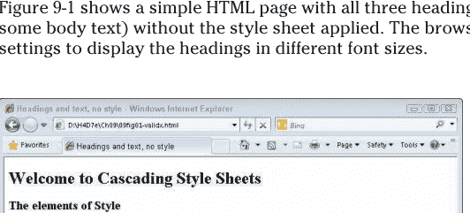

图 9-1：没有样式规范的 HTML 页面。

图 9-2 显示了应用样式表后的同一网页。外观大不相同，因为正文文本更改为无衬线字体，标题设置了不同的颜色，段落文本是斜体，并且标题大小被放大超过了其常规设置。

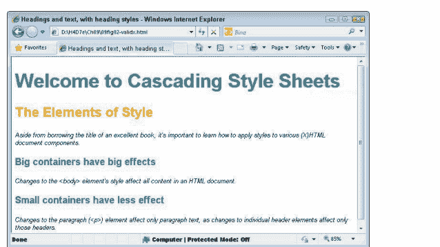

图 9-2：应用了样式规范的 HTML 页面。


用户可以更改其偏好设置，以便其浏览器忽略你的样式表（尽管大多数用户会使用你的样式表）。请在关闭样式表的情况下测试网页，以确保它们在没有你的样式表的情况下看起来依然良好（或可接受）。

有关禁用或更改样式表的详细说明，请参见 Jim Hatcher 在 `www.jimthatcher.com/webcourseb.htm` 上关于“无 CSS 阅读网页”的讨论。说明因网页浏览器而异，但你可以使用无障碍插件来管理或禁用样式表。

## 选择器和声明

你可能希望一个样式规则能影响给定选择器的多个属性的显示。你可以为单个选择器创建多个样式规则，每个规则包含一个声明，如下所示：

```css
h1 {color: teal;}
h1 {font-family: Arial;}
h1 {font-size: 36px;}
```

### 字体族

在为 `font-family` 属性赋值时，可以使用由逗号分隔的字体名称列表。这些名称必须与用户 Web 浏览器可用的字体匹配。如果字体名称包含空格（例如 Times New Roman），请将其用引号括起来。

在前面的规则中，浏览器会首先使用 Verdana；如果该字体不可用，它会查找 Times New Roman，最后使用通用的衬线字体作为备选方案。第 11 章介绍了 CSS 中的字体。

```css
h1 {font-family: Verdana, "Times New Roman", serif;}
```

然而，如此大量的样式规则可能难以管理。CSS 允许你在*单个*样式规则中组合多个声明，该规则可以影响单个选择器的多个显示特性，如下所示：

```css
h1 {color: teal;
    font-family: Arial;
    font-size: 36px;}
```

`h1` 选择器的所有声明都在同一组大括号（`{}`）内，并用分号（`;`）分隔。你可以在样式规则中放入任意多的声明；只需确保每个声明以分号结束即可。

最后一个声明末尾的分号是可选的。有些人为了保持一致性，会在每个声明末尾都加上分号，但这并非必需。我们在本书中两种方式都会使用，但仔细想想，为了保持一致性并*始终*在每个声明末尾使用分号是个好主意。

从纯技术角度来看，空白符在样式表中无关紧要（就像在 HTML 中一样），但你应该使用一致的间距方案，以便于阅读和编辑样式表。这个空白符规则的一个例外情况是，当你在 `font-family` 声明中声明多个字体名称时。更多信息请参阅“字体族”侧边栏。

你也可以让同一组声明应用于一组选择器：只需用逗号分隔选择器即可。以下样式规则将文本颜色、字体族和字体大小的声明应用于 `h1`、`h2` 和 `h3` 选择器：

```css
h1, h2, h3 {color: teal;
           font-family: Arial;
           font-size: 300%;}
```

# 第三部分：精确控制网页与样式

本节中的示例样式规则表明，样式表语法严重依赖标点符号。当样式规则未按预期工作时，请确保没有在应该使用冒号的地方使用了分号，或者在应该使用花括号的地方使用了圆括号。也要注意逗号和分号！验证工具可以帮助发现这些疏漏：请使用它们。

W3C CSS 验证服务（位于 `http://jigsaw.w3.org/css-validator`）有助于查找样式表中的问题。

## 使用样式类

有时你需要仅应用于特定 HTML 标记元素实例的样式规则。例如，如果你想要一个仅应用于包含版权信息的段落的样式规则，你需要一种方法来告诉浏览器该规则的作用范围有限。

要精确地定位样式规则，请将 `class` 属性与标记元素结合使用。以下示例展示了两种段落的 HTML 代码：


- 一个普通段落（没有 `class` 属性）
- 一个 `class` 属性值为 `copyright` 的段落

```html
<p>This is a regular paragraph.</p>
<p class="copyright">This is a paragraph of class copyright &copy; 2011.</p>
```

要创建一个仅应用于版权段落的样式规则，请在样式规则中段落选择器后跟随：

- 一个句点（`.`）
- `class` 属性的值，例如 `copyright`

最终的规则如下所示：

```css
p.copyright {font-family: Arial;
    font-size: 12px;
    color: white;
    background: teal;}
```

此样式规则指定所有 `copyright` 类的段落将以青色背景上的白色文本显示，字体为 Arial，大小为 12px。图 9-3 显示了浏览器如何仅将此样式应用于 `class` 等于 `copyright` 的段落。

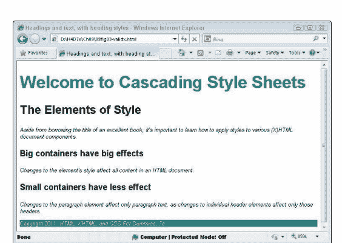

**图 9-3：** 类可以更精确地定位你的样式规则。

你也可以创建不与任何元素关联的样式规则类，如以下示例：

```css
.warning {font-family: Arial;
          font-size: 14px;
          background: blue;
          color: white;}
```

你可以通过将 `class="warning"` 添加到任何元素来使用此样式类。图 9-4 显示了浏览器如何将警告样式应用于段落和标题，但不应用于块引用，在以下 HTML 中：

```html
<p>This is a paragraph without the warning class applied.</p>
<blockquote>This is a block quote without a defined class.</blockquote>
<h1 class="warning">Warnings</h1>
<p class="warning">This is a paragraph with the warning class applied.</p>
```

你还可以使用 `span` 元素有选择地将自定义样式应用于内联内容（或创建从开始标签 `<span>` 延伸到其结束标签 `</span>` 的任意内容容器）：

```html
<p>This is a paragraph without the <span class="warning">warning class</span>
applied only to the words "warning class."</p>
```

**140** 第三部分：精确控制网页与样式

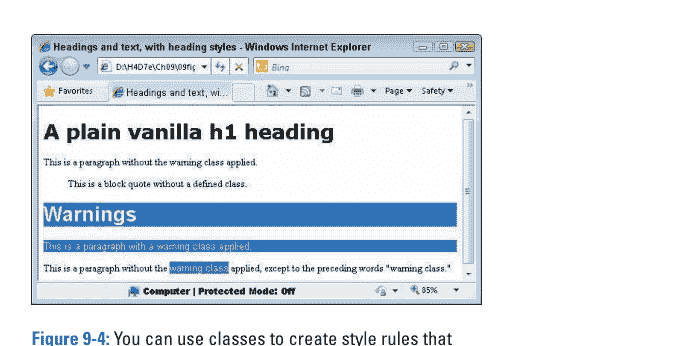

**图 9-4：** 你可以使用类创建适用于任何元素的样式规则。

## 使用样式 ID

当需要创建仅应用于标记元素某些实例的规则时，也可以使用带有样式标记的 `id="name"` 属性。假设你想定义一个样式，仅应用于每个网页上的第一个段落，使其处理方式不同于可能也有自己样式设置的其他普通段落。

为此，你需要在样式定义中创建一个 ID 选择器（在 (X)HTML 文档头部的内部样式表中，或在独立的纯 CSS 外部样式表中），如下所示：

```css
#first-graph {font-style: bold;
            text-indent: -0.25in;}
```

然后，无论何时为网页编写标记，你都可以这样编写每个初始段落的 (X)HTML：

```html
<p id="first-graph">The initial paragraph on will feature an 0.15 inch "hanging indent" and the typeface will be in heavy bold.</p>
<p>Subsequent paragraphs will use whatever style you have (or haven't) defined for the base paragraph style. In this case, this means ragged right justification and plain, unbolded text.</p>
```

图 9-5 说明了使用 ID 选择器应用 CSS 定义时网页的外观。ID 选择器很有用，因为它们可以应用于各种不同的标记元素（不像类定义那样绑定到单个元素），并且仅在被使用时才适用。非常方便！

## 第 9 章：层叠样式表简介

### 注意继承！

当你构建复杂的样式表来指导页面每个方面的外观时，请牢记继承。例如，如果你在 `body` 样式规则中为页面设置了边距，那么你为页面上所有其他元素设置的边距都基于为 `body` 设置的边距。如果你知道你的样式规则如何协同工作，就可以利用继承来最小化样式规则重复，并为页面创建统一的显示效果。

本章涵盖了基本的 CSS 语法，但你可以使用高级技巧来微调样式规则。完整的 CSS 语法规则概述可在 Web Design Group 的 "CSS Structure and Rules" 教程中找到，网址为 `www.htmlhelp.com/reference/css/structure.html`。

### 继承样式

HTML（以及一般的标记语言）中的一个基本概念是标签嵌套：

- 每个有效的 HTML 文档都嵌套在 `<html>` 和 `</html>` 标签内。
- 浏览器在窗口中显示的所有内容都嵌套在 `<body>` 和 `</body>` 标签内。（这仅仅是个开始。）

CSS 规范认识到你经常将一个元素嵌套在另一个元素内部，并希望确保与父元素关联的样式能够传递给子元素。这种机制称为继承。

当你为一个元素分配样式时，相同的样式会应用于该元素内嵌套的所有元素。例如，一个为 `body` 元素设置页面背景、文本颜色、字体大小、字体族和边距的样式规则如下所示：

## 第三部分：精确控制网页与样式

```css
body {background: teal;
    color: white;
    font-size: 18px;
    font-family: Garamond;
    margin-left: 72px;
    margin-right: 72px;
    margin-top: 72px;}
```


要为整个文档设置样式规则，请将它们设置在 `body` 元素中。例如，用这种方式更改整个页面的字体要容易得多；这比逐一更改每个元素要好。

当您将以下 HTML 链接到前面的样式规则时，该样式规则仅适用于 `body` 元素，所有从属元素都会继承此格式：

```html
<body>
    <p>This paragraph inherits the page styles.</p>
    <h1>As does this heading</h1>
    <ul>
        <li>As do the items in this list</li>
        <li>Item</li>
        <li>Item</li>
    </ul>
</body>
```

## 使用不同类型的样式表

完成样式规则的创建后，您可以使用以下选项之一将它们连接到您的 HTML 页面：

- **将样式信息插入到文档中。** 您可以：
  - 使用 `<style>` 元素在网页中构建样式表。这是一个*内部样式表*。
  - 使用 `style` 属性直接将样式信息添加到标签。这是一个*内联样式*。
- **使用外部样式表。** 您可以：
  - 使用 `<link>` 标签将您的网页链接到外部样式表。
  - 使用 CSS `@import` 语句将外部样式表导入到网页中。

## 第 9 章：介绍层叠样式表

### 内部样式表

内部样式表位于您的 HTML 页面中。只需将样式规则添加到文档头的 `<style>` 元素中。您可以在内部样式表中包含任意多（或任意少）的样式规则。（参见清单 9-1。）

#### 清单 9-1：将内部样式表添加到 HTML 文档

```html
<!DOCTYPE html PUBLIC "-//W3C//DTD XHTML 1.0 Transitional//EN"
    "http://www.w3.org/TR/xhtml1/DTD/xhtml1-transitional.dtd">
<html xmlns="http://www.w3.org/1999/xhtml">
<head>
    <title>Internal Style Sheet Example</title>
    <style type="text/css">
        body {background: black;
              color: white;
              font-size: 16px;
              font-family: Garamond;
              margin-left: 72px;
              margin-right: 72px;
              margin-top: 72px;}

        h1, h2, h3 {color: teal;
                    font-family: Arial;
                    font-size: 36px;}

        p.copyright {font-family: Arial;
                     font-size: 12px;
                     font-color: white;
                     background: black;}

        .warning {font-family: Arial;
                  font-size: 16px;
                  font-color: orange;}
    </style>
</head>
<body>

<!-- Document content goes here -->

</body>
</html>
```

使用内部样式表的好处是方便：您的样式规则与标记在同一页面上，因此您可以快速调整两者。如果您希望相同的样式规则控制多个 HTML 页面的外观，请将这些样式从各个网页移动到外部样式表。

### 谨慎使用内联样式

您可以将称为*内联样式*的单个样式规则附加到 HTML 文档中的各个元素。附加到元素的内联样式规则如下所示：

```html
<p style="color: green;">Green text.</p>
```

将样式规则添加到元素并不是最佳方法。我们通常建议您为规则选择*内部*或（最好是）外部样式表，而不是将规则附加到文档中的各个元素。原因如下：

- 您的样式规则会与页面混在一起，很难找到。
- 您必须将整个规则放在 `style` 属性的值中，这使得复杂规则难以编写和编辑。
- 您会失去在外部样式表中对选择器分组和重用样式规则的所有好处。

### 外部样式表

外部样式表将您的所有样式规则保存在一个单独的文本文件中，您可以从站点上的任何 HTML 文件引用该文件。您必须维护一个单独的样式表文件，但外部样式表为整个站点维护提供了好处。如果您站点的页面使用相同的样式表，您可以通过更改样式表来更改所有页面上的任何格式特性。


我们建议在您的站点上使用外部样式表。

### 链接

要引用外部样式表，请在网页头部使用 `link` 元素，如下所示：

```html
<html>
<head>
    <title>External Style Sheet Example</title>
    <link rel="stylesheet" type="text/css" href="styles.css" />
<head>
<body>

<!-- Document content goes here -->

</body>
</html>
```

`<link>` 元素中的 `href` 属性可以是：

- 相对链接（您自己站点上的样式表）
- 绝对链接（不位于您自己站点上的样式表）

通常，您不应该使用不位于您网站上的样式表，因为您想控制网站的外观和风格。

要快速为您的网页添加样式（或进行试验以查看浏览器如何处理不同样式），请使用绝对 URL 指向 W3C 的核心样式表之一。在 `www.w3.org/StyleSheets/Core` 阅读更多关于它们的信息。

第 6 章介绍了相对链接和绝对链接之间的区别。

### 导入

`@import` 语句指示浏览器加载外部样式表并使用其样式。您可以在 `<style>` 元素内但在任何单个样式规则之前使用它，如下所示：

```css
<style>
  @import "http://www.somesite.edu/stylesheet.css";
</style>
```

导入样式表中的样式规则优先于 `@import` 语句之前的任何规则。因此，如果您的页面上有多个使用多个 `@import` 语句引用的外部样式表，规则将从较后的样式表（页面中更靠下的那些）应用。

### 理解层叠

多个样式表可以影响页面元素并相互叠加。这就像网页内的样式继承。这就是 CSS 的*层叠*部分。

以一个大学英语系网站的真实示例为例。英语系是人文学院的一部分，而人文学院是大学中的一个学院。这些实体中的每一个——大学、学院和英语系——都有自己独立的样式表。

1. 大学的样式表为站点中的所有页面提供样式规则。
2. 学院的样式表链接到大学的样式表（使用 `@import` 语句），并添加更多特定于学院自己站点所需外观的样式规则。
3. 英语系的样式表链接到学院的样式表。因此，系的页面既*有自己的样式规则*，也*继承了学院和大学样式表中的样式规则*。

但是，如果多个样式表为同一元素定义规则怎么办？例如，如果所有三个样式表都指定了 `h1` 元素的规则怎么办？在这种情况下，离您正在处理的页面或元素最近的规则将生效：

- ✓ 如果英语系的样式表中存在 `h1` 规则，它将优先于学院和大学的 `h1` 样式。
- ✓ 如果系内的某个页面在 `<style>` 标签中为 `h1` 应用了样式规则，则该规则将适用。

## 第 10 章：使用层叠样式表

**本章内容**

- 掌握使用 CSS 的方法
- 在页面上定位对象
- 创建字体规则
- 为打印创建样式表
- 理解音频样式表

理解 CSS 的结构和语法很容易。然而，了解 CSS 可以应用于 (X)HTML 文档的属性则需要更多的时间和精力。不过，当涉及到学习如何使用 CSS 将一个普通或平凡的网页提升一个档次时，学习曲线真正变得有趣。本章涉及如何应用 CSS，而不是关注其结构和内部工作原理。

如果您需要复习 CSS 样式规则和属性，请阅读第 9 章（CSS 及其工作原理的高级概述）。然后您可以返回本章并将 CSS 投入实践。

现在是时候制作一个页面并给它一些样式了！

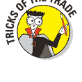

要高效地使用 CSS，请遵循以下通用指南：

- 当您测试页面的外观时，请使用内部样式，以便可以尽情调整。（本章展示了内部样式表，但第 9 章更详细地介绍了内部和外部样式表。）
- 当您的测试页面看起来恰到好处时，将那些内部样式移动到外部样式表，然后将它们应用到整个站点，或该站点中尽可能多的页面。

## 第三部分：精确控制网页和样式

### 管理布局与定位

你可以使用 CSS 来布局你的页面，使图像和文本块：

- 精确地出现在你想要它们出现的位置
- 完美地适应你希望它们占据的空间

在文档中创建样式后，你可以创建一个外部样式表，将相同的样式应用于任何页面。

清单 10-1 展示了一个没有任何预定义样式的网页。这个基本页面如图 10-1 所示。

### 清单 10-1：一个相当单调的页面


```html
<!DOCTYPE html PUBLIC "-//W3C//DTD XHTML 1.0 Transitional//EN"
 "http://www.w3.org/TR/xhtml1/DTD/xhtml1-transitional.dtd">
<html xmlns="http://www.w3.org/1999/xhtml" lang="en" xml:lang="en">
<head>
  <title>Pixel's Page</title>
  <meta http-equiv="Content-Type" content="text/html; charset=ISO-8859-1" />
</head>
<body>
  <h1>I'm Pixel the Cat. Welcome to my page.</h1>
  <div id="navBar">
    <p>Links of interest:</p>
    <p><a href="http://www.google.com/">Google</a></p>
    <p><a href="http://www.amazon.com/">Amazon</a></p>
    <p><a href="http://www.bing.com/">Bing</a></p>
  </div>
  
</body>
</html>
```

为你的网页创建链接在第 6 章中有详细介绍。在那里，你将找到创建优质链接所需的一切知识。关于层叠样式表（Cascading Style Sheets）以及它们能为你的网站内容带来的强大功能，请参考第 9 章。

这只猫看起来很棒，但这个页面显然没有展现出它的潜力。添加一些样式可以极大地改善这个页面。以下是具体方法！

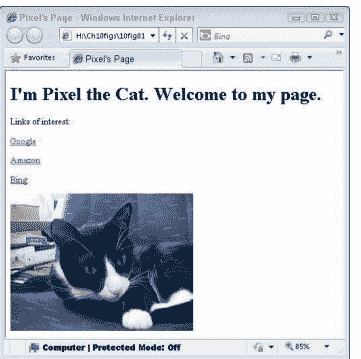

**图 10-1：** 这个没有样式的页面没有充分发挥这只猫的潜力。

### 可视化布局

我们不希望链接像图 10-1 中那样出现在图像上方，而是希望它们出现在左侧，这是导航工具的典型位置。以下标记将搜索站点链接的文本浮动到图像的左侧（见图 10-2）：

```

```

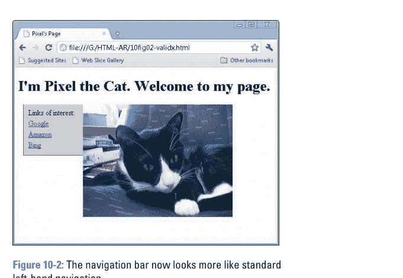

**图 10-2：** 导航栏现在看起来更像标准的左侧导航。

在前面的规则中，我们：

- 添加了一个 `<style>` 元素。
- 在 `<style>` 元素内定义了 `navBar` id。
- 使用 `navBar` id 指示内容浮动到图像的左侧，这导致它们出现在页面左侧的同一部分，而不是图像上方。

此规则表示，页面上任何属于 `navBar` id 的元素（如图 10-2 所示）应显示为：

- 浅灰色背景。
- 底部和左侧有细凹槽线边框，颜色较深。
- 无顶部或右侧边框。
- 一个向左浮动的块（因此页面上的其他所有元素向右移动，如图 10-2 中的图像）。
- 左外边距为 10 像素（px）。
- 顶部和底部各有 10px 的内边距。
- 导航栏区域宽度为 100px。

你会注意到我们还将行高设置为 0.2em。这确保了菜单行条目紧凑，各个元素之间没有太多空白。


请注意，声明中的几个属性称为*简写属性*，它们接受多个值，例如 `margin` 和 `padding`。简写属性从多个相关 CSS 属性（如 `margin-height`、`margin-width` 等）中收集值。完整列表请参见我们的在线资料。这些值对应于导航栏框的顶部、右侧、底部和左侧边缘的设置。`margin` 在框周围创建一个空白区域，而 `padding` 定义了框的边缘或边框与框内内容之间的空间。以下是解释如何将值与处理外边距、边框、内边距等属性关联的规则：

- 如果所有边的值相同，则使用单个值。
- 如果*任何*一边与其他边不同，则*每一边*都需要一个单独的值。你可以根据需要将其中一些或全部值设置为 0（零）；这通常有助于确保页面在更广泛的浏览器（和浏览器版本）上显示一致。


要记住哪个是什么，可以按顺时针顺序思考元素框的边缘，从*顶部*边缘开始：`top`、`right`、`bottom`，然后是 `left`。注意我们使用 px（像素）而不是 pt（点）或 em（默认字符 m 的宽度）作为度量单位来定义外边距和内边距。这是与我们本书其他地方（第 11 章）推荐的最佳实践有意背道而驰。这是因为外边距和内边距通常涉及小的增量或值，并且这些事物与特定浏览器中的各个实际显示密切相关。尝试这些值以获得最佳效果，并确保在尽可能多的不同的浏览器和平台上进行检查，以确保访问你网站的访客看到你想要呈现的效果。

## 定位

CSS 提供了多种方式来精确指定元素在页面上的出现位置。这些控制使用基于元素框与其父元素框之间关系的各种定位方式，以帮助页面设计师将页面元素放置在他们想要的位置。相关属性种类将在以下章节中讨论。

### 位置

你可以控制图像的水平和垂直位置。但是，当你对任何页面元素使用绝对定位时，你需要精确指定该元素必须相对于浏览器窗口的左上角放置。因此，你可以不将其自动绘制在导航栏的右侧，而是将图像放置在左下方，如图 10-3 所示。但绝对定位的项目在重叠时总是会渗透到顶层，这就是为什么 Pixel 的图片显示在顶部的原因。我们将在本章稍后更改此默认顺序。

```css
#theCat {position: absolute; top: 120px; left: 107px;}
```

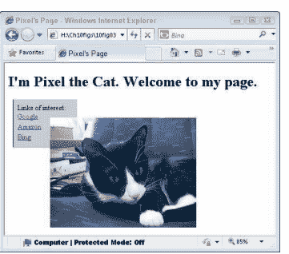

**图 10-3：** 图像在这个位置更引人注目。

你可能想知道为什么 `navbar` 规则（在前面“可视化布局”一节的清单中定义）和 `theCat` 规则（在图 10-3 之前的代码片段中）都以*井号*（也称为*哈希标记*或*octothorpe*）开头。这是因为井号适用于 `id` 属性。你使用句点来开始类规则，它将应用于页面上出现的该类的每个实例。因此，虽然你可以将 `class` 或 `id` 应用于特定元素，但这两者的区别在于 `class` 可以重复使用。相比之下，`id` 在页面上只能出现一次。你不能让页面上任何其他使用 `theCat` 作为其 `id` 的元素。区别很简单：`class` 允许你通过单个引用指代某个（X）HTML 元素的每个实例，但 `id` 只能寻址一个元素的单个实例。

## 重叠

两个对象*可以*被分配到网页中的相同位置。虽然这听起来可能是个问题，但重叠可以产生有趣的设计效果——正如我们将在接下来的代码和截图中看到的导航栏和照片所示。当重叠发生时，浏览器必须确定显示顺序以及哪些对象显示和哪些对象隐藏。

使用 `z-index`（可添加到任何规则中）告诉 CSS 你希望任何对象如何堆叠在占据页面相同空间的其他对象之上或之下：

- 较小的数字向下移动堆栈。
- 较大的数字向上移动堆栈。
- `z-index` 的默认值为 `auto`，这意味着它与父元素的值相同。

给 `theCat` 一个 `-1` 的 `z-index` 值会自动将其置于页面上所有其他未设置 `z-index` 的元素之后（如图 10-4 所示）（详情请参见本书网站上图 10-4 的 HTML 源代码）。

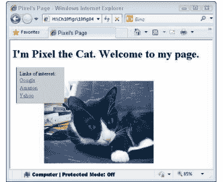

**图 10-4：** 猫从导航栏后面探出头来。

## 更改字体以增加视觉趣味和可读性

通过替换老旧、无聊的默认字体，你可以让页面更有趣。首先指定通用的正文字体，并设置一些其他默认规则，例如背景颜色和文本颜色。

## 154 第三部分：精确控制网页与样式

### 正文

下面是一个设置 `body` 元素内文本样式的示例：

```css
body {font-family: verdana, geneva, arial, helvetica, sans-serif;
    font-size: 1em; line-height: 1.33em; background-color: white;
    color: teal;}
```

由于 `body` 元素包含了任何网页的所有内容，这会影响页面上的所有内容。前面的规则指示浏览器按如下方式显示 `body` 元素内的所有文本：

文本使用列出的字体之一进行渲染。我们将 Verdana 放在列表首位，因为它是首选，浏览器会按列出的顺序检查可用字体。*注意：* 通用字体——此处为 `sans-serif`——几乎总是出现在此类列表的末尾，因为浏览器自身几乎总能提供这样的字体。

你可以列出多个字体。浏览器会使用你列表中第一个可用的字体。例如，浏览器按此顺序查找我们列表中的字体：

1. Verdana
2. Geneva
3. Arial
4. Helvetica
5. 浏览器的默认无衬线字体

#### 1.33em 行高

行间距被设置为仿佛字体高 1em，因此行与行之间有更多垂直空间。

图 10-5 显示了所有更改适用于整个页面，包括导航栏。`h1` 标题中的 `font-family` 发生了变化。由于标题具有特定的 `font-size` 和 `line-height` 默认值，因此需要另一个规则来修改它们。

在截取图 10-5 时，我们用于屏幕截图的 HTML 包含了针对 Internet Explorer (IE) 的额外调整。这是因为 Windows 版 Internet Explorer 中存在一个在其他浏览器中不会出现的 bug，会导致标题 (`h1`) 文本在顶部被截断。（在 IE 中尝试图 10-5 的源 (X)HTML 以了解我们的意思；我们不得不添加 CSS 标记，将 `h1` 的 `line-height` 设置为 `105%` 才创建出这种显示效果。）不幸的是，CSS 渲染可能具有不可预测性，因此你必须在各种浏览器中测试样式规则以查看其效果——然后相应地进行调整。

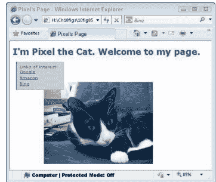

图 10-5：字体看起来好多了，但仍需稍作改进。

### 标题

如果我们明确为 `h1` 元素分配样式属性，显示结果将更加可预测。这里是一组示例样式：

```css
h1 {font-family: "trebuchet ms", verdana, geneva, arial, helvetica, sans-serif;
    font-size: 2em; line-height: 1.167em;}
```

图 10-6 显示了使用我们想要的字体系列和字号的一级标题：2em Trebuchet MS，行高为 2⅛em。如果我们系统中没有 Trebuchet MS 字体，标题将以 Verdana 显示。

当字体名称包含空格（如 `trebuchet ms` 或 `times new roman`）时，全名必须放在引号内。（有关更多信息，请参见第 11 章。）

### 超链接

我们认为超链接带有下划线——这是正常的——会让菜单看起来有点杂乱。幸运的是，我们可以用 CSS 关闭下划线，但我们仍然希望超链接看起来像超链接，所以我们告诉 CSS：

- 使链接加粗。
- 当光标悬停在链接上时显示下划线。
- 以特定颜色显示链接。

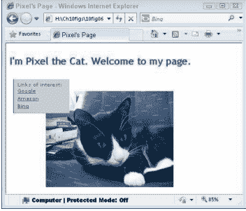

**图 10-6：** 为 h1 声明一条规则，使其按我们喜欢的方式显示。

以下样式规则定义了浏览器应如何显示超链接：

```css
a {text-decoration: none; font-weight: bold}
a:link {color: blue}
a:visited {color: #93C}
a:hover {text-decoration: underline}
```

这里发生了什么？从顶部开始，我们为 `<a>` 标签设置了两个规则，适用于页面上的所有链接：

- `text-decoration` 声明将其值设置为 `none`。这会移除所有链接的下划线。
- `font-weight` 声明的值为 `bold`。这使页面上的所有链接以粗体显示。

前面代码中的其余规则是*伪类选择器*。它们最常见的用途是修改链接在不同状态下的显示方式。（有关伪类的更多信息，请参见第 11 章。）这里我们更改了链接被访问时的颜色。我们还打开了当鼠标指针悬停在链接文本上时的下划线，以便在光标处于可点击范围内时识别超链接。图 10-7 显示了应用前面样式规则后的页面外观。

## 第 10 章：使用层叠样式表

157

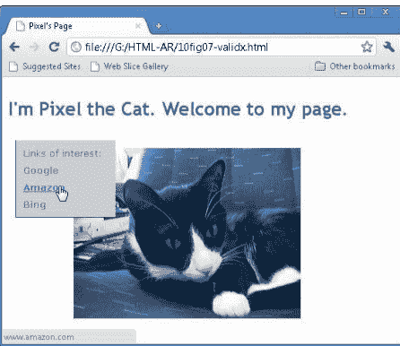

图 10-7：我们页面的最终版本。

## 外部化样式表

当最终页面达到你想要的效果时，就可以剪切并粘贴你测试通过、已批准的内部样式表，将其放入外部样式表。使用外部样式表的好处在于：

- 网站的每个页面只需在每个页面添加一行代码即可使用整个样式表。
- 可以通过在外部样式表中进行一次更改，实现全站范围的更改。

要从经过良好测试的内部样式表创建外部样式表，请按照以下步骤操作：

1. 复制位于 `<style>` 和 `</style>` 标签之间的所有文本。
2. 将该文本粘贴到其自己的新文档中。此文本应仅包含 CSS 标记，不包含任何 HTML 标签或标记。
3. 在保存时为文档名称添加 `.css` 后缀（例如 `myStyles.css`）。该后缀一目了然地表明它是一个 CSS 文件。

这样你就有了外部样式表。现在是时候将你的 HTML 文件链接到该外部样式表了。你有两个选择：

- 使用 `<link>` 标签。所有支持 CSS 的浏览器都理解 link 标签。
- 使用带有 `@import` 关键字的 `<style>` 标签。只有较新的浏览器才理解 `<style>` 和 `@import` 的组合。

有关这两种方法的更多信息，请参见第 9 章。

有时样式表会变得复杂且冗长。这时 `@import` 关键字就派上用场了：你可以创建一个主样式表，然后使用多个 `@import` 语句引入用于页眉、页脚、正文、菜单等的单独样式表。每个 `@import` 引用一个针对页面内容这些不同类别的子样式表。对于大多数小型或个人网站来说，这可能有些大材小用，但随着网站变得“庞大而复杂”，这种技术会非常有用。

## 在多媒体中使用 CSS

你可以根据媒体类型，指定希望网页在不同媒体类型上的外观或行为。

表 10-1 列出了所有媒体类型及其用途。

| 媒体类型 | 描述 |
| --- | --- |
| All | 适用于所有设备 |
| aural | 用于语音合成器 |
| braille | 用于盲文触觉反馈设备 |
| embossed | 用于分页盲文打印机 |
| handheld | 用于手持设备（例如具有小屏幕、单色显示器和有限带宽的设备） |
| print | 用于分页不透明材料以及在屏幕上查看但处于打印预览模式的文档 |
| projection | 用于投影演示，例如投影仪或透明胶片 |
| screen | 用于彩色计算机屏幕 |
| tty | 用于使用固定宽度字符网格的媒体，例如电传打字机、终端或具有有限显示能力的便携设备 |
| tv | 用于电视类设备（例如具有低分辨率、彩色功能、有限滚动性屏幕以及一些可用声音的设备） |

CSS 可以更改以定制相同页面的：

- **在屏幕上渲染**
- **打印** 一个漂亮的彩色背景可能会让你的页面在黑白激光打印机上打印时变得一团糟，但正确使用打印媒体样式可以防止此类事情发生！
- **大声朗读时的发声**

## 视觉媒体样式

表 10-2 列出了你在典型网页中最可能使用的 CSS 属性。我们这本书的在线内容包含了最常用 CSS 属性以及 (X)HTML 标签和属性的简要描述。

| 属性 | 值 | 默认值 | 描述 |
| :--- | :--- | :--- | :--- |
| Background-color | 任何颜色，按名称或十六进制代码 | transparent | 关联元素的背景颜色 |
| Background-image | URL | none | 作为元素背景的图片 URL |
| Color | 任何颜色，按名称或十六进制代码 | 随你！ | 前景文本的颜色 |
| font-family | 任何命名的字体、草书、幻想体、等宽体、无衬线体、衬线体 | 随你！（坚持使用常见字体。） | 用于渲染相关元素内容的字体 |
| font-size | 数字 + 单位、xx-small x-small small smaller medium large larger x-large xx-large % 长度 (px, em, cm) | medium | 用于渲染相关元素内容的字体大小 |

## 第三部分：精准掌控网页与样式

| 属性 | 值 | 默认值 | 描述 |
| :--- | :--- | :--- | :--- |
| font-weight | normal bold bolder lighter 100 200 300 400 500 600 700 800 900 | normal 400 等同于 normal，700 等同于 bold | 字体粗细（加粗或变细） |
| line-height | Normal number +unit % Length (px, em, cm) | normal | 文本行之间的垂直间距 |
| text-align | left right center justify | 由你决定；正常文本方向 | 确定页面上的文本如何对齐 |


| `text-decoration` | `None underline overline line-through blink` | `none` | 特殊文本效果 |
| --- | --- | --- | --- |
| `list-style-image` | `URL` | `none` | 用作列表项目符号的图片 URL |
| `list-style-position` | `Inside outside` | `outside` | 列表文本在项目符号内侧还是外侧换行 |
| `list-style-type` | `Disc circle square decimal decimal-leading-zero lower-alpha upper-alpha none armenian georgian lower-greek lower-latin lower-roman upper-latin upper-roman` | `disc` | 列表的项目符号类型 |

# 第10章：使用层叠样式表

161

| 属性 | 值 | 默认值 | 描述 |
| --- | --- | --- | --- |
| `Display` | `block inline none` | `inline` | 为块级元素定义部分的格式 |
| `Top` | `Number and unit auto` | `auto` | 绝对定位：设置元素上边缘在其包含元素上边缘之上/之下；相对定位：设置元素上边缘在其正常位置之上/之下 |
| `Right` | `Percentage number + unit auto` | `Auto` | 绝对定位：设置元素右边缘在其包含元素右边缘宽度旁；相对定位：设置元素右边缘在其正常位置右边缘宽度旁 |
| `Bottom` | `Percentage number + unit auto` | `Auto` | 绝对定位：设置元素下边缘在其包含元素下边缘之下；相对定位：设置元素下边缘在其正常位置之下 |

（续）

## 第三部分：精准掌控网页与样式

**表 10-2（续）**

| 属性 | 值 | 默认值 | 描述 |
| --- | --- | --- | --- |
| `Left` | `Percentage number + unit auto` | `Auto` | 绝对定位：设置元素左边缘在其包含元素左边缘右侧；相对定位：设置元素上边缘在其正常位置之上/之下 |
| `Position` | `Static absolute relative fixed` | `static` | 元素框相对于定位上下文的布局方式 |
| `Visibility` | `Collapse visible hidden inherit` | `inherit` | 指示对象是否会在页面上显示 |
| `z-index` | `Number auto` | `Auto` | 对象的堆叠顺序（-1 总是将对象置于最底层） |
| `border-style` | `none dotted dashed solid double groove ridge inset outset` | `Not defined` | 对象边框的显示样式。可分为 `border-top-style`、`border-right-style`、`border-bottom-style` 和 `border-left-style` |

# 第10章：使用层叠样式表

163

| 属性 | 值 | 默认值 | 描述 |
| --- | --- | --- | --- |
| `border-width` | `Thin medium thick Number` | `Not defined` | 对象周围边框的宽度。可分为 `border-top-width`、`border-right-width`、`border-bottom-width` 和 `border-left-width` |
| `border-color` | `Any color, by name or hex code transparent` | `Not defined` | 对象边框的颜色。可分为 `border-top-color`、`border-right-color`、`border-bottom-color` 和 `border-left-color` |
| `Border` | `Border-width +border-style +border-color` | `Not defined` | 对象周围边框的组合特性。可分为 `border-top`、`border-right`、`border-bottom` 和 `border-left` |
| `Float` | `left right none` | `none` | 指定对象是否应浮动到文档的一侧或另一侧（续） |

164 第三部分：精准掌控网页与样式

**表 10-2（续）**

| 属性 | 值 | 默认值 | 描述 |
| --- | --- | --- | --- |
| `Height` | `Number + unit, auto` | `Auto` | 对象的显示高度 |
| `Width` | `Number + unit, auto` | `Auto` | 对象的显示宽度 |
| `Margin` | `Number + unit, auto` | `Not defined` | 对象的显示外边距。可分为 `margin-top`、`margin-right`、`margin-bottom` 和 `margin-left` |
| `Padding` | `Number + unit, auto` | `Not defined` | 对象周围的显示空白区域。可分为 `padding-top`、`padding-right`、`padding-bottom` 和 `padding-left` |
| `Cursor` | `Auto, crosshair, default, pointer, move, text, help, URL, e-resize, n-resize, ne-resize, nw-resize, progress, s-resize, se-resize, sw-resize, w-resize, inherit` | `Auto` | 浏览器窗口中的光标外观 |

**第10章：使用层叠样式表** 165

某些浏览器不支持所有 CSS 属性。如果你正在使用 CSS 功能，请使用你预期访问者会使用的浏览器来测试你的页面。尽可能使用能在尽可能多的浏览器上工作的 CSS 功能，忽略其余的。

如果你想随时随地携带一份极其详尽的 CSS 指南，请把它放在你的 iPod 上！Westciv 免费的 podGuide 是一个包含小型文本文件的文件夹。下载压缩文件并按照说明进行安装，这样你就能随时拥有完整的文档。（你还能赢得“世界上最大的 CSS 极客”的称号。）podGuide 在线地址为 `www.westciv.com/news/podguide.html`。

# 分页媒体样式

CSS 可以自定义页面打印时的外观。我们推荐以下准则：

- 用衬线字体替换无衬线字体。
- 衬线字体比无衬线字体更易于阅读。
- 插入广告，要求：
  - 即使不动画也合理。
  - 无需点击即有用。

总的来说，分页媒体样式有助于确保文本在打印时看起来和在 Web 浏览器中一样好。分页媒体样式还可以帮助你在页面打印时隐藏不相关的内容（横幅、广告等），从而减少纸张浪费和用户挫折感。有关 CSS 中可用于帮助用户在打印网页时获得最佳效果的分页媒体属性的说明，请参见表 10-3。

### 表 10-3：分页媒体样式

| 属性 | 值 | 默认值 | 描述 |
| --- | --- | --- | --- |
| `orphans` | `Number` | `2` | 必须保留在页面底部的段落最小行数 |
| `page-break-after` | `Auto always avoid left right` | `auto` | 元素后的分页行为 |
| `page-break-before` | `Auto always avoid left right` | `auto` | 元素前的分页行为 |

（续）

### 表 10-3（续）

| 属性 | 值 | 默认值 | 描述 |
| --- | --- | --- | --- |
| `page-break-inside` | `Auto avoid` | `auto` | 元素内的分页行为 |
| `widows` | `Number` | `2` | 必须保留在页面顶部的段落最小行数 |

代码清单 10-2 中的示例使用了这些分页媒体样式选项：

- 使输出为黑底白字。
- 用衬线字体替换无衬线字体。

# 代码清单 10-2：添加打印样式表

```html
<!DOCTYPE html PUBLIC "-//W3C//DTD XHTML 1.0 Transitional//EN"
  "http://www.w3.org/TR/xhtml1/DTD/xhtml1-transitional.dtd">
<html xmlns="http://www.w3.org/1999/xhtml" lang="en" xml:lang="en">
<head>
<title>This is my page</title>
<meta http-equiv="Content-Type" content="text/html; charset=ISO-8859-1" />
<style type="text/css">
  body {background-color: black; color: white; font-family: sans-serif;}

  @media print {
    body {background-color: white; color: black; font-family: serif}
  }
</style>
</head>
<body>
  This page will look very different when sent to the printer.
</body>
</html>
```

如果你现在想知道为什么表 10-3 中的属性没有设置而其他属性设置了，那是因为（在这个例子中）它们的默认值效果很好。而且，这些页面属性可以设置并不意味着你不能设置其他属性——这不是二选一的问题。

## 听觉（语音）样式

听觉浏览器和样式不仅适用于视障人士，也适用于那些有以下情况的网页用户：

通常，你无需过于担心在页面中添加听觉样式。如果满足以下条件，默认的阅读器应该能正常工作：

- 你的页面主要是文本。
- 你对声音效果没有特别要求，任何清晰的男声或女声都可以接受。
- 有阅读障碍。
- 驾驶时需要获取信息。

以下示例推荐使用男声和女声角色来播放语音，以明确区分说话的角色：

```html
<style>
    @media aural {
        p.stanley {voice-family: male;}
        p.stella {voice-family: female;}
    }
</style>
```

需要指出的是，你可以在本书的配套网站上找到所有听觉样式属性的完整列表。

# 第三部分：精确控制网页与样式

168

## 第11章：创意运用色彩与字体

### 本章内容

- 使用 CSS 定义文本格式
- 处理页面颜色与背景
- 更改字体显示
- 添加文本处理效果

在样式表出现之前，网页设计师不得不依赖 HTML 标记来控制网页的背景、颜色、字体和文本大小。然而，随着样式表的出现，设计师可以将样式信息与内容分离——这意味着他们可以使用层叠样式表（CSS）来控制字体、颜色和其他样式信息。

为什么要这样做？很简单。使用 CSS，你将获得以下好处：

- 在更新或编辑格式信息时能更好地控制。
- 不再有充斥着 `<font>` 标签的 HTML 文档。
- 有更多的文本格式化选项（例如定义行高、字重和文本对齐方式），以及将文本转换为大写或小写字符的选项。

> (X)HTML 仍然包含各种格式化元素，例如 `<tt>`、`<i>`、`<big>`、`<b>` 和 `<small>`；但是，所有剩余的格式化元素，如 `<font>`，都已被弃用。也就是说，它们不再被推荐使用（尽管它们仍然有效，并且大多数浏览器都能识别它们）。我们认为你不应该再使用它们，但决定权在你。如果你想了解更多关于已弃用格式化元素的内容，我们将在第 8 章中介绍。

## 颜色值

(X)HTML 通过两种方式定义颜色值：

- **名称：** 你从一个有限的列表中选择。
- **数值：** 更难记住，但你有更多选择。

## 颜色名称

HTML 规范包含 16 种颜色名称，你可以使用它们来定义页面中的颜色。表 11-1 显示了这些颜色。以井号（`#`）开头的数字采用的是*十六进制*表示法，它混合了字母 A-F（代表 10-15）和我们熟悉的十进制数字 0-9。

**表 11-1：(X)HTML 中的命名颜色值**

| 名称 | #RGB 代码 | 颜色 | 名称 | #RGB 代码 | 颜色 |
| --- | --- | --- | --- | --- | --- |
| Black（黑色） | `#000000` |  | Silver（银色） | `#C0C0C0` |  |
| Gray（灰色） | `#808080` |  | White（白色） | `#FFFFFF` |  |
| Maroon（栗色） | `#800000` |  | Red（红色） | `#FF0000` |  |
| Purple（紫色） | `#800080` |  | Fuchsia（紫红） | `#FF00FF` |  |
| Green（绿色） | `#008000` |  | Lime（酸橙绿） | `#00FF00` |  |
| Olive（橄榄色） | `#808000` |  | Yellow（黄色） | `#FFFF00` |  |
| Navy（海军蓝） | `#000080` |  | Blue（蓝色） | `#0000FF` |  |
| Teal（水鸭蓝） | `#008080` |  | Aqua（水绿色） | `#00FFFF` |  |

## 第11章：创意运用色彩与字体

你可以在 CSS 标记中安全地使用颜色名称，并确信浏览器会识别它们，并在你的网页中使用正确的颜色。你还可以将屏幕上看到的颜色与这个印刷页面上的颜色进行比较，看看印刷品和数字显示有时会有所不同。（在某些情况下，可能是你的屏幕色彩平衡有偏差；在其他情况下，打印机试图在页面上匹配的颜色可能并不完全正确——这并不像你想象的那么容易！）


访问 `www.htmlhelp.com/reference/html40/values.html#color` 查看你的浏览器如何显示这些颜色。如果可能，请在两三台不同的计算机上查看此页面，看看不同的浏览器、操作系统、显卡和显示器如何微妙地改变显示效果。

以下 CSS 样式声明表示 `<p>` 标签内的所有文本应为蓝色：

```css
p {color: blue;}
```


如果你在寻找烧赭色、查特酒绿色或鲑鱼肉色，那就不走运了。这个列表并不是 64 色蜡笔盒！但是，你也可以在在线速查表 `www.dummies.com/cheatsheet/html` 上找到网络安全颜色的十六进制代码以及色板。这些颜色虽然没有名称，但却是网络安全的，因为它们在大多数彩色计算机显示设备和打印机上都能相当可靠地再现。

## 颜色数值

颜色数值允许你使用任何颜色（甚至是鲑鱼肉色）到你的网页上。

### 十六进制颜色代码

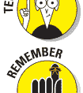

十六进制表示法使用六个字符——数字和字母的组合——来定义颜色。如果你知道一个颜色的十六进制代码（通常简称为十六进制码），你就拥有了在 HTML 页面中使用该颜色所需的一切。


使用十六进制代码定义颜色时，应在前面加上井号（`#`）。否则，在某些网页浏览器中可能无法正确显示。

以下 CSS 样式声明使所有包含在 `<p>` 标签中的文本变为蓝色：

```css
p {color: #0000FF;}
```

## 查找任何颜色的十六进制代码

你不能简单地挥动魔杖就得到任何颜色的十六进制代码，但这并不意味着你不能通过不那么神奇的方法找到它。颜色转换器遵循精确的公式，将颜色的标准 RGB 表示法转换为十六进制表示法。因为你有比计算十六进制代码更重要的事情要做，所以你有几种方法可以找到你所选颜色的代码，包括本书在线速查表（`www.dummies.com/cheatsheet/html`）上显示的网络安全颜色。这些方法都不需要你使用计算器：

- **在网页上：** 一些好的十六进制颜色图表来源包括：
  - `http://www.webmonkey.com/2010/02/color_charts`
  - `www.colorschemer.com/online.html`

  你只需找到你喜欢的颜色，然后将其旁边的十六进制代码键入你的 HTML 即可。

- **使用图像编辑软件：** 许多图像编辑应用程序，如 Adobe Photoshop 或 Adobe Fireworks，都会显示任何颜色的十六进制表示法。即使是 Microsoft Word 的颜色选择器也会显示图像中颜色的十六进制代码。如果你有一张喜欢的图片，并想将其用作网页的颜色来源，请在你喜欢的编辑器中打开该图片，并找出这些颜色的十六进制代码是什么。

## RGB 值

你可以使用两种十进制 RGB 值来定义颜色。这些值类型不如十六进制值常见，但同样有效：

- `rgb(r, g, b)`：其中的 `r`、`g` 和 `b` 是 0 到 255 之间的整数，分别代表颜色的红、绿、蓝级别。


- `rgb(r%, g%, b%)`：其中的`r%`、`g%`和`b%`分别代表颜色中红色、绿色和蓝色的百分比。

每种颜色都可以定义为红色、绿色和蓝色（RGB）的混合。你可以使用 RGB 值或等效的十六进制代码向网页浏览器描述颜色的 RGB 值。有关十六进制表示法的更多信息，请访问`www.lts.com/class/hextoc.htm`上的“十六进制颜色教程”。

## 颜色定义

你可以为网页上的任何文本定义单独的颜色，也可以为整个网页或其某些部分定义背景颜色。

CSS 使用以下属性来定义颜色：

### 第 11 章：颜色与字体的创意运用

- `color`定义字体颜色，也用于定义链接在各种状态（`link`、`active`、`focus`、`visited`和`hover`；参见后续“链接”部分）下的颜色。
- `background`或`background-color`定义整个页面的背景颜色，或为特定元素定义背景（例如，为所有一级标题设置背景色，类似于在 Word 文档中高亮显示某些内容的想法）。

## 文本

您可以通过三个步骤更改网页上的文本颜色：

1. **确定选择器。**

   例如，颜色将应用于所有一级标题、所有段落还是特定段落？

2. **使用`color`属性。**

3. **指定颜色名称或十六进制值。**

样式声明的基本语法是：

```css
selector {color: value;}
```

以下是一组样式声明，其中我们使用`color`属性为`body`元素（因此，也为文档主体中可能出现的所有其他从属 HTML 元素，除非其他规范（如`h1`元素）覆盖了该选择）指定文本颜色：

```css
body {color: olive; font-family: Verdana, sans-serif;
		background-color: #FFFFFF; font-size: 85%;}
h1 {text-align: center;}
.navbar {font-size: 75%; text-align: center;}
h1 {color: #808000;}
p.chapternav {text-align: center;}
.footer {font-size: 80%;}
```

请注意，在前面的 CSS 规则中，页面上所有文本的颜色是通过使用`body`选择器定义的。颜色应用于文档主体中的所有文本，除非另有定义。为了说明这一点，一级标题被定义为森林绿色，使用十六进制表示法。

## 链接

伪类允许您基于文档树之外的信息定义样式规则。

最常见的 CSS 伪类用法是为文档树中的给定元素定义样式规则——这是一个技术术语，意思是浏览器为文档中的所有元素构建一个层次结构表示，就像一个家谱，每个元素都有一个父元素，可能包含一个子元素。例如，`:link`是一个伪类，用于为尚未访问过的任何链接定义样式规则。

您可以与超链接一起使用的五个常见伪类是：

- `:link`定义尚未访问过的链接的格式。
- `:visited`定义已访问过的链接的格式。
- `:focus`定义被键盘（例如，使用 Tab 键）选中并即将使用 Enter 键激活的链接的格式。
- `:hover`定义当鼠标光标悬停在链接上时的格式。
- `:active`定义当链接被选中（被鼠标单击，或通过按 Enter 键激活）时的格式。

伪类名称前需加一个冒号（`:`）。

伪类可以与以下内容一起使用：

- 元素（例如定义超链接的`<a>`元素）
- 类
- ID

例如，要定义已访问和未访问链接的样式规则，请使用以下语法：

```css
* 以下将任何指向未访问 URL 的超链接颜色设置为红色，使用其十六进制值：
  a:link {color: #FF0000;}
* 以下将任何指向已访问 URL 的超链接显示为命名颜色绿色：
  a:visited {color: green;}
* 以下将具有 internal 类的未访问链接指定为（命名颜色）黄色：（关于 CSS 类的讨论，请参见第 9 章。）
  a.internal:link {color: yellow;}
```

链接可以同时占据多个状态。例如，一个链接可以同时处于已访问和悬停状态。请始终按以下顺序定义链接样式规则：`:link`、`:visited`、`:focus`、`:hover`、`:active`。

CSS 应用“最后看到的规则”来显示您的页面。因此，如果将伪类选择器放在错误的顺序，您的结果可能不是您想要的。例如，如果`:visited`紧跟在`:hover`之后，且两者有重叠的规则，则`:hover`效果仅适用于尚未访问过的链接。

以下 CSS 规则将文档渲染为橄榄色，作为未访问链接的颜色，以及黄色，作为已访问链接的颜色：

```css
body {color: #808000; font-family: Verdana, sans-serif; font-size: 85%;}
a:link {color: olive;}
a:visited {color: yellow;}
```

CSS 规范将`:link`和`:visited`定义为互斥的，由浏览器应用程序确定何时为任何给定链接更改状态（已访问与未访问）。例如，如果您清除历史记录数据，浏览器可能会确定链接是未访问的。

### 背景

要更改网页或该页面某一部分的背景颜色，请按照以下步骤操作：

1. 确定选择器。例如，颜色将应用于整个背景，还是仅应用于特定部分？
2. 使用`background-color`或`background`属性。
3. 指定颜色名称或十六进制值。

样式声明的基本语法是：

```css
selector {background-color: value;}
```

在以下样式声明集合中，第一个样式声明使用`background-color`属性，并通过十六进制表示法将其设置为浅绿色：

```css
body {color: #808000; font-family: Verdana, sans-serif;
      background-color: #EAF3DA; font-size: 85%;}
```

您可以将背景颜色应用于文本块——例如，一个段落——就像为整个页面定义背景颜色一样。

您可以将`background`作为所有单独背景属性的简写属性，或者使用`background-color`仅设置颜色，如下所示：

```css
selector {background: value value value;}
```

更多信息，请参见第 9 章或 Webmonkey 的 “Mulder’s Stylesheets Tutorial” 中的 “The Shorthand Property” 部分：`www.webmonkey.com/2010/02/mulders_stylesheets_tutorial`。

## 字体

您可以使用以下方式为不同的 HTML 元素定义单个字体属性：

- 单个 CSS 属性，如`font-family`、`line-height`和`font-size`
- `font`简写属性中的字体属性组

### 字体族

要使用 CSS `font-family`属性定义字体外观（一个命名且通常受版权保护的特定字符设计集合，如 Times Roman、Arial 或 Helvetica）：

**1. 确定样式声明的选择器。**

例如，将`p`设为选择器将为所有`<p>`标签定义字体族。

**2. 添加属性名称`font-family`。**

并非所有字体族都受每个浏览器支持。CSS 允许您指定多个字体族，以防浏览器不支持您首选的字体族。您可以列出多个以逗号分隔的字体族名称。浏览器会使用其运行计算机上可用的列表中的第一个名称。您可以在 FontTester.com 上查看 Web 安全字体族列表：`www.fonttester.com/help/list_of_web_safe_fonts.html`。

**3. 定义属性的值（字体族的名称）。**

对于包含空格的字体族名称，请使用单引号或双引号括起来。

要将所有一级标题格式化为使用 Verdana 字体，请使用如下样式声明：

```css
h1 {font-family: Verdana, Helvetica, sans-serif;}
```

在前面的声明中，另外出现了两个字体族，以防某人的浏览器不支持 Verdana 字体族。

我们建议在您的样式声明中包含这些字体族：

- **常用：**至少包含一个这些常用字体族：
  - Arial：ABCDEFGHIJKLMNOPQRSTUVWXYZ abcdefghijklmnopqrstuvwxyz
  - Helvetica：ABCDEFGHIJKLMNOPQRSTUVWXYZ abcdefghijklmnopqrstuvwxyz
  - Times New Roman：ABCDEFGHIJKLMNOPQRSTUVWXYZ abcdefghijklmnopqrstuvwxyz
  - Verdana：ABCDEFGHIJKLMNOPQRSTUVWXYZ abcdefghijklmnopqrstuvwxyz

- **通用：**至少包含一个这些通用字体族：
  - Serif：ABCDEFGHIJKLMNOPQRSTUVWXYZ abcdefghijklmnopqrstuvwxyz
  - Sans serif：ABCDEFGHIJKLMNOPQRSTUVWXYZ abcdefghijklmnopqrstuvwxyz
  - Cursive：ABCDEFGHIJKLMNOPQRSTUVWXYZ abcdefghijklmnopqrstuvwxyz
  - Fantasy：ABCDEFGHIJKLMNOPQRSTUVWXYZ abcdefghijklmnopqrstuvwxyz
  - Monospace：ABCDEFGHIJKLMNOPQRSTUVWXYZ abcdefghijklmnopqrstuvwxyz

不同的元素可以使用不同的字体族进行格式化。以下规则为超链接定义了不同的字体族（见图 11-1）：

```css
body {color: #808000; font-family: Arial, sans-serif; font-size: 85%;}
hr {text-align: center;}
a {font-family: Courier, "Courier New", monospace;}
```

## 第三部分：精准掌控网页与样式


图 11-1：超链接使用的字体族与文本其余部分的字体族不同。

## 尺寸调整

以下属性允许您控制文本的尺寸。

### 字体大小

用于指定文本大小的样式声明为：

```css
selector {font-size: value;}
```

该声明的值可以是：

- 标准字体属性度量值之一（列于第 9 章）。
- 以下用户定义关键字之一：
  - `xx-small`、`x-small`、`small`、`medium`、`large`、`x-large`或`xx-large`
  - 每个关键字的值由浏览器决定，而非样式规则。


以下小节中列出的规则定义了：

- 所有文本的相对字体值
- 所有一级标题字体大小的绝对值

```css
body {color: #808000; font-family: Arial, sans-serif; font-size: 85%;}
h1 {font-family: "trebuchet ms", verdana, geneva, arial, helvetica, sans-serif; font-size: 2em; line-height: 2.5em; color: teal;}
```

## 使用 CSS 调整文本字体大小

除了字体大小名称（`xx-small`、`x-small`、`small`、`medium`、`large`、`x-large`或`xx-large`）外，您还可以使用以下 CSS 度量单位来指定字体大小：`px`（像素）、`pt`（点）或`em`（所使用字体的 M 字符高度，无论其具体值是多少）。像素取决于用户显示设备上单个像素的大小，并且在不同屏幕间变化太大，难以真正实用。点是非常小的度量单位，可能需要过多的试验才能恰到好处。这或许解释了为什么`em`是当今 CSS 中调整字体大小最广泛使用的单位，以及为什么这种方法被视为使用样式表调整字体大小的最佳实践。选择`em`单位并不能免除您进行试验，但它将使您能够快速轻松地相对于基础字体来调整字体大小。有关使用这些单位的更多信息，其形式为`font-size: 2em;`（将字体大小加倍）或`font-size: 0.8em;`（将字体缩小到基准的 80%），请参阅第 9 章。

结果如图 11-2 所示。


**图 11-2：**一级标题的大小是基础字体的两倍；其他文本的字体大小是相对的。

## 行高

段落的*行高*是指段落内每行之间的空间量。

行高类似于文字处理器中的行距。

## 第三部分：精准掌控网页与样式

要更改段落行之间的空间量，请使用`line-height`属性：

```css
selector {line-height: value;}
```

`line-height`属性的值可以是：

- 标准字体属性度量值之一（列于第 9 章）。
- 一个乘以元素字体大小的数字，例如`1.5`。

我们在本章中始终将第一个段落分配一个引用类（quotation），以便您可以看到更改。这允许我们通过使用

```html
<p class="quotation">
```

在 HTML 文档中将这些样式应用于第一个段落。

以下规则将第一个段落设置为斜体、缩进该段落并增加行高以提高可读性（参见图 11-3）：

```css
body {color: #808000; font-family: Arial, sans-serif; font-size: 85%;}
h1 {font-family: "trebuchet ms", verdana, geneva, arial, helvetica, sans-serif;
    font-size: 2em; line-height: 2.5em; color: teal;}
.quotation {font-style: italic; text-indent: 2em; line-height: 150%;}
```

## 字符间距

您可以使用以下属性增加或减少字母或单词之间的间距量：

- `word-spacing`：`word-spacing`的样式声明为：

  ```css
  selector {word-spacing: value;}
  ```

  设计师将单词之间的空格称为字距调整。

- `letter-spacing`：`letter-spacing`的样式声明为：

  ```css
  selector {letter-spacing: value;}
  ```

  设计师将字母之间的空格称为字偶距调整。


任一间距属性的值必须是通过标准字体属性度量值定义的长度（列于第 9 章）。

## 第 11 章：玩转颜色与字体


**图 11-3：**属于引用类的任何元素都将获得相同的格式。

以下代码增加第一个段落的字母间距（字偶距）（参见图 11-4）：

```css
body {color: #808000; font-family: Arial, sans-serif; font-size: 85%;}
h1 {font-family: "trebuchet ms", verdana, geneva, arial, helvetica, sans-serif;
    font-size: 2em; line-height: 2.5em; color: teal;}
.quotation {font-style: italic; text-indent: 10pt; line-height: 150%;
    letter-spacing: 0.2em;}
```


**图 11-4：**字偶距可以大于或小于字体的正常间距。

## 文本块的定位

对齐属性允许您控制文本块的边缘如何相互对齐（也称为“边缘对齐”）。

### 文本对齐

对齐方式决定了文本块的左侧和右侧是：

- **齐平（Flush）：**同时开始或结束。
- **参差（Ragged）：**在不同的点开始或结束。

#### 文本对齐语法

对齐方式由`text-align`属性定义。用于对齐文本的样式声明如下：

```css
selector {text-align: value;}
```

`text-align`属性的值必须是以下关键字之一：

- **`left`：**将文本左对齐。文本块的右侧参差不齐。
- **`right`：**将文本右对齐。文本块的左侧参差不齐。
- **`center`：**将文本在窗口中居中。文本块的两侧都参差不齐。
- **`justify`：**对齐文本的左右两侧。调整每行文本中的间距，使文本块的两侧都齐平。

两端对齐文本会影响段落中的字母或单词间距。在向公众展示您的网页之前，请测试结果。

#### 文本对齐标记

以下示例定义了一级标题和第一个段落的对齐方式（参见图 11-5）：


```css
body {color: #808000; font-family: Verdana, sans-serif; font-size: 85%;}
h1 {color: teal; font-family: "Trebuchet MS", Verdana, Geneva, Arial, Helvetica,
sans-serif;
    font-size: 2em; line-height: 2.5em; color: teal; text-align: center}
.quotation {font-style: italic; text-indent: 2em; text-align: left;}
```

第 11 章：玩转颜色与字体 183


图 11-5：一级标题居中；第一个段落缩进并左对齐。

## 文本缩进

您可以使用 `text-indent` 属性定义应在段落第一行之前预留的空间量。

使用 `text-indent` 属性不会缩进整个段落——只缩进第一行。要实现整个段落的缩进，您需要使用 CSS 盒属性，例如 `margin-left` 和 `margin-right`（参见第 10 章）。


### 文本缩进语法

用于缩进文本的样式声明为：

```css
selector {text-indent: value;}
```

此处，`value` 必须是标准长度属性度量值之一（列于第 9 章）。

### 文本缩进标记

如本章所示，`quotation` 类的 `text-indent` 为 `2em`。

```css
body {color: #808000; font-family: Verdana, sans-serif; font-size: 85%;}
.quotation {font-style: italic; text-indent: 2em;}
```

## 文本修饰

CSS 允许您使用粗体、斜体、下划线、上划线或删除线来装饰文本，甚至允许您的文本闪烁（当浏览器支持时）。

### 使用粗体加粗

使用粗体字体是设计师常用的更常见的文本修饰之一。要在 HTML 中应用粗体，请使用 `<b>` 标签。但是，CSS 让您能更精细地控制加粗文本的字重。

#### 应用粗体的语法

此样式声明使用 `font-weight` 属性：

```css
selector {font-weight: value;}
```

`font-weight` 属性的值可以是以下之一：

- `bold`：以平均粗细渲染文本
- `bolder`：相对值，渲染比当前字重（可能由父元素分配）更粗的字重
- `lighter`：相对值，渲染比当前字重（可能由父元素分配）更细的字重
- `normal`：移除任何粗体格式
- 以下整数值之一：100（最细）、200、300、400（正常）、500、600、700（标准粗体）、800、900（最粗）

#### 应用粗体的标记

以下示例将超链接加粗（参见图 11-6），关闭下划线，并在访问链接后将颜色更改为绿色（我们对“公司历史”项进行了此操作以向您展示其效果）：

```css
body {color: black; font-family: Arial, sans-serif; font-size: 85%;}
a {font-weight: bold;}
a:link {color: olive; text-decoration: underline;}
a:visited {color: green; text-decoration: none;}
```

### 使用斜体强调

斜体通常用于突出引文或强调文本。要在 HTML 中应用斜体，请使用 `<i>` 标签。然而，CSS 通过 `font-style` 属性让您能更精细地控制文本的字体样式。

#### 应用斜体的语法

此样式声明使用 `font-style` 属性：

```css
selector {font-style: value;}
```

`font-style` 属性的值可以是以下之一：

- `italic`：以斜体渲染文本（一种通常向右倾斜的特殊字体）
- `oblique`：以倾斜渲染文本（普通字体的另一种倾斜版本；在字体定义中很少使用）
- `normal`：移除任何斜体或倾斜格式

#### 应用斜体的标记

以下示例将一级标题设置为斜体字体样式：

```css
body {color: #808000; font-family: Verdana, sans-serif; font-size: 85%;}
h1 {color: teal; font-family: "MS Trebuchet", Arial, Helvetica, sans-serif;
    text-transform: uppercase; font-style: italic; font-weight: 800;
    font-size: 2em; line-height: 30pt; text-align: center;}
```

## 更改大小写

你可以使用 `text-transform` 属性来设置文档中的大小写。

### 更改大小写的语法

此样式声明使用 `text-transform` 属性：

```css
selector {text-transform: value;}
```

`text-transform` 属性的值可以是以下之一：

- `capitalize`：将每个单词的首字母大写
- `uppercase`：将指定元素的所有文本字母渲染为大写
- `lowercase`：将指定元素的所有文本字母渲染为小写
- `none`：保持继承元素的值

### 更改大小写的标记

以下示例将一级标题渲染为大写（如图 11-7 所示）：

```css
body {color: black; font-family: Arial, sans-serif; font-size: 85%;}
a {font-weight: bold;}
a:link {color: olive; text-decoration: underline;}
a:visited {color: green; text-decoration: none;}
h1 {font-family: "Trebuchet MS", verdana, geneva, arial, helvetica, sans-serif;
font-size: 2em; line-height: 2.5em; color: teal; text-transform: uppercase;
text-align: center}
```

图 11-7：一级标题以全大写形式渲染。

## 使用 text-decoration 属性实现花式效果

`text-decoration` 属性允许进行稍微花哨一些的文本格式化。它并不常用。

### 文本装饰的语法

此样式声明使用 `text-decoration` 属性：

```css
selector {text-decoration: value;}
```

`text-decoration` 属性的值可以是以下之一：

- `underline`：为文本添加下划线
- `overline`：在文本上方渲染一条线
- `line-through`：在文本中间渲染一条线（删除线）
- `blink`：在屏幕上闪烁文本
  - 你确定要使用闪烁文本吗？
    - `blink` 并非所有浏览器都支持。
    - `blink` 可能非常令人烦恼和分心。
- `none`：移除任何文本装饰

### 文本装饰的标记

以下示例在鼠标悬停时更改链接。在这种情况下，它取消了链接的任何下划线：

```css
body {color: #808000; font-family: Verdana, sans-serif; font-size: 85%;}
a:link {color: olive; text-decoration: underline;}
a:visited {color: olive; text-decoration: underline;}
a:hover {color: olive; text-decoration: none;}
```

## 万能的 font 属性

许多字体属性可以通过使用简写的 `font` 属性在一个样式声明中概括。使用它时，只需一个样式规则就可以定义一系列字体属性的组合：

```css
selector {font: value value value;}
```

`font` 属性的值是与各种字体属性相对应的值列表：

- 以下值必须按以下顺序定义（尽管不必连续）：
  - `font-size`（必需）
  - `line-height`（可选）
  - `font-family`（必需）

`font-family` 值列表必须以分号结尾。

使用逗号分隔多个字体族名称。例如，你可以使用以下样式声明为段落文本创建特定样式，该样式按（必需的）顺序指定 `font-size`、`line-height` 和 `font-family`：

```css
p {font: 1.5em bold 150% Arial, Helvetica, sans-serif;}
```

- 以下值是可选的，可以在声明中以任何顺序出现。单个值用空格分隔：
  - `font-style`
  - `font-variant`
  - `font-weight`

例如，你可以使用以下样式声明为一级标题创建特定样式，该样式将可选值与必需值混合在一起（在此例中，`font-style` 和 `font-weight` 在 `line-height` 和 `font-family` 之前，省略了 `font-size` 和 `font-variant`）：

```css
h1 {font: italic bold 150% Arial, Helvetica, sans-serif;}
```

# 第四部分：脚本与 (X)HTML

## 本部分内容简介

在此，我们介绍并描述了可在网页上使用的脚本语言类型，并简要探讨 JavaScript——目前所有网页脚本语言中最流行的一种。脚本语言帮助静态、一成不变的网页变成活跃、动态的文档，能够征集并响应用户输入。

接下来，你将更深入地研究如何处理表单，以便理解如何向用户征集输入并处理这些输入。下一章将展示如何嵌入第三方服务和信息——如 Flickr、Twitter、Google Maps 和 YouTube——以使你的页面更加动态和有趣，同时利用他人的工作成果。

下一章将向你展示在网页中使用 JavaScript 的方法。你将掌握创建动态 HTML（有时称为 DHTML）以及使用客户端 JavaScript 和预制代码执行基本任务（如显示日期和时间信息、统计网站访客或汇总当前数据）的基本概念和技术。第四部分以基于 Web 的内容管理系统（CMS）概述作结，包括 WordPress、Joomla! 和 Drupal。

# 第 12 章：20 大 CSS 属性

## 本章内容

- 深入探讨背景和边框
- 操控字体、间距和定位
- 管理文本颜色和行高
- 与伪类建立链接
- 充分利用在线 CSS 资源

正如你在第 9-11 章所看到的，使用层叠样式表 (CSS) 标记可以做很多事情来管理和控制网页在用户浏览器中的行为。在本章中，我们精选了 20 个最可能遇到——并且会用到——的具体 CSS 属性的小子集，即使在相当简单的网页上也是如此。当然，我们知道这对于真正的网页高手，甚至是有志于此的人来说还不够，因此本章还包括了一组无与伦比的 CSS 参考资料，你可以在其中深入了解细节并随心所欲地学习其他属性。

Eric A. Meyer 不仅为本书撰写了前言，他自己也写过许多关于 CSS 主题的精彩著作。请务必查看他的众多 CSS 相关书籍，尤其是价值连城的 *Smashing CSS: Professional Techniques for Modern Layout* (Wiley)。

## 背景属性

作为 CSS 概念，背景指的是随 CSS 1.0 引入的多个属性（总共六个），用于管理网页中显示元素背后的内容。表 12-1 列出了所有背景属性，之后我们提供了其中两个属性的示例和详细信息。要了解更多关于背景属性和其他 CSS 标记的信息，请访问本章末尾的“最佳 CSS 资源”部分，获取额外信息和有用的技巧。

**表 12-1：背景属性**

| 属性 | 描述 |
| :--- | :--- |
| `background` | 所有背景属性的简写占位符 |
| `background-attachment` | 确定背景图像是固定还是随页面滚动 |
| `background-color` | 为相关元素设置背景颜色 |
| `background-image` | 以 URL 形式为相关元素提供背景图像 |
| `background-position` | 设置背景图像的起始位置 |
| `background-repeat` | 确定背景图像如何在页面上重复 |

### background-color

`background-color` 属性允许你为元素的背景设置纯色，包括与其关联的任何内边距和边框设置。颜色可以通过名称指定，如在线速查表 www.dummies.com/cheatsheet/html 中所述和图示（aqua、black、blue、fuchsia 等），也可以通过十六进制代码数字指定。（颜色值和十六进制代码数字在第 11 章中有更详细的讨论。）

在图 12-1 所示网页的代码中，我们将 `body` 元素的文本颜色设置为 olive (`#808000`)。然后我们为顶部显示的默认一级标题 (`h1`) 定义了一个基本样式规则，带有灰色 `background-color` 和黑色文本。第二个标题使用名为 `alt-h1` 的类实例来设置大的外边距、内边距和边框，在文本周围创建一个大的银色背景区域并向左缩进。

访问本书网站 www.dummieshtml.com，然后查看第 12 章的代码清单，即可轻松获取本书中用于制作屏幕截图的所有源代码（按编号查找图表的链接：12-1、12-2 等）。

### background-image

使用 `background-image` 属性可以使用图像而不是纯色作为元素的背景。我们获取图 12-1 中的代码，将 `alt-h1` 文本设置为斜体，并将 `background-color: silver;` 替换为 `background-image: url(texture.jpg);`，其中照片纹理作为背景（见图 12-2）。


图 12-1：一个通用的样式规则定义了 `h1` 的外观，而实例 `alt-h1` 对其进行了进一步的细化。

>  当使用图像作为背景时，重复的纹理或相对安静的抽象图像效果最好，特别是当你希望用户能够阅读前景文本时。


图 12-2：这一次，`alt-h1` 实例选择了一张照片作为背景。

## 边框和轮廓属性

边框和轮廓定义了边缘，并有助于使元素周围的边界可见。你会找到各种用于控制单个边缘以及颜色、样式和宽度的控件。为了保持术语的准确性，边框位于元素框边缘的内侧，而轮廓则包括该边缘。表 12-2 列出了各种边框和轮廓属性及其功能描述。

| 属性 | 描述 |
| --- | --- |
| `border` | 所有边框属性的简写 |
| `border-bottom` | 设置所有下边框属性 |
| `border-bottom-color` | 设置下边框颜色 |
| `border-bottom-style` | 设置下边框样式 |
| `border-bottom-width` | 设置下边框宽度 |
| `border-color` | 设置四条边框的颜色 |
| `border-left` | 设置所有左边框属性 |
| `border-left-color` | 设置左边框颜色 |
| `border-left-style` | 设置左边框样式 |
| `border-left-width` | 设置左边框宽度 |
| `border-right` | 设置所有右边框属性 |
| `border-right-color` | 设置右边框颜色 |
| `border-right-style` | 设置右边框样式 |
| `border-right-width` | 设置右边框宽度 |
| `border-style` | 设置四条边框的样式 |
| `border-top` | 设置所有上边框属性 |
| `border-top-color` | 设置上边框颜色 |
| `border-top-style` | 设置上边框样式 |
| `border-top-width` | 设置上边框宽度 |
| `border-width` | 设置四条边框的宽度 |
| `outline` | 设置所有轮廓属性 |
| `outline-color` | 设置轮廓颜色 |
| `outline-style` | 设置轮廓样式 |
| `outline-width` | 设置轮廓宽度 |

## 边框

在 CSS 中，`border` 是一个简写属性：也就是说，它将宽度、样式和颜色组合在一个声明中。这三个组件分别应用于元素框的上、右、下、左边缘，顺序如此。这里有一个记忆方法：我们使用 TRBL —— 没错，就是“麻烦”（trouble）—— 作为上（top）、右（right）、下（bottom）、左（left）顺序的简写。

这个单一的 CSS 属性实际上允许同时设置多达 12 个子属性。在图 12-3 所示的示例中，我们用细的紫色虚线包围段落，从而在一个声明中处理了宽度（细）、颜色（紫色）和样式（虚线）。虽然你可以按边缘（按 TRBL 顺序）控制每个特征的设置，但很少有必要这样做。


图 12-3：在这一页上，段落被加上了细的紫色虚线轮廓。

请根据需要随意探索其他边框和轮廓属性。它们有相当多，所以给自己一些时间去学习和尝试。

## 尺寸

尺寸属性定义了大小信息——即高度和宽度——以控制网页上元素的放置位置。除了基本的高度和宽度外，还可以设置这些属性的最大值和最小值。有时被称为“最小-最大值”属性，使用这些属性有助于确保显示区域始终至少与某个最小值一样大，以确保视觉信息不会丢失。当文本或图像必须在页面上浮动时，最小-最大值尤其有用。（也可以查看本章后面的 CSS `overflow`、`overflow-clip`、`clip` 和 `visibility` 属性，以及第 20 章和 www.dummieshtml.com 上的内容，了解如何处理奇怪、意外或不需要的浮动行为。）表 12-3 提供了尺寸属性列表。

### 表 12-3 尺寸属性

| 属性 | 描述 |
| :--- | :--- |
| `height` | 设置元素高度 |
| `max-height` | 设置元素最大高度 |
| `max-width` | 设置元素最大宽度 |
| `min-height` | 设置元素最小高度 |
| `min-width` | 设置元素最小宽度 |
| `width` | 设置元素宽度 |

### `height` 和 `width`

我们在一个示例中同时处理高度和宽度，其中图像（`img`）元素的大小被设置为占据段落的 10%。这将调整图像的大小，使其不超过浏览器显示窗口水平维度的 10%，同时保持高度以保留原始纵横比（参见图 12-4）。高度和宽度也可以使用各种绝对单位（像素、点、派卡、`em` 等）来指定。最小-最大值确保元素永远不会太大或太小。


图 12-4：使用 `height` 和 `width` 属性设置元素大小并保留纵横比。


这些属性最好在编辑器中进行实验，并调整浏览器窗口大小，以最好地理解它们的工作原理。

## 字体和字体属性

CSS 不仅允许你管理大量的字体属性，还允许你将字体与特定的 (X)HTML 元素关联起来，甚至为这些元素定义任意的字体使用序列。


如果你想引用名称中包含空格的字体，请将该名称用双引号（*不是智能引号*）括起来，以便浏览器能够识别并在其主机机器上可用时使用它们。

如表 12-4 所示，快捷方式 `font` 属性涵盖了广泛的值，因此请仔细研究并掌握其使用方法！

| 属性 | 描述 |
| :--- | :--- |
| `font` | 所有字体属性的简写 |
| `font-family` | 设置字体系列（通用或按名称） |
| `font-size` | 设置字体大小（使用典型的度量单位） |
| `font-style` | 设置字体样式（`normal`、`italic`、`oblique`） |
| `font-variant` | 开启或关闭小型大写字母（`small-caps`、`normal`） |
| `font-weight` | 设置字体粗细（`bold`、`bolder`、`lighter`、`100-900`） |

### `font-family`

使用 `font-family` 属性从用户安装的字体集合中按名称选择字体。你可以在 CSS 标记中为这个属性分配多个逗号分隔的值（CVS）。浏览器将从最左边的规范开始，使用找到的第一个匹配项。务必用通用字体名称（如 `serif` 或 `sans-serif`）结束字体规范字符串，这样当所有其他选项都失败（或不存在）时，本地系统总是可以使用默认选择。在图 12-5 中，我们选择 Arial 作为一级标题字体，并使用 Lucida Console 作为正文（段落）字体，同时还展示了多种字体，包括 Arial Black、Book Antiqua、Tahoma、Times New Roman、Comic Sans 和 Cooper Black。


**图 12-5：** 展示的字体包括粗黑字体（Cooper 和 Arial）以及其他衬线和无衬线选择。

### `font-weight`

`font-weight` 属性决定了字体在页面上的绘制粗细。在图 12-6 的示例中，我们列出了所有命名的 `font-weight` 以及所有可识别的数字 `font-weight` 值。注意，你实际上很难区分粗体（bold）和更粗（bolder）之间的差异，数字值也没有显示出均匀的渐变。对于大多数页面设计者来说，粗体已经足够粗了，数字 200–500 和 600–900 看起来可以互换。字体设计者通常会构建字体的黑色版本（例如 Arial Black 或 Cooper Black），将其与普通的对应字体（Arial 或 Cooper）结合使用，可能会更好地创建更粗的字体或更多的字重变化。

### `font-size`

`font-size` 属性是管理字体在屏幕上显示大小的设置。对于真正小的文本，使用点（pt）来设置大小；大多数正常的段落字体通常是 10pt 到 12pt。小于 6pt 的字体在屏幕上很难看清。使用全 `em` 单位调整字体大小可能很快就会失控。如果你喜欢，你可以使用图 12-7 所示示例的源页面，快速进行自己的字体大小*实验*。


**图 12-6**：虽然字体粗细有很多种，但在屏幕上看起来差别并不大。


**图 12-7**：可用的字体大小必须足够大以便看清，同时又要足够小以免让页面不堪重负。

## 间距属性：外边距和内边距

外边距定义了块级元素周围不被背景颜色填充的空间。内边距定义了块级元素周围被背景颜色填充的空间。表 12-5 列出了这些属性。尽管我们会在接下来的文本中分别讨论这两个简写属性及其组成部分，但我们会在图 12-8 的一个示例中将它们组合起来，以便更好地比较和对比它们，同时展示它们如何协同工作。我们还包含了边框，以显示元素框轮廓的位置。

### 表 12-5：外边距和内边距属性

| 属性 | 描述 |
| :--- | :--- |
| `margin` | 所有外边距属性的简写（TRBL） |
| `margin-bottom` | 设置元素下外边距 |
| `margin-left` | 设置元素左外边距 |
| `margin-right` | 设置元素右外边距 |
| `margin-top` | 设置元素上外边距 |
| `padding` | 所有内边距属性的简写（TRBL） |
| `padding-bottom` | 设置元素下内边距 |
| `padding-left` | 设置元素左内边距 |
| `padding-right` | 设置元素右内边距 |
| `padding-top` | 设置元素上内边距 |

### `margin`（外边距）

与 `padding` 类似，`margin` 是一个简写属性，其组成部分的值按 TRBL（如我们之前讨论的：上、右、下、左）的顺序对应各个边。如果你为 `margin` 提供一个值，它将同样应用于所有四个边。因此，例如，CSS `margin: 0.5em;` 等同于 `margin-top: 0.5em; margin-right: 0.5em; margin-bottom: 0.5em; margin-left: 0.5em;`。

### `padding`（内边距）

与 `margin` 类似，`padding` 是一个简写属性，其组成部分的值按 TRBL 的顺序对应各个边。如果你为 `padding` 提供一个值，它将同样应用于所有四个边。同样，CSS `padding: 0.5em;` 等同于 `padding-top: 0.5em; padding-right: 0.5em; padding-bottom: 0.5em; padding-left: 0.5em;`。

仔细观察图示，可以看到内边距扩展了元素周围的文本框，包括背景。而另一方面，使用 `margin` 则会使文本框的边缘远离父文本框的边缘，从而在内容周围形成缩进。两者的结合（参见图 12-8 中最后一对元素）会扩展元素周围的背景（通过内边距）并移动边缘以容纳它们的外边距。


## 定位

定位控制（见表 12-6）定义了元素在页面上的出现位置、元素彼此之间的关系，以及文本如何围绕（或不围绕）各种元素流动。TRBL 属性（上、右、下、左）在此发挥作用，元素可以是绝对定位的（相对于页面的原点或左上角），也可以是相对定位的（相对于包含它们的任何元素）。

本章（以及本书其余部分）所有图的 HTML 源代码可在 www.dummieshtml.com 获取。在那里，你可以在第 12 章部分找到相关的源文件（标记为 Figure 12-1、Figure 12-2 等）。

### 表 12-6：定位属性

| 属性 | 描述 |
| :--- | :--- |
| `bottom` | 设置定位框的下外边距边缘 |
| `clear` | 阻止元素边缘与其他浮动元素重叠 |
| `clip` | 裁剪绝对定位元素 |
| `cursor` | 选择要显示的光标类型 |
| `display` | 选择元素应生成的框类型 |
| `float` | 开启或关闭框的浮动 |
| `left` | 设置定位框的左外边距边缘 |
| `overflow` | 控制内容如何溢出元素框 |
| `overflow-clip` | 控制内容如何溢出元素框 |
| `position` | 为元素选择定位类型 |
| `right` | 设置定位框的右外边距边缘 |
| `top` | 设置定位框的上外边距边缘 |
| `visibility` | 开启或关闭元素可见性 |
| `z-index` | 为元素分配堆叠顺序（数值） |

### `float`（浮动）

使用 `float` 来指导文本如何围绕元素流动。浮动技术由来已久，早在各种 Web 浏览器提供非标准 HTML "扩展" 以允许页面设计者将图像 "浮动" 到网页的右侧或左侧的时候就已经存在了。CSS 使这一技术标准化，并将其同等应用于文本块（如段落或列表）和图像。如图 12-9 所示，`float` 可以取值为 `left`、`right` 或 `none`（默认值）。

注意，在图 12-9 中，左浮动和右浮动都堆叠到了 `h1` 标题的背景之上。（我们将在接下来的 "clear" 小节中向你展示如何修复此问题。）这说明管理浮动（以及 `img` 元素在段落中的放置位置）可能很重要。我们最后一个没有浮动的段落展示了图形如何随意放置在页面上：即使它没有与页面上的其他元素重叠，这也不是理想的情况。

### `z-index`

当你开始在页面上定位多个元素时（就像我们在第 10 章中使用菜单和照片所做的那样），可能会发生重叠，有时甚至可能是可取的。`z-index` 增加了第三个定位维度，类似于三维坐标中的深度（x、y 和 z）。在网页上，`z-index` 值是相对的。它用于管理显示顺序，因此数值较高的元素会坐得 "更靠近" 屏幕前面，而数值较低的则更靠近后面。换句话说，当绘制包含元素的框时，如果某些数值较低的框占据了相同的空间，浏览器会优先显示数值较高的框。在第 10 章中，我们展示了如何将 `z-index` 与菜单和照片一起使用，并在图 10-4 的标记中解释了负的 `z-index` 会位于所有具有正 `z-index` 的元素之后。要快速了解，请查看它！


**图 12-9**：浮动设置使得在文本块内移动项目变得容易，但也表明了为什么其他定位工具是绝对必要的。


在使用 `z-index` 时要谨慎，并确保为你的 CSS 菜单（或任何其他在执行函数调用时可能与嵌入对象重叠的具有动态属性的东西）定义了它。此外，未定义的 `z-index` 在将 CSS 与 Flash 一起使用时可能会导致显示问题。Flash 通常在其动作脚本中包含默认的 `z-index`，这可能会产生冲突。

### `clear`（清除）

为了解决图 12-9 所说明的问题，即图像浮动到第二和第三段标题背景中，使用 `clear` 可以让设计者防止这种侵入。`clear` 可以取以下值：`left`、`right`、`both` 和 `none`（默认值）。因为重叠发生在图像之后，文本从左到右流动，所以向图像标记添加 `clear: right;` 可以解决此问题，如图 12-10 所示。


图 12-10：使用 `clear` 来强制元素周围的外边距。

### `cursor`（光标）

使用 `cursor` 属性可以改变鼠标光标在 Web 浏览器中悬停在特定元素上时的外观。可以为此属性分配大量值，因此请进行实验，看看它们在各种浏览器中的外观，以及你是否可以有效地使用它们。图 12-11 使用了四个纹理图像，每个图像都有不同的光标，这样你可以在屏幕上自己查看效果。（在书籍中很难展示动态行为，因此我们制作了一个来自同一基础页面的截图拼贴画。）

CSS 支持多达 17 种不同的光标样式，因此请务必花些时间尝试 `cursor` 属性可以取的不同值。

## 文本

有些人可能会认为文本属性是 CSS 集合中最重要的元素。我们当然不想为此争论，而是建议你深入研究表 12-7，看看使用 CSS 控制文本外观和行为时有哪些可用属性。我们认为你会感到惊讶，但希望你也会感到满意。

**第12章：20个最重要的CSS属性**

**205**


**图12-11：** 多个截图的合成图展示了各种光标样式。

### 表 12-7：文本属性

| 属性 | 描述 |
| :--- | :--- |
| `color` | 设置文本颜色（名称或十六进制代码） |
| `direction` | 指定文本/书写方向（`ltr` 或 `rtl`） |
| `letter-spacing` | 管理文本中字符之间的间距 |
| `line-height` | 设置行高 |
| `text-align` | 设置水平对齐方式（`left`、`right`、`justify`、`center`） |
| `text-decoration` | 指定添加到文本的装饰 |
| `text-indent` | 设置文本块中首行的缩进 |
| `text-shadow` | 设置添加的文本阴影效果 |
| `text-transform` | 控制文本大小写 |
| `vertical-align` | 设置垂直对齐方式 |
| `white-space` | 管理文本中单词之间的间距 |
| `word-spacing` | 管理文本中单词之间的间距 |

## 第四部分：脚本与 (X)HTML

## `color`

使用 `color`，呃，为元素内的文本设置颜色，颜色可以通过名称或十六进制代码指定。（有关这些名称和值的完整列表，请参阅 www.dummies.com/cheatsheet/html 上的在线速查表。）我们在第9-11章以及本章中都展示了此功能，因此此处不再赘述。

## `line-height`

`line-height` 属性设置某种文本块中内联框（为每一行文本分配的框）的高度。使用 `line-height` 是扩展或压缩文本行间距的简便方法，如图12-12所示的示例。


**图12-12：** 不同的行高展示了更改此属性的效果。

## 伪类

CSS中的伪类起初可能看起来有些奇怪：它们需要一些时间来适应，因为它们会修改(X)HTML元素。这就解释了为什么表12-8中的每个伪类名称都以冒号开头（它充当与其所修改元素的分隔符，并表示CSS伪类的存在）。通常，伪类的作用是使网页内容更具动态性和交互性，当您熟悉它们后就会明白这一点。

### 表12-8 CSS伪类

| 伪类 | 描述 |
| :--- | :--- |
| `:active` | 为激活的元素添加样式 |
| `:after` | 在元素之后添加内容 |
| `:before` | 在元素之前添加内容 |
| `:first-child` | 为另一个元素内的第一个子元素添加样式 |
| `:first-letter` | 为文本序列中的第一个字符添加样式 |
| `:first-line` | 为文本序列的第一行添加样式 |
| `:focus` | 为获得键盘输入焦点的元素添加样式 |
| `:hover` | 为鼠标悬停在其上的元素添加样式 |
| `:lang` | 为任何具有特定语言属性的元素添加样式 |
| `:link` | 为未访问的链接添加样式 |
| `:visited` | 为已访问的链接添加样式 |

迄今为止，应用最广泛的伪类是应用于(X)HTML链接的伪类。在下一节的示例中，我们将结合 `:hover`、`:link` 和 `:visited` 来展示其工作原理（和效果）。

## `:hover`、`:link` 和 `:visited`

伪类 `:hover`、`:link` 和 `:visited` 都适用于超链接。

- `:hover` 在鼠标指针悬停在超链接上时生效。
- `:link` 为尚未访问的超链接应用样式。
- `:visited` 为已访问的超链接应用样式。

所有这些行为在图12-13的代码中都清晰可见。


在我们的示例中，我们为已访问的链接将`font-variant`更改为小型大写字母，并使用`linethrough`（删除线）文本装饰。未访问的链接使用带下划线的较大字体。当您将鼠标悬停在链接上时，它会变为粗体和红色，并且光标从指针变为手形。


**图12-13：**链接相关的伪类根据访问状态和鼠标活动改变超链接的外观。

## 最佳 CSS 资源

以下网站集合提供了一些关于 CSS 及其在精心制作的网页中正确使用的优秀参考资料。来自 W3Schools.com 的第一个参考非常棒，并且提供了表12-1到12-8的大部分原始材料。

### W3Schools.com

```text
www.w3schools.com/css/css_reference.asp
```

这是一个很棒的在线资源，提供 CSS 定义和用法、相关页面、支持的浏览器、示例，甚至可以在受控环境中“自己尝试”（比手动修改 HTML 文档更好），地址为`www.w3schools.com/css/tryit.asp?filename=trycss_background`。

### Firebug

```text
http://getfirebug.com
```

这绝对是调试和找出您的 CSS 或 HTML 页面为何没有按预期运行的顶级浏览器资源。使用这个 Firefox 插件，您可以选择页面上的元素，并查看当前分配了哪些 CSS 属性（按文件，如果您有多个样式表），甚至可以按源文档中的特定行查看。您还可以指示此工具临时添加或忽略 CSS 声明，这使得实验和调试 CSS 标记变得非常容易。

### Eric Meyer 的 Reset 样式表

```text
http://meyerweb.com/eric/tools/css/reset/reset.css
```

上面的 URL 是重置样式表的一个很好的例子。重置样式表旨在减少浏览器在默认行高、边距、标题字体大小等设置上的不一致性。重置背后的一般原理在 Meyer 2007 年 5 月的博客文章“Reset Reloaded”（`http://meyerweb.com/eric/thoughts/2007/05/01/reset-reloaded`）中进行了讨论。重置样式在 CSS 框架中非常常见，Meyer 最初的“meyerweb reset”被纳入了许多框架，包括 Blueprint 主页（`www.blueprintcss.org`）。重置样式表绝对值得学习并应用于您自己的网页设计工作。如果您点击前面的链接，您将看到整个`reset.css`样式表的文本列表。

### Spoon Browser Sandbox

```text
www.spoon.net/browsers
```

不幸的是，CSS 有时在不同浏览器中的显示方式不同。为了避免设计出您认为非常棒的网站，却发现它在您没有尝试的其他浏览器中变得一团糟，请使用此站点。目前，Spoon Browser Sandbox 仅限 PC 使用，但它允许您远程启动甚至未安装在计算机上的 Web 浏览器。使用它来查看您的页面在多个版本的 Internet Explorer、Firefox、Opera、Chrome 和 Safari 中的外观。

### W3C CSS 验证服务

```text
http://jigsaw.w3.org/css-validator
```

使用这个优秀的免费在线工具检查带有样式表的 CSS 和 (X)HTML 文档。将其指向可公开访问的网页，上传文件，或将代码粘贴到文本框中检查其内容。

### Web-Developer's Handbook

```text
www.alvit.de/handbook
```

这个站点内容极其丰富，包含一个庞大的 CSS 链接和与网页设计相关的通用链接目录。关于 CSS 的众多部分涵盖了日常阅读、展示和画廊、工具和服务、规范以及更多内容。花些时间浏览这本纲要；这里有大量值得消化的好东西！

### YSlow

```text
https://addons.mozilla.org/en-US/firefox/addon/5369
```

YSlow 借鉴了高性能网页使用的一组规则，分析网页并提出提高其性能的建议。YSlow 是 Firebug 网页开发工具的 Firefox 附加组件。它使用三个预定义规则集之一或用户定义的规则集对网页进行评分。此外，YSlow 还提供提高页面性能的建议，总结页面组件，显示页面统计信息，并提供性能分析，如 Smush.it 和 JSLint。

## 第 13 章：网页脚本

### 本章内容

- 探索 JavaScript 能为您的网页做什么
- 排列内容
- 打开新窗口
- 检查用户输入
- 探索更多 JavaScript 用途

当与 HTML 标记结合使用时，脚本——您添加到网页中的小程序——帮助您的网页响应用户操作。脚本创造了您在网页上看到的交互式和动态效果，例如当访客将鼠标指针移动到图像上时自动变化的图像、页面加载时弹出的附加浏览器窗口，以及动画或交互式导航栏。

因为脚本是微型程序，它们通常用一种叫做 JavaScript 的编程语言编写。如果您不熟悉这个术语，JavaScript 可能听起来像是一个被咖啡浸透的好莱坞剧本。然而，它实际上是一种内置于所有流行 Web 浏览器中的脚本语言。

幸运的是，由于“复制粘贴”这一诺贝尔奖级别的发明，您无需成为技术专家就可以为您的网站添加脚本。网络上有许多网站提供现成的 JavaScript 元素，您可以自由复制并直接粘贴到您的网页中。（第14章列出了几个最好的 JavaScript 网站。）

许多优秀的网页编辑器（如 Adobe Dreamweaver 和 Adobe Fireworks）都包含内置工具来帮助您创建脚本——即使您对编程一无所知。

在本章中，您将通过剖析三个用 JavaScript 编写的示例脚本来探索脚本在网页内部的工作原理。如果您有兴趣了解更多关于 JavaScript 及其工作原理的信息，请查看 Emily Vander Veer 所著的 *JavaScript For Dummies*，第5版，以获取更多信息并更深入地了解 JavaScript 语言本身。


## 了解 JavaScript 能为你的页面做些什么

为网站添加脚本，就像那些真人秀改造节目一样，能将房屋或人的外观彻底改头换面，焕然一新。JavaScript 也是如此。你可以将一个平淡无奇的网页，转变为一个交互式、动态十足的网络盛宴，为访客带来长久的乐趣。（好吧，也许我们有点夸张了，但你明白这个意思。）

例如，如果你访问 Dummies.com（`www.dummies.com`），在“开始探索”框旁边的蓝色搜索按钮上点击，但没有输入任何搜索词，浏览器会显示一个友好的警告框，提醒你在实际搜索前输入搜索词，如图 13-1 所示。


图 13-1：搜索词为空——即，缺失。

一小段脚本会在搜索引擎运行查询前验证你是否输入了搜索词：

- ✔ 如果你输入了搜索词，你就不会看到警告。
- ✔ 如果你没有输入搜索词，页面内置的脚本会提示对话框出现。

## JavaScript 不是 Java

20 世纪 90 年代末，JavaScript 脚本语言的创始者们想要借助当时风靡一时的 Java 编程语言的东风，于是给它起了一个响亮的名字——JavaScript。然而，当他们做出这个决定时，由于这两个名字的相似性，也引发了很多混淆。需要澄清的是，功能完备的 Java 编程语言*并非*网络上的脚本语言。Java 是 C 和 C++ 编程语言的衍生品。程序员可以创建能在 Windows、Macintosh、Linux 和其他计算机平台上运行的 Java 应用程序：

- 在客户端，Java 用于创建 *applets*（通过网络下载并在 Web 浏览器内运行的小程序）。由于 Java 设计为跨平台，这些 applet 应该能在任何支持 Java 的浏览器上运行一致。
- 在服务器端，Java 用于创建许多基于 Web 的应用程序。

这种脚本使页面变得 *动态*，这意味着它为你的网页添加了程序化的功能，允许页面根据用户在页面上的操作（例如，填写表单或将鼠标指针移动到图像上）进行响应。当你为页面添加脚本时，页面会与用户交互，并根据用户的操作改变其显示或行为。


当你尝试搜索空内容时，页面 URL 不会改变，也不会打开另一个浏览器窗口。页面在不向 Web 服务器发送新页面请求的情况下，响应你的操作。这就是页面被认为是*动态*的原因。

如果你尝试这个技巧时不使用脚本（即，没有动态功能），浏览器会将空的搜索字符串发送回 Web 服务器。然后服务器会返回一个警告页面，提醒用户输入搜索词。所有工作都将在 Web 服务器上完成，而不是在 Web 浏览器中。这更慢，因为请求必须首先发送到服务器，然后服务器必须将警告页面传输回你的浏览器——因此对用户来说，整个过程感觉不那么流畅。更好的做法是直接点击页面上的按钮，立即弹出一个警告框来帮助用户。

在接下来的章节中，我们将展示三种常见的在网页中使用 JavaScript 的方式。

> 不要担心以下示例中 JavaScript 代码的细节。只需关注如何将 JavaScript 脚本粘贴到你的网页中，与你的 HTML 标记协同工作。

214 第四部分：脚本与（X）HTML

## 使用 JavaScript 动态安排内容

JavaScript 可以与层叠样式表（CSS；第 9-12 章涵盖）结合使用，以响应用户操作来改变页面内容的外观。这里有一个例子：两位作者共享一个名为 Backup Brain（`www.backupbrain.com`）的博客。其中一位作者偏好小型无衬线字体，另一位则发现阅读较大的衬线字体更容易，因此博客设有按钮来更改网站外观以匹配每个人的偏好。当然，网站访客也可以使用这些按钮来切换字体样式，并且网站通过设置 cookie（一个写入用户计算机的小型偏好文件）来记住访客未来的选择。图 13-2 显示了页面的两种外观。


图 13-2：更改文本显示方式。

JavaScript 和 CSS 通过切换两个样式表来实现这种效果：

- 无衬线样式表，`sansStyle.css`
- 衬线样式表，`serifStyle.css`

清单 13-1 展示了一个示例页面的源代码，该页面包含了图 13-2 所示的切换机制：

- 当用户点击页面上的 “Sm Sans” 按钮时，`<head>` 元素中引用的 `styleSwitcher.js` 脚本会运行，并将活动样式表切换为 `sansStyle.css`。（`.js` 是用于 JavaScript 文件的文件扩展名，正如清单 13-1 中 `script` 元素的 `src` 值所示。）
- 当用户点击 “Lg Serif” 按钮时，同一脚本会切换到 `serifStyle.css` 样式表。

### 清单 13-1：样式切换

```html
<!DOCTYPE html PUBLIC "-//W3C//DTD XHTML 1.0 Transitional//EN"
    "http://www.w3.org/TR/xhtml1/DTD/xhtml1-transitional.dtd">
<html xmlns="http://www.w3.org/1999/xhtml" lang="en" xml:lang="en">
<head>
    <title>Style Changer</title>
    <meta http-equiv="Content-Type" content="text/html; charset=ISO-8859-1" />
    <link href="simpleStyle.css" rel="stylesheet" rev="stylesheet" />
    <link href="sansStyle.css" rel="stylesheet" rev="stylesheet"
        title="default" />
    <link href="serifStyle.css" rel="alternate stylesheet"
        rev="alternate stylesheet" title="serif" />
    <style type="text/css" media="all">@import url("complexStyle.css");</style>
    <script src="styleSwitcher.js" language="javascript1.5"
        type="text/javascript"></script>
</head>
<body>
<div class="navBar">
<br />Change your font:
<form action="none">
    <input type="button" class="typeBtn" value="Sm Sans"
        onclick="setActiveStylesheet('default')" />
    <input type="button" class="typeBtn2" value="Lg Serif"
        onclick="setActiveStylesheet('serif')" />
</form>
</div>

<div class="content" id="headContent">
<p>Replace this paragraph with your own content.</p>
</div>
</body>
</html>
```

你可以在`www.javascriptworld.com/js5e/scripts/chap16/ex6/index.html`自行查看示例页面。

此示例依赖于几个不同的文件（HTML、CSS 和 JavaScript）。如果你愿意，可以从`www.javascriptworld.com/js5e/scripts/index.html`下载所有这些文件。

字体样式更改器的文件出现在第 16 章。

## 处理浏览器窗口

JavaScript 可以告诉你的浏览器打开和关闭窗口。

你可能见过这种技巧的一个恼人版本：当你试图离开一个网站时，会出现广告弹出窗口。（我们不讨论这个。）不过，这项技术也可以用于善意的目的。例如，你可以用小缩略图预览一组大图像文件。点击缩略图图像可以执行诸如以下操作：

- 打开一个显示更大版本图像的窗口。
- 打开一个包含文本链接的页面，该链接会打开一个显示该文本插图的窗口，如图 13-3 所示。


实现这种弹出窗口的代码相当直接，如清单 13-2 所示，它调用了`window.open`函数。

### 清单 13-2：弹出窗口

```html
<!DOCTYPE html PUBLIC "-//W3C//DTD XHTML 1.0 Transitional//EN"
    "http://www.w3.org/TR/xhtml1/DTD/xhtml1-transitional.dtd">
<html xmlns="http://www.w3.org/1999/xhtml">
<head>
    <title>Opening a Window</title>
    <script language="Javascript" type="text/javascript">
    
    function newWindow() {
        catWindow = window.open("images/pixel2.jpg", "catWin",
        "width=330,height=250")
    }
    
    </script>
</head>
<body bgcolor="#FFFFFF">
    <h1>The Master of the House</h1>
    <h2>Click on His name to behold He Who Must Be Adored<br /><br />
    <a href="javascript:newWindow()">Pixel</a></h2>
</body>
</html>
```


弹出窗口不再是一种最佳实践，应谨慎使用。过度使用弹出窗口可能会适得其反。许多网站使用弹出窗口来投放广告，因此用户对它们变得麻木（或充满敌意），干脆忽略它们（或安装软件来阻止它们）。此外，一些网络浏览器——如 Firefox、Safari 和 Internet Explorer——如今默认自动阻止弹出窗口。在你向网站添加弹出窗口之前，请确保它是绝对必要的。然后，提醒你的访客你将使用弹出窗口，以便他们可以指示其 Web 浏览器允许其出现。

## 收集和验证用户输入

JavaScript 的一个常见用途是，在浏览器实际将表单提交给 Web 服务器上的表单处理程序之前，验证用户是否填写了表单中的所有必填字段。清单 13-3 将一个表单检查函数`checkSubmit`放在了 HTML 页面的`<script>`元素中，并在`<form>`元素的`onsubmit`属性中引用了它。

### 代码清单 13-3：表单验证


```html
<!DOCTYPE html PUBLIC "-//W3C//DTD XHTML 1.0 Transitional//EN"
    "http://www.w3.org/TR/xhtml1/DTD/xhtml1-transitional.dtd">
<html xmlns="http://www.w3.org/1999/xhtml" lang="en" xml:lang="en">
<head>
    <title>Linking scripts to HTML pages</title>
    <meta http-equiv="Content-Type" content="text/html; charset=ISO-8859-1" />
    <script type="text/javascript" language="javascript">
        function checkSubmit ( thisForm ) {
            if ( thisForm.FirstName.value == '' ) {
                alert('Please enter your First Name.');
                return false;
            }

            if ( thisForm.LastName.value == '' ) {
                alert('Please enter your Last Name.');
                return false;
            }

            return true;
        }
    </script>
</head>

<body>
    <form method="post" action="/cgi-bin/form_processor.cgi"
        onsubmit="return checkSubmit(this);">
        <p>
        First Name: <input type="text" name="FirstName" /><br />
        Last Name: <input type="text" name="LastName" /><br />
        <input type="submit" />
        </p>
    </form>
</body>
</html>
```

当用户点击提交按钮时，如果任一表单字段未填写，此脚本将执行以下两种操作之一：

- 它指示浏览器显示警告，让用户知道他忘记填写某个字段。
- 它向浏览器返回一个 `false` 值，阻止浏览器将表单提交到表单处理应用程序。

如果字段填写正确，浏览器不会显示任何警告，并返回一个 `true` 值，告诉浏览器表单已准备好发送到 Web 服务器。图 13-4 展示了当名字字段为空时，浏览器如何显示警告。


**图 13-4：** JavaScript 的一个良好用途是验证表单数据。

尽管此示例仅验证用户是否填写了表单字段，但你可以创建更高级的脚本来检查特定的数据格式，例如在电子邮件地址中使用 `@` 符号，以及在电话号码字段中仅使用数字。

当你创建包含必填字段的表单时，我们建议你始终包含 JavaScript 字段验证，以便在数据返回到服务器之前捕获缺失的信息。当访客花时间填写表单，却被告知需要单击“返回”按钮提供缺失信息时，他们会感到沮丧。使用 JavaScript 时，脚本会在表单页面消失之前捕获任何缺失的信息，这使用户能够快速进行更改并再次尝试提交。

## 但等等……还有更多！

你可以用 JavaScript 做很多事情。以下列表突出显示了该脚本语言的几个常见用途：

- 检测用户是否安装了处理多媒体内容的浏览器插件
- 构建图像幻灯片
- 自动将用户重定向到不同的网页
- 为你的页面添加条件逻辑，以便当用户执行某个操作时，会触发其他操作
- 创建、定位和滚动新的浏览器窗口
- 创建导航栏并动态更改这些栏上的菜单
- 自动在你的页面上显示当前日期和时间
- 结合 JavaScript 和 CSS 为页面元素制作动画

# 第 14 章：处理表单

## 本章内容

- 在你的网页中使用表单
- 创建表单
- 处理表单数据
- 设计易于使用的表单
- 使用表单框架简化表单

你编写的大部分 HTML 用于帮助你向用户显示内容和信息。然而，有时你希望网页从用户那里收集信息，而不是向他们提供静态信息。HTML *表单标记元素*为你提供了一系列健康的标签和属性，用于创建表单以从你网站的访客那里收集信息。

本章介绍了表单的许多不同用途。它还向你展示如何使用表单标记标签创建合适的表单来向用户征集信息，回顾了处理接收到的数据的选项，并为你提供了一些创建真正帮助用户提供所需信息的、易于使用的表单的技巧。

## 表单的用途

网络上包含数百万个表单，但每个表单都由同一组标记标签驱动。Web 表单可以是短的或长的，简单的或复杂的，它们有无数种用途。但表单都属于以下两大类之一：

- **搜索表单**，允许用户搜索站点或整个网络
- **数据收集表单**，为在线购物、技术支持、站点首选项和个性化提供信息


在创建任何表单标记之前，你需要确定你的访客将在你的网站上搜索什么类型的数据，和/或你需要从访客那里收集什么类型的数据。你的数据决定了你使用的表单元素以及你如何在页面上将它们组合在一起。

JavaScript 的一个创新性应用出现在 `Gmail` 中，这是 Google 的免费基于 Web 的电子邮件服务，你可以在 `www.gmail.com` 找到它。Gmail 使用 JavaScript 将整个电子邮件用户界面加载到用户的浏览器中，这使得 Gmail 比大多数其他基于 Web 的邮件程序对用户操作的响应更加灵敏。Gmail 使用 JavaScript 将页面从服务器获取额外信息的次数保持在绝对最小值。通过在用户的浏览器中进行大量处理，Gmail Web 应用程序感觉更像是在你计算机上运行的电子邮件程序。图 13-5 展示了由 JavaScript 驱动的 Gmail 界面。它是 JavaScript 强大功能的一个绝佳示例。


**图 13-5：** Gmail 界面由 JavaScript 驱动。

JavaScript 是一种在浏览器内部运行的脚本语言，但还有其他在服务器端运行的脚本语言，例如 Perl、ASP（活动服务器页面）、PHP（PHP 超文本预处理器，一种 (X)HTML 嵌入式脚本语言）、Python、.NET 等。用这些语言编写的程序驻留在服务器上，并由网页调用，通常是响应用户填写的表单。编写这些网页的人可能会包含一些代码片段，将信息从 HTML 页面传递到服务器上的程序。被调用时，程序运行，然后将某种结果返回给用户。

Amazon（`www.amazon.com`）运行一个熟悉的电子商务 Web 应用程序，该程序主要在服务器端运行，使用服务器脚本。当你访问 Amazon 时，浏览器显示的网页是处理服务器端脚本的结果，所有这些处理都发生在页面到达你的浏览器之前。如果你想了解更多关于 JavaScript 及其能为你做什么的信息，请查看 Emily A. Vander Veer 所著的《JavaScript For Dummies, Quick Reference》。

## 搜索表单

搜索表单帮助你向访客提供信息。

以下搜索表单来自美国国税局（IRS）的友好人士。这些搜索表单之间的区别在于 IRS 站点搜索所需的数据：

- IRS 主页（如图 14-1 所示）是一个简单的、多方面的搜索表单，具有各种布局区域，帮助访客轻松搜索税务表格和出版物、在线服务、申报和付款信息、任务导向的说明以及一般信息。此类页面可以产生数十个相关响应。访客可以：
  - 选择最佳选项。
  - 查看多个选项。


**图 14-1：** IRS 主页提供了对表格、出版物和信息的便捷访问。

- 更复杂的搜索表单，例如获取退款状态页面（如图 14-2 所示），只产生一个特定的响应：即，你的所得税退款状态的 IRS 记录。因为此页面要求详细信息——毕竟，IRS 不希望你看到其他人的退款——它服务于双重目的：
  - 查找访客需要的数据
  - 隐藏访客不应看到的数据


**图 14-2：** 类似退款状态搜索表单的东西就稍微复杂一些。


搜索的形式多种多样，因此驱动这些搜索的搜索表单也千差万别。一个简单的关键词搜索可能就足够了，但有时可能需要更复杂的搜索方法。

## 数据收集表单

数据收集表单用于接收你想要处理或保存的信息。当你创建一个收集信息的表单时，你需要的信息决定了表单的结构和复杂度：

- **少量信息：** 如果你只需要一点点信息，表单可以做得简短而（相对）精炼。
  - 示例：美国国会图书馆（LoC）使用一个表单来收集教师信息，以便他们订阅免费的电子通讯，如图 14-3 所示。LoC 设置订阅不需要太多信息，因此该表单简短而简单。
- **大量信息：** 如果你需要大量的信息，你的表单可能长达数页。
  - 示例：RateGenius 使用冗长而详细的表单来收集所需信息，以帮助客户获得最佳的贷款利率。图 14-4 中的页面只是访问者必须填写的多页表单中的第一页，以提供所有必要信息。


**图 14-3：** 一个免费订阅表单收集基本信息。


**图 14-4：** 一些网站使用多个详细表单来收集必要数据。

## 创建表单

HTML 表单可以向用户呈现信息，使用文本和图像。但它还可以提供各种类型的文本输入字段（行内、单行或多行），以及各种类型的数据选择工具，例如单选按钮（允许你从一组选项中选择一个）、选择列表（允许你从一组预定义的选项中填写一个值）或复选框（允许你从一组预定义的输入中选择零个、一个或多个值）。总而言之，HTML 表单标记标签和属性可以帮助你：

- 定义表单的整体结构。
- 告诉 Web 浏览器如何处理表单数据。
- 创建输入对象，例如文本字段和下拉列表。


每个表单都具有相同的基本结构。此外，你使用的输入元素取决于你呈现和收集的数据。

### 结构

`form` 元素是一个内容（和输入）容器，其工作方式与段落（`<p>`）元素（包含段落文本）或分区（`<div>`）元素（在逻辑文档部分中包含各种子元素）非常相似。因此，与单个表单相关的所有输入元素都：

- 包含在 `<form>` 标签内
- 由同一个表单处理程序处理


`表单处理程序` 是 Web 服务器上的一个程序（或一个简单的 `mailto:` URL），它管理用户通过表单发送给你的数据。Web 浏览器只能通过表单收集信息；它不知道拿到信息后该怎么做。你必须提供某种其他机制，才能实际*对*你在任何表单中收集的数据*做*一些有用的事情。（本章稍后在“处理数据”部分将详细讨论表单处理程序。）

### 属性

你始终在 `<form>` 标签中使用这两个关键属性：

- `action`：表单处理程序的 URL
- `method`：你希望表单数据如何发送到表单处理程序

你的表单处理程序决定了使用哪个值作为 `method`（你的托管或服务提供商可能有一份文档描述如何调用你本地 Web 服务器的表单处理程序，包括那些非常必要的细节——可能还有一些示例）：

- `get` 将表单数据通过 URL 发送到表单处理程序。
- `post` 将表单数据放在超文本传输协议（HTTP）头中发送。

Webmonkey 在其“Add HTML Forms to Your Site”文章（网址为 `www.webmonkey.com/2010/02/add_html_forms_to_your_site`）中很好地概述了 `get` 和 `post` 之间的区别。

### 标记

清单 14-1 中的标记创建了一个使用 `post` 方法将用户输入的信息发送到表单处理程序（`guestbook.php`）以在 Web 服务器上进行处理的表单。

```html
清单14-1：一个由表单处理程序处理的简单表单

<!DOCTYPE html PUBLIC "-//W3C//DTD XHTML 1.0 Transitional//EN"
    "http://www.w3.org/TR/xhtml1/DTD/xhtml1-transitional.dtd">
<html xmlns="http://www.w3.org/1999/xhtml">
<head>
    <title>Forms</title>
    <meta http-equiv="Content-Type" content="text/html; charset=ISO-8859-1" />
</head>
<body>
    <form action="cgi-bin/guestbook.php" method="post">
        <!-- form input elements go here -->
    </form>
</body>
</html>
```

`action` 属性的值是一个 URL，因此你可以使用绝对 URL 或相对 URL 指向服务器上的表单处理程序。绝对 URL 和相对 URL 在第 6 章中有更详细的介绍。

### 输入标签

你用来征求网站访问者输入的标签构成了任何表单的主体。HTML 支持各种不同的输入选项——从文本字段到单选按钮，从文件到图像。

- 每个输入控件都将某个值与一个名称关联起来：
  - 当你创建控件时，会给它一个名称。
  - 该控件根据用户在表单中的操作返回一个值。

例如，如果你创建了一个收集用户名字的文本字段，你可能会将该字段命名为 `firstname`。当用户在字段中输入她的名字并提交表单时，与 `firstname` 关联的值就是用户在该字段中输入的任何名字。

表单的全部意义在于收集与输入控件相关的值，因此如何设置每个控件的名称和值非常重要。以下部分将解释你应该如何处理每个输入控件的名称和值。

`input` 元素（以及扩展的空 `<input ... />` 标签）是使用 HTML 表单征求用户输入时的主要角色。在 `input` 元素内部，你定义要收集的输入类型，以及如何打包和呈现你向用户提供的输入字段和提示，以便他们能够提供你要求的信息。

## 输入字段

你可以在表单中使用各种输入字段，例如文本、密码、单选按钮/复选框、隐藏字段等。并非所有字段都需要 `name` 和 `type` 属性的值（例如，文本框或密码字段），但最好在用户可能对格式有疑问的任何时候为用户提供说明性标签和输入数据示例——例如，当考虑信用卡或电话号码中是否包含破折号或空格时。另一方面，复选框和单选按钮需要这些信息，以便在浏览器向用户显示可用选择时能正确标记。

对于要求用户选择选项（复选框或单选按钮）而不是在字段中键入内容的输入元素，你需要同时定义名称和值。当用户选择一个复选框或单选按钮，然后单击“提交”按钮时，表单会返回分配给该元素的名称和值。

我们将在接下来的“复选框和单选按钮”部分讨论这两种类型的输入字段。

## 文本字段

文本字段是用户键入信息的单行字段。当你需要为用户提供填写多行内容的机会时，你可以使用文本框，我们将在接下来的“多行文本框”部分进行讨论。

以下是创建单行文本字段的方法：

1. 通过使用 `type` 属性设置为 `text` 的 `<input />` 元素，将输入类型定义为文本字段。

   `<input type="text" />`

2. 然后使用 `name` 属性为输入字段命名。

   `<input type="text" name="firstname" />`

用户在字段中键入内容时提供值。

## 228 第四部分：脚本语言与（X）HTML

以下标记代码创建了两个文本输入框——一个用于输入名，一个用于输入姓：

```html
<form action="cgi-bin/guestbook.php" method="post">
<ul style="list-style-type: none;">
  <li>First Name: <input type="text" name="firstname" /></li>
  <li>Last Name: <input type="text" name="lastname" /></li>
</ul>
</form>
```

除了 `<input />` 元素外，前面的标记还包含了列表（`<ul>` 和 `<li>`）元素以及一些用于为每个字段添加标签的文本。大多数表单元素本身并不能为用户提供太多关于你希望他们输入何种信息的提示。列表将在第 5 章中更详细地介绍。

你必须使用 HTML 块级元素和内联元素来格式化表单的外观，并提供必要的文本。图 14-5 展示了浏览器如何显示这类 HTML。（要查看生成此图的 HTML 源代码，请访问我们的网站 `www.dummieshtml.com`，选择第 14 章，并查看图 14-5 的源代码。）


**图 14-5：** 表单中的文本输入字段。

你可以通过以下属性来控制文本框的大小：

- **size：** 文本框的长度（以字符为单位）


- **maxlength：** 用户可以在字段中输入的最大字符数

以下标记代码创建了一个表单，将两个字段的`size`设置为 30（字符长），`maxlength`设置为 25（字符长）。即使每个字段的显示长度约为 30 个字符，用户在每个字段中也只能输入 25 个字符，如图 14-6 所示。（将`size`属性设置为大于`maxlength`可确保文本框在显示时，用户输入与字段框末尾之间始终有一些空白；你不必非要这样做，但我们觉得这样在视觉上更美观。）

```html
<form action="cgi-bin/guestbook.php" method="post">
<ul style="list-style-type: none;">
    <li>First Name: <input type="text" name="firstname" size="30"
        maxlength="25" /></li>
    <li>Last Name: <input type="text" name="lastname" size="30"
        maxlength="25" /></li>
</ul>
</form>
```


**图 14-6：** 你可以指定文本框的长度和最大字符数。

## 密码字段

*密码字段*是一种特殊的文本框，它不会显示用户输入的内容。每次按键在屏幕上都由一个占位符字符表示，例如星号或圆点，这样旁人就无法看到敏感信息。

你可以通过使用`<input />`元素并将`type`属性设置为`password`来创建密码字段，如下所示：

```html
<form action="cgi-bin/guestbook.php" method="post">
<ul style="list-style-type: none;">
    <li>First Name: <input type="text" name="firstname" size="30"
        maxlength="25" /></li>
    <li>Last Name: <input type="text" name="lastname" size="30"
        maxlength="25" /></li>
    <li>Password: <input type="password" name="psswd" size="30"
        maxlength="25" /></li>
</ul>
</form>
```

密码字段的编程方式与文本框类似。

图 14-7 展示了浏览器如何用圆点替代你输入的内容。*注意：* 根据浏览器的默认设置，有些浏览器会用星号或其他字符来替代文本。


**图 14-7：** 密码字段会隐藏用户输入的文本。

## 复选框和单选按钮

如果用户只有有限的可能值可供选择，你可以提供给他一组选项：

- ✔ **复选框：** 选择一个或多个选项。
- ✔ **单选按钮：** 只选择一个选项。

单选按钮与复选框在一个重要方面有所不同：用户可以从一组选项中选择一个单选按钮，但可以选择任意数量的复选框（包括零个、一个或多个）。

如果有很多选项可用（超过六个左右），请使用下拉列表而不是单选按钮或复选框。我们将在接下来的“下拉列表字段”部分向你展示如何创建它们。

要创建单选按钮和复选框，你需要：

1. 使用`<input />`元素，并将`type`属性设置为`radio`或`checkbox`。
2. 使用以下属性为每个选项创建：
   - `name`：为选项指定一个名称。
   - `value`：指定如果用户选择该选项时返回的值。

你也可以使用`checked`属性（值为`checked`）来指定当浏览器显示表单时，某个选项应已被选中。这是指定列表中默认选项的好方法。

以下标记代码展示了如何格式化复选框和单选按钮选项：

```html
<form action="cgi-bin/guestbook.cgi" method="post">
<p>What are some of your favorite foods?</p>
<ul style="list-style-type: none;">
    <li><input type="checkbox" name="food" value="pizza" checked="checked" />
        Pizza</li>
    <li><input type="checkbox" name="food" value="icecream" />Ice Cream</li>
    <li><input type="checkbox" name="food" value="eggsham" />Green Eggs
        and Ham</li>
</ul>

<p>What is your gender?</p>
<ul style="list-style-type: none;">
    <li><input type="radio" name="gender" value="male" />Male</li>
    <li><input type="radio" name="gender" value="female" checked="checked" />
        Female</li>
</ul>
</form>
```

在前面的代码中，每组选项都为每个输入控件使用了相同的名称，但为每个选项指定了不同的值。你为一组选项中的每个项目指定相同的名称，是为了让浏览器知道它们是同一组的一部分。图 14-8 展示了浏览器如何显示这个标记，其中我们还勾选了 Pizza 的复选框，并保持 Ice Cream 旁边的默认选中状态不变。事实上，如果你想的话，你可以在页面标记中默认选中任意数量的复选框，只需在你预先选中的每个`<input ... />`元素中包含`checked="checked"`即可。

## 隐藏字段

*隐藏字段*为你提供了一种方式，可以将用户看不到的名称和值信息与其余的表单数据一起收集。隐藏字段对于跟踪与表单相关的信息（如其版本或名称）很有用。

如果你的互联网服务提供商（ISP）为留言簿或反馈表单提供通用应用程序，你可能需要将你的姓名和电子邮件地址放入表单的隐藏字段中，以确保数据专门发送给你。

要创建隐藏字段，你需要：

- 使用`<input />`元素，并将其`type`属性设置为`hidden`。
- 提供你想要发送给表单处理程序的名称和值对。

这是一个隐藏字段的标记示例：

```html
<form action="cgi-bin/guestbook.php" method="post">
  <input type="hidden" name="e-mail" value="me@mysite.com" />
  <ul style="list-style-type: none;">
    <li>First Name: <input type="text" name="firstname" size="30" maxlength="25" /></li>
    <li>Last Name: <input type="text" name="lastname" size="30" maxlength="25" /></li>
    <li>Password: <input type="password" name="psswd" size="30" maxlength="25" /></li>
  </ul>
</form>
```

一般来说，在隐藏字段中使用你的电子邮件地址，只会招致你的地址被垃圾邮件发送者获取。如果你的 ISP 说这是你应该设置反馈表单的方式，那么请就如何最小化损害寻求建议。访问你页面的用户看不到你的电子邮件地址，但垃圾邮件发送者的爬虫可以读取底层的标签。至少，你希望你的 ISP 支持众多 JavaScript 加密工具中的一种，以向信息收集者隐藏电子邮件地址。

## 文件上传字段

表单可以接收用户上传的文档和其他文件，例如图像。当用户提交表单时，浏览器会获取文件的副本，并将其与其他表单数据一起发送。要创建此文件上传字段：

- 使用`<input />`元素，并将其`type`属性设置为`file`。

  文件本身即是表单字段的值。

- 使用`name`属性为控件命名。

这是一个文件上传字段的标记示例：

```html
<form action="cgi-bin/guestbook.php" method="post">
<p>Please submit your resume in Microsoft Word or plain text format:<br />
  <input type="file" name="resume" />
</p>
</form>
```

浏览器会为文件上传字段渲染一个“浏览”按钮，允许用户浏览本地硬盘并选择要发送的文件，如图 14-9 所示。


**图 14-9：** 文件上传字段。

## 第四部分：脚本与(X)HTML

**警告！** 当你通过表单接收用户文件时，可能会收到体积巨大或受病毒感染的文件。请与负责编写表单处理程序的人员商讨，以确定保护文件存储系统安全的方案。多种措施可以帮助降低风险，包括：

- 病毒扫描软件
- 文件大小限制
- 文件类型限制

## 下拉列表字段

下拉列表是一种在有限的屏幕空间内为用户提供多种选项的绝佳方式。创建下拉列表需要使用两个不同的标签：

- `<select>`标签用于创建列表。为`<select>`元素添加`name`属性，可以为列表命名。
- 一组`<option>`元素用于标识各个列表选项。`value`属性为每个`<option>`元素分配一个唯一值。

以下是创建下拉列表的标记示例：

```html
<form action="cgi-bin/guestbook.cgi" method="post">
<p>What is your favorite food?</p>
<select name="food">
  <option value="pizza">Pizza</option>
  <option value="icecream">Ice Cream</option>
  <option value="eggsham">Green Eggs and Ham</option>
</select>
</form>
```

浏览器会将这些标记渲染为一个包含三个项目的下拉列表，如图 14-10 所示。

你还可以通过修改列表的默认设置，允许用户从下拉列表中选择多个项目：

- 如果希望用户可以选择多个选项（通过按住 Ctrl [Windows] 或 ⌘ [Mac] 键的同时点击列表中的选项），请在`<select>`标签中添加`multiple`属性。`multiple`属性的值为`multiple`。根据 XHTML 规则，独立属性不能独立存在；因此，该属性的值与其名称相同。

默认情况下，浏览器只显示一个选项，直到用户点击下拉菜单箭头以显示列表的其余部分。使用`<select>`标签的`size`属性可以指定显示的选项数量。

如果指定的数量少于总选项数，浏览器将在下拉列表中包含一个滚动条。


**图 14-10：** 一个下拉列表。

你可以指定在浏览器加载页面时，下拉列表中的某个选项已被预先选中，就像你可以指定复选框或单选按钮被选中一样。只需为你想要作为默认值的`<option>`标签添加`selected`属性，使其值为`selected`即可。当某个选项极有可能是用户的选择时可以使用此方法，但无需担心——用户可以快速轻松地覆盖你的默认选择。

以下标记示例：

- 允许用户从列表中选择多个选项
- 显示两个选项
- 默认选中列表中的第三个选项

```html
<form action="cgi-bin/guestbook.cgi" method="post">
  <p>What are some of your favorite foods?</p>
  <select name="food" size="2" multiple="multiple">
    <option value="pizza">Pizza</option>
    <option value="icecream">Ice Cream</option>
    <option value="eggsham" selected="selected">Green Eggs and Ham</option>
  </select>
</form>
```

图 14-11 显示了添加这些属性如何修改浏览器中列表的外观。


**图 14-11：** 经过修改的下拉列表。

## 多行文本框

如果单行文本字段没有提供足够的输入空间，可以创建文本框代替文本字段：

- `<textarea>`元素定义文本框及其参数。
- `rows`属性根据文本框中的字体，以行为单位指定文本框的高度。
- `cols`属性根据文本框中的字体，以列为单位指定文本框的宽度。

用户在文本框中输入的文本即为其值，因此你只需使用`name`属性为文本框命名即可：

```html
<form action="cgi-bin/guestbook.cgi" method="post">
  <p>Please include any comments here.</p>
  <textarea rows="10" cols="40" name="comments">
...comments here...
  </textarea>
</form>
```

你包含在`<textarea>`和`</textarea>`标签之间的任何文本都会出现在浏览器的文本框中，如图 14-12 所示（并且与预期相反，默认文本在文本框中并非左对齐：它略微偏右，但也不居中）。用户随后在文本框中输入信息并覆盖你的文本。


**图 14-12：** 一个文本框。

## 提交和重置按钮

提交和重置按钮帮助用户告知浏览器如何处理表单。你可以使用`<input />`元素以及以下`type`和`value`属性来创建用于提交或重置表单的按钮：

- **提交：** 访问者必须告知浏览器何时完成表单填写并希望发送内容。你可以使用以下标记创建一个提交表单到你的按钮：

  `<input type="submit" value="Submit" />`

  你不需要为提交和重置按钮使用`name`属性。相反，你使用`value`属性来指定浏览器如何显示按钮的标签。

- **重置：** 如果访问者想重新开始或决定不填写表单，他们需要清空表单。你可以使用以下标记创建一个重置（清空）表单的按钮：

  `<input type="reset" value="Clear" />`


你可以将`value`设置为希望出现在按钮上的任何内容。在我们的示例中，我们将其设置为`Clear`。当然，如果你想使用更符合你网站风格的内容，也可以这样做。

清单 14-2 展示了创建分别名为“发送”和“清除”的提交和重置按钮的标记示例：

### 清单 14-2：一个完整的多部分表单


```
<!DOCTYPE html PUBLIC "-//W3C//DTD XHTML 1.0 Transitional//EN"
    "http://www.w3.org/TR/xhtml1/DTD/xhtml1-transitional.dtd">
<html xmlns="http://www.w3.org/1999/xhtml" lang="en" xml:lang="en">
<head>
    <title>Basic Form Markup</title>
    <meta http-equiv="Content-Type" content="text/html; charset=ISO-8859-1" />
    <style type="text/css">
        h1 {background-color: silver;
            color: black;
            font-size: 1.2em;
            font-family: Arial, Verdana, sans-serif;}
        hr {color: blue;
            width: thick;}
        body {font-size: 12pt;
            color: brown;
            font-family: Tahoma, Bodoni, sans-serif;
            line-height: 0.8em;}
    </style>

</head>
<body>
    <h1>Multi-Part Form</h1>
    <hr />
    <div>
        <form action="cgi-bin/guestbook.cgi" method="post">
            <h1>Name and Password</h1>
            <p>First Name: <input type="text" name="firstname" size="30"
                maxlength="25" /></p>
            <p>Last Name: <input type="text" name="lastname" size="30"
                maxlength="25" /></p>
            <p>Password: <input type="password" name="psswd" size="30"
                maxlength="25" /></p>
            <h1>Favorite Foods</h1>
            <p>What are some of your favorite foods?</p>
            <p><input type="checkbox" name="food" value="pizza"
                checked="checked" />Pizza</p>
            <p><input type="checkbox" name="food" value="icecream" />
                Ice Cream</p>
            <p><input type="checkbox" name="food" value="eggsham" />
                Green Eggs and Ham</p>
            <h1>Gender Information</h1>
            <p>What is your gender?</p>
            <p><input type="radio" name="gender" value="male" />Male</p>
            <p><input type="radio" name="gender" value="female" />Female</p>

            <p style="line-height: 2em; margin: 2em;">
<input type="submit" value="Send" />
<input type="reset" value="Clear" />
</p>
</form>
</div>
<hr />
</body>
</html>
```

图 14-13 显示了浏览器如何在表单中渲染这些按钮。


### 自定义提交和重置按钮

如果你不喜欢浏览器创建的默认提交和重置按钮，可以像我们这里所做的那样，随意调整 CSS 样式定义。

## 表单验证

无论您网站的访问者多么出色，他们总有输入非预期数据的风险。这时候就需要JavaScript来救场了！

表单验证是指在将用户输入的数据存入数据库之前进行检查的过程。请同时使用JavaScript和服务器端的通用网关接口（CGI）脚本来检查数据。

### JavaScript

您可以在数据发送到服务器之前，使用JavaScript对输入进行验证。这意味着访问者无需等待服务器检查数据。如果您愿意，甚至可以在他们点击提交按钮之前就快速告知他们是否存在问题。

如果您想在表单和网站中使用JavaScript，可以阅读本书第13章了解更多内容，或在线查看以下资源：

- `www.w3schools.com/js/default.asp`
- `www.quirksmode.org/js/forms.html`
- `http://www.webmonkey.com/2010/02/javascript_tutorial`

### CGI

您需要在服务器端验证表单数据，因为用户可能关闭了JavaScript进行浏览（这将导致验证过程变慢）。可以在下一节和以下网站了解更多关于CGI的信息：

- `www.4guysfromrolla.com/webtech/LearnMore/Validation.asp`
- `www.cgi101.com/book`

## 处理数据

获取表单数据实际上只是完成了一半的工作。您创建表单元素是为了从用户那里获取数据，但之后必须对这些数据进行处理。当然，每次表单和数据都是独一无二的，因此没有一个单一、通用的表单处理器能管理所有表单的数据。在找到（或编写）处理您表单数据的程序之前，您必须清楚想要用它做什么。例如：

- 如果您只是想通过电子邮件从网页表单接收评论，可能只需要一个简单的`mailto:` URL。
- 如果表单收集用户信息以在留言簿中展示，您需要
    - 将数据添加到存储条目的文本文件或小型数据库中。
    - 创建一个显示留言簿条目的网页。
- 如果您想使用购物车，则需要能够处理库存、客户订单信息、运输数据和成本计算的程序及数据库。

您的网站托管提供商——无论是内部IT团队还是您每月付费的互联网服务提供商（ISP）——对于您可以在网站上使用何种应用程序来处理表单数据拥有最终决定权。如果您想在网站上使用表单，请确保托管提供商支持您在服务器上运行所需的、用于处理表单输入数据的应用程序（通常使用本章前面讨论的`post`或`get`方法）。第3章包含更多关于如何找到合适ISP来托管您页面的信息。

### 在页面上处理表单

通常，表单数据会通过某种运行在Web服务器上的程序以某种方式进行处理。它可能是用某种编程语言（如Perl、Java或AppleScript）编写的CGI脚本，也可能是使用PHP、Apache、Java Server Pages (JSP)、ASP或其他用于处理用户输入的Web服务器程序编写的不同的处理程序。这些程序通过以下方式使您表单中的数据变得有用：

- 将其放入数据库或与其他类型的程序共享
- 根据数据创建定制的HTML
- 将数据写入平面文件

> “平面文件”是计算机极客对纯文本、无修饰文本文件的称呼，或指使用逗号或制表符在文本各行中分隔字段值的文件（也称为CSV：逗号分隔值，或TSV：制表符分隔值）。

您不必是程序员也能充分利用表单。许多ISP支持（并提供）用于处理常见表单的脚本，例如留言簿、评论表单，甚至购物车。您的ISP可能会为您提供：

- 您需要的所有信息，以启动和运行输入处理程序
- 需要包含在页面中的HTML，以便它们能与该程序交互

您可以调整从ISP获得的预制HTML中管理表单外观的标记，但不要更改表单本身——尤其是`form`标签的名称和值。Web服务器程序使用这些来使整个流程运作起来。

几个在线脚本库提供您可以下载并配合表单使用的免费脚本。其中许多还附带一些通用HTML，您可以根据需要美化和调整以适应您的网站。您只需将处理表单的程序放入网站上存放程序的文件夹（有时称为`cgi-bin`，通常叫其他名字），将HTML添加到页面中，就可以准备就绪了。网上一些可以找到立即下载并投入使用的脚本的精选网站有：

- Matt的脚本档案库：`www.scriptarchive.com/nms.html`
- CGI资源索引：`http://cgi.resourceindex.com`
- ScriptSearch.com：`www.scriptsearch.com`

如果您想在网站上使用ISP未提供的程序，则需要完全访问您网站的脚本或处理程序文件夹（有时名为`cgi-bin`）。每个ISP的设置都不同，因此请阅读您的文档以了解：

- 您的ISP是否允许您在网页中使用程序或脚本
- ISP支持哪些语言

Perl和PHP通常是安全的选择，但最好还是确认一下。

### 通过电子邮件发送表单数据

您可以选择通过电子邮件接收表单数据，而不是使用脚本或其他实用程序来处理表单数据。您只会得到一堆名称-值对，它们被整理成一个文本文件发送到您的电子邮件地址，但这未必是件坏事。您可以在网站上包含一个简短的联系表单，要求人们向您发送反馈（这个功能总是显得很专业）；然后，您只需在`action` URL中包含您希望数据发送到的电子邮件地址：

```
<form action="mailto:me@mysite.com" method="post">
```

许多垃圾邮件公司通过搜索网站上的`mailto:` URL来获取电子邮件地址。考虑设置一个专门用于接收评论的特殊电子邮件账户，这样您的常规电子邮件地址就不会被列入垃圾邮件发送列表。另一方面，您也可以使用基于JavaScript的电子邮件地址加密工具来混淆和伪装此类地址的内容——只要接收端能够解密即可！

### 设计用户友好的表单

设计有用的表单与设计易于使用的表单是不同的任务。您的表单可能收集到了所需的数据，但如果表单对访问者来说难以使用，他们可能在完成之前就放弃了。

在使用本章的标记元素以及驱动页面布局的其他元素时，请牢记以下准则：

- ✅ **为所有表单提供文本提示。** 清楚说明
    - 您需要的信息
    - 您需要的格式
    例如，告诉用户具体的细节，比如
    - 日期必须输入为`mm/dd/yy`（还是`mm/dd/yyyy`）。
    - 字段可以输入的字符数是否有限制。正如您在本章前面所学，可以通过使用`maxlength`属性来限制字符长度。
- ✅ **使用字段宽度和字符限制提供视觉线索。** 例如，如果用户应该输入电话号码为`xxx-xxx-xxxx`，可以考虑创建三个文本字段——每个字段对应电话号码的一部分。
- ✅ **将相似字段分组。** 合理的字段分组使填写表单更容易。如果您先询问访问者的名字，然后是生日，再是姓氏，这会让人感到困惑。
- ✅ **将长表单分成易于管理的部分。** 分成短小块的表单不那么令人生畏，更有可能被完成。
大型在线零售商（如Amazon.com —— `www.amazon.com`）就使用这种方法来获取订单所需的详细信息，而不会让这个过程变得过于痛苦。
- ✅ **清楚标记必填字段。** 如果您的表单中某些部分在用户提交表单时*不能*留空，请清楚标记这些字段。
您可以通过以下方式标识必填字段：
    - 将其设为粗体
    - 使用不同颜色
    - 在旁边放置星号

**告知用户表单需要何种信息。** 如果用户在填写表单前需要手头准备任何信息，一个*表单入口*页面可以详细说明用户开始填写前应准备的所有内容。

RateGenius 页面（如图 14-15 所示）为即将填写长表单的访客清晰地列出了开始前需要准备哪些信息。


RateGenius 用于收集汽车贷款和贷款再融资信息的一系列表单，是利用所有可用表单标记元素收集各种不同类型数据的长表单的绝佳范例。访问 `www.rategenius.com` 可查看其表单技术。

## 第 IV 部分：脚本与 (X)HTML

## 其他值得注意的表单相关标记

表 14-1 列出了其他表单相关的 (X)HTML 标记属性，您可能会在 HTML 文件中遇到它们。

**表 14-1：其他表单相关 (X)HTML 属性**

| 名称 | 功能/值等于 | 值类型 | 相关元素 |
| :--- | :--- | :--- | :--- |
| `Accept` | 列出文件上传可接受的 MIME 类型 | CS 媒体类型 | `<form> <input />` |
| `Accept-charset` | 列出字符编码 | 字符集编码 | `<form>` |
| `Checked` | 为选择列表预选选项 | "checked" | `<input />` |
| `Disabled` | 禁用表单元素 | "disabled" | `<button> <input> <optgroup> <option> <select> <textarea>` |
| `Enctype` | 指定表单输入数据的编码方法 | 媒体类型 | `<form>` |
| `For` | 从其他属性指向 ID 引用 | Idref | `<label>` |
| `Label` | 标识表单中的一组选项 | 文本 | `<optgroup>` |
| `Label` | 指定表单中的选项名称 | 文本 | `<option>` |
| `Method` | 提交表单时使用的 HTTP 方法 | {"get" \| "put"} | `<form>` |
| `Multiple` | 允许在表单中选择多个选项 | "multiple" | `<select>` |

## 第 14 章：使用表单

| 名称 | 功能/值等于 | 值类型 | 相关元素 |
| :--- | :--- | :--- | :--- |
| `Name` | 命名特定的表单控件 | CDATA | `<button> <textarea>` |
| `Name` | 命名特定的表单输入字段 | CDATA | `<select>` |
| `Name` | 为脚本访问命名表单 | CDATA | `<form>` |
| `Readonly` | 阻止编辑表单中的文本字段 | "readonly" | `<input /> <textarea>` |
| `Size` | 指定下拉菜单中显示的文本行数 | 数字 | `<select>` |
| `Tabindex` | 定义表单字段的制表顺序 | 数字 | `<a><area /> <button> <input /> <object> <select> <textarea>` |
| `Type` | 定义表单中的按钮功能 | {"button" \| "reset" \| "submit"} | `<button>` |
| `Type` | 指定表单输入字段所需的输入类型 | {"button" \| "checkbox" \| "file" \| "hidden" \| "image" \| "password" \| "radio" \| "reset" \| "submit" \| "text"} | `<input />` |
| `Value` | 提供单击时发送到服务器的值 | CDATA | `<button>` |
| `Value` | 将值与单选按钮和复选框关联 | CDATA | `<input />` |

表 14-1 中“值类型”列的含义说明：

- **CDATA**：SGML 字符数据类型，允许使用所有键盘字符
- **CS 媒体类型**：区分大小写的类型名称，如 "text/html"、"image/gif" 或 "text/css"
- **字符集编码**：通常是 UTF-8、ISO-LATIN-1 或 ISO-8859-1；更完整的列表请参见 `www.w3schools.com/TAGS/ref_character_sets.asp`
- **MIME**：多用途互联网邮件扩展的缩写，是一种为电子邮件附件和 HTTP 编码各种文档和数据类型的标准方法；更多信息请参见 `http://en.wikipedia.org/wiki/MIME`。

## 表单框架

表单框架基本上将构建、验证和处理表单数据的所有构建块整合到一个连贯的工具和代码集合中。当您学会如何使用框架时，构建自己的复杂而健壮的表单就变得轻而易举——至少，只要您的 Web 服务器上可用该框架！

- **Wufoo (`http://wufoo.com`)**：Wufoo 是一个 HTML 表单构建器，可帮助您创建联系表单、在线调查和邀请函，从而收集您所需的数据、注册信息和在线支付，而无需编写一行代码。快速简便！
- **jQuery 验证插件 (`http://docs.jquery.com/Plugins/Validation`)**：尽管 jQuery 使得编写自己的验证插件变得容易，但仍有许多细节需要注意。例如，您需要一个标准的验证方法库（考虑电子邮件、URL 和信用卡号）。您需要将错误消息放入 Web 文档中，然后在适当时显示和隐藏它们。您希望对不止一个提交事件做出反应，比如 `keyup` 或 `blur`。根据特定项目使用的服务器端环境，您可能需要不同的方式来指定验证规则。毕竟，您不想重新发明轮子，对吗？


- [Validatious](http://validatious.org/learn/examples)：Validatious 通过非侵入式 JavaScript 支持提供简单的表单验证，使用名为 `validate` 的预定义 CSS 类。这使得验证只需将验证器名称添加到表单元素（如 `input`、`select`、`textarea` 等）即可。它不是一个完整的表单框架，但确实让验证部分——通常是新手和专业人士的难点——变得平滑而直接。

此外，许多面向 Web 的开发环境，如 Visual Studio、Web Expressions、ASP.NET 等，也包含广泛的设计和处理组件。这些也像框架一样工作，但通常需要您在其整体环境中工作，以利用其通常强大的功能。

## CAPTCHA 来袭！

CAPTCHA 代表*完全自动化的公共图灵测试，用于区分计算机和人类*——换句话说，它是一种在 Web 上交互的方式，允许开发者（非常确定地）假设远程连接另一端输入的实体是人而非程序。CAPTCHA 是一种重要的技术，用于验证是个人正在向 Web 表单或其他用户输入机制提供输入（特别是更新敏感或有价值的信息）。这项技术的存在是为了阻止垃圾邮件发送者和网络钓鱼者创建虚假的电子邮件地址和 Web 帐户，从而用于他们自己的恶意目的。您可能不需要在您的网页上使用 CAPTCHA，但您需要了解它是什么以及为什么它很重要。

基本上，CAPTCHA 通过将文本弯曲成波浪线并覆盖额外的笔画或黑色标记来工作，这样虽然人类可以阅读他们必须在键盘上输入以证明其智能正在工作的文本副本，但计算机程序通常无法破译并复述相关文本。来自 www.captcha.net 的标准示例如图 14-16 所示，单词 “overlooks inquiry” 经历了上述处理。


图 14-16：来自 www.captcha.net 主页的 CAPTCHA 示例。

www.captcha.net 网站更详细地解释了该技术，并进一步描述了如何使用它为您的网页添加另一层身份验证。对于简单的表单来说这不是必需的，但任何时候只要您让用户建立帐户、管理帐户信息或访问敏感数据（个人可识别信息，或 PII，例如社会保障号码、信用卡号码、帐户号码等，是此类保护的首要目标），那么在潜在的作恶者设置 CAPTCHA 是个好主意。

# 第四部分：脚本语言与 (X)HTML

## 第 15 章：为您的网站引入 Web 精华

**本章内容**

- 了解嵌入功能能为您的页面内容（以及您的工作量）带来什么
- 嵌入 Twitter 动态、Flickr 照片和 Google 地图
- 通过混搭充分利用多重嵌入
- 混搭地图与餐厅评论，以及地图与 Twitter 动态

至此，本书已经涵盖了关于如何创建自己的网站的 HTML、XHTML 和 CSS 的许多基础知识。不过，在您匆忙开始创建大量内容之前，可能首先想知道是否已经存在类似您想要的内容。互联网的妙处在于，许多优秀的内容已经存在，可以（正确地）重用。通过一些练习，您可以轻松地“获取”这些内容并将其用于您的网站。利用此类服务的力量，可以节省您原本需要花费大量时间和精力去重新发明那些久经考验的轮子。毕竟，没有人想重新发明轮子：当然，改进它没问题，但没必要从头开始。

例如，如果您想给朋友指路到您家，您可能要花很多时间煞费苦心地绘制或拍摄您的整个街区。接下来，您需要将所有这些图像组合起来，并弄清楚如何有效地显示它们。完成所有这些工作后，您终于准备好将所有内容整合到一个图形界面中，以便您的网站可以提供方向指引。这耗费了大量时间来研究一个可能在您完成时（如果能完成的话）因景观变化而不准确的解决方案。当然，您可以做所有这些事情，但谁愿意呢？许多现有的解决方案可以轻松为您处理此事（例如 Google 或 Bing 地图，或 MapQuest）。有时，完成事情更多地在于嵌入其他适合您网站的内容，以便您可以更明智地利用宝贵的时间、精力和金钱。

## 关于内容嵌入，到底是怎么回事？

将网络上最优质的内容引入你的网站，是利用他人已经创建并乐于向你开放的服务的强大途径。这不仅意味着地图服务，还包括照片画廊、带有评论的本地餐厅列表、带有评论的分类视频内容，以及无数由两种或更多此类元素组合而成的应用。本章将介绍如何在网页上抓取并使用这些内容，这不仅能简化你的工作，还能为网站增添有价值的信息，同时将保持内容更新的繁重工作留给他人。请相信我们：在网络世界，没有比这更美妙的了！

当我们谈论*内容嵌入*时，并非指窃取或违反任何网络禁忌。我们只是简单地指遵循其他公司、个人或组织制定的既定规则，这些规则明确允许他人——比如你——在你的网站上展示他们的作品，而无需你自己重新发明轮子。换言之，嵌入旨在利用那些免费向公众开放供访问和重用的新闻、服务和信息（例如谷歌、必应或 MapQuest 的地图就是很好的例子）。

内容嵌入真正精妙之处在于，如果你仔细寻找，可以发现大量酷炫的元素，它们不仅被邀请——不，是被鼓励——在你自己的网站上使用。这些元素节省了时间和精力，不仅如此，它们还有助于你设计和交付一个更具动态性的网站，帮你完成一些繁重的维护和更新工作，而无需你花费所有清醒的时间去维护它！

在接下来的章节中，你将看到一些示例，帮助你更好地理解在网页中嵌入内容涉及哪些方面、它是如何工作的，以及它看起来是什么样子。

## 使用 Twitter 小部件

如果你还没有听说（或使用过）Twitter，我们要恭喜你从漫长的小憩或昏迷中醒来，并欢迎你来到 21 世纪。是的，悬浮滑板尚未发明，但 Twitter 和其他社交媒体服务正在接管互联网。

简而言之，Twitter 是一个通信工具界面，用户在其中以称为*推文*的微型消息（140 个字符或更少）形式更新自己的状态或帖子。来自特定发送者的个人推文集合称为 Twitter 信息流，互联网用户通常会注册关注一个或多个这样的信息流，以获取每个信息流包含的所有推文。

某些 Twitter 发帖者（并且很多人确实如此）会持续发布琐碎的信息（他们早餐吃了什么或穿着什么），这对某些读者来说可能不太有帮助（或有趣）。然而，其他 Twitter 发帖者——比如我们——则使用 Twitter 来帮助建立社区、回答问题、与读者互动、与朋友保持联系等等。（请不要对拼写、语法、标点符号和难懂的速记说教。毕竟，140 个字符就是 140 个字符。）

根据 Twitter 的使用方式（如同许多技术一样），它可以为网站增值。一个完美的例子是将你自己（甚至是他人的）Twitter 信息流嵌入到你的网站中。这个信息流会自动更新新的推文，无需你进行任何手动更新、保存或上传。更棒的是，Twitter 提供了自定义小部件，让你可以非常轻松地将信息流嵌入到页面中。

就像我们之前地图示例一样，一个例子是将我们自己的 Twitter 信息流嵌入到 HTML 页面中。然后，每当我们发布推文时，该消息不仅会在 Twitter 内显示，还会自动更新我们的网页，而我们无需付出任何额外的努力。

首先，我们必须创建一个 Twitter 个人资料小部件来描述我们的信息流，并与全世界分享。这可以在 `http://twitter.com/goodies/widget_profile` 完成。

你可以看到图 15-1 中展示的 Twitter 个人资料页面，但首先，请简要查看位于前述 URL 的个人资料小部件。要开始这个过程，请从前面的 Twitter 链接开始。（**注意：**如果你已有 Twitter 账户，你的用户名会自动提供。如果你没有这样的账户，你可以轻松将其更改为任何你想在网页上使用的名称。默认情况下，你会看到一个名为“Twitter”的基础账户出现，除非你已经为自己获取或使用了一个名称。但是，你必须在设置账户并登录后，才能查看和使用 Twitter 小部件，或者图 15-1 底部出现的按钮。）

我们不会深入介绍所有内容，但你可以为 Twitter 信息流小部件更新偏好设置、外观和尺寸，以自定义其在网页上的外观。

其次，在调整其中一项或所有项后，点击图 15-1 中也显示的“完成并获取代码”按钮。（你可以将该脚本剪切并粘贴到记事本或你喜欢的文本编辑器中以安全保存。）

## 254 第四部分：脚本语言与 (X)HTML


**图 15-1：** dummieshtml 个人资料小部件页面。


**图 15-2：** dummieshtml Twitter 信息流页面。

要获取更多 Twitter 小部件，请查看 <http://twitter.com/widgets>。在那里，你会发现各种可在通用网站（My Website）和 Facebook 上使用的小部件。这些包括额外的项目，如搜索小部件、收藏夹小部件和列表小部件，让用户可以查找推文、展示他们的收藏，或在页面上列出特定的推文项目。

你随时可以查看我们的 Twitter 页面，以了解我们正在进行的书籍相关工作，或者向我们发送问题或评论。

## 使用 Flickr

在我们以及许多其他专家和爱好者看来，Flickr 是最好的在线照片管理和共享应用程序之一。它最强大的功能之一是你可以轻松上传和聚合照片，创建你自己的幻灯片，甚至可以在自动幻灯片中共享你的照片。我们为什么要告诉你所有这些？因为你也可以将 Flickr 照片嵌入到你自己的网页中。

雅虎（Yahoo!）拥有 Flickr，因此你只需要一个雅虎 ID 和密码即可登录。如果你没有，你必须先创建一个雅虎账户才能使用 Flickr。（雅虎账户是免费的，向公众开放，没有隐藏的附加条件。）我们跳过账户部分，假设你无需我们的帮助即可登录。登录并上传一些照片后，你可以查看你的照片流，如图 15-3 所示。

点击 Flickr 窗口右上角、搜索框下方的超链接灰色文本“幻灯片放映”（见图 15-3）。点击此项后，你将进入一个新页面，该页面显示来自照片流中更大尺寸的照片版本。这些照片会自动在集合中浏览，但也提供各种控制。例如，你可以通过点击任何缩略图在照片间跳转，随时暂停幻灯片放映，或使图像以全屏模式显示。

毫无疑问，这是很好的东西。有了一堆快照，你可以发送一个链接给你的朋友和家人，让他们也能欣赏。但在这里，我们的重点是解释如何将 Flickr 照片流嵌入到你的网站中。与 Twitter 一样，这个过程既简单又容易。具体操作如下：

1. **点击右上角的“分享此”菜单项。**

   请确保在幻灯片放映播放时进行此操作。

2. **点击“获取嵌入 HTML”文本框下的“复制到剪贴板”按钮。**

3. **打开你的目标网页，并将剪贴板中的 `object` 元素粘贴到该页面的 `body` 部分。**

很简单！请在 www.dummieshtml.com/examples/ch15/flickr 查看。

## 256 第四部分：脚本语言与 (X)HTML


图 15-3：Flickr 照片流页面。

如果你查看该页面的标记，你会看到我们定制了一些 HTML 以适应页面的整体设计，你也可以轻松地为自己做同样的事情。在我们的案例中，我们创建了一个 `id` 值为 `"content"` 的 `div` 部分，以便可以设置背景颜色和边距控制。


将 Flickr 嵌入页面的真正价值在于，每次你上传新照片到你的 Flickr 照片流时，它也会自动显示在你新的 HTML 页面���的画廊中！

## 创建地图

另一个说明嵌入内容强大功能的好例子是一个简单的地图。假设埃德要举办一个派对，他创建了一个网站来发布派对信息，并为他的一些外地朋友提供德克萨斯州奥斯汀市的地图，以防他们迷路。他可以做一些类似图 15-4 所示的事情（也可在 www.dummieshtml.com/examples/ch15/map-image.html 获取）。

访问此页面的访客看到了一张粗糙的奥斯汀地图，没有任何交互性，如图 15-4 所示。我们使用 `` 元素将该图像导出到静态网页上。


图 15-4：你可以使用一个快速粗糙的手绘地图。

作为更强大的替代方案（请查看 www.dummieshtml.com/examples/ch15/map-google.html），我们可以注册一个 Google Maps API 密钥，并按照其免费教程中的步骤创建一个示例地图。（为简洁起见，此处我们将跳过这些步骤。）创建示例地图后，我们可以自定义地图的奥斯汀经纬度。这绝对是必要的，因为默认情况下，Google 会调出一张澳大利亚的地图！这对参加 Ed 派对的人来说可就太绕远了。

访问此页面的访客可以查看四种不同的地图版本：2D 地图、卫星视图、混合地图（卫星视图叠加 2D 地图）或奥斯汀的地形视图。他们还可以使用地图界面向左、向右、向上或向下平移，以及放大或缩小到他们喜欢的任何细节级别（从最细微的角落到整个大洲）。

如果你查看代码，会注意到一些新的元素。在此示例中，最新的 Google Maps API（版本 3，也称为 V3）现在使用 HTML 5。有关 HTML 5 的更多信息，请查阅第 19 章：它不会告诉你一切，但足以让你理解这里发生的事情。

有关创建自己的 Google 地图的更多信息，请访问 `http://code.google.com/apis/maps/documentation/javascript/tutorial.html`。

对于那些还不知道你所选位置经纬度的人（谁会知道呢？），有很多网站可以提供这些信息。我们推荐 `http://stevemorse.org/jcal/latlon.php`。

## 其他值得一看的嵌入式应用

前面的例子仅代表了你可以自由且热情地嵌入到网站上的少数几种服务。但这仅仅是开始：如果你愿意，实际上还可以包含数百种其他服务。事实上，这里还有一些我们推荐访问的“网络精华”项目：

- **YouTube**（www.youtube.com）用于在线视频流媒体
- **Picasa**（http://picasa.google.com）用于在线照片管理
- **Scribd**（www.scribd.com）用于共享网络文档
- **SlideShare**（www.slideshare.net）用于上传和共享演示文稿
- **AddThis**（http://addthis.com）用于在你的网站上分享内容

老实说，鉴于符合此标准的网站如此之多，我们确实无法深入介绍网络上的所有精华。有些人会认为，这些服务中的每一个都值得用一本和本书一样大的书来充分掌握其概念和功能。在这里，我们的目标只是向你展示什么是可能的，并让你知道网络上还有大量其他类似的东西。

## 混搭：两个或更多网站

在音乐行业中，*混搭*是一种通过融合两首或更多歌曲来创作全新且不同作品的歌曲或作曲。例如，2004 年，备受好评的 DJ Danger Mouse 的 *The Grey Album* 通过结合 The Beatles 的 *White Album* 中的采样和说唱歌手 Jay-Z 的 *The Black Album* 中的人声而脱颖而出。这两位艺术家从未合作过，甚至没有共同的音乐流派，两部作品之间也没有任何历史交集。尽管如此，DJ Danger Mouse 拿出每张专辑，将它们组合在一起，创作出有趣且新颖的作品。

回到本书的主题——即 Web 开发，混搭类似于音乐行业中的情况，只不过采样和人声被来自两个（或更多）外部服务的数据或功能所取代，从而在线创建出新颖有趣的东西。

简而言之，混搭提供了一种组合和扩展各种独立网站服务以创建以前不存在的新功能的方式。为什么会有人想这样做？有些人可能会说“只是因为你能”或者“只为寻求刺激”。另一些人可能喜欢在 Web 上挑战与 DJ Danger Mouse 在 2004 年录音室里所面对的相同挑战。

在撰写本书时，我们假设你正在学习 HTML 和 CSS 的使用方法。因此，我们不期望你能够使用每个混搭中的每一行代码。然而，我们确实认为你需要知道混搭的存在，并且它们是 Web 上一个流行且不断增长的部分。我们的目标是帮助你理解什么是混搭，并让你对混搭的工作原理有一点了解。

随着你编码技能的提高，你可以着手像构建自己的混搭这样的项目。混搭的真正魅力源于一个趋势：越来越多的应用程序和网站通过特殊的应用程序编程接口（API）开放（至少部分）其服务，以便在其他网站上嵌入和重用。更棒的是，有完整的在线社区、教程和文档解释如何访问 API 以及它们从网络最佳提供商那里提供的数据和服务。（只要记住：有些服务比其他服务更好，有些 API 和工具也比其他更容易使用。最佳中的最佳确实如此，因为你用来访问它们的服务和工具都相当出色。）

再次强调，请不要感到不知所措。目前，很高兴地理解混搭的存在并且它们确实很酷。为了更好地理解为什么我们认为这值得了解，请查看以下一些示例。

## 创建 Yelp/Google Maps 混搭

在前面的“创建地图”部分中，我们引导你为一些来奥斯汀参加派对的外地朋友构建了一个 Google 地图。如果你从未去过奥斯汀，有一个特定的食物值得（至少简要）讨论一下，那就是早餐塔可。根据你的居住地，你可能没有听说过这些美味的食物。对于那些不了解的人来说，在最简单的形式中，早餐塔可包含受人喜爱的早餐食物（鸡蛋、土豆、培根等），加上萨尔萨酱（微辣、特辣、青酱或其他任何口味），然后卷在玉米饼里（全麦、白面或玉米是常见的，但其他变体也可能且确实会出现）。现在我们想想，早餐塔可是一个很好的主题，因为你可以说它是一种食物混搭！


假设这些外地客人在参加派对期间会受益于一份早餐塔可餐厅的清单。以防他们不太愿意相信我们的美食判断，我们可以创建一个混搭，让他们看到奥斯汀各地许多不同早餐塔可餐厅的评价。这里是 Yelp 上提供此类信息的搜索结果：`www.yelp.com/search?find_desc=breakfast+tacos&ns=1&find_loc=Austin%2C+TX`。

我们可以给朋友发送一个 Yelp 链接，它提供了（目前）600多个结果，包含真实用户的评论和评价。这些有用的信息肯定会为我们的朋友提供关于奥斯汀早餐塔可餐厅的大量意见和数据。

Yelp 列表还包括地址和电话号码，以帮助我们的朋友找到每个地点。不过，仅凭这个 Yelp 列表本身并不能实际显示每家餐厅的位置。添加这种能力正是混搭的意义所在，也是它们价值的体现。所以我们做了这件事，给朋友们提供地图，这样他们在寻找早餐塔可的路上就不会迷路（或者饿得太难受）。

在图15-5中，请注意页面右侧的小地图，这是一个混搭的完美例子。这里，Yelp 在奥斯汀的 Google 地图上展示其数据（Yelp 已经存储了每个地点的地址）。就像上一节的地图一样，我们的朋友可以缩放和拖动这张地图，但在这里，他们还可以从 Yelp 自身的网站数据中获得每个地点的 Yelp 覆盖信息。组合的效果比单独任一部分都好，明白吗？

点击“Mo' Map”超链接会扩展默认的小地图，以更好地显示位置数据。点击“Less Map”则查看较小的地图，但包含更多餐厅信息（默认视图）。非常巧妙，不是吗？它可能不是革命性的，但如果你将鼠标悬停在地图上的几个标记上，你会看到通过 Google 地图显示的来自 Yelp 的每个地点的信息。双击任何这样的标记，你会跳转到相应地点的 Yelp 详情页面。通过所有这些方式，Yelp 已经将其早餐塔可数据（位置、评论、评价、地址、营业时间等）“混搭”在一起，并通过 Google 地图使其全部可访问，从而创造了两全其美的效果。

此时，你可能会说：“天哪，这太棒了，但这是 Yelp 的作品。我确信他们有很棒的程序员，只是卷起袖子自己搞定了。”这没错，但你可以采取类似的方法为自己构建一些东西。

# 第15章：将网络精华引入你的网站

261


图15-5：Yelp将其位置和点评信息与Google Maps巧妙结合，形成美味组合。

我们决定扩展这个想法（如图15-6所示），在一个作者Jeff Noble和他的朋友Ron Norman纯属娱乐而创建的网站中实现。他们采用了与Yelp相同的方法，访问其 API（记住，API即应用程序编程接口，是允许服务通过网页相互通信的编程接口的炫酷说法）来显示Yelp关于早餐玉米饼店的信息，并嵌入Google卫星地图中。结果显示在图15-6下方，你也可以在线访问`www.breakfasttacomap.com`查看。

注意到我们如何用小巧的早餐玉米饼图标更新了地图标记吗？你也可以这样做！当你制作自己的混搭应用时，各种巧妙的自定义都是可能的。甚至不需要莎莎酱！

更多信息，请查看以下资源：

- [Google Maps JavaScript API V3](http://code.google.com/apis/maps/documentation/javascript/examples/index.html)
- [Yelp开发者文档](www.yelp.com/developers/documentation)


图15-6：自制的早餐玉米饼地图混搭

## 制作Twitter/Google Maps混搭

在之前的章节中，我们介绍了如何嵌入单个地图，以及如何将Yelp的数据嵌入Google Maps混搭。更早之前，我们还介绍了如何将Twitter嵌入页面，那么现在让我们也创建一个Twitter/地图混搭。

例如，你可能想构建一个显示德克萨斯州圆石市（作者Ed Tittel的居住地）地图的混搭应用，显示人们推文的位置和内容，以此了解镇上的动态。我们也说过，混搭和嵌入内容的美妙之处在于不重新发明轮子。事实上，正是这一点将地图专家Adam DuVander及其有趣的Twitter/地图混搭带入了我们的讨论。请访问`http://mapscripting.com/twitter`查看。

在我们的示例中（见图15-7），Adam自动加载了一张Google地图，显示你当前位置（或者根据情况，可能是你当前互联网服务提供商的位置，对于住在偏远地区的人而言）以及该地区的近期推文，并在地图上贴心地圈出。在图15-7中，我们点击了一个地图标记，通过搜索单词“half”来显示奥斯汀地区某人关于电路问题的推文。


图15-7：你可以按主题和位置进行搜索。

为了增加更多功能，Adam在这个地图/推文混搭中包含了控件。使用这些控件，访问者可以搜索其他位置的所有推文（位置控件允许在地图下方选择距离，或通过右下角的位置选择）。你也可以搜索特定的推文主题，就像我们在图15-7中所做的那样，我们在寻找Half Price Books（当地一家受欢迎的二手书店），使用混搭左下角的推文搜索框，输入单词“half”来找出任何提及该书店的内容。

我们再次认识到，Adam是专家，像他的推文/地图混搭这样的例子是为了激发灵感并展示可能性。如果你在本书介绍的基础知识上进行构建，有一天你也可以运用你的XHTML、CSS和JavaScript技能来构建像这样酷炫的混搭应用。

关于构建你自己的地图，我们强烈建议你深入阅读Adam的在线书籍：*Map Scripting 101*，可在`http://mapscripting.com/book`获取。要查看Adam的其他地图混搭作品，请访问`http://mapscripting.com/example-maps`。如需更多混搭信息，请访问这个名为“如何制作你自己的网络混搭”的网页：`www.programmableweb.com/howto`。

# 第16章：客户端脚本的乐趣

## 本章内容

- 使用图像和文本悬停效果
- 添加动态内容
- 使用Web cookie
- 显示弹出窗口

如果你是户外运动爱好者，你可以通过登山、山地自行车，或者发明一项新运动，比如帆伞运动或下水道浮潜，来获得肾上腺素飙升的快感。如果你正在阅读这本书，很可能你正坐在电脑前，试图创建一个网站。如果是这样，我们有一个不同的想法来让你体验网络上的肾上腺素快感：动态HTML！

动态HTML，也称为DHTML，是描述一套有用且强大的技术组合的专业术语。它是HTML、层叠样式表（CSS）、文档对象模型（DOM）和JavaScript的结合。如果你将这四种技术一起使用，你就是在创建DHTML。

DHTML就像一份印刷文档，其中DOM充当名词，JavaScript充当动词，CSS充当形容词，而HTML则是纸张本身。各个部分单独使用时很有用，但只有结合起来才能变得真正强大。如果你能将它们全部整合，你就能说DHTML这门“语言”了。

在本章中，我们将探讨如何使用DHTML及其组件技术，为你的网页带来活跃的内容。具体来说，我们将探讨如何创建悬停效果、向页面添加动态内容、显示弹出窗口，以及利用cookie的强大功能。

## 为你的页面添加悬停效果

如果你刚接触HTML，悬停效果听起来可能像宠物把戏。然而，实际上，悬停效果可能是网络上DHTML最常见的应用。它是一种指令，当鼠标指针悬停在图像或文本上时，让你的网页变得生动。过去，通常使用JavaScript/HTML/CSS解决方案来实现悬停效果，但现在你真正需要的只是CSS。考虑到这一点，是时候开始享受乐趣了！

### 使用CSS实现文本悬停

多年来，创建悬停效果的唯一选择是创建按钮图像，然后用JavaScript“激活”它们。然而，随着CSS在新版本浏览器中被广泛接受，这里提供了一种完全不使用图像来创建悬停效果的替代方法。

与JavaScript图像悬停相比，文本悬停有优点和缺点：

- **好消息：** 文本加载更快，对搜索引擎更有意义，而且向页面添加纯文本总是比创建两个图像并将其都添加到页面更容易。此外，你无需担心预加载、跟踪和维护图像。
- **坏消息：** 虽然你可以使用CSS控制图像的文本字体、样式和边框，但目前你无法像使用Adobe Photoshop（或类似软件）那样对图像应用所有炫酷的视觉技巧。这些技巧包括抗锯齿、投影和动画等视觉效果。（不过，你可以使用HTML 5和CSS3来应用此类视觉效果，我们将在第19章和第20章分别讨论。）此外，此方法仅适用于相对现代的浏览器。如果你的目标受众使用的是本世纪发布的浏览器，那就没问题了。

图16-1显示了一个普通的网页，其中有两个悬停文本链接：主页和关于我。如图16-2所示，将光标移动到其中一个链接上，会使悬停状态的文本显示为黑色背景上的白色文本，而不是未访问链接的青色背景上的白色和已访问链接的灰色背景上的白色。清单16-1展示了实现此悬停效果所需的HTML和CSS代码。


图16-2：将光标移到链接文本上会改变文本和背景颜色。

### 清单16-1：一个使用CSS的文本悬停效果

```html
<!DOCTYPE html PUBLIC "-//W3C//DTD XHTML 1.0 Transitional//EN"
 "http://www.w3.org/TR/xhtml1/DTD/xhtml1-transitional.dtd">
<html xmlns="http://www.w3.org/1999/xhtml">
<head>
    <title>CSS Text Rollover</title>
    <meta http-equiv="Content-Type" content="text/html; charset=ISO-8859-1" />
    <style type="text/css">
        h4 {font: 18pt geneva, sans-serif; margin: 0; color: teal;
            background: white;}
        a {text-decoration: none;}
        div#navbar {width: 200px;}
        div#navbar a {display: block; margin: 0; padding: 0.3em;}
        div#navbar a:link {color: #008080; background-color: transparent;}
        div#navbar a:visited {color: #C0C0C0; background-color: transparent;}
        div#navbar a:hover {background: black; color: white;}
    </style>
</head>
<body>
    <div id="navbar">
        <h4><a href="index.html">Home</a></h4>
        <h4><a href="aboutMe.html">About Me</a></h4>
    </div>
</body>
</html>
```

在这个例子中，当光标悬停在链接上时，我们将文本从青色背景上的白色更改为黑色背景上的白色；这样，在截图中你就能轻松看到发生了什么。你可能希望在自己的网站上使用不同的方法（或不同的配色方案）。链接被访问后会变为灰色。

## 第268页 第四部分：脚本与(X)HTML


**图16-3：** 访问某个页面后，链接文本颜色会显示该页面已被访问过。

将这种类型的导航添加到你的网站上，简直再简单不过了：

1. 在`<head>`标签内，将前面的代码（来自代码清单16-1）添加进去，并包含在`<style>`和`</style>`标签中。
2. 在各个`<h4>`标签内添加链接。
3. 确保整个菜单都包含在一个带有`id`属性值为`navbar`的`<div>`标签内。

如果你通过链接到站点范围外部样式表的方式将CSS添加到网站（有关样式表的更多信息，请参见第9章和第10章），那么你随时可以添加、更改或删除网站上的菜单栏链接，而无需触碰一行CSS或JavaScript代码。你只需添加或修改你的`<a href>`标签即可。很巧妙，对吧？

## 使用CSS实现图像翻转效果

在掌握了文本翻转效果后，让我们更进一步，来学习图像翻转效果。假设你有一个基本图像，希望当网站访问者将鼠标悬停在其显示框上时，它能变成另一幅图像。过去，你需要JavaScript来处理图像翻转的机制。幸运的是，现在这些都可以轻松地用CSS完成。查看这个示例页面，在那里你可以（字面意义上地）摆弄Jeff的脑袋：`www.dummieshtml.com/examples/ch16/image%20rollover`。

在这里，我们运用了一些CSS技巧，表面上看起来是用一幅图像替换了另一幅。实际上，它其实是一幅由两张独立图像上下堆叠而成的单一图像。我们使用一些格式技巧，通过在悬停时将参考框架向右移动来处理使用CSS的翻转行为。

图16-4显示了示例图像（注意它实际上是两幅图像）。图16-5显示了格式化后的网页图像，其中部分图像被隐藏了。如图16-6所示，将光标悬停在图像的黑白部分上，会导致翻转后的图像版本（彩色部分）显示出来。代码清单16-2展示了我们用于实现这种翻转效果的HTML和CSS。


**图16-4：** 由勇敢的作者Jeff Noble的两张照片组合而成的一幅图像。


**图16-5：** 显示Jeff基础图像（黑白）的网页。


**图16-6：** 将光标悬停在Jeff的脑袋上会调出Jeff的彩色图像作为翻转效果。

### 代码清单16-2：创建翻转效果的HTML和CSS

```html
<!DOCTYPE html PUBLIC "-//W3C//DTD XHTML 1.0 Transitional//EN"
    "http://www.w3.org/TR/xhtml1/DTD/xhtml1-transitional.dtd">
<html xmlns="http://www.w3.org/1999/xhtml">
<head>
    <meta http-equiv="Content-Type" content="text/html; charset=UTF-8" />
    <title>Image Roll Over</title>
    <style type="text/css">
        body{margin: 0px; padding: 0px;
            background-image:url(images/background-page.gif);}
        #top{width: 580px; height: 351px; background-image:url(images/header.gif)}
        #container{margin: 0px auto; width: 580px}
        #content{ background-color:#001021; margin-left: 6px; margin-right: 5px;}
        .jeffPhoto {width: 251px; height: 376px;
            background-image:url(images/jeff.jpg);margin: 0px auto;}
        .jeffPhoto:hover{ background-position: -251px 0px}
        .caption{color:#FFF; width: 251px; margin: 0px auto; text-align:center;
            font-family:Verdana, Geneva, sans-serif}
    </style>
</head>
<body>
    <div id="container">
        <div id="top"></div>
        <div id="content">
            <div class="jeffPhoto"></div>
            <div class="caption">Roll over my head!</div>
        </div>
    </div>
</body>
</html>
```

正是通过悬停时对背景位置的处理技巧，图像才从左侧的黑白部分切换到右侧的彩色部分。通过将第一个值更改为`−251px`，图像会完全移动到右边缘，从而向我们展示右侧的“一半”（彩色部分）。

## 使用CSS实现自定义按钮翻转效果

当你熟悉了文本和图像翻转效果后，就可以通过结合两者的优点来创建自己的自定义按钮，从而真正提升你的网站水平。

在过去，人们经常使用带有文本的图像来创建按钮。这种方法可行，但它也需要创建一堆带有翻转效果的独立图形。这不仅需要花费很长时间来构建和维护，而且当访客访问你的网站时，图像加载也需要时间。


现在不必了！你可以使用`CSS`来创建标准按钮并改变它们的呈现方式，正如我们在第12章中展示的那样。虽然这样做可行，但它无法提供将你的网站功能提升到“11级”（就像那个著名但虚构的摇滚乐队“Spinal Tap”使用的特殊放大器一样）的推动力。一种更炫酷的创建按钮的方法是使用`CSS`“滑动门”技术，这涉及使用多个可以随`HTML`文本宽度缩放的图像。

我们鼓励你运用新掌握的技能，自己尝试这项技术。对于滑动门技术，我们请教了真正的炫酷按钮大师`Janko Jovanovic`。一定要查看他的教程并自己尝试一下。你甚至可能能够运用新技能改进它！访问“Janko At Warp Speed”网站：`www.jankoatwarpspeed.com/post/2008/04/30/make-fancy-buttons-using-css-sliding-doors-technique.aspx`。

## 第272页 第四部分：脚本与(X)HTML

## 使用Cookies

每次我们开始谈论`cookies`时，都会忍不住想拿起一杯牛奶准备蘸着吃。然后我们提醒自己，网页`cookies`虽然有用，但实际上并没有味道。（我们猜想它们尝起来更像鸡肉，而不是用Toll House食谱制作的`cookies`。）尽管它们可能不美味，但你可能会发现在创建网站时`cookies`很有帮助。

*Cookie*允许你将信息存储在访问者的计算机上，以便你以后可以再次访问。`Cookies`提供了一种在网页内维护“状态”的强大方式。代码清单16-3中的代码在访客加载页面时读取和写入两个`cookie`：

- `pageHit` 包含访客加载页面的次数计数。

- `pageVisit` 包含访客上次访问的日期和时间。

图16-7显示了页面在首次访问时的样子，图16-8显示了在后续访问时的样子。


## 代码清单16-3：处理Cookie的脚本

```html
<!DOCTYPE html PUBLIC "-//W3C//DTD XHTML 1.0 Transitional//EN"
  "http://www.w3.org/TR/xhtml1/DTD/xhtml1-transitional.dtd">
<html xmlns="http://www.w3.org/1999/xhtml">
<head>
  <title>Cookie Demo</title>
  <meta http-equiv="Content-Type" content="text/html; charset=ISO-8859-1" />
  <script type="text/javascript" language="javascript">
  <!--
  now = new Date
  expireDate = new Date
  expireDate.setMonth(expireDate.getMonth()+6)

  hitCt = parseInt(cookieVal("pageHit"))
  hitCt++
  lastVisit = cookieVal("pageVisit")
  if (lastVisit == 0) {
    lastVisit = ""
  }

  document.cookie = "pageHit="+hitCt+";expires=" + expireDate.toGMTString()
  document.cookie = "pageVisit="+now+";expires=" + expireDate.toGMTString()

  function cookieVal(cookieName) {
    thisCookie = document.cookie.split("; ")
    for (i=0; i<thisCookie.length; i++) {
      if (cookieName == thisCookie[i].split("=")[0]) {
        return thisCookie[i].split("=")[1]
      }
    }
    return 0
  }
  -->
  </script>
</head>
<body>
<h2>
  <script type="text/javascript" language="javascript">
  <!--
  document.write("You have visited this page " + hitCt + " times.")
  if (lastVisit != "") {
    document.write("<br />Your last visit was " + lastVisit)
  }
  -->
  </script>
</h2>
</body>
</html>
```

**第274页 第四部分：脚本与(X)HTML**

与之前的示例不同，代码清单16-3在`head`和`body`部分都有一个`<script>`段：

- `Cookie`在页面加载时在头部脚本中被读取和写入。

- `body`脚本动态地写出页面本身的内容。

按照以下步骤将处理`Cookie`的脚本添加到你的页面：

1.  **复制两个`<script>`段，并将它们放入页面的相应部分。**

2.  **更改`<body>`部分以包含你希望页面显示的文本。**

    `document.write()`语句内部的行会动态地将文本写入文档。

`Cookie`有一个*过期日期*，之后它将不再可用。本示例创建了一个在六个月后过期的`cookie`。如果你希望你的`cookie`存活更长时间（或更短时间），请调整顶部附近设置*expireDate*值的`JavaScript`代码。因此，以下示例将当前过期日期增加六个月：

```javascript
expireDate.setMonth(expireDate.getMonth()+6)
```

## 使用jQuery和FancyBox Lightbox

在过去，使用浏览器弹出窗口来展示关于网站的附加信息是很常见的做法。事实上，我们甚至在本书的上一版中也使用了这种技术。由于一些不道德网站的过度使用，再加上它们烦人的强推性质，弹出窗口现在大多被主流浏览器屏蔽了……这可能是一件好事！

我们现在推荐使用`lightbox`（灯箱）来替代弹出窗口。这听起来像是《星球大战》中的武器或摄影师使用的工具（后一个猜测很接近）。然而，在这种情况下，*lightbox*是一种在网页上显示图像、`HTML`内容和多媒体的工具。

互联网上有数十种不同的`lightbox`可供选择。如果你想了解更多，请使用你最喜欢的搜索引擎来查看。这里，我们只讨论`jQuery`和`FancyBox`。

如果你不熟悉`jQuery`，可以把它想象成一个流行的`JavaScript`库，你可以引用它而无需自己编写太多真正的代码。（我们在本书中不会深入探讨`jQuery`，但你只需要在网上搜索一下）

## 第16章：客户端脚本的乐趣

（你可以搜索到的信息远超过整个周日下午能阅读的量。）`jQuery`可以通过多种方式扩展用途——例如，灯箱（`lightbox`）——这绝非巧合！

要创建一个灯箱，例如`www.dummieshtml.com/examples/ch16/lightbox`上的那个，请遵循以下步骤：

1.  从`http://fancybox.googlecode.com/files/jquery.fancybox-1.3.1.zip`下载`FancyBox`。

`FancyBox`的主页如图16-9所示。


2.  将其文件解压到你的网站文件夹中。

3.  创建一个空白`HTML`页面，然后添加必要的`JavaScript`文件以及`Fancy Box CSS`文件（参见图16-10）。

4.  在该文档中（`head`部分内）包含以下代码：

```html
<script type="text/javascript"
    src="http://ajax.googleapis.com/ajax/libs/jquery/1.4/jquery.min.js">
</script>
<script type="text/javascript"
        src="fancybox/jquery.fancybox-1.3.1.pack.js"></script>
<link rel="stylesheet" href="fancybox/jquery.fancybox-1.3.1.css"
      type="text/css" media="screen" />
```


图16-10：我们灯箱示例的`HTML`源代码。

5.  创建一个链接来启动灯箱。

在本例中（参见图16-11），我们使用一个小图像来启动一个更大的图像。

```html
<a id="example" href="images/oldCoverLarge.jpg">
    </a>
```

图16-11展示了灯箱在网页上完成后的样子。你也可以在线查看：`www.dummieshtml.com/examples/ch16/lightbox`。

这是神奇的部分：我们添加一些`JavaScript`来使灯箱与`jQuery`协同工作。

6.  在文档的`head`部分输入以下代码：

```javascript
<script type="text/javascript">
$(document).ready(function() {
    $("a#example").fancybox({
        'titleShow': true
    });
});
</script>
```


图16-11：来自`HTML For Dummies`网站的灯箱示例。

这个示例旨在展示使用这些工具可以实现什么。查看我们网站上的示例代码并尝试一下吧！（你也可以访问`www.dummieshtml.com/examples/ch16/lightbox`，然后在`Internet Explorer`中选择“查看→源文件”或在`Firefox`中选择“查看→页面源代码”。）

有关本示例的更多资源，请访问以下网站：

- **jQuery：** `http://docs.jquery.com/How_jQuery_Works`

- **FancyBox：** `http://fancybox.net/howto`

要寻找其他灯箱插件，请查看以下网站：

- **适用于WordPress的6个灯箱插件：** `http://franklinbishop.net/6-lightbox-plugins-for-wordpress`

- **jQuery lightBox：** `http://leandrovieira.com/projects/jquery/lightbox`

你可以在以下网站了解更多关于`JavaScript`库的信息：

- **jQuery：** `www.jquery.com`

- **script.aculo.us：** `http://script.aculo.us`

- **MooTools：** `http://mootools.net`


如果你尝试按照我们在这些章节中展示的各种技术操作，你会意识到我们并没有对每一个步骤都进行完全详细的描述。你需要将图像文件加载到各种环境中（例如`Flickr`），并且通常，你必须确保文件路径和其他资源引用绝对正确（否则图像和对象不会显示在应显示的位置）。我们采用的框架式方法旨在帮助你理解通常必须做什么。如果需要更多帮助来完成这些步骤，请给我们发电子邮件（`etittel@yahoo.com`， `jeff@conquestmedia.com`）或给我们发推特（`@dummieshtml`），我们会在网站上添加一个分步教程。

# 第17章：内容管理系统

**本章内容**

- 了解内容管理系统与`HTML`之间的区别

- 介绍`WordPress`、`Drupal`和`Joomla！`

- 使用内容管理系统自定义`CSS`

内容管理系统（`CMS`）是一种`Web`应用程序，旨在让非技术用户轻松地添加、编辑和（等一下……）管理网站。`CMS`就像是打了类固醇的网站：更大、更强、能力更多。然而，对于许多人来说，`CMS`可能有点杀鸡用牛刀——而且有副作用。

好吧，到此为止：你现在可以放下这本书，直接使用`CMS`来代替`HTML`了。音乐响起，非常感谢：剧终。唉，但愿真的如此。许多人从`HTML`、`XHTML`和`CSS`起步，最终过渡到自己的`CMS`网站，而另一些人则直接跳入`CMS`并从那里前进。这真的取决于什么让你感到舒适和快乐。无论你是从`CMS`开始还是过渡到`CMS`，学习`HTML`、`XHTML`和`CSS`都会对你准备与`CMS`共处的生活有所帮助（而不是伤害）（如果你选择这个选项的话）。

## 比较CMS网站与HTML网站

表17-1描述了基于`CMS`的网站与基本`HTML`网站比较的几种方式。

表17-1：纯`HTML`网站与基于`CMS`的网站比较

| 基于CMS的网站 | 纯HTML网站 |

| :--- | :--- |

| 使用`Web`浏览器和互联网连接在任何地方进行编辑 | 编辑本地文件并上传到`Web`服务器 |

| 不需要`HTML`、`XHTML`和`CSS`知识，但有助于自定义 | 需要`HTML`、`XHTML`和`CSS`知识，除非使用所见即所得（`WYSIWYG`）编辑工具（如`Dreamweaver`） |

| 可以按用户限制访问权限 | 任何对正确服务器文件夹具有写入权限的人都可以添加、更改或删除`HTML`文件 |

| 除非有`Web`主机协助，否则难以设置 | 设置简单 |

| 易于更新，自动化支持多 | 易于更新，自动化支持少或无 |

| 需要数据库来存储信息 | 数据库可能但非必需 |

## 流行的CMS网站和程序

可能`CMS`的选择比这本书的页面还要多。任何特定`CMS`的支持者都很像我们认识的大多数综合格斗粉丝——他们都认为自己支持的人或东西是绝对最好的，任何争论都无法改变这一点——直到一方把另一方击倒！我们在本章中不深入介绍任何特定的`CMS`。相反，我们识别了三种最受欢迎的`CMS`选择——`WordPress`、`Drupal`和`Joomla！`——并对其进行高层次的介绍。对于那些可能想了解更多关于这些系统中任何一种或全部信息的人，每种都有专门的书。我们建议查看它们，这样你可以选择一种自己进一步探索，而不用担心有人把你锁入臭名昭著的“木村锁”。

如果我们看起来在避免深入介绍这些`CMS`选项，请相信表象并非欺骗。我们无法在一章中涵盖关于`CMS`系统和功能的所有内容，也无法在同一空间内提供关于任何单一`CMS`的有用信息或细节。然而，我们可以告诉你是什么让它们有用、有趣和受欢迎，所以我们就这么做。

许多`Web`主机向其客户（通常是免费的；有时每月费用稍高）提供我们在此简要介绍的`CMS`系统——即`WordPress`、`Drupal`和`Joomla！`。对于本书的配套网站，我们能够使用所有这三种`CMS`选项（无需额外费用）建立示例中使用的示例网站。嗯……这可能是你选择`Web`托管提供商时需要考虑的另一件事，特别是如果你发现这些`CMS`选项中的一种或多种有吸引力。

## WordPress

`WordPress`被广泛认为是一个博客系统，但已发展成为一个成熟的`CMS`。它作为托管解决方案（`www.wordpress.com`）由其开发者提供多平台`CMS`，也作为自托管解决方案（`www.wordpress.org`）提供。这两种`WordPress`版本之间的差异很小，你的选择将取决于你的意图以及你对网站需要多少控制权。

在大多数情况下，托管解决方案设置更简单，不需要下载或安装到特定的`Web`服务器。另一方面，自托管解决方案提供更多的自定义选项，并将完全控制权赋予其操作者。无论如何，基本设置是免费的（自托管版本是开源的，因此你可以免费下载、安装、修改和共享`WordPress`代码）。拥有数百万的用户社区，成千上万的可选功能可通过插件和主题使用，你可以用它们来扩展`WordPress`并增加其已经强大的功能和特性列表。（大多数插件和主题是免费的，但一些商业产品也参与其中。）

`WordPress`区别于其他`CMS`之处在于它

- 极其易于使用

- 高度可扩展

- 拥有强大而充满热情的用户和开发者社区

本书的配套网站（`www.dummieshtml.com`）构建在`WordPress`自托管解决方案之上，我们对其进行了相当多的自定义`CSS`开发。

## Drupal

`Drupal`是一个开源`CMS`。根据`Drupal`网站（`www.drupal.org`），`Drupal`是一个“免费的软件包，允许个人或用户社区轻松发布、管理和组织各种各样的内容”。

`Drupal`是一个稳健且设计周全的内容管理系统（`CMS`），但它的安装过程略显复杂，管理界面有时也会让人感到困惑。和`WordPress`类似，`Drupal`提供额外的模块，你可以将它们添加到网站中以扩展其功能。同样与`WordPress`相似的是，有成千上万的模块可供你下载安装。

`Drupal`的优势包括：

-   它是免费的

-   它支持高度灵活的布局和页面创建能力

-   它也具有高度的可扩展性

没有一个单一的中央站点提供`Drupal`的托管版本，但你可以从`www.drupal.org`下载`Drupal`，并将其安装在任何你喜欢的地方！

## Joomla!

在讨论这个`CMS`时，我们遵循其他书籍的惯例，去掉了其正式名称`Joomla！`中的感叹号。我们认为这让名字更具可读性，尽管少了一些强调意味。

`Joomla`是一个开源`CMS`，它赋予用户对其管理下的网站完全的控制权。`Joomla`功能极其强大，提供“开箱即用”的功能，包括用户（账户）管理、多语言支持、模板管理以及集成的帮助与支持系统。与`WordPress`和`Drupal`一样，`Joomla`支持大量可下载安装的附加功能（称为扩展）。


Joomla 以其以下特点而闻名：

- 它是免费的
- 网站设计者和运营者可以轻松使用它来建立单个网站
- 它具有高度的可扩展性，并提供了一整套全面的管理和支持工具

你可以从 `www.joomla.org` 下载 Joomla。然而，Joomla 强大的功能也给其运营者（即运行服务器并使用 Joomla 来建立和管理单个网站的人）带来了重大的责任负担，如果不算其运营者（即构建和管理这些单个网站的人）的话。

## 在 CMS 上自定义 CSS

当然，阅读关于 CMS 的内容很不错，但这是一本关于 HTML（以及 XHTML 和 CSS）的书，所以我们必须更深入地探讨一下。同样，我们不会一直潜到这个泳池的底部——我们只涵盖上一节介绍的各个 CMS 包中的一些领域，并解释你可能会如何着手更新每个系统中的 HTML/CSS。

这三个系统——即 WordPress、Drupal 和 Joomla——使用不同的方法来编辑 CSS。然而，对于所有系统来说，更改“主题”是访问和管理其控制下网站页面呈现的关键。

## WordPress 和 CSS

在 WordPress 中安装和管理主题很容易。凭借我们在本书中为你提供的 CSS 技能，你应该会发现更新和调整任何预定义主题的外观和感觉更加容易。事实上，你可以利用你所知道的知识，以一个预定义的 WordPress 主题作为起点，创建自己的主题。

首先，登录到你网站的 WordPress 管理视图。然后，从主仪表盘点击左侧面板中的“外观”链接（该面板有一个小图标，看起来像页面上的某些部分）。此屏幕会显示你当前的主题以及如何激活其他主题，并允许你安装新主题，如图 17-1 所示。


要编辑当前主题，请点击“外观”面板中的“编辑器”链接。主要的样式表内容将在主屏幕的文本输入区域中打开。或者，你可以在页面右侧的“样式”类别下选择你想要处理的样式。

处理完这些初步工作后，你只需在当前样式表中选择某个元素，进行修改，然后点击“更新文件”按钮（在输入区域下方）即可更新 CSS。这将保存你的更改并将其作为主题的一部分，因此请准备好花费一些时间进行微调和调整，以使一切恰到好处。

在我们的简单示例中，我们想要增加网站正文文本的字体大小（这实际上需要更改一个名为 `#content` 的样式表条目，因此请务必为该特定元素进行更改）。为此，我们滚动到 `#content` 元素，然后将字体大小从 `.76em` 提高到 `1em`，然后点击“更新文件”按钮。更改字体大小之前（上）和之后（下）的结果请参见图 17-2。

> **提示**
> 当你处理这些 CMS 中的任何一个样式表时，你可能会发现将其抓取并导入到本地机器上更容易，在那里你可以使用一个熟悉 CSS 的编辑器（或者至少是一个具有查找和替换功能的文本编辑器），而不是使用这些系统提供的极其基础的文本编辑功能。

你也可以使用完全不同的方法来更新 WordPress 中的 CSS。方法如下：

1. **使用 FTP 客户端登录到你的网站。** （有关 FTP 客户端的信息，请参见第 23 章。）
2. **导航到 CSS 文件夹（通常位于 `/www/wp-content/themes` 中）。**
3. **选择你当前的主题文件夹。**
4. **下载主要的样式表。** 注意——可能存在多个具有 `.css` 文件扩展名的样式。
5. **使用网站编辑器修改文件。** （有关推荐，请参见第 23 章。）
6. **将主要的样式表文件上传回你下载它的位置。**

有关更新 CSS 以及 WordPress 其他大量功能的更多信息，我们建议你获取 Lisa Sabin-Wilson 所著的《WordPress 宝典》（第 3 版）。


图 17-2：更改 WordPress 网站上字体大小之前（上）和之后（下）的效果。

## Drupal 和 CSS

Drupal 中的主题比 WordPress 中的更为复杂，更新起来需要更多的努力。即便如此，我们认为这个过程相当引人入胜！

首先，你必须知道哪个主题被指定为 Drupal 的默认主题。要做出此判断，请按照以下步骤操作：

1. 登录到你的 Drupal 管理页面。
2. 在“管理员”面板中，选择“站点构建\主题”。
3. 在“主题”页面上，向下滚动以找到当前启用的主题名称。（在“已启用”列中查找选中的复选框，如图 17-3 所示。）

记住这个名称。


4. **使用 FTP 客户端登录到你的网站并导航到 CSS 文件夹。** 此文件夹通常位于 `/httpdocs/themes` 文件夹中；对于我们的站点，目录规范是 `.../cms/drupal/themes/garland`，其中 `Garland` 是我们默认主题的名称。
5. **选择你当前的主题文件夹并下载主要的样式表（它位于一个名为 `style.css` 的文件中）。** 在这个示例中，我们想要让网站的正文文本更大一些，因此我们打开主要的样式表。（小心——你会在任何主题目录中找到许多以 `.css` 结尾的文件。）
6. **在网页编辑器中修改该文件。** 我们用网站编辑器打开了 `style.css` 文件，然后找到 `<body>` 标签，并将 `font-size` 从 `12px` 更改为 `16px`。
7. **将编辑后的文件上传回相同的位置。** 图 17-4 显示了原始页面（上）和编辑后的页面（下）。

有关 Drupal 的更多信息，我们建议查看 Lynn Beighley 所著的《Drupal 宝典》。


图 17-4：Drupal 中字体大小增大之前（上）和之后（下）的效果。

## Joomla 和 CSS

虽然不如 WordPress 那么用户友好，但在 Joomla 中编辑主题比在 Drupal 中容易得多——但至少，它不是基于 FTP 的！

要在 Joomla 中使用 CSS 编辑主题，请按照以下步骤操作：

1. **登录 Joomla。**
2. **在管理页面上，选择“扩展 \ 模板管理器”。**

模板管理器是您选择模板（请鼓掌）的地方——这与在 WordPress 或 Drupal 中选择主题非常相似。

你会看到已安装模板的列表，你网站上生效的默认模板在“默认”列中标有黄色星号，如图 17-5 所示。

## 第四部分：脚本与 (X)HTML

3. 点击标有星号的模板名称（也就是说，你需要点击条目表格中最左侧的列）以查看该模板的概述。
4. 点击右上角的“编辑 CSS”图标。

会出现一个 CSS 文件列表。

5. 要编辑这些文件中的任何一个，点击左侧的单选按钮以选择一个特定文件，然后点击右侧表格上方的编辑图标。

在这个示例中，我们希望增大网站的正文文本，因此我们点击名为 `template.css` 的主 CSS 模板左侧的单选按钮。然后我们点击表格上方的编辑图标。所选模板文件的 CSS 会在一个文本输入框中打开。

6. 在文本输入框中编辑 CSS 代码。

例如，我们滚动到 `<body>` 标签，将 `font-size` 从 `12px` 改为 `16px`。

7. 点击文本输入框上方的保存图标，将更改提交到模板文件。

就是这样！请参阅图 17-6，查看更改字体大小之前（上）和之后（下）的网站效果。

如需了解更多关于 Joomla 的信息，我们建议您查看由 Steven Holzner 和 Nancy Conner 合著的 *Joomla! For Dummies*。

## 第 17 章：内容管理系统


图 17-6：更改默认 Joomla 正文字体大小之前（上）和之后（下）的对比。

## 嘿，朋友！想看点 CMS 吗？

尽管这个章节标题看起来令人兴奋，但现实实际上比其华丽的辞藻和承诺更胜一筹。我们为本章涵盖的每个 CMS 选项（WordPress、Drupal 和 Joomla）都构建了三个示例站点，因此您可以访问本书的配套网站（如果您非要知道的话，在 CMS 部分）来查看其中任何一个或全部。

不过，别抱太大期望——我们只允许您以只读方式访问这些内容，所以您只能看，不能碰。正如主角在 *Shrek I* 中对罗宾汉所说：“嘿，那是我的公主。去找你自己的吧！”

以下是各个 CMS 版本的 URL：

- `http://dummieshtml.com/cms/wordpress`
- `http://dummieshtml.com/cms/drupal`
- `http://dummieshtml.com/cms/joomla`

## 第四部分：脚本与 (X)HTML

## 第五部分：(X)HTML 的未来


## 关于本书第五部分 ...

在此部分，我们将探讨 (X)HTML 中几个即将到来的重要发展，它们尚未完全成熟。虽然您必须了解这些进行中的工作，但要非常谨慎地将它们融入您的工作中（如果确实要使用的话），并准备好应对未来不可避免的变化。

我们将向您介绍适用于移动设备的 (X)HTML，这是一种专门针对智能手机、GPS 和 iPad 等移动设备优化（并呈现良好外观）的“标记方言”。之后，我们将为您概述 HTML5，这是一项非常酷且新兴的 HTML 改版，旨在改善 Web 开发人员和 Web 用户的工作和生活。第五部分最后将介绍级联样式表语言第 3 级（更广为人知的是 CSS3），它建立在现有 CSS 功能的基础上，为其所美化的网页带来酷炫的外观和动态行为。

一个警告：不同的 Web 浏览器对本部分涵盖的所有主题提供不同程度的支持。根据您使用的浏览器，您可能会遇到阅读关于您看不到的内容，或者发现事物的工作方式与我们描述的不同。目前，并非所有浏览器都能正确处理或显示所有这些内容。

## 第 18 章：移动 Web 设计

**本章内容**

- 了解移动接入设备及其特殊的显示环境
- 充分利用有限的屏幕空间
- 学习移动 Web 站点设计的最佳实践和原则
- 构建可用、友好的移动 Web 站点

毫无疑问，如今移动设备已成为主流。当今市场拥有琳琅满目的产品、众多竞争的制造商以及大量创新功能。然而，在我们开始长篇大论之前，我们应该澄清我们谈论的不是雪地摩托、移动房屋，甚至不是阿拉巴马州的莫比尔市。对于本书而言，移动 Web 服务于那些便携式多功能电话和其他设备（如 iPad 或连接 Wi-Fi 的便携式 GPS），它们易于携带并融入我们的日常生活。

移动设备在快速获取方向和地图、查看产品评论或比较、查找联系信息，或仅仅在移动中浏览互联网方面无可匹敌。因此，我们认为理解移动 Web 设计也很重要。这样，您就可以利用您新的技能和知识来应对移动接入可能带来的诸多独特挑战，并可能因此构建一个更好的 Web 站点。

## 理解不同的移动设备

不幸的是，您越是观察不同类型的移动设备，就越觉得似乎没有现成的方法来对它们进行分类，也没有单一的方法在它们有限的显示空间内实现网页。

例如，您通常会发现移动设备根据以下一个或多个特征进行分类：

- 输入设备（触摸屏、手写笔、键盘或触摸板）
- 操作系统（Symbian、Windows Mobile、Apple iOS、Android）
- 处理器和内存
- 屏幕尺寸
- 互联网接入
- 连接性（蓝牙、USB）
- 其他酷炫功能（摄像头、视频、铃声、游戏）

这个列表可以继续列下去……您会明白，描述移动设备特征的方法几乎和移动设备本身一样多。

在最基本的层面上，对移动设备进行分类最安全且最简单的方法是区分智能手机和功能手机。智能手机通常以类似计算机的功能为特征，例如集成了操作系统的手机、更强大的处理器和内存、安装和运行自定义应用程序的能力、无线接入、彩色显示、更高级的输入能力以及更高的成本（事实上，购买更贵，使用成本也更高）。如图 18-1 所示的 iPhone 是最受欢迎的智能手机之一。


图 18-1：Apple iPhone。

功能手机通常配备更弱的处理器和内存，拥有基本的专有操作系统，提供有限的应用程序可能性（如果有的话），当然成本也更低（功能手机的价格通常不到智能手机的一半，而且由于数据处理能力更有限，月费通常也只有一半左右）。图 18-2 所示的诺基亚手机是功能手机的典型例子。


图 18-2：标准诺基亚功能手机。

坏消息是：这些类型的手机不仅在功能和价格上有所不同，它们显示网站的方式也不同。功能手机对 CSS 和 JavaScript 的支持极其有限，如果它们有任何此类支持的话。然而，在您举手投降（并像无所谓一样挥手）之前，我们建议您在以下部分了解更多关于移动 Web 站点设计的知识。功能手机并非一无是处，智能手机也并非完美无缺。对于这两种设备，某些网站妥协将证明是必要的。

## 优化移动 Web 站点设计

当您开始思考如何设计网站的移动版本，并为使用移动设备访问页面的访客提供最佳效果时，您需要思考移动 Web 可能对您的网站设计和实施带来的独特挑战。

为移动 Web 设计网站时需要考虑的因素包括：

- **有限的屏幕空间**：移动设计必须适应小屏幕（例如，`320 x 240` 像素）。
- **低带宽**：限制图像和文本，以确保即使在连接速度较慢的情况下页面也能快速加载（2G 数据速率很少超过 `500 Kbps`；即使 3G 速率低于 `600 Kbps` 也很常见）。
- **接口限制**：创建链接和其他导航选项，使其易于用（胖）手指、手写笔或其他有限的输入选项点击。
- **有限的处理能力和内存**：需要快速处理器的大文件和脚本在许多移动设备上无法很好地工作（或完全无法工作）。
- **分心的用户**：移动设备用户经常在路上或多任务处理，因此请采用简洁、简单的设计，导航极其方便。
- **信息获取的迫切需求**：许多人使用移动 Web 是因为他们必须这样做，因为他们迷路了或迟到了，或者因为他们*真的*需要知道谁赢得了 1987 年的超级碗来赢得一场赌注。
- **时间与地点**：移动设备用户的行为可能受到其所在位置、时间甚至是否下雨的影响。请务必包含位置特定信息，例如地图，并考虑添加地理定位功能，如新 HTML5 规范中包含的功能（例如 `geolocation` API）。

地理定位 API 规范可在 `www.w3.org/TR/geolocation-API` 获取。您可能也想看看这个漂亮的 HTML 5 地理定位演示：`http://maxheapsize.com/static/html5geolocationdemo.html`。Maxheap.com 无法使用。

## 为小屏幕设计

如果每部手机的屏幕尺寸都相同，我们可能就不需要为本书撰写关于移动Web设计的内容了。虽然创建移动网站或页面时还有许多其他考量因素需要思考，但有限的显示区域是需要牢记的最重要因素之一。

> 如果你想充分利用每块屏幕上可用的区域，创建一个固定宽度的单一设计是行不通的。此外，请记住，许多智能手机可以旋转，因此用户可能会以横向和纵向两种视图来查看你的页面！

## 针对低带宽进行优化

较小的屏幕尺寸并非限制你在手机上显示图像和多媒体效果的唯一因素；在设计和构建移动访问网站时，有限的带宽也是一个重要的考量。尽管越来越多的移动用户可以利用更快的3G和4G移动网络，但许多移动设备的用户仍然受到被形容为“痛苦缓慢”的连接速度的限制。

与1990年代初期到中期困扰早期Web设计和先驱用户访问的带宽限制相同的挑战，如今正在拖慢移动互联网。它远远落后于台式机或笔记本电脑上的高速DSL和有线调制解调器连接。

在你设计网站的移动版本时，以下提示将帮助你的网站为带宽较低的访问者提供可接受的服务：

- **对图像和多媒体文件要“狠心”。** 将你的移动网站限制在极少数用于辅助叙事和增加视觉趣味的图像上。保持内容小巧简洁。
- **用文本链接替换横幅和按钮图像。** 这些在任何设备上都有效，并且只消耗最少的存储空间和带宽。
- **包含多媒体时要谨慎。** 例如，不要在移动网站的首页放置视频或音频文件。相反，链接到多媒体文件，这样移动浏览器可以选择是否查看。此外，要包含关于文件大小以及媒体在不同设备上显示方式的警告。
- **对于低端移动设备，将首页总大小保持在 `7K` 或以下。** 是的，你没看错，`7K`——这只是一张小图片和几个链接，仅此而已。

## 在移动设备上导航

移动访问者最有可能通过以下方式与其设备交互：

- 用手指触摸屏幕
- 用触控笔点击屏幕
- 使用按钮、滚轮或微小的键盘输入信息


这意味着你需要：

- **让链接易于查看和点击。** 如果你设计了网站的多个版本，请确保针对每种设备的输入选项进行优化。如果访问者使用触控笔，他们可以点击相对靠近的链接；但如果他们使用触摸屏，请在链接之间留出足够的空间，以便用粗胖的手指轻松点击。
- **限制链接总数，尤其是在网站的低端版本中。** 通过引导人们从一个简短的链接列表进入另一个，直到找到最适合他们的内容，帮助人们在你的网站中导航。
- **组织链接层级。** 不要在你的链接中包含太多层级，并考虑添加面包屑导航来帮助用户在网站中找到回退路径。*面包屑* 是一系列链接，通常位于页面顶部，帮助用户识别自己在网站结构中的位置。从主页一直到当前页面（可通过浏览器地址栏访问），网站结构中当前页面之前的每个部分和子部分的链接都包含在内。


- **使用导航菜单，而非导航栏。** 虽然大多数桌面网站在每个页面顶部都包含一个链接到网站所有主要部分的导航栏，但这通常不是在小屏幕上利用显示区域的最佳方式。相反，考虑在每个页面顶部包含一个名为“菜单”的链接，然后将其链接到一个导航栏。在每个页面都包含指向网站所有主要页面的链接列表可能不值得下载时间，但创建一个小站点地图，并从网站的其他每个页面链接到该页面，可以提供类似的选项而无需大量额外开销。也可以使用此策略在每个页面底部包含一个链接列表，并在顶部设置一个“菜单”链接，将访问者跳转到底部的链接。

- **考虑使用后退和前进按钮。** 后退和前进按钮可帮助用户浏览大量内容或图像页面。

- **从一个网站版本链接到另一个版本。** 在移动网站的首页包含一个指向桌面版本的链接，反之亦然，这总是一个好做法。访问你移动网站的访问者可能已经熟悉你的桌面版本，并更喜欢访问那个完整网站，特别是当他们使用`iPhone`或`Droid`时。

## 为分心的冲浪者设计

当人们访问移动网站时，他们通常同时还在做别的事情，并且常常面临快速找到信息的压力。

以下是一些快速提示，可让你的移动网站对分心的访问者更易于使用：

- 使关键信息，例如你的地址和电话号码，易于立即找到。
- 使所有链接都大且易于点击。
- 使用文本和对比强烈的背景颜色，使文本易于阅读，即使在低光环境下（或在强光下难以阅读的显示屏上）。

## 在多种移动设备上浏览Web

要体会移动Web的挑战，请在手机上浏览你的网站。然而，不要只停留在一部手机上，特别是如果你有一部`iPhone`或`Android`手机。`iPhone`和`Android`可能占据了所有头条新闻（以及移动Web上的大部分流量），但它们并非唯一可能访问你网站的手机。在`BlackBerry`或更糟的`Razr`上查看的相同网站可能完全无法阅读。

虽然你可以使用在线模拟器（例如`DeviceAnywhere`（`www.deviceanywhere.com`）上的高端测试站点）来测试你的移动网站，但最好的方法是将设备拿在手中，这样你就能看到你的网站在该手机上的感觉和外观。

> 访问一家手机店，对销售人员非常友好，然后在他们的手机上测试你的网站。更好的是，与朋友和家人交流心得。请人们用不同的手机访问你的网站，观察他们的操作方式，他们如何导航（或在哪里迷路），以及当他们与你的网站交互时，获取所需信息有多困难。


## 移动网站的最佳实践

在接下来的章节中，我们将探讨一些最佳实践，帮助你命名移动网站，使移动设备用户能够轻松输入你的网站名称。我们还将描述一些你可能想要利用网站移动版本的常见方式。

## 设置移动Web地址

为了让每个使用手机的人都能轻松访问你的移动网站URL（通过尽可能少的输入），请设置多个移动地址，并将它们全部指向你网站的移动版本。

在移动URL之争中尚未出现明确的赢家之前，使用所有最常见的地址，以增加访问者首次尝试就找到你的几率。

以下是在移动Web上常见的典型移动URL：

- `m.yourdomain.com`：推荐用于易于输入。
- `wap.yourdomain.com`：这是使用`WML`（无线标记语言）创建的网站的常见地址。
- `yourdomain.com/mobile`：常见替代方案，因为服务器设置简单。
- `yourdomain.com/i`：专为`iPhone`构建的版本。
- `yourdomain.mobi`：需要注册域名的`.mobi`版本，许多网站似乎没有费心去做。

无论你做什么，去掉`www`。——在现代网络上，没有人应该再需要输入这三个字母和那个点。

## 创建虚拟演示或展示

考虑对你的受众来说最重要的是什么。如果你没有实体店面，但想用移动网站展示你的作品，请创建一个在小屏幕上显示良好的作品集。那么，下次你在聚会或商务活动时，你的手机将成为你（或你的销售和市场人员）随时随地进行产品或服务即兴演示所需的一切。

## 位置，位置，位置

移动Web冲浪者可能身处任何地方，包括你的餐厅、办公室或商店门前，或者更糟的是，在路上迷路了，试图找到你。

当你考虑如何设计网站的移动版本时，不仅要考虑如何使事物变小，还要考虑如何向使用移动设备的人呈现最可能有用的信息，无论他或她身在何处。同时，让信息快速、易于找到且易于使用。

手机最常见的用途之一仍然是最显而易见的——拨打电话。请务必在任何移动网站的首页上让您的电话号码易于查找，并包含街道地址和地图链接，以便那些可能迷路、试图找到您位置的用户。

在您的主页上包含一个`Google Maps`链接。这能让用户轻松找到您。为获得最佳效果，请链接到移动版`Google Maps`：`www.google.com/mobile/maps`。

雅虎和谷歌都允许您在其移动网站上优先显示本地搜索结果。请花时间优化您的移动网站，并确保包含地点特定的关键词：您所服务的城市、州，甚至当地社区的名称。

## 不要让用户输入或点击太多

即使在最好的移动设备上，输入和点击链接也可能是个挑战。始终为移动访客提供大而易点击的链接，并且不要在任何页面上堆砌过多选项。

最佳方法是引导用户通过一系列简单的选择，在任何阶段将选项限制为不超过五到七个大链接。将访客引导至越来越具体的链接集，直到用户可以选择他们想要或需要的信息，这是最好的做法。

避免使用下拉列表，或任何在链接周围使用`AJAX`或`JavaScript`的元素。这是因为许多移动设备不支持这些Web技术，因此使得这些链接无法使用。

某些信息，例如联系信息，永远不应该需要点击超过一次。在几乎所有情况下，在移动网站的主页上包含您的电话号码都是一个好做法——毕竟，您知道访客手边就有手机！

## 移动框架

在阅读了本章前面关于移动设计考虑事项的各类列表后，您可能倾向于跳进您那辆改装过的德罗宁飞车，与马蒂·麦克弗莱一起回到更简单的时代。然而，在您达到88英里/小时并启动通量电容器之前，您可能想看看一些基于`HTML`、`CSS`和`JavaScript`的、有趣的Web和应用程序开发新方法。就像《回到未来》中的布朗博士一样，以下框架并不完美，但它们确实很好地预示了移动Web设计及相关技术未来的可能走向。

## 第五部分：（X）HTML的未来

## Sencha Touch

`www.sencha.com/products/touch`

`Sencha Touch` 是首个`HTML5`移动应用框架，它允许您开发在`Apple iOS`和`Google Android`触摸屏设备上外观和感觉都像原生应用一样的Web应用程序。

访问`http://dev.sencha.com/deploy/touch/getting-started.html`了解有关使用`Sencha Touch`开发Web应用程序的更多信息。

要查看如图18-3所示的演示，请访问`www.sencha.com/products/touch/demos.php`。


**图18-3：** `iPad`上的`Sencha Touch`演示。

## jQTouch

`www.jqt.com`

`jQTouch` 是一个用于在`iPhone`、`iPod Touch`和“其他前瞻性设备”上进行移动Web开发的beta版`jQuery`插件。

访问入门页面`http://wiki.github.com/senchaLabs/jQTouch/gettingstarted`了解有关为移动网站开发插件的更多信息。

要查看如图18-4所示的`iPhone`上的`jQTouch`演示，请访问`www.jqtouch.com/preview/demos/main`。


**图18-4：** 模拟`iPhone`上的`jQTouch`演示。

## 附加资源

有关更多信息，我们强烈建议查阅Janine Warner和David LaFontaine所著的《移动Web设计傻瓜书》。它涵盖了所有流行的手机和智能手机平台，以及移动设计所需的工具，特别强调了`XHTML`和`CSS`。

`W3C mobileOK`检查器（如图18-5所示）是万维网联盟提供的一项免费服务，它帮助检查Web文档的移动友好性级别，并特别确定Web文档是否“适合移动设备”。请访问`http://validator.w3.org/mobile`使用`mobileOK`检查器。


图18-5：`W3C mobileOK`检查器。

# 第19章

## HTML5的狂欢

### 本章内容

- 理解`HTML5`及其可能对您的网站意味着什么
- 用`HTML5`让Web更具互操作性
- 用`HTML5`简化标记
- 用`HTML5`摒弃已弃用的元素和属性
- 用`HTML5`添加炫酷的新输入类型
- 观看`HTML5`的实际应用

很可能您已经听说过`HTML5`，这是长期以来最广受热议的标记语言发展。每个人似乎都对它有自己的看法。一些人吹捧`HTML5`是解决现有所有Web问题痛苦和烦恼的神奇灵药，而另一些人则持怀疑态度，希望等到有更多实质内容作为评估基础时再下结论。有一件事是肯定的：`HTML5`承诺通过引入对表单控件、API、多媒体、结构和语义的增强，赋予作者更多灵活性和更好的互操作性。在深入探讨这些主题之前，我们先介绍基础知识。

`HTML5`是万维网联盟（`W3C`）推出的超文本标记语言（`HTML`）的最新迭代。来，试着快速说三遍，您就会明白为什么它更广为人知的名称是`W3C`。（`W3C`成立于1994年10月，旨在通过开发通用协议和服务来促进万维网的演进并确保其互操作性，从而引领万维网充分发挥其潜力。本质上，`W3C`是一个由专家组成的国际组织，帮助制定我们其他人设计网站时必须遵循的规则。）

`W3C`开发`HTML5`是为了解决先前版本（这指的是`HTML4`和`XHTML`——我们在本书中会涵盖它们）的问题，以简化和增强网页创作。`HTML5`另一个值得注意的方面是，它试图弥合Web用户从先前版本获得的体验与他们希望实现的交互之间的差距，特别是考虑到Web设计者和开发者可用于帮助用户实现这些目标的工具和技术。当今世界与早期`HTML`实现和众多其他支持环境出现时的世界已大不相同。`HTML5`旨在使标记语言及其周围的Web和浏览器环境赶上用户期望在线找到和使用的动态、交互式和媒体丰富的环境。

## HTML5的亮点：为何重要

首先，我们要明确一点：`HTML5`包含并继续使用几乎所有与`HTML4`和`XHTML`相关的标记。本书中的大部分内容——对于`HTML5`与对于旧版本同样适用。事实上，即使在`HTML5`度过其草案和候选推荐阶段，成为正式的`W3C`标准后，这种观察仍然适用。而且您猜怎么着：几乎可以肯定，`HTML4`和`XHTML`中弃用的所有元素和属性（在第8章中记录）将不会成为`HTML5`的一部分。`HTML5`规范是这样表述的：“先前版本HTML中的大多数表示功能不再被允许。”


不要屏息等待`HTML5`的最终版本。对于其何时可能发布，最乐观的猜测是在2020年至2022年之间，候选推荐最早不会在2012年之前。尽管最终版本的发布遥遥无期，但`HTML5`规范草案（2010年8月27日发布在`W3C`网站上的最新草案）的许多方面已经相当稳定，开发者和浏览器制造商正在将其功能添加到他们的产品中。要查看`HTML5`规范的最新版本，请访问`http://dev.w3.org/html5/spec/Overview.html`。（该地址区分大小写，因此输入URL时请确保输入的是`Overview`而不是`overview`；否则，您将收到“文件未找到”错误消息。）

来自最新`HTML5`规范1.4节的一段简短引述，对于理解为什么`HTML5`对许多Web设计者和开发者来说已被证明是必要的很有帮助：

> WHATWG [在W3C最初选择不参与后成立的旨在推动HTML5开发的工作组] 基于几个核心原则，特别是技术需要向后兼容，规范和实现需要匹配，即使这意味着要更改规范而不是实现，以及规范需要足够详细，以便实现可以在不进行反向工程的情况下实现完全互操作。

`WHATWG`小组的原始成员——即苹果电脑、`Mozilla`（`Mozilla` Web浏览器和`Firefox`背后的组织）和`Opera`（出色的`Opera` Web浏览器背后的公司）——已经加入了来自`Google`和`Microsoft`等公司的代表。

## 第19章：与HTML5一同狂欢

自2007年起在`W3C`的新主持下，`HTML5`的开发工作一直在稳步推进，并已开始出现在你可以访问的网页中。最晚到2012或2013年，它将变得更加普及，并将开始在你和你的网站访问者可能使用的浏览器中发挥作用。嘿，我们甚至在本书的配套网站上向你展示了一个`HTML5`页面！

`HTML5`的吸引力在于它旨在通过提供等效的、基于标准的功能来消除对专有Web技术（如`Adobe Flash`，将在下一节讨论）的需求——这些功能是自由、开放的，并被设计成在所有兼容的Web浏览器中看起来和行为一致。`HTML5`特别寻求解决的技术领域包括动画、富媒体（流式视频、音乐、实时视频等）、简化和增强的标记、表单和用户交互，以及针对各种事物的各种应用钩子（`API`）。下一节将更仔细地探讨这个主题集中的一个具体项目。

## HTML5与Flash

在当今的Web上，`Adobe Flash`是内容开发人员工具库中的主要工具，特别是当他或她想要构建高度动画化、交互式或视觉复杂的内容时。确实，`Adobe Flash`播放器对于任何想要下载`Internet Explorer`、`Firefox`、`Safari`、`Chrome`或`Opera`浏览器插件的Web用户都是免费的，但它并非适用于所有浏览器。可惜，开发人员用来创建`Flash`内容的工具绝非免费：它们体现了`Adobe`的专有技术，想要使用这些技术的开发人员必须为这一特权付费。开发人员在`Adobe`技术上花费数千甚至数万美元来构建他们的网站。

在某种程度上，`HTML5`试图将Web从某些Web技术对内容开发施加的所谓“专有陷阱”中解放出来。正如前一节中的规范引文所示，推动`HTML5`开发的一个主要理念是希望多个实现（来自不同的构建者、不同的供应商，并且大概还有不同的所有者）能够毫无困难或限制地协同工作，包括无需许可专有工具或技术。

我们认为会发生什么？我们认为，开发人员必须求助于`Flash`和其他专有技术的一些功能将逐渐出现在`HTML5`中，但`Flash`不会很快消失。很难确切地说事情会如何发展，但我们猜测`Flash`会继续存在一段时间，随着`HTML5`接管基本动画和交互，它会失去市场份额，但在其他更复杂的Web领域，如在线游戏（用户接受专有技术的地方）将继续存在。

## Adobe与Apple的争议升温

一些供应商——最著名的是`Apple`——对`Adobe Flash`采取了强硬立场，并且根本不允许它进入其平台。尽管`iPhone`和`iPad`本身并非开放性的典范，但`Apple`参与`HTML5`计划旨在为这些设备带来互操作性和富媒体，而无需`Apple`支持（或使用）`Flash`技术。`Apple`在其产品中排除`Flash`引发了推测和谣言，认为`HTML5`“流行”而`Flash`“过时”。可以想象，`Adobe`对`Apple`排除`Flash`并未作出积极回应，由此产生的对`Flash`产品的负面关注导致了`Apple`和`Adobe`之间的媒体争执。`Adobe`计划在2010年底发布`Flash`的移动设备版本，以证明`Flash`将持续存在。

`Apple`和`Adobe`在花哨（双关语）的新闻发布会和措辞巧妙的公关备忘录中的侮辱和指责，似乎并未预示着`Adobe-Apple`的僵局会很快结束。两家公司都提出了相关的观点，但无论最终结果如何，我们想指出的是，这些公司存在是为了通过销售专有产品来赚钱。

这种情况让我们缺乏我们迫切想要的东西：在`iPhone`或`iPad`上合法安装的`Flash`。也许我们可以从联邦政府那里得到一些帮助。（或者`Adobe`和`Apple`可以在朱迪法官的法庭上解决，或者在一个授予胜者“Web的未来”奖的真人秀节目中解决。）好吧，这些都是糟糕的主意，但你明白要点了。这是一个困难、棘手的情况，眼前看不到消费者的直接利益。

关键点在于：即使`Flash`真的消失了（这可能性不大），Web的进步也不会止步于`HTML5`。`HTML5`并非完美的解决方案。它肯定会有缺点，即使我们现在只是在猜测可能是什么缺点。就像之前的版本——即`HTML4`和`XHTML`一样——将来会有新的东西出现，我们将就此展开辩论以取代它（有人提`HTML6`吗？）……这本来就是它应有的样子。

## 简化和增强的HTML5标记

`HTML5`中一个有趣的正在发展中的尝试是简化和规范化标记的表达方式。这意味着要摒弃一些古老、复杂的根源（参见下一节，解释`HTML`源于标准通用标记语言（`SGML`）的根系如何逐渐淡出背景），并将复杂的表达式变得更短、更容易指定（正如你在后面的“简化字符编码”部分所见）。最后，`HTML5`会有一些有趣的标记添加，正如我们在处理新标记和即将引入的输入类型，以及即将弃用的旧元素和属性的系列章节中的表格中所描述的那样。

## 简化的doctype

`SGML`文档类型，或`doctype`声明，通常是任何`HTML`文档中的第一个文本元素；它甚至位于开始的`html`标签之前。然而，`doctype`声明本身不是`HTML`：相反，它是给Web浏览器的一个指令，说明页面是用哪种版本的标记语言编写的。事实上，`doctype`语句可以追溯到`SGML`及其文档类型定义（`DTD`）。`SGML`起源于20世纪70年代的`IBM`，由Charles Goldfarb和他的团队创立。如今，`SGML`仍然是`HTML`和`XML`的灵感来源和母体。

在本书中，我们分别使用以下`doctype`声明来表示`HTML4`和`XHTML`的过渡版本（还有用于严格和框架集`DTD`版本的其他声明，详见第4章）：

```html
<!DOCTYPE HTML PUBLIC "-//W3C//DTD HTML 4.01 Transitional//EN"
    "http://www.w3.org/TR/html4/loose.dtd">
<!DOCTYPE html PUBLIC "-//W3C//DTD XHTML 1.0 Transitional//EN"
    "http://www.w3.org/TR/xhtml1/DTD/xhtml1-transitional.dtd">
```

`HTML5`的`doctype`声明则看起来像这样：

```html
<!DOCTYPE HTML>
```


告诉我们：哪一个更容易记忆和复制？**提示：** 既不是上面复制的HTML 4.01，也不是XHTML 1.0 DTD引用！HTML5不再展示其SGML血统，变得更加精简和简单。

## 简化的字符编码

当你创建任何HTML文档时，解析该文档以便向你显示（或对其执行其他操作，如将其添加到搜索数据库、验证其语法和结构等）的浏览器（或其他软件）必须能够解释其内容。如果没有明确指定HTML文档的字符编码，你可能会面临内容中的字符被错误解释的风险。

虽然这种情况并不经常发生，但解释错误可能会导致页面上的文本在浏览器（或其他软件）中显示时看起来乱码。在你嗤之以鼻之前，请停下来考虑一下，传统的Web页面使用的ISO-Latin-1字符集有十几种编码（表示为`ISO-8859-1`到`ISO-8859-15`）。除此之外，还允许许多其他编码，包括UTF-8、UTF-16等。值得注意的是，UTF-8在HTML5草案规范中被推荐使用，并且被指定为创作工具在创建新文档时应自动使用的默认字符集。

## 第五部分：(X)HTML的未来

在HTML和XHTML的先前版本中，字符编码声明出现在文档头部，形式如下（`charset`属性的值可能会变，但这条语句本身保持不变）：

```
<meta http-equiv="Content-Type" content="text/html; charset=UTF-8" />
```

在XML文档中，字符编码出现在启动所有此类项目的`xml`元素中，形式为：

```
<?xml version="1.0" encoding="UTF-8" standalone="no"?>
```

在HTML5中，此声明使用以下简短形式，它借鉴了XML的简洁性，同时沿用了传统HTML的术语：

```
<meta charset="UTF-8">
```

同样，`charset`属性的值可能会变（尽管可能不会经常改变），但语句的其他部分保持不变。

在HTML5中，你可以通过三种方式设置文档的字符编码。我们更倾向于上述HTML代码片段中所示的标记方式，因为它简洁明了。为了向后兼容——顺便说一句，这对HTML5来说至关重要——用于HTML4和XHTML的旧方法仍然有效。可以在文件开头插入一个Unicode字节顺序标记（BOM）来标识编码。（这是由编辑或内容创建工具代表内容创作者完成的操作，除非内容创作者决定使用位级编辑器编辑文档文件。你不太可能遇到这种方法。）我们的建议是：使用上面所示的简短、修订过的`meta`标记。


HTML5规范要求所有`meta`元素必须出现在文档的前512个字节内。因此，最佳实践是将字符编码（以及其他`meta`）元素紧接在`<head>`标签之后放置，尽可能靠近文档的开头！

## HTML5的新特性与改进

每当HTML进入新版本时（迄今为止，我们已经看到规范从主要版本号2发展到4，而现在我们正在了解5），总会涉及新的内容。在接下来的章节中，我们将介绍HTML5规划中的新元素和属性。其中大多数很可能会成为正式标准的一部分，但有一小部分可能不会那么幸运。只有时间和W3C标准制定过程中的种种变数才能揭晓答案。

### HTML5中的新元素

HTML5增加了一些激动人心的新元素，这些元素在先前版本中不存在。以下是重点，按字母顺序列出了所有25个新元素及其简要描述：

- `<article>` —— 一段独立的内容，如博客条目或新闻文章。

- `<aside>` —— 一段与页面其余部分仅有轻微关联的内容。

- `<audio>` —— 为多媒体内容处理音频信息提供标准方式（这也与HTML5提供的新API相关，但Web浏览器也将包含一个内置的默认音频接口）。

- `<canvas>` —— 用于动态渲染位图图形，适用于图表、游戏或其他动态元素（这也与HTML5提供的新API相关）。

- `<command>` —— 用户可在页面或文档内调用的命令。

- `<datalist>` —— 与`input`元素的`list`属性结合使用，为组合框中的下拉菜单创建元素列表。

- `<details>` —— 按需提供给用户的附加信息或控件。

- `<embed>` —— 用于插件内容，引用外部代码和功能。

- `<figcaption>` —— 为HTML5中的`figure`元素提供标题（可选）。

- `<figure>` —— 一段独立的流内容，可以是静态图形或多媒体内容元素，在文档的主流中被作为单个单元引用。

- `<footer>` —— 某节的结尾信息；可包含作者、版权或其他用于标识内容和控制其重用的信息。

- `<header>` —— 任何页面开头处的介绍性或导航辅助信息集合。

- `<hgroup>` —— 一节或一组页面的标题。

- `<keygen>` —— 一个用户可访问的控件，用于生成用于安全和加密目的的私钥/公钥对。

- `<mark>` —— 文档中因与其他文档相关或被引用而标记或突出显示的一段文本，便于参考。

- `<meter>` —— 某种测量值的可视化指示器（例如磁盘使用情况）。

- `<nav>` —— 文档中提供导航辅助和信息的一节。

- `<output>` —— 某种类型的输出，可能来自基于脚本的计算或基于API的程序调用。

- `<progress>` —— 任务完成度的可视化度量（下载文件、执行一系列计算或操作）。

- `<ruby>`, `<rt>`, `<rp>` —— 设计用于适应Ruby（也称为“Ruby on Rails”）Web编程语言中创建的注释的标记。

- `<section>` —— 通用的文档或应用节，可与`h1`–`h6`元素结合使用来勾勒文档结构。

- `<summary>` —— `details`信息的摘要、图例或标题。

- `<time>` —— 用于表示日期和/或时间的值。

- `<video>` —— 为多媒体内容处理视频信息提供标准方式（也与HTML5提供的新API相关，同样浏览器也将提供一个内置的默认视频接口）。

- `<wbr>` —— 表示文本流中可能的或潜在的换行点。

要了解更多关于这些新元素的信息，请访问HTML5规范的这一部分：http://dev.w3.org/HTML5/html4-differences/#new-elements。

## 第19章：与HTML5一起狂欢

- `async`（脚本） —— 影响脚本的加载和执行，允许这些活动异步进行（不同步，也不在特定时间）。

- `autocomplete`（input） —— 在数据字段中提供已知或猜测的`input`值。

- `autofocus`（input, select, textarea, button） —— 提供一种声明式方式，在页面加载时聚焦表单控件（用户可以根据需要关闭它；当`hidden`属性启用时不适用于`input`）。

- `charset`（meta） —— 在规范之外被广泛支持，是HTML4中许多工具使用的一种方式，也是HTML5中指定字符编码的更好方式。

- `disabled`（fieldset） —— 指定时禁用`fieldset`中的所有后代控件。

- `form`（input, output, select, textarea, button, fieldset） —— 允许控件与表单关联，因此元素可以出现在页面的任何位置，而不仅限于`form`元素内部。

- `formaction`（input, button） —— 标识表单的特殊处理方式（覆盖`form`元素的`action`属性）。

- `formenctype`（input, button） —— 标识表单的特殊处理方式（覆盖`form`元素的`enctype`属性）。

- `formmethod`（input, button） —— 标识表单的特殊处理方式（覆盖`form`元素的`method`属性）。

- `formnovalidate`（input, button） —— 标识表单的特殊处理方式（覆盖`form`元素的`novalidate`属性）。

- `formtarget`（input, button） —— 标识表单的特殊处理方式（覆盖`form`元素的`target`属性）。

- `hreflang`（area） —— 为与`a`和`link`元素保持一致而添加。

- `label`（menu） —— 允许元素转换为典型GUI中的菜单，并与全局`contextmenu`属性配合提供上下文菜单。

- `manifest`（html） —— 指向一个应用程序缓存清单，用于离线Web应用程序的API。

- `max`（input） —— 当`input`值在某个范围内时指定最大值。

- `media`（a, area） —— 为与`link`元素保持一致而添加。

- `min`（input） —— 当`input`值在某个范围内时指定最小值。

- `multiple`（input） —— 表示允许多个输入，以逗号分隔的`input`值。

- `novalidate`（input） —— 用于在提交时禁用表单验证。

- `pattern`（input） —— 指定`input`值的特定模式（例如`nnn-nnn-nnnn`表示美国电话号码的模式，其中*n*是从0到9的整数）。

- `ping`（a, area） —— 指定一个以空格分隔的URL列表，在跟踪超链接时发送ping请求；允许浏览器（或其他代理程序）通知用户哪些URL将被ping，并提供一种在需要时关闭ping的方法。

- `placeholder`（input, textarea） —— 显示一个提示，以辅助用户输入数据。

- `rel`（area） —— 为与`a`和`link`元素保持一致而添加。

- `required`（input, textarea） —— 表示用户必须提供值才能提交表单（如果`type`为`hidden`、`image`或按钮类型如`submit`，则不适用）。

- `reversed`（ol） —— 用于表示列表顺序是降序的（从高到低编号的值）。

- `sandbox`（iframe） —— 与`seamless`和`srcdoc`属性协同工作，对框架内容进行沙盒处理，防止其与外部运行时环境交互。

- `scoped`（style） —— 允许启用作用域样式表，其中作用域`style`元素内的样式规则仅应用于本地文档树。

- `seamless`（iframe） —— 与`sandbox`和`srcdoc`属性协同工作，对框架内容进行沙盒处理，防止其与外部运行时环境交互。

- `sizes`（link） —— 与`icon`关系（通过`rel`属性设置）结合使用，以设置引用图标的大小（支持使用不同大小的图标）。

- `srcdoc`（iframe） —— 与`sandbox`和`seamless`属性协同工作，对框架内容进行沙盒处理，防止其与外部运行时环境交互。

- `start`（ol） —— 不再被弃用（非呈现性）。

- `step`（input） —— 指定`input`值对之间的最小增量。

- `target`（base, a, area） —— 添加到`base`，并且对于`a`和`area`不再被弃用（与`iframe`元素结合使用时很有帮助）。

- `type`（menu） —— 允许元素转换为典型GUI中的菜单，并与全局`contextmenu`属性配合提供上下文菜单。

- `value`（li） —— 不再被弃用（非呈现性）。

## 全局HTML5属性

并非所有这些全局属性都是全新的（我们在以下列表中用星号*标记新增项），但我们之所以包含每一个，是因为它们都非常重要，而且数量也并不多：

- **aria-*** — 一系列用于指导辅助技术以帮助有视觉或听觉障碍的读者的属性集合

- **class** — 在整个HTML文档中用于标识元素实例的标识符

- **contenteditable*** — 表示元素内容是可编辑的，因此用户可以更改元素内容及其内部的子标记

- **contextmenu*** — 指向由内容创建者提供的上下文菜单

- **data-*** — 一系列用户自定义的属性，其前缀允许用户创建自己的属性，以避免与未来的HTML版本冲突（此类属性不能用于扩展用户代理/浏览器功能：它们是非标准的）

- **dir** — 确定元素内容显示的文本方向

- **draggable*** — 配合HTML5新的拖放元素内容操作API使用

- **hidden*** — 表示一个元素与当前页面内容无关（根据需要更改以隐藏/显示元素，或将它们移出/移入应用范围）

- **id** — 在HTML文档中某个位置的单个元素实例的标识符

- **lang** — 标识元素内容所使用的语言

- **role*** — 一系列用于指导辅助技术以帮助有视觉或听觉障碍的读者的属性集合

- **spellcheck*** — 让内容开发者提示元素内容是否应进行拼写检查

- **style** — 用于在HTML文档主体内添加内联样式规则

- **tabindex** — 指示使用Tab键访问HTML文档中字段或其他用户可访问信息的顺序

- **title** — 为任何HTML元素实例提供文本标签

## 已从HTML5中移除的弃用元素

在以下列表中，我们指出了一个元素是纯表现性的（其工作已交给CSS完成）、其使用对用户页面内容的可用性或可访问性有负面影响，还是因为该标记很少使用而被弃用。

以下元素已从HTML5中移除。这里再次按字母顺序列出这些元素：

- `acronym`（很少使用）— 与`abbr`（缩写）元素产生混淆；今后作者应仅使用`abbr`元素

- `applet`（很少使用）— 已过时，通用的`object`元素取代了这个特定于Java的引用

- `basefont`（表现性）— 建立基础文档字体；改用CSS `font-family`规则

- `big`（表现性）— 建立文档中较大的字体大小，改用CSS `font-size`规则

- `center`（表现性）— 在文档中居中内容，改用CSS `text-align`规则

- `dir`（很少使用）— 创建目录列表，改用无序列表（`ul`）

- `font`（表现性）— 设置行内或文档字体，改用CSS `font-family`规则

- `frame`（有负面影响）— 将浏览器显示区域划分为称为框架的子区域，不再使用（也不推荐）

- `frameset`（有负面影响）— 管理特定URL与用于框架显示的`frame`区域之间的关系，不再使用（也不推荐）

- `isindex`（很少使用）— 已过时，通用的表单输入机制提供了功能更强大、更通用的替代方案

- `noframes`（有负面影响）— 为无法渲染框架的浏览器提供显示指令，不再使用（也不推荐；无论如何在XML中无效）

- `s`（表现性）— 标记删除线文本，改用CSS `text-decoration`规则

- `strike`（表现性）— 标记删除线文本，改用CSS `text-decoration`规则

- `tt`（表现性）— 将等宽文本标记为来自电传打字机，改用CSS `font-family`规则并选择等宽字体

- `u`（表现性）— 标记带下划线的文本，改用CSS `text-decoration`规则

## 不存在且已移除的HTML5属性

表19-1中描述的属性不再存在于HTML5中，因为它们因不常用或对用户体验有负面影响而被禁止使用。

### 表19-1

| 属性 | 父元素 |

| :--- | :--- |

| rev, charset | link, a |

| shape, coords | a |

| longdesc | img, iframe |

| target | link |

| nohref | area |

| profile | head |

| version | html |

| name | img（请改用id） |

| scheme | meta |

| archive, classid, codebase, codetype, declare, standby | object |

| valuetype, type | param |

| axis, abbr | td, th |

| scope | td |

表19-2中描述的属性已被弃用并从HTML5中移除，主要是因为它们处理的是现在已委托给CSS的表现性功能。

### 表19-2

| 属性 | 父HTML元素 |

| :--- | :--- |

| align | caption, iframe, img, input, object, legend, table, hr, div, h1, h2, h3, h4, h5, h6, p, col, colgroup, tbody, td, tfoot, th, thead, tr |

| alink, link, text, 和 vlink | body |

| background | body |

| bgcolor | table, tr, td, th, body |

| border | table, object |

| cellpadding, cellspacing | table |

| char, charoff | col, colgroup, tbody, td, tfoot, th, thead, tr |

| clear | br |

| compact | dl, menu, ol, ul |

| frame | table |

| frameborder | iframe |

| height | td, th |

| hspace, vspace | img, object |

| marginheight | iframe |

| noshade | hr |

| nowrap | td, th |

| rules | table |

| scrolling | iframe |

| size | hr |

| type | li, ol, ul |

| valign | col, colgroup, tbody, td, tfoot, th, thead, tr |


`| width | hr, table, td, th, col, colgroup, pre |`

在 W3C 的《HTML5 与 HTML4 差异》文档的“不存在的属性”部分（`www.w3.org/TR/HTML5-diff/#absent-attributes`），您可以找到已禁止使用（共 22 个）和表现性（同样不再支持，共 29 个）属性的完整列表，这些属性在 HTML5 中已不复存在。

## HTML5 中的新输入类型

这些新输入类型的推动力是允许用户代理（对于我们大多数人来说是 Web 浏览器，尽管其他程序也可以解释和渲染或分析 HTML 标记）在网页内请求输入并提供用户界面。这样，内容设计者可以轻松获取可重用的标准功能，例如基于日历的日期选择器或与地址簿集成以访问姓名、街道地址、电子邮件地址、电话号码等。这些应用程序编程接口（简称 API）可以与相关系统或服务交互，获取输入，并以精心定义的格式将数据提交到 Web 服务器。这种方法为用户提供了更好的体验，因为他们的输入可以在发送到服务器之前进行检查和验证。通常，这也意味着更快的处理速度，因为预检查的输入在服务器端需要更少的处理，并且花费更少的时间等待服务器的反馈。

这些新的输入类型与本章前面提到的各种新 HTML5 元素不同，因为它们仅适用于 `input` 元素（它们不是独立的标记元素）。这些输入类型标识特定类型的输入数据，通常在 HTML5 输入数据中扮演的角色与数据类型在传统编程语言中对变量的角色相同（它们告诉您可以表示什么样的数据）。表 19-3 详细说明了这些新选项。

### 表 19-3

| 关键字 | 状态 | 控件 | 描述 |
| :--- | :--- | :--- | :--- |
| `color` | 颜色 | 颜色选择器 | 具有 8 位红色、绿色和蓝色分量的 sRGB 颜色 |
| `date` | 日期 | 日期控件 | 没有时区的日期（年、月、日） |
| `datetime` | 日期和时间 | 日期和时间控件 | 时区设置为 UTC 的日期和时间（年、月、日、时、分、秒、秒的小数部分） |
| `datetime-local` | 本地日期和时间 | 日期和时间控件 | 没有时区的日期和时间（年、月、日、时、分、秒、秒的小数部分） |
| `email` | 电子邮件 | 文本框 | 一个电子邮件地址或电子邮件地址列表 |
| `month` | 月份 | 月份控件 | 由年和月组成的日期，没有时区 |
| `number` | 数字 | 文本框或微调控件 | 数值 |
| `range` | 范围 | 滑块控件或类似控件 | 数值，附带的语义是确切值并不重要 |
| `search` | 搜索 | 搜索框 | 无换行的文本 |
| `tel` | 电话 | 文本框 | 无换行的文本 |
| `time` | 时间 | 时间控件 | 没有时区的时间（时、分、秒、秒的小数部分） |
| `url` | URL | 文本框 | 绝对 IRI |
| `week` | 周 | 周控件 | 由周-year 编号和周编号组成的日期，没有时区 |

## 第五部分：（X）HTML 的未来

## HTML5 Web API

*API*（应用程序编程接口）定义了在一个特定程序内部与其他程序进行通信和交互的规则。对大多数人而言，对 HTML5 最重要的 Web API，是那些可以从 HTML 文档内部调用，用于播放音频、播放视频以及与其他应用程序交互等特殊功能，并有助于增强 Web 浏览器用户界面（例如，在网页中拖放对象）的 API。

以下是 HTML5 集成的一些 API，其目的在于“为创建 Web 应用程序提供帮助”（此引文直接来自前两节引用的“W3C HTML5 与 HTML4 的差异”文档中的“API”部分）：

- 视频和音频播放 API，用于新的 `video` 和 `audio` 元素。
- 通过一个特殊 API 访问离线 Web 应用程序。
- 一个为 Web 应用程序设计的 API，用于注册自身以接收特定协议和媒体类型。
- 一个新的全局 `contenteditable` 属性配合使用的 API，允许页面访问者编辑内容和标记。
- 一个与 `draggable` 属性配合使用的拖放 API，允许用户将项目拖放到网页上以提供输入。
- 一个公开浏览器历史数据并允许页面向该数据添加内容，以防止“后退”按钮失效的 API。

总体而言，这些 API 是 HTML5 重大变革所在（想想本章前面讨论的 Adobe Flash 争议），也是在草案版本和 HTML5 最终定稿形式之间几乎不可避免会发生变化的地方。API 是用户交互和动态页面行为的关键，它们将在 Web 和互联网的未来应用中扮演重要角色，尤其是在许多人开始认为 Web 和互联网可以互换的时代。

## HTML5 访问和使用的限制

大多数 Web 浏览器都以某种形式支持 HTML5 功能，但支持程度和热情各不相同。目前，Apple Safari 和 Google Chrome 似乎走在前列，其次是 Mozilla Firefox，然后是 Opera，而 Microsoft Internet Explorer 在前五名中垫底。这完全可以理解，因为并非所有这些公司都能在一夜之间发布产品。

## 第 19 章：与 HTML5 同行

对我们来说，绝对引人入胜的是，在前面的列表中，最受欢迎的浏览器——即 Mozilla Firefox 和 Internet Explorer——支持的 HTML5 功能反而不如它们那些不太受欢迎、采用率较低的竞争对手多。尽管 HTML5 被设计为优雅降级（这是 Web 界的说法，意思是“即使缺少标记元素和属性也能继续工作”），但 Web 设计师和开发人员要弄清楚哪些功能在哪些浏览器中可用，确实令人烦恼。

同样，网站访问者因为他们选择的浏览器而无法体验到炫酷的 HTML5 功能，也令人不快。例如，Internet Explorer 8 不识别 `canvas` 元素，而这两个东西目前完全无法配合使用。大多数经验丰富的 Web 观察家认为，这种有些支离破碎的状况只是暂时的，当 Internet Explorer 9 发布时，它将解决这个问题以及其他与 HTML5 相关的缺陷。Firefox 毫无疑问也是如此。

短期内，我们建议尝试 HTML5 Shiv，这是一个可以包含在 HTML5 网页中的 JavaScript 脚本，它可以帮助浏览器（例如 Internet Explorer）正确地处理 HTML5。我们特别感谢 Remy Sharp 创建了这个脚本，并通过 Google Code 项目将其提供给全世界。从 `http://HTML5shiv.googlecode.com/svn/trunk/html5.js` 下载 HTML5 Shiv。（地址区分大小写，因此请确保您完全按照所示输入 URL，否则会收到错误代码。）

HTML5 Shiv 页面位于 `http://code.google.com/p/html5shiv`，您需要将该页面上的三行脚本复制并粘贴到目标网页，如下所示：

```html
<!--[if lt IE 9]>
<script src="http://html5shiv.googlecode.com/svn/trunk/html5.js"></script>
<![endif]-->
```

为了扩展我们对 HTML5 浏览器支持的讨论，HTML5 最具限制性和令人困惑的方面之一，是规范最终完成的预定日期（用 W3C 的术语来说是“推荐规范”）。每个人都想知道 HTML5 是否已准备就绪。然而，业界对此话题存在广泛分歧。如图 19-1 所示的网站的存在，完美地说明了围绕 HTML5 的适用性和可用性所存在的疯狂和混乱程度。

以下是关于 HTML5 时间表的荒谬之处。一方面，Web 软件开发人员和设计师一致认为，所有重要的 HTML5 功能和函数将在 2012 年前得到支持。另一方面，W3C（拥有并控制 HTML5 标准的组织）估计，HTML5 推荐规范——即最终的、完成的和官方的规范——的交付日期是 2022 年。这看起来完全脱节——或者可能是看似寻求一致但充满敌意和猜疑的双方在谈判中的开场炮——但这可不是开玩笑！

322 第五部分：（X）HTML 的未来


据我们估计，到下一个十年，我们都会骑着悬浮板到处跑。我们怀疑，在 HTML5 的交付上，就像达成一项艰难的协议一样，实际日期将介于业内人士预测的 2012 年和 W3C 目前推动的 2022 年之间的某个时间点。这是否意味着我们都必须等待 W3C 发布推荐的 HTML5 规范才能开始使用 HTML5？见鬼，不：我们很可能在 2012 年或之前就开始使用 HTML5，而到 2022 年到来时，业界将经历许多其他工具和技术。

## 其他 HTML5 资源

假设您想阅读更多关于 HTML5 的内容，这里有一些我们觉得很有帮助的优质资源。如果您仍然渴望更多关于 HTML5 的信息，请使用您喜欢的搜索引擎搜索“HTML5 reference”、“HTML5 tutorial”或“HTML5 introduction”，您很快就会被阅读材料淹没。

我们推荐以下资源以了解更多关于所有 HTML5 的内容：

- **A List Apart — A Preview of HTML5：** `http://www.alistapart.com/articles/previewofhtml5`
- **eWeek — 20 Essential Things to Know about the HTML5 Web Language：** `www.eweek.com/c/a/Application-Development/20-Essential-Things-to-Know-About-the-HTML5-Web-Language-329684`
- **W3Schoools HTML5 Tutorial（包括方便完整的参考指南、表单内容以及更多）：** `www.w3schools.com/HTML5`

## HTML5 简介

我们还为本书的配套网站准备了一些不错的网页供您查看。请深入探索这两个页面。您甚至可以将其 URL 提供给 W3C 标记验证服务，以查看它是否识别 HTML5，以及我们的页面是否通过了验证测试（尽管您会收到一个形式上的警告，指出 HTML5 一致性检查器仍处于实验阶段，“可能不可靠，或者未与某些前沿技术的最新发展完全同步”）。

在 `www.dummieshtml.com/examples/ch19` 找到如图 19-2 所示的基本布局页面。


图 19-2：一个展示了许多新标记元素的简单 HTML5 示例页面。

对于那些需要更严肃演示的人，可以在 `www.dummieshtml.com/examples/ch19/complete.html` 查看更复杂的 HTML5 页面中实验性 RGraph HTML5 `canvas` 图表库的使用（见图 19-3）。

## 第五部分：（X）HTML 的未来


**图 19-3：** 一个更复杂的 HTML5 页面，使用 `canvas` 元素显示饼图。

在 HTML5 gallery（`http://html5gallery.com`），您可以找到超过 600 个基于 HTML5 的网站的指向链接。如果您想看更多，您只需要去找。尽情享受吧！

## 第 20 章 CSS3

**本章内容**

- 理解 CSS3 的核心要点
- 运用新的 CSS3 属性实现 Web 字体、过渡效果、边框和阴影
- 充分利用 CSS3 的过渡（transitions）和动画（animation）功能
- 探索边界：CSS3 的适用范围与限制

CSS3 支持许多令人兴奋的新特性，使得一些现有的样式技术几乎显得过时。从字体、边框到过渡效果和变换，CSS3 提供了强大的工具集，让你的网页焕发时尚与格调。虽然我们无法涵盖所有新的 CSS3 功能（至少在本书中不能），但我们会——并且确实——重点介绍其中最有趣的部分。

## 关于 CSS3“标准”

CSS1 和 CSS2 都经历了提案、辩论，最终作为大型、整体的标准被推荐。而 CSS3 则是一个由许多独立模块组成的标准集。如果你访问 W3C 网站上关于 CSS Level 3（即我们和其他人随意称呼的 CSS3 的正式名称）的工作进度页面（`http://www.w3.org/Style/CSS/current-work.html`），你可以看到 45 个处于不同完成阶段的模块。在表 20-1 中，我们列出了这些模块的简要说明，并使用两个字母的代码来描述其标准化状态。CR 代表 *候选推荐（Candidate Recommendation）*，意味着该模块即将成为标准；LC 代表 *最后征询（Last Call）*（在获得 CR 状态前征求意见）；N/A 代表 *无（None）*，表示没有可用日期或状态；WD 代表 *工作草案（Working Draft）*（标准和文档仍在讨论和开发中）。

### 表 20-1 CSS Level 3 模块、描述及标准状态

| 名称 | 状态 | 描述 |
| :--- | :---: | :--- |
| 模板布局 | WD | 描述一种通过约束元素间相互对齐和移动灵活性来定位元素的新方法，其中布局网格定义了基本模板 |
| 听觉样式表 | N/A | 一个音频模块，包含将背景声音附加到元素、为状态转换（悬停、点击等）添加音效等属性 |
| 背景和边框 | CR | 描述背景颜色、图像以及边框样式，包括背景图像拉伸、边框图像、圆角和阴影 |
| 基本用户界面 | CR | 用于设置交互式、动态网页方面的样式特性，包括表示状态的表单元素外观，以及用于图形用户界面的光标和颜色 |
| 盒模型 | WD | 描述正常流中的块级内容，其中文档元素被布局为矩形盒子，按顺序或嵌套排列，共同构成水平或垂直（对于中文和日文）的流 |
| 扩展盒模型 | N/A | 提供对浮动元素定位和盒尺寸的额外控制 |
| 跑马灯 | CR | 包含控制跑马灯区域速度和方向的属性，这是一种无需用户干预即可使文本在区域内滚动的机制；主要用于移动设备 |
| 层叠与继承 | WD | 描述如何为属性赋值，其中层叠（cascading）描述多个样式表如何组合，继承（inheritance）涉及父值赋值或初始值设置 |
| 颜色 | LC | 指定与颜色相关的 CSS 控制，包括透明度和 `color` 值类型的表示法 |
| 字体 | WD | 选择和调整字体的属性，包括浮雕和描边效果、字距调整、平滑和抗锯齿 |
| 分页媒体的生成内容 | WD | 超越分页媒体模块的高级打印属性，包括创建脚注、交叉引用以及从章节标题生成页眉/页脚 |
| 生成和替换内容 | WD | 定义如何在元素之前、之后或替代元素位置在页面上放置内容，内容可以是文本、图像或其他外部对象 |
| 超链接呈现 | WD | 控制超链接呈现方式的属性，包括控制哪些超链接处于活动状态、用户遍历链接时目标在哪里显示等 |
| 简介 | WD | 所有 CSS3 模块的概要（只有在所有模块完成后才能最终确定，因此 W3C 状态表仍是查找 CSS3 模块和状态信息的地方） |
| 行布局 | WD | 描述文本和其他盒子在一行上的对齐；扩展了 CSS1/2 的 `vertical-align` 属性，以支持多种文字类型的对齐，包括非罗马字母和表意文字 |
| 列表 | WD | 用于设置列表样式的属性，特别是项目符号类型、编号系统以及在列表显示中使用图像（尤其是作为项目符号） |
| 数学 | N/A | 用于设置数学公式样式的属性，基于 XML 的 MathML 应用中的“呈现”元素 |
| 多栏布局 | CR | 将内容流入灵活定义的分栏布局的新属性 |
| 命名空间 | N/A | 解释如何扩展 CSS 选择器以基于派生自 XML 的命名空间来选择元素，从而在多个样式表中区分同一元素名的不同用法 |
| 对象模型 | N/A | 文档对象模型（DOM）指定了编程库和 Web 浏览器中用于操作 HTML、XML 和 CSS 文档的函数；涉及在 CSS 样式表中添加、删除规则和更改属性的函数，相关的 API 称为 CSS 对象模型或 CSSOM |
| CSSOM 视图模块 | WD | 工具 API，使作者能够检查和操作文档视图信息，包括元素布局盒的位置数据、脚本视口宽度以及元素滚动 |
| 分页媒体 | WD | 扩展了 CSS2 的打印控制属性，增加了对页眉、页脚和页码的控制 |
| 定位 | N/A | 涵盖元素的绝对、固定和相对定位属性，使其脱离正常文档流并放置在页面其他位置 |
| 表示层级 | WD | 用于在文档的多个渲染版本间向前和向后切换的工具，特别适用于幻灯片演示、大纲视图等 |
| 阅读器媒体类型 | WD | （于 2008 年 3 月废弃）在媒体查询中使用的媒体类型，用于屏幕、打印、投影和其他设备类型，以指导显示和呈现处理 |
| Ruby 注释 | CR | 用于操作 Ruby 位置的属性，Ruby 是用于在中文和日文表意文字或单词顶部或旁边添加小注释（通常用于提示生僻字的发音或含义） |
| 作用域 | N/A | 控制，用于指定文档树中应用可识别样式规则集的子树 |
| 网格定位 | WD | 包含列的元素建立隐式网格；这些 CSS 控制提供显式网格线的显示，并为浮动元素以及相对和绝对盒放置定义坐标系统 |
| 语音 | WD | 指定文档如何由语音合成器渲染的属性，包括音量、语音、速度、音调、提示、停顿等设置（接管了 CSS2 听觉模块中的语音元素） |
| 样式属性语法 | LC | 将 CSS 标记表达为 HTML 和其他标记语言（如 SVG）属性的规则 |
| 语法 | WD | 所有 CSS 版本都必须遵循的通用、前向兼容的语法；特定属性的值语法限制在其他模块中处理 |
| 表格 | N/A | 表格布局控制，包括行、列、单元格、标题、边框和对齐（与 CSS2 相同，但在 CSS3 中描述更详细） |


| 文本 | WD | 来自 CSS2 的与文本相关的属性，以及处理不同语言和文字文本的新属性，特别强调国际化布局（International Layout）；文本属性也在文本布局（Text Layout）和行网格（Line Grid）模块中有所涉及。 |

## 第20章：CSS3

| 名称 | 状态 | 描述 |
|---|---|---|
| 文本布局 | 不适用 | 控制文本方向为水平或垂直行，以及它们如何扫描或流动的属性 |
| 行网格 | 不适用 | 描述一种文本，其中一行中的符号与不可见网格对齐，因此所有符号垂直对齐，常用于由表意文字（如日文）组成的文本 |
| 值和单位 | 工作草案 | 描述与CSS属性相关的常见值和单位，同时描述样式表中的指定值如何在运行时被处理为计算值或实际值 |
| Web字体 | 候选推荐 | 现已与字体模块合并，描述如何下载字体以在文档中使用（也用于SVG，一种基于XML的矢量图形渲染标记应用） |
| 行为扩展 | 工作草案 | 定义了从基于XML的XML绑定语言（XBL）到CSS的绑定属性，用于将文档中的元素与脚本、事件处理程序和CSS关联 |
| 弹性盒布局 | 工作草案 | 定义了CSS `display` 属性的 `box` 和 `inline-box` 关键字，这使得元素可以显示为一行或一列子元素，并可控制顺序和空间分配 |
| 图像值 | 工作草案 | 定义属性如何使用URL引用图像；适用于所有可以将图像作为值的属性 |
| 2D变换 | 工作草案 | 定义对元素框应用旋转、平移或其他视觉变换的属性（与SVG中相同） |
| 3D变换 | 工作草案 | 通过3D透视变换扩展2D变换（与SVG工作组合作项目） |
| 过渡 | 工作草案 | 用于在伪类之间动画过渡的属性，例如当元素进入或离开悬停状态时，包含延迟值，以及旧值/新值、开/关等配对值之间的过渡 |
| 动画 | 工作草案 | 指定在动画过程中改变其值的属性、它们采取的值序列以及它们保持每个值的时长 |

## 第五部分：(X)HTML的未来

如果您想了解更多关于CSS3（或其他相关工作）的最新进展，请访问W3C的当前工作页面：`www.w3.org/Style/CSS/current-work`。在那里，您会找到一个彩色状态页面（如图20-1所示），它会告诉您各个CSS模块在标准进程中的位置。（“当前”列指的是CSS2/2.1，“即将到来”列指的是CSS3。）


## CSS3的亮点预示着丰富的可能性

在接下来的部分中，我们将探讨一些新的CSS3标记，它们在Web浏览器中正获得越来越多的支持。与HTML5不同，关于这些模块何时能获得“推荐标准”或“最终标准”地位，并没有太大争议。但许多中、低优先级的CSS模块仍处于工作草案状态——这本质上意味着“正在建设中”——因此，整个系列至少还需要三四年时间才能推进到候选推荐状态。尽管如此，我们认为您会在这里发现很多值得喜欢的地方，并且会想要开始更多地了解这些样式规则及其功能。

## 字体

回到Web上那个糟糕的旧时代，我们必须创建自定义图形，以确保网页上的文本完全按照我们的意愿显示。使用CSS3，情况已不再如此。我们认为CSS3最令人兴奋的新增功能之一来自于其新的、改进的字体控制。主要值得关注的项目是`@font-face`伪类。

`@font-face`伪类（一种可以为文档的任意部分调用的样式规则，无论其包含的元素名称、属性或内容如何）允许网页设计师链接到可在需要时自动激活的字体。这让作者能够绕过Web安全字体（那些在浏览器窗口中看起来不错，并且通常在大多数系统上都可用的字体）固有的局限性，从而支持在特定字体是否在某些机器上（在某些浏览器中）可用的情况下，实现一致且可预测的页面渲染。

`@font-face`允许您指定任何喜欢的字体系列，只要您能指向某个合法（已授权）的可用TrueType（`.ttf`）或OpenType（`.otf`）字体文件源。调用外部字体的标记会将该字体下载到用户的机器上（如果该字体尚不可用）。此伪类的CSS语法如下所示：

```css
@font-face {
    font-family: CABNDWebBold;
    src: url(http://site/fonts/CABNDWebBold.otf);
}
h1, h2, h3, h4, h5, h6 {
    font-family: CABNDWebBold, sans-serif;
}
```

在大多数情况下，您会将字体下载到您选择的目录中，而不是引用其他网站上的字体，这样所有者可以确保用户遵守字体许可协议和要求。如果您浏览到`www.dummieshtml.com/examples/ch20/font-face`并选择“查看”>“源代码”，您会看到我们正是为CSS3字体页面这样做的（但当我们撰写本书时，这仅在Safari、Opera和Chrome中有效）。参见图20-2。

从技术上讲，`@font-face`属性最初是CSS2的一部分，但只有Internet Explorer识别此样式规则（直到最近，没有其他浏览器支持它，因为微软使用了其他人都不用的专有字体格式来实现它）。现在，得益于OpenType字体文件（`.otf`）的引入以补充微软的TrueType字体文件（`.ttf`），`@font-face`得以复苏并被纳入CSS3，并且在最新的Opera、Chrome、Safari、Firefox版本以及Internet Explorer中几乎普遍支持。

要获得一个很好的总结和一些有用的兼容性信息（尽管不是完全最新的），请查看`http://reference.sitepoint.com/css/at-font-face`上的`@font-face`概述。

## 第五部分：(X)HTML的未来


## 边框

CSS3通过一些新的边框属性，为在盒子周围绘制边框增添了相当多的兴奋点。在我们看来，这方面最大的福音来自圆角，直到最近，它还需要精心手工制作，使用像拼图一样拼接在一起的图像（并且几乎像我们小时候在雨天拼的拼图一样有许多碎片和部分）。谢天谢地，圆角已经进入CSS3的边框构建工具中，这应该能为我们所有人节省大量的时间和精力。

您可以使用CSS3中的边框做很多很棒的事情，但与圆角相关的主要属性是`border-radius`。如果您浏览到[www.dummieshtml.com/examples/ch20/borders](http://www.dummieshtml.com/examples/ch20/borders)并选择“查看”→“源代码”，您将在`<style>`部分看到以下标记：

```css
.newRoundCorners {
  -moz-border-radius: 15px;
  border-radius: 15px;
  text-align: center;
}
```

此标记不仅包含标准的CSS3 `border-radius`属性，还引用了一个名为`-moz-border-radius`的Mozilla/Firefox特定属性。当您触及Web标记和技术的前沿时，您经常会发现自己需要学习如何调用非标准标记。对于与HTML5和CSS3相关的实验性工具包和API，以破折号开头的名称是在标记内调用非标准内容的常见方式。这里正是这种情况，以确保内容在Firefox中与在Opera、Chrome、Safari和IE中看起来相同。请访问我们的圆角示例页面：`www.dummieshtml.com/examples/ch20/borders`（见图20-3）。

我们在示例中只展示了圆角的应用，但还有相当多不同的边框属性；`border-image`是另一个值得研究的属性！


要获得一个包含丰富示例的教程，了解如何使用所有不同的`border-radius`选项（包括展示如何操作圆角曲率的插图），请访问`www.css3.info/preview/rounded-border`。

## 第五部分：（X）HTML的未来

### 背景

将多个元素排列整齐，使其背景完美对齐，以及同样地，混合搭配多个背景，可能很难实现。这可能需要多行标记代码才能正确完成这项任务，尤其是在使用CSS1或CSS2时。然而，使用CSS3，你可以轻松地将多个背景应用到单个元素上，然后用它为元素或一组子元素提供背景。例如，在`www.dummieshtml.com/examples/ch20/backgrounds/index.html`的背景示例页面中，我们将三张背景图片组合并应用到一个`div`上。

相关的CSS3标记如下所示：

```css
.customBackground {
    margin: 0px auto;
    width: 400px;
    height: 200px;
    border-radius: 10px;
    background:
    url(images/top.gif) top left repeat-x,
    url(images/bottom.gif) bottom left repeat-x,
    url(images/middle.gif) center repeat;
    }
```

这段标记的关键在于`background`规范，我们在这里分别引用了三个不同背景的图片URL，分别是`top.gif`、`bottom.gif`和`middle.gif`。我们使用`repeat-x`属性使顶部和底部背景水平重复。使用`repeat`则意味着`middle.gif`在水平和垂直方向上都重复。`Top.gif`在框架顶部应用从深到中的蓝色渐变，`bottom.gif`在底部做同样的事情，而`middle.gif`则提供圆点。请参见图20-4；访问页面`www.dummieshtml.com/examples/ch20/backgrounds/index.html`。

CSS3.info在这方面再次表现出色，它在`www.css3.info/preview/multiple-backgrounds`上介绍了多重背景（特别是，请查看其关于其他`background`属性的报道以及全面而优秀的CSS3报道）。


### 阴影

阴影最早出现在CSS2中，但当时浏览器支持有限，并且需要各种变通方法才能使其正常工作。CSS3让设计师能够以大致相同的方式为边框、图像和文本应用和管理阴影。请注意，这是另一个需要扩展的情况，比如盒子阴影（围绕`div`元素）和图像阴影（围绕我们旧书的封面），以确保在不同浏览器中效果和外观一致。在这里，你还会首次遇到附加在Apple Safari网页浏览器兼容工具包上的`-webkit`名称。相关源代码如下：

```css
.boxShadow{
    height: 25px;
    background-color:#f25e1e;
    border: 5px solid #feb089;
    -moz-box-shadow: 3px 3px 5px #888;
    -webkit-box-shadow: 3px 3px 5px #888;
}
.textShadow{
    text-shadow: 2px 2px 7px #111;
}
.imageShadow{
    -moz-box-shadow: 3px 3px 5px #888;
    -webkit-box-shadow: 3px 3px 5px #888;
}
```


**图20-4：**我们巧妙地重复了三个背景，将圆点与两个渐变背景混合在一起。

`box-shadow`属性适用于元素盒子（围绕任何种类HTML元素渲染的矩形区域）和图形边缘周围的边界。`text-shadow`属性在某种块级元素（在以下示例中为段落）内的各个字符周围创建阴影。请参见图20-5，并访问我们的CSS3阴影示例`www.dummieshtml.com/examples/ch20/shadows`。


**图20-5：**查看轮廓文本框、纯文本和图像周围的阴影。

两种阴影属性都接受三个长度值和一个颜色作为其属性，如前面代码片段中的`text-shadow: 2px 2px 7px #010101;`所示。这三个长度具有以下含义（颜色定义了阴影的颜色）：

- **阴影水平偏移**，正值表示向右偏移，负值表示向左偏移。
- **阴影垂直偏移**，正值表示向下偏移，负值表示向上偏移。
- **模糊半径**，如果值为零（0），则阴影边缘清晰；值越大，阴影越模糊。


再次感谢CSS3.info在`www.css3.info/preview/box-shadow`和`www.css3.info/preview/text-shadow`上提供的关于`box-shadow`和`text-shadow`属性及特性的精彩教程。

### CSS3过渡和动画

过渡和动画提供了很好的视觉效果，前者用于显示状态或行为的变化，后者则使图像更生动。CSS3使处理这两种功能比以前的版本容易得多。使用CSS1或CSS2设置和运行过渡或动画需要大量人工操作，而CSS3大大简化和精简了这两项工作。

#### 过渡

CSS中的过渡提供了一种简单的方法，通过指示CSS在指定时间段内从初始值平滑地更改为最终值，为网站增添额外的精致感。例如，当悬停在链接或按钮等项目上时，CSS的早期版本只能切换颜色，并且变化总是瞬间发生的。使用CSS3，可以从一种颜色过渡到另一种颜色，并显示中间的所有颜色范围。我们的示例展示了一个相当戏剧性和令人眼花缭乱的过渡，在一秒钟内从蓝色变为亮粉色（但在我们撰写本章时，它只在Chrome和Safari中有效；Internet Explorer、Opera和Firefox只显示瞬间过渡和方形圆角）。

请参见图20-6中的页面以及`www.dummieshtml.com/examples/ch20/transitions/index.html`。

快速查看源代码中的相关CSS3标记，显示如下：

```css
a.coolTransition{
    color:#FFF;
    background:#016ab0;
    padding:8px;
    -webkit-border-radius: 5px;
    -webkit-transition-property: color, background;
    -webkit-transition-duration: 1s, 1s;
    -webkit-transition-timing-function: linear, ease-in;
    }
a.coolTransition:hover{ color:#000;
    background: #f80e6a;}
```


**图20-6：**当它正常工作时，你会看到悬停时从蓝色到亮粉色的明显变化。

有关过渡和动画（下一节将介绍）的精彩教程，请参见Natalie Downs的网络文章“Going Nuts with CSS Transitions”，她在文中通过出色的讨论、解释和示例阐明了这两个主题。请在`http://24ways.org/2009/going-nuts-with-css-transitions`查看。

#### 动画

CSS3中的动画提供了一种很酷的新方式，可以与页面上的元素进行交互，而这是以前版本的CSS所不支持的。在CSS3之前，网页设计师只能使用动画gif或Adobe Flash来模拟这种移动，但现在不再是这样了。CSS3动画的一个简单示例是，当悬停在其正常显示区域上时，移动或旋转文档分区（`div`）。在我们的示例网页中，只要鼠标悬停在上面，本书上一版的封面艺术就会顺时针旋转。（小心：不要看得太晕！）。请参见图20-7以及`www.dummieshtml.com/examples/ch20/animations/index.html`。

重新访问Natalie Downs的“Going Nuts with CSS Transitions”，你会发现她的“Throwing Polaroids at a Table”动画特别有趣和有启发性（别忘了尽可能多地悬停在照片上）。请直接访问<http://media.24ways.org/2009/14/3/index.html>。


**图20-7：**悬停在封面上，看它旋转！

### 变换你的内容

变换允许CSS渲染的元素在页面的二维或三维空间中移动。以前的CSS版本完全无法支持这种交互，因此变换代表了CSS3中一个令人兴奋且有趣的新特性。在下面的示例中，我们将一本留在图书馆的书变换成将其放回书架（如果我们的真实书籍也能这样就好了！）。请参见图20-8，并访问页面`www.dummieshtml.com/examples/ch20/transforms/index.html`。

访问Rich Bradshaw的有趣且图文并茂的教程“Using CSS3 Transitions, Transforms, and Animation”，以再次了解CSS3的新的动态方面和功能（他甚至在您访问网站时检查您的浏览器，并告诉您其窗口内哪些功能将对您有效，哪些无效）。请务必查看<http://css3.bradshawenterprises.com>上的许多酷炫示例。

## 第五部分：(X)HTML的未来


**图20-8：** 将鼠标悬停在图书封面上，可将其放回书架。

## CSS3 的局限性

CSS3 的许多新功能非常出色，且期待已久。然而，如同任何新的、相对未经检验的技术一样，即使拥有所有这些奇妙的新能力，我们仍建议谨慎部署和使用。由于 CSS3 具有良好的降级特性，它不会破坏整个页面布局，但并非所有浏览器都支持 CSS3 的所有新功能——尤其是那些非常酷炫的功能，如变换、动画和过渡效果。

对于那些确实支持部分炫酷 CSS3 功能的浏览器，往往不存在一种适用于所有浏览器的单一方法或标记方式。这使得有责任感的开发人员不得不创建多个声明，仅为了在每个浏览器中正确显示阴影、过渡或其他效果。这为你的工作增加了额外的代码行数，至少带来两个负面影响：你需要投入更多精力去跟进浏览器的具体特性，用户则需要更长的等待时间来下载更大的文件以查看你的页面。


就 `@font-face` 伪类而言，为页面显示指定字体面确实相当巧妙。不过，请注意在页面中包含他人字体的合法性可能存在疑问。首先，务必在下载任何 `.ttf` 或 `.otf` 文件时检查其许可条款和条件。其次，检查多重授权来源，以避免无意或非法传播被窃取或破解的字体。从积极的方面看，OpenType 字体是朝着正确方向迈出的一步，不应涉及法律诉讼或困难。从消极的方面看，TrueType 字体被滥用的可能性确实存在：虽然获取并嵌入我们喜欢的字体可能很有趣也很容易，但字体的创作者应当得到认可，并在需要时获得公平补偿。请勿窃取字体，无论是有意还是无意！

> **切记**
>
> 最后，仅仅因为你能够添加阴影、边框和边框半径（用于圆角），然后选择一个花哨的字体，在文档部分或分区的内容后面叠加多层背景，接着变换整个元素使其在屏幕上移动，这并不意味着你就应该这样做。与 Photoshop、Flash 或任何其他 Web 工具一样，如果你不把沟通作为首要目标，而让所有酷炫的东西纯粹扮演辅助角色，CSS3 也可能被误用、滥用，甚至过度使用。

## 查找更多 CSS3 资源

网上有许多优秀资源可以让你获取更多关于 CSS3 的信息，可以从 W3C 自己的 CSS3 路线图开始：`www.w3.org/TR/css3-roadmap`。

也不要忘记 W3C 提供的 CSS3 规范和其他材料（我们在本章前面提到过这些，但通过前面的路线图链接你也可以找到大部分所需内容）。

我们另外两个最喜欢的 CSS3 网站是 CSS3.info（`www.css3.info`）和 CSS3.com（`www.css3.com`），这两个网站都包含教程、参考资料、大量示例以及其他能帮助你学习在网站上使用 CSS3 所需细节的好内容。当你了解 CSS3 后，你会忍不住想将其酷炫的功能付诸实践。

342 第五部分：(X)HTML 的未来

## 第六部分

### 十大精选


## 本部分内容……

在这里，我们将向你推荐一些无可否认很酷的 HTML 工具，介绍 HTML 标记的顶级注意事项，并帮助你发现网页中潜在的缺陷和错误。我们还会向你推荐一些关于 HTML、XHTML 和 CSS 规范及资源的优质网站。尽情享受吧！

## 第21章

### 十大 HTML 注意事项

- 本章内容
- 专注于内容
- 谨慎使用图形、装饰效果和花哨功能
- 创建格式规范的 HTML，然后测试、测试、再测试
- 构建完成后，保持内容的趣味性！

HTML 和 XHTML 本身既不是特别复杂，也不是极其困难。正如一些科技达人（包括几位火箭科学家）所说，*HTML 并非火箭科学*。然而，重要的注意事项可能决定你使用 HTML、XHTML 和 CSS 构建的网页的成败。请将这些谦逊的告诫视为指南，帮助你在充分利用标记的同时，不与用户脱节（或避免看到你的页面在启动台上“爆炸”）。

如果我们在全书中强调的某些观点似乎在这里再次出现——特别是关于正确和不正确使用 (X)HTML 的内容——这并非偶然。请务必遵循这些规则，避免那些禁忌。不过，话说回来，这些是你的页面。你想怎么做就怎么做。你的用户将决定最终结果。*（我们绝不会*说，“我们早就告诉过你了”。）*

## 不要忽视你的内容

任何网站都因其内容而兴衰。一个网站有意义、能够直接、轻松、高效地传递信息，并且用户有理由期待每次访问都能发现新且有趣的内容——这些都是优点。但所有这些（以及其他）都建立在坚实、有用的内容之上，这些内容给访客一个理由来访问（并再次访问）你的网站。

因此，我们回到核心问题：有效负载，即页面内容。为什么？嗯，正如达雷尔·罗伊尔（德克萨斯大学长角牛队在 60 年代和 70 年代的传奇橄榄球教练）据说是对他球员说的那样：“与带你来的人共舞。”用标准英语（而不是德克萨斯州方言）来说，这意味着你应该坚守那些一直支持你的人，并把你的忠诚给予那些对你忠诚的人。

我们不确定这对橄榄球意味着什么，但对于网页来说，这意味着要忠于你的用户，并将内容置于首位。如果你没有强大、扎实、信息丰富的内容，用户很快就会感到空虚，这种感觉在网页内容匮乏时尤为明显。一旦发生这种情况，他们就会去网络上寻找更丰富的内容，无论在哪里能找到。

为了满足用户的需求，请将最重要的内容放在网站的主要页面上。将装饰性内容和补充材料留给次要页面。任何标记语言的这一原则的简洁表述就是：“标签很重要，但标签之间的内容——才是真正的关键。”第 3 章介绍了如何让你的内容达到最佳状态。

## 要构建你的文档和网站结构

对于用户来说，一个清晰的内容路线图对于单个主页和在线百科全书同样重要。当较长或较复杂的文档发展成一个完整的网站时，路线图就变得更加重要。这张地图最好以（你猜对了）页面组织和链接的流程图形式呈现。如果你喜欢有目的的图形，该图表可以图形形式出现在明确标记的网站地图中。

我们是自上而下页面设计的坚定倡导者：在理解你要表达什么以及如何组织材料之前，不要开始编写内容或放置标签。开始使用纸笔（或你喜欢的建模工具）构建你的 (X)HTML 文档。勾勒出内容内部以及页面之间的关系。在启动重型设备之前，要知道你在构建什么以及在哪里构建。

好的内容源于好的组织。它有助于你在页面设计、测试、交付和维护过程中保持正轨。组织结构帮助用户在你的网站中找到方向。我们还需要多说吗？嗯，是的：不要忘记组织结构会随时间变化。定期回顾和审视你的组织和结构——并且不要害怕改变其中任何一个，以适应网站内容或焦点的变化。

## 要以最小实现最大

标记、脚本和样式表使许多功能成为可能，但并非所有可能性都值得实现——网站不能仅靠炫酷的图形、特效和闪烁的跑马灯来生存。让设计和内容驱动标记、图形和交互。有了好的设计和内容，你的网站无需过度炫目（或令人困惑）就能完成其使命。

## 第 21 章：HTML 的十要与十不要

更多并不总是更好，尤其是在设计网页时。尽量使用简约的装饰和简洁的布局来设计和构建你的页面。不要用过多的图形使页面不堪重负，也不要堆砌尽可能多层级的标题。相反，要尽一切努力确保你的内容易于阅读和理解。将干扰和偏离降至最低，并确保你包含的任何超链接都能为你的网站增添真正的价值。

链接到无用信息的随意链接对谁都没有好处；如果你忍不住想链接到一个显示水龙头滴水的网络摄像头——请抵制，抵制，再抵制！

结构和图像的存在是为了*突出*内容。花哨的效果、花哨的功能和刺耳的恐龙叫声越主导一个页面，它们就越会分散访问者对内容的注意力。请谨慎、明智且小心地使用结构和图形。任何过度的使用都会妨碍内容的传递。对动画、链接和布局标签要适度，否则你的信息（甚至你的页面）就有被饥饿的霸王龙吞噬的风险。

## 要打造有吸引力的页面

当用户访问那些拥有专注于内容的统一框架的网页时，他们很可能会感到宾至如归。关键是用图形和链接来*补充*内容——而不是用过多的图片和链接让用户应接不暇。让网页既美观又易于导航，只会增加网站的基本吸引力，让你的网络访客更加满意。

如果你需要灵感，可以在网上浏览，寻找适合你的布局和图形。如果你花时间分析自己喜欢的东西，你就可以借鉴他人的设计原则，而无需抄袭他们布局或外观的细节（这本来就不是一个好主意）。

设计网页文档时，从一个基本的、标准的页面布局开始。挑选一小套有趣且实用的图形符号或图标，并采用一致的导航风格。谨慎使用图形（是的，你以前听过这个建议）；让它们尽可能小——限制大小、颜色数量、阴影等，同时保持视觉吸引力。在构建了简单、一致的导航工具后，清晰地标记它们并在所有地方使用。只要你投入足够的时间和精力，你的页面可以既吸引人又信息丰富。

## 不要忘记那些标签

如果你从扎实的标记和优质的内容开始——然后仔细检查你构建的一切，确保一切都能按预期工作（并传达应有的信息）——那么你就走在了通往优秀网站的道路上。但构建完成后，测试开始了。只有在测试产生积极结果后，你才应该向公众开放你的虚拟大门。

尽管你是在构建文档，但很容易忘记使用结束标签，即使它们是必需的（例如，结束锚点标签 `<a>` 的 `</a>`）。当你在测试网页时，一些浏览器可以补偿此类错误，这会让你产生一种虚假的安全感。

网络可不是一个可以依赖陌生人的善意的地方。仔细检查你的标签，以避免那些可能不那么宽容（或者视情况而定，比较宽松）的浏览器可能出现的问题。验证（使用 `http://validator.w3.org`）也总是一个好主意！

至于一些 HTML 创作工具供应商的说法（“你不需要了解任何 HTML！”），我们只能说，“哦，当然，当然……”。HTML 是网页工作原理的重要组成部分；如果你理解它，就可以在最小麻烦下排除故障。此外，只有你才能确保你的页面内部运作正确且完整，无论你是自己构建还是程序为你构建。

我们可以就这点长篇大论，但出于仁慈，我们将评论限制在最相关的项目上：

- **在手写或编辑 HTML 时，自己跟踪标签。** 如果你打开一个标签——无论是锚点、文本区域还是其他什么——立即就为它创建结束标签，即使你还有内容要添加。大多数 HTML 编辑器会为你完成此操作。
- **在测试过程中使用语法检查器来验证你的工作。** 语法检查器是自动查找缺失标签或错误的工具。无论你是手动构建页面还是使用软件构建，都请使用这些语法检查器。W3C 的（免费）验证器位于 `http://validator.w3.org`。
- **用尽可能多的浏览器测试页面。** 这不仅能提醒你缺失的标签，还能揭示潜在的设计缺陷或浏览器问题（在后面的章节“要避免浏览器依赖”中介绍）。这项练习也强调了替代文本的重要性。这就是为什么我们用 Lynx（一个纯文本浏览器）来检查我们的页面。请朋友、同事和合作者来查看你的作品，并告诉他们也尽量使用多种浏览器。拜托了！
- **始终遵循 HTML 文档语法和布局规则。** 仅仅因为浏览器不强制要求使用 `<html>`、`<head>` 和 `<body>` 等元素，并不意味着你可以省略它们。这意味着浏览器并不在意你是否使用它们。但浏览器本身并不是你的受众。你的用户（和未来的浏览器）可能确实会在意。

尽管 HTML 不完全是一种编程语言，但将其视为一种语言是合理的。遵循格式和语法有助于避免麻烦，而对你的作品进行仔细的测试和复查可确保高度的质量、符合标准以及相对无故障的网站。

## 要避免浏览器依赖

在构建网页时，很难避免只从你最喜欢的浏览器的角度来审视网络。这就是为什么你必须记住，用户是从多种视角——并通过许多不同的浏览器——来查看网络（特别是你的页面）的。

在设计和编写阶段，你可能会在 HTML 和浏览器视图之间来回切换。此时，你应该在浏览器之间切换，并使用不同的浏览器（包括至少一个纯文本浏览器，如 Lynx）测试你的页面。这有助于你更好地可视化你的页面，并帮助你专注于内容。使用纯文本浏览器也是确保视觉障碍访问者仍然可以理解你的网站的好方法。

> **提示**
>
> 查看 `www.spoon.net/browsers` 上的 Spoon Browser Sandbox 页面。它允许你在 Windows PC 上模拟众多浏览器，包括多个版本的 IE、Firefox、Chrome、Safari 和 Opera。此外，你可以使用安装了 Lynx（字符模式浏览器）的免费公共 Telnet 服务器。否则，访问 `http://brainstormsandraves.com/articles/browsers/lynx` 查看关于使用 Lynx 测试网页的精彩讨论（你还会在那里找到适用于 Windows、DOS、Mac OS 和其他平台的 Lynx 下载链接）。甚至还有一个免费的 Firefox 插件，可以在弹出窗口中预览 Lynx，可在 `https://addons.mozilla.org/en-US/firefox/addon/1944` 获取。

在测试和维护期间，从多个角度浏览你的页面。在多个平台上工作；在每个页面上尝试图形和字符模式浏览器。测试需要时间，但它会通过让每个人都能轻松阅读和理解的页面来回报你的努力。它也有助于从多个平台访问你材料的观看者，并帮助你的页面真正独立于任何单一视角。为什么要限制自己的选择呢？

> **提示**
>
> 如果你网站上的几个页面使用相同的基本 (X)HTML，请为这些页面创建一个模板。用尽可能多的浏览器测试该模板。当你确信该模板与浏览器无关后，用它来创建其他页面。这有助于每个页面看起来都很美观，无论访问者使用什么浏览器，并让你更接近真正的 HTML 顿悟。

## 不要让你狂野而毛茸茸的网络难以导航

查看你网站壮丽景象的用户不想被告知*你不能从这里到达那里*。导航辅助工具是优质网站的重要便利设施。*导航栏*需要一致的位置和控件使用，以帮助用户从 A 点到达 B 点。明智地使用链接，并仔细观察什么……

构成一个完整的屏幕（或满屏）文本，帮助用户最小化（甚至避免）滚动。文本锚点可以轻松地跳转到前一个和下一个屏幕，以及任何文档的顶部、索引和底部。就这么简单，就这么容易——或者至少用户看起来是这样。


我们相信*低滚动*页面：用户应该能够从一个焦点或入口点，通过*不超过一*屏的滚动，找到一个导航辅助工具，让他们可以跳转（而不是滚动）到下一个兴趣点。如果用户必须滚动，垂直滚动是可以接受的，但水平滚动绝对是不可接受的！

我们并不认为导航栏是强制性的——也不认为控件的名称必须始终一致。但我们确实相信，你赋予用户对其浏览行为的控制越多，他们就越喜欢。文档越长，控件就越重要；它们最好大约每 30 行出现一次（或使用一组始终可见的页面控件）。

## 不要想着革命，要想着进化

在网站上线后，安于现状（如果不是躺在功劳簿上）的倾向几乎是无法抗拒的。坐下来休息没问题，但长期放任不管，或者因缺乏关注和更新而任其陈旧，则是不行的。如果你在网站准备好进入黄金时段后仍然对其内容保持兴趣，那么你的内容很可能就不会过期。尽你所能（也尽你必须）地掌控一切，你就会保持投入——你的网站访客也应该如此！

随着时间的推移，网页会不断变化和发展。请保持对作品的新鲜眼光，并不断从那些尚未见过你作品的人中招募新的目光，以避免我们所说的“有机接受”（即因熟悉而产生的麻木接受）。

这个概念最好用你每天在镜子里看到的脸来类比：你每天都看到它；你对它太熟悉了，以至于对它随时间的变化不如别人敏感。然后，你在视频、照片中看到自己，或者通过一位老朋友的眼睛看到自己。那时，全世界都显而易见的变化才会向你揭示出来，你会惊呼：“我全白头了！”或者“我的游泳圈都能套在半挂车上了！”

网页的改变通常是渐进的，而非革命性的。它们以每日的小步伐进行；大的飞跃很少见。然而，在页面演变过程中，你必须对内容的底层结构和可读性保持敏感。也许，当你的产品目录只有三个产品时，缺少指向每个部分的屏幕上链接没什么大不了——但现在你有 25 个产品，它们就成了必须品。你听过“形式追随功能”；用 Web 的术语来说，你网站的结构需要跟随其内容的变化。如果你定期评估网站的沟通效果，你就会知道什么时候需要做出改变，无论大小。

这就是为什么用户反馈至关重要。如果你没有通过表单或其他方式获得反馈，请积极主动地向用户征求。如果你不确定自己的表现如何，请考虑这一点：如果你不寻求反馈，你怎么能知道呢？

## 不要陷入二维文本的陷阱

由于几个世纪的印刷材料和书籍的线性特性，我们的思维模式也需要调整。超媒体的非线性潜力为“文档”一词，尤其是在网络上，赋予了新的含义。很容易将页面塞满各种功能，以至于它们看起来像一辆同时朝多个方向狂奔的小马快递炸药运输车。请保持安全：判断超媒体时，要看它是否：

- 增加了趣味性
- 扩展了你的内容
- 对用户产生了严肃的——并且相关的——影响

在这些限制之内，这类材料可以极大地改善任何用户对你网站的体验。

明智地跳出关于文本的陈旧线性思维，可以改善用户对你网站的体验，并使你的信息更易于访问。这就是为什么我们鼓励谨慎使用文档索引、交叉引用、相关文档链接以及其他帮助用户导航你网站的工具。当你在查看其他人的网页材料时，持续思考链接的影响；这是逃离线性文本陷阱的最快方式。（印刷机在当时是高科技，但那几乎是 600 年前的事了！）如果你在寻找网站行为的模范，不要使用你新的三折四色宣传册，无论它多么引人注目；想想客服人员如何通过电话与新客户交谈。（“今天有什么可以帮您？”）

## 不要让惯性压倒你

在处理发布后的 Web 材料时，完成一项大工程后放松一下是人之常情。维护不如创作那样具有英雄色彩或鼓舞人心，但它涉及保持任何文档存活和健康的大部分活动。不维护的网站往往会变成“鬼网站”；当开发者停止工作时，用户也会停止访问。不要害怕——一点工作和对细节的关注就能让页面保持新鲜。如果你从有价值的东西开始，并不断增值，一个网站的价值会随时间增长——就像任何其他财产一样。从有价值的东西开始，然后放任不管，它很快就会变得陈旧并失去价值。

## 第六部分：十个……


从一位飞机机械大师的角度来审视你的网站：正确的维护是一项真实、至关重要的持续性成就，没有它，你就有崩溃的风险。网站作为重要信息的载体，值得定期关注；维护网站需要纪律和尊重。（访问 `www.disobey.com/ghostsites/index.shtml` 以幽默的方式了解鬼网站。）


跟上变化意味着创建（并坚持）一个定期的维护计划。让某人定期花时间在网站上；检查确保工作得以完成。如果指派了人员负责定期的网站更新、更改和改进，那么当计划中的网站维护到来时，他们就会催促其他参与者提供任务。很快，每个人都会参与到保持信息新鲜的工作中——他们也应该如此。这能让你的访客一次又一次地回访！


# 第22章：消灭网页虫的十种方法

## 本章内容

- 避免标记和拼写错误
- 保持链接活跃和新鲜
- 收集测试人员来检查、反复检查和三重检查你的网站
- 将用户反馈应用于你的网站

在你为一组页面完成最后的润色（但在你将其公开到Web上供全世界查看之前），是时候让它们经受考验了。测试仍然是确保网站质量和有效性的最佳方式。

彻底的测试*必须*包括内容审查、(X)HTML和CSS语法及语义分析、链接检查以及各种合理性检查，以确保你构建的正是你真正想要的。阅读本章，了解一些（从一生的Web冒险中学到的）测试智慧瑰宝，我们将努力让你的网页摆脱错误、漏洞和潜在的缺陷。出去！出去！该死的污点！

## 制定清单并检查它——两次

对网站必须运行良好且外观精美的紧迫感，总是能激励你让网站保持良好运转。话虽如此，如果你按照网站（或应该）组织的视觉图表工作，你将能很好地检查结构、组织和导航。同样，定期（或至少在每次页面更改时）用拼写检查器对你的页面进行检查，你就能避免不需要的*拼写错误*。

**354**

**第六部分：十个……**

你的设计应该包括一个路线图（通常称为*网站地图*），它告诉你每个单独的(X)HTML文档和样式表中有什么，以及在哪里——并让你了解页面之间的关系。如果你真的很聪明，在从设计转向实现的过程中，保持这个地图的更新。（根据我们的经验，这条路上事情总是会变。）如果你只是和我们大多数人一样聪明，不要自责——*现在*就更新那个地图！一定要包括所有文档内和文档间的链接。

网站地图为测试计划提供了基础。是的，没错——有效的测试不是随机的。使用你的网站地图来：

- 系统地调查并检查每个页面和每个链接。
- 确保一切都如你所想般运作——并且你构建的东西与你的设计有某种关系（无论多么令人惊讶）。
- 在测试过程中定义要检查的事项列表。
- （至少）检查每件事两次。（红色套装和驯鹿挽具可选。）

## 掌握文本机械原理

当任何一组网页汇聚在一起时，你面对的是成千上万的单词，甚至更多。然而，许多网页在发布前并未经过拼写检查，这就是为什么我们建议——不，是*要求*——你在测试和检查材料时将拼写检查作为一步。（好吧，我们不能把枪指着你的头，但你*知道*这是为你好。）许多(X)HTML工具，如Expression Web、Kompozer和Dreamweaver，都包含内置的拼写检查器，这是你应该首先使用的拼写检查工具。这些(X)HTML编辑器也知道如何忽略标记，只检查你的文本。

即使你只是偶尔使用(X)HTML工具，大部分标记都是手工编写的，也要在将文档发布到Web之前进行拼写检查。（为了直观地说明这一步为何重要，请记录你在Web浏览过程中发现的拼写和语法错误。务必注明这些错误如何反映了创建相关页面的人员的水平。明白了吗？）


你可以使用你喜欢的文字处理器来拼写检查页面。在检查之前，将(X)HTML和CSS标记添加到你的自定义词典中，很快拼写检查器就会运行得更顺畅——只会在URL和Web文档中偶尔出现的奇怪字符串上卡住。

如果你更喜欢不同的方法，可以尝试现在网上提供的众多基于(X)HTML的拼写检查服务。我们喜欢CSE HTML Validator的免费Lite版（`www.htmlvalidator.com`）。

# 第22章：根除网页错误的十种方法

如果CSE HTML Validator Lite的拼写检查功能不合您意，不妨访问搜索引擎（如`www.yahoo.com`或`www.google.com`），以“网页拼写检查”为关键词进行搜索。这样您就能获得一份专为网页设计的拼写检查工具清单。

无论采用何种方式，请务必坚持彻底清除所有拼写错误和打字错误。用户或许不会因您无可挑剔的语言运用而致谢——但当他们探索您的作品时不会因错误而绊倒，便会更看好您的网页（及其创作者），即使他们不明所以。

别忘了亲自审阅文本并进行彻底校对。世界上没有任何拼写检查工具能识别出“It's time two go too the store”是严重错误的文本，而您应当一眼就能发现！更好的做法是聘请专业编辑或校对人员在测试阶段提供帮助。

## 失效链接——令人厌恶的遗留问题

持续更新的内容和与当前相关资源的活跃连接是精心维护网站的标志。若不进行持续（有时是经常性的）努力，这些目标便无法实现，因此请规划长期活动。回报可能极为丰厚——从用户下次访问时发现新奇珍宝时产生的真实兴奋感开始。这种期待感无法伪造（除非您确实会持续为网站注入新鲜内容）。所以请保持真实！

我们进行了一次非科学的随机抽样测试来验证自己的推测；用户反馈表明，对特定网站的好感度与其中可用链接的数量成正比。本次调查的启示是：*务必定期检查链接*。这一点在发布页面后与发布前同样重要。没有什么比链接返回可怕的404“未找到文件”错误更令用户恼火的了，他们原本期待的是有价值的内容！同时请记住，链接检查对页面维护和测试同样不可或缺。

如果您具备21世纪的街头智慧，不妨雇佣机器人来完成这项工作：它们工作时间长（无需喝咖啡休息），收费低廉，并且能检查网站中的每一个链接（甚至更多，如果您允许的话）。机器人最妙之处在于您可以按需安排它们工作：它们总是准时出现，工作出色，且从不抱怨（不过我们尚未发现会带自制饼干或记得生日的机器人）。您只需在线搜索“链接检查器”等短语，便能找到众多选择！

## 第六部分：十大要素篇

首先，您可以使用W3C链接检查器（`http://validator.w3.org/checklink`），因为它易于使用且设置简单。另一个不错的选择是`www.2bone.com/links/linkchecker.shtml`上的免费在线链接检查器。REL Link Checker Light是REL Software商业版Web Link Validator的免费版本，对于小型爱好、个人或普通商业网站来说已经足够（可从`www.relsoftware.com/rlc/downloads`获取）。最后，Xenu's Link Sleuth是另一款免费软件，您可以从`http://home.snafu.de/tilman/xenu/link.html`试用。

如果某个URL仅指向一个跳转页面（指针），您不能放任不管。它确实能工作，但能持续多久？而且多么烦人！因此，如果您的链接检查之旅发现一个仅指向另一个指针的链接（哎呀），请更新URL使其*直接*指向真实位置，这对您（和您的用户）都有好处。您节省了用户时间，减少了网络流量，并获得了良好的网络声誉。

## 当旧链接必须保留时

如果您必须在某个URL过时后保留其有效性，以便用户有时间收藏您的新位置，请通过在旧文档的`<head>`中添加以下HTML命令，指示浏览器直接从旧页面跳转到新页面：

```html
<meta http-equiv="refresh" content="0"; url="newurlhere" />
```

这行巧妙的代码告诉浏览器应该刷新页面。切换到新页面前的延迟时间由`content`属性的值指定，目标URL由`url`属性的值确定。如果您构建了这样的页面，还应在`<body>`部分包含一个普通链接，以便使用较旧浏览器的用户可以手动跟踪该链接。您可能还需要添加文本，告知访客使用新URL更新书签。到达目的地可能并非乐趣的一半，但这才是最终目标。

## 让内容映射您的世界

谈到内容，保持新鲜的最佳方式是紧跟网站所在世界的步伐。当世界发生变故、消失或涌现时，您的网站也应发生类似事件。因为新事物总是不断出现，旧有方式或信念总是逐渐消退，报道新动态、思考消逝中的事物，为访客提供了持续回访的理由。更重要的是，如果您能准确诚实地反映（并思考）感兴趣世界中正在发生的事，就能赢得忠诚、尊重和持续支持。

## 在所有正确的地方寻找问题

任何公开内容都需要持续质量控制，但在网络上这种需求尤为迫切，因为全世界都可能造访（成功往往取决于访问和回访的人数）。您必须在建站过程中检查工作成果，并随时间推移持续检查。这一实践迫使您以新的、变化的视角重新审视材料，并评估周围世界的新变化与新事物。这就是测试和检查永无止境的原因；它们只是周期性地进行——最好遵循固定日程！

在向全世界分享网站之前，您和有限的一组精选用户应彻底测试网站——且不止一次。此过程称为Beta测试，对于构建良好的网站（尤其是商业用途）而言，这是绝对必要的五星标准。当Beta测试网站的时机来临时，请尽可能找一群喧闹且难缠的人。如果您有挑剔的客户（或强势、固执己见、好争辩的同事），您可能为他们找到了更高使命：这类人是理想的Beta测试者——当然，前提是您能让他们合作。

不要等到最后一刻才测试您的网站。有时Beta测试阶段发现的故障可能需要数周才能修复。请注意：早测试、勤测试；最终您会感谢我们的！

Beta测试者会以您无法想象的方式使用您的页面。他们对内容的解读可能与您本意相去甚远。他们让您抓狂，肆意挑战您珍视的信念和原则。而且这一切都发生在真实用户之前！相信我们，这是一种祝福——即使它伪装得很好。

这些同事还能发现您从未意识到的各种大小问题。他们能捕捉到拼写检查器遗漏的错误。他们指出您遗漏的内容和本应删除的信息。他们为您提供看待网页的新鲜视角，帮助您从极端角度审视网页。

信不信由您，所有这些磨难的成果都是积极的。您的页面将比您自己测试时更清晰、更直接、更准确。（如果您不相信我们，当然可以尝试跳过这一步。当真实用户开始猛击您的网站时，请原谅我们不作旁观。）

## 通过同行评审覆盖所有要点

如果您正在创建一个简单的主页或关于个人兴趣的事实数据集，这条建议可能不适用。尽管如此，还是欢迎阅读——将来它可能会派上用场。

如果您的页面表达的观点和内容代表某个组织，那么在向全世界发布之前，*几乎百分之百*应该让同行和管理层审核您的页面。事实上，我们建议您在建站过程中将评审纳入每个步骤——从获得关于整体设计、每页文案撰写以及页面最终集成为可运行网站等基本方面的专业反馈开始。这些评审有助于避免潜在的绊脚石，如无意中的不当幽默或无意间的政治声明。如果您对版权、参考资料、徽标使用或其他重要细节有任何疑问，请法律部门介入。（如果没有法律部门，您可能需要考虑聘请专业咨询协助。事先付费避免法律麻烦，总比事后花钱摆脱麻烦要划算。）

在评审流程中加入签核流程是个好主意，这样您就能证明相关责任方已审核并批准了您的材料。我们希望您发布网页不必如此正式，但有备无患总是好的。（这个流程最好称为“覆盖所有要点”，或者其实是在掩盖其他什么？您来判断。）

## 使用测试领域的最佳工具

当您仔细检查完成的网页、验证链接和HTML时，请记住有自动化工具可供使用。如果您访问W3C验证器`http://validator.w3.org`，就能找到计算机化协助，使您的HTML纯净如空气、洁净如新雪，并符合标准，即，*写得非常好的HTML*。（我们是不是很擅长混用比喻？）

同样，使用本章前面提到的链接检查器是明智之举；定期运行它们来检查页面链接。这些忠实的助手会告诉您哪些内容已过时，并指出需要修复链接的位置。

## 安排网站检查

每次更改或更新网站时，您都应测试其功能、运行拼写检查、进行Beta测试，并采取其他重要措施，以便在网上展现最佳形象。但有时您可能只是一个微小的改动——一个新的电话号码或地址，一个产品条目更新，一次为反映晋升而更改的姓名或头衔——你不会为了“就这一件小事”而经历整个正式的测试过程。

这完全可以理解——但一件事不可避免地会引发另一件事，如此循环。此外，如果你征求反馈，你很有可能会了解到一些以前从未注意到或考虑过的问题。请安排定期的网站审查，即使自上次审查以来你没有进行大的改动或更新。信息会过时，情况会变化，而随着一个接一个的小改动，微小的错误也会悄然渗入。

如果你的网站上有任何代码（JavaScript、Active Server Pages、Java Server Pages 或其他），你也需要对其进行彻底的测试和检查。我们一位在质量控制部门工作的朋友在一家大型技术公司工作，他最近被指派审查一个网站，该网站旨在为使用其产品的开发者提供实时安全和错误信息。他告诉我，显然开发者们并没有尝试所有可能的组合，也没有同时测试所有情况——他无奈地摇了摇头——而当他这么做的时候，他发现了一些他们不知道会出问题的地方。最好是你自己（或者雇人）来做这件事并提前修复它，而不是付出公开出丑的代价。

就像你把车送去换机油或更换空调滤网一样，请计划定期检查你的网站。我们交谈过的大多数大型组织大约每三个月做一次；其他人则更频繁。尽管你可能认为没有错误需要捕捉，没有问题需要修复，或者没有过时信息需要更新，但审查结果常常会让你大吃一惊。将其纳入你的常规工作，你的意外就会不那么痛苦——而且补救起来也需要更少的工作！

## 鼓励用户反馈

还有谁能比那些使用（并且希望依赖）你的网站的人更能告诉你什么有效、什么无效呢？还有谁能说清什么是不必要的、什么是缺失的？但是，如果你想通过用户反馈来促进网站的成长和发展，你不仅需要请求反馈，还必须鼓励它自由、诚实地流向你，然后根据这些反馈采取行动，以保持这些源泉持续涌流。

即使在你发布网站之后，测试也永无止境。（你是否闪回高中或大学时光了？我们确实如此。）你可能不认为用户反馈是一种测试形式（或结果），但它代表了你的网页可能得到的最佳现实检验，这就是为什么尽你所能——包括提供奖品或其他实物——让用户在你网站上的HTML表单中填写信息是个好主意。

这种现实检验也是为什么阅读你收到的*所有*反馈是必须的。走出去，征求尽可能多的反馈。（别担心；你很快就会收到更多。）但要仔细考虑你读到的所有反馈——并实施那些确实有可能改善你网站内容的建议。哦，用个人电子邮件回复反馈真是一个非常好的主意，这能确保用户知道你确实在读他们说的话。如果你没有时间这样做，那就挤出一些时间！

最挑剔、最讲究的用户可能是一笔不可思议的财富：还有谁能比他们更擅长挑剔你最新的页面，并指出他们热衷于发现的那些细微的错误或缺陷？你的页面通过真正为鸡蛋里挑骨头这种普遍的乐趣找到了合法用途，为社会的进步做出了巨大贡献。你的用户也能在提升网站成功度方面产生真正的利害关系。与用户合作会让他们更投入，并有助于指导你网页的内容（如果不是你职业或痴迷生活的其他方面的话）。还能要求更多吗？这么说吧：你可能还会发现，这非常有益。

## 如果你给予他们，他们也会给予你！

有时，仅仅请求反馈或提供调查让用户填写，并不能在质量或数量上产生你想要的结果。还记得以前偶尔会在邮件里收到一张一美元钞票，鼓励你填写一份表格吗？虽然很难通过互联网递送冰冷的现金，但发挥一点创意，你应该很容易就能为用户提供有价值的东西，以换取他们的时间和输入。这可以是订阅延长一个月，产品或服务折扣，或者是邮寄的某种赠品。（也许你终于可以处理掉去年为那个贸易展览会买的那些毛绒蜥蜴玩偶了……）

还有一种回馈用户的方式可能不会花费你太多。提供将调查结果发送给参与者，或者以其他方式分享你所学内容，这可能就是参与者愿意花时间告诉你他们的想法或回答你问题所需要的全部激励。请记住，你是在要求用户付出他们的时间和精力，所以提供一些回报是礼貌的。

# 第二十三章：十个超酷的HTML工具和技术

## 本章内容

- 了解你的HTML工具箱需求
- 发现你最喜欢的HTML编辑器
- 为你的工具箱添加图形应用
- 用于Web的创作系统
- 理解Web发布的基本工具

HTML文档由纯文本构成，这意味着你可以使用像记事本这样简陋的文本编辑器来创建它们。曾经，网页作者们只使用这些。但随着Web的发展，用于创建网页的工具也在进化。如今，网页创作已经足够复杂，简单的文本编辑器已经力不从心，除非：

- 你（不怎么）关心图形和HTML验证。
- 你只是需要对现有的HTML文档进行快速的、临时性的小改动。

当你对HTML有更多经验后，你会建立自己的HTML工具箱。本章旨在帮助你充实这个工具箱。事实上，其中一些工具可能已经在你的系统中，静静地等待着帮助你创建令人惊叹的网页。

当你为你的HTML工具箱购物时，要寻找划算的商品。学生和教育工作者通常能获得主要品牌软件的大额折扣，只要他们使用搜索引擎搜索“教育软件折扣”。但仔细的购物可以为任何人节省几乎任何软件购买的成本。尝试在CNET Shopper（`http://shopper.cnet.com`）或PC Magazine（`http://www.pcmag.com/shop`）等网站上进行比价购物。

## 所见即所得HTML编辑器

所见即所得（WYSIWYG，即What You See Is What You Get）编辑器无所不能，就差帮你洗衣服了。许多WYSIWYG（发音为“wiz-eee-wig”）编辑器提供代码视图，就像辅助编辑器（见下一节）一样，而且功能多得多。

WYSIWYG编辑器在你创建和布局网页内容时（通常通过拖放视觉元素或使用图形用户界面菜单和选项）为你生成标记，在此过程中保护你娇嫩的眼睛免受裸露标记的干扰。这些工具就像文字处理器或页面布局程序；它们为你完成大量工作。

WYSIWYG编辑器让工作更轻松，节省了无尽编码的时间——你也有自己的生活，对吧？——但你只应在设计阶段使用WYSIWYG编辑器。例如，在初始设计工作中，你可以使用WYSIWYG编辑器在不到一分钟的时间内创建一个复杂的表格。之后，当网站上线时，你将使用HTML辅助编辑器直接调整和优化你的HTML标记。

### Dreamweaver

Dreamweaver是Macintosh和PC系统上最好的WYSIWYG网页开发工具。许多（如果不是大多数的话）网页开发者使用Dreamweaver。Dreamweaver是一个一体化产品，支持：

- 网站创建
- 维护
- 内容管理

当前版本Adobe Dreamweaver CS5属于Adobe Creative Suite 5（通常缩写为CS5）产品套件的一部分，这些产品协同工作以提供全面的互联网解决方案。Adobe CS5有多种版本，包含InDesign、Photoshop、Illustrator、Acrobat Professional、Dreamweaver、Fireworks、Contribute、After Effects Professional、Premiere Pro、Soundbooth、Encore，甚至OnLocation等组件。只需大约2,600美元，你就可以购买Adobe Creative Suite 5 Design Premium套件，在一个（非常昂贵的）盒子里获得所有这些东西！


Dreamweaver具有易于使用的图形用户界面，因此你甚至无需了解什么是样式规则就能使用CSS设置网页样式！Dreamweaver的许多优势源于其简洁的用户界面及其对干净HTML的尊重。你可以通过访问`www.adobe.com/products/dreamweaver`获取更多关于Dreamweaver的信息。

如果你资金紧张，买不起像`Dreamweaver CS5`这样顶级的“所见即所得”（WYSIWYG）HTML编辑器（建议零售价约400美元，但可享受高达200美元的折扣），还有其他选择。你可以思考下一节的建议，或者在网上搜索一下（搜索字符串“WYSIWYG HTML editor”应该就很好用）。

## 其他WYSIWYG编辑器

WYSIWYG编辑器所产生的拥护者阵营，有时看起来就像福特和雪佛兰卡车车主之间的对立一样毫无意义。以下编辑器拥有众多粉丝，并且都能制作出很棒的网页：

- `Kompozer`是一款网页编辑器，提供文本编辑器和WYSIWYG编辑器，以及语法高亮、自动代码补全、HTML验证、出色的网站管理功能以及其他许多优点。而且，它是免费的。可以在`http://kompozer.net`上查看。
- `Microsoft Expression Web 4`是一款基于Windows的Web软件包，提供代码编辑器（文本）和可视化编辑器（WYSIWYG），以及脚本工具、出色的图形支持、搜索引擎优化（SEO）工具等等。零售价为149美元，但如果你货比三家，可以找到低于100美元的价格。可以在`www.microsoft.com/expression/products/web_overview.aspx`上查看。

## 辅助HTML编辑器

HTML辅助工具的作用正如其名。它帮助你创建HTML，但不会替你完成所有标记工作。HTML以“原始”形式显示——包括所有标签。你可以直接修改代码进行调整（前提是你有《HTML、XHTML和CSS入门经典》）。这通常被称为“代码视图”或“标记视图”。

好的辅助工具能节省时间，减轻你的负担。像这样的功能让HTML开发变得更简单、更有趣：

- 标签与内容显示为不同颜色。
- 拼写检查器知道标签不是拼写错误的单词。

当你构建复杂的表格或多级列表时，可以使用辅助编辑器。你的标记越复杂，辅助编辑器能提供的帮助就越多！

## Aptana Studio

`Aptana Studio`是一个功能齐全的开发工具，支持JavaScript、个人主页（PHP）、CSS和HTML。Aptana还提供了一个功能非常完善的HTML编辑器，非常适合初学者和专业人士。使用Aptana需要一些HTML知识，但它会在每一步都为你提供协助。

我们喜欢Aptana的界面及其众多功能。你可以：

- 自动同步与FTP服务器的目录。
- 集成各种很酷的插件（Aptana基于Eclipse，这是一个众所周知且广泛使用的集成开发环境，或称IDE）。Aptana通过广泛可用的插件，可以轻松地与其他语言（如Ruby on Rails、jQuery、Python等）协同工作。
- 创建、编辑和验证CSS、JavaScript、HTML和PHP。
- 自动代码补全和文本着色功能，以区分HTML、CSS、JavaScript等。
- 利用海量的文档和教程，以及活跃的社区支持和互动。

Aptana是一个开源项目，这意味着它是免费的。你可以从`www.aptana.com`下载Aptana。如果你不想自己动手搭建Web开发环境，可以看看我们下一节中的其他候选工具。

## 其他辅助编辑器

你可以找到很多优秀的HTML辅助编辑器。以下是我们推荐的替代方案：

- `Komodo Edit`是一款出色、功能强大的软件包，无论是普通用户还是专家都给予高度评价。它不是WYSIWYG编辑器，但能很好地完成工作。Komodo包含许多很棒的功能，包括用于CSS、HTML和可访问性的内置验证器；HTML和XML的语法高亮和标签补全；多文件搜索和替换；以及对Web相关语言的支持，如Perl、Python、Tcl、PHP、JavaScript等等。
  - `Komodo Edit`是ActiveState.com公司售价295美元的`Komodo IDE`产品的免费精简版。除非你也从事软件开发，否则Komodo Edit应该能完全满足你的需求。
  - 从`www.activestate.com/komodo-edit/downloads`下载免费版本。支持Windows、Mac OS X和Linux。

# 第23章：十大酷炫HTML工具与技术

- `HTML-Kit`是一款紧凑的Windows工具，具有：
  - 菜单驱动的支持，可用于HTML和层叠样式表（CSS）标记。
  - 一个漂亮的预览窗口，可以从浏览器的视角查看你的标记。

如果你想下载`HTML-Kit`，请访问`www.chami.com/html-kit`。你可以下载免费版本，或者以65美元注册你的副本并获得一堆额外工具，包括一个漂亮的表格设计器、一个日志分析器和一个巧妙的图形化（X）HTML/XML编辑器，让你通过语法结构查看和导航所有这些文档。

- **开源记事本++（Open Source Notepad++）**为HTML和CSS提供了有用且实用的支持，同时还支持许多其他语言和标记。可以在`http://notepad-plus-plus.org`找到它。

## 经济实惠的图形编辑器

图形应用程序是强大的工具。它们能创造出美妙的效果，但一开始学习如何使用它们可能会让人不知所措。即使是精简版的工具集（如Photoshop Elements）也需要时间和真正的努力才能学习并正确有效地使用。

如果你没有艺术天赋，可以考虑花钱请别人来做图形工作。图形应用程序可能价格昂贵且复杂。但你应该拥有某种高性能（即使不是高端的）图形程序，以便在需要时调整图像。我们给予最高评价的是Adobe Photoshop，但考虑到它的成本和普通HTML新手的预算，我们首先讨论一个更经济的选择。

大约100美元（折扣价低至60美元）的Adobe Photoshop Elements 9，是完整版Photoshop（图形处理的黄金标准）的一个经济实惠的入门级版本，适用于PC和Mac。对于初学者和中级水平的图形编辑，你几乎可以用Photoshop Elements完成任何可能需要的操作。

如果你想为网站添加图像，但不想一直处理图形，或者不想使用花哨的特殊效果，那么这款产品适合你。要了解更多关于Photoshop Elements的信息，请访问`www.adobe.com/products/photoshopelwin`。

如果你的预算真的很紧张，可以看看这些图形编辑器：

- **Paint Shop Pro Photo X3：**这款仅限PC的图形编辑器物有所值，因为它几乎能做Photoshop所能做的一切，而且成本低于Photoshop Elements。不过，你需要货比三家才能找到最低价格（Corel公司对此软件包收费80或90美元）。
- **GIMP：**如果你的预算确实非常有限，可以看看免费的GNU图像处理程序，通常被称为`GIMP`。这是一个开源软件包，其功能可与Photoshop相媲美，却没有昂贵的价格标签。GIMP支持用户可自定义的界面，提供各种复杂的图像和照片增强功能，并包括数字修图、广泛的设备支持以及海量的图形文件格式。它也适用于Linux、Windows、Mac OS X、Sun OpenSolaris和FreeBSD操作系统。可以在`www.gimp.org`查看然后下载它！

## 专业图形编辑器

如果你需要处理照片或其他高分辨率、高质量的图像或作品，你可能需要这些Web图形工具中的一种。

### Adobe Photoshop

如果不是那么贵，我们会把最高荣誉授予Photoshop CS5。唉，699美元对许多新手的预算来说太高了。想知道是否要从Photoshop Elements升级吗？Adobe列出了以下作为升级的主要理由：

- **改进的文件浏览器：**展示并告诉你更多种类图形文件的更多信息，并提供更强大的搜索工具。
- **阴影/高光校正：**强大的内置工具可添加或操作图像中的阴影和高光。
- **更强大的颜色控制：**调色板和颜色匹配工具，具有Elements缺乏的详细控制。
- **路径文本：**完整版Photoshop允许你以图形方式定义任何类型的路径，然后让你的文本沿该路径排列。这种能力支持Elements无法匹配的复杂布局。

如果你需要在高分辨率、照片级真实感的图像上使用复杂的视觉效果、编辑或调整，完整版Photoshop是你的最佳选择。然而，对于基本的网站来说，Photoshop是大材小用——它可以对各种照片或图像进行几乎任何操作，这当然也是它成为最受欢迎的专业图形编辑工具的原因。

与其简版Photoshop Elements一样，完整的Photoshop同时支持Macintosh和PC操作系统。当前版本为Adobe Photoshop CS5。它包含在Adobe的所有产品套件中。

Photoshop CS5的附加组件和插件提供专业功能——例如复杂纹理或特殊图形效果。这种可扩展性很不错，因为需要这些功能的图形专业人士可以购买它们（大多数价格在100美元以上，300美元是相当典型的价格）并轻松添加，无需费力或繁琐操作。但不需要这些功能的人则不必为基本软件额外付费。

## Adobe Fireworks

Fireworks是一款专为网页使用而设计的图形程序，因此提供了许多为此目的设计的优秀功能和特性。当前版本为Adobe Fireworks CS5。Fireworks有一个杀手级功能——它可以让你保存具有定义图层的可移植网络图形（PNG）文件，这些图层的工作方式与Photoshop文档（PSD）文件基本相同。

Fireworks与其他Adobe产品紧密集成，因此如果你正在使用（或考虑使用）Dreamweaver，它可能会非常有用。简而言之，这种Adobe产品的组合使得为网页添加图形装饰变得非常容易。

有关Fireworks和相关Adobe产品的更多信息，请访问`www.adobe.com/products/fireworks`。

## W3C链接检查器

你网站上的一个断链可能会让人尴尬。为了避免让用户遇到可怕的404对象未找到错误消息，请在你将网站发布到网络之前和之后使用链接检查器来确保你的链接格式正确。许多HTML编辑器和Web服务器都包含内置的本地链接检查器，它们甚至可能遍历整个网络来检查外部链接。

在你发布网站后，其他网站可能会更改或消失。定期检查你网站的链接，以确保它们仍然有效。最糟糕的断链是指向你自己网站上一个已不存在的页面的链接。

W3C链接检查工具是免费的，易于使用，并且工作速度惊人地快（我们猜这要感谢惠普捐赠给W3C的服务器）。它的使用方法如下：你输入一个想要检查的文档的URL，工具就会返回有关它在该页面上找到的链接的信息。如果你在提交页面上勾选了“检查链接文档”复选框，它甚至会进行递归检查。在`http://validator.w3.org/checklink`亲自尝试这个一流的链接检查器。

你也可以从`http://validator.w3.org/docs/checklink.html`下载一个可以在你自己机器上运行的版本。你有几个下载选项：

- 获取适用于你的计算机和操作系统的编译版本，并按原样运行。
- 获取源代码，并根据你的需求和情况进行调整。

## 其他链接检查器

以下程序都是相当不错的链接检查器。它们只需要你花一点力气去学习和使用。更好的是，它们的价格很合适：免费！

- **LinkScan/QuickCheck：**LinkScan提供实时、单页的链接检查，以及一个免费的评估软件包，可以处理最多500,000个文档的网站。它会创建每个解析的HTML或XHTML文档的带注释、颜色编码的列表，并轻松找到断链或可疑链接、缺失的图像文件等。

  请在`www.elsop.com/quick`查看。

- **SourceForge LinkChecker：**LinkChecker提供免费、复杂且功能强大的链接检查服务，包括颜色编码输出、对多种协议和服务的支持、各种URL过滤器和链接检查控制、cookie检查、HTML和CSS语法检查等等。

  要了解更多信息，请查看`http://linkchecker.sourceforge.net/`。

## HTML验证器

*验证*将文档与一组文档规则进行比较——文档类型定义（DTD）、XML Schema或其他明确描述其语法和结构的规则。简而言之，验证根据管理它的规则检查实际的标记和内容，并标记它发现的任何偏差。

通常，文档作者遵循以下过程：

1. **在HTML编辑器中创建HTML文档。**

   例如，假设此步骤生成一个名为`mypage.htm`的文件。

2. **将`mypage.htm`提交给HTML或XHTML验证站点进行检查和验证。**

   如果检测到任何问题或语法错误，验证器会在原始HTML文档的注释版本中报告此类错误。

3. **如果验证器报告错误，作者更正这些错误并重新提交文档进行验证。**

   有时，违反HTML规则是让你的页面在旧版Web浏览器中正常显示的唯一方法。但文档规则的存在是有原因的：非标准或不正确的HTML标记通常会产生奇怪或不可预测的结果。

浏览器通常会原谅标记错误。大多数浏览器即使在缺少`<html>`元素的情况下也能识别HTML页面。但将来，标记语言可能会变得如此复杂和精确，以至于浏览器将无法猜测你是在发布HTML还是其他标记语言。从一开始就正确标记，可以为你省去很多麻烦。

HTML验证内置于许多HTML编辑器中，包括Dreamweaver，以及我们在本章开头提到的所有其他所见即所得和HTML辅助工具。你可以在以下位置找到验证器：

- **W3C验证器：**W3C有一个免费的、基于Web的验证系统，可在`http://validator.w3.org`获取。它将提供关于它在你的文档中发现的错误或不一致性的大量输出，直到你修复所有错误。它还包括一个选项，可以查看带注释的源代码，以便你确切地看到它在哪里发现了它不喜欢的内容。这是一个很棒的工具，非常值得学习和使用。这个工具是构建任何类型坚实、精良网站的关键元素，它将帮助你优雅而从容地修复错误并解决浏览器不一致的问题。

- **内置验证器：**本章中的许多工具都提供HTML验证。这些包括HTML-Kit、HomeSite、Dreamweaver和BBEdit。如果有就使用它们；如果没有就获取它们！

# 第六部分：十大精选部分

## FTP客户端

在计算机上创建网站后，你必须与世界分享它。因此你需要一个工具将你的网页传输到你的Web服务器。完成此任务的一个非常方便的方法是通过FTP（文件传输协议）。许多HTML编辑器包含FTP支持，但你也可以使用单独的FTP客户端来上传和下载文件到你的Web服务器。FTP自互联网早期就已存在（远早于Web出现）。

选择服务器主机并知道如何访问Web服务器（你的服务提供商应提供此信息）后，你必须将页面上传到该服务器。这意味着你需要FTP，或某种合理的替代方案。

所有FTP程序都类似且易于操作。我们推荐以下几种：

- **FileZilla**是一个快速、功能强大、免费、开源的FTP程序，具有直观的拖放用户界面。它可以在`http://filezilla-project.org`在线获取。
- **Cyberduck**（Macintosh开源）在`http://cyberduck.ch`。
- **Cute FTP Lite**（共享软件，售价25美元，但提供强大的功能和易用性）在`www.cuteftp.com`。
- **Fetch** for Mac位于`http://fetchsoftworks.com`。

## 杂项实用网页工具

杂项工具可以帮助你管理和控制你的网站。在这里，我们为你提供了一系列你可以尝试的项目，看看它们是否提供了值得你下载、学习和使用的功能（我们认为它们很棒，但最终，这由你来决定）：

- **HTML-Kit**支持插件来添加功能，如链接检查和拼写检查。其中大多数插件是免费或价格低廉的。请查看`www.chami.com/html-kit/plugins`。
- **Easy HTML Construction Kit**提供一系列有用的转换、重新格式化和模板管理工具，仅需25美元，在`www.hermetic.ch/html.htm`。
- **Firebug**是一个Firefox插件，你可以用它来帮助调试程序和网页。它允许你点击页面的各个部分，然后检查它们的各个属性和行为。在`http://getfirebug.com`找到它。

# 第23章：十款超酷的HTML工具与技术

- **浏览器沙盒**来自`spoon.net`；它提供了一个工具，让你可以在以下浏览器中运行IE、Firefox、Safari、Chrome和Opera的多个版本：IE（6、7、8）、Firefox（2、3、3.5）、Safari（3、4）、Chrome（所有版本）和Opera（9、10）。访问`http://spoon.net/`。
- **Dropbox**让在互联网上任何地方的多台电脑之间同步文件和文件夹变得轻而易举。它支持Windows、Mac、Linux以及各种智能手机操作系统。访问`www.dropbox.com`了解详情。
- **Google Analytics**提供关于网站访客的海量统计数据，包括用户来源、操作系统、网络浏览器等等。想要了解你的受众？在`www.google.com/analytics`免费获取Google Analytics。
- **CrazyEgg**和**ClickDensity**提供热力图，直观展示用户如何使用（以及如何浏览）你的网站。无论你认为或如何认为用户可能会使用你的网站，这些工具都能告诉你真实情况。访问`www.crazyegg.com`和`www.clickdensity.com`。
- **iPhonetest.com**和**iPadPeek.com**提供有用的工具，让你无需购买或另行获取iPhone和iPad，就能查看你的网站在这些设备上的显示效果。访问`www.iphonetest.com`和`www.ipadpeek.com`。

# 第六部分：十大精选部分

## 附录A


## 推特支持者

感谢以下人员为本书的方向带来灵感和影响：Eric Meyer、Janine Warner、Adam DuVander、Smashing Magazine 以及 W3C。

特别感谢推特评论者的反馈：Matthew Guay `@maguay`；Brent Wheeldon `@BeeEmmDoubleU`；Bruno Belotti `@abula fio`；Ray Mitchell `@SixFourWeb`；Amber Weinberg `@amberweinberg`。

感谢我们所有的推特关注者：`@tigermain`、`@robertosolanom`、`@scotia-systems`、`@webalyst`、`@markhughes`、`@nationalnet`、`@quantum_dynamic`、`@condomiami`、`@apsace`、`@ivokhin`、`@anthonyroose`、`@gusikhwan`、`@Lorenzo_Vl`、`@paulcremond`、`@KennthPang`、`@timmetje1990`、`@CarHeDa`、`@web_mint`、`@w3Servcies`、`@theinklog`、`@Himmathand`、`@eleeee`、`@Jooosieeeeee`、`@Bacterialyrical`、`@webvana`、`@Ricksta82`、`@imaria`、`@andyhoyland`、`@hoyland-web`、`@csswebsiteaward`、`@shawncampbell`、`@matt_neary`、`@Certo`、`@noufandesign`、`@jkatke`、`@viktor_kkk`、`@zehro`、`@saub09`、`@karezzy`、`@mstlaurent`、`@SMHMAG`、`@Cleverfidel`、`@ivy526`、`@edmossify`、`@Burton_Boi`、`@1emelyperez1`、`@damenleeturks`、`@etemplesmithson`、`@Nimadera`、`@jintexas`、`@deadmeta4`、`@Fulcan`、`@sourcecraft`、`@mordrin`、`@alexconner`、`@kyleschem`、`@Operator1`、`@shaun_capehart`、`@cehwitham`、`@Aanyankah`、`@Wing_Cheng`、`@PoorKidOnCrack`、`@return1_at`、`@amnegative`、`@newinyork`、`@mstandage`、`@favez`、`@downingbryan`、`@bobrovnikov`、`@rrahulprasad`、`@danieladr`、`@irSteve`、`@hidobrado`、`@Codeclown`、`@berit_jensen`、`@Ingenious_mind`、`@martinbean`、`@brianarn`、`@annemckinnell`、`@Mammas_Crunk`、`@urbandave`、`@mauguar`、`@bebraw`、`@thedesignloft`、`@em_two`、`@mandirice`、`@steddie1`、`@doslimones`、`@wedeacon`、`@Ade_101`、`@RedHottopDesign`、`@marcvangijn`、`@twahlin`、`@Xochi_ALC`、`@tabithakarcher`、`@DomDanson`、`@RichardConroy`、`@diegobetto`、`@jmanzitti`、`@Lamc82`、`@danaeaguilar`、`@jaslorax`、`@hellomrtaylor`、`@design328`、`@creative_cakery`、`@hiester`、`@phlipper`、`@DejitaruKyonshi`、`@takingovermiami`、`@Robert_Cummings`、`@scott2211`、`@helvetious`、`@wesholing`、`@bklahrke`、`@swkolupailo`、`@froundedwerbung`、`@tweetHOOPLA`、`@caffeinatedsus`、`@grey-likeme`、`@jeclark`、`@kennydelaney`、`@POwall`、`@pyhrus`、`@cosmive`、`@sonyaong`、`@jaimefoxx`、`@pbz1912`、`@gorazdmurnik`、`@adietz`、`@RorschachDesign`、`@timferrell`、`@bswatson`、`@prosurf_pl`、`@MisaAmiya`、`@MSoregaroli`、`@blossomingmind`、`@nickludwig`、`@jaymanpandya`、`@ReneeShupe`、`@heitortsergent`、`@hoshman6000`、`@kevinpfab`、`@jaysonlane`、`@mrkiji`、`@viacoffee`、`@sambang`、`@lawrencetaur`、`@textusstudios`、`@Pumpki`、`@andersandersson`、`@linglau64`、`@lookwebdesign`、`@djbolton`、`@vtran1`、`@eddo32`、`@AmberValDesign`、`@XploiteDesigns`、`@khean`、`@spikeyekim`、`@ronaldberner`、`@romyk`、`@psycopark`、`@phatchopolis`、`@GoddamnNoise`、`@LadyJ389`、`@hamptonsmedia`、`@stefan_persson`、`@lesterho`、`@evanw`、`@afreehour`、`@just_tuts`、`@pgaboury`、`@melissapillon`、`@big_matt_b`、`@PigOnTheWingDev`、`@bregtcolaert`、`@alistaircalder`、`@jeffkan`、`@mmarnall`、`@norrsken_`、`@Brain_Pulse`、`@KSSpengler`、`@mrstolt`、`@tolga_ozdemir`、`@Xand49`、`@neur0tica`、`@thaiszorghi`、`@theartstadhsmdl`、`@danfauver`、`@VGWverrn`、`@OakesDesign`、`@thek1w1`、`@MattVoran`、`@fcastrovazquez`、`@Jay_Searra`、`@rnbjunkiie`、`@Mcroyle`、`@andymeek`、`@klawrenc`、`@matthewcarleton`、`@SixFourWeb`、`@myCodeHeroes`、`@mannersandpoise`、`@adorephoto`、`@brightworks`、`@mikelitchfield`、`@jonathanbaltz`、`@AFFENT0AST`、`@AliciaLevey`、`@msteinerweb`、`@kevinoh`、`@laraleepalmer`、`@justbeingarilyn`、`@darrinmccann`、`@KimKritzinger`、`@nixonmedia`、`@rock2575`、`@dhulk`、`@fabsn182`、`@360construct`、`@ColorStormGD`、`@sawaconsult`、`@dsellergren`、`@madhurjain`、`@ChristinaBruun`、`@toejkleme`、`@AndyScherzinger`、`@donaldpcook`、`@arghlex`、`@buraksarica`、`@2biazdk`、`@reiot`、`@tsummerer`、`@SayHidk`、`@cabeliic`、`@simplybcreative`、`@arthurbrownjr`、`@emilyjbro`、`@freythman`、`@JayTillman`、`@Seich`、`@wilq_`、`@kylebellamy`、`@ElliotLings`、`@srcarli`、`@SOtherham`、`@jaytem`、`@hollandprdhouse`、`@MachaSign`、`@suzannehullah`、`@krukinternet`、`@Gargron`、`@normmode`、`@erichoffman`、`@richardkruk`、`@perfectc_nl`、`@crumenos`、`@erwinkerk`、`@geoffcampbell1`、`@adamayala`、`@AndrewChamp`、`@MatthewCooney`、`@disseny_web`、`@Atzimba`、`@ignacionimo`、`@KineticKimberly`、`@ruin11`、`@MarisBunkovskis`、`@johannesakesson`、`@lucky_v`、`@enkayes`、`@Revolution1210`、`@atomrow`、`@MattTyas`、`@schofeld`、`@damsean102`、`@jchawner`、`@henasraf`、`@jmz360`、`@george_elias`、`@ddgll`、`@avgjanecrafter`、`@Vivid_Ness`、`@Sophie_will_`、`@AndyMarkle`、`@thezenmonkey`、`@usaps`、`@robblarke`、`@audielle`、`@woodleader`、`@dale_moore`、`@kris860911`、`@karolinaszczur`、`@dustyfields`、`@leevanlog`、`@gibbon77`、`@tomhermans`、`@brotherabstract`、`@b18269`、`@sg4380`、`@JoelCox`、`@nicolasrauber`、`@cl_thompson`、`@nvartolomei`、`@aklipz`、`@delphikit`、`@renaars`、`@eduardofaria`、`@SkyZee`、`@stylishpixel`、`@vi_rox`、`@christodhunter`、`@adhipg`、`@ar_designs`、`@nickjvm`、`@RadDevelopment`、`@server404`、`@designpatrol`、`@HappinessBook`、`@bbisser`、`@lizialexander`、`@iamrewind`、`@Angelz`、`@galovesongs`、`@attawayUCM`、`@Johnathan1707`、`@jimintzer`、`@spacepuddle`、`@emilyrumbelow`、`@ShunaP`、`@iheartrendering`、`@dren_martin`、`@NotoriousUSB`、`@Swrdlw`、`@aariste`、`@LeahFreihaut`、`@CraigTuffs`、`@eagleseye`、`@JJ_Web`、`@ivonakarajlovic`、`@manion`、`@mikeheaver`、`@noiserocker`、`@hmenon`、`@andiedinburgh`、`@artrubicon`、`@MichaelHermus`、`@dawny_cupcake`、`@tdwright`、`@GregHuntoon`、`@andrewcairns`、`@Shane_Howell`、`@virtualizacia`、`@neilnand`、`@the18`、`@urosgruber`、`@Elisje`、`@marvos`、`@Davegood86`、`@lucraak`、`@sambel111`、`@WVMagicDesign`、`@ValentinoVelez`、`@datouyL`、`@Blueys`、`@Davezilla`、`@MathRi`、`@philteague`、`@ThalAMorgul`、`@metslifer`、`@coldwellbnkr`、`@mantebridts`、`@douglasradburn`、`@TutZone`、`@CynthiaSavard`、`@marzhal`、`@JamesEggers`、`@BLINDACRE`、`@thejaycarlson`、`@meerkw`、`@zimmiclabs`、`@haggen`、`@narelle`、`@Didifournier`、`@sonicdivx`、`@chillman2`、`@fievelwill`、`@thomasoffinga`、`@Fubart`、`@TimoBakx`、`@prokka`、`@phelo`、`@cssgarden`、`@aleksandar_k`、`@SlodiveOnline`、`@siphilp`、`@OrionCards`、`@ZoranJambor`、`@jalynish`、`@sethsparks`、`@lollyjayne9`、`@Lil_Tumbelina`、`@celinemeontheard`、`@oursurveysays`、`@marklkelly`、`@aminabbasian`、`@stephenwalcher`、`@axing`、`@ns_museum`、`@cprowe`、`@JustinRhodes`、`@IcarusWingz`、`@Vinomorph`、`@TheHundredth`、`@sillybear`、`@persocon`、`@mschatzler`、`@StevenHook`、`@hlashbrooke`、`@spaceghost65`、`@daninacan`、`@stakey`、`@andreaDuquette`、`@DualDev`、`@richwilliamsuk`、`@seanodotcom`、`@frizzychick`、`@srikanthpanaman`、`@ugalem`、`@vetler`、`@mattfroese`、`@foocode`、`@TWENTY4e`、`@trickstah`、`@cl_audio`、`@rob_norman`、`@GrayJunior`、`@ryanriatno`、`@imrelentless`、`@forensick`、`@patricktomas`、`@whatidraggedin`、`@Ronsend`、`@donroyco`、`@SilverbladeNL`、`@t_films`、`@juliegozali`、`@Zonakusu`、`@michaelmcguk`、`@creativeye`、`@stickyseal`、`@ren_riz`、`@Baztoune`、`@Series3Graphics`、`@jcboutkan`、`@randriese`、`@apinder`、`@aisy`、`@Grayski`、`@fireb0x`、`@edg`、`@drquesh`、`@amberweinberg`、`@crashmaster007`、`@BrokenMichaela`、`@Tara_Nielsen_`、`@svendenotter`、`@webtischler`、`@magalocr`、`@brettschumann`、`@orionweb`、`@viktoralarsson`、`@shawnhud`、`@HannahRamptom`、`@zenom_`、`@apaatsio`、`@twit_asim`、`@piuleony_`、`@ameershk`、`@PatrykNr2010`、`@nerdylamb`、`@Moodlegirl`、`@omersilent`、`@oogyx`、`@SUEL_Design`、`@CSSOrg`、`@usingJquery`、`@ondoordacht`、`@kaybrex`、`@macx`、`@samswenson`、`@Jaesen`、`@InDieta`、`@javierland`、`@RayKayMarketing`、`@grfxdznr`、`@mrandmrsBEAR`、`@dswtpl`、`@netmoni`、`@alphahost`、`@alfonsomm`、`@nurseito`、`@BreakinRecClark`、`@stefstivala`、`@mmahgoub`、`@evertonht`、`@VladanF`、`@juneja_23ravi`、`@ayoungh`、`@Prog5rammer`、`@gustotech`、`@AgsaHosting`、`@sansansihoke`、`@xhtmljunction`、`@infocuswebsolu`、`@iAndroid_SA`、`@dtli`、`@actionmoviefrea`、`@techGURUtwit`、`@OgleMedia`、`@smashingmag`、`@jnelson74`、`@brandjane`、`@BKB_mschroeder`、`@EvernetUK`、`@eminaya`、`@eightfivezero`、`@Vera2106`、`@normalnorman`、`@justinmcgarry`、`@danielgrieve`、`@anaura`、`@snow_burger`、`@TotalBodyMgmt`、`@tim_gleeson`、`@moshner`、`@ryan_yates`、`@fittrainerchris`、`@xteban`、`@noveltysystems`、`@almakov`、`@Vtomatis`、`@mytwitacct`、`@1111theatre`、`@fointypinger`、`@msux`、`@Zabisco`、`@ryanbarr`、`@kristerkari`、`@JeroenEijkhof`、`@mitsubstanz`、`@the-andym`、`@inxilpro`、`@bavaga_com`、`@Dharmangp`、`@Ed_sin`、`@twelveofour`、`@shiftyp`、`@misteraj`、`@equinlan`、`@vivek2562`、`@prayagn`、`@nlronald`、`@marcogallen`、`@blaneywebdesign`、`@atatZ`、`@Vrean`、`@hameedraha`、`@darkforce_er`、`@ReinierButot`、`@SaraKalinoski`、`@goncaloborrega`、`@Designerwittter`、`@chris_gg`、`@torrentroot`、`@UserStudio`、`@vherrin`、`@AhtiK`、`@marie_luce`、`@evaryont`、`@daniele_360`、`@eirikhm`、`@michelgort`、`@albertlo`、`@reggielamson`、`@iambca`、`@stewartritchie`、`@jabridesign`、`@BurkHufnagel`、`@siderakis`、`@edmeehan`、`@soyrosa`、`@schoot`、`@naamyo`、`@TechAsNeeded`、`@amyberger`、`@neilthurlwell`、`@MMudassir`、`@chimericdream`、`@metalchic`、`@chrisajohnso`、`@the_jchristie`、`@piksal`、`@blueeyesben`、`@josephjg60`、`@riscaa`、`@anthonypants`、`@chucken`、`@BeeEmmDoubleU`、`@mgjesdal`、`@Fas75`、`@spyn`、`@cameronbaney`、`@intuitionhq`、`@10For2`、`@mike_o_sullivan`、`@chrislevy`、`@javaph`、`@bslavinator`。

## 《HTML、XHTML与CSS傻瓜书（第7版）》


@Larsen, @scans007, @Saucerdk, @rockyroadizme, @davidnilsson, @Sorcix, @LoudaMedia, @andrewinebarger, @maguay, @jessamazing, @mixrecords, @iThorning, @AddictToSystems, @anderschdk, @Jeepers1993, @gnoruhs, @mcgrafics, @jayjdk, @ryankaye, @yellowllama, @LeeTurley, @Jaswinder-Virdee, @jbayone, @Velehto, @charlesboyung, @mywayhome, @whitbread-design, @leanderdirkse, @mys7, @mattrogowski, @iconfinder, @coaststudios, @sunilsk, @MJKilgore, @allanberger, @spodalicious, @TheRealKartik, @thisiswilson, @shahrilabdullah, @abulafo, @dalesimpson, @racshot653, @garethspictures, @bretchbard, @brendadhk, @chucke, @moo_marketing, @megrw, @Brer, @ghostdog23, @mysticocode, @crmunro, @davidvivero, @LisaWeik, @juarezpaf, @mloweris, @tudorizer, @FrankS, @georgel, @Kathryn_Wells, @Yuibox, @ronwikso, @_ambrose, @JeffAwesomeribrahimali, @ryanmargheriti, @tumbledesign, @robbygoodwin, @chrisk_de, @japellerano, @d_winter, @paulaceva, @BrianBBrian, @CreativeQA, @fabbrikk, @cmaddison, @vgreano, @felpus, @mistercameron, @webtehdas, @NateReid, @hunefalk, @johncloys, @seengee, @amanaplan, @rmanzanet, @cobradave, @marcseyon, @illustrationdan, @UncleBumpy, @Danger_Mouse, @kielabokie, @rafaeluzzi, @zitrusfrisch, @sensorsicht, @yummygum, @andrewigram, @mentalartist, @kworry, @ljohndotnet, @IoNPulse, @IvanSF, @rourkery, @kevinhorek, @AnotherAxe, @davidmcooper, @frankwatervoort, @AlwaysTyred, @ciberch, @cs188, @ekochman, @parisvega, @Gidgidonihah, @yoannjaffre, @Alec_, @ashleyw, @robrubinoff, @purplehayz, @gregrwilkinson, @rumblepup, @SachaGreif, @swinefever, @wwfa, @adambrehm, @RedstageMagento, @AnthonyLatona, @csskarma, @Maximegalon, @edhassinger, @SelAromDotNet, @douglasrogers, @afxjzs, @brianmark, @tb623, @jhontr, @ruudburger, @Flash_Rabbit, @web2000, @3ch0, @krusipo, @userintuitive, @slawekp, @teabass, @bartaz, @yngveh, @middlep, @adomas_s, @maartenmachiels, @doodlemoonch, @iamntz, @micahbrich, @marele, @hendynz, @petechappell, @bmcmann88, @Fatherof1, @janinewarner, @_Atticus, @eckermanj, @hagel, @ImpressiveWebs, @guywithabike, @SonicInteractiv, @Whiskers, @therealgeddylee, @csonski, @iAquarian, @benrabicoff, @38thirty, @cinderstudios, @autodafe, @poneal, @The_Slade, @TexasMonique, @JustinIsADbag, @ChillyP77, @bloodycheese, @katevanderploeg, @Falcor00, @russwilson, @tombrokeoff, @AndreaKStout, @JimFl, @bgraesser, @jeffersonnoble, @gmcbride.

## 索引

- `&`（和号），23–24
- `#`（井号），100
- `:`（冒号），96
- `;`（分号），137
- `@` import 关键字，158
- `@font-face` 伪类，331, 340
- `<`（小于号），23–24
- `>`（大于号），23–24
- 6个适用于WordPress网站的灯箱插件，277
- 和号（`&`），23–24
- 分析工具，371
- 锚点元素，91, 93, 101
- 动画，338–339
- 苹果公司，308
- `applet` 属性，316
- `applet` 元素，123–124
- 小程序，213
- Aptana Studio 工具，364
- `archive` 属性，125, 317
- `<area />` 元素，116
- `aria-*` 属性，315
- `<article>` 元素，311
- ASCII（美国信息交换标准代码），22–23
- `<aside>` 元素，311
- `async`（`script`）属性，313
- 属性
  - 元素特定属性，312–314
  - 表单，225–226
  - 全局 HTML5 属性，315
  - 图像，116–117
  - 概述，17
  - 已从 HTML5 中移除，316–318
- `<audio>` 元素，311
- 听觉媒体类型，158
- 听觉样式，167
- `autocomplete`（`input`）属性，313
- `autofocus`（`input`、`select`、`textarea`、`button`）属性，313

### A

- A List Apart 杂志网站，374
- `<a>` 标签，156
- 绝对链接，93
- 绝对值度量，133
- `Accept` 属性，246
- `Acceptcharset` 属性，246
- `acronym`（很少使用）属性，316
- `action` 属性，225, 226
- `:active` 伪类，174, 207
- 地址，300
- AddThis 网站，258
- Adobe Fireworks 工具，367
- Adobe Flash 程序，308
- Adobe Photoshop 工具，366–367
- `:after` 伪类，207
- `Align` 属性，317
- `Align` 已弃用属性，125
- 对齐
  - 图像，114
  - 文本，182–183
- `alink` 属性，317
- All 媒体类型，158
- `alt` 属性，117, 125, 240
- 替代文本，110–112
- 美国信息交换标准代码（ASCII），22–23

### B

- `background` 属性，125, 176, 317
- `background` 属性，132, 192
- `background-attachment` 属性，192
- `backgroundcolor` 属性，159, 176, 192
- `backgroundimage` 属性，159, 192
- `background-position` 属性，192
- `background-repeat` 属性，192
- 背景
  - 颜色，192
  - CSS3，334
  - 图像，192–193
  - 概述，175–176
- 带宽，296–297
- `basefont`（表现型）属性，316
- `basefont` 已弃用元素，123
- `:before` 伪类，207
- `bgcolor` 属性，125, 317
- `blank` 值，98
- `blink` 值，187
- `<blockquote>` 元素，77
- 文本块
  - 文本对齐，182–183
  - 块引用，77–78
  - 水平线，80–82
  - 文本缩进，183
  - 预格式化文本，78–80
- `<body>` 元素，36, 71, 154–155, 286
- 粗体文本，184
- `bolder` 值，184
- `border` 属性，125, 317
- `border` 属性，132, 163, 194
- `border-bottom` 属性，194
- 边框
  - CSS3，332–333
  - 图像，114
  - 属性，193–195
- `border-style` 属性，162
- `border-width` 属性，163
- `bottom` 属性，161, 202
- `box-shadow` 属性，336
- braille 媒体类型，158
- 面包屑导航，298
- 断链，95
- 浏览器沙箱工具，371
- 浏览器
  - 依赖关系，349
  - 图形浏览器，76–77
  - 概述，13–14
  - 文本浏览器，77
  - 窗口，216–217
- 错误（Bug）
  - 活动链接，355–356
  - 制作站点地图，353–354
  - 旧链接，356
  - 同行评审，358
  - 重新访问材料，357
  - 安排站点评审，358–359
  - 测试工具，358
  - 文本，354–355
  - 用户反馈，359–360
- 项目符号列表，85–87
- 按钮，271


- `%CAlign` 属性类型，127
- 候选推荐（CR），325
- `<canvas>` 元素，311
- 大小写
  - 标记方式，186
  - 语法，186
  - URL 大小写，95
- CAPTCHA，249
- 层叠，145–146
- 层叠样式表。*参见* CSS
- CDATA 属性类型，127
- `cellpadding` 属性，317
- `cellspacing` 属性，317
- `center`（表现型）属性，316
- `center` 已弃用元素，123
- 厘米，133
- CGI（通用网关接口），241
- CGI 资源索引，243
- `char` 属性，317
- 字符
  - (X)HTML，代码，23
  - 代码，378
  - HTML5 编码，309–310
  - 非 ASCII，22–23
  - 间距，180–181
  - 标签，23–24
- `charset`（`meta`）属性，313
- 复选框，230–231
- `Checked` 属性，246
- `class` 属性，138, 315
- `classid` 属性，317
- 分类属性，132
- `clear` 属性，125, 317
- `clear` 属性，202, 203–204
- ClickDensity 工具，371
- 客户端，370
- 客户端脚本
  - 为页面添加悬停效果，265–271
  - 使用 cookies，272–274
  - 使用 jQuery 和 FancyBox 灯箱，274–278
- `clip` 属性，202
- CMS（内容管理系统）
  - 在其中自定义 CSS，283–289
  - Drupal，281–282
  - 用于 HTML 站点，279–280
  - Joomla，282
  - WordPress，281
- 基于 CMS 的网站，280
- `Code` 已弃用属性，125
- `codebase` 属性，125, 317
- `codetype` 属性，317
- 冒号（`:`），96
- 颜色
  - 背景，175–176
  - 颜色名称，170–171
  - 十六进制颜色代码，171–172
  - 链接，173–175
  - RGB 值，172
  - 文本，173
- `%Color` 属性类型，127
- `Color` 已弃用属性，125
- `color` 关键字，319
- `color` 属性，159, 205, 206
- `cols` 属性，236
- `<command>` 元素，311
- 逗号分隔值（CSV），242
- 常见字体族，177
- 通用网关接口（CGI），241
- `compact` 属性，125, 318
- 压缩文件，102–103
- 内容属性，68
- `#content` 元素，284
- 内容管理系统。*参见* CMS
- `contenteditable` 属性，315
- `contextmenu` 属性，315
- Cookies
  - 过期日期，274
  - 使用，272–274
- `coords` 属性，117
- `cords` 属性，317
- CR（候选推荐），325
- CrazyEgg 工具，371
- 跨平台文件格式，106
- CSS（层叠样式表）
  - 背景属性，191–193
  - 边框和轮廓属性，193–195
  - 层叠，145–146
  - 更改字体，153–157
  - 自定义按钮悬停效果，271
  - 尺寸属性，195–196
  - 与 Drupal，285–287
  - Eric Meyer 重置，209
  - 外部样式表，144–145, 157–158
  - Firebug 网站，209
  - 字体和字体属性，197–199
  - 图像悬停效果，268–271
  - 内部样式表，143–144
  - 与 Joomla，287–289
  - 外边距和内边距属性，200–201
  - 标记，26–27
  - 定位，151–153
  - 定位属性，201–204
  - 伪类，207–208
  - 使用 CSS 调整文本字体大小，179
  - Spoon Browser Sandbox 网站，209
  - 结构和语法，134–142
  - 样式表，130–134
  - 文本属性，204–206
  - 文本悬停效果，266–268
  - 使用 CSS 处理多媒体，158–167
  - 可视化布局，149–151
  - W3C CSS 验证服务，209
  - W3Schools 网站，208
  - Web开发人员手册，210
  - 与WordPress，283–285
  - YSlow插件，210

### CSS3

- 动画，338–339
- 背景，334
- 边框，332–333
- 字体，331–332
- 局限性，340–341
- 概述，325–330
- 相关资源，341
- 阴影，334–337
- 变换内容，339–340
- 过渡，337–338
- CSS-Tricks网站，375
- CSV（逗号分隔值），242
- `cursor` 属性，164、202、204
- Cute FTP Lite程序，370
- Cyberduck程序，370

### 数据

- 数据收集表，223–224
- 数据处理，241–244
- `data-*` 属性，315
- `<datalist>` 元素，311
- `date` 关键字，319
- `datetime` 关键字，319
- `datetimelocal` 关键字，319

### 声明

- (X)HTML DOCTYPE，64–65
- CSS，136–138
- HTML DOCTYPE，64
- `declare` 属性，317
- 定义列表，87–89
- 演示，300
- 已废弃的(X)HTML标记，121–128
  - 属性，124–127
  - 元素，123–124
  - 概述，121–123

### 设计

- 表单，244–245
- 网页，33–34
- 网站，45–46
- `<details>` 元素，311
- DHTML（动态HTML），265
- 尺寸属性，195–196
- `dir` 属性，315、316
- `dir` 已废弃元素，123
- `direction` 属性，205
- 目录路径，97
- `disabled`（`fieldset`）属性，313
- `display` 属性，161、202
- `<div>` 标签，268
- `DOCTYPE` 声明，64–65
- 文档树，174

### 文档类型定义（DTDs）

- 64、376–377

### 文档

- (X)HTML，63–64、71–72
- `<html>` 元素，65


- 添加`(X)HTML DOCTYPE`声明，64–65
- 添加`(X)HTML`命名空间，65–66
- 添加标题头，66–71
- 添加`HTML DOCTYPE`声明，64
- 标题，26
- 头部，25
- 文档中的图像，27
- 构建文档结构，346
- 域名，16、57
- `draggable`属性，315
- Dreamweaver工具，362–363
- Dropbox工具，371
- 下拉列表字段，234–236
- Drupal CMS，281–282、285–287
- DTDs（文档类型定义），64、376–377
- 动态HTML（DHTML），265
- 动态页面，213

## 索引

### E

- Easy HTML构建套件，370
- 编辑器
  - 图形编辑器，365–367
  - 辅助型HTML编辑器，363–365
  - 所见即所得型HTML编辑器，362–363
- 元素
  - 用于添加文档标题头的元素，68
  - 特定于元素的属性，312–314
  - 已废弃元素，123
  - 图像元素，116–117
  - 嵌套元素，20
  - HTML5新增元素，311–312
  - 从HTML5移除的元素，315–316
  - 单标签元素，19–20
  - 标签对元素，19
- `<em>`元素，74
- 电子邮件
  - 电子邮件地址，103–104
  - 通过电子邮件发送表单数据，243–244
- `email`关键字，319
- `<embed>`元素，311
- 嵌入
  - 创建地图，256–258
  - Flickr，255–256
  - 使用Twitter小部件，252–255
- `embossed`媒体类型，158
- 空元素，19、108
- 编码，309–310
- `enctype`属性，246
- 实体
  - `(X)HTML`字符代码，23
  - 非ASCII字符，22–23
  - 概述，17
  - 标签字符，23–24
- Eric Meyer的重置样式表，209
- Cookie过期日期，274
- 可扩展标记语言（XHTML）
  - `<html>`元素，65
  - 添加`DOCTYPE`声明，64–65
  - 添加文档标题头，66–71
  - 添加`HTML DOCTYPE`声明，64
  - 添加命名空间，65–66
  - 字符代码，23
  - 创建文档正文，71–72
  - 与HTML的区别，16–17
  - 文档类型定义（DTDs），376–377
  - 建立文档结构，63–64
  - 已废弃标记，121–128
  - 扩展功能，96
- 外部样式表
  - 导入，145
  - 链接，144–145
  - 概述，129
- 将样式表外部化，157–158

### F

- `face`已废弃属性，125
- FancyBox灯箱效果，274–278
- 反馈，359–360
- Fetch程序，370
- `<figcaption>`元素，311
- `<figure>`元素，311
- 文件格式
  - `.htm`和`.html`，38
  - GIF，106
  - JPEG，107
  - PNG，107
- 文件传输协议（FTP）
  - 客户端，370
  - 使用FTP移动文件，58–59
  - 概述，15
- 文件上传字段，233–234
- 文件名，16、96
- 文件
  - 选择文件位置和名称，37
  - 下载，102–103
  - `.htm`和`.html`格式，38
  - 移动到Web服务器，58–60
- FileZilla程序，370
- Firebug Firefox插件，370
- Firebug网站，209
- Fireworks工具，367
- `:first-child`伪类，207
- `:first-letter`伪类，207
- 一级标题，76
- `:first-line`伪类，207
- Flash工具，307–308
- 平面文件，242
- Flickr应用，255–256
- `float`属性，202
- `float`属性，163
- 端对齐，182
- `:focus`伪类，174、207
- `font`（呈现性）属性，316
- `font`已废弃元素，123
- `font`属性，197
- `font-family`属性，137、159、176、197
- `font-family`值，188
- 字体
  - 正文字体，154–155
  - 字符间距，180–181
  - CSS3字体，331–332
  - 字体族，176–178、197–198
  - `font`属性，187–188
  - 标题字体，155
  - 超链接字体，155–157
  - 行高，179–180
  - 字体大小，178–179、198–199
  - 字重，198
- `font-size`属性，159、197、198
- `font-size`值，188
- `font-style`属性，197
- `font-style`值，188
- `font-variant`属性，197
- `font-variant`值，188
- `font-weight`属性，160、197
- `font-weight`值，188
- `<footer>`元素，311
- `for`属性，246
- 表单（`input`、`output`、`select`、`textarea`、`button`、`fieldset`）属性，313
- 表单网关页面，245
- 表单处理器，225
- `<form>`元素，217、225
- `formaction`（`input`、`button`）属性，313
- 格式化文本
  - 标题，76–77
  - 段落，74–75
- `formenctype`（`input`、`button`）属性，313
- `formmethod`（`input`、`button`）属性，313
- `formnovalidate`（`input`、`button`）属性，313
- 表单
  - CAPTCHA，249
  - 复选框和单选按钮，230–231
  - 自定义提交和重置按钮，239–241
  - 设计，244–245
  - 下拉列表字段，234–236
  - 文件上传字段，233–234
  - 表单框架，248–249
  - 隐藏字段，231–232
  - 输入标签，226–227
  - 标记，246–248
  - 多行文本框，236–237
  - 密码字段，229–230
  - 处理数据，241–244
  - 结构，225–226
  - 提交和重置按钮，237–239
  - 文本字段，227–229
  - 表单用途，221–224
  - 表单验证，241
- `formtarget`（`input`、`button`）属性，313
- `frame`（负面用法）属性，316
- `frame`属性，318
- `frameborder`属性，318
- `frameset`（负面用法）属性，316
- 框架
  - 表单框架，248–249
  - 移动框架，301–303
- FTP（文件传输协议）
  - 客户端，370
  - 使用FTP移动文件，58–59
  - 概述，15
- 通用字体族，177
- GIF（图形交换格式），106
- HTML5全局属性，315
- GNU图像处理程序（GIMP），366
- Google Analytics工具，371
- Google地图
  - 与Twitter混合应用，262–263
  - 与Yelp混合应用，259–262
- 图形浏览器，76–77
- 图形编辑器
  - 经济型，365–366
  - 专业型，366–367
- 图形交换格式（GIF），106
- 大于号（`>`），23–24
- `<h1>`元素，36、75
- `<h4>`元素，268
- `<h6>`元素，75
- 手持设备媒体类型，158
- 井号，152
- `<head>`元素，36、268
- `<header>`元素，311
- 标题头
  - CSS标题头，155
  - 格式化标题头，76
  - 为页面添加标题，66–67
  - 图形浏览器标题头，76–77
  - 元数据标题头，68–69
  - 将用户重定向到其他页面，69–71
  - 文本浏览器标题头，77
- `height`属性，112、125、318
- `height`属性，164、196
- 辅助型HTML编辑器，363–365
- 十六进制颜色代码，171–172
- `<hgroup>`元素，311
- 隐藏字段，231–232
- `hidden`属性，315
- 水平线，80–82
- 托管网站
  - 将文件移动到Web服务器，58–60
  - 获取域名，57
  - 概述，55–56
  - 使用托管服务商，56
- 主机名，97
- `:hover`伪类，174、207
- `<hr />`元素，80
- `href`属性，104、117、145
- `hreflang`（`area`）属性，313
- `hspace`属性，125、318
- `.htm`文件格式，38
- HTML。另见 CSS
  - 4.01 Frameset DOCTYPE声明，64
  - 4.01 Strict DOCTYPE声明，64
  - 4.01 Transitional DOCTYPE声明，64
  - 与(X)HTML（可扩展标记语言）的区别，16–17
  - 文档标题，26
  - 文档头部，25
  - 列表，26
  - 段落，26
  - 纯HTML网站与CMS网站对比，279–280
  - 表格，26
  - 验证器，368–369
  - 仅基于HTML的网站，280
- `<html>`元素，36、65
- HTML在线参考资料
  - 字符代码，378
  - HTML和(X)HTML文档类型定义（DTDs），376–377
  - 资源网站，373–375
  - 规范，375–376
- 开源Notepad++工具，365
- HTML5
  - 其他资源，322
  - 从HTML5移除的属性，316–318
  - 从HTML5移除的元素，315–316
  - 与Flash对比，307–308
  - 访问和使用限制，320–322
  - 标记，308–310
  - 新属性，312–316
  - 新元素，311–312
  - 新输入类型，318–319
  - 示例网页，323–324
  - Web API，320

- 《HTML、XHTML与CSS入门经典（第7版）》
- HTML-Kit工具，365、370
- HTTP（超文本传输协议），15、95
- `http-equiv`属性，71
- 超链接
  - 绝对，93
  - 失效，95
  - 构建图像映射，116–118
  - 选择，53–54
  - 颜色，173–175
  - 电子邮件地址，103–104
  - 外部样式表，144–145
  - 文件下载，102–103
  - 实时，355–356
  - 网页中的位置，99–101
  - 新窗口，97–99
  - 旧，356
  - 概述，27
  - 相对，93–95
  - 文本，54
  - 触发，115–116
- 超文本，10–13
- 超文本标记语言。参见 HTML
- 超文本传输协议（HTTP），15、95
- `<i>`标签，184
- `%tAlign`属性类型，127
- 本书中使用的图标，6
- `id`属性，315
- `id="name"`属性，140
- 图像
  - 对齐，114
  - 添加替代文本和标题文本，110–112
  - 边框，114
  - 图像编辑软件，172
  - HTML文档中的图像，27
  - 链接，115–118
  - 位置，108
  - 映射，116、118
  - 优化，107
  - 在网页中的作用，105–106
  - 使用CSS实现鼠标悬停效果，268–271
  - 指定图像尺寸，112–114
  - 使用``元素，108–110
  - Web友好型，106–108
- ``元素，20、108–110、112、116
- ``元素，257
- 英寸，133
- 缩进文本，183
- 继承样式，141–142
- 内联元素，74、93
- 内联样式，129、142、144
- `<input />`元素，227、229、232、240
- 输入字段
  - 复选框和单选按钮，230–231
  - 自定义“提交”和“重置”按钮，239–241
  - 下拉列表字段，234–236
  - 文件上传字段，233–234
  - 隐藏字段，231–232
  - 多行文本框，236–237
  - 密码字段，229–230
  - “提交”和“重置”按钮，237–239
  - 文本字段，227–229
- 输入标签，226–227
- 输入类型，318–319
- 内部样式表，129、143–144
- 互联网协议，15
- 文档内超链接，99、100
- iPadPeek网站，371
- iPhonetester网站，371
- `isindex`属性，316
- `isindex`元素，123–124
- 斜体，185
- Java编程语言，213
- JavaScript
  - 使用它动态安排内容，214–216
  - 表单，241
  - 库，277
  - 使用它编写网页脚本，212–214
- 联合图像专家小组（JPEG），107
- Joomla内容管理系统，282、287–289
- jQTouch框架，302–303
- jQuery库，274–278
- jQuery验证插件网站，248
- jQuery网站，277
- 两端对齐关键字，182
- 链接
  - 绝对，93
  - 失效，95
  - 构建图像映射，116–118
  - 选择，53–54
  - 颜色，173–175
  - 电子邮件地址，103–104
  - 外部样式表，144–145
  - 文件下载，102–103
  - 实时，355–356
  - 网页中的位置，99–101
  - 新窗口，97–99
  - 旧，356
  - 概述，27
  - 相对，93–95
  - 文本，54
  - 触发，115–116

### K

- `<keygen>`元素，311
- Komodo Edit软件，364
- Kompozer网页编辑器，363

### L

- `Label`属性，246、313
- 标记文档
  - `<html>`元素，65
  - 添加`(X)HTML DOCTYPE`声明，64–65
  - 添加`(X)HTML`命名空间，65–66
  - 添加`HTML DOCTYPE`声明，64
- `%LAlign`属性类型，127
- `lang`属性，315
- `:lang`伪类，207
- `Language`已弃用属性，125
- 最后征求意见稿（LC），325
- `LCR`属性类型，127
- `LCRJ`属性类型，127
- 左对齐关键字，182
- 左边距属性，162、202
- `%Length`属性类型，127
- 小于号（`<`），23–24
- 字间距属性，180、205
- `<li>`元素，82、84、228
- 灯箱插件，277
- 较浅值，184
- 行高，179–180
- 行高属性，160、205、206
- 行高值，188
- 删除线值，187
- `link`属性，317
- 链接检查器，367–368
- `Link`已弃用属性，126
- `link`元素，144
- `:link`伪类，174、207
- LinkScan程序，368
- 列表属性，132
- 列表
  - 项目符号，85–87
  - 定义，87–89
  - 格式，83–84
  - 嵌套，89–90
  - 编号，84–85
  - 概述，26
- `ListStyle`属性类型，127
- 列表样式图像属性，160
- 列表样式位置属性，160
- 列表样式类型属性，160
- 本地页面，13
- `longdesc`属性，317
- 小写值，186
- `LRAN`属性类型，127

### M

- `manifest`（`html`）属性，313
- `<map>`元素，116
- 映射
  - 创建，256–258
  - 元素和属性，116–117
  - 标记，117–118
  - 用作可视用户指南，48–49
  - 用于网站开发，46–48
- 边距属性，132、164、200
- 下边距属性，200
- `marginheight`属性，318
- 左边距属性，200
- 右边距属性，200
- 上边距属性，200
- `<mark>`元素，312
- Matt的脚本档案，243
- `max`（`input`）属性，313
- 最大高度属性，196
- `maxlength`属性，228
- 最大宽度属性，196
- `media`（`a`、`area`）属性，313
- 媒体类型，158
- `menu`已弃用元素，123
- `<meta />`元素，68
- `<meta />`标签，69
- 元数据
  - 自定义名称，68–69
  - 定义，66
  - 元素和属性，68
- `<meter>`元素，312
- `method`属性，225、246
- Microsoft Expression Web 4软件包，363
- 毫米，133
- `MIMDisabled`属性，246
- `min`（`input`）属性，313
- 最小高度属性，196
- 最小宽度属性，196
- 移动Web设计
  - 地址，300
  - 为分心的浏览者设计，299
  - 为小屏幕设计，297
  - 框架，301–303
  - 位置，300–301
  - 移动设备，293–296
  - 在移动设备上导航，298
  - 为低带宽优化，297


在众多移动设备上浏览网页，299

打字和点击，301

虚拟演示或展示，300

月份关键字，319

MooTools 网站，277

多行文本框，236–237

多媒体，158–167

`multiple`（`input`）属性，313

`Multiple` 属性，246

N/A（无），325

`name` 属性，126，230，236，247，317

命名位置，100–101

命名空间，65–66

命名

- 文件，37
- 链接位置，99

`<nav>` 元素，312

`navBar` `id`，150

导航，27，49–52，298

导航栏，150

嵌套

- 列表，89–90
- 概述，20
- 标签，141

`noframes`（负面用法）属性，316

`nohref` 属性，317

非 ASCII（美国标准信息交换码）字符，22–23

None (N/A)，325

`none` 值，186，187

`nonpareil` CSS 参考，191

`normal` 值，184，185

`noshade` 属性，318

Noshade 已弃用属性，126

Noupe 网站，375

`novalidate`（`input`）属性，314

`nowrap` 属性，318

nowrap 已弃用属性，126

`Number` 属性类型，127

`number` 关键字，319

编号列表

- 格式，83–84
- 编号，84–85

## O

`Object` 已弃用属性，126

倾斜文本，185

井号，152

`<ol>` 属性，84–85

`<ol>` 元素，82，84

在线 HTML 参考

- 字符代码，378
- HTML 和 (X)HTML 文档类型定义（DTD），376–377
- 资源站点，373–375
- 规范，375–376

开源 Notepad++ 工具，365

`<option>` 标签，234

孤儿属性，165

轮廓属性，193–195

- 轮廓颜色属性，194
- 轮廓样式属性，194
- 轮廓宽度属性，194

`<output>` 元素，312

外部链接

- 选择，53–54
- 链接文本，54

溢出属性，202

重叠 CSS，152–153

上划线值，187

`overflow-clip` 属性，202

页面

- 吸引力，347
- 浏览器，13–14
- CSS 标记，26–27
- 文档标题，26
- 文档头部，25
- 编辑，40–41
- HTML5，323–324
- 超文本，10–13
- 图像边框和对齐，114
- 图像位置，108
- HTML 文档中的图像，27
- 链接和导航工具，27
- 链接位置，99–101
- 列表，26
- 本地，13
- 低滚动，350
- 移动 Web 设计，293–304
- 段落，26
- 规划设计，33–34
- 在线发布，41–42
- 处理表单，242–243
- 图像的作用，105–106
- 保存，37–38
- 脚本，211–220
- 指定图像尺寸，112–114
- 表格，26
- 标题，66–67
- 使用 `` 元素，108–110
- 查看，38–39
- Web 服务器，14–15
- 编写 HTML，34–37

Paint Shop Pro Photo X3 图形编辑器，366

段落，26，74–75

密码字段，229–230

路径，16

`pattern`（`input`）属性，314

PDF 文件，102

同行评审，358

Photoshop 工具，366–367

皮卡，133

Picasa 网站，258

`ping`（`a`、`area`）属性，314

%Pixel 属性类型，127

像素，133

## P

`<p>` 元素，36，93

内边距属性，132，164，200–201

- 下内边距属性，200
- 左内边距属性，200
- 右内边距属性，200
- 上内边距属性，200

分页后属性，165

分页前属性，165

分页内属性，166

页面

- 添加替代文本和标题文本，110–112
- 添加鼠标悬停效果，265–271

# HTML、XHTML与CSS入门经典（第7版）

占位符（`input`、`textarea`）

- 属性，314

插件，277

PNG（便携式网络图形），107

点，133

POP（邮局协议），15

弹出窗口，98

便携式网络图形（PNG），107

`position` 属性，162，202

定位属性

- `clear`，203–204
- CSS，132
- `cursor`，204
- `float`，202
- `z-index`，202–203

邮局协议（POP），15

将网页发布到网上，41–42

井号（`#`），152

`<pre>` 元素，79

预格式化文本，78–80

`print` 媒体类型，158

处理数据

- 处理页面上的表单，242–243
- 通过电子邮件发送表单数据，243–244

`profile` 属性，317

`<progress>` 元素，312

`projection` 媒体类型，158

`Prompt` 已弃用属性，126

属性

- `background`，191–193
- `border` 和 `outline`，193–195
- CSS，134
- `dimension`，195–196
- `fonts` 和 `font`，197–199
- `margin` 和 `padding`，200–201
- `positioning`，201–204
- `text`，204–206

协议，15，16

伪类选择器，156

伪类，173–174，207–208，331

## Q

QuickCheck 程序，368

`quotation` 类，180

## R

单选按钮，230–231

参差不齐的对齐，182

`range` 关键字，319

`Readonly` 属性，247

`rel`（`area`）属性，314

相对链接

- 简单链接，94
- 站点链接，94–95

相对 URL，94

相对值度量，133

`required`（`input`、`textarea`）属性，314

重置按钮

- 自定义，239–241
- 概述，237–239

重置样式表，209

`rev`、`charset` 属性，317

`reversed`（`ol`）属性，314

RGB 值，172

`right` 关键字，182

`right` 属性，161，202

`role*` 属性，315

翻转效果，265–271

`rows` 属性，236

`<rp>` 元素，312

`<rt>` 元素，312

`<ruby>` 元素，312

`rules` 属性，318

## S

`s`（表现型）属性，316

`s` 已弃用元素，123

`sandbox`（`iframe`）属性，314

保存网页

- `.htm` 或 `.html`，38
- 选择文件位置和名称，37

`scheme` 属性，317

`scoped`（`style`）属性，314

`screen` 媒体类型，158

屏幕，296，297

Scribd 网站，258

`<script>` 元素，217

脚本化网页

- JavaScript，212–214
- 征求和验证用户输入，217–219
- 使用 JavaScript 动态排列内容，214–216
- 使用浏览器窗口，216–217

脚本，211

ScriptSearch 网站，243

`scrolling` 属性，318

滚动页面，350

`seamless`（`iframe`）属性，314

搜索表单，222–223

`search` 关键字，319

`<section>` 元素，312

`<select>` 标签，234，235

选择器，136–138

`self` 属性类型，127

分号（`;`），137

Sencha Touch 框架，302

服务器，58–60

服务器端脚本，220

阴影，334–337

`shape` 属性，116，317

简写属性，151，195

展示案例，300

简单链接，94

简单邮件传输协议（SMTP），15

单标签，19–20

单例标签，108

站点地图，354

站点。另请参见错误

- 规划外部链接，53–54
- 安排审核，358–359
- 结构化文档，346

6 Lightbox Plugins for WordPress 网站，277

六级标题，76

`size` 属性，126，228，247，318

`Size` 属性，132

`sizes`（`link`）属性，314

调整文本大小

- 字符间距，180–181
- 字体大小，178–179
- 行高，179–180

SlideShare 网站，258

Smashing Magazine 网站，374

SMTP（简单邮件传输协议），15

征求用户输入，217–219

SourceForge LinkChecker 程序，368

间距属性，200–201

`span` 元素，139

规范，375–376

`spellcheck*` 属性，315

Spoon Browser Sandbox 网站，209

`src` 属性，110，240

`srcdoc`（`iframe`）属性，314

`standby` 属性，317

`start` 属性，84，314

Start 已弃用属性，126

`step`（`input`）属性，314

`strike`（表现型）属性，316

strike 已弃用元素，123

`<strong>` 元素，74

`style` 属性，315

样式类，138–140

样式 ID，140–141

样式表

- 外部，144–145，157–158
- 内部，143–144
- 概述，130–134

`<style>` 元素，143，150

提交按钮

- 自定义，239–241
- 概述，237–239

`<summary>` 元素，312

- 构建导航，49–52
- 将 HTML 与 CMS 进行比较，279–280
- 内容嵌入，252–258
- 内容，345–346
- 设计，45–46
- 托管，55–60
- HTML 参考，373–375
- 链接，94–95
- 绘制地图，46–49
- 站点地图，353–354
- 混搭，258–263
- 导航，349–350

390 HTML、XHTML与CSS入门经典（第7版）

语法

- 应用粗体，184
- 应用斜体，185
- 更改大小写，186
- 文本缩进，183
- 概述，17
- 文本对齐，182
- 文本装饰，187

文本块

- 块引用，77–78
- 水平线，80–82
- 预格式化文本，78–80


`Tabindex` 属性，247，315

`Table` 属性，132

表格，26

制表符分隔值（TSV），242

标签字符，23–24

标签对，19

标签，347–348

%Talign 属性类型，127

`target`（`base`、`a`、`area`）属性，314

`target` 属性，317

`tel` 关键字，319

测试工具，358

文本

- 对齐，182–183
- 替代文本，110–112
- `body` 元素，154–155
- 粗体，184
- 浏览器，77
- 错误，354–355
- 更改大小写，185–186
- 颜色属性，206
- 控制文本块，77–82
- 装饰属性，187
- 字段，227–229
- 格式化，74–77
- 缩进，183–184
- 斜体，184–185
- `line-height` 属性，206
- 使用 CSS 实现翻转，266–268
- 调整大小，178–181
- 标题文本，110–112
- 二维文本，351

`text` 属性，317

%Text 属性类型，127

Text 已弃用属性，126

`text-align` 属性，160，182，205

`<textarea>` 元素，236

`text-decoration` 属性，160，205

`text-indent` 属性，205

`text-shadow` 属性，205

`text-transform` 属性，185，205

`time` 关键字，319

`<time>` 元素，312

`title` 属性，111，315

标题文本，110–112

`<title>` 元素，36，67

工具

- Adobe Fireworks，367
- Adobe Photoshop，365–367
- Analytics，371
- Aptana Studio，364
- Browser Sandbox，371
- ClickDensity，371
- CrazyEgg，371
- Dreamweaver，362–363
- Dropbox，371
- Flash，307–308
- Google Analytics，371
- HTML-Kit，365，370
- 导航工具，27
- 测试工具，358
- Web 工具，370–371

`Top` 属性，161，202

过渡效果，337–338

触发链接，115–116

TSV（制表符分隔值），242

`tt`（表现型）属性，316

Tty 媒体类型，158

推文，252

Twitter 网站

- 与 Google 地图混搭，262–263

支持者，373–376

小部件，252–255

`type` 属性，85，229，232，314

Type 已弃用属性，126

## U

`u`（表现型）属性，316

u 已弃用元素，123

UI（用户界面），43，58

`<ul>` 元素，228

施工中部分，48

`underline` 值，187

`uppercase` 值，186

%URI 属性类型，127

URL（统一资源定位符）

- 大小写，95
- 概述，15–16
- 相对 URL，94

`url` 关键字，319

用户代理，318

用户反馈，359–360

用户界面（UI），43，58

## V

验证，241，368–369

Validatious 网站，248

`valign` 属性，318

`value` 属性，230，247，314

value 已弃用属性，126

值，134

`version` 属性，317

Version 已弃用属性，126

`vertical-align` 属性，205

`<video>` 元素，312

虚拟演示，300

`visibility` 属性，162，202

`:visited` 伪类，174，207

可视化布局，149–151

`vlink` 属性，317

vlink 已弃用属性，126

`vspace` 属性，318

vspace 已弃用属性，126

## W

W3 Schools 网站，374

W3C CSS 验证服务，209

W3C 链接检查器，367–368

W3C 推荐标准，375

W3C 验证器，369

W3Schools 网站，208

`<wbr>` 元素，312

WD（工作草案），325

Web API，320

Web 设计组网站，374

Web 设计，移动端

- 地址，300
- 为分心的浏览者设计，299
- 为小屏幕设计，297
- 框架，301–303
- 位置，300–301
- 移动设备，293–296
- 在移动设备上导航，298
- 为低带宽优化，297
- 在众多移动设备上浏览 Web，299
- 输入和点击，301
- 虚拟演示或展示案例，300

Web Developer’s Virtual Library 网站，374

网页

- 添加替代文本和标题文本，110–112
- 添加翻转效果，265–271
- 吸引力，347
- 浏览器，13–14
- CSS 标记，26–27
- 文档标题，26
- 编辑，40–41
- HTML5，323–324
- 超文本，10–13
- 图片边框和对齐，114
- 图片位置，108

## 392 《HTML、XHTML 和 CSS 入门》（第 7 版）

网页（续）

- HTML 文档中的图像，27
- 链接和导航工具，27
- 链接位置，99–101
- 列表，26
- 移动网页设计，293–304
- 段落，26
- 设计规划，33–34
- 在线发布，41–42
- 处理表单，242–243
- 图像在网页中的作用，105–106
- 保存，37–38
- 脚本，211–220
- 指定图像大小，112–114
- 表格，26
- 标题，66–67
- 使用 `` 元素，108–110
- 查看，38–39
- Web 服务器，14–15，58–60

网页

- Web 服务器，14–15，58–60
- 网站。另请参阅错误
  - 构建导航，49–52
  - 比较 HTML 与 CMS，279–280
  - 内容嵌入，252–258
  - 网站内容，345–346
  - 设计，45–46
  - 托管，55–60
  - HTML 参考资料，373–375
  - 链接，94–95
  - 映射，46–49
  - 地图，353–354
  - 混搭应用，258–263
  - 导航，349–350
  - 规划外部链接，53–54
  - 安排审查，358–359
  - 构建文档结构，346

Web 工具，370–371

WebDesignerDepot 网站，374

Web 开发者手册，210

Webmonkey 网站，374

Web 安全字体，331

`week` 关键字，319


- `white-space` 属性，205
- `widows` 属性，166
- `width` 属性，112, 318
- `Width` 已弃用属性，126
- `width` 属性，164, 196
- 窗口
  - 浏览器，216–217
  - 新窗口，97–99
- WordPress CMS，281, 283–285
- `word-spacing` 属性，180, 205
- 工作草案 (WD)，325
- 万维网联盟网站，373
- Wufoo 网站，248
- 所见即所得 HTML 编辑器，362–363

### XHTML（可扩展超文本标记语言）

- `<html>` 元素，65
- 添加 DOCTYPE 声明，64–65
- 添加文档头，66–71
- 添加 HTML DOCTYPE 声明，64
- 添加命名空间，65–66
- 字符代码，23
- 创建文档主体，71–72
- 与 HTML 的区别，16–17
- 文档类型定义 (DTD)，376–377
- 建立文档结构，63–64
- 已弃用的标记，121–128
- XHTML 1.0 Frameset DOCTYPE 声明，65
- XHTML 1.0 Strict DOCTYPE 声明，65
- XHTML 1.0 Transitional DOCTYPE 声明，65

### Y

- Yelp 网站，259–262
- YouTube 网站，258
- YSlow 插件，210

### Z

- `z-index` 属性，162, 202–203
- `z-index` 值，153
- Zip 文件，102–103

## Apple 与 Mac

- 《iPad 入门》，978-0-470-58027-1
- 《iPhone 入门》（第 6 版），978-0-470-87870-5
- 《MacBook 入门》（第 3 版），978-0-470-76918-8
- 《Mac OS X Snow Leopard 入门》，978-0-470-43543-4

## 商业

- 《簿记入门》，978-0-7645-9848-7
- 《求职面试入门》（第 3 版），978-0-470-17748-8
- 《简历撰写入门》（第 5 版），978-0-470-08037-5
- 《在线创业入门》（第 5 版），978-0-470-60210-2
- 《股票投资入门》（第 3 版），978-0-470-40114-9
- 《高效时间管理入门》，978-0-470-29034-7

## 计算机硬件

- 《黑莓手机入门》（第 4 版），978-0-470-60700-8
- 《老年人学电脑入门》（第 2 版），978-0-470-53483-0
- 《PC 入门》（Windows 7 版），978-0-470-46542-4
- 《笔记本电脑入门》（第 4 版），978-0-470-57829-2

## 烹饪与宴客

- 《烹饪基础入门》（第 3 版），978-0-7645-7206-7
- 《葡萄酒入门》（第 4 版），978-0-470-04579-4

## 饮食与营养

- 《节食入门》（第 2 版），978-0-7645-4149-0
- 《营养学入门》（第 4 版），978-0-471-79868-2
- 《力量训练入门》（第 3 版），978-0-471-76845-6

## 数码摄影

- 《数码单反相机与摄影入门》（第 3 版），978-0-470-46606-3
- 《Photoshop Elements 8 入门》，978-0-470-52967-6

## 园艺

- 《园艺基础入门》，978-0-470-03749-2
- 《有机园艺入门》（第 2 版），978-0-470-43067-5

## 绿色/可持续

- 《养鸡入门》，978-0-470-46544-8
- 《绿色清洁入门》，978-0-470-39106-8

## 健康

- 《糖尿病入门》（第 3 版），978-0-470-27086-8
- 《食物过敏入门》，978-0-470-09584-3
- 《无麸质生活入门》（第 2 版），978-0-470-58589-4

## 爱好/综合

- 《国际象棋入门》（第 2 版），978-0-7645-8404-6
- 《漫画与卡通绘制入门》，978-0-470-42683-8
- 《编织入门》（第 2 版），978-0-470-28747-7
- 《整理收纳入门》，978-0-7645-5300-4
- 《数独入门》，978-0-470-01892-7

## 家居装修

- 《家庭维护入门》（第 2 版），978-0-470-43063-7
- 《家庭影院入门》（第 3 版），978-0-470-41189-6
- 《乡村生活方式入门》，978-0-470-43061-3
- 《家庭太阳能发电入门》（第 2 版），978-0-470-59678-4


各大书店均有销售。欲了解更多或直接订购：美国客户请访问`www.dummies.com`或致电`1-877-762-2974`。英国客户请访问`www.wileyurope.com`或致电`[0] 1243 843291`。加拿大客户请访问`www.wiley.ca`或致电`1-800-567-4797`。

## 互联网

- 《博客入门》（第 3 版），978-0-470-61996-4
- 《易趣入门》（第 5 版），978-0-470-49741-8
- 《Facebook 入门》（第 3 版），978-0-470-87804-0
- 《网络营销入门》（第 2 版），978-0-470-37181-7
- 《WordPress 入门》（第 3 版），978-0-470-59274-8

## 数学与科学

- 《代数 I 入门》（第 2 版），978-0-470-55964-2
- 《生物学入门》（第 2 版），978-0-470-59875-7
- 《微积分入门》，978-0-7645-2498-1
- 《化学入门》，978-0-7645-5430-8

## 育儿与教育

- 《育儿入门》（第 2 版），978-0-7645-5418-6
- 《1 型糖尿病入门》，978-0-470-17811-9

## 体育

- 《棒球入门》（第 3 版），978-0-7645-7537-2
- 《篮球入门》（第 2 版），978-0-7645-5248-9
- 《高尔夫入门》（第 3 版），978-0-471-76871-5

## 宠物

- 《猫咪入门》（第 2 版），978-0-7645-5275-5
- 《狗训练入门》（第 3 版），978-0-470-60029-0
- 《幼犬养护入门》（第 2 版），978-0-470-03717-1

## Microsoft Office

- 《Excel 2010 入门》，978-0-470-48953-6
- 《Office 2010 全能入门》，978-0-470-49748-7
- 《Office 2010 入门》（图书 + DVD 套装），978-0-470-62698-6
- 《Word 2010 入门》，978-0-470-48772-3

## 网页开发

- 《网页设计全能入门》，978-0-470-41796-6
- 《网站 DIY 入门》（第 2 版），978-0-470-56520-9

## 宗教与灵感

- 《圣经入门》，978-0-7645-5296-0
- 《天主教入门》，978-0-7645-5391-2
- 《圣经中的女性入门》，978-0-7645-8475-6

## 语言与外语

- 《法语入门》，978-0-7645-5193-2
- 《意大利语短语入门》，978-0-7645-7203-6
- 《西班牙语入门》（第 2 版），978-0-470-87855-2
- 《西班牙语入门》（音频套装），978-0-470-09585-0

## Windows 7

- 《Windows 7 入门》，978-0-470-49743-2
- 《Windows 7 入门》（图书 + DVD 套装），978-0-470-52398-8
- 《Windows 7 全能入门》，978-0-470-48763-1

## 音乐

- 《吉他入门》（第 2 版），978-0-7645-9904-0
- 《iPod 与 iTunes 入门》（第 8 版），978-0-470-87871-2
- 《钢琴练习入门》，978-0-470-38765-8

## 自助与人际关系

- 《愤怒管理入门》，978-0-470-03715-7
- 《克服焦虑入门》（第 2 版），978-0-470-57441-6


## DUMMIES.COM

无论您处于人生的哪个阶段，Dummies 都能让事情变得更简单。


从时尚到 Facebook®，从葡萄酒到 Windows®，以及介于两者之间的一切，Dummies 让一切变得更简单。

请访问我们的网站`Dummies.com`

## Dummies 产品让生活更轻松！


DIY • 消费电子 • 工艺 • 软件 • 炊具 • 爱好 • 视频 • 音乐 • 游戏 • 以及更多！

欲了解更多信息，请访问`Dummies.com®`并按类别搜索商店。


## FOR DUMMIES

让一切更简单！™

# 各种事情都有对应的“傻瓜”应用

“傻瓜”系列图书的印刷量已超过2亿册，拥有超过1600个独立书名，是全球领先的操作指南信息提供商。现在，您可以通过应用程序获取同样出色的“傻瓜”系列信息。涵盖葡萄酒、西班牙语、数码摄影、认证考试等多个主题，让您以可信赖的格式即时获取所需主题的知识。

要了解我们所有“傻瓜”应用程序的信息，请访问以下地址：

在电脑上访问：`www.Dummies.com/go/mobile`。

在手机上访问：`www.Dummies.com/go/iphone/apps`。

# 使用 (X)HTML 和 CSS 构建您的网页，并将其上传和发布！

构建优秀的网页并不需要您成为专业的程序员。如果您能按照路线指引找到朋友家，那么您就具备了构建有用网页文档的能力。本书不仅将向您展示创建美观、易读网页所需的设计和技术要素，还将赋予您开始实践的信心！

- **掌握语言** —— 精通 HTML、XHTML 和 CSS 语法，创建和查看网页，并规划您的网站
- **收集构建模块** —— 学习如何处理文本和列表，创建和自定义链接，并为您的网站添加图片
- **正确构建** —— 使用层叠样式表 (CSS) 进行精确控制，并发挥创意运用颜色和字体
- **用 JavaScript 增强功能** —— 集成脚本，使用 (X)HTML、CSS 和 JavaScript 添加动态内容，并熟悉流行的内容管理系统
- **走向移动** —— 使用 HTML 和 CSS 设计您的网站，以便在移动设备上获得最佳浏览体验
- **摒弃旧法，采用新法** —— 了解哪些元素已被弃用，并展望 HTML5 和 CSS3

# 打开本书，您将发现：

- 如何规划、构建、测试和发布网页
- 使用 (X)HTML 格式化网页的步骤
- 规划无问题网站的建议
- 使用 JavaScript 添加交互功能的解决方案
- 嵌入来自 Flickr®、Twitter®、YouTube® 和 Google Maps™ 内容的方法
- 增强网站功能的技巧
- 如何为智能手机、iPad 和其他移动设备进行设计
- 消除网页错误的技巧

# 让一切变得更简单！™

访问配套网站`dummieshtml.com`获取下载资源、源代码及更多信息。

前往`Dummies.com`观看视频、查看分步示例、阅读操作指南文章，或进行购物！

Ed Tittel 是计算机行业的资深专家，拥有28年从业经验。作为经验丰富的作家和顾问，他著有超过140本书籍。Jeff Noble 是 CA Technologies 的首席用户体验设计师，他专注于网站和企业软件应用的全方位设计、构建、优化和阐释工作。

For Dummies® 是 WILEY 旗下的一个品牌印记

$29.99 美元 / $35.99 加元 / £21.99 英镑

ISBN 978-0-470-91659-9
