# HTML、XHTML 与 CSS 合一入门指南（第 2 版）

## 在`Dummies.com®`获取更多资源，实现更多可能

首先获取**免费**速查卡。速查卡包含：

- 检查清单
- 图表
- 常用指令
- 以及其他实用内容！

访问专为本书制作的速查卡，请前往`www.dummies.com/cheatsheet/htmlxhtmlandcss`。

## 在`Dummies.com`提升智能

`Dummies.com`为您提供数千条实用指南，从清除壁纸到使用最新版`Windows`，涵盖生活方方面面。

请查看我们的：

- 视频教程
- 图文解析
- 分步操作指南

此外，每月参与`Dummies.com`抽奖活动，更有机会赢取丰厚奖品。*

想要每周获取`Dummies`资讯？订阅以下主题的新闻通讯：

- 数码摄影
- 微软`Windows`与`Office`
- 个人理财与投资
- 健康与养生
- 计算机、`iPod`与手机
- `eBay`
- 互联网
- 美食、家居与园艺

## 在`Dummies.com`探索“如何做”

*注：抽奖活动目前并非在所有国家/地区开放；请访问`Dummies.com`查阅官方规则。*

---

## 关于作者

**安迪·哈里斯**的教学生涯始于特殊教育教师。在教导有严重障碍的年轻人时，他自学了足够的计算机编程知识，通过自由编程来支持自己的教学。那是计算机开始配备硬盘的激动人心的时期，一些计算机开始通过一种被称为互联网的神秘机制相互通信。

在此期间，安迪一直兼职教授计算机科学。他于1995年加入印第安纳大学-普渡大学印第安纳波利斯计算机科学系。他担任高级讲师，教授新生入门课程以及Web开发、通用编程和游戏编程等众多课程。作为流媒体实验室经理，他开发了多个基于在线视频的课程，并参与了多个国际远程教育项目，包括帮助在马其顿共和国泰托沃启动计算机科学项目。

安迪是多本计算机书籍的作者，包括`JavaScript For Dummies`、`Flash Game Programming For Dummies`和`Game Programming: the L Line`。他欢迎您的评论和提问，邮箱为`andy@aharrisbooks.net`。您可以访问他的主要网站`http://www.aharrisbooks.net`，找到博客、论坛以及其他书籍的链接。

---

## 献词

我将本书献给耶稣基督，我的个人救主，以及海瑟，我生命中的喜悦。我也将此项目献给伊丽莎白、马修、雅各布和本杰明。我爱你们每一个人。

## 作者致谢

首先感谢海瑟。尽管我打出了所有的文字，但这本书是一个真正的合作成果，就像我们生活的其他部分一样。感谢您成为我最好的朋友和伴侣。也感谢在我写作模式时，承担所有维持家庭所需的工作。

感谢马克·伊诺克斯。有一位理解我并愿意为项目感到兴奋的编辑真是太棒了。我非常享受与您的合作。

非常感谢凯蒂·费尔特曼。看到几个古怪的想法能走多远很有趣。感谢您继续相信我，并帮助我总是找到一个有趣的新项目。

感谢文字编辑：首先，我要感谢布莱恩·沃尔斯，感谢他为使本版更具可读性所做的所有辛勤工作。同时感谢特蕾莎·阿特曼、约翰·爱德华兹和梅尔巴·霍珀的帮助。感谢你们努力将我那些书呆子式的晦涩文字变得可读。感谢你们改进了我的写作。

特别感谢杰夫·诺布尔的技术编辑。感谢您的警惕性。您帮助使本书尽可能地做到技术准确。

感谢`Wiley`众多为此类项目做出贡献的人员。作者只能接触到少数人，但参与过程的人要多得多。非常感谢你们为帮助实现此项目所做的一切。

感谢克里斯·麦卡洛在第一版所做的所有工作，并感谢您持续的友谊。

非常感谢开源社区创造了如此多令人难以置信的工具并向所有人开放。我特别想感谢`Firefox`、`Firebug`、`Aptana`、`HTML Validator`、`Web Developer`工具栏、`Ubuntu`和`Linux`社区、`Notepad++`、`PHP`、`Apache`、`jQuery`以及各种`jQuery`插件的创建者。这是一个令人惊叹且慷慨的社区努力。

最后，我要感谢`IUPUI`计算机科学大家庭多年来对各种项目的支持。特别感谢我所有的学生，无论是现在的还是过去的。我从你们那里学到的远比我教给你们的那一点点要多。感谢你们让我成为你们教育的一部分。

# 出版者致谢

我们为本书感到自豪；请通过位于`http://dummies.custhelp.com`的在线注册表向我们发送您的反馈。如需其他反馈，请在美国内致电`877-762-2974`或在美国境外致电`317-572-3993`联系我们的客户服务部门，或传真至`317-572-4002`。

以下部分人员协助了本书的出版：

## 策划、编辑与媒体开发

**高级项目编辑：** 马克·伊诺克斯

**高级策划编辑：** 凯蒂·费尔特曼

**文字编辑：** 布莱恩·沃尔斯、特蕾莎·阿特曼、约翰·爱德华兹、梅尔芭·霍珀

**技术编辑：** 杰夫·诺布尔

**编辑经理：** 莉亚·卡梅伦

**媒体开发项目经理：** 劳拉·莫斯-霍利斯特

**媒体开发助理项目经理：** 珍妮·斯威舍

**媒体开发助理制作人：** 肖恩·帕特里克

**编辑助理：** 阿曼达·格雷厄姆

**高级编辑助理：** 切丽·凯斯

**漫画：** 里奇·坦南特

`www.the5thwave.com`

## 排版服务

**项目协调员：** 凯瑟琳·克罗克、林赛·斯坦福德

**版式与图形设计：** 卡尔·拜尔斯、蒂莫西·C·德特里克

**校对：** 劳伦·曼德尔鲍姆、克里斯汀·萨布尼

**索引：** BIM 索引与校对服务

**特别协助：** 托尼亚·卡普、科琳·托茨·戴蒙德

## 科技类图书出版与编辑

**理查德·斯瓦德利，** 副总裁兼执行集团出版人

**安迪·卡明斯，** 副总裁兼出版人

**玛丽·贝德纳雷克，** 执行策划总监

**玛丽·C·科德，** 编辑总监

## 消费者图书出版

**黛安·格雷夫斯·斯蒂尔，** 副总裁兼出版人

## 排版服务

**黛比·斯泰利，** 排版服务总监

### 第三章：选择你的工具

- 大公司们有什么问题？ . . . . . . . . . . . . . . . . . . . .41
- 替代的网页开发工具 . . . . . . . . . . . . . . . . . . . .43
- 你的电脑需要的功能 . . . . . . . . . . . . . . . . . . . .43
- 构建基础工具箱 . . . . . . . . . . . . . . . . . . . . . . .43
- 挑选文本编辑器 . . . . . . . . . . . . . . . . . . . . . .44
- 除非别无选择，否则要避免的工具 . . . . . . . . . . . . .44
- 值得关注的编辑器：`Notepad++` . . . . . . . . . . . . . .45
- 老牌标准：`VI`和`Emacs` . . . . . . . . . . . . . . . . .46
- 其他文本编辑器 . . . . . . . . . . . . . . . . . . . . .49
- 网页开发者的浏览器 . . . . . . . . . . . . . . . . . . .49
- 一点古老的历史 . . . . . . . . . . . . . . . . . . . . .49
- 主流浏览器概览 . . . . . . . . . . . . . . . . . . . . .50
- 其他知名浏览器 . . . . . . . . . . . . . . . . . . . . .52
- 浏览器的底线 . . . . . . . . . . . . . . . . . . . . .53
- 让`Firefox`更好用 . . . . . . . . . . . . . . . . . . . . .53
- 使用`HTML Validator`验证你的页面 . . . . . . . . . . . .54
- 使用`Web Developer`工具栏 . . . . . . . . . . . . . . .55
- 使用`Firebug` . . . . . . . . . . . . . . . . . . . . . .57
- 使用完整的`IDE` . . . . . . . . . . . . . . . . . . . . .58
- 介绍`Aptana` . . . . . . . . . . . . . . . . . . . . . . .58
- 自定义`Aptana` . . . . . . . . . . . . . . . . . . . . .60
- 介绍`Komodo Edit` . . . . . . . . . . . . . . . . . . .62

### 第四章：使用列表和表格管理信息

- 创建列表并再次检查 . . . . . . . . . . . . . . . . . . . .65
- 创建无序列表 . . . . . . . . . . . . . . . . . . . . . . .65
- 创建有序列表 . . . . . . . . . . . . . . . . . . . . . .67
- 制作嵌套列表 . . . . . . . . . . . . . . . . . . . . . . .69
- 构建定义列表 . . . . . . . . . . . . . . . . . . . . . . .72
- 构建表格 . . . . . . . . . . . . . . . . . . . . . . . . .74
- 定义表格 . . . . . . . . . . . . . . . . . . . . . . . . . .75
- 合并行与列 . . . . . . . . . . . . . . . . . . . . . . . .77
- 避免基于表格的布局陷阱 . . . . . . . . . . . . . . . . . .80

### 第五章：使用链接建立连接

- 让你的文本变得“超级” . . . . . . . . . . . . . . . . . . . .83
- 介绍锚点标签 . . . . . . . . . . . . . . . . . . . . . . . .84
- 比较块级元素和内联元素 . . . . . . . . . . . . . . . . . . .85
- 分析锚点 . . . . . . . . . . . . . . . . . . . . . . . . . . .86
- 介绍`URL` . . . . . . . . . . . . . . . . . . . . . . . . .86
- 创建链接列表 . . . . . . . . . . . . . . . . . . . . . . .88
- 使用绝对引用和相对引用 . . . . . . . . . . . . . . . . . .89
- 理解绝对引用 . . . . . . . . . . . . . . . . . . . . . . .89
- 介绍相对引用 . . . . . . . . . . . . . . . . . . . . . . . .89

### 第六章：添加图像

- 向你的页面添加图像 . . . . . . . . . . . . . . . . . . . .93
- 为图像添加链接 . . . . . . . . . . . . . . . . . . . . . .94
- 使用``标签添加内联图像 . . . . . . . . . . . . . . . .96
- 选择图像处理工具 . . . . . . . . . . . . . . . . . . . . .98
- 一图胜过340万字！ . . . . . . . . . . . . . . . . . . . .98


# 介绍IrfanView

- 选择图像格式（第102页）
  - BMP（第102页）
  - JPG/JPEG（第102页）
  - GIF（第103页）
  - PNG（第105页）
  - 网页图像格式总结（第106页）
- 处理你的图像（第106页）
  - 在`IrfanView`中更改格式（第106页）
  - 调整图像大小（第108页）
  - 增强图像颜色（第109页）
  - 使用内置效果（第110页）
  - 你可以使用的其他效果（第115页）
  - 批量处理（第115页）
- 将图像用作链接（第117页）
  - 创建缩略图（第118页）
  - 创建基于缩略图的图像目录（第120页）

### 第七章：创建表单

- 你的表单很棒（第121页）
  - 表单必须具有一定的形式（第123页）
  - 使用字段集和标签组织表单（第123页）
- 构建文本式输入框（第126页）
  - 制作标准文本字段（第126页）
  - 构建密码字段（第127页）
  - 制作多行文本输入框（第128页）
- 创建多选元素（第130页）
  - 制作选择框（第130页）
  - 构建复选框（第132页）
  - 创建单选按钮（第134页）
- 按下你的按钮（第136页）
  - 制作输入式按钮（第137页）
  - 构建提交按钮（第138页）
  - 重来一次：重置按钮（第138页）
  - 介绍`<button>`标签（第139页）

### 第八章：HTML的未来：HTML 5

- 我们不能继续使用XHTML吗？（第141页）
  - 使用HTML 5文档类型声明（第142页）
  - 浏览器对HTML 5的支持（第142页）
  - 验证HTML 5（第142页）
  - 语义元素（第142页）
  - 使用新的表单元素（第144页）
  - 使用内嵌字体（第147页）
  - 音频和视频标签（第149页）
  - 画布标签（第152页）
  - 其他有前景的功能（第155页）
  - HTML 5的局限性（第156页）

## 第十一书：CSS样式化

### 第一章：为你的世界着色

- 现在你有了一个样式元素（第159页）
  - 设置样式表（第161页）
  - 更改颜色（第162页）
  - 在`CSS`中指定颜色（第163页）
    - 使用颜色名称（第163页）
    - 对你的颜色施加十六进制魔法（第164页）
    - 按数字上色（第165页）
    - 十六进制教育（第165页）
    - 使用Web安全色板（第167页）
  - 选择你的颜色（第168页）
    - 从Web安全色开始（第169页）
    - 修改你的颜色（第169页）
    - 在你自己的页面上实践（第170页）
    - 动态更改`CSS`（第170页）
  - 创建你自己的配色方案（第172页）
    - 理解色相、饱和度和明度（第172页）
    - 使用配色方案设计器（第173页）


选择基础色相 ..............................................................174

挑选配色方案 ..............................................................175

### 第二章：样式化文本

设置字体族 ..............................................................177

- 应用`font-family`样式属性 ..............................................................179
- 使用通用字体 ..............................................................180
- 制作字体列表 ..............................................................181

基于 Web 字体的诅咒 ..............................................................183

- 理解问题所在 ..............................................................183
- 探究可能的解决方案 ..............................................................184
- 使用图像作为标题 ..............................................................185

指定字体大小 ..............................................................188

- 大小只是一个建议！ ..............................................................188
- 使用`font-size`样式属性 ..............................................................188
- 绝对测量单位 ..............................................................189
- 相对测量单位 ..............................................................190

www.it-ebooks.info

确定其他字体特性

使用`font-style`实现斜体

使用`font-weight`实现粗体

使用`text-decoration`

使用`text-align`进行基本对齐

其他文本属性

使用`font`快捷属性

处理下标和上标

## 第3章：选择器、类和样式

选择特定片段

定义多种段落类型

为已标识的段落设置样式

使用`em`和`strong`强调

为页面添加强调

修改`em`和`strong`的显示方式

定义类

为页面添加类

组合类

介绍`div`和`span`

按含义组织页面

为何不用表格？

使用伪类为链接设置样式

为标准链接设置样式

设置链接状态样式

链接最佳实践

在上下文中选择

一次性定义多种样式

## 第4章：边框和背景

加入边框行列

使用边框属性

定义边框样式

使用边框快捷属性

创建局部边框

介绍盒模型

边框、外边距和内边距

使用外边距和内边距定位元素

更换背景图像

获取背景信息

解决背景问题

操作背景图像

关闭重复

## 第5章：CSS 层次结构

管理样式层次

使用局部样式

使用外部样式表

理解层叠样式表中的层叠部分

继承样式

样式层次结构

覆盖样式

样式定义的优先级

使用条件注释

处理兼容性问题

制作特定于 Internet Explorer 的代码

在 CSS 中使用条件注释

检查 Internet Explorer 版本

# 第III部分：使用位置 CSS

## 第1章：奇妙的浮动

避免传统布局的陷阱

框架的问题

表格的问题

巨大图像的问题

Flash 的问题

介绍浮动布局机制

在图像中使用浮动

添加`float`属性

在块级元素中使用浮动

浮动段落

调整宽度

设置下一个元素的外边距

使用浮动为表单设置样式

使用浮动美化表单

调整`fieldset`宽度

使用`clear`属性控制页面布局

## 第2章：构建浮动页面布局

创建基本两列设计

设计页面

构建 XHTML

添加初步 CSS

使用临时边框

设置浮动列

调整边框

流式布局的优势

www.it-ebooks.info

## 第3章：样式化列表与菜单

回顾列表样式

将导航定义为链接列表

将链接转换为按钮

构建水平列表

创建动态列表

构建嵌套列表

隐藏内部列表

让内部列表按需显示

构建基础菜单系统

使用 CSS 构建垂直菜单

构建水平菜单

## 第4章：使用替代定位方式

使用绝对定位

设置 HTML 结构

添加定位指南

让绝对定位生效

管理`z-index`

处理层级深度

使用`z-index`

使用绝对定位构建页面布局

绝对布局概览

编写 XHTML 代码

添加 CSS 样式

创建更灵活的布局

使用百分比进行设计

构建布局

探索其他定位方式

创建固定菜单系统

设置 XHTML 结构

设置 CSS 值

确定你的布局方案

# 第四册：JavaScript 客户端编程

## 第1章：JavaScript 入门

- JavaScript 开发准备
  - 选择 JavaScript 编辑器
  - 选择测试浏览器
- 编写你的第一个 JavaScript 程序
  - 嵌入 JavaScript 代码
  - 创建注释
  - 使用`alert()`方法输出
  - 添加分号
- 变量介绍
  - 创建变量存储数据
  - 向用户请求信息
  - 响应用户操作
- 使用连接运算符构建更好的问候语
  - 比较字面量与变量
  - 在连接短语中包含空格
- 理解字符串对象
  - 介绍基于对象的编程（以及牛）
  - 探究字符串长度
  - 使用字符串方法处理文本
- 理解变量类型
  - 数字相加
  - 用户数字相加
  - 动态数据的困扰
  - 讨厌的加号
- 将变量转换为所需类型
  - 使用变量转换工具
  - 修复`addInput`代码

## 第2章：使用条件语句做决策

- 使用随机数
  - 生成范围内的整数
  - 构建掷骰子程序
- 使用`if`控制流程
  - 基本`if`语句
  - 条件详解
  - 比较运算符
- 使用`else`子句
  - 使用`if-else`实现更复杂的交互
  - 解决不必要的`else`之谜
- 使用`switch`处理更复杂的分支
  - 创建表达式
  - 优雅地使用`switch`

嵌套`if`语句

构建嵌套条件

理解嵌套`if`

## 第三章：循环与调试

使用`for`构建计数循环

构建标准`for`循环

倒序计数

按 5 计数

使用`while`循环

创建基本`while`循环

避免循环错误

介绍不良循环

管理不情愿的循环

管理执迷的循环

调试你的代码

让 Aptana 帮助你

在 Internet Explorer 上调试 JavaScript

在 Firefox 中查找错误

使用 Firebug 查找错误

捕捉逻辑错误

使用 Firebug 向控制台记录日志

查看控制台输出

使用交互式调试模式

设置 Firebug 调试器

设置断点

添加调试指令

检查调试模式

调试你的代码

## 第四章：函数、数组和对象

将代码分解为函数

思考结构

构建`antsFunction.html`程序

向函数传递数据和从函数返回数据

检查主代码

查看副歌部分

处理诗节

管理作用域

介绍局部变量和全局变量

检查变量作用域

构建基本数组

访问数组数据

在`for`循环中使用数组

重新审视蚂蚁之歌

使用二维数组

- 设置数组
- 获取一个城市
- 创建`main()`函数

创建你自己的对象

- 构建基本对象
- 向对象添加方法
- 构建可复用对象
- 使用你闪亮的新对象

介绍 JSON

- 以 JSON 格式存储数据
- 构建更复杂的 JSON 结构

## 第五章：与页面对话

理解文档对象模型

- 导航 DOM
- 使用 Firebug 更改 DOM 属性
- 检查`document`对象

通过 JavaScript 利用 DOM

- 获取蓝色，JavaScript 风格
- 编写更改颜色的 JavaScript 代码

管理按钮事件

- 在引号内嵌入引号
- 编写`changeColor`函数

管理文本输入和输出

- 介绍事件驱动编程
- 创建 XHTML 表单
- 使用`GetElementById`访问页面
- 操作文本字段

写入文档

- 准备 HTML 框架
- 编写 JavaScript
- 找到你的`innerHTML`

处理其他文本元素

- 构建表单
- 编写函数
- 理解生成的源代码

## 第六章：获取有效输入

从下拉列表中获取输入

- 构建表单
- 读取列表框

管理多选

- 编写多选`select`对象
- 编写 JavaScript 代码

请检查：读取复选框

- 构建复选框页面
- 响应复选框

处理单选按钮

- 解释单选按钮

使用正则表达式

- 介绍正则表达式
- 在正则表达式中使用字符
- 标记行的开始和结束
- 使用特殊字符
- 进行重复操作
- 使用模式记忆

## 第七章：让你的页面动起来

让事物移动

- 查看 HTML
- 概览 JavaScript
- 创建全局变量
- 初始化
- 移动精灵
- 检查边界

从键盘读取输入

- 构建键盘页面
- 重写`init()`函数
- 设置事件处理器
- 响应按键
- 破解键码之谜

跟随鼠标

- 查看 HTML
- 初始化代码
- 构建鼠标监听器

创建自动运动

- 创建`setInterval()`调用

构建图像交换动画

- 准备图像
- 构建页面
- 构建全局变量
- 设置间隔
- 使精灵动画化

预加载你的图像

- 移动和交换
- 构建代码
- 定义全局变量
- 初始化你的数据
- 预加载图像
- 动画化并更新图像
- 移动精灵

# 第五卷：使用 PHP 进行服务器端编程

## 第一章：服务器端入门

- 服务器端编程简介
  - 服务器上的编程
  - 部署你的程序
  - 选择一种语言
- 安装你的 Web 服务器
- 查看`phpinfo()`
- 使用 PHP 构建 XHTML
- 使用引号进行编码
- 使用 PHP 风格的变量
  - 字符串连接
  - 将变量插入文本中
- 构建 XHTML 输出
  - 使用双引号插值
  - 使用 heredocs 生成输出
  - 从 PHP 切换到 XHTML

## 第二章：PHP 与 XHTML 表单

- 探索 PHP 与 XHTML 的关系
  - 在 XHTML 中嵌入 PHP
  - 查看结果
- 将数据发送到 PHP 程序
  - 为 PHP 处理创建表单
  - 在 PHP 中接收数据
- 选择你的方法
  - 使用`get`发送数据
  - 使用`post`方法传输表单数据
  - 从表单获取数据
- 从其他表单元素中检索数据
  - 构建包含复杂元素的表单
  - 响应复杂表单

## 第三章：控制结构

- 再次介绍条件判断
- 构建经典的`if`语句
  - 以 PHP 的方式掷骰子
  - 检查你的六点
  - 理解比较运算符
  - 采取中间路线
  - 构建一个能自动生成表单的程序
- 进行`switch`判断
- 使用`for`循环
- 使用`while`循环

## 第四章：使用数组

- 使用一维数组
  - 创建数组
  - 填充数组
  - 查看数组元素
  - 预加载数组
- 将循环与数组结合使用
  - 使用`foreach`简化循环
- 数组与 HTML
- 介绍关联数组
  - 将`foreach`与关联数组一起使用
- 介绍多维数组
  - 我们要去旅行
  - 查询距离
- 将字符串拆分为数组
  - 使用`explode`创建数组
  - 使用`preg_split`创建数组

## 第五章：使用函数和会话变量

- 创建你自己的函数
  - 以传统方式掷骰子
  - 使用函数改进代码
  - 管理变量作用域
  - 从函数返回数据
- 使用会话变量管理持久性
  - 理解会话变量
  - 将会话变量添加到你的代码中

## 第六章：处理文件和目录

- 文本文件操作
  - 将文本写入文件
  - 编写基本的文本文件
  - 从文件中读取
- 使用分隔数据
  - 将数据存储在 CSV 文件中
  - 直接查看 CSV 数据
  - 在 PHP 中读取 CSV 数据
- 使用文件和目录函数
  - `opendir()`
  - `readdir()`
  - `chdir()`
  - 生成文件链接列表

## 第七章：连接 MySQL 数据库

- 从数据库中检索数据
  - 理解数据连接
  - 建立连接
  - 向数据库传递查询
  - 处理结果
  - 提取行
  - 从行中提取字段
  - 打印数据
- 改进输出格式
  - 构建定义列表
  - 使用 XHTML 表格进行输出
- 允许用户交互
  - 构建 XHTML 搜索表单
  - 响应搜索请求
  - 将代码分解为函数
  - 处理输入
  - 生成输出

# 第六卷：使用 MySQL 管理数据

## 第一章：数据入门

- 检查数据的基本结构
  - 确定记录中的字段
  - 介绍 SQL 数据类型
  - 指定记录的长度
  - 定义主键
  - 定义表结构
- 介绍 MySQL
  - 为什么使用 MySQL？
  - 理解三层架构
  - 使用 MySQL 练习
- 设置 phpMyAdmin
  - 更改 root 密码
  - 添加用户
  - 在远程服务器上使用 phpMyAdmin
- 使用 phpMyAdmin 创建数据库

## 第二章：使用 SQL 管理数据

- 手动编写 SQL 代码
  - 理解 SQL 语法规则
  - 查看`buildContact.sql`脚本
  - 删除表
  - 创建表
  - 使用部分信息进行搜索
  - 搜索字段的结尾值
  - 搜索字段中的任意文本
  - 使用正则表达式进行搜索
  - 对响应进行排序
- 编辑记录
  - 更新记录
  - 删除记录
- 导出你的数据和结构
  - 导出 SQL 代码
  - 创建 XML 数据

## 第三章：规范化你的数据

- 识别单表数据的问题


- 身份危机
- 列出的权限
- 重复与可靠性
- 会变化的字段
- 删除问题

## 介绍实体关系图

- 使用`MySQL Workbench`绘制ER图
- 在`Workbench`中创建表定义

## 介绍规范化

- 第一范式
- 第二范式
- 第三范式

## 识别数据中的关系

### 第四章：使用连接组合数据

- 计算虚拟字段
  - 介绍`SQL`函数
  - 了解何时计算虚拟字段
- 计算日期值
  - 使用`DATEDIFF`确定年龄
  - 添加计算以获取年份
  - 将天数整数转换为日期
  - 使用`YEAR()`和`MONTH()`获取可读的值
  - 连接以创建一个字段
- 创建视图

## 第七卷：使用`AJAX`迈向未来

### 第1章：`AJAX`基础

- `AJAX`详解
- A代表异步（asynchronous）
- J代表`JavaScript`
- A代表……什么？
- X则代表……数据
- 建立基本的`AJAX`连接
- 构建`HTML`表单
- 创建`XMLHttpRequest`对象
- 打开到服务器的连接
- 发送请求和参数
- 检查状态
- 现在，全部就绪——建立异步连接
- 设置程序
- 构建`getAJAX()`函数
- 读取响应

### 第2章：使用`jQuery`改进`JavaScript`和`AJAX`

- `jQuery`简介
- 安装`jQuery`
- 从Google导入`jQuery`
- 你的第一个`jQuery`应用
- 设置页面
- 认识`jQuery`节点对象
- 创建初始化函数
- 使用`$(document).ready( )`
- `document.ready`的替代方案
- 探究`jQuery`对象
- 更改元素的样式
- 选择`jQuery`对象
- 修改样式
- 为对象添加事件
- 添加`hover`事件
- 动态更改类
- 使用`jQuery`发起`AJAX`请求
- 用`AJAX`包含文本文件
- 用`AJAX`构建简易内容管理系统

### 第3章：`jQuery`动画

- 玩捉迷藏
- 获取过渡支持
- 编写`HTML`和`CSS`基础
- 初始化页面
- 隐藏和显示内容
- 切换可见性
- 滑动元素
- 元素的淡入淡出
- 使用`jQuery`更改位置
- 创建框架
- 设置事件
- 不要使用链式调用……好吧，随你喜欢尽情使用
- 使用链式调用构建`move( )`函数
- 使用`animate( )`构建基于时间的动画
- 移动一点点：相对运动
- 动态修改元素
- 构建基本页面
- 初始化代码
- 添加文本
- 克隆的攻击
- 大功告成
- 交替样式
- 重置页面
- 选择器与过滤器的更多妙用

### 第4章：使用`jQuery`用户界面工具包

- `jQuery`用户界面能带来什么
- 它是一个主题公园
- 使用`ThemeRoller`概览`jQuery`
- 想拖拽吗？让组件可拖拽
- 下载库文件
- 编写程序
- 在主题上调整大小
- 检查`HTML`和标准`CSS`
- 导入文件
- 创建可调整大小的元素
- 为你的元素添加主题
- 添加图标
- 拖放与回调
- 构建基本页面
- 初始化页面
- 处理放置
- 美容学校退学事件
- 克隆元素

### 第5章：使用`jQuery`提升可用性

- 多元素设计
- 玩转手风琴部件
- 构建标签页界面
- 将标签页与`AJAX`结合使用
- 提升可用性
- 玩约会游戏
- 使用滑块选择数字
- 可选择的元素
- 构建可排序列表
- 创建自定义对话框

### 第6章：处理`AJAX`数据

- 以`AJAX`风格发送请求
- 发送数据
- 为`AJAX`简化`PHP`
- 构建多重通行证应用
- 设置`HTML`框架
- 加载`select`元素
- 编写`loadList.php`程序
- 响应选择
- 编写`showHero.php`脚本
- 处理`XML`数据
- `XML`回顾
- 使用`jQuery`操作`XML`
- 创建`HTML`
- 检索数据
- 处理结果
- 打印宠物名称
- 处理`JSON`数据
- 了解`JSON`的优点
- 使用`jQuery`读取`JSON`数据
- 管理框架
- 检索`JSON`数据
- 处理结果

## 第八卷：从页面到网站

### 第1章：管理你的服务器

- 理解客户端和服务器
- 客户端开发系统的组成部分
- 服务器端系统的组成部分
- 使用`XAMPP`创建你自己的服务器
- 运行`XAMPP`
- 测试你的`XAMPP`配置
- 添加你自己的文件
- 设置安全级别
- 在功能性和安全性之间权衡
- 选择一个虚拟主机
- 寻找托管服务
- 连接到托管服务

`www.it-ebooks.info`

### 第2章：规划你的网站

- 创建多页面网站
- 规划较大的网站
- 理解客户
  - 确保客户的期望清晰明确
  - 明确划分任务
- 理解目标受众
  - 确定你想要触达的用户
  - 了解用户的技术专长
- 制定网站计划
  - 创建网站概览
  - 构建网站地图
- 创建页面模板
  - 绘制页面设计草图
  - 构建`XHTML`模板框架
  - 创建页面样式
  - 构建数据框架
- 充实项目内容
  - 让网站上线
  - 思考效率

### 第3章：介绍内容管理系统

- 内容管理系统概述
- 预览常见的`CMS`
  - `Moodle`
  - `WordPress`
  - `Drupal`
- 使用`Website Builder`构建`CMS`网站
- 安装你的`CMS`
- 了解`Website Builder`概览
- 添加你的内容
- 使用所见即所得编辑器
- 更改模板
- 添加额外模板
- 添加新功能
  - 构建自定义主题
    - 从预制模板开始
    - 修改`info.php`文件
    - 修改`index.php`
    - 修改`CSS`文件
    - 打包你的模板

### 第4章：编辑图形

- 使用图形编辑器
  - 选择编辑器
- 介绍`Gimp`
  - 创建图像
  - 绘画工具
  - 选择工具
  - 修改工具
  - 管理工具选项
  - 实用工具
- 理解图层
- 介绍滤镜
- 解决常见的网络图形问题
  - 更改颜色
  - 制作横幅图形
  - 制作平铺背景

### 第5章：掌控内容

- 用你自己的代码构建“简易CMS”
  - 使用服务器端包含（`SSI`）
  - 使用`AJAX`和`jQuery`进行客户端包含
  - 使用`PHP`包含构建页面
- 创建你自己的基于数据的`CMS`
  - 使用数据库管理内容
  - 编写`PHP`页面从表中读取数据
  - 允许用户生成内容
  - 添加新模块
  - 改进`dbCMS`设计

`www.it-ebooks.info`

## 附录A：光盘内容

- 系统要求
- 使用光盘
- 光盘中的内容
  - 作者创建的材料
  - `Aptana Studio 2.0`
  - `Dia 0.97.1`
  - `FileZilla 3.3.1`
  - `Firefox 3.6`及扩展

`www.it-ebooks.info`

## 引言

我热爱互联网，如果你拿起这本书，很可能你也是如此。互联网是动态的、纷繁的、令人兴奋的、有趣的，同时也是实用的。从用户的角度看，万维网相当有趣，但这仅仅是故事的一部分。或许互联网最棒的部分在于它的参与性。你可以构建自己的内容——免费的！这真的很了不起。以前从未有过这样的交流形式。任何拥有一台最基础的PC并具备少许知识的人，都可以在通信史上最令人兴奋的平台之一上创建属于自己的家园。

真正的问题在于如何实现。许多关于Web开发的书实际上是在讲如何使用你需要购买的某种软件。这没问题，但并非必需。已经发展出许多软件包，声称能让Web开发更容易——其中一些确实效果不错——但无论你使用哪种软件包，你仍然需要了解表面之下真正发生的事情。这本书正是为此而来。

你将在本书中确切地了解Web是如何工作的。你将学会如何使用各种工具，但更重要的是，你将创建属于你自己的网络部分。你将发现：

- **网页是如何创建的：** 你将弄清网页的基本结构。因为你将亲手构建页面，所以你会很好地理解这个结构。这里没有奥秘。
- **如何分离内容和样式：** 你将理解现代互联网思维的基础——样式应当与内容分离。
- **如何使用Web标准：** 互联网相当杂乱，但最终，一些标准从混乱中脱颖而出。你将发现这些标准如何运作以及如何使用它们。
- **如何创建美观的网页：** 当然，你想要一个外观出色的网站。通过本书，你将了解如何运用布局、样式、颜色和图像。
- **如何构建现代布局：** 许多网页采用多列、菜单和其他花哨的功能。你将学会如何构建所有这些东西。
- **如何添加交互性：** 使用`JavaScript`语言，你可以为页面添加表单、验证表单数据以及创建动画。
- **如何编写服务器端程序：** 今天的网络由Web服务器上的程序驱动。你将发现强大的`PHP`语言，并学会如何使用它来创建功能强大且高效的站点。
- **如何利用数据的力量：** 每个Web开发者最终都需要与数据交互。你将阅读关于如何创建有效数据库的内容。你还将发现如何将数据库连接到你的网页，以及如何创建高效实用的接口。
- **`AJAX`如何改变一切：** 当下最热门的Web技术是`AJAX`（异步`JavaScript`和`XML`）。你将学会如何驾驭这种工作方式，并用它来创建更加强大和有趣的应用程序。

## 2 无需经验

在本书中，我没有做任何假设。如果你从未构建过网页，那么你找对人了。你不需要任何经验，也不必了解`HTML`、编程或数据库方面的任何知识。我会讨论你需要的一切。

如果你对计算机操作还算熟悉（能浏览网页并使用文字处理器），那么你就具备了所需的所有技能。

## 同样适合进阶读者！

如果你从事Web开发已有一段时间，你仍会发现本书很实用。

如果你使用过`HTML`但没用过`XHTML`，看看事情是如何变化的，并探索`XHTML`和`CSS`的强大组合。

如果你仍在使用基于表格的布局，你肯定想了解更新的思维方式。一旦你适应了这种差异，你就会对基于`CSS`的布局和设计的威力、灵活性和简洁性感到惊讶。

如果你已经熟悉`XHTML`和`CSS`，那么你就准备好添加`JavaScript`功能来实现表单验证和动画了。如果你以前从未使用过编程语言，`JavaScript`确实是一个非常好的起点。

如果你开始认真对待Web开发，你可能已经意识到你迟早需要与服务器打交道。`PHP`是一种非常强大、免费且易于使用的语言，在网络领域极为突出。你将使用它来让程序发送电子邮件、从文件存储和加载信息，以及操作数据库。

如果你从事商业开发，你绝对需要更多地了解数据库。我每周都会收到公司的邮件，寻找能够创建可靠的关系数据库并用`PHP`将其连接到网站的人才。

如果你对`AJAX`好奇，你可以阅读关于它是什么、如何工作以及如何使用它为你的网站添加功能的内容。你还将了解到一个非常强大且易于使用的`AJAX`库，它可以为你的工具箱增添巨大的功能。

我写这本书是作为我希望曾经拥有的参考书。如果你的书架上只有一本Web开发书籍，那应该是这本。无论你在Web开发旅程的哪个阶段，你都能在这本书中找到一些有趣和新的内容。

## 可使用任何计算机

Web开发的一大优点在于其可访问性。你不需要高端机器来构建网站。你现在使用的任何设备可能都足够好。我用`Windows XP`和`Ubuntu Linux`构建了本书中的大部分示例，但`Mac`也完全没问题。我在书中使用的大多数软件都可以在所有主要平台上免费获取。在少数情况下，当这一点不成立时，也存在适用于所有平台的类似替代品。

## 无需购买任何软件

你进行Web开发所需的一切都在CD-ROM上。我为本书只使用了开源软件。CD包含大量的工具和实用程序。完整列表请参见本书后面的附录A。以下是亮点：

- **`Aptana`：** 一个功能齐全的程序员编辑器，大大简化了网页、`CSS`文档以及多种语言代码的创建。
- **`Firefox`扩展：** 我包含了几个`Firefox`浏览器的扩展，将其转变为一个纯血统的Web开发平台。Web Developer工具栏添加了各种创建和测试页面的功能；`HTML Validator`检查你的页面是否符合标准；`Firebug`扩展为`JavaScript`和`AJAX`调试增添了不可思议的功能。
- **`XAMPP`：** 当你准备迁移到服务器时，`XAMPP`是一个完整的服务器软件包，易于安装且功能异常强大。这包括了出色的`Apache` Web服务器、`PHP`编程语言、`MySQL`数据库管理器以及大量有用的实用程序。

## 本书的组织结构

实用工具：每当我在本书中使用某个工具（如数据映射器、图表工具或图像编辑器）时，我都会将其收录在随书光盘中。

无需购买任何昂贵的Web开发工具。您需要的一切尽在本书，且不比更昂贵的Web编辑器更难使用。

Web开发就是解决一系列相互关联但又各不相同的问题。本书基于特定技术划分为八个部分（Minibooks）。您可以按任意顺序阅读，但您会发现后面的部分往往依赖于前面部分介绍的主题。（例如，如果没有`XHTML`，`JavaScript`就没有什么意义，因为它通常是嵌入在网页中的。）以下是对这八个部分的描述：

- **第一部分：创建`HTML`/`XHTML`基础** — Web开发涉及多种语言和技术，但`HTML`是基础。在这里，我将向您介绍*`XHTML`*，即`HTML`的最新形态，并描述如何用它构建页面的基本骨架。我还会展望即将推出的`HTML 5`标准。
- **第二部分：使用`CSS`进行样式设计** — 以前，`HTML`只有少数几个标签来美化页面，但它们的功能远远不够。如今，开发人员使用层叠样式表（`CSS`）为页面添加颜色和格式。
- **第三部分：使用定位`CSS`** — 探索使用浮动元素、固定定位和绝对定位来设置布局的最佳方式。弄清楚如何构建各种多列页面布局，以及如何创建动态按钮和菜单。
- **第四部分：使用`JavaScript`进行客户端编程** — 通过易用且强大的`JavaScript`语言掌握基本的编程技能——即使您以前从未编程过。操作Web表单中的数据，并使用强大的正则表达式技术验证表单输入。同时了解如何用`JavaScript`创建动画。
- **第五部分：使用`PHP`进行服务器端编程** — 将代码移至服务器端，并利用这种强大的语言。弄清楚如何响应Web请求；如何处理条件、函数、对象和文本文件；以及如何连接数据库。
- **第六部分：使用`MySQL`管理数据** — 大多数严肃的Web项目最终都是关于数据的。弄清楚数据库是如何创建的，如何设置安全的数据服务器，数据规范化的基础知识，以及如何为您的网站创建一个可靠、可信赖的数据后端。
- **第七部分：使用`AJAX`走向未来** — 展望这项令整个Web领域热议的技术。`AJAX`实际上不是一种语言，而是一种全新的Web开发思维方式。深入了解其中的奥秘，亲手构建一两个`AJAX`连接，并使用非常酷的`jQuery`库为页面添加高级特性和功能。
- **第八部分：从页面到网站** — 这个部分将本书其余部分的许多内容串联起来。了解如何创建您自己的完整Web服务器解决方案，或选择一个虚拟主机。亲身体验设计一个复杂多页网站的过程。为您的网站制作图形。了解如何使用内容管理系统来简化复杂的网站，并最终，运用贯穿全书教授的技能构建您自己的内容管理系统。

## 第二版新增内容

第二版保留了第一版的组织结构和内容。我进行了一些改动以跟上技术的进步：

- **`HTML 5`预览：** `HTML 5`和`CSS 3`提供了前景广阔的新特性。虽然现在可能还太早，无法将这些特性整合到每个页面中，但现在是时候了解它们了。第一部分第8章重点介绍了这些令人欢迎的新进展。
- **改进的`PHP`内容：** 我大大增强并精简了`PHP`内容，使其更易于理解。您将在第五部分看到这些改进。
- **增强的`jQuery`覆盖：** 自第一版以来，`jQuery` `AJAX`库有了显著的改进。我提供了更详细的介绍，包括对`jQuery UI`的完整支持以及众多酷炫的控件和工具。第七部分比第一版更长、更详细。
- **新增图形章节：** 一些读者要求增加对图形工具（尤其是`Gimp`）的介绍。我在第八部分添加了一个新章节，介绍如何使用`Gimp`来增强您的网页。
- **对`Website Baker CMS`的支持：** 我在Web业务中经常使用这个内容管理系统，并且发现它特别易于修改。我修改了第八部分第3章，解释如何使用和修改这个优秀的内容管理系统。
- **各种微调和改进：** 没有一本书是完美的（尽管我真的很努力）。上一版中有一些段落读者觉得难以理解。我尽力清理了这些区域。非常感谢那些提供反馈的读者！

## 本书中使用的图标

这是一本*从入门到精通*系列的书，所以您得期待一些花哨的图标，对吧？我不会让您失望。以下是您会看到的：

（此处描述各种图标及其含义，原文为图片或符号占位符，此处保留为描述性文字）

这里是我分享可能在学习旅程中收集到的小见解的地方。

我实在忍不住偶尔要极客一下。每隔一段时间，我就想深入解释一些东西。读这个部分可以在您下次的计算机科学鸡尾酒会上给人留下深刻印象，或者如果您真的不需要细节，也可以跳过。


这里有很多细节。我用这个图标指出一些重要但容易忘记的内容。

当心！我用这个图标标记的任何内容，都是我自己或我的学生曾经在这里“栽过跟头”的地方。我用这个图标指出任何潜在的问题。

光盘上有很多非常棒的示例和软件。每当我提到光盘上可用的软件或示例时，我都会用这个图标来突出显示。

## 接下来做什么？

嗯，这真的取决于您自己。我真诚地相信，您可以利用这本书成为一名顶尖的Web开发人员。这是我对您的期望。

尽管这是一本篇幅巨大的书，但仍有许多内容需要探索。如果您有任何问题或只是想聊聊天，请随时给我发电子邮件至 `andy@harrisbooks.net`。您也可以访问我的网站 `www.aharrisbooks.net` 获取代码示例、更新和其他好东西。（您也可以访问 `www.dummies.com/go/htmlxhtmlandcssaiofd2e` 获取本书的代码示例。）

我努力回复所有读者的电子邮件，但有时会积压。请对我多点耐心，我会尽最大努力帮助您。

我迫不及待想收到您的来信，并看到您开发的精彩网站。祝您玩得开心，收获满满，并保持联系！

## 第一部分

### 创建HTML/XHTML基础

### 第一章：坚实的 HTML 基础

### 本章内容

- ✔ 创建基本网页
- ✔ 理解最关键的 HTML 标签
- ✔ 设置你的系统以使用 HTML
- ✔ 查看你的页面

本章将带你入门构建网页。在本章结束之前，你将拥有并运行你的第一个页面。创建一个基本页面并不困难，但要构建能够随着你掌握更复杂技术而扩展和发展的页面，则需要一点远见。本书的大部分内容使用 XHTML 标准。在第一章中，我将展示一种名为 HTML 的较旧标准的部分内容。HTML 更容易上手，而且我在本章展示的所有内容都完美适用于你在本书中使用的 XHTML。

在本迷你书中，你将使用 XHTML 探索现代 Web 设计形式。你的网页将从头开始设计，这使得它们易于修改和定制。随着你在本书中掌握更高级的技术，你将把在本章中发现的简单页面变得更加精彩。

## 创建基本页面

好消息是：你需要的最重要的 Web 技术也是最简单的。你不需要任何昂贵或复杂的软件，也不需要一台强大的计算机。你可能已经拥有了开始所需的一切。

废话少说！启动计算机，让我们来创建一个网页吧！

1. **打开文本编辑器。**

   你可以使用任何你想要的文本编辑器，只要它允许你将文件保存为纯文本即可。如果你使用的是 Windows，目前使用记事本就可以了。（稍后，我会向你展示一些其他的免费替代品，但先用你已经熟悉的工具。）

   不要使用像 Microsoft Word 这样的文字处理软件。它无法以正确的格式保存内容，并非所有漂亮的功能（如字体和居中）都能正常工作。我保证你会学会如何使用所有这些功能，而无需使用文字处理软件。即使是“另存为 HTML”功能也不好用。你真的需要一个非常简单的文本编辑器，仅此而已。在本迷你书的第三章中，我会向你展示几个能让你工作更轻松的编辑器。你将永远不会使用 Word。

2. **输入以下代码。**

   真的。在你的文本编辑器中输入它，以便获得编写实际代码的经验。我很快就会解释所有这些代码的含义，但现在先输入它来感受一下：

```html
<html>
<head>
<!-- myFirst.html -->

<title>My very first web page!</title>
</head>

<body>

<h1>This is my first web page!</h1>

<p>
This is the first web page I've ever made,
and I'm extremely proud of it.
It is so cool!
</p>

</body>
</html>
```

3. **将文件保存为 `myFirst.html`。**

   你的文件名不能包含空格，并且必须以 `.html` 扩展名结尾，这一点很重要。空格会在互联网上引起问题（当然，所有优秀的页面最终都会发布到互联网上），而 `.html` 扩展名是大多数计算机识别此文件是 HTML 文件（也就是网页）的方式。文件保存在哪里并不重要，只要你能在下一步找到它即可。

4. **打开你的 Web 浏览器。**

   Web 浏览器是用于查看页面的程序。在你将页面发布到某个 Web 服务器后，你的格特鲁德大姨妈可以使用她的 Web 浏览器来查看你的页面。你（浏览器，而不是格特鲁德大姨妈）也需要一个来测试你的页面。目前，使用你通常使用的任何浏览器。大多数 Windows 用户已经安装了 Internet Explorer。如果你是 Mac 用户，你可能拥有 Safari。Linux 用户通常使用 Firefox。其中任何一个都可以。在本迷你书的第三章中，我将解释为什么你可能需要多个浏览器以及如何配置它们以最大化实用性。

5. **将你的页面加载到浏览器中。**

   你可以通过多种方式执行此操作。你可以使用浏览器的“文件”菜单打开本地文件，或者只需将文件从你的桌面（或任何位置）拖到打开的浏览器窗口中。

6. **沉浸于你的新发现的天才之中。**

   你的简单文本文件被转化了！如果一切顺利，它看起来会像图 1-1 那样。

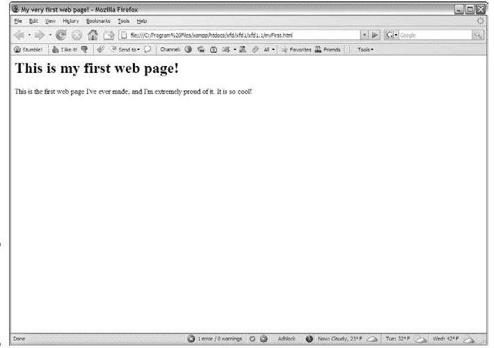

## 理解基本页面中的 HTML

你在上一节中创建的页面使用了一种极其简单的标记法——HTML（超文本标记语言），它自 Web 诞生之初就已存在。HTML 是一项非常出色的技术，原因如下：

- **它使用纯文本。** 大多数文档系统（如文字处理软件）使用特殊的*二进制编码方案*，将格式直接融入计算机的内部语言，这使得文档被锁定在特定的计算机或软件上。也就是说，以 Word 格式存储的文档在没有理解 Word 格式的程序的情况下无法被读取。HTML 通过将所有内容存储为纯文本来克服这个问题。

- **它在所有计算机上都能工作。** HTML 的主要意义在于拥有一种通用格式。任何计算机都应该能够读写它。纯文本格式有助于实现这一点。

- **它描述文档的含义。** HTML 的设计目的并非指示页面或其元素的外观。HTML 是关于描述各种元素含义的（稍后会详细说明）。当你学会正确使用 HTML 时，这具有一些明显的优势。

- **它*不*描述文档的*外观*。** 这一点看起来很奇怪。当然，当你查看图 1-1 时，你可以看到网页上文本的外观与你在文本编辑器中看到的文本外观不同。用 HTML 格式化文档确实会导致文档的外观发生变化。但这并不是 HTML 的要点。你将在第二部分和第三部分中发现如何使用另一种强大的技术——CSS——在你定义了页面含义之后来改变其外观。这种含义与布局的分离是 HTML 最好的特性之一。

- **它易于编写。** 当然，HTML 会比这个第一个例子复杂一点，但你可以轻松地学会如何编写 HTML，而无需任何专门的编辑器。你只需要知道少数几个元素，而且它们非常直观。

- **它是免费的。** 使用 HTML 不需要任何费用，主要是因为它不属于任何人所有。没有公司控制它（尽管有些公司尝试过），也没有人拥有它的专利。这项技术可以被任何人自由使用这一事实是一个巨大的优势。

## 认识你的新朋友：标签

编写 HTML 代码的关键在于尖括号（`<>`）内的特殊文本。这些特殊元素就是标签。它们并非设计用于在网页上显示，而是向 Web 浏览器提供关于文本含义的指令。这些标签旨在相互嵌套，以表示页面的组织结构。这个基本页面将向你介绍你将遇到的所有主要标签。（还有更多标签，但它们可以等一两章再介绍。）每个标签都有开始标签和结束标签。结束标签与开始标签类似，只是结束标签有一个斜杠（`/`）：

- `<html></html>`：`<html>` 标签是整个网页的基础。该标签开始页面。同样，`</html>` 结束页面。例如，页面以 `<html>` 开始，以 `</html>` 结束。`<html></html>` 组合表示页面中的所有内容都被定义为 HTML 代码。

> 有些书教你用大写字母书写 HTML 标签。这曾经是一种标准，但现在已经不推荐了。当你在本迷你书的第二章转向 XHTML 代码（一种稍微严格一些的 HTML 形式）时，你会看到 XHTML 要求所有标签都使用小写字母。

- `<head></head>`：这些标签定义了网页的一个特殊部分，称为头部（有时称为页头）。网页的这一部分让我想起汽车的发动机舱。这是你稍后放置一些重要东西的地方，但不是主要内容所在的地方。目前，你将在头部中放入的唯一内容是文档的标题。稍后，你将添加样式信息和程序代码，让你的页面活灵活现。

- `<!-- -->`：此标签表示注释，浏览器会忽略它。然而，注释用于描述代码中特定部分的作用。

- `<title></title>`：此标签用于确定页面的标题。标题通常包含普通文本。你定义为标题的任何内容都会以某些特殊方式显示。许多浏览器会将标题文本放在浏览器的标题栏中。搜索引擎经常使用标题来描述页面。

在本书中，我使用 HTML 代码的文件名作为标题。这样，你就可以将任何图表或代码清单与本书配套网站上的相应文件匹配起来。通常，你会使用更具描述性的标题，但这对于本书来说是一个有用的技巧。

说标题文本总是显示在标题栏中并不完全准确，因为网页旨在用于许多不同的浏览器。当然，标题确实在大多数主流浏览器中是这样显示的，但手机和个人数字助理呢？HTML 从不强制规定会发生什么；它只提供建议。这可能很难习惯，但这是现实。你用绝对控制权换取了广泛的适用能力，这是一笔划算的交易。


- `<body></body>`：页面的主要内容包含在这些标签中。大部分 HTML 代码和用户看到的内容都在主体区域。如果头部区域是发动机舱，那么主体就是乘客乘坐的地方。

- `<h1></h1>`：H1 代表一级标题。包含在此标记中的任何文本都被视为醒目的标题。默认情况下，大多数浏览器会为任何定义为 H1 的内容添加特殊格式，但这并不能保证。H1 标题并不真正指定任何特定的字体或格式，只是指定了文本作为一级标题的含义。当你在第二部分学会如何使用 CSS 时，你会发现你可以让你的标题随心所欲地显示。在本迷你书的第一部分，目前请保留所有默认布局，并确保你理解 HTML 是关于语义含义的，而不是关于布局或设计的。当然，还有其他级别的标题，从 `<h1>` 到 `<h6>`，其中 `<h2>` 表示比 `<h1>` 稍次要的标题，`<h3>` 比 `<h2>` 更次要，以此类推。

## 结识你的新朋友：标签

### 关于基础页面的几点说明

请为你创建的这个首个页面感到自豪。它可能很简单，但它是一切伟大事物的基石。在继续前进之前，请花点时间思考一下你在这个简陋页面中展示的一些重要的 HTML/XHTML 原则：

✔ **所有标签均为小写。** 虽然 HTML 确实允许大写标签，但你将在本书大部分内容中使用的 XHTML 变体仅要求使用小写标签。

✔ **标签对是容器，有开始和结束。** 标签包含其他标签或文本。

✔ **某些元素可以重复。** 每个页面只能有一个 `<html>`、`<title>` 和 `<body>` 标签，但许多其他元素（如 `<h1>` 和 `<p>`）可以根据需要重复任意多次。

✔ **回车符会被忽略。** 在记事本文档中，有许多回车符。原始文档的格式对 HTML 输出没有影响。标记标签决定了输出的外观。

初学者有时会倾向于将第一个标题设为 `<h1>` 标签，然后将第二个标题设为 `<h2>`，第三个标题设为 `<h3>`。事实并非如此。网页与报纸和书籍一样，使用不同的标题来指出页面上各种元素的相对重要性，通常还会改变文本的字号。你可以在第二卷中了解更多相关信息。

◆ `<p></p>`：在 HTML 中，p 代表段落标签。在你的网页中，你应该将每个标准段落包含在一对 `<p></p>` 中。你可能会注意到 HTML 不会保留 HTML 文档中的回车符或空格。也就是说，如果你在代码中按 Enter 键将文本移到新行，最终网页中不一定会保留该换行。

使用 `<p></p>` 结构是管理文档中每个段落前后间距的一种简单方法。

一些较旧的书籍建议使用不带 `</p>` 的 `<p>` 来为文档添加空格，类似于按 Enter 键。这种思维方式以后可能会给你带来问题，因为它不能真实地反映网页浏览器的工作方式。不要将 `<p>` 视为回车符。相反，应将 `<p>` 和 `</p>` 视为定义一个段落。段落模型更强大，因为很快你就会明白如何获取任何正确定义的段落，并为它设置绿色背景上的黄色字母（或任何你想要的内容）。如果内容标记正确，以后操作起来会容易得多。

## 设置你的系统

制作网页不需要太多东西。你的纯文本编辑器和网页浏览器基本上就是你所需的一切。尽管如此，有些东西可以让你作为网页开发者的生活更轻松。

### 显示文件扩展名

本节讨论的方法主要适用于 Windows 用户，但这一点非常重要。Windows 使用 `extension`（文件名中句点之后的部分）来确定你正在处理的文件类型。这在网页开发中非常重要。你创建的文件是简单的文本文件，但如果你将它们以普通的 `.txt` 扩展名保存，你的浏览器将无法正确读取它们。更糟糕的是，Windows 的默认设置会向你隐藏这些扩展名，因此你只能依靠图标来判断你正在处理的文件类型，这会导致各种问题。我建议你让 Windows 明确地描述你的文件扩展名。以下是设置方法：

1. **打开文件管理器（XP 中的“我的电脑”或 Vista 和 Windows 7 中的“计算机”）。**

   使用“我的电脑”窗口打开硬盘驱动器上的一个目录。你在查看哪个目录并不重要。你只需要打开该工具即可。

2. **选择“工具” | “文件夹选项”。**

   出现“文件夹选项”对话框。

3. **选择“查看”选项卡。**

   你会看到“文件夹选项”对话框。

4. **不要隐藏扩展名。**

   默认情况下，Windows 喜欢隐藏已知文件类型的扩展名。然而，你现在是一名程序员，所以你值得看到这些东西。取消选中“隐藏已知文件类型的扩展名”复选框，如图 1-2 所示。

5. **显示路径和隐藏文件夹。**

   我喜欢看到我的隐藏文件和文件夹（毕竟它们是我的，对吧？），并且我喜欢列出完整路径。单击相应的复选框以启用这些功能。你会发现它们经常很有帮助。

6. **通过单击“应用到所有文件夹”按钮，将这些更改应用到计算机上的所有文件夹。**

   这将导致文件扩展名无处不在地显示，包括桌面。

尽管我的演示使用的是 Windows XP，但该技术在 Windows Vista 和 Windows 7 中是相同的。

### 设置你的软件

你将编写大量网页，因此将你的系统设置为使该过程尽可能简单是合理的。我将在本迷你书的第 3 章中更多地讨论一些你应该使用的软件，但现在，这里有几个简单的建议：

- **在桌面上放置一个记事本图标。** 你将编辑大量文本文件，因此直接在桌面上有一个记事本（或你使用的任何其他文本编辑器）图标会很有帮助。这样，你就可以通过将其拖到桌面上来快速编辑任何网页。当你使用比记事本更复杂的编辑器时，你也会希望有指向它们的链接。

- **获取另一个网页浏览器。** 你可能只是*喜欢*你的网页浏览器，这没关系，但你不能假设每个人都喜欢和你一样的浏览器。你需要知道其他浏览器将如何解释你的代码。Firefox 是一款功能极其强大的浏览器，并且完全免费。如果你还没有，我建议你直接在桌面上设置至少两个浏览器的链接。

### 理解其中的奥秘

大多数人在网络上遇到的问题源于对这种媒介实际工作方式的误解。大多数人都熟悉文字处理软件，我们知道如何让文档呈现我们想要的样子。现代应用程序使用 WYSIWYG（所见即所得）技术，承诺*所见即所得*。当涉及打印文档时，这是一个合理的承诺，但在网络上并非如此。

网页的外观取决于许多你无法控制的因素。用户可能在比你更小或更大的屏幕上阅读你的页面。她可能使用与你不同的操作系统。她可能是拨号连接，或者为了速度而关闭了图形。她可能失明并使用屏幕阅读器技术来浏览网页。她可能在 PDA 或手机上阅读你的页面。你无法制作一个在所有这些情况下看起来都一样的文档。

一个很好的折衷方案是制作一个文档，清楚地指示信息如何组合在一起，并对视觉设计提出建议。用户和她的浏览器可以决定使用多少这些建议。

你获得了对视觉设计的控制权，但永远无法完全控制，这没关系，因为你正在用完全控制权换取可访问性。使用你从未听说过的设备的人也可以访问你的页面。

练习几次，直到你可以轻松地构建一个页面而无需查找任何东西。很快，你就准备好进入下一步——像专业人士一样构建页面。

`www.it-ebooks.info`

## 第 2 章：验证才是王道

### 本章内容

- 介绍有效页面的概念
- 使用文档类型声明（doctype）
- 介绍 XHTML 1.0 Strict
- 设置字符集
- 认识 W3C 验证器
- 出现问题时如何修复
- 使用 HTML Tidy 清理你的页面

网页开发正在经历一场革命。随着网络日益成熟并成为日常生活的重要组成部分，确保网页正常运行变得至关重要——因此，呼吁网页开发者遵循自愿的网页开发标准。

### 有人来阻止这 HTML 疯狂吧！

在糟糕的过去，网络是一件很随意的事情。人们随心所欲地编写 HTML 页面。虽然这很简单，但它导致了很多问题：

- **浏览器制造商添加了在所有浏览器上都无法工作的功能。** 人们希望网页更漂亮，有颜色、字体和各种小玩意儿，但没有标准的方法来实现这些。每个浏览器都有一套不同的标签来支持增强功能。作为开发者，你无法真正知道你的网页是否能在所有浏览器上正常工作。如果你想使用一些巧妙的功能，你必须确保你的用户拥有正确的浏览器。

- **意义和布局之间的区别变得模糊。** 人们期望对自己的网页有某种设计控制，因此出现了各种各样的新标签，模糊了描述页面和装饰页面之间的区别。

- **基于表格的布局被用作一种变通方法。** HTML 没有好的方法来处理布局，因此聪明的网页开发者开始将表格用作布局机制。这在某种程度上是可行的，但它既不简单也不优雅。

## 20 有人来制止这场HTML的疯狂吧！


* **人们开始使用工具来编写网页。** 网页很快就变得如此丑陋，以至于人们开始相信自己无法再手工编写`HTML`了，需要某种编辑器来替他们处理所有这些复杂性。虽然这些编辑程序引入了新功能，让事情在开始时变得更容易，但这些工具也让代码在没有原始编辑器的情况下几乎无法修改。网页开发者开始认为，没有大公司的工具，他们就无法设计网页。

* **网络的本质正在改变。** 与此同时，这些因素使得普通的网页开发更具挑战性。创新者们开始认识到，网络的核心并非文档本身，而是能够动态创建文档的应用程序。你访问的许多最有趣的网页根本不是静态的网页，而是每次访问时都动态生成网页的程序。这意味着开发者必须让网页对程序和人类同样可读。

简而言之，`HTML`世界当时真是一团糟。

## XHTML来拯救了

2000年，万维网联盟（通常缩写为`W3C`）聚集在一起，为`HTML`提出了一些修复方案。基本计划是创建一种新形式的`HTML`，它遵循更严格的标记语言规范，即可扩展标记语言（`XML`）。细节冗长乏味，但本质上，他们就如何标准化网页达成了一些协议。以下是一些标准：

* **所有标签都必须有结束标签。** 每个标签都有开始和结束标签。（嗯，少数例外情况内置了自己的结束方式。我将在本小册子的第6章解释你遇到的第一个此类标签。）这是一个新发展，因为在老派`HTML`中，结束标签被认为是可选的，许多标签甚至没有结束标签。

* **标签不能重叠。** 在`HTML`中，人们有时倾向于马虎大意，使标签重叠，像这样：`<a><b>my stuff</a></b>`。这在`XHTML`中是不允许的，这是件好事，因为它会让浏览器困惑。如果一个标签在某个容器标签内打开，那么在该容器关闭之前，这个标签必须先关闭。

* **一切都是小写。** 有些人用大写写`HTML`，有些人用小写，还有些人则随心所欲。这不一致，并且使得编写能够读取所有变体的浏览器更加困难。

* **属性值必须用引号括起来。** 如果你已经做过一些`HTML`，你会知道引号曾经是可选的——现在不行了。（关于属性的更多信息，请参阅第4章。）

* **布局必须与标记分离。** 老派`HTML`有一堆标签（如`<font>`和`<center>`），它们更多是关于格式化而非结构标记。这些标签很有用，但作用有限。`XHTML`（至少是本书涵盖的严格版本）消除了所有这些标签。不过不用担心；`CSS`提供了这些标签的所有功能以及更多功能。

这听起来更像是严格的图书管理员规则。实际上，它们完全没有限制性，因为大多数优秀的`HTML`编码者已经遵循了这些准则或类似的东西。

## 有XHTML，也有好的XHTML

在旧式`HTML`中，你永远不知道你的页面在不同浏览器上会是什么样子。事实上，你甚至不知道你的页面是否写得正确。某些错误在一个浏览器上看起来没问题，却可能导致另一个浏览器崩溃。

*验证*的想法是为了消除`HTML`的一些不确定性。它就像你代码的拼写检查器。我常用的拼写检查器有时让我觉得自己有点笨，因为我犯了错误。不过，我喜欢它，因为只有我能看到这些错误。我可以在把文档交给你之前改正拼写错误，这样我看起来就很聪明。（嗯，也许是吧。）

如果你能有一种特殊的检查器，为你的网页做同样的事情，那就太酷了。它不是检查你的拼写，而是测试你的页面是否有错误，并让你知道是否犯了任何错误。如果你能获得某种认证，证明你的页面遵循卓越的标准，那就更酷了。

这就是页面验证的工作原理。你可以指定你的页面将遵循某个特定标准，并使用软件工具确保你的页面符合该标准的规范。这个软件工具就是一个*验证器*。我将在接下来的“验证你的页面”部分向你展示两个不同的验证器。

浏览器也承诺遵循某个特定标准。如果你的页面通过了某个给定标准的验证，那么任何遵循相同标准的浏览器都可以正确地重现你的文档，这意义重大。

### XHTML并非完美

虽然`XHTML`是本书强调的标准，但它本身也有一些问题。并非所有浏览器都以相同的方式读取它，而且它比实际需要的更冗长一些。看来下一代标准将回归到某种形式的`HTML`（`HTML 5`）。然而，正确的`HTML 5`编码将更类似于`XHTML`而非`HTML 4`。在本版中，我专注于`XHTML`严格版。有关这个重要标准的完整概述，请参阅本小册子的第8章。

## 22 构建一个XHTML文档

创建`XHTML`文档的方式与构建普通`HTML`相同。你仍然可以使用普通的文本编辑器，但代码稍微复杂一些。查看以下代码（本书CD-ROM上的`template.html`文件），看看一个最基础的`XHTML`文档是什么样子：

```
<!DOCTYPE html PUBLIC "-//W3C//DTD XHTML 1.0 Strict//EN"
    "http://www.w3.org/TR/xhtml1/DTD/xhtml1-strict.dtd">
<html xmlns="http://www.w3.org/1999/xhtml">
<head>
<meta http-equiv="Content-Type" content="text/html; charset=utf-8" />
<title></title>
</head>
<body>
<h1></h1>
<p>
</p>

</body>
</html>
```

乍一看，这个新文档比你在本小册子第1章看到的`HTML`要复杂得多，但它并不像看起来那么糟糕。

### 别背诵所有这些！

在你慌张之前，不要觉得必须背诵这些无聊的东西。即使是写关于网页开发书籍的人（嗯，比如我）也没有记住这些，因为它太笨拙且太容易改变了。

在你的本地驱动器上保存一份`template.html`（我在桌面上保存了一份），并用这个模板开始你所有的新页面。当你开始使用更复杂的编辑器（参见本小册子第3章）时，你通常可以自定义编辑器，使其自动以你想要的框架开始。

你不必把所有这些都记得滚瓜烂熟，但你应该理解其基本原理，所以以下是一个快速导览。

### DOCTYPE标签

看起来最可怕的`XHTML`特性是`<!DOCTYPE>`标签。毫无疑问，这个怪兽很丑陋，但它确实有其用途。从正式意义上讲，它是一个*文档类型定义*。你的`DOCTYPE`向世界宣告你正在使用哪种特定类型的`HTML`或`XHTML`。当你使用我在这里建议的`DOCTYPE`开始你的页面时，你是在告诉浏览器：“嘿，浏览器，我的页面遵循`XHTML`严格版准则，如果你不确定那是什么，就去这个网站获取信息。”

```
<!DOCTYPE html PUBLIC "-//W3C//DTD XHTML 1.0 Strict//EN"
    "http://www.w3.org/TR/xhtml1/DTD/xhtml1-strict.dtd">
```

有很多`DOCTYPE`可供选择，但它实际上比看起来简单得多。在本书中，我向你展示的是`XHTML 1.0`严格版，这是你今天主要需要的`DOCTYPE`。你在网上可能发现的其他变体（`HTML 4.0`、框架集和过渡型`DOCTYPE`）实际上是为了向后兼容而设计的。如果你打算走符合标准的路线，那就干脆做到底。（而且，在微软支持`HTML 5`之前，它对真正的开发来说不是一个有意义的选择。）

即使标准会改变，你使用`X XHTML`严格版学到的技术，在你转向其他标准时也会对你大有裨益。

即将到来的`HTML 5`标准的`DOCTYPE`比这个`XHTML`的复杂东西要容易得多。`HTML 5`用一个更容易记住的`DOCTYPE`替代了这个复杂的：`<!DOCTYPE html>`。就是这样。我等不及了……

### xmlns属性

`html`标签看起来与本小册子第1章中的那个有点不同。它后面有术语`xmlns`，代表*XML命名空间*。这个缩写有助于澄清文档中标签的定义：

```
<html xmlns="http://www.w3.org/1999/xhtml">
```

老实说，并非所有验证器都需要这一部分，但添加它也没有坏处。

### meta标签

最后一个标签是奇特的`meta`标签，它长期以来一直是`HTML`的一部分。它们允许你描述网页的各种特性：

```
<meta http-equiv="Content-Type" content="text/html; charset=utf-8" />
```

你在这里看到的`meta`标签的特定形式定义了要使用的字符集。`utf`字符集很好地处理了多种西方语言。

事实是，如果你从这个框架开始，你将拥有制作符合正式`XHTML`标准并能正确验证的页面所需的一切。

### 你验证我

所有这些`DOCTYPE`和`xmlns`的麻烦都是值得的，因为有一个很棒的程序——*验证器*。最重要的验证器是`W3C`验证器，位于`http://validator.w3.org`，如图2-1所示。

## 24 构建 XHTML 文档

验证器实际上是一个软件的前端，用于检查页面的有效性。它会查看你网页的文档类型（`doctype`），并检查该页面是否符合该文档类型的规则。如果不符合，它会告诉你可能出现的问题。

你可以通过三种方式向验证器提交代码：

1. **通过 URL 验证。** 当页面托管在`Web`服务器上时，使用此选项。存储在本地计算机上的文件无法使用此技术进行检查。第八卷详细介绍了使用`Web`服务器所需知道的所有知识，包括如何创建自己的`Web`服务器。

2. **通过文件上传验证。** 这种技术适用于你尚未发布到`Web`服务器上的文件。它非常适合你在计算机上编写但尚未向世界公开的页面。这是初学者最常见的验证类型。

3. **通过直接输入验证。** 验证器页面有一个文本框，你可以直接将代码粘贴进去。这种方法可行，但我通常更喜欢使用其他方法，因为它们更容易。

验证听起来可能很麻烦，但它实际上是一个极好的工具，因为粗糙的`HTML`代码会导致许多问题。更糟糕的是，你可能认为一切都正常，直到别人查看你的页面，突然间，页面无法正确显示。

**技术要点**

在撰写本文时，尚未有针对`HTML 5`代码的验证器。一旦`HTML 5`成为主流，这种情况将会改变。与此同时，请使用`XHTML Strict`进行验证，这样你就为`HTML 5`的过渡做好了充分准备。

## 验证你的页面

为了解释所有这些，我按照古希腊的伊索可能的方式创建了一个网页。好吧，也许伊索并没有把他的著名寓言写成网页，但如果他写了，它们看起来可能像下面的代码清单：

```html
<!DOCTYPE html PUBLIC "-//W3C//DTD XHTML 1.0 Strict//EN"
"http://www.w3.org/TR/xhtml1/DTD/xhtml1-strict.dtd">
<html xmlns="http://www.w3.org/1999/xhtml">
<head>
<meta http-equiv="Content-Type" content="text/html; charset=iso-8859-1" />

<!-- oxWheels1.html -->

<!-- note this page has deliberate errors!  Please see the text
     and oxWheelsCorrect.html for a corrected version.
-->

</head>
<body>
<title>The Oxen and the Wheels</title>
<h1>The Oxen and the Wheels
<h2></h1>From Aesop's Fables</h2>

<p>
    A pair of Oxen were drawing a heavily loaded wagon along a
    miry country road. They had to use all their strength to pull
    the wagon, but they did not complain.
<p>

<p>
    The Wheels of the wagon were of a different sort. Though the
    task they had to do was very light compared with that of the
    Oxen, they creaked and groaned at every turn. The poor Oxen,
    pulling with all their might to draw the wagon through the
    deep mud, had their ears filled with the loud complaining of
    the Wheels. And this, you may well know, made their work so
    much the harder to endure.
</p>

<p>
    "Silence!" the Oxen cried at last, out of patience. "What have
    you Wheels to complain about so loudly?  We are drawing all the
    weight, not you, and we are keeping still about it besides."
</p>

<h2>
They complain most who suffer least.
</h2>

</body>
</html>
```

## 26 验证你的页面

代码看起来没问题，但实际上存在许多问题。伊索可能是一个伟大的故事讲述者，但从这个例子来看，他似乎是一个粗糙的编码者。错误可能很难发现，但相信我，它们确实存在。问题在于，你如何在用户发现之前找到这些问题？

你可能认为，如果你在`Web`浏览器中查看页面，这些问题会很明显。`Firefox`和`Internet Explorer`浏览器似乎都能妥善处理这个页面，即使它们的显示方式并不完全相同。图2-2显示了`Firefox`中的`oxWheels1.html`，图2-3显示了它在`Internet Explorer`中的样子。

`Firefox`似乎处理这个页面相当好，但`From Aesop's Fables`应该是二级标题，即`H2`，但它显示为普通文本。除此之外，几乎没有迹象表明有什么问题。

微软的`Internet Explorer`也尝试显示这个页面，并且做得相当不错。注意`From Aesop's Fables`似乎是一级标题，即`H1`。这很奇怪。尽管如此，这两个浏览器中的页面看起来都相当不错，所以你可能认为一切都很好。这会让你陷入麻烦。

图2-2：`Firefox`中的`oxWheels1.html`。

## 27 验证你的页面

如果它看起来很好，谁在乎它是否完全正确？你可能想知道，只要一切正常，我们为什么要在意底层代码中的错误。毕竟，如果页面显示正确，谁会去看代码呢？

问题在于，你不知道它是否会正确显示，而你的代码中的错误最终会回来困扰你。如果可能，你想立即知道代码的哪些部分有问题，这样你就可以修复它们而不用担心。

## 伊索造访 W3C

要了解这个页面出了什么问题，请访问`W3C`验证器<http://validator.w3.org>。图2-4显示了我访问该站点并上传`oxWheels1.html`副本的情况。

屏住呼吸，点击检查按钮。你可能会对图2-5中显示的结果感到惊讶。

验证器是一个挑剔的家伙，它似乎一点也不喜欢这个页面。验证器确实返回了一些有用的信息，并给出了足够的提示，让你能很快弄清楚。

## 28 验证你的页面

**图2-4：**

我正在检查`oxWheels`页面，寻找任何问题。

**图2-5：**

十二个错误？这不可能是真的！

## 检查概述

在查看具体的抱怨之前，快速浏览一下验证器发送给你的网页。该网页充满了方便的信息。页面顶部告诉了你许多有用的信息：

- **结果：** 这才是真正重要的事情。通过查看这一行，你将知道剩余的错误数量。不过，不要惊慌。文档中的错误可能比你在这里看到的数量要少。

- **文件：** 你正在处理的文件名。

- **编码：** 你设置的文本编码。如果你没有明确设置文本编码，你可能会在这里看到一个警告。

- **文档类型（Doctype）：** 这是从你的文档中提取的文档类型。它指示验证器用于检查你的页面的规则。这通常应该显示`XHTML 1.0 Strict`。

- **根命名空间（Root Namespace）：** 如果你使用我提供的模板，你总是会看到相同的命名空间，不会有任何意外。

- **令人恐惧的红色横幅：** 经验丰富的`Web`开发人员甚至不需要阅读结果页面就能知道是否有问题。如果一切顺利，会有一个绿色的祝贺横幅。如果有问题，横幅就是红色的。这看起来不好，伊索。

不要因为有错误而惊慌。错误通常会重叠，所以你代码中的一个问题常常会导致多个错误出现。大多数时候，你的错误数量远少于页面所说，而且很多错误是重复的，所以一旦你找到一个错误，你就会知道如何在整个页面中修复它。

## 验证页面

验证器并不总是告诉你你需要知道的所有事情，但它确实给你提供了一些相当好的线索。页面验证是乏味的，但并不像乍看起来那么难。以下是一些处理页面验证的策略：

- **只关注第一个错误。** 当然，页面上可能有100个错误，但要一个一个地解决。列表中唯一重要的错误是第一个。在解决第一个错误之前，完全不要担心其他错误。

- **注意第一个错误的位置。** 你得到的最有帮助的信息是验证器识别出错误的行和列信息。这并不总是错误的确切位置，但它确实给你一些线索。

- **查看错误信息。** 它通常很有趣。错误信息有时很有帮助，有时则完全神秘莫测。

## 30 验证你的页面

- **查看详细文本。** 与大多数编程调试器不同，`W3C`验证器试图用类似英语的语言来解释出了什么问题。它仍然不总是有意义，但有时文本会给你一个提示。

- **浏览接下来的几个错误。** 有时，一个错误会显示为多个错误。也要看看接下来的几个错误，看看它们是否提供了更多的洞察；有时，它们确实会。

- **重新验证。** 保存页面后再次检查。如果第一个错误现在比之前的行号靠后，那么你就成功了。

- **不要担心错误数量增加。** 成功修复一个问题后，感知到的错误数量有时会增加而不是减少。这没关系。有时，修复一个错误会暴露出之前隐藏的错误。更常见的是，修复一个错误会清除更多错误。只需专注于从文档开头到结尾清除错误。


- **清洗、漂洗、重复。** 查看新的顶部错误并解决它。继续下去，直到你获得梦寐以求的验证通过绿条。（如果我写一个 XHTML 冒险游戏，验证通过绿条将是最强大的护身符之一。）

### 检查第一个错误

再次查看`oxWheels1.html`页面的结果。第一个错误消息看起来像图 2-6。

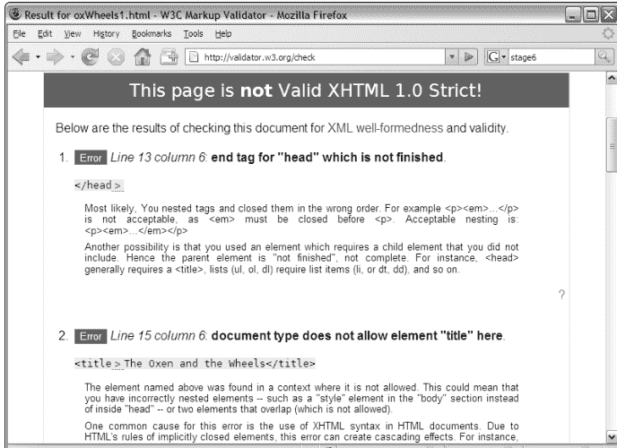

图 2-6 显示了前两个错误消息。第一个抱怨`</head>`标签的位置。第二个消息抱怨`<title>`标签。查看源代码，你会发现相关代码如下所示：

```html
<head>
<meta http-equiv="Content-Type" content="text/html; charset=iso-8859-1" />

<!-- oxWheels1.html -->

<!-- note this page has deliberate errors!  Please see the text
     and oxWheelsCorrect.html for a corrected version.
-->

</head>
<body>
<title>The Oxen and the Wheels</title>
<h1>The Oxen and the Wheels
```

仔细查看`head`和`title`标签对，并回顾错误消息中的说明，你很可能会看到问题所在。`<title>`元素应该在头部，但我意外地把它放在了正文中！（好吧，不是意外；我在这里故意犯这个错误是为了向你展示会发生什么。不过，我过去确实真的犯过这个错误。）

### 修复标题

如果标题标签是问题所在，对 HTML 进行快速修改应该可以解决这个问题。`oxWheels2.html`展示了另一个页面形式，其中包含我的建议修复：

```html
<head>
<meta http-equiv="Content-Type" content="text/html; charset=iso-8859-1" />

<!-- oxWheels2.html -->

<!-- Moved the title tag inside the header -->

<title>The Oxen and the Wheels</title>
</head>
<body>
```

> **注意：** 我只展示了我更改的页面部分。整个页面可在本书的 CD-ROM 上找到。

修复此问题相当容易：

1. **将标题移到`head`内部。**

   我认为这里的问题是将`<title>`元素放在了`body`内部，而不是它所属的`head`中。如果我将标题移到`body`中，错误应该会被消除。

2. **更改注释以反映页面的状态。**

   注释反映我所做的更改非常重要。

3. **保存更改。**

   通常，你只需对同一文档进行更改，但我选择更改文件名，这样你就可以看到随着页面改进我的更改存档。这实际上可能是个好主意，因为你拥有文档更改的完整历史记录，并且如果你不小心使情况恶化，总可以恢复到旧版本。

4. **记下当前第一个错误的位置。**

   在将修改后的页面提交给验证器之前，记下当前第一个错误的位置。现在，验证器的第一个抱怨在第 13 行第 6 列。我希望第一个错误出现在文档中更靠后的位置。

5. **通过对修改后的页面再次运行验证器来重新验证。**

6. **查看结果并跳个快乐的舞蹈。**

   你可能仍有错误，但这并不是失败！图 2-7 显示了我重新验证的结果。新的第一个错误在第 16 行，它看起来与上次错误非常不同。我解决了它！

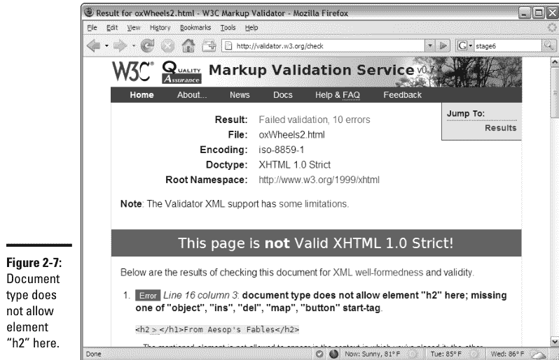

### 解决下一个错误

解决了一个，但还有更多。下一个错误（参考图 2-7）看起来很奇怪，但却是你经常看到的一个。

“文档类型不允许”错误非常常见。它通常意味着你忘记关闭某些内容或将其放在了错误的位置。错误消息指出第 16 行有问题。下一个错误也是第 16 行。看看你是否能在这个相关代码中找到问题：

```html
<body>
<h1>The Oxen and the Wheels
<h2></h1>From Aesop's Fables</h2>
```

一旦你知道在哪里查找，问题就变得更容易发现了。我变得马虎，在完成`<h1>`标签之前就开始了`<h2>`标签。在许多情况下，一个标签可以完全嵌入另一个标签中，但你不能像我这里所做的那样让标签定义重叠。`<h1>`必须在开始`<h2>`标签之前关闭。

这就解释了为什么两个主要浏览器显示`From Aesop's Fables`的方式不同。尚不清楚此代码应以 H1 还是 H2 格式显示，或者可能根本没有任何特殊格式。知道问题并修复它比在出事之前保持无知要好得多。

第三个版本——`oxWheels3.html`——修复了程序的这一部分：

```html
<!-- oxWheels3.html -->

<!-- sort out the h1 and h2 tags at the top -->
<title>The Oxen and the Wheels</title>
</head>

<body>
<h1>The Oxen and the Wheels</h1>
<h2>From Aesop's Fables</h2>
```

### 检查标题修复

标题标签看起来好多了，验证器的快速检查证实了这一事实，如图 2-8 所示，现在只显示六个错误。

这是另一种“文档类型不允许”错误。这个看起来很奇怪，因为`body`中肯定允许使用`<p>`标签！解决这个特定问题的秘诀是仔细查看错误消息。此文档中有很多`<p>`标签。它抱怨的是哪一个？

一对牛拉着一辆满载的货车在泥泞的乡村道路上行进。他们不得不使出全身力气拉车，但他们没有抱怨。

```html
<p>

<p>
    The Wheels of the wagon were of a different sort. Though the task they had to do was very light compared with that of the Oxen, they creaked and groaned at every turn. The poor Oxen, pulling with all their might to draw the wagon through the deep mud, had their ears filled with the loud complaining of the Wheels. And this, you may well know, made their work so much the harder to endure.
</p>
```

啊哈！第 22 行应该是段落的**结尾**，但我不知怎么地忘记了斜杠字符，所以验证器认为我在前一个段落内部开始了一个新段落，这是不允许的。这也导致了许多其他错误。因为验证器看不到这个段落的结尾，它认为所有其他代码都在这个第一个段落内。尝试将第 22 行的`<p>`改为`</p>`，看看是否效果更好：

```html
<p>
    A pair of Oxen were drawing a heavily loaded wagon along a miry country road. They had to use all their strength to pull the wagon, but they did not complain.
</p>
```

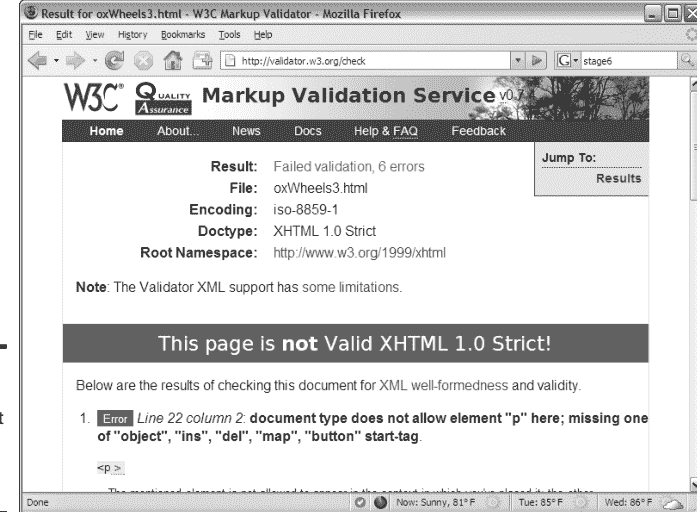

图 2-8：文档类型不允许“p”在这里。真奇怪。

抱怨的是第 22 行的`<p>`标签。不幸的是，记事本没有简单的方法知道你正在哪一行，所以你只能一直数下去，直到我在本书迷你书的第 3 章中为你展示一些更好的选项。为了更轻松，我在这里复制了代码的关键部分并突出了第 22 行。在解释之前试着找出问题：

```html
<h1>The Oxen and the Wheels</h1>
<h2>From Aesop's Fables</h2>

<p>
```

图 2-9 显示了`oxWheels4.html`的验证结果。

### 炫耀你的高超技巧

有时，那绿色的条让我喜极而泣。恭喜！这还只是本迷你书的第二章，而你已经比许多专业人士编写了更好的网页。

说真的，一个验证通过 XHTML Strict 标准的网页是件大事，你值得为自己的努力感到骄傲。W3C 为你感到如此自豪，他们提供了一个小小的荣誉徽章，你可以放在你的页面上。

图 2-10 显示了当你的页面最终正确验证时你会得到的更多内容。你可以看到一个小按钮和一些看起来很奇怪的 HTML 代码。

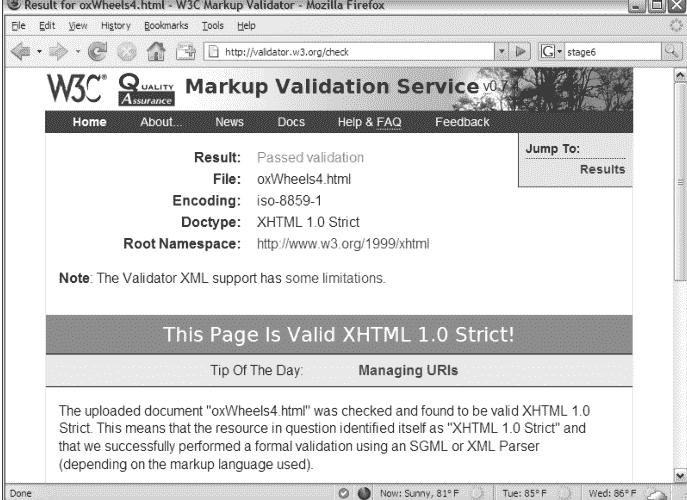

## 验证你的页面

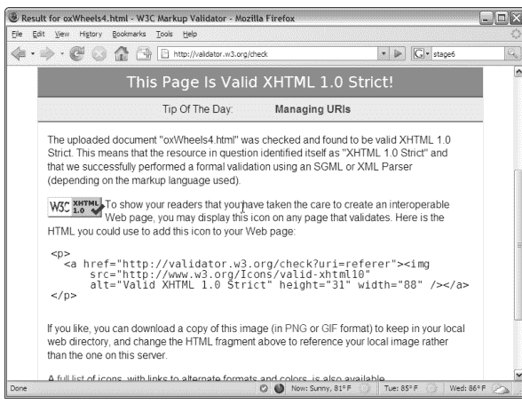

图 2-10：验证器会给你一个小小的虚拟荣誉徽章，以展示你的页面有多酷。

如果你愿意，可以将那段代码复制粘贴到你的页面中。`oxWheels5.html`的`body`末尾就添加了这段特殊代码，如图 2-11 所示。

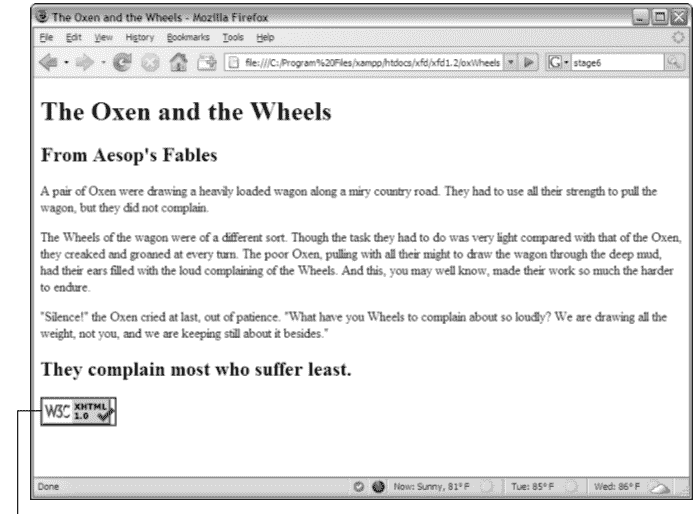

图 2-11：看，我有一枚来自 W3C 的勋章！

特殊代码

www.it-ebooks.info

## 验证真的那么重要吗？

我能想象到愤怒的邮件纷至沓来。“安迪，我从 1998 年就开始写网页了，从来就没用过验证器。”没错，这是事实。很多人，甚至一些专业的网页开发者，都在不验证代码的情况下工作。我早期的一些网页就完全没有通过验证。（你可以对任何你想要的页面运行 W3C 验证器，而不仅限于你自己写的页面。如果你喜欢感觉自己比那些马虎的编码者高明，这会是一个巨大的乐趣源泉。）当我变得更熟练、在网页开发方面更有经验时，我发现那些小错误往往会在后续造成一大堆麻烦。我真的认为你应该验证你写的每一个页面。现在就养成这个习惯，它会带来巨大的回报。当你第一次接触这些东西时，就要做对。

如果你已经了解一些 HTML，你可能会暂时讨厌验证器，因为它会拒绝你可能认为完全没问题的编码习惯。改掉一个习惯比学习一个新做法要难得多，所以我理解你的感受。但这仍然是值得的。

在你严格要求自己验证页面之后，你会发现你已经养成了好习惯，验证过程也会变得轻松许多。经验丰富的程序员实际上喜欢验证过程，因为它变得容易多了，并且能防止以后可能导致大量麻烦的问题。

这段小代码片段能做很多很棒的事情，例如：

- ♦ **确立你的编码能力：** 任何带有此图标的页面都经过了测试，并被证明符合 XHTML Strict 标准。当你看到带有此标记的页面时，你可以对作者的技能和专业性充满信心。

- ♦ **在页面上放置一个酷炫的图像：** 你将在本手册的第 6 章中读到如何添加自己的图像，但能看到一个现成的也挺不错。这张特定的图像托管在 W3C 网站上。

- ♦ **让用户自行检查页面：** 当用户点击图像时，他们会直接被带到 W3C 验证器，以证明该页面确实是有效的 XHTML Strict。不幸的是，此链接仅在发布到 Web 服务器的页面上有效，因此在仅存放在你计算机上的页面上无法正常工作。请查阅第 VIII 册，了解有关查找和使用服务器的建议。

## 使用 Tidy 修复页面

W3C 验证器并非唯一的选择。另一个很棒的资源——HTML Tidy——可以用来修复你的页面。你可以下载 Tidy，或者直接使用其在线版本，地址是`http://infohound.net/tidy`。图 2-12 展示了加载了`oxWheels1.html`的在线版本。

## 验证你的页面

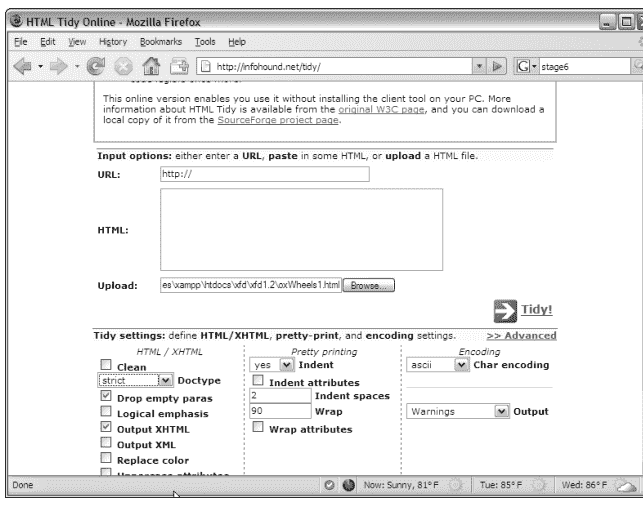

图 2-12：HTML Tidy 是 W3C 验证器的一个替代方案。

与 W3C 的验证器不同，Tidy 实际上会尝试修复你的页面。图 2-13 展示了 Tidy 建议如何修复`oxWheels.html`页面。

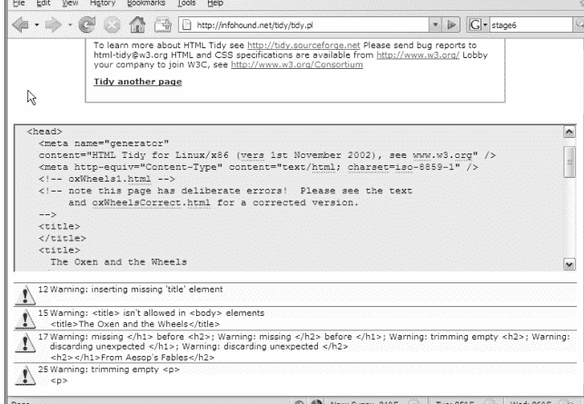

图 2-13：Tidy 修复了页面，但修复方式有点别扭。

Tidy 会检查页面中的许多常见错误，并尽其所能修复它们。然而，结果并非完美：

- **Tidy 添加了一个新的 meta 标签，表明该页面是由 Tidy 创建的。** 每当一个非我编写的程序开始修改我的页面时，我总会感到紧张。

- **Tidy 倾向于选择一个更宽松的文档类型。** 如果你没有特别指定，Tidy 会针对 XHTML 1.0 Transitional 而非 Strict 进行检查。这个标准没那么严格。你可以在提交表单中手动指定（也应该指定）Strict 文档类型。

- **Tidy 被标题搞糊涂了。** Tidy 正确诊断出标题位置错误，但它同时添加了一个空白标题和预期的标题。

- **有时，缩进会出错。** 我设置 Tidy 为每个元素都缩进，这样很容易看出标签对是如何匹配的。如果我不明确设置缩进，我会觉得 Tidy 的代码非常难读。

- **更改不是永久的。** Tidy 所做的任何操作都只是建议。如果你想保留更改，就需要在编辑器中保存结果。

当我遇到难题时，我有时会使用 Tidy，因为我发现它的错误消息比 W3C 验证器更容易理解。但是，我从不完全信任它。真正没有什么能替代优秀的侦探技能和官方的 W3C 验证器。


如果你发现 W3C 验证器和 Tidy 用起来有点麻烦，请查看本手册第 3 章中描述的 HTML 验证器扩展。这个方便的工具将 W3C 验证器和 Tidy 都添加到 Firefox 中，并自动检查你访问的每个页面。它还支持 Tidy，因此甚至可以修复你的大多数错误。这就是我的做法。

## 第 1 册：创建 HTML/XHTML 基础

## 第 3 章：选择你的工具

**本章内容**

✔ 选择文本编辑器

✔ 使用专用 HTML 编辑器

✔ 比较常见的浏览器

✔ 介绍集成开发环境（IDE）

✔ 添加重要的 Firefox 扩展

网页开发是一项大工程。你不会不带一个装满工具（和一顶酷帽子）的腰带就去建筑工地，网页开发也是一样（只不过你通常不需要安全帽）。一整个行业都在发展，试图销售能让网页开发更轻松的工具。有趣的是，你需要的工具可能并非他们向你推销的那些。一些最好的网页开发工具是免费的，而一些最昂贵的工具却没那么有用。

本章将告诉你需要什么，以及如何使用那些能简化网页开发的优秀程序来设置你的工作坊。

### “大块头”们有什么问题？

许多网页开发的书籍实际上是关于如何使用特定类型软件的书。微软的 FrontPage/Expression Web 和 Macromedia/Adobe Dreamweaver 是此类别中的两个主要应用程序。这些工具功能强大，并提供了一些*看似*很棒的特性：

- **WYSIWYG（所见即所得）编辑：** 所见即所得是一个从文字处理软件借鉴来的理念。你可以像创建文本文档一样创建网页，并使用菜单和工具来处理所有格式。其理论是，你不需要知道任何讨厌的代码。

- **模板：** 你可以创建一个保持不变的模板，并基于该模板构建多个页面。如果你需要更改模板，其他所有内容都会自动更改。

- **站点管理：** 站点上各个页面之间的交互可以自动维护。

### “大块头”们有什么问题？

这些听起来都是相当不错的特性，确实如此。这些工具（以及像微软 Expression 套件这样的新替代品）功能非常强大，可以成为你网页开发工具包的重要组成部分。然而，同样强大的程序也带来了问题，例如：

- ◆ **代码维护：** 专注于可视化设计的商业编辑器往往生成难以管理的代码。如果你发现有东西需要手动修改，修复代码会相当困难。

- ◆ **厂商锁定：** 这些工具由希望你购买他们其他工具的公司编写。如果你使用 Dreamweaver，你会发现它很容易与其他 Adobe 应用程序（如 ColdFusion）集成，但连接到非 Adobe 技术就不那么简单了。同样，微软的产品旨在与其他微软技术配合使用。

- ◆ **成本：** 这些软件包的成本不断上涨。Expression Web（微软取代 FrontPage 的产品）售价约 300 美元，Dreamweaver 则要 400 美元。两家公司都鼓励你购买套件，其成本很容易超过 500 美元。

- ◆ **复杂性：** 它们很复杂。你可以去上一个完整的课程，或者买一本厚厚的书，仅仅是为了学习如何使用其中一项技术。如果搞清楚它都这么难，它真的能节省你的精力吗？

- ◆ **代码：** 你仍然需要理解它。无论你的平台有多棒，在某些时候，你都必须深入研究你的代码。在你投入所有那些金钱和时间去弄懂一个应用程序之后，你仍然需要理解底层代码的工作原理，因为问题仍然会发生。例如，如果你的页面在 Safari 上无法正常工作，你将必须找出原因并自己修复问题。

- ◆ **标准兼容性参差不齐：** 这些工具在这方面正在改进，但如果你希望你的页面符合最新标准，你必须在工具完成之后对它们进行大量编辑。

- ◆ **显示差异：** WYSIWYG 是个谎言。这才是真正的大问题。WYSIWYG 适用于文字处理软件，因为可以让屏幕看起来像打印出来的页面。页面打印后，它保持不变。你无法预知一个网页会是什么样子，因为这取决于浏览器。如果用户在手机或手持设备上加载你的页面会怎样？这些编辑器倾向于延续一种神话，即你可以像处理打印文档一样处理网页，而实际上，它是一种非常不同的东西。

- ◆ **与其他工具不兼容：** 网页开发现在正转向内容管理系统（CMS）——动态创建网站的程序。通常，CMS 系统提供与可视化编辑器同等的易用性，但还带来了其他好处。然而，将商业编辑器创建的代码迁移到 CMS 非常困难。我在第 VIII 册第 3 章中详细描述了 CMS 系统。

# 替代性 Web 开发工具


对于 Web 开发，你真正需要的只是一个文本编辑器和一个 Web 浏览器。你的电脑上可能已经装有基本工具集。如果你读过本迷你书的第 1 章和第 2 章，那你已经编写过几个网页了。然而，每台电脑都附带的那些非常基础的工具可能不足以应对严肃的工作。Web 开发需要一种专门的文本编辑器，目前已经演化出许多工具让这项工作变得更加轻松。

## 你电脑上需要具备的功能

以下是你可能需要、但你的文本编辑器和浏览器可能不具备的一些功能：

- ◆ **行号：** 记事本没有简单的方法来确定你当前在哪一行。每次想找到验证器指出的问题所在行都要手动计数，这相当繁琐。
- ◆ **辅助功能：** 有一个编辑器能辅助你的代码是理想的情况。有些工具可以识别 `HTML` 代码、帮助进行缩进，并在出现错误时发出警告。
- ◆ **宏：** 你会多次输入相同的代码。一个能录制和回放键盘宏的程序可以节省大量时间。
- ◆ **测试与验证：** 在一个或多个浏览器中测试你的代码应该很简单，并且应该有一种简便的方法来检查你的代码是否符合标准。
- ◆ **多浏览器支持：** 一个互联网用户只使用一个浏览器没问题，但 Web 开发者需要知道网页在不同环境下的显示效果。
- ◆ **浏览器功能：** 你可以自定义某些浏览器（尤其是 Firefox）来提供很大帮助。通过安装合适的附件，浏览器可以指出错误并帮助你查看页面的结构。
- ◆ **免费和开源工具：** Web 令人兴奋之处在于它是一项自由且开放的技术。如果你能找到遵循同样理念的工具，那就更好了。

## 构建基础工具箱

我发现以下五类程序在 Web 开发中很有用：

- ◆ **增强型文本编辑器：** 这些工具是文本编辑器，但经过了各种酷炫功能的增强，比如语法检查器、代码着色工具、宏工具以及多文档界面。
- ◆ **浏览器和插件：** 你使用的浏览器会产生巨大影响。你也可以安装免费的附加组件，将你的浏览器变成一个强大的 Web 开发工具。
- ◆ **集成开发环境（IDE）：** 程序员通常使用 `IDE`，它结合了文本编辑、可视化布局、代码测试和调试工具。
- ◆ **编程技术：** 本书涵盖了关于整合其他技术的所有相关信息，例如 `Apache`、`PHP` 和 `MySQL`。我在第 VIII 部分第 1 章展示了如何安装这些技术所需的一切。你现在还不需要担心这些事情，但应该从一开始就养成与这些增强型技术兼容的习惯。
- ◆ **多媒体工具：** 如果你想在页面上添加各种多媒体元素，你同样需要工具来管理它们。这可能涉及图形和音频编辑器，以及完整的多媒体技术，如 `Flash`。

## 选择文本编辑器

作为一名程序员，你会逐渐将你的文本编辑器视为忠实的伙伴。你将与这个工具共度大量时光，所以请选择一个能与你协同工作的。

文本编辑器应该保存不带任何格式的纯文本。你不希望它保存颜色、字体选择或其他文本格式，因为这些内容不会自动转换为 `HTML`。

幸运的是，你有几种选择，如下文各节所示。

### 除非别无选择，否则避免使用的工具

文本编辑器可能是一个简单的程序，但这并不意味着它们都一样。有些程序历来会给初学者（以及有经验的开发者）带来麻烦。通常没有必要使用这些较弱的选择。

#### Microsoft Word


千万别用它来做 Web 开发。Word 是一个文字处理软件。尽管理论上它可以创建网页，但它生成的 `HTML` 代码绝对糟糕。举个例子，我创建了一个空白文档，在里面写了 "Hello World"，更改了字体，然后将其保存为 `HTML`。生成的页面是不合规的代码，既不完全是 `HTML` 也不完全是 `XHTML`，而且长达 114 行。Word 在改进，但它绝不是一个好的 Web 开发工具。事实上，不要使用任何文字处理软件。它们根本不是为这类工作设计的。

#### Windows 记事本

记事本无处不在，而且免费。这是好消息。然而，记事本没有很多你可能需要的功能，比如行号、多文档支持或宏。如果你在不熟悉的机器上使用它，那就用吧，但如果可以，尝试用别的工具。许多人从记事本开始，但很快你就会发现它的局限性不够用了。

#### Mac TextEdit

Mac 内置了一个简单的文本编辑器——`TextEdit`——它类似于记事本，但更接近文字处理软件而非程序员的文本编辑器。`TextEdit` 可以多种格式保存文件。如果你想用它来编写网页，你必须将文件保存为纯文本格式，并且不能使用 `TextEdit` 的任何格式化功能。除非万不得已，否则最好不要使用 `TextEdit`。

### 值得注意的编辑器：Notepad++

一些开发者设计出了优秀的文本编辑器。其中一些最好的编辑器是免费的，例如 Don Ho 开发的 `Notepad++`。`Notepad++` 专为文本编辑设计，尤其擅长处理编程语言。图 3-1 展示了加载 `HTML` 文件的 `Notepad++`。

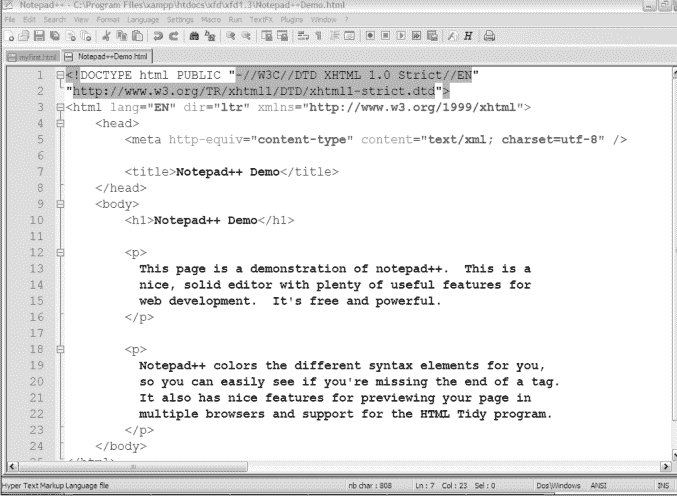

`Notepad++` 有许多有趣的功能。以下是一些亮点：

- ◆ **语法高亮：** `Notepad++` 可以识别关键的 `HTML` 术语，并将不同类型的术语用不同颜色显示。例如，所有 `HTML` 标签渲染为蓝色，文本为黑色，这样很容易看出你是否犯了某些错误，比如忘记闭合标签。请注意，颜色不会保存在文档中。着色功能是为了帮助你理解代码。
- ◆ **多文件处理：** 你通常会想一次编辑多个文档。你可以同时在内存中打开几个不同的文档。
- ◆ **多语言支持：** 目前，你的页面只由 `XHTML` 组成。很快，你会使用其他一些语言，如 `SQL`、`CSS` 和 `PHP`。`Notepad++` 也能智能地识别这些语言。
- ◆ **宏：** 每当你发现自己在重复做某件事时，考虑编写一个键盘宏。`Notepad++` 有一个很棒的宏功能。宏很容易录制和回放一系列击键，可以为你节省大量工作。
- ◆ **页面预览：** 当你编写页面时，要测试它。`Notepad++` 内置了快捷键，可以让你在 Internet Explorer（`Ctrl+Alt+Shift+I`）和 Firefox（`Ctrl+Alt+Shift+X`）中快速查看页面。
- ◆ **TextFX：** `Notepad++` 的开源设计使其易于添加功能。`TextFX` 扩展（内置于 `Notepad++`）允许你做各种有趣的事情。其中一套特别方便的工具可以在你的页面上运行 `HTML Tidy` 并修复任何问题。

遗憾的是，`Notepad++` 是一个仅限 Windows 使用的编辑器。如果你使用 Mac 或 Linux，你需要寻找其他替代品。`Gedit` 是 Linux 世界中最近似的替代品，但 Mac 上也存在一些优质的免费编辑器。


### 传统标准：VI 和 Emacs

不提及那些作为早期互联网体验核心的古老 `UNIX` 编辑器，关于文本编辑器的讨论就不完整。Web 上的大部分开创性工作都是在 `UNIX` 和 Linux 操作系统中完成的，这些环境拥有两个极其流行的文本编辑器家族。从现代眼光来看，这两者可能显得陌生且难以掌握，但它们仍然拥有热情的追随者，甚至在 Windows 社区也是如此。（而且，Linux 比以往任何时候都更受欢迎！）

#### VI 和 VIM

VI 代表 Visual Editor。这个名字现在看起来很奇怪，因为大多数开发者无法想象一个非可视的编辑器。在当年，VI 能够使用整个屏幕来编辑文本是一件大事。在那之前，面向行的编辑器是编辑文本文件的主要方式。相信我，你现在很幸运。图 3-2 展示了一个 VI 变体（称为 VIM）的实际运行情况。

www.it-ebooks.info

## 选择文本编辑器

第一册 第三章

选择你的工具

图 3-2：VI 并不美观，但一旦掌握，它便功能强大。

VI 是一款 `模态编辑器`，这意味着同一个按键可能承担不同的功能，具体取决于编辑器当前所处的模式。例如，`I` 键用于指定插入文本的位置。`D` 键用于删除文本，依此类推。当然，当你在插入文本时，按键具有其正常含义。这种多模式行为对现代用户而言可能令人困惑，但一旦你习惯后，它会变得出奇地高效。熟练的 VI 用户对它推崇备至，并且通常不使用其他编辑器。

VI 对某些用户来说可能过于晦涩，因此市面上流传着一些变体，例如 `VIM`，或称 VI 改进版。（是的，它本应是 VII，但或许他们担心人们会将其称为罗马数字七。）`VIM` 比 VI 稍微友好一些。它会告诉你当前所处的模式，并包含鼠标支持、菜单和图标等现代特性。即使具备这些功能，`VIM` 对大多数人来说仍然不够直观。

VI 的版本几乎适用于所有主流操作系统。如果你已经熟悉 VI，你可能会喜欢用它进行网页开发，因为它拥有你可能需要的所有功能。如果你还不熟悉 VI，那么从一个更标准的文本编辑器（如 `Notepad++`）开始可能对你来说效率更高。

### Emacs

来自 `UNIX` 世界的另一款流行编辑器是 `Emacs`。和 VI 一样，如果你从不使用 Linux 或 `UNIX`，你可能不需要这个工具。同样和 VI 一样，如果你已经熟悉它，你可能就不需要其他任何工具了。`Emacs` 作为程序员编辑器已有很长历史（自 1976 年以来一直在持续开发），它几乎拥有你能想到的所有功能。

`Emacs` 还拥有许多你未曾想到的功能，包括一个内置的文字冒险游戏，甚至一个心理治疗模拟器。即使我尽力尝试，也无法凭空捏造出这些内容。

`Emacs` 拥有非常强大的自定义和宏功能，允许你同时查看和编辑多个文件。`Emacs` 还能够查看和操作本地文件系统、管理远程文件、访问本地操作系统 (`OS`) shell，甚至可以在不离开程序的情况下浏览网页或收发电子邮件。如果你愿意投入精力去理解一个程序，你将拥有一个功能极其强大的工具。`Emacs` 的版本适用于大多数主要操作系统。`Emacs` 是我在任何新电脑上首先安装的程序之一，因为它功能强大。图 3-3 展示了 `Emacs` 的一个版本。

图 3-3：Emacs 功能强大，但略显特立独行。

一个增强版本 — `XEmacs` — 使用了像现代程序那样的标准菜单和图标，因此入门相对容易。

`Emacs` 拥有数量惊人的选项和一个非标准的界面，因此对初学者来说可能颇具挑战性。

### 其他文本编辑器

Web 开发中还使用许多其他文本编辑器。最重要的是找到一个符合你工作方式的编辑器。如果你不喜欢我到目前为止建议的任何编辑器，这里还有几个你可能想尝试的：

- **SynEdit**：与 `Notepad++` 非常相似，在 Web 开发者中非常流行
- **Scintilla**：主要是一款编程编辑器，但对 `XHTML` 编码有良好的支持
- **jEdit**：一款用 Java 编写的流行文本编辑器，具有不错的特性，但一些开发者认为它比其他选择要慢

## Web 开发者的浏览器

网页旨在浏览器中显示；因此，你当然需要浏览器来进行测试。并非所有浏览器都一样，所以你需要不止一个。在撰写本文时，浏览器领域有两个主要浏览器和一些其他重要的参与者。了解一些关于主要浏览器的信息很重要，我将在本节后面讨论它们。

### 一点古老的历史

你可能已经注意到，浏览器在显示和处理网页的方式上并不一致。理解我们是如何陷入这种混乱局面是有用的。

#### Mosaic/Netscape — 杀手级应用

最初，浏览器由小型团队编写。最重要的早期浏览器是 Mosaic，由一个位于伊利诺伊州香槟-厄巴纳的国家超级计算应用中心 (`NCSA`) 的团队编写。

该 `NCSA` 团队的几位成员决定创建一个完全商业化的 Web 浏览器。Netscape 诞生了，它迅速成为最著名和最重要的浏览器，在其鼎盛时期占据了 97% 的市场份额。

### 微软入场（并赢得）战斗

微软携 Internet Explorer (`IE`) 登场。微软和 Netscape 之间展开了一场激烈的斗争（有时被称为浏览器战争）。每个浏览器都定期添加新功能。最终，整个标签集演化出来，因此为 `IE` 编写的网页在 Netscape 中不一定能正常工作，反之亦然。开发者面临三个糟糕的选择：只选择支持一个浏览器，编写两个版本的页面，或者坚持使用两个浏览器共有的、更有限的功能集。

Netscape 6.0 在技术上令人失望，微软借此机会，几乎完全垄断了浏览器市场。由于几乎没有竞争，微软的版本标准成为了`唯一`的标准。微软赢得这场战斗后，有一段稳定时期，但创新甚少。

### Firefox 震撼世界

一个新浏览器从 Netscape 的灰烬中崛起（事实上，它的原名是 Firebird，以那种从自己灰烬中重生的神话之鸟命名）。这个名字后来改为 Firefox，它为 Web 注入了新的活力。Firefox 具有几个对 Web 开发者极具吸引力的新特性：

- **严格遵守标准**：Firefox 几乎完美地遵循了 W3C 标准。
- **标签页浏览**：一个浏览器窗口可以有多个面板，每个面板包含其自己的页面。
- **易于自定义**：Firefox 开发者鼓励人们为 Firefox 添加改进和扩展。这导致了数百个有趣的附加组件。
- **增强的安全性**：此时，IE 中的许多安全漏洞已被公开。尽管 Firefox 也存在许多相同的问题，但它在开放性和快速解决方面拥有更好的声誉。

### 主要浏览器概述

浏览器是 Web 的主要工具。你所有的用户都通过一种或另一种浏览器来查看你的页面，因此你需要对每种浏览器都有一些了解。

### Microsoft Internet Explorer 7 和 8

Microsoft Internet Explorer (`MSIE` 或简称 `IE`) 是地球上最流行的浏览器。在 Firefox 出现之前，绝大多数 Web 用户使用 `IE`。Explorer 仍然极其普遍，因为它随 Microsoft Windows 预装。当然，它也仅适用于 Microsoft Windows。Mac 和 Linux 不受支持（不过用户似乎对此并不太沮丧）。

IE7 增添了一些受欢迎的特性，包括标签页浏览和改进的 W3C 标准兼容性。一些持怀疑态度的人认为这些改进是对 Firefox 的回应。IE7 很快被最新版本 Internet Explorer 8 取代。IE8 在速度和标准兼容性方面有显著提升，但在这些方面仍然落后于其他主要浏览器。

如果你按照 `XHTML 1.0 Strict` 标准编写代码，它在 IE7/8 中几乎总是能按预期显示。

IE 版本 7 和 8 不完全支持 `HTML 5`。如果你想体验这些特性，你需要使用本章中描述的其他现代浏览器之一。

### Internet Explorer 的早期版本

IE 的早期版本仍然极其重要，因为目前还有很多计算机尚未安装 IE7 或 IE8。

微软提供了一个供程序员嵌入自己软件的 IE 版本；因此，许多定制浏览器实际上是换了皮肤的 IE。大多数随各种宽带服务安装的定制浏览器仅仅是 IE 的华丽包装形式。因此，IE 比你可能猜测的还要常见，因为人们可能正在使用它的某个版本，却误以为它是别的东西。

IE6 和更早的版本使用微软自己的标准变体。它们能很好地显示旧式 HTML，但这些浏览器并不能完全符合所有 W3C 标准。保留一个这些旧版本浏览器的版本很重要，这样你才能看到你的页面在其中的显示效果。如果你编写的是符合标准的代码，你会发现它在这些变体中并不能完美运行。你需要进行一些调整，以使某些功能正确显示。不要惊慌，因为这些都是相对较小的细节，我会在过程中指出你需要的策略。

在 IE6 或更早版本上检查你的页面是必要的。不幸的是，如果你有 IE8（或未来的任何版本），你很可能不再有 IE6 了。你无法在同一台机器上同时运行两个版本的 IE（至少不容易），所以你可能需要保留一台旧机器专门用于测试。如果你不想安装所有其他浏览器，你可以使用一个测试网站，例如 Spoon.net (`www.spoon.net/browsers`)，来检查各种浏览器如何渲染你的页面。

### Mozilla Firefox

编写符合标准代码的开发者经常在 Firefox 中测试他们的页面，因为它以严格遵守标准而享有盛誉。Firefox 还有其他优势，例如：

www.it-ebooks.info

# 52 网页开发者的浏览器

- **更佳的代码视图：** 如果你查看一个网页的 `HTML` 代码，你会在一个特殊的窗口中看到代码。代码带有语法高亮，使其易于阅读。IE 经常在记事本中显示代码，这会让人困惑，因为你以为可以编辑代码，但实际上只是在编辑一个副本。
- **更佳的错误处理：** 你总会犯错。通常，Firefox 在指出错误方面比 IE 做得更好，特别是当你开始使用 `JavaScript` 和其他高级技术时。
- **出色的扩展程序：** 正如你在本章后面将看到的，Firefox 有一些出色的扩展程序，使网页开发变得容易得多。这些扩展程序允许你即时修改代码、自动验证代码，并动态地探索页面的结构。

## Google Chrome

Google 以其一款有趣的浏览器 Chrome 加入了这场竞争。Google 将基于浏览器的应用程序（使用 `AJAX` 技术）视为计算的未来。Chrome 浏览器速度极快，尤其是在作为该策略基础的 `JavaScript` 技术方面。Chrome 对常见标准的遵从性相当好，所以如果你的页面在 Firefox 中看起来不错，它们在 Chrome 中也会表现良好。

## 其他值得注意的浏览器

Firefox 和 IE 是浏览器世界中的巨头，但它们绝对不是你将遇到的唯一浏览器。

### Opera

Opera 网页浏览器是最早符合标准的浏览器之一，是一款技术扎实的浏览器，但从未被广泛使用。如果你设计页面时严格考虑合规性，使用 Opera 的用户访问它们不会有任何问题。

### Webkit/Safari

Apple 在所有近期版本的 Mac OS 中都包含了一个网页浏览器。当前的版本——Safari——是一款出色的符合标准的浏览器。Safari 最初仅为 Mac 设计，但最近发布了一个 Windows 版本。Safari 的基础 `Webkit` 框架，也被许多其他在线应用程序使用，主要在 Mac 上。它也是 iPhone 和 iPad 上浏览器的基础。

### Mozilla

仍然有一个 Mozilla 浏览器，但它在很大程度上已被 Firefox 取代。因为 Mozilla 使用相同的底层引擎，它的代码渲染方式与 Firefox 相同。

## 53 挑战 Firefox

### 便携式浏览器


网络不再仅仅关乎桌面电脑。许多人使用手机、iPhone 和 PDA 浏览网页。这些设备通常有专门的网页浏览器，旨在处理便携式设备的特定需求。然而，这些设备通常屏幕很小，内存容量小，下载速度比桌面电脑慢。便携式浏览器很少能以桌面电脑预期的方式显示页面。便携式浏览器通常在使符合标准的代码正常工作方面做得很好，但它们在处理其他类型的 HTML（特别是用于格式化和固定布局的表格）时真的很吃力。

### 纯文本浏览器

一些不显示任何图形的浏览器（如 Lynx）旨在用于旧的命令行界面。这在今天看来可能完全不相关，但这些浏览器速度极快，因为它们不显示图形。听觉浏览器会朗读网页的内容。它们最初是为视觉障碍人士设计的，但没有残疾的人也经常使用它们。Fire Vox 是 Firefox 的一个变体，可以大声朗读网页。


担心纯文本阅读器可能看起来没有必要，因为视觉障碍人士在人口中占比较小，而且你可能认为他们不是你的目标受众。你可能无论如何都应该考虑这些用户，因为帮助他们并不困难。还有另一个原因。搜索引擎（Google 是主要玩家）读取你的页面就像一个纯文本浏览器。因此，如果一个元素对基于文本的浏览器不可见，它就不会出现在搜索引擎结果中。

### 浏览器的底线

实际上，你需要接触几个浏览器，但你不可能拥有所有浏览器。我倾向于用 Firefox 进行初始开发测试。然后我会在 IE7 和 IE6 上检查页面。我还会检查手机和 PDA 上的内置浏览器，看看页面在那里的效果。通常，如果你在 IE6、IE7 和 Firefox 上都能得到合适的结果，你可以确信它在大多数浏览器上都能工作。然而，仍然没有保证。如果你遵循标准，你的页面可以在任何浏览器上显示，但你可能无法获得你期望的确切布局。

### 挑战 Firefox

Firefox 最好的特性之一是其对扩展程序的支持。成百上千位聪明而慷慨的程序员编写了工具来改进和改变 Firefox 的性能。其中三个工具——HTML Validator、Web Developer 工具栏和 Firebug——对网页开发者尤为重要。

www.it-ebooks.info

## 使用 HTML Validator 验证你的页面

在这本迷你书的第 2 章中，我解释了网络标准的重要性，以及如何使用在线服务，如`http://validator.w3.org`和 HTML Tidy（`http://infohound.net/tidy`）。这些是很好的服务，但如果这些验证器直接内置到你的浏览器中，那就更好了。Marc Gueury 的 HTML Validator 扩展程序正是这样一个工具：它将 W3C 验证器和 HTML Tidy 添加到你的 Firefox 安装中。

当你运行 HTML Validator 扩展程序（本书的 CD-ROM 中提供）时，你访问的每个页面的页脚都会有一个错误计数。（你会惊讶地发现网上有多少错误。）你将能够立即判断一个页面是否有验证错误。

有了 HTML Validator，你的“查看源代码”工具得到了增强，如图 3-4 所示。

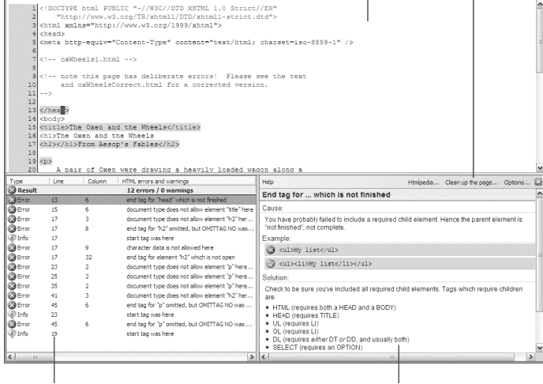

图 3-4：HTML Validator 解释了页面中的所有错误。

当你运行 HTML Validator 时，“查看源代码”工具变得更加强大，如下所示：

- 每个错误都列在错误面板中。你会看到与 W3C 相同的错误列表。
- 点击一个错误会在源代码列表中突出显示它。这使得很容易准确看到哪行代码触发了每个错误。
- 每个错误都显示完整的帮助信息。HTML Validator 工具栏呈现的错误消息比 W3C 结果更有帮助。
- 自动清理。你可以点击“清理”链接，HTML Validator 扩展程序会自动将 HTML Tidy 应用于你的页面。这可能是修复有许多错误的旧页面的一种非常有效的方法。

HTML Validator 工具将彻底改变你的网络开发体验，帮助你轻松创建符合标准的网站，并发现你访问的任何页面的合规性水平。（感觉自己优越是件有趣的事。）

## 使用 Web Developer 工具栏

Chris Pederick 的 Web Developer 工具栏为网页开发者提供了各种有用的工具。该程序作为 Firefox 中的一个新工具栏安装，如图 3-5 所示。

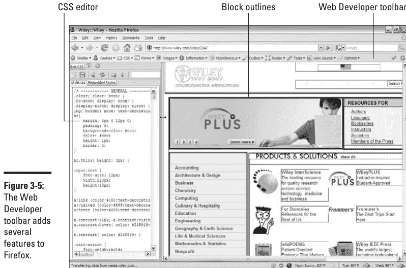

## 56 挑战 Firefox

图 3-5 显示了 Wiley 主页，其中一些 Web Developer 工具栏功能处于活动状态。左侧的“编辑 CSS”框架允许你实时修改页面的外观，粗轮廓有助于可视化页面组织。（我在第 III 和第 IV 部分详细描述了这些想法。）

当你激活 Web Developer 工具栏（使用“视图”>“工具栏”菜单命令来隐藏或显示它）时，你可以用它做以下事情：

- 即时编辑你的页面。“杂项”下拉菜单上的“编辑 HTML 条目”选项会在屏幕左侧打开一个小文本编辑器。你可以在这里对 HTML 进行更改，并立即在主屏幕上看到结果。这些更改不是永久的，但你可以保存它们。
- 验证你的页面。选择 CSS > “编辑 CSS”是验证页面的命令，但 Web Developer 工具栏还为 Firefox 添加了一些热键，这样你可以立即将页面发送到 W3C 验证器。按下`Ctrl+Shift+A`会联系 W3C 验证器，然后将你的页面发送过去。这比记住验证器地址容易得多。仅此一项功能就值得短暂的下载时间。你还可以进行其他类型的验证，检查你的 CSS，或查看你的页面在多大程度上符合针对残疾人的各种指南。
- 操作 CSS 代码。使用 XHTML 定义页面后，使用 CSS 来美化它。CSS 菜单有许多优秀的工具，用于查看 CSS 的设置方式并即时进行实验。我在第 II 和第 III 部分（描述 CSS 时）解释了如何使用这些 CSS 工具。
- 以不同尺寸查看你的页面。并非每个人都拥有巨大的平板显示器。查看你的页面在多种标准屏幕分辨率下的外观非常重要。
- 获取速度报告。你的网页在你的宽带连接上可能加载得很好，但在 Judy 阿姨的拨号连接上表现如何？Web Developer 有一个工具可以分析页面的所有组件，报告每个组件在不同连接上下载所需的时间，并建议提高页面下载速度的方法。
- 检查可访问性。你可以运行许多自动化测试来确定你的页面的可访问性。使用可访问性测试来了解你的页面对患有各种残疾的人士如何运作，以及你是否通过某些必需的标准（例如，政府网站的要求）。

Web Developer 工具栏还能做更多事情，但这些是一些亮点。该工具栏下载体积小、速度快，它使网页开发变得容易得多。真的没有理由不去使用它。

## 使用 Firebug

Firebug 扩展是 Web 开发者的另一个重要工具。Firebug 更专注于 JavaScript 开发，而非纯 XHTML 开发，但它对 XHTML 初学者同样有用。图 3-6 展示了在 Firefox 中作为面板打开的 Firebug 扩展。

Firebug 的检查模式允许你将 HTML 代码与输出进行比较。当你将鼠标悬停在页面渲染部分的某个区域时，Firebug 会在另一个面板中高亮显示代码的相关部分。同样地，你也可以将鼠标悬停在某个代码片段上，查看受影响的代码区域。当结果不符合预期时，这会非常方便。

你可以将 HTML 代码视图显示为大纲，这有助于你把握代码的整体结构。你还可以在面板中直接编辑代码，并像使用我上一节讨论的 Web 开发者工具栏一样，立即看到结果。你在 Firebug 中所做的更改并非永久性的，但你可以将它们复制到你的文本编辑器中。

当你处理更复杂的技术，如 CSS、DOM 操作、JavaScript 和 AJAX 时，Firebug 才真正大显身手。本书第五卷和第七卷将向你展示如何利用 Firebug 来辅助这些过程。

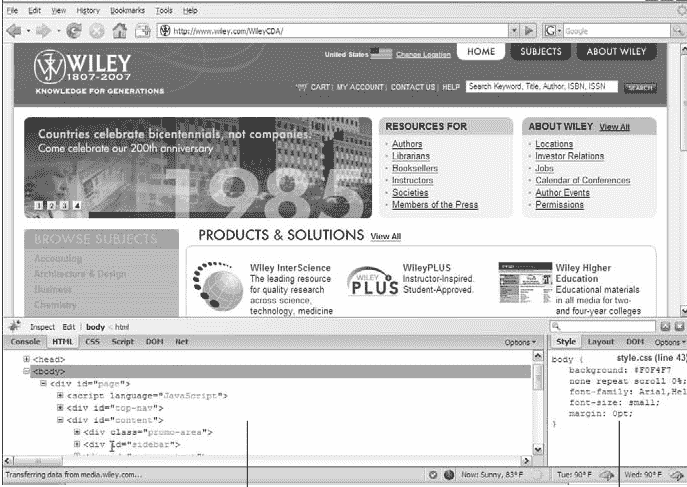

图 3-6：Firebug 为你提供页面的详细视图。

## 使用功能齐全的 IDE

你可能认为我讨厌专用的网页编辑器，但事实并非如此。我一直在其他类型的编程中使用它们。问题在于，直到最近，还没有真正适合 Web 开发的 IDE（集成开发环境）。大多数工具试图成为可视化开发工具，用于自动化视觉页面的设计，而非编程环境。它们存在缺陷，因为 Web 开发本质上是一个带有视觉设计方面的编程问题，而非一个以编程为基础的视觉设计问题。

最近，开源社区中涌现出了一些 IDE。其中一个试图模仿商业工具（最终也复制了它们的一些缺陷）。还有一些编辑器出现了，它们似乎很好地平衡了帮助你编写健壮代码与伴随你成长的需求——随着你变得更加精通。

### 介绍 Aptana

对于希望进阶的初学者，我推荐的编辑器是 Aptana（可从本书附带的 CD-ROM 或 [www.aptana.com](http://www.aptana.com) 获取）。Aptana Studio 是一个基于流行的 Eclipse 编辑器的功能齐全的 IDE。Aptana 拥有众多特性，使其成为 Web 开发者的不错选择：

- 语法补全：Aptana 内置了对 HTML（以及其他几种语言）的知识。当你开始输入 HTML 代码时，它会识别代码并弹出一个建议列表。图 3-7 展示了 Aptana 如何协助处理 HTML 代码。
- 自动结束标签：一旦你编写了起始标签，Aptana 就会自动生成相应的结束标签。这大大降低了你忘记编写结束标签的可能性——这是最常见的编码错误之一。
- 自动生成的 XHTML 模板：当你指示 Aptana 创建一个 HTML 页面时，它可以生成带有所有繁琐的 doctype 声明的页面模板。（我将在下一节解释如何自定义此功能。）
- 错误检测：Aptana 可以检查代码并检测某些错误。虽然它不能替代验证器，但它可以是一个非常方便的工具，尤其是在你开始编写 JavaScript 代码时。
- 文件管理工具：Aptana 使得操作本地文件系统和驻留在互联网服务器上的页面变得容易。
- 页面预览：你可以直接在 Aptana 中预览页面，也可以在你的主要浏览器中查看。
- 大纲视图：此面板以大纲形式显示页面结构，帮助你把握页面的整体结构。你也可以将此面板用作目录，以便在编辑器中快速跳转到页面的特定部分。图 3-8 展示了大纲视图的实际效果。

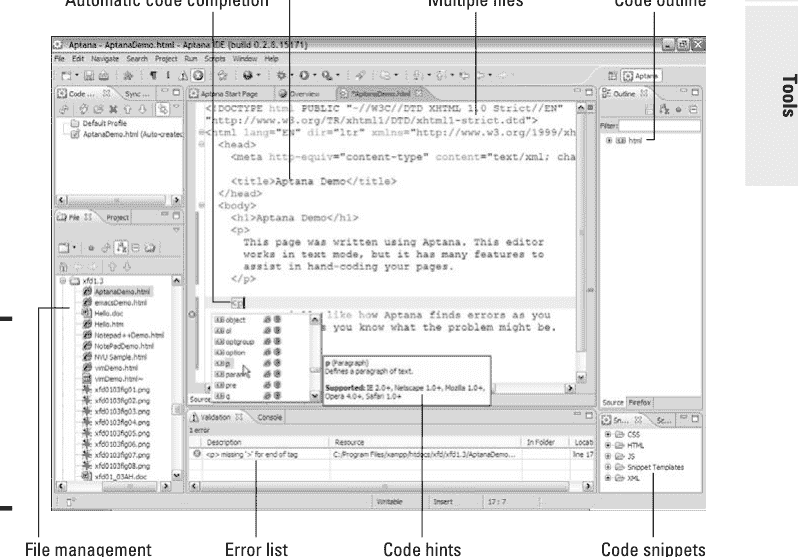

图 3-7：Aptana 识别 HTML 并建议代码。

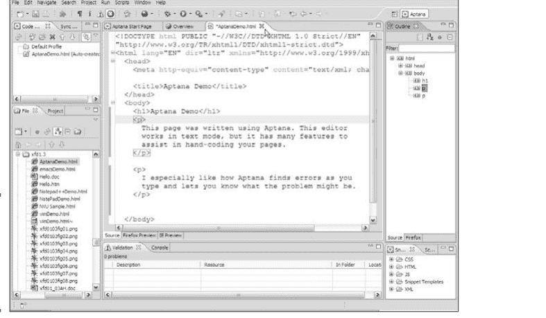

图 3-8：大纲视图充当页面的目录。

- 高级功能：当你准备好尝试 JavaScript 和 AJAX 时，Aptana 对这些更高级的技术有很好的支持。语法高亮功能在 CSS、JavaScript 和 PHP 中的工作方式与在 HTML 中相同。这意味着你可以使用同一个编辑器来编写所有的 Web 语言，这是一件很棒的事情。

Aptana Studio 以前有两个不同的版本，但现在功能已合并，社区版是唯一提供的版本。Studio 完全免费使用和重新分发，尽管它有多种许可模型。它提供了你可能需要的所有功能，以及一些你可能永远不会用到的高级功能（如集成的云计算支持）。

### 自定义 Aptana

Aptana 是一个很棒的编辑器，但我建议你在系统上安装后更改一些设置。

#### 获取 HTML 编辑器首选项

Aptana 可以通过多种方式进行自定义。目前，你唯一需要更改的首选项在 HTML 编辑器中。选择 Windows > Preferences（在 Preferences 对话框中，展开 Aptana 链接并选择 HTML Editor）。该对话框如图 3-9 所示。

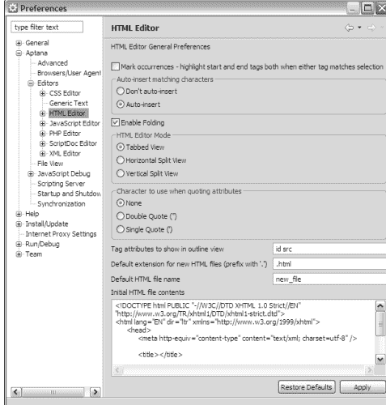

图 3-9：Aptana 的 HTML 编辑器首选项对话框。

#### 更改扩展名

默认情况下，Aptana 使用`.htm`扩展名保存文件。由于此扩展名通常仅由 Microsoft 服务器使用，我更喜欢使用`.html`扩展名保存页面。本书中的所有网页都使用`.html`扩展名存储。

如果你愿意，请在“Default Extension for New HTML Files (Prefix with '.')”字段中输入`.html`以进行此更改。

#### 更改初始内容

当你在 Aptana 中创建新网页时，会出现一个基本模板。这很方便，但它创建的是 HTML 4.0 doctype。在普通文本编辑器中打开`template.html`，复制它，然后粘贴到提供的文本区域，你的页面将使用标准模板开始。

#### 更改视图

Aptana 允许你将屏幕分成两部分，代码在一个面板中，浏览器视图在另一个面板中。每次保存代码时，浏览器视图会立即更新。这是一个非常好的工具，尤其是对于初学者，因为你可以快速获得页面外观的反馈。在首选项对话框（参考图 3-9）的“HTML Editor Mode”部分，你可以指定是否希望浏览器预览在单独的选项卡中、水平分屏中或垂直分屏中。我使用选项卡，因为我喜欢在屏幕上看到尽可能多的代码。

最新版本的 Aptana 试图强制你进入项目模式，你将所有文件组合成一个大项目。虽然这对大项目来说没问题，但当你刚开始时可能不是你想要的。要在不使用项目的情况下构建文件，请使用“File”选项卡（在左侧）转到要创建文件的目录。右键单击该目录并选择“New”。

### Aptana 问题

我经常使用 Aptana，它是我最喜欢的工具之一。然而，它并不完美；它是一个大型程序，加载需要一些时间。我还遇到过一些显示错误，调试模型似乎并不总是按照应有的方式工作。Aptana 是一个相当不错的工具，但如果这些事情困扰你，你可能想看看以下替代品。


### 介绍 Komodo Edit

Komodo Edit 是另一个非常强大的 Web 编辑器（类似于 Aptana），可能更适合一些开发者。Komodo 不像 Aptana 那样试图做所有事情，但它更快且更可靠一些。Komodo 主要是一个文本编辑器，确实有一些很棒的功能。我最喜欢 Komodo 的地方是它非常容易修改。

- 缩写（Abbreviations）：尽管许多编辑器都有这样的功能，但 Komodo 中的缩写工具特别有用。Komodo 内置了大量缩写，并提供了非常简单的使用机制。例如，如果你输入`xhtml`然后按`Ctrl-T`，Komodo 会将文本替换为一个完整的 XHTML 框架。创建新的缩写非常容易，因此你可以快速自定义。
- 宏（Macros）：我认为 Aptana 最大的弱点之一是宏功能笨拙。Aptana 没有简单的方法来录制按键命令并回放。（公平地说，Aptana 有一个极其强大的脚本系统，但它并不那么容易使用。）Komodo 有一个非常好的宏录制功能。
- 代码片段（Snippets）：Komodo 有一个出色的内置代码片段库，包含你经常使用的代码。添加新的代码片段很容易，因此很快你就会将经常使用的大部分代码都放在手边。
- 命令（Commands）：Komodo 允许你定义可以从编辑器内运行的命令。例如，你可以创建一个 DOS 命令来列出当前目录中的所有文件，并在不离开 Komodo 的情况下运行该命令。如果你正在编写创建文件的代码（如在第五卷，第七章中），这会很有用。它也可以用于运行外部程序，例如编译器（如果你用 C 或 Java 等需要编译器的语言编写代码）。

图 3-10 展示了正在使用 Komodo Edit 修改网页的情景。

## 第四章：使用列表和表格管理信息

### 本章内容

- ✓ 理解基本列表
- ✓ 创建无序列表、有序列表和嵌套列表
- ✓ 构建定义列表
- ✓ 构建基础表格
- ✓ 使用`rowspan`和`colspan`属性

你经常需要呈现大量结构化信息，而 XHTML 提供了一些强大的工具来完成这项任务。XHTML 有三种列表类型和一个强大的表格结构，用于组织页面内容。弄清楚这些工具的工作原理，你就能轻松管理复杂信息。

## 列表创建与双重检查

XHTML 支持三种类型的列表。*无序*列表通常包含项目符号。当列表中元素的顺序不重要时使用。*有序*列表通常在每个列表项前有某种数字计数器。*定义*列表包含术语及其定义。

### 创建无序列表

XHTML 中所有列表类型都密切相关。最简单和最常见的列表类型是无序列表。

#### 查看无序列表

查看图 4-1 所示的简单页面。除了几个标题外，它还有一个信息列表。

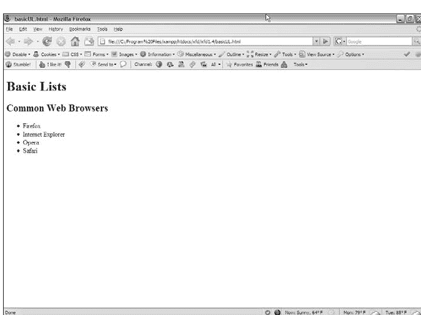

图 4-1：一个 Web 浏览器的无序列表。

这个浏览器列表具有一些有趣的视觉特征：

- 项目有缩进。在左页边距和每个列表项的开头之间有一些额外的空间。
- 列表元素有项目符号。每个项目前面的那个小点是*项目符号*。项目符号通常在此类无序列表中使用。
- 每个项目开始新行。当显示列表项时，它会显示在新行上。

这些特征帮助你识别这是一个列表，但它们只是默认行为。将某些内容定义为列表不会强制它看起来特定的方式；默认设置只是帮助你识别这些项目确实是列表的一部分。

> 记住 XHTML 的核心思想。你并不是在真正描述事物*看起来*如何，而是描述它们*意味着*什么。当你了解 CSS 后，可以稍后更改外观，所以不要过于纠结于事物的特定外观。目前，只需认识到 HTML（以及扩展的 XHTML）可以构建列表，并确保你知道如何使用各种类型。

### 构建无序列表


列表由两种标签组成。一种标签包围整个列表并指示列表的一般类型。第一个示例演示了一个无序列表，由`<ul></ul>`标签对包围。

*注意：* 将`<ul>`标签内的所有代码缩进是常见的做法。无序列表可以放在主体内。

在`<ul></ul>`标签内是若干列表项。列表的每个元素都存储在`<li>`（列表项）和`</li>`标签之间。通常，每个`<li></li>`标签对在源代码中单独占一行，尽管你可以将列表项设置得任意长。

有关如何将项目符号更改为各种其他图像（包括圆圈、正方形甚至自定义图像）的信息，请参阅第二卷第四章。

无序列表的代码非常直接：

```
<!DOCTYPE html PUBLIC "-//W3C//DTD XHTML 1.0 Strict//EN"
"http://www.w3.org/TR/xhtml1/DTD/xhtml1-strict.dtd">
<html lang="EN" dir="ltr" xmlns="http://www.w3.org/1999/xhtml">
  <head>
    <meta http-equiv="content-type" content="text/xml; charset=utf-8" />
    <title>basicUL.html</title>
  </head>
  <body>
    <h1>Basic Lists</h1>
    <h2>Common Web Browsers</h2>
    <ul>
      <li>Firefox</li>
      <li>Internet Explorer</li>
      <li>Opera</li>
      <li>Safari</li>
    </ul>
  </body>
</html>
```

### 创建有序列表

有序列表与无序列表几乎完全相同。传统上，有序列表使用数字而不是项目符号（尽管你可以通过 CSS 更改此设置；请参阅第三卷第三章）。

#### 查看有序列表

图 4-2 演示了一个包含基本有序列表的页面——`basicOL.html`。

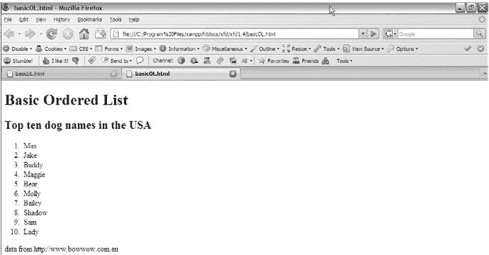

图 4-2：一个简单的有序列表。

图 4-2 显示了一个项目编号的列表。当你的数据是步骤列表或具有某种数值类型的信息时，有序列表是一个不错的选择。

#### 构建有序列表

`basicOL.html`的代码与之前的无序列表非常相似：

```
<!DOCTYPE html PUBLIC "-//W3C//DTD XHTML 1.0 Strict//EN"
"http://www.w3.org/TR/xhtml1/DTD/xhtml1-strict.dtd">
<html lang="EN" dir="ltr" xmlns="http://www.w3.org/1999/xhtml">
  <head>
    <meta http-equiv="content-type" content="text/xml; charset=utf-8" />
    <title>basicOL.html</title>
  </head>
  <body>
    <h1>Basic Ordered List</h1>
    <h2>Top ten dog names in the USA</h2>
    <ol>
      <li>Max</li>
      <li>Jake</li>
      <li>Buddy</li>
      <li>Maggie</li>
      <li>Bear</li>
      <li>Molly</li>
      <li>Bailey</li>
      <li>Shadow</li>
      <li>Sam</li>
      <li>Lady</li>
    </ol>
    <p>
      data from http://www.bowwow.com.au
    </p>
  </body>
</html>
```

唯一的更改是列表标签本身。有序列表使用`<ol>`指示符，而不是`<ul>`标签。列表项与无序列表中使用的`<li></li>`标签对相同。

你无需在任何地方指定项目编号；它会根据列表中每个项目的位置自动生成。因此，你可以更改项目的顺序，而数字仍然是正确的。


这就是 XHTML 关注意义而非布局的妙处。如果你指定了实际的数字，移动内容将会一团糟。真正重要的是元素在有序列表内部。

### 制作嵌套列表

有时，你可能想在页面中创建大纲或其他类型的复杂数据。如果需要，你可以轻松地将列表相互嵌套。图 4-3 显示了一个更复杂的列表，描述了美国和澳大利亚流行的猫名。

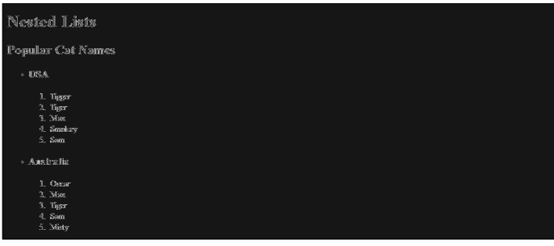

图 4-3 使用列表的组合来完成工作。该图包含一个包含两个国家的列表：美国和澳大利亚。每个国家有一个 H3 标题和另一个（有序）列表。你可以将各种元素嵌套在列表中，但如果希望页面验证通过，则必须小心操作。

在此示例中，有一个只有两个元素的无序列表。每个元素包含一个`<h3>`标题和一个有序列表。页面以相对清晰的方式处理所有这些数据，并正确通过验证。

#### 检查嵌套列表示例

`nestedList.html`的完整代码如下所示：

```
<!DOCTYPE html PUBLIC "-//W3C//DTD XHTML 1.0 Strict//EN"
"http://www.w3.org/TR/xhtml1/DTD/xhtml1-strict.dtd">
<html lang="EN" dir="ltr" xmlns="http://www.w3.org/1999/xhtml">
  <head>
    <meta http-equiv="content-type" content="text/xml; charset=utf-8" />
    <title>nestedList.html</title>
  </head>
  <body>
    <h1>Nested Lists</h1>
    <h2>Popular Cat Names</h2>
    <ul>
      <li>
        <h3>USA</h3>
        <ol>
          <li>Tigger</li>
          <li>Tiger</li>
          <li>Max</li>
          <li>Smokey</li>
          <li>Sam</li>
        </ol>
      </li>
      <li>
        <h3>Australia</h3>
        <ol>
          <li>Oscar</li>
          <li>Max</li>
          <li>Tiger</li>
          <li>Sam</li>
          <li>Misty</li>
        </ol>
      </li>
    </ul>
  </body>
</html>
```

你可能会在这个代码清单中注意到以下几点：

- 有一个大的`<ul>`标签包围整个主列表。

- 主列表只有两个列表项。

- 每个项代表一个国家。

- 每个国家有一个`<h3>`元素，在`<li>`内描述国家名称。

- 每个国家还有一个包含名称列表的`<ol>`标签。

- 缩进确实有助于你理解事物的关联方式。

### 代码缩进

你可能已经注意到我在本书中缩进所有 XHTML 代码。浏览器会忽略所有缩进，但这仍然是一个重要的编码习惯。

关于代码格式化，人们有许多不同的见解，但我在本书中使用的标准格式在你形成自己的风格之前，会为你提供很好的帮助。

通常，我使用以下规则来缩进 HTML/XHTML 代码：

- **缩进每个嵌套元素。** 因为`<head>`标签位于`<html>`元素内部，所以我通过缩进来表明这一点。同样，`<li>`元素也总是缩进在`<ul>`或`<ol>`标签对内部。

- **对齐你的元素。** 如果一个元素占据多行，请将结束标签与开始标签对齐。这样，你就能清楚地知道什么结束了什么。

- **使用空格，而不是制表符。** 制表符在源代码中常常会引起问题。不同的编辑器对制表符的格式化处理方式不同，制表符和空格混用可能会让你精心排版的页面在另一个编辑器中查看时变得一团糟。

- **使用两个空格。** 大多数编码人员每个缩进级别使用两个或四个空格。HTML 元素可以嵌套得很深，达到七八层是常有的事。如果你使用制表符或过多的空格，就会产生大量空白，以至于看不清代码。

- **在左边界结束。** 如果你完成页面后没有回到左边界，那就说明你忘记了结束某个标签。正确的缩进可以使你轻松地看清页面结构。每个元素都应该与其闭合标签对齐。


如果你正在使用 Aptana（如果你还没有使用，真的应该考虑一下——更多信息请参阅本迷你书的第 3 章），请注意，Aptana 的自动格式化默认使用制表符。从“窗口”菜单中，选择“首选项”。然后找到“Aptana 编辑器”面板，并选择“插入空格而非制表符”。


Aptana 默认使用四个空格，但你可以将其更改为两个。从“常规”菜单中，选择“编辑器 > 文本编辑器”，并将“显示的制表符宽度”选项设置为 2。

## 构建嵌套列表

当你查看嵌套列表的代码时，它可能看起来很吓人，但其实并不那么难。秘诀是从外向内构建列表：

1. **首先创建外层列表。** 构建主要列表（无论是有序还是无序）。在我的示例中，我从只包含两个国家的无序列表开始。

2. **向外层列表添加列表项。** 如果你想在主列表中放置文本或标题（就像我做的那样），可以在这里添加。如果你的主列表里只是另一个列表，你可能需要放一些占位符`<li>`标签，以确保一切正常工作。

3. **在添加下一级列表之前进行验证。** 嵌套列表可能会让验证程序（和你）感到困惑。在添加内部列表之前，先验证外部列表的代码，确保没有问题。

4. **添加第一个内部列表。** 在确认基本结构没有问题后，添加第一个内部列表。在我的示例中，这是美国猫名的有序列表。

5. **重复直到完成。** 持续添加列表，直到页面看起来正确。

6. **频繁验证。** 边做边验证比等到全部完成后再验证要好得多。尽早发现错误，以免重复犯错。

## 构建定义列表

另一种类型的列表——定义列表——非常有用，即使它使用频率不高。定义列表最初是为了格式化词典式的定义而设计的，但当你有名称和值对时，它都非常有用。图 4-4 展示了一个实际应用的定义列表示例。

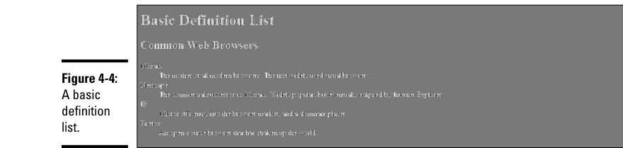

定义列表不使用项目符号或数字。相反，它有两个元素。*定义术语*通常是单词或短语。在图 4-4 中，浏览器名称被定义为定义术语。*定义描述*是包含实际定义的扩展文本块。

定义列表的标准布局会缩进每个定义描述。当然，在你理解了第 II 和第 III 部分中的 CSS 之后，你可以根据需要更改布局。

任何时候，当你想要一个由关键术语而不是项目符号或数字标记的列表时，你都可以使用定义列表。定义列表在其他情况下也很有用，例如表单、带标题的图形等。

以下是`basicDL.html`的代码：

```html
<!DOCTYPE html PUBLIC "-//W3C//DTD XHTML 1.0 Strict//EN"
"http://www.w3.org/TR/xhtml1/DTD/xhtml1-strict.dtd">
<html lang="EN" dir="ltr" xmlns="http://www.w3.org/1999/xhtml">
  <head>
    <meta http-equiv="content-type" content="text/xml; charset=utf-8" />
    <title>BasicDL.html</title>
  </head>
  
  <body>
    <h1>Basic Definition List</h1>
    <h2>Common Web Browsers</h2>
    <dl>
      <dt>Mosaic</dt>
      <dd>
        The mother of all modern browsers. The first widely used
        visual browser.
      </dd>
      
      <dt>Netscape</dt>
      <dd>
        The commercial successor to Mosaic. Widely popular, but
        eventually eclipsed by Internet Explorer
      </dd>
      
      <dt>IE</dt>
      <dd>
        Microsoft's entry into the browser market, and a dominant
        player.
      </dd>
      
      <dt>Firefox</dt>
      <dd>
        An open-source browser that has shaken up the world.
      </dd>
    </dl>
  </body>
</html>
```

如你所见，定义列表使用了三个标签对：

- `<dl></dl>` 定义整个列表。

- `<dt></dt>` 定义每个定义术语。

- `<dd></dd>` 定义定义数据。

定义列表不常被使用，但它们可能非常有用。任何时候，当你有一个由术语和值组合而成的列表时，定义列表都是一个不错的选择。

## 构建表格

有时，你会遇到最适合以表格格式呈现的数据。XHTML 支持多种用于此类工作的表格标签。图 4-5 展示了一个非常基础的表格。

图 4-5：表格对某些数据表示很有用。

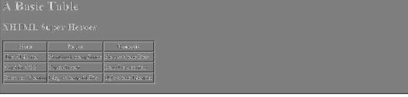

有时，以有意义的方式展示数据的最佳方法是将其组织在表格中。XHTML 使用（命名巧妙的）`<table>`标签定义表格。表格包含多个表格行（用`<tr>`标签定义）。每个表格行可以由多个表格数据（`<td>`）或表格标题（`<th>`）标签组成。

将图 4-5 中的输出与创建它的`basicTable.html`代码进行比较：

```html
<!DOCTYPE html PUBLIC "-//W3C//DTD XHTML 1.0 Strict//EN"
"http://www.w3.org/TR/xhtml1/DTD/xhtml1-strict.dtd">
<html lang="EN" dir="ltr" xmlns="http://www.w3.org/1999/xhtml">
  <head>
    <meta http-equiv="content-type" content="text/xml; charset=utf-8" />
    <title>basicTable.html</title>
  </head>

  <body>
    <h1>A Basic Table</h1>
    <h2>XHTML Super Heroes</h2>
    <table border = "1">
      <tr>
        <th>Hero</th>
        <th>Power</th>
        <th>Nemesis</th>
      </tr>

      <tr>
        <td>The XMLator</td>
        <td>Standards compliance</td>
        <td>Sloppy Code Boy</td>
      </tr>

      <tr>
        <td>Captain CSS</td>
        <td>Beautiful Design</td>
        <td>Browser Inconsistency</td>
      </tr>

      <tr>
        <td>Dr. JavaScript</td>
        <td>Dynamic Interactivity</td>
        <td>Client-Side Insecurity</td>
      </tr>

      <tr>
        <td>Super-layout</td>
        <td>Lord Deprecated</td>
        <td></td>
      </tr>

      <tr>
        <td>Browser Woman</td>
        <td>Mega-Compatibility</td>
        <td>Ugly Code Monster</td>
      </tr>
    </table>
  </body>
</html>
```

## 定义表格

XHTML 表格由`<table></table>`标签对定义。仔细缩进和排列代码是非常有意义的，这样你就能在代码中看到表格的结构。只需扫一眼代码，你就能猜出表格由三行组成，每行由三个元素组成。

在文字处理软件中，你通常通过定义行数和列数来创建一个空白表格，然后填充它。在 XHTML 中，你逐行定义表格，每行中的元素决定了列数。你需要确保每一行的元素数量相同。


默认情况下（至少在大多数浏览器中），表格不显示边框。如果你想看到基本的表格边框，可以打开表格的`border`属性。（属性是你附加到某些标签上的特殊修饰符。）

```html
<table border = "1">
```

这个标签创建了一个表格，并指定其边框大小为 1。如果你省略了`border = "1"`部分，有些浏览器会显示边框，有些则不会。你可以将边框值设置为 0 或更大的数字。数字越大，边框越宽，如图 4-6 所示。

虽然这种制作表格边框的方法完全没问题，但我在第 II 部分第 4 章中展示了一种更灵活、更强大的技术。

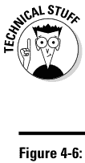

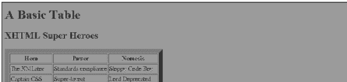

## 构建表格

设置表格边框是个好主意，因为你无法指望所有浏览器都使用相同的默认设置。此外，边框值总是带引号的。当你在第二卷中阅读关于 CSS 的内容时（你是否厌倦了听到这个？），你会发现如何添加比这个简单属性允许的更复杂、更有趣的边框。

## 添加你的第一行

定义表格后，你需要添加一些行。每一行都由一对`<tr></tr>`表示。

在`<tr></tr>`标签组内，你需要一些表格数据。第一行通常包含表头。这些特殊的单元格格式有所不同，以表明它们是标签，而不是数据。

表头有一些默认格式来帮助你记住它们是表头，但你可以改变它们的外观。你可以在第二卷和第三卷中以各种很棒的方式改变表头的外观。先定义好表头，这样当你发现格式并决定将你所有的表头都改为黄绿色时，你就知道 HTML 代码中所有表头的位置了。

将你的表头缩进放在`<tr>`标签组内。如果你的表格包含三列，你的第一行可能像这样开始：

```html
<tr>
  <th></th>
  <th></th>
  <th></th>
</tr>
```

将你希望显示在表格表头中的文本放在`<th>`和`</th>`元素之间。内容按定义的顺序显示。

标题不一定在第一行。如果你想让标题在左侧，只需在每行的第一个元素处放置一对`<th></th>`。如果你愿意，你也可以在顶部和左侧都有标题。事实上，你可以在任何地方放置标题，但通常只将标题放在顶部或左侧是合理的。

## 创建你的数据行

下一步是创建另一行。数据行与标题行类似，只是它们使用`<td></td>`标签对而不是`<th></th>`标签对来包含数据元素。通常，一个三列表格的空行如下所示：

```html
<tr>
  <td></td>
  <td></td>
  <td></td>
</tr>
```

将数据元素放在`<td></td>`段内，你就可以开始了。

## 在文本编辑器中构建表格

有些人认为表格是使用 WYSIWYG（所见即所得）编辑器的一个好理由，因为他们认为在文本模式下创建表格很困难。你需要做一点规划，但如果你遵循这个计划，构建一个 HTML 表格实际上相当快速和简单：

1. **提前规划。** 知道表格中将有多少行和列。在纸上先画个草图可能很有帮助。稍后更改行数很容易，但在编写了一些代码后更改列数可能真的很麻烦。

2. **创建标题行。** 如果你要从一个标准的标题在顶部的表格开始，首先创建标题行。保存、检查和验证。你不想在添加更多复杂性时让错误成倍增加。这个标题行告诉你需要多少列。

3. **构建一个示例行。** 创建一个具有正确数量`<td>`元素的示例行，每行一个`<td></td>`对。构建一个`<td>`标签组，然后使用复制和粘贴根据需要复制这个数据单元格多次。确保`<td>`对的数量等于标题行中`<th>`标签组的数量。

4. **复制并粘贴空行以创建你需要的任意多行。**

5. **保存、查看并验证。** 在投入大量精力添加数据之前，确保一切看起来正确并验证通过。

6. **用你需要的数据填充表格。** 逐行进行，在`<td></td>`标签对之间添加数据。

7. **再次测试和验证，以确保你没有意外破坏任何内容。**

## 合并行与列

有时，你需要在表格设计上多一些灵活性。图 4-7 展示了一个邪恶霸主日程表的一页。

图 4-7：一些活动占据多个单元格。

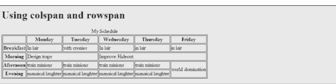

做一个邪恶霸主显然是个复杂的业务。从代码的角度来看，占据多个单元格的项目是最有趣的。设计陷阱需要两个上午，改进巢穴需要三个。整个周五下午和晚上都用于征服世界。看看代码，你会明白它是如何工作的：

```html
<!DOCTYPE html PUBLIC "-//W3C//DTD XHTML 1.0 Strict//EN"
"http://www.w3.org/TR/xhtml1/DTD/xhtml1-strict.dtd">
<html lang="EN" dir="ltr" xmlns="http://www.w3.org/1999/xhtml">
  <head>
    <meta http-equiv="content-type" content="text/xml; charset=utf-8" />
    <title>tableSpan.html</title>
  </head>

  <body>
    <h1>使用 colspan 和 rowspan</h1>
    <table border = "1">
      <caption>我的日程表</caption>
      <tr>
        <th></th>
        <th>周一</th>
        <th>周二</th>
        <th>周三</th>
        <th>周四</th>
        <th>周五</th>
      </tr>

      <tr>
        <th>早餐</th>
        <td>在巢穴</td>
        <td>与亲信一起</td>
        <td>在巢穴</td>
        <td>在巢穴</td>
        <td>在巢穴</td>
      </tr>

      <tr>
        <th>上午</th>
        <td colspan = "2">设计陷阱</td>
        <td colspan = "3">改进巢穴</td>
      </tr>

      <tr>
        <th>下午</th>
        <td>训练爪牙</td>
        <td>训练爪牙</td>
        <td>训练爪牙</td>
        <td>训练爪牙</td>
        <td rowspan = "2">征服世界</td>
      </tr>

      <tr>
        <th>晚上</th>
        <td>狂笑</td>
        <td>狂笑</td>
        <td>狂笑</td>
        <td>狂笑</td>
      </tr>

    </table>
  </body>
</html>
```

使单元格比默认尺寸更大的秘诀是两个特殊属性：`rowspan`和`colspan`。

## 合并多列

上午的活动往往持续数天。设计陷阱需要周一和周二上午，而改进巢穴将占用剩下的三个上午。再看看上午那一行；这是如何做到的：

```html
<tr>
  <th>上午</th>
  <td colspan = "2">设计陷阱</td>
  <td colspan = "3">改进巢穴</td>
</tr>
```

设计陷阱单元格跨越了两个常规列。`colspan`属性告诉这个单元格将占据多少列。改进巢穴单元格的`colspan`为 3。

上午那一行仍然占据六列。`<th>`像平常一样占一列宽，但设计陷阱单元格跨越两列，改进巢穴单元格占三列，总共六列宽。如果你增加一个单元格的宽度，你需要消除该行中的一些其他单元格来进行补偿。

## 合并多行

一个相关属性——`rowspan`——允许一个单元格占据表格的多行。回顾图 4-7 中的周五列，你会看到征服世界单元格占据了两个时间段。（如果征服世界很容易，每个人都会去做。）以下是相关代码：

```html
<tr>
  <th>下午</th>
  <td>训练爪牙</td>
  <td>训练爪牙</td>
  <td>训练爪牙</td>
  <td>训练爪牙</td>
  <td rowspan = "2">征服世界</td>
</tr>

<tr>
  <th>晚上</th>
  <td>狂笑</td>
  <td>狂笑</td>
  <td>狂笑</td>
  <td>狂笑</td>
</tr>
```

晚上那一行只有五个条目，因为征服世界单元格延伸到了通常由一对`<td>`占据的空间。


如果你想使用`rowspan`和`colspan`，不要只是在编辑器里埋头苦干。先草拟出你想要达成的效果。我对这些东西已经很擅长了，但在创建`tableSpan.html`代码之前，我仍然需要一个草图。

## 避免基于表格的布局陷阱

表格非常棒。它们是呈现某些类型数据的绝佳方式。当你添加了`colspan`和`rowspan`的概念后，你可以使用表格创建一些相当有趣的布局。事实上，因为传统的 HTML 没有任何布局技术，许多开发者想出了一些基于表格的惊人布局。你今天仍然看到很多网页主要使用表格作为布局机制。

使用表格进行布局会导致一些问题，例如：

- **表格并非为布局而设计。** 表格是为数据呈现而设计的，而不是布局。要让表格用于布局，你必须做很多巧妙的变通，比如在表格内嵌套表格，或者使用不可见的图像进行间距调整。

- **代码会很快变得复杂。** 表格涉及大量 HTML 标记。如果代码涉及表格相互嵌套，要记住哪个`<td>`元素与哪个表格的哪一行相关联是非常困难的。基于表格的布局非常难以手动修改。

- **格式是一个单元格一个单元格地设置。** 一个网页可能由数百个表格单元格组成。更改字体或颜色通常涉及在页面各处的数百个单元格中进行更改。这使你的页面灵活性降低，更难以更新。

- **表现形式与数据紧密绑定。** 基于表格的布局将数据及其表现形式紧密交织在一起。这与 Web 设计的一个主要目标——数据与其表现形式的分离——背道而驰。

## 基于表格的布局难以更改

在创建基于表格的布局后，进行修改会非常困难，因为所有表格单元格都可能影响其他单元格。

## 基于表格的布局会给屏幕阅读器带来问题

视障人士使用特殊软件来阅读网页。这些屏幕阅读器能够很好地按照预期读取表格（用于管理表格数据），但它们无法判断表格是被用作布局技术还是数据展示工具。这使得基于表格的布局不太符合无障碍标准。

抵制使用表格进行布局的诱惑。请将表格用于其设计目的：数据展示。第三册完全介绍了如何使用 CSS 生成你可能需要的任何视觉布局。基于 CSS 的方法更简单、更可靠，也更灵活。

## 第 1 册：创建 HTML/XHTML 基础

## 第 5 章：用链接建立连接

### 本章内容

- 理解超链接
- 构建锚点标签
- 识别绝对链接和相对链接
- 构建内部链接
- 创建链接列表

超链接的基本概念如今已很常见，但在当时是一个重大突破。仔细想想，这个想法仍然相当了不起：当你点击一段特定文本（或指定图像）时，你的浏览器会立即跳转到另一个地方。新目的地可能与初始页面在同一台计算机上，也可能位于世界任何角落。

理论上，任何页面都可以是通向其他任何页面的入口，所有信息都有能力被链接起来。这仍然是一个深刻的思想。在本章中，你将了解如何为页面添加链接。

### 让你的文本变得可交互

超链接确实是一个美妙的东西。信不信由你，曾经有一段时间，你必须手动输入想要访问的网页地址。现在则不同了。图 5-1 展示了一个描述我一些最爱网站的页面。

在图 5-1 中，带下划线的单词是超链接。点击超链接会将你带到指定的网站。虽然作为网页用户你无疑对此很熟悉，但要使这种机制正常工作，还需要几个细节：

- **某些内容必须是可链接的。** 一些文本或其他元素必须为链接行为提供触发器。

- **作为链接的内容应该看起来像链接。** 当你编写纯 XHTML 时，这实际上很容易做到，因为所有链接都有标准的（尽管可能不太美观）外观。链接通常是蓝色的带下划线文本。当你能够创建配色方案时，你可能不再希望链接看起来像默认外观，但它们应该仍然可以被识别为链接。

- **浏览器需要知道去哪里。** 当用户点击链接时，浏览器会被发送到互联网上某个地方的某个地址。有时该地址在页面上可见，但并非必须可见。

- **应该能够将链接集成到文本中。** 在这个例子中，每个链接都是句子的一部分。应该能够让某些内容表现得像链接，而不必像标题标签那样独立存在。

- **链接的外观有时会改变。** 链接有时以蓝色带下划线文本开始，但在链接被访问后，链接会显示为紫色。了解 CSS 后，你可以改变这种行为。

当然，如果你的网页提到了其他网站，你应该提供一个指向该网站的链接。

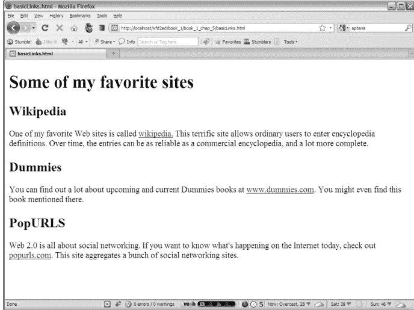

### 介绍锚点标签

超文本的关键是一个名称奇特的标签，称为锚点标签。该标签包含在`<a></a>`标签对中，并包含管理页面间链接所需的所有信息。

`basicLinks.html`页面的代码如下所示：

```html
<!DOCTYPE html PUBLIC "-//W3C//DTD XHTML 1.0 Strict//EN"
"http://www.w3.org/TR/xhtml1/DTD/xhtml1-strict.dtd">
<html lang="EN" dir="ltr" xmlns="http://www.w3.org/1999/xhtml">
  <head>
    <meta http-equiv="content-type" content="text/xml; charset=utf-8" />
    <title>basicLinks.html</title>
  </head>

  <body>
    <h1>Some of my favorite sites</h1>
    <h2>Wikipedia</h2>
    <p>
      One of my favorite Web sites is called
      <a href = "http://www.wikipedia.org">wikipedia.</a>
      This terrific site allows ordinary users to enter
      encyclopedia definitions. Over time, the entries
      can be as reliable as a commercial encyclopedia,
      and a lot more complete.
    </p>

    <h2>Dummies</h2>
    <p>
      You can find out a lot about upcoming and current
      Dummies books at <a href = "http://www.dummies.com">
      www.dummies.com</a>. You might even find this
      book mentioned there.
    </p>

    <h2>PopURLS</h2>
    <p>
      Web 2.0 is all about social networking. If you want
      to know what's happening on the Internet today,
      check out <a href = "http://popurls.com">
      popurls.com</a>. This site aggregates a bunch of
      social networking sites.
    </p>
  </body>
</html>
```

如你所见，锚点标签被嵌入到段落中。文本通常围绕锚点流动，你可以看到锚点代码被嵌入在段落内部。

### 比较块级元素和内联元素

到目前为止，本书中描述的所有标签都是块级标签。块级标签通常以回车符开始和结束。例如，三个`<h1>`标签占据三行。每组`<p></p>`在上下都有隐含的空间。大多数 XHTML 标签都是块级的。

有些标签旨在嵌入在块级标签内，不会中断文本流。锚点标签就是这样一个标签。锚点在 HTML 正文中永远不会独立存在。这种类型的标签是内联标签。它们旨在嵌入在块级标签内，例如列表项、段落和标题。

### 分析锚点

第一个链接以非常直接的方式显示了锚点的所有主要部分：

```html
<a href = "http://www.wikipedia.org">wikipedia.</a>
```

- **锚点标签本身：** 锚点标签就是`<a></a>`对。你不需要输入完整的单词 anchor，只需输入`a`即可。

- **超文本引用（href）属性：** 几乎所有锚点都包含此属性。编写`<a`而不带`href`的情况非常罕见。`href`属性表明后面将是一个网页地址。

- **引号中的网页地址：** 浏览器将跟随的地址被引号括起来。有关网页地址的更多信息，请参见本章下一节。在此示例中，`http://www.wikipedia.org`是地址。

- **作为链接显示的文本：** 用户通常期望点击特别格式化的文本。出现在`<a href>`部分和`</a>`部分之间的任何文本在页面上可见，并被格式化为链接。在此示例中，单词 wikipedia 是链接文本。

- **`</a>`标记：** 此标记表示文本链接结束。

### 介绍 URL


特殊的链接地址是网络的重要组成部分。你可能已经将网页地址输入到浏览器的地址栏中（`http://www.google.com`），但你可能并不完全了解它们是如何工作的。网页地址在技术上是 URL（统一资源定位符），它们有非常具体的格式。


有时，你会看到 URI（统一资源标识符）这个术语而不是 URL。从技术上讲，URI 是网页地址的更正确名称，但 URL 这个术语已经流行起来。这两个术语足够接近，可以互换使用。

URL 通常包含以下部分：

- **协议：** 网络协议是关于通信如何进行的标准化协议。网络主要使用 HTTP（超文本传输协议），但偶尔你会遇到其他协议。大多数地址以 `http://` 开头，因为这是网络上的标准。协议通常以冒号和两个斜杠（`://`）结束。
- **主机名：** 传统上，你的主要 Web 服务器被命名为 `www`。这不是必需的，但很常见，以至于用户期望在 `http://` 部分之后输入 `www`。无论如何，`http://` 之后（直到第一个句点之前）的文本是你正在链接的实际计算机的名称。

## 制作链接列表

许多网页最终都是链接列表。由于列表和链接非常契合，我们最好来看一个示例。图 5-2 展示了一个链接列表，指向某位（咳咳）英俊得令人发指的作者所著的书籍。

这个示例没有需要理解的新代码，但页面展示了一些有趣的组成部分：

- **列表：** 一个普通的无序列表。
- **链接：** 每个列表项包含一个链接。该链接有一个（你无法立即看到的）引用和可链接的文本（其标记方式类似于普通链接）。
- **描述性文本：** 每个链接之后都有一些描述该链接的普通文本。为实际的链接附上一些文本是非常常见的做法。

以下代码展示了该页面的组织方式：

```html
<html lang="EN" dir="ltr" xmlns="http://www.w3.org/1999/xhtml">
  <head>
    <meta http-equiv="content-type" content="text/xml; charset=utf-8" />
    <title>listLinks.html</title>
  </head>

  <body>
    <h1>Some nice programming books</h1>
    <ul>
      <li><a href="http://www.aharrisbooks.net/xfd_2ed">
           HTML / XHTML / CSS AIO for Dummies</a>
           A complete resource to web development</li>
      <li><a href="http://www.aharrisbooks.net/jad">
           JavaScript / AJAX for Dummies</a>
           Using JavaScript, AJAX, and jQuery</li>
      <li><a href="http://www.aharrisbooks.net/pythonGame">
           Game Programming - the L Line</a>
           Game development in Python</li>
      <li><a href="http://www.aharrisbooks.net/flash">
           Flash Game Programming for Dummies</a>
           Game development using Flash</li>
    </ul>
  </body>
</html>
```

这里的缩进很有趣。每个列表项包含一个锚点和一些描述性文本。为了保持代码的条理性，Web 开发者倾向于将锚点放在列表项内部。如果地址较长，有时会将其放在新行上，锚点文本放在新行，描述放在后续行上。我通常将 `<li>` 标签放在最后一行的末尾，这样开头的 `<li>` 标签看起来就像无序列表的项目符号。这使得在后续编辑列表时更容易找到位置。

## 处理绝对引用和相对引用

地址不止一种类型。到目前为止，你只看到了用于链接到外部页面的绝对引用。另一种引用——相对引用——用于将你自己网站内的多个页面链接起来。

### 理解绝对引用

`basicLinks.html` 中使用的链接类型是绝对引用。绝对引用始终以协议名称（通常是 `http://`）开头。绝对引用是网页的完整地址，就像你在浏览器地址栏中使用的一样。绝对引用用于引用互联网上其他地方的站点。即使你的网站移动了（例如，从你的桌面机器移到互联网上某个 Web 服务器），所有绝对引用仍然可以正常工作，因为它们不依赖当前页面的位置来获取任何信息。

### 介绍相对引用

当你的网站包含多个页面时，就会使用相对引用。你可能选择拥有多个页面，并使用链接机制在它们之间移动。图 5-3 展示了一个包含多个链接的页面。

**图 5-3：** 这些小猪仔们可真会到处跑。

这个页面本身并不那么有趣，但它并不是要独立存在的。当你点击其中一个链接时，你会进入一个全新的页面。图 5-4 展示了点击市场链接后会发生什么。

**图 5-4：** 市场页面让你可以返回。

市场页面相当简单，但它也包含一个返回初始页面的链接。大多数网站根本不是单个页面，而是相互连接的页面网络。当你拥有一组相互交叉链接的页面时，相对引用非常有用。

`pigs.html` 的代码展示了相对引用的工作原理：

```html
<!DOCTYPE html PUBLIC "-//W3C//DTD XHTML 1.0 Strict//EN"
"http://www.w3.org/TR/xhtml1/DTD/xhtml1-strict.dtd">
<html lang="EN" dir="ltr" xmlns="http://www.w3.org/1999/xhtml">
  <head>
    <meta http-equiv="content-type" content="text/xml; charset=utf-8" />
    <title>pigs.html</title>
  </head>
  
  <body>
    <h1>Destinations of Porcine Mammals</h1>
    <ul>
      <li>This little pig went to
          <a href="market.html">market</a></li>
      <li>This little pig stayed
          <a href="home.html">home</a>.</li>
      <li>This little pig had
          <a href="roastBeef.html">roast beef</a></li>
      <li>This little pig had
          <a href="none.html">none</a>.</li>
      <li>This little pig went
          <a href="wee.html">'wee wee wee'</a>
          all the way home.</li>
    </ul>
  </body>
</html>
```

大部分代码你都非常熟悉。唯一令人惊讶的是那里没有的东西。仔细看看其中一个链接：

```html
<a href="market.html">home</a>.</li>
```

没有协议（`http://` 部分），根本没有地址，只有一个文件名。这就是相对引用。相对引用通过假设当前页面的地址来工作。当用户点击 `market.html` 时，浏览器没有看到协议，因此它假设 `market.html` 与 `pigs.html` 在同一服务器的同一目录中。

相对引用就像方向指引。例如，如果你在我的实验室里，问饮水机在哪里，我会说：“出去到走廊，左转，在下一条走廊尽头再左转。”如果你从正确的地方出发，这些指引能让你找到饮水机。如果你在其他地方，并遵循相同的指引，你真的不知道自己会走到哪里。

当你拥有一堆相互连接的网页时，相对引用效果很好。如果你创建了大量关于同一主题的页面并将它们放在同一个目录中，你可以在页面之间使用相对引用。如果你决定将页面移动到另一个服务器，所有链接仍然可以正常工作。

在第八册中，你将了解如何设置永久 Web 服务器。通常最方便的做法是在本地计算机上创建和修改页面，然后将它们传输到 Web 服务器供全世界查看。如果你使用相对引用，就很容易将一组页面一起移动，并知道链接仍然有效。

如果你要引用别人网站上的页面，就必须使用绝对引用。如果你要链接到自己网站上的另一个页面，通常使用相对引用。

## 92 第一册：创建 HTML/XHTML 基础

### 第六章：添加图片

## 本章内容

- ✓ 了解图片的主要用途
- ✓ 选择图片格式
- ✓ 创建内联图片
- ✓ 使用 IrfanView 和其他图片软件
- ✓ 更改图片尺寸
- ✓ 使用滤镜修改图片

你已经掌握了文本的基础知识，但是没有图片的网页……嗯，有点无聊。图片对网页的作用很大，而且处理起来并不难。不过，你应该了解一些关于在网页中使用图片的知识。在本章中，你将学到将图片添加到网页的所有基础知识。

## 将图片添加到你的网页

每次浏览网络，你都会在访问的几乎每个页面上遇到大量图片。通常，图片在网页中有四种使用方式：

- **外部链接：** 页面中有文本，其中嵌入了一个链接。当用户点击链接时，图片会在网络浏览器中替换当前页面。要创建一个外部链接图片，只需创建一个普通链接（如本迷你书第 5 章所述），但将其指向一个图片文件，而不是一个 HTML（超文本标记语言）文件。
- **嵌入式图片：** 图片被嵌入到页面中。页面的文本通常会围绕图片流动。这是网络上最常用的图片类型。
- **背景图片：** 图片可以用作整个页面或页面特定部分的背景。图片通常需要一些特殊处理才能适合用作背景。
- **自定义项目符号：** 通过 CSS，你可以将一个小图片指定为有序列表或无序列表的项目符号。这允许你创建任何你能画出的自定义列表标记。

你在本章中阅读的技术适用于所有类型的图片，但一些特定应用（如背景和项目符号）使用的是 CSS。有关在 CSS 中使用图片的详细信息，请参见第二册第 4 章。

## 为图片添加链接

整合图片最简单的方法是链接到它们。图 6-1 展示了 `externalImage.html` 页面。

该页面的代码比一个简单的链接多不了多少：

```html
<!DOCTYPE html PUBLIC "-//W3C//DTD XHTML 1.0 Strict//EN"
"http://www.w3.org/TR/xhtml1/DTD/xhtml1-strict.dtd">
<html lang="EN" dir="ltr" xmlns="http://www.w3.org/1999/xhtml">
  <head>
    <meta http-equiv="content-type" content="text/xml; charset=utf-8" />
    <title>externalImage.html</title>
  </head>

  <body>
    <h1>Linking to an External Image</h1>
    <p>
      <a href = "shipStandard.jpg">
        Susan B. Constant
      </a>
    </p>
  </body>
</html>
```

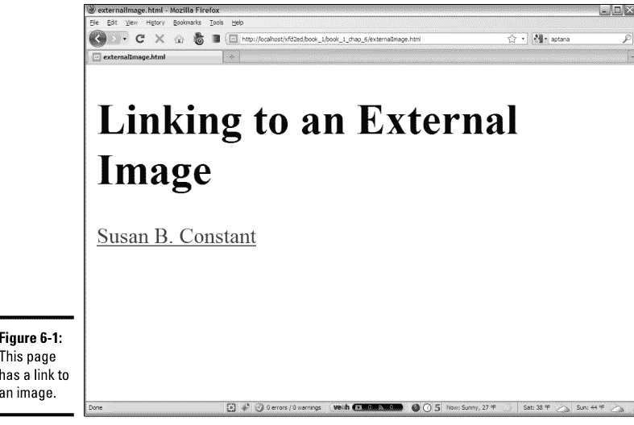

`href` 指向一个图片文件，而不是一个 HTML 页面。你可以在锚点标签中指向任何类型的文件。如果浏览器知道该文件类型（例如，HTML 和标准图片格式），浏览器就会显示该文件。如果浏览器不知道该文件格式，用户的计算机会尝试使用它通常用于打开该类型文件的任何程序来显示该文件。


如果你需要复习，请参阅本迷你书第 5 章中关于锚点标签的讨论。

这对大多数图片都有效，因为图片会直接在浏览器中显示。


你可以将这种锚点技巧用于任何类型的文件，但结果可能非常不可预测。如果你使用链接技巧指向一些奇怪的文件格式，无法保证用户有合适的软件来查看它。通常，请将此技巧用于非常常见的格式，如 GIF 和 JPG。（如果你对这些格式不熟悉，本章后面会进行介绍。）

大多数浏览器会自动调整图片大小以适应浏览器窗口。这意味着一张大图片可能看起来比实际要小，但用户仍然必须等待整个图片下载完成。

由于这是一个相对引用，指定的图片必须与 HTML 文件在同一个目录中。当用户点击链接时，页面会被图片替换，如图 6-2 所示。

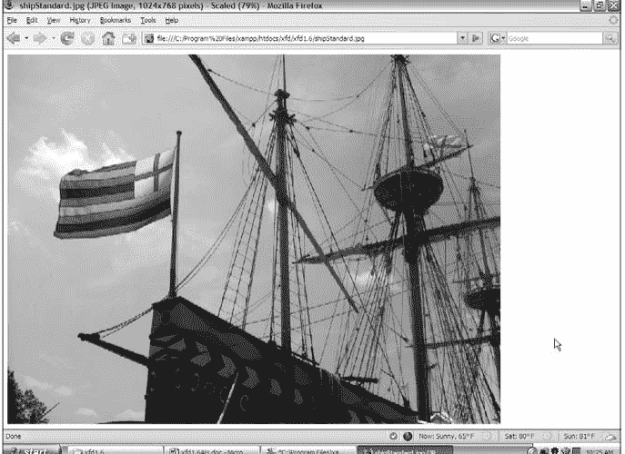

**图 6-2：** 图片出现在页面的位置。

外部链接易于创建，但它们有一些问题：

- **它们不预览图片。** 用户只有文本描述来推断图片可能是什么。
- **它们会中断流程。** 如果页面包含一系列图片，用户必须不断离开页面来查看图片。
- **用户必须后退才能返回主页面。** 图片看起来像一个网页，但它不是。图片中没有任何链接或其他解释性文本指示如何返回网页。大多数用户知道点击浏览器的“后退”按钮，但不要假设所有用户都知道该怎么做。

## 使用 `` 标签添加内联图片

提供图片链接的替代方法是将你的图片嵌入到页面中。图 6-3 展示了此技术的一个示例。

代码展示了此图片是如何包含到页面中的：

```html
<!DOCTYPE html PUBLIC "-//W3C//DTD XHTML 1.0 Strict//EN"
"http://www.w3.org/TR/xhtml1/DTD/xhtml1-strict.dtd">
<html lang="EN" dir="ltr" xmlns="http://www.w3.org/1999/xhtml">
  <head>
    <meta http-equiv="content-type" content="text/xml; charset=utf-8" />
    <title>embeddedImage.html</title>
  </head>

  <body>
    <h1>The Susan B. Constant</h1>
    <p>
      
    </p>

    <p>
      The <em>Susan B. Constant</em> was flagship of the
      fleet of three small ships that brought settlers to Jamestown, the first
      successful English Colony in the new world.  This is a replica housed
      near Jamestown, Virginia.
    </p>
  </body>
</html>
```

图片（`img`）标签是这个页面的主角。这个标签允许你获取一个图片文件并将其直接整合到页面中。图片标签是一个自闭合标签。它不以 `</img>` 结尾。相反，使用 `img` 定义末尾的 `/>` 字符来指示此标签没有内容。

> 你可能已经注意到，我在页面中将 *Susan B. Constant* 设置为斜体，并使用了 `<em>` 标签来实现此效果。`<em>` 代表强调，而 `<strong>` 代表强烈强调。默认情况下，`<em></em>` 标签对中的任何文本都是斜体，而 `<strong></strong>` 文本是粗体。当然，你可以用 CSS 更改此行为。


**图 6-3：** 船只图片被嵌入到页面中。

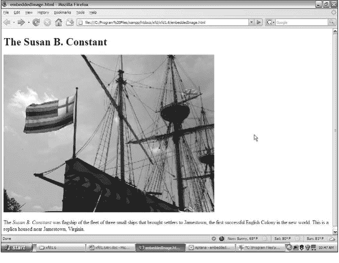

图片标签有许多重要属性，我将在以下各节中讨论。

## `src`（源）

`src` 属性允许你指定图片的 URL（统一资源定位符）。这可以是绝对引用或相对引用。通常最好链接到你自己目录结构中的图片，因为你无法确保外部图片在用户访问页面时仍然存在。（有关引用类型的更多信息，请参阅本迷你书第 5 章。）

## `height` 和 `width`

`height` 和 `width` 属性用于指示图片的大小。浏览器使用此信息来指示应在页面上保留多少空间。


使用 `height` 和 `width` 属性来更改网页上图片的大小很诱人，但这是一个坏主意。用你的图片编辑器更改图片大小（我将在本章后面向你展示如何操作）。如果你使用 `height` 和 `width` 属性，即使用户将看到较小的版本，她也必须等待完整图片下载。不要让用户等待她不会看到的信息。如果你使用这些属性将图片放大到其默认大小以上，生成的图片分辨率会很差。通过查看

## 98 选择图像处理工具

在图像工具中查看并使用这些值。如果省略 `height` 和 `width`，浏览器会自动确定尺寸，但无法保证在所有图像下载完成前显示文本。添加这些属性可让浏览器在等待图像时格式化页面。

## `alt`（替代文本）


`alt`属性允许您指定描述图像的替代文本。当用户禁用图像显示或使用屏幕阅读器时，会使用替代文本信息。Internet Explorer (IE) 会根据替代文本自动创建*工具提示*（浮动文本）。

实际上，您可以使用`title`属性为任何元素添加浮动工具提示。这在所有符合标准的浏览器中都有效，几乎适用于任何 HTML 元素。

如果您想验证 XHTML Strict，所有图像都需要`alt`属性。

此外，``标签是内联标签，因此需要嵌套在块级标签内，例如`<p>`或`<li>`。

## 选择图像处理工具

您不能随便从数码相机抓一张图片就期望它能在网页上使用。图片可能能用，但可能会给您的访问者带来问题。重要的是要理解，*数字图像*（您在计算机或类似设备上看到的任何图像）与您在纸上看到的图像类型是不同的。

## 一幅图像值340万字！

如今数码相机和扫描仪非常出色。即使是价格适中的相机，其分辨率也接近老式模拟相机。扫描仪也能将传统图像转换为计算机使用的数字格式。然而，在这两种情况下，默认图像格式都可能引起问题。数字图像以一系列点，*即像素*存储。在印刷品中，点非常密集，但计算机屏幕上的点更大。图 6-4 显示了直接从数码相机导出的船舶图像。

我的相机拍摄 6 兆像素 (MP) 的照片。这是一个相当不错的分辨率，在电子产品商店听起来很好。如果我将这张照片打印在纸上，所有这些点都非常小，我会得到一张不错的照片。如果我尝试在计算机屏幕上显示同一张图片，我只能看到一个角落。这张实际图片的尺寸是 2,816 像素宽 x 2,112 像素高。由于本书的屏幕截图分辨率为 1024 x 768 像素，您只能看到图像的一小部分。不到四分之一的图像可见。

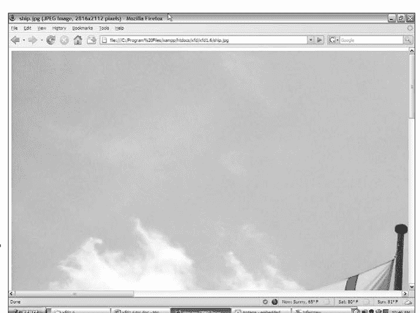

**图 6-4：**

哇。看起来不太妙。

当您在大多数浏览器中查看大图像时，它会自动调整大小以适应页面。光标通常会变成某种放大镜，如果您点击图像，可以以全尺寸或较小尺寸查看。

一些图像查看器会自动调整非常大的图像大小以适应屏幕。（这是 Windows 默认图像查看器和大多数浏览器的默认行为。）由于此功能，图像可能看起来大小适中，但在实际网页中它会非常大且难以下载。使用前请确保您了解图像的实际大小。

虽然缩小图像使其完全可见是显而易见的，但还有一个更令人信服的理由这样做。屏幕上的每个像素需要 3 字节的计算机内存。（*字节*是计算机内存的基本单位。）作为比较，一个文本字符大约需要 1 字节。未压缩的船舶图像大小高达 17 兆字节 (MB)。如果您认为一个单词长 5 个字符，那么一张直接从数码相机导出的图片所占用的存储空间和传输时间大约相当于 3,400,000 个单词。在 56K 调制解调器上下载此图像需要近三分钟！

在网页中，小图像通常显示为约 320 x 240 像素，较大的图像通常为 640 x 480 像素。如果我使用软件将图像重新采样为我实际需要的尺寸并使用适当的压缩算法，我可以得到如图 6-5 所示的图像。

www.it-ebooks.info

## 100 选择图像处理工具

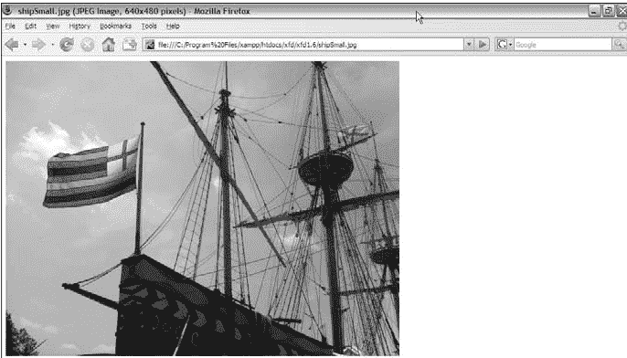

**图 6-5：**

调整后的图像更易于管理。

新版本的图像是我需要的大小和文件格式，看起来同样好，而且大小更合理，仅为 88 千字节。这仅占原始图像大小的 2%。

> 尽管这张图片比原始图像小得多，但它占用的内存仍然比文本多得多。即使是这张较小的图像，其传输时间和存储空间也相当于 1,600 个单词！在 56K 调制解调器上下载仍需 10 秒钟。请明智地使用图像。

图像很棒，但使用时请记住以下几点：

- **确保图像值得显示。** 不要没有正当理由就使用图片，因为每张图片都会显著降低您页面的访问速度。

- **使用软件调整图像大小。** 本章后面，我将向您展示如何使用免费软件将图像更改为所需的精确大小。

- **使用压缩格式。** 网页上几乎从不使用原始格式的图像，因为它们太大了。已有几种格式出现，可用于处理各种类型的图像。我将在本章后面的“选择图像格式”部分描述这些格式。

如果您好奇我是如何确定这些图像的下载速度的，这很简单。Web 开发人员工具栏（我在本迷你书的第 3 章中提到过）在“工具”菜单上有一个“查看速度报告”选项，可以为您完成这项工作。

## 介绍 IrfanView

IrfanView 由 Irfan Skiljan 开发，是一款免费软件，可以处理基本的图像处理需求以及更多功能。我用它制作了本书的所有屏幕截图，并将其用作我的主要图像查看器。本书附带的 CD-ROM 上包含一份副本，或者您可以从 www.irfanview.net 获取。当然，您可以使用任何您想要的软件，但如果某样东西真的很好而且免费，这是一个很好的起点。在本章的其余部分，我将向您展示如何使用 IrfanView 进行主要的图像处理工作，但您可以使用任何您想要的图像编辑器。

Web 开发人员需要一个图像处理程序来帮助完成所有这些任务。与其他 Web 开发工具一样，您可以为图像处理工具支付相当多的费用，但这不是必须的。您的图像工具至少应具备以下功能：

- **调整大小：** 网页需要比打印在纸上更小的图像。您需要一个工具，允许您将图像调整为特定尺寸以用于 Web 显示。

- **保存为不同格式：** 可用的图像格式多得令人眼花缭乱，但只有三种格式在网页上可靠工作（我将在下一节讨论）。您需要一个工具，能够将各种格式的图像可靠地转换为 Web 友好的格式。

- **裁剪：** 您可能只需要原始图片的一小部分。裁剪工具允许您从图像中提取矩形区域。

- **滤镜：** 您可能会发现有必要以某种方式修改图像。您可能希望减少红眼、使图像变亮或变暗，或者调整颜色。有时，图像可以通过锐化或模糊滤镜，或更具艺术性的滤镜（如画布或油画工具）来改善。

- **批处理：** 您可能有许多图像需要同时处理。批处理实用程序可以对大量图像执行一次操作，正如您将在本章后面看到的。

您可能还需要其他一些功能，例如创建合成图像、带透明度的图像以及更强大的效果。您可以使用商业工具或出色的开源程序 Gimp，它包含在本书的 CD-ROM 上。本章重点介绍 IrfanView，因为它更简单，但请研究 Gimp（或其兄弟 GimpShop，适用于习惯 Photoshop 的用户）以获得更完整甚至更强大的工具。我使用 IrfanView 进行基本处理，当我需要更强大的功能时则使用 Gimp。有关 Gimp 的更完整讨论，请参阅第 VIII 册，第 4 章。

## 选择图像格式

如果你想尝试其他优秀的免费软件，这里有一些不错的选择：

- **XnView：** 类似 IrfanView，允许您预览和修改数百种格式的图片，创建缩略图等。它可在 Mac 和 Linux 上使用。（IrfanView 仅支持 Windows。）

- **Pixia：** 来自日本的全功能图形编辑器。功能非常强大。

- **GimpShop：** Gimp 的一个修改版本，其菜单布局类似于 Photoshop。

- **Paint.net：** 一款强大的仅限 Windows 平台的绘图程序。

您可以使用 Google 或其他搜索引擎来找到这些程序。

几乎没有人会在网页上使用原始图像，因为它们太大且太笨重。通常，网页图像会被压缩以占用更少的空间。您在计算机世界中看到的所有图像文件类型（BMP、JPG、GIF 等）本质上都是使图像文件变小的不同方式。并非所有格式都适用于网页，而且它们具有不同的特性，因此多了解一些它们的知识是很有好处的。

## BMP

BMP 格式是微软的标准图像格式。尽管它有时会被压缩，但通常情况下不会。BMP 格式创建非常详细、几乎无压缩的图像，其文件通常太大，无法用于网页。许多网页浏览器可以处理 BMP 图像，但您不应该使用它们。相反，请将其转换为其他格式之一。

## JPG/JPG/JPEG

JPG 格式（也称为 JPEG）是由联合图像专家小组设计的一种相对较旧的格式。（明白了吗？JPEG！）它的工作原理是丢弃那些对人类感知不太重要的数据。每次以 JPG 格式保存图像时，您都会丢失一些信息。这听起来很糟糕，但事实并非如此。同一张图像原始格式为 13MB，当存储为 JPG 时被压缩到 1.5MB。大多数人通过肉眼无法分辨出压缩版和非压缩版图像之间的区别。

JPG 算法专注于图像中对感知重要的部分（例如亮度和对比度），并丢弃那些不太重要的数据。（实际上，大部分颜色数据被丢弃，但颜色通过精心设计的视觉错觉被重新创建。）

JPG 最适合处理具有大量颜色和细节的摄影风格图像。许多数码相机直接将图像保存为 JPG。


JPG 处理过程的一部分允许您确定压缩量。当您将图像另存为 JPG 时，您通常可以在准确度和压缩度之间的一个范围内确定质量。

JPG 压缩方案在文本方面会导致一些特定问题。JPG 不擅长保留高对比度的清晰区域（例如背景上的字母）。JPG 不是横幅图像或其他带有文本图像的最佳格式。请改用 GIF 或 PNG。

即使您选择 100% 的准确度，文件仍然会被大幅压缩。可调的压缩仅在流程的一小部分上起作用。过度压缩文件可能导致可见的方块阴影或伪影。尝试您的图像，看看它们能承受多少压缩而仍然看起来像原始图像。


当您制作图像的 JPG 版本时，请保留一份高质量的原始文件，因为每次复制都会丢失一些细节。如果您从一个来自另一个 JPG 的 JPG 制作一个 JPG，细节的损失会开始累积，图像会损失一些视觉质量。

## GIF

GIF 格式最初是为 CompuServe 开发的，远在网页发明之前。这种格式在当时是一个突破，至今仍具有一些出色的特性。

GIF 是一种*无损*算法，因此，将图像转换为 GIF 时不会丢失任何数据（与有损的 JPG 格式相比）。GIF 通过*调色板*技巧和*行程编码*技巧实现其魔力。

调色板的工作原理类似于按数字填色套装，图像上印有一系列数字，每种颜料颜色都有一个对应的数字。GIF 图像中的情况类似。GIF 图像有一个包含 256 种颜色的列表，这些颜色是从图像中自动选择的。每种颜色被赋予一个编号。原始（未压缩）图像的每个像素需要 3 字节的信息（分别用于确定红色、绿色和蓝色的量）。在 GIF 图像中，所有这些信息都存储在调色板中一次。图像本身包含大量对调色板的引用。

例如，如果蓝色在调色板中存储为颜色 1，一条蓝色的条带可能看起来像这样：

```
1, 1, 1, 1, 1, 1, 1, 1, 1
```

当 GIF 看到一串相同的颜色时，它会使用其另一个技巧——行程编码。GIF 格式可以指定十个 1 的列表，而不是将上述值存储为 1, 1, 1, 1, 1, 1, 1, 1, 1, 1。这就是行程编码的基本思想。本例中的船舶图像作为全尺寸 GIF 图像的大小为 2.92MB。

GIF 格式最适合颜色数量相对较少且具有大面积相同颜色的图像。您在绘图程序中绘制的大多数图形都可以很好地转换为 GIF 格式。照片并不理想，因为它们通常包含超过 256 种颜色，并且颜色的细微变化意味着几乎没有大块纯色可以利用行程编码。

GIF 确实有一些优点使其保持流行。首先，GIF 图像可以定义一种透明色。通常，您会选择一些自然界中不存在的难看颜色（有点像选择伴娘礼服）作为透明色。然后，当 GIF 遇到该颜色的像素时，它会显示其下方的任何内容。这是一种粗糙但有效的透明形式。图 6-6 显示了一张具有透明度的图像。

每当您在网页上看到一张看起来不是矩形的图像时，很有可能该图像是 GIF。图像仍然是一个矩形，但它具有透明度，使其看起来更自然。通常，您在保存 GIF 时设置为背景颜色的任何颜色都会成为透明色。

创建一个复杂的透明背景，比如雕像，需要比 IrfanView 更复杂的工具。我使用了 Gimp，但任何高端图形工具都可以完成这项工作。IrfanView 更适合处理整个图像的操作。

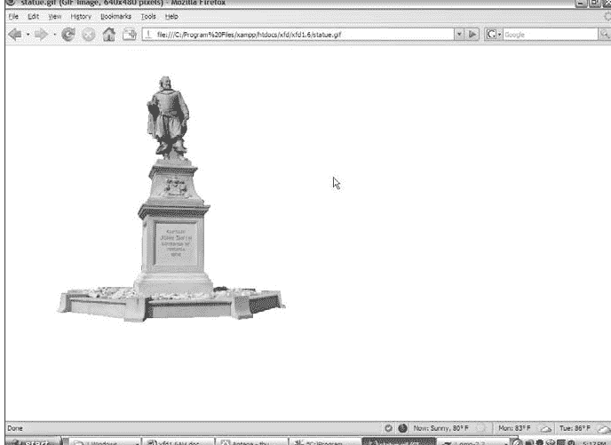

### 即将推出——矢量格式

这是另一种我希望获得更多关注的图像格式。到目前为止描述的所有格式都是*基于光栅的*图像格式。这种类型的图像将图像存储为一系列点。*基于矢量的*图像格式使用公式来存储绘制图像的指令。某些类型的图像（尤其是图表和基本线条图）以矢量格式存储时效率会高得多。不幸的是，IE 和 Firefox 支持不同且不兼容的矢量格式，因此基于矢量的图像似乎在短期内不会成为重要因素。Flash 也使用基于矢量的技术，但这种技术需要昂贵的专有软件来创建矢量图像，并且需要第三方插件才能使用它们。

最有前途的新技术是 HTML 5 中的`<canvas>`标签。该标签允许程序员使用 JavaScript 代码直接在屏幕的一部分上绘制。如果它成为标准，`<canvas>`标签将为基于网页的图形释放许多新的可能性。

GIF 的另一个有趣功能是创建动画。动画 GIF 是存储在同一个文件中的一系列图像。您可以嵌入信息来确定图像之间的间隔。您可以使用 Gimp 创建动画 GIF，该软件已包含在本书的 CD-ROM 中。

动画 GIF 在网页早期被过度使用，现在许多人认为它是业余者的标志。现在没有人真的认为那个动画邮箱可爱了。

有一段时间，GIF 方案的一部分存在一些法律障碍。该算法的所有者试图强制收取许可费。这转嫁给了使用商业软件的人，但对自由软件创作者来说却成了一个大问题。

幸运的是，法律问题似乎已经暂时解决。尽管如此，您会看到许多开源软件倡导者因为这个问题而完全避免使用 GIF 算法。

## PNG

开源软件倡导者创建了一种新的图像格式，它结合了 JPG 和 GIF 的一些最佳特性，且没有法律问题。由此产生的格式是*便携式网络图形*，即 *PNG*。这种格式有许多有趣的特性，例如：

- **无损压缩：** 与 GIF 类似，PNG 在不丢失任何信息的情况下存储数据。

- **动态调色板：** PNG 支持您想要的任意多种颜色。您不像使用 GIF 那样被限制在 256 种颜色。

## 106 操作你的图像

- **无软件专利**：PNG 的底层技术完全开源，无需担心未来有人试图强制执行版权。

- **真正的 alpha 透明度**：PNG 格式具有比 GIF 更复杂的透明度形式。每个像素都可以存储一个 alpha 值。*Alpha* 指的是透明度。Alpha 值可以从完全透明调整到完全不透明。

尽管 PNG 有诸多优势，你可能预计它会成为网络上最流行的图像格式。但令人意外的是，它的普及速度一直很慢。主要原因是 Internet Explorer（IE）对 PNG 的支持时好时坏。大多数版本的 IE 不能正确支持 PNG 的 alpha 透明度。

## 网络图像格式总结

所有这些格式可能看起来令人眼花缭乱，但选择图像格式其实很简单，因为每种格式都有其优点和缺点：

- **GIF** 在需要透明度或动画时是最佳选择。避免在照片上使用 GIF，因为你无法获得最佳压缩，并且会丢失颜色数据。

- **JPG** 对摄影图像最有用，这类图像最适合 JPG 压缩技术。但是，请记住 JPG 不适合需要透明度的图像。由于有损压缩技术，JPG 图像中的文本往往变得难以阅读。

- **PNG** 在大多数情况下都很有用，但要注意 IE（尤其是版本 6）不能正确处理 PNG 透明度。（你有时会在预期透明的地方看到奇怪的色块。）

- **BMP 和其他格式** 应完全避免使用。尽管在某些情况下你可以让其他格式生效，但在大多数时候，使用任何其他图像格式都没有充分的理由。

## 操作你的图像

所有这些关于压缩算法和调整图像大小的讨论可能很不错，但具体该怎么做呢？

幸运的是，IrfanView 可以免费完成你几乎所有的需求。IrfanView 具有出色的功能，可以处理你需要的所有主要图像操作类型。

## 在 IrfanView 中更改格式

使用 IrfanView 更改图像格式非常简单。例如，在你的计算机上找到一个图像文件，并按照以下步骤操作：

1. 通过将图像拖入 IrfanView 或使用“文件 > 打开”菜单命令，将图像加载到 IrfanView 中。

2. 在保存之前，对图像进行任何你想要的更改。

3. 使用“文件 > 另存为”命令保存文件。

4. 从“另存为”对话框中选择图像格式，如图 6-7 所示。

5. 使用新的文件名保存文件。

保留原始文件，并将所有更改保存到新文件中。这样，你就不会覆盖原始文件。如果你转换为 JPG，这一点尤其重要，因为每次保存 JPG 都会导致一些图像质量损失。

不要在文件名中使用空格。你的文件可能会转移到互联网上的其他计算机上，而某些计算机在处理空格时会遇到麻烦。对于任何将在互联网上使用的文件，最好避免使用空格和标点符号（下划线字符除外）。此外，要非常注意大小写。很可能你的图像最终会出现在 Linux 服务器上，而大小写在那里非常重要。

## 调整图像大小

所有其他的图像处理技巧可能是可选的，但你应该*真正*调整你的图像大小。尽管高速调制解调器可能不会因为巨大的图像而出现问题，但没有什么比臃肿的图像尺寸更快地让拨号上网用户无法访问网页了。

要使用 IrfanView 调整图像大小，请执行以下步骤：

1. **将图像加载到 IrfanView 中。**

   你可以通过将图像拖到 IrfanView 图标上、拖入已打开的 IrfanView 实例中，或使用 IrfanView 内部的菜单来完成此操作。

2. **从“图像”菜单中选择“调整大小/重采样”。**

   你也可以使用 Ctrl+R 完成此步骤。图 6-8 显示了结果对话框。

3. **确定新的图像大小。**

   有多种标准图像尺寸可供选择。在大多数浏览器中，800 x 600 像素将创建一个大图像。如果你希望图像更小，你需要在文本框中输入一个尺寸。嵌入网页中的图像通常宽度为 320 像素，高度为 240 像素。这是一个很好的起点。任何更小的尺寸都难以看清，而任何更大的尺寸都可能占用太多屏幕空间。

4. **使用提供的复选框保持纵横比。**

   这确保了高度和宽度之间的比例得以保持。否则，图像可能会失真。

5. **将生成的图像保存为新文件。**


当你将图像变小时，你会丢失数据。这对于放在网上的版本来说完全没问题，但你应该保留原始的大图像，以防你想再次调整大小。

### 重采样，而非调整大小

重采样是一种较慢但更精确的图像尺寸更改技术。这是 IrfanView 的默认行为，因此无需更改。在现代计算机上，它仍然相当快。默认的（Lanczos）滤镜效果很好，如果你想尝试，也可以使用其他滤镜以获得更快的转换速度。

## 增强图像颜色

有时，你可以通过修改颜色来改进图像。“图像”菜单上的“增强颜色”对话框为你提供了多种选择，如图 6-9 所示。

**图 6-9：** 你可以在“增强颜色”对话框中更改多个选项。

你可以使用此工具对图像进行数量惊人的有用操作：

- **亮度：** 当调整到较高值时，图像更接近白色。当调整到负值时，图像更接近黑色。当你希望使图像变亮或变暗以用作背景图像时，这很有用。

  如果你的图像太暗或太亮，你可能会想使用“亮度”功能来修复它。本节后面描述的“伽马校正”功能在此任务中更有用。

- **对比度：** 你通常将“对比度”功能与“亮度”功能结合使用来调整图像。有时，小幅度的对比度调整可以改善图像。

- **色彩平衡：** 有时，图像的色彩平衡较差（例如，室内照明有时会产生偏蓝色调）。你可以使用一系列滑块调整红、绿和蓝的量。管理色彩平衡最简单的方法是查看图像中应该是白色的部分，并调整滑块，直到它看起来是真正的白色。

- **伽马校正：** 这用于纠正太暗或太亮的图像。与亮度调整不同，伽马校正会自动调整对比度。对此滑块进行微调有时可以修复稍暗或稍亮的图像。

- **饱和度：** 当饱和度处于最小值时，图像变为黑白。在最大值时，颜色得到增强。使用此控件可以创建灰度图像或增强颜色以获得艺术效果。

## 使用内置效果

IrfanView 还有一些其他可用的效果，有时非常有用。这些效果可以在“图像”菜单上单独找到，也可以在“图像”菜单上的“图像效果浏览器”中找到。图像效果浏览器（如图 6-10 所示）通常是更好的选择，因为它让你对大多数效果有更多控制，并提供效果将产生什么的交互式反馈。有时，效果被称为滤镜，因为它们将原始图像通过一个数学函数，该函数就像一个滤波器或处理器来创建修改后的输出。

以下是一些效果的概述，包括你会在何时使用它们：

- **无：** 仅用于比较目的，图 6-11 显示了未启用任何滤镜的船舶图像。

## 操纵你的图像


我为了说明目的夸大了效果，但在印刷页面上可能仍然难以看到这些滤镜的全部效果。本书中的灰度图像无法很好地代表实际的彩色图像。请以本章中的图像作为起点，但要真正理解这些滤镜，你需要在 IrfanView 或类似工具中用自己的图像进行实验。我也将所有这些图像添加到了我的网站，你可以在那里查看它们（`www.aharrisbooks.net/xfd2ed`）。

- **模糊：** 此滤镜降低了相邻像素之间的对比度。（真的，我们可以讲讲数学原理，但咱们改天再说，好吗？）你可能会想，为什么有人会故意让图像变模糊。有时，模糊滤镜可以修复图像中的颗粒感。你还可以将模糊滤镜与锐化滤镜（我稍后会讲到）结合使用，以修复图像中的小瑕疵。我将模糊滤镜应用到了图 6-12 中的标准船只图像上。

- **锐化：** 与模糊相反，锐化滤镜增强了相邻像素之间的对比度。谨慎使用时，它有时可以改善图像效果。锐化滤镜与模糊滤镜结合使用，对于去除小瑕疵最为有效。图 6-13 展示了应用锐化滤镜后的船只图像。


**图 6-12：** 模糊滤镜降低了对比度。


**图 6-13：** 锐化滤镜增加了对比度。

113


如果你相信电视剧里的破案情节，你可能会认为拿一张模糊的图像，不断应用锐化滤镜，就能读出监控摄像头拍到的模糊图像上的车牌号码。然而，现实通常并非如此。你无法从垃圾信息中变出细节，但有时，你可以做一些小的改进。

- **浮雕：** 此滤镜创建一个灰度图像，看起来像浮雕金属，如图 6-14 所示。有时，浮雕可以将图像转换成有用的背景图像，因为浮雕图像对比度低。你可以使用“增强颜色”对话框，将灰色的浮雕图像更改为更吸引人的颜色。

- **油画效果：** 此滤镜为图像添加一种类似油画的纹理，如图 6-15 所示。它有时可以清理图像并赋予其更艺术的外观。设置值越高，画作越抽象。

- **3D 按钮：** 此功能可用于创建类似图 6-16 的图像，使其看起来像页面上的按钮。这在你弄清楚如何使用 CSS 或 JavaScript 为虚拟按钮切换图像时会很有用。你可以在滤镜中设置图像的表观高度。通常，你会将此滤镜应用于较小的图像，打算将其制成用户可以点击的按钮。


114


**图 6-15：** 油画效果使图像略微更抽象。


**图 6-16：** 图像看起来像按钮一样从页面上凸出。

- **红眼消除：** 你使用此滤镜来解决闪光摄影中的一个常见问题。有时，人的眼睛会呈现出微红的色调。与其他滤镜不同，此滤镜更容易从“图像”菜单中访问。使用鼠标选择图像中的红色部分，然后应用滤镜将红色区域变为黑色。最好不要在整张图像上执行此滤镜，因为你可能会无意中将其他红色物体也变成黑色。

### 你可以使用的其他效果

还有更多的效果和滤镜可用。IrfanView 内置了更多你可以尝试的效果。你还可以下载大量 Adobe Photoshop 8BF 格式的效果。这些效果滤镜通常可以在 IrfanView 和其他图像处理程序中使用。

一些效果允许你分解图像、添加闪光、将图像映射到 3D 形状上、创建复古的棕褐色效果等等。

如果你想进行更深入的图像处理，可以考虑使用功能齐全的图像编辑器。Adobe Photoshop 是行业标准，但 Gimp 是一个开源替代品（包含在本书的 CD-ROM 中），其功能几乎同样强大。关于使用 Gimp 进行图像处理的更多信息，请参阅第八部分，第四章。

### 批处理

通常，你需要同时修改大量图像。IrfanView 有一个出色的`批处理`工具，允许你一次处理多张图像。我经常使用此工具，将我要在页面上使用的所有图像转换为特定的大小和格式。这个过程可能看起来有点复杂，但习惯之后，你就可以快速轻松地修改大量图像。

如果你想同时转换大量图像，请按照以下步骤操作：

1. **识别原始图像并将它们放在一个目录中。**

   我发现最简单的方法是将所有图像收集到一个目录中，无论它们是来自数码相机、扫描仪还是其他设备。

2. **通过选择“文件：批处理转换 — 重命名”打开批处理转换对话框。**

   此时会出现批处理转换对话框，如图 6-17 所示。

3. **在批处理转换对话框的目录窗口中浏览，找到你的原始图像。**

116

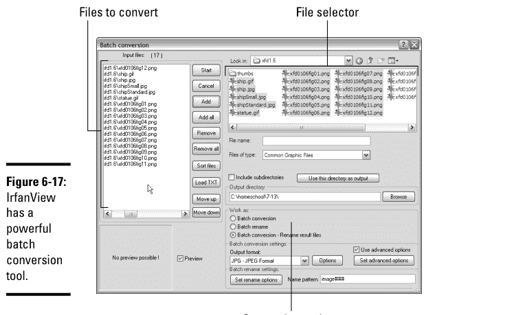

4. **通过点击“添加”按钮，将你的图像复制到“输入文件”工作区。**

   选择你想要修改的图像，然后点击“添加”按钮。所选图像的名称将被复制到“输入文件”工作区。

5. **指定输出目录。**

   如果你想将新图像放在与输入文件相同的目录中，请点击“使用此目录作为输出”按钮。如果不想，请选择你希望新图像去往的目录。

6. **在“操作方式”框中，选择“批处理转换 — 重命名结果文件”。**

   你可以使用此设置重命名文件、执行其他转换，或两者兼做。通常，我建议两者都选。

7. **将输出格式设置为你想要的格式。**

   对于照片，你可能需要 JPG 格式。

8. **如果你想为图像指定其他命名规则，请在“批量重命名设置”区域更改重命名设置。**

   默认情况下，每个图像名为`image###`，其中`###`是一个三位数。它们根据“输入文件”工作区中的列表进行编号。你可以使用“上移”和“下移”按钮来更改图像在此列表中的出现顺序。

9. **点击“设置高级选项”按钮以更改图像大小。**

   这将显示“所有图像的设置”对话框，如图 6-18 所示。

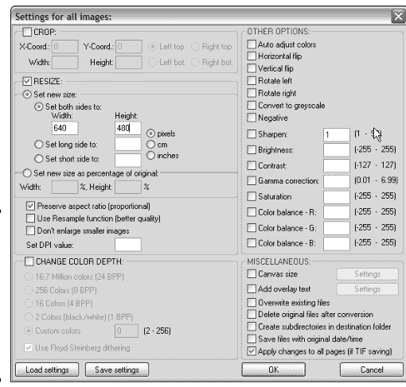

**图 6-18：** 使用“所有图像的设置”对话框在批处理模式下调整图像大小。

10. **在“调整大小”区域指定图像的新尺寸。**

    已预设了几种常用尺寸。如果你需要其他尺寸，请使用提供的选项。我将我的尺寸设置为`320 x 240`。

11. **关闭“所有图像的设置”对话框，然后在“批处理转换”对话框中，点击“开始”按钮。**

    几秒钟后，新图像就创建好了。

### 将图像用作链接

有时，你会想将图像用作链接。例如，查看`thumbs.html`，如图 6-19 所示。

此页面使用了缩略图。*缩略图*是完整尺寸图像的小版本。缩略图被嵌入其中，用户点击它可以在浏览器中查看完整尺寸的版本。

缩略图很好，因为它们允许用户预览每张图像的小版本，而无需等待完整版本在屏幕上渲染完成。如果用户想查看完整的图像，他可以点击缩略图在单独的页面上查看。

## 第 7 章：创建表单

**本章内容**

- 为你的页面添加表单
- 创建输入框和密码框
- 构建多行文本输入
- 制作列表框和复选框
- 构建单选按钮组
- 创建按钮

XHTML 使你能够描述网页，但今天的网络不是单向的。用户希望通过网页进行交流，通过输入信息、从下拉列表中进行选择以及进行交互，而不仅仅是阅读。在本章中，你将学习如何在页面中构建这些交互元素。

### 你有很棒的表单

XHTML 还有另一个你需要理解的方面——制作表单的能力。*表单*是允许用户交互的页面部分。图 7-1 显示了一个包含所有主要表单元素的页面。

表单演示（或者如果你在家同步操作的话，就是本书光盘上的`formDemo.html`）展示了 XHTML 中主要的表单元素。在本章中，你将发现如何构建所有这些元素。

> **提示** 你可以使用普通的 XHTML 创建表单，但要让它们*起作用*，你需要一种编程语言。第 IV 部分解释了如何使用 JavaScript 与你的表单交互，第 V 部分描述了 PHP 语言。使用本章来弄清楚如何构建表单，然后跳到另一本迷你书去弄清楚如何让它们发挥作用。如果你还没有准备好进行完整的编程，可以随时先跳过本章，继续学习第 II 和 III 部分的 CSS。当你准备好使用 JavaScript 或 PHP 的表单时，再回到这里。

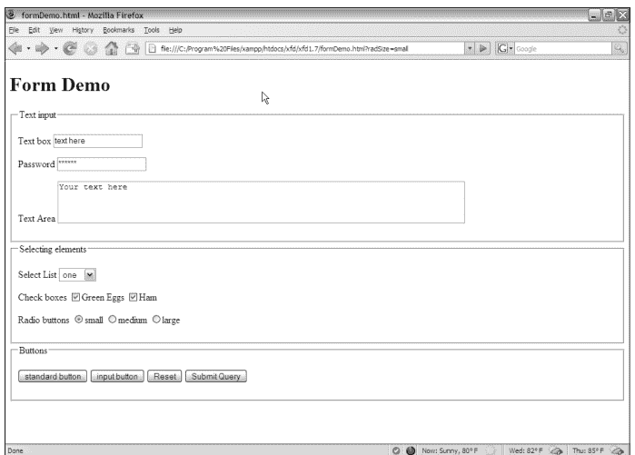

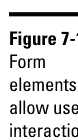

`formDemo.html`页面显示了以下元素：

- **表单：** 表单元素的容器。尽管`form`元素本身通常不是页面的可见部分（就像`body`标签一样），但通过适当的 CSS 它可以变得可见。

- **文本框：** 这些标准表单元素允许用户在一行元素中输入文本。

- **密码框：** 这些框类似于文本框，只是它们会自动隐藏文本以防止偷窥。

- **文本区域：** 这些多行文本框比其他类型的文本框能容纳更多文本。你可以指定用户可以输入的文本区域的大小。

- **选择列表：** 这些列表框为用户提供多个选项。用户可以从列表中选择一个元素。你可以指定显示的行数，或在激活时使列表下拉。

- **复选框：** 这些非文本框可以被选中或不被选中。复选框*独立*工作——可以一次选择多个（与单选按钮不同）。

- **单选按钮：** 通常在一组选项中找到，一组中一次只能选择一个单选按钮。选择一个单选按钮会取消选择其组中的其他按钮。

- **按钮：** 这些元素让用户开始某种过程。`Input`按钮用于 JavaScript 编码（我在第 IV 部分描述），而`Standard`和`Submit`按钮用于服务器端编程（参见第 V 部分）。`Reset`按钮很特殊，因为它会自动将所有表单元素重置为其默认配置。

- **标签：** 许多表单元素都有一个小的文本标签与之关联。虽然标签不是必需的，但它们可以使表单更容易用 CSS 设置样式，并且对用户来说也更容易。

- **字段集和图例：** 这些用于分隔表单的部分。它们是可选的，但可以为表单增添很多视觉吸引力。


既然你已经了解了表单元素的概述，现在是时候开始构建一些表单了！

### 表单必须有某种形式

所有表单元素都必须嵌入在`<form></form>`标签对中。`basicForm.html`的代码展示了最简单的表单：

```html
<!DOCTYPE html PUBLIC "-//W3C//DTD XHTML 1.0 Strict//EN"
"http://www.w3.org/TR/xhtml1/DTD/xhtml1-strict.dtd">
<html lang="EN" dir="ltr" xmlns="http://www.w3.org/1999/xhtml">
  <head>
    <meta http-equiv="content-type" content="text/xml; charset=utf-8" />
    <title>basicForm.html</title>
  </head>

  <body>
    <h1>A basic form</h1>
    <form action = "">
      <h2>Form elements go here</h2>
      <h3>Other HTML is fine, too.</h3>
    </form>

  </body>
</html>
```

`<form></form>`标签对表示页面中可能包含表单元素的部分。所有其他表单小部件和花式物件（按钮、`select`对象等）都必须位于`<form>`标签对内。

`action`属性指示表单提交时应该发生什么。这需要一种编程语言，因此`action`属性的完整描述在第 IV 部分。尽管如此，你必须指定一个操作才能进行验证，所以现在只需将`action`属性留空，用一对引号（`""`）表示。

### 使用字段集和标签组织表单

表单可以包含许多组件，但最重要的是*输入元素*（文本框、按钮、下拉列表等）和描述元素的*文本标签*。传统上，Web 开发人员使用表格来构建表单，但这并非最佳方案，因为表单信息并非表格数据。

## 你的表单结构很棒

XHTML 包含一些优秀特性，可帮助你描述表单的各个部分。图 7-2 展示了一个包含字段集、布局和基本输入元素的页面。

*字段集是一种特殊元素，用于对一组表单元素进行可视化的分组。*

我承认，这个表单看起来仍然不够美观，但这并非重点。和所有 XHTML 标签一样，表单元素并非用于描述表单的外观，而是用于说明各主要元素的含义。（我又开始说教了。）你可以使用 CSS 来让表单呈现你想要的样式。XHTML 标签描述表单的各个部分，这样你就有了可以挂载 CSS 样式的目标。我保证，这一切很快就会变得清晰易懂。

以下是字段集演示的代码（对应本书配套光盘中的`fieldsetDemo.html`文件）：

```html
<!DOCTYPE html PUBLIC "-//W3C//DTD XHTML 1.0 Strict//EN"
"http://www.w3.org/TR/xhtml1/DTD/xhtml1-strict.dtd">
<html lang="EN" dir="ltr" xmlns="http://www.w3.org/1999/xhtml">
  <head>
    <meta http-equiv="content-type" content="text/xml; charset=utf-8" />
    <title>fieldsetDemo.html</title>
  </head>

  <body>
    <h1>带有字段集的示例表单</h1>
    <form action = "">
      <fieldset>
        <legend>个人资料</legend>
        <p>
          <label>姓名</label>
          <input type = "text" />
        </p>

        <p>
          <label>地址</label>
          <input type = "text" />
        </p>

        <p>
          <label>电话</label>
          <input type = "text" />
        </p>

      </fieldset>
    </form>
  </body>
</html>
```

图 7-2：此表单包含图例和标签。

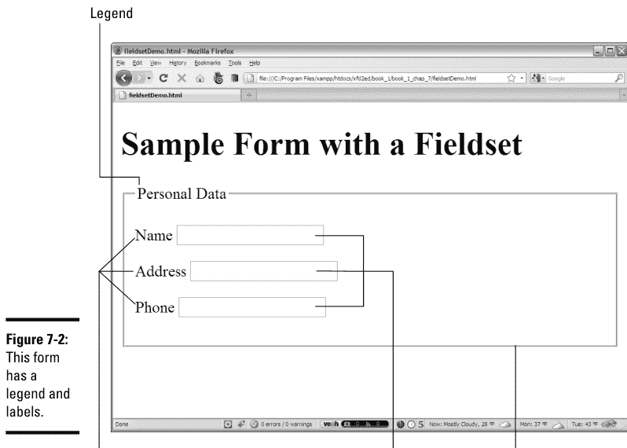

此表单包含以下元素：

- ◆ **`<form>`和`</form>`标签：** 它们将表单定义为页面的一部分。别忘了那个空的`action`属性。

- ◆ **`<fieldset>`标签对：** 这对标签将包含的元素描述为一组字段。这个元素并非必需，但当你后续使用 CSS 时，它确实能提供一些不错的组织结构和布局选项。你可以将字段集想象成一块空白画布，用于为你的表单添加视觉设计。默认情况下，字段集会在所有包含的元素周围添加一个边框。

- ◆ **`<legend>`标签：** 作为字段集的一部分，此标签允许你为整个字段集指定一个图例。图例对用户是可见的。

- ◆ **段落标签：** 有时我会将每个标签及其对应的输入元素放在一个段落中。这提供了一些良好的格式化能力，并使每对元素保持在一起。

- ◆ **`<label>`标签：** 此标签允许你将特定的文本块指定为标签。默认情况下不进行任何格式化，但你可以稍后使用 CSS 添加格式。

- ◆ **`<input>`元素：** 用户在这些元素中输入数据。目前，我只是使用非常基本的文本输入，以便表单有某种输入方式。在下一节中，我将解释如何构建更完整的文本输入。

## 构建文本样式输入

大多数表单元素都是同一标签的变体。`<input>`标签可以创建单行文本框、密码框、按钮，甚至不可见的内容（如隐藏字段）。这些对象大多共享相同的基本属性，尽管外观可能不同。

### 创建标准文本字段

图 7-3 展示了`input`元素最常见的形式——*纯文本字段*。

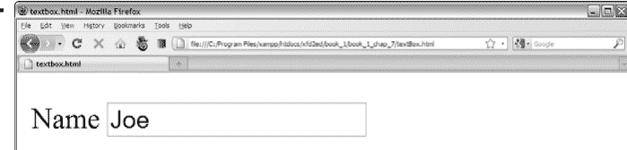

要创建一个基本的文本输入，你需要一个表单和一个`input`元素。添加一个标签让用户知道应该在文本框中输入什么也是常见的做法。代码如下：

```html
<!DOCTYPE html PUBLIC "-//W3C//DTD XHTML 1.0 Strict//EN"
"http://www.w3.org/TR/xhtml1/DTD/xhtml1-strict.dtd">
<html lang="EN" dir="ltr" xmlns="http://www.w3.org/1999/xhtml">
  <head>
    <meta http-equiv="content-type" content="text/xml; charset=utf-8" />
    <title>textbox.html</title>
  </head>

  <body>
    <form action = "">
      <p>
        <label>姓名</label>
        <input type = "text"
               id = "txtName"
               value = "Joe"/>
      </p>
    </form>

  </body>
</html>
```

`input`元素有三个常用属性：

- **`type`**：`type`属性指示这是哪种类型的`input`元素。第一个示例将`type`设置为`text`，创建一个标准文本框。本章中的其他类型会创建密码框、隐藏字段、复选框和按钮。

- **`id`**：`id`属性为字段创建一个标识符。当你使用编程语言从该元素提取数据时，使用`id`来指定你指的是哪个字段。`id`字段通常以一个提示短语开头，以指示它是什么类型的对象（例如，`txt`表示文本框）。

- **`value`**：此属性决定文本框的默认值。如果你省略此属性，文本字段初始为空。

文本字段还可以有其他不那么常用的属性，例如：

- **`size`**：此属性决定显示的字符数。

- **`maxlength`**：使用此属性设置允许的最大字符数。

没有`</input>`标签。`input`标签是早期许多标签没有结束标签时代的遗留产物。你只需在原始标签后加上斜杠字符（`/`）结束即可，如前面的示例代码所示。

你可能想知道，既然`<label>`标签对表单的外观或行为没有任何影响，为什么我还要添加它。在这个特定示例中，`<label>`标签确实没有效果，但就像 HTML 中的其他所有东西一样，你可以用 CSS 为其添加令人惊叹的样式效果。即使标签通常没有默认样式，它们仍然很有用。

### 创建密码字段

密码字段就像文本框一样，只是文本不会被显示出来。取而代之的是显示一串星号。图 7-4 展示了一个基本的密码字段。

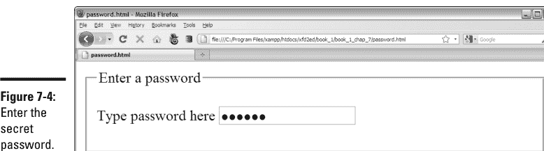

## 构建文本样式输入

以下代码揭示了密码字段与普通文本字段几乎完全相同：

```html
<!DOCTYPE html PUBLIC "-//W3C//DTD XHTML 1.0 Strict//EN"
"http://www.w3.org/TR/xhtml1/DTD/xhtml1-strict.dtd">
<html lang="EN" dir="ltr" xmlns="http://www.w3.org/1999/xhtml">
	<head>
		<meta http-equiv="content-type" content="text/xml; charset=utf-8" />
		<title>password.html</title>
	</head>

	<body>
		<form action = "">
			<fieldset>
				<legend>输入密码</legend>
				<p>
					<label>在此输入密码</label>
					<input type = "password"
					       id = "pwd"
					       value = "secret" />
				</p>
			</fieldset>
		</form>
	</body>
</html>
```

在这个例子中，我创建了一个 ID 为`pwd`的密码字段。此字段的默认值是`secret`。实际上，`secret`这个词不会出现在字段中；它将被替换为六个星号字符。


密码字段几乎不提供任何有意义的安全保护。它可以防止克格勃（KGB）从用户肩膀上瞥见密码，但仅此而已。XHTML 和编程语言的开放标准意味着密码通常是在开放环境中传输的。存在解决方案——例如 SSL（安全套接字层）技术——但目前，只需知道密码字段并不适合用来保护你秘制酱汁的配方。

这个例子实际上并没有对密码做任何处理，但你会使用其他技术来实现这一点。

### 创建多行文本输入

单行文本字段是一个强大的功能，但有时你希望有更大的输入空间。如图 7-5 所示的`essay.html`程序演示了如何为论述题创建一个页面。

## 构建文本样式输入

### 129

Book I

Chapter 7

创建表单

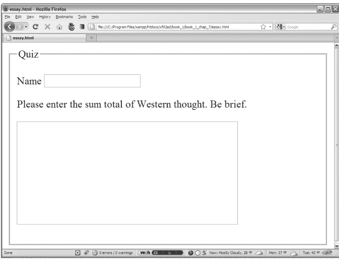

图 7-5：

这个测验可能需要多行回答。

这个程序的明星是一个新标签——`<textarea>`：

```html
<!DOCTYPE html PUBLIC "-//W3C//DTD XHTML 1.0 Strict//EN"
"http://www.w3.org/TR/xhtml1/DTD/xhtml1-strict.dtd">
<html lang="EN" dir="ltr" xmlns="http://www.w3.org/1999/xhtml">
  <head>
    <meta http-equiv="content-type" content="text/xml; charset=utf-8" />
    <title>essay.html</title>
  </head>

  <body>
    <form action = "">
      <fieldset>
        <legend>测验</legend>

        <p>
          <label>姓名</label>
          <input type = "text"
                 id = "txtName" />
        </p>

        <p>
          <label>
            请输入西方思想的总和。请简要回答。
          </label>
        </p>

        <p>
          <textarea id = "txtAnswer" rows="10" cols="60">
          </textarea>
        </p>

      </fieldset>
    </form>
  </body>
</html>
```

www.it-ebooks.info

## 创建多个选择元素

```html
rows = "10"
cols = "40"></textarea>
</p>
</fieldset>
</form>
</body>
</html>
```

使用`<textarea>`标签时，请注意以下几点：

- ◆ 它需要一个`id`属性，就像`input`元素一样。

- ◆ 你可以使用`rows`和`cols`属性来指定尺寸。

- ◆ **内容放在标签之间。** 文本区可以包含比普通`<input>`标签多得多的信息，因此数据并非放在`value`属性中，而是将文本内容放在`<textarea>`和`</textarea>`标签之间。

> 代码中放在`<textarea>`和`</textarea>`之间的任何内容都会出现在输出中。这包括空格和回车符。如果你不希望文本区域中有任何空白，请将结束标签紧挨着起始标签放置，正如我在文章示例中所做的那样。

## 创建多个选择元素

有时，你想向用户提供一系列选项，然后让用户从中选择一个。XHTML 提供了几种有趣的实现方式。

### 进行选择

下拉列表是网页开发者喜爱的选择工具，原因如下：

- ◆ **它节省屏幕空间。** 当前选择项是唯一显示的内容。当用户点击列表时，一系列选项会下拉显示，选择完成后再次消失。

- ◆ **它限制了输入。** 用户只能选择你放入列表中的选项。这使得处理潜在输入变得容易得多，因为你不必担心输入错误。

- ◆ **其值可以与用户所见不同。** 这似乎是个奇怪的优点，但它有时确实非常有用。我将在本章后面描述颜色值时展示一个例子。

图 7-6 展示了一个简单的下拉列表的实际效果。

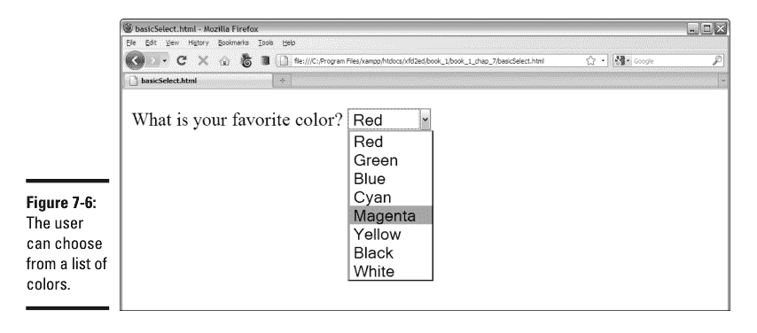

以下是这个简单下拉列表的代码：

```html
<!DOCTYPE html PUBLIC "-//W3C//DTD XHTML 1.0 Strict//EN"
"http://www.w3.org/TR/xhtml1/DTD/xhtml1-strict.dtd">
<html lang="EN" dir="ltr" xmlns="http://www.w3.org/1999/xhtml">
  <head>
    <meta http-equiv="content-type" content="text/xml; charset=utf-8" />
    <title>basicSelect.html</title>
  </head>

  <body>
    <form action = "">
      <p>
        <label>What is your favorite color?</label>
        <select id = "selColor">
          <option value = "#ff0000">Red</option>
          <option value = "#00ff00">Green</option>
          <option value = "#0000ff">Blue</option>
          <option value = "#00ffff">Cyan</option>
          <option value = "#ff00ff">Magenta</option>
          <option value = "#ffff00">Yellow</option>
          <option value = "#000000">Black</option>
          <option value = "#ffffff">White</option>
        </select>
      </p>
    </form>
  </body>
</html>
```

## 创建多个选择元素

### 那些奇怪的`#ff00ff`是什么？


如果你仔细查看`basic-Select.html`的代码，会发现值都是带有井号和奇怪字符的奇怪文本。这些是十六进制代码，它们是计算机描述颜色的好方法。我在第 II 卷第 1 章中解释了它们的工作原理。这种编码机制远不像看起来那么难理解。不过就目前而言，这种同时包含颜色名称和十六进制值的代码，很好地展示了想要向用户显示一件事（英文颜色名称）而向程序发送另一个值（十六进制代码）的情况。你会在第 IV 卷第 5 章再次看到这段代码，届时我将使用类似的列表框通过 JavaScript 来改变表单的背景色。

`select`对象与你习惯的一些其他输入元素有些不同，例如：

- 它被`<select></select>`标签对包围。这些标签表示整个列表。
- `select`对象有一个`id`属性。尽管`select`对象内部包含许多其他标签，但通常只有`select`对象本身具有`id`属性。
- 它包含一系列`<option></option>`标签对。每个单独的选项都存放在一个`<option></option>`组中。
- 每个`<option>`标签都有一个与之关联的值。该值供代码使用，不一定是用户看到的内容。（有关示例，请参见旁注“那些奇怪的 #ff00ff 是什么？”）
- `<option></option>`之间的内容对用户可见。这些内容是用户实际看到的。

> **提示**：选择框并不一定需要下拉行为。如果你愿意，可以使用`size`属性指定要显示的行数。在这种情况下，你指定的行数将始终在屏幕上可见。

### 构建复选框

当你希望用户打开或关闭某个特定选项时，可以使用复选框。例如，看看图 7-7。

每个复选框代表一个真或假的值，可以选择或不选择，并且每个复选框的状态与其他复选框完全独立。用户可以选择不选任何选项，也可以全选，或选择任意组合。


图 7-7：一次可以选择任意数量的复选框。

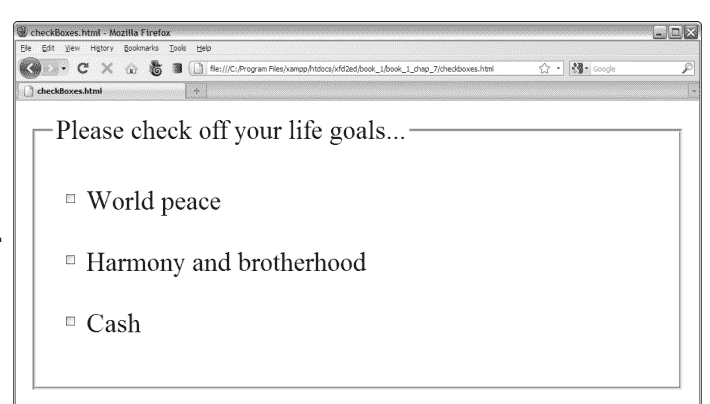

这段代码显示复选框使用了你熟悉的老朋友——`<input>`标签：

```html
<!DOCTYPE html PUBLIC "-//W3C//DTD XHTML 1.0 Strict//EN"
"http://www.w3.org/TR/xhtml1/DTD/xhtml1-strict.dtd">
<html lang="EN" dir="ltr" xmlns="http://www.w3.org/1999/xhtml">
  <head>
    <meta http-equiv="content-type" content="text/xml; charset=utf-8" />
    <title>checkBoxes.html</title>
  </head>

  <body>
    <form action = "">
      <fieldset>
        <legend>Please check off your life goals...</legend>
        <p>
          <input type = "checkbox"
                 id = "chkPeace"
                 value = "peace" />World peace
        </p>

        <p>
          <input type = "checkbox"
                 id = "chkHarmony"
                 value = "harmony" />Harmony and brotherhood
        </p>

        <p>
          <input type = "checkbox"
                 id = "chkCash"
                 value = "cash" />Cash
        </p>

      </fieldset>
    </form>
  </body>
</html>
```

## 创建多个选择元素

> ### 这一切似乎不一致

有时，表单元素的值对用户可见，有时则隐藏。有时，用户看到的文本在标签内部，有时不在。这有点令人困惑。标准是随着时间演变而来的，它们本来可以更一致一些。

尽管如此，这就是你可用的元素集，它们其实并不难理解。多写几次表单，你就能记住了。你总是可以先看看我的代码，并将其作为起点借鉴。

你使用的是与`<input>`标签相同的属性，但它们的工作方式与普通文本框略有不同：

- 类型是`checkbox`。浏览器通过这种方式知道要创建一个复选框，而不是文本字段。
- 复选框仍然需要一个 ID。如果你要编写程序代码来操作这个元素（最终你一定会的），你需要一个 ID 作为引用。
- 该值对用户隐藏。用户看不到实际的值。那是给程序员看的（就像`select`对象一样）。复选框后面的任何文本只是看起来像是与之关联的文本。

### 创建单选按钮

当你想让用户从一组选项中只选择一个时，可以使用单选按钮。图 7-8 展示了一个单选按钮组的实际示例。

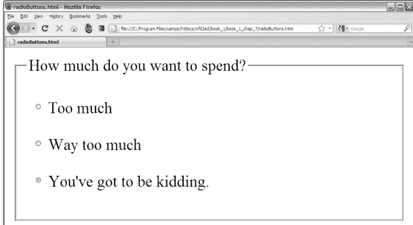

## 创建多个选择元素

### 135

单选按钮可能看起来与复选框相似，但它们有一些重要区别：

- 一次只能选中一个。“单选按钮”这个词来自老式汽车收音机。当你按下某个电台的按钮时，所有其他按钮都会弹开。我仍有一个那样的收音机。（我想我有一辆 Web 设计的车。）
- 它们必须成组。单选按钮只有在组上下文中才有意义。单选按钮的意义在于与它的组进行交互。
- 它们都有相同的`name`！每个单选按钮都有自己的 ID（像其他输入元素一样），但它们还有一个`name`属性。`name`属性表示单选按钮所在的组。
- 一个页面上可以有多个组。只需为每个组使用不同的`name`属性即可。
- 必须选择其中一个。该组应始终有一个且仅一个值。某些浏览器默认情况下会选中组中的第一个元素，但以防万一，你应该选中你希望被选中的元素。为你希望在页面出现时被选中的元素添加`checked = "checked"`属性（由冗余部门开发）。在这个例子中，我预先选择了最贵的选项，完全是为了良好的资本主义建议性销售。

以下是一些解释这一切的代码：

```html
<!DOCTYPE html PUBLIC "-//W3C//DTD XHTML 1.0 Strict//EN"
"http://www.w3.org/TR/xhtml1/DTD/xhtml1-strict.dtd">
<html lang="EN" dir="ltr" xmlns="http://www.w3.org/1999/xhtml">
    <head>
        <meta http-equiv="content-type" content="text/xml; charset=utf-8" />
        <title>radioButtons.html</title>
    </head>

    <body>
        <form action = "">
            <fieldset>
                <legend>How much do you want to spend?</legend>
                <p>
                    <input type = "radio"
                        name = "radPrice"
                        id = "rad100"
                        value = "100" />Too much
                </p>

                <p>
                    <input type = "radio"
                        name = "radPrice"
                        id = "rad200"
                        value = "200" />Way too much
                </p>

                <p>
                    <input type = "radio"
                        name = "radPrice"
                        id = "rad300"
                        value = "300" />Ridiculous
```

## 136 按下你的按钮

```html
name = "radPrice"
id = "rad5000"
value = "5000"
checked = "checked" />You've got to be kidding.
</p>
</fieldset>
</form>
</body>
</html>
```

# 按下你的按钮

XHTML 还提供了多种类型的按钮。你使用这些家伙来使某些事情真正发生。通常，用户通过在文本框中输入内容，然后从列表、选项或复选框中进行选择来设置某种输入。然后，用户点击一个按钮来触发响应。图 7-9 展示了四种类型的按钮。

这个按钮示例的代码如下所示：

```html
<!DOCTYPE html PUBLIC "-//W3C//DTD XHTML 1.0 Strict//EN"
"http://www.w3.org/TR/xhtml1/DTD/xhtml1-strict.dtd">
<html lang="EN" dir="ltr" xmlns="http://www.w3.org/1999/xhtml">
  <head>
    <meta http-equiv="content-type" content="text/xml; charset=utf-8" />
    <title>buttons.html</title>
  </head>

  <body>
    <h1>Button Demo</h1>
    <form action = "">
      <fieldset>
        <legend>
          input-style buttons
        </legend>

        <input type = "button"
               value = "input type = button" />

        <input type = "submit" />
        <input type = "reset" />
      </fieldset>

      <fieldset>
        <legend>button tag buttons</legend>

        <button type = "button">
          button tag
        </button>
        <button>
          
        </button>
      </fieldset>
    </form>
  </body>
</html>
```

# 按钮演示

输入样式的按钮

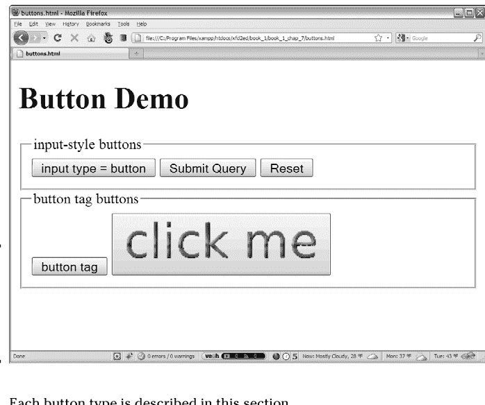

图 7-9：XHTML 支持多种类型的按钮。

本节将介绍每种按钮类型。

## 创建输入样式的按钮

最常见的按钮形式是你老朋友`<input>`标签的另一种形式。如果你将`input`的`type`属性设置为`"button"`，你就能生成一个基本按钮：

```html
<input type = "button"
       value = "input type = button" />
```

普通的输入按钮有几个关键特性：

- `input`类型设置为`"button"`。这会创建一个普通按钮。
- `value`属性设置按钮的标题。更改`value`属性可以设置新的标题。这个按钮的标题显示了它是如何创建的：`input type = "button"`。
- 这种类型的按钮不意味着链接。尽管按钮在点击时会呈现被按下的外观，但它不会执行任何操作。你必须编写一些 JavaScript 代码才能使其工作。
- 稍后，你将为按钮添加事件处理。在第四册中学习了 JavaScript 后，你将使用一个特殊属性将按钮连接到代码。
- 这种类型的按钮用于客户端编程。这种代码驻留在用户的计算机上。我在第四册中讨论了使用 JavaScript 进行客户端编程。

## 构建提交按钮

提交按钮通常用于服务器端编程。在这种编程形式中，代码位于 Web 服务器上。在第五册中，你将使用 PHP 创建服务器端代码。`<input>`标签也被用来制作提交按钮！

```html
<input type = "submit" />
```

尽管它们看起来一样，但提交按钮与普通按钮在几个细微方面有所不同：

- `value`属性是可选的。如果你省略它，按钮将显示 Submit Query（提交查询）。当然，你可以将`value`更改为任何你想要的内容，这将成为提交按钮的标题。
- 点击它会导致一个链接。这种类型的按钮是为服务器端编程设计的。当你点击按钮时，表单中的所有信息都会被收集并发送到 Web 上的其他页面。
- 目前，它不会去任何地方。当你将表单的`action`属性设置为`null ("")`时，你告诉提交按钮只是重新加载当前页面。当你弄清楚真正的服务器端编程时，你将把表单的`action`属性更改为一个处理数据的程序。
- 提交按钮不适用于客户端。虽然你可以将事件附加到提交按钮（就像普通的输入按钮一样），但链接行为常常会导致问题。对于客户端使用普通输入按钮，对于服务器端使用提交按钮。

## 这是一次重来：重置按钮

多功能`<input>`标签的另一种形式创建了重置按钮：

```html
<input type = "reset" />
```

这个按钮有一个非常特定的目的。当被点击时，它会将其所有表单元素重置为默认值。与提交按钮一样，它有一个默认值（`"reset"`），并且不需要任何代码。

## 介绍`<button>`标签

按钮在 Web 上一直是有用的部分，但有点乏味。HTML 4.0 引入了`<button>`标签，其工作方式如下：

```html
<button type = "button">
    button tag
</button>
```

`<button>`标签更像一个标准的 XHTML 标签，但它也可以像提交按钮一样工作。以下是主要特点：

- `type`属性决定了样式。你可以将按钮设置为普通（通过将其类型设置为`button`）、提交或重置。如果你不指定类型，按钮将使用提交样式。按钮的类型指示其行为，就像输入样式的按钮一样。
- 标题放在`<button></button>`标签对之间。没有`value`属性。相反，只需将预期的标题放在`<button>`标签对内。
- 你可以整合其他元素。与输入按钮不同，你可以在按钮内放置图像或带样式的文本。这为你提供了其他一些能力。`buttons.html`示例中的第二个按钮使用了一个小的 GIF 图像来创建一个更丰富多彩的按钮。

# 140 第一册：创建 HTML/XHTML 基础

# 第 8 章：HTML 的未来：HTML 5

## 本章内容

- 预览 HTML 5
- 使用新的语义标记标签
- 嵌入字体
- 使用新的`canvas`标签进行自定义图形绘制
- 音频和视频支持
- 高级特性

Web 世界总是在变化。HTML 的新版本——HTML 5——即将到来，它有一些非常有趣的特性。在本章中，我将预览 HTML 5 中的新特性，并向你展示一些示例。当 HTML 成为标准时，你将领先一步。

## 我们就不能坚持用 XHTML 吗？

XHTML 很棒。当你将 CSS 与其结合时，你可以用 XHTML 做很多事情。然而，它并不完美。Web 正在进化，我们现在经常使用网页做一些以前闻所未闻的事情：

- **复杂的结构：** 基于 Web 的文档经常包含导航元素、页脚元素、页面部分和独立的文章。开发人员经常使用`<div>`标签的许多变体来管理这些元素。HTML 5 内置了这些功能。
- **多媒体：** 网页现在通常包含音频和视频，但这些元素并不像图像支持那样内置于 HTML 中。相反，开发人员不得不依赖外部软件，如 Flash。
- **矢量/实时图形：** 当前浏览器的图形功能很好，但不允许实时修改。程序员经常使用第三方软件，如 Flash 或 Silverlight，来引入这种功能。
- **增强的编程：** 开发人员不再满足于将网页视为文档。今天的网页是整个应用程序的基础。开发人员（和他们的客户）想要高级功能，例如拖放、本地数据存储和地理定位（一个花哨的术语，指浏览器能够确定使用该页面的设备在世界上的位置）。

# 142 语义元素

## 使用 HTML 5 doctype

XHTML 的 doctype 非常丑陋。老实说，我记不住它，而我是写这方面书籍的。我最喜欢 HTML 5 的一点可能是其合理的 doctype：

```html
<!DOCTYPE html>
```


就这样。没有混乱的 XMLNS 事务，没有疯狂的 URL，没有 http-equiv 废话。只有 `<!DOCTYPE html>`。这取代了 `<doctype>` 和 `<HTML>` 标签。从极客的角度来看，它是美丽的。


你可能仍然想在你的头部添加这一行：

```html
<meta http-equiv="Content-Type" content="text/html;charset=utf-8" >
```

它将字符集指定为标准文本编码。通常，服务器会发送这个，所以它并不是真正必要的，但包含这一行可以消除可能的验证器警告，即未定义字体。

# 浏览器对 HTML 5 的支持

在你对 HTML 5 兴奋之前，你必须意识到它仍然是实验性的。本章中的所有示例都在 Firefox 3.5 中测试过，它支持许多 HTML 5 特性。Chrome、Safari 和 Opera 的最新版本都支持 HTML 5 的关键特性，但 Microsoft Internet Explorer（至少到第 8 版）并未包含 HTML 5 的大多数特性。

# 验证 HTML 5

由于 HTML 5 的最终规范仍在审查中，验证 HTML 5 代码并非精确科学。W3C 验证器对 HTML 5 有临时支持，但 HTML 5 验证功能尚未内置于 Tidy 或其他验证工具中。

尽管如此，尽可能多地验证你的 HTML 5 代码还是有意义的，因为验证可以防止将来出现问题。

# 语义元素

HTML 的关键特性之一是支持新的语义特性。HTML 应该用于描述元素的含义，但网页经常包含没有 HTML 标签的元素。看下面的 HTML 5 代码示例：

## 语义化元素

第一卷

第八章

HTML的未来：HTML5

```html
<!DOCTYPE html>
<head>
    <title>semanticTags.html</title>
</head>
<body>
    <h1>语义标签演示</h1>
    <nav>
        <h2>导航</h2>
        <ul>
            <li>一</li>
            <li>二</li>
            <li>三</li>
            <li>四</li>
            <li>五</li>
        </ul>
    </nav>

    <section>
        <h2>区域</h2>

        <article>
            <h3>文章 1</h3>
            <p>这是一篇文章。它只是页面的一个逻辑部分。</p>
        </article>

        <article>
            <h3>文章 1</h3>
            <p>这是一篇文章。它只是页面的一个逻辑部分。</p>
        </article>
    </section>
</body>
</html>
```

这段代码完全符合 HTML 5 验证，但它包含了一些在 XHTML 或早期 HTML 版本中不允许使用的标签：

- `<nav>`：网页拥有导航部分非常常见。这些通常是菜单或其他链接列表。你可以在页面上有多个导航元素。`<nav></nav>` 标签表明该块包含某种导航元素。

- `<section>`：这是页面区域的通用标签。如果你愿意，可以有多个区域。区域由 `<section></section>` 对表示。

- `<article>`：`<article>` 标签用于表示一篇文章，例如一篇博客文章。在我的示例中，我在区域内部放了两篇文章。

这些标签没有任何特定的格式。标签只表示页面的大致布局。你需要使用 CSS 来使这些区域呈现你想要的外观。（出于这个原因，我没有展示屏幕截图；你不会看到任何特别的东西。）

语义标签并非绝对必要。它们的添加是因为许多网页开发者已经在使用通用的 `<div>` 标签做类似的事情。使用这些语义标签将使你的代码更清晰，并减少一些过度使用 div 的趋势，这种趋势即使在现代 XHTML 设计中也往往会导致混乱。

## 使用新的表单元素

即使是最早的 HTML 形式也支持用户表单——用于从用户那里检索信息的工具。自 HTML 的原始版本以来，基本的表单元素变化很小。HTML 5 最终添加了一些表单元素，使某些类型的数据输入更容易管理。尽管浏览器接受这些特性的速度较慢，但它们承诺提供大大改善的用户体验，同时网络成为应用程序开发的主要形式。图 8-1 展示了许多新的 HTML 5 元素。

与任何 HTML 标签一样，标签本身表示某种特定类型的数据，而不是任何特定的外观或行为。同样，这些专门的输入元素将使用户的数据输入更容易。

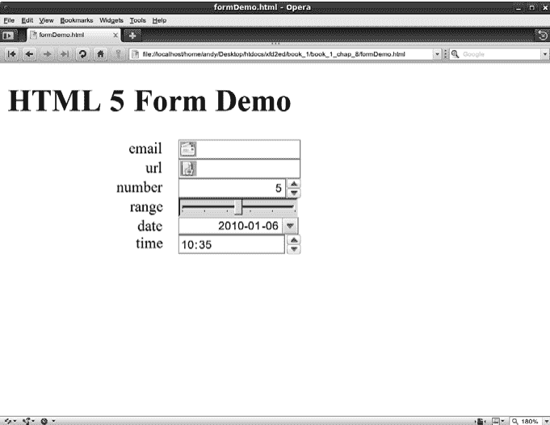

图 8-1：HTML 5 支持几种新的输入元素变体。


以下代码的屏幕截图显示在 Opera 10.10 中。在撰写本文时，Opera 是唯一支持这些表单元素的主要浏览器。当你查看代码时，你会看到对输入元素的扩展非常合理。

```html
<!DOCTYPE html>
<head>
    <title>formDemo.html</title>
    <link rel = "stylesheet"
          type = "text/css"
          href = "formDemo.css" />
</head>

<body>
    <h1>HTML 5 表单演示</h1>
    <form action = "">
        <label for = "email">电子邮件</label>
        <input type = "email"
               id = "email"/>

        <label for = "url">网址</label>
        <input type = "url"
               id = "url" />

        <label for = "number">数字</label>
        <input type = "number"
               id = "number"
               min = "0"
               max = "10"
               step = "2"
               value = "5" />

        <label for = "range">范围</label>
        <input type = "range"
               id = "range"
               min = "0"
               max = "10"
               step = "2"
               value = "5" />

        <label for = "date">日期</label>
        <input type = "date">

        <label for = "time">时间</label>
        <input type = "time">

    </form>

</body>
</html>
```

这些元素没什么令人惊讶的，但新功能很有趣：

- **电子邮件：** 一个 `email` 输入元素经过优化，用于接受电子邮件地址。某些浏览器可能会为此类型整合格式检查。移动浏览器在用户输入电子邮件字段数据时，可能会弹出专门的键盘（例如，使 @ 符号更突出）。

- **网址**：类似于 `email` 输入元素，一个 `url` 输入元素创建一个用于输入链接的字段。通常，`url` 输入元素没有任何特定的格式，但它在移动设备上可能有专门的弹出键盘。

- **数字**：一个 `number` 输入元素指定一个数字字段。如果你将一个字段指定为 `number` 输入元素，你可以指定最大值（`max`）和最小值（`min`），以及一个指示数据变化量的 `step` 值。某些浏览器会检查数据是否在给定范围内，有些会添加一个可视组件，允许用户使用小箭头按钮选择数字。

- **范围**：一个 `range` 输入元素类似于 `number` 输入元素，但支持它的浏览器通常使用小滚动条来简化用户输入。

- **日期**：从用户那里准确获取日期尤其困难。通过使用 `date` 输入元素，当用户开始输入日期时，日期字段可以显示一个交互式日历。图 8-2 说明了该字段的实际使用情况。

- **时间**：通过使用 `time` 输入元素，时间字段可以显示一个小对话框，简化从用户获取时间信息的过程。

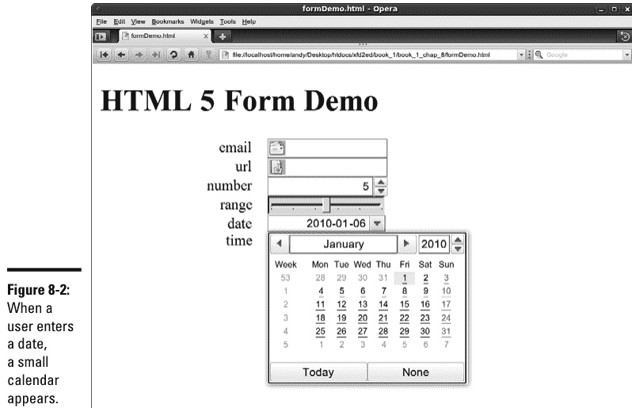

这些效果不能保证。不同的浏览器会有不同的反应。目前，Opera 是唯一支持这些特性的浏览器。然而，由于这些效果都是输入元素的变体，你可以在早期版本的 HTML 和 XHTML 中使用这些标签而不会受到惩罚。任何不理解这些更复杂表单元素的浏览器，只会用普通的文本输入字段替换它们。

## 使用嵌入字体

从技术上讲，它不是 HTML 5 的一部分，但新浏览器有另一个很棒的特性：可嵌入字体。到目前为止，在网页中使用任意字体没有可靠的方法。你可以建议任何你想要的字体，但该字体只有在用户计算机上已经安装了它才能使用。

当前的一批浏览器最终支持了一种嵌入字体技术，允许你将字体文件发布在服务器上，并在页面中使用该字体（类似于背景图像机制）。这意味着你终于可以在网络上更好地控制你的排版。图 8-3 展示了一个带有嵌入字体的页面。

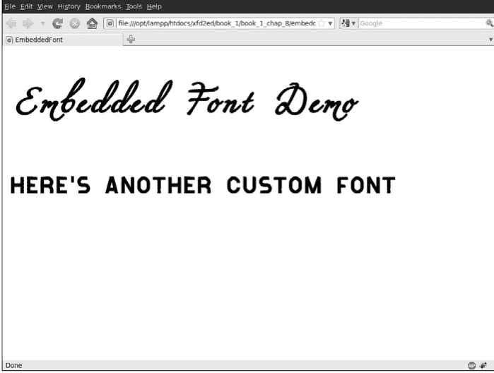

图 8-3：字体直接嵌入到页面中。

包含字体的代码并不难。看看 `embeddedFont.html` 的代码，看看它是如何完成的：

```html
<!DOCTYPE html>
<head>
    <title>嵌入字体</title>
    <style type = "text/css">
        @font-face {
            font-family: "Miama";
            src: url("Miama.otf");
        }

        @font-face {
            font-family: "spray";
            src: url("ideoma_SPRAY.otf");
        }

        h1 {
            font-family: Miama;
            font-size: 300%;
        }

        h2 {
            font-family: spray;
        }
    </style>
</head>

<body>
    <h1>嵌入字体演示</h1>
    <h2>这是另一个自定义字体</h2>
</body>

</html>
```

以下是具体步骤。

1. **确定你的字体：** 找到你想使用的字体文件。大多数商业字体都许可用于单机使用，因此请坚持使用开放字体格式，例如你可以在 `http://openfontlibrary.org` 上找到的格式。

2. **选择字体格式：** 不幸的是，标准的这一部分仍然是非标准的。大多数支持嵌入字体的浏览器使用 TTF（最常见的字体格式）或 OTF（TTF 的一种更开放的变体）。一个新的标准，WOFF，即将出现，可能更容易被字体开发者接受，但它尚未广泛使用。Internet Explorer 仅使用专有的 EOT 格式。查找用于将字体转换为 Internet Explorer 可用的 WEFT 实用程序。

3. **将字体文件放置在代码附近：** 你的网页需要在服务器上的某个地方放一份字体文件；将其放在与页面相同的目录中。请记住，当将页面移动到服务器时，你还需要在服务器上制作字体文件的副本。

4. **构建字体面：** 在 CSS 顶部附近，使用你的自定义字体指定一个新的字体面。这与你以前可能使用过的 CSS 语法略有不同。@ 符号表示你正在准备一个新的 CSS 元素。

## 指定 font-family

这是在 CSS 其余部分中用于指定字体的名称。通常，它与字体名称相似，但更易于输入。

## 指明字体文件的位置

`src` 属性指明了文件的位置。通常，这是与页面在同一目录下的字体文件名。如果你想有多个版本的文件，可以包含多个 `src` 属性。（例如，你可能包含 EOT 和 OTF 格式，这样字体很可能在任何浏览器上都能工作。）

## 在 CSS 中使用你的新字体

现在你可以在 CSS 中使用 `font-family` 名称，就像使用任何其他字体一样。如果用户没有安装该字体，该字体会用于此网页，但不会安装在客户端的机器上。一些字体（比如我示例中的 Miama）可能需要进行一些尺寸调整才能正确显示。

仅仅因为你可以使用任何字体文件，并不意味着你应该这样做。许多字体是商业产品，未经许可不得分发。然而，有许多优秀的免费和开源字体可用。请参阅 `http://openfontlibrary.org` 上的开源字体库，以找到一些优秀的字体。

## Audio 和 Video 标签

多媒体自始就是 Web 技术的承诺，但并未完全集成到 HTML 中。开发者不得不依赖第三方技术，如插件和 `embed` 标签，将音频和视频整合到网页中。HTML 5 终于支持了音频（使用 `<audio>` 标签）和视频（使用 `<video>` 标签）。音频和视频组件首次可以在 Web 浏览器中原生播放，无需任何外部技术。

这是一个重大突破，或者说，如果浏览器开发者们能够合作，这将会是。例如，看看这段代码：

```html
<!DOCTYPE html>
<head>
	<title>audioDemo.html</title>
</head>

<body>
	<h1>HTML 5 Audio Demo</h1>
	<audio src = "Do You Know Him.ogg" controls>
		This example uses the HTML 5 audio tag.
		Try using Firefox 3.5 or greater.
	</audio>

	<p>
		This song was written by a friend of mine, Daniel Rassum. He sings about
		hard life and redemption.
	</p>
	If you like this song, I encourage you to check out his album at
	<a href = "http://www.noisetrade.com">www.noisetrade.com</a>.
	It's a "free trade" music site where you pay
	what you think is fair for an artist's work.
</p>
</body>
</html>
```

唯一的新增功能是 `<audio>` 标签。这对标签允许你将音频文件直接放入网页中。你可以设置音频自动播放，或者你可以指定播放器控件。播放器控件是首选方法，因为让用户选择页面加载时是否播放音频被认为是礼貌的。如果浏览器不支持 `<audio>` 标签，则会显示 `<audio>` 和 `</audio>` 标签之间的任何文本。

图 8-4 展示了 `audioDemo.html` 播放一首歌曲。

HTML 5 规范（目前）没有为音频标签指定任何特定的文件格式。主要的浏览器支持开源的 Ogg Vorbis 格式和未压缩的 `.wav` 文件。浏览器制造商们难以就标准应该是什么达成一致。一些拥有专有格式利益的组织对于支持一种目前只有极客们知道的无拘无束的格式并不热衷。

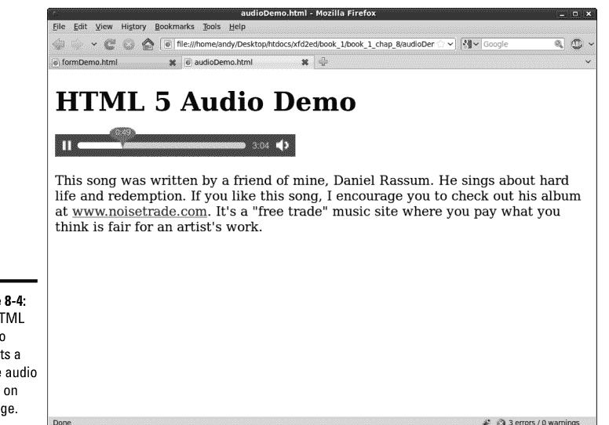

**图 8-4：** HTML 5 音频标签在页面上放置了一个简单的音频播放器。

## Audio 和 Video 标签

如果你记得旧式的 HTML，你可能想知道 `<audio>` 标签是否是对旧的 `<embed>` 标签的改进。`<embed>` 标签功能强大但非常难以使用。如果你使用 `<embed>` 标签将音频文件嵌入网页，客户端机器会查找该特定文件格式的默认播放器，并尝试将该播放器嵌入页面（这可能成功也可能失败）。开发者无法控制具体使用哪个插件，这使得管理或控制该元素的行为非常困难。`<audio>` 标签内置在浏览器中，由浏览器而不是某个外部程序来管理音频。这给开发者提供了更多的控制权。

`<video>` 标签的工作方式与音频标签非常相似，但为 Web 浏览器提供了对视频的原生支持。以下代码显示了在 Firefox 3.5 中播放的一个示例视频：


```html
<!DOCTYPE html>
<head>
    <title>videoDemo</title>
</head>
<body>
    <h1>Video Demo</h1>
    <video src = "bigBuck.ogv" controls>
        Your browser does not support embedded video
        through HTML 5. Try Firefox 3.5 or greater.
    </video>
    <p>
        This video is a trailer for the incredible short move
        "Big Buck Bunny." This experiment proves that talented
        volunteers can produce a high-quality professional video
        using only open-source tools.
        Go to <a href = "http://www.bigbuckbunny.org">
        http://www.bigbuckbunny.org</a> to see the entire video.
    </p>
</body>
</html>
```

与音频一样，W3 标准没有指定任何特定的视频格式，因此各种浏览器制造商可以自由地对此要求做出不同的解释。目前大多数浏览器支持开源的 Ogg Theora 格式。（是的，它与 Ogg Vorbis 有关。）

视频更为复杂，因为文件格式不一定意味着特定的编码机制。我使用 Ogg Vorbis 封装器对这段视频进行了编码，视频部分使用 AVI 编解码器，音频部分使用 MP3。这种方法在目前我能访问的两个 HTML 5 浏览器中似乎都有效。

图 8-5 是一个展示使用免费工具制作的有趣视频的页面示例。

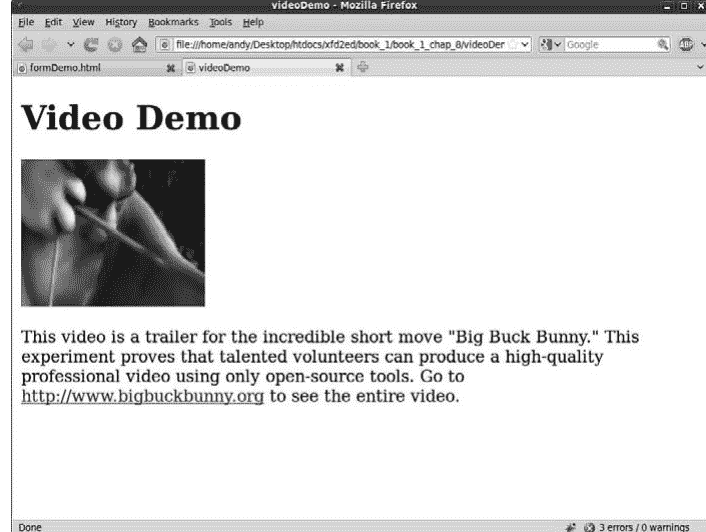

图 8-5：`video` 标签让你可以轻松地将视频嵌入 HTML 5 页面。

我在示例中展示的实际电影是优秀短片 `Big Buck Bunny` 的预告片。这部令人难以置信的动画片展示了使用完全开源的工具可以实现什么，其水平可与商业工作室的作品相媲美。感谢 Blender 基金会以知识共享许可证发布了这部幽默而令人印象深刻的影片。

## Canvas 标签

HTML 5 至少还提供了一个重要的新功能。`<canvas>` 标签允许开发者使用编程命令直接在表单的一部分上绘制内容。尽管这项技术需要一些 JavaScript 技能，但它开启了大量新的可能性。图 8-6 展示了一个说明 `<canvas>` 标签的简单页面。

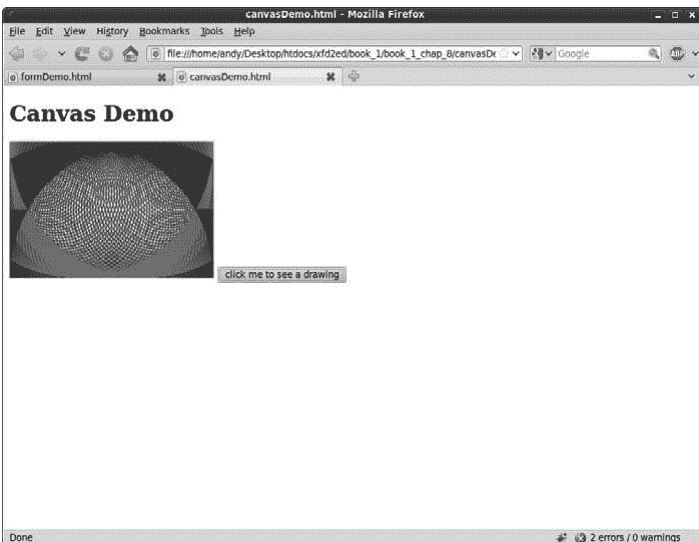

图 8-6：`canvas` 标签允许程序员创建动态图形。

`canvasDemo.html` 的代码依赖于 JavaScript，因此有关如何编写此代码以及更多信息的详细内容，请查看第四册。作为概述，以下是代码：

```html
<!DOCTYPE html>
<head>
    <title>canvasDemo.html</title>
    <script type = "text/javascript">
        //<! [CDATA[

        function draw(){
            var myCanvas = document.getElementById("myCanvas");
            var context = myCanvas.getContext("2d");
            context.fillStyle = "blue";
            context.strokeStyle = "red";
            circle(context, 1, 1, 1);

            for (i = 1; i <= 200; i+= 2){
                circle(context, i, i, i, "blue");
                circle(context, 300-i, 200-i, i, "red");
                circle(context, 300-i, i, i, "blue");
                circle(context, i, 200-i, i, "red");
            } // end for

        } // end draw

        function circle(context, x, y, radius, color){
            context.strokeStyle = color;
            context.beginPath();
            context.arc(x, y, radius, 0, Math.PI * 2, true);
            context.stroke();
        } // end circle
        //]]>
    </script>
</head>

<body>
    <h1>Canvas Demo</h1>

    <canvas id = "myCanvas"
            width = "300"
            height = "200">
        This example requires HTML 5 canvas support
    </canvas>

    <button type = "button"
            onclick = "draw()">
        click me to see a drawing
    </button>

</body>
</html>
```

这个程序里发生了相当多的事情。图像并非像大多数网页图像那样来自服务器；它是由一个小型 JavaScript 程序按需绘制的。

- 创建带有 `<canvas>` 标签的 HTML 页面：当然，你的文档中需要 `<canvas>` 标签；该元素指定了页面上显示图形的部分。`canvas` 元素的图像不是从外部文件拉取的，而是通过 JavaScript 代码创建的。
- 从 `canvas` 中提取绘图上下文：使用 `<canvas>` 标签只能进行 2D 图形处理，但预计未来会有 3D `canvas`。
- 使用特殊的绘图命令修改上下文：`canvas` 机制支持许多特殊的 JavaScript 命令，允许你在表面上直接绘制和操作形状。本示例绘制了许多不同颜色的圆形，以创建有趣的图案。

尽管 `<canvas>` 标签可能看起来不那么有趣，但它是 HTML 5 最重要的特性之一，因为它改变了程序员思考 Web 开发的方式。因为客户端程序绘制图像，所以图像可以实时修改并与用户交互。以下是一些例子：

- 动态图表：描述数据的网页可以拥有在底层数据更改时自动更改的图表。
- 自定义组件：程序员可以创建全新的控件来替换普通的按钮和列表框。这可能导致基于 Web 的用户界面变得像现在桌面端一样丰富。

`www.it-ebooks.info`

### 游戏与动画

迄今为止，在线游戏一直依赖第三方应用程序（例如 Flash 或 Java）。而 `<canvas>` 标签承诺直接在浏览器中提供完整的图形功能。富有创意的程序员已经利用 `<canvas>` 标签开发出了一些非常有趣的游戏。

### 一个完整的操作系统

高性能的 Web 浏览器配合极快的 JavaScript 引擎，完全有可能利用 `<canvas>` 标签作为图形界面，重现大部分完整的操作系统功能。许多有趣的设备已经在使用基于 Web 的工具作为其图形用户界面（GUI）的基础。新的浏览器与 Google 的新操作系统拥有完全相同的名字（Chrome），这或许并非巧合。

`<canvas>` 标签可能会对 Web 开发产生深远的影响，但它尚未被广泛使用。一家主要的浏览器厂商（猜猜是哪家）已决定不实现 `<canvas>` 标签。（好吧，我告诉您。是 Internet Explorer。）Canvas 对 Web 如此重要，以至于 Google 开发了一个 canvas 插件，以便基于 canvas 的应用程序能在 IE 中运行。

## 其他有前景的特性

HTML 5 提供了一些其他非常有趣的功能。大多数高级工具可能不会被初级 Web 开发者使用，但如果它们被普遍采纳，将为 Web 增添非常有趣的新增能力。

- **地理位置定位：** 如果设备内置了 GPS 或 Wi-Fi 三角测量硬件（许多高端手机、PDA 和智能手机都具备），地理位置定位工具将允许程序员确定浏览器的当前位置。这将带来有趣的应用，例如，搜索加油站的结果可以自动限定在当前位置的特定半径范围内。
- **本地存储：** 开发者们正在努力构建完全基于 Web 浏览器的完整应用程序（作为文字处理器、电子表格和其他常用工具的替代品）。当然，当计算机离线时，这将无法工作。HTML 5 将提供一种机制，在机器离线时自动存储数据，并在可能时进行同步。
- **拖放：** 目前，你可以在 Web 浏览器内部实现一种形式的拖放功能（示例请参见本书第七卷第四章）。下一步是允许用户将文件从桌面拖放到运行在浏览器中的应用程序，并让浏览器应用使用该数据。HTML 5 支持这种机制。

## HTML 5 的局限性

HTML 5 看起来非常令人兴奋，它指向了迷人的新功能。然而，它尚未完全到来。大多数浏览器制造商至少支持某种形式的 HTML 5，但没有一家支持所有功能。一位著名的开发者则一直远离 HTML 5 规范。截至 IE8，微软不支持 `<audio>` 或 `<video>` 标签、`<canvas>` 标签，也不支持本章描述的语义元素。公平地说，微软允许嵌入字体已有相当长一段时间，但仅使用专有的 EOT 字体格式。微软尚未承诺在 IE9 中包含任何 HTML 5 功能。如果微软继续我行我素，并且 Internet Explorer 仍然是主导浏览器，HTML 5 技术可能永远无法获得发展动力。另一种可能是，微软拒绝遵守标准的行为最终会侵蚀其市场份额，迫使他们决定顺应开发者的请求，以开放的方式支持这些新标准。

HTML 5 尚未成为一个公认的标准，而且目前最流行的浏览器之一并不支持它。因此，我仍然使用 XHTML 1.0 strict 作为核心语言，本书中的大多数示例也使用该标准。不过，当本书中出现 HTML 5 的潜在应用时，我确实会加以强调。

# 第二部分：使用 CSS 进行样式设计

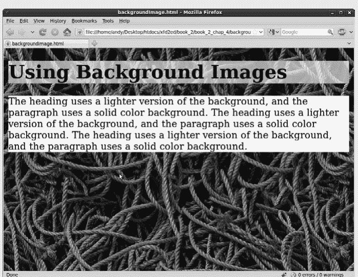

使用 CSS 更改你的字体、颜色和背景。

## 目录概览

**第 1 章：为你的世界着色** 159

- 现在你拥有了样式元素 159
- 在 CSS 中指定颜色 163
- 选择你的颜色 168
- 创建你自己的配色方案 172

**第 2 章：设置文本样式** 177

- 设置字体族 177
- Web 字体的诅咒 183
- 指定字体大小 188
- 确定其他字体特征 191

**第 3 章：选择器、类和样式** 201

- 选择特定片段 201
- 使用强调和加强强调 203
- 定义类 206
- 引入 `div` 和 `span` 210
- 使用伪类为链接设置样式 213
- 在上下文中选择 216
- 一次性定义多个样式 217

**第 4 章：边框和背景** 219

- 加入边框巡逻 219
- 介绍盒子模型 224
- 更改背景图像 228
- 操纵背景图像 234
- 在列表中使用图像 237

**第 5 章：CSS 的层级** 239

- 管理样式层级 239
- 理解层叠样式表中的“层叠”部分 246
- 使用条件注释 251

# 第 1 章：为你的世界着色

## 本章内容

- 介绍 `style` 元素
- 为标签添加样式
- 动态修改你的页面
- 指定前景和背景颜色
- 理解十六进制颜色
- 制定配色方案

HTML 在构建页面基本设计方面做得不错，但坦白说：它生成的页面相当丑陋。在过去，开发者在 HTML 中添加许多其他标签来使其更美观，但那是一件随意且混乱的事情。现在，XHTML 禁止了所有那些使页面更具吸引力的标签。这听起来很糟糕，但实际上并非损失。今天，XHTML 几乎总是与 CSS（层叠样式表）协同编写。令人惊讶的是，使用 CSS 可以极大地美化你的 XHTML 页面。

CSS 允许你更改页面上任何图像的颜色，添加背景和边框，更改元素（如列表和链接）的视觉外观，以及自定义整个页面的布局。此外，CSS 允许你保持 XHTML 的简洁，因为所有的格式化信息都存储在 CSS 中。CSS 也很高效，因为它允许你跨多个页面重用样式。如果说 XHTML 赋予了你的页面结构，那么 CSS 则赋予了它们美感。

本章将通过描述如何为页面添加颜色来让你入门。

## 现在你拥有了样式元素

CSS 的秘密在于`样式表`，这是一组描述各种对象如何显示的规则。例如，看看图 1-1 中的 `basicColors.html`。

### 160 现在你拥有了样式元素


一如既往，不要只听我空口说。本章是关于颜色的，你需要查看 CD 或网站上的这些页面，才能明白我指的是什么。

XHTML 代码中没有任何提供颜色信息的部分。使此页面与普通 XHTML 页面不同的是我藏在头部的一个新部分。查看代码，看看发生了什么：

```html
<!DOCTYPE html PUBLIC "-//W3C//DTD XHTML 1.0 Strict//EN"
"http://www.w3.org/TR/xhtml1/DTD/xhtml1-strict.dtd">
<html lang="EN" dir="ltr" xmlns="http://www.w3.org/1999/xhtml">
  <head>
    <meta http-equiv="content-type" content="text/xml; charset=utf-8" />
    <title>basicColors.html</title>
    <style type = "text/css">
      body {
        color: yellow;
        background-color: red;
      }

      h1 {
        color: red;
        background-color: yellow;
      }
    </style>
  </head>
```

`www.it-ebooks.info`

```html
<body>
    <h1>Red text on a yellow background</h1>
    <p>
        Yellow text on a red background
    </p>
</body>
</html>
```

如你所见，XHTML 代码中没有任何戏剧性的变化。`body` 只包含一个 `h1` 和一个 `p`。尽管文本提到了颜色，但 XHTML 代码中没有任何东西真正使颜色生效。

秘密在于我放在头部区域的新`<style></style>`标签对：

```html
<style type = "text/css">
    body {
        color: yellow;
        background-color: red;
    }

    h1 {
        color: red;
        background-color: yellow;
    }
</style>
```

`<style>` 标签是一个 HTML 标签，但它的作用很特殊：它切换了语言！在样式元素内部，你写的不再是 XHTML。你进入了一种全新的语言——CSS。CSS 与 XHTML 有不同的职责，但它们被设计为能很好地协同工作。

> **提示**
>
> CSS 代码看起来仍然是 HTML 的一部分，因为它位于 XHTML 页面内部，但最好将 XHTML 和 CSS 视为两种不同（尽管相关）的语言。XHTML 描述内容，而 CSS 描述布局。（你很快会看到）CSS 具有与 XHTML 不同的语法和风格，并且并不总是嵌入在网页中。

## 设置样式表

样式表为 XHTML 元素描述呈现规则。如果你查看前面的样式表（`<style>` 标签内的代码），你会看到我为两个元素描述了呈现规则：`<body>` 和 `<h1>` 标签。每当浏览器遇到这些标签之一时，它就会尝试使用这些样式规则来更改该标签的视觉外观。

样式只是一系列*选择器*（你想要修改的页面位置）。目前，我使用标签名（`body` 和 `h1`）作为选择器。然而，在本小册的第 3 章中，我将展示更多你可以使用的选择器。

每个选择器可以有多个样式*规则*。每个规则描述了选择器的某些属性。要设置样式，请记住以下几点：

- ✦ **从风格标签开始。** 你将要处理的风格类型是嵌入在页面中的。你应该在头部区域描述你的风格。
- ✦ **在头部区域包含风格类型。** 风格类型始终是 `"text/css"`。起始的 `<style>` 标签总是这样的：`<style type="text/css">`
- ✦ **定义一个元素。** 使用元素名称（单独的标签名）来开始定义特定元素的风格。你可以为所有 XHTML 元素（以及其他东西，但不是今天）定义风格。`body` 的风格规则指定如下：

  `body {`


✦ **使用花括号 (`{}`) 来包围风格规则。** 每个风格的规则都包含在一对花括号内。与许多编程语言类似，花括号标记了代码的特殊部分。传统上，在花括号内进行缩进。

✦ **给出一个规则名称。** 在本章中，我将使用两个非常简单的规则：`color` 和 `background-color`。在这本迷你书中，你将读到更多可以修改的 CSS 规则（有时称为属性）。规则名称后面总是跟着一个冒号 (`:`) 字符。

✦ **输入规则的值。** 不同的规则接受不同的值。属性值后面跟着一个分号。传统上，每个名称-值对都在一行上，像这样：

```
body {
  color: yellow;
  background-color: red;
}
```

## 更改颜色

在这个非常简单的例子中，我只是更改了一些颜色。以下是 CSS 中的两个主要颜色属性：

- ✦ **`color`:** 这指的是元素中任何文本的前景色。
- ✦ **`background-color`:** 元素的背景色。（连字符是名称的正式部分。如果你省略它，浏览器将不知道你在说什么。）

通过这两个元素，你可以指定任何元素的颜色。例如，如果你希望所有段落都具有白色文本和蓝色背景，请将以下文本添加到你的样式中：

```
p {
  color: white;
  background-color: blue;
}
```

与 XHTML Strict 一样，CSS 区分大小写。CSS 样式应完全用小写字母编写。

在你的学习过程中，你将发现更多风格元素，但它们都遵循颜色属性所阐明的相同原则。

## 在 CSS 中指定颜色

以下是在 CSS 中定义颜色的两种主要方法。你可以使用颜色名称，如 `pink` 和 `fuchsia`，或者你可以使用 `hex` 值。（在本章后面的“创建你自己的颜色方案”部分，你将了解如何使用特殊的数字指示符来选择颜色。）每种方法都有其优点。

## 使用颜色名称

颜色名称似乎是最简单的解决方案，对于像 `red` 和 `yellow` 这样的基本颜色，它们效果很好。然而，颜色名称存在一些问题，使其对 Web 开发人员来说很麻烦：

- **只有 16 个颜色名称会通过验证。** 虽然大多数浏览器接受数百个颜色名称，但只有 16 个保证在 CSS 和 XHTML 验证器中通过验证。有关这 16 种颜色的列表，请参见表 1-1。
- **颜色名称有些主观。** 你会发现不同的人对什么构成任何特定颜色有不同的看法，尤其是对于那些更生僻的颜色。（我个人不知道 `PeachPuff` 和 `PapayaWhip` 是颜色。对我来说它们听起来更像是甜点食谱。）
- **修改颜色可能很困难。** 例如，比 `Gainsboro` 稍微蓝一点的颜色是什么？（是的，那也是一个颜色名称。我完全不知道我的色盲程度有多严重。）
- **它们很难匹配。** 假设你正在建立一个关于你的猫的在线纪念碑，并且你希望文本与你猫的眼睛颜色相匹配。很难弄清楚哪个颜色名称对应你猫的眼睛。我想你可以问一下。

**表 1-1** 合法颜色名称及其十六进制等效值

| 颜色 | 十六进制值 |
| :--- | :--- |
| Black | #000000 |
| Silver | #C0C0C0 |
| Gray | #808080 |

**表 1-1（续）**

| 颜色 | 十六进制值 |
| :--- | :--- |
| White | #FFFFFF |
| Maroon | #800000 |
| Red | #FF0000 |
| Purple | #800080 |
| Fuchsia | #FF00FF |
| Green | #008000 |
| Lime | #00FF00 |
| Olive | #808000 |
| Yellow | #FFFF00 |
| Navy | #000080 |
| Blue | #0000FF |
| Teal | #008080 |
| Aqua | #00FFFF |

神秘的十六进制代码包含在此表中以求完整。如果你不明白它们是什么意思也没关系。所有内容将在下一节中揭示。

显然，我无法在这本黑白书中向你展示实际颜色，因此我在 CD-ROM 和网站上添加了一个简单的页面来显示所有命名颜色。请查看 `namedColors.html` 以查看实际颜色。


### 用十六进制表示你的颜色

HTML 中的颜色是一件奇怪的事情。“简单”的方法（使用颜色名称）结果证明有很多问题。大多数 Web 开发人员*真正*使用的方法听起来更难，但并不像乍看起来那么糟糕。*十六进制颜色*方案使用看似古怪的数字和字母组合来确定颜色值。`#00FFFF` 是 aqua。`#FFFF00` 是 yellow。这是一个只有计算机科学家才会喜欢的方案。然而，当你习惯之后，你会发现这个系统有其独特的极客魅力。（而极客魅力不是最好的魅力吗？）

十六进制颜色通过精确描述计算机的工作方式来工作，因此你需要更多地了解计算机如何处理颜色。屏幕上的每个点（或*像素*）实际上由三束微小的光（或 LCD 二极管或类似的东西）组成。每个像素都有微小的红、绿、蓝光束。

光束的工作方式有点像舞台灯。想象一个黑色的舞台，有三盏聚光灯（红、绿、蓝）照射在同一个点上。如果所有灯都关闭，舞台就是完全黑暗的。如果你只打开红灯，你会看到红色。你可以打开组合以获得新的颜色。例如，打开红灯和绿灯会产生一个黄光点。打开所有三盏灯会产生白色。

## 按数字着色

你可以设计一个简单的系统来描述颜色，用 1 表示开，用 0 表示关。在这个系统中，三个数字代表每种颜色，红、绿、蓝各一个数字。所以，红色将是 100（打开红色，但关闭绿色和蓝色），而 111 将是白色（打开所有三盏灯）。

这个系统只产生八种颜色。在计算机系统中，每个小灯都可以调整到不同的亮度水平。这些值从 0（完全关闭）到 255（完全打开）。因此，你可以将红色描述为 `rgb(255, 0, 0)`，黄色描述为 `rgb(255, 255, 0)`。

0 到 255 的值范围看起来很奇怪，因为你可能习惯于十进制数学。计算机实际上以二进制表示法存储值。从计算机的角度来看，黄色实际上是 111111111111111100000000。啊！一定有更简单的方法来处理所有这些二进制值。这就是我们使用*十六进制表示法*的原因。请继续阅读……

## 十六进制教育

所有这些 1 和 0 变得乏味。程序员喜欢转换成另一种更容易处理的格式。将数字转换为 16 进制比十进制更容易，所以这就是程序员的做法。即使不理解 16 进制（也称为*十六进制或 hex*）转换，你也可以很好地生存，但你应该理解一些关键特征，例如：

- ◆ **每个十六进制数字是四位二进制数字的简写。** 程序员使用十六进制的全部原因是为了简化二进制工作。
- ◆ **每个数字代表 0 到 15 之间的值。** 四位二进制数字代表 0 到 15 之间的值。
- ◆ **我们必须发明一些数字。** 十六进制看起来如此奇怪的全部原因是包含了字符。这是一个简单的原因：没有足够的数字可用！表 1-2 说明了基本问题。

**表 1-2** 十进制数字的十六进制表示

| 十进制（基数 10） | 十六进制（基数 16） |
| :--- | :--- |
| 0 | 0 |
| 1 | 1 |
| 2 | 2 |
| 3 | 3 |
| 4 | 4 |
| 5 | 5 |
| 6 | 6 |
| 7 | 7 |
| 8 | 8 |
| 9 | 9 |
| 10 | A |
| 11 | B |
| 12 | C |
| 13 | D |
| 14 | E |
| 15 | F |

数字 0–9 在十六进制中与在十进制中相同，但十进制中的 10–15 值在十六进制中用字母字符表示。

你非常习惯看到值 10 等于双手的手指数量，但当你开始像我们在这里这样摆弄数系时，情况并非总是如此。数字 10 只意味着当前基数中的一个。到目前为止，你可能从未使用过除十进制之外的任何基数，但所有这些都在这里发生了变化。10 是十进制中的十，但在二进制中，10 意味着二。在八进制中，10 意味着八，在十六进制中，10 意味着十六。这很重要，因为当你想用十六进制谈论双手的手指数量时，你不能使用熟悉的符号 10，因为在十六进制中 10 意味着十六。我们需要一个单数字的值来表示十，所以计算机科学家通过借用字母使自己摆脱了这种混乱。10 是 A，11 是 B，15 是 F。


如果所有这些数学理论让你头晕，别担心。我在下一节中展示了一些使用此方案创建出色颜色的快捷方式。不过现在，你需要理解以下内容才能使用十六进制颜色：

## 使用网页安全色

很久以前，浏览器甚至无法就可靠显示的颜色达成一致。网页开发者通过使用一套预定义的颜色调色板来应对，这些颜色在每个浏览器中的显示效果大致相同。如今的浏览器在显示多种颜色方面已毫无问题，但所谓的网页安全色仍偶尔被使用，因为它是一个简单的起点。

网页安全色的基本概念（如表 1-3 所示）是：每种颜色只能取以下值之一：`00`、`33`、`66`、`99`、`CC` 或 `FF`。`00` 是每种颜色最暗的值，`FF` 是最亮的。三原色都由 0 和 F 组成：`#FF0000` 是红色（全红，无绿，无蓝）。网页安全色使用这些值的任意组合，因此 `#33CC00` 是网页安全色，但 `#112233` 不是。

颜色需要六位十六进制数字。一个像素需要三种颜色，每种颜色使用八位二进制数字。两位十六进制数字覆盖每种颜色。两位代表红色，两位代表绿色，最后两位代表蓝色。

十六进制颜色值通常以井号开头。为了提醒浏览器该值是十六进制的，通常在值前加上井号（`#`）。所以，黄色是 `#FFFF00`。

使用十六进制颜色可能看起来很疯狂且困难，但它有一些重要的优势：

- **精确性：** 使用这个系统可以提供大量的颜色供你使用（如果你真的想知道，超过 1600 万种）。你不可能自己想出那么多颜色名称。嗯，你可以，但完成时你可能已经非常非常老了。
- **客观性：** 十六进制值不涉及主观意见。关于赭石色的值可能会有一些争论，但十六进制值 `#666600` 是明确无误的。
- **可移植性：** 大多数图形编辑器使用十六进制系统，所以你可以从图像中选取任何颜色并立即获得其十六进制值。这将很容易为你的猫的眼睛颜色找到在线圣殿。
- **可预测性：** 在你理解其工作原理后，你可以将任何十六进制颜色转换为稍微暗一点、亮一点或蓝色多一点的颜色。这对于命名颜色来说很难做到。
- **易用性：** 这一点可能看起来有点牵强，但在我下一节描述的网页安全色之后，很容易获得颜色的粗略概念，然后调整它以获得你正在寻找的确切形式。

**表 1-3** 网页安全色值

| 描述 | 红色 | 绿色 | 蓝色 |
|---|---|---|---|
| 非常亮 | FF | FF | FF |
| | CC | CC | CC |
| | 99 | 99 | 99 |
| | 66 | 66 | 66 |
| | 33 | 33 | 33 |
| 非常暗 | 00 | 00 | 00 |

要从此图表中选择一个网页安全值，请确定你想要每种颜色的量。明亮的红色将红色完全打开（`FF`），无绿色（`00`），无蓝色（`00`），形成 `#FF0000`。如果你想要暗一点的红色，你可以稍微降低红色。下一个较暗的网页安全红是 `#CC0000`。如果那还不够暗，你可以尝试 `#990000`。假设你喜欢那个，但你想要带一点紫色。只需添加一两个单位的蓝色：`#990033` 或 `#990066`。

如果你在理解上有困难，请查看光盘上的 `colorTester.html`。它允许你通过点击像表 1-3 那样组织的按钮来选择网页安全色。


> 网页安全色最初旨在解决的问题早已得到解决，但作为起点，它们仍然很受欢迎。网页安全色为你提供了一个分散且易于理解的颜色子集作为起点。你不必停留在那里，但这是一个很好的起点。

## 选择你的颜色

图 1-2 展示了我添加到网页和光盘中的 `colorTester.html` 程序。这个页面让你可以试验颜色。我在本讨论中会引用它。

> `colorTester.html` 页面主要使用了我在第四册第 5 章中描述的技术。请随时浏览源代码，预览 JavaScript 和动态 HTML（DHTML）的概念。到第四册结束时，你就能编写这个程序了。

理解颜色的最佳方法是亲自动手试验。你可以使用 `colorTester.html` 页面进行一些快速测试，或者你可以编写和修改自己的使用颜色的页面。


### 从网页安全色开始

`colorTester.html` 程序通过让你快速输入网页安全值来工作。要制作红色，请在红色列中按下 `FF` 按钮。蓝色和绿色值具有默认值 `00`，所以背景是红色。

网页安全色给你很大的发挥空间，而且使用起来非常容易。事实上，它们非常常见，你可以使用快捷方式。因为网页安全色都是重复的，你可以将重复的数字（`FF`）写成单个数字（`F`）。你可以将品红色指定为 `#FF00FF` 或 `#F0F`，浏览器都会理解，给你一种令人头晕目眩的品红色。

要制作更暗的红色，请将 `FF` 更改为下一个最小值，即 `#CC0000`。如果你想要更暗，尝试 `#990000`。尝试所有红色值，看看获得几种不同类型的红色是多么容易。如果你想要粉色的变化，同时提高绿色和蓝色值。`#FF6666` 是一种灰粉色；`#FF9999` 更亮一些；`#FFCCCC` 是非常白的粉色。

### 修改你的颜色

网页安全色很方便，但它给你相对较少的颜色（如果你在数，216 种）。盒子里有 216 支蜡笔已经很不错了，但你可能需要更多。通常，我从网页安全色开始，然后边做边调整。如果你想要比 `#FFCCCC` 更浅的粉色，你可以跳出网页安全色的行列，使用 `#FFEEEE` 或任何你想要的其他颜色！

在 `colorTester.html` 程序中，你可以使用每行的顶部和底部按钮来微调颜色的调整。

### 在你自己的页面上操作

当然，颜色在*我*页面上看起来如何并不真正重要。关键是在*你的*页面上让事物看起来好看。要为你的页面添加颜色，请执行以下操作：

1. **像往常一样定义 XHTML。** XHTML 不应与颜色有任何关系。严格在 CSS 中添加颜色。
2. **在页眉区域为页面添加 `<style>` 标签。** 不要忘记设置 `type = "text/css"` 属性。
3. **为每个要修改的标签添加选择器。** 你可以修改任何 HTML 标签，因此如果你想更改所有段落，请添加 `p { }` 选择器。使用不带尖括号的标签名称，因此 `<h1>` 变为 `h1 { }`。
4. **添加 `color` 和 `background-color` 属性。** 你将在整个第二册和第三册中发现更多可以修改的 CSS 元素，但现在，请坚持使用 `color` 和 `background-color`。
5. **使用颜色名称或十六进制颜色值指定颜色值。**

### 动态更改 CSS

如果你已经为 Firefox 安装了 Web Developer 工具栏（我在第一册第 3 章中描述过），你就可以使用一些非常棒的 CSS 工具。我真的很喜欢 CSS 编辑器。要让它工作，请打开任何页面（无论是否有 CSS）并在 Firefox 中打开。在这个例子中，我使用第一册第 4 章中的一个列表示例。

确保 Web Developer 工具栏已安装，然后从 CSS 菜单中选择 Edit CSS。一个类似于图 1-3 的新面板出现了。

你可以简单地在小文本编辑器中输入 CSS 代码，页面会立即更新！图 1-4 显示了我进行了一些更改后的同一页面。


**图 1-3：** Web Developer 工具栏有一个很棒的 CSS 功能。


**图 1-4：** CSS 更改立即显示。

我使用颜色使定义列表更易于查看。我更改了标题级别 1 中的前景色和背景色。我将定义术语（`dt`）设置为红色，并为定义（`dd`）添加了黄色背景。如果你需要复习 XHTML 中的定义列表，请查看第一册第 4 章。

Web Developer CSS 编辑器很棒，因为你可以实时看到结果。这是尝试你的颜色（以及其他 CSS 元素）的绝佳方式。你也可以用它来查看和修改现有的 CSS 文档。打开任何你想要的页面并打开 CSS 编辑器。你可以随心所欲地更改颜色，而无需做出承诺。


使用 Web Developer CSS 编辑器所做的更改不是永久性的。你只在浏览器的副本中进行更改。如果你真的喜欢在编辑器中编写的 CSS 代码，请将其复制到剪贴板并粘贴到你的页面中使其永久化，或者保存到文件以供以后使用。

## 创建你自己的配色方案

设置颜色的技术方面并不太困难，但决定*使用*哪些颜色可能是一个挑战。关于如何确定配色方案，已经有整本书的著述。过程带有一点主观性，但一些工具和规则可以帮助你入门。

### 理解色相、饱和度和明度

RGB 颜色模型很有用，因为它直接关系到计算机如何生成颜色，但它并不完美。在 RGB 中想象颜色的变化有点困难。因此，经常使用其他配色方案。最常见的变体是*色相、饱和度和明度*，即 HSV。HSV 系统以更接近色轮的方式组织颜色。

要使用 HSV 描述颜色，你需要使用数值指定颜色的三个特征：

- **色相：** 基本颜色。色轮被分成一系列色相。这些通常是中间色调，可以变得*更亮*（更接近白色）和*更暗*（更接近黑色）。
- **饱和度：** 颜色的普遍程度。高饱和度非常明亮。低饱和度颜色很少。如果你减少图像中的所有饱和度，图像将是*灰度*，完全没有颜色。
- **明度：** 颜色的亮度。查看明度最简单的方法是想象图像在降低饱和度时会是什么样子。所有较亮的颜色将更接近白色，较暗的颜色将几乎是黑色。


HSV 模型之所以有用，是因为它能让你挑选出搭配和谐的颜色。你可以使用色相属性来选取基础颜色。由于各种颜色值之间存在数学关系，因此很容易预测哪些颜色组合能取得良好效果。在确定好所有色相之后，你可以调整饱和度和明度来改变页面的整体色调。通常，特定方案中的所有颜色都具有相似的饱和度和明度。

遗憾的是，你无法直接以 HSV 模式指定 CSS 颜色。相反，你需要使用其他工具来获取所需的颜色，并将其转换为 RGB 格式。

## 使用配色方案设计器

有些人天生对颜色很有感觉。另一些人（比如我）则有些费劲，因为颜色选择似乎总带点主观性。如果你对颜色已经很有信心，可能不需要阅读本节——不过，它或许能对你已有的知识进行有趣的验证。另一方面，如果你在涂料店会感到困惑，那么了解到有一些非常实用的工具可用，可能会对你有所帮助。

一个很好的入门工具是免费的“配色方案设计器”（Color Scheme Designer），如图 1-5 所示。这个由 Petr Stanicek 创建的工具使用了一种 HSV 模型的变体来帮助你挑选配色方案。你可以在 `http://colorschemedesigner.com` 找到这个程序。

配色方案设计器包含几个区域，例如：

- **色轮：** 这个工具可能会唤起你对小学美术课的美好回忆。色轮以艺术家熟悉的方式排列颜色。你可以点击色轮来为你的页面选取一个主色。
- **配色方案选择器：** 你可以从多种配色方案中选择。我将在本节稍后介绍这些方案。
- **预览区域：** 此区域显示所选颜色的实际效果，让你看到各种颜色如何协同工作。
- **十六进制值：** 所选颜色的十六进制值显示在页面上，方便你复制到自己的应用程序中。
- **变体：** 你可以查看所选方案的变体。这些变体通常很有用，因为它们展示了在不进行计算的情况下饱和度和明度的差异。
- **色盲模拟：** 这个非常便捷的工具可以让你以各种色盲人群的视角来查看你的配色方案。

如果不实际操作，这些可能不太容易理解。一定要亲自试试这个工具，看看创建和谐的颜色组合是多么简单。

## 选择基础色相

配色方案设计器的工作原理是让你选择一个主色相，然后使用多种方案之一来选取与基础色相搭配良好的其他色相。要为你的页面选择想要的基础色相，请在色轮上点击一种颜色。

色轮是根据基于 HSV 的传统艺术家配色方案排列的，而不是计算机图形学使用的 RGB 方案。当你选择一种颜色时，系统会返回最接近的 RGB 表示。这很好，因为它允许你将传统的（HSV 风格的）颜色理论应用于略有不同的 RGB 模型。

当你在色轮上选择一种颜色时，实际上是在选择一个色相。如果你想要任何类型的红色，可以选择色轮上出现的红色。然后，你可以调整变体来共同修改方案中所有颜色的饱和度和明度。

要使用此方案选择颜色，请按照以下步骤操作：

1. **选择一个色相。**
   色轮上的颜色代表 HSV 模型中的色相。找到一个你想用作页面基础的主色。

2. **确定一个方案。**
   方案指明了你将使用哪些其他颜色以及它们与主色相的关系。有关各种方案的更多信息，请参阅下一节。

3. **调整你的方案。**
   主要方案是使用饱和度和明度的默认设置选取的。“调整方案”选项卡允许你修改饱和度和明度设置，从而对配色方案有更多控制。你也可以调整对比度级别以获得非常有趣的效果。

4. **预览方案。**
   设计器提供了多种预览配色方案的选项，包括使用该方案快速创建网页的功能。你还可以查看色盲模拟器，看看你的页面在不同类型的色盲人群眼中是什么样子。

5. **导出颜色设置。**
   如果需要，你可以将颜色设置导出为多种格式，包括一种非常好的 HTML/CSS 格式。你还可以将颜色保存到一个特殊文件中，以便导入到 GIMP 或 Photoshop，这样你的页面中使用的精确颜色也可供你的图像编辑器使用。

## 选取配色方案

各种配色方案利用色轮周围的数学关系来预测与主色搭配良好的颜色。以下是基本方案及其功能：

- **单色（Mono，monochromatic）：** 基于基础色相，提供多种饱和度和明度的变体。当你真正想强调某一种特定颜色时（例如，如果你正在制作一个关于热带雨林的网站，并希望使用大量绿色），这个方案很不错。务必在前景和背景颜色之间使用高对比度，以确保文本可读。
- **互补色（Complement）：** 使用基础色相和互补色（对比色）。通常，此方案使用基础色相的几种变体，并加入少量互补色相以形成对比。
- **三色（Triad）：** 选取基础色相和两个对比色相。当你选择三色方案时，还可以选择对比色之间的角度距离。如果此距离为零，则得到互补色方案。当角度增加时，你将得到一个*分裂互补*系统，它使用基础色相和两个与对比色等距的色相。此类方案在全对比度下可能显得刺眼，但调整饱和度和明度后，可以创造出一些非常好的配色方案。
- **四色（Tetrad）：** 生成四个色相。与三色方案一样，当你增加更多色相时，除非调整变体以降低对比度，否则保持页面的统一性会变得更加困难。
- **类似色（Analogic）：** 方案使用基础色相及其两个相邻色相。
- **强调类似色（Accented Analogic）：** 与类似色方案类似，但增加了互补色。

# 第 2 章：设置文本样式

## 本章内容

- 介绍字体和字型
- 指定字体系列
- 确定字体大小
- 理解 CSS 测量单位
- 管理其他字体特性
- 使用 font 规则简化字体样式

网页主要仍然是基于文本的媒介，因此你需要添加一些格式化功能。XHTML 本身不进行任何有意义的文本格式化，但 CSS 提供了广泛的工具来选择字型、字体大小、装饰、对齐方式等等。在本章中，你将学习如何以 CSS 的方式管理文本。

> 这里需要做一点语义上的澄清。大多数人称为*字体*的东西，更准确地说应该是*字型*。从技术上讲，字体（font）是指特定字型在特定尺寸下并带有一组特定装饰（如下划线、斜体等）的集合。在数字环境中，这种区别其实并不那么重要。你在 CSS 中不显式设置字体（font），而是确定*字体系列*（本质上是一个字型），然后修改其特性（创造出纯粹主义者所认为的字体）。不过，当我指代大多数人称为字体的东西（操作系统中描述一套字母外观的文件）时，我仍使用熟悉的术语*字体*（font）。

## 设置字体系列

要为页面的某部分分配字体系列，请使用一些新的 CSS。图 2-1 展示了一个标题设置为 Comic Sans MS 的页面。

如果此页面在 Windows 机器上查看，它通常能正确显示字体，因为 Comic Sans MS 随大多数版本的 Windows 一起安装。如果你在其他类型的机器上查看，可能会看到其他字体。稍后会详细介绍这一点，但现在，我们先看一个简单的例子。

## 178 设置字体家族

以下是代码：

```
<!DOCTYPE html PUBLIC "-//W3C//DTD XHTML 1.0 Strict//EN"
"http://www.w3.org/TR/xhtml1/DTD/xhtml1-strict.dtd">
<html lang="EN" dir="ltr" xmlns="http://www.w3.org/1999/xhtml">
  <head>
    <meta http-equiv="content-type" content="text/xml; charset=utf-8" />
    <title>comicHead.html</title>
    <style type = "text/css">
      h1 {
        font-family: "Comic Sans MS";
      }
    </style>
  </head>

  <body>
    <h1>This is a heading</h1>
    <p>
      This is ordinary text.
    </p>
  </body>
</html>
```


**图 2-1：** 标题使用了 Comic Sans 字体（在大多数情况下）。

## 应用 font-family 样式属性

这个页面的关键在于 CSS 的`font-family`属性。像大多数 CSS 元素一样，它可以应用于页面上的任何 HTML 标签。在这个特定的例子中，我将其应用于一级标题。

```
h1 {
    font-family: "Comic Sans MS";
}
```

然后，你可以附加任何你希望使用的字体名称，浏览器会尝试使用该字体来显示元素。

即使某种字体在你的计算机上运行得非常完美，但如果用户的机器上没有安装该字体，它可能就无法工作。

如果你在 Linux 机器上运行完全相同的页面，你可能会看到如图 2-2 所示的结果。

特定的字体 Comic Sans MS 通常安装在 Windows 机器上，但*MS*代表 Microsoft。这种字体并不总是安装在 Linux 或 Mac 上。（有时有，有时没有。）你不能指望用户安装了任何特定的字体。

Comic Sans 字体用于示例是可以的，但在 Web 开发中它已经被过度使用了。严肃的 Web 开发者会避免在实际应用中使用它，因为它往往会让你的页面看起来很业余。


## 180 设置字体家族

### 使用通用字体

这有点令人沮丧。即使使用字体很容易，但你不能随意使用它们，因为你不知道用户是否安装了它们。幸运的是，你可以做一些事情来增加成功的几率。第一个技巧是使用*通用字体名称*。这些是每个符合标准的浏览器都同意支持的*虚拟*字体名称。图 2-3 显示了一个使用所有通用字体的页面。


我使用浏览器控件使字体比正常情况下更大，这样你才能在图中看到细节。程序员和用户都应该能够更改字体大小。稍后，我将描述如何通过代码更改字体大小。

通用字体确实是字体家族：

- **衬线体（Serif）：** 这些字体带有那些小衬线（增强可读性的小笔画）。印刷文本（比如你现在阅读的段落）倾向于使用衬线字体，它们也是大多数浏览器的默认字体。最常见的衬线字体是 Times New Roman 或 Times。
- **无衬线体（Sans Serif）：** 无衬线字体没有那些小脚。通常用于标题或其他强调。有时，它们被视为比衬线字体更现代、更干净，所以有时也用于正文。Arial 是最常见的无衬线字体。在本书中，图表标题使用的是无衬线字体。
- **手写体（Cursive）：** 这些字体看起来有点像手写。在 Windows 中，手写字体通常是 Comic Sans MS。当你想要一种不太正式的外观时，会使用手写字体。*For Dummies* 系列书籍到处使用手写字体作为节和章的标题。
- **装饰体（Fantasy）：** 装饰体是装饰性的。几乎你能想到的任何主题都有对应的装饰字体，从克林贡语到托尔金。你还可以找到唤起某种文化的字体，使英文文本看起来像波斯文或中文。装饰字体最好谨慎使用，用于强调，因为它们常常为了视觉吸引力而牺牲可读性。
- **等宽体（Monospace）：** 等宽字体产生固定宽度的字体，类似于打字机文本。等宽字体经常用于显示代码。Courier 是一种常见的等宽字体。本书中的所有代码清单都使用等宽字体。

因为通用字体在所有符合标准的浏览器上都可用，你可能会认为你可以放心地使用它们。嗯，你可以确定它们会出现，但你仍然可能对结果感到惊讶。图 2-4 显示了与图 2-3 相同的页面（在 Windows 中），但是是在 Linux 中。

Mac 显示的又是另一种变体，因为这里列出的字体并不是*实际*的字体。相反，它们是*虚拟*字体。符合标准的浏览器承诺*会选择一个合适的替代品*。例如，如果你选择无衬线体，一个浏览器可能选择使用 Arial。另一个可能选择 Chicago。你始终可以使用这些通用字体名称，并知道浏览器会找到一些接近的东西，但无法保证浏览器到底会选择什么。尽管如此，这总比没有强。当你使用这些字体时，你至少可以确保字体大致正确，即使不是完全符合你的预期。


### 制作字体列表

这种不确定性令人沮丧，但你可以采取一些控制措施。你可以指定一个完整的字体名称列表。浏览器会依次尝试每种字体。如果找不到指定的字体，它会转到下一个字体，以此类推。

## 182 设置字体家族

你可以选择一种你知道安装在所有 Windows 机器上的字体，一种在 Mac 上可以找到的字体，最后是所有 Linux 机器上都能找到的字体。你列表中的最后一个字体应该是通用字体之一，这样在最坏的情况下你也能有所控制。

表 2-1 显示了 Windows、Mac 和 Linux 机器上通常安装的字体列表。

**表 2-1 字体对照表**

| Windows | Mac | Linux |
| --- | --- | --- |
| Arial | Arial | Nimbus Sans L |
| Arial Black | Arial Black | |
| Comic Sans MS | Comic Sans MS | TSCu_Comic |
| Courier New | Courier New | Nimbus Mono L |
| Georgia | Georgia | Nimbus Roman No9 L |
| Lucida Console | Monaco | |
| Palatino | Palatino | FreeSerif |
| Tahoma | Geneva | Kalimati |
| Times New Roman | Times | FreeSerif |
| Trebuchet MS | Helvetica | FreeSans |
| Verdana | Verdana | Kalimati |

你可以使用此图表来推导一个需要尝试的字体列表。例如，查看以下样式：

```
p {
    font-family: "Trebuchet MS", Helvetica, FreeSans, sans-serif;
}
```

这个样式提供了多种选择。首先，浏览器尝试加载 Trebuchet MS。如果是 Windows 机器，这个字体可用，因此会显示它。如果不行，浏览器尝试 Helvetica（Mac 的默认字体）。如果还不行，它尝试 FreeSans，这是 Linux 机器上经常安装的字体。如果这还不行，它会默认使用经典可靠的无衬线体，即简单地选择一种无衬线字体。

请注意，超过一个单词的字体名称必须用引号括起来，字体名称列表用逗号分隔。

## font 标签的消亡

在传统的 HTML 中曾经有一个叫做`<font>`的标签。你可以使用这个标签来更改字体大小、颜色和字体家族。还有一些特定的标签用于斜体（`<i>`）、粗体（`<b>`）和居中（`<center>`）。这些标签非常容易使用，但它们导致了一些主要问题。为了很好地使用它们，你最终会在页面中到处堆满各种标签，试图描述标记，而不是内容含义。没有简单的方法来重用字体信息，所以你经常不得不在页面中重复多次，使其难以更改。XHTML Strict 不再允许使用`<font>`、`<i>`、`<b>`或`<center>`标签。我在本章中展示的 CSS 元素足以弥补这一损失。你现在拥有一个更灵活、更强大的替代方案。

不要对 Linux 字体感到太大压力。确实，字体等效关系更难找到，但 Linux 用户往往分为两个阵营：他们要么不在乎字体是否完全一致，要么在乎并且已经安装了识别通用名称的等效字体。在任何情况下，你都可以主要关注 Mac 和 Windows 用户，而且只要你使用了通用字体名称，Linux 系统也能正常工作。事实是，我主要使用 Linux，并且已经安装了所有需要的字体。

## 网络字体的诅咒

字体起初看起来相当简单，但在实际使用中会出现一些大问题。

### 理解问题

字体的问题在于：字体资源安装在每个操作系统中。它们不会随页面的其他部分一起下载。你的网页可以调用特定的字体，但除非该字体已经安装在用户的计算机上，否则它不会被显示。

假设我有一个很酷的字体叫 Happygeek。（我刚刚编的。如果你是字体设计师，可以随意做一个叫这个名字的字体。只要发一份副本给我。我等不及了。）它安装在我的计算机上，当我在文字处理器中选择字体时，它会出现在列表中。我可以用它创建一个文档，一切都会正常工作。

如果我将一份使用 Happygeek 的打印文档寄给我奶奶，一切都很好，因为纸张不需要实际的字体。它只是墨水。如果我将数字文件发给她，并告诉她打开它，我们就会有问题。看，她不是很时髦，没有安装 Happygeek。她的计算机会选择其他字体。

## 184 网页字体的诅咒

这在文字处理中并不是什么大问题，因为人们通常不会发送带有复杂字体的文档电子副本。然而，网页*只*以数字形式传播。要了解可以使用哪些字体，你必须知道用户机器上安装了哪些字体，而这几乎是不可能的。


部分顾虑是技术性的（如何将字体信息传输到浏览器），但真正的问题是数字版权管理。如果你购买了一种字体供自己使用，这是否赋予你将其传输给他人的权利，从而让他们无需付费即可使用？

## 审视可能的解决方案

自网络诞生之初，这就是一个问题。许多人试图想出解决方案。没有一种方案是完美的，但以下是一些折中办法：

- ◆ **嵌入式字体：** Netscape 和 Internet Explorer (IE) 都开发了将字体嵌入网页的技术。这两种技术都涉及使用一段软件将字体转换为专有格式，使其仅能用于特定页面而无法用于其他地方。这两个系统互不兼容，而且都有些笨拙。几乎没人使用它们。Firefox 现在完全忽略这项技术，而 IE 可以做到，但需要单独的工具。在浏览器提出兼容方案之前，我不推荐这项技术。


- **CSS 3 嵌入式字体：** CSS 3（即将到来的 CSS 新版本）承诺了一种纯粹通过 CSS 导入字体文件的方法。你将能够指定一个特定的文件名，并传递一个指向你服务器上该文件的 URL（统一资源定位符），它将用于该特定页面，但不会安装在用户的系统上。多年来，游戏中一直通过这种方式处理自定义字体。可以参考第一卷第八章了解这项技术的预览。它看起来极具前景。

- **Flash：** Flash 是一种在网络上非常流行的矢量格式。Flash 具有将字体转换为 Flash 输出中二进制格式的优秀功能，而且大多数用户都安装了某种 Flash 播放器。Flash 编辑器价格昂贵，操作起来有些复杂，并且会抵消 XHTML 的许多优势。这些缺点超过了使用自定义字体的潜在好处。

- **图像：** 一些设计师选择完全放弃 HTML，将他们的页面创建为巨大的图像。这需要大量的带宽，使页面无法搜索，也难以修改。这是一个非常糟糕的主意。虽然你可以精确控制视觉布局，但你会失去 XHTML 的大部分优势。搜索引擎无法读取图像中的内容，屏幕阅读器也完全无法访问。一张足以填满屏幕的图像，其下载时间将是同等 XHTML 标记的许多倍。用户无法调整基于图像的页面大小，而且这种类型的页面无法很好地适应手机或其他便携式浏览器。


## 使用图像作为标题

通常，你应该为页面的主要内容使用标准字体，因此字体种类有限并不是什么大问题。但有时，你想在标题中使用特殊字体。你可以使用图形编辑器（如 GIMP）创建基于文本的图像，然后将它们整合到你的页面中。图 2-5 展示了此技术的一个示例。


在这个例子中，我想使用我的特殊牛字体。（我喜欢我的牛字体。）

以下是流程：

1. **规划你的页面。**

   使用图形时，你会失去一些灵活性。你需要确切知道标题应该是什么内容。你还需要知道哪个标题将显示在哪个级别。与其依赖浏览器来显示你的标题，不如在图形工具（我使用的是 GIMP）中创建图形并直接放置在页面中。

2. **创建你的图像。**

   我使用了 GIMP 中出色的 Logos 功能（选择 `Xtnds > Script-fu > logos`）来创建我的牛文本。我使用 `Bovination` 工具为每个标题构建了一幅图像。我很高兴有 `Bovination` 工具。这是我一直想要的东西。要是它能被改造成武器就好了。

**186** *网页字体的诅咒*

3. **直接指定字体大小。**

   在图像中，以像素为单位指定字体大小是合理的，因为这里你真正讨论的是特定的像素数量。你在图形编辑器中创建“虚拟文本”，因此请将文本设置为你希望在最终页面中呈现的任何大小。

4. **使用任何你想要的字体。**

   你不必担心用户是否安装了该字体，因为你发送的不是字体，而只是使用该字体组成的图像。

5. **为每个标题创建单独的图像。**

   这个特定练习有两个图像——一个一级标题和一个二级标题。因为我是直接创建图像，所以需要我来跟踪图像如何传达其标题级别。

6. **考虑标题级别。**

   确保使二级标题的值看起来比一级标题略小或不那么突出。也就是说，如果你有用于一级标题设置的图像，它们应该比用于不太突出标题级别的图像使用更大的字体。通常，这是通过调整图像中的字体大小来完成的。

7. **像往常一样构建页面。**

   创建这些特殊图像后，构建一个常规网页。将 `<h1>` 和 `<h2>` 标签放在你通常放置的完全相同的位置。

8. **在标题内放置 `` 标签。**

   将图像标签放置在 `<h1>` 和 `<h2>` 标签内部，而不是普通文本。如果你有点困惑，请参考即将出现的代码 `imageTitles.html`。

9. **在 alt 属性中放置标题文本。**

   `alt` 属性在这里尤其重要，因为如果用户关闭了图形显示，文本仍然会以适当样式的标题出现。网络连接速度慢的人会在图像加载前看到文本，而使用文本阅读器的人仍然可以读取图像的 alt 文本。

以下是用于生成基于图像的标题的代码：

```html
<!DOCTYPE html PUBLIC "-//W3C//DTD XHTML 1.0 Strict//EN"
"http://www.w3.org/TR/xhtml1/DTD/xhtml1-strict.dtd">
<html lang="EN" dir="ltr" xmlns="http://www.w3.org/1999/xhtml">
    <head>
        <meta http-equiv="content-type" content="text/xml; charset=utf-8" />
        <title>imageTitles.html</title>
    </head>

    <body>
        <h1>
            
        </h1>
        <p>
            This page describes famous cows in history
        </p>

        <h2>
            
        </h2>

        <p>
            Most people are unaware that cattle actually took
            part in the battle. They didn't of course. I just
            made that up.
        </p>
    </body>
</html>
```

这项技术是自定义图形和普通 XHTML 之间的一种不错的折中，具体如下：

- **你可以很好地控制图像。** 如果你精通图形工具，你可以让任何类型的图像充当标题。实际上没有限制，只受你的技能和创造力约束。

- **页面保留其结构。** 你仍然有标题标签，因此很容易看出你打算让特定图像充当标题。你仍然可以在 XHTML 代码中看到页面的组织结构。

- **你有备用文本。** 如果图像无法显示，`alt` 属性会激活。

- **图像标题的语义得以保留。** `alt` 标签提供了另一个很棒的功能。如果它们复制了图像文本，这些文本仍然可供屏幕阅读器和搜索引擎使用，因此文本不会被埋没在图像中。

> 

这项技术非常适合标题或其他区域，但请注意，我很谨慎地在 `alt` 标签中重复了标题文本。这很重要，因为我不想丢失文本。搜索引擎工具和屏幕阅读器需要文本。

不要试图将这项技术用于大量的正文文本。这样做会导致一些问题：

- **文本变得不可搜索。** 如果文本被埋没在图像中，搜索引擎就无法找到它。

- **文本更难更改。** 你无法用文本编辑器更新页面。相反，你必须下载图像、修改它并重新上传。

- **图像比文本需要更多的带宽。** 如果图像不能实质性地增加你的页面价值，就不要使用图像。你可以为几个标题图像找到理由，但要将整个页面存储为图像仅仅为了使用一种特定字体，就更难自圆其说了。

## 指定字体大小

如同字体名称一样，在 CSS 中更改字体大小也很容易，但其中存在一些隐藏的陷阱。

## 大小只是一个建议！

在印刷媒体中，一旦确定了文本大小，它就基本固定不变。用户无法轻易更改印刷品上的字体大小。相比之下，网页浏览器则经常改变文本的大小。基于手机的浏览器与高分辨率 LCD 面板上的浏览器显示文本的方式不同。此外，大多数浏览器允许用户更改屏幕上所有文本的大小。使用 `Ctrl++`（加号）和 `Ctrl+-`（减号）可以使文本变大或变小。在旧版本的 IE（IE7 之前）中，从“页面”菜单中选择“文本大小”选项来更改文本大小。

用户确实应该有能力在浏览器中调整字体大小。当我在投影仪上显示网页时，我经常调整字体大小，以便后排的学生能够阅读。有些网页设置的字体大小对我来说太小而无法阅读。（这可能是我的高科技显示器的问题。不可能与我的年龄有关。）

精确地确定字体大小与 Web 的精神相悖。例如，如果你声明你的文本将是精确的 12 磅，那么可能会发生以下两种情况之一：

- **浏览器可能会字面上强制执行 12 磅规则。** 这剥夺了用户的控制权，因此需要更大字体的用户将无计可施。旧版本的 IE 就是这么做的。

- **用户可能仍然会更改大小。** 如果浏览器的行为如此（通常如此），那么 12 磅并不总是意味着 12 磅。如果用户可以更改字体大小，那么字面上选择大小就毫无意义。

Web 开发者应该设置字体大小，但仅使用相对术语。不要费心使用绝对度量（在大多数情况下），因为它们并不真正代表你所想的含义。让用户确定基础字体大小，并指定相对于该大小的更改。

## 使用 font-size 样式属性

在 CSS 中，字体大小的基本概念相当容易掌握。看一下图 2-6 中的 `fontSize.html`。

这个页面显然显示了多种不同的字体大小。“Font Sizes”这一行是一个普通的 `h1` 元素。所有其他行都是段落标签。它们显示为不同的大小是因为它们应用了不同的样式。

**指定字体大小 189**


**第 II 册 第 2 章**

**设置文本样式**

字体大小通过（巧妙命名的）`font-size` 属性来更改：

```css
p {
    font-size: small;
}
```

只需指定 `font-size` 规则，然后，嗯，就是字体的大小。在这个例子中，我使用了特殊值 `small`，但在 CSS 中有很多其他方式来指定大小。

## 绝对度量单位

很多时候，你需要在 CSS 中指定某物的大小。当然，字体大小就是这种情况之一。不同类型的度量具有不同的含义。重要的是要知道 CSS 中有两种不同的单位。绝对度量试图描述一个特定的大小，就像在现实世界中一样。相对度量是关于对某个默认值的更改。通常，Web 开发者正在转向使用相对度量来设置字体大小。

### 磅 (pt)

在文字处理中，你可能熟悉磅作为字体大小的度量单位。你可以使用缩写 `pt` 来表示你使用的是磅度量，例如：

```css
p {
    font-size: 12pt;
}
```

`12` 和 `pt` 之间没有空格。

不幸的是，磅对于网页来说不是一个有效的度量单位。磅是一个绝对量表，对印刷品有用，但在 Web 上并不可靠，因为你不知道用户的屏幕分辨率是多少。12 磅的字体在不同的显示器上可能看起来更大或更小。

www.it-ebooks.info

**# 190 指定字体大小**

在某些版本的 IE 中，一旦你用磅指定了字体大小，用户就无法再更改字符的大小了。从可用性的角度来看，这是不可接受的。相对大小方案（我将在本章后面描述）可以防止这个问题发生。

### 像素 (px)

像素指的是屏幕上的小点。你可以用像素来指定字体大小，尽管通常不是这样做的。一方面，不同的显示器制造的像素大小不同。你无法真正确定一个像素相对于整个屏幕大小是多大。不同的字母大小不同，所以像素大小是平均字符宽度和高度的一个粗略度量。使用缩写 `px` 以像素为单位度量字体：

```css
p {
  font-size: 20px;
}
```

### 传统度量单位 (in, cm)

你也可以使用英寸 (`in`) 和厘米 (`cm`) 来度量字体，但这完全不切实际。想象一下，你的网页同时显示在你的屏幕和投影系统上。你自己显示器上的一英寸在投影仪上可能看起来像十英寸。现实生活中的度量单位对于 Web 没有意义。唯一可能使用它们的情况是你需要打印某些东西，并且完全了解打印机的配置。如果是这种情况，你最好使用面向打印的布局工具（如文字处理器）而不是 HTML。

### 相对度量单位

相对度量在 Web 开发中是更明智的选择。使用这些方案根据标准大小来更改大小。

#### 命名大小

CSS 内置了许多字体大小名称：

```text
xx-small            large
x-small             x-large
small               xx-large
medium
```


这些大小没有更具体的描述可能会让你感到困扰：`large` 有多大？嗯，它比 `medium` 大。这听起来像是轻率的回答，但这是事实。用户在浏览器中设置默认字体大小（或保持不变），所有其他字体大小都应相对于这个预设大小。`medium` 大小是页面上段落文本的默认大小。作为比较，`<h1>` 标签通常是 `xx-large`。

## 百分比 (%)

百分比单位是一个相对度量，用于指定相对于其正常大小的字体。使用 50% 可以使字体大小变为其正常显示大小的一半，使用 200% 可以使其变为正常大小的两倍。使用 `%` 符号表示百分比，如下所示：

```css
p {
    font-size: 150%;
}
```

百分比基于普通文本的默认大小，因此一个设置为 100% 的 `<h1>` 标签与普通段落中的文本大小相同。

## Em (em)

在传统排版中，em 是一个度量单位，等同于该字体中“m”字符的宽度。在实际的 Web 使用中，它实际上是指定字体相对大小的另一种方式。例如，0.5 ems 是正常大小的一半，3 ems 是正常大小的三倍。术语 `em` 用于指定这种度量。

```css
p {
    font-size: 1.5em;
}
```

以下是字体大小的最佳策略：

1. **不要没有充分理由就更改大小。** 大多数时候，浏览器的默认大小完全没问题，但有时你可能想稍微调整一下字体。

2. **为页面定义一个整体大小。** 如果你想为整个页面定义字体大小，请在 `<body>` 标签中进行。使用命名大小、百分比或 `ems` 以避免绝对大小的副作用。在 `body` 中定义的大小会自动应用于 `body` 中的每个元素。

3. **修改任何其他元素。** 例如，你可能希望你的链接比普通文本稍大一些。你可以通过为元素应用 `font-size` 属性来实现这一点。如果可能，使用相对度量。

## 确定其他字体特征

除了大小和颜色（参见本册第 1 章），你还可以通过多种其他方式更改字体。

图 2-7 显示了你可以进行的一些常见文本修改。

**# 192 确定其他字体特征**


这个页面中的各个段落以不同的方式进行修改。你可以更改文本的对齐方式，还可以为文本添加斜体、粗体、下划线或删除线。

CSS 使用了一套可能令人困惑的规则来处理各种字体操作工具。一条规则决定字体样式，另一条规则决定粗细。

为了清晰起见，我将在以下部分中描述这些技术。

> 我使用了一个我尚未展示的技巧来制作这个比较页面。我有多个段落，每个段落都有自己的样式。请参阅本册第 3 章，了解如何在特定页面中拥有多种段落样式。


### 使用 font-style 设置斜体

`font-style` 属性允许你创建斜体文本，如图 2-8 所示。


## 使用 font-weight 实现粗体

你可以通过使用 `font-weight` CSS 属性来使字体变粗，如图 2-9 所示。


如果你想让部分文本变为粗体，请使用 `font-weight` CSS 属性，如下所示：

```html
<!DOCTYPE html PUBLIC "-//W3C//DTD XHTML 1.0 Strict//EN"
"http://www.w3.org/TR/xhtml1/DTD/xhtml1-strict.dtd">
<html lang="EN" dir="ltr" xmlns="http://www.w3.org/1999/xhtml">
  <head>
    <meta http-equiv="content-type" content="text/xml; charset=utf-8" />
    <title>bold.html</title>
    <style type="text/css">
      p {
        font-weight: bold;
      }
    </style>
  </head>
  <body>
    <h1>Boldface</h1>
    <p>
      This paragraph is bold.
    </p>
  </body>
</html>
```

字体粗细可以通过几种方式定义。通常，你只需在 `font-weight` 规则中指定 `bold`，就像我在这段代码中所做的那样。你也可以使用从 100（极细）到 900（粗黑）的数值。

## 使用 text-decoration

`text-decoration` 可用于为文本添加其他一些有趣的格式，包括下划线、删除线、上划线和闪烁。

例如，以下代码会产生一个带下划线的段落：


```html
<!DOCTYPE html PUBLIC "-//W3C//DTD XHTML 1.0 Strict//EN"
"http://www.w3.org/TR/xhtml1/DTD/xhtml1-strict.dtd">
<html lang="EN" dir="ltr" xmlns="http://www.w3.org/1999/xhtml">
  <head>
    <meta http-equiv="content-type" content="text/xml; charset=utf-8" />
    <title>underline.html</title>
    <style type="text/css">
      p {
        text-decoration: underline;
      }
    </style>
  </head>
  <body>
    <h1>Underline</h1>
    <p>
      This paragraph is underlined.
    </p>
  </body>
</html>
```

在网页中使用下划线要小心。用户已经习惯于认为带下划线的文本是链接，因此他们可能会点击你的带下划线文本，期望它能带他们去某个地方。

`underline.html`代码生成的页面类似于图 2-10。

**图 2-10：** 你可以使用`text-decoration`为文本添加下划线。


你也可以使用`text-decoration`实现其他效果，例如删除线（在 CSS 中称为“line-through”），如以下代码所示：

```html
<!DOCTYPE html PUBLIC "-//W3C//DTD XHTML 1.0 Strict//EN"
"http://www.w3.org/TR/xhtml1/DTD/xhtml1-strict.dtd">
<html lang="EN" dir="ltr" xmlns="http://www.w3.org/1999/xhtml">
  <head>
    <meta http-equiv="content-type" content="text/xml; charset=utf-8" />
    <title>strikethrough.html</title>
    <style type="text/css">
      p {
        text-decoration: line-through;
      }
    </style>
  </head>

  <body>
    <h1>Strikethrough</h1>
    <p>
      This paragraph has strikethrough text.
    </p>
  </body>
</html>
```

`strikethrough.html`代码生成的页面类似于图 2-11。

**图 2-11：**`text-decoration`可用于实现删除线效果。


`text-decoration`还有一些其他很少使用的选项，例如：

- **上划线：**`overline`属性会在文本上方放置一条线。除了少数数学和化学应用（这些最好在方程编辑器中完成并作为图片导入）外，我想不出这何时会被使用。

- **闪烁：**`blink`属性是 Netscape 中传奇的`<blink>`标签的远亲，它会导致文本在页面上闪烁。`<blink>`标签（以及过度使用的动画 GIF）长期以来一直被嘲笑为业余水平的标志。务必不惜一切代价避免使用闪烁文本。


互联网开发者中有一个老笑话：使用`<blink>`标签唯一正当的地方是在这个句子里：薛定谔的猫是`<blink>not</blink>`死的。没有什么比用 HTML 来阐述量子力学更有趣的了。

## 使用`text-align`进行基本对齐

你可以使用`text-align`属性来居中、左对齐或右对齐文本，如下所示：

```html
<!DOCTYPE html PUBLIC "-//W3C//DTD XHTML 1.0 Strict//EN"
"http://www.w3.org/TR/xhtml1/DTD/xhtml1-strict.dtd">
<html lang="EN" dir="ltr" xmlns="http://www.w3.org/1999/xhtml">
  <head>
    <meta http-equiv="content-type" content="text/xml; charset=utf-8" />
    <title>center.html</title>
    <style type="text/css">
      p {
        text-align: center;
      }
    </style>
  </head>

  <body>
    <h1>Centered</h1>
    <p>This paragraph is centered.</p>
  </body>
</html>
```

你也可以使用`text-align`属性来右对齐或左对齐文本。图 2-12 所示的页面说明了`text-align`属性。


`text-align`属性只能应用于文本。旧的`<center>`标签可用于居中几乎所有东西（表格、一些文本或图像），这很容易但会带来问题。第三册解释了如何以各种强大的方式定位元素，包括居中任何内容。使用`text-align`来居中文本在其自身元素内的位置（无论该元素是标题、段落、表格单元格还是其他任何东西）。

**图 2-12：** 这段文本是使用`text-align`居中的。


## 其他文本属性

CSS 还提供了一些其他文本处理工具，但它们很少使用：

- **Font-variant：**可设置为`small-caps`，以使文本仅使用大写字母。小写字母会以较小的字体大小显示。

- **Letter-spacing：**调整字母之间的间距。它通常以`em`为单位。（有关`em`的更多信息，请参阅本章前面的“相对测量单位”部分。）网络上的字体如此不可预测，如果你试图如此精细地管理，结果注定会让你失望。

- **Word-spacing：**允许你调整单词之间的间距。

- **Text-indent：**允许你调整元素第一行的缩进。此值使用正常的度量单位。缩进可以设置为负值，如果你愿意，这会导致文本突出。

- **Vertical-align：**当你有一个具有大量垂直空间（通常是表格单元格）的元素时使用。你可以指定文本在此情况下的行为方式。

- **Text-transform：**帮助你将文本转换为大写、小写或首字母大写形式。

- **Line-height：**指示元素中行之间的垂直间距。与字母和单词间距一样，如果你如此关心显示的精确程度，你很可能会感到失望。

## 使用`font`快捷方式

记住所有不同的字体属性及其可能的值可能会很乏味。Aptana 和其他专用的 CSS 编辑器使这变得容易得多，但专业人士经常使用另一种技术。`font`规则为许多有用的字体属性提供了一个简单的快捷方式。以下代码向你展示如何使用`font`规则：

```html
<!DOCTYPE html PUBLIC "-//W3C//DTD XHTML 1.0 Strict//EN"
"http://www.w3.org/TR/xhtml1/DTD/xhtml1-strict.dtd">
<html lang="EN" dir="ltr" xmlns="http://www.w3.org/1999/xhtml">
```

## 确定其他字体特性

```html
<head>
  <meta http-equiv="content-type" content="text/xml; charset=utf-8" />
  <title>fontTag.html</title>
  <style type = "text/css">
    p {
      font: bold italic 150% "Dadhand", cursive;
    }
  </style>
</head>

<body>
  <h1>使用字体简写属性</h1>
  <p>
    这个段落包含多种设置。
  </p>
</body>
</html>
```

图 2-13 展示了强大的`font`规则在实际中的应用。


`font`规则的妙处在于它结合了许多其他与字体相关的规则，以一种更简单的方式来处理大多数文本格式化的需求。

`font`属性极其方便。本质上，它允许你将所有其他字体属性整合为一个。以下是其工作原理：

- 在 CSS 中指定`font`规则。

- 列出任何`font-style`属性。你可以提及通常在`font-style`规则中使用的任何属性（`italic`或`oblique`）。如果你两者都不想用，直接跳过即可。

- 列出任何`font-variant`属性。如果你想要小型大写字母，可以在此处指定。如果不需要，留空这部分即可。

- 列出任何`font-weight`值。这可以是“bold”或一个`font-weight`数值（100–900）。

- 用你想要的任何度量系统指定`font-size`值（但推荐使用`em`或百分比）。不要忘记度量单位符号（`em`或`%`），因为`font`规则正是通过它来识别这是一个尺寸值。

- **最后指定`font-family`列表。**最后一个元素是你希望浏览器尝试使用的字体族列表。此列表必须放在最后，否则浏览器可能无法正确解释`font`属性。（Dadhand 是我拥有的一个自定义字体；如果 Dadhand 不可用，则会使用 cursive。）

`font`规则很棒，但它并非万能。你可能仍然需要单独的 CSS 规则来定义文本颜色和对齐方式。这些属性并未包含在字体简写属性中。

不要在`font`属性列表中使用逗号分隔值。仅在`font-family`声明列表中使用逗号分隔值。

只要顺序正确，你可以跳过任何想要跳过的值。

例如：

```css
font: italic "Comic Sans MS", cursive;
```

是完全可接受的，同样：

```css
font: 70% sans-serif;
```

## 使用上标和下标

偶尔，你会需要上标（比正常文本位置稍高的字符，如指数和脚注）或下标（位置较低的字符，常用于数学符号）。图 2-14 展示了包含这些技术的页面。

**图 2-14：**此页面包含上标和下标（并且，噢，有数学公式！）。


令人惊讶的是，你并不需要 CSS 来生成上标和下标。这些属性是通过 HTML 标签管理的。你仍然可以像处理任何其他 HTML 标签一样为它们设置样式。

```html
<!DOCTYPE html PUBLIC "-//W3C//DTD XHTML 1.0 Strict//EN"
"http://www.w3.org/TR/xhtml1/DTD/xhtml1-strict.dtd">
<html lang="EN" dir="ltr" xmlns="http://www.w3.org/1999/xhtml">
  <head>
    <meta http-equiv="content-type" content="text/xml; charset=utf-8" />
    <title>SuperSub.html</title>
  </head>

  <body>
    <p>
      A<sup>2</sup> + B<sup>2</sup> = C<sup>2</sup>
    </p>

    <p>
      i<sub>0</sub> = 0
    </p>
  </body>
</html>
```

# 第三章：选择器、类和样式

## 本章内容

- 修改特定的命名元素
- 添加和修改强调和加粗强调
- 创建类
- 介绍`span`和`div`
- 使用伪类和链接标签
- 选择特定上下文
- 定义多种样式

你知道如何使用 CSS 来更改特定标签的所有实例，但如果你想更有选择性呢？例如，你可能只想更改一个段落的背景颜色，或者你可能想定义一些特殊的新段落类型。也许你想为页面的某部分指定不同的段落颜色，或者你希望已访问的链接与未访问的链接显示不同。CSS 样式中指示你想要设置样式元素的部分是*选择器*。在本章中，你将发现选择页面上元素的强有力的新方法。

## 选择特定段落

图 3-1 展示了如何称呼那些不懂得欣赏你网页开发能力的人。

### 定义多种段落类型

除了其文化价值外，这个页面很有趣，因为它有三种不同的段落样式。介绍性段落是普通的。引用部分设置为斜体字体，而署名部分则是等宽字体且右对齐。

以下代码中的引用来自我最喜欢的网站之一：莎士比亚式侮辱生成器。用抑扬格五音步来训斥别人，没有什么比这更令人满足了。

```html
<!DOCTYPE html PUBLIC "-//W3C//DTD XHTML 1.0 Strict//EN"
"http://www.w3.org/TR/xhtml1/DTD/xhtml1-strict.dtd">
<html lang="EN" dir="ltr" xmlns="http://www.w3.org/1999/xhtml">
  <head>
    <meta http-equiv="content-type" content="text/xml; charset=utf-8" />
    <title>quote.html</title>
    <style type = "text/css">
      #quote {
        font: bold italic 130% Garamond, Comic Sans MS, fantasy;
        text-align: center;
      }

      #attribution {
        font: 80% monospace;
        text-align: right;
      }
    </style>
  </head>

  <body>
    <h1>每日文学引用</h1>
    <p>
      如何优雅地训斥别人：
    </p>

    <p id = "quote">
      [汝等]皮夹克、水晶纽扣、木头脑袋、玛瑙戒指、呕吐袜、塔夫绸吊袜带、油嘴滑舌、西班牙钱袋！
    </p>

    <p id = "attribution">
      -威廉·莎士比亚（《亨利四世》第一部分）
    </p>

  </body>
</html>
```


**图 3-1：**此页面有三种段落类型。

### 为已识别的段落设置样式

到目前为止，你已经使用 CSS 将特定样式应用于页面上的某个元素。例如，你可以为`<p>`标签添加样式，该样式将应用于页面上的所有段落。

有时（如莎士比亚侮辱页面），你想给一个元素不止一种样式。你可以通过为每个元素命名并在 CSS 样式表中使用该名称来实现。以下是其工作原理：

1. **为你想要修改的每个 HTML 元素添加`id`属性。**

   例如，带有署名的段落现在有一个`id`属性，其值为`attribution`。

   ```html
   <p id = "attribution">
   ```

2. **在 CSS 中创建样式。**

   在 CSS 中使用井号后跟元素的 ID 来指定你不再谈论标签类型，而是一个特定元素：例如，CSS 代码包含选择器`#attribution`，意思是，“将此样式应用于具有 attribution id 的元素。”

   ```css
   #attribution {
   ```

3. **添加样式。**

   为你命名的元素创建样式。在这种情况下，我想要带有`attribution` ID 的段落右对齐、等宽字体且比正常小一点。此样式将仅附加到特定元素。

   ```css
   #attribution {
     font: 80% monospace;
     text-align: right;
   }
   ```

ID 技巧在任何命名元素上都非常有效。ID 必须是*唯一*的（你不能在同一页面上重复相同的 ID），因此当你要将样式仅应用于页面上的一个元素时，此技术最为合适。它无关乎是什么 HTML 元素（可以是`h1`、段落、表格单元格等等）。如果它有 ID `quote`，那么`#quote`样式就会应用到它。你可以在同一个样式表中同时使用 ID 选择器和普通（元素）选择器。

## 使用强调和加粗强调

你可能会震惊地得知 XHTML 不允许使用斜体或加粗。旧式 HTML 使用`<i>`标签表示斜体，`<b>`标签表示加粗。这些似乎易于使用和理解。不幸的是，它们可能会让你陷入困境。在你的 XHTML 中，你不应该指定*如何*设置样式。相反，你应该指定样式的*目的*。`<i>`和`<b>`标签已从 XHTML Strict 中移除，由`<em>`和`<strong>`替代。

## 使用强调和强力强调

### 在页面中添加强调

`<em>`标签表示*强调*。默认情况下，`em`会将文本设为斜体。`<strong>`标签代表*强力强调*。默认情况下，它会加粗文本。


图 3-2 展示了一个具有 `em` 和 `strong` 默认样式的页面。

`emphasis.html` 页面的代码非常简单。它完全没有使用 CSS：

```html
<!DOCTYPE html PUBLIC "-//W3C//DTD XHTML 1.0 Strict//EN"
"http://www.w3.org/TR/xhtml1/DTD/xhtml1-strict.dtd">
<html lang="EN" dir="ltr" xmlns="http://www.w3.org/1999/xhtml">
  <head>
    <meta http-equiv="content-type" content="text/xml; charset=utf-8" />
    <title>emphasis.html</title>
  </head>

  <body>
    <h1>Emphasis and Strong Emphasis</h1>
    <p>
      This paragraph illustrates two main kinds of emphasis.
      <em>This sentence uses the em tag.</em>
      By default, emphasis is italic.
      <strong>This sentence uses strong emphasis.</strong>
      The default formatting of strong emphasis is bold.
    </p>

    <p>
      Of course you can change the formatting with CSS.
      This is a great example of <em>semantic</em> formatting.
      Rather than indicating the <strong>formatting</strong>
      of some text, you indicate <strong>how much it is emphasized.</strong>
    </p>

    <p>
      This way, you can go back and change things, like adding color
      to emphasized text without the formatting commands
      muddying your actual text.
    </p>
  </body>
</html>
```

如果认为 `em` 只是*斜体*的另一种说法，`strong` 是*加粗*的另一种说法，那就不太恰当了。在旧的方案中，一旦你将某样东西定义为斜体，就基本固定了。XHTML 的方式描述的是其含义，而你可以随心所欲地定义它。

## 修改 `em` 和 `strong` 的显示效果

图 3-3 展示了你可能如何修改强调级别。我为 `em` 使用了黄色高亮（无斜体），为 `strong` 使用了更大的红色字体。

www.it-ebooks.info


`emphasisStyle.html` 的代码（如图 3-3 所示）与 `emphasis.html` 的代码（如图 3-2 所示）*完全相同*。唯一的区别是添加了一个样式表。该样式表嵌入在 Web 页面的 `style` 标签之间。如果你想复习如何在 Web 页面中整合 CSS 样式，请查阅本迷你书的第 1 章。

```css
<style type = "text/css">
    em {
        font-style: normal;
        background-color: yellow;
    }

    strong {
        color: red;
        font-size: 110%;
    }
</style>
```

该样式用于修改 XHTML。XHTML 中的含义保持不变——只是样式改变了。

语义化标记比旧的（更字面的）标签更有用，因为即使样式被更改，它们仍然表达真实含义。（在 XHTML 代码中，重要的是文本是否被强调，而不是强调文本意味着什么。这项工作属于 CSS。）

下面这句话有什么好笑的？

`<strong>` 总是加粗。

明白了吗？*这是一个大胆的谎言！* 有时候我都能被自己逗笑。

## 定义类

你可以轻松地将样式应用到页面中所有特定类型的元素，但有时你可能想更精细地控制你的样式。例如，你可能想要不止一种段落样式。以图 3-4 中展示的 `classes.html` 页面为例。


再次，这个页面上有多种格式：

- 问题是大的斜体无衬线字体。问题不止一个。
- 答案字体较小，蓝色，且是手写体字体。答案也不止一个。

问题和答案都是段落，所以你不能简单地给段落添加样式，因为你需要两种不同的样式。问题不止一个，答案也不止一个，所以使用 ID 技巧会有问题。两个不同的元素不能拥有相同的 ID——你不想创建多个相同的定义。这就是类（class）概念发挥作用的地方。

### 在页面中添加类

CSS 允许你在 XHTML 中定义类，并创建应用于整个类的样式定义。其工作方式如下：

1. **为你的 XHTML 问题添加 `class` 属性。**

   与 ID 不同，多个元素可以共享同一个类。我所有的问题都使用这种 `<p>` 标签的变体来定义。将 `class` 设置为 `question` 表示这些段落将被样式化为问题：

   ```html
   <p class = "question">
       What kind of cow lives in the Arctic?
   </p>
   ```

2. **为答案添加类似的 `class` 属性，将答案的 `class` 设置为 `answer`：**

   ```html
   <p class = "answer">
       An Eskimoo!
   </p>
   ```

   现在你有了两个不同的段落子类：`question` 和 `answer`。

3. **为问题创建一个类样式。**

   类样式在 CSS 中定义。在类名前加一个点（`.`）来指定一个类。CSS 中类的定义如下所示：

   ```css
   <style type = "text/css">
       .question {
           font: italic 150% arial, sans-serif;
           text-align: left;
       }
   </style>
   ```

   在这种情况下，`question` 类被定义为左对齐的大号无衬线字体。

### 定义类（续）

4. **定义答案的外观。**

   `answer` 类使用右对齐的手写体字体。

   ```css
   .answer {
       font: 120% "Comic Sans MS", cursive;
       text-align: right;
       color: #00F;
   }
   </style>
   ```

## 组合类

以下是 `classes.html` 页面的代码，展示了如何使用 CSS 类：

```html
<!DOCTYPE html PUBLIC "-//W3C//DTD XHTML 1.0 Strict//EN"
"http://www.w3.org/TR/xhtml1/DTD/xhtml1-strict.dtd">
<html lang="EN" dir="ltr" xmlns="http://www.w3.org/1999/xhtml">
  <head>
    <meta http-equiv="content-type" content="text/xml; charset=utf-8" />
    <title>classes.html</title>
    <style type = "text/css">
      .question {
        font: italic 150% arial, sans-serif;
        text-align: left;
      }

      .answer {
        font: 120% "Comic Sans MS", cursive;
        text-align: right;
        color: #00F;
      }
    </style>
  </head>

  <body>
    <h1>Favorite jokes</h1>

    <p class = "question">
      What kind of cow lives in the Arctic?
    </p>

    <p class = "answer">
      An Eskimoo!
    </p>

    <p class = "question">
      What goes on top of a dog house?
    </p>

    <p class = "answer">
      The woof!
    </p>
  </body>
</html>
```


有时你会看到选择器，例如

```css
p.fancy
```

它同时包含元素和类名。这种样式只应用于附加了 `fancy` 类的段落。通常，我喜欢类，因为它们可以应用于各种事物，所以我通常省略元素名称，以使样式尽可能可重用。

一个元素可以使用多个类。图 3-5 展示了这种现象的一个例子。


图 3-5 中的段落似乎有三种不同的样式，但只定义了 `red` 和 `script`。第三个段落同时使用了这两个类。以下是代码：

```html
<!DOCTYPE html PUBLIC "-//W3C//DTD XHTML 1.0 Strict//EN"
"http://www.w3.org/TR/xhtml1/DTD/xhtml1-strict.dtd">
<html lang="EN" dir="ltr" xmlns="http://www.w3.org/1999/xhtml">
  <head>
    <meta http-equiv="content-type" content="text/xml; charset=utf-8" />
    <title>redScript.html</title>
    <style type = "text/css">
      .red {
        color: white;
        background-color: red;
      }

      .script {
        font-family: cursive;
      }
    </style>
  </head>

  <body>
    <h1>Multiple Classes</h1>
    <p class = "red">
      This paragraph uses the red class
    </p>

    <p class = "script">
        This paragraph uses the script class
    </p>

    <p class = "red script">
        This paragraph uses both classes
    </p>
  </body>
</html>
```

该样式表引入了两个类。`red` 类使段落变红（嗯，其实是白色文字配红色背景），`script` 类为元素应用手写体字体。

前两个段落各有一个类，其效果如你所料。有趣的部分是第三个段落，因为它有两个类。

```html
<p class = "red script">
```

这为段落同时分配了 `red` 和 `script` 类。两种样式将按它们编写的顺序应用于该元素。注意两个类名都在引号内，并且不需要（也不允许）逗号。如果需要，你可以将超过两个类应用于一个元素。如果类之间有冲突的规则（比如一个让元素变绿，下一个让它变蓝），则列表中最后的类将覆盖之前的值。

一个元素也可以有一个 ID。当浏览器尝试显示对象时，ID 样式、元素样式和所有类样式都会被考虑在内。


通常，我不喜欢使用颜色或其他具体的格式指令作为类名。通常，最好根据其含义来命名类（例如 `mainColorScheme`）。你可能决定绿色比红色更好，那么你要么必须更改类名，要么必须有一个将事物着色为绿色的 `red` 类。那会很奇怪。

## 介绍 `div` 和 `span`

到目前为止，我主要将 CSS 样式应用于段落（使用 `<p>` 标签），但实际上你可以使用任何你想要的元素。事实上，你可能想要发明自己的元素。也许你想要一种特定的样式，但它不完全是一个段落。也许你想要在段落内部应用一种特定的样式。XHTML 有两个非常有用的元素，它们被设计为*通用*元素。它们没有任何预定义的含义，因此是使用 `id` 和 `class` 属性进行修改的理想候选者。

## 按含义组织页面

要理解 `div` 和 `span` 为何有用，请查看图 3-6。


页面的格式化尚未完成（关于 CSS 定位，请参阅第三册），但已有一些格式到位。每个姓名和电话号码对显然是一组事物。姓名和电话号码的格式不同。这个页面有趣之处在于其代码：

```html
<!DOCTYPE html PUBLIC "-//W3C//DTD XHTML 1.0 Strict//EN"
"http://www.w3.org/TR/xhtml1/DTD/xhtml1-strict.dtd">
<html lang="EN" dir="ltr" xmlns="http://www.w3.org/1999/xhtml">
    <head>
        <meta http-equiv="content-type" content="text/xml; charset=utf-8" />
        <title>divSpan.html</title>
        <style type = "text/css">
            .contact {
                background-color: #CCCCFF;
            }
            .name {
                font: italic 110% arial, sans-serif;
            }
            .phone {
                font: 100% monospace;
            }
        </style>
    </head>
    <body>
        <div class = "contact">
            <span class = "name">Andy</span>
            <span class = "phone">111-1111</span>
        </div>
        <div class = "contact">
            <span class = "name">Elizabeth</span>
            <span class = "phone">222-2222</span>
        </div>

        <div class = "contact">
            <span class = "name">Matthew</span>
            <span class = "phone">333-3333</span>
        </div>

    </body>
</html>
```

这段代码令人兴奋之处在于它的清晰性。当你查看 XHTML 时，你谈论的是什么类型的数据非常清楚，因为结构描述了数据。每个 `div` 代表一个联系人。一个联系人有一个姓名和一个电话号码。

XHTML 并未指定数据如何显示，只是定义了它的含义。

## 为什么不用表格？

这是经验丰富的 HTML 4 开发者难以置信的地方。这个页面看起来像表格，那为什么不做成表格？这里重要的不是信息是否以表格形式呈现，而是姓名和电话号码是联系人的组成部分。如果你可以完美地描述数据而无需表格元素，就没有必要引入人为的表格元素。

如果你仍然想让数据*看起来*像表格，那完全是可能的，如图 3-7 所示。查看第三册以了解一些样式代码的具体工作原理。当然，如果你想预览，欢迎查看这个样式版本（在光盘上称为 `divSpanStyled.html`）的源代码。


要点是：定义数据后，你可以随心所欲地控制它。使用 `span` 和 `div` 来定义数据，比使用表格给你更大的控制权，并让你的 XHTML 代码更干净。


`div` 和 `span` 并不只是表格的替代品。它们是根据含义将页面组织成段落的工具。一旦你将它们放置到位，就可以使用 CSS 为这些段落应用各种有趣的样式。

## 使用伪类为链接添加样式

现在你的网页有了一些样式，你可能会有点担心链接看起来有多丑。默认的链接样式很有用，但可能不符合你的配色方案。

### 为标准链接添加样式

为链接添加样式很简单。毕竟，`<a>`（定义链接的标签）只是一个 XHTML 标签，你可以为任何标签添加样式。下面是一个例子，我将链接设为黑色背景黄色：

```css
a {
    color: black;
    background-color: yellow;
}
```

这工作得很好，但链接比其他一些元素更复杂。链接实际上有三种*状态*：

- **常规：** 这是标准状态。在没有添加 CSS 的情况下，大多数浏览器将未访问的链接显示为带下划线的蓝色文本。
- **已访问：** 当用户访问链接并返回当前页面时，启用此状态。大多数浏览器使用带下划线的紫色样式来表示链接已被访问。
- **悬停：** 当用户的鼠标悬停在元素上时，启用悬停状态。大多数浏览器在其默认设置中不使用悬停状态。

如果你将样式应用于页面中的 `<a>` 标签，该样式将应用于所有锚点的所有状态。

### 为链接状态添加样式

你可以为每种状态应用不同的样式，如图 3-8 所示。在这个例子中，我将普通链接设为白色背景黑色文本。已访问的链接是黑色背景黄色；并且，如果鼠标悬停在链接上，链接则变为黑色背景白色文本。


看看代码，了解它是如何实现的：

```html
<!DOCTYPE html PUBLIC "-//W3C//DTD XHTML 1.0 Strict//EN"
"http://www.w3.org/TR/xhtml1/DTD/xhtml1-strict.dtd">
<html lang="EN" dir="ltr" xmlns="http://www.w3.org/1999/xhtml">
    <head>
        <meta http-equiv="content-type" content="text/xml; charset=utf-8" />
        <title>linkStates.html</title>
        <style type = "text/css">
            a{
                color: black;
                background-color: white;
            }

            a:visited {
                color: black;
                background-color: #FFFF33;
            }

            a:hover {
                color: white;
                background-color: black;
            }
        </style>
    </head>

    <body>
        <h1>Pseudo-classes and links</h1>

        <p>
            <a href = "http://www.google.com">This link is normal</a>
        </p>

        <p>
            <a href = "http://www.reddit.com">This link has been visited</a>
        </p>

        <p>
            <a href = "http://www.digg.com">The mouse is hovering over this link</a>
        </p>
    </body>
</html>
```

HTML 部分代码中的链接没有什么特别之处。链接在用户与页面交互时动态更改其状态。样式表决定了在各种状态下会发生什么。以下是组合代码的方法：

1. 首先通过为 `<a>` 标签创建样式来确定普通链接样式。如果你没有定义任何其他伪类，所有链接将遵循普通链接样式。
2. 为已访问的链接创建一个样式。在当前浏览器会话期间访问该站点后，链接将使用此样式。`a:visited` 选择器表示已被访问过的链接。
3. 为悬停的链接创建一个样式。`a:hover` 样式仅在鼠标悬停在链接上时才应用于链接。一旦鼠标离开链接，样式将根据相应情况恢复为标准或已访问样式。

### 链接的最佳实践

链接样式有一些特殊特征。在将样式应用于链接时需要稍微小心。在应用样式时请考虑以下问题：

- **顺序很重要。** 务必首先定义普通锚点。伪类基于标准锚点样式。
- **确保它们仍然看起来像链接。** 让用户知道某个东西旨在成为链接非常重要。如果你移除通常表示链接的下划线和颜色，你的用户可能会感到困惑。通常，你可以更改颜色而不会有问题，但链接应该是带下划线的文本或看起来明显像按钮的东西。
- **测试已访问的链接。** 测试已访问的链接有点棘手，因为一旦你访问了一个链接，它就会保持已访问状态。如果你在 Firefox 上安装了 Web Developer 工具栏，你可以选择 Miscellaneous>Visited Links 命令将所有链接标记为已访问或未访问。在 IE 中，选择 Tools>Delete Browsing History，然后选择 Delete History 按钮。然后你需要刷新页面以使更改生效。
- **不要在悬停状态下更改字体大小。** 与大多数样式不同，悬停会实时更改页面。与普通链接字体大小不同的悬停样式可能会导致问题。页面会自动重新格式化以接受更大（或更小）的字体，这可能会使屏幕上的大量文本快速移动。这可能会让用户感到沮丧和不安。最安全的做法是在悬停时更改颜色或边框，而不是字体系列或字体大小。

> `hover` 伪类理应被其他元素支持，但浏览器的支持情况参差不齐。如果你的用户使用最新的浏览器，你可以相对放心地为 `div` 和 `<p>` 元素定义 `hover` 伪类。早期浏览器支持此功能的可能性较小，因此不要过于依赖它。


## 上下文选择

CSS 提供了一些其他巧妙的选择技巧。请看图 3-9，你会看到一个包含两种段落的页面。

`context-style.html` 页面的代码看似简单：

```html
<!DOCTYPE html PUBLIC "-//W3C//DTD XHTML 1.0 Strict//EN"
"http://www.w3.org/TR/xhtml1/DTD/xhtml1-strict.dtd">
<html lang="EN" dir="ltr" xmlns="http://www.w3.org/1999/xhtml">
  <head>
    <meta http-equiv="content-type" content="text/xml; charset=utf-8" />
    <title>context-style</title>
    <style type = "text/css">
      #special p {
        text-align: right;
      }
    </style>
  </head>

  <body>
    <h1>Selecting By Context</h1>

    <div>
      <p>This paragraph is left-justified.</p>
      <p>This paragraph is left-justified.</p>
      <p>This paragraph is left-justified.</p>
    </div>

    <div id = "special">
      <p>The paragraphs in this div are different.</p>
      <p>The paragraphs in this div are different.</p>
      <p>The paragraphs in this div are different.</p>
    </div>
  </body>
</html>
```


如果你查看 `context-style.html` 的代码，会发现一些有趣的事情：

- **该页面有两个 `div`。** 一个 `div` 是匿名的，另一个是 `special`。
- **没有任何段落具有 ID 或类。** 页面中的这些段落没有定义名称或类，但它们显然表现出两种不同的行为。前三个段落是左对齐的，后三个是右对齐的。
- **样式规则影响 `special` `div` 内部的段落。** 再看一下样式：

```css
#special p {
```

此样式规则意味着，“将此样式应用于任何出现在名为 `special` 的元素内部的段落。”你也可以定义一个规则，应用于列表项内的图像或特定类中的强调项。当你包含一个不带逗号的样式选择器列表时，你指定的是一个嵌套样式。

- **在 `special` 外部定义的段落不受影响。** 这种嵌套选择技术可以帮助你创建非常复杂的样式组合。当你开始构建定位元素（如菜单和列）时，它变得特别方便。

## 同时定义多种样式

有时，你希望多个元素共享相似的样式。例如，看图 3-10。


如图 3-10 所示，顶部的三个标题都具有非常相似的样式。创建三种不同的样式会很繁琐，因此 CSS 提供了一个快捷方式：

```html
<!DOCTYPE html PUBLIC "-//W3C//DTD XHTML 1.0 Strict//EN"
"http://www.w3.org/TR/xhtml1/DTD/xhtml1-strict.dtd">
<html lang="EN" dir="ltr" xmlns="http://www.w3.org/1999/xhtml">
    <head>
        <meta http-equiv="content-type" content="text/xml; charset=utf-8" />
        <title>multiStyle.html</title>
        <style type = "text/css">
            h1, h2, h3 {
                text-align: center;
                font-family: "Bradley Hand ITC", cursive;
                background-color: yellow;
            }

            h3 {
                font-family: monospace;
            }
        </style>
    </head>

    <body>
        <h1>H1 Heading</h1>
        <h2>H2 Heading</h2>
        <h3>H3 Heading</h3>
    </body>
</html>
```

一个样式元素（即以 `h1, h2, h3` 开头的那个）为所有三种标题类型提供了全部信息。如果在样式选择器中包含多个以逗号分隔的元素，则该样式将应用于列表中的所有元素。在此示例中，带有黄色背景的居中草书字体同时应用于标题级别 1、2 和 3。

如果你想进行修改，也可以做到。我创建了第二个 `h3` 规则，将 `font-family` 属性更改为 `monospace`。样式规则按顺序应用，因此你总是可以先从通用规则开始，然后在样式中稍后修改特定元素（如果需要）。

> **记住** 如果选择器规则中有多个元素，是否使用逗号会产生巨大差异。如果用空格（但没有逗号）分隔元素，CSS 会寻找嵌套在另一个元素内部的元素。如果包含逗号，CSS 将规则应用于所有列出的元素。

## 第 4 章：边框和背景

**本章内容**

- 创建边框
- 管理边框大小、样式和颜色
- 使用边框快捷样式
- 理解盒模型
- 设置内边距和外边距
- 创建背景和低对比度图像
- 更改背景图像设置
- 将图像添加到列表项

CSS 提供了一些强大的功能，使你的元素更加丰富多彩，包括一个灵活而强大的系统，用于为元素添加边框。你还可以为页面的全部或部分添加背景图像。本章描述如何使用边框和背景以达到最大效果。

### 加入边框巡逻

你可以使用 CSS 在任何 HTML 元素周围绘制边框。你在边框的大小、样式和颜色方面有一定自由。以下是定义边框属性的两种方式：使用单独的边框属性，以及使用快捷方式。边框实际上不会改变布局，但它们确实增加了视觉分隔，这可能很有吸引力，尤其是当你的布局更复杂时。

### 使用边框属性

图 4-1 展示了一个页面，标题周围有一个简单的边框。


### 危险的色调

几种边框样式依赖阴影来产生特殊效果。使用这些阴影样式时，需要记住以下几点：

- **你需要一个宽边框。** 如果边框非常细，阴影效果通常很难看清楚。
- **不同的浏览器阴影效果不同。** 所有阴影技巧都修改了*基础*颜色（你使用 `border-color` 属性指定的颜色）以模拟深度。不幸的是，浏览器并非都以相同方式处理。Firefox/Mozilla 浏览器创建一种比基础颜色*更浅*的新颜色，以模拟光照区域（例如，凸起边框的顶部和左侧）。Internet Explorer (IE) 使用基础颜色作为较浅区域，并创建一种*更深*的阴影以模拟黑暗区域。我在本迷你书的第 5 章中展示了为每个浏览器定义不同配色方案的技术。目前，如果这让你困扰，请避免使用阴影样式。
- **黑色阴影在 IE 中不起作用。** IE 使颜色变暗以获得阴影效果。如果你的基础颜色是黑色，IE 无法使任何东西变得更暗，因此你根本看不到阴影效果。同样，白色阴影在 Firefox 上效果不佳。

`borderProps.html` 页面的代码演示了 CSS 中边框的基本原理：

```html
<!DOCTYPE html PUBLIC "-//W3C//DTD XHTML 1.0 Strict//EN"
"http://www.w3.org/TR/xhtml1/DTD/xhtml1-strict.dtd">
<html lang="EN" dir="ltr" xmlns="http://www.w3.org/1999/xhtml">
  <head>
    <meta http-equiv="content-type" content="text/xml; charset=utf-8" />
    <title>borderProps.html</title>
    <style type = "text/css">
      h1 {
        border-color: red;
        border-width: .25em;
        border-style: double;
      }
    </style>
  </head>

  <body>
    <h1>This has a border</h1>
  </body>
</html>
```

每个元素都可以定义一个边框。边框需要三个属性：

- **宽度：** 边框的宽度。这可以用任何 CSS 单位来衡量，但边框宽度通常以像素 (px) 或 `em` 为单位描述。（记住：一个 *em* 大致是当前字体中大写字母“M”的宽度。）
- **颜色：** 用于显示边框的颜色。颜色可以像 CSS 中的任何其他颜色一样定义，使用颜色名称或十六进制值。
- **样式：** CSS 支持多种边框样式。对于下一节的示例，我选择了一个双线边框。这会在元素周围绘制一个由两条较细线条组成的边框。

如果你想让边框正确显示，必须定义所有三个属性。你不能依赖默认值在所有浏览器中都有效。

### 定义边框样式

定义了这三个属性后，就该选择你的边框样式了。CSS 有一个预定义的边框样式列表供你选择。图 4-2 显示了一个显示了所有主要边框样式的页面。


你可以为任何边框选择这些样式中的任何一种：

- **实线 (Solid)：** 围绕元素的单条实线。
- **双线 (Double)：** 围绕元素的两条线，中间有间隙。边框宽度是两条线和间隙的总宽度。
- **凹槽 (Groove)：** 使用阴影模拟页面上蚀刻的凹槽。
- **脊状 (Ridge)：** 使用阴影模拟页面上绘制的脊状。
- **内嵌 (Inset)：** 使用阴影模拟内嵌的按钮。
- **外凸 (Outset)：** 使用阴影模拟从页面*凸出*的按钮。
- **虚线 (Dashed)：** 围绕元素的虚线。
- **点线 (Dotted)：** 围绕元素的点线。

我在此没有重印 `borderStyles.html` 的源文件，但如果你想查看，它已收录在随附光盘和网站中。我为每个列表项添加了少量外边距，以便边框更容易区分。外边距将在本章后续的“边框、外边距和内边距”部分中讨论。

## 使用边框快捷方式

为每条边框分别定义三种不同的 CSS 属性有点繁琐。幸运的是，CSS 包含了一个方便的边框快捷方式，使得边框定义变得简单得多，如图 4-3 所示。

**图 4-3：** 此边框仅通过一条 CSS 规则定义。


从输出中可能看不出区别，但`border-Shortcut.html`的代码极其简单：

```html
<!DOCTYPE html PUBLIC "-//W3C//DTD XHTML 1.0 Strict//EN"
"http://www.w3.org/TR/xhtml1/DTD/xhtml1-strict.dtd">
<html lang="EN" dir="ltr" xmlns="http://www.w3.org/1999/xhtml">
  <head>
    <meta http-equiv="content-type" content="text/xml; charset=utf-8" />
    <title>borderShortcut.html</title>
    <style type = "text/css">
      h1 {
        border: red 5px solid;
      }
    </style>
  </head>
  <body>
    <h1>This page uses the border shortcut</h1>
  </body>
</html>
```

描述边框属性的顺序无关紧要。只需指定颜色、大小和边框样式即可。

## 创建部分边框

如果需要，你可以对边框的每一边进行更精确的控制。CSS 提供了一些专门的子边框快捷方式。图 4-4 展示了如何为元素的顶部、底部或侧边添加边框。

**图 4-4：** 你可以根据需要指定边框的某一部分。


```html
<!DOCTYPE html PUBLIC "-//W3C//DTD XHTML 1.0 Strict//EN"
"http://www.w3.org/TR/xhtml1/DTD/xhtml1-strict.dtd">
<html lang="EN" dir="ltr" xmlns="http://www.w3.org/1999/xhtml">
  <head>
    <meta http-equiv="content-type" content="text/xml; charset=utf-8" />
    <title>subBorders.html</title>
    <style type = "text/css">
      h1 {
        border-bottom: 5px black double;
      }
      p {
        border-left:3px black dotted;
        border-right: 3px black dotted;
        border-top: 3px black dashed;
        border-bottom: 3px black groove;
      }
    </style>
  </head>
  <body>
    <h1>This heading has a bottom border</h1>
    <p>
      Paragraphs have several borders defined.
    </p>
    <p>
      Paragraphs have several borders defined.
    </p>
  </body>
</html>
```

请注意这些边框样式。CSS 为边框的每一边都提供了样式规则：`border-top`（上边框）、`border-bottom`（下边框）、`border-left`（左边框）和`border-right`（右边框）。其中每种样式的用法都类似于边框快捷方式，但它只作用于边框的一侧。


对于每一边，也有特定的边框属性（例如，`bottom-border-width`用于调整下边框的宽度），但它们几乎从不使用，因为快捷方式版本要简单得多。

## 介绍盒模型

XHTML 和 CSS 使用一种特定的格式化类型，称为*盒模型*。理解这种布局技术的工作方式非常重要。如果你不理解其中的一些细微之处，你可能会对页面的流动方式感到惊讶。

盒模型依赖于两种类型的元素：行内元素和块级元素。块级元素包括`<div>`标签、段落和所有标题（h1-h6）；而`strong`、`a`和`image`是行内元素的例子。

行内元素和块级元素的主要区别在于：块级元素总是描述其在屏幕上的独立空间；而行内元素只允许存在于块级元素的上下文之中。

你的整个页面是用块级元素定义的，其中包含用于细节的行内元素。

每个块级元素（至少在默认设置下）会占据屏幕的整个宽度。下一个块级元素会直接位于上一个已定义元素的下方。

行内元素的流动方式不同。它们倾向于立即出现在前一个元素的右侧。如果当前行没有剩余空间，行内元素会换到下一行，并移动到最左侧。

### 边框、外边距和内边距

每个块级元素周围都有几层空间，例如：

- **内边距：** 内容和边框之间的空间。
- **边框：** 环绕在内边距外围。
- **外边距：** 边框外部，介于边框和父元素之间的空间。

图 4-5 展示了外边距、内边距和边框之间的关系。


**图 4-5：** 外边距在边框外；内边距在边框内。

你可以更改外边距、边框和内边距的设置，以调整元素周围的空间。`margin`（外边距）和`padding`（内边距）CSS 规则用于设置这些元素的大小，如图 4-6 所示。


**图 4-6：** 外边距和内边距影响元素的定位。

在图 4-6 中，我为一系列段落应用了不同的外边距和内边距组合。为了便于可视化，我在包含所有段落的`<div>`周围以及每个单独的段落元素周围绘制了边框。你可以看到间距是如何受到影响的。

### 介绍盒模型

```html
<!DOCTYPE html PUBLIC "-//W3C//DTD XHTML 1.0 Strict//EN"
"http://www.w3.org/TR/xhtml1/DTD/xhtml1-strict.dtd">
<html lang="EN" dir="ltr" xmlns="http://www.w3.org/1999/xhtml">
  <head>
    <meta http-equiv="content-type" content="text/xml; charset=utf-8" />
    <title>marginPadding.html</title>
    <style type = "text/css">
      div {
        border: red 5px solid;
      }
      p {
        border: black 2px solid;
      }
      #margin {
        margin: 5px;
      }
      #padding {
        padding: 5px;
      }
      #both {
        margin: 5px;
        padding: 5px;
      }
    </style>
  </head>
  <body>
    <h1>Margins and padding</h1>
    <div id = "main">
      <p>This paragraph has the default margins and padding</p>
      <p id = "margin">This paragraph has a margin but no padding</p>
      <p id = "padding">This paragraph has padding but no margin</p>
      <p id = "both">This paragraph has a margin and padding</p>
    </div>
  </body>
</html>
```

你可以使用任何标准的 CSS 测量单位来确定外边距和内边距，但最常用的是像素（pixels）和`em`。

## 使用外边距和内边距定位元素

与边框一样，你可以使用外边距和内边距规则的变体来影响元素特定一侧的间距。这种技巧的一种特别重要的形式是*居中*。

在旧式 HTML 中，你可以用`<center>`标签居中任何元素或文本。这非常简单，但它违反了内容与样式分离的原则。`text-align: center`规则是一个不错的替代方案，但它只对元素内的内容有效。如果你想居中一个完整的块级元素，你需要另一种技巧，如图 4-7 所示。

此页面说明了一些有趣的想法：


- **你可以调整块的宽度。** 包含所有段落的主`div`的宽度被设置为页面主体宽度的 75%。
- **通过将`margin-left`和`margin-right`设置为`auto`来居中元素。** 将左右外边距都设置为`auto`，可以使元素在其父元素内居中。此技巧最常用于居中`div`和表格。
- **使用`margin-left`缩进整个段落。** 你可以使用`margin-left`或`margin-right`在边框和内容之间添加额外的空间。
- **百分比指的是父元素的百分比。** 当你使用百分比作为外边距和内边距的度量单位时，你指的是父元素的百分比；因此，`margin-left`为 50% 会使元素的左半部分留空。
- **边框帮助你看到正在发生的事情。** 我为`mainBody` `div`添加了边框，以帮助你看到该`div`是居中的。
- **将外边距设置为`auto`不会居中文本。** 它居中的是`div`（或其他块级元素）。使用`text-align: center`来居中`div`内的文本。

演示这些想法的代码如下所示：

```html
<!DOCTYPE html PUBLIC "-//W3C//DTD XHTML 1.0 Strict//EN"
"http://www.w3.org/TR/xhtml1/DTD/xhtml1-strict.dtd">
<html lang="EN" dir="ltr" xmlns="http://www.w3.org/1999/xhtml">
  <head>
    <meta http-equiv="content-type" content="text/xml; charset=utf-8" />
    <title>center.html</title>
    <style type = "text/css">
      #mainBody {
        border: 5px double black;
        width: 75%;
```

## 更改背景图像

你可以使用另一个 CSS 规则——`background-image`——来为页面或页面上的元素应用背景图像。图 4-8 展示了一个使用此功能的页面。


```html
<!DOCTYPE html>
<html>
<head>
    <style>
        body {
            margin-left: auto;
            margin-right: auto;
        }
        .indented {
            margin-left: 50%;
        }
    </style>
</head>
<body>
    <h1>Centering</h1>
    <div id="mainBody">
        <p>
            This paragraph is part of the centered main body.
        </p>
        <p class="indented">
            This paragraph is indented to the right.
        </p>
    </div>
</body>
</html>
```

背景图像很容易应用。`backgroundImage.html`的代码展示了如何操作：

```html
<!DOCTYPE html PUBLIC "-//W3C//DTD XHTML 1.0 Strict//EN"
"http://www.w3.org/TR/xhtml1/DTD/xhtml1-strict.dtd">
<html lang="EN" dir="ltr" xmlns="http://www.w3.org/1999/xhtml">
  <head>
    <meta http-equiv="content-type" content="text/xml; charset=utf-8" />
    <title>backgroundImage.html</title>
    <style type="text/css">
      body {
        background-image: url("ropeBG.jpg");
      }
      h1 {
        background-image: url("ropeBGLight.jpg");
      }
      p {
        background-color: white;
      }
    </style>
  </head>

  <body>
    <h1>Using Background Images</h1>

    <p>
      The heading uses a lighter version of the background,
      and the paragraph uses a solid color background.
      The heading uses a lighter version of the background,
      and the paragraph uses a solid color background.
      The heading uses a lighter version of the background,
      and the paragraph uses a solid color background.
    </p>
  </body>
</html>
```

通过 CSS 将背景图像附加到元素并不难。以下是常规步骤：

1. **查找或创建一个合适的图像，并将其与页面放在同一目录下，以便于查找。**
2. **将`background-image`样式规则附加到你想要应用图像的页面上。**

   如果你想将图像应用于整个页面，请使用`body`元素。

3. **通过添加`url`标识符来告诉 CSS`background-image`的位置。**

   使用关键字`url()`来表示接下来的内容是一个地址。

4. **输入图像的地址。**

   如果图像与页面在同一目录下，操作最简单。如果是这种情况，你可以直接输入图像名称。请确保将 URL 用引号括起来。

5. 通过在浏览器中查看网页来测试你的背景图像。

   背景图像可能会出现很多问题。图像可能不在正确的目录中，你可能拼错了它的名字，或者你可能忘记了`url()`那部分。（我有时会犯所有这些错误。）

## 背景检查

添加背景相当容易，但背景图像并非完美无缺。图 4-9 展示了一个带有精美背景的页面。不幸的是，文本难以阅读。

背景图像可以为你的页面增添很多*活力*，但它们也可能引入一些问题，例如：

- **背景图像会增加文件大小。** 图像通常很大，因此一个大的背景图像会使你的页面变得大很多，更难下载。
- **有些图像会使你的页面更难阅读。** 背景中的图像可能会干扰文本，使得页面阅读起来更加困难。
- **好的图像未必是好的背景。** 一幅好图会吸引眼球并引人注目。背景图像的作用是融入背景。如果你想让人们看一幅图，请将其嵌入正文。背景图像不应该跳到前景。
- **背景需要低对比度。** 如果你的背景图像是深色的，你可以使用浅色文本使其可见。如果背景图像是浅色的，深色文本会更显眼。如果你的图像既有亮部也有暗部（像几乎所有好的图像一样），那么就不可能找到一种与之搭配起来效果良好的文本颜色。

## 背景难题的解决方案

多年来，网页开发者们想出了许多解决背景图像问题的方法。我在`backgroundImage.html`页面（图 4-8 所示的可读页面）中使用了其中几种方法。

## 使用平铺图像

如果你试图创建一个与整个网页一样大的图像，这个图像会变得非常大，以至于拨号用户几乎永远无法看到它。即使使用压缩技术，一个页面大小的图像对于快速或方便的加载来说也太大了。


**图 4-9：**

文本非常难以阅读。不要这样对待你的用户！

第二册

第 4 章

边框和背景

幸运的是，你可以使用一个小得多的图像来欺骗用户，让他们以为它占据了整个屏幕。图 4-10 展示了我用来覆盖整个页面的`ropeBG.jpg`。


**图 4-10：**

该图像仅为 500 x 500 像素。


图片由 Julian Burgess 提供（知识共享许可协议）

`www.it-ebooks.info`

我使用了一个专门为背景创建的图像。尽管它只有 500 像素宽和 500 像素高，但它经过精心设计可以重复，这样你就看不到接缝了。如果你仔细观察，可以看出图像在重复，但你看不出一个副本在哪里结束，下一个副本从哪里开始。

这种类型的图像称为`平铺背景`，有时也称为`无缝纹理`。

## 获取平铺图像

如果你想获得一个无缝重复的图像，你有两个主要选择：

- **在网上查找图像。** 许多网站提供免费的无缝背景图像供你使用在自己的网站上。尝试搜索一下，看看你能找到什么。
- **自己制作图像。** 如果你找不到符合你要求的现成图像，你总可以自己制作。所有主要的图像编辑工具都有无缝背景工具。在 GIMP 中，选择滤镜 → 映射 → 制作无缝。关于如何在 GIMP 中制作自己的平铺背景，请查阅第八册，第四章。

默认情况下，背景图像会在水平和垂直方向上重复多次以填满整个页面。这用你的背景填满了整个页面，但你只需下载一个小图像。

## 设置背景颜色

背景颜色可以成为提高可读性的有力工具。如果你为特定元素设置了背景颜色，该背景颜色将出现在底层元素背景图像的上方。对于`backgroundImage.html`示例，我将所有`p`对象的背景颜色设置为白色，因此无论背景多么复杂，文本都将显示在白色背景上。这对于正文文本（如`<p>`标签）是一种有用的技术，因为文本通常较小，可读性尤为重要。如果愿意，你可以设置一个与背景图像相似的背景颜色。只需确保前景色与背景色形成对比，以便文本易于阅读。

当你使用深色背景图像和浅色文本时，一定要同时将`background-color`设置为深色。这样文本才能阅读。图像加载时间比颜色长，并且可能会损坏。确保用户能够立即阅读文本。

## 降低对比度

在`backgroundImage.html`中，标题文本相当暗，在深色背景图像上显示效果不佳。我对`h1`标题使用了不同的技巧。标题使用了绳索图像的不同版本；这个版本被调整得亮得多。该图像如图 4-11 所示。


对于这个元素，我保留了绳索图像，但我制作了一个亮得多的背景，这样深色文本就能在下方很好地显示出来。这种技术允许你即使在文本下方也能使用背景图像，但如果你使用它，有几点需要注意：

- **使图像非常暗或非常亮。** 使用 IrfanView 或你最喜欢的图像编辑器中的调整颜色命令，使你的图像变暗或变亮。不要犹豫。如果你要创建一个更亮的版本，就让它`非常`亮。（关于在 IrfanView 中进行颜色操作的详细信息，请参阅第一册第六章；关于如何在 GIMP 中更改颜色，请参阅第八册第四章。）
- **将前景色设置为与背景色形成对比的颜色。** 如果你有一个非常亮的背景图像版本，你可以在上面使用深色文本。深色背景则需要浅色文本。使用你的 CSS 代码调整文本颜色。
- **设置背景颜色。** 使背景颜色代表图像。背景图像可能需要一些时间才能出现，但背景颜色会立即出现，因为它是在 CSS 中定义的。这对于浅色文本尤其重要，因为白色文本在默认的白色背景上是看不见的。背景图像出现后，会覆盖背景颜色。确保文本颜色与背景形成对比，无论背景是图像还是纯色。
- **将此技巧用于大文本。** 标题通常比正文文本大，即使背后有背景，它们也可能更容易阅读。尽量避免将背景图像放在较小的正文文本后面。这会使文本阅读起来困难得多。

# 操作背景图片

放置背景图片后，你可能对其显示方式并不完全满意。别担心，你仍然有一定的控制权。你可以指定图片的重复方式和定位方式。

## 关闭重复

背景图片默认会在水平和垂直方向上重复。但你可能不希望背景图片重复显示。图 4-12 展示了一个页面，其中绳索图案被设置为不重复显示。


代码使用`background-repeat`属性来关闭自动重复。

```html
<!DOCTYPE html PUBLIC "-//W3C//DTD XHTML 1.0 Strict//EN"
"http://www.w3.org/TR/xhtml1/DTD/xhtml1-strict.dtd">
<html lang="EN" dir="ltr" xmlns="http://www.w3.org/1999/xhtml">
  <head>
    <meta http-equiv="content-type" content="text/xml; charset=utf-8" />
    <title>noRepeat.html</title>
    <style type="text/css">
    body {
        background-image: url("ropeBG.jpg");
        background-repeat: no-repeat;
    }
    h1 {
        background-color: white;
    }
    </style>
  </head>
  <body>
    <h1>Background with no-repeat</h1>
  </body>
</html>
```

`background-repeat`属性可以设置为以下四个值之一：

- `repeat`：默认值；图片在 x 轴和 y 轴方向上无限重复。
- `no-repeat`：图片只显示一次；在 x 轴或 y 轴方向上都不重复。
- `repeat-x`：图片在水平方向上重复，但不在垂直方向上重复。
- `repeat-y`：图片在垂直方向上重复，但不在水平方向上重复。

## 使用`repeat-x`和`repeat-y`制作有效渐变

渐变是颜色平滑过渡的图片。它们可以包含多种颜色，但在此场景中，简洁性尤为重要。上一节讨论的`repeat-x`和`repeat-y`技术可以与特殊图片结合使用，以创建一个下载速度非常快的精美渐变背景图片。图 4-13 展示了此技术的一个示例。


尽管整个页面都被背景图片覆盖，但我将实际的背景图做得相当小。图 4-13 中勾勒出的区域就是背景中使用的实际图片（通过`img`标签和边框显示）。你可以看到所使用的图片非常短（5 像素高）。我使用了`background-repeat: repeat-y`，使这张图片根据需要重复多次以填满页面的高度。

代码非常简单直接：

```html
<!DOCTYPE html PUBLIC "-//W3C//DTD XHTML 1.0 Strict//EN"
"http://www.w3.org/TR/xhtml1/DTD/xhtml1-strict.dtd">
<html lang="EN" dir="ltr" xmlns="http://www.w3.org/1999/xhtml">
  <head>
    <meta http-equiv="content-type" content="text/xml; charset=utf-8" />
    <title>gradient.html</title>
    <style type="text/css">
      body {
        background-image: url("blueGrad.jpg");
        background-repeat: repeat-y;
      }
      img {
        border: 1px solid black;
      }
    </style>
  </head>
  <body>
    <h1>Using a thin gradient background</h1>
    <p>
      Here's the actual gradient height: <br />
      
    </p>
  </body>
</html>
```

制作渐变背景的步骤如下：

1. **获取或创建渐变图片。** 大多数图像编辑工具都能轻松制作渐变填充。在 GIMP 中，你只需选择渐变工具，选择合适的前景色和背景色，然后将渐变应用到图像上。
2. **设置图片大小。** 如果你希望图片垂直平铺（像我这样做），你需要将它做得非常短（5 像素）且非常宽（我选择了 1600 像素，以便它能覆盖几乎任何浏览器）。
3. **使用`background-image`属性将该图片设置为`body`或任何其他元素的背景图片。**
4. **将`background-repeat`属性设置为`repeat-y`，以使图片根据需要在垂直方向上重复。**

如果你愿意，也可以使用垂直渐变图片。如果你希望颜色在页面上呈现水平变化，可以创建一个高而窄的渐变图片，并将`background-repeat`设置为`repeat-x`。

这项技术的一大优点在于，它使用相对较小的图片就能填充一个大型网站。它看起来很棒，但下载速度仍然相当快。

## 在列表中使用图片

这虽然不完全是背景，但你也可以将图片用于列表项。有时，你可能希望为列表使用某种特殊符号，如图 4-14 所示。


在这个页面上，我列出了我（众多）最喜欢的辣椒品种。对于这种列表，一个自定义的辣椒符号正是所需。当然，CSS 是解决方案：

```html
<!DOCTYPE html PUBLIC "-//W3C//DTD XHTML 1.0 Strict//EN"
"http://www.w3.org/TR/xhtml1/DTD/xhtml1-strict.dtd">
<html lang="EN" dir="ltr" xmlns="http://www.w3.org/1999/xhtml">
  <head>
    <meta http-equiv="content-type" content="text/xml; charset=utf-8" />
    <title>listImages.html</title>
    <style type="text/css">
      li {
        list-style-image: url("pepper.gif");
      }
    </style>
  </head>
  <body>
    <h1>My Favorite Peppers</h1>
    <ul>
      <li>Green</li>
      <li>Habenero</li>
      <li>Arrivivi Gusano</li>
    </ul>
  </body>
</html>
```

`list-style-image`属性允许你将图片附加到列表项上。要创建自定义符号：

1. **从自定义图片开始。** 符号图片应该很小，所以你可能需要制作一些小的东西。我取了一张小辣椒图片，并将其调整为 25 x 25 像素。图片会被裁剪到合适的宽度，但它将保留原始图片的所有高度，所以请把它做小。
2. **使用`url`属性指定`list-style-image`。** 你可以将图片设置为`list-style-image`，所有的符号都会被替换为该图片。
3. **在浏览器中测试列表。** 确保一切正常工作。检查浏览器是否能找到图片，尺寸是否正确，以及一切是否如你所愿。

# 第 5 章：CSS 的级别

## 本章内容

- ✔ 构建元素级样式
- ✔ 创建外部样式表
- ✔ 创建多页面样式
- ✔ 管理层叠样式
- ✔ 使用条件注释

CSS 是设置页面视觉显示的绝佳工具。当你第一次编写 CSS 代码时，会被鼓励将所有的 CSS 规则放在页面顶部的`style`元素中。CSS 还允许你在 HTML 的`body`内部和单独的文档中定义样式规则。在本章中，你将了解这些应用样式规则的替代方法，何时使用它们，以及各种样式规则如何相互作用。

## 管理样式级别

样式可以在三个级别上应用于你的页面：

- **局部样式：** 通过在 XHTML 元素的属性中指定样式来定义。
- **页面级样式：** 在页面的头部区域定义。这是本迷你书第 1 至 4 章中使用的样式类型。
- **外部样式：** 在单独的文档中定义并链接到页面。

### 使用局部样式

样式可以直接在 HTML 的`body`中定义。图 5-1 是这种代码的一个示例。局部样式有时也称为`元素级`样式，因为它修改了页面上某个特定元素的实例。


你可能看不出与图 5-1 的区别，但如果你查看代码，会发现它不同于你在本迷你书其他章节中看到的样式代码：

```html
<!DOCTYPE html PUBLIC "-//W3C//DTD XHTML 1.0 Strict//EN"
"http://www.w3.org/TR/xhtml1/DTD/xhtml1-strict.dtd">
<html lang="EN" dir="ltr" xmlns="http://www.w3.org/1999/xhtml">
  <head>
    <meta http-equiv="content-type" content="text/xml; charset=utf-8" />
    <title>localStyles.html</title>
  </head>
  <body>
    <h1>Local Styles</h1>
    <p style="border: 2em #FF00FF groove">
      This paragraph has a locally-defined border
    </p>
    <p style="font-family: sans-serif;
                font-size: 1.2em;
                font-style: italic">
      This paragraph has a series of font and text rules applied.
    </p>
  </body>
</html>
```

在查看这段代码时，有几点应该变得明显：

- **头部没有`<style>`元素。** 通常，你会在页面头部使用`<style>`部分来定义所有样式。这个页面没有这样的部分。
- **段落有自己的样式属性。** 我在 HTML `body` 中的每个段落都添加了一个`style`属性。所有 XHTML 元素都支持`style`属性。
- **整个样式代码放在一对引号中。** 对于每个设置了样式的元素，整个样式都放在一对引号中，因为它是一个 HTML 属性。你可以使用缩进和空白（像我这样做）来使内容更易于理解。

`www.it-ebooks.info`

## 管理样式级别

### 何时使用局部样式

局部样式不应是你的首选，但在某些情况下可能很有用。

如果你正在编写一个从文字处理器或其他工具进行翻译的程序，局部样式通常是让翻译正常工作的最简单方法。如果你使用文字处理器创建页面并将其保存为 HTML，它通常会使用局部样式，因为文字处理器在其专有格式中经常使用这种技术。通常，当你看到一个使用了大量局部样式的 HTML 页面时，这是因为它是自动翻译工具生成的。

有时，你会在代码示例中看到局部样式的使用。例如，以下代码可用于演示不同的边框样式：

```
<!DOCTYPE html PUBLIC "-//W3C//DTD XHTML 1.0 Strict//EN"
"http://www.w3.org/TR/xhtml1/DTD/xhtml1-strict.dtd">
<html lang="EN" dir="ltr" xmlns="http://www.w3.org/1999/xhtml">
  <head>
    <meta http-equiv="content-type" content="text/xml; charset=utf-8" />
    <title>localBorders.html</title>
  </head>

  <body>
    <h1>Inline Borders</h1>
    <p style = "border: 5px solid black">
      This paragraph has a solid black border
    </p>

    <p style = "border: 5px double black">
      This paragraph has a double black border
    </p>

  </body>
</html>
```

出于示例目的，看到样式紧跟在其元素旁边很有帮助。这段代码对于演示或测试目的来说是没问题的（如果你只是想快速查看一些边框样式），但对于生产代码来说并不是一个好主意。

局部样式的优先级非常高，因此你在局部样式中应用的任何内容都会覆盖其他样式规则。如果事情没有像你预期的那样工作，这可能是一个有用的解决方法，但最好让你的样式正确工作，而不是依赖解决方法。

另一个你会偶尔看到局部样式的地方是在动态 HTML（DHTML）应用程序中，例如动画和运动。这种技术通常涉及编写 JavaScript 代码来动态更改各种样式元素。当所讨论的样式元素在本地定义时，这种技术更可靠。有关此主题的完整讨论，请参阅第四册第 7 章。

### 局部样式的缺点

应用局部样式相当容易，但在大多数情况下，这种技术通常不被推荐，因为它存在一些问题，例如：

- **低效：** 如果你使用`style`属性在元素级别定义样式，你只定义了特定的实例。如果你想用这种方式为整个页面设置段落颜色，你最终会编写大量的样式规则。
- **可读性：** 如果样式信息分散在页面各处，它比集中在头部（或外部文档中，你很快会看到）更难找到和修改。
- **缺乏分离：** 将样式放在元素级别违背了将内容与样式分离的目标。这使得更改变得更加困难，并且样式和内容的混合使你的代码更难阅读和修改。


- **笨拙**：一整批 CSS 规则必须塞进一个 HTML 属性中，并用一对引号括起来。这可能很难阅读，因为你将 CSS 直接集成到了 HTML 的流程中。
- **引号问题**：XHTML 属性需要引号，一些 CSS 元素也需要引号（例如，包含空格的字体系列）。在单个元素中拥有多级引号是麻烦的根源。

### 使用外部样式表

CSS 支持另一种使用样式的方法，称为`外部样式表`。这种技术允许你将样式表定义为单独的文档，并将其导入到你的网页中。要了解为什么这可能有吸引力，请看下图。

图 5-2 显示了一个具有独特样式的页面。


当你查看`externalStyle.html`的代码时，你可能会惊讶地发现根本没有明显的样式信息！

```html
<!DOCTYPE html PUBLIC "-//W3C//DTD XHTML 1.0 Strict//EN"
"http://www.w3.org/TR/xhtml1/DTD/xhtml1-strict.dtd">
<html lang="EN" dir="ltr" xmlns="http://www.w3.org/1999/xhtml">
  <head>
    <meta http-equiv="content-type" content="text/xml; charset=utf-8" />
    <title>externalStyle.html</title>
    <link rel = "stylesheet"
          type = "text/css"
          href = "myStyle.css" />
  </head>

  <body>
    <h1>External Style</h1>
    <p>
      This page has styles set for paragraphs, body, and header 1.
    </p>

    <p>
      The styles are defined in an external style sheet.
    </p>
  </body>
</html>
```

在你通常看到样式标签的地方（在头部），没有样式。相反，你看到一个`<link>`标签。这个特殊标签用于将当前文档与另一个文档连接起来。

### 定义外部样式

当你使用页面级样式时，样式元素不是嵌入在页面头部，而是嵌入在一个完全独立的文档中。

在这种情况下，页面连接到一个名为`myStyle.css`的特殊文件。这个文件包含所有的 CSS 规则：

```css
/* myStyle.css */

body {
  background-color: #333300;
  color: #FFFFFF;
}

h1 {
  color: #FFFF33;
  text-align: center;
  font: italic 200% fantasy;
}

p {
  background-color: #FFFF33;
  color: #333300;
  text-align: right;
  border: 3px groove #FFFF33;
}
```

这个样式表看起来就像一个页面级样式，只有一些关键区别：

1. **样式表规则包含在单独的文件中。** 样式不再是 HTML 页面的一部分，而是一个完全独立的、存储在服务器上的文件。CSS 文件通常以`.css`扩展名结尾。
2. **没有`<style></style>`标签。** 这些不需要，因为样式不再嵌入在 HTML 中。
3. **代码以注释开头。** `/* */` 对表示 CSS 中的注释。老实说，你可以像我在这个外部文件中所做的那样，在页面级的 CSS 中也放入注释。外部 CSS 文件经常包含注释。
4. **样式文档中没有 HTML。** CSS 文档除了 CSS 什么也不包含。这更接近于将样式（在 CSS 文档中）和内容（在 HTML 文档中）分离的目标。
5. **文档不与任何特定页面绑定。** 外部 CSS 的最大优势是可重用性。CSS 文档不是任何特定页面的一部分，但任何页面都可以使用它。

### 重用外部 CSS 样式

当你有多个页面需要相同样式时，外部样式表真的很有趣。如今大多数网站都使用多个页面，它们应该共享一个通用的样式表以保持一致性。图 5-3 显示了第二个使用相同`myStyle.css`样式表的页面。


代码显示了这是多么容易完成：

```html
<!DOCTYPE html PUBLIC "-//W3C//DTD XHTML 1.0 Strict//EN"
"http://www.w3.org/TR/xhtml1/DTD/xhtml1-strict.dtd">
<html lang="EN" dir="ltr" xmlns="http://www.w3.org/1999/xhtml">
 <head>
  <meta http-equiv="content-type" content="text/xml; charset=utf-8" />
  <title>SecondPage.html</title>
  <link rel = "stylesheet"
        type = "text/css"
        href = "myStyle.css" />
</head>
<body>
  <h1>Second Page</h1>
  <p>
    This page uses the same style as
    <a href = "externalStyle.html">externalStyle.html</a>.
  </p>
</body>
</html>
```

外部样式表具有一些巨大的优势：

- **一个样式表可以控制许多页面：** 通常，一个网站中有大量不同的页面都共享相同的通用样式。你可以在一个文档中定义样式表，并让所有 HTML 文件引用该 CSS 文件。
- **全局更改更容易：** 假设你有一个包含十二个页面的网站，并且你决定想要某种黄绿色背景（我不知道为什么——请理解我这里）。如果每个页面都有自己的页面级样式定义，你必须更改 12 次。如果你使用外部样式，你只需在一个地方进行更改，它会自动传播到系统中的所有页面。
- **内容与设计分离：** 使用外部 CSS，所有设计都包含在 CSS 中，而数据在 XHTML 中。
- **易于升级：** 因为整个网站的设计参数都定义在一个文件中，你可以轻松地更改网站，而无需处理单个 HTML 文件。

### 理解`link`标签

`<link>`标签是向 HTML 文档添加 CSS 引用的关键。`<link>`标签具有以下特点：

- **`<link>`标签是 HTML 页面的一个部分。** 在 HTML 文档中使用`<link>`标签来指定 HTML 页面将使用哪个 CSS 文档。
- **`<link>`标签只出现在头部。** 与`<a>`标签不同，`<link>`标签只能出现在头部。
- **该标签没有可视化的存在。** 用户看不到`<link>`标签，只能看到它的效果。
- **`link`标签用于关联文档与另一个文档。** 你使用`<link>`标签来描述文档之间的关系。
- **`<link>`标签有一个`rel`属性，它定义了关系的类型。** 目前，你唯一会使用的关系是`stylesheet`属性。
- **`<link>`标签还有一个`href`属性，它描述了另一个文档的位置。**

## 246 理解级联样式表中的“级联”部分


`link` 标签常用于将页面链接到外部定义的样式文档（下一节会详细介绍）。


大多数人将锚点（`<a>`）标签创建的超链接称为链接。这可能会引起一些混淆，因为在这个意义上，`link` 标签并不创建那种类型的链接。如果由我决定，`<a>` 标签应该被称为 `<link>` 标签，而现在称为`link`的标签应该被称为`rel`或其他什么。也许蒂姆·伯纳斯-李在命名这些元素时本打算给我打电话，但他只是忘记了。我就是这么想的。

## 指定外部链接

要使用`<link>`标签指定外部样式表，请遵循以下步骤：

1. **定义样式表。**

   外部样式表与你已经了解的样式表非常相似。只需将所有样式放在一个单独的文本文件中，无需包含`<style>`和`</style>`标签。在我的示例中，我创建了一个名为`myStyle.css`的新文本文件。

2. **在 HTML 页面的头部区域创建一个`link`元素，以定义 HTML 页面和 CSS 页面之间的链接。**

   我的`link`元素如下所示：

   ```html
   <link rel = "stylesheet"
         type = "text/css"
         href = "myStyle.css" />
   ```

3. **通过设置`rel = "stylesheet"`属性来设置链接的关系。**

   老实说，`stylesheet`几乎是你唯一会用到的关系，所以这应该会成为自动操作。

4. **通过设置`type = "text/css"`来指定样式类型（就像处理页面级样式一样）。**
5. **使用`href`属性确定样式表的位置。**

## 理解级联样式表中的“级联”部分

CSS 中的 C 代表级联（cascading），这是对一个同样优雅且重要的概念的精辟描述。样式在不同的层级间级联或流动。一个元素的视觉显示可能会受到另一个元素甚至另一个文档中规则的影响。

www.it-ebooks.info

# 继承样式

当你将样式应用于一个元素时，你改变了该元素的外观。如果该元素包含其他元素，样式通常会传递给这些容器元素。请参阅图 5-4 了解说明。


图 5-4：最后一个段落继承了多个样式规则。

图 5-4 显示了几个段落，它们都有不同的字体样式。每个段落都是白色文字，黑色背景。所有段落都使用了一种奇幻字体。其中两个段落是斜体，一个还是粗体。查看代码以了解 CSS 是如何定义的。

```html
<!DOCTYPE html PUBLIC "-//W3C//DTD XHTML 1.0 Strict//EN"
"http://www.w3.org/TR/xhtml1/DTD/xhtml1-strict.dtd">
<html lang="EN" dir="ltr" xmlns="http://www.w3.org/1999/xhtml">
    <head>
        <meta http-equiv="content-type" content="text/xml; charset=utf-8" />
        <title>CascadingStyles</title>
        <style type = "text/css">
            body {
                color: white;
                background-color: black;
            }

            p {
                font-family: comic sans ms, fantasy;
            }

            .italicized {
                font-style: italic;
            }

            #bold {
                font-weight: bold;
            }
        </style>
    </head>

    <body>
        <h1>Cascading Styles</h1>
```

第二卷 第五章 CSS 层级

```html
<p>This is an ordinary paragraph</p>

<p class="italicized">
    This paragraph is part of a special class
</p>

<p class="italicized"
    id="bold">
    This paragraph has a class and an ID</p>
</body>
</html>
```

查看页面，你会注意到一些有趣的事情：

- **所有内容都是黑底白字。** 这些样式在`body`中定义。没有指定颜色的段落将继承父元素（这里是`body`）的颜色。无需指定段落颜色，因为`body`已经处理好了。
- **段落都使用奇幻字体。** 我将段落的`font-family`属性设置为`fantasy`。所有没有显式`font-family`属性的段落都将使用此规则。
- **使用类来定义斜体。** 第二个段落是`italicized`类的成员，这使其成为斜体。因为它也是一个段落，所以它获得了段落字体，并从`body`继承了颜色规则。
- **`bold` ID 仅标识字体粗细。** 第三个段落关联了各种样式。这个段落显示了第二个段落的所有样式，加上其自身 ID 的附加属性。

在`cascadingStyles.html`示例中，最后一个段落从通用的`p`定义继承字体，从其类继承斜体，从其 ID 继承粗体。任何元素都可以从这些定义中的任何一个获得样式特征。

## 样式的层级

一个元素会显示你为它定义的任何样式规则，但某些规则也会从其他地方传递下来。通常，样式规则在页面中的级联方式如下：

- **`body`定义页面的整体样式。** 任何希望整个页面共享的样式规则都应该在`body`中定义。`body`中的任何元素都以页面样式开始。这使得定义整体页面样式变得容易。
- **块级元素将其样式传递给其子元素。** 如果你为一个`div`定义了特定样式，该`div`内的任何元素都将继承该`div`的样式属性。同样，定义一个列表也会定义列表项。

www.it-ebooks.info

你总是可以**覆盖继承的样式**。当然，如果你不想让段落从`body`继承特定样式，你只需更改它们即可。

并非所有样式规则都会传递给子元素。文本格式和颜色样式会被继承，但边框和定位规则不会。这实际上很有道理。仅仅因为你为一个`div`定义了边框，并不意味着你希望该`div`内的段落也有相同的边框。

## 覆盖样式

继承样式的另一面是能够覆盖继承的样式规则。例如，看看这段代码：

```html
<!DOCTYPE html PUBLIC "-//W3C//DTD XHTML 1.0 Strict//EN"
"http://www.w3.org/TR/xhtml1/DTD/xhtml1-strict.dtd">
<html lang="EN" dir="ltr" xmlns="http://www.w3.org/1999/xhtml">
  <head>
    <meta http-equiv="content-type" content="text/xml; charset=utf-8" />
    <title>overRide.html</title>
    <style type = "text/css">
      body { color: red; }
      p {color: green; }
      .myClass { color: blue; }
      #whatColor { color: purple; }
    </style>
  </head>

  <body>
    <p class = "myClass"
       id = "whatColor">
      This paragraph is a member of a class and has an ID,
      both with style rules. It has four conflicting
      color rules!
    </p>
  </body>
</html>
```

代码清单的缩进方案与本章其余部分使用的不同。因为所有样式都只有一条规则，我选择不缩进以节省空间。

问题是：`whatColor`元素将显示什么颜色？它是`body`的成员，所以应该是红色。它也是一个段落，而段落是绿色。它还是`myClass`类的成员，所以它应该是蓝色。最后，它被命名为`whatColor`，具有此 ID 的元素应该是紫色。

四条看似冲突的颜色规则都施加在这个可怜的元素上。它会是什么颜色？

CSS 有一个清晰的排名系统来处理这种情况。通常，更具体的规则胜过更一般的规则。以下是优先级（从高到低）：

1. **用户偏好：** 用户始终对使用哪些样式有最终决定权。用户可以不使用任何样式，并且总是可以更改其页面本地副本的样式表。如果用户需要应用特殊样式（例如，为视力障碍者设置高对比度），他应该始终拥有此选项。
2. **本地样式：** 本地样式（在 HTML 中使用`style`属性定义）在开发者定义的样式中具有最高优先级。它会覆盖任何其他样式。
3. **ID：** 附加到元素`id`的样式具有很大的权重，因为它会覆盖样式表中定义的任何其他样式。
4. **类：** 附加到类的样式会覆盖对象元素的样式。因此，如果你有一个绿色段落属于一个蓝色类，该元素将是蓝色的，因为类样式优先于元素样式。
5. **元素：** 元素样式优先于其任何容器。例如，如果一个段落在一个`div`内，该段落样式有可能覆盖`div`和`body`。
6. **容器元素：** `div`、表格、列表和其他用作容器的元素会传递它们的样式。如果一个元素在其中一个或多个容器内，它可以从中继承样式属性。
7. **`body`：** 在`body`样式中定义的任何内容都是页面的默认值，但它将被任何其他样式覆盖。


在`overRide.html`示例中，`id`规则将具有优先级，因此段落将显示为绿色。


如果你想看一个更完整的例子，请查看 CD-ROM 上的`cascadingStyles.html`。它扩展了`whatColor`示例，增加了其他段落来演示层级的各个级别。

## 样式定义的优先级

当你在不同位置（本地、页面级或外部）定义样式时，样式规则的位置也有排名。通常，外部样式的排名最弱。你可以编写页面级样式规则来覆盖外部样式。

如果你决定所有段落都是蓝色的，但有一个页面你希望段落是绿色的，你可能会这样做。在页面级样式表中将段落定义为绿色，你的页面将拥有绿色段落，而不会干扰其他页面的样式。

页面级样式（在头部定义）具有中等权重。它们可以覆盖外部样式，但会被本地样式覆盖。

[www.it-ebooks.info](http://www.it-ebooks.info)

## 使用条件注释

当我们在处理样式表时，还有一点你需要了解。偶尔，你会遇到这样的页面：它对大多数浏览器使用一套样式规则，而对 Internet Explorer 则有另一套例外规则。

你所知道的大部分知识在任何浏览器中都能很好地工作。我专注于既定的标准，这些标准在大多数浏览器上都表现良好。不幸的是，Internet Explorer（尤其是7之前的版本）以不严格遵循标准而臭名昭著。Internet Explorer（IE）并不能完全正确地执行所有功能。当 IE 拥有无可争议的主导地位时，每个人只需让一切在 IE 上正常工作。现在，你面临一个更大的问题。你需要让你的代码在符合标准的浏览器上工作，有时还需要做一些修改以确保 IE 正确显示内容。

本地定义的样式（使用 HTML 的`style`属性）具有最高优先级，但应尽可能避免使用。如果需要覆盖页面级默认样式，请使用类（class）或 ID。

## 应对兼容性问题

自 Web 开发伊始，这一直是个问题，多年来人们提出了多种解决方案，例如：

- **“最佳浏览方式”声明：** 一种常见技术是针对某个浏览器进行编码，然后通过发布此声明要求用户接受你的选择。这不是一个好方法，因为用户不应该不得不适应你。此外，有时选择权不在用户手中。越来越多的小型设备（如 PDA 和手机）内置了难以更改的浏览器。Linux 机器上无法使用 IE，并且不是每个人都能安装新浏览器。

- **并行页面：** 你可能会想创建两个版本的页面，一个用于 IE，另一个用于符合标准的浏览器（Firefox、Netscape Navigator、Opera、Safari 等）。这也是一个糟糕的解决方案，因为工作量会增加一倍（或更多）。你将很难跟踪两个不同页面的更改。它们不可避免地会失去同步。

- **基于 JavaScript 的浏览器检测：** 在第4册中，你将看到 JavaScript 具有检测浏览器的功能。这很好，但它仍然无法完全处理浏览器在样式表实现上的差异。

- **CSS Hack：** CSS 社区经常依赖一系列 hack（非官方变通方法）来处理 CSS 兼容性问题。这种方法通过利用 IE 的某些缺陷来克服其他缺陷。这样做的最大问题是，当微软修复了一些缺陷（正如他们在 IE 7 中所做的那样），你用来解决问题的许多缺陷可能消失了，但原始问题仍然存在。

- **条件注释：** 尽管 IE 存在一些 bug，但它也有一些创新特性。其中一个特性，条件注释，允许你编写仅在 IE 中显示的代码。因为其他浏览器不支持此功能，所以任何非 IE 浏览器都会完全忽略 IE 特定的代码。这是目前坚持 Web 标准的编码人员首选的技术。

## 制作 Internet Explorer 特定代码

如果我先给你一个简单的例子，然后展示如何使用条件注释技巧来解决 CSS 兼容性问题，你就能更容易地理解条件注释是如何工作的。

图 5-5 显示了在 Firefox 中的一个简单页面。图 5-6 显示了完全相同的页面在 IE 7 中显示的样子。


查看`whatBrowser.html`的代码，看看它是如何工作的。

```html
<!DOCTYPE html PUBLIC "-//W3C//DTD XHTML 1.0 Strict//EN"
"http://www.w3.org/TR/xhtml1/DTD/xhtml1-strict.dtd">
<html lang="EN" dir="ltr" xmlns="http://www.w3.org/1999/xhtml">
  <head>
    <meta http-equiv="content-type" content="text/xml; charset=utf-8" />
    <title>IEorNot.html</title>
  </head>
  <body>
    <p>
      I will now use a conditional comment to determine your
      browser. I'll let you know if you're using IE.
    </p>

    <!--[if IE]>
      <h1>You're using IE</h1>
    <![endif]-->

  </body>
</html>
```

唯一新的部分是这些奇怪的注释：

```html
<!--[if IE]>
  <h1>You're using IE</h1>
<![endif]-->
```

条件注释是 Internet Explorer 中提供的一项特殊功能。它们允许你对浏览器应用一个测试。你可以在`<!--[if IE]>`和`<![endif]-->`之间放置任何你希望的 XHTML 代码，但这些代码只会被 Internet Explorer 的版本渲染。任何其他浏览器都会将整个块视为注释并完全忽略它。

因此，当你在 IE 中查看`whatBrowser`时，它看到条件注释，心里想：“哦，是的，我是 Internet Explorer”，然后显示“使用 IE”的标题。如果你用 Firefox 查看同一个页面，浏览器不理解条件注释，但它看到了一个 HTML 注释（以`<!--`开头，以`-->`结尾）。HTML 注释会被忽略，因此浏览器什么也不做。

## 将条件注释与 CSS 一起使用

条件注释本身并不那么有趣，但它们可以成为创建兼容 CSS 的非常有用的工具。你可以使用条件注释创建两个不同的样式表，一个适用于 IE，另一个适用于其他所有浏览器。图 5-7 和图 5-8 说明了此技术的一个简单示例：

**图 5-7：**

此页面在大多数浏览器中背景为黄色。


大多数浏览器将读取一个创建黄色背景的标准样式表。

**图 5-8：**

相同的页面在 IE 中使用了不同的样式表。


如果页面在 IE 中渲染，它将使用第二个样式表。

查看代码，你会发现它与`IEorNot.html`页面非常相似。

```html
<!DOCTYPE html PUBLIC "-//W3C//DTD XHTML 1.0 Strict//EN"
"http://www.w3.org/TR/xhtml1/DTD/xhtml1-strict.dtd">
<html lang="EN" dir="ltr" xmlns="http://www.w3.org/1999/xhtml">
  <head>
    <meta http-equiv="content-type" content="text/xml; charset=utf-8" />
    <title>WhatBrowser.html</title>

    <!-- default style -->
    <style type = "text/css">
      body {
        background-color: yellow;
        color: blue;
      }
    </style>

    <!-- IE only style overrides default -->
    <!--[if IE]>
      <style type = "text/css">
        body {
          background-color: red;
          color: yellow;
        }
      </style>
    <![endif]-->

  </head>

  <body>

    <p>
      This page has a red background in IE, and a yellow
      background in other browsers.
    </p>
  </body>
</html>
```

如果你想让一个页面在 IE 和其他浏览器中使用不同的样式，请执行以下操作：

`www.it-ebooks.info`

1. **首先定义默认样式。**

   首先创建在大多数浏览器中有效的样式。大多数时候，此样式在 IE 中也有效。你可以在页面级别（使用`<style></style>`标签对）或外部（使用`<link>`标签）创建样式。

2. **在头部创建条件注释。**

   在主要样式之后创建条件注释，如以下代码片段所示。

   ```html
   <!-- default style -->
   <style type = "text/css">
       body {
           background-color: yellow;
           color: blue;
       }
   </style>

   <!-- IE only style overrides default -->
   <!--[if IE]>

   <![endif]-->
   ```

3. **在注释内构建新的 IE 特定样式。**

   注释内的样式将仅应用于 IE 浏览器，例如以下行：

   ```html
   <!--[if IE]>
       <style type = "text/css">
           body {
               background-color: red;
               color: yellow;
           }
       </style>
   <![endif]-->
   ```

4. **注释内的样式可以是页面级的或外部的。**

   与默认样式一样，你可以使用`<style></style>`标签对创建页面级样式，也可以使用`<link>`标签引入外部定义的样式表。

5. **仅将解决 IE 问题的代码放在条件样式中。**

   IE 会读取两个样式中的代码，因此没有必要重复所有内容。仅将条件样式用于 IE 未按预期工作的那些区域。

6. **不要忘记结束条件注释。**

   如果你漏掉了条件注释的结束部分（或任何注释的结束部分），页面的大部分内容将不会显示。这可能会很糟糕。

## 检查 Internet Explorer 版本

到目前为止，您可能还未遇到许多需要条件注释的情况，但在需要时它们非常方便。另一个实用的技巧是：您可以指定正在使用的 IE 版本。这一点很重要，因为在本书第 III 部分中您将读到关于可定位 CSS 的内容，因为 IE 7 对符合标准的代码支持得很好，但早期版本则不然。您可以使用此变体仅为 IE 6 及更早版本指定代码。

```html
<!--[if lte IE 6]>
...
<![endif]-->
```

`lte`表示小于或等于，因此此条件内的代码仅会在早期版本的 IE 上运行。

# 第 III 部分

# 使用定位 CSS

第 5 波 作者：里奇·坦南特


## 内容概览

- 第 1 章：有趣的奇妙浮动 ..........................259
  - 避免传统布局陷阱 ...................................259
  - 介绍浮动布局机制 ...........................262
  - 将浮动与块级元素一起使用 ................................265
  - 使用浮动为表单设置样式 ...........................................270
- 第 2 章：构建浮动页面布局 ...............................279
  - 创建基本的两栏设计 ...................................279
  - 构建三栏设计 .......................................287
  - 构建固定宽度布局 ........................................293
  - 构建居中的固定宽度布局 ...............................295
- 第 3 章：设置列表和菜单样式 .....................................299
  - 重新审视列表样式 ...............................................299
  - 创建动态列表 ...............................................304
  - 构建基本的菜单系统 ........................................310
- 第 4 章：使用替代定位 ................................317
  - 使用绝对定位 ...................................317
  - 管理`z-index` .....................................................320
  - 使用绝对定位构建页面布局 .....................322
  - 创建更灵活的布局 .....................................326
  - 探索其他类型的定位 .................................329
  - 确定您的布局方案 ......................................334

# 第 1 章：有趣的奇妙浮动

## 本章内容

- 理解传统布局工具的陷阱
- 将浮动与图像和块级标签一起使用
- 设置浮动元素的宽度和边距
- 使用浮动创建有吸引力的表单
- 将`clear`属性与浮动一起使用

HTML 遭到的一个主要批评是缺乏真正的布局工具。您可以对页面进行很多操作，但它本质上仍然是一个在屏幕上垂直排列的元素列表。随着 Web 的成熟和屏幕分辨率的提高，人们希望网页看起来更像印刷品，具有分栏、美观的表单以及更多的布局选项。CSS 提供了几种构建精美布局的优秀工具。一旦习惯了它们，您几乎可以构建任何能想象到的布局。本章描述了神奇的`float`属性以及如何将其用作优秀页面布局的基础。

## 避免传统布局陷阱

在史前时代（嗯，CSS 出现之前），HTML 中没有内建的良好选项来创建运行良好的布局。聪明的 Web 开发者和设计师找到了一些方法让事情运作，但这些提出的方案都有问题。

## 框架的问题

框架是 HTML 早期版本的一个特性。它们允许您将页面分成几个部分。每个部分都由服务器上的不同页面填充。您可以独立地更改页面，从而形成一个非常灵活的系统。您还可以指定每个框架的宽度和高度。

乍一看，框架似乎是解决布局问题的理想方案。在实践中，它们有很多缺点，例如：

### 260 避免传统布局陷阱

- **复杂性：** 如果您有一个包含四个部分的主页面，您必须跟踪五个网页。一个主页面跟踪每个部分的相对位置，但其自身没有内容。其他每个页面都有内容，但没有对其他页面的内在感知。
- **链接问题：** 默认的链接操作导致内容在与原始链接相同的框架中弹出，这通常不是您想要的。通常，您会将菜单放在一个框架中，并让该菜单的结果在另一个框架中弹出。这意味着大多数锚点都必须被修改才能正确运行。
- **备份噩梦：** 如果用户导航到一个带有框架的页面，然后导致其中一个框架更改，那么备份按钮应该做什么？它应该返回到之前的状态（仅一个部分返回到其之前的状态），还是用户的意图是完全离开主页面返回到之前的内容？两种做法都有充分的理由，但没有好的方法来确定用户的意图。没有人能为这个问题找到一个合理的折中方案。
- **不美观：** 虽然可以让框架更难被看见，但当用户更改屏幕大小时，它们确实会变得明显，并且滚动条会自动弹出。
- **搜索引擎问题：** 搜索引擎对基于框架的页面有很多问题。搜索引擎可能只索引基于框架站点的一部分，而访问者可能会得到缺少导航或侧边栏的不完整网站。

由于所有这些原因，XHTML 严格文档中不允许使用框架。您在本章中读到的布局技术足以弥补作为布局工具的框架的损失。请阅读本书第 VIII 部分第 5 章，了解如何通过 AJAX 与服务器上的其他页面集成内容。

## 表格的问题

当人们清楚框架不是解决方案时，Web 设计师转向了表格。HTML 有一个灵活而强大的表格工具，可以使用该工具进行各种创造性操作来创建布局。许多 HTML 开发者仍然这样做，但您会看到基于流的布局更简洁、更容易。表格是用于表格数据的，而不是作为布局工具。当您使用表格来设置站点的视觉布局时，会遇到以下问题：


- **复杂性：** 虽然表格语法并不那么困难，但典型的表格定义中包含很多嵌套标签。为了获得您想要的确切外观，您可能不会使用普通的表格，而是使用技巧，如`rowspan`和`colspan`、特殊的间隔图像以及表格中的表格。代码很快就会变得臃肿和混乱。
- **内容与显示合并：** 使用表格进行布局违反了将内容与显示分离的原则。如果您的内容埋藏在一堆复杂的表格标签中，将很难移动和更新。
- **不灵活：** 如果您创建了一个基于表格的布局，然后决定不喜欢它，您基本上必须从头开始重新设计整个页面。例如，在基于表格的设计中，将菜单从左侧移动到顶部绝非易事。

表格非常适合显示表格数据。避免将其用于布局，因为您有更好的工具可用。

# 巨大图像的问题

一些设计师完全跳过 HTML，将网页创建为巨大的图像。像 Photoshop 这样的工具包含了在大型图像中创建链接的功能。同样，这似乎是理想的，因为熟练的艺术家可以完全控制显示的内容。与其他技术一样，这也有几个主要缺点，例如：

- **尺寸和形状限制：** 当您的页面基于一张大图像时，您就为页面承诺了该图像的尺寸和形状。如果有人想在手机或 PDA 上查看您的页面，它很可能无法正常工作，甚至根本无法工作。
- **内容问题：** 如果您在图形编辑器中创建所有文本，它实际上并不会作为文本存储到网页中。事实上，网页将没有任何文本。这意味着搜索引擎无法索引您的页面，而为残疾人提供的屏幕阅读器也无法工作。
- **更新困难：** 如果您在页面上发现错误，您必须修改图像，而不仅仅是文本的一部分。这使得更新页面比使用纯 XHTML 文档更具挑战性。
- **文件大小问题：** 一张足以填满现代浏览器窗口的图像会非常大，下载速度很慢。使用此技术几乎会将拨号上网的用户排除在您的站点之外。

# Flash 的问题

另一个广受欢迎的工具是来自 Adobe（前身为 Macromedia）的 Flash 动画工具。此工具在页面上定位元素方面提供了极大的灵活性，并支持在普通 HTML 中难以或不可能实现的技术，例如声音和视频集成、自动运动补间以及基于路径的动画。Flash 在 Web 开发中当然有一席之地（尤其是对于嵌入式游戏——请查看我之前的书，《Flash 游戏编程入门》）。尽管 Flash 具有巨大的潜力，但由于以下原因，您应避免将其用于普通的 Web 开发：

- **成本：** Flash 编辑器并不便宜，而且看起来也不会变得更便宜。这个工具很棒，但如果免费或低成本的替代品效果同样好，那么这个成本就很难合理化。
- **二进制编码：** Flash 网页中的所有文本都存储在 Flash 文件本身中。浏览器无法看到它。Flash 页面（类似基于图像的页面）无法在网页搜索中发挥作用，对使用屏幕阅读器的人也没有用处。
- **更新问题：** 如果你需要更改基于 Flash 的页面，你需要安装 Flash 编辑器。这可能使保持页面更新变得更加困难。
- **内容不分离：** 就浏览器而言，除了 Flash 元素外没有内容，因此内容与布局完全没有分离。如果你想进行更改，你必须更改 Flash 应用程序。
- **搜索引擎问题：** 用 Flash 编写的代码并不总能被搜索引擎读取（尽管谷歌正在解决这个问题）。
- **技术问题：** Flash 没有直接集成到浏览器中，这导致了许多小并发症。前进和后退按钮无法按预期工作，打印可能会出现问题，并且支持并不普遍。

Adobe 最近发布了一个非常有趣的工具，叫做 Flex。它基于 Flash 引擎，专门设计用来克服我在这里列出的一些缺点。看看这是否会成为一项重要技术将会很有趣。HTML 5 和 CSS3 的进步也显示出一些前景，所以也许 Flash 会变得不那么必要。


# 浮动布局机制简介

CSS 提供了一些布局技术。对于大多数应用来说，首选技术是*浮动布局*。这项技术的基本思想是保持 XHTML 布局尽可能简单，但提供样式提示，告诉屏幕上各个元素如何相互作用。

在浮动布局中，你并不严格规定所有东西的确切位置。相反，你提供提示，并让浏览器为你管理。这确保了灵活性，因为浏览器会尝试遵循你的意图，无论浏览器窗口变成什么大小或形状。如果用户调整浏览器大小，页面将尽可能灵活地适应新的大小和形状。

浮动布局通常比其他类型的布局涉及更少的代码，因为只有少数元素需要专门的 CSS。在大多数其他布局技术中，你需要为每个元素提供 CSS，才能使事情按照你的预期工作。

## 将浮动用于图像

使用`float`属性最常见的地方是与图像一起使用。图 1-1 显示了一个段落，其中嵌入了一张图像。

更有可能的是，你希望图像占据段落的整个左侧部分。文本应该围绕段落流动，类似于图 1-2。


**图 1-1：** 图像在没有流动设置的情况下就像单个字符一样。


**图 1-2：** 现在文本环绕着图像。

当你为`img`元素添加`float:left`属性时，图像倾向于向左移动，将其他内容推向右侧。现在，文本围绕图像流动。图像实际上从页面布局的正常流中移除，因此段落占据了所有空间。在段落内部，文本避免覆盖图像。

### 添加浮动属性

添加`float`属性的代码非常简单：

```html
<!DOCTYPE html PUBLIC "-//W3C//DTD XHTML 1.0 Strict//EN"
"http://www.w3.org/TR/xhtml1/DTD/xhtml1-strict.dtd">
<html lang="EN" dir="ltr" xmlns="http://www.w3.org/1999/xhtml">
  <head>
    <meta http-equiv="content-type" content="text/xml; charset=utf-8" />
    <title>imgFloat.html</title>
    <style type = "text/css">
      img {
        float: left;
      }
    </style>
  </head>

<body>
  <p>
    
    The image now has its float attribute set to left. That means that the text will flow around the image as it normally does in a magazine.
    The image now has its float attribute set to left. That means that the text will flow around the image as it normally does in a magazine.
    The image now has its float attribute set to left. That means that the text will flow around the image as it normally does in a magazine.
    The image now has its float attribute set to left. That means that the text will flow around the image as it normally does in a magazine.
    The image now has its float attribute set to left. That means that the text will flow around the image as it normally does in a magazine.
  </p>
</body>
</html>
```

代码中唯一的新元素是 CSS 的`float`属性。`img`对象有一个`float:left`属性。没有必要更改段落的任何其他属性，因为段落文本知道要围绕图像浮动。

当然，你不必只是向左浮动。图 1-3 显示了同一页面，其中图像的`float`属性设置为`right`。


## 将浮动用于块级元素

`float`属性不仅用于图像。你也可以将其用于任何元素（通常是`p`或`div`）来创建新的布局。在你了解事物实际工作原理之后，使用`float`属性设置页面布局很容易。

### 浮动段落

段落和其他块级元素有明确定义的默认行为。它们占据页面的整个宽度，下一个元素出现在下方。当你对段落应用`float`元素时，该段落的行为变化不大，但后续段落的行为会改变。

为了说明，我将带你一步步完成构建两个并排段落的过程。

首先看一个有三个段落的页面。段落 2 的`float`属性设置为`left`。图 1-4 说明了这样一个页面。


正如你所看到的，这里发生了一些奇怪的格式化。我稍后会改进，以创建双栏布局的开始，但现在，只需看看发生了什么：

- **我为段落添加了边框。** 正如你将看到的，元素的宽度并不总是通过查看其内容就能明显看出。当我在`float`上工作时，我经常在关键元素上放置临时边框，以便我可以看到正在发生什么。一旦你把它弄对了，你总是可以删除边框。
- **第一个段落行为正常。** 第一个段落具有你在所有块级元素中看到的相同行为。它占据页面的整个宽度，下一个元素将被放置在它下面。
- **第二个段落基本正常。** 第二个段落的`float`属性设置为`left`。这意味着段落将被放置在其正常位置，但其他文本将被放置在此元素的左侧。
- **第三个段落看起来很窄。** 第三个段落似乎围绕着第二个，但文本被推向右侧。前一个段落中的`float`参数导致此段落被放置在任何剩余空间中（目前剩余空间不多）。剩余空间在右侧，最终位于第二个段落下方。

生成此结果的代码是简单的 HTML 和同样简单的 CSS 标记：

```html
<!DOCTYPE html PUBLIC "-//W3C//DTD XHTML 1.0 Strict//EN"
"http://www.w3.org/TR/xhtml1/DTD/xhtml1-strict.dtd">
<html lang="EN" dir="ltr" xmlns="http://www.w3.org/1999/xhtml">
  <head>
    <meta http-equiv="content-type" content="text/xml; charset=utf-8" />
    <title>floatDemo</title>
    <style type = "text/css">
      p {
        border: 2px black solid;
      }
      .floated {
        float: left;
      }
    </style>
  </head>

  <body>
    <h1>Float Demo</h1>
    <p>
      Paragraph 1.
      This paragraph has the normal behavior of a block-level element.
      It takes up the entire width of the page, and the next element
      is placed underneath.
    </p>

    <p class = "floated">
      Paragraph 2.
      This paragraph is floated left. It is placed to the left, and the
```

# 在块级元素中使用浮动

图 1-5 看起来好多了，但第二段仍然像是嵌入在第三段里面。唯一显著的变化在于 CSS 样式：

```css
<style type = "text/css">
p {
    border: 2px black solid;
}
.floated {
    float: left;
    width: 50%;
}
</style>
```

我为浮动元素添加了一个`width`属性。

启用了`float`属性的元素通常也需要定义宽度，除非是图片或其他具有固有宽度的元素。

> 当你在宽度的上下文中使用百分比值时，你表达的是相对于*父*元素的百分比（在这种情况下，是`body`，因为段落嵌入在文档主体中）。将`width`设置为 50% 意味着我希望这个段落占据文档主体宽度的一半。


## 设置右侧边距

情况仍然不太对劲。我给每个段落添加了边框，这样你可以看到浮动元素的一个重要特性。尽管第三段的文本环绕在第二段的右侧，但实际的段落元素本身仍然一直延伸到页面的左侧。*元素*本身不一定环绕浮动元素，但其*内容*会环绕。第三段的背景颜色和边框仍然会占据它们通常会占用的空间，即使第二段不存在也是如此。

这是因为浮动元素从页面的正常文档流中被移除了。第三段可以访问之前被第二段占据的空间，但第三段中的文本会尝试寻找自己的空间，而不会侵犯第二段的文本。

你需要以某种方式告诉第三段远离第二段占据的空间。一旦你认识到这一点，解决起来并不困难。图 1-6 展示了一个解决方案。

第三段的`margin-left`属性被设置为 53%。因为第二段的宽度是 50%，这就在两栏之间提供了一点小间隙。看一下代码，看看这里发生了什么：

```html
<!DOCTYPE html PUBLIC "-//W3C//DTD XHTML 1.0 Strict//EN"
"http://www.w3.org/TR/xhtml1/DTD/xhtml1-strict.dtd">
<html lang="EN" dir="ltr" xmlns="http://www.w3.org/1999/xhtml">
    <head>
        <meta http-equiv="content-type" content="text/xml; charset=utf-8" />
        <title>floatWidthMargin.html</title>
        <style type = "text/css">
            p {
                border: 2px black solid;
            }
            .floated {
                float: left;
                width: 50%;
            }
            .right {
                margin-left: 52%;
            }
        </style>
    </head>
    <body>
        <h1>Specifying the width</h1>
        <p>
            Paragraph 1.
            This paragraph has the normal behavior of a block-level element.
            It takes up the entire width of the page, and the next element
            is placed underneath.
        </p>
        <p class = "floated">
            Paragraph 2.
            This paragraph is floated left. The
            next element will be placed to the right
            of it. Now this has a width
            of 50%.
        </p>
        <p class = "right">
            Paragraph 3.
            This paragraph now has a margin-left so it is separated from the
            previous paragraph. Its width is still automatically
            determined.
        </p>
    </body>
</html>
```


## 使用浮动来设计表单

许多页面布局问题似乎都需要使用表格。巧妙地使用 CSS 的`float`可以帮助实现多列布局，而无需承担表格的额外开销。

表单特别令人头疼，因为表单通常涉及左列的标签和右列的`input`元素。你可能会很想把这样的表单放在一个表格里。添加表格标签会使 HTML 变得更加复杂，而且没有必要。最好使用 CSS 来管理布局。

你可以浮动元素来创建漂亮的表单，而无需使用表格。图 1-7 展示了一个使用`float`来对齐各种元素的表单。


随着页面设计变得越来越复杂，将 HTML 和 CSS 分开考虑更有意义。HTML 会让你了解页面的整体意图，而 CSS 可以单独修改。使用外部 CSS 是这一理念的自然延伸。首先查看 `floatForm.html`，在考虑样式之前专注于 XHTML 结构：

```html
<!DOCTYPE html PUBLIC "-//W3C//DTD XHTML 1.0 Strict//EN"
"http://www.w3.org/TR/xhtml1/DTD/xhtml1-strict.dtd">
<html lang="EN" dir="ltr" xmlns="http://www.w3.org/1999/xhtml">
  <head>
    <meta http-equiv="content-type" content="text/xml; charset=utf-8" />
    <title>floatForm.html</title>
    <link rel = "stylesheet"
          type = "text/css"
          href = "floatForm.css" />
  </head>
  <body>
    <form action = "">
      <fieldset>
        <label>Name</label>
        <input type = "text"
               id = "txtName" />
        <label>Address</label>
        <input type = "text"
               id = "txtAddress" />
        <label>Phone</label>
        <input type = "text"
               id = "txtPhone" />
        <button type = "button">
           submit request
        </button>
      </fieldset>
    </form>
  </body>
</html>
```

在你查看这段代码时，请注意关于页面设计的几个有趣之处：

- **CSS 是外部的。** CSS 在一个外部文档中定义。这使得更改样式变得容易，并帮助你专注于 XHTML 文档本身。

- **XHTML 代码是最小化的。** 代码非常简洁。它包含一个带有 `fieldset` 的表单。`fieldset` 包含标签、`input` 元素和一个按钮。

- **没有表格。** 不需要添加表格作为人为的组织方案。表格不会增加页面的清晰度。表单元素本身提供了足够的结构来支持你需要的所有格式化。

- **标签是设计的一部分。** 我在整个表单中使用了 `label` 元素，这样我就拥有一个可以根据我的意愿进行样式化的元素。

- **一切都是可选择的。** 我想要对标签应用一种 CSS 样式，对 `input` 元素应用另一种样式，对 `button` 应用第三种样式。我设置好了 XHTML，这样我就可以使用 CSS 选择器，而不需要任何 `id` 或 `class` 属性。

- **有一个 `button`。** 我故意使用了 `button` 元素而不是 `<input type = "button">`。这样，我可以对所有 `input` 元素应用一种样式，而对 `button` 元素应用不同的样式。

设计像这样的页面，使其内部结构提供你需要的所有选择器，这真是太棒了。这使得页面非常简洁易读。尽管如此，如果需要，不要害怕添加类或 ID。

图 1-8 展示了没有 CSS 时页面的样子。

在开始摆弄 CSS 之前，先查看页面的纯 XHTML 是个好主意。

如果你有一个带样式的页面，并且你想看看没有样式规则时它会是什么样子，可以使用 Web Developer 工具栏。你可以临时禁用部分或全部 CSS 样式规则，以查看其下方的默认内容。这有时会非常方便。

www.it-ebooks.info

## 使用浮动为表单添加样式

图 1-8：纯 XHTML 只是起点，但加上一些 CSS 会有很大帮助。


### 使用浮动美化表单

如果能给表单一种表格的感觉，每一行包含一个标签及其关联的输入元素，那会非常好。我为这个页面制作的第一个 CSS 文件看起来像这样：

```css
/* floatNoClear.css
   CSS file to go with float form
   Demonstrates use of float, width, margin
   Code looks fine but the output is horrible.
*/

fieldset {
    background-color: #AAAAFF;
}
label {
    float: left;
    width: 5em;
    text-align: right;
    margin-right: .5em;
}
input {
    background-color: #CCCCFF;
    float: left;
}
button {
    float: left;
    width: 10em;
    margin-left: 7em;
    margin-top: 1em;
    background-color: #0000CC;
    color: #FFFFFF;
}
```

这个 CSS 看起来很合理，但你会发现它并不完全正确。（我将在本章后面展示问题并说明如何修复。）以下是构建这个 CSS 的步骤：

1. **为每个元素添加颜色。**

   颜色是一个很好的起点。首先，它们能确保你的选择器工作正确，所有元素都在你预期的位置。这个配色方案具有很好的现代感，以蓝色为主。

2. **将标签向左浮动。**

   所有标签都向左浮动，这意味着它们会尽可能向左移动，其他元素则应该放置在它们的右侧。

3. **将标签宽度设置为 5em。**

   这为标签将要包含的文本提供了足够的空间。

4. **将标签设置为右对齐。**

   标签右对齐会使文本紧靠 `input` 元素，但给它们一点 `margin-right`，这样文本就不会太近。

5. **将 `input` 的 `float` 设置为 `left`。**

   这告诉每个 `input` 元素尽可能向左（朝向其标签）移动。如果可能，`input` 元素会紧挨着标签，如果需要，则会出现在下一行。与图像类似，`input` 元素有默认宽度，因此不一定需要在 CSS 中定义宽度。

6. **同样将按钮浮动，但给按钮一点上边距，使其顶部有适当的空间。将宽度设置为 10em。**

这看起来是一个相当不错的 CSS 文件。它遵循了所有规则，但如果你将其应用到 `floatForm.html`，你将会对图 1-9 所示的结果感到惊讶。


在所有关于基于浮动的布局多么美好的讨论之后，你可能期待更整洁一些的东西。如果你在浏览器中操作这个页面，你会发现当浏览器窗口较窄时一切正常，但当你扩展浏览器的宽度时，它就变得很难看。图 1-10 显示了页面非常窄时表单的样子。（我使用了 Web 开发人员工具栏上的 CSS 编辑器来调整页面显示的宽度。）

当页面稍宽一些时，情况会变得更糟，如图 1-11 所示。


图 1-10：页面窄的时候，表单看起来很棒。


图 1-11：浏览器稍宽一点，情况就变得奇怪了。

如果你将页面尽可能加宽，你就能感受到浏览器在图 1-12 中试图达到的效果。

当 CSS 不能按你期望的方式工作时，通常是基于一些错误的假设，这里就是这种情况。向左浮动会导致元素尽可能向左移动，并在必要时换到下一行。然而，这并不是你在这个页面上真正想要的。输入框应该浮动到标签旁边，但每个标签应该另起一行。标签应该一直浮动到左边缘，输入框则紧挨着标签向左浮动。

### 调整 `fieldset` 的宽度

一种方法是考虑当页面很窄时表现如何，因为新的标签和输入框组合会简单地换到下一行。你总是可以使容器足够窄，以强制实现你期望的行为。因为所有的字段元素都在 `fieldset` 内部，所以你可以简单地将其变窄以获得良好的布局，如图 1-13 所示。

> 当你想测试 CSS 的更改时，没有什么比 Web 开发人员扩展中的 CSS 编辑器更好的了。我是通过使用这个工具实时编辑 CSS 来创建图 1-13 的。你可以看到新的 CSS 行仍然被高亮显示。


使用浮动为表单添加样式


图 1-13：使用更窄的 `fieldset`，所有元素看起来好多了。

将 `fieldset` 的宽度设置为 15em 就解决了问题。因为其他元素的宽度已经确定，将它们强制放入一个 15em 宽的盒子中，使得所有内容都与浮动属性的正常换行行为对齐。如果你不想让宽度变化那么明显，可以将其应用于 `form` 元素，该元素没有任何可见属性（除非你添加它们，比如颜色或边框）。

不幸的是，这并不总是有效，因为用户可能会调整字体大小，从而搞乱你精心设计的布局。

### 使用 `clear` 属性控制页面布局

调整容器的宽度是一个合适的解决方案，但感觉有点像是取巧。应该有某种方法可以让表单无论容器宽度如何都能正确显示。确实有这样的机制。

`clear` 属性用于具有 `float` 属性的元素。`clear` 属性可以设置为 `left`、`right` 或 `both`。将 `clear` 属性设置为 `left` 意味着你不想在这个元素的左侧有任何东西。换句话说，这个元素应该位于其容器的左边缘。这正是你在这里想要的。每个标签应该另起一行，所以将其 `clear` 属性设置为 `left`。

## 使用浮动为表单添加样式

要强制按钮另起一行，将其 `clear` 属性设置为 `both`。这意味着按钮的左右两侧都不应该有元素。它应该独自占有一行。

如果你想让一个元素开始新的一行，请将其 `float` 和 `clear` 属性都设置为 `left`。如果你想让一个元素独占一行，请将 `float` 设置为 `left`，将 `clear` 设置为 `both`。

使用 `clear` 属性允许你拥有一个宽度灵活的容器，同时仍然能合理地控制表单设计。图 1-14 显示了表单可以与页面同宽并且仍然正确工作。无论页面宽度如何，这个版本都能正常工作。

**图 1-14：** 当你对浮动元素应用 `clear` 时，你就可以控制布局。


以下是最终的 CSS 代码，包括标签和按钮中的 `clear` 属性：

```css
/* floatForm.css
   CSS file to go with float form
   Demonstrates use of float, width, margin, and clear
*/

fieldset {
    background-color: #AAAAFF;
}

label {
    clear: left;
    float: left;
    width: 5em;
    text-align: right;
    margin-right: .5em;
}

input {
    float: left;
    background-color: #CCCCFF;
}

button {
    float: left;
    clear: both;
    margin-left: 7em;
    margin-top: 1em;
    background-color: #0000CC;
    color: #FFFFFF;
}
```

你现在拥有了使用流式布局的基本工具。请参阅本小册的第 2 章，了解如何将这些工具组合起来构建一个完整的页面布局。

# 第 2 章：构建浮动页面布局

## 本章内容

- 创建经典的两栏页面
- 创建页面设计图
- 使用临时边框
- 创建流式布局和三栏布局
- 处理和居中固定宽度的布局

浮动布局技术为以前使用的表格、框架和其他布局技巧提供了一个很好的替代方案。你可以使用普通的 XHTML 和 CSS 样式构建许多优雅的多栏页面布局。

## 创建基本的两栏设计

如今许多页面使用带有页眉和页脚的两栏设计。使用你在本章中读到的技术，可以很容易地构建这样的页面。

### 设计页面

最好在纸上而不是在电脑上进行基本的设计工作。这是我在图 2-1 中的最初草图。

先画草图，这样你对自己想要达到的目标就有所了解。你的草图应包含以下信息：

- **整体页面流程：** 你想要多少栏？会有页眉和页脚吗？
- **部分名称：** 每个部分需要一个名称，该名称将同时用于 XHTML 和 CSS。
- **宽度指示：** 每栏有多宽？（当然，这些宽度的总和应该等于或小于 100%。）
- **固定或百分比宽度：** 宽度是以百分比（相对于浏览器大小）还是固定单位（像素）来衡量？这有重要的影响。在这个例子中，我使用的是带百分比度量的动态宽度。
- **字体考量：** 各个部分是否需要任何特定的字体样式、字形或颜色？
- **配色方案：** 你网站的主要颜色是什么？每个部分的文本颜色和背景色是什么？

这个特定的草图（图 2-1）非常简单，因为页面将使用默认的颜色和字体。对于更复杂的任务，你需要一个更详细的草图。草图的目的是将设计决策与编码问题分离开来。尽可能先解决大部分设计问题，这样你才能专注于使用 XHTML 和 CSS 构建设计。


图 2-1：这是一个非常标准的两栏样式。

## 写给完美主义者的一点说明

如果你真的注重细节和控制力，那么这章内容可能会让你感到沮丧。习惯于完全掌控设计（这在印刷设计中很常见）的人，当意识到自己对网页外观的实际控制力如此之小时，往往会感到压力重重。

真的，没关系。这是一件好事。当你为网页设计时，你放弃了绝对的控制力，但你获得了难以置信的灵活性。运用本章概述的思路，让你的页面在支持标准的浏览器上看起来正确。深呼吸，然后在别的浏览器（比如 Internet Explorer 6，如果你想体验心跳加速的感觉！）上看看效果。你精心定位的所有元素都变得一团糟！再深呼吸，使用条件注释来修复有问题的代码，而无需改变它在那些能正确渲染的浏览器中的工作方式。

## 构建 XHTML

有了基本的设计方案后，你就可以开始构建将成为框架的 XHTML 代码了。从基本的 CSS 开始，但为最终作品中的每个部分创建一个 `div`。你可以为 CSS 设置占位符，但暂时不要添加任何 CSS。以下是我的基本代码（我删除了一些冗余文本以节省空间）：

```html
<!DOCTYPE html PUBLIC "-//W3C//DTD XHTML 1.0 Strict//EN"
"http://www.w3.org/TR/xhtml1/DTD/xhtml1-strict.dtd">
<html lang="EN" dir="ltr" xmlns="http://www.w3.org/1999/xhtml">
  <head>
    <meta http-equiv="content-type" content="text/xml; charset=utf-8" />
    <title>twoColumn.html</title>
    <link rel = "stylesheet"
          type = "text/css"
          href = "twoCol.css" />
  </head>

  <body>
    <div id = "head">
      <h1>Two Columns with Float</h1>
    </div>

    <div id = "left">
      <h2>Left Column</h2>
    </div>

    <div id = "right">
      <h2>Right Column</h2>
    </div>

    <div id = "footer">
      <h3>Footer</h3>
    </div>
  </body>
</html>
```

## 这些拉丁文是怎么回事？

本章构建的灵活布局需要某种文本，以便浏览器知道应该将元素设置为多大。实际的文本内容并不重要，但必须有一些内容。

排版工有使用虚假拉丁文短语作为填充文本的悠久传统。传统上，这段文本以“Lorem Ipsum”开头，因此被称为 `Lorem Ipsum` 文本。

这个特定版本是从一个拉丁文单词数据库中半随机生成的。

如果你愿意，也可以在页面布局练习中使用 Lorem Ipsum。在网上搜索 Lorem Ipsum 生成器，获取你想要的任意数量的伪文本，用于你的模型页面。

虽然 Lorem Ipsum 文本在屏幕截图中很有用，但对代码清单没有增加任何内容。在本章中，我从代码清单中移除了 Lorem Ipsum 文本以节省空间。完整的页面（包含其全部 Cesarean 风格）请参见 CD-ROM 或网站上的原始文件。

## 创建基本的两栏设计

这段 XHTML 代码没有任何特别之处，但它有几个重要的特点，例如：

- **它符合标准。** 最好在进行大量 CSS 工作之前检查并确保基本的 XHTML 代码格式良好。格式不严谨的 XHTML 可能会在以后给你带来大麻烦。


- `它包含四个div。`页面中稍后会被移动的部分都封装在`div`元素中。
- `每个div都有一个ID。`所有`div`都有一个从草图中确定的`ID`。
- `XHTML中没有任何格式化。`XHTML代码完全不包含格式化内容。这留给了`CSS`。
- `它还没有任何样式。`虽然`<link>`标签指向一个样式表，但该样式表目前是空的。

图2-2显示了在添加任何`CSS`之前页面的样子。

# 添加初步的 CSS

你可以在编辑器中编写`CSS`，但 Web Developer 工具栏的`CSS`编辑器是一个特别方便的工具，因为它允许你立即查看`CSS`的效果。以下是使用此工具的方法：

## 创建基本的两栏设计

1. **使用 Firefox 作为你的主要测试浏览器。** Firefox 比 IE 对标准的支持好得多。先在 Firefox 上让你的代码工作起来。此外，极其方便的 Web Developer 工具栏在 Internet Explorer 上不可用。
2. **确保已安装 Web Developer 工具栏。** 关于这个极好的免费工具的更多信息，请参见第1册的第3章。你使用此工具修改`CSS`，并在 Web 浏览器中立即看到结果。
3. **通过选择“工具 -> 编辑 CSS”或按 `Ctrl+Shift+E` 来激活 CSS 编辑器。**
4. **创建 CSS 规则。** 在提供的窗口中输入`CSS`规则。在本章中，我将展示使用哪些规则以及它们的顺序。关于这个编辑器的关键是，你可以在文本窗口中输入一条规则，浏览器中的页面就会立即更新。
5. **检查结果。** 观察主页面以获得交互式结果。一旦你完成一条`CSS`规则，网页就会自动刷新，显示你的工作结果。
6. **保存你的工作。** 在编辑会话期间所做的更改是临时的。如果你在文档中指定了一个`CSS`文件但该文件不存在，“保存”按钮会自动创建并保存该文件。

## 使用临时边框

现在介绍我最喜欢的`CSS`技巧之一……在做任何其他事情之前，为每个已命名的`div`创建一个选择器，并为每个`div`添加一个临时边框。将每个边框设为不同的颜色。CSS可能如下所示：

```css
#head {
  border: 1px black solid;
}

#left {
  border: 1px red solid;
}

#right {
  border: 1px blue solid;
}

#footer {
  border: 1px green solid;
}
```

你不会保留这些边框，但它们在布局过程中提供了非常有用的提示：

- **测试选择器：** 当你围绕每个选择器创建边框时，你可以看到是否记对了选择器的名称。有多少次我写的代码我以为坏了，只是因为我没有正确编写选择器，这真是令人惊讶。
- **识别 div：** 如果你为每个边框设置不同的颜色，当它们开始重叠时，更容易看出哪个`div`是哪个。
- **确定每个 div 的大小：** `div`内的文本并不总是实际大小的良好指标。边框告诉你实际发生的情况。

当然，你不会将这些边框保留在原位。它们只是帮助你在设计过程中了解情况的有用工具。完整的代码请参见 CD-ROM 或网站上的`borders.html`和`borders.css`。

图2-3显示了打开彩色边框后页面的样子。

图2-3是黑白图像，无法看到实际颜色，这没关系。请记住，当你以全彩绚丽效果看到页面时，各种颜色将帮助你了解情况。


图2-3：彩色边框使操作`div`更容易。

## 设置浮动列

这个特定的布局不需要大的改造。几条`CSS`规则就能解决问题：

```css
#head {
  border: 3px black solid;
}

#left {
  border: 3px red solid;
  float: left;
  width: 20%;
}

#right {
  border: 3px blue solid;
  float: left;
  width: 75%;
}

#footer {
  border: 3px green solid;
  clear: both;
}
```

我对`CSS`做了以下更改：

- 让`#left` `div`浮动。将`#left` `div`的`float`属性设置为`left`，这样其他`div`（特别是`#right` `div`）就会移动到它的右边。
- 设置`#left`的宽度。当你浮动一个`div`时，你还必须设置它的宽度。我已将边距设置为页面宽度的20%，作为一个起点。
- 也让`#right` `div`浮动。右边的`div`也可以向左浮动，它最终会紧贴在左边的`div`旁边。别忘了添加宽度。我将`#right`的宽度设置为75%，为填充、边距和边框留出了另外5%的空间。
- 清除页脚。页脚应该占据页面的整个宽度，因此将其`clear`属性设置为`both`。

图2-4显示了应用此样式表后页面的样子（完整代码请参见 CD-ROM 或网站上的`floated.html`和`floated.css`）。

## 调整边框

图2-4中的彩色边框指出了这种布局方案的一些重要特征。例如，两列大小不同。这可能具有重要影响。


你可以更改边框，使页面看起来更像分栏布局。我追求报纸风格，因此使用了简单的双线边框。我在页眉下方放置了黑色边框，在右栏左侧和底部区域顶部添加了灰色边框。调整内边距并使页脚居中，最终效果就完成了。以下是完整的`CSS`代码：

```css
#head {
    border-bottom: 3px double black;
}
#left {
    float: left;
    width: 20%;
}
#right {
    float: left;
    width: 75%;
    border-left: 3px double gray;
}
#footer {
    clear: both;
    text-align: center;
    border-top: 3px double gray;
}
```

最终效果如图2-5所示。


## 流式布局的优势

这种类型的布局方案（使用浮动）通常被称为*流式*布局，因为虽然它有列，但列的大小取决于浏览器的宽度。这是一个重要问题，因为与印刷世界的布局不同，你根本不知道显示你页面的浏览器窗口有多大。即使用户拥有宽屏显示器，浏览器也可能处于一个小得多的窗口中。流式布局可以很好地适应这种情况。

流式布局（以及所有其他基于浮动的布局）还有另一个巨大优势。如果用户关闭了`CSS`或无法使用它，页面仍然会显示。元素将只是按顺序垂直打印，而不是按照预期的布局。这对于屏幕阅读器或屏幕非常小的设备（如手机和 PDA）尤其方便。

## 构建三栏设计

有时，你会更喜欢三栏设计。它是双栏方法的一个简单变体。图2-6展示了一个简单的三栏布局。

此设计使用了非常基本的`CSS`和五个命名的`div`。以下是代码（为了节省空间，移除了示例段落文本）：

```html
<!DOCTYPE html PUBLIC "-//W3C//DTD XHTML 1.0 Strict//EN"
"http://www.w3.org/TR/xhtml1/DTD/xhtml1-strict.dtd">
<html lang="EN" dir="ltr" xmlns="http://www.w3.org/1999/xhtml">
  <head>
    <meta http-equiv="content-type" content="text/xml; charset=utf-8" />
    <title>threeColumn.html</title>
    <link rel = "stylesheet"
          type = "text/css"
          href = "threeColumn.css" />
  </head>

  <body>
    <div id = "head">
      <h1>Three-Column Layout</h1>
    </div>

    <div id = "left">
      <h2>Left Column</h2>
    </div>

    <div id = "center">
      <h2>Center Column</h2>
    </div>

    <div id = "right">
      <h2>Right Column</h2>
    </div>

    <div id = "footer">
      <h3>Footer</h3>
    </div>
  </body>
</html>
```


图2-6：这是一个三栏浮动布局。

## 为三栏页面添加样式

从 HTML 可以看出，这个页面其实并没有太多内容。它有五个命名的`div`，仅此而已。所有真正有趣的样式都在`CSS`中：

```css
#head {
    text-align: center;
}

#left {
    float: left;
    width: 20%;
    padding-left: 1%;
}

#center {
    float: left;
    width: 60%;
    padding-left: 1%;
}

#right {
    float: left;
    width: 17%;
    padding-left: 1%;
}

#footer {
    border: 1px black solid;
    float: left;
    width: 100%;
    clear: both;
    text-align: center;
}
```

每个元素（除了头部）都设置了浮动和适当的宽度。生成此页面的过程类似于双栏布局：

1. **绘制布局草图。** 首先对页面的整体外观和各列的相对宽度有个大致概念。在草图中包含所有区域的名称。
2. **创建 XHTML 框架。** 创建所有必要的`div`，包括`id`属性。添加有代表性的文本，以便查看页面的整体纹理。
3. **添加临时边框。** 为每个元素添加临时边框，以便在开始调整浮动属性时能看到发生了什么。这也可以确保你正确拼写了所有选择器。
4. **浮动最左侧的元素。** 为最左侧的列添加`float`属性。不要忘记指定宽度（使用百分比）。
5. **检查你的工作。** 在 Web 开发人员 CSS 编辑器（可以实时查看更改）中工作，或经常保存你的工作并在浏览器中查看。
6. **浮动中间元素。** 为中间元素添加`float`和`width`属性。
7. **浮动最右侧的元素。** 在右侧元素中设置`float`和`width`。
8. **确保宽度总和约为95%。** 你希望宽度总和接近100%，但不完全达到。通常，你需要为边距和内边距留出一点空间。最终的调整稍后进行，但你肯定不希望占据超过100%的可用空间。
9. **浮动并清除页脚。** 为了使页脚正常工作，你需要让它浮动并在两侧设置清除。如果需要，将其宽度设置为100%。
10. **精细调整。** 移除临时边框，调整边距和内边距，并根据需要设置对齐方式。边距和内边距使用百分比，然后调整使所有百分比总和等于100%。

> 
>
> 早期版本的 Internet Explorer（6及更早版本）在边距和内边距方面存在一个众所周知的问题。根据标准，元素的宽度应该是*内容*的宽度，而边框、边距和内边距在其外部。一个表现正确的浏览器在添加边框和边距时不会缩小你的内容。早期版本的 Internet Explorer（IE）将宽度计算为*包括*所有边框、内边距和边距，这实际上在添加这些元素时会缩小你的内容。如果你的页面布局在 IE 中看起来有些不对，这可能就是问题所在。如果这让你困扰，请使用本书 II 第5章描述的条件注释技术为 IE 制作一个变体样式表。

## 浮动布局的问题

浮动布局解决方案非常优雅，但它确实有一个缺点。图2-7展示了在每个元素周围绘制了边框的三栏页面。

图2-7展示了此类布局的一个重要方面。列实际上是块，每个块的高度不同。通常，我认为列会延伸到页面的整个高度，但`CSS`并不是这样做的。例如，如果你想给每列不同的背景颜色，你就会希望每列的高度相同。这可以通过一个`CSS`技巧来实现（至少对于符合标准的浏览器如此）。

www.it-ebooks.info


图2-7：这些列并不是真正的列；每个的高度都不同。

## 指定最小高度

符合标准的浏览器（所有版本的 Firefox 和 Opera，以及 IE 7）支持`min-height`属性。这为元素指定了一个最小高度。你可以使用此属性强制所有列达到相同的高度。图2-8说明了此效果。

CSS代码只需为所有列元素添加`min-height`属性：

```css
#head {
    text-align: center;
    border-bottom: 3px double gray;
}

#left {
    float: left;
    width: 20%;
    min-height: 30em;
    background-color: #EEEEEE;
}

#center {
    float: left;
    width: 60%;
    padding-left: 1%;
    padding-right: 1%;
    min-height: 30em;
}

#right {
float: left;
width: 17%;
padding-left: 1%;
min-height: 30em;
background-color: #EEEEEE;
}

#footer {
  border: 1px black solid;
  float: left;
  width: 100%;
  clear: both;
  text-align: center;
}
```

这仍然需要一些猜测。你必须进行一些实验来确定`min-height`应该是多少。如果猜得太短，某一列会比最小高度长，列就不会正确显示。如果猜得太高，屏幕底部就会有很多空白空间。

不幸的是，`min-height`技巧仅适用于最新的浏览器。IE版本6及更早版本不支持此属性。对于这些浏览器，你可能需要固定宽度的布局。


## 构建固定宽度布局

流式布局非常出色，它们极其灵活，构建起来也并不困难。不过，有时使用固定宽度布局也不错，尤其是当您希望布局与特定背景图像协调时。

固定宽度布局的主要特点是使用固定测量单位（几乎总是像素），而不是流式布局中使用的百分比测量。

图2-9展示了一个带有精美彩色背景的两栏页面。


## 设置 XHTML

像往常一样，XHTML代码非常简洁，包含几个命名的`div`。（和以前一样，为了节省空间，我已移除填充文本。）

```html
<!DOCTYPE html PUBLIC "-//W3C//DTD XHTML 1.0 Strict//EN"
"http://www.w3.org/TR/xhtml1/DTD/xhtml1-strict.dtd">
<html lang="EN" dir="ltr" xmlns="http://www.w3.org/1999/xhtml">
  <head>
    <meta http-equiv="content-type" content="text/xml; charset=utf-8" />
    <title>fixedWidth.html</title>
    <link rel="stylesheet" type="text/css" href="fixedWidth.css" />
</head>

<body>
  <div id="header">
    <h1>Fixed Width Layout</h1>
  </div>

  <div id="left">
    <h2>Left Column</h2>
  </div>

  <div id="right">
    <h2>Right Column</h2>
  </div>

  <div id="footer">
    <h3>Footer</h3>
  </div>
</body>
</html>
```

## 使用图像模拟真实栏目

如果您需要克服旧版浏览器的限制，可以使用背景图像来模拟彩色栏目。图2-10展示了本页所使用的基本背景图像。

**图2-10：**

此图像在垂直方向上重复，以模拟两个栏目。


该图像被设计为两个部分。图像宽度恰好为640像素，其中一种颜色占据200像素，另一种颜色占据440像素。当您确切知道目标宽度时，可以将栏目定位到精确的尺寸。以下是`CSS`代码：


```css
body {
  background-image: url("fixedBG.gif");
  background-repeat: repeat-y;
}

#header {
  background-color: #e2e393;
  border-bottom: 3px double black;
  text-align: center;
  float: left;
  width: 640px;
  clear: both;
  margin-left: -8px;
  margin-top: -10px;
}

#left {
  float: left;
  width: 200px;
  clear: left;
}

#right {
  float: left;
  width: 440px;
}

#footer {
  float: left;
  width: 640px;
  clear: both;
  text-align: center;
  background-color: #e2e393;
  margin-left: -8px;
  border-top: 3px double black;
}
```

此代码的工作原理与其他浮动布局类似，但有以下几处关键修改：

- **body 附加了背景图像。** 我将双色背景图像应用于整个`body`，使页面看起来拥有两个栏目。请记得将`background-repeat`属性设置为`repeat-y`，使背景在垂直 y 轴上无限重复。
- **页眉和页脚区域需要定义背景颜色或图像，** 以免*伪*栏目显示为延伸至这些部分下方。
- **页眉和页脚需要一些外边距调整。** 浏览器倾向于为页眉和页脚`div`添加少量外边距，因此需通过为这些元素设置`margin-left`的负值来补偿。
- **所有测量现在都以像素为单位。** 这将确保布局与同样以像素为单位的图像对应。


如果使用固定宽度布局而用户更改字体大小，结果将难以预测。流式布局会随字体大小改变，但固定布局在给定空间内渲染较大字体时可能会出现问题。

## 构建居中的固定宽度布局

固定宽度布局很常见，但如果浏览器宽度与 CSS 中指定的宽度不同，它们看起来会有些奇怪。如果浏览器过窄，布局将无法正常工作，第二栏（通常）会下移到下一行。

如果浏览器过宽，页面会显得挤压在左边距上，右侧留有大量空白。

自然的解决方案是创建一个相对窄的固定宽度设计，并使其在整个页面内居中。图 2-11 展示了使用此技术的页面。

有些人将这种设计类型（在浏览器中居中的固定宽度浮动布局）称为 *jello* 布局，因为它既不完全流动，也不完全固定。


**图 2-11：** 现在固定宽度布局在浏览器中居中了。

### 使用`all` div 创建替代 body

无论如何，HTML 只需要一个新元素，一个包裹`body`内所有其他内容的`all` div（和以前一样，我移除了占位符文本）：

```html
<!DOCTYPE html PUBLIC "-//W3C//DTD XHTML 1.0 Strict//EN"
"http://www.w3.org/TR/xhtml1/DTD/xhtml1-strict.dtd">
<html lang="EN" dir="ltr" xmlns="http://www.w3.org/1999/xhtml">
<head>
  <meta http-equiv="content-type" content="text/xml; charset=utf-8" />
  <title>fixedWidthCentered.html</title>
  <link rel="stylesheet" type="text/css" href="fixedWidthCentered.css" />
</head>

<body>
  <div id="all">
    <div id="header">
      <h1>Fixed Width Centered Layout</h1>
    </div>

    <div id="left">
      <h2>Left Column</h2>
    </div>

    <div id="right">
      <h2>Right Column</h2>
    </div>

    <div id="footer">
      <h3>Footer</h3>
    </div>
  </div>
</body>
</html>
```

整个页面内容现在被封装在一个特殊的`all` div 中。此 div 将被调整为标准宽度（通常为 640 或 800 像素）。`all`元素将在`body`中居中，其他元素将像`body`一样放置在`all`内部：

```css
#all {
    background-image: url("fixedBG.gif");
    background-repeat: repeat-y;
    width: 640px;
    height: 600px;
    margin-left: auto;
    margin-right: auto;
}

#header {
    background-color: #e2e393;
    border-bottom: 3px double black;
    text-align: center;
    float: left;
    width: 640px;
    clear: both;
}

#left {
    float: left;
    width: 200px;
    clear: left;
}

#right {
    float: left;
    width: 440px;
}

#footer {
    float: left;
    width: 640px;
    clear: both;
    text-align: center;
    background-color: #e2e393;
    border-top: 3px double black;
}
```

### jello 布局的工作原理

此代码与`fixedWidth.css`样式非常相似，但有一些重要的新特性：

- **背景图像现在应用于`all`。** `all` div 现在充当替代`body`元素，因此背景图像应用于它而不是`body`。
- **`all`元素具有固定宽度。** 此元素的宽度将决定页面固定部分的宽度。
- **`all`也需要固定高度。** 如果不指定高度，由于其内部所有元素都是浮动的，`all`的高度将为 0 像素。设置足够的高度，使背景图像能向下延伸到必要的位置。
- **使`all`居中。** 请记住，要使 div（或任何其他块级元素）居中，需将`margin-left`和`margin-right`都设置为`auto`。
- **不要浮动`all`。** `margin: auto`技巧对浮动元素无效。`all`不应设置`float`属性。
- **确保内部宽度总和等于`all`的宽度。** 如果`all`的宽度为 640 像素，请确保`all`内所有元素的宽度、边框和外边距总和恰好为 640 像素。即使超出一像素，某些内容也会溢出并破坏效果。

### jello 布局的局限性

jello 布局代表了固定布局和流式布局之间的折中方案，但并非完美无缺：

- **隐式最小宽度：** 非常窄的浏览器（如手机）可能根本无法渲染布局。幸运的是，这些浏览器通常允许您关闭 CSS，因此页面仍然可见。
- **浪费屏幕空间：** 如果页面渲染部分较窄，高分辨率浏览器中将有大量空间未被利用。这可能会令人沮丧。
- **复杂性：** 尽管此布局技术比基于表格的布局简单得多，但仍有些复杂。您必须规划好 div 才能使此类型布局正常工作。
- **浏览器支持：** 布局是浏览器实现中的微小差异可能导致巨大问题的领域。请准备好使用条件注释来处理不一致性，例如 IE 奇怪的边距和内边距支持。

## 第三章：为列表和菜单添加样式

### 本章内容

- 为列表使用 CSS 样式
- 从链接列表中构建按钮
- 动态显示子列表
- 管理垂直和水平列表
- 构建基于 CSS 的菜单

大多数页面由内容和导航工具组成。几乎所有页面都在某处包含一个链接列表。导航菜单就是链接列表，但纯 HTML 中的链接列表外观不佳。总得想个办法让它们更美观些。

仅使用 CSS 就能构建出功能完善的导航工具（至少在那些正确支持 CSS 的现代浏览器中是如此），这异常简单。在本章中，你将把你的列表从枯燥的 90 年代审美中拯救出来，将它们转变为动态按钮、水平列表，甚至是动态级联菜单。

### 重访列表样式

XHTML 确实提供了一些默认的列表样式，但它们相当单调。你经常希望改善数据列表的外观。大多数网站导航本质上是一个链接列表。一个简单的技巧是让你的链接看起来像一组按钮，如图 3-1 所示。

**图 3-1：** 这些按钮实际上是一个列表。注意其中一个按钮处于按压状态。


300 重访列表样式

图 3-1 中的按钮相当不错。它们看起来就像按钮，具有我们熟悉的按钮三维外观。它们的行为也像按钮，当鼠标悬停在每个按钮上时，它会呈现被按下的状态。当你点击其中一个按钮时，它就像一个链接，带你跳转到另一个页面。

### 将导航定义为链接列表

如果你查看 HTML 代码，你会惊讶于它的简洁性：

```html
<!DOCTYPE html PUBLIC "-//W3C//DTD XHTML 1.0 Strict//EN"
"http://www.w3.org/TR/xhtml1/DTD/xhtml1-strict.dtd">
<html lang="EN" dir="ltr" xmlns="http://www.w3.org/1999/xhtml">
<head>
    <meta http-equiv="content-type" content="text/xml; charset=utf-8" />
    <title>buttonList.html</title>
    <link rel = "stylesheet"
              type = "text/css"
              href = "buttonList.css" />
</head>
<body>
    <h1>Button Lists</h1>
    <div id = "menu">
        <ul>
            <li><a href = "http://www.google.com">Google</a></li>
            <li><a href = "http://www.wiley.com">Wiley</a></li>
            <li><a href = "http://www.wikipedia.org">Wikipedia</a></li>
            <li><a href = "http://www.reddit.com">Reddit</a></li>
        </ul>
    </div>
</body>
</html>
```

### 将链接转换为按钮

就 XHTML 代码而言，它只是一个链接列表。除了创建一个名为`menu`的 div 之外，这里没有任何特殊之处能让它表现得像一组按钮。所有实际工作都在 CSS 中完成：

```css
#menu li {
    list-style-type: none;
    width: 7em;
    text-align: center;
    margin-left: -2.5em;
}

#menu a {
    text-decoration: none;
    color: black;
    display: block;
    border: 3px blue outset;
    background-color: #CCCCFF;
}

#menu a:hover {
    border: 3px blue inset;
}
```

将普通链接列表转换为这样的按钮组的过程，只是应用了一些 CSS 技巧：

1. **从一个可以正确验证的普通列表开始。** 无论使用无序列表还是有序列表都无关紧要。通常，列表将包含指向其他页面的锚点。在这个例子中，我使用这个链接列表指向一些流行的网站。
2. **将列表包裹在一个有名字的 div 中。** 通常，页面上仍然有普通链接。为了表明这些菜单链接应该被区别对待，请将它们放入一个名为`menu`的 div 中。这里描述的所有 CSS 样式技巧仅当列表和锚点位于`menu` div 内部时才适用。
3. **通过将`list-style-type`设置为`none`来移除项目符号。** 这将移除通常出现在列表中的项目符号或数字，因为这些特性会分散你所追求的效果（一个按钮组）。使用 CSS 来指定列表项在`menu` ID 上下文中出现时应如何格式化：
4. **指定每个按钮的宽度：** 一组按钮在大小相同时看起来最好。使用 CSS 的`width`属性将每个`li`设置为 5em。
5. **通过使用负的`margin-left`值来移除边距，如下所示：** 列表有大约 2.5em 的默认缩进，以便为项目符号或数字留出空间。因为这个列表没有项目符号，所以它不需要缩进。通过将`margin-left`设置为负值来覆盖默认的缩进行为。
6. **通过将`text-decoration`设置为`none`并将锚点的颜色设置为静态颜色（例如本例中浅蓝色背景上的黑色文本）来清理锚点：**

```html
<div id = "menu">
    <ul>
        <li><a href = "http://www.google.com">Google</a></li>
        <li><a href = "http://www.wiley.com">Wiley</a></li>
        <li><a href = "http://www.wikipedia.org">Wikipedia</a></li>
        <li><a href = "http://www.reddit.com">Reddit</a></li>
    </ul>
</div>
```

```css
#menu li {
    list-style-type: none;
    width: 5em;
    text-align: center;
    margin-left: -2.5em;
}
```

```css
width: 5em;
```

```css
margin-left: -2.5em;
```


302 重访列表样式

```css
#menu a {
    text-decoration: none;
    color: black;
    display: block;
    border: 3px blue outset;
    background-color: #CCCCFF;
}
```

按钮的外观将清楚地表明用户可以点击它，因此这是你可以移除通常与链接相关的下划线的地方之一。

**7. 给每个按钮一个外凸边框，如下所示：**

```css
border: 3px blue outset;
```

外凸边框使其看起来像一个从页面上凸出的 3D 按钮。这最好附加到锚点上，这样你就可以在鼠标悬停在按钮上时交换边框。

**8. 将锚点的`display`设置为`block`。**

这是一个巧妙的技巧。块级显示通常使元素在其容器内表现得像一个块级元素。对于锚点来说，整个按钮变得可点击，而不仅仅是文本。这使得你的页面更易于使用：

```css
display: block;
```

**9. 当鼠标悬停在锚点上时，通过使用`#menu a:hover`选择器将边框更改为内凹，从而交换为内凹边框：**

```css
#menu a:hover {
    border: 3px blue inset;
}
```

当鼠标悬停在按钮上时，它看起来像被按下了，增强了 3D 效果。

这个列表构成了一个理想的导航菜单，特别是当它放置在多列浮动布局的一列中时。


内凹/外凸边框技巧很简单，但结果有点丑。如果你愿意，你可以在图像编辑器中创建两个空的按钮图像（一个凸起，一个按下），然后简单地交换背景图像而不是边框。

### 构建水平列表

有时，你需要水平按钮栏。因为 XHTML 列表往往是垂直的，你可能会认为水平列表是不可能的。事实上，CSS 提供了你需要的一切，可以将完全相同的 XHTML 转换为水平列表。图 3-2 显示了这样一个页面。

图 3-2：这个列表使用了相同的 XHTML，但使用了不同的 CSS。

## 按钮列表

- Google | Wiley | Wikipedia | Reddit

无需再次显示 XHTML，因为它根本没有改变（CSS 是不是很棒？）。即使 CSS 也没有太大变化：


```css
#menu ul {
  margin-left: -2.5em;
}

#menu li {
  list-style-type: none;
  float: left;
  width: 5em;
  text-align: center;
}

#menu a {
  text-decoration: none;
  color: black;
  display: block;
  border: 3px blue outset;
  background-color: #CCCCFF;
}

#menu a:hover {
  border: 3px blue inset;
}
```

这些修改极其简单：

1. 通过给每个`li`一个`float: left`值来浮动每个列表项：

```css
#menu li {
  list-style-type: none;
  float: left;
  width: 5em;
  text-align: center;
}
```

2. 通过将`margin-left`格式从`li`元素转移到`ul`来移动整个`ul`的`margin-left`：

```css
#menu ul {
  margin-left: -2.5em;
}
```

3. 添加一个水平元素。

现在按钮栏是水平的了，放入某种水平页面元素更有意义。例如，你可能希望在`heading` div中使用这种类型的元素。

## 创建动态列表

一组简单的按钮列表可能看起来比普通的 XHTML 链接更美观，但有时你的页面需要更复杂的导航方案。例如，你可能想创建一个菜单系统，以帮助用户了解网站的结构。

当你想到一个复杂的层级组织（大多数多页面网站最终都是这种结构）时，描述这种结构最简单的方法就是使用一系列嵌套列表。XHTML 列表可以包含其他列表，这是一种组织数据的好方法。

嵌套列表是组织大量信息的好方法，但它们可能很复杂。你可以使用一些特殊的技巧，让列表的某些部分在需要时显示或隐藏。在本章后面的“隐藏内部列表”和“让内部列表按需显示”部分，你将扩展此技术，为你的页面构建一个菜单系统。

### 构建嵌套列表

首先，创建一个完全没有 CSS 的嵌套列表系统。图 3-3 显示了一个带有基本嵌套列表的页面。


虽然还没有应用 CSS 样式，但这个列表本身已经很复杂了：

- **主列表有三个条目。** 这实际上是一个多层列表。顶层表示类别，不一定是链接。
- **顶层列表中的每个元素都有自己的子列表。** 大多数元素中的第二层都包含各种链接。
- **Web 开发元素还有另一层子列表。** 此列表条目的总体布局对应于一个复杂的信息层级——就像大多数复杂的网站一样。
- **此列表符合 XHTML Strict 标准。** 在添加 CSS 之前验证你的代码尤为重要，特别是当它涉及一些复杂的 XHTML 代码（如多层列表）时。XHTML 结构中的一个小问题，在纯 XHTML 文档中可能不会被注意到，但在你的 CSS 中可能会导致各种奇怪的问题。

以下是此嵌套列表的纯 XHTML 代码：

```html
<!DOCTYPE html PUBLIC "-//W3C//DTD XHTML 1.0 Strict//EN"
"http://www.w3.org/TR/xhtml1/DTD/xhtml1-strict.dtd">
<html lang="EN" dir="ltr" xmlns="http://www.w3.org/1999/xhtml">
  <head>
    <meta http-equiv="content-type" content="text/xml; charset=utf-8" />
    <title>nestedList.html</title>
  </head>

  <body>
    <h1>Some of my favorite links</h1>
    <ul>
      <li>Social networking
        <ul>
          <li><a href = "http://www.digg.com">dig</a></li>
          <li><a href = "http://www.reddit.com">reddit</a></li>
          <li><a href = "http://www.stumbleupon.com">stumbleupon</a></li>
        </ul>
      </li>
      <li>Reference
        <ul>
          <li><a href = "http://www.google.com">google</a></li>
          <li><a href = "http://wikipedia.org">wikipedia</a></li>
          <li><a href = "http://dictionary.com">dictionary</a></li>
        </ul>
      </li>
      <li>Web development
        <ul>
          <li>XHTML/CSS
            <ul>
              <li><a href = "http://www.w3schools.com">w3 schools</a></li>
              <li><a href = "http://htmlhelp.com">htmlHelp</a></li>
              <li><a href = "http://www.csszengarden.com">CSS Zen Garden</a></li>
            </ul>
          </li>
          <li>Programming
            <ul>
              <li><a href = "http://javascript.com">javascript.com</a></li>
              <li><a href = "http://php.net">php.net</a></li>
              <li><a href = "http://www.mysql.com">mysql.com</a></li>
            </ul>
          </li>
        </ul>
      </li>
    </ul>
  </body>
</html>
```

在创建像这样复杂的嵌套列表时，要特别注意缩进。没有适当的缩进，就很难建立页面的结构。此外，列表项可以包含文本和另一个列表。任何其他安排（例如，在列表项之间放置文本）都会导致验证错误，并在你尝试应用 CSS 时带来很大的麻烦。

### 隐藏内部列表

创建动态菜单系统的第一步是隐藏嵌套在列表项中的任何列表。将以下 CSS 样式添加到你的页面：

```css
li ul {
    display: none;
}
```

实际上，你通常只将此技术应用于特别标记的 div，例如菜单系统。现在不用担心这个。在本章后面，我将向你展示如何将此技术与按钮技术的一个变体结合使用，以构建复杂的菜单系统。

你的页面将经历惊人的转变，如图 3-4 所示。


**图 3-4：** 所有东西都去哪了？

那小段 CSS 代码功能强大。它能做一些令人着迷的事情，例如：

- **作用于出现在列表项内的无序列表：** 这真正意味着的是，最顶层的列表不会受到影响，但任何出现在列表项内的无序列表都将应用此样式。
- **使用`display: none`让文本消失：** 将`display`属性设置为`none`会告诉 XHTML 页面完全隐藏给定的数据。

这段代码在几乎所有浏览器上都运行良好。让文本消失相当容易。不幸的是，让所有浏览器都将其恢复显示则有点棘手。

### 让内部列表按需显示

有趣的部分是在鼠标悬停在父元素上时让内部列表弹出。第二个 CSS 样式可以实现这一点：

```css
li ul {
    display: none;
}

li:hover ul {
    display: block;
}
```

新代码很有趣。页面最初加载时，它看起来与图 3-4 所示相同，但看看将鼠标悬停在“社交网络”元素上时的效果（图 3-5）。


**警告！** 此代码并非在所有浏览器上都有效！Internet Explorer 6（IE6）及更早版本不支持在`a`元素以外的任何元素上使用`:hover`伪类。请为早期版本的 IE 提供一个带有替代样式的条件注释。所有现代浏览器（包括 IE 7 和 IE 8）都工作正常。

以下是列表重新出现代码的工作原理：

- **所有列表内的列表都被隐藏。** 第一条样式规则隐藏了任何在列表元素内部的列表。
- **`li:hover`指的是当前被悬停的列表项。** 也就是说，如果鼠标位于某个列表项上，此规则就适用于它。
- **`li:hover ul`指的是被悬停的列表项内的无序列表。** 换句话说，如果某些内容是一个无序列表，且它位于当前有鼠标悬停的列表内部，则应用此规则。（呼！）
- **将列表显示为块级元素。** `display: block`覆盖了之前的`display: none`指令，并将特定元素显示为块级元素。文本就神奇地重新出现了。

这个捉迷藏的把戏本身并不算太棒。让内容像那样弹出然后消失实际上相当烦人。还有一个更烦人的问题。看看图 3-6，看看哪里可能出错。

要了解为什么会发生这种情况，再看一下导致片段重新出现的 CSS 代码：

```css
li:hover ul {
  display: block;
}
```

这段代码的意思是为任何作为被悬停`li`子元素的`ul`设置`display`为`block`。问题在于，“Web 开发”`li`包含一个`ul`，而这个`ul`又包含另外两个`ul`。“Web 开发”下的所有列表都出现了，而不仅仅是直接子元素。


**图 3-6：** 如果鼠标悬停在“Web 开发”上，两个子菜单都会出现。

对 CSS 再进行一次修改就可以解决这个问题：

```css
li ul {
    display: none;
}

li:hover > ul {
    display: block;
}
```

大于号（`>`）是一个特殊的 selector 工具。它表示直接关系。换句话说，`ul`必须是被悬停的`li`的直接子元素，而不是孙元素或曾孙元素。有了这个指示器，页面就能正确运行，如图 3-7 所示。


这个技巧允许你根据需要创建任意深度的嵌套列表，并通过悬停在其父元素上来打开任何片段。

我当前的代码有一个三层嵌套的列表，但你可以添加任意多的嵌套列表，并使用此代码使其充当动态菜单。

图 3-8 展示了如何打开列表的下一个部分。

## 构建基础菜单系统


图 3-8：

你可以根据需要创建任意深度的列表。


我并非建议这类菜单是个好主意。这种弹来弹去的方式实际上相当分散注意力。但只需稍加格式化，你就可以利用这些想法来创建一个功能性的菜单系统。我在此处开始讲解，是为了让你能在添加更多细节之前，在一个更简单的系统中看到这种“捉迷藏”式的行为。

## 构建基础菜单系统

你可以结合按钮和折叠列表的技术，完全用 CSS 构建一个菜单系统。图 3-9 展示了一个具有垂直排列菜单的页面。

当用户将鼠标悬停在菜单的某一部分时，相关的子元素就会出现，如图 3-10 所示。

这种类型的菜单有几个有趣的优点，例如：

1. **完全用 CSS 编写。** 你不需要任何其他代码或编程语言。
2. **菜单本质上是嵌套列表。** XHTML 只是一组嵌套列表。如果禁用 CSS，页面将以嵌套列表的形式显示，链接仍然可以正常工作。
3. **元素之间的关系一目了然。** 当你选择一个元素时，可以轻松看到其父元素和兄弟元素的关系。


图 3-9：默认情况下只有顶级元素可见。


图 3-10：用户可以选择原始嵌套列表的任何部分。


尽管这种菜单系统很不错，但它并不完美。因为它依赖于`li:hover`技巧，所以在 7.0 版本之前的 Internet Explorer（IE）中无法工作。你需要为这些用户提供备用的 CSS。

## 使用 CSS 构建垂直菜单

垂直菜单系统使用的 HTML 与“隐藏列表”示例完全相同——只是 CSS 发生了变化。以下是新的 CSS 文件：

```css
/* horizMenu.css */
/* 取消整个列表的缩进 */
#menu ul {
    margin-left: -2.5em;
}

/* 将li设置为按钮 */
#menu li {
    list-style-type: none;
    border: 1px black solid;
    width: 10em;
    background-color: #cccccc;
    text-align: center;
}

/* 将锚点显示为按钮 */
#menu a {
    color: black;
    text-decoration: none;
    display: block;
}

/* 锚点悬停时变为白色 */
#menu a:hover {
    background-color: white;
}

/* 折叠菜单 */
#menu li ul {
    display: none;
}

/* 悬停时显示子菜单 */
#menu li:hover > ul {
    display: block;
    margin-left: -2em;
}
```

当然，CSS 使用了一些技巧，但其中并无新意。它只是你已知技术的组合：

1. **通过将`ul`的`margin-left`设置为负值来取消整个列表的缩进，以补偿典型的缩进。2.5em 是合适的值。**

   因为你移除了列表样式类型，列表项的正常缩进会成为一个问题。

2. 格式化`li`标签。

   菜单结构内的每个`li`标签都应看起来像一个按钮。使用 CSS 来完成此任务：

   a. 将`list-style-type`设置为`none`。

   b. 使用`border`属性设置边框。

   c. 通过将`text-align`设置为`center`来居中文本。

   d. 添加背景色或背景图，否则当按钮重叠时，稍后会出现奇怪的边框渗透现象。

   ```css
   /* 将li设置为按钮 */
   #menu li {
     list-style-type: none;
     border: 1px black solid;
     width: 10em;
     background-color: #cccccc;
     text-align: center;
   }
   ```

3. 按如下方式格式化锚点：

   a. 使用`text-decoration: none`去除下划线。

   b. 给锚点一个统一的颜色。

   c. 将`display`设置为`block`（这样整个区域都可点击，而不仅仅是文本）。

   ```css
   /* 将锚点显示为按钮 */
   #menu a {
     color: black;
     text-decoration: none;
     display: block;
   }
   ```

4. 通过在用户悬停时更改背景色来指示这是一个锚点：

   因为锚点不再看起来像锚点，所以必须通过其他方式表明这些元素有特殊之处。当用户将鼠标移过菜单 div 中的任何锚点标签时，该锚点的背景色将变为白色。

   ```css
   /* 锚点悬停时变为白色 */
   #menu a:hover {
     background-color: white;
   }
   ```

5. 使用隐藏菜单技巧（在本章前面的“隐藏内部列表”部分讨论）来折叠菜单，隐藏所有子列表：

   ```css
   /* 折叠菜单 */
   #menu li ul {
     display: none;
   }
   ```

6. 当鼠标悬停在父元素上时，通过添加在“让内部列表按需出现”部分描述的代码来显示隐藏的菜单：

   ```css
   /* 悬停时显示子菜单 */
   #menu li:hover > ul {
     display: block;
     margin-left: -2em;
   }
   ```


这个技巧在 IE6 或更早版本上无法工作。你必须为这些早期的浏览器提供备用样式表（使用条件注释）或 JavaScript 技术。

## 构建水平菜单

你可以对菜单结构进行变体，使其在页面顶部横向排列。图 3-11 展示了其可能的样子。


子菜单直接从其父元素下方出现。我发现对深度嵌套的列表进行适当缩进很有帮助，如图 3-12 所示。

同样，HTML 是相同的。水平菜单的 CSS 与垂直菜单的 CSS 非常接近。主要区别在于浮动列表项：

```css
/* vertMenu.css */
/* 取消每个无序列表的缩进 */

#menu ul {
  margin-left: -2.5em;
}

/* 将每个列表项变成一个灰色的实心块 */
#menu li {
  list-style-type: none;
  border: black solid 1px;
  float: left;
  width: 10em;
  background-color: #CCCCCC;
  text-align: center;
}

/* 设置锚点的行为像按钮 */
#menu a {
  display: block;
  color: black;
  text-decoration: none;
}

/* 悬停时将锚点变为白色 */
#menu a:hover {
  background-color: white;
}

/* 折叠嵌套列表 */
#menu li ul {
  display: none;
}

/* 悬停时显示子列表 */
#menu li:hover > ul {
  display: block;
}

/* 缩进第三代列表 */
#menu li li li {
  margin-left: 1em;
}
```


CSS 代码与垂直菜单 CSS 仅有几处不同：

- 通过添加 `float` 和 `width` 属性浮动每个列表项。

  ```css
  /* 将每个列表项变成一个灰色的实心块 */
  #menu li {
    list-style-type: none;
    border: black solid 1px;
    float: left;
    width: 10em;
    background-color: #CCCCCC;
    text-align: center;
  }
  ```

  这使得列表项彼此相邻出现在同一行。

- 为每个列表项设置宽度。在这种情况下，`10em` 似乎比较合适。

- 通过让一级子列表直接显示在父元素下方，来缩进深层嵌套的列表。

  嵌套比其父级更深的列表难以阅读。适当的缩进有助于提高清晰度。

- 使用 `#menu li li li` 来缩进嵌套的列表项，如下所示：

  ```css
  /* 缩进第三代列表 */
  #menu li li li {
    margin-left: 1em;
  }
  ```

  此选择器作用于其*家族树*中包含 `#menu` 和三个列表项的元素。它仅对三级深度的列表项有效。其他级别不需要这种特殊格式，但它有助于偏移第三级列表项。

这些技巧只是利用 CSS 和 HTML 的惊人力量以及一些创造力所能做事情的开端。你可以采用这里介绍的简单示例，创造出属于你自己的导航奇迹。


这些菜单系统运行良好，但如果它们被用于标准的布局系统，页面的其余部分可能会为了适应菜单形状的变化而移动。为避免这种情况，请使用本书第 4 章中描述的固定机制来定位菜单。

## 第四章：使用替代定位

### 本章内容

- 将 `position` 设置为 `absolute`
- 管理 `z-index`
- 创建固定和灵活的布局
- 使用固定和相对定位

浮动布局（本小册第三章中描述）是当今设置页面布局的首选方式，但有时其他替代方案也很有用。你可以使用绝对、相对或固定定位技术，将所有页面元素准确放置在你想要的位置。嗯，差不多准确。这仍然是 Web 开发，没有什么是绝对精确的。

尽管如此，本章描述的技术在设置精美的网站方面将为你提供更多的能力。

### 使用绝对定位

首先考虑默认的布局机制。图 4-1 显示了一个包含两个段落的页面。

我使用 CSS 为每个段落设置了不同的颜色（以便在后续讨论中辅助识别），并设置了特定的高度和宽度。定位由默认的布局管理器处理，它将第二个（黑色）段落直接放置在第一个（蓝色）段落下方。


> 图 4-1：这两个段落设置了固定的高度和宽度，但使用了默认定位。

### 使用绝对定位

#### 设置 HTML

代码并不出人意料：

```html
<!DOCTYPE html PUBLIC "-//W3C//DTD XHTML 1.0 Strict//EN"
"http://www.w3.org/TR/xhtml1/DTD/xhtml1-strict.dtd">
<html lang="EN" dir="ltr" xmlns="http://www.w3.org/1999/xhtml">
  <head>
    <meta http-equiv="content-type" content="text/xml; charset=utf-8" />
    <title>boxes.html</title>
    <style type = "text/css">
      #blueBox {
        background-color: blue;
        width: 100px;
        height: 100px;
      }
      #blackBox {
        background-color: black;
        width: 100px;
        height: 100px;
      }
    </style>
  </head>

  <body>
    <p id = "blueBox"></p>
    <p id = "blackBox"></p>
  </body>
</html>
```

如果你没有提供更多指导，段落（以及其他块级元素）倾向于在自身前后提供换行，从而相互堆叠。默认的布局技术确保了没有任何元素会重叠。

#### 添加定位指南

图 4-2 显示了新的情况：段落重叠了！


这一壮举是通过一些新的 CSS 属性实现的：

```html
<!DOCTYPE html PUBLIC "-//W3C//DTD XHTML 1.0 Strict//EN"
"http://www.w3.org/TR/xhtml1/DTD/xhtml1-strict.dtd">
<html lang="EN" dir="ltr" xmlns="http://www.w3.org/1999/xhtml">
<head>
  <meta http-equiv="content-type" content="text/xml; charset=utf-8" />
  <title>absPosition.html</title>
  <style type = "text/css">

    #blueBox {
      background-color: blue;
      width: 100px;
      height: 100px;
      position: absolute;
      left: 0px;
      top: 0px;
      margin: 0px;
    }
    #blackBox {
      background-color: black;
      width: 100px;
      height: 100px;
      position: absolute;
      left: 50px;
      top: 50px;
      margin: 0px;
    }
  </style>
</head>

<body>
  <p id = "blueBox"></p>
  <p id = "blackBox"></p>
</body>
</html>
```


那么，为什么我要关心盒子是否重叠呢？嗯，你可能不关心，但有趣的部分在于：你可以更精确地控制元素的位置和大小。你甚至可以覆盖浏览器防止元素重叠的正常倾向，这为你提供了一些有趣的选择。

#### 使绝对定位生效

CSS 的几个新部分允许对这些元素的大小和位置进行更直接的控制。以下是其中一个盒子的 CSS：

```css
#blueBox {
  background-color: blue;
  width: 100px;
  height: 100px;
  position: absolute;
  left: 0px;
  top: 0px;
  margin: 0px;
}
```

1. 将 `position` 属性设置为 `absolute`。

   绝对定位可用于确定（大致）元素在屏幕上的位置：

   ```css
   position: absolute;
   ```

2. 在 CSS 中指定左位置。

   确定元素将具有 `absolute` 位置后，它将从正常文档流中移除，因此你需要固定它的位置。`left` 属性决定元素左边缘的位置。可以使用任何测量单位来指定，但通常以像素为单位：

   ```css
   left: 0px;
   ```

3. 使用 CSS 指定 `top` 位置。

   `top` 属性表示元素顶部的位置。同样，通常以像素为单位指定：

   ```css
   top: 0px;
   ```

4. 使用 `height` 和 `width` 属性确定大小。

   通常，当你指定位置时，你也想确定大小：

   ```css
   width: 100px;
   height: 100px;
   ```

5. 将外边距设置为 0。

   使用绝对定位时，你正在行使相当大的控制权。因为浏览器处理外边距的方式并不完全相同，你最好将外边距设置为 0，并手动控制元素之间的间距：

   ```css
   margin: 0px;
   ```


通常，你只对命名的元素使用绝对定位，而不是对类或通用元素类型使用。例如，你不希望页面上的所有段落都具有相同的大小和位置，否则你将无法看到它们全部。绝对定位一次只作用于一个元素。

### 管理 `z-index`

使用绝对定位时，你可以精确确定事物的放置位置，因此它们可能重叠。默认情况下，HTML 中描述较后的元素位于描述较早的元素之上。这就是为什么在图 4-2 中，黑色框出现在蓝色框的上方。

#### 处理层级

你可以使用一个名为 `z-index` 的特殊 CSS 属性来更改此默认行为。`z 轴` 指的是元素离观看者有多近。图 4-3 演示了这是如何工作的。


`z-index` 属性需要一个数值。数字越大，元素离用户越近（或在`上方`）。任何 `z-index` 值都会使该元素位于具有默认 `z-index` 的元素之上。当你希望某些元素出现在其他元素之上时（例如，临时出现在其他文本之上的菜单），这非常有用。

以下是说明 `z-index` 效果的代码：

```html
<!DOCTYPE html PUBLIC "-//W3C//DTD XHTML 1.0 Strict//EN"
"http://www.w3.org/TR/xhtml1/DTD/xhtml1-strict.dtd">
<html lang="EN" dir="ltr" xmlns="http://www.w3.org/1999/xhtml">
  <head>
    <meta http-equiv="content-type" content="text/xml; charset=utf-8" />
    <title>zindex.html</title>
    <style type = "text/css">
      #blueBox {
        background-color: blue;
        width: 100px;
        height: 100px;
        position: absolute;
        left: 0px;
        top: 0px;
        margin: 0px;
        z-index: 1;
      }
      #blackBox {
        background-color: black;
        width: 100px;
        height: 100px;
        position: absolute;
        left: 50px;
        top: 50px;
        margin: 0px;
      }
    </style>
  </head>

  <body>
    <p id = "blueBox"></p>
    <p id = "blackBox"></p>
  </body>
</html>
```

#### 使用 `z-index`

此代码中唯一的更改是添加了 `z-index` 属性。使用 `z-index` 时需要注意以下几点：

- **一个元素可以完全隐藏另一个。** 当你开始绝对定位事物时，一个元素可能看起来消失了，因为它被另一个元素完全覆盖。`z-index` 属性是检查这种情况的好方法。
- **负的 `z-index` 是未定义的。** `z-index` 的值必须是正数。负值是未定义的，可能导致你的元素消失。
- **最好为所有值设置一个 `z-index`。** 如果你为某些元素定义了 `z-index`，而让其他元素的 `z-index` 未定义，你无法保证会发生什么。如果不确定，只需为每个值指定其自己的 `z-index`，你就能准确知道哪个元素应该在哪个元素之上。
- **不要给两个元素相同的 `z-index`。** `z-index` 的意义在于明确定义哪个元素应该看起来更近。不要通过给同一页面上的两个不同元素分配相同的 `z-index` 值来违背这一目的。

### 使用绝对定位构建页面布局

你可以使用绝对定位来创建页面布局。这个过程涉及一些权衡。与浮动技术相比，使用绝对定位往往能更好地控制页面，但绝对布局需要更多的规划和对细节的更多关注。图 4-4 显示了使用绝对定位技术创建的页面布局。

创建绝对定位布局的技术类似于浮动技术（在广义上）。

#### 绝对布局概述

在开始使用绝对定位组合页面之前，最好规划整个过程。以下是该过程应如何进行的一个示例：

1. **规划网站。** 拥有一幅指定网站布局外观的图纸非常重要。在绝对定位中，你的规划比浮动设计更为重要，因为你需要指定每个元素的大小和位置。


2. **指定整体尺寸。**

   这种特定类型的布局具有固定大小。创建一个包含所有其他元素的 `all` div，并指定此 div 的大小（目前使用固定单位，通常是 `px` 或 `em`）。

3. **创建 XHTML。**

   XHTML 页面的每个部分都应该有一个命名的 div（因此，如果你有页眉、分栏和页脚，你需要为每个部分创建一个 div）。

4. **构建 CSS 样式表。**

   CSS 样式可以是内部的或链接的，但因为绝对定位往往比浮动需要更多的标记，所以首选外部样式。

5. **识别每个元素。**

   如果你为每个元素分配不同的边框颜色，可以更容易地看到正在发生什么。

6. **将每个元素设置为绝对定位。**

   在布局中每个元素的 CSS 中设置 `position: absolute`。

7. **指定每个元素的大小。**

   根据你的图表设置每个元素的 `height` 和 `width`。（你*确实*制作了图表，对吧？）

8. **确定每个元素的位置。**

   使用 `left` 和 `top` 属性确定每个元素在布局中的位置。

9. **调整你的布局。**

   你可能需要调整边距和边框。你可能需要进行一些调整才能使一切正常工作。例如，菜单宽度为 150px，但我为 `padding-left` 和 `padding-right` 各添加了 5px。这意味着菜单的宽度需要调整为 140px，以使所有内容仍然能够容纳。

## 编写 XHTML

HTML 代码非常简单明了：


```html
<!DOCTYPE html PUBLIC "-//W3C//DTD XHTML 1.0 Strict//EN"
"http://www.w3.org/TR/xhtml1/DTD/xhtml1-strict.dtd">
<html lang="EN" dir="ltr" xmlns="http://www.w3.org/1999/xhtml">
    <head>
        <meta http-equiv="content-type" content="text/xml; charset=utf-8" />
        <title>absLayout.html</title>
        <link rel = "stylesheet"
              type = "text/css"
              href = "absLayout.css" />
    </head>

    <body>
        <div id = "all">
            <div id = "head">
                <h1>使用绝对定位的布局</h1>
            </div>

            <div id = "menu">
            </div>

            <div id = "content">
            </div>
        </div>
    </body>
</html>
```

该 HTML 文件调用了一个名为`absLayout.css`的外部样式表。

## 添加 CSS

CSS 代码有点长，但不太难：

```css
/* absLayout.css */
#all {
    border: 1px solid black;
    width: 800px;
    height: 600px;
    position: absolute;
    left: 0px;
    top: 0px;
}

#head {
  border: 1px solid green;
  position: absolute;
  width: 800px;
  height: 100px;
  top: 0px;
  left: 0px;
  text-align: center;
}

#menu {
  border: 1px solid red;
  position: absolute;
  width: 140px;
  height: 500px;
  top: 100px;
  left: 0px;
  padding-left: 5px;
  padding-right: 5px;
}

#content{
  border: 1px solid blue;
  position: absolute;
  width: 645px;
  height: 500px;
  top: 100px;
  left: 150px;
  padding-left: 5px;
}
```

使用绝对定位创建的静态布局有一些需要记住的重要特点：

- **你需要定位所有内容。** 一旦开始使用绝对定位，你就需要在整个网站中使用它。所有主要的页面元素都需要绝对定位，因为正常的流式机制不再起作用。

- 你仍然可以在具有绝对定位的元素内部使用浮动布局，但如果其中任何一个元素使用了绝对定位，你所有的主要元素（页眉、分栏和页脚）都需要使用绝对定位。

- **你应该指定大小和位置。** 使用浮动布局时，你仍然鼓励一定程度的流动性。绝对定位意味着你需要对布局中每个元素的形状和大小负责。

- **绝对定位的适应性较差。** 使用这种技术，你基本上绑定到特定的屏幕宽度和高度。你将难以适应 PDA 和手机。（更灵活的替代方案将在下一节中介绍。）

- **所有的宽度和高度必须加起来。** 当你确定显示区域的大小时，所有的高度、宽度、边距、内边距和边框必须加起来，否则你会得到一些奇怪的结果。使用绝对定位时，你也可能需要花些时间用计算器计算所有的宽度和高度。


## 创建更灵活的布局

你可以使用绝对定位和一些灵活性来构建布局。图 4-5 说明了这样一种设计。

此布局的大小取决于浏览器屏幕的大小。它试图在浏览器调整大小时进行调整。你可以在图 4-6 中看到这种效果。

该页面简单地占据了浏览器屏幕的固定百分比。无论屏幕大小如何，所有比例都得到保持。

让页面随浏览器调整大小是可行的，但这并非完整的解决方案。当浏览器窗口足够小时，如果不出现一些不美观的溢出效果，文本将无法容纳。

### 使用百分比设计

这种绝对但灵活的技巧是通过使用百分比测量来实现的。位置仍然设置为`absolute`，但不是用像素定义大小和位置，而是使用百分比。以下是 CSS：

```css
/* absPercent.css */

#all {
  border: 1px black solid;
  position: absolute;
  left: 5%;
  top: 5%;
  width: 90%;
  height: 90%;
}

#head {
  border: 1px black solid;
  position: absolute;
  left: 0%;
  top: 0%;
  width: 100%;
  height: 10%;
  text-align: center;
}

#head h1 {
  margin-top: 1%;
}

#menu {
  border: 1px green solid;
  position: absolute;
  left: 0%;
  top: 10%;
  width: 18%;
  height: 90%;
  padding-left: 1%;
  padding-right: 1%;
}

#content {
  border: 1px black solid;
  position: absolute;
  left: 20%;
  top: 10%;
  width: 78%;
  height: 90%;
  padding-left: 1%;
  padding-right: 1%;
}
```


任何绝对定位（即使是这种灵活类型）的关键都是数学。当你只看代码时，不清楚所有这些数字从何而来。查看图 4-7 中页面的图表，以了解所有这些数字的来源。


### 构建布局

以下是布局的工作方式：

1. **通过构建具有`all` ID 的 div 来创建`all`容器。**

   `all`容器将容纳页面的所有内容。在此类型的布局中，它并非绝对必要，但它确实允许居中效果。

2. **指定`all`的大小和位置。**

   我希望页面的内容在浏览器窗口中居中，因此我将其高度和宽度设置为 90%，将其`margin-left`和`margin-top`设置为 5%。实际上，这也设置了`margin-right`和`margin-bottom`为 5%。这些百分比指的是`all` div 的容器元素，即`body`，其大小与浏览器窗口相同。

3. **其他百分比是相对于`all`容器的。**

   因为所有其他元素都放置在`all`内部，百分比值不再指代整个浏览器窗口。菜单和内容区域的宽度和高度是根据它们的容器（即`all`）计算的百分比。

4. **确定高度。**

   高度通常相当直接，因为你通常不需要更改边距。但请记住，页眉占页面空间的 10%，因此菜单和内容的高度都需要是 90%。

5. **计算大致宽度。**

   原则上，菜单栏的宽度是 20%，内容栏是 80%。但这并不完全准确。

6. **补偿边距。**

   你可能想要一些边距，否则文本看起来会很拥挤。如果你希望菜单栏有 1%`margin-left`和 1%`margin-right`，你必须将菜单的宽度设置为 18% 以补偿边距。同样，将内容宽度设置为 78% 以补偿边距。

> 就好像这还不够复杂，记住 Internet Explorer 6 (IE6) 及更早的浏览器计算边距的方式不同！在这些浏览器中，边距发生在内容内部，因此你不必补偿它们（但你必须记住它们使可用内容区域变小）。如果你使用绝对定位，你可能需要一个条件注释样式表来处理 IE6。

## 探索其他类型的定位

如果你使用`position`属性，你最有可能使用`absolute`。然而，以下是在特定情况下可能有用的其他定位技术：

- **相对定位：** 当你想要从其默认位置移动元素时，设置`position: relative`。例如，如果你将位置设置为`relative`并设置`top: -10px`，该元素将被放置在屏幕上比正常位置高 10 像素的地方。

- **固定定位：** 当你希望元素保持在同一位置，即使页面滚动时，也使用固定位置。有时用于在内容比屏幕宽度长时将菜单保留在屏幕上。如果使用固定定位，请确保你没有覆盖屏幕上已有的内容。

真正的技巧是使用适当组合的定位方案来解决有趣的问题。

## 330 探索其他类型的定位方式

### 创建固定的菜单系统

图 4-8 展示了一种非常常见的网页类型——左侧有一个菜单，主区域包含若干篇文章或主题。

这个设计有一个有趣的地方。左侧的按钮列表对应页面上的特定部分。当你点击其中一个按钮（比如 Gamma 按钮）时，页面的相应部分就会被调出，如图 4-9 所示。

通常，当你向下滚动页面时，页面顶部的内容（如菜单）会消失。但在这种情况下，即使菜单原本所在的部分已经滚动到屏幕外，菜单仍然会停留在屏幕上。

> Gamma 不一定会被移动到页面顶部。链接到某个元素可以确保它可见，但并不能保证它会出现的位置。

你可以通过组合使用定位技术来实现这种效果。


图 4-8：乍一看，这又是一个双栏布局。


图 4-9：页面滚动到 Gamma 内容处，但菜单保持原位。

### 设置 XHTML 结构

固定菜单页面的 HTML 代码很简单（正如你目前所预料的那样）：

```
<!DOCTYPE html PUBLIC "-//W3C//DTD XHTML 1.0 Strict//EN"
"http://www.w3.org/TR/xhtml1/DTD/xhtml1-strict.dtd">
<html lang="EN" dir="ltr" xmlns="http://www.w3.org/1999/xhtml">
  <head>
    <meta http-equiv="content-type" content="text/xml; charset=utf-8" />
    <title>fixedRelative.html</title>
    <link rel = "stylesheet"
          type = "text/css"
          href = "fixedRelative.css" />
  </head>

  <body>
    <h1>Fixed Position</h1>
    <div id = "menu">
      <ul>
        <li><a href = "#alpha">Alpha</a></li>
        <li><a href = "#beta">Beta</a></li>
        <li><a href = "#gamma">Gamma</a></li>
        <li><a href = "#delta">Delta</a></li>
      </ul>
    </div>

    <div class = "content"
         id = "alpha">
      <h2>Alpha</h2>
    </div>

<div class = "content"
    id = "beta">
    <h2>Beta</h2>
</div>

<div class = "content"
    id = "gamma">
    <h2>Gamma</h2>
</div>

<div class = "content"
    id = "delta">
    <h2>Delta</h2>
</div>

</body>
</html>
```

这段 XHTML 有几个值得注意的特点：

- 它有一个菜单。名为`menu`的 div 包含一个链接列表（就像大多数菜单一样）。

- 菜单包含内部链接。一个菜单可以包含指向外部文档的链接，或者（像这个例子一样）指向当前文档内部的链接。代码`<a href="#alpha">Alpha</a>`的意思是创建一个指向本页面中 ID 为`alpha`的元素的链接。

- 页面包含一系列内容 div。页面的大部分内容出现在几个具有`content`类的 div 中。这个类表示所有这些 div 将共享一些格式。

- 内容 div 有独立的 ID。尽管所有内容 div 都属于同一个类，但每个都有自己的 ID。这允许菜单选择单个项（如果需要，也可以允许单个样式化）。


就像这类代码的常规做法一样，我在代码清单中省略了填充段落。

### 设置 CSS 值

有趣的工作发生在 CSS 中。以下是代码概览：

```
/* fixedRelative.css */

body {
    background-color: #fff9bf;
}

h1 {
    text-align: center;
}

#menu {
    position: fixed;
    width: 18%;
}

#menu li {
  list-style-type: none;
  margin-left: -2em;
  text-align: center;
}

#menu a {
  display: block;
  border: 2px gray outset;
  text-decoration: none;
  color: black;
}

#menu a:hover {
  color: white;
  background-color: black;
  border: 2px gray inset;
}

#menu h2 {
  text-align: center;
}

.content {
  position: relative;
  left: 20%;
  width: 80%;
}

.content h2 {
  border-top: 3px black double;
}
```

如果你看过本小册的其他章节，大部分 CSS 应该很熟悉。我更改了菜单列表的样式，使其看起来像一组按钮，并为标题和边框添加了一些基本格式。这里有趣的是我如何定位各个元素。

下面是构建固定菜单的方法：

1. **通过将`position`属性设置为`fixed`来设置菜单的定位方式为`fixed`。**

   即使页面其余部分滚动，menu div 也应保持在同一位置。固定定位会使菜单保持不动，无论页面上发生什么其他情况。

2. **使用`width`属性给菜单设置宽度。**

   菜单的宽度可预测很重要，无论是出于美观原因，还是为了确保内容不会被菜单覆盖。在这个例子中，我将菜单宽度设置为页面宽度的 18%（20% 减去一些边距空间）。

3. **通过显式设置`top`和`left`属性来考虑菜单的位置。**

   当你指定固定定位时，你可以通过`left`和`top`属性来确定元素在屏幕上的放置位置。我认为默认位置很好，所以没有更改它。

4. **将`content`的`position`设置为`relative`。**

   默认情况下，所有`content`类的成员都会填满整个页面宽度。因为菜单需要页面最左边的 20%，所以将`content`类的`position`设置为`relative`。

5. **将`content`的`left`属性更改为 20%。**

   因为`content`是`relative`定位，将`left`设置为 20% 会在每个`content`的`left`值上增加父元素宽度的 20%。这将确保所有内容面板左侧有空间容纳菜单。

6. **为`content`定义一个`width`属性。**

   如果你不定义`width`，`content`面板可能会溢出页面的右侧。使用`width`属性可以确保这种情况不会发生。

### 确定你的布局方案

所有这些布局选项可能只会让你头晕目眩。正确的策略是什么？嗯，这要看情况。

最重要的是找到一种你熟悉的、能提供所有所需灵活性的技术。

绝对定位一开始看起来非常有吸引力，因为它承诺了如此多的控制。事实是，要做得好相当复杂，它不像浮动布局技术那样灵活，而且在旧版浏览器中很难让它正常工作。

浮动布局通常是你最好的选择，但了解绝对定位的工作原理是好的。偶尔，你会发现绝对定位是个好主意的情况。你将在第四卷第 7 章看到另一个绝对定位的例子：在屏幕上动态定位一个元素。

有时，固定和相对定位方案很方便，比如前面章节介绍的例子。

有时，你会发现最好将多种方案结合使用。（将绝对定位与另一种方案结合比较困难，但大多数时候你可以安全地结合使用浮动、固定和相对定位技术。）


真的没有固定的答案。CSS 布局仍是一门不断发展的艺术，有很多东西无法在这本书中描述。继续练习，继续探索，你很快就能构建出既美观又实用的布局。

## 第四卷

# 使用 JavaScript 进行客户端编程


*JavaScript 代码通过检查输入甚至制作游戏和动画来增加交互性。*

## 内容概览

- **第 1 章：JavaScript 入门 . . . . . . . . . . . . . . . . . . . . . . . . 337**
  - 编写你的第一个 `JavaScript` 程序 . . . . . . . . . . . . . . . . . . . . . . . . . . . . . . . . . . . . . . . . . . . 340
  - 介绍变量 . . . . . . . . . . . . . . . . . . . . . . . . . . . . . . . . . . . . . . . . . . . . . . . . . . . . . . . . . . . . . . . . . 342
  - 使用连接构建更好的问候语 . . . . . . . . . . . . . . . . . . . . . . . . . . . . . . . . . . . . . . . . . . . . . . . . . 345
  - 理解 `String` 对象 . . . . . . . . . . . . . . . . . . . . . . . . . . . . . . . . . . . . . . . . . . . . . . . . . . . . . . . . . . . . . . . . 347
  - 理解变量类型 . . . . . . . . . . . . . . . . . . . . . . . . . . . . . . . . . . . . . . . . . . . . . . . . . . . . . . . . . . . . . . . . . . 352

- **第 2 章：使用条件进行决策 . . . . . . . . . . . . . . . . . . . . . . . . . . . . . . . . . . . . 359**
  - 使用随机数 . . . . . . . . . . . . . . . . . . . . . . . . . . . . . . . . . . . . . . . . . . . . . . . . . . . . . . . . . . . . . . . . . . 359
  - 使用 `if` 控制流程 . . . . . . . . . . . . . . . . . . . . . . . . . . . . . . . . . . . . . . . . . . . . . . . . . . . . . . . . . . . . . . . . . . . . 361
  - 使用 `else` 子句 . . . . . . . . . . . . . . . . . . . . . . . . . . . . . . . . . . . . . . . . . . . . . . . . . . . . . . . . . . . . . . . . . . . 364
  - 使用 `switch` 进行更复杂的分支 . . . . . . . . . . . . . . . . . . . . . . . . . . . . . . . . . . . . . . . . . . . . . . . . . . . . . 367
  - 嵌套 `if` 语句 . . . . . . . . . . . . . . . . . . . . . . . . . . . . . . . . . . . . . . . . . . . . . . . . . . . . . . . . . . . . . . . . . . . . . . . . 370

- **第 3 章：循环与调试 . . . . . . . . . . . . . . . . . . . . . . . . . . . . . . . . . . . . . . . . 373**
  - 使用 `for` 构建计数循环 . . . . . . . . . . . . . . . . . . . . . . . . . . . . . . . . . . . . . . . . . . . . . . . . . . . . . . . . . . 373
  - 使用 `while` 循环 . . . . . . . . . . . . . . . . . . . . . . . . . . . . . . . . . . . . . . . . . . . . . . . . . . . . . . . . . . . . . . . . . . . . 377
  - 调试你的代码 . . . . . . . . . . . . . . . . . . . . . . . . . . . . . . . . . . . . . . . . . . . . . . . . . . . . . . . . . . . . . . . . . . . . . . . . . 380
  - 捕获逻辑错误 . . . . . . . . . . . . . . . . . . . . . . . . . . . . . . . . . . . . . . . . . . . . . . . . . . . . . . . . . . . . . . . . . . . . . . . 384
  - 使用交互式调试模式 . . . . . . . . . . . . . . . . . . . . . . . . . . . . . . . . . . . . . . . . . . . . . . . . . . . . . . . . . . . . . . . . . . . . 387

- **第 4 章：函数、数组和对象 . . . . . . . . . . . . . . . . . . . . . . . . . . . . . . . . . . . . . . . . . . . . . . . . 395**
  - 向函数传递数据和从函数返回数据 . . . . . . . . . . . . . . . . . . . . . . . . . . . . . . . . . . . . . . . . . . . . . . . . . . . . 398
  - 管理作用域 . . . . . . . . . . . . . . . . . . . . . . . . . . . . . . . . . . . . . . . . . . . . . . . . . . . . . . . . . . . . . . . . . . . . . . . . . 402
  - 构建基本数组 . . . . . . . . . . . . . . . . . . . . . . . . . . . . . . . . . . . . . . . . . . . . . . . . . . . . . . . . . . . . . . . . . . . . . . . . 405
  - 使用二维数组 . . . . . . . . . . . . . . . . . . . . . . . . . . . . . . . . . . . . . . . . . . . . . . . . . . . . . . . . . . . . . . . . . . . . . . . . 409
  - 创建你自己的对象 . . . . . . . . . . . . . . . . . . . . . . . . . . . . . . . . . . . . . . . . . . . . . . . . . . . . . . . . . . . . . . . . . . . . . . 413
  - 介绍 `JSON` . . . . . . . . . . . . . . . . . . . . . . . . . . . . . . . . . . . . . . . . . . . . . . . . . . . . . . . . . . . . . . . . . . . . . . . . . . . . . . 417

- **第 5 章：与页面交互 . . . . . . . . . . . . . . . . . . . . . . . . . . . . . . . . . . . . . . . . . . . . . . . . . . . . . . . . . . . 423**
  - 理解文档对象模型 . . . . . . . . . . . . . . . . . . . . . . . . . . . . . . . . . . . . . . . . . . . . . . . . . . . . . . . . . . . . . . . . . . . 423
  - 管理按钮事件 . . . . . . . . . . . . . . . . . . . . . . . . . . . . . . . . . . . . . . . . . . . . . . . . . . . . . . . . . . . . . . . . . . . . . . . . . 428
  - 管理文本输入和输出 . . . . . . . . . . . . . . . . . . . . . . . . . . . . . . . . . . . . . . . . . . . . . . . . . . . . . . . . . . . . . . . . 432
  - 写入文档 . . . . . . . . . . . . . . . . . . . . . . . . . . . . . . . . . . . . . . . . . . . . . . . . . . . . . . . . . . . . . . . . . . . . . . . 436

- **第 6 章：获取有效输入 . . . . . . . . . . . . . . . . . . . . . . . . . . . . . . . . . . . . . . . . . . . . . . . . . . . . . . . . . . 445**
  - 从下拉列表获取输入 . . . . . . . . . . . . . . . . . . . . . . . . . . . . . . . . . . . . . . . . . . . . . . . . . . . . . . . . . . . . . . . 445
  - 请检查：读取复选框 . . . . . . . . . . . . . . . . . . . . . . . . . . . . . . . . . . . . . . . . . . . . . . . . . . . . . . . . . . . . . . . . . . . . . 452
  - 使用单选按钮 . . . . . . . . . . . . . . . . . . . . . . . . . . . . . . . . . . . . . . . . . . . . . . . . . . . . . . . . . . . . . . . . . . . . . . . . 454
  - 使用正则表达式 . . . . . . . . . . . . . . . . . . . . . . . . . . . . . . . . . . . . . . . . . . . . . . . . . . . . . . . . . . . . . . . . . . . . . . 457

- **第 7 章：让你的页面动起来 . . . . . . . . . . . . . . . . . . . . . . . . . . . . . . . . . . . . . . . . . . . . . . . . . . . . . . . . 467**
  - 让物体移动 . . . . . . . . . . . . . . . . . . . . . . . . . . . . . . . . . . . . . . . . . . . . . . . . . . . . . . . . . . . . . . . . . . . . . . . . . . . . 467
  - 从键盘读取输入 . . . . . . . . . . . . . . . . . . . . . . . . . . . . . . . . . . . . . . . . . . . . . . . . . . . . . . . . . . . . . . . . . . . 475
  - 跟随鼠标 . . . . . . . . . . . . . . . . . . . . . . . . . . . . . . . . . . . . . . . . . . . . . . . . . . . . . . . . . . . . . . . . . . . . . . . . . . . . . . . 481
  - 创建自动运动 . . . . . . . . . . . . . . . . . . . . . . . . . . . . . . . . . . . . . . . . . . . . . . . . . . . . . . . . . . . . . . . . . . . . . . . . . 483
  - 构建图像切换动画 . . . . . . . . . . . . . . . . . . . . . . . . . . . . . . . . . . . . . . . . . . . . . . . . . . . . . . . . . . . . . . . . . . 486
  - 预加载你的图像 . . . . . . . . . . . . . . . . . . . . . . . . . . . . . . . . . . . . . . . . . . . . . . . . . . . . . . . . . . . . . . . . . . . . . . . 490

# 第 1 章：JavaScript 入门

## 本章内容

- 为页面添加 `JavaScript` 代码
- 为 `JavaScript` 设置开发环境
- 创建变量
- 使用模态对话框进行输入和输出
- 使用连接操作构建文本数据
- 理解数据类型
- 使用字符串方法和属性
- 使用转换函数

网页由 `XHTML` 代码定义，并由 `CSS` 进行修饰。但若想让页面动起来、有生命力、能歌唱跳舞，你就需要添加一两种编程语言。如果你觉得构建网页很酷，那么你将会爱上通过少量编程所能实现的更多功能。编程让页面能与用户交互。交互性正是“新媒体”中的“新”意所在（至少在我看来是如此）。学会编程，你的页面就会焕发生机。

有时人们对编程感到紧张。它看起来困难并神秘，只有超级极客才能驾驭。这纯属无稽之谈。编程并不比 `XHTML` 和 `CSS` 更难。它是一种自然的延伸，你会喜欢上它的。

在本章中，你将了解如何向网页添加代码。你将使用一种名为 `JavaScript` 的语言，它已内置于大多数 `Web` 浏览器中。你无需购买任何特殊的软件、编译器或工具，因为构建 `JavaScript` 代码与构建 `XHTML` 和 `CSS` 一样——只需使用普通的文本编辑器或像 `Aptana` 这样的专用编辑器即可。

## JavaScript 概述

`JavaScript` 是一种最初由 `Netscape Communications` 公司开发的编程语言。如今它几乎是所有浏览器的标配。你应该立即了解关于 `JavaScript` 的几件事：

- **它是一门真正的编程语言。** 别让任何人说它不是。当然，`JavaScript` 并不具备像 `C++` 或 `VB.NET` 这样的大型语言的所有特性，但它完全具备一门完整编程语言的所有标志。

- **它不是 `Java`。** `Sun Microsystems` 开发了一种名为 `Java` 的语言，有时也用于 `Web` 编程。尽管名称相似，但 `Java` 和 `JavaScript` 是完全不同的语言。最初的计划是让 `JavaScript` 成为一种更简单的语言，用于控制更复杂的 `Java` 小程序，但这从未真正实现。

- **它是一种脚本语言。** 就编程语言而言，`JavaScript` 相当友好。它不像其他一些语言那样严格或冗长，也不需要任何特殊步骤（如编译），因此使用起来相当容易。这些特点使得 `JavaScript` 成为一门很棒的入门语言。

338 *JavaScript 概述*


别告诉别人你在用 `Java` 编程。当 `JavaScript` 程序员犯这个错误时，`Java` 程序员喜欢摆出一副高人一等和居高临下的态度。如果你不确定，可以在我的网页上提问。无论哪种语言，我都可以帮你。

## 选择 JavaScript 编辑器

尽管 `JavaScript` 是一门编程语言，但它本质上仍然是文本。因为它通常嵌入在网页中，所以你可以使用处理 `XHTML` 和 `CSS` 的同一个文本编辑器。如果还没开始，我推荐你使用功能强大的 `Aptana` 编辑器。`Aptana` 非常适合处理 `XHTML` 和 `CSS`，当你用它将 `JavaScript` 代码整合到页面中时，它也非常有用。

`JavaScript` 是一种与 `HTML` 和 `CSS` 完全不同的语言和语法。它不难学习，但学习任何编程语言都需要投入大量精力。`Aptana` 拥有许多优秀功能，能在编写 `JavaScript` 代码时为你提供巨大帮助：

- **语法高亮：** 与 `HTML` 和 `CSS` 一样，`Aptana` 会自动调整代码颜色，帮助你看清程序中的内容。正如你将在后面的侧边栏“连接操作与你的编辑器”中所见，当情况变得复杂时，这种调整可能大有裨益。

- **代码补全：** 当你输入一个对象的名称时，`Aptana` 会为你提供一个可能的补全列表。这个快捷方式非常有用，因为你不必记住所有函数和命令的细节。

- **帮助文件：** 起始页（如果你已关闭它，可以从“文件”菜单中访问）提供了指向 `HTML`、`CSS` 和 `JavaScript` 优秀帮助页面的链接。这些文档实际上比你在网络上找到的一些资料更易阅读。

- **集成帮助：** 将鼠标悬停在 `JavaScript` 命令或方法上，一个精巧的小文本框会弹出，准确解释该功能的工作原理。通常，它甚至包含一两个示例。

- **错误警告：** 当 `Aptana` 能检测到出现问题时，它会给出错误消息，并在可疑代码下方放置红色波浪线（类似于拼写检查器使用的标记）。

> 虽然 `Aptana` 是一个非常好的选择，但并非每个人都喜欢它。我也是 `Komodo` 编辑器的忠实粉丝，它拥有与 `Aptana` 相同的所有功能，可在任何操作系统上运行，并且比 `Aptana` 稍快一些。如果你觉得 `Aptana` 太复杂，不妨看看 `Komodo`，看它是否更适合你的风格。

当然，如果你不需要或不想使用这些功能，也可以使用任何文本编辑器。以下任何文本编辑器（均在第 I 册第 3 章中提及）都适用于 `JavaScript` 开发：

- `Notepad++`
- `VI / VIM`
- `Emacs`
- `Scintilla`
- `jEdit`

> 我在 `Aptana` 中注意到一个奇怪的特性。与 `XHTML` 和 `CSS` 相比，预览选项卡在检查 `JavaScript` 代码方面不那么可靠。我发现直接在浏览器中运行代码，或使用“运行”按钮让 `Aptana` 在外部浏览器中为我运行代码，效果更好。

## 选择测试浏览器

除了编辑器之外，在测试 `JavaScript` 代码时，你还应重新考虑你的浏览器。所有主流浏览器都支持 `JavaScript`；并且对 `JavaScript` 的支持在不同浏览器之间相对相似（至少对于本章的内容而言）。然而，在测试代码时，浏览器之间并非完全平等。


编写 JavaScript 代码时，总会出错，而浏览器负责告诉你哪里出了问题。在报告错误方面，Firefox 远远领先于 Internet Explorer。Firefox 的错误信息更易读和理解，并且 Firefox 支持一种名为 `javascript 控制台`（在第 3 章中描述）的功能，使查看程序运行状态变得更加容易。如果可能，请使用 Firefox 测试你的代码，然后在 Internet Explorer 中检查是否存在差异。

你可以在本迷你书的第 3 章中了解更多关于查找和修复错误的信息。

**340** *编写你的第一个 JavaScript 程序*

## 编写你的第一个 JavaScript 程序

任何 JavaScript 程序的基础都是一个标准的网页，就像前三本迷你书中介绍的那些。

要创建你的第一个 JavaScript 程序，你需要将 JavaScript 代码添加到你的页面中。图 1-1 展示了任何语言中经典的第一个程序。

这个页面包含一个非常简单的 JavaScript 程序，它在一个称为对话框的特殊元素中弹出短语“Hello, World!”。这相当酷。

以下是代码概述：

```html
<!DOCTYPE html PUBLIC "-//W3C//DTD XHTML 1.0 Strict//EN"
"http://www.w3.org/TR/xhtml1/DTD/xhtml1-strict.dtd">
<html lang="EN" dir="ltr" xmlns="http://www.w3.org/1999/xhtml">
  <head>
    <meta http-equiv="content-type" content="text/xml; charset=utf-8" />
    <title>HelloWorld.html</title>
    <script type = "text/javascript">
      //<![CDATA[
        // Hello, world!
        alert("Hello, World!");
      //]]>
    </script>
  </head>

  <body>

  </body>
</html>
```


www.it-ebooks.info

## Hello World？

编程语言有一个悠久的传统：你使用任何语言编写的第一个程序应该简单地说“Hello, World!”，除此之外不做任何事。这个习惯实际上有一个非常好的实际原因。Hello World 是你能够编写的最简单的程序，并且可以证明它能运行。Hello World 程序用于帮助你弄清楚编程环境的机制——程序是如何编写的，你需要做什么特殊步骤来让代码运行，以及它如何工作。在你知道如何让代码弹出并说“你好”之前，编写更复杂的程序是没有意义的。

如你所见，这个页面的 HTML 主体部分没有任何内容。你可以将 JavaScript 与 XHTML 内容结合使用。不过目前，你可以简单地将 JavaScript 代码放在头部区域的一个特殊标签中，使其工作。

## 嵌入你的 JavaScript 代码

JavaScript 代码通过 `<script>` 标签放置在你的网页中。JavaScript 代码放在 `<script></script>` 标签对内。`<script>` 标签有一个必需的属性 `type`，通常设置为 `text/javascript`。（其他类型是可能的，但很少使用。）

这个页面中另一个奇怪的地方是那些疯狂的 CDATA 内容。在 script 标签内部，紧接着的下一行是：

`//<! [CDATA[`

这行怪异的代码是一个特殊标记，表示随后的代码是字符信息，不应被解释为 XHTML。脚本的末尾用以下代码结束了字符数据标记：

`//]]>`

在现代浏览器中，将 JavaScript 代码标记为字符数据是一个好主意。如果不这样做，XHTML 验证器有时会感到困惑，并在你没有错误时声称你有错误。

CDATA 这部分确实很奇怪。我知道它很难记住，但只需输入几次，你就能掌握了。

许多较旧的书籍和网站不建议使用字符数据技巧，但它非常值得学习。你已经投入了大量精力来构建符合标准的页面，不应因为浏览器认为你的 JavaScript 格式错误的 XHTML 而收到不应出现的错误信息。

## 创建注释

与 XHTML 和 CSS 一样，注释非常重要。由于编程代码比 XHTML 或 CSS 更难解读，因此在 JavaScript 中为代码添加注释比在这些环境中更为重要。JavaScript 中的注释字符是两个斜杠（`//`）。浏览器会忽略从两个斜杠到行尾的所有内容。你也可以使用多行注释（`/* */`），就像在 CSS 中一样。

## 使用 `alert()` 方法进行输出

在 JavaScript 中，你可以通过多种方式输出数据。在本章中，我将专注于最简单易实现和理解的方式——`alert()`。

这种技术会弹出一个包含供用户阅读文本的小对话框。警告框是模态对话框的一个例子。模态对话框会中断程序流程，直到用户对其做出响应。在用户点击“确定”按钮确认对话框之前，程序中不会发生任何其他事情。在用户点击按钮之前，他无法与页面进行交互。

模态对话框可能显得有点不礼貌。实际上，一旦你发现了其他输入和输出技术，你可能就不会经常使用它们了。对话框需要引起注意这一事实，使其在你刚开始编程时成为一个非常容易使用的工具。我在整个本章中都使用它（以及它的一个变体），因为它易于理解和使用。

## 添加分号

JavaScript 中的每条命令都以分号（`;`）字符结尾。分号在大多数计算机语言中的作用就像英语中的句号。它表示一个逻辑思想的结束。通常，代码中的每一行也是编辑器中的一行。

说实话，即使你省略分号，JavaScript 通常也能正常工作。然而，你仍然应该添加它们，因为它们有助于澄清你的意思。此外，大多数其他语言，包括 PHP（参见第 5 册），都需要分号。你不妨现在就养成好习惯。

## 介绍变量

计算机程序通过处理信息来获得其能力。图 1-2 显示了一个从用户那里获取数据并包含在个性化问候语中的程序。

**图 1-2：** 首先，程序询问用户她的名字。

这个程序引入了一种新的对话框，允许用户输入一些数据。信息被存储在程序中以备后用。用户输入她的名字后，她会收到一个问候语，如图 1-3 所示。

**图 1-3：** 问候语的开头。点击按钮查看其余部分。

问候语的其余部分发生在第二个对话框中，如图 1-4 所示。它整合了第一个对话框中提供的用户名。

**图 1-4：** 现在问候语完整了。

输出可能看起来没那么不可思议，但请查看源代码以了解发生了什么：

```html
<!DOCTYPE html PUBLIC "-//W3C//DTD XHTML 1.0 Strict//EN"
"http://www.w3.org/TR/xhtml1/DTD/xhtml1-strict.dtd">
<html lang="EN" dir="ltr" xmlns="http://www.w3.org/1999/xhtml">
  <head>
    <meta http-equiv="content-type" content="text/xml; charset=utf-8" />
    <title>prompt.html</title>
    <script type = "text/javascript">
      //<!CDATA[

      var person = "";
      person = prompt("What is your name?");
      alert("Hi");
      alert(person);

      //-->
    </script>
  </head>
  <body>
  </body>
</html>
```

### 创建用于数据存储的变量

这个程序很有趣，因为它允许用户交互。用户可以输入一个名字，这个名字被存储在计算机中，然后在问候语中返回。这个程序的关键是一个叫做变量的特殊元素。变量只是内存中用于保存数据的位置。任何时候你想让计算机程序“记住”某件事，你都可以创建一个变量并将你的信息存储在其中。

变量通常具有以下特征：

- ◆ **`var` 语句：** 你可以使用 `var` 命令来表明你正在创建一个变量。
- ◆ **一个名称：** 当你创建一个变量时，你需要给它一个名字。
- ◆ **一个初始值：** 立即给每个变量赋一个值是有用的。
- ◆ **一种数据类型：** JavaScript 会自动确定变量中数据的类型（在即将进行的“理解变量类型”部分会详细介绍），但你仍然应该清楚地知道你期望变量包含什么类型的数据。

### 向用户询问信息

`prompt` 语句做了一些有趣的事情：

- ◆ **弹出一个对话框。** 这个模态对话框与 `alert()` 方法创建的对话框非常相似。
- ◆ **询问一个问题。** `prompt()` 命令期望你向用户提出一个问题。
- ◆ **提供响应空间。** 对话框包含一个供用户输入响应的空间，以及当用户完成或想取消操作时可以点击的按钮。
- ◆ **将信息传递给一个变量。** `prompt()` 命令的目的是从用户那里获取数据，因此提示几乎总是与一个变量相关联。当代码执行完毕时，该变量包含指定的值。

## 响应用户

这个程序使用 `alert()` 语句开始对用户的问候。第一个警告就像本章前面“编写你的第一个 JavaScript 程序”部分描述的 `helloWorld` 程序中的一样：

```javascript
alert("Hi");
```

括号中的内容是希望用户看到的文本。在这个例子中，你希望用户看到字面值 `"Hi"`。

第二个 `alert()` 语句有点不同：

```javascript
alert(person);
```

这个 `alert()` 语句有一个不带引号的参数。因为参数没有引号，JavaScript 理解你并不是真的想说文本 `person`。相反，它查找一个名为 `person` 的变量并返回该变量的值。

变量可以接受任何名称，存储它，并返回一个自定义的问候语。

## 使用连接构建更好的问候语

让问候语和一个人的名字显示在两行上似乎有点别扭。图 1-5 展示了一个更好的解决方案。

程序再次询问名字并将其存储在一个变量中。这一次，问候语被组合在一个警告中（参见图 1-6），看起来好多了。

### 连接和你的编辑器

连接的难点在于弄清楚文本的哪部分是字面值，哪部分是字符串。你很快就会因为试图理解引号的位置而眼花缭乱。

现代文本编辑器（如 Aptana 和 Komodo）有一个很棒的功能可以在这方面帮助你。它们会为不同类型的文本着色。默认情况下，Aptana 将变量名设为黑色，字面文本设为深绿色（至少在 JavaScript 中如此——在 HTML 中，字面文本是蓝色）。

我觉得很难区分深绿色和黑色，所以我更改了 Aptana 的配色方案。无论是在 JavaScript 还是 HTML 中，我都将字符串字面值设为蓝色。我发现这种颜色更一致，对我来说更容易阅读。使用这个设置，我可以轻松地看到语句的哪部分是字面文本，哪部分被解释为变量名。这使得连接变得容易得多。

要更改 Aptana 中的配色方案，请选择窗口 > 首选项。在出现的对话框中会出现一个可展开的提纲。在 Aptana — 编辑器 — JavaScript 编辑器 — 颜色部分，向下滚动找到任何数据类型的颜色设置。我在字面量下找到了字符串（文本的另一个术语），并将其颜色从深绿色更改为蓝色。

如果你犯了错误，点击“恢复默认值”按钮可以恢复到默认值。

大多数具有语法高亮显示的编辑器都允许你更改设置以适应你的需求。不要害怕使用这些工具来帮助你更好地编程。

图 1-6 的秘诀是计算世界中一个奇妙的瑰宝：一个真正简单的想法却有一个真正复杂的名字。术语连接是一个对基本过程来说非常复杂的词。查看下面的代码，你会发现将变量与文本组合起来并没有那么复杂：

```html
<script type = "text/javascript">
//<!CDATA[
// from concat.html

var person = "";
person = prompt("What is your name?");
alert("Hi there, " + person + "!");

//]]>
</script>
```

为了简洁起见，在整个本章中我只包含 script 标签及其内容。该页面的其余部分是一个标准的空白 XHTML 页面。你可以在网站或 CD-ROM 上查看完整的文档。我确实在每个 JavaScript 代码片段中都包含一个注释，指明你可以在 CD-ROM 上哪里找到完整的文件。

## 比较字面量与变量

程序 `concat.html` 包含两种文本。“Hi there, ” 是一个字面量文本值。也就是说，你确实想说 “Hi there,”（包括逗号和空格）。`person` 是一个变量。（关于变量的更多信息，请参阅本章前面的“引入变量”部分。）

如果你想，可以在一个短语中组合字面量值和变量：

```javascript
alert("Hi there, " + person + "!");
```

这段代码的关键在于引号的使用。“Hi there, ” 是一个字面量值，因为它被引号包围。另一方面，`person` 是一个变量名，因为它没有被引号包围；“!” 是一个字面量值。你可以使用加号将任意数量的文本片段组合在一起。

使用加号组合文本被称为字符串拼接。（我告诉过你，对于一个简单的概念来说，这是个复杂的词。）

## 在拼接的短语中包含空格

你可能会对输出行中逗号和引号之间的额外空格感到好奇：

```javascript
alert("Hi there, " + person + "!");
```

这个额外的空格很重要，因为你希望输出看起来像一个正常的句子。如果没有这个空格，计算机不会自动添加，输出就会变成这样：

```text
Hi there,Rachael!
```

> 你需要按照它应有的样子来构造输出，包括空格和标点符号。

## 理解字符串对象

前面程序中使用的 `person` 变量旨在保存文本。程序员（毕竟是程序员）发明了自己的神秘术语来指代文本。在编程中，文本被称为字符串数据。

> `string` 这个术语源于文本在计算机内存中的存储方式。每个字符都存储在内存中的自己的单元格中，一个单词或短语中的所有字符让早期的程序员想起了串上的珠子。对于一群极客来说，这真是出人意料地诗意，对吧？

## 介绍基于对象的编程（和牛）

JavaScript（以及许多其他现代编程语言）使用一种称为面向对象编程（OOP）的强大模型。这种编程风格有许多优势。对初学者来说最重要的是，它允许你访问一些非常强大的对象，这些对象开箱即可实现有趣的功能。

对象用于描述具有许多特征的复杂事物——比如一头牛。你无法将一头牛的完整描述放入一个整型变量中。

在许多面向对象的环境中，对象可以具有以下特征。（想象一个牛对象作为示例。）

- **属性：** 关于对象的特征，例如 `breed` 和 `age`
- **方法：** 对象可以执行的操作，例如 `moo()` 和 `giveMilk()`
- **事件：** 对象响应的刺激，例如 `onTip`

我将在本迷你书中介绍这些概念中的每一个，因为并非所有对象都支持所有这些特征。

如果你有一个类型为 `cow` 的变量，它描述的是一个相当复杂的事物。这个事物可能具有属性、方法和事件，所有这些都可以一起使用来构建一个良好的牛的表示。（信不信由你，我一生中不止一次构建过牛的编程构造——而你却以为编程很无聊！）

Java 中的大多数变量类型实际上是对象，而且大多数 JavaScript 对象都有完整的属性和方法；许多甚至有事件处理程序。掌握这些工作原理，你就拥有了一个强大且引人入胜的编程环境。

好吧，在你给我发任何愤怒的邮件之前，我知道关于 JavaScript 是否是真正的面向对象语言存在很多争论。我不会在这本入门书中深入探讨（坦率地说既无聊又不太重要）的细节。我们现在将称 JavaScript 为面向对象的，因为它对初学者来说已经足够接近了。如果这让你困扰，你可以将 JavaScript 称为基于对象的语言。几乎所有人都同意这一点。你可以在本迷你书中找到更多关于这个主题的信息，同时你将在第 4 章学习如何创建自己的对象，在第 5 章学习如何将 HTML 元素作为对象使用。

## 探究字符串的长度

当你将文本赋给一个变量时，JavaScript 会自动将该变量视为一个字符串对象。该对象立即获得字符串对象的特征。字符串有一些属性和一堆方法。其中一个有趣的属性（至少对初学者来说）是 `length`。查看图 1-7 中的示例，看看 `length` 属性的实际应用。

程序能计算出一个短语的长度，这挺酷的。更酷的是它的工作原理。一旦你将一个文本值赋给一个变量，JavaScript 就会将该变量视为字符串，因为它是一个字符串，所以它现在就有了一个 `length` 属性。此属性返回字符串的字符长度。代码中是这样实现的。

```html
<script type = "text/javascript">
//<![CDATA[
//from nameLength.html

var person = prompt("Please enter your name.");
var length = person.length;

alert("HI, " + person + "!");
alert("The name " + person + " is " + length + " characters long.");

//]]>
</script>
```

属性用起来像一个特殊的子变量。例如，`person` 是前面示例中的一个变量。`person.length` 是 `person` 变量的 `length` 属性。在 JavaScript 中，对象和变量通过一个句点连接（没有空格）。

JavaScript 中的 `string` 对象只有另外两个属性（`constructor` 和 `prototype`）。这两个属性只有在高级编程中才需要，所以我现在先跳过它们。

## 使用字符串方法操作文本

`length` 属性很酷，但字符串对象还有更多功能。对象也有方法（对象可以执行的操作）。JavaScript 中的字符串有各种各样的方法。以下是我最喜欢的几个：


- `toUpperCase()` 创建字符串的完全大写副本。
- `toLowerCase()` 创建字符串的完全小写副本。
- `substring()` 返回字符串的特定部分。
- `indexOf()` 确定一个字符串是否出现在另一个字符串中。

字符串对象还有很多其他方法，但我重点介绍上面这几个是因为它们对初学者很有用。许多字符串方法，如 `big()` 和 `fontColor()`，只是向文本添加 HTML 代码。它们不常用，因为它们生成的 HTML 代码无法验证，而且无论如何也不会节省太多工作量。其他一些方法，如 `search()`、`replace()` 和 `slice()`，使用诸如数组和正则表达式之类的高级构造，这些对初学者来说并非必要。（要了解有关使用数组的更多信息，请参阅本迷你书的第 4 章。你可以在第 6 章找到关于正则表达式的更多信息。）

不要只听我说。在 Aptana 的在线帮助（或许多其他在线 JavaScript 参考之一）中查找 JavaScript 字符串对象，看看它有哪些属性和方法。

与属性一样，方法通过句点附加到对象上。方法的标志是一对括号，括号有时包含称为参数的特殊信息。

了解方法工作原理的最佳方式是看一些实际应用。查看 `stringMethods.html` 的代码：

```html
<script type = "text/javascript">
//<!CDATA[
//from stringMethods.html

var text = prompt("Please enter some text.");

alert("I'll shout it out:");
alert(text.toUpperCase());

alert("Now in lowercase...");
alert(text.toLowerCase());

alert("The first 'a' is at letter...");
alert(text.indexOf("a"));

alert("The first three letters are ...");
alert(text.substring(0, 3));

//]]></script>
```

图 1-8 显示了此程序产生的输出。

> **提示**
>
> 这是 Aptana 的另一个酷炫之处。当你输入 `text` 时，Aptana 理解你正在谈论一个字符串变量，并自动弹出一个包含所有可能属性和方法的列表。我真希望我刚开始做这个的时候能有这个功能！

从前面的代码中你可以看到，方法使用起来相当简单。当你有一个字符串变量时，你可以调用变量名，后跟一个句点和方法名。有些方法需要更多信息才能完成其工作。具体如下：

- `toUpperCase()` 和 `toLowerCase()` 获取变量的值并将其完全转换为指定的大小写。当你不关心变量的大小写时，经常使用此方法。
- `indexOf(substring)` 返回子字符串在变量中的字符位置。如果变量不包含该子字符串，则返回值 `-1`。
- `substring(begin, end)` 返回变量从开始字符值到结束的子字符串。

## 理解变量类型

### 为什么前三个字符是 (0, 3)？

在你了解这个秘密之前，JavaScript（以及大多数编程语言）的字符位置设置对你来说可能有些奇怪。你可能期望 `text.substring(1,3)` 返回变量 `text` 的前三个字符，但我却用了 `text.substring(0,3)`。原因是：索引指的不是字符的编号，而是字符之间的索引。

| a | b | c | d |
|---|---|---|---|
| 0 | 1 | 2 | 3 | 4 |

所以，如果我想要字符串 `"abcd"` 的前三个字符，我会用 `substring(0,3)`。如果我想要 `"cd"` 这部分，就用 `substring(2,4)`。

## 理解变量类型

JavaScript 对一个变量包含的是文本还是数字并不太挑剔，但这种区分仍然很重要，因为它可能导致一些令人惊讶的问题。为了说明这一点，我们看一个将两个数字相加的程序，然后看看当你试图从用户那里获取要相加的数字时会发生什么。

### 数字相加

首先，看下面的程序：

```html
<script type = "text/javascript">
//<![CDATA[
//from addNumbers.html

var x = 5;
var y = 3;
var sum = x + y;

alert(x + " plus " + y + " equals " + sum);

//]]>
</script>
```

（像本章通常一样，我只显示脚本部分，因为页面的其余部分是空白的。）

这个程序有三个变量。我将值 5 赋给了 `x`，将 3 赋给了 `y`。然后我将 `x + y` 相加，并将结果赋给第三个变量 `sum`。最后一行打印结果，结果也显示在图 1-9 中。


注意这个例子中几个重要的事情：

- 你可以为变量赋值。最好将等号读作“被赋予”，这样第一个赋值就读作“变量 x 被赋予值 5。”

  ```javascript
  var x = 5;
  ```

- 数值不需要用引号括起来。当你引用一个文本字面值时，它总是用引号括起来。数值数据，比如值 5，则不放在引号里。
- 你可以将数值相加。因为 `x` 和 `y` 都包含数值，所以你可以将它们相加。
- 你可以将运算结果放入一个变量中。计算 `x + y` 的结果被放入一个名为 `sum` 的变量中。
- 一切都按预期工作。这个程序的行为符合预期。这很重要，因为并非总是如此。（你可以在下一节中看到这种行为的一个例子——我喜欢写一些故意出错的代码！）

### 加上用户输入的数字

`addNumbers.html` 程序的自然延伸是一个允许用户输入两个值然后返回它们和的功能。这个程序可以作为一个简单加法器的基础。以下是 JavaScript 代码：

```html
<script type = "text/javascript">
//<! [CDATA[
//from addInputWrong.html

var x = prompt("first number:");
var y = prompt("second number:");
var sum = x + y;

alert(x + " plus " + y + " equals " + sum);

//]]>
</script>
```

**理解变量类型**

这段代码看起来很合理。它请求每个值并将它们存储在变量中。然后将变量相加并返回结果，对吧？嗯，看看图 1-10，你会看到一个意外的情况。


显然有些不对劲。要理解这个问题，你需要看看 JavaScript 如何猜测数据类型（见下一节）。

### 动态数据带来的麻烦

最终，存储在计算机中的所有信息，从音乐视频到电子邮件，都存储为一堆 1 和 0。同样的值 `01000001` 可以表示各种各样的东西：它可能表示数字 65 或字符 A。（事实上，在正确的上下文中，它确实同时表示这两个意思。）同样的二进制值如果被解释为实数、颜色或声音文件的一部分，可能意味着完全不同的东西。

这里的理论并不关键，但有一点非常重要：计算机必须知道特定变量中存储的是什么类型的数据。许多语言，如 C 和 Java，有关于定义数据的各种规则。如果你在这些语言中创建一个变量，你必须精确定义变量中将存储什么类型的数据，并且不能更改它。

JavaScript 对变量类型要随意得多。当你创建一个变量时，你可以将任何你想要的数据放入其中。事实上，数据类型可以改变。一个变量可以在某一时刻包含一个整数，而在程序的另一部分可能包含文本。

JavaScript 使用上下文来确定如何解释特定变量中的数据。当你给一个变量赋值时，JavaScript 会将数据放入以下类别之一：

- 整数是没有小数部分的整数。它们可以是正值或负值。
- 浮点数有一个小数点——例如，`3.14`。你也可以用科学计数法表示浮点值，例如 `6.02e23`（阿伏伽德罗常数约 6.02 乘以 10 的 23 次方）。浮点数也可以是负数。
- 布尔值只能是 `true` 或 `false`。
- 文本在编程语言中通常被称为字符串数据。字符串值通常用引号括起来。
- 数组和对象是更复杂的数据类型，你现在可以忽略它们。

大多数时候，当你创建一个变量时，JavaScript 猜测正确，你不会遇到问题。但有时，JavaScript 会做出一些错误的假设，事情就会出错。

### 讨厌的加号

我在整个这一章中以两种方式使用加号。以下代码以一种方式使用加号（连接两个字符串值）：

```javascript
var x = "Hi, ";
var y = "there!";

result = x + y;
alert(result);
```

在这段代码中，`x` 和 `y` 是文本变量。`result = x + y` 这一行被解释为“连接 x 和 y”，结果是 `"Hi, there!"`。

奇怪的是：以下代码几乎完全相同。

```javascript
var x = 3;
var y = 5;

result = x + y;
alert(result);
```

奇怪的是，加号的行为在这里不同，即使 `result = x + y` 这条语句在两个代码片段中是相同的。

在第二种情况下，`x` 和 `y` 是数字。加号运算符有两个完全不同的工作。如果它的两边是数字，它就相加。如果它的两边是文本，它就连接。

**将变量转换为所需类型**

这就是第一个加法器程序发生的情况。当用户在提示对话框中输入数据时，JavaScript 假定数据是文本。当我试图将 `x` 和 `y` 相加时，它“好意地”进行了连接。

> **提示：** 有一个花哨的计算机科学词汇来形容这种现象（一个运算符在不同情况下做不同的事情）。在乎这类事情的人将这种机制称为运算符重载。聪明的人有时会激烈争论运算符重载是否是个好主意，因为它们可能导致像这样的问题，但在其他上下文中也可以使事情变得更容易。我不打算在这里参与这场辩论。只要你看到问题并修复它，这真的没什么大不了的。

## 将变量转换为所需类型

如果 JavaScript 难以确定变量中数据的类型，你可以用一些方便的转换函数友好地推动它朝正确的方向，如表 1-1 所示。

**表 1-1：变量转换函数**

| 函数 | 从 | 到 | 示例 | 结果 |
| :--- | :--- | :--- | :--- | :--- |
| `parseInt()` | 字符串 | 整数 | `parseInt("23")` | 23 |
| `parseFloat()` | 字符串 | 浮点数 | `parseFloat("21.5")` | 21.5 |
| `toString()` | 任何变量 | 字符串 | `myVar.toString()` | 变化 |
| `eval()` | 表达式 | 结果 | `eval("5 + 3")` | 8 |
| `Math.ceil()` | 浮点数 | 整数 | `Math.ceil(5.2)` | 6 |
| `Math.floor()` | 浮点数 | 整数 | `Math.floor(5.2)` | 5 |
| `Math.round()` | 浮点数 | 整数 | `Math.round(5.2)` | 5 |

### 使用变量转换工具

转换功能非常强大，但只有当自动转换给你带来问题时才需要它们。以下是它们的工作原理：

`parseInt()` 用于将文本转换为整数。如果在括号内放入文本值，该函数将返回一个整数值。如果字符串具有浮点数表示（例如 `"4.3"`），则会返回整数值（4）。

- `parseFloat()` 将文本转换为浮点数值。
- `toString()` 接受任何变量类型并创建字符串表示。通常，不需要显式使用此函数，因为它会在需要时自动调用。
- `eval()` 是一个特殊方法，它接受一个字符串作为输入。然后，它尝试将该字符串作为 JavaScript 代码进行求值并返回输出。你可以使用此方法进行变量转换或作为简单的计算器——`eval("5 + 3")` 返回整数 8。
- `Math.ceil()` 是将浮点数转换为整数的几种方法之一。此技术总是向上取整，所以 `Math.ceil(1.2)` 是 2，`Math.ceil(1.8)` 也是 2。
- `Math.floor()` 与 `Math.ceil()` 类似，只是它总是向下取整，所以 `Math.floor(1.2)` 和 `Math.floor(1.8)` 的计算结果都是 1。
- `Math.round()` 的工作方式类似于小学时学过的标准四舍五入技术。任何小于 0.5 的小数部分向下取整，大于或等于 0.5 的向上取整，所以 `Math.round(1.2)` 是 1，而 `Math.round(1.8)` 是 2。

## 修复 addInput 代码

有了所有这些转换知识，修复 `addInput` 程序使其正常工作就相当容易了。只需在相加之前使用 `parseFloat()` 强制将两个输入都转换为浮点值。你不必显式地将结果转换为字符串，因为在调用 `alert()` 方法时，这会自动完成。

```javascript
//<!CDATA[
// from addInput.html

var x = prompt("first number:");
var y = prompt("second number:");
var sum = parseFloat(x) + parseFloat(y);

alert(x + " plus " + y + " equals " + sum);

//]]>
```

你可以在图 1-11 中看到程序运行正确。

## 将变量更改为所需类型


转换方法允许你确保数据完全处于你想要的格式。

# 第 2 章：使用条件做出决策

## 本章内容

- 生成随机数和整数
- 处理条件
- 使用 `if-else` 和 `switch` 结构
- 处理特殊情况

计算机最重要的方面之一是其明显的决策能力。计算机可以根据环境改变其行为。在本章中，你将了解如何最大化这种决策能力。

## 使用随机数

随机数是计算的重要组成部分。它们为游戏增添了不确定性，但也用于严肃的应用程序，例如模拟、安全性和逻辑。大多数语言都有创建随机数的特性，JavaScript 也不例外。`Math.random()` 函数返回一个介于零和一之间的随机浮点值。

从技术上讲，计算机无法创建真正的随机数。相反，它们使用一个复杂的公式，从一个值开始并创建第二个半可预测的值。在 JavaScript 中，第一个值（称为随机种子）取自系统时钟的毫秒数，因此随机数调用的结果看起来是真正的随机。


### 创建指定范围内的整数

多亏了 `Math.random()` 函数，创建介于零和一之间的随机浮点数很容易。如果你想得到一个特定范围内的整数呢？例如，假设你想模拟掷一个六面骰子。如何从 0 到 1 的浮点值得到一个 1 到 6 的整数？

以下是标准方法：

1. 使用 `Math.random()` 函数获取一个介于 0 和 1 之间的随机浮点数。
2. 将该值乘以 6。
   
   此步骤会给你一个介于 0 和 5.999 之间（但永远不会等于 6）的浮点值。
3. 使用 `Math.ceil()` 向上取整。
   
   此时，你需要将数字转换为整数。在第 IV 册，第 1 章中，我提到了三个可以用来将浮点数转换为整数的函数。`Math.ceil()` 总是向上取整，这意味着你将始终得到一个介于 1 和 6 之间的整数。

### 构建一个掷骰子的程序

下面的 `rollDie.html` 代码帮助你模拟掷一个六面骰子。

```html
<!DOCTYPE html PUBLIC "-//W3C//DTD XHTML 1.0 Strict//EN"
"http://www.w3.org/TR/xhtml1/DTD/xhtml1-strict.dtd">
<html lang="EN" dir="ltr" xmlns="http://www.w3.org/1999/xhtml">
  <head>
    <meta http-equiv="content-type" content="text/xml; charset=utf-8" />
    <title>rollDie.html</title>
    <script type = "text/javascript">
      //<![CDATA[
      // from rollDie.html

      var number = Math.random();
      alert(number);

      var biggerNumber = number * 6;
      alert(biggerNumber);

      var die = Math.ceil(biggerNumber);
      alert(die);

    //]]>
    </script>
  </head>

  <body>
    <div id = "output">

    </div>
  </body>
</html>
```

如你所见，我将上一节的策略直接转换成了 JavaScript 代码：

1. 创建一个随机浮点数。
   
   `Math.random()` 函数创建一个随机浮点数并将其存储在变量 `number` 中。
2. 将数字乘以 6，使其进入适当的范围（6 个值）。
   
   我将其乘以 6 并将结果存储在 `biggerNumber` 中。
3. 向上取整。
   
   我使用 `Math.ceil()` 函数将数字向上舍入到下一个最高的整数。

图 2-1 显示了程序的运行情况。


图 2-1：

该程序生成一个介于 1 和 6 之间的值。


你可能需要多次运行`rollDice.html`页面以确认其按预期工作。

如果你想重新运行已加载到浏览器中的程序，只需点击浏览器工具栏上的页面刷新按钮即可。

## 使用`if`控制流程

如果你能掷骰子，你最终会希望根据骰子的结果发生不同的事情。图 2-2 显示了一个名为`deuce.html`的简单游戏的两次不同运行结果。

好吧，这并不那么令人兴奋。我承诺在以后的版本中添加跳舞的河马。

无论如何，“You got a Deuce!”消息仅在掷出 2 时发生。代码简单但意义深远：

```javascript
<script type = "text/javascript">
//<!CDATA[
// get a random number
// If it's a two, you win
var die = Math.ceil(Math.random() * 6);
alert(die);
if (die == 2){
    alert ("You got a Deuce!");
} // end if

//]]>
</script>
```

像往常一样，这里我只显示了`script`标签及其内容，因为页面的其余部分是空白的。


### 基本的`if`语句

`deuce.html`的关键在于不起眼的`if`语句。这个强大的命令做了许多重要的事情：

- 它设置了一个条件。条件背后的主要思想是一个真或假的问题。`if`语句总是在括号中包含某种类型的条件。（有关条件的更多信息，请参阅下一节。）

- 它开始一个代码块。`if`语句设置了一块不总是执行的代码。`if`行的末尾包含一个左花括号（`{`）。

- 它下面通常有缩进的代码。紧跟在`if`语句之后的行是代码块的一部分，因此它们被缩进以表示它们是特殊的。

- 它在几行之后结束。`if`语句的结束实际上是代码中几行下方的右花括号（`}`）。本质上，`if`语句包含其他代码。

- 它是缩进的。惯例是将`if`语句与其结束花括号之间的所有代码都缩进。

提示：虽然不是必须的，但许多程序员会添加注释以表明右花括号结束了`if`语句。在类 C 语言中，相同的符号`{}`用于结束很多东西，所以提醒自己你在这里结束的是什么是有好处的。

### 关于条件的一切

条件是`if`和其他几个重要结构的核心部分。条件值得一些尊重。条件是一个可以被求值为真或假的表达式。条件有三种形式：

- **比较：**迄今为止最常见的条件类型。通常，你将一个变量与一个值进行比较，或者将两个变量相互比较。表 2-1 描述了许多不同类型的比较。

- **布尔变量：**一个只包含`true`或`false`的变量。在 JavaScript 中，如果你给任何变量赋值`true`或`false`，它都可以是布尔类型。你不需要将布尔值与其他任何东西进行比较，因为它已经是真或假。

- **布尔函数：**返回`true`或`false`值，你也可以将此类型的函数用作条件。

技术细节：顺便说一句，布尔变量是大多数语言中唯一首字母大写的原始变量类型。它们以一个人的名字命名，乔治·布尔，一位十九世纪的数学家，他发展了一种二进制算术形式。布尔去世时认为自己的研究失败了。他的工作最终成为了现代计算机科学的基础。在你下次参加计算机科学活动时提及乔治，以获得很多极客分数。

### 比较运算符

JavaScript 支持多种比较类型，总结在表 2-1 中。

| 表 2-1 | 比较运算符 |
| :--- | :--- |
| 名称 | 运算符 | 示例 | 备注 |
| 相等 | `==` | `(x==3)` | 适用于所有变量类型，包括字符串。 |
| 不相等 | `!=` | `(x != 3)` | 如果值不相等则为`True` |
| 小于 | `<` | `(x < 3)` | 数值或字母顺序比较 |
| 大于 | `>` | `(x > 3)` | 数值或字母顺序比较 |
| 小于或等于 | `<=` | `(x <= 3)` | 数值或字母顺序比较 |
| 大于或等于 | `>=` | `(x >= 3)` | 数值或字母顺序比较 |

www.it-ebooks.info

## 使用`else`子句

在处理条件时，您需要考虑以下几点：

- **确保变量类型兼容。**如果将浮点值与字符串进行比较，您将得到不可预测的结果。

- **您可以比较字符串值。**在 JavaScript 中，您可以使用不等运算符来确定两个值的字母顺序。（这种能力在大多数其他语言中是不可能的。）

- **相等性使用双等号。**单等号（`=`）用于表示赋值。比较变量时，请使用双等号（`==`）。


不要混淆赋值与比较！如果您不小心写了`(x = 3)`而不是`(x == 3)`，您的代码不会崩溃，但它将无法正常工作。第一条语句只是将值 3 赋给变量`x`。如果赋值成功（它将会成功），它将返回值`true`。您会认为您在将`x`与 3 进行比较，但实际上您是在将 3 赋给`x`，并且条件将始终为真。区分这两者是一个噩梦。我偶尔仍然会搞错。

## 使用`else`子句

在“使用`if`控制流程”一节中描述的`deuce.html`游戏相当令人兴奋，但如果您在掷出 2 时有一个注释，而在掷出其他数字时有另一个注释，那会更好。图 2-3 展示了一个具有这种行为的程序。

| **图 2-3:** | 掷出二点时显示一个消息，其他情况显示另一个消息。 | 图像：一个对话框截图，显示 'You got a deuce!' 和一个确定按钮。 |
| :--- | :--- | :--- |
| | | 图像：一个对话框截图，显示 'It's only a 1.' 和一个确定按钮。 |

这个程序使用了与之前`deuce.html`游戏相同类型的条件，但它添加了一个重要的部分：

```javascript
<script type = "text/javascript">
//<!CDATA[
// from deuceOrNot.html

var die = Math.ceil(Math.random() * 6);
if (die == 2){
    alert("You got a deuce!");
} else {
    alert("It's only a " + die + ".");
} // end if

//]]>
</script>
```

`if`语句保持不变，但现在出现了一个`else`子句。以下是程序的工作原理：

1. **`if`语句设置一个条件。**

   `if`语句表示代码分支的开始，并为条件做好准备。

2. **该条件建立了一个测试。**

   条件是布尔表达式（真或假），因此该条件表示可能为真或为假的内容。

3. **如果条件为真，则执行条件和`else`子句之间的代码。**

   此代码完成后，控制权将移过`if`结构的末尾。

4. **如果条件为假，则执行`else`和`if`语句末尾之间的代码。**

`else`子句就像一个岔路口。代码沿着一条路径或另一条路径运行（取决于条件），但永远不会同时走两条路径。

您可以在`if`或`else`子句中放入任意多的代码，包括更多的`if`语句！

`else`子句只能在`if`语句的上下文中使用。您不能单独使用`else`。

## 使用`if-else`进行更复杂的交互

当您只有两个分支时，`if-else`结构非常有用，但如果您想要有多个选项呢？图 2-4 展示了一个只有极客才会喜欢的骰子。它的所有值都以二进制表示输出。（有关二进制的更多信息，请参阅边栏“二进制？”）


## 二进制？

二进制表示是计算机中所有数据的基础结构。它使用 1 和 0 来存储其他数字，您可以将这些数字组合起来形成您在计算机上看到的所有内容，从图形到文本再到音乐视频和冒险游戏。这里有一个快速转换表，以便您阅读骰子：

| 骰子点数 | 二进制表示 |
| :--- | :--- |
| 1 | 001 |
| 2 | 010 |
| 3 | 011 |
| 4 | 100 |
| 5 | 101 |
| 6 | 110 |

即使不知道二进制，您也可以很好地生活（除非您是计算机科学专业的学生——那么您需要用二进制做梦）。不过，了解事物实际如何运作还是挺酷的。

一个简单的`if-else`结构在这里是不够的，因为您有六个选项。（`if-else`只给您两个选择）。这里有一些代码使用了`if`和`else`的另一种变体：

```javascript
<script type = "text/javascript">
//<!CDATA[
// from binaryDice.html

var die = Math.ceil(Math.random() * 6);
if (die == 1){
    alert("001");
} else if (die == 2){
    alert("010");
} else if (die == 3){
    alert("011");
} else if (die == 4){
    alert("100");
} else if (die == 5){
    alert("101");
} else if (die == 6){
    alert("110");
} else {
    alert("something strange is happening...");
} // end if

//]]>
</script>
```

这个程序以一个普通的`if`语句开始，但它有许多`else`子句。如果每个`else`子句都包含自己的条件，您可以根据需要包含任意数量的`else`子句。

要了解这个程序是如何工作的，假设计算机生成的值为 3。

1. 第一个条件`(die == 1)`为假，因此程序立即跳到下一个`else`。

2. 步骤 1 设置了另一个条件`(die == 2)`，它也为假，因此控制权转到下一个`else`子句。

3. 这一步又有一个条件`(die == 3)`，它为真，因此该子句内的代码被执行（显示值`"011"`）。

4. 一个条件最终被触发，因此计算机跳过所有其他`else`条件，并移动到`end if`之后的那一行。

5. 这一步是代码的最后一行，因此程序结束。

## 解决不必要的`else`之谜

当您使用多个条件时，您仍然可以（并且应该）将一个不带条件的普通`else`子句作为您的最终选择。这个特殊条件设置了在没有其他条件触发时应该执行的代码。它作为后备位置很有用，以防您没有预料到`else if`子句中的某个条件。

如果您仔细考虑二进制骰子程序，`else`子句似乎是多余的。（我喜欢这个词。）它实际上并非必需！您费了那么大劲创建了一个随机数方案，保证您会得到一个 1 到 6 之间的整数。如果您检查了所有六个值，为什么还要有`else`子句？它应该永远不需要。

应该发生的事情和实际发生的事情之间有很大的区别。即使您认为您已经涵盖了每种情况，您偶尔也会感到惊讶。如果您使用多重`if`结构，您应该始终包含一个`else`子句来检查意外情况。它不需要做太多，只需通知您发生了严重错误即可。

## 使用`switch`处理更复杂的分支

当您有一个可能具有多个值的表达式时——正如前面章节中描述的掷骰子情况——您可能希望利用一个名为`switch`的便捷工具来处理这种特定情况。看一下图 2-5，它是掷骰子器的一个变体。

我再次从一个普通的 1-6 整数开始，并根据原始掷骰结果分配一个新值。这一次，我使用另一种专门用于“一个表达式有多个值”情况的结构。看看下面的代码：

```javascript
<script type = "text/javascript">
// <![CDATA[
// from RomanDice.html
var die = Math.ceil(Math.random() * 6);
var output = "";
switch(die){
    case 1:
        output = "I";
        break;
    case 2:
        output = "II";
        break;
    case 3:
        output = "III";
        break;
    case 4:
        output = "IV";
        break;
    case 5:
        output = "V";
        break;
    case 6:
        output = "VI";
        break;
    default:
        output = "PROBLEM!!!";
} // end switch
```


图 2-5：

现在我们有了古罗马骰子。如果我们遇到古罗马人，这会很有用。


### 创建表达式

前面代码中的`switch`结构的组织方式与`if--else if`稍有不同。

`switch`关键字后面紧跟一个括号中的表达式。该表达式通常是一个具有多个可能值的变量。`switch`结构然后提供一系列测试值以及要在每种情况下执行的代码。

要创建一个`switch`语句：

1. **以`switch`关键字开始。**

   此步骤设置结构。您将缩进所有内容，直到结束`switch`结构的右大括号（`}`）。

2. **指定表达式。**

   表达式通常是你想要与多个值进行比较的变量。该变量放在圆括号内，后面跟着一个左花括号（`{`）。

3. **确定第一个`case`。**

   指定你希望将变量与之进行比较的第一个值。请确保`case`的类型与变量的类型相同。

4. **用冒号（`:`）结束`case`描述。**

   注意！`case`行以冒号（表示一个`case`的开始）结束，而不是更常见的分号。很容易忘记这个区别。

5. **为`case`编写代码。**

   你可以在每个`case`内部编写任意多行代码。这段代码仅当表达式等于给定的`case`时才会执行。通常，一个`case`中的所有代码都应缩进。

6. **用`break`语句指示`case`的结束。**

   此语句告诉计算机，一旦评估完此`case`（这几乎总是你想要的），就立即跳出`switch`结构。

7. **对其他`case`重复此过程。**

   为你希望测试的所有其他`case`构建类似的代码。

8. **使用`default`捕获意外情况。**

   特殊的`default` case 工作方式类似于`else if`结构中的`else`：它处理所有尚未被捕获的情况。即使你认为自己已经涵盖了所有情况，也应该放置一些默认代码以防万一。

   你不需要在`default`子句中放置`break`语句，因为它总是在`switch`结构的末尾执行。


## 优雅地使用`switch`

`switch`结构功能强大，但可能有些棘手，因为它的格式有点奇怪。以下是一些需要记住的技巧：

- **你可以比较任何类型的表达式。**如果你使用过其他语言（如 C 或 Java），你可能学到`switch`只能用于数值。在 JavaScript 中，你可以将`switch`用于任何数据类型。

- **确保类型正确是你的责任。**如果你正在处理一个数值变量，并将其与字符串值进行比较，你可能无法得到预期的结果。

- **不要忘记冒号。**乍一看，`switch`语句像大多数其他 JavaScript 命令一样使用分号。而`case`是以冒号（`:`）结束的。很容易混淆。

- **在每个`case`中使用`break`。**使用`break`语句结束每个`case`，否则你会得到奇怪的结果。


用数组不是更好吗？如果你有一些编程经验，你可能会说，对于这个特定问题，另一种涉及称为`数组`的解决方案更好。我倾向于同意，但对于那种解决方案，请参阅本小册子的第 4 章。`switch`和`if-else`结构也有其适用之处。

## 嵌套`if`语句

你可以以各种疯狂的方式组合条件。一个决策可以包含其他决策，而这些决策又可能包含其他决策。你可以将`if`语句放在彼此内部来管理这种（有时很复杂的）逻辑。

图 2-6 显示了一个特别奇特的例子。想象一下，你正在你最喜欢的体育赛事上观看抛硬币。当然，硬币可能是正面或反面。仅为了论证，裁判也具有复杂的个性。有时他是个冲浪者，有时他是个 L337 94m3r（翻译：精英玩家）。图 2-6 显示了几次抛硬币的情况。


我不知道为什么裁判有时是冲浪者，有时又是 L337 94m3r。也许他面临着特别离奇的童年环境。


图 2-6：正面还是反面？冲浪者还是玩家？


## 这个 L337 是什么？

Leet (L337) 是一种古怪的社会现象，主要源于在线游戏社区。最初，它始于人们试图为多人游戏创建独特的屏幕名称。例如，如果你想称自己为“玩家”，通常会发现这个名字已被占用。有进取心的玩家开始用外观相似的字母和数字（有时是创造性的拼写）来替代，从而创造出仍然可读但独一无二的名称。这种做法传播开来，现在它与短信和在线聊天缩写结合，成为一种极客代码。明白了吗？L337 94m3r 就是 Leet Gamer，即精英玩家。

这个例子变得相当奇怪，所以你不妨看看一些代码：

```javascript
<script type = "text/javascript">
//<!CDATA[
// from coinToss.html
coin = Math.ceil(Math.random() * 2);
character = Math.ceil(Math.random() * 2);
if (character == 1){
    //It's a surfer referee
    if (coin == 1){
        alert("You got heads, Dude.");
    } else {
        alert("Dude! It's totally tails!");
    } // end coin if

} else {
    //now it's a L337 Referee
    if (coin == 1){
        alert("h34D$ r0xx0r$");
    } else {
        alert("741L$ ruL3");
    } // end coin if
} // end character if

//]]>
</script>
```

## 构建嵌套条件

如果你理解嵌套的 `if` 结构是如何工作的，你就能明白所有代码是如何组合在一起的。

1. **抛硬币。**

   我只是使用了前面章节中描述的掷骰子技巧的一个变体。硬币只能是正面或反面，所以我掷出一个值，使 `coin` 变量为 1 或 2。

2. **为个性再抛一次硬币。**

   裁判的人格体现在另一个 1 到 2 之间的随机值上。

3. **检查你是否有一个冲浪者。**

   如果 `character` 掷出的值为 1，我们得到一个冲浪者，所以设置一个 `if` 语句来处理冲浪者的输出。

4. **如果是冲浪者，则检查抛硬币结果。**

   现在你知道说话的是冲浪者，检查硬币是正面还是反面。另一个 `if` 语句处理这个任务。

5. **用冲浪者的语言回应抛硬币结果。**

   使用 `alert()` 语句以冲浪者的方言输出结果。

6. **处理 L337 角色。**

   外层的 `if` 结构决定是哪个角色在说话。如果 `character` 不是 1，这个 case 的 `else` 子句将执行，所以所有 LEET 的东西都放在 `else` 子句中。

7. **再次检查硬币。**

   现在你知道你在使用玩家代码说话，通过在另一个 `if` 语句中检查硬币来确定要说什么。

## 理解嵌套的 if

嵌套的 `if` 结构并不难，但它们可能变得混乱，尤其是当你嵌套多层时（你最终会这么做）。以下技巧有助于确保一切都有意义：

- **注意缩进。** 对你的缩进方案保持警惕。像 Aptana 这样能自动缩进代码的编辑器是个很大的加分项。缩进是判断你当前处于代码哪个层级的好方法。
- **使用注释。** 在嵌套条件的逻辑中很容易迷失。大量添加注释，以便提醒自己在逻辑中所处的位置。我指定了哪个 `if` 语句正在结束。
- **测试你的代码。** 仅仅因为你认为它有效并不意味着它就真的有效。意外总是会发生。彻底测试以确保代码执行你认为它应该执行的操作。

## 第 3 章：循环和调试

### 本章内容

- ✔ 使用 `for` 循环
- ✔ 构建 `while` 循环
- ✔ 识别有问题的循环
- ✔ 捕获崩溃和逻辑错误
- ✔ 使用 Aptana 的逐行调试器

计算机程序可以轻松地执行重复性任务，这要归功于一系列称为“循环”的结构。在本章中，你将了解管理循环的两种主要技术。

循环很强大，但也可能很危险。有可能创建出行为不当的循环，而这些问题很难诊断。我将演示几种识别代码中问题的强大技术。

### 使用 for 构建计数循环

`循环`是一种允许你重复一段代码的结构。一种标准类型的循环——`for` 循环——将一段代码重复一定次数。图 3-1 显示了一个正在运行的 `for` 循环。


**图 3-1：** 这个循环在停止之前重复了十次。

## 使用 for 构建计数循环

虽然看起来像是出现了十个不同的 `alert` 语句，但实际上只有一个；它只是被重复执行了十次。

我展示了前几个对话框和最后一个。你应该能明白其中的原理。

务必查看 CD-ROM 上的实际程序，了解它真正的工作方式。


### 构建标准的 for 循环

你可以在以下代码中看到 `for` 循环的结构：

```javascript
<script type = "text/javascript">
//<!CDATA[
//from BasicFor.html
for (lap = 1; lap <= 10; lap++){
  alert("now on lap: " + lap + ".");
} // end for
//]]></script>
```

`for` 循环基于一个整数，这个整数有时被称为*哨兵变量*。在这个例子中，`lap` 就充当了哨兵变量。你通常使用哨兵变量来计算循环重复的次数。

`for` 语句有三个明显的部分：

1. **初始化：** 这一部分（`lap = 1`）设置了哨兵的初始值。
2. **条件：** 条件（`lap <= 10`）是一个普通条件（尽管在此上下文中不需要括号）。只要条件求值为 true，循环就会重复。
3. **修改：** `for` 结构的最后一部分（`lap++`）指定了哨兵在整个循环中如何被修改。在这个例子中，每次循环我都会将 `lap` 变量加 1。

`for` 结构有一对花括号，其中包含将被重复执行的代码。与往常一样，该结构内的所有代码都进行了缩进。你可以在循环内放置任意多的代码。

`lap++` 运算符是一种特殊的快捷方式。给变量加 1 很常见，所以 `lap++` 运算意味着“给 lap 加 1”。你也可以写成 `lap = lap + 1`，但 `lap++` 听起来酷多了。


当程序员决定改进 C 语言时，他们将新语言称为 C++。明白了吗？它比 C “更好”（++）！那些计算机科学家真是一群古怪的家伙！

当你知道某件事应该发生多少次时，`for` 循环非常有用。

### 倒数计数

你可以修改基本的 `for` 循环，使其倒数计数。图 3-2 展示了这个行为的一个例子。


倒数版本的 `for` 循环使用与正向版本（在前面章节中展示）相同的一般结构，但参数略有不同：

```javascript
<script type = "text/javascript">
//<!CDATA[
//from backwards.html

for (lap = 10; lap >= 1; lap--){
  alert("Backing up: " + lap);
} // end for

//]]>
</script>
```

如果你想倒数计数，只需修改 `for` 语句的三个部分：

- **将哨兵初始化为一个较大的数字。** 如果你要倒数，需要从一个大于 0 或 1 的数字开始。
- **只要哨兵大于某个值就继续执行。** 循环内的代码将一直执行，直到条件为假。数字会越来越小，所以确保你使用的是大于（`>`）或大于等于（`>=`）比较。
- **递减哨兵。** 如果你想让数字变小，需要从中减去一些东西。`--` 运算符是执行此操作的快捷方式。它将变量减 1。

### 按 5 计数

你可以使用 `for` 循环来创建其他类型的计数循环。例如，如果你想按五计数，可以使用以下变体：

```javascript
<script type = "text/javascript">
//<!CDATA[

//from byFive.html
for (i = 5; i <= 25; i += 5){
    alert(i);
} // end for

//]]>

</script>
```

这段代码从 `i` 等于 5 开始，只要 `i` 小于或等于 25 就重复，并在每次循环中给 `i` 加 5。图 3-3 展示了这段代码的运行情况。


如果你想让 `for` 循环跳过数字，只需对一般模式进行一些修改：

- **构建一个哨兵变量，使用一个合理的初始值。** 如果你想让循环从 5 开始，就用 5 作为初始值。
- **检查条件。** 对于一个 5 的循环，在 5 的倍数处结束是有意义的。如果你想让这个循环持续到 25，那么只要 `i` 小于或等于 25 就继续。
- **在每次循环中修改变量。** 在这个例子中，语句 `i += 5` 给 `i` 加 5。（这就像写 `i = i + 5` 一样。）

幸运的是，所有这些元素都包含在 `for` 循环结构中，所以你可能不会遗漏它们。不过，如果你发现你的循环没有按预期工作，你可能需要查阅本章后面“捕获逻辑错误”一节中描述的调试技巧。

## 循环一会儿（while 循环）

`for` 循环很有用，但它有个表兄弟更方便，那就是 `while` 循环。`while` 循环不与任何特定的重复次数绑定。它只是在其条件为真时简单地重复。

### 创建一个基本的 while 循环

基本的 `while` 循环构建起来出奇地简单。这是一个例子：

```javascript
<script type = "text/javascript">
//<!CDATA[
// from while.html

answer = "-99";
while (answer != "5"){
    answer = prompt("What is 3 + 2?");
    if (answer == "5"){ 
        alert("great!");
    } else {
        alert("try again...");
    } // end if
} // end while

//]]>
</script>
```

这个脚本问用户一个简单的数学问题，并一直问直到用户正确回答。你可以在图 3-4 中看到它的实际操作。


`while` 循环的操作很容易理解。这个数学程序的工作原理如下：

1. 创建一个名为 `answer` 的变量，作为循环的哨兵变量。
2. **初始化该变量。**

   变量的初始值被设置为 "-99"，这不可能是正确的。这保证了循环至少会执行一次。
3. **评估答案。**

   在这个特定程序中，正确答案是 5。如果 `answer` 的值不是 5，循环就会继续。在这个例子中，我预设了 `answer` 的值为 "-99"，这样循环至少会发生一次。
4. **向用户提出一个有挑战性的数学问题。**

   嗯，至少是个数学问题。重要的是要改变 `answer` 的值，以便有可能得到 5 并退出循环。
5. **给用户一些反馈。**

   让用户知道她做得如何可能很好，所以提供某种反馈。

### 避免循环错误

`while` 循环似乎比 `for` 循环更简单，但 `while` 循环具有完全相同的基本要求：

- 一个**关键的哨兵变量通常控制循环。** 某个关键变量通常（但不总是）控制着 `while` 循环。
- **哨兵必须被初始化。** 如果循环要正常运行，哨兵变量仍然必须正确初始化。在大多数情况下，你会希望保证循环至少发生一次。
- **你必须有一个条件。** 像 `for` 循环一样，`while` 循环基于条件。只要条件为真，循环就继续。
- **你必须包含一个改变哨兵的机制。** 在循环中的某个地方，你需要有一行代码来改变哨兵的值。确保有可能使条件为假，否则你将永远陷在循环中！

如果你忘记了其中一个步骤，`while` 循环可能无法正常工作。在你的 `while` 循环中犯错很容易。不幸的是，这些错误通常不会导致崩溃。相反，循环可能完全拒绝运行，或者无限期地继续下去。如果你的循环有这个问题，你会希望确保阅读下一节。

### 介绍坏循环

有时循环的行为并不正常。即使你的语法正确，循环仍然可能不会做你想做的事情。以下两节描述了两种循环错误：从不发生的循环和永不退出的循环。

#### 处理不情愿的循环

你可能会编写一些代码，然后发现循环似乎从未运行过，就像下面的程序一样：

```javascript
<script type = "text/javascript">
//<!CDATA[

//from never.html
//Warning! this script has a deliberate error!

i = 1;
while (i > 10){
    i++;
} // end while

//]]></script>
```

这段代码看起来无害，但如果你运行它，你会感到困惑。它不会崩溃，但似乎也没有做任何事情。如果你一步一步地跟踪代码，最终会明白原因。我将 `i` 初始化为 1，然后只要 `i` 大于 10 就重复。看到问题了吗？`i` 现在小于 10，所以条件一开始就是 false，循环从未执行过！我本意可能是让条件为 (`i < 10`)。这是一个粗心的错误，但正是我经常犯的那种愚蠢错误。

我没有向你展示这个程序的截图，因为什么也没发生。同样，我也没有展示下一节中程序的截图，因为它也没有做任何有用的事情。

#### 处理强迫性的循环

另一种恶性循环与我在前面描述的不情愿的循环相反。这个循环开始得很好，但永远不会结束！

以下代码演示了一个无限循环：

```javascript
<script type = "text/javascript">
//<!CDATA[

//from endless.html
// Warning: this program has a deliberate
// error! You will have to stop the browser
// to end the loop.

i = 0;
j = 0;

while (i < 10){
    j++;
    alert(j);
} // end while

//]]></script>
```

## 调试你的代码


如果你决定运行 `endless.html`，请注意它无法正常运行。更糟的是，唯一的方法是通过任务管理器结束你的浏览器进程。在接下来的章节“捕获逻辑错误”中，我将向你展示如何在安全的环境中运行此类代码，以便找出问题所在。

这段代码只是可怕的死循环的一个例子。这种循环通常具有完全有效的语法，但某些逻辑错误阻止了它正常运行。逻辑错误通常是以下情况之一：

- **变量未正确初始化。** 哨兵值的初始值阻止了循环正确开始。
- **条件检查不可能发生的事情。** 要么条件本身有错误，要么有其他因素阻止其触发。
- **哨兵值在循环内部未被更新。** 如果你忘记修改哨兵变量，就会得到一个死循环。如果在循环完成后再修改该变量，同样会得到死循环。如果你以错误的格式请求输入，也可能得到一个难以诊断的死循环。

## 调试你的代码

如果你写过 JavaScript 代码，你一定遇到过错误。这是程序员生活的一部分。循环尤其麻烦，因为即使语法完全正确，它们也可能引发问题。幸运的是，你可以使用一些很棒的技巧来帮助追踪那些恼人的错误。

## 让 Aptana 帮助你

如果你使用 Aptana 编写代码，你已经拥有了一些很棒的帮助。Aptana 提供了与你编写 XHTML 和 CSS 时相同的语法高亮和代码完成功能。

此外，Aptana 通常可以实时发现 JavaScript 错误。图 3-5 展示了一个包含故意错误的程序。

Aptana 通过几种机制通知你代码中的错误：

- **可疑代码下方有红色波浪线。** 类似于文字处理软件的拼写检查器。
- **红色圆圈标记出问题行。** 你可以快速浏览页边距来查看错误位置。
- **验证窗格总结了所有错误。** 你可以看到每个错误及其行号。双击错误即可跳转到代码中的相应位置。如果验证窗口不可见，你可以通过菜单系统选择“窗口 > 显示视图 > 验证”来启用它。
- **你可以将鼠标悬停在错误上以获取更多帮助。** 将鼠标悬停在错误上可查看错误摘要。

Aptana 可以捕获一些错误，但它在通过自动缩进和代码辅助功能预防错误方面最有用。

## 在 Internet Explorer 上调试 JavaScript

Internet Explorer 在处理 JavaScript 错误时行为难以预测。IE6 会带你进入某种编辑器，但这些编辑器多年来已经发生变化，并且在你安装新软件时可能会被修改（未经你的知情或允许）。IE7 和 IE8（至少在默认设置下）则什么都不会做。你看不到任何错误或错误发生的任何迹象。（否认——我最喜欢的应对机制。）

不过，你可以强制 IE 提供一点帮助。你只需选择“工具 > Internet 选项”，然后点击“高级”选项卡。你会看到一个类似于图 3-6 的对话框。


**图 3-5：** Aptana 捕获了我的错误并提供了一些帮助。

# 调试你的代码


在对话框中，选择**显示每个脚本错误的通知**。暂时保持所有其他设置不变。（是的，我们将保持脚本调试禁用，因为它效果不佳。我将在“在 Firefox 中查找错误”部分向你展示更好的技术。）

当你在 Internet Explorer 中重新加载`broken.html`时，你会看到类似图 3-7 的内容。


这个消息实际上是好消息，因为你知道问题所在，并且有修复的线索。在这个特定案例中，错误消息非常有用。有时是这样，有时错误消息看起来像是外星人写的。

确保在 IE 中打开错误通知，以便你立即了解错误。当然，你还需要在 Firefox 中检查你的代码。

## 在 Firefox 中查找错误

Firefox 默认的错误处理比 IE 略好一些，你可以使用附加组件将其变成调试机器。在 Firefox 的默认设置下，错误通知是最小化的。如果你怀疑有 JavaScript 错误，请通过选择工具 > 错误控制台来打开 JavaScript 错误窗口。图 3-8 显示了运行`broken.html`后的错误控制台。


总的来说，我发现 Firefox 控制台中的错误消息比 IE 提供的更有帮助。

> 错误控制台在你加载新页面时不会自动清除。当你打开控制台时，它可能仍然包含一堆旧的错误消息，因此请务必清除历史记录（使用错误控制台的“清除”按钮）并刷新页面，以准确查看此页面上发生的错误。

## 使用 Firebug 查找错误

Firefox 最好的特性之一是其附加组件架构。一些非常聪明的人创建了非常有用的附加组件，增加了奇妙的功能。Firebug 就是一个例子。这个附加组件（可在 CD-ROM 上或 https://addons.mozilla.org/en-US/firefox/addon/1843 获取）极大地丰富了你的调试工具包。

# 捕获逻辑错误

Firebug 对 HTML 和 CSS 编辑很有用，但当你尝试调试 JavaScript 代码时，它才真正发挥作用。（关于 Firebug 的更多信息，请参阅第 I 卷，第 3 章。）

当 Firebug 处于活动状态时，它会在浏览器窗口底部显示一个小图标。如果它识别出任何 JavaScript 错误，会出现一个红色错误图标。当你点击此图标时，Firebug 窗口会出现并描述问题。图 3-9 展示了 Firebug 工具的工作原理。

如果你点击有问题的代码片段，你可以在上下文中查看它——特别是当错误不在指示行时非常有用。通常，如果我正在编写任何复杂的 JavaScript，我会打开 Firebug 以捕获任何问题。


你在`broken.html`中看到的那种戏剧性错误实际上很容易修复。它在代码的特定部分使浏览器崩溃，因此你可以很好地了解出了什么问题。崩溃通常会导致错误消息，这些消息通常会提供关于出了什么问题的线索。大多数情况下，这是语法问题。你拼错了某个词，忘记了某些标点符号，或者做了其他一旦发现就很容易修复的事情。这类错误称为*语法错误*。

循环和分支经常导致一种更隐蔽的问题，称为*逻辑错误*。逻辑错误发生在你的代码没有任何语法问题，但仍然没有按预期工作时。这些错误可能更难定位，因为你得到的信息较少。

当然，如果你有合适的工具，你最终甚至可以追踪到最棘手的错误。关键是要准确了解你的变量内部发生了什么——那些用户通常看不到的东西。

## 使用 Firebug 记录到控制台

Firebug 还有一个巧妙的技巧。它允许你向 Firebug 控制台发送快速消息。看看`log.html`：

```html
<script type = "text/javascript">
//<![CDATA[
// from log.html
// note this program requires firebug on firefox

for (i = 1; i <= 5; i++){
    console.log(i);
} // end for loop

//another loop with a fancier output
for (i = 1; i <= 5; i++){
    console.log("i is now %d.", i);
}

console.info("This is info");
console.warn("This is a warning");
console.error("This is an error");

//]]>
</script>
```

这段代码很特殊，因为它包含对`console`对象的多个引用。此对象仅在安装了`FireBug`扩展的 Firefox 浏览器中可用。当你使用 Firebug 运行程序并查看控制台选项卡时，你会看到类似图 3-10 的内容。

`console`对象允许你编写只有控制台中的程序员能看到的特殊消息。这个能力是测试你的代码和观察运行情况的好方法，特别是当事情没有按预期工作时。

如果你想在 IE 中测试代码，有一个 Firebug 的版本（称为 Firebug Lite）适用于其他浏览器。如果你想在非 Firefox 浏览器上使用控制台命令，请查看 Firebug 页面（https://addons.mozilla.org/en-US/firefox/addon/1843）以下载并安装此工具。


### 捕捉逻辑错误


图 3-10：Firebug 控制台显示了大量新信息。

### 查看控制台输出

`console`对象的工作原理如下：

- **第一个循环将`i`的值打印到控制台。** 在第一个循环的每次迭代中，`console.log`函数都会打印`i`的当前值。当循环运行不正常时，这些信息非常有用。你可以使用`console.log()`方法打印任何变量的值。

- **第二个循环演示了一种更精细的打印方式。** 有时，你需要明确说明发送给控制台的具体值是什么。Firebug 支持一种称为*格式化打印*的特殊语法来简化此过程。

```javascript
console.log("i is now %d.", i);
```

文本字符串`"i is now %d"`指示了你希望写在控制台中的内容。特殊字符`%d`表示在此位置放置一个数字变量。在逗号之后，你可以指定要插入到文本中的变量。

你也可以使用其他格式字符。`%s`用于字符串，`%o`用于对象。如果你熟悉 C 语言中的`printf`，你会认出这种技术。


- **你可以指定更紧急的记录类型。** 如果你愿意，可以使用`console.log`的替代方法来传达更紧急的消息。如果你将`log.html`中的代码与图 3-10 的输出进行比较，就能看到`info`、`warning`和`error`是如何格式化的。

当你的程序运行不正常时，尝试使用控制台命令来准确描述每个变量的情况。这种方法通常能帮助你发现问题并进行修正。


当你的程序运行正常时，别忘了移除控制台命令！要么删除它们，要么用注释字符使其失效。在未安装 Firebug 的任何浏览器中，控制台命令都会导致错误。通常，你的用户不会安装此扩展程序。（他们也不应该需要！你已经为他们调试了一切！）

### 使用交互式调试模式

传统编程语言通常具有特殊的调试工具，用于修复特别棘手的问题。典型的调试器具有：

- **在程序运行时暂停程序的能力。** 逻辑错误很难捕捉，因为程序一直在运行。使用调试器，你可以将特定行设置为*断点*。当调试器遇到断点时，程序会进入暂停模式。它既不是完全运行，也不是完全停止。

- **逐行移动代码的机制。** 你通常可以逐行单步调试代码，以便了解发生了什么。

- **查看所有变量和表达式值的方法。** 了解变量中发生的事情很重要。（例如，某个变量是否在你认为应该改变的时候发生了变化？）调试器应该让你查看所有变量的值。

- **停止失控进程的能力。** 当你创建循环时，可能会意外地创建无限循环。（关于无限循环的更多信息，请参阅本章前面的“管理执着循环”部分。）在典型的浏览器中，退出无限循环的唯一方法是通过任务管理器（或某些操作系统中的进程管理器）终止浏览器。这一步有点极端。调试器可以让你无需访问任务管理器就能停止失控的循环。

调试器极其方便，并且在大多数编程语言中非常常见。然而，JavaScript 程序员过去很少使用调试工具，因为嵌入式语言的技术考虑使得这很困难。

幸运的是，Firebug 有一个出色的调试模式，它运行良好并提供了所有这些功能。为了测试它，我编写了一个包含故意错误的程序，如果不使用调试器，这个错误很难找到：

```javascript
//from debug.html
//has a deliberate error

var i = 0;
var j = 0;
while (i <= 10) {
    console.log(i);
    j++;
} // end while
```

这段代码是本章前面“管理执着循环”部分中`endless.html`程序的另一个版本。你可能一眼就能看出问题。如果看不出，当你运行调试器时就会看到，我将在接下来的部分描述如何操作。

Aptana 也有一个交互式调试器，但它现在已集成到 Firebug 调试工具中。我重点介绍 Firebug 版本，因为它更简单。

交互式调试通常在程序运行但未按预期工作时使用。在这种情况下，运行程序并停止它，以便你可以以某种“超级慢动作”检查代码的行为。本质上，你可以在可疑的故障点暂停程序，并在程序暂停时仔细检查所有变量。然后你可以一次前进一行，并在每次执行时检查程序的状态。这是一个非常强大的机制。

#### 设置 Firebug 调试器

`Firebug`扩展有一个非常强大且易于使用的集成调试器。要使其工作，请遵循以下步骤：

1. **确保 Firebug 可见。**

   使用 F12 键或 Firebug 按钮使 Firebug 控制台可见。

2. **打开脚本查看。**

   交互式调试可能会显著降低浏览器速度，因此默认情况下是关闭的。启用 Firebug 脚本选项卡上的下拉列表以打开脚本管理。

3. **将页面加载到浏览器中。**

   有时最好在加载有问题的页面之前配置 Firebug，因为某些类型的错误会导致浏览器挂起。如果你先设置好再加载页面，遇到此类问题的可能性会降低。（如果问题仍然存在，请参阅即将介绍的“添加调试器指令”部分。）

#### 设置断点

JavaScript 程序可能比我在本书中展示的简短示例长得多。你通常不想从头开始逐行调试，因此需要指定一个断点。当在调试模式下运行程序时，程序会以正常速度运行，直到达到断点，然后暂停，以便你可以更直接地控制它。

要设置断点：

1. **查看 Firebug 脚本窗口中的代码。**

   如果你按照前面列表中的步骤设置了 Firebug 调试器，你应该已经在这个窗口中看到了脚本。在代码中找到你预期问题出现之前的位置。例如，如果你怀疑某个循环失控了，就找到该循环开始前的那一行。

2. **点击左边距设置断点。**

   点击脚本窗口的左边距以建立断点。当你重新加载页面时，当浏览器执行到此处时，代码控制将暂停。

3. **刷新页面。**

   使用浏览器的刷新按钮或 F5 键重新加载页面。这次程序在到达断点时应该会停止。

#### 添加调试器指令

这种方法对大多数程序都有效，但有时 Firebug 会遇到问题，因为浏览器（以及调试器）直到程序加载完成才获得控制权。有时无限循环会阻止程序加载，因此调试器永远无法获得控制权。如果你遇到这种情况，还有另一种设置断点的方法。你也可以直接在代码中放置断点。方法如下：

1. **在编辑器中加载你的脚本。**

2. **找到你想要暂停的位置。**

   通常，这就在你预期问题所在的代码之前。如果你认为问题是无限循环，将光标移动到该循环的第一行。

3. **在代码中添加关键字`debugger;`。**

   这个特殊行是一个信号，告诉 Firebug 应该在此处调用调试模式。

## 使用交互式调试模式

**4. 将页面加载到 Firefox 中。**

即使页面包含无限循环，`debugger`指令也会使 Firebug 暂停，以便您查看代码中发生的情况。

**5. 完成后，请移除`debugger;`行。**

`debugger`指令仅用于调试。显然，您不希望页面在用户的机器上进入调试模式。修复问题后，请从源代码中移除此行。

> **警告！**
>
> 如果您忘记移除`debugger`指令，大多数浏览器都会记录一个 JavaScript 错误。此指令仅在安装了 Firebug 时才有意义，用户永远不需要调试器。（那是您的工作。）

### 检查调试模式

Firebug 在调试模式下有一些您可能以前没见过的新功能。图 3-11 显示了在 Firefox 中激活 Firebug 插件后的`debuggerDirective.html`页面。

页面上出现了一些重要的新项目：

- **主浏览器面板可能不会显示任何内容。**

  根据定义，程序尚未完成，因此页面上可能还没有任何内容。这没有问题。我们实际上是在查看内部情况，因此我们目前不期望看到任何内容。

- **当前代码行被高亮显示。**

  在脚本窗口中，有一行被高亮显示：即将被执行的那行代码。程序已暂停，允许您在继续之前查看程序的当前状态。

- **您可以将鼠标悬停在任何变量上以查看其当前值。**

  如果将鼠标悬停在脚本中的变量上，您可以看到它的值。在图 3-11 中，尚未创建任何变量，因此它们没有有意义的值。

- **“监视”选项卡窗口显示所有变量的值。**

  您使用此窗口来查看变量的变化情况。请注意，JavaScript 可以访问我们尚未讨论的网页中的大量变量。目前，只需关注`scopechain`下的变量。

- **您可以添加另一个要监视的变量或表达式。**

  如果您想关注某个变量，可以在“监视”选项卡窗口顶部的“新建监视表达式”文本框中输入它。有时，将`while`循环的条件输入此文本框会很有帮助。这样，您就可以判断该条件当前是真还是假。

  “堆栈”选项卡窗口显示了程序迄今为止所经过的完整逻辑路径。当您的代码变得更加复杂时，这些信息非常有用，但目前还没有用处。“断点”选项卡窗口允许您添加或移除其他断点。

- **“遥控器”工具栏允许您控制程序执行。**

  此面板有三种方式可以步进到下一条指令。目前，您最常使用的是“单步跳过”按钮（或 F10 键）。（有关这些功能差异的信息，请参见边栏“控制流程”。）

### 调试您的代码

当调试器启动并运行时，流程相当简单。

1. **加载代码。**

   将有问题的代码加载到浏览器中。如果每次尝试加载代码时浏览器都冻结，请在代码中添加`debugger`指令，以便直接将其加载到调试模式。

2. **根据需要添加断点。**

   即使您打开了`debugger`指令，您也可能希望设置断点以确保程序在您希望的位置停止。单击“脚本”选项卡主浏览器窗口的边缘以设置或移除断点。

3. **刷新页面。**

   设置断点后，刷新页面以在浏览器中运行页面并停在第一个断点处。

4. **检查您的变量。**

   通常，如果您的程序存在逻辑错误，是因为某个变量没有您认为它应有的值。仔细查看每个变量的值（尤其是那些用于控制循环的变量），并检查它在此时是否具有您预期的值。将代码中的条件复制到“新建监视表达式”框中可能有助于判断条件当前是真还是假。

5. **步进到下一条指令。**

   当您确定代码按预期执行时，使用“单步跳过”按钮移动到下一条指令。

6. **重复直到找到问题。**

   查看变量的新状态。情况有变化吗？有没有意外？

通常，通过逐步检查代码并在每个转折点检查变量状态的过程，将帮助您找到错误。学习如何使用调试器将为您节省数小时的时间。

> 有时，您仍然会陷入无限循环。调试器帮助您找到问题，但不会修复它们。当您意识到仍然陷入无限循环时，您必须重新获得控制权，以便返回编辑器并修复问题。如果您处于调试模式，可以简单地将浏览器重定向到另一个页面（例如，使用主页按钮）。然而，无限循环是众所周知的；因此，您可能需要采取更激烈的措施。使用操作系统的任务管理工具终止有问题的浏览器窗口，然后重新加载浏览器。

### 控制流程

在调试模式下，有几种机制可以步进执行程序。大多数情况下它们的工作方式相同，但它们的行为存在一些微妙的差异。以下是步进执行程序的工作方式：

“播放”按钮（绿色三角形）以全速运行程序，直到程序遇到下一个断点。当您想在一个点停下来检查变量，快速跳过大量代码，并在所有代码执行后再次停止时，这很有用。

“步入”按钮转到下一行代码。如果该代码是一个函数，调试器将跳入该函数并检查该函数内部的代码。通常，当您想检查数据如何流入函数时，这很有用。（有关函数的更多信息，请参见本迷你书的第 4 章。）

“单步跳过”按钮转到下一行代码。如果该代码是一个函数，程序将整个函数作为一行执行，而不会深入函数的详细信息。通常，这是您想要的行为。如果您关心函数内部的代码，您应该在那里添加另一个断点以在该点停止代码执行。

“单出”按钮以正常速度完成当前函数，并停在当前函数之外的下一行代码。这通常用于当您意外步入不需要检查的函数时；这样，您就可以返回主代码，而无需步进数百行不相关的代码。

# 第 4 章：函数、数组和对象

## 本章内容

- 将参数传递给函数
- 从函数返回值
- 函数和变量作用域
- 生成基本数组
- 从数组中检索数据


# 构建多维数组

# 创建对象

# 构建对象构造函数

# 介绍 JSON 符号

您的代码不需要很长时间就会变得复杂。很快，您就会发现自己想要编写更复杂的程序。当规模变大时，您需要新的组织结构来处理增加的复杂性。

您可以将几行代码捆绑到一个容器中，并为这个新的代码块命名：这就是一个*函数*。您还可以将一堆变量放入一个容器中，并给它一个名称。这称为*数组*。如果将函数和数据组合起来，您将得到另一个有趣的结构，称为*对象*。

本章是关于如何在不发疯的情况下处理更多代码和更多数据。

## 将代码分解为函数

当您想让复杂代码更易于处理时，函数就派上用场了——这是控制复杂性的有用工具。您可以将一个大型、复杂的程序分解成几个较小的部分。每个部分都是独立的，解决整体问题的一个特定部分。

## 将代码拆分为函数


你可以把每个函数想象成一个微型程序。你可以在函数中定义变量，加入循环和分支，以及做任何你能用程序做的事情。使用函数的程序基本上就是一个充满了子程序的程序。

在你定义函数之后，它们就像是新的 JavaScript 命令。从某种意义上说，当你添加函数时，你就是在扩展 JavaScript。

为了更好地解释函数，让我们回想一首古老的营火歌曲《蚂蚁行军》。图 4-1 以 JavaScript 的格式为你重新呈现了这首经典歌曲。（你可能想在查看这个程序时烤一块棉花糖。）


如果你不熟悉这首歌，它讲述的是一群蚂蚁的故事。最小的那只显然有些注意力问题（但我们仍然爱它）。在每一节中，小蚂蚁都会被某个与节号押韵的事物分心。这首歌通常有十节，但为了演示，我只做了两节。

### 思考结构

在查看代码之前，先思考一下歌曲《蚂蚁行军》的结构。像许多歌曲一样，它有两个部分。*副歌*是一句在整首歌中重复多次的乐句。歌曲有几个*主歌*，它们彼此相似，但又不完全相同。

想想在营火边传递的歌词单。（我饿得想吃烤棉花糖夹心饼干了。）副歌通常只列出一次，而每个主歌都会被列出。有时，你会在歌词单的某个地方看到像下面这样的部分：

+   主歌 1

    副歌

    主歌 2

    副歌

音乐家们称之为*路线图*，这是一个很棒的名字。路线图是你如何进行这首歌的宏观视图。在路线图中，你不必担心特定主歌或副歌的细节。路线图展示了全局，而你可以查看每个主歌或副歌的细节。

## 构建 antsFunction.html 程序

看看`antsFunction.html`的代码，看看它如何让你想起《蚂蚁行军》的歌词单：

```html
<script type = "text/javascript">
//<!CDATA[
//from antsFunction.html

function chorus() {
  var text = "...and they all go marching down\n";
  text += "to the ground \n";
  text += "to get out \n";
  text += "of the rain. \n";
  text += " \n";
  text += "boom boom boom boom boom boom boom \n";
  alert(text);
} // end chorus

function verse1(){
  var text = "The ants go marching 1 by 1 hurrah, hurrah \n";
  text += "The ants go marching 1 by 1 hurrah, hurrah \n";
  text += "The ants go marching 1 by 1 \n";
  text += " The little one stops to suck his thumb \n";
  alert(text);
} // end verse1

function verse2(){
  var text = "The ants go marching 2 by 2 hurrah, hurrah \n";
  text += "The ants go marching 2 by 2 hurrah, hurrah \n";
  text += "The ants go marching 2 by 2 \n";
  text += " The little one stops to tie his shoe \n";
  alert(text);
} // end verse2

//main code
verse1();
chorus();
verse2();
chorus();

//]]>
</script>
```

程序代码将歌曲的各个部分拆分成与歌词单相同的片段。以下是`antsFunction.html`的一些有趣特点：

- 我创建了一个名为`chorus()`的函数。函数就是带名称的代码行集合。

- 副歌的所有代码都放入了这个函数。任何我希望作为打印副歌一部分的内容都放入了`chorus()`函数。稍后，当我想打印副歌时，只需调用`chorus()`函数，它就会执行我存储在那里的代码。

- 每个主歌也有一个函数。我将每个主歌的代码拆分到自己的函数中。

- 主代码是一个路线图。当所有细节都委托给函数时，代码的主要部分就只控制调用函数的顺序。

- 细节隐藏在函数中。主代码处理宏观层面。细节（如何打印副歌或主歌）被隐藏在函数内部。

## 向函数传递数据并从函数返回数据

函数在逻辑上与主程序分离。这种分离是件好事，因为它可以防止某些类型的错误。然而，有时你想要向函数发送信息。你也可能希望函数返回某种类型的值。`antsParam.html`页面以利用函数输入和输出的方式重写了《蚂蚁行军》这首歌。

```html
<script type = "text/javascript">
//<![CDATA[
//from antsParam.html
function chorus() {
  var text = "...and they all go marching down\n";
  text += "to the ground \n";
  text += "to get out \n";
  text += "of the rain. \n";
  text += " \n";
  text += "boom boom boom boom boom boom boom boom \n";
  return text;
} // end chorus

function verse(verseNum){
  var distraction = "";
  if (verseNum == 1){
    distraction = "suck his thumb.";
  } else if (verseNum == 2){
    distraction = "tie his shoe.";
  } else {
    distraction = "I have no idea.";
  }

  var text = "The ants go marching ";
  text += verseNum + " by " + verseNum + " hurrah, hurrah \n";
  text += "The ants go marching ";
  text += verseNum + " by " + verseNum + " hurrah, hurrah \n";
  text += "The ants go marching ";
  text += verseNum + " by " + verseNum;
  text += " the little one stops to ";
  text += distraction;
  return text;
} // end verse

//main code
alert(verse(1));
alert(chorus());
alert(verse(2));
alert(chorus());

//]]>
</script>
```

www.it-ebooks.info

向函数传递数据并从函数返回数据 **399**


我没有提供这个程序的截图，因为它对用户来说看起来和`antsFunction.html`一模一样。函数的一个优势是，我可以在不改变用户体验的情况下改进程序的底层行为。

这段代码包含几个重要的新概念。（下面的列表只是概述；具体内容将在后续章节中介绍。）

1.  **这些函数返回一个值。** 这些函数不再自己执行`alert`。相反，它们创建一个值并将其返回给主程序。

2.  **只有一个主歌函数。** 因为主歌都很相似，所以只使用一个主歌函数是有意义的。这个改进后的函数需要知道它正在处理哪一节，以处理不同的地方。

## 查看主代码

主代码在一个重要方面发生了改变。在上一个程序中，主代码调用函数，由函数完成所有工作。这次，函数本身实际上并不输出任何内容。相反，它们收集信息并将其传回主程序。在主代码内部，每个函数都被当作一个变量来对待。

你已经见过这种行为。`prompt()`方法返回一个值。现在`chorus()`和`verse()`方法也返回值。你可以对这个值做任何你想做的事情，包括将其存储到变量中、打印它或将其与其他值进行比较。


像我这样将数据的创建与其使用分离是一个好主意。这样，你就有了更多的灵活性。在函数创建了一些信息之后，你可以将其打印到屏幕上，存储在网页上，放入数据库中，或者做任何其他事情。

第四卷

第4章

函数、数组与对象

400 向函数传递数据并从函数返回数据

## 查看副歌

《蚂蚁行军》歌曲程序的副歌已被更改为返回一个值。再看一遍`chorus()`函数，看看我的意思。

```javascript
function chorus() {
  var text = "...and they all go marching down\n";
  text += "to the ground \n";
  text += "to get out \n";
  text += "of the rain. \n";
  text += " \n";
  text += "boom boom boom boom boom boom boom boom \n";
  return text;
} // end chorus
```

以下是更改之处：

- **函数的目的改变了。** 该函数不再设计为输出某个值到屏幕。相反，它现在向主程序提供文本，主程序可以对结果做任何它想做的事情。

- **有一个名为`text`的变量。** 这个变量包含了要发送给主程序的所有文本。（在上一个程序中它包含了所有文本，但现在它更加重要。）

- **`text`变量在多行上进行连接。** 我使用字符串连接来构建一个复杂的值。注意使用换行符（`\n`）来强制换行。

- **`return`语句将`text`发送给主程序。** 当你希望一个函数返回某个值时，只需使用`return`后跟一个值或变量。注意`return`应该是函数的最后一行。

## 处理主歌

`verse()`函数非常有趣：

- 它可以打印不止一个主歌。

- 它接受输入以确定打印哪个主歌。

- 它根据输入修改主歌。

- 它像`chorus()`一样返回一个值。

要使主歌如此多才多艺（听懂了吗？verse-atile！），它必须从主程序获取输入并返回输出。

## 向`verse()`函数传递数据

`verse()`函数总是用一个值在括号内调用。例如，主程序设置`verse(1)`来调用第一节主歌，`verse(2)`来调用第二节主歌。括号内的值称为*参数*。

`verse`函数必须被设计为接受一个参数（因为我调用它时使用了括号内的值）。请查看第一行以了解具体方式。

```
function verse(verseNum) {
```

在函数定义中，我包含了一个变量名。在函数内部，这个变量被称为*参数*。（不要过于纠结术语。人们经常互换使用参数和实参这两个术语。）重要的概念是，每当调用`verse()`函数时，它都会自动拥有一个名为`verseNum`的变量。无论你从主程序发送什么参数给`verse()`函数，它都会成为函数内部变量`verseNum`的值。

你可以定义包含任意多个参数的函数。每个参数都为你提供了向函数传递一段信息的机会。

## 确定干扰项

如果你知道歌曲的段数，你就可以确定歌曲中是什么分散了"小家伙"的注意力。你可以用几种方式来确定这个干扰项，但对于这个例子，一个简单的`if-else if`结构就足够了。

```
var distraction = "";
if (verseNum == 1) {
    distraction = "suck his thumb.";
} else if (verseNum == 2) {
    distraction = "tie his shoe.";
} else {
    distraction = "I have no idea.";
}
```

我将变量`distraction`初始化为空字符串。如果`verseNum`是 1，则将`distraction`设置为 "suck his thumb."。如果`verseNum`是 2，`distraction`应该是 "tie his shoe"。对于`verseNum`的任何其他值，`else`子句都会将其视为错误处理。

如果你是一名经验丰富的程序员，你可能会对这段代码大喊大叫。它仍然不是最优的。幸运的是，在本章后面的"构建基本数组"部分，我将展示一个使用数组来处理这种情况的更好方案。

当这段代码片段执行完毕时，`verseNum`和`distraction`都包含了一个有效的值。

## 创建文本

当你知道这些变量后，构造输出文本就相当容易了：

```
var text = "The ants go marching ";
text += verseNum + " by " + verseNum + " hurrah, hurrah \n";
text += "The ants go marching ";
text += verseNum + " by " + verseNum + " hurrah, hurrah \n";
text += "The ants go marching ";
text += verseNum + " by " + verseNum;
text += " the little one stops to ";
text += distraction;
return text;
} // end verse1
```

这里进行了大量的字符串拼接，但本质上与原始的`verse()`函数代码相同。这个版本只是灵活得多，因为它可以处理任何一段。（好吧，前提是函数已经预先加载了如何处理`verseNum`的逻辑。）

## 管理作用域

一个函数非常像一个独立的迷你程序。你在函数内部创建的任何变量都只在该函数内部有意义。当函数执行完毕时，它的变量就会消失！这种设置实际上是一件非常好的事情。一个大型程序会有数百个变量，它们可能很难追踪。你可能会在不知情的情况下重复使用一个变量名，或者导致一个值被无意中改变。当你将代码分解成函数时，每个函数都有自己独立的一组变量。你不必担心这些变量是否会在其他地方引起问题。

## 介绍局部变量和全局变量

你也可以在主（脚本）层级定义变量。这些变量是*全局*变量。全局变量在主层级和每个函数内部都可用。*局部*变量（在函数内部定义的变量）只在函数内部有意义。局部变量与全局变量的概念有时被称为*作用域*。

局部变量有点像地方警察。地方警察的地理管辖权有限，但他们在其辖区内非常有用。他们熟悉社区情况。有时，你会遇到跨越地方管辖权的情况。这种情况就需要州警或联邦调查局（FBI）。局部变量就是地方警察，而全局变量就是联邦调查局（FBI）。

通常，尽量使你的变量尽可能多地为局部变量。你真正需要全局变量的唯一情况是，当你希望某些信息在多个函数中使用时。

## 检查变量作用域

要理解变量作用域的含义，请查看`scope.html`：

```
<script type = "text/javascript">
//<!CDATA[
//from scope.html
var globalVar = "I'm global!";

function myFunction(){
  var localVar = "I'm local";
  console.log(localVar);
}

myFunction();

//]]>
</script>
```

这个程序定义了两个变量。在主代码中，定义了`globalVar`，而在一个函数内部定义了`localVar`。如果你在调试模式下运行程序并观察变量，你可以看到它们的行为。图 4-2 显示了程序在运行初期的样子。

`localVar`在函数被调用之前是没有意义的，所以它在计算机执行到代码的那部分之前一直保持未定义状态。向前执行几行，你会看到`localVar`有了一个值，如图 4-3 所示。

> 在这个例子中，请务必使用"远程控制"工具栏上的"Step Into"（逐语句）而不是"Step Over"（逐过程）。当"Step Over"遇到一个函数时，它会将整个函数作为一行来执行。如果你想查看函数内部发生了什么（就像这里所做的），请使用"Step Into"。

`globalVar`仍然有一个值（它是一个联邦调查局特工），`localVar`也有，因为它在函数内部。

如果你再执行几行，当函数结束时，`localVar`就不再有值了（见图 4-4）。

图 4-3：`localVar`有一个值，因为我在函数内部。

图 4-4：`localVar`再次没有意义了。


变量作用域是一件好事，因为它意味着你只需要追踪全局变量和当前函数内部定义的变量。作用域的另一个好处是能够重用变量名。你可以有十个不同的函数都使用相同的变量名，它们不会相互干扰，因为它们是完全不同的变量。

## 构建基本数组

如果函数是带有名称的代码行组，那么*数组*就是带有名称的变量组。数组类似于函数，因为它们用于管理复杂性。数组是一种特殊的变量。当你想要处理一系列相同数据类型的数据时，可以使用数组。

以下代码展示了数组的基本演示：

```javascript
<script type = "text/javascript">
//<!CDATA[
//from genres.html

//creating an empty array
var genre = new Array(5);

//storing data in the array
genre[0] = "flight simulation";
genre[1] = "first-person shooters";
genre[2] = "driving";
genre[3] = "action";
genre[4] = "strategy";

//returning data from the array
alert ("I like " + genre[4] + " games.");

//]]>
</script>
```

变量`genre`是一个特殊的变量，因为它包含多个值。本质上，它是一个类型列表。`new array(5)`构造函数在内存中为五个变量创建了空间，这些变量都名为`genre`。

## 访问数组数据

指定数组后，你可以使用方括号语法来操作各个元素。每个数组元素都由一个整数标识。索引通常从零开始。

```javascript
genre[0] = "flight simulation";
```

前面的代码将文本值`"flight simulation"`赋给了`genre`数组变量在位置0的元素。

大多数语言要求所有数组元素都是相同类型。JavaScript非常宽容。你可以在JavaScript数组中组合各种各样的数据。这种灵活性有时很有用，但要注意，这种技巧并非在所有语言中都有效。通常，我尽量保持数组的所有成员类型相同。

将数据存储到数组后，你可以使用相同的方括号语法来读取信息。

这行代码

```javascript
alert ("I like " + genre[4] + " games.");
```

找到了`genre`数组的第4个元素，并将其包含在一条输出消息中。

图4-5显示了`genre.html`的一次运行结果。

图4-5：这些数据来自一个数组。

### 在循环中使用数组

使用数组的主要原因是便利性。当你有一个数组中包含大量信息时，你可以编写代码来快速处理这些数据。当你有一个数据数组时，通常你想对数组中的每个元素执行某些操作。查看`games.html`以了解如何实现：

```javascript
<script type = "text/javascript">
//<!CDATA[
//from games.html

//pre-loading an array
var gameList = new Array("Flight Gear", "Sauerbraten", "Future Pinball",
    "Racer", "TORCS", "Orbiter", "Step Mania", "NetHack",
    "Marathon", "Crimson Fields");

var text = "";
for (i = 0; i < gameList.length; i++){
    text += "I love " + gameList[i] + "\n";
} // end for loop
alert(text);

//]]>
</script>
```

注意这段代码中的几点：

这个数组名为`gameList`。该数组包含了一些我最喜欢的免费游戏的名称。

数组在创建时就预加载了值。如果你在创建数组时提供一个值列表，JavaScript会简单地用你指定的值预加载该数组。如果你预加载了数组，就不需要指定数组的大小。

`for`循环会遍历该数组。数组和`for`循环是天然的搭档。`for`循环会遍历数组的每个元素。

在`for`循环条件中使用了数组的长度。我没有指定具体的数值10，而是在`for`循环中使用了数组的`length`属性。这种做法很好，因为当我添加或删除元素时，循环会自动调整以适应数组的大小。

对每个元素执行操作。因为`i`从0到9（数组索引），所以我可以轻松地打印数组的每个值。在这个例子中，我只是将内容添加到一个输出字符串中。

注意换行符。`\n`组合是一个特殊字符，它告诉JavaScript添加一个回车符，就像按下Enter键一样。图4-6展示了`games.html`的运行情况。


如果你想彻底毁掉你的工作效率，可以搜索一下这些游戏的名字。它们绝对不可思议，而且每一个都是免费的。这很难被超越。看，即使你没从这本书里学会如何编程，你也从中得到了一些好处！

## 重访蚂蚁之歌

如果你读了前面的章节，你可能刚刚把那首行军蚂蚁之歌从脑海中赶走。抱歉。看看下面这个使用数组和循环来进一步简化代码的变体版本。

```javascript
<script type = "text/javascript">  //<![CDATA[  //from antsArray.html   var distractionList = new Array("", "suck his thumb", "tie his shoe");

function chorus() {
  var text = "...and they all go marching down\n";
  text += "to the ground \n";
  text += "to get out \n";
  text += "of the rain. \n";
  text += " \n";
  text += "boom boom boom boom boom boom boom boom \n";
  return text;
} // end chorus

function verse(verseNum){
  //pull distraction from array
  var distraction = distractionList[verseNum];

  var text = "The ants go marching ";
  text += verseNum + " by " + verseNum + " hurrah, hurrah \n";
  text += "The ants go marching ";
  text += verseNum + " by " + verseNum + " hurrah, hurrah \n";
  text += "The ants go marching ";
  text += verseNum + " by " + verseNum;
  text += " the little one stops to ";
  text += distraction;
  return text;
} // end verse

//main code is now a loop
for (verseNum = 1; verseNum < distractionList.length; verseNum++){
  alert(verse(verseNum));
  alert(chorus());
} // end for loop

//]]>
</script>
```

这段代码与本章“向函数传递和返回数据”部分中展示的`antsParam`程序略有不同。

- 它有一个名为`distractionList`的数组。这个数组（尽管名字有误导性）是一个干扰项列表。我将第一个元素（索引为零）留空，这样诗节编号才能正确对齐。

- `verse()`函数查找一个干扰项。由于干扰项现在在一个数组中，你可以使用`verseNum`作为索引来查找特定的干扰项。将这个函数与`antsParam`中的`verse()`函数进行比较。可以在“向函数传递和返回数据”部分找到这个程序。尽管数组比代码结构需要多一点规划，但它们能显著提高代码的可读性。

- 主程序在一个循环中。我遍历`distractionList`数组的每个元素，打印出相应的诗节和副歌。

- `chorus()`函数保持不变。你不需要更改`chorus()`。

## 使用二维数组

数组在处理数据列表时非常有用。有时，你会遇到最适合用表格来想象的数据。例如，如果你想要构建一个距离计算器来确定两个城市之间的距离怎么办？原始数据可能看起来像表4-1。

**表4-1：主要城市之间的距离**

| | 0) 印第安纳波利斯 | 1) 纽约 | 2) 东京 | 3) 伦敦 |

|---|---|---|---|---|

| 0) 印第安纳波利斯 | 0 | 648 | 6476 | 4000 |

| 1) 纽约 | 648 | 0 | 6760 | 3470 |

| 2) 东京 | 6476 | 6760 | 0 | 5956 |

| 3) 伦敦 | 4000 | 3470 | 5956 | 0 |

想想你会如何使用表4-1来找出距离。例如，如果你想去纽约，你会选择纽约所在的行和伦敦所在的列，然后找出它们的交点。那个单元格中的数据就是距离（3470英里）。

当你在任何类型的表格中查找信息时，你实际上是在处理一个*二维数据结构*——这是一个花哨的术语，但它只是指表格。如果你想在表格中查找某些信息，你需要两个索引，一个确定行，另一个确定列。

如果这个概念难以理解，想想老游戏“战舰”。游戏区域是一个方格网格。你宣布I-5，意思是第I列，第5行，对手就在那个网格中查看，发现你击沉了他的战舰。在编程中，你通常对两个索引都使用整数，但除此之外，它与“战舰”完全相同。任何时候你有二维数据，你都需要用两个索引来访问它。

通常，我们称索引为*行*和*列*，以帮助你将结构想象成一个表格。有时，其他名称能更清楚地描述其工作方式。看一下图4-7，你会看到`distance.html`程序请求两个城市，并根据数据表返回一个距离。

是的，在编程中你可以有三维、四维或更多维度的数组，但暂时不用担心。（这可能会让你头爆炸。）大多数时候，一维或二维就是你所需要的。

这个程序比其他一些程序稍长一些，所以我在下面的章节中将其分成几个部分，以便于消化。一定要在光盘上查看完整的程序。


图4-7：这是一个双城记。你甚至得到了它们之间的距离！


### 设置数组

这个程序的关键在于数据组织。第一步是设置两个数组。

```javascript
<script type = "text/javascript">
//<!CDATA[
//from distance.html

//cityName has the names of the cities
cityName = new Array("Indianapolis", "New York", "Tokyo", "London");

//create a 2-dimension array of distances
distance = new Array (
    new Array (0, 648, 6476, 4000),
    new Array (648, 0, 6760, 3470),
    new Array (6476, 6760, 0, 5956),
    new Array (4000, 3470, 5956, 0)
);
```

第一个数组是一个普通的一维城市名称数组。我一直很小心，总是保持城市顺序相同，所以每当我提到城市0时，我说的就是印第安纳波利斯（我的家乡），纽约总是在位置1，依此类推。


在数据设计中，你必须小心，始终将事物保持在相同的顺序。在将数据输入计算机之前，请务必在纸上整理好数据，这样你就能理解什么值应该放在哪里。

`cityNames`数组有两项工作。首先，它提醒我所有城市的排列顺序；其次，它为我提供了一种简单的方法，当我已知一个索引时获取城市名称。例如，我知道`cityName[2]`总是“东京”。

`distance`数组非常有趣。如果你稍微眯起眼睛看，它看起来很像本章前面展示的表4-1。这是因为它就是表4-1，只是格式略有不同。

`distance`是一个数组。JavaScript数组几乎可以容纳任何东西，包括其他数组！这正是`distance`所做的。它保存着一个行的数组。`distance`数组的每个元素是另一个（未命名的）数组，保存着该行的所有数据。如果你想从数组中提取信息，你需要两个信息。首先，你需要行。然后，因为行是一个数组，你需要该数组内的列号。所以，`distance[1][3]`意味着前往`distance`的第一行（“纽约”）。在该行内，前往元素3（“伦敦”）并返回结果值（3470）。很酷，不是吗？

### 获取一个城市

程序要求你输入两个城市。你希望用户输入一个城市编号，而不是名称，并且你希望询问两次。听起来很适合用一个函数来完成。

```javascript
function getCity(){
    // presents a list of cities and gets a number corresponding to
    // the city name
    var theCity = "";  //will hold the city number

    var cityMenu = "Please choose a city by typing a number: \n";
    cityMenu += "0) Indianapolis \n";
    cityMenu += "1) New York \n";
    cityMenu += "2) Tokyo \n";
    cityMenu += "3) London \n";

    theCity = prompt(cityMenu);
    return theCity;
} // end getCity
```

`getCity()`函数打印一个城市选择的小菜单，并请求一些输入。然后返回该输入。

你可以用各种方式改进`getCity()`。例如，也许它应该重复直到获得一个有效数字，这样用户就不会输入城市名称或其他疯狂的东西。我现在先保持简单。如果你想了解用户界面元素如何帮助用户只提交有效输入，请跳到本书第5章。

### 创建main()函数

`main()`函数处理程序的大部分代码。

```javascript
function main(){
    var output = "";
    var from = getCity();
    var to = getCity();
    var result = distance[from][to];
```

## 412 处理二维数组

```javascript
output = "The distance from " + cityName[from];
output += " to " + cityName[to];
output += " is " + result + " miles.";
alert(output);
} // end main

main();
```

`main()`函数控制流程。以下是操作步骤：

1. **创建输出变量。** 此函数的目的是创建描述距离的文本输出。我首先创建一个名为`output`的变量，并将其初始值设为空。

2. **获取出发城市。** 幸运的是，你有一个名为`getCity()`的优秀函数，它能处理以正确格式获取城市的全部细节。调用此函数，并将其值赋给新变量`from`。

3. **获取目的城市。** `getCity()`函数确实很方便。再次使用它来获取你将称之为`to`的城市编号。

4. **获取距离。** 因为你已知两个索引，并且知道它们格式正确，所以可以直接在表中查找。查找`distance[from][to]`并将其存储在变量`result`中。

5. **输出响应。** 使用字符串拼接构建合适的响应字符串并将其发送给用户。

6. **从cityNames数组中获取城市名称。** 程序使用数字索引表示城市，但对用户来说这没有意义。使用`cityNames`数组来检索两个城市名称用于输出。

7. **运行main()函数。** 只有一行代码不在函数内。该行调用`main()`函数并启动整个程序。


> 我实际上并没有按照前面步骤中向你展示的顺序编写程序。有时“由内而外”的方式更有意义。我实际上是先创建了数据结构（在纸上作为一个普通表格），然后构建了`main()`函数。这种方法让我清楚地看到需要一个`getCity()`函数，并为我提供了关于`getCity`应该如何工作的线索。（换句话说，它应该显示一个城市列表并提示输入数字。）

## 413 创建你自己的对象

到目前为止，你在JavaScript中已经使用了许多很棒的对象。然而，这只是开始。事实证明，你也可以构建自己的对象，这些对象可以非常强大和灵活。对象通常有两个重要的组成部分：*属性*和*方法*。*属性*就像与对象关联的变量，它描述对象。*方法*就像与对象关联的函数，它描述对象能做的事情。如果函数允许你将代码段组合在一起，数组允许你将变量组合在一起，那么对象则允许你将代码段和变量（以及函数和数组）都放入同一个大型构造中。

### 构建基本对象


JavaScript 使得构建对象极其简单。因为变量可以包含任何值，所以你可以简单地开始将变量当作对象来使用，它就变成了对象。

图 4-8 展示了一个具有属性的对象。


看看以下代码：

```javascript
//from basicObject.html
//create the critter
var critter = new Object();

//add some properties
critter.name = "Milo";
critter.age = 5;

//view property values
alert("the critter's name is " + critter.name);
```

其工作原理不难理解：

1. **创建一个新 Object。** JavaScript 有一个内置对象叫做 `Object`。使用 `new Object()` 语法创建一个变量，你将构建一个全新的标准对象。

2. **向对象添加属性。** 属性是一个子变量。它只不过是附加在特定对象上的变量。例如，当你给 `critter.name` 赋值时，你就在指定 `critter` 有一个名为 `name` 的属性，同时也给了它一个初始值。

3. **一个对象可以有任意数量的属性。** 只需不断添加属性。这允许你将许多变量组合成一个更大的对象。

4. **每个属性可以包含任何类型的数据。** 与数组中所有元素通常包含完全相同类型的数据不同，每个属性可以具有不同的类型。

5. **使用点语法来查看或更改属性。** 如果 `critter` 对象有一个 `name` 属性，你可以像使用其他变量一样使用 `critter.name`。像其他变量一样，你可以通过给 `city.name` 赋一个新值来更改它的值，或者你可以读取该属性的内容。

> 如果你习惯了更严格的面向对象语言，比如 Java，你会发现 JavaScript 随和的态度相当奇怪，甚至可能有点草率。其他语言确实对对象的创建和使用有很多规则，但 JavaScript 的方法有其魅力。不要过于纠结于差异。JavaScript 处理对象的方式既强大又令人耳目一新。

### 向对象添加方法

对象除了属性之外还有其他特征。它们还可以有*方法*。方法就是附加在对象上的函数。为了理解我在说什么，请看这个例子：

```javascript
//create the critter
//from addingMethods.html
var critter = new Object();

//add some properties
critter.name = "Milo";
critter.age = 5;

//create a method
critter.talk = function(){
    msg = "Hi! My name is " + this.name;
    msg += " and I'm " + this.age;
    alert(msg);
}; // end method

// call the talk method
critter.talk();
```

这个例子扩展了上一节中描述的 `critter` 对象。除了属性之外，新的 critter 还有一个 `talk()` 方法。如果属性描述的是对象的特征，那么方法描述的是对象能做的事情。图 4-9 展示了 critter 在展示其 `talk()` 方法：

**图 4-9:** 现在 critter 可以说话了！


其工作原理如下：

1. **根据需要构建具有所需属性的对象。** 首先构建一个对象并给它一些属性。

2. **像定义属性一样定义方法。** 事实上，方法在 JavaScript 中*就是*属性，但不要过于纠结这一点；它会让你头疼。

3. **你可以将预定义的函数赋值给方法。** 如果你创建了一个想用作方法的函数，你可以直接赋值。

4. **你也可以创建匿名函数。** 更常见的是，你会想立即创建你的方法。你可以使用 `function() {` 语法立即创建一个函数。

5. **`this` 关键字指的是当前对象。** 在函数内部，你可能想访问对象的属性。`this.name` 指的是当前对象的 `name` 属性。

6. **然后你可以直接引用该方法。** 在定义了一个带有方法的对象之后，你可以调用它。例如，如果 `critter` 对象有一个 `talk` 方法，使用 `critter.talk()` 来调用此方法。

### 构建可重用的对象

这些对象很好，但如果你想构建多个具有相同定义的对象怎么办？JavaScript 支持一种叫做*构造函数*的概念，它允许你定义一个对象模式并重复使用它。

这是一个例子：

```javascript
//building a constructor
//from constructor.html
function Critter(lName, lAge){
  this.name = lName;
  this.age = lAge;
  this.talk = function(){
    msg = "Hi! My name is " + this.name;
    msg += " and I'm " + this.age;
    alert(msg);
  } // end talk method
} // end Critter class def

function main(){
    //build two critters
    critterA = new Critter("Alpha", 1);
    critterB = new Critter("Beta", 2);
    critterB.name = "Charlie";
    critterB.age = 3;

    //have 'em talk
    critterA.talk();
    critterB.talk();
} // end main

main();
```

这个例子涉及创建一个*类*（生成对象的模式）并重用该定义来构建两个不同的 critter。首先，看看类定义是如何工作的：

* **构建一个普通函数：** JavaScript 的类被定义为函数的扩展。函数名也就是类名。注意，类函数的名称通常以大写字母开头。当一个函数以这种方式用于描述对象时，该函数被称为对象的*构造函数*。如果你愿意，构造函数可以接受参数，但它通常不返回任何值。在我这个特定的例子中，我添加了名称和年龄参数。

* **使用 `this` 定义属性：** 添加任何你想包含的属性，包括默认值。注意，如果你愿意，以后可以更改这些值。每个属性应以 `this` 和一个句点开头。如果你想让你的对象有一个颜色属性，你会说类似 `this.color = "blue"` 的话。我的例子使用局部参数来定义属性。这是一种非常常见的做法，因为这是预加载重要属性的简单方法。

* **使用 `this` 定义任何你想要的方法：** 如果你想让你的对象有方法，请使用 `this` 运算符后跟 `function(){}` 关键字来定义它们。你可以添加任意多的函数。

JavaScript 定义和使用对象的方式很简单，但有点非标准。大多数其他支持面向对象编程 (OOP) 的语言与这里描述的技术采用不同的方式。有些人可能会争论 JavaScript 不是一种真正的 OOP 语言，因为它不支持一种叫做*继承*的特性，而是使用一种叫做*原型*的特性。这个区别并非至关重要，因为 JavaScript 中大多数 OOP 的使用都是像这里描述的这样的非常简单的对象。只需理解，这里对面向对象编程的介绍非常简略，但足以让你入门。


## 使用你崭新的对象

定义好一个类之后，你就可以重复使用它。再次查看主函数，看看我是如何使用我新创建的 `Critter` 类的：

```javascript
function main(){
    //build two critters

    critterA = new Critter("Alpha", 1);

    critterB = new Critter("Beta", 2);
    critterB.name = "Charlie";
    critterB.age = 3;

    //have 'em talk
    critterA.talk();
    critterB.talk();

} // end main
main();
```

定义好一个类之后，你可以将其用作一种新的数据类型。这是一个非常强大的功能。以下是其工作原理：

- **确保你可以访问该类**：除非 JavaScript 知道这个类，否则它是无用的。在这个例子中，该类是在代码内部定义的。

- **使用 `new` 关键字创建该类的实例**：`new` 关键字表示你想要根据定义创建一个特定的 critter。通常，你会将其赋值给一个变量。我的构造函数需要提供名称和年龄，因此它会自动创建一个具有给定名称和年龄的 critter。

- **根据需要修改类的属性**：你可以更改任何类属性的值。在我的例子中，我更改了第二个 critter 的名称和年龄，只是为了演示如何操作。

- **调用类方法**：因为 `critter` 类有一个 `talk()` 方法，所以你可以在想要 critter 说话时随时调用它。

## 介绍 JSON

JavaScript 对象和数组极其灵活。事实上，它们因其强大的功能和易用性而广为人知，以至于一种名为 JavaScript 对象表示法（JSON）的特殊数据格式已被许多其他语言采用。

JSON 主要用于存储复杂数据（特别是多维数组）以及在程序之间传递数据。JSON 本质上是以 JavaScript 对象格式描述复杂数据的另一种方式。当你用 JSON 描述数据时，通常不需要构造函数，因为数据用于确定类的结构。

JSON 数据正成为 Web 编程中非常重要的一部分，因为它提供了一种在程序和编程语言之间传输数据的简便机制。

## 以 JSON 格式存储数据

要了解 JSON 如何工作，请看这个简单的代码片段：

```javascript
var critter = {
  "name": "George",
  "age": 10
};
```

这段代码描述了一个 critter。这个 critter 有两个属性：名称和年龄。critter 看起来很像数组，但与大多数数组使用数字索引不同，critter 使用字符串值作为索引。它实际上是一个对象。

你可以使用类似数组语法的变体来引用各个元素，像这样：

```javascript
alert(critter["name"]);
```

你也可以使用所谓的点表示法（如对象中使用的那样），像这样：

```javascript
alert(critter.age);
```

两种表示法的工作方式相同。大多数内置的 JavaScript 对象都使用点表示法，但两种都可以接受。

JavaScript 数组如此有用的原因在于它们实际上是对象。当你在 JavaScript 中创建数组时，你正在构建一个具有数字属性名称的对象。这就是为什么你可以使用数组或对象语法来管理 JSON 对象属性。

查看网站上的 `jsonDistance.html` 以查看本节代码的实际运行效果。我在这里不显示截图，因为所有有趣的工作都在代码中完成。

要以 JSON 表示法存储数据：

1. **创建变量。** 你可以像使用任何其他变量一样使用 `var` 语句。

2. **将内容包含在大括号 (`{}`) 内。** 这与你用于创建预加载数组的机制相同（如本章前面所述）。

3. **指定一个键。** 对于 critter，我希望属性命名为 `"name"` 和 `"age"`，而不是数字索引。对于每个属性，我从属性名称开始。键可以是字符串或整数。

4. **在键后面跟一个冒号 (`:`)。**

5. **创建与该键关联的值。** 然后你可以将任何类型的值与该键关联。在这个例子中，我将值 `George` 与键 `name` 关联起来。

6. **用逗号 (`,`) 分隔每个键/值对。** 你可以添加任意数量的键/值对。

如果你熟悉其他语言，你可能会认为 JSON 结构类似于哈希表或关联数组。JavaScript 确实以其他结构使用的方式来使用 JSON 结构，但说 JSON 是哈希或关联数组并不完全准确。它只是一个对象。不过，如果你愿意将其视为其中之一，我不会告诉任何人。

## 构建更复杂的 JSON 结构

JSON 很方便，因为它可以用于处理相当复杂的数据结构。例如，看以下用 JSON 格式编写的（奇怪地熟悉的）数据结构：

```javascript
var distance = {
  "Indianapolis" : {
    "Indianapolis": 0,
    "New York": 648,
    "Tokyo": 6476,
    "London": 4000 },
  "New York" : {
    "Indianapolis": 648,
    "New York": 0,
    "Tokyo": 6760,
    "London": 3470 },
  "Tokyo" : {
    "Indianapolis": 6476,
    "New York": 6760,
    "Tokyo": 0,
    "London": 5956 },
  "London" : {
    "Indianapolis": 4000,
    "New York": 3470,
    "Tokyo": 5956,
    "London": 0 },
};
```

这个数据结构是表示用于描述二维数组的距离数据的另一种方式。这是另一个二维数组，但它与之前描述的略有不同。

- **`distance` 是一个 JSON 对象：** 整个数据结构存储在一个变量中。这个变量是一个包含键/值对的 JSON 对象。

- **`distance` 对象有四个键：** 这些对应于原始图表的四行。

- **键是城市名称：** 原始的二维数组使用数字索引，这很方便但有点人工化。在 JSON 结构中，索引是实际的城市名称。

- **每个条目的值是另一个 JSON 对象：** JSON 元素的值可以是任何东西，包括另一个 JSON 对象。非常复杂的关系可以在一个变量中概括。

- **每一行都概括为一个 JSON 对象：** 例如，与 `"Indianapolis"` 关联的值是从印第安纳波利斯到各个城市的距离列表。

- **整个声明是代码的“一行”：** 虽然在编辑器中为了清晰起见将其放在多行上，但整个定义实际上只是一行代码。

以这种方式设置数据似乎有点繁琐，但它非常容易使用。城市名称被直接用于提取数据，因此你可以使用类似数组的语法找到两个城市之间的距离：

```javascript
alert(distance["Indianapolis"]["London"]);
```

如果你愿意，可以使用点语法：

```javascript
alert(distance.Indianapolis.Tokyo);
```

你甚至可以使用某种混合形式：

```javascript
alert(distance["London"].Tokyo);
```

JSON 作为数据格式具有许多重要优势：

- **自描述性：** 即使你单独看到没有任何周围代码的数据结构，你也能知道它的含义。

- **使用字符串作为索引使代码更具可读性：** 理解 `distance["Indianapolis"]["London"]` 比理解 `distance[0][3]` 容易得多。

- **JSON 数据可以作为文本存储和传输：** 这对 Web 编程具有深远的影响，尤其是在 AJAX 中（minibook 7 中描述的技术）。

- **JSON 可以描述复杂的关系：** 这里展示的例子是一个简单的二维数组，但 JSON 格式可用于描述更复杂的关系，包括完整的数据库。

- **许多语言支持 JSON 格式：** 许多 Web 语言现在直接支持 JSON。其中最重要的是 PHP，它经常与 JavaScript 一起用于 AJAX 应用程序。

- **JSON 比 XML 更紧凑：** 另一种名为 XML 的数据格式经常用于传输复杂数据。然而，JSON 比 XML 更紧凑，不那么“啰嗦”。

- **JavaScript 可以原生读取 JSON：** 某些类型的数据在使用之前需要进行翻译。一旦你的 JavaScript 程序可以访问 JSON 数据，就可以直接使用它。

你可能想知道是否可以在 JSON 对象中嵌入方法。答案是肯定的，但当你使用 JSON 传输信息时，通常不会这样做。在关于 AJAX 的 minibook VII 中，你将看到方法经常被添加到 JSON 对象中，以用作*回调函数*，但这种用法在你了解更多关于事件之前是没有意义的。

## 422 第四卷：JavaScript 客户端编程

## 第五章：与页面对话

**本章内容**

- ✔ 介绍文档对象模型

- ✔ 响应表单事件

- ✔ 将按钮连接到函数

- ✔ 从文本字段检索数据

- ✔ 更改文本字段中的文本

- ✔ 向页面发送数据

- ✔ 处理其他与文本相关的表单元素

JavaScript 本身很有趣，但它存在于 Web 浏览器中是有原因的：让你能够修改网页。JavaScript 最棒的地方在于它帮助你控制页面。你可以使用 JavaScript 从用户那里读取有用信息，并动态地更改页面。

> 在本小书的前几章中，我专注于 JavaScript，而不必担心 HTML。那些程序中的 HTML 代码并不重要，所以我没有将其包含在代码清单中。本章是关于如何将代码与 HTML 集成，因此现在我将同时包含 HTML 和 JavaScript 代码段。有时我仍然会将代码分开打印，因此（一如既往）请尝试通过你的浏览器在自然环境中查看代码。

## 理解文档对象模型

JavaScript 程序通常存在于 Web 页面的上下文中。页面的内容通过一种称为*文档对象模型 (DOM)* 的机制提供给 JavaScript 程序。


DOM 是一组特殊的复杂变量，封装了整个网页的内容。你可以使用 JavaScript 从 DOM 中读取信息并确定元素的状态。你也可以修改 DOM 变量，从而在 JavaScript 代码内更改页面。

### 浏览 DOM

感受 DOM 最简单的方法是在 Firefox 中加载一个页面，并查看 Firebug 窗口的 DOM 选项卡。我在图 5-1 中就是这么做的。


图 5-1：即使是一个非常简单的页面也具有复杂的 DOM。

当你浏览一个简单页面的 DOM 时，很容易感到不知所措。你会看到列出了大量的变量。从技术上讲，这些变量都是一个称为 `window` 的特殊对象的元素。`window` 对象拥有大量的子对象，它们都列在 DOM 视图中。表 5-1 描述了一些重要的 `window` 变量。

| 变量 | 描述 | 备注 |
| :--- | :--- | :--- |
| `document` | 代表 XHTML 页面 | 最常被脚本操作的元素 |
| `location` | 描述当前 URL | 更改 `location.href` 以移动到新页面 |
| `history` | 最近访问过的页面列表 | 访问此项以查看之前的页面 |
| `status` | 浏览器状态栏 | 更改此项以在状态栏中设置消息 |

## 使用 Firebug 更改 DOM 属性

为了说明 DOM 的强大功能，请在 Firefox 中尝试以下实验：

1. **加载任何页面。**

   使用哪个页面都无所谓。在此示例中，我使用 `simple.html`，这是一个非常基础的页面，只有一个 `<h1>` 标题。

2. **启用 Firebug 扩展。**

   你可以通过多种方式操作 DOM，但 Firebug 扩展是最简单且功能最强大的实验工具之一。

3. **启用 DOM 选项卡。**

   你会看到所有顶层变量的列表。

4. **向下滚动直到看到 `status` 元素。**

   找到 `status` 元素后，双击它。

5. **在弹出的对话框中输入一条给自己的消息，然后按 Enter 键。**

6. **查看浏览器底部。**

   浏览器窗口底部的状态栏现在应该包含你的消息。

7. **自行实验。**

   尝试操作 DOM 列表中的各种元素。你可以修改其中的许多元素。试着将 `window.location.href` 更改为任何 URL 并观察会发生什么。别担心；你在这里不会造成永久性损坏。

## 检查 `document` 对象

如果 `window` 对象很强大，那么它的子对象 `document` 则更加令人惊叹。（如果你不熟悉 `window` 对象，请参阅本章前面的“浏览 DOM”部分。）

再次强调，感受这个东西的最佳方式是进行一些探索：

1. **重新加载 `simple.html`。**

   如果你之前的实验导致事情变得非常奇怪，你可能需要重新启动 Firefox。确保 Firebug 扩展显示 DOM 选项卡。

2. **找到 `document` 对象。**

   它通常是 `window` 列表中的第二个对象。当你选择此对象时，它会展开，显示大量的子元素。

3. **寻找 `document.body`。**

   在 `document` 中的某处你会看到 `body`。选择此对象以查看你会发现什么。

4. **找到 `document.body.style`。**

   `document` 对象有一个 `body` 对象，它有一个 `style`。这还没完吗？

5. **浏览样式元素。**

   有些样式可能不熟悉，但继续下去，你可能会看到一些熟悉的老朋友。

6. **双击 `backgroundColor`。**

   每个 CSS `style` 属性在 DOM 中都有一个对应（但不完全相同）的属性。哇。输入一个新的颜色，看看会发生什么。

7. **惊叹于你的聪明才智。**

   你可以浏览 DOM 来对页面进行各种更改。如果你能在这里操作某个东西，你也可以编写代码来实现它。

如果你在这里迷失了，图 5-2 显示了我正在修改文档主体的样式背景色。不过，一张图很难完全展示这一点。你必须自己动手实验。但不要不知所措。你并不需要真正理解所有这些细节，只需知道它们存在即可。


图 5-2：Firebug 让我直接修改页面的 DOM。

www.it-ebooks.info

> 通过 Firebug 搞乱 DOM 有点酷，它帮助你了解页面是如何组织的，但它并不总是有效。如果你无法使 Firebug 的 DOM 操作生效，也不用担心。你会在下一节看到，编写更改 DOM 的代码实际上比通过 Firebug 更改它更容易。Firebug 的 DOM 工具主要用于检查你的 DOM，以查看页面当前在内存中的组织方式。

## 通过 JavaScript 操作 DOM

当然，使用 Firebug 来装饰你的网页很极客，但为什么要在意呢？DOM 的全部目的是为 JavaScript 提供神奇的访问权限，以操作页面的所有内部工作原理。

## 获取蓝色的 JavaScript 风格

当你开始编写 JavaScript 代码来访问 DOM 时，一切变得有趣起来。看看图 5-3 中的 `blue.html`。


该页面在蓝色背景上有白色文本，但没有 CSS！相反，它有一个小脚本直接修改 DOM，通过代码控制页面颜色。

```html
<!DOCTYPE html PUBLIC "-//W3C//DTD XHTML 1.0 Strict//EN" "http://www.w3.org/TR/xhtml1/DTD/xhtml1-strict.dtd">
<html lang="EN" dir="ltr" xmlns="http://www.w3.org/1999/xhtml">
<head>
    <meta http-equiv="content-type" content="text/xml; charset=utf-8" />
    <title>blue.html</title>
</head>
<body>
    <h1>I've got the JavaScript Blues</h1>
    <script type = "text/javascript">
    //<![\CDATA[
        // use javascript to set the colors
        document.body.style.color = "white";
        document.body.style.backgroundcolor = "blue";
    //]]>
    </script>
</body>
</html>
```

**428** 管理按钮事件

> ### 应该是 `background-color` 吗？
>
> 如果你深入研究过 DOM 样式元素，你会注意到一些有趣的事情。许多元素名称很熟悉，但又不完全相同。`background-color` 变成了 `backgroundColor`，`font-weight` 变成了 `fontWeight`。CSS 使用连字符表示单词分隔，而 DOM 则合并单词并使用大小写来提高清晰度。你会发现所有你以前最喜欢的 CSS 元素，但它们的名称根据这个非常可预测的公式发生了变化。不过，如果你感到困惑，只需使用 Firebug DOM 检查器查看各种样式元素即可。

## 编写 JavaScript 代码来更改颜色

图 5-3 中显示的页面相当简单，但它具有一些在本小书第 1 至 4 章中未发现的特性。

- **它没有 CSS。** 通过代码动态创建了某种形式的 CSS。
- **脚本位于 body 中。** 我不能将此特定脚本放在头部，因为它引用了 body。当浏览器第一次看到该脚本时，必须存在一个 body 才能更改文本。如果我把脚本放在 head 中，当浏览器读取代码时，body 还不存在，所以它会感到困惑。如果我将脚本放在 body 中，则存在一个 body，因此脚本可以更改它。（如果你不理解这段讨论也没关系。这个例子可能是你唯一一次看到这种技巧，因为我在下一个例子中展示了一种更好的方法。）
- **使用 DOM 引用来更改样式颜色。** 那条长长的“面包屑踪迹”语法带你从 `document` 经过 `body` 到 `style`，最后到 `color`。它很繁琐但很彻底。
- **将前景色设置为白色。** 你可以将 color 属性更改为任何有效的 CSS 颜色值（颜色名称或十六进制值）。它就像 CSS 一样，因为你正在影响 CSS。
- **将背景色设置为蓝色。** 同样，此调整就像设置 CSS 一样。

## 管理按钮事件

当然，没有好的理由去编写像 `blue.html` 这样的代码，我在本章前面的“通过 JavaScript 操作 DOM”一节中讨论过这一点。你会发现构建 CSS 就像编写 JavaScript 一样容易。优势在于当你使用 DOM 在页面加载完成后动态更改页面行为时体现出来的。

图 5-4 显示了一个名为 `backgroundColors.html` 的页面。

## 管理按钮事件

页面设置为默认的白色背景色。上面有两个按钮，它们应该改变页面的背景色。点击蓝色按钮，你会发现它确实生效了，如图 5-5 所示。


刚刚发生了几件非常令人兴奋的事情。

- **页面有了一个表单。** 关于表单元素的更多信息，请参阅第 I 册第 7 章。
- **按钮可以执行操作了。** 普通的 XHTML 表单本身其实做不了任何事情。你必须编写某种编程代码来完成任务。这个程序做到了。
- **页面有了一个 `setColor()` 函数。** 页面上有一个函数，它接受一个颜色名称并将其应用到背景样式上。
- **两个按钮都向 `setColor` 传递了信息。** 两个按钮都调用了 `setColor()` 函数，但它们各自传递了一个不同的颜色值。这就是程序在改变背景时知道该用什么颜色的方法。

来看一下代码：

```html
<!DOCTYPE html PUBLIC "-//W3C//DTD XHTML 1.0 Strict//EN"
"http://www.w3.org/TR/xhtml1/DTD/xhtml1-strict.dtd">
<html lang="EN" dir="ltr" xmlns="http://www.w3.org/1999/xhtml">
  <head>
    <meta http-equiv="content-type" content="text/xml; charset=utf-8" />
    <title>backgroundColors</title>
    <script type = "text/javascript">
      //<![CDATA[
      // from backgroundColors

      function changeColor(color){
        document.body.style.backgroundColor = color;
      } // end changeColor

    //]]>
    </script>
  </head>

  <body>
    <h1>Click a button to change the color</h1>
    <form action = "">
      <fieldset>
        <input type = "button"
               value = "blue"
               onclick = "changeColor('blue')"/>

        <input type = "button"
               value = "white"
               onclick = "changeColor('white')" />
      </fieldset>

    </form>
  </body>
</html>
```

大多数网页实际上将 XHTML 页面视为用户界面，而将 JavaScript 视为底层的事件处理代码。那么，首先查看作为操作平台的 HTML 代码是合理的：

- **它包含一个表单。** 注意表单的 `action` 属性仍然是空的。在第 V 册处理服务器之前，你不需要修改这个属性。
- **表单有一个 `fieldset`。** `input` 元素需要包含在某个东西里面，而 `fieldset` 看起来是一个相当自然的选择。
- **页面有两个按钮。** 页面上的两个按钮没什么新鲜的，但它们以前从没做过任何事情。
- **按钮都有 `onclick` 属性。** 这个特殊的属性可以接受一行 JavaScript 代码。通常，这一行会调用一个函数，就像本例中一样。
- **每个按钮调用同一个函数，但使用不同的参数。** 两个按钮都调用了 `changeColor()`，但一个传递了值 `"blue"`，另一个传递了 `"white"`。

✦ 猜测 `changeColor` 会改变颜色。这正是它将要做的事情。事实上，它改变的是背景颜色。

通常，我先写 XHTML 代码，再写脚本。正如你所看到的，表单提供了各种有用的信息，可以帮助我编写脚本。具体来说，我需要编写一个名为 `changeColor()` 的函数，这个函数应该接受一个颜色名称作为参数，并将背景更改为指定的颜色。有了这样的帮助，函数就完成一半了！

## 在引号内嵌入引号

仔细查看上一节代码中的 `onclick` 行。你可能没有注意到一个重要问题：

`onclick` 是一个 XHTML 参数，其值必须用引号括起来。该参数恰好是一个函数调用，而这个调用传递了一个字符串值。字符串值也必须用引号括起来。如果你到处都使用双引号，这种设置可能会变得令人困惑，因为浏览器无法知道引号是嵌套的。

```html
onclick = "changeColor(\"white\")" />
```

XHTML 会认为 `onclick` 参数包含的值是 `"changeColor("`，并且它完全不知道 `white") "` 是什么。

幸运的是，JavaScript 为这个问题提供了一个简单的解决方法。如果你想在一个引号内嵌入另一个引号，只需切换到单引号。该行代码使用单引号将参数括起来：

```html
onclick = "changeColor('white')" />
```

## 编写 `changeColor()` 函数

`changeColor()` 函数编写起来相当容易。

```html
<script type = "text/javascript">
  //<![CDATA[
  // from backgroundColors

  function changeColor(color){
    document.body.style.backgroundColor = color;
  } // end changeColor

  //]]>
</script>
```

它像往常一样放在头部区域。它只是一个接受一个名为 `color` 的参数的函数。主体的 `backgroundColor` 属性被设置为 `color`。

**432** *管理文本输入与输出*

我可以在头部编写引用主体的 JavaScript，因为头部代码都在一个函数里。这个函数在主体就位之前就被读取，但它直到用户点击按钮时才会被激活。等到用户通过点击按钮激活代码时，主体已经存在了，所以没有问题。

## 管理文本输入与输出

也许 DOM 最吸引人的应用是能够让用户通过网页与程序进行通信，而无需所有那些烦人的对话框。图 5-6 展示了一个包含两个文本框和一个按钮的网页表单。


当你点击按钮时，一些令人兴奋的事情发生了，如图 5-7 所示。

显然，基于表单的输入输出比不断中断的对话框更可取。

## 介绍事件驱动编程

图形用户界面通常使用一种称为*事件驱动编程*的技术。其思想很简单。

1. **创建用户界面。**

   在网页中，用户界面通常由 XHTML 和 CSS 构建。

2. **确定程序应该响应的事件。**

   如果你有一个按钮，用户就会点击它。（如果你想确保他们点击它，就在按钮上放上 `"Launch the Missiles"` 这样的文字。我不知道为什么，但它总是有效。）按钮几乎总是有事件。其他一些元素也有。

3. **为每个事件编写一个响应函数。**

   对于你想要测试的每个事件，编写一个函数来执行需要发生的任何事情。

4. **从表单元素获取信息。**

   现在你正在访问表单元素的内容以从用户那里获取信息。你需要一种机制来从文本字段和其他表单元素中获取信息。

5. **使用表单元素进行输出。**

   对于这个简单的例子，我还使用表单元素进行输出。输出进入第二个文本框，即使我并不打算让用户在那里输入任何文本。

## 创建 XHTML 表单

构建能够管理文本输入和输出的程序的第一步是创建 XHTML 框架。以下是 XHTML 代码：

```html
<title>textBoxes.html</title>

<link rel = "stylesheet"
      type = "text/css"
      href = "textBoxes.css" />

</head>
```

**434** *管理文本输入与输出*


```html
<body>
    <h1>Text Box Input and Output</h1>
    <form action="">
        <fieldset>
            <label>Type your name: </label>
            <input type="text"
                   id="txtName" />

            <input type="button"
                   value="click me"
                   onclick="sayHi()"/>

            <input type="text"
                   id="txtOutput" />
        </fieldset>
    </form>
</body>
</html>
```

在查看代码时，请注意几个重要的想法：

- 页面使用了外部 CSS。CSS 样式很好，但在这里的讨论中并不重要。它安全地封装在自己的文件中。当然，欢迎你查看或修改它。
- 页面的大部分是一个表单。所有表单元素都必须位于一个 `form` 内部。
- 使用了 `fieldset` 来包含表单元素。`input` 元素需要位于某种块级元素内，而 `fieldset` 是一个自然的选择。
- 有一个名为 `txtName` 的文本字段。这个文本字段包含名字。我以 `txt` 开头是为了提醒自己这个字段是一个文本框。
- 第二个元素是一个按钮。你不需要给按钮一个 ID（因为代码中不会引用它），但它确实有一个 `onclick()` 事件。
- 按钮的 `onclick` 事件引用了一个（尚未定义的）函数。在这个例子中，它被命名为 `sayHi()`。
- 第二个文本框包含问候语。这个第二个文本框被称为 `txtOutput`，因为它是用于输出的文本字段。

设置好 HTML 页面后，函数就变得相当容易编写，因为你已经确定了所有主要的构造。你知道你需要一个名为 `sayHi()` 的函数，这个函数从 `txtName` 字段读取文本，并写入 `txtOutput` 字段。

## 使用 `getElementById()` 访问页面

XHTML 是一回事，JavaScript 是另一回事。你需要一种方法将 HTML 表单元素转换为 JavaScript 可以读取的东西。神奇的 `getElementById()` 方法正是这样做的。首先，看看 `sayHi()` 函数的前两行（像往常一样在头部定义）。

```javascript
function sayHi(){

    var txtName = document.getElementById("txtName");

    var txtOutput = document.getElementById("txtOutput");

}
```

你可以通过遍历 DOM 来提取网页中创建的每个元素。在过去，我们就是用这种方法来访问表单元素的。这种方式既笨拙又繁琐。现代浏览器提供了出色的 `getElementById()` 函数来替代。这个函数会搜索 DOM，并返回一个具有所请求 ID 的对象的引用。

引用仅仅是一个指示器，表明特定对象在内存中的位置。你可以将引用存储在一个变量中。操作这个变量就等于操作它所代表的对象。如果你愿意，可以把它想象成把文本框变成了一个变量。

请注意，我将变量命名为 `txtName`，就像原始文本框一样。这个变量引用的是表单中的文本字段，而不是该文本字段的值。一旦我有了文本字段对象的引用，我就可以使用它的方法和属性从中提取数据并发送新值。

## 操作文本字段

一旦你访问了文本字段，就可以使用 `value` 属性来操作这些字段的值：

```javascript
var name = txtName.value;
txtOutput.value = "Hi there, " + name + "!"
```

文本字段（实际上所有输入字段）都有一个 `value` 属性。你可以像读取普通字符串变量一样读取这个值。你也可以写入这个属性，文本字段会立即更新。

这段代码处理数据的输入和输出：

1. 为姓名创建一个变量。这是一个普通的字符串变量。
2. 将文本框的值复制到变量中。既然你有了一个代表文本框的变量，就可以通过访问它的 `value` 属性来获取用户输入的值。
3. 为用户创建一条消息。使用普通的字符串连接。
4. 将消息发送到输出文本框。你也可以将文本写入 `value` 属性，这会改变屏幕上文本字段的内容。

## 436 写入文档

> **记住** 文本字段总是返回字符串值（就像提示框一样）。如果你想从文本字段中获取数值，可能需要使用 `parseInt()` 或 `parseFloat()` 函数进行转换。

## 写入文档

表单元素非常适合从用户那里获取输入，但它们不是理想的输出方式。将输出放在可编辑字段中确实没有太大意义。更改 Web 文档是更好的方法。

DOM 恰好支持这样的技术。大多数 XHTML 元素都有一个 `innerHTML` 属性。此属性描述元素内部的 HTML 代码。在大多数情况下，它可读也可写。

> **技术细节** 那么有什么例外呢？单元素标签（如 `` 和 `<input>`）不包含任何 HTML，因此读取或更改它们的内部 HTML 显然没有意义。表格元素通常可以读取但不能直接更改。

图 5-8 展示了一个带有基本表单的程序。


这个表单没有用于输出的表单元素。输入一个名字并点击按钮，你会在图 5-9 中看到结果。

令人惊讶的是，这个页面可以动态地修改自身。它不仅仅是改变表单字段的值，而是改变 HTML。

### 准备 HTML 框架

要了解页面如何动态地改变自己，首先看一下 `innerHTML.html` 的 XHTML body：

```html
<body>
    <h1>Inner HTML Demo</h1>
    <form action="">
        <fieldset>
            <label>Please type your name</label>
            <input type="text"
                   id="txtName" />
            <button type="button"
                    onclick="sayHi()">
                Click Me
            </button>
        </fieldset>
    </form>

    <div id="divOutput">
        Watch this space.
    </div>
</body>
```


图 5-9：页面已自行更改。

代码体有几个有趣的特点：

- **程序有一个表单。** 表单相当标准。它有一个用于输入的文本字段和一个按钮，但没有输出元素。
- **按钮将调用一个 `sayHi()` 函数。** 页面需要一个同名的函数。想必，它会以某种方式说“你好”。
- **有一个用于输出的 `div`。** 主体中有一个 `div` 元素被指定用于输出。
- **`div` 有一个 ID。** `id` 属性通常用于 CSS 样式，但 DOM 也可以使用它。任何将被动态脚本化的 HTML 元素都应该有一个 `id` 字段。

### 编写 JavaScript

修改 `innerHTML` 的 JavaScript 代码并不难：

```html
<script type="text/javascript">
//<![CDATA[
//from innerHTML.html

function sayHi(){
    txtName = document.getElementById("txtName");
    divOutput = document.getElementById("divOutput");

    name = txtName.value;

    divOutput.innerHTML = "<em>" + name + "<\/em>";
    divOutput.innerHTML += " is a very nice name.";
}
//]]>
</script>
```

第一步（与处理 Web 表单一样）是从输入元素中提取数据。请注意，我可以创建任何 DOM 元素的变量表示，而不仅仅是表单元素。`divOutput` 变量是 DOM `div` 的 JavaScript 表示。

### 找到你的 `innerHTML`

与表单元素一样，`div` 也有其他可以修改的有趣属性。`innerHTML` 属性允许你更改 `div` 显示的 HTML 代码。你可以在 `innerHTML` 属性中放入任何有效的 XHTML 代码，甚至是 HTML 标签。请确保你仍然遵循 XHTML 规则，这样你的代码才是有效的。


即使有 CDATA 元素，验证器也会被正斜杠（如 `</em>` 标签中的那个）搞糊涂。每当你想在 JavaScript 字符串中使用 `/` 字符时，请在其前面加上反斜杠（`<\/em>`）。反斜杠有助于验证器理解你打算在下一个位置放置一个斜杠字符。

## 439 处理其他文本元素

当你知道如何处理文本字段时，你就掌握了大约一半的表单元素。其他几个表单元素的工作方式与文本字段完全相同，包括这些：

- **密码字段** 用星号隐藏用户的输入，但保留文本。
- **隐藏字段** 允许你在页面上存储信息而不向用户显示。（它们在客户端编码中有少量使用，但在 JavaScript 中几乎从不使用。）
- **文本区域** 是文本框的特殊变体，旨在处理多行输入。

图 5-10 是一个在同一表单上包含所有这些元素的页面。


当用户点击按钮时，所有字段的内容（甚至是密码和隐藏字段）都会出现在页面底部，如图 5-11 所示。


> **图 5-10：** 密码、隐藏字段和文本区域对 JavaScript 来说看起来都一样。

> **图 5-11：** 现在你可以看到所有内容里都有什么。

第四册 第五章 与页面对话

## 构建表单

以下是生成图 5-10 和图 5-11 所示表单的 XHTML（`otherText.html`）：

```html
<body>
    <h1>Text Input Devices</h1>
    <form action="">
        <fieldset>
            <label>Normal Text field</label>
            <input type="text"
                   id="txtNormal" />
            <label>Password field</label>
            <input type="password"
                   id="pwd" />
            <label>Hidden</label>
            <input type="hidden"
                   id="hidden"
                   value="I can't tell you" />
            <textarea id="txtArea"
                      rows="10"
                      cols="40">
This is a big text area.
It can hold a lot of text.
            </textarea>
            <button type="button"
                    onclick="processForm()">
                Click Me
            </button>
        </fieldset>
    </form>

    <div id="output">

    </div>
</body>
```

如果你在第一册第七章中读过关于表单元素的内容，这段代码你可能很熟悉。对于这个例子，有几点值得注意：

- **一个普通的文本字段出现，仅用于比较目的。** 它有一个 `id`，以便可以在 JavaScript 中识别。
- **下一个字段是密码字段。** 密码显示星号，但存储输入的实际文本。此密码的 `id` 是 `pwd`。
- **隐藏字段有点奇怪。** 你可以使用隐藏字段在页面上存储信息，而不向用户显示该信息。与其他类型的文本字段不同，用户无法修改隐藏字段。（她通常甚至不知道它的存在。）此隐藏字段的 `id` 是 `secret`，值为（"I can't tell you"）。
- **文本区域具有不同的格式。** 输入元素都是单标签元素，但 `textarea` 旨在容纳大量文本，因此它具有开始和结束标签。文本区域的 `id` 是 `txtArea`。
- **一个按钮启动了所有乐趣。** 像往常一样，大多数元素只是坐在那里收集数据，但按钮有一个与之关联的 `onclick` 事件，该事件调用一个函数。

## 外部 CSS 让一切更美观

页面有一些最小化的 CSS 来使其整洁。CSS 并非本讨论的核心，因此我未将其复制出来。请注意，页面上可能包含一个 `dl` 元素，因此我为它设置了 CSS 样式，即使它默认不显示。

密码和隐藏字段看似安全，但实则不然。任何查看页面源代码的人都能读取隐藏字段的值，而密码则是以明文形式传输信息的。你确实不应该使用 Web 技术（尤其是这种技术）来传输核发射密码或你秘制酱料的配方。（嗯，也许秘制酱料的配方*就是*发射密码——听起来像是一部蹩脚的间谍电影。）

当我创建文本框时，我通常会暂停使用缩进规则，因为文本框会保留其内部的所有内容，包括任何缩进。

## 编写函数

构建表单后，你只需要一个函数。好消息是：JavaScript 以完全相同的方式处理所有这些元素！你处理密码字段、隐藏字段或文本区域的方式，与处理普通文本框（本章前面“管理文本输入和输出”部分所述）的技术是相同的。以下是代码：

```javascript
<script type="text/javascript">
//<!CDATA[

// from otherText.html
function processForm(){
    //grab input from form
    var txtNormal = document.getElementById("txtNormal");
    var pwd = document.getElementById("pwd");
    var hidden = document.getElementById("hidden");
    var txtArea = document.getElementById("txtArea");

    var normal = txtNormal.value;
    var password = pwd.value;
    var secret = hidden.value;
    var bigText = txtArea.value;

    //create output
    var result = ""
    result += "<dl> \n";
    result += "  <dt>normal<\/dt> \n";
    result += "  <dd>" + normal + "<\/dd> \n";
    result += " \n";
    result += "  <dt>password<\/dt> \n";
    result += "  <dd>" + password + "<\/dd> \n";
    result += " \n";
    result += "  <dt>secret<\/dt> \n";
    result += "  <dd>" + secret + "<\/dd> \n";
    result += "    \n";
    result += "  <dt>big text<\/dt> \n";
    result += "  <dd>" + bigText + "<\/dd> \n";
    result += "<\/dl> \n";

    var output = document.getElementById("output");
    output.innerHTML = result;

} // end function
```

## 442 处理其他文本元素

这个函数比本章中的其他函数稍长一些，但它遵循完全相同的模式：从字段中提取数据，构建一个用于输出的字符串，然后将该输出写入页面中一个 `div` 的 `innerHTML` 属性。

这段代码没有新内容，但它仍然有一些你应该考虑的特性：

- **为每个表单元素创建一个变量。** 使用 `document.getElementById` 机制。
- **创建一个字符串变量来包含每个元素的内容。** 不要忘记：`getElementById` 技巧返回的是一个对象。你需要提取 `value` 属性才能看到对象内部的内容。
- **创建一个大的字符串变量来管理输出。** 当输出像这样变得冗长而混乱时，可以将所有内容连接到一个大变量中，然后一次性输出。


- **HTML是你的朋友。** 这个输出有点复杂，但`innerHTML`是HTML，所以你可以使用任何你想要的HTML样式来格式化你的代码。`return`字符串实际上是一个完整的定义列表。文本框中的任何内容（在这种情况下）都会作为HTML文本被复制，所以如果我想要回车符或格式，我必须用代码添加它们。
- **不要忘记转义斜杠。** 验证器会被结束标签搞混，所以在JavaScript字符串变量中出现的任何结束标签后都要添加反斜杠字符。换句话说，`</dl>`会变成`<\/dl>`。
- **换行符（`\n`）让输出更整洁。** 如果我在HTML中编写一个普通的定义列表，我会把每一行放在新的一行上。我尽量让我的程序编写代码的方式和我手写的一样，所以在任何我将在普通HTML中添加回车符的地方，我都添加换行符。

## 理解生成的源代码

当你运行上一节中的程序时，你的JavaScript代码实际上会改变它所在的页面。那些不来自你的服务器（但由你的程序创建）的代码有时被称为*生成的源代码*。生成的代码技术很强大，但它可能有一个重要的问题。尝试这个实验来理解我的意思：

1. **重新加载页面。**

   你想在不显示表单内容的情况下查看它，以便查看源代码。一切都会如预期所示；源代码显示的就是你编写的内容。

2. **点击 Click Me 按钮。**

   你的函数运行，页面发生了变化。你显然向`output` div中添加了HTML，因为你可以在屏幕上看到输出。

3. **再次查看源代码。**

   你会感到惊讶。`output` div是空的，即使你清楚地看到它已经改变了。

4. **检查生成的代码。**

   使用HTML验证器扩展或W3验证器（在Book I, Chapter 2中描述）不会检查你生成的代码中的错误。你必须自己检查，但这很难看到代码！

这是怎么回事：`查看源代码`命令（在大多数浏览器上）实际上并不查看页面当前状态的源代码。它会回到服务器获取页面，但将其显示为源代码而不是渲染后的输出。因此，`查看源代码`命令对于告诉你页面如何动态变化是没用的。同样，页面验证器检查的是服务器上的页面，而没有考虑可能动态发生的事情。

图5-12说明了这个问题。


## 处理其他文本元素

当你构建普通的网页时，这种方法不是问题，因为普通的网页不会改变。动态生成的页面可以即时变化，而浏览器并不期望这一点。如果你在HTML中犯了错误，你不能简单地查看源代码来查看你在脚本生成的代码中哪里出错了。幸运的是，Firefox插件为你提供了两个简单的解决方案：

1. **Web开发者工具栏：** 这个工具栏有一个很棒的工具叫做`查看生成的源代码`，在`查看源代码`菜单中可用。它允许你查看当前页面的源代码，包括JavaScript动态生成的任何代码。
2. **Firebug窗口：** 在页面打开时打开这个窗口，浏览（使用HTML标签）你的页面。Firebug即使在内容动态变化时，也能给你一个准确的页面内容视图，这非常有用。

这些工具在你试图弄清楚为什么生成的代码行为不正确时，能让你保持清醒。（我真希望我多年前就有它们……）

图5-13显示了Firebug工具栏及其显示的动态生成的内容。


# 第6章：获取有效输入

## 本章内容

- ✔ 从下拉列表中提取数据
- ✔ 处理多选列表
- ✔ 从复选框和单选按钮组获取数据
- ✔ 使用正则表达式验证输入
- ✔ 使用字符、边界和重复运算符
- ✔ 使用模式记忆

从用户那里获取输入总是好的，但有时用户会犯错。只要可能，你都想让用户的操作更容易，并防止某些类型的错误。

幸运的是，你可以利用一些专门为此目的设计的工具。在本章中，你将发现改善用户输入的两种主要策略：专门的输入元素和模式匹配。这些工具共同帮助确保用户输入的数据是有用且有效的。

## 从下拉列表获取输入

确保用户输入有效内容的最明显方法是为他提供有效的选项。下拉列表就是一种明显且简单的方法，正如你从图6-1中看到的那样。

列表框方法比文本框输入有很多优势：

- ◆ 用户可以使用鼠标输入，这比打字更快、更容易。
- ◆ 你不会有任何拼写错误，因为用户没有键入回答。
- ◆ 用户知道所有可用的答案，因为它们都列出来了。
- ◆ 你可以确信用户给你一个有效的答案，因为你提供了可能的响应。
- ◆ 用户的响应可以映射到更复杂的值——例如，你可以向用户显示红色，而列表框返回十六进制值`#FF0000`。

### 446 从下拉列表获取输入


图 6-1：用户从预定义的有效选项列表中进行选择。

如果你想了解如何使用 XHTML 的`select`对象构建列表框，请参阅《卷一》第 7 章。

## 构建表单

当你创建一个预定义的选项列表时，请先创建 HTML 表单，因为它定义了该功能所需的所有元素。代码是一个标准表单：

```html
<body>
    <form action = "">
        <h1>Please select a color</h1>
        <fieldset>
            <select id = "selColor">
                <option value = "#FFFFFF">White</option>
                <option value = "#FF0000">Red</option>
                <option value = "#FFCC00">Orange</option>
                <option value = "#FFFF00">Yellow</option>
                <option value = "#00FF00">Green</option>
                <option value = "#0000FF">Blue</option>
                <option value = "#663366">Indigo</option>
                <option value = "#FF00FF">Violet</option>
            </select>

            <input type = "button"
                value = "change color"
                onclick = "changeColor()" />
```

```html
</fieldset>
</form>
</body>
</html>
```

`select`对象的默认行为是提供一个下拉列表。列表中的第一个元素会显示出来，但当用户点击该列表时，其他选项就会出现。

代码中引用的`select`对象应具有一个`id`字段。

> 在本章以及大多数示例中，我添加了 CSS 样式来整理每个表单。如果你想了解我是如何做到的，请务必查看这些样式。另外请注意，我目前只展示了 HTML 代码。完整的代码清单还包括 JavaScript 代码，我将在下一节中描述。

表单中的另一个元素是按钮。当用户点击该按钮时，将触发`changeColor()`函数。

> 因为此表单中的唯一元素是`select`对象，你可能希望在用户选择后立即更改背景颜色，而无需点击按钮。你可以通过直接将事件处理程序添加到`select`对象上来实现：

```html
<select id = "selColor"
       onchange = "changeColor()">
```

事件处理程序使得一旦用户更改`select`对象的值，就会立即触发`changeColor()`函数。通常，只有当`select`是表单中的唯一元素时，你才会放弃让用户点击按钮。如果表单包含多个元素，处理通常要等到用户通过点击按钮表示准备就绪后才会发生。

## 读取列表框

幸运的是，标准下拉列表的读取非常简单。以下是 JavaScript 代码：

```javascript
<script type = "text/javascript">
// <![CDATA[
// from dropdownList.html

function changeColor(){
    var selColor = document.getElementById("selColor");
    var color = selColor.value;
    document.body.style.backgroundColor = color;
} // end function
// ]]>
</script>
```

如你所见，读取`select`对象的过程与处理文本字段非常相似：

- 创建一个变量来表示`select`对象。`document.getElementById()`的技巧在这里同样适用，就像它用于文本字段一样。
- 提取`select`对象的`value`属性。`select`对象的`value`属性反映了当前所选选项的`value`。因此，如果用户选择了黄色，`selColor`的值就是`"#FFFF00"`。
- 设置文档的背景颜色。使用 DOM 机制将 body 的背景颜色设置为所选的值。

### 448 管理多重选择

你可以使用`select`对象实现比前一节所述方法更强大的功能。图 6-2 展示了一个带有多重选择列表框的页面。

要实现多重选择功能，你需要对 HTML 和 JavaScript 代码进行一些修改。


图 6-2：你可以从此列表中选择多个选项。

## 编写多重选择的 select 对象代码

你需要通过两种方式修改`select`代码以实现多重选择：

- **指示允许多重选择。** 默认情况下，`select`框只有一个值。你需要设置一个开关来告诉浏览器允许选择多个项目。
- **将模式设为多行选择。** 当你想要多重选择时，标准下拉行为就不适用了，因为用户需要同时看到所有选项。大多数浏览器会自动切换到多行模式，但你应该直接控制该过程。

`multiSelect.html`的 XHTML 代码与前面描述的`dropdownList`页面类似，但请注意一些变化。

```html
<body>
    <h1>Multiple Selections</h1>
    <form action = "">
        <fieldset>
            <label>
                Select the language(s) you know.
                (ctrl-click to select multiple lines)
            </label>
            <select id = "selLanguage"
                    multiple = "multiple"
                    size = "10">
                <option value = "XHTML">XHTML</option>
                <option value = "CSS">CSS</option>
                <option value = "JavaScript">JavaScript</option>
                <option value = "PHP">PHP</option>
                <option value = "MySQL">MySQL</option>
                <option value = "Java">Java</option>
                <option value = "VB.NET">VB.NET</option>
                <option value = "Python">Python</option>
                <option value = "Flash">Flash</option>
                <option value = "Perl">Perl</option>
            </select>
            <button type = "button"
                    onclick = "showChoices()">
                Submit
            </button>
        </fieldset>
    </form>

    <div id = "output"></div>
</body>
</html>
```

这段代码并不令人震惊，但它确实有一些重要特点：

- **将 select 对象命名为`selLanguage`。** 像往常一样，表单元素需要一个`id`属性，以便你可以在 JavaScript 中读取它。
- **为你的 select 对象添加`multiple`属性。** 此属性告诉浏览器接受使用 Shift+单击（用于连续选择）或 Ctrl+单击（用于更精确的选择）进行多重输入。
- **将`size`设置为 10。** `size`表示要显示的行数。我将`size`设置为 10，因为我的列表有十个选项。
- **创建一个按钮。** 使用多重选择时，你可能不希望在用户完成选择之前触发操作。一个单独的按钮是确保在你想要的时候触发代码的最简单方法。
- **创建一个输出 div。** 这段代码用于存放响应内容。

## 编写 JavaScript 代码

读取多重选择列表框的 JavaScript 代码与前面“读取列表框”一节中描述的标准选择代码略有不同。`value`属性通常返回一个值，但多重选择列表框通常返回多个结果。


关键在于要认识到，`select`对象内部的选项对象列表实际上是一种数组，而不仅仅是一个值。你可以更仔细地查看对象列表以查看哪些被选中，这基本上就是`showChoices()`函数所做的：

```javascript
<script type = "text/javascript">
//<![CDATA[
//from multi-select.html
function showChoices(){
    //retrieve data
    var selLanguage = document.getElementById("selLanguage");

    //set up output string
    var result = "<h2>Your Languages<\/h2>";
    result += "<ul> \n";

    //step through options
    for (i = 0; i < selLanguage.length; i++){
        //examine current option
        currentOption = selLanguage[i];

        //print it if it has been selected
        if (currentOption.selected == true){
            result += "  <li>" + currentOption.value + "<\/li> \n";
        } // end if
    } // end for loop

    //finish off the list and print it out
    result += "<\/ul> \n";

    output = document.getElementById("output");
    output.innerHTML = result;
} // end showChoices
//]]>
</script>
```

起初，这段代码看起来有些吓人，但如果你把它拆解开来，其实并不太难。

## 1. 创建一个变量来表示整个`select`对象

标准的`document.getElementById()`方法完全适用。

```javascript
var selLanguage = document.getElementById("selLanguage");
```

## 2. 创建一个字符串变量来保存输出

当你构建复杂的 HTML 输出时，使用字符串变量比直接编写代码到元素中要容易得多。

```javascript
var result = "<h2>Your Languages</h2>";
```

## 3. 构建一个无序列表来显示结果

无序列表是输出结果的好方法，因此我在`result`变量中创建了一个。

```javascript
result += "<ul> \n";
```

## 4. 像遍历数组一样遍历`selLanguage`

使用`for`循环来逐行检查列表框。请注意，`selLanguage`像数组一样具有`length`属性。

```javascript
for (i = 0; i < selLanguage.length; i++){
```

## 5. 将当前元素赋值给一个临时变量

随着循环的进行，`currentOption`变量保存着对原始`select`对象中每个`option`元素的引用。

```javascript
currentOption = selLanguage[i];
```

## 6. 检查当前元素是否被选中

`currentOption`对象有一个`selected`属性，它告诉你该对象是否被用户高亮显示。`selected`是一个布尔属性，所以它要么是`true`，要么是`false`。


```javascript
if (currentOption.selected == true){
```

## 7. 如果元素被选中，则向输出列表添加一个条目

如果用户高亮显示了这个对象，则在`result`变量中的无序列表里创建一个条目。

```javascript
result += "  <li>" + currentOption.value + "</li> \n";
```

## 8. 关闭列表

一旦循环遍历完所有对象，你就可以关闭你一直在构建的无序列表。

```javascript
result += "</ul> \n";
```

## 9. 将结果打印到`output` div中

`output` div 的`innerHTML`属性是打印无序列表的绝佳位置。

```javascript
output = document.getElementById("output");
output.innerHTML = result;
```

## 452 考验时间：阅读复选框


这里发生了一些奇怪的事情。一个选择框的选项行为就像一个数组。一个无序列表也很像一个数组。恭喜！它们就是数组，只是形式不同。你可以将任何列表数据视为一个数组。有时你将数据组织成列表（用于显示），有时组织成数组（用于内存存储），有时则是一个选择组（用于用户输入）。现在你开始像程序员一样思考了！

## 考验时间：阅读复选框

复选框实现了另一个有用的数据输入功能。任何时候你有布尔数据时，它们都很有用。如果某个值可以是`true`或`false`，那么复选框就是一个很好的工具。图 6-3 展示了一个响应复选框的页面。


复选框彼此独立。尽管它们通常成组出现，但任何复选框都可以被选中或取消选中，而不管其相邻项的状态如何。

## 构建复选框页面

要构建图 6-3 所示的复选框页面，首先查看 HTML：

```html
<body>
  <h1>What do you want on your pizza?</h1>
  <form action = "">
    <fieldset>
      <input type = "checkbox"
             id = "chkPepperoni"
             value = "pepperoni" />
      <label>Pepperoni</label>

      <input type = "checkbox"
             id = "chkMushroom"
             value = "mushrooms" />
      <label>Mushrooms</label>

      <input type = "checkbox"
             id = "chkSausage"
             value = "sausage" />
      <label>Sausage</label>

      <button type = "button"
              onclick = "order()">
        Order Pizza
      </button>
    </fieldset>
  </form>
  <h2>Your order:</h2>
  <div id = "output"></div>
</body>
```


每个复选框都是一个独立的`input`元素。请注意，复选框的值不会显示出来。相反，一个标签（或类似的文本）通常被放置在复选框之后。一个按钮调用`order()`函数。

## 响应复选框

复选框不需要太多特别处理。一旦你提取了它，复选框有两个关键属性：

- 你可以使用`value`属性来存储与复选框关联的值（就像你在本迷你书的第 5 章中处理文本字段一样）。
- `checked`属性是一个布尔值，表示复选框是否被选中。

`order()`函数的代码展示了如何实现：

```javascript
<script type = "text/javascript">
//<!CDATA[
//from checkBoxes.html

function order(){
    //get variables
    var chkPepperoni = document.getElementById("chkPepperoni");
    var chkMushroom = document.getElementById("chkMushroom");
    var chkSausage = document.getElementById("chkSausage");

    var output = document.getElementById("output");
    var result = "<ul>\n"

    if (chkPepperoni.checked){
        result += "<li>" + chkPepperoni.value + "<\/li>\n";
```

## 454 使用单选按钮

```javascript
} // end if

if (chkMushroom.checked){
    result += "<li>" + chkMushroom.value + "<\/li> \n";
} // end if

if (chkSausage.checked){
    result += "<li>" + chkSausage.value + "<\/li> \n";
} // end if

result += "<\/ul> \n"
output.innerHTML = result;
} // end function

//]]>
</script>
```

对于每个复选框：

1. **确定复选框是否被选中。**

   使用`checked`属性作为条件。

2. **如果是，返回与该复选框关联的`value`属性。**

在实践中，`value`属性常常被省略。重要的是复选框是否被选中。如果`chkMushroom`被选中，用户显然想要蘑菇，所以你可能不需要在复选框本身中明确存储该数据。

## 使用单选按钮

单选按钮组看起来很简单，但它们比看起来更复杂。图 6-4 展示了一个使用单选按钮选择的页面。


关于单选按钮，最重要的一点是，像角马和健步者一样，它们必须成组出现。每组单选按钮中只有一个按钮是活动的。该组的设置应确保始终有一个按钮是活动的。

你在 XHTML 代码中指定单选按钮组。组中的每个元素都可以有一个`id`（尽管在这个应用中 ID 并非真正必要）。这里更重要的是`name`属性。仔细查看代码，你会注意到一些有趣的东西。所有的单选按钮都有相同的`name`！

```html
<body>
    <h1>With what weapon will you fight the dragon?</h1>
    <form action = "">
        <fieldset>
            <input type = "radio"
                name = "weapon"
                id = "radSpoon"
                value = "spoon"
                checked = "checked" />
            <label>Spoon</label>

            <input type = "radio"
                name = "weapon"
                id = "radFlower"
                value = "flower" />
            <label>Flower</label>

            <input type = "radio"
                name = "weapon"
                id = "radNoodle"
                value = "wet noodle" />
            <label>Wet Noodle</label>
            <button type = "button"
                onclick = "fight()">
                fight the dragon
            </button>
        </fieldset>
    </form>
    <div id = "output">

    </div>
</body>
</html>
```

当其他所有东西都有一个`id`时，使用`name`属性似乎有点奇怪，但你这样做是有充分理由的。`name`属性用于指示单选按钮的组。因为这个组中的所有按钮都有相同的 name，所以它们是相关的，并且其中只有一个会被选中。

浏览器识别这种行为，并在任何时候选中一个按钮时自动取消选中组中的其他按钮。

我添加了一个标签来描述每个单选按钮的含义。

## 456 处理单选按钮

你需要通过`checked = "checked"`属性预设其中一个单选按钮为选中状态。如果不这样做，就必须添加代码来处理根本没有选择任何选项的情况。

## 解释单选按钮

从一组单选按钮中获取信息所需的技术与处理大多数表单元素略有不同。与`select`对象不同，这里没有一个容器对象能返回一个简单的值。你也不能简单地遍历页面上的每一个单选按钮，因为你可能面对的是多个组。（想象一个包含多项选择题的页面。）

这个问题就引入了`name`属性的用武之地。虽然`id`必须是唯一的，但页面上多个元素可以拥有相同的`name`。如果它们确实如此，你就可以将这些元素视为一个数组。

查看以下代码了解其工作原理：

```javascript
<script type = "text/javascript">
//<![CDATA[
// from radioGroup.html
function fight(){

    var weapon = document.getElementsByName("weapon");

    for (i = 0; i < weapon.length; i++){
        currentWeapon = weapon[i];

        if (currentWeapon.checked){
            var selectedWeapon = currentWeapon.value;
        } // end if

    } // end for

    var output = document.getElementById("output");
    var response = "<h2>You defeated the dragon with a ";
    response += selectedWeapon + "</h2> \n";
    output.innerHTML = response;
} // end function

//]]>
</script>
```

这段代码看起来和本章其他代码很像，但它有一个微妙的不同点：

- 它使用`getElementsByName`来获取具有此名称的元素数组。既然你已经熟悉了`getElementById`，我现在给你增加点难度。注意它是复数形式——`getElementsByName`——因为这个工具用于提取一组元素。它返回一个元素数组。（在本例中，是`weapon`组中的所有单选按钮。）
- 它将结果视为数组。结果变量（本例中的`weapon`）是一个数组。通常，处理数组最常见的方法是通过循环。使用`for`循环来遍历数组中的每个元素。
- 将数组的每个元素赋值给`currentWeapon`。这个变量保存了当前单选按钮的引用。
- 检查当前单选按钮是否被选中。`checked`属性指示任何单选按钮是否被选中。
- 如果是，则保留该单选按钮的值。如果一个单选按钮被选中，它的值就是该组的当前值，因此将其存储在一个变量中以备后用。
- 输出结果。你现在可以像处理来自任何其他来源的数据一样处理这些结果。

## 处理正则表达式

拥有正确类型的表单元素会很有帮助，但事情仍然可能出错。有时，你必须让用户输入内容，而这些信息必须符合特定格式。以图 6-5 为例。


图 6-5：这个页面一团糟。没有用户名，加上无效的电子邮件和电话号码。

如果能有一个机制来检查表单输入是否符合正确的格式就好了。这个程序实现了这样的功能，它检查每个字段是否有内容，并确保电子邮件地址和电话号码的格式正确。你可以用字符串函数创建这种测试功能，但可能会非常繁琐。想象一下，为了在这个页面上强制执行以下规则，需要多少`if`语句和字符串方法：

- 每个字段都必须有输入。这一点相对容易——只需检查非空值即可。
- 电子邮件必须采用有效格式。即，它必须由几个字符、“@”符号、更多字符、一个句点和一个两到四个字符的域名组成。要检查这种格式会非常麻烦。
- 电话号码也必须采用有效格式。电话号码可以有多种格式，但假设你要求括号内的区号，后跟一个可选的空格，然后是三位数字、一个破折号和四位数字。所有数字必须是数字字符。

虽然可以强制执行这些规则，但使用普通的字符串操作工具来做会极其困难。

JavaScript 字符串有一个`match`方法，它有助于在更大的字符串中查找子字符串。这个工具很好，但我们并非仅仅寻找特定文本，而是文本的模式。例如，我们想知道某个东西是否是电子邮件地址（文本、一个`@`、更多文本、一个句点和两到四个更多字符）。

想象一下编写这样的代码会有多难；然后看看`validate.html`页面的代码：

```javascript
<script type = "text/javascript">
    function validate(){
        // get inputs
        name = document.getElementById("txtName").value;
        email = document.getElementById("txtEmail").value;
        phone = document.getElementById("txtPhone").value;

        //create an empty error message
        errors = "";

        //check name - It simply needs to exist
        if (name == ""){
            errors += "please supply a name \n";
        } // end if

        //check email
        emailRE = /^.+@.+\..{2,4}$/;
        if (email.match(emailRE)){
    //console.log("email match");
    //do nothing.
} else {
    //console.log("email not a match");
    errors += "please check email address \n";
} // end if

    //check phone number
    phoneRE = /^\(\d{3}\)\s*\d{3}-\d{4}$/;
    if (phone.match(phoneRE)){
        //console.log("phone matches");
        //do nothing
    } else {
        //console.log("phone problem");
        errors += "please check phone #\n";
    } // end phone if

    //check for errors
    if (errors == ""){
        alert ("now processing data");
        //process the form
    } else {
        alert(errors);
    } // end if

} // end function
```

> 我只在这里展示 JavaScript 代码以节省空间。请查看 CD-ROM 了解 HTML 和 CSS 是如何编写的。

代码实际上并没有那么难！

- 它从表单中提取数据。它以通常的方式进行。
- 验证是一系列嵌套的`if`语句。看看整体结构。`if`语句嵌套了三层。
- 名称检查非常简单。它唯一可能出错的地方就是没有名称。
- 如果名称错误，就不要检查其他任何东西。如果名称不正确，你就无需检查其他内容。
- 构建正则表达式。这个验证看起来相当简单，直到你看到包含`emailRE = /^.+@.+\.{2,4}$/;`的那一行。它看起来像一个骂人的漫画家画的。那个看起来奇怪的文本是一个正则表达式，也是这个程序的关键。现在，就把它当作一个神奇的咒语接受下来。我稍后会解释，但现在先关注大局。
- 将正则表达式与电子邮件地址进行匹配。下一行检查电子邮件地址是否与正则表达式匹配。如果表达式匹配电子邮件地址，结果为`true`；如果不匹配，则为`null`。


- 检查电话号码。同样，电话号码检查很简单，除了匹配部分，它同样神秘：`/^\(\d{3}\)\s*\d{3}-\d{4}$/`（说真的，谁发明的这个东西？）。这是另一个正则表达式。

- 如果一切正常，就处理表单。通常，此时会调用某种函数来完成表单处理。

通常，你会在将信息传递给服务器上的程序之前，在 JavaScript 中进行验证。这样，你的服务器程序在数据到达时就已经知道它是有效的。

## 正则表达式简介

当然，这个程序的秘密在于解码`match`语句中使用的神秘表达式。它们实际上不是字符串，而是一种非常强大的文本处理技术，称为*正则表达式解析*。正则表达式从 Unix 世界发展而来，现已进入许多编程语言，包括 JavaScript。

*正则表达式*是一种强大的微型语言，用于搜索和替换文本模式。本质上，它允许你搜索复杂的模式和表达式。这是一种看起来很奇怪的语言，但一旦你知道如何阅读这些神秘的表达式，它就有某种魅力。

正则表达式通常在 JavaScript 中与字符串`match()`方法一起使用，但你也可以将它们与`replace()`方法和其他一些地方一起使用。

表 6-1 总结了 JavaScript 正则表达式中的主要运算符。

### 表 6-1 JavaScript 中的正则表达式运算符

| 运算符 | 描述 | 示例模式 | 匹配 | 不匹配 |
| :--- | :--- | :--- | :--- | :--- |
| . (句点) | 除换行符外的任何单个字符 | . | E | `\n` |
| ^ | 字符串的开头 | ^a | Apple | Banana |
| $ | 字符串的结尾 | a$ | Banana | Apple |
| [字符] | 花括号中字符列表中的任何一个 | [abcABC] | A | D |
| [字符范围] | 范围内的任何字符 | [a-zA-Z] | F | 9 |
| `\d` | 任意单个数字字符 | `\d\d\d-\d\d\d\d` | 123-4567 | The-thing |
| `\b` | 单词边界 | `\bthe\b` | The | Theater |
| + | 前一个字符出现一次或多次 | `\d+` | 1234 | Text |
| * | 前一个字符出现零次或多次 | [a-zA-Z] d* | B17, g | 7 |
| {digit} | 前一个字符重复指定次数 | `\d{3}-\d{4}` | 123-4567 | 999-99-9999 |
| {min, max} | 前一个字符至少重复 min 次，最多不超过 max 次 | `.{2,4}` | Ca, com, info | watermelon |
| (模式片段) | 将结果存储在模式内存中，并可通过代码返回 | `^(.).*\1$` | gig, wallow | Bobby |

不要死记这张表！本章其余部分会详细解释正则表达式的工作原理。请将表 6-1 作为参考放在手边。

要了解正则表达式的工作原理，请看图 6-6 中的`regex.html`。

顶部的文本框用于输入正则表达式，第二个文本框包含要检查的文本。你可以练习以下示例，看看正则表达式是如何工作的。一旦掌握了它们，你会发现它们非常有用。在学习这些示例时，请在这个测试工具中尝试一下。（我已将它包含在随书光盘中，但此处不复制代码。）


## 462 使用正则表达式


## 在正则表达式中使用字符

正则表达式的主要用途是搜索文本。假设你在 bigCorp 公司工作，需要收集员工的电子邮件地址。你可以创建一个表单，只接受包含`bigCorp`术语的电子邮件地址，代码如下：

```javascript
if (email.match(/bigCorp/)){
  alert("match");
} else {
  alert("no match");
} // end if
```

`match()`方法中的文本用斜杠（`/`）而非引号括起来，因为严格来说，该表达式不是字符串；它是一个正则表达式。斜杠有助于解释器识别这种特殊文本需要额外处理。

> 如果你忘记使用斜杠，而将正则表达式用引号括起来，在大多数情况下它仍然可以工作。JavaScript 在需要时会尝试将字符串值转换为正则表达式。但是，如果你看过科幻电影，你就会知道最好不要相信计算机。请使用斜杠字符显式地将文本强制转换为正则表达式格式。我不是说如果你不这样做，计算机就会接管世界，但你永远无法确定……。

这种匹配是最简单的类型。我只是在查找针（`bigCorp`）是否存在于干草堆（存储在`email`中的电子邮件地址）中。如果在文本中的任何位置找到`bigCorp`，则匹配为真，我就可以执行想要的操作（通常是在服务器上处理表单）。更多时候，你想捕获错误并提醒用户需要修正什么。

www.it-ebooks.info

### 标记行的开头和结尾

你可能想要改进搜索，因为你真正想要的是以`bigCorp.com`结尾的地址。你可以在匹配字符串中放入一个特殊字符来指示行末的位置：

```javascript
if (email.match(/bigCorp.com$/)){
    alert("match");
} else {
    alert("no match");
} // end if
```

匹配字符串末尾的美元符号表示文本的这一部分应该出现在搜索字符串的末尾，因此`andy@bigCorp.com`是匹配的，但`bigCorp.com announces a new Website`不是。


如果你是正则表达式的高手，你会知道这个例子有一个小问题，但这要求比较严格。我将在后面的“使用特殊字符”部分进行解释。现在，只要欣赏你可以将字符串末尾作为搜索参数包含进来即可。

同样，你可以使用脱字符（`^`）来指示字符串的开头。

如果你想确保一个文本字段只包含短语`oogie boogie`（为什么不呢？），你可以添加开头和结尾标记。只有短语中没有其他内容时，代码`/^oogie boogie$/`才会匹配。

### 使用特殊字符

除了普通文本，你还可以使用一堆特殊字符符号进行更灵活的匹配：

- **用句点匹配字符**：最强大的字符是句点（`.`），它代表单个字符。任何除换行符（`\n`）以外的单个字符都与句点匹配。匹配任何字符的字符可能看起来很傻，但它实际上非常强大。表达式`/b.g/`匹配`big`、`bag`和`bug`。实际上，它匹配任何包含`b`后跟任意单个字符然后`g`的短语，因此`bxg`、`b g`和`b9g`也是匹配的。

- **使用字符类**：你可以在方括号中指定一个字符列表，如果列表中的任何一个字符匹配，JavaScript 就会匹配。这个字符列表有时称为*字符类*。例如，`/b[aeiou]g/`匹配`bag`、`beg`、`big`、`bog`或`bug`。这种方法是检查许多潜在匹配的非常快捷的方式。

你也可以用范围来指定字符类。`[a-zA-Z]`检查所有字母。

## 464 使用正则表达式

- **指定数字**：最常见的技巧之一是查找数字。特殊字符`\d`代表一个数字（0–9）。你可以使用查找三个数字、一个连字符和四个数字的模式来检查美国电话号码（暂时不包括区号）：`/\d\d\d-\d\d\d\d/`。

- **标记标点字符**：你可以看出正则表达式使用了很多奇特的字符，比如句点和花括号。如果你要搜索这些字符中的一个呢？只需使用反斜杠来表示你要查找的是实际字符，而不是将其用作修饰符。例如，搜索电子邮件地址最好使用`bigCorp\.com`，因为它指定必须有一个句点。如果不使用反斜杠，正则表达式工具会将句点解释为“任何字符”，并允许类似`bigCorpucom`的内容。对大多数标点符号使用反斜杠技巧，例如括号、花括号、句点和斜杠。

如果你想在示例中包含带括号的区号，只需使用反斜杠表示括号：`/\(\d\d\d\)\ \d\d\d-\d\d\d\d/`。如果你想确保示例中只有电话号码，请添加边界字符：`/\^\(\d\d\d\)\ \d\d\d\d\$\$/`。

- **查找单词边界**：有时你想知道某个东西是否是一个单词。假设你正在搜索`the`，但不想在`breathe`或`theater`中产生误报。`\b`字符表示“单词的边缘”，因此`/\bthe\b/`匹配`the`，但不匹配内部包含“the”的单词。

### 执行重复操作

所有字符修饰符一次只引用一个特定字符，但有时你想同时处理多个字符。几个运算符可以帮助你完成这个过程。

- **查找一个或多个元素**：加号（`+`）表示“一个或多个”前面的字符，因此模式`/ab+c/`匹配`abc`、`abbbbbc`或`abbbbbbbbc`，但不匹配`ac`（必须至少有一个 b）或`afc`（必须是 b）。

- **匹配零个或多个元素**：星号表示“零个或多个”前面的字符。因此`/I’m.*happy/`匹配`I’m happy`（`I’m`和`happy`之间有零个任意字符）。它也匹配`I’m not happy`（因为中间有字符）。

`.*`组合特别有用，因为你可以用它来改进匹配，例如电子邮件地址：`/^.*@bigCorp\.com$/`在匹配虚构公司中的电子邮件地址方面做得相当好。

- **指定匹配次数**：你可以使用花括号（`{}`）来指定前面的字符应重复的特定次数。例如，你可以将电话号码模式重写为`/\`

www.it-ebooks.info

## 使用模式记忆

有时你需要记住模式的一部分并重用它。你可以使用括号将模式的一段分组并记忆。例如，`(foo){2}`不匹配`foo`，但匹配`foofoo`。因为整个部分被重复了两次。

你也可以在表达式稍后引用存储的模式。模式`^(. ).*\1$`匹配任何以相同字符开头和结尾的单词或短语。符号`\1`代表字符串中的第一个模式；`\2`代表第二个，以此类推。

完成模式匹配后，记忆的模式仍然在特殊变量中可用。变量`$1`是第一个；`$2`是第二个，以此类推。你可以使用这个技巧来查找 HTML 标签并报告找到了什么标签：匹配`^<(. )>.*<\/\1>$`，然后打印`$1`来查看标签是什么。

关于正则表达式还有更多可探索的内容，但这个基本概述应该足以让你编写一些强大而有用的模式。

# 466 *第四卷：使用 JavaScript 进行客户端编程*

# 第 7 章：为你的页面添加动画

## 本章内容

- 在屏幕上移动对象
- 响应键盘输入
- 读取鼠标输入
- 重复运行代码
- 从墙壁反弹
- 交换图像
- 预加载图像文件
- 重用代码
- 使用外部脚本文件

JavaScript 有严肃的一面，但它也可以很有趣。你可以轻松地使用 JavaScript 让事物移动、动画化和摆动。在本章中，你将了解如何让你的页面跳舞。即使你对动画不感兴趣，你也可以发现关于如何更高效地设计页面和编写代码的重要理念。

## 让事物移动

你可能认为需要 Flash 或 Java 才能在页面中添加动画，但这不是唯一的方法。你可以使用 JavaScript 创建一些相当有趣的运动效果。看看图 7-1。


因为本章是关于动画的，所以大多数页面都具有运动效果。你确实必须在浏览器中查看这些页面才能获得效果，因为静态屏幕截图无法真正展现这些程序的任何优点。

这个页面的一般结构为其他类型的动画提供了基础：

- HTML 相当简单。这个页面实际上不需要太多 HTML 代码。它只是几个`div`和一些按钮。
- 球在一个名为`sprite`的特殊`div`中。游戏开发者将在屏幕上移动的小图像称为`sprite`，所以我使用相同的术语。
- `sprite` div 有一个局部样式。JavaScript 动画需要局部定义的样式。
- `sprite` div 具有绝对定位。因为我要将这个东西在屏幕上移动，所以它是绝对定位的很有道理。
- 代码和 CSS 尽可能模块化。当你开始制作动画时，事情可能会变得有点复杂，所以在整个章节中，我尽量简化。CSS 样式是外部定义的，JavaScript 代码也是导入的。
- 代码设计为可重用。本章中的许多程序彼此非常相似。为了节省精力，我设计的东西使得如果可能的话，我不必重写代码。

## 查看 HTML

这个程序的 HTML 代码提供了基本的基础：

```html
<!DOCTYPE html PUBLIC "-//W3C//DTD XHTML 1.0 Strict//EN"
"http://www.w3.org/TR/xhtml1/DTD/xhtml1-strict.dtd">
<html lang="EN" dir="ltr" xmlns="http://www.w3.org/1999/xhtml">
  <head>
    <meta http-equiv="content-type" content="text/xml; charset=utf-8" />
    <title>movement.html</title>

    <link rel = "stylesheet"
type = "text/css"
href = "movement.css" />

<script type = "text/javascript"
src = "movement.js">
</script>
</head>

<body onload = "init()">
<h1>Click buttons to move ball</h1>
<div id = "surface">
<div id = "sprite"
style = "position: absolute;
top: 100px;
left: 100px;
height: 25px;
width: 25px;" >

</div>
</div>
<form action = ""
id = "controls">
<fieldset>
<button type = "button"
onclick = "moveSprite(-5, 0)">
left
</button>
<button type = "button"
onclick = "moveSprite(5, 0)">
right
</button>
</fieldset>
</form>
<p id = "output">
x = 100, y = 100
</p>
</body>
</html>
```

你应该注意到这个代码的一些有趣之处：

- **它有一个外部样式表。** 大部分 CSS（定义表面和表单的内容）被移到外部样式表中。你必须局部定义一些 CSS，但任何可以移走的东西都在另一个文件中。

```html
<link rel = "stylesheet"
type = "text/css"
href = "movement.css" />
```

- **JavaScript 也是外包的。** `<script>`标签有一个`src`属性，你可以用它从外部文件加载 JavaScript 代码。浏览器加载指定的文件并读取它，就好像它直接在代码中一样。（注意：外部脚本仍然需要`</script>`标签。）这个程序的脚本来自名为`movement.js`的文件。

```html
<script type = "text/javascript"
src = "movement.js">
</script>
```

- **body 标签调用一个方法。** 在动画（以及其他高级 JavaScript）中，你通常会有一些想要立即运行的代码。body 有一个`onload`事件。你可以给它一个函数的名称（就像你给按钮的`onclick`事件一样）。在这个例子中，我想要名为`init()`的函数在 body 完成加载到计算机内存后立即运行。

```html
<body onload = "init()">
```

- **黄色框是一个名为 surface 的 div。** 它不是绝对必要的，但当你有东西在屏幕上移动时，你希望有一些边界，这样用户就知道她可以移动到哪里。

- **一个 sprite div 出现在 surface 内部。** 这个 sprite 是实际移动的东西。

```html
<div id = "sprite"
    style = "position: absolute;
             top: 100px;
             left: 100px;
             height: 25px;
             width: 25px;" >
    
</div>
```

- **sprite div 有一个局部样式。** 你的代码只能更改局部定义的样式。`sprite` div 有一个指定绝对位置、左边和顶部属性的局部样式。

- **它在一个表单中有按钮。** 这个特定程序使用表单按钮来识别用户的意图。那些按钮在一个表单中。

```html
<button type = "button"
        onclick = "moveSprite(-5, 0)">
    left
</button>
```

- **每个按钮都调用 `moveSprite()` 方法。** `moveSprite()`方法在`movement.js`文件中定义。它接受两个参数：`dx`确定 sprite 在 x（左右）轴上应该移动多少，`dy`控制 sprite 在 y（垂直）轴上将移动多少。

# 概览 JavaScript


以下编程概念提高了程序员的效率，当 JavaScript 代码变得更复杂时这是好事：

**将代码移动到外部文件。** 与 CSS 代码一样，当 JavaScript 开始变得复杂时，最好将其移动到自己的文件中，这样更容易管理。

**将代码封装在函数中。** 与其编写一个长而复杂的函数，不如尝试将代码分解成更小的函数来解决单个问题。如果你设计好这些函数，你的代码更容易编写、理解和回收。

## 创建全局变量

本文档的第一部分简要定义了我在整个程序中使用的全局变量：

```javascript
//movement.js
//全局变量
var sprite;
var x, y;      //位置变量

//常量
var MIN_X = 15;
var MAX_X = 365;
var MIN_Y = 85;
var MAX_Y = 435;
```

移动程序有三个主要全局变量：

- `sprite` 代表在屏幕上移动的 div 元素。
- `x` 是 `sprite` 的 x（水平）位置。
- `y` 是 `sprite` 的 y（垂直）位置。

你不需要立即为全局变量赋值，但你应该在任何函数外部定义它们，这样它们的值才能对所有函数可用。（关于函数和变量作用域的更多信息，请参见本迷你书的第 4 章。）


在计算机图形学中，`y` 轴的工作方式与数学中不同。零点在屏幕顶部，`y` 值随着向下移动而增加。（这种增加是因为视频内存模拟了大多数显示设备自上而下的模式。）

这个程序还包含一些特殊的常量。常量是一个变量（通常是全局的），其值在程序运行时不会改变。常量几乎总是用于增加代码的清晰度。

通过实验，我发现球的 `x` 值永远不应小于 15 或大于 365。通过定义具有这些值的特殊常量，我可以清楚地表明这些值代表什么。（请参阅本章后面的“检查边界”部分，了解此功能是如何实际工作的。）

传统上，你会将常量完全用大写字母表示。许多语言有用于创建常量的特殊修饰符，但 JavaScript 没有。如果你想让某个东西成为常量，只需创建一个大写名称的变量并将其视为常量。（不要在程序运行时更改它。）

## 初始化

`init()` 函数虽小但功能强大：

```javascript
function init(){
  sprite = document.getElementById("sprite");
} // end init
```

它执行一个简单但重要的任务：加载 `sprite` div 并将其存储到一个名为 `sprite` 的变量中。因为 `sprite` 是一个全局变量，所有其他函数都可以访问 `sprite` 变量并能够操作它。

你经常使用 `init()` 函数来初始化程序中的关键变量。你也可以使用此函数来设置更高级的事件处理程序，如本章动画部分所示。

## 移动 sprite

当然，程序中最有趣的函数是在屏幕上移动 `sprite` 的函数。看看下面的代码，我为你分解说明：

```javascript
function moveSprite(dx, dy){
  var surface = document.getElementById("surface");

  x = parseInt(sprite.style.left);
  y = parseInt(sprite.style.top);

  x += dx;
  y += dy;

  checkBounds();

  // 将球移动到新位置
  sprite.style.left = x + "px";
  sprite.style.top = y + "px";

  // 描述位置
  var output = document.getElementById("output");
  output.innerHTML = "x: " + x + ", y: " + y;
} // end MoveSprite
```

该函数的工作原理本质上是确定 `sprite` 在 `x` 和 `y` 方向应该移动多少，然后操作其样式的 `left` 和 `top` 属性。以下是具体过程：


### 1. 接受 dx 和 dy 作为参数

该函数需要两个参数：`dx` 代表 delta-x（x 变化量），`dy` 代表 delta-y（y 变化量）。（如果你愿意，也可以读作 *x 方向差值* 和 *y 方向差值*，但我喜欢听起来像 NASA 科学家。）这些参数告诉 `sprite` 在每个维度上应该移动多少。

```javascript
function moveSprite(dx, dy) {
```

你可能想知道为什么我要使用 `dx` 和 `dy`，即使这个对象只是水平移动。看，我是在未雨绸缪。我将在接下来的几个程序中重用这个函数，我将在后续部分讨论。即使我暂时还不需要垂直移动，随着我继续编程，我会需要的，所以我预先内置了这个功能。

### 2. 获取对 surface 的引用

使用常规的 `document.getElementById` 技巧从页面中提取 `sprite`。确保你正在动画的 `sprite` 具有绝对定位，并且 `top` 和 `left` 属性在局部样式中定义。

```javascript
var surface = document.getElementById("surface");
```

### 3. 提取 sprite 的 x 和 y 参数

水平位置存储在 `left` 属性中。CSS 样式以字符串形式存储，并包含一个测量单位。例如，`sprite` 的原始 `left` 值是 `100px`。对于程序，你只需要数字部分。`parseInt()` 函数仅提取 `left` 属性的数字部分并将其转换为整数，然后存储在 `x` 中。对 `y` 值执行相同操作。

```javascript
x = parseInt(sprite.style.left);
y = parseInt(sprite.style.top);
```

### 4. 递增 x 和 y

现在你已经将 `x` 和 `y` 属性存储为整数变量，你可以对它们进行数学运算。这不是复杂的数学。只需将 `dx` 加到 `x` 上，将 `dy` 加到 `y` 上。这种语法允许你按用户希望的像素数在 `x` 和 `y` 轴上移动对象。

```javascript
x += dx;
y += dy;
```

### 5. 检查边界

如果你有年幼的孩子，你就知道这个规则：一旦你有能移动的东西，它就会越界。如果你让你的 `sprite` 移动，它会离开你指定的空间。检查边界并不困难，但这是另一项任务，所以我在这里只是调用一个函数。我将在下一节描述 `checkBounds()`，但基本上它只是检查 `sprite` 是否正在离开 `surface`，并调整其位置以保持在边界内。

```javascript
checkBounds();
```

### 6. 移动球

更改 `x` 和 `y` 属性并不会真正移动 `sprite`。要做到这一点，你需要将整数转换回 CSS 格式。如果 `x` 是 120，你需要将 `left` 设置为 `120px`。只需在每个变量末尾连接 `"px"` 即可。

```javascript
// 将球移动到新位置
sprite.style.left = x + "px";
sprite.style.top = y + "px";
```

### 7. 打印位置

出于调试目的，我喜欢确切知道 `x` 和 `y` 位置在哪里，所以我只是制作了一个字符串并将其打印到输出面板。

```javascript
// 描述位置
var output = document.getElementById("output");
output.innerHTML = "x: " + x + ", y: " + y;
```

## 检查边界

当一个对象离开游戏区域时，你可以用多种方式响应。我选择的是包裹（wrapping），这是最简单的技术之一。如果某个东西离开最右边的边界，就让它直接跳到最左边。

代码处理所有四个边界：

```javascript
function checkBounds(){
    // 包裹
    if (x > MAX_X){
        x = MIN_X;
    } // end if
    if (x < MIN_X){
        x = MAX_X;
    } // end if
    if (y > MAX_Y){
        y = MIN_Y;
    } // end if
    if (y < MIN_Y){
        y = MAX_Y;
    } // end if
} // end function
```

`checkBounds()` 函数依赖于常量，这在几个方面有所帮助。当你查看代码时，你可以轻松地看出发生了什么：

```javascript
if (x > MAX_X){
    x = MIN_X;
} // end if
```

如果 `x` 大于 `x` 的最大值，则将其设置为最小值。你几乎不可能写得比这更清楚了。如果游戏表面的大小发生变化，你只需更改常量的值。

### 难道你不应该直接从 surface 获取大小值吗？

在完美的世界中，我会从游戏表面本身提取位置值。不幸的是，JavaScript/DOM 不是一个完美的动画框架。因为我使用的是绝对定位，所以 `sprite` 的位置不是附加到 `surface` 上（本应如此），而是附加到主屏幕上。这有点烦人，但一些实验可以帮助你找到正确的值。记住，当你开始在页面上使用绝对定位时，你基本上就确定了这一点。如果你像本节描述的那样使用动画，你可能希望在所有地方都使用绝对定位，或者做一些其他技巧来确保 `sprite` 停留在你想要的位置，而不覆盖页面的其他部分。无论如何，使用常量使代码易于阅读和维护，即使你必须进行一些 hack 来找到所需的特定值。

你可能想知道我是如何得出常量的实际值的。在某些语言中，你可以使用很好的数学技巧来精确预测最大值和最小值应该是多少。在 JavaScript 中，这有点棘手，因为环境本身不够精确。

我选择了一种简单但有效的技术。我暂时移除了 `checkBounds()` 调用，只是查看输出以了解 `x` 和 `y` 的值。我观察到 `x` 在 `sprite` 包裹之前应该有多大，并将值写在纸上。同样，我找到了 `y` 的最大值和最小值。

一旦我知道了这些值，我就简单地将它们放入常量中。我并不真的在乎 `x` 的最大值是 365。我只是想知道当我操作它时，`x` 不会超过 `MAX_X` 值。

如果我的游戏表面的大小发生变化，我只需更改常量，一切都会正常工作。

## 从键盘读取输入

你可以使用 JavaScript 直接从键盘读取输入。这个技巧在几种情况下很有用，但在动画和简单游戏应用程序中特别方便。

图 7-2 显示了一个带有移动球的程序。

## 476 从键盘读取输入

`keyboard.html` 页面没有任何按钮，因为键盘方向键被用来管理所有输入。

> 你大概能猜到我要说什么。在你的浏览器中查看这个东西吧，除非你运行它并按几个方向键，否则它实在没什么魅力。

## 构建键盘页面

键盘页面与移动页面非常相似。

```html
<!DOCTYPE html PUBLIC "-//W3C//DTD XHTML 1.0 Strict//EN"
"http://www.w3.org/TR/xhtml1/DTD/xhtml1-strict.dtd">
<html lang="EN" dir="ltr" xmlns="http://www.w3.org/1999/xhtml">
  <head>
    <meta http-equiv="content-type" content="text/xml; charset=utf-8" />
    <title>keyboard.html</title>

    <link rel = "stylesheet"
          type = "text/css"
          href = "keyboard.css" />

    <script type = "text/javascript"
            src = "movement.js">
    </script>
    <script type = "text/javascript"
            src = "keyboard.js">
    </script>
  </head>
  <body onload = "init()">
    <h1>使用方向键移动小球</h1>
    <div id = "surface">
      <div id = "sprite"
           style = "position: absolute;
                    top: 100px;
                    left: 100px;
                    height: 25px;
                    width: 25px;" >
        
      </div>
    </div>
    <p id = "output">
      x = 100, y = 100
    </p>
  </body>
</html>
```

前面的代码展示了构建可复用代码的价值所在。我基本上复制了 `movement.html` 页面，但做了一些重要的更改：

- **导入 movement.js 脚本。** 这个页面使用了与 `movement.html` 页面相同的函数，所以只需重新导入脚本。
- **添加另一个专门用于读取键盘的脚本。** 你需要一些修改，这些修改放在第二个名为 `keyboard.js` 的脚本文件中。
- **保持页面其余部分类似。** 你仍然在 `body` 加载时调用 `init()`，并且你仍然希望保持相同的视觉设计，只是去掉按钮。`surface` 和 `sprite` div 与 `movement.html` 设计完全相同。
- **移除表单。** 这个页面响应键盘，所以不再需要表单。

这个程序以 `movement.js` 脚本开始。就浏览器而言，整个脚本文件在 `keyboard.js` 脚本出现之前就已经加载了。基础功能已经由 `movement` 提供。`keyboard` 脚本只是处理使键盘支持工作的修改。

## 覆盖 init() 函数

使用键盘仍然需要一些初始化。我需要在 `init()` 函数中做更多工作，所以我创建了一个新版本来替换在 `movement.js` 中创建的版本。

```javascript
// 假设已导入 movement.js

function init(){
    sprite = document.getElementById("sprite");
    document.onkeydown = keyListener;
} // end init
```

导入脚本的顺序很重要。如果你重复定义一个函数，浏览器只解释最后读取的那个脚本。

## 设置事件处理器

在我的 `init()` 函数中，我仍然想初始化精灵（正如我在本章前面“移动精灵”部分描述的，在 `movement.js` 中所做的那样）。当你想要读取键盘时，你需要利用浏览器的事件处理功能。浏览器为基于页面的事件（例如 `body.onload` 和 `button.onclick`）提供了基本支持，但它们也为更基本的输入（如键盘和鼠标输入）提供了更底层的支持。

如果你想读取这种更底层的输入，你需要指定一个函数来响应输入。

```javascript
document.onkeydown = keyListener;
```

这一行指定了一个名为 `keyListener` 的特殊函数，每当用户按下按键时就会被调用。创建此类事件处理器时请记住几点：

1. **它应该在 `init()` 中调用**。你可能希望键盘处理功能立即可用，因此在 `init()` 函数中设置事件处理器很常见。
2. **该函数被当作变量来调用**。这种语法与 JavaScript 中通常使用的略有不同。当你在 HTML 中创建函数处理器时，你只需提供一个表示函数名及其参数的字符串（`button onclick = "do Something()"`）。当你在 JavaScript 中调用函数（而不是在 HTML 中调用）时，函数名实际上很像一个变量，所以不需要引号。

   如果你想知道真相，JavaScript 中的函数*就是*变量。下次有人告诉你 JavaScript 是玩具语言时，提到它支持函数指针的自动解引用并将函数视为一等公民。然后在他们问你这是什么意思之前跑开。（我就这么做的……）
3. **你需要创建一个指定名称的函数**。如果你在 `init` 中有这段代码，浏览器会在每次按键时调用一个名为 `keyListener()` 的函数。（你可以给这个函数起别的名字，但 `keyListener()` 是个相当好的名字。）

## 响应按键

设置好事件处理器后，你需要编写函数来响应按键。幸运的是，这个任务结果相当简单。


```javascript
function keyListener(e) {
    // 如果 e 还不存在，我们是在 IE 中，所以创建它
    if (!e) {
        e = window.event;
    } // end IE-specific code

    // 向左
    if (e.keyCode == 37) {
        moveSprite(-10, 0);
    } // end if

    // 向上
    if (e.keyCode == 38) {
        moveSprite(0, -10);
    } // end if

    // 向右
    if (e.keyCode == 39) {
        moveSprite(10, 0);
    } // end if

    // 向下
    if (e.keyCode == 40) {
        moveSprite(0, 10);
    } // end if
} // end keyListener
```

`keyListener()`函数是事件处理器的一个很好的例子。这些函数用于确定系统中发生了什么事件，并对这些事件做出响应。以下是构建此函数的方法：

- **事件函数有事件对象。** 仅仅知道事件已经发生是不够的。你需要知道按下了哪个键。幸运的是，浏览器都有一个事件对象可用，可以告诉你发生了什么。
- **许多浏览器将事件作为参数传递。** 当你创建一个事件函数时，浏览器会自动为该函数分配一个特殊参数。这个参数（通常称为`e`）代表事件。只需创建一个带参数`e`的函数，大多数浏览器会自动创建`e`。
- **Internet Explorer 需要更多帮助。** Internet Explorer 不会自动为你创建事件对象，所以你需要专门创建它。

```javascript
function keyListener(e) {
    // 如果 e 还不存在，我们是在 IE 中，所以创建它
    if (!e) {
        e = window.event;
    } // end IE-specific code
```

你可以使用`e`来确定按下了哪个键。`e`对象有一些巧妙的属性，包括`keyCode`。此属性返回一个数字，告诉你按下了哪个键。

快速搜索 JavaScript 事件对象，你会发现其他种类的事件技巧。我在这里展示了最关键的功能，但本节只是介绍了你可以用事件做的许多有趣事情的一部分。

### 比较键码

你可以将键码与已知的键码进行比较，找出键盘上任何键的键码，并使用基本的`if`语句做出适当的响应。请参阅下一节，了解与你键盘上常用键关联的代码。

```javascript
// 向左
if (e.keyCode == 37){
    moveSprite(-10, 0);
} // end if
```

调用适当变体的`moveSprite`。如果用户按下左箭头，则将精灵向左移动。你可以使用在本章“移动精灵”部分定义的`movement.js`中的`moveSprite()`函数来完成此任务。

## 解开键码之谜

当然，键盘处理器最大的谜团是所有那些奇怪的键号从何而来。例如，我怎么知道左箭头键码是 37？其实很简单。我写了一个程序来告诉我。图 7-3 显示了运行中的`readKeys.html`。

运行`readKeys`并按几个键。然后你可以轻松地确定与键盘上哪个键相关的键码。如果你有点困惑，也可能想看看这段代码；因为所有代码都在一个地方，它可能比移动示例更容易阅读。

如果你使用笔记本电脑或国际键盘，请注意某些键码可能不是标准的，特别是数字小键盘上的键。如果你想确保你的程序在所有键盘上都能工作，请尽量使用标准键。

图 7-3：此程序读取键盘并报告键码。

## 跟随鼠标

你也可以创建一个读取鼠标位置的事件处理程序。图 7-4 展示了这样一个程序。


一旦你知道如何读取键盘输入，跟随鼠标的效果实际上就很容易实现了，因为它与键盘事件的处理方式几乎完全相同。

### 查看 HTML 代码

`followMouse.html`的代码足够简单，所以我把它放在一个文件中：

```html
<!DOCTYPE html PUBLIC "-//W3C//DTD XHTML 1.0 Strict//EN"
"http://www.w3.org/TR/xhtml1/DTD/xhtml1-strict.dtd">
<html lang="EN" dir="ltr" xmlns="http://www.w3.org/1999/xhtml">
  <head>
    <meta http-equiv="content-type" content="text/xml; charset=utf-8" />
    <title>followMouse.html</title>
    <script type = "text/javascript">
      var sprite;

      function init(){
        sprite = document.getElementById("sprite");
        document.onmousemove = mouseListener;
      } // end init

      function mouseListener(e){
        if (!e){
          e = window.event;
        } // end IE catch

        //get width and height
        height = parseInt(sprite.style.height);
        width = parseInt(sprite.style.width);

        //move center of sprite to mouse
        x = e.pageX - (width/2);
        y = e.pageY - (height/2);

        sprite.style.left = x + "px";
        sprite.style.top = y + "px";
      } // end function
    </script>
  </head>

  <body onload = "init()">
    <h1>Move the mouse and the ball will follow</h1>
    <div id = "sprite"
         style = "position: absolute;
                 left: 100px;
                 top: 100px;
                 width: 50px;
                 height: 50px;">
        
    </div>
  </body>
</html>
```

这个 HTML 页面很简单。这次我让鼠标可以覆盖整个页面。由于精灵图无法移出页面范围，所以不需要边框。（如果鼠标移出页面，它就不再发送事件消息了。）

像往常一样创建一个带有图像的精灵图，并确保在页面加载时调用`init()`函数。

### 初始化代码

初始化过程也非常直接：

**1. 为精灵图创建一个全局变量。**

在所有函数之外定义`sprite`变量，这样它就能被所有函数访问。

```javascript
var sprite;
```

**2. 在`init()`函数中构建精灵图。**

`init()`函数是创建精灵图的绝佳位置。

```javascript
function init(){
    sprite = document.getElementById("sprite");
    document.onmousemove = mouseListener;
}
```

**3. 在`init()`中为鼠标移动事件设置事件处理程序。**

这次，你要捕获的是鼠标事件，所以将这个处理函数命名为`mouseListener`。

```javascript
document.onmousemove = mouseListener;
```

### 构建鼠标监听器

鼠标监听器的工作方式与键盘监听器类似。它检查事件对象以确定鼠标的当前位置，然后使用该值来放置精灵图：

1. **获取事件对象。**

   使用跨平台技术获取事件对象。

   ```javascript
   function mouseListener(e) {
     if (!e) {
       e = window.event;
     } // end IE catch
   ```

2. **确定精灵图的宽度和高度。**

   `top`和`left`属性指向精灵图的左上角。将鼠标放在精灵图的中心位置看起来更自然。要计算中心位置，你需要知道精灵图的高度和宽度。别忘了将这些值添加到精灵图的内联样式中。

   ```javascript
   //get width and height
   height = parseInt(sprite.style.height);
   width = parseInt(sprite.style.width);
   ```

3. **使用`e.pageX`和`e.pageY`获取鼠标位置。**

   这些属性返回鼠标的当前位置。

4. **确定鼠标光标下的`x`和`y`坐标。**

   从鼠标的`x`坐标（`e.pageX`）中减去精灵图宽度的一半，这样精灵图的水平位置就能以鼠标为中心。对`y`坐标重复此操作。

   ```javascript
   //move center of sprite to mouse
   x = e.pageX - (width/2);
   y = e.pageY - (height/2);
   ```

5. **将精灵图移动到新的`x`和`y`坐标。**

   使用转换技术将精灵图移动到新位置。

   ```javascript
   sprite.style.left = x + "px";
   sprite.style.top = y + "px";
   ```

> 另一个有趣的效果是让精灵图受鼠标影响。不要让它直接跟随鼠标，而是检查鼠标相对于精灵图的位置。例如，如果鼠标在精灵图上方，就让精灵图向上移动。


## 创建自动运动

你可以通过给对象附加一个特殊的定时器来使精灵图自动移动。图 7-5 展示了球自主地在页面上移动。


`Timer.html`简单得出奇，因为它几乎借鉴了其他代码的所有内容。

```html
<!DOCTYPE html PUBLIC "-//W3C//DTD XHTML 1.0 Strict//EN"
"http://www.w3.org/TR/xhtml1/DTD/xhtml1-strict.dtd">
<html lang="EN" dir="ltr" xmlns="http://www.w3.org/1999/xhtml">
  <head>
    <meta http-equiv="content-type" content="text/xml; charset=utf-8" />
    <title>timer.html</title>
    <link rel = "stylesheet"
          type = "text/css"
          href = "keyboard.css" />
    <script type = "text/javascript"
            src = "movement.js">
    </script>
    <script type = "text/javascript">
      function init(){
        sprite = document.getElementById("sprite");
        setInterval("moveSprite(5, 3)", 100);
      } // end init
    </script>
  </head>
  <body onload = "init()">
    <h1>Timer-based movement</h1>
    <div id = "surface">
      <div id = "sprite"
           style = "position: absolute;
                   top: 100px;
                   left: 100px;
                   height: 25px;
                   width: 25px;" >
        
      </div>
    </div>

    <p id = "output">
      x = 100, y = 100
    </p>
  </body>
</html>
```

HTML 和 CSS 与`button.html`代码完全相同。大部分 JavaScript 代码来自`movement.js`。唯一真正新增的是`init()`方法中一个微小但关键的改动。

### 创建`setInterval()`调用

JavaScript 包含一个非常有用的函数叫做`setInterval`。它接受两个参数：

- **一个函数调用。** 创建一个包含函数调用及其任何参数的字符串。
- **以毫秒为单位的时间间隔。** 你可以指定一个以千分之一秒为单位的间隔。如果间隔是 500，那么给定的函数每秒被调用两次；50 毫秒则意味着每秒调用 20 次，以此类推。

你可以将间隔设置为任何你想要的速度，但这并不能保证事情真的能那么快地完成。如果你在函数中放入复杂的代码，并告诉浏览器每秒执行它 1000 次，浏览器可能无法跟上（尤其是当用户的机器比你的慢时）。


浏览器将按照指定的间隔调用指定的函数。把任何你希望重复执行的代码放在这个给定的函数里。

不要在间隔函数中放任何不必要的东西。因为这段代码每秒会执行多次，它被称为关键路径，这里任何低效的处理都可能严重拖慢整个程序。尽量让间隔函数中的代码保持简洁。（这就是我为什么将`sprite`设为全局变量。我不想每秒重新创建 20 次精灵图，那样会让程序在较慢的浏览器上无法运行。）


自动移动的对象是尝试其他边界检测方式的绝佳机会。如果你想了解如何让物体在碰到边缘时弹回，请查看 CD-ROM 上的`bounce.html`和`bounce.js`。

## 构建图像交换动画

另一种你可以做的动画涉及快速更换图像。看看图 7-6 中动画图形的一帧。


动画在静态屏幕截图中很难展示，所以图 7-7 展示了用于构建这个踢腿精灵图的图像序列。


你可以使用任何你想要的图像序列。我从一个叫做 Reiner's Tilesets 的网站（`http://reinerstileset.4players.de/englisch.htm`）获取了这些图像。它包含大量的精灵图，每个精灵图都有几种动画。这些动画被称为 Freya。

（如果你想自己尝试，我在网站和 CD-ROM 的 Zip 文件中包含了所有的 Freya 图像。）

## 构建图像切换动画

从服务器运行此页面时可能会出现卡顿，因为动画会立即开始，而图像可能需要一些时间下载。为了保持示例简单，我暂时接受这个问题。请查阅后续的“预加载图像”部分，了解如何防止此问题。

### 准备图像

你可以自行制作图像，也可以从类似 Reiner 的网站获取。无论如何，构建图像动画时请记住以下几点：

- **保持小尺寸。** 较大的图像下载时间长，切换时不如小图像流畅。我的图像是 128x128 像素，这是一个合适的尺寸。
- **考虑添加透明度。** Reiner 提供的图像带有棕色背景。我使用最喜欢的图形编辑器（Gimp）将背景改为透明。
- **更改文件格式。** 原始图像为`.bmp`格式，这种格式效率低下且不支持透明度。我将它们保存为`.gif`图像，使其更小并支持背景透明。
- **考虑重命名。** 我重命名了图像，使文件名更简单并去掉空格。我将图像命名为`kick00.gif`到`kick12.gif`。
- **将动画图像放入子目录。** 对于普通页面图像，我通常觉得子目录没有帮助。但当你开始构建动画时，可能会有许多小图像需要管理。大量小文件正是使用子目录的好时机。

### 构建页面

动画代码只是运用了本章中描述的各种技术：一个`setInterval`函数和一些 DOM 编码。


```html
<!DOCTYPE html PUBLIC "-//W3C//DTD XHTML 1.0 Strict//EN"
"http://www.w3.org/TR/xhtml1/DTD/xhtml1-strict.dtd">
<html lang="EN" dir="ltr" xmlns="http://www.w3.org/1999/xhtml">
    <head>
        <meta http-equiv="content-type" content="text/xml; charset=utf-8" />
        <title>imageSwap.html</title>
        <script type = "text/javascript">
            //<![CDATA[
            var imgList = new Array (
                "freya/kick00.gif",
                "freya/kick01.gif",
                "freya/kick02.gif",
                "freya/kick03.gif",
                "freya/kick04.gif",
                "freya/kick05.gif",
                "freya/kick06.gif",
                "freya/kick07.gif",
                "freya/kick08.gif",
                "freya/kick09.gif",
                "freya/kick10.gif",
                "freya/kick11.gif",
                "freya/kick12.gif"
            );

            var frame = 0;
            var spriteImage;

            function init(){
                setInterval("animate()", 100);
                spriteImage = document.getElementById("image");
            } // end init

            function animate(){
                frame += 1;
                if (frame >= imgList.length){
                    frame = 0;
                } // end if
                spriteImage.src = imgList[frame];
            }
            //]]>
        </script>
    </head>

    <body onload = "init()">
        <div id = "sprite">
            
        </div>
    </body>
</html>
```

HTML 部分非常简单：

1. **为 `body` 设置 `init()` 方法。**

   与往常一样，`body` 的 `onload` 事件调用 `init()` 方法来启动程序。

2. **创建精灵 `div`。**

   创建一个名为 `sprite` 的 `div`。由于暂时不改变此 `div` 的位置，因此无需担心局部样式。

3. **为 `img` 命名。**

   在此程序中，你需要动画化 `div` 内的 `img` 元素，因此需要为其分配一个 `id`。

## 构建全局变量

JavaScript 代码并不复杂，但需要稍作思考。

1. **创建图像名称数组。**

   你有一系列要使用的图像。处理多个相关图像的最简单方法是使用图像名称数组。数组的每个元素都是一个图像文件名。请按你希望的动画帧顺序放置它们。

```javascript
var imgList = new Array (
  "freya/kick00.gif",
  "freya/kick01.gif",
  "freya/kick02.gif",
  "freya/kick03.gif",
  "freya/kick04.gif",
  "freya/kick05.gif",
  "freya/kick06.gif",
  "freya/kick07.gif",
  "freya/kick08.gif",
  "freya/kick09.gif",
  "freya/kick10.gif",
  "freya/kick11.gif",
  "freya/kick12.gif"
);
```

2. **构建一个 `frame` 变量来保存当前帧号。**

   因为此动画有 12 帧，所以 `frame` 变量从 0 到 11。

```javascript
var frame = 0;
```

3. **设置 `spriteImage` 来引用精灵标签内的 `img` 标签。**

```javascript
var spriteImage;
```

## 设置时间间隔

`init()` 函数将 `spriteImage` 变量关联到图像对象，并设置 `animate()` 方法每秒运行十次。

```javascript
function init(){
  setInterval("animate()", 100);
  spriteImage = document.getElementById("image");
} // end init
```

## 精灵动画化

实际的动画发生在（你猜对了...）`animate()` 函数中。该函数非常直接：

1. **递增 `frame`。**

   将 `frame` 变量加一。

```javascript
frame += 1;
```

2. **检查边界。**

   每当更改变量时，都应考虑它是否会越界。我将 `frame` 用作 `imgList` 数组的索引，因此我检查 `frame` 是否始终小于 `imgList` 的长度。

```javascript
if (frame >= imgList.length){
  frame = 0;
} // end if
```

3. **必要时重置 `frame`。**

   如果帧计数器变得太大，请将其重置为零并重新开始动画。

4. **将图像文件名从数组复制到 `spriteImage` 对象的 `src` 属性。**

   此步骤将显示指定的文件。

```javascript
spriteImage.src = imgList[frame];
```

> JavaScript 不是理想的动画框架，但勉强可用。在图像加载的第一次过程中，确实会有一些延迟。（减小图像尺寸并使用 GIF 或 PNG 格式有助于解决此问题。）大多数浏览器会将图像存储在本地，因此在第一次加载后动画会变得流畅。

> 如果你想要更流畅的动画，可以预加载图像，或者将所有帧组合成单个图像，然后简单地改变图像的显示部分。

> 即使你不喜欢动画，这些技术也可能很有用。你可以将 `setInterval()` 技术用于任何你想要的重复性代码，包括菜单或其他页面元素的动态显示。事实上，在 CSS 成为首选技术之前，大多数动态菜单都使用 JavaScript 动画。

## 预加载图像

图像切换技巧很酷，但它有一个问题：所有图像从服务器下载需要一些时间，但动画会立即开始。在所有图像都可用之前开始动画，可能导致初始动画看起来不流畅。如果能预加载图像并在全部可用之前不开始动画就好了。

没错，有一种方法可以做到这一点。看看这段代码：

```html
<!DOCTYPE html PUBLIC "-//W3C//DTD XHTML 1.0 Strict//EN"
"http://www.w3.org/TR/xhtml1/DTD/xhtml1-strict.dtd">
<html lang="EN" dir="ltr" xmlns="http://www.w3.org/1999/xhtml">
  <head>
    <meta http-equiv="content-type" content="text/xml; charset=utf-8" />
    <title>preload.html</title>
    <script type = "text/javascript">
      //<!CDATA[
      var imgFiles = new Array (
        "freya/kick00.gif",
        "freya/kick01.gif",
        "freya/kick02.gif",
        "freya/kick03.gif",
        "freya/kick04.gif",
        "freya/kick05.gif",
        "freya/kick06.gif",
        "freya/kick07.gif",
        "freya/kick08.gif",
        "freya/kick09.gif",
        "freya/kick10.gif",
        "freya/kick11.gif",
        "freya/kick12.gif"
      );

      var frame = 0;
      var spriteImage;
      var images = new Array(12);

      function init(){
          setInterval("animate()", 100);
          spriteImage = document.getElementById("image");
          loadImages();
      } // end init

      function animate(){
          frame += 1;
          if (frame >= images.length){
              frame = 0;
          } // end if
          spriteImage.src = images[frame].src;
      } // end animate

      function loadImages(){
          //preloads all the images for faster display.
          for (i=0; i < images.length; i++){
              images[i] = new Image();
              images[i].src = imgFiles[i];
          } // end for loop
      } // end loadImages

      //-->
    </script>
  </head>

  <body onload = "init()">
      <div id = "sprite">
          
      </div>
  </body>
</html>
```

第四卷

第 7 章

动画化你的页面

## 492 预加载你的图片

以下是预加载图片的方法：

-   1. **将数组名称更改为 `imgFiles`。**

    这是一个微妙但重要的区别。该数组并不代表实际的图像，而是图像的文件名。你需要创建另一个数组来保存实际的图像数据。

-   2. **创建一个图像数组。**

    JavaScript 有一种专门用于保存图像数据的数据类型。`images` 数组保存实际的图像数据（不仅仅是文件名，而是实际的图片）。`images` 数组应该是全局的。

-   3. **创建一个函数来填充 `images` 数组。**

    `loadImages()` 函数创建图像数据数组。从 `init()` 中调用 `loadImages()`。

-   4. **构建一个循环来遍历 `imgFiles` 数组的每个元素。**

    你需要为每个文件名创建一个对应的图像对象，因此两个数组的长度需要相同。

-   5. **为每个文件名创建一个新的图像对象。**

    使用 `new Image()` 构造函数创建一个图像对象，表示与特定文件相关联的图像数据。

-   6. **将该图像对象附加到 `images` 数组。**

    此数组包含所有图像数据。

-   7. **修改 `animate()` 以从 `images` 数组中读取。**

    `animate()` 函数从 `images` 数组中读取。由于图像数据已经预加载到数组中，因此应该显示得更流畅。

> 预加载图像不会使动画更快。它只是将动画延迟到所有图像加载到缓存中，使其看起来更平滑。某些浏览器仍然会在缓存完成加载之前播放动画，但该技术仍然有好处。

## 移动和交换

最后，你可以将运动效果与图像交换结合起来，使图像在屏幕上以动画方式移动。图 7-8 试图展示这种效果（我添加了箭头只是为了让你看到移动的工作原理，但你需要使用浏览器才能真正看到它）。


创建此程序不需要任何新内容。这只是本章中使用的技术的组合。图 7-9 显示了用于制作 Freya 跑步的图像列表。


HTML（像往常一样）在这里相当简洁：

```html
<!DOCTYPE html PUBLIC "-//W3C//DTD XHTML 1.0 Strict//EN"
"http://www.w3.org/TR/xhtml1/DTD/xhtml1-strict.dtd">
<html lang="EN" dir="ltr" xmlns="http://www.w3.org/1999/xhtml">
    <head>
        <meta http-equiv="content-type" content="text/xml; charset=utf-8" />
        <title>run.html</title>
        <script type = "text/javascript"
                src = "run.js">
        </script>
    </head>
    <body onload = "init()">
        <div id = "sprite"
             style = "position: absolute;
                      top: 100px;
                      left: 100px;">
            
        </div>
    </body>
</html>
```

当你想创建一个移动的图像交换动画时：

-   1. **导入脚本。**

    你可以在本地构建脚本（就像我在上一个例子中所做的那样），但任何时候脚本变得复杂时，最好将其放在外部文件中。

-   2. **调用 `init()` 方法。**

    大多数动画都需要从 `body.onload()` 调用一个 `init()` 方法，这个也不例外。

-   3. **为精灵（sprite）命名。**

    精灵是一个移动的 `div`，因此需要将绝对定位、`top` 和 `left` 定义为本地样式。

-   4. **为图像命名。**

    你还需要对精灵内部的图像进行动画处理。这里你唯一需要更改的属性是 `src`，因此不需要本地样式。

## 构建代码

JavaScript 代码很熟悉，因为所有元素都可以从之前的程序中借用。以下是完整的代码：


```javascript
//run.js

var frame = 0;
var images = new Array(8);
var sprite;
var spriteImage;
var MAX_X = 500;

function init(){
    sprite = document.getElementById("sprite");
    spriteImage = document.getElementById("image");
    loadImages();
    setInterval("animate()", 100);
} // end init

function loadImages(){
    //pre-loads images into an array
    //make temporary array of image file names
    var imgList = new Array(
        "freya/run0.gif",
        "freya/run1.gif",
        "freya/run2.gif",
        "freya/run3.gif",
        "freya/run4.gif",
        "freya/run5.gif",
        "freya/run6.gif",
        "freya/run7.gif"
    );

    //create the array of image objects used in the
    //rest of the program
    for(i = 0; i < images.length; i++){
        images[i] = new Image();
        images[i].src = imgList[i];
    } // end for loop
} // end loadImages

function animate(){
    updateImage();
    updatePosition();
} // end animate

function updateImage(){
    frame++;
    if (frame >= images.length){
        frame = 0;
    } // end if
    spriteImage.src = images[frame].src;
} // end updateImage

function updatePosition(){
    sprite = document.getElementById("sprite");
    var x = parseInt(sprite.style.left);
    x += 10;
    if (x > MAX_X){
        x = 0;
    } // end if
    sprite.style.left = x + "px";
} // end function
```

## 定义全局变量

这段代码中有几个全局变量：

- `frame` 是帧编号。它是一个从 0 到 11 的整数，用作 `imgList` 数组的索引。
- `imgList` 是一个包含动画图像文件名的数组。
- `sprite` 是在屏幕上移动的 div。
- `spriteImage` 是精灵的 img 元素，也是被交换的图像。
- `MAX_X` 是一个保存 X 最大值的常量。在这个程序中，我只在一个方向上移动，因此我唯一担心的边界是 `MAX_X`。如果精灵在其他方向上移动，我会为其他边界条件添加一些其他常量。

## 初始化你的数据

`init()` 函数执行其常规任务：设置精灵变量并按间隔调用 `animate()` 函数。

```javascript
function init(){
  sprite = document.getElementById("sprite");
  spriteImage = document.getElementById("image");
  loadImages();

  setInterval("animate()", 100);
} // end init
```


当你移动和交换图像时，有时你需要调整动画间隔和每帧移动的距离，以使动画看起来正确。否则，精灵可能会显得像是在滑冰而不是跑步。

## 预加载图像

我利用上一节中描述的预加载技巧来确保我的图像正确加载。`loadImages()` 方法完成这项工作：

```javascript
function loadImages(){
  //pre-loads images into an array
  //make temporary array of image file names
  var imgList = new Array(
    "freya/run0.gif",
    "freya/run1.gif",
    "freya/run2.gif",
    "freya/run3.gif",
    "freya/run4.gif",
    "freya/run5.gif",
    "freya/run6.gif",
    "freya/run7.gif"
  );

  //create the array of image objects used in the
  //rest of the program
  for(i = 0; i < images.length; i++){
    images[i] = new Image();
    images[i].src = imgList[i];
  } // end for loop
} // end loadImages
```

此函数的工作方式与本章前面描述的 `preload.html` 程序中的对应函数完全相同。

## 动画化和更新图像

我实际上同时有两种动画发生，所以按照封装的伟大传统，`animate()` 函数将其工作交给两个其他函数：

```javascript
function animate(){
    updateImage();
    updatePosition();
} // end animate
```

`updateImage()` 函数处理图像交换任务：

```javascript
function updateImage(){
    frame++;
    if (frame >= images.length){
        frame = 0;
    } // end if
    spriteImage.src = images[frame].src;
} // end updateImage
```

## 移动精灵

精灵在 `updatePosition()` 函数中移动：

```javascript
function updatePosition(){
    sprite = document.getElementById("sprite");
    var x = parseInt(sprite.style.left);
    x += 10;
    if (x > MAX_X){
        x = 0;
    } // end if
    sprite.style.left = x + "px";
} // end function
```

我知道你在想什么：你可以用这些东西制作一个非常酷的游戏。确实如此。你可以用 JavaScript 制作游戏，但最终会遇到 JavaScript 的设计限制。基于 JavaScript 的游戏有着光明的未来，随着最新的浏览器中 canvas 标签、集成音频和更快的 JavaScript 引擎等进步。然而，JavaScript 还不是一个理想的游戏编程平台。

我更喜欢 Flash 和 Python 作为学习游戏开发的语言。既然你提到了，我正好写过其他关于这些主题的 Wiley 书籍。请查看 *Beginning Flash Game Programming For Dummies* 和 *Game Programming: The L Line*（用于 Python 开发）。

## 第四卷：JavaScript客户端编程

## 第五卷：使用PHP进行服务器端编程


# 目录概览

- ## 第一章：服务器端入门
  - 服务器端编程简介
  - 安装你的 Web 服务器
  - 检查 `phpinfo()`
  - 使用 PHP 构建 XHTML
  - 使用引号编码
  - 使用 PHP 风格的变量
  - 构建 XHTML 输出

- ## 第二章：PHP 与 XHTML 表单
  - 探索 PHP 与 XHTML 的关系
  - 将数据发送到 PHP 程序
  - 选择你的疯狂方法
  - 从其他表单元素检索数据

- ## 第三章：控制结构
  - 再次介绍条件（条件语句）
  - 构建经典的 `if` 语句
  - 进行 `switch`
  - 使用 `for` 循环
  - 使用 `while` 循环

- ## 第四章：使用数组
  - 使用一维数组
  - 使用带数组的循环
  - 介绍关联数组
  - 介绍多维数组
  - 将字符串分解为数组

- ## 第五章：使用函数和会话变量
  - 创建你自己的函数
  - 使用会话变量管理持久性

- ## 第六章：使用文件和目录
  - 文本文件操作
  - 使用分隔数据
  - 使用文件和目录函数

- ## 第七章：连接到 MySQL 数据库
  - 从数据库检索数据
  - 改进输出格式
  - 允许用户交互

# 第一章：服务器端入门

## 本章内容

- 服务器端编程简介
- 测试你的安装
- 检查 `phpinfo()`
- 使用内嵌 PHP 编写 XHTML
- 理解各种类型的引号
- 管理连接和插值
- 使用 heredocs 简化编码

**欢迎**来到本书的服务器端编程部分。在这个小册子中，你将发现 PHP 的所有基础知识，以及如何使用 PHP 让你的页面在当今互联网中变得动态且相关。

在本章中，你将阅读关于设置和准备你的服务器的内容。我将尽可能轻松地引导你完成这个过程，到最后，你将能够启动并运行，并准备好在测试环境中提供你自己的网页。（我将在第八卷中讨论让它们对世界其他地方可用的问题。）

## 服务器端编程简介

我首先介绍服务器端编程。这与你可能在 JavaScript 中做过的客户端编程有些不同。

### 在服务器上编程

服务器端编程用于在将页面发送给客户端之前，在服务器上动态创建它们。而客户端编程是在客户端的机器上执行的，服务器端编程则完全发生在服务器上，甚至在网页发送给用户之前。

客户端编程（如 JavaScript 所做的）在单个用户的机器上完成大部分工作。这有优势，因为这些机器有小玩意儿，比如鼠标和显卡。客户端程序可以实时交互。

然而，客户端有一个大问题。在客户端编写的程序通常有一种强制遗忘的形式（没有长期记忆）。出于安全原因，客户端应用程序无法在文件中存储信息，也无法与计算机上的其他程序交互。此外，你永远无法确切知道用户拥有什么样的设置，所以你无法真正确定你的程序是否有效。

这就是服务器端编程发挥作用的地方。在纯粹的服务器端编程环境中，所有操作都发生在 Web 服务器上。用户以为她像往常一样请求一个网页，但地址实际上指向一个计算机程序。该程序进行一些魔法操作并生成一个网页。用户看到一个网页，可能永远不知道这不是一个普通的网页，而是一个由程序生成的页面。

在 Web 服务器上运行的程序有一些非常好的优点，例如：

- **服务器端程序可以访问本地文件系统。** 要求服务器程序加载和保存服务器上的文件完全没有问题。
- **服务器端程序可以调用外部程序。** 这非常重要，因为许多 Web 应用程序实际上是关于处理数据的。数据库程序对现代 Web 开发非常重要。有关更多信息，请参见第六卷。
- **用户看到的只是普通的 XHTML。** 你可以设置你的程序做任何你想做的事情，但输出是常规的 XHTML。你不必担心用户使用什么浏览器，或者他是否有 Mac，或者他使用什么浏览器版本。任何能够显示 XHTML 的浏览器都可以与 PHP 一起使用。

## 提供你的程序

使用浏览器检索网页时，你会向服务器发送请求。然后服务器查看你请求的文件的扩展名（`.html`、`.php`、`.js` 等）并决定做什么。如果服务器看到 `.html` 或 `.js`，它会说：“酷。这里没事做。只要把她原样发回去就行。”当服务器看到 `.php` 时，它会说：“哦，天哪。他们需要 PHP 在这里构建一些东西。”

服务器会获取页面并大声呼喊 PHP 来即时构建请求的网页。PHP 会查看程序员的蓝图，然后用 XHTML 构建工作页面。

然后服务器从 PHP 获取该页面，并将纯 XHTML 发送回客户端，供浏览器显示给用户。

当你编写 PHP 程序时，Web 服务器必须在浏览器看到它之前处理表单。要测试你的 PHP 程序，你需要有一个可用的 Web 服务器，并将文件放在计算机上的特定位置供服务器提供服务。你不能直接从桌面运行 PHP 文件。

它必须放在一个特殊的地方——通常是服务器下的 `htdocs` 或 `public_html` 目录。

### 选择一种语言

有各种不同的方法可以通过服务器端编程动态创建网页。在互联网还在襁褓期的时候，人们使用 Perl 和 CGI 脚本之类的东西来处理所有服务器端编程。最终，人们对他们的网站提出了越来越多的需求，很快这些技术就不再足够了。

当今流行的语言有：

- **ASP.NET**：微软的竞争者。
- **Java**：Sun Microsystems 提供的重量级产品。
- **PHP**：本小册子中描述的流行语言。

### ASP.NET

ASP.NET 是事件驱动的、编译的、面向对象的。ASP.NET 在 2002 年取代了 90 年代的语言 ASP。微软将其重新用于 .NET 框架，以便与其桌面应用程序（apps）跨兼容，并集成到 Visual Studio 中（尽管你可以使用任何文本编辑器编写 ASP.NET 应用程序）。ASP.NET 运行在微软的 Internet Information Services（IIS）Web 服务器上，这不是免费的。我不推荐给注重成本的用户。

### Java

Java 长期以来一直是一个强有力的竞争者。该语言确实以咖啡命名。如果你在银行公司或保险公司工作，或者需要构建下一个 eBay 或 Amazon.com，你可能需要考虑使用 Java。然而，Java 可能需要大量时间，并且难以理解。在 Java 中可能需要编写多达 16 行代码才能完成的事情，在 PHP 中可能只需要短短 4 行代码。Java 是完全免费的，用于提供其 Web 组件的 Apache Tomcat Web 服务器也是如此。Java 最初是为了编写桌面应用程序而创建的，并且仍然非常擅长这一点。如果你熟悉 C/C++，你会非常熟悉 Java，因为它非常相似。它是完全面向对象的，并且是编译的。Java 功能强大，但对初学者来说可能具有挑战性。它将是一门很好的第二语言。

### PHP

PHP 诞生于对 Perl 的一系列修改，并从此蓬勃发展（在某种程度上，取代了曾经被认为是将互联网固定在一起的强力胶带和泡泡糖的 Perl）。

## 504 安装你的 Web 服务器

> ### 编译与解释？

解释型语言和编译型语言有什么区别？*编译型*语言会一次性编译成计算机更容易处理的格式，以便在计算机调用时更快地处理。编译型语言通常速度很快，但灵活性较低。*解释型*语言则*每次*被调用时都必须由服务器即时解释，虽然速度较慢，但提供了更大的灵活性。凭借当今超快的服务器，解释型语言通常能承受住负载，而且无需重新编译就能处理变更的能力，在快节奏的 Web 开发领域可能是一个优势。

PHP 非常适合你的服务器端 Web 开发需求。*MediaWiki*（为流行的互联网百科全书维基百科编写的引擎）就运行在 PHP 上，许多其他流行的大型、中型和小型网站也是如此。PHP 是一种可靠、易于学习且成熟的语言（已有 13 年历史）。PHP 可以是面向对象的或过程式的（你可以任选其一！）。PHP 是解释型的，而非编译型。

## 安装你的 Web 服务器

要让 PHP 有用，你的电脑上必须安装一些其他东西，例如：

- **一个 Web 服务器：** 这个特殊程序使计算机能够处理文件并将其发送到 Web 浏览器。我使用 Apache，因为它免费、强大，并且与 PHP 配合得非常好。
- **一个数据库后端：** 现代网站严重依赖数据，因此一个能管理你数据需求的程序非常重要。为此，我使用 MySQL（一个免费且强大的工具）。第 6 卷完全致力于使用 MySQL 和一些相关工具创建数据。
- **一种编程语言：** 服务器端编程依赖于语言。我使用 PHP，因为它工作得很好，而且是免费的。

使用 Web 服务器主要有两种方式：

- **安装你自己的服务器，使用免费的 XAMPP 软件。** 从 `www.apachefriends.org/en/xampp.html` 下载。第 8 卷第 1 章包含安装 XAMPP 的完整说明。
- **使用别人已经设置好的远程服务器进行工作。** Freehostia（`www.freehostia.com`）就是一个例子，它免费提供你所需的一切。

请查看第 8 卷第 1 章以获取关于这两种技术的完整信息。在你设置好机器或获得一个可以访问 PHP 的账户后，请回到这里。我会等着你。

## 检查 `phpinfo()`

使用你闪亮的新服务器其实非常简单，但很多初学者在这一步可能会感到困惑。

你必须记住的一点是，任何你想要服务器提供的文件都必须位于服务器的文件结构中。如果你桌面上有一个 PHP 文件，并且想在浏览器中查看它，那将行不通，因为它不在你的服务器中。虽然，是的，从技术上讲它可能和你的服务器在同一个*机器*上（如果你使用的是 XAMPP），但它不在服务器*内部*。


因此，要从服务器提供文件，它必须位于你服务器安装目录的`htdocs`目录中。如果你安装了 XAMPP，请转到你安装 XAMPP 的文件夹（可能是`c:/xampp`或`c:/Program Files/xampp`），并找到`htdocs`目录。这就是你将放置所有 PHP 文件的地方。现在就记下来。

如果你使用的是远程服务器，你需要使用你的主机文件管理工具或 FTP（两者都在第 8 卷第 1 章中描述）来传输文件。通常，你可以将文件放在远程文件系统上的任何位置。

为了掌握将文件放置在正确位置并访问它们，创建一个测试文件，该文件将显示你所有的 PHP、Apache 和 MySQL 设置。

要测试一切，制作著名的“Hello World!”程序的 PHP 版本。按照以下步骤制作你的第一个 PHP 程序：

1. **打开一个文本编辑器来创建一个新文件。**

   PHP 文件本质上是纯文本文件，就像 XHTML 和 JavaScript 一样。你可以使用相同的编辑器来创建它们。

2. **构建一个标准的网页。**

   通常，你的 PHP 页面开始时是标准的网页，使用你的基本 XHTML 模板。然而，从一个更简单的例子开始，这样你可以从一个空的文本文件开始。

3. **添加一个 PHP 引用。**

   编写一个标签来指示 PHP。开始标签看起来像`<?php`，结束标签看起来像`?>`。就 XHTML 而言，所有 PHP 代码都嵌入在一个 XHTML 标签中。

4. **编写一行 PHP 代码。**

   你很快会学到更多 PHP，但有一个命令对于测试你的配置以查看其工作方式特别有用。输入这一行`phpinfo();`。这个强大的命令提供了大量的诊断信息。

5. **将文件保存到你的服务器。**

   PHP 文件不能随意存储。你需要将它放在 Web 服务器的可访问目录下。如果你运行的是 XAMPP，那就是你`xampp`目录下的`htdocs`目录。如果你运行的是远程服务器，你需要将文件移动到该服务器，可以通过你的主机文件传输机制、FTP 程序，或通过编辑器自动完成。（关于 Komodo 中的远程编辑信息，请参见附近的侧边栏“选择 PHP 编辑器”。）

6. **在浏览器中预览你的页面。**

   使用你的 Web 浏览器查看生成的页面。请注意，你不能简单地通过文件菜单加载文件或将其拖到浏览器中。如果你安装了 XAMPP，你需要将文件引用为`http://localhost/fileName.php`。如果文件在远程服务器上，请使用该服务器上文件的完整地址：例如，`http://myhost.freehostia.com/fileName.php`。

你第 3 步和第 4 步的代码应该如下所示：

```php
<?php
    phpinfo();
?>
```

嗯。只有三行代码，似乎没做什么。里面的 HTML 代码少得可怜。不过，通过浏览器运行它，你会看到图 1-1 所示的页面。


如果你看到的是实际的 PHP 代码，而不是图 1-1 中显示的结果，那么你可能没有正确引用该页面。请检查以下内容：

- **文件是否在正确的位置？** 你的文件必须位于`htdocs`或远程服务器中（或这些地方的子目录中）。
- **你是否使用了`.php`扩展名？** 除非文件名以`.php`结尾，否则服务器不会调用 PHP。
- **你是否正确引用了该文件？** 如果地址栏中的 URL 读作`file://`，那么你绕过了服务器，PHP 没有被激活。你的地址必须以`http://`开头。要么使用`http://localhost`（对于 XAMPP 中本地存储的文件），要么使用你的远程托管服务的 URL。

图 1-1 的这个`phpinfo`页面对于检查你的服务器配置至关重要。它显示了服务器的所有不同设置，描述了正在运行的 PHP 版本以及哪些模块处于活动状态。这可能是非常有用的信息。


图 1-1：这个小小的 PHP 程序确实在屏幕上显示了大量信息。


你通常不应该在一个在线服务器上运行包含所有`phpinfo()`信息的页面，因为它会告诉坏人他们可能用来搞破坏的信息。

## 选择 PHP 编辑器

在本书的上一版中，我推荐使用 Aptana 进行 PHP 编辑。如果你已经使用 Aptana 进行其他 Web 编辑，你可能也会喜欢用它来编辑 PHP。然而，Aptana 已经改变了，PHP 支持不再内置于 Aptana 的标准版本中。如果你想拥有 PHP 支持（语法完成等），你需要安装一个插件。从 Window 菜单中选择 My Studio，单击 Plugins 选项卡，找到 PHP 插件，然后单击 Get It。我听到过安装不成功的报告，但对我来说它工作得很好。

老实说，我更喜欢使用 Komodo Edit（也在第 1 卷第 3 章中提到过）进行 PHP 编辑。它比 Aptana 简单一些，并且仍然内置了所有重要功能，如语法完成和高亮显示，无需插件。

Komodo 还有一个功能，对 PHP 程序员来说可能是一个救星。如果你正在远程 Web 服务器上工作，你可以设置到该服务器的连接（选择`Edit->Preferences->Servers`）。然后你可以使用`Save Remotely`命令直接将文件保存到服务器。这样，你就可以使用 Komodo 的所有功能，而无需在本地安装 Apache 或 PHP，也无需执行额外的文件传输步骤。

www.it-ebooks.info

# 使用 PHP 构建 XHTML

这个`test.php`程序展示了 PHP 最有趣的一点。程序本身只有短短几行，但当你运行它时，却能生成一个复杂的网页。看看网页的源代码，你会发现许多你并未编写的代码。这就是 PHP 的魔力：你编写程序，它就为你创建网页。

如果看不懂`phpinfo()`命令生成页面的第一部分内容，也别慌。它包含了关于你服务器 PHP 配置的许多细节，这些细节现在可能意义不大。不过，如果你在 PHP 使用中遇到问题并向我求助，这将是我要你提供的第一手资料。随着经验的积累，你将能从这个页面学到很多东西。

PHP 编程的基本流程如下：

1. 你构建一个标准页面，并在其中嵌入 PHP 代码。
2. 当服务器识别出 PHP 代码时，它会调用 PHP 解释器并将代码传递给它。

PHP 程序几乎总是被设计用来生成 HTML 代码，这些代码会被返回给用户。用户永远不会看到 PHP 代码，因为它会在到达浏览器之前就被转换成 HTML/XHTML。


默认情况下，如果你在网页浏览器中输入一个目录路径，Apache 会自动加载`index.html`或`index.php`。在`htdocs`中已经有一个名为`index.php`的程序。将其重命名为`index.php.off`。现在，如果你导航到`http://localhost/`，你将看到服务器可以运行的目录和文件列表，其中包括`test.php`。当你的网站正式上线时，你通常会将一个文件命名为`index.html`或`index.php`，这样用户就不必输入完整的文件名了。关于如何设置服务器以使其最易使用，请参阅第八卷第一章以获取更多信息。

## 使用 PHP 构建 XHTML

在 PHP 中，你实际上并不是在向用户打印任何东西。相反，你是在构建一个 HTML 文档，该文档将被发送到浏览器，浏览器会解释 HTML，然后将其打印给用户。因此，你的所有代码都会被解释两次：第一次在服务器上以生成 HTML，第二次在用户的机器上以生成输出显示。

如果你使用过 XHTML、CSS 和 JavaScript，你可能会感到沮丧，因为所有这些环境都在客户端运行，而你无法控制客户端环境。你不知道用户使用的是什么浏览器，因此也就无法确切知道 XHTML、CSS 和 JavaScript 在那里将如何运行。当你用 PHP 编程时，你是在一台你实际控制的机器（服务器）上工作。你完全了解服务器的能力，因为（在许多情况下）是你自己配置的。

尽管如此，情况仍不完美，因为你的 PHP 代码会生成 XHTML/CSS 页面（有时甚至包含 JavaScript），而这些页面仍然需要应对种类繁多的客户端环境。

你用任何语言编写的第一个程序通常都是“Hello World!”程序或其某种变体。请遵循以下步骤：

1. **在编辑器中创建一个新的 PHP 文件。**

   我喜欢使用 Komodo Edit，因为它已经支持 PHP，但如果你给 Aptana 添加 PHP 插件，那也是一个不错的选择。（关于这两个程序的更多信息，请阅读前面的侧边栏“选择 PHP 编辑器”。）

   如果你使用其他文本编辑器，只需以你通常的方式打开一个纯文本文件（通常是`文件>新建`），并确保将其保存到`htdocs`下，扩展名为`.php`。如果你使用的是远程服务器，在测试之前请将文件传输到该服务器。

   

2. **创建你的标准 XHTML 页面。**

   PHP 代码通常嵌入在 HTML 页面的上下文中。从你的标准 XHTML 模板开始。（关于 XHTML 的复习，请参阅第一卷第二章。）

3. **在 body 中输入以下代码：**

   ```php
   <?php
   print "<h1>Hello World!</h1>";
   ?>
   ```

   

   根据你的 Apache 安装，你或许可以使用更短的 PHP 指令版本`<? ?>`（而不是`<?php ?>`）。然而，几乎所有安装都支持`<?php ?>`版本，所以这可能是最安全的方式。

   注意，你不仅仅是在写文本，而是在创建一个 XHTML 标签。PHP 创建 XHTML。这是一个非常重要的概念。

4. **保存文件。**

   记得直接保存到`htdocs`或其子目录中。如果你使用的是远程服务器，请直接保存到该服务器（使用 Komodo）或先保存在本地，然后传输到服务器上查看。

   

5. **在网页浏览器中查看文件，如图 1-2 所示。**

   网页的地址以`http://`协议开头，然后是服务器名称。如果页面在本地计算机上，服务器名称是`localhost`，它直接对应你的`htdocs`目录。如果在`htdocs`目录中有一个名为`thing.php`的文件，地址将是`http://localhost/thing.php`。同样，如果它在`htdocs`中一个名为`project`的子目录中，地址将是`http://localhost/project/thing.php`。如果页面在远程服务器上，地址将包含服务器的名称，如下所示：

   ```
   http://www.myserver.com/thing.php
   ```

   

   

   那么，你在这里做了什么呢？你已经弄清楚了如何使用`print`语句。这使你能够向用户输出任何你想要的文本。

> **提示**

> 注意，每行都以分号（`;`）结束，就像 JavaScript 代码一样。PHP 对分号非常挑剔，如果你忘记了，很可能会得到一个非常奇怪且难以弄清的错误。

## 使用引号进行编码

使用`print`有多种不同的方式。以下都是打印文本的合法方式，但它们有细微的差别：

```php
print ("<p>Hello World!</p>");
print ("<p>Hello World!<br />
Hello Computer!</p>");
print '<p><a href="http://www.google.com">Hello Google!</a></p>';
```

无论如何，你都必须在要打印的文本周围使用某种形式的引号。然而，PHP 通常用于编写 XHTML 代码，而 XHTML 代码本身就包含许多引号。所有这些引号可能会让人头疼。

如果你想要在用双引号包围的`print`语句中打印双引号呢？你可以使用反斜杠来转义它们（告诉 PHP 将它们视为字面字符，而不是字符串的结束），像这样：

```php
print "<a href=\"link.html\">A Link</a>";
```

这可能会很繁琐，因此本章后面的“使用 heredocs 生成输出”部分将讨论一个更好的解决方案。

> **警告！**

> 这种反斜杠技术仅适用于包裹在双引号中的文本。单引号告诉 PHP 原样接受引号内的所有内容。双引号则允许 PHP 分析文本中的特殊字符，例如转义引号（以及变量，你将在本章下一节中学习）。单引号不允许这种行为，这就是为什么它们在 PHP 编程中很少使用。

## `echo` 还是 `print`？

`echo`是为浏览器生成代码的另一种方式。在几乎所有情况下，你使用`echo`的方式与使用`print`完全相同。大家都知道`print`的功能，但`echo`听起来像是我应该发出某种海豚的叫声。

实际上，这归结为`print`更具动态性，而`echo`则稍微（我说的是非常轻微地）快一点。

我倾向于使用`print`，因为`echo`能做的，`print`都能做。

区别在于`print`会返回一个值，而`echo`不会。`print`可以用作复杂表达式的一部分，而`echo`不能。它

要查看更详细的讨论，请访问这里：`www.faqts.com/knowledge_base/view.phtml/aid/1/fid/40`。

## PHP 风格的变量操作

变量在任何编程语言中都极其重要，在 PHP 中也不例外。

PHP 中的变量总是以`$`开头。

PHP 变量几乎可以取任何名称。有一些保留字不能用作变量名（例如`print`，它在 PHP 中已有特定含义），所以如果你的程序无法运行，又找不到原因，可以尝试更改一些变量名，或者查看保留字列表（在`http://www.php.net`的在线帮助中）以确定你的变量名是否是这些非法词之一。

PHP 对变量中数据的类型非常宽容。当你创建一个变量时，只需将内容放入其中。PHP 会自动将变量转换为所需的类型。这被称为松散类型。同一个变量可以保存数字数据、文本或其他更复杂的数据类型。PHP 通过检查上下文来动态确定变量中的数据类型。

尽管 PHP 对数据类型很随意，但理解数据仍然基于其类型存储为几种标准格式之一很重要。PHP 支持多种形式的整数和浮点数。PHP 对文本数据也有很好的支持。程序员通常不说“文本”，而是将文本数据称为字符串数据。这是因为文本的内部数据表示让早期程序员想起了串上的珠子。在 PHP 中，你很少需要担心你正在使用什么类型的信息，但你需要知道 PHP 正在默默地将数据转换为它可以使用的格式。

## 512 以 PHP 风格处理变量

## 转义序列

在本章的第一节“创建你的第一个 PHP 程序”中，你了解到可以使用反斜杠转义双引号。不过，引号并不是唯一可以转义的东西。你可以给 PHP 提供许多其他特殊的转义指令。

最常见的转义序列有：

- `\t`：在最终 HTML 中创建一个制表符
- `\n`：在最终 HTML 中创建一个换行符
- `\$`：在最终 HTML 中创建一个美元符号
- `"`：在最终 HTML 中创建一个双引号
- `'`：在最终 HTML 中创建一个单引号
- `\`：在最终 HTML 中创建一个反斜杠

如果你是从表单接收这些值，PHP 可以自动处理。要了解更多，请访问这里：`http://us3.php.net/types.string`。

## 拼接

拼接是将较小的字符串连接起来形成一个较大的字符串的过程。（关于拼接在 JavaScript 中的应用，请参见第四卷第一章的描述。）PHP 使用句点（`.`）符号来连接两个字符串值。以下示例代码返回短语`oogieboogie`：

```php
$word = "oogie ";
$dance = "boogie";

Print $word . $dance
```

如果你已经了解一些 JavaScript 或其他语言，大多数概念是相通的，但细节可能会让你困惑。JavaScript 使用加号（`+`）进行拼接，而 PHP 使用句点。这些是恼人的细节，但通过练习，你就能掌握。

当 PHP 看到一个句点时，它会将句点两边的值视为字符串（文本）并将它们连接（拼接）起来。如果 PHP 看到一个加号，它会将加号两边的值视为数字，并尝试对它们进行数学加法运算。这种运算有助于 PHP 确定它正在处理的数据类型。

以下程序说明了拼接和加法的区别（输出见图 1-3）：

```php
<?php
    $output = "World!";
    print "<p>Hello " . $output . "</p>";
    print "<p>" . $output + 5 . "</p>";
?>
```

前面的代码取变量`output`（其值为`World`），并在打印时将其与`Hello`拼接。接下来，它将变量`output`与数字 5 相加。当 PHP 看到加号时，它将两边的值解释为数字。因为`output`没有合理的数值，PHP 将其赋值为 0，然后与 5 相加，导致发送到浏览器的输出为`<p>5</p>`。

## 将变量插值到文本中

如果你有一堆带有变量的文本需要打印，使用拼接来添加变量可能会有点繁琐。幸运的是，你不必这样做！

在 PHP 中，你可以按如下方式包含变量（输出见图 1-4）：


```html
<!DOCTYPE html
PUBLIC "-//W3C//DTD XHTML 1.0 Strict//EN"
"http://www.w3.org/TR/xhtml1/DTD/xhtml1-strict.dtd">

<html xmlns="http://www.w3.org/1999/xhtml" xml:lang="en" lang="en">

<head>
<title>helloInterpolation</title>
</head>
<body>

<?php
    $firstName = "John";
    $lastName = "Doe";

    print "<p>Hello $firstName $lastName!</p>";
?>

</body>
</html>
```

这个过程称为插值。因为所有 PHP 变量都以美元符号开头，所以你可以自由地将变量直接放在字符串值中。当 PHP 看到一个变量时，它会自动将该变量替换为其值。

> **警告！**
>
> 插值仅适用于双引号字符串，因为双引号表示 PHP 应该在将字符串传递给用户之前对其进行处理。

## 514 构建 XHTML 输出

PHP 程序的输出通常是一个 XHTML 页面。就 PHP 而言，XHTML 只是字符串数据，因此你的 PHP 程序通常需要进行大量的字符串操作。你经常会编写大段文本（XHTML 代码），其中夹杂着几个变量（由你的 PHP 程序生成）。这类文本（XHTML 输出）通常跨越多行，需要保留回车符，并且经常包含引号和 `<>` 符号等特殊字符。如果你想使用普通引号符号来构建网页，这会有点繁琐。这里有一个例子。

假设你想创建一个程序，它可以获取 `$name` 和 `$address` 变量的值，并将它们放入如下表格中：

```html
<table style = "border: 1px solid black">
    <tr>
        <td>name</td>
        <td>John</td>
    </tr>
    <tr>
        <td>address</td>
        <td>123 Main St.</td>
    </tr>
</table>
```

有几种方法可以将 PHP 和 XHTML 代码组合起来，如下所述。

### 使用双引号插值

使用普通双引号，代码看起来会像这样：

```php
$name = "John";
$address = "123 Main St.";
$output = "";
$output .= "<table style = \"border: 1px solid black\"> \n";
$output .= "  <tr> \n";
$output .= "    <td>name</td> \n";
$output .= "    <td>$name</td> \n";
$output .= "  </tr> \n";
$output .= "  <tr> \n";
$output .= "    <td>address</td> \n";
$output .= "    <td>$address</td> \n";
$output .= "  </tr> \n";
$output .= "</table> \n";

print $output
```

然而，使用引号生成 XHTML 输出并不方便，原因如下：

- **必须初始化 `$output` 变量。** 在向 `$output` 变量添加任何内容之前，先给它一个初始的空值。
- **必须反复将数据拼接到 `$output` 变量上。** `.=` 运算符允许我向字符串变量追加内容。
- **所有引号都必须转义。** 因为双引号表示字符串的结束，所以所有内部的双引号前面都必须加上反斜杠（`\`）。
- **每一行都必须以换行符（`\n`）结束。** PHP 创建 XHTML 源代码。你通过 PHP 生成的代码应该看起来和手写的一样好，因此你需要保留回车符。这意味着你需要在每一行的末尾添加一个换行符。
- **XHTML 语法嵌入在 PHP 语法中。** 该示例显示了 PHP 代码创建 HTML 代码。每一行都包含来自两种语言的代码，这可能会让初学者感到困惑。

### 使用 heredocs 生成输出

PHP 使用一种称为 heredocs 的巧妙解决方案来解决所有这些问题。`heredoc` 只是一种多行引号，通常以 `HERE` 一词开始和结束。

理解 heredocs 最好的方法是看一个实际例子，所以这里是同一个例子用 heredoc 写法：

```php
<?
$name = "John";
$address = "123 Main St.";
print <<<HERE
<table style = "border: 1px solid black">
  <tr>
    <td>name</td>
    <td>$name</td>
  </tr>
  <tr>
    <td>address</td>
    <td>$address</td>
  </tr>
</table>
HERE;
?>
```

图 1-5 展示了这段代码的实际效果。

Heredocs 有一些很大的优点：

- **所有回车符都被保留。** 无需放入任何换行符。原始文本中的任何回车符都会保留在输出中。
- **Heredocs 保留引号符号。** 也不需要转义引号，因为双引号不是 heredoc 的结束字符。
- **支持变量插值。** 你可以在 heredoc 中使用变量名，就像在普通引号字符串中一样。
- **heredoc 的内容感觉就像普通的 XHTML。** 当你在 heredoc 内部工作时，你可以暂时将思维切换到 XHTML 模式，但同时具备变量插值的能力。

以下是关于 heredocs 需要注意的一些事项：

- heredoc 以三个小于符号（`<<<`）开头，后跟一个 heredoc 符号，该符号将充当“超级引号”（你可以用任何你想要的值制作自定义引号，而不是单引号或双引号）。
- heredoc 符号可以由几乎任何文本表示，但 `HERE` 是最常见的分隔符（因此得名 heredoc）。你绝对可以让任何东西作为 heredoc 符号。你可能应该坚持使用 `HERE`，因为这是其他程序员所期望的。
- 整个 heredoc 只需要一个分号。从技术上讲，整个 heredoc 算作一行。这意味着你唯一需要的分号是在结束符号之后。
- heredoc 必须用它开始时使用的同一个单词结束。
- heredoc 的结束单词必须单独占一行。
- 你不能缩进 heredoc 的结束单词；结束单词前面不能有任何空格或制表符。

> **警告！**
>
> 到目前为止，heredoc 最常见的问题是缩进结束标记。`HERE`（或你使用的任何其他符号）必须与编辑器的左页边距对齐，否则 PHP 将无法识别它。这通常意味着 PHP 将你程序的其余部分解释为一个大字符串的一部分，并且永远不会完成执行。

Heredoc 有一个缺点：它们往往会弄乱你的格式，因为你必须将 heredoc 的缩进方式与代码的其他部分区分开来。

> **记住**
>
> 编写 heredoc 时，不要在第一个 `<<<HERE` 后面加分号。另外，不要忘记最后一个 `HERE`；前面不能有任何空白——它必须单独位于新行上，前面没有任何空格。一个理解 heredoc 规则的编辑器会高亮显示 heredoc 内的所有代码，为你省去很多麻烦。Komodo 会自动执行此操作，Aptana 也是如此（如果你安装了 PHP 插件）。Notepad++ 也具有此功能。

## 从 PHP 切换到 XHTML

还有一种方法可以将 PHP 和 XHTML 代码结合起来。服务器主要将 PHP 文档视为 XHTML 文档。任何不在 `<?php ?>` 符号内的代码都被视为 XHTML，而 PHP 符号内的任何内容都被解释为 PHP。

这意味着你可以像下面的例子那样切换进出 PHP：

```php
<?php
    $name = "John";
    $address = "123 Main St.";
    // 临时“退出”PHP
?>
<table style = "border: 1px solid black">
    <tr>
        <td>name</td>
        <td><?php print $name; ?></td>
    </tr>
    <tr>
        <td>address</td>
        <td><?php print $address; ?></td>
    </tr>
</table>
```

## 518 构建 XHTML 输出

```php
</tr>
</table>
<?php
    // I'm back in PHP
?>
```

这种选项（来回切换）通常用于你有大量 XHTML 代码但只有几个简单 PHP 变量的情况。我个人更喜欢 heredoc 方法，但你可以自由尝试，找出适合你的系统。

> **打印快捷方式**
>
> 在切换进出 PHP 时，如果你想打印的只有一个变量，根据你的服务器配置，你也许可以像这样打印变量：
>
> `<?= $name ?>`
>
> 使用这种技巧时，你不需要实际写 `print`。请注意，如果你必须在起始 PHP 标签的问号后输入 `php`，这个技巧就行不通了。

## 第二章：PHP 和 XHTML 表单

### 本章内容

- 理解 XHTML 和 PHP 之间的关系
- 使用 `date()` 函数
- 格式化日期和时间信息
- 创建为与 PHP 协同工作而设计的 XHTML 表单
- 在 `get` 和 `post` 数据传输方式之间做选择
- 从你的 XHTML 表单中检索数据
- 使用 XHTML 表单元素

PHP 几乎从不单独使用。PHP 通常与 XHTML 紧密结合使用。许多语言都具有创建输入表单和用户界面的功能，但对于 PHP 来说，整个用户体验都基于 XHTML。用户实际上从未看到任何 PHP。PHP 程序的大部分输入来自 XHTML 表单，而 PHP 程序的输出是一个 XHTML 页面。

在本章中，你将发现如何整合 PHP 和 XHTML。你将探索 PHP 代码如何嵌入到 XHTML 页面中，如何编写 XHTML 表单以便它们能将信息发送到 PHP 程序，如何编写 PHP 程序来读取这些数据，以及如何将 XHTML 响应发送回用户。

### 探索 PHP 和 XHTML 之间的关系

PHP 是一种与 XHTML 不同的语言，但两者关系非常密切。也许最好将 PHP 视为一个扩展，它允许你轻松完成在 XHTML 中不易实现的事情。请参阅图 2-1 的示例。

每次你运行 `getTime.php`，它都会生成当前日期和时间，并将这些值返回给用户。在普通 XHTML 中这是不可能的，因为日期和时间（根据定义）总是在变化。虽然你可以使用 JavaScript 来制作这个页面，但 PHP 方法对于演示 PHP 如何工作非常有用。首先，看看 PHP 代码：

```php
<!DOCTYPE html PUBLIC "-//W3C//DTD XHTML 1.0 Strict//EN"
"http://www.w3.org/TR/xhtml1/DTD/xhtml1-strict.dtd">
<html lang="EN" dir="ltr" xmlns="http://www.w3.org/1999/xhtml">
  <head>
```

### 在 XHTML 中嵌入 PHP

PHP 代码有一些有趣的特性：

- **它主要是一个 XHTML 文档的结构。** 文档类型定义、文档标题和初始 H1 标题都是普通的 XHTML。像开始任何 XHTML 文档一样开始你的页面。PHP 页面可以包含你想要的任意多 XHTML 代码。（你可能完全没有 PHP！）PHP 指定所做的唯一事情是通知服务器 PHP 代码可以嵌入到文档中。
- **PHP 代码嵌入到页面中。** 你可以使用 `<?php` 标签从 XHTML 切换到 PHP。使用 `?>` 符号表示 PHP 代码的结束。
- **PHP 代码创建 XHTML。** PHP 通常用于创建 XHTML 代码。实际上，PHP 接管并打印出无法在静态 XHTML 中创建的页面部分。PHP 片段的结果通常是 XHTML 代码。
- **date() 函数以特定格式返回当前日期。** 格式字符串指示日期应如何显示。（有关日期格式化的更多信息，请参阅本章侧边栏“探索 date() 格式函数”。）
- **PHP 代码的结果将是一个 XHTML 文档。** 当 PHP 代码完成后，它将被 XHTML 代码替换。

### 查看结果

如果你在浏览器中查看 `showDate.php`，你不会看到 PHP 代码。相反，你会看到一个 XHTML 页面。当你使用浏览器查看页面源代码时，情况就更有趣了。以下是你将看到的内容：

```html
<!DOCTYPE html PUBLIC "-//W3C//DTD XHTML 1.0 Strict//EN"
"http://www.w3.org/TR/xhtml1/DTD/xhtml1-strict.dtd">
<html lang="EN" dir="ltr" xmlns="http://www.w3.org/1999/xhtml">
<head>
    <meta http-equiv="content-type" content="text/xml; charset=utf-8" />
    <title>showDate.php</title>
</head>
<body>
    <h1>Getting the Time, PHP Style</h1>
    <h2>Date: 02-13</h2>
    <h2>Time: 10:02</h2>
</body>
</html>
```

值得注意的是你没看到的东西。当你在浏览器中查看 `showDate.php` 的源代码时，PHP 已经完全消失了！这是 PHP 最重要的一点：浏览器从未看到任何 PHP。在发送到浏览器之前，PHP 代码已完全转换为 XHTML。这意味着你不需要担心用户的浏览器是否理解 PHP。因为用户从未看到你的 PHP 代码（即使他查看 XHTML 源代码），PHP 代码可以在任何浏览器上工作。

### 探索 `date()` 格式函数

`showDate.php` 程序利用了 PHP 许多有趣且强大的函数之一来显示日期。PHP 的 `date()` 函数返回当前日期。通常，你会传递一个特殊的格式字符串给 `date()` 函数，指示你希望日期如何格式化。日期字符串中的字符表示一个特殊的代码。以下是一些字符及其含义：

- `d`：月份中的日期（数字）
- `D`：星期几的三字符缩写（Wed）
- `m`：月份（数字）
- `M`：月份的三字符缩写（Feb）
- `F`：月份的文本表示（February）
- `y`：年份的两位数表示（08）
- `Y`：年份的四位数表示（2008）
- `h`：小时（12 小时制）
- `H`：小时（24 小时制）
- `i`：分钟
- `s`：秒

你也可以在格式中嵌入标准标点符号，因此 `d/m/y` 将在日期的每个部分之间包含斜杠。还有更多可用的符号。有关日期和时间格式化的更多信息，请查看 PHP 文档：http://us3.php.net/manual/en/function.date.php。

### 将数据发送到 PHP 程序

你可以从 HTML 表单向 PHP 程序发送数据。有关此技术的示例，请参见图 2-2 中的 `askName.html`。

图 2-2：这个 XHTML 页面有一个简单的表单。

XHTML 表单（在 Book I, 第 7 章中有详细描述）允许用户在网页上输入数据。然而，XHTML 无法自行响应表单。你需要某种程序来响应表单。Book IV 描述了如何使用 JavaScript 来响应表单，但你也可以编写 PHP 代码来处理基于表单的输入。当用户提交表单时，`askName.html` 完全从浏览器中消失，并被 `greetUser.php` 替换，如图 2-3 所示。

www.it-ebooks.info

图 2-3：此程序使用了上一个表单中的输入。

`greetUser.php` 程序从上一页（本例中为 `askName.html`）检索数据，并返回适当的问候语。

### 创建用于 PHP 处理的表单

`askName.html` 程序是一个标准的 XHTML 表单，但它有一些特殊功能，使其适合 PHP 处理。（有关如何构建 XHTML 表单的更多信息，请参阅 Book I, 第 7 章。）以下是 XHTML 代码：

```html
<!DOCTYPE html PUBLIC "-//W3C//DTD XHTML 1.0 Strict//EN"
"http://www.w3.org/TR/xhtml1/DTD/xhtml1-strict.dtd">
<html lang="EN" dir="ltr" xmlns="http://www.w3.org/1999/xhtml">
  <head>
    <meta http-equiv="content-type" content="text/xml; charset=utf-8" />
    <title>askName.html</title>
  </head>

  <body>
    <form action = "greetUser.php"
          method = "get">
      <fieldset>
        <label>Please enter your name</label>
        <input type = "text"
               name = "userName" />
        <button type = "submit">
          submit
        </button>
      </fieldset>

    </form>
  </body>
</html>
```

要构建一个为与 PHP 协同工作而设计的表单，需要采取几个特殊步骤：

1. 编写一个 XHTML 页面作为框架。

   这个页面是一个普通的 XHTML 页面。像构建标准 XHTML 页面一样，以相同的 XHTML 框架开始。如果需要，你可以使用 CSS 样式（但在这个简单示例中，我将它们省略了）。

## 524 将数据发送到 PHP 程序


通常，你可以将 XHTML 文档创建在任意位置，但当你的页面需要与 PHP 协作时则不然。这个页面旨在与一个 PHP 文档配对使用。PHP 文档只有在服务器文件空间中才能运行，因此你应该将 XHTML 文档保存在`htdocs`目录下，以确保它能正确调用 PHP 表单。

## 2. 将表单的`action`属性设置为指向一个 PHP 程序

表单元素有一个名为`action`的属性。`action`属性用于确定哪个程序应接收表单传输的数据。我希望这个数据由名为`greetUser.php`的程序处理，所以我将`greetUser.php`设置为`action`的值：

```html
<form action = "greetUser.php"
      method = "get">
```

## 3. 将表单的`method`属性设置为`get`

`method`属性表示表单数据将如何发送到服务器。目前，请使用`get`方法。有关各种可用方法的信息，请参阅本章后面的“选择你的处理方式”部分：

```html
<form action = "greetUser.php"
      method = "get">
```

## 4. 添加你的表单所需的任何输入元素

表单的要点是从用户那里获取信息并将其发送到服务器上的一个程序。设计一个表单来询问你想从服务器获取的任何问题。我的表单尽可能简单，只有一个文本字段，但你可以使用任何你想要的 XHTML 表单元素：

```html
<form action = "greetUser.php"
      method = "get">
  <fieldset>
    <label>请输入您的姓名</label>
    <input type = "text"
           name = "userName" />
    <button type = "submit">
      提交
    </button>
  </fieldset>
</form>
```

## 5. 为每个元素添加`name`属性

如果你想将一个表单元素传递到服务器，你必须为它添加一个`name`属性。

**注意：** 这与`id`属性不同，`id`用于客户端处理。

```html
<input type = "text"
       name = "userName" />
```

`name`属性将被 PHP 程序用来从表单中提取信息。

如果你愿意，一个表单元素可以同时拥有`name`和`id`。`name`属性主要由服务器端程序使用，而`id`属性主要用于 CSS 和 JavaScript。`name`和`id`可以（而且可能应该）具有相同的值。

## 6. 向页面添加一个提交按钮

客户端表单和为服务器端处理设计的表单之间最重要的区别在于按钮。一个特殊的提交按钮将表单中的所有数据打包并传递给`action`属性中指定的程序。提交按钮可以通过两种形式创建：

```html
<input type = "submit" value = "click me"/>
```

或者：

```html
<button type = "submit">click me</button>
```

指定`submit`作为按钮的`type`属性，以确保按钮将数据发送到服务器。

如果你的表单有一个提交按钮但`action`属性为空，当前页面将被重新加载。

## 在 PHP 中接收数据

PHP 代码通常是一个两步过程。首先，你创建一个 XHTML 表单，然后你将该表单发送到一个 PHP 程序进行处理。请务必阅读前面关于“为 PHP 处理创建表单”的部分，因为现在我将向你展示如何使用 PHP 程序读取该表单。

上一节中的 XHTML 表单指向一个名为`greetUser.php`的程序。这告诉服务器去包含原始 XHTML 文档（`askName.html`）的同一目录，并在该目录中查找名为`greetUser.php`的程序。因为`greetUser`是一个 PHP 程序，服务器会将其传递给 PHP 处理，PHP 将从表单中提取数据。然后，该程序使用来自表单的数据创建一个问候语。在我更详细地解释之前，请先查看`greetUser.php`的所有代码：

```php
<!DOCTYPE html PUBLIC "-//W3C//DTD XHTML 1.0 Strict//EN"
"http://www.w3.org/TR/xhtml1/DTD/xhtml1-strict.dtd">
<html lang="EN" dir="ltr" xmlns="http://www.w3.org/1999/xhtml">
    <head>
        <meta http-equiv="content-type" content="text/xml; charset=utf-8" />
        <title>greetUser.php</title>
    </head>

    <body>
        <?php
        $userName = $_REQUEST["userName"];
        print "<h1>Hi, $userName!</h1>"
        ?>

    </body>
</html>
```

## 526 将数据发送到 PHP 程序

`greetUser.php`不是一个复杂的程序，但它展示了 PHP 最常见的用法：从表单中检索数据。以下是构建它的步骤：

1. **构建一个新的 PHP 程序。**

   此程序应与`askName.html`位于同一目录中，且该目录应位于服务器可以找到的位置（通常在`htdocs`或`public_html`目录下）。

2. **从普通的 XHTML 开始。**

   PHP 程序通常包裹在普通的 XHTML 中，因此开始文档时就像它是普通的 XHTML 一样。使用任何你想要的 CSS 样式和普通 HTML 标签。（尽管我通常会添加一些 CSS 样式以使输出不那么单调，但在此示例中我尽可能保持简单。）

3. **添加一个 PHP 代码段。**

   在页面的某个地方，你需要切换到 PHP 语法，以便从表单中提取数据。使用`<?php`符号来表示 PHP 代码的开始：

   ```php
   <?php
   $userName = $_REQUEST["userName"];
   print "<h1>Hi, $userName!</h1>";
   ?>
   ```

4. **提取用户名变量。**

   PHP 将发送到表单的所有数据存储在一个名为`$_REQUEST`的特殊变量中。该对象包含触发此程序的页面中所有表单元素的列表。在此情况下，我想提取`userName`字段的值并将其存储在一个名为`$userName`的 PHP 变量中：

   ```php
   $userName = $_REQUEST["userName"];
   ```

   有关`$_REQUEST`对象和一些可用于检索信息的其他工具的更多信息，请参阅即将推出的“从表单获取数据”部分。

5. **打印问候语。**

   现在，你的 PHP 程序有了一个包含用户名的变量，因此你可以向用户打印一个问候语。请记住，PHP 程序的所有输出都是 XHTML 代码，因此请务必将你的输出嵌入在合适的 XHTML 标签中。我将问候语放在一级标题内：

   ```php
   print "<h1>Hi, $userName!</h1>";
   ```

`greetUser.php`脚本不应直接运行。它依赖于`askName.html`。如果你提供一个直接指向`greetUser.php`的链接，程序将会运行，但它不会接收到用户名，因此将无法按预期工作。除非你的 PHP 脚本设计为无需输入即可工作，否则不要放置指向它们的链接。

## 选择你的处理方式

服务器端处理的关键在于为你的 XHTML 表单添加`method`和`action`属性。对于`method`属性，你有两个主要选择：

- **`get`：** `get`方法收集表单中的信息并将其附加到 URL 中。PHP 程序从地址中提取表单数据。表单的内容对任何人都可见。
- **`post`：** `post`方法通过一个名为环境变量的机制将数据传递给服务器。此机制使表单元素稍微安全一些，因为它们不像`get`方法那样在公共场合显示。

### 使用`get`发送数据

`get`方法很容易理解。查看图 2-4 中从`askName.html`调用后的`getRequest.php`。请仔细注意地址栏中的 URL。

发送到 PHP 程序的地址附加了额外的内容：

`http://localhost/xfd/ar/xfd5.3_AR_AH/greetUser.php?userName=Andy%20Harris`

这个地址的大部分是我测试服务器上页面的（公认复杂的）地址。有趣的部分是`greetUser.php`之后的部分：

`greetUser.php?userName=Andy%20Harris`

这一行确切地显示了`get`方法如何将信息传递给服务器上的程序：

- **URL 从表单`action`属性中提取。** 当提交按钮被激活时，浏览器会自动创建一个以表单`action`属性开头的特殊 URL。默认地址与原始 XHTML 文件位于同一目录。
- **问号表示表单数据即将到达。** 浏览器在 URL 后附加一个问号，以表示后面是表单数据。
- **每个字段/值对都会被列出。** 问号后面跟着每个字段名及其关联值，格式如下：`URL?field1=value1&field2=value2`
- **每个字段名后面跟着一个等号（`=`）。** 每个字段名与其值通过等号分隔（中间没有空格）。
- **字段值紧跟在等号之后。** 每个字段的值都跟在等号后面。
- **空格会被转换为十六进制符号。** `get`数据通过 URL 传输，而 URL 不允许包含空格或其他特殊字符。浏览器会自动将字段名或值中的所有空格转换为`%20`符号。其他特殊字符（如和号与等号）也会自动转换为特殊符号。
- **使用和号（`&`）来添加新的字段名/值对。** 这个特定的示例（由`askName.html`创建的 URL）只有一个名称/值对。如果表单有更多元素，它们都会用和号分隔。

有时，空格会被转换为`+`号，而不是`%20`。这实际上并不太重要，因为转换是自动完成的。只需知道 URL 不能包含空格。


你无需做任何 URL 格式化工作。当用户点击提交按钮时，这一切会自动发生。你也永远不需要解码所有这些，因为 PHP 会为你完成。

如果你理解`get`方法的工作原理，就可以利用它在没有原始表单的情况下向程序发送数据。例如，看看这个地址：

```text
http://www.google.com/search?q=dramatic%20chipmunk
```

如果你在浏览器的地址栏中输入此代码，你将获得一个经典五秒视频的 Google 搜索结果。（如果你没看过这个视频，值得一看。）如果你知道某个特定的服务器端程序（如 Google 搜索引擎）使用`get`协议，并且知道需要哪些字段（`q`在 Google 程序中代表查询），你就可以向程序发送请求，就好像该请求来自表单一样。

你也可以编写一个包含预加载搜索查询的链接：

```html
<a href = "http://www.google.com/search?q=dramatic%20chipmunk">
  Google search for the dramatic chipmunk
</a>
```

### 我是如何知道如何编写 Google 查询的？

你可能想知道我是如何知道 Google 引擎期望哪些字段的。如果程序使用`get`，只需使用预定的表单进行搜索，然后查看生成的 URL。一些测试和经验告诉我，只有`q`字段是绝对必要的。

这个技巧（绕过表单）可能被某些人认为是无礼的，因为它规避了可能内置于表单中的安全功能。不过，对于某些非常公开的功能，例如预加载的 Google 搜索，或通过硬编码链接查找特定地点的天气数据，它仍然可以很有帮助。

如果用户点击生成的链接，他将获得当前关于“戏剧性花栗鼠”视频的 Google 搜索。（实际上，它是一只草原犬鼠，但“戏剧性花栗鼠”听起来更好。）

当然，如果你可以在不使用预定表单的情况下向程序发送请求，其他人也可以对你做同样的事。你永远无法 100% 确定人们是否从你的表单发送请求。这可能会引起一些问题。请参阅下一节，了解通过仅读取通过`post`方法发送的数据来最小化此问题的技术。

## 使用`post`方法传输表单数据

`get`方法易于理解，因为它直接在 URL 中发送所有数据。这使得查看正在发生的事情变得容易，但使用`get`有一些缺点：

- **生成的 URL 可能非常混乱。** Web 上的地址在没有`get`请求的附加细节时就已经很难处理了。一个包含多个字段的表单可能会使 URL 如此之长，以至于几乎无法跟随。
- **所有表单信息对用户都是可读的。** `get`方法在 URL 中显示表单数据，用户可以轻松读取。这可能不是期望的，特别是当表单发送可能敏感的数据时。
- **可以传递的信息量有限。** Apache 服务器（在默认形式下）不接受超过 4,000 个字符的 URL。如果你有一个包含多个字段或包含大量数据的字段的表单，你很容易就会超过这个限制。

`get`方法局限性的解决方案是另一种数据传输形式：`post`方法。以下是其工作原理：

- 你指定表单的方法将是`post`。你以完全相同的方式创建 XHTML 表单。唯一的区别是表单的`method`属性。将其设置为`post`：

  ```html
  <form action = "greetUser.php"
        method = "post">
  ```

- **数据被收集和编码，就像在`get`方法中一样。** 当用户点击提交按钮时，数据以类似于`get`请求的格式进行编码，但不会附加到 URL 上。
- **表单数据直接发送到服务器。** PHP 程序仍然可以检索数据（通常通过一种称为环境变量的机制），尽管数据没有编码在 URL 上。同样，你不需要负责提取数据的细节。PHP 使其变得相当容易。

`post`方法通常比`get`更可取，因为：

- **URL 不会被表单数据污染。** 数据不再通过 URL 传递，因此生成的 URL 比`get`方法生成的要干净得多。
- **数据对用户不可见。** 因为数据没有呈现在 URL 中，所以它比`get`数据稍微更安全一些。
- **没有实际的大小限制。** URL 的大小不是限制因素。如果你的页面将发送大量数据，则首选`post`方法。


有了所有这些优势，你可能想知道为什么还有人使用`get`。实际上，有两个很好的理由。`get`方法允许你将请求嵌入 URL（`post`做不到这一点）。此外，`get`有时是调试的更好选择，因为更容易看到传递给服务器的内容。

## 从表单获取数据

PHP 包含许多特殊的内置变量，使你能够访问大量信息。每个变量都作为关联数组存储；有关关联数组的更多信息，请参阅本小册的第 5 章。这些特殊变量在你的 PHP 代码中的任何地方都可用，因此它们被称为超级全局变量。以下是其中几个最重要的：

- `$_GET`：通过`get`方法发送到此程序的变量列表。
- `$_POST`：通过`post`方法发送到此程序的变量列表。
- `$_REQUEST`：`$_GET`和`$_POST`的组合。

### 我不能直接自动访问表单变量吗？

最早的 PHP 版本有一个名为`register_globals`的功能，它会自动为你执行`$_REQUEST`提取。如果你的程序来自`userName`字段，程序将“神奇地”拥有一个预加载了该字段值的`$userName`变量。虽然这是一个非常方便的选项，但作恶者很快就学会了如何利用这种行为来制造各种麻烦。尽管它可能很方便，但`register_globals`功能现在在大多数服务器上已关闭，甚至在 PHP 的下一个版本中也不可用。`$_REQUEST`方法更安全，而且并不太难。如果你想更精确地控制信息如何传递给你的程序，请研究最新版本 PHP 中的`filter_input()`函数。它们（截至本文撰写时）还不完全完善，但等到 PHP6 推出时，它们可能会成为从表单中提取数据的更好方法。

你可以使用这些变量来查找表单中发布的信息。例如，`askName.html`页面包含一个名为`userName`的字段。当用户查看此页面时，它会通过`get`方法向`greetUser.php`发送请求。`greetUser.php`然后可以检查其`$_GET`变量，看看是否存在名为`userName`的字段：

```php
$userName = $_GET["userName"];
```

这行代码检查通过`get`发送的所有数据，查找名为`userName`的字段，并将该字段的内容复制到变量`$userName`中。

如果你想检索通过`post`方法发送的值，请使用此变体：

```php
$userName = $_POST["userName"];
```

如果你不关心数据是通过`get`还是`post`发送的，请使用`$_REQUEST`：

```php
$userName = $_REQUEST["userName"];
```

`$_REQUEST`超级全局变量从`get`和`post`请求中获取数据，因此无论表单是如何编码的，它都能工作。许多程序员使用`$_REQUEST`技术，这样他们就不必担心编码机制。

如果你不喜欢有人在没有表单的情况下访问你的数据，请在你的 PHP 程序中使用`$_POST`。如果数据在 URL 中编码，你的程序会忽略它，因为你只响应`post`数据，而根据定义，在 URL 中编码的数据是`get`数据。

## 532 从其他表单元素获取数据

> **警告！** 此解决方案远非万无一失。没有任何措施能阻止恶意用户使用`post`方法编写自己的表单，并以这种方式向你的程序传递数据。你永远无法做到百分之百安全。

### 从其他表单元素获取数据


从下拉列表和单选按钮获取数据与从文本字段获取数据一样简单。在PHP中（与JavaScript不同），你使用完全相同的技术来提取任何类型表单元素的数据。

## 构建包含复杂元素的表单

要查看更复杂的表单示例，请查看图2-5中的`monty.html`。这个程序是向我有史以来最喜欢的电影致敬。（如果你真的想称自己为程序员，你可能得租这部电影看看。它是文化的一部分。）

**图2-5：** 蒙提·皮森问答环节，包含一个下拉列表、单选按钮和复选框（以及一只蝾螈）。


XHTML表单提出问题。（如果需要复习XHTML表单，请查看第一卷第7章。）以下是代码：

```
<!DOCTYPE html PUBLIC "-//W3C//DTD XHTML 1.0 Strict//EN"
"http://www.w3.org/TR/xhtml1/DTD/xhtml1-strict.dtd">
<html lang="EN" dir="ltr" xmlns="http://www.w3.org/1999/xhtml">
  <head>
    <meta http-equiv="content-type" content="text/xml; charset=utf-8" />
    <title>monty.html</title>
    <link rel = "stylesheet"
          type = "text/css"
          href = "monty.css" />
  </head>

  <body>
    <h1>Monty Python Quiz</h1>
    <form action = "monty.php"
          method = "post">
      <fieldset>
        <p>
          <label>What is your name?</label>
          <select name = "name">

            <option value = "Roger">
              Roger the Shrubber
            </option>
            <option value = "Arthur">
              Arthur, King of the Britons
            </option>
            <option value = "Tim">
              Tim the Enchanter
            </option>
          </select>
        </p>

        <p>
          <label>What is your quest?</label>
          <span>
            <input type = "radio"
                   name = "quest"
                   value = "herring" />

            To chop down the mightiest tree in the forest
            with a herring
          </span>
          <span>
            <input type = "radio"
                   name = "quest"
                   value = "grail" />

            I seek the holy grail.
          </span>
          <span>
            <input type = "radio"
                   name = "quest"
                   value = "shrubbery" />
            I'm looking for a shrubbery.
          </span>
        </p>

        <p>
<label>How can you tell she's a witch?</label>
<span>
    <input type = "checkbox"
            name = "nose"
            value = "nose"/>
    She's got a witch nose.
</span>
<span>
    <input type = "checkbox"
            name = "hat"
            value = "hat"/>
    She has a witch hat.
</span>
<span>
    <input type = "checkbox"
            name = "newt"
            value = "newt" />
    She turned me into a newt.
</span>
</p>
<button type = "submit">
    Submit
</button>
</fieldset>
</form>
</body>
</html>
```

这段代码没什么特别复杂的地方。请注意以下特点：

- **action属性设置为`monty.php`。** 这个页面（`monty.html`）会将数据发送到`monty.php`，该文件应位于同一服务器上的同一目录中。

- **method属性设置为`post`。** 此页面上的所有数据将通过`post`方法传递到服务器。

- **每个表单元素都有一个`name`属性。** `name`属性将用于在PHP程序中提取数据。

- **所有单选按钮具有相同的`name`值。** 让单选按钮协同工作的方法是给它们相同的`name`。尽管它们具有相同的`name`，但每个按钮的`value`不同。当PHP程序收到请求时，它将只获取所选单选按钮的`value`。

- **每个复选框有一个单独的`name`。** 复制框有点不同。每个复选框都有自己的`name`，但只有当该复选框被选中时，其`value`才会被发送到服务器。


我这里不讨论文本区域、密码字段或隐藏字段，因为对PHP来说，它们就像文本框一样。从这些元素获取数据就像处理文本字段一样。

## 响应复杂表单

`monty.php`程序旨在响应`monty.html`。你可以在图2-6中看到，当我提交`monty.html`中的表单时，它的响应。


`monty.html`使用`monty.css`并调用`monty.php`并非巧合。我特意给这些文件起了相似的名字，以便更容易看出它们如何配合在一起。

第五卷 第2章

PHP和XHTML表单


图2-6：`monty.php`程序响应蒙提·皮森问答。

这个程序的工作原理与大多数PHP程序相同：它将表单中的数据加载到变量中，并根据这些变量组装输出。以下是PHP代码：

```
<!DOCTYPE html PUBLIC "-//W3C//DTD XHTML 1.0 Strict//EN"
"http://www.w3.org/TR/xhtml1/DTD/xhtml1-strict.dtd">
<html lang="EN" dir="ltr" xmlns="http://www.w3.org/1999/xhtml">
    <head>
        <meta http-equiv="content-type" content="text/xml; charset=utf-8" />
        <title>monty.php</title>
        <!-- Meant to run from monty.html -->
    </head>
    
    <body>
        <h1>Monty Python quiz results</h1>
        <?php
            //gather the variables
            $name = $_REQUEST["name"];
            $quest = $_REQUEST["quest"];
            //don't worry about check boxes yet; they may not exist
            
            //send some output
            $reply = <<< HERE
            <p>
                Your name is $name.
            </p>
            
            <p>
                Your quest is $quest.
            </p>
HERE;
    print $reply;

    //determine if she's a witch
    $witch = false;

    //See if check boxes exist
    if(isset($_REQUEST["nose"])){
        $witch = true;
    }
    if(isset($_REQUEST["hat"])){
        $witch = true;
    }
    if(isset($_REQUEST["newt"])){
        $witch = true;
    }

    if ($witch == true){
        print "<p>She's a witch!</p> \n";
    } // end if
?>
</body>
</html>
```

如果你想响应包含多种类型数据的表单，以下是具体步骤：

1. **从XHTML表单开始。**

   确保你知道表单中所有字段的名称，因为你的PHP程序将需要这些信息。

2. **将你的PHP嵌入XHTML框架中。**

   也使用你标准的XHTML框架作为PHP文档的起点。你的PHP代码的结果仍应是符合标准的XHTML。使用`<?php`和`?>`符号来指示PHP代码的存在。

3. **为每个表单元素创建一个变量。**

   使用本章“在PHP中接收数据”部分描述的`$_REQUEST`技术来提取表单数据并将其存储在局部变量中：

   ```
   //gather the variables
   $name = $_REQUEST["name"];
   $quest = $_REQUEST["quest"];
   ```

   现在先别担心复选框。稍后，你将确定它们是否存在。你其实并不关心它们的值。

4. **在heredoc中构建输出。**

   PHP编程几乎总是涉及构建一个受前一个表单中提取的变量影响的XHTML文档。heredoc方法（在本迷你书第1章中描述）是打包输出的理想方法：

   ```
   //send some output
   $reply = <<< HERE
   <p>
     Your name is $name.
   </p>
   <p>
     Your quest is $quest.
   </p>
   HERE;
   print $reply;
   ```

5. **检查每个复选框是否存在。**

   复选框是PHP“将所有表单元素一视同仁”规则的一个例外。复选框重要的部分不是它的值。你真正需要知道的是复选框是否被选中。工作原理如下：如果复选框被选中，则会向PHP程序传递一个名称和值。如果复选框未被选中，则就像该变量从未存在过一样：

   a. *创建一个名为`$witch`的变量，初始值为`false`。* 在*这次*女巫搜捕行动中，假定无罪，直到被证明有罪。

   每个复选框，如果被选中，将是她是女巫的证据。`isset()`函数用于确定特定变量是否存在。如果变量存在，此函数返回`true`，如果不存在则返回`false`。

   b. *检查每个复选框变量。*

   如果它存在，相应的复选框就被选中了，所以她一定是个女巫（而且她一定和鸭子一样重——你*真的*得看看这部电影）。

   在测试了所有复选框的存在性之后，如果没有任何复选框被选中，`$witch`变量仍将为`false`。如果任何复选框组合被选中，`$witch`将为`true`：

   ```
   //determine if she's a witch
   $witch = false;

   //See if check boxes exist
   if(isset($_REQUEST["nose"])){
     $witch = true;
   }
   if(isset($_REQUEST["hat"])){
     $witch = true;
   }
   if(isset($_REQUEST["newt"])){
     $witch = true;
   }

   if ($witch == true){
     print "<p>She's a witch!</p> \n";
   } // end if
   ```

# 第五册：使用 PHP 进行服务器端编程

## 第三章：控制结构

### 本章内容

- 熟悉条件判断

- 使用`if`、`else if`和`else`

- 使用`switch`结构

- 使用`while`和`for`循环

- 使用比较运算符

计算机程序之所以引人入胜，很大程度上是因为它们似乎能做出决策。PHP 拥有许多与 JavaScript 相同的决策结构，因此如果你已经阅读了第四册的第 2 章和第 3 章，你会发现本章的内容非常熟悉。无论如何，我们来了解一下条件判断，这是让计算机实现分支和循环的关键。

## 再次介绍条件判断

计算机程序能做出决策。这是它们有趣的部分原因之一。但计算机做出的所有决策其实都是由程序员预先设定的。计算机的决策能力完全基于一个叫做*条件*的概念。这个小宝石是一个可以被求值为真或假的表达式。（这听起来很深奥。我在想期中考试会不会考这个？）

条件可以是一个变量与另一个变量的比较，可以是布尔（真或假）变量，也可以是返回真或假值的函数。


如果关于条件的讨论听起来似曾相识，那么你可能在第四册的第 2 章和第 3 章中读到过相关内容。你会发现很多相同的概念；毕竟，条件（以及分支、循环，还有很多其他内容）是超越特定编程语言的。尽管本小册涵盖的是一种不同的语言，但你会看到对相同类型内容的讲解。如果你还没有阅读那本小册子，你可能需要先浏览一下，以便了解即使语言改变，编程的核心理念是如何保持不变的。

## 构建经典的`if`语句

`if`语句是计算机编程的核心。请看图 3-1，了解它的实际应用。如果你已经阅读了第四册，这个程序可能看起来很熟悉。它模拟掷一个标准的六面骰子，然后在屏幕上显示该骰子。

当它掷出六点时，它会显示一个精心制作的多媒体效果，如图 3-2 所示。（好吧，它只是显示了*天哪！是个六点！*）

这个程序非常像第四册第 2 章中的`duece.html`程序。我讨论的是完全相同的主题，并且在这里做了与那个程序完全相同的事情。然而，PHP 和 JavaScript 有一些不同，这也是编程游戏的一部分。欣赏那些在不同语言间通用的概念，同时注意那些不同的细节。


### 用 PHP 的方式掷骰子

PHP 有一个随机数生成器，其工作方式与 JavaScript 中的略有不同。PHP 版本实际上对于骰子来说更容易使用。

```
$variable = rand(a, b);
```

此代码创建一个在`a`和`b`之间（包含两者）的随机整数，因此如果你想生成一个 1 到 6 的随机骰子点数，可以使用这样的语句：

```
$die = rand(1,6);
```

没有比这更简单的了。

### 检查你的六点

`if.php`程序的代码掷骰子、显示图像，并庆祝掷出六点的喜悦时刻。


```
<!DOCTYPE html PUBLIC "-//W3C//DTD XHTML 1.0 Strict//EN"
"http://www.w3.org/TR/xhtml1/DTD/xhtml1-strict.dtd">

<html xmlns="http://www.w3.org/1999/xhtml" xml:lang="en">
<head>
  <title>if.php</title>
  <meta http-equiv="Content-Type" content="text/html;charset=UTF-8" />
</head>

<body>
  <h1>Try to roll a six</h1>
  <p>
    <a href = "if.php">roll again</a>
  </p>

  <?php

  $roll = rand(1,6);

  print <<<HERE
  <p>
    
  </p>
  HERE;

  if ($roll == 6){
    print("<h1>Holy Guacamole! That's a six!</h1>\n");
  } // end if
  ?>
</body>
</html>
```

这个过程异常熟悉：

1. **从一个标准的 XHTML 模板开始。**

   和往常一样，PHP 被包裹在 XHTML 中。在遇到 HTML 无法完成的部分之前，无需切换到 PHP：那就是掷骰子和响应点数。

2. **添加一个链接让用户可以重新掷骰子。**

   添加一个返回同一页面的链接。当用户点击该链接时，服务器刷新页面并掷出一个新数字。

3. **使用`rand()`函数掷骰子。将结果放入一个名为`$roll`的变量中。**

4. **通过创建相应的``标签打印图形。**

   我将一堆骰子图像预加载到一个名为`images`的目录中。每个图像都经过精心命名，从`die1.jpg`到`die6.jpg`。要在 PHP 中显示图像，只需打印一个标准的`img`标签。URL 是通过将变量`$roll`插入图像名称中创建的。不要忘记 XHTML 要求`img`标签必须有`alt`属性。我直接使用`$roll`的值作为`alt`。这样，即使图像无法显示，也能知道掷出的点数。

5. **检查骰子是否是六点。**

   这里用到了条件判断。使用`if`语句查看`$roll`的值是否为 6。如果是，则打印一条消息。

`==`（双等号）表示“等于”。单个等号表示赋值。如果你在条件判断中使用单个等号，代码可能不会崩溃，但它很可能无法实现你的意图。

`else`子句用于当条件为真时执行一件事，而当条件为假时执行另一件事的情况。图 3-3 所示的`highLow.php`程序处理了这种情况。


**图 3-3：** 此程序判断掷出的点数是高还是低。

代码与`if.php`程序非常相似。

```
<!DOCTYPE html PUBLIC "-//W3C//DTD XHTML 1.0 Strict//EN" "http://www.w3.org/TR/xhtml1/DTD/xhtml1-strict.dtd">
<html xmlns="http://www.w3.org/1999/xhtml" xml:lang="en">

<head>
    <title>highLow.php</title>
    <meta http-equiv="Content-Type" content="text/html;charset=UTF-8" />
</head>

<body>
    <h1>High or low?</h1>
    <p>
        <a href = "highLow.php">roll again</a>
    </p>

    <?php
    $roll = rand(1,6);

    print <<<HERE
    <p>
        
    </p>
    HERE;

    if ($roll > 3){
        print "<h2>You rolled a high one</h2>\n";
    } else {
        print "<h2>That's pretty low</h2> \n";
    } // end if

    ?>

</body>
</html>
```

这个程序的大部分代码与前面的代码示例相同，但条件略有不同：

- **现在条件是一个不等式。** 我现在使用大于号 (`>`) 将点数与值 3 进行比较。你可以使用表 3-1 中的任何比较运算符。如果`$roll`大于 3，条件将被求值为真，第一批代码将运行。

- **添加一个`else`子句。** `else`子句很特殊，因为它处理条件为假的情况。它所做的只是设置另一块代码。

- **包含用于假条件的代码。**

  只有在条件被求值为假时，`else`和`if`的结束大括号之间的代码才会运行。

### 理解比较运算符

PHP 使用与 JavaScript（以及许多其他基于 C 的语言）相同的比较运算符。表 3-1 总结了这些运算符。

**表 3-1：**

| 比较 | 说明 |
| :--- | :--- |
| `A == B` | 如果`A`等于`B`，则为真 |
| `A != B` | 如果`A`不等于`B`，则为真 |
| `A < B` | 如果`A`小于`B`（如果是数字）或在字母表中靠前（对于字符串），则为真 |
| `A > B` | 如果`A`大于`B`（数字）或在字母表中靠后（字符串），则为真 |
| `A >= B` | `A`大于或等于`B` |
| `A <= B` | `A`小于或等于`B` |

请注意，PHP 动态确定变量类型，因此数字值和字符串值之间的比较可能会导致问题。如果不确定，最好显式地将变量强制转换为你想要的类型。例如，如果你想确保变量`$a`在与值 4 比较之前是一个整数，你可以使用这个条件：

```
(integer)$a == 4
```

这将强制变量`$a`被读取为整数。你也可以使用这种技术（称为`类型转换`）强制变量转换为其他类型：`float`、`string`或`boolean`。

### 采取中间路线

`if`结构的另一个变体允许你检查多个条件。例如，看看图 3-4 中的`highMidLow.php`页面。

## 构建经典的 if 语句


图 3-4：得益于`else if`结构，现在有三个可能的注释。

如果掷出的点数是 1 或 2，程序报告`Low`。如果是 3 或 4，则显示`Middle`；如果是 5 或 6，结果为`High`。这个`if`语句有三个分支。看看它是如何工作的；你可以根据需要添加任意多的分支。

```html
<!DOCTYPE html PUBLIC "-//W3C//DTD XHTML 1.0 Strict//EN" "http://www.w3.org/TR/xhtml1/DTD/xhtml1-strict.dtd">

<html xmlns="http://www.w3.org/1999/xhtml" xml:lang="en">

<head>
    <title>highMidLow.php</title>
    <meta http-equiv="Content-Type" content="text/html;charset=UTF-8" />
</head>

<body>
    <h1>High, middle, or low?</h1>
    <p>
        <a href = "highMidLow.php">roll again</a>
    </p>

    <?php
    $roll = rand(1,6);
    print <<<HERE
    <p>
        
    </p>

HERE;

if ($roll > 4){
    print "<h2>High!</h2>\n";
} else if ($roll <= 2){
    print "<h2>Low</h2>\n";
} else {
    print "<h2>Middle</h2> \n";
} // end if

?>
</body>
</html>
```

程序中唯一新的部分就是`if`语句。它并没有那么令人惊讶。

1. **从标准条件开始。**

   检查掷出的点数是否大于 4。如果是，则显示`High`。如果第一个条件为真，计算机将执行第一部分的代码，然后跳过`if`结构的其余部分。

2. **添加第二个条件。**

   `else if`部分允许我添加第二个条件。这个第二个条件（`$roll <= 2`）仅在第一个条件为假时才会被评估。如果此条件为真，将执行此代码块内的代码（打印值`Low`）。你可以根据需要添加任意多的`else if`部分。一旦发现某个条件为真，与该条件关联的代码块就会执行，程序随即离开整个`else`系统。

3. **包含一个`else`子句以捕获剩余情况。**

   如果之前的条件都不为真，则与`else`子句关联的代码将运行。在这种情况下，掷出的点数小于 4 且大于 2，因此报告它处于`Middle`。

## 构建能自动生成表单的程序

`if`结构的一个特别重要的应用是服务器端编程所独有的。到目前为止，你的许多 PHP 程序都需要两个独立的文件：一个用于从用户那里获取信息的 HTML 页面，和一个用于响应该代码的 PHP 程序。如果 PHP 程序能够自己判断是否已有数据，那岂不是很好？如果有数据，它就处理它。如果没有，它只需生成一个表单来处理数据。那将是非常棒的，而这正是你可以在`if`语句的帮助下实现的。图 3-5 展示了`ownForm.php`的第一次运行。


有趣的事情发生在用户提交表单时。程序调用了它自己！不过这一次，`ownForm`识别出用户发送了一些数据，并处理了该信息，给出了如图 3-6 所示的结果。


这个程序实际上不需要任何新东西，只是重新利用了一些你已经知道的工具。看看下面的代码：

```php
<!DOCTYPE html PUBLIC "-//W3C//DTD XHTML 1.0 Strict//EN" "http://www.w3.org/TR/xhtml1/DTD/xhtml1-strict.dtd">
<html xmlns="http://www.w3.org/1999/xhtml" xml:lang="en">
<head>
	<title>ownForm.php</title>
	<meta http-equiv="Content-Type" content="text/html;charset=UTF-8" />
</head>
<body>
<?php
if (isset($_REQUEST["userName"])){
	$userName = $_REQUEST["userName"];
	print "<h1>Hi, $userName</h1>\n";
} else {
	print <<<HERE
	<form action = ""
		method = "post">
		<fieldset>
			<label>Name</label>
			<input type = "text"
				name = "userName">
			<button type = "submit">
				submit
			</button>
		</fieldset>
	</form>
HERE;
} // end if

?>
</body>
</html>
```

像这样让程序“自己表演”相当容易。关键是使用`if`语句。然而，首先要思考行为。在这个例子中，程序围绕`$userName`变量展开。如果这个变量有值，就可以进行处理。如果变量尚未设置，用户就需要看到一个表单以便输入数据。

1. **检查关键变量是否存在。**

   使用`isset()`函数来确定相关变量是否已被设置。检查`$_REQUEST`或其他超全局变量之一（`$_POST`或`$_GET`）以确定表单是否已被提交。即使表单有数十个字段，你也只需要检查一个变量的存在性。

2. **如果变量存在，则处理表单。**

   如果变量存在，从表单中提取所有变量并继续你的处理。

3. **如果变量不存在，则构建表单。**

   如果变量不存在，你需要创建一个表单来向用户请求该变量（以及你需要的任何其他变量）。请注意，`form`元素的`action`属性应为空（`""`）。这告诉服务器重新调用同一个程序。

## 进行 Switch 判断

通常，你会遇到一个表达式可能有多个可能取值的情况。你总是可以使用`if - elseif`结构来处理这种情况，但 PHP 提供了另一个有趣的选择，如图 3-7 所示。


这个程序的代码使用了`switch`结构。看看它是如何实现的：

```php
<!DOCTYPE html PUBLIC "-//W3C//DTD XHTML 1.0 Strict//EN" "http://www.w3.org/TR/xhtml1/DTD/xhtml1-strict.dtd">
<html xmlns="http://www.w3.org/1999/xhtml" xml:lang="en" lang="en">
<head>
<title>switch.php</title>
</head>
<body>
<p>Ask the magic 8 ball a yes or no question!</p>

<?php

$yourNumber = rand(1,8);

switch($yourNumber){
    case 1:
        print "<p></p>";
        break;
    case 2:
        print "<p></p> ";
        break;
    case 3:
        print "<p></p>";
        break;
    case 4:
        print "<p></p>";
        break;
    case 5:
        print "<p></p>";
        break;
    case 6:
        print "<p></p>";
        break;
    case 7:
        print "<p></p>";
        break;
    case 8:
        print "<p></p>";
        break;
    default:
        print "<p>An error has occurred. Please try again, or contact support@somesite.com for assistance. Error code: 8BIC:$yourNumber</p>";
}

?>

<p>
    <a href="switch.php">Ask another question!</a>
</p>
</body>
</html>
```

这段代码的主要（事实上几乎是唯一的）特征是`switch`语句。以下是它的工作原理：

1. **从`switch`语句开始。**

   这表明你将构建一个`switch`结构。

2. **将表达式放在括号内。**

   在`switch`语句之后是一对括号。将你希望评估的表达式（通常是一个变量）放在括号内。在这个例子中，我正在检查变量`$yourNumber`的值。

3. **用大括号将整个`switch`包裹起来。**

   使用花括号表示整个`case`。与大多数块结构一样，使用缩进来帮助你记住结构的组织方式。

4. **建立第一个`case`。**

   放置你要检查的第一个值。在这种情况下，我正在寻找值 1。注意数据类型很重要，所以请确保你比较的数据类型与你认为变量将包含的数据类型相同。使用冒号（`:`）表示`case`的结束。这是


## 552 使用 `for` 循环

在极少数情况下，你不需要在行末使用分号或花括号。

- **5. 编写与 `case` 匹配时应执行的代码。**

  如果表达式匹配该 `case`（例如，如果 `$yourNumber` 等于 `1`），你在这里编写的代码将会执行。

- **6. 以 `break` 语句结束代码。**

  当你使用 `if-else if` 结构来处理多个条件时，解释器一遇到第一个为真的条件就会跳出整个系统。`switch` 语句的工作方式不同。除非你指定（使用 `break` 语句），否则即使某个表达式匹配，代码也会继续执行。你几乎总是需要 `break` 语句。

- **7. 使用 `default` 子句处理任何意外行为。**

  `switch` 结构的 `default` 部分用于处理之前定义的 `case` 未涵盖的任何情况。始终包含一个 `default` 子句是一个好习惯。


在这个示例中包含一个 `default` 子句可能看起来很奇怪。毕竟，我知道 `rand()` 函数的工作原理，并且我知道我只会得到 1 到 8 之间的值。按理说不应该出现未被任何 `case` 覆盖的值，但我还是为这种可能性设置了一个 `default` 子句。即使某些事情不应该发生，它有时确实会发生。至少，我希望有一段优雅的代码来解释发生了什么并发送某种错误消息。如果是重要的问题，我可能会让代码默默地给我发一封电子邮件，告诉我哪里出了问题。


你可能想知道是否真的有必要使用 `switch`。我本可以使用骰子示例中展示的插值技巧来获取必要的图像。然而，请记住 XHTML 要求所有图像都有 `alt` 标签。对于骰子来说，掷出的值是一个完全可以接受的 `alt` 值。而“魔法 8 球”在图像无法正常工作时需要返回文本。我使用 `switch` 是为了确保我有合适的 `alt` 文本可用。（如果你认为使用数组是处理这种情况的更好方法，可以加分。）

## 使用 `for` 循环

有时你需要重复执行某些操作。PHP（像大多数语言一样）支持多种循环结构。让我们从简单但实用的 `for` 循环开始，如图 3-8 所示。


**图 3-8：** 此页面使用 `for` 循环打印大量骰子。

如图 3-8 所示，它打印了*很多*骰子。实际上，它打印了 100 个骰子。手动完成这会很繁琐，但这正是计算机擅长的事情。

以下代码解释了一切：

```html
<!DOCTYPE html
PUBLIC "-//W3C//DTD XHTML 1.0 Strict//EN"
"http://www.w3.org/TR/xhtml1/DTD/xhtml1-strict.dtd">
<html xmlns="http://www.w3.org/1999/xhtml" xml:lang="en" lang="en">
<head>
<title>for.php</title>
<style type="text/css">
img{
    height: 40px;
    width: 50px;
}
</style>
</head>
<body>
<h1>Dice Rolling Game</h1>
<p>Welcome to the dice rolling game. Rolling 100 dice. How many will be sixes?</p>
<p>
<?php
$sixCount = 0;

for ($i = 0; $i < 100; $i++){
  $userNumber = rand(1,6);
  print <<< HERE
    
  HERE;

  if($userNumber == 6){
    $sixCount++;
  } // end if
} // end for
print "</p><p>You rolled $sixCount six(es)!</p>";
?>

<p><a href="for.php">Try Again!</a></p>

</body>
</html>
```

大部分代码是普通的 HTML。注意那个负责打印骰子的孤立的 `print` 语句。那个 `print` 语句（以及一些辅助字符）被重复了 100 次。`for` 循环是完成大量工作的极其强大的方式。

1. 以 `for` 关键字开始。
2. 添加一个初始化器。
3. 添加一个条件。
4. 添加一个修饰符。

这个关键字表示 `for` 结构的开始。

```php
for ($i = 0; $i < 100; $i++){
```

`for` 循环通常围绕一个特定的整数变量，有时称为 `sentry`（哨兵）变量。`for` 循环的第一部分设置该变量的初始值。通常，变量被初始化为 0 或 1。

```php
for ($i = 0; $i < 100; $i++){
```

只要条件为真，循环就会继续，一旦条件为假，循环就会退出。通常，该条件会检查变量是否大于某个值。

```php
for ($i = 0; $i < 100; $i++){
```

每次循环，你都需要做些事情来改变哨兵变量的值。通常，你向哨兵变量加 1。

```php
for ($i = 0; $i < 100; $i++){
```

## 5. 将循环体用花括号括起来

将要重复的代码放在花括号（`{}`）内。像往常一样，缩进花括号内的所有代码，以便你明白自己处于一个结构内。

`for` 循环的首次描述在第四卷第 3 章。请参阅该章以获取有关 `for` 循环的更多详细信息，包括如何构建一个倒计数和以五为单位计数的循环。我不在这里重复这些材料，因为 `for` 循环在 PHP 和 JavaScript 中的工作原理完全相同。

这个特定程序还有一些其他特点，使其适合打印 100 个骰子。

- **它使用 `$i` 作为计数变量。** 当哨兵变量的名字不重要时，通常使用 `$i`。`$i` 将从 0 变化到 99，使循环迭代 100 次。
- **每次循环，掷一个骰子。** 使用熟悉的 `rand()` 函数掷出一个介于 1 和 6 之间的随机骰子值。因为这段代码在循环内部，所以它会被重复执行。
- **打印与掷骰结果相关的图像。** 我使用插值来确定显示哪个图像。注意我使用 CSS 将图像文件调整为较小的尺寸。
- **检查你是否掷出了 6。** 由于某种奇怪的原因，我对六的执着仍在继续。如果掷出的点数是 6，则向 `$sixCount` 变量加 1。到循环结束时，这将包含掷出六的总次数。
- **打印 `$sixCount` 的值。** 循环完成后，报告掷出了多少个六。

```php
$userNumber = rand(1,6);
```

```php
print <<< HERE
	
HERE;
```

```php
if($userNumber == 6){
    $sixCount++;
} // end if
```

```php
print "</p><p>You rolled $sixCount six(es)!</p>";
```

## 使用 `while` 循环

`while` 循环是重复代码的另一种主要方式。图 3-9 展示了掷骰游戏的一个变体。


**图 3-9：** 这次，程序会持续运行直到得到 6。

`while` 循环与 `for` 循环非常相似。它们需要相同的思考：

- **一个哨兵变量：** 这个特殊变量控制对循环的访问。与 `for` 循环中通常使用的 `int` 不同，`while` 循环的哨兵可以是任何类型。
- **初始化：** 在循环开始前设置哨兵变量的初始值。不要依赖默认设置（因为你不知道它们会是什么），而是自己设置这个值。
- **一个条件：** `while` 语句需要一个条件。这个条件控制对循环的访问。只要条件为真，循环就会继续。一旦条件为假，循环就会退出。
- **一个修饰符：** 你必须以某种方式修改哨兵变量的值。重要的是修改语句要发生在循环内部的某个地方。在 `for` 循环中，你几乎总是通过加法或减法来修改变量。在 `while` 循环中，任何类型的赋值语句都可以用来修改变量。

> `for` 循环比 `while` 循环稍微安全一些，因为 `for` 循环的结构要求你考虑初始化、条件和修改。所有三个特性都内置于 `for` 语句中。`while` 语句只要求条件。这可能会让你认为你不需要其他部分，但那将是危险的。在任何类型的循环中，你需要初始化哨兵变量并修改其值。使用 `while` 循环时，你必须自己添加这些功能。如果不这样做，将导致无限循环，或循环根本不执行。更多相关内容请参阅第四卷第三章。


看一下 `while.php` 程序的以下代码，了解它的工作原理：

```html
<!DOCTYPE html
PUBLIC "-//W3C//DTD XHTML 1.0 Strict//EN"
"http://www.w3.org/TR/xhtml1/DTD/xhtml1-strict.dtd">
<html xmlns="http://www.w3.org/1999/xhtml" xml:lang="en" lang="en">
<head>
<title>while.php</title>
<style type="text/css">
img {
  height: 40px;
  width: 50px;
}
</style>
</head>
<body>
<h1>Dice Rolling Game 2</h1>
<p>Welcome to the dice rolling game. See how many rolls it takes to get a six!</p>
<div id = "output">
<?php
$userNumber = 999;
$counter = 0;
while ($userNumber != 6){
  $userNumber = rand(1,6);
  print "";
  $counter++;
}
print "<p>It took $counter tries to get a six.</p>";
?>
</div>

<p><a href="while.php">Try Again!</a></p>
</body>
</html>
```

### 我可以为 PHP 使用调试器吗？

在第四卷中，你可以看到如何使用 Firebug 调试器来检查代码。这对于编写 `while` 循环时容易出现的逻辑错误特别方便。如果 PHP 代码也有类似的工具就好了。不幸的是，PHP 调试器相对较少，而且安装和使用可能比较困难。这是因为 PHP 不是一种交互式语言，而是在服务器上以批处理模式处理代码。

Firebug 是一个客户端应用程序，它永远看不到 PHP 代码。调试 PHP 的最好方法是使用经典的 `print` 语句。如果某些东西没有正确工作，可以在循环之前、之内和之后打印哨兵变量，看看是否能找到问题的模式。人们转向 AJAX（见第七卷）的一个原因是，大部分逻辑都在客户端完成，那里更容易调试。

### 558 使用 `while` 循环

这个例子说明了 `while` 循环可能多么微妙。所有关键元素都在，但它们并不都像是 `while` 循环的一部分。

1. **初始化 `$userNumber`。**

   对于这个循环，`$userNumber` 将是哨兵变量。初始化需要保证循环恰好运行一次。因为条件将是 `($userNumber != 6)`，所以我需要给 `$userNumber` 一个明显不是 6 的值。999 可以完成任务，并且它足够大，明显超出范围。虽然初始化步骤出现在代码中 `while` 循环之前，但最好从条件开始，然后回退一行进行初始化，因为初始化步骤取决于条件。

2. **设置条件。**

   想想是什么导致循环继续或退出。记住，条件解释的是循环何时继续。思考是什么导致循环退出通常更容易。这没关系，只需反过来看。例如，我希望当 `$userNumber` 等于 6 时循环退出，所以我将让它在 `$userNumber != 6` 时继续。

3. **修改哨兵。**

   这一点很棘手。在这个特定的例子中，通过获取一个新的随机数来修改哨兵变量：`$userNumber = rand(1, 6)`。在 `while` 循环中，修改步骤通常是解决问题内在的部分。有时你从用户那里获取新值，有时从文件或数据库获取，有时你只是进行加法（就像 `for` 循环一样）。关键是要确保你有一个修改哨兵变量的语句，并且条件可以被触发。例如，使用 `$userNumber = rand(1, 5)` 会导致无限循环，因为 `$userNumber` 永远不可能是 6。

> `while` 循环可能导致很多问题，因为它们可能引起逻辑错误。也就是说，代码的语法（结构和拼写）可能没问题，但程序仍然不能正常运行。几乎总是可以通过思考良好行为循环的三个部分来解决这个问题：初始化哨兵、创建有意义的条件，以及适当地修改哨兵。更多关于 `while` 循环的内容，请参阅第四卷第三章。

### 第四章：使用数组

**本章内容**

- 创建一维数组
- 充分利用多维数组
- 使用 `foreach` 循环简化数组管理
- 将字符串拆分成数组

最终，数组将成为你工具箱中最重要的工具之一。对于初学者来说，它们可能有点难以理解，但不要让这阻止你。数组很棒，因为它们允许你快速地将相同的指令应用于大量项目。

在 PHP 中，*数组*是一个变量，它保存多个映射到键的值。想一想高尔夫记分卡。你有几个分数，每个高尔夫球场洞一个。洞号是键，该洞的分数是值。键通常是数字，但值可以是任何类型。你可以拥有字符串、数字甚至对象的数组。任何时候你在考虑一个事物列表时，数组是表示这个列表的自然方式。

### 使用一维数组

最基本的数组是*一维数组*，它基本上就是一个带有槽位的容器。每个槽位只有一个变量。在本节中，你将了解如何创建这种类型的数组并填充它。

### 创建数组

数组创建相当简单。首先，你需要创建一个变量，然后告诉 PHP 你希望该变量成为一个数组：

```php
$theVar = array();
```

现在，`$theVar` 是一个数组。然而，它是一个空数组，等待你来填充。


从技术上讲，你可以跳过变量创建步骤。显式定义数组仍然是个好主意，因为它有助于你记住该元素是一个数组，并且在某些特殊情况下（例如将数组传递给函数），定义非常重要。

### 560 使用一维数组

### 填充数组

数组是一个容器，所以往里面放些东西会更有趣。你可以通过添加一个索引（一个整数）来引用数组元素，这个索引表示你正在谈论数组的哪个元素。

假设我有以下数组：

```php
$spanish = array();
$spanish[1] = "uno";
$spanish[2] = "dos";
```

我在这里做的是向数组添加了两个元素。本质上，我说元素 1 是 uno，元素 2 是 dos。

PHP 还有另一个有趣的技巧。看看下一行：

```php
$spanish[] = "tres";
```

这似乎有点奇怪，因为我没有指定索引。PHP 很有帮助。如果你不指定索引，它会查看数组中已使用的最大索引，并将新值放在下一个位置。因此，值 tres 将被放在数组的元素 3 中。

> **记住**

> PHP 的数组机制有点出名。根据你的看法，PHP 在数组方面比大多数语言宽容得多，也随意得多。例如，你不必指定数组的长度。PHP 会根据需要自动调整数组大小。事实上，你甚至不必显式创建数组。当你开始使用数组时，如果它还不存在，PHP 会自动创建它。虽然这很简单，但我看过足够多的科幻电影，知道当我们让计算机做出所有决定时会发生什么。

### 查看数组的元素

你可以通过与创建数组完全相同的方式来访问数组元素。数组元素就是变量；唯一的区别是数字索引。以下是打印数组元素的一种方式：

```php
print <<< HERE
One: $spanish[1] <br />
Two: $spanish[2] <br />
Three: $spanish[3] <br />

HERE;
```

我可以像打印任何普通变量一样打印出数组元素。只需记住添加索引。

另一种打印数组的好方法特别适合调试。看看这个变体：

```php
print "<pre> \n";
print_r($spanish);
print "</pre> \n";
```

`print_r()` 函数是一个特殊的调试函数。它允许你传递整个数组，并以易于阅读的格式打印出数组。最好将 `print_r()` 函数的输出放在 `<pre>` 元素内，这样输出格式就会保留。

当然，`print_r()` 函数的结果对你有意义，但你的用户不关心数组。这只是一个调试工具。通常，你会使用其他技术向用户显示数组。

要查看 `basicArray.php` 中的所有代码是什么样子的，请参阅图 4-1。


## 循环与数组

### 预填充数组

有时你一开始就知道数组要包含哪些元素。在这些情况下，你可以使用 `array()` 函数的特殊版本来实现。看看这段代码。


```php
$english = array("zero", "one", "two", "three");

print "<pre> \n";
print_r($english);
print "<pre> \n";
```

这个简单的程序允许你一次性加载数组的值。请注意我是从零开始的。计算机倾向于从零开始计数，所以如果你不指定索引，第一个元素的索引将是零。

我使用`print_r()`函数来快速查看数组的内容。预填充的数组如图 4-2 所示。


### 在数组中使用循环

数组和循环就像花生酱和果冻；它们天生一对。当你开始使用数组时，最终你会想要遍历数组中的每个元素并对其进行一些操作。`for`循环是实现这一点的完美方式。

查看`loopingArrays.php`代码，看看我如何使用`for`循环的几种变体来遍历数组。

```php
<!DOCTYPE html PUBLIC "-//W3C//DTD XHTML 1.0 Strict//EN" "http://www.w3.org/TR/xhtml1/DTD/xhtml1-strict.dtd">
<html xmlns="http://www.w3.org/1999/xhtml" xml:lang="en">
<head>
  <title>loopingArrays.php</title>
  <meta http-equiv="Content-Type" content="text/html;charset=UTF-8" />
</head>
<body>
  <h1>遍历数组。</h1>
<div>
<?php
//首先创建一个迷你书名数组
$books = array("Creating the XHTML Foundation",
               "Styling with CSS",
               "Using Positional CSS for Layout",
               "Client-Side Programming with JavaScript",
               "Server-Side Programming with PHP",
               "Databases with MySQL",
               "Into the Future with AJAX",
               "Moving From Pages to Web Sites");

//使用循环打印它们
print "<p> \n";
for ($i = 0; $i < sizeof($books);$i++){
    print $books[$i] . "<br />\n";
} // 结束 for 循环
print "</p> \n";

//使用 foreach 机制简化打印元素
print "<p> \n";
foreach ($books as $book){
    print $book . " <br />\n";
} // 结束 foreach 循环
print "</p> \n";

?>
</div>

</body>
</html>
```

数组和循环之间的关系一目了然：

1. **创建你的数组。**

   这个例子使用了一个迷你书名数组，这些书名来自一本关于 Web 开发的、迷人且可爱的书。请注意，我预填充了数组。数组语句（虽然只是一行逻辑）在编辑器中实际占用了几行，这没有问题。

2. **构建一个`for`循环来遍历数组。**

   循环需要对数组中的每个元素执行一次；在这个例子中，是八次。设置一个重复八次的循环。它将从 0 开始，到 8 结束。

3. **使用`sizeof()`函数来确定结束点。**

   因为你知道这个数组有八个元素，所以你可以直接将条件设置为`$i < 8`。推荐使用`sizeof()`函数，因为即使数组大小改变，它也能工作。而且，它更容易理解我的意图。`sizeof($books)`意味着“`$books`数组的大小”。数字 8 可能意味着任何东西。

4. **打印每个元素。**

   在循环内部，我只需打印数组的当前元素，即`$books[$i]`。如果你想在 HTML 输出中换行，不要忘记添加`<br />`标签。添加`\n`以保持 HTML 源代码整洁。

### 使用 foreach 简化循环

循环和数组的关系如此紧密，以至于许多语言都提供了专为数组设计的`for`循环的特殊版本。看看这段代码片段，看看它有多酷：

```php
//使用 foreach 机制简化打印元素
print "<p> \n";
foreach ($books as $book){
    print $book . " <br />\n";
} // 结束 foreach 循环
print "</p> \n";
```

`foreach`循环是`for`循环的特殊版本，简化了对数组的操作。它的工作原理如下。

1. **使用`foreach`关键字开始循环。**

   这告诉 PHP 你正在使用`foreach`变体。

2. **第一个参数是数组名称。**

   `foreach`循环是为处理数组而设计的，所以第一个参数是你想要遍历的数组。

3. **创建一个变量来保存数组的每个元素。**

   在每次循环中，`$book`变量将保存`$books`数组的当前元素。大多数时候，你使用数组的循环是因为你想处理数组的每个元素。使用`foreach`循环使这变得更容易。

4. **在循环内部使用`$book`变量。**

   `$book`变量已准备就绪。使用`foreach`的好处是你不必担心索引。`$book`变量始终包含数组的当前元素。

你可以在图 4-3 中看到这两种循环的结果。对用户来说，没有区别。在输出方面，两者都只是文本。


图 4-3：使用两种 for 循环查看这些数组。

### 数组与 HTML

数组非常有用，因为它们用于在你的编程语言中保存数据列表。当然，HTML 已经有其他处理列表的方法。`<ul>`和`<ol>`标签都用于列表的可视化表示，而`<select>`对象用于让用户从列表中选择。从数组构建这些 HTML 结构非常常见。图 4-4 展示了具体做法。


图 4-4：此页面具有一个有序列表和一个选择框，两者都基于数组。

该页面的代码与前面的示例没有太大不同。它只是添加了一些 HTML 格式：

```php
<!DOCTYPE html PUBLIC "-//W3C//DTD XHTML 1.0 Strict//EN" "http://www.w3.org/TR/xhtml1/DTD/xhtml1-strict.dtd">
<html xmlns="http://www.w3.org/1999/xhtml" xml:lang="en">
<head>
    <title>arrayHTML.php</title>
    <meta http-equiv="Content-Type" content="text/html;charset=UTF-8" />
</head>
<body>
    <h1>数组在 HTML 中非常有用</h1>
    <div>
        <?php
        //首先创建一个迷你书名数组
        $books = array("Creating the XHTML Foundation",
                       "Styling with CSS",
                       "Using Positional CSS for Layout",
                       "Client-Side Programming with JavaScript",
                       "Server-Side Programming with PHP",
                       "Databases with MySQL",
                       "Into the Future with AJAX",
                       "Moving From Pages to Web Sites");

        //将数组转换为有序列表
        print "<ol>\n";
        foreach ($books as $book){
            print " <li>$book</li> \n";
        } // 结束 foreach 循环
        print "</ol>\n";

        //将数组转换为选择对象
        print "<select name = \"book\"> \n";
        foreach ($books as $book){
            print " <option value = \"$book\">$book</option> \n";
        } // 结束 foreach 循环
        print "</select> \n";

        ?>
    </div>

</body>
</html>
```

基于数组构建 HTML 输出相对简单。要创建有序列表或无序列表，只需使用`foreach`循环，但添加 HTML 格式将数组转换为 HTML 格式的列表：

```php
//将数组转换为有序列表
print "<ol>\n";
foreach ($books as $book){
    print " <li>$book</li> \n";
} // 结束 foreach 循环
print "</ol>\n";
```

同样，如果你想允许用户从数组中选择一个元素，设置一个显示数组元素的`<select>`结构相当容易：

```php
//将数组转换为选择对象
print "<select name = \"book\"> \n";
foreach ($books as $book){
    print " <option value = \"$book\">$book</option> \n";
} // 结束 foreach 循环
print "</select> \n";
```

### 关联数组介绍

你可以使用字符串值作为键。例如，你可以像这样创建一个数组：

```php
$myStuff = array();
$myStuff["name"] = "andy";
$myStuff["email"] = "andy@aharrisbooks.net";

print $myStuff["name"];
```

## 引入关联数组

关联数组在某些微妙但重要的方面与普通（数字索引）数组有所不同：

- **顺序未定义。** 常规数组始终根据数字索引排序。你无法预知关联数组的顺序，因为其键不是数字。
- **必须指定键。** 如果你正在构建一个数字索引的数组，PHP 总能推测出下一个键应该是什么。这在关联数组中是不可能的。
- **关联数组最适合键值对。** 当你想处理以名称/值对形式呈现的数据时，就会使用关联数组。这在 PHP 和 XHTML 中非常常见。XHTML 属性通常采用这种格式，CSS 规则和表单输入元素也是如此。
- **PHP 一些最重要的值都是关联数组。** `$_REQUEST`变量（在本书第 3 章中描述）就是一个重要的关联数组。`$_GET`、`$_POST`和其他几个变量也是如此。

如果将字符串用作数组索引，请确保使用引号。即使不加引号可能也能运行，但这是糟糕的编程实践，并且未来可能无法正常工作。

### 在关联数组上使用 foreach

要处理一个大型关联数组是很常见的。例如，PHP 包含一个非常有用的数组，名为`$_SERVER`，它提供了关于服务器配置的信息（如主机名、PHP 版本以及其他许多有用信息）。以下代码片段（来自`serverInput.php`）遍历整个`$_SERVER`数组并打印每个键/值对：

```php
<?php
print "<dl> \n";

foreach ($_SERVER as $key => $value){
    print <<<HERE
    <dt>$key</dt>
    <dd>$value</dd>

HERE;
} // end foreach
print "</dl> \n";
?>
```

你可以在图 4-5 中看到这个程序在我的工作服务器上运行的情况。

引入关联数组 569

本书第 5 部分 第 4 章

使用数组


图 4-5：此变量将数据存储在关联数组中。

其工作原理如下：

1. **像往常一样开始`foreach`循环。**

   `foreach`循环的关联形式开始时与普通形式相同：

   ```php
   foreach ($_SERVER as $key => $value) {
   ```

2. **识别关联数组。**

   第一个参数是数组名称：

   ```php
   foreach ($_SERVER as $key => $value) {
   ```

3. **为键创建一个变量。**

   关联数组的每个元素都有一个键和一个值。我将键放在名为`$key`的变量中：

   ```php
   foreach ($_SERVER as $key => $value) {
   ```

4. **使用`=>`符号表示关联关系。**

   此符号帮助 PHP 识别你正在谈论的是关联数组查找：

   ```php
   foreach ($_SERVER as $key => $value){
   ```

5. **将元素的值赋给一个变量。**

   `$value`变量保存数组项的当前值：

   ```php
   foreach ($_SERVER as $key => $value){
   ```

6. **在循环内使用变量。**

   每次 PHP 遍历循环时，它会从数组中取出另一个元素，将该元素的键放入`$key`数组，并将关联的值放入`$value`。然后你可以在循环内随心所欲地使用这些变量。我使用定义列表，因为它是显示键值对的自然方式。定义列表就是键和值。

   ```php
   print <<<HERE
   <dt>$key</dt>
   <dd>$value</dd>
   HERE;
   ```

`$_SERVER`变量对于检查你的环境非常有用，但你不应该在公共可访问的服务器上显示这类信息。这样做会给坏人提供可能导致你头疼的信息。仅在测试和调试时使用它，然后将其移除。我在自己的网站上禁用了这个示例，但如果你愿意，仍然可以查看源代码。


## 引入多维数组

PHP 中的数组可以容纳任何内容，甚至其他数组。这被证明是一个极其有用的功能。*多维数组*是包含数组的数组。当你的数据以某种表格形式排列时，就会使用多维数组。

### 我们要去旅行

这些数组的一些用途是分组或用作查找表。关于查找表的一个可能用法，请参阅本书第 4 部分第 4 章——使用多维数组存储城市之间的距离。你完全可以用 PHP 做同样的事情。尽管语法有些不同，但概念完全相同。图 4-6 是一个 HTML 页面，允许用户选择她出发和到达的城市。

引入多维数组 571

本书第 5 部分 第 4 章 使用数组


图 4-6：用户通过选择来挑选出发地和目的地。

以下代码展示了基本的 HTML 表单：


```html
<!DOCTYPE html PUBLIC "-//W3C//DTD XHTML 1.0 Strict//EN"
 "http://www.w3.org/TR/xhtml1/DTD/xhtml1-strict.dtd">
<html xmlns="http://www.w3.org/1999/xhtml" xml:lang="en">
<head>
    <title>Distance.html</title>
<style type="text/css">
form {
  width: 600px;
  margin: auto;
}

label {
  width: 250px;
  float: left;
  clear: left;
  text-align: right;
  margin-right: 1em;
}

select {
  float: left;
}

button {
  display: block;
  clear: both;
  margin: auto;
}
</style>
    <meta http-equiv="Content-Type" content="text/html;charset=UTF-8" />
</head>
<body>
    <h1>Distance Calculator, PHP Style</h1>
    <form action = "distance.php"
          method = "post">
      <fieldset>
        <legend>Distance calculator</legend>
        <label>From</label>
        <select name = "from">
          <option value="0">Indianapolis</option>
<option value="1">New York</option>
<option value="2">Tokyo</option>
<option value="3">London</option>
</select>
<label>To</label>
<select name = "to">
    <option value="0">Indianapolis</option>
    <option value="1">New York</option>
    <option value="2">Tokyo</option>
    <option value="3">London</option>
</select>

<button type = "submit">
    calculate
</button>
</fieldset>
</form>

</body>
</html>
```

这个表单没有什么不熟悉的：

1. **将表单的 `action` 设置为 `distance.php`。**

   这是实际计算距离的程序。使用 `post` 方法，一如既往。

2. **创建一个 `select` 对象来确定用户从哪里出发。**

   此表单元素将被称为 `from`，因为它代表用户来自的城市。请注意，其值是一个整数，将对应不同的城市编号（0代表Indianapolis，以此类推）。

3. **为目的地创建第二个 `select` 对象。**

   第二个选择与第一个非常相似，但其名称为 `to`。

4. **使用CSS进行美化。**

   一点CSS就能让这个页面看起来更漂亮。

### 查找距离

当用户提交表单时，她会看到如图4-7所示的显示作为回报。


当然，你可以用`if`语句、`switch`语句等来计算城市之间的距离，但这类问题实际上是一个查找表问题。这意味着在没有计算机的情况下，最好的解决方法是构建一个表格。要使用该表格，你会用行表示出发地，列表示目的地，然后查看它们交叉的地方得到结果。通过使用二维数组，让计算机做完全相同的事情非常容易，如以下代码所示：

```php
<!DOCTYPE html PUBLIC "-//W3C//DTD XHTML 1.0 Strict//EN"
"http://www.w3.org/TR/xhtml1/DTD/xhtml1-strict.dtd">
<html xmlns="http://www.w3.org/1999/xhtml" xml:lang="en">
<head>
    <title>Distance Results</title>
    <meta http-equiv="Content-Type" content="text/html;charset=UTF-8" />
</head>
<body>
<?php

$cityName = array("Indianapolis", "New York", "Tokyo", "London");

//从表单获取变量
$from = $_REQUEST["from"];
$to = $_REQUEST["to"];

$distance = array(
    array(0, 648, 6476, 4000),
    array(648, 0, 6760, 3470),
    array(6476, 6760, 0, 5956),
    array(4000, 3470, 5956, 0));

$result = $distance[$from][$to];

print "<h1>Distance from $cityName[$from] to $cityName[$to] is $result miles</h1>\n";

?>
</body>
</html>
```

二维数组极大地简化了事情。看看程序如何计算结果：

1. **创建一个标准数组来处理城市名称。**

   这些城市都有编号，所以我使用一个数组来帮助将名称与数字关联起来。这个数组的顺序正确非常重要，因此在整个过程中城市0都是Indianapolis。

2. **从表单中检索 `to` 和 `from` 数据。**

   这些值是由上一个表单发送的，因此获取数据并将其放入变量中。

3. **构建一个二维数组来存储距离数据。**

   距离存储在表格中。二维数组是存储此数据的完美方式。

4. **在 `distance` 数组中查找距离。**

   二维数组需要两个索引。第一个表示行，第二个表示列。

5. **打印结果。**

   获取数据后，打印出来就非常简单了。

## 将字符串拆分为数组

很多时候，将字符串拆分为数组会非常有用，尤其是在从文件中读取输入时。

有两种不同的方法可以实现：

- **`explode`：** `explode` 接受一个分隔符作为参数，并根据该参数将字符串拆分为数组。
- **`preg_split`：** 如果需要使用正则表达式，`preg_split` 是首选。`preg_split` 允许你获取复杂的文本块，查找正则表达式中存储的多个不同分隔符，并根据你指定的分隔符将其拆分为数组。

`explode` 适用于逗号分隔值（CSV）文件等场景，其中你希望用来拆分文本的所有参数都是相同的。`preg_split` 更适用于存在多个不同参数，或者你寻找的参数比较复杂的情况。

### 使用 `explode` 创建数组

使用 `explode` 创建数组非常直接：

`explode(" ", $theString);`

第一个值是你用来拆分字符串的参数。第二个值是你想要拆分成数组的字符串。在这个例子中，字符串将在每个空格处拆分。你可以将任何想要的内容作为 `split` 参数。

因此，如果你有一个字符串，想将每个单词存储为一个值，可以输入以下代码（输出结果见图 4-8）：

```html
<!DOCTYPE html
PUBLIC "-//W3C//DTD XHTML 1.0 Strict//EN"
"http://www.w3.org/TR/xhtml1/DTD/xhtml1-strict.dtd">
<html xmlns="http://www.w3.org/1999/xhtml" xml:lang="en" lang="en">
<head>
<title>explode.php</title>
</head>
<body>
<h1>使用 explode</h1>
<?php
$theString = "PARC (Palo Alto Research Center) was one of the single most important hubs of invention for modern computing";

$theArray = explode(" ", $theString);
print "<pre> \n";
print_r($theArray);
print "</pre> \n";
?>
</body>
</html>
```

分隔符可以是任何你想要的内容。如果你处理的是 CSV 文件，其中每个值都用逗号分隔，你的 `explode` 方法可能看起来像这样：

```php
$theArray = explode(",", $theString);
```

### 使用 `preg_split` 创建数组

`preg_split` 稍微复杂一些。`preg_split` 使用正则表达式将字符串拆分为数组，这可能使其比 `explode` 稍慢。

`preg_split` 看起来与 `explode` 完全一样，但引号内不是单个字符，而是可以将你想要拆分的所有字符塞进引号内的方括号里，或者使用复杂的正则表达式来确定值如何拆分。

如果你需要复习正则表达式，请查看第四册第六章。正则表达式在 JavaScript 和 PHP 中的工作方式相同，因为两种语言的正则表达式工具都源自较早的语言 Perl。（`preg_split` 中的 `preg` 代表 "perl regular expression"。）

一个你会想使用 `preg_split` 而不是 `explode` 的例子可能是在处理电子邮件地址时。基本的电子邮件地址有点号（.）和 at 符号（@）。因此，要在这两者上拆分，你可以执行以下操作（输出结果见图 4-9）：

```html
<!DOCTYPE html
PUBLIC "-//W3C//DTD XHTML 1.0 Strict//EN"
"http://www.w3.org/TR/xhtml1/DTD/xhtml1-strict.dtd">
<html xmlns="http://www.w3.org/1999/xhtml" xml:lang="en" lang="en">
<head>
<title>split</title>
</head>
<body>
<h1>使用 preg_split</h1>
<?php
$theString = "joe@somebody.net";
$theArray = preg_split("/[@\.]/", $theString);
print "<pre>\n";
print_r($theArray);
print "</pre>\n";

?>
</body>
</html>
```

回想一下，正则表达式是包含在斜杠字符中的，方括号表示多个选项之一。我想在 at 符号或句点上进行拆分。请记住用`\.`指定句点，因为普通的句点表示“任何字符”。

`preg_split` 非常适用于时间戳、电子邮件地址以及其他存在不止一个唯一分隔符来拆分字符串的场景。

**技术说明**

早期版本的 PHP 有一个名为 `split` 的函数。它与 `preg_split` 函数非常相似，但使用不同的正则表达式语法。几乎没有人使用它，并且在 PHP6 及更高版本中将不存在。对于简单模式使用 `explode`，当你需要正则表达式的强大功能时使用 `preg_split`。

## 第五册：使用 PHP 进行服务器端编程

### 第五章：使用函数和会话变量

本章内容：

- 创建函数以管理代码的复杂性
- 通过使用函数来增强代码
- 处理变量作用域
- 熟悉会话变量
- 将会话变量融入代码中

PHP 程序用于解决有趣的问题，这些问题可能变得相当复杂。在本章中，你将探索管理这种复杂性的方法。你将发现如何构建函数来封装代码。你还将学习如何使用会话变量，使程序即使被多次调用也能跟踪其值。

### 创建你自己的函数

你的代码很快就会变得复杂起来。函数就是用来管理这种复杂性的。以图 5-1 为例。

#### 用传统方式掷骰子

在我向你展示如何使用函数改进代码之前，先看一个不使用函数的程序，以便你有比较的对象。

下面的 `rollDice.php` 程序创建五个随机数，并为每个骰子显示一个图形：

```html
<!DOCTYPE html PUBLIC "-//W3C//DTD XHTML 1.0 Strict//EN"
"http://www.w3.org/TR/xhtml1/DTD/xhtml1-strict.dtd">
<html lang="EN" dir="ltr" xmlns="http://www.w3.org/1999/xhtml">
    <head>
        <meta http-equiv="content-type" content="text/xml; charset=utf-8" />
        <title>rollDice1.php</title>
    </head>

    <body>
        <h1>RollDice 1</h1>
        <h2>使用顺序编程</h2>
        <div>
            <?php
$roll = rand(1,6);
$image = "die$roll.jpg";
print <<< HERE
    

HERE;

$roll = rand(1,6);
$image = "die$roll.jpg";
print <<< HERE
    

HERE;

$roll = rand(1,6);
$image = "die$roll.jpg";
print <<< HERE
    

HERE;

$roll = rand(1,6);
$image = "die$roll.jpg";
print <<< HERE
    

HERE;

$roll = rand(1,6);
$image = "die$roll.jpg";
print <<< HERE
    

HERE;
?>
</div>
</body>
</html>
```

这段代码的一些有趣特点：

- **内置的 `rand()` 函数生成一个随机数。** 只要有可能，尽量寻找可以帮你完成任务的函数。`rand()` 函数生成一个随机整数。如果你使用两个参数，生成的数字将在给定的范围内。要掷一个标准的六面骰子，使用 `rand(1, 6)`：

  `$roll = rand(1,6);`

- **我为每个可能的骰子点数创建了一张图片。** 为了让这个程序在视觉上更吸引人，我为每个可能的骰子点数创建了一张图片。这些图片命名为 `die1.jpg`、`die2.jpg` 等。所有这些图片都与 PHP 程序存储在同一目录中。

`img` 标签是根据骰子点数创建的。一旦我有了点数，就很容易基于该点数创建图片：

```php
$image = "die$roll.jpg";
print <<< HERE


HERE;
```

掷骰子的代码重复了五次。如果你能掷一个骰子，你就能轻松地掷五个。这就像复制和粘贴代码一样简单。这看起来非常容易，但它会导致问题。如果我想改变掷骰子的方式呢？那么，我将不得不更改代码五次。如果我想掷 100 个骰子呢？程序很快就会变得笨重不堪。一般来说，如果你发现自己在复制和粘贴代码，你可以通过添加函数来改进代码。

图 5-1：这个程序掷了五个骰子。

## 创建你自己的函数

### 用函数改进代码

函数是预先定义的代码片段。定义一个函数后，你可以根据需要多次使用它。正如你将在以下代码中看到的，这个程序的外在表现与 `rollDice1.php` 相同，但内部组织结构却大不相同：


```html
<!DOCTYPE html PUBLIC "-//W3C//DTD XHTML 1.0 Strict//EN"
"http://www.w3.org/TR/xhtml1/DTD/xhtml1-strict.dtd">
<html lang="EN" dir="ltr" xmlns="http://www.w3.org/1999/xhtml">
  <head>
    <meta http-equiv="content-type" content="text/xml; charset=utf-8" />
    <title>rollDice2.php</title>
  </head>

  <body>
    <h1>RollDice 2</h1>
    <h2>Uses Functions</h2>
    <?php

function rollDie(){
  $roll = rand(1,6);
  $image = "die$roll.jpg";
  print <<< HERE
    

HERE;
} // end rollDie

for ($i = 0; $i < 5; $i++){
  rollDie();
} // end for loop

    ?>

  </body>
</html>
```

以下是此版本的变化之处：

1. **使用 `function` 关键字定义函数。**

   `function` 关键字表示后面将是一个函数定义。定义内部的代码不会立即运行，相反，PHP 会“记住”函数定义内部的代码，并根据需要回放：

   `function rollDie(){`

2. **给函数命名。**

   函数名应能说明函数的功能。我将我的函数命名为 `rollDie()`，因为这正是它所做的（掷骰子）：

   `function rollDie(){`

3. **用圆括号指定参数。**

   你可以通过在圆括号中指明来发送*参数*（供函数使用的特殊变量）。此函数不需要参数，因此我将圆括号留空：

   ```php
   function rollDie(){
   ```

   关于函数、参数和 `return` 语句的更多信息，请参阅第四卷第四章。PHP 中的函数行为与 JavaScript 中的类似函数几乎完全相同。

   

4. **用左花括号（`{`）开始函数定义。**

   左花括号用于表示函数代码的开始。

5. **缩进构成函数的代码。**

   使用缩进来表示哪些代码是函数的一部分。在这个例子中，函数生成随机数，并根据该随机数打印一个图像标签：

   ```php
   function rollDie(){
       $roll = rand(1,6);
       $image = "die$roll.jpg";
       print <<< HERE
           

   HERE;
   } // end rollDie
   ```

6. **用右花括号（`}`）表示函数结束。**

7. **通过引用来调用函数。**

   函数定义后，你可以在代码中使用它，就像它是 PHP 内置的一样。在这个例子中，我在循环内调用该函数：

   ```php
   for ($i = 0; $i < 5; $i++){
       rollDie();
   } // end for loop
   ```

   由于代码是在函数中定义的，因此可以根据需要多次运行它，这很简单。函数还能使你的代码更易读，因为掷骰子的细节被隐藏在了函数内部。

## 管理变量作用域

PHP 中有两种作用域：全局和局部。

如果你在函数外部定义一个变量，它就有潜力在任何函数内部使用。如果你在函数内部定义一个变量，你只能从创建它的函数内部访问它。更多关于变量作用域的信息，请参阅第四卷第四章。

## 创建你自己的函数

## 命名函数和变量

为你的变量和函数想出一个好的命名方案可能很困难。这样做非常重要，因为当你回头查看程序时，如果没有一致地命名函数和变量，你将很难理解你写了什么。这里有两个常见的命名方案可以简化此事：使用下划线（`_`）或驼峰命名法。

使用下划线就像用下划线分隔每个词一样直接明了。它可读，但很丑陋，并且可能导致变量名变得异常冗长。

我更喜欢并在本书中一直使用的方法是驼峰命名法，即第一个单词之后的每个新单词的首字母都大写，就像这样 `LikeThis`。它比下划线方法占用更少的空间，并且使阅读代码更快——一旦你习惯了，你甚至不会再注意到它。

市面上有大量的命名方案，即使你不使用这两种中的任何一种，选择一个并保持一致也是重要的。在 Google 搜索“命名变量”会返回超过一百万个结果，因此有大量可用资源。

所以，如果你有一个想要从函数内部访问和修改的变量，你需要通过圆括号传递它，或者使用 `global` 修饰符访问它。

以下代码只会打印一次 `hello world!`：

```php
<?php
$output = "<p>hello world!</p>";

function helloWorld(){
    global $output;

    print $output;
}

function helloWorld2(){
    print $output;
}

helloWorld();
helloWorld2();
?>
```

我在 `helloWorld2()` 函数中省略了 `global` 关键字，所以它根本没有打印，因为在函数内部，局部变量 `$output` 未定义。通过在 `helloWorld()` 函数中使用 `global` 关键字，我让它知道我引用的是在函数外部定义的全局变量。

PHP 默认在函数内部使用局部作用域，因为它不想让你意外地访问或覆盖程序中的其他变量。有关全局和局部作用域的更多信息，请查看 `http://us3.php.net/global`。

## 从函数返回数据

在函数结束时，你可以告诉函数返回一个（且仅一个）东西。`return` 语句应该是函数的最后一个语句。`return` 语句不是必需的，但它可能很方便。

以下代码示例中的 `getName()` 函数将返回 `world` 供程序使用。程序会打印它一次，并将文本存储在一个变量中，以便稍后多次打印，如以下代码和图 5-2 所示：

```php
<!DOCTYPE html
PUBLIC "-//W3C//DTD XHTML 1.0 Strict//EN"
"http://www.w3.org/TR/xhtml1/DTD/xhtml1-strict.dtd">
<html xmlns="http://www.w3.org/1999/xhtml" xml:lang="en" lang="en">
<head>
<title>helloFunction</title>
</head>
<body>

<?php
function getName(){
    return "World";
}

print "<h1>Hello, " . getName() . "!</h1>";

$name = getName();

print <<<HERE
<p>$name, welcome to our site. We are so very happy to have you here.</p>
<p>If you would like to contact us, $name, just use the form on the contact page.</p>
HERE;
?>

</body>
</html>
```


## 使用会话变量管理持久性

> 图 5-2 中的例子确实是刻意设计的。这个函数可以很容易地用一个变量代替，但使用该函数的程序并不知道这个函数只有一行代码。以后，我可以让这个函数变得更复杂（可能从数据库或会话变量中获取名称）。这指出了返回值的函数的一个非常重要的特性：当你使用它们时，它们的感觉就像变量一样。

服务器端编程非常方便，但它有一个主要缺陷。每次与服务器的连接都是一个完全不同的事务。有时，你希望在程序的多次调用之间重用一个变量。例如，看看图 5-3 中的 `rollDice3.php`。


**图 5-3：** 此页面显示了一次投掷结果、投掷次数以及当前的总投掷次数。

`rollDice3.php` 有趣的特点发生在你刷新页面时。看看图 5-4。这仍然是 `rollDice3.php`，在我刷新了几次浏览器之后。看看总数。它随着每次投掷而增加。

`rollDice3.php` 程序很有趣，因为它违背了正常的服务器端编程行为。在普通的 PHP 程序中，每次刷新浏览器时，程序都会从头开始。每个变量都是全新创建的。

## 理解会话变量

`rollDice3.php` 程序的行为有所不同。它有一个用于跟踪总投掷次数和页面访问次数的机制。

当访问者访问您的网站时，她会自动分配一个唯一的会话 ID。会话 ID 存储在 cookie 或 URL 中。会话允许您在用户访问网站期间以及未来的访问中（如果她没有清除缓存或删除 cookie）跟踪该特定用户的活动。

任何普通的黑客都可以嗅探出您存储在 URL 中的会话 ID。为防止这种情况发生，请在 PHP 配置文件中使用 `session.use_only_cookies` 指令。这对于不想让您在机器上存储 cookie 的用户来说可能不方便，但如果您在他们的会话中存储任何敏感信息，这是必要的。

会话非常好，因为它们就像一个用户随身携带的大盒子，您可以直接往里扔东西。即使用户多次返回网站，存储在会话中的变量也会保留其值。如果有数百个用户同时访问您的网站，每个用户仍然只能访问自己版本的变量。

以下是 `rollDice3.php` 的代码：

```php
<?php
session_start();
?>
<!DOCTYPE html PUBLIC "-//W3C//DTD XHTML 1.0 Strict//EN"
"http://www.w3.org/TR/xhtml1/DTD/xhtml1-strict.dtd">
<html lang="EN" dir="ltr" xmlns="http://www.w3.org/1999/xhtml">
  <head>
    <meta http-equiv="content-type" content="text/xml; charset=utf-8" />
    <title>rollDice3.php</title>
  </head>

  <body>
    <h1>RollDice 3</h1>
    <h2>Uses a Session Variable</h2>

    <?php

    function init(){
      global $count;
      global $total;

      //increment count if it exists
      if (isset($_SESSION["count"])){
        $count = $_SESSION["count"];
        $count++;
        $_SESSION["count"] = $count;
      } else {
        //if count doesn't exist, this is our first pass,
        //so initialize both session variables
        $_SESSION["count"] = 1;
        $_SESSION["total"] = 0;
        $count = 1;
      } // end if
    } // end init

    function rollDie(){
      global $total;

      $roll = rand(1,6);
      $image = "die$roll.jpg";
      print <<< HERE
      

HERE;
      $total = $_SESSION["total"];
      $total += $roll;
      $_SESSION["total"] = $total;

    } // end rollDie

    init();
    rollDie();

    print "     <p>Rolls: $count</p> \n";
    print "     <p>Total: $total</p> \n";

    ?>
  </body>
</html>
```

该程序掷骰子，但它使用会话变量来跟踪投掷次数和总投掷值。每次同一用户（使用同一浏览器）访问网站时，都会更新会话变量。

## 将会话变量添加到您的代码中

以下是将会话集成到程序中的方法：

1. **以调用 `session_start()` 开始您的代码。**

   如果要使用会话变量，代码必须以 `session_start()` 调用开始，甚至要在 `DOCTYPE` 定义之前。我在程序的开头放了一个很小的 `<?php ?>` 块来启用会话：

   ```php
   <?php
       session_start();
   ?>
   ```

2. **检查会话变量是否存在。**

   与表单变量类似，会话变量在程序执行时可能存在也可能不存在。如果这是程序的首次运行，会话变量可能尚未创建。`init()` 函数检查 `count` 会话变量是否存在。如果存在，它将递增计数器；如果不存在，它将初始化会话。`$_SESSION` 是一个超全局数组（类似于 `$_REQUEST`）。

   ```php
   if (isset($_SESSION["count"])){
   ```

3. **从 `$_SESSION` 超全局变量加载会话变量。**

   创建一个本地变量，并从 `$_SESSION` 关联数组中提取当前值：

   ```php
   $count = $_SESSION["count"];
   ```

   请注意，如果您尚未初始化变量，此行可能会触发错误。某些 PHP 配置设置为自动为不存在的会话变量分配 0，而某些配置会触发错误。

4. **递增计数器。**

   `$count` 变量现在是一个普通变量，因此您可以以普通方式向其添加值：

   ```php
   $count++;
   ```

5. **将值存储回 `$_SESSION` 超全局变量。**

   您可以操作本地变量，但如果您想在下次为该用户运行程序时使用该值，则需要在更改后将值存储回会话中。

   例如，以下代码从会话加载变量 `$count`，将其加 1，然后将其存储回会话：

   ```php
   $count = $_SESSION["count"];
   $count++;
   $_SESSION["count"] = $count;
   ```

6. **如果会话变量不存在，则初始化它们。**

   有时您需要访问一个会话变量，但该会话尚不存在。通常，这会发生在设计为多次运行的程序的第一次运行中。如果用户直接跳转到程序而没有通过适当的先前程序（例如，您有一个包含三个 PHP 程序的系统，用户使用书签直接跳转到程序 3，而没有运行设置会话的程序 1），也会发生这种情况。在这些情况下，您要么希望传递错误消息，要么静默地创建新的会话变量。在我的示例中，如果会话不存在，我只需创建一个新会话。只需为 `$_SESSION` 超全局变量赋值即可：

   ```php
   //if count doesn't exist, this is our first pass,
   //so initialize both session variables
   $_SESSION["count"] = 1;
   $_SESSION["total"] = 0;
   $count = 1;
   ```

> **提示**：如果您想出于测试目的重置会话，可以编写一个快速程序将变量设置为 0，或者可以使用 Web Developer 工具栏：Cookies > Clear Session Cookies。请注意，会话数据本身并不存储在 cookie 中。cookie 只包含一个引用号，以便服务器可以在存储在服务器上的文件中查找会话数据。

### 会话与安全

会话机制功能强大且易于使用。但它并非完全万无一失。会话通过一种称为 cookie 的浏览器机制自动处理。Cookie 本身并无好坏之分，但因为有些程序恶意使用它们，所以名声不好。您偶尔会遇到一个关闭了 cookie 的用户，但这并不是一个主要问题，因为 PHP 可以在 cookie 不可用时自动使用其他选项。在 PHP 中很少需要直接操作 cookie，因为会话是 cookie 概念的更高级抽象。与通过 HTTP 协议传递的所有数据一样，会话和 cookie 信息完全以明文传递。有恶意意图的人可以捕获您的会话信息并用它来做坏事。

通常，您应该避免敏感信息（信用卡数据、社会安全号码等），除非您对安全措施非常有把握。如果您必须在 PHP 程序中传递潜在的敏感数据，请研究一种称为 TLS（传输层安全）的技术，它可以自动加密通过您网站传输的所有数据。TLS 取代了较旧的 SSL 技术，可以作为 Apache 服务器的免费插件使用。

# 第 6 章：处理文件和目录

## 本章内容

- ✔ **保存到文本文件**
- ✔ **从文本文件读取**
- ✔ **将文件读取为数组**
- ✔ **解析分隔文本数据**
- ✔ **使用文件和目录函数**


任何编程语言的一个重要部分都是文件操作。无论您需要创建逗号分隔值（CSV）文件，还是生成目录中文件的动态列表，或者只是需要一个半永久性的地方来记录服务器上的记录，文件操作函数都是您PHP工具箱中不可或缺的一部分。

## 文本文件操作

使用文本文件分为两个基本类别：写入和读取。写入和读取归结为六个基本函数。有关六个基本文件函数的简要说明，请参见以下要点列表。每个函数在下面的“将文本写入文件”和“从文件读取”部分中都有完整的子章节：

- `fopen()`：将您指定的文件连接存储在您指定的变量中
- `fwrite()`：将您指定的文本写入您指定的文件
- `fclose()`：关闭您使用`fopen()`创建的指向您指定文件的连接
- `fgets()`：从您指定的文件中读取一行
- `feof()`：检查在读取文件期间是否已到达您指定文件的末尾
- `file()`：将您指定文件的全部内容放入数组中

### 向文件写入文本

本节详细介绍了访问和写入文件所需的函数，例如如何使用`fopen()`函数请求 PHP 对文件的访问权限，使用`fwrite()`函数向文件写入内容，以及使用`fclose()`函数告知 PHP 你已完成对该文件的操作。

#### `fopen()`

要进行任何文件操作，你必须告诉 PHP 你想操作的文件以及你希望如何操作该文件。

`fopen()`函数有两个必需的参数：文件的路径和你想执行的文件操作类型（即*模式*）。

如果操作成功，`fopen()`函数会返回一个与所请求文件的连接。（这个连接被称为*指针*——更多信息请参阅“官方文件操作术语”侧边栏。）如果发生错误，`fopen()`函数会返回`False`。无论`fopen()`函数返回什么（连接或`False`），都应将其赋值给一个变量（一个*流*）。

以下是`fopen()`函数的一个示例；有关`fopen()`函数实际应用的示例，请参阅本章后面的“在 CSV 文件中存储数据”部分：

```
$fileConnection = fopen($theFile, $theMode);
```

在上面的示例中，`fopen()`函数返回的文件连接被赋值给变量`$fileConnection`。变量`$theFile`应包含文件的路径；例如，`C:\\xampp\\htdocs\\inc\\info.txt`和`/inc/log.txt`都是有效的文件路径。文件必须位于服务器可以访问的位置，这意味着你可以将文件放在任何可以放置 PHP 页面以供服务器提供服务的地方。

> 尽管可能，但你可能不应该尝试连接到“我的文档”文件夹或操作系统等效文件夹中的文件。你需要实际的文件路径，而这可能相当复杂。同样，你打开的文件也不必位于 htdocs 目录中。如果你想访问一个除了通过你的程序之外无法访问的文件，这会很有用。如果文件与你的程序在同一目录中，请使用相对引用；如果文件位于系统上的其他位置，请使用绝对引用。如果你将程序移动到远程服务器，则只能访问位于该服务器上的文件。

#### 官方文件操作术语

如果你查看`fopen()`或任何文件操作函数的文档，你会看到一些奇怪的术语。为简单起见，我决定使用更容易识别和理解的术语。我希望你知道，我做了一点调整，以便为你提供一个快速入门，以防你确实查看了官方文档或与可能使用官方术语的更有经验的程序员交谈。

根据官方的 PHP 在线文档，`fopen()`函数*返回一个文件指针，并将一个命名资源绑定到一个流*。

这意味着当你使用`fopen()`函数时，它会打开一个文件（就像你在记事本中打开文件一样）并返回一个指向该文件的指针。

就好像你将鼠标箭头放在文件的开头并在那里点击以创建闪烁的光标，告诉记事本你关注的位置（你想开始编辑文本的位置）。这个指针就是 PHP 对文件的关注点。

使用`fopen()`函数时，PHP 的关注点被*绑定到一个流*，这意味着它连接到一个变量。当你使用`fopen()`函数时，你将文件与你选择的一个变量关联起来。这个变量是 PHP 跟踪文件位置以及跟踪 PHP 光标在文件中位置的方式。通常，当你想到流时，你可能会想到单向流动。但在这里，流可以逐字符、逐行地读入程序，或者你可以将光标移动到文件中你想要的任何位置。因此，流不仅仅是一个单向流动，它实际上是一个到文件的开放连接。

有关`fopen()`函数的更多详细信息，请参阅`http://us.php.net/manual/en/function.fopen.php`。

变量`$theMode`应包含以下列表中的一个值：

- `r`：授予对文件的只读访问权限
- `w`：授予对文件的写入权限。但要小心，因为如果你为`fopen()`函数指定此模式（`w`）并使用`fwrite()`函数，你将完全覆盖文件中可能存在的任何内容。如果文件中有任何你想要保留的内容，请不要使用`w`。
- `a`：授予向文件追加文本的权利。当你为此模式指定`fopen()`函数并使用`fwrite()`函数时，`fwrite()`函数会将你指定的任何文本追加到现有文件的末尾。
- `r+`或`w+`：授予对文件的读写权限。我在本书中不讨论`r+`和`w+`，除非提到它们是访问文件的一种特殊方式。这种特殊的文件访问模式称为*随机访问*。它允许你同时读写文件。如果你需要这种类型的访问，你可能应该使用更简单且更强大的东西，比如关系数据库。

#### `fwrite()`

在使用`fopen()`函数打开文件并将文件连接赋值给变量后（更多信息请参阅本章前面的“`fopen()`”部分），你可以在 PHP 代码中使用该文件。你可以从文件中读取，也可以使用`fwrite()`函数向文件写入。

根据你使用`fopen()`函数打开文件时指定的模式，`fwrite()`函数要么会覆盖文件的全部内容（如果你使用了`w`模式），要么会将你指定的文本追加到文件的末尾（如果你使用了`a`模式）。

`fwrite()`函数有两个必需的参数：通过`fopen()`函数建立的文件连接和你希望写入文件的文本。成功时，`fwrite()`函数返回写入文件的字节数，失败时返回`False`。

以下是`fwrite()`函数的一个示例（有关`fwrite()`函数实际应用的示例，请参阅本章后面的“在 CSV 文件中存储数据”部分）：

```
$writeResults = fwrite($fileConnection, $text);
```

`fwrite()`函数也可以写作`fputs()`。`fwrite()`和`fputs()`功能完全相同。`fputs()`只是`fwrite()`的另一种写法。`fputs()`被称为`fwrite()`的*别名*。

#### `fclose()`

处理完文件后，关闭文件连接非常重要。

要关闭与你正在处理的文件的连接，你必须将你希望关闭的文件连接传递给`fclose()`函数。如果成功关闭文件连接，`fclose()`函数将返回`True`；如果未成功关闭文件连接，则返回`False`。

以下是`fclose()`函数的一个示例：

```
fclose($fileConnection);
```

#### 写入基本文本文件

通常，你会想做一些简单的事情，比如将表单中的信息记录到一个文本文件中。图 6-1 展示了一个简单的程序，它响应表单并将输入传递到一个文本表单。

我没有在此处复制此表单的代码，因为它是基本的 XHTML。当然，它可以在本书的配套 CD-ROM 和网站上找到，我鼓励你在那里查看。

#### 我正受到机器人攻击！

这里展示的基本 HTML 表单没问题，但你会发现，当开始在网站上放置表单时，你最终会受到使用你的表单来发布（通常是不恰当的）内容的机器人垃圾邮件程序的攻击。

解决此问题的最佳方案是一种称为 CAPTCHA 的技术，它是一种用于确定表单是由人类还是计算机提交的机制。当你在线填写表单并必须从一张奇怪的图片中输入随机的单词或字母时，你就是在使用一种 CAPTCHA 形式。

你可以通过将表单转换为 PHP 页面来实现一种非常简单的 CAPTCHA 形式。创建一个简单的数学问题，并将答案存储在会话变量中。要求用户解决问题并将响应作为表单的一部分提交。让你的程序根据会话检查用户的答案。虽然这不能防止有组织的攻击，但对于基本保护来说已经足够了。

当用户在该表单中输入联系信息后，数据将被传递给一个程序，该程序会读取数据、输出响应，并将信息存储到文本文件中。程序的输出如图6-2所示。


程序更有趣的行为对用户不可见。程序打开一个文件用于输出，并将表单内容追加到该文件的末尾。以下是多次输入后数据文件的内容：

```
first: Andy
last: Harris
email: andy@aharrisbooks.net
phone: 111-1111

first: Bill
last: Gates
email: bill@Microsoft.com
phone: 222-2222

first: Steve
last: Jobs
email: steve@apple.com
phone: 333-3333

first: Linus
last: Torvalds
email: linus@linux.org
phone: 444-4444
```

处理此输入的程序并不复杂。它本质上是从表单获取数据，打开一个数据文件用于输出，并将这些数据追加到文件中已有的内容之后。以下是`addContact.php`的代码：

```
<!DOCTYPE html PUBLIC "-//W3C//DTD XHTML 1.0 Strict//EN" "http://www.w3.org/TR/xhtml1/DTD/xhtml1-strict.dtd">
<html xmlns="http://www.w3.org/1999/xhtml" xml:lang="en">
<head>
  <title>addContact.html</title>
  <meta http-equiv="Content-Type" content="text/html;charset=UTF-8" />
<link rel = "stylesheet"
      type = "text/css"
      href = "contact.css" />
</head>

<body>
<?php

//read data from form
$lName = $_REQUEST["lName"];
$fName = $_REQUEST["fName"];
$email = $_REQUEST["email"];
$phone = $_REQUEST["phone"];

//print form results to user

print <<< HERE
<h1>Thanks!</h1>

<p>
  Your spam will be arriving shortly.
</p>

<p>
first name: $fName <br />
last name: $lName <br />
email: $email <br />
phone: $phone
</p>

HERE;

//generate output for text file

$output = <<< HERE
first: $fName
last: $lName
email: $email
phone: $phone

HERE;

//open file for output
$fp = fopen("contacts.txt", "a");

//write to the file
fwrite($fp, $output);
fclose($fp);

?>

</body>
</html>
```

该过程非常直接：

1. **从传入的表单中读取数据。** 只需使用`$_REQUEST`机制从表单中读取变量。
2. **报告你的操作。** 让用户知道发生了什么。至少，报告数据的内容并告知他们的数据已保存。这很重要，因为文件操作对用户是不可见的。
3. **创建一个用于输出的变量。** 在这个简单的例子中，我向文本文件打印的值与向用户报告的几乎相同。文本文件没有HTML格式，因为它旨在用纯文本编辑器阅读。
4. **以追加模式打开文件。** 你可能有数百个条目。使用*追加模式*可确保每个条目都添加到文件末尾，而不是覆盖之前的内容。
5. **将数据写入文件。** 使用`fwrite()`或`fputs()`函数将数据写入文件。
6. **关闭文件。** 不要忘记使用`fclose()`函数关闭文件。

> **提示：** 你使用的文件扩展名在很大程度上暗示了数据的存储方式。如果你将数据存储在扩展名为`.txt`的文件中，用户会认为它可以用纯文本编辑器打开。`.dat`扩展名暗示某种格式化的数据，而`.csv`表示逗号分隔值（本章稍后解释）。你可以使用任何你想要的扩展名，但要注意，如果你给文本文件使用`.pdf`或`.doc`之类的扩展名，会让用户感到困惑。

> **关于文件权限的说明：** 你的程序将加载和存储文件，因此你需要了解一些相关的工作原理。如果你使用基于Windows的服务器，可能不会遇到任何问题，因为Windows有一个非常简化的文件权限系统。但是，你的程序最终可能会托管在类Unix系统上，因此你需要理解这些系统上文件权限的工作原理。在Unix/Linux世界中，每个文件都有一个所有者，该所有者可以指定谁可以对该文件执行什么操作。通常，如果你的程序创建了一个文件，它可以写入和读取该文件，但这并非总是如此。如果你在测试这些程序时遇到文件访问错误，很可能是因为操作系统对于文件的所有者以及可以对该文件执行什么操作感到困惑。你应该能够通过服务器的文件管理系统或FTP客户端更改文件的所有权和权限（有关这些工具的更多信息，请参见第八卷）。首先尝试将数据文件的权限设置为777（所有用户的所有权限）。如果无法做到这一点，你可能需要将所有权更改为你自己。尝试在你的工具中右键单击文件名，并查找“属性”对话框以进行这些选项设置。

### 从文件读取

如果你能将数据写入文件，那么你同样也能从该文件中读取数据。图6-3显示的`showContacts.php`程序提取了上一个程序保存的数据并将其显示在屏幕上。


编写一个读取文本文件的程序并不困难。以下是代码：

```
<!DOCTYPE html PUBLIC "-//W3C//DTD XHTML 1.0 Strict//EN" "http://www.w3.org/TR/xhtml1/DTD/xhtml1-strict.dtd">
<html xmlns="http://www.w3.org/1999/xhtml" xml:lang="en">
<head>
  <title>readContact.php</title>
</head>
<body>
<h1>Contacts</h1>
<div>
<?php

//open up the contact file
$fp = fopen("contacts.txt", "r") or die("error");

//print a line at a time
while (!feof($fp)){
  $line = fgets($fp);
  print "$line <br />";
}

//close the file
fclose($fp);

?>
</div>

</body>
</html>
```

该过程与写入文件类似，但它使用了`while`循环。

1. **以读取模式打开文件。** 像写入文件时一样打开文件，但使用`r`标识符以读取模式打开文件。现在你就可以对该文件使用`fgets()`函数了。
2. **创建一个`while`循环来读取数据。** 通常，你会一次读取文件的一行。你将创建一个`while`循环来控制该操作。
3. **使用`feof()`检查文件末尾。** 你希望循环在文件中还有更多行时继续运行。`feof()`函数在到达文件末尾时返回`true`，如果还有更多行可读则返回`false`。只要`feof()`返回`false`，你就应该继续。
4. **使用`fgets()`函数读取下一行。** 此函数从文件中读取下一行，并将该行传递给一个变量（在本例中为`$line`）。
5. **打印出该行内容。** 将当前行的内容放入变量后，你可以对其执行任何操作。在本例中，我将直接打印它，但你也可以格式化内容、搜索特定值或执行其他任何操作。

> **为什么不直接链接到文件呢？** 如果这个程序只是打印出文本文件的内容，你可能会想它是否完全有必要。毕竟，你可以直接提供一个指向文本文件的链接。对于这个简单的例子，这可能是真的，但读取文件的过程为你提供了许多其他选择。例如，你可能想要添加改进的CSS格式化。你也可能想要过滤内容：例如，只匹配与特定条目相关的行。最后，你可能想要做的不仅仅是打印文件内容——比如通过电子邮件发送它们或转换为另一种格式。当你将内容读入内存后，你就可以对它们进行任何操作。

## 使用分隔数据

这种存储数据的基本机制非常适合少量数据，但如果你处理大量信息，它很快就会变得笨拙。如果你预计有成百上千的人填写你的表单，你需要一种更有组织的数据存储方式。你可以在第六卷中了解如何使用关系数据库来处理此类任务，但对于更简单的数据任务，目前另一种折衷方案也是可行的。你可以将数据存储在非常基础的文本格式中，这种格式可以被电子表格和数据库轻松读取。这具有为数据赋予一定结构的优势，并且仍然非常易于管理。


基本计划是将数据格式化为可以读回变量的格式。通常，你将表单的所有数据存储在单行上，并使用*分隔符*分隔该行上的值，分隔符仅是用于分隔数据点的某个字符。电子表格多年来一直使用这种格式作为传输数据的基本方式。在电子表格世界中，这种文件被称为`CSV`（代表*逗号分隔值*）文件。然而，分隔符不一定需要是逗号。它几乎可以是任何字符。我通常使用制表符或管道符（`|`），因为它们不太可能出现在我尝试保存和加载的数据中。

### 将数据存储在 CSV 文件中

以下是如何将数据存储在`CSV`文件中：

1. **你可以使用相同的 HTML 表单。**

   无论存储机制如何，数据都以相同的方式收集。我确实创建了一个名为`addContactCSV.html`的新页面，但此文件与`addContact.html`页面的唯一区别是`action`属性。我让两个页面将数据发送到不同的 PHP 程序，但其他一切都相同。

2. **正常读取数据。**

   在你的 PHP 程序中，首先从上一个表单中提取数据。

3. **将所有数据存储在单行制表符分隔的行中。**

   连接一个包含表单所有数据的长字符串。在变量之间放置一个分隔符（我使用了制表符`\t`），并在末尾放置一个换行符（`\n`）。

```php
//read data from form
$lName = $_REQUEST["lName"];
$fName = $_REQUEST["fName"];
$email = $_REQUEST["email"];
$phone = $_REQUEST["phone"];
```

```php
//generate output for text file
$output = $fName . "\t";
$output .= $lName . "\t";
$output .= $email . "\t";
$output .= $phone . "\n";
```

## 602 使用定界数据

4. **以追加模式打开文件。**

   这一次，我将文件命名为`contacts.csv`，以提醒自己联系表单现在以 CSV 格式存储。

5. **将数据写入文件。**

   `fwrite()`函数可以轻松完成这项任务。

6. **关闭文件。**

   这部分（与程序的大多数部分一样）与早期版本的代码完全相同。

以下是`addContactCSV.php`的完整代码：

```php
<!DOCTYPE html PUBLIC "-//W3C//DTD XHTML 1.0 Strict//EN" "http://www.w3.org/TR/xhtml1/DTD/xhtml1-strict.dtd">
<html xmlns="http://www.w3.org/1999/xhtml" xml:lang="en">
<head>
  <title>addContactCSV.php</title>
  <meta http-equiv="Content-Type" content="text/html;charset=UTF-8" />
  <link rel = "stylesheet"
        type = "text/css"
        href = "contact.css" />
</head>

<body>
<?php

//read data from form
$lName = $_REQUEST["lName"];
$fName = $_REQUEST["fName"];
$email = $_REQUEST["email"];
$phone = $_REQUEST["phone"];

//print form results to user

print <<< HERE
<h1>Thanks!</h1>

<p>
  Your spam will be arriving shortly.
</p>

<p>
first name: $fName <br />
last name: $lName <br />
email: $email <br />
phone: $phone
</p>

HERE;

//generate output for text file
$output = $fName . "\t";
$output .= $lName . "\t";
$output .= $email . "\t";
$output .= $phone . "\n";

//open file for output
$fp = fopen("contacts.csv", "a");

//write to the file
fwrite($fp, $output);
fclose($fp);

?>

</body>
</html>
```

如你所见，这是一种存储数据并不太困难的方法。

## 直接查看 CSV 数据

如果你在纯文本编辑器中查看生成的文件，它看起来如图 6-4 所示。


当然，CSV 数据并非设计为作为纯文本阅读。在大多数操作系统上，`.csv`文件扩展名会自动关联到默认的电子表格程序。如果你双击该文件，它将在你的电子表格程序中打开，看起来会像图 6-5 所示。

这是一种存储大量数据的简便方法，因为你可以使用电子表格来处理数据。当然，关系型数据库（在第六部分中描述）更好，但对于相对简单的数据集，这是一种非常简单的方法。我使用这种通用方法构建了许多数据录入系统。


**图 6-5：** 大多数电子表格都可以直接读取 CSV 数据。

## 在 PHP 中读取 CSV 数据

当然，你可能也想自己读取 CSV 数据。这并不太难。以下是`readContactCSV.php`的代码：

```php
<!DOCTYPE html PUBLIC "-//W3C//DTD XHTML 1.0 Strict//EN" "http://www.w3.org/TR/xhtml1/DTD/xhtml1-strict.dtd">
<html xmlns="http://www.w3.org/1999/xhtml" xml:lang="en">
<head>
  <title>readContactCSV.php</title>
</head>
<body>
<h1>Contacts</h1>
<div>
<?php

print <<< HERE

<table border = "1">
  <tr>
    <th>First</th>
    <th>Last</th>
    <th>email</th>
    <th>phone</th>
  </tr>
HERE;

$file = file("contacts.csv");
foreach ($file as $line){
    $lineArray = explode("\t", $line);

    list($fName, $lName, $email, $phone) = $lineArray;
    print <<< HERE
    <tr>
        <td>$fName</td>
        <td>$lName</td>
        <td>$email</td>
        <td>$phone</td>
    </tr>

HERE;
} // end foreach

//print the bottom of the table
print "</table> \n";

?>
</div>

</body>
</html>
```

图 6-6 显示了此程序的运行效果。


在这个程序中，我读取 CSV 文件的内容并将其显示在 HTML 表格中。这与读取任何其他文本文件没有太大不同，但有一些新的技巧。

1. **打印表头。**

   最简单的方法是手动打印带有字段名称的表头，因为我知道它们会是什么。一个简单的 heredoc 就能完成这项工作。

   ```php
   print <<< HERE
   <table border = "1">
   <tr>
   <th>First</th>
   <th>Last</th>
   <th>email</th>
   <th>phone</th>
   </tr>

   HERE;
   ```

2. **将数据加载到数组中。**

   PHP 有一个很棒的工具叫做`file`。这个函数以文件名作为其唯一输入。然后打开该文件并将所有内容放入一个数组中，将每一行放在数组的单独元素中。无需创建文件指针，也无需打开或关闭文件。在这个例子中，我将`contacts.csv`的所有内容加载到一个名为`$data`的数组中。

   ```php
   $data = file("contacts.csv");
   ```

3. **使用 foreach 循环遍历内容。**

   现在我可以用一个简单的`foreach`循环来遍历文件的内容。我将当前行放入一个名为（等着瞧吧……）`$line`的变量中。

   ```php
   foreach ($data as $line){
   ```

4. **将每一行分解为它自己的数组。**

   你不得不喜欢一个名字激烈的功能，特别是当它非常有用的时候。使用`explode`命令将行分隔成其组成部分。在这个例子中，我使用制表符（`\t`）作为分隔符进行分割，因为这是我存储文件时使用的分隔符。

   ```php
   $lineArray = explode("\t", $line);
   ```

5. **使用`list()`函数将数组的每个元素存储到它自己的变量中。**

   我可以直接使用数组，但我认为将数据传回我在创建程序时使用的相同变量名更容易。`list()`构造正是这样做的。给它一堆变量名并给它赋值一个数组，现在数组的每个元素都将被分配给相应的变量。

   ```php
   list($fName, $lName, $email, $phone) = $lineArray;
   ```

6. **在 HTML 表格行中打印变量。**

   所有变量都很适合放在 HTML 表格中，所以只需打印出表格的当前行。

   ```php
   print <<< HERE
   <tr>
   <td>$fName</td>
   <td>$lName</td>
   <td>$email</td>
   <td>$phone</td>
   </tr>
   HERE;
   ```

7. **清理你的“玩物”。**

   有一些小的清理工作要做。结束循环并关闭 HTML 表格。无需关闭文件，因为`file()`函数已经自动完成了。

   ```php
   } // end foreach

   //print the bottom of the table
   print "</table> \n";
   ```

这些快捷方式——`file()`函数和`list()`——使得处理 CSV 数据变得非常容易。这是这类数据在基本数据问题上流行的原因之一。

`list()`构造仅适用于数字索引的数组，并假设数组索引从 0 开始。如果你想将`list()`函数与关联数组一起使用，请用`array_values()`函数包围数组变量。从技术上讲，`list()`不是一个函数，而是一个语言结构。（有关`list()`函数的更多信息，请参见`http://us3.php.net/list`。）

`file()`函数很有吸引力，但它并不适用于所有情况。只要文件大小相对较小，它就很棒，但如果你试图加载一个非常大的文件，你会遇到内存限制。`readContact.php`中使用的“一次一行”方法没有这个问题，因为在任何给定时间只有少量数据在内存中。

## 使用 HTML 实体进行转义

## 使用文件和目录函数

有时，你可能需要 PHP 处理目录中的文件。假设你有一个为客户准备的报告工具。每周，你为客户生成一份新报告并将其放入一个目录。你不想每次都修改页面，所以改为创建一个页面，该页面自动生成所有报告文件的列表供客户选择。这是你可以使用像`opendir()`和`readdir()`这样的函数来完成的事情。

### opendir()

使用`opendir()`函数，你可以创建一个变量（从技术上讲，这种类型的变量称为*句柄*），该变量允许你处理特定的目录。

`opendir()`函数接受一个参数：要处理的目录的路径。`opendir()`函数在成功时返回一个目录句柄（有点像与目录的连接），失败时返回`False`。

这是一个`opendir()`函数的示例（要查看`opendir()`函数的实际应用，请参见“生成文件链接列表”部分）。此函数将`C:\xampp\htdocs\XFD\xfd5.7`目录的目录句柄存储在`$directoryHandle`变量中：

```php
$directoryHandle = opendir("C:\\xampp\\htdocs\\XFD\\xfd5.7");
```

### readdir()

使用`opendir()`函数打开目录后，你就有了一个指向第一个文件的游标。此时，你可以使用`while`循环逐个读取文件名。为此，请使用`readdir()`函数。

`readdir()`函数接受一个参数：包含使用`opendir()`函数创建的目录句柄的变量。`readdir()`函数在成功时返回游标当前聚焦的文件的名称，失败时返回`False`。

这是一个`readdir()`函数的示例。此函数遍历`$dp`指定的目录中的每个文件，并将当前文件的文件名分配给`$fileArray`数组的新索引：

```php
while($currentFile !== false) {
    $currentFile = readdir($dp);
    $filesArray[] = $currentFile;
}
```

实际的`readdir()`函数本身是`readdir($dp)`。有关`readdir()`函数的更多信息，请参阅官方 PHP 在线文档`http://us.php.net/function.readdir`。

使用文件和目录函数 609

在某些情况下，`readdir()`函数可能返回求值为`False`的非布尔值，例如`0`或`""`。在测试`readdir()`函数的返回值时，请使用`===`或`!==`而不是`==`或`!=`，以处理这些特殊情况。

## chdir()

如果你想在创建文件的 PHP 页面所在目录之外的另一个目录中创建文件，你需要更改目录。在 PHP 中，你可以使用`chdir()`函数来更改目录。

如果你想在写入文件之前绝对确定你在正确的目录中，可以使用`getcwd()`函数配合`if`语句。这通常有点多余，但可能很有帮助。

`chdir()`函数接受一个参数：你希望操作的目录路径。`chdir()`函数成功时返回`True`，失败时返回`False`。

这是一个`chdir()`的示例。此函数更改为`C:\xampp\htdocs\XFD\xfd5.6`目录：

```php
chdir("C:\xampp\htdocs\XFD\xfd5.6");
```

当你更改为一个目录后；你就可以自由地使用`fwrite()`函数写入它了。请参阅本章前面的“`fwrite()`”部分。

## 生成文件链接列表

使用`opendir()`和`readdir()`函数，你可以生成目录中文件的链接列表。

查看文件链接列表示例的 PHP 代码；有关此示例生成的 HTML，请参见图 6-7：

```php
<!DOCTYPE html
PUBLIC "-//W3C//DTD XHTML 1.0 Strict//EN"
"http://www.w3.org/TR/xhtml1/DTD/xhtml1-strict.dtd">
<html xmlns="http://www.w3.org/1999/xhtml" xml:lang="en" lang="en">
<head>
<meta http-equiv="Content-Type" content="text/html;charset=utf-8" />
<title>fileList.php</title>
</head>
<body>
<ul>
<?php
$dp = opendir(".");
$currentFile = "";

while($currentFile !== false){
  $currentFile = readDir($dp);
  $filesArray[] = $currentFile;
} // end while
```

使用文件和目录函数 610

```php
//按字母顺序排序数组
sort($filesArray);

$output = "";
foreach($filesArray as $aFile){
    $output .= " <li><a href=\"$aFile\">$aFile</a></li> \n";
} // end foreach

print "$output";
?>
</ul>
</body>
</html>
```

图 6-7：指向`opendir()`函数指定目录中所有文件的链接列表。

以下是`fileList.php`程序如何实现其功能的说明：

1. **打开指向当前目录的目录指针。**

   在所有主要操作系统中，句点（`.`）字符表示当前目录。

   ```php
   $dp = opendir(".");
   ```


# 使用文件和目录函数

## 构建一个循环，重复执行直到没有文件剩下

使用特殊的`!==`比较是为了防止罕见的问题，例如名为`false`的文件。（是的，信不信由你，这种情况有时会发生。）

```php
while($currentFile !== false){
```

## 从目录指针读取下一个文件

`readDir()`函数读取下一个文件并将其存储到一个变量（`$currentFile`）中。

```php
$currentFile = readDir($dp);
```

## 将当前文件追加到数组中

如果你简单地将文件赋值给一个没有索引的数组，PHP 会将该元素放在下一个可用空间中。

```php
$filesArray[] = $currentFile;
```

## 对数组进行排序

文件在数组中的顺序不是固定的，所以使用`sort()`函数。

```php
sort($filesArray);
```

## 打印数组的每个元素

我使用无序链接列表来显示每个文件。将其设为链接，以便用户可以直接点击文件进行查看。

```php
foreach($filesArray as $aFile){
    $output .= " <li><a href=\"$aFile\">$aFile</a></li> \n";
} // end foreach
```

在 Windows 服务器上，你必须转义文件路径中的反斜杠。你可以通过在文件路径中的反斜杠前添加一个反斜杠来实现。（例如，你应该写`C:\xampp\htdocs\XFD\xfd5.7\\`而不是`C:\xampp\htdocs\XFD\xfd5.7\`。）在 Unix 服务器上，你不需要这样做，因为文件路径使用斜杠（`/`）而不是反斜杠（`\`）。

如果你只想获取一种特定的文件类型，可以使用正则表达式来过滤文件。如果我只想从目录中获取`.txt`和`.dat`文件，我可以运行这个过滤器来筛选出不需要的文件类型：

```php
$filesArray = preg_grep("/txt$|dat$/", $filesArray);
```

有关正则表达式的更多信息，请查看第四卷第 6 章以及本书第 4 章。

612 第五卷：使用 PHP 进行服务器端编程

# 第 7 章：连接到 MySQL 数据库

## 本章内容

- 构建连接字符串
- 向数据库发送查询
- 检索数据结果
- 格式化数据输出
- 允许用户查询
- 清理用户提交的数据请求

数据已成为网络的显著特征。随着你使用 XHTML 和 CSS 构建更复杂的网站，你最终会感到有必要将数据整合到你的网站中。你可以使用 PHP 内置的基本数据结构进行一定程度的数据处理。越来越多的网站转向关系数据库管理系统（RDBMS）来处理它们的数据需求。`RDBMS`是一种特殊的程序，它接受请求、处理数据并返回结果。

> **提示：** 本章假设你有一个可用的数据库，并且你对 SQL（结构化查询语言；数据库的语言）的工作原理有一些基本了解。如果你不熟悉这些主题，请查看第六卷，其中详细描述了数据的使用。

## 从数据库检索数据

PHP 程序员经常使用 MySQL 作为他们首选的数据后端，原因有很多：

- **MySQL 是开源且免费的。** 与 PHP 类似，MySQL 是开源的，因此 PHP 和 MySQL 可以（与 Apache 一起）用于构建非常强大的低成本数据解决方案。
- **MySQL 功能非常强大。** MySQL 作为数据程序的能力稳步提升，现在其功能几乎与价值数千美元的商业工具相当。（而且它比许多价值数百美元的工具更好。）
- **PHP 对 MySQL 有内置支持。** PHP 包含许多专门为帮助程序员维护 MySQL 数据库而设计的函数。
- **你可能已经拥有 MySQL。** 如果你安装了 XAMPP，你可能已经有一个准备就绪的 MySQL 安装。有关安装细节，请查看第八卷第 1 章。
- **MySQL 在设计时就考虑到了远程控制。** MySQL 旨在从其他程序（比如你在 PHP 中编写的代码）进行管理。它不像 Access 那样设计有用户界面，但从一开始就是设计成通过像 PHP 这样的编程语言来控制的。

在深入细节之前，这里概述一下如何从 MySQL 数据库获取和存储信息：

1. **建立连接**

   在你处理数据库之前，你必须在你的 PHP 程序和数据库之间建立关系。这个过程涉及识别数据库的位置并向其传递用户名和密码。

2. **制定查询**

   大多数时候，你会有一些想要传递给数据库的查询或请求。例如，你可能想查看特定表中的所有数据，或者你可能想更新一条记录。在这两种情况下，你都使用 SQL 准备一个传递给数据库的请求。

3. **提交查询**

   在构建查询后，你通过连接将其传递给数据库。假设查询格式正确，数据库会处理请求并返回结果。

4. **处理结果**

   数据库返回一个包含查询结果的特殊变量。通常你需要从这个复杂的变量中提取它包含的所有数据。例如，它可能包含数百条记录。（有关记录的更多信息，请参阅即将出现的“处理结果”部分。）

5. **向用户显示输出**

   大多数时候，你会处理查询结果并将其转换为某种用户可以查看的 XHTML 显示。

例如，看看图 7-1 中的`contact.php`。

### 第五卷 第七章


## 连接到 MySQL 数据库

`contact.php`程序不包含任何实际的联系人信息。所有数据都是从数据库中提取的。以下是代码概览：

```html
<!DOCTYPE html PUBLIC "-//W3C//DTD XHTML 1.0 Strict//EN"
"http://www.w3.org/TR/xhtml1/DTD/xhtml1-strict.dtd">
<html lang="EN" dir="ltr" xmlns="http://www.w3.org/1999/xhtml">
    <head>
        <meta http-equiv="content-type" content="text/xml; charset=utf-8" />
        <title>showContact.php</title>
    </head>
    
    <body>
    <p>
    <?php
        $conn = mysql_connect("localhost","user","password") or die(mysql_error());
        mysql_select_db("xfd");
        
        $sql = "SELECT * FROM contact";
        $result = mysql_query($sql, $conn) or die(mysql_error());
        
        while($row = mysql_fetch_assoc($result)){
            foreach ($row as $name => $value){
                print "$name: $value <br />\n";
            } // end foreach
            print "<br /> \n";
        } // end while
        
        ?>
    </p>
    </body>
</html>
```

如果你想在家尝试这个程序，请首先在你的 MySQL 副本中运行`build ContactAutoIncrement.sql`脚本（可在本书第六卷第2章中找到）。这将确保你已创建数据库。如需更多关于创建数据库的信息，请参阅本书第六卷第2章。


### 理解数据连接

所有数据库工作的关键在于连接。数据库连接让我想起一些银行免下车服务点使用的气动管道系统。有一个小容器，你可以把你的请求放进去。你按下按钮，容器就通过管道飞速传送到柜员那里，柜员处理你的请求，然后通过管道将结果发回给你。

在数据编程中，连接就像那根管道：它是你的程序（你的车）和数据（银行）之间的管道。要建立数据连接，你需要知道四件事：

- **主机名（服务器所在位置）**：通常，数据服务器与 Web 服务器和 PHP 程序位于同一台物理机器上。在这些情况下，你可以使用`localhost`作为服务器名。使用 XAMPP 的测试服务器几乎总是使用`localhost`连接。如果你在生产环境中工作，可能需要向服务提供商询问数据库的服务器地址。
- **你的数据库用户名**：数据库程序应始终启用某种类型的安全措施。（有关设置数据库用户和密码的信息，请参阅本书第六卷第1章。）你的程序需要知道它应该使用哪个用户名来访问数据。（我经常专门为我的程序创建一个特殊用户名。本书第六卷第1章概述了这一过程。）
- **数据库密码**：没有密码的用户名是不安全的。你的 PHP 程序也需要一个密码。这是在创建数据库时设置的。
- **数据库名称**：MySQL 的单个安装可以有多个可用数据库。你通常会为每个构建的项目设计一个单独的数据库。MySQL 需要知道你正在寻找的信息存储在哪个特定数据库中。

当你通过 XAMPP 首次安装 MySQL 时，它允许 root 用户无密码访问。这些设置允许任何人对你的数据进行任何操作。显然，从安全角度来看，这不是一个好的解决方案。务必为你的数据库设置至少一个用户名和密码组合。如果你使用在线托管服务，你可能没有 root 访问权限。在这种情况下，通常为每个构建的数据库创建一个新用户。本书第六卷对此有详细说明。


如果你打算提供你的源代码（就像我在随附 CD 和网站上所做的那样），请务必更改用户名和密码，以便人们不能使用这些信息来入侵你的实时数据。


## 构建连接

数据连接是使用`mysql_connect()`函数创建的。以下是具体步骤：

1. **创建一个变量来存放连接**

   当你建立连接时，会创建一个特殊变量来存放关于该变量的信息。我通常将我的连接变量命名为`$conn`：

   `$conn = mysql_connect("localhost","user","password") or die(mysql_error());`

2. **调用`mysql_connect()`函数**

   此函数（通常内置于 PHP 中）尝试使用所有连接信息建立到数据库的连接：

   `$conn = mysql_connect("localhost","user","password") or die(mysql_error());`

3. **将主机名、用户名和密码传递给`mysql_connect()`**

   这三个值是`mysql_connect()`函数的必需参数：

   `$conn = mysql_connect("localhost","user","password") or die(mysql_error());`

   你需要提供自己的用户名和密码。我这里的值只是示例。

4. **为优雅的崩溃做好准备**

   当你尝试建立数据连接时，很可能会出现问题。`or die()`子句告诉 PHP 在建立连接期间出错时该怎么做：

   `$conn = mysql_connect("localhost","user","password") or die(mysql_error());`

   在你的一生中，你听过多少次这句话？“为优雅的崩溃做好准备。”你不得不爱上编程。

5. **如果出错，调用`mysql_error()`**

   如果 MySQL 连接出现问题，错误消息将来自 MySQL，而不是 PHP。为确保你看到 MySQL 错误，请使用`mysql_error()`函数。如果你犯了错误（比如拼错了用户名），MySQL 会将此错误报告给 PHP。使用`mysql_error()`打印出 MySQL 的最后一个错误：

   `$conn = mysql_connect("localhost","user","password") or die(mysql_error());`

6. **指定特定的数据库**

   连接到服务器后，你需要指定服务器上的哪个数据库将用于你的事务。我在本书的所有示例中使用一个名为`xfd`的数据库。`mysql_select_db()`函数用于处理此任务：

   `mysql_select_db("xfd");`

连接到数据库的原因是从中检索数据（或者添加或修改数据，但基本方法始终相同）。在任何情况下，你都需要用 SQL 向数据库传递指令。（如果你不熟悉 SQL，请阅读本书第六卷第1章。）

你的 PHP 程序通常在字符串变量中构建一条 SQL 语句，然后将此值传递给数据库。在这个基本示例中，我指定了整个查询。有关如何在数据查询中纳入用户信息的警告，请参阅本章后面的“处理输入”部分。

`showContact.php`程序只是要求列出`xfd`数据库中`contact`表的所有值。显示表中所有数据的 SQL 查询如下所示：

```sql
SELECT * FROM contact;
```

要使用 SQL 语句，请将其打包到一个字符串变量中，像这样：

```php
$sql = "SELECT * FROM contact";
```

请注意，你不需要在字符串变量内部包含分号。你可以随意命名该变量，但通常称为`$sql`。SQL 查询可能变得复杂，因此如果 SQL 需要多行，你可能希望将其封装在 heredoc 中。（有关使用 heredoc 的信息，请参阅本小卷的第2章。）

使用`mysql_query()`函数将请求传递给数据库：

```php
$result = mysql_query($sql, $conn) or die(mysql_error());
```

`mysql_query()`函数包含很多内容。以下是将其组合在一起的方法：

1. **创建一个变量来存放结果**

   当查询完成时，它会将结果发送回程序。`$result`变量将保存该数据：

   ```php
   $result = mysql_query($sql, $conn) or die(mysql_error());
   ```

2. **调用`mysql_query()`**

   此函数将查询传递给数据库：

   ```php
   $result = mysql_query($sql, $conn) or die(mysql_error());
   ```

3. **将查询发送到数据库**

   第一个参数是查询。通常，这存储在名为`$sql`的变量中：

   ```php
   $result = mysql_query($sql, $conn) or die(mysql_error());
   ```

4. **指定连接**

   第二个参数是在运行`mysql_connect()`时创建的连接对象。如果省略连接对象，PHP 将使用最后创建的 MySQL 连接：

   ```php
   $result = mysql_query($sql, $conn) or die(mysql_error());
   ```

5. **处理错误**

   如果 SQL 请求中存在错误，MySQL 将返回错误消息。为此，请使用`or die()`子句进行准备（就像你使用`mysql_connect()`时那样）：

   ```php
   $result = mysql_query($sql, $conn) or die(mysql_error());
   ```

6. **如果出现问题，则返回 MySQL 错误**

   如果 SQL 代码中出现问题，请让程序返回 MySQL 错误，这样你至少会知道哪里出错了：

   ```php
   $result = mysql_query($sql, $conn) or die(mysql_error());
   ```

## 处理结果

SQL 查询的结果通常是数据表，这是一种复杂的数据结构。处理数据库的下一步是从`$request`对象中提取所有适当的信息，并将其显示在 XHTML 输出中，以便用户理解。

这个过程有点复杂，因为 SQL 结果通常由二维数据组成。查询结果通常由多个*记录*（关于特定实体的信息——有时也称为*行*）组成。每个记录由若干个*字段*（关于当前记录的特定数据）组成。

> 我在这里向你抛出了一堆数据库术语。数据库值得（并且已经）有自己的小册子。如果本章中的任何内容对你来说都没有意义，请按照第 VI 册中的说明构建自己的`contact`数据库副本，然后回到这里，让你的程序通过网站呈现这些数据。

`$request`变量中包含大量数据。你可以通过使用一对嵌套循环来提取这些数据：

1. **外层循环一次提取一条记录**

   首要任务是从请求中逐条提取每条记录。

2. **使用另一个循环从记录中提取每个字段**

   获取记录后，你需要从记录中提取每个字段。

以下是此部分的所有代码；我将在后续章节中详细解释：


```
while($row = mysql_fetch_assoc($result)){
    foreach ($row as $name => $value){
        print "$name: $value <br />\n";
    } // end foreach
    print "<br /> \n";
} // end while
```

## 提取行

第一个任务是将`$result`对象分解为一系列变量，每个变量代表一条记录（或行）。完成此工作的代码如下：

```
while($row = mysql_fetch_assoc($result)){
```

要将结果分解为其组成行，请遵循以下步骤：

1. **开始`while`循环。**
   只要`$result`对象中还有更多行，此代码就会继续执行：
   `while($row = mysql_fetch_assoc($result)){`

2. **将下一行提取为关联数组。**
   每次循环，你都将从结果中提取下一行。有几种函数可用于此任务，但我使用`mysql_fetch_assoc()`，因为我认为它最容易理解（有关其他选项以及何时可能选择它们，请参见侧边栏 “MySQL 提取选项”）：
   `while($row = mysql_fetch_assoc($result)){`

3. **将生成的对象传递给名为`$row`的变量。**
   `mysql_fetch_assoc`的输出是一个数组（具体来说，是一个关联数组）。将该值复制到名为`$row`的变量中：
   `while($row = mysql_fetch_assoc($result)){`

4. **只要还有更多行要检索，就继续执行。**
   `mysql_fetch_assoc()`有一个重要的副作用。除了从`$result`中提取关联数组外，如果没有更多记录，该函数将返回值`false`。因为我在条件中使用此语句，所以只要还有另一行可用，循环就会继续。当没有行剩余时，赋值将计算为`false`，循环将退出。
   `while($row = mysql_fetch_assoc($result)){`

### MySQL 提取选项

你可以通过四种不同的方式从 MySQL 结果中提取数据：

- `mysql_fetch_row()`从当前行创建一个普通（数字索引）数组。
- `mysql_fetch_assoc()`从当前行创建一个关联数组，以字段名作为键，字段值作为每个键/值对中的值。
- `mysql_fetch_array()`可以根据参数用于获取数字或关联数组。
- `mysql_fetch_object()`返回对应于当前行的 PHP 对象。行中的每个字段都是该对象的一个属性。

通常，`mysql_fetch_assoc()`提供了易用性和信息的最佳组合。当不需要字段名时，请使用`mysql_fetch_array()`：例如，你使用 XHTML 表格进行输出，并且从`mysql_fetch_field()`函数获取字段名。如果你要基于查询行构建完整的对象，则`mysql_fetch_object()`技术很有用，但这超出了本书的范围。

### 从行中提取字段

每次你遍历上一节中描述的`while`循环时，你都将拥有一个名为`$row`的变量。这将是一个关联数组，包含当前表单中的所有字段名和值。如果你知道字段名，可以直接访问它。例如，我知道`contact`表有一个名为`company`的字段，因此你可以使用关联数组查找来查看当前的公司名称：

```
print $row["company"];
```

这将打印当前记录的公司名称。

更多时候，你会想要打印出行中的所有信息，因此可以使用与关联数组一起使用的特殊形式的`foreach()`循环：

```
foreach ($row as $name => $value){
```

以下是其工作原理：

1. 设置`foreach`循环。
   这种形式的`for`循环会自动将数组成员加载到变量中：
   `foreach ($row as $name => $value){`

2. 分析`$row`数组。
   `$row`变量包含一个关联数组，因此它是这种类型循环的完美候选：
   `foreach ($row as $name => $value){`

3. 将每个键分配给`$name`。
   在每次循环中，将数组的当前键（将包含当前字段名）分配给变量`$name`：
   `foreach ($row as $name => $value){`

4. 使用`=>`运算符指示`$name`和`$value`之间的关系。
   这表示`$name`是键，`$value`是此关系中的值：
   `foreach ($row as $name => $value){`

5. 将值分配给`$value`。
   当前元素的值将放置在`$value`变量中：
   `foreach ($row as $name => $value){`

当你将`foreach`循环与关联数组一起使用时，你会将每个元素分配给两个变量，因为关联数组中的每个元素都有一个名称和一个值。有关关联数组和`foreach`循环的更多信息，请查看本小册子的第 4 章。

在此循环内部，你将获得当前字段的名称（存储在名为`$name`的变量中）和其值（存储在名为`$value`的变量中）。此循环将针对当前记录中的每个字段继续执行。

**打印数据**

对于这个简单的例子，我使用了我能想到的最简单的方式来打印内容：

```
print "$name: $value <br />\n";
```

这行代码只是打印当前字段名，后跟冒号和当前字段值。因为这行简单的代码位于复杂的嵌套循环内，所以它最终会打印查询结果中每个字段的名称和值。以下是整段代码：

```
while($row = mysql_fetch_assoc($result)){
    foreach ($row as $name => $value){
        print "$name: $value <br />\n";
    } // end foreach
    print "<br /> \n";
} // end while
```

### 改进输出格式

结果不是互联网上最优雅的格式，但它完成了任务，并且易于理解。注意我在每行末尾添加了`<br />`标签，因此每个字段将出现在自己的 XHTML 输出行上。我还在每个`for`循环末尾添加了最后的`<br />`。这将在每条记录之间引起换行，从而将记录分隔开。

### 改进输出格式

使用`<br />`标签进行输出是一种相当简陋的权宜之计。它适用于基本测试，但`<br />`标签通常表明 XHTML 编码草率。请查看图 7-2 中名为`contactDL.php`的变体。

### 构建定义列表

定义列表是为名/值对设计的，因此它们通常是关联数组数据的良好选择。将基本数据结果程序（如下所示的代码）转换为使用定义列表的形式并不太困难：

```
<!DOCTYPE html PUBLIC "-//W3C//DTD XHTML 1.0 Strict//EN"
"http://www.w3.org/TR/xhtml1/DTD/xhtml1-strict.dtd">
<html lang="EN" dir="ltr" xmlns="http://www.w3.org/1999/xhtml">
```

## 624 改进输出格式

```
<head>
    <meta http-equiv="content-type" content="text/xml; charset=utf-8" />
    <title>contactDL.php</title>
    <style type = "text/css">
        dt {
            float: left;
            width: 7em;
            font-weight: bold;
            clear: left;
        }
        
        dd {
            float: left;
        }
        
        dl {
            float: left;
            clear: left;
        }
    </style>
</head>

<body>
<?php

$conn = mysql_connect("localhost","user","password") or die(mysql_error());
mysql_select_db("xfd");

$sql = "SELECT * FROM contact";
$result = mysql_query($sql, $conn) or die(mysql_error());

while($row = mysql_fetch_assoc($result)){
    print "    <dl> \n";
    foreach ($row as $name => $value){
        print "        <dt>$name</dt> \n";
        print "        <dd>$value</dd> \n";
    } // end foreach
    print "    </dl> \n";
} // end while

?>
</body>
</html>
```

整体设计借鉴自`contact.html`，并进行了以下更改：

1. **为定义列表添加CSS样式。**
   定义列表非常适合存储这类数据，但其默认样式相当单调。我添加了一些浮动样式，使数据展示效果更佳。（关于如何使用浮动样式，请参阅第三册第一章。）

2. **将每条记录置于独立的定义列表中。**
   `while`循环针对每条记录执行一次，因此在`while`循环开头启动定义列表。`</dl>`标签则置于`while`循环末尾。`while`循环的每次迭代都会创建一个新的定义列表。

3. **将字段名显示为`<dt>`元素。**
   字段名与定义术语的概念非常契合，因此将每个`$name`的值放入一对`<dt></dt>`中。

4. **将值置于`<dd>`标签内。**
   这些值将被显示为定义数据。现在，你已将数据集内容设置为一种易于通过CSS修改的格式。

## 使用XHTML表格输出

SQL中的基本结构单元称为*表*，因为它通常以表格格式显示。XHTML也有表格结构，非常适合输出SQL数据。图7-3展示了`contactTable.php`，它在XHTML表格中显示联系信息。


表格是输出SQL结果的一种非常常见的方式。表格输出与本章其他地方展示的技术有一个很大的不同。在表格中，你有一个单独的行来包含字段名。以下是代码：

```
<!DOCTYPE html PUBLIC "-//W3C//DTD XHTML 1.0 Strict//EN"
"http://www.w3.org/TR/xhtml1/DTD/xhtml1-strict.dtd">
<html lang="EN" dir="ltr" xmlns="http://www.w3.org/1999/xhtml">
  <head>
    <meta http-equiv="content-type" content="text/xml; charset=utf-8" />
    <title>contactTable.php</title>
    <style type = "text/css">
      table, th, td {
        border: 1px solid black;
      }
    </style>
  </head>

<body>
    <h1>My Contacts</h1>
    <?php
$conn = mysql_connect("localhost", "user", "password");
mysql_select_db("xfd");
$sql = "SELECT * FROM contact";
$result = mysql_query($sql, $conn);

print " <table> \n";

//get field names first
print "     <tr> \n";
while ($field = mysql_fetch_field($result)){
    print "        <th>$field->name</th> \n";
} // end while
print "      </tr> \n";

while ($row = mysql_fetch_assoc($result)){
    print "      <tr> \n";
    foreach ($row as $name => $value){
        print "       <td>$value</td> \n";
    } // end foreach
    print "      </tr> \n";

} // end while loop

print "    </table> \n";

    ?>
    </body>
</html>
```

> 你可能会感到困惑，我在这里使用表格，因为我在HTML和CSS迷你书中相当强烈地反对将表格用于页面布局。表格本身并非恶物：它们只是不被设计用作页面布局机制。然而，表格*确实*被设计用来显示表格数据，而数据查询的结果正是表格数据的定义。你仍然可以（并且应该）使用CSS来处理表格的特定布局细节。当用于呈现数据时，表格是合适的，这正是我在此处所做的。

这段代码仍然与基本的`contact.php`程序非常相似。它以完全相同的方式从数据库中提取数据。主要区别在于字段名的处理方式。字段名将置于表格标题中，而每行只打印值。为使此方法生效，请遵循以下步骤：

1. **建立常规MySQL连接。**
   从标准连接开始。在合理确定你能从数据库读取数据之前，不要担心格式化问题。

2. **在提取任何结果之前打印`table`标签。**
   所有查询数据都将在表格内显示，因此在开始打印表格内部内容之前，先打印`table`标签。

3. **首先打印表头行。**
   在处理其他数据之前，必须先打印表格标题：
   ```
   //get field names first
   print " <tr> \n";
   while ($field = mysql_fetch_field($result)){
     print " <th>$field->name</th> \n";
   } // end while
   print " </tr> \n";
   ```

4. **使用`mysql_fetch_field()`从结果集中提取元数据。**
   在从数据查询获得结果后，你可以通过`mysql_fetch_field()`函数了解大量关于数据的信息：
   `while ($field = mysql_fetch_field($result)){`
   此函数（`mysql_fetch_field()`）从结果中提取下一个字段对象，并将其传递给名为`$field`的变量。如果结果中没有更多字段，它将返回`false`，因此可以像`mysql_fetch_assoc()`一样用于`while`循环中。

5. **打印字段名称。**
   字段是一个对象，因此你可以轻松提取其各种元素。在本例中，我关注的是字段名。`$field->name`会生成当前字段的名称。（有关从字段对象中可以提取的信息的更多详情，请参阅旁边的侧边栏“关于元数据的更多信息”。）
   ```
   print " <th>$field->name</th> \n";
   ```

6. **将每行的数据打印为表格行。**
   数据结果的每一行都映射到一个表格行。使用前面所述的嵌套循环变体来构建你的表格行。

7. **完成表格。**
   必须结束`table`标签。在打印完所有表格信息后，不要忘记打印`</table>`。

8. **清理你的XHTML。**
   在浏览器中检查你的代码。确保它看起来正确，但不要止步于此。使用验证器检查以确保你的程序生成有效的XHTML代码。查看源代码并确保缩进和空白适当。尽管程序生成了这段代码，但它需要是你能引以为豪的XHTML代码。

## 628 允许用户交互

### 关于元数据的更多信息

你可以使用`mysql_fetch_field()`函数找出关于你正在查询的表格的各种信息。

此函数返回一个具有以下属性的对象：

- `table`：字段（列）所属的表名。
- `name`：字段的名称。
- `type`：字段的数据类型。
- `primary_key`：如果字段是主键，则返回1。
- `unique_key`：如果字段是唯一键，则返回1。
- `max_length`：字段的最大长度。
- `def`：字段的默认值（如果有的话）。
- `not_null`：如果字段不能为NULL，则返回1。
- `multiple_key`：如果字段是非唯一键，则返回1。
- `numeric`：如果字段是数值型，则返回1。
- `blob`：如果字段是blob类型，则返回1。
- `unsigned`：如果字段是无符号的，则返回1。
- `zerofill`：如果字段是零填充的，则返回1。

你最终最常使用的可能是`table`、`name`、`type`、`primary_key`和`max_length`。使用面向对象语法引用这些值，因此如果你有一个名为`$field`的字段，通过使用`$field->name`来获取其名称。

### 允许用户交互


如果你有一个大型数据库，你可能希望允许用户搜索数据库。例如，图7-4中的表单允许用户搜索“My Contacts”数据库。


## 构建 XHTML 搜索表单

关于图 7-4 中的表单，有几个值得注意的地方：

- **搜索值可以是任何内容。** 第一个字段是一个普通的文本框。用户可以在此输入任何内容，因此你可能会遇到一些意外情况。

- **用户通过下拉菜单选择字段。** 你不应要求用户确切知道数据库中使用的字段名称。只要可能，请以一种对用户更友好、更不易出错的格式提供此类信息。

- **此表单用于填充查询。** 后端程序（`search.php`）将从该表单收集的数据中构建查询。该表单的目的是向用户请求两条信息：要搜索的字段和要在该字段中查找的值。`search.php` 将使用从该表单获取的数据来构建查询并将其提交给数据库。

- **用户不了解 SQL。** 即使用户了解 SQL，也不要让他直接使用。SQL 查询应始终在服务器端构建。收集足够的信息以构建 SQL 查询即可，但不要将查询发送给 PHP。这样做会使你的数据库面临严重的滥用风险，例如本章稍后描述的 SQL 注入攻击。

- **该表单使用 post 机制。** 从 XHTML 的角度看，表单使用 `get` 还是 `post` 并不重要，但当你使用表单构建 SQL 查询时，使用 `post` 会稍微安全一些，因为它会让攻击者更难伪造你的网站并向数据库发送虚假请求。

`search.html` 的 XHTML 代码如下所示：

```html
<!DOCTYPE html PUBLIC "-//W3C//DTD XHTML 1.0 Strict//EN"
"http://www.w3.org/TR/xhtml1/DTD/xhtml1-strict.dtd">
<html lang="EN" dir="ltr" xmlns="http://www.w3.org/1999/xhtml">
    <head>
        <meta http-equiv="content-type" content="text/xml; charset=utf-8" />
        <title>search.html</title>
        <link rel = "stylesheet"
            type = "text/css"
            href = "search.css" />
    </head>

    <body>
        <h1>Search my contacts</h1>

        <form action = "search.php"
              method = "post">
            <fieldset>

                <label>Search for</label>
                <input type = "text"
                       name = "srchVal" />

                <label>in</label>
                <select name = "srchField">
                    <option value = "contactID">ID</option>
                    <option value = "name">contact name</option>
                    <option value = "company">company name</option>
                    <option value = "email">email address</option>
                </select>

                <button type = "submit">submit request</button>
            </fieldset>

        </form>
    </body>
</html>
```

这确实是一个相当基础的表单。有趣的部分发生在用户提交此表单时触发的 `search.php` 程序中。

## 响应搜索请求

当用户提交 `search.html` 时，会出现一个类似图 7-5 的页面，由 `search.php` 创建。

**图 7-5：** 该程序根据 `search.html` 中的参数搜索数据库。


`search.php` 程序与 `contact-Table.php` 并没有太大区别。它接收一个 SQL 查询，将其发送到数据库，并将结果作为 XHTML 表格返回。唯一的新概念是 SQL 查询的构建方式。与我在本章所有其他示例中将整个查询预加载到字符串变量中不同，我使用来自表单的输入来构造查询。与往常一样，我将完整代码提供在这里，然后指出具体特点。首先看一下整体结构：

```php
<!DOCTYPE html PUBLIC "-//W3C//DTD XHTML 1.0 Strict//EN"
"http://www.w3.org/TR/xhtml1/DTD/xhtml1-strict.dtd">
<html lang="EN" dir="ltr" xmlns="http://www.w3.org/1999/xhtml">
<head>
    <meta http-equiv="content-type" content="text/xml; charset=utf-8" />
    <title>search.php</title>
    <style type = "text/css">
        table, th, td {
            border: 1px solid black;
        }
    </style>
</head>

<body>
    <h1>My Contacts</h1>
<?php

$sql = processInput();
printResults($sql);

function processInput(){
    //extract information from previous form and build a safe query
    $srchVal = $_POST["srchVal"];
    $srchField = $_POST["srchField"];
    $srchVal = mysql_real_escape_string($srchVal);
    $srchField = mysql_real_escape_string($srchField);

    $sql = "SELECT * FROM contact WHERE $srchField LIKE '%$srchVal%'";
    return $sql;

} // end processInput

function printResults($sql){
    $conn = mysql_connect("localhost", "user", "password");
    mysql_select_db("xfd");

    $result = mysql_query($sql, $conn);

    print " <table> \n";

    //get field names first
    print "      <tr> \n";
    while ($field = mysql_fetch_field($result)){
        print "          <th>$field->name</th> \n";
    } // end while
    print "      </tr> \n";

    while ($row = mysql_fetch_assoc($result)){
        print "      <tr> \n";
        foreach ($row as $name => $value){
            print "          <td>$value</td> \n";
        } // end foreach
        $count++;
        print "      </tr> \n";

    } // end while loop

    print "     </table> \n";
} // end printResults
?>
</body>
</html>
```

## 将代码分解为函数

这段代码足够复杂，值得使用函数。程序有两个主要任务，因此每个主要任务都分配了一个函数来执行，这并不奇怪。以下是 PHP 代码的主要部分：

```php
$sql = processInput();
printResults($sql);
```

这个代码片段很好地总结了整个程序（正如设计良好的主代码所应该做的那样）。以下是概述：

1. **指定一个名为 `$sql` 的变量来保存查询。**

   这个程序的核心数据是 SQL 查询。

2. **使用 `processInput()` 创建查询。**

   `processInput()` 的任务是从 `search.html` 表单获取数据，并创建一个安全、格式正确的查询，该查询将传递给 `$sql` 变量。

3. **使用 `printResults()` 函数处理查询。**

   此函数将处理查询并将输出格式化为 XHTML 表格。

## 处理输入

`processInput()` 函数正如其名——处理输入：

```php
function processInput(){
    //extract information from previous form and build a safe query
    $srchVal = $_POST["srchVal"];
    $srchField = $_POST["srchField"];

    $conn = mysql_connect("localhost", "user", "password");
    $srchVal = mysql_real_escape_string($srchVal, $conn);
    $srchField = mysql_real_escape_string($srchField, $conn);

    $sql = "SELECT * FROM contact WHERE $srchField LIKE '%$srchVal%'";
    return $sql;

} // end processInput
```

它通过执行几个小但重要的任务来工作：

1. **从表单中检索值。**

   该程序的关键值是 `$srchVal` 和 `$srchField`。它们都来自之前的表单。注意我使用的是 `$_POST` 而不是 `$_REQUEST`；post 请求比 get 请求稍难被攻击，我真的不想让任何人向我的数据库发送垃圾信息：

```php
$srchVal = $_POST["srchVal"];
$srchField = $_POST["srchField"];
```

2. **使用 `mysql_real_escape_string()` 过滤每个字段。**

   你绝不应该在不经过安全检查的情况下使用来自表单的输入。攻击者很容易在查询中添加额外的文本，这可能会给你带来很多麻烦。这种恶意行为通常被称为 SQL 注入攻击。幸运的是，PHP 提供了一个非常有用的函数来防止这种恶意行为。`mysql_real_escape_string()` 函数处理字符串并剥离任何潜在的危险字符，从而最大限度地降低 SQL 注入的风险。

`mysql_real_escape_string()` 的第二个参数是数据连接的名称，因此我建立一个连接并将其作为参数传递：

```php
$conn = mysql_connect("localhost", "xfd", "xfdaio");
$srchVal = mysql_real_escape_string($srchVal, $conn);
$srchField = mysql_real_escape_string($srchField, $conn);
```

有关数据库安全和防止 SQL 注入攻击的更多信息，一个好的起点是 PHP 在线手册中的此文档：

```
http://us3.php.net/manual/en/security.database.sql-injection.php
```

3. **将清理后的字符串嵌入到 `$sql` 变量中。**

现在，你可以放心地构建查询了。请注意，`LIKE` 子句更有可能提供用户期望的结果类型。另外，不要忘记 SQL 通常需要单引号（有关构建 `LIKE` 子句的更多信息，请参阅第 VI 册，第 2 章）：

```php
$sql = "SELECT * FROM contact WHERE $srchField LIKE '%$srchVal%'";
```

4. **返回最终的 `$sql` 变量。**

查询现在已准备好发回主代码段，该段将其传递给下一个函数：

```php
return $sql;
```

## 生成输出

现在查询已经完成，`printResults()` 的任务就变得非常简单了。以下代码实际上只是 `contactTable.php` 代码的副本，被封装到了一个函数中：

```php
function printResults($sql){
    $conn = mysql_connect("localhost", "user", "password");
    mysql_select_db("xfd");

    $result = mysql_query($sql, $conn);

    print "  <table> \n";

    //get field names first
    print "      <tr> \n";
    while ($field = mysql_fetch_field($result)){
        print "          <th>$field->name</th> \n";
    } // end while
    print "      </tr> \n";

    while ($row = mysql_fetch_assoc($result)){
        print "      <tr> \n";
        foreach ($row as $name => $value){
            print "          <td>$value</td> \n";
        } // end foreach
        $count++;
        print "      </tr> \n";

    } // end while loop

    print "  </table> \n";
} // end printResults
```

## 634 允许用户交互

这里只有一个特殊之处：SQL 现在是一个参数。此函数不会自行创建 `$sql` 变量。相反，它接受 `$sql` 作为一个参数。我移除了将 `$sql` 创建为硬编码查询的那一行，因为现在我想实现由 `processInput()` 创建的查询。除此之外，此函数中的代码是 `contactTable.php` 的直接复制。

## 第六卷：使用 MySQL 管理数据


定义良好的数据是大多数商业网站的核心要素。

## 内容概览

- **第1章：数据入门**

  - 探究数据的基本结构

  - 介绍 MySQL

  - 设置 phpMyAdmin

  - 使用 phpMyAdmin 创建数据库

- **第2章：使用 SQL 管理数据**

  - 手写 SQL 代码

  - 使用 phpMyAdmin 运行脚本

  - 使用 AUTO_INCREMENT 创建主键

  - 从表中选择数据

  - 编辑记录

  - 导出数据和结构

- **第3章：规范化你的数据**

  - 识别单表数据的问题

  - 介绍实体-关系图

  - 介绍规范化

  - 识别数据中的关系

- **第4章：使用连接组合数据**

  - 计算虚拟字段

  - 计算日期值

  - 创建视图

  - 使用内连接组合表

  - 管理多对多连接

## 第1章：数据入门

### 本章内容

- 理解数据库、表、记录和字段

- 介绍关系数据模型

- 介绍三层模型

- 理解 MySQL 数据类型

- 开始使用 MySQL 和 phpMyAdmin

- 为你的 MySQL root 账户添加密码

- 创建新的 MySQL 用户

- 设计一个简单的表

- 向表中添加数据

大多数程序和网站本质上都是关于数据的。数据驱动着互联网，因此，如果你想构建强大的现代网站，你确实需要理解数据如何工作以及如何良好地管理它。

Web 开发的趋势是让一堆专门的语言协同工作。XHTML 描述页面内容，CSS 管理视觉布局，JavaScript 添加客户端交互性，PHP 添加服务器端功能。当我告诉你还有另一种语言，SQL（结构化查询语言），专门用于处理数据时，你可能不会感到惊讶。

在这一小册中，你将发现如何管理数据。具体来说，你将了解如何创建数据库、添加数据、创建查询以检索数据，以及创建复杂的数据模型以解决现实世界的问题。在本章中，我将向你展示一些自动化创建数据结构和向其添加数据过程的工具。在本小册的后续章节中，我将展示如何直接通过 SQL 控制该过程。

### 探究数据的基本结构


自计算开始以来，数据一直是编程的重要组成部分。许多语言都有处理数据的特殊功能，但多年来，一些关键思想已经发展起来。一个名为`关系数据模型`的系统已成为数据管理的主要方法，并为此模型开发了一种名为 SQL（结构化查询语言）的标准语言。

SQL 有两个主要组成部分：

- **数据定义语言（DDL）**是 SQL 的一个子集，帮助你创建和维护数据库。你使用 DDL 来构建数据库并向其添加数据。
- **数据查询语言（DQL）**用于在数据存入数据库后将其取出。通常，你的用户输入会被转换为查询，以从现有数据库中获取信息。

理解数据最简单的方法是直接看一些数据。下表包含一些基本的联系信息：

| 姓名 | 公司 | 电子邮件 |
| --- | --- | --- |
| 比尔·盖茨 | 微软 | `bill@msBob.com` |
| 史蒂夫·乔布斯 | 苹果 | `steve@rememberNewton.com` |
| 林纳斯·托瓦兹 | Linux 基金会 | `linus@gnuWho.org` |
| 安迪·哈里斯 | Wiley 出版社 | `andy@aharrisBooks.net` |

*注意：* 所有这些电子邮件地址都是完全虚构的（除了我的）。比尔·盖茨没有给我他的实际电子邮件地址。他也不接我的电话……（抽泣）。

以表格形式思考数据是非常常见的。事实上，这个结构花哨的官方数据库程序员名称是`表`。一个表（在数据库术语中）只是数据的二维表示。当然，一些花哨的计算机科学词汇描述了表中的内容：

- **每一行是一个`记录`。** 一条记录描述一个离散的实体。在此表中，每条记录都是电子邮件目录中的一个人。
- **一条记录由`字段`组成。** 此表中的所有记录都有三个字段：姓名、公司和电子邮件。字段非常像编程语言中的变量；它们可以有类型和值。有时，字段也被称为`列`。
- **一组记录构成一个`表`。** 表中的所有记录具有相同的字段定义，但字段中的值可以不同。

一堆表构成一个数据库。现实世界的数据通常不完全适合放在一个表中。通常，你会创建几个不同的表，它们协同工作以描述复杂的信息。数据库是一堆表的集合。通常，你通过用户和密码系统限制对数据库的访问。

## 确定记录中的字段

如果你想创建一个数据库，你需要考虑你正在描述什么实体以及该实体包含哪些字段。在上一节的表中，我描述的是电子邮件联系人。每个联系人需要三条信息：

- **姓名**：给出联系人的姓名，最多 50 个字符。
- **公司**：描述联系人所属的公司，最多 30 个字符。
- **电子邮件**：列出联系人的电子邮件地址，最多 50 个字符。

每当你定义一条记录时，首先要思考表代表什么，然后思考与该实体相关的细节。表的主题（表代表的那种东西）就是记录。字段是该记录的细节。


在我收到关于我糟糕的数据设计的电子邮件之前，请知道我是故意简化这个第一个示例的。当然，它应该为名字和姓氏设置单独的字段，还应该有一个主键。我在本小册后面以及本章后面的“定义主键”部分讨论了这些项目。如果你已经了解这些项目，你可能不需要阅读本节。对于其他的人，你应该从一个简单的数据模型开始，我保证很快会添加所有那些好东西。

## 介绍 SQL 数据类型

每条记录包含许多字段，这些字段很像普通语言中的变量。与 JavaScript 和 PHP 等脚本语言（它们对数据类型往往比较随意）不同，数据库对进入记录的数据类型非常挑剔。

表 1-1 展示了 MySQL（本书中使用的 SQL 变体）中的几种关键数据类型。

### 表 1-1：MySQL 数据类型

| 数据类型 | 描述 | 备注 |
| :--- | :--- | :--- |
| `INT (INTEGER)` | 正或负整数（无小数点） | 范围大约在 -20 亿到 20 亿之间。对于更大的整数使用 BIGINT。 |
| `DOUBLE` | 双精度浮点数 | 以科学计数法保存十进制数。用于极大或极小的值。 |
| `DATE` | 以 YYYY-MM-DD 格式存储的日期 | 可以多种格式显示。 |
| `TIME` | 以 HH:MM:SS 格式存储的时间 | 可以多种格式显示。 |
| `CHAR(length)` | 固定长度文本 | 始终相同长度。较短的文本用空格填充。较长的文本被截断。 |
| `VARCHAR(length)` | 可变长度文本 | 仍然是固定长度，但尾部空格被修剪。限制 256 个字符。 |
| `TEXT` | 较长的文本 | 最多约 64,000 个字符。使用 LONGTEXT 获取更多空间。 |
| `BLOB` | 二进制数据 | 最多 64K 的二进制数据。使用 LONGBLOB 获取更多空间。 |

我在表 1-1 中只列出了最常用的数据类型。这些数据类型可以处理大多数情况，但如果你需要其他类型的数据，请查看数据库包的文档。

## 指定记录的长度

当你定义数据库时，数据类型尤其重要。关系数据库有一个重要的结构规则：表中的每条记录必须占用相同的内存量。这个规则看似武断，但实际上非常有用。

想象一下，你正在电话簿中查找某人的名字，但要求你一次只查看一个条目。如果你在找 Aaron Adams，情况会相当不错，但如果你在找 Zebulon Zoom 呢？这种顺序查找会非常慢，因为你必须一直翻阅电话簿才能找到 Zebulon。即使知道 Zeb 在记录号 5,379 中也没有太大帮助，因为你不知道一条记录何时结束，另一条记录何时开始。

如果你真的叫 Zebulon Zoom，那你这名字可真酷——在开源世界里这是个好兆头，像 Linus 和 Guido 这样的名字就很受欢迎。我想我不出名的唯一原因就是名字太无聊了。我在考虑换个海豚之类的名字。（嗨，我叫 "Andy Squeeeeeek! Click Click Harris"。）

关系型数据库通过强制每条记录长度相同来解决这个问题。为了便于讨论，我们假设每条记录恰好占 100 字节。这样你就能通过将每条记录的长度乘以目标记录的索引来计算出该记录在磁盘上的位置。（记录 0 在字节 0，记录 1 在字节 100，记录 342 在字节 34200，依此类推。）这种机制让计算机能够跟踪所有记录的位置，并立即跳转到特定记录，即使系统中有成百上千条记录。

我这里的描述其实是对实际过程的大幅简化，但基础是正确的。如果你想了解更多，真的应该去研究更复杂的数据库和数据结构课程或书籍。这东西相当酷。

记录的长度很重要，因为记录字段的数据类型决定了它的大小。`数字数据`（整数和浮点值）在计算机内存中有固定大小。字符串（如其他编程语言中使用的）通常具有`动态长度`。也就是说，使用的内存量取决于文本的长度。在数据库应用中，你很少会使用动态长度的文本。相反，你通常会为每个文本字段指定字符数。

## 定义主键

当你将联系人数据转换为实际数据库时，通常还会添加一个更重要的字段。每个表都应该有一个字段充当`主键`。主键是一个特殊字段，它：

- **唯一：** 你不能在表中有两条主键相同的记录。
- **有保障：** 表中的每条记录在主键中都有一个值。

主键字段通常是（但不总是）整数，因为你可以轻松建立一个生成新唯一值的系统。（找到当前数据库中最大的主键并加一。）

在本书中，每个表都有一个主键。它们通常是数字，并且通常是记录定义中的第一个字段。我还会在每个主键字段末尾加上字母 ID，以帮助我记住它是主键。

主键很有用，因为它们允许数据库系统为快速访问表维护一个目录。当你构建多表数据结构时，你会明白如何使用键将表连接在一起。

## 定义表结构

当你想构建一个表时，首先要从表结构的定义开始。字段名是什么？每个字段的类型是什么？如果是文本，你会指定多少个字符？

电子邮件联系人表的定义可能如下所示：

| 字段名 | 类型 | 长度（字节） |
| --- | --- | --- |
| `ContactID` | `INTEGER` | 11 |
| `Name` | `VARCHAR` | 50 |
| `Company` | `VARCHAR` | 30 |
| `E-mail` | `VARCHAR` | 50 |

查看这个表定义，你会注意到一些重要的点：

- **现在有了一个`contactID`字段。** 这个字段充当主键。它是一个 `INTEGER` 字段。
- **`INTEGER`会自动分配长度。** 无需指定 `INTEGER` 字段的大小（因为在 MySQL 中所有 `INTEGER` 恰好都是 11 字节长）。
- **文本字段都是`VARCHAR`。** 这个特定的表包含大量文本。文本字段都存储为 `VARCHAR` 类型。
- **每个`VARCHAR`都有指定的长度。** 确定最佳长度可以说是某种艺术。如果字段太短，你就无法容纳所有想要的数据。如果太长，则浪费空间。

`VARCHAR`并非完全可变长度。长度是固定的，但会添加额外的空格。假设我有一个名为`userName`的`VARCHAR(10)`字段。如果我输入名字`'Andy'`，字段内容将是`'Andy           '`（即`'Andy'`后跟六个空格）。如果我输入`'Rumplestiltskin'`，字段内容将是`"Rumplestil"`（`'Rumplestiltskin'`的前 10 个字符）。

`CHAR` 和 `VARCHAR` 的区别在于对较短单词的处理。当你返回 `CHAR` 字段的值时，所有填充空格都会包含在内。`VARCHAR` 会自动截断任何尾随空格。

在实践中，程序员很少使用 `CHAR`，因为 `VARCHAR` 提供了你几乎总是想要的行为。

## 介绍 MySQL

使用 SQL 的程序通常称为关系数据库管理系统（RDBMS）。市面上有许多流行的 RDBMS：

- **Oracle** 是业界巨头。许多高端商业应用使用 Oracle 的高级功能。它功能强大，但价格不菲，主要适用于大型组织。
- **MS SQL Server** 是微软在高端数据库市场的产品。它通常集成在基于微软的系统中，配合 .NET 编程语言和 Microsoft IIS 服务器。价格也可能相当昂贵。
- **MS Access** 是大多数版本 Microsoft Office 中附带的入门级数据库系统。虽然 Access 是一个很好的数据设计工具，但它在处理基于 Web 的数据工具典型的大批量请求方面存在一些众所周知的问题。
- **MySQL** 是一个开源数据库，在开源界引起了巨大轰动。虽然它不如 Oracle 或 SQL Server 稳健，但一直在不断进步。最新版本具有曾经只属于昂贵专有系统的功能和能力。
- **SQLite** 是另一个非常有前途的开源数据库。这个程序非常小且快速，因此在通常不会看到全功能数据库的地方（比如手机和 PDA）运行良好。

好消息是，几乎所有这些数据库的运作方式大致相同。它们都使用相当相似的 SQL 语言方言。无论你选择哪种数据库，基本操作大致相同。

## 为什么使用 MySQL？

本书专注于 MySQL，因为这个程序：

- **非常易于获取：** 如果你已经安装了 XAMPP（参见第 VIII 卷），你就已经可以使用 MySQL 了。许多托管账户也内置了 MySQL 访问权限。
- **易于使用：** 你可以通过命令行或特殊程序使用 MySQL。大多数人通过一个叫做 phpMyAdmin 的程序（在本章后面的 "Setting Up phpMyAdmin" 部分介绍）来操作 SQL。该程序提供了一个图形界面来完成大多数关键任务。
- **相当典型：** MySQL 支持所有基本 SQL 功能和一些增强功能。如果你了解 MySQL，就能相当轻松地切换到另一个 RDBMS。
- **功能强大：** MySQL 功能足够强大，可以处理中小型公司典型的 Web 服务器数据处理。一些超大型企业甚至也在使用它。
- **与 XAMPP 和 PHP 集成：** PHP 内置支持 MySQL，因此你可以轻松编写与 MySQL 数据库配合工作的 PHP 程序。
- **免费且开源：** MySQL 免费可用，这使其成为一个相当有吸引力的选择。MySQL 还提供了开源软件的其他优势。因为代码是公开的，你可以确切地了解它的工作原理。该工具的开源性质也意味着很可能会有附加组件或变体，因为开发者很容易修改开源工具。

## 理解三层架构

现代 Web 编程经常使用所谓的`三层架构`，如表 1-2 所示。

**表 1-2 三层架构**

| 层 | 平台（软件） | 内容 | 语言 |
| :--- | :--- | :--- | :--- |
| 客户端 | Web 浏览器（Firefox） | 网页 | XHTML/CSS/JS |
| 服务器 | Web 服务器（Apache） | 业务规则和逻辑 | PHP（或其他类似语言） |
| 数据 | 数据服务器（MySQL） | 数据内容 | SQL（通过 MySQL 或其他数据服务器） |

用户通过 Web 浏览器与系统交互，浏览器管理 XHTML 代码。CSS 和 JavaScript 也可能存在于用户层，但一切都是通过浏览器处理的。然后用户向服务器发出请求，该请求有时会通过服务器端语言（如 PHP）传递。该程序接收请求并进行处理，将 HTML 返回给客户端。许多请求涉及数据，这就需要第三层（数据层）的参与。Web 服务器可以通过 SQL 将请求打包发送给数据服务器。数据服务器管理数据并准备响应返回给 Web 服务器，然后 Web 服务器将 HTML 输出返回给用户。

图 1-1 提供了三层系统的概览。


**图 1-1：** 三层数据模型概览。

## 通过 MySQL 进行实践

MySQL 是一个服务器，因此必须安装在计算机上才能运行。要使用 MySQL 进行实践，您有以下几种选择：

- **从命令行运行您自己的 MySQL 副本。** 如果您自己的机器上安装了 MySQL，可以进入命令行并直接执行该程序。这个任务并不困难，但比较繁琐。
- **使用 phpMyAdmin 与您自己的 MySQL 副本交互。** 这通常是最好的解决方案。phpMyAdmin 是一组 PHP 程序，允许您通过 Web 浏览器访问和操作数据库。如果您已经设置了 XAMPP，那么您就拥有了所需的一切。（有关 XAMPP 的更多信息，请参阅第 VIII 部分。）您也可以在没有 XAMPP 的情况下安装 MySQL 和 phpMyAdmin，但如果可以的话，您真的应该避免手动配置带来的麻烦。在本章中，我通过 phpMyAdmin 进行所有 MySQL 操作，但我在第 V 部分（您可以通过 PHP 连接到 MySQL）和本迷你书的第 2 章展示了其他替代方法。
- **从您的托管站点运行 MySQL。** 如果您使用的是 Freehostia 或其他托管服务，通常通过 phpMyAdmin 访问 MySQL。

## 设置 phpMyAdmin

到目前为止，与 MySQL 交互最常用的方法是通过 phpMyAdmin。如果您已经安装了 XAMPP，那么您就已经拥有了 phpMyAdmin。以下是如何使用它来访问 MySQL 的方法：

1. **使用 XAMPP 控制面板打开 MySQL，如图 1-2 所示。**

   您还需要 Apache 运行（因为 XAMPP 通过服务器运行）。您不必将 MySQL 或 Apache 作为服务运行，但必须让它们两者都在运行。

   

   

2. **在浏览器中转到 XAMPP 主目录。**

   如果您使用的是默认安装，只需将浏览器指向`http://localhost/xampp`即可。它应如图 1-3 所示。

   不要通过常规文件系统查找 XAMPP 目录。您必须使用`localhost`机制，以便激活 phpMyAdmin 中的 PHP 代码。

3. **在菜单的工具部分找到 phpMyAdmin。**

   phpMyAdmin 页面如图 1-4 所示。

4. **创建一个新数据库。**

   在指定的文本字段中输入数据库的名称。我将我的数据库命名为`xfd`。*（Xhtml For Dummies —— 明白吗？）*

### 第 VI 部分 第 1 章：数据入门


图 1-3：通过 localhost 定位 XAMPP 子目录。


图 1-4：phpMyAdmin 主页。

www.it-ebooks.info

## 更改 root 密码

MySQL 是一个功能强大的系统，这意味着如果落入错误的手中，它可能会造成很大的破坏。不幸的是，MySQL 的默认安装存在一个安全漏洞，大到足以让航空母舰通过。默认用户被称为 root，并且没有任何密码。尽管您不必担心任何恼人的密码，但克格勃同样可以在没有密码的情况下访问您的数据。

本节有点技术性，如果您使用 XAMPP 运行自己的数据服务器，这相当重要。但如果您使用的是 Freehostia 等在线服务，则不必担心本节描述的数据安全问题。您可以跳到标题为“在远程服务器上使用 phpMyAdmin”的部分。不过，您最终还是需要这些知识，所以别把这几页从书上撕下来。

相信我，坏人知道 root 是 MySQL 上最强大的账户，并且默认没有密码。他们很乐意利用这些信息来伤害您（或者更糟，以您的名义造成伤害）。显然，给 root 账户设置密码是个非常好的主意。幸运的是，这并不难做到：

1. **照常登录 phpMyAdmin。**

   主屏幕如图 1-5 所示。请注意底部令人担忧的警告。您即将解决这个问题。

   

   图 1-5：这是带有权限链接的 phpMyAdmin 主屏幕。

2. **单击“权限”链接以修改用户权限。**

   新屏幕如图 1-6 所示。

3. **编辑 root 用户。**


您很可能只有一个名为`root`的用户（也许还有一个名为`pma`的用户，即 phpMyAdmin 用户）。`root`账户的“密码”字段显示为“否”。您将为`root`用户添加密码。右侧的图标允许您编辑此记录。（如果找不到，请将鼠标悬停在小图标上以查看工具提示。）编辑屏幕如图 1-7 所示。

### 4. 检查`root`管理员的强大权限

即使您不知道所有这些都是什么，`root`显然可以做很多事情，您不应该让这种权力不受约束。（请参阅任何詹姆斯·邦德电影以了解更多关于权力不受约束会发生什么的信息。）您仍然会让`root`执行所有这些操作，但您将设置一个密码，以便只有您可以成为此系统上的`root`。向下滚动页面一点，直到看到如图 1-8 所示的部分。


图 1-7：您可以使用此工具修改`root`用户的权限。


图 1-8：这是您添加密码的区域。

www.it-ebooks.info

### 5. 分配密码

只需在“密码”框中输入密码，然后在下一个框中重新输入。确保两次输入的密码相同。遵循所有典型的密码规则（六个或更多字符，没有空格，区分大小写）。

### 6. 单击“执行”按钮

如果一切顺利，密码将被更改。

### 7. 惊恐地退缩

尝试返回 phpMyAdmin 主页（带有小房子图标），会发生可怕的事情，如图 1-9 所示。

不要对图 1-9 中的错误感到恐慌。信不信由你，这个错误是好的。到目前为止，phpMyAdmin 一直在使用`root`账户无密码登录数据库（就像坏人将要做的那样）。现在，phpMyAdmin 尝试做同样的事情（以`root`身份无密码登录），但它不能，因为现在`root`有了密码。

您需要做的是告诉 phpMyAdmin 您刚刚锁上了门，并把钥匙给它。（嗯，是密码，但我很享受我的比喻。）


### 1. 找到 phpMyAdmin 配置文件

您必须让 phpMyAdmin 知道您已经更改了密码。在您的 phpMyAdmin 目录中查找名为`config.inc.php`的文件。（如果您在 Windows 下使用的是默认的 XAMPP 安装，该文件位于`C:\Program Files\xampp\phpMyAdmin\config.inc.php`。）

### 2. 找到`root`密码设置

使用文本编辑器的搜索功能，我在第 70 行找到了它，但在您的编辑器中可能在其他地方。在 Notepad++ 中，它看起来如图 1-10 所示。

### 3. 更改`root`设置以反映您的密码

输入您的`root`密码。例如，如果您的新密码是`myPassword`，请更改该行，使其看起来像：

```php
$cfg['Servers'][$i]['password']    = 'myPassword';    // MySQL password
```

当然，`myPassword`只是一个例子。这其实是一个糟糕的密码。请用您的实际密码替换它。


### 4. 保存`config.inc.php`文件

保存配置文件并返回 phpMyAdmin。如果您使用的是 Mac 或 Linux 机器，可能需要将文件的权限设置为 644。


图 1-10：这是用户名和配置信息。

### 5. 尝试再次进入 phpMyAdmin

这次，您不会收到错误，并且没有人能够在没有您的密码的情况下进入您的数据库。您不应该再担心这个问题，但每当您连接到此数据库时，您确实需要提供用户名和密码。

## 添加用户

更改`root`密码是绝对最低限度的安全措施，但这并不是唯一的措施。您可以向系统添加各种虚拟用户，以进一步保护它。

您能够以`root`身份登录自己的 MySQL 副本（和 phpMyAdmin），因为您是`root`所有者。（如果不是，请参阅前面的部分。）这是您的数据库，因此您应该被允许对其执行任何操作。

您可能不希望您的程序以`root`身份登录，因为这可能让恶意代码潜入您的系统并搞破坏。最好为每个数据库设置一个不同的用户，并仅允许该用户访问该数据库中的表。

> **警告！**
>
> 我真的不是在开玩笑说这里的危险。拥有`root`权限的用户可以进入您的数据库并执行任何操作，包括创建更多用户或更改`root`密码，以便您无法再访问自己的数据库！您通常不应该编写任何使用`root`的 PHP 程序。相反，应该为该数据库使用一个专用用户。如果坏人以`root`以外的任何身份进入，他们就不能炸毁一切。

幸运的是，使用 phpMyAdmin 创建新用户并不困难：

1. **使用`root`权限登录 phpMyAdmin。**

   如果您在自己的服务器上运行 XAMPP，您将自动以`root`身份登录。

2. **激活“权限”选项卡以查看用户权限。**

3. **使用“权限”页面上的“添加新用户”链接添加新用户。**

4. **在“新用户”页面上填写用户信息（见图 1-11）。**

   务必添加用户名和密码。通常，您使用`local host`作为主机。

## 654 设置 phpMyAdmin

### 5. 创建一个数据库，如果它还不存在的话

如果你还没有为这个项目创建数据库，你可以使用“自动创建表”单选按钮来自动创建。

### 6. 不要分配全局权限

只有`root`用户才应该拥有全局权限。你希望这个用户只能在特定数据库内进行操作。

### 7. 点击“执行”按钮来创建用户

你会看到一个类似图 1-12 的新屏幕（你需要向下滚动一点才能看到页面的这一部分）。

### 8. 指定用户的数据库

在下拉列表中选择数据库。此用户（`xfd`）将只能访问`xfd`数据库中的表。注意，当你刚开始时，你的系统上可能没有很多数据库。

### 9. 应用大多数权限

你通常希望你的程序在其自己的数据库内几乎能做所有事情，所以你可以应用几乎所有的权限（至少目前是这样）。我通常会选中除`Grant`以外的所有权限，该权限允许用户将访问权限授予其他用户。图 1-13 显示了权限页面。


图 1-11：这是正在创建的新`xfd`用户。


图 1-12：你可以为此用户指定一个特定的数据库。


图 1-13：`xfd`用户可以对这个数据库执行所有操作，但不能授予其他权限。

当你刚开始时，你的程序可以访问一个数据库，并且能够用它做很多事情。随着你的数据变得更加关键，你可能需要创建限制更严格的用户账户，这样那些应该只读取你数据的程序就没有能力修改或删除记录。这种更改会让坏人更难破坏你的工作。

你的数据库用户通常不是人。这个想法很难理解，特别是如果你还没有使用过 PHP 或其他服务器端语言的话。数据库用户通常是你编写的、以你的名义访问数据库的程序。

## 在远程服务器上使用 phpMyAdmin

如果你正在你的服务提供商的某个远程系统上工作，管理和创建数据库的机制可能会有些不同。每个主机都有自己的特点，但它们都相当相似。举个例子，以下是我如何连接到 Freehostia 上的系统`http://freehostia.com`（我在那里发布本书的示例页面）的：

1. **使用服务器登录名登录到你的服务提供商。**

   你通常会看到某种控制面板，其中包含你作为管理员可用的各种工具。这些工具通常看起来像图 1-14。

   

2. **找到你的数据库设置。**

   并非所有免费托管服务都提供数据库访问权限，但有些（比如 Free Hostia——至少，在撰写本文时）确实提供免费的 MySQL 访问权限。你通常可以访问某种管理数据库的工具。（在免费服务器上，你可能只能使用有限数量的数据库，但在商业账户上会更多。）图 1-15 显示了 Free Hostia 中的数据库管理工具。

3. **根据你的系统强制执行的规则创建数据库。**

   有时，你可以在 phpMyAdmin 中创建数据库（就像我在上一节中所做的那样），但更多时候，你需要使用像图 1-15 中所示的特殊工具来创建数据库。Free Hostia 施加了几个限制：数据库名称以系统用户名开头，并且长度不能超过 16 个字符。

   如果你的屏幕看起来与图 1-15 稍有不同，不要惊慌。不同的托管公司有不同的规则和系统，所以事情不会完全像这样，但可能会类似。如果你卡住了，一定要查看托管服务的帮助系统。你也可以联系支持系统。他们通常很乐意帮忙，但如果你是付费用户，他们（可以理解地）会提供更有帮助的支持。即使是免费托管系统也提供一些在线支持，但如果你打算认真对待，付费获得在线支持是值得的。

   > **提示**

   

   图 1-15：数据库管理工具让我可以创建或编辑数据库。

4. **为此数据库创建一个密码。**

   你可能需要为数据库设置密码（有时还有另一个用户名），以防止未经授权访问你的数据。因为数据库是与 Web 服务器不同的服务器，它有自己的安全系统。在 Free Hostia 上，我必须输入一个密码，系统会自动创建一个与数据库同名的 MySQL 用户名。记录此信息，因为你稍后编写与该数据交互的程序时会用到它。

5. **使用 phpMyAdmin 向数据库添加表。**

   一旦定义了数据库，你通常可以使用 phpMyAdmin 来操作数据。使用 Free Hostia，你只需点击一个数据库名称，就可以作为该数据库的管理员登录到 phpMyAdmin。图 1-16 显示了 phpMyAdmin 中的新数据库，已准备就绪。

   通常，远程服务器不会给你`root`访问权限，所以你不必处理本章“更改 root 密码”部分中描述的整个`root`密码混乱。相反，你通常要么在 phpMyAdmin 中始终使用一个密码，要么为每个数据库使用不同的用户和密码。

   

   图 1-16：现在我可以在 phpMyAdmin 中访问该数据库了。

## 使用 phpMyAdmin 创建数据库

当你有了一个数据库，你就可以构建一个表。当你定义了一个表，你就可以添加数据。当你有了数据，你就可以查看它。首先，构建一个表来处理本章第一节“检查数据的基本结构”中描述的联系人数据：

1. **确保你已登录到 phpMyAdmin。**

   phpMyAdmin 页面应类似图 1-17，你的数据库名称显示在左列中。

2. **通过点击左列中的数据库名称来激活数据库。**

   如果数据库为空，将显示如图 1-18 所示的“添加表”页面。

3. **使用 phpMyAdmin 工具创建新表。**

   现在你有了一个数据库，向其中添加联系人表。联系人数据库有四个字段，所以你可以在框中输入`4`并点击“执行”。会出现如图 1-19 的表单。

4. **输入字段信息。**

   在网格中输入字段名称以创建表。它应该看起来像图 1-20。

   

   

   图 1-18：输入表名以开始添加表。

   

   图 1-19：创建联系人表。

在图 1-20 中，你看不到它，但你可以选择将`contactID`的索引设为主键。务必添加此指示器。同时将整个表的排序规则设置为`ascii_general_ci`。

5. **点击“保存”按钮并查看结果。**

   phpMyAdmin 会自动为你编写一些 SQL 代码并执行它。图 1-21 显示了代码和新表。

   现在，左侧面板表明你处于`xfd`数据库中，该数据库有一个名为`Contact`的表。

   定义表之后，你可以添加数据。点击左列中的`Contact`，你会看到如图 1-22 所示的管理联系人表的屏幕。

   你可以使用“插入”选项卡添加数据，它会根据你的表设计提供一个类似图 1-23 的表单。

   添加记录后，选择“插入另一行”并点击“执行”按钮。重复此操作，直到将所需的所有联系人添加到数据库中。

   将所有需要的记录添加到数据库后，你可以使用“浏览”选项卡查看表中的所有数据。图 1-24 显示了我将所有联系人添加到表中并浏览后的结果。

   

# 662 使用 phpMyAdmin 创建数据库

图 1-21：phpMyAdmin 创建了这个神秘代码并建立了一张表。


图 1-22：我已添加了字段。


# 使用 phpMyAdmin 创建数据库

663


图 1-23：向表中添加记录。

第六册 第一章

数据入门


图 1-24：在 phpMyAdmin 中查看表数据。

www.it-ebooks.info

# 664 第六册：使用 MySQL 管理数据

## 第二章：使用 SQL 管理数据

### 本章内容

- 使用 SQL 脚本文件
- 使用`AUTO_INCREMENT`构建主键值
- 选择字段子集
- 显示记录子集
- 修改数据
- 删除记录
- 导出数据

尽管我们倾向于将互联网视为一系列相互链接的文档，但网络正日益以数据为中心。HTML 和 XHTML 语言仍用于管理网络文档，但 SQL（结构化查询语言）——数据的语言——正变得越来越核心。在本章中，你将了解如何使用 SQL 定义数据结构、向数据库添加数据以及修改这些数据。

### 手动编写 SQL 代码

虽然你可以使用 phpMyAdmin 来构建数据库，但它真正做的只是为你编写和执行 SQL 代码。你应该自己知道如何编写 SQL 代码，原因有很多：

- **它非常简单。** SQL 并不十分困难（至少，开始时是这样——后面的事情确实会变得复杂）。用 SQL 编写代码可能比在 phpMyAdmin 中创建代码更容易。
- **你需要在程序中编写代码。** 你可能是在 PHP 程序中运行你的数据库。你需要能够在 PHP 代码中编写 SQL 命令，而 phpMyAdmin 对这项工作帮助不大。
- **你无法完全信任计算机。** 你应该理解任何署有你名字的代码，即使你是用像 phpMyAdmin 这样的工具来编写的。如果你的程序出了问题，你最终还是必须修复它，所以你真的应该知道它是如何工作的。
- **SQL 脚本具有可移植性。** 将整个数据结构移动到新服务器是很困难的，但如果你有一个创建并填充数据库的脚本，该脚本只是一个 ASCII 文件。你可以轻松地将完整的数据库（包括数据）移动到新机器上。
- **SQL 脚本允许你快速重建损坏的数据库。** 在测试系统时，你经常会犯一些可能损害数据结构的错误。拥有一个可以用来快速将数据重置到某个标准测试状态的脚本是非常好的。

### 理解 SQL 语法规则

SQL 是一种语言（像 XHTML、JavaScript、CSS 和 PHP 一样），因此它有自己的语法规则。SQL 的规则和惯例有点独特，因为这种语言的目的与更传统的编程语言不同：

- **关键字使用大写。** 官方上，SQL 不区分大小写，但惯例是将所有保留字大写，所有自定义元素的名称使用驼峰命名法（在第五册第六章中描述）。一些 SQL 变体是区分大小写的，所以最安全的做法是假设它们都是区分大小写的。
- **一条语句可以在编辑器中占据多行。** SQL 语句通常不难，但它们可能会很长。让一条语句在编辑器中占据多行是很常见的。
- **逻辑行以分号结尾。** 像 PHP 和 JavaScript 一样，SQL 中的每条语句都以分号结尾。
- **空格会被忽略。** 数据库管理系统不关注空格和回车，所以你可以（并且应该）使用这些工具来帮助你澄清代码的含义。
- **单引号用于文本值。** MySQL 通常使用单引号表示文本值，而不是其他语言中使用的双引号。如果你真的想在文本中包含一个单引号，请用反斜杠转义它。

### 检查`buildContact.sql`脚本

查看以下代码：


```sql
-- buildContact.sql

DROP TABLE IF EXISTS contact;

CREATE TABLE contact (
    contactID int PRIMARY KEY,
    name VARCHAR(50),
    company VARCHAR(30),
    email VARCHAR(50)
);

INSERT INTO contact VALUES
    (0, 'Bill Gates', 'Microsoft', 'bill@msBob.com');
INSERT INTO contact VALUES
    (1, 'Steve Jobs', 'Apple', 'steve@rememberNewton.com');
INSERT INTO contact VALUES
    (2, 'Linus Torvalds', 'Linux Foundation', 'linus@gnuWho.org');
INSERT INTO contact VALUES
    (3, 'Andy Harris', 'Wiley Press', 'andy@aharrisBooks.net');

SELECT * FROM contact;
```

这段强大的代码是用 SQL 编写的。我将在本节中更详细地解释每个部分，但这是一个概述：

1. **如果`contact`表已存在，则删除它。**

   此脚本完全重建`contact`表，因此如果它已存在，则会临时删除它以避免重复。

2. **创建一个名为**`contact`**的新表。**

   如你所见，表创建语法虽然简洁但相当直接。每个字段名称后面跟着它的类型和长度（至少对于`VARCHAR`类型是这样）。

3. **使用`INSERT`命令向表中添加值。**

   每条记录使用一个新的`INSERT`语句。

4. **使用`SELECT`命令查看表数据。**

   此命令显示表的内容。

### 删除表

以删除表开始创建表可能看起来很奇怪，但实际上有一个很好的理由。当你试验数据结构时，你会经常发现自己在构建和重建表。

这一行：

```sql
DROP TABLE IF EXISTS contact
```

的意思是：“查看当前数据库，看看表`contact`是否存在。如果存在，就删除它。”此语法确保你在后续行中重建表时从头开始。典型的 SQL 脚本首先删除任何将被覆盖的表，以避免混淆。

### 创建表

你使用（恰如其名的）`CREATE TABLE`命令来创建表。`contact`表的具体创建语句如下所示：

```sql
CREATE TABLE contact (
    contactID int PRIMARY KEY,
    name VARCHAR(50),
    company VARCHAR(30),
    email VARCHAR(50)
);
```

创建表涉及几个较小的任务：

1. **指定表名。**

   `CREATE TABLE`语句需要一个表名。指定表名。表名（像变量和文件名一样）通常不应包含空格或标点符号，除非有充分的理由。

2. **用左括号开始字段定义。**

   左括号表示字段列表的开始。传统上，你每行列出一个字段，并像常规代码一样缩进，尽管这种格式并非必须。

3. **每个字段以其名称开始。**

   每个字段都有一个名称和一个类型。从字段名开始，字段名也应该是单个词。

4. **指明字段类型。**

   字段类型紧跟在字段名之后（没有标点符号）。

5. **如有必要，指明字段长度。**

   如果字段是`VARCHAR`或`CHAR`类型，则在括号内指定其长度。你可以指定数字类型的长度，但我不推荐这样做，因为 MySQL 会自动确定数字字段的长度。

6. **添加特殊修饰符。**

   某些字段有特殊修饰符。目前，请注意主键在`contactID`字段上指定。

7. **用逗号结束字段定义。**

   逗号字符表示字段定义的结束。

8. **用右括号和分号结束表定义。**

   关闭开始表定义的右括号，并以分号结束整个语句。

### 向表中添加记录

你使用`INSERT`命令向表中添加数据。此命令的工作方式并不太令人惊讶：

```sql
INSERT INTO contact VALUES
   (0, 'Bill Gates', 'Microsoft', 'bill@msBob.com');
```

按照以下步骤操作：

1. **从`INSERT`关键字开始。**

   使用`INSERT`来明确这是一条数据插入命令。

2. **指定要添加数据的表。**

   在我的示例中，我只有一个表，所以使用`INTO contact`来指定数据插入到这个表中。

3. **（可选）指定字段名。**

   你可以指定一个字段名列表，但如果你按照标准顺序向所有字段添加数据，则不需要这一步。（通常，你不需要指定字段名。）

4. **使用`VALUES`关键字表示接下来是字段值的列表。**

5. **将值括在圆括号中。**

   使用圆括号将数据值列表括起来。

6. **按正确的顺序放置所有值。**

   值的放置顺序必须与字段指定的顺序完全一致。

7. **将文本值放在单引号内。**

   MySQL 使用单引号来指定文本值。

8. **像所有 SQL 命令一样，用分号结束语句。**

9. **用其他数据重复此操作。**

   添加任意多条`INSERT`命令来填充数据表。

## 查看示例数据

一旦你创建并填充了一个表，你就会想要查看它。SQL 提供了`SELECT`命令来实现此目的。`SELECT`功能强大得惊人，但其基本形式极其简单：

```sql
SELECT * FROM contact;
```

这个命令只是从你的数据库中返回所有记录的所有字段。

## 使用 phpMyAdmin 运行脚本

phpMyAdmin 提供了处理 SQL 脚本的出色功能。你可以直接在 phpMyAdmin 中编写脚本，或者可以使用任何文本编辑器。

Aptana Studio 很适合编辑 SQL 文件，但它没有内置的 SQL 支持，例如语法检查和着色。你可以下载一个插件来添加这些功能（搜索 eclipse SQL plugins）；使用另一个编辑器，如 Notepad++ 或 Komodo Edit，它们都支持 SQL 语法着色；或者干脆不用 Aptana 的语法着色功能。

如果你是在其他编辑器中编写的脚本，你需要将其保存为文本文件，然后导入到 phpMyAdmin 中。

要在 phpMyAdmin 中运行脚本，请按照以下步骤操作：

1. **连接到 phpMyAdmin。**

   确保你已登录并连接到系统。

2. **导航到正确的数据库。**

   通常，你使用主屏幕左侧的下拉列表来选择数据库。（如果你还没有创建数据库，请参阅本迷你书第 1 章的说明。）图 2-1 显示了启用了`xfd`数据库的 phpMyAdmin 主屏幕。


www.it-ebooks.info


3. **（可选）直接在此对话框中输入你的 SQL 代码。**

   此快捷方式适用于对数据进行快速查询，但通常你会使用预先编写的脚本来创建和初始化数据。

4. **转到导入文件选项卡。**

   在此选项卡中，你可以将文件直接上传到 MySQL 服务器。图 2-3 显示了结果页面。使用“浏览”按钮定位你的文件，然后使用“执行”按钮将其加载到 MySQL 中。

   > 如果你已经按照本迷你书第 1 章的说明创建了`contact`数据库，你可能会担心会覆盖数据。你确实会覆盖数据，但在这个处理阶段，这正是你想要的。脚本的意义在于帮助你构建数据库并快速重建它。当你的表中有了有意义的数据后，你就不会经常重建它了，但在测试和创建阶段，这项技能至关重要。

5. **检查你的成果。**

   回到 phpMyAdmin 页面，你会看到类似图 2-4 的内容。它显示了你的脚本，并且如果你以`SELECT`语句结尾，还会显示表的输出结果。（较新版本的 phpMyAdmin 只显示脚本中的最后一条语句，但所有语句都会被执行。）


## 使用 AUTO_INCREMENT 创建主键


主键很重要，因为你使用它作为表的标准索引。主键的任务是唯一标识表中的每条记录。请记住主键有几个重要特性：

- **它必须存在。** 每条记录都必须有一个主键。
- **它必须唯一。** 同一表中的两条记录不能有相同的键值。
- **它不能为空。** 每个键都必须有一个值。

当你最初创建表时，所有的值都在你面前，但如果你想稍后添加一个字段呢？无论如何，你必须确保每条记录中的主键都是唯一的。

多年来，数据库开发者发现整数值尤其适合作为主键。整数的好处在于你总能找到一个唯一的值。只需查找表中的最大索引并加一即可。

幸运的是，MySQL（像大多数数据库软件包一样）有一个出色的功能，可以自动生成唯一的整数索引。

### Latin-Swedish?

phpMyAdmin 是一个极好的工具，但它确实有一个奇怪的怪癖。当你查看表设计时，你可能会发现排序规则设置为`latin1_swedish_ci`。此语法指的是内部数据结构使用的原生字符集。这个字符集没什么大不了的（瑞典语是一门美妙的语言），但我不想错误地暗示我的数据库是用瑞典语编写的。

幸运的是，这很容易修复。在 phpMyAdmin 中，转到操作选项卡并查找“表选项”。然后你可以将排序规则设置为你想要的任何值。我通常使用`latin1_general_ci`，因为它对美式英语很有效，而我的大多数数据集都是用美式英语编写的。（如果你使用的语言需要排序规则功能，请参阅 MySQL 关于国际化的文档。）

我只在 phpMyAdmin 中遇到过这个问题。如果你直接从 MySQL 解释器或从 PHP 程序中创建数据库，排序规则问题似乎不是问题。

看看这个`buildContact.sql`脚本的变体：

```sql
-- buildContactAutoIncrement.sql

DROP TABLE IF EXISTS contact;

CREATE TABLE contact (
    contactID int PRIMARY KEY AUTO_INCREMENT,
    name VARCHAR(50),
    company VARCHAR(30),
    email VARCHAR(50)
);

INSERT INTO contact VALUES
    (null, 'Bill Gates', 'Microsoft', 'bill@msBob.com');
INSERT INTO contact VALUES
    (null, 'Steve Jobs', 'Apple', 'steve@rememberNewton.com');
INSERT INTO contact VALUES
    (null, 'Linus Torvalds', 'Linux Foundation', 'linus@gmuWho.org');
INSERT INTO contact VALUES
    (null, 'Andy Harris', 'Wiley Press', 'andy@aharrisBooks.net');

SELECT * FROM contact;
```

以下是此脚本中的更改：

- **在主键定义中添加`AUTO_INCREMENT`标签。** 此标签表示 MySQL 系统将自动为该字段生成一个唯一的整数。你可以将`AUTO_INCREMENT`标签应用于任何字段，但最常应用于主键。
- **将索引值替换为`null`。** 当你定义一个带有`AUTO_INCREMENT`的表时，不应再在受影响的字段中指定值。

相反，只需放置值`null`。当 SQL 解释器在`AUTO_INCREMENT`字段上看到值`null`时，它会自动查找下一个最大的整数。

你可能想知道为什么我说主键永远不能为空，却又输入值`null`。嗯，我并没有真正让它们为空。`null`值只是给解释器的一个信号：“嘿，这个字段是 AUTO_INCREMENT，我希望你为它找一个值。”

## 从表中选择数据

创建数据库很棒，但数据库的真正意义在于从中提取信息。SQL 提供了一个功能极其强大的命令来从数据库中检索数据。基本形式如下：

```sql
SELECT * FROM contact;
```

练习 SQL 命令最简单的方法是使用 phpMyAdmin。图 2-5 显示了打开 SQL 选项卡的 phpMyAdmin。


## 从你的表中选择数据

请注意，你可以在多个位置输入 SQL 代码。如果你正在操作某个特定的表，可以调用该表的 SQL 选项卡（如我在图 2-5 中所做的那样）。你也可以始终通过主 phpMyAdmin 面板（所有 phpMyAdmin 界面的左侧面板）上的 SQL 按钮，将 SQL 代码输入你的系统。

如果你当前激活了一个特定的表，SQL 对话框会显示当前表的字段，这在你编写 SQL 查询时会很方便。

在 SQL 对话框中尝试执行`SELECT * FROM contact;`代码，你将看到如图 2-6 所示的结果。

## 仅选择部分字段

随着数据库变得越来越复杂，你经常会发现你并不需要所有字段。有时，你只想一次查看几个字段。你可以用字段名替换`*`字符。例如，如果你只想查看姓名和电子邮件地址，可以使用这个`SELECT`语句的变体：

```sql
SELECT name, email FROM contact;
```


如图 2-7 所示，只会显示你指定的列。

这里还有一个关于字段的非常有用的技巧。你可以为每个列指定一个新的虚拟字段名：

```sql
SELECT
  name as 'Person',
  email as 'Address'
FROM contact;
```

此代码也只选择两列，但这次，它为列附加了特殊的标签 Person 和 Address。你可以在图 2-8 中看到这个结果。

> 现在看来，为每个列添加虚拟名称的功能似乎没什么大不了的，但当你的数据库包含多个表时，它会变得非常方便。例如，你可能有一个名为`pet`的表和另一个名为`owner`的表，它们都有一个`name`字段。虚拟标题功能有助于防止你（和你的用户）感到困惑。


## 选择记录子集

数据工作中最重要的任务之一是返回满足某种条件的数据库子集。例如，如果你想快速给史蒂夫·乔布斯发一封电子邮件怎么办？使用此查询：

```sql
SELECT *
FROM contact
WHERE
  name = 'Steve Jobs';
```

此查询有几个关键特点：

- **它选择所有字段。** 此查询选择了所有字段（目前如此）。
- **出现了`WHERE`子句。** `WHERE`子句允许你指定一个条件。
- **它有一个条件。** SQL 支持条件，就像普通编程语言一样。MySQL 只返回匹配此条件的记录。
- **条件以字段名开头。** SQL 条件通常将字段与一个值（或另一个字段）进行比较。
- **条件使用单等号。** 你很容易在这个细节上感到困惑，因为 SQL 在条件中使用单等号（`=`），而大多数编程语言使用双等号（`==`）来达到相同目的。
- **所有文本值必须在单引号内。** 我正在寻找与文本字符串`'Steve Jobs'`的精确匹配。
- **它假设搜索区分大小写。** 不同的数据库在`SELECT`语句中的大小写敏感性方面有不同的行为，但最安全的假设是大小写很重要。

图 2-9 显示了此查询的结果。

SQL 对整个文本字符串非常挑剔。以下查询在 contact 数据库中不会返回任何结果：

```sql
SELECT *
FROM contact
WHERE
    name = 'Steve';
```


contact 表中没有任何`name`字段包含 Steve 的记录（除非你趁我没注意时添加了一些记录）。Steve Jobs 与 Steve 不同，因此此查询不返回任何结果。

## 使用部分信息搜索

当然，有时你只有部分信息。看看下面的变体，了解它如何工作：

```sql
SELECT *
FROM contact
WHERE
    company LIKE 'W%';
```

此查询查看`company`字段，并返回任何`company`字段以 W 开头的记录。图 2-10 显示了它的工作原理。

`LIKE`子句非常直观：

- **关键字`LIKE`表示即将进行部分匹配。** 它仍然是`SELECT`语句，但现在有`LIKE`关键字表明不需要精确匹配。
- **搜索文本仍然在单引号内，就像普通的`SELECT`语句一样。**
- **百分号（`%`）表示通配符值。** 搜索字符串`'W%'`查找 W 后跟任意数量的字符。


- 任何后跟 `%` 的文本表示你正在搜索字段的开头。所以，如果你要找名叫 Steve 的人，可以写 `SELECT * FROM contact WHERE name LIKE 'Steve%';`。


图 2-10：此查询返回以 W 开头的公司。

## 搜索字段的结尾值

同样，你可以查找以特定值结尾的字段。假设你想向地址簿中所有电子邮件地址以 `.com` 结尾的人发送电子邮件。这个查询就能实现：

```sql
SELECT *
FROM contact
WHERE
email LIKE '%.com';
```

图 2-11 显示了此查询的结果。


图 2-11：你可以构建一个查询来检查字段的末尾。

## 搜索字段中的任何文本

`LIKE` 子句的另一个变体允许你在字段中的任何位置查找短语。假设你记得数据库中有某人写书，你决定搜索包含 `book` 短语的电子邮件地址：

```sql
SELECT *
FROM contact
WHERE
    email LIKE '%book%';
```

搜索短语的开头和结尾都有百分号，因此，如果短语 `"book"` 出现在指定字段的任何位置，你都会得到匹配。你猜怎么着？图 2-12 显示此查询匹配了一位谦逊但可爱的作者的记录！

## 使用正则表达式搜索

如果你知道如何使用正则表达式，你就会知道当你需要进行更复杂的搜索时，它们是多么强大。MySQL 有一种特殊形式的 `SELECT` 关键字，支持正则表达式：

```sql
SELECT *
FROM contact
WHERE
    company REGEXP '^{.}$';
```

`REGEXP` 关键字允许你使用强大的正则表达式进行搜索。（有关正则表达式的更多信息，请参阅第 IV 卷，第 6 章。）这个特定的表达式检查 `company` 字段是否恰好包含三个字母。在此表中，它只返回一个值，如图 2-13 所示。

> 遗憾的是，并非所有数据库程序都支持 `REGEXP` 功能，但 MySQL 支持，并且如果你理解（公认是晦涩的）正则表达式语法，它确实非常强大。

### 对你的响应进行排序

你可以使用 `ORDER BY` 子句指定查询结果的顺序。它的用法如下：

```sql
SELECT *
FROM contact
ORDER BY email;
```

`ORDER BY` 指令允许你指定一个字段进行排序。在本例中，我希望记录按电子邮件地址的字母顺序显示。图 2-14 展示了它的样子。

默认情况下，记录按升序排序。数字字段从最小到最大排序，文本字段按标准字母顺序排序。

嗯，并不完全是标准的字母顺序……SQL 没有图书管理员那么聪明，图书管理员有特殊的规则来跳过 `"the"` 之类的词。SQL 仅仅为了排序目的而查看字符的 ASCII 值。

你也可以反转顺序：

```sql
SELECT *
FROM contact
ORDER BY email DESC;
```

反转顺序会导致记录按电子邮件地址的逆字母顺序排列。`DESC` 代表降序。`ASC` 代表升序，但因为它是默认值，所以通常不指定。

## 编辑记录

当然，数据库的目的是管理数据。有时，你可能希望在数据已进入表后对其进行编辑。SQL 为此任务提供了方便的命令：`UPDATE` 和 `DELETE`。`UPDATE` 命令修改现有记录的值，而 `UPDATE` 命令则彻底移除一条记录。

## 更新记录

假设你决定修改比尔·盖茨的地址，以强化最近的一次营销胜利。以下 SQL 代码可以实现这个技巧：

```sql
UPDATE contact
SET email = 'bill@vistaRocks.com'
WHERE name = 'Bill Gates';
```

`UPDATE` 命令包含几个部分：

- **`UPDATE` 命令。** 这指示你将要修改哪个表。
- **`SET` 命令。** 这指示一个新的赋值。
- **为字段分配新值。** 这使用标准的编程风格赋值语句，将新值附加到指定字段。你可以一次修改多个字段。只需用逗号分隔 `字段 = 值` 对即可。
- **指定 `WHERE` 子句。** 你不希望此更改影响数据库中的所有记录。你只想更改姓名为比尔·盖茨的记录中的电子邮件地址。使用 `WHERE` 子句来指定你打算更新的记录。


你的数据库中可能不止一个人叫比尔·盖茨。姓名不能保证是唯一的，因此它们实际上不是最好的搜索条件。这种情况实际上是使用主键的一个非常好的理由。此更新的更好版本如下所示：

```sql
UPDATE contact
SET email = 'bill@vistaRocks.com'
WHERE contactID = 1;
```

`contactID` 保证是唯一且存在的，因此它是一个理想的搜索条件。只要有可能，`UPDATE`（和 `DROP`）命令应使用主键搜索，这样你就不会意外地更改或删除错误的记录。

## 删除记录

有时，你需要删除记录。SQL 有一个针对这种情况的命令，而且它非常容易使用：

```sql
DELETE FROM contact
WHERE contactID = 1;
```

前面的行会删除 `contactID` 为 1 的整个记录。

使用 `DELETE` 命令时要非常小心，因为它是破坏性的。请务必确保你有一个 `WHERE` 子句，否则你可能会用一个快速命令删除表中的所有记录！同样，确保你理解 `WHERE` 子句，这样你才不会对删除的内容感到惊讶。你最好在 `DELETE` 之前使用 `WHERE` 子句运行一个普通的 `SELECT`，以确保你确切知道要删除什么。通常，你应该只基于主键进行 `DELETE`，这样才不会产生任何附带损害。

## 导出你的数据和结构

在你构建了一个出色的数据结构之后，你可能出于多种原因想要导出它：

- **你想要一个备份。** 以防万一出现问题！
- **你想要迁移到生产服务器。** 在弄清楚事情时，在本地（离线）服务器上工作是明智的，但最终你需要迁移到实时服务器。移动实际的数据库文件很棘手，但你可以轻松地移动一个脚本。
- **你想要执行数据分析。** 你可能希望将数据放入电子表格中进行进一步分析，或者放入逗号分隔的文本文件中，以便没有 SQL 访问权限的程序可以读取。
- **你想要记录表结构。** 当你开始使用该结构编写程序时，数据集的结构极其重要。以文字处理或 PDF 格式提供表结构会非常有用。

MySQL（以及 phpMyAdmin）有一些非常好的工具，可以将你的数据导出为多种格式。

图 2-15 显示了“导出”选项卡的概览，展示了一些功能。

不同的输出样式用于不同的目的：

- **CSV（逗号分隔值）格式：** 一种纯 ASCII 逗号分隔格式。每条记录存储在自己的行上，每个字段用逗号分隔。CSV 很好，因为它具有通用性。大多数电子表格程序都可以原生读取 CSV 数据，并且编写程序来读取 CSV 数据非常容易，即使你的服务器不支持 MySQL。如果你想备份数据以迁移到另一个服务器，CSV 是一个不错的选择。图 2-16 显示了创建 CSV 文件的一些选项。

图 2-15：这些是各种输出技术中的一部分。


图 2-16：创建 CSV 文件有多种选项。


使用指定选项创建的数据文件如下所示：

```csv
'contactID','name','company','email'
'1','Bill Gates','Microsoft','bill@msBob.com'
'2','Steve Jobs','Apple','steve@rememberNewton.com'
'3','Linus Torvalds','Linux Foundation','linus@gnuWho.org'
'4','Andy Harris','Wiley Press','andy@aharrisBooks.net'
```

CSV 格式通常使用逗号和单引号，因此如果这些字符出现在你的数据中，你可能会遇到问题。一定要测试你的数据，如果有问题，可以使用其他一些分隔符。

- **MS Excel 和 Open Document Spreadsheet：** 这是目前支持的两种电子表格格式。使用其中一种格式导出你的数据，可以得到一个易于操作的电子表格文件，当你想要基于数据制作图表或进行数据分析时，这非常方便。图 2-17 显示了一个包含 `contact` 表的 Excel 文档。
- **文字处理格式：** 有几种格式可用于为你的项目创建文档。图 2-18 显示了使用此功能创建的文档。通常，你使用这些格式来描述数据的格式和当前内容。LaTeX 和 PDF 是用于打印的特殊格式。


## 导出 SQL 代码

最巧妙的技巧之一是让 phpMyAdmin 构建一个完整的 SQL 脚本，用于重新创建你的数据库。图 2-19 显示了可用选项。

生成的代码如下：

```sql
-- phpMyAdmin SQL Dump
-- version 2.9.2
-- http://www.phpmyadmin.net
--
-- Host: localhost
-- Generation Time: Dec 08, 2007 at 12:15 PM
-- Server version: 5.0.33
-- PHP Version: 5.2.1
--
-- Database: 'xfd'
--
-- --------------------------------------------------------
--
-- Table structure for table 'contact'
--

CREATE TABLE 'contact' (
  'contactID' int(11) NOT NULL auto_increment,
  'name' varchar(50) collate latin1_general_ci default NULL,
  'company' varchar(30) collate latin1_general_ci default NULL,
  'email' varchar(50) collate latin1_general_ci default NULL,
  PRIMARY KEY  ('contactID')
) ENGINE=MyISAM  DEFAULT CHARSET=latin1 COLLATE=latin1_general_ci AUTO_INCREMENT=5 ;

--
-- Dumping data for table 'contact'
--

INSERT INTO 'contact' VALUES (1, 'Bill Gates', 'Microsoft', 'bill@msBob.com');
INSERT INTO 'contact' VALUES (2, 'Steve Jobs', 'Apple', 'steve@rememberNewton.com');
INSERT INTO 'contact' VALUES (3, 'Linus Torvalds', 'W3C', 'linus@gnuWho.org');
INSERT INTO 'contact' VALUES (4, 'Andy Harris', 'Wiley Press', 'andy@aharrisBooks.net');
```

你可以看到 phpMyAdmin 生成了一个相当不错的脚本，你可以使用它来重新创建这个数据库。如果数据库损坏，你可以轻松地使用此脚本来重建数据库，或者将数据结构复制到另一个 MySQL 实现中。

通常，你使用此功能同时达到这两个目的。偶尔复制你的数据结构和数据（以防哥斯拉攻击你的服务器之类的事情）。

**图 2-19：** 你可以指定多个选项来输出你的 SQL 代码。

通常，你在一个服务器上构建数据，然后希望将其迁移到另一个服务器。最简单的方法是在一个服务器上构建数据库。然后你可以导出构建 SQL 文件的脚本，并将其加载到第二个服务器。

## 创建 XML 数据

保存数据的另一种方法是通过 XML。phpMyAdmin 创建一种标准形式的 XML 来封装数据。XML 输出如下所示：

```xml
<?xml version="1.0" encoding="utf-8" ?>
<!--
- phpMyAdmin XML Dump
- version 2.9.2
- http://www.phpmyadmin.net
- 
- Host: localhost
- Generation Time: Dec 08, 2007 at 08:16 PM
- Server version: 5.0.33
- PHP Version: 5.2.1
-->

<!--
- Database: 'xfd'
-->
<xfd>
  <!-- Table contact -->
  <contact>
    <contactID>1</contactID>
    <name>Bill Gates</name>
    <company>Microsoft</company>
    <email>bill@msBob.com</email>
  </contact>
  <contact>
    <contactID>2</contactID>
    <name>Steve Jobs</name>
    <company>Apple</company>
    <email>steve@rememberNewton.com</email>
  </contact>
  <contact>
    <contactID>3</contactID>
    <name>Linus Torvalds</name>
    <company>W3C</company>
    <email>linus@gnuWho.org</email>
  </contact>
  <contact>
    <contactID>4</contactID>
    <name>Andy Harris</name>
    <company>Wiley Press</company>
    <email>andy@aharrisBooks.net</email>
  </contact>
</xfd>
```

XML 通常用作通用数据语言，特别是在 AJAX 应用程序中。

### 第三章：规范化你的数据

**本章内容**

- ✓ 了解为什么单表数据库不够用
- ✓ 识别常见的数据异常
- ✓ 创建实体关系图
- ✓ 使用 MySQL Workbench 创建数据图表
- ✓ 理解前三种范式
- ✓ 定义数据关系

数据库可能具有欺骗性。尽管创建数据库相当容易，但初学者在开始处理实际数据时通常会遇到问题。

计算机科学家（特别是 20 世纪 70 年代一位名叫 E. F. Codd 的绅士）研究了潜在的数据问题，并定义了组织数据的技术。这种方案被称为*数据规范化*。在本章中，你将了解为什么单表数据库很少适用于现实世界的数据，以及如何根据基本规范化规则创建定义良好的数据结构。

> 随附的 CD-ROM 中，我包含了一个名为 `buildHero.sql` 的脚本，用于构建本章中的所有表。请随意将该脚本加载到你的 MySQL 环境中，亲自查看所有这些表。

### 识别单表数据的问题

将所有内容打包到一个表中是诱人的。尽管你可以相当容易地做到这一点（尤其是使用 SQL），而且这似乎是一个不错的解决方案，但情况很快就会出错。

表 3-1 显示了一个看似简单的数据库，描述了一些超级英雄。

表 3-1 示例数据库

| 名称 | 能力 | 反派 | 阴谋 | 使命 | 年龄 |
| :--- | :--- | :--- | :--- | :--- | :--- |
| The Plumber | Sewer snake of doom, unclogging, ability to withstand smells | Septic Slime Master | Overcome Chicago with slime | Stop the Septic Slime | 37 |
| Binary Boy | Hexidecimation beam, obfuscation | Octal | Eliminate the numerals 8 and 9 | Make the world safe for binary representation | 19 |
| The Janitor | Mighty Mop | Septic Slim Master | Overcome New York with slime | Stop the Septic Slime | 41 |

由于数据库只有三条记录和六个字段，似乎不会出太多问题。数据很简单，而且也不算多。尽管如此，很多麻烦正潜伏在表面之下。以下部分概述了潜在的问题。

#### 身份危机

表 3-1 是关于什么的？乍一看，它似乎是关于超级英雄的，但其中一些信息与其说是关于超级英雄本身，不如说是关于与超级英雄相关的事物，比如反派和使命。这个问题看起来可能不是什么大事，但它日后会导致各种实际问题。一个表应该只关于一件事。当它试图关于更多事情时，它就无法很好地完成其工作。

每次初学者（以及经常是高级数据开发人员）创建一个表时，表中通常包含不属于那里的字段。你必须将事物分解成多个表，以便每个表真正只关于一件事。这样做的过程也解决了许多其他问题。

#### 列出的能力

看看“能力”字段。每个超级英雄可以拥有不止一种能力。有些英雄拥有大量能力。问题是，如何处理一个字段可以有很多值的情况？你经常看到以下解决方案：

- **一个大的文本字段：** 这就是我在这种情况下的做法。我构建了一个巨大的（255 个字符）`VARCHAR` 字段，并希望它足够用。用户只需输入所有可能的技能。


- **多个字段：** 有时，数据设计师会创建一堆字段，例如`power1`、`power2`等等。

这两种解决方案都有相同的普遍缺陷。你永远不知道该分配多少空间，因为你永远不知道列表中具体会有多少个项目。假设你选择了大文本字段的方法。你可能有一个非常聪明的英雄，拥有许多能力，所以你将整个字段填满了能力列表。如果你的英雄再多学一种能力会怎样？你是否应该删除一些内容以使其适应？你是否应该缩写？

如果你选择有多个“能力”字段，问题并不会消失。你仍然必须确定英雄可以拥有的技能数量。如果你指定了十个技能字段，而你的一位英雄学会了第十一种能力，你就遇到问题了。

显而易见的解决方案是提供远超任何人需要的空间。如果是文本字段，就把它做得巨大；如果是多个字段，就做上几百个。这两种解决方案都是浪费的。记住，一个数据库通常可以有数百或数千条记录，而每条记录的大小都必须相同。如果你使记录定义比需要的更大，这种浪费就会被放大数百或数千倍。

你可能会争辩说这不是20世纪70年代。如今处理器能力和存储空间确实非常便宜，所以我为什么要担心节省这里的几个字节呢？嗯，便宜仍然不是免费的。程序员倾向于处理比早期大得多的数据集，所以效率仍然很重要。这里还有一个重要的变化。如今，数据更有可能通过互联网传输。今天的大问题实际上不是处理器或存储效率。今天的问题是传输效率，这归结为同样的原则：不要存储不必要的数据。

当数据库有列出字段时，你往往会看到其他问题。如果字段没有足够的空间容纳所有数据，人们就会开始缩写。如果你正在寻找一个具有隐形能力的英雄，你不能简单地在“能力”字段中搜索“隐形”，因为它可能是“inv”、“in”或“invis”（甚至是“看不见”）。如果你迫切需要一个隐形英雄，搜索可能会令人沮丧，而且你可能因为没有猜到所有可能的缩写而错过一个结果。

如果数据库使用列出字段模型，你还有另一个问题。现在，你的搜索必须遍历所有十个（或数百个）“能力”字段，因为你不知道哪个字段持有“隐形”能力。这个问题使你的搜索查询比原本要复杂得多。

你有时会看到的另一个所谓解决方案是使用一堆布尔字段：隐形、超速、X光视觉等等。这种解决方案解决了部分问题，因为布尔数据很小。不过，它仍然很麻烦，因为现在数据开发人员必须预测每一种可能的能力。你可能有一个`other`字段，但它又重新引入了列出字段的问题。

列出字段是噩梦。

## 重复与可靠性

数据的另一个常见问题是重复。如果你允许数据在数据库中重复，你可能会遇到一些真正棘手的副作用。参考本章前面的表3-1，并准备好回答一些关于它的问题……。

Slime Master的邪恶阴谋是什么？

这个问题看起来很简单，但表3-1给出了一个模棱两可的回答。如果你看第一行（The Plumber），阴谋是“Overcome Chicago with slime”。如果你看The Janitor，你会看到阴谋是“Overcome New York with slime”。到底是哪一个？大概是同一个阴谋，但在数据库的一部分中，纽约是目标，而在其他地方，是芝加哥。从数据库中，你实际上无法判断哪个是正确的，或者是否可能两者都是。我被要求在两个不同的记录中输入阴谋。它应该是同一个阴谋，但我输入得不一样。现在，数据出现了冲突，你不知道该信任哪个记录。

阴谋有可能本来就应该不同吗？当然，但你不想把这个假设留给运气。数据设计的意义恰恰在于提出这些问题，并设计你的数据方案以强化你所在组织的规则。

这里有一个相关的问题。如果你需要向任何与Septic Slime Master作战的英雄发送紧急信息，你会怎么做？你可能会写一个这样的查询：

```sql
SELECT * FROM hero WHERE villain = 'Septic Slime Master'
```

这个查询是一个相当合理的请求，但它不会起作用。The Janitor记录中的反派是Septic *Slim* Master。有人在数据库里打错了字，现在The Janitor不知道如何击败Slime Master。

如果你的数据库允许重复，这类错误会一直发生。

通常，你不希望将任何内容重复输入数据库多次。如果你有办法只输入一次“污泥怪大师”，就能消除这类问题。

## 会变化的字段

另一种问题在`Age`字段中显而易见。（看吧，即使是超级英雄也有强制退休年龄。）年龄就是一个很好的例子，说明了为什么某些字段不应出现在数据库中，因为它始终在变化。如果你的数据库中存有年龄，你打算如何处理人们年龄增长的问题？你是否在每个英雄的生日那天更新年龄？（如果是这样，你需要存储生日，并且需要每天运行脚本检查是否有人过生日。）你也可以每年统一给所有人增加一岁，但这个方案似乎也不是好主意。

应尽可能避免使用定期变化的字段，而是使用公式在需要时生成相应结果。

## 删除问题

另一种问题潜伏在表面之下。假设你不得不解雇“二进制男孩”。（对他而言，一切非黑即白。你根本无法与他妥协。）你删除了他的记录，然后想指派另一位英雄去对抗“八进制”。当你删除“二进制男孩”时，你同时也删除了关于“八进制”及其邪恶计划的所有信息。

在一个相关的问题中，如果你遇到一个新的反派，但还没有为这个反派指派英雄怎么办？当前的数据设计不允许你在没有英雄的情况下添加反派。你不得不虚构一个英雄，这似乎不太合理。

## 引入实体关系图

你可以通过将单个表拆分成一系列更小、更专业化的表，来解决表3-1中所示数据库的所有问题。

处理数据设计的典型方式是使用一种称为*实体关系图*的概念。这种图表通常包括以下内容：

- **实体：** 通常，一个表就是一个实体，但你也会看到其他类型的实体。实体通常绘制为一个方框，每个字段列在其中。

- **关系：** 关系绘制为方框之间的连线。随着你了解各种形式的关系，我会向你展示用于描述这些关系类型的特定符号。

## 使用MySQL Workbench绘制ER图

你可以用任何工具创建ER图（我通常使用白板），但有些非常好的免费软件可以提供帮助。一个特别好用的程序叫做MySQL Workbench。该软件有许多非常方便的功能：

- **数据库设计的可视化表示：** MySQL Workbench允许你轻松定义一个表，然后查看它在ER形式下的样子。你可以创建多个表并进行可视化操作，以查看它们之间的关联。

- **理解ER规则：** MySQL Workbench不仅仅是一个绘图程序。它专为绘制ER图而设计，因此它会为每个表和关系创建标准设计。其他数据管理员可以理解你使用此工具创建的ER图。

- **与MySQL集成：** 一旦你创建了满意的数据设计，你可以让MySQL Workbench创建一个MySQL脚本来构建你定义的数据库。事实上，你甚至可以让Workbench查看一个现有的MySQL数据库并从中创建ER图。

## 在Workbench中创建表定义

在MySQL Workbench中创建表是一项相当简单的任务：

1. 创建一个新模型。

   选择文件>新建来创建一个新模型。图3-1显示了MySQL Workbench的主屏幕。

   

2. 创建一个新表。

   使用“添加表”图标创建一个新表。屏幕底部会打开一个新对话框，允许你更改表名。你会看到一个如图3-2所示的新表单。将表名更改为`hero`，但暂时将其他值留空。

   

3. 编辑列。

   选择屏幕底部的“列”选项卡来编辑表的字段。你可以在这里添加字段名称和类型。创建一个如图3-3所示的英雄表。你可以使用制表键添加新字段。

4. 生成表的图表。

   到目前为止，MySQL Workbench看起来很像phpMyAdmin。Workbench最有用的功能是它允许你以图表形式查看表。你可以用几种方式查看表，但最简单的方法是从“模型”菜单中选择“从目录对象创建图表”。执行此操作时，你将看到如图3-4所示的屏幕。

   图3-3：编辑表定义。

   

   图3-4：现在你有了一张表的图表。

   

   

   此图表并未显示表的*内容*，只显示了设计。事实上，MySQL Workbench并不太关心数据库中实际存储了什么。这里的关键概念是数据如何组织。这很重要，因为你将创建多个表来管理你的超级英雄。

5. **提取代码。**

   如果你愿意，你可以查看用于创建你刚设计的表的SQL代码。只需右键单击该表并选择“将SQL复制到剪贴板”。此表的`CREATE`语句将被复制到剪贴板，你可以将其粘贴到你的脚本中。以下是Workbench创建的代码：

   ```sql
   CREATE TABLE IF NOT EXISTS `mydb`.`hero` (
     `heroID` INT NOT NULL,
     `name` VARCHAR(50) NULL,
     `birthdate` DATE NULL,
     `missionID` INT NULL,
     PRIMARY KEY (`heroID`))
   ENGINE = InnoDB
   ```

## 这一切都很好...

但如何处理一个实际的数据库呢？MySQL Workbench用于帮助你设计和理解复杂的数据库。到目前为止，你一直在一个未连接到特定数据库的本地系统中工作。这实际上是一种非常好的工作方式。不过最终，你将确定一个设计，并希望根据模型构建一个真实的数据库。MySQL Workbench有许多工具可以提供帮助。首先，使用“数据库”->“管理连接”对话框创建到数据库的连接。然后你可以使用“正向工程”选项将你的设计提交给数据库，或者使用“反向工程”选项从你已创建的数据库中提取信息并构建图表。

虽然这些选项可能很方便，但它们并非绝对关键。老实说，我通常不在MySQL Workbench中使用代码生成功能。事实上，我（像许多数据开发人员一样）大部分初步数据设计都是在白板上完成的，然后使用MySQL Workbench等工具制作更整洁的设计版本。我在这里向你展示这个工具是因为它可能对你有用，并且它生成的图表比我白板上的涂鸦更漂亮。

艰苦的工作在于组织数据。将图表转换为SQL代码相当容易。使用像MySQL Workbench这样的工具来查看你的数据如何组合在一起。然后如果你愿意，你可以让它为你生成代码，或者仅将其作为起点手动构建代码。

正如你在其他语言中看到的那样，可视化工具可以帮助你构建代码，但它们不能免除你的责任。如果代码署了你的名，你就需要理解它是如何工作的。而亲手编写代码是理解它的最简单方式。

## 引入规范化

试图将所有数据塞入单个表通常会导致问题。解决这些问题的过程称为*数据规范化*。规范化实际上是一组规则。当你的数据库遵循第一条规则时，它被称为处于*第一范式*。对于这本入门书籍，你需要了解第三范式，它适用于大多数应用程序。

### 第一范式

范式的正式定义听起来像是律师和数学家的后代。以下是第一范式的官方定义：

> 一个表是第一范式当且仅当它表示一个关系。它不允许空值或重复的行。

好吧，随便吧。

以下是它在实际中的含义：

> 消除列举字段。

如果一个数据库满足以下条件，它就是第一范式：

- **它没有重复字段。** 将任何会出现在重复字段中的数据提取出来，做成一个新表。

- **它有主键。** 为每个表添加一个主键。（有些人认为这个要求不一定是第一范式的一部分，但它在下一步无论如何都是必要的。）

实际上，第一范式意味着要摆脱列举字段并创建一个新表来存放能力。你需要回到模型视图创建一个新表，然后重新生成图表。图3-5显示了处于第一范式的数据的ER图。

这里发生了一些事情：

1. **创建一个名为`power`的新表。** 这个表只包含一个键和能力名称。

2. **从`hero`表中移除`power`字段。** `hero`表不再有`power`字段。

3. **为两个表都添加主键。** 两个表现在都有一个整数主键。检查我的表，不再有任何列举字段，所以我处于第一范式。

## 第二范式

第二范式的官方术语和第一范式一样令人费解：

> 一个表只有在处于1NF状态，且所有非键字段完全依赖于整个候选键（而非候选键的一部分）时，才被称为第二范式（2NF）。

啊？你不得不佩服这些计算机科学家们。

实际上，第二范式也相当简单。它的真正含义是**消除重复**。

找出所有数据重复的地方，并创建新表来解决这些问题。

在英雄数据（如本章前文表3-1所示）中，可以通过将英雄数据拆分为三个表来消除许多问题。图3-6展示了一种拆分数据的方式。

www.it-ebooks.info

## 702 引入范式

图3-6：现在我有三个表：`hero`、`power`和`mission`。

在`badHero`设计中出现的许多问题，是因为显然一个任务可以有多名英雄参与，从而导致任务数据被重复。通过将任务数据分离到另一个表中，我确保了任务数据只被输入一次。

请注意，每个表都有一个主键，并且没有使用列表字段。相同的数据不会被输入两次。这个解决方案看起来相当不错！

注意，所有与任务相关的内容都已移至`mission`表。我在`hero`表中添加了一个包含整数的字段。这个字段被称为`外键引用`。你可以在本书的第4章中找到更多关于外键引用工作原理的内容。

## 第三范式

第三范式增加了一个要求。以下是官方定义：

> 如果一个表处于2NF状态，并且没有对候选键的传递依赖，则该表处于第三范式（3NF）。

哇！这些定义越来越精彩了。再说一次，它实际上比听起来简单得多：

```
确保函数依赖。
```

换句话说，检查每个表的每个字段，确保它真正描述了该表的主题。例如，故事情节是与任务相关还是与英雄相关？反派呢？

> **提示**
> 函数依赖的棘手之处在于，你通常并不真正知道数据应该如何关联。只有使用数据的人才知道它应该如何工作。（通常，当你问他们时，他们也不知道。）你必须与客户合作，确切地弄清楚业务规则（描述数据实际工作方式的规则）是什么。你无法从数据本身真正判断出来。

好消息是，对于像英雄数据这样的简单结构，当你达到第二范式时，通常就已经处于第三范式了。不过，你还是应该检查一下。

一旦数据库达到第三范式，你就减少了多种异常情况发生的可能性，因此你的数据比过去可靠得多。虽然还存在其他几种范式，但第三范式对于大多数应用来说已经足够了。

## 识别数据中的关系

在你规范化数据（参见上一节）之后，你就创建了实体（表）。现在，你需要研究这些实体之间的关系。

数据关系主要存在三种类型（其中只有两种常见）：

- **一对一关系：** 表A中的每个元素都与表B中的一个元素相关联。这种类型的关系不常见，因为如果两个表之间存在一对一关系，这些信息可以安全地合并到一个表中。

- **一对多关系：** 对于表A中的每个元素，表B中可能有多个可能的元素。任务和英雄之间的关系就是一对多关系，因为每个任务可以有多个英雄，但每个英雄只有一个任务。（我的英雄们注意力有问题，不太擅长同时处理多个任务。）请注意，英雄和任务不是一对多关系，而是多对一关系。顺序很重要。

- **多对多关系：** 当A的一个元素可能有来自B的多个值，且B也可能有来自A的多个值时，就会发生这种类型的关系。通常，列表字段最终表现为多对多关系。在英雄数据中，英雄和能力之间的关系是多对多关系，因为每个英雄可以拥有多种能力，每种能力也可以属于多个英雄。

你可以使用ER工具来绘制各种关系类型的图。图3-7展示了对`hero`设计的这种补充。

请注意，MySQL Workbench实际上并不允许你绘制多对多连接。我在图3-7中绘制了它只是为了说明这一点。在下一章中，我将展示如何使用一种称为*链接表*的特殊技巧来模拟多对多关系。ER图使用特殊符号来表示不同类型的关系。表之间的线表示*连接*或关系，但连接的类型由线末端的标记表示。通常，乌鸦脚或实心圆表示“多”，双线表示“一”。

ER图比我在本文中展示的简单图表要复杂得多，但对于这个入门介绍来说，“一”和“多”的符号足以让你入门了。

## 第4章：使用连接将数据组合在一起

### 本章内容

- 使用SQL函数
- 创建计算字段
- 处理日期值
- 创建视图
- 创建内连接和链接表

对于大多数数据来说，单个表是不够的。如果你理解了数据规范化的规则（参见本书第3章），你就知道如何将数据拆分成一系列较小的表。但问题仍然存在：你如何将这些拆分开的表重新组合成用户实际可用的东西？

在本章中，你将发现几种将表中的数据组合起来以创建有用结果的技术。

我编写了一个快速的PHP脚本来帮助完成本章的大多数图表。我打算查看的每个SQL查询都存储在一个单独的SQL文件中，我可以加载该文件并用PHP代码查看它。欢迎查看CD-ROM上的`showQuery`代码。如果你想自己运行此代码，请务必将用户名和密码更改为反映你的数据设置。使用`queryDemo.html`查看所有查询的实际运行效果。我还包含了一个名为`buildHero.sql`的脚本，它创建了一个包含本章提到的所有表和视图的数据库。欢迎将该脚本加载到你的数据库中，以便你可以自己动手实践。

### 计算虚拟字段

数据规范化的一部分意味着消除可以计算的字段。在本书第3章描述的英雄数据库中，数据规范化意味着你不存储英雄的年龄，而是存储他或她的生日（参见本书第3章）。当然，如果你真的想要年龄，你应该能够找到某种方法来计算它。SQL支持直接在查询中计算结果。

首先查看图4-1中改进后的英雄表。

## 706 计算虚拟字段

在本书第3章表3-1中介绍的数据库原始构想是跟踪每个英雄的年龄。这个想法不好，因为年龄每年都会变化。因此，我存储了英雄的生日。但如果你真的想要年龄呢？

### 介绍SQL函数


事实证明，SQL 支持许多有用的函数，你可以使用它们来操作数据。表 4-1 展示了一些特别有用的 MySQL 函数。还有更多函数可用，但这些函数是使用最频繁的。

### 表 4-1：有用的 MySQL 函数

| 函数 | 描述 |
| --- | --- |
| `CONCAT(A, B)` | 连接两个字符串结果。可用于从两个或多个字段创建单个条目。例如，组合 `firstName` 和 `lastName` 字段。 |
| `FORMAT(X, D)` | 将数字 `X` 格式化为 `D` 位数字。 |
| `CURRDATE()`、`CURRTIME()` | 返回当前日期或时间。 |
| `NOW()` | 返回当前日期和时间。 |
| `MONTH()`、`DAY()`、`YEAR()`、`WEEK()`、`WEEKDAY()` | 从日期值中提取特定值。 |
| `HOUR()`、`MINUTE()`、`SECOND()` | 从时间值中提取特定值。 |
| `DATEDIFF(A, B)` | 常用于查找两个事件（年龄）之间的时间差。 |
| `SUBTIMES(A, B)` | 计算两个时间之间的差值。 |
| `FROMDAYS(INT)` | 将整数天数转换为日期值。 |

通常，你会使用编程语言（如 PHP）来管理用户看到的内容，而编程语言的功能集往往比数据库丰富得多。不过，在数据库层面实现某些类型的功能通常仍然很有用。

## 了解何时计算虚拟字段

你会在以下情况计算数据：

1. **需要从多个文本字段创建单个字段。** 你可能需要组合名字、中间名和姓氏字段来创建一个单一的姓名值。你也可以组合地址的所有元素来创建一个单一的输出。

2. **你想对数据执行数学运算。** 想象一下，你正在为一个蔬菜市场编写数据库，并且你想要计算 `costPerPound` 字段加上 `poundsPursed` 字段的值。你可以在查询中包含这个数学运算。

3. **需要转换数据。** 也许你将重量信息存储为磅，而你希望查询以千克为单位返回数据。

4. **你想进行日期计算。** 通常，你需要根据特定日期计算年龄。日期计算在数据方面特别有用，因为数据库和其他语言通常有不同的日期格式。

## 计算日期值

生日值存储在英雄表中，但你真正想知道的是英雄的年龄。在数据库中存储日期是非常常见的。你经常需要计算从该日期到当前日期的时间，可能是以年为单位，或者以年和月为单位。函数可以帮助你进行这些计算。

首先看一个简单的函数，它告诉你当前的日期和时间，如图 4-2 所示。

当前的日期和时间本身并不那么重要，但你可以将此信息与后续章节中描述的其他函数结合使用，来完成一些非常有趣的事情。

## 使用 `DATEDIFF()` 确定年龄

当你将 `NOW()` 函数与 `DATEDIFF()` 函数结合使用时，它非常方便，如图 4-3 所示。

此查询计算当前日期 `NOW()` 与每个英雄生日之间的差异。`DATEDIFF()` 函数的工作原理是将两个日期都转换为整数。然后它可以减去这两个整数，以天数为单位给出结果。

**图 4-3：** `DATEDIFF()` 函数确定日期之间的差异。

> **技术要点：** 你通常会为你计算的字段命名，否则，用于计算结果的公式将成为虚拟字段的名称。用户并不关心公式，所以使用 `AS` 功能为虚拟字段起一个更有用的名字。

## 添加计算以获取年数

当然，大多数人不会以天为单位思考年龄。年龄（除非你讨论的是果蝇之类的东西）通常以年为单位。一个简单的解决方案是将天数除以 365（一年中的天数）。图 4-4 显示了这种类型的查询。

此代码几乎与图 4-3 中显示的查询相同，只是它使用了一个数学运算符。你可以在查询中使用大多数数学运算符进行快速转换。现在，年龄以年为单位指定，但小数部分有点奇怪。通常，你要么采用整年测量，要么使用月、周和天。

**图 4-4：** 你可以除以 365 来确定年数。

## 将天数整数转换为日期

`YEAR()` 函数仅从日期中提取年份，而 `MONTH()` 函数提取月份，但这两个函数都需要一个 `date` 值。`DATEDIFF()` 函数创建一个整数。你需要以某种方式将 `DATEDIFF()` 生成的整数值转换回 `date` 值。（有关此函数的更多信息，请参阅本章前面的“使用 `DATEDIFF()` 确定年龄”一节。）

图 4-5 是另一个以年和月表示年龄的查询版本。

**图 4-5：** 年龄现在被转换回日期。

此查询获取 `DATEDIFF()` 值并将其转换回日期。实际日期很有用，但格式有些奇怪。如果你仔细观察日期，你会看到它们包含了每个英雄的年龄，但它的编码方式仿佛是古代世界的一个特定日期。

## 使用 `YEAR()` 和 `MONTH()` 获取可读的值

确定以天为单位的年龄后，你可以使用 `YEAR()` 和 `MONTH()` 函数以更可读的方式提取英雄的年龄，如图 4-6 所示。

**图 4-6：** `YEAR()`、`MONTH()` 和 `DAY()` 函数返回日期的部分。

查询开始变得复杂，但它产生了一些非常好的输出。不过，为年、月和日设置单独的字段有点麻烦。

### 连接以创建一个字段

如果你有年、月、日的值，最好组合这些信息以获得一个自定义字段，如图 4-7 所示。

> **我才不会每次都写那个……**

我知道你在想什么。所有这些花哨的函数技巧虽然不错，但绝对没有理由每次想从数据库中提取年龄时都做那些函数体操。好消息是：你不必这样做。查询变得有点复杂没关系，因为你将编写代码来为你完成所有工作。你只写一次，然后你的代码就承担所有繁重的工作。通常，你将 PHP 代码写在函数中来管理每个查询。一旦测试完毕，运行该函数就可以了……你也可以使用一个叫做“视图”的小工具，在“创建视图”一节中描述。视图允许你将复杂的查询直接存储在数据库中。

此查询使用 `CONCAT()` 函数组合计算和字面值，以生成用户期望的输出。即使存储的值是生日，输出也可以是年龄。

## 创建视图

将生日转换为格式化年龄的查询确实很复杂。通常，你会在 PHP 代码中预定义此查询，这样你就不用再考虑它了。但是，如果你使用的是 MySQL 5.0 或更高版本，你就可以使用一个叫做 `VIEW` 的强大工具。视图类似于一个虚拟表。

理解视图的最佳方式是看一个它的实际应用示例。看一下这段 SQL 代码：

```sql
CREATE VIEW heroAgeView AS
  SELECT
    name as 'hero',
    CONCAT(
      YEAR(FROM_DAYS(DATEDIFF(NOW(), birthday))),
      ' years, ',
      MONTH(FROM_DAYS(DATEDIFF(NOW(), birthday))),
      ' months'
    ) AS 'age'
  FROM
    hero;
```

> **如果我只能用 MySQL 4.0 怎么办？**

视图太棒了，很难想象没有它如何处理数据。但是，你的主机服务可能没有安装 MySQL 5.0 或更高版本，这意味着你无法使用视图。一切并非无可挽回。你可以用两种方法处理这个问题。

最常见的方法是将你可能需要的所有查询（即那些本应是视图的查询）作为字符串存储在你的 PHP 代码中。从 PHP 执行查询，本质上就是执行了视图。在 MySQL 提供视图之前，大多数程序员就是这样做的。

另一种方法是在你的数据库中创建一个新表，比如叫 `storeQuery`。将所有视图的文本放入此表中，然后你可以从数据库中提取视图代码，并通过第二次传递给数据服务器来执行它。

如果你仔细观察，它与用于根据出生日期生成年龄的查询完全相同，只是添加了一个 `CREATE VIEW` 语句。当你运行此代码时，表面上什么都没发生，但数据库将查询存储为名为 `heroView` 的视图。图 4-8 显示了其精妙之处。

**图 4-8：** 这个简单的查询隐藏了大量复杂性。

## 使用内连接合并表

当我在本小册的第 3 章中规范化英雄数据库时，我将其拆分成了多个表。请快速查看图 4-9 中的英雄表。

你可能已经注意到，大多数任务信息现在已从该表中移除，只留下一个重要的字段。`missionID` 字段是一个整数字段，包含任务表的主键。**外键**是包含另一个表主键的字段。外键用于重新连接被规范化拆分开的表。

查看图 4-10 中的任务表，任务表和英雄表之间的关系开始变得清晰。


任务表没有链接回英雄表。它不能有，因为任何任务都可以与任意数量的英雄相关联，而你不可能有一个列表字段。

## 构建笛卡尔连接和内连接

比较英雄表和任务表，你会看到它们是如何契合在一起的。英雄表中的 `missionID` 字段标识了英雄正在执行哪个任务。`hero` 字段中并没有实际的任务数据，只有一个指向玩家当前任务的链接。

创建一个包含两个表的查询，如图 4-11 所示，是很有诱惑力的。这个查询看起来连接了表，但显然没有做正确的事情。你只有三个英雄和两个任务，但这个查询却返回了六行数据！这里发生的情况被称为**笛卡尔连接**。它是英雄和任务所有可能值的组合，这显然不是你想要的。

你并不真的希望所有这些值都出现；你只想看到那些英雄表的 `missionID` 与任务表的 `missionID` 字段相匹配的行。换句话说，你希望一个查询只返回两个 `missionID` 值相同的行。这个查询可能如图 4-12 所示。它与上一个查询几乎相同，只是这次，一个 `WHERE` 子句指明了外键和主键应该匹配。

第六卷 第 4 章 使用连接组合数据


**图 4-11：** 这个查询连接了两个表，但似乎不太对。


**图 4-12：** 现在，你得到了一个内连接。

这种特定的设置（使用外键引用来连接两个表）被称为**内连接**。有时，你会看到这样的语法：

```sql
SELECT
    hero.name AS 'hero',
    hero.missionID AS 'heroMID',
    mission.missionID AS 'missMID',
    mission.description AS 'mission'
FROM
    hero INNER JOIN mission
ON
    hero.missionID = mission.missionID;
```

微软的一些数据库产品更喜欢这种语法，但它实际上做的是同样的事情：连接两个表。

## 强制实施一对多关系

每当你的 ER 图表示多对一（或一对多）关系时，你通常会使用内连接（参见上一节）。以下是具体做法：

1. **从 ER 图开始。**

   你不可能在脑子里就把这个搞清楚！画个图。使用像 MySQL Workbench 这样的工具，或者其他软件、铅笔和纸、镜子上的口红，什么都行。你需要一个草图。

2. **识别一对多关系。**

   你可能需要与使用数据的人交谈，以确定哪些关系是一对多的。在英雄数据中，一个英雄只能有一个任务，但每个任务可以有多个英雄。因此，英雄是多的一方，任务是一的一方。

3. **找到一表和多表的主键。**

   每个表都应该有一个主键。（你有时会看到像多字段键这样的高级替代方案，但等你更高级一点再考虑那些东西。）

4. **在多表中创建一个指向一表的外键引用。**

   在关系多的一方的表中添加一个字段，该字段只包含指向一的一方的表的键。

> 你不需要在一表中创建指向多表的外键。这个概念让大多数初学者感到困惑。你不需要（也不希望）一个链接回多表，因为你不知道需要多少个链接。多个链接将是一个列表字段，而这正是你试图避免的。
>
> 如果前面的步骤对你来说难以理解，请回想一下英雄的例子。每个英雄（根据业务规则）只能执行一个任务。因此，在英雄表中放置一个指向任务的链接是有道理的，因为你只有一个任务。每个任务可以关联多个英雄，因此，如果你尝试将任务链接到英雄，你就会在任务表中创建列表字段，这违反了第一范式。（关于范式类型的信息，请参阅本小册的第 3 章。）图 4-13 展示了它在实践中的工作方式。这个连接的结果看起来非常像数据库的原始意图，但现在它是规范化的。


**图 4-13：** 这是一个连接英雄表和任务表的好例子。

```sql
SELECT
    hero.name AS 'hero',
    mission.description AS 'mission',
    mission.villain AS 'villain',
    mission.plot AS 'plot'
FROM hero, mission
WHERE
    hero.missionID = mission.missionID;
```

| hero | mission | villain | plot |
| :--- | :--- | :--- | :--- |
| The Plumber | Stop the septic slime | Septic Slime Master | Overcome city with Slime |
| Binary Boy | Make the world safe for Binary representation | Octal | Eliminate the numerels 8 and 9 |
| The Janitor | Stop the septic slime | Septic Slime Master | Overcome city with Slime |

### 计算内连接的优势

尽管图 4-13 中的表包含了原始非规范化数据集中的所有内容（除了重复字段——这很快就会出现），但新版本要好得多，原因如下：

- **没有数据重复。** 情节在数据库中只存储一次。即使它在此输出中可能出现多次，但每个值只存储一次。
- **搜索效率大大提高。** 由于数据只存储一次，你不再需要担心拼写和输入错误。如果条目有错，它会普遍出错，而你只需要在一个地方修复它。
- **数据组织正确。** 尽管用户无法从此输出中看出，但表现在被分开，使得每种数据都放在其应属的位置。
- **输出看起来仍然像用户想要的。** 用户不关心第三范式。（有关规范化的更多信息，请参阅本书的第 3 章。）

## 构建视图以封装连接

内连接查询非常有用，非常适合创建视图。我基于它创建了一个视图：

```sql
CREATE VIEW heroMissionView AS
SELECT
    hero.name AS 'hero',
    mission.description AS 'mission',
    mission.villain AS 'villain',
    mission.plot AS 'plot'
FROM hero, mission
WHERE
    hero.missionID = mission.missionID;
```

拥有视图意味着你无需每次都重新创建查询。你可以将视图视为用于新查询的虚拟表：

```sql
SELECT * FROM heroMissionView;
```

## 管理多对多连接

内连接是实现一对多关系的完美方式。如果你看过 ER 图，也会经常看到多对多关系。当然，你也需要对它们进行建模。诀窍在于：你实际上无法直接做到。确实如此。关系数据模型并没有真正的好方法来实现多对多连接。相反，你需要巧妙地处理。这并不难，但有点小技巧。

你使用多对多连接来处理列表数据，例如英雄和能力之间的关系。每个英雄可以拥有任意数量的能力，每项能力也可以属于任意数量的英雄（参见图 4-14 中的表格）。

内连接很简单，因为你只需在“多”的表中放置一个指向“一”方的外键引用。（参见本章前面的“使用内连接组合表”部分。）在多对多连接中，没有“一”方，那么该把引用放在哪里呢？让计算机科学家们想出了一个巧妙的解决方案。

首先，回顾图 4-14 中的英雄表。


**图 4-14：** 英雄表中没有对能力的引用。

注意该表不包含对能力的引用。现在，看看图 4-15 中的能力表。你会看到很多能力，但没有对英雄的引用。


**图 4-15：** 能力表中没有对英雄的引用。

以下是巧妙的部分。看一下图 4-16 中的新表。


**图 4-16：** 这个新表只包含外键！

这个查询的结果可能会让你惊讶。新表只包含外键。它本身意义不大，却代表了数据中最重要的概念之一。

## 理解链接表

图 4-16 所示的 `hero_power` 表是一个全新的表，它确实是个奇特的小东西：

- **它不包含自身数据。** 表内几乎没有实际内容。
- **它不代表一个实体。** 本章前面展示的所有表都代表数据中的实体。而这个表不是。
- **它代表一种关系。** 这个表实际上是关于英雄和能力之间的关系。表中的每个条目都是英雄和能力之间的一个链接。
- **它包含两个外键引用。** 表中的每条记录都链接了英雄表中的一个条目和能力表中的一个条目。
- **它与另外两个表各有一个多对一连接。** 这个表与英雄表是多对一关系。`hero_power` 的每条记录都连接到 `hero` 的一条记录。同样，`hero_power` 的每条记录也连接到 `power` 的一条记录。

这两个多对一连接共同创建了一个多对多连接。神奇之处在于：通过创建一个包含两个多对一连接的表，你就在原始表之间创建了一个多对多连接！

这种结构称为**链接表**。链接表用于在实体之间创建多对多关系。

## 使用链接表进行多对多连接

图 4-17 展示了英雄数据的完整 ER 图。


> **图 4-17：** 这是英雄数据的 ER 图。


链接表本身并不真正有用，因为它们不包含实际数据。通常，你会在查询或视图中使用链接表：

```sql
SELECT
  hero.name AS 'hero',
  power.name AS 'power'
FROM
  hero, power, hero_power
WHERE
    hero.heroID = hero_power.heroID
AND
    power.powerID = hero_power.powerID;
```

以下是关于此类查询的一些思考：

- 它组合了三个表。起初这种复杂性看起来很吓人，但实际上没问题。这个查询的重点是使用`hero_power`表来识别英雄和能力之间的关系。注意`FROM`子句列出了所有三个表。

- `WHERE`子句有两个链接。`WHERE`子句的第一部分通过内连接将`hero_power`表与`hero`表链接起来。第二部分通过另一个内连接链接`power`表。

- 你可以使用另一个`AND`子句来进一步限制结果。当然，你仍然可以向`AND`子句添加其他部分，使结果解决特定问题，但我现在先不深入。

图4-18显示了该查询的结果。现在，你得到了可用的结果。


再次强调，这个查询是创建视图的明显选择：

```sql
CREATE VIEW heroPowerView AS
    SELECT
        hero.name AS 'hero',
        power.name AS 'power'
    FROM
        hero, power, hero_power
    WHERE
        hero.heroID = hero_power.heroID
    AND
        power.powerID = hero_power.powerID;
```

通常，你不会完全像这个视图那样展示结果。相反，你可能会显示二进制男孩的信息，并想要他的能力列表。没必要把“二进制男孩”说三遍，因此你倾向于使用两个查询（如果可能，都基于视图）来简化任务。例如，看看这两个查询：

```sql
SELECT * FROM heroMissionView WHERE hero = 'binary boy';
SELECT power FROM heroPowerView WHERE hero = 'binary boy';
```

这两个查询的组合为你提供了足够的数据来描述原始表中的所有内容。通常，你会在PHP代码中将这些数据关联起来。图4-19展示了一个使用这两个查询构建二进制男孩完整信息的PHP页面。


图4-19：使用两个不同的查询来获得你想要的格式。

这段代码是标准的PHP数据访问代码，只是它对数据库进行了两次查询：

```php
<!DOCTYPE html PUBLIC
"-//W3C//DTD XHTML 1.0 Strict//EN"
"http://www.w3.org/TR/xhtml1/DTD/xhtml1-strict.dtd">
<html lang = "EN" xml:lang = "EN" dir = "ltr">
<head>
<meta http-equiv="content-type" content="text/xml; charset=iso-8859-1" />
<title>showDetails.php</title>
<style type = "text/css">
  dt {
    float: left;
    width: 4em;
    clear: left;
  }

  dd {
    float: left;
    width: 20em;
  }
</style>

</head>
<body>
<?php
//connect
$conn = mysql_connect("localhost", "xfd", "password");
//change this password and username to work on your system
mysql_select_db("xfd");

//get most information for requested hero
$hero = "binary boy";
$query = <<<HERE
SELECT
  *
FROM
  heroMissionView
WHERE
  hero = '$hero'
HERE;

print "<dl> \n";
$result = mysql_query($query, $conn);
$row = mysql_fetch_assoc($result);
foreach ($row as $field => $value){
  print <<<HERE
  <dt>$field</dt>
  <dd>$value</dd>

HERE;
} // end foreach
print "  <dt>powers</dt> \n";
print "  <dd> \n";
print "    <ul> \n";

//create another query to grab the powers
$query = <<<HERE
SELECT
  power
FROM
  heroPowerView
WHERE hero = '$hero'
HERE;

//put powers in an unordered list
$result = mysql_query($query, $conn);
while ($row = mysql_fetch_assoc($result)){
    foreach ($row as $field => $value){
        print "    <li>$value</li> \n";
    } // end foreach
}   // end while loop
print "  </ul> \n";
print "</dd> \n";
print "</dl> \n";
?>
</body>
</html>
```

请参阅Book V以了解更多关于PHP及其如何用于访问数据库的内容。

# 第七卷

# 用AJAX走向未来

“显然，他是因过度劳累而自然死亡，此前他进行了马拉松式的工作，为他个人网站上的所有内容制作动画。而且，是的，摩根斯坦——这个讽刺我心知肚明。”

## 内容概览

### 第一章：AJAX基础

- AJAX详解 ............................................ 733

- 创建基本的AJAX连接 .............................. 734

- 合而为一——实现异步连接 ........................ 741

### 第二章：使用jQuery改进JavaScript和AJAX

- jQuery简介 .......................................... 749

- 你的第一个jQuery应用 ............................. 751

- 创建初始化函数 ................................... 754

- 探究jQuery对象 .................................... 757

- 为对象添加事件 ................................... 760

- 使用jQuery发起AJAX请求 ........................... 764

### 第三章：jQuery动画

- 躲猫猫游戏 ........................................ 771

- 使用jQuery改变位置 ................................ 779

- 动态修改元素 ...................................... 786

### 第四章：使用jQuery用户界面工具包

- jQuery用户界面能提供什么 .......................... 797

- 主题化的尺寸调整 .................................. 805

- 拖拽与回调 ........................................ 814

### 第五章：使用jQuery提升可用性

- 多元素设计 ........................................ 823

- 提升可用性 ........................................ 833

### 第六章：处理AJAX数据

- 以AJAX方式发送请求 ............................... 843

- 构建一个多步骤应用 ............................... 847

- 处理XML数据 ....................................... 854

- 处理JSON数据 ...................................... 860

### 第一章：AJAX基础

## 本章内容

- 理解AJAX

- 使用JavaScript管理HTTP请求

- 创建XMLHttpRequest对象

- 构建同步AJAX请求

- 从AJAX请求中检索数据

- 管理异步AJAX请求

如果你一直在关注网络发展趋势，无疑听说过AJAX。这项技术引起了广泛的关注。根据你听到的不同说法，它要么将改变互联网，要么不过是过度的炒作。在本章中，我将向你展示AJAX到底是什么，如何使用它，以及如何利用一个特定的AJAX库来为你的网页增效。

首先，要准确弄清楚AJAX是什么，什么不是。它不是：

- **一种编程语言：** 它不是你在众多语言之外还需要学习的又一种语言。

- **新事物：** AJAX中使用的大部分技术其实并不算新；不同之处在于这些技术的使用方式。

- **显著不同：** 在很大程度上，AJAX涉及的内容与你将在本书其余部分看到的相同：构建符合标准、能与用户交互的网页。

所以你一定想知道为什么人们对AJAX如此兴奋。它是一个相对简单的东西，但却有潜力改变人们对互联网开发的思考方式。它的真实面貌是：

- **直接控制客户端-服务器通信：** AJAX不是Web表单和服务器端程序之间那种自动的通信，而是更直接地管理这种关系。

- **使用XMLHttpRequest对象：** 这是一个特殊的对象，一段时间以来一直内置于所有主流浏览器的DOM中，但并未被广泛使用。AJAX真正的创新之处在于为这个此前几乎不为人知的实用工具找到了创造性（或许是无意的）用途。

- **客户端与服务器端编程之间更紧密的关系：** 迄今为止，客户端程序（通常是JavaScript）做自己的事情，服务器端程序（PHP）在不太了解对方的情况下运行。AJAX帮助这两种类型的编程更好地协同工作。

- **一系列促进此通信的库：** AJAX本身并不难，但它有很多细节。已经涌现出一些优秀的库来简化AJAX技术的使用。你可以找到适用于客户端语言（如JavaScript）和服务器端语言（如PHP）的AJAX库。

也许你正在进行一次在线购物，使用了购物车机制。

在一个典型的（AJAX之前的）系统中，整个网页会被下载到用户的计算机上。可能存在一些基于JavaScript的有限交互，但任何需要数据请求的内容都必须发送回服务器。例如，如果你在一个购物网站上，想要获取更多关于你一直看中的那个毛绒鱼缸的信息，你可能会点击“更多信息”按钮。这会触发一个请求发送到服务器，服务器会为你构建一个全新的网页，其中包含你的新请求。

每次你发出请求，系统都会即时构建一个全新的页面。客户端和服务器进行着“异地恋”。

在过去，如果你想管理网站内容，你必须刷新每个网页——这至少可以说是耗时的。但有了AJAX，你可以在不刷新页面的情况下更新页面内容。服务器不需要发送整个页面响应来更新页面上的几个单词，而是*只发送你想要更新的单词，其他什么都没有*。

如果你使用的是支持AJAX的购物车，你可能仍然会点击鱼缸图片。一个AJAX请求发送到服务器并获取关于鱼缸的信息，这些信息会立即显示在当前页面上，而无需完全刷新页面。

AJAX技术允许你向服务器发送请求，然后服务器可以只更改页面的一小部分。通过AJAX，你可以持续进行大量较小的请求，而不是少数几个重建页面、造成大量干扰性活动的大请求。

对用户来说，这使得网页看起来更像传统的应用程序。这就是AJAX的最大吸引力：它允许Web应用程序表现得更像桌面应用程序，即使这些Web应用程序具有复杂的特性，如远程数据库访问。

Google的Gmail是第一个使用AJAX的主要应用程序，它让人们惊叹不已，因为它在Web浏览器内部的感觉如此像一个常规应用程序。

## AJAX详解

技术人员喜欢简洁的缩写。没有什么比发明一个术语更令人陶醉的了。AJAX就是一个自成体系的术语。和许多计算机缩写一样，它可能说起来有趣，但并没有太多实际意义。AJAX代表异步JavaScript和XML。说实话，选择这些术语可能是为了组成一个可发音的缩写，而不是出于准确性或与AJAX工作原理的相关性。

## A 代表异步

*异步*事务（至少在AJAX术语中）是指可以同时发生多件事情。例如，你可以在表单的其余部分被处理时，让一个AJAX调用处理一个请求。AJAX请求不一定是异步的，但它们通常是。

在Web设计中，*异步*意味着你可以独立地发送和接收任意数量的不同请求。数据可能在任何时候开始传输，而不会对其他数据传输产生影响。你可以有一个表单，在每个字段填写完毕后立即将其保存到数据库，或者可能有一系列下拉列表，根据你刚刚选择的值生成下一个下拉列表。（如果现在这听起来不太明白也没关系。这不是理解AJAX的重要部分，但缩写中带元音字母总是好的。）

在本章中，我将向你展示如何实现AJAX的同步和异步版本。

## J 代表JavaScript

如果你想进行AJAX调用，你只需编写一些JavaScript代码来模拟一个表单。然后你可以访问DOM中隐藏的一个特殊对象（`XMLHttpRequest`对象），并使用其方法将请求发送给用户。你的程序表现得像一个表单，即使那里没有表单。从这个意义上说，当你编写AJAX代码时，你实际上是在使用JavaScript。当然，你也可以使用任何其他能够与DOM通信的客户端编程语言，包括Flash和（在较小程度上）Java。JavaScript是主导技术，所以它出现在这个缩写中。

很多时候，你还会使用JavaScript来解码AJAX请求的响应。

## 建立一个基本的 AJAX 连接

### A 代表……和？

我觉得把 *And* 用在缩写词里有点牵强，但 AJX 就没 AJAX 这么酷了。他们又没问过我。

### X 代表……数据

这里的 *X* 代表 *XML*，这是在服务器之间来回发送数据的一种方式。因为你使用的对象是 `XMLHttpRequest` 对象，所以它请求 XML 是合情合理的。它既能做这个，也能获取任何类型的文本数据。你可以使用 AJAX 来检索各种内容：

-   **纯文本：** 有时你只是想从服务器获取一些文本。也许你有一个包含每日名言的文本文件之类的。

-   **格式化的 HTML：** 你可以将存储在服务器上的文本作为一段 HTML/XHTML 代码片段，并使用 AJAX 将这个页面片段加载到你的浏览器中。这为你提供了一种强大的方式，可以通过一系列较小的片段来构建页面。你可以利用这一点来复用页面的部分内容（比如标题或菜单），而无需在服务器上重复它们。

-   **XML 数据：** XML 是传递数据的好方法。（这就是它被发明出来的目的。）你可能会向一个程序发送请求，该程序连接到数据库，发起请求，并将结果以 XML 形式返回。

-   **JSON 数据：** 一种名为 JSON（JavaScript 对象表示法）的新标准正在成为格式化数据传输的 XML 替代方案。它有一些有趣的优势。你可能已经在第四册第四章中构建过 JSON 对象。你可以读取已经格式化为 JavaScript 对象的文本文件。

### 建立一个基本的 AJAX 连接

AJAX 以一种对你来说可能不熟悉的方式使用了 Web 的一些非常技术性的部分。请通读本章的其余部分，以便了解 AJAX 正在做什么，但不要陷入细节之中。*没人是手动完成这个的！*（除了编写 AJAX 库或关于使用 AJAX 的书籍的人。）在本小册子的第二章中，我将展示一个为你完成所有工作的库。如果所有这些细节让你眼花缭乱，就直接跳到下一章，等你准备好看这些魔法是如何实现的时候再回来看这里。

如图 1-1 所示的 `basicAjax.html` 程序展示了 AJAX 的工作原理。


**图 1-1：** 点击按钮，你将看到一些 AJAX 魔法。

当用户点击链接时，会出现如图 1-2 所示的小弹出窗口。


**图 1-2：** 这段文字来自服务器。


如果你没看懂这个笑话，你需要去租一盘*《巨蟒与圣杯》*。这是极客文化的一部分。相信我。事实上，你应该真的买一份收藏。

让 JavaScript 弹出一个对话框非常容易，但这里有趣的是这段文字的来源。数据存储在服务器上的一个文本文件中。如果没有 AJAX，你没有简单的方法在不重新加载整个页面的情况下从服务器获取数据。

第七册

第一章

AJAX 基础


你可能会声称 HTML 框架允许你从服务器拉取数据，但框架在 XHTML 中已被弃用，因为它们会导致很多其他问题。你可以使用框架从服务器加载数据，但你无法像使用 AJAX 那样使用基于框架的数据来实现所有其他很酷的功能。即使框架被允许，AJAX 在大多数情况下也是一个好得多的解决方案。

你将无法直接从 CD-ROM 运行此示例。与 PHP 一样，AJAX 需要服务器才能正常运行。如果你想运行此程序，请将其放在服务器的子目录中，并像运行 PHP 程序一样通过`localhost`运行它。

这个特定示例使用了几个捷径以使其更易于理解：

- **程序并非完全异步。** 程序在检索数据时会暂停。作为用户，你可能甚至不会注意到这一点，但正如你将看到的，这可能会有严重的缺点。但同步方法稍微简单一些，所以我从这个示例开始，然后扩展它以创建异步版本。

- **此示例并非完全跨浏览器兼容。** 我在此程序中使用的技术在 IE 7 和所有版本的 Firefox（以及大多数其他符合标准的浏览器）中工作正常。它在 IE 6 及更早版本中无法正确工作。我建议你使用 jQuery 或其他库（在本小册子第二章中描述）以实现跨浏览器兼容性。

查看以下代码，你会发现它足够合理：

```
<!DOCTYPE html PUBLIC
"-//W3C//DTD XHTML 1.0 Strict//EN"
"http://www.w3.org/TR/xhtml1/DTD/xhtml1-strict.dtd">
<html lang = "EN" xml:lang = "EN" dir = "ltr">
<head>
<meta http-equiv="content-type" content="text/xml; charset=utf-8" />

<title>Basic AJAX</title>
<script type = "text/javascript">
//<!CDATA[

function getAJAX(){
    var request = new XMLHttpRequest();
    request.open("GET", "beast.txt", false);
    request.send(null);

    if (request.status == 200){
        //we got a response
        alert(request.responseText);
    } else {
        //something went wrong
        alert("Error- " + request.status + ": " + request.statusText);
    } // end if
} // end function
//]]>
```

```
</script>
</head>
<body>
<h1>Basic AJAX</h1>
<form action = "">
    <p>
        <button type = "button"
                onclick = "getAJAX()">
            Summon the vicious beast of Caerbannog
        </button>
    </p>
</form>
</body>
</html>
```

在本章中，我将确切地解释如何手动构建一个支持 AJAX 的网页。了解其工作原理是好事，但在现实世界中几乎没有人会这样操作。阅读本章以获得基本的理解，但如果细节有点模糊也不要担心。本小册子的其他章节描述了一个强大的库，它极大地简化了 AJAX 编程。如果本章太技术化，请随意跳过。等你准备好了再回来看。

## 构建 HTML 表单

AJAX 绝对不需要 HTML 表单，但我在里面放了一个简单的。注意表单没有以任何方式连接到服务器。

```
<form action = "">
    <p>
        <button type = "button"
                onclick = "getAJAX()">
            Summon the vicious beast of Caerbannog
        </button>
    </p>
</form>
```

此页面设置为客户端（JavaScript）交互。表单有一个空的 action 元素。代码使用了一个按钮（不是提交元素），并且该按钮连接到一个名为`getAJAX()`的 JavaScript 函数。

你真正需要的只是一些能够触发 JavaScript 函数的结构。

AJAX 不是一项复杂的技术，但它确实借鉴了其他几项技术。如果你对这些材料不熟悉，可能需要回顾第四册中的 JavaScript 章节。虽然这些示例不需要 PHP，但它们确实涉及像 PHP 一样的服务器端响应，因此 AJAX 通常由已经熟悉 JavaScript 和 PHP 以及基础 XHTML 和 CSS 环境的人来学习。

## 创建 XMLHttpRequest 对象

AJAX 的关键是一个名为`XMLHttpRequest`的特殊对象。所有主流浏览器都有它，知道如何在代码中使用它就是 AJAX 工作的关键。创建它相当容易：

```
var request = new XMLHttpRequest();
```

Internet Explorer 5 和 6 有一种完全不同的调用`XMLHttpRequest`对象的方式，涉及一种称为 ActiveX 的技术。如果你想支持这些旧浏览器，请使用我在本小册子第二章中提到的其中一个库。我已决定在这个入门章节中不考虑它们。

这行代码创建了`XMLHttpRequest`对象的一个实例。你使用此对象的方法和属性来控制对服务器的请求。

AJAX 实际上无非是 HTTP，即你的浏览器和服务器一直静静使用的通信协议。你可以这样想象一个 AJAX 请求：想象你有一个篮子，篮子把手上系着一个气球和一根长绳。当你在城市里行走时，你可以在某个特定的窗户下放下篮子，让它升上去。窗户（服务器）在篮子里放一些东西，然后你可以收回绳子将篮子拉下来并取回内容物。`XMLHttpRequest`对象的各种特性在表 1-1 中描述。

**表 1-1 XMLHttpRequest 对象的有用成员**

| 成员 | 描述 | 篮子类比 |
| :--- | :--- | :--- |
| `open(protocol, URL, synchronization)` | 打开到服务器上指定文件的连接。 | 站在某个特定的窗户下。 |
| `send(parameters)` | 使用给定参数（或 null）发起事务。 | 放下篮子但抓紧绳子。 |
| `status` | 返回服务器返回的 HTTP 状态码（200 表示成功）。 | 检查错误代码（“窗户关闭”、“气球爆了”、“绳子断了”或“一切正常”）。 |
| `statusText` | HTTP 状态的文本形式。 | 状态码的文本形式。 |
| `responseText` | 事务响应的文本。 | 获取篮子的内容物。 |

## 创建一个基础的 AJAX 连接

| 成员 | 描述 | 篮子类比 |
| :--- | :--- | :--- |
| `readyState` | 描述事务的当前状态（4 表示完成）。 | 篮子是空的、正在上升、正在下降，还是已就绪准备接收内容？ |
| `onReadyStateChange` | 事件处理程序。将一个函数附加到此参数，当`readyState`变化时，该函数将被自动调用。 | 当篮子状态改变时我该做什么？例如，当我把篮子拿回来时，我应该做些什么？ |

不要担心表 1-1 中的所有细节。我会在文中根据需要描述这些内容。另外，其中一些元素仅适用于异步连接，因此你并不总是需要它们全部。

## 打开与服务器的连接

`XMLHttpRequest`对象有几个有用的方法。其中最重要的是`open()`方法：

```javascript
request.open("GET", "beast.txt", false);
```

`open()`方法打开一个与服务器的连接。就服务器而言，此连接与用户点击链接或提交表单时建立的连接相同。`open()`方法接受以下三个参数：

- **请求方法：** 请求方法描述了服务器应如何处理请求。其值与本书第五卷第 3 章中描述的表单方法值相同。典型值为 GET 和 POST。

- **文件或程序名称：** 第二个参数是服务器上文件或程序的名称。这通常是与当前页面位于同一目录中的程序或文件。

- **同步触发器：** AJAX 可以在同步或异步模式下进行。（是的，我知道，那样就只是 JAX 了，但请继续跟我讨论。）同步形式更容易理解，所以我首先使用它。下一个示例（以及本书中的所有其他示例）使用异步方法。

在这个示例中，我使用 GET 机制以同步模式从服务器加载一个名为`beast.txt`的文件。

## 发送请求和参数

打开请求后，你需要将该请求传递给服务器。`send()`方法执行此任务。它还为你提供了一种向服务器发送数据的机制。只有当请求是发往 PHP 程序（或服务器上的其他程序）时，这才有意义。因为我只是请求一个常规文本文档，所以我向服务器发送值`null`：本书本小册的第 6 章描述了如何处理其他类型的数据。

```javascript
request.send(null);
```

这是一个同步连接，因此程序会在此处暂停，直到服务器发送请求的文件。如果服务器从不响应，页面将挂起。（这正是为什么你通常使用异步连接。）因为这只是一个测试程序，所以假设一切都会正常运行并继续。

回到篮子类比，`send()`方法释放了篮子，篮子向上漂浮到窗口。在同步连接中，你假设篮子会被装满并自动下降。在篮子回到地面之前，下一步不会发生。（但如果出了问题，下一步可能*永远不会*发生，因为篮子将永远不会回来。）

## 检查状态

下一行代码直到服务器传递某种响应后才会执行。任何 HTTP 请求之后都会跟一个数字代码。通常，你的浏览器会自动检查这些代码，你看不到它们。偶尔，你会遇到一个 HTTP 错误代码，比如 404（文件未找到）或 500（内部服务器错误）。如果服务器能够响应请求，它会传递一个 200 的状态码。

`XMLHttpRequest`对象有一个名为`status`的属性，它返回 HTTP 状态码。如果状态是 200，一切正常，你可以继续。如果状态是其他值，则发生了某种类型的错误。

在运行依赖于请求的代码之前，请确保请求的状态是成功的。（除非整个过程都成功了，否则不要从篮子里取出任何东西。）

如果你想，你可以检查所有各种状态码，但对于这个简单的示例，我只是确保状态是 200：

```javascript
if (request.status == 200) {
  // 我们得到了响应
  alert(request.responseText);
} else {
  // 出了点问题
  alert("Error: " + request.status + ": " + request.statusText);
} // 结束 if
```

## HTTP 响应码的乐趣

就像邮局在你的信封上盖上成功/错误信息一样，服务器会将状态消息与你的请求一起发回。你可以在万维网联盟的网站 www.w3.org/Protocols/rfc2616/rfc2616-sec10.html 上看到所有可能的状态码，但以下是一些对你入门很重要的代码：

- ✓ 200 = OK：这是一个成功代码。一切正常，你的响应已被返回。

- ✓ 400 = Bad Request：这是一个客户端错误代码。它表示用户端出了问题。请求格式错误，无法被理解。

- ✓ 404 = Not Found：这是一个客户端错误代码。用户请求的页面不存在或无法找到。

- ✓ 408 = Request Timeout：这是一个客户端错误代码。服务器放弃了等待用户的计算机完成其请求。

- ✓ 500 = Internal Server Error：这是一个服务器错误代码。它表示服务器出错，无法满足请求。

`request.status`属性包含服务器响应。如果此值为 200，我想对结果做点什么。在这种情况下，我只需在警报框中显示文本。如果请求状态不是 200，我使用`statusText`属性来确定出了什么问题，并将该信息传递给用户，显示在警报中。

`status`属性就像在篮子返回后查看它。它可能包含请求的数据，或者可能包含某种便条。（“抱歉，窗口关闭了。我无法满足你的请求。”）如果它没有成功返回，处理数据就没有多大意义。

当然，我可以对数据做更多的事情。如果它已经格式化为 HTML 代码，我可以使用第四卷中描述的`innerHTML` DOM 技巧在我页面的任何部分显示该代码。它也可能是其他类型的格式化数据（XML 或 JSON），我可以用 JavaScript 操纵它，并随心所欲地处理它。

## 现在全部一起——使连接异步

上一节描述的同步 AJAX 连接很容易理解，但它有一个主要缺点：客户端的页面在等待服务器响应时会停止处理。这似乎不是什么大问题，但确实是。如果外星人攻击了 Web 服务器，它将无法建立连接，页面的其余部分将永远不会被激活。用户的浏览器将无限期地挂起。在大多数情况下，用户将不得不通过按 Ctrl+Alt+Delete（或其它操作系统上的类似程序）来关闭浏览器进程。显然，最好防止这种错误。

> **记住**

这就是为什么大多数 AJAX 调用使用异步技术。以下是主要区别：当你发送异步请求时，客户端会继续处理页面的其余部分。当请求完成时，一个事件处理程序会处理该事件。如果服务器宕机，浏览器将不会挂起（尽管页面可能无法执行你想要的操作）。

换句话说，`readyState`属性就像查看篮子的进度。篮子可能空坐在那里，因为你还没有开始这个过程。它可能正在上升到窗口、被装满、正在下降，或者它可能已经降下并准备就绪。你只关心最后一个状态，因为那意味着数据已准备就绪。

> **提示**

我没有包含异步版本的图，因为对用户来说，它看起来与同步连接完全相同。请务必将此代码放在你自己的服务器上并亲自检查。

异步版本在前端看起来完全相同，但代码结构略有不同：

```html
<!DOCTYPE html PUBLIC
"-//W3C//DTD XHTML 1.0 Strict//EN"
"http://www.w3.org/TR/xhtml1/DTD/xhtml1-strict.dtd">
<html lang = "EN" xml:lang = "EN" dir = "ltr">
<head>
<meta http-equiv="content-type" content="text/xml; charset=utf-8" />

<title>asynch.html</title>
<script type = "text/javascript">
//<![CDATA[

var request;  //将 request 定义为全局变量

function getAJAX(){
    request = new XMLHttpRequest();
    request.open("GET", "beast.txt");
    request.onreadystatechange = checkData;
    request.send(null);
} // 结束函数

function checkData(){
    if (request.readyState == 4) {
        // 如果状态为已完成
        if (request.status == 200) {
            // 并且如果尝试成功
            alert(request.responseText);
        } // 结束 if
    } // 结束 if
} // 结束 checkData
```

www.it-ebooks.info

## 异步 AJAX 传输

```
<form action="">

  <p>

    <button type="button"

            onclick="getAJAX()">

      召唤卡班诺格巨兽

    </button>

  </p>

</form>
```

## 设置程序

这个程序的基本设置与前面的 AJAX 示例类似。HTML 部分是一个简单的按钮，用于调用`getAJAX()`函数。

JavaScript 代码现在包含两个函数。`getAJAX()`函数负责设置请求，而另一个单独的函数（`checkData()`）负责响应请求。在异步 AJAX 模型中，你通常需要将请求和响应分离在不同的函数中处理。

请注意，在 JavaScript 代码中，我通过在任何函数外部声明，将`XMLHttpRequest`对象（`request`）设为全局变量。我通常会避免使用全局变量，但在此情况下这样做是合理的，因为有两个不同的函数都需要用到`request`对象。

## 构建 getAJAX() 函数

`getAJAX()`函数负责设置并执行与服务器的通信：

```javascript
function getAJAX(){
    request = new XMLHttpRequest();
    request.open("GET", "beast.txt");
    request.onreadystatechange = checkData;
    request.send(null);
} // end function
```

这个函数中的代码非常直接：

1. **创建请求对象。**

   `request`对象的创建方式与本章前面“创建 XMLHttpRequest 对象”一节的第一个示例中完全相同。

## 齐心协力——实现异步连接

2. **调用 request 的 open() 方法以打开连接。**

   请注意，这次我省略了同步参数，这会创建（默认的）异步连接。

3. **分配一个事件处理器来捕获响应。**

   你可以像使用 DOM 中的事件处理器一样使用它们。在这个特定情况下，我告诉`request`对象，每当请求状态改变时，就调用名为`checkData`的函数。


使用这种特定机制调用函数时，你很难方便地传递参数。这就是为什么我把`request`设为全局变量。

## 发送请求

和之前一样，`send()`方法启动整个过程。由于现在是异步连接，页面的其余部分会继续处理。一旦请求的状态改变（希望能是因为传输成功），`checkData`函数就会被激活。


| 准备，开始，就绪状态！ |
| --- |
| 请求对象的`readyState`属性表示请求的就绪状态。它有五个可能的值： |
| - 0 = 未初始化：请求对象已创建，但尚未调用其`open()`方法。 |
| - 1 = 加载中：请求对象已创建，`open()`方法已调用，但`send()`方法尚未调用。 |
| - 2 = 已加载：请求对象已创建，`open()`方法已调用，`send()`方法已调用，但服务器尚未提供响应。 |
| - 3 = 交互中：请求对象已创建，`open()`方法已调用，`send()`方法已调用，响应已开始从服务器返回，但尚未完全接收。 |
| - 4 = 已完成：请求对象已创建，`open()`方法已调用，`send()`方法已调用，响应已完全接收，请求对象已完成所有请求/响应任务。 |
| 每当请求的`readyState`属性发生变化时，你映射到`onreadystatechange`的函数就会被调用。在典型的AJAX程序中，每次事务会发生四次。在事务完成之前读取数据是没有意义的，当`readyState`等于4时，事务才算完成。 |

## 读取响应

当然，你现在需要一个函数来处理从服务器返回的响应。这是通过检查响应的就绪状态来实现的。任何HTTP请求都有一个就绪状态，这是一个简单的整数值，描述请求当前处于什么状态。你会遇到多种就绪状态，但你唯一需要关心的是4，它意味着请求已完成并准备好进行处理。

检查响应的基本策略是检查恰如其分的`request.readyState`属性中的就绪状态。如果就绪状态为4，则检查状态码以确保没有错误发生。如果就绪状态为4且状态为200，那么一切顺利，你可以开始处理表单了。以下是代码：

```javascript
function checkData(){
    if (request.readyState == 4) {
        // 如果状态已完成
        if (request.status == 200) {
            // 并且请求尝试成功
            alert(request.responseText);
        } // end if
    } // end if
} // end checkData
```

一旦收到文本，你可以对其进行任何想要的处理。我只是将其打印出来，但数据可以被整合到页面中，或者按照任何你想要的方式进行处理。

## 第7册：使用AJAX面向未来

# 第2章：使用jQuery改进JavaScript和AJAX

### 本章内容

- 下载和包含jQuery库
- 使用jQuery发起AJAX请求
- 使用组件选择器
- 为组件添加事件
- 使用jQuery创建一个简单的内容管理系统

JavaScript具有令人惊叹的能力。它本身就很有用，当你加入AJAX时，它会变得极其强大。然而，JavaScript也可能很繁琐。你需要记住很多东西，处理多平台问题可能真的很麻烦。有些任务（比如AJAX）有点复杂，需要很多步骤。无论是什么任务，你总是需要处理浏览器兼容性问题。

出于这些原因，Web程序员开始将常用函数编译成可重用的库。这些库随着时间的推移变得更加强大，其中一些现在已成为Web开发的基础。

随着这些库变得越来越强大，它们不仅添加了AJAX功能，还为JavaScript/DOM编程添加了许多曾经只有传统编程语言才有的特性。许多这些库还允许新的视觉美感以及增强的技术能力。事实上，大多数被认为是Web 2.0革命一部分的应用程序，都部分基于其中一个这样的库。

目前有许多非常强大的JavaScript/AJAX库可用。它们都使基本JavaScript更易于使用，并且每个库都有自己的学习曲线。没有库能替你写代码，但一个好库可以处理一些苦差事，让你能够专注于程序的创造性方面。JavaScript库可以让你比使用纯JavaScript在更高层次上工作，用更少的时间编写更精细的页面。

www.it-ebooks.info

## 什么是Web 2.0？

我几乎不愿意在这里提到Web 2.0这个术语，因为它实在不是一个非常有用的描述。人们对Web 2.0（如果这样的东西真的存在）的描述主要有三种方式：

✓ 有些人将Web 2.0描述为一种设计范式（大量留白、简单的配色方案、圆角）。我相信视觉趋势会演变成其他东西，而Web 2.0理念的其他方面将产生更持久的影响。

✓ Web 2.0的技术层面（大量使用AJAX和库，使Web编程更像传统编程）比视觉层面更重要。这些技术使得构建Web应用程序的方式几乎与创建桌面应用程序的方式相同。

✓ 我个人认为Web最重要的新兴模型是通信范式的转变。Web 2.0不再是自上而下的广播模型，而更像是网站或系统用户之间的对话。虽然视觉和技术方面很重要，但信息生产者和使用者之间不断变化的关系或许更为深刻。

设计和通信方面令人着迷，但本书侧重于技术方面。当你使用Web 2.0技术工作时，你可以自行决定如何从视觉和社会角度来表达这项技术。我迫不及待想看看你们的作品。

目前有多个重要的JavaScript/AJAX库可用。以下是一些最著名的：

- `DOJO`：一个非常强大的库，包含一系列用户界面小部件（如Visual Basic和Java中的那些）以及AJAX功能。
- `MochiKit`：一套不错的底层JavaScript函数集，用于改进JavaScript编程。它使JavaScript的行为更像Python语言，并带有一个交互式解释器。
- `Prototype`：最早流行起来的AJAX库之一。它包含了出色的AJAX支持，并通过`scriptaculous`扩展提供了用户界面对象的扩展功能。
- `Yahoo用户界面库(YUI)`：这是雅虎所有AJAX应用程序所使用的库。雅虎已将这个令人印象深刻的库作为开源软件发布。
- `jQuery`：它已发展成为最受欢迎的JavaScript和AJAX库之一。本书将重点介绍此库。

## jQuery简介

本书专注于`jQuery`库。虽然市面上有许多出色的AJAX/JavaScript库，但`jQuery`已迅速成为最杰出的库之一。以下是`jQuery`受欢迎的一些原因：

- **它是一个功能强大的库。** `jQuery`系统功能极其强大。它能实现各种令人惊叹的功能，让你的JavaScript编写更轻松。
- **它非常轻量。** 你只需在需要使用的每个文件中引用该库。整个`jQuery`库仅占55K，比许多图片文件还小。它不会对下载速度产生显著影响。
- **它支持灵活的选择机制。** `jQuery`大大简化并扩展了作为DOM操作核心的`document.getElementById`机制。
- **它具有出色的动画支持。** 你可以使用`jQuery`让元素出现和淡出、移动和滑动。
- **它让AJAX查询变得轻而易举。** 你会惊讶于使用`jQuery`进行AJAX操作是如此简单。
- **它具有增强的事件机制。** JavaScript对事件的支持非常有限。`jQuery`添加了一个非常强大的工具，可以为几乎任何元素添加事件处理器。
- **它提供跨平台支持。** `jQuery`库试图为你处理浏览器兼容性问题，这样你就不用太担心具体使用的是哪种浏览器。
- **它支持用户界面小部件。** `jQuery`附带了一个强大的用户界面库，包含HTML没有的工具，如拖放控件、滑块和日期选择器。
- **它具有高度可扩展性。** `jQuery`有一个插件库，支持各种可选功能，包括新的小部件和工具，如音频集成、图片库、菜单等等。
- **它引入了强大的新编程理念。** `jQuery`是学习一些真正有趣想法的绝佳工具，比如函数式编程和可链式调用的对象。我会在你遇到它们时进行解释，主要是在本书的第四章。
- **它是免费和开源的。** 它以开源许可证发布，这意味着使用它无需任何费用，并且你可以查看并按需修改它。
- **它相当典型。** 如果你选择使用不同的AJAX库，你仍然可以将在`jQuery`中学到的思路迁移过去。

## 安装jQuery

`jQuery`库易于安装和使用。请遵循以下步骤：

1. **访问`http://jquery.com`。**
2. **下载当前版本。**

   截至本书写作时，最新版本是1.4.2。

   你可能可以从多个版本的文件中选择。我建议在实际使用时选择精简版。为了使此文件尽可能小，所有不必要的字符（包括空格和回车符）都被移除了。这个文件非常紧凑但难以阅读。如果你想实际阅读代码，可以下载非精简版，但通常最好在你的程序中包含精简版。

3. **将生成的`.js`文件存储到你的工作目录。**

   `jQuery-1.4.2.min.js`是当前文件。

要将库包含在你的页面中，只需将其作为外部JavaScript文件链接：

```html
<script type = "text/javascript"
        src = "jquery-1.4.2.min.js"></script>
```

请务必在编写或包含引用`jQuery`的其他代码之前包含上述代码。

## 从Google导入jQuery

添加`jQuery`支持很简单，你还有另一种绝佳的方式可以在不下载任何文件的情况下将`jQuery`（以及其他AJAX库）支持添加到你的页面中。Google提供了一个公开可用的版本，包含多个重要库（包括`jQuery`），你可以从其服务器下载。

这几个有趣的优势：

- **你不必安装任何库。** 所有库文件都保留在Google服务器上。
- **库会自动更新。** 你无需对代码进行任何更改，即可始终访问最新版本的库。
- **库加载可能更快。** 当你的页面第一次从Google服务器读取库时，你需要等待完整下载，但之后库会存储在`cache`（一种浏览器内存形式）中，因此后续请求基本上是即时的。

## 你的第一个jQuery应用

以下是操作方法：

```html
<script type = "text/javascript"
        src="http://www.google.com/jsapi"></script>
<script type = "text/javascript">
    //<![CDATA[
    // Load jQuery
    google.load("jquery", "1");

    //your code here

    //]]>
</script>
```

本质上，从Google加载`jQuery`是一个两步过程：

1. **从Google加载Google API。**

   使用第一个`<script>`标签引用Google AJAX API服务器。这使你可以访问`google.load()`函数。

2. **调用`google.load()`来加载jQuery。**

   - 第一个参数是你想要加载的库的名称。
   - 第二个参数是版本号。如果你将此参数留空，你将获得最新版本。如果你指定一个数字，Google会提供该版本的最新变体。在我的例子中，我想要版本1的最新变体，而不是版本2。虽然版本2尚不存在，但我预计它会有重大变化，而我不希望有任何意外。

第七册

第二章

使用jQuery改进JavaScript和AJAX

请注意，你不需要本地安装任何文件即可使用Google方法。

### 提示

所有这些管理`jQuery`的选项可能会让人眼花缭乱。使用最适合你的技术。我更喜欢使用本地代码而不是Google的解决方案，因为我发现它更容易，而且即使我离线时此方法也有效。对于较小的项目（比如本章中的演示），我不喜欢Aptana解决方案的开销或Google的在线要求。在本章中，我简单地引用了`jQuery`文件的本地副本。

## 你的第一个jQuery应用

作为`jQuery`的入门，构建一个你已经可以用JavaScript/DOM创建的应用程序。这将向你介绍`jQuery`的一些强大功能。图2-1展示了`change.html`页面的工作情况，但有趣的部分（一如既往）在于其底层原理。

图2-1：此页面的内容通过`jQuery`进行修改。

## 设置页面

起初，`jQuery`应用程序看起来与你已经编写的任何其他HTML/JavaScript代码没有太大区别，但JavaScript代码有些不同：

```html
<!DOCTYPE html PUBLIC "-//W3C//DTD XHTML 1.0 Strict//EN"
"http://www.w3.org/TR/xhtml1/DTD/xhtml1-strict.dtd">
<html lang="EN" dir="ltr" xmlns="http://www.w3.org/1999/xhtml">
<head>
    <meta http-equiv="content-type" content="text/xml; charset=utf-8" />
    <title>change.html</title>
    <script type = "text/javascript"
            src = "jquery-1.4.2.min.js"></script>

    <script type = "text/javascript">
        //<!CDATA[
        function changeMe(){
            $("#output").html("I changed");
        }

        //]]>
    </script>
</head>
<body onload = "changeMe()">
    <h1>Basic jQuery demo</h1>
    <div id = "output">
        Did this change?
    </div>
</body>
</html>
```

如果你已经了解`jQuery`，你可能会对我在此示例中使用`body onload`感到震惊。`jQuery`提供了对`onload`机制的绝佳替代方案，但我想一次只介绍一个大的新概念。下一个示例将展示`jQuery`对`body onload`的替代方案，并解释为什么它是一个如此大的改进。

`changeme.html`的基本功能令人非常惊讶：

- **HTML中有一个名为`output`的`div`。** 这个`div`最初显示“Did this change?”。代码应该将内容更改为其他内容。
- **当`body`加载完成时，HTML调用一个名为`changeMe()`的函数。** 这是DOM编程中经常使用的机制，尽管你将在下一节中看到调用初始函数的新方法。
- **有一个对`jQuery`库的引用。** 任何使用`jQuery`的页面都必须使用本章前面描述的机制之一来加载它。
- **`changeMe()`函数看起来真的很怪异。** 当你运行程序时，你可以看出它的作用。该代码获取`output` `div`的引用，并将其`innerHTML`属性更改为反映新值（“I’ve changed.”）。然而，语法真的很新。所有功能都封装在一行（看起来很怪异的）代码中。

## 认识jQuery节点对象

`jQuery`强大之处的秘密在于其底层数据模型。`jQuery`有一种独特的看待DOM的方式，它比标准对象模型更强大。理解其工作方式是使用`jQuery`进行强大编程的关键。

`jQuery node`是一个特殊对象，它为普通的DOM元素添加了许多功能。网页上的任何元素（任何链接、`div`、标题或其他任何东西）都可以定义为`jQuery`节点。你也可以根据标签类型创建一个`jQuery`节点列表，这样你就可以拥有一个存储页面上所有段落或所有具有特定类名的对象列表的`jQuery`对象。`jQuery`对象有非常有用的方法，如`html()`，用于更改元素的`innerHTML`属性。

`jQuery`节点基于基本的DOM节点，因此可以从任何DOM元素创建。然而，它也添加了重要的新功能。这是面向对象哲学的一个很好的例子。

## 创建jQuery对象

你有很多方法来创建`jQuery`对象，但最简单的是通过特殊的`$()`函数。你可以在函数内放置一个标识符（非常类似于CSS标识符）来基于某个元素构建`jQuery`对象。例如：

```javascript
var jQoutput = $("#output");
```

## 创建初始化函数

创建了一个名为`jQoutput`的变量，其中包含一个基于`output`元素的`jQuery`对象。这类似于以下代码：

```javascript
var DOMoutput = document.getElementById("output");
```

`jQuery`的方式更为简洁，它不像`getElementById`技术那样获取对DOM对象的引用，而是创建一个新的基于该DOM元素的`jQuery`对象。如果一开始难以理解也没关系，随着使用你会逐渐熟悉。

## 使用你的新jQuery节点对象

因为`jQoutput`是一个`jQuery`对象，所以它拥有一些强大的方法。例如，你可以用`html()`方法更改对象的内容。以下两行代码是等效的：

```javascript
jQoutput.html("I've changed"); //jQuery 版本
DOMoutput.innerHTML = "I've changed"; //普通 JS / DOM
```

`jQuery`不需要你为每个对象都创建变量，因此`changeMe()`函数中的代码可以这样写：


```javascript
//构建一个变量，然后修改它
var jQoutput = $("#output");
jQoutput.html("I've changed");
```

或者你可以将其简化为：

```javascript
$("#output").html("I've changed");
```

最后这个版本就是程序实际的编写方式。像这样使用`$()`机制引用一个对象，并立即对其执行方法，是非常常见的做法。

## 创建初始化函数

许多页面都需要一个初始化函数。这是一个在早期运行的函数，用于设置页面的其余部分。在 DOM/JavaScript 中，`body onload`机制常用于使页面在文档开始加载后立即加载。这项技术在第四册第七章中有描述。虽然`body onload`能很好地完成这项工作，但传统技术存在几个问题：

- 它需要对 HTML 进行修改。JavaScript 代码应该与 HTML 完全分离。你不应该为了配合 JavaScript 而不得不修改你的 HTML。
- **时机仍然不太对。** `body onload`中指定的代码要到整个页面显示后才会执行。如果代码能在 DOM 加载完成后、页面显示*之前*注册执行，效果会更好。

## 使用`$(document).ready()`

jQuery 有一个很棒的`body onload`替代方案，克服了这些缺点。看看`ready.html`的代码，了解它是如何工作的：

```html
<!DOCTYPE html PUBLIC "-//W3C//DTD XHTML 1.0 Strict//EN" "http://www.w3.org/TR/xhtml1/DTD/xhtml1-strict.dtd">
<html lang="EN" dir="ltr" xmlns="http://www.w3.org/1999/xhtml">
<head>
    <meta http-equiv="content-type" content="text/xml; charset=utf-8" />

    <title>ready.html</title>
    <script type = "text/javascript" src = "jquery-1.4.2.min.js"></script>

    <script type = "text/javascript">
    //<![CDATA[
        $(document).ready(changeMe);

        function changeMe() {
            $("#output").html("I've changed");
        }

    //]]>
    </script>
</head>
<body>
    <h1>使用 document.ready 机制</h1>
    <div id = "output">
        这个改变了吗？
    </div>
</body>
</html>
```

这段代码与`change.html`非常相似，但它使用了 jQuery 技术来运行初始化代码：

- **body 标签不再有 onload 属性。** 这是 jQuery 编程的一个共同特点。HTML 不再直接链接到 JavaScript，因为 jQuery 让 JavaScript 代码能够自行附加到网页上。
- **初始化函数通过`$(document).ready()`函数创建。** 这项技术告诉浏览器在 DOM 加载完成后（这样它就能访问表单的所有元素）、但在页面显示之前（这样表单的任何效果对用户来说都是即时的）执行一个函数。
- **`$(document)`从整个文档创建一个 jQuery 对象。** 通过在`$()`函数内指定`document`，整个文档都可以被转换成一个 jQuery 对象。请注意，这种情况下不使用引号。
- **指定的函数会自动运行。** 在这个特定的例子中，我想运行`changeMe()`函数，所以我把它放在`ready()`方法的参数中。注意，我将`changeMe`作为一个变量来引用，所以它没有引号或括号。（关于将函数作为变量引用的更多讨论，请参见第四册第七章。）

你会在其他几个地方（特别是在事件处理中）看到 jQuery 期望一个函数作为参数。这样的函数通常被称为*回调函数*，因为它在某种事件发生后被调用。你还会看到响应键盘事件、鼠标移动和 AJAX 请求完成的回调函数。

## `document.ready`的替代方案

你有时会看到一些快捷方式，因为运行初始化代码如此常见。你可以将：

```javascript
$(document).ready(changeMe);
```

缩短为以下代码：

```javascript
$(changeMe);
```

如果此代码不是在函数内定义的，并且`changeMe`是页面上定义的一个函数，jQuery 会自动直接运行该函数，就像`document.ready`方法一样。

你也可以直接创建一个匿名函数：

```javascript
$(document).ready(function() {
    $("#output").html("I changed");
});
```

我认为这种方法比较繁琐，但你经常会在 jQuery 代码中看到这种技巧。就我个人而言，我倾向于创建一个名为`init()`的函数，并用这样一行代码来调用它：

```javascript
$(init);
```

我认为这种技术简单易懂，但在检查网上的代码时，你可能会遇到其他变体。

## 探索 jQuery 对象

jQuery 对象很有趣，因为它可以从各种 DOM 元素轻松创建，并且因为它为这些元素添加了美妙的新功能。

### 更改元素的样式

如果你能动态更改元素的 CSS，你就能对其做很多事情。jQuery 使这个过程变得非常容易。当你有了一个 jQuery 对象后，你可以使用`css`方法来添加或更改对象的任何 CSS 属性。以图 2-2 所示的`styleElements.html`为例。


**图 2-2：** 这里的所有样式都是通过 jQuery 函数动态应用的。

这段代码展现了 jQuery 代码常见的简洁性：

```html
<!DOCTYPE html PUBLIC "-//W3C//DTD XHTML 1.0 Strict//EN"
"http://www.w3.org/TR/xhtml1/DTD/xhtml1-strict.dtd">
<html lang="EN" dir="ltr" xmlns="http://www.w3.org/1999/xhtml">
<head>
    <meta http-equiv="content-type" content="text/xml; charset=utf-8" />
    <script type = "text/javascript"
              src = "jquery-1.4.2.min.js"></script>
    <script type = "text/javascript">
    //<![CDATA[
      $(init);

      function init(){
        $("h1").css("backgroundColor", "yellow");

        $("#myParagraph").css({"backgroundColor":"black",
                                "color":"white"});

        $(".bordered").css("border", "1px solid black");
      }
    //]]>
    </script>
    <title>styleElements.html</title>
</head>
<body>
    <h1>I'm a level one heading</h1>
    <p id = "myParagraph">
        I'm a paragraph with the id "myParagraph."
    </p>

    <h2 class = "bordered">
        I have a border.
    </h2>

    <p class = "bordered">
        I have a border too.
    </p>
</body>
</html>
```

你会在这个程序中发现一些有趣的地方。首先，看看 HTML：

- **它包含一个 h1 标签。** 我知道这不太令人兴奋，但我用它来展示如何通过 DOM 类型定位元素。
- **有一个 ID 为 myParagraph 的段落。** 这将用于说明如何通过 ID 定位元素。
- **有两个 class 为 bordered 的元素。** 在普通的 DOM 操作中，你很难将代码应用到特定类的所有元素上，但 jQuery 让这变得很容易。
- **一些元素有自定义的 CSS，但没有定义 CSS。** jQuery 代码动态地更改了所有的 CSS。

`init()`函数被确定为文档就绪时要运行的函数。在这个函数中，我使用强大的 CSS 方法动态更改每个元素的 CSS。稍后我会回到 CSS，但首先请注意各个元素是如何被定位的。

## 选择 jQuery 对象

jQuery 为你提供了多种方式从 DOM 元素创建 jQuery 对象。通常，在 jQuery 中选择对象遵循与 CSS 相同的规则：

- **DOM 元素按原样作为目标。** 你可以在`$(" ")`机制中包含任何 DOM 元素，以所有类似元素为目标。例如，使用`$("h1")`来指代所有 h1 对象，或使用`$("p")`来指代所有段落。
- **使用#标识符来定位特定的 ID。** 这与 CSS 中的工作方式完全相同。如果你有一个 ID 为`myThing`的元素，可以使用代码`$("#myThing")`。
- **使用.标识符来定位一个类的成员。** 同样，这与你在 CSS 中使用的机制相同，因此所有附加了`bordered`类的元素都可以通过代码`$(".bordered")`来修改。
- **你甚至可以使用复杂的选择器。** 你甚至可以使用像`$("li img");`这样的复杂 CSS 选择器。这个选择器只定位列表项内的图像。

这些选择方法（都借鉴自熟悉的 CSS 符号）为你的代码增添了极大的灵活性。你现在可以按照与 CSS 中识别元素相同的规则，在 JavaScript 代码中轻松选择元素。

## 修改样式

在你确定了一个或一组对象后，就可以应用 jQuery 方法。一个非常强大且简单的方法是`css()`方法。这个方法的基本形式接受两个参数：一个样式规则和值。

例如，要将所有 h1 对象的背景颜色设为黄色，我使用以下代码：

```javascript
$("h1").css("backgroundColor", "yellow");
```

如果你将一个样式规则应用到一组对象（比如所有 h1 对象或所有带有`bordered`类的对象），该规则会立即应用到所有对象。

还有一个更强大的样式规则变体，允许你一次应用多个 CSS 样式。它接受一个 JSON 符号的对象作为参数：

```javascript
$("#myParagraph").css({"backgroundColor":"black",
                            "color":"white"});
```

www.it-ebooks.info

## 为对象添加事件

jQuery 库为 JavaScript 增添了另一项极其强大的功能。它允许你轻松地将事件附加到任何 jQuery 对象上。作为示例，请查看`hover.html`，如图 2-3 所示。


当你将鼠标悬停在任何列表项上时，该项周围会出现一个边框。在普通的 DOM/JavaScript 中实现这种效果会很困难，但在 jQuery 中却相当容易管理。

### 添加悬停事件

查看代码以了解其工作原理：

```html
<!DOCTYPE html PUBLIC "-//W3C//DTD XHTML 1.0 Strict//EN"
"http://www.w3.org/TR/xhtml1/DTD/xhtml1-strict.dtd">
<html lang="EN" dir="ltr" xmlns="http://www.w3.org/1999/xhtml">
<head>
  <meta http-equiv="content-type" content="text/xml;
  charset=utf-8" />

  <script type = "text/javascript"
          src = "jquery-1.4.2.min.js"></script>

  <script type = "text/javascript">
    //<![CDATA[
    $(init);

function init(){
    $("li").hover(border, noBorder);
} // end init

function border(){
    $(this).css("border", "1px solid black");
}

function noBorder(){
    $(this).css("border", "0px none black");
}

//]>
</script>

<title>hover.html</title>
</head>
<body>
    <h1>Hover Demo</h1>
    <ul>
        <li>alpha</li>
        <li>beta</li>
        <li>gamma</li>
        <li>delta</li>
    </ul>
</body>
</html>
```

HTML 再简单不过了。它就是一个无序列表。JavaScript 也没复杂到哪里去。它由三个单行函数组成：

- **`init()`在文档准备就绪时被调用。** 它将所有列表项创建为 jQuery 对象，并将`hover`事件附加到它们上。`hover()`函数接受两个参数：
  - 第一个是在鼠标悬停在对象上时调用的函数。
  - 第二个是在鼠标离开对象时调用的函数。
- **`border()`在当前元素周围绘制边框。** `$(this)`选择器用于指定当前对象。在这个例子中，我使用`css`函数在对象周围绘制边框。
- **`noBorder()`是一个与`border()`函数非常相似的函数，但它移除当前对象的边框。**

在这个例子中，我使用了三个不同的函数。许多 jQuery 程序员更喜欢使用匿名函数（有时称为*lambda*函数）将所有功能封装在一行代码中：

```javascript
$("li").hover(
    function(){
        $(this).css("border", "1px solid black");
    },
    function(){
        $(this).css("border", "0px none black");
    }
);
```

请注意，这在技术上仍然是一行代码。我没有引用两个已经创建好的函数，而是在需要的地方立即构建函数。每个函数定义都是`hover()`方法的一个参数。

如果你是计算机科学家，你可能会争辩说这不是 lambda 函数的完美例子，你是对的。重要的是要注意到函数式编程的一些思想（比如 lambda 函数）正在渗入主流的 AJAX 编程中，这是一个令人兴奋的发展。如果你只是嘀咕一句“lambda”然后走开，人们会认为你是某种古怪的计算机科学家。还有什么比这更有趣的呢？

虽然我完全习惯使用匿名函数，但我经常发现命名函数的方法更易于阅读，所以我倾向于更频繁地使用完整的命名函数。

### 动态更改类

jQuery 支持另一个出色的功能。你可以定义一个 CSS 样式，然后动态地从元素添加或移除该样式。图 2-4 展示了一个可以动态修改任何列表项边框的页面。


## jQuery 事件

jQuery 支持许多其他事件。任何 jQuery 节点都可以响应以下任何事件：

- Change：元素的内容发生变化。
- Click：用户点击元素。
- DblClick：用户双击元素。
- Focus：用户选中了元素。
- Keydown：用户在元素获得焦点时按下一个键。
- Hover：鼠标悬停在元素上；当鼠标离开元素时调用第二个函数。
- MouseDown：鼠标按钮在元素上被按下。
- Select：用户在文本样式输入框中选中了文本。

下面的代码展示了添加这类功能是多么容易：


```html
<!DOCTYPE html PUBLIC "-//W3C//DTD XHTML 1.0 Strict//EN"
"http://www.w3.org/TR/xhtml1/DTD/xhtml1-strict.dtd">
<html lang="EN" dir="ltr" xmlns="http://www.w3.org/1999/xhtml">
<head>
<meta http-equiv="content-type" content="text/xml; charset=utf-8" />
<style type = "text/css">
  .bordered {
    border: 1px solid black;
  }
</style>
<script type = "text/javascript" src = "jquery-1.4.2.min.js"></script>

<script type = "text/javascript">
//<!CDATA[
$(init);

function init(){
  $("li").click(toggleBorder);
} // end init

function toggleBorder(){
  $(this).toggleClass("bordered");
}
//]]></script>

<title>class.html</title>
</head>
<body>
<h1>Class Demo</h1>
<ul>
    <li>alpha</li>
    <li>beta</li>
    <li>gamma</li>
    <li>delta</li>
</ul>

</body>
</html>
```

以下是制作这个程序的步骤：

1. **从一个基本的HTML页面开始。**

   所有有趣的功能都发生在CSS和JavaScript中，所以页面的实际内容并不那么重要。

2. **创建一个你想要添加和移除的类。**

   我创建了一个名为`bordered`的CSS类，它只是在元素周围绘制一个边框。当然，如果你愿意，可以制作更复杂的、包含各种格式的CSS类。

3. **链接一个`init()`方法。**

   正如你开始看到的，大多数jQuery应用程序都需要某种初始化。我通常将第一个函数命名为`init()`。

4. **每当用户点击列表项时，调用`toggleBorder()`函数。**

   `init()`方法只是设置一个事件处理程序。每当列表项接收到`click`事件（即被点击）时，就应该激活`toggleBorder()`函数。`toggleBorder()`函数，嗯，就是切换边框。

   jQuery有几种操作元素类的方法：

   - `addClass()`为元素分配一个类。
   - `removeClass()`从元素移除一个类定义。
   - `toggleClass()`切换该类（如果当前没有附加则添加，否则移除）。

## 使用jQuery发起AJAX请求

像jQuery这样的AJAX库的主要目的是简化AJAX请求。很难相信使用jQuery可以变得如此简单。图2-5展示了`ajax.html`，一个包含基本AJAX查询的页面。

## 使用AJAX包含文本文件

这个程序在功能上与本手册第1章描述的`asynch.html`程序非常相似，但代码要简洁得多：

```html
<!DOCTYPE html PUBLIC "-//W3C//DTD XHTML 1.0 Strict//EN"
"http://www.w3.org/TR/xhtml1/DTD/xhtml1-strict.dtd">
<html lang="EN" dir="ltr" xmlns="http://www.w3.org/1999/xhtml">
  <head>
    <meta http-equiv="content-type" content="text/xml; charset=utf-8" />
    <title>ajax.html</title>
    <script type = "text/javascript" src = "jquery-1.4.2.min.js"></script>

    <script type = "text/javascript">
      //<![CDATA[
      $(document).ready(getAJAX);

      function getAJAX(){
        $("#output").load("hello.txt");
      }
      //]]>
    </script>
  </head>

  <body>
    <div id = "output"></div>
  </body>
</html>
```

HTML代码非常简洁（正如你对jQuery示例所期望的那样）。它只是创建了一个名为`output`的空`div`。

JavaScript代码也不复杂。标准的`$(document).ready`函数在文档就绪时立即调用`getAJAX()`函数。`getAJAX()`函数只是基于`output` div创建了一个jQuery节点，并通过基本的AJAX请求加载`hello.txt`文件。

## 使用jQuery发起AJAX请求

这个示例确实使用了AJAX，因此如果它不工作，你可能需要回忆一些关于AJAX工作原理的细节。使用AJAX的程序应该通过Web服务器运行，而不仅仅是本地文件。此外，被读取的文件应该与发起AJAX请求的程序在同一台服务器上。

这里描述的`load()`机制适用于你希望将纯文本或HTML代码片段加载到页面中的基本场景。你将在本手册的第6章阅读到更复杂的AJAX技术。

## 使用AJAX构建简易内容管理系统

AJAX和jQuery可以成为构建高效网站的非常有用的方式，即使没有服务器端编程。通常，一个网站基于一系列可以交换和重用的小元素。你可以使用AJAX构建一个框架，允许轻松重用和修改Web内容。

例如，请查看`cmsAJAX`，如图2-6所示。

图2-6：此页面使用AJAX和jQuery动态创建。

虽然从用户的角度看，这个页面并没有什么特别令人惊讶的地方，但查看代码可能会发现一些惊喜：

```html
<!DOCTYPE html PUBLIC "-//W3C//DTD XHTML 1.0 Strict//EN"
"http://www.w3.org/TR/xhtml1/DTD/xhtml1-strict.dtd">
<html lang="EN" dir="ltr" xmlns="http://www.w3.org/1999/xhtml">
	<head>
		<meta http-equiv="content-type" content="text/xml; charset=utf-8" />
		<title>CMS Standard Template</title>
		<link rel = "stylesheet"
			  type = "text/css"
			  href = "cmsStd.css" />
		<script type = "text/javascript"
				src = "jquery-1.4.2.min.js"></script>
		<script type = "text/javascript">
			//<![CDATA[
			$(init);

			function init(){
				$("#heading").load("head.html");
				$("#menu").load("menu.html");
				$("#content1").load("story1.html");
				$("#content2").load("story2.html");
				$("#footer").load("footer.html");
			};
			//]]>
		</script>
	</head>

	<body>
		<div id = "all">
			<!-- 此div居中固定宽度的布局 -->
			<div id = "heading">
			</div><!-- 结束 heading div -->

			<div id = "menu">
			</div> <!-- 结束 menu div -->

			<div class = "content"
				 id = "content1">
			</div> <!-- 结束 content div -->

			<div class = "content"
				 id = "content2">
			</div> <!-- 结束 content div -->

			<div id = "footer">
			</div> <!-- 结束 footer div -->
    </div> <!-- 结束 all div -->
    </body>
    </html>
```

查看代码，你可以看到这些有趣的特征：

- **页面没有内容！** 所有`div`都是空的。截图中显示的任何文本都不在此文档中，所有内容都是从较小的文件中动态提取的。
- **页面由空的、有名称的`div`组成。** 页面由带有ID的占位符组成，而不是任何特定内容。
- **它使用jQuery。** jQuery库被用来大大简化通过AJAX调用加载数据。
- **所有内容都在单独的文件中。** 浏览目录，你可以看到非常简单的HTML文件，它们包含页面的小部分。例如，`story1.html`看起来像这样：
- **`init()`方法在`document.ready`上运行。** 当文档就绪时，页面运行`init()`方法。
- **`init()`方法使用AJAX调用动态加载内容。** 它不过是一系列jQuery `load()`方法。

```html
    <h2>第一册 - 创建XHTML基础</h2>

    <ol>
        <li>可靠的XHTML基础</li>
        <li>关于验证的一切</li>
        <li>选择你的工具</li>
        <li>使用列表和表格管理信息</li>
        <li>通过链接建立连接</li>
        <li>添加图像</li>
        <li>创建表单</li>
    </ol>
```

这种方法可能看起来工作量很大，但它有一些非常有趣的特性：

- 如果你正在构建一个有多个页面的大型网站，你通常希望设计一次视觉外观，并重复使用相同的一般模板。
- 此外，你可能会有一些元素（如菜单和标题）在多个页面上保持一致。你可以简单地创建一个默认文档，然后为每个页面复制和粘贴它，但这种方法会变得混乱。如果你已经根据模板创建了100个页面，然后需要向菜单中添加某些内容或更改标题怎么办？你需要在100个不同的页面上进行更改。

## 使用jQuery发起AJAX请求

模板式方法的优点是代码重用。就像使用外部样式表允许你将一个样式表应用于数百个文档一样，设计一个没有内容的模板允许你将代码片段存储在较小的文件中并重用它们。所有100个页面都指向同一个菜单文件，因此如果你想更改菜单，你只需更改一个文件，所有内容都会随之更改。

以下是使用这种方法的步骤：

1. **为你的整个网站创建一个单一模板。**

   构建基本的HTML和CSS来管理整个网站的整体外观和感觉。暂时不要担心内容。只需为你页面的所有组件构建占位符。确保给每个元素一个ID，并编写CSS来将元素定位到你想要的位置。

2. **添加jQuery支持。**

   链接到jQuery库，并创建一个默认的`init()`方法。添加代码来处理填充页面中那些将始终一致的部分。（我完全按照此模板原样使用。）

3. **复制模板。**

   在你了解了模板将如何工作之后，为网站的每个页面制作一个副本。

4. **通过更改`init()`函数来定制每个页面。**

   模板中唯一改变的部分是`init()`函数。你所有的页面都将相同，只是它们具有自定义的`init()`函数来加载不同的内容。

5. **使用AJAX将自定义内容加载到`div`中。**

   使用`init()`函数将内容加载到每个`div`中。将更多内容构建为小文件以创建新页面。

**提示：** 这是一种管理内容的好方法，但它还不是完整的内容管理系统。即使是AJAX也不能完全让你在Web上*存储*内容。更复杂的内容管理系统也使用数据库而不是文件来处理内容。你需要某种服务器端编程（如PHP，在第五册中介绍）和通常是一个数据库（如mySQL，在第六册中介绍）来处理这类工作。内容管理系统和复杂的网站设计在第八册中介绍。

## 770 第七书：与AJAX共赴未来

### 第三章：jQuery动画

**本章内容**

- ✔ 使用jQuery隐藏和显示元素
- ✔ 元素淡入淡出效果
- ✔ 为过渡效果添加回调函数
- ✔ 元素动画
- ✔ 对象链式调用
- ✔ 使用选择过滤器
- ✔ 添加和移除元素

**j**Query库极大地简化了JavaScript编码。其最佳特性之一在于它能轻松实现普通JavaScript和DOM编程难以达成的功能。本章将教你如何通过识别特定对象、移动它们，并让它们出现、滑动和淡出，来“搅动并烘焙”你的程序。

## 玩捉迷藏

首先，让我们看看图3-1所示的`hideShow.html`文件。

`hideShow`程序初看似乎很简单，但它实现了一些相当有趣的功能。所有的二级标题实际上都是按钮，因此当你点击它们时，有趣的事情就会发生：

- ✦ **`显示`按钮会显示之前隐藏的元素。** 图3-2展示了显示后的内容。
- ✦ **`隐藏`按钮会隐藏内容。** `隐藏`按钮的行为相当直观。如果内容正在显示，它会立即消失。
- ✦ **`切换`按钮会切换内容的可见性。** 如果内容当前可见，它会被隐藏；如果它被隐藏，则会显示出来。
- ✦ **`向下滑动`按钮会使内容通过过渡效果出现。** 向下滑动的过渡就像一个被拉下的窗帘，通过基本动画让内容可见。
- ✦ **`向上滑动`按钮会使内容通过过渡效果消失。** 这个动画看起来就像窗帘被拉起以隐藏内容。
- ✦ **动画的速度可以控制。** 可以调整过渡动画播放的快慢。这个示例中，向下滑动的动画播放较慢，而向上滑动的动画播放较快。可以精确指定过渡动画持续的时间，单位为毫秒（千分之一秒）。
- ✦ **`淡入`按钮允许元素逐渐显现。** 这看起来非常像视频中使用的淡入效果。与滑动动画一样，动画的速度也可以控制。
- ✦ **`淡出`按钮会使元素逐渐淡入背景色。** 这种技术会逐渐修改元素的不透明度，使其最终消失。

你可以调整过渡动画播放的快慢。你可以精确指定过渡动画持续的时间，单位为毫秒（千分之一秒）。此外，任何过渡都可以附加一个回调函数。

当然，这个示例依赖于动画效果，而在静态书籍中无法看到。请务必访问我的网站：www.aharrisbooks.net 来查看此示例及所有其他示例页面。更好的方法是，将它们安装到你自己的机器上，亲自操作我的代码，直到它们对你有意义为止。

本示例中展示的动画在你想有选择地隐藏和显示页面部分时非常有用：

- ✦ **菜单是其中一个明显的用途。** 你可能会选择将菜单结构存储为一系列嵌套列表，只在父项被激活时才显示菜单的部分内容。
- ✦ **当用户点击或悬停在小提示句上时，它们会展开以显示更多信息。** 这种技术常用于博客和新闻网站，让用户预览大量主题，有点像基于文本的缩略图。

## 获取过渡支持

jQuery库内置了对过渡效果的支持，这使得这些效果非常容易实现。在深入细节之前，请先浏览整个程序：


```html
<!DOCTYPE html PUBLIC "-//W3C//DTD XHTML 1.0 Strict//EN"
"http://www.w3.org/TR/xhtml1/DTD/xhtml1-strict.dtd">
<html lang="EN" dir="ltr" xmlns="http://www.w3.org/1999/xhtml">
<head>
  <meta http-equiv="content-type" content="text/xml; charset=utf-8" />
  <style type = "text/css">
#content {
    width: 400px;
    height: 200px;
    font-size: 200%;
    padding-left:1em;
    background-color: yellow;
    position: absolute;
    left: 300px;
    top: 100px;
}
h2 {
    width: 10em;
    border: 3px outset black;
    background-color: lightgray;
    text-align: center;
    font-family: sans-serif;
    /* 兼容浏览器的圆角 */
    -moz-border-radius: 5px;
    -webkit-border-radius: 5px;
}
</style>

<script type = "text/javascript"
          src = "jquery-1.4.2.min.js"></script>
<script type = "text/javascript">
    //<!CDATA[
    $(init);
    function init(){
        //styleContent();
        $("#content").hide();
        $("#show").click(showContent);
        $("#hide").click(hideContent);
        $("#toggle").click(toggleContent);
        $("#slideDown").click(slideDown);
        $("#slideUp").click(slideUp);
        $("#fadeIn").click(fadeIn);
        $("#fadeOut").click(fadeOut);
    } // end init

    function showContent(){
        $("#content").show();
    } // end showContent
    function hideContent(){
        $("#content").hide();
    } // end hideContent

    function toggleContent(){
        $("#content").toggle();
    } // end toggleContent

    function slideDown(){
        $("#content").slideDown("medium");
    } // end slideDown
    function slideUp(){
        $("#content").slideUp(500);
    } // end slideUp

    function fadeIn(){
        $("#content").fadeIn("slow", present);
    } // end fadeIn

    function fadeOut(){
        $("#content").fadeOut("fast");
    } // end fadeOut.

    function present(){
        alert("I'm here");
    } // end present
    //]]>
    </script>
    <title>hideShow.html</title>
</head>

<body>
    <h1>隐藏和显示</h1>
    <h2 id = "show">显示</h2>
    <h2 id = "hide">隐藏</h2>
    <h2 id = "toggle">切换</h2>
    <h2 id = "slideDown">向下滑动</h2>
    <h2 id = "slideUp">向上滑动</h2>
    <h2 id = "fadeIn">淡入</h2>
    <h2 id = "fadeOut">淡出</h2>

    <p id = "content">
        这是内容。它最初是隐藏的，但通过jQuery技术进行隐藏和显示。
    </p>

</body>
</html>
```

这个示例乍看之下可能显得冗长复杂，但将其分解成几个部分后，理解起来并不困难。

## 编写HTML和CSS基础

本示例中使用的HTML非常简洁，这在jQuery开发中很常见：

- 一个一级标题
- 一系列二级标题
- 一个段落

## 圆润设计

我使用了一些巧妙的CSS技巧让`h2`元素看起来像按钮。首先，我把它们设为灰色（像大多数按钮一样）。我还给它们添加了凸出边框，使其呈现3D效果。最后，我添加了实验性的`border-radius`属性以获得圆角。遗憾的是，`border-radius`还不是一个正式的CSS属性。我添加了Firefox、Safari和Chrome支持的实验性版本，但在任何版本的IE中，角都不会是圆的。

在这个示例中，二级标题将被用作按钮。我使用CSS样式让`h2`标签看起来更像按钮（添加边框和背景色）。我给每个按钮都添加了ID属性，以便后续添加jQuery事件。

如果我希望`h2`元素看起来和表现得像按钮，为什么一开始不用`button`标签来创建它们呢？在这个示例中，我想专注于jQuery，并让HTML尽可能简单。jQuery可以轻松地让任何元素像按钮一样工作，所以我就这么做了。用户并不期望`h2`元素是可点击的，因此你需要做一些样式设置（就像我做的那样）来帮助他们理解该元素是可以点击的。作为对比，本章的其他两个示例使用了真正的HTML按钮。

HTML中另一个有趣的部分是`content` div。在这个示例中，实际内容并不重要，但我确实添加了一些CSS，以便内容在弹出时易于查看。

从编程的角度来看，HTML最关键的部分是包含了ID属性。这使得jQuery脚本可以轻松地操纵组件，使其以各种方式隐藏和重新出现。请注意，HTML和CSS本身并不隐藏任何内容。内容的隐藏（和显示）将完全通过jQuery代码来实现。

## 初始化页面

初始化序列只是搭建舞台并分配一系列事件处理程序：

```javascript
$(init);

function init(){
    //styleContent();
    $("#content").hide();
    $("#show").click(showContent);
    $("#hide").click(hideContent);
    $("#toggle").click(toggleContent);
}
```

## 隐藏和显示内容

本页的所有效果都基于隐藏和显示`content` div。`hide()`和`show()`方法演示了jQuery动画的工作原理：

```javascript
function showContent(){
    $("#content").show();
} // end showContent

function hideContent(){
    $("#content").hide();
} // end hideContent
```

每个函数的基本工作原理相同：

- **识别内容 div：** 基于`content` div创建一个jQuery节点。
- **隐藏或显示节点：** jQuery对象具有用于隐藏和显示的内置方法。

`hide`和`show`方法会立即执行。如果元素当前可见，`show()`方法将不起作用。同样，`hide()`对已经隐藏的元素也不起作用。

使用jQuery的模式应该很熟悉：

1. **设置初始化函数。**

   使用`$(document).ready()`机制（在本迷你书的第2章中描述）或这个更简洁的快捷方式来指定初始化函数。

2. **隐藏内容 div。**

   当用户首次遇到页面时，`content` div应该是隐藏的。

3. **为每个 h2 按钮附加事件处理程序。**

   这个程序是一系列小函数的集合。`init()`函数将每个函数附加到对应的按钮上。注意我是如何仔细命名函数和按钮，使所有连接都易于理解。

```javascript
$("#slideDown").click(slideDown);
$("#slideUp").click(slideUp);
$("#fadeIn").click(fadeIn);
$("#fadeOut").click(fadeOut);
} // end init
```

## 778 玩捉迷藏

## 切换可见性

除了`hide()`和`show()`，jQuery对象还支持一个`toggle()`方法。此方法会查看元素的当前状态并进行更改。如果元素当前是隐藏的，它将变为可见。如果它当前是可见的，它将被隐藏。`toggleContent()`函数演示了如何使用此方法：

```javascript
function toggleContent(){
    $("#content").toggle();
} // end toggleContent
```

## 滑动元素

jQuery支持允许你对元素的出现和消失进行动画处理的效果。总体方法与`hide()`和`show()`非常相似，但你会发现一个额外的变化：

```javascript
function slideDown(){
    $("#content").slideDown("medium");
} // end slideDown

function slideUp(){
    $("#content").slideUp(500);
} // end slideUp
```

`slideDown()`方法使元素像卷帘一样被拉下时那样出现。`slideUp()`方法以类似的方式使元素消失。

这些函数接受一个速度参数，指示动画发生的速度。如果省略速度参数，默认值为medium。速度可以是以下字符串值：

- `Fast`
- `Medium`
- `Slow`
- 以毫秒为单位的数值（1/1000秒；值500表示500毫秒，即半秒）


`show()`、`hide()`和`toggle()`方法也接受速度参数。在这些函数中，对象会以指示的速度缩小和放大。

还有一个`slideToggle()`函数，它切换元素的可见性，但使用滑动动画技术。

## 淡入淡出元素

第三种“时隐时现”的动画由`fade`方法提供。这些技术调整元素的不透明度。现在代码应该看起来很熟悉了：

```javascript
function fadeIn(){
    $("#content").fadeIn("slow", present);
} // end fadeIn

function fadeOut(){
    $("#content").fadeOut("fast");
} // end fadeOut.

function present(){
    alert("I'm here");
} // end present
```

`fadeIn()`和`fadeOut()`的工作方式与`hide()`和`slide()`技术相同。淡入淡出技术调整元素的不透明度，然后将其移除，而不是像滑动和显示技术那样动态改变元素的大小。

我在`fadeIn()`函数中添加了一个额外元素。如果你向`fadeIn()`方法（或本节中描述的任何动画方法）提供一个函数名作为第二个参数，则该函数将在动画完成时被调用。当你点击淡入按钮时，`content` div会慢慢淡入，当它完全可见后，`present()`函数会被调用。这个函数在这个示例中没有做太多事情，只是弹出一个提示框，但它可用于在元素可见后处理某些指令。以这种方式使用的函数是一个回调函数。

如果元素已经可见，回调方法会立即触发。

## 使用 jQuery 更改位置

`jQuery`库还具有用于更改元素任何特性的有趣功能，包括其位置。图3-3中展示的`animate.html`页面演示了许多有趣的动画技术。

你知道我要说什么，对吧？这个程序让东西移动起来。在书里你看不到这个效果。务必查看实际页面。相信我，这比这张屏幕截图看起来要有趣得多。

## 780 使用 jQuery 更改位置


图3-3：点击按钮，元素就会移动。

此页面演示了如何通过修改CSS来移动jQuery元素。它还演示了一种称为对象链接的重要jQuery技术，以及一种非常有用的动画方法，允许你随时间创建平滑的运动。像往常一样，首先查看整个代码；我将其分成几个部分以便更仔细地审查。

```html
<!DOCTYPE html PUBLIC "-//W3C//DTD XHTML 1.0 Strict//EN"
"http://www.w3.org/TR/xhtml1/DTD/xhtml1-strict.dtd">
<html lang="EN" dir="ltr" xmlns="http://www.w3.org/1999/xhtml">
<head>
    <meta http-equiv="content-type" content="text/xml; charset=utf-8" />

    <style type = "text/css">
    #content {
        width: 300px;
        height: 200px;
        font-size: 200%;
        background-color: yellow;
        position: absolute;
        left: 300px;
        top: 100px;
        padding-left: .5em;
    }
    </style>

    <script type = "text/javascript"
            src = "jquery-1.4.2.min.js"></script>

    <script type = "text/javascript">
        //<![CDATA[
        $(init);

function init(){
  $("#move").click(move);
  $("#glide").click(glide);
  $("#left").click(left);
  $("#right").click(right);
} // end init

function move(){
  $("#content").css("left", "50px")
  .css("top", "100px");
} // end move

function glide(){
  //move to initial spot
  $("#content").css("left", "50px")
  .css("top", "100px");

  //slide to new spot
  $("#content").animate({
    "left": "400px",
    "top": "200px"
  }, 2000);
} // end glide

function left(){
  $("#content").animate({"left": "-=10px"}, 100);
} // end left

function right(){
  $("#content").animate({"left": "+=10px"}, 100);
} // end left
//]]>
</script>
```

```html
<title>Animate.html</title>
</head>
<body>
<h1>动画演示</h1>
<form action = "">
  <fieldset>
    <button type = "button"
            id = "move">
      移动
    </button>
    <button type = "button"
            id = "glide">
      滑动
    </button>
    <button type = "button"
            id = "left">
      &lt;--
    </button>
    <button type = "button"
            id = "right">
      -->
    </button>
  </fieldset>
</form>

<p id = "content">
  此内容将根据控件进行移动。
</p>
</body>
</html>
```

## 创建框架


HTML 始终构成基础。此页面类似于`hide`、`show`页面，但我决定使用带有按钮的实际表单作为控制面板。按钮并不难使用，但它们的编码有点繁琐，因为它们必须位于`form`元素以及块级元素内，并且它们需要比`h2`元素更多的编码才能生成。

注意我在其中一个按钮标题中使用了`&lt;`。此 HTML 属性显示小于号。如果我使用实际的符号（`<`），浏览器会认为我正在开始一个新的 HTML 标签，并会感到困惑。

按钮都有`id`属性，但我没有使用`onclick`属性将函数附加到它们。在你开始使用 jQuery 后，承诺使用 jQuery 方法并使用 jQuery 事件技术是有意义的。

另一个重要的 HTML 元素是`content` div。同样，此元素只是一个占位符，但我添加了 CSS 样式，以便在它四处移动时更加明显。此元素必须设置为绝对定位，因为位置将在代码中动态更改。


## 设置事件

初始化全部是为各个按钮设置事件处理程序。当文档准备就绪时，会调用一个`init()`函数。该函数包含指向不同事件的函数指针，当按下按钮时，将流量引导到正确的函数：

```javascript
function init(){
```

## 不要链式调用……好吧，随你便

`move`函数其实并不那么激进。它所做的只是使用 Book VII, Chapter 2 中描述的`css()`方法来改变元素的位置。毕竟，位置只是一个 CSS 属性，对吧？嗯，事情比这稍微复杂一点。

元素的位置实际上存储在**两个**属性中：`top`和`left`。

你第一次尝试编写的`move`函数可能看起来像这样：

```javascript
function move(){

    $("#content").css("left", "50px");

    $("#content").css("top", "100px");

} // end move
```

虽然这种方法肯定有效，但它有一个微妙的问题。它将元素分两个独立的步骤移动。虽然大多数浏览器足够快，不会让这成为问题，但 jQuery 支持一个非常巧妙的功能，叫做**节点链式调用**，允许你将多个 jQuery 步骤合并到一行中。

几乎所有 jQuery 方法都会返回一个 jQuery 对象作为副作用。所以，这行代码：

```javascript
$("#content").text("changed");
```

不仅更改了内容节点的文本，还创建了一个新节点。如果你想，你可以像这样将该节点赋给一个变量：

```javascript
var newNode = $("#content").text("changed");
```

然而，大多数 jQuery 程序员所做的只是将新功能附加到先前定义的节点的末尾，像这样：

```javascript
$("#content").text("changed").click(hiThere);
```

## 784 使用 jQuery 更改位置

> 轻松地移动

jQuery 的`animation()`方法支持一个额外的选项：缓动。这个术语指的是动画在其整个生命周期中的相对速度。如果你仔细观察`animate.html`页面上的动画，你会看到运动开始很慢，然后加速，最后又慢下来。这提供了一种自然的动画感觉。

默认情况下，jQuery 动画使用所谓的“摇摆”缓动样式（两端慢，中间快，就像秋千上的孩子）。如果你想获得更一致的速度，你可以将第四个参数指定为`"linear"`，这样动画就会以恒定的速度工作。你也可以安装插件来实现更高级的缓动技术。

这行新代码接受由`$("#content")`创建的节点，并更改其文本值。然后它接受这个新节点（文本已更改的那个）并为其添加一个点击事件，当内容元素被点击时调用`hiThere()`函数。通过这种方式，你可以通过将节点链接在一起来构建一个越来越复杂的节点。

这些节点链可能很难阅读，因为它们可能导致一行中出现大量代码。不过 JavaScript 并不关心换行符，因为它使用分号来确定逻辑行的结束。你可以将复杂的链式调用行更改为在文本编辑器中显示在多行上，像这样：

```javascript
$("#content")
  .text("changed")
  .click(hiThere);
```

注意只有最后一行有分号，因为它仍然是一行逻辑代码，即使它在编辑器中显示为三行。

### 使用链式调用构建`move()`函数

对象链式调用使得构建`move()`函数变得容易，使其同时移动内容的`left`和`top`属性：

```javascript
function move(){

  $("#content").css("left", "50px")
              .css("top", "100px");

} // end move
```

这个函数使用`css()`方法将`left`属性更改为 50px。生成的对象被给予第二个`css()`方法调用，将`top`属性更改为 100px。在用户看来，`top`和`left`元素是同时更改的。


## 使用`animate()`构建基于时间的动画

使用`css`方法是在屏幕上移动元素的好方法，但运动是瞬时的。jQuery 支持一个强大的方法叫做`animate()`，允许你在指定的时间范围内更改任何 DOM 特性。`animate.html`页面上的`glide`按钮在 2 秒内平滑地将`content` div 从（50, 100）移动到（400, 200）：

```javascript
function glide() {

    //移动到初始位置

    $("#content").css("left", "50px")
    .css("top", "100px");

    //滑动到新位置

    $("#content").animate({

        "left": "400px",

        "top": "200px"

    }, 2000);

} // end glide
```

该函数首先使用链式调用的`css()`方法立即将元素移动到其初始位置。然后使用`animate()`方法控制动画。该方法最多可以有三个参数：

- **一个描述要动画化的属性的 JSON 对象：** 第一个参数是一个 JSON 表示法的对象，描述名称/值属性对。在这个例子中，我告诉 jQuery 将`left`属性从其当前值更改为 400px，将`top`值更改为 200px。任何可以通过 DOM 更改的数值都可以包含在这个 JSON 对象中。除了数值，你还可以使用“hide”、“show”或“toggle”来指定一个动作。有关 JSON 对象的更多细节，请查阅 Book IV, Chapter 4。
- **一个速度属性：** 速度参数的定义与淡入淡出和滑动动画的速度相同。你会发现三个预定义的速度：`slow`、`medium`和`fast`。你也可以用毫秒表示速度；例如，2000 表示两秒。
- **一个回调函数：** 这个可选参数描述动画完成后要调用的函数。回调函数的使用在本章前面的“淡入淡出元素”部分有描述。

### 移动一点：相对运动

你也可以使用动画机制来相对于当前位置移动对象。箭头按钮及其关联的功能执行此任务：

## 786 动态修改元素

```javascript
function left(){

    $("#content").animate({"left": "-=10px"}, 100);

} // end left

function right(){

    $("#content").animate({"left": "+=10px"}, 100);

} // end right
```

这些函数也使用`animate()`方法，但你在位置参数上看到一个小差异。`+=`和`-=`修饰符表示我想分别加或减这个值，而不是指示一个绝对位置。当然，你可以根据需要在 JSON 对象中添加任意多的参数，但这些是一个很好的开始。

注意，因为我是移动很小的距离（10 像素），我希望运动相对快速。每个动作持续 100 毫秒，或 1/10 秒。

## 动态修改元素

jQuery 库支持修改页面的第三种主要方式：动态添加和删除内容。这是处理页面的强大方式。这个功能的关键是 jQuery 最强大的工具之一——其灵活的选择引擎。你也可以使用众多属性来修改节点。如图 3-4 所示的`changeContent.html`页面展示了这些工具的一些强大功能。


当然，这些按钮允许用户动态地对页面进行更改。点击“添加文本”按钮会在内容区域添加更多文本，如图 3-5 所示。

- `clone`按钮很有趣，因为它允许你制作一个元素的副本并将其放置在文档层次结构的其他地方。多次点击`clone`按钮可以给你一个如图 3-6 所示的页面。
- `wrap in div`按钮允许你围绕任何现有元素包裹一个 HTML 元素。`wrap in div`按钮围绕每个克隆元素放置一个 div（带有红色边框）。你可以多次点击此按钮为任何元素添加多个包裹。图 3-7 显示了我多次包裹后的情况。

**图 3-5：** 可以在任何内容区域内附加更多文本。


**图 3-6：** 我对原始内容进行了多次克隆。

**Book VII Chapter 3**

**jQuery 动画**

## 788 即时修改元素


图 3-7：现在你可以看到所有克隆的元素都被一个红色边框的 div 包围。

- `change alternate paragraphs`按钮增强了可读性；有时你希望使列表和表格的样式交替变化。jQuery 提供了一种简便的方法来选择一组元素中的每个其他元素并为其添加样式。`change alternate paragraphs`按钮会激活一些代码，将所有奇数段落变为白色文本、绿色背景。如图 3-8 所示。
- 重置按钮会重置你使用其他按钮所做的所有更改。

`changeDocument.html`的代码看起来很复杂，但它遵循你在 jQuery 编程中见过的相同通用模式。一如既往，先通读整个代码，然后再看它的具体实现：

```html
<!DOCTYPE html PUBLIC "-//W3C//DTD XHTML 1.0 Strict//EN"
"http://www.w3.org/TR/xhtml1/DTD/xhtml1-strict.dtd">
<html lang="EN" dir="ltr" xmlns="http://www.w3.org/1999/xhtml">
<head>
    <meta http-equiv="content-type" content="text/xml; charset=utf-8" />
    <style type="text/css">
        #content {
            width: 300px;
            background-color: yellow;
            left: 300px;
            top: 100px;
            padding-left: .5em;
            border: 0px none black;
        }
        div {
          border: 2px solid red;
          padding: 3px;
        }
    </style>
    <script type="text/javascript"
            src="jquery-1.4.2.min.js"></script>
    <script type="text/javascript">
    //<!CDATA[
    $(init);

    function init(){
      $("#reset").click(reset);
      $("#addText").click(addText);
      $("#wrap").click(wrap);
      $("#clone").click(clone);
      $("#oddGreen").click(oddGreen);
    } // end init

    function reset(){
      //remove all but the original content
      $("p:gt(0)").remove();
      $("div:not(#content)").remove();
      //reset the text of the original content
      $("#content").html("<p>This is the original content</p>");
    } // end reset

    function addText(){
      $("p:first").append(" ...and this was added later.");
    } // end addContent

    function wrap(){
      $("p:gt(0)").wrap("<div></div>");
    } // end wrap

    function clone(){
      $("p:first").clone()
      .insertAfter("p:last")
      .css("backgroundColor", "lightblue");
    } // end clone

    function oddGreen(){
      //turn alternate (odd numbered) paragraph elements green
      $("p:odd").css("backgroundColor", "green")
         .css("color", "white");
    } // end oddGreen
    //]]>
    </script>
    <title>changeContent.html</title>
</head>
<body>
   <h1>Adding Content Demo</h1>
   <form action="">
      <fieldset>
         <button type="button" id="reset">
            reset
         </button>
         <button type="button" id="addText">
            add text
         </button>
         <button type="button" id="clone">
            clone
         </button>
         <button type="button" id="wrap">
            wrap in div
         </button>
         <button type="button" id="oddGreen">
            change alternate paragraphs
         </button>
      </fieldset>
   </form>
   <div id="content">
      <p>This is the original content</p>
   </div>
</body>
</html>
```

诚然，这里有很多代码，但考虑到这个页面有多少功能，它其实并不算太糟。把它分解成小块来看，一切就都清晰明了了。


图 3-8：所有奇数段落都有了新的样式。

## 构建基础页面

通常，首先检查 HTML。这个页面的基本代码搭建了一个操作平台：

1. **创建一个带按钮的表单。**

   这个表单将成为控制面板。为你想要添加的每个功能添加一个按钮。确保每个按钮都有一个 ID，但你不需要指定`onclick`函数，因为`init()`函数会处理这个。

2. **构建一个原型内容 div。**

   构建一个名为`content`的 div，并在该 div 中添加一个段落。

> **警告！** 注意你最初的 HTML 结构。你在本章中尝试的操作和选择技巧依赖于对初始页面结构的透彻理解。请确保你完全理解页面的设置方式，以便理解如何操作它。如果你的标准 XHTML 页面（在添加任何 JavaScript/jQuery 代码之前）无法验证，那么你的代码很可能无法按预期工作。

## 初始化代码

初始化部分相当简单。设置一个`init()`函数，并用它为所有按钮分配事件处理程序：

```javascript
$(init);

function init(){
    $("#reset").click(reset);
    $("#addText").click(addText);
    $("#wrap").click(wrap);
    $("#clone").click(clone);
    $("#oddGreen").click(oddGreen);
} // end init
```

## 添加文本


向组件添加文本非常容易。`append()` 方法将文本附加到 jQuery 节点的末尾。表 3-1 展示了一些其他用于向节点添加文本的方法。

| 方法 | 描述 |
| :--- | :--- |
| `append(text)` | 将文本（或 HTML）添加到所选元素的末尾 |
| `prepend(text)` | 将内容添加到所选元素的开头 |
| `insertAfter(text)` | 将文本添加到所选元素之后（在元素外部） |
| `insertBefore(text)` | 将文本添加到所选元素之前（在元素外部） |

还有更多方法可用，但这些是我认为最有用的。请务必查看官方文档 `http://docs.jquery.com` 以了解其他选项。

```javascript
function addText(){
    $("p:first").append(" ...and this was added later.");
} // end addContent
```

`append()` 方法将文本添加到元素的末尾，但在元素内部（而不是在元素结束之后）。在这个例子中，文本将成为 `content` div 中包含的段落的一部分。这段代码更有趣的部分是选择器。它可以这样理解：

```javascript
$("p").append(" ...and this was added later.");
```

这会将文本添加到段落的末尾。默认文本只有一个段落，所以这很有道理。如果有更多的段落（将会有的），`p` 选择器可以选中所有段落，同时向所有段落添加文本。通过指定 `p:first`，我使用了一个特殊过滤器来确定具体应该影响哪个段落。

本页的许多示例都使用了 jQuery 过滤器，所以我在后续章节的其他地方描述它们。现在，请注意 `p:first` 表示第一个段落。当然，你也会看到 `p:last` 和更多。继续读下去……

## 克隆的攻击

你可以 `clone`（复制）任何你能识别为 jQuery 节点的东西。这会创建一个节点的副本，而不会改变原始节点。克隆的节点不会立即显示在屏幕上。你需要将其放置在某个位置，通常使用 `append()`、`prepend()`、`insertBefore()` 或 `insertAfter()` 方法。

看看 `clone()` 函数，了解它是如何工作的：

```javascript
function clone(){
    $("p:first").clone()
        .insertAfter("p:last")
        .css("backgroundColor", "lightblue");
} // end clone
```

1. **选择第一个段落。**

   第一个段落是我想要复制的。（一开始只有一个，但很快就会改变。）

2. **使用 `clone()` 方法制作副本。**

   现在你制作了一个副本，但它仍然不可见。使用链式调用对这个副本做一些有趣的事情。

3. **将新元素添加到最后一个段落之后。**

   `p:last` 标识符是最后一个段落，所以 `insertAfter("p:last")` 意味着将新段落放在文档中可用的最后一个段落之后。

4. **更改 CSS。**


为了好玩，将 `css()` 方法链式调用到新元素上，并将背景色更改为浅蓝色。这再次强调了你可以通过链式调用继续向节点添加命令的事实。

注意段落位于 `content` 内部。当然，我本可以通过仔细使用选择器将它们放在其他地方，但我把它们放在了我想放的地方。

很难跟踪页面的更改，因为标准的“查看源代码”命令显示的是*原始*源代码，而不是通过你的 jQuery 魔法更改过的代码。jQuery 在内存中更改页面的 HTML，但不会更改包含你页面的文本文件。如果你的页面没有按预期工作，你需要查看脚本生成的源代码以了解真正发生的情况。


Firefox 插件是实现无痛调试的关键。Web 开发者工具栏有一个很棒的功能，叫做“查看生成的源代码”（在“查看源代码”菜单上可用），它显示页面当前存在于内存中的源代码。如果你更喜欢 firebug 扩展，它的“检查”模式也会检查页面当前显示的样式。这两个工具都在 Book I, Chapter 3 中描述。

请注意，第一个段落的内容在克隆时，其当前的内容和样式信息会被复制到新元素。如果你克隆段落，然后向其添加内容并再次克隆，第一个克隆将具有默认文本，而第二个克隆将包含附加文本。如果你修改了元素的 CSS 样式，然后克隆它，克隆体也将继承原始节点的任何样式特征。

## 包裹起来

有时你想将一个对象嵌入另一个元素（或两个）中。例如，`changeContent` 页面上的 `wrap` 按钮会用一对 `<div></div>` 包围每个克隆的段落。我在 CSS 中定义了 `div` 标签以包含红色边框。反复点击 `wrap` 按钮会将所有克隆的段落都包围在红色边框中。在普通的 DOM 和 JavaScript 中实现这种效果会非常繁琐，但 jQuery 使其变得相当容易：

```javascript
function wrap(){
    $("p:gt(0)").wrap("<div></div>");
} // end wrap
```

`wrap` 方法很容易理解。如果你给它任何容器标签，它会将该容器包裹在所选节点周围。你也可以使用多个元素，所以如果你想将一个段落包裹在单个列表项中，你可以这样做：

```javascript
$("p").wrap("<ul><li></li></ul>");
```

## 交替样式

在长列表或数据表格中交替使用背景颜色是一种常见效果，但在普通的 CSS 和 JavaScript 中实现这种效果可能相当繁琐。毫不奇怪，jQuery 选择器让这变得相当容易：

```javascript
function oddGreen(){
    //将交替（奇数编号）的段落元素变为绿色
    $("p:odd").css("backgroundColor", "green")
           .css("color", "white");
} // 结束 oddGreen
```

`:odd` 选择器只选择索引为奇数的元素，并返回一个 jQuery 节点，该节点可以通过链式调用进一步操作。当然，你也可以看到一个 `:even` 选择器，用于处理偶数编号的节点。代码的其余部分只是 CSS 样式。

## 重置页面

你需要能够将页面恢复到其原始状态。一个简单的 jQuery 函数就能轻松搞定：

```javascript
function reset(){
    //移除除原始内容外的所有元素
    $("p:gt(0)").remove();
    $("div:not(#content)").remove();
    //重置原始内容的文本
    $("#content").html("<p>这是原始内容</p>");
} // 结束 reset
```

此函数回顾了本章中展示的许多 jQuery 和选择技巧：

## 796 动态修改元素

1. **移除除第一个段落外的所有段落。**

   任何索引大于 0 的段落都是克隆体，因此需要移除。`remove()` 方法会移除与当前选择器关联的所有 jQuery 节点。

2. **移除除原始内容外的所有 div。**

   我本可以再次使用 `:gt` 选择器，但这里我用了另一个有趣的选择器——`:not`。它会移除所有不是主 `content` div 的 div。这会移除通过 `wrap` 函数添加的所有 div。

3. **将原始内容 div 的文本重置为默认值。**

   将默认文本恢复到其原始状态，以便重置页面。


这里真正需要的最后一行代码。更改 `content` div 的 HTML 会将其当前内容替换为包含的任何内容，因此前两行在此特定上下文中并非完全必要。不过，了解如何在需要时移除元素仍然很有用。

## 选择器和过滤器的更多乐趣

jQuery 选择器和过滤器非常有趣且功能强大。表 3-2 描述了更多过滤器，并说明了它们可能的用途。


请注意，这是一个代表性的列表。务必查看官方文档 `http://docs.jquery.com`，以获取更完整的过滤器列表。

| 过滤器 | 描述 |
| :--- | :--- |
| `:header` | 任何标题标签（`h1`、`h2`、`h3`）。 |
| `:animated` | 当前正在被动画处理的任何元素。 |
| `:contains(text)` | 包含指定文本的任何元素。 |
| `:empty` | 该元素为空。 |
| `:parent` | 该元素包含其他元素。 |
| `:attribute=value` | 该元素具有指定值的属性。 |

# 第四章：使用 jQuery 用户界面工具包

## 本章内容

- 探索 jQuery UI
- 安装 UI 和模板
- 添加日期选择器、对话框和图标
- 拖放操作
- 使用滚动条
- 构建排序机制
- 创建手风琴页面
- 构建基于标签页的界面

jQuery 库是一个简化 JavaScript 编程的令人难以置信的工具。它如此流行且功能强大，以至于开发者开始添加新功能使其更加实用。其中最重要的功能之一是一个名为 jQuery UI（用户界面）的框架，有时也称为 UI 工具包。这正是本章的核心内容。

## jQuery 用户界面带来了什么

这个工具为 Web 开发增加了一些非常受欢迎的功能，包括新的可视化元素（部件）、统一的图标集，以及一种轻松生成美观 CSS 样式的机制：

- **新的用户界面元素**：作为现代用户界面工具，HTML 缺少一些重要的组件。大多数现代可视化语言都内置支持滚动条、专用日期选择器和多标签页工具等设备。jQuery UI 添加了这些功能以及更多。
- **高级用户交互**：jQuery 部件允许用户以新的、令人兴奋的方式与您的页面交互。使用 UI 工具包，您可以轻松地让用户通过拖放元素来做出选择，并展开和收缩页面的部分区域。
- **灵活的主题模板**：jQuery UI 包含一个控制元素视觉外观的模板机制。您可以从数十个预构建的主题中选择，或使用工具构建自己的特定样式。

## 外观

您也可以重用此模板库来管理其他页面元素的外观（而不仅仅是库定义的元素）。

- **完整的图标库：** jQuery UI 有一个图标库，可用于您的 Web 开发。它包含箭头、按钮以及许多其他小部件，可以轻松更改以适应您的模板。
- **非常简洁、现代的外观：** 使用 jQuery UI 构建前瞻性的视觉设计非常容易。它支持圆角和许多特殊的视觉效果。
- **jQuery 的力量：** 因为 jQuery UI 是 jQuery 的扩展，它增加了 jQuery 语言的惊人功能。
- **开源价值：** jQuery UI（与 jQuery 本身一样）是一个开源项目，拥有一个非常活跃的社区。这意味着该库可以免费使用，并且可以进行修改以满足您的需求。


jQuery 工具包相当令人兴奋。了解它的最好方法是在线查看示例。jQuery 网站（`http://jqueryui.com`）是获取有关 jQuery 最新信息的绝佳场所。

## 它是一个主题公园

jQuery UI 中最酷的工具之一是一个称为*主题*的概念，它只是一个视觉规则集。主题本质上是一个复杂的 CSS 文档，设计用于与 UI 库配合使用。

## 使用 `themeRoller` 概览 jQuery

jQuery 网站还有一个名为*themeRoller*的奇妙工具。`themeRoller` 允许您选择和修改主题，因此它是预览主题工作原理以及查看 UI 扩展关键特性的绝佳场所。图 4-1 显示了此网页，它演示了 jQuery UI 的许多强大功能。

在您使用 `themeRoller` 更改主题之前，请先用它来熟悉 UI 元素。图 4-1 中可以看到几个有用的工具：

- **手风琴：** 页面的上中部分有三个部分（第 1 节、第 2 节和第 3 节）。通过点击节标题，用户可以展开该节并折叠其他节。
- **滑块：** 滑块（或滚动条）是用户界面的基本元素。它们允许用户使用简单的可视化工具选择数值。jQuery 滑块可以通过多种方式进行调整，以实现轻松且无错误的输入。

## jQuery 用户界面带来了什么 799


- **日期选择器：** 要确保用户正确输入日期非常困难。日期选择器控件会自动在页面中弹出一个日历，并允许用户操作日历来选择日期。这是一个非常有用的工具。
- **标签页：** 拥有隐藏和显示页面部分内容的机制是很常见的。手风琴技术是一种方式，而标签页是另一种非常流行的技术。这种机制使您无需太多工作就能构建功能强大的多标签文档。

向下滚动页面，您会看到更多有趣的工具。图 4-2 显示了其中一些部件的实际应用。

这些部件展示了 jQuery UI 库的更多强大功能：

- **进度条：** 最好是设计您的代码，使延迟尽可能少，但如果程序的一部分需要一些时间，进度条是提醒用户正在发生某事的好方法。
- **对话框：** “打开对话框”按钮会弹出一个看起来像对话框的东西。它的行为非常像 JavaScript `alert`，但外观要好得多，并且具有使其更加高级的功能。在图 4-2 中，对话框有一个巧妙的标题：对话框标题。

## 800 jQuery 用户界面带来了什么

- **格式化工具：** jQuery UI 包含特殊工具，可将页面中的某些部分设置为警告、高亮文本，或添加阴影和透明效果。如果你仔细查看图 4-2，会看到几个特殊格式的示例，包括红色警报框、投影以及 UI 高亮样式。
- **图标：** jQuery UI 附带大量图标集合，你可以在页面中使用。将鼠标悬停在 `themeRoller` 上的每个图标上，即可查看该图标的描述。这些图标可以轻松用于实现各种用户交互。


这仅仅是对视觉元素的快速预览。在了解如何安装和使用 jQuery UI 的基础知识之后，你可以阅读本迷你书第 5 章，了解更多关于如何实现各种元素的内容。

查看 `themeRoller` 页面的左栏。如果你点击画廊标签页（没错，它使用了 jQuery UI 标签页界面），你会看到一系列预置主题。图 4-3 展示了应用了完全不同主题的 `themeRoller` 页面。


## jQuery 用户界面带来了什么 801


图 4-3：现在 `themeRoller` 正在使用“Le Frog”主题。

内置主题相当出色，但当然，你也可以创建自己的主题。虽然你可以随时手动编辑 CSS，但 `themeRoller` 应用程序的全部意义就在于简化这个过程。

如果你回到“自定义主题”标签页，你会看到一个手风琴式选择器，可用于挑选各种主题选项。你可以更改字体、添加圆角、选择各种配色方案等等。你可以随意调整这些选项，创建自己的视觉风格。然后，你可以保存该主题，并在你自己的项目中使用。

主题和控件是 jQuery 用户界面库的明显特征，但它们并非唯一的特征。除了这些更可见的工具之外，jQuery UI 还为 jQuery 节点添加了许多新的行为。这些新行为（拖放、调整大小等）用于为网页增加功能，这在更传统的编程中是很难实现的。

第 VII 册 第 4 章

使用 jQuery 用户界面工具包

## 802 jQuery 用户界面带来了什么

### `themeRoller` 示例

`themeRoller` 是一个很好的例子，原因有很多。它很好地概述了 jQuery UI 库，同时也是 Web 发展方向的一个绝佳示例。它不仅仅是一个网页，更像是一个恰好用 Web 技术编写的应用程序。注意页面的功能（动态更改样式的能力）使用了许多 jQuery 和 jQuery UI 技巧：标签页、手风琴、对话框等等。这种编程方式几乎肯定是 Web 开发的方向，并且很可能成为未来应用程序的主要形式。当然，看起来使用这种用户界面风格，并通过 AJAX 进行数据通信和存储的应用程序，在未来一段时间内仍将是重要的。

### 想要拖拽？让组件可拖拽

这个程序的基本思想与本书第 2 章和第 3 章中描述的 jQuery 概念完全一致。页面具有非常简单的 HTML 代码。一个初始化函数创建一个特殊的 jQuery 节点并为其赋予功能。就是这么简单。

你的第一个构建示例是一个简单的应用程序，允许用户拾取一个页面元素并用鼠标移动它。虽然你在第 IV 册第 7 章中使用 JavaScript 和 DOM 来实现这一点，但你会发现使用 jQuery UI 实现相同效果相当容易。图 4-4 显示了这个页面的运行状态。


**图 4-4：** 用户可以简单地将框拖动到页面上的任何位置。

这个示例是一个很好的起点，因为它相当简单。通常，jQuery UI 应用程序最难的部分是引入库。完成这一步后（而且它并*没有那么*难），剩下的编程就简单得可笑了。看看代码，你就会明白我在说什么：

## jQuery 用户界面带来了什么 803


```html
<!DOCTYPE html PUBLIC "-//W3C//DTD XHTML 1.0 Strict//EN"
"http://www.w3.org/TR/xhtml1/DTD/xhtml1-strict.dtd">
<html lang="EN" dir="ltr" xmlns="http://www.w3.org/1999/xhtml">
<head>
    <meta http-equiv="content-type" content="text/xml;
    charset=utf-8" />
    <style type = "text/css">
    #dragMe {
        width: 100px;
        height: 100px;
        border: 1px solid blue;
        text-align: center;
    }
    </style>
    <script type = "text/javascript"
            src = "js/jquery-1.4.2.min.js"></script>
    <script type = "text/javascript"
            src = "js/jquery-ui-1.8.1.custom.min.js"></script>
    <script type = "text/javascript">
        $(init);
        function init(){
            $("#dragMe").draggable();
        }
    </script>
    <title>drag.html</title>
</head>
<body>
    <h1>拖拽演示</h1>
    <div id = "dragMe">
        拖动我
    </div>
</body>
</html>
```

## 下载库

编写 jQuery UI 代码并不困难，但获取库的正确部分可能会有点混乱。jQuery UI 库比标准 jQuery 包大得多，所以如果你不需要，可能不想包含整个库。

jQuery UI 的早期版本允许你下载整个包，但将各个不同的元素存储在单独的 JavaScript 文件中。通常，为了引入各种元素，需要激活半打不同的脚本标签。更糟糕的是，存在一些依赖问题，因此你需要确保在使用其他包之前已安装了某些包。这使得一个简单的库在实际使用时变得相当复杂。

### jQuery 用户界面带来了什么

幸运的是，最新版本的 jQuery UI 使这个过程简单了很多：

1. **选择（或创建）你的主题。**

   使用 themeRoller 网站，从模板库中选择一个起点。然后你可以完全自定义你的主题，使其变成你想要的样子（更改颜色、字体和其他元素）。

2. **下载主题。**

   themeRoller 有一个下载按钮。当你准备好下载主题时，点击这个按钮。

3. **选择你想要的元素。**

   当你刚开始一个项目时，你可能会选择所有元素。如果你发现页面加载太慢，你可能需要构建一个较小的版本，只包含你需要的元素。目前，请选择全部。

4. **下载文件。**

   选择好想要的元素后，你可以将它们下载为一个 zip 文件。

5. **将 zip 文件的内容安装到你的工作目录。**

   zip 文件包含许多文件和目录。将 `css` 和 `js` 目录的整个内容放到你的网页所在的目录中（通常是 `public_html` 或 `htdocs` 目录）。你不需要复制 `development-bundle` 目录或 `index.html` 页面。

   

6. **如果你安装了多个主题，只复制额外主题的主题信息。**

   所有主题都使用相同的 JavaScript。只有 CSS（和相关的图像文件）会改变。如果你想在项目中拥有多个主题，只需复制 CSS 内容即可。每个主题将是主 CSS 目录下的一个不同子目录。

7. **链接 CSS 文件。**

   使用标准的链接技术链接到 jQuery UI 创建的 CSS 文件。你也可以链接到你自己的 CSS 文件，或者在自定义 CSS 之外使用内部 CSS。确保路径正确。通常，路径类似于 `css/themeName/jquery-ui-1.8.1.custom.css`。

   

8. **链接 JavaScript 文件。**

   jQuery UI 工具包还会安装两个 JavaScript 文件：标准 jQuery 库和 jQuery UI 库。默认情况下，这两个文件都安装在 `js` 目录中。

如果某些功能运行不正常，请再次检查你的文件路径。几乎总是，当 jQuery UI 组件工作不正常时，都是因为你没有正确链接所有必要的文件。同时，请注意，jQuery UI 创建的 CSS 文件也包含图片。确保你的主题有一个关联的图片目录，否则你的项目可能无法正常工作。

## 编写程序

以下是组合程序的步骤：

1. **创建一个基本的 HTML 文档。** 标准文档不需要任何特殊处理。我创建了一个 ID 为 `dragMe` 的 `div`。这是我想要使其可拖动的 `div`（当然，你可以将拖动功能应用于任何可以用 jQuery 选择的元素）。

2. **添加标准 jQuery 库。** 第一个 `script` 标签导入标准 jQuery 库。UI 库需要先加载 jQuery。

3. **添加 jQuery UI 库的链接。** 第二个 `script` 标签导入 jQuery UI 库。（有关如何获取此库的详细信息，请参阅下一节关于下载和安装 jQuery 的部分。）

4. **创建一个初始化函数。** 使用标准的 jQuery 技术为你的页面构建一个初始化函数（像往常一样，我将其命名为 `init()`）。

5. **构建一个可拖动的节点。** 使用标准的 jQuery 选择技术来隔离你想要使其可拖动的元素。使用 `draggable()` 方法使元素可拖动。

6. **测试你的应用程序。** 信不信由你，就这么简单。只要一切设置正确，你的元素就可以被拖动了！用户可以用鼠标拖动它，并将其放置在屏幕上的任何位置。

## 在主题上调整大小

下一个示例演示了 jQuery UI 包中的两个重要概念：

- **它展示了一个可调整大小的元素。** 用户可以拖动底部或右侧边框来改变元素的大小。使元素可调整大小与使元素可拖动非常相似。
- **它展示了主题的使用。** 看看图 4-5，了解发生了什么。

从图 4-5 中可以看到，页面具有明确的视觉风格。元素有独特的字体和背景，标题也有特定的视觉风格。虽然这没什么惊人的（毕竟，这只是 CSS），但令人兴奋的是，这些样式是由主题定义的。主题可以轻松更改为另一个主题（手动创建或通过 themeRoller 创建），所有这些元素的视觉外观都会反映新主题。

主题为你的网站提供了更高层次的抽象，使更改整体视觉风格变得更容易。

图 4-6 显示了 `resizeMe` 元素更改大小后的页面，你可以看到页面的其余部分会重新格式化自己以适应新调整大小的元素。


## 在主题上调整大小


图 4-6：当元素调整大小时，页面的其余部分会进行调整。

以下代码表明，大部分有趣的内容实际上是 CSS 编码，而调整大小实际上只是更多的 jQuery UI 魔法：

```html
<!DOCTYPE html PUBLIC "-//W3C//DTD XHTML 1.0 Strict//EN"
"http://www.w3.org/TR/xhtml1/DTD/xhtml1-strict.dtd">
<html lang="EN" dir="ltr" xmlns="http://www.w3.org/1999/xhtml">
<head>
  <meta http-equiv="content-type" content="text/xml; charset=utf-8" />
  <link rel = "stylesheet"
        type = "text/css"
        href = "css/ui-lightness/jquery-ui-1.8.1.custom.css"
        />

  <style type = "text/css">
    h1 {
      text-align: center;
    }
  </style>
</head>
```

```css
#resizeMe {
    width: 300px;
    height: 300px;
    text-align: center;
}

#sample {
    width: 200px;
    height: 200px;
    margin: 1em;
}

</style>
<script type = "text/javascript"
        src = "js/jquery-1.4.2.min.js"></script>
<script type = "text/javascript"
        src = "js/jquery-ui-1.8.1.custom.min.js"></script>
<script type = "text/javascript">
    //<![CDATA[
    $(init);
    function init(){
        $("#resizeMe").resizable();
        themify();
    } // end init

    function themify(){
        //add theme-based CSS to the elements
        $("div").addClass("ui-widget")
        .addClass("ui-widget-content")
        .addClass("ui-corner-all");
        $(":header").addClass("ui-widget-header")
        .addClass("ui-corner-all");
        $("#resizeMe").append('<span class = "ui-icon ui-icon-star"></span>');

    }
    //]]>
</script>
<title>resize.html</title>
</head>

<body>
    <h1>Resize Demo</h1>
    <div id = "resizeMe">
        <h2>Resize me</h2>
        <p>
            Drag the right or bottom to resize.
        </p>

    </div>

    <div id = "sample">
        <h2>Sample Widget</h2>
        <p>
            This is made to look like a widget
            with the theme css code.
        </p>
    </div>
</body>
</html>
```

## 检查 HTML 和标准 CSS

像往常一样，HTML 是整个页面的基础。它通常非常干净，并展示了页面的一般结构。HTML 仅由三个主要元素组成：一个标题和两个 `div`。每个 `div` 包含自己的二级标题和一个段落。`div` 被赋予 ID 以便于设置样式。

我还包含了一个基本的 CSS 部分来处理页面的一般布局。我希望小部件具有指定的初始大小，因此我使用普通 CSS 来实现这种效果。

## 导入文件

jQuery 应用程序需要导入 JavaScript 代码库。在此应用程序（以及大多数 jQuery UI 应用程序）中，我导入了三个文件：

1. **主要 jQuery 库：** 此文件是基本的 jQuery 基础库。如本迷你书第 2 章所述，它作为一个普通的 JavaScript 文件导入。

2. **jQuery UI 库：** 此文件也是一个标准 JavaScript 库。在本章前面，我描述了如何获取此文件的自定义版本。

3. **主题 CSS 文件：** 当你使用 themeRoller 创建主题时，会为你提供一个 CSS 文件。此文件就是你的主题。因为这是 CSS 文件而不是 JavaScript 代码，请使用 `link` 标签将其附加到你的页面。


并非所有 jQuery UI 示例都需要主题，但大多数都需要。正如你将在以下示例中看到的，主题也提供了一些其他真正很棒的效果，因此，每当你想使用 jQuery UI 时，包含一个主题 CSS 文件都是值得的。

## 使元素可调整大小

令人惊讶的是，该项目中最简单的部分是使 `resizeMe` 元素具有可调整大小的行为。这是一个相当标准的 jQuery UI 技巧：

```javascript
$(init);
function init(){
    $("#resizeMe").resizable();
    themify();
} // end init
```

1. **从初始化函数开始。** 像所有优秀的 jQuery 代码一样，此示例从标准初始化开始。

2. **使元素可调整大小。** 将 `resizeMe` `div` 标识为 jQuery 节点，并使用 `resizable()` 方法使其可调整大小。就这么简单。

3. **调用第二个函数为元素添加主题。** 虽然可调整大小的方法不需要使用 jQuery 主题，但主题确实能改善元素的外观。

## 为你的元素添加主题

jQuery 主题工具使通过 CSS 装饰你的元素变得非常容易。jQuery 主题的伟大之处在于它们是语义化的，也就是说，你指定元素的一般目的，然后让主题应用适当的特定 CSS。你可以使用 themeRoller 应用程序轻松创建新主题或修改现有主题。通过这种方式，你可以为你的网站创建非常精致的外观和感觉，并且自己编写的 CSS 很少。这是一个非常强大的机制。

许多 jQuery 界面元素（如本章其他地方描述的手风琴和选项卡工具）会自动使用当前的 CSS 主题。当然，你也可以将它们应用于任何你自己的元素，以获得一致的外观。

主题就是 CSS 类。要将 CSS 主题应用于元素，你只需向对象添加一个特殊的类。

例如，你可以通过向段落添加以下代码，使其看起来像当前定义的 `ui-widget`：

```html
<div class = "ui-widget">
我的div现在看起来像一个小部件
</div>
```

当然，在 HTML 中添加类违反了语义设计的一个原则（即内容与布局分离），因此最好（也更有效）在 JavaScript 中使用 jQuery 来完成这项工作：

```javascript
function themify(){
```

```javascript
//为元素添加基于主题的CSS

$("div").addClass("ui-widget")
.addClass("ui-widget-content")
.addClass("ui-corner-all");

$(":header").addClass("ui-widget-header")
.addClass("ui-corner-all");

$("#resizeMe")
.append('<span class = "ui-icon ui-icon-star"></span>');
}
```

`themify` 函数会为我页面上的所有元素添加主题，为它们应用漂亮的 jQuery 主题。我使用 jQuery 技巧来简化这个过程：

1. **使用 jQuery 识别所有 `div`。**

   我希望页面上所有的 `div` 都像小部件一样被样式化，所以我使用 jQuery 来识别所有 `div` 元素。

2. **为所有 `div` 添加 `ui-widget` 类。**

   这个类在主题中定义。所有 jQuery 主题都定义了这个类，但具体细节（颜色、字体大小等）因主题而异。这样，你可以通过更换主题来改变外观，而代码仍然有效。`ui-widget` 类将元素定义为小部件。

3. **同时添加 `ui-widget-content`。**

   `div` 需要附加两个类，所以我使用链式调用来指定 `div` 也应该是 `ui-widget-content` 类的成员。这个类表明小部件的内容（而不仅仅是类本身）应该被样式化。

4. **指定圆角。**

   圆角已成为 Web 2.0 视觉设计的标准。使用 jQuery 实现这个效果极其简单——只需将 `ui-corner-all` 类添加到任何你想要有圆角的元素上。

   圆角使用 CSS3，目前并非所有浏览器都支持。你的页面在大多数 IE 版本中将不会显示圆角，但其他方面仍然可以正常工作。

5. **使所有标题符合 widget-header 样式。**

   jQuery 主题包含一个不错的标题样式。你可以轻松地让所有标题标签（`h1` 到 `h6`）遵循这个主题。使用 `:header` 过滤器来识别所有标题，并将 `ui-widget-header` 和 `ui-corner-all` 类应用于这些标题。


jQuery UI 包支持许多有趣的类，这些类在表 4-1 中描述。

### 第 VII 册 第 4 章 使用 jQuery 用户界面工具包

#### 表 4-1 jQuery UI 定义的 CSS 类

| 类名 | 用于 | 描述 |
|---|---|---|
| `ui-widget` | 小部件的外部容器 | 使元素看起来像一个小部件。 |


| 类名 | 适用对象 | 说明 |
|---|---|---|
| `ui-widget-header` | 标题元素 | 应用独特的标题外观。 |
| `ui-widget-content` | 小部件 | 将小部件内容样式应用于元素及其子元素。 |
| `ui-state-default` | 可点击元素 | 显示标准（未点击）状态。 |
| `ui-state-hover` | 可点击元素 | 显示悬停状态。 |
| `ui-state-focus` | 可点击元素 | 当元素获得键盘焦点时显示焦点状态。 |
| `ui-state-active` | 可点击元素 | 当鼠标点击元素时显示活动状态。 |
| `ui-state-highlight` | 任何小部件或元素 | 指定一个元素当前被高亮显示。 |
| `ui-state-error` | 任何小部件或元素 | 指定一个元素包含错误或警告消息。 |
| `ui-state-error text` | 文本元素 | 允许在不更改其他元素的情况下突出显示错误（主要用于表单验证）。 |
| `ui-state-disabled` | 任何小部件或元素 | 表明一个小部件当前被禁用。 |
| `ui-corner-all, ui-corner-tl (等等)` | 任何小部件或元素 | 为元素添加当前圆角大小。使用 `tl`、`tr`、`bl`、`br`、`top`、`bottom`、`left`、`right` 指定特定圆角。 |
| `ui-widget-shadow` | 任何小部件 | 为小部件应用阴影效果。 |

UI 主题中还定义了一些其他类，但这些是最常用的。更多详情请参阅当前的 jQuery UI 文档。

## 添加一个图标

注意图 4-6 中 `resizeMe` 元素内部出现的小星星。这个元素是 jQuery UI 图标的示例。所有 jQuery 主题都支持一组标准图标，这些图标很小（16 像素见方）。图标集包括箭头的标准图标，以及菜单和工具栏中常用的图像（保存和加载、新建文件等）。一些 jQuery UI 元素会自动使用图标，但你也可以直接添加它们。要按照以下步骤在程序中使用图标：

1. **包含一个 jQuery UI 主题。**

   图标是主题包的一部分。包含与主题对应的 CSS 样式表（就像你在这个例子中已经做的那样）。

2. **确保图像可访问。**

   当你下载一个主题包时，它包含一个图像目录。此目录中包含的图像用于创建自定义背景和图标。CSS 文件期望一个名为 `images` 的目录与 CSS 位于同一目录中。该目录应包含几个以 `ui-icons` 开头的图像。这些图像包含所有必要的图标。如果图标图像文件不可用，图标将不会显示。（当然，如果你想自定义它们，可以在你的图形工具中编辑这些图像。）

3. **在你想要图标出现的位置创建一个 `span`。**

   在 HTML 中你想要图标出现的地方放置一个空的 `span` 元素。如果你愿意，可以直接在 HTML 中放置 `span`，或者你也可以通过 jQuery 添加它。我更喜欢通过 jQuery 添加 UI 元素，以保持 HTML 尽可能干净。

4. **将 `ui-icon` 类附加到 `span` 上。**

   这告诉 jQuery 将 `span` 视为一个图标。`span` 的内容将被隐藏，`span` 将被调整大小以容纳一个 16 像素见方的图标图像。

5. **附加第二个类以标识特定的图标。**

   查看 themeRoller 页面以查看可用的图标。当你将鼠标悬停在此页面上的图标上时，你可以看到与该图标关联的类名。


你可以像这样直接将代码添加到你的 HTML 中：

```html
<p id = "myPara">
    This is my text
    <span class = "ui-icon ui-icon-star"></span>
</p>
```

或者，你可以使用 jQuery 将适当的代码添加到你的元素中：

```javascript
$("#myPara").append('<span class = "ui-icon ui-icon-star"></span>');
```

## 拖放与回调

jQuery 元素看起来不错，它们也有有趣的功能。大多数 jQuery UI 对象都具有响应特定事件的能力。作为一个例子，请查看图 4-7 所示的 `dragDrop.html` 页面。

当你将一个元素拖放到目标上时，目标的颜色和内容会发生变化，如图 4-8 所示。


> 图 4-7：页面有一组可拖动元素和一个目标。


> 图 4-8：目标知道何时有东西被拖放到它上面。

这个程序的另一个有趣方面是包含了几个可拖动元素。这个程序演示了 jQuery 如何简化处理多个元素的工作。

在查看较小的代码段之前，先看一下整个程序：

```html
<!DOCTYPE html PUBLIC "-//W3C//DTD XHTML 1.0 Strict//EN"
"http://www.w3.org/TR/xhtml1/DTD/xhtml1-strict.dtd">
<html lang="EN" dir="ltr" xmlns="http://www.w3.org/1999/xhtml">
<head>
    <meta http-equiv="content-type" content="text/xml; charset=utf-8" />
    <link rel = "stylesheet"
          type = "text/css"
          href = "css/ui-lightness/jquery-ui-1.8.1.custom.css" />
    <style type = "text/css">
    .dragMe {
      width: 100px;
      height: 100px;
      border: 1px solid blue;
      text-align: center;
      background-color: white;
      position: absolute;
      z-index: 100;
    }
    #target {
      width: 200px;
      height: 200px;
      border: 1px solid red;
      text-align: center;
      position: absolute;
      left: 300px;
      top: 100px;
      z-index: 0;
    }
    </style>
    <script type = "text/javascript"
            src = "js/jquery-1.4.2.min.js"></script>
    <script type = "text/javascript"
            src = "js/jquery-ui-1.8.1.custom.min.js"></script>
    <script type = "text/javascript">
    $(init);

    function init(){
      // 制作一些dragMe的克隆
      cloneDragMe();

      //使所有drag me元素可拖动
      $(".dragMe").draggable();

      // 将目标设为可放置
      $("#target").droppable();

      // 将事件绑定到目标
      $("#target").bind("drop", changeTarget);
      $("#target").bind("dropout", resetTarget);

    } // end init

    function cloneDragMe(){
        for (i = 1; i <= 4; i++){
            zValue = (101 + i) + "";
            yPos = 100 + (i * 20) + "px";

            $("div:first").clone()
            .insertAfter("div:first")
            .css("top", yPos)
            .css("zIndex", zValue)
            .append(" " + i);
        } // end for loop
    } // end cloneDragMe

    function changeTarget(event, ui){
        $("#target").addClass("ui-state-highlight")
        .html("已拖放 ")
        .append(ui.draggable.text());
    } // end changeTarget

    function resetTarget(event, ui){
        $("#target").removeClass("ui-state-highlight")
        .html("拖放到这里");
    } // end reset
    </script>
    <title>dragDrop.html</title>
</head>

<body>
<h1>拖放示例</h1>
<div class="dragMe">
    拖放我
</div>
<div id="target">
    拖放到这里
</div>
</body>
</html>
```

## 构建基本页面

与典型的 jQuery 用法一样，HTML 代码非常简洁。一个显著的特点是，你只看到一个 `dragMe` 元素。事实证明，在 HTML 中构建单个元素，然后使用 jQuery 和 JavaScript 创建所需数量的副本会更简单。你同样只看到一个 `target` 元素。我添加了基本的 CSS 以便让元素易于识别（边框），并将它们设置为绝对定位，以便我能控制初始位置。

注意，我给 `target` 附加了一个 ID（因为页面上只有一个目标），并将 `dragMe` 定义为一个类（因为我想在页面上有多个可拖动的元素）。

## 初始化页面

初始化过程比本章前面的一些示例稍显复杂，但仍然不难理解。主要的新增功能是能够响应一些特殊事件：

```javascript
$(init);

function init(){
  // 创建一些 dragMe 的克隆体
  cloneDragMe();

  // 使所有 dragMe 元素可拖动
  $(".dragMe").draggable();

  // 将目标设为可放置
  $("#target").droppable();

  // 将事件绑定到目标
  $("#target").bind("drop", changeTarget);
  $("#target").bind("dropout", resetTarget);

} // end init
```

这里的步骤并不难理解：

1. **创建 `dragMe` 元素的副本。**

   这部分并非关键（事实上，我是先测试了单个元素后再添加的）。然而，如果你想要有多个可拖动元素的副本，可以使用一种方法来封装这个过程。

2. **使所有 `dragMe` 元素可拖动。**

   对所有具有 `dragMe` 类的元素使用 jQuery 的 `draggable()` 方法。

3. **将目标建立为可放置的元素。**

   `droppable()` 方法设置一个元素，使其能够在可拖动元素被放置时接收事件。请注意，将某物设置为可放置本身并不会产生任何特殊效果。有趣的是当你将事件绑定到该元素时才会发生。

4. **将 `drop` 事件绑定到目标。**

   可放置的元素可以像任何 jQuery 对象一样附加事件。但是，将事件附加到用户界面对象的机制与标准的 jQuery 事件机制略有不同（后者涉及为每个事件定义一个自定义函数）。使用 `bind` 方法来指定在发生特定事件时要调用的函数。当用户将一个已被设为可拖动的节点放置到目标元素上时，这会触发 `drop` 事件，因此调用 `changeTarget()` 函数。

5. **同样将 `dropout` 事件绑定到目标。**

   你还可以绑定另一个事件，当用户从目标移除所有可拖动元素时触发。这个事件称为 `dropout`，我已告知程序在此事件触发时调用 `resetTarget()` 函数。

> **提示**

> 你经常会看到程序员使用快捷方式来完成此过程。有时，函数在 `bind` 调用中被匿名定义；有时，事件函数作为 JSON 对象直接附加在 `droppable()` 方法赋值中。如果你对这些技术感到满意，请随意使用。我选择这里使用的技术是因为我认为它是一个最清晰、易于理解的模型。

## 处理放置

当用户拖动一个 `dragMe` 元素并将其放置到目标上时，目标的背景颜色会改变，并且程序会报告被拖动元素的文本。代码很简单：

```javascript
function changeTarget(event, ui){
  $("#target").addClass("ui-state-highlight")
  .html("已拖放 ")
  .append(ui.draggable.text());
} // end changeTarget
```

以下是组合步骤：

1. **创建一个对应 `drop` 事件的函数。**

   `drop` 事件被绑定到一个名为 `changeTarget` 的函数，因此我需要创建这样一个函数。

2. **包含两个参数。**

   绑定的事件函数需要两个参数。第一个是封装了事件的对象（类似于常规 DOM 编程中的那个），第二个是名为 `ui` 的元素，它封装了有关用户界面的信息。你可以使用 `ui` 对象来确定哪个可拖动元素被放置到了目标上。

3. **高亮显示目标。**

   表明目标状态已改变是个好主意。你可以直接更改 CSS（使用 jQuery）或使用 jQuery 主题来应用一个预定义的高亮类。我选择使用 jQuery 主题技术，简单地将 `ui-state-highlight` 类添加到 `target` 对象。

   

4. **更改文本以指示新状态。**

   通常你应该做些事情来表明放置了什么。（例如，如果这是一个购物应用程序，你应该将该元素添加到一个数组中，以便记住用户想要购买什么。）在这个例子中，我仅仅改变了目标的文本，以表明该元素已被放置。

5. **使用 `ui.draggable` 来访问被放置的元素。**

   `ui` 对象包含有关用户界面的信息。`ui.draggable` 是对触发当前函数的可拖动元素的引用。它是一个 jQuery 元素，因此你可以对它使用任何你想要的 jQuery 方法。在这种情况下，我从可拖动元素中提取文本，并将其附加到目标文本的末尾。

## 处理 `dropout` 事件

另一个函数用于处理 `dropout` 条件，当可拖动元素不再放置在目标上时发生。我将 `resetTarget` 函数绑定到这个事件：

```javascript
function resetTarget(event, ui){
    $("#target").removeClass("ui-state-highlight")
               .html("拖放到这里");
} // end reset
```

你只需要做这些：

1. **从目标中移除高亮类。**

   使用主题类的一个优点是它们很容易移除。移除高亮类，目标就会恢复到其原始外观。

2. **重置 HTML 文本。**

   现在目标为空，重置其 HTML 以提示用户放置新元素。

## 克隆元素

你可以简单地运行程序（使用单个 `dragMe` 类副本），但更常见的是，拖放用于多个元素。例如，你可能允许用户将目录中的各种图标拖到购物车中。

基本的 jQuery 库提供了创建任意数量元素副本所需的所有功能。复制一个元素只需使用 jQuery 的 `clone()` 方法即可。

更复杂的代码用于确保各个元素正确显示：

```javascript
function cloneDragMe(){
  for (i = 1; i <= 4; i++){
    zValue = (101 + i) + "";
    yPos = 100 + (i * 20) + "px";

    $("div:first").clone()
    .insertAfter("div:first")
    .css("top", yPos)
    .css("zIndex", zValue)
    .append(" #" + i);
  } // end for loop
}
```

以下是步骤：

1. **创建一个 `for` 循环。**

   每当你做重复性的事情时，`for` 循环就是一个可能的工具。在这种情况下，我想制作四个编号从 1 到 4 的克隆体，所以我有一个变量 `i`，其值可以从 1 变化到 4。

2. **为元素创建一个 `zValue`。**

   CSS 的 `zIndex` 属性用于指示元素的层叠顺序。值越高，看起来离用户越近。我给每个元素设置了一个超过 100 的 `zOrder`，以确保它显示在目标之上。（如果不指定 `zIndex`，拖动的元素可能会跑到目标下面而变得不可见。）`zValue` 变量映射到 `zIndex`。

3. **确定元素的 y 位置。**

   我希望每个连续的 `dragMe` 元素副本都比前一个低一点。将 `i` 乘以 20 确保每个元素与前一个元素之间相隔 20 像素。加上 100 像素以将新的元素堆叠在原始元素附近。


4. **克隆第一个元素。**

   使用`clone()`方法克隆第一个`div`。（使用`:first`过滤器来指定你想要复制哪个`div`。）

## 拖放与回调 821


5. **请记住插入新克隆的元素。** 克隆的元素仅存在于内存中，直到它被以某种方式添加到页面。我选择在第一个元素之后立即添加该元素。

6. **使用`yPos`变量设置元素的顶部位置。** 使用你之前计算的`yPos`变量来设置新创建元素的垂直位置。使用`css()`方法将`yPos`变量应用于元素的`left` CSS规则。

7. **设置`zIndex`。** 与`y`位置类似，你创建的`zValue`变量被映射到一个CSS值。在这种情况下，`zValue`被映射到`zIndex`属性。

8. **将索引添加到元素文本中。** 使用`append()`方法将`i`的值添加到元素的HTML中。这样你就可以区分哪个元素是哪个。

## 822 第七部分：用 AJAX 面向未来

## 第五章：使用 jQuery 提高可用性

## 本章内容

- 使用滚动条
- 构建排序机制
- 管理可选项目
- 使用对话框工具
- 创建手风琴页面
- 构建基于标签页的界面

jQuery UI 为你的网页增添了一些非常棒的功能。其中一些最有趣的工具是小部件，它们是标准 HTML 未提供的用户界面元素。其中一些元素通过提供更便捷的输入选项来补充 HTML。例如，让用户以可预测的方式输入日期可能相当困难。`datepicker`小部件提供了一个易于使用的日历来选择日期。该界面易于程序员添加，也使得用户很难输入错误的日期。jQuery UI 提供的另一类重要工具通过隐藏内容直到需要时才显示，来帮助管理复杂的页面。

## 多元素设计

处理页面的复杂性一直是 Web 开发中的一个持续问题。随着页面变得越来越长和复杂，导航页面也变得更加困难。早期版本的 HTML 对此问题几乎没有解决方案。框架的使用曾经流行了一段时间，因为它允许程序员将导航信息放在一个框架中，将内容放在另一个框架中。然而，框架增加了额外的可用性问题，已经不再流行。动态 HTML 和 AJAX 似乎是完美的替代技术，但它们可能难以实现，尤其是以可靠的跨浏览器方式实现。

## 824 多元素设计

jQuery UI 提供了两个令人难以置信的工具来管理较大的页面：

- 手风琴工具允许你创建一个较大的页面，但一次只显示其中较小的部分。
- 标签页工具允许你轻松地将一个大页面变成一个带有标签菜单的页面。

这些工具使用起来极其简单，并且极大地扩展了你的页面开发选项。这两个工具都自动化并简化了构建具有动态内容的大型页面所需的 DOM 和 AJAX 工作。

## 使用手风琴小部件

一些最强大的 jQuery 工具实际上是最容易使用的。手风琴小部件已经成为 jQuery UI 工具集中极其流行的一部分。查看图 5-1 中的`accordion.html`以了解其工作原理。

当你查看图 5-1 时，你会看到本书前三个迷你书的标题。第一本迷你书的详细信息是可用的，但其他书籍的详细信息是隐藏的。如果你点击第二本书的标题，第一本书会被最小化，而第二本书现在会展开，如图 5-2 所示。

这种奇妙的效果让用户能够专注于较大上下文中的特定部分，同时看到整体轮廓。它之所以被称为手风琴，是因为各个部分会展开和收缩，让用户能够专注于某一部分，而不会在整体中迷失位置。可折叠内容已经成为一种重要的可用性工具，由 Mac OS 中的系统栏和其他流行的可用性工具推广开来。


使用 jQuery 实现手风琴效果非常简单：


```html
<!DOCTYPE html PUBLIC "-//W3C//DTD XHTML 1.0 Strict//EN"
"http://www.w3.org/TR/xhtml1/DTD/xhtml1-strict.dtd">
<html lang="EN" dir="ltr" xmlns="http://www.w3.org/1999/xhtml">
<head>
    <meta http-equiv="content-type" content="text/xml;
        charset=utf-8" />
    <link rel = "stylesheet"
        type = "text/css"
        href = "css/ui-lightness/jquery-ui-1.8.1.custom.css"
        />
    <script type = "text/javascript"
            src = "js/jquery-1.4.2.min.js"></script>
    <script type = "text/javascript"
            src = "js/jquery-ui-1.8.1.custom.min.js"></script>
    <script type = "text/javascript">
        //<![CDATA[

        $(init);

        function init(){
            $("#accordion").accordion();
        }
        //]]>
        </script>

    <title>accordion.html</title>
</head>
<body>
    <h1>手风琴演示</h1>
```

## 826 多元素设计

```html
<div id = "accordion">
    <h2><a href = "#">第一部分 - 创建 XHTML 基础</a></h2>
    <ol>
        <li>扎实的 XHTML 基础</li>
        <li>一切皆关于验证</li>
        <li>选择你的工具</li>
        <li>使用列表和表格管理信息</li>
        <li>用链接建立连接</li>
        <li>添加图像</li>
        <li>创建表单</li>
    </ol>

    <h2><a href = "#">第二部分 - 使用 CSS 进行样式设计</a></h2>
    <ol>
        <li>为你的世界着色</li>
        <li>设置文本样式</li>
        <li>选择器、类和样式</li>
        <li>边框和背景</li>
        <li>CSS 的层级</li>
    </ol>

    <h2><a href = "#">第三部分 - 使用位置 CSS 进行布局</a></h2>
    <ol>
        <li>使用神奇的浮动</li>
        <li>构建浮动页面布局</li>
        <li>设置列表和菜单的样式</li>
        <li>使用替代定位</li>
    </ol>
</div>
</body>
</html>
```

正如你查看代码所看到的，它主要只是 HTML。实现该效果非常简单：

1. **导入所有常用文件。**

   你需要导入 jQuery 和 jQuery UI 的 JavaScript 文件，以及一个主题 CSS 文件。（如果你需要复习此过程，请参阅第七部分第四章。）你还需要确保 CSS 能够访问包含图标和背景的图像目录，因为它会自动使用其中一些图像。

2. **像往常一样构建你的 HTML 页面。**

   像往常一样构建一个 HTML 页面。注意你想要折叠的章节。通常每个元素应有一个标题标签，且所有标题都在同一级别（在我的示例中是二级标题）。

## 多元素设计

**3. 创建一个包含整个可折叠内容的`div`。**

将所有可折叠内容放入一个具有 ID 的`div`中。你将把这个`div`转换为手风琴 jQuery 元素。

**4. 在每个要指定为可折叠的标题周围添加一个锚点。**

在每个你想要用作可折叠标题的标题周围放置一个空的锚点标签（`<a href = "#"></a>`）。`#`号表示锚点将调用同一页，并被 jQuery UI 引擎用作占位符。你可以直接在 HTML 中添加锚点，也可以通过 jQuery 代码添加。

**5. 创建一个`jQuery init()`函数。**

使用本书本章第 3 节所示的常规技术构建 jQuery 初始化器。

**6. 将`accordion()`方法应用于该`div`。**

使用 jQuery 识别包含可折叠内容的`div`并对其应用`accordion()`：

```javascript
function init(){
    $("#accordion").accordion();
}
```

## 构建标签页界面

Web 开发中的另一个重要技术是使用标签页界面。这允许用户通过选择一系列标签页中的一个来更改某个部分内容。图 5-3 显示了一个示例。

**图 5-3：** 这是查看那个令人难忘的熟悉目录的另一种方式。


## 多元素设计

在一个标签页界面中，一次只显示一个元素，但所有标签页都保持可见。标签页界面比手风琴式菜单更具可预测性，因为标签页（与手风琴的标题不同）始终停留在同一位置。标签页通过改变颜色来指示当前高亮显示的选项卡，它们还会改变状态（通常是改变颜色）来指示鼠标悬停状态。当您点击另一个标签页时，部件的主内容区域将被相应的内容替换。图5-4展示了用户点击“书籍3”标签页时会发生的情况。

**图5-4：** 点击标签页会更改主内容和标签页的外观。


与手风琴式菜单一样，标签页效果非常容易实现。查看以下代码：

```html
<!DOCTYPE html PUBLIC "-//W3C//DTD XHTML 1.0 Strict//EN"
"http://www.w3.org/TR/xhtml1/DTD/xhtml1-strict.dtd">
<html lang="EN" dir="ltr" xmlns="http://www.w3.org/1999/xhtml">
<head>
    <meta http-equiv="content-type" content="text/xml; charset=utf-8" />
    <link rel = "stylesheet"
          type = "text/css"
          href = "css/ui-lightness/jquery-ui-1.8.1.custom.css"
          />

    <script type = "text/javascript"
            src = "js/jquery-1.4.2.min.js"></script>
    <script type = "text/javascript"
            src = "js/jquery-ui-1.8.1.custom.min.js"></script>
    <script type = "text/javascript">
    //<![CDATA[

      $(init);

      function init(){
        $("#tabs").tabs();
      }

    //]]>
    </script>
    <title>tabs.html</title>
</head>
<body>
<h1 class = "ui-state-default">Tab Demo</h1>
<div id = "tabs">
  <ul>
    <li><a href = "#book1">Book 1</a></li>
    <li><a href = "#book2">Book 2</a></li>
    <li><a href = "#book3">Book 3</a></li>
  </ul>
<div id = "book1">
  <h2>Book I - Creating the XHTML Foundation</h2>
  <ol>
    <li>Sound XHTML Foundations</li>
    <li>It's All About Validation</li>
    <li>Choosing your Tools</li>
    <li>Managing Information with Lists and Tables</li>
    <li>Making Connections with Links</li>
    <li>Adding Images</li>
    <li>Creating Forms</li>
  </ol>
</div>
<div id = "book2">
  <h2>Book II - Styling with CSS</h2>
  <ol>
    <li>Coloring Your World</li>
    <li>Styling Text</li>
    <li>Selectors, Class, and Style</li>
    <li>Borders and Backgrounds</li>
    <li>Levels of CSS</li>
  </ol>
</div>
<div id = "book3">
  <h2>Book III - Using Positional CSS for Layout</h2>
  <ol>
    <li>Fun with the Fabulous Float</li>
    <li>Building Floating Page Layouts</li>
    <li>Styling Lists and Menus</li>
    <li>Using alternative Positioning</li>
  </ol>
</div>
</div>
</body>
</html>
```

构建基于标签页的界面的机制与手风琴式菜单的机制非常相似：

1. **添加所有适当的文件。**

   与大多数jQuery UI效果一样，您需要jQuery、jQuery UI和一个主题CSS文件。您还需要能够访问主题背景图形的`images`目录。

2. **像往常一样构建HTML。**

   如果您本来就在构建一个组织良好的网页，那么您已经相当接近了。

3. **构建一个包含所有标签页数据的`div`。**

   这是您将对其施展jQuery魔法的元素。

4. **将主要内容区域放置在具名的`div`中。**

   每个将作为页面显示的内容块都应该放置在一个具有描述性ID的`div`中。每个这样的`div`都应该放置在`tabs`div中。（如果不确定，请参考我的代码以了解组织结构。）

5. **添加指向内容的本地链接列表。**

   构建一个链接菜单。将其放在标签页`div`的顶部。每个链接应该是指向其中一个`div`的本地链接。例如，我的索引如下所示：

6. **像往常一样构建一个`init()`函数。**

   使用标准的jQuery技巧。

7. **在主`div`上调用`tabs()`方法。**

   令人难以置信的是，一行jQuery代码就完成了所有工作。

```html
<ul>
	<li><a href = "#book1">Book 1</a></li>
	<li><a href = "#book2">Book 2</a></li>
	<li><a href = "#book3">Book 3</a></li>
</ul>
```

## 结合AJAX使用标签页

使用jQuery标签页界面有一种更简单的方法。您可以将每个面板的HTML代码放在单独的HTML文件中，而不是将所有代码放在单个文件中。然后，您可以使用标签页机制的简化形式，通过AJAX调用自动导入各个代码片段。请查看`AJAXtabs.html`代码示例：


```html
<!DOCTYPE html PUBLIC "-//W3C//DTD XHTML 1.0 Strict//EN"
"http://www.w3.org/TR/xhtml1/DTD/xhtml1-strict.dtd">
<html lang="EN" dir="ltr" xmlns="http://www.w3.org/1999/xhtml">
<head>
  <meta http-equiv="content-type" content="text/xml;
    charset=utf-8" />
  <link rel = "stylesheet"
        type = "text/css"
        href = "css/ui-lightness/jquery-ui-1.8.1.custom.css"
        />

  <script type = "text/javascript"
          src = "js/jquery-1.4.2.min.js"></script>
  <script type = "text/javascript"
          src = "js/jquery-ui-1.8.1.custom.min.js"></script>
  <script type = "text/javascript">
    //<![CDATA[

    $(init);

    function init(){
      $("#tabs").tabs();
    }
    //]]>
    </script>

  <title>AJAXtabs.html</title>
</head>
<body>
  <h1>AJAX tabs</h1>
  <div id = "tabs">
    <ul>
      <li><a href = "book1.html">Book 1</a></li>
      <li><a href = "book2.html">Book 2</a></li>
      <li><a href = "book3.html">Book 3</a></li>
    </ul>
  </div>
</body>
</html>
```

**注意：** 我没有为`AJAXtabs.html`页面提供屏幕截图，因为它看起来与图5-4所示的`tabs.html`完全一样。

这个版本的代码不包含任何实际内容！相反，jQuery会构建标签页结构，然后使用链接发出AJAX请求来加载内容。默认情况下，它会找到第一个标签页指定的内容（`book1.html`）并将其加载到显示区域。以下是`book1.html`包含的内容：

```html
<!DOCTYPE html PUBLIC "-//W3C//DTD XHTML 1.0 Strict//EN"
"http://www.w3.org/TR/xhtml1/DTD/xhtml1-strict.dtd">
<html lang="EN" dir="ltr" xmlns="http://www.w3.org/1999/xhtml">
<head>
    <meta http-equiv="content-type" content="text/xml;
    charset=utf-8" />
    <link rel = "stylesheet"
          type = "text/css"
          href = "css/ui-lightness/jquery-ui-1.8.1.custom.css"
    />

    <script type = "text/javascript"
            src = "js/jquery-1.4.2.min.js"></script>
    <script type = "text/javascript"
            src = "js/jquery-ui-1.8.1.custom.min.js"></script>
    <script type = "text/javascript">
      //<![CDATA[

      $(init);

      function init(){
        $("#tabs").tabs();
      }
      //]]>
      </script>

    <title>AJAXtabs.html</title>
</head>
<body>
    <h1>AJAX tabs</h1>
    <div id = "tabs">
        <ul>
            <li><a href = "book1.html">Book 1</a></li>
            <li><a href = "book2.html">Book 2</a></li>
            <li><a href = "book3.html">Book 3</a></li>
        </ul>
    </div>
</body>
</html>
```

如您所见，`book1.html`只是一个代码片段。它不需要一个完整网页的所有装饰（如文档类型声明或页眉），因为它旨在作为更大页面的一部分被引入。AJAX技巧是一项绝妙的技术，因为它允许您非常轻松地构建一个模块化系统。您可以单独构建这些代码页面，并轻松地将它们包含在一个更大的页面中。这为内容管理系统奠定了良好的基础。

## 提高可用性

虽然UI部件外观精美且有趣，但另一个重要方面是它们如何提高可用性。网页通常用于从用户那里获取信息。某些类型的信息用户可能很难正确输入。jQuery UI元素包含许多工具来帮助您解决这个特定问题。图5-5所示的`UItools.html`页面展示了其中一些技巧。


这个页面内容很多，但标签页界面确实使其变得整洁，让用户可以一次专注于一个想法。使用标签页界面确实可以简化用户的生活。

这个页面有点长，因为它包含多个部分。为了便于管理，我分块演示代码。请务必访问网站查看完整代码。

以下是主要的HTML代码，以便您了解页面的整体结构：

```html
<h1>UI tools</h1>
<div id = "tabs">
  <ul>
    <li><a href = "#datePickerTab">datePicker</a></li>
    <li><a href = "#sliderTab">slider</a></li>
    <li><a href = "#selectableTab">selectable</a></li>
    <li><a href = "#sortableTab">sortable</a></li>
    <li><a href = "#dialogTab">dialog</a></li>
  </ul>
```

您可以看到一个名为`tabs`的主`div`。它包含一个链接列表，指向包含演示的各种`div`。我将在后面描述每个这样的`div`。

## 提升可用性

该部分对此进行了演示。页面还引入了 jQuery、jQuery UI 和主题 CSS。`init()` 方法包含了大部分 jQuery 代码：

```
$(init);

function init(){
    $("h1").addClass("ui-widget-header");

    $("#tabs").tabs();
    $("#datePicker").datepicker();

    $("#slider").slider()
        .bind("slide", reportSlider);

    $("#selectable").selectable();

    $("#sortable").sortable();

    $("#dialog").dialog();

    //initially close dialog
    $("#dialog").dialog("close");

} // end init
```

`init` 部分初始化了各个组件。`init()` 函数的细节将在各部分中使用时进行描述。

大多数这些特殊组件都需要标准的 `jquery` 链接、`jqueryui` 和一个已安装的模板。许多组件使用了模板库中的功能。当然，你可以从一个默认模板开始，稍后再进行调整。你只需要有一个可用的模板就能看到所有效果。

## 玩转日期选择

假设你正在编写一个需要出生日期的程序。从用户那里获取日期信息可能是一个特别混乱的问题，因为存在如此多的变化。用户可能使用数字表示月份、月份名称或缩写。有些人使用月/日/年格式，而另一些人使用日/月/年格式。他们可能将年份输入为两位或四位字符。（那个愚蠢的千年虫问题其实还没有真正消失。我后院的掩体还在。）更糟的是，没有日历在面前真的很难选择一个日期。

日期选择器对话框是整个 jQuery UI 库中最酷的元素之一。当你给一个文本框添加 `datepicker()` 功能时，该文本框就变成了一个日期选择器。当用户点击日期框时，一个日历会自动弹出，如图 5-6 所示。


用户可以在日历上选择一个日期，它将以标准格式放入文本框中。没有比这更好的方法来从用户那里获取日期输入了。创建日期选择器再简单不过了：

1.  **从一个 jQuery UI 页面开始。**

    你需要 jQuery、jQuery UI 和一个主题来使用日期选择器。

2.  **构建一个带有文本字段的表单。**

    任何标准的文本输入元素都可以。确保给元素一个 ID，以便你可以在 JavaScript 中引用它：

3.  **用 jQuery 隔离文本输入元素。**

    从输入元素构建一个标准的 jQuery 节点。

```
<div id = "datePickerTab">
    <h2>date picker</h2>
    <input type = "text"
           id = "datePicker" />
</div>
```

4.  **添加 `datepicker()` 功能。**

使用 `datePicker()` 方法将文本节点转换为日期选择器。这通常在某种 `init()` 函数中完成。剩下的就是自动的了！

```
$("#datePicker").datepicker();
```

5.  **以正常方式从表单元素中检索数据。**

当用户选择了日期后，它会自动放入文本字段中。就你的程序而言，文本字段仍然是一个普通的文本字段。以普通方式检索数据。

日期选择器是一个功能强大的工具，具有大量额外选项。查看 jQuery UI 文档，了解如何使用它来选择日期范围、生成特定日期格式等等。

## 用滑块选取数字

数字输入是另一个重要的可用性问题。当你想让用户输入数字信息时，确保数据确实是数字并且在你想要的范围内可能相当困难。传统程序员经常使用滑块（有时称为滚动条）来简化接受数字输入的过程。图 5-7 显示了一个滑块。

图 5-7：用户可以使用滑块通过鼠标选择数字。


滑块（像许多 jQuery 对象一样）非常容易设置。这是相关的 HTML 代码块：

```
<div id = "sliderTab">
    <h2>slider</h2>
    <div id = "slider"></div>
    <div id = "slideOutput">0</div>
</div>
```

Slider 选项卡是一个基本的 `div`。它包含另外两个 `div`：

-   `slider` div 实际上是空的。当 jQuery 被激活时，它将被滑块元素替换。

-   本节中的另一个 `div` (`slideOutput`) 将用于输出滑块的当前值。

在 `init()` 函数中使用一些可预测的 jQuery 代码创建滑块元素：

```
$("#slider").slider();
```

`slider()` 方法将任何 jQuery 元素转换为滑块，用可视滑块替换其内容。

请注意，你可以添加一个 JSON 对象作为参数，用各种选项设置滑块。有关自定义滑块的示例，请参见本书网站上的 `rgbSlider.html`（`www.aharrisbooks.net/xfd_2ed/` 或 `www.dummies.com/go/htmlxhtmlandcssaiofd`）。

你可以设置一个回调方法，每当滑块移动时调用。在我的示例中，我将其链接到最初创建滑块的代码：

```
$("#slider").slider()
  .bind("slide", reportSlider);
```

使用 `bind` 方法将 `reportSlider` 函数（接下来描述）绑定到 `slide` 事件。

`reportSlider()` 函数读取滑块的值并在输出 `div` 中报告它：

```
function reportSlider(){
  var sliderVal = $("#slider").slider("value");
  $("#slideOutput").html(sliderVal);
} // end reportSlider
```

要读取滑块的值，请识别 jQuery 节点并再次调用其 `slider()` 方法。这次，传递单个单词 `value`，你就会得到滑块的值。你可以像我一样将结果值传递给一个变量，然后对该变量执行任何你想要的操作。

## 可选择元素

你可能遇到这样的情况：你希望用户从元素列表中进行选择。`selectable` 组件是从普通列表创建此功能的好方法。用户可以拖动或按住 Ctrl 点击项目来选择它们。特殊的 CSS 类会自动应用，以指示该项目正在被考虑选择或已被选中。图 5-8 说明了正在进行的选择。


按照以下步骤创建可选择元素：

1.  **从一个无序列表开始。**

    在你的 HTML 中构建一个标准的无序列表。给 `ul` 一个 ID，以便它可以被识别为 jQuery 节点：

```
<div id = "selectableTab">
  <h2>selectable</h2>
  <ul id = "selectable">
    <li>alpha</li>
    <li>beta</li>
    <li>gamma</li>
    <li>delta</li>
  </ul>
</div>
```

2.  **添加用于选择和已选中状态的 CSS 类。**

    如果你希望可选择的项目在被选中或已被选中时改变外观，请如图所示添加 CSS 类。一些特殊类（`ui-selecting` 和 `ui-selected`）是预定义的，将在适当的时间添加到元素上：

```
<style type = "text/css">
    h1 {
        text-align: center;
    }

    #selectable .ui-selecting {
        background-color: gray;
    }

    #selectable .ui-selected {
        background-color: black;
        color: white;
    }
</style>
```

3.  **在 `init()` 函数中，指定列表为可选择节点。**

使用标准 jQuery 语法：`selectable()`。

`$("#selectable").selectable();`

`ui-selected` 类会附加到所有已被选中的元素上。务必为该类添加某种 CSS，否则你将无法分辨哪些项目已被选中。

如果你想对所有已选中的项目执行某些操作，只需创建一个带有 `ui-selected` 类的 jQuery 元素组：

```
var selectedItems = $(".ui-selected");
```

## 构建可排序列表

有时你希望用户能够更改列表的顺序。使用 `sortable` 组件可以轻松实现。图 5-9 显示了默认配置下的可排序列表。


用户可以抓取列表项并更改其顺序，如图 5-10 所示。

创建可排序列表非常简单。请遵循以下步骤：

1.  构建一个常规列表。

    可排序元素通常是列表。这是一个带有 ID 的常规列表：

    ```
    <div id = "sortableTab">
        <h2>sortable</h2>
        <ul id = "sortable">
            <li>alpha</li>
            <li>beta</li>
            <li>gamma</li>
            <li>delta</li>
        </ul>
    </div>
    ```

2.  将其转换为可排序节点。

    在 `init()` 方法中添加以下代码：

    ```
    $("#sortable").sortable();
    ```

## 创建自定义对话框

JavaScript 提供了一些对话框（`alert` 和 `prompt` 对话框），但它们相当丑陋且相对不灵活。jQuery UI 包含一种技术，可以将任何 `div` 转换为虚拟对话框。该对话框遵循主题，并且可调整大小、可移动。图 5-11 显示了一个对话框。


**图 5-11：** 此对话框实际上是一个 jQuery UI 节点。


构建对话框并不困难，但你需要能够用代码控制它的开关，否则它将无法像真正的对话框（模拟操作系统中的窗口）那样工作：

1. **创建你打算用作对话框的 `div`。** 创建一个 `div` 并为其赋予一个 ID，以便你可以将其转换为对话框节点。添加 `title` 属性，标题将显示在对话框的标题栏中。

```
<div id = "dialog"
     title = "my dialog">
     <p>
         The dialog class allows you to have a
         movable, sizable
         customized dialog box consistent with the
         installed
         page theme.
     </p>
</div>
```

2. **将 `div` 转换为对话框。** 在`init()`函数中使用`dialog()`方法将`div`转换为 jQuery 对话框节点：

```
$("#dialog").dialog();
```

3. **默认隐藏对话框。** 通常你不希望对话框在某些事件发生之前可见。在这个特定示例中，我不希望对话框在用户点击按钮之前出现。我在`init()`函数中放置了一些代码来关闭对话框，这样在调用之前对话框就不会出现。

4. **关闭对话框。**

要关闭对话框，请引用对话框节点并再次调用其`dialog()`方法。这次，将单个值 `"close"` 作为参数传递，对话框将立即关闭：

```
//initially close dialog
$("#dialog").dialog("close");
```

5. **`x` 按钮会自动关闭对话框。**

对话框有一个小的 `x`，看起来像大多数窗口系统上的关闭窗口图标。用户可以通过单击此图标来关闭对话框。

6. **你可以用代码打开和关闭对话框。**

我的 `Open Dialog` 和 `Close Dialog` 按钮调用控制对话框行为的函数。例如，这是附加到 `Open Dialog` 按钮的函数：

```
function openDialog(){
  $("#dialog").dialog("open");
} // end openDialog
```

## 第 6 章：处理 AJAX 数据

### 本章内容

- 理解服务器端编程的优势
- 了解 PHP
- 为标准 PHP 处理编写表单
- 使用 AJAX 构建虚拟表单
- 提交交互式 AJAX 请求
- 处理 XML 数据
- 响应 JSON 数据

AJAX 和 jQuery 极其有用，但也许 AJAX 最重要的用途是作为 Web 页面和服务器上编写的程序之间的纽带。在本章中，你将概述 Web 服务器上的编程工作原理以及 AJAX 如何改变客户端和服务器端编程之间的关系。你将了解从服务器发送的主要数据形式，并看到如何使用 jQuery 和 JavaScript 解释这些数据。

### AJAX 风格的发送请求

本书其他部分的 AJAX 工作涉及导入预格式化的 HTML 文件。这是 AJAX 的一个很好的用途，但 AJAX 真正令人兴奋的方面在于它如何拉近了客户端和服务器之间的关系。图 6-1 显示了一个名为`AJAXtest.html`的页面，它使用 JavaScript 函数调用 PHP 程序，并将结果整合到同一页面中。

**图 6-1：** 此页面无需表单即可从 PHP 获取数据！


### 发送数据

此程序的 AJAX 版本很有趣，因为它没有表单。通常，请求 PHP 文档的 HTML 页面有一个表单，该表单请求 PHP 页面。此页面没有表单，但 JavaScript 函数创建了一个“虚拟表单”，并将此表单数据传递给 PHP 页面。通常，PHP 程序的结果是一个全新的页面，但在此示例中，PHP 程序的结果直接集成到原始 HTML 页面上。首先查看 HTML/JavaScript 代码：

```
<!DOCTYPE html PUBLIC "-//W3C//DTD XHTML 1.0 Strict//EN"
"http://www.w3.org/TR/xhtml1/DTD/xhtml1-strict.dtd">
<html lang="EN" dir="ltr" xmlns="http://www.w3.org/1999/xhtml">
<head>
<meta http-equiv="content-type" content="text/xml;
charset=utf-8" />

<script type = "text/javascript"
       src = "jquery-1.3.2.min.js"></script>

<script type = "text/javascript">
//<![CDATA[

$(init);

function init(){
   $.get("simpleGreet.php", { "userName": "Andy" },
processResult);
}

function processResult(data, textStatus){
   $("#output").html(data);
}
//]]>
</script>

<title>AJAXTest.html</title>
</head>
<body>
<h1>AJAX Test</h1>
<div id = "output">
This is the default output
</div>
</body>
</html>
```

此程序使用 jQuery 函数来模拟表单。它生成自己的虚拟表单并将其直接传递给 PHP 程序。然后 PHP 程序处理表单数据并产生文本结果，这些结果可供 JavaScript 直接处理。本质上，JavaScript 和 jQuery 直接管理服务器请求（而不是让浏览器自动执行），因此程序员对过程有更多控制权。

以下是其工作原理：

1. **从 XHTML 框架开始。**

一如既往，X 构成了任何 Web 程序的骨架。这里的 XHTML 非常简单——一个标题和一个用于输出的 `div`。请注意，此示例不包含表单。

2. **包含 jQuery 库。**

你可以不用 jQuery 进行 AJAX 操作，但你没有太多理由这样做。jQuery 库让生活变得容易得多，并且还管理跨浏览器问题。你也可以选择包含 jQuery UI 和主题，但它们并非绝对必要。

3. **像往常一样初始化。**

此程序一旦运行，就将从服务器获取数据。（在下一个示例中，我将向你展示如何使此过程更具交互性。）以通常的方式设置一个`init()`函数来处理页面加载后的立即执行。

4. **使用`.get()`函数设置 AJAX 调用。**

jQuery 有许多有趣的 AJAX 函数。`.ajax` 函数是一个非常强大的工具，用于管理各种 AJAX 请求，但 jQuery 还包含许多实用程序函数，可以简化特定类型的请求。此处使用的`get()`函数设置一个请求，该请求对服务器来说就像一个以`get`方法提交的表单。（是的，还有一个`post()`函数，其行为类似于`post`表单。）

5. **指明接收请求的程序。**

通常，你的 AJAX 请求会指定一个应该响应该请求的程序。我使用的是`greetUser.php`。

6. **将表单数据作为 JSON 对象传递。**

将所有要发送给程序的数据封装为一个 JSON 对象。（有关 JSON 的复习，请查看第 4 部分第 4 章。）通常这将是一系列名称/值对。在此示例中，我简单地指定了一个名为`userName`的字段，其值为 `"Andy"`。

7. **指定回调函数。**

通常你想对 AJAX 调用的结果进行一些处理。使用回调函数来指示在 AJAX 调用完成时应执行哪个函数。在此示例中，一旦服务器完成返回表单数据，我就调用`processResult`函数。

### 为 AJAX 简化 PHP

AJAX 的一个优点是它简化了你的服务器端编程。大多数 PHP 程序每次都会创建一个完整的页面。（在网站上查看`nameForm.html`和`greetUser.php`以比较更典型的 HTML/PHP 解决方案。）这会产生很多开销，每次都要构建整个 XHTML 页面。大量材料是重复的。但是，因为你使用的是 AJAX，所以 PHP 结果不必创建一个完整的 Web 页面。PHP 可以只创建一小段 HTML 片段。

看看`simpleGreet.php`，你会发现它非常简洁：

```php
<?php
$userName = $_REQUEST["userName"];
print "<p>Hi, $userName!</p>";
?>
```

这比大多数 PHP 程序简单得多。它需要做的就是获取用户名并将其打印出来。JavaScript 函数负责将代码放到正确的位置。当你使用 AJAX 时，HTML 页面留在客户端，JavaScript 对服务器进行较小的调用。PHP 更简单，并且代码传输通常更小，因为重复的结构信息更少。

回到 HTML，我需要一个函数来处理 AJAX 请求从服务器返回后的结果。`processResult()`函数已被指定为回调函数，因此再次查看该函数：

```javascript
function processResult(data, textStatus){
    $("#output").html(data);
}
```

这个函数使用 jQuery 实现起来非常简单：

1. **接受两个参数。**

AJAX 回调函数总是接受两个参数。第一个是字符串，包含服务器发送的任何输出（在本例中，是来自`processResult.php`的问候语）。第二个参数包含 HTTP 状态结果的文本版本。该状态对于测试很有用，以防 AJAX 请求不成功。

2. **确定一个输出区域。**

只需为`output`div 创建一个 jQuery 节点。

3. **将数据传递到输出。**

有时你需要对 AJAX 结果进行更复杂的工作，但目前，结果是纯 HTML，你可以直接复制到 `div` 中。

## 构建一个多通道应用程序

AJAX 最常见的用途是构建一个隐藏客户端和服务器之间关系的应用程序。例如，查看图 6-2 所示的`multiPass.html`页面。这看起来像一个普通的 HTML 页面。它有一个包含英雄名称的下拉列表。然而，该名称列表直接来自数据库，无法在 HTML/JavaScript 中直接读取。当用户从列表中选择一个英雄时，页面会自动更新以显示该英雄的详细信息。同样，这些数据也直接来自数据库。图 6-3 显示了选择英雄后的页面。

图 6-2：

用户可以从英雄列表中进行选择。


# 848 构建一个多通道应用程序


图 6-3：英雄数据从数据库自动更新。

当然，仅用 PHP 也可以实现这种行为，但看到一个 HTML/JavaScript 页面能够访问数据库中的数据是很有趣的。当然，这背后有一些 PHP 在运行，但 AJAX 管理了这个过程。看看`multiPass.html`的代码，了解一下发生了什么：

```
<!DOCTYPE html PUBLIC "-//W3C//DTD XHTML 1.0 Strict//EN"
    "http://www.w3.org/TR/xhtml1/DTD/xhtml1-strict.dtd">
<html xmlns="http://www.w3.org/1999/xhtml" xml:lang="en">
<head>
    <title>multiPass.html</title>
    <meta http-equiv="Content-Type" content="text/
    html;charset=UTF-8" />
    <script type = "text/javascript"
            src = "jquery-1.4.2.min.js"></script>
    <script type = "text/javascript">
    //<!CDATA[
    $(init);

    function init(){
        //load up list from database
        $("#heroList").load("loadList.php");
    } // end init

    function showHero(){

        //pass a hero id, retrieve all data about that hero
        heroID = $("#heroList").val();
        $("#output").load("showHero.php", {"heroID": heroID});
    } // end showHero

    //]]>
    </script>
</head>
<body>
    <h1>Multi - Pass Demo</h1>
    <form action = "">
        <fieldset>
            <label>hero</label>
            <select id = "heroList"
                    onchange = "showHero()">
            </select>

            <div id = "output">
                Please select a hero for more information...
            </div>
        </fieldset>
    </form>
</body>
</html>
```

www.it-ebooks.info

## 设置 HTML 框架

一如既往，HTML 页面提供了页面的中央骨架。这个站点相当简单，因为它设置了一些空白区域，稍后将通过 AJAX 请求来填充：

**1. 导入 jQuery。**

jQuery 库使 AJAX 变得非常简单，因此首先导入该库。如果需要复习如何导入 jQuery，请查看本书的第 2 章。你也可以包含 jQuery UI 模块，但对于这个简单的示例来说这不是必需的。

**2. 构建一个简单的表单。**

页面有一个表单，但这个表单更多地是为客户端交互而设计的，而不是服务器端。注意该表单的 `action` 为空。这是因为该表单不会直接联系 PHP 程序。让 AJAX 函数来处理这个。

**3. 不要添加按钮。**

传统表单几乎总是有按钮（无论是客户端编码中的标准按钮还是服务器端的提交按钮）。虽然你仍然可以包含按钮，但 AJAX 的目标之一是简化用户交互。一旦用户选择新的英雄，页面就会更新，因此你不需要按钮。

**4. 创建一个空的 `<select>` 对象。**

构建一个将包含所有英雄名称的 HTML `select` 元素，但暂时不要填充它。英雄名称应该来自数据库。为 `select` 对象提供一个 `id` 属性，以便可以通过代码进行操作。

**5. 为 `select` 对象应用一个 `onchange` 事件。**

当用户选择新的英雄时，调用一个 JavaScript 函数来检索关于该英雄的数据。

# 850 构建一个多通道应用程序

**6. 构建一个用于输出的 `div`。**

为输出创建一个占位符。为其指定一个`id`，以便稍后在代码中可以引用它。

> **技术细节**
>
> 请注意，`multiPass.html` 无法通过有效的 XHTML strict 验证。这是因为`select`标签是空的。这个错误实际上不是问题，因为你将通过 AJAX 调用用数据填充`select`元素。验证器的真正目的是读取标准的 HTML/XHTML 代码。它们直接检查从服务器获取的代码，而不运行任何 JavaScript 或 PHP。原始代码无效是因为它有一个空的 `select` 标签，但一旦 AJAX 运行，`select` 标签中将包含数据，并且将是有效的。验证器不够智能，无法检查第二遍，但它是正确的。

此时，你正在做一些比验证器预期的更复杂的工作，所以出现错误是可以接受的。就像拼写和语法检查器一样，高级用户将验证器视为指导方针，并知道偶尔忽略警告是可以接受的。

## 加载 `select` 元素

第一个任务是从数据库加载 `select` 元素。这应该在页面加载时完成，因此代码将放在一个标准的`init()`函数中：

1. **编写一个初始化函数。**

使用标准的 jQuery 技术。我使用`$(init)`范式，因为我觉得它最简单。

2. **基于`select`对象构建一个 jQuery 节点。**

使用 jQuery 选择技术构建一个 jQuery 节点。

3. **调用 jQuery 的`load()`方法。**

此方法允许你指定要激活的服务器端文件。本书中的许多 AJAX 示例使用纯 HTML 文件，但在这种情况下，你调用的是一个 PHP 程序。`load()`方法的工作方式与`get()`（本章前面使用过）相同，但当 AJAX 调用的目的是填充网页上的某个元素时（如此处所示），使用`load()`会更容易一些。

4. **调用`loadList.php`。**


当你调用一个 PHP 程序时，你不是在加载程序的文本。相反，你是要求该程序执行它所做的任何操作（在本例中，是获取英雄名称和 `heroID` 列表），并将程序的`结果`放置在当前元素的内容中。在这种情况下，PHP 程序执行数据库查找，并返回填充`select`对象所需的`<option>`元素。


## 编写 loadList.php 程序

当然，你需要在服务器上有一个 PHP 程序来完成这项工作。AJAX 使得 PHP 编程比旧技术简单得多，因为每个 PHP 程序通常只解决一个小问题，而不是构建整个页面。`loadList.php`程序就是一个很好的例子：

```
<?php

//connect to database
$db = mysql_connect("localhost", "username", "password") or die(mysql_error());
mysql_select_db("xfd");

//build an option element for each hero
$query = "SELECT * FROM hero";
$result = mysql_query($query);
while ($row = mysql_fetch_assoc($result)){
    print <<< HERE
        <option value = "$row[heroID]">$row[name]</option>

HERE;
} // end while

?>
```

`loadList.php`的代码是使用 AJAX 的 PHP 程序的典型代表。它小巧、专注，并且干净利落地完成了一项简单的工作。（我倾向于将 AJAX 中的 PHP 程序视为外部函数，而不是完整的程序。）这个特定程序的关键在于理解我试图创建的输出。回想一下，这个示例在表单上有一个空的`select`元素。我希望程序向页面添加以下（加粗的）源代码：

```
<select id="heroList" onchange="showHero()">
    <option value="1">The Plumber</option>
    <option value="2">Binary Boy</option>
    <option value="3">The Janitor</option>
</select>
```

它应该访问数据库并找到 hero 表中的所有记录。然后，它应该将`heroID`分配给每个 option 的`value`属性，并显示每个英雄的名字。一旦你知道你想创建什么，实现起来就不难了：

1. **建立数据库连接。**

   在这个示例中，PHP 主要用于连接数据库。第一个任务是建立数据连接并不奇怪。使用本书第 V 卷，第 7 章中概述的技术来建立与数据库的连接。

## 852 构建多重应用

**2. 创建查询以从数据库获取数据。**

我想要构建的`option`元素需要`hero`数据库中的`heroID`和`name`字段。最简单的方法是直接使用`SELECT * FROM hero;`查询来获取我需要的所有数据。

**3. 将查询应用于数据库。**

将查询传递给数据库，并将结果存储在`$result`变量中。

**4. 遍历每条记录。**

使用第V册第7章中描述的`mysql_fetch_assoc()`技术。

**5. 根据当前记录构建`<option>`元素。**

因为每条记录都存储为关联数组，所以使用当前记录中的字段来构建 option 元素非常容易。

**6. 打印结果。**

你从 PHP 程序打印出的任何内容都会成为调用`load()`方法的 jQuery 元素的内容。在这个例子中，`<option>`元素被放置在`<select>`对象中（所有优秀的 option 元素都栖身于此）。


## 响应选择

页面初始化后，select 对象包含英雄列表。当用户选择一个英雄时，`select`元素的`onchange`事件会调用`showHero()`函数。

`showHero()`函数是另一个 AJAX 函数。它收集触发另一个 PHP 程序所需的详细信息。这一次，PHP 程序需要一个参数。`showHero()`函数模拟一个带有数据元素的表单，然后通过 AJAX 的`load()`方法将该数据传递给 PHP：

```javascript
function showHero(){
    //pass a hero id, retrieve all data about that hero
    heroID = $("#heroList").val();
    $("#output").load("showHero.php", {"heroID": heroID});
} // end showHero
```

如果用户选择了一个英雄，你就拥有了该英雄的`heroID`作为 select 对象的值。你可以使用此数据来捆绑对 PHP 程序的请求。该程序使用`heroID`构建查询，并返回有关所请求英雄的数据：

**1. 从`select`元素中提取`heroID`。**

你正在构建一个将充当虚拟表单的 JSON 对象，因此你需要访问要发送到服务器的所有数据。PHP 程序唯一需要的信息是 heroID，因此使用 jQuery 的`val()`方法从 select 元素中提取值。

**2. 使用`load()`方法更新 output 元素。**

再次使用极其方便的`load()`方法来调用 AJAX 请求。这一次，加载`showHero.php`的结果。

**3. 将表单数据传递给服务器。**

`showHero.php`程序认为它正在从一个表单获取信息。在 AJAX 中，模拟表单的最简单方法是将本应在表单中的所有数据放入一个 JSON 对象中。在这个例子中，只需要传递一个数据元素：`{ "heroID" : heroID }`。这会发送一个名为 heroID 的字段，其中包含 JavaScript 变量 heroID 的内容。如果需要复习 JSON 格式，请参阅第IV册第4章。


虚拟表单技术是一种常见的 AJAX 惯用法。它之所以重要，是因为它克服了普通 HTML 严重的可用性限制。在传统编程中，调用服务器端程序的主要方式是通过 HTML 表单提交。通过 AJAX，你可以响应任何 JavaScript 事件（如本例中使用的 onchange 事件），并使用 JavaScript 代码创建你想要的任何形式的伪表单。你可以使用来自一个或多个表单的变量，或者发送来自 JavaScript 变量的数据。AJAX 让你使用 JavaScript 精确控制哪些数据被发送到服务器以及何时发送。这改善了用户体验（如本例所示）。它也常用于在将数据传递给服务器之前，允许在 JavaScript 中进行表单验证。

**第VII册 第6章**

**使用 AJAX 数据**

## 编写 showHero.php 脚本

`showHero.php`脚本是一个简单的 PHP 程序，它有一个单一的任务：在获得一个 heroID 后，根据该键向数据库传递一个查询，并根据查询返回一个 HTML 片段。该代码是一个标准的数据库访问脚本：

```php
<?php

//get heroID
$heroID = $_REQUEST['heroID'];

//connect to db
$heroID = mysql_real_escape_string($heroID);

$db = mysql_connect("localhost", "userName", "password") or
die(mysql_error());
mysql_select_db("xfd");
//extract query
$query = "SELECT * FROM hero WHERE heroID = $heroID";
$result = mysql_query($query);
while ($row = mysql_fetch_assoc($result)){
    foreach ($row as $name => $value){
        print "$name: $value <br />";
    }
} // end while

?>
```

就`showQuery.php`程序而言，它收到了来自普通表单的请求。它的任务是基于该输入产生 HTML 输出：

1. **从表单中获取`$heroID`值。**

   使用标准的`$_REQUEST`机制从表单中提取数据。（对 PHP 程序来说，这是否是一个正常表单并不重要。）

2. **清理`$heroID`变量。**

   任何可以在 SQL 查询中使用的表单变量都应该被清理，以防止 SQL 注入攻击。有关`mysql_real_escape_string()`使用的更多信息，请参阅第V册第7章。

3. **构建 SQL 查询。**

   你只想要由`$heroID`标识的英雄的数据，因此构建一个选择单条记录的查询。

4. **打印每个字段名和值。**

   当然，你可以制作更复杂的输出，但最好从简单、整洁的东西开始。

## 使用 XML 数据

服务器端工作通常涉及数据的存储，因为这是在服务器上容易而在客户端困难的事情之一。数据可以用多种方式存储：

- 在纯文本文件中
- 在 HTML 中
- 在 XHTML 中
- 在 XML 中
- 在关系数据库中

数据库方法最为常见，因为它功能极其强大且灵活。通常，程序员使用 PHP 程序从网页请求信息，然后使用这些信息以一种称为 SQL（结构化查询语言）的特殊语言为数据库准备请求。数据请求被传递给数据库管理系统，后者返回某种结果集给 PHP 程序。然后，PHP 程序通常构建一个 HTML 页面并将其传回浏览器。

当你使用 AJAX 时，这个过程可以更简单，因为 PHP 程序不必创建一个完整的网页。真正需要传回给 JavaScript 程序的只是数据查询的结果。本章中的示例将其输出创建为 XHTML 片段，但你通常希望使你的服务器端程序更通用一些，以便数据可以以多种不同的方式使用。通常，数据使用特殊的数据格式返回，以便 JavaScript 程序可以轻松管理数据。

## XML 回顾

XML 格式已成为在客户端和服务器之间传输数据的封装的重要工具。你已经熟悉 XML，因为 XHTML 只是遵循更严格 XML 标准的 HTML。

XML 不仅仅是 XHTML。XML 实际上可以用于存储任何类型的数据。例如，查看以下文件（`pets.xml`）：

```xml
<?xml version="1.0" encoding="utf-8"?>
<pets>
  <pet>
    <animal>cat</animal>
    <name>Lucy</name>
    <breed>American Shorthair</breed>
    <note>She raised me</note>
  </pet>
  <pet>
    <animal>cat</animal>
    <name>Homer</name>
    <breed>unknown</breed>
    <note>Named after a world-famous bassoonist</note>
  </pet>
  <pet>
    <animal>dog</animal>
    <name>Muchacha</name>
    <breed>mutt</breed>
    <note>One of the ugliest dogs I've ever met</note>
  </pet>
</pets>
```

如果你浏览`pets.xml`，你会看到它看起来很像 HTML。HTML/XHTML 标签非常具体（只有少数是合法的），但 XML 标签可以是任何东西，只要它们遵循一些简单（但熟悉）的规则：

1. 以 doctype 开始。

正式的 XML 声明通常有像 XHTML doctype 定义一样复杂的 doctype，但基本的 XML 数据通常使用简单得多的定义：

```xml
<?xml version="1.0" encoding="utf-8"?>
```

## 856 处理XML数据

任何时候，当你创建自己的XML格式时（就像本示例中我所做的那样），你都可以使用这个通用的文档类型。

## 2. 为所有元素创建一个容器。

整个结构必须有一个容器标签。我使用`pets`作为我的容器。如果你没有一个单一的容器，你的程序通常会无法读取XML数据。


## 3. 构建你的基本数据节点。

在我这个简单的例子中，每只宠物都包含在一个`pet`节点内。每只宠物都有相同的数据元素（但这并不是必须的）。

标签是区分大小写的。在你的标签命名中要保持一致。为每个元素使用驼峰式命名和单词。


## 4. 根据需要添加属性。

你可以像在XHTML中一样为你的XML元素添加属性。就像在XHTML中一样，属性是名称/值对，由等号（`=`）分隔，并且值必须始终用引号括起来。

## 5. 像在XHTML中一样嵌套元素。

注意要像在XHTML中那样，将元素仔细地相互嵌套。


你可以通过多种方式获取XML文件：

- 大多数数据库都可以将数据导出为XML格式。
- 更常见的是，PHP程序从数据库中读取数据，并创建一个很长的XML字符串用于输出。

对于这个简单的介绍，我只是在文本编辑器中编写了XML文件，并将其保存为一个文件。

无论XML是直接来自一个文件，还是从PHP程序传递过来，你使用JavaScript操作XML的方式都是一样的。

## 使用jQuery操作XML

XML数据实际上很熟悉，因为你可以使用你用于处理XHTML的工具。更好的是，jQuery中通常用于从XHTML页面提取元素的函数，在应用于XML数据时几乎不需要修改。所有标准的jQuery选择器和工具都可以用来管理XML文件，就像它们管理HTML页面的部分内容一样。

图6-4所示的`readXML.html`页面展示了一个JavaScript/jQuery程序，该程序读取`pets.xml`文件并对数据进行一些有趣的操作。

## 读取XML

- Lucy
- Homer
- Muchacha

在这个例子中，它提取了所有的宠物名字并将它们放入一个无序列表中。以下是代码：


```html
<!DOCTYPE html PUBLIC "-//W3C//DTD XHTML 1.0 Strict//EN" "http://www.w3.org/TR/xhtml1/DTD/xhtml1-strict.dtd">
<html lang="EN" dir="ltr" xmlns="http://www.w3.org/1999/xhtml">
<head>
    <meta http-equiv="content-type" content="text/xml; charset=utf-8" />
    <script type = "text/javascript"
            src = "jquery-1.4.2.min.js"></script>
    <script type = "text/javascript">
        //<![CDATA[

        $(init);

        function init(){
            $.get("pets.xml", processResult);
        } // end init

        function processResult(data, textStatus){
            //clear the output
            $("#output").html("");
            //find the pet nodes...
            $(data).find("pet").each(printPetName);
        } // end processResult

        function printPetName(){
            //isolate the name text of the current node
            thePet = $(this).find("name").text();

            //add list item elements around it
            thePet = "<li>" + thePet + "</li>";

            //add item to the list
            $("#output").append(thePet);
        } // end printPetName
        //]]>
    </script>

    <title>readXML.html</title>
</head>
<body>
    <h1>Reading XML</h1>

    <ul id = "output">
        <li>This is the default output</li>
    </ul>

</body>
</html>
```


## 858 处理 XML 数据

### 创建 HTML

像大多数 jQuery 程序一样，这个页面从一个基本的 HTML 框架开始。这个框架尤其简单：一个标题和一个列表。这个列表有一个 ID（以便可以通过 jQuery 轻松识别）和一个元素（它将被 XML 文件中的数据替换）。

### 检索数据

`init()`函数设置一个 AJAX 请求：

```javascript
$(init);

function init(){
    $.get("pets.xml", processResult);
} // end init
```

这个函数使用`get()`函数来请求数据：

1. **使用 jQuery 的`get()`机制来设置请求。**

   因为我只是请求一个静态文件（而不是一个 PHP 程序），所以`get()`函数是设置请求的最佳 AJAX 工具。

2. **指定文件或程序。**

   通常你会调用一个 PHP 程序来检索数据，但对于这个例子，我直接从`pets.xml`文件中拉取数据，因为它更简单，并且 XML 是如何生成的并不重要。`get()`机制可用于检索纯文本、HTML 或 XML 数据。我的程序将期望 XML 数据，所以我应该调用一个 XML 文件或一个产生 XML 输出的程序。

   

3. **设置一个回调函数。**

   当 AJAX 完成后，指定一个要调用的函数。我的例子在 AJAX 传输完成后调用`processResult`函数。

### 处理结果

`processResult()`函数接受两个参数：`data`和`textStatus`：

```javascript
function processResult(data, textStatus) {
    //clear the output
    $("#output").html("");
    //find the pet nodes...
    $(data).find("pet").each(printPetName);
} // end processResult
```

`processResult()`函数执行几个简单的任务：

1. **清除输出 ul。**

   `output`元素是一个无序列表。使用它的`html()`方法来清除默认的列表项。

2. **从数据创建一个 jQuery 节点。**

   传递的数据（作为参数）可以转换为一个 jQuery 节点。为此使用`$(data)`。

3. **查找每个`pet`节点。**

   使用`find()`方法来识别数据中的`pet`节点。

4. **指定一个命令来操作每个元素。**

   使用`each()`方法来指定你想对每个`pet`元素分别应用一个函数。本质上，这创建了一个循环，每个元素调用一次函数。

   `each`机制是称为迭代器的概念的一个例子，这是函数式编程的一个基本概念。（在你下次计算机科学聚会上扔出这些小宝石，听起来像个英雄。不客气。）

5. **对每个元素运行一次`printPetName`函数。**

   `printPetName`是一个回调函数。

### 打印宠物名称

XML 数据中的每个`pet`元素都会调用一次`printPetName`函数。在函数内部，`$(this)`元素将当前元素作为一个 jQuery 节点引用：


```javascript
function printPetName(){
    //isolate the name text of the current node
    thePet = $(this).find("name").text();

    //add list item elements around it
    thePet = "<li>" + thePet + "</li>";

    //add item to the list
    $("#output").append(thePet);
} // end printPetName
```

1. **检索宠物的名字。**

   使用`find()`方法来查找当前宠物节点的`name`元素。

2. **从节点中提取文本。**

   `name`仍然是一个 jQuery 对象。要找到实际的文本，请使用`text()`方法。

3. **将文本转换为列表项。**

   我只是使用了字符串连接，将宠物名称的纯文本转换成了一个列表项。

4. **将宠物名称列表项追加到列表中。**

   `append()`方法非常适合这项任务。

当然，你可以对数据进行更复杂的操作，但这只是使用 jQuery 提取你想要的数据，然后将其转换为 HTML 输出的问题。

## 860 处理 JSON 数据

### 处理 JSON 数据

XML 一直被认为是 AJAX 中处理数据的标准方式（事实上，AJAX 中的 X 代表 XML）。事实是，另一种格式实际上正变得更受欢迎。虽然 XML 易于人类（和计算机程序）读取，但它有点冗长。所有那些结束标签可能会变得有点乏味，并且会不必要地增加数据块的文件大小。虽然在客户端处理 XML 并不困难，但它确实需要一些适应。AJAX 程序员开始转向使用 JSON 作为数据传输机制。JSON 只不过是第四本书第 4 章中描述的 JavaScript 对象表示法，并在整个本迷你书中使用。

### 了解 JSON 的优点

JSON 有几个非常有趣的优点：

- ◆ 数据以纯文本形式发送。与 XML 一样，JSON 数据可以以易于传输、读取和解释的纯文本格式发送。
- ✦ **数据本身已可用。** 客户端程序通常用 JavaScript 编写。由于数据已经是 JavaScript 格式，因此可以立即使用，无需像 XML 那样进行额外处理。
- ✦ **数据比 XML 更紧凑一些。** JavaScript 表示法没有结束标签，因此体积稍小。如果需要，还可以通过书写方式节省更多空间（但会牺牲一些可读性）。
- ✦ **多种语言都可以使用它。** 任何语言都可以将 JSON 数据作为一长串文本发送。然后你可以在 JSON 数据上应用 JavaScript 的`eval()`函数，将其转换为变量。
- ✦ **PHP 现在原生支持 JSON。** PHP 5.2 及更高版本支持`json_encode()`和`json_decode()`函数，它们可以将 PHP 数组（即使是非常复杂的数组）转换为 JSON 对象，反之亦然。
- ✦ **jQuery 有一个`getJSON()`方法。** 这个方法的工作方式类似于`get()`或`post()`方法，但它专门优化用于接收 JSON 值。

如果一个程序使用`eval()`函数将结果字符串转换为 JSON 对象，则存在潜在的安全隐患：字符串中的任何代码都会被视为 JavaScript 代码，因此恶意用户可能会在其中混入一些恶意代码。请务必确保你信任提供 JSON 数据的来源。

`pets.xml`中描述的`pet`数据，组织成 JSON 变量后如下所示：

```json
{
    "Lucy": { "animal": "Cat",
               "breed": "American Shorthair",
               "note": "She raised me"},
    "Homer": { "animal": "Cat",
               "breed": "unknown",
               "note": "Named after a world-famous bassoonist"},
    "Muchacha": { "animal": "Dog",
                   "breed": "mutt",
                   "note": "One of the ugliest dogs I've ever met"}
}
```

请注意几点：

- ✦ JSON 格式的数据比 XML 格式更紧凑。
- ✦ 你不需要一个顶层的变量类型（比如 XML 数据中的`pets`），因为整个实体本身就是一个变量（很可能就叫做`pets`）。

JSON 利用了 JavaScript 在对象方面的灵活性：

- ✦ **对象用花括号括起来：** `{ }`。主对象由一对花括号表示。
- ✦ **对象由键/值对组成。** 在我的数据中，我使用动物名称作为节点键。请注意，键是一个字符串值。


## 862 处理 JSON 数据

- ◆ **节点的内容可以是另一个节点。** 每个动物包含另一个 JSON 对象，用于保存关于该动物的数据。JSON 节点可以嵌套（就像 XML 节点一样），这为构建复杂数据结构提供了可能性。
- ◆ **整个元素就是一个大变量。** JavaScript 可以将整个元素视为一个大的 JavaScript 对象，并将其存储在单个变量中。这使得在客户端处理 JSON 对象变得相当容易。

### 使用 jQuery 读取 JSON 数据

正如你所料，jQuery 提供了一些功能来简化（本就简单的）管理 JSON 数据的过程。

图 6-5 展示了`readJSON.html`，一个读取 JSON 数据并以美观格式返回结果的程序。


这是`readJSON.html`的完整代码：

```html
<!DOCTYPE html PUBLIC "-//W3C//DTD XHTML 1.0 Strict//EN"
"http://www.w3.org/TR/xhtml1/DTD/xhtml1-strict.dtd">
<html lang="EN" dir="ltr" xmlns="http://www.w3.org/1999/xhtml">
<head>
<meta http-equiv="content-type" content="text/xml; charset=utf-8" />
<style type = "text/css">
  dt {
    font-weight: bold;
    float: left;
    width: 5em;
    margin-left: 1em;
    clear: left;
  }
</style>
<script type = "text/javascript"
         src = "jquery-1.4.2.min.js"></script>

<script type = "text/javascript">
//<![CDATA[

$(init);

function init(){
  $.getJSON("pets.json", processResult);
} // end init

function processResult(data){
  $("#output").text("");
  for(petName in data){
    var pet = data[petName];
    $("#output").append("<h2>" + petName + "<h2>");
    $("#output").append("<dl>");
    for (detail in pet){
      $("#output").append("  <dt>" + detail + "<\/dt>");
      $("#output").append("  <dd>" + pet[detail] + "<\/dd>");
    } // end for
    $("#output").append("<\/dl>");

  } // end for
} // end processResults

//]]>
</script>

<title>readJSON.html</title>
</head>
<body>
<h1>Reading JSON</h1>

<div id = "output">
  This is the default output
</div>

</body>
</html>
```

www.it-ebooks.info

### 管理框架

这个程序的基础是标准的 XHTML 和 CSS。以下是详细步骤：

1. **构建一个基本的 XHTML 页面。**

   大部分工作将在 JavaScript 中完成，因此你真正需要的只是一个`h1`标签和一个`output` div。

2. **在`output` div 中放入默认文本。**

   在`output` div 中放入一些文本。如果 AJAX 不起作用，你将看到这段文本。如果 AJAX 正常工作，`output` div 的内容将被一个定义列表替换。

3. **为定义列表添加 CSS。**

   我将每只宠物的信息打印为定义列表，但我不喜欢`<dl>`的默认格式。我添加了自己的 CSS 来使定义的外观更紧凑。（我喜欢让`<dt>`和`<dd>`出现在输出的同一行。）

### 检索 JSON 数据

jQuery 库有一个专门用于检索 JSON 数据的 AJAX 函数。`getJSON()`函数发起一个 AJAX 调用并期望返回 JSON 数据：

```javascript
$(init);

function init(){
  $.getJSON("pets.json", processResult);
} // end init
```

使用 jQuery 获取 JSON 数据并不困难：

1. **设置标准的`init()`函数。**

   在这个例子中，我一旦页面加载完成就拉取 JSON 数据。

2. **使用`getJSON()`函数。**

   这个工具从服务器获取 JSON 数据。

3. **从`pets.json`拉取数据。**

   通常你会向一个 PHP 程序发出请求，该程序执行某种数据库查询并将结果作为 JSON 对象返回。对于这个简单的例子，我只是从一个用文本编辑器编写的 JSON 文件中抓取数据，因此我不需要编写 PHP 程序。无论数据来自纯文件还是程序，客户端处理都是相同的。

4. **指定一个回调函数。**

   像大多数 AJAX 方法一样，`getJSON()`允许你指定一个回调函数，当数据传输到客户端完成后触发该函数。

### 处理结果

JSON 请求返回的数据已经是有效的 JavaScript 格式，因此你只需要一些`for`循环来提取数据。过程如下：


``` 
function processResult(data){
    $("#output").text("");
    for(petName in data){
        var pet = data[petName];
        $("#output").append("<h2>" + petName + "<h2>");
        $("#output").append("<dl>");
        for (detail in pet){
            $("#output").append("  <dt>" + detail + "<\/dt>");
            $("#output").append("  <dd>" + pet[detail] + "<\/dd>");
        } // end for
        $("#output").append("<\/dl>");

    } // end for
} // end processResults
```

1. **创建回调函数。**

   这个函数期望一个`data`参数（像大多数 AJAX 请求一样）。在这种情况下，`data`对象包含一个完整的 JSON 对象，封装了来自请求的所有数据。

2. **清空输出。**

   我用一系列定义列表替换输出内容。当然，你可以按照你希望的任何方式格式化输出。

   ```
   $("#output").text("");
   ```

3. **遍历列表中的每个`petName`。**

   这种特殊形式的`for`循环用于查找列表中的每个元素。在这里，它获取数据元素中找到的每个宠物名称：

   ```
   for(petName in data){
   ```

4. **将宠物提取为一个变量。**

   这种特殊形式的`for`循环并不直接获取宠物本身，而是获取与每个宠物关联的键。使用该宠物名称通过数组查找来找到宠物并将其转换为变量：

   ```
   var pet = data[petName];
   ```

5. **用宠物的名字构建一个标题。**

   用`<h2>`标签将宠物名称括起来作为标题，并将其附加到输出中：

   `$("#output").append("<h2>" + petName + "<h2>");`

   

6. **为每个宠物创建一个定义列表。**

   用`<dl>`标签开始列表。当然，你可以使用任何你喜欢的格式，但对于这种名称/值数据，我喜欢用定义列表：

   `$("#output").append("<dl>");`

7. **从宠物中获取详细名称。**

   宠物本身就是一个 JSON 对象，因此使用另一个`for`循环来提取其每个详细名称（动物类型、品种、备注）：

   `for (detail in pet){`

   

8. **将详细名称设置为定义项。**

   用`<dt></dt>`对将每个详细名称括起来。（不要忘记转义斜杠字符以避免 XHTML 验证警告。）

   `$("#output").append(" <dt>" + detail + "<\/dt>");`

9. **用`<dd></dd>`括起定义值。**

   这为定义值提供了适当的格式：

   `$("#output").append(" <dd>" + pet[detail] + "<\/dd>");`

10. **关闭定义列表。**

    内部`for`循环完成后，你就完成了对一个宠物的描述，因此关闭定义列表：

    `$("#output").append("</dl>");`

## 第八部分

## 从页面到网站


> "看看我的网站，卡鲁瑟斯女士。凝视它旋转的螺旋，旋转，旋转，将你拉入更深的漩涡，更深……更深……"

## 目录概览

- **第1章：管理你的服务器** . . . . . . . . . . . . . . . . . . . . . . . . . . . . . . **869**

  - 理解客户端与服务器 . . . . . . . . . . . . . . . . . . . . . . . . . . . . . . . . . . 869

  - 使用XAMPP创建你自己的服务器 . . . . . . . . . . . . . . . . . . . . . . . . . . . . . . 872

  - 选择网络主机 . . . . . . . . . . . . . . . . . . . . . . . . . . . . . . . . . . . . . . . . . . . . . . 878

  - 管理远程网站 . . . . . . . . . . . . . . . . . . . . . . . . . . . . . . . . . . . . . . . . . . . . . 881

  - 为你的网站命名 . . . . . . . . . . . . . . . . . . . . . . . . . . . . . . . . . . . . . . . . . . . . . . . . . 887

  - 远程管理数据 . . . . . . . . . . . . . . . . . . . . . . . . . . . . . . . . . . . . . . . . . . . . 891

- **第2章：规划你的网站** . . . . . . . . . . . . . . . . . . . . . . . . . . . . . . . **895**

  - 创建一个多页面网站 . . . . . . . . . . . . . . . . . . . . . . . . . . . . . . . . . . . . . . . 895

  - 规划一个更大的网站 . . . . . . . . . . . . . . . . . . . . . . . . . . . . . . . . . . . . . . . . . . . . . . . 896

  - 理解客户 . . . . . . . . . . . . . . . . . . . . . . . . . . . . . . . . . . . . . . . . . . . . . . . . . 896

  - 理解受众 . . . . . . . . . . . . . . . . . . . . . . . . . . . . . . . . . . . . . . . . . . . . . . . . . . . 899

  - 构建网站计划 . . . . . . . . . . . . . . . . . . . . . . . . . . . . . . . . . . . . . . . . . . . . . . . . . 901

  - 创建页面模板 . . . . . . . . . . . . . . . . . . . . . . . . . . . . . . . . . . . . . . . . . . . . . 905

  - 完善项目 . . . . . . . . . . . . . . . . . . . . . . . . . . . . . . . . . . . . . . . . . . . . . . . . . 913

- **第3章：内容管理系统简介** . . . . . . . . . . . . . . . . . . . . . . . . **915**

  - 内容管理系统概述 . . . . . . . . . . . . . . . . . . . . . . . . . . . . . . . . . . . . . . . . . . 916

  - 预览常见的CMS . . . . . . . . . . . . . . . . . . . . . . . . . . . . . . . . . . . . . . . . . . . 917

  - 构建自定义主题 . . . . . . . . . . . . . . . . . . . . . . . . . . . . . . . . . . . . . . . . . . . . . . 935

- **第4章：编辑图形** . . . . . . . . . . . . . . . . . . . . . . . . . . . . . . . . . . **941**

  - 使用图形编辑器 . . . . . . . . . . . . . . . . . . . . . . . . . . . . . . . . . . . . . . . . . . . . . . . 941

  - Gimp简介 . . . . . . . . . . . . . . . . . . . . . . . . . . . . . . . . . . . . . . . . . . . . . . . . . . . . . 942

  - 理解图层 . . . . . . . . . . . . . . . . . . . . . . . . . . . . . . . . . . . . . . . . . . . . . . . . . 952

  - 滤镜简介 . . . . . . . . . . . . . . . . . . . . . . . . . . . . . . . . . . . . . . . . . . . . . . . . . . . 954

  - 解决常见的网络图形问题 . . . . . . . . . . . . . . . . . . . . . . . . . . . . . . . . . 954

- **第5章：掌控内容** . . . . . . . . . . . . . . . . . . . . . . . . . . . . . . . . **961**

  - 用你自己的代码构建“穷人版CMS” . . . . . . . . . . . . . . . . . . . . . . . 961

  - 创建你自己的基于数据的CMS . . . . . . . . . . . . . . . . . . . . . . . . . . . . . . . . . . . . 967

### 第1章：管理你的服务器

**本章内容**

- 理解客户端-服务器关系

- 审视客户端开发工具

- 收集服务器端开发工具

- 使用XAMPP安装本地服务器

- 设置必要的安全配置

- 选择远程服务器

- 管理远程服务器

- 选择并注册域名

网页是一项复杂的工程。基本的网页本身并不太复杂，但网页的独特之处在于，它们只有在互联网的背景下才有意义——这是一项规则独特的全新工程。

根据你所处的网络开发阶段，你可能需要理解整个架构，也可能满足于较小的部分。尽管如此，你仍应对互联网的工作方式以及本书描述的各种技术如何融入其中有一个基本的了解。

### 理解客户端与服务器

使用网络的人是*客户端*。你也可以将用户的计算机或浏览器视为客户端。互联网上的客户端具有某些特征：

- **客户端由个别用户控制。** 你无法控制用户使用何种连接或计算机。它甚至可能不是一台计算机，而是一部手机或者（我不是开玩笑）冰箱。

- **客户端具有临时连接。** 客户端通常没有永久的互联网连接。即使一台机器位于永久网络上，大多数用作客户端的机器也具有可能发生变化的临时分配地址。

- **客户端可能拥有强大的资源。** 客户端机器可能具有多媒体能力、鼠标以及与用户的实时交互性。

## 870 理解客户端与服务器

- **客户端是有限的。** Web浏览器和其他客户端软件通常是有限制的，以便通过互联网访问的程序无法对本地文件系统进行重大更改。因此，大多数客户端程序在某种"沙箱"中运行，以防止恶意代码。

- **客户端可以在没有惩罚的情况下关闭。** 如果你关闭计算机，实际上不会给其他人造成任何问题。通常，客户端机器可以被关闭或移动，而不会出现任何问题。

服务器通常是托管网页的机器。它们具有截然不同的特征集：

- **服务器由服务器管理员控制。** 服务器管理员负责确保服务器上的所有数据安全。

- **服务器具有永久连接。** 服务器的目的是接受来自客户端的请求。因此，服务器需要永久分配一个IP地址。

- **服务器通常也有名称。** 为了让用户更轻松，服务器管理员通常会注册域名，使他们的服务器更容易被找到。

- **服务器可以访问其他程序。** Web服务器通常与其他程序或计算机（尤其是数据服务器）进行通信。

- **服务器必须可靠。** 如果Web服务器停止工作，任何试图访问该服务器页面的人都将无能为力。这就是为什么Web服务器经常运行Unix或Linux，因为这些操作系统往往特别稳定。

- **服务器必须具有专用软件。** 真正使计算机成为服务器的元素是Web服务器软件的存在。虽然有几种可用的选择，但只有两种主导市场：Apache和Microsoft IIS。

### 客户端开发系统的组成部分

一个开发系统由多个组件组成。如果你在客户端编程（使用XHTML、CSS和JavaScript），你需要以下工具：

- **Web浏览器：** 你需要至少两种浏览器，以便看到你的程序在不同浏览器中的行为。Firefox对Web开发人员特别有用，因为它有大量可用的扩展。

- **浏览器扩展：** 考虑向Firefox添加扩展以改善你的编辑体验。Web Developer、Firebug和HTML Validator非常有用。

- **文本编辑器：** 几乎所有的Web开发都是用纯文本文件进行的。标准的文本编辑器应该是你标准工具包的一部分。对于Windows，我更喜欢Notepad++，对于其他操作系统，我更喜欢VI或Emacs。

- **集成开发环境：** Komodo Edit和Aptana Studio是专门为Web编程增加了功能的专业文本编辑器。它们理解所有主要的Web语言，并具有语法帮助、代码着色和预览功能。使用这些工具之一会非常有帮助（两者都是免费的。）

对于客户端开发，你不一定需要访问服务器。你可以直接在自己的机器上测试所有程序，无需其他准备。当然，你最终会需要一个服务器，以便向所有人展示你的页面。


这里列出的客户端开发工具在第一部分第3章中有更详细的描述。

### 服务器端系统的组成部分

当你开始在服务器端工作（使用PHP、MySQL和AJAX）时，你需要一个稍微复杂的设置。除了客户端开发所需的所有内容外，你还需要以下项目：

- **Web服务器：** 这款软件允许用户从你的机器请求网页。你必须注册一个托管服务并使用其服务器，或者安装自己的服务器。（本章将向你展示这两种技术。）目前最常用的服务器是Apache。Web服务器软件通常在后台一直运行，因为你不知道何时会有请求进来。

- **服务器端语言：** 可以将各种语言连接到Web服务器以实现服务器端功能。PHP是我在本书中选择的语言，因为它在性能、速度、价格（免费）和功能方面有极好的结合。PHP需要安装在服务器机器上，并且Web服务器必须配置为识别它。有关其他服务器端语言的回顾，请参阅第六部分第1章。

- **数据服务器：** 你的许多程序都处理数据，它们需要某种应用程序来处理这些数据。在开源世界中最常见的数据服务器是MySQL。这个数据包免费、强大且灵活。数据服务器也一直在后台运行。你必须配置PHP以使其知道它可以访问MySQL。

- **邮件服务器：** 如果你的程序发送和接收电子邮件，你需要某种电子邮件服务器。在Windows世界中最流行的电子邮件服务器是Mercury Mail，而Sendmail在Unix和Linux世界中很流行。在家庭服务器上，你可能不会费心使用此项，但当你使用远程主机时，你应该了解它。

## 872 使用 XAMPP 创建你自己的服务器

- **FTP 服务器**：有时，你需要能够远程向服务器发送文件的能力。FTP 服务器提供了这种功能。同样，你可能不需要在自己的机器上安装这个，但在使用远程主机时，你绝对应该了解它。

- **phpMyAdmin**：MySQL 有一个命令行界面，但它功能有限且使用不便。访问你的 MySQL 数据库最简单的方法是使用 phpMyAdmin 程序。因为它是一系列 PHP 程序，所以需要完整安装 PHP、MySQL 和 Apache（不过，通常情况下你会将它们一起安装）。

## 使用 XAMPP 创建你自己的服务器

如果 Web 托管解决方案的要求看起来令人生畏，那是因为它们确实如此。手工搭建一个可运行的服务器系统比直接用它来编程要困难得多。

我不建议手工搭建自己的系统。这根本不值得你费心，因为已经有很多非常好的选择。

XAMPP 是一个非常出色的开源工具。它内置了以下组件：

- **Apache**：标准的 Web 服务器，是该软件包的基石

- **PHP**：已配置好，可立即与 Apache 和 MySQL 配合使用

- **MySQL**：也已配置好，可与 Apache 和 PHP 协同工作

- **phpMyAdmin**：一个开箱即用的数据管理工具

- **Mercury Mail**：一个邮件服务器

- **FileZilla FTP server**：一个 FTP 服务器

- **PHP 库**：许多有用的 PHP 插件，包括 GD（图形支持）、Ming（Flash 支持）等

- **附加语言**：Perl，另一种非常流行的脚本和服务器语言，以及 SQLite，另一个有用的数据库软件包

- **控制和配置工具**：一个控制面板，让你可以轻松地开启和关闭各种组件


这个列表是对 Windows 版本的描述。Mac 和 Linux 版本包含所有相同类型的软件，但具体的软件包有所不同。

考虑到这个系统强大的功能，它的下载量非常小。安装程序只有 34MB。本书附带的 CD-ROM 中也包含一份副本。

XAMPP 的安装相当简单：只需下载安装程序并接受所有默认值即可。

如果你使用的是 Vista 或 Windows 7，你可能需要更改软件包的安装位置，因为程序文件目录对某些用户来说可能会导致问题。

## 运行 XAMPP

安装 XAMPP 后，你可以使用 XAMPP 控制面板来管理你的新工具。图 1-1 展示了该程序的运行情况。


**图 1-1：** XAMPP 控制面板允许你开启和关闭功能。

XAMPP 的某些组件（例如 PHP）仅在需要时运行。而其他一些组件（如 Apache 和 MySQL）则旨在作为后台服务持续运行。在开始使用服务器之前，你需要确保它已启动。

你可以选择将 Apache 和 MySQL 作为服务运行，这意味着程序始终在后台运行。这种安排很方便，但它会略微降低你的机器性能。我通常根据需要开启和关闭 Apache，而让 MySQL 作为服务运行，因为我还有其他一些程序需要与 MySQL 协同工作。

让服务器程序在你的机器上持续运行会构成安全风险。请务必采取适当的安全预防措施。有关设置安全功能的信息，请参阅本章后面的“设置安全级别”部分。

## 使用 XAMPP 创建你自己的服务器

### 测试你的 XAMPP 配置

确保 Apache 和 MySQL 正在运行，然后打开你的 Web 浏览器。将地址设置为 `http://localhost`，你会看到如图 1-2 所示的屏幕。


此页面表明 XAMPP 已安装并正在工作。你可以随意尝试“演示”部分中的各项功能。即使你可能还不知道它们的具体作用，你也应该了解它们的一些功能。

### 添加你自己的文件

当然，拥有 Web 服务器的意义在于放入你自己的文件。使用你的文件管理工具在文件系统中找到 XAMPP 目录。就在 XAMPP 目录之下是 `htdocs` 文件夹，这是主要的 Web 目录。Apache 只提供此目录或其子目录中的文件。（这样，你就不必担心你的情书会在互联网上传播。）

> **提示**
>
> 所有你希望 Apache 提供的文件都必须放在 `htdocs` 或其子目录中。

当你在浏览器中指定 `http://localhost` 作为地址时，你是在告诉浏览器在你的本地机器上的主 `htdocs` 目录中查找。你没有指定要加载的特定文件。如果没有给 Apache 文件名，它看到名为 `index.html` 或 `index.php` 的文件，就会显示该文件。因此，在默认的 `htdocs` 目录中，`index.php` 程序会立即被调用。虽然这个程序显示了 XAMPP 欢迎页面，但你通常不希望发生这种情况。

将 `index.php` 重命名为 `index.php.old` 或类似名称。如果你需要，它仍然在那里，但现在没有了索引页面，Apache 会简单地给你当前目录中的文件和文件夹列表。图 1-3 展示了我通过浏览器看到的 `localhost` 目录。


你通常不希望用户在生产服务器上看到这个丑陋的索引页面，但我更喜欢在开发环境中使用它，这样我就能准确地看到服务器上的内容。等一切都准备好后，我会创建 `index.html` 或 `index.php` 页面，以生成更专业的目录。

通常，你需要为所有主要项目创建子目录。我自己还添加了几个其他目录，包括 `xfd`，其中包含了本书的所有代码。

> **提示：** 如果你在移除 `index.php` 程序后想显示 XAMPP 欢迎屏幕，只需将浏览器指向 `http://localhost/xampp` 即可。

## 设置安全级别

当你运行一个 Web 服务器和一个数据服务器时，你创建了一些主要的安全漏洞。你应该采取一些预防措施以确保基本安全：

- **将你的服务器仅视为本地资产。** 不要将 Apache 的家庭安装作为生产服务器运行。仅将其用于测试目的。对于文件的实际部署，请使用远程主机。它已为所有安全问题做好了准备。
- **运行防火墙。** 你至少应该运行所有新版本 Windows 附带的 Windows 防火墙（或你的操作系统对应的防火墙）。你也可以考虑使用开源或商业防火墙。默认阻止所有端口的传入访问，并仅在需要时开放它们。实际上没有必要允许对你的 Web 服务器的传入访问。你只需要让它以 `localhost` 模式运行。
- **运行基本安全检查。** XAMPP 软件包有一个方便的安全屏幕。图 1-4 显示了基本的安全措施。我已经调整了我的安全级别，所以你可能会比我的多几个“红灯”。点击页面底部的安全链接，可以找到一些易于使用的安全工具。

XAMPP 用于各种工具的端口列在图 1-4 所示的安全屏幕上。


**图 1-4：** XAMPP 安全面板显示了一些弱点。

更改 MySQL root 密码。如果你还没有这样做，请使用安全链接更改 MySQL root 密码，如图 1-5 所示。（我在第六卷第一章中展示了另一种更改密码的方法。）


添加 XAMPP 目录密码。在安全表单的下半部分输入密码，以保护你的 `xampp` 目录免受未授权访问。当你尝试访问 `xampp` 目录时，系统会提示你输入此密码。

安全性总是一种折衷。当你增加安全性时，通常会限制某些功能。例如，如果你更改了 MySQL 的 root 密码，一些示例（以及 phpMyAdmin）可能不再有效，因为它们假设密码是空白的。你经常需要进行调整。关于 MySQL 和 phpMyAdmin 中的密码问题的完整讨论，请参阅第六卷第一章。

## 在功能与安全性之间取得平衡

你可能会惊讶地发现，我的示例仍然存在一些安全漏洞。确实如此，但情况并没有看起来那么糟糕：

### 选择网络主机

防火墙是第一道防线。如果你的防火墙阻止了外部对服务器的访问，你的系统面临的真正危险就只来自你自己了。首先，要建立一个坚固的防火墙，并确保你不会开放对 80 端口（Apache）或 3306 端口（MySQL）的访问，除非你绝对确定已经采取了适当的安全措施。

我让 `phpMyAdmin` 保持开放状态。`phpMyAdmin` 需要 root 权限才能访问 MySQL 数据库，所以如果任何人能通过 Web 服务器访问到 `phpMyAdmin`，他们就能访问我的数据并对其为所欲为。因为我的防火墙屏蔽了对 80 端口的访问，所以除了从本地主机访问，你无法从其他任何地方访问到 `phpMyAdmin`，这其实没什么问题。

我没有在这台机器上运行邮件或 FTP 服务器。安全系统无法确定我的 FTP 或邮件系统是否安全，但因为我没有运行它们，所以这也不是问题。

创建一个本地服务器对于开发很有用，因为你可以在一个你控制的服务器上测试程序，而不需要一个实时的互联网连接。

但是，如果可以的话，你应该避免在自己的计算机上运行生产服务器。典型的家庭网络连接没有你所需要的固定 IP 地址。此外，你可能已经与你的宽带服务提供商签署了协议，承诺不会在你的账户上运行公共 Web 服务器。

这种情况其实不是问题，因为有成千上万的网络托管服务可以让你轻松地托管你的文件。你应该出于以下原因考虑使用外部网络主机：

- 由主机商，而不是你，来处理令人头疼的安全问题。仅这一点就足够了。安全本身并不难，但它是一个永无止境的问题（因为坏人总是在寻找新的漏洞）。
- 远程服务器始终在线。或者，至少，它应该是这样。专用的 Web 服务器除了提供网页服务外不执行其他任何任务。即使你的电脑关机或正在做其他事情，你的网页仍然可用。
- 专用服务器拥有永久的 IP 地址。与大多数家庭连接不同，专用服务器有一个永久分配给它的 IP 地址。你可以轻松地将一个域名连接到一台永久服务器，这样用户就可以轻松连接。
- 通常会提供辅助服务。许多远程托管服务提供其他服务，如数据库、FTP 和电子邮件托管。
- 价格可能相当合理。托管是一个竞争激烈的市场，这意味着有一些不错的交易。体面的托管可以免费获得，而升级服务的价格也极其合理。

www.it-ebooks.info

你可以在像 `http://free-webhosts.com` 这样的网站上找到许多免费的托管服务。

## 寻找托管服务

在寻找托管服务时，请问自己以下问题：

- **该服务对你能托管的页面类型有限制吗？** 有些服务器严格用于个人用途，有些则允许商业网站。有些有带宽限制，如果你的请求量太大，他们会关闭你的网站。
- **给你分配了多少空间？** 普通的网页和数据库不需要巨大的空间，但如果你处理大量的图像、音频和视频文件，你的空间需求会急剧增加。
- **是否强制向你展示广告？** 许多免费托管服务通过在你的页面上强制展示广告来赚钱。这种做法可能会造成问题，因为你可能并不总是希望你的页面与正在被广告宣传的公司相关联。（例如，一个日托中心的页面可能不应该展示约会服务的广告。）
- **支持哪些脚本语言（如果有的话）？** 寻找 PHP 支持。
- **主机是否提供预置脚本？** 许多主机提供一系列预构建和预安装的脚本。这些通常可以包括内容管理系统、留言板和其他非常有用的工具。例如，如果你知道你将需要 Moodle（一个为教师准备的课程管理工具），你可以寻找内置了它的托管服务。（如果你想要的工具不在其中，请确保你有 FTP 访问权限，以便你可以自己安装它。）
- **主机是否提供对数据库的访问？** 是否提供 `phpMyAdmin` 支持？你能得到多少个数据库？大小限制是多少？
- **该服务提供哪种控制面板？** 它是否允许轻松访问你需要的所有功能？
- **使用哪种类型的文件管理？** 例如，确定你如何将文件上传到系统。大多数服务使用基于浏览器的上传。这个系统对于小项目来说很好，但如果你想传输大量文件，它就非常不方便。寻找 FTP 支持来处理这个问题。
- **主机是否有不活跃政策？** 许多免费托管服务在你一段时间不使用后（通常是 30 到 90 天不活跃）会自动关闭你的网站。务必了解这项政策。
- **你能否确保服务器保持在线状态？** 是否有备份？提供什么样的支持？请注意，这些服务在付费服务器上更有可能提供。

www.it-ebooks.info

- **如果你想要升级，有多容易？** 某个特定的托管计划是否能在不太昂贵的情况下满足你的需求？
- **该服务是否为你提供子域名，你能注册自己的域名吗？** 你可能还想重定向一个你没有通过该服务获得的域名。（有关域名信息，请参阅本章后面的“为你的网站命名”部分。）
- **提供什么样的支持？** 大多数托管服务都有某种支持机制，如电子邮件或工单系统。有些主机提供实时聊天，有些提供电话支持。与真人实时交谈会非常有帮助，这通常值得付费。

## 连接到托管服务

本书的示例页面托管在 Freehostia.com 上，这是一个出色的免费托管服务。你可以找到许多优秀的托管服务，但本章的其余示例将使用 Freehostia。我为示例选择这个服务是因为：

- **它的免费账户非常棒。** 在撰写本文时，Freehostia 免费账户的功能与许多付费账户一样好。
- **页面没有强制广告。** Freehostia 不会在你的页面上放置任何广告（对我来说这是一个主要卖点）。
- **支持 PHP、phpMyAdmin 和 MySQL——全部在免费账户中提供。** 通常，你必须升级到付费服务才能获得这些功能。
- **你有足够的初始空间。** 免费账户提供 250MB 的空间。这个量对于普通的网页、PHP 和数据库需求来说是足够的。但是，如果你托管大量图像或视频，则需要更多空间。
- **你可以免费获得一个子域名。** 即使你的网站没有域名，你也可以选择一个子域名，这样你的网站就有一个可识别的地址，例如 `http://myStuff.freehostia.com`。
- **它有一个很好的脚本安装器列表。** 它附带了一批优秀的脚本，你可以轻松安装。
- **升级政策合理。** Freehostia 通过商业网络托管赚钱。它提供了一个出色的免费服务，理想情况下能吸引你，然后你会升级到商业计划。它为不同规模的企业提供了许多不错的升级套餐。
- 你会得到一大批额外功能。免费服务包括 FTP 和电子邮件支持，以及一个 MySQL 数据库。
- 客户支持优秀。大多数免费托管服务不提供客户支持。Freehostia 为免费服务也提供良好的支持。（我问了几个问题，在那里的任何人知道我在写这本书之前，我就对他们的响应速度和可靠性印象深刻。）

选择适合你的托管服务。如果你找到一个你非常喜欢的免费托管服务，就升级到付费服务。托管是一种相当便宜的商品，一个高质量的托管服务非常值得投资。

## 管理远程站点

显然，如果你的托管服务上没有页面，那就没什么意思了。幸运的是，有很多方法可以处理你的新站点。

### 使用基于 Web 的文件工具

大多数时候，你的主机商会有某种控制面板，看起来像图 1-6 所示的那个。


通常会有一种文件管理工具，其界面可能类似图 1-7 所示。


**图 1-7：** 这个文件管理工具允许你操作你系统上的文件。

在这个特定例子中，我所有的 Web 文件都在 `www.aharrisbooks.net` 目录中，因此我点击以查看它们。图 1-8 展示了你在实际目录中可能看到的内容。

此页面允许你重命名、上传和编辑现有文件，并更改文件权限。

你可以使用一个简单的集成编辑器来创建或编辑文件：使用“创建文件”按钮创建一个新文件。在文本区域输入文件名并点击按钮。你也可以点击文件旁边的编辑按钮，文件将在编辑器中打开。无论哪种情况，都会显示图 1-9 中的文本编辑器。

你可以使用这种类型的编辑器编写整个网站，但基于 Web 的文本编辑并不方便，而且有点笨拙。更常见的情况是，你在自己的 XAMPP 系统上创建文件，当文件基本完成后将其上传到服务器。仅当需要快速修复时，才使用服务器端的编辑功能。


### 理解文件权限

大多数托管服务使用 Linux 或 Unix。这些操作系统的文件权限机制比 Windows 文件系统更复杂。在某些时候，你可能需要操作文件权限。

本质上，世界被划分为三个群体：你自己、你的组和其他所有人。你可以允许每个组对每个文件拥有不同的权限类型。每种权限都是一个布尔值（真或假）：

- **读取权限：** 文件可被读取。通常，你希望所有人都能读取你的文件，否则你不会把它们放在 Web 服务器上。
- **写入权限：** 文件可被写入、修改和删除。显然，只有你应该能够写入你的文件。
- **执行权限：** 表示文件是可执行程序或可通过的目录。通常，你的文件中没有一个被认为是可执行的，尽管你所有的目录都是。

### 这些权限是怎么回事？

权限通常被视为二进制数字：111 表示“读、写、执行”。这个（111 值）也是 7 权限，因为二进制 111 转换为十进制（或八进制，但我们先跳过这个细节）就是 7。

权限被读作三个数字，每个数字表示特定权限，因此 644 权限意味着 `rw- r-- r--`。这个例子可以解释为：“所有者应能读取和写入此文件。其他所有人都可以读取它。任何人都不能执行它。”

如果你不理解这个概念，不必担心。指导原则非常简单：确保你的每个文件都具有 644 权限，每个目录都具有 755 权限。这就是你真正需要知道的一切。

### 使用 FTP 管理你的站点

大部分工作在本地机器上完成，然后大批量发送到服务器。（这就是我在本书中完成所有任务的方式。）当你想高效地上传大量文件时，标准的基于 Web 的文件管理工具相当令人沮丧。

幸运的是，大多数主机都提供 FTP（文件传输协议）系统。`FTP` 是一种用于高效传输文件的客户端/服务器机制。要使用它，你可能需要在主机上配置某种 FTP 服务器，以找出应该使用哪个设置、用户名和密码。图 1-10 展示了 Freehostia 控制面板，其中显示了此信息。


**图 1-10：** 配置 FTP 服务器。

你还需要一个 FTP 客户端。幸运的是，有许多免费客户端可用。我喜欢 FireFTP，原因有很多：

- **它是免费和开源的。** 这总是个优点。
- **它作为 Firefox 插件工作。** 我总能知道它在哪里。
- **它易于使用。** 感觉就像一个文件管理器。

图 1-11 展示了在我的浏览器中运行的 FireFTP。


1. 查找配置设置。

   你可能需要在服务器文档中深入查找，但你应该能找到访问服务器所需的服务器名称、用户名和密码。有时，你需要自己配置这些元素。

2. 为你的服务器创建一个配置文件。

   使用“管理账户”功能，使用 FTP 设置创建一个配置文件。图 1-12 展示了我的 aharrisbooks 账户的配置文件。

3. 连接到远程服务器。

   FTP 程序看起来很像你机器上可能有的文件资源管理器，只是它们通常有两个文件面板。左面板代表你本地系统上的文件，右面板显示远程系统上的文件。

4. 导航到你感兴趣的目录。

   如果你想将文件从本地系统移动到远程系统，请使用两个文件资源管理器在每个系统上找到相应的目录。


**图 1-12：** FireFTP 的配置文件编辑器。

5. 拖动文件进行传输。


FireFTP会自动确定你需要进行的传输类型。

6. 等待传输完成。

传输大量文件通常需要一些时间。在关闭FTP窗口之前，请确保传输已完成。

7. 操作远程文件。

你可以右键单击远程文件系统以显示上下文菜单。此菜单包含用于更改权限、创建目录和执行其他便捷任务的命令。

FTP是一个完全不安全的协议。你通过FTP传输的任何内容对于在互联网上嗅探的任何恶意分子来说都是完全可见的。因此，一些服务器使用不同的协议：安全FTP（SFTP）。FireFTP支持此协议以及你的服务器可能使用的其他协议。


## 命名你的站点

在你的站点启动并运行后，你需要给它一个人们能记住的地址。域名系统（DNS）就像是整个互联网的地址簿。DNS是你为站点分配名称的机制。

## 理解域名

在创建域名之前，你应该了解该系统工作原理的基础知识：

- **互联网上的每台计算机都有一个IP（互联网协议）地址。** 当你连接到互联网时，一个特殊的数字被分配给你的计算机。这个`IP地址`唯一地标识你的计算机。客户端机器不需要保持相同的地址。例如，我的笔记本电脑在家有一个地址，在工作时有另一个地址。地址是动态分配的。服务器需要一个不会改变的永久地址。

- **IP地址用于查找计算机。** 每当你请求一个网页时，你就是在寻找具有特定IP地址的计算机。例如，谷歌的IP地址是`66.102.9.104`。将其输入浏览器地址栏，按回车键，你就会看到谷歌主页。

- **DNS名称简化了寻址。** IP数字对人类用户来说太复杂了。域名系统（DNS）是一个将网站名称与其关联IP数字连接起来的一系列数据库。例如，当你输入`http://www.google.com`时，DNS系统会查找文本`www.google.com`并找到具有关联IP的计算机。

- **你必须注册一个DNS名称。** 当然，为了确保特定名称与页面关联，你需要注册这种关系。

## 注册域名

在本节中，我将向你展示如何使用Freehostia.com注册一个域名。请查看你的托管服务上的文档。即使细节不同，主要技术可能也是相似的。

要将域名添加到你的站点，请按照以下步骤操作：

1. **登录服务。**

登录到你的托管服务管理面板。你通常会看到一个类似图1-13所示的控制面板。

2. **找到域名管理器。**

在Freehostia中，域名管理器是常规管理面板的一部分。

3. **选择一个子域名。**

在免费托管服务中，主域名（例如`freehostia.com`）通常是为你选择的。有时，你可以免费设置一个子域名（如`mystuff.freehostia.com`）。管理此过程的页面可能看起来像图1-14。

# 为你的网站命名


## 第八卷 第一章

## 管理你的服务器

## # 890 为你的网站命名

4. **寻找域名搜索工具。**

通常，你会有一个工具，比如图1-15所示的那个，它允许你搜索域名。

5. **搜索你想要的域名。**

你可以输入一个域名来查看它是否可用。


*图1-15：我正在搜索 aharrisbooks.net——这看起来是个不错的域名！*

6. **如果域名可以注册并且你想要拥有它，请立即购买。**

如果一个域名可以转让，这意味着它可能已被他人拥有。


在准备好购买之前，不要搜索域名。网上的不良分子会寻找被搜索过的域名，然后立即注册，希望以后以更高的价格卖回给你。如果你搜索了一个域名，然后第二天再去购买，你经常会发现它已经不可用，必须通过转让获得。我还见过有人提供出售他们并不拥有的域名，抢先注册，然后高价转卖。

7. **注册该域名。**

域名购买过程包括将你自己注册为域名所有者。图1-16显示了一个典型的交易表单。WHOIS信息会向查询域名的人提供你的信息。


8. **等待一两天。**

你的新域名不会立即生效。名称需要几天时间才能在所有地方注册完毕。

9. **记得续费你的域名注册。**

域名注册并不贵（通常每年约10美元），但你必须续费，否则有失去它的风险。

## 远程管理数据

网站通常使用数据库。你的托管服务可能具有远程处理MySQL数据库的功能。你应该了解这个过程是如何运作的，因为它通常与在本地计算机上操作数据库略有不同。

### ## 创建你的数据库

通常，像图1-17所示的工具允许你选择一个已定义的数据库或创建一个新的。


*图1-17：你通常需要在phpMyAdmin之外创建一个数据库。*

这个数据库创建步骤之所以发生，是因为你没有MySQL的`root`访问权限。（如果每个人都有`root`访问权限，将会导致混乱。）相反，你通常有一个由服务器强制执行的指定用户名和数据库名。在Freehostia上，所有数据库名称都以用户名和下划线开头。要创建新数据库，你需要提供一个数据库名称和一个密码。通常，会创建一个与数据库名称同名的MySQL用户。

创建数据库后，你可以选择它来操作MySQL中的数据。图1-18显示了我在Freehostia上的数据库的MySQL界面。


*图1-18：phpMyAdmin就和你在自己电脑上用的一样！*

> 如果你仔细观察，会发现Freehostia仍在使用MySQL 4。因此，并非本书中的所有SQL脚本都能正常工作。唯一重要的问题是视图，因为此功能未包含在MySQL 4中。我在光盘中包含了一个`buildHero4.sql`脚本的版本，其中消除了所有对视图的引用。除此之外，脚本是相同的。

从图1-18可以看出，如果你阅读过第六卷，phpMyAdmin应该有些熟悉。通常，公共服务器会移除“权限”部分，因为你并非以`root`身份登录。其他所有内容基本上都是一样的。有关如何使用phpMyAdmin处理数据库的详细信息，请参阅第六卷。

## 查找MySQL服务器名称

在第六卷中，我假设MySQL服务器与Web服务器位于同一台物理机器上。这种情况在XAMPP安装中很常见，但商业服务器通常拥有单独的数据服务器。你可能需要查阅文档或找到“服务器统计”部分，以了解你的PHP程序应如何引用你的服务器。

## # 894 远程管理数据

到目前为止，将你的程序迁移到远程服务器时最大的问题是弄清楚新的连接。确保你知道正确的服务器名称、用户名和密码的组合。在处理复杂的应用程序之前，先在一个简单的PHP应用程序上进行测试。

# 第二章：规划你的网站

## 本章内容

- 规划多页面网站
- 与客户合作
- 分析受众
- 制定网站计划
- 创建XHTML和CSS模板
- 充实项目内容

在某个时刻，你的网站工作开始扩展。你不再考虑单个网页，而是开始构建更复杂的系统。大多数现实生活中的网站问题需要的远不止一个页面来完成工作。你如何过渡到一个拥有许多不同但相互关联页面的网站？你如何思考创建一个服务于特定目的的网站的过程？

你甚至可能正在考虑进行商业网站开发工作。如果是这样，那么绝对是时候考虑如何为客户制定一个计划了。

## 创建多页面网站

一个完整的网站具有以下特征：

- **一致的主题：** 网站中的所有页面都应该围绕某个主题——一个产品、一家商店、一个爱好。主题是什么并不太重要，但页面应围绕它统一起来。

- **一致的设计：** 网站应具有统一的配色方案。所有页面应具有相同（或相似）的布局，字体选择和图像应使用相似的风格。

- **导航方案：** 用户必须有一种清晰的方法在页面之间移动。页面的组织和它们之间的关系应该是清晰的。

- **通用地址：** 通常，一个网站中的所有页面都在同一台服务器上，并具有通用的DNS名称，以便于区分。

显然，网站设计的技能对于构建网站至关重要，但当创建比单个页面更大的东西时，需要更广泛的技能集。

www.it-ebooks.info

## 规划更大的网站

在设计更大的网站时，你需要问自己一些问题：

- **网站的重点是什么？** 网站不必是严肃的，但它必须有一个主题。如果你不知道你的网站是关于什么的，你的用户也不会知道（并且他们会很快离开）。

- **我在和谁沟通？** 网站是一种沟通形式，如果你不了解你的受众，你就无法进行良好的沟通。这个网站的主要目标受众是谁？

- **我有哪些可用资源？** 资源涉及的远不止金钱（但它有帮助）。你有多少时间？你能接触到一个可靠的技术框架吗？如果需要，你能获得帮助吗？你有所有的文案和原材料吗？

- **我想要表达什么？** 信不信由你，这个问题经常带来巨大的难题。有人说：“我需要一个网站。”当你问她网站上想放什么时，她说：“哦，很多东西。”但当你试图明确答案时，人们往往不知道他们想让他们的网站说什么。

- **视觉设计限制是什么？** 如果你正在为一个小企业制作一个页面，它可能已经拥有某种视觉形象（例如，通过宣传册或标识）。企业主通常希望你坚持公司当前的品牌形象，这可能涉及与企业合作的平面设计师或广告商进行协商。

- **我把这个东西放在哪里？** 客户已经有域名了吗？移动域名会引起问题吗？是否需要移动已经在网上的内容？你是否已经有托管空间和DNS名称？

## 了解客户

通常，一个较大的网站是应他人的要求而创建的。即使你是在为自己制作网站，你也应该把自己视为客户。如果项目要成功，你需要了解客户的一些信息，如下节所述。

## 确保客户期望清晰

关于客户期望是否清晰的问题，简短的回答是：“通常并不清晰。”

真正理解互联网并知道如何实现其网站愿景的客户，可能根本不需要你。大多数情况下，客户自己对网站应呈现什么概念充其量是模糊的。以下是一些你可以询问的入门问题，以了解客户的期望：

- **你试图通过这个网站传达什么信息？** 如果网站有一个可以提炼成一个短语或句子的核心信息，找出这个信息是什么。

- **你希望这个网站触及哪些人群？** 确定客户期望谁是网站的典型用户。了解她是否期望有其他人使用，以及网站是否有多种潜在类型的用户。（例如，客户和员工可能需要不同的东西。）

- **这个网站试图解决什么问题？** 有时，网站被设想为解决特定问题的方案（例如，将日程表在线化或保持在线通讯更新）。

- **现有的设计框架是什么？** 确定组织是否已有某种品牌和设计策略，或者你在这方面是否有自由发挥的空间。

- **时间限制是什么？** 了解客户需要多快完成网站。客户是希望一次性完成整个项目，还是可以分阶段进行？

- **是否已有技术框架？** 确定项目是否需要与现有数据库、Web服务器、网站或域名协同工作，以及你是否能完全访问这些资源。

- **是否有安全顾虑？** 首先要问清楚是否会要求你将不应放在互联网上的数据（例如个人信息、信用卡号或社会安全号码）发布到网上。除非你对安全措施非常有把握，否则应避开任何需要你处理这些潜在危险数据的项目。

- **你将如何获取文案内容？** 任何专业的Web开发人员都会告诉你，客户通常承诺会立即提供文案，但很少能在不反复催促的情况下交付。即使有内容，也常常不完整或不正确。你需要有一些从客户那里获取素材的计划，否则项目无法推进到某个阶段。

- **客户是否有报酬策略？** 如果你的工作将获得报酬，了解你将如何获得支付，是按小时还是按项目计费。如果你有商业安排，请将其视为正式事务并签订合同。即使是为朋友免费制作页面，签订书面合同也是一个好主意，因为你不会希望因为像网站这样愚蠢的事情而破坏友谊。

## 明确任务范围

建立网站可能涉及许多不同的任务。你的合同应指明预期需要完成哪些任务。此列表描述了项目的潜在范围：

- **网站布局：** 确定网站包含哪些页面以及它们如何相互连接。

- **XHTML编码：** 一些项目只需要XHTML编码和CSS。假设文案已经提供，你只需将其转换为XHTML格式。这项工作不难，但很繁琐。在创建XHTML模板后，使用带有宏功能的文本编辑器。

- **XHTML模板设计：** 设计整体页面布局。这里内容不重要，重要的是整体页面设计。此任务需要示例数据和一个编辑器。通常与CSS模板设计一起完成。

- **CSS设计：** 在你有一两个XHTML模板（这样你就了解了页面的逻辑结构）之后，就可以进行视觉设计了。从纸上的草图开始，也许再加上绘图程序生成的图像。一旦布局得到批准，编写CSS来实现它。

- **数据设计：** 如果项目包含数据库组件，请花些时间分析（并且常常需要重建）数据结构以遵循规范化规则。数据工作很困难，因为它没有可视化的结果，但它对整个网站至关重要。这一步通常被推迟到最后，而这个决定往往会毁掉Web项目。如果你需要数据设计，请尽早开始。

- **数据实现：** 如果项目有数据组件，编写并测试构建数据库的SQL代码，包括表、视图和示例查询。你需要时间编写PHP代码将数据库连接到XHTML前端。

- **网站集成与实现：** 将所有部分重新组合并使其协同工作需要付出一些努力。通常，这个过程是持续进行的。网站需要在生产服务器上设置，然后进行测试和启动。

- **测试：** 让真实用户测试你的工作至关重要。你可以进行正式的可用性研究，但如果做不到，通过让人们使用你的系统并观察他们的操作（保持沉默）仍然可以学到很多。这是检验你的假设是否正确以及网站是否按需运行的最佳方法。

在本讨论中，我假设你是手动构建整个网站。在本迷你书的第3章，我将解释如何使用内容管理系统来简化大型网站的构建过程。

## 理解受众

理解受众是Web规划中最棘手的部分之一。你需要从多个方面预判受众，如下所述。

### 确定你想触及的人群

在做出许多设计决定之前，你需要仔细思考网站试图触及的哪种类型的人。

试着预判人们在使用特定网站时的心态。例如，我的一个学生同时参与了两个网站项目：一个为大学研究生项目，另一个为水疗沙龙。她必须对这两个网站的用户进行截然不同的思考，这影响了她处理每个步骤的方式。

研究生项目页面是大学网站的一部分。大学已经有自己的风格和品牌指南、官方颜色以及一些（不断发展的）标准。该网站的潜在用户是寻求在线学位的研究生。该网站的重点完全是事务性的。人们来这里是为了了解研究生项目并安排他们的课程表。他们需要有关课程、讲师和时间表的信息，但他们不希望有任何干扰当前问题的东西。文字高效且正式，配色方案是标准的，布局也是官方的。

水疗沙龙页面则有着完全不同的氛围。老板热爱设计，花了很多时间为实体空间的墙壁挑选确切的合适油漆颜色。她对自己的宣传册非常满意，虽然她不确切知道自己想要什么，但她知道什么是不对的。她想向顾客提供关于沙龙的信息，但更重要的是，她希望顾客能感受到光顾她的沙龙是多么令人精神焕发、放松和充满女性魅力。

这两个网站，尽管需要相同的一般技术技能，却因其客户和用户截然不同，而要求截然不同的视觉和技术设计。

讽刺的是，一个人可能同时是研究生和沙龙的顾客，但这个人在这些不同的网站中仍会有不同的身份。如果你去大学网站，带着学生的心态，你会想要快速、可靠的信息。如果你在注册课程后寻找一个沙龙，你很可能希望得到呵护。

### 了解用户的技术专长

理解用户不仅仅是心理学层面的工作。你还需要评估用户的技术熟练程度，因为它会对你的网站产生重大影响。考虑典型用户的这些问题：

- **用户是否拥有宽带接入：** 大学生、核心游戏玩家和Web开发人员通常拥有高速互联网接入，因此他们不介意页面包含大量视频、多媒体资源和较大的文件大小。（事实上，他们可能*期望*这样的页面。）仍然有很多人使用拨号连接。如果你的受众连接速度较慢，每张图片都会造成延迟。音视频资源对这个群体来说完全无法使用——甚至会让你的网站对他们失去吸引力。

- **用户是否使用较新的浏览器：** 你无法预测用户使用哪个浏览器，但要考虑你的目标受众是否有理由安装任何当前的浏览器。总的来说，祖母们使用的是她们购买电脑时预装的浏览器。（不过，我确实认识一些精通技术的祖母。）如果你的受众中大多数人仍在使用AOL浏览器——信不信由你，它仍被广泛使用——在你的页面上使用高级CSS和JavaScript技巧可能不是最佳选择。

- **用户是否拥有较新的电脑：** 作为技术人员，我们倾向于假设其他人也跟上了技术的更新。但这不一定是一个准确的假设。

- **用户是否具备某些技能：** 例如，如果你包含一个Flash动画，用户可能没有安装正确版本的Flash。你必须判断期望用户安装一个插件是否合理。

- **这是否会是一个主要面向移动设备的应用程序：** 如今，每个网站都应该被视为潜在的移动站点，但如果你的访问者中有很大比例将使用移动设备来查看你的页面，这将对你的设计产生影响。

这个过程不是为了刻板印象，但你在构建网站时*必须*考虑用户。如果可能，你希望匹配用户的能力和期望。

当然，你在这里做出假设，而且很可能出错。我曾为一个退休教授俱乐部做过一些工作，我基于他们已退休的状态来预判。我本应基于他们曾是教授的身份来预判。他们可是狠狠教训了我一顿！要愿意调整你的

## 构建站点规划

通常，一个主要网站的初期工作包括为其设计创建规划。我喜欢尽早执行这一步骤，因为它有助于我把握项目的真正范围。*站点规划*是对网站的概览。通常，它会以层次结构图的形式呈现。

我曾受邀帮助一所重点大学的某个学术系设计网站。我提出的第一个问题是：“你们希望网站包含哪些内容？”我把所有内容都写在了白板上，没有考虑任何组织结构。图2-1展示了那份草图（经整理后的）版本。


本章的所有草图，我都使用了开源绘图工具 Dia。这是一个非常出色的工具，用于此类工作，它已包含在随书光盘中，以便你可以试用。

在所有参与者都建议了他们认为网站需要的内容后，我把他们请出了房间。仅使用纸和笔，我根据我认为信息应有的组织方式，创建了一份更有条理的草图。我的图表看起来像图 2-2 所示的那样。


**图 2-2：** 该图表展示了数据的有组织表示。

## 创建站点概览

在创建站点概览图时，请牢记以下建议：

- **应用七法则。** 该法则指出，人们通常一次无法处理超过七个选项。尽量避免在任何层级上出现超过七个主要信息板块。每个板块可以细分为最多七个部分，每个部分又可以再细分为七个子部分。

  *注意：* 即使本书也遵循了七法则！（嗯，差不多——本书包含八个迷你书。）你手中的这个大部头作为一整本书看起来可能令人望而生畏，但如果你将其分解成较小的部分，管理起来就容易多了。聪明吧？

- **识别共同点。** 当你审视数据时，自然的分类会浮现出来。在大学案例中，我很容易发现我们有大量的课程数据、学位信息、教师信息以及研究资料。我考虑了几个不太契合的主题，直到我意识到它们可以归为“活动”和“机会”。

- **尝试将每个主题分配到一个组中。** 如果你读过第六册，你可能会认出我这里进行的是一种数据规范化形式。这种数据结构不一定是正式的，但我使用了相同的思维方式，因此它可能是。显然，我运用了函数依赖的原则。

- **安排层次结构。** 将主题从最一般到最具体进行分组。例如，“课程信息”这个词非常宽泛。“N100”是一门具体课程，它可能有许多开课班次（具体的日期、时间和授课教师组合）。因此，将班次分组到 `N100` 下，再将 `N100` 分组到课程下，是合理的。

- **提供代表性数据。** 并非每一条琐碎的信息都是必需的。关键是要有足够的数据，以便你能看到数据之间的关系。

- **请记住，此图不代表网站设计。** 当我向人们展示此图时，许多人误以为我在设定菜单结构，并希望采用不同的组织方式或菜单。那还不是重点。这类图表的目的是了解数据本身如何契合。当然，此图往往会影响页面布局和菜单结构，但并非必须如此。

- **并非每个方框都是一个页面。** 它可能是，但不必非得是。在后续过程中，你可以决定如何组织网站的各个部分。例如，我们决定将所有 `N100` 的开课班次与 `N100` 信息一起放在一个页面上，并使用 `AJAX` 技术。

对于较大的网站来说，构建此类站点图绝对至关重要，否则你永远无法真正把握项目的范围。请主要利益相关者审阅，看它是否准确反映了你试图传达的信息。

## 构建站点图

站点图是站点概览的更具体版本。在此阶段，你需要明确系统中的具体页面及其组织关系。图 2-3 展示了该系网站的站点图。


## 语义导航

Web 设计圈中流行的一个概念是语义导航，即你设置菜单结构以反映人们试图完成的任务，而不是反映网站的层级结构。例如，一个大学院系网站可能会有一个包含常见学生活动、校友和教师信息的菜单。

如果做得恰当，这个想法会非常有帮助，但不要试图用这种方式构建整个网站，因为它涉及太多数据重复。（学生和教师都需要课程信息，但你不想在两个不同的地方发布。）相反，以规范化的方式设置你的网站，然后在网站上设置另一个菜单系统，允许用户根据他们试图解决的问题选择网站的部分。这样，你就能兼顾两者的优点。

站点图与概览图有些不同，原因如下：

- **每个方框代表一个页面。** 现在，你必须就页面的组织方式做出一些决定。确定在概览的哪个层级上设置独立页面。例如，是所有课程的班次放在一个页面上，还是所有 `N100` 课程的班次放在一个页面上？每门课程的每个班次是否有独立页面？这些决定将帮助你确定构建页面时使用哪些技术。

- **站点图仍然不需要包含每一个页面。** 如果你有 30 门课程，并且你知道它们的位置和大致用途与设计相同，就不需要为每一门都单独列出。

- **导航结构应清晰。** 层次结构应为你提供清晰的导航结构。（当然，你可以，而且通常应该，添加一个辅助导航结构。参见侧边栏“语义导航”。）

- **为每个方框命名。** 每个页面都应该有一个名称。这些方框名称对应于页面标题，有助于你形成统一的标题体系。这种安排对你的导航方案很有用。

- **确定每个方框的整体布局。** 通常，一个网站只使用少数几种布局。大多数页面有一个标准布局。通常，首页有不同的布局（用于新闻和导航信息）。你也可能需要特殊布局。例如，教师页面都采用一种带有突出图片的特定布局。在这里不要设计布局——只需识别它。

- **理清顺序。** 如果页面的顺序很重要，站点图就是解决这个问题的地方。例如，我按照从本科到博士的顺序组织了学位信息。

站点规划这部分的目标是清晰理解每个页面的需求。这些信息应使你能够轻松完成数据和视觉设计步骤。站点图是一份绝对关键的文档。获得批准后，请打印出来并贴在你的显示器上。

## 创建页面模板

如果你已经构建了站点图，你应该对 Web 开发项目的整体需求有了良好的感觉。你应该知道需要多少种布局以及每种布局的大致要求。你的下一个任务是思考视觉设计。以下是一些指导原则：

- 必要时寻求帮助。视觉设计是一项需要洞察力和经验的技能。如果你“像程序员一样设计”（我确实如此！），不要害怕向有设计感的人求助。不过，你仍然需要将设计转换为代码。

- 确定统一的设计目标。网站上的所有页面都具有某些共同特征。找出整体配色方案，是否使用标志，以及所有页面是否具有相同的页眉并在整个网站中保持相同的字体。

- 确定一个主要布局。通常，一个网站需要一个在整个网站中重复使用的主要布局。通常，主页不使用这个主要布局，但大多数内部页面使用。例如，确定哪些广泛的设计元素可以由大多数页面共享，每个页面是否都有标题，是否需要列，以及图片的重要性如何。

- 确定特殊设计。主页通常与其他页面略有不同，因为它作为网站的概览。同样，如果你要重复某些类型的页面（在我大学案例中的课程页面和教师页面），你必须知道这些设计与主要布局有何不同。尽可能保持设计元素的一致性，因为统一性使你的工作更轻松，并将网站页面联系在一起。

## 草绘页面设计

在草绘设计想法之前，不要写一行代码。图 2-4 展示了我示例网站的页面草图。

你的页面草图提供了足够的信息来创建 `XHTML` 和 `CSS` 代码。它需要开始展示一些细节，例如以下细节：

- 画出页面上的每个元素。任何主要的页面元素（标题、菜单、列）都必须清晰划定。

- 包含每个元素的类或 ID 标识符。例如，如果有一个将用作菜单的部分，请将其命名为 `menu`。如果存在内容区域，请立即确定其名称。将所有名称直接标注在图表上，以便明确每个部分的归属。

- **包含所有相关的样式信息。** 描述每一种字体、每个元素的宽度（包括计量单位）、前景色和背景色（附十六进制代码）、背景图像（包括尺寸），以及为页面编写 `CSS` 样式所需的任何其他信息。

- **为你的网站中每个页面模板遵循这些准则构建页面草图。** 例如，如果你有三种页面设计，就需要三个独立的图表。


**图 2-4：** 这是该网站标准模板的一个草图示例。

只有当这些图表为你提供了构建 `XHTML` 和 `CSS` 模板所需的一切信息时，才算完成。其理念是先在纸上完成所有设计工作，然后用代码来实现和调整你的项目。如果你规划得当，编码就会变得轻松。


设计草图不是页面模型。它并非旨在看起来与最终页面一模一样。相反，它是一个草图，用文字说明了你需要用 `XHTML` 和 `CSS` 编码的所有各种细节。通常，设计师会制作漂亮的模型，但这些模型在开发中并不实用，因为例如你需要知道确切的尺寸和颜色。如果你想制作模型，当然可以，但同时也要制作一份设计草图，其中包含诸如实际字体名称和十六进制颜色代码之类的信息，这样你就可以用实际代码重现该模型。

## 构建 XHTML 模板框架

有了页面布局，你终于可以开始编写一些代码了。从你的标准页面布局图表开始，创建一个 `XHTML` 模板，用可工作的代码来实现该图表。XML 模板相当简单，因为大部分设计应该在 `CSS` 中完成。请记住以下准则：

- **记住模板仅仅是一个框架。** `XHTML` 主要是空白的。它的目的是被复制并用实际数据填充。

- **它包含对样式表的引用。** 外部 `CSS` 对于大型 Web 项目至关重要，因为许多页面会引用同一个样式表。即使样式表可能尚不存在，也要创建对其的引用。

- **包含所有必要的元素。** 元素本身可以是空白的，但如果你的页面需要一个列表作为菜单，就添加一个空列表。如果需要一个内容 `div`，就把它放在适当位置。

- **从模板创建一个原型。** 你会频繁使用该模板，但你需要样本数据来测试 `CSS`。构建一个包含典型数据的原型页面。数据量应与实际网站的典型情况相当，以便你能够预见格式问题。


你很可能永远不需要手动向模板中放入内容。有几种自动化此过程的方法，可以在本手册的第 4 章中找到。

`XHTML` 模板应该很容易构建，因为你需要的一切都在页面模板图表中。图 2-5 展示了一个 `XHTML` 原型。


**图 2-5：** 我网站的一个 `XHTML` 原型（尚未附加 `CSS`）。

这是我原型的 `XHTML` 代码：

```html
<!DOCTYPE html PUBLIC "-//W3C//DTD XHTML 1.0 Strict//EN"
"http://www.w3.org/TR/xhtml1/DTD/xhtml1-strict.dtd">
<html lang="EN" dir="ltr" xmlns="http://www.w3.org/1999/xhtml">
  <head>
    <meta http-equiv="content-type" content="text/xml; charset=utf-8" />
    <title>CS Standard Template</title>
    <link rel="stylesheet"
          type="text/css"
          href="csStd.css" />
  </head>

  <body>
    <div id="all">
      <!-- This div centers a fixed-width layout -->
      <div id="heading">
        <h1>Heading</h1>
      </div><!-- end heading div -->

      <div id="menu">
        menu
        <ul>
          <li><a href="">one</a></li>
          <li><a href="">two</a></li>
          <li><a href="">three</a></li>
        </ul>
      </div> <!-- end menu div -->
```

```html
<div class="content">
    <h2>Content 1</h2>
    One or more of these will contain content
    One or more of these will contain content
    One or more of these will contain content
    One or more of these will contain content
    One or more of these will contain content
    One or more of these will contain content
    One or more of these will contain content
    One or more of these will contain content
    One or more of these will contain content
    One or more of these will contain content
</div> <!-- end content div -->
```

```html
<div class="content">
    <h2>Content 2</h2>
    One or more of these will contain content
    One or more of these will contain content
    One or more of these will contain content
    One or more of these will contain content
    One or more of these will contain content
    One or more of these will contain content
    One or more of these will contain content
    One or more of these will contain content
    One or more of these will contain content
    One or more of these will contain content
</div> <!-- end content div -->
```

```html
<div id="footer">
    contact and footer info
</div> <!-- end footer div -->
</div> <!-- end all div -->
</body>
</html>
```

> 人们通常在此时就开始编写页面，但这是一个危险的想法。在你确定 `XHTML` 的整体结构之前，不要使用任何真实数据。你总可以稍后更改样式，但如果你创建了 100 个页面，然后决定每个页面都需要另一个 `<div>` 标签，你就得回头添加 100 个 `div`。

## 创建页面样式

有了 `XHTML` 框架，你就可以开始处理 `CSS` 了。整合 `CSS` 的最佳方式是遵循以下步骤：

1. **从页面模板图表开始。**

   它应该包含你需要的所有信息。

2. **将你的 `XHTML` 原型加载到 Firefox 中。**

   在 `CSS` 设计方面，没有什么比得上带有 Web Developer CSS 编辑器的 Firefox，因为它能让你实时查看更改。老实说，你可以使用任何你喜欢的浏览器，但如果你使用其他浏览器，你需要在文本编辑器中创建 `CSS` 文件，并经常在浏览器中检查它。（请查阅第 II 和 III 册，了解 Firefox 和 Web Developer 如何简化此任务。）

www.it-ebooks.info

3. **根据你的图表实现 `CSS`。**

   你应该实现的是你已经创建的设计，而不是设计页面本身。（那在绘图过程中已经完成了。）

4. **保存设计。**

   如果你使用的是 Web Developer CSS 编辑器，你可以直接将 `CSS` 保存到文件中。如果你的 `XHTML` 模板有一个外部样式定义，这就是默认的保存文件。如果你在文本编辑器中编辑 `CSS`，请按常规方式保存，以便浏览器能够读取它。（有关实现外部样式表的信息，请参见第 II 册。）

5. **测试和调整。**

   `CSS` 的事情从来不像看起来那么简单，因为浏览器对标准的遵循程度不尽相同。你需要在其他浏览器上进行测试和调整，并且可能需要为 `IE` 的特例编写辅助样式。

6. **为其他模板重复此过程。**

   对你在站点图中确定的每个其他模板重复此过程。

此过程的结果应该是多个 `CSS` 文件，你可以轻松地在整个网站中复用它们。

这是我主要页面的 `CSS` 代码：

```css
body {
  background-color: #000000;
}

#all {
  background-color: white;
  border: 1px solid black;
  width: 800px;
  margin-top: 2em;
  margin-left: auto;
  margin-right: auto;
  min-height: 600px;
}

#heading {
  background-color: #A11204;
  color: #FFFFFF;
  height: 100px;
  font-size: 2em;
  padding-left: 1em;
  border-bottom: 3px solid black;
  margin-top: -1.5em;
}
```


```css
#menu {
  background-color: #A11204;
  color: #FFFFFF;
  float: left;
  width: 100px;
  min-height: 500px;
}

#menu li {
  list-style-type: none;
  margin-left: -2em;
  margin-right: .5em;
  text-align: center;
}

#menu a {
  color: #FFFFFF;
  display: block;
  border: #A11204 3px outset;
  text-decoration: none;
}

#menu a:hover {
  border: #A11204 3px inset;
}

.content {
  border: 3px double #A11204;
  margin: 1em;
  margin-left: 110px;
  padding-left: 1em;
  padding-bottom: 1em;
  padding-right: 1em;
}

.content h2 {
  background-color: #A11204;
  color: #FFFFFF;
  text-align: right;
}

#footer {
  color: #FFFFFF;
  background-color: #000000;
  border: 1px solid #A11204;
  float: left;
  clear: both;
  width: 100%;
  text-align: center;
}
```

图 2-6 展示了附加了 CSS 的标准模板。

## 9.12 创建页面模板


## 构建数据框架

本章中的示例假设一个大型 Web 项目可以直接用 XHTML 和 CSS 完成。这总是一个好的起点，但如果你的程序需要数据或交互性，你很可能需要一个数据后端。

大多数数据驱动的站点规划都失败了。

原因几乎总是数据规范化没有在早期就融入规划，而项目的其他部分不可避免地依赖于一个规划良好的数据后端。

如果你怀疑你的项目将涉及数据库，你应该在项目早期（在早期的站点规划阶段）遵循以下步骤：

1. **确定要解决的真实数据问题。**

   数据很快就会变得复杂。确定你为什么需要在站点上使用数据。尽可能保持数据简单，否则你会不堪重负。

2. **在站点图中确定数据需求。**

   找出你在站点图的哪个部分获取数据。确定你正在检索哪些数据，并将此信息记录在站点图上。

3. **创建第三范式的 ER 图。**

   在确定你能创建第三范式的 ER 图之前，不要急于构建数据库。有关此过程的详细信息，请查看第 VI 册第 3 章。

4. **实现数据结构。**

   创建一个 SQL 脚本，该脚本创建所有必要的数据结构（包括表和视图），并包含示例数据。

5. **创建 PHP 中间件。**

   数据库就位后，你通常需要 PHP 代码来接收请求，将其传递给数据库，并返回结果。站点主要部分的大部分 PHP 代码由来自数据库的简单查询组成。如果你可以使用 AJAX 或 SSI，它会简化流程，因为你的 PHP 代码不必创建整个页面——它只需创建代码片段。

   有关实现这些技术的帮助，请参见本分册的第 4 章。


6. **考虑更新能力。**

   通常，当你有一个数据库时，你需要站点的另一部分允许客户端更新信息。这通常是一个需要密码访问的管理站点。管理站点比主站点复杂得多，因为它需要添加、编辑和更新记录的能力。

## 具体化项目

如果你完成了上一节中的所有步骤，创建页面就变得相对容易：这只是一个将文案形成你创建的模板、将所有内容绑定在一起并在站点上发布的问题。

### 使站点上线

通常，你在不对外公开的服务器上进行主要开发。按照以下步骤将站点投入生产：

1. **测试你的设计。**

   进行一些针对真实用户的可用性测试。观察人们在站点上解决典型问题，并查看他们遇到什么问题。

2. **校对所有内容。**

   几乎没有什么比马虎的写作更快地损害可信度。找一位高质量的校对员或文案编辑检查站点上的所有内容，以查找拼写和错字。如果你的页面包含特定类型的内容（例如，技术信息或公司政策），请让熟悉该主题的专家检查站点的事实或内容错误。

3. **准备在线托管环境。**

   确保你有足够的服务器空间来满足你的要求。制作数据库副本并进行测试。检查域名，确保你没有法律上的妨碍。

4. **将你的站点上线。**

   将文件从开发服务器移动到主服务器。

5. **再次测试所有内容。**

   进行 `beta` 测试，你的页面只对少数人开放。从这些测试人员那里获得意见和反馈，并采纳最好的建议。

6. **度个假。你应得的！**

## 思考效率

当你开始处理该站点时，你可能会遇到重复的代码。例如，每个页面可能都有完全相同的标题栏。你显然不想为 100 个不同的页面编写完全相同的代码，因为它可能会改变，而你不想在 100 个不同的地方进行更改。在这种情况下，你有三种选择：

- **使用 AJAX 导入重复代码。** 按照本分册第 4 章中的 AJAX 说明导入你的页眉（或其他重复代码）。

- **使用服务器端包含（SSI）在服务器上导入代码。** 如果你的服务器允许，你可以使用 SSI 技术在服务器上导入页面，而无需使用 PHP 之类的语言。本分册第 4 章解释了 SSI。

- **使用 PHP 构建页面。** 将所有部分放在单独的文件中，并使用 PHP 脚本将它们绑定在一起。当你这样做时，你正在创建一个内容管理系统，这是本分册第 3 章和第 4 章的主题。

## 第 3 章：介绍内容管理系统

### 本章内容

- 理解对内容管理系统的需求
- 预览典型的内容管理系统
- 安装内容管理系统
- 向内容管理系统添加内容
- 设置导航结构
- 添加新类型的内容
- 使用主题更改外观
- 构建自定义主题

如果你曾经构建过一个大型网站，你可能会同意这个过程可以改进。经验丰富的 Web 开发人员发现了关于较大项目的以下准则：

- **应尽可能消除重复。** 如果你发现自己反复复制相同的 XHTML 代码，你就有一个潜在的问题。当（而不是如果）该代码需要更改时，你需要进行大量的复制和粘贴。

- **内容应与布局分离。** 你已经听过这句话，但当你构建一个大型站点时，它提升到了一个新的水平。将所有内容与布局分离将非常有帮助，这样你只需创建一次布局并在一个位置更改它。

- **内容实际上是数据。** 在某个时候，网站的内容实际上就是数据。重要的是，它确实是数据，但数据可以——也应该——与布局代码分离，并且如果可能的话，应该分离。

- **内容属于用户。** 为他人开发网站可能成为一项长期任务。如果客户依赖于该站点，他会经常缠着你要求更改。如果客户可以自己更改内容，只在结构或行为需要更改时才找你，那将很有帮助。

- **网站不是页面的集合——它是一个框架。** 如果你能帮助客户拥有数据，你就更关注于处理和显示该数据的框架。这对你和客户来说都是件好事。

## 内容管理系统概述

内容管理系统（CMS）正是为了解决这些问题而设计的，本章将向你展示这一点。

CMS 用于你每天使用的许多网站中。当你研究这些 CMS 时，你会开始在 Web 上到处认出它们。如果你有自己的服务器空间、一点耐心和一点知识，你可以使用 CMS 创建自己的专业外观网站。

此列表描述了 CMS 的一般特征：

### CMS 特征列表

- **它是用服务器端语言编写的。** 该语言通常是 PHP，但 CMS 有时也用其他语言编写。目前坚持使用 PHP，因为它在本书中有描述，易于使用，并且是最常用的 CMS 语言。

- **所有内容都被视为数据。** CMS 的几乎所有内容都存储在文本文件中或（更常见地）MySQL 数据库中。CMS 通常很少有 HTML 文件。

- **布局也由数据组成。** CSS 和 XHTML 模板，以及 CMS 需要的所有其他内容，也作为数据存储在文本文件或数据库中。

- **所有页面都是动态创建的。** 当用户登录 CMS 时，她通常是在与 PHP 程序交互。该程序分析当前情况并动态生成 HTML 文档。

- **存在不同的访问级别。** 大多数 CMS 允许匿名访问（像普通的网页），但也允许用户登录以获得更高的访问权限。

- **内容可以从系统内部修改。** 具有适当访问权限的用户可以在不了解 PHP 或数据库的情况下修改 CMS 的内容。通常，你甚至不需要 HTML 或 CSS。

- **布局也可以从系统内部修改。** 大多数 CMS 允许你从系统内部更改布局和设计，尽管该过程通常更复杂。

- **CMS 可以扩展。** 大多数 CMS 可以轻松修改，有数百个可视化主题、加载模块和新功能可供免费使用。在大多数情况下，如果你需要的东西不在那里，你可以自己制作。

- **许多最好的 CMS 是开源的。** CMS 的价值令人震惊。当你考虑到它们对你的在线存在可以做出多大的贡献时，大多数 CMS 程序完全免费是令人惊讶的。

## 预览常见的内容管理系统

要真正体会内容管理系统的强大功能，您应该试用几款。优秀的资源 `www.opensourcecms.com` 让您能以用户和管理员的身份登录数百个不同的内容管理系统，亲身体验其运作方式。我将向您展示几个典型的内容管理系统，以便您了解它们的工作原理。

## Moodle

通常，您心里都有一个特定的目的。例如，我想教授一门在线课程，但不想购买昂贵且复杂的课程管理系统。于是我安装了专用于此目的的内容管理系统 Moodle。图 3-1 展示了我某门课程的 Moodle 界面。


Moodle 拥有众多适合教育环境的功能：

- **学生和教师管理：** 系统已经理解了学生和教师的角色，并据此开放系统的相应部分。

- **在线作业创建与提交：** 在线课件的最大问题之一是如何收发作业。Moodle 拥有一套完整的系统来处理此问题。

- **在线成绩册：** 当教师（通过 Moodle 在线）批改作业时，学生的成绩会自动更新。

- **在线测试支持：** Moodle 内置了用于创建、管理和评分在线测验和考试的模块。

- **沟通工具：** Moodle 包含一个 `wiki`（一种协作式文档工具）、在线聊天和论坛工具，您可以利用这些工具加强与学生的沟通。

- **专业教育内容：** Moodle 由数百位充满热情（且精通技术）的教师共同构建，因此它对各种教学方法都有全面的支持。

社区创建的软件可以非常优秀（就像 Moodle 一样），因为它是由完全清楚自己需求的人们构建的，并且任何有想法（以及实现想法的技能）的人都可以添加或修改功能。其结果是一个有机的系统，通常可能比商业产品更出色。


> 我发现 Moodle 比我大学使用的商业课程管理系统更易于使用、更可靠。我为我的课程保留了一份 Moodle 备份，因为当“官方”系统宕机时，我总能为学生提供一些可用的内容。

## WordPress

WordPress 是另一个专业的内容管理系统，主要用于博客（Web `logging` 的缩写，即维护在线公共日记）。WordPress 已成为互联网上占主导地位的博客工具。图 3-2 展示了一个典型的 WordPress 页面。


**图 3-2：** 哇！我在写博客！

WordPress 将一个简单的理念（博客）发挥到了极致。未注册用户只能看到博客内容，但如果您登录，就能获得一套完整的工具来管理您的在线随笔。

图 3-3 展示了 WordPress 的管理员视图。


**图 3-3：** 您可以轻松开始使用 WordPress——只需开始写作即可。

此外，您还可以更改布局和颜色、添加新模板，并进行更多操作，就像在更传统的内容管理系统中一样。

当然，还有数百个其他专业的内容管理系统。在您尝试从头开始构建自己的内容管理系统之前，请先看看其他可用的解决方案，看看是否可以先利用他人的工作成果。

## Drupal

Drupal 是目前最受欢迎的多用途内容管理系统之一。它针对较大的网站设计，比专业的内容管理系统更复杂——尽管它几乎无所不能。

图 3-4 展示了一个运行 Drupal 的基本网站。


Drupal 主要为管理社区网站而设计。它常用于以下类型的网站：

- **游戏网站：** 许多游戏社区基于像 Drupal 这样的内容管理系统，因为它允许用户分享信息、意见、新闻和文件。

- **软件网站：** 像 Drupal 这样的内容管理系统是发布软件信息的理想场所，包括下载、文档和用户支持。

- **论坛：** 尽管您可以找到许多专门的论坛软件包，但 Drupal 支持多个优秀的论坛工具。

- **博客：** 您也可以将 Drupal 用作新闻网站和发布博客的地方。您可以在需要时添加社区功能。

Drupal 功能强大且极受欢迎。然而，这种强大也带来了更高的复杂性。学习 Drupal 的所有功能需要花费一些时间和精力。

## 使用 Website Baker 构建内容管理系统网站

在本章的其余部分，我将带您完成使用 Website Baker 内容管理系统安装和自定义一个完整网站的过程。这是我最喜欢的内容管理系统之一，原因如下：

**易于理解：** 像 Drupal 这样的系统已经变得如此复杂，以至于您通常需要整本的书来学习如何使用它们。Website Baker（正如您将看到的）一点也不复杂，即使是对于一些高级功能也是如此。

**易于修改：** Website Baker 使用了一个相当简单的模板系统，主要基于 XHTML 和 CSS（并夹杂了一些 PHP 函数）。这使得将非在 Website Baker 中设计的页面适配到内容管理系统格式变得非常容易。

**易于教给客户：** 当您构建一个商业网站时，让客户学会如何管理网站至关重要。您让客户管理网站变得越容易，您后续的工作就越轻松。

**功能相当完整：** Website Baker 的基本安装包不大，但您可以通过数百个模块和模板来定制您的安装，以精确获得您想要的外观和行为。

**免费且开源：** 与我推荐的几乎所有软件一样，Website Baker 完全免费且开源，甚至可用于商业用途。


我将在接下来的部分重点介绍 Website Baker，但这只是一个内容管理系统的示例。请浏览本节内容，但如果您想使用 Website Baker 之外的内容管理系统，请务必使用。您会看到，无论您使用哪个特定的软件包，总体步骤都大致相同。

## 安装您的内容管理系统

一个内容管理系统软件包通常包含许多不同类型的文件。大多数主要是 PHP 程序以及 HTML/XHTML 页面和 CSS。大多数内容管理系统还包括用 MySQL 编写的数据库。要安装内容管理系统，您需要下载这些组件并将它们安装在您的服务器上。

1. **在 `http://www.websitebaker2.org/en/home.php` 下载最新版本的 Website Baker。** 下载 Zip 文件。（该内容管理系统全是 Web 代码，因此您使用哪种操作系统都无关紧要。）

2. **在您的 Web 根目录下创建一个子目录。** 如果您使用本地服务器，请在 `htdocs`（或您保存 Web 文件的任何位置）下创建一个新的子目录。如果您使用的是远程服务器，请使用 FTP 或文件管理工具创建您希望文件存放的子目录。

3. **将所有 Website Baker 文件复制到新目录。** 您从 Website Baker 下载的 Zip 文件包含一个 `wb` 目录。将此目录中的所有文件和文件夹复制到您的新目录中。

4. **在浏览器中导航到新目录。** 确保您的 Apache 和 MySQL 已开启。如果您使用的是本地机器，请务必使用 `localhost` 机制来查找该目录。

一切顺利的话，您将看到 Website Baker 安装向导，如图 3-5 所示。


大多数内容管理系统的工作方式类似：您将一组基础文件安装到服务器上，然后系统会帮助您配置其他系统。以下是安装 Website Baker 的步骤：

1. **检查系统配置。** 安装向导的第 1 步确保您服务器上所有必需的组件都已就位。

2. **确保文件夹可写。** 内容管理系统需要向服务器写入文件。如果您使用的是基于 Unix 的系统，您可能需要检查文件权限以确保所有文件以及本节中指定的文件和文件夹可以写入。每个指定的文件或文件夹可以设置为 `777` 权限。

   有关更改 Unix 权限的更多信息，请参见本书的第 1 章。（即使你在家使用 Windows 或 Mac，你的 Web 服务器可能使用 Linux 或 Unix。）

3. **设置默认设置。**

   指定 CMS 的路径、默认时区和默认语言。

4. **指定你的操作系统。**

   Windows 有其自己的工作方式，因此请让 Website Baker 知道你使用的是 Windows 还是基于 Unix 的系统。（Mac OSX 和 Linux 都是基于 Unix 的。）

5. **包含数据库信息。**


提供必要的信息，以便 Website Baker 可以访问你的数据库。提供数据库名称以及你希望用于访问数据库的用户名和密码。勾选“安装表”选项，让 Website Baker 自动构建你需要的数据库。

### 6. 输入网站名称

此名称将出现在网站的所有页面上（但你可以稍后更改）。

### 7. 创建管理员账户

管理员账户将有权更改网站。创建一个名为 `admin` 的用户，并设置一个你能记住的密码。

### 8. 安装 CMS

按下“安装 Website Baker”按钮来安装 CMS。图 3-6 显示了我填写完内容后的安装向导。

如果一切顺利，你将看到如图 3-7 所示的管理页面。

安装 CMS 的最后一步是删除安装目录。此目录包含你用于安装 CMS 的脚本和工具。如果将其保留，不法分子可以从 Web 重新安装你的 CMS 并破坏你的设置。一旦你确认安装顺利，请使用你的文件管理或 FTP 工具从 Website Baker 目录中删除安装目录。当你这样做时，关于安装目录的警告将会消失。

> 许多托管服务都有针对流行 CMS 的自动安装脚本，你可以使用它们来代替手动安装 CMS。Freehostia 内置了对 Website Baker 的支持，但我发现自动化系统往往使用较旧版本的软件。你仍然应该了解如何手动设置 CMS。

## 了解 Website Baker 概览

管理页面（参见图 3-7）是你和其他管理员用来构建网站的控制面板。管理页面的工具是整个网站的基础：

- **页面：** 在这里你为网站添加主要内容。每个页面都在此构建。Website Baker 提供几种标准页面类型，你可以通过模块功能安装数百种更多类型。
- **附加组件：** Website Baker 的核心安装相当基础，但你可以通过多种方式自定义它。最重要的技巧是添加新的页面类型（模块）和新的视觉主题（模板）。我将在本章后面描述这两种技术。
- **设置：** 允许你更改网站的全局设置。你可以从此面板修改网站名称、描述、主题和其他设置。
- **访问：** 允许你添加新用户和组，并授予不同用户访问系统不同部分的权限。例如，如果你正在为一个教堂建立网站，你可能希望儿童牧师只能访问网站的儿童事工部分。
- **媒体：** 你可以向网站添加图像和视频。此部分允许你管理和上传各种媒体到你的服务器。
- **偏好设置：** 允许你更改更多设置，包括管理员账户的电子邮件地址和密码。
- **管理工具：** 包含用于改善管理体验的高级选项。

## 添加你的内容

内容管理系统的目的是管理某些内容，因此是时候向系统添加页面了。

1. **从管理页面中，选择“页面”。**

   将出现一个类似于图 3-8 的屏幕。

2. **输入 `main` 作为第一个页面名称。**

   你创建的每个页面都需要一个名称。

3. **将页面类型保持为 WYSIWYG。**

   你可以创建许多不同类型的页面，但你的大多数页面将是标准的 WYSIWYG 格式。

4. **将所有其他设置保持为默认值。**

   在拥有多个页面之前，此处可用的其他设置没有太多意义。

5. **单击“添加”按钮以添加页面。**

   将出现一个类似于图 3-9 的屏幕。

## 使用 WYSIWYG 编辑器

CMS 的目的是使编辑网站无需任何技术技能即可轻松完成。你可以将管理权限授予 HTML 新手，他可以使用该系统构建网页，而无需了解 XHTML 或 CSS。编辑器具有许多有用的工具，使创建和编辑工作类似于使用文字处理器。

- **预定义的字体和样式：** 用户可以从下拉菜单中选择字体和样式，而不知道这些选项利用了预定义的 CSS 样式。
- **添加列表、链接和图像的能力：** 编辑器包含添加列表、链接和图像（以及其他类型内容）的能力，无需了解 XHTML。如果添加图像，编辑器包含一个向导，可帮助你将图像上传到服务器。如果添加链接，向导会帮助你指定链接的 URL。
- **多种粘贴选项：** 许多用户在 Microsoft Word 中创建内容。“从 Word 粘贴”按钮尝试删除 Word 添加到文件中的所有多余垃圾内容，并干净地粘贴内容，这是一大救星。
- **纯源代码编辑器：** WYSIWYG 编辑器上我最喜欢的按钮是关闭 WYSIWYG 功能的那个。“源代码”按钮以纯 HTML/XHTML 文本显示页面。自动化功能很好，但我通常可以更快、更准确地手动构建页面。当可视化工具无法达到你的要求时，此功能特别有用。

当你完成页面构建后，单击“保存”按钮以保存页面内容。

编辑器顶部有一系列图标：一个房子、一个蓝色屏幕、一个救生圈和一个锁。单击蓝色屏幕（即“查看”图标）以打开你的新页面，并以用户看到的方式查看它。图 3-10 显示了我简单页面的结果。

WYSIWYG 页面是最常用的页面类型（尤其是非技术用户），但它不是唯一的选择。Website Baker 的标准版还附带了许多其他默认页面类型：

- **代码：** 将页面解释为 PHP 代码。这是输入你想要的任何 PHP 代码（包括数据库查询）的简单方法。代码被解释为 PHP，因此如果你想要它是 HTML，你可以只使用一个巨大的 heredoc。图 3-11 显示了正在编写的 PHP 代码片段，图 3-12 显示了结果。
- **表单：** 允许你构建基本的 XHTML 表单，而无需了解任何 XHTML。管理员可以添加所有普通的表单元素。图 3-13 显示了正在使用的表单编辑器。当用户输入表单数据时，内容会自动通过电子邮件发送给管理员，并存储在数据库中，该数据库可以通过 CMS 检索。此功能是 CMS 最重要的因素之一，因为这是纯 HTML 网站根本无法做到的。
- **菜单链接：** 此占位符（它实际上不是一种页面类型）允许你创建有助于组织其他页面的菜单项。使用页面的父属性使其成为菜单或普通页面的子项。菜单结构会自动调整。
- **新闻 V3.5：** 一个博客功能，允许用户撰写博客文章。我经常将其用于其他事情，例如教会网站的讲道档案、商业网站的每周特惠等。当你处理重复的、带日期的材料时，博客功能总是很好用。你可以轻松地向同一个网站添加多个博客。图 3-14 显示了正在使用的新闻页面。
- **包装器：** 这种极其通用的页面类型允许你做各种有趣的事情。本质上，它允许你将任何页面嵌入到 CMS 中。图 3-15 显示了用于将 Google 搜索嵌入我的网站的包装器。当你希望访问外部订购或新闻组系统但又要保持在 CMS 的视觉结构内时，包装器非常方便。

第八卷 第三章 内容管理系统简介

## 930 预览常见 CMS

图 3-13：表单编辑器简化了创建表单和收集表单数据的过程。


图 3-14：新闻页面类型允许你构建类似博客的文档。


图 3-15：使用包装器页面类型将其他页面嵌入你的系统。

> **提示：** 你并不局限于这些页面类型。有关如何向系统添加更多页面类型的信息，请参阅本章后面的“添加新功能”部分。

## 更改模板

CMS 的主要目标之一是将视觉布局与内容分离。到目前为止，你已经了解了如何修改内容，但你也需要更改页面的外观。网站的视觉设置都基于*模板*的概念。你可以轻松地将新模板覆盖到现有网站上，而无需更改任何内容。

1. **以管理员身份登录。**

   显然，管理员有权更改模板（尽管你可以允许个别用户更改他们自己的模板）。

2. **进入系统菜单。**

   模板在系统菜单中设置。

3. **在默认设置下更改模板。**

   不要担心后台主题和搜索设置模板。在你更有经验之前，最好保持这些不变，因为它们对用户体验没有重大影响。

4. **从下拉列表中选择一个模板。**

   系统中安装的所有模板都在一个下拉列表中可用。在这个示例中，我选择了 All CSS 模板（默认值）。有关如何下载和安装系统中尚未安装的模板，请参阅“添加附加模板”部分。

5. **应用新模板后预览网站。**

   图 3-16 显示了应用 All CSS 模板后网站的内容。模板本质上封装了用于显示每个文件的核心 XHTML 代码和 CSS。


## 添加附加模板

Website Baker 的标准安装只包含几个模板。通常，你会希望使用更多的模板。幸运的是，有数百个优秀的模板可供选择，你也可以轻松构建自己的模板。以下是添加附加模板的方法。

1. **在线查找你想要的模板。**

   许多网站为 Website Baker 提供很棒的免费模板。我最喜欢的是在 <http://www.websitebaker2.org/template/pages/templates.php> 提供的模板库。这个存档中的模板经过 Website Baker 社区批准，并满足最低质量标准。

2. **下载一两个你喜欢的模板。**

   浏览模板时，请记住你将能够修改它们。如果你不喜欢特定的颜色或图像，可以稍后更改它们。将下载的 Zip 文件保存到本地计算机的某个位置。

3. **以管理员身份登录 Website Baker。**

   只有管理员才能向系统添加新模板。

4. **导航到“附加组件”部分的“模板”页面。**

   这是你安装和卸载下载模板的地方。

5. **单击“浏览”按钮在本地系统上找到 Zip 文件。**

   将包含模板的整个 Zip 文件上传到服务器。

6. **单击“安装”按钮开始该过程。**

   安装完成后，你会收到通知。

7. **导航到“设置”部分。**

   安装模板不会自动应用模板。

8. **在设置中，应用新模板。**

   从模板的下拉列表中指定要显示的模板。

9. **预览你的新外观。**

   使用“预览”按钮（或重新加载当前显示的 CMS 版本）查看新外观。图 3-17 显示了我安装 Multiflex-3 模板后的网站。


图 3-17：你可以将任何模板安装到现有系统上。


Multiflex-3 模板是互联网上最常用的模板之一。原始设计（<http://www.oswd.org/design/preview/id/3626>）最初是用纯 XHTML/CSS 实现构建的，但已被移植到几乎所有 CMS，包括 Website Baker。这个设计是一个坚实且非常灵活的起点。我曾将其用作数十个网站的基础。一旦你了解了它，你就会在任何地方认出它。

## 添加新功能

除了自定义模板，你还可以向系统添加模块。模块是一种新的页面类型，增加了额外的功能。在 Website Baker AMASP（所有模块和代码片段项目）<http://www.websitebakers.com> 上，有数十个附加组件可用。

附加组件模块包含许多新类型的功能，包括在线购物模块、图片库、活动日历等等。除了功能齐全的模块外，AMASP 还包括你可以复制到代码中以获得高级功能的 PHP 代码片段，以及*droplets*，它们是小型的、独立的 PHP 模块，用于为你的网站添加功能。你最好从完整模块开始，因为它们需要最少的工作量即可运行。随着你对 Website Baker 越来越熟练，你将希望研究如何添加更多功能。

我的许多客户喜欢有图片库。我将它们用于许多事情，包括在线目录的简单形式，以及用于手工艺或艺术家网站的示例作品展示。以下是添加一个基本但功能齐全的图片库的方法：

1. **找到一个你想要测试的模块。**

   前往 AMASP 网站并浏览各种模块，直到找到你喜欢的；大约有十几个。在这个示例中，我正在查看（命名毫无想象力的）图片库模块。这个模块运行良好，外观相当不错，而且我的客户非常容易使用，所以我几乎总是将其安装在商业网站上。

2. **下载模块。**

   模块的安装方式与模板类似。下载模块，这通常是 Zip 文件中的 PHP 和 HTML 代码，然后将 Zip 文件保存到本地文件系统的某个位置。

3. **以管理员身份登录。**

   像往常一样，任何涉及更改网站的操作都需要管理员权限。

4. **导航到“附加组件”部分。**

   你可以在添加模板的同一部分添加模块；即“附加组件”部分的“模块”页面。

5. **浏览以找到你下载的 Zip 文件。**

   单击“浏览”按钮在本地系统上查找包含模块的 Zip 文件。找到文件后，单击“安装”按钮。Website Baker 将模块上传到服务器并将文件放置在正确的位置。

6. **会出现一个新的页面类型。**

   当你进入“页面”部分时，你会看到一个新的页面类型。在这种情况下，你现在可以添加图片库了。

## 构建自定义主题

Website Baker 是轻松快速地构建复杂且功能齐全的网站的绝佳方式。拥有超过一百个模板，你一定会找到你喜欢的东西。然而，你几乎永远找不到*完全*符合你要求的东西。如果你为别人开发，这一点尤其重要。通常，你会找到一个接近的模板，但你仍然需要修改颜色和图像。因此，了解 Website Baker 模板的一般结构以及如何制作自己的模板非常重要。

## 从预构建模板开始

虽然可以从头开始构建 Website Baker 模板，但这通常不是一个好主意。更明智的做法是从一个接近的模板开始，添加你需要的功能，使其成为你自己的模板。这样，基本结构已经得到验证，你只需要根据你的规格对其进行自定义即可。

1. **找到一个你喜欢的起始模板。**

   我经常让客户查看模板库（`www.websitebaker2.org/template/pages/templates.php`）并告诉我他们最喜欢的三个模板。我也喜欢让他们解释他们喜欢或不喜欢每个模板的地方。我告诉他们我们可以更改模板中的颜色或横幅图形，因此更关注整体外观和感觉。

   如果你没有其他地方可以开始，我喜欢 Website Baker 核心中内置的模板（特别是 All CSS 和 Round）。空白模板特别为自定义而设计。我经常基于 Multiflex-3 构建商业网站，因为它在整个 Web 社区中都很有名，并具有一些很棒的功能。

2. **在本地系统上安装模板。**

   在本地系统上处理模板比在远程服务器上容易得多。

3. **找到模板的本地副本。**

   通常，模板存储在服务器的 `wb/templates` 目录中。每个模板都有自己的文件夹。

## 构建自定义主题

4. **复制要修改的模板文件夹。**

   通常更明智的做法是操作副本而非原件。将复制的文件夹粘贴到模板目录中。

5. **将新文件夹重命名以反映你的新模板名称。**

   你的新模板需要一个与原模板不同的名称。

此时，你拥有了一份原始模板的副本，但该副本尚未在 CMS 中生效。你需要在新模板可用之前进行一些更改。在此之前，请先查看典型 Website Baker 模板的文件结构。图 3-18 显示了我复制的 Multiflex-3 模板。


图 3-18：Website Baker 模板的典型文件结构。

我喜欢 Website Baker 的原因之一是，与其他 CMS 相比，其模板结构相对简单。该目录包含相对较少的文件：

- **`index.php`：** 此 PHP 文件是基础文件，用作系统中每个页面的基础。它本质上是一个 XHTML 页面，内置了一些特殊的 PHP 函数。你可以编辑任何想要的 XHTML，更改将反映在网站的每个页面上。
- **`info.php`：** 这个简单的 PHP 文件包含一些用于控制模板整体行为的变量。你将在此文件中进行一些更改，以便为你的模板指定一个正式名称。
- **`layout_setup.css`：** 此 CSS 文件描述了用于整体页面设计的 CSS。你可以更改此 CSS 文件的内容以更改字体颜色或其他宏观的 CSS。
- **`layout_text.css`：** 此 CSS 文件用于定义站点中各种文本元素的样式。如果你在 `layout_setup.css` 中找不到某个类，可能会在这里找到。**注意：** CSS 文件的名称在其他模板中可能会更改，但至少会有一个 CSS 文件。
- **`editor.css`：** 此文件用于修改内部的所见即所得编辑器。它描述了编辑器中各种元素的显示方式。
- **`images` 目录：** 通常模板会包含一些图片。为了方便起见，这些图片存储在一个子目录中。你可能需要更改其中一些图片以达到你想要的效果。

有些模板更复杂，有些则更简单。实际上，你可以根据需要拥有任意数量的文件。你始终需要拥有 `index.php` 和 `info.php`。几乎总会有一个 CSS 页面。你可以在模板中添加任何其他内容，但这些都不是绝对必需的。

## 更改 `info.php` 文件

`info.php` 文件包含一些 PHP 变量。你可以修改这些变量以将此模板标识为你自己的模板。你必须将模板名称更改为一个唯一的值，你也可以更改开发者名称和版本号等变量。我通常会声明我对模板所做的任何重大更改，但我总是会注明原始开发者。站在巨人的肩膀上很棒，你应当在文档中给予他们应有的认可。以下是我进行了一些更改后的 `info.php` 文件：


```php
<?php

/*

   Website Baker Project <http://www.websitebaker.org/>
   Copyright (C) 2004-2006, Ryan Djurovich

   Website Baker is free software; you can redistribute it and/or modify
   it under the terms of the GNU General Public License as published by
   the Free Software Foundation; either version 2 of the License, or
   (at your option) any later version.

   Website Baker is distributed in the hope that it will be useful,
   but WITHOUT ANY WARRANTY; without even the implied warranty of
   MERCHANTABILITY or FITNESS FOR A PARTICULAR PURPOSE. See the
   GNU General Public License for more details.

   You should have received a copy of the GNU General Public License
   along with Website Baker; if not, write to the Free Software
   Foundation, Inc., 59 Temple Place, Suite 330, Boston, MA 02111-1307 USA

*/

$template_directory = 'aio';
$template_name = 'aio';
$template_version = '1.1';
$template_platform = '2.x';
$template_author = 'Andy Harris, from Erik Coenjaerts (WB port)';
$template_license = '<a href="http://www.1234.info/webtemplates/">Open Source</a>';
$template_description = 'Original design from <a href="http://www.1234.info/webtemplates/">1234.info</a>. Ported to Website Baker by <a href="http://www.coenjaerts.com">Erik Coenjaerts</a>.';
$menu[1] = 'Main Menu';
$menu[2] = 'Top Menu';
$menu[3] = 'Extra Menu';
$block[2] = 'Sidebar';
$block[3] = 'News';

?>
```

请注意，该模板有可能包含三种不同类型的菜单和三个信息块。（`$block[1]` 是主内容块，默认可用。）

## 修改 `index.php`

在大多数情况下，你可以保留 `index.php` 不动。但是，你可能会进行一些修改。如果你查看该文件，它基本上是普通的 HTML/XHTML，其中插入了一些 PHP 函数。通常，你可以放心地更改 HTML 代码，但对 PHP 代码要更加小心。PHP 代码倾向于调用 Website Baker 代码库中定义的特殊函数。以下是你可能会遇到的函数和变量：

- `TEMPLATE_DIR`：此常量包含模板目录。使用它来创建指向模板目录的链接。
- `WEBSITE_TITLE`：使用此常量在模板中的任何位置显示网站名称。
- `PAGE_TITLE`：菜单中定义的当前页面的标题。
- `WEBSITE_HEADER`：此常量显示在管理面板中定义的页眉。
- `show_menu(menuID)`：这是一个功能强大的函数。它分析你的站点结构并用它来构建导航结构。它接受一个参数，即菜单的级别。（通常左侧菜单是级别 1，顶部菜单是级别 2，但这可以更改。）

  注意：一些模板使用更高级的 `show_menu_2()` 函数，它具有额外的参数，例如能够定义菜单显示方式的模板代码。
- `page_content(blockID)`：此函数用于显示当前页面的内容。参数描述应显示哪个内容块。使用 1 表示主页面内容，2 表示块 2，依此类推。
- `page_footer()`：显示在管理面板中标识的页面页脚。

Website Baker 还有更多常量和函数，但这些是在几乎所有模板中使用的基本函数。完整文档请参阅在线文档 `www.websitebaker2.org`。其他 CMS 系统使用相同的概念（嵌入了 PHP 函数的 XHTML 模板），但当然在不同的 CMS 中函数名称会有所不同。

你可能想要对默认模板进行其他修改。例如，Multiflex-3 模板包括多语言支持和大量不同的“便签”功能。我通常会删除多语言内容（因为我只说一种语言），并将所有“便签”更改为使用相同的 CSS 样式（或全部删除）。

## 修改 CSS 文件

当然，改变页面外观最强大的方式是修改 CSS 文件。方法如下：

1. **确定要修改的类。**

   在一个不是你创建的系统中，这可能出乎意料地困难。使用 Firebug 扩展的检查功能快速识别哪些样式作用于特定元素及其类层次结构。

2. **在 CSS 表中找到类定义。**

   注意，一个系统可能有多个 CSS 文件，因此请找到包含你感兴趣的类信息的那个。

3. **进行增量更改。**

   进行小的更改并频繁测试。

4. **在本地服务器上测试。**

   你可以直接更改本地服务器上的文件。只需在每次更改后重新加载页面以确保更改得到反映。当然，你需要在系统中安装该模板。

`www.it-ebooks.info`

## 940 构建自定义主题

### 打包你的模板

模板不过是一组 PHP 和 CSS 文件（可能还有一些图片和其他文件）。移植一个模板用于安装非常简单。只需按照以下步骤操作：

1. 创建一个稳定版本的模板。打包前它不必完美，但至少你需要更改 `info.php` 页面以反映新模板的名称。
2. 将整个目录打包成一个 Zip 文件。使用 Windows 上的 IZArc 或 Linux/Mac 上预装的 Zip 工具等实用程序。将 Zip 文件保存为与模板相同的名称。

   注意：不要将模板目录本身包含在模板中；只需包含该目录的任何内容（包括子目录，如果有的话）。
3. 将模板安装到你的 Website Baker 副本中。按照安装任何其他模板的方式安装你的模板。

## 第四章：编辑图形

### 本章内容

- 介绍 Gimp
- 管理主要工具
- 选择图像元素
- 使用图层
- 理解滤镜
- 创建平铺背景
- 构建横幅图像

HTML 和 CSS 是强大的工具，但有时你仍然需要使用图形编辑器来达到你想要的外观。在本章中，你将学习使用 Gimp，一个免费且功能强大的图形编辑器。

### 使用图形编辑器

你会发现图形编辑器在许多任务中都很方便：

- **修改图像**：图形工具最明显的用途是修改或创建将用于你网页的图像。这可能涉及更改图像大小、校正色彩平衡或裁剪图像。
- **准备背景图像**：正如我在第二部分第四章中讨论的，如果不小心，背景图像可能会分散注意力。制作一个对比度较低的图像（比正常更亮或更暗）可能是有意义的，这样文本更容易阅读。你可能还想准备一个平铺背景。
- **构建横幅**：许多网站包含一个特殊的横幅图像，在每个页面上都很显眼。横幅图像通常有非常具体的尺寸要求。
- **修改现有图形**：你可能正在修改来自 jQuery UI 项目（参见第七部分第四章）或 CMS（参见本书第三章）的模板。在这两种情况下，你通常会有一些接近但并非完全符合需求的图像。
- **更改颜色**：通常，你拥有正确的图案，但颜色不对。使用现代图形工具修改颜色出奇地容易。

## 942 介绍 Gimp

### 选择编辑器

幸运的是，有一些很棒的程序可以使所有这些任务变得相当容易执行。基于栅格的图形编辑器正是为解决这类问题以及更多问题而设计的。Web 开发中使用了许多重要的图形工具：

- **Adobe Photoshop：** Web 图形的行业标准，实际上也是所有数字图像的行业标准，Photoshop 功能强大且能力全面，但相当昂贵。有一个稍微便宜且功能稍弱的版本叫做 Adobe Photoshop Elements。
- **Adobe Fireworks：** 专为 Web 开发人员设计，Fireworks 的特点是能够切片图像，从图像创建图形网页——而且价格相对便宜。
- **Windows Paint：** 这个简单的图像编辑器在所有版本的 Microsoft Windows 中都可用。虽然易于使用且 Windows 用户已经可以使用，但 Paint 相对有限。它只支持少数图像格式，并且对透明图像或图层没有完全支持。
- **Paint.net：** 一群计算机科学学生决定对 Microsoft Paint 进行改进，最终发展成为一个功能非常强大的图像编辑程序。它是免费的（尽管严格来说不是开源的），并且具有你编辑 Web 图像可能需要的所有功能。然而，主要版本仅适用于 Windows。
- **Gimp：** Photoshop 的流行替代品，Gimp 具有你进行 Web 图像编辑可能需要的所有功能。它完全免费、开源，并且适用于所有主要操作系统。出于这些原因，我在本章（实际上在整本书中——几乎所有图形都是使用 Gimp 创建的）都使用 Gimp。


人们对他们的图形程序充满热情。如果你喜欢 Photoshop，你可能会觉得 Gimp 的界面很奇怪且不熟悉。我认为学习 Gimp 的工作原理是值得花时间的，但如果你愿意，你可以下载 GimpShop，这是一个修改后使用与 Photoshop 相同菜单和键盘快捷键的 Gimp 版本。

请注意，在此列表中，我仅考虑功能齐全的图形编辑器。我在第二部分第四章中描述了图像处理程序，例如 IrfanView 和 XnView（它们更简单且功能较少）。

### 介绍 Gimp

如果你还没有安装 Gimp，请从本书的 CD-ROM 或 `www.gimp.org` 获取最新版本。安装该程序并查看一下。Gimp 界面的多窗口如图 4-1 所示。


**图 4-1：** Gimp 使用多窗口模型。

> 在图 4-1 中，我打开了“更改前景色”对话框，我只是在主工具箱中双击前景色即可打开此对话框。Gimp 倾向于打开许多对话框，这可能会让一些人感到烦恼。此外，我想说明颜色选择器的功能有多强大。像 Gimp 中的大多数功能一样，它有很多选项。

工具箱是 Gimp 的主控制面板。它管理你用于创建图像的所有工具。Gimp 还会创建一个图像窗口，其中包含菜单元素，但默认情况下没有图像。你可以将图像加载到图像窗口或创建新图像。

> **Gimp 看起来确实很杂乱……**
>
> Gimp 不像大多数程序那样驻留在单个窗口中。相反，它使用多个窗口。有些人觉得这很突兀，但一旦你习惯了，这可以是一个有用的功能。你可以将任何窗口调整为你希望的大小，并组合窗口以减少屏幕杂乱。我配置 Gimp 的方式是将最常见的窗口组合到工具箱中，因此我有一个窗口显示工具箱和大多数对话框，另一个单独的窗口显示我正在处理的每张图片。
>
> 如果你单击“配置选项卡”按钮（选项卡区域右上角的一个小箭头），你可以向主工具箱窗口添加新选项卡。我通常将我最喜欢的工具（导航、图层、工具选项和画笔）添加到工具箱中，以便这些功能随时可用并在此处显示，而不是在单独的窗口中。

### 创建图像

你可以选择“文件”➜“新建”菜单命令来创建新图像。指定图像大小后，会出现一个新的空白图像，如图 4-2 所示。


**图 4-2：** 创建新的空白图像很容易。

### 处理现有图像

在 Web 开发中，处理已存在的图像是非常常见的。例如，我为办公用品公司建立了几个网站。用订书机、便利贴等的彩色图片点缀网站是很好的。问题是，你如何获得这些图形？如果你是熟练的摄影师或艺术家，你可以自己创建它们，但这需要比我通常拥有的更多的时间和才能。你可以重复使用在网络上找到的图像，但这不尊重这些元素的所有者。

我可以花不到 20 美元找到十几张图片来美化网站，并且我很满意我知道我完全合法。通常，库存艺术是为印刷和数字使用而设计的。通常，你可以购买最小尺寸用于数字工作，这既经济又完全适合在 Web 上使用。（注意：显示器的分辨率远低于印刷纸张，因此你可以使用较小的图像。）

最佳解决方案是使用图像供应网站，如 `www.freedigitalphotos.net` 或 `www.istockphoto.com`。请务必搜索免版税的艺术品，并检查许可证以确保你可以使用和修改作品。我是库存艺术的忠实粉丝。通常，

要以合法方式重复使用图像，请考虑以下几点：

- **注明来源：** 通常，对于你购买的图像，这种引用不是必需的，但如果你免费获得图像，这样做是有礼貌的。你可以将引用放在源代码中。
- **如果需要，请获得许可：** 最好总是征得原开发者的许可。虽然有时这并非可能或必要，但你应该始终尝试。
- **使图像成为你自己的：** 做些修改来改变图像。如果是素材照片，这并非必要，但你可能想更改颜色、移动元素，并使图像更贴合你项目的主题。

当然，你也可以将现有图像加载到 Gimp 中。Gimp 接受所有主流图像格式（通过可选插件还能支持几十种其他格式）。使用“File\Open”菜单命令打开图像，或者直接将图像文件拖拽到 Gimp 工具箱中。

## 绘画工具

Gimp 包含一系列用于创建或修改图像的实用工具。图 4-3 展示了其中的一些工具。

- **铅笔：** 铅笔工具是标准的绘图工具。它以笔尖的精确形状绘制出硬边。你可以在工具选项面板（下一节将描述）中选择多种笔尖形状。
- **画笔：** 画笔工具与铅笔工具类似，但它使用一种称为“抗锯齿”的技术来使边缘更平滑。像铅笔工具一样，画笔工具也可以使用许多不同的笔尖形状。
- **橡皮擦：** 橡皮擦工具用于从绘图中擦除颜色。如果当前图层启用了透明度，橡皮擦工具会使事物变得透明。如果透明度未开启，橡皮擦工具会用背景色进行“绘制”。
- **喷枪：** 喷枪工具允许你使用虚拟喷枪进行绘画。你可以修改颜料的流量和大小。这个工具在使用压感绘图板时尤其有效。
- **墨水：** 墨水工具模拟书法笔。绘制的速度决定了笔画的宽度。这看起来相当逼真，因为我用它画出来的东西，和我尝试真正书法时创造出来的东西一样糟糕。
- **克隆：** 强大的克隆工具允许你从图像的一部分获取内容并将其复制到图像的另一部分。这个工具常用于照片修饰，以去除疤痕和瑕疵。
- **填充：** 填充工具用于用颜色或图案填充一个区域。它有多个选项，允许你选择图案、颜色和填充方法。（例如，你可以用当前颜色填充当前选区或所有相同颜色的区域。）
- **混合：** 这个混合工具允许你用颜色图案填充一个区域，类似于填充工具。有众多选项可以让你确定使用什么图案以及如何分布。（许多程序称此为渐变工具。）


**图 4-3：** 这些工具用于绘制或修改图像。


像 Gimp 这样复杂的程序值得（也确实有）为其撰写整本的书籍。在这个简短的入门章节中，我无法描述一切。不过，这应该能让你对 Gimp 的功能有所了解。请查阅 `www.gimp.org/tutorials` 上众多优秀的用户教程，以及 `www.gimp.org/docs` 上的手册。

## 选择工具

通常，你会处理图像的特定部分。拥有能帮助你获取图像特定部分并单独处理它的工具至关重要。Gimp（像任何高质量图形工具一样）有许多实用的选择工具。图 4-4 展示了它们在工具箱中的位置。

- **矩形选择：** 矩形选择工具用于（猜猜看……）选择矩形。矩形选择很简单，而且相当常见，所以这是一个不错的、基础的选择工具。
- **椭圆选择：** 椭圆选择工具类似于矩形选择工具，但是（你猜对了）它选择椭圆。你可以将宽高比设置为 1:1 来选择完美的圆形。
- **自由选择：** 也称为套索工具，自由选择工具允许你手工绘制选区。要使用好它需要极其稳定的手，所以通常只用于粗略选择，然后使用其他技术进行微调。
- **魔棒选择：** 也称为模糊选择，魔棒工具允许你选取连续的相似颜色区域。当你有一大片想要选择的单一颜色区域时，它非常方便。（例如，你可能想选择一个白色背景并用图案替换。）如果要选择多种颜色，请按住 Shift 键进行进一步选择。
- **按颜色选择：** 类似于模糊选择工具，按颜色选择工具会选取所有选定颜色的像素，无论它们是否与所选像素相邻，并移除它们。（例如，它非常适合用于绿幕。）
- **剪刀选择：** 剪刀选择工具使用图像处理技术来自动选择图像的一部分。沿着你想要选择的元素的边缘点击，如果运气好的话，选区会跟随边缘。这对于高对比度的元素效果很好，但条件必须完美。
- **前景选择：** 前景选择工具是一个多遍工具，可以简化从图像其余部分中提取部分内容的过程。第一遍，使用套索工具选择你想要的大致区域。图像将显示一个选择蒙版，选中的部分为白色，未选中的部分为蓝色。点击你想要保留的颜色，然后按 Enter 键确认选区。
- **贝塞尔选择：** 贝塞尔选择工具是我的最爱。点击图像创建选区的大致轮廓。（实际上你是在创建一条贝塞尔路径，它使用数学公式来绘制曲线形状。）修改路径直到它完全符合你的要求，然后你可以将其转换为选区。


**图 4-4：** 这些工具用于选择图像的部分区域。


www.it-ebooks.info

## 修改工具

许多工具用于修改图像的部分。图 4-5 说明了主要的修改工具：


图 4-5：这些工具用于修改现有图像。

- **移动：** 这个工具允许你移动选区、图层或其他元素。
- **旋转、缩放、倾斜、透视和翻转：** 这些工具都对选区应用变换。用它们来旋转或调整图像某部分的大小，或者改变某个部分的透视使其看起来在倾斜的表面上。
- **修复：** 这个工具获取一个样本区域并将其应用到图像的其他部分（很像克隆工具）。它通常用于照片修饰，使皮肤看起来干净无瑕。它非常适合修复 JPG 图像中常见的矩形伪影。
- **模糊/锐化：** 这个工具用于使用当前笔刷选择性地模糊（降低对比度）或锐化（增加对比度）图像的一小部分。这个工具通常用于快速修饰，以去除划痕或其他瑕疵。
- **涂抹：** 这允许你将颜色推入相邻像素以清理图像。我在尝试构建平铺背景以帮助像素无缝对齐时经常使用这个工具。
- **减淡/加深：** 这个工具以摄影暗房工具命名。它用于使图像的某些部分变暗或变亮，并去除不需要的阴影。

## 管理工具选项

大多数工具都有可用的选项。例如，当你选择铅笔或画笔工具时，你可以选择使用哪个笔尖。当你使用填充工具时，你可以决定该工具是用当前颜色还是当前选区进行填充。你还可以决定该工具是用颜色还是图案填充。

你可以通过在工具箱中双击任何工具来查看该工具的选项对话框。通常，我将工具选项对话框停靠在主工具箱选项卡中，因为它使用频率很高。

## 实用程序

Gimp 还附带了许多方便的实用程序。图 4-6 中突出显示的工具用途广泛：

- **颜色选择器：** 两个重叠的矩形显示当前的前景色和背景色。点击其中一个矩形选择新的工作颜色。你可以通过多种方式选择颜色，使用 RGB 和 HSV 方案，以及预设的颜色调色板和一个非常酷的水彩工具。
- **拾色器：** 允许你确定图像上任何像素的 RGB 值并将其作为当前绘图颜色拾取。当你需要精确匹配颜色时，它非常方便。

## 理解图层

Gimp 拥有种类繁多得令人惊叹的工具，但使用这个光栅图形工具所能完成的大多数有趣操作，都涉及到一个名为`图层`的概念。图层实际上相当简单：想想那些古老的动画电影（在数码动画成为可能之前）。画家们会绘制一个大的背景，但角色是画在透明的薄片上（在动画中称为`赛璐珞片`）。一帧动画可能包含一个不透明的背景，以及位于其上的大量主要为透明的图层。每个图层都可以单独操作，提供了极大的灵活性。

任何高端的图形编辑器都会支持某种形式的图层机制。（实际上，对图层的支持是区分基础和高级图形工具的主要标准。）图 4-7 展示了 Gimp 中的图层面板。

图层面板的主要区域是窗口，显示着一堆图层。背景位于堆叠的底部，任何其他图层都位于其上方。上层图层上的任何内容都会遮挡下层图层。想象一下，有一台相机位于图层堆叠的顶部，向下俯视着这堆图层。如果一个更高的图层具有透明度（通常如此），那么下层图层就会透过任何透明像素显示出来。


图层面板中的不透明度滑块允许你调整图层的整体透明度。这对于快速使图层变亮或变暗，以及实现其他效果（如阴影）非常有用。

一次只能有一个图层处于活动状态。当前活动的图层在图层面板底部的窗口中会高亮显示。大多数操作仅会在活动图层上进行。点击图层窗口中的某个图层即可使其成为活动图层。


> 务必清楚哪个图层是活动的。很多时候我试图在图层上绘画，却什么反应都没有。然后我通常会更用力地涂画，以为这会有帮助。几乎每次发生这种情况时，都是因为我选错了图层，结果在其他地方弄得一团糟。有可能（而且很常见）一个活动图层是不可见的。幸运的是，撤销命令（`Ctrl+Z`）功能非常强大。如果不确定，请保持图层面板可见，以便你知道哪个图层是活动的。

每个图层旁边有两个可以激活的图标。眼睛图标用于切换图层的可见性。链接图标允许你将两个或多个图层链接在一起。每个图层还有一个名称。你可以双击图层名称来更改它。当你有一个包含多个图层的复杂图像时，这尤其有用。

图层面板的底部有以下按钮，帮助你管理各个图层：

- **新建图层：** 此按钮创建一个新图层。默认类型是透明，但你也可以选择让图层以前景色或背景色出现。
- **上移和下移按钮：** 允许你在图层堆叠中向上或向下移动图层。图层在堆叠中的位置很重要，因为较高的图层具有优先显示权。
- **复制图层：** 创建当前活动图层的副本。如果你要修改一个图层，在副本上操作是个好主意，因为即使搞砸了，你仍然有备份。
- **锚定：** 当你复制并粘贴图像的一部分时，粘贴的内容会放入一个临时图层。使用锚定按钮将选区固定到当前图层。
- **删除：** 允许你删除当前活动的图层。请小心删除正确的图层。

## 介绍滤镜

数码编辑器包含许多其他非常有用的工具。通常，这些工具会对图像应用数学滤镜，以某种方式改变图像。Gimp 的标准安装包含了几十种滤镜，以下是 Web 开发者最常用的一些：

- **模糊滤镜：** 模糊滤镜通过降低相邻像素之间的对比度来使图像变得不那么清晰，通常可用于隐藏瑕疵或划痕。最常见的是高斯模糊，但还有其他很多种，包括动态模糊，它模拟了用慢速相机拍摄快速移动物体时看到的模糊效果。
- **非锐化蒙版：** 一类称为`锐化`的滤镜与模糊滤镜相反。它们增加相邻像素之间的对比度。我不知道为什么锐化滤镜被称为“非锐化蒙版”，但确实如此。**注意：** 没有像罪案剧中那样常见的“增强”滤镜。可惜，你不能无休止地“放大并增强”来看清杀手在勺子反射中的眼睛颜色。
- **着色：** 这个奇妙的工具允许你保持图层的对比度并改变颜色，非常适合改变头发、眼睛或衣服的颜色。
- **亮度/对比度：** 让你调整特定图层的亮度（整体值）和对比度。
- **色彩平衡：** 允许你调整图层中红、绿、蓝的相对比例，可用于改善光线不佳的照片。

## 解决常见的 Web 图形问题

Gimp 及其同类工具可以以多种方式使用。本章的剩余部分就像一本食谱，展示了如何构建 Web 开发中常用的一些图形。

### 更改颜色

通常，你会遇到一张图像很好，但颜色不对的情况。例如，你可能想改变人物衣服的颜色，或者让标志的一部分与网站其他部分的配色方案相匹配。Gimp 使得实现这种效果相当容易：

1. **将你的起始图像加载到 Gimp 中，并对原始图像进行任何其他你希望的调整。**
2. **使用模糊选择工具选中你要修改的部分。** 你可能需要按住`Shift`键以将多种颜色变体添加到选区中。
3. **使用复制命令（`Ctrl+C`）复制你刚刚选择的图像部分。**
4. **使用粘贴命令（`Ctrl+V`）将选中的区域粘贴到一个新图层中。** 粘贴的区域默认会进入一个新的“伪图层”。在图层面板中，你会看到一个名为“浮动选区 – 粘贴的图层”的图层。点击“新建图层”按钮，你将创建一个仅包含你需要部分的新图层。
5. **通过应用着色滤镜（颜色 > 着色）为新图层着色。** 调整颜色滑块，直到获得你想要的颜色。因为你在新图层上做了更改，所以你总是可以移除或隐藏该图层以返回原始状态。（或者创建几个不同的颜色图层，这样你就可以尝试各种选项。）

图 4-8 展示了使用我从 FreeDigitalPhotos.net 找到的 Graur Razvan Ionut 拍摄的橙汁图像进行此技术的示例。原始图像只包含橙汁的图片，但我复制了果汁杯，并将第二个杯子的颜色更改为看起来像咖啡。当然，你需要在线或在 CD-ROM 上查看此效果，因为颜色变化在本黑白印刷书籍中可能不明显。


**图 4-8：** 你可以使用着色滤镜将橙汁变成咖啡。

## 制作横幅图形

几乎每个商业网站都有一个`横幅图形`——一种特殊的图形，通常有固定尺寸（`900 x 100`是常见的），出现在每个页面上。通常，如果你正在修改一个 CSS 模板，你会有一个默认的横幅图形。你需要复制这个图形，以便从正确的尺寸和形状开始制作。

你可以通过多种方式制作横幅，但这里有一个你可以修改的简单技巧（图 4-9 展示了横幅的制作过程）：


1. **加载或创建基本形状。**

   如果你有一个现成的图形可以使用，将其加载到 Gimp 中。如果没有，创建一个你需要尺寸的新图像。我的是 100 像素高，900 像素宽。

2. **创建等离子背景。**

   使用等离子滤镜（`Filters > Render > Clouds > Plasma`）创建一个半随机的图案。使用“新种子”和“湍流”按钮来改变整体感觉。不用担心颜色；你将在下一步中移除它们。

3. **等离子背景就位后，使用着色滤镜为背景添加颜色。**

   选择一个与你主题一致的颜色。在这个例子中，选择较浅的颜色，因为你将使用阴影，这需要浅色背景。使用明度滑块设置一个相对较浅的颜色。（我想要一种多云天空的效果，所以我将色调设为 215，饱和度设为 100，明度设为 75。）

4. **使用文本工具创建文本图层。**

   图形中的文本应该大而粗体。文本工具会自动创建一个新图层。输入文本后，指定字体和大小。

5. **复制文本图层。**

   在图层面板中，复制文本图层。选择两个文本图层中较低的那个（它将成为阴影）。

6. **模糊阴影。**

   选中阴影图层后，应用高斯模糊（`Filters -> Blur -> Gaussian Blur`）。

7. **移动阴影。**

   使用移动工具调整文本和阴影的相对位置。通常，用户期望阴影略微低于并向右偏移文本（模拟光线从左上方照射）。阴影离文本越远，文本看起来就漂浮得越高。

8. **使阴影半透明。**

   在阴影图层仍被选中的情况下，调整不透明度滑块到大约 50%。这将使阴影不那么明显，并允许部分背景透过阴影图层显示出来。

9. **按需调整；根据需要进行补充。**

   例如，一位客户希望他的招牌图片出现在横幅上。我拍了一张招牌的照片，将其作为图层导入，清理了图像，然后旋转和缩放图像直到它合适地放置在位置上。

10. **保存为可重用格式。**

    Gimp 中图像的原生格式是 XCF。（我不知道 XCF 代表什么，但每次我试图编造一个首字母缩写，结果都很不雅。一定是我有什么问题。）XCF 存储所有内容——图层、设置，以及所有。如果你以后需要修改横幅（你肯定会），你会有一个很好的版本可以操作。

    选择`File -> Save As`来保存文件。如果你指定`.xcf`扩展名，Gimp 会自动保存为完整格式。

11. **导出为网页友好格式。**

    通常，我将横幅图形保存为 PNG 或 GIF 文件。（Gimp 支持这两种格式。）我更喜欢 PNG，除非底层有透明度（因为有些浏览器仍然不支持 PNG 格式的高级透明度功能）。不要将包含文本的图像保存为 JPG 格式。JPG 压缩方案因在文本上添加伪影而臭名昭著。

    通常，当你保存为其他格式时，会出现一个选项对话框。如果有疑问，请使用默认值。


第八部分 第四章

编辑图形

www.it-ebooks.info

# 解决常见网页图形问题

图 4-10 展示了最终的横幅图像。我将 XCF 和 PNG 文件包含在了光盘和网站上。欢迎在 Gimp 中打开我的文件并进行实验。

**图 4-10：** 这是一个简单但相当酷的横幅。


## 制作平铺背景

通常，你希望背景图像覆盖整个页面。这可能比看起来更难，因为你不知道页面在用户浏览器中会有多大。更糟糕的是，大型图像可能占用大量空间并拖慢用户体验。常见的解决方案是使用一种设计为在背景中重复的平铺图像。Gimp 有一些非常有用的工具来制作平铺图像。

回想一下，`background-repeat` CSS 属性允许你指定背景如何重复。默认设置在 X 轴和 Y 轴上无限重复背景。你也可以设置背景水平（`repeat-x`）、垂直（`repeat-y`）或不重复（`no-repeat`）。

平铺背景的目标是用一个相对较小的图形填充整个页面，并使其看起来像一个更大的图像。诀窍是创建图像，使其难以看出图像重复的位置。这里有一种在 Gimp 中制作平铺背景的方法（图 4-11 展示了背景的制作过程）。当然，你可以根据自己的需要调整这种技巧。


**图 4-11：** 制作平铺背景图像。

## 解决常见网页图形问题

1. **创建新图像。**

   图像的大小很重要。较小的图像下载效率更高，但图案会更加明显。从 256 x 256 像素开始。

2. **构建随机图案。**

   你可以使用上一节描述的等离子滤镜技术，或者尝试通过选择`Filters->Render->Clouds->Difference Clouds`来使用类似的技术。差异云彩滤镜创建灰度图像，但有许多有趣的选项。“可平铺”选项创建了一个可以平铺的图案。尝试这些选项，直到你得到一些有趣的东西。

3. **调整对比度。**

   为了获得最佳效果，你需要从亮到暗的值相对均匀分布。最简单的方法是通过自动归一化工具（`Colors->Auto->Normalize`）。

4. **选择渐变。**

   你将使用一种称为`渐变映射`的技术为图案添加颜色。使用渐变对话框（`Windows->Dockable Dialogs->Gradients`）选择一个渐变。图像上较暗的颜色映射到渐变左侧的颜色，较亮的颜色映射到右侧。（等等，原文是`left`？）（让我检查一下上下文……通常暗色映射到左边，亮色映射到右边，但这里原文写的是`left`……为了准确，我将按照原文翻译，但这里可能是一个笔误。）你可以调整颜色，所以如果颜色不完全是你想要的，不用担心。（如果你愿意，你可以通过点击渐变对话框的“新渐变”按钮，使用渐变编辑器制作自己的渐变。）

5. **使用渐变映射工具（`Colors->Map->Gradient Map`）将渐变的颜色映射到你的云彩图案上。**

6. **偏移图像以检查平铺效果。**

   查看图像是否平铺良好的最简单方法是偏移图像。这会将边缘放到中心，这样你就可以看到多个副本并排时的图像效果。通过选择`Layer->Transform->Offset`打开偏移对话框。偏移对话框有一个方便的`x/2, y/2`按钮。点击该按钮查看你的图像效果。

7. **必要时清理图像。**

   如果你在构建云彩图像时选择了“可平铺”选项，新图像看起来会很好。如果没有，你可能会有一些可见的接缝。必要时使用涂抹和克隆工具清理这些接缝。再次应用偏移工具，检查你的接缝是否看起来良好。

8. **应用滤镜以获得你想要的效果。**

   你可能想要为图像着色或稍微模糊它，以掩盖任何清理的伪影。记住，如果你想让文本可读，背景图像应该非常暗或非常亮，并且对比度非常低。

# 解决常见网页图形问题

9. **通过将图像保存为 XCF 格式和网页友好格式（如 PNG）来测试图像，使用该图像作为背景构建一个简单页面，并将页面加载到浏览器中，以确保它按照你期望的方式平铺。**

图 4-12 展示了一个包含我的平铺图像作为背景的示例页面。


**图 4-12：** 此页面以我新的平铺背景为特色。

## 第五章：掌控内容

### 本章内容

- 使用服务器端包含模拟内容管理系统
- 回顾使用 AJAX 的客户端包含
- 使用 PHP 包含构建基本的内容管理系统式架构
- 构建基于数据的内容管理系统
- 创建用于修改内容的表单

当今商业网站融合了多种技能和工具：XHTML、CSS、JavaScript、AJAX、数据库以及 PHP。本书涵盖其中的许多技术。在本章中，你将综合运用所有这些技术来构建自己的内容管理系统。有些系统构建起来非常简单，有些则相当复杂。

## 用你自己的代码构建“穷人版内容管理系统”

使用内容管理系统的益处是实实在在的，但你可能不想承诺使用一个功能完备的系统。一方面，你必须学习每个内容管理系统特有的操作方式，而且大多数内容管理系统会迫使你遵循特定的思维模式。例如，在 Drupal 中思考页面的方式就与在 Website Baker（两者均在本迷你书第三章中描述）中不同。通过一些更简单的开发技巧，你仍然可以享受到内容管理系统的部分好处，如下文所述。


本章中的示例建立在全书信息的基础之上。本章构建的所有内容管理系统（或准内容管理系统）都使用了本迷你书第二章中开发的设计。

### 使用服务器端包含

Web 开发者长期以来一直使用简单的 SSI 技巧作为快速轻松管理内容的方式。它涉及将代码分解为更小的代码段和一个可复制的框架。例如，图 5-1 展示了本迷你书第二章中开发网站的一个变体。

962 用你自己的代码构建“穷人版内容管理系统”


即使你在浏览器中查看源代码，也不会发现页面有任何异常。

然而，如果你在文本编辑器中查看代码，会发现一些有趣的发现：


```html
<!DOCTYPE html PUBLIC "-//W3C//DTD XHTML 1.0 Strict//EN"
"http://www.w3.org/TR/xhtml1/DTD/xhtml1-strict.dtd">
<html lang="EN" dir="ltr" xmlns="http://www.w3.org/1999/xhtml">
  <head>
    <meta http-equiv="content-type" content="text/xml; charset=utf-8" />
    <title>CS Standard Template</title>
    <link rel = "stylesheet"
          type = "text/css"
          href = "csStd.css" />
  </head>

  <body>
    <div id = "all">
      <!-- This div centers a fixed-width layout -->
      <div id = "heading">
        <!--#include virtual = "head.html" -->
      </div><!-- end heading div -->

      <div id = "menu">
        <!--#include virtual = "menu.html" -->
      </div> <!-- end menu div -->

      <div class = "content">
        <!--#include virtual = "story1.html" -->
      </div> <!-- end content div -->

      <div class = "content">
        <!--#include virtual = "story2.html" -->
      </div> <!-- end content div -->

      <div id = "footer">
        <!--#include virtual = "footer.html" -->
      </div> <!-- end footer div -->
    </div> <!-- end all div -->
  </body>
</html>
```

这段代码片段中发生了一些有趣的事情：

- **页面没有任何内容！** 所有实际内容（菜单和虚构的新闻故事）都不见了。这个只包含结构信息的页面是任何 CSS 样式的核心——结构与内容分离。
- **一个奇特的新标签代替了内容。** 在你期望看到文本的每个地方，你看到的却是一个`<!--#include -->`指令。这个特殊指令告诉服务器去找到指定的文件并将其放在这里。
- **文件名不寻常。** 服务器通常不会寻找包含标签（因为大多数页面没有它们）。通常，你必须将文件保存为特殊扩展名`.shtml`，以请求服务器查找并执行包含指令。（也可以使用特殊的服务器配置来允许在普通`.html`扩展名下使用 SSI。）
- **服务器并非总是允许 SSI 技术。** 并非每个服务器都配置为支持服务器端包含。你可能需要与服务器管理员确认才能使其工作。

服务器端包含的妙处在于它将内容与结构分离的方式。例如，查看第一个内容块的代码：

```html
<!--#include virtual = "story1.html" -->
```

这段代码通知服务器在当前目录中查找文件`story1.html`，并将该文件的内容放置于此。该文件是一个极其简化的 HTML 片段：

```html
<h2>Book I - Creating the XHTML Foundation</h2>
<ol>
    <li>Sound XHTML Foundations</li>
    <li>It's All About Validation</li>
    <li>Choosing your Tools</li>
    <li>Managing Information with Lists and Tables</li>
    <li>Making Connections with Links</li>
    <li>Adding Images</li>
    <li>Creating Forms</li>
</ol>
```

## 用你自己的代码构建“穷人版内容管理系统”

这种方法使得修改页面变得非常容易。如果我想要一个新的故事，我只需创建一个新文件`story1.html`，并将其放入目录中。编写一个自动执行此操作的程序也很容易。

与 PHP 代码一样，如果你只是在浏览器中打开文件或将文件拖到窗口中，SSI 代码不会工作。SSI 需要服务器的积极参与；因此，要在你的机器上运行 SSI 页面，你需要使用`localhost`，就像运行 PHP 代码一样。

### 使用 AJAX 和 jQuery 进行客户端包含

如果你无法使用服务器端包含，可以使用 AJAX 来获得相同的效果。

图 5-2 展示了看起来相同的页面，但事实并非如此。


图 5-2：

这一次，我使用 AJAX 从客户端获取内容。

图 5-1 和图 5-2 看起来完全一样，但它们并不相同。我使用了完全不同的手段，从用户的角度来看，实现了完全相同的输出。

代码揭示了其中的奥秘：

```html
<!DOCTYPE html PUBLIC "-//W3C//DTD XHTML 1.0 Strict//EN"
"http://www.w3.org/TR/xhtml1/DTD/xhtml1-strict.dtd">
<html lang="EN" dir="ltr" xmlns="http://www.w3.org/1999/xhtml">
    <head>
        <meta http-equiv="content-type"  ="text/xml; charset=utf-8" />
        <title>CMS using AJAX</title>
        <link rel = "stylesheet"
              type = "text/css"
              href = "csStd.css" />
        <script type = "text/javascript"
                src = "jquery-1.4.2.js"></script>
        <script type = "text/javascript">
        //<![CDATA[
            $(document).ready(function() {
                $("#heading").load("head.html");
                $("#menu").load("menu.html");
                $("#content1").load("story1.html");
                $("#content2").load("story2.html");
                $("#footer").load("footer.html");
            });
        //]]>
        </script>
    </head>

    <body>
        <div id = "all">
            <!-- This div centers a fixed-width layout -->
            <div id = "heading">
            </div><!-- end heading div -->

            <div id = "menu">
            </div> <!-- end menu div -->

            <div class = "content"
                 id = "content1">
            </div> <!-- end content div -->

            <div class = "content"
                 id = "content2">
            </div> <!-- end content div -->

            <div id = "footer">
            </div> <!-- end footer div -->

        </div> <!-- end all div -->
    </body>
</html>
```

页面内容再次为空。所有内容都与服务器端包含示例中一样，存在于相同的文本文件中。只不过这次，我使用了 jQuery AJAX 调用将每个文本文件加载到相应的元素中。

通过更改 JavaScript，相同的文档结构可以用于完全不同的内容。如果你无法创建功能完备的内容管理系统（例如，因为服务器不允许 SSI），但可以执行 AJAX，那么这是将内容与布局分离的一种简便方法。有关使用 jQuery 和 AJAX 进行页面包含的更多信息，请参阅第七卷第二章。

### 使用 PHP 包含构建页面

当然，如果你可以使用 PHP，构建动态页面就相当容易了。

`csInclude.php`程序展示了如何做到这一点：

```php
<!DOCTYPE html PUBLIC "-//W3C//DTD XHTML 1.0 Strict//EN"
"http://www.w3.org/TR/xhtml1/DTD/xhtml1-strict.dtd">
<html lang="EN" dir="ltr" xmlns="http://www.w3.org/1999/xhtml">
  <head>
    <meta http-equiv="content-type" content="text/xml; charset=utf-8" />
    <title>CS PHP Includes</title>
    <link rel = "stylesheet"
          type = "text/css"
          href = "csStd.css" />
  </head>

  <body>
    <div id = "all">
      <!-- This div centers a fixed-width layout -->
      <div id = "heading">
        <?php include("head.html"); ?>
      </div><!-- end heading div -->

      <div id = "menu">
        <?php include("menu.html"); ?>
      </div> <!-- end menu div -->

      <div class = "content">
        <?php include("story1.html"); ?>
      </div> <!-- end content div -->

      <div class = "content">
        <?php include("story2.html"); ?>
      </div> <!-- end content div -->

      <div id = "footer">
        <?php include("footer.html"); ?>
      </div> <!-- end footer div -->
    </div> <!-- end all div -->
  </body>
</html>
```

如你所见，使用 PHP 与本章前两节介绍的 SSI 和 AJAX 方法几乎相同：

1. 首先构建一个模板。

   三种页面包含样式的通用模板是相同的。无需更改通用设计或 CSS。

## 创建你自己的数据驱动型 CMS

如果你已经读到了本章的这个部分，那么你应该继续深入，看看关系型数据库如何为页面服务系统增加灵活性。如果你真的想实现突破，打造一个真正的 CMS，你需要一个系统，它能将所有数据存储在数据结构中，并动态地从该结构中编译页面。这听起来像个大项目。实际上，创建你自己的 CMS 能巧妙地将本书中使用的大部分技能整合起来：XHTML、CSS、PHP 和 SQL。不过，它听起来可没那么吓人。

### 使用数据库管理内容

第一步是将数据从文件存储转移到关系型数据库存储。内容管理系统中的每个页面通常具有相同的结构，只是数据不同。如果你完全放弃文本文件，将所有内容存储在数据库中会发生什么？

数据结构在 SQL 中可能这样定义：

```sql
DROP TABLE IF EXISTS cmsPage;
CREATE TABLE cmsPage (
    cmsPageID INTEGER PRIMARY KEY AUTO_INCREMENT,
    title VARCHAR(30)
);

DROP TABLE IF EXISTS cmsBlock;
CREATE TABLE cmsBlock (
    cmsBlockID INTEGER PRIMARY KEY AUTO_INCREMENT,
    blockTypeID INTEGER,
    title VARCHAR(50),
    content TEXT,
    pageID INTEGER
);

DROP TABLE IF EXISTS blockType;
CREATE TABLE blockType (
    blockTypeID INTEGER PRIMARY KEY AUTO_INCREMENT,
    name VARCHAR(30)
);

DROP VIEW IF EXISTS pageView;
CREATE VIEW pageView AS
  SELECT
    blockType.name as 'block',
    cmsBlock.title as 'title',
    cmsBlock.content as 'content',
    cmsBlock.pageID as 'pageID',
    cmsPage.title as 'page'
  FROM
    cmsBlock, blockType, cmsPage
  WHERE
    cmsBlock.blockTypeID = blockType.blockTypeID;

INSERT INTO cmsPage VALUES (
  null,
  'main page'
);

INSERT into blockType VALUES (null, 'head');
INSERT into blockType VALUES (null, 'menu');
INSERT into blockType VALUES (null, 'content1');
INSERT into blockType VALUES (null, 'content2');
INSERT into blockType VALUES (null, 'footer');

INSERT INTO cmsBlock VALUES (
  null,
  1,
  'it\'s a binary thing',
  null,
  1
);

INSERT INTO cmsBlock VALUES (
  null,
  2,
  'menu',
  '<ul>
  <li><a href = "dbCMS.php?pageID=1">one</a></li>
  <li><a href = "dbCMS.php?pageID=2">two</a></li>
  <li><a href = "dbCMS.php?pageID=1">three</a></li>
</ul>',
  1
);

INSERT INTO cmsBlock VALUES (
  null,
  3,
  'Book I - Creating the XHTML Foundation',
  '<ol>
  <li>Sound XHTML Foundations</li>
  <li>It\'s All About Validation</li>
  <li>Choosing your Tools</li>
  <li>Managing Information with Lists and Tables</li>
  <li>Making Connections with Links</li>
  <li>Adding Images</li>
  <li>Creating forms</li>
</ol>',
  1
);

INSERT INTO cmsBlock VALUES (
    null,
    4,
    'Book II - Styling with CSS',
    '<ol>
    <li>Coloring Your World</li>
    <li>Styling Text</li>
    <li>Selectors, Class, and Style</li>
    <li>Borders and Backgrounds</li>
    <li>Levels of CSS</li>
</ol>',
    1
);

INSERT INTO cmsBlock VALUES (
    null,
    5,
    null,
    'see <a href = "http://www.aharrisbooks.net">aharrisbooks.net</a> for more information',
    1
);
```

这个结构包含三个表和一个视图：

- **`cmsPage`表：** 代表关于页面的数据，目前数据量不大。一个更完整的版本可能会将菜单信息放入页面数据中，这样页面就能“知道”自己在菜单结构中的位置。


- ◆ `cmsBlock` 表：代表一个信息块。每个块就是本章描述的其他系统中迷你 HTML 页面的一部分。这个表是该结构中的关键表，因为 CMS 中的大部分内容都存储在这个表中。
- ◆ `blockType` 表：列出块类型。这个简单的表描述了各种块类型。
- ◆ `pageView` 视图：将所有其他信息关联在一起。在所有数据加载完毕后，`pageView` 视图将它们全部连接起来，如图 5-3 所示。


**图 5-3：** 此视图描述了构建页面所需的所有数据。


大部分数据以 HTML 格式读取，但它仍然是文本数据。我已将整个 SQL 文件（包括 `INSERT` 语句）放在随书光盘上，文件名为 `buildCMS.sql`。

### 编写 PHP 页面以从表中读取数据

使用数据驱动方法的优势在于可扩展性。在使用本章的所有其他模型时，我不得不不断复制模板页面。如果你决定更改模板，你必须修改数百个页面。如果你使用数据，你可以编写一个 PHP 程序来生成系统中的任何页面。这个页面只需要一个页面编号参数。利用这个信息，它可以查询系统，提取当前页面所需的所有信息，然后显示页面。以下是这样一个系统的（简化）PHP 代码：

```html
<!DOCTYPE html PUBLIC "-//W3C//DTD XHTML 1.0 Strict//EN"
"http://www.w3.org/TR/xhtml1/DTD/xhtml1-strict.dtd">

<html lang="EN" dir="ltr" xmlns="http://www.w3.org/1999/xhtml">
<head>
    <meta http-equiv="content-type" content="text/xml; charset=utf-8" />
    <title>dbCMS.php.</title>
    <link rel = "stylesheet"
          type = "text/css"
          href = "csStd.css" />
</head>
```

```php
<?php

//get pageID from request if possible
$pageID = $_REQUEST["pageID"];
$pageID = mysql_real_escape_string($pageID, $conn);
if ($pageID == ""){
    $pageID = 1;
} // end if

//read current page information from the db
$conn = mysql_connect("localhost", "xfd", "xfdaio");
mysql_select_db("xfd");
$sql = "SELECT * FROM pageView WHERE pageID = 1";
$result = mysql_query($sql, $conn);

//populate local variables from db result
while ($row = mysql_fetch_assoc($result)){
    if ($row["block"] == "head"){
        $head = $row["title"];
    } else if ($row["block"] == "menu"){
        $menu = $row["content"];
    } else if ($row["block"] == "content1"){
        $c1Title = $row["title"];
        $c1Text = $row["content"];
    } else if ($row["block"] == "content2"){
        $c2Title = $row["title"];
        $c2Text = $row["content"];
    } else if ($row["block"] == "footer"){
        $footer = $row["content"];
    } // end if
} // end while

?>
```

```html
<body>
    <div id = "all">
        <!-- This div centers a fixed-width layout -->
        <div id = "heading">
            <h1>
                <?php print $head; ?>
            </h1>
        </div><!-- end heading div -->

        <div id = "menu">
            <?php print $menu; ?>
        </div> <!-- end menu div -->

        <div class = "content">
            <h2>
                <?php print $c1Title; ?>
            </h2>
            <p>
                <?php print $c1Text; ?>
            </p>
        </div> <!-- end content div -->

        <div class = "content">
            <h2>
                <?php print $c2Title; ?>
            </h2>
            <p>
                <?php print $c2Text; ?>
            </p>
        </div> <!-- end content div -->

        <div id = "footer">
            <?php print $footer; ?>
        </div> <!-- end footer div -->
    </div> <!-- end all div -->
</body>
</html>
```

`dbCMS` 的妙处就在于此。这个页面就是你所需要的全部！你永远不必再复制它。相同的 PHP 脚本用于生成系统中的每个页面。如果你想更改样式或布局，只需在这个脚本中修改，它就会自动应用于所有页面。这正是 CMS 系统实现其魔力的方式！

一次看所有代码可能显得吓人，但分解开来就非常容易了，步骤如下：

1. **从请求中提取 `pageID` 号码。**

   如果可能，从 GET 请求中提取 `pageID` 号码。如果用户发送了特定的页面请求，它会有一个值。如果没有值，则获取页面编号 1：

   ```php
   //get pageID from request if possible
   $pageID = $_REQUEST["pageID"];
   $pageID = mysql_real_escape_string($pageID, $conn);
   if ($pageID == ""){
       $pageID = 1;
   } // end if
   ```

   > 别忘了转义 `pageID` 数据！每当从页面提取数据用于查询时，记得转义数据以防止注入攻击。

2. **查询 `pageView` 以获取此页面的所有数据。**

   `pageView` 视图旨在让你通过一次查询就能获得构建页面所需的所有信息。如果你使用的是 MySQL 4（没有视图），只需从视图定义中复制查询并插入到你的 PHP 代码中即可。视图只是一个快捷方式——并非绝对必要。

3. **从查询中提取值以填充页面。**

   查看查询的每个响应。然后，查看 `block` 值以确定它是哪种类型的查询，并填充局部变量：

   ```php
   //read current page information from the db
   $conn = mysql_connect("localhost", "xfd", "password");
   mysql_select_db("xfd");
   $sql = "SELECT * FROM pageView WHERE pageID = $pageID";
   $result = mysql_query($sql, $conn);
   ```

4. **写出页面。**

   回到 HTML 并生成页面，在需要打印变量的地方切换到 PHP。

## 允许用户生成内容

CMS 的标志性特征在于，即使用户技术知识有限，也能向系统添加内容。我这个非常简单的 CMS 就展示了向系统添加数据的一种有限方式。图 5-4 展示了 `buildBlock.html` 页面。该页面允许授权用户向系统添加新块，并生成图 5-5 所示的输出。


**图 5-4：** 用户可以添加内容，这会更新数据库。


**图 5-5：** 页面更新成功后的结果。

输入几条记录后，用户就能构建一个完整的第二页面，其外观可能类似于图 5-6。


**图 5-6：** 此页面只是用户添加的另一组页面块。

该系统简单但有效。用户构建块，然后这些块被组合成页面。首先，我们来看一下 `buildBlock.html` 页面。

```html
<!DOCTYPE html PUBLIC "-//W3C//DTD XHTML 1.0 Strict//EN"
    "http://www.w3.org/TR/xhtml1/DTD/xhtml1-strict.dtd">
<html xmlns="http://www.w3.org/1999/xhtml" xml:lang="en">
<head>
  <title>Build new block</title>
  <meta http-equiv="Content-Type" content="text/html;charset=UTF-8" />

  <link rel = "stylesheet"
        type = "text/css"
        href = "csStd.css" />

  <style type = "text/css">
  label {
    float: left;
    width: 10em;
    clear: left;
    text-align: right;
    padding-right: 1em;
  }

  input, select, textarea {
    float: left;
    width: 20em;
  }

  button {
    display: block;
    clear: both;
    margin: auto;
  }
  </style>
</head>
```

```html
<body>
    <div id = "all">
        <div id = "heading">
            <h1>Build a new block</h1>
        </div>

        <div class = "content">
            <form action = "buildBlock.php"
                  method = "post">
                <fieldset>

                    <label>
                        password
                    </label>
                    <input type = "password"
                           name = "password" />

                    <label>block type</label>
                    <select name = "blockType">
                        <option value = "1">head</option>
                        <option value = "2">menu</option>
                        <option value = "3">content1</option>
                        <option value = "4">content2</option>
                        <option value = "5">footer</option>
                    </select>

                    <label>title</label>
                    <input type = "text"
                           name = "title" />

                    <label>content</label>
                    <textarea name = "content"
                              rows = "10"
                              cols = "40"></textarea>

                    <label>page</label>
                    <select name = "pageID">
                        <option value = "1">main page</option>
                        <option value = "2">page 2</option>
                    </select>

                    <button type = "submit">
                        submit
                    </button>
                </fieldset>
            </form>
        </div>
    </div>
</body>
</html>
```

这段代码是一个相当标准的 HTML 表单。以下是重点：

- **添加 CSS 以保持一致性：** 用户需要理解她仍在系统的某个部分内，这一点很重要，因此我包含了用于显示输出的相同 CSS。我还添加了本地 CSS 以改善表单的显示效果。
- **构建一个调用 `buildBlock.php` 的表单：** 此表单的目的是生成构建 SQL `INSERT` 语句所需的信息。`buildBlock.php` 程序提供了这项关键服务。
- **请求密码：** 你不希望任何人都能修改你的表单。包含密码以确保只有授权人员才能添加数据。
- **获取构建块所需的其他数据：** 想想你将要构建的 `INSERT` 查询。你需要获取向 `cmsBlock` 表添加新记录所需的所有数据。

说实话，这个页面有点粗糙。我硬编码了块类型和页面 ID。在真实系统中，这些数据将从数据库中提取（最好是通过 AJAX）。然而，为了节省篇幅，我决定采用这种权宜之计。

### 添加新块

当页面所有者提交 `buildBlock.html` 表单时，控制权传递给 `buildBlock.php`。该程序从表单中读取数据，检查密码，创建 `INSERT` 语句，并将查询传递给数据库。

以下是代码和详细说明：


```php
<!DOCTYPE html PUBLIC "-//W3C//DTD XHTML 1.0 Strict//EN" "http://www.w3.org/TR/xhtml1/DTD/xhtml1-strict.dtd">
<html xmlns="http://www.w3.org/1999/xhtml" xml:lang="en">
<head>
    <title>BuildBlock.php</title>
    <meta http-equiv="Content-Type" content="text/html;charset=UTF-8" />
</head>
<body>
    <?php
    //retrieve data from form
    $password = filter_input(INPUT_POST, "password");
    $blockType = filter_input(INPUT_POST, "blockType");
    $title = filter_input(INPUT_POST, "title");
    $content = filter_input(INPUT_POST, "content");
    $pageID = filter_input(INPUT_POST, "pageID");

    //clean input for sql use
    $blockType = mysql_real_escape_string($blockType);
    $title = mysql_real_escape_string($title);
    $content = mysql_real_escape_string($content);
    $pageID = mysql_real_escape_string($pageID);

    //check password
    if ($password == "allInOne"){
        manageResults();
    } else {
        print "<h2>Unauthorized access...</h2>";
    } // end if

function manageResults(){
    global $blockType, $title, $content, $pageID;

    //return output
    print <<<HERE
    <h2>Page input:</h2>
    <p>
      blockType: $blockType <br />
      title: $title <br />
      content: $content <br />
      pageID: $pageID
    </p>
HERE;

    //connect to db
    $con = mysql_connect("localhost", "xfd", "xfdaio");
    mysql_select_db("xfd");

    //build and submit query
    $query = <<<HERE
    INSERT INTO cmsBlock VALUES(
    null, $blockType, '$title', '$content', $pageID);
HERE;

    print "<pre>$query</pre>";

    $result = mysql_query($query);
    if ($result == -1){
        print mysql_error();
    } else {
        print "system updated";
    } // end if
} // end function
?>
<p>
<a href = "dbCMS.php">return to the CMS</a>
</p>
</body>
</html>
```

以下是将此 PHP 代码与 HTML 表单结合使用以更新数据库的方法：

1. **从表单中检索数据。**

   使用`filter_input`或`$_REQUEST`机制从上一个表单中提取所有数据。

2. **过滤查询中使用的所有输入。**

   除了密码之外的所有表单变量都在 SQL 查询中使用，因此请将每个变量通过`mysql_filter_input()`函数传递，以防止 SQL 注入攻击。（有关 SQL 注入攻击及其预防方法，请参见第 V 卷，第 7 章。）

3. **检查密码。**

   你显然不希望任何人都能更改你的系统。检查密码，仅在用户被授权时才继续。

4. **打印表单内容。**

   在将数据传递给数据库之前，确保表单内容符合你的预期。

5. **连接数据库。**

   建立标准的数据库连接，以便你可以将查询传递给数据库。

6. **构建查询。**

   将查询发送到数据库。检查查询是否包含你预期的数据。（在最终版本中你可能不会打印实际查询，但它对于调试非常有用。）另外，如果出现问题，请返回`mysql_error()`函数的结果。

### 改进 dbCMS 设计

尽管上一节描述的简单 PHP/MySQL 组合是一个合适的起点，但你可能需要做得更多以构建一个完整的 CMS，因为一个更好的 CMS 可能具备以下功能：

- **自动生成菜单：** dbCMS 中的菜单系统目前过于静态。你的数据库应跟踪系统中每个页面的位置，你的菜单代码应基于此信息动态生成。

- **更好的灵活性：** 为了保持代码简单，我只制作了一种页面类型，并且该页面总是恰好有两个内容块。你需要一个更灵活的设计。

- **错误检查：** 此程序目前还不够健壮，无法真正使用。如果数据不完整，它会崩溃。在你能在实际应用中使用此系统之前，需要一种方法来提高其“抗崩溃能力”。

- **改进的数据输入：** 本章描述的非常基本的输入表单尚可，但肯定可以改进。直接从数据库加载块类型和页面数据会更好。如果用户能够创建新的块类型也不错。尽管如此，这个基础 CMS 展示了你如何开始构建自己的内容系统。

## 附录 A：CD 内容

### 本附录内容

- 系统要求
- 使用 CD
- CD 内容概览
- 故障排除

### 系统要求

请确保您的计算机满足以下列表所示的最低系统要求。如果您的计算机不满足大部分要求，使用 CD 中的软件和文件时可能会遇到问题。有关最新信息，请参阅 CD-ROM 根目录下的 `ReadMe` 文件。

- 运行 Microsoft Windows 98、Windows 2000、Windows NT4（需安装 SP4 或更高版本）、Windows Me、Windows XP、Windows Vista 或 Windows 7 的 PC。
- 运行 Apple OS X 或更高版本的 Macintosh。
- 运行内核版本 2.4 或更高的 Linux 的 PC。
- 互联网连接
- CD-ROM 驱动器

如需了解更多基础知识，请参阅由 Wiley Publishing, Inc. 出版的以下书籍：Dan Gookin 所著的《PCs For Dummies》；Edward C. Baig 所著的《Macs For Dummies, 9th Edition》；Mark Chambers 所著的《iMac For Dummies, 5th Edition》；以及 Andy Rathbone 所著的《Windows 95 For Dummies》、《Windows 98 For Dummies》、《Windows 2000 Professional For Dummies》、《Microsoft Windows ME Millennium Edition For Dummies》、《Windows Vista For Dummies》、《Windows 7 For Dummies》。

### 使用 CD

要将 CD 中的项目安装到您的硬盘驱动器，请按照以下步骤操作。

1. **将 CD 插入计算机的 CD-ROM 驱动器。许可协议将出现。**

   Windows 用户注意：如果您禁用了自动运行，界面将不会启动。在这种情况下，请单击“开始”>“运行”（对于 Windows Vista，单击“开始”>“所有程序”>“附件”>“运行”）。在出现的对话框中，键入`D:\Start.exe`。（如果您的 CD 驱动器使用不同的盘符，请将 D 替换为相应的字母。如果不知道盘符，请查看“我的电脑”中 CD 驱动器的列表。）单击“确定”。

   Mac 用户注意：CD 图标将出现在您的桌面上，双击该图标打开 CD，然后双击“Start”图标。

   Linux 用户注意：不同版本的 Linux 挂载和使用 CD 的具体方法差异很大，我们无法为每个版本提供说明。如果在使用此 CD 时遇到问题，请参阅您特定系统的手册或帮助信息。

2. **阅读许可协议，如果您想使用该 CD，请单击“接受”按钮。**

   CD 界面出现。该界面允许您只需单击一下（或两下）按钮即可安装程序和运行演示。

### CD 内容概览

以下部分按类别排列，概述了您将在 CD 中找到的软件和其他内容。如果需要帮助安装 CD 中提供的项目，请参考前面部分的安装说明。


*共享软件程序*是功能完整、免费的、受版权保护程序的试用版。如果您喜欢特定的程序，请向其作者注册，支付少量费用，即可获得许可证、增强版本和技术支持。

*免费软件程序*是免费的、受版权保护的游戏、应用程序和实用程序。您可以将它们免费复制到任意多的 PC 上，但它们不提供技术支持。

*GNU 软件*受其自身许可证的约束，该许可证包含在 GNU 软件的文件夹内。GNU 软件的分发不受限制。有关更多详细信息，请参阅 CD 根目录下的 GNU 许可证。

*试用版、演示版或评估版*软件通常在时间或功能上有限制（例如，在您创建项目后不允许保存）。

本书中提到的大多数软件都适用于所有三种操作系统。由于篇幅原因，我们主要关注 Windows 和 Mac 版本。请访问网站`www.aharrisbooks.net/xfd_2ed/resources.html`获取适用于其他操作系统的所有软件链接。

### 作者创建的材料

适用于 Windows 和 Mac。

本书提供的所有示例都位于 CD 上的 Author 目录中，适用于 Macintosh、Linux、Unix 和 Windows 95/98/NT 及更高版本的计算机。这些文件包含本书中的大部分示例代码。示例目录的结构如下：

```text
Author/Book 1/Chapter 01
```

### Aptana Studio 2.0

*开源软件。*

*适用于 Windows 和 Mac OS。* 一款功能齐全的程序员编辑器，可大大简化创建网页、CSS 文档和多种语言代码的工作。

### Dia 0.97.1

*开源软件。*

*适用于 Windows。* 一款适用于站点图、流程图和其他矢量绘图应用的绘图工具。

### FileZilla 3.3.1

*开源软件。*

*适用于 Windows 和 Mac OS。* `FileZilla`具有客户端和服务器功能，是一个免费的 FTP 替代方案。

### Firefox 3.6 及扩展

*开源软件。*

*适用于 Windows 和 Mac OS。* 我在 CD 中包含了这个强大的浏览器，但这只是其功能的一部分。我建议通过众多扩展来增强`Firefox`。实际上，在线安装这些扩展比将其包含在 CD 中更容易。安装`Firefox`后，请访问资源网页`www.aharrisbooks.net/xfd_2ed/resources.html`获取各种扩展的链接。

`Web Developer Toolbar 1.1.8`为创建和测试页面添加了各种功能；`HTML Validator 0.7`检查您的页面是否符合标准；`FireBug 1.5`扩展为 JavaScript 和 AJAX 调试添加了令人难以置信的功能；`FireFTP`是 Mozilla 的 FTP 客户端程序。

### GIMP 2.6

*开源软件。*

*适用于 Windows。* 一款专业级别的免费图形编辑器。它具备昂贵图形编辑器的所有功能。

### HTML Tidy

*开源软件。*

*适用于 Windows 和 Mac OS。* `HTML Tidy`是一个用于检查和生成干净 XHTML/HTML 的开源程序和库。提供适用于各种平台的二进制文件和源代码。

### IrfanView 4.25

*免费软件。*

*适用于 Windows。* 一个实用的图形查看器程序。

### IZArc 4.1

*免费软件。*

*适用于 Windows 和 Mac OS。* 一款优秀的免费归档实用程序，支持多种归档格式。

### jEdit

*开源软件。*

*适用于 Windows 和 Mac OS。* `jEdit`用 Java 编写，是一个为程序员打造的文本编辑器。

### jQuery 1.4

*开源软件。*

*适用于 Windows 和 Mac OS。* 一个 JavaScript 库，可帮助您传输 HTML 文档、处理事件，并在网页中包含 AJAX 功能。

### Komodo Edit

*开源软件。*

*适用于 Windows 和 Mac OS。* 一款便捷的文本编辑器，支持 PHP、Python、Ruby、Perl、Tcl、JavaScript、CSS 和 HTML 等多种语言。

### KompoZer 0.7.10

*开源软件。*

*适用于 Windows 和 Mac OS。* `KompoZer`对于初级和中级程序员非常有用，它是一个提供文件管理和所见即所得网页编辑功能的 Web 创作系统。

### Notepad++

*开源软件。*

*适用于 Windows 和 Mac OS。* `Notepad++`是记事本的替代品，是一个支持多种语言的免费源代码编辑器。

### SQLite 3.6.22

*开源软件。*

*适用于 Windows 和 Mac OS。* 一个强大的软件库，同时也是一个 SQL 数据库引擎。

### WebsiteBaker 2.8.1

*开源软件。*

*适用于 Windows 和 Mac OS。* 一个面向初级到中级程序员的免费内容管理系统。

### XAMPP 1.7.3

*GNU 版本。*

*适用于 Windows 和 Mac OS。* `XAMPP`是一个完整的服务器软件包，易于安装且功能极其强大。该软件包包含出色的 Apache Web 服务器、PHP 编程语言、MySQL 数据库管理器以及大量实用工具。

### XnView 1.97

*开源软件。*

*适用于 Windows 和 Mac OS。* 使用`XnView`，您可以查看和转换各种图形和图像文件。

### 故障排除

我尽了最大努力在满足最低系统要求的大多数计算机上编译程序。然而，您的计算机可能有所不同，某些程序可能由于某些原因无法正常工作。

两个最可能的问题是您没有足够的内存（RAM）来运行所需的程序，或者其他正在运行的程序影响了安装或程序的运行。如果您收到类似`Not enough memory`或`Setup cannot continue`的错误消息，请尝试以下一项或多项建议，然后再次尝试使用软件：

- **关闭计算机上运行的所有杀毒软件。** 安装程序有时会模拟病毒活动，可能使您的计算机错误地认为正在感染病毒。
- **关闭所有正在运行的程序。** 运行的程序越多，可供其他程序使用的内存就越少。安装程序通常会更新文件和程序；因此，如果您让其他程序继续运行，安装可能无法正常进行。
- **让本地计算机商店为您的计算机增加更多 RAM。** 诚然，这是一个激进且有些昂贵的步骤。然而，增加更多内存确实可以提高计算机的速度，并允许同时运行更多程序。

### 客户服务

如果您在 CD-ROM 方面遇到问题，请致电 Wiley 产品技术支持电话 (800) 762-2974。在美国境外，请致电 1(317) 572-3994。您也可以通过`http://support.wiley.com`联系 Wiley 产品技术支持。John Wiley & Sons 仅提供安装和其他一般质量控制项目的技术支持。有关应用程序本身的技术支持，请咨询程序的供应商或作者。

要下更多订单或索取有关其他 Wiley 产品的信息，请致电 (877) 762-2974。

## 索引

### 特殊字符与数字

- `<!-- -->`（注释）标签，13
- `!=`（不等于）运算符，363, 545
- `$`（美元符号），460
- `%`（百分号），680
- `&`（与符号），528
- `*`（星号），461, 464
- `.`（句点），460, 463
- `/`（斜杠），12, 342, 462
- `:`（冒号），162, 368, 419, 551
- `;`（分号），162, 342, 510, 666
- `{`（左花括号），362, 369
- `{ }`（花括号），162, 363, 368–369, 464
- `}`（右花括号），362, 368
- `+`（加号），355, 461, 464
- `<`（小于）运算符，363, 545
- `<=`（小于或等于）运算符，545
- `<>`（尖括号），12
- `=`（等号），364, 528, 678
- `==`（等于）运算符，363, 545, 678
- `>`（大于）运算符，363, 375, 544–545
- `>=`（大于或等于）运算符，375, 545
- `,`（逗号），419
- `" "`（双引号）
  - 使用双引号编码，510
  - 双引号插值，515
  - 在双引号内嵌入引号，431
  - 本地样式，242
- `' '`（单引号），666
- 3D 按钮滤镜（`IrfanView`），113

## A

- `a value`，593
- `<a></a>`（锚点）标签，84–86
- 绝对但灵活的布局。


- 另请参阅：布局
- 创建，328–329
- 描述，326
- 高度，329
- 边距，329
- 概览，326
- 百分比，326–328
- 宽度，329

- 绝对布局
  - CSS，324–325
  - 概览，322–324
  - XHTML，324

- 绝对度量，189–190

- 绝对定位
  - 绝对但灵活的布局
    - 创建，328–329
    - 描述，326
    - 高度，329
    - 边距，329
    - 概览，326
    - 百分比，326–328
    - 宽度，329
  - 绝对布局
    - CSS，324–325
    - 概览，322–324
    - XHTML，324
  - 描述，317
  - HTML，318
  - 定位指南，318–319
  - 设置，319–320
  - `z-index` 属性，320–322

- 绝对引用，89

- 手风琴工具（jQuery UI），798，824–827

- `action` 属性，524，534

- `addClass()` 事件，763

- `addContactCSV.php` 程序，602–603

- `addContact.php` 程序，596–597

- `addInput.html` 程序，357–358

- Adobe Fireworks，942

- Adobe Flash
  - 二进制编码，262
  - 缺点，261–262
  - 搜索引擎问题，262
  - 技术问题，262
  - 更新问题，262
  - 在 Web 字体中，184

- Adobe Photoshop，942

- 喷枪工具（Gimp），945

- AJAX（异步 JavaScript 和 XML）
  - 异步事务，733
  - 客户端包含，964–966
  - 构建 CMS，766–769
  - 连接
    - 异步，741–742
    - 检查状态，740–741
    - `getAJAX()` 函数，743–744
    - 构建 HTML 表单，737
    - 打开到服务器，739
    - 概览，734–737
    - 读取响应，745
    - 发送请求和参数，740
    - 设置程序，743
    - `XMLHttpRequest` 对象，738–739
  - 描述，731
  - 特性，731–732
  - 其中的 JavaScript，733
  - 库，747–748
  - 多步骤应用
    - HTML 框架，设置，849–850
    - `loadlist.php` 程序，851–852
    - 概览，847–849
    - 响应选择，852–853
    - 选择元素，加载，850
    - `showHero.php` 脚本，853–854
  - 发送请求
    - 概览，843–844
    - 简化 PHP，846–847
    - 发送数据，844–846
  - 选项卡，在 jQuery 中使用，830–833
  - 包含文本文件，765–766
  - 其中的 XML，734

- `AJAXtabs.html` 程序，831–832

- `AJAXtest.html` 程序，844–845

- `alert()` 方法，342

- `alert` 语句，345

- 对齐工具（Gimp），952

- `alt` 属性，98

- 交替文本，98

- 与符号（`&`），528

- 锚点（`<a></a>`）标签，84–86

- AND 子句，725

- 尖括号（`<>`），12

- `animate()` 方法，489，492，785

- `:animated` 过滤器（jQuery），796

- 动画 GIF，105

- `animate.html` 程序，779–782

- 动画
  - 自动运动
    - 代码，484–485
    - 概览，483–485
    - `setInterval()` 调用，485–486
  - 边界，检查，474–475
  - `<canvas>` 标签，155
  - 全局变量，471–472
  - HTML 代码，468–470
  - 图像交换
    - 动画精灵，489–490
    - 文件格式，487
    - 文件大小，487
    - 全局变量，488–489
    - 间隔，设置，489
    - 名称，487
    - 概览，486–487
    - 构建页面，487–488
    - 准备图像，487
    - 子目录，487
    - 透明度，487
  - `init()` 函数，472
  - JavaScript，470–471
  - jQuery
    - 交替样式，795
    - 回调函数，785
    - 使用 jQuery 改变位置，779–782
    - 克隆，793–794
    - 其中的 CSS，775–776
    - 设置事件，782–783
    - 淡入淡出元素，779
    - 过滤器，796
    - 创建框架，782
    - 隐藏和显示内容，771–773，777
    - 其中的 HTML，775–776
    - 初始化代码，792
    - 初始化页面，776–777
    - JSON 对象，785
    - 修改元素，786–791
    - `move()` 函数，784
    - 节点链，783–784
    - 构建页面，791
    - 相对运动，785–786
    - 重置页面，795–796
    - 滑动元素，778
    - `speed` 属性，785
    - 添加文本，792–793
    - 基于时间的动画，785
    - 切换可见性，778
    - 过渡支持，773–775
    - `wrap` 方法，794–795
  - 从键盘读取输入
    - 事件处理程序，478
    - `init()` 函数，477–478
    - 键码，480
    - 概览，475–476
    - 构建页面，476–477
    - 响应按键，479–480
  - 鼠标跟随效果
    - `followMouse.html`，481–482
    - 初始化代码，482
    - 监听器，483
    - 移动精灵，472–474
    - 概览，467–468
  - 预加载图像
    - 构建代码，494–495
    - 全局变量，495–496
    - 初始化数据，496
    - `loadImages()` 方法，496–497
    - 移动，492
    - 移动精灵，497
    - 概览，490–492
    - 交换，492
    - 更新图像，497
  - 从键盘读取输入，475–476
  - `sprite` div，467–468
  - 基于计时器的移动，484–485

- 抗锯齿，945

- `antsFunction.html` 程序
  - `chorus()` 函数，400
  - 代码，397–399
  - 分心，401
  - 在函数间传递数据，398–401
  - 创建文本，401–402
  - `verse` 函数，400–401

- `antsParam.html` 程序，398–399

- Apache，644，872–873

- `append()` 方法，792，821

- 附加模式，598

- Apple Safari，52

- Apple Webkit 框架，52

- Aptana Studio。另请参阅：集成开发环境（IDE）
  - 自动生成结束标签，58
  - 在 CD-ROM 上，981
  - 更改扩展名，61
  - 更改初始内容，61
  - 更改视图，61
  - 代码补全，338
  - 自定义，60–61
  - 调试，380–381
  - 错误检测，58，339
  - 特性，58–60
  - 文件管理工具，58
  - 帮助文件，338–339
  - HTML 编辑器偏好设置，60
  - 问题，61
  - 大纲视图，58–59
  - 页面预览，58
  - 语法补全，58，338
  - 编写 JavaScript 编辑器，338–339
  - XHTML 模板，58

- 参数，定义，583

- 数组
  - 访问，405–406
  - 关联数组
    - 创建，567
    - 将行提取为关联数组，620
    - 与 `foreach` 一起使用，568–570
    - 普通数组与关联数组对比，568
  - 将字符串分解为数组，574–577
  - 代码，405
  - 创建
    - 使用 `explode`，574–575
    - 概览，559
    - 使用 `preg_split`，576–577
  - 定义，395
  - 描述，355
  - 填充，559–560
  - 在 HTML 中，565–567
  - 循环
    - `for` 循环，406–407
    - `foreach` 循环，564–565，568–570
    - 概览，562–567
  - 多维数组，570–574
  - 对象，395
  - 一维数组
    - 创建，559
    - 填充，559–560
    - 预加载，562
    - 查看元素，560–561
  - 预加载，562
  - 二维数组
    - 使用其计算距离，573–574
    - 代码，411
    - 描述，409
    - `main()` 函数，411–412
    - 设置，410–411

- `<article>` 标签，143

- ASCII 文件，666

- `ascii_general_ci` 排序规则设置，661

- `askName.html` 程序，523

- ASP.NET，503

- 关联数组。另请参阅：数组
  - 创建，567
  - 将行提取为关联数组，620
  - 与 `foreach` 一起使用，568–570
  - 普通数组与关联数组对比，568

- 星号（`*`），461，464

- `asynch.html` 程序，742–743

- 异步 JavaScript 和 XML（AJAX）
  - 异步事务，733
  - 客户端包含，964–966
  - 构建 CMS，766–769
  - 连接
    - 异步，741–742
    - 检查状态，740–741
    - `getAJAX()` 函数，743–744
    - 构建 HTML 表单，737
    - 打开到服务器，739
    - 概览，734–737
    - 读取响应，745
    - 发送请求和参数，740
    - 设置程序，743
    - `XMLHttpRequest` 对象，738–739
  - 描述，731
  - 特性，731–732
  - 其中的 JavaScript，733
  - 库，747–748
  - 多步骤应用
    - HTML 框架，设置，849–850
    - `loadlist.php` 程序，851–852
    - 概览，847–849
    - 响应选择，852–853
    - 选择元素，加载，850
    - `showHero.php` 脚本，853–854
  - 发送请求
    - 概览，843–844
    - 简化 PHP，846–847
    - 发送数据，844–846
  - 选项卡，在 jQuery 中使用，830–833
  - 包含文本文件，765–766
  - 其中的 XML，734

- `:attribute=value` 过滤器（jQuery），796

- 属性，定义，75

- 受众
  - 宽带接入，900
  - 使用的浏览器，900
  - 使用的计算机，900
  - 确定受众，899–900
  - 使用的移动设备，900
  - 熟练程度，900

- `<audio>` 标签，149–152

- `AUTO_INCREMENT` 标签，672–674

- 自动运动。另请参阅：页面动画
  - 代码，484–485
  - 创建，483–486
  - `setInterval()` 调用，485–486

## B

- `<b>` 标签，183

- 背景图像。另请参阅：图像
  - 更改，228–230
  - 颜色，232
  - 对比度，232–233
  - 描述，93
  - 渐变，235–237
  - 在果冻布局中，298
  - 准备，941
  - 问题，230
  - 无缝纹理，232
  - 平铺，230–232，958–960
  - 关闭重复，234–235
  - 在列表中使用，237–238

- `background-color` 属性，162，428

- `backgroundColor` 属性，431

- `backgroundColors.html` 程序，428–431

- `backgroundImage.html` 程序，229

- `background-repeat` 属性，234–235

- 备份数据，685

- Bad Request 错误代码，741

- 横幅，941，956–958

- `basicColors.html` 程序，159–161

- `basicDL.html` 程序，73

- `basicForm.html` 程序，123

- `basicLinks.html` 程序，85

- `basicOL.html` 程序，67–68

- `basicTable.html` 程序，74–75

- 批处理，101，115–117

- 贝塞尔路径，948

- 贝塞尔选择工具（Gimp），948

- 二进制表示法，12，366

- 混合工具（Gimp），945–946

- `blink` 属性，196

- `<blink>` 标签，196

- BLOB 数据类型，640

- `blob` 属性，628

- 块级标签，85

- `blockType` 表，979

- 博客，918–920

- 模糊滤镜（IrfanView），111–112

- 模糊滤镜，111–112，954

- 模糊/锐化工具（Gimp），950

- BMP 图像，102，106

- `<body>` 标签，13，161

- 粗体文本，193–194

- 布尔函数，363

- 布尔值，355

- 布尔变量，363

- `border()` 函数，761

- `border-color` 属性，220

- `bordered` 类，758

- `borderProps.html` 程序，220

- 边框
  - 属性，219–221
  - 盒模型
    - 块级元素，224–225
    - 边框，225–228
    - 在其中居中，226–228
    - 描述，224
    - 内联元素，224–225
    - 边距，225–228
    - 概览，224–225
    - 内边距，225–228
  - 代码，220
  - 颜色，220
  - 虚线，221
  - 点线，221
  - 双线，221
  - 凹槽，221
  - 内嵌，221
  - 外凸，221
  - 概述，219
  - 部分，222–224
  - 脊状，221
  - 阴影，220
  - 快捷方式，222
  - 实线，221
  - 样式，221
  - 临时，283–284
  - 两栏设计，285–287
  - 宽度，220

- Firefox，51–52
  - 优势，51–52
  - 在 CD-ROM 上，981
  - 代码视图，52
  - 调试，383
  - 在浏览器上显示 XHTML 页面，26–27
  - 错误处理，52
  - 扩展，52，57
  - 历史，50
  - HTML 验证器，54–55
  - Web 开发工具栏，55–56，170–172
  - 不兼容性，19

- Internet Explorer
  - 调试 JavaScript，381–383
  - 在浏览器上显示 XHTML 页面，26–27
  - 历史，50
  - 旧版本，51
  - 概述，50–51
  - 对 HTML 5 的支持，156

- 边界
  - 动画，474–475
  - 单词，464

- 盒模型。另见：边框
  - 块级元素，224–225
  - 边框，225–228
  - 居中，226–228
  - 描述，224
  - 内联元素，224–225
  - 外边距，225–228
  - 概述，224–225
  - 内边距，225–228

- `<br />` 标签，623

- `break` 语句，370

- 断点，387，389

- 亮度，109

- 宽带接入，900

- 浏览器
  - Chrome，52
  - 在客户端开发系统中，870
  - 描述，10
  - 扩展，870
  - 将页面加载到浏览器中，11
  - Mosaic，49
  - Mozilla，52
  - 多种浏览器，43
  - Netscape，49
  - Opera，52
  - 便携式，53
  - Safari，52
  - 纯文本，53
  - 在 Web 开发中的应用，44
  - Webkit 框架，52

- `buildBlock.html` 程序，973–976

- `buildBlock.php` 程序，976–977

- `buildContact.sql` 脚本，666–667，673

- 项目符号，66

- 业务规则，703

- 按钮事件，428

- `<button>` 标签，139

- 按钮。另见：多选
  - 代码，136
  - 描述，123
  - 事件管理，428–431
  - 输入式按钮，137–138
  - 多选，450


单选按钮, 134–136

复选框与单选按钮的比较, 135

代码, 135–136, 456

创建, 134–136

描述, 122

`name`属性, 455

重置按钮, 138

提交按钮, 138

将链接转换为按钮, 301–302

引号问题, 242

可读性, 242

使用, 241

覆盖样式, 249–250

概述, 170

样式定义的优先级, 250–251

用户偏好, 250

`CDATA`元素, 438

## CD-ROM

Aptana Studio 2.0, 981

作者创建的材料, 981

客户支持, 984

Dia, 981

FileZilla, 981

Firefox, 981

GIMP, 981

HTML Tidy, 982

从CD-ROM安装项目, 980

IrfanView, 982

IZArc, 982

jEdit, 982

jQuery, 982

Komodo Edit, 982

KompoZer, 983

Notepad ++, 983

SQLite, 982

系统要求, 979

故障排除, 984

WebsiteBaker, 983

XAMPP, 983

XnView, 984

## C

`.ca`域名, 87

缓存的定义, 750

驼峰式命名法, 584

`<canvas>`标签, 152–155

CAPTCHA, 595

回车符, 14

笛卡尔连接, 717

## 层叠样式表（CSS）

正文样式, 250

更改, 170–172

类, 250

代码, 247–248

条件注释, 251–256

容器元素, 250

设计, 898

元素`id`, 250

元素样式, 250

外部样式表, 242–246

样式层次结构, 248–249

不兼容性, 251–252

继承样式, 247–248

Internet Explorer特定代码, 252–253

### 本地样式

冗长性, 242

代码, 240–241

描述, 239

缺点, 242

最高优先级, 250

低效性, 242

缺乏分离, 242

用手机浏览, 53

单元格, 952

`<center>`标签, 183, 196

居中定宽布局, 295–298

`change alternative paragraphs button (jQuery)`, 788

`Change event (jQuery)`, 763

### `changeColor( )`函数

描述, 430–431

编写, 431

992 《HTML、XHTML 和 CSS 全彩版入门到精通》第2版

`changeDocument.html`程序, 788–790

`CHAR数据类型`, 640, 642–643

`字符类`, 463

`chdir( )`函数, 609

### 复选框

*另见*多选

代码, 133

创建, 132–134

描述, 122, 452

ID, 134

页面创建, 452–453

单选按钮与复选框的比较, 135

响应复选框, 453–454

`checkBounds( )`函数, 474

`checked`属性, 453

`Chrome`, 52

### 类

*另见*对象

添加到页面, 207–208

组合类, 208–210

CSS类, 208–210

定义类, 206–207

伪类, 213–215

`classes.html`程序, 208

`clear`属性, 276–278

`Click事件`（jQuery）, 763

### 客户端

定义, 869

错误代码, 741

期望, 897–898

个人用户, 869

有限的客户端, 870

资源, 869

临时连接, 869

在三层架构中, 644

关闭客户端, 870

### 客户端开发系统

浏览器扩展, 870

集成开发环境, 871

文本编辑器, 870–871

Web浏览器, 870

`客户端编程`, 501–502

`clone( )`函数, 793–794

`clone( )`方法, 820–821

`克隆按钮`（jQuery）, 786

`克隆工具`（Gimp）, 945

### CMS（内容管理系统）

特征, 916

添加内容, 925–926

修改CSS文件, 939

#### 基于数据的CMS

添加块, 976–978

`blockType`表, 979

CMS与数据驱动站点的对比, 978

`cmsPage`表, 979

代码, 967–969

创建, 967–978

`pageView`视图, 979–980

从表中读取数据的PHP页面, 970–972

用户生成的内容, 973–976

#### Drupal

919–920

添加新功能, 934–935

修改`index.php`, 938–939

更改`info.php`文件, 937–938

安装, 922–924

#### Moodle

917–918

通信工具, 918

在线作业创建/提交, 917

在线成绩簿, 917

在线测试, 918

专业教育内容, 918

学生和教师管理, 917

概述, 42, 916

#### 模板

添加额外模板, 932–933

更改模板, 931–932

打包模板, 939–940

预制模板, 935–937

#### 创建自定义主题

935–940

#### Website Baker

920–935

# 索引

- `WordPress`, 918–919
- 所见即所得编辑器, 927–931
  - 添加列表、链接和图片, 927
  - 多种粘贴选项, 927
  - 概述, 17, 41, 927–931
  - 预定义字体和样式, 927
- `cmsAJAX`页面, 766–769
- `cmsPage`表, 979
- 代码维护, 42
- 冒号（`:`）, 162, 368, 419, 551
- `color`属性, 162
- 色彩平衡, 109, 954
- 调色板
  - GIF图像, 103
  - Web安全色, 167–168
- `color`参数, 431
- 颜色拾取器工具（Gimp）, 950
- 配色方案设计器, 173–175
- 颜色选择器工具（Gimp）, 950
- 着色滤镜（Gimp）, 954–955
- 颜色
  - 添加颜色, 170
  - `background-color`属性, 162
  - 更改颜色, 162–164, 941, 955–956
  - 选择颜色, 168–169
  - `color`属性, 162
  - 十六进制代码, 163–165
  - 十六进制表示法, 165
  - 色相, 172, 174
  - 修改颜色, 169–170
  - 名称, 163–164
  - 概述, 159
  - 饱和度, 172
  - 配色方案设计器, 173–175
  - 配色方案
    - 带重音的类似色, 176
    - 类似色, 176
    - 互补色, 175
    - 单色, 175
    - 概述, 175–176
    - 分裂互补色, 175
    - 四色, 176
    - 三色, 175
- 在CSS中指定颜色, 163–168
- 样式表
  - 概述, 160–161
  - 设置, 161–162
  - 值, 172–173
- Web安全调色板, 167–169
- `colorTester.html`程序, 168
- `colspan`属性, 79–80
- 列

  *另见*行；表格

  - 定义, 638
  - 跨列
    - 多列, 79
    - 概述, 77–79
- `.com`域名, 87
- Comic Sans字体, 179
- 逗号（`,`）, 419
- 命令行, 645
- `comment (<!– –>)`标签, 13
- 比较条件, 363
- 比较运算符, 363–364, 545
- 编译语言, 504
- `CONCAT`函数（SQL）, 706
- 连接
  - 包含空格, 347
  - 字面量, 347
  - 概述, 345–346
  - 在PHP中, 512–513
  - 文本编辑器, 346
  - 变量, 347
- 条件注释
  - 描述, 252
  - Internet Explorer
    - 检查版本, 256
    - 特定于Internet Explorer的代码, 252–253
    - 与CSS一起使用, 253–255

994 《HTML、XHTML 和 CSS 全彩版入门到精通》第2版

- 条件
  - 布尔函数, 363
  - 布尔变量, 363
  - 比较条件, 363
  - 比较运算符, 363
  - 定义, 363
  - 描述, 539
  - `else`子句, 364–365, 367
  - 创建表达式, 368–369
  - `if`语句
    - 嵌套, 370–372
    - 概述, 362–363
  - `if-else`结构, 365–367
  - 嵌套条件, 371–372
  - `switch`结构, 367–370
- 连接
  - AJAX
    - 异步连接, 741–742
    - 检查状态, 740–741
    - `getAJAX()`函数, 743–744
    - 使用AJAX构建HTML表单, 737
    - 打开与服务器的连接, 739
    - 概述, 734–737
    - 读取响应, 745
    - 发送请求和参数, 740
    - 设置程序, 743
    - `XMLHttpRequest`对象, 738–739
  - 创建连接, 617
  - 数据库名称, 616
  - 数据库密码, 616
  - 数据库用户名, 616
  - 主机名, 616
- `console`对象, 386–387
- `console.log`函数, 387
- 构造函数的定义, 416
- `contactTable.php`程序, 625–626, 633–634
- `:contains(text)`过滤器（jQuery）, 796
- 内容管理系统（CMS）
  - 特征, 916
  - 添加内容, 925–926
  - 修改CSS文件, 939
  - 基于数据的CMS
    - 添加块, 976–978
    - `blockType`表, 979
    - CMS与数据驱动站点的对比, 978
    - `cmsPage`表, 979
    - 代码, 967–969
    - 创建, 967–978
    - `pageView`视图, 979–980
    - 从表中读取数据的PHP页面, 970–972
    - 用户生成的内容, 973–976
  - Drupal, 919–920
    - 添加新功能, 934–935
    - 修改`index.php`, 938–939
    - 更改`info.php`文件, 937–938
    - 安装, 922–924
  - Moodle, 917–918
    - 通信工具, 918
    - 在线作业创建/提交, 917
    - 在线成绩簿, 917
    - 在线测试, 918
    - 专业教育内容, 918
    - 学生和教师管理, 917
  - 概述, 42, 916
  - 模板
    - 添加额外模板, 932–933
    - 更改模板, 931–932
    - 打包模板, 939–940
    - 预制模板, 935–937
  - 创建自定义主题, 935–940
  - Website Baker, 920–935
  - WordPress, 918–919
  - 所见即所得编辑器, 927–931
    - 添加列表、链接和图片, 927
    - 多种粘贴选项, 927
    - 概述, 17, 41, 927–931
    - 预定义字体和样式, 927
- 在上下文中选择, 216–217
- 对比度, 109
- 控制和配置工具, 872

## 控制结构

- 条件语句，539
- `else`子句，543–545
- `if`语句，540–543
- `if-else if`结构，552
- `for`循环，552–555
- `switch`语句，549–552
- `while`循环，555–558

`Cookies`，590

损坏数据库，重建，666

成本，42

`$count`变量，589

计数循环，373–374

`CREATE TABLE`命令（SQL），667–668

裁剪工具（Gimp），952

裁剪，101

## CSS（层叠样式表）

- `body`样式，250
- 更改，170–172
- 类，250
- 代码，247–248
- 条件注释，251–256
- 容器元素，250
- 设计，898
- 元素`id`，250
- 元素样式，250
- 外部样式表，242–246
- 样式层次结构，248–249
- 不兼容性，251–252
- 样式继承，247–248
- Internet Explorer特定代码，252–253
- 本地样式
  - 问题，242
  - 代码，240–241
  - 描述，239
  - 缺点，242
  - 最高优先级，250
  - 低效性，242
  - 缺乏分离，242
  - 引号问题，242
  - 可读性，242
  - 使用，241
- 样式覆盖，249–250
- 概述，170
- 样式定义优先级，250–251
- 用户偏好，250

CSS 3嵌入字体，184

`css`方法，821

## CSV文件

- 创建，685–687
- 描述，685–687
- 数据存储，601–603
- 直接查看数据，603–604

花括号（`{ }`），162, 363, 368–369, 464

`CURDATE( )`函数（SQL），706

`CURTIME( )`函数（SQL），706

手写体字体，180

自定义项目符号，93

客户服务，984

虚线边框，221

## 数据连接

- AJAX
  - 异步，741–742
  - 检查状态，740–741
  - `getAJAX( )`函数，743–744
  - 构建HTML表单，737
  - 打开到服务器，739
  - 概述，734–737
  - 读取响应，745
  - 发送请求和参数，740
  - 设置程序，743
  - `XMLHttpRequest`对象，738–739
- 创建，617
- 数据库名称，616
- 数据库密码，616
- 数据库用户名，616
- 主机名，616

数据定义语言（DDL），638

## 数据规范化

- 定义，691, 700
- 实体-关系图
  - 组件，695
  - 定义，695
  - 绘制，696
  - 一对多关系，719
  - 表定义，696–699
- 第一范式，700–701
- 第二范式，701–702
- 第三范式，702–703

数据查询语言（DQL），638

数据服务器，644, 871

数据存储，变量，344

数据类型，639–640

## 基于数据库的内容管理系统（dbCMS）

- 添加块，976–978
- `blockType`表，979
- 与CMS对比，978
- `cmsPage`表，979
- 代码，967–969
- 创建，967–978
- `pageView`视图，979–980
- 从表中读取的PHP页面，970–972
- 用户生成内容，973–976

## 数据库

- 创建连接，617
- 损坏，重建，666
- 创建
  - 概述，892–893
  - 使用phpMyAdmin，659–663
- 定义，639
- 定义列表，623–625
- 删除记录，684–685
- 编辑记录，682–683
- 提取行，620–622
- 生成输出，633–634
- 主机名，616
- 名称，616
- 输出格式，623–634
- 传递查询，618–619
- 密码，616, 658
- 打印数据，622–623
- 处理输入，632–633
- 处理结果，619–620
- 响应搜索请求，630–632
- 搜索
  - 字段中的任何文本，681


- 字段的结束值，679–680
- 部分信息，679–680
- 正则表达式，681–682

- 选择
  - 少量字段，675–677
  - 记录子集，677–679

- 排序响应，682–683
- 添加表，658
- 更新记录，684
- 用户交互，628–634
- 用户名，616
- XHTML 搜索表单，629–630
- 用于输出的 XHTML 表格，625–627

`date()` 函数，522

`DATE` 数据类型，640

## 日期值

- 添加计算以获取年份，709
- 计算，707–713
- `CONCAT` 函数，712–713
- `DATEDIFF()` 函数，708–709
- `MONTH()` 函数，711–712
- `YEAR()` 函数，711–712

`DATEDIFF()` 函数（SQL），707–709

`datePicker()` 方法，834–836

Datepicker 工具（jQuery UI），799, 834–836

`DAY()` 函数（SQL），707

## dbCMS（基于数据库的内容管理系统）

- 添加块，976–978
- `blockType` 表，979
- 与 CMS 对比，978
- `cmsPage` 表，979
- 代码，967–969
- 创建，967–978
- `pageView` 视图，979–980
- 从表中读取的 PHP 页面，970–972
- 用户生成内容，973–976

`DblClick` 事件（jQuery），763

`<dd>` 标签，72, 625

DDL（数据定义语言），638

## 调试

- Aptana，380–381
- 更改 DOM 属性，425
- `console` 输出，386–387
- 调试模式，390–391
- `debugger` 指令，389–390
- Firebug，383–384
- Firefox，383
- 交互式，387–388
- Internet Explorer 上的 JavaScript，381–383
- 记录到控制台，386–387
- 逻辑错误，384–387
- PHP，557
- 设置断点，389
- 设置调试器，388–389
- 步骤，392

专用服务器，878

`def` 属性，628

定义描述，72

定义列表，65, 72–73, 623–625

定义术语，72

`DELETE` 命令，684–685

## 分隔数据

- 在 PHP 中读取 CSV 数据，604–607
- 在 CSV 文件中存储数据，601–603
- 直接查看 CSV 数据，603–604

分隔符，601

Dia（绘图工具），901, 981

`dialog()` 方法，840–842

Dialog 工具（jQuery UI），799

数码相机，98

数字，指定，464

## 目录

- 更改，608–609
- 生成文件链接列表，609–611
- 打开，608
- 读取，608–609

`distance.php` 程序，571–572

`div` 元素，211, 213–217

`<div>` 标签，224, 225–228, 794–795

`<dl>` 标签，72

DNS（域名系统），888

`doctype`，29

`<!DOCTYPE>` 标签，22–23

## 文档对象模型（DOM）

- 按钮事件，428–431
- `changeColor()` 函数，431
- 描述，423
- 检查 `document` 对象，425–426
- 在引号内嵌入引号，431
- 事件驱动编程，432–433
- `getElementById()` 方法，434–435
- HTML 框架，436–437
- JavaScript 代码，427–428
- 导航，423–424
- 对象，426
- 控制页面颜色，427–428
- 使用 Firebug 更改属性，425
- 操作文本字段，435
- 文本输入和输出，431–436
- 写入文档，436–438
- 创建 XHTML 表单，433–434

`document type does not allow` 错误，33

`document` 变量，424

`$(document).ready()` 函数，755–756, 765

减淡/加深工具（Gimp），950

DOJO，748

美元符号（`$`），460

DOM（文档对象模型）（续）

- JavaScript 代码，427–428
- 导航，423–424
- 对象，426
- 控制页面颜色，427–428
- 使用 Firebug 更改属性，425
- 操作文本字段，435
- 文本输入和输出，431–436
- 写入文档，436–438
- 创建 XHTML 表单，433–434

动态数据，354–355

动态图形，154

动态长度，641

## 动态列表

*另请参见* 列表

- 创建，304–310
- 隐藏内部列表，306–307
- 嵌套列表，304–306
- 按提示显示内部列表，307–310

## E

域名系统（DNS），888

## 域名

- 描述，87, 887–888
- IP 地址，888
- 注册，888–891
- 子域，87

`each()` 方法，859

缓动，784

`echo` 语句，511

`editor.css` 文件，937

## 编辑器

### 图形

- Adobe Fireworks，942
- Adobe Photoshop，942
- 使用构建横幅图形，956–958
- 构建平铺背景，958–960
- 使用更改颜色，955–956
- 选择，942
- 创建图像，944–945
- 描述，942
- 文件格式，957
- Gimp，942–960, 982
- GimpShop，102
- IrfanView，101–102, 106–116, 982
- 修改工具，949–950
- 多窗口，942–943
- 绘画工具，945–946
- Paint.net，102, 942
- Pixia，102
- 选择工具，947–948
- 工具箱，943
- 用途，941
- 实用程序，950–952
- Windows 画图，942
- XnView，102

Don Ho Notepad ++，45–46, 339, 983

点线边框，221

双线边框，221

`DOUBLE` 数据类型，640

## 双引号（" "）

- 使用编码，510
- 双引号插值，515
- 在内部嵌入引号，431
- 本地样式，242

DQL（数据查询语言），638

拖放，155

`drag.html` 程序，803

`DROP` 命令，684

## 下拉列表

- 优点，130
- 构建表单，446–447
- 代码，131, 446–447
- 获取输入，445–446
- 读取列表框，447–448

droplets，934

Drupal，919–920

`<dt>` 标签，72, 625

`dx` 参数，473

`dy` 参数，473

## 索引 999

text

在其中构建表格，77

在客户端开发系统中，870–871

Emacs，48–49, 339

增强型，43–44

其缺失的功能，43

jEdit，49, 339, 982

Microsoft Word，44

Notepad，16, 44

Notepad ++，45–46, 339, 983

打开，9–10

Scintilla，49, 339

SynEdit，49

TextEdit，44

需要避免的工具，44–45

VI，339

VIM，339

所见即所得

添加列表、链接和图像，927

多种粘贴选项，927

概述，17, 41

预定义字体和样式，927

无限循环，379–380

增强型文本编辑器，43–44

实体，695

实体关系图。*另请参阅* 数据规范化

组件，695

定义，695

绘制，696

一对多关系，719

表定义，696–699

环境变量，527, 530

EOT 字体格式，148

`:eq`（等于）过滤器，795

等号（`=`），364, 528, 678

相等（`==`）运算符，363, 545, 678

equals（`:eq`）过滤器，795

橡皮擦工具（Gimp），945

错误代码，741

错误消息，30–31

`eval()` 函数，356–357

事件处理程序，设置，478

事件驱动编程，432–433

Excel，687

执行权限，884

`explode` 方法，574–575

`explode.php` 程序，574–575

表达式，创建，368–369

## 可扩展超文本标记语言（XHTML）

`askName.html`

- 使用 PHP 构建，508–509
- 编码，898

文档

- 代码，22
- 创建，22–24
- `<!DOCTYPE>` 标签，22–23
- `meta` 标签，23
- 验证器，23–24
- `xmlns` 属性，23

`fixedWidth.html`，293–294

`.edu` 域名，87

元素级样式。*参阅* 局部 CSS 样式

椭圆选择工具（Gimp），947

`else` 子句，364–365, 367, 543–545

`<em>` 标签，96, 204, 438

Emacs（文本编辑器），48–49, 339

电子邮件输入元素，145

嵌入字体，147–149, 184

嵌入图像，93, 96–97

`embeddedFont.html` 程序，148

`embeddedImage.html` 程序，96–97

浮雕滤镜（IrfanView），113

强调

- 添加，204
- 加粗，204–206

`:empty` 过滤器（jQuery），796

ems，191

## 1000 HTML、XHTML 和 CSS 宝典，第 2 版

可扩展超文本标记语言（XHTML）（续）

### 表单

- 按钮，123
- 复选框，122, 132–134
- 代码，123
- 包含复杂元素，532–534
- 创建，433–434, 523–525, 629–630
- 下拉列表，130–132
- 元素，122–123
- 字段集，123–126
- 浮动布局，270–275
- `get` 方法，527–529
- 从中获取数据，530–531
- 输入样式按钮，137–138
- 标签，123–126
- 图例，123
- 多行文本输入，128–130
- 密码框，122
- 密码字段，127–128
- 单选按钮，122, 134–136
- 使用 PHP 程序读取，525–526
- 接收数据，525–526
- 重置按钮，138
- 响应，535–537
- 搜索表单，629–630
- 选择列表，122
- 发送到 PHP 程序，527–529
- 提交按钮，138
- 文本区域，122
- 文本框，122
- 文本字段，126–127
- 传输数据，529–530

`nestedList.html`，305–306

- 用于网站原型，908–909
- 标准，20–21
- 从 PHP 切换到，517–518

### 标签

- `<!DOCTYPE>`，22–23
- `meta`，23
- 模板，898, 907–909
- 用于双栏设计，281–282
- `twoColumn.html`，281
- 验证，21

可扩展标记语言（XML）。*另请参阅* AJAX（异步 JavaScript 和 XML）

- 属性，856
- 元素的容器，856
- 数据
  - 在 AJAX 中，734
  - 创建，690
  - 创建 HTML，858
  - 使用 jQuery 操作，857–858
  - 处理结果，859
  - 检索，858–859
  - 存储，854–855
- 数据节点，856
- 描述，20
- 文档类型，855–856
- 命名空间，23
- 嵌套元素，856
- 扩展，15–16

### 外部样式表

- 代码，243
- 定义样式，243–244
- 描述，242–246
- 链接标签，245–246
- 重用，244–245
- 指定外部链接，246

`externalImage.html` 程序，94

`externalStyle.html` 程序，243

# F

淡入按钮，773

`fadeIn()` 方法，779

`fadeOut()` 方法，779

Fantasy 字体，181

`fclose()` 函数，591, 594

`feof()` 函数，600

`fgets()` 函数，591, 600

## 索引 1001

### 字段

- 定义，619, 638
- 隐藏，438
- 主键，641–642
- 在记录中，639
- 搜索任何文本，681
- 搜索以某个值结尾，680
- 选择，675–676

`<fieldset>` 标签对，125

`fieldsetDemo.html` 程序，124

### 字段集

- 包含表单元素，430, 434
- 描述，123
- 使用字段集组织表单，123–126
- 宽度，275–276

`file()` 函数，591

文件扩展名，显示，15–16

文件管理工具，58

文件名，739

文件传输协议（FTP），884–887

`fileList.php` 程序，609–611

### 文件

- 生成链接列表，609–611
- 隐藏，15
- 链接到，600
- 权限，598, 884
- 从中读取，599–600
- 向其中写入文本，592–594

FileZilla FTP 服务器，872, 981

填充工具（Gimp），945–946

`filter_input()` 函数，531

过滤器，101, 954

`find()` 方法，859

Fire Vox，53

### Firebug

- 添加调试指令，389–390
- 使用其更改 DOM 属性，425
- `console` 输出，386–387
- 调试模式，390–391
- 使用其进行调试，383–384
- 描述，57
- 交互式调试，388
- 使用其将日志输出到控制台，386–387
- 设置断点，389
- 设置，388–389
- 使用其查看生成的源代码，444

### Firefox

- 优势，51–52
- 在 CD-ROM 上，981
- 代码视图，52
- 调试，383
- 显示 XHTML 页面，26–27
- 错误处理，52
- 扩展，52, 57
- 历史，50
- HTML 验证器，54–55

#### Web 开发者工具栏

- 使用其检查可访问性，56
- 使用其编辑页面，56
- 功能，170–172
- 使用其获取下载速度报告，56
- 界面，55
- 使用其操作 CSS 代码，56
- 使用其验证页面，56
- 使用其查看生成的源代码，794

FireFTP，885–886

防火墙，876, 878

Fireworks，942

第一范式，700–701

### 固定菜单

- 代码，331–332
- 内容位置，334
- 创建，330
- CSS 值，332–334
- 宽度，333–334

固定定位，329

### 固定宽度布局

*另请参阅* 布局

- 居中，295–298
- 描述，293
- 果冻布局，298
- 使用图像模拟真实列，294–295
- 其 XHTML 代码，293–294

## 1002 HTML、XHTML 和 CSS 宝典，第 2 版

`fixedWidthCentered.css` 文件，296–297

`fixedWidth.html` 程序，293–294

### Flash

- 二进制编码，262
- 缺点，261–262
- 搜索引擎问题，262
- 技术问题，262
- 更新问题，262
- 在基于 Web 的字体中，184

Flex，262

弹性布局。*参阅* 绝对但弹性布局

翻转工具（Gimp），950

`floatForm.html` 程序，270–271

浮动列，285

### 浮动布局

*另请参阅* 布局

- 描述，262
- 固定宽度，293–298
- 存在的问题，290–291
- 三栏设计，287–292
- 双栏设计，279–287
- 使用，264–265

浮点数，355

### 浮动

- 添加 `float` 属性，264–265
- `clear` 属性，276–278
- 代码，264
- 字段集宽度，275–276
- 外边距，268–269
- 段落，265–266
- 使用浮动为表单设置样式，270–275
- 与图像一起使用，262–263
- 宽度，267–268

流体布局，287

Focus 事件（jQuery），763

`fof()` 函数，591

文件夹选项对话框（Windows），15

隐藏文件夹，15

`font` 属性，197–199

### 字号

- 绝对度量，189–190
- ems，191
- 在悬停状态中，215
- 命名大小，190–191
- 百分比，191
- 像素，190
- 点，189–190
- 相对度量，190–191
- 设置，188
- 传统度量，190

`<font>` 标签，183

`font-family` 属性，179

### 字体

*另请参阅* 文本

- 对齐文本，196
- `blink` 属性，196
- 粗体文本，193–194
- 常见安装字体，182
- CSS 3 嵌入字体，184
- 定义，177
- 嵌入字体，147–149, 184
- 字体面，148
- 字体族，149
- Flash 字体，184
- 格式，148
- 通用字体，180–181
- 图像字体，184–185
- 用作字体的图像，184–185
- 用作标题的图像，185–187
- 斜体文本，192–193
- 开放字体库，149
- `overline` 属性，196
- 存在的问题，183–184
- 设置，177–178
- 快捷方式，197–199
- 删除线效果，195


文本修饰，191–192

下划线，194–195

`font-size` 属性，188–189

`font-style` 属性，192–193，198

`font-variant` 属性，197–198

`font-weight` 属性，193–194，198

`fopen()` 函数，591–593

## 索引 1003

`for` 循环。*另请参阅* 循环

数组长度，407

构建标准 `for`，374

计数，373–374

倒序计数，375

按 5 计数，375–376

创建，374

在 PHP 代码中，552–555

与数组一起使用，406–407

与 `while` 循环比较，378

`for` 语句，374

`foreach` 循环，564–565，568–570

前景选择工具（Gimp），947

外键引用，702

`<form>` 标签，123，125

`FORMAT` 函数（SQL），706

格式化打印，386

`formDemo.html` 程序，122

### 表单

按钮，123

复选框，122，132–134

代码，123

包含复杂元素，532–534

创建，433–434，523–525

为 PHP 处理创建，523–525

下拉列表，130–132

元素，122–123

字段集，123–126

浮动布局，270–275

`get` 方法，527–529

从中获取数据，530–531

HTML 5 表单元素，144–147

输入元素，124

输入样式按钮，137–138

标签，123–126

图例，123

多行文本输入，128–130

密码框，122

密码字段，127–128

单选按钮，122，134–136

使用 PHP 程序读取，525–526

接收数据，525–526

重置按钮，138

响应，535–537

选择列表，122

发送到 PHP 程序，527–529

提交按钮，138

文本区域，122

文本框，122

文本字段，126–127

传输数据，529–530

论坛，920

`fputs()` 函数，598

`frame` 全局变量，495

框架。*另请参阅* 布局

美观问题，260

备份问题，260

复杂性，260

描述，259

缺点，259–260

链接问题，260

主页面，260

搜索引擎问题，260

自由选择工具（Gimp），947

Freedigitalphotos.net，944

Freehostia，656，880

免费软件程序，980

`FROMDAYS(INT)` 函数（SQL），707

FTP（文件传输协议），884–887

FTP 服务器，871，878

模糊选择工具（Gimp），947

`fwrite()` 函数，591，594，598

# G

游戏，155

游戏网站，920

伽马校正，110

高斯模糊，954，957

生成的源代码，442–444

通用字体，180–181

地理位置，155

`get()` 函数，844，858–859

`get` 方法，527–529

## 索引 1004：HTML、XHTML 与 CSS 入门经典（第 2 版）

- `$_GET` 变量，530
- `getAJAX()` 函数，743–744，765
- `getElementById()` 方法，434–435，442，448，473
- `getElementsByName` 方法，456
- `getName()` 函数，585
- `getRequest.php` 程序，527
- `getTime.php` 程序，519
- GIF 图像，103–106，957
- Gimp。*另请参阅* 图形编辑器
  - 喷枪工具，945
  - 对齐工具，952
  - 贝塞尔选择工具，948
  - 渐变工具，945–946
  - 模糊/锐化工具，950
  - 使用 Gimp 制作横幅图形，956–958
  - 制作平铺背景，958–960
  - 在 CD-ROM 上，982
  - 使用 Gimp 更改颜色，955–956
  - 克隆工具，945
  - 颜色拾取器工具，950
  - 颜色选择器工具，950
  - 着色滤镜，954–955
  - 创建图像，944–945
  - 裁剪工具，952
  - 描述，942
  - 加深/减淡工具，950
  - 椭圆选择工具，947
  - 橡皮擦工具，945
  - 文件格式，957
  - 填充工具，945–946
  - 滤镜，954
  - 翻转工具，950
  - 前景选择工具，947
  - 自由选择工具，947
  - 模糊选择工具，947
  - 修复工具，950
  - 墨水工具，945
  - 套索工具，947
  - 图层面板，952–954
  - 魔法选择工具，947
  - 测量工具，952
  - 修改工具，949–950
  - 移动工具，950，952
  - 多窗口，942–943
  - 不透明度滑块，952
  - 画笔工具，945
  - 绘画工具，945–946
  - 铅笔工具，945
  - 透视克隆工具，952
  - 透视工具，950
  - 等离子滤镜，956–958
  - 矩形选择工具，947
  - 旋转工具，950
  - 缩放工具，950
  - 剪刀选择工具，947
  - 按颜色选择工具，947
  - 选择工具，947–948
  - 锐化滤镜，954
  - 切变工具，950
  - 涂抹工具，950
  - 文本工具，952
  - 工具箱，943
  - 工具箱窗口，943
  - 实用工具，950–952
  - 缩放工具，951
- GimpShop，102
- 全局权限，654
- 全局变量，402，471–472，488–489，495–496
- `globalVar`，403–404
- Gmail，733
- GNU 软件，980
- Google
  - 从 Google 加载 jQuery，750–751
  - 搜索，529
- Google Chrome，52
- `google.load()` 函数，751
- `.gov` 域名，87
- 渐变映射工具（Gimp），959
- 渐变，235
- 图形编辑器
  - Adobe Fireworks，942
  - Adobe Photoshop，942
  - 使用图形编辑器制作横幅图形，956–958
  - 制作平铺背景，958–960
  - 使用图形编辑器更改颜色，955–956
  - 选择图形编辑器，942
  - 创建图像，944–945
  - 描述，942
  - 文件格式，957
  - Gimp
    - 喷枪工具，945
    - 对齐工具，952
    - 贝塞尔选择工具，948
    - 渐变工具，945–946
    - 模糊/锐化工具，950
    - 使用 Gimp 制作横幅图形，956–958
    - 制作平铺背景，958–960
    - 在 CD-ROM 上，982
    - 使用 Gimp 更改颜色，955–956
    - 克隆工具，945
    - 颜色拾取器工具，950
    - 颜色选择器工具，950
    - 着色滤镜，954–955
    - 创建图像，944–945
    - 裁剪工具，952
    - 描述，942
    - 加深/减淡工具，950
    - 椭圆选择工具，947
    - 橡皮擦工具，945
    - 文件格式，957
    - 填充工具，945–946
    - 滤镜，954
    - 翻转工具，950
    - 前景选择工具，947
    - 自由选择工具，947
    - 模糊选择工具，947
    - 修复工具，950
    - 墨水工具，945
    - 套索工具，947
    - 图层面板，952–954
    - 魔法选择工具，947
    - 测量工具，952
    - 修改工具，949–950
    - 移动工具，950，952
    - 多窗口，942–943
    - 不透明度滑块，952
    - 画笔工具，945
    - 绘画工具，945–946
    - 铅笔工具，945
    - 透视克隆工具，952
    - 透视工具，950
    - 等离子滤镜，956–958
    - 矩形选择工具，947
    - 旋转工具，950
    - 缩放工具，950
    - 剪刀选择工具，947
    - 按颜色选择工具，947
    - 选择工具，947–948
    - 锐化滤镜，954
    - 切变工具，950
    - 涂抹工具，950
    - 文本工具，952
    - 工具箱，943
    - 工具箱窗口，943
    - 实用工具，950–952
    - 缩放工具，951
  - GimpShop，102
  - IrfanView，101–102
    - 批处理工具，115–116
    - 模糊滤镜，111–112
    - 内置效果，110–115
    - 在 CD-ROM 上，982
    - 在 IrfanView 中更改图像格式，106–107
    - 浮雕滤镜，113
    - 在 IrfanView 中增强颜色，109–110
    - 滤镜，110–115
    - 油画滤镜，113–114
    - 概述，101–102
    - 红眼消除滤镜，115
    - 在 IrfanView 中调整图像大小，108–109
    - 锐化滤镜，111–112
    - 3D 按钮滤镜，113
    - 修改工具，949–950
    - 多窗口，942–943
    - 绘画工具，945–946
    - Paint.net，102，942
    - Pixia，102
    - 选择工具，947–948
    - 工具箱，943
    - 用途，941
    - 实用工具，950–952
    - Windows 画图，942
    - XnView，102
- 图表，动态，154
- 大于（`>`）运算符，363，375，544–545
- 大于等于（`>=`）运算符，363，375，545
- `greetUser.php` 程序，524–526
- 凹槽边框，221
- Marc Gueury，54
- 主机名，616
- 主机
  - 主机的优势，878
  - 选择主机，878–881
  - 连接到主机，880–881
  - 文件权限，884
  - 寻找主机，879–880
  - 管理远程站点，881–887
  - 名称，86，616
- `HOUR()` 函数（SQL），707
- `hover()` 函数，761–762
- Hover 事件（jQuery），763
- 悬停状态，213
- `href` 属性，86，95

## H

- `<h1>` 标签，13，161
- `<h2>` 标签，33
- 句柄，608
- `<head>` 标签，13
- `:header` 滤镜（jQuery），796
- 修复工具（Gimp），950
- `height` 属性，97–98
- 帮助功能，43
- heredoc，515–517
- 十六进制代码，132，163–165
- 十六进制表示法，165–167
- 隐藏字段，438
- 隐藏文件，15
- 隐藏文件夹，15
- `hide()` 方法，777
- 隐藏按钮，771
- `hideShow` 程序，771–772
- `highLow.php` 程序，543–545
- `highMidLow.php` 程序，545–547
- `history` 变量，424
- 水平链接，302–303
- 水平菜单，314–316
- HTML（超文本标记语言）
  - 绝对定位，318
  - `addNumbers.html`，352
  - 优势，11–12
  - `AJAXtabs.html`，831–832
  - `AJAXtest.html`，844–845
  - `animate.html`，779–782
  - 数组
    - 带循环的数组，406
    - 概述，405，565–567
  - `askName.html`，523
  - `asynch.html`，742–743
  - 异步 AJAX 传输，742–743
  - 音频，149–150
  - 基本 AJAX，736–737
  - `basicDL.html`，73
  - `basicForm.html`，123
  - `basicOL.html`，68
  - `basicTable.html`，74–75
  - `borderProps.html`，220
  - 边框
    - 概述，220，222
    - 部分边框，222–224
  - 浏览器支持，142，156
  - `buildBlock.html`，974–975
  - `canvasDemo.html`，153–154
  - `changeDocument.html`，788–790
  - 复选框，133
  - `classes.html`，208
  - `clear` 属性，277–278
  - 客户端包含，965
  - `cmsAJAX`，767–768
  - 颜色
    - 背景，430
    - 控制，428
  - 条件注释，254
  - 基于数据的内容管理系统，967–969
  - 定义，623–624
  - `divspan.html`，211–212
  - `doctype`，142
  - 拖放，155
  - `drag.html`，803
  - 内嵌字体，147–149
  - `externalImage.html`，94
  - 字段集，124
  - 固定菜单，331–332
  - `float` 属性，264
  - 浮动段落，266–267
  - `font` 规则，198
  - 表单元素，144–147
  - 表单
    - AJAX 表单，737
    - 带有复杂元素的表单，533–534
    - 概述，123，440
    - PHP 处理，523
    - 用于预定义列表的表单，446–447
    - 搜索表单，629–630
    - XHTML 表单，433–434
  - 框架，436–437
  - 功能，397
  - 地理定位，155
  - 水平菜单，314–315
  - 悬停事件，761–762
  - 图像
    - 背景图像，229
    - 外部图像，94
    - 基于图像的页眉，186–187
    - 内联图像，96–97
    - 列表中的图像，237–238
    - 列表样式图像，237–238
    - 预加载，490–491
  - 输入元素，144–147
  - Internet Explorer 版本，256
  - JavaScript
    - 访问 DOM 的代码，427
    - 程序，340–341
  - jQuery
    - 在 jQuery 中实现手风琴效果，824–827
    - 拖动演示，803
    - 调整大小主题，807–809
    - 在 jQuery 中实现选项卡效果，828–830
  - 键盘页面，476–477
  - 布局
    - 绝对布局，324
    - 居中固定宽度布局，295–298
    - 固定宽度布局，293–294
    - 局限性，156
  - 链接
    - 为图像添加链接，94
    - 超链接，85
    - 链接列表，88–89
    - 作为链接列表的导航，301–302
    - 样式化，214
  - 列表
    - 定义列表，73
    - 下拉列表，131
    - 嵌套列表，70，305–306
    - 有序列表，68
    - 可排序列表，840
    - 无序列表，67
  - 本地存储，155
  - 循环
    - 无限循环，379
    - `if-else` 结构，366
  - `marginPadding.html`，226
  - `movement.html`，468–469
  - `multiPass.html`，848–849
    - 多选，449
  - `multiSelect.html`，449
  - 概述，141
  - 页面
    - 基本页面，9–11
    - 主页面的 CSS 代码，910–911
  - 段落，201–202
  - 密码字段，128
  - 定位指南，318–319
  - 存在的问题，19–20
  - 单选按钮，135–136，456
  - `readJSON.html`，862–863
  - `readXML.html`，857–858
  - `ready.html`，755
  - 相对引用，90
  - `rollDie.html`，360
  - 语义元素，142–144
  - 服务器端包含，961–963
  - 字符串方法，350
  - `styleElements.html`，757–758
  - 样式
    - 层叠，247–248
    - 定义多个样式，217–218
    - 外部样式表，243–245
    - 本地 CSS，240–241
  - `switch`，367–368
  - 表格，74–75
  - 文本
    - 对齐，196
    - 加粗，193–194
    - 设置字体族，178
    - 斜体，193
    - 多行文本输入，128–130
    - 删除线，195


- 下标，199–200
- 上标，199–200
- 文本字段，126
- 基于缩略图的图像目录，120
- 基于定时器的移动，484–485
- `Timer.html`，484–485
- 关闭背景重复，234–235
- 二维数组，573
- `UItools.html`，833–834
- 带下划线的段落，194
- 用户数字，353–354
- 验证，142
- 变量，343–344
- 版本 5，143
- 垂直菜单，312
- 视频，151
- 视图，713
- XHTML 文档，22
- XHTML 原型，908–909
- 用于 SQL 输出的 XHTML 表格，625–626
- `z-index` 效果，321
- HTML 编辑器首选项对话框（Aptana），60
- HTML Tidy，37–39，982
- HTML 验证器（Firefox 扩展），54–55
- `html_entity_decode()` 函数，607
- `<html>` 标签，12
- `htmlentities()` 函数，604–605
- HTTP（超文本传输协议），86
- HTTP 响应代码，741
- 色相，172，174

- 超链接
  - 地址，84
  - 锚标签，84–86
  - 外观，83–84
  - 代码，85
  - 集成到文本中，84
  - 链接列表，88–89
  - 概述，83
  - 要求，83–84
  - 触发器，83

- 超文本标记语言（HTML）
  - 绝对定位，318
  - `addNumbers.html`，352
  - 优势，11–12
  - `AJAXtabs.html`，831–832
  - `AJAXtest.html`，844–845
  - `animate.html`，779–782

## 1010 HTML、XHTML 和 CSS 全套指南，第 2 版

### 超文本标记语言（HTML）

*（续）*

- 数组
  - 与循环，406
  - 概述，405，565–567
  - 中的数组，565–567
- `askName.html`，523
- `asynch.html`，742–743
- 异步 AJAX 传输，742–743
- 音频，149–150
- 基础 AJAX，736–737
- `basicDL.html`，73
- `basicForm.html`，123
- `basicOL.html`，68
- `basicTable.html`，74–75
- `borderProps.html`，220
- 边框
  - 概述，220，222
  - 部分边框，222–224
- 浏览器支持，142，156
- `buildBlock.html`，974–975
- `canvasDemo.html`，153–154
- `changeDocument.html`，788–790
- 复选框，133
- `classes.html`，208
- `clear` 属性，277–278
- 客户端包含，965
- `cmsAJAX`，767–768
- 颜色
  - 背景色，430
  - 控制颜色，428
- 条件注释，254
- 创建基本页面，9–11
- 基于数据的内容管理系统，967–969
- 定义，623–624
- `divspan.html`，211–212
- 文档类型，142
- 拖放，155
- `drag.html`，803
- 嵌入字体，147–149
- `externalImage.html`，94
- 字段集，124
- 固定菜单，331–332
- `float` 属性，264
- 浮动段落，266–267
- `font` 规则，198
- 表单元素，144–147
- 表单
  - AJAX，737
  - 包含复杂元素，533–534
  - 概述，123，440
  - PHP 处理，523
  - 用于预定义列表，446–447
  - 搜索，629–630
  - XHTML，433–434
- 框架，436–437
- 函数，397
- 地理定位，155
- 水平菜单，314–315
- 悬停事件，761–762
- 图像
  - 背景图，229
  - 外部图，94
  - 基于图像的标题，186–187
  - 内联图像，96–97
  - 列表中的图像，237–238
  - 列表样式图像，237–238
  - 预加载，490–491
- 输入元素，144–147
- Internet Explorer 版本，256
- JavaScript
  - 访问 DOM 的代码，427
  - 程序，340–341
- jQuery
  - 手风琴效果，824–827
  - 拖拽演示，803
  - 调整大小主题，807–809
  - 选项卡效果，828–830
- 键盘页面，476–477
- 布局
  - 绝对定位，324
  - 居中定宽，295–298
  - 定宽，293–294
  - 限制，156
- 链接
  - 为图像添加链接，94
  - 超链接，85
  - 链接列表，88–89
  - 作为链接列表的导航，301–302
  - 设置链接样式，214
- 列表
  - 定义列表，73
  - 下拉列表，131
  - 嵌套列表，70，305–306
  - 有序列表，68
  - 可排序列表，840
  - 无序列表，67
- 本地存储，155
- 循环
  - 无限循环，379
  - `if-else` 结构，366
- `marginPadding.html`，226
- `movement.html`，468–469
- `multiPass.html`，848–849
- 多重选择，449
- `multiSelect.html`，449
- 概述，141
- 页面
  - 基本页面，9–11
  - 主要页面的 CSS 代码，910–911
- 段落，201–202
- 密码字段，128
- 定位指南，318–319
- 问题，19–20
- 单选按钮，135–136，456
- `readJSON.html`，862–863
- `readXML.html`，857–858
- `ready.html`，755
- 相对引用，90
- `rollDie.html`，360
- 语义元素，142–144
- 服务器端包含，961–963
- 字符串方法，350
- `styleElements.html`，757–758
- 样式
  - 层叠样式，247–248
  - 定义多个样式，217–218
  - 外部样式表，243–245
  - 本地 CSS，240–241
- `switch`，367–368
- 表格，74–75
- 文本
  - 对齐，196
  - 加粗，193–194
  - 设置字体系列，178
  - 斜体，193
  - 多行文本输入，128–130
  - 删除线，195
  - 下标，199–200
  - 上标，199–200
- 文本字段，126
- 基于缩略图的图像目录，120
- 基于定时器的移动，484–485
- `Timer.html`，484–485
- 关闭背景重复，234–235
- 二维数组，573
- `UItools.html`，833–834
- 下划线段落，194
- 用户数字，353–354
- 验证，142
- 变量，343–344
- 版本 5，143
- 垂直菜单，312
- 视频，151
- 视图，713
- XHTML 文档，22
- XHTML 原型，908–909
- 用于 SQL 输出的 XHTML 表格，625–626
- `z-index` 效果，321
- 超文本引用属性，86
- 超文本传输协议（HTTP），86

## 1011

- `<i>` 标签，183
- 图标（jQuery UI），800
- `id` 属性，127
- IDE（集成开发环境）
  - Aptana Studio
    - 自动结束标签生成，58
    - 在 CD-ROM 上，981
    - 更改扩展名，61
    - 更改初始内容，61
    - 更改视图，61
    - 代码补全，338
    - 自定义，60–61
    - 调试，380–381
    - 错误检测，58，339
    - 特性，58–60
    - 文件管理工具，58
    - 帮助文件，338–339
    - HTML 编辑器偏好设置，60
    - 问题，61
    - 大纲视图，58–59
    - 页面预览，58
    - 语法补全，58，338
    - 用于编写 JavaScript 编辑器，338–339
    - XHTML 模板，58
  - 在客户端开发系统中，871
  - Komodo Edit
    - 缩写，62
    - 在 CD-ROM 上，982
    - 命令，62
    - 描述，62
    - 特性，507
    - 键盘宏，63
    - 宏，62
    - 代码片段，62
  - 概述，44
- `if` 语句。另请参见条件
  - 创建，540–543
  - 函数，362–363
  - 嵌套，370–371
- `if-else if` 结构，552
- `if-else` 结构，365–367
- `if.php` 程序，541–543
- 图像目录，936
- 图像处理工具。参见图形编辑器
- 图像
  - 标明来源，944
  - 替代文本，98
  - 背景图
    - 更改背景图，228–230
    - 颜色，232
    - 对比度，232–233
    - 描述，93
    - 渐变，235–237
    - 在果冻布局中，298
    - 准备，941
    - 问题，230
    - 无缝纹理，232
    - 平铺，230–232，958–960
    - 关闭重复，234–235
    - 在列表中使用图像，237–238
  - 批处理，101，115–117
  - 亮度，109
  - 项目符号，93
  - 颜色
    - 平衡，109
    - 更改，955
    - 增强，109–110
    - 对比度，109
  - 创建，944–945
  - 裁剪，101
  - 作为网页使用的缺点，261
  - 效果，110–115
  - 嵌入图像，93，96–98
  - 滤镜，101，110–115
  - 作为字体，184–185
  - 格式，102–106
  - 更改格式，106–107
  - 伽马校正，110
  - 渐变，235
  - 作为标题，185–187
  - `height` 属性，97–98
  - `` 标签，96
  - 内联图像，96–97
  - 链接
    - 为图像添加链接，94–96
    - 外部链接，93–96
    - 概述，117–120
  - 在列表中，237–238
  - 处理图像，106–117
  - 修改图像，941
  - 权限，945
  - 原始图像，103
  - 重采样，109
  - 调整大小，98–101，108–109
  - 重用，944–945
  - 免版税，944
  - 饱和度，110
  - 用图像模拟真正的列，294–295
  - `src` 属性，97
  - 基于文本的图像，185–187
  - 缩略图，117–120
  - 与浮动一起使用，262–263
  - `width` 属性，97–98
- 图像交换动画
  - 动画精灵，489–490
  - 构建页面，487–488
  - 文件格式，487
  - 文件大小，487
  - 全局变量，488–489
  - 名称，487
  - 概述，486
  - 准备图像，487
  - 设置间隔，489
  - 子目录，487
  - 透明度，487
- `` 标签，96
- `imgList` 数组，489，495
- 导入文件选项卡，671
- 不兼容性解决方案
  - “最佳浏览方式”免责声明，251
  - CSS 技巧，252
  - 基于 JavaScript 的浏览器检测，251
  - 并行页面，251
- `indexOf( )` 方法，350–351
- `index.php` 程序，875，936，938–939
- `info.php` 程序，936–937
- 继承，416
- `init( )` 函数，472，477–478，489，589，758，761，782–783
- 墨水工具（Gimp），945
- 添加内联图像，96–97
- 内联标签，85
- 内连接。另请参见连接
  - 优点，720–721
  - 使用内连接合并表，715–721
  - 从内连接创建视图，721
  - 定义，718
- 内部列表
  - 隐藏内部列表，306–307
  - 按提示重新显示，307–310
- `innerHTML` 属性，438
- `innerHTML.html` 程序，436–437
- 输入
  - 复选框，452–454
  - 下拉列表，445–448
  - 多重选择，448–451
  - 单选按钮，454–457
  - 从键盘读取，475–480
  - 正则表达式，457–465
- 输入元素
  - 按钮事件中的输入，430
  - `date`，146
  - 描述，124
  - `email`，146
  - `id` 属性，127
  - 多行文本输入，128–130
  - 数字，146
  - 密码字段，127–128
  - 范围，146
  - 文本字段，126–127
  - 时间，146
  - `type` 属性，127
  - `url`，146
  - `value` 属性，127
- `<input>` 标签，126，133，138
- 输入样式按钮，137–138
- INSERT 命令（SQL），667，715
- `insertAfter( )` 方法，792
- `insertBefore( )` 方法，792
- 内嵌，221
- INT 数据类型，640，642
- 整数，355，640，642
- 集成开发环境（IDE）
  - Aptana Studio，58–61
    - 自动结束标签生成，58
    - 在 CD-ROM 上，981
    - 更改扩展名，61
    - 更改初始内容，61
    - 更改视图，61
    - 代码补全，338
    - 自定义，60–61
    - 调试，380–381
    - 错误检测，58，339
    - 特性，58–60
    - 文件管理工具，58
    - 帮助文件，338–339
    - HTML 编辑器偏好设置，60
    - 问题，61
    - 大纲视图，58–59
    - 页面预览，58
    - 语法补全，58，338
    - 用于编写 JavaScript 编辑器，338–339
    - XHTML 模板，58
  - 在客户端开发系统中，871
  - Komodo Edit，62–63
    - 缩写，62
    - 在 CD-ROM 上，982
    - 命令，62
    - 描述，62
    - 特性，507
    - 键盘宏，63
    - 宏，62
    - 代码片段，62
  - 概述，44
- 交互式调试，387–388
- Internet Explorer
  - 调试 JavaScript，381–383
  - 在其上显示 XHTML 页面，26–27
  - 历史，50
  - 旧版本，51
  - 概述，50–51
  - 对 HTML 5 的支持，156
- 插值，514–518
- 解释型语言，504
- 内部服务器错误错误代码，741
- IP 地址，888
- iPhone，用 iPhone 浏览，53
- IrfanView。另请参见图像处理工具
  - 批处理工具，115–116
  - 模糊滤镜（IrfanView），111–112
  - 内置效果，110–115
  - 在 CD-ROM 上，982
  - 更改图像格式，106–107
  - 浮雕滤镜（IrfanView），113
  - 增强颜色，109–110
  - 滤镜，110–115
  - 油画滤镜（IrfanView），113–114
  - 概述，101–102
  - 红眼消除滤镜（IrfanView），115
  - 调整图像大小，108–109
  - 锐化滤镜（IrfanView），111–112
  - 3D 按钮滤镜（IrfanView），113

## 1014 HTML、XHTML 和 CSS 全能手册，第 2 版

- `istockphoto.com`，944
- 斜体文本，192–193
- IZArc，982

## J

- Java，338，503
- JavaScript
  - 访问 DOM，427–428
  - `addInput.html`，357
  - `addNumbers.html`，352


- `alert( )` 方法，342
- 更改颜色，428，430
- 注释，342
- 连接，345–347
- `concat.html`，346
- 在 Internet Explorer 上调试，381–383
- 读取下拉列表，447
- 动态数据，354–355
- 编辑器，338–339
- 嵌入，341–342
- `event` 对象，480
- Hello World，340–341
- `innerHTML.html`，438
- 字符串长度，348–349
- 库，747–748
- 多选，450
- 数字相加，352–353
- 基于对象的编程，348
- 概述，337–338，470–471
- 预加载图片，494–495
- 正则表达式运算符，460–461
- 添加分号，342
- 字符串方法，349–351
- `stringMethods.html`，350
- 测试浏览器，339
- 添加用户数字，353
- 变量转换工具，356–357
- 变量类型，352–356
- 变量，342–345
- 编写第一个程序，340–341

- JavaScript 控制台，339

- JavaScript 对象表示法（JSON）
  - 优点，420–421，860–862
  - 在 AJAX 中，734
  - 复杂结构，419–420
  - 描述，417
  - 框架，864
  - 处理结果，865–866
  - 使用 jQuery 读取数据，862–863
  - 检索数据，864–865
  - 以该格式存储数据，418–419

- jEdit（文本编辑器），49，339，982

- 果冻布局
  - 背景图像，298
  - 居中，298
  - 复杂性，298
  - 固定高度，298
  - 固定宽度，298
  - 内部宽度，298
  - 局限性，298
  - 最小宽度，298
  - 屏幕空间，298

- 连接
  - 优点，720–721
  - 笛卡尔连接，717
  - 用连接组合表，715–721
  - 创建连接，724–728
  - 从连接创建视图，721
  - 定义，718
  - 描述，721
  - 封装，721
  - 内连接
    - 优点，720–721
    - 用连接组合表，715–721
    - 从连接创建视图，721
    - 定义，718
  - 多对多连接
    - 创建连接，724–728
    - 描述，721
  - 多对一连接，724

- JPG 图像，102–103，106

### 索引 1015

- `jQoutput` 变量，753–754

- jQuery
  - AJAX
    - 使用其构建 CMS，766–769
    - 使用其包含文本文件，765–766
    - 使用其发出请求，764–769
    - 使用其创建选项卡，830–833
  - `animate( )` 方法，785
  - `animate.html`，779–782
  - 应用
    - 创建应用，751–754
    - 创建节点对象，753–754
    - 设置页面，752–753
  - 回调函数，785
  - 在 CD-ROM 上，982
  - `changeDocument.html`，788–790
  - 更改类，762–764
  - 客户端包含，964–966
  - `clone( )` 函数，793–794
  - jQuery 中的 CSS，775–776
  - `$(document).ready( )` 函数
    - 替代方法，756–757
    - 概述，755–756
  - 缓动效果，784
  - 更改元素样式，757–758
  - 元素
    - 淡入淡出，779
    - 隐藏和显示，771–773
    - 修改元素，786–791
    - 可选择的，838–839
    - 滑动效果，778
  - 事件
    - 为对象添加事件，760–764
    - 悬停事件，760–762
    - 概述，763
    - 设置事件，782–783
  - 特性，749
  - 过滤器，796
  - 创建框架，782
  - `hideShow` 程序，771–772
  - 隐藏和显示内容，777
  - jQuery 中的 HTML，775–776
  - 标识符，759
  - 从 Google 导入，750–751
  - 提高可用性，833–842
  - 初始化函数，754–757
  - 初始化代码，792
  - 安装，750
  - JSON 对象，785
  - `move( )` 函数，784
  - jQuery 中的多元素设计，823–832
  - 节点链式调用，783–784
  - 节点对象，753–754
  - 页面
    - 构建页面，791
    - 初始化页面，776–777
    - 重置页面，795–796
  - 更改位置，779–782
  - 相对运动，785–786
  - 在主题上调整大小，805–809
  - 选择对象，759
  - 可排序列表，839–840
  - `speed` 属性，785
  - 修改样式，759–760
  - 选项卡式界面，827–830
  - 添加文本，792–793
  - 基于时间的动画，785
  - 切换可见性，778
  - 过渡支持，773–775
  - 用户界面
    - 手风琴部件，798，824–827
    - 使用回调，814–816
    - 克隆界面中的元素，819–821
    - 定义的 CSS 类，812
    - 自定义对话框，840–842
    - 日期选择器，799，834–836
    - 对话框，799，840–842
    - 使用拖放，802–803，814–816
    - 特性，797–798
    - 格式化工具，800
    - 处理拖放事件，818–819
    - 图标，800，812–813
    - 导入文件，809
    - 提高可用性，833–834
    - 使用其初始化页面，817–818
    - 库，804–805，809
    - 构建页面，816–817
    - 进度条，799
    - 可调整大小的元素，809–810
    - 在主题上调整大小，805–809
    - `selectable` 部件，838–839
    - 滑块，798，836–837
    - 可排序列表，839–840
    - 选项卡，799
    - 主题 Roller，798–802
    - 主题，798，810–812
    - 部件，799–800
    - 编写程序，805
  - `wrap` 方法，794–795
  - 使用 jQuery 操纵 XML，857–858

- `keyListener( )` 函数，479
- 按键，479–480

- Komodo 编辑器
  - 缩写，62
  - 在 CD-ROM 上，982
  - 命令，62
  - 描述，62
  - 特性，507
  - 键盘宏，63
  - 宏，62
  - 代码片段，62

- KompoZer，983

- JSON（JavaScript 对象表示法）
  - 优点，420–421，860–862
  - 在 AJAX 中，734
  - 复杂结构，419–420
  - 描述，417
  - 框架，864
  - 处理结果，865–866
  - 使用 jQuery 读取数据，862–863
  - 检索数据，864–865

## K

- 键盘
  - 事件处理程序，478
  - `init( )` 函数，477–478
  - 键码，480
  - 构建页面，476–477
  - 从键盘读取输入，475–480
  - 响应按键，479–480

- 键码，480
- `Keydown` 事件（jQuery），763

## L

- L337（Leet），371
- `<label>` 标签，125
- 标签，123–126
- Lambda 函数，761
- `lap++` 运算符，374
- 套索工具（Gimp），947
- LaTeX，687–688
- 七的法则，902

- 图层
  - 锚点图层，954
  - 创建图层，953
  - 定义，952
  - 删除图层，954
  - 复制图层，954
  - 向上或向下移动图层，954
  - 透明度，952

- 布局
  - 绝对布局
    - CSS，324–325
    - 概述，322–324
    - XHTML，324
  - 绝对但灵活的布局
    - 创建，328–329
    - 描述，326
    - 高度，329
    - 外边距，329
    - 概述，326
    - 百分比宽度，326–328
    - 宽度，329
  - 设计布局，334
  - 固定宽度布局
    - 居中，295–298
    - 描述，293
    - 果冻布局，298
    - 使用图像模拟真实列，294–295
    - XHTML 代码，293–294
  - 浮动布局
    - 描述，262
    - 固定宽度浮动，293–298
    - 浮动布局的问题，290–291
    - 三列设计，287–292
    - 两列设计，279–287
    - 使用浮动，264–265
  - 框架布局，259–260
  - 布局中的超大图像，261
  - 果冻布局
    - 背景图像，298
    - 居中，298
    - 复杂性，298
    - 固定高度，298
    - 固定宽度，298
    - 内部宽度，298
    - 局限性，298
    - 最小宽度，298
    - 屏幕空间，298
  - 布局方案，334
  - 基于表格的布局，80–81，260–261
  - 三列布局
    - 代码，288
    - 浮动布局，290–291
    - 最小高度，291–292
    - 为三列页面设置样式，289–290
  - 两列布局
    - 添加初步 CSS，282–283
    - 边框，285–287
    - 构建 XHTML，281–282
    - 配色方案，280
    - 设计页面，279–280
    - 固定宽度，279
    - 浮动列，285
    - 流式布局，287
    - 字体，280
    - 整体页面流，279
    - 百分比宽度，279
    - 部分名称，279
    - 临时边框，283–284
    - 宽度指示器，279

- `layout_setup.css` 文件，937
- `layout_text.css` 文件，936
- Leet（L337），371
- 左花括号（{}），362，369
- `<legend>` 标签，125
- 图例，123
- 小于（<）运算符，363，545
- 小于或等于（<=）运算符，363，545
- 小于（:lt）过滤器，795
- `letter-spacing` 属性，197
- `<li>` 标签，67，69
- LIKE 子句，679–680
- 行号，43
- `line-height` 属性，197

- 链接表。另见表
  - 使用其创建多对多连接，724–728
  - 定义，704
  - 描述，723–724

- `<link>` 标签，245–246

- 链接
  - 为图像添加链接，94–96
  - 地址，84
  - 锚点标签，84–86
  - 外观，83–84
  - 最佳实践，215
  - 代码，85
  - 外部链接，246
  - 生成链接列表，609–611
  - 悬停状态
    - 悬停状态下的字体大小，215
    - 概述，213
    - 作为链接的图像，117–120
    - 将链接集成到文本中，84
    - 链接列表，88–89
    - 作为链接列表的导航，300
    - 普通状态，213
    - 概述，83
    - 要求，83–84
    - 为链接设置样式，213–215
    - 将链接转换为按钮，301–302
    - 已访问状态，213，215

- `listLinks.html` 程序，88–89

- 列表
  - 定义列表，65，72–73，623–625
  - 下拉列表
    - 优点，130
    - 为下拉列表构建表单，446–447
    - 代码，131，446–447
    - 从下拉列表获取输入，445–446
    - 读取列表框，447–448
  - 动态列表
    - 创建动态列表，304–310
    - 隐藏内部列表，306–307
    - 嵌套列表，304–306
    - 在提示时显示内部列表，307–310
  - 隐藏列表，306–307
  - 水平列表，302–303
  - 列表中的图像，237–238
  - 内部列表，306–310
  - 链接列表，88–89，300
  - 嵌套列表
    - 代码，69–70，305–306
    - 复杂性，305
    - 创建嵌套列表，71–72，304–306
    - 描述，69
    - 缩进代码，70–71
  - 有序列表
    - 代码，68
    - 创建有序列表，68–69
    - 定义，65
    - 标签，69
    - 查看列表，67–68
  - 可排序列表，839–840
  - 列表样式，299–303
  - 无序列表，65–67，838

- `list-style-image` 属性，237–238
- 字面量，347
- `load( )` 方法，850
- `loadImages( )` 方法，492，496–497
- `loadlist.php` 程序，851–852

- 本地 CSS 样式
  - 笨拙性，242
  - 代码，240–241
  - 描述，239
  - 缺点，242
  - 低效性，242
  - 缺乏分离性，242
  - 引号问题，242
  - 可读性，242
  - 使用本地样式，241

- 本地存储，155
- 局部变量，402
- `localhost` 服务器名，616，874
- `localVar` 变量，403
- `location` 变量，424
- 逻辑错误，380，385
- 查找表，573
- `loopingArrays.php` 程序，562–564

- 循环
  - 基本要求，378
  - 计数，373–374
  - 反向计数，375
  - 按 5 计数，375–376
  - 定义，373
  - 无限循环，379–380
  - `for` 循环
    - 数组长度，407
    - 构建标准 `for` 循环，374
    - 计数，373–374
    - 反向计数，375
    - 按 5 计数，375–376
    - 创建 `for` 循环，374
    - 在 PHP 代码中，552–555
    - 与数组一起使用，406–407
    - `while` 循环与 `for` 循环，378
  - `foreach` 循环，564–565，568–570

### 索引 1019

- 逻辑错误，380
- 非递归，379
- 与数组配合使用，406–407，562–567
- `while` 循环
  - 基本要求，378
  - 条件，556
  - 创建，377–378
  - 初始化，556
  - 与 `for` 循环的对比，378
  - 修饰符，556
  - 在 PHP 代码中，555–558
  - 哨兵变量，556

- Lorem Ipsum 文本，281
- `:lt`（小于）过滤器，795

- 定位
  - 代码，331–332
  - 内容位置，334
  - 创建，330
  - CSS 值，332–334
  - 宽度，333–334
  - 水平，314–316
  - 垂直，312–314

- Mercury Mail，871–872
- `meta` 标签，23
- 元数据，628
- `method` 属性，524，534
- Microsoft Access，643
- Microsoft Excel，687
- Microsoft Internet Explorer
  - 调试 JavaScript，381–383
  - 在其上显示 XHTML 页面，26–27
  - 历史，50
  - 旧版本，51
  - 概述，50–51
  - 对 HTML 5 的支持，156
- Microsoft SQL Server，643
- Microsoft Windows 记事本，16，44
- Microsoft Windows 画图，942
- Microsoft Word，44

## M

- 宏，43
- 魔棒选择工具（Gimp），947
- 邮件服务器，871，878
- 多对多连接。另见连接
  - 创建，724–728
  - 描述，721
- 多对多关系，703
- 多对一连接，724
- `marginPadding.html` 程序，226
- 边距，225–228


`match`方法，458, 460, 462

`Math.ceil()`函数，356–357

`Math.floor()`函数，356–357

`Math.random()`函数，359

`Math.round()`函数，356–357

`max_length`属性，628

`MAX_X`变量，496

`maxlength`属性，127

测量工具（Gimp），952

MediaWiki，504

百万像素（MP），98

菜单

- 优点，310–311
- 使用 CSS 创建，310–316

`min-height`属性，291–292

`MINUTE()`函数（SQL），707

MochiKit，748

模态对话框，342

模态编辑器，47

等宽字体，181

`MONTH()`函数（SQL），707, 711–712

`monty.php`程序，532–537

Moodle。另见内容管理系统（CMS）

- 通信工具，918
- 在线作业创建/提交，917
- 在线成绩册，917
- 在线测试，918
- 专业教育内容，918
- 学生与教师管理，917

## 1020 HTML, XHTML, & CSS 一站式手册，第 2 版

Mosaic，49

`MouseDown`事件（jQuery），763

鼠标跟随效果

- `followMouse.html`，481–482
- 初始化代码，482
- 监听器，483

`move()`函数，784

移动工具（Gimp），950, 952

`moveSprite()`函数，470, 472, 480

Mozilla，52

Mozilla Firefox

- 优点，51–52
- 在 CD-ROM 上，981
- 代码视图，52
- 调试，383
- 在其上显示 XHTML 页面，26–27
- 错误处理，52
- 扩展，52, 57
- 历史，50
- HTML 验证器，54–55
- Web 开发者工具栏
  - 使用它检查可访问性，56
  - 使用它编辑页面，56
  - 功能，170–172
  - 使用它获取下载速度报告，56
  - 界面，55
  - 使用它操作 CSS 代码，56
  - 使用它验证页面，56
  - 使用它查看生成的源代码，794

多维数组，570–574

`Multiflex-3`模板，934

多行文本输入，128–130

多媒体工具，44

multipass 应用程序。另见 AJAX（异步 JavaScript 和 XML）

- 加载 `select`元素，850
- `loadlist.php`程序，851–852
- 响应选择，852–853
- 设置 HTML 框架，849–850

`multiPass.html`程序，848–849

多个浏览器，43

多个类，209–210

多列，79

多行，79–80

多项选择

- 编码，449–450
- 元素
  - 按钮，450
  - 复选框，132–134
  - 下拉列表，130–132
  - 单选按钮，134–136
  - 选择框，132
- JavaScript 代码，450–451
- 管理，448–452

定义多个样式，217–218

`multiple_key`属性，628

`multiSelect.html`程序，449

`myParagraph` ID，758

MySQL

- 优点，613–614, 643–644
- 用于主键的 `AUTO_INCREMENT`，672–674
- 连接
  - 创建，617
  - 建立，614
  - 概述，616
- 创建 XML 数据，690
- 定义列表，623–625
- 删除记录，684–685
- 描述，643
- 向用户显示输出，614
- 导出 SQL 代码，688–690
- 提取行，620–622
- 获取选项，621
- 制定查询，614
- 从其获取信息并发送信息，614
- 输出格式，623
- phpMyAdmin
  - 设置，646–647
  - 在远程服务器上使用，656–658
- 使用实践，645
- 打印数据，622–623
- 处理结果，614, 619–620
- 更改根密码，648–653, 877
- 运行
  - 从命令行，645
  - 从托管站点，645
- 搜索
  - 在字段中搜索任何文本，681
  - 搜索字段的结束值，679–680
  - 使用部分信息搜索，679–680
  - 使用正则表达式搜索，681–682
- 选择
  - 从表中选择数据，674–683
  - 选择少数字段，675–677
  - 选择记录子集，677–679
- 服务器名称，893–894
- 对响应进行排序，682–683
- 提交查询，614
- 更新记录，684
- 用户
  - 添加，653–656
  - 交互，628–629
- 版本 5.0，714
- 在 XAMPP 中，872
- 用于输出的 XHTML 表格，625–627

MySQL Workbench

- 在其中创建表定义，696–699
- 功能，696
- 主屏幕，696

`mysql_connect()`函数，617, 619

`mysql_fetch_array()`函数，621

`mysql_fetch_assoc()`函数，620–621

`mysql_fetch_field()`函数，627–628

`mysql_fetch_object()`函数，621

`mysql_fetch_row()`函数，621

`mysql_query()`函数，618–619

`mysql_real_escape_string()`函数，632–633

`myStyle.css`文件，243

## N

`name`属性，524–525, 534, 628

命名尺寸，190–191

`<nav>`标签，143

嵌套条件，371–372

嵌套列表。另见列表

- 代码，69–70, 305–306
- 创建，71–72, 304–306
- 描述，69
- 缩进代码，70–71

`nestedList.html`程序，69–70

Netscape，49

`new Object()`语法，413

换行符，442

`noBorder()`函数，761

节点链式调用，783–784

规范化，数据

- 定义，691, 700
- 实体关系图
  - 组件，695
  - 定义，695
  - 绘制，696
  - 一对多关系，719
  - 表定义，696–699
- 第一范式，700–701
- 第二范式，701–702
- 第三范式，702–703

不等于运算符（`!=`），363, 545

**未找到**错误代码，741

`not_null`属性，628

记事本，16, 44

Notepad ++，45–46, 339, 983

`NOW()`函数（SQL），707–708

`null`值，673–674

`number`输入元素，146

数字数据，641

`numeric`属性，628

www.it-ebooks.info

## 1022 HTML, XHTML, & CSS 一站式手册，第 2 版

## O

基于对象的编程，348

油画滤镜（IrfanView），113–114

`<ol>`标签，69, 565

对象。另见类

- `onclick()`事件，434, 470
- `onclick`属性，431, 782
- 向其添加方法，414–415
- 一维数组。另见多维数组
  - 链式调用，780
  - 关联，567–570
  - 构造函数，416
  - 创建，559
  - 创建，413–417
  - 填充，559–560
  - 定义，348
  - `foreach`循环，564–565
  - DOM
    - 在 HTML 中，565–567
  - 按钮事件，428–431
  - 预加载，562
  - `changeColor()`函数，431
  - 与其配合使用循环，562–565
- 描述，423
- 查看其元素，560–561
- 检查文档对象，425–426
- 一对多关系，703, 719–720
- 在引号内嵌套引号，431
- 一对一关系，703
- 事件驱动编程，432–433
- 在线社区，920
- `getElementById()`方法，434–435
- `onload`事件，470
- HTML 框架，436–437
- `onreadystatechange()`方法，739
- JavaScript 代码，427–428
- 不透明度滑块（Gimp），952
- 导航，423–424
- `open()`方法，738–739, 744
- 对象，426
- Open Document 电子表格，687
- 控制页面颜色，427–428
- `opendir()`函数，608
- 使用 Firebug 更改属性，425
- 开源工具，644
- 操作文本字段，435
- Opera，52
- 文本输入和输出，431–436
- 操作系统，155
- 写入文档，436–438
- `<option>`对，132
- 创建 XHTML 表单，433–434
- Oracle，643
- 事件，348
- `order`（函数），453–454
- JSON
  - `ORDER BY`子句，682–683
  - 优点，420–421, 860–862
- 有序列表
  - 在 AJAX 中，734
  - 代码，68
  - 复杂结构，419–420
  - 创建，68–69
  - 描述，417
  - 定义，65
  - 框架，864
  - 标签，69
  - 处理结果，865–866
  - 查看，67–68
  - 使用 jQuery 读取数据，862–863
- `.org`域名，87
- 检索数据，864–865
- OTF 字体格式，148
- 以该格式存储数据，418–419
- 大纲视图（Aptana），58
- 方法，348
- `outset`边框，221
- 属性，348
- `overline`属性，196
- 可复用，415–416
- 重载运算符，356
- 使用，417
- `ownForm.php`程序，547–549

## 1023 索引

`oxWheels1.html`程序，25

`oxWheels2.html`程序，31

## P

- `<p>`标签，14, 34–35
- 内边距，225–228
- 页面动画
  - 自动移动
    - 概述，483–485
    - `setInterval()`调用，485–486
  - 检查边界，474–475
  - `<canvas>`标签，155
  - 全局变量，471–472
  - HTML 代码，468–470
  - 图像交换
    - 动画精灵，489–490
    - 文件格式，487
    - 文件大小，487
    - 全局变量，488–489
    - 设置间隔，489
    - 名称，487
    - 概述，486–487
    - 构建页面，487–488
    - 准备图像，487
    - 子目录，487
    - 透明度，487
  - `init()`函数，472
  - JavaScript，470–471
  - 从键盘读取输入
    - 事件处理器，478
    - `init()`函数，477–478
    - 键码，480
    - 概述，475–476
    - 构建页面，476–477
    - 响应按键，479–480
  - 鼠标跟随效果
    - `followMouse.html`，481–482
    - 初始化代码，482
    - 监听器，483
  - 移动精灵，472–474
  - 概述，467–468
- 预加载图像
  - 构建代码，494–495
  - 全局变量，495–496
  - 初始化数据，496
  - `loadImages()`方法，496–497
  - 移动，492
  - 移动精灵，497
  - 概述，490–492
  - 交换，492
  - 更新图像，497
- 从键盘读取输入，475–476
- `sprite` div，467–468
- 基于计时器的移动，484–485
- 页面名称，87
- 页面预览（Aptana），58
- 创建页面样式，909–911
- `page_content(blockID)`函数，939
- `page_footer()`函数，939
- `PAGE_TITLE`变量，938
- `pageView`视图，979–980
- 画笔工具（Gimp），945
- Paint.net，102, 942
- 段落
  - 代码，201–202
  - 定义多个，201–202
  - 浮动，265–266
  - 在表单中，125
  - 设置样式，203
- `:parent`过滤器（jQuery），796
- `parseFloat()`函数，356–357, 436
- `parseInt()`函数，356–357, 436
- 部分边框，222–224
- 使用部分信息进行搜索，679–680
- 密码
  - 输入框，122
  - 更改，648–653
  - 创建，658
  - 数据库，616, 658
  - 字段，127–128, 438
  - 根密码，648–653, 877

## **1024** HTML、XHTML 与 CSS 宝典（第2版）

- 模式记忆，465
- 使用掌上电脑浏览，53
- PDF格式，687–688
- 佩德里克，克里斯，55–56
- 铅笔工具（Gimp），945
- 百分号（`%`），680
- 百分比，191，227，326–328
- 句点（`.`），460–461，463
- Perl正则表达式，576
- 权限
  - 执行，884
  - 读取，884
  - 在Unix/Linux中，598
  - 在Windows中，598
  - 写入，884
- 透视克隆工具（Gimp），952
- 透视工具（Gimp），950
- `pets.xml`文件，855
- 图片
  - 承认图片来源，944
  - 创建，944–945
  - 裁剪，101
  - 用于网页的缺点，261
  - 效果，110–115
  - 嵌入式，93，96–98
  - 滤镜，101，110–115
  - 作为字体，184–185
  - 格式，102–106
  - 格式转换，106–107
  - 伽马校正，110
  - 渐变，235
  - 作为标题，185–187
  - `height`属性，97–98
  - ``标签，96
  - 内联，96–97
  - 链接
    - 添加到，94–96
    - 外部，93–96
    - 概述，117–120
  - 在列表中，237–238
  - 操控，106–117
  - 修改，941
  - 权限，945
  - 原始，103
  - 重采样，109
  - 调整大小，98–101，108–109
  - 重用，944–945
  - 免版税，944
  - 饱和度，110
  - 模拟真实栏，294–295
  - `src`属性，97
  - 基于文本，185–187
  - 缩略图，117–120
  - 使用浮动，262–263
  - `width`属性，97–98
  - 背景
    - 更改，228–230
    - 颜色，232
    - 对比度，232–233
    - 描述，93
    - 渐变，235–237
    - 在果冻布局中，298
    - 准备，941
    - 问题，230
    - 无缝纹理，232
    - 平铺，230–232，958–960
    - 关闭重复，234–235
    - 在列表中使用图片，237–238
  - 批量处理，101，115–117
  - 亮度，109
  - 项目符号，93
  - 颜色
    - 平衡，109
    - 更改，955
    - 增强，109–110
  - 对比度，109
- Photoshop，942
- PHP
  - `addContactCSV.php`，602–603
  - `addContact.php`，596–597
  - `contact.php`，615
  - `contactTable.php`，625–626
  - 代码特性，521
  - 字符串连接，512–513
  - `date()`函数，522
  - 调试器，557
  - 编辑器，507
  - 转义指令，512
  - `fileList.php`，609–610
  - 使用heredoc生成输出，515–517
  - `getTime.php`，519–520
  - `greetUser.php`，525–526
  - `highLow.php`，544
  - `highMidLow.php`，546–547
  - `if.php`，542
  - 包含文件，966–967
  - 在文本中插入变量，513–514
  - 库，872
  - `loopingArrays.php`，563
  - 概述，503–504
  - `ownForm.php`，548–549
  - PHP处理，523–525
  - `phpinfo()`，505–507
  - 打印快捷方式，518


- 编程流程，508
- 引号，510，515
- 随机数生成器，541
- `readContactCSV.php`，604–605
- `readContact.php`，599–600
- 读取CSV数据，604–607
- 接收数据，525–526
- `rollDice1.php`，580–581
- `rollDice2.php`，582
- `rollDice3.php`，588
- `search.php`，630–631
- 发送数据到，522–526
- `showDate.php`，521
- `showHero.php`，853–854
- `simpleGreet.php`，846
- 为AJAX简化，846–847
- `switch.php`，550–551
- 变量，511–514
- 查看结果，521
- 在XAMPP中，872

- PNG（便携式网络图形）格式
  - 动态调色板，105
  - 无损压缩，105
  - 开源，105
  - 将横幅保存为，957
  - 真正的Alpha透明度，105

- `post()`函数，844
- `post`方法，529–530
- `$_POST`变量，530
- `preg_split`函数，576–577

- 预加载图片
  - 使图片动画化，497
  - 为预加载构建代码，494–495
  - 代码，490–491
  - 全局变量，495–496
  - `loadImages()`方法，496–497
  - 移动，492
  - 移动精灵图，497
  - 交换，492
  - 更新图片，497

- `prepend()`方法，792
- `present()`方法，779
- 主键，641–642，672–674
- `primary_key`属性，628
- `print`语句，511，518，557
- `printResults()`函数，633–634
- 特权，653–654
- `processInput()`函数，632–633
- `processResult()`函数，859
- 生产服务器，685
- 程序名称，739

- 编程
  - 客户端，501–502
  - 事件驱动，432–433
  - 基于对象，348
  - 服务器端
    - 优点，502
    - ASP.NET，503
    - 使用PHP构建XHTML，508–509
    - 与客户端编程对比，501–502
    - 使用引号编码，510
    - 描述，501
    - 双引号插值，515
    - 使用heredoc生成输出，515–517
    - 安装Web服务器，504–505
    - 在文本中插入变量，513–514
    - Java，503
    - 语言，503–504
    - PHP，503–504
    - `phpinfo()`，505–507
    - 打印快捷方式，518
    - 从PHP切换到XHTML，517–518
    - 变量，511–514
    - XHTML输出，514–518
  - 技术，44

- 进度条（JQuery UI），799
- `prompt`语句，344
- 协议，86
- Prototype（AJAX库），748
- 原型设计，416
- 伪类，213–215
- 标点符号，464

## Q

- 引号
  - 双引号
    - 使用双引号编码，510
    - 双引号插值，515
    - 在双引号内嵌套引号，431
  - 局部样式，242
  - 单引号，666

## R

- `r`值，593
- `r+`值，593
- 单选按钮。另见多选
  - 复选框对比，135
  - 代码，135–136，456
  - 创建，134–136
  - 描述，122
  - `name`属性，455
- `rand()`函数，552，581
- 随机访问，593
- 随机存取存储器（RAM），984

- 随机数
  - 代码，360–361
  - 描述，359
  - 内部列表，359
  - 范围内的整数，359–360

- `range`输入元素，146
- 基于光栅的图像，105
- 原始图像，103
- 读取权限，884
- `readContactCSV.php`程序，604–605
- `readContact.php`程序，599–600
- `readdir()`函数，608–609
- `readJSON.html`程序，862–863
- `readkeys.html`程序，480
- `readXML.html`程序，857–858
- `ready.html`程序，755
- `readyState()`属性，739，742，744
- `readyStateChanged()`属性，744
- 实时图形，141

- 记录
  - 添加到表中，668–669
  - 为记录创建表，667–668
  - 定义，638
  - 删除，684–685
  - 编辑，682–683
  - 记录中的字段，639
  - 长度，640–641
  - 选择子集，677–679
  - 更新，684

- 矩形选框工具（Gimp），947
- 红眼消除滤镜（IrfanView），115

- 引用
  - 绝对引用，89
  - 定义，435
  - 相对引用，89–91

- `register_globals`特性，531

- 正则表达式
  - 字符类，463
  - 定义，460
  - 查找一个或多个元素，464
  - 标记行的开始和结束，463
  - 用句点匹配字符，463
  - 匹配零个或多个元素，464
  - 操作符，460–461
  - 解析，460
  - 模式记忆，465
  - 标点符号，464
  - 重复操作，464–465
  - 使用正则表达式搜索，681–682
  - 特殊字符，463–464
  - 指定数字，464
  - 指定匹配次数，464–465
  - 在正则表达式中使用字符，462
  - 单词边界，464

- 关系数据建模，637–638
- 关系数据库管理系统（RDBMS），613，643

- 关系
  - 定义，695
  - 实体-关系图
    - 组件，695
    - 定义，695
    - 绘制，696
  - 多对多，703
  - 一对多，703，719–720
  - 一对一，703

- 相对度量，190–191
- 相对定位，329
- 相对引用，89–91
- 不情愿循环，379

- 远程数据管理
  - 创建数据库，892–893
  - 描述，891–892
  - MySQL服务器名称，893–894

- 远程服务器，656–658，878

- 远程站点管理
  - 使用FTP，884–887
  - 用于远程站点管理的基于Web的文件工具，881–883

- `remove`方法，796
- `removeClass()`事件（jQuery），763
- `repeat-x`值，235–237
- `repeat-y`值，235–237

- 重复操作
  - 查找一个或多个元素，464
  - 匹配零个或多个元素，464
  - 指定匹配次数，464–465

- `replace`方法，460
- `reportSlider()`函数，837
- `request`方法，739
- `Request Timeout`错误代码，741
- `$_REQUEST`变量，530–531，597
- `$request`变量，619–620
- 重置按钮，138
- `resetTarget`函数，819
- 响应排序，682–683
- `responseText()`方法，738
- 可复用对象，415–416
- 重新验证，30
- 起伏边框，221
- 右花括号（}），362，368
- `rollDice3.php`程序，586–588
- `rollDice.php`程序，580–582

- 行。另请参见列；表格
  - 代码，78–79
  - 提取，620–622
  - 跨越
    - 多行，79–80
    - 概述，77–79
  - `rowspan`属性，79–80

- 免版税图片，944
- 行程长度编码，103

## S

- Safari，52
- 无衬线字体，180
- 饱和度，110，172
- 缩放工具（Gimp），950
- 扫描仪，98
- Scintilla（文本编辑器），49，339
- 剪刀选择工具（Gimp），947
- 作用域，402–405，584–585
- `<script>`标签，341，469，751
- 无缝纹理，232
- `search.html`程序，629–630

- 搜索
  - 在字段中搜索任意文本，681
  - 搜索字段的结束值，680
  - 使用部分信息搜索，679–680
  - 使用正则表达式搜索，681–682

- 搜索引擎，53
- `search.php`程序，630–632
- `SECOND()`函数（SQL），707
- 第二范式，701–702
- `<section>`标签，143
- 安全级别，876–877
- 选择框，132
- 按颜色选择工具（Gimp），947
- `SELECT`命令（SQL），667，715
- Select事件（jQuery），763
- 选择列表，122
- `select`对象，132，447
- `<select>`对，132
- 可选择元素，838–839
- 选择过滤器，795
- 选择工具（Gimp），947–948

- 多重选择
  - 按钮，450
  - 编码，449–450
  - JavaScript代码，450–451
  - 管理，448–452

- 选择器，161，201
- 语义化导航，904
- 分号（;），162，342，510，666
- `send()`方法，738，740
- Sendmail，871
- 哨兵变量，373–376，556
- 衬线字体，180
- `$_SERVER`变量，568

- 服务器
  - 访问其他程序，870
  - 管理员，870
  - 使用XAMPP创建，872–878
  - 数据服务器，871
  - 专用，878
  - 定义，870
  - 错误代码，741
  - FTP，871，878
  - 邮件，871，878
  - 名称，870
  - 概述，502
  - 永久连接，870
  - `phpinfo()`，505–506
  - 可靠性，870
  - 远程，656–658
  - 专用软件，870
  - 在三层架构中，644
  - Web
    - 向其添加文件，874–875
    - 使用FTP连接，886–887
    - 防火墙，876，878
    - 功能与安全性，877–878
    - 安装，504–505
    - 作为本地资产，876
    - 更改根密码，877
    - 安全检查，876
    - 安全级别，876–877
    - 在服务器端系统中，871
    - 在三层架构中，644
    - XAMPP目录密码，877

- 服务器端包含（SSI）
  - 代码，962–963
  - 使用其在服务器上导入代码，914
  - 使用，961–964

- 服务器端语言，871

- 服务器端编程
  - 优点，502
  - ASP.NET，503
  - 使用PHP构建XHTML，508–509
  - 客户端编程对比，501–502
  - 使用引号编码，510
  - 描述，501
  - 双引号插值，515
  - 使用heredoc生成输出，515–517
  - 安装Web服务器，504–505
  - 将变量插值到文本中，513–514
  - Java，503
  - 语言，503–504
  - 概述，501–502
  - PHP，503–504
  - `phpinfo()`，505–507
  - 打印快捷方式，518
  - 从PHP切换到XHTML，517–518
  - 变量，511–514
  - XHTML输出，514–518

- 服务器端系统
  - 数据服务器，871
  - FTP服务器，872
  - 邮件服务器，871
  - phpMyAdmin，872
  - 服务器端语言，871
  - Web服务器，871

- 会话变量，584–585，587–590
- `session_start()`方法，589
- 会话，587
- `SET`命令，684
- `setColor()`函数，428–431
- `setInterval()`函数，485–488，490
- 共享软件程序，980
- 锐化滤镜（Gimp），954
- 锐化滤镜（IrfanView），111–112
- 剪切工具（Gimp），950
- `show()`方法，777
- 显示按钮，771
- `show_menu(menuID)`函数，938–939
- `showDate.php`程序，521–522
- `showHero.php`程序，853–854
- `simpleGreet.php`程序，846
- 单引号（' '），666

- 单表数据
  - 更改字段，695
  - 删除问题，695
  - 多字段，693
  - 问题，691–695
  - 可靠性，694
  - 重复，694
  - 文本字段，693

- 站点图。另请参见网站
  - 框名称，904
  - 构建，903–905
  - 导航结构，904
  - 整体布局，904
  - 页面，904
  - 排序顺序，904

- 站点集成与实施，898
- 站点管理，41
- 站点概述，902–903

- 站点计划。另请参见网站
  - 创建，901–905
  - 定义，901
  - 用于大型网站，896
  - 任务，898

- `size`属性，127
- `sizeof()`函数，564
- Skiljan, Irfan，101
- 斜杠（/），12，342，462
- 滑动按钮，771
- 向上滑动按钮，773
- `slideDown()`方法，778
- 滑块工具（jQuery UI），798，836–837
- `slideToggle()`方法，778
- `slideUp()`方法，778
- 涂抹工具（Gimp），950
- 软件站点，920
- 实线边框，221
- 可排序列表，839–840
- 排序，682–683
- `span`元素，210–213
- 特殊，216–217
- 特殊字符，463–464
- 精灵`div`，467–468，495
- `spriteImage`，496

- SQL（结构化查询语言）
  - `buildContact.sql`，666–667，673
  - 组件，638
  - 数据类型，639–640
  - 删除记录，684–685
  - 编辑记录，684–685
  - 导出
    - 代码，688–690
    - 数据和结构，685–690
  - 函数，706–707
  - 概述，613
  - 使用phpMyAdmin运行，669–672
  - 搜索
    - 在字段中搜索任意文本，681
    - 搜索字段的结束值，680
    - 使用部分信息搜索，679–680
    - 使用正则表达式搜索，681–682
  - 选择
    - 从表中选择数据，674–683
    - 选择少数字段，675–677
    - 选择记录子集，677–679
  - 排序响应，682–683
  - 语法规则，666
  - 表，623–624
    - 向其中添加记录，668–669
    - 创建，667–668
    - 删除，667
    - 更新记录，684
    - 查看数据，669
  - 创建视图，713
  - 手写代码，665–666
  - 创建XML数据，690

- SQL Server，643
- SQLite，643，983
- `src`属性，97

- SSI（服务器端包含）
  - 代码，962–963
  - 使用其在服务器上导入代码，914
  - 使用，961–964

- 标准合规性，42
- `status()`方法，738，740–741
- `status`变量，424
- `statusText()`方法，738
- 删除线，195
- `stringMethods.html`程序，350

- 字符串
  - 拆分为数组，574–577
  - 代码，350
  - 动态长度，641
  - 长度，348–349
  - 使用其操作文本，349–351
  - 方法，349–351

- 强强调，96，204–206
- `<strong>`标签，96，204

- 结构化查询语言（SQL）
  - `buildContact.sql`，666–667，673
  - 组件，638
  - 数据类型，639–640
  - 删除记录，684–685
  - 编辑记录，684–685
  - 导出
    - 代码，688–690
    - 数据和结构，685–690
  - 函数，706–707
  - 概述，613
  - 使用phpMyAdmin运行，669–672
  - 搜索
    - 在字段中搜索任意文本，681
    - 搜索字段的结束值，680
    - 使用部分信息搜索，679–680
    - 使用正则表达式搜索，681–682
  - 选择
    - 从表中选择数据，674–683
    - 选择少数字段，675–677
    - 选择记录子集，677–679
  - 排序响应，682–683
  - 语法规则，666
  - 表，623–624
    - 向其中添加记录，668–669
    - 创建，667–668
    - 删除，667
    - 更新记录，684
    - 查看数据，669
  - 创建视图，713
  - 手写代码，665–666
  - 创建XML数据，690

- 样式
  - Internet Explorer特定代码，252–253
  - 本地样式，239–242，250
  - 覆盖样式，249–250
  - 概述，170


- 样式定义的优先级，250–251
- 用户偏好，250

定义，159

元素定义，162

外部

- 代码，243
- 定义外部样式，243–244
- 描述，242–246
- 链接标签，245–246
- 重用，244–245
- 指定外部链接，246

规则名称，162

设置，161–162

样式规则，162

样式标签，162

样式类型，162

`<style>` 标签，161–162，170，240

`styleElements.html` 程序，757–758

样式

- 上下文，216–217
- 外部，239
- 层次结构，248–249
- 继承，247–248
- 本地，239–242
- 多种，217–218
- 覆盖，249–250
- 页面级，239
- 定义优先级，250

`subBorders.html` 程序，223–224

子域，87

提交按钮，138

下标，199–200

`substring()` 方法，350–351

`SUBTIMES()` 函数（SQL），707

成功代码，741

超级全局变量，530

上标，199–200

`style()` 方法，759

样式表

CSS

- body 样式，250
- 更改，170–172
- 类，250
- 代码，247–248
- 条件注释，251–256
- 容器元素，250
- 设计，898
- 元素 `id`，250
- 元素样式，250
- 外部样式表，242–246
- 样式层次结构，248–249
- 不兼容性，251–252
- 继承样式，247–248

## 索引 1033

**switch 语句**

- 代码，367–368
- 创建 `switch` 语句，368–369
- 概述，549–552
- 样式，369–370

`switch.php` 程序，550–551

同步触发器，739

SynEdit（文本编辑器），49

语法错误，384

使用部分信息，679–680

使用正则表达式，681–682

**选择**

- 从……中选择数据，674–683
- 少量字段，675–677
- 记录子集，677–679
- 排序响应，682–683

跨行和列，77–80

结构，642

标签，74

# T

**表格属性**，628

`<table>` 标签，74

**表格**。另请参见行

- 添加到数据库，658
- 边框，75–76
- 代码，74–75
- 合并，715–721

**创建**

- 概述，212–213
- 在 SQL 中，667–668
- 在文本编辑器中，77

定义，638

定义，75

缺点，260–261

在其中显示 SQL 输出，625–627

字段，638

表头，76

查找，573

元数据，628

主键，641–642

问题，80–81

记录，638

添加记录，668–669

**行**，638

- 添加，76
- 概述，76–77

**搜索**

- 在字段中搜索任何文本，681
- 搜索字段的结束值，680

**选项卡工具**（jQuery UI），799

**`<td>` 标签**，74，76–77

`TEMPLATE_DIR` 变量，938

**模板**

**CMS**

- 添加额外模板，932–933
- 更改模板，931–932
- 打包模板，939–940
- 预构建模板，935–937
- 概述，41

**页面**

- 数据框架，912–913
- 页面样式，909–911
- 勾勒页面设计，905–907
- XHTML 模板框架，907–909

XHTML，898，907–909

测试，898

**文本**。另请参见字体

- 对齐，196
- 加粗，193–194
- 字体族，177–179
- 字体快捷方式，197–199
- 字号，188–191
- `font-variant` 属性，197
- 通用字体，180–181
- 将变量插值到文本中，513–514
- 斜体，192–193
- `letter-spacing` 属性，197
- `line-height` 属性，197
- 链接文本，86
- 使用字符串方法操作，349–351
- `overline` 属性，196
- 删除线，195
- 下标，199–200
- 上标，199–200
- `text-decoration` 属性，194–196
- `text-indent` 属性，197
- `text-transform` 属性，197
- 下划线，194–195
- `vertical-align` 属性，197
- 基于 Web 的字体，183–188
- `word-spacing` 属性，197

文本区域，122，438

文本框，122

TEXT 数据类型，640

文本编辑器

- 在其中构建表格，77
- 客户端开发系统中的，870–871
- Emacs，48–49，339
- 增强型，43–44
- 缺乏的功能，43
- jEdit，49，339，982
- Microsoft Word，44
- Notepad，16，44
- Notepad ++，45–46，339，983
- 打开，9–10
- Scintilla，49，339
- SynEdit，49
- TextEdit，44
- 应避免使用的工具，44–45
- VI，46–47，339
- VIM，46–47，339
- XEmacs，49

文本字段

- 代码，126
- 创建，126–127
- 操作，435
- `maxlength` 属性，127
- `size` 属性，127

文本文件

- `fclose()` 函数，594
- `fopen()` 函数，592–593
- `fwrite()` 函数，594
- 读取，591，599–600
- 写入，591，594–598

文本输入和输出

- 创建 XHTML 表单，433–434
- 事件驱动编程，432–433
- `getElementById()` 方法，434–435
- 文本字段操作，435–436

Text 工具（Gimp），952

- `text-align` 属性，196
- `<textarea>` 标签，129–130
- 基于文本的图像，185–187
- `text-decoration` 属性，194–196
- TextEdit，44
- TextFX（Notepad ++），46
- `text-indent` 属性，197
- 纯文本浏览器，53
- 文本样式的输入，126–127
- `text-transform` 属性，197
- themeRoller（jQuery UI），798–802
- `$theMode` 变量，593
- 第三范式，702–703
- `this` 操作符，416

三栏设计。另请参见布局

- 代码，288
- 浮动布局，290–291
- 最小高度，291–292
- 样式化三栏页面，289–290
- `three-Column.css`，288

- 3D Button 滤镜（IrfanView），113
- 三层架构，644–645
- 缩略图图像，117–120
- Tidy，37–39
- 平铺图像，230–232，958–960
- TIME 数据类型，640
- 时间输入元素，146
- 基于定时器的移动，484–485

`Timer.html` 程序，484–485

`<title>` 标签，13，31

TLS（传输层安全），590

`toggle()` 方法，778

切换按钮，771

`toggleBorder()` 函数，763

`toggleClass()` 事件（jQuery），763

`toggleContent()` 函数，778

`toLowerCase()` 方法，349–351

工具箱窗口（Gimp），943

`toString()` 方法，356–357

`toUpperCase()` 方法，349–351

`<tr>` 标签，74，76

传输层安全（TLS），590

故障排除，984

TTF 字体格式，148

`.tv` 域名，87

两栏设计。另请参见布局

- 添加初步 CSS，282–283
- 边框，285–287
- 构建 XHTML，281–282
- 配色方案，280
- 设计页面，279–280
- 固定宽度，279
- 浮动列，285
- 流式布局，287
- 字体，280
- 整体页面流程，279
- 百分比宽度，279
- 部分名称，279
- 临时边框，283–284
- 宽度指示器，279

`twoColumn.html` 程序，281

二维数组。另请参见数组

- 使用它们计算距离，573–574
- 代码，411
- 描述，409
- `main()` 函数，411–412
- 设置，410–411

`txtOutput` 字段，434

`type` 属性，127

`type` 属性，628

类型转换，545

字体，177

# U

`ui-corner-all` CSS 类，812

`ui-selected` CSS 类，838–839

`ui-state-active` CSS 类，812

`ui-state-default` CSS 类，812

`ui-state-disabled` CSS 类，812

`ui-state-error` CSS 类，812

`ui-state-error text` CSS 类，812

`ui-state-focus` CSS 类，812

`ui-state-highlight` CSS 类，812

`ui-state-hover` CSS 类，812

`UItools.html` 程序，833–834

`ui-widget` CSS 类，812

`ui-widget-content` CSS 类，812

`ui-widget-header` CSS 类，812

`ui-widget-shadow` CSS 类，812

`.uk` 域名，87

`<ul>` 标签，67，565

统一资源定位符（URL）

- 定义，86
- 域名，87
- 主机名，86
- 页面名称，87
- 协议，86
- 子域，87
- 用户名，87

`unique_key` 属性，628

无序列表，65–67，838

USM 锐化，954

`unsigned` 属性，628

`UPDATE` 命令（SQL），684，715

`url` 输入元素，146

## 1036 HTML, XHTML, & CSS All-in-One For Dummies，第 2 版

URL（统一资源定位符）

- 定义，86
- 域名，87
- 主机名，86
- 页面名称，87
- 协议，86
- 子域，87
- 用户名，87

用户

- 添加用户，653–656
- 宽带接入，900
- 使用的浏览器，900
- 使用的计算机，900
- 确定用户，899–900
- 使用的移动设备，900
- 熟练程度，900
- 根用户，649

W3C 验证器

- 绿色横幅，30，35–36
- 概述，29
- 页面验证，29–30
- 红色横幅，29
- 结果，29
- 根命名空间，29
- 验证徽章，35–36
- 网站，27

值，172–173

`value` 属性，127

`value` 属性，453

`VALUES` 关键字，668–669

`VARCHAR` 数据类型，640，642–643

变量作用域，402–405，584–585

变量

- `alert` 语句，345
- 更改变量，356–358
- 编码，343–344
- 转换工具，356–357
- 用于数据存储，344
- 数据类型，344
- 环境，527，530
- 全局变量，402
- 句柄，608
- 初始值，344
- 插值到文本中，513–514
- 字面量与变量，347
- 局部变量，402
- 名称，344
- 命名，584
- 数字，相加，352–354
- 概述，342–343
- PHP，511–514
- `prompt` 语句，344
- 作用域，584–585
- 哨兵，556
- 服务器端编程，511–514
- 会话，587–590
- `var` 命令，344

# V

`validate.html` 程序，458–459

验证

- 描述，21
- 通过直接输入，24
- 通过文件上传，24
- 在 HTML 5 中，142
- 通过 URL，24
- 网页验证，24

验证器

- 描述，21，23
- 通过直接输入，24
- 通过文件上传，24
- HTML Tidy，37–39
- HTML Validator，54–55
- 通过 URL，23–24
- W3C
  - 检查按钮，27
  - 文档类型，29
  - 编码，29
  - 错误消息，29
  - 文件，29
  - 修复错误，30–34

矢量图形，141

基于矢量的图像，105

供应商锁定，42

## 索引 1037

垂直菜单，312–314

`vertical-align` 属性，197

VI（文本编辑器），46–47，339

`<video>` 标签，149–152

查看生成的源代码工具，444

View Generated Source（Web Developer 工具栏），794

查看源代码命令，443

View Source 工具，54–55

视图

- 创建，713–715
- 描述，713

VIM（文本编辑器），46–47，339

计算虚拟字段，705–707

已访问状态，213，215

Web 浏览器

- 扩展，870
- Firefox，51–52
  - 优点，51–52
  - 在 CD-ROM 上，981
  - 代码视图，52
  - 调试，383
  - 在其上显示 XHTML 页面，26–27
  - 错误处理，52
  - 扩展，52，57
  - 历史，50
  - HTML Validator，54–55
  - Web Developer 工具栏，55–56，170–172
- 获取另一个浏览器，16
- 历史，49–50
- 与其他浏览器不兼容，19
- Internet Explorer
  - 调试 JavaScript，381–383
  - 在其上显示 XHTML 页面，26–27
  - 历史，50
  - 旧版本，51
  - 概述，50–51
  - 对 HTML 5 的支持，156
- 将页面加载到浏览器中，11
- Mozilla，52
- 多个浏览器，43
- 打开浏览器，10–11
- Opera，52
- 便携式浏览器，53
- Safari，52
- 纯文本浏览器，53
- 在三层架构中，644
- 在 Web 开发中的使用，44
- Webkit，52
- Web Developer 工具栏（Firefox）
  - 使用它检查可访问性，56
  - 使用它编辑页面，56
  - 功能，170–172
  - 使用它获取下载速度报告，56
  - 界面，55
  - 使用它操作 CSS 代码，56
  - 使用它验证页面，56
  - 使用它查看生成的源代码，794

# W

`w` 值，593

`w+` 值，593

W3C 验证器

- 检查按钮，27
- 文档类型，29
- 编码，29
- 错误消息，29
- 文件，29
- 修复错误，30–34
- 绿色横幅，30，35–36
- 概述，29
- 页面验证，29–30
- 红色横幅，29
- 结果，29
- 根命名空间，29
- 验证徽章，35–36
- 网站，27

Web 2.0，748

Web 浏览器

- Chrome，52
- 客户端开发系统中的，870
- 描述，10
- 缺乏的开发功能，43
- 在其上显示 XHTML 页面，26–27

## 1038 《HTML、XHTML 与 CSS 全面解析（傻瓜书）》，第 2 版

Web 开发工具栏，444

## Web 开发工具

- 浏览器，41，44
- 代码，41
- 代码维护，41
- 复杂性，41
- 成本，41
- 显示差异，41
- 增强型文本编辑器，43–44
- 功能特点，41–42
- 帮助功能，41
- IDE（集成开发环境），44
- 与其他工具的不兼容性，41
- 行号，41
- 宏，41
- 多媒体工具，44
- 多浏览器支持，41
- 插件，44
- 编程技术，44
- 专有软件，41–42
- 站点管理，41
- 标准合规性，41
- 模板，41
- 测试与验证，41
- 供应商锁定，41
- 所见即所得编辑，41

## 网页主机

- 优点，878
- 选择，878–881
- 连接到，880–881
- 文件权限，884
- 寻找，879–880
- 管理远程站点，881–887
- 名称，86，616

## Web 日志，918–920

## 网页动画

### 自动运动

- 代码，484–485
- 概述，483–485


- `setInterval()` 调用，485–486
- 边界检测，474–475
- `<canvas>` 标签，155
- 全局变量，471–472
- HTML 代码，468–470
- 图像交换
  - 制作精灵动画，489–490
  - 文件格式，487
  - 文件大小，487
  - 全局变量，488–489
  - 设置间隔，489
  - 名称，487
  - 概述，486–487
  - 构建页面，487–488
  - 准备图像，487
  - 子目录，487
  - 透明度，487
- `init()` 函数，472
- JavaScript，470–471
- 从键盘读取输入
  - 事件处理器，478
  - `init()` 函数，477–478
  - 按键代码，480
  - 概述，475–476
  - 构建页面，476–477
  - 响应按键，479–480
- 鼠标跟随效果
  - `followMouse.html`，481–482
  - 初始化代码，482
  - 监听器，483
  - 移动精灵，472–474
  - 概述，467–468
- 预加载图像
  - 构建代码，494–495
  - 全局变量，495–496
  - 初始化数据，496
  - `loadImages()` 方法，496–497
  - 运动，492
  - 移动精灵，497
  - 概述，490–492
  - 交换，492
  - 更新图像，497
- 从键盘读取输入，475–476
- 精灵 div，467–468
- 基于定时器的运动，484–485

## 网页

- 创建基本网页，9–11
- 添加类，207–208
- 按意义组织，211–212

## Web 服务器

- 通过 FTP 连接，886–887
- 添加文件，874–875
- 防火墙，876, 878
- 功能与安全性，877–878
- 安装，504–505
- 作为本地资源，876
- 更改 root 密码，877
- 安全检查，876
- 安全级别，876–877
- 在服务器端系统中，872
- 在三层架构中，644
- XAMPP 目录密码，877

## 网站

- 受众，899–900
- 客户期望，897–898
- 通用地址，895
- CSS 设计，898
- 数据设计，898
- 数据实现，898
- 设计，895
- 开发大型项目，915
- 域名，887–891
- 效率，914
- 使网站上线，913–914
- 多页网站，895–896
- 命名，887–891
- 导航方案，895
- 页面模板
  - 数据框架，912–913
  - 页面样式，909–911
  - 勾画页面设计，905–907
  - XHTML 模板框架，907–909
- 规划，896
- 站点图，903–905
- 站点集成与实现，898
- 站点布局，898
- 站点概述，902–903
- 站点计划，901–905
- 测试，898
- 主题，895
- 用户技术专长，900
- XHTML 编码，898
- XHTML 模板，898

## 基于 Web 的字体。另见字体

- CSS 3 嵌入式字体，184
- 嵌入式字体，184
- Flash，184
- 图像，184–185
- 图像作为标题，185–187
- 相关问题，183–184

## Webkit 框架，52

## Web 安全色板，167–169

## Website Baker CMS。另见内容管理系统（CMS）

- 管理页面，925
- 优点，920–921
- All Modules and Snippets 项目，934
- 在 CD-ROM 上，983
- 代码页面，927–929
- 添加内容，925–926
- 修改 CSS 文件，939
- 下载，921–922
- 表单页面，929
- 添加新功能，934–935
- 修改 `index.php`，938–939
- 更改 `info.php` 文件，937–938
- 安装，922–924
- 菜单链接，929
- News V3.5，929
- 概述，925
- 模板
  - 添加附加模板，932–933
  - 更改模板，931–932
  - 打包，940
  - 预置模板，935–937
- 创建自定义主题，935–940
- 包装器，929–930

Website Baker CMS（续）

## 所见即所得编辑器

- 添加列表、链接和图像，927
- 多种粘贴选项，927
- 概述，17, 41, 927–931
- 预定义字体和样式，927

`WEBSITE_HEADER` 变量，938

`WEBSITE_TITLE` 变量，938

`WEEK()` 函数（SQL），707

`WEEKDAY()` 函数（SQL），707

`WHERE` 子句，677, 684, 725

`while` 循环。另见循环

- 基本要求，378
- 条件，556
- 创建，377–378
- 与 `for` 循环的比较，378
- 初始化，556
- 修饰符，556
- 在 PHP 代码中，555–558
- 哨兵变量，556

`while.php` 程序，557

空白字符，666

小部件，154

`width` 属性，97–98

Windows 记事本，16, 44

Windows 画图，942

WOFF 字体格式，148

Word，44

词边界，464

WordPress，918–919

文字处理格式，687

`word-spacing` 属性，197

`wrap in div` 按钮（jQuery），787

`wrap` 方法，794–795

写权限，884

## 所见即所得编辑器

- 添加列表、链接和图像，927
- 多种粘贴选项，927
- 概述，17, 41
- 预定义字体和样式，927

# X

## XAMPP

- 使用其添加文件，874–875
- 在 CD-ROM 上，983
- 控制面板，646, 873
- 使用其创建服务器，872–878
- 目录，646–647
- 目录密码，877
- 主目录，646
- 其中的 MySQL，614, 644
- 运行，873
- 设置安全级别，876–877
- 子目录，646
- 测试配置，873

XCF 文件，957

XEmacs（文本编辑器），49

## XHTML（可扩展超文本标记语言）

- `askName.html`，523
- 使用 PHP 构建，508–509
- 编码，898
- 文档
  - 代码，22
  - 创建，22–24
  - `<!DOCTYPE>` 标签，22–23
  - `meta` 标签，23
  - 验证器，23–24
  - `xmlns` 属性，23
- `fixedWidth.html`，293–294
- 表单
  - 按钮，123
  - 复选框，122, 132–134
  - 代码，123
  - 包含复杂元素，532–534
  - 创建，433–434, 523–525, 629–630
  - 下拉列表，130–132
  - 元素，122–123
  - 字段集，123–126
  - 浮动布局，270–275
  - GET 方法，527–529
  - 从中获取数据，530–531
  - 输入式按钮，137–138
  - 标签，123–126
  - 图例，123
  - 多行文本输入，128–130
  - 密码框，122
  - 密码字段，127–128
  - 单选按钮，122, 134–136
  - 使用 PHP 程序读取，525–526
  - 接收数据，525–526
  - 重置按钮，138
  - 响应表单，535–537
  - 搜索表单，629–630
  - 选择列表，122
  - 发送到 PHP 程序，527–529
  - 提交按钮，138
  - 文本区域，122
  - 文本框，122
  - 文本字段，126–127
  - 传输数据，529–530
- `nestedList.html`，305–306
- 用于站点原型，908–909
- 标准，20–21
- 从 PHP 切换到，517–518
- 标签
  - `<!DOCTYPE>`，22–23
  - `meta`，23
- 模板，898, 907–909
- 用于两栏设计，281–282
- `twoColumn.html`，281
- 验证，21

## XML（可扩展标记语言）。另见 AJAX（异步 JavaScript 和 XML）

- 属性，856
- 元素容器，856
- 数据
  - 在 AJAX 中，734
  - 创建，690
  - 创建 HTML，858
  - 使用 jQuery 操作，857–858
  - 处理结果，859
  - 检索，858–859
  - 存储，854–855
- 数据节点，856
- 描述，20
- 文档类型，855–856
- 命名空间，23
- 嵌套元素，856
- `XMLHttpRequest` 对象
  - 创建，738–739
  - 描述，731
  - 方法，738–739
    - `open()` 方法，739
    - `send()` 方法，740
    - `status()` 方法，740–741
- `xmlns` 属性，23
- XnView，102, 984

# Y

## Yahoo 用户界面（YUI），748

- `YEAR()` 函数（SQL），707, 711–712

# Z

- `zerofill` 属性，628
- `z-index` 属性，320–322
- `ZIndex` 变量，820
- 缩放工具（Gimp），951
- `zValue` 变量，821

## 1042 HTML、XHTML 和 CSS 宝典大全，第 2 版

### 苹果与 Mac

- iPad 宝典  
  978-0-470-58027-1
- iPhone 宝典，第 4 版  
  978-0-470-87870-5
- MacBook 宝典，第 3 版  
  978-0-470-76918-8
- Mac OS X 雪豹系统宝典  
  978-0-470-43543-4

### 商业

- 簿记宝典  
  978-0-7645-9848-7
- 求职面试宝典，第 3 版  
  978-0-470-17748-8
- 简历宝典，第 5 版  
  978-0-470-08037-5
- 创办在线企业宝典，第 6 版  
  978-0-470-60210-2
- 股票投资宝典，第 3 版  
  978-0-470-40114-9
- 高效时间管理宝典  
  978-0-470-29034-7

### 计算机硬件

- BlackBerry 宝典，第 4 版  
  978-0-470-60700-8
- 老年人计算机宝典，第 2 版  
  978-0-470-53483-0
- PC 宝典（Windows 7 版）  
  978-0-470-46542-4
- 笔记本电脑宝典，第 4 版  
  978-0-470-57829-2

### 烹饪与娱乐

- 烹饪基础宝典，第 3 版  
  978-0-7645-7206-7
- 葡萄酒宝典，第 4 版  
  978-0-470-04579-4

### 饮食与营养

- 节食宝典，第 2 版  
  978-0-7645-4149-0
- 营养学宝典，第 4 版  
  978-0-471-79868-2
- 力量训练宝典，第 3 版  
  978-0-471-76845-6

### 数码摄影

- 数码单反相机与摄影宝典，第 3 版  
  978-0-470-46606-3
- Photoshop Elements 8 宝典  
  978-0-470-52967-6

### 园艺

- 园艺基础宝典  
  978-0-470-03749-2
- 有机园艺宝典，第 2 版  
  978-0-470-43067-5

### 绿色/可持续生活

- 养鸡宝典  
  978-0-470-46544-8
- 绿色清洁宝典  
  978-0-470-39106-8

### 健康

- 糖尿病宝典，第 3 版  
  978-0-470-27086-8
- 食物过敏宝典  
  978-0-470-09584-3
- 无麸质生活宝典，第 2 版  
  978-0-470-58589-4

### 兴趣爱好/综合

- 国际象棋宝典，第 2 版  
  978-0-7645-8404-6
- 卡通与漫画绘制宝典  
  978-0-470-42683-8
- 编织宝典，第 2 版  
  978-0-470-28747-7
- 整理收纳宝典  
  978-0-7645-5300-4
- 数独宝典  
  978-0-470-01892-7

### 家居改善

- 家庭维护宝典，第 2 版  
  978-0-470-43063-7
- 家庭影院宝典，第 3 版  
  978-0-470-41189-6
- 乡村生活方式全集宝典  
  978-0-470-43061-3
- 家用太阳能发电宝典，第 2 版  
  978-0-470-59678-4

所有书店均有售。如需更多信息或直接订购：美国客户请访问`www.dummies.com`或致电`1-877-762-2974`。

英国客户请访问`www.wileyeurope.com`或致电`(0) 1243 843291`。加拿大客户请访问`www.wiley.ca`或致电`1-800-567-4797`。

### 互联网

- 博客宝典，第 3 版 978-0-470-61996-4
- eBay 宝典，第 6 版 978-0-470-49741-8
- Facebook 宝典，第 3 版 978-0-470-87804-0
- 网络营销宝典，第 2 版 978-0-470-37181-7
- WordPress 宝典，第 3 版 978-0-470-59274-8

### 语言与外语

- 法语宝典 978-0-7645-5193-2
- 意大利语常用短语宝典 978-0-7645-7203-6
- 西班牙语宝典，第 2 版 978-0-470-87855-2
- 西班牙语宝典（音频套装） 978-0-470-09585-0

### 数学与科学

- 代数 I 宝典，第 2 版 978-0-470-55964-2
- 生物学宝典，第 2 版 978-0-470-59875-7
- 微积分宝典 978-0-7645-2498-1
- 化学宝典 978-0-7645-5430-8

### Microsoft Office

- Excel 2010 宝典 978-0-470-48953-6
- Office 2010 全集宝典 978-0-470-49748-7
- Office 2010 宝典（书 + DVD 套装） 978-0-470-62698-6
- Word 2010 宝典 978-0-470-48772-3

### 音乐

- 吉他宝典，第 2 版 978-0-7645-9904-0
- iPod 与 iTunes 宝典，第 8 版 978-0-470-87871-2
- 钢琴练习宝典 978-0-470-38765-8

### 养育与教育

- 育儿宝典，第 2 版 978-0-7645-5418-6
- 1 型糖尿病宝典 978-0-470-17811-9

### 宠物

- 猫咪宝典，第 2 版 978-0-7645-5275-5
- 狗狗训练宝典，第 3 版 978-0-470-60029-0
- 小狗饲养宝典，第 2 版 978-0-470-03717-1

### 宗教与灵性

- 圣经宝典 978-0-7645-5296-0
- 天主教宝典 978-0-7645-5391-2
- 圣经中的女性宝典 978-0-7645-8475-6

### 自助与人际关系

- 愤怒管理宝典 978-0-470-03715-7
- 克服焦虑宝典，第 2 版 978-0-470-57441-6

### 运动

- 棒球宝典，第 3 版 978-0-7645-7537-2
- 篮球宝典，第 2 版 978-0-7645-5248-9
- 高尔夫球宝典，第 3 版 978-0-471-76871-5

### 网站开发

- 网站设计全集宝典 978-0-470-41796-6
- 自助建站宝典，第 2 版 978-0-470-56520-9

### Windows 7

- Windows 7 宝典 978-0-470-49743-2
- Windows 7 宝典（书 + DVD 套装） 978-0-470-52398-8
- Windows 7 全集宝典 978-0-470-48763-1


所有书店均有售。如需更多信息或直接订购：美国客户请访问`www.dummies.com`或致电`1-877-762-2974`。英国客户请访问`www.wileyeurope.com`或致电`[0] 1243 843291`。加拿大客户请访问`www.wiley.ca`或致电`1-800-567-4797`。

`www.it-ebooks.info`

## `DUMMIES.COM®`

无论您处于人生的哪个阶段，Dummies 都能让事情变得更简单。

从时尚到`Facebook®`，从葡萄酒到`Windows®`，以及介于两者之间的一切，Dummies 让一切变得更容易。

请访问我们的网站`Dummies.com`。

## Dummies 产品让生活更轻松！

DIY • 消费电子产品 • 手工艺 • 软件 • 厨具 • 爱好 • 视频 • 音乐 • 游戏 • 以及更多！

如需更多信息，请访问`Dummies.com®`并按类别搜索商店。

## `FOR DUMMIES`

让一切变得更容易！™

`www.it-ebooks.info`

# 说明

# 移动应用宝典

## 各种应用，应有尽有

Dummies 拥有超过 2 亿册的印刷量和 1,600 多个独特标题，是全球自助信息领域的领导者。现在，您可以在应用程序中获得同样出色的 Dummies 信息。涵盖葡萄酒、西班牙语、数码摄影、认证等多个主题，您将能即时访问所需主题，并以一种您喜爱的格式呈现。此请求因被认为存在高风险而被拒绝。
