# HTML、XHTML 与 CSS 入门指南

## HTML、XHTML 与 CSS 入门经典

### 你将学到

- 使用 HTML、XHTML 和 CSS 开发和构建网页
- 使用 Drupal®、WordPress® 和 Joomla!® 等内容管理系统
- 考虑移动设备来规划和设计网页

Ed Tittel

Jeff Noble

Eric Meyer 作序


## 关于作者

**Ed Tittel** 是一位自由撰稿人、顾问，偶尔担任 Web 技术领域的专家法律证人，他在德克萨斯州奥斯汀市美丽的家居附近工作。Ed 自 1986 年以来一直为行业媒体撰稿，并参与了超过 140 本书的创作。Ed 也为 Wiley 创作了许多其他著作，包括 *Windows Server 2008 For Dummies*、*XML For Dummies* 和 *Networking with NetWare For Dummies*。最近，他参与了各种 *For Dummies* 的定制主题，包括关于集群计算、移动回传、XBRL 标记和运营商以太网的小册子。

Ed 为 several TechTarget.com 网站（如 SearchNetworking.com 和 SearchWindows.com）撰写博客、提供专家问答和文章。他还为 ITExpertVoice、Tom's Hardware、Tom's Guide 等撰稿。当不忙于工作时，Ed 喜欢旅行、打台球和与家人共度时光。他也热爱在厨房里疯狂烹饪，或者为他热爱美食的妻子 Dina 担任副主厨。可通过电子邮件 `etittel@yahoo.com` 联系 Ed。

**Jeff Noble** somehow managed to juggle being a principal user designer at a global software company, CA Technologies, associate editor of Ultrends.com (a blog about the good, the bad, and the ugly of user interface design), and owner of Conquest Media (`www.conquestmedia.com`), a small Web and application design company in Austin, Texas. Jeff has more than twelve years of design experience and specializes in all aspects of Web sites and enterprise software applications (designing, building, optimizing, explaining, and so on). In addition to this title, he's handled technical editing on six other *For Dummies* Web design and programming titles for Wiley. In what little spare time he has away from the computer, Jeff enjoys childish activities like eating unhealthy amounts of candy and breaking things, as well as relaxing hobbies like hiking, traveling, and gardening. Jeff is available for Web site and enterprise application consulting. You can contact him by e-mail at `jeff@conquestmedia.com`.

### 作者致谢

哇！很难相信 *HTML For Dummies* 已经走到了“幸运的第 13 版”。在我创作的所有书籍中，这本书涵盖的时间跨度和版本比其他任何书都要多。所以再次感谢读者们，让这本书一直保持强劲的生命力。我们也要感谢我们的读者和 Wiley 的编辑们，他们提供了宝贵的反馈，推动本书持续改进。现在不要停下脚步——继续告诉我们你们的需求。特别是，告诉我们你们喜欢和不喜欢这第二版全彩版的哪些地方。

让我也感谢一些前几版的贡献者，包括 J. Michael Stewart、Natanya Anderson、Dori Smith、Tom Negrino、Mary Burmeister、Brock Kyle、Chelsea Valentine、Dawn Davidson 和 Kim Lindros。同时，我再次要感谢我的合著者兼朋友 Jeff Noble，他注入了深刻的见解和热情。感谢你的想法、你的辛勤工作和你培养新兴 Web 专家的经验。也感谢 Mary Kyle Inks，她专业地管理了这个项目。

在 Wiley，我必须感谢 Bob Woerner 和 Jean Nelson 的杰出贡献，以及 Brian Walls、Teresa Artman 和 Christopher McGee 在设计、排版、内容和覆盖范围上的努力。特别感谢组合服务部门的友好同事，他们进行了精美的页面布局，并确保所有彩色元素井然有序。

感谢我可爱的妻子 Dina Kutueva-Tittel 和好奇的儿子 Gregory，他们容忍了我有时古怪而紧张的日程安排。我并非总是像可以做到的那样容易相处，但希望随着时间的推移和努力，我会有所改善。同时，感谢我的父亲 Al Tittel，感谢他为我们家庭和我所做的一切，以及他更频繁的来访。希望您能看到我们的第 14 版付印！最后，向 Cecilia Katherine Kociolek Tittel (1919年4月3日–2009年9月11日) 致以深切的感谢和怀念。妈妈，感谢您鼓励我对文字和写作的热爱：我仍然每天都在想念您。

*Ed Tittel*

我想感谢我的女友艾莉森·马尔博士，感谢她长期以来的包容，并给予我时间和空间来完成这样的著作。我需要指出的是，根据我的计算，艾莉森的智商大约是我的15倍，但不知为何她仍然允许我假装自己总是对的。我知道她曾尝试向我解释“魔法图表”至少一打次，但我仍然不明白——显然这与术士和魔法精灵无关。特别感谢得克萨斯州休斯顿贝勒医学院的艾达·F·奥林戈医学博士及全体员工。没有你们，我很可能早已不在人世。

感谢埃德·蒂特尔允许我再次参与，并在这最新版本中承担更多责任。这本书是我人生中最大的成就之一，为我开启了不可思议的机遇，我在此真诚感谢你。致斯莱德·德尔贝托，仿佛就在昨天，你还教我如何设计我的第一个网站。技术和软件会随时间变迁，但我目前在专业领域取得的许多成就，都可以追溯到十多年前你的初步设计和 Photoshop 课程。

衷心感谢我的老板和导师拉塞尔·威尔逊，你始终支持并相信我，毫无疑问让我成为了更好的设计师和更好的人。我不常把这话挂在嘴边，但我欠你太多，感谢你为我所做的一切——现在，你白纸黑字看到了。

致 CSS 大师埃里克·迈耶，感谢你同意为本书撰写前言。多年来，我从你的大量著作中学习颇多，能在书中与你并列署名是极大的荣幸。我还要将本书献给我的朋友扎克·贝蒂，他于1997年不幸被酒驾司机夺去生命。请勿酒后驾车，你可能会撞死比你酷得多的人。

*杰夫·诺布尔*

### 出版方致谢

我们为此书感到自豪；请将您的意见通过 `http://dummies.custhelp.com` 发送给我们。其他意见，请联系我们的客户服务部，美国境内请致电877-762-2974，美国境外请致电317-572-3993，或传真至317-572-4002。

帮助本书出版的部分人员包括：

#### 采编、编辑与媒体开发

- 项目编辑：珍·尼尔森
- 执行编辑：鲍勃·沃纳
- 文字编辑：布莱恩·沃尔斯
- 技术编辑：克里斯托弗·麦基
- 编辑经理：凯文·基什纳
- 媒体开发项目经理：劳拉·莫斯-霍利斯特
- 媒体开发助理项目经理：珍妮·斯威舍
- 媒体开发助理制片人：乔什·弗兰克、玛丽莲·胡梅尔、道格拉斯·库恩、肖恩·帕特里克
- 编辑助理：阿曼达·格雷厄姆
- 高级编辑助理：谢丽尔·凯斯
- 漫画：里奇·坦南特 (`www.the5thwave.com`)

#### 排版服务

- 项目协调员：克里斯蒂·里斯
- 版式与图表：萨曼莎·K·切罗利斯、乔伊斯·霍吉、拉沃恩·罗伯茨
- 校对：劳拉·鲍曼、林赛·利特雷尔
- 索引：BIM索引与校对服务
- 特别协助：特蕾莎·阿特曼

## 技术类图书出版与编辑

- 理查德·斯瓦德利，副总裁兼执行集团出版人
- 安迪·卡明斯，副总裁兼出版人
- 玛丽·贝德纳雷克，执行采编总监
- 玛丽·C·科德，编辑总监

### 消费类图书出版

- 黛安·格雷夫斯·斯蒂尔，副总裁兼出版人

### 排版服务

- 黛比·斯泰利，排版服务总监

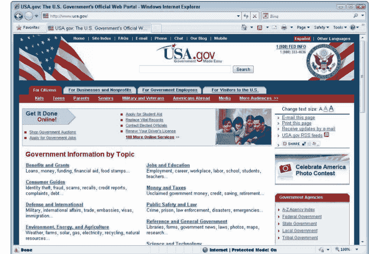

**图1-1：** USA.gov 使用超链接帮助访客查找政府信息。

网络浏览器专门用于读取 HTML 指令（称为*标记*）并显示生成的网页。

标记存在于文本文件中（连同你的内容），用于向浏览器发出指令。例如，查看图1-2所示的页面。通过检查其底层 HTML，你可以了解页面的组成和格式。

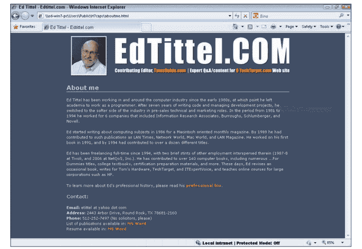

**图1-2：** 为了达到现在的良好外观，这个网页包含了多个部分以及大量的 HTML 和 CSS 标记。

该页面包括一张图片、一个描述页面的标题、几段关于作者之一的文本，以及一个包含指向简历和出版物列表链接的地址块。

然而，页面的不同组件使用了不同的格式：

- 页面顶部的标题比段落中的文本更大。
- 文本块之间的空白区域比块内连续文本行之间的空白更多。
- 一些文本是白色的，一些是橙色的，还有一些是浅蓝色的。

浏览器之所以知道如何以特定方式显示这些页面组件，要归功于*HTML 标记*，如清单1-1所示。（你将在本章末尾看到清单1-1的完整内容。）

任何包含在尖括号（小于号和大于号：< >）中的文本都是 HTML*标签*（通常称为*标记*）。例如，括号内的 p（`<p>...</p>`）标识段落内的文本。文件头部`<style>`和`</style>`标签之间的标记使用 CSS 来定义此页面上使用的各种 HTML 元素的外观和感觉。真的就是这么简单。你将标记嵌入文本文件中，连同供读者查看的文本，以告诉浏览器如何显示你的网页。

> 标签及其之间（和内部）的内容统称为*元素*。尖括号 < > 包含 HTML 和 XHTML 标记，花括号 { } 包含 CSS 标记。

## 浏览器

用户在网络拼图中的部分是网络浏览器。网络浏览器读取用 HTML、XHTML 和 CSS 编写的指令，并使用这些指令在屏幕上显示网页内容。

> 你编写 HTML 时，应始终考虑到人们将使用网络浏览器查看内容。请记住，存在不止一种浏览器，而且每种浏览器都有多个版本。

通常，网络浏览器通过互联网从网络服务器请求并显示网页。你也可以在将页面发布到互联网上的网络服务器之前，在自己的计算机上显示已保存的 HTML 页面。在开发自己的 HTML 页面时，你会在浏览器中查看这些页面（*称为本地页面*）。你可以使用本地页面很好地了解页面上线后人们看到的内容。

> *每个网络浏览器都以自己的方式解释 HTML*。相同的 HTML 在不同的浏览器中可能看起来并不完全一样。当你使用基本 HTML 时，差异会很小，但当你添加其他元素（如脚本和多媒体）时，渲染标记就会变得复杂。

第2章展示了如何使用网络浏览器查看你第一个网页的本地副本。

有些人使用纯文本网页浏览器，如 Lynx，因为：

- *他们有视觉障碍，无法使用图形显示。*
- *他们喜欢一个精简、快速的浏览器，只显示文本。*

### 一众浏览器

网络世界充满了各种形状和大小的浏览器——或者更准确地说，版本和功能集。一些流行的浏览器有 Microsoft Internet Explorer、Mozilla Firefox、Apple Safari 和 Google Chrome。其他浏览器，如 Opera 和 Lynx，也被广泛使用。作为 HTML 开发者，你必须超越你自己的浏览器体验和偏好来思考。每个用户都有他或她个人的浏览器偏好和设置。

每个浏览器渲染 HTML 的方式都有些不同。每个浏览器处理 JavaScript、多媒体、样式表和其他 HTML 插件的方式也不同。再加上不同的操作系统，事情就变得真正有趣了。

通常浏览器之间的差异很小。但有时 HTML、文本和媒体的组合会使特定的浏览器崩溃。使用 HTML 时，请在尽可能多的不同浏览器上测试你的页面。至少在自己的系统上安装三个不同的浏览器进行测试。我们推荐最新版本的 Internet Explorer、Firefox 和 Chrome。

雅虎！有一个相当完整的浏览器列表，位于：

```
http://dir.yahoo.com/Computers_and_Internet/Software/Internet/World_Wide_Web/Browsers
```

### 介绍互联网协议

浏览器和服务器之间的交互通过一套计算机通信指令实现：超文本传输协议（HTTP）。该协议定义了浏览器应如何请求网页，以及 Web 服务器应如何响应这些请求。

好消息是，Web 浏览器和服务器会为你完成所有 HTTP 工作，因此你只需将页面放在服务器上或在浏览器中输入 Web 地址即可。

HTTP 并不是互联网上唯一工作的协议。简单邮件传输协议（SMTP）和邮局协议（POP）使电子邮件交换成为可能，而文件传输协议（FTP）允许你上传、下载、移动、复制和删除互联网上的文件和文件夹。

要了解 HTTP 的工作原理，请查阅 David Gourley 和 Brian Totty 关于 HTTP 消息的章节，可以通过 Google 图书搜索，搜索词为“understanding http transactions”。访问 `http://books.google.com` 开始搜索，向下滚动直至看到“HTTP: the definitive guide”的链接，并查看第80页。

## 第一部分：认识 (X)HTML 和 CSS

每个 URL 组成部分都有助于定义网页或资源的位置：

- **协议：** 指定浏览器请求文件时遵循的协议。网页协议是`http://`（大多数 URL 的常见开头）。
- **域名：** 指向文件所在的常规网站（如`www.sun.com`）。一个域名可以托管几个文件（如个人网站）或数百万个文件（如大型企业网站，如`www.sun.com`）。
- **路径：** 命名必须导航的一系列文件夹，以到达特定文件。例如，要访问位于`developers`文件夹内的`evangcentral`文件夹中的文件，你需要使用`/developers/evangcentral/`路径。
- **文件名：** 指定浏览器访问目录路径中的哪个文件。

尽管图1-3中显示的 URL 无法公开访问，但它指向域名并提供了通往名为`file.html`的特定文件的路径：`http://www.domain.com/mainfolder/subfolder/file.html`

## 元素

元素是 (X)HTML 的构建块。你使用它们来描述页面上的每一部分文本。元素由标签和标签内的内容组成。元素有两种主要类型：

- ✔ 具有内容的元素，由一对标签以及开标签和闭标签之间的任何内容组成。
- ✔ 向页面插入内容的元素，使用单个标签。

# 第1章：关于 HTML、CSS 和 Web 你至少需要知道的

### 标签对

描述内容的元素使用一个*标签对*来标记元素的开始和结束。开始和结束标签对的格式如下：

```
<tag>…</tag>
```

内容——例如*段落*、*标题*、*表格*和*列表*——总是使用标签对：

- 开始标签（`<tag>`）告诉浏览器：“元素从这里开始。”
- 结束标签（`</tag>`）告诉浏览器：“元素到这里结束。”

实际内容位于开始标签和结束标签之间。例如，代码清单1-1中的 Ed Tittel 页面使用了一个段落元素（`<p>`）来包裹一段文字（为清晰起见，我们省略了 CSS 内联标记）：

```
<p>Ed started writing about computing subjects in 1986 for a
Macintosh oriented monthly magazine. By 1989 he had contributed to such
publications as LAN Times, Network World, Mac World, and LAN Magazine. He worked
on his first book in 1991, and by 1994 had contributed to over a dozen different
titles.</p>
```

### 单标签

将某些内容插入页面的元素称为*空元素*（因为它们不包含任何内容），并且只使用一个单独的标签，格式如下：

```
<tag />
```

图像和换行将某些内容插入 HTML 文件，因此它们使用一个标签。

XHTML 和 HTML 之间的一个关键区别是，在 XHTML 中，所有空元素必须在结束大于号之前以斜杠结束。这是因为 XHTML 基于 XML，而 XML 规则要求你使用斜杠来关闭空元素，格式如下：

```
<tag/>
```

但是，为了使这种标记在旧版浏览器中可读，你应该在结束斜杠前插入一个空格，格式如下：

```
<tag />
```

这个空格允许旧版浏览器忽略结束斜杠（因为它们不认识 XHTML）。理解 XHTML 的新版浏览器会忽略空格并精确解释标签，即`<tag/>`（根据 XML 规则）。

HTML 不需要在空元素中使用斜杠，但这种标记已被*弃用*（即，即使它仍在某些标记中出现，但被认定为过时）。一个 HTML 空元素如下所示：

```
<tag />
```

代码清单1-1使用了图像元素（``）来在页面上包含一张图片：

```

```


``元素引用一张图片。当浏览器显示页面时，它会用该元素指向的文件替换``元素（一个属性负责指向，如下一节所示）。遵循前面介绍的XHTML规则，HTML中的``在XHTML中出现为``（这适用于所有单标签元素）。

你不能随意编造HTML或XHTML元素。(X)HTML的合法元素属于一个非常特定的集合——如果你使用的元素不属于该集合，所有浏览器都会忽略它们。你可以使用的元素在HTML 4.01或XHTML 1.0规范中定义。（HTML 4.01的规范可以在`www.w3.org/TR/html4`找到，XHTML 1.0的规范可以在`www.w3.org/TR/xhtml1`找到。）

## 嵌套

许多页面结构都使用嵌套元素组合。可以把你的嵌套元素想象成可以整齐地相互套在一起的手提箱。

例如，一个项目符号列表使用两种元素：

- `<ul>`元素指定列表是无序的（项目符号）。
- `<li>`元素标记列表中的每个项目。

当你使用这种方法组合元素时，务必在关闭外部元素之前完全关闭内部元素：

```html
<ul>
  <li>Item 1</li>
  <li>Item 2</li>
</ul>
```

## 属性

属性允许元素在描述内容或工作方式上具有多样性。属性让你可以根据情况以不同方式使用元素。例如，``元素使用`src`属性来指定你想包含在页面上的图像位置：

```html

```

在这段HTML中，``元素本身是给浏览器的一个通用标志，表示你想要包含一张图像；`src`属性提供了你想要包含的图像的具体信息——在这个例子中是`header.gif`。其他属性（如`width`和`height`）提供了关于如何显示该图像的信息，而`alt`属性提供了图像的文本替代内容，供纯文本浏览器显示（或供文本转语音阅读器为视障人士朗读）。

第7章将详细描述``元素及其属性。

你在想要添加属性的元素的开始标签中包含属性——在元素名称之后，结束符号之前，格式如下：

```html
<tag attribute="value" attribute="value">
```

XML语法规则规定属性值必须始终用引号括起来，但你可以在开始标签或单标签中以任何顺序包含属性及其值。

每个(X)HTML元素都有一组可以与之一起使用的属性，但你不能随心所欲地混合搭配属性和元素。有些属性可以接受任何文本作为值，因为该值可以是任何东西，比如图像或你想要链接的页面的位置。其他属性有一组特定的可接受值，例如你在表格单元格中对齐文本的选项。

HTML 4.01和XHTML 1.0规范精确定义了对于任何给定元素你可以使用哪些属性，以及每个属性可以接受哪些值（如果明确定义的话）。

第二部分和第三部分的每一章都涵盖了你可以与每个(X)HTML元素一起使用的属性。此外，请参阅我们的在线内容，获取已弃用的(X)HTML标签和属性的完整列表。

## 实体

文本使Web成为可能，但它有其局限性。实体是你可以在Web页面上显示的特殊字符。

### 非ASCII字符

基本的美国信息交换标准代码（ASCII）文本定义了相当少数量的字符。它不包括一些特殊字符，例如商标符号、分数和带重音的字符。

例如，如果我们将图1-2页面上的一段文本翻译成德语，结果会包含三个带分音符（ü）的u字符，如图1-4所示。

**图1-4：** ASCII文本无法表示所有文本字符，因此HTML实体来完成这项工作。

ASCII文本不包括带分音符的u，因此HTML使用实体来表示此类字符。浏览器会将实体替换为它所引用的字符。每个实体以和号（`&`）开头，以分号（`;`）结尾；实体最初来自SGML，因此我们用紫色对其进行颜色编码以反映其来源。以下标记中加粗显示了实体：

```html
<html>
<head>
<style type="text/css">
  body {
    font-family: sans-serif;
    font-size: large;
  }
  cite {
    font-family: serif;
    font-style: italic;
  }
</style>
</style>
<title>Ed auf Deutsch</title>
</head>
<body>
<p>Ed Tittel hat seinen technischen Schriften im Jahre 1986 angefangen, als er
f&uuml;r einen Macintosh monatlichen Zeitschrift Artikeln schrieb. In drei mehr
Jahren, hat er auch f&uuml;r anderen Journalen wie <cite>LAN Times</cite>,
<cite>Network World</cite>, und <cite>LAN Magazine</cite> mehrere Artikeln
beigetragen. Er fertigte seinen ersten Buch im Jarhe 1991, und beim Ende des
Jahres 1994 hat er auf ein Dutzend B&uuml;cher gearbeitet.</p>
</body>
</html>
```

表示带分音符u的实体是`&uuml;`。

### (X)HTML字符码

ISO-Latin-1字符集的编码默认提供，相关的实体（指向完整表格的指针在第24章出现）可以调用并使用，无需特殊处理。但使用前面提到的其他编码则需要包含特殊标记来告诉浏览器它必须解释Unicode字符码。（Unicode是一个国际标准——实际上是ISO标准10646——它包含了足够的字符码来处理大多数独特的字母表，以及大量其他符号和非字母字符。）这种特殊标记的形式是`<meta http-equiv="Content-Type" content="text/html; charset=UTF-8">`，因为charset的值是UTF-8，你可以引用第24章中出现的常见Unicode值。

虽然当今的浏览器全面支持UTF-8，但你可以预期在明年或两年内看到对UTF-16字符码的支持出现。这将使浏览器能够更有效地处理非罗马字母，如阿拉伯语、片假名（日语）或韩文字母（韩语），一些浏览器目前在正确渲染这些文字时存在困难。

### 标签字符

熟悉HTML的软件会假设某些HTML字符，例如大于号和小于号，是打算隐藏的，不会显示在你完成的Web页面上。如果你确实想在页面上显示大于号或小于号，你必须向浏览器明确表达你的意图。以下实体允许你显示通常是隐藏HTML标记一部分的字符：

- 小于号（`<`）：`&lt;`
- 大于号（`>`）：`&gt;`
- 和号（`&`）：`&amp;`

## 清单1-1：认识一位作者！

清单1-1在此完整复制，通过颜色编码来区分其使用的各种标记类型。以防你认为这只是Ed的虚荣心，我们也赶快指出，这正是本书第16章所述“关于我”页面的基础，我们希望这只会让内容更有趣，而非相反！

## 清单1-1：Ed Tittel的“关于我”网页

```html
<!DOCTYPE html PUBLIC "-//W3C//DTD XHTML 1.0 Transitional//EN" "http://www.w3.org/TR/xhtml1/DTD/xhtml1-transitional.dtd">
<html xmlns="http://www.w3.org/1999/xhtml">
<head>
<meta http-equiv="Content-Type" content="text/html; charset=UTF-8" />
<title>Ed Tittel - Edtittel.com</title>
<style type="text/css">

body {
    background-image: url(images/background_page.gif);
    font-family: Verdana, Arial, Helvetica, sans-serif;
    font-size: .9em;
    line-height: 1.3;
    color: #FFF;
    margin: 0px;
    padding: 0px; }
#container{
    width: 794px;
    margin: 0px auto; }
#headerGraphic{
    background-image: url(images/header.gif);
;
    width: 794px;
    height: 160px; }
b {
    font-weight: bold;
    }
h2 {
    font-weight: bold;
    font-size: 1.5em;
    color:#96CDFF;
    border-bottom: 1px solid white; }

h1 {
    font-weight: bold;
    font-size: 1.2em;
    color:#96CDFF; }
ul{
    list-style-type: none;
    margin: 0px;
    padding: 0px; }
```

# 第1章：关于HTML、CSS与网络你至少需要了解的内容

```css
a:link {
  font-weight : bold;
  text-decoration : none;
  color: #FF7A00;
  background: transparent; }
a:visited {
  font-weight : bold;
  text-decoration : none;
  color: #91a3b4;
  background: transparent; }
a:hover {
  color: #FA0000;
  background: transparent;
  text-decoration : underline; }
a:active {
  color: #494949;
  background: transparent;
  font-weight : bold;
  text-decoration : underline; }
</style>
</head>
```

```html
<body>
<div id="container">
<!-- Ed的顶部图片和标题 -->
<div id="headerGraphic"></div>
<!-- 标题文本 -->
  <h2>关于我</h2>
  <!-- 段落 -->
```

Ed Tittel自20世纪80年代初就一直在这个计算机行业及其相关领域工作，当时他离开学术界成为了一名程序员。在写了七年代码并管理开发项目之后，他转向了行业内更偏“软性”的领域，从事售前技术和营销工作。从1981年到1994年，他先后为6家公司工作，包括Information Research Associates、Burroughs、Schlumberger和Novell。

Ed于1986年开始为一本面向Macintosh用户的月刊撰写计算机主题的文章。到1989年，他已经为《LAN Times》、《Network World》、《Mac World》和《LAN Magazine》等出版物撰稿。他在1991年开始参与第一本书的写作，到1994年，他已经参与了十几本不同书籍的撰写。

自1994年以来，Ed一直全职从事自由职业，其间有两段短暂的受雇经历（1987-88年在Tivoli，2006年在NetQoS, Inc.）。他已参与撰写了超过140本计算机书籍，其中包括众多《...For Dummies》系列、大学教材、认证备考材料等。如今，Ed偶尔修订一本书，为Tom's Hardware、TechTarget和ITExpertVoice撰稿，并为HP等大型公司教授在线课程。

要了解更多关于Ed的职业经历，请阅读他的`<a href="bio.htm">专业简历</a>`。

（续）

## 第一部分：认识(X)HTML和CSS

### 清单1-1（续）

```html
<!-- 副标题文本 -->
<h1>联系方式：</h1>
<!-- 列表 -->
<ul>
    <li><b>电子邮件：</b> etittel at yahoo dot com</li>
    <li><b>地址：</b> 2443 Arbor Drive, Round Rock, TX 78681-2160</li>
    <li><b>电话：</b> 512-252-7497（谢绝推销）</li>
    <li>可在此获取出版物列表：<a href="docs/v_et.doc" target="_blank">MS Word</a></li>
    <li>可在此获取简历：<a href="docs/Resu-et13.doc" target="_blank">MS Word</a></li>
</ul>
</div>
</body>
</html>
```

在书的一开始就看到这么一大堆HTML代码，可能会让人有点发懵。但请相信我们：只要你足够深入地阅读本书的内容，这一切都会变得非常清晰！

如果你访问本书的配套网站（`www.dummieshtml.com`），会发现它按章节划分。如果你下载第1章的资料，会找到清单1-1所示页面的源代码，文件名为`aboutme.html`。你还需要下载两个图片文件——`background_page.gif`和`header.gif`。本章中其他展示我们构建的网页的屏幕截图，其对应的HTML文件也包含在第1章下载包中（这个合集中没有名为`01fig01.html`的文件——那是山姆大叔的页面！——但你会找到名为`01fig04.html`和`01fig05.html`的页面）。

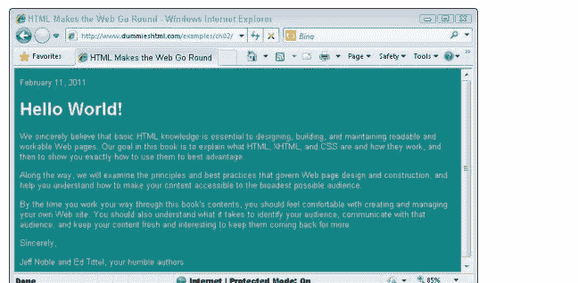

图2-8：Web服务器上的文件对任何拥有互联网连接的人都可用。

你可以设置自己的网络服务器来托管你的网页。为此，你需要：

- **一台指定为网络服务器的计算机：** 网络服务器通常专门用于此任务，将文字处理和其他活动留给不同的计算机。
- **网络服务器软件：** 常见的网络服务器软件包包括`Apache`和`Microsoft Internet Information Server (IIS)`，在现代Windows版本中称为Internet Information Services。

# 第一部分：了解(X)HTML和CSS

在网络世界中，Web服务器指的是两者：

- 一台专用计算机（实际的硬件）
- Web服务器软件

你无法只使用其中一项。

✔ **专用的、高速的互联网连接：** 如果一台Web服务器只在你启动拨号连接时才能接入互联网，那它既不实用也不可靠。如果它连接的互联网链路速度很慢（如今，速度慢指的是T-1速度或更低，即1.544 Mbps或以下），使用起来也可能很痛苦。

如果自己托管网站听起来既复杂又昂贵，你说对了。你不仅要为设备和互联网连接付费，还必须知道如何设置和管理Web服务器，并使其所有部分全天候（24/7）正常工作。对于网络托管新手来说，防范黑客、保护自己的数据或客户信息（信用卡号码、姓名、地址等）也可能是个问题。除了这些问题，你还得担心在停电或互联网服务提供商宕机时如何保持你的网站托管系统运行。所有这些网站托管问题累积成一大堆令人沮丧和头疼的事情，大多数人宁愿避开。只要有可能，优先考虑使用托管服务商。

`www.it-ebooks.info`

# 第3章：恰当的规划避免糟糕的页面性能

你可以使用FTP客户端，例如`SmartFTP`（`www.smartftp.com`）、`WS_FTP`（`www.ipswitch.com/Products/WS_FTP`）和免费的`FileZilla`（`filezilla-project.org`），来连接到FTP URL。（Macintosh用户可能更喜欢`Fetch`（`www.fetchsoftworks.com`）或`Cyberduck`（`cyberduck.ch`）。）你的服务商会提供一个用户名和密码，供你通过FTP访问你的Web服务器目录。然后你可以使用客户端界面将文件移动到你的网站。真的就这么简单。如果你想从网站获取文件的副本并修改它，你可以通过三个步骤完成：

1. 使用FTP客户端界面下载副本。
2. 进行修改。
3. 使用FTP客户端界面上传修改后的文件。


每个FTP客户端的界面都不同，但它们都非常简单。第23章包含了更多关于寻找好的FTP客户端的信息；所以当你找到一个时，花几分钟阅读它的文档。

你可能不需要FTP软件来将文件移动到Web服务器：

- 许多浏览器，如当前版本的`Internet Explorer`和`Firefox`，包含基本的内置FTP支持。你可以上传或下载文件，但可能无法创建或删除目录。
- 许多Web实用程序，如`Dreamweaver`，也包含文件管理功能。

## 使用托管服务商的网站传输文件

为了提高可用性并减少技术支持电话，许多网站托管服务商提供网页来帮助你上传和管理网站文件，而无需使用单独的FTP实用程序，甚至无需使用(X)HTML编辑器内的FTP工具。大多数这些工具让你以各种方式管理你的网站，例如：

- 上传和下载文件
- 创建和删除目录
- 移动文件
- 删除文件

如果你与托管服务商合作，了解它是否有一套基于Web的工具来管理你的网站。

> 如果你想对列表的格式有更多控制权，包括使用自己的图形作为项目符号，可以使用`CSS`。

## 定义列表

定义列表将术语和定义分组到一个列表中，需要三个不同的元素来完成列表：

- `<dl>`：包含列表定义（`dl` = definition list）


- `<dt>`：定义列表中的一个术语（dt = definition term）
- `<dd>`：为术语定义一个定义（dd = definition list definition）

你可以在列表（`<dl>`）中根据需要拥有任意数量的术语（由`<dt>`定义）。每个术语可以有一个或多个定义（由`<dd>`定义）。

创建一个包含两个项目的定义列表需要以下顺序的元素和内容：

1. `<dl>`
2. `<dt>`
3. 第一个术语名称
4. `</dt>`
5. `<dd>`
6. 第一个项目定义的内容
7. `</dd>`
8. `<dt>`
9. 第二个术语名称
10. `</dt>`
11. `<dd>`
12. 第二个项目定义的内容
13. `</dd>`
14. `</dl>`

以下定义列表包含三个术语，其中一个有两个定义：

```
<!DOCTYPE html PUBLIC "-//W3C//DTD XHTML 1.0 Transitional//EN"
   "http://www.w3.org/TR/xhtml1/DTD/xhtml1-transitional.dtd">
<html xmlns="http://www.w3.org/1999/xhtml" xml:lang="en" lang="en">
   <head>
      <meta http-equiv="Content-Type" content="text/html; charset=ISO-8859-1" />
      <title>Definition Lists</title>
   </head>

   <body>
      <h1>Markup Language Definitions</h1>
      <dl>
         <dt>SGML</dt>
            <dd>The Standard Generalized Markup Language</dd>
         <dt>HTML</dt>
            <dd>The Hypertext Markup Language</dd>
            <dd>The markup language you use to create Web pages.</dd>
         <dt>XML</dt>
            <dd>The Extensible Markup Language</dd>
      </dl>
   </body>
</html>
```

图5-13展示了浏览器如何显示这个HTML。

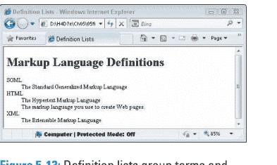

**图5-13**：定义列表将术语及其相关定义分组到一个列表中。

> 如果你认为列表中的项目靠得太近，可以使用CSS样式仔细控制列表外观的各个方面，如第9章所示。

请注意，定义列表在不同浏览器中的显示方式通常不同，搜索引擎或文本转语音翻译器对它们的处理也不总是相同。About.com在`http://webdesign.about.com/od/htmltags/a/aa112006.htm`上对定义列表有一个很好的讨论。唉，这意味着定义列表可能不是你创建的列表（甚至是定义列表）的最佳格式选择。有关此主题的精彩内容，请参阅`www.maxdesign.com.au/articles/definition`以获取更详细的讨论。

### 列表嵌套

你可以通过将列表*嵌套*在列表中来创建子类别。嵌套列表的一些常见用途包括：

- 站点地图和其他导航工具
- 在线书籍和论文的目录
- 大纲

你可以组合三种列表中的任何一种来创建*嵌套列表*，例如多级目录，或者将编号标题与最低级别大纲中的项目符号列表项混合的大纲。

以下示例以一个编号列表开始，该列表定义了当天要做的事情清单，并使用三个无序列表将这些项目进一步分解为具体任务：

```
<!DOCTYPE HTML PUBLIC "-//W3C//DTD HTML 4.01 Transitional//EN">
<html>
  <head>
    <meta http-equiv="Content-Type" content="text/html; charset=UTF-8">
    <title>Nested Lists</title>
  </head>

  <body>
    <h1>Things to do today</h1>
    <ol>
      <li>Feed cat
        <ul>
          <li>Rinse bowl</li>
          <li>Open cat food</li>
          <li>Mix dry and wet food in bowl</li>
          <li>Deliver on a silver platter to Pixel</li>
        </ul></li>
      <li>Wash car
        <ul>
          <li>Vacuum interior</li>
          <li>Wash exterior</li>
          <li>Wax exterior</li>
        </ul></li>
      <li>Grocery shopping
        <ul>
          <li>Plan meals</li>
          <li>Clean out fridge</li>
          <li>Make list</li>
          <li>Go to store</li>
        </ul></li>
    </ol>
  </body>
</html>
```

所有嵌套列表都遵循相同的标记模式：

- 顶级有序列表中的每个列表项后面都跟着一个完整的二级列表。
- 二级列表位于顶级列表内部，而不是在列表项内部。

图5-14展示了浏览器如何在其显示中反映这种嵌套。

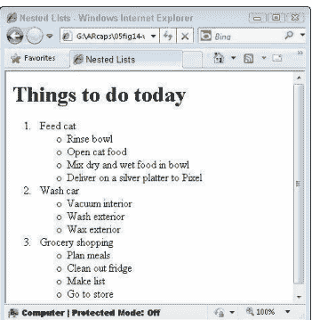

> 在构建嵌套列表时，请仔细注意开始和结束标签。*最后打开的最先关闭*是一个重要的公理。如果你没有正确地打开和关闭标签，列表可能不会使用一致的缩进或编号，或者文本可能因为某个列表从未正确关闭而缩进不正确。

# 第6章：链接到在线资源

## 本章内容

- 创建简单链接
- 在新窗口中打开链接的页面
- 设置指向网页内特定位置的链接
- 创建指向非网页资源的链接

超链接，或简称链接，连接Web上的`(X)HTML`页面和其他资源。当你在页面上包含一个链接时，你就使访问者能够从你的页面导航到另一个网站、你网站上的另一个页面，甚至是同一页面上的另一个位置。没有链接，页面就是孤立的，与Web的其他部分断开连接。有了链接，该页面就成为万维网这个近乎无限的信息集合的一部分。

## 基本链接

要创建一个链接，你需要：

- **网页地址**（称为统一资源定位符；URL），它指向你的链接目标网站或文件。这通常以`http://`开头。
- 你网页中的一些**文本**，用于标记或描述链接。
  - 尝试确保你使用的文本能说明所链接资源的有用信息。
- **一个带有`href`属性的锚元素（`<a>`）**，将所有内容连接在一起。
  - 用于创建链接的元素称为*锚元素*，因为你使用它将URL锚定到页面上的某些文本。当用户在浏览器中查看你的页面时，他们可以单击文本以激活链接并访问你在该链接中指定的URL页面。你将完整的URL插入到`href`属性中。这告诉链接要去哪里。

# 第二部分：使用 (X)HTML 格式化网页

你可以把基本链接的结构想象成一个芝士汉堡（或者你偏好的纯素替代品）。URL 是奶酪，链接文本是肉饼，锚点标签则是面包。很美味，对吧？

例如，如果你有一个描述 HTML 标准的网页，你可能希望将网页浏览者引导至万维网联盟（W3C）——这个负责所有与`(X)HTML`标准相关事务的组织。一个指向 W3C 网站`www.w3.org`的基本链接看起来是这样的：

```
<p>The <a href="http://www.w3.org">World Wide Web Consortium</a> is the standards body that oversees the ongoing development of the XHTML specification.</p>
```

你在锚点元素的`href`属性中指定链接的 URL（`http://www.w3.org`）。锚点元素的开始标签（`<a>`）和结束标签（`</a>`）之间的文本（World Wide Web Consortium）用于标记或描述该链接。

图6-1显示了浏览器如何显示这段标记。

**图6-1：** 一个包含指向 W3C 链接的段落。

你也可以将 URL 锚定到图像，这样用户点击图像就能激活链接。关于如何创建带链接的图像，更多信息请参见第7章。关于 URL 的来龙去脉的详细讨论，请参见第1章。

### 链接选项

你可以链接到各种在线资源：

- 其他`(X)HTML`页面（无论是在你的网站还是另一个网站上）
- 同一`(X)HTML`页面上的不同位置
- 甚至不是`(X)HTML`页面的资源，例如电子邮件地址、图片和文本文件

### 锚点元素不是块级元素

锚点元素是*内联元素*——也就是说，它们作用于文本块（你想要用作链接的文本）中的几个单词或字符，而不是为文本块定义格式。锚点元素通常位于段落（`<p>`）或其他块级元素（如段落或列表项）内部。创建链接时，你应该始终将其创建在一个块级元素内，例如段落、列表项、标题，甚至是表格单元格。关于块级元素的更多信息，请参阅第5章。

尽管即使你不将它们嵌套在块级元素中，许多 Web 浏览器也能很好地显示锚点，但有些浏览器（如下所列）并不能很好地处理这种对`(X)HTML`语法的违反：

- 用于手持设备或移动电话的纯文本浏览器
- 用于视障人士的文本转语音阅读器

基于文本的浏览器依赖块级元素来正确划分页面的各个部分。如果没有块级元素，这些浏览器可能会在错误的位置显示你的链接。

链接的位置、说明和目标对网站访问者如何看待链接有巨大影响。第3章介绍了在网站设计中使用链接的最佳实践。

你创建的链接类型取决于你链接到的位置。

### 绝对链接

*绝对链接*使用完整的 URL 将浏览器连接到网页或在线资源。

使用完整 URL 指向资源的链接被称为*绝对链接*，因为它们提供了指向另一个 Web 资源的完整、独立的路径。当你链接到别人网站上的一个页面时，Web 浏览器需要 URL 中的每一点信息来找到该页面。浏览器从 URL 中的域名开始，沿着路径找到特定文件。

当你链接到别人网站上的文件时，你必须始终在锚点元素的`href`属性中使用绝对 URL。例如：

```
http://www.website.com/directory/page.html
```

### 相对链接

*相对链接*使用一种简写形式来指定你所指向资源的 URL。

在你的`(X)HTML`页面中使用相对链接时，请遵循以下准则：

1. 在同一域内的资源之间创建相对链接。
2. 由于两个资源都在同一域中，因此从 URL 中省略域信息。

> *相对* URL 使用你链接来源的资源位置来识别你链接目标的资源位置（例如，`page.html`）。

相对链接类似于告诉某人他或她需要去东区购物中心。如果这个人已经知道东区购物中心在哪里，他或她就不需要额外的指引。Web 浏览器的工作方式也是一样的。

如果你在网站上使用相对链接，即使你更改了以下内容，你的链接仍然有效：

1. 服务器
2. 域名

### 简单链接

当在同一网站上的页面之间创建链接时，你可以利用相对 URL。如果你想从`http://www.mysite.com/home.html`链接到`http://www.mysite.com/about.html`，你可以在`home.html`的一个锚点元素中使用这个简化的相对 URL：

```
<p>Learn more <a href="about.html">about</a> our company.</p>
```

当浏览器看到一个没有域名的链接时，浏览器会认为该链接是*相对的*，并使用链接页面的域名和路径来查找被链接的页面。不过，前面的示例仅在`home.html`和`about.html`位于同一目录时有效。

### 站点链接

随着你的站点变得更加复杂，并且你将文件组织到各种文件夹中，你仍然可以使用相对链接。但是，你必须在相对 URL 中提供额外信息，以帮助浏览器找到不与你链接所在文件位于同一目录的文件。

在文件名前使用`../`（两个句点加一个斜杠），表示浏览器应向上移动一级目录结构。

此过程的标记如下所示：

```
<a href="../docs/home.html">Documentation home</a>
```

# 第6章：链接到在线资源

## `http://` 在 (X)HTML 链接中的重要性

浏览器使网上冲浪尽可能简单。如果你在浏览器的地址栏中输入**www.sun.com**、**sun.com**，或者甚至常常只输入**sun**，浏览器都会贴心地调出`http://www.sun.com`。虽然当你在浏览器窗口中键入 URL 时此技巧有效，但当你编写标记时，它并不起作用。

你在 HTML 标记中使用的 URL 必须是*完全规范的*（在每个细节上都完整）。浏览器不会解释不包含页面协议的 URL。如果你忘记了`http://`，你的链接可能无法工作！

这个锚点元素中的标记指示浏览器：

1. 从链接文档所在的文件夹向上移动一级文件夹。
2. 找到一个名为**docs**的文件夹。
3. 找到一个名为**home.html**的文件。

创建相对链接时，链接目标文件的位置始终是相对于链接来源文件的位置。创建相对 URL 时，请追踪浏览器从链接来源页面到链接目标页面所采取的路径。该路径定义了你需要的 URL。

## 常见错误

每个 Web 资源——站点、页面或图像——都有一个唯一的 URL。URL 中即使一个字母不正确也会产生一个*死链*，从而导致错误页面（通常是 HTTP 错误`404 File or directory not found`）。

URL 如此挑剔，以至于一个简单的拼写错误就会破坏链接。

如果一个 URL 不起作用，请尝试以下策略：

> 检查大小写。一些 Web 服务器（尤其是 Linux 和 Unix）是*区分大小写的*（它们区分大小写字母）。例如，这样的服务器将文件名`Bios.html`和`bios.html`视为 Web 服务器上的不同文件。这意味着任何寻找特定 URL 的浏览器在必要时*必须*使用正确的大写和小写字母。确保链接中的大小写与 URL 的大小写匹配。

## 96 第二部分：使用 (X)HTML 格式化网页

为避免网站文件出现问题，请遵循标准的命名规范。通常，仅使用小写字母可以简化你的工作。

1. **检查扩展名。** `.Bios.htm`和`.Bios.html`是两个不同的文件。如果你的链接 URL 使用一种扩展名，而实际文件名使用另一种，你的链接将无法工作。

   为避免网站扩展名出现问题，请选择`.html`或`.htm`中的一种*并坚持使用该扩展名*。

2. **检查文件名。** 例如，`bio.html`和`bios.html`是两个不同的文件。

3. **复制和粘贴。** 如果可以复制 URL，请避免重新输入。创建有效 URL 最好且最可靠的方法如下：
   1. 在浏览器中加载一个页面。
   2. 从浏览器的地址栏或链接文本框中复制 URL。
   3. 将 URL 粘贴到你的`(X)HTML`标记中。

通过复制粘贴方式获取 URL 的前提是，你是从某个网站上获取它们。如果你在浏览器中打开电脑上的本地文件，你会看到类似这样的内容：`file:\\I:\H4D6e\html_letter.html`。以下是解读它的方法：

1. `file:\\`是 Internet Explorer 的一个约定，用于将文档标识为本地文件系统中的文件。
2. `I:\`是一个驱动器号。
3. `H4D6e\`是该驱动器上的一个文件夹或目录。
4. `html_letter.html`——在此示例中是最右边的文本元素——是你打开的 HTML 文件的名称。

你无法在网站上使用这样的 URL，所以请不要尝试！

我们大多数人至少都曾因地址不完整或不准确而收到过被标记为“无法投递”的退回信件。当地址不正确时，邮局无法知道如何找到预期的收件人。URL 也是如此。没有一个完整的 URL，Web 服务器就不知道如何定位目标网页。URL 通常采用以下形式：

1. **协议标识符后跟冒号 (`:`)**——这通常是`http`（超文本传输协议）、`https`（用于安全服务器站点）或`ftp`（用于文件传输站点）。
2. **主机名**——这通常是域名（如`edittel.com`）或 IP 地址。主机名前面总是有两个斜杠 (`//`)。
3. **目录路径**——目录路径前面有一个正斜杠 (`/`)，它们将用户引导至所需的特定网页。

因此，一个完整 URL 的形式是`<protocolidentifier>://<hostname>/<directorypath>`或`http://www.mywebsite.com/mywebpage`。

## 第6章：链接在线资源

### 自定义链接

你可以自定义链接以：

- 在新窗口中打开链接的文档
- 链接到你自己的网页中*内部*的特定位置
- 链接到`(X)HTML`页面以外的项目，例如：
  - 可移植文档格式（PDF）文件
  - 压缩文件
  - 文字处理文档

### 新窗口

Web 之所以能运作，是因为你可以通过使用简单的锚点元素，将你网站上的页面链接到其他人网站上的页面。然而，当你链接到别人的网站时，你实际上是将用户从你自己的网站送走了。


为了将用户留在你的网站上，`HTML` 可以在新的浏览器窗口或当前窗口内的新标签页中打开链接的页面。（`Internet Explorer`、`Firefox`、`Chrome` 和其他浏览器会打开新标签页。如果你愿意，可以设置 `Internet Explorer` 和其他浏览器的首选项，使其在新窗口中而不是新标签页中打开。）只需在锚点元素中添加 `target` 属性，就可以在新浏览器窗口（或标签页）中打开该链接，而不是在当前窗口中打开：

```html
<p>The <a href="http://www.w3.org" target="_blank">World Wide Web Consortium</a> is the standards body that oversees the ongoing development of the XHTML specification.</p>
```

当你给 `target` 属性一个 `_blank` 值时，这告诉浏览器：

1. 保持链接页面在当前窗口中打开。
2. 在新窗口或标签页中打开链接的页面。

无论你使用哪种文档类型 (`DTD`)（严格或过渡），如果你给锚点添加 `target`，都可能使你的代码无效。如果你使用严格 `DTD`，那么打开新窗口或任何使用 `target` 属性的行为都会使你的标记无效。如果你在给锚点添加 `target` 之前就知道你使用的是哪种文档类型，这可以为你节省数小时的时间（更不用说头痛了！），否则当你标记无法验证并且试图找出原因时会很麻烦！`DTD` 在第 4 章中有详细介绍，更多信息请查阅该章。

使用 `target="_blank"` 属性的结果如图 6-2 所示。

弹出窗口会惹恼一些用户。请谨慎使用此技术，并且要节制。此外，使用 `target` 属性在 `XHTML` 严格 `DTD` 中无法通过验证（但在过渡 `DTD` 中可以正常工作）。

你可以使用 `JavaScript` 来控制弹出窗口的大小、位置和外观，还可以在它们上面放置按钮以帮助用户快速关闭它们。第 13 章更详细地介绍了弹出窗口——包括 `JavaScript` 细节。

### 网页中的位置

网页内的位置可以被标记，以便由以下位置的链接直接访问：

- 同一页面
- 同一网站
- 其他网站

在向网页添加链接时，请记住以下几点：

- 与一个带有内部链接的长页面相比，几个短页面可能为读者呈现信息更方便。
- 大页面中的链接非常适合快速访问目录、内容表和术语表。
- 文档内链接在你自己的网站上效果最好，在那里你可以创建和控制标记。
- 当你链接到别人网站上的位置时，你就受制于其管理员，因为那个人控制着可链接的位置。如果你链接的任何位置被网站设计者删除或重命名，你的链接将会失效。

### 命名链接位置

要在页面内标识和创建一个位置，以便其他链接可以直接访问，请使用带有 `name` 属性的空锚点元素，如下所示：

```html
<a name="top"></a>
```

标记该位置的锚点元素不会影响任何周围内容的外观。你可以在需要的地方标记位置，而无需担心你的页面外观会因此发生（或改变）变化。

### 链接到命名的位置

如前所述，你可以标记位置，以便由以下位置的链接直接访问：

- 同一页面内
- 同一网站内
- 其他网站上

### 在同一页面内

链接可以帮助用户在单个网页中导航。文档内超链接包括以下常见功能：

- 返回顶部链接
- 目录

*文档内超链接*，也称为命名文档链接，使用这样的 `URL`：

```html
<a href="#top">Back to top</a>
```

井号 (`#`) 表示你指向的是当前页面上的一个位置，而不是另一个页面。

清单 6-1 展示了两个锚点元素如何结合以链接到同一页面上的一个位置。（使用文档内链接的文档通常较长。本文档较短，因此你可以轻松看到如何使用 `top` 锚点元素。）

#### 清单 6-1：文档内超链接

```html
<!DOCTYPE html PUBLIC "-//W3C//DTD XHTML 1.0 Transitional//EN"
    "http://www.w3.org/TR/xhtml1/DTD/xhtml1-transitional.dtd">
<html xmlns="http://www.w3.org/1999/xhtml" lang="en" xml:lang="en">

<head>
    <meta http-equiv="Content-Type" content="text/html; charset=ISO-8859-1" />
    <title>Intradocument hyperlinks at work</title>
</head>

<body>
    <h1><a name="top"></a>Web-Based Training</h1>

    <p>Given the importance of the Web to businesses and other organizations,
    individuals who seek to improve job skills, or fulfill essential job
    functions, are turning to HTML and XML for training. We believe this
    provides an outstanding opportunity for participation in an active and
    lucrative adult and continuing education market.</p>

    <p><a href="#top">Back to top</a></p>

</body>
</html>
```

# 第6章：链接到在线资源

图6-3展示了这段 `HTML` 标记在浏览器中的显示效果。如果用户点击"返回顶部"链接，浏览器将跳转到标记为 `<a name="top"></a>` 的 `top` 位置。本例中的文本很短，但你可以通过调整浏览器窗口大小，使其每行只显示两三个单词，来观察其工作方式。

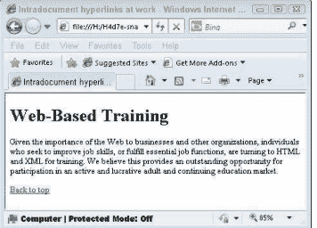

### 在同一网站内

你可以结合使用文档内链接和文档间链接，将访问者引导到你网站上其他网页的特定位置。因此，要链接到你网站上名为 `home.html` 页面中名为 `descriptions` 的位置，请使用以下标记：

```
<p>Review the <a href="home.html#descriptions">document descriptions</a>
    to find the documentation for your particular product.</p>
```

### 在其他网站上

如果你知道另一个网站的某个页面上有标记的位置，你可以使用绝对 `URL` 来指向该页面上的特定位置，如下所示：

```
<p>Find out how to
<a href="http://www.yourcompany.com/training/online.htm#register">
register</a> for upcoming training courses led by our instructors.</p>
```


请务必定期检查所有链接，以便发现并修复失效链接。

开放目录项目提供了一份详尽的免费和商业工具列表，可帮助你更轻松地查找和修复失效链接：

```
http://www.dmoz.org/Computers/Software/Internet/Site_Management/Link_Management/
```

# 第二部分：使用(X)HTML格式化网页

## 非HTML资源

链接可以连接到几乎任何类型的文件，例如：

- 文字处理文档
- 电子表格
- PDF文件
- 压缩文件
- 多媒体文件

非HTML链接的两个绝佳用途是软件下载页面和PDF下载页面。

### 文件下载

非Web文件也必须通过互联网访问，因此它们拥有与HTML页面一样的唯一`URL`。Web服务器上的任何文件（无论其类型）都可以使用`URL`进行链接。

例如，如果你想让用户从网页上下载一个名为 `doc.pdf` 的PDF文件和一个名为 `software.zip` 的Zip压缩包，你可以使用以下HTML代码：

```
<h1>Download the new version of our software</h1>
<p><a href="software.zip">Software</a></p>
<p><a href="doc.pdf">Documentation</a></p>
```


你无法预知任何用户的浏览器在点击指向非Web文件的链接时会如何响应。浏览器可能会：

- 提示用户保存文件
- 显示文件而不进行下载（对于PDF文件很常见）
- 显示错误消息（如果浏览器无法处理或无法识别相关文件类型）


为帮助用户成功下载文件，你应该向用户提供：

- 关于所使用文件格式的尽可能多的信息
- 处理文件所需的任何特殊工具
- 压缩文件：要处理Zip文件的内容，如果用户的操作系统不原生支持Zip文件，他们需要一个压缩工具，如`WinZip`或`ZipIt`。
- PDF文件：要查看PDF文件，用户需要免费的`Adobe Acrobat Reader`。

你可以通过添加支持性文本和链接，使下载标记更友好，如下所示：

```
<h1>Download our new software</h1>
<p> <a href="software.zip">Software</a> </p>
<p><b>Note:</b>
 You need a zip utility such as
<a href="http://www.7-zip.org">7Zip</a> (Windows) or
<a href="http://www.maczipit.com">ZipIt</a> (Macintosh)
 to open this file.</p>
<p><a href="doc.pdf">Documentation</a> </p>
<p><b>Note:</b> You need the free
<a href="http://get.adobe.com/reader/">Adobe Reader</a>
 to view this file.</p>
```

图6-4展示了浏览器如何渲染此HTML，以及当你点击`Software`链接时它显示的对话框。

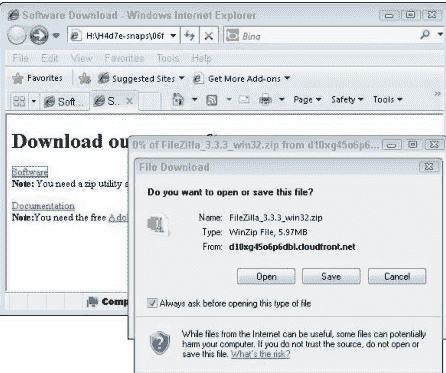

### 电子邮件地址

链接到电子邮件地址可以自动打开一封新邮件，并预填好正确的收件人地址。

这是帮助用户向你发送评论和请求邮件的好方法。

电子邮件链接使用标准的锚元素（`anchor element`）和 `href` 属性。`href` 属性的值是接收方的电子邮件地址，并以 `mailto:` 为前缀。

```
<p>Send us your
<a href="mailto:comments@mysite.com">comments</a>.</p>
```

用户的浏览器配置控制着浏览器如何处理电子邮件链接。大多数浏览器会自动执行以下两个基本步骤：

1. 在默认的电子邮件程序中打开一个新的消息窗口。
2. 将 `href` 属性中的地址插入到消息的"收件人"字段中。


不幸的是，网页上的 `mailto:` 链接是垃圾邮件发送者获取电子邮件地址的主要来源。创建一个表单来接收反馈通常是个更好的主意；更好的做法是使用`JavaScript`对电子邮件地址进行加密。（更多信息，请参阅`Steven Chapman`的优秀文章"隐藏你的电子邮件地址"，网址为 `http://javascript.about.com/library/blemail1.htm`。）我们通常倾向于以 `jeff at conquest media dot com` 的形式提供我们的电子邮件地址，知道人们足够聪明，会用 `@` 替换 `at`，用 `.` 替换 `dot`，但地址收集者通常没那么精明。如果你确实选择使用表单，请注意这也可能带来安全问题——务必验证你的输入，或采取措施避免所谓的`SQL`注入攻击。更多信息，请参阅`Colin Mackay`的文章"SQL注入攻击及一些预防技巧"，网址为 `www.codeproject.com/KB/database/SQLInjectionAttacks.aspx`。

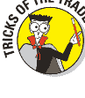

# 第7章：查找和使用图像

**本章内容**

- 确定图像的正确格式
- 将图像添加到网页中
- 创建触发链接的图像和图像映射

网页设计师使用图像来传递重要信息、引导网站导航，并为网页的整体外观和感觉做出贡献。然而，你必须正确使用图像，否则可能会降低其效果。

使用得当时，图像是页面设计的关键元素。但使用不当时，它们会使页面难以阅读、难以理解或无法访问。

本章是关于在网页上使用图像的速成课程。你将了解哪些图像格式适合网页使用，以及如何使用(X)HTML元素将图像添加到你的网页中。你还将了解如何为图像附加链接以及如何为网页创建图像映射。


## 图像在网页中的作用

网站中的图像可能是徽标或可点击的导航辅助工具，或者用于展示内容；它们也可以使页面看起来更美观，或用于统一或阐释页面的主题。一个完美的例子是白宫主页 `www.whitehouse.gov`（如图7-1所示），它展示了图像增强和贡献网页的多种方式，白宫徽标、照片甚至美国国玺都得到了很好的运用。

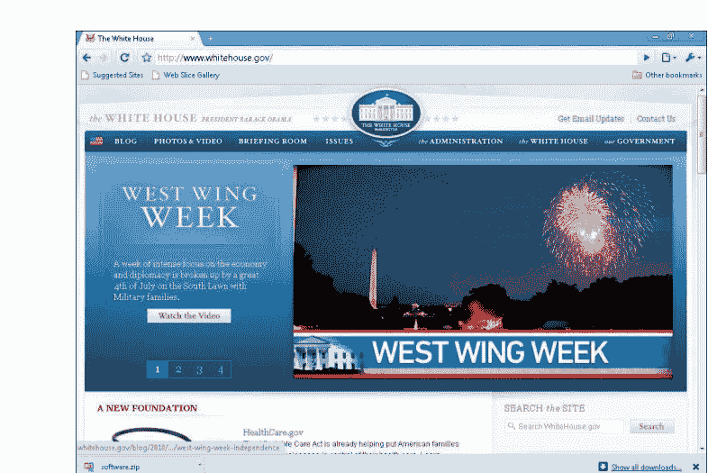

图7-1：白宫网页以多种方式使用了图像。

### 创建适合网页的图像

你可以以多种方式创建和保存图形，但只有少数格式确实适合你打算在网页上使用的图像。在创建适合网页的图像时，你必须注意文件格式和大小。

通常，图形文件格式是特定于操作系统或软件应用程序的。因为你无法预测访问者的计算机和软件会是什么（除了他或她会使用某种网页浏览器），你需要任何人都能用任何浏览器查看的图像。这意味着你需要使用 *跨平台* 的文件格式，用户可以使用任何版本的`Microsoft Windows`、`Mac OS`或`Linux`进行查看。

这三种压缩图形格式最适合网页通用：

- **图形交换格式（GIF）：** 保存为`GIF`的图像通常比保存为其他文件格式的图像更小。`GIF`仅支持最多256种颜色，因此如果你尝试将使用数百万种颜色创建的图像保存为`GIF`，你会损失图像质量。`GIF`是用于不太复杂的非摄影图像的最佳格式，例如线条图和剪贴画。

## 联合图像专家小组（JPEG）：** `JPEG`文件格式支持24位色深（数百万种颜色）和复杂图像，例如照片。`JPEG`具有跨平台和应用程序无关性。优秀的图像编辑工具可以帮助您调整压缩设置，从而在图像质量和文件大小之间取得最佳平衡。

**便携式网络图形（PNG）：** `PNG`是较新的跨平台且与应用程序无关的图像文件格式。它的开发旨在融合`GIF`和`JPEG`的优点。`PNG`采用与`GIF`相同的压缩方式，但像`JPEG`一样支持24位色深（甚至32位色深）。

任何优秀的图形编辑工具，例如第23章提到的那些工具，都允许您将图像保存为这些格式中的任何一种。尝试它们，观察将图形从一种格式转换为另一种格式如何改变其外观和文件大小，然后选择能产生最佳效果的格式。

表7-1显示了根据类型选择图像文件格式的指南。

| 文件格式 | 最佳用途 | 注意事项 |
| :--- | :--- | :--- |
| GIF | 线条图和其他颜色较少、细节不复杂的图像 | 如果您的图像或照片很复杂，请不要使用此格式。 |
| JPEG | 照片和其他具有数百万种颜色和大量细节的图像 | 不要用于线条图。压缩文件时，此格式会过多地牺牲质量。 |
| PNG | 照片和其他具有数百万种颜色和大量细节的图像 | 不要用于线条图。`PNG`在质量和文件大小之间提供了最佳平衡。 |

### 优化图像

在为网页制作图形时，请在文件质量和文件大小之间保持良好的平衡。如果您用喜欢的搜索引擎查找，可以找到关于缩减图像文件大小和为快速下载优化整个网站的优秀教程。要获取帮助您构建快速下载页面的技巧和窍门，请查看这些便捷资源：

- 优化图像：`www.yourhtmlsource.com/optimisation/image_optimisation.html`
- 优化网页图形：`www.websiteoptimization.com/speed/12`
- 要全面了解图形格式，请访问`W3C`的"Web上的图形"文章：`www.w3.org/Graphics`
- `Quackit.com`的网页图形教程：`www.quackit.com/web_graphics/tutorial`

### 将图像添加到网页

当图像准备好用于Web时，您需要使用正确的标记将其添加到页面，但您还需要知道将图像存储在哪里。

### 图像位置

您可以将网站的图像存储在多个地方。如果使用*相对*`URL`，图像存储效果最佳——将其存储在网站上与其他（X）HTML文件相同的位置。您可以将图像存储在与（X）HTML文件相同的根目录下，但如果文件很多，这会造成混淆；或者您可以在网站的根文件中创建一个`graphics`或`images`目录。

相对链接连接同一网站上的资源。绝对链接用于连接两个不同网站上的资源。有关相对链接和绝对链接之间差异的完整讨论，请参阅第6章。

以下是将图像存储在自己网站上的三个令人信服的理由：


- **控制权：** 当图像存储在您的网站上时，您可以完全控制它们。您知道您的图像不会消失或改变，并且可以致力于优化它们。

- **速度：** 如果您链接到其他网站上的图像，您永远不知道那个网站何时可能宕机或响应慢得令人难以置信。链接到其他网站上的图像还会导致该网站的所有者为在您的页面（另一个网站上！）显示该图像所需的带宽付费。

- **版权：** 如果您链接到另一个网站上的图像以在您的页面上显示它们，您可能违反版权法。如果必须这样做，请获得版权所有者的许可，以便在您的网站上存储和显示图像。

## 使用 `` 元素

图像（``）元素是一个*空元素*（有时称为*单标签*），您将其放置在页面上您希望图像出现的位置。

空元素仅使用一个标签，没有单独的开始标签或结束标签。

以下标记将一个名为`07fg02-cd.jpg`的图像放置在两个段落之间，该图像与（X）HTML文件保存在同一目录中：

```
<!DOCTYPE html PUBLIC "-//W3C//DTD XHTML 1.0 Transitional//EN"
    "http://www.w3.org/TR/xhtml1/DTD/xhtml1-transitional.dtd">
<html xmlns="http://www.w3.org/1999/xhtml" lang="en" xml:lang="en">
<head>
    <meta http-equiv="Content-Type" content="text/html; charset=ISO-8859-1" />
    <title>Optical Disks at Work</title>
</head>
<body>
    <h1>CD/DVD as a Storage Medium</h1>
    <p>CD-ROMs and DVDs have become a standard storage option in today's computing
    world because they are inexpensive and easy to use.</p>
    
    <p>To read from a CD or DVD, you only need a standard CD-ROM drive, but to
    create CDs or DVDs, you need a DVD burner (all DVD burners can read
    and write CDs as well).</p>
</body>
</html>
```

Web浏览器会将``元素替换为作为`src`属性值提供的图像文件，如图7-2所示。

`src`属性类似于您在锚点（`<a>`）元素中使用的`href`属性。`src`属性指定您希望在页面上显示的图像的位置。前面的示例指向与引用它的HTML文件在同一文件夹中的图像文件。

## 添加替代文本和标题文本

替代文本用于描述图像，以便那些由于某种原因无法看到图像的人可以访问该文本来了解更多关于图像的信息。添加替代文本（HTML编写者通常称为“alt文本”）是一种好做法，因为它考虑到：

- 视力受损的用户可能无法看到图像，必须依赖替代文本供文本转语音阅读器朗读

- 从具有有限图形功能的手机浏览器访问网站的用户

- 使用调制解调器连接速度较慢、不显示图像的用户

一些搜索引擎和编目工具使用替代文本来索引图像。

您的大多数用户会看到您的图像，但也要为那些看不到的用户做好准备。（X）HTML规范要求您提供替代文本来描述网页上的每个图像。使用``元素的`alt`属性将此信息添加到您的标记中，如下所示：

```
<!DOCTYPE html PUBLIC "-//W3C//DTD XHTML 1.0 Transitional//EN"
"http://www.w3.org/TR/xhtml1/DTD/xhtml1-transitional.dtd">
<html xmlns="http://www.w3.org/1999/xhtml" lang="en" xml:lang="en">
<head>
    <meta http-equiv="Content-Type" content="text/html; charset=ISO-8859-1" />
    <title>Inside the Orchestra</title>
</head>

<body>
    <p>Among the different sections of the orchestra you will find:</p>
    <p> Strings</p>
    <p> Brass</p>
    <p> Woodwinds</p>
</body>
</html>
```

当浏览器不显示图像（或不能显示，例如在像Lynx这样的纯文本浏览器中）时，它们会显示替代文本，如图7-3所示。（我们在Internet Explorer中关闭了图像以生成此截图。）

**图7-3：** 当浏览器不显示图像时，它会显示替代文本。

当浏览器显示图像时，包括Internet Explorer、Firefox、Chrome、Safari和Opera在内的浏览器，当您将鼠标指针悬停在图像上几秒钟时，会将标题文本显示为弹出提示，如图7-4所示。这需要向每个``元素添加`title`属性，这就是为什么它也包含在前面的标记中的原因。*注意：* 页面验证需要`alt`文本，但`title`文本不是必需的。

**图7-4：** 浏览器将标题文本显示为弹出提示。

## 112 第二部分：使用 (X)HTML 格式化网页

这意味着您可以使用替代文本来向看不到图片的人描述图片，和/或使用标题文本来提供关于同一图片的有用（或有趣）信息。

W3C 的 Web 可访问性倡议 (WAI) 在`www.w3.org/TR/WCAG10-TECHS/#gl-provide-equivalents`提供了关于创建有用且可用的视觉内容替代方案的实用技巧。

## 指定图像尺寸

您可以将`height`和`width`属性与``元素一起使用，让浏览器知道图像的高度和宽度（以像素为单位；px）：

```
<p>Brass</p>
```

大多数浏览器在下载页面图形之前会先下载与页面关联的 HTML 和文本。为了不让用户等待整个页面下载完成，浏览器通常会先显示文本，然后在图形可用时填充进去。如果您告诉浏览器图形有多大，浏览器就可以在页面显示中为其预留位置。这加快了向网页添加图形的过程。

您可以在任何图像编辑程序中，或在 Windows 和 Mac OS 内置的图像查看器中查看图像的像素宽度和高度。（您可能只需在 Windows 或 Mac OS 中查看图像的属性即可看到其高度和宽度。）

`height`和`width`属性的另一个妙用是通过使用一个小彩色方块在页面上创建彩色线条。例如，以下标记向网页添加了一个 10x10 像素的蓝色方块：

```

```

使用``元素的`height`和`width`属性来设置图像的高度和宽度。因此，我们在浏览器窗口中使用这些值创建了一个 10x10 像素的蓝色方块（如图 7-5 顶部所示），尽管原始图像是 600 x 600 像素。一般来说，使用这些属性缩小图像尺寸是安全的，但您需要在测试期间仔细检查结果。对于任何对宽高比敏感的图像，您需要通过将原始尺寸除以某个公因数来保持其宽高比。

# 第 7 章：查找和使用图像

图 7-5：一系列小蓝色方块。

图 7-5 还显示了尺寸为 20 x 20 和 50 x 50 像素的方块。以下是标记中`height`和`width`值的更改，以生成另外两个方块：

```


```

使用此技术，您可以将单个图像（如蓝色方块，仅 2.39K 大小）转换为各种线条——甚至是方块：

- 这可以确保页面上的所有分隔线和其他边框元素使用相同的颜色，因为它们都基于相同的图形。

- 如果您决定要将所有蓝色线条更改为绿色，只需更改图像即可。您创建的每条线都会改变颜色。

当您指定的图像高度和宽度与图像的实际高度和宽度不同时，您依赖于浏览器来缩放图像显示。这对于单色图像（如蓝色方块）效果很好，但对于多色图像或包含实际照片的图像则效果不佳。浏览器无法很好地调整图像大小，最终会导致图像失真。图 7-6 显示了当标记将图像高度乘以四、宽度乘以二时，浏览器放大一个小号图像的效果有多差（注意它与富鲁格号的相似之处！）：

```
<p>Brass</p>
```

# 第二部分：使用 (X)HTML 格式化网页

图 7-6：不要使用浏览器调整复杂图像的大小；请使用图形编辑器。

> 提示：如果您需要同一图像的多种尺寸——例如用于标志或导航按钮——请使用一个大图像作为该图形的母版，并制作较小的版本；这样做可以让您更好地控制每个图像的最终外观和感觉。

## 图像边框和对齐

图像元素支持`border`属性，并且在 (X)HTML 标记中支持多种图像对齐选项，但这些选项已被弃用，转而使用 CSS。虽然如果必须，您可以使用这些控件，但我们仅在第 8 章关于弃用标记的讨论中简要提及它们，并在第 10 章解释如何使用 CSS 控制图像边框、定位、对齐、间距、文本环绕等。以防我们还没有说清楚，我们强烈建议您使用 CSS 来处理文本和图像的边框、定位和对齐，让 (X)HTML 做它最擅长的工作：表示和指向实际内容。

## 链接图像

网页经常使用图像进行导航。它们比纯文本链接更美观，您可以通过一个元素同时增加页面的形式和功能。

### 触发链接

要创建一个触发链接的图像，您可以用``元素替换您本应放置链接的文本。以下标记链接文本：

```
<p><a href="http://www.w3.org">Visit the W3C</a></p>
```

此标记将文本`Visit the W3C`替换为一个合适的图标：

```
<p><a href="http://www.w3.org"></a>
</p>
```

前面的标记创建了一个指向`http://www.w3.org`的链接图像。在前面的示例中，替代文本现在是`Visit the W3C Web Site`，这样看不到图像的用户就知道链接指向哪里。当用户将鼠标指针移到图像上时，光标会从箭头变为指向的手形（或浏览器用于链接的任何图标）。

我们在这张图像周围添加了一个 2 像素的边框，作为视觉提示，让用户知道它也充当一个链接。边框显示为浅蓝色轮廓（如图 7-7 所示），直到链接被访问。之后，蓝色轮廓变为紫色，让用户知道此链接已被访问过。

**图 7-7：** 组合图像和锚点元素以创建链接图像。

快速点击图像即可启动 W3C 网站。就这么简单。

如本章前面所示，如果您希望浏览器不在图像周围显示蓝色线条，应将链接中使用的任何图像的边框设置为 0。但是，没有线条的话，用户需要其他视觉（或替代文本）线索才能知道图像是一个链接。确保作为链接的图像向用户“尖叫”（当然是以一种得体的方式）“我是一个链接！”。在所有情况下，如果自动轮廓被移除，您应该在图形本身中构建一个轮廓，或添加一个说明图像是一个链接的标题。

### 创建图像地图

当您使用``元素和锚点元素创建链接图像时，只能将一个链接附加到该图像。要创建一个更大的图像，将链接连接到页面上的不同区域，您需要一个图像地图。

要创建图像地图，您需要两样东西：

- ✔ **一个图像**，具有用户可明显区分的不同区域

  例如，公园的图像可能显示一个游乐区、一个野餐区和一个池塘区。

- ✔ **标记**，用于将地图上的不同区域映射到不同的 URL

### 元素和属性

使用``元素将地图图像添加到您的页面中，就像添加任何其他图像一样。此外，包含`usemap`属性，让浏览器知道该图像应包含图像地图信息。`usemap`属性的值是地图的名称。

您使用两个元素和一系列属性来定义图像地图：

- ✔ `<map>`保存地图信息。`<map>`元素使用`name`属性来标识地图。`name`的值应与该地图对应的``元素中的`usemap`值匹配。

- ✔ `<area />`将地图的特定部分链接到 URL。`<area />`元素接受以下属性来定义地图每个部分的具体信息：

  - * `shape`：指定区域的形状（使图像地图工作的可点击热点）。您可以选择`rect`（矩形）、`circle`和`poly`（三角形或多边形）。

- **coords**：定义区域的坐标。

  矩形的坐标包括左、右、上、下四个点。

  圆形的坐标包括圆心的x和y坐标以及圆的半径。

  多边形的坐标是其所有顶点的x和y坐标的集合。

  你可以使用图像地图编辑器（如`www.boutell.com/mapedit`上的Mapedit）或图形编辑器（如`www.corel.com`上的PaintShop Photo Pro）来确定图像坐标；Mapedit还会为你记录这些坐标。

- **href**：指定该区域链接到的URL（可以是绝对或相对路径）。

- **alt**：为图像区域提供替代文本。

### 标记

下面定义了一个名为`NavMap`的三区域地图，它链接到名为`07fg07-navmap.gif`的图形文件：

```html

<map name="NavMap">
    <area shape="rect" coords="0,0,99,30" href="home.html" alt="Home" title="Home" />
    <area shape="rect" coords="102,0,202,30" href="about.html" alt="About" title="About" />
    <area shape="rect" coords="202,0,301,30" href="products.html" alt="Products" title="Products" />
</map>
```

图7-8展示了浏览器如何显示此标记。

当鼠标悬停在地图上的某个区域时，光标会变成指向手（就像悬停在其他任何超链接上时一样）。因此，请充分利用标题文本（`title`）来包含关于链接的有用信息，同时也让地图对视觉障碍者更具可访问性。

图像地图的一个常见用途是将地点地图（州、国家、城市等）转换为可链接的地图。About.com在`http://webdesign.about.com/od/imagemaps/a/aabg051899a.htm`提供了关于如何手动构建图像地图的更多细节。HTML Goodies 在`www.htmlgoodies.com/tutorials/image_maps/index.php`汇集了优秀的图像地图教程和信息。要查看实现了前面图像地图示例的更完整的HTML文件，请访问本书网站`www.dummieshtml.com/examples/ch07/07fg09-viddx.html`。

**图7-8：** 图像地图将图像的不同区域转换为链接区域。

手动创建图像地图可能比较棘手。使用图像编辑器来识别地图中的每个点，*然后*为其创建正确的标记。大多数（X）HTML工具都包含帮助你制作图像地图的实用程序。如果你利用这样的工具，你可以快速且几乎无误地创建图像地图。关于（X）HTML工具的更多信息，请参见第23章。

> **警告！** 使用图像地图时要谨慎。如果你正在创建一个视觉辅助工具（例如，一个包含指向不同国家链接的地图），使用图像地图非常合理。另一方面，你不应该将带有图像地图的图形用于你的主要导航。（好吧，你*可以*这样做，但你不会喜欢结果的！）始终使用（X）HTML和CSS进行你的网站主要导航，或者如果你必须使用图形图像地图，请在该地图旁边包含一个基于文本的替代方案，这样你网站的视觉障碍访问者也可以通过使用备用控件成功导航。

> **提示** 一般来说，导航的最佳方式是使用文本作为按钮标签，并让CSS处理使按钮看起来美观的工作。这将在第20章关于CSS3的部分进一步讨论，但你也可以简单地使用CSS 2.1来制作一些外观相当不错的按钮。

# 第三部分

## 精确控制网页和样式

# 本部分内容


在此部分，我们介绍并描述层叠样式表（CSS），这是一种强大的标记语言，旨在补充（X）HTML并管理网页在Web浏览器中的外观。（X）HTML可以通过在（X）HTML文档中包含外部样式表或内联CSS标记来引用CSS。

首先，你将通过查看不同类型的样式表、了解处理应用于单个网页的多个样式表的规则（这就是CSS中“层叠”的由来）来熟悉CSS的多种多样功能。当然，你还将了解如何构建和使用CSS来创建视觉布局、定位单个项目以及处理字体等。因为CSS也提供了控制页面上颜色和文本外观的功能，所以我们也会向你展示如何处理这些功能。

# 第8章

## 已弃用的（X）HTML标记

## 本章内容

- 理解弃用
- 查找已弃用的标记
- 梳理已弃用的元素
- 列出已弃用的属性
- 清理已弃用的标记

根据定义，*弃用*意味着“表示不赞成、谴责”或“宣布某物过时或被取代”。然而，当（X）HTML讨论转向已弃用的标记时——你会发现这个术语既适用于标记元素也适用于属性——不管这种标记多么令人不快，请放心，这里使用的是第二个含义！也就是说，不建议使用已弃用的标记，因为万维网联盟（W3C）确信它不会永远存在，并且因为使用已弃用的标记会导致各种不良的编码习惯、错误行为以及可能的牢狱之灾（最后一句是开玩笑的）。

要理解为什么标记会被弃用，你需要思考（X）HTML的基本作用以及CSS如何融入对Web的现代看法。首先，也是最重要的，（X）HTML的工作是捕获和传递内容，包括图形和文本信息，以及大量的指针（毕竟，超链接使超文本变得“超级”）。

HTML的早期实现包含了大量的呈现控制、内容元素和链接机制。随着时间的推移，Web设计师们逐渐认识到将内容与呈现分离是高度可取的。CSS已经能够比HTML更强大、更有效地承担起呈现的角色。当你查看本章涵盖的已弃用标记元素和属性时，你会看到绝大多数都是处理呈现控制的，最好交给CSS，同时也包含了一些现已过时的工具、技术和页面设计方法的历史遗留物。

当然，你可以找到许多使用已弃用标记的网站，甚至可能在你自己的工作中偶尔发现一些已弃用的标记。不过，使用这些标记风险自负，请帮自己一个忙：随着旧页面被新页面取代，请花时间并付出努力，将那些糟糕的旧已弃用标记从你的页面中清除出去！

### 赞助商的话

如果你查看W3C网站上的当前HTML 4规范（可在`www.w3.org/TR/REC-html40/conform.html`获取），你会发现以下用于解释已弃用和过时标记的语言：

> **已弃用（Deprecated）**
>
> *已弃用的元素或属性是指已被较新的构造所取代的元素或属性。已弃用的元素在参考手册的适当位置有定义，但明确标记为已弃用。已弃用的元素可能在未来的HTML版本中变为过时（obsolete）。*
>
> *用户代理应出于向后兼容的原因继续支持已弃用的元素。*
>
> *元素和属性的定义明确指出了哪些是已弃用的。*
>
> *本规范包含示例，说明如何避免使用已弃用的元素。在大多数情况下，这些示例依赖于用户代理对样式表的支持。通常，作者应使用样式表来实现样式和格式化效果，而不是使用HTML的呈现属性。当存在样式表替代方案时，HTML的呈现属性已被弃用。...*
>
> **过时（Obsolete）**
>
> *过时的元素或属性是指用户代理不保证支持的元素或属性。过时的元素不再在规范中定义，但为了历史目的列在参考手册的更改部分。*

当你阅读这段文字时，术语“用户代理”是指任何读取和解释（X）HTML标记的程序。主要来说，这意味着某种Web浏览器，尽管许多其他程序也会读取标记（想想搜索引擎、验证器、编辑器等等）。请注意，大多数程序仍会支持已弃用的标记，但最好避免使用它——你猜对了——通过样式表，或CSS。

# 第八章：已弃用的（X）HTML标记

过时的标记可能仍存在于某些老旧的网页中，但这些标记在新版Web浏览器中已无法生效。本书甚至不会涉及这些内容。若您确实想了解此类标记，请查阅较早的HTML规范！

另一方面，若想深入了解标记细节，请访问`www.w3.org/TR/html4/cover.html#minitoc`查阅最新的HTML 4.01规范。

若想直接跳转至弃用部分，请参阅HTML 4.01规范的附录A。不过，真正重要的内容在于“元素索引”和“属性索引”两个章节。实际上，从这两个索引中提取标记为D（即*已弃用*）的条目，就构成了以下两节的基本框架。

## 已弃用元素

我们在表8-1中按字母顺序列出了这些已弃用元素。当存在替代标记或替代技术（比如“CSS”）时，我们也会予以指明。若类型为`pair`，表示该元素需要开始和结束标签（例如`<center>this</center>`）；若类型为`empty`，则表示该元素仅有一个标签（例如`<isindex ... />`）。

| 名称 | 类型 | 描述 | 替代方案 |
| :--- | :--- | :--- | :--- |
| `applet` | `pair` | 调用Java小程序 | `Object` |
| `basefont` | `pair` | 基础字体大小 | CSS字体控制 |
| `center` | `pair` | `<div align="center">`的简写 | CSS文本对齐控制 |
| `dir` | `pair` | 目录列表类型 | 使用CSS格式的`<ul>` |
| `font` | `pair` | 局部字体指定 | CSS `font-family` |
| `isindex` | `empty` | 单行输入提示 | HTML表单标记 |
| `menu` | `pair` | 菜单选项列表类型 | 使用CSS格式的`<ul>` |
| `s` | `pair` | 删除线文本 | CSS `text-decoration` |
| `strike` | `pair` | 删除线文本 | CSS `text-decoration` |
| `u` | `pair` | 下划线文本 | CSS `text-decoration` |

审视表8-1会发现，仅有两个标记元素与表现形式无关：

- `applet`：`applet`标签可追溯至Java编程语言作为将代码元素直接添加至网页的主要方式的时代。如今，`object`元素允许页面开发者通过统一的（X）HTML元素处理各种编程语言，包括Java。
- `isindex`：`isindex`元素旨在实现快速访问用户输入的单行文本。如今，它已被HTML表单（本书第14章介绍）中的各种元素所取代。

## 已弃用属性

虽然（X）HTML中仅有10个元素被弃用，但被弃用的属性却多得多——表8-2实际展示了44个属性（其中32个是独立的，其余为重复项）。确实，有些属性在此表中出现多次，因为它们在与特定（X）HTML元素关联时具有不同含义。我们使用W3C的值简写形式，并在表格后的列表中解释这些类型条目。此处不讨论替代方案，因为CSS已取代绝大多数已弃用元素。

表8-2 已弃用的HTML属性

| 名称 | 相关元素 | 类型 | 描述 |
| --- | --- | --- | --- |
| `Align` | `Caption` | `%CAlign` | 表格标题对齐方式 |
| `Align` | `applet`, `iframe`, `img`, `input`, `object` | `%IAlign` | 垂直或水平对齐 |
| `Align` | `Legend` | `%LAlign` | 表单字段集控件 |
| `Align` | `Table` | `%TAlign` | 表格相对于窗口的位置 |
| `Align` | `Hr` | `LCR` | 水平分隔线对齐方式 |
| `Align` | `div`, `h1`... `h6`, `p` | `LCRJ` | 文本块对齐方式 |
| `Align` | `col`, `colgroup`, `tbody`, `td`, `tfoot`, `th`, `thead`, `tr` | `LCRJ` | 表格对齐方式 |
| `Alink` | `Body` | `%Color` | 选中（高亮）链接的颜色 |
| `Alt` | `Applet` | `%Text` | 小程序功能的简短描述 |
| `Archive` | `Applet` | `CDATA` | 以逗号分隔的Java归档（`.jar`）列表 |
| `background` | `Body` | `%URI` | 文档背景的图像文件 |
| `Bgcolor` | `table`, `tr`, `td`, `th` | `%Color` | 表格元素的背景色 |
| `Bgcolor` | `Body` | `%Color` | 文档整体背景色 |
| `Border` | `img`, `object` | `%Pixels` | 链接边框的宽度 |
| `Clear` | `Br` | `LRAN` | 控制换行后的文本流 |
| `Code` | `Applet` | `CDATA` | 小程序的Java类文件 |
| `codebase` | `Applet` | `%URI` | `classid`、`data`和`archive`文件的基础位置 |
| `Color` | `basefont`, `font` | `%Color` | 文本颜色 |
| `Compact` | `dir`, `dl`, `menu`, `ol`, `ul` | `*self` | 减少单词间距 |
| `Face` | `basefont`, `font` | `CDATA` | 以逗号分隔的字体名称列表 |
| `Height` | `td`, `th` | `%Length` | 表格单元格高度 |
| `Height` | `Applet` | `%Length` | 小程序窗口的初始高度 |
| `Hspace` | `applet`, `img`, `object` | `%Pixels` | 框周围的水平间距 |
| `Language` | `Script` | `CDATA` | 预定义的脚本语言名称 |
| `Link` | `Body` | `%Color` | 文档主体中链接的颜色 |
| `Name` | `Applet` | `CDATA` | 提供`id`以便小程序能找到彼此 |
| `Noshade` | `Hr` | `*self` | 关闭水平分隔线的阴影效果 |
| `Nowrap` | `td`, `th` | `*self` | 禁止表格单元格内换行 |
| `Object` | `Applet` | `CDATA` | 序列化的小程序文件（分段读取） |
| `Prompt` | `Isindex` | `%text` | 请求输入的提示信息 |
| `Size` | `Hr` | `%Pixels` | 水平分隔线的大小 |
| `Size` | `Font` | `CDATA` | 字体大小的正整数值 |
| `Size` | `Basefont` | `CDATA` | 所有字体元素的基础字号 |
| `Start` | `Ol` | `Number` | 有序列表的起始值 |
| `Text` | `Body` | `%Color` | 文档文本颜色 |
| `Type` | `li`, `ol`, `ul` | `ListStyle` | 列表项、编号和项目符号样式 |
| `Value` | `Li` | `Number` | 重置列表序列号 |
| `Version` | `Html` | `CDATA` | 所用DTD的HTML版本号 |
| `Vlink` | `Body` | `%Color` | 已访问链接的颜色 |
| `Vspace` | `applet`, `img`, `object` | `%Pixels` | 框周围的垂直间距 |
| `Width` | `Hr` | `%Length` | 水平分隔线宽度 |
| `Width` | `td`, `th` | `%Length` | 表格单元格宽度 |
| `Width` | `Applet` | `%Length` | 小程序窗口/框的初始宽度 |
| `Width` | `Pre` | `Number` | 预格式化文本区域的字符宽度 |

以下列表描述了表8-2中的属性类型缩写及值：

- `%CAlign`：表格中的列对齐方式
- `CDATA`：通用字符数据的SGML（标准通用标记语言）数据类型
- `%Color`：颜色名称或十六进制代码
- `%IAlign`：`iframe`的对齐方式：`top`、`middle`、`bottom`、`left`、`right`
- `%LAlign`：`legend`的对齐方式：`top`、`bottom`、`left`、`right`
- `LCR`：左对齐、居中、右对齐
- `LCRJ`：左对齐、居中、右对齐、两端对齐
- `%Length`：以像素或百分比表示的长度，或相对长度
- `ListStyle`：列表项样式、列表项目符号样式、列表编号样式
- `LRAN`：左、全、右、无
- `Number`：由一个或多个数字组成的字符串（值为0到9）
- `%Pixel`：表示像素长度的整数
- `*self`：属性名即属性值（`compact="compact"`）
- `%TAlign`：表格单元格的对齐方式：`left`、`center`、`right`、`justify`、`char`
- `%Text`：字符数据
- `%URI`：统一资源标识符，通常是URL

`Iframe`是一种HTML结构，其功能类似于网页中的窗口框架，但用于在一个HTML文档中插入另一个HTML文档，其中`iframe`仅占据指定区域，并像其他静态页面元素一样滚动。若`iframe`内的内容尺寸超过`iframe`窗口本身，则仅在其指定的显示区域内滚动。与用于将浏览器窗口分割为多个显示区域的典型HTML框架不同，`iframe`用于在网页的特定区域插入外部元素——通常是广告或外部文本块。

## 如何处理已弃用的标记

处理代码中已弃用标记的简明告诫是：“删除它！”。不过实际上，当您熟悉并适应层叠样式表（CSS）后，替换绝大多数已弃用元素和属性将变得相当自然。当您学会如何在页面上定位项目，以及处理边距和内边距后，您就可以完全摒弃表8-2中的大多数项目，以及表8-1中的许多项目。

# 第三部分：精确控制网页与样式

一个更严肃的问题或许是：“当（X）HTML编辑工具使用已废弃的标记语言时，我该怎么办？”如果一个第三方工具正在代您执行、按您指示并协助您实现页面设计，我们强烈建议您寻找并使用不包含已废弃标记的工具。这是确保您的页面能够经受时间考验的唯一途径。幸运的是，我们在第23章推荐的工具——以及众多其他（X）HTML编辑器和开发环境——已经摒弃了已废弃标记，因此希望您也不必为此担心。

一般来说，处理已废弃标记时，您必须决定如何处理当前网页中需要移除的标记。在许多情况下，您只需移除HTML的表现性标记，并用CSS等效内容替换它。例如，如果您希望段落文本两端对齐，您可以采用下面代码片段（已添加注释以帮助区分）中的标记，并用下一个片段中的标记进行替换：

```
<!-- 此标记使用了已废弃的 align="justify" 代码 -->
<p align="justify">此示例段落需要足够长的文本，至少达到三行，以展示两端对齐的实际效果。事实上，文本越长越好，这就是为什么我们尽可能地拉长了这个示例。</p>

<!-- 此标记使用了内联样式，作为快速且简单的对比 -->
<p style='text-align: justify;'>此示例段落需要足够长的文本，至少达到三行，以展示两端对齐的实际效果。事实上，文本越长越好，这就是为什么我们尽可能地拉长了这个示例。</p>
```

并非所有已废弃标记的替换都像上面展示的那么简单直接。有趣的是，所有表现性标记的替换通常都这么容易，但其他一些内容没有真正的对应物（或者还没有对应物，尽管HTML5和CSS3将修复其中一些）。这就是为什么在决定如何移除已废弃标记时，通常需要一些规划和思考。通常需要一些重新设计或返工才能妥善地将一切恢复原状。

# 第9章：层叠样式表简介

## 本章内容

- 理解CSS
- 创建样式规则
- 将样式规则链接到网页
- 介绍CSS属性
- 理解继承与样式层叠

*层叠样式表*（CSS）的目标是将网页的样式与其结构分离，使您创建的网页更易于维护。页面的结构元素，如标题（`<h1>` 到 `<h6>`）和正文文本，并不影响这些元素的外观。但是，通过将样式应用于这些元素，您可以指定元素在页面上的布局，并添加设计属性（如字体、颜色和文本缩进）。

样式表让您能够精确控制结构元素在网页上的呈现方式。更好的是，您可以为整个网站创建一个样式表，以保持内容布局和外观在各个页面上的一致性。而这里的锦上添花之处在于：样式表易于构建，甚至更容易集成到网页中。实际上，使用样式表，您可以：

- 将样式标记添加到单个（X）HTML元素（称为*内联样式*）。
- 在（X）HTML文档的头部创建一系列样式指令（称为*内部样式表*）。
- 通过链接或其他引用方式在您的（X）HTML文档中引用一个独立的独立样式表（称为*外部样式表*）。

简而言之，有很多方法可以为网页添加样式！

# 第三部分：精确控制网页与样式

随着更多网站过渡到XHTML，标记语言掌权者的目标是最终从HTML的元素集合中*废弃*（使其过时）所有格式化标记，例如`<font>`元素。总有一天，所有的表现层都将属于CSS。我们在本书第8章涵盖了这些陈旧过时的废弃标记。

当您希望严格控制网页的显示时，样式表是必由之路：

- 一般来说，样式表比标记提供了更多的灵活性。
- 未来的HTML和XHTML元素将不再包含面向显示的属性。

大多数现代浏览器都能很好地处理CSS。但是，较旧的浏览器——如Internet Explorer 4.0和Netscape Navigator——在正确显示CSS方面存在困难。更早的浏览器则完全无法显示CSS。如果您的网站用户中有许多人仍在使用这些过时的浏览器之一，请在这些浏览器中测试您的页面；确保您的网站用户能够阅读您的页面。

### 样式表的优势

HTML的格式化功能可以说是有限的。当您在HTML中设计页面布局时，您仅限于使用表格、字体控件和一些内联样式，如粗体和斜体。*样式表*提供了许多工具来以精确的控制格式化网页。使用样式表，您可以：

- **控制页面显示的每个方面。** 指定行间距、字符间距、页边距、图像位置等等。您还可以指定页面上元素的定位。
- **全局应用更改。** 通过将相同的样式表应用于每个网页，确保整个网站的设计一致性。

    您只需修改一个文档（样式表），而不是每个页面上的标记，就可以改变整个网站的外观和感觉。需要更改标题的外观吗？在样式表中重新定义该标题的样式属性并保存样式表。标题的外观就会在整个网站中改变。您可以想象一个页面接一个页面迅速采用新外观的“级联”变化（因此得名），尽管这个名称只是一个比喻，因为这种级联是瞬时的。

- **指示浏览器控制外观。** 向Web浏览器提供比您使用HTML能传达的更多信息，说明您希望页面如何呈现。
- **创建动态页面。** 使用JavaScript或其他脚本语言与样式表相结合，创建根据用户操作而移动、出现或隐藏的文本和其他内容。

### CSS能为网页做什么

样式表工作原理的要点如下：


1. 您在样式表中定义规则，指定您希望由一组标记描述的内容如何显示。

   例如，您可以指定每个一级标题（`<h1>`）以紫色Garamond 24点字体显示，并带有黄色背景（并非您*会*这么做，但您*可以*）。

2. 您将样式规则与标记链接起来。

3. 浏览器完成剩下的工作。

使用当前规范CSS2.1，您可以：

- 指定字体类型、大小、颜色和效果。
- 设置背景颜色和图像。
- 控制文本布局的许多方面，包括对齐和间距。
- 设置边距和边框。
- 控制列表显示。
- 定义表格布局和显示。
- 自动为标准页面元素生成内容，例如计数器和页脚。
- 控制光标显示。
- 为文本转语音阅读器定义听觉样式表。


### CSS3：下一代样式表

CSS的下一代——也就是CSS3——是一个*模块*集合，这些模块分别处理网页格式化的不同方面，如字体、背景颜色、列表和文本颜色。这些模块中的第一批于2004年中期成为标准（正式称为*候选推荐标准*）。然而，截至2010年中期，大多数CSS3模块尚未达到候选推荐标准状态，且很少有浏览器实现CSS3功能。简而言之，您无需担心CSS3——至少目前还不用。

W3C在其网站上专门有一个关于CSS的部分：`www.w3.org/Style/CSS/current-work`。您可以在那里找到通用的CSS信息，以及跟踪CSS3的进展状态。该网站链接到优秀的CSS参考资料和教程，并包含有关可使您的样式表工作更轻松的软件包信息。

# 第三部分：精确控制网页与样式

## CSS能做什么

在编写样式规则时，你拥有丰富的属性集可供使用。你可以控制页面显示的几乎所有方面——从边框到字号以及介于两者之间的一切：

- **背景属性**控制与文本块和图像相关的背景颜色。你也可以使用这些属性为页面或单个元素（如水平线）附加背景颜色。
- **边框属性**控制与页面、列表、表格、图像和块级元素（如段落）相关的边框。你可以指定边框宽度、颜色、样式以及与元素内容的距离。
- **分类属性**控制元素（如图像）在页面上相对于其他元素的排列方式。你可以使用这些属性将图像和表格与页面上的文本整合在一起。
- **列表属性**控制列表在页面上的显示方式，例如
  - 管理列表标记
  - 使用图像代替项目符号
- **外边距属性**控制页面边距以及块级元素、表格和图像周围的边距。这些属性提供了对页面空白区域的极致控制。
- **内边距属性**控制页面上任何块级元素周围的留白量。当与外边距和边框属性结合使用时，可以创建复杂的布局。
- **定位属性**控制元素在页面上的位置；你可以使用它们将元素放置在页面的特定位置。
- **尺寸属性**控制元素（包括文本和图像）在页面上占据的空间（高度和宽度）。它们对于限制文本框和图像的尺寸特别有用。
- **表格属性**控制表格的布局。你可以使用它们来控制单元格间距和其他表格布局细节。
- **文本属性**控制文本在页面上的呈现方式。你可以设置字体大小、字体系列、行高、文本颜色、字母和行间距、对齐方式以及空白等属性。使用样式表，这些属性让你比`font` HTML元素更能控制文本。


整本书和整个网站都在致力于讲解使用这些类别中每一个属性的细微之处。我们建议参考以下资源之一：

- 理查德·曼斯菲尔德所著的*《CSS网页设计傻瓜书》*。
- Westciv网站上的CSS2参考手册，网址为 `www.westciv.com/style_master/academy/css_tutorial/index.html`。


虽然CSS语法简单明了，但将CSS样式与标记语言结合以微调页面布局可能会变得有些复杂。要成为CSS专家，你只需要

- 了解不同属性的工作原理。
- 进行实验，观察浏览器如何处理CSS。
- 多加练习，学习如何使用CSS在Web上传达你的信息。

### 属性测量值

许多HTML属性使用测量值。本书通篇会告诉你哪些测量值适用于哪些属性。标准属性测量规定了属性大小的两种方式。

绝对值测量可以使用以下值之一来指定特定的长度或高度：

- **英寸**，例如 `.5in`
- **厘米**，例如 `3cm`
- **毫米**，例如 `4mm`
- **派卡**，例如 `1pc`

  一英寸等于六派卡。

- **磅**，例如 `16pt`

  一派卡等于十二磅。

- **像素**，例如 `13px`（这些像素与计算机显示器上的单个点相对应）。

相对值测量基于文档中父元素的值来确定长度或高度：

- `p%`：当前`font-size`值的百分比，例如 `150%`。

  例如，你可以为所有段落定义`80%`的字体大小。如果你的文档正文定义为15磅字体，那么段落的字体大小就是12磅（15的80%）。

- `ex`：相对于当前字体x高度的值。*x高度*相当于字体小写字母的高度，例如`1.5ex`。
- `em`：相对于当前字体大小的值，例如`2em`。对于任何给定的字体，1 em等于其磅值大小。（因此，16磅的字体其em大小为16磅：明白了吗？）

实际上，`1em`和`100%`都等于当前大小。

> 使用这些值时要小心；某些属性只支持特定的测量值——比如长度值，但不支持相对值。别让这些术语吓到你。只需用你熟悉的值来定义大小即可。如果不行，就试试别的。

### CSS结构和语法

样式表由*样式规则*组成。每个样式规则有两部分：

- **选择器**：指定样式规则适用的标记元素
- **声明**：指定标记描述的内容的外观

你使用一组标点符号和特殊字符来定义样式规则。样式规则的语法始终遵循以下模式：

```
选择器 {声明;}
```

每个声明后总跟着一个分号，以便于计算机区分它们。如本章后面将解释的，单个选择器可以包含一个或多个声明。此外，每个声明分解为两个子项：

- **属性**是计算机显示文本和图形的方式的各个方面（例如，字体大小或背景颜色）。
- **值**提供数据以指定你希望文本和图像在页面上的外观（例如，24磅的字体大小或黄色背景）。

在声明中，你用冒号将属性与值分开。

每个声明以分号结束。

```
选择器 {属性: 值;}
```

例如，以下三个样式规则为一级、二级和三级标题设置了颜色：

```
h1 {color: teal;}
h2 {color: maroon;}
h3 {color: black;}
```

CSS规范精确列出了你可以在样式规则中使用的属性以及它们可以接受的值。大多数属性都是相当不言自明的（例如颜色和边框）。有关CSS2规范中包含的属性的快速概览，请参阅本章前面的“CSS能做什么”。

样式表会覆盖浏览器的内部显示规则；你的样式声明会影响用户浏览器中页面的最终外观。这意味着你可以控制内容的呈现方式，并为访问者创造更一致、更合适的体验。

例如，以下样式规则为一级、二级和三级标题指定了字体大小（以百分比表示，相对于基础字体）：

```
h1 {font-size: 300%;}
h2 {font-size: 200%;}
h3 {font-size: 150%;}
```

图9-1显示了一个简单的HTML页面，包含所有三个标题级别（以及一些正文文本），未应用样式表。浏览器使用其默认设置以不同的字体大小显示标题。


图9-1：无样式规范的HTML页面。

图9-2显示了应用了样式表的同一网页。外观看起来大不相同，因为正文文本更改为无衬线字体，标题设置为不同的颜色，段落文本为斜体，并且标题大小被放大超出了其通常设置。

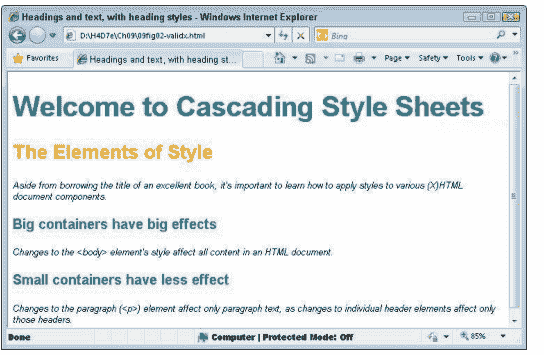

图9-2：生效了样式规范的HTML页面。


用户可以更改其偏好设置，使其浏览器忽略你的样式表（尽管大多数用户会使用你的样式表）。请在禁用样式表的情况下测试网页，以确保在没有样式表的情况下它们看起来仍然不错（或可接受）。

有关禁用或修改样式表的详细说明，请参阅Jim Hatcher的讨论“在没有CSS的情况下阅读网页”，网址为 `www.jimthatcher.com/webcourseb.htm`。说明因Web浏览器而异，但你可以使用无障碍插件来管理或禁用样式表。

### 选择器和声明

你可能希望一个样式规则影响给定选择器的多个属性。你可以为单个选择器创建多个样式规则，每个规则包含一个声明，如下所示：

```
h1 {color: teal;}
h1 {font-family: Arial;}
h1 {font-size: 36px;}
```

### 字体系列

为 `font-family` 属性赋值时，可以使用以逗号分隔的字体名称列表。这些名称必须与用户 Web 浏览器可用的字体相匹配。如果字体名称包含空格——例如 Times New Roman——需要用引号将其括起来。

在上一条规则中，浏览器会优先使用 Verdana；如果该字体不可用，则会查找 Times New Roman，最后使用一种通用的衬线字体作为后备选项。第 11 章详细介绍了 CSS 中的字体。

```
h1 {font-family: Verdana, "Times New Roman", serif;}
```

然而，如此大量的样式规则可能难以管理。CSS 允许你在*单个*样式规则中组合多个声明，该规则可以为单个选择器同时影响多个显示特性，如下所示：

```
h1 {color: teal;
font-family: Arial;
font-size: 36px;}
```

`h1` 选择器的所有声明都位于同一对花括号（`{}`）内，并用分号（`;`）分隔。你可以在一个样式规则中放入任意数量的声明；只需确保每个声明都以分号结尾。

最后一个声明末尾的分号是可选的。有些人为了保持一致性，会在每个声明末尾都加上分号，但这并非必需。本书中我们两种方式都会使用，但仔细想想，为每个声明都*始终*加上分号是一个保持一致性的好习惯。

从纯粹的技术角度来看，空白符在样式表中无关紧要（就像在 HTML 中一样），但你应该使用一致的间距方案，以便于阅读和编辑样式表。这项空白符规则有一个例外，那就是当你在 `font-family` 声明中指定多个字体名称时。更多信息请参阅“字体系列”侧边栏。

你也可以让同一组声明应用于一组选择器：只需用逗号分隔选择器即可。以下样式规则将文本颜色、字体系列和字体大小的声明应用于 `h1`、`h2` 和 `h3` 选择器：

```
h1, h2, h3 {color: teal;
font-family: Arial;
font-size: 300%;}
```

# 第 III 部分：精确控制网页和样式

本节中的示例样式规则表明，样式表语法非常依赖标点符号。当样式规则未能按预期工作时，请确保你没有在需要冒号的地方使用分号，或者在需要花括号的地方使用了圆括号。也要注意逗号和分号！验证工具有助于发现这些疏漏：请使用它们。

W3C CSS 验证服务（`http://jigsaw.w3.org/css-validator`）可以帮助查找样式表中的问题。

## 使用样式类

有时你需要样式规则仅应用于 HTML 标记元素的特定实例。例如，如果你希望一个样式规则仅适用于包含版权信息的段落，你需要一种方法告诉浏览器该规则具有有限的适用范围。

为了精确地定位样式规则，可以将 `class` 属性与标记元素结合使用。以下示例展示了两种段落的 HTML 代码：

- ✓ 一个普通段落（没有 `class` 属性）

  `<p>This is a regular paragraph.</p>`

- ✓ 一个 `class` 属性值为 `copyright`

  `<p class="copyright">This is a paragraph of class copyright &copy; 2011.</p>`

要创建一个仅适用于版权段落的样式规则，请在样式规则的段落选择器后跟上：

- ✓ 一个句点（`.`）
- ✓ `class` 属性的值，例如 `copyright`

最终规则如下所示：

```
p.copyright {font-family: Arial;
            font-size: 12px;
            color: white;
            background: teal;}
```

此样式规则指定所有类为 `copyright` 的段落将以白色文本显示在蓝绿色背景上，字体为 12px Arial。图 9-3 展示了浏览器如何仅将此样式应用于类等于 `copyright` 的段落。

# 第 9 章：介绍层叠样式表

图 9-3：类可以更精确地定位你的样式规则。

你也可以创建不与任何元素关联的样式规则类，如下例所示：

```
.warning {font-family: Arial;
          font-size: 14px;
          background: blue;
          color: white;}
```

你可以通过向任何元素添加 `class="warning"` 来使用这个样式类。图 9-4 展示了在以下 HTML 中，浏览器如何将警告样式应用于段落和标题，但不应用于块引用：

```
<p>This is a paragraph without the warning class applied.</p>
<blockquote>This is a block quote without a defined class.</blockquote>
<h1 class="warning">Warnings</h1>
<p class="warning">This is a paragraph with the warning class applied.</p>
```

你还可以使用 `span` 元素选择性地将自定义样式应用于行内内容（或创建从开始标签 `<span>` 到结束标签 `</span>` 的任意内容容器）：

```
<p>This is a paragraph without the <span class="warning">warning class</span> applied only to the words "warning class."</p>
```

`www.it-ebooks.info`

# 第 III 部分：精确控制网页和样式

图 9-4：你可以使用类来创建适用于任何元素的样式规则。

## 使用样式 ID

当你想创建仅应用于标记元素特定实例的规则时，也可以使用 `id="name"` 属性与样式标记。假设你想定义一个仅应用于每个网页上第一个段落的样式，使其处理方式不同于可能也有自己样式的其他普通段落。

为此，你需要在样式定义中创建一个 ID 选择器（在 (X)HTML 文档的 `<head>` 部分内的内部样式表中，或在独立的纯 CSS 外部样式表中），如下所示：

```
#first-graph {font-style: bold;
text-indent: -0.25in;}
```

然后，当你为网页编写标记时，为每个初始段落编写如下 (X)HTML：

```
<p id="first-graph">The initial paragraph on will feature an 0.15 inch "hanging indent" and the typeface will be in heavy bold.</p>
<p>Subsequent paragraphs will use whatever style you have (or haven't) defined for the base paragraph style. In this case, this means ragged right justification and plain, unbolded text.</p>
```

图 9-5 展示了使用 ID 选择器应用 CSS 定义后网页的外观。ID 选择器很有用，因为它们可以应用于各种不同的标记元素（不像类定义那样绑定到单一元素），并且只在被使用时才应用。非常方便！

## 第 9 章：介绍层叠样式表 141

### 注意继承！

当你构建复杂的样式表来指导页面各个方面的外观时，请记住继承。例如，如果你在 `body` 样式规则中设置了页面的边距，那么你在页面上为其他所有元素设置的所有边距都将以 `body` 设置的边距为基础。如果你了解样式规则如何协同工作，就可以利用继承来最小化样式规则的重复，并为页面创建一个连贯的显示效果。

本章介绍了基本的 CSS 语法，但你可以使用高级技术来微调样式规则。Web Design Group 在 `www.htmlhelp.com/reference/css/structure.html` 提供了 CSS 语法规则的完整概述。

图 9-5：ID 选择器适用于多种标记元素。

## 样式继承

HTML（以及所有标记语言）的一个基本概念是标签嵌套：

- 每个有效的 HTML 文档都嵌套在 `<html>` 和 `</html>` 标签内。
- 浏览器在窗口中显示的所有内容都嵌套在 `<body>` 和 `</body>` 标签内。（这仅仅是个开始。）

CSS 规范认识到你经常将一个元素嵌套在另一个元素内，并希望确保与父元素关联的样式能够传递给子元素。这种机制称为继承。

当你为一个元素分配样式时，相同的样式会应用于嵌套在该元素内的所有元素。例如，为 `body` 元素设置页面背景、文本颜色、字体大小、字体系列和边距的样式规则如下所示：

## 142 第三部分：精确控制网页与样式

```css
body {
    background: teal;
    color: white;
    font-size: 18px;
    font-family: Garamond;
    margin-left: 72px;
    margin-right: 72px;
    margin-top: 72px;
}
```


要为整个文档设置样式规则，需在`body`元素中进行设置。例如，这样更改整个页面的字体要容易得多；这比逐个更改每个单一元素要有效得多。

当你将以下 HTML 与前面仅应用于`body`元素的样式规则链接时，该格式将被所有从属元素继承：

```html
<body>
    <p>This paragraph inherits the page styles.</p>
    <h1>As does this heading</h1>
    <ul>
        <li>As do the items in this list</li>
        <li>Item</li>
        <li>Item</li>
    </ul>
</body>
```

## 使用不同类型的样式表

完成样式规则的创建后，您就可以使用以下选项之一将它们链接到您的 HTML 页面：

- **将样式信息插入到您的文档中。** 您可以

    - 使用`<style>`元素在网页中构建样式表。这是一个*内部样式表*。

    - 使用`style`属性直接将样式信息添加到标签。这是一个*内联样式*。

- **使用外部样式表。** 您可以

    - 使用`<link>`标签将您的网页链接到外部样式表。

    - 使用 CSS `@import`语句将外部样式表导入网页。

# 第 9 章：层叠样式表简介

### 内部样式表

内部样式表存在于您的 HTML 页面中。只需在文档头部的`<style>`元素中添加样式规则即可。您可以在内部样式表中包含任意多（或少）的样式规则。（参见清单 9-1。）

清单 9-1：向 HTML 文档添加内部样式表

```html
<!DOCTYPE html PUBLIC "-//W3C//DTD XHTML 1.0 Transitional//EN"
    "http://www.w3.org/TR/xhtml1/DTD/xhtml1-transitional.dtd">
<html xmlns="http://www.w3.org/1999/xhtml">
<head>
    <title>Internal Style Sheet Example</title>
    <style type="text/css">
        body {
            background: black;
            color: white;
            font-size: 16px;
            font-family: Garamond;
            margin-left: 72px;
            margin-right: 72px;
            margin-top: 72px;
        }

        h1, h2, h3 {
            color: teal;
            font-family: Arial;
            font-size: 36px;
        }

        p.copyright {
            font-family: Arial;
            font-size: 12px;
            font-color: white;
            background: black;
        }

        .warning {
            font-family: Arial;
            font-size: 16px;
            font-color: orange;
        }
    </style>
</head>
<body>

<!-- Document content goes here -->

</body>
</html>
```

使用内部样式表的好处在于便利性：您的样式规则与标记位于同一页面，因此您可以快速调整两者。如果您希望相同的样式规则控制多个 HTML 页面的外观，请将这些样式从各个网页移至外部样式表。

## 144 第三部分：精确控制网页与样式

### 谨慎使用内联样式

您可以将单个样式规则（称为*内联样式*）附加到 HTML 文档中的各个元素。附加到元素的内联样式规则如下所示：

```html
<p style="color: green;">Green text.</p>
```

向元素添加样式规则并不是最佳方法。我们通常建议您为规则选择*内部*或*（最好是）外部*样式表，而不是将规则附加到文档中的单个元素。原因如下：

- ✔ 您的样式规则会与页面内容混杂在一起，难以查找。

- ✔ 您必须将整个规则放在`style`属性的值中，这使得复杂规则难以编写和编辑。

- ✔ 您会失去在外部样式表中组合选择器和重用样式规则所带来的所有好处。

### 外部样式表

外部样式表将您所有的样式规则保存在一个单独的文本文件中，您可以从站点上的任何 HTML 文件中引用该文件。您必须维护一个单独的样式表文件，但外部样式表为整个站点的维护提供了便利。如果您站点的页面使用相同的样式表，您可以更改样式表中的任何格式特性，从而影响所有页面。

我们建议在您的站点上使用外部样式表。

### 链接

要引用外部样式表，请在网页头部使用`link`元素，如下所示：

```html
<html>
<head>
    <title>External Style Sheet Example</title>
    <link rel="stylesheet" type="text/css" href="styles.css" />
</head>
<body>
    <!-- Document content goes here -->
</body>
</html>
```

`<link>`元素中的`href`属性可以接受：

- 相对链接（您自己站点上的样式表）

- 绝对链接（不托管在您自己站点上的样式表）

通常，您不应该使用不托管在您网站上的样式表，因为您希望控制网站的外观。

要快速为您的网页添加样式（或进行实验以查看浏览器如何处理不同样式），请使用绝对 URL 指向 W3C 核心样式表之一。在`www.w3.org/StyleSheets/Core`上阅读更多关于它们的信息。

第 6 章介绍了相对链接和绝对链接之间的区别。

#### 导入

`@import`语句指示浏览器加载外部样式表并使用其样式。您在`<style>`元素内使用它，但在任何单独的样式规则之前，如下所示：

```css
<style>
    @import "http://www.somesite.edu/stylesheet.css";
</style>
```

导入样式表中的样式规则优先于`@import`语句之前的任何规则。因此，如果您的页面中有多个`@import`语句引用多个外部样式表，则规则从较后的样式表（页面中更靠下的那些）应用。

### 理解层叠

多个样式表可以影响页面元素并相互叠加。这就像网页中的样式继承。这就是 CSS 的*层叠*部分。

以一个真实的大学英语系网站为例。英语系是人文学院的一部分，而人文学院是大学的一个学院。这些实体中的每一个——大学、学院和英语系——都有自己的样式表。

1. 大学的样式表为站点中的所有页面提供样式规则。

2. 学院的样式表链接到大学的样式表（使用`@import`语句），并添加更多特定于学院自身站点外观的样式规则。

3. 英语系的样式表链接到学院的样式表。因此，该系的页面*既有自己的样式规则*，*又继承了学院和大学样式表的样式规则*。

但是，如果多个样式表为同一元素定义了规则怎么办？例如，如果所有三个样式表都为`h1`元素指定了规则怎么办？在这种情况下，离您正在处理的页面或元素最近的规则胜出：

- ✔ 如果系的样式表上存在`h1`规则，它优先于学院和大学的`h1`样式。

- ✔ 如果系内的单个页面在`<style>`标签中为`h1`应用了样式规则，则该规则适用。

## 第 10 章

### 使用层叠样式表

**本章内容**

- 掌握如何使用 CSS

- 在页面上定位对象

- 创建字体规则

- 创建用于打印的样式表

- 理解听觉样式表

理解 CSS 的结构和语法很容易。然而，学习 CSS 可以应用于 (X)HTML 文档的属性则需要更多的时间和精力。不过，真正有趣的地方在于学习如何使用 CSS 来将一个普通或平淡无奇的网页提升一个档次。本章将介绍如何让 CSS 发挥作用，而不是专注于其结构和内部工作原理。

如果您需要回顾 CSS 样式规则和属性，请阅读第 9 章（关于 CSS 及其工作原理的高级概述）。然后，您可以回到本章并将 CSS 投入实践。

现在是时候创建一个页面并赋予它一些样式了！

要高效使用 CSS，请遵循以下通用指南：

- 当您测试页面外观时，使用内部样式，以便您可以随心所欲地调整。（本章展示了内部样式表，但第 9 章更详细地介绍了内部和外部样式表。）

- 当您的测试页面看起来恰到好处时，将这些内部样式移至外部样式表，然后将它们应用于整个站点，或应用于该站点中尽可能多的页面。

## 管理布局和定位

您可以使用 CSS 来布局页面，使图像和文本块

-   精确出现在您希望的位置

-   精确填充您希望它们占据的空间

在文档中创建样式后，您可以创建外部样式表，将相同的样式应用到任何页面。

代码清单 10-1 展示了一个没有任何定义样式的网页。这个基础页面如图 10-1 所示。

### 代码清单 10-1：一个相当单调的页面

```
<!DOCTYPE html PUBLIC "-//W3C//DTD XHTML 1.0 Transitional//EN"
    "http://www.w3.org/TR/xhtml1/DTD/xhtml1-transitional.dtd">
<html xmlns="http://www.w3.org/1999/xhtml" lang="en" xml:lang="en">
<head>
    <title>Pixel's Page</title>
    <meta http-equiv="Content-Type" content="text/html; charset=ISO-8859-1" />
</head>
<body>
    <h1>I'm Pixel the Cat. Welcome to my page.</h1>
    <div id="navBar">
        <p>Links of interest:</p>
        <p><a href="http://www.google.com/">Google</a></p>
        <p><a href="http://www.amazon.com/">Amazon</a></p>
        <p><a href="http://www.bing.com/">Bing</a></p>
    </div>
    
</body>
</html>
```

为您的网页创建链接的详细内容在第 6 章中介绍。在那里，您将找到创建优质链接所需的所有信息。关于级联样式表及其能为网站内容带来的强大功能的问题，请参阅第 9 章。

这只猫看起来很棒，但这个页面肯定没有展示出它的潜力。添加一些样式可以极大地改善这个页面。具体方法如下！

### 可视化布局

我们希望链接出现在图像的左侧（如图 10-2 所示），这是导航工具的典型位置，而不是像图 10-1 中那样出现在图像上方。以下标记将搜索站点链接的文本浮动到图像的左侧（见图 10-2）：

```
<style type="text/css">
#navBar {
    background-color: #CCC;
    border-bottom: #999;
    border-left: #999;
    border-width: 0 0 thin thin;
    border-style: none none groove groove;
    display: block;
    float: left;
    margin: 0 0 0 10px;
    padding: 0 10px 0 10px;
    width: 107px;
    line-height: 0.2em;
}
</style>
```

在前面的规则中，我们

-   添加了一个`<style>`元素

-   在`<style>`元素内定义了`navBar` id

-   使用了`navBar` id 来指示内容浮动到图像的左侧，这导致它们出现在页面的左侧部分，而不是图形上方

该规则表示，页面上任何属于`navBar` id 的内容（如图 10-2 所示）都应显示为

-   浅灰色背景

-   底部和左侧有深灰色的细凹槽线边框

-   没有顶部或右侧边框

-   一个向左浮动的块（因此页面上的其他内容向右移动，如图 10-2 中的图像）

-   左边距为 10 像素（px）

-   顶部和底部各有 10px 的内边距

-   导航栏区域宽度为 100px

您会注意到，我们还将行高设置为`0.2em`。这确保了菜单条目紧凑，各个元素之间没有太多空白。

请注意，声明中的几个属性称为*简写属性*，接受多个值，例如`margin`和`padding`。简写属性从多个相关的 CSS 属性（例如`margin-height`、`margin-width`等）中收集值。完整的列表请参阅我们的在线材料。这些值对应于导航栏框的顶部、右侧、底部和左侧边缘的设置。`margin`在框周围创建一个空白区域，而`padding`定义框的边缘或边框与框内内容之间的空间。以下是解释如何将值与处理边距、边框、内边距等的属性关联的规则：

-   如果所有边的值相同，则可以使用一个值。

-   如果*任何*一边与其他边不同，则*每一边*都需要一个单独的值。您可以根据需要将其中一些或全部值设置为 0（零）；这通常有助于确保页面在更广泛的浏览器（和浏览器版本）中显示一致。

要记住哪个值对应哪个位置，请按顺时针顺序思考元素框的边缘，从顶部边缘开始：`top`、`right`、`bottom`，然后是`left`。请注意，我们使用 px（像素）而不是 pt（点）或 em（默认字符 m 的宽度）作为度量单位来定义边距和内边距。这是对本书其他地方（第 11 章）推荐的最佳实践的刻意背离。这是因为边距和内边距通常涉及小的增量或值，并且这些东西与特定浏览器内的各个实际显示密切相关。尝试使用这些值以获得最佳效果，并确保在尽可能多的不同的浏览器和平台上检查它们，以确保您网站的访客看到您预期的效果。

### 定位

CSS 提供了多种方式来精确指定元素在页面上出现的位置。这些控件使用基于元素的框与其父元素框之间关系的各种定位方式，来帮助页面设计者将页面元素放置在他们想要的位置。相关属性的种类将在以下部分讨论。

### 位置

您可以控制图像的水平和垂直位置。但是，当您对任何页面元素使用绝对定位时，您需要精确指定该元素必须相对于浏览器窗口左上角的位置。因此，不是让它自动绘制到导航栏的右侧，您可以将图像放置在下方和左侧，如图 10-3 所示。但是，绝对定位的项在重叠时总是会浮到顶层，这就是为什么 Pixel 的图片会显示在顶部的原因。我们将在本章稍后更改此默认顺序。

```
#theCat {position: absolute; top: 120px; left: 107px;}
```

**图 10-3：** 图像在这个位置更具冲击力。

您可能想知道为什么`navbar`规则（在前面“可视化布局”一节的代码清单中定义）和`theCat`规则（在图 10-3 之前的代码片段中）都以*#号*（也称为 *井号* 或 *octothorpe*）开头。这是因为 #号适用于 *id* 属性。您使用句点来开始一个类规则，它将应用于页面上出现的该类的每个实例。因此，虽然您可以将`class`或`id`应用于特定元素，但这两者之间的区别在于`class`可以重复使用。相比之下，`id`在页面上只能出现一次。页面上不能有任何其他内容使用`theCat`作为其`id`。区别很简单，`class`允许您通过单个引用引用某个 (X)HTML 元素的所有实例，而`id`只能引用一个元素的单个实例。

### 重叠

两个对象*可以*被分配到网页中的同一位置。虽然这听起来可能是个问题，但重叠可以产生有趣的设计效果——正如您将在后续的代码和截图中看到的我们的导航栏和照片一样。当重叠发生时，浏览器必须确定显示顺序，以及显示哪些对象并隐藏哪些对象。

在任何规则中使用`z-index`，告诉 CSS 您希望任何对象如何在页面上占据相同空间的其他对象之上或之下堆叠：

-   较小的数字向下移动堆栈。

-   较大的数字向上移动堆栈。

-   `z-index`的默认值是`auto`，这意味着它与父元素的值相同。

为`theCat`设置`z-index`值为`-1`会自动将其置于页面上所有其他未设置`z-index`的内容之后（如图 10-4 所示）（详情请参阅本书网站上的图 10-4 的 HTML 源代码）。

图 10-4：猫从导航栏后面探出头来。

### 为视觉趣味和更好的可读性更改字体

您可以通过替换旧的、无聊的、默认的字体使页面更有趣。首先指定通用的正文字体，并设置一些其他默认规则，例如背景色和文本颜色。

# 第三部分：精确控制网页与样式

## 正文文本

下面是一个为`body`元素内文本设置样式的示例：

```css
body {
  font-family: verdana, geneva, arial, helvetica, sans-serif;
  font-size: 1em;
  line-height: 1.33em;
  background-color: white;
  color: teal;
}
```


由于`body`元素包含任何网页的所有内容，此设置会影响页面上的所有内容。上面的规则指示浏览器按如下方式显示`body`元素内出现的所有文本：

文本使用列表中的一种字体进行渲染。我们将`Verdana`放在列表首位，因为它是首选，浏览器会按照列表顺序检查可用字体。注意：通用字体（本例中为`sans-serif`）几乎总是出现在此类列表的末尾，因为浏览器几乎总能自行提供此类字体。

你可以列出多个字体。浏览器会使用你列表中第一个在浏览器中可用的字体。例如，浏览器会按以下顺序在我们的列表中查找字体：

1. `Verdana`
2. `Geneva`
3. `Arial`
4. `Helvetica`
5. 浏览器的默认无衬线字体

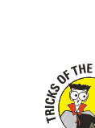

### `1.33em` 行高

行间距设置为字体高度为`1em`时的间距，因此行与行之间有更多的垂直空间。


图10-5显示所有更改适用于整个页面，包括导航栏。`h1`标题中的`font-family`发生了变化。由于标题对于`font-size`和`line-height`有特定的默认值，因此需要另一条规则来修改它们。

在拍摄图10-5时，我们用于屏幕截图的HTML包含了针对Internet Explorer (IE) 的额外调整。这是因为Windows版Internet Explorer中存在一个其他浏览器没有的错误，会导致标题（`h1`）文本在顶部被截断。（请在IE中查看图10-5的源(X)HTML以了解我们的意思；我们不得不添加CSS标记，为`h1`设置`line-height: 105%`才能创建此显示效果。）不幸的是，CSS渲染的不可预测性可能足够大，你必须在各种浏览器中测试样式规则，看看它们的外观如何——然后进行相应的调整。


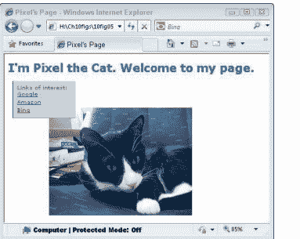

**图10-5：**字体好多了，但仍需要再调整一下。

### 标题

如果我们显式地为`h1`元素分配样式属性，显示结果将更具可预测性。以下是一组示例样式：

```css
h1 {
  font-family: "trebuchet ms", verdana, geneva, arial, helvetica, sans-serif;
  font-size: 2em;
  line-height: 1.167em;
}
```

图10-6显示了使用我们想要的字体系列和字体大小的一级标题：`2em`的`Trebuchet MS`，行高为`2⅓em`。如果我们的系统中没有`Trebuchet MS`字体，标题将以`Verdana`显示。

当字体名称包含空格（如`trebuchet ms`或`times new roman`）时，完整名称必须用引号括起来。（有关更多信息，请参见第11章。）

### 超链接

我们认为超链接带下划线（这是正常的）会让菜单看起来有点杂乱。幸运的是，我们可以用CSS关闭下划线，但我们仍然希望超链接看起来像超链接，所以我们告诉CSS：

- 让链接加粗。
- 当光标悬停在链接上时显示下划线。
- 以特定颜色显示链接。

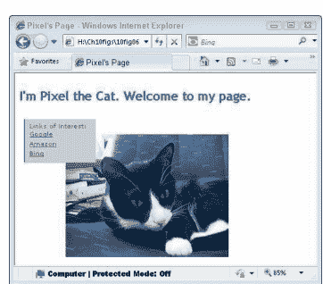

**图10-6：**为`h1`声明一条规则，使其按我们喜欢的方式显示。

以下样式规则定义了浏览器应如何显示超链接：

```css
a {
  text-decoration: none;
  font-weight: bold;
}
a:link {
  color: blue;
}
a:visited {
  color: #93C;
}
a:hover {
  text-decoration: underline;
}
```

这是怎么回事？从顶部开始，我们为`<a>`标签设置了两条规则，适用于页面上的所有链接：

- `text-decoration`声明将其值设置为`none`。这会去除所有链接的下划线。
- `font-weight`声明的值为`bold`。这会使页面上的所有链接以粗体显示。

上面代码中的剩余规则是伪类选择器。它们最常见的用途是修改链接在不同状态下的外观。（有关伪类的更多信息，请参见第11章。）这里我们更改了链接被访问后的颜色。我们还当鼠标指针悬停在链接文本上时开启下划线，以便在光标处于可点击范围内时识别超链接。图10-7显示了应用先前样式规则后页面的外观。

## 第10章：使用层叠样式表

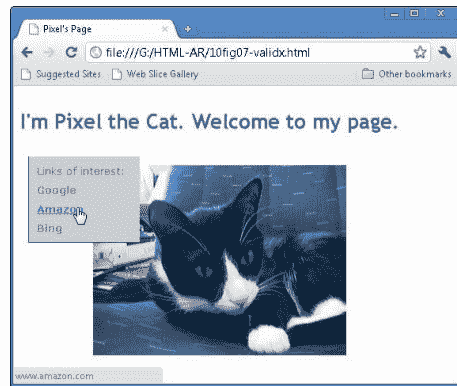

**图10-7：**我们页面的最终版本。

## 外部化样式表

当最终页面达到你想要的效果时，你就可以将经过测试、批准的内部样式表剪切并粘贴到外部样式表中。使用外部样式表的好处是：

- 网站的每一页都可以使用整个样式表，只需在每页添加一行代码。
- 可以通过对外部样式表的一次更改来进行全站范围的修改。

要将经过充分测试的内部样式表创建为外部样式表，请按照以下步骤操作：

1. 复制位于`<style>`和`</style>`标签之间的所有文本。
2. 将该文本粘贴到其自己的新文档中。此文本应仅包含CSS标记，不包含任何HTML标签或标记。
3. 保存时在文档名称后附加`.css`后缀（例如`myStyles.css`）。该后缀可一目了然地表明它是一个CSS文件。

现在你就有了外部样式表。是时候将你的HTML文件链接到上述外部样式表了。你有两个可用选项：

- ✅ 使用`<link>`标签。所有支持CSS的浏览器都理解`link`标签。
- ✅ 使用带`@import`关键字的`<style>`标签。只有较新的浏览器理解`<style>`和`@import`组合。

有关这两种方法的更多信息，请参见第9章。


有时样式表会变得复杂而冗长。这时`@import`关键字就非常有用：你可以创建一个主样式表，然后使用多个`@import`语句来引入用于页眉、页脚、正文内容、菜单等的单独样式表。每个`@import`引用一个用于页面内容这些不同类别的子样式表。对于大多数小型或个人网站来说，这可能有点小题大做，但随着网站变得“庞大而复杂”，这种技术会非常有帮助。

### 将CSS与多媒体结合使用

你可以根据不同的媒体类型，指定希望你的网页在不同媒介上的外观或行为。

表10-1列出了所有媒体类型及其用途。

**表10-1：已识别的媒体类型**

| 媒体类型 | 描述 |
|---|---|
| `All` | 适用于所有设备 |
| `aural` | 用于语音合成器 |
| `braille` | 用于盲文触觉反馈设备 |
| `embossed` | 用于分页盲文打印机 |
| `handheld` | 用于手持设备（例如具有小屏幕、单色显示器和有限带宽的设备） |
| `print` | 用于分页、不透明材料以及在屏幕上查看但处于打印预览模式的文档 |
| `projection` | 用于投影演示文稿，如投影仪或透明胶片 |
| `screen` | 用于彩色计算机屏幕 |
| `tty` | 用于使用固定间距字符网格的媒体，如电传打字机、终端或具有有限显示功能的便携设备 |
| `tv` | 用于电视类型设备（例如具有低分辨率、色彩能力、有限滚动性屏幕和一些可用声音的设备） |

# 第10章：使用层叠样式表

CSS可以对同一页面进行更改以自定义：

- 在屏幕上的渲染
- 打印

一个漂亮的彩色背景在黑白激光打印机上打印时可能会使你的页面一团糟，但正确使用打印媒体样式可以防止这种事情发生！

- 大声朗读时的声音

### 视觉媒体样式

表10-2列出了你在典型网页中最可能使用的CSS属性。我们本书的在线内容包括最常用CSS属性以及(X)HTML标签和属性的简要描述。

**表10-2：视觉媒体样式**

| 属性 | 值 | 默认值 | 描述 |
|---|---|---|---|
| `background-color` | 任何颜色，按名称或十六进制代码 | `transparent` | 关联元素的背景颜色 |
| `background-image` | `URL` | `none` | 作为元素背景的图像URL |
| `color` | 任何颜色，按名称或十六进制代码 | 随你！ | 前景文本的颜色 |
| `font-family` | 任何命名的字体，`cursive` `fantasy` `monospace` `sans-serif` `serif` | 随你！（坚持使用常见字体。） | 用于渲染相关元素内容的字体 |
| `font-size` | 数字 + 单位，`xx-small` `x-small` `small` `smaller` `medium` `large` `larger` `x-large` `xx-large` `%` 长度（`px`, `em`, `cm`） | `medium` | 用于渲染相关元素内容的字体大小 |

（续）

# 第三部分：精确控制网页和样式

### 表10-2（续）

| 属性 | 值 | 默认值 | 描述 |
|---|---|---|---|
| `font-weight` | `normal` `bold` `bolder` `lighter` `100` `200` `300` `400` `500` `600` `700` `800` `900` | `normal` `400`等同于`normal`，`700`等同于`bold` | 字体粗细（应显示为多粗或多细） |
| `line-height` | `Normal` 数值 + 单位 `%` 长度（`px`, `em`, `cm`） | `normal` | 文本行之间的垂直间距 |
| `text-align` | `left` `right` `center` `justify` | 由你决定；`normal`文本方向 | 决定页面上的文本如何对齐 |
| `text-decoration` | `None` `underline` `overline` `line-through` `blink` | `none` | 特殊文本效果 |
| `list-style-image` | `URL` | `none` | 用作列表项目符号的图片URL |
| `list-style-position` | `Inside` `outside` | `outside` | 列表文本包裹在项目符号内部还是外部 |
| `list-style-type` | `Disc` `circle` `square` `decimal` `decimal-leading-zero` `lower-alpha` `upper-alpha` `none` `armenian` `georgian` `lower-greek` `lower-latin` `lower-roman` `upper-latin` `upper-roman` | `disc` | 列表上的项目符号类型 |

# 第10章：使用层叠样式表

161

| 属性 | 值 | 默认值 | 描述 |
|---|---|---|---|
| `Display` | `block` `inline` `none` | `inline` | 为块元素定义的区域的格式 |
| `Top` | 数值和单位 `auto` | `auto` | 绝对定位：设置元素上边缘在包含元素上边缘之上/之下；相对定位：设置元素上边缘在其正常位置之上/之下 |
| `Right` | 百分比 数值 + 单位 `auto` | `Auto` | 绝对定位：设置元素右边缘在包含元素右边缘旁边的宽度；相对定位：设置元素右边缘在其正常位置右边缘旁边的宽度 |
| `Bottom` | 百分比 数值 + 单位 `auto` | `Auto` | 绝对定位：设置元素下边缘在包含元素下边缘之下；相对定位：设置元素下边缘在其正常位置之下 |

（续）

# 第三部分：精确控制网页和样式

### 表10-2（续）

162

| 属性 | 值 | 默认值 | 描述 |
|---|---|---|---|
| `Left` | 百分比 数值 + 单位 `auto` | `Auto` | 绝对定位：设置元素左边缘在包含元素左边缘的右侧；相对定位：设置元素上边缘在其正常位置之上/之下 |
| `Position` | `Static` `absolute` `relative` `fixed` | `static` | 元素框相对于定位上下文的布局方法 |
| `Visibility` | `Collapse` `visible` `hidden` `inherit` | `inherit` | 指示对象是否将在页面上显示 |
| `z-index` | 数值 `auto` | `Auto` | 对象的堆叠顺序（`-1`始终将对象置于最底层） |
| `border-style` | `none` `dotted` `dashed` `solid` `double` `groove` `ridge` `inset` `outset` | 未定义 | 为对象边框显示的样式。可拆分为`border-top-style`、`border-right-style`、`border-bottom-style`和`border-left-style` |

# 第10章：使用层叠样式表

| 属性 | 值 | 默认值 | 描述 |
|---|---|---|---|
| `border-width` | `Thin` `medium` `thick` 数值 | 未定义 | 对象周围边框的宽度。可拆分为`border-top-width`、`border-right-width`、`border-bottom-width`和`border-left-width` |
| `border-color` | 任何颜色，通过名称或十六进制代码 `transparent` | 未定义 | 对象边框的颜色。可拆分为`border-top-color`、`border-right-color`、`border-bottom-color`和`border-left-color` |
| `Border` | `Border-width` + `border-style` + `border-color` | 未定义 | 围绕对象的边框的组合功能。可拆分为`border-top`、`border-right`、`border-bottom`和`border-left` |
| `Float` | `left` `right` `none` | `none` | 指定对象是否应浮动到文档的一侧或另一侧（续） |

# 第三部分：精确控制网页和样式

| 属性 | 值 | 默认值 | 描述 |
|---|---|---|---|
| `Height` | 数值 + 单位 `auto` | `Auto` | 对象的显示高度 |
| `Width` | 数值 + 单位 `auto` | `Auto` | 对象的显示宽度 |
| `Margin` | 数值 + 单位 `auto` | 未定义 | 对象的显示外边距。可拆分为`margin-top`、`margin-right`、`margin-bottom`和`margin-left` |
| `Padding` | 数值 + 单位 `auto` | 未定义 | 对象周围的显示空白区域。可拆分为`padding-top`、`padding-right`、`padding-bottom`和`padding-left` |
| `Cursor` | `Auto` `cross-hair` `default` `pointer` `move` `text` `help` `URL` `e-resize` `n-resize` `ne-resize` `nw-resize` `progress` `s-resize` `se-resize` `sw-resize` `w-resize` `inherit` | `Auto` | 浏览器窗口中的光标外观 |

# 第10章：使用层叠样式表

某些浏览器不支持所有CSS属性。如果你正在使用CSS功能，请在你期望访客使用的浏览器中测试你的页面。使用在尽可能多的浏览器上都能工作的CSS功能，忽略其余的。

如果你想随时随地携带一份极其详尽的CSS指南，请把它放在你的iPod上！Westciv的免费podGuide是一个小文本文件的文件夹。下载压缩文件并按照说明安装，你就随身拥有了完整的文档。（你还可以赢得“世界头号CSS极客”的称号。）podGuide在线地址为`www.westciv.com/news/podguide.html`。

## 分页媒体样式

CSS可以自定义页面打印时的外观。我们建议遵循以下准则：

- 用衬线字体替换无衬线字体。衬线字体比无衬线字体更易于阅读。
- 插入广告，要求：
  - 在非动画时合理。
  - 无需点击即可提供有用信息。

通常，分页媒体样式有助于确保打印出来的文本效果与网页浏览器中显示的一样好。分页媒体样式还可以帮助你在打印页面时隐藏无关内容（横幅、广告等），从而减少纸张浪费和用户挫败感。参见表10-3，了解可用于帮助用户在打印网页时获得最佳效果的CSS分页媒体属性说明。

### 表10-3：分页媒体样式

| 属性 | 值 | 默认值 | 描述 |
|---|---|---|---|
| `orphans` | 数值 | `2` | 段落中必须留在页面底部的最小行数 |
| `page-break-after` | `Auto` `always` `avoid` `left` `right` | `auto` | 元素之后的分页行为 |
| `page-break-before` | `Auto` `always` `avoid` `left` `right` | `auto` | 元素之前的分页行为 |
| `page-break-inside` | `Auto` `avoid` | `auto` | 元素内部的分页行为 |
| `widows` | 数值 | `2` | 段落中必须留在页面顶部的最小行数 |

清单10-2中的示例使用了以下分页媒体样式选项：

- 使输出为白底黑字。
- 用衬线字体替换无衬线字体。

## 清单10-2：添加打印样式表


```html
<!DOCTYPE html PUBLIC "-//W3C//DTD XHTML 1.0 Transitional//EN"
"http://www.w3.org/TR/xhtml1/DTD/xhtml1-transitional.dtd">
<html xmlns="http://www.w3.org/1999/xhtml" lang="en" xml:lang="en">
<head>
<title>This is my page</title>
<meta http-equiv="Content-Type" content="text/html; charset=ISO-8859-1" />
<style type="text/css">
    body {background-color: black; color: white; font-family: sans-serif;}

    @media print {
      body {background-color: white; color: black; font-family: serif}
    }
</style>
</head>
<body>
    This page will look very different when sent to the printer.
</body>
</html>
```

如果你现在想知道为什么表 10-3 中的属性没有设置而其他属性却设置了，那是因为（在此示例中）它们的默认值工作得很好。仅仅因为这些页面属性可以设置，并不意味着你不能设置其他属性——这不是二选一的问题。

### 听觉（语音）样式

听觉浏览器和样式不仅仅适用于视觉障碍者。它们对于以下 Web 用户也很有用：

通常，您无需过多担心为页面添加听觉样式。默认的阅读器应该可以很好地工作，如果：

- ✔ 存在阅读问题
- ✔ 在驾驶时需要信息
- ✔ 您的页面主要是文本。
- ✔ 您对声音效果没有强烈的偏好，因此任何清晰的男性或女性声音都可以。

以下示例推荐使用男性和女性角色来播放声音，以明确哪个角色在说话：

```css
<style>
  @media aural {
    p.stanley {voice-family: male;}
    p.stella {voice-family: female;}
  }
</style>
```

也就是说，您可以在本书的配套网站上找到所有听觉样式属性的完整列表。

## 168 第三部分：精确控制 Web 页面和样式

# 第 11 章

## 在颜色和字体上发挥创意

**本章内容**

- 使用 CSS 定义文本格式
- 处理页面颜色和背景
- 更改字体显示
- 添加文本处理效果

在样式表出现之前，网页设计师不得不依靠 HTML 标记来控制网页的背景、颜色、字体和文本大小。然而，随着样式表的出现，设计师可以将样式信息与内容分离——这意味着他们可以使用层叠样式表（CSS）来控制字体、颜色和其他样式信息。

为什么要这样做？很简单。当您使用 CSS 时，您可以获得以下好处：

- 在更新或编辑格式信息时获得更好的控制。
- 不再有充满 `<font>` 标签的 HTML 文档。
- 有更多格式化文本的选项（例如定义行高、字体粗细和文本对齐）以及将文本转换为大写或小写字符的选项。

(X)HTML 仍然包含各种格式元素，如 `<tt>`、`<i>`、`<big>`、`<b>` 和 `<small>`；然而，所有剩余的格式元素，如 `<font>`，都已弃用。也就是说，它们不再推荐使用（尽管它们仍然有效，并且大多数浏览器都识别它们）。我们不认为您应该再使用它们，但这是您自己的决定。如果您想了解更多关于已弃用格式元素的信息，我们会在第 8 章中介绍。

### 颜色值

(X)HTML 通过两种方式定义颜色值：

- **名称：** 您从有限的列表中选择。
- **数字：** 更难记住，但您有更多选择。

#### 颜色名称

HTML 规范包含 16 个颜色名称，您可以用它们在页面中定义颜色。表 11-1 显示了这些颜色。以井号（`#`）开头的数字采用十六进制表示法，混合了字母 A-F（代表 10-15）和我们熟悉的十进制数字中更典型的 0-9。

表 11-1 (X)HTML 中的命名颜色值

| 名称 | #RGB 代码 | 颜色 | 名称 | #RGB 代码 | 颜色 |
|---|---|---|---|---|---|
| Black | #000000 |  | Silver | #C0C0C0 |  |
| Gray | #808080 |  | White | #FFFFFF |  |
| Maroon | #800000 |  | Red | #FF0000 |  |
| Purple | #800080 |  | Fuchsia | #FF00FF |  |
| Green | #008000 |  | Lime | #00FF00 |  |
| Olive | #808000 |  | Yellow | #FFFF00 |  |
| Navy | #000080 |  | Blue | #0000FF |  |
| Teal | #008080 |  | Aqua | #00FFFF |  |

# 第 11 章：在颜色和字体上发挥创意

您可以放心地在 CSS 标记中使用颜色名称，并确信浏览器会识别它们并在您的网页中使用正确的颜色。您还可以将屏幕上的颜色与本印刷页面上的颜色进行比较，以了解印刷和数字显示有时可能存在的差异。（在某些情况下，可能是您屏幕上的色彩平衡有问题；在另一些情况下，打印机试图在页面上匹配的颜色可能并不完全准确——这并不像您想象的那么简单！）

访问`www.htmlhelp.com/reference/html40/values.html#color`查看您的浏览器如何显示这些颜色。如果可能，请在两三台不同的计算机上查看此页面，看看不同的浏览器、操作系统、显卡和显示器如何微妙地改变显示效果。

以下 CSS 样式声明表示 `<p>` 标签内的所有文本应为蓝色：

```css
p {color: blue;}
```

如果您在寻找棕褐色、查特酒色或鲑鱼色，那您运气不佳。这个列表不是一盒 64 色的蜡笔！但是，您也可以在在线速查表`www.dummies.com/cheatsheet/html`上找到 Web 安全色的十六进制代码以及颜色样本。这些颜色虽然未命名，但它们是 Web 安全色，因为它们在大多数彩色计算机显示设备和打印机上的复制效果相当可靠。

#### 颜色数字

颜色数字允许您在网页上使用任何颜色（甚至是鲑鱼色）。

#### 十六进制颜色代码

十六进制表示法使用六个字符——数字和字母的组合——来定义颜色。如果您知道某种颜色的十六进制代码（通常简称为其 hex 代码），您就拥有了在 HTML 页面中使用该颜色所需的一切。

当您使用十六进制代码定义颜色时，应始终在其前面加上井号（`#`）。否则，在某些 Web 浏览器中可能无法正确显示。

以下 CSS 样式声明使 `<p>` 标签包含的所有文本变为蓝色：

```css
p {color: #0000FF;}
```

# 第三部分：精确控制 Web 页面和样式

### 查找任何颜色的十六进制代码

您无法仅凭挥动魔杖就找出任何颜色的十六进制代码，但这并不意味着您不能通过不太神奇的方式找到它。颜色转换器遵循一个精确的公式，将颜色的标准 RGB 表示法转换为十六进制表示法。因为您有比计算十六进制代码更重要的事情要做，所以您有多种方法可以找出您选择颜色的代码，包括本书在线速查表（`www.dummies.com/cheatsheet/html`）上显示的 Web 安全色。这些方法都不需要您使用计算器：

- 在线资源：一些不错的十六进制颜色图表资源有：
  - `http://www.webmonkey.com/2010/02/color_charts`
  - `www.colorschemer.com/online.html`

  您只需找到喜欢的颜色，并将其旁边列出的十六进制代码输入到您的 HTML 中。

- 使用图像编辑软件：许多图像编辑应用程序，如 Adobe Photoshop 或 Adobe Fireworks，都会显示任何颜色的十六进制表示法。甚至 Microsoft Word 的颜色选择器也会显示图像中颜色的十六进制代码。如果您有一张喜欢的图片，想用作网页的颜色来源，请在您喜欢的编辑器中打开该图片，并找出这些颜色的十六进制代码。

#### RGB 值

您可以使用两个十进制 RGB 值来定义颜色。这些值类型不如十六进制值常见，但它们同样有效：

- `rgb(r, g, b)`：`r`、`g` 和 `b` 是介于 0 到 255 之间的整数，分别表示颜色的红色、绿色和蓝色级别。
- `rgb(r%, g%, g%)`：`r%`、`g%` 和 `b%` 分别表示颜色中红色、绿色和蓝色的百分比。

> 每种颜色都可以定义为红色、绿色和蓝色（RGB）的混合。您可以使用 RGB 值或等效的十六进制代码向 Web 浏览器描述颜色的 RGB 值。有关十六进制表示法的更多信息，请访问`www.lts.com/class/hextoc.htm`的“十六进制颜色教程”。

### 颜色定义

您可以为网页上的任何文本定义单独的颜色，也可以为整个网页或其部分定义背景颜色。

CSS 使用以下属性来定义颜色：

- `color` 定义字体颜色，也用于定义链接在不同状态（链接、活动、焦点、已访问和悬停；参见下节“链接”）下的颜色。
- `background` 或 `background-color` 定义整个页面的背景颜色，或为特定元素定义背景（例如，为所有一级标题设置背景颜色，类似于在 Word 文档中高亮显示内容的概念）。

## 文本

您可以通过三个步骤更改网页上文本的颜色：

1. **确定选择器。**

   例如，颜色将应用于所有一级标题、所有段落还是特定段落？

2. **使用 `color` 属性。**

3. **指定颜色名称或十六进制值。**

样式声明的基本语法是：

```css
选择器 {color: 值;}
```

以下是一组样式声明示例，其中我们使用 `color` 属性为 `body` 元素（因此，也适用于文档主体中可能出现的所有其他子 HTML 元素，除非其他规范如 `h1` 元素那样覆盖了该选择）设置文本颜色：

```css
body {color: olive; font-family: Verdana, sans-serif;
      background-color: #FFFFFF; font-size: 85%;}
h1 {text-align: center;}
.navbar {font-size: 75%; text-align: center;}
h1 {color: #808000;}
p.chapternav {text-align: center;}
.footer {font-size: 80%;}
```

请注意，在前面的 CSS 规则中，页面上所有文本的颜色是通过使用 `body` 选择器定义的。除非另有定义，颜色将应用于文档主体中的所有文本。为了说明这一点，一级标题被定义为森林绿色，使用十六进制表示法。

### 链接

伪类允许您根据文档树之外的信息定义样式规则。

## 174 第三部分：精确控制网页和样式

CSS 中最常见的伪类用法是为文档树中的给定元素定义样式规则——这是一个技术术语，意思类似于浏览器为文档中的所有元素构建层次表示，就像家谱一样，每个元素都有一个父元素，并且可能包含子元素。例如，`:link` 是一个伪类，它定义适用于尚未被访问的链接的样式规则。

您可以与超链接一起使用的五个常见伪类是：

- `:link` 定义适用于尚未被访问的链接的格式。
- `:visited` 定义适用于已被访问的链接的格式。
- `:focus` 定义适用于被键盘（例如，使用 Tab 键）选中并通过按 Enter 键即将激活的链接的格式。
- `:hover` 定义适用于鼠标悬停时的链接的格式。
- `:active` 定义适用于被选中（通过鼠标点击或通过按 Enter 键激活）的链接的格式。

伪类名称前有一个冒号（`:`）。

伪类可以与以下内容一起使用：

- 元素（例如，定义超链接的 `<a>` 元素）
- 类
- ID

例如，要定义已访问和未访问链接的样式规则，请使用以下语法：

- 以下通过使用其十六进制值将任何指向未访问 URL 的超链接颜色设置为红色：

  `a:link {color: #FF0000;}`

- 以下将任何指向已访问 URL 的超链接颜色设置为命名颜色 `green`：

  `a:visited {color: green;}`

- 以下指定具有 `internal` 类的未访问链接显示为（命名颜色）`yellow`：（有关 CSS 类的讨论，请参见第 9 章。）

  `a.internal:link {color: yellow;}`

# 第 11 章：发挥创意，运用颜色和字体

链接可以同时处于多个状态。例如，链接可以同时处于已访问和悬停状态。始终按照以下顺序定义链接样式规则：`:link`、`:visited`、`:focus`、`:hover`、`:active`。

CSS 应用“最后看到的规则”来显示您的页面。因此，如果您将伪类选择器的顺序放错，结果可能不是您想要的。例如，如果 `visited` 跟在 `hover` 之后，并且两者有重叠的规则，则悬停效果仅适用于尚未被访问的链接。

以下 CSS 规则将文档渲染为橄榄色（作为未访问链接的颜色）和黄色（作为已访问链接的颜色）：

```css
body {color: #808000; font-family: Verdana, sans-serif; font-size: 85%;}
a:link {color: olive;}
a:visited {color: yellow;}
```

CSS 规范将 `:link` 和 `:visited` 定义为互斥的，由浏览器应用程序决定何时更改任何给定链接的状态（已访问与未访问）。例如，如果您清除历史记录数据，浏览器可能会确定链接为未访问状态。

### 背景

要更改网页的背景颜色，或更改该页面某部分的背景颜色，请按照以下步骤操作：

1. **确定选择器。**

   例如，颜色是应用于整个背景，还是仅应用于特定部分？

2. **使用 `background-color` 或 `background` 属性。**

3. **指定颜色名称或十六进制值。**

样式声明的基本语法是：

```css
选择器 {background-color: 值;}
```

在以下样式声明集合中，第一个样式声明使用 `background-color` 属性并通过十六进制表示法将其设置为浅绿色：

```css
body {color: #808000; font-family: Verdana, sans-serif;
     background-color: #EAF3DA; font-size: 85%;}
```

# 第三部分：精确控制网页和样式

您可以将背景色应用于文本块——例如段落——就像为整个页面定义背景色一样。

您可以使用 `background` 作为所有单独背景属性的简写属性，或仅使用 `background-color` 来设置颜色，如下所示：

```css
选择器 {background: 值 值 值;}
```

更多信息请参见第 9 章或 Webmonkey 的“Mulder 样式表教程”中的“简写属性”部分，网址为`www.webmonkey.com/2010/02/mulders_stylesheets_tutorial`。

## 字体

您可以为不同的 HTML 元素定义单个字体属性，方法如下：

- 使用单个 CSS 属性，如 `font-family`、`line-height` 和 `font-size`
- 在通用的简写 `font` 属性中使用一组字体属性

### 字体系列

要通过使用 CSS `font-family` 属性定义字体外观（一个命名的、通常受版权保护的特定字符设计集合，如 Times Roman、Arial 或 Helvetica）：

1. **为样式声明确定选择器。**

   例如，将 `p` 作为选择器会为所有 `<p>` 标签定义字体系列。

2. **添加属性名称 `font-family`。**

并非所有字体系列都受到每个浏览器的支持。CSS 允许您指定多个字体系列，以防浏览器不支持您首选的字体系列。您可以列出多个字体系列名称，用逗号分隔。浏览器会使用其运行计算机上可用的列表中的第一个名称。您可以在 FontTester.com（`www.fonttester.com/help/list_of_web_safe_fonts.html`）查看 Web 安全字体系列的列表。

3. **为属性定义一个值（字体系列的名称）。**

在任何包含空格的字体系列名称周围使用单引号或双引号。

`www.it-ebooks.info`

# 第 11 章：发挥创意，运用颜色和字体

要将所有一级标题格式化为使用 Verdana 字体，请使用如下样式声明：


```css
h1 {font-family: Verdana, Helvetica, sans-serif;}
```

在前面的声明中，为了应对某人的浏览器不支持`Verdana`字体系列的情况，还包含了两个更多的字体系列。

我们建议在样式声明中包含这些字体系列：

- 常用：至少包含以下常用字体系列之一：
  - `Arial`：ABCDEFGHIJKLMNOPQRSTUVWXYZ  
    abcdefghijklmnopqrstuvwxyz
  - `Helvetica`：ABCDEFGHIJKLMNOPQRSTUVWXYZ  
    abcdefghijklmnopqrstuvwxyz
  - `Times New Roman`：ABCDEFGHIJKLMNOPQRSTUVWXYZ  
    abcdefghijklmnopqrstuvwxyz
  - `Verdana`：ABCDEFGHIJKLMNOPQRSTUVWXYZ  
    abcdefghijklmnopqrstuvwxyz

- 通用：至少包含以下通用字体系列之一：
  - 衬线（`Serif`）：ABCDEFGHIJKLMNOPQRSTUVWXYZ  
    abcdefghijklmnopqrstuvwxyz
  - 无衬线（`Sans serif`）：ABCDEFGHIJKLMNOPQRSTUVWXYZ  
    abcdefghijklmnopqrstuvwxyz
  - 草体（`Cursive`）：ABCDEFGHIJKLMNOPQRSTUVWXYZ  
    abcdefghijklmnopqrstuvwxyz
  - 花体（`Fantasy`）：ABCDEFGHIJKLMNOPQRSTUVWXYZ  
    abcdefghijklmnopqrstuvwxyz
  - 等宽（`Monospace`）：ABCDEFGHIJKLMNOPQRSTUVWXYZ  
    abcdefghijklmnopqrstuvwxyz

不同的元素可以使用不同的字体系列进行格式化。以下规则为超链接定义了不同的字体系列（见图 11-1）：

```css
body {color: #808000; font-family: Arial, sans-serif; font-size: 85%;}
hr {text-align: center;}
a {font-family: Courier, "Courier New", monospace;}
```

# 第三部分：精确控制网页和样式

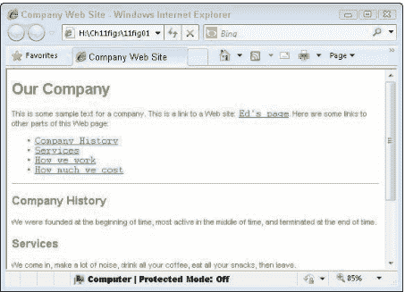

图 11-1：超链接的字体族与文本其余部分的字体族不同。

## 尺寸

以下属性允许您控制文本的尺寸。

### 字号

指定文本大小的样式声明是：

```css
selector {font-size: value;}
```

该声明的值可以是：

- 标准字体属性测量值之一（在第 9 章中列出）。
- 以下用户定义关键字之一：

  `xx-small`、`x-small`、`small`、`medium`、`large`、`x-large` 或 `xx-large`

  每个关键字的值由浏览器决定，而不是由样式规则决定。


接下来的小节中列出的规则定义了：

- 所有文本的相对字体值。
- 所有一级标题的绝对字号。

```css
body {color: #808000; font-family: Arial, sans-serif; font-size: 85%;}
h1 {font-family: "trebuchet ms", verdana, geneva, arial, helvetica, sans-serif; font-size: 2em; line-height: 2.5em; color: teal;}
```

#### 使用 CSS 调整字体尺寸

除了字体大小名称（`xx-small`、`x-small`、`small`、`medium`、`large`、`x-large` 或 `xx-large`），您还可以使用以下 CSS 单位来指定字体大小：`px`（像素）、`pt`（磅）或 `em`（当前使用字体的 m 字高度，无论其具体是什么）。像素取决于用户显示器上单个像素的大小，并且在不同屏幕之间差异很大，实用性不高。磅是非常小的度量单位，可能需要过多的实验才能调整合适。这或许解释了为什么 `em` 是当今 CSS 中调整字体大小时使用最广泛的单位，以及为什么这种方法被认为是使用样式表调整字体大小的最佳实践。选择 `em` 单位并不能免除您的实验，但它能让您轻松快速地相对于基础字体来调整字体大小。有关使用这些单位的更多信息（其形式为`font-size: 2em;`（将字体大小加倍）或`font-size: 0.8em;`（将字体缩小到基础的 80%）），请参见第 9 章。

结果如图 11-2 所示。

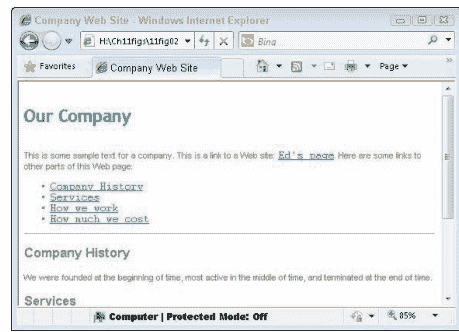

**图 11-2：** 一级标题的大小是基础字体的两倍；其他文本的字号是相对的。

### 行高

段落的*行高*是段落中每行之间的空间量。

行高类似于文字处理器中的行距。

要改变段落行之间的空间量，请使用`line-height`属性：

```css
selector {line-height: value;}
```

`line-height`属性的值可以是：

- 标准字体属性测量值之一（在第 9 章中列出）。
- 一个乘以元素字号的数字，例如`1.5`。

在本章中，我们为第一个段落分配了`quotation`类，以便您可以看到变化。这允许我们通过在 HTML 文档中使用：

```html
<p class="quotation">
```

来应用这些样式。

以下规则将第一个段落设置为斜体、缩进该段落并增加行高以提高可读性（见图 11-3）：

```css
body {color: #808000; font-family: Arial, sans-serif; font-size: 85%;}
h1 {font-family: "trebuchet ms", verdana, geneva, arial, helvetica, sans-serif;
    font-size: 2em; line-height: 2.5em; color: teal;}
.quotation {font-style: italic; text-indent: 2em; line-height: 150%;}
```

### 字符间距

您可以使用以下属性来增加或减少字母或单词之间的间距量：


- `word-spacing`：`word-spacing`的样式声明是：

  `selector {word-spacing: value;}`

  设计师将单词之间的空格称为`tracking`（字间距）。

- `letter-spacing`：`letter-spacing`的样式声明是：

  `selector {letter-spacing: value;}`

  设计师将字母之间的空格称为`kerning`（字距调整）。

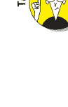

任何间距属性的值都必须是由标准字体属性测量值（在第 9 章中列出）定义的长度。

# 第 11 章：创意运用颜色和字体

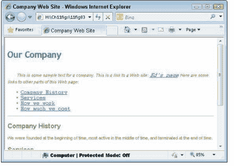

**图 11-3：** 任何属于`quotation`类的元素都会获得相同的格式。

以下代码增加了第一个段落的字符间距（字距调整）（见图 11-4）：

```css
body {color: #808000; font-family: Arial, sans-serif; font-size: 85%;}
h1 {font-family: "trebuchet ms", verdana, geneva, arial, helvetica, sans-serif;
    font-size: 2em; line-height: 2.5em; color: teal;}
.quotation {font-style: italic; text-indent: 10pt; line-height: 150%;
            letter-spacing: 0.2em;}
```

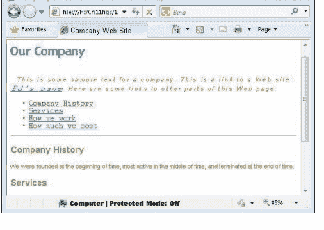

**图 11-4：** 字距调整可以大于或小于字体的正常间距。

## 定位文本块

对齐属性允许您控制文本块的边缘如何相互对齐（也称为“边缘对齐”）。

### 对齐文本

对齐决定了文本块的左右两侧是：

- **齐平**：起点或终点对齐。
- **参差不齐**：起点或终点在不同的位置。

#### 文本对齐语法

对齐通过`text-align`属性定义。对齐文本的样式声明如下：

```css
selector {text-align: value;}
```

`text-align`属性的值必须是以下关键字之一：

- `left`：将文本左对齐。文本块的右侧参差不齐。
- `right`：将文本右对齐。文本块的左侧参差不齐。
- `center`：将文本居中显示在窗口中。文本块的两侧均参差不齐。
- `justify`：调整文本使左右两侧都对齐。调整每行文本内的间距，使文本块的两侧都齐平。

两端对齐会影响段落中字母或单词的间距。在将网页展示给世界之前，请测试结果。

#### 文本对齐的标记

以下示例定义了一级标题和第一个段落的对齐方式（见图 11-5）：

```css
body {color: #808000; font-family: Verdana, sans-serif; font-size: 85%;}
h1 {color: teal; font-family: "Trebuchet MS", Verdana, Geneva, Arial, Helvetica, sans-serif;
     font-size: 2em; line-height: 2.5em; color: teal; text-align: center}
.quotation {font-style: italic; text-indent: 2em; text-align: left;}
```

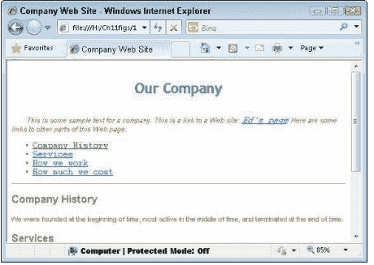

图 11-5：一级标题居中；第一个段落缩进并左对齐。

### 文本缩进

您可以使用`text-indent`属性来定义段落第一行之前的空格量。

使用`text-indent`属性不会缩进整个段落——只会缩进第一行。要实现整个段落的缩进，您需要使用 CSS 盒子属性，例如`margin-left`和`margin-right`（见第 10 章）。

#### 文本缩进语法

用于缩进文本的样式声明是：

```css
selector {text-indent: value;}
```

此处，`value`必须是标准长度属性测量值之一（在第 9 章中列出）。

#### 文本缩进的标记

正如本章所见，`quotation`类的`text-indent`为`2em`。

```css
body {color: #808000; font-family: Verdana, sans-serif; font-size: 85%;}
.quotation {font-style: italic; text-indent: 2em;}
```

### 文本装饰

CSS 允许您使用粗体、斜体、下划线、上划线或删除线来装饰文本，甚至允许您的文本闪烁（当浏览器支持时）。

### 使用粗体加粗

使用粗体是设计师更常用的文本修饰之一。要在 HTML 中应用粗体，请使用`<b>`标签。然而，CSS 通过`font-weight`属性为您提供对粗体文本字重的更多控制。

#### 应用粗体的语法

此样式声明使用`font-weight`属性：

```css
selector {font-weight: value;}
```

`font-weight`属性的值可以是以下之一：

- `bold`：以平均粗体渲染文本。
- `bolder`：相对值，渲染比当前字重更粗的字体（可能由父元素分配）。
- `lighter`：相对值，渲染比当前字重更细的字体（可能由父元素分配）。
- `normal`：移除任何粗体格式。
- 以下整数值之一：`100`（最细）、`200`、`300`、`400`（正常）、`500`、`600`、`700`（标准粗体）、`800`、`900`（最粗）。

#### 应用粗体的标记

以下示例将超链接加粗（见图 11-6），关闭下划线，并在访问链接后将颜色更改为绿色（我们对 Company History 项目执行了此操作以向您展示其外观）：

```css
body {color: black; font-family: Arial, sans-serif; font-size: 85%;}
a {font-weight: bold;}
a:link {color: olive; text-decoration: underline;}
a:visited {color: green; text-decoration: none;}
```

### 使用斜体强调

斜体通常用于引述或强调文本。要在 HTML 中应用斜体，请使用`<i>`标签。然而，CSS 通过`font-style`属性为您提供对文本字体样式的更多控制。

# 第 11 章：灵活运用颜色与字体

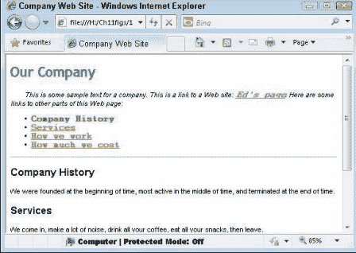

图 11-6：所有超链接均为粗体显示。

#### 应用斜体的语法

此样式声明使用`font-style`属性：

```css
selector {font-style: value;}
```

`font-style`属性的值可以是以下之一：

- `italic`：将文本渲染为*斜体*（一种通常向右倾斜的特殊字体）。
- `oblique`：将文本渲染为*倾斜体*（正常字体的一种不同倾斜版本；很少用于字体定义）。
- `normal`：移除任何斜体或倾斜格式。

#### 应用斜体的标记

以下示例为一级标题分配了斜体字体样式：

```css
body {color: #808000; font-family: Verdana, sans-serif; font-size: 85%;}
h1 {color: teal; font-family: "MS Trebuchet", Arial, Helvetica, sans-serif;
    text-transform: uppercase; font-style: italic; font-weight: 800;
    font-size: 2em; line-height: 30pt; text-align: center;}
```

### 更改大小写

使用`text-transform`属性来设置文档中的大小写。

#### 更改大小写的语法

此样式声明使用`text-transform`属性：

```css
selector {text-transform: value;}
```

`text-transform`属性的值可以是以下之一：

- `capitalize`：将每个单词的首字母大写。
- `uppercase`：将指定元素文本的所有字母渲染为大写。
- `lowercase`：将指定元素文本的所有字母渲染为小写。
- `none`：保持继承元素的值。

#### 更改大小写的标记

以下示例将一级标题渲染为大写（如图 11-7 所示）：

```css
body {color: black; font-family: Arial, sans-serif; font-size: 85%;}
a {font-weight: bold;}
a:link {color: olive; text-decoration: underline;}
a:visited {color: green; text-decoration: none;}
h1 {font-family: "Trebuchet MS", verdana, geneva, arial, helvetica, sans-serif;
    font-size: 2em; line-height: 2.5em; color: teal; text-transform: uppercase;
    text-align: center}
```

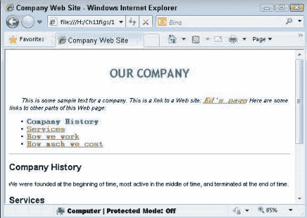

图 11-7：一级标题以全大写形式渲染。

### 使用 text-decoration 属性实现花哨效果

`text-decoration`属性允许进行稍微疯狂一些的文本格式化。它不常被使用。

#### 文本装饰的语法

此样式声明使用`text-decoration`属性：

```css
selector {text-decoration: value;}
```

`text-decoration`属性的值可以是以下之一：

- `underline`：为文本添加下划线。
- `overline`：在文本上方渲染一条线。
- `line-through`：在文本中渲染一条删除线。
- `blink`：使文本在屏幕上闪烁。
  - 你*确定*想要闪烁的文本吗？
    - `blink`并非所有浏览器都支持。
    - `blink`可能会极其烦人且分散注意力。
- `none`：移除任何文本装饰。


#### 文本装饰的标记


以下示例在鼠标悬停时更改链接样式。在此例中，它取消了链接的任何下划线：

```css
body {color: #808000; font-family: Verdana, sans-serif; font-size: 85%;}
a:link {color: olive; text-decoration: underline;}
a:visited {color: olive; text-decoration: underline;}
a:hover {color: olive; text-decoration: none;}
```

### 万能的 `font` 属性

许多字体属性可以通过使用简写 `font` 属性在一个样式声明中总结。使用时，只需一个样式规则即可定义字体属性的组合：

```css
selector {font: value value value;}
```

`font` 属性的值是对应各种字体属性的值的列表：

- 以下值必须按以下顺序定义，尽管它们不必连续：
  - `font-size`（必需）
  - `line-height`（可选）
  - `font-family`（必需）
  - `font-family` 值列表必须以分号结尾。

使用逗号分隔多个字体族名称。例如，你可以使用以下样式声明为段落文本创建特定样式，按（必需的）顺序指定字体大小、行高和字体族：

```css
p {font: 1.5em bold 150% Arial, Helvetica, sans-serif;}
```

- 以下值是可选的，可以在声明中按任何顺序出现。各个值之间用空格分隔：
  - `font-style`
  - `font-variant`
  - `font-weight`

例如，你可以使用以下样式声明为一级标题创建特定样式，将可选值混合在必需值之间（在此例中，`font-style` 和 `font-weight` 在 `line-height` 和 `font-family` 之前，省略了 `font-size` 和 `font-variant`）：

```css
h1 {font: italic bold 150% Arial, Helvetica, sans-serif;}
```

# 第四部分：脚本与 (X)HTML

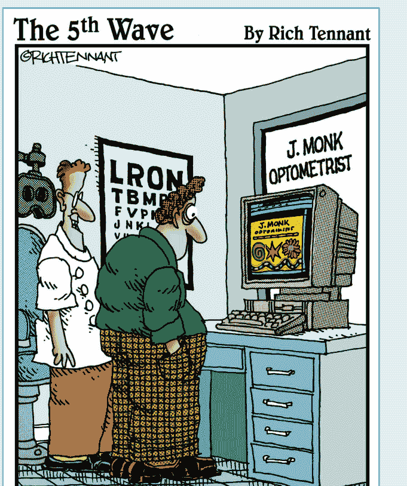

## 本部分内容

在这里，我们介绍并描述了可在网页上使用的脚本语言类型，并简要探讨了 JavaScript——目前所有网页脚本语言中最流行的一种。脚本语言帮助静态、一成不变的网页变成活跃的、动态的文档，能够征求并响应用户输入。

接下来，你将更深入地学习处理表单，以便理解如何征求和处理用户的输入。下一章展示了如何嵌入第三方服务和信息——例如 Flickr、Twitter、Google Maps 和 YouTube——以利用他人的成果使你的页面更具动态性和趣味性。

下一章向你展示了将 JavaScript 应用于网页的方法。你将掌握创建动态 HTML（有时称为 DHTML）以及使用客户端 JavaScript 和预制代码执行基本任务（如显示日期和时间信息、统计网站访客或汇编当前统计数据）的基本概念和技术。第四部分以基于网页的内容管理系统（CMS）概述结束，包括 WordPress、Joomla! 和 Drupal。

# 第12章：20个最重要的 CSS 属性

## 本章内容

- 深入探讨背景与边框
- 操作字体、间距与定位
- 管理文本颜色与行高
- 连接伪类
- 充分利用在线 CSS 资源

正如你在第9–11章中所见，使用层叠样式表（CSS）标记可以做很多事情来管理和控制网页在用户浏览器中的呈现方式。在本章中，我们从相当简单的网页上最常遇到和使用的 CSS 属性中精选出20个特定属性。当然，我们知道这对于真正的网络爱好者，甚至是初学者来说还不够，因此本章还包含了一组无与伦比的 CSS 参考资源，你可以在其中挖掘更多细节并随心所欲地学习其他属性。

Eric A. Meyer 不仅为本书撰写了前言，他还撰写了大量关于 CSS 主题的宝贵著作。请务必查看他的众多 CSS 相关著作，特别是极具价值的《Smashing CSS: Professional Techniques for Modern Layout》（Wiley 出版）。

## 背景属性

作为 CSS 概念，*背景*指的是与 CSS 1.0 一起引入的众多属性（共六个），用于管理网页中显示元素背后的显示内容。表 12-1 列出了所有背景属性，之后我们将提供其中两个属性的示例和详细信息。要了解更多关于背景属性和其他 CSS 标记的信息，请访问本章末尾的“最佳 CSS 资源”部分获取附加信息和实用技巧。

**表 12-1：背景属性**

| 属性 | 描述 |
| :--- | :--- |
| `background` | 所有背景属性的简写占位符 |
| `background-attachment` | 确定背景图像是固定还是随页面滚动 |
| `background-color` | 为相关元素设置背景颜色 |
| `background-image` | 以 URL 形式为相关元素提供背景图像 |
| `background-position` | 设置背景图像的起始位置 |
| `background-repeat` | 确定背景图像在页面上的重复方式 |

### `background-color`

`background-color` 属性允许你为元素的背景设置纯色，包括任何相关的内边距和边框设置。颜色可以通过名称（如在 www.dummies.com/cheatsheet/html 的在线备忘单中所述和图示的 aqua、black、blue、fuchsia 等）或十六进制代码来指定。（颜色值和十六进制代码在第11章中有更详细的讨论。）

在图12-1所示网页的代码中，我们将 `body` 元素的文本颜色设置为橄榄色（`#808000`）。然后，我们为顶部显示的默认一级（`h1`）标题定义了一个基本样式规则，背景色为灰色，文本为黑色。第二个标题使用名为 `alt-h1` 的类实例来设置较大的外边距、内边距和边框，以在文本周围创建一个大的银色背景区域，并向左缩进。

> 访问本书网站 www.dummieshtml.com，然后查看第12章的代码清单，可以方便地访问本书中所有用于制作截图的源代码（通过编号找到图表链接：12-1、12-2 等）。

### `background-image`

使用 `background-image` 属性来使用图像代替纯色作为元素的背景。我们取用图12-1的代码，将 `alt-h1` 文本设为斜体，并将 `background-color: silver;` 替换为 `background-image: url(texture.jpg);`，其中照片纹理作为背景（见图12-2）。

## 边框与轮廓属性

边框和轮廓定义了边缘，并有助于使元素周围的边界可见。你可以找到各种控件来单独设置各边，以及颜色、样式和宽度。为了保持术语清晰，*border*（边框）位于元素框边缘的内侧，而 *outline*（轮廓）则包含该边缘。表 12-2 列出了各种边框和轮廓属性及其功能描述。

**表 12-2：边框与轮廓属性**

| 属性 | 描述 |
| :--- | :--- |
| `border` | 所有边框属性的简写形式 |
| `border-bottom` | 设置所有底部边框属性 |
| `border-bottom-color` | 设置底部边框颜色 |
| `border-bottom-style` | 设置底部边框样式 |
| `border-bottom-width` | 设置底部边框宽度 |
| `border-color` | 设置所有四条边框的颜色 |
| `border-left` | 设置所有左侧边框属性 |
| `border-left-color` | 设置左侧边框颜色 |
| `border-left-style` | 设置左侧边框样式 |
| `border-left-width` | 设置左侧边框宽度 |
| `border-right` | 设置所有右侧边框属性 |
| `border-right-color` | 设置右侧边框颜色 |
| `border-right-style` | 设置右侧边框样式 |
| `border-right-width` | 设置右侧边框宽度 |
| `border-style` | 设置所有四条边框的样式 |
| `border-top` | 设置所有顶部边框属性 |
| `border-top-color` | 设置顶部边框颜色 |
| `border-top-style` | 设置顶部边框样式 |
| `border-top-width` | 设置顶部边框宽度 |
| `border-width` | 设置所有四条边框的宽度 |
| `outline` | 设置所有轮廓属性 |
| `outline-color` | 设置轮廓颜色 |
| `outline-style` | 设置轮廓样式 |
| `outline-width` | 设置轮廓宽度 |

### `border`（边框）

对于 CSS，`border` 是一个简写属性：也就是说，它在单个声明中结合了宽度、样式和颜色。这三个组成部分按顺序应用于元素框的顶部、右侧、底部和左侧边缘。这里有一个助记法：我们使用 TRBL——没错，就像“麻烦”（trouble）——作为顶部（Top）、右侧（Right）、底部（Bottom）、左侧（Left）的顺序简写。

这个单一的 CSS 属性实际上允许同时设置多达 12 个子属性。如图 12-3 所示的示例中，我们使用细的紫色虚线环绕段落，从而在单个声明中处理了宽度（细）、颜色（紫色）和样式（虚线）。虽然你可以按边控制每个特征的设置（按 TRBL 顺序），但很少需要这样做。

请随意根据你的需要探索其他边框和轮廓属性。它们有不少，所以给自己一些时间来学习和尝试。

## 尺寸

尺寸属性定义大小信息——即高度和宽度——以控制网页上元素的放置位置。除了基本的高度和宽度外，还可以设置这些属性的最大值和最小值。有时称为“最小-最大”属性，使用它们有助于确保显示区域始终至少与某个最小值一样大，以确保视觉信息不会丢失。当文本或图片必须在页面上浮动时，最小-最大值尤其有用。（也可以查看本章后面的 CSS `overflow`、`overflow-clip`、`clip` 和 `visibility` 属性，以及第20章和 www.dummieshtml.com 上的内容，了解如何处理奇怪的、意外的或不需要的浮动行为。）表 12-3 提供了尺寸属性的列表。

**表 12-3：尺寸属性**

| 属性 | 描述 |
| :--- | :--- |
| `height` | 设置元素高度 |
| `max-height` | 设置元素最大高度 |
| `max-width` | 设置元素最大宽度 |
| `min-height` | 设置元素最小高度 |
| `min-width` | 设置元素最小宽度 |
| `width` | 设置元素宽度 |

### `height` 和 `width`（高度和宽度）

我们在一个示例中处理高度和宽度，其中图像（`img`）元素的大小被设置为占据段落的 10%。这会调整图像大小，使其不超过浏览器显示窗口水平尺寸的 10%，同时保持高度以保持原始宽高比（参见图 12-4）。高度和宽度也可以使用各种绝对测量单位（像素、点、派卡、em 等）来指定。最小-最大值可确保元素不会变得太大或太小。

最好在编辑器中尝试这些属性，同时调整浏览器窗口大小，以更好地理解它们的工作原理。

## 字体与字体属性

CSS 不仅允许你管理大量的字体属性，还允许你将字体与特定的 (X)HTML 元素关联起来，甚至为这些元素定义任意的字体序列。

如果你想引用名称中包含空格的字体，请将该名称用双引号（*不是*智能引号）括起来，以便浏览器能够在主机上可用时识别并使用它们。

如表 12-4 所示，简写属性 `font` 涵盖了大量值，因此请仔细研究并掌握其用法！

### 表 12-4：字体属性

| 属性 | 描述 |
| :--- | :--- |
| `font` | 所有字体属性的简写形式 |
| `font-family` | 设置字体族（通用或按名称） |
| `font-size` | 设置字体大小（使用典型测量单位） |
| `font-style` | 设置字体样式（`normal`、`italic`、`oblique`） |
| `font-variant` | 开启或关闭小型大写字母（`small-caps`、`normal`） |
| `font-weight` | 设置字体粗细（`bold`、`bolder`、`lighter`、`100-900`） |

### `font-family`

使用 `font-family` 属性从用户安装的字体集合中按名称选择字体。你可以在 CSS 标记中为该属性分配多个逗号分隔的值 (CVsSs)。浏览器将从最左边的规范开始，使用它找到的第一个匹配项。始终以通用字体名称（如 `serif` 或 `sans-serif`）结束字体规范字符串，以便当所有其他选项都失败（或不存在）时，本地系统始终可以使用默认选择。在图 12-5 中，我们将 Arial 选为一级标题字体，使用 Lucida Console 作为正文（段落）字体，同时也展示了多种字体，包括 Arial Black、Book Antiqua、Tahoma、Times New Roman、Comic Sans 和 Cooper Black。

### `font-weight`

`font-weight` 属性决定了文本在页面上绘制的轻重程度。在我们图 12-6 的示例中，我们列出了所有命名的 `font-weight` 值以及所有可识别的数值 `font-weight` 值。请注意，在 `bold` 和 `bolder` 之间你其实看不出太大区别，数值也没有显示均匀的渐变。对于大多数页面设计师来说，`bold` 已经足够粗了，数字 200–500 和 600–900 看起来可以互换使用。字体设计师通常会创建字体的粗体版本（例如 Arial Black 或 Cooper Black），它与普通版本（Arial 或 Cooper）结合使用，可以创建更重的字重或更多的字重变化。

### `font-size`

`font-size` 属性是管理字体在屏幕上显示大小的设置。对于真正较小的文本，使用点 (pt) 进行大小设置；大多数正常的段落字体通常是 10pt 到 12pt。小于 6pt 的字体在屏幕上很难看清。使用整个 em 作为字体大小单位很快就会变得难以控制。如果你愿意，可以使用图 12-7 示例的源页面，快速进行自己的字体大小*实验*。

# 第十二章：20大 CSS 属性

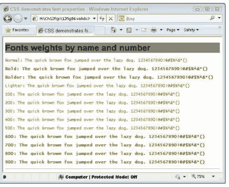

图12-6：尽管字重（font weight）的种类很多，但在屏幕上的差异并不大。

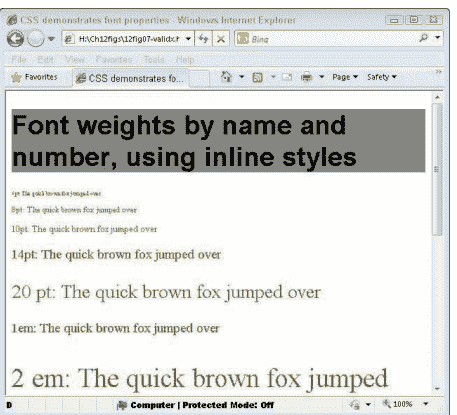

图12-7：可用的字体大小必须足够大以便看清，同时又要足够小以免压倒页面布局。

## 间距属性：外边距和内边距

*外边距*（*margin*）定义了块级元素边缘之外、背景颜色不填充的空间。*内边距*（*padding*）定义了块级元素边缘之内、背景颜色填充的空间。表12-5列出了这些属性。尽管我们在接下来的文本中将这两个简写属性及其组成部分分开讨论，但在图12-8中，我们将它们组合在一个示例中，以便更好地比较和对比，并展示它们如何协同工作。我们还包含了边框，以显示元素盒模型轮廓的位置。

**表 12-5：间距属性**

| 属性 | 描述 |
| :--- | :--- |
| `margin` | 所有外边距属性的简写（TRBL） |
| `margin-bottom` | 设置元素底部外边距 |
| `margin-left` | 设置元素左侧外边距 |
| `margin-right` | 设置元素右侧外边距 |
| `margin-top` | 设置元素顶部外边距 |
| `padding` | 所有内边距属性的简写（TRBL） |
| `padding-bottom` | 设置元素底部内边距 |
| `padding-left` | 设置元素左侧内边距 |
| `padding-right` | 设置元素右侧内边距 |
| `padding-top` | 设置元素顶部内边距 |

### 外边距（`margin`）

与 `padding` 类似，`margin` 是一个简写属性，其组成值按顺序（正如我们之前讨论的：上、右、下、左）对应 TRBL 边。如果你为 `margin` 提供一个值，它将同样应用于所有四个边。因此，例如，CSS `margin: 0.5em;` 等同于 `margin-top: 0.5em; margin-right: 0.5em; margin-bottom: 0.5em; margin-left: 0.5em;`。

### 内边距（`padding`）

与 `margin` 类似，`padding` 是一个简写属性，其组成值按顺序对应 TRBL 边。如果你为 `padding` 提供一个值，它将同样应用于所有四个边。这里同样，CSS `padding: 0.5em;` 等同于 `padding-top: 0.5em; padding-right: 0.5em; padding-bottom: 0.5em; padding-left: 0.5em;`。

仔细观察图示会发现，内边距扩展了元素周围的文本框，包括背景。而另一方面，外边距则将文本框的边缘推离父文本框的边缘，从而使内容在所有方向上都产生缩进。两者的结合（参见图12-8中的最后一对元素）扩展了元素周围的背景（内边距），并移动了边缘以容纳它们的外边距。

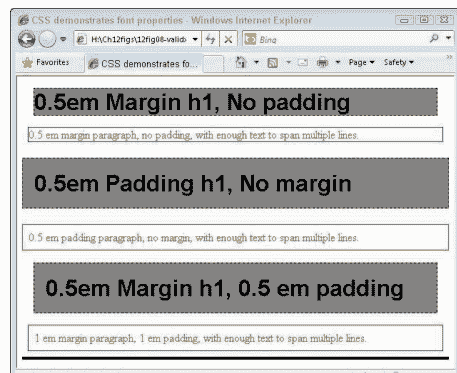

图12-8：外边距和内边距分别工作和协同工作的效果。

## 定位

定位控件（见表12-6）定义了元素在页面上的出现位置、元素之间的相互关系以及文本如何围绕（或不围绕）各种元素流动。TRBL 属性（上、右、下、左）在这里发挥作用，元素可以被*绝对定位*（相对于页面原点或左上角）或*相对定位*（相对于包含它的任何元素）。


本章（以及全书其余部分）所有图表的 HTML 源代码可在`www.dummieshtml.com`获取。你可以在“第12章”部分（标记为图12-1、图12-2等）找到相关源码。

## 表12-6：定位属性

| 属性 | 描述 |
| :--- | :--- |
| `bottom` | 设置定位盒的底部外边距边界 |
| `clear` | 禁止元素边缘紧靠其他浮动元素 |
| `clip` | 剪裁绝对定位元素 |
| `cursor` | 选择要显示的光标类型 |
| `display` | 选择元素应生成的盒类型 |
| `float` | 开启或关闭盒子的浮动 |
| `left` | 设置定位盒的左侧外边距边界 |
| `overflow` | 控制内容如何溢出元素盒 |
| `overflow-clip` | 控制内容如何溢出元素盒 |
| `position` | 为元素选择定位类型 |
| `right` | 设置定位盒的右侧外边距边界 |
| `top` | 设置定位盒的顶部外边距边界 |
| `visibility` | 开启或关闭元素的可见性 |
| `z-index` | 为元素分配堆叠顺序（数值） |

## 浮动（`float`）

使用`float`可以控制文本如何围绕元素流动。浮动的由来可以追溯到各种网页浏览器提供非标准 HTML“扩展”的时代，这些扩展允许页面设计者将图片“浮动”到网页的右侧或左侧。CSS 使这成为标准，并将其同样应用于文本块（如段落或列表）和图片。`float`可以接受`left`、`right`或`none`（默认值）作为值，如图12-9所示。

请注意，在图12-9中，无论是左浮动还是右浮动，都会推到`h1`标题的背景之上。（我们将在接下来的“清除（`clear`）”小节中向你展示如何修复此问题。）这说明管理浮动（以及`img`元素在段落中的放置位置）可能很重要。我们最后的没有浮动的段落展示了图形如何被放置到它们被调用的位置：即使它没有与页面上的其他元素重叠，这也不是理想的情况。

## `z-index`

当你开始在页面上定位多个元素时（就像我们在第10章中对菜单和照片所做的那样），重叠可能会发生，有时甚至可能是可取的。`z-index`增加了定位的第三个维度，类似于三维坐标中的深度（x、y 和 z）。在网页上，`z-index`值纯粹是相对的。它用于管理显示顺序，因此较高的值会“更接近”屏幕的前方，而较低的值则更接近后方。换句话说，当绘制元素所在的盒模型时，如果一些编号较低的盒子占据了相同的空间，浏览器会优先处理编号较高的盒子。在第10章中，我们展示了如何在菜单和照片中使用`z-index`，并在图10-4的标记中解释了负的`z-index`会位于所有正`z-index`的后面。要快速了解，请查看它！

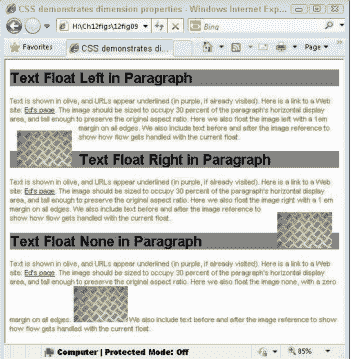

图12-9：浮动设置使得在文本块内移动项目变得容易，但也显示了为什么其他定位工具是绝对必要的。

使用`z-index`时要谨慎，并确保为你的 CSS 菜单（或任何其他具有动态属性、可能在执行函数调用时与嵌入对象重叠的东西）定义了它。此外，未定义的`z-index`在将 CSS 与 Flash 一起使用时可能导致显示问题。Flash 经常在其动作脚本中包含一个默认的`z-index`，这可能会产生冲突。

## 清除（`clear`）

为了解决图12-9中展示的问题——在第二和第三个段落中，图片浮动到了标题背景中——使用`clear`可以防止此类侵入。`clear`可以接受以下值：`left`、`right`、`both`和`none`（默认值）。因为重叠发生在图片和文本从左到右流动之后，所以在图片标记中添加`clear: right;`可以解决这个问题，如图12-10所示。

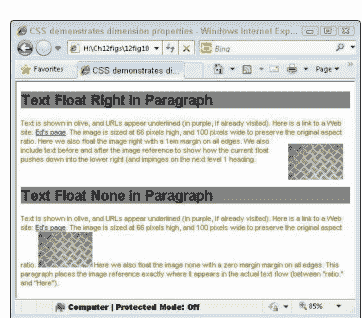

图12-10：使用`clear`来强制执行元素周围的外边距。

## 光标（`cursor`）

使用`cursor`属性可以改变鼠标光标在网页浏览器中悬停于特定元素上时的外观。可以为该属性分配许多值，因此请尝试实验，看看它们在不同浏览器中的效果，以及你是否能有效地使用它们。图12-11使用了四个纹理图像，每个都有一个不同的光标，因此你可以在屏幕上亲自看到效果。（在书中很难展示动态行为，因此我们制作了来自同一基础页面的屏幕截图拼贴画。）

CSS 支持多达17种不同的光标样式，因此请务必花时间尝试`cursor`属性可以取的不同值。

## 文本（Text）

有些人可能会认为文本属性是 CSS 集合中最重要的元素。我们当然不想为此争论，而是建议你深入研究表12-7，看看有哪些可用的方法来使用 CSS 控制文本在显示时的外观和行为。我们认为你会感到惊讶，但也希望你会感到满意。

# 第12章：20个最常用的 CSS 属性

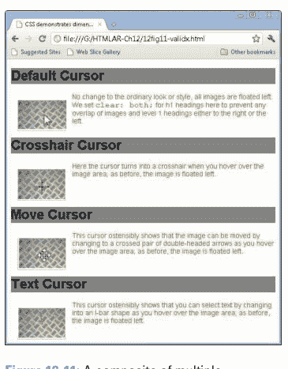

图12-11：多张截图的复合图展示了各种鼠标指针样式。

| 属性 | 描述 |
| :--- | :--- |
| `color` | 设置文本颜色（名称或十六进制代码） |
| `direction` | 指定文本/书写方向（`ltr`或`rtl`） |
| `letter-spacing` | 管理文本中字符间的间距 |
| `line-height` | 设置行高 |
| `text-align` | 设置水平对齐方式（`left`、`right`、`justify`、`center`） |
| `text-decoration` | 指定添加到文本的装饰 |
| `text-indent` | 设置文本块中首行的缩进 |
| `text-shadow` | 设置添加的文本阴影效果 |
| `text-transform` | 控制文本的大小写转换 |
| `vertical-align` | 设置元素的垂直对齐方式 |
| `white-space` | 管理文本中单词间的间距 |
| `word-spacing` | 管理文本中单词间的间距 |

# 第四部分：脚本与 (X)HTML

## `color`

使用`color`来，嗯，为元素内的文本设定颜色，颜色可以通过名称或十六进制代码来指定。（有关此类名称和值的相当完整的列表，请参阅在线速查表`www.dummies.com/cheatsheet/html`。）我们在第9-11章以及本章中都展示了此功能，因此在此不再赘述。

## `line-height`

`line-height`属性设置某种文本块中行内框（为每行文本分配的空间）的高度。使用`line-height`是扩展或压缩文本行间距的简便方法，如图12-12中的示例所示。

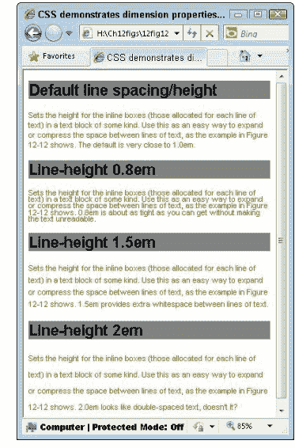

图12-12：不同的行高展示了调整此属性的效果。

## 伪类

CSS 中的伪类初看可能有点奇怪：它们需要一些时间来适应，因为它们用于修饰 (X)HTML 元素。这就解释了为什么表12-8中每个伪类名称都以冒号开头（它作为与被修饰元素的分隔符，并表示存在一个 CSS 伪类）。通常，伪类旨在使网页内容更具动态性和交互性，当你熟悉它们后就会发现这一点。

| 伪类 | 描述 |
| :--- | :--- |
| `:active` | 为被激活的元素添加样式 |
| `:after` | 在元素之后添加内容 |
| `:before` | 在元素之前添加内容 |
| `:first-child` | 为另一个元素内的第一个子元素添加样式 |
| `:first-letter` | 为文本序列中的第一个字符添加样式 |
| `:first-line` | 为文本序列中的第一行添加样式 |
| `:focus` | 为拥有键盘输入焦点的元素添加样式 |
| `:hover` | 当鼠标悬停在元素上时为其添加样式 |
| `:lang` | 为具有特定语言属性的任何元素添加样式 |
| `:link` | 为未访问的链接添加样式 |
| `:visited` | 为已访问的链接添加样式 |

到目前为止，应用最广泛的伪类是用于 (X)HTML 链接的。在下一节的示例中，我们将结合使用`:hover`、`:link`和`:visited`来展示其工作原理和效果。

### `:hover`、`:link`和`:visited`

伪类`:hover`、`:link`和`:visited`都适用于超链接。

- `:hover`在鼠标指针悬停在超链接上时生效。
- `:link`为尚未访问的超链接应用样式。
- `:visited`为已访问的超链接应用样式。

所有这些行为在为图12-13编写的代码中都清晰可见。

在我们的示例中，我们将已访问链接的`font-variant`更改为小型大写字母，并使用`line-through`（删除线）文本装饰。未访问的链接使用带下划线的较大字体。当您将鼠标悬停在链接上时，它会变为粗体和红色，并且鼠标指针会从箭头变为手形。

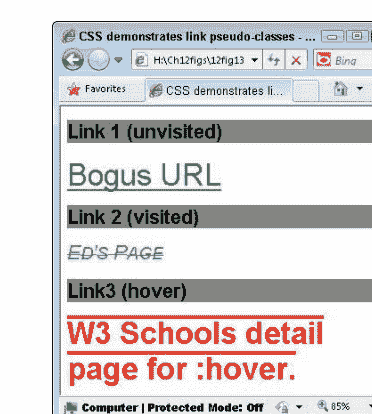

图12-13：与链接相关的伪类根据访问状态和鼠标活动改变超链接的外观。

## 最佳 CSS 资源

以下网站集合提供了一些关于 CSS 及其在精心制作的网页中正确使用的优秀参考资料。来自 W3Schools.com 的第一个参考资料非常棒，并且为表12-1到12-8提供了大部分基础材料。

### W3Schools.com

```text
www.w3schools.com/css/css_reference.asp
```

这是一个很棒的在线资源，提供 CSS 定义、用法、相关页面、支持的浏览器、示例，甚至允许您在受控环境中“自己尝试”（比手动修改 HTML 文档要好得多），地址为`www.w3schools.com/css/tryit.asp?filename=trycss_background`。

### Firebug

```text
http://getfirebug.com
```

这是目前用于调试和找出为什么你的 CSS 或 HTML 页面没有按预期工作的最佳浏览器资源。使用这个 Firefox 插件，您可以选择页面上的元素，并查看当前分配了哪些 CSS 属性，按文件（如果您有多个样式表）甚至按源文档中的特定行进行查看。您还可以指示此工具临时添加或忽略 CSS 声明，这使得实验和调试 CSS 标记变得非常容易。

### Eric Meyer's Reset

```text
http://meyerweb.com/eric/tools/css/reset/reset.css
```

上面的 URL 是一个`重置样式表`的绝佳示例。`重置样式表`旨在减少浏览器在默认设置（如默认行高、边距、标题字体大小等）方面的不一致性。重置背后的一般推理在 Meyer 2007年5月的博客文章“Reset Reloaded”（`http://meyerweb.com/eric/thoughts/2007/05/01/reset-reloaded`）中有讨论。重置样式在 CSS 框架中非常常见，Meyer 最初的“meyerweb reset”被纳入了 Blueprint 主页（`www.blueprintcss.org`）以及其他许多地方。重置样式表绝对值得学习并应用于您自己的网页设计工作。如果您点击前面的链接，您将看到整个`reset.css`样式表的文本列表。

### Spoon Browser Sandbox

```text
www.spoon.net/browsers
```

不幸的是，CSS 有时在不同的浏览器中显示方式不同。为了避免设计出您认为非常棒的网站，却发现它在您未尝试过的其他浏览器中变得一团糟，请使用此站点。目前，Spoon Browser Sandbox 仅适用于 PC，但它允许您远程启动甚至未安装在计算机上的 Web 浏览器。用它来查看您的页面在 Internet Explorer、Firefox、Opera、Chrome 和 Safari 的多个版本中的样子。

### W3C CSS Validation Service

```text
http://jigsaw.w3.org/css-validator
```

使用这个优秀的免费在线工具检查带有样式表的 CSS 和 (X)HTML 文档。将其指向可公开访问的网页、上传文件或粘贴代码到文本框中以检查其内容。

`www.it-ebooks.info`

### Web-Developer's Handbook

```text
www.alvit.de/handbook
```

这个站点的内容几乎多到过剩，拥有一个非常庞大的 CSS 链接目录和与网页设计相关的一般链接。关于 CSS 的众多部分涵盖了日常阅读、展示与画廊、工具与服务、规范等等。给自己一些时间来消化这本汇编；这里有大量优秀的内容需要慢慢品味！

### YSlow

```text
https://addons.mozilla.org/en-US/firefox/addon/5369
```

借鉴用于高性能网页的一套规则，YSlow 分析网页以建议改进其性能的方法。YSlow 是 Firebug Web 开发工具的 Firefox 附加组件。它使用三种预定义规则集之一或用户定义的规则集对网页进行评级。此外，YSlow 还提供提高页面性能的建议，总结页面组件，显示页面统计信息，并提供 Smush.it 和 JSLint 等性能分析。

# 第13章：网页脚本

## 本章内容

- ▶ 探索 JavaScript 能为您的网页做什么
- ▶ 排列内容
- ▶ 打开新窗口
- ▶ 检查用户输入
- ▶ 探索更多 JavaScript 的用途

当与您的 HTML 标记结合使用时，`脚本`——您添加到网页中的小程序——帮助您的网页响应用户操作。脚本创造了您在 Web 上看到的交互和动态效果，例如当访客将鼠标指针移过图像时自动变化的图像、页面加载时弹出的额外浏览器窗口，以及动画或交互式导航栏。

因为脚本是微型程序，所以它们通常用一种叫做 JavaScript 的编程语言编写。如果您不熟悉这个词，JavaScript 听起来可能像是一部沾了咖啡的好莱坞剧本。然而，它实际上是一种内置于所有流行 Web 浏览器中的脚本语言。

幸运的是，得益于“复制粘贴”这项值得诺贝尔奖级别的发明，您不需要成为技术大师就能为您的网站添加脚本。Web 上有许多网站提供现成的 JavaScript 元素，您可以自由地复制并直接粘贴到您的网页中。（第14列出了几个最佳的 JavaScript 网站。）


许多优秀的网页编辑器（如 Adobe Dreamweaver 和 Adobe Fireworks）都包含内置工具来帮助您创建脚本——即使您对编程一无所知。

在本章中，您将通过剖析三个用 JavaScript 编写的示例脚本来探索脚本如何在网页内部工作。如果您有兴趣了解更多关于 JavaScript 及其工作原理的信息，请查看 Emily Vander Veer 所著的《JavaScript For Dummies》第5版，以获取更多信息并更深入地了解 JavaScript 语言本身。

# 第四部分：脚本与（X）HTML

## 探索 JavaScript 能为你的页面做些什么

向你的网站添加脚本，就像那些真人秀装修节目一样，能把房子或人的外观改造成全新的、令人惊艳的模样。JavaScript 也是如此。它能将一个平淡无奇的网页，转变为一个充满交互性和动态感的网络盛宴，为你的访客带来长久的乐趣。（好吧，也许我们有点夸张了，但你明白我的意思。）

例如，如果你访问 Dummies.com（`www.dummies.com`），并在“开始探索”框旁边的蓝色搜索按钮上点击，而没有输入任何搜索词，浏览器会显示一个友好的警告框，提醒你在实际搜索前先输入搜索词，如图13-1所示。

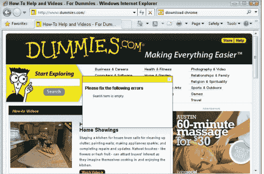

图13-1：搜索词为空——即，缺失。

一段简短的脚本会在搜索引擎运行查询之前验证你是否输入了搜索词：

- 如果你输入了搜索词，就不会看到警告。
- 如果你没有输入搜索词，页面内置的脚本会提示对话框出现。

### JavaScript 不是 Java

上世纪90年代末，JavaScript 脚本语言的创始人想借势当时极受欢迎的 Java 编程语言，于是给它取了一个朗朗上口的名字——JavaScript。然而，当他们做出这个决定时，也因为两个名字的相似性引入了很多混淆。需要澄清的是，功能齐全的 Java 编程语言*不是*网络上的脚本语言。Java 是 C 和 C++ 编程语言的衍生品。程序员可以创建能在 Windows、Macintosh、Linux 和其他计算机平台上运行的 Java 应用程序：

- ✓ 在客户端，Java 被用来创建`小程序`（通过网络下载并在 Web 浏览器内运行的小程序）。因为 Java 被设计为跨平台，这些小程序在任何支持 Java 的浏览器上都应能以相同方式运行。
- ✓ 在服务器端，Java 被用来创建许多基于 Web 的应用程序。

这段脚本使得页面具有`动态性`，这意味着它为你的网页添加了编程功能，使其能够响应用户在页面上的操作（例如，填写表单或将鼠标指针移到图像上）。当你向页面添加脚本时，页面会与用户互动，并根据用户的行为改变其显示或行为。


当你尝试搜索空内容时，页面 URL 不会改变，也不会打开另一个浏览器窗口。页面会响应你的操作，而无需向 Web 服务器发回请求以获取新页面。这就是为什么该页面被认为是`动态`的。

如果你在不使用脚本（即没有动态功能）的情况下尝试这个技巧，浏览器会将空的搜索字符串发送回 Web 服务器。然后服务器会返回一个警告页面，提醒用户输入搜索词。所有工作都将在 Web 服务器上完成，而不是在 Web 浏览器中。这会更慢，因为请求必须先到达服务器，然后服务器必须将警告页面传回你的浏览器——因此，对用户来说，服务器感觉流畅性差很多。在页面上点击按钮，然后立即弹出一个警报来帮助用户，这样要好得多。

在以下章节中，我们将展示 JavaScript 可用于网页的三种常见方式。

不要担心以下示例中 JavaScript 代码的细节。只需关注如何将 JavaScript 脚本粘贴到你的网页中，与你的 HTML 标记协同工作。

### 使用 JavaScript 动态安排内容


JavaScript可以与层叠样式表（CSS；在第9-12章中介绍）结合使用，根据用户操作改变页面内容的外观。下面是一个例子：两位作者共用一个名为“备份大脑”（`www.backupbrain.com`）的博客。其中一位作者偏好小型无衬线字体，另一位则觉得阅读大型衬线字体更轻松，因此该博客设置了按钮来改变网站外观以匹配每个人的偏好。当然，网站访客也可以使用这些按钮来切换字体外观，并且网站通过设置cookie（一个写入用户计算机的小型偏好文件）来记住访客的选择，以便未来访问时使用。图13-2展示了页面的两种外观。

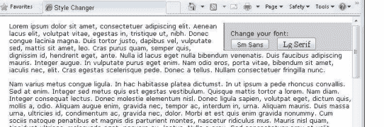

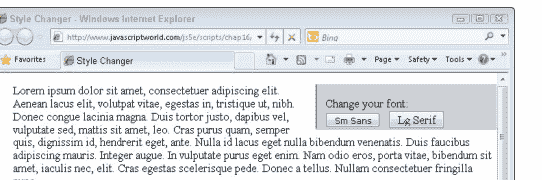

图13-2：改变文本显示方式。

JavaScript和CSS通过在两个样式表之间切换来实现这种效果：

- 无衬线样式表，`sansStyle.css`
- 衬线样式表，`serifStyle.css`

清单13-1展示了一个包含图13-2所示切换机制的示例页面的源代码：

> 当用户点击页面上的“小号无衬线”按钮时，`<head>`元素中引用的`styleSwitcher.js`脚本会运行，并将活动样式表切换到`sansStyle.css`。（`.js`是用于JavaScript文件的文件扩展名，如清单13-1中`script`元素的`src`值所示。）

> 当用户点击“大号衬线”按钮时，相同的脚本会切换到`serifStyle.css`样式表。

#### 清单13-1：样式切换

```html
<!DOCTYPE html PUBLIC "-//W3C//DTD XHTML 1.0 Transitional//EN"
 "http://www.w3.org/TR/xhtml1/DTD/xhtml1-transitional.dtd">
<html xmlns="http://www.w3.org/1999/xhtml" lang="en" xml:lang="en">
<head>
    <title>Style Changer</title>
    <meta http-equiv="Content-Type" content="text/html; charset=ISO-8859-1" />
    <link href="simpleStyle.css" rel="stylesheet" rev="stylesheet" />
    <link href="sansStyle.css" rel="stylesheet" rev="stylesheet"
          title="default" />
    <link href="serifStyle.css" rel="alternate stylesheet"
          rev="alternate stylesheet" title="serif" />
    <style type="text/css" media="all">@import url("complexStyle.css");</style>
    <script src="styleSwitcher.js" language="javascript1.5"
        type="text/javascript"></script>
</head>
<body>
<div class="navBar">
<br />Change your font:
<form action="none">
    <input type="button" class="typeBtn" value="Sm Sans"
        onclick="setActiveStylesheet('default')" />
    <input type="button" class="typeBtn2" value="Lg Serif"
        onclick="setActiveStylesheet('serif')" />
</form>
</div>

<div class="content" id="headContent">
<p>Replace this paragraph with your own content.</p>
</div>
</body>
</html>
```

# 第四部分：脚本与（X）HTML

你可以在`www.javascriptworld.com/js5e/scripts/chap16/ex6/index.html`亲自查看示例页面。

这个例子依赖于几个不同的文件（HTML、CSS 和 JavaScript）。如果你愿意，可以从`www.javascriptworld.com/js5e/scripts/index.html`下载所有这些文件。

字体样式更改器文件出现在第16章中。

## 使用浏览器窗口

JavaScript可以告诉你的浏览器打开和关闭窗口。

你可能见过这种技巧的一个恼人版本：当你试图离开一个网站时，会弹出广告窗口。（我们就不说这个了。）不过，这项技术也可以用于好的目的。例如，你可以用小缩略图版本预览一组大图像文件。点击缩略图图像可以执行以下操作：

- 打开一个窗口，显示图像的较大版本。
- 打开一个页面，其中有一个文本链接，点击后打开一个包含该文本图解的窗口，如图13-3所示。

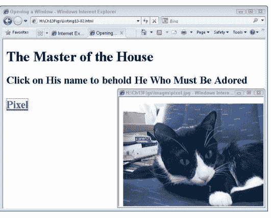

图13-3：当你点击链接时，会弹出一个包含图片的窗口。

实现这种弹出窗口所需的代码相当简单，如清单13-2所示，它调用了`window.open`函数。

### 清单13-2：弹出窗口

```html
<!DOCTYPE html PUBLIC "-//W3C//DTD XHTML 1.0 Transitional//EN"
    "http://www.w3.org/TR/xhtml1/DTD/xhtml1-transitional.dtd">
<html xmlns="http://www.w3.org/1999/xhtml">
<head>
    <title>Opening a Window</title>
    <script language="Javascript" type="text/javascript">

    function newWindow() {
        catWindow = window.open("images/pixel2.jpg", "catWin",
            "width=330,height=250")
    }
    </script>
</head>
<body bgcolor="#FFFFFF">
    <h1>The Master of the House</h1>
    <h2>Click on His name to behold He Who Must Be Adored<br /><br />
    <a href="javascript:newWindow()">Pixel</a></h2>
</body>
</html>
```


弹出窗口不再是最佳实践，应谨慎使用。过度使用弹出窗口可能会适得其反。许多网站使用弹出窗口来投放广告，因此用户对此变得麻木（或充满敌意），只是忽略它们（或安装软件阻止它们）。此外，一些Web浏览器——如Firefox、Safari和Internet Explorer——如今默认会自动阻止弹出窗口。在你向网站添加弹出窗口之前，请确保它是绝对必要的。然后，提醒你的访客你将使用弹出窗口，以便他们可以指示他们的Web浏览器允许其出现。

### 征集和验证用户输入

JavaScript的一个常见用途是在浏览器实际将表单提交到Web服务器上的表单处理程序之前，验证用户是否已填写表单中的所有必填字段。清单13-3在HTML页面的`<script>`元素中放置了一个表单检查函数`checkSubmit`，并在`<form>`元素的`onsubmit`属性中引用了它。

## 清单13-3：表单验证

```html
<!DOCTYPE html PUBLIC "-//W3C//DTD XHTML 1.0 Transitional//EN"
        "http://www.w3.org/TR/xhtml1/DTD/xhtml1-transitional.dtd">
<html xmlns="http://www.w3.org/1999/xhtml" lang="en" xml:lang="en">
<head>
    <title>Linking scripts to HTML pages</title>
    <meta http-equiv="Content-Type" content="text/html; charset=ISO-8859-1" />
    <script type="text/javascript" language="javascript">
        function checkSubmit ( thisForm ) {
            if ( thisForm.FirstName.value == '' ) {
                alert('Please enter your First Name.');
                return false;
            }

            if ( thisForm.LastName.value == '' ) {
                alert('Please enter your Last Name.');
                return false;
            }

            return true;
        }
    </script>
</head>

<body>
    <form method="post" action="/cgi-bin/form_processor.cgi"
          onsubmit="return checkSubmit(this);">
    <p>
      First Name: <input type="text" name="FirstName" /><br />
      Last Name: <input type="text" name="LastName" /><br />
      <input type="submit" />
    </p>
    </form>
</body>
</html>
```

当用户点击提交按钮时，如果任一表单字段未填写，此脚本将执行以下两种操作之一：

- 它指示浏览器显示一个警告，让用户知道他忘记填写某个字段。
- 它向浏览器返回一个`false`值，这会阻止浏览器将表单提交给表单处理应用程序。

如果字段填写正确，浏览器不会显示任何警告并返回一个`true`值，这告诉浏览器表单已准备好发送到Web服务器。图13-4展示了如果名字字段为空，浏览器如何显示警告。

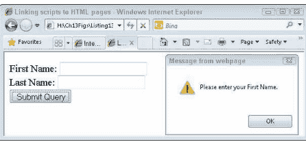

**图13-4：** JavaScript的一个良好用途是验证表单数据。


虽然此示例仅验证用户是否填写了表单字段，但你可以创建更高级的脚本来检查特定的数据格式，例如在电子邮件地址中使用`@`符号，在电话号码字段中仅使用数字。

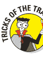

当你创建包含必填字段的表单时，我们建议你始终包含JavaScript字段验证，以便在表单数据返回服务器之前捕获缺失信息。当访客花时间填写表单，却被告知需要点击“后退”按钮提供缺失信息时，他们会感到沮丧。当你使用JavaScript时，脚本会在表单页面消失前捕获任何缺失信息，这允许用户快速进行更改并尝试再次提交。

### 但是等等……还有更多！

你可以用JavaScript做更多的事情。以下列表重点介绍了这种脚本语言的几种常见用途：

- 检测用户是否安装了处理多媒体内容的浏览器插件
- 构建图片幻灯片
- 自动将用户重定向到不同的网页
- 为你的页面添加条件逻辑，以便当用户执行特定操作时，其他操作被触发
- 创建、定位和滚动新的浏览器窗口
- 创建导航栏并动态更改这些栏上的菜单
- 自动在页面上放置当前日期和时间
- 结合JavaScript和CSS来为页面元素添加动画

JavaScript的一个创新用法出现在`Gmail`中，这是Google的免费基于Web的电子邮件服务，你可以在`www.gmail.com`找到它。Gmail使用JavaScript将整个电子邮件用户界面加载到用户的浏览器中，这使得Gmail比大多数其他基于Web的邮件程序对用户操作的响应要快得多。Gmail使用JavaScript将页面从服务器获取额外信息的次数降至绝对最小值。通过在用户的浏览器中完成大部分处理，Gmail Web应用程序感觉更像是在你的计算机上运行的电子邮件程序。图13-5展示了由JavaScript驱动的Gmail界面。这是展示JavaScript强大功能的绝佳示例。

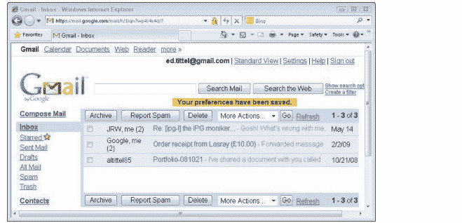

**图13-5：** Gmail界面由JavaScript驱动。

### 服务器端脚本

JavaScript是一种在浏览器内运行的脚本语言，但还有其他脚本语言在服务器端运行，例如Perl、ASP（Active Server Pages）、PHP（PHP Hypertext Preprocessor，一种（X）HTML嵌入式脚本语言）、Python、.NET等等。用这些语言编写的程序驻留在服务器上，由网页调用，通常是为了响应用户填写的表单。编写这些网页的人可能会包含代码片段，将信息从HTML页面传递到服务器上的程序。当被调用时，程序运行，然后向用户返回某种结果。

Amazon（`www.amazon.com`）运行着一个熟悉的电子商务Web应用程序，它主要在服务器端运行，使用服务器脚本。当你在访问Amazon时浏览器显示的网页，都是由处理服务器端脚本生成的，所有这些都发生在页面到达你的浏览器之前。如果你想了解更多关于JavaScript及其能为你做什么的信息，请查看Emily A. Vander Veer的*JavaScript For Dummies, Quick Reference*。

# 第14章：处理表单

## 本章内容

- 在网页中使用表单
- 创建表单
- 处理表单数据
- 设计易于使用的表单
- 使用表单框架简化表单

你编写的大多数HTML都是帮助你为用户显示内容和信息。然而，有时你希望一个网页从用户那里收集信息，而不是向他们提供静态信息。HTML表单标记元素为你提供了一套丰富的标签和属性，用于创建表单，以便从网站的访客那里收集信息。

本章涵盖了表单的许多不同用途。它还向你展示如何使用表单标记标签创建合适的表单来向用户征集信息，回顾了处理接收到数据的选项，并为你提供了一些关于创建真正有助于用户提供你所需信息的易于使用的表单的技巧。

## 表单的用途

网络上包含数百万个表单，但每个表单都由同一套标记标签驱动。Web表单可以是短的或长的，简单的或复杂的，它们有无数的用途。但所有表单都归结为两大类之一：

- **搜索表单**，允许用户搜索网站或整个网络
- **数据收集表单**，为在线购物、技术支持、站点首选项和个性化提供信息

在创建任何表单标记之前，你需要确定你的访客将在你的网站上搜索什么类型的数据，和/或你需要从访客那里收集什么类型的数据。你的数据驱动着你使用的表单元素以及你如何将它们组合在页面上。


### 搜索表单

搜索表单帮助你为访客提供信息。

以下搜索表单来自美国国税局（IRS）的友善人士。这些搜索表单的区别在于IRS网站需要你提供什么数据进行搜索：

IRS主页（如图14-1所示）是一个简单的多方面搜索表单，具有各种布局区域，帮助访客轻松搜索税务表格和出版物、在线服务、申报和付款信息、面向任务的说明以及一般信息。这种类型的页面可以产生数十个相关响应。访客可以：

- 选择最佳选项。
- 查看多个选项。

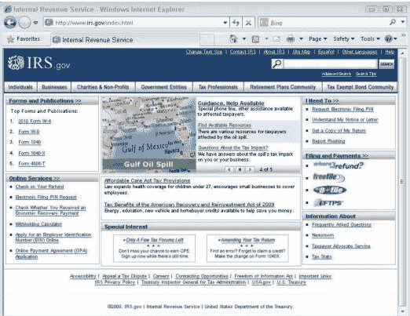

**图14-1：** IRS主页提供了对表格、出版物和信息的便捷访问。

一个更复杂的搜索表单，例如“获取退税状态”页面（如图14-2所示），只产生一个特定的响应：即，你的所得税退税状态的IRS记录。因为这个页面要求提供详细信息——而且毕竟，因为IRS不想让你看到其他人的退款——它服务于双重目的：

- 找到访客需要的数据
- 隐藏访客不应看到的数据

## 第14章：使用表单 223

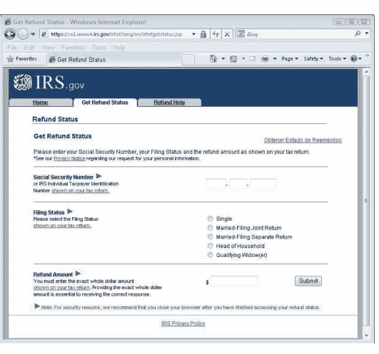

图14-2：像退款状态搜索这样的表单要稍微复杂一些。


搜索的形式多种多样，因此驱动这些搜索的搜索表单也多种多样。一个简短的关键词搜索可能就能解决问题，或者你可能需要一个更复杂的搜索方法。

### 数据收集表单

数据收集表单用于接收你想要处理或保存的信息。当你创建一个收集信息的表单时，你需要的信息决定了表单的结构和复杂程度：

- **只需要一点：** 如果你只需要少量信息，表单可能很短，而且（相对）简单。


*示例：* 美国国会图书馆（LoC）使用一个表单来收集教师的信息，以便订阅免费的电子通讯，如图14-3所示。LoC不需要太多信息来设置订阅，所以表单很简短。

- **需要很多：** 如果你需要大量信息，你的表单可能有好几页长。

  *示例：* RateGenius使用冗长而详细的表单来收集其所需的信息，以帮助客户获得最佳的贷款利率。图14-4中的页面只是访客必须填写的几页中的第一页，以提供所有必要的信息。

www.it-ebooks.info

# 第四部分：脚本与 (X)HTML

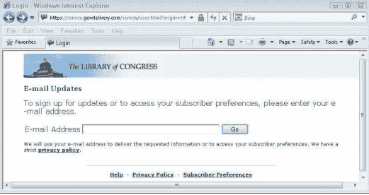

图14-3：一个免费订阅表单收集基本信息。


图14-4：一些网站使用多个详细的表单来收集必要的数据。

## 创建表单

HTML表单可以向用户呈现信息，使用文本和图像。但它也可以提供各种类型的文本输入字段（单行内联、单行或多行），以及各种类型的数据选择工具，例如单选按钮（允许你从一组选项中选择一个）、选择列表（允许你从预定义的选项集中填写一个值）或复选框（允许你从预定义的输入集中选择零个、一个或多个值）。总而言之，HTML表单标记标签和属性有助于你：

- 定义整体表单结构。
- 告诉Web浏览器如何处理表单数据。
- 创建输入对象，例如文本字段和下拉列表。

每个表单都具有相同的基本结构。此外，你使用哪些输入元素取决于你正在呈现和收集的数据。

### 结构

`form`元素是一个内容（和输入）容器，它的作用很像段落（`p`）元素（包含段落文本）或分区（`div`）元素（在逻辑文档部分中包含各种子元素）。因此，与单个表单关联的所有输入元素都：

- 包含在一个`<form>`标签内。
- 由同一个表单处理器处理。

表单处理器是Web服务器上的一个程序（或简单的`mailto:` URL），它管理用户通过表单发送给你的数据。Web浏览器只能通过表单收集信息；它在获取信息后不知道该如何处理。你必须提供某种其他机制来实际利用你在任何表单中收集的数据做些有用的事情。（本章稍后将在“处理数据”部分详细讨论表单处理器。）

### 属性

你总是使用这两个关键属性与`<form>`标签一起：

- `action`：表单处理器的URL。
- `method`：你希望如何将表单数据发送给表单处理器。

你的表单处理器决定了使用这些值中的哪一个作为`method`（你的托管或服务提供商可能有一份文档，描述如何调用本地Web服务器的表单处理器，包括那些非常必要的细节——可能还有一些示例）：

- `get`将表单数据作为URL的一部分发送给表单处理器。
- `post`将表单数据在超文本传输协议（HTTP）头中发送。

Webmonkey在其文章“为你的网站添加HTML表单”（网址为`www.webmonkey.com/2010/02/add_html_forms_to_your_site`）中很好地概述了`get`和`post`之间的区别。

### 标记

清单14-1中的标记创建了一个使用`post`方法将用户输入的信息发送到表单处理器（`guestbook.php`）以在Web服务器上处理的表单。

#### 清单14-1：由表单处理器处理的简单表单

```html
<!DOCTYPE html PUBLIC "-//W3C//DTD XHTML 1.0 Transitional//EN"
    "http://www.w3.org/TR/xhtml1/DTD/xhtml1-transitional.dtd">
<html xmlns="http://www.w3.org/1999/xhtml">
<head>
    <title>Forms</title>
    <meta http-equiv="Content-Type" content="text/html; charset=ISO-8859-1" />
</head>
<body>
    <form action="cgi-bin/guestbook.php" method="post">

    <!-- 表单输入元素放在这里 -->

    </form>
</body>
</html>
```

`action`属性的值是一个URL，因此你可以使用绝对URL或相对URL来指向服务器上的表单处理器。第6章更详细地介绍了绝对URL和相对URL。

### 输入标签

你用来征求网站访客输入的标签构成了任何表单的主体。HTML支持多种不同的输入选项——从文本字段到单选按钮，从文件到图像。

每个输入控件都将某个值与一个名称关联：

- ✓ 创建控件时，你给它一个名称。
- ✓ 控件根据用户在表单中的操作返回一个值。

例如，如果你创建一个收集用户名字的文本字段，你可能会将该字段命名为`firstname`。当用户在该字段中输入她的名字并提交表单时，与`firstname`关联的值就是用户在该字段中输入的任何名字。

整个表单的目的就是收集与输入控件关联的值，因此你如何为每个控件设置名称和值非常重要。以下各节解释了你应如何为每种输入控件处理名称和值。

`input`元素（以及扩展而言，空的`<input ... />`标签）是在使用HTML表单征求用户输入时的主角。在`input`元素内部，你定义了要收集的输入类型，以及如何打包和呈现你提供给用户的输入字段和提示，以便他们能够提供你要求的内容。

### 输入字段

你可以在表单中使用各种输入字段，例如文本、密码、单选按钮/复选框、隐藏字段等。并非所有字段都需要`name`和`type`属性的值（例如，文本框或密码字段），但最好在用户可能对格式有疑问的任何时候（例如，考虑信用卡或电话号码中是否包含破折号或空格时）为用户提供解释性标签和输入数据示例。另一方面，复选框和单选按钮需要这些信息，以便在浏览器向用户显示可用选项时能够正确标记。

对于要求用户选择选项（复选框或单选按钮）而不是在字段中键入内容的输入元素，你需要同时定义名称和值。当用户选择一个复选框或单选按钮然后单击提交按钮时，表单会返回分配给该元素的名称和值。

我们将在下一节“复选框和单选按钮”中讨论这两种输入字段。

#### 文本字段

*文本字段*是用户键入信息的单行字段。当你需要为用户提供填写多行的机会时，可以使用文本框，我们将在下一节“多行文本框”中讨论。

以下是创建单行文本字段的方法：

1. **通过将`<input />`元素的`type`属性设置为`text`来定义输入类型为文本字段。**

```html
<input type="text" />
```

2. **然后使用`name`属性为输入字段命名。**

```html
<input type="text" name="firstname" />
```

用户在字段中键入内容时提供该值。

以下标记会创建两个文本输入框——一个用于名字，一个用于姓氏：

```html
<form action="cgi-bin/guestbook.php" method="post">
<ul style="list-style-type: none;">
<li>First Name: <input type="text" name="firstname" /></li>
<li>Last Name: <input type="text" name="lastname" /></li>
</ul>
</form>
```

除了`<input />`元素外，前面的标记还包含列表（`<ul>`和`<li>`）元素以及一些用于标记每个字段的文本。大多数表单元素本身并不能给用户提供太多关于你希望他们输入何种信息的提示。列表将在第5章中更详细地介绍。

你必须使用HTML块级和内联元素来格式化表单的外观，并提供必要的文本。图14-5展示了浏览器如何显示这类HTML。（要查看生成此图的HTML源代码，请访问我们的网站`www.dummieshtml.com`，选择第14章，然后查看图14-5的源代码。）

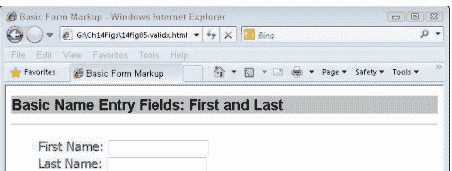

**图14-5：** 表单中的文本输入字段。

你可以使用以下属性控制文本字段的大小：

- `size`：文本字段的长度（以字符计）。
- `maxlength`：用户可在字段中输入的最大字符数。

以下标记创建了一个表单，将两个字段的`size`都设置为30（字符长），`maxlength`都设置为25（字符长）。尽管每个字段显示约30个字符长，但用户只能在每个字段中输入25个字符，如图14-6所示。（将`size`属性设置为大于`maxlength`可确保文本字段在显示时，用户输入的内容与字段框末端之间总有一些空白；你不必这样做，但我们发现这样视觉上更美观。）

```html
<form action="cgi-bin/guestbook.php" method="post">
<ul style="list-style-type: none;">
  <li>First Name: <input type="text" name="firstname" size="30" maxlength="25" /></li>
  <li>Last Name: <input type="text" name="lastname" size="30" maxlength="25" /></li>
</ul>
</form>
```

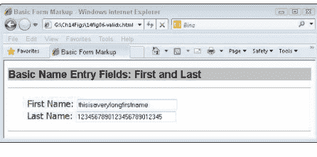

**图14-6：** 你可以指定文本字段的长度和最大字符数。

## 密码字段

*密码字段*是一种特殊的文本字段，它不显示用户输入的内容。每个按键在屏幕上都由一个占位符字符（如星号或圆点）表示，这样从用户肩膀上方窥视的人就看不到敏感信息。

你可以通过使用`type`属性设置为`password`的`<input />`元素来创建密码字段，如下所示：

```html
<form action="cgi-bin/guestbook.php" method="post">
<ul style="list-style-type: none;">
  <li>First Name: <input type="text" name="firstname" size="30" maxlength="25" /></li>
  <li>Last Name: <input type="text" name="lastname" size="30" maxlength="25" /></li>
  <li>Password: <input type="password" name="psswd" size="30" maxlength="25" /></li>
</ul>
</form>
```

密码字段的编程方式与文本字段类似。

图14-7展示了浏览器如何用圆点代替你输入的内容。*注意：* 根据浏览器的默认设置，有些浏览器可能会用星号或其他字符代替文本。

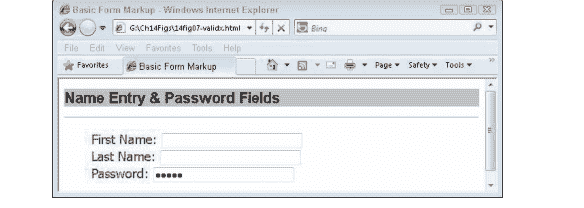

**图14-7：** 密码字段会掩盖用户输入的文本。

### 复选框和单选按钮

如果用户只有有限的可能值可选，你可以给他一组选项供选择：

- **复选框：** 可以选择多个选项。
- **单选按钮：** 只能选择一个选项。

单选按钮与复选框有一个重要区别：用户可以从一组选项中选择一个单选按钮，但可以选择任意数量的复选框（包括零个、一个或多个）。

如果有许多选项可用（超过六个左右），请使用下拉列表而不是单选按钮或复选框。我们将在下一节“下拉列表字段”中向你展示如何创建它们。

要创建单选按钮和复选框，你需要：

1. 使用`type`属性设置为`radio`或`checkbox`的`<input />`元素。
2. 使用以下属性创建每个选项：
   - `name`：为选项命名。
   - `value`：指定如果用户选择该选项则返回的值。

你还可以使用`checked`属性（值为`checked`）来指定当浏览器显示表单时，某个选项应已被选中。这是在列表中指定默认选择的好方法。

以下标记展示了如何格式化复选框和单选按钮选项：

```html
<form action="cgi-bin/guestbook.cgi" method="post">
<p>What are some of your favorite foods?</p>
<ul style="list-style-type: none;">
    <li><input type="checkbox" name="food" value="pizza" checked="checked" /> Pizza</li>
    <li><input type="checkbox" name="food" value="icecream" /> Ice Cream</li>
    <li><input type="checkbox" name="food" value="eggsham" /> Green Eggs and Ham</li>
</ul>

<p>What is your gender?</p>
<ul style="list-style-type: none;">
    <li><input type="radio" name="gender" value="male" /> Male</li>
    <li><input type="radio" name="gender" value="female" checked="checked" /> Female</li>
</ul>
</form>
```

在前面的代码中，每组选项对每个输入控件使用相同的`name`，但为每个选项分配不同的`value`。你给一组选项中的每个项目相同的`name`，是为了让浏览器知道它们属于同一组。图14-8展示了浏览器如何显示此标记，其中我们还选中了“Pizza”复选框，并保持“Ice Cream”旁边的默认选中状态不变。事实上，如果你想的话，可以在页面标记中默认选中任意多个复选框，只需在你希望预先选中的每个`<input ... />`元素中包含`checked="checked"`即可。

### 隐藏字段

隐藏字段提供了一种在用户看不到的情况下，收集名称和值信息并与其余表单数据一起提交的方式。隐藏字段可用于跟踪与表单相关的信息，例如其版本或名称。

如果你的互联网服务提供商（ISP）为留言簿或反馈表单提供通用应用程序，你可能必须将你的姓名和电子邮件地址放在表单的隐藏字段中，以便数据专门发送给你。

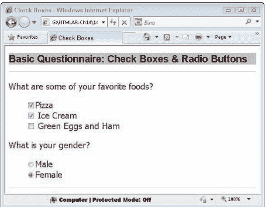

**图14-8：** 复选框和单选按钮提供选项。

要创建隐藏字段，你需要：

- 使用`type`属性设置为`hidden`的`<input />`元素。
- 提供你要发送给表单处理程序的名称-值对。

以下是隐藏字段标记的示例：

```html
<form action="cgi-bin/guestbook.php" method="post">
  <input type="hidden" name="e-mail" value="me@mysite.com" />
  <ul style="list-style-type: none;">
    <li>First Name: <input type="text" name="firstname" size="30"
      maxlength="25" /></li>
    <li>Last Name: <input type="text" name="lastname" size="30"
      maxlength="25" /></li>
    <li>Password: <input type="password" name="psswd" size="30"
      maxlength="25" /></li>
  </ul>
</form>
```

> **行业技巧：** 一般来说，在隐藏字段中使用你的电子邮件地址，只会让你的地址被垃圾邮件发送者获取。如果你的ISP说这是你应该在反馈表单中采用的方式，请询问关于如何最大限度减少损害的建议。访问你页面的用户看不到你的电子邮件地址，但垃圾邮件发送者的蜘蛛程序可以读取底层标签。至少，你希望你的ISP支持众多JavaScript加密工具中的一种，以对电子邮件地址进行混淆处理，防止被获取。

### 文件上传字段

表单可以从用户那里接收文档和其他文件，例如图像。当用户提交表单时，浏览器会抓取文件的副本并将其与其他表单数据一起发送。要创建此文件上传字段：

- 使用`type`属性设置为`file`的`<input />`元素。
- 文件本身即为表单字段值。
- 使用`name`属性为控件命名。

以下是文件上传字段标记的示例：

```html
<form action="cgi-bin/guestbook.php" method="post">
<p>Please submit your resume in Microsoft Word or plain text format:<br />
    <input type="file" name="resume" />
</p>
</form>
```

浏览器会渲染一个带“浏览”按钮的文件上传字段，该按钮允许用户浏览本地硬盘并选择要发送的文件，如图14-9所示。

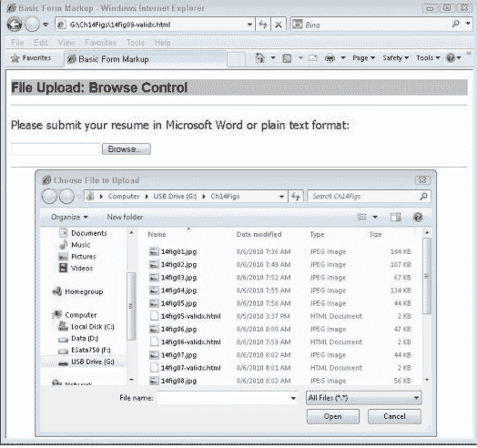

**图14-9：** 文件上传字段。

当你通过表单接收用户文件时，可能会收到体积巨大或可能感染病毒的文件。请与负责编程你的表单处理器的人讨论，以探讨保护文件存储系统安全的方案。多种防护措施可以帮助你将风险降至最低，包括：

- 病毒扫描软件


- 文件大小限制
- 文件类型限制

### 下拉列表字段

下拉列表是向用户展示大量选项的绝佳方式，且只占用少量屏幕空间。你使用两个不同的标签来创建下拉列表：

- `<select>` 标签用于创建列表。

  为 `<select>` 元素使用 `name` 属性，为你的列表命名。

- 一系列 `<option>` 元素用于标识单个列表选项。

  `value` 属性为每个 `<option>` 元素分配一个唯一的值。

这是一个下拉列表的标记示例：

```html
<form action="cgi-bin/guestbook.cgi" method="post">
<p>What is your favorite food?</p>
<select name="food">
  <option value="pizza">Pizza</option>
  <option value="icecream">Ice Cream</option>
  <option value="eggsham">Green Eggs and Ham</option>
</select>
</form>
```

浏览器会将此标记转换为一个包含三个项目的下拉列表，如图 14-10 所示。

你也可以通过更改列表的默认设置，让用户能够从下拉列表中选择多个项目：

- 如果你希望用户能够选择多个选项（通过在按住 Ctrl [Windows] 或 ⌘ [Mac] 键的同时点击列表中的选项），请在 `<select>` 标签中添加 `multiple` 属性。`multiple` 属性的值是 `multiple`。

  由于 XHTML 规则，独立属性不能单独存在；因此，该属性的值与其名称相同。

默认情况下，浏览器只显示一个选项，直到用户点击下拉菜单箭头以显示列表的其余部分。使用 `<select>` 标签的 `size` 属性来指定要显示的选项数量。

如果你指定的数量少于选项总数，浏览器会在下拉列表中包含一个滚动条。

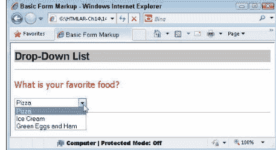

你可以指定下拉列表中的一个选项在浏览器加载页面时已处于选中状态，就像你可以指定一个复选框或单选按钮处于选中状态一样。只需在你希望作为默认值的 `<option>` 标签中添加值为 `selected` 的 `selected` 属性。当某个选择的可能性非常大时可以使用此方法，但不必担心——用户可以快速轻松地覆盖你的默认选择。

以下标记示例：

- 允许用户从列表中选择多个选项
- 显示两个选项
- 默认选中列表中的第三个选项

```html
<form action="cgi-bin/guestbook.cgi" method="post">
<p>What are some of your favorite foods?</p>
<select name="food" size="2" multiple="multiple">
  <option value="pizza">Pizza</option>
  <option value="icecream">Ice Cream</option>
  <option value="eggsham" selected="selected">Green Eggs and Ham</option>
</select>
</form>
```

图 14-11 展示了添加这些属性如何修改浏览器中列表的外观。

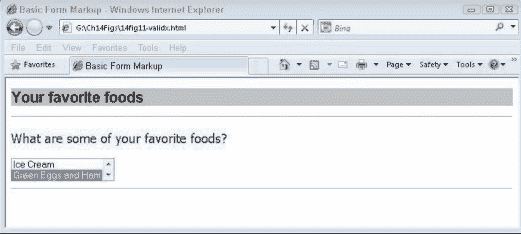

**图 14-11：** 经过修改的下拉列表。

### 多行文本框

如果单行文本字段无法提供足够的回复空间，请创建文本框而不是文本字段：

- `<textarea>` 元素定义了框及其参数。
- `rows` 属性根据文本框中的字体，以行为单位指定框的高度。
- `cols` 属性根据文本框中的字体，以列为单位指定框的宽度。

用户在框中输入的文本提供了值，因此你只需使用 `name` 属性为框命名：

```html
<form action="cgi-bin/guestbook.cgi" method="post">
  <p> Please include any comments here.</p>
  <textarea rows="10" cols="40" name="comments">
...comments here...
  </textarea>
</form>
```

你在 `<textarea>` 和 `</textarea>` 标签之间包含的任何文本都会出现在浏览器中的文本框中，如图 14-12 所示（并且与预期相反，文本框中的默认文本不是左对齐的：它稍微向右偏移，但也没有居中）。然后用户在文本框中输入信息并覆盖你的文本。

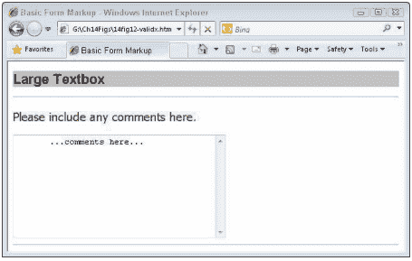

图 14-12：一个文本框。

### 提交和重置按钮

提交和重置按钮帮助用户告诉浏览器如何处理表单。你可以使用 `<input />` 元素以及以下 `type` 和 `value` 属性来创建用于提交或重置表单的按钮：

- **提交**

  访问者必须在完成表单并希望发送内容时通知浏览器。你使用以下标记创建一个将表单提交给你的按钮：

  `<input type="submit" value="Submit" />`

  你不在提交和重置按钮上使用 `name` 属性。相反，你使用 `value` 属性来指定浏览器在显示时如何标记这些按钮。

- **重置**

  如果访问者想重新开始或决定不填写表单，他们需要清空表单。你使用以下标记创建一个重置（清空）表单的按钮：

  `<input type="reset" value="Clear" />`

  你可以将 `value` 设置为你希望出现在按钮上的任何文本。在我们的示例中，我们将其设置为 `Clear`。当然，如果愿意，你可以使用更符合你网站风格的内容。

清单 14-2 展示了一个创建名为 Send 和 Clear 的提交和重置按钮的标记示例。

### 清单 14-2：一个完整的多部分表单

```html
<!DOCTYPE html PUBLIC "-//W3C//DTD XHTML 1.0 Transitional//EN"
        "http://www.w3.org/TR/xhtml1/DTD/xhtml1-transitional.dtd">
<html xmlns="http://www.w3.org/1999/xhtml" lang="en" xml:lang="en">
<head>
    <title>Basic Form Markup</title>
    <meta http-equiv="Content-Type" content="text/html; charset=ISO-8859-1" />
    <style type="text/css">
        h1 {background-color: silver;
            color: black;
            font-size: 1.2em;
            font-family: Arial, Verdana, sans-serif;}
        hr {color: blue;
            width: thick;}
        body {font-size: 12pt;
            color: brown;
            font-family: Tahoma, Bodoni, sans-serif;
            line-height: 0.8em;}
    </style>

</head>
<body>
    <h1>Multi-Part Form</h1>
    <hr />
    <div>
        <form action="cgi-bin/guestbook.cgi" method="post">
            <h1>Name and Password</h1>
                <p>First Name: <input type="text" name="firstname" size="30"
                    maxlength="25" /></p>
                <p>Last Name: <input type="text" name="lastname" size="30"
                    maxlength="25" /></p>
                <p>Password: <input type="password" name="psswd" size="30"
                    maxlength="25" /></p>
            <h1>Favorite Foods</h1>
                <p>What are some of your favorite foods?</p>
                <p><input type="checkbox" name="food" value="pizza"
                    checked="checked" />Pizza</p>
                <p><input type="checkbox" name="food" value="icecream" />
                    Ice Cream</p>
                <p><input type="checkbox" name="food" value="eggsham" />
                    Green Eggs and Ham</p>
            <h1>Gender Information</h1>
                <p>What is your gender?</p>
                <p><input type="radio" name="gender" value="male" />Male</p>
                <p><input type="radio" name="gender" value="female" />Female</p>

            <p style="line-height: 2em; margin: 2em;">
<input type="submit" value="Send" />
<input type="reset" value="Clear" />
</p>
</form>
</div>
<hr />
</body>
</html>
```

图 14-13 展示了浏览器在表单中如何渲染这些按钮。

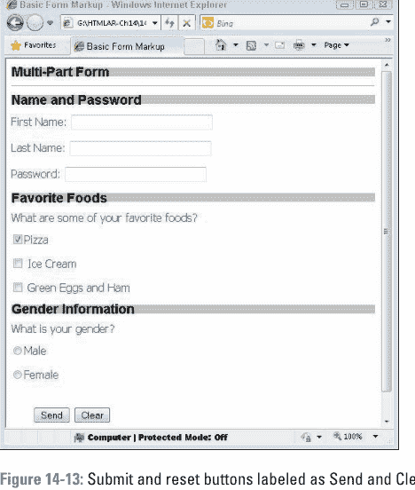

**图 14-13：** 标记为 Send 和 Clear 的提交和重置按钮。

#### 自定义提交和重置按钮

如果你不喜欢浏览器创建的默认提交和重置按钮，你可以随心所欲地修改 CSS 样式定义，就像我们这里所做的那样：

# 第四部分：脚本语言与 (X)HTML

```css
input {
    background-color: teal;
    font-family: Lucida Console, Arial, sans-serif;
    padding: 6px;
    margin: 0.2em;
    font-size: 1.2em;
    color: white;
    border-left-color: gray;
    border-top-color: gray;
    border-bottom-color: black;
    border-right-color: black;
    border-style: double;
    font-weight: bold;
}
```

经过大约十分钟的摆弄，我们就创建出了图 14-14 中那些看起来花哨的按钮。


**图 14-14：** 一点创意性的 CSS 就能为你的按钮增添不少光彩。

另一方面，如果你想要更精致的效果，可以通过以下方式替换成自己的图形按钮：

- ✅ 使用 `type` 为 `image` 的 `<input />` 元素。
- ✅ 使用 `src` 属性指定图片的位置。
- ✅ 使用 `value` 定义字段的结果：
  - 对于提交表单的图片，将 `value` 设置为 `submit`。
  - 对于重置表单的图片，将 `value` 设置为 `reset`。

> 请使用 `alt` 属性为不显示图片的浏览器（或无法查看图片的用户）提供替代文本。这将允许你使用具有圆角、阴影和其他炫酷效果的花式按钮，例如 `www.buttongenerator.com` 上提供的那些。

以下标记创建了自定义的“提交”和“重置”按钮：

```html
<p>
    <input type="image" value="submit" src="submit_button.gif" alt="Submit" />
    <input type="image" value="reset" src="reset_button.gif" alt="Clear" />
</p>
```

## 表单验证

无论你网站的访客多么聪明，他们总有可能输入你意料之外的数据。JavaScript 来救场了！

表单验证是指在用户输入的数据存入数据库之前对其进行检查的过程。请使用 JavaScript 和服务器上的通用网关接口（CGI）脚本来检查数据。

### JavaScript

你可以在数据发送到服务器之前，用 JavaScript 验证输入项。这意味着访客无需等待你的服务器检查数据。如果发现问题，他们可以立即得到通知（如果你愿意的话，甚至在他们点击“提交”按钮之前）。


如果你想在表单和网站中使用 JavaScript，可以阅读本书第 13 章了解更多内容，或在线访问：

- [www.w3schools.com/js/default.asp](http://www.w3schools.com/js/default.asp)
- [www.quirksmode.org/js/forms.html](http://www.quirksmode.org/js/forms.html)
- [http://www.webmonkey.com/2010/02/javascript_tutorial](http://www.webmonkey.com/2010/02/javascript_tutorial)

### CGI

你需要在服务器端验证表单数据，因为用户可能会在禁用 JavaScript 的情况下浏览网页。（这样他们的验证过程会慢一些。）在下一节和以下网址了解更多关于 CGI 的信息：

- [www.4guysfromrolla.com/webtech/LearnMore/Validation.asp](http://www.4guysfromrolla.com/webtech/LearnMore/Validation.asp)
- [www.cgi101.com/book](http://www.cgi101.com/book)

### 处理数据

获取表单数据其实只是表单战役的一半。你创建表单元素是为了从用户那里获取数据，但之后你必须对这些数据做些什么。当然，你的表单和数据每次都是独特的，因此没有单一、通用的表单处理程序能管理每个表单的数据。在找到（或编写）处理表单数据的程序之前，你必须明确你想用这些数据做什么。例如：

- ✔ 如果你只想通过电子邮件接收来自网页表单的评论，你可能只需要一个简单的 `mailto:` URL。
- ✔ 如果一个表单从用户那里收集信息以在留言簿中显示，你需要：
  - 将数据添加到存储条目的文本文件或小型数据库中。
  - 创建一个显示留言簿条目的网页。
- ✔ 如果你想使用购物车，你需要能够处理库存、客户订单信息、运费数据和成本计算的程序和数据库。


你的虚拟主机提供商——无论是内部 IT 团队还是你每月付费的 ISP——对你可以在网站上使用哪种应用程序来处理表单数据拥有最终决定权。如果你想在网站上使用表单，请确保你的主机提供商支持服务器上运行处理表单输入数据所需的应用程序（这些应用程序通常使用本章前面讨论的 `post` 或 `get` 方法）。第 3 章包含了更多关于寻找合适的 ISP 来托管你的页面的信息。

### 在页面上处理表单

通常，表单数据会通过某种方式由运行在 Web 服务器上的某种程序处理。它可能是一个用某种编程语言（如 Perl、Java 或 JavaScript）编写的 CGI 脚本，或者是一个使用 PHP、Apache、Java Server Pages (JSP)、ASP 或其他在 Web 服务器上运行以处理用户输入的程序编写的不同的处理程序。这些程序通过以下方式使表单中的数据变得有用：

- ✔ 将其放入数据库或与其他程序共享
- ✔ 根据数据创建自定义 HTML
- ✔ 将数据写入平面文件

> *平面文件*是计算机极客对普通、无格式文本文件的称呼，或者指在单独的文本行上使用逗号或制表符来分隔字段值的文件（也称为 *CSV*，即 *逗号分隔值*，或 *TSV*，即 *制表符分隔值*）。


你不必是程序员也能充分利用表单。许多 ISP 支持（并提供）用于处理常见表单的脚本，例如留言簿、评论表单，甚至购物车。你的 ISP 可能会为你提供：

- 启动和运行输入处理程序所需的所有信息
- 需要包含在你的页面中的 HTML，以便它们可以与该程序交互

## 第 14 章：使用表单

你可以调整从 ISP 获得的预置 HTML 中管理表单外观的标记，但不要更改表单本身——尤其是表单标签名称和值。Web 服务器程序使用这些来使整个流程工作。

几个在线脚本仓库提供免费的脚本，你可以下载并随表单一起使用。其中许多还附带一些通用的 HTML，你可以对其进行美化和调整以适应你的网站。你只需将处理表单的程序放入网站上保存程序的文件夹（有时称为 `cgi-bin`，通常是其他名称），将 HTML 添加到页面中，就万事俱备了。一些可以在网上找到并立即下载使用的脚本的精选网站是：

- Matt 的脚本库：`www.scriptarchive.com/nms.html`
- CGI 资源索引：`http://cgi.resourceindex.com`
- ScriptSearch.com：`www.scriptsearch.com`

如果你想在网站上使用 ISP 未提供的程序，你需要完全访问网站的脚本或处理程序文件夹（有时命名为 `cgi-bin`）。每个 ISP 的设置都不同，因此请阅读文档以了解：

- 你的 ISP 是否允许你在网页中使用程序或脚本
- ISP 支持哪些语言

Perl 和 PHP 通常是安全的选择，但最好还是确认一下。

## 通过电子邮件发送表单数据

你可以选择通过电子邮件接收表单数据，而不是使用脚本或其他实用程序来处理表单数据。你会收到一个包含名称-值对的文本文件，这些对被发送到你的电子邮件地址，但这不一定是件坏事。你可以在网站上包含一个简短的联系表单，要求人们向你发送反馈（这看起来总是很专业）；然后你可以在 `action` URL 中包含你希望数据发送到的电子邮件地址：

```html
<form action="mailto:me@mysite.com" action="post">
```

244

# 第四部分：脚本语言与 (X)HTML

许多垃圾邮件公司通过在网站上搜索 `mailto:` URL 来获取电子邮件地址。考虑设置一个专门用于评论的特殊电子邮件账户，这样你的常规电子邮件地址就不会被拉入垃圾邮件列表。另一方面，你也可以使用基于 JavaScript 的电子邮件地址加密工具来混淆和伪装此类地址的内容——只要它们能在接收端解密即可！

## 设计用户友好的表单

设计有用的表单与设计易于使用的表单是不同的任务。你的表单可能收集到了你需要的数据，但如果表单对访客来说难以使用，他们可能会在完成之前就放弃。

在使用本章的标记元素以及驱动页面布局的其他元素时，请记住以下准则：

- **为所有表单提供文本提示。** 要明确说明：
  - 你想要的信息
  - 你需要的格式

  例如，告诉用户细节，例如：

  - 日期是否必须以 `mm/dd/yy` 格式输入（而不是 `mm/dd/yyyy`）。
  - 字段可以容纳的字符数是否有限制。

  正如你本章前面学到的，字符长度可以通过使用 `maxlength` 属性来限制。

- **使用字段宽度和字符限制来提供视觉线索。** 例如，如果用户应该输入电话号码为 `xxx-xxx-xxxx`，可以考虑创建三个文本字段——每个部分一个。
- **将相似字段分组。** 逻辑分组使填写表单更容易。如果你先问访客的名字，然后是生日，最后是姓氏，这会令人困惑。
- **将长表单分解为易于管理的段落。** 分段的表单不那么令人生畏，也更有可能被完成。
- **清楚标记必填字段。** 如果表单的某些部分在用户提交时不能留空，请清楚标记这些字段。

主要的在线零售商（如 Amazon.com —— `www.amazon.com`）使用这种方法来获取订单所需的详细信息，而不会使过程过于痛苦。

### 识别必填字段

你可以通过以下方式识别必填字段：

- 将其设为粗体
- 使用不同颜色
- 在其旁边放置星号

**告诉用户填写表单需要何种信息。** 如果用户在填写你的表单前需要手头有任何信息，那么一个表单引导页面可以详细说明用户在开始填写前应准备的一切。

RateGenius 页面（如图 14-15 所示）为即将填写长表单的访客清晰地列出了开始前需要准备的全部信息。


RateGenius 用于收集汽车贷款和贷款再融资信息的一系列表单，是长表单的绝佳范例，它们利用了所有可用的表单标记元素来收集各种不同类型的数据。请访问 `www.rategenius.com` 查看其表单技术。

### 其他值得注意的表单相关标记

表 14-1 列出了其他你可能在 HTML 文件中找到的表单相关 (X)HTML 标记属性。

| 表 14-1 | 其他表单相关 (X)HTML 属性 |
| :--- | :--- |
| **名称** | **功能/值等于** | **值类型** | **相关元素** |
| Accept | 列出文件上传可接受的 MIME 类型 | CS 媒体类型 | `<form>` `<input />` |
| Accept-charset | 列出字符编码 | 字符集编码 | `<form>` |
| Checked | 预选选择列表中的选项 | "checked" | `<input />` |
| Disabled | 禁用表单元素 | "disabled" | `<button>` `<input>` `<optgroup>` `<option>` `<select>` `<textarea>` |
| Enctype | 指定表单输入数据的编码方法 | 媒体类型 | `<form>` |
| For | 指向其他属性中的 ID 引用 | Idref | `<label>` |
| Label | 标识表单中的选项组 | 文本 | `<optgroup>` |
| Label | 指定表单中的选项名称 | 文本 | `<option>` |
| Method | 提交表单时使用的 HTTP 方法 | {"get" \| "put"} | `<form>` |
| Multiple | 允许在表单中选择多个选项 | "multiple" | `<select>` |

# 第 14 章：使用表单

| 名称 | 功能/值等于 | 值类型 | 相关元素 |
|---|---|---|---|
| Name | 命名特定的表单控件 | CDATA | `<button>` `<textarea>` |
| Name | 命名特定的表单输入字段 | CDATA | `<select>` |
| Name | 为脚本访问命名表单 | CDATA | `<form>` |
| Readonly | 阻止编辑表单中的文本字段 | "readonly" | `<input />` `<textarea>` |
| Size | 指定下拉菜单显示的文本行数 | 数字 | `<select>` |
| Tabindex | 定义表单字段的制表键顺序 | 数字 | `<a>` `<area />` `<button>` `<input />` `<object>` `<select>` `<textarea>` |
| Type | 定义表单中按钮的功能 | {"button" \| "reset" \| "submit"} | `<button>` |
| Type | 指定表单输入字段所需的输入类型 | {"button" \| "checkbox" \| "file" \| "hidden" \| "image" \| "password" \| "radio" \| "reset" \| "submit" \| "text"} | `<input />` |
| Value | 提供点击时发送到服务器的值 | CDATA | `<button>` |
| Value | 将值与单选按钮和复选框关联 | CDATA | `<input />` |

# 第四部分：脚本与 (X)HTML

表 14-1 中值类型列的图例：

- **CDATA**：SGML 字符数据类型，允许使用所有键盘字符
- **CS 媒体类型**：区分大小写的类型名称，如 "text/html"、"image/gif" 或 "text/css"
- **字符集编码**：通常是 UTF-8、ISO-LATIN-1 或 ISO-8859-1；更完整的列表请参见 `www.w3schools.com/TAGS/ref_character sets.asp`
- **MIME**：多用途互联网邮件扩展的缩写，是一种为电子邮件附件和 HTTP 编码各种文档和数据类型的标准方法；更多信息请参见 `http://en.wikipedia.org/wiki/MIME`。

## 表单框架

表单框架基本上将构建、验证和处理表单数据的所有构件组合成一个连贯的工具和代码集合。当你学会如何使用框架时，构建自己复杂而强大的表单就变得轻而易举——至少，只要你的 Web 服务器上有这个框架可用！

- **Wufoo (`http://wufoo.com`)**：Wufoo 是一个 HTML 表单构建器，可帮助你创建联系表单、在线调查和邀请函，以便你无需编写一行代码就能收集所需的数据、注册信息和在线支付。快速而简单！
- **jQuery 验证插件 (`http://docs.jquery.com/Plugins/Validation`)**：尽管 jQuery 使得编写自己的验证插件变得容易，但仍有许多细微之处需要你考虑。例如，你需要一个标准的验证方法库（想想电子邮件、URL 和信用卡号）。你需要将错误信息放入 Web 文档，然后在适当的时候显示和隐藏它们。你希望响应的不仅仅是提交事件，比如 `keyup` 或 `blur`。你可能需要根据特定项目使用的服务器端环境，以不同方式指定验证规则。而且，毕竟你不想重新发明轮子，对吧？
- **Validatious (`http://validatious.org/learn/examples`)**：Validatious 通过非侵入式 JavaScript 支持提供简单的表单验证，使用名为 `validate` 的预定义 CSS 类。这使得验证仅仅是将验证器名称添加到表单元素（如 `input`、`select`、`textarea` 等）的问题。它不是一个完整的表单框架，但确实使验证部分——对新手和专业人士来说通常最棘手的部分——变得顺畅而直接。

`www.it-ebooks.info`

此外，许多面向 Web 的开发环境，如 Visual Studio、Web Expressions、ASP.NET 等，也包含广泛的表单设计和处理组件。这些也像框架一样工作，但通常需要你在其整体环境中工作，才能利用其通常非常强大的功能。

### CAPTCHA 这个！

CAPTCHA 代表完全自动化的公共图灵测试以区分计算机和人类——换句话说，它是一种在 Web 上交互的方式，允许开发者（非常有把握地）假设远程连接另一端输入的是人类而不是程序。CAPTCHA 是一种重要的技术，用于验证是人在向 Web 表单或其他用户输入机制提供输入（特别是更新敏感或有价值的信息）。这项技术的原因是为了阻止垃圾邮件发送者和网络钓鱼者创建虚假的电子邮件地址和 Web 帐户，然后他们可以利用这些帐户达到其恶意目的。你可能不需要在你的网页上使用 CAPTCHA，但你需要知道它是什么以及为什么它重要。

基本上，CAPTCHA 通过将文本弯曲成波浪线并叠加额外的笔画或黑色标记来工作，因此虽然人类可以阅读他们必须在键盘上输入的副本来证明他们的智能在运作，但计算机程序通常无法破译并复述相关的文本。来自 `www.captcha.net` 的标准示例如图 14-16 所示，其中的单词 "overlooks inquiry" 经过了上述处理。


图 14-16：来自 `www.captcha.net` 主页的 CAPTCHA 示例。

`www.captcha.net` 网站更详细地解释了这项技术，并继续描述了如何使用它为你的网页添加另一层身份验证。对于简单的表单来说这并非必需，但任何时候只要你让用户设置帐户、管理帐户信息或访问敏感数据（个人身份信息，或 PII，如社会安全号码、信用卡号码、帐号等，是此类保护的主要目标），将 CAPTCHA 置于潜在恶意用户面前都是一个好主意。

# 第四部分：脚本与 (X)HTML

# 第 15 章

## 将 Web 的最佳带到你的网站

## 本章内容

- 了解嵌入能为你的页面内容（和工作量）带来什么
- 嵌入 Twitter 动态、Flickr 照片和 Google 地图
- 通过混搭充分利用多重嵌入
- 混搭地图和餐厅评论，以及地图和 Twitter 动态

到目前为止，我们在本书中涵盖了许多关于 HTML、XHTML 和 CSS 的基础知识，讲解了如何创建自己的网站。然而，在你冲出去开始创建大量内容之前，你可能首先想知道是否已经存在类似的东西。互联网的伟大之处在于，许多优秀的内容已经存在，适合（恰当地）重用。通过一些练习，你可以轻松地“获取”这些内容并将其用于你的网站。利用此类服务的力量可以节省你原本需要花费的大量时间和精力，避免重复造轮子。毕竟，没有人想重新发明轮子：当然，改进它是可以的，但没必要从头开始。

例如，如果你想给朋友指路到你家，你可能需要花很多时间费力地绘制或拍摄整个街区的照片。接下来，你可能需要将所有这些图像组合起来，并弄清楚如何有效地显示它们。在完成了所有这些工作之后，你终于可以将所有内容整合到一个图形界面中，让你的网站提供导航。这花费了大量的时间来研究一个解决方案，而当你完成时（如果能完成的话），由于景观变化，它可能已经不准确了。当然，你可以做到这一切，但谁想这样做呢？许多现有的解决方案可以轻松为你处理这个问题（如 Google 或 Bing 地图，或 MapQuest）。有时，完成事情更多地是关于嵌入适合你网站的其他内容，这样你就可以更明智地利用你宝贵的时间、精力和金钱。

# 第四部分：脚本语言与(X)HTML

将网络内容中的精华引入你的网站，是一种轻松利用他人已创建并愿意提供给你的服务的方式。这不仅仅包括地图，还包括照片库、带有评论的本地餐厅列表、带评论的分类视频内容，以及无数由两个或更多此类元素组合而成的应用。本章将介绍如何在你的网页上抓取并使用这些内容，不仅为了简化你的工作，更是为了给你的网站增添有价值的信息，同时将保持内容时效性的繁重工作交给他人。相信我们：在网络世界，没有比这更好的事了！

## 内容嵌入是怎么回事？

当我们谈论内容嵌入时，我们并非指窃取或违反任何网络禁忌。相反，我们仅仅是指遵循其他公司、个人或组织制定的规则，这些规则明确允许他人——例如你——在你的网站上展示他们的作品，而无需你重新发明他们特有的轮子。换句话说，嵌入旨在利用那些免费提供给公众访问和重用的新闻、服务和信息（例如 Google、Bing 或 MapQuest 上的地图就是很好的例子）。

内容嵌入真正巧妙之处在于，如果你仔细寻找，可以发现许多很酷的元素，它们不仅被邀请——不，是被鼓励——在你自己的网站上使用。这些元素节省了时间和精力，不仅如此：它们还有助于你设计和交付一个更具动态性的网站，为你承担部分繁重的维护和保养工作，而无需你时刻投入其中！

在接下来的章节中，你将找到示例，以帮助你更好地理解在网页中嵌入内容涉及哪些方面、其工作原理以及呈现效果。

### 使用 Twitter 小部件

如果你还没有听说（或使用过）Twitter，我们想祝贺你从长久的休憩或昏迷中苏醒，并欢迎你来到 21 世纪。是的，悬浮滑板尚未发明，但 Twitter 和其他社交媒体服务正在接管网络世界。

简而言之，Twitter 是一个通信工具界面，用户可以在其中以称为推文的微型消息（140 个字符或更少）的形式更新自己的状态或帖子。来自特定发送者的个人推文集合称为 Twitter feed，网络用户通常会注册关注一个或多个此类 feed，以获取每个 feed 包含的所有推文。

# 第 15 章：将网络精华带入你的网站

某些 Twitter 发布者（且许多人确实如此）会持续发布琐碎信息（他们早餐吃了什么或穿着什么），这对某些读者来说可能不太有帮助（或有趣）。然而，其他 Twitter 发布者——例如我们——则使用 Twitter 来帮助建立社区、回答问题、与读者互动、与朋友保持联系等等。（请不要说教拼写、语法、标点和晦涩的简写。毕竟，140 个字符就是 140 个字符。）

根据 Twitter 的使用方式（与许多技术一样），它可以为网站增值。一个完美的例子就是将你自己的（甚至是他人的）Twitter feed 嵌入到你的网站中。此 feed 会自动更新新推文，无需你进行任何手动更新、保存或上传。更棒的是，Twitter 提供了自定义小部件，让你可以非常轻松地在页面上嵌入 feed。

与我们之前的地图示例类似，一个例子是将我们自己的 Twitter feed 嵌入到本书的 HTML 页面中。然后，每当我们发布一条推文，该消息不仅会在 Twitter 中显示，还会以零额外工作量自动更新我们的网页。

首先，我们必须制作一个 Twitter 个人资料小部件来描述我们的 feed，并与世界分享。这可以在 `http://twitter.com/goodies/widget_profile` 完成。

你可以看到图 15-1 中展示的 Twitter 个人资料页面，但首先，请简要查看位于前述 URL 的个人资料小部件。要开始操作，请从上述 Twitter 链接开始。（注意：如果你已有 Twitter 账户，你的用户名会自动提供。如果你没有此账户，你可以轻松将其更改为任何你想在网页上使用的名称。默认情况下，你会看到一个名为 "Twitter" 的基础账户出现，除非你已经获取或使用了某个名称。但是，在查看和使用 Twitter 小部件或图 15-1 底部出现的按钮之前，你必须先设置一个账户并登录。）

我们不会深入介绍所有内容，但你可以更新 Twitter feed 小部件的首选项、外观和尺寸，以自定义其在网页上的外观和感觉。

其次，在调整其中任何或所有项目后，点击图 15-1 中所示的 "完成并获取代码" 按钮。（你可以将该脚本剪切并粘贴到记事本或你喜欢的文本编辑器中以妥善保存。）


然后，你需要做的就是将该代码粘贴到 (X)HTML 页面的 `body` 部分，保存文件，并在任何 Web 浏览器中打开该页面。图 15-2 显示了本书网站上的 Twitter feed。真的就是这么简单！可以在 `www.dummieshtml.com/examples/ch15/twitter` 查看（并查看源代码以了解我们如何将脚本直接粘贴到 `body` 部分）。


# 第15章：将网络精华带入你的网站

更多 Twitter 小部件，请查看 `http://twitter.com/widgets`。在那里，你会发现各种小部件，可用于普通网站（我的网站）和 Facebook。这些包括额外的项目，如搜索小部件、收藏夹小部件和列表小部件，允许用户查找推文、展示他们的收藏，或在页面上列出特定的推文项目。

你随时可以查看我们的 Twitter 页面，以了解我们关于本书的最新动态，或向我们发送问题或评论。

## 使用 Flickr

在我们看来，以及许多其他专家和爱好者看来，Flickr 是目前最好的在线照片管理和共享应用程序之一。其最强大的功能之一是你可以轻松上传和聚合照片、创建自己的幻灯片，甚至以自动幻灯片的形式分享你的照片。我们为什么告诉你这一切？因为你也可以将 Flickr 照片嵌入到你自己的网页中。

雅虎拥有 Flickr，因此你只需要一个雅虎 ID 和密码即可登录。如果你没有，必须在使用 Flickr 之前创建一个雅虎账户。（雅虎账户是免费的，面向公众开放，没有隐藏的陷阱。）我们跳过账户相关内容，假设你可以在没有我们帮助的情况下登录。登录并上传一些照片后，你可以查看你的照片流，如图 15-3 所示。

点击 Flickr 窗口右上角（搜索框下方）的灰色超链接文本“幻灯片放映”（参见图 15-3）。点击此项后，你会转到一个新页面，显示照片流中照片的放大版本。这些照片会自动在整个收藏集中播放，但也提供各种控制。例如，你可以点击任何缩略图在照片间跳转、随时暂停幻灯片放映，或使图像以全屏模式显示。

毫无疑问，这是很棒的功能。有了这些快照，你可以向朋友和家人发送链接，以便他们也能欣赏。但在这里，我们的重点是解释如何将 Flickr 照片流嵌入到你的网站中。与 Twitter 一样，这个过程既简单又容易。具体操作如下：

1. 点击右上角的“分享此内容”菜单项。确保在幻灯片放映播放时执行此操作。
2. 点击“获取嵌入 HTML”文本框下的“复制到剪贴板”按钮。
3. 打开你的目标网页，并将剪贴板中的 `object` 元素粘贴到该页面的 `body` 部分。

很简单！可以在 `www.dummieshtml.com/examples/ch15/flickr` 查看。

## 第四部分：脚本与 (X)HTML（第256页）

如果你查看该页面的标记，会发现我们对部分 HTML 进行了自定义，以适应页面的整体设计。你也可以轻松地为自己创建类似的页面。在我们的案例中，我们创建了一个 `id` 值为“content”的 `div` 区域，这样我们就可以设置背景颜色和边距控制。

将 Flickr 嵌入页面的真正价值在于：每次你向 Flickr 的相册上传新照片时，它都会自动显示在你新 HTML 页面中的画廊里！

## 创建地图

另一个展示嵌入内容威力的好例子是简单的地图。假设 Ed 要举办一个派对，他创建了一个网站来发布派对信息，并为一些外地朋友提供德克萨斯州奥斯汀市的地图，以防他们迷路。他可以做出如图 15-4 所示的内容（也可访问 `www.dummieshtml.com/examples/ch15/map-image.html`）。

# 第15章：将网络精华融入你的网站

在本章最初的讨论中，我们解释了你可能花费数小时来绘制一张新地图，比如我们绘制的奥斯汀地图（而且画得还不太好）。我们使用 `` 元素将该图像导出到一个静态网页上。访问此页面的访客看到的是一张粗糙的奥斯汀地图，毫无交互性，如图 15-4 所示。

作为一种更强大的替代方案（请查看 `www.dummieshtml.com/examples/ch15/map-google.html`），我们可以注册一个 Google Maps API 密钥，并按照其免费教程中的步骤创建一个示例地图。（为简洁起见，此处我们将跳过这些步骤。）创建示例地图后，我们可以为奥斯汀定制地图的经纬度。这绝对至关重要，因为默认情况下，Google 会显示澳大利亚的地图！这对 Ed 的派对来说实在有些南辕北辙。

访问此页面的访客可以查看四种不同的地图版本：2D 地图、卫星视图、混合地图（卫星图叠加 2D）或奥斯汀的地形视图。他们还可以使用地图界面进行上下左右平移，以及缩放到任何他们喜欢的细节层次（从最小的角落到整个大陆）。

## 第四部分：脚本与 (X)HTML（第258页）

如果你查看代码，会注意到一些新的元素。在这个例子中，最新的 Google Maps API（版本 3，也称为 V3）现在使用了 HTML 5。关于 HTML 5 的更多信息，请查阅第 19 章：它不会告诉你所有内容，但足以让你理解这里正在发生什么。

有关创建你自己的 Google 地图的更多信息，请访问 `http://code.google.com/apis/maps/documentation/javascript/tutorial.html`。

对于那些还不知道所选地点经纬度的人（谁会知道呢？），有很多网站可以提供这些信息。我们推荐使用 `http://stevemorse.org/jcal/latlon.php`。

## 其他值得探索的嵌入服务

前面的例子只是众多你可以自由且热情地嵌入到网站中的服务中的一部分。但这仅仅是个开始：如果你愿意，你还可以包含数百种其他服务。事实上，这里还有几个我们推荐访问的“网络精华”项目：

- `YouTube`（`www.youtube.com`）用于在线视频流媒体
- `Picasa`（`http://picasa.google.com`）用于在线照片管理
- `Scribd`（`www.scribd.com`）用于共享网页文档
- `SlideShare`（`www.slideshare.net`）用于上传和共享演示文稿
- `AddThis`（`http://addthis.com`）用于在你的网站上分享内容

坦白说，鉴于符合这一地位的网站数量众多，我们实在无法深入涵盖网络中最精华的部分。有些人会认为，这些服务中的每一个都值得用一本本书的篇幅来全面掌握其概念和功能。在此，我们的目标只是向你展示可能性，并让你知道网络上还有大量类似的事物存在。

## 混搭：两个或更多网站

在音乐行业中，*混搭*是指通过融合两首或更多歌曲来创作新作品的歌曲或乐曲。例如，2004 年，备受好评的 DJ Danger Mouse 的《The Grey Album》通过混合披头士乐队《白色专辑》的采样和说唱歌手 Jay-Z 《黑色专辑》的人声而脱颖而出。这两位艺术家从未合作过，也不共享相同的音乐类型，甚至两部作品之间也没有任何历史重叠。然而，DJ Danger Mouse 将每张专辑的内容组合在一起，创造出了一些有趣的新东西。

回到本书的主题——即 Web 开发——混搭类似于音乐行业中的概念，只不过样本和人声被来自两个（或更多）外部服务的数据或功能所取代，以在线创建新的有趣内容。

简而言之，混搭提供了一种组合和扩展各种独立网站服务的方式，以创造以前不存在的新功能。为什么有人会想要这样做？有些人可能会说“只是因为你有能力”或者“只为寻求刺激”。另一些人可能会享受在 Web 上挑战与 DJ Danger Mouse 在 2004 年录音室中所承担的相同类型的挑战。

在撰写本书时，我们假设你正在学习 HTML 和 CSS 的基础。因此，我们不期望你能使用每个混搭中的每一行代码。然而，我们确实认为你需要知道混搭的存在，而且它们是网络上一个受欢迎且不断增长的部分。我们的目标是帮助你理解什么是混搭，并让你对混搭的工作方式有一点了解。

随着你编码技能的提升，你可以尝试构建自己的混搭项目。混搭的真正美妙之处源于这样一个趋势：越来越多的应用程序和网站通过特殊的应用程序编程接口（API）开放（至少部分）其服务，以便在其他网站上嵌入和重用。更棒的是，整个在线社区、教程和文档都在解释如何访问网络最佳提供者的 API 及其交付的数据和服务。（请记住：有些服务比其他服务更好，有些 API 和工具也比其他的更容易使用。最好的之所以是最好的，是因为服务本身和你用来访问它们的工具都确实非常出色。）

再次强调，请不要感到不知所措。目前，请对了解混搭的存在并觉得它们非常酷感到高兴。要想更好地理解为什么我们认为这值得了解，请查看以下一些示例。

### 创建 Yelp/Google Maps 混搭

在前面的“创建地图”部分，我们带你构建了一个为外地朋友参加奥斯汀派对的 Google 地图。如果你从未去过奥斯汀，有一种特别的食物值得（至少简要）讨论——那就是早餐卷饼（breakfast tacos）。根据你的居住地，你可能从未听说过这些美味的食物。对于不了解的人来说，其最基本的形式是，一个早餐卷饼包含着受欢迎的早餐食材（鸡蛋、土豆、培根等），加上莎莎酱（微辣、辣、绿酱或任何你喜欢的），卷在玉米饼里（全麦、白面或玉米是常见的，但也会有其他变化）。现在我们想到，早餐卷饼在这里是一个很好的主题，因为它可以说是一种食物混搭！

假设这些外地客人在参加派对期间，会受益于一份早餐卷饼餐厅的列表。以防他们不倾向于相信我们的烹饪判断，我们可以创建一个混搭，让他们看到奥斯汀当地人对全城各种早餐卷饼餐厅的评价。Yelp 上有一个提供此类信息的搜索：`www.yelp.com/search?find_desc=breakfast+tacos&ns=1&find_loc=Austin%2C+TX`。

我们可以给朋友们发送一个 Yelp 链接，它（目前）提供 600 多个结果，包含真实用户的评论和评价。这些有用的信息一定能为我们的朋友们提供关于奥斯汀早餐卷饼餐厅的大量意见和数据。

Yelp 列表还包括地址和电话号码，以帮助我们的朋友们找到每个地点。然而，单就这个 Yelp 列表本身而言，它并没有实际显示每个餐厅的位置。添加这一功能正是混搭的意义所在，也是它们的价值所在。因此，我们正是这样做了，给朋友们提供一张地图，让他们在寻找早餐卷饼的途中不会迷路（或饿得受不了）。

在图 15-5 中，请注意页面右侧的小地图，这是混搭的完美示例。在这里，Yelp 将其数据（Yelp 已经存储了每个地点的地址）呈现在奥斯汀的 Google 地图上。就像前面章节中的地图一样，我们的朋友们可以缩放和平移这张地图，但在这里，他们还能从 Yelp 自己的网站数据中看到每个地点的 Yelp 叠加层。这种组合比任何一部分单独存在都更好，明白了吗？

点击“更多地图”（Mo' Map）超链接会扩展默认的小地图，以便更好地显示位置数据。点击“更少地图”（Less Map）则会看到更小的地图，但显示更多餐厅信息（默认视图）。非常巧妙，不是吗？这可能不是革命性的，但如果你在地图上的几个标记上悬停，你会看到使用 Google 地图显示的来自 Yelp 的每个地点信息。双击任何这样的标记，你就会跳转到相应地点的 Yelp 详情页。通过所有这些方式，Yelp 将其早餐卷饼数据（地点、评论、评价、地址、营业时间等）“混搭”在一起，并通过 Google 地图使其可访问，从而创造了两全其美的效果。

此时，你可能会说：“天哪，这很棒，但这是 Yelp 的工作。我敢肯定他们有很棒的程序员，只是卷起袖子自己搞定了这个。”这是事实，但你可以采取类似的方法为自己构建一些东西。

# 第15章：将网络精华引入你的网站


图 15-5：Yelp 将其位置和评论信息与 Google 地图结合，创造出美味的组合。

我们决定在杰夫·诺布尔和朋友罗恩·诺曼纯粹出于乐趣创建的一个网站上扩展这个想法（如图 15-6 所示）。他们借鉴了 Yelp 的方法，通过其 API（记住，这是应用程序编程接口，一个听起来很高级的说法，指的是允许服务通过网页相互对话的编程接口）来显示 Yelp 上关于早餐塔可餐厅的信息，并将其嵌入到谷歌卫星地图中。结果显示在下方的图 15-6 中，或者你也可以访问在线版本 `www.breakfasttacomap.com`。

注意到我们是如何用小的早餐塔可图标来更新地图标记的吗？你也可以这样做！当你制作自己的混合应用时，所有各种巧妙的自定义都是可能的。而且，完全不需要莎莎酱！

欲了解更多信息，请查阅以下资源：

- 谷歌地图 JavaScript API V3：`http://code.google.com/apis/maps/documentation/javascript/examples/index.html`
- 面向开发者的 Yelp：`www.yelp.com/developers/documentation`

# 第四部分：脚本与 (X)HTML


图 15-6：自制的早餐塔可地图混合应用

## 创建 Twitter/Google 地图混合应用

在前面的章节中，我们介绍了如何嵌入单个地图，以及如何将 Yelp 的数据嵌入到 Google 地图混合应用中。我们甚至在那之前就介绍了如何在页面中嵌入 Twitter，那么现在我们也来创建一个 Twitter/地图混合应用。

例如，你可能想构建一个混合应用，显示德克萨斯州圆石市（作者埃德·蒂特尔居住的地方）的地图，展示人们推文的地理位置和他们所说的内容，以此来了解城镇周围发生的事情。我们也说过，混合应用和嵌入式内容的美妙之处在于无需重新发明轮子。事实上，正是这一点，使得地图专家亚当·杜万德及其有趣的 Twitter/地图混合应用进入了我们的讨论。请访问 `http://mapscripting.com/twitter` 查看。

在我们的示例中（见图 15-7），亚当自动加载一张谷歌地图，显示你的当前位置（或者根据情况，对于生活在偏远地区的人，显示你当前互联网服务提供商的位置），以及该地区的最新推文，并在地图上用圆圈标出，非常贴心。在图 15-7 中，我们点击了一个地图标记，通过搜索单词 `half`，显示了一条来自奥斯汀地区某人关于电路问题的推文。


**图 15-7：** 你可以按主题和位置进行搜索。

为了增加更多功能，亚当在这个地图/推文混合应用中加入了控件。使用这些控件，访问者可以搜索其他位置的所有推文（位置控件允许在地图下方选择距离，或在右下角按位置选择）。你也可以搜索特定的推文主题，就像我们在图 15-7 中做的那样，我们正在寻找 Half Price Books（我们地区一家受欢迎的二手书店），我们使用了混合应用左下角的推文搜索框，输入了“half”这个词，以找出所有提到这家商店的推文。

我们再次认识到，亚当是专家，像他的推文/地图混合应用这样的示例旨在激发灵感，并向你展示什么是可能的。如果你能基于本书介绍的基础知识进行扩展，那么终有一天你也可以运用你的 XHTML、CSS 和 JavaScript 技能来构建像这样酷炫的混合应用。

欲了解更多关于构建你自己的地图的信息，我们敦促你深入阅读亚当的在线书籍：*Map Scripting 101*，可在 `http://mapscripting.com/book` 获取。要查看亚当的其他地图混合应用，请访问 `http://mapscripting.com/example-maps`。如需更多混合应用信息，请访问这个名为“如何制作你自己的网络混合应用”的网页：`www.programmableweb.com/howto`。

# 第四部分：脚本与 (X)HTML

`www.it-ebooks.info`

# 第16章：客户端脚本的乐趣

## 本章内容

- 使用图像和文本的鼠标悬停效果
- 添加动态内容
- 使用网络 Cookie
- 显示弹出窗口

如果你是户外运动爱好者，你可以通过登山、山地自行车骑行，或者发明一项新运动（如滑翔伞钓鱼或下水道浮潜）来获得肾上腺素飙升的快感。如果你正在阅读这本书，很可能你正坐在电脑前尝试创建一个网站。如果是这样，我们对网络肾上腺素飙升有一个不同的想法：动态 HTML！

动态 HTML，也称为 *DHTML*，是技术人员对一组有用且强大的技术的称呼。它是 HTML、层叠样式表（CSS）、文档对象模型（DOM）和 JavaScript 的结合。如果你同时使用这四种技术，你就是在创建 DHTML。

DHTML 就像一份印刷文档，其中 DOM 充当名词，JavaScript 充当动词，CSS 充当形容词，而 HTML 本身则是纸张。各个部分单独使用很有用，但只有组合起来，它们才真正变得强大。如果你能把它们全部结合起来，你就掌握了 DHTML。

在本章中，我们将探讨如何使用 DHTML 及其组成部分的技术，为你的网页带来活跃的内容。具体来说，我们将探讨如何创建鼠标悬停效果、向页面添加动态内容、显示弹出窗口，以及利用 Cookie 的力量。

### 为你的页面添加鼠标悬停效果

如果你是 HTML 新手，鼠标悬停效果可能听起来像是一个宠物把戏。然而，实际上，鼠标悬停效果可能是网络上最常用的 DHTML 应用。它是一种指令，当鼠标指针悬停在图像或文本上时，使你的网页生动起来。过去，通常使用 JavaScript/HTML/CSS 解决方案来处理鼠标悬停效果，但现在你真正需要的只是 CSS。考虑到这一点，是时候开始这项有趣的任务了！

#### 使用 CSS 实现文本鼠标悬停效果

多年来，创建鼠标悬停效果的唯一选择是创建按钮图像，然后用 JavaScript 来“激活”它们。然而，既然 CSS 在新版浏览器中已被广泛接受，这里有一种无需使用图像就能创建鼠标悬停效果的替代方法。

与 JavaScript 图像鼠标悬停效果相比，文本鼠标悬停效果各有优缺点：

- **好消息：** 文本对搜索引擎来说加载更快、意义更明确，而且向页面添加纯文本总是比创建两张图像并将它们都添加到页面（图像鼠标悬停效果）更容易。此外，你不需要担心预加载、跟踪和维护图像。


**坏消息：** 尽管你可以使用 CSS 控制图像的文本字体、样式和边框，但目前你还无法实现使用 Adobe Photoshop（或类似的合理替代工具）对图像进行的所有巧妙的视觉处理。这些技巧包括抗锯齿、投影和动画等视觉效果。（不过，你可以使用 HTML 5 和 CSS3 应用此类视觉效果，我们将在第19章和第20章中分别讨论。）此外，这种方法仅在相当新的浏览器中有效。如果你的目标观众使用的是本世纪发布的浏览器，那应该没问题。

图16-1展示了一个带有两个文本鼠标悬停链接的简单网页：*主页* 和 *关于我*。如图16-2所示，将光标移到其中一个链接上会导致文本的悬停版本显示为黑色背景上的白色文本，而不是未访问链接的蓝绿色文本和白色背景，以及已访问链接的灰色文本和白色背景。清单16-1显示了实现这种鼠标悬停效果所需的 HTML 和 CSS。


**图16-1：** 一个使用 CSS 处理文本鼠标悬停效果的页面。


**图16-2：** 将光标移到链接文本上会改变文本和背景颜色。

无论你是否访问过链接的页面，链接文本都会显示在屏幕上。图16-3显示了访问该网站主页后页面的外观。尽管文本变灰了，但它仍然是一个链接，所以悬停在上面仍然会产生与图16-2所示相同的效果。

#### 清单16-1：一个使用 CSS 的文本鼠标悬停效果

```
<!DOCTYPE html PUBLIC "-//W3C//DTD XHTML 1.0 Transitional//EN"
    "http://www.w3.org/TR/xhtml1/DTD/xhtml1-transitional.dtd">
<html xmlns="http://www.w3.org/1999/xhtml">
<head>
    <title>CSS Text Rollover</title>
    <meta http-equiv="Content-Type" content="text/html; charset=ISO-8859-1" />
    <style type="text/css">
        h4 {font: 18pt geneva, sans-serif; margin: 0; color: teal;
            background: white;}
        a {text-decoration: none;}
        div#navbar {width: 200px;}
        div#navbar a {display: block; margin: 0; padding: 0.3em;}
        div#navbar a:link {color: #008080; background-color: transparent;}
        div#navbar a:visited {color: #C0C0C0; background-color: transparent;}
        div#navbar a:hover {background: black; color: white;}
    </style>
</head>
<body>
<div id="navbar">
    <h4><a href="index.html">Home</a></h4>
    <h4><a href="aboutMe.html">About Me</a></h4>
</div>
</body>
</html>
```


在这个例子中，当光标悬停在链接上时，我们将文本从蓝绿色白底改为白色黑底；这样，在截图中你可以很容易地看到发生了什么。你可能想在你的网站上使用不同的方法（或不同的配色方案）。链接在被访问后会变成灰色。

# 第四部分：脚本与（X）HTML


图 16-3：访问页面后，链接文本颜色会显示该页面已被访问过。

将这种类型的导航添加到您的网站再简单不过了：

1.  在 `<head>` 标签内，将前面的代码（来自清单 16-1）添加到包含 `<style>` 和 `</style>` 标签的位置。

2.  在各个 `<h4>` 标签内添加链接。

3.  确保整个菜单位于一个 `id` 属性为 `navbar` 的 `<div>` 标签内。

如果您通过链接站点范围的外部样式表将 CSS 添加到您的网站（有关样式表的更多信息，请参见第 9 章和第 10 章），则可以随时添加、更改或删除网站上的菜单栏链接，而无需修改一行 CSS 或 JavaScript。您只需添加或修改 `<a href>` 标签即可。很简单，对吧？

## 使用 CSS 实现图片翻转效果

掌握了文字翻转效果后，让我们更进一步，学习图片翻转。假设您有一个基本图像，希望当网站访问者将鼠标悬停在其显示框上时，该图像能切换为另一张不同的图像。过去，您需要 JavaScript 来处理图片翻转的机制。幸运的是，现在这一切都可以轻松地用 CSS 完成。查看这个示例页面，在那里您可以（从字面上）摆弄杰夫的头像：`www.dummieshtml.com/examples/ch16/image%20rollover`。

在这里，我们使用一些 CSS 技巧，看似将一张图片替换为另一张。实际上，它是一张由两张独立图片并排堆叠而成的单一图片。我们利用一些格式技巧，通过在鼠标悬停时将参照框向右移动，使用 CSS 来处理翻转行为。

图 16-4 展示了示例图片（注意它实际上是两张图片）。图 16-5 展示了格式化后的网页，其中部分图像被隐藏。将光标悬停在图像的黑白部分上，如图 16-6 所示，会显示翻转后的图像版本（它是彩色的）。清单 16-2 展示了用于实现此翻转效果的 HTML 和 CSS。


**图 16-4：** 一张由两张英勇作者杰夫·诺布尔的照片组成的图片。


**图 16-5：** 显示杰夫基础（黑白）图片的页面。


图 16-6：将鼠标悬停在杰夫的头部会调出杰夫的彩色图像作为翻转效果。

### 清单 16-2：创建翻转效果的 HTML 和 CSS

```html
<!DOCTYPE html PUBLIC "-//W3C//DTD XHTML 1.0 Transitional//EN"
"http://www.w3.org/TR/xhtml1/DTD/xhtml1-transitional.dtd">
<html xmlns="http://www.w3.org/1999/xhtml">
<head>
    <meta http-equiv="Content-Type" content="text/html; charset=UTF-8" />
    <title>Image Roll Over</title>
    <style type="text/css">
        body{margin: 0px; padding: 0px;
            background-image:url(images/background-page.gif);}
        #top{width: 580px; height: 351px; background-image:url(images/header.gif)}
        #container{margin: 0px auto; width: 580px}
        #content{ background-color:#001021; margin-left: 6px; margin-right: 5px;}
        .jeffPhoto {width: 251px; height: 376px;
                background-image:url(images/jeff.jpg);margin: 0px auto;}
        .jeffPhoto:hover{ background-position: -251px 0px}
        .caption{color:#FFF; width: 251px; margin: 0px auto; text-align:center;
                font-family:Verdana, Geneva, sans-serif}
    </style>
</head>
<body>
  <div id="container">
    <div id="top"></div>
    <div id="content">
      <div class="jeffPhoto"></div>
      <div class="caption">Roll over my head!</div>
    </div>
  </div>
</body>
</html>
```

这正是利用了鼠标悬停时的背景位置技巧，将图像从左侧的黑白部分切换到右侧的彩色部分。通过将第一个值更改为 `-251px`，图像会一直向右边缘移动，从而向我们展示图像的右半部分（彩色部分）。

### 使用 CSS 实现自定义按钮翻转效果

当您熟悉了文字和图片翻转效果后，就可以真正提升您的网站，将两者的方面结合起来创建自己的自定义按钮。

在过去，人们经常使用带有文字的图像来创建按钮。这种方法虽然有效，但也需要创建一堆带有翻转效果的单独图形。这不仅需要很长时间来构建和维护，而且当访问者来到您的网站时，图像也需要时间加载。

现在不用担心了！您可以使用 CSS 创建标准按钮来更改其呈现方式，正如我们在第 12 章中展示的那样。虽然这可行，但它并没有提供那种能将您的网站威力等级提升到“11”的推力（就像为那支著名但虚构的摇滚乐队 Spinal Tap 所使用的特殊放大器一样）。一种更花哨的创建按钮的方法是使用 CSS “滑动门”技术，这涉及使用多个图像，这些图像会随着 HTML 文本的宽度进行缩放。

我们鼓励您运用新掌握的技巧，自行尝试这项技术。对于滑动门技术，我们向 Janko Jovanovic 致敬，他是花式按钮的真正大师。一定要查看他的教程并亲自尝试。您甚至可能能够运用您的新技能来改进它！访问“Janko At Warp Speed”：`www.jankoatwarpspeed.com/post/2008/04/30/make-fancy-buttons-using-css-sliding-doors-technique.aspx`。

## 使用 Cookie

每次我们开始谈论 Cookie 时，都忍不住想抓一杯牛奶准备好蘸着吃。然后我们提醒自己，Web Cookie 尽管有用，但实际上没有味道。（我们想象它们尝起来可能更像鸡肉，而不是用 Toll House 配方制作的饼干。）虽然它们可能不美味，但在创建网站时，您可能会发现 Cookie 很有用。

Cookie 允许您在访问者的计算机上存储信息，以便您稍后可以重新访问。Cookie 提供了一种在网页中维护“状态”的强大方式。清单 16-3 中的代码在访问者加载页面时读取和写入两个 cookie：

-   `pageHit` 包含访问者加载页面的次数计数。

-   `pageVisit` 包含访问者上次访问的日期和时间。

图 16-7 显示了首次访问时页面的外观，图 16-8 显示了后续访问时的样子。


图 16-7：这个 cookie 知道您以前从未访问过此页面。


图 16-8：这些 cookie 不仅知道您以前来过这里，还知道您是何时来的。

### 清单 16-3：Cookie 处理脚本

```html
<!DOCTYPE html PUBLIC "-//W3C//DTD XHTML 1.0 Transitional//EN"
"http://www.w3.org/TR/xhtml1/DTD/xhtml1-transitional.dtd">
<html xmlns="http://www.w3.org/1999/xhtml">
<head>
    <title>Cookie Demo</title>
    <meta http-equiv="Content-Type" content="text/html; charset=ISO-8859-1" />
    <script type="text/javascript" language="javascript">
<!--
    now = new Date
    expireDate = new Date
    expireDate.setMonth(expireDate.getMonth()+6)

    hitCt = parseInt(cookieVal("pageHit"))
    hitCt++
    lastVisit = cookieVal("pageVisit")
    if (lastVisit == 0) {
        lastVisit = ""
    }

    document.cookie = "pageHit="+hitCt+";expires=" + expireDate.toGMTString()
    document.cookie = "pageVisit="+now+";expires=" + expireDate.toGMTString()

    function cookieVal(cookieName) {
        thisCookie = document.cookie.split("; ")
        for (i=0; i<thisCookie.length; i++) {
            if (cookieName == thisCookie[i].split("=")[0]) {
                return thisCookie[i].split("=")[1]
            }
        }
        return 0
    }
-->
    </script>
</head>
<body>
<h2>
    <script type="text/javascript" language="javascript">
<!--
    document.write("You have visited this page " + hitCt + " times.")
    if (lastVisit != "") {
        document.write("<br />Your last visit was " + lastVisit)
    }
-->
    </script>
</h2>
</body>
</html>
```

# 第四部分：脚本与 (X)HTML

与前面的示例不同，代码清单 16-3 在头部和身体部分都包含一个 `<script>` 区块：

-   Cookie 在页面加载时于头部脚本中被读写。

-   身体脚本则动态写出页面本身的内容。

按照以下步骤将处理 Cookie 的脚本添加到你的页面：

1.  复制这两个 `<script>` 区块，并将它们放入页面中相应的部分。

2.  修改 `<body>` 区块，使其包含你希望页面显示的文本。

`document.write()` 语句内的行会将文本动态写入文档。

Cookie 有一个*过期日期*，之后它将不再可用。此示例创建了一个在六个月后过期的 Cookie。如果你希望你的 Cookie 存活更久（或更短），请调整 JavaScript 代码顶部附近设置 `expireDate` 值的部分。因此，以下示例将当前的过期日期延长了六个月：

```
expireDate.setMonth(expireDate.getMonth()+6)
```

## 使用 jQuery 和 FancyBox 灯箱

在过去的日子里，使用浏览器弹出窗口来展示网站的额外信息是很常见的做法。事实上，我们甚至在本书的上一版中也使用了这种技术。由于某些不良网站的滥用，加上其本身令人讨厌的侵入性质，弹出窗口现在大多被主流浏览器屏蔽了……这可能是件好事！

我们现在推荐使用灯箱来代替弹出窗口。这听起来可能像是《星球大战》里的武器，或者摄影师使用的工具（后一种猜测接近了）。然而，在这种情况下，*灯箱*是一种在网页上显示图像、HTML 内容和多媒体的工具。

互联网上有数十种不同的灯箱可供选择。如果你想了解更多，请使用你喜欢的搜索引擎查找。在这里，我们只讨论 jQuery 和 FancyBox。

如果你不熟悉 jQuery，可以把它看作一个流行的 JavaScript 库，你可以直接引用它而无需自己编写太多真正的代码。（我们不会在本书中深入探讨 jQuery，但你只需要在网上搜索这个术语，就能找到比你整个周日下午能读完的还要多的信息。）jQuery 可以扩展用于许多不同的用途——比如，灯箱——这绝非巧合！

要创建一个灯箱，例如 `www.dummieshtml.com/examples/ch16/lightbox` 上的那个，请按照以下步骤操作：

1.  **从 `http://fancybox.googlecode.com/files/jquery.fancybox-1.3.1.zip` 下载 FancyBox。**

    FancyBox 主页如图 16-9 所示。

    

    图 16-9：FancyBox 主页。

2.  **将其文件解压缩到你的网站文件夹中。**


3. 创建一个空白的 HTML 页面，然后添加必要的 JavaScript 文件以及 Fancy Box CSS 文件（参见图 16-10）。

4. 在该文档的头部部分包含以下代码：

```
<script type="text/javascript"
    src="http://ajax.googleapis.com/ajax/libs/jquery/1.4/jquery.min.js"></script>
<script type="text/javascript"
        src="fancybox/jquery.fancybox-1.3.1.pack.js"></script>
<link rel="stylesheet" href="fancybox/jquery.fancybox-1.3.1.css"
      type="text/css" media="screen" />
```


图 16-10：我们灯箱示例的 HTML 源代码。

5. 创建一个链接来启动灯箱。

在此示例中（参见图 16-11），我们使用一个小图像来启动一个更大的图像。

```
<a id="example" href="images/oldCoverLarge.jpg">
</a>
```

图 16-11 展示了完成后的灯箱在网页上的样子。你也可以在 `www.dummieshtml.com/examples/ch16/lightbox` 在线查看它。

这是神奇的部分：我们添加一些 JavaScript 来使灯箱与 jQuery 配合工作。

6. 在文档的头部部分输入以下代码：

```
<script type="text/javascript">
$(document).ready(function() {
    $("a#example").fancybox({
        'titleShow': true
    });
});
</script>
```


图 16-11：来自 HTML For Dummies 网站的灯箱示例。

此示例旨在展示使用这些工具可以实现什么。查看我们网站上的示例代码并尝试一下！（你也可以访问 `www.dummieshtml.com/examples/ch16/lightbox`，然后在 Internet Explorer 中选择“查看源文件”或在 Firefox 中选择“查看页面源代码”。）

有关此示例的其他资源，请访问以下网站：

- **jQuery:** `http://docs.jquery.com/How_jQuery_Works`
- **FancyBox:** `http://fancybox.net/howto`

要查找替代的灯箱插件，请查看以下网站：

- **适用于 WordPress 的 6 个灯箱插件：** `http://franklinbishop.net/6-lightbox-plugins-for-wordpress`
- **jQuery lightBox:** `http://leandrovieira.com/projects/jquery/lightbox`

你可以在以下网站找到更多关于 JavaScript 库的信息：

- **jQuery:** `www.jquery.com`
- **script.aculo.us:** `http://script.aculo.us`
- **MooTools:** `http://mootools.net`


如果你尝试按照我们在这些章节中演示的各种技术操作，你会意识到我们并没有非常详细地描述每一个步骤。你需要将图像文件加载到各种环境中（例如 Flickr），并且通常，你必须确保文件路径和其他资源引用是绝对正确的（否则图像和对象将无法显示在应有的位置）。我们的框架性方法旨在帮助你理解总体上必须做什么。如果你需要更多帮助来完成步骤，请给我们发送电子邮件（`etittel@yahoo.com`, `jeff@conquestmedia.com`）或在 Twitter 上发消息（`@dummieshtml`），我们将把逐步教程添加到网站上。

# 第 17 章

## 内容管理系统

本章内容

- 了解内容管理系统与 HTML 的区别
- 介绍 WordPress、Drupal 和 Joomla!
- 使用内容管理系统自定义 CSS

内容管理系统是一种 Web 应用程序，旨在让非技术用户轻松地添加、编辑和（等等……）管理一个网站。CMS 就像是打了类固醇的网站：更大、更强，功能更多。然而，对于许多人需要来说，CMS 可能有些大材小用——而且还有副作用。

好吧，就到这里：你现在可以放下这本书，直接使用 CMS 而不是 HTML 了。音乐响起，非常感谢：剧终。唉，但愿事实如此。许多人从 HTML、XHTML 和 CSS 开始，最终发展到拥有自己的 CMS 网站，而另一些人则直接跳入 CMS 并从中继续前进。这真的取决于什么让你感到舒适和快乐。无论你是从 CMS 开始还是最终过渡到 CMS，学习 HTML、XHTML 和 CSS 在准备使用 CMS 的生活时（如果你选择这个选项）都会有所帮助（而不是伤害）。

### 比较 CMS 网站与 HTML 网站

表 17-1 描述了基于 CMS 的网站与基本 HTML 网站比较的几个方面。

**表 17-1 纯 HTML 网站与基于 CMS 的网站比较**

| 基于 CMS 的网站 | 纯 HTML 网站 |
|---|---|
| 使用 Web 浏览器和互联网连接在任何地方进行编辑 | 编辑本地文件并上传到 Web 服务器 |
| 不需要 HTML、XHTML 和 CSS 知识，但有助于自定义 | 需要 HTML、XHTML 和 CSS，除非使用所见即所得编辑工具（如 Dreamweaver） |
| 访问可以按用户进行限制 | 任何对正确服务器文件夹有写入权限的人都可以添加、更改或删除 HTML 文件 |
| 除非有 Web 主机协助，否则难以设置 | 易于设置 |
| 易于更新，有大量自动化支持 | 易于更新，自动化支持很少或没有 |
| 需要数据库来存储信息 | 可以有数据库，但不是必需的 |

### 流行的 CMS 网站和程序

可用的 CMS 选项可能比本书的页数还多。任何特定 CMS 的支持者都像我们认识的大多数综合格斗粉丝一样——他们都认为他们支持的人或事是绝对最好的，任何争论都无法改变这一点——直到一方击败另一方！我们不会在本章深入介绍任何特定的 CMS。相反，我们介绍了三个最受欢迎的 CMS 选择——WordPress、Drupal 和 Joomla!——并通过一些高层探索来介绍它们。对于那些可能想了解更多关于这些系统中的任何一个或所有系统的人，有整本书专门介绍每个系统。我们建议查看它们，这样你就可以选择一个在没有被“木村锁”制服的威胁下自己进一步探索。

如果我们看起来在避免深入介绍这些 CMS 选项，那么这确实是表里如一。我们无法在一章中涵盖关于 CMS 系统和功能的所有内容，也无法在同等篇幅内提供关于任何单一 CMS 的有用信息或细节。然而，我们可以告诉你是什么让它们有用、有趣和受欢迎，所以这就是我们所做的。

# 第17章：内容管理系统

许多网络托管商会向客户提供我们在此简要介绍的CMS系统——即WordPress、Drupal和Joomla!（通常免费提供；有时需支付稍高的月费）。对于本书的配套网站，我们能够使用所有这三种CMS选项来设置后续章节中用作示例的样本网站，而无需额外付费。嗯……在选择网络托管服务提供商时，您可能还需要考虑其他因素，特别是如果您觉得其中一种或多种CMS产品具有吸引力。

## WordPress

WordPress广泛被认为是一个博客系统，但已发展成为一个成熟的CMS。它作为托管解决方案（`www.wordpress.com`）和自托管解决方案（`www.wordpress.org`）由其开发者提供多平台CMS。这两种WordPress版本之间的差异很小，您的选择将取决于您的意图以及您需要对网站进行的控制程度。

在大多数情况下，托管解决方案设置更简单，既不需要下载也不需要安装到特定的Web服务器。另一方面，自托管解决方案提供更多的自定义选项，并将完全控制权授予其操作者。无论如何，基本设置都是免费的（自托管版本是开源的，因此您可以免费下载、安装、修改和共享WordPress代码）。拥有数百万用户的社区，数千种可选功能可通过插件和主题实现，您可以使用它们来扩展WordPress并增强其已经强大的功能和特性列表。（大多数插件和主题是免费的，但一些商业产品也参与其中。）

WordPress区别于其他CMS的特点在于：

- 使用极其简单
- 高度可扩展
- 拥有强大且热情的用户和开发者社区

我们本书的配套网站（`www.dummieshtml.com`）是基于WordPress自托管解决方案构建的，我们为此进行了相当数量的自定义CSS开发。

### Drupal

Drupal是一个开源CMS。根据Drupal网站（`www.drupal.org`），Drupal是一个“免费软件包，允许个人或用户社区轻松地在网站上发布、管理和组织各种内容。”Drupal被大多数人视为一个可靠且考虑周到的CMS，但其安装有些困难，管理界面也可能有点混乱。与WordPress一样，Drupal提供附加模块，您可以将这些模块添加到网站以扩展其功能。同样与WordPress一样，有数千个这样的模块可供您下载和安装。

Drupal的优势包括：

- 免费
- 支持高度灵活的布局和页面创建功能
- 同样高度可扩展

没有一个单一的集中站点提供托管版本的Drupal，但您可以从`www.drupal.org`下载Drupal，并将其安装在任何您喜欢的地方！

### Joomla!

在讨论这个CMS时，我们遵循其他书籍的相同惯例，省略了其正确名称Joomla!中的感叹号。我们认为这使得名称更具可读性，尽管不那么强调。

Joomla是一个开源CMS，让其用户完全控制其管理的网站。Joomla功能极其强大，提供“开箱即用”的功能，包括用户（账户）管理、多语言支持、模板管理以及集成的帮助和支持系统。与WordPress和Drupal一样，Joomla支持大量附加功能（称为扩展），您可以下载并安装。

Joomla以以下特点闻名：

- 免费
- 网站设计者和操作者可以轻松使用它来设置各个网站
- 高度可扩展，并提供一套全面的管理和支持工具

您可以从`www.joomla.org`下载Joomla。然而，Joomla的强大功能也给其操作者（运行使用Joomla设置和管理各个网站的服务器的人）带来了重大责任，如果不包括构建和管理这些网站的操作者的话。

## 在CMS上自定义CSS

当然，阅读关于CMS的内容很好，但这是一本HTML（加上XHTML和CSS）书籍，所以我们必须更深入地探讨一下。同样，我们不会一直游到这个池塘的底部——我们只涵盖上一节介绍的各个CMS包中的一些领域，并解释您可能如何更新每个CMS中的HTML/CSS。

这三个系统——即WordPress、Drupal和Joomla——使用不同的方法来编辑CSS。然而，对于所有系统来说，更改“主题”是访问和管理其控制下的网站页面呈现的关键。

### WordPress与CSS

在WordPress中安装和管理主题很容易。凭借我们在本书中为您提供的CSS技能，您应该发现更新和调整任何预定义主题的外观和感觉变得更加容易。事实上，您可以使用所学知识，以预定义的WordPress主题为起点，创建自己的主题。

首先，登录到您网站的WordPress管理视图。然后，从主仪表板中，单击左侧面板中的“外观”链接（该图标看起来像页面上的某些部分）。此屏幕显示您当前的主题以及如何激活其他主题，并允许您安装新主题，如图17-1所示。


**图17-1：** WordPress中的基本主题管理。

要编辑当前主题，请单击“外观”面板中的“编辑器”链接。主样式表内容将在主屏幕的文本输入区域中打开。或者，您可以在页面右侧的“样式”类别下选择要处理的样式。

处理完这些初步工作后，更新CSS所需做的就是在当前样式表中选择某个元素，修改它，然后单击“更新文件”按钮（在输入区域下方）。这将保存您的更改并使其成为主题的一部分，因此请准备花一些时间进行调整和微调以使一切恰到好处。

在我们的简单示例中，我们希望增加网站正文文本的字体大小（这实际上需要更改名为`#content`的样式表条目，因此请确保特别为该元素进行更改）。为此，我们滚动到`#content`元素，然后将字体大小从`.76em`增加到`1em`，然后单击“更新文件”按钮。更改字体大小的前后结果请参见图17-2。


在处理任何这些CMS的样式表时，您可能会发现将它们抓取并导入到本地机器上更容易，在那里您可以使用熟悉CSS的编辑器（或至少是具有查找和替换功能的文本编辑器），而不是这些系统提供的过于基础的文本编辑。

您也可以使用完全不同的方法在WordPress中更新CSS。方法如下：

1. 使用FTP客户端登录到您的网站。（有关FTP客户端的信息，请参见第23章。）
2. 导航到CSS文件夹（通常位于`/www/wp-content/themes`）。
3. 选择您当前的主题文件夹。
4. 下载主样式表。请小心——可能有多个具有`.css`扩展名的样式。
5. 使用网站编辑器修改文件。（有关推荐，请参见第23章。）
6. 将主样式表文件上传回您下载它的位置。

有关更新CSS和WordPress的大量其他功能的更多信息，我们建议您阅读Lisa Sabin-Wilson所著的*WordPress For Dummies*第3版。

# 第17章：内容管理系统


图17-2：在WordPress网站上更改字体大小前（上）和后（下）的对比。

## Drupal 与 CSS

Drupal中的主题比WordPress的更复杂，更新也需要更多努力。即便如此，我们认为这个过程相当迷人！

首先，你必须知道哪个主题被指定为默认的Drupal主题。要确定这一点，请按照以下步骤操作：

1. 登录你的Drupal管理页面。
2. 在管理员面板中，选择“站点构建” > “主题”。
3. 在“主题”页面，向下滚动找到当前启用的主题名称。（在“启用”列中查找被选中的复选框，如图17-3所示。）

请记住这个名称。


图17-3：Drupal的主题页面显示已选中Garland主题。

4. 使用FTP客户端登录你的网站，并导航到CSS文件夹。

该文件夹通常位于`/httpdocs/themes`文件夹中；对于我们的网站，目录路径是`.../cms/drupal/themes/garland`，其中Garland是我们的默认主题名称。

5. 选择你当前的主题文件夹，并下载主样式表（它位于名为`style.css`的文件中）。

在本例中，我们希望让网站的正文字体变大，因此我们打开主样式表。（小心——在任何主题目录中，你都会发现许多以`.css`结尾的文件。）

6. 在网页编辑器中修改该文件。

我们用网站编辑器打开了`style.css`文件，然后找到`<body>`标签，将`font-size`从`12px`改为`16px`。

7. 将编辑后的文件上传回相同的位置。

图17-4显示了原始页面（上）和编辑后的页面（下）。

关于Drupal的更多信息，我们建议查阅Lynn Beighley所著的 *Drupal For Dummies*。


图17-4：在Drupal中放大字体大小前（上）和后（下）的对比。

### Joomla 与 CSS

虽然Joomla的用户友好性不如WordPress，但编辑主题比Drupal容易得多——但至少，它不基于FTP！

要在Joomla中使用CSS编辑主题，请按照以下步骤操作：

1. **登录Joomla。**
2. **在管理页面，选择“扩展” > “模板管理器”。**

模板管理器是你选择（请鼓掌）模板的地方——这就像在WordPress或Drupal中选择主题一样。

你会看到已安装模板的列表，你网站当前生效的默认模板在“默认”列中用黄色星号标记，如图17-5所示。


3. 点击用星号标记的模板名称（即你需要点击条目表格中最左边的列）以查看该模板的概览。
4. 点击右上角的“编辑CSS”图标。

会出现一个CSS文件列表。

5. 要编辑其中任何一个文件，点击左侧的单选按钮选择特定文件，然后点击右侧表格上方的“编辑”图标。


在本例中，我们希望让网站的正文字体变大，因此我们点击名为`template.css`的主CSS模板左侧的单选按钮。然后点击表格上方的“编辑”图标。所选模板文件的CSS将在文本输入框中打开。

6.  在文本输入框中编辑CSS代码。

    例如，我们滚动到`<body>`标签，将`font-size`从`12px`改为`16px`。

7.  点击文本输入框上方的“保存”图标，将你的更改提交到模板文件。

    就这样！参见图17-6查看更改字体大小前（上）和后（下）的网站效果。

关于Joomla的更多信息，我们建议查阅Steven Holzner和Nancy Conner合著的 *Joomla! For Dummies*。

### 嘘！嘿，伙计！想看点内容管理系统吗？

尽管本节标题看起来可能很激动人心，但现实其实既超越了其华丽的辞藻也超越了其承诺。我们为本章涵盖的每个内容管理系统（WordPress、Drupal和Joomla）构建了三个示例网站，因此你可以访问本书的配套网站（如果你非要问，就是在CMS部分）来访问其中任意一个或全部网站。

不过，别抱太高期望——我们只允许你对这些内容进行只读访问，所以你可以看但不能碰。正如《怪物史莱克1》中的主角对罗宾汉所说：“嘿，那是我的公主。去找你自己的吧！”

以下是各个CMS版本的URL：

-   `http://dummieshtml.com/cms/wordpress`
-   `http://dummieshtml.com/cms/drupal`
-   `http://dummieshtml.com/cms/joomla`

# 第五部分

## (X)HTML 的未来

“哦——等等！这正好适合诊所的主页。再拉长一点……再拉长一点……”

## 本部分内容…

在这里，我们将探讨(X)HTML领域中几个即将出现且重要的发展，它们尚未完全成熟。虽然你必须了解这些进行中的工作，但要非常谨慎地（如果有的话）将它们整合到你的工作中，并做好准备，应对时间必然带来的不可避免的变化。

我们将向你介绍针对移动设备的(X)HTML，这是一种特别为在智能手机、GPS设备和iPad等移动设备上良好运行（并且看起来不错）而量身定制的“标记方言”。之后，我们将为你概述HTML5，这是对HTML的一个非常酷且新兴的重制版，旨在改善Web开发者和Web用户的工作和生活。第五部分最后将探讨层叠样式表语言第3级（更广为人知的名称是CSS3），它在现有CSS功能的基础上，为其点缀的网页带来酷炫的外观和动态行为。

有一点警告：不同的Web浏览器对我们本部分涵盖的所有主题的支持程度各不相同。根据你使用的浏览器，你可能会读到一些你无法看到的东西，或者发现东西的工作方式与我们描述的不同。目前，并非所有浏览器都能正确处理或显示所有这些内容。

## 第18章

## 移动Web设计

## 本章内容

-   理解移动访问设备及其特殊的显示环境
-   充分利用有限的屏幕空间
-   了解移动网站设计的最佳实践和原则
-   构建可用、友好的移动网站

毫无疑问，如今移动设备已进入主流市场。当今市场拥有种类繁多的产品、众多竞争制造商以及大量创新功能。然而，在我们大加赞美之前，我们应该澄清一下，我们讨论的不是滑雪摩托、移动房屋，甚至不是阿拉巴马州的莫比尔市。对于本书而言，移动Web服务于那些便携式多用途手机和其他设备（如iPad或连接Wi-Fi的便携式GPS），它们易于携带并融入我们的日常生活。

移动设备在快速获取路线和地图、查看产品评论或对比、查找联系信息，或者只是在移动中上网冲浪方面是无与伦比的。正因为如此，我们认为理解移动Web设计也很重要。这样，你就可以利用你的新技能和知识来应对移动访问可能带来的许多独特挑战，并可能因此构建一个更好的网站。

### 理解不同的移动设备

不幸的是，你越是观察不同类型的移动设备，就越会觉得似乎没有现成的方法来对它们进行分类，也没有单一的方法在其有限的显示空间中实现网页。

例如，你通常会发现移动设备根据以下一个或多个特征进行分类：

# 第五部分：(X)HTML的未来

-   输入设备（触摸屏、手写笔、键盘或触控板）
-   操作系统（Symbian、Windows Mobile、Apple iOS、Android）
-   处理器和内存
-   屏幕尺寸
-   互联网访问
-   连接性（蓝牙、USB）
-   其他酷炫功能（摄像头、视频、铃声、游戏）

这个列表还可以继续下去……你已经明白，几乎有多少种移动设备，就有多少种分析移动设备的方式。

在最基本的层面上，最安全、最简单的移动设备分类方法是将其分为智能手机和功能手机。智能手机通常具有类似计算机的特征，例如集成在手机中的操作系统、更强大的处理器和内存、安装和运行自定义应用程序的能力、无线访问、彩色显示屏、更高级的输入能力，以及更高的成本（实际上购买和使用都更昂贵）。如图18-1所示的iPhone就是最受欢迎的智能手机之一。

**图18-1：** Apple iPhone。

功能手机通常采用较弱的处理器和内存，拥有基础且专有的操作系统，提供有限的应用程序可能性（如果有的话），当然成本也更低（功能手机的价格通常不到智能手机的一半，而且由于数据处理能力更有限，每月服务费用通常也低一半左右）。图18-2所示的诺基亚手机就是一个典型的功能手机例子。

**图18-2：** 标准的诺基亚功能手机。

# 第五部分：(X)HTML的未来

坏消息是：这些类型的手机不仅在功能和价格上有所不同，它们显示网站的方式也不同。功能手机对CSS和JavaScript的支持极其有限，如果它们有任何此类支持的话。然而，在你举手投降之前（并且像你真的不在乎一样挥舞它们），我们建议在以下章节中了解更多关于移动网站设计的内容。功能手机并非一无是处，智能手机也并非完美无缺。对于这两种设备，某些网站妥协是必要的。

## 优化移动网站设计

当你开始思考如何设计网站的移动版本，并为使用移动设备访问你页面的访客提供最佳效果时，你需要思考移动网站可能对你的网站设计和实现带来的独特挑战。

为移动网站设计网站时需要记住的考虑因素包括：

-   **有限的屏幕空间**：移动设计必须适应小屏幕（例如，320 x 240像素）。
-   **低带宽**：限制图像和文本，以确保页面即使在慢速连接速度下也能快速加载（2G数据速率很少超过500 Kbps；即使是低于600 Kbps的3G速率也很常见）。
-   **界面限制**：创建易于用（粗大的）手指、手写笔或其他有限输入选项点击的链接和其他导航选项。
-   **有限的处理能力和内存**：需要快速处理器的大文件和脚本在许多移动设备上运行不佳（或根本无法运行）。
-   **分心的用户**：移动设备用户通常在移动中或多任务处理，因此目标应是采用极其简洁明了的设计，并提供极其简单的导航。
-   **紧急的信息需求**：许多人转向移动网站是因为他们必须这样做，因为他们迷路了或迟到了，或者因为他们*真的*需要知道1987年谁赢得了超级碗来赢一个赌注。
-   **时间和地点**：移动设备用户的行动很可能受到他们所在位置、一天中的时间甚至是否下雨的影响。务必包含特定位置的信息，如地图，并考虑添加地理位置功能，例如新HTML5规范中包含的那些（如地理定位API）。

地理定位API规范可在`www.w3.org/TR/geolocation-API`获取。你可能也想看看这个很棒的HTML 5地理定位演示：`http://maxheapsize.com/static/html5geolocationdemo.html`。`Maxheap.com`无法使用Internet Explorer查看，因为它需要支持GeoLocation的浏览器才能工作。你需要使用`FireFox3.1b3`或更高版本，或者可能是Safari或Chrome来查看`Maxheap.com`的演示。

### 为小屏幕设计

如果每部手机都有相同的屏幕尺寸，我们可能就不必在本书中撰写关于移动网站设计的内容了。在创建移动网站或网页时，虽然有许多其他需要考虑的因素，但有限的显示空间是需要记住的最重要因素之一。

如果你想充分利用每个屏幕上可用的空间，创建一个固定宽度的单一设计是行不通的。同时，请记住许多智能手机可以旋转，因此用户可能会以横向和纵向两种视图查看你的页面！

### 为低带宽优化

屏幕尺寸较小并不是限制你在手机上良好显示图像和多媒体的唯一因素；在设计和构建用于移动访问的网站时，有限的带宽也起着重要作用。尽管越来越多的移动用户可以使用更快的3G和4G移动网络，但许多移动设备用户仍然受到可以形容为极其缓慢的连接速度的阻碍。

在20世纪90年代早中期限制早期网站设计和先驱用户访问的相同带宽限制问题，现在同样阻碍着移动互联网。它远远落后于来自台式机或笔记本电脑的高速DSL和电缆调制解调器连接。

在你设计网站的移动版本时，以下提示将帮助你的网站为带宽较低的访客提供可接受的服务：

-   **对图像和多媒体文件要毫不留情。** 将你的移动网站限制在极少数几幅图像上，以帮助讲述你的故事并增加视觉吸引力。保持内容小巧而简洁。
-   **用文本链接替换横幅和按钮图像。** 这些在任何设备上都能工作，并且只占用最少的存储空间和带宽。
-   **包含多媒体时要小心。** 例如，不要在移动网站的首页上放置视频或音频文件。而是链接到多媒体文件，使移动浏览器可以自由选择是否访问。同时，包含关于文件大小以及媒体在不同设备上显示方式的警告。
-   **为低端移动设备将首页总大小保持在7K或更小。** 是的，你没看错，7K——那只能是一张小图片和几个链接，仅此而已。

### 在移动设备上导航

移动访客最可能通过以下方式与其设备互动：

-   用手指触摸屏幕
-   用手写笔轻点屏幕
-   使用按钮、滚轮或极小的键盘输入信息

这意味着你需要：

-   **使链接易于查看和点击。** 如果你设计网站的多个版本，请确保针对每种设备的输入选项进行优化。如果访客使用手写笔，他们可以点击相对靠近的链接，但如果他们使用触摸屏，则在链接之间留出足够的空间，以便用粗大的手指轻松点击。
-   **限制链接的总数，尤其是在网站的低端版本上。** 通过引导人们从一个简短的链接列表到另一个简短的链接列表，帮助他们在网站中找到最能为他们服务的内容。
-   **组织链接层级。** 不要包含太多层级的链接，并考虑添加面包屑导航以帮助用户在网站中回溯。*面包屑*是一组链接，通常位于页面顶部，帮助用户识别他们在网站结构中的位置。指向每个部分和子部分的链接位于当前页面在网站结构中的前方，从主页一直到当前页面（可通过浏览器地址栏访问）。
-   **使用导航菜单，而不是导航栏。** 虽然大多数桌面网站在每个页面顶部包含一个链接到网站所有主要部分的导航栏，但这通常不是小屏幕空间的最佳利用方式。相反，考虑在每个页面顶部包含一个名为“菜单”的链接，然后将其链接到导航栏。在每个页面上包含指向网站所有主要页面的链接列表可能不值得下载时间，但创建一个小型网站地图并从网站上的每个其他页面链接到该页面，可以提供类似的选项，而无需大量额外开销。使用此策略在每个页面底部也包含一个链接列表，顶部有一个“菜单”链接，将访问者跳转到底部的链接。
-   **考虑返回和前进按钮。** 返回和前进按钮可帮助用户浏览多页内容或图像。
-   **从一个网站版本链接到另一个版本。** 在移动网站的首页包含指向桌面版本的链接，反之亦然，始终是一个好习惯。你的移动网站的访客可能已经熟悉你的桌面版本，并更喜欢访问那个完整的网站，特别是如果他们使用的是iPhone或Droid。

`www.it-ebooks.info`

### 为分心的浏览者设计

当人们访问移动网站时，他们通常同时还在做其他事情，并且常常承受着快速找到信息的压力。

以下是一些快速提示，可让你的移动网站更容易被分心的访问者使用：

-   让关键信息（如你的地址和电话号码）立即就能轻松找到。
-   让所有链接都足够大，易于点击。
-   使用文本和对比鲜明的背景颜色，使文本易于阅读，即使在光线较暗的环境下（或在强光下难以看清的显示屏上）。

### 在多种移动设备上浏览网页

要体会移动网络的挑战，请用手机访问你的网站。但是，不要只用一部手机测试，尤其如果你有iPhone或Android手机。iPhone和Android手机可能占据了所有头条新闻（以及移动网络上的大部分流量），但它们并非唯一可能访问你网站的手机。同样的网站在BlackBerry或更糟的Razr手机上查看，可能完全无法阅读。

虽然你可以使用在线模拟器（例如DeviceAnywhere的高端测试站点：`www.deviceanywhere.com`）来测试你的移动网站，但最好的方式是亲手拿一个设备，这样你就能看到你的网站在该手机上的感觉和呈现效果。

> 访问一家手机店，对销售人员客气一点，同时在他们的手机上测试你的网站。更好的做法是，与朋友和家人交流笔记。请人们在不同的手机上访问你的网站，并观察他们的操作、导航方式（或迷失之处），以及他们在与你网站交互时，获取所需信息有多困难。

### 移动网站的最佳实践

在接下来的章节中，我们将探讨一些最佳实践，帮助你命名移动网站，使移动设备用户更容易输入你网站的名称。我们还将描述一些常见的方法，你可能希望利用网站的移动版本来实现这些。

### 设置移动网址

为了使每位手机用户都能轻松访问你移动网站的URL（只需输入尽可能少的字符），请设置多个移动地址，并将它们全部指向你网站的移动版本。

在移动网址的竞争中，如果尚未出现明确的胜者，请使用所有最常见的地址，以增加访客首次尝试就能找到你的几率。

以下是移动网络上常用的一些典型移动网址：

-   `m.yourdomain.com`：推荐，因为易于输入
-   `wap.yourdomain.com`：这是使用WML（无线标记语言）创建的网站的常见地址
-   `yourdomain.com/mobile`：常见的替代方案，因为服务器设置简单
-   `yourdomain.com/i`：专为iPhone构建的版本
-   `yourdomain.mobi`：需要注册你的域名的`.mobi`版本，许多网站似乎并不费这个劲

无论你做什么，去掉`www.` —— 在现代网络上，没有人应该再需要输入这三个字母和那个点了。

### 创建虚拟演示或展示

思考什么对你的受众最重要。如果你没有实体店面，但想用移动网站展示你的作品，那就创建一个在小屏幕上显示效果良好的作品集。然后，下次你参加聚会或商业活动时，你的手机就将成为你（或你的销售和营销人员）随时随地进行产品或服务即兴演示所需的一切。

### 位置，位置，位置

移动网络浏览者可能身处任何地方，包括在你的餐厅、办公室或商店门前，或者更糟的是，在路上迷了路，正试图找到你。

在考虑如何设计网站的移动版本时，不仅要考虑如何将内容缩小，还要考虑如何为使用移动设备的用户呈现最可能有用的信息，无论他或她身处何地。同时，确保它快速、易于查找且易于使用。

## 第18章：移动网络设计301

手机最常见的用途之一仍然是最显而易见的——打电话。确保你的电话号码在任何移动网站的首屏都易于找到，并包含你的街道地址和地图链接，以便那些可能迷路并试图找到你位置的人使用。

> 在你的主页上包含一个Google地图的链接。这能让你更容易被找到。为获得最佳效果，请链接到适用于移动设备的Google地图：`www.google.com/mobile/maps`。

雅虎和谷歌都允许你在其移动网站上优先搜索本地匹配项。花时间优化你的移动网站，并确保包含位置特定的关键词：你所服务的城市、州甚至当地街区的名称。

## 不要让用户输入或点击太多

即使在最好的移动设备上，输入和点击链接也可能是一项挑战。始终让链接足够大且易于移动访客点击，不要用太多选项让任何页面不堪重负。

最好的方法是引导用户进行一系列简单的选择，在任何阶段将选项限制为不超过五到七个大链接。最好将访客引导到越来越具体的链接集合，直到用户可以选择他们想要或需要的信息。

> 避免使用下拉列表，或任何在链接周围使用AJAX或JavaScript的方式。这是因为许多移动设备不支持这些网络技术，因此无法使用这些链接。

某些信息，例如联系信息，应该永远不超过一次点击就能获取。在几乎所有情况下，在移动网站的主页上包含你的电话号码都是个好做法——毕竟，你知道你的访客手边有电话！

### 移动框架

在阅读了本章前面关于移动设计考量的各种列表后，你可能很想跳进你那辆改装的德罗宁（DeLorean）时光车，和马蒂·麦克弗莱（Marty McFly）一起回到更简单的时代。然而，在你加速到88英里/小时并激活通量电容器之前，你可能想看看一些基于HTML、CSS和JavaScript的有趣的Web和应用程序开发新方法。就像《回到未来》中的布朗博士（Doc Brown）一样，以下框架并不完美，但它们确实很好地预示了移动网络设计及相关技术的未来可能会是什么样子。

`www.it-ebooks.info`

#### Sencha Touch

`www.sencha.com/products/touch`

Sencha Touch是**第一个HTML5移动应用框架**，允许你开发外观和感觉都像原生应用的Web应用，适用于Apple iOS和Google Android触摸屏设备。

访问`http://dev.sencha.com/deploy/touch/getting-started.html`上的Sencha Touch入门页面，了解更多关于使用Sencha Touch开发Web应用的信息。


要查看如图 18-3 所示的一些演示，请访问`www.sencha.com/products/touch/demos.php`。


图 18-3：iPad 上的 Sencha Touch 演示。

#### jQTouch

`www.jqtouch.com`

jQTouch 是一个用于在 iPhone、iPod Touch 和“其他前瞻性设备”上进行移动 Web 开发的 Beta 版 jQuery 插件。

`www.it-ebooks.info`

访问入门页面`http://wiki.github.com/senchalabs/jQTouch/gettingstarted`，了解更多关于为移动网站开发插件的信息。

要查看如图 18-4 所示的 iPhone 版 jQTouch 演示，请访问`www.jqtouch.com/preview/demos/main`。


图 18-4：模拟 iPhone 上的 jQTouch 演示。

### 其他资源

有关更多信息，我们强烈推荐查看 Janine Warner 和 David LaFontaine 所著的 *Mobile Web Design For Dummies*。它涵盖了所有流行的手机和智能手机平台，以及移动设计所需的工具，特别强调了 XHTML 和 CSS。

W3C mobileOK Checker（如图 18-5 所示）是万维网联盟（World Wide Web Consortium）提供的免费服务，可帮助检查 Web 文档的移动友好性水平，特别是确定 Web 文档是否“mobile okay”。请访问 mobileOK Checker：`http://validator.w3.org/mobile`。

`www.it-ebooks.info`

# 第五部分：(X)HTML 的未来


**图 18-5：** W3C mobileOK 检查器。

# 第 19 章：与 HTML5 一同狂欢

## 本章内容

- 理解 HTML5 及其可能对你的网站意味着什么
- 通过 HTML5 使 Web 更具互操作性
- 使用 HTML5 简化标记
- 摆脱 HTML5 中已废弃的元素和属性
- 使用 HTML5 添加炫酷的新输入类型
- 观察 HTML5 的实际应用

你很可能已经听说过 HTML5，这是 Web 上长期以来被热议最甚的标记语言发展成果。似乎每个人都对它有自己的看法。一些人将 HTML5 吹捧为能缓解现有所有 Web 问题痛苦和烦恼的神奇灵药，而另一些人则持更怀疑的态度，希望等到有更多实质性内容可供评估时再下结论。有一件事是肯定的：HTML5 承诺通过引入对表单控件、API、多媒体、结构和语义的增强，为创作者提供更多灵活性和更强的互操作性。在深入探讨这些主题之前，我们先介绍基础知识。

HTML5 是万维网联盟发布的超文本标记语言的最新版本。来吧，试着快速说三遍，你就会明白为什么它更广为人知的名称是 W3C。（W3C 成立于 1994 年 10 月，旨在通过制定通用协议和服务来促进万维网的演进并确保其互操作性，从而充分发挥其潜力。本质上，W3C 是一个由专家组成的国际组织，它帮助制定我们其他人必须遵循的规则来设计网站。）

W3C 开发 HTML5 是为了解决先前版本（这意味着 HTML4 和 XHTML——我们在本书中有涵盖）的问题，以简化和增强网页创作。HTML5 另一个值得注意的方面是，它试图弥合 Web 用户从先前版本获得的体验与他们希望实现的交互之间的差距，特别是考虑到 Web 设计者和开发人员可用的工具和技术可以帮助用户达到这些目标。当今的世界与早期 HTML 实现和许多其他支持环境出现时已大不相同。HTML5 试图使标记及其周围的 Web 和浏览器环境与用户期望在网上找到和使用的动态、交互式和媒体丰富的环境同步。

### HTML5 亮点：为何重要

首先，让我们明确一点：HTML5 包含并继续使用几乎与 HTML4 和 XHTML 相关的所有标记。本书中的大部分内容——就其核心而言——对 HTML5 与旧版本同等重要。事实上，即使 HTML5 过了草案和候选推荐阶段，并完全成为 W3C 的正式标准，这一观察依然适用。而且你猜怎么着？可以几乎肯定地说，所有在 HTML4 和 XHTML 中废弃的元素和属性（在第 8 章中记录）将*不会*成为 HTML5 的一部分。HTML5 规范是这样表述的：“以前版本 HTML 中的大部分表现性功能不再被允许。”


不要屏息等待 HTML5 的最终版本。关于何时可能发布的最佳猜测是在 2020 年至 2022 年之间，候选推荐最早也要到 2012 年才会发布。尽管等待最终版本的时间很长，但 HTML5 草案规范的许多方面（2010 年 8 月 27 日在 W3C 网站上发布的最新草案）已经相当稳定，开发者和浏览器制造商正在将其产品中添加 HTML5 功能。要查看 HTML5 规范的最新版本，请访问`http://dev.w3.org/html5/spec/Overview.html`。（该地址区分大小写，因此输入 URL 时请确保键入的是`Overview`而不是`overview`；否则，您将收到“找不到文件”错误消息。）

在理解为何 HTML5 对许多 Web 设计者和开发人员来说已被证明是必要之时，引用最新 HTML5 规范第 1.4 节的一段简短引文很有帮助：

> *WHATWG [当 W3C 最初选择不参与时成立的致力于开发 HTML5 的工作组] 基于几个核心原则，特别是技术需要向后兼容，规范和实现需要匹配，即使这意味着改变规范而不是实现，并且规范需要足够详细，以便实现可以在不反向工程彼此的情况下实现完全的互操作性。*

WHATWG 小组的原始成员——即 Apple Computer、Mozilla（Mozilla 网络浏览器和 Firefox 背后的组织）和 Opera（出色的 Opera 网络浏览器背后的公司）——自 2007 年起在 W3C 重新主持下，加入了来自 Google 和 Microsoft 等公司的代表，共同致力于开发 HTML5。HTML5 正在稳步推进，并且已经出现在您可以访问的页面中。最迟到 2012 或 2013 年，它将变得更加普及，并开始在您和您的网站访问者可能使用的浏览器中发挥作用。嘿，我们甚至在本书的配套网站上为您展示了一个 HTML5 页面！

使 HTML5 具有吸引力的是，它试图通过提供等效的、基于标准的功能来消除对专有 Web 技术（如 Adobe Flash——将在下一节讨论）的需求，这些功能是免费的、开放的，并且旨在在所有兼容的 Web 浏览器中呈现和表现一致。HTML5 特别试图解决的技术领域包括动画、富媒体（流视频、音乐、直播视频等）、简化和增强的标记、表单和用户交互，以及各种应用程序挂钩（API）。下一节将更仔细地探讨这个大杂烩中的一个具体项目。

### HTML5 与 Flash

在当今的 Web 上，Adobe Flash 是内容开发人员工具箱中的一个主要工具，尤其是当他或她想要构建高度动画化、交互式或视觉上复杂的内容时。确实，Adobe Flash 播放器对任何想要为 Internet Explorer、Firefox、Safari、Chrome 或 Opera 下载浏览器插件的 Web 用户都是免费的，但它并非适用于所有浏览器。唉，开发人员用来创建 Flash 内容的工具绝不是免费的：它们体现了 Adobe 拥有的专有技术，想要使用该技术的开发人员必须为这种特权付费。开发人员在构建网站所使用的 Adobe 技术上花费数千甚至数万美元。

在某种程度上，HTML5 试图将 Web 从某些 Web 技术对内容开发施加的所谓“专有陷阱”中解放出来。正如规范中前一节的引文所示，推动 HTML5 开发的一个主要理念是希望多个实现（来自不同的构建者、不同的供应商，以及，可以想象，不同的所有者）能够无障碍、无限制地协同工作，包括无需许可专有工具或技术。

我们认为会发生什么？我们认为开发人员必须求助于 Flash 和其他专有技术才能实现的一些功能将逐渐出现在 HTML5 中，但 Flash 不会很快消失。很难确切地说事情会如何发展，但我们猜测 Flash 会存在一段时间，随着 HTML5 接管基本动画和交互，Flash 将失去市场份额，但在其他更复杂的网络领域，如在线游戏（用户接受专有技术），将继续存在。

#### Adobe-Apple 争议升温

一些供应商——最著名的是 Apple——对 Adobe Flash 采取了强硬立场，坚决不允许其出现在其平台上。尽管 iPhone 和 iPad 本身也并非开放的典范，但 Apple 参与 HTML5 倡议旨在为这些设备带来互操作性和富媒体，而无需 Apple 支持（或使用）Flash 技术。Apple 在其产品中排除 Flash 引发了关于 HTML5“流行”而 Flash“过时”的猜测和谣言。可以想象，Adobe 对 Apple 排除 Flash 的反应并不友好，由此产生的对 Flash 产品的负面关注导致了 Apple 和 Adobe 之间的媒体争执。Adobe 计划在 2010 年底发布 Flash 的移动设备版本，以证明 Flash 将长久存在。

Apple 和 Adobe 在炫目的（一语双关）新闻发布会和措辞精美的公共关系备忘录中的侮辱和相互指责，似乎并未预示 Adobe-Apple 的困境会很快结束。两家公司都提出了相关观点，但无论最终发生什么，我们想指出的是，这些公司存在的目的是为了销售专有产品赚钱。

这种情况使我们缺少我们迫切想要的东西：在 iPhone 或 iPad 上合法安装的 Flash。也许我们可以从联邦政府那里得到一些帮助。（或者也许 Adobe 和 Apple 可以在 Judge Judy 的法庭上或在一个胜利者被授予 Web 未来奖的真人秀节目中解决这个问题。）好吧，这都是糟糕的主意，但你明白要点了。这是一个困难、棘手的情况，短期内看不到对消费者的好处。

关键在于：即使 Flash 真的消失了（这可能性不大），Web 的进步也不会止步于 HTML5。HTML5 并非完美的解决方案。它肯定会有缺陷，即使我们现在只是在猜测它们可能是什么。就像它的前代版本（这意味着 HTML4 和 XHTML）一样，未来总会有一些新的东西被我们所有人讨论来取代它（HTML6 有人感兴趣吗？）……而且事情本该如此。

### 简化和增强的 HTML5 标记

HTML5 中一个正在进行的有趣发展是试图简化和规范化标记的表达方式。这意味着要留下一些古老、棘手的根源（参见以下解释 HTML 在标准通用标记语言（SGML）中的根源如何逐渐淡出的章节），并将复杂的表达式变得更短、更容易指定（如你在后面“简化的字符编码”一节中看到的）。最后，HTML5 会有一些有趣的标记添加，正如我们在一系列讨论新标记和输入类型即将到来以及旧废弃元素和属性即将退出的章节中的表格中所描述的那样。

#### 简化的文档类型

SGML 文档类型，或 doctype 声明，通常是任何 HTML 文档中的第一个文本元素；它甚至出现在开的`<html>`标签之前。然而，文档类型声明本身并不是 HTML：相反，它是给 Web 浏览器的指令，说明页面是用哪个版本的标记语言编写的。事实上，文档类型声明可以追溯到 SGML 及其文档类型定义，即 DTD。SGML 起源于 1970 年代的 IBM，由查尔斯·戈德法布和他的团队创立。如今，SGML 仍然是 HTML 和 XML 的灵感之源和母体。

在本书中，我们分别为 HTML4 和 XHTML 的过渡版本使用以下文档类型声明（还有用于严格和框架集 DTD 版本的声明，将在第 4 章介绍）：

```html
<!DOCTYPE HTML PUBLIC "-//W3C//DTD HTML 4.01 Transitional//EN"
  "http://www.w3.org/TR/html4/loose.dtd">
<!DOCTYPE HTML PUBLIC "-//W3C//DTD XHTML 1.0 Transitional//EN"
  "http://www.w3.org/TR/xhtml1/DTD/xhtml1-transitional.dtd">
```

HTML5 的文档类型声明则如下所示：

```html
<!DOCTYPE HTML>
```

请告诉我们：哪一个更容易记住和重现？**提示：** 都不是上面复制的 HTML 4.01 或 XHTML 1.0 DTD 引用！由于其 SGML 传统不再显露，HTML5 变得更加纤巧和简洁。

#### 简化的字符编码

当你创建任何 HTML 文档时，解析该文档以便向你显示它（或执行其他操作，例如将其添加到搜索数据库、验证其语法和结构等）的浏览器（或其他软件）必须能够解释其内容。如果未明确指定 HTML 文档的字符编码，你就有可能导致内容中的字符被错误解释。

虽然这种情况并不经常发生，但解释错误可能会导致你的页面上的文本在浏览器（或其他软件）中显示时看起来混乱不堪。在你对此想法嗤之以鼻之前，请停下来考虑一下：对于 Web 页面传统上使用的 ISO-Latin-1 字符集（表示为`ISO-8859-1`到`ISO-8859-15`），有超过一打的编码方式。此外，还允许许多其他编码，包括 UTF-8、UTF-16 等。根据记录，HTML5 草案规范推荐使用 UTF-8，并将其指定为创作工具在创建新文档时应自动使用的默认字符集。

# 第五部分：(X)HTML 的未来

在以前版本的 HTML 和 XHTML 中，字符编码语句出现在文档头部，如下所示（charset 属性的值可能会改变，但此语句本身完全相同）：

```html
<meta http-equiv="Content-Type" content="text/html; charset=UTF-8" />
```

在 XML 文档中，字符编码出现在启动所有此类项目的 xml 元素中，形式如下：

```xml
<?xml version="1.0" encoding="UTF-8" standalone="no"?>
```

在 HTML5 中，此声明使用以下简短字符串，它借鉴了 XML 的简洁性，同时坚持使用传统的 HTML 术语：

```html
<meta charset="UTF-8">
```

同样，charset 属性的值可能会改变（尽管可能不会经常改变），但该语句本身保持不变。

在 HTML5 中，你可以通过三种方式设置文档的字符编码。我们更喜欢前面 HTML 代码片段中显示的标记，这得益于其简洁性和简单性。为了向后兼容——这对 HTML5 来说非常重要——HTML4 和 XHTML 的旧方法仍然有效。可以在文件开头插入 Unicode 字节顺序标记（BOM）来标识编码。（这是编辑或内容创建工具代表内容创建者执行的操作，除非内容创建者决定使用位级别编辑器编辑文档文件。你不太可能遇到这种方法。）我们的建议：使用上面显示的简短、修订后的 meta 标记。

HTML5 规范要求所有 meta 元素出现在文档的前 512 字节内。这使得将字符编码（和其他 meta）元素紧接在`<head>`标签之后、尽可能靠近文档开头成为最佳实践！

## HTML5 的新增和改进内容

每当 HTML 进入新版本（到目前为止，我们已经看到规范从主要版本号 2 到 4，现在我们正在了解 5），总会涉及新内容。在接下来的部分中，我们介绍了 HTML5 草案中的新元素和属性。其中大部分可能会进入官方标准，但有一小部分可能不会。只有时间和 W3C 标准制定过程的特点才能告诉我们结果。

### HTML5 的新元素

HTML5 添加了一些激动人心的新元素，这些元素在以前的版本中不存在。以下是重点，按字母顺序列出了所有 25 个新元素及其简要描述：

- `<article>` — 一篇独立的内容，如博客文章或新闻文章
- `<aside>` — 与页面其余部分关系不太密切的一块内容
- `<audio>` — 提供处理多媒体内容中音频信息的标准方式（这也与 HTML5 提供的新 API 相关联，但 Web 浏览器也将包含一个内置的默认音频接口）
- `<canvas>` — 用于动态渲染位图图形，用于图表、游戏或其他动态元素（这也与 HTML5 提供的新 API 相关联）
- `<command>` — 用户可以在页面或文档中调用的命令
- `<datalist>` — 与`input`元素的新`list`属性一起使用，为组合框中的下拉菜单创建元素列表
- `<details>` — 用户可按需获取的额外信息或控件
- `<embed>` — 用于插件内容，引用外部代码和功能
- `<figcaption>` — 为 HTML5 中的`figure`元素提供说明（可选）
- `<figure>` — 一个独立的流动内容，可以是静态图形或多内容元素，在文档的主要流程中作为单个单元被引用
- `<footer>` — 一个部分的总结信息；可以包含作者、版权或其他用于标识内容和控制其重用的信息
- `<header>` — 任何页面开头的一组介绍性或导航辅助信息
- `<hgroup>` — 一个部分或一组页面的标题
- `<keygen>` — 用户可访问的控件，用于生成用于安全和加密目的的公私密钥对
- `<mark>` — 文档中被标记或高亮显示的一段文本，以便于参考，因为它与另一个文档相关或被引用
- `<meter>` — 某种测量的视觉指示器（例如磁盘使用情况）
- `<nav>` — 文档中提供导航辅助和信息的部分
- `<output>` — 某种类型的输出，可能来自基于脚本的计算或基于 API 的程序调用
- `<progress>` — 任务完成情况的视觉计量器（下载文件、执行一系列计算或操作）
- `<ruby>`、`<rt>`、`<rp>` — 旨在适应在 Ruby（也称为“Ruby on Rails”）Web 编程语言中创建的注释的标记
- `<section>` — 通用的文档或应用程序部分，可与 h1–h6 元素一起使用来描述文档结构
- `<summary>` — 详细信息的摘要、图例或说明
- `<time>` — 表示日期和/或时间的值
- `<video>` — 提供处理多媒体内容中视频信息的标准方式（也与 HTML5 提供的新 API 相关联，同样浏览器也将提供内置的默认视频接口）
- `<wbr>` — 表示文本流中可能的或潜在的换行点

要了解更多关于这些新元素的信息，请访问 HTML5 规范的这一部分：`http://dev.w3.org/HTML5/html4-differences/#new-elements`。

### HTML5 的新属性


HTML5 引入了多种新属性，一些是为了与其他现有的 HTML 元素保持更好的一致性，另一些是为了添加新的（或扩展现有的）功能。与上一节一样，我们在以下两节中按字母顺序介绍这些属性。

# 第19章：与 HTML5 一起狂欢

## HTML5 的新特定元素属性

在下面的列表中，我们在属性名称后跟括号中的 HTML5 元素（或元素），该属性适用于这些元素。以下是 HTML5 的新特定元素属性：

- `async`（脚本）— 影响脚本的加载与执行，允许这些活动异步进行（不同步，也不在特定时间点执行）
- `autocomplete`（输入）— 在数据字段中提供已知或猜测的输入值
- `autofocus`（`input`、`select`、`textarea`、`button`）— 提供了一种在页面加载时聚焦表单控件的声明式方式（用户可根据需要关闭此功能；当启用 `hidden` 属性时，不适用于 `input`）
- `charset`（`meta`）— 在规范之外，已被许多 HTML4 工具广泛支持，是 HTML5 中指定字符编码的更佳方式
- `disabled`（`fieldset`）— 指定时，禁用字段集内的所有后代控件
- `form`（`input`、`output`、`select`、`textarea`、`button`、`fieldset`）— 允许将控件与表单关联，使得元素可以出现在页面的任何位置，而不仅限于表单元素内部
- `formaction`（`input`、`button`）— 指定表单的特殊处理方式（覆盖表单元素的 `action` 属性）
- `formenctype`（`input`、`button`）— 指定表单的特殊处理方式（覆盖表单元素的 `enctype` 属性）
- `formmethod`（`input`、`button`）— 指定表单的特殊处理方式（覆盖表单元素的 `method` 属性）
- `formnovalidate`（`input`、`button`）— 指定表单的特殊处理方式（覆盖表单元素的 `novalidate` 属性）
- `formtarget`（`input`、`button`）— 指定表单的特殊处理方式（覆盖表单元素的 `target` 属性）
- `hreflang`（`area`）— 为与 `a` 和 `link` 元素保持一致而添加
- `label`（`menu`）— 允许元素像典型图形用户界面（GUI）中的菜单一样转换，并提供与全局 `contextmenu` 属性配合工作的上下文菜单
- `manifest`（`html`）— 指向一个应用程序缓存清单，用于离线 Web 应用程序的 API
- `max`（`input`）— 当输入值在某个范围内时，指定最大值
- `media`（`a`、`area`）— 为与 `link` 元素保持一致而添加
- `min`（`input`）— 当输入值在某个范围内时，指定最小值
- `multiple`（`input`）— 表示允许多个输入值，以逗号分隔
- `novalidate`（`input`）— 用于在提交时禁用表单验证
- `pattern`（`input`）— 为 `input` 值指定某种特定模式（例如 `nnn-nnn-nnnn` 表示美国电话号码的模式，其中 `n` 是 0 到 9 的整数）
- `ping`（`a`、`area`）— 指定一个以空格分隔的 URL 列表，当跟踪超链接时向这些 URL 发送信号；允许浏览器（或其他代理程序）通知用户哪些 URL 将被信号触发，并为用户提供关闭信号功能的选项（如果需要）
- `placeholder`（`input`、`textarea`）— 显示一个提示，以辅助用户进行数据输入
- `rel`（`area`）— 为与 `a` 和 `link` 元素保持一致而添加
- `required`（`input`、`textarea`）— 表示用户必须提供一个值才能提交表单（如果 `type` 为 `hidden`、`image` 或按钮类型（如 `submit`），则不适用于 `input`）
- `reversed`（`ol`）— 用于表示列表顺序是降序（从较大编号值到较小编号值）
- `sandbox`（`iframe`）— 与 `seamless` 和 `srcdoc` 属性协同工作，对框架内容进行沙箱处理，防止其与外部运行时环境交互
- `scoped`（`style`）— 允许启用作用域样式表，其中作用域 `style` 元素内的样式规则仅应用于本地文档树
- `seamless`（`iframe`）— 与 `sandbox` 和 `srcdoc` 属性协同工作，对框架内容进行沙箱处理，防止其与外部运行时环境交互
- `sizes`（`link`）— 与 `icon` 关系（通过 `rel` 属性设置）结合使用，以设置引用图标的尺寸（支持使用不同尺寸的图标）
- `srcdoc`（`iframe`）— 与 `sandbox` 和 `seamless` 属性协同工作，对框架内容进行沙箱处理，防止其与外部运行时环境交互
- `start`（`ol`）— 不再被弃用（非呈现性属性）
- `step`（`input`）— 指定 `input` 值对之间的最小增量
- `target`（`base`、`a`、`area`）— 添加到 `base`，并且不再对 `a` 和 `area` 弃用（与 `iframe` 元素结合使用时很有帮助）
- `type`（`menu`）— 允许元素像典型图形用户界面（GUI）中的菜单一样转换，并提供与全局 `contextmenu` 属性配合工作的上下文菜单
- `value`（`li`）— 不再被弃用（非呈现性属性）

## 全局 HTML5 属性

并非所有这些全局属性都是新的（我们在以下列表中用星号标记新属性），但我们之所以全部列出，是因为它们很重要，而且数量并不多：

- `aria-*` — 一系列属性，可用于指导辅助技术为视力或听力受损的读者提供帮助
- `class` — 在整个 HTML 文档中标识元素实例的标识符
- `contenteditable*` — 表示元素内容是可编辑的，因此用户可以更改元素内容及其内部的附属标记
- `contextmenu*` — 指向由内容创作者提供的上下文菜单
- `data-*` — 一系列用户定义的属性，其前缀允许用户创建自己的属性，以避免与未来的 HTML 版本冲突（此类属性不能用于扩展用户代理/浏览器的功能：它们是非标准的）
- `dir` — 为元素内容显示建立文本方向
- `draggable*` — 与 HTML5 新的拖放元素内容操作 API 协同工作
- `hidden*` — 表示一个元素与当前页面内容无关（根据需要更改以隐藏/显示元素，或将其从操作中移出/移入）
- `id` — 在 HTML 文档中某个位置标识单个元素实例的标识符
- `lang` — 标识元素内容所使用的语言
- `role*` — 一系列属性，可用于指导辅助技术为视力或听力受损的读者提供帮助
- `spellcheck*` — 让内容开发者提示是否可以对元素内容进行拼写检查
- `style` — 用于在 HTML 文档主体内添加内联样式规则
- `tabindex` — 表示可以使用 Tab 键访问 HTML 文档中字段或其他用户可访问信息的顺序
- `title` — 为任何 HTML 元素实例提供文本标签

## 已从 HTML5 中移除的废弃元素

在下面的列表中，我们指出了一个元素是纯粹呈现性的（其工作已交给 CSS），还是其使用对用户页面内容的可用性或可访问性产生了负面影响，亦或是因为该标记很少使用而被移除。

以下元素已从 HTML5 中移除。同样，我们按字母顺序列出这些元素：

- `acronym`（很少使用）— 与 `abbr`（缩写）元素产生混淆；作者今后应仅使用 `abbr` 元素
- `applet`（很少使用）— 已过时，通用 `object` 元素取代了这个特定于 Java 的引用
- `basefont`（呈现性）— 建立基础文档字体；请改用 CSS `font-family` 规则
- `big`（呈现性）— 在文档中建立更大的字体大小；请改用 CSS `font-size` 规则
- `center`（呈现性）— 在文档中居中内容；请改用 CSS `text-align` 规则
- `dir`（很少使用）— 创建目录列表；请改用无序列表（`ul`）
- `font`（呈现性）— 设置行内或文档字体；请改用 CSS `font-family` 规则
- `frame`（负面使用）— 将浏览器显示区域划分为称为框架的子区域，不再使用（或推荐）
- `frameset`（负面使用）— 管理特定 URL 与用于框架显示的 `frame` 区域之间的关系，不再使用（或推荐）
- `isindex`（很少使用）— 已过时，通用的表单输入机制提供了更强大且通用的替代方案
- `noframes`（负面使用）— 为无法渲染框架的浏览器提供显示指令，不再使用（或推荐；无论如何都不适用于 XML）
- `s`（呈现性）— 标记删除线文本；请改用 CSS `text-decoration` 规则
- `strike`（呈现性）— 标记删除线文本；请改用 CSS `text-decoration` 规则
- `tt`（呈现性）— 标记来自电传打字机的等宽文本；请改用 CSS `font-family` 规则并选择等宽字体
- `u`（呈现性）— 标记下划线文本；请改用 CSS `text-decoration` 规则

## 不存在和已移除的 HTML5 属性

表 19-1 中描述的属性在 HTML5 中不再存在，因为它们因不再使用或对用户体验产生负面影响而被禁止。

### 表 19-1：不允许使用的 HTML5 属性

| 属性 | 父元素 |
| :--- | :--- |
| `rev`、`charset` | `link`、`a` |
| `shape`、`cords` | `a` |
| `longdesc` | `img`、`iframe` |
| `target` | `link` |
| `nohref` | `area` |
| `profile` | `head` |
| `version` | `html` |
| `name` | `img`（应使用 `id` 替代） |
| `scheme` | `meta` |
| `archive`、`classid`、`codebase`、`codetype`、`declare`、`standby` | `object` |
| `valuetype`、`type` | `param` |
| `axis`、`abbr` | `td`、`th` |
| `scope` | `td` |

表 19-2 中描述的属性已被废弃并从 HTML5 中移除，主要是因为它们处理的呈现功能现在已委托给 CSS。

### 表 19-2：已废弃的 HTML5 属性

| 属性 | 父 HTML 元素 |
| :--- | :--- |
| `Align` | `caption`、`iframe`、`img`、`input`、`object`、`legend`、`table`、`hr`、`div`、`h1`、`h2`、`h3`、`h4`、`h5`、`h6`、`p`、`col`、`colgroup`、`tbody`、`td`、`tfoot`、`th`、`thead`、`tr` |
| `alink`、`link`、`text` 和 `vlink` | `body` |
| `background` | `body` |
| `bgcolor` | `table`、`tr`、`td`、`th`、`body` |
| `border` | `table`、`object` |
| `cellpadding`、`cellspacing` | `table` |
| `char`、`charoff` | `col`、`colgroup`、`tbody`、`td`、`tfoot`、`th`、`thead`、`tr` |
| `clear` | `br` |

（续）

### 表 19-2（续）

| 属性 | 父 HTML 元素 |
| :--- | :--- |
| `compact` | `dl`、`menu`、`ol`、`ul` |
| `frame` | `table` |
| `frameborder` | `iframe` |
| `height` | `td`、`th` |
| `hspace`、`vspace` | `img`、`object` |
| `marginheight` | `iframe` |
| `noshade` | `hr` |
| `nowrap` | `td`、`th` |
| `rules` | `table` |
| `scrolling` | `iframe` |
| `size` | `hr` |
| `type` | `li`、`ol`、`ul` |
| `valign` | `col`、`colgroup`、`tbody`、`td`、`tfoot`、`th`、`thead`、`tr` |
| `width` | `hr`、`table`、`td`、`th`、`col`、`colgroup`、`pre` |

在*《HTML5 与 HTML4 的差异》*文档的“缺失属性”章节（网址为 `www.w3.org/TR/HTML5-diff/#absent-attributes`）中，可以找到一份完整的、在 HTML5 中不再使用的不允许属性（共 22 个）和呈现属性（同样不再支持，共 29 个）列表。

## HTML5 中的新输入类型

引入这些新输入类型的推动力，是为了允许*用户代理*（对我们大多数人来说就是 Web 浏览器，尽管其他程序也能解释和渲染或分析 HTML 标记）在 Web 页面内请求输入并提供用户界面。这样，内容设计者就能轻松获取标准功能以供重复使用，例如基于日历的日期选择器或与地址簿集成以访问姓名、街道地址、电子邮件地址、电话号码等。这些应用程序编程接口（简称 API）可以与相关系统或服务交互，获取输入，并以精心定义的格式将数据提交到 Web 服务器。这种方法为用户提供了更好的体验，因为他们的输入可以在发送到服务器之前进行检查和验证。通常，这也意味着更快的处理速度，因为经过预检查的输入在服务器端需要的处理更少，等待服务器反馈的时间也更短。

这些新的输入类型与前面本章提到的各类新 HTML5 元素不同，因为它们仅适用于 `input` 元素（它们不是独立的标记元素）。这些输入类型标识特定种类的输入数据，总的来说，它们在 HTML5 输入数据中扮演的角色，就像数据类型在传统编程语言中对变量的作用一样（它们告诉你它们可以表示什么样的数据）。表 19-3 详细说明了这些新选项。

| 关键字 | 状态 | 控件 | 描述 |
| :--- | :--- | :--- | :--- |
| `color` | 颜色 | 颜色选择器 | 一个 sRGB 颜色，具有 8 位红、绿和蓝色分量 |
| `date` | 日期 | 日期控件 | 一个日期（年、月、日），无时区 |
| `datetime` | 日期和时间 | 日期和时间控件 | 一个日期和时间（年、月、日、时、分、秒、秒的小数部分），时区设置为 UTC |
| `datetime-local` | 本地日期和时间 | 日期和时间控件 | 一个日期和时间（年、月、日、时、分、秒、秒的小数部分），无时区 |
| `email` | 电子邮件 | 文本字段 | 一个电子邮件地址或电子邮件地址列表 |
| `month` | 月份 | 月份控件 | 一个由年份和月份组成的日期，无时区 |
| `number` | 数字 | 文本字段或微调控件 | 一个数值 |
| `range` | 范围 | 滑块控件或类似控件 | 一个数值，其额外语义是精确值并不重要 |
| `search` | 搜索 | 搜索字段 | 无换行符的文本 |
| `tel` | 电话 | 文本字段 | 无换行符的文本 |
| `time` | 时间 | 时间控件 | 一个时间（时、分、秒、秒的小数部分），无时区 |
| `url` | URL | 文本字段 | 一个绝对 IRI |
| `week` | 周 | 周控件 | 一个由周历年份和周数组成的日期，无时区 |

### HTML5 Web API

*API*定义了在特定程序内部与其他程序通信和交互的规则。对大多数人来说，对 HTML5 最重要的 Web API 是那些从 HTML 文档内部调用的 API，用于调用播放音频、播放视频、与其他应用程序交互等特殊功能，并帮助增强 Web 浏览器的用户界面（例如，在 Web 页面中拖放对象）。

以下是 HTML5 整合的 API 列表，旨在“帮助创建 Web 应用程序”（此引文直接来自前两节引用的“W3C HTML5 与 HTML4 的差异”文档中的“API”章节）：

- 视频和音频播放 API，用于新的 `video` 和 `audio` 元素
- 通过特殊 API 访问离线 Web 应用程序
- 一个 API，旨在让 Web 应用程序注册自身以接收某些协议和媒体类型
- 一个 API，允许页面访问者与新的全局 `contenteditable` 属性协同编辑内容和标记
- 一个拖放 API，与 `draggable` 属性一起使用，允许用户将项目拖放到 Web 页面上以提供输入
- 一个暴露浏览器历史数据并允许页面向该数据添加条目以防止“后退”按钮失效的 API

这些 API 大多是 HTML5 的重大行动所在（想想我们之前在本章讨论的 Adobe Flash 争议），并且在草案版本和 HTML5 最终可能采取的任何更最终形式之间，变化几乎是不可避免的。API 是用户交互和动态页面行为的关键，它们将在未来 Web 和互联网的使用（以及应用）中扮演重要角色，特别是在许多人开始相信 Web 和互联网更具互换性的时代。

### HTML5 访问和使用的限制

大多数 Web 浏览器都以某种形式支持 HTML5 特性，支持程度和热情各不相同。目前，Apple Safari 和 Google Chrome 似乎处于领先地位，其次是 Mozilla Firefox，然后是 Opera，而 Microsoft Internet Explorer 在五大浏览器中垫底。这完全可以理解，因为并非所有这些公司都能在一夜之间发布产品。


对我们来说，最引人入胜的是，在前面的列表中，最受欢迎的浏览器——即 Mozilla Firefox 和 Internet Explorer——支持的 HTML5 特性不如它们那些不太受欢迎、采用率较低的竞争对手多。尽管 HTML5 旨在优雅降级（这是 Web 术语，意为“即使缺少标记元素和属性也能继续工作”），但 Web 设计者和开发人员要弄清楚哪些特性在哪些浏览器中可用，却是一件令人烦恼的事情。

同样，网站访问者因为他们选择的浏览器而错过炫酷的 HTML5 特性，也是一件令人恼火的事情。例如，Internet Explorer 8 不识别 `canvas` 元素，目前这两者完全无法协同工作。大多数经验丰富的 Web 观察家认为，这种有点支离破碎的状态只是暂时的，当 Internet Explorer 9 发布时，它将解决这个问题以及其他与 HTML5 相关的缺陷。对于 Firefox，情况无疑也是如此。


短期内，我们建议尝试 HTML5 Shiv，这是一个你可以包含在 HTML5 网页中的 JavaScript 脚本，它可以帮助浏览器（如 Internet Explorer）正确处理 HTML5。我们要特别感谢 Remy Sharp 创建了这个脚本，并通过 Google Code 项目向全球发布。可以从 `http://html5shiv.googlecode.com/svn/trunk/html5.js` 下载 HTML5 Shiv。（地址区分大小写，因此请确保您输入的 URL 与显示的完全一致，否则您将收到错误代码。）

HTML5 Shiv 页面位于 `http://code.google.com/p/html5shiv`，您需要将该页面上的三行脚本复制并粘贴到目标网页，如下所示：

```
<!--[if lt IE 9]>
<script src="http://html5shiv.googlecode.com/svn/trunk/html5.js"></script>
<![endif]-->
```

为了进一步讨论 HTML5 浏览器支持，HTML5 最令人困惑和限制的方面之一是规范最终确定的预期日期（在 W3C 术语中这是“推荐规范”）。每个人都想知道 HTML5 是否准备就绪。然而，业内对此话题存在广泛分歧。像图 19-1 所示的那些网站的存在，充分说明了围绕 HTML5 适用性和可用性的疯狂和混乱程度。

在 HTML5 的时间安排上，事情就是这么离谱。一方面，Web 软件开发人员和设计人员同意，HTML5 的所有重要功能和特性将在 2012 年得到支持。另一方面，W3C（拥有和控制 HTML5 标准的组织）估计 HTML5 推荐规范——即最终的、完成的、官方的规范——的交付日期是 2022 年。这看起来完全脱节——或者可能是敌对和可疑各方之间假装寻求协议的讨价还价回合的开场白——但这绝非玩笑！

`www.it-ebooks.info`

# 第五部分：(X)HTML 的未来

根据我们的估计，到下个十年，我们所有人都将踩着悬浮滑板四处飞驰。我们推测，正如达成一项艰难协议一样，HTML5 的正式发布日期将介于业内人士预测的 2012 年和 W3C 目前推动的 2022 年之间。这是否意味着我们必须等待 W3C 发布推荐的 HTML5 规范后才能开始使用 HTML5？才不是呢：我们很可能在 2012 年或更早开始使用 HTML5，而到 2022 年时，业界早已经历过众多其他工具和技术了。

## 额外的 HTML5 资源

假设你想阅读更多关于 HTML5 的内容，这里有一些我们认为很有帮助的优质资源。如果你仍对 HTML5 意犹未尽，可以用你喜欢的搜索引擎搜索 HTML5 参考、HTML5 教程或 HTML5 入门，很快你就会被海量的阅读材料淹没。

我们推荐以下资源以了解更多关于 HTML5 的一切：

- **A List Apart — HTML5 预览：** `http://www.alistapart.com/articles/previewofhtml5`
- **eWeek — 关于 HTML5 Web 语言的 20 个必备知识：** `www.eweek.com/c/a/Application-Development/20-Essential-Things-to-Know-About-the-HTML5-Web-Language-329684`
- **W3Schools HTML5 教程（包含便捷完整的参考指南、表单覆盖，以及大量更多内容）：** `www.w3schools.com/HTML5`

### 介绍 HTML5

我们还为本书的配套网站整理了两个漂亮的网页供你查阅。请深入探索这两个页面。你甚至可以将它们的 URL 提交给 W3C 标记验证服务，以确认它识别 HTML5，并且我们的页面通过了验证测试（尽管你会收到一个形式上的警告，提示 HTML5 合规性检查器仍是实验性的，“可能不可靠，或未完全跟上某些前沿技术的最新发展”）。

请在 `www.dummieshtml.com/examples/ch19` 找到图 19-2 所示的基本布局页面。

**图 19-2：** 一个展示了许多新标记元素的简单 HTML5 示例页面。

对于需要更严肃演示的读者，请查看在线提供的更复杂的 HTML5 页面（见图 19-3），其中展示了实验性 RGraph HTML5 canvas 图形库的用法，地址为 `www.dummieshtml.com/examples/ch19/complete.html`。

图 19-3：一个更复杂的 HTML5 页面使用 canvas 元素显示饼图。

在 HTML5 Gallery（`http://html5gallery.com`），你可以找到超过 600 个基于 HTML5 的网站的指引。如果你想看更多，只需去浏览。尽情享受吧！

# 第 20 章：CSS3

## 本章内容

- 理解 CSS3 的重要之处
- 使用新的 CSS3 属性处理网页字体、过渡效果、边框和阴影
- 利用 CSS3 的过渡和动画功能
- 找到路的边缘：CSS3 的局限性

CSS3 支持令人兴奋的新功能，使得一些当前的样式技术几乎显得可笑。从字体和边框到过渡和变换，CSS3 是一套出色的工具集，能将你的网页改造成时髦且极具风格的作品。我们无法涵盖所有这些新的 CSS 介绍（至少在这本书里不行），但我们能够——也确实——重点介绍其中一些最有趣的部分。

### 关于 CSS3 “标准”

CSS1 和 CSS2 都是作为大型、整体的层叠样式表标准被提议、辩论并最终推荐的，而 CSS3 则是许多独立模块的集合。如果你访问 W3C 网站上的 CSS Level 3（我们和其他人随口称为 CSS3 的正式名称）正在进行中的页面（`www.w3.org/Style/CSS/current-work.html`），你可以数出 45 个处于不同完成阶段的模块。在表 20-1 中，我们列出了这些模块及其简要描述，并使用两个字母的代码来描述它们的标准化状态。CR 代表*候选推荐*，意味着该模块已接近标准化；LC 代表*最后征求意见*（在获得 CR 状态之前）；N/A 代表*无*，没有可用的日期或状态；WD 代表*工作草案*（标准和文档仍在讨论和开发中）。

### 表 20-1：CSS3 模块

| 名称 | 状态 | 描述 |
| --- | --- | --- |
| 模板布局 | WD | 描述一种使用元素对齐约束和运动灵活性来定位元素的新方法，其中布局网格定义了基本模板 |
| 有声样式表 | N/A | 一个音频模块，包含将背景声音附加到元素、将音效附加到状态转换（悬停、点击）等的属性 |
| 背景与边框 | CR | 描述背景颜色和图像，以及边框样式，包括背景图像拉伸、边框图像、圆角和阴影 |
| 基础用户界面 | CR | 用于样式化交互式、动态网页方面的特性，包括表示状态的表单元素外观，以及 GUI 使用的光标和颜色 |
| 盒模型 | WD | 描述正常流中的块级内容，其中文档元素作为矩形框按顺序或嵌套排列，共同构成水平流或垂直流（用于中文和日文） |
| 扩展盒模型 | N/A | 提供对浮动定位和盒子尺寸的额外控制 |
| 滚动字幕 | CR | 包含控制滚动字幕区域速度和方向的属性，滚动字幕是一种在用户无干预的情况下移动文本的滚动机制；主要用于移动设备 |
| 层叠与继承 | WD | 描述如何将值分配给属性，其中层叠描述如何组合多个样式表，而继承涉及父值分配或初始值设置 |
| 颜色 | LC | 指定与颜色相关的 CSS 控制，包括透明度和颜色值类型的表示法 |
| 字体 | WD | 选择和调整字体的属性，包括浮雕和轮廓效果、字距调整、平滑和抗锯齿 |
| 分页媒体的生成内容 | WD | 超越分页媒体模块的高级打印属性，包括创建脚注、交叉引用以及从章节标题生成运行页眉 |
| 生成与替换内容 | WD | 定义如何在页面上某元素之前、之后或替代该元素放置内容，内容可以是文本、图像或其他外部对象 |
| 超链接呈现 | WD | 控制超链接呈现方式的属性，包括控制哪些超链接处于活动状态、用户遍历链接时目标显示位置等 |
| 引言 | WD | 所有 CSS3 模块的概要（在所有模块完成之前无法完成，因此 W3C 状态表仍是查找 CSS3 模块和状态信息的地方） |
| 行布局 | WD | 描述行上文本和其他框的对齐；扩展了 CSS1/2 的 `vertical-align` 属性以支持多种脚本类型的对齐，包括非罗马字母和表意文字 |
| 列表 | WD | 用于样式化列表的属性，特别是项目符号类型、编号系统以及在列表显示中使用图像（特别是作为项目符号） |
| 数学 | N/A | 用于样式化数学公式的属性，基于基于 XML 的 MathML 应用程序中的“呈现”元素 |
| 多栏布局 | CR | 将内容流入灵活定义的栏式布局的新属性 |
| 命名空间 | N/A | 解释如何扩展 CSS 选择器以基于 XML 派生的命名空间选择元素，这些命名空间可以在多个样式表之间区分同一元素名称的多种用法 |
| 对象模型 | W3C DOM | 文档对象模型（DOM）指定了在编程库和 Web 浏览器中用于操作 HTML、XML 和 CSS 文档的函数；涉及用于在 CSS 样式表中添加和删除规则以及更改属性的函数，这些 API 被称为 CSS 对象模型或 CSSOM |
| CSSOM 视图模块 | WD | 工具 API，使作者能够检查和操作文档视图信息，包括元素布局框的位置数据、脚本视口的宽度以及元素滚动 |
| 分页媒体 | WD | 用运行页眉、页脚和页码的控制扩展了 CSS2 的打印控制属性 |

# 第五部分：(X)HTML 的未来

| 名称 | 状态 | 描述 |
| :--- | :--- | :--- |
| 定位 | 不适用 | 涵盖元素的绝对、固定和相对定位属性，使其脱离正常文档流并放置在页面的其他位置 |
| 表示层级 | 工作草案 | 用于在文档的多种渲染效果之间前进和后退的工具，特别适用于幻灯片演示、大纲视图等 |
| 阅读器媒体类型 | 工作草案 | （于 2008 年 3 月放弃）在媒体查询中使用的媒体类型，用于屏幕、打印、投影和其他设备类型，以指导显示和呈现处理 |
| 注音显示 | 候选推荐 | 用于操作注音位置的属性，用于中文和日语中表意文字或词语上方或旁边的小注释（通常用于提示难认字的发音或含义） |
| 作用域 | 不适用 | 用于指定文档树中可识别样式规则集适用子树的控件 |
| 网格定位 | 工作草案 | 具有列的元素会建立一个隐式网格；这些 CSS 控件提供显式网格线的显示，并为浮动元素以及相对和绝对框放置定义坐标系 |
| 语音 | 工作草案 | 指定文档如何由语音合成器渲染的属性，包括音量、语音、速度、音调、提示、停顿等设置（接管自 CSS2 的 Aural 模块中的语音元素） |
| 样式属性语法 | 最终草案 | 将 CSS 标记表达为 HTML 和其他标记语言属性（SVG）一部分的规则 |
| 语法 | 工作草案 | 所有级别的 CSS 都必须遵循的通用、前向兼容语法；特定属性的值语法限制在其他模块中说明 |
| 表格 | 不适用 | 表格布局控件，包括行、列、单元格、标题、边框和对齐（与 CSS2 相同，但在 CSS3 中描述得更详细） |
| 文本 | 工作草案 | 来自 CSS2 的与文本相关的属性，以及处理不同语言和书写系统文本的新属性，特别强调国际布局；文本属性也在文本布局和行网格模块中涉及。 |

## 第 20 章：CSS3

| 名称 | 状态 | 描述 |
| :--- | :--- | :--- |
| 文本布局 | 不适用 | 控制文本方向为水平或垂直行及其扫描或流动方式的属性 |
| 行网格 | 不适用 | 描述文本中一行符号对齐到不可见网格，使所有符号在垂直方向上对齐，常用于由表意文字组成的文本，如日语 |
| 值和单位 | 工作草案 | 描述与 CSS 属性相关的常见值和单位，以及样式表中的指定值在运行时如何被处理为计算值或实际值 |
| 网页字体 | 最终草案 | 现已与字体模块合并，描述如何下载字体以在文档中使用（也用于 SVG，一种基于 XML 的矢量图形渲染标记应用） |
| 行为扩展 | 工作草案 | 定义了基于 XML 的 XML 绑定语言（XBL）的绑定属性到 CSS，用于将文档中的元素与脚本、事件处理程序和 CSS 关联 |
| 弹性盒布局 | 工作草案 | 定义了 CSS `display` 属性的 `box` 和 `inline-box` 关键字，这会使元素显示为子元素的行或列，并提供对顺序和空间分配的控制 |
| 图像值 | 工作草案 | 定义属性如何使用 URL 引用图像；适用于所有可以接受图像作为值的属性 |
| 2D 变换 | 工作草案 | 定义将旋转、平移或其他视觉变换应用于元素框的属性（与 SVG 相同） |
| 3D 变换 | 工作草案 | 用 3D 透视变换扩展 2D 变换（与 SVG 工作组的联合项目） |
| 过渡 | 工作草案 | 用于在伪类之间进行动画过渡的属性，例如当元素进入或离开悬停状态时，提供延迟值和值对（旧/新、开/关等）之间的值过渡 |
| 动画 | 工作草案 | 指定在动画过程中改变其值的属性、它们采用的值序列以及每个值保持的时间 |

# 第五部分：(X)HTML 的未来

如果您对 CSS3（或其他相关工作）的当前进展感兴趣，请访问 W3C 的“当前工作”页面：`www.w3.org/Style/CSS/current-work`。在那里，您会找到一个多色状态页（如图 20-1 所示），它告诉您各个 CSS 模块在标准制定进程中的位置。（“当前”列指的是 CSS2/2.1，“未来”列指的是 CSS3。）


图 20-1：对于标准来说，蓝色最好，绿色也不错！

### CSS3 亮点预示着丰富的可用资源

在接下来的章节中，我们将探讨一些越来越受到 Web 浏览器支持的新 CSS3 标记。与 HTML5 不同，关于这些模块何时达到推荐标准（即“最终和标准”状态）没有大的争议。但许多中低优先级的 CSS 模块仍处于工作草案状态——这本质上意味着“正在建设中”——因此整个计划可能至少需要三四年才能推进到至少候选推荐状态。尽管如此，我们认为您会在这里找到很多喜欢的东西，并且会想要开始了解更多关于这些样式规则及其功能。

## 字体

在 Web 的早期糟糕时代，我们不得不创建自定义图形来确保网页上的文本按照我们希望的方式显示。使用 CSS3，情况就不再如此了。我们认为 CSS3 最令人兴奋的新增功能之一来自其新的、改进的字体控制。主要感兴趣的是 `@font-face` 伪类。

`@font-face` 伪类（一种可以为文档的任意部分调用的样式规则，无论其包含的元素名称、属性或内容如何）允许网页设计者链接到可在需要时自动激活的字体。这使作者能够绕过*Web 安全字体*（那些在浏览器窗口中看起来不错并且通常在大多数系统上可用的字体）的固有局限性，以支持在某些机器上（在某些浏览器中）无论特定字体是否可用，都能实现一致且可预测的页面渲染。

`@font-face` 允许您指定任何您喜欢的字体系列，只要您能指向某个合法（经过许可）的可用 TrueType（`.ttf`）或 OpenType（`.otf`）字体文件来源。调用外部字体的标记将在用户机器上尚无该字体时将其下载。此伪类的 CSS 语法如下所示：

```
@font-face {
    Font-family: CABNDWebBold;
    Src: url(http://site/fonts/CABNDWebBold.otf);
}
h1, h2, h3, h4, h5, h6 {
    font-family: CABNDWebBold, sans-serif;
}
```

在大多数情况下，您会将字体下载到您选择的目录中，而不是引用其他站点，这样所有者可以确保用户遵守字体许可协议和要求。如果您访问 `www.dummieshtml.com/examples/ch20/font-face` 并选择查看 > 源代码，您会看到我们正是为 CSS3 字体页面做了这件事（但正如我们撰写本书时所述，这仅在 Safari、Opera 和 Chrome 中有效）。参见图 20-2。

从技术上讲，`@font-face` 属性原本是 CSS2 的一部分，但只有 Internet Explorer 识别这种样式规则（直到最近，没有其他浏览器支持它，因为 Microsoft 使用专有字体格式实现了它，而其他人都不使用）。现在，得益于引入 OpenType 字体文件（`.otf`）来补充 Microsoft 的 TrueType 字体文件（`.ttf`），`@font-face` 在 CSS3 中得以复活，并且在最新的 Opera、Chrome、Safari 和 Firefox 版本以及 Internet Explorer 中也几乎获得了普遍的浏览器支持。


要获取一个很好的摘要和一些有用的兼容性信息（尽管它并非完全最新），请查看位于 `http://reference.sitepoint.com/css/at-fontface` 的 `@font-face` 概述。

# 第五部分：（X）HTML 的未来


图 20-2：让 `@font-face` 发挥作用。

## 边框


CSS3 通过一些新的边框属性，为绘制盒子边框增添了极大的趣味。在我们看来，这方面最大的进步来自于圆角，直到最近，圆角还需要精心手工制作，使用像拼图一样组合在一起的图片（其碎片和部件的数量几乎和我们小时候在雨天玩的拼图一样多）。值得庆幸的是，圆角已经进入 CSS3 的边框构建工具箱，这应该能为我们节省大量时间和精力。

在 CSS3 中，你可以用边框做很多很棒的事情，但与圆角相关的主要属性是 `border-radius`。如果你浏览 `www.dummieshtml.com/examples/ch20/borders` 并选择查看 ➤ 源代码，你会在 `<style>` 部分看到以下标记：

```css
.newRoundCorners {
    -moz-border-radius:15px;
    border-radius: 15px;
    text-align:center;
}
```

这段标记不仅包含了标准的 CSS3 `border-radius` 属性，还引用了一个名为 `-moz-border-radius` 的 Mozilla/Firefox 特定属性。当你接触 Web 标记和技术的前沿时，你经常会发现自己需要学习如何调用非标准标记。对于 HTML5 和 CSS3 相关的实验性工具包和 API，以破折号开头的名称是在标记中调用非标准内容的一种常见方式。这里正是这样做的，以确保在 Firefox 中的显示效果与在 Opera、Chrome、Safari 和 IE 中保持一致。访问我们的圆角示例页面 `www.dummieshtml.com/examples/ch20/borders`（参见图 20-3）。

我们在示例中只展示了圆角的应用，但实际上还有许多不同的边框属性；`border-image` 是另一个值得探索的属性！


图 20-3：为元素背景指定圆角出奇地简单。

关于如何使用各种 `border-radius` 选项（包括展示如何调整圆角曲率的插图）的优秀教程，请访问 `www.css3.info/preview/rounded-border`。

### 背景

对齐多个元素以使它们的背景完美对齐，以及同样地混合和匹配多个背景，可能很难实现。这可能需要很多行标记才能正确完成，尤其是在使用 CSS1 或 CSS2 时。然而，使用 CSS3，你可以轻松地将多个背景应用于单个元素，然后用它来为一个元素或一组子元素提供背景。例如，在 `www.dummieshtml.com/examples/ch20/backgrounds/index.html` 的背景示例页面上，我们将三个背景图像组合并应用于一个 `div`。

相关的 CSS3 标记如下：

```css
.customBackground {
    margin: 0px auto;
    width: 400px;
    height: 200px;
    border-radius: 10px;
    background:
    url(images/top.gif) top left repeat-x,
    url(images/bottom.gif) bottom left repeat-x,
    url(images/middle.gif) center repeat;
    }
```

这段标记的诀窍在于背景规范，我们在这里分别为三个不同的背景引用了名为 `top.gif`、`bottom.gif` 和 `middle.gif` 的图像 URL。我们使用 `repeat-x` 属性使顶部和底部背景水平重复。使用 `repeat` 意味着 `middle.gif` 既水平又垂直重复。`Top.gif` 在框架顶部应用从深到中等的蓝色渐变，`bottom.gif` 在底部做同样的事情，而 `middle.gif` 提供点状图案。参见图 20-4；访问页面 `www.dummieshtml.com/examples/ch20/backgrounds/index.html`。


**图 20-4：** 这里我们巧妙地重复三个背景，将点状图案与两个渐变背景混合在一起。

CSS3.info 在这个案例中再次表现出色，它在 `www.css3.info/preview/multiple-backgrounds` 上涵盖了多个背景（特别查看它其他的背景属性覆盖内容以及整体优秀的 CSS3 内容）。

### 阴影

阴影最早出现在 CSS2 中，但其浏览器支持有限，并且需要各种变通方法才能使其正常工作。CSS3 让设计师能够以大致相同的方式为边框、图像和文本应用和管理阴影。请注意，这是另一个需要为 `div` 元素周围的盒子阴影和我们旧书封周围的图像阴影添加一些扩展的情况，以确保在不同的浏览器中效果和外观保持一致。在这里，你也会第一次遇到附加在 Apple Safari 网页浏览器兼容工具包上的 `-webkit` 名称。相关的源代码如下：

```css
.boxShadow{
    height: 25px;
    background-color:#f25e1e;
    border: 5px solid #feb089;
    -moz-box-shadow: 3px 3px 5px #888;
    -webkit-box-shadow: 3px 3px 5px #888;
}
.textShadow{
    text-shadow: 2px 2px 7px #111;
}
.imageShadow{
    -moz-box-shadow: 3px 3px 5px #888;
    -webkit-box-shadow: 3px 3px 5px #888;
}
```


`box-shadow` 属性适用于元素盒子（围绕任何渲染的 HTML 元素的矩形区域）和图形边缘周围的边界。`text-shadow` 属性在某种块级元素（在以下示例中是一个段落）内的单个字符周围创建阴影。参见图 20-5，并访问我们的 CSS3 阴影示例 `www.dummieshtml.com/examples/ch20/shadows`。


图 20-5：寻找带轮廓的文本框、普通文本和图像周围的阴影。

两种阴影属性都接受三个长度值和一个颜色作为其属性，如前面代码片段中的 `text-shadow: 2px 2px 7px #010101;` 所示。这三个长度的含义如下（颜色定义了阴影的颜色）：

- **阴影水平偏移**，正值表示向右偏移，负值表示向左偏移。
- **阴影垂直偏移**，正值表示向下偏移，负值表示向上偏移。
- **模糊半径**，如果值为零（`0`），阴影是锐利的；值越高，阴影就越模糊。

再次感谢 CSS3.info 提供了关于 `box-shadow` 和 `text-shadow` 属性及属性的优秀教程，地址为 `www.css3.info/preview/box-shadow` 和 `www.css3.info/preview/text-shadow`。

## CSS3 过渡和动画

过渡和动画提供了很好的视觉效果，前者用于显示状态或行为的变化，后者用于让图像更加生动。CSS3 使得处理这两种功能比以前的版本容易得多。使用 CSS1 或 CSS2 设置和运行过渡或动画需要大量手动工作，而 CSS3 则极大地简化和精简了这两者。

### 过渡

CSS 中的过渡提供了一种简单的方法，通过指示 CSS 在指定的时间段内从初始起始值平滑地更改为最终结束值，为网站增添额外的精致感。例如，当悬停在像链接或按钮这样的项目上时，早期版本的 CSS 只支持切换颜色，并且更改总是瞬间发生。使用 CSS3，可以从一种颜色过渡到另一种颜色，显示中间的全部颜色范围。我们的示例展示了一个相当显著且令人眼睛抽搐的过渡，在一秒内从蓝色过渡到亮粉色（但在我们撰写本章时，这仅在 Chrome 和 Safari 中有效；Internet Explorer、Opera 和 Firefox 只显示即时过渡和方角）。

参见图 20-6 中的页面，或访问 `www.dummieshtml.com/examples/ch20/transitions/index.html`。

快速查看源代码中的相关 CSS3 标记，显示如下：

```css
a.coolTransition{
    color:#FFF;
    background:#016ab0;
    padding:8px;
    -webkit-border-radius: 5px;
    -webkit-transition-property: color, background;
    -webkit-transition-duration: 1s, 1s;
    -webkit-transition-timing-function: linear, ease-in;
    }
a.coolTransition:hover{ color:#000;
    background: #f80e6a;}
}
```

# 第五部分：(X)HTML 的未来


**图 20-6：** 当它按预期工作时，你会看到在悬停时从蓝色到亮粉色的明显转变。

关于过渡和动画（将在下一节介绍）的精彩教程，请参阅 Natalie Downs 的网络文章“< Going Nuts with CSS Transitions >”，她在文中通过丰富的讨论、解释和示例详细说明了这两个主题。请在 `http://24ways.org/2009/going-nuts-with-css-transitions` 查看。

### 动画

CSS3 中的动画提供了一种很酷的新方式，可以增加与页面元素的交互，而之前版本的 CSS 并不支持这种交互。在 CSS3 之前，网页设计师只能通过使用动画 gif 或 Adobe Flash 来模拟这种移动，但现在不必了。一个简单的 CSS3 动画例子涉及在鼠标悬停于其正常显示区域时移动或旋转一个文档分区（`div`）。在我们的示例网页中，只要光标悬停在上一版本书的封面上，封面就会顺时针旋转。（小心：别转晕了！）。请在图 20-7 和 `www.dummieshtml.com/examples/ch20/animations/index.html` 查看。

重温 Natalie Downs 的“< Going Nuts with CSS Transitions >”，你会发现她的“< Throwing Polaroids at a Table >”动画尤其有趣且富有启发性（别忘了尽可能多地悬停在照片上）。请直接访问 `http://media.24ways.org/2009/14/3/index.html`。


### 变换你的内容

变换允许 CSS 渲染的元素在二维或三维空间中移动。之前的 CSS 版本根本无法支持这种交互，因此变换代表了 CSS3 中一个令人兴奋和有趣的新功能。在下面的例子中，我们变换一本被遗忘在图书馆的书，将其放回书架（如果我们也能这样处理我们真实的书就好了！）。请参见图 20-8，并访问页面 `www.dummieshtml.com/examples/ch20/transforms/index.html`。

访问 Rich Bradshaw 的内容丰富且图文并茂的教程“< Using CSS3 Transitions, Transforms, and Animation >”，以另一视角了解 CSS3 的新动态和功能（他甚至在你访问网站时检查你的浏览器，并告诉你哪些功能可以在其窗口中使用，哪些不能）。请务必查看 `http://css3.bradshawenterprises.com` 上的许多酷炫示例。


**图 20-8：** 将鼠标悬停在书封面上，将其放回书架。

## CSS3 的局限性

CSS3 的许多新功能非常出色，并且早已期待已久。然而，与任何新的、相对未经测试的技术一样，即使拥有所有这些美妙的新功能，我们也建议在部署和使用时采取谨慎的方法。因为 CSS3 具有良好的降级特性，它不会破坏整个页面布局，但并非所有浏览器都支持 CSS3 的所有新功能——尤其是那些真正酷炫的功能，如变换、动画和过渡。

对于那些确实支持部分这些花哨 CSS3 功能的浏览器来说，通常没有一种单一的方法或标记方式适用于所有浏览器。这使得认真的开发者不得不创建多个声明，仅仅是为了让阴影、过渡或任何东西在每个浏览器中正确显示。这给你的工作增加了额外的代码行，至少有两个负面效应：你需要花更多精力跟进特定的浏览器，而用户则需要等待更长时间下载更大的文件来查看你的页面。

**警告：** 就 `@font-face` 伪类而言，为页面显示指定字体外观非常不错。然而，请注意，在页面中包含他人字体可能涉及合法性问题。首先，下载任何你希望使用的 `.ttf` 或 `.otf` 文件时，请务必检查许可条款和条件。其次，检查多重授权来源，以避免未经授权和非法传播被盗或破解的字体。从积极的一面来看，OpenType 字体是朝着正确方向迈出的一步，不应成为法律诉讼或困难的根源。从消极的一面来看，滥用 TrueType 字体的可能性非常真实：虽然获取和嵌入我们喜欢的字体可能既有趣又容易，但应承认其创作者的贡献，并在必要时给予公平补偿。请不要故意或意外地盗用字体！


最后，仅仅因为你能够添加阴影、边框和边框半径（用于圆角），然后选择一个花哨的字体，并在文档部分或分区的内容后面叠加多个背景，然后变换整个元素使其在屏幕上跳舞，并不意味着你应该这样做。与 Photoshop、Flash 或任何其他 Web 工具一样，如果你不将沟通作为首要目标，而将所有酷炫的东西仅仅作为辅助角色，CSS3 也可能被误用、过度使用，甚至滥用。

### 寻找更多关于 CSS3 的资源

网上有许多优秀的资源可以获取更多关于 CSS3 的信息，首先是 W3C 自己的 CSS3 路线图，网址为 `www.w3.org/TR/css3-roadmap`。

别忘了 W3C 提供的 CSS3 规范和其他材料（我们在本章前面已经引用过，但你也可以通过前面的路线图链接找到大部分你需要的内容）。

我们另外两个最喜欢的 CSS3 网站是 CSS3.info（`www.css3.info`）和 CSS3.com（`www.css3.com`），这两个网站都包含教程、参考资料、大量示例和其他有用的内容，可以帮助你学习在网站上使用 CSS3 所需的细节。当你了解了 CSS3，你一定会忍不住想将其酷炫的功能付诸实践。

# 第六部分

## 十大部分


## 在这一部分中……

在这里，我们为你介绍一些无可否认的酷炫 HTML 工具，涵盖 HTML 标记的顶级注意事项，并帮助你发现网页中的潜在缺陷和错误。我们还会提醒你一些优秀的 HTML、XHTML 和 CSS 规范及资源网站。尽情享受吧！

# 第 21 章

## 十个 HTML 注意事项

**本章内容**

- 专注于内容
- 对图形、特效、花哨功能和咆哮的恐龙保持克制
- 创建格式良好的 HTML，然后测试、测试、再测试
- 在构建完成后保持趣味性！

就其本身而言，HTML 和 XHTML 既不特别复杂，也不是极其困难。正如一些高科技人士（包括一些火箭科学家）所说，*HTML 不是火箭科学*。然而，重要的注意事项可能会成就或毁掉你用 HTML、XHTML 和 CSS 构建的网页。将这些谦逊的告诫视为在充分利用标记的同时不失去与用户联系（或看着你的页面在发射台上爆炸）的准则。

如果我们在本书中提出的要点似乎在这里也重复出现——特别是关于 (X)HTML 的正确和不正确使用——这并非偶然。请务必遵守处方，并避免诅咒。但是嘿，这是你的页面。你可以随心所欲。你的用户将决定最终结果。（*我们绝不会说，“我们告诉过你这样。”*）

### 不要忽视你的内容

任何网站的生死都取决于其内容。一个网站有意义，它能直接、轻松、高效地传递信息，并且用户可以合理地期待每次访问都能发现新的有趣事物——这些都是加分项。但所有这些（以及更多）都建立在坚实、有用的内容之上，这些内容给了访客访问（和再次访问）你网站的理由。

因此，我们回到了关键问题：有效载荷，即页面内容。为什么？嗯，正如达雷尔·罗亚尔（Darrell Royal，60年代和70年代德克萨斯大学长角牛队的传奇橄榄球教练）据传对他的球员所说，“与带你来的人共舞”。用正常的英语（而不是德克萨斯方言）来说，这意味着你应该坚持那些一直支持你的人，并将你的忠诚给予那些给予你忠诚的人。

# 第六部分：十个常见问题

我们不确定这对足球意味着什么，但对于网页而言，这意味着对用户保持诚信并将内容置于首位。如果没有坚实、可靠、信息丰富的内容，用户很快会感到空虚——这种空虚感常在遇到没有内容的网页时出现。一旦发生这种情况，他们就会转向网上更富饶的猎场，寻找任何能找到的内容。

> 为了满足用户的需求，请将最重要的内容放在网站的主要页面上。将修饰和辅助材料留给次要页面。对于任何类型的标记，这一原则的简明表述是：“标签很重要，但标签之间的内容——即内容——才是真正重要的。”第 3 章将介绍如何让你的内容达到最佳状态。

### 务必构建文档和网站结构

对用户而言，清晰的内容路线图无论是对单个主页还是在线百科全书都很重要。当较长或更复杂的文档发展成一个成熟的网站时，路线图就更加重要了。这个地图最好采用（你猜对了）页面组织和链接的流程图形式。如果你喜欢有目的的图片，该图表可以以图形形式出现在明确标记的站点地图中。


我们强烈提倡自上而下的页面设计：在理解你想表达什么以及如何组织材料之前，不要开始编写内容或放置标签。使用纸笔（或你选择的建模工具）开始构建你的（X）HTML文档。勾勒出内容内部以及页面之间的关系。在启动重型设备之前，了解你要构建什么以及在哪里构建。

> 好的内容源于良好的组织。它有助于你在页面设计、测试、交付和维护过程中保持正轨。组织结构帮助用户在网站中导航。还需要我们多说吗？当然，还需要：不要忘记，组织结构会随时间变化。定期重新审视和评估你的组织结构和体系——并且不要害怕做出改变，以跟上网站内容或焦点的变化。

### 务必以最少的元素发挥最大作用

标记、脚本和样式表使许多功能成为可能，但并非所有可能性都值得实现——网站不能仅靠花哨的图形、特效和闪烁的跑马灯生存。让你的设计和内容来驱动标记、图形和交互。有了好的设计和内容，你的网站就能完成其工作，而不会过度炫目（或迷惑）访问者。

# 第21章：十个HTML的“务必”与“切勿”

多未必更好，尤其是在网页方面。尝试使用最少的装饰和简单的布局来设计和构建页面。不要用图形使页面不堪重负，也不要尽可能多地堆砌标题层级。相反，尽一切努力确保你的内容易于阅读和理解。将干扰和偏离降到最低，并确保你包含的任何超链接都为网站增加了真正的价值。

随意链接到无用信息对谁都没好处；如果你忍不住想链接到一个显示水龙头滴水的网络摄像头——请抵制，抵制，再抵制！

结构和图像的存在是为了突出内容。页面上充斥的铃铛声、哨声和恐龙咆哮声越多，它们就越分散访问者对内容的注意力。请节制、明智、谨慎地使用结构和图形。任何多余的东西都会阻碍内容的传递。谨慎使用动画、链接和布局标签，否则你的信息（甚至你的页面）可能会被饥饿的霸王龙吞噬。

### 务必构建有吸引力的页面

当用户访问那些拥有统一框架并专注于内容的网页时，他们很可能会感到宾至如归。重要的是用图形和链接来补充内容——不要用过多的图片和链接压倒用户。让网页既美观又易于导航，只会增加网站的基本吸引力，并让你的网络访客更加开心。

如果你需要灵感，可以在网上浏览，寻找适合你的布局和图形。如果你花时间分析你喜欢的东西，你就可以借鉴他人的设计原则，而不必窃取他们布局或外观的细节（这反正也不是个好主意）。

设计网页时，从基本的、标准的页面布局开始。挑选一组小巧而有趣的图形符号或图标，并采用一致的导航风格。节制地使用图形（是的，你以前听过这个建议）；尽可能让它们变小——限制大小、颜色数量、阴影等，同时保持视觉吸引力。在构建了简单、一致的导航工具后，请清晰地标记它们并在各处使用。如果你投入足够的时间和精力，你的页面可以既吸引人又信息丰富。

### 切勿忽视标签

如果你从扎实的标记和良好的内容开始——然后仔细检查你构建的一切，确保一切按预期运行（并传达应有的信息）——那么你正在通往优秀网站的路上。但建设完成后，测试开始。只有当测试产生积极结果时，你才应该向公众敞开虚拟大门。

尽管你是在构建文档，但很容易忘记使用闭合标签，即使它们是必需的（例如，用于闭合开始锚点标签`<a>`的`</a>`）。当你测试网页时，一些浏览器可以补偿此类错误，这会让你产生错误的安全感。

互联网不是依赖陌生人的善意的地方。仔细检查你的标签，以避免来自可能不那么理解（或视情况而宽松）的浏览器的潜在问题。使用`http://validator.w3.org`进行验证也总是一个好主意！

至于一些HTML创作工具厂商的说法（“你不需要懂任何HTML！”），我们只能说，“嗯哼，是啊……”。HTML是网页正常工作的很大一部分；如果你理解它，你就能以最少的麻烦进行故障排除。此外，无论你是自己构建页面还是程序为你构建，只有你才能确保页面的内部运作正确且完整。

我们本可以对此长篇大论，但我们会发发慈悲，将评论限制在最重要的几项：

- 在手写或编辑HTML时，亲自跟踪标签。如果你打开一个标签——无论是锚点、文本区域还是其他什么——立即为其创建闭合标签，即使你还有内容要添加。大多数HTML编辑器会为你做到这一点。

- 在测试过程中使用语法检查器来验证你的工作。语法检查器是自动查找缺失标签或错误的工具。无论你是手动构建页面还是使用软件构建，都要使用这些语法检查器。W3C的（免费）验证器位于`http://validator.w3.org`。

- 用尽可能多的浏览器测试页面。这不仅会提醒你缺失的标签，还可以揭示潜在的设计缺陷或浏览器问题（在后面的部分“务必避免浏览器依赖性”中介绍）。这项练习还强调了替代文本的必要性。这就是为什么我们使用Lynx（一个纯文本浏览器）检查我们的页面。请朋友、同事和同学来检查你的工作，并告诉他们也尽可能多地使用浏览器。拜托了！

- 始终遵循HTML文档语法和布局规则。仅仅因为浏览器不要求诸如`<html>`、`<head>`和`<body>`之类的元素，并不意味着你可以省略它们。这意味着浏览器不在乎你是否使用它们。但浏览器本身并不是你的受众。你的用户（和未来的浏览器）可能真的在乎。

尽管HTML不完全是一种编程语言，但将其视为一种语言是有道理的。遵循格式和语法有助于避免麻烦，而仔细测试和复查你的工作可以确保高质量、符合标准，并且网站相对没有麻烦。

# 第二十一章：HTML 的十大禁忌

#### 务必避免浏览器依赖

构建网页时，人们很难不倾向于只用自己最爱的浏览器来审视网页。正因如此，你必须牢记：用户是（特别是从你的页面）从多种视角、通过众多不同的浏览器来浏览网络的。

在设计和编写阶段，你可能会在HTML代码和浏览器预览之间来回切换。此时，你应该在不同浏览器间切换测试你的页面，包括至少使用一种纯文本浏览器（如Lynx）。这能帮助你更好地想象页面呈现效果，并让你更专注于内容本身。使用纯文本浏览器也是确保视觉障碍访客仍能良好浏览你网站的绝佳方式。

查看`www.spoon.net/browsers`上的Spoon Browser Sandbox页面。它允许你在Windows PC上模拟众多浏览器，包括多个版本的IE、Firefox、Chrome、Safari和Opera。此外，你可以使用安装了Lynx（一种字符模式浏览器）的免费公共Telnet服务器。或者，访问`http://brainstormsandraves.com/articles/browsers/lynx`，获取关于使用Lynx测试网页的详细讨论（你还能在其中找到适用于Windows、DOS、Mac OS等平台的Lynx下载链接）。甚至还有一个免费的Firefox插件，可在弹出窗口中预览Lynx效果，地址为`https://addons.mozilla.org/en-US/firefox/addon/1944`。

在测试和维护期间，要从多角度浏览你的页面。尝试在不同平台上工作；在每个页面上同时使用图形化和字符模式浏览器。测试耗时，但回报是页面易于所有人阅读和理解。它也帮助了那些从不同平台访问你内容的用户，并使你的页面真正独立于任何单一视角。何必限制自己的选择呢？

如果你网站上的多个页面使用相同的基础（X）HTML结构，那就为这些页面创建一个模板。用尽可能多的浏览器测试该模板。当你确认该模板与浏览器无关后，用它来创建其他页面。这有助于每个页面在任何访客使用的浏览器上都呈现良好，并让你更接近真正的HTML精通之道。

#### 别让导航成为你繁杂网站的障碍

欣赏你网站壮丽景象的用户，可不想被告知无法从此处到达那里。导航辅助工具是优质网站不可或缺的设施。一个导航栏需要一致的位置和控件使用，帮助用户从A点到达B点。审慎使用链接，并仔细观察什么构成一个完整的屏幕（或一屏）文本，有助于用户最小化（甚至避免）滚动。文本锚点使得轻松跳转到上一屏、下一屏，以及任何文档的顶部、索引和底部成为可能。就这么容易，就这么简单——至少用户是这样认为的。

我们相信低滚动页面：用户从一个关注点或入口点，应该只需滚动不超过一屏就能找到导航辅助工具，从而跳转（而非滚动）到下一个兴趣点。如果用户必须滚动，垂直滚动是可以的，但水平滚动是绝对禁止的！

我们并不认为导航栏是强制性的——也不认为控件名称必须始终如一。但我们的确相信，你赋予用户对其浏览行为的控制越多，他们就越喜欢。文档越长，控件就越重要；它们大约每30行出现一次（或作为一组始终可见的页面控件）效果最佳。

#### 别想革命，要思考演进

网站上线后，人们很容易陷入一种固步自封或躺在功劳簿上的倾向。坐下来休息没问题，但长时间放任不管，任由内容因缺乏关注和更新而过时则不可取。如果你在网站准备好后仍持续关注其内容，那么你的内容很可能不会过期。尽你所能（也必须）去把握动态，你就能保持参与感——你的网站访客也应如此！

随着时间推移，网页会变化和增长。用全新的眼光审视你的工作，并不断从尚未看过你作品的人中招募“新鲜眼力”，以避免我们所谓的“熟视无睹”。

这个概念最好用照镜子的类比来解释：你每天都看到它；你太熟悉它了，因此对它随时间的变化不如别人敏感。然后你在录像、照片或老朋友眼中看到了自己。那时，全世界都显而易见的变化才向你揭示，你会惊呼：“我全白头了！”或“我的赘肉都能给卡车当备胎了！”

网页的变化通常是演进式的，而非革命性的。它们以每日的微小步伐前进；巨大的飞跃很少见。尽管如此，随着页面演变，你必须对底层的结构和内容可读性保持敏感。当你只有三个产品时，产品目录各部分缺少屏幕内链接可能无关紧要——但现在你提供25个产品，这些链接就成了必需品。你听说过形式追随功能；在网络术语中，你网站的结构需要追随其内容的变化。如果你定期评估网站的传播效果，你就知道何时需要做出改变，无论大小。

这就是用户反馈至关重要的原因。如果你没有通过表单或其他方式收到反馈，就要主动向用户征集。如果你不确定自己做得如何，请考虑这一点：如果你不寻求反馈，你怎么能知道呢？

#### 别陷入二维文本的陷阱

由于几个世纪的印刷品和书籍的线性特性，我们的思维模式也需要调整。超媒体的非线性潜力赋予了“文档”一词新的含义，尤其是在网络上。很容易将页面填满功能，直到它们看起来像一批向四面八方疾驰而去的驿马快递炸药。为了安全起见：评判超媒体应基于它是否：

- 增添趣味
- 扩展你的内容
- 对用户产生严肃且相关的影响

在这些约束下，此类材料能极大地提升任何用户对你网站的体验。

明智地跳出关于文本的陈旧线性思维，可以改善用户对你网站的体验，并使你的信息更易于获取。这就是我们为何鼓励谨慎使用文档索引、交叉引用、相关文档链接以及其他帮助用户导航网站的工具。在浏览他人的网络材料时，持续思考链接的影响；这是逃离线性文本陷阱的最快方法。（印刷机在它那个时代是高科技，但那已是近600年前的事了！）如果你在为网站行为寻找一个模型，别用你那崭新的三折四色宣传册，无论它多么引人注目；想想客户服务人员如何通过电话与新客户交谈。（“今天我能帮您做些什么？”）

#### 别让惰性战胜你

处理发布后的网络材料时，完成一项大工程后放松一下是人之常情。维护不如创作那样充满英雄色彩或鼓舞人心，但它包含了保持任何文档存活与健康所需的大部分活动。不维护的网站往往会变成“鬼魂网站”；当开发者停止工作时，用户也会停止访问。别担心——一点工作和对细节的关注就能让页面保持新鲜。如果你从有价值的东西开始，并不断增值，一个网站的价值会随时间增长——就像任何其他财产一样。如果从有价值的东西开始却置之不理，它很快就会变得陈旧并贬值。

从一个资深飞机机师的角度审视你的网站：正确的维护是一项真实、重要且持续不断的成就，没有它，你就有坠机的风险。网站作为重要信息的载体，值得定期关注；维护网站需要纪律和尊重。（有关于“鬼魂网站”的幽默视角，请参见`www.disobey.com/ghostsites/index.shtml`。）

跟上变化意味着创建（并遵守）一个定期的维护计划。让某人定期花时间在网站上成为其职责；检查工作是否按时完成。如果有人被指派处理网站的定期更新、变更和改进，他们会在计划好的网站维护时间到来时督促其他参与者提供任务。很快，每个人都会参与到保持信息新鲜的工作中来——他们本该如此。这能让你的访客不断回访获取更多内容！

# 第22章

## 网页除虫的十种方法

### 本章内容

- 避免标记和拼写错误
- 保持链接的活跃与新鲜
- 招募测试人员来检查、复查和三重检查你的网站
- 将用户反馈应用于你的网站

在你为一组页面进行最后修饰之后（但在向整个网络世界公开之前），是时候对它们进行一番测试了。测试仍然是确保网站质量和效果的最佳方法。

彻底的测试必须包括内容审查、（X）HTML和CSS语法与语义分析、链接检查以及各种健全性检查，以双重确保你所构建的正是你真正想要的。阅读本章，了解一些从网络冒险生涯中汲取的测试智慧精华，我们将帮助你清除网页中的漏洞、错误和潜藏的瑕疵。出去！出去！该死的污点！

### 列个清单，检查两遍

对网站必须运行良好且外观出色的紧迫感，总会驱使你保持网站平稳运行。话虽如此，如果你根据网站（或应有的）组织结构的视觉图来工作，你将能很好地检查其结构、组织和导航。同样，定期（或至少在每次更改时）用拼写检查器对你的页面进行检查，你就能避免不想要的拼写错误。

# 第六部分：十大要点

你的设计应包含一个路线图（通常称为网站地图），它告诉你网站中每个独立的（X）HTML文档和样式表的位置——并提示你各页面之间的关系。如果你足够聪明，就在你从设计转向实施的过程中，保持这个地图的更新。（根据我们的经验，这条路上总会有变化。）如果你和其他人一样聪明，也别自责——现在就更新那个地图吧！务必包含所有文档内和文档间的链接。

网站地图为测试计划提供了基础。没错，确实如此——有效的测试不是随机的。使用你的网站地图来：

- 系统地调查和检查每个页面及每个链接。
- 确保一切按你认为的方式运行——并且你所构建的内容与你的设计存在某种联系（无论多么出人意料）。
- 在测试过程中，定义要检查的事项清单。
- 一切都检查（至少）两遍。（红色套装和驯鹿挽具可选。）

### 掌握文本机制

当任何网页集合成型时，你面对的词数，即使没有成千上万，也相当可观。然而许多网页发布时并未经过拼写检查，这就是为什么我们建议——不，是要求——你在测试和审查材料时，将拼写检查作为一步包含进去。（好吧，我们无法用枪指着你的头，但你知道这是为你好。）许多（X）HTML工具，如Expression Web、Kompozer和Dreamweaver，都包含内置的拼写检查器，这是你应该首先使用的拼写检查工具。这些（X）HTML编辑器也懂得忽略标记，只检查你的文本。

即使你只是偶尔使用（X）HTML工具，大部分标记都是手工编写，也请在将文档发布到网络之前进行拼写检查。（为了说明这一步的重要性，可以记录你在网络漫游时发现的拼写和语法错误。务必记下这些错误如何影响了创建相关页面的人。明白意思了吗？）


你可以使用你喜欢的文字处理器来拼写检查你的页面。在检查之前，将（X）HTML和CSS标记添加到你的自定义词典中，这样拼写检查器很快就能运行得更顺畅——只会在URL和网络文档中偶尔出现的奇怪字符串上卡住。

如果你喜欢不同的方法，可以尝试网络上现有的众多基于（X）HTML的拼写检查服务。我们喜欢CSE HTML Validator的免费精简版（`www.htmlvalidator.com`）。

# 第22章：网页除虫的十种方法

如果CSE HTML Validator Lite的拼写检查器不合你意，请访问搜索引擎，如`www.yahoo.com`或`www.google.com`，并使用`web page spell check`作为搜索字符串。这样做可以让你生成一份专为网页设计的拼写检查工具列表。

无论采用哪种方式，坚持不懈，直到你根除所有拼写错误和错词。你的用户可能不会因为你无可挑剔的语言使用而感谢你——但如果他们在探索你的作品时没有被错误绊倒，他们会更看重你的页面（及其创建者），即使他们不知道原因。

> 记住：别忘了亲自过目内容，并彻底校对文本。世界上没有拼写检查器能识别出“It's time two go too the store”是严重错误的文本，尽管你应该能立刻发现！更好的是，聘请专业编辑或校对人员在测试期间提供帮助。

### 缺乏活跃链接——一个令人讨厌的遗留问题

新鲜的内容和与当前相关资源的活跃连接是精心维护的网站的标志。没有定期（有时是持续的）努力，你无法实现这些目标，因此请规划持续的活动。回报可能是巨大的——首先，用户会因下次访问你的网站时发现的新奇事物和宝藏而感到真正的兴奋。这种期待是无法伪造的（除非你做了那件你一开始就必须做的事情来保持新鲜感）。所以，请也保持真实吧！

我们进行了一次非科学的随机抽样测试，以双重验证我们自己的怀疑；用户告诉我们，对某个网站的正面印象与他们发现的活跃链接数量成正比。这项调查的启示是：务必检查你的链接。这在发布页面之前和之后都同样重要。没有什么比一个链接产生令人畏惧的“404文件未找到”错误，而不是他们寻求的优质内容，更让用户恼火的了！请记住，链接检查对于页面维护和测试都是不可或缺的。

> 行业技巧：如果你深谙21世纪的街头智慧，可以雇一个机器人来为你完成这项工作：他们工作时间长（不需要咖啡休息），收费不高，并且会检查你网站中的每一个链接（如果你允许，甚至包括网站之外的链接）。机器人最大的优点是你可以根据自己的意愿安排它们工作：它们总是准时出现，总是做得很好，从不抱怨（尽管我们还没发现一个会带自制饼干或记得生日的机器人）。你所要做的就是在线搜索`link checker`之类的短语。你会发现很多选择！

`www.it-ebooks.info`

### 356 第六部分：十大要点

首先，你可以使用W3C Link Checker（`http://validator.w3.org/checklink`），因为它易于使用且设置工作量小。另一个不错的选择是`www.2bone.com/links/linkchecker.shtml`上的免费在线链接检查器。REL Link Checker Light是REL Software商业Web Link Validator的免费版本，对于较小的业余、个人或适度规模的商业网站来说足够好了（可从`www.relsoftware.com/rlc/downloads`获取）。最后，Xenu's Link Sleuth是另一个你可以从`http://home.snafu.de/tilman/xenu.html`尝试的免费软件包。


如果一个 URL 指向的只是另一个页面的指针，你不能对那个链接放任不管。当然，它能用，但能用多久？而且多烦人啊！因此，如果你的链接检查之旅发现了一个仅仅指向另一个指针的链接（哎呀），就帮自己（和你的用户）一个忙，将 URL 更新为`直接`指向真实位置。你节省了用户的时间，减少了互联网流量，并获得了良好的网络业力。

### 当旧链接必须保留时

如果你必须在 URL 过时后将其保留一段时间，以便让用户有时间收藏你的新位置，你可以在旧文档的`<head>`中包含以下 HTML 命令，指示浏览器直接从旧页面跳转到新页面：

```html
<meta http-equiv="refresh" content="0"; url="newurlhere" />
```

这段精巧的代码告诉浏览器应该刷新页面。切换到新页面之前的延迟由`content`属性的值指定，而目标 URL 由`url`属性的值决定。如果你构建了这样的页面，也要在`<body>`部分包含一个普通的链接，这样使用较旧浏览器的用户可以手动点击该链接，而不是自动跳转。你可能还想添加文本，告诉访客用新 URL 更新他们的书签。到达目的地可能不是一半的乐趣，但它是全部的目标。

### 让你的内容反映你的世界

说到内容，保持新鲜的最佳方式是跟上你的网站所处的世界的变化。当那个世界中的事物发生变化、消失或出现时，你的网站上也应该发生类似的事件。因为总会有新事物出现，旧的方式或信念总在消退，报道新事物，并思考正在从视野中淡出的事物，为访客提供持续回访的理由。更重要的是，如果你能准确且诚实地反映（并思考）你所关注领域中的动态，就能赢得用户的忠诚、尊重和持续支持。

## 在正确的地方寻找问题

任何公共内容都需要持续的质量控制，但在网络上，这种需求尤为迫切——因为全世界都可能来访问（而且成功往往取决于访问量和回访率）。你必须在构建网站时检查你的工作，并随着时间的推移持续检查。这种做法迫使你以全新的、不断变化的视角重新审视你的内容，并评估你周围世界的新变化。这就是为什么测试和检查永无止境；它们只是周期性地进行——最好按固定计划进行！

在向全世界公开之前，你应该与一群精选的用户彻底测试你的网站，而且不止一次。这个过程被称为`测试版`，它是构建良好网站的必要环节，尤其是用于商业用途的网站。当测试时间到来时，尽可能找一群挑剔且难缠的人参与测试。如果你有苛刻的客户（或者强势、固执己见、爱争辩的同事），你可能找到了他们的更高使命：这样的人是理想的测试者——当然，前提是你能让他们配合。

> **提示**
>
> 不要等到最后一刻才测试你的网站。有时在测试版阶段发现的故障可能需要数周时间修复。请注意：尽早测试，经常测试；最终你会感谢我们的！

测试者会以你从未想象过的方式使用你的页面。他们会将你的内容解读为你从未意图表达的含义。他们会把你逼疯，对你珍视的信念和原则进行彻底检验。而这一切发生在真实用户之前！相信我们，这是一种恩赐——即使它可能伪装成麻烦。

这些同事还能发现大大小小的你从未知晓的问题。他们能捕捉到拼写检查器无法发现的错误。他们会告诉你遗漏了什么，以及本该删除的内容。他们从全新的视角审视你的网页，帮助你从极端角度观察它们。

> **记住**
>
> 相信与否，所有这些“折磨”的结果都是积极的。你的页面会比你自己测试时更清晰、更直接、更准确。（如果你不相信我们，当然，你`可以`跳过这一步。当真实用户开始使用你的网站时，请原谅我们不会旁观。）

## 第六部分：十分之章节

### 通过同行评审全面覆盖

如果你只是创建一个简单的主页或收集关于你个人爱好的事实和数据，这个建议可能不适用于你。不过仍然值得阅读——将来可能会派上用场。

如果你的页面表达的观点和内容代表一个组织，那么几乎有`100%`的可能性你应该在发布前让同行和管理层审查你的页面。事实上，我们建议你在构建网站的每一步都建立评审机制——从获取关于整体设计、每页文案撰写以及最终将页面集成为功能网站等基本方面的专业反馈开始。这些评审可以帮助你避免潜在的绊脚石，例如无意中冒犯性的幽默或政治性声明。如果你对版权问题、参考资料、徽标使用或其他重要细节有任何疑问，请让法务部门介入。（如果没有法务部门，你可能需要考虑聘请专业咨询帮助。提前付费避免法律麻烦总是比事后解决更划算。）

在评审流程中加入签字确认程序是个好主意，这样你可以证明相关责任人已经审核并批准了你的材料。我们希望你不需要这么正式地发布网页，但谨慎行事总比事后后悔好得多。（这个过程最好称为`全面覆盖`，或者实际上是在覆盖别的什么？由你决定。）


### 使用最佳的测试工具

当你费力检查完成的网页、验证链接和 HTML 时，请记住有自动化工具可以帮助你。如果你访问 W3C 验证器`http://validator.w3.org`，你就能找到计算机辅助工具，让你的 HTML 纯净如空气、干净如初雪，并且符合标准——就像`编写良好的 HTML`一样。（我们会比喻，还是不会？）

同样，使用本章前面介绍的链接检查器是明智的；定期运行它们来检查页面上的链接。这些忠实的工具会告诉你哪些内容已过时，并指出需要修复的链接位置。

### 安排网站评审

每次更改或更新网站时，你都应该测试其功能、进行拼写检查、执行测试版测试，以及其他重要的检查步骤，以展示你在线上的最佳状态。但有时你可能只做了一个小改动——新的电话号码或地址、单个产品列表、更改姓名或职称以反映晋升——而你不会为“就这么一件小事”进行完整的正式测试流程。

这完全可以理解——但一件事往往导致另一件事。此外，如果你征求反馈，很可能会学到一些东西，指出你以前从未注意或考虑过的问题。定期安排网站评审，即使自上次评审以来没有进行重大更改或更新。信息会过时，事物会变化，而微小的错误往往会随着一次又一次的小改动悄然出现。

如果网站上有任何代码（JavaScript、Active Server Pages、Java Server Pages 或其他），你也需要对其进行彻底测试和检查。我们一位在大型科技公司从事质量控制的台球朋友最近被指派评审一个为开发者提供实时安全和错误信息的网站。他告诉我，显然开发者没有尝试所有可能的组合同时运行——他无奈地摇摇头——而当他这样做时，他破坏了他们不知道会出问题的东西。最好自己做这件事（或者雇人来做），提前修复，而不是承受公开出丑的代价。

就像你定期为汽车更换机油或更换空调滤清器一样，计划定期检查你的网站。我们接触的大多数大型组织每三个月左右进行一次；其他组织频率更高。虽然你可能认为没有需要修复的错误或需要更新的过时信息，但你往往会惊讶于评审能发现什么。将此纳入常规，你的“惊喜”会更少痛苦——并且需要更少的工作来补救！

### 促进用户反馈

谁比使用（并且希望依赖）你的网站的人更能告诉你什么有效、什么无效？谁更能指出什么不需要、什么缺失？但如果你想让用户反馈促进网站的发展和演变，你不仅要征求反馈，还必须鼓励反馈自由、诚实地流向你，然后根据这些反馈采取行动，保持这些源泉持续工作。

即使在你发布网站之后，测试也永无止境。（你是否想起高中或大学的回忆？我们确实如此。）你可能不认为用户反馈是一种测试形式（或结果），但它代表了你的网页可能得到的最佳现实检验。这就是为什么尽一切努力——包括提供奖品或其他实物——让用户在你的网站上填写 HTML 表单是个好主意。

# 第六部分：十个相关章节

这个现实检验也是为什么阅读你获得的`所有`反馈是必须的。走出去，尽可能多地征求你能处理的反馈。（别担心；你很快就会有更多的。）但要仔细考虑你读到的所有反馈——并实施那些确实有望改善你网页内容的想法。哦，用个人电子邮件回复反馈是个非常好的主意，确保你的用户知道你在阅读他们说的话。如果你没时间做这个，那就挤出时间来做！

最挑剔、最吹毛求疵的用户可以成为一种不可思议的资产：还有谁比他们更适合仔细审查你最新的页面，并指出那些他们如此热衷于发现的小而微妙的错误或缺陷呢？你的页面将通过实际为普遍存在的吹毛求疵爱好找到一个合法用途，为社会的进步做出巨大贡献。你的用户也能真正参与到提升你网站成功的事业中来。与用户合作让他们更深入地参与进来，并有助于引导你网页的内容（即使不是你职业或痴迷生活的其他部分）。还能要求更多吗？可以这么说：你可能最终会发现，这可能会非常有帮助。

### 如果你给予他们，他们也会给予你！

有时，简单地征求反馈或提供调查让用户填写，并不会产生你想要的结果——无论是质量上还是数量上。还记得那些偶尔在邮件里收到一张一美元钞票，鼓励你填写表格的日子吗？通过互联网很难传递实实在在的现金，但你只需发挥一点创意，应该就能轻松地为用户提供有价值的东西，以换取他们的时间和投入。这可以是订阅多一个月、产品或服务折扣，或者是通过邮件寄送的某种赠品。（也许你终于可以处理掉去年为那个贸易展购买的填充蜥蜴玩具了……）

还有一种方式可以回馈你的用户，可能不会花费你太多。向参与者发送调查结果，或者以其他方式分享你所学到的东西，可能就是参与者需要的全部激励，让他们花时间告诉你他们的想法，或者回答你的问题。记住，你是在请求你的用户付出他们的时间和精力，所以提供一些回报是礼貌的。

# 第 23 章：十大酷炫 HTML 工具和技术

## 本章内容

- 识别你的 HTML 工具箱需求
- 发现你最喜欢的 HTML 编辑器
- 为你的工具箱添加图形应用程序
- Web 创作系统
- 了解 Web 发布的基本工具

HTML 文档由纯文本构成，这意味着你可以使用像记事本这样简单的文本编辑器来构建它。曾经，Web 作者们只使用这些工具。但随着 Web 的发展，用于创建网页的工具也在演变。如今，Web 创作已经变得足够复杂，简单的文本编辑器已经不够用了，除非：

- 你（不太）关心图形和 HTML 验证。
- 你只是快速地对现有的 HTML 文档进行小的修改。

当你积累了更多 HTML 经验后，你将建立自己的 HTML 工具箱。本章旨在帮助你充实这个工具箱。事实上，其中一些工具可能已经存在于你的系统中，静静地等待着帮助你创建令人惊叹的网页。

当你为你的 HTML 工具箱购物时，寻找划算的买卖。学生和教育工作者通常有资格在主要品牌的软件上获得大幅折扣，如果他们使用搜索引擎搜索“教育软件折扣”。但仔细的购物可以为几乎任何软件购买节省任何人的钱。尝试在`CNET Shopper`（`http://shopper.cnet.com`）或`PC Magazine`（`http://www.pcmag.com/shop`）等网站进行比较购物。

### 所见即所得（WYSIWYG）HTML 编辑器

所见即所得（WYSIWYG）编辑器几乎无所不能。许多 WYSIWYG（发音为“wiz-eee-wig”）编辑器提供像辅助编辑器（见下一节）那样的代码视图，以及更多功能。

WYSIWYG 编辑器在你于显示器上创建和布局网页内容时（通常是通过拖放视觉元素或通过图形用户界面菜单和选项操作）为你生成标记，从而保护你娇嫩的眼睛免受裸露标记的干扰。这些工具就像文字处理器或页面布局程序；它们为你做了很多工作。

WYSIWYG 编辑器使你的工作更轻松，节省了无尽的编码时间——你还有自己的生活，对吧？——但你应该只在设计阶段使用 WYSIWYG 编辑器。例如，你可以在初始设计工作中用不到一分钟的时间使用 WYSIWYG 编辑器创建一个复杂的表格。之后，当网站上线时，你会使用 HTML 辅助编辑器来直接优化和调整你的 HTML 标记。

#### Dreamweaver

Dreamweaver 是适用于 Macintosh 和 PC 系统的最佳 WYSIWYG Web 开发工具。许多（如果不是大多数的话）Web 开发者使用 Dreamweaver。Dreamweaver 是一个一体化的产品，支持：

- 网站创建
- 维护
- 内容管理

当前版本 Adobe Dreamweaver CS5，属于一个套件产品——Adobe Creative Suite 5，通常缩写为 CS5——这些产品协同工作以提供全方位的 Internet 解决方案。Adobe CS5 有多个版本，并包括 InDesign、Photoshop、Illustrator、Acrobat Professional、Dreamweaver、Fireworks、Contribute、After Effects Professional、Premiere Pro、Soundbooth、Encore，甚至 OnLocation 等组件。只需大约 2,600 美元，你就可以购买 Adobe Creative Suite 5 Design Premium Collection，并在一个（非常昂贵的）盒子中获得所有这些！

Dreamweaver 具有易于遵循的图形用户界面，因此你可以使用 CSS 为网页设置样式，甚至无需知道样式规则是什么！Dreamweaver 的许多优势源于其简洁的用户界面以及对干净 HTML 的尊重。你可以通过访问 Adobe 网站`www.adobe.com/products/dreamweaver`获取更多关于 Dreamweaver 的信息。

如果你资金不足以购买像 Dreamweaver CS5 这样顶级的 WYSIWYG HTML 编辑器（建议零售价约为 400 美元，但最高可享受 200 美元的折扣），还有其他选择。你可以考虑下一节的建议，或者在网上搜索（搜索字符串`WYSIWYG HTML editor`应该很合适）。

#### 其他 WYSIWYG 编辑器

WYSIWYG 编辑器会产生忠诚度，这种忠诚度可能看起来像福特和雪佛兰卡车车主之间的敌意一样毫无意义。以下编辑器拥有众多粉丝，两者都能生成出色的网页：

- `Kompozer` 是一款网页编辑器，提供文本和 WYSIWYG 编辑器，以及颜色编码、自动代码完成、HTML 验证、优秀的站点管理功能等更多好东西。而且，它是免费的。在`http://kompozer.net`查看。
- `Microsoft Expression Web 4` 是一个基于 Windows 的 Web 软件包，提供代码编辑器（文本）和可视化编辑器（WYSIWYG），以及脚本工具、出色的图形支持、搜索引擎优化（SEO）工具等。其零售价为 149 美元，但如果你货比三家，可以找到低于 100 美元的价格。在`www.microsoft.com/expression/products/web_overview.aspx`查看。

### 辅助 HTML 编辑器

HTML 辅助编辑器正如其名。它帮助你创建 HTML，但不会替你完成所有的标记工作。HTML 以“原始”形式显示——包括标签在内。你可以直接进入代码并进行调整（前提是你有`HTML, XHTML & CSS For Dummies`）。这通常被称为“代码视图”或“标记视图”。

优秀的辅助工具可以节省时间并减轻你的负担。像这样的功能使 HTML 开发变得更容易、更有趣：

- 标签与内容显示为不同颜色。
- 拼写检查器知道标签不是拼写错误的单词。

在构建复杂表格或多级列表时使用辅助编辑器。你的标记越复杂，辅助编辑器能提供的帮助就越大！

#### Aptana Studio

`Aptana Studio` 是一款功能齐全的开发工具，支持`JavaScript`、个人主页（`PHP`）、`CSS`和`HTML`。`Aptana`还提供了一个功能非常完善的`HTML`编辑器，非常适合初学者和专业人士。`Aptana`需要一定的`HTML`知识才能使用，但在每一步都会为你提供帮助。

我们喜欢`Aptana`的界面及其众多功能。你可以：

- 自动将目录与`FTP`服务器同步。
- 集成各种很酷的插件（`Aptana`基于`Eclipse`，这是一个知名且广泛使用的集成开发环境，或称`IDE`）。`Aptana`使得使用其他语言（如`Ruby on Rails`、`jQuery`、`Python`等）变得容易，只需使用广泛可用的插件。
- 创建、编辑和验证`CSS`、`JavaScript`、`HTML`和`PHP`。
- 具有自动代码完成功能和文本着色能力，可以区分`HTML`、`CSS`、`JavaScript`等。
- 利用庞大的文档和教程集合，以及活跃的社区支持和互动。

`Aptana`是一个开源项目，这意味着它是免费的。你可以从`www.aptana.com`下载`Aptana`。如果你不想自己动手搭建 Web 开发环境，请查看我们下一节中的其他候选者。

#### 其他辅助编辑器

你可以找到很多优秀的 HTML 辅助编辑器。以下是我们推荐的替代方案：

- `Komodo Edit` 是一款优雅、功能强大的软件包，受到普通用户和专家的高度评价。它不是所见即所得（WYSIWYG）的编辑器，但能很好地完成任务。`Komodo`包含许多出色的功能和特性，包括内置的`CSS`、`HTML`和辅助功能验证器；`HTML`和`XML`的彩色编码和标签补全；多文件搜索和替换；以及对 Web 相关语言的支持，例如`Perl`、`Python`、`Tcl`、`PHP`、`JavaScript`等等。
  - `Komodo Edit` 是 ActiveState.com 公司售价 295 美元的 Komodo IDE 产品的免费简化版。除非你也进行软件开发，否则 `Komodo Edit` 应该完全能够满足你的需求。
  - 从`www.activestate.com/komodo-edit/downloads`下载免费版本。支持 Windows、Mac OS X 和 Linux。

# 第 23 章：十个很酷的 HTML 工具和技术

`HTML-Kit` 是一款紧凑的 Windows 工具，具有：

- 基于菜单的 HTML 和层叠样式表（CSS）标记支持
- 一个漂亮的预览窗口，可以从浏览器视角查看你的标记

如果你想下载`HTML-Kit`，请访问`www.chami.com/html-kit`。你可以下载免费版本，或者花 65 美元注册你的副本，获得一系列额外工具，包括一个漂亮的表格设计器、一个日志分析器和一个精巧的图形化（X）HTML/XML 编辑器，让你通过语法结构查看和浏览所有这些文档。

开源的`Notepad++`为 HTML 和 CSS 提供了实用且功能强大的支持，还支持许多其他语言和标记。可在`http://notepad-plus-plus.org`找到它。

## 经济实惠的图形编辑器

图形应用程序功能强大。它们能做出令人惊叹的事情，但学习如何使用它们起初可能会让人不知所措。即使是简化版的工具集（如 Photoshop Elements）也需要时间和真正的努力才能学习和有效使用。

如果你没有艺术天赋，可以考虑雇人为你处理图形工作。图形应用程序可能价格昂贵且复杂。但你应该拥有某种功能强大（即使不是高端）的图形程序，以便在需要时调整图像。我们给予最高评价的是 Adobe Photoshop，但考虑到它的成本和普通新手 HTML 制作者的预算，我们首先讨论一个成本更低的替代方案。


Adobe Photoshop Elements 9 的价格约为 100 美元（折扣价可低至 60 美元），是面向 PC 和 Mac 的入门级版本，是完整版 Photoshop（图形处理的黄金标准）的平价替代品。你可以用 Photoshop Elements 完成几乎所有初级和中级图形编辑所需的任务。

如果你希望为网站添加图像，但不想一直处理图形，或者使用花哨的特效，那么这个产品就适合你。要了解更多关于 Photoshop Elements 的信息，请访问`www.adobe.com/products/photoshopelwin`。

如果你的预算确实紧张，可以看看这些图形编辑器：


# 第六部分：十大系列

- **Paint Shop Pro Photo X3**：这款仅限 PC 使用的图形编辑器物有所值，因为它几乎具备 Photoshop 的所有功能，且价格低于 Photoshop Elements。不过，你需要货比三家才能找到最低价格（Corel 公司为此软件包收费 80 或 90 美元）。

- **GIMP**：如果你的预算真的非常紧张，可以看看免费的 GNU 图像处理程序，通常称为 GIMP。它是一个开源软件包，其功能可与 Photoshop 相媲美，却没有昂贵的价格标签。GIMP 支持用户自定义界面，提供各种复杂的图像和照片增强功能，包括数字修复、广泛的设备支持和大量图形文件格式。它也可以在 Linux、Windows、Mac OS X、Sun OpenSolaris 和 FreeBSD 操作系统上运行。在`www.gimp.org`上查看并下载它吧！

## 专业图形编辑器

如果你处理照片或其他高分辨率、高质量的图像或艺术作品，你可能需要以下这些 Web 图形工具之一。

### Adobe Photoshop

如果它不是那么昂贵，我们会将最高荣誉授予 Photoshop CS5。唉，699 美元对于许多新手的预算来说太高了。想知道是否应该从 Photoshop Elements 升级？Adobe 提到了这些作为升级的主要理由：

- **改进的文件浏览器**：展示并告诉你更多关于更多种类图形文件的信息，并提供更强大的搜索工具。
- **阴影/高光校正**：强大的内置工具可以添加或操纵图像中的阴影和高光。
- **更强大的颜色控制**：Elements 所缺乏的具有详细控制功能的调色板和颜色匹配工具。
- **路径上的文本**：完整版 Photoshop 允许你以图形方式定义任何类型的路径，然后指示你的文本跟随该路径。这种功能支持 Elements 无法匹配的复杂布局。

如果你需要在高分辨率的写实图像上使用复杂的视觉效果、编辑或调整，完整版 Photoshop 是你的最佳选择。然而，对于基本的网站来说，Photoshop 是大材小用——它几乎可以对所有种类的照片或图像做任何处理，这当然也是为什么它是最受欢迎的专业图形编辑工具。

像其小兄弟 Photoshop Elements 一样，完整版 Photoshop 也适用于 Macintosh 和 PC 操作系统。当前版本是 Adobe Photoshop CS5。它包含在 Adobe 的所有产品套件中。


Photoshop CS5 的附加组件和插件提供专门的功能——例如复杂的纹理或特殊的图形效果。这种可扩展性很好，因为需要这些功能的图形专业人士可以购买它们（大多数价格在 100 美元以上，300 美元是相当典型的价格）并轻松添加。但那些不需要它们的人也不必为基本软件支付额外费用。

### Adobe Fireworks

Fireworks 是一款专为 Web 使用而设计的图形程序，因此它为此目的提供了许多出色的功能和特性。当前版本是 Adobe Fireworks CS5。Fireworks 有一个杀手级功能——它允许你保存带有图层定义的可移植网络图形（PNG）文件，这些图层的工作方式与 Photoshop Document（PSD）文件大致相同。

Fireworks 与其它 Adobe 产品紧密集成，因此如果你正在使用（或考虑使用）Dreamweaver，它可能具有巨大的吸引力。简而言之，这种 Adobe 产品的组合使得为网页添加图形点缀变得非常容易。

有关 Fireworks 及相关 Adobe 产品的更多信息，请查看`www.adobe.com/products/fireworks`。

## W3C 链接检查器

你网站上的一个失效链接可能会很尴尬。为了避免让用户遇到可怕的“404 对象未找到”错误消息，请在发布到 Web 之前和之后使用链接检查器来确保你的链接格式正确。许多 HTML 编辑器和 Web 服务器都包含内置的本地链接检查器，它们甚至可能搜索 Web 以检查外部链接。

其他网站可能会在你发布网站后发生变化或消失。定期检查你网站的链接以确保它们仍然有效。最糟糕的失效链接是指向你自己网站上已不再存在的页面的链接。

W3C 链接检查工具是免费的、易于使用的，并且运行速度惊人地快（我们猜测这是由于惠普捐赠了服务器来支持 W3C）。它是这样工作的：你输入一个你想检查的文档的 URL，该工具会返回关于它找到的链接的信息。


# 第六部分：十个部分

你也可以从`http://validator.w3.org/docs/checklink.html`下载一个版本，该工具可以在你自己的机器上运行。你有几个下载选项：

- 获取为你电脑和操作系统编译好的版本，直接运行。
- 获取源代码，并根据你的需求和情况进行调整。

## 其他链接检查工具

以下程序都是非常不错的链接检查工具。它们只需要你花点功夫去学习和使用。更棒的是，它们的价格很实惠：免费！

- **LinkScan/QuickCheck：** LinkScan 提供实时、单页的链接检查功能，并提供一个免费评估软件包，可以处理多达 500,000 个文档的网站。它为解析的每个 HTML 或 XHTML 文档创建一个带注释的、颜色编码的列表，让你轻松找到损坏或可疑的链接、缺失的图像文件等。请访问`www.elsop.com/quick`了解详情。

- **SourceForge LinkChecker：** LinkChecker 提供免费、复杂且功能强大的链接检查服务，包括颜色编码输出、支持多种协议和服务、各种 URL 过滤器和链接检查控制、cookie 检查、HTML 和 CSS 语法检查等等。要了解更多信息，请查看`http://linkchecker.sourceforge.net/`。

## HTML 验证器

验证是将文档与一组文档规则进行比较——这些规则可以是文档类型定义（DTD）、XML 架构，或者任何其他明确描述其语法和结构的规则。简单来说，验证就是根据控制文档的规则检查实际的标记和内容，并标记发现的任何偏差。

# 第 23 章：十个超酷的 HTML 工具和技术

通常，文档作者遵循以下流程：

1. **在 HTML 编辑器中创建 HTML 文档。** 例如，假设此步骤生成了一个名为`mypage.htm`的文件。
2. **将`mypage.htm`提交给 HTML 或 XHTML 验证站点进行检查和验证。** 如果检测到任何问题或语法错误，验证器会在原始 HTML 文档的带注释版本中报告这些错误。
3. **如果验证器报告错误，作者更正这些错误并重新提交文档进行验证。** 有时，打破 HTML 规则是让你的页面在旧版 Web 浏览器中正确显示的唯一方法。但文档规则的存在是有原因的：非标准或不正确的 HTML 标记通常会产生奇怪或不可预测的结果。


浏览器通常会容忍标记错误。大多数浏览器即使没有`<html>`元素也能识别 HTML 页面。但总有一天，标记语言可能会变得如此复杂和精确，以至于浏览器无法猜出你是在用 HTML 还是其他标记语言发布内容。从一开始就正确标记，可以省去你日后很多麻烦。


HTML 验证功能内置在许多 HTML 编辑器中，包括 Dreamweaver，以及我们在本章开头提到的所有其他 WYSIWYG 和 HTML Helper 工具。你可以在以下位置找到验证器：

> ✅ **W3C 验证器：** W3C 有一个免费的、基于 Web 的验证系统，可在`http://validator.w3.org`获取。它会提供大量输出，告诉你文档中发现的错误或不一致之处，直到你全部修复为止。它还包含一个查看带注释源代码的选项，这样你就能准确看到它发现问题的所在位置。这是一个很棒的工具，非常值得学习和使用。这个工具是构建任何类型坚实、精良网站的关键要素，它将帮助你优雅而从容地修复错误并解决浏览器不一致问题。

> ✅ **内置验证器：** 本章中的许多工具都提供 HTML 验证。这些工具包括 HTML-Kit、HomeSite、Dreamweaver 和 BBEdit。如果你有就用；如果没有就去获取！

## FTP 客户端

在你的电脑上创建好网站后，你必须将其与世界分享。因此，你需要一个工具将你的网页传输到你的 Web 服务器。完成此任务的一个非常方便的方法是通过 FTP（文件传输协议）。许多 HTML 编辑器包含 FTP 支持，但你也可以使用单独的 FTP 客户端来向你的 Web 服务器上传和下载文件。FTP 自互联网早期就已存在（远早于万维网出现）。

在你选择了一个服务器主机并知道如何访问 Web 服务器（你的服务提供商应为你提供这些信息）之后，你必须将页面上传到该服务器。这意味着你需要 FTP，或某种合理的替代品。

所有 FTP 程序都相似且易于操作。我们推荐以下几款：

- **FileZilla** 是一款快速、功能强大、免费的开源 FTP 程序，具有直观的拖放用户界面。可在线获取，网址为`http://filezilla-project.org`。
- **Cyberduck**（Macintosh 开源版）在`http://cyberduck.ch`。
- **Cute FTP Lite**（共享软件，售价 25 美元，但功能强大且易于使用）在`www.cuteftp.com`。
- **Fetch** for the Mac 位于`http://fetchsoftworks.com`。

## 各种实用的 Web 工具

各种工具可以帮助你管理和控制你的网站。在这里，我们为你提供了一系列可以尝试的工具，看看它们提供的功能是否值得你下载、学习和使用（我们认为它们很棒，但最终决定权在你）：

- **HTML-Kit** 支持插件来添加功能，例如链接检查和拼写检查。这些插件大多数是免费或便宜的。查看`www.chami.com/html-kit/plugins`。
- **Easy HTML Construction Kit** 提供了一套有用的转换、重新格式化和模板管理工具，仅需 25 美元，网址为`www.hermetic.ch/html.htm`。
- **Firebug** 是一个 Firefox 插件，可用于帮助你调试程序和网页。它允许你点击页面的部分内容，然后检查它们各自的属性和行为。在`http://getfirebug.com`找到它。

# 第 23 章：十个超酷的 HTML 工具和技术（续）

- **Browser Sandbox** 来自 spoon.net；它提供了一个工具，让你可以在以下浏览器中运行多个版本的 IE、Firefox、Safari、Chrome 和 Opera：IE（6, 7, 8）、Firefox（2, 3, 3.5）、Safari（3, 4）、Chrome（所有版本）、Opera（9, 10）。请浏览`http://spoon.net/browsers`。
- **Dropbox** 使在互联网上多台计算机之间同步文件和目录变得容易。它支持 Windows、Mac、Linux 和各种智能手机操作系统。在`www.dropbox.com`查找。
- **Google Analytics** 提供关于网站访客的大量统计数据，包括用户来源、操作系统（OS）、Web 浏览器等等。想了解你的受众吗？免费获取 Google Analytics 在`www.google.com/analytics`。
- **CrazyEgg** 和 **ClickDensity** 提供热图，精确展示人们如何使用（以及如何浏览）你的网站。无论你认为用户可能以何种方式使用你的网站，这些工具都能告诉你真实情况。在`www.crazyegg.com`和`www.clickdensity.com`找到它们。
- **iPhonetester.com** 和 **iPadPeek.com** 提供有用的工具，无需购买或获取 iPhone 和 iPad 即可查看你的网站在这些设备上的显示效果。在`www.iphonetester.com`和`www.ipadpeek.com`查看。

# 附录 A：Twitter 支持者

感谢以下激发并影响了本书方向的人：Eric Meyer, Janine Warner, Adam DuVander, Smashing Magazine, and the W3C。

特别感谢 Twitter 评论者的反馈：Matthew Guay @maguay; Brent Wheeldon @BeeEmmDoubleU; Bruno Belotti @abulafeo; Ray Mitchell @SixFourWeb; Amber Weinberg @amberweinberg。

感谢我们所有的 Twitter 关注者：@tigermain, @robertosolanom, @scotia-systems, @webalyst, @markhughes, @nationalnet, @quantum_dynamic, @condomianni, @apsace, @ivokhin, @anthonyroose, @gusikhwan, @Lorenzo_VI, @paulredmond, @KennthPang, @timmetje1990, @CarHeDa, @web_mint, @w3Servcies, @theinklog, @Himmathand, @eleoze, @Jooosieeeee, @Bacteriallyrical, @webvana, @Ricksta82, @imaria, @andyhoyland, @hoyland-web, @csswebsiteaward, @shawncampbell, @matt_neary, @Certo, @noufandesign, @jkatke, @viktork_kk, @_zehro, @saub09, @karezzy, @mstlaurent, @SMHMAG, @Cleverfidel, @ivy526, @edmosify, @Burton_Boi, @1emelyperez1, @damenleeturks, @etemplesmithson, @Nimadera, @jintexas, @deadmeta4, @Fulcan, @sourcecraft, @mordrin, @alexconner, @kyleschem, @Operator1, @shaun_capehart, @cehwitham, @Aanyankah, @Wing_Cheng, @PoorKidOnCrack, @return1_at, @iamnegative, @newinyork, @mstandage, @favz, @downingbryan, @bobrovnikov, @rrahulprasad, @danieladr, @irSteve, @hidobrado, @Codeclown, @berit_jensen, @Ingenious_mind, @martinbean, @brianarn, @annemckinnell, @Mammas_Crank, @urbandave, @mauquar, @bebraw, @thedesignloft, @em_two, @mandirice, @steddiel, @doslimones, @wedeacon, @Ade_101, @RedHottopDesign, @marcvangijn, @twahlin, @Xochi_ALC, @tabithakarcher, @DomDanson, @RichardConroy, @diegobetto, @jmanzitti, @Lamc82, @danaeaguilar, @jaslorax, @hellomrtaylor, @design328, @creative_cakery, @hiester, @phlipper, @DejitaruKyonshi, @takingovermiami, @Robert_Cummings, @scott2211, @helvetious, @wesholing, @bklahrke, @swkolupailo, @fruendedwerbung, @tweetHOOPLA, @caffeinatedsus, @grey-likeme, @jeclark, @kennydelaney, @POwall, @pyhrus, @cosmive, @sonyaong, @jaimefoxx, @pbz1912, @gorazdmurnik, @adietz, @RorschachDesign, @timferrell, @bswatson, @prosurf_pl, @MisaAmiya, @MSoregaroli, @blossomingmind。

## 374 HTML、XHTML 和 CSS 入门经典（第7版）


@nickludwig、@jaymanpandya、@ReneeShupe、@heitortsergent、@hoshman6000、@kevinpfab、@jaysonlane、@mrkiji、@viacoffee、@sambang、@lawrencetaur、@textusstudios、@Pumpki、@andersandersson、@linglau64、@lookwebdesign、@djbolton、@vtran1、@eddo32、@AmberValDesign、@XploiteDesigns、@khean、@spikeyekim、@ronaldberner、@romyk、@psychopark、@phatchopolis、@GoddamnNoise、@LadyJ389、@hamptonsmedia、@stefan_persson、@lesterho、@evanw、@afreehour、@just_tuts、@pgaboury、@melissapillon、@big_matt_b、@PigOnTheWingDev、@bregtcolpaert、@alistaircalder、@jeffkan、@mmarnall、@_norrsken_、@Brain_Pulse、@KSSpengler、@mrstolt、@tolga_ozdemir、@Xand49、@neur0tica、@thaiszorghi、@theartstadhsmdl、@danfauver、@VGWyvern、@OakesDesign、@thek1w1、@MattVoran、@fcastrovazquez、@Jay_Searra、@rnbjunkie、@Mcroyle、@andymEEK、@klawrenc、@matthewcarleton、@SixFourWeb、@myCodeHeroes、@mannersandpoise、@adorephoto、@brightworks、@mikelitchfield、@jonathanbaltz、@AFFENT0AST、@AliciaLevey、@msteinerweb、@kevinoh、@laraleepalmer、@justbeingarlyn、@darrinmccann、@KimKritzinger、@nixonmedia、@rock2575、@dhulk、@fabsn182、@360construct、@ColorStormGD、@sawayaconsult、@dsellergren、@madhurjain、@ChristinaBruun、@toejklemme、@AndyScherzinger、@donaldpcook、@arghlex、@buraksarica、@2biazdk、@reiot、@tsummerer、@SayHidk、@cabellic、@simplybcreative、@arthurbrownjr、@emilyJbro、@freythman、@JayTillman、@Seich、@wilq_、@kylebellamy、@ElliotLings、@srcarli、@SRotherham、@jaytem、@hollandprdhouse、@MachaSign、@suzannahullah、@krukinternet、@Gargron、@normmode、@erichoffman、@richardkruk、@perfectc_nl、@crumenos、@erwinkerk、@geoffcampbell1、@adamayala、@AndrewChamp、@MatthewCooney、@disseny_web、@Atzimba、@ignacionimo、@KineticKimberly、@ruin11、@MarisBunkovskis、@johannesakesson、@lucky_v、@enkayes、@Revolution1210、@atomrow、@MattTyas、@schofeld、@damsean102、@jchawner、@henasraf、@jmz360、@george_elias、@ddgll、@avgjanecrafter、@Vivid_Ness、@Sophie_will_、@AndyMarkle、@thezenmonkey、@usaps、@robbclarke、@audielle、@woodleader、@dale_moore、@kris860911、@karolinaszczur、@dustyfields、@leevanlog、@gibbon77、@tomhermans、@brotherabstract、@b18269、@sg4380、@JoelCox、@nicolasrauber、@cl_thompson、@nvartolomei、@aklpiz、@delphikit、@renaars、@eduardofaria、@SkyZee、@stylishpixel、@vi_rox、@christodhunter、@adhipg、@ar_designs、@nickjvm、@RadDevelopment、@server404、@designpatrol、@HappinessBook、@bbisser、@lizialexander、@iamrewind、@Angelz、@galovesongs、@attawayUCM、@Johnathan1707、@jimimizer、@spacepuddle、@emilyrumbelow、@ShunaP、@iheartrendering、@dren_martin、@NotoriousUSB、@Swrdlw、@aariste、@LeahFreihaut、@CraigTuffs、@eagleseye、@JJ_Web、@ivonakarajlovic、@manion、@mikeheaver、@noiserocker、@hmenon、@andyedinborough、@artrubicon、@MichaelHermus、@dawny_cupcake、@tdwright、@GregHuntoon、@andrewcairns、@Shane_Howell、@virtualizacia、@neilnand、@the18、@urosgruber、@Elisje、@marvos、@Davegood86、@lucraak、@sambell11、@WVMagicDesign、@ValentinoVelez、@datouyL、@Blueys、@Davezilla、@MathRi、@philteague、@ThalAMorgul、@metslifer、@coldwellbnkr、@mantebridts、@douglasradburn、@TutZone、@CynthiaSavard、@marzhal

`www.it-ebooks.info`

# 附录：推特支持者

@JamesEggers、@BLINDACRE、@thejaycarlson、@meerkw、@zimmiclabs、@haggen、@narelle、@Didifournier、@sonicdivx、@chillman2、@fievelwill、@thomasoffinga、@Fubart、@TimoBakx、@prokka、@phelo、@cssgarden、@aleksandar_k、@SlodiveOnline、@siphilp、@OrionCards、@ZoranJambor、@jalynish、@sethsparks、@lollyjayne9、@Lil_Tumbelina、@celinontheard、@oursurveysays、@marklkelly、@aminabbasian、@stephenwalcher、@axing、@ns_museum、@cprowe、@JustinRhodes、@IcarusWingz、@Vinomorph、@TheHundredth、@sillybear、@persocon、@mschatzler、@StevenHook、@hlashbrooke、@spaceghost65、@daninacan、@stakey、@andreaDuquette、@DualDev、@richwilliamsuk、@seanodotcom、@frizzychick、@srikanthpanaman、@ugalem、@vetler、@mattfroese、@foocode、@TWENTY4e、@trickstah、@cl_audio、@rob_norman、@GrayJunior、@ryanriatno、@imrelentless、@forensick、@patricktomas、@whatidraggedin、@Ronsend、@donroyco、@SilverbladeNL、@t_films、@juliegozali、@Zonakusu、@michaelmcguk、@creativeye、@stickyseal、@ren_riz、@Baztoune、@Series3Graphics、@jcboutkan、@randriese、@apinder、@aisy、@Grayski、@fireb0x、@edg、@drquesh、@amberweinberg、@crashmaster007、@BrokenMichaela、@Tara_Nielsen_、@svendenotter、@webtischler、@magalocr、@brettschumann、@orionweb、@viktoralarsson、@shawnhud、@HannahRampton、@zenom_、@apaatsio、@twit_asim、@piuleony_、@ameershk、@PatrykNr2010、@nerdylamb、@Moodlegirl、@omersilent、@oogyx、@SUEL_Design、@CSSOrg、@usingJquery、@ondoordacht、@kaybrex、@macx、@samswenson、@Jaesen、@InDieta、@javierland、@RayKayMarketing、@grfxdznr、@mrandmrsBEAR、@dswtpl、@netmoni、@alphahost、@alfonsomm、@nurseito、@BreakinRecClark、@stefstivala、@mmahgoub、@evertonht、@VladanF、@juneja_23ravi、@ayoungh、@Prog5rammer、@gustotech、@AgsaHosting、@sansansihoke、@xhtmljunction、@infocuswebsolu、@iAndroid_SA、@dtli、@actionmoviefrea、@techGURUtwit、@OgleMedia、@smashingmag、@jnelson74、@brandjane、@BKB_mschroeder、@EvernetUK、@eminaya、@eightfivezero、@Vera2106、@normalnorman、@justinmcgarry、@danielgrieve、@anaura、@snow_burger、@TotalBodyMgmt、@tim_gleeson、@moshner、@ryan_yates、@fittrainerchris、@xteban、@noveltysystems、@almakov、@Vtomatis、@mytwitacct、@1111theatre、@fointypinger、@msux、@Zabisco、@ryanbarr、@kristerkari、@JeroenEijkhof、@mitsubstanz、@the-andym、@inxilpro、@bavaga_com、@Dharmangp、@Ed_sin、@twelveofour、@shiftyp、@misteraj、@equinlan、@vivek2562、@prayagn、@nlronald、@marcogallen、@blaneywebdesign、@atatz、@Vrean、@hameedraha、@darkforce_er、@ReinierButot、@SaraKalinoski、@goncaloborrega、@Designerwitter、@chris_gg、@torrentroot、@UserStudio、@vherrin、@AhtiK、@marie_luce、@evaryont、@daniele_360、@eirikhm、@michelgort、@albertlo、@reggielamson、@iambca、@stewartritchie、@jabridesign、@BurkHufnagel、@siderakis、@edmeehan、@soyrosa、@schoot、@naamyo、@TechAsNeeded、@amyberger、@neilthurlwell、@MMudassir、@chimericdream、@metalchic、@chrisajohnso、@the_jchristie、@piksal、@blueeyesben、@josephj60、@riscaa、@anthonypants、@chucken、@BeeEmmDoubleU、@mgjesdal、@Fas75、@spyn、@cameronbaney、@intuitionhq、@10For2、@mike_o_sullivan、@chrislevy、@javaph、@bslavinator

# HTML、XHTML 和 CSS 入门经典（第 7 版）

@Larsen、@scans007、@Saucerdk、@rockyroadizme、@davidnilsson、@Sorcix、@LoudaMedia、@andrewinebarger、@maguay、@jessamazing、@mixrecords、@iThorning、@AddictToSystems、@anderschdk、@Jeepers1993、@gnoruhs、@mcggrafics、@jayjdk、@ryankaye、@yellowllama、@LeeTurley、@Jaswinder-Virdee、@jbayone、@Velehto、@charlesboyung、@mywayhome、@whitbread-design、@leanderdirkse、@mys7、@mattroglowski、@iconfinder、@coaststudios、@sunilsk、@MJKilgore、@allanberger、@spodalicious、@TheRealKartik、@thisiswilson、@shahrilabdullah、@abulafo、@dalesimpson、@racshot653、@garethspictures、@bretbouchard、@brendadhk、@chucke、@moo_marketing、@megrw、@Brer、@ghostdog23、@mysticcode、@crmunro、@davidvivero、@LisaWeik、@juarezpaf、@mloweris、@tudorizer、@FrankS、@georgel、@Kathryn_Wells、@Yuibox、@ronwikso、@_ambrose、@JeffAwesomeIbrahimali、@ryanmargheriti、@tumbledesign、@robbygoodwin、@chrisk_de、@japellerano、@d_winter、@paulaceva、@BrianBBrian、@CreativeQA、@fabbrikk、@cmaddison、@vgreano、@felipus、@mistercameron、@webtehdas、@NateReid、@hunefalk、@johncloys、@seengee、@amanaplan、@rmanzanet、@cobradave、@marcseyon、@illustrationdan、@UncleBumpy、@Danger_Mouse、@kielabokkie、@rafaeluzzi、@zitrusfrisch、@sensorsicht、@yummygum、@andrewgram、@mentalartist、@kworry、@ljohndotnet、@loNPulse、@IvanSF、@rourkery、@kevinhorek、@AnotherAxe、@davidmcooper、@frankwatervoort、@AlwaysTyred、@ciberch、@cs188、@ekochman、@parisvega、@Gidgidonihah、@yoannjaffre、@Alec_、@ashleyw、@robrubinoff、@purplehayz、@gregwilkison、@rumblepup、@SachaGreif、@swinefever、@wwfa、@adambrehm、@RedstageMagento、@AnthonyLatona、@csskarma、@Maximegalon、@edhassinger、@SelAromDotNet、@douglasrogers、@afxjzs、@brianmark、@tb623、@jhontr、@ruudburger、@Flash_Rabbit、@web2000、@3ch0、@krusipo、@userintuitive、@slawekp、@teabass、@bartaz、@yngveh、@middlep、@adomas_s、@maartenmachiels、@doodlemoonch、@iamntz、@micahbrich、@marele、@hendynz、@petechappell、@bmcmann88、@Fatherof1、@janinewarner、@_Atticus、@eckermanj、@hagel、@ImpressiveWebs、@guywithabike、@SonicInteractiv、@Whiskers、@therealgeddylee、@csonski、@iAquarian、@benrabicoff、@38thirty、@cinderstudios、@autodafe、@poneal、@The_Slade、@TexasMonique、@JustinIsADbag、@ChillyP77、@bloodycheese、@katevanderploeg、@Falcor00、@russwilson、@tombrokeoff、@AndreaKStout、@JimFl、@bgraesser、@jeffersonnoble、@gmcbride

## 索引

`&`（和号），23–24

`(#)`符号，100

`:`（冒号），96

`;`（分号），137


# 索引

## A

- `@import` 关键字，158
- `@font-face` 伪类，331, 340
- `<`（小于号），23–24
- `>`（大于号），23–24
- 6 个适用于 WordPress 网站的灯箱插件，277
- 和号（`&`），23–24
- 分析工具，371
- 锚点元素，91, 93, 101
- 动画，338–339
- Apple 公司，308
- `applet` 属性，316
- `applet` 元素，123–124
- 小程序，213
- Aptana Studio 工具，364
- `archive` 属性，125, 317
- `<area />` 元素，116
- `aria-*` 属性，315
- `<article>` 元素，311
- ASCII（美国信息交换标准代码），22–23
- `<aside>` 元素，311
- `async`（脚本）属性，313
- 属性
  - 元素特定属性，312–314
  - 表单，225–226
  - 全局 HTML5 属性，315
  - 图像，116–117
  - 概述，17
  - 从 HTML5 中移除的属性，316–318
- `<audio>` 元素，311
- 听觉媒体类型，158
- 听觉样式，167
- `autocomplete`（`input`）属性，313
- `autofocus`（`input`, `select`, `textarea`, `button`）属性，313

## B

- A List Apart Magazine 网站，374
- `<a>` 标签，156
- 绝对链接，93
- 绝对值度量，133
- `Accept` 属性，246
- `Acceptcharset` 属性，246
- `acronym`（很少使用）属性，316
- `action` 属性，225, 226
- `:active` 伪类，174, 207
- 地址，300
- AddThis 网站，258
- Adobe Fireworks 工具，367
- Adobe Flash 程序，308
- Adobe Photoshop 工具，366–367
- `:after` 伪类，207
- `Align` 属性，317
- `Align` 已弃用属性，125
- 对齐
  - 图像，114
  - 文本，182–183
- `alink` 属性，317
- `All` 媒体类型，158
- `alt` 属性，117, 125, 240
- 替代文本，110–112
- 美国信息交换标准代码（`ASCII`），22–23

## C

- `background` 属性，125, 176, 317
- `background` 属性，132, 192
- `background-attachment` 属性，192
- `Backgroundcolor` 属性，159, 176, 192
- `Backgroundimage` 属性，159, 192
- `background-position` 属性，192
- `background-repeat` 属性，192
- 背景
  - 颜色，192
  - CSS3，334
  - 图像，192–193
  - 概述，175–176
- 带宽，296–297
- `basefont`（表现型）属性，316
- `basefont` 已弃用元素，123
- `:before` 伪类，207
- `bgcolor` 属性，125, 317
- `blank` 值，98
- `blink` 值，187
- `<blockquote>` 元素，77
- 文本块
  - 对齐文本，182–183
  - 块引用，77–78
  - 水平线，80–82
  - 文本缩进，183
  - 预格式化文本，78–80
- `<body>` 元素，36, 71, 154–155, 286
- 粗体文本，184
- `bolder` 值，184
- `border` 属性，125, 317
- `Border` 属性，132, 163, 194
- `border-bottom` 属性，194
- 边框
  - CSS3，332–333
  - 图像，114
  - 属性，193–195
- `border-style` 属性，162
- `border-width` 属性，163
- `bottom` 属性，161, 202
- `box-shadow` 属性，336
- `braille` 媒体类型，158
- 面包屑导航，298
- 失效链接，95
- Browser Sandbox 工具，371
- 浏览器
  - 依赖关系，349
  - 图形化，76–77
  - 概述，13–14
  - 文本，77
  - 窗口，216–217
- 缺陷
  - 实时链接，355–356
  - 制作站点地图，353–354
  - 旧链接，356
  - 同行评审，358
  - 重访材料，357
  - 计划站点评审，358–359
  - 测试工具，358
  - 文本，354–355
  - 用户反馈，359–360
- 无序列表，85–87
- 按钮，271

## D

- `%CAlign` 属性类型，127
- 候选推荐（`CR`），325
- `<canvas>` 元素，311
- 大小写
  - 标记，186
  - 语法，186
  - URL，95
- `CAPTCHA`，249
- 层叠，145–146
- 层叠样式表。参见 CSS
- `CDATA` 属性类型，127
- `cellpadding` 属性，317
- `cellspacing` 属性，317
- `center`（表现型）属性，316
- `center` 已弃用元素，123
- 厘米，133
- `CGI`（通用网关接口），241
- CGI 资源索引，243
- `char` 属性，317
- 字符
  - `(X)HTML` 代码，23
  - 代码，378
  - HTML5 编码，309–310
  - 非 ASCII，22–23
  - 间距，180–181
  - 标签，23–24
- `charset`（`meta`）属性，313
- 复选框，230–231
- `Checked` 属性，246
- `class` 属性，138, 315
- `classid` 属性，317
- 分类属性，132
- `clear` 属性，125, 317
- `clear` 属性，202, 203–204
- ClickDensity 工具，371
- 客户端，370
- 客户端脚本
  - 为页面添加悬停效果，265–271
  - 处理 Cookie，272–274
  - 使用 jQuery 和 FancyBox 灯箱，274–278
- `clip` 属性，202
- CMS（内容管理系统）
  - 在其中自定义 CSS，283–289
  - Drupal，281–282
  - 转为 HTML 站点，279–280
  - Joomla，282
  - WordPress，281
- 基于 CMS 的网站，280
- `Code` 已弃用属性，125
- `codebase` 属性，125, 317
- `codetype` 属性，317
- 冒号（`:`），96
- 颜色
  - 背景，175–176
  - 颜色名称，170–171
  - 十六进制颜色代码，171–172
  - 链接，173–175
  - RGB 值，172
  - 文本，173
- `%Color` 属性类型，127
- `Color` 已弃用属性，125
- `color` 关键字，319
- `color` 属性，159, 205, 206
- `cols` 属性，236
- `<command>` 元素，311
- 逗号分隔值（`CSV`），242
- 常见字体族，177
- 通用网关接口（`CGI`），241
- `compact` 属性，125, 318
- 压缩文件，102–103
- `content` 属性，68
- `#content` 元素，284
- 内容管理系统。参见 CMS
- `contenteditable*` 属性，315
- `contextmenu*` 属性，315
- Cookie
  - 过期日期，274
  - 处理，272–274
- `coords` 属性，117
- `cords` 属性，317
- CR（候选推荐），325
- CrazyEgg 工具，371
- 跨平台文件格式，106
- CSS（层叠样式表）
  - 背景属性，191–193
  - 边框和轮廓属性，193–195
  - 层叠，145–146
  - 更改字体，153–157
  - 使用 CSS 自定义按钮悬停效果，271
  - 尺寸属性，195–196
  - 与 Drupal，285–287
  - Eric Meyer 的重置，209
  - 外部样式表，144–145, 157–158
  - Firebug 网站，209
  - 字体和字体属性，197–199
  - 使用 CSS 的图像悬停效果，268–271
  - 内部样式表，143–144
  - 与 Joomla，287–289
  - 外边距和内边距属性，200–201
  - 标记，26–27
  - 定位，151–153
  - 定位属性，201–204
  - 伪类，207–208
  - 使用 CSS 调整文本字体大小，179
  - Spoon Browser Sandbox 网站，209
  - 结构和语法，134–142
  - 样式表，130–134
  - 文本属性，204–206
  - 使用 CSS 的文本悬停效果，266–268
  - 使用 CSS 处理多媒体，158–167
  - 可视化布局，149–151
  - W3C CSS 验证服务，209
  - W3Schools 网站，208
  - Web 开发者手册，210
  - 与 WordPress，283–285
  - YSlow 附加组件，210
- CSS3
  - 动画，338–339
  - 背景，334
  - 边框，332–333
  - 字体，331–332
  - 局限性，340–341
  - 概述，325–330
  - 资源，341
  - 阴影，334–337
  - 变换内容，339–340
  - 过渡，337–338
- CSS-Tricks 网站，375
- CSV（逗号分隔值），242
- `cursor` 属性，164, 202, 204
- Cute FTP Lite 程序，370
- Cyberduck 程序，370

## E

- 数据
  - 收集表单，223–224
  - 处理，241–244
- `data-*` 属性，315
- `<datalist>` 元素，311
- `date` 关键字，319
- `datetime` 关键字，319
- `datetimelocal` 关键字，319
- 声明
  - `(X)HTML DOCTYPE`，64–65
  - `CCS`，136–138
  - `HTML DOCTYPE`，64
- `declare` 属性，317
- 定义列表，87–89
- 演示，300
- 已弃用的 `(X)HTML` 标记，121–128
  - 属性，124–127
  - 元素，123–124
  - 概述，121–123
- 设计
  - 表单，244–245
  - 网页，33–34
  - 网站，45–46
- `<details>` 元素，311
- DHTML（动态 HTML），265
- 尺寸属性，195–196
- `dir` 属性，315, 316
- `dir` 已弃用元素，123
- `direction` 属性，205
- 目录路径，97
- `disabled`（`fieldset`）属性，313
- `Display` 属性，161, 202
- `<div>` 标签，268
- `DOCTYPE` 声明，64–65
- 文档树，174
- 文档类型定义（`DTD`），64, 376–377
- 文档
  - `(X)HTML`，63–64, 71–72
  - `<html>` 元素，65
  - 添加 `(X)HTML DOCTYPE` 声明，64–65
  - 添加 `(X)HTML` 命名空间，65–66
  - 添加头部，66–71
  - 添加 `HTML DOCTYPE` 声明，64
  - 标题，26
  - 头部，25
  - 图像，27
  - 构建结构，346
- 域名，16, 57
- `draggable*` 属性，315
- Dreamweaver 工具，362–363
- Dropbox 工具，371
- 下拉列表字段，234–236
- Drupal CMS，281–282, 285–287
- DTD（文档类型定义），64, 376–377
- 动态 HTML（DHTML），265
- 动态页面，213

## F

- Easy HTML 构建工具包，370
- 编辑器
  - 图形，365–367
  - 辅助型 HTML，363–365
  - 所见即所得型 HTML，362–363
- 元素
  - 用于添加文档头，68
  - 特定于，312–314
  - 已废弃的，123
  - 图像，116–117
  - 嵌套，20
  - HTML5 新增，311–312
  - HTML5 中移除的，315–316
  - 单标签，19–20
  - 标签对，19
- `<em>` 元素，74
- 电子邮件
  - 地址，103–104
  - 通过电子邮件发送表单数据，243–244
- `email` 关键字，319
- `<embed>` 元素，311
- 嵌入
  - 创建地图，256–258
  - Flickr，255–256
  - 使用 Twitter 小部件，252–255
- `embossed` 媒体类型，158
- 空元素，19, 108
- 编码，309–310
- `Enctype` 属性，246
- 实体
  - `(X)HTML` 字符码，23
  - 非 ASCII 字符，22–23
  - 概述，17
  - 标签字符，23–24
- Eric Meyer 重置样式，209
- Cookie 的过期日期，274
- 可扩展标记语言（XHTML）
  - `<html>` 元素，65
  - 添加 `DOCTYPE` 声明，64–65
  - 添加文档头，66–71
  - 添加 `HTML DOCTYPE` 声明，64
  - 添加命名空间，65–66
  - 字符码，23
  - 创建文档主体，71–72
  - 与 HTML 的区别，16–17
  - 文档类型定义（`DTDs`），376–377
  - 建立文档结构，63–64
  - 已废弃的标记，121–128
  - 扩展，96
- 外部样式表
  - 导入，145
  - 链接，144–145
  - 概述，129
- 样式表外部化，157–158

## G

- `Face` 已废弃属性，125
- FancyBox 灯箱，274–278
- 反馈，359–360
- Fetch 程序，370
- `<figcaption>` 元素，311
- `<figure>` 元素，311
- 文件格式
  - `.htm` 和 `.html`，38
  - GIF，106
  - JPEG，107
  - PNG，107
- 文件传输协议（FTP）
  - 客户端，370
  - 使用其移动文件，58–59
  - 概述，15
- 文件上传字段，233–234
- 文件名，16, 96
- 文件
  - 选择位置和名称，37
  - 下载，102–103
  - `.htm` 和 `.html` 格式，38
  - 移动到 Web 服务器，58–60
- FileZilla 程序，370
- Firebug Firefox 插件，370
- Firebug 网站，209
- Fireworks 工具，367
- `:first-child` 伪类，207
- `:first-letter` 伪类，207
- 一级标题，76
- `:first-line` 伪类，207
- Flash 工具，307–308
- 扁平文件，242
- Flickr 应用，255–256
- `float` 属性，202
- `float` 属性，163
- 齐平对齐，182
- `:focus` 伪类，174, 207
- `font`（表现性）属性，316
- `font` 已废弃元素，123
- `font` 属性，197
- `font-family` 属性，137, 159, 176, 197
- `font-family` 值，188
- 字体
  - 正文文本，154–155
  - 字符间距，180–181
  - CSS3，331–332
  - 字体族，176–178, 197–198
  - `font` 属性，187–188
  - 标题，155
  - 超链接，155–157
  - 行高，179–180
  - 大小，178–179, 198–199
  - 粗细，198
- `font-size` 属性，159, 197, 198
- `font-size` 值，188
- `font-style` 属性，197
- `font-style` 值，188
- `font-variant` 属性，197
- `font-variant` 值，188
- `font-weight` 属性，160, 197
- `font-weight` 值，188
- `<footer>` 元素，311
- `for` 属性，246
- 表单（`input`, `output`, `select`, `textarea`, `button`, `fieldset`）属性，313
- 表单网关页面，245
- 表单处理器，225
- `<form>` 元素，217, 225
- `formaction`（`input`, `button`）属性，313
- 格式化文本
  - 标题，76–77
  - 段落，74–75
- `formenctype`（`input`, `button`）属性，313
- `formmethod`（`input`, `button`）属性，313
- `formnovalidate`（`input`, `button`）属性，313
- 表单
  - CAPTCHA，249
  - 复选框和单选按钮，230–231
  - 自定义提交和重置按钮，239–241
  - 设计，244–245
  - 下拉列表字段，234–236
  - 文件上传字段，233–234
  - 框架，248–249
  - 隐藏字段，231–232
  - 输入标签，226–227


- 标记，246–248

- 多行文本框，236–237

- 密码字段，229–230

- 处理数据，241–244

- 结构，225–226

- 提交和重置按钮，237–239

- 文本字段，227–229

- 用途，221–224

- 验证，241

- `formtarget`（`input`、`button`）属性，313

- `frame`（负面用法）属性，316

- `frame` 属性，318

- `frameborder` 属性，318

- `frameset`（负面用法）属性，316

- 框架
  - 表单，248–249
  - 移动端，301–303

- FTP（文件传输协议）
  - 客户端，370
  - 使用其移动文件，58–59
  - 概述，15

### G

- 通用字体族，177

- GIF（图形交换格式），106

- 全局 HTML5 属性，315

- GNU 图像处理程序（GIMP），366

- Google Analytics 工具，371

- Google 地图
  - 与 Twitter 混搭，262–263
  - 与 Yelp 混搭，259–262

- 图形浏览器，76–77

- 图形编辑器
  - 低成本型，365–366
  - 专业型，366–367

- 图形交换格式（GIF），106

- 大于号（`>`），23–24

- 托管网站
  - 将文件移动到 Web 服务器，58–60
  - 获取域名，57
  - 概述，55–56
  - 使用托管服务商，56

- 主机名，97

- `:hover` 伪类，174，207

- `<hr />` 元素，80

- `href` 属性，104，117，145

- `hreflang`（`area`）属性，313

- `hspace` 属性，125，318

- `.htm` 文件格式，38

- HTML。另请参阅 CSS
  - 4.01 Frameset DOCTYPE 声明，64
  - 4.01 Strict DOCTYPE 声明，64
  - 4.01 Transitional DOCTYPE 声明，64
  - 与（X）HTML（可扩展标记语言）的区别，16–17
  - 文档标题，26
  - 文档头，25
  - 列表，26
  - 段落，26
  - 网站，与 CMS 网站比较，279–280
  - 表格，26
  - 验证器，368–369
  - 仅基于 HTML 的网站，280

- `<html>` 元素，36，65

- HTML 参考资料，在线
  - 字符码，378
  - HTML 和（X）HTML 文档类型定义（DTDs），376–377
  - 资源网站，373–375
  - 规范，375–376

- HTML-Kit 工具，365，370

- HTML5
  - 额外资源，322
  - 从 HTML5 中移除的属性，316–318
  - 从 HTML5 中移除的元素，315–316
  - 与 Flash，307–308
  - 访问和使用的限制，320–322
  - 标记，308–310
  - 新属性，312–316
  - 新元素，311–312
  - 新输入类型，318–319
  - 示例网页，323–324
  - Web API，320

### H

- `<h1>` 元素，36，75

- `<h4>` 元素，268

- `<h6>` 元素，75

- 手持设备媒体类型，158

- 井号，152

- `<head>` 元素，36，268

- `<header>` 元素，311

- 头部
  - CSS，155
  - 格式化，76
  - 为页面添加标题，66–67
  - 图形浏览器，76–77
  - 元数据，68–69
  - 将用户重定向到其他页面，69–71
  - 文本浏览器，77

- `height` 属性，112，125，318

- `height` 属性，164，196

- 辅助型 HTML 编辑器，363–365

- 十六进制颜色码，171–172

- `<hgroup>` 元素，311

- 隐藏字段，231–232

- `hidden*` 属性，315

- 水平线，80–82

- HTTP（超文本传输协议），15，95

- `http-equiv` 属性，71

- 超链接
  - 绝对，93
  - 失效的，95
  - 构建图像地图，116–118
  - 选择，53–54
  - 颜色，173–175
  - 电子邮件地址，103–104
  - 外部样式表，144–145
  - 文件下载，102–103
  - 活动的，355–356
  - 网页中的位置，99–101
  - 新窗口，97–99
  - 过时的，356
  - 概述，27
  - 相对，93–95
  - 文本，54
  - 触发，115–116

- 超文本，10–13

- 超文本标记语言。参见 HTML

- 超文本传输协议（HTTP），15，95

- `<i>` 标签，184

- `%align` 属性类型，127

- 本书中使用的图标，6

- `id` 属性，315

- `id="name"` 属性，140

- 图像
  - 对齐，114
  - 添加替代文本和标题文本，110–112
  - 边框，114
  - 编辑软件，172
  - 在 HTML 文档中，27
  - 链接，115–118
  - 位置，108
  - 地图，116，118
  - 优化，107
  - 在网页中的作用，105–106
  - 使用 CSS 实现翻转效果，268–271
  - 指定图像大小，112–114
  - 使用 `` 元素，108–110
  - 对 Web 友好，106–108

- `` 元素，20，108–110，112，116

- `` 元素，257

- 英寸，133

- 文本缩进，183

- 继承样式，141–142

- 内联元素，74，93

- 内联样式，129，142，144

- `<input />` 元素，227，229，232，240

- 输入字段
  - 复选框和单选按钮，230–231
  - 自定义提交和重置按钮，239–241
  - 下拉列表字段，234–236
  - 文件上传字段，233–234
  - 隐藏字段，231–232
  - 多行文本框，236–237
  - 密码字段，229–230
  - 提交和重置按钮，237–239
  - 文本字段，227–229

- 输入标签，226–227

- 输入类型，318–319

- 内部样式表，129，143–144

- 互联网协议，15

- 文档内超链接，99，100

- iPadPeek 网站，371

- iPhonetestar 网站，371

- `isindex` 属性，316

- `isindex` 元素，123–124

- 斜体，185

- Java 编程语言，213

- JavaScript
  - 使用 JavaScript 动态安排内容，214–216
  - 表单，241
  - 库，277
  - 使用 JavaScript 为网页编写脚本，212–214

- 联合图像专家小组（JPEG），107

- Joomla CMS，282，287–289

## 索引

- jQTouch 框架，302–303

- jQuery 库，274–278

- jQuery 验证插件网站，248

- jQuery 网站，277

- `justify` 关键字，182

- 链接
  - 绝对，93
  - 断链，95
  - 创建图像地图，116–118
  - 选择，53–54
  - 颜色，173–175
  - 电子邮件地址，103–104
  - 外部样式表，144–145
  - 文件下载，102–103
  - 活动，355–356
  - 网页中的位置，99–101
  - 新窗口，97–99
  - 旧式，356
  - 概述，27
  - 相对，93–95
  - 文本，54
  - 触发，115–116

## K

- `<keygen>` 元素，311

- Komodo Edit 软件，364

- Kompozer 网页编辑器，363

## L

- `Label` 属性，246，313

- 文档标记
  - `<html>` 元素，65
  - 添加（XHTML DOCTYPE）声明，64–65
  - 添加（XHTML 命名空间），65–66

- `%LAlign` 属性类型，127

- `lang` 属性，315

- `:lang` 伪类，207

- Language 已弃用属性，125

- 最后呼吁（LC），325

- LCR 属性类型，127

- LCRJ 属性类型，127

- `left` 关键字，182

- `left` 属性，162，202

- `%Length` 属性类型，127

- 小于号（`<`），23–24

- `letter-spacing` 属性，180，205

- `<li>` 元素，82，84，228

- 灯箱插件，277

- `lighter` 值，184

- 行高，179–180

- `line-height` 属性，160，205，206

- `line-height` 值，188

- `line-through` 值，187

- `link` 属性，317

- 链接检查器，367–368

- Link 已弃用属性，126

- `link` 元素，144

- `:link` 伪类，174，207

- LinkScan 程序，368

- `List` 属性，132

- 列表
  - 项目符号，85–87
  - 定义，87–89
  - 格式化，83–84
  - 嵌套，89–90
  - 编号，84–85
  - 概述，26

- `ListStyle` 属性类型，127

- `list-styleimage` 属性，160

- `list-styleposition` 属性，160

- `list-styletype` 属性，160

- 本地页面，13

- `longdesc` 属性，317

- `lowercase` 值，186

- LRAN 属性类型，127

## M

- `manifest`（`html`）属性，313

- `<map>` 元素，116

- 地图
  - 创建，256–258
  - 元素和属性，116–117
  - 标记，117–118
  - 用作可视化用户指南，48–49
  - 用于网站开发，46–48

- `margin` 属性，132，164，200

- `margin-bottom` 属性，200

- `marginheight` 属性，318

- `margin-left` 属性，200

- `margin-right` 属性，200

- `margin-top` 属性，200

- `<mark>` 元素，312

- Matt's Script 档案库，243

- `max`（`input`）属性，313

- `max-height` 属性，196

- `maxlength` 属性，228

- `max-width` 属性，196

- `media`（`a`、`area`）属性，313

- 媒体类型，158

- `menu` 已弃用元素，123

- `<meta />` 元素，68

- `<meta />` 标签，69

- 元数据
  - 自定义名称，68–69
  - 定义，66
  - 元素和属性，68

- `<meter>` 元素，312

- `method` 属性，225，246

- Microsoft Expression Web 4 套件，363

- 毫米，133

- `MIMDisabled` 属性，246

- `min`（`input`）属性，313

- `min-height` 属性，196

- `min-width` 属性，196

- 移动 Web 设计
  - 地址，300
  - 为分心的浏览者设计，299
  - 为小屏幕设计，297
  - 框架，301–303
  - 位置，300–301
  - 移动设备，293–296
  - 在移动设备上导航，298
  - 针对低带宽优化，297
  - 在许多移动设备上浏览 Web，299
  - 输入和点击，301
  - 虚拟演示或展示，300

- `month` 关键字，319

- MooTools 网站，277

- 多行文本框，236–237

- 多媒体，158–167

- `multiple`（`input`）属性，313

- `Multiple` 属性，246

- N/A（None），325

- `name` 属性，126，230，236，247，317

- 命名位置，100–101

- 命名空间，65–66

- 命名
  - 文件，37
  - 链接位置，99

- `<nav>` 元素，312

- `navBar` id，150

- 导航，27，49–52，298

- 导航栏，150

- 嵌套
  - 列表，89–90
  - 概述，20
  - 标签，141

- `noframes`（负面用法）属性，316

- `nohref` 属性，317

- 非 ASCII（美国信息交换标准代码）字符，22–23

- None（N/A），325

- `none` 值，186，187

- 无与伦比的 CSS 参考，191

- `normal` 值，184，185

- `noshade` 属性，318

- Noshade 已弃用属性，126

- Noupe 网站，375

- `novalidate`（`input`）属性，314

- `nowrap` 属性，318

- nowrap 已弃用属性，126

- Number 属性类型，127

- `number` 关键字，319

- 编号列表
  - 格式化，83–84
  - 编号，84–85

## O

- Object 已弃用属性，126

- 斜体文本，185

- 井号，152

- `<ol>` 属性，84–85

- `<ol>` 元素，82，84

- 在线 HTML 参考
  - 字符代码，378
  - HTML 和（X）HTML 文档类型定义（DTDs），376–377
  - 资源站点，373–375
  - 规范，375–376

- 开源 Notepad++ 工具，365

- `<option>` 标签，234

- `orphans` 属性，165

- `outline` 属性，193–195
  - `outline-color` 属性，194
  - `outline-style` 属性，194
  - `outline-width` 属性，194

- `<output>` 元素，312

- 外部链接
  - 选择，53–54
  - 链接文本，54

- `overflow` 属性，202

- 重叠 CSS，152–153

- `overline` 值，187

- `overflow-clip` 属性，202

## P

- `<p>` 元素，36，93

- `padding` 属性，132，164，200–201
  - `padding-bottom` 属性，200
  - `padding-left` 属性，200
  - `padding-right` 属性，200
  - `padding-top` 属性，200

- `pagebreakafter` 属性，165

- `pagebreakbefore` 属性，165

- `pagebreakinside` 属性，166

- 页面
  - 添加替代文本和标题文本，110–112
  - 向其添加悬停效果，265–271
  - 吸引力，347
  - 浏览器，13–14
  - CSS 标记，26–27
  - 文档标题，26
  - 文档头，25
  - 编辑，40–41
  - HTML5，323–324
  - 超文本，10–13
  - 图像边框和对齐，114
  - 图像位置，108
  - HTML 文档中的图像，27
  - 链接和导航工具，27
  - 链接位置，99–101
  - 列表，26
  - 本地，13
  - 低滚动，350
  - 移动 Web 设计，293–304
  - 段落，26
  - 规划设计，33–34
  - 在线发布，41–42
  - 在页面上处理表单，242–243
  - 图像的作用，105–106
  - 保存，37–38
  - 脚本，211–220
  - 指定图像尺寸，112–114
  - 表格，26
  - 标题，66–67
  - 使用 `` 元素，108–110
  - 查看，38–39
  - Web 服务器，14–15
  - 编写 HTML，34–37

- Paint Shop Pro Photo X3 图形编辑器，366

- 段落，26，74–75

- 密码字段，229–230

- 路径，16

- `pattern`（`input`）属性，314

- PDF 文件，102

- 同行评审，358

- Photoshop 工具，366–367

- picas，133

- Picasa 网站，258

- `ping`（`a`、`area`）属性，314

- `%Pixel` 属性类型，127

- 像素，133

- `placeholder`（`input`、`textarea`）属性，314

- 插件，277

- PNG（可移植网络图形），107

- 点，133

- POP（邮局协议），15

- 弹出窗口，98

- 可移植网络图形（PNG），107

- `position` 属性，162，202

- 定位属性
  - `clear`，203–204
  - CSS，132
  - `cursor`，204
  - `float`，202
  - `z-index`，202–203

- 邮局协议（POP），15

- 在线发布网页，41–42

- 磅符号，152

- `<pre>` 元素，79

- 预格式化文本，78–80

- 打印媒体类型，158

- 处理数据
  - 在页面上处理表单，242–243
  - 通过电子邮件发送表单数据，243–244

- `profile` 属性，317

- `<progress>` 元素，312

- 投影媒体类型，158

- Prompt 已弃用属性，126

- 属性
  - 背景，191–193
  - 边框和轮廓，193–195
  - CSS，134
  - 尺寸，195–196
  - 字体和字体，197–199
  - 边距和内边距，200–201
  - 定位，201–204
  - 文本，204–206

- 协议，15，16

- 伪类选择器，156

- 伪类，173–174，207–208，331

## Q


`QuickCheck`程序，368

`quotation`类，180

## R

单选按钮，230–231

参差不齐的对齐，182

`range`关键字，319

`Readonly`属性，247

`rel`（`area`）属性，314

相对链接

- 简单链接，94
- 站点链接，94–95

相对 URL，94

相对值度量，133

`required`（`input`、`textarea`）属性，314

重置按钮

- 自定义，239–241
- 概述，237–239

重置样式表，209

`rev`、`charset`属性，317

`reversed`（`ol`）属性，314

RGB 值，172

`right`关键字，182

`right`属性，161，202

`role`属性，315

悬停效果，265–271

`rows`属性，236

`<rp>`元素，312

`<rt>`元素，312

`<ruby>`元素，312

`rules`属性，318

## S

`s`（表现性）属性，316

`s`已弃用元素，123

`sandbox`（`iframe`）属性，314

保存网页

- `.htm`或`.html`，38
- 为文件选择位置和名称，37

`scheme`属性，317

`scoped`（`style`）属性，314

`screen`媒体类型，158

屏幕，296，297

Scribd 网站，258

`<script>`元素，217

网页脚本

- JavaScript，212–214
- 征集并验证用户输入，217–219
- 使用 JavaScript 动态安排内容，214–216
- 处理浏览器窗口，216–217

脚本，211

ScriptSearch 网站，243

`scrolling`属性，318

滚动页面，350

`seamless`（`iframe`）属性，314

搜索表单，222–223

`search`关键字，319

`<section>`元素，312

`<select>`标签，234，235

选择器，136–138

`self`属性类型，127

分号（`;`），137

Sencha Touch 框架，302

服务器，58–60

服务器端脚本，220

阴影，334–337

`shape`属性，116，317

简写属性，151，195

展示，300

简单链接，94

简单邮件传输协议（SMTP），15

单标签，19–20

单例标签，108

站点地图，354

网站

- 构建导航，49–52
- 将 HTML 与 CMS 进行比较，279–280
- 内容嵌入，252–258
- 内容，345–346
- 设计，45–46
- 托管，55–60
- HTML 参考，373–375
- 链接，94–95
- 地图绘制，46–49
- 地图，353–354
- 混搭，258–263
- 导航，349–350
- 规划外部链接，53–54
- 安排评审，358–359
- 结构化文档，346
- 6 个适用于 WordPress 的灯箱插件网站，277

六级标题，76

`size`属性，126，228，247，318

`Size`属性，132

`sizes`（`link`）属性，314

文本大小调整

- 字符间距，180–181
- 字体大小，178–179
- 行高，179–180

SlideShare 网站，258

Smashing Magazine 网站，374

SMTP（简单邮件传输协议），15

征集用户输入，217–219

SourceForge LinkChecker 程序，368

间距属性，200–201

`span`元素，139

规范，375–376

`spellcheck`属性，315

Spoon 浏览器沙盒网站，209

`src`属性，110，240

`srcdoc`（`iframe`）属性，314

`standby`属性，317

`start`属性，84，314

`Start`已弃用属性，126

`step`（`input`）属性，314

`strike`（表现性）属性，316

`strike`已弃用元素，123

`<strong>`元素，74

`style`属性，315

样式类，138–140

样式 ID，140–141

样式表

- 外部，144–145，157–158
- 内部，143–144
- 概述，130–134

`<style>`元素，143，150

提交按钮

- 自定义，239–241

## 390 HTML、XHTML 与 CSS 入门经典，第 7 版

- 语法
  - 应用粗体，184
  - 应用斜体，185
  - 更改大小写，186
  - 缩进文本，183
  - 概述，17
  - 文本对齐，182
  - 文本装饰，187
- 文本、文本块
  - 块引用，77–78
  - 水平线，80–82
  - 预格式化文本，78–80

`Tabindex`属性，247，315

表格属性，132

表格，26

制表符分隔值（TSV），242

标签字符，23–24

标签对，19

标签，347–348

`%TAlign`属性类型，127

`target`（`base`、`a`、`area`）属性，314

`target`属性，317

`tel`关键字，319

测试工具，358

文本

- 对齐，182–183
- 替代文本，110–112
- `body`元素，154–155
- 粗体，184
- 浏览器，77
- 错误，354–355
- 更改大小写，185–186
- `color`属性，206
- 控制文本块，77–82
- 装饰属性，187
- 字段，227–229
- 格式化，74–77
- 缩进，183–184
- 斜体，184–185
- `line-height`属性，206
- 使用 CSS 实现悬停效果，266–268
- 大小，178–181
- 标题文本，110–112
- 二维，351

`text`属性，317

`%Text`属性类型，127

`Text`已弃用属性，126

`text-align`属性，160，182，205

`<textarea>`元素，236

`text-decoration`属性，160，205

`text-indent`属性，205

`text-shadow`属性，205

`text-transform`属性，185，205

`time`关键字，319

`<time>`元素，312

`title`属性，111，315

标题文本，110–112

`<title>`元素，36，67

工具

- Adobe Fireworks，367
- Adobe Photoshop，365–367
- 分析工具，371
- Aptana Studio，364
- 浏览器沙盒，371
- ClickDensity，371
- CrazyEgg，371
- Dreamweaver，362–363
- Dropbox，371
- Flash，307–308
- Google Analytics，371
- HTML-Kit，365，370
- 导航工具，27
- 测试工具，358
- 网络工具，370–371

`Top`属性，161，202

过渡效果，337–338

触发链接，115–116

TSV（制表符分隔值），242

`tt`（表现型）属性，316

`TTY`媒体类型，158

推文，252

Twitter 网站

- 与谷歌地图的混搭，262–263
- 支持者，373–376
- 小部件，252–255

`type`属性，85，229，232，314

`Type`已弃用属性，126

## U

`u`（表现型）属性，316

`u`已弃用元素，123

UI（用户界面），43，58

`<ul>`元素，228

建设中部分，48

`underline`值，187

`uppercase`值，186

`%URI`属性类型，127

URL（统一资源定位符）

- 大小写，95
- 概述，15–16
- 相对路径，94

`url`关键字，319

用户代理，318

用户反馈，359–360

用户界面（UI），43，58

## V

验证，241，368–369

Validatious 网站，248

`valign`属性，318

`value`属性，230，247，314

`value`已弃用属性，126

值，134

`version`属性，317

`Version`已弃用属性，126

`vertical-align`属性，205

`<video>`元素，312

虚拟演示，300

`visibility`属性，162，202

`:visited`伪类，174，207

视觉布局，149–151

`vlink`属性，317

`vlink`已弃用属性，126

`vspace`属性，318

`vspace`已弃用属性，126

## W

W3 学校网站，374

W3C CSS 验证服务，209

W3C 链接检查器，367–368

W3C 推荐标准，375

W3C 验证器，369

W3Schools 网站，208

`<wbr>`元素，312

WD（工作草案），325

Web API，320

Web 设计组网站，374

移动 Web 设计

- 地址，300
- 为分心的浏览者设计，299
- 为小屏幕设计，297
- 框架，301–303
- 位置，300–301
- 移动设备，293–296
- 移动设备上的导航，298
- 针对低带宽优化，297
- 在许多移动设备上浏览网络，299
- 输入和点击，301
- 虚拟演示或展示，300

Web 开发人员虚拟库

- 网站，374

网页

- 添加替代文本和标题文本，110–112
- 添加悬停效果，265–271
- 吸引力，347
- 浏览器，13–14
- CSS 标记，26–27
- 文档标题，26
- 编辑，40–41
- HTML5，323–324
- 超文本，10–13
- 图像边框和对齐，114
- 图像位置，108
- HTML 文档中的图像，27
- 链接和导航工具，27
- 链接位置，99–101
- 列表，26
- 移动 Web 设计，293–304
- 段落，26
- 规划设计，33–34
- 在线发布，41–42
- 处理表单，242–243
- 图像在网页中的作用，105–106
- 保存，37–38
- 脚本，211–220
- 指定图像大小，112–114
- 表格，26
- 标题，66–67
- 使用``元素，108–110
- 查看，38–39
- Web 服务器，14–15，58–60
- 编写 HTML，34–37

Web 服务器，14–15，58–60

网站。*另见*错误

- 构建导航，49–52
- 比较 HTML 与 CMS，279–280
- 内容嵌入，252–258
- 内容，345–346
- 设计，45–46
- 托管，55–60
- HTML 参考，373–375
- 链接，94–95
- 映射，46–49
- 地图，353–354
- 混搭，258–263
- 导航，349–350
- 规划外部链接，53–54
- 安排审查，358–359
- 结构化文档，346
- Web 工具，370–371

WebDesignerDepot 网站，374

Web 开发人员手册，210

Webmonkey 网站，374

Web 安全字体，331

`week`关键字，319

`white-space`属性，205

`widows`属性，166

`width`属性，112，318

`Width`已弃用属性，126

`width`属性，164，196

窗口

- 浏览器，216–217
- 新建，97–99

WordPress CMS，281，283–285

`word-spacing`属性，180，205

工作草案（WD），325

万维网联盟网站，373

Wufoo 网站，248

所见即所得 HTML 编辑器，362–363

## X

XHTML（可扩展超文本标记语言）

- `<html>`元素，65
- 添加 DOCTYPE 声明，64–65
- 添加文档头，66–71
- 添加 HTML DOCTYPE 声明，64
- 添加命名空间，65–66
- 字符代码，23
- 创建文档正文，71–72
- 与 HTML 的区别，16–17
- 文档类型定义（DTD），376–377
- 建立文档结构，63–64
- 标记，已弃用，121–128
- XHTML 1.0 Frameset DOCTYPE 声明，65
- XHTML 1.0 Strict DOCTYPE 声明，65
- XHTML 1.0 Transitional DOCTYPE 声明，65

## Y

Yelp 网站，259–262

YouTube 网站，258

YSlow 插件，210

## Z

`z-index`属性，162，202–203

`z-index`值，153

Zip 文件，102–103

## Apple 与 Mac

iPad 入门经典

978-0-470-58027-1

iPhone 入门经典，第 6 版

978-0-470-87870-5

MacBook 入门经典，第 3 版

978-0-470-76918-8

Mac OS X Snow Leopard 入门经典

978-0-470-43543-4

## 商业

簿记入门经典

978-0-7645-9848-7

求职面试入门经典，第 3 版

978-0-470-17748-8

简历写作入门经典，第 5 版

978-0-470-08037-5

创立在线企业入门经典，第 5 版

978-0-470-60210-2

股票投资入门经典，第 3 版

978-0-470-40114-9

成功的时间管理入门经典

978-0-470-29034-7

## 计算机硬件

黑莓手机入门经典，第 4 版

978-0-470-60700-8

老年人计算机入门经典，第 2 版

978-0-470-53483-0

PC 入门经典，Windows 7 版

978-0-470-46542-4

笔记本电脑入门经典，第 4 版

978-0-470-57829-2

## 烹饪与娱乐

烹饪基础入门经典，第 3 版

978-0-7645-7206-7

葡萄酒入门经典，第 4 版

978-0-470-04579-4

## 饮食与营养

节食入门经典，第 2 版

978-0-7645-4149-0

营养学入门经典，第 4 版

978-0-471-79868-2

力量训练入门经典，第 3 版

978-0-471-76845-6

## 数码摄影

数码单反相机与摄影入门经典，第 3 版

978-0-470-46606-3

Photoshop Elements 8 入门经典

978-0-470-52967-6

## 园艺

园艺基础入门经典

978-0-470-03749-2

有机园艺入门经典，第 2 版

978-0-470-43067-5

## 绿色/可持续

养鸡入门经典

978-0-470-46544-8

绿色清洁入门经典

978-0-470-39106-8

## 健康

糖尿病入门经典，第 3 版

978-0-470-27086-8

食物过敏入门经典

978-0-470-09584-3

无麸质生活入门经典，第 2 版

978-0-470-58589-4

## 爱好/综合

国际象棋入门经典，第 2 版

978-0-7645-8404-6

漫画与连环画入门经典

978-0-470-42683-8

编织入门经典，第 2 版

978-0-470-28747-7

组织整理入门经典

978-0-7645-5300-4

数独入门经典

978-0-470-01892-7

## 家居装修

家庭维护入门经典，第 2 版

978-0-470-43063-7

家庭影院入门经典，第 3 版

978-0-470-41189-6

乡村生活方式全集入门经典

978-0-470-43061-3

家庭太阳能供电入门经典，第 2 版

978-0-470-59678-4

## 互联网

### 《博客入门，第 2 版》

978-0-470-61996-4

### 《eBay 入门，第 5 版》

978-0-470-49741-8

### 《Facebook 入门，第 3 版》

978-0-470-87804-0

### 《网络营销入门，第 2 版》

978-0-470-37181-7

### 《WordPress 入门，第 3 版》

978-0-470-59274-8

### 语言与外语

- 法语入门  
  978-0-7645-5193-2
- 意大利语常用语入门  
  978-0-7645-7203-6
- 西班牙语入门，第 2 版  
  978-0-470-87855-2
- 西班牙语入门，音频套装  
  978-0-470-09585-0

### 数学与科学

- 代数入门 I，第 2 版  
  978-0-470-55964-2
- 生物学入门，第 2 版  
  978-0-470-59875-7
- 微积分入门  
  978-0-7645-2498-1
- 化学入门  
  978-0-7645-5430-8

### 微软 Office

- Excel 2010 入门  
  978-0-470-48953-6
- Office 2010 全能一本通入门  
  978-0-470-49748-7
- Office 2010 入门，图书+DVD 套装  
  978-0-470-62698-6
- Word 2010 入门  
  978-0-470-48772-3

### 音乐

- 吉他入门，第 2 版  
  978-0-7645-9904-0
- iPod 与 iTunes 入门，第 8 版  
  978-0-470-87871-2
- 钢琴练习入门  
  978-0-470-38765-8

### 育儿与教育

- 育儿入门，第 2 版


`978-0-7645-5418-6`

- 1型糖尿病入门

  `978-0-470-17811-9`

## 宠物

- 猫咪入门，第2版

  `978-0-7645-5275-5`

- 狗狗训练入门，第3版

  `978-0-470-60029-0`

- 幼犬入门，第2版

  `978-0-470-03717-1`

## 宗教与启迪

- 圣经入门

  `978-0-7645-5296-0`

- 天主教入门

  `978-0-7645-5391-2`

- 圣经中的女性入门

  `978-0-470-8475-6`

## 自我提升与人际关系

- 愤怒管理入门

  `978-0-470-03715-7`

- 克服焦虑入门，第2版

  `978-0-470-57441-6`

## 运动

- 棒球入门，第3版

  `978-0-7645-7537-2`

- 篮球入门，第2版

  `978-0-7645-5248-9`

- 高尔夫入门，第3版

  `978-0-471-76871-5`

## 网页开发

- 网页设计全能一本通入门

  `978-0-470-41796-6`

- 网站DIY入门，第2版

  `978-0-470-56520-9`

## Windows 7

- Windows 7入门

  `978-0-470-49743-2`

- Windows 7入门，图书+DVD套装

  `978-0-470-52398-8`

- Windows 7全能一本通入门

  `978-0-470-48763-1`

凡售书处均有销售。欲了解更多详情或直接订购：美国客户请访问`www.dummies.com`或致电`1-877-762-2974`。英国客户请访问`www.wileyeurope.com`或致电`[0] 1243 843291`。加拿大客户请访问`www.wiley.ca`或致电`1-800-567-4797`。`www.it-ebooks.info`

# DUMMIES.COM

无论你处于人生的哪个阶段，Dummies 都能让事情变得更简单。

从时尚到 Facebook®，从葡萄酒到 Windows®，以及介于两者之间的一切，Dummies 都让生活更轻松。

请访问我们的网站：`Dummies.com`

`www.it-ebooks.info`

# Dummies 产品让生活更轻松！

- DIY
- 消费电子
- 手工艺
- 软件
- 炊具
- 爱好
- 视频
- 音乐
- 游戏
- 以及更多！

欲了解更多信息，请访问`Dummies.com®`并按类别搜索商店。

# DUMMIES® 手机应用

## 各种主题都有对应的 Dummies 应用

Dummies 拥有超过 2 亿本印刷图书和 1600 多个独特书名，是全球如何做信息领域的领导者。现在，你可以通过应用程序获取同样精彩的 Dummies 信息。涵盖葡萄酒、西班牙语、数码摄影、认证认证等多个主题，你可以即时访问你需要了解的内容，并以值得信赖的格式呈现。

要了解我们所有的 Dummies 应用程序信息，请访问以下网址：

从您的电脑访问`www.Dummies.com/go/mobile`。

从您的手机访问`www.Dummies.com/go/iphone/apps`。

## 编程语言/HTML

# 使用 (X)HTML 和 CSS 构建你的网页并上传发布！

你不必是专业程序员也能构建出色的网页。如果你能按照路线指引开车去朋友家，那么你就具备了构建有用网页文档的能力。这本书不仅会向你展示设计和技术要素，让你创建美观、易读的网页——它还会给你带来开始行动的信心！

- **掌握语言** — 精通 HTML、XHTML 和 CSS 语法，创建和查看网页，并规划你的网站。
- **收集构建模块** — 学习如何处理文本和列表，创建和自定义链接，并向你的网站添加图像。
- **正确构建** — 使用层叠样式表进行精确控制，并发挥创意运用颜色和字体。
- **用 JavaScript 增强** — 集成脚本，使用 (X)HTML、CSS 和 JavaScript 添加动态内容，并熟悉流行的内容管理系统。
- **转向移动端** — 使用 HTML 和 CSS 设计你的网站，使其在移动设备上获得最佳观看效果。
- **摒弃旧的，拥抱新的** — 了解哪些元素已弃用，并展望 HTML5 和 CSS3。

# 打开本书，你会发现：

- 如何规划、构建、测试和发布网页
- 使用 (X)HTML 格式化网页的步骤
- 规划一个无问题网站的建议
- 使用 JavaScript 添加交互性的解决方案
- 嵌入来自 Flickr®、Twitter®、YouTube® 和 Google Maps™ 内容的方法
- 增强网站功能的技巧
- 如何为智能手机、iPad 和其他移动设备进行设计
- 消除网页中错误的技术

```html
<!DOCTYPE html>
<html>
<head>
<title>My Favorite Foods</title>
</head>
<body>
... (HTML source code)</body>
</html>
```

# 让一切变得更容易！™

访问配套网站`[dummieshtml.com](http://dummieshtml.com)`，获取下载资源、源代码等。

# 访问 Dummies.com®

观看视频、获取分步示例、阅读操作文章或购物！

# For Dummies®

Wiley 旗下品牌

`$29.99`美元 / `$35.99`加元 / `£21.99`英镑

ISBN `978-0-470-91659-9`

**Ed Tittel** 是计算机行业拥有 28 年经验的资深专家。他是一位经验丰富的作家和顾问，著有超过 140 本书。**Jeff Noble** 是 CA Technologies 的首席用户体验设计师。他专注于设计、构建、优化和解释网站及企业软件应用的各个方面。

`www.it-ebooks.info`
