# HTML、XHTML 与 CSS 快速入门


## 关于作者

**盖伊·哈特-戴维斯** 是超过 50 本计算机书籍的作者，包括 *《PC 速查手册（第二版）》*、*《Mac OS X Leopard 速查手册》* 和 *《iPod、iTunes 与 iPhone 全能指南（第五版）》*。


## 使用条款

此页有意留白。

## 内容概览

1. **第 1 章：使用 HTML 和 XHTML 创建您的第一个网页**

   开始并组织您的网站，选择 HTML 工具，创建网页，描述并检查您的网页。

2. **第 2 章：选择网络主机并拥有您自己的网站**

   了解网络基础；选择网络主机或 ISP；规划、设计和创建您的网站；并将其传输到网络。

3. **第 3 章：构建网页结构并应用手动格式**

   应用手动格式，创建列表，应用缩进和对齐，使用内联样式，并处理 `style` 属性。

4. **第 4 章：向您的网页添加图形**

   创建或获取图形文件，添加和格式化内联图形，放置背景图形，并创建 HTML 签名文件。

5. **第 5 章：添加链接**

   链接到另一个网页或同一页面，创建下载文件或发送电子邮件的链接，创建图像地图，并添加音频和视频。

6. **第 6 章：创建表格**

   创建表格，添加行和列，格式化表格边框，格式化和组合单元格，并创建嵌套表格。

7. **第 7 章：创建框架**

   创建框架集文档和组成部分文档，布局框架，添加替代文本，并创建内联框架。

8. **第 8 章：使用层叠样式表应用格式**

   创建样式规则；创建嵌入式和外部样式表；设置对齐、缩进、边距和行高；并创建浮动的两栏和三栏布局。

9. **第 9 章：使用 Microsoft Office 应用程序创建网页**

   配置 Web 选项，插入超链接，并使用 Word 或从您的电子表格和演示文稿创建网页。

10. **第 10 章：使用表单和脚本**

    创建表单以收集信息，创建登录表单，并在网页中使用脚本。

11. **索引**

此页有意留白。

## 目录

致谢...................................................................................xv

引言............................................................................................xvii

### 第 1 章 使用 HTML 和 XHTML 创建您的第一个网页.....................................................................................1

- 理解创建 HTML 的工具................................................................................2
  - 理解 HTML、XML、XHTML 和 HTML 5
    - HTML.................................................................................................2
    - XML.....................................................................................................3
    - XHTML................................................................................................3
    - HTML 5................................................................................................3
- 组织您的网站...............................................................................4
  - 您应该使用哪个版本的 HTML？.................................................4
- 开始您的网站...............................................................................4
  - 为您的网站创建一个文件夹.........................................................4
  - 打开记事本......................................................................................5
- 理解 `DOCTYPE` 声明...............................................................................6
- 创建网页并为其添加内容.................................................................6
  - 创建页面的结构............................................................................6
- 理解头部和主体...............................................................................8
  - 添加头部和主体标签................................................................8
  - 向页面添加内容.....................................................................9
  - 应用格式................................................................................14
  - 添加图片......................................................................................14
- 添加超链接、标签并重新加载页面........................................................16
  - 添加超链接..................................................................................16
  - 创建链接文件..............................................................................18
  - 使用 `Meta` 标签描述您的页面..................................................20
  - 自动重新加载页面...............................................................20
- 理解搜索引擎的工作原理..........................................................21
  - 将浏览器重定向到另一个页面................................................21
- 验证您的 HTML 并检查您的页面.....................................................22
  - 使用 W3C 标记验证服务验证您的 HTML.................................22
  - 使用其他浏览器检查您的页面..............................................23

### 第 2 章 选择网络主机并拥有您自己的网站.....................................................................................27

- 了解网络基础......................................................................27
- 理解 IPv4 和 IPv6...............................................................28
  - 理解网络客户端和服务器.................................................28
  - 访问网页.............................................................................29
- 理解 URL................................................................................30
- 选择网络主机.................................................................................30
  - 评估您的要求.................................................................30

### 第 2 章 运行你自己的 Web 服务器

- **了解内联网和外联网**
  - 选择一个 ISP 或 Web 托管服务
  - 确定 Web 托管功能
- **运行你自己的 Web 服务器**
- **了解域名**
  - 评估一个 ISP
  - 评估一个 Web 托管服务
  - 注册一个域名
- **规划、设计和创建你的网站**
  - 规划你网站的内容
  - 使你的网站有效
  - 保持你的网页足够小以便快速下载
  - 检查你的网站
  - 更新和维护你的网站
- **将你的网站传输到 Web 上**
  - 获取 FTP 所需的信息
  - 使用 FTP 客户端传输一个网站

### 第 3 章 构建网页结构和应用手动格式

- **使用比例字体和等宽字体**
- **理解 Web 格式化的考虑事项**
- **使用段落、分区、换行和连字符**
  - 创建段落
  - 将段落分组到分区中
  - 控制换行
- **插入特殊字符**
  - 使用不间断空格使文本保持在一起
  - 使用可选连字符控制断词
- **创建标题、列表和缩进**
  - 创建标题
  - 创建编号列表、项目符号列表和定义列表
  - 应用缩进
- **对齐元素**
- **使用预格式化文本**
- **应用格式化标签和属性**
- **“物理”和“逻辑”样式标签**
  - 应用粗体
  - 应用斜体
  - 应用下划线
  - 应用删除线
  - 应用等宽字体
  - 应用下标和上标
- **控制字体格式和样式**
- **理解其他格式化**
  - 控制字体格式
- **使用字体**
  - 使用内联样式更改样式
- **用滚动文本吸引眼球**

### 第 4 章 为你的网页添加图形

- **创建或获取图形文件**
- **添加内联图形**
  - 插入图形
  - 使用合适的替代文本
  - 选择图形文件的存放位置
  - 添加长描述 URL
  - 对齐图形
  - 更改图形的大小
- **使用图形控制文本的显示方式**
  - 为图形应用边框
  - 为图形添加标题
  - 使用间隔符定位图形
- **理解 GIF、JPEG 和 PNG**
- **添加背景图形**
- **添加水平线**
- **创建包含图形的电子邮件签名**
- **布局你的网页**
  - 创建 HTML 签名文件
    - 在 Windows 邮件中使用 HTML 签名文件
- **减小图形大小以加快页面加载速度**

### 第 5 章 添加链接

- **创建链接**
- **理解绝对链接和相对链接**
  - 链接到另一个网页
  - 在网页内链接
  - 链接到网页上的特定点
- **使你的网站可导航**
  - 在新窗口中打开链接
  - 创建用于下载文件的链接
  - 为链接显示屏幕提示
- **创建用于发送电子邮件的链接**
- **使你的图像映射实用且易懂**
  - 在图形中创建两个或更多链接
- **为你的网页添加音频和视频**
  - 理解音频和视频格式
  - 理解音频和视频传递方法
  - 创建用于下载音频或视频文件的链接
  - 创建用于播放音频或视频文件的链接
- **在网页中嵌入视频文件**

### 第 6 章 创建表格

- **理解表格的工作原理和使用时机**
- **规划一个表格**
- **创建表格的结构**
- **向表格添加行和列**
- **添加表格边框**
- **按行和列对单元格进行分组**
- **设置表格和单元格宽度**
- **设置表格和单元格高度**
- **添加内边距和间距**
- **对齐表格、行或单元格**
- **使单元格跨越两列或两行**
- **应用背景颜色或图片**
- **创建嵌套表格**
- **创建垂直线**

### 第 7 章 创建框架

- **理解框架及其替代方案**
- **理解框架的工作原理**
- **规划使用框架的网页**
- **定义框架的高度和宽度**
- **创建组成文档**
- **创建框架集文档**
- **布局框架**
- **将组成文档添加到框架集中**
- **为框架页面添加替代文本**
- **更改框架的边框和边距**
- **控制框架是否滚动**
- **防止访问者调整框架大小**
- **将一个框架集嵌套在另一个框架集中**
- **创建内联框架**
- **创建更改框架内容的链接**

### 第 8 章 使用层叠样式表应用格式化

- **理解 CSS 基础**
- **理解样式层叠**
- **创建样式规则**
- **理解创建样式的其他方式**
- **创建嵌入式样式表**
- **理解 CSS 版本**
- **创建并应用外部样式表**
- **使用特殊选择器**
- **将样式应用于元素的一部分**
- **覆盖样式表**
- **控制字体格式**
- **设置对齐、缩进、边距和行高**
- **防止背景图形被平铺或滚动**
- **使用 CSS 创建浮动布局**
- **创建三栏浮动布局**
- **在浏览器中覆盖样式表**

### 第 9 章 使用 Microsoft Office 应用程序创建网页

- **准备在 Office 应用程序中创建网页**
- **配置 Office 应用程序中的 Web 选项**
- **理解 Office 应用程序如何使用 HTML**
- **将新建网页和网页预览命令添加到 Office 应用程序**
- 在 Word 中创建网页
- 在 Word 中开始创建新网页
- 创建超链接
- 检查页面最终效果
- 从文档中移除敏感信息
- 将 Word 文档保存为网页
- **(icon)** 选择合适的网页文件格式
- 从 Word 文档中移除 Office 特定标签
- **(icon)** 使用 Word 创建 HTML 元素
- 从 Excel 和 PowerPoint 创建网页
- 从 Excel 工作簿创建网页
- 从 PowerPoint 演示文稿创建网页

### 第 10 章 使用表单和脚本

- 创建表单
- 了解表单基础知识
- 定义表单结构
- **(icon)** 理解 `method` 属性
- 向表单添加字段
- 完成表单填写
- **(icon)** 允许访客上传文件
- 创建可将内容通过电子邮件发送给你的表单
- 在网页中使用脚本
- 了解不同类别的用户事件
- **(icon)** 处理脚本威胁
- 显示页面最后更新时间
- 将浏览器重定向到其他页面
- 验证表单是否已填写

# 索引

超文本标记语言，即 HTML，是构建大多数网页的格式语言。它允许你指定网页的内容，并控制其在网页浏览器中的显示方式。所有现代计算机操作系统都有浏览器，因此使用 HTML 创建的页面几乎可以在任何计算机上显示。

HTML 文件由带有标签（格式代码）的纯文本组成，因此你只需使用文本编辑器和浏览器即可快速轻松地创建 HTML 文件。本章将向你展示如何仅使用记事本文本编辑器和 Microsoft Internet Explorer 浏览器（两者均包含在 Microsoft Windows 中）开始创建网页。

```html
<!DOCTYPE html PUBLIC "-//W3C//DTD XHTML 1.0 Transitional//EN"
  "http://www.w3.org/TR/xhtml1/DTD/xhtml1-transitional.dtd">

<html xmlns="http://www.w3.org/1999/xhtml">

<head>

<title>Acme Virtual Industries - West Coast Locations</title>

</head>

<body>

<h1>West Coast Locations</h1>

<p>Please click your nearest city:</p>
```


<p><a href="redding.html">Redding</a></p>

<p><a href="berkeley.html">Berkeley</a></p>

<p><a href="los_angeles.html">Los Angeles</a></p>

<p><a href="san_diego.html">San Diego</a></p>

<br />

<p><a href="index.html">Back to Acme Virtual Industries Home Page</a></p>

```
*图 1-9：使用本章前面讨论的技术创建一个包含返回 index.html 页面的超链接的短页面。*
```

4. 等待指定的秒数，页面将自动重新加载。

1. 如果Internet Explorer没有运行，请单击**开始**按钮，然后单击**Internet**。

> **注意**

对于线条图，GIF 在图像质量和文件大小之间取得了良好平衡。但是，应避免将 GIF 用于照片，因为效果会很差。

### 更改链接的制表符顺序

单击电子邮件图标向我们发送客户咨询。


如果您看不到信封图标，<a href="mailto:customers@acmevirtualindustries.com?subject=Customer Query">单击此处</a>

*图5-5：当您使用图形作为mailto超链接时，最好提供一个备用超链接，以防访问者无法看到该图形。*

## 使用文本或图形发送电子邮件

文本链接（如上一节所示）是使访问者能够向您发送电子邮件的最直接方式。另一个广泛使用的选项是使用一个小型JavaScript并向文本或图形添加 `onClick` 指令。（有关JavaScript以及如何将其添加到网页的更多信息，请参见第10章。）此示例创建了一个图形电子邮件链接和一个文本链接。

1. 为图形链接输入一些解释性文本，以便查看者知道他或她应该单击链接以启动电子邮件消息——例如：

```
<h3>Send Us a Customer Query</h3>

<p>Click the e-mail icon to send us a customer query.</p>
```

2. 键入一个 `` 标签，使用 `src` 属性指定图形，使用 `alt` 属性指定替代文本（如常），并指定 `style="border:none"` 以防止浏览器在图形周围显示蓝色边框来指示链接——例如：

```

```

3. 在 `` 标签的正斜杠和结束尖括号之前，添加带有电子邮件地址详情和主题（如果需要）的 `onClick` 属性——例如：

```
onClick="location.href='mailto:customers@acmevirtualindustries.com?subject=Customer Query'">
```

4. 添加发送电子邮件的文本链接所需的任何解释性文本，后跟文本超链接——例如：

```
<p>If you can't see the envelope icon,

<a href="mailto:customers@acmevirtualindustries.com?subject=Customer Query">click here</a></p>
```

示例中使用的完整代码如下：

```
<h3>Send Us a Customer Query</h3>

<p>Click the e-mail icon to send us a customer query.</p>


<p>If you can't see the envelope icon,

<a href="mailto:customers@acmevirtualindustries.com?subject=Customer Query">click here</a></p>
```

*图5-5* 显示了代码创建的图标和链接。

### 注意事项

当访问者点击一个邮件链接时，Internet Explorer 可能会显示一个 Internet Explorer 安全对话框（如下所示），以检查是用户点击了链接，而不是一个自动化程序。用户必须点击“允许”按钮才能继续；如果他们不这样做，Internet Explorer 将拒绝该请求。

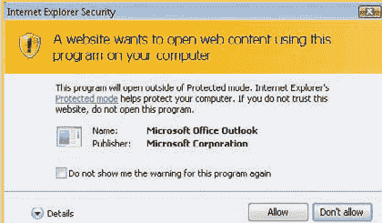

## 创建电子邮件按钮

要创建电子邮件按钮，请使用 `<button>` 标签。然后，你可以设置 `onClick` 属性的 `location.href` 属性，以便将电子邮件发送到相应地址。例如：

1. 在网页的正文中，输入按钮的开始标签，但去掉右尖括号：
   `<button`
2. 在 `<button` 之后仍保留插入点，输入带有 `location.href` 属性的 `onClick` 属性：
   `onClick="location.href=`
3. 输入一个单引号、`mailto` 命令、一个冒号和目标电子邮件地址：
   `'mailto:webs@acmevirtualindustries.com`
4. 要为消息添加主题行，请输入一个问号、单词 `subject`、一个等号和主题文本，如示例所示。（如果你不想为消息添加主题行，可以跳过此步骤——但主题行有助于防止访问者发送没有主题、看起来像垃圾邮件的消息。）
   `?subject=Address Change`
5. 输入一个单引号、一个双引号和结束尖括号：
   `' ">`
6. 输入你希望显示在按钮上的文本——例如：
   `Send an Address Change`
7. 输入按钮的结束标签：
   `</button>`

# 注意

网页中包含的电子邮件地址（如本例所示）可能会被在网络上爬行以寻找地址以添加到垃圾邮件发送者列表的蜘蛛和其他机器人收集。当你像这样公开暴露电子邮件地址时，请做好接收垃圾邮件或骚扰邮件的准备。因此，通常不建议使用你的主要电子邮件地址。一个你可以根据需要更改的你自己域名的电子邮件地址，或者一个免费的电子邮件地址，通常是更好的选择。

8. 保存页面，切换到你的浏览器，然后刷新显示，使按钮出现。示例按钮如下所示：

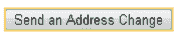

9. 单击按钮以在你的默认电子邮件程序（例如 Microsoft Outlook Express 或 Microsoft Outlook）中开始撰写邮件。检查地址和主题是否正确，然后关闭邮件而不发送或保存。

示例按钮的完整代码如下：

```
<button onClick="location.href='mailto:webs@acmevirtualindustries.com?subject=Address Change'">Send an Address Change</button>
```


## 使你的图像映射实用且易于理解

如果需要，你可以创建非常复杂的图像映射——但你必须确保你网站的访问者能够立即理解你放在页面上的任何图像映射的意图，并且他们能够直观地使用它们。

这既取决于图像映射的性质，也取决于你如何使用它们。例如，如果你需要访问者选择他们来自世界哪个地区，你可能会使用一张显示世界的图像，并设置图像映射坐标，将地图划分为你所需的区域。由于用户熟悉地图，他们会很快理解应该点击相应的区域。

但是，如果你显示一张显示不同类别商品的图像，并使用一个图像映射将每张产品图片链接到该产品的页面，除非文本明确说明，否则访问者可能很难理解这种关联。

当使用此代码并在浏览器中有人单击它时，电子邮件程序将生成一封电子邮件消息，其中收件人和主题行（如果适用）已填写，正文为空白。

## 在图形中创建两个或更多链接

你可以将图形的不同区域链接到不同的目标，而不是将图形链接到单个目标（如另一个页面或 `mailto` 链接）。具有两个或更多不同链接的图形称为*图像映射*。

要创建图像映射，你可以照常使用 `` 标签放置图像，然后使用 `usemap` 属性指定要使用哪个图像映射。然后，你使用 `<map>` 和 `</map>` 标签定义一个由不同区域组成的映射，每个区域链接到不同的页面或同一页面上的不同锚点。这些区域由它们相对于图像左上角（坐标为 0,0）的坐标定义。每个区域可以是矩形（`rect`）、圆形（`circle`）或自由形式的多边形（`poly`）。

此示例使用图 5-6 中所示的图形，该图形宽 640 像素，高 480 像素。该图形包含四个大致相同大小的不同矩形区域。

要创建图像映射：

1. 在你的图形程序中打开该图形，并使用程序的选区工具计算出你需要在图像内定义的区域的坐标。例如，坐标“0,0,320,240”定义了示例图形的左上四分之一。
2. 输入带有 `src` 属性（指定图形文件）、`alt` 属性（指定替代文本）和 `usemap` 属性（指定你将创建的映射的名称）的 `` 标签，例如：

```

```

3. 输入开始 `<map>` 标签，并将 `name` 属性设置为你用于 `` 标签的 `usemap` 属性的名称，例如：
   `<map name="map1_map">`

4. 输入一个 `<area>` 标签，其中 `href` 属性指定超链接的目标页面，`alt` 属性指定超链接的替代文本（如果需要），`shape` 属性指定区域类型（`rect`、`circle` 或 `poly`），`coords` 属性指定区域的坐标。例如，此代码定义了一个宽 320 像素、高 240 像素的矩形区域，起始于图形的左上角：

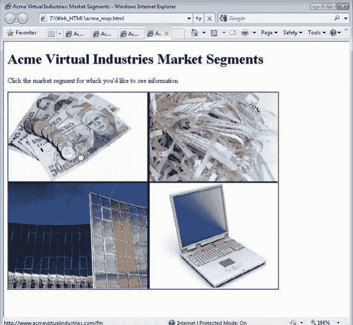

```
<area href="finance.html"

    alt="Financial Services"

    shape="rect"

    coords="0,0,320,240">
```

为图形中的其他区域输入 `<area>` 标签——例如：

```
<area href="offices.html"

    alt="Office Services"

    shape="rect"

    coords="0,240,320,240">

<area href="security.html"

    alt="Security Services"

    shape="rect"

    coords="320,0,640,240">

<area href="computing.html"

    alt="Computing Services"

    shape="rect"

    coords="320,240,640,480">
```

输入结束 `</map>` 标签：
`</map>`

保存页面，切换到你的浏览器，然后刷新显示，以便你可以看到更改。

图 5-6：你可以使用一个具有两个或更多不同区域的图形来创建一个图像映射，该映射从图形的不同部分链接到不同的页面。

图 5-7 显示了由这里所示的示例代码生成的页面和图像映射：

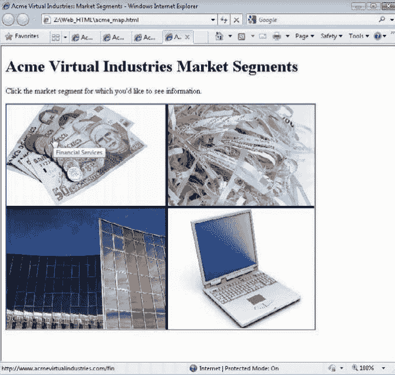

```
<h1>Acme Virtual Industries Market Segments</h1>

<p>Click the market segment for which you'd like to see information.</p>


<map name="map1_map">

<area href="http://www.acmevirtualindustries.com/finance.html"

      alt="Financial Services"

      title="Financial Services"

      shape="rect"

      coords="0,0,320,240">

<area href="offices.html"

      alt="Office Services"

      title="Office Services"

      shape="rect"

      coords="0,240,320,480">

<area href="security.html"

      alt="Security Services"

      title="Security Services"

      shape="rect"

      coords="320,0,640,240">

<area href="computing.html"

      alt="Computing Services"

      title="Computing Services"

      shape="rect"

      coords="320,240,640,480">

</map>
```


```

图 5-7：在你的图像映射中使用 `title` 文本可以让访问者了解如果他们点击图像映射的特定部分会看到什么。

> **提示**
>
> 手动创建图像映射需要一些时间和耐心，更不用说准确输入坐标了。许多图形程序都包含自动创建图像映射的工具，因此请检查你的图形程序是否具有此功能。这种自动化对于创建复杂的图像映射特别有价值，例如那些使用多边形的图像映射。

## 向你的网页添加音频和视频

既然宽带已广泛普及，越来越多的人可以通过网络享受音频和视频。如果你有音频或视频内容要分享，你可以将它放在你的网站上。你可以创建允许用户下载音频或视频文件、在单独的播放器中播放音频或视频文件，或在你的网页内播放音频或视频文件的链接。

### 了解音频和视频格式

计算机使用多种音频和视频格式，其中一些比其他格式使用得更为广泛。为了确保尽可能多的网站访问者都能欣赏到音频或视频内容，你需要选择合适的格式。同时，还必须确保音频或视频的文件足够小，以便即使通过拨号连接也能下载。

> **提示**
>
> 在大多数版本的 Windows 上，你可以使用内置的录音机应用程序将 `WAV` 文件保存为压缩格式，以缩短下载时间。在 Mac OS X 上，如果你安装了 iLife 应用程序套件，可以使用 GarageBand。为了在 Windows、Mac OS X 或 Linux 上获得更精细的控制，可以尝试免费的音频程序 Audacity（`http://audacity.sourceforge.net`）。

除了最短的音频文件外，所有音频都应使用压缩格式。大多数计算机都能播放 `MP3` 文件（已压缩）和 `WAV` 文件（未压缩）。此外，可以考虑降低音频文件的复杂性——例如，将其从 16 位声音降为 8 位声音，或使用单声道而非立体声。文件音质会有所下降，但网站访问者下载的速度会快得多。

视频包含的数据远多于音频，因此即使是最短的视频文件也应始终使用压缩格式。大多数计算机都能播放 `AVI`（音频视频交错）文件，其压缩率适中；也能播放 `MPEG` 文件，其压缩率更高。大多数 Windows 计算机可以播放 Windows Media 视频（`WMV`）文件，它同样使用压缩格式。任何安装了 iTunes 的 PC 或 Mac 也可以播放 QuickTime 电影格式的文件。

> **提示**
>
> 在 PC 上，你可以使用 Windows Movie Maker（包含在大多数 Windows 版本中）来更改视频分辨率。在 Mac 上，如果你安装了 iLife 应用程序套件，可以使用 iMovie。

大多数数字摄像机导出的视频分辨率为 VGA（640 × 480 像素）或高清分辨率。VGA 分辨率画质良好，但文件较大；高清分辨率画质极佳，但文件巨大。为了在网页上合理控制质量，可以将视频文件的分辨率降低到 320 × 240 像素；240 × 160 像素可提供可接受的质量；160 × 120 像素则为低质量。

### 了解音频和视频的传递方式

向网站访问者提供音频或视频最简单的方法是允许他们将整个文件下载到计算机上，并在需要时播放。这种方法有两个优点：

- 下载文件的人可以随意多次收听音频或观看视频。
- 即使连接速度慢或不稳定（例如，调制解调器连接或拥堵的宽带连接），只要下载者有足够的时间和耐心下载整个文件，下载就能成功。相比之下，流式播放高质量音频或任何质量的视频通常需要正常工作的宽带连接。（有些流技术允许客户端在尝试播放前下载整个流，而另一些则不允许。）

如果你对音频或视频文件拥有完全的分发权——例如，它们是你自己创作的原创作品——那么允许下载是可行的。但是，如果你只有从服务器播放文件或流式传输它们的权利，你将无法提供下载。

### 创建下载音频或视频文件的链接

如果你有可以合法提供下载的音频或视频文件（例如，你自己创作的音乐或电影），请为该文件创建一个链接，并指导访问者右键单击链接，并从快捷菜单中选择“另存为”（或根据浏览器选择相应的命令）来下载文件。（如果访问者只是单击链接，音频或视频文件可能会播放而不是下载，但这取决于计算机的配置。）

以下示例告诉访问者如何下载 MP3 文件：

```html
<p>To download the interview on virtual offices,
    right-click <a href="media/interview01.mp3"
    title="Right-click this link and choose Save As to download
    the file.">here</a>.</p>
```

### 创建播放音频或视频文件的链接

要使访问者能够播放音频或视频文件，请为该文件创建一个链接。此示例链接到名为 `virtual_office_tour.avi` 的视频文件，该文件位于 `media` 文件夹中：

```html
<p>Click <a href="media/virtual_office_tour.avi">here</a> to
watch our Virtual Office Tour video (AVI format, 12.4MB).</p>
```

> **注意**
>
> 在安装并配置了 Windows Media Player 的 Internet Explorer 浏览器中播放音频或视频文件可以无缝工作。如果访问者在 Windows 上使用其他浏览器（如 Firefox），浏览器可能会提示他们选择如何打开文件（见图 5-8）：他们通常可以选择类似图中“从现在起对所有同类型文件执行此操作”的复选框，以便浏览器自动播放这些文件。在 Mac OS X 或其他操作系统上，访问者通常必须选择播放文件的程序。

### 在网页中嵌入视频文件

除了链接视频文件，你还可以使用 `<object>` 标签将其嵌入网页。`<object>` 标签使你能精确控制视频文件的显示方式以及访问者如何播放它——例如，视频在网页加载时是否自动开始播放（通常这不是个好主意），以及视频播放器是否显示允许访问者控制它的控件（这几乎总是个好主意）。

`<object>` 标签功能强大但很复杂，因为使其正常工作所需的信息不仅取决于视频文件的类型，还取决于访问者使用的浏览器。如果你需要使用 `<object>` 标签，请查阅比本书更详细的 HTML 参考书。

如果你处理过较旧的网页，可能还会看到用于在网页中嵌入视频播放器的 `<embed>` 标签。这是一种较旧的 HTML 技术，仅在部分浏览器中有效，从未成为标准，现在已被 `<object>` 标签取代——因此，除非是在你维护的并且已经正常工作的页面中，否则不要使用此标签。

当访问者单击链接时，他或她计算机上的默认媒体播放器会打开并播放文件。在 Windows 的默认配置中，音频和视频文件的默认媒体播放器是 Windows Media Player。

## 如何……

- 规划表格
- 创建表格结构
- 向表格添加行和列
- 添加表格边框
- 按行和列对单元格进行分组
- 设置表格和单元格宽度
- 设置表格和单元格高度
- 添加内边距和间距
- 对齐表格、行或单元格
- 使单元格跨两列或两行
- 应用背景色或背景图片
- 创建嵌套表格
- 创建垂直线

## 第 6 章：创建表格

许多技术书籍（包括本书）使用表格以清晰易懂的格式呈现信息。你也可以在网页中以这种方式使用表格，但你还可以使用具有不可见网格线和边框的表格来安排页面元素的布局。本章首先解释如何创建简单表格，然后向你展示如何使用表格创建更复杂的页面布局。

### 了解表格的工作原理以及何时使用它们

表格由行和列交叉形成的单元格组成（见图 6-1）。

- *单元格*是表格的基本单位。它由一行和一列的交叉点形成。
- *行*是从左到右排列的一行单元格。
- *列*是从上到下堆叠的一列单元格。
- *边框*是定义每个单元格和表格外部的矩形。

在标准表格中，每行包含相同数量的单元格，每列也包含相同数量的单元格。图 6-2 显示了一个标准表格的示例。

然而，你可以通过*跨列*或*跨行*（即合并）单元格来改变表格的布局，使单个单元格跨越两列或更多列、两行或更多行，或两者兼有。图 6-3 显示了将表格用于布局的示例。左边的屏幕中，表格的边框是隐藏的，这是页面通常被查看的方式。右边的屏幕显示了边框，以便你可以看到表格是如何划分为单元格的。

*图 6-1：每个表格都有一个外边框，以及构成单元格的行和列。*

> 严格来说，你只应使用*数据表格*——即呈现表格数据的表格。但许多人也创建*布局表格*——用于按其期望的方式布局网页的表格。由于这种做法非常普遍，了解如何处理布局表格很重要——即使你清楚通常使用 CSS（在第 8 章讨论）是创建此类网页的更好工具。

### 规划表格

如果你想尝试表格，可以从 HTML 编辑器中输入表格标签（在下一节讨论）并在单元格中放置内容开始。然而，最好是先规划你希望表格的外观。使用任何你认为方便的工具——例如：

- 在一张纸上绘制表格的粗略草图。
- 使用图形工具，如 Microsoft Paint（单击**开始**按钮，单击**所有程序**，单击**附件**，然后单击**画图**）或 GNU 图像处理程序（GIMP），创建表格外观的模型。
- 使用支持 HTML 的字处理器，如 Microsoft Word 或 OpenOffice.org，创建表格；在浏览器中打开生成的文件；然后将源代码复制到你的 HTML 编辑器中进行微调。

| 服务代码 | 服务描述 | 服务类型 | 服务详情 | 服务费用 |
| --- | --- | --- | --- | --- |
| AV101 | 虚拟电话 | 电信 | 1 天 | $34.99 |
| AV102 | 虚拟助手 | 人员配置 | 1 天 | $49.99 |
| AV103 | 虚拟经理 | 人员配置 | 1 天 | $199.99 |
| AC104 | 邮件群发（一次性） | 邮寄 | 50 份 | $99.99 |

### 创建表格结构

要创建表格，请使用以下标签：

- `<table>` 标签标记表格的开始，`</table>` 标签标记表格的结束。表格的所有内容都放在这两个标签之间。

*图 6-2：你可以使用表格以网格形式布局信息，以便于参考。*

**图 6-3：** 表格提供了一种控制网页中元素布局的方式。当表格的边框未显示时（左图），表格的结构（右图）不易看清。

- `<tr>`（表格行）标签标记每一行的开始，而 `</tr>` 标签标记每一行的结束。你所使用的 `<tr>` 和 `</tr>` 标签的对数控制着表格的行数。
- `<td>`（表格数据）标签标记行内每个单元格的开始，而 `</td>` 标签标记每个单元格的结束。`<td>` 和 `</td>` 标签的对数控制着该行的单元格数量，从而控制着列数。

要创建表格，请遵循以下通用步骤：

1. 打开记事本（或你的 HTML 编辑器），并开始一个新的网页。例如，如果你已经创建了一个包含网页基本结构的模板文件，打开该文件，然后点击**文件**菜单，点击**另存为**，并使用“另存为”对话框以不同的名称保存文件。否则，手动粘贴或创建一个网页的基本结构：

    ```xml
    <?xml version="1.0" encoding="utf-8"?>
    <!DOCTYPE html PUBLIC "-//W3C//DTD XHTML 1.0 Transitional//EN"
        "http://www.w3.org/TR/xhtml1/DTD/xhtml1-transitional.dtd">
    <html xmlns="http://www.w3.org/1999/xhtml" xml:lang="en"
    lang="en"><html>
    <head>
    <title></title>
    </head>
    <body>
    </body>
    </html>
    ```

2. 将插入点置于 body 部分内，然后键入一个开始 `<table>` 标签和一个结束 `</table>` 标签：

    ```html
    <table>
    </table>
    ```

3. 在 `<table>` 和 `</table>` 标签内，为每一行键入一个开始 `<tr>` 标签和一个结束 `</tr>` 标签。例如，要创建两行：

    ```html
    <table>
        <tr>
        </tr>
        <tr>
        </tr>
    </table>
    ```

4. 要创建一个单元格，请将插入点置于适当的 `<tr>` 和 `</tr>` 标签之间，然后键入一个开始 `<td>`（表格数据）标签、单元格的内容以及一个结束 `</td>` 标签。例如，要在表格的第一行中创建三个单元格：

    ```html
    <table>
        <tr>
            <td>服务代码</td>
            <td>服务描述</td>
            <td>服务类型</td>
        </tr>
        <tr>
        </tr>
    </table>
    ```

5. 保存页面，切换到（或启动）你的浏览器，并显示该页面。目前，你将只看到表格的文本，如本示例所示。

   服务代码 服务描述 服务类型 服务详情 服务费用

6. 将插入点置于 `<table>` 标签的结束尖括号之前，然后添加值为 `1` 的 `border` 属性和值为 `"border-color:blue"` 的 `style` 属性：

    ```html
    <table border="1" style="border-color:blue">
    ```

7. 保存页面，切换到你的浏览器，并刷新显示。单元格边框将显示出来，如本示例所示。

   服务代码 | 服务描述 | 服务类型 | 服务详情 | 服务费用

8. 使用第 3 步中描述的技术，为表格的剩余行创建单元格。以下示例显示了添加了两行额外单元格的完整表格：

    ```html
    <table border="1" style="border-color:blue">

        <tr>
            <td>服务代码</td>
            <td>服务描述</td>
            <td>服务类型</td>
            <td>服务详情</td>
            <td>服务费用</td>
        </tr>

        <tr>
            <td>AV101</td>
            <td>虚拟电话</td>
            <td>电信</td>
            <td>1 天</td>
            <td align="right">$34.99</td>
        </tr>

        <tr>
            <td>AV102</td>
            <td>虚拟助手</td>
            <td>人力资源</td>
            <td>1 天</td>
            <td align="right">$49.99</td>
        </tr>

        <tr>
            <td>AV103</td>
            <td>虚拟经理</td>
            <td>人力资源</td>
            <td>1 天</td>
            <td align="right">$199.99</td>
        </tr>

        <tr>
            <td>AC104</td>
            <td>群发邮件（一次性）</td>
            <td>邮件服务</td>
            <td>50 份</td>
            <td align="right">$99.99</td>
        </tr>

    </table>
    ```

    | 服务代码 | 服务描述 | 服务类型 | 服务详情 | 服务费用 |
    | :--- | :--- | :--- | :--- | :--- |
    | AV101 | 虚拟电话 | 电信 | 1 天 | $34.99 |
    | AV102 | 虚拟助手 | 人力资源 | 1 天 | $49.99 |
    | AV103 | 虚拟经理 | 人力资源 | 1 天 | $199.99 |
    | AC104 | 群发邮件（一次性） | 邮件服务 | 50 份 | $99.99 |

9. 按照以下各节的讨论，为单元格、行和表格应用格式，使其达到你想要的效果。

10. 或者，可以在 `<table>` 标签之后，在开始 `<caption>` 标签和结束 `</caption>` 标签之间添加表格标题。标题将显示在表格上方。

    ```html
    <table border="1" style="border-color:blue">
    <caption><b>Acme 虚拟工业：服务代码与描述</b></caption>
    ```


# Acme 虚拟工业：服务代码与描述

| 服务代码 | 服务描述 | 服务类型 | 服务详情 | 服务费用 |
| :--- | :--- | :--- | :--- | :--- |
| AV101 | 虚拟电话 | 电信 | 1 天 | $34.99 |
| AV102 | 虚拟助手 | 人力资源 | 1 天 | $49.99 |
| AV103 | 虚拟经理 | 人力资源 | 1 天 | $199.99 |
| AC104 | 群发邮件（一次性） | 邮件服务 | 50 份 | $99.99 |

**提示**

为了提供比标题所能容纳的更多信息，你可以向`table`标签添加`summary`属性。例如，`<table border="1" summary="此表格提供了 Acme 虚拟工业提供的服务的代码、详情和价格。">`。

## 向表格添加行和列

你可以轻松地更改表格的行数和列数。

- 要添加另一行，请将插入点置于适当的位置（在现有行之前、之间或之后），然后键入另一对`<tr>`和`</tr>`标签。在这些标签内，为要创建的每个单元格键入一个开始`<td>`标签、单元格内容，然后是结束`</td>`标签。
- 要向表格添加一列，请将插入点置于适当的位置（在现有单元格之前、之间或之后），然后键入另一对`<td>`和`</td>`标签，并在它们之间放置单元格的任何内容。

默认情况下，每个表格都具有行和列的网格模式，因此每行具有相同数量的单元格。例如，如果你在表格的第一行中创建两个单元格，在第二行中创建三个单元格，在第三行中创建一个单元格，如下例所示，该表格将有三列：

```html
<table border="1" style="border-color:blue">
    <tr>
        <td>单元格 1</td>
        <td>单元格 2</td>
    </tr>
    <tr>
        <td>单元格 1</td>
        <td>单元格 2</td>
        <td>单元格 3</td>
    </tr>
    <tr>
        <td>单元格 1</td>
    </tr>
</table>
```

要更改网格，你需要使单元格跨越两列或更多列，或两行或更多行。有关详细信息，请参阅本章后面的“使单元格跨越两列或两行”。

## 添加表格边框

每个表格的外部都有一个边框，每个单元格也都有一个边框。你可以为整个表格设置边框颜色，然后根据需要为特定的行或单元格设置不同的边框颜色。

> **注意**
>
> 如果你需要确保表格不显示边框——例如，当你使用表格在网页中实现精确布局时——请在开始`<table>`标签内使用`border="0"`。如果你不指定零宽度边框，某些浏览器可能会使用一个不可见的两像素边框，这可能会破坏你页面的布局。

### 设置边框宽度

要设置表格外边框的宽度，请向开始`<table>`标签添加`border`属性，并指定边框宽度的像素数。例如，要在表格周围创建一个五像素宽的边框：

```html
<table border="5px">
```

### 通过样式属性指定边框颜色

指定边框宽度而不指定边框颜色，会使浏览器以其默认颜色（通常是灰色）显示边框。设置边框颜色的最佳方法是使用 CSS，但你也可以使用现在已弃用的、使用`style`属性的旧方法。例如，要创建一个黑色边框：

```html
<table border="5px" style="border-color:black">
```

### 控制表格显示哪些外边框

要控制表格显示哪些外边框，请向开始`<table>`标签添加`frame`属性，并指定表 6-1 中解释的值之一。

例如，仅显示表格的顶部和底部边框：

```html
<table border="10px" frame="hsides" style="border-color:green">
```

| 值 | 效果 |
| :--- | :--- |
| `box` | 显示外边框（与`border`相同） |
| `border` | 显示外边框（与`box`相同） |
| `void` | 隐藏所有外边框 |
| `above` | 显示顶部边框 |
| `below` | 显示底部边框 |
| `hsides` | 显示顶部和底部边框 |
| `lhs` | 显示左边框 |
| `rhs` | 显示右边框 |
| `vsides` | 显示左右两边边框 |

要仅显示表格的外边框：

```html
<table border="10px" frame="box" style="border-color:green">
```

*表 6-1：`frame` 属性的值*

## 控制内部边框的显示

| 值 | 效果 |
|---|---|
| `all` | 在所有单元格周围显示边框 |
| `none` | 不显示任何边框 |
| `groups` | 在定义的水平或垂直组周围显示边框。有关详情，请参阅本章后面的“按行和列对单元格进行分组” |
| `rows` | 显示所有水平边框 |
| `cols` | 显示所有垂直边框 |

要控制表格中哪些内部边框被显示，请在开始的`<table>`标签中添加`rules`属性，并指定表 6-2 中解释的其中一个值。规则（Rules）是围绕各个单元格的线条或边框。

例如，要仅显示表格内的水平边框：

```html
<table border="5px" frame="box" rules="rows" style="border-color: blue">
```

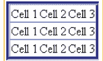

要显示表格的所有内部边框，但不显示外部边框：

```html
<table border="0px" frame="void" rules="all" style="border-color: black">
```

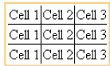

## 按行和列对单元格进行分组

`<table>`标签的`frame`和`rules`属性使您能够在表格中创建多种边框排列。但如果您需要更灵活，可以使用`rules="groups"`仅为特定的行组和列组添加边框。

### 创建行组

要创建行组，您需要将表格划分为页眉行部分、主体部分和页脚行部分。

1. 要创建页眉部分，请在页眉行之前放置开始的`<thead>`标签，在之后放置结束的`</thead>`标签。
2. 在页眉部分内，您可以使用`<th>`和`</th>`标签创建表格标题（加粗且居中），或使用`<td>`和`</td>`标签创建标准表格单元格。
3. 要创建页脚部分，请在页脚行之前放置开始的`<tfoot>`标签，在之后放置结束的`</tfoot>`标签。
4. 要创建主体部分，请在主体行之前放置开始的`<tbody>`标签，在之后放置结束的`</tbody>`标签。

下一个示例显示了一个分为页眉、主体和页脚部分的简短表格：

```html
<table rules="groups"
    width="180"
    border="4px"
    style="border-color:blue">
    <thead>
        <tr>
            <td>Member #</td>
            <td align="right">First</td>
            <td>Last</td>
        </tr>
    </thead>
    <tfoot>
        <tr>
            <td align="right">Member</td>
            <td>count:</td>
            <td>2</td>
        </tr>
    </tfoot>
    <tbody>
        <tr>
            <td>1007</td>
            <td align="right">Jack</td>
            <td>Hobbs</td>
        </tr>
        <tr>
            <td>1008</td>
            <td align="right">Katja</td>
            <td>Reina</td>
        </tr>
    </tbody>
</table>
```

> 要使您的网页正确，您必须将`<tfoot>`部分放在`<tbody>`部分之前，而不是之后（尽管逻辑和常理会建议放在之后）。浏览器将在`<tbody>`部分之后显示它。但请注意：并非所有浏览器都支持`<tfoot>`标签，因此仅在确实需要时才使用它，并使用您期望大多数访问者使用的浏览器来测试您的页面。

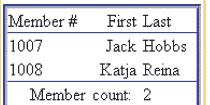

此 HTML 代码生成此处显示的表格，其中`rules="groups"`语句在定义的组中跨行生成边框。

### 创建列组

要创建列组，您可以使用带有`span`属性的`<colgroup>`标签来指定哪些列属于每个组，从而划分表格。以下示例显示了一个分为两个列组的简短表格，每个组包含两列：

> **注意**
>
> 虽然您仍然可以在此表格中像常规 HTML 一样使用`align`属性，但其使用已被弃用，并且在严格 XHTML 中无效。请改用 CSS 来控制对齐方式。

```html
<table rules="groups"
    width="240"
    border="4px"
    style="border-color:blue">
    <colgroup span="2"></colgroup>
    <colgroup span="2"></colgroup>
    <tr>
        <td>Employee</td>
        <td>Item</td>
        <td>Quantity</td>
        <td>Total $</td>
    </tr>
    <tr>
        <td>Johns</td>
        <td>A384</td>
        <td align="right">48</td>
        <td align="right"> 480.00</td>
    </tr>
    <tr>
        <td>Bills</td>
        <td>C839</td>
        <td align="right">11</td>
        <td align="right">4492.00</td>
    </tr>
    <tr>
        <td>Acinth</td>
        <td>X420</td>
        <td align="right">88</td>
        <td align="right">6295.00</td>
    </tr>
</table>
```

> **提示**
>
> 您还可以通过向表格添加填充和间距来影响表格的大小。有关更多信息，请参阅本章后面的“添加填充和间距”。

此 HTML 代码生成此处显示的表格，其中`rules="groups"`语句在列组之间生成垂直边框，而在构成每个组的列之间没有边框。

| Employee | Item | Quantity | Total $ |
|----------|------|----------|----------|
| Johns | A384 | 48 | 480.00 |
| Bills | C839 | 11 | 4492.00 |
| Acinth | X420 | 88 | 6295.00 |

> **注意**
>
> 您可以使用表格来固定页面的宽度，但在这样做之前，请考虑您网站的某些访客可能使用的是无法看到整个页面的屏幕分辨率或窗口大小。

## 设置表格和单元格宽度

如果您不指定表格的宽度或表格中单元格的宽度，浏览器会自动调整单元格的宽度以适应其内容（如本章目前为止的大多数示例所示）。结果是节省空间，但可能产生拥挤的布局，因此通常最好手动指定表格宽度或表格内特定单元格的宽度。

### 指定表格宽度

要指定表格的宽度，请在开始的`<table>`标签中添加`width`属性，并指定像素数（不带像素单位）或窗口宽度的百分比（带百分号）。

例如，要创建一个 600 像素宽的表格：

```html
<table width="600" border="1">
```

要创建一个宽度为浏览器窗口宽度 90% 且在浏览器窗口宽度更改时宽度也随之变化的表格：

```html
<table width="90%" border="1">
```

> **注意**
>
> 防止单元格内文本换行的一种方法是在`<td>`标签或`<th>`标签中添加`nowrap`属性——例如，`<td nowrap="nowrap">Don't wrap this text!</td>`。您应谨慎使用`nowrap`，原因有三：首先，它并非适用于所有浏览器（尽管它在 Internet Explorer 和 Firefox 中有效）；其次，它可能导致您的表格对于狭窄的浏览器窗口来说太宽；第三，CSS 提供了更好的替代方案。

### 指定单元格宽度

要指定单元格的宽度，请在开始的`<td>`标签中添加`width`属性，并指定像素数（不带像素单位）或窗口宽度的百分比（带百分号）。

下一个示例使用`<table>`标签的`width`属性将整个表格的宽度设置为浏览器窗口宽度的 90%。然后它使用`<td>`标签的`width`属性将第一个单元格的宽度设置为 200 像素，将第二个单元格的宽度设置为 140 像素。第三个`<td>`标签没有指定`width`属性，因此浏览器自动将此单元格的宽度设置为剩余空间（窗口宽度的 90% 减去分配给第一个和第二个单元格的空间）。

> **注意**
>
> 如果浏览器窗口不够宽，无法容纳指定的尺寸，大多数浏览器会覆盖它们，以便在可用空间内显示表格。如果表格变得过于拥挤而无法有效显示，浏览器将只显示部分内容并添加水平滚动条，以便您可以查看其余部分。

```html
<table width="90%" border="1" style="border-color:blue">
    <tr>
        <td width="200">This cell is 200 pixels wide.</td>
        <td width="140">This cell is 140 pixels wide.</td>
        <td>This cell's width is set automatically.</td>
    </tr>
</table>
```

| This cell is 200 pixels wide. | This cell is 140 pixels wide. | This cell's width is set automatically. |
|-------------------------------|-------------------------------|------------------------------------------|

## 设置表格和单元格高度

除了能够设置表格或构成其单元格的宽度之外，您或许还可以设置表格或其单元格的高度，而不是让浏览器自动设置高度以适应表格或单元格的内容。

大多数浏览器（包括 Internet Explorer、Firefox 和 Safari）支持设置表格高度，但表格高度不是 HTML 标准的一部分，因此您可能会发现某些浏览器不支持它。因此，除非页面设计绝对需要固定高度，否则最好不要设置表格高度。单元格高度*是* HTML 标准的一部分，应该在所有浏览器中有效，但不建议直接设置它，而应使用层叠样式表（CSS）。

要设置表格的高度，请在开始的`<table>`标签中添加`height`属性，并指定像素数。例如，要将表格高度设置为 400 像素：

```html
<table width="300" height="400" border="0">
```

要设置单元格的高度，请在开始的`<td>`标签中添加`height`属性，并指定像素数。例如，要将高度设置为 100 像素：

```html
<td height="100">Tall cell</td>
```

您也可以使用 CSS 来设置表格和单元格的高度，这将在第 8 章中讨论。

## 添加填充和间距

本章目前为止显示的大多数示例表格都是紧凑排列的。这是因为在每个单元格的内容之间没有添加任何额外的空白。

在 HTML 中，您可以以两种不同的方式在单元格之间添加额外的空间。

- 您可以使用`cellpadding`属性在每个单元格的边框和单元格内容之间添加填充。默认设置为 1 像素。（您也可以使用设置为 0 来移除所有单元格填充。）
- 您可以使用`cellspacing`属性来改变单元格之间空间的宽度。通常，您使用`cellspacing`来增加其默认设置（2 像素）的空隙量；如果您愿意，也可以将单元格间距减少到 1 像素或 0 像素。

例如，要创建一个使用 10 像素单元格间距和 10 像素单元格填充的表格：

```html
<table border="1" cellspacing="10" cellpadding="10">
```


图 6-4 显示了更改单元格间距和填充对表格的影响。

> 如果您为同一列中的单元格指定了两个宽度测量值，浏览器将使用较大的测量值。

在带有可见边框的表格上使用单元格内边距（cell padding）和单元格间距（cell spacing）时，两者的效果有明显区别。然而，在带有隐藏边框的表格上使用时，单元格内边距和单元格间距的效果可能很难相互区分。

#### `cellspacing="2" cellpadding="1"`（默认值）

| 服务代码 | 服务描述 | 服务类型 | 服务详情 |
| :--- | :--- | :--- | :--- |
| AV101 | 虚拟电话 | 电信服务 | 1天 |
| AV102 | 虚拟助手 | 人员配备 | 1天 |
| AV103 | 虚拟经理 | 人员配备 | 1天 |
| AC104 | 一次性群发邮件 | 邮件服务 | 50件 |

#### `cellspacing="5" cellpadding="5"`

| 服务代码 | 服务描述 | 服务类型 | 服务详情 |
| :--- | :--- | :--- | :--- |
| AV101 | 虚拟电话 | 电信服务 | 1天 |
| AV102 | 虚拟助手 | 人员配备 | 1天 |
| AV103 | 虚拟经理 | 人员配备 | 1天 |
| AC104 | 一次性群发邮件 | 邮件服务 | 50件 |

#### `cellspacing="10" cellpadding="10"`

| 服务代码 | 服务描述 | 服务类型 | 服务详情 |
| :--- | :--- | :--- | :--- |
| AV101 | 虚拟电话 | 电信服务 | 1天 |
| AV102 | 虚拟助手 | 人员配备 | 1天 |
| AV103 | 虚拟经理 | 人员配备 | 1天 |
| AC104 | 一次性群发邮件 | 邮件服务 | 50件 |

*图 6-4：* 单元格间距控制单元格之间的距离。单元格内边距控制单元格内容与单元格边框之间的空白大小。

### 对齐表格、行或单元格

要实现所需的布局，您可以对齐整个表格、整个行或单个单元格的内容。

#### 水平对齐表格

您可以通过在开 `<table>` 标签中添加 `align` 属性，并根据需要指定 `left`、`right` 或 `center`，来将表格在网页中水平对齐。例如，要将表格在其所在网页中居中（参见图 6-5）：

```html
<table align="center" border="2" cellspacing="5">
```

*图 6-5：* 除了使用默认的左对齐外，您还可以将表格在其所在页面中水平对齐。

#### 水平对齐行

您可以通过在开 `<tr>` 标签中添加 `align` 属性，并根据需要指定 `left`、`right`、`center` 或 `justify`，来对齐行的内容在其单元格内。例如，要为一行应用两端对齐（文本的左右边缘都对齐）：

```html
<tr align="justify">
```

#### 水平对齐单元格内容

您可以通过在开 `<td>` 标签中添加 `align` 属性，并根据需要指定 `left`、`right`、`center` 或 `justify`，来水平对齐单元格的内容。例如，以下代码在第三列使用居中对齐，在第一列和第五列使用右对齐：

```html
<table border="2" cellpadding="4" cellspacing="3" style="border-color:blue" summary="This table provides the codes, details, and prices of services offered by Acme Virtual Industries.">
  <caption><b>Acme Virtual Industries: Service Codes and Descriptions</b></caption>
  <tr>
    <th>Service Code</th>
    <th>Service Description</th>
    <th>Service Type</th>
    <th>Service Details</th>
    <th>Service Cost</th>
  </tr>
  <tr>
    <td align="right">AV101</td>
    <td>Virtual Phone</td>
    <td align="center">Telecoms</td>
    <td>1 day</td>
    <td align="right">$34.99</td>
  </tr>
  <tr>
    <td align="right">AV102</td>
    <td>Virtual Assistant</td>
    <td align="center">Staffing</td>
    <td>1 day</td>
    <td align="right">$49.99</td>
  </tr>
  <tr>
    <td align="right">AV103</td>
    <td>Virtual Manager</td>
    <td align="center">Staffing</td>
    <td>1 day</td>
    <td align="right">$199.99</td>
  </tr>
  <tr>
    <td align="right">AC104</td>
    <td>Mailshot (one-off)</td>
    <td align="center">Mailings</td>
    <td>50 pieces</td>
    <td align="right">$99.99</td>
  </tr>
</table>
```

**Acme Virtual Industries：服务代码和描述**

| 服务代码 | 服务描述 | 服务类型 | 服务详情 | 服务费用 |
| --- | --- | --- | --- | --- |
| AV101 | 虚拟电话 | 电信服务 | 1天 | $34.99 |
| AV102 | 虚拟助手 | 人员配备 | 1天 | $49.99 |
| AV103 | 虚拟经理 | 人员配备 | 1天 | $199.99 |
| AC104 | 一次性群发邮件 | 邮件服务 | 50件 | $99.99 |

> **注意**
>
> **基线**值使单元格的内容沿着基线对齐，基线是一条假想线，没有下伸部分的字母底部就位于这条线上。

#### 垂直对齐行

您可以通过在开 `<tr>` 标签中添加 `valign` 属性，并根据需要指定 `top`、`middle`、`bottom` 或 `baseline`，来垂直对齐行的内容。例如，要为一行应用顶部对齐：

```html
<tr align="top">
```

#### 垂直对齐单元格内容

您可能需要对一行中的单个单元格应用不同的垂直对齐方式，而不是对整行应用相同的垂直对齐。为此，请在开 `<td>` 标签中添加 `valign` 属性，并根据需要指定 `top`、`middle`、`bottom` 或 `baseline`。

以下示例生成了如图 6-6 所示的表格：

> **注意**
>
> 应用于单元格的垂直对齐会覆盖应用于包含该单元格的行的垂直对齐。

```html
<?xml version="1.0" encoding="utf-8"?>
<!DOCTYPE html PUBLIC "-//W3C//DTD XHTML 1.0 Transitional//EN"
  "http://www.w3.org/TR/xhtml1/DTD/xhtml1-transitional.dtd">
<html xmlns="http://www.w3.org/1999/xhtml" xml:lang="en" lang="en">
<head>
  <meta http-equiv="content-type" content="text/html; charset=utf-8" />
  <title>Baseline alignment</title>
</head>
<body>
  <h2>Table Showing Vertical Alignment</h2>
  <table border="6" style="border-color:purple" cellspacing="2" cellpadding="2">
    <tr>
      <td height="100" valign="top">Top alignment.</td>
      <td valign="middle">Middle alignment</td>
      <td valign="bottom">Bottom alignment</td>
    </tr>
    <tr>
      <td height="75" valign="bottom">Bottom alignment</td>
      <td valign="baseline"><font size="+3">Baseline alignment</font></td>
      <td valign="baseline">Baseline alignment</td>
    </tr>
  </table>
</body>
</html>
```

**显示垂直对齐的表格**

| 顶部对齐。 | 居中对齐 | 底部对齐 |
| --- | --- | --- |
| 底部对齐 | 基线对齐 | 基线对齐 |

**图 6-6：** 使用垂直对齐来控制单元格中文本的垂直位置。注意两个“基线对齐”示例如何根据字母的基线对齐，而不是根据字母 g 的下伸部分底部对齐。

### 使单元格跨越两列或多列或多行

使用规则网格的表格对于以表格格式呈现数据很有用，但要使用表格布局页面时，您通常需要移除行和列之间的部分边框。为此，您可以让一个单元格*跨越*两行或多行或两列或多列——换句话说，您将两行或多行，或两列或多列中的单元格合并成一个更大的单元格。

#### 使单元格跨越两列或多列

要使一个单元格跨越两列或多列，请在该单元格所属最左列的开 `<td>` 标签中添加 `colspan` 属性，并指定要跨越的列数。如果要跨越的列中存在单元格，请将其删除（否则，它们将在表格中创建额外的列）。

例如，要使一个单元格跨越三列：

```html
<table border="1" style="border-color:purple" cellspacing="2" cellpadding="4">
  <tr>
    <td colspan="3">This cell spans all three columns.</td>
  </tr>
  <tr>
    <td>Column 1</td>
    <td>Column 2</td>
    <td>Column 3</td>
  </tr>
</table>
```

> **提示**
>
> 构建嵌套表格时，请先将要嵌套的表格创建为一个独立的表格。当您正确布局并确保其大小合适后，将其从当前位置剪切，并粘贴到将包含它的单元格中。这种方法通常比在嵌套位置创建嵌套表格容易得多。

| 此单元格跨越所有三列。 |  |  |
| --- | --- | --- |
| 第1列 | 第2列 | 第3列 |

#### 使单元格跨越两行或多行

要使一个单元格跨越两行或多行，请在该单元格所属最顶行的开 `<td>` 标签中添加 `rowspan` 属性，并指定要跨越的行数。如果要跨越的行中存在单元格，请将其删除。

### 应用背景颜色或图片

为了让表格更加多彩或突出，你可以应用背景颜色或背景图片。

#### 为表格、行或单元格应用背景颜色

要为表格应用背景颜色，请在 `<table>` 开头标签中添加 `bgcolor` 属性，并通过名称或十六进制代码指定颜色。例如，要应用黄色作为背景颜色：

```html
<table bgcolor="yellow">
```

要为一行中的所有单元格应用背景颜色，请在 `<tr>` 开头标签中添加 `bgcolor` 属性。例如：

```html
<tr bgcolor="black">
```

要为单个单元格应用背景颜色，请在 `<td>` 开头标签中添加 `bgcolor` 属性。例如：

```html
<td bgcolor="blue">
```

#### 创建嵌套表格

合并列、合并行，或同时合并列和行，为你提供了相当灵活的表格布局方式；但是，如果你必须创建一个真正复杂的表格设计，你可能需要将一个表格嵌套在另一个表格内。

使用背景图片时，请尽量保持文件大小小，以便即使通过拨号互联网连接，页面也能快速传输。

要嵌套表格，请在要放置嵌套表格的单元格的 `<td>` 和 `</td>` 标签内输入嵌套表格的完整结构。下一个示例创建了此处显示的简单嵌套表格。

使用 `bgcolor` 属性为表格或表格元素应用背景颜色已被弃用，但此技术仍在广泛使用。推荐且现代的应用背景颜色的方法是使用 CSS。

```html
<?xml version="1.0" encoding="utf-8"?>
<!DOCTYPE html PUBLIC "-//W3C//DTD XHTML 1.0 Transitional//EN"
  "http://www.w3.org/TR/xhtml1/DTD/xhtml1-transitional.dtd">
<html xmlns="http://www.w3.org/1999/xhtml" xml:lang="en" lang="en">
<head>
  <meta http-equiv="content-type" content="text/html; charset=utf-8" />
  <title>Demo of Nesting a Table in a Cell</title>
</head>
<body>
  <h1>Example Table Within a Table</h1>
  <table border="1">
    <tr>
      <td>Column 1</td>
      <td>Column 2</td>
      <td>Column 3</td>
    </tr>
    <tr>
      <td>Column 1</td>
      <td>
        <table border="1">
          <tr>
            <td>Table</td>
            <td>nested</td>
          </tr>
          <tr>
            <td>in a</td>
            <td>cell</td>
          </tr>
        </table>
      </td>
      <td>Column 3</td>
    </tr>
  </table>
</body>
</html>
```

应用于单元格的背景颜色会覆盖应用于行的任何背景颜色，而应用于行的背景颜色又会覆盖应用于整个表格的任何背景颜色。

#### 创建垂直线

`<hr>` 标签（在第4章讨论）使你能够轻松地在网页中插入水平线。要插入垂直线，请创建一个两列表格，并指定 `frame="void"` 和 `rules="cols"`，如下例所示：

```html
<table width="500" border="3"
  style="border-color:black"
  frame="void" rules="cols"
  cellspacing="0"
  cellpadding="10">
  <tr>
    <th valign="top" align="left">
      Business Terminology
    </th>
    <th valign="top" align="left">
      Plain English
    </th>
  </tr>
  <tr>
    <td><i>top-of-the-mind, back-of-the-envelope</i></td>
    <td>seat-of-the-pants</td>
  </tr>
  <tr>
    <td><i>leverage the paradigm</i></td>
    <td>[untranslatable: this is gibberish]</td>
  </tr>
  <tr>
    <td><i>target profile psychodemographics</i></td>
    <td>our customers</td>
  </tr>
</table>
```


> **提示：** 你可以看到，创建 HTML 表格可能很繁琐，尤其是当你要将表格嵌套在表格中时——但你可以完全控制你所创建的内容。许多程序，包括 Microsoft Web Expression 和 Macromedia Dreamweaver，允许你在“所见即所得”（WYSIWYG）环境中直接创建网页表格，这容易得多。

| 商业术语 | 通俗英语 |
| :--- | :--- |
| `top-of-the-mind, back-of-the-envelope` | `seat-of-the-pants` |
| `leverage the paradigm` | [untranslatable: this is gibberish] |
| `target profile psychodemographics` | our customers |

## 如何...

- 理解框架及其替代方案
- 规划使用框架的网页
- 定义框架的高度和宽度
- 创建组件文档
- 创建框架集文档
- 布局框架
- 将组件文档添加到框架集
- 为框架页面添加替代文本
- 更改框架的边框和边距
- 控制框架是否滚动
- 防止访问者调整框架大小
- 将一个框架集嵌套在另一个框架集中
- 创建内联框架
- 创建可更改框架内容的链接

# 第7章：创建框架

框架是 HTML 将浏览器窗口划分为两个或多个独立矩形区域的一种方式，你可以为这些区域分别提供内容。例如，你可以在窗口的左侧三分之一处创建一个包含导航链接的框架，而窗口的右侧三分之二则显示与访问者点击的导航链接相关联的内容。通过将右侧框架的内容设置为独立于左侧框架滚动，你可以使访问者即使在向下滚动到右侧框架深处时，也能始终在屏幕上看到这些链接。

框架可以成为你网页工具的有力补充，但它们并不适用于每个页面——实际上也不适用于每个浏览器。在本章中，你将学习何时使用框架（以及何时避免使用），框架如何工作，以及如何在你的网页中创建和使用它们。

## 理解框架及其替代方案

截至本文撰写时（2009年夏季），框架仍在网页中广泛使用，因此如果你维护或更新现有页面，你需要了解框架如何工作以及如何创建它们。不过，总体而言，框架似乎正在逐渐淡出，因此你可能很少需要创建新的框架文档。

当你需要让网页上的特定元素保持可见，而网页的其余部分滚动时，框架尤其有用。例如，你可以将导航栏固定在网页左侧，这样即使访问者已经向下滚动了页面的文本部分，它也始终可用。你也可以使用内联框架来固定页面的大部分，但在一个可滚动的容器中显示一个元素。

你可以使用 CSS 中的浮动布局来创建网页的独立区域，而不是使用框架，这将在下一章中讨论。

一些屏幕较小的设备，如手机和其他手持设备，可能无法显示框架。为了覆盖这些情况，你可以提供替代文本，以便在任何无法处理框架的浏览器中显示。有关详细信息，请参阅本章后面的快速入门“为框架页面添加替代文本”。

框架还有其他几个不利因素。

- 通常，搜索引擎很难对框架集页面进行排名，并且通常会给它们较低的整体页面排名。这可能使网站看起来不如实际受欢迎。
- 框架页面可能无法正确打印。

续...

## 理解框架如何工作

在本书迄今为止展示的网页中，浏览器窗口包含一个显示单个文档的单个矩形框架或区域。框架使你能够划分浏览器窗口，以在浏览器窗口的不同区域显示不同的内容（见图7-1），每个区域显示不同的文档。每个框架可以是固定位置的，也可以独立于其他框架滚动。网页中使用的框架共同构成一个*框架集*，即一组布局在一起以便它们能相互配合的框架。

**图 7-1：** 你可以使用浏览器窗口内的框架，而不是显示单个区域。

## 快速入门

## 理解框架及其替代方案（续）

- 带框架的页面可能会让访问者感到困惑，特别是当框架试图在框架内加载另一个网站的部分内容，而不是在单独的标签页或窗口中显示时。
- 访问者可能无法正确收藏带框架的页面。

尽管如此，框架仍然在被使用且有其用武之地——但最好在充分了解其优缺点的情况下使用它们。

注意：框架集文档本身不会在浏览器中显示。它只是告诉浏览器要显示哪些页面以及如何布局。然而，框架集文档的标题仍会像往常一样显示在浏览器的标题栏中。

## 规划使用框架的网页

一个使用框架的网页包括：

- 一个框架集文档，用于指定框架集中包含的框架、框架的布局方式及其行为，以及在每个框架中显示的文档。
- 网页中每个框架对应的一个 HTML 文档。

开始创建使用框架的网页时，首先要规划页面布局。

- 决定要使用多少个框架（例如，两个、三个或更多）。
- 决定框架之间的相对位置。例如，两框架布局可以是在窗口顶部放一个浅行，下面放一个深行；或者在窗口左侧放一个窄列，右侧放一个宽列占据剩余空间。三框架布局可以是顶部一个浅行，一侧一个窄列，一个较大的矩形占据剩余空间（回顾图 7-1 查看示例）。
- 在电脑上（例如在绘图软件如 Paint 或 GIMP 中，或在文字处理软件如 Word 中）或纸上绘制一个粗略的布局草图。包含你将用于框架的尺寸（参见以下讨论）。

## 定义框架高度和宽度

你可以定义行的高度和列的宽度。对于高度或宽度，你可以使用绝对（固定）尺寸或相对（可变）尺寸。你可以通过三种方式指定尺寸。

- 使用精确的像素数——例如，创建一个宽 200 像素的列或一个高 100 像素的行。
- 使用浏览器窗口宽度或高度的百分比。
- 使用通配符来分配在指定了精确宽度或高度后剩余的所有空间。


> **注意**：除非你知道所有访问你网页的人都将使用特定的屏幕分辨率（这可能在公司内网上发生），否则避免为页面中的所有框架指定精确尺寸。危险在于，使用不同屏幕分辨率的访问者可能会难以正常查看你的页面。

### 大多数页面使用相对尺寸

对于大多数页面，最佳选择是为框架使用相对尺寸，通过指定你希望用于每行或每列的空间百分比。例如，要创建两列布局，你可以分配 25% 的空间给第一列，剩余的 75% 给第二列。如果访问者调整浏览器窗口大小，各列也会相应调整大小以保持其比例。

### 为某个框架分配精确高度或宽度，并共享剩余空间

对于某些页面，你可能希望为某个特定框架分配精确的空间量，并让浏览器在其他框架之间共享剩余的可用空间。当你的内容需要一定空间且调整大小会影响其显示效果时，此技术非常有用。例如，如果你在页面左侧的一个框架中放置图像，请设置该框架的宽度。然后其他框架将获得剩余的空间，并可根据需要调整大小。

要分配精确的高度或宽度，请以像素为单位指定相关尺寸，然后使用 `*` 通配符来分配剩余空间。单独使用 `*` 通配符表示“剩余空间的一份”，使用 `2*` 表示两份，`3*` 表示三份，依此类推。

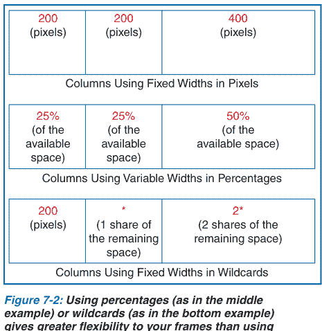

以下示例将框架集中的第一列设为 200 像素宽，然后将所有剩余空间分配给第二列：

```
<frameset cols="200,*">
```

下一个示例将第一行设为 150 像素高，然后将剩余空间的四分之三分配给第二行，四分之一分配给第三行：

```
<frameset rows="150,3*,*">
```

图 7-2 展示了三个分别使用像素测量值、百分比和通配符来指定列宽的示例。

## 创建组件文档

使用本书其他章节描述的技术创建网页的组件文档。请记住以下几点：

- 每个组件文档应该是一个完整的 HTML 页面，以 DOCTYPE 声明和 `<html>` 标签开始，以 `</html>` 标签结束，并包含一个头部区域（在 `<head>` 和 `</head>` 标签之间）和一个主体部分（在 `<body>` 和 `</body>` 标签之间）。
- 设计每个组件页面以占据适当的空间量。例如，一个将只占据窗口中窄列的列不应包含任何宽元素。同样，一个高度较小的行不应包含任何高的元素。
- 如果框架可调整大小，请将任何图形的大小指定为可用空间的百分比，而不是使用固定的像素尺寸，以免在浏览器窗口大小变化时导致部分图形被遮挡。
- 尽管组件文档的标题不会显示，但你可能仍希望添加 `<title>` 信息，以便访问你网站的任何搜索引擎受益。

## 创建框架集文档

要创建框架集文档：

1. 打开记事本（或你的 HTML 编辑器），并使用 XHTML 1.0 Frameset DOCTYPE 开始一个新网页：

```xml
<?xml version="1.0" encoding="utf-8"?>
<!DOCTYPE html PUBLIC "-//W3C//DTD XHTML 1.0 Frameset//EN"
    "http://www.w3.org/TR/xhtml1/DTD/xhtml1-frameset.dtd">
<html xmlns="http://www.w3.org/1999/xhtml" xml:lang="en"
    lang="en">
    <head>
        <title></title>
    </head>
</html>
```

2. 将插入点置于开始的 `<title>` 标签和结束的 `</title>` 标签之间，然后输入你想用作网页标题的文本。

3. 不使用标准网页中的开始 `<body>` 标签和结束 `</body>` 标签，而是在结束的 `</head>` 标签之后输入一个开始的 `<frameset>` 标签，在结束的 `</html>` 标签之前输入一个结束的 `</frameset>` 标签：

```xml
<?xml version="1.0" encoding="utf-8"?>
<!DOCTYPE html PUBLIC "-//W3C//DTD XHTML 1.0 Frameset//EN"
    "http://www.w3.org/TR/xhtml1/DTD/xhtml1-frameset.dtd">
<html xmlns="http://www.w3.org/1999/xhtml" xml:lang="en"
lang="en">
<head>
<title></title>
</head>
<frameset>
</frameset>
</html>
```

4. 将插入点置于开始 `<frameset>` 标签的结束尖括号之前，然后输入框架集的详细信息。（有关指定框架集的说明，请参见下一节。）

5. 将插入点置于 `<frameset>` 和 `</frameset>` 标签之间，并为框架集中的每个框架输入一个 `<frame/>` 标签，包括每个框架的相应属性。有关指定框架的说明，请参见下一节。

## 布局框架

你可以创建使用行、列或两者兼有的框架布局。

### 使用行创建框架

要使用行创建框架：

1. 如前一节所述，创建框架集文档的骨架。
2. 将插入点置于 `<frameset>` 标签的结束尖括号之前。
3. 输入 `rows` 属性；一个等号；双引号；每行的高度，用逗号分隔；以及另一组双引号。

例如，要创建两个框架，第一个高度为 200 像素，第二个占据浏览器窗口高度的剩余部分：

```html
<frameset rows="200,*">
```

要创建两个框架，第一个占据浏览器窗口高度的四分之一，第二个占据剩余的四分之三：

```
<frameset rows="25%,75%">
```

要创建三个框架，第一个高度为130像素，第三个高度为100像素，第二个占据浏览器窗口剩余的高度（如图7-3所示，框架中包含文档）：

```
<frameset rows="130,*,100">
```

### 使用列创建框架

使用列来创建框架：

1. 如本章前面“创建框架集文档”部分所述，创建框架集文档的骨架。
2. 将插入点定位在 `<frameset>` 标签的闭合尖括号之前。
3. 输入 `cols` 属性；一个等号；双引号；用逗号分隔的每列宽度；以及另一组双引号。

例如，要创建两个框架，第一个宽度为175像素，第二个占据浏览器窗口剩余的宽度：

```
<frameset cols="175,*">
```

要创建两个框架，第一个占据浏览器窗口宽度的大约三分之一，第二个占据剩余的三分之二：

```
<frameset cols="33%,67%">
```

要创建三个框架，第一个和第三个宽度各为125像素，第二个占据浏览器窗口剩余的宽度（如图7-4所示，框架中包含易于识别的文档）：

```
<frameset cols="125,*,125">
```

*图7-3：在多行框架布局中，组成文档从上到下排列。*

### 同时使用行和列创建框架

同时使用行和列来创建框架，从而生成四个（2 × 2）、六个（3 × 2 或 2 × 3）、八个（4 × 2 或 2 × 4）、九个（3 × 3）或更多框架：

1. 如本章前面“创建框架集文档”部分所述，创建框架集文档的骨架。
2. 将插入点定位在 `<frameset>` 标签的闭合尖括号之前。
3. 输入 `rows` 属性；一个等号；双引号；用逗号分隔的每行高度；以及另一组双引号。
4. 输入一个空格；`cols` 属性；一个等号；双引号；用逗号分隔的每列宽度；以及另一组双引号。

例如，要创建如图7-5所示布局的六个框架：

```
<frameset rows="200,*" cols="150,*,150">
```

## 将组成文档添加到框架集

将组成文档添加到框架集：

1. 将插入点定位在 `<frameset>` 标签的结束位置之后，按 **ENTER** 开始新行。输入第一个框架的开始 `<frame/>` 标签的开头：
   `<frame`
2. 输入一个空格，`name` 属性，一个等号，开双引号，框架的名称，以及闭双引号。例如：
   `<frame name="page1"`
3. 输入一个空格，`src` 属性，一个等号，开双引号，（如果需要）在框架中显示的网页路径和名称，以及闭双引号。例如，要显示名为 `page_1.html` 的网页：
   ```
   <frame name="page1" src="page_1.html"
   ```
4. 输入斜杠和闭尖括号以完成 `<frame/>` 标签：
   ```
   <frame name="page1" src="page_1.html"/>
   ```
5. 按 ENTER 开始新行，然后为每个剩余框架重复步骤1到4。

## 为框架页面添加替代文本

任何使用不支持框架的浏览器的访问者将无法看到包含框架集的任何页面的内容。为了让这些访问者知道问题所在，或者为他们提供访问内容的替代方式，您应该为每个框架集文档添加替代文本。

要添加替代文本，请将其放在框架集文档中 `<frameset>` 和 `</frameset>` 标签之间的开 `<noframes>` 标签和闭 `</noframes>` 标签之间。您将 `<noframes>` 标签和内容放在 `<body>` 元素中，因为它本质上是网页的替代主体。替代文本将显示为常规网页，因此任何浏览器都应该能够正确显示它。

```
<frameset rows="275,*" cols="225,*">
<frame name="logo" src="avs_logo.html"/>
<frame name="intro" src="intro.html"/>
<frame name="services" src="services.html"/>
<frame name="details" src="details1.html"/>
<noframes>
<body>
<h1>Acme虚拟服务 - 您的临时办公解决方案一站式商店</h1>
<p>此页面使用框架，您的浏览器不支持框架或已将其关闭。</p>
<p><a href="no_fr_home.html">点击此处</a>查看不使用框架的此页面版本。</p>
</body>
</noframes>
</frameset>
```

## 更改框架的边框和边距

要使框架完全按照您希望的方式显示，您可以控制它们是否显示边框以及其边距的宽度。

### 更改框架的边框

默认情况下，浏览器会在您创建的每个框架上显示边框，如图7-5所示。当您希望用户意识到网页由不同框架组成时，边框很方便——例如，当您使用框架实现导航区域（该区域保持静态）而网页其他部分的内容可以移动时。

要从框架中移除边框，请将 `frameborder` 属性添加到相应的 `<frame/>` 标签，并将其值设置为0。例如：

```
<frame name="mission" src="mission.html" frameborder="0"/>
```


图7-6显示了所有框架边框都隐藏的示例页面。

要确保在框架上显示边框，请将`frameborder`属性添加到相应的`<frame/>`标签，并将其值设置为`1`；然而，由于这是默认设置，除非您希望让需要查看或编辑代码的人完全清楚代码，否则将其添加到代码中没有好处。

## ACME虚拟服务

### 介绍ACME虚拟服务

您业务成功的合作伙伴

ACME虚拟服务是快速发展的虚拟办公服务领域的市场领导者。ACME虚拟服务成立于1998年，提供终极的服务和质量。虚拟办公服务为您提供真实办公室的所有便利，但没有困难……而且价格只是其中的一小部分。

### 向我们发送客户查询

#### 行业领先的实体办公空间

单击电子邮件图标向我们发送客户查询。

当您确实需要亲自会见客户时，请利用我们宽敞的会议室。

如果您看不到信封图标，请点击此处。

如果您看不到信封图标，请点击此处。

注意：`name`属性使您可以将其他网页直接链接到框架，而不是链接到包含该框架的框架集文档。如果您不需要直接链接到框架，则可以省略`name`属性。

图7-6：隐藏框架边框使框架集页面的布局不那么明显。

> **注意**
>
> 在支持框架的浏览器中显示网页时，替代文本不会出现，但访问者可以通过查看网页的源代码来查看替代文本。

> **注意**
>
> 除非你为框架指定`noresize`属性，否则访问者可以调整框架的大小，即使其边框是隐藏的。关于此属性的讨论，请参见本章后面的内容。

### 更改框架的边距

要控制框架内容与其边距之间的空间量，请在`<frame/>`标签中添加`marginheight`属性和`marginwidth`属性，并为每个属性指定一个以像素为单位的值。例如：

- 要设置框架左右两侧的边距为10像素：`marginwidth="10"`
- 要设置框架上下两侧的边距为15像素：`marginheight="15"`

以下是使用`marginheight`和`marginwidth`的完整标签：

```html
<frame name="mission" src="mission.html" frameborder="0" marginheight="10" marginwidth="10"/>
```

> **提示**
>
> 当你使用框架显示图形时，你通常希望移除图形周围的所有空白区域。为此，请将`marginheight`属性和`marginwidth`属性都指定为`0`。

## 控制框架是否滚动

默认情况下，如果框架内容太大而无法以其当前大小放入框架中，则每个框架都会显示滚动条；但是，如果内容可以放入框架中，则不会显示滚动条。

要控制滚动条，请将`scrolling`属性添加到相应的`<frame/>`标签中，并指定`yes`（使滚动条始终显示）、`no`（防止滚动条出现）或`auto`（应用自动滚动行为）。由于在不需要滚动条时显示它们意义不大，因此你通常只想在值为`no`时包含`scrolling`属性；否则，默认设置（`auto`）更可取。

> **注意**
>
> 框架内容占用的空间量会根据访问者在其浏览器中选择的设置而变化。如果你阻止框架滚动，访问者将能够通过增加框架的大小来查看更多内容——除非你也阻止了调整大小（如下所述）。

## 防止访问者调整框架大小

默认情况下，访问者可以通过将鼠标指针移动到框架边框上来调整你网页上框架的大小。在大多数情况下，保留框架可调整大小是一个好主意，因为它使访问者能够调整任何由于访问者网页浏览器上的设置而内容不适合其框架的框架。但是，对于精确的布局，你可能希望防止访问者调整一个或多个框架的大小。为此，请将`noresize`属性添加到`<frame/>`标签中，并赋予值`"noresize"`或`"true"`（两者均可）——例如：

```html
<frame name="logo" src="logo.html" noresize="noresize"/>
```

## 将一个框架集嵌套在另一个框架集内部

要创建更复杂的框架布局，你可以将一个框架集嵌套在另一个框架集内部。图7-7显示了一个嵌套的框架集，用于生成一个三行的框架集，其中只有第二行被分成列。

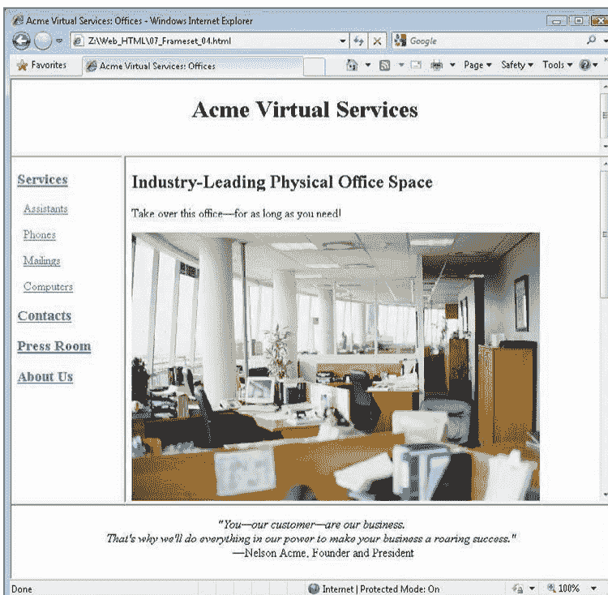

以下示例显示了生成图7-7所示布局的嵌套框架集的代码。为简洁起见，此示例不包括前面示例中包含的`<noframes>`信息；但是，你通常应在框架集页面中包含`<noframes>`信息：

```html
<frameset rows="15%,*,15%">
    <frame name="contacts" src="offices.html"/>
    <frameset cols="150,*">
        <frame name="nav1" src="navigation1.html"/>
        <frame name="content" src="european_offices.html"/>
    </frameset>
    <frame name="mission" src="mission.html"/>
</frameset>
```

图7-7：将一个框架集嵌套在另一个框架集内部，使你能够创建具有不同行数和列数的框架布局。

## 创建内联框架

如果你需要在另一个网页中显示单个框架，可以使用*内联框架*——一种作为其所在页面的一部分出现的框架，不涉及任何其他框架。内联框架的优点是，它使你能够在原本静态的网页中放置可滚动的内容。例如，你可以在产品旁边的内联框架中放置一个可滚动的描述，这样访问者就可以滚动查看描述，而不会占用页面上的太多空间。同样，你可以在内联框架中放置一系列图形，以便让每个访问者选择他或她想要的服务区域，如图7-8所示。

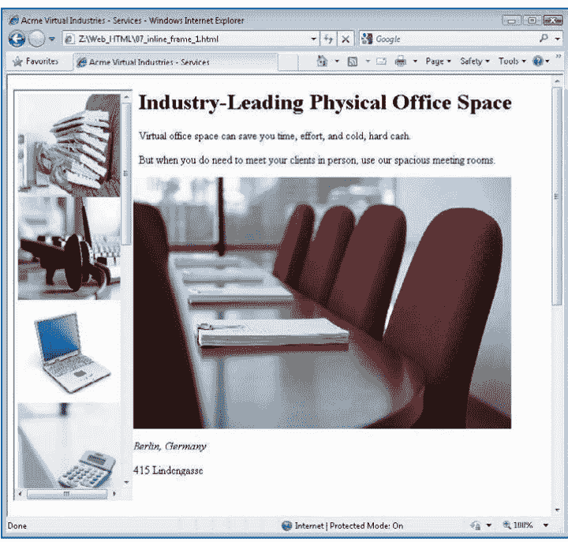


> 内联框架仅适用于某些目的。一个广泛使用但内联框架*不*适合的用途是显示软件的最终用户许可协议：因为访问者一次只能看到整个文本的一小部分，所以该协议变得比一份苛刻合同的最小字体更难阅读。

图7-8：*内联框架使你能够在原本静态的网页中添加一个可滚动的内容框。*

要创建内联框架：

1. 将插入点定位到你想要放置内联框架的位置。
2. 输入`<iframe>`标签的开头：

   ```html
   <iframe
   ```

3. 输入`src`属性、一个等号、一对双引号、你想要在框架内显示的网页的 URL，以及另一对双引号。例如：`<iframe src="service_list.html"`

   > **提示**
   >
   > 如果你想将框架在网页中水平和垂直居中，请在`<iframe>`标签中使用`align="middle"`，但也要在一个水平居中的文本块内创建内联框架（例如，通过使用`<div align="center">`标签创建一个居中对齐的区块）。

4. 要指定内联框架相对于页面中下一个元素的位置，请输入一个空格、`align`属性和适当的值（参见表7-1）。例如，要将内联框架与页面中的元素左对齐：`<iframe src="service_list.html" align="left"`

5. 要指定内联框架的高度和宽度（而不是接受可能不适合你页面的默认值），请添加`height`属性和合适的值，以及`width`属性和合适的值。每个值可以是像素数，也可以是浏览器窗口高度或宽度的百分比。例如，要使内联框架宽150像素，高450像素：`<iframe src="service_list.html" align="left" width="150" height="540"`

   > **注意**
   >
   > 为确保滚动条始终在内联框架上显示，请添加`scrolling`属性并赋值为`yes`（`scrolling="yes"`）。另一个可能的设置是`scrolling="auto"`，它指定自动滚动条行为；但是，由于这是默认设置，除非你希望你的 HTML 对人类读者完全明确，否则你不需要使用它。

6. 要更改内联框架的内部边距大小，而不是接受默认设置，请添加`marginheight`属性和垂直边距的合适像素值，并添加`marginwidth`属性和水平边距的合适像素值。例如，要在内联框架中设置5像素的水平和垂直边距：`<iframe src="service_list.html" align="left" width="175" height="600" marginheight="5" marginwidth="5"`

7. 如果你需要能够使用超链接引用内联框架，请添加`name`属性并在双引号内指定名称——例如：`<iframe src="service_list.html" align="left" width="175" height="600" marginheight="5" marginwidth="5" name="selector"`

**表7-1：`align`属性的值**

| 值 | 内联框架的对齐方式 |
|---|---|
| `left` | 与左边距对齐，允许后续元素流向其右侧 |
| `right` | 与右边距对齐，允许后续元素流向其左侧 |
| `top` | 与周围内容的顶部对齐 |
| `middle` | 其中心与周围内容的基线垂直对齐 |
| `bottom` | 与周围内容的底部对齐 |

> **警告**
>
> 内联框架的一种用途是在不离开你网站的情况下显示来自其他网站的内容。请记住，你必须要么获得任何非你本人内容版权所有者的许可，要么确认该内容属于公共领域。还要注意，即使你有许可使用他人内容（或无需许可），你也应该向网站访问者明确说明内容来自第三方。

8. 默认情况下，每个内联框架在其内容过大无法完全显示时会自动显示滚动条。如果你希望隐藏滚动条，请添加`scrolling`属性并设置其值为`no`。
9. 输入开始`<iframe>`标签的右尖括号和结束`</iframe>`标签。以下示例展示了内联框架的完整代码：

   `<iframe src="service_list.html" align="left" width="175" height="600" marginheight="5" marginwidth="5" name="selector"></iframe>`

## 创建可更改框架内容的链接

要创建可更改框架内容的链接：

> **注意**
>
> 要创建在框架集外单独窗口中打开的链接，请使用第5章讨论的`target="_blank"`技术。

1. 打开定义该框架的框架集文档，然后验证`<frame/>`标签是否包含`name`属性。如果没有，请添加`name`属性——例如：`<frame name="mainframe" src="products.html">`
2. 如果你对框架集文档进行了更改，请保存更改。然后关闭框架集文档。
3. 打开包含该链接的组件文档。
4. 为每个应在该框架内打开的链接添加`target`属性和目标框架的名称。例如：
   - `<h3><a href="services.html" target="mainframe">服务</a></h3>`
   - `<p>&nbsp;&nbsp<a href="offices.html" target="mainframe">办公室</a></p>`
   - `<p>&nbsp;&nbsp<a href="staff.html" target="mainframe">员工</a></p>`
5. 保存组件文档，切换到浏览器，并测试你刚刚创建的链接。

## 如何……

- 理解样式层叠
- 创建样式规则
- 理解创建样式规则的其他方式
- 创建嵌入式样式表
- 理解 CSS 版本
- 创建并应用外部样式表
- 使用特殊选择器
- 将样式应用于元素的一部分
- 覆盖样式表
- 控制字体格式
- 设置对齐、缩进、边距和行高
- 防止背景图形平铺或滚动
- 使用 CSS 创建浮动布局
- 创建三栏浮动布局
- 在浏览器中覆盖样式表

## 第8章：使用层叠样式表应用格式

样式表——正式名称为层叠样式表（Cascading Style Sheets）或 CSS——是将格式一致地应用于网页的首选方式。与本书迄今为止讨论的直接格式化的 HTML 代码不同，这些代码可能被浏览器设置覆盖，而 CSS 使你能够完全按照自己的意愿布局网页：你可以指定边距、缩进、行距、字体大小等等。

本章首先讨论 CSS 工作原理及其应用方式的基础知识。然后，你将学习如何编写样式规则、如何创建样式表，以及如何使用样式表来实现广泛实用的效果。

### 理解 CSS 基础

> **注意**
>
> 如果你曾在文字处理应用程序（如 Microsoft Word）中创建过文档，你可能使用过文档样式——一种一键式应用格式集合到段落、单词或选区的方法。例如，应用于这样一个段落的样式可能包括9磅无衬线字体、1.5倍行距和黄色阴影背景。HTML 样式的工作原理非常相似。

正如本书前面讨论的，许多你直接用 HTML 应用的格式要么不精确，要么可能被访问者在其浏览器中选择的设置覆盖。例如，你可以指定一个单词或短语显示为比默认值大两个字号的字体，但你通常不知道访问者的浏览器默认使用哪个字号。同样，你可以指定使用特定字体，但如果该字体未安装在访问者的计算机上——在这种情况下，浏览器将用默认字体替代。

样式使你能够将一致的格式应用于网页中的元素。例如，通过在开始`<h1>`标签和结束`</h1>`标签之间输入文本，你将`h1`样式（或一级标题样式）应用于它。浏览器使用相同的格式显示所有`h1`样式的实例。通过在样式表中为`h1`样式定义不同的格式，你可以更改网页中所有`h1`样式的实例。

> **提示**
>
> 在撰写本文时（2009年夏季），所有当前版本的浏览器都应完全支持样式表——它们已经存在很长时间了。然而，在某些浏览器中，支持并不完整，因此最好在尽可能多的主要浏览器中检查你的页面，以确保它们看起来正确。使用常见的屏幕分辨率（如800 x 600像素、1024 x 768像素和1280 x 1024像素）和各种窗口大小，以确保所有样式化文本都清晰易读。无论你的网站多么吸引人，内容多么引人入胜，如果访客发现文本太小、太淡或背景过于突出，难以舒适地阅读和查看，很少有人会选择再次访问。

样式表还使你能够应用一些通过直接格式化难以或无法实现的格式类型——例如缩进、行距和精确定位。图8-1展示了一个使用样式表实现缩进和行距的网页。

样式表使你能够指定精确的格式，从而覆盖浏览器的设置，除非访问者关闭了样式表或应用了他们自己的样式表，如本章末尾所述。

你可以将样式表创建为网页的一部分，或者创建为包含指令的外部文件。

- **外部样式表**：使用外部样式表的优点在于将布局指令与内容分开，并使你能够快速将样式更改应用于所有使用该样式表的网页。对于大多数用途，这是最佳方法。
- **内部样式表**：使用内部（或*嵌入式*）样式表使你能够仅在该页面上实现样式效果，这在某些情况下很有用。你也可以使用内部样式表来覆盖外部样式表中的样式。


#### 理解样式层叠

CSS 被描述为“层叠式”，因为样式在最多四个不同的级别上应用，属性从顶层向下流动，并覆盖较低级别中的任何重复属性。在层叠的底部，占主导地位的属性被应用于网页。

1. 层叠的顶层是使用标签的`style`属性应用的任何样式（有关`style`属性的更多信息，请参阅第3章）。
2. 第二层是网页本身`<style>`元素中定义的任何样式（被视为内部样式表）。
3. 第三层是在链接到网页的外部样式表（或多个样式表）中定义的任何样式。
4. 第四层是访问者在其浏览器中选择的设置。

这四个级别产生以下结果：

- 外部样式表中的格式覆盖访问者的浏览器设置。
- 内部样式表（`<style>`元素）中定义的格式覆盖外部样式表中的格式。但是，如果`<link>`标签出现在页眉中`<style>`元素之后，则外部样式表会覆盖内部样式表。（这打破了样式的层叠。）
- 使用`style`属性应用于元素的格式覆盖内部和外部样式表中的格式。
- 非样式属性（例如已弃用的`align`属性）覆盖样式格式。

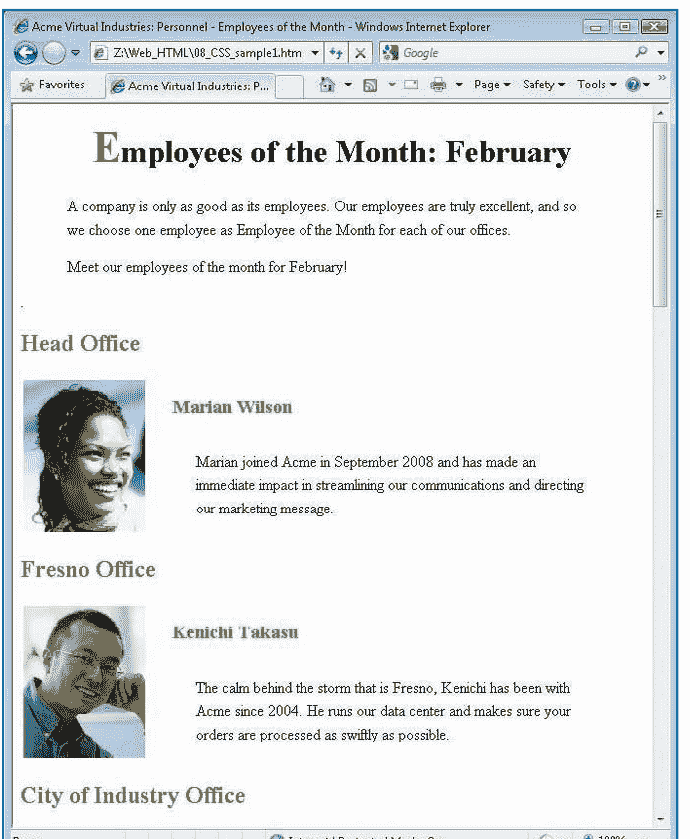

*图8-1：样式表不仅简化了页面的布局和维护，还使你能够创建通过直接格式化无法实现的效果。*

> **提示**
>
> 若要让外部样式表生效并发挥主导作用，就不能使用内部样式表（`<style>`元素）或在标签中使用`style`属性，因为这些可能与外部样式表中的样式发生冲突。

即使使用嵌入式样式表，也能节省格式化时间：无需更改页面中每种格式的所有实例，只需修改样式定义本身，而该定义通常位于文档开头。

#### 创建样式规则

每个内部或外部样式表都由样式规则组成，这些规则指定了它们影响的标记元素以及该元素应呈现的外观或行为。例如，一条样式规则可能指定`h1`（一级标题）样式使用蓝色和24点的字号。

创建样式规则的步骤如下：

> **注意**
>
> 选择器是样式规则中声明该规则所影响标记元素的部分。例如，在一条指定`h1`样式为蓝色的规则中，`h1`就是选择器。样式规则的下一部分——在此例中是颜色——是受影响的属性。样式规则的最后一部分是分配给该属性的值——在此例中是`blue`。

1. 打开要创建样式规则的文档。
   - 对于内部样式表，打开包含它的网页。将插入点置于页眉区域，但不要放在标签内（有关详细信息，请参阅本章后面的“创建嵌入式样式表”）。
   - 对于外部样式表，打开该样式表，或创建一个新的样式表。（请参阅本章后面的“创建和应用外部样式表”。）
2. 输入选择器：

   ```css
   h1
   ```

3. 输入一个空格、一个左花括号、要影响的属性名称和一个冒号：

   ```css
   h1 { size:
   ```


4. 输入一个空格和要分配给该属性的值。例如，要使字号为 24 点：

```css
h1 { size: 24pt
```

5. 如果要为同一选择器指定另一个属性，请输入分号、空格、属性名、冒号、空格和属性值。例如，要使字体颜色为蓝色：

```css
h1 { size: 24pt; color: blue
```

# 注意

> 如果值包含空格，则必须用双引号将其括起来——例如 `font-family: "Arial Black"`。如果值不包含空格，则无需使用双引号——例如 `font-family: Arial`。

# 提示

> 如果你发现这样做有助于保持一致性，可以在样式声明的最后一个值末尾放置分号。例如，声明 `h2 { font-size: 20pt }` 也可以写成 `h2 { font-size: 20pt; }`（带有最后的分号）。

## 快速参考

### 理解创建样式规则的其他方法

“创建样式规则”部分向你展示了通常最简单的方法：指定一个选择器，然后为该选择器指定要设置的每个属性及其值，并用分号分隔属性声明。但你也可以用另外两种方式创建样式规则。

#### 一次设置一个属性

你可以选择一次只设置一个属性。例如，要将段落字体设置为黑色和 10 点：

```css
p { color: black }

p { font-size: 10pt }
```

为样式设置的属性是累积的，因此该样式最终会包含所有已定义的属性。像这样设置属性可以使你的代码更易于阅读，即使它比用分号分隔属性占用更多行。

#### 为多个选择器同时设置属性

有时你可能想使用的一种技术是在单个语句中为多个样式设置属性。为此，请用逗号和空格将每个样式与前一个分隔开。例如：

```css
h1, h2 { color: blue ; font-family: Arial }
```

当你想为两个或多个样式设置多个相同的属性时，这种技术最有用，但你也可以用它来设置单个属性。通常，你只会以这种方式为每个选择器设置部分属性；然后可以分别设置其他属性。例如，如果你这样将 `h1` 和 `h2` 样式设置为蓝色 Arial，那么你可以随后分别设置不同的字号或字重以区分它们。

6. 重复步骤 5，为样式规则添加其他属性。例如，要使字体为 Garamond：

```css
h1 { size: 24pt; color: blue; font-family: Garamond }
```

7. 输入一个空格和一个右花括号来结束样式规则：

```css
h1 { size: 24pt; color: blue; font-family: Garamond }
```

你也可以将样式规则分成多行，使其更易于阅读——例如：

```css
h1 { size: 24pt;
    color: blue;
    font-family: Garamond }
```

### 创建嵌入式样式表

要创建嵌入式样式表，请将样式声明放置在网页的页眉中。

1. 在文本编辑器中，打开要添加样式的网页。
2. 将插入点置于页眉部分。页眉部分内的任何位置都可以，只要不在另一个元素内（例如 `<title>` 和 `</title>` 标签），但使用固定位置会使页面更易于编辑——例如，在 `</title>` 标签之后的一行，或在 `</head>` 标签之前。
3. 输入开始的 `<style>` 标签。包含 `type` 属性并将其值设置为 `text/css`：

```html
<style type="text/css">
```

4. 按 Enter 开始新行，然后输入样式的定义。例如：

```html
<style type="text/css">

    h1 { font-family: Garamond }

    h2 { color: blue }

    h3 { color: magenta }

</style>
```

5. 为每个要创建的额外样式规则重复步骤 4。例如：

```html
</style>
```

### 理解 CSS 版本

在撰写本文时（2009 年夏天），CSS 规范的当前版本是 CSS 2.1。CSS 3 正在开发中，但交付日期不断推迟。

以下是 CSS 版本差异的简要概述：

- CSS 1 允许你控制主要元素，如字体（大小、颜色和类型）、列表显示方式、边距和边框、对齐、行距以及背景图形和背景颜色。
- CSS 2 改进了字体支持，提供了更多对对象定位的控制，并允许你控制表格。它还包括文本转语音功能。
- CSS 3 在撰写本文时仍在开发中。它由可以单独实现的不同模块组成。例如，模板布局模块提供了一种新的元素定位方法，而听觉样式表模块则提供了多媒体功能。

当前的浏览器——Internet Explorer 8、Firefox 3 和 Safari 4——对 CSS 2 的实现精度很高，尽管仍存在一些错误。

你无需在网页中指定所使用的 CSS 版本，但你应该意识到，最近添加到 CSS 的元素可能无法在所有浏览器中正常工作。

识别问题的最简单方法是在多个浏览器中测试你的网页，确保它们显示正确。至少，应使用 Internet Explorer、Firefox 和 Safari 测试每个页面，因为这三种浏览器合计占据了超过 90% 的浏览器市场份额。

### 创建和应用外部样式表

要使用外部样式表，请在文本编辑器或 HTML 编辑器中将其创建为一个单独的文件，然后将希望使用该样式表的每个网页链接到它。

#### 创建外部样式表

创建外部样式表的步骤如下：

1. 打开记事本（或你的 HTML 编辑器），开始一个新文档。
2. 可选：在样式表的第一行，输入一条注释，说明样式表的用途。要在样式表中创建注释，请输入一个斜杠、一个星号、一个空格、注释文本、另一个空格、另一个星号和另一个斜杠。例如：

   `/* Acme Virtual Industries 标准样式表，acme_standard.css */`

3. 输入要包含在样式表中的每个样式的定义。例如：

```css
h1 { color: green; font-size: 24pt; font-weight: bold }

h2 { color: olive; font-size: 18pt; font-weight: bold }

h3 { color: #339900; font-size: 14pt; font-weight: bold }

p {font-size:14pt ; color: black }
```

4. 单击“文件”菜单，单击“保存”，然后使用 `.css` 扩展名保存样式表。（你也可以使用其他扩展名，但使用 `.css` 是最清晰的。）
5. 单击“文件”菜单，然后单击“退出”退出记事本。

#### 将网页链接到外部样式表

创建了要使用的外部样式表后，将你的网页链接到它。

1. 打开要链接到该样式表的网页。
2. 将插入点置于网页的页眉部分内。页眉部分中的任何位置都可以，但使用固定位置会使页面更易于编辑——例如，在 `</head>` 标签之前的一行。
3. 输入 `<link>` 标签的开始部分，指定 `rel` 属性（指定链接的关系）的值为 `stylesheet`，`type` 属性的值为 `text/css`：

   `<link rel="stylesheet" type="text/css"`

#### 将两个或多个样式表链接到网页

您可以将两个或多个样式表链接到同一个网页，而不是只链接一个样式表。这样做有两个常见原因：

- 该网页使用了一些包含在其中一个样式表中的样式，以及一些包含在另一个样式表中的样式。您可以将两个样式表都应用于网页，以实现样式的全面覆盖，而不是将所有样式整合到第三个综合样式表中。
- 第二个样式表会重新定义第一个样式表中使用的某些样式，以生成外观相似但略有不同的网页。例如，一个组织或公司可能会使用一个全局样式表，为所有网页提供通用外观。然后，每个办公室或部门可以应用第二个样式表来调整全局样式表以满足其需求，从而为每个办公室或部门的页面生成不同的外观。

以下示例展示了将两个样式表应用于文档的情况。第二个样式表（`acme_marketing.css`）会覆盖第一个样式表（`acme_standard.css`），因为它列在第一个样式表之后。

```html
<head>

<title>Acme Virtual Industries: About Us</title>

<link rel="stylesheet" type="text/css"
    href="styles/acme_standard.css" />

<link rel="stylesheet" type="text/css"
    href="styles/acme_marketing.css" />

</head>
```

#### 使用特殊选择器

到目前为止，本章一直使用 HTML 标签作为样式规则的选择器——例如，创建应用于 `h1` 元素的样式规则。然而，为了灵活性，HTML 也允许您使用其他项——如 `id` 属性、`class` 属性以及 `<div>` 和 `<span>` 类型——作为样式规则的选择器。

##### 使用 ID 属性作为选择器

如果您需要从所有其他实例中选出一个元素的实例，请在网页中的该元素上添加 `id` 属性，并为其分配一个以字母开头的唯一标识值。此示例将值 `breaking` 分配给标题：

`<h2 id="breaking">Breaking News</h2>`

一旦项目被 `id` 属性标记，您就可以在样式表中指定如何设置该项目的格式。为此，请输入一个井号（`#`），后跟 ID 值、一个空格，以及花括号内的样式信息。例如，要为之前创建的 `breaking` 项目应用红色格式和 28 点字体大小：

`#breaking { font-size: 28pt; color: red }`

> **提示**
>
> 您可以通过使用免费的 W3C CSS 验证服务（`http://jigsaw.w3.org/css-validator`）来验证或检查外部样式表的正确性。

##### 使用 CLASS 属性作为选择器

有时，区分格式相同但类型不同的项目会很有用。例如，您的网页可能包含多种格式为段落（在 `<p>` 和 `</p>` 标签之间输入）的内容类型，以及多种格式为二级标题（在 `<h2>` 和 `</h2>` 标签之间输入）的内容类型。

要区分格式相同但类型不同的内容，您可以使用 `class` 属性为所需元素的实例分配特定的描述。例如，您可以创建一个名为 `new_services` 的类，以便仅为该类中的项目应用不同的格式。

要创建该类，请在样式表的新行中输入一个句点、您要分配给该类的名称，以及该类的样式信息。例如，要使 `new_services` 类字体变大且为紫色：

`.new_services {color: #3333ff; font-size: large }`

> **注意**
>
> 一个类可以应用于单个元素或多个元素。通过将类应用于多个元素，您可以使用它以类似的方式格式化不同的元素。例如，您可以将所有与 `new_services` 类相关的信息显示为不同的颜色，以提高其可见性。

要将类应用于网页中的元素，请在元素的开始标签中添加 `class` 属性，并指定类的名称。例如：

> **提示**
>
> 您可以通过将名称添加到样式名称中来将类应用于特定元素。例如，要将 `.new_services` 类应用于 `h2` 样式，您可以使用 `h2.new_services`。

```html
<h2 class="new_services">Latest Services</h2>

<p class="new_services">Here are our latest services.</p>

<ol>

<li class="new_services">Virtual Manager</li>

<li class="new_services">Virtual Mailbox</li>

<li class="new_services">Reminder Hotline</li>

</ol>
```

##### 使用 SPAN 作为选择器

`span` 是一个灵活的单元，可用于选择元素中的文本，以便对其应用格式。要创建一个 span：

1. 在样式表中，创建该类（如果尚不存在）。例如：

   `.new_services {color: #3333ff; font-size: large; font-weight: bold }`
2. 在记事本或您的 HTML 编辑器中，打开要创建 span 的网页。
3. 将插入点置于所需文本之前。
4. 输入开始的 `<span>` 标签，包括 `class` 属性并指定要应用于 span 的类的名称。例如，要应用名为 `special_offers` 的类：

   `<span class="new_services">New Services`
5. 将插入点置于所需文本的末尾，然后输入结束的 `</span>` 标签：

   `</span>`

> **提示**
>
> 您可以使用 span 对文档中的单个单词或短语应用字体格式，而无需使用 `<font>` 标签。使用 span 的优点在于，您可以从样式表中集中更改它们，而不必在各个网页中单独更改格式的每个实例。

以下示例显示了包含 span 的完整段落：

`<p>For information about more of our <span class="new_services">New Services</span>, click <a href="new_services.html">here</a>.</p>`

##### 使用 DIVISION 作为选择器

如第 3 章所述，您可以使用 `<div>` 和 `</div>` 标签将段落（或其他元素）分组到一个 division 中，以便可以一起操作它们。您可以直接将样式应用于 division（通过将样式信息添加到开始的 `<div>` 标签中），也可以通过内部样式表或外部样式表进行应用。使用外部样式表提供了最大的灵活性，因为您只需更改样式表中的相关样式规则，即可更改网页中所有 division 的格式。

> **注意**
>
> 如果您同时使用外部样式表和内部样式表，请将外部样式表的 `<link>` 标签放在内部样式表的 `<style>` 标签之前。否则，您可能会破坏样式层叠并得到意外的结果。

**4.** 输入 `href` 属性并为其分配外部样式表的路径（如果需要）和文件名。例如：

`href="styles/acme_standard.css"`

**5.** 通过输入空格、正斜杠和结束尖括号来完成链接：

`href="styles/acme_standard.css" />`

以下示例显示了网页头部区域中的完整链接：

```html
<head>

    <meta http-equiv="content-type" content="text/html; charset=utf-8" />

    <title>Acme Virtual Industries: Strategy Meeting</title>

    <link rel="stylesheet" type="text/css" href="acme_standard.css" />

</head>
```

> **注意**
>
> 如果您愿意，可以使用两对或多对 `<style>` 和 `</style>` 标签，但在大多数情况下，使用单对标签更容易且更清晰。

图 8-2 快速演示了通过将样式表链接到网页可以即时进行的更改。

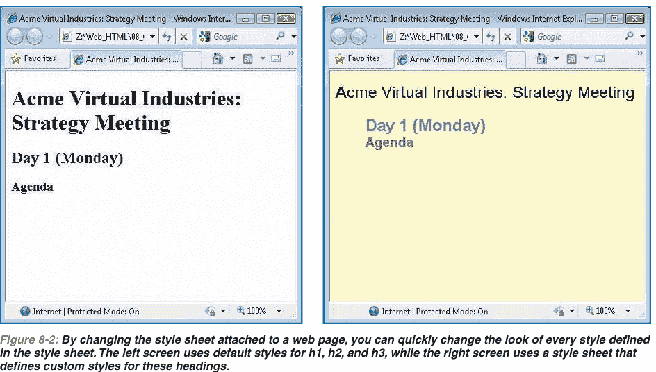

> **提示**
>
> 当您将两个或多个样式表应用于同一页面时，必须理解样式层叠的工作原理，以便实现所需的样式效果。（有关层叠的详细信息，请参阅本章前面的“理解样式层叠”。）当您刚开始使用样式表时，只需将一个样式表链接到网页，以避免这些复杂性。

> **注意**
>
> 首次使用记事本保存文件时，请记住在“文件类型”下拉列表中选择“所有文件”，以防止记事本在其默认名称中添加 `.txt` 扩展名。您也可以将文件名和扩展名括在双引号内（例如 `"standard.css"`）。

> **注意**
>
> 将外部样式表应用于框架集文档时，必须将其应用于构成框架集文档的组件文档，而不是框架集文档本身。如果您希望组件文档具有不同的外观，可以为组件文档使用不同的外部样式表。

> **注意**
>
> 此示例假设样式表与链接到它的网页位于同一 Web 服务器上。（样式表位于 `/styles/` 文件夹中。）如果需要，您也可以链接到另一台服务器上的样式表；为此，请将样式表的完整 URL 分配给 `<link>` 标签的 `href` 属性。请记住，将样式表与您的网页保存在同一服务器上可能有助于避免性能问题。

与其将 `class` 属性逐一应用于每个需要应用 `new_services` 格式的元素，你可以在这些元素外围创建一个 `div` 容器，并将 `class` 属性应用于该 `div`。下面的示例展示了如何操作：

> **注意**
>
> 此示例假设你已经按照本章前面“使用类属性作为选择器”一节所述，在网页所附加的外部样式表中创建了名为 `new_services` 的类。

```html
<div class="new_services">

<h2>Latest Services</h2>

<p>Here are our latest services.</p>

<ol>

<li>Virtual Manager</li>

<li>Virtual Mailbox</li>

<li>Reminder Hotline</li>

</ol>

</div>
```


### 将样式应用于元素的一部分

你可以使用伪元素（元素的逻辑定义部分）将样式仅应用于元素的一部分，而非整个元素。你无需在代码中标记伪元素——浏览器会自动识别它们。

#### 格式化元素的首字母

有时，你可能会希望对元素中的首字母应用不同的格式。为此，为所需元素的`first-letter`伪元素定义样式规则。

1. 在你的样式表中，输入样式名称、冒号，然后是`first-letter`。例如：`h1:first-letter`
2. 输入一个空格，然后是首字母样式规则的详细内容。例如：
   - `h1:first-letter { font-weight: bold }`
   - `h1:first-letter { color: #990000 }`
   - `h1:first-letter { font-size: 24pt }`

你会看到这既简单又有效——你无需在网页本身做任何更改，只需在样式表中修改即可。下图展示了产生的效果示例。

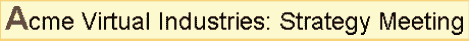

#### 格式化元素的首行

你可以通过在样式表中添加`:first-line`伪元素来对元素的首行应用不同格式。以下示例（你应将其置于内部或外部样式表中）使每个段落（`p`）的首行变为粗体。图 8-3 展示了效果。

```css
p {font-size:14pt ; color: black;}

p:first-line { font-weight: bold }
```

### 覆盖样式表

如果你正在创建一个网站并希望其外观保持一致，请使用外部样式表而非内部样式表。外部样式表将为你节省大量时间和精力，使你的网页能及时更新为最新的样式。

然而，有时你可能希望使用内部样式表来覆盖外部样式表，以便为网页应用一种或多种样式。你可以使用外部样式表来实现网站的整体外观，然后使用内部样式表来更改特定网页上的一个或多个特定元素。

除了通过使用内部样式表来覆盖外部样式表外，有时你还可能需要覆盖内部样式表。如第 3 章所述，你可以使用`style`属性为元素应用格式。以这种方式应用的任何格式都会覆盖使用内部样式表应用的格式，而内部样式表的格式又会覆盖使用外部样式表应用的格式。

*图 8-3：你可以使用`:first-line`伪元素使每个元素实例的首行突出显示。无论浏览器窗口大小如何显示页面，此格式都会应用于首行。*

> **注意**
>
> `blink`值在 Internet Explorer 中不起作用，并且在支持它的浏览器中也可能很快让访问者感到困扰。因此，最好不要使用`blink`。

### 控制字体格式

在样式表中，你可以通过使用表 8-1 中解释的各个属性或综合性的`font`属性来控制字体格式。

| 属性 | 说明 | 值或示例 |
| :--- | :--- | :--- |
| `background-color` | 要应用的背景颜色 | `navy, magenta, #CCFFFF` |
| `color` | 要应用的字体颜色 | `red, blue, #993333` |
| `font-family` | 字体系列的名称 | `Georgia, "Times New Roman"` |
| `font-size` | 字体大小，以磅或其他度量单位（像素、em、厘米）衡量，或通过关键字指定（例如，x-large） | `12pt, 18pt, x-large` |
| `font-style` | 样式：normal（正常）、italic（斜体）或 oblique（倾斜） | `normal, italic, oblique` |
| `font-variant` | 使用正常字母还是小型大写字母 | `normal, small-caps` |
| `font-weight` | 字体粗细程度 | `lighter, normal, bold, bolder` |
| `letter-spacing` | 字母间距是正常、更近（负值）还是更远（正值） | `-2px, 12px, 10%` |
| `text-decoration` | 是否对文本应用装饰 | `none, blink, underline, overline, line-through` |
| `text-transform` | 是否对文本应用一致的大小写 | `none, capitalize（首字母大写）, lowercase, uppercase` |
| `word-spacing` | 单词间距是正常、更近（负值）还是更远（正值） | `-3px, 10 px, 10%` |

**表 8-1：**用于格式化文本的独立字体属性

例如，以下在样式表（内部或外部）中输入的样式，将以 36 磅粗体和小型大写字母生成三级标题段落：

```css
h3 { font-weight: bold}

h3 { font-variant: small-caps }

h3 { font-size: 36pt }

h3 { color: blue }
```

以下在样式表中输入的样式，使有序（编号）列表以栗色、斜体大写形式显示：

```css
ol { color: maroon; font-style: italic;
     text-transform: uppercase }
```

> **注意**
>
> 使用`font`属性时，必须按照正确的顺序指定值；但是，你不必使用每个值，因为 HTML 会识别出你省略了哪些值。

`font`属性具有固定的语法，使你能够在单个属性中指定要设置的每个值。语法如下所示，用竖线表示值之间的分隔（竖线在实际代码中不使用）：

```css
font: style | weight | variant | size or line-height | font-family
```

以下样式规则在样式表中输入，使`h3`元素以粗体、斜体、24 磅、Times New Roman 字体的小型大写字母形式显示：

```css
h3 { font: italic bold small-caps 24pt "Times New Roman" }
```

### 设置对齐、缩进、边距和行高

如第 3 章所述，你可以使用`align`属性为单个项目应用基本对齐，但通过直接格式化，你对缩进、边距和行高的控制有限。样式表提供了对这些设置的更多控制。

#### 对齐、居中或两端对齐文本

使用`text-align`属性可以将文本左对齐、右对齐、居中或两端对齐。（两端对齐的文本与左右边距都对齐。）表 8-2 列出了`text-align`属性的值。

| 值 | 说明 |
| :--- | :--- |
| `left` | 将文本与左边距对齐 |
| `right` | 将文本与右边距对齐 |
| `center` | 将文本在边距之间居中 |
| `justify` | 将文本与左右边距都对齐 |

*表 8-2：`text-align`属性的值*

例如，要将元素与右边距对齐，你可以在样式表中创建一个名为`alignright`的类：

```css
.alignright {text-align: right }
```

然后将此类应用于每个需要与右边距对齐的项目：

```html
<p class="alignright">This paragraph is aligned with the right margin.</p>
```

#### 设置缩进

使用`text-indent`属性指定要应用于段落首行的缩进。通常，最佳选择是使用度量单位指定固定缩进——例如 0.5 英寸。你的另一个选择是将缩进指定为包含该行或段落的元素宽度的百分比。像这样的百分比设置允许缩进随着浏览器窗口调整大小而行宽变化时发生变化。

以下示例创建了一个 CSS 样式，为段落样式（`<p>`）设置半英寸缩进：

```css
p { text-indent: 0.5in }
```

> **提示**
>
> 如果需要阻止浏览器在元素之间添加空白，请将第一个元素的`margin-bottom`属性和第二个元素的`margin-top`属性都设置为 0。当你需要让标题和段落之间不出现额外空格时，这个技巧尤其方便。

> **提示**
>
> 如果一个元素的上下边框需要相同的边框度量值，左右边框也需要相同的度量值，那么你可以只为`margin`属性指定两个值。浏览器会使用第一个值作为上下边框的度量，第二个值作为左右边框的度量。例如，`{ margin: 10px 20px }`会创建上下各 10 像素、左右各 20 像素的边距。

#### 设置边距

要控制元素在网页上的显示位置，可以调整元素的边距——即该元素与指定方向上相邻元素之间的空间量。

要设置边距宽度，你可以使用`margin-left`属性、`margin-right`属性、`margin-top`属性或`margin-bottom`属性。你可以将边距指定为窗口大小的百分比（这样在窗口调整大小时具有最佳灵活性），也可以指定为像素（`px`）、英寸（`in`）、毫米（`mm`）、厘米（`cm`）、点（`pt`）或派卡（`pc`）等数值单位。对于网页，通常使用像素，尽管英寸或厘米可能更容易理解。

以下示例（应在样式表中使用）设置了`p`元素的所有四个边距：

```css
p { margin-left: 0.5in; margin-right: 0.5in;
    margin-top: 0.25in; margin-bottom: 0.15in }
```

如果你需要指定元素的所有边距，也可以使用`margin`属性，并按顺时针顺序（从顶部开始：上、右、下、左）指定边距。以下示例为`h5`元素设置了上边距 0.75 英寸、右边距 0.5 英寸、下边距 0.25 英寸和左边距 0.5 英寸。结果更简洁，但可能更难阅读：

```css
h5 { margin: 0.75in 0.5in 0.25in 0.5in }
```

> **注意**
>
> 如果你没有使用`line-height`属性指定行高，浏览器会自动调整行高，使其足够容纳字体大小或元素包含的对象。

#### 设置行高

要控制元素占据的垂直空间量，你可以通过使用`line-height`属性并指定度量值来设置行高（也称为“行距”）。度量值可以是行距的倍数、具体的度量单位（如点、像素、英寸或毫米），也可以是通常分配给字体大小或对象的空间的百分比。

> **注意**
>
> 你也可以将行高指定为百分比。例如，设置为 150% 会使行高比通常大一半；设置为 25% 会使行高为正常高度的四分之一。

在精确布局中，设置以点为单位的准确行高很有用。以下示例将行高设置为 24 点：

```css
.spaced { line-height: 24pt }
```

图 8-4 展示了改变行高和应用首行缩进的效果。

图 8-4：应用首行缩进和改变行高可以极大地改变元素的外观。

### 防止背景图形平铺或滚动

如第 4 章所述，你可以使用元素标签中的`background`属性为元素添加背景图形。但是，如果图形不够大，无法占据整个背景，浏览器会自动平铺或重复该图形，因此请确保其足够大。平铺往往会破坏背景图形的效果。

请注意指定背景图形的语法：`url`告诉浏览器括号内包含图形文件的位置。

要防止平铺，请在相应的样式中使用`background-image`属性放置图形，然后将`background-repeat`属性设置为`no-repeat`以防止图形重复。以下示例使用了嵌入式样式表，将`images`文件夹中名为`avs.jpg`的图形应用为背景图像，并防止其平铺：

```html
<style>
    body { background-image: url(images/avs.jpg);
           background-repeat: no-repeat }
</style>
```

如果你确实想要重复背景图形，请将`background-repeat`属性设置为`repeat`、`repeat-x`或`repeat-y`。`repeat`值会使图形在水平和垂直方向上重复，直到填满空间。`repeat-x`值会使图形在水平方向上重复，直到到达空间的另一侧。`repeat-y`值会使图形在垂直方向上重复，直到到达空间的底部。

要固定背景图形，使其在网页滚动时仍保持在浏览器窗口中的相同位置，请添加`background-attachment`属性并指定值为`fixed`。以下示例延续了前一个示例，并将背景图形固定：

```html
<style>
    body { background-image: url(images/sunset.jpg);
           background-repeat: no-repeat;
           background-attachment: fixed }
</style>
```

要控制背景图形的显示位置，请设置`background-position`属性：

- 水平位置。可选择`left`、`center`或`right`。
- 垂直位置。可选择`top`、`center`或`bottom`。

例如，要将背景图形定位在网页中央：

```html
<style>
    body { background-image: url(images/sunset.jpg);
           background-repeat: no-repeat;
           background-attachment: fixed;
           background-position: center center }
</style>
```

### 使用 CSS 创建浮动布局

你可以使用 CSS 创建*浮动布局*，而不是使用框架（如第 7 章所述）在网页的不同区域显示不同的信息。为此，你可以使用`float`属性将适当的文本部分设置为向左或向右浮动。这使你能够将元素并排放置，并根据需要创建框和列。

`float`属性有三种设置：

- `left`将元素向左移动，并使内容环绕在其右侧。
- `right`将元素向右移动，并使内容环绕在其左侧。
- `none`关闭元素的浮动，使其出现在正常位置。

#### 理解浮动布局的工作原理

要设置浮动布局，你需要定义要浮动的网页部分，然后为它们应用适当的`float`设置。

你可以直接浮动图形，因为它占据了一块空间，但对于基于文本的内容，你需要将其分成几个部分。具体操作如下：

- 使用`<div>`标签将要放入页面某个区域的内容划分出来。
- 为每个`<div>`部分添加一个类或 ID，以便轻松引用。
- 为该类或 ID 设置`float`属性，以定位`<div>`部分。

> **提示**
>
> 在开始创建网页之前，草绘一下你的网页布局通常很有帮助。可以使用纸笔或在线等效工具——例如绘图程序（如 Windows 上的画图）或文字处理软件（如 Microsoft Word）。为每个部分起一个简单但描述性的名字——如`leftcolumn`、`header`等——这样你就可以在 HTML 文档和 CSS 文档中轻松识别它们。

#### 创建双栏浮动布局

要创建一个简单的双栏浮动布局：

1. 像往常一样创建 HTML 页面。本示例使用一个简单的页面，其代码如下所示，对应图 8-5：

```xml
<?xml version="1.0" encoding="utf-8"?>
<!DOCTYPE html PUBLIC "-//W3C//DTD XHTML 1.0 Transitional//EN"
 "http://www.w3.org/TR/xhtml1/DTD/xhtml1-transitional.dtd">
<html xmlns="http://www.w3.org/1999/xhtml" xml:
lang="en" lang="en">
<head>
 <meta http-equiv="content-type" content="text/
html; charset=utf-8" />
 <title>Acme Virtual Services: How We Can Help
You</title>
</head>
<body>
 <h1>Acme Virtual Industries: How We Can Help
You</h1>
 
 <p><em>Our trained staff are standing ready to
help your business.</em></p>
 <h2>The Easy Way to Get a Helping Hand... in
Moments</h2>
 <p>If you've ever longed to be able to call
on extra assistance... at any time of the day or
night... without the need to hire, train, and
fire... without worry, hassle, or significant
expense—then our virtual services are
exactly what you need.</p>
 <p>Our fully-trained, highly motivated staff
members can be up and running with your specific
business needs within hours... either onsite or
off.</p>
 <p>Whether you need an assistant, a
supervisor, or a top-level manager, we can provide
an experienced staff member with the skills and
expertise you require.</p>
</body>
</html>
```


## 创建双栏浮动布局

2. 使用 `<div>` 标签将 `<body>` 部分划分为两个区域，一个用于左栏，一个用于右栏。为每个栏分配一个简单的 id：`leftcolumn` 和 `rightcolumn`。以下代码清单中以粗体显示了 `<div>` 标签。

```html
<body>
    <h1>Acme Virtual Industries: How We Can Help You</h1>

    <div id="leftcolumn">
        
        <p><em>Our trained staff are standing ready to help your business.</em></p>
    </div>

    <div id="rightcolumn">
        <h2>The Easy Way to Get a Helping Hand... in Moments</h2>

        <p>If you've ever longed to be able to call on extra assistance... at any time of the day or night... without the need to hire, train, and fire... without worry, hassle, or significant expense—then our virtual services are exactly what you need.</p>

        <p>Our fully-trained, highly motivated staff members can be up and running with your specific business needs within hours... either onsite or off.</p>

        <p>Whether you need an assistant, a supervisor, or a top-level manager, we can provide an experienced staff member with the skills and expertise you require.</p>
    </div>
</body>
```

3. 更改 `` 标签的宽度，使其占据所在栏的 100% 宽度，而不是使用固定测量值。这将使图形能够随浏览器窗口大小调整。

```html

```

4. 在头部添加样式表引用。

```html
<title>Acme Virtual Services: How We Can Help You</title>
<link rel="stylesheet" type="text/css" href="acme_two_cols.css" />
</head>
```

> **注意**
>
> 你也可以将 `rightcolumn` 向右浮动，而不是向左浮动并使其环绕 `leftcolumn`。这将增加栏与栏之间的间距。
>
> 如果你在让元素按预期位置环绕时遇到问题，可以为每条规则添加不同颜色的边框，以便查看其边界。

## 创建三栏浮动布局

要创建一个三栏浮动布局，使用类似于双栏浮动布局的技术，但还需要创建一个中间栏（参见图 8-7）。遵循以下通用步骤：

1. 在 HTML 文件中，为三个栏分别创建一个独立的 `<div>` 部分。
2. 为每个 `<div>` 部分分配一个唯一的 id——例如 `leftcolumn`、`centercolumn` 和 `rightcolumn`。
3. 创建一个定义了三个栏规则的样式表。以下是一个示例：
4. 将样式表附加到 HTML 文件。此示例使用了与双栏布局不同的样式表名称，因此你需要更新 HTML 文件中的 `<link>` 标签，使其指向三栏样式表。

```css
/* Acme Virtual Industries three-column style sheet, acme_three_cols.css */

#leftcolumn {
    float: left;
    width: 18%;
    padding: 2%;
}

#centercolumn {
    float: left;
    width: 55%;
}

#rightcolumn {
    float: left;
    width: 18%;
    padding: 2%;
}
```

5. 按照本章前面的描述创建样式表并添加 CSS 规则。以下代码清单显示了创建栏所需的全部样式表内容，但在实践中，你的样式表通常还会包含文本元素的格式化规则：
6. 保存对样式表的更改，然后显示 HTML 页面。现在图片及其说明出现在左侧，主要文本在右侧，如图 8-6 所示。

```css
/* Acme Virtual Industries two-column style sheet, acme_two_cols.css */

#leftcolumn {
    float: left;
    width: 35%;
}

#rightcolumn {
    float: left;
    width: 60%;
}
```

## 图 8-7：你可以通过添加中间栏来创建三栏布局

### 使用 `clear` 属性防止浮动

要防止某个元素浮动，可以设置对象的 `clear` 属性。`clear` 属性有四个值，如表 8-3 所述。

| 值 | 使元素…… |
|---|---|
| `left` | 移动到左浮动对象下方，但环绕右浮动对象 |
| `right` | 移动到右浮动对象下方，但环绕左浮动对象 |
| `both` | 移动到左浮动和右浮动对象下方 |
| `none` | 环绕左浮动或右浮动的对象 |

## 表 8-3：`clear` 属性的值

### 在浏览器中覆盖样式表（续）

3. 在“常规”选项卡上，单击 **辅助功能**。将出现“辅助功能”对话框。
4. 选中 **使用我的样式表设置文档格式** 复选框，单击 **浏览**，在“打开”对话框中选择样式表，然后单击 **打开**。
5. 如果你想忽略颜色、字体样式或字体大小，请在“格式”区域选择相应的复选框。
6. 单击 **确定**，然后再次单击 **确定**。

### 在 Firefox 中使用默认字体和颜色

Firefox 允许你选择自己的默认字体或默认颜色，而不是使用网页样式表中指定的。

1. 启动 Firefox 或切换到它。
2. 在 Windows 上，单击 **工具** 菜单，然后单击 **选项**。将出现“选项”对话框。在 Mac 上，单击 **Firefox** 菜单，然后单击 **偏好设置**。将打开“偏好设置”窗口。
3. 单击窗口顶部的 **内容** 按钮以显示“内容”选项卡。

例如，你可以添加一个横跨整个页面的页脚，如图 8-8 所示。操作步骤如下：

1. 在 HTML 文档中，创建一个包含页脚内容的区域，并为其分配一个唯一的 id（本示例使用 `pagefooter` 作为 id）。

*图 8-8：你可以使用 `clear` 属性创建一个横跨整个页面的区域。*

续……

#### 快速步骤

### 在浏览器中覆盖样式表（续）

4. 在“字体和颜色”区域，单击 **高级**。将出现“字体”对话框。
5. 选择你想要使用的字体。
6. 清除 **允许页面使用自己的字体，而不是我上面选定的字体** 复选框。
7. 单击 **确定** 关闭“字体”对话框。
8. 返回“选项”对话框的“内容”选项卡，单击 **颜色** 按钮。将出现“颜色”对话框。
9. 选择你想要使用的颜色。
10. 清除 **允许页面使用自己的颜色，而不是我上面选定的颜色** 复选框。
11. 单击 **确定** 关闭“颜色”对话框。
12. 单击 **确定**（Windows）或 **关闭** 按钮（Mac OS X）关闭“选项”对话框。

2. 在样式表中，为页脚创建一个规则，将 `float` 属性设置为 `left`，将 `clear` 属性设置为 `both`。将 `width` 属性设置为 `100%` 以使页脚横跨整个页面。以下是一个示例，它还为页脚添加了顶部边框，以便你可以看到它占据的区域：

```css
#pagefooter {
    float: left;
    border-top: 1px blue solid;
    clear: both;
    width: 100%;
}
```


### 在 Safari 中应用你自己的样式表

Safari 也允许你应用自己的样式表。请按照以下步骤操作：

1. 在 Windows 上，单击**编辑**菜单，然后单击**偏好设置**。将出现“偏好设置”对话框。在 Mac 上，单击**Safari**菜单，然后单击**偏好设置**。将打开“偏好设置”窗口。
2. 单击**高级**按钮以显示高级偏好设置。
3. 单击**样式表**下拉菜单，单击**其他**，然后使用弹出的对话框选择样式表。
4. 单击**关闭**按钮关闭“偏好设置”对话框或“偏好设置”窗口。

## 如何……

- 在 Office 应用程序中配置 Web 选项
- 了解 Office 应用程序如何使用 HTML
- 将新的“网页”和“网页预览”命令添加到 Office 应用程序
- 在 Word 中启动新网页
- 创建超链接
- 检查页面显示效果
- 从文档中删除敏感信息
- 将 Word 文档保存为网页
- 选择合适的 Web 文件格式
- 从 Word 文档中删除 Office 专用标签
- 使用 Word 创建 HTML 元素
- 从 Excel 工作簿创建网页
- 从 PowerPoint 演示文稿创建网页

## 第 9 章：使用 Microsoft Office 应用程序创建网页

如果您拥有 Microsoft Office 2007 的某个版本，您可以使用 Office 应用程序的内置功能将文档保存为网页格式。这些功能使您能够将 Word 文档、Excel 电子表格和 PowerPoint 演示文稿以一种可通过浏览器查看的格式发布到网站或 Intranet 站点上。

### 准备在 Office 应用程序中创建网页

在开始使用 Office 应用程序创建网页之前，请在您计划使用的每个应用程序中配置 Web 选项。这些选项控制应用程序创建网页的方式。一旦您指定了所需的网页选项，通常就不需要再更改它们。如果您确实需要为特定文件更改这些选项，可以在将文件另存为网页时进行更改。

您还需要了解 Office 应用程序如何处理 HTML。本节也将解释这一主题。

> **提示**
>
> Windows 版 Microsoft Office 2003、Mac 版 Microsoft Office 2008 和 Mac 版 Microsoft Office 2004 具有类似的功能。在 Office 2003 中，选择**工具**，然后选择**选项**以打开“选项”对话框。在 Mac 版 Office 中，按`⌘+逗号`或从应用程序菜单中选择**首选项**（例如，选择**Word**，然后选择**首选项**）以打开“首选项”对话框（其中包含选项）。

### 在 Office 应用程序中配置 Web 选项

Web 选项因应用程序而异，但 Word、Excel 和 PowerPoint 具有相同的核心选项集，本节将讨论这些选项。在本章后面关于特定应用程序的部分，将单独讨论某个应用程序与其他应用程序显著不同的选项。

> **注意**
>
> 您必须为每个 Office 应用程序单独设置 Web 选项。您在一个应用程序中进行的更改不会影响其他应用程序的设置。

#### 显示“Web 选项”对话框

要配置 Web 选项，首先显示“Web 选项”对话框。

1. 打开您要配置 Web 选项的应用程序。例如，如果您要设置 Word 的选项，请单击**开始**按钮，单击**所有程序**，单击**Microsoft Office**，然后单击**Microsoft Office Word 2007**。
2. 单击**Microsoft Office**按钮（左上角的 Office 徽标按钮），然后单击**选项**按钮。例如，在 Word 中单击**Word 选项**按钮，或在 Excel 中单击**Excel 选项**按钮。将出现“选项”对话框。
3. 在左侧的类别列表中，单击**高级**，然后滚动到对话框底部。
4. 单击**Web 选项**按钮。将出现该应用程序的“Web 选项”对话框。
5. 按照以下小节中的讨论选择选项，单击**确定**关闭“Web 选项”对话框，然后单击**确定**关闭“选项”对话框。

> **注意**
>
> “常规”选项卡在 Windows 版 Excel 和 PowerPoint 的“Web 选项”对话框中出现；在 Word 中则不出现。Mac 版 Office 应用程序的选项较少，本章不会详细讨论。

#### 为 Excel 选择“常规”选项卡选项

在 Excel 的“常规”选项卡上按如下方式选择选项（参见图 9-1）：

1. 选中**保存维护公式所需的任何其他隐藏数据**复选框，使 Excel 在网页中保存在网页中显示的工作表中维护公式所需的任何隐藏数据。排除任何相关的隐藏数据将导致公式无法正常工作。
2. 选中**加载并非在 Excel 中创建的网页中的图片**复选框，使 Excel 将来自非 Excel 来源的图形包含在您从 Excel 创建的网页中。包含此类图形有助于保持工作表的完整性。通常取消选中此复选框并省略来自其他来源图形的图形原因是这些图形在网页中将不可用。

#### 为 PowerPoint 选择“常规”选项卡选项

在 PowerPoint 的“Web 选项”对话框的“常规”选项卡上按如下方式选择选项（参见图 9-2）：

1. 如果希望演示文稿包含用于在幻灯片之间导航的控件，请选中**添加幻灯片导航控件**复选框。通常，拥有控件是有益的，但您可能认为您的演示文稿不需要它们；如果是这样，请取消选中此复选框。如果包含控件，请使用“颜色”下拉列表为控件选择所需的文本颜色和背景颜色——例如，“黑底白字”或“浏览器颜色”。
2. 除非您希望演示文稿在浏览者从一张幻灯片浏览到另一张时包含动画，否则请取消选中**浏览时显示幻灯片动画**复选框。
3. 选中**调整图形大小以适应浏览器窗口**复选框，使演示文稿自动调整其图形大小以适应浏览器窗口。这使得演示文稿更易于查看，因此通常是一个好主意。

#### 选择“浏览器”选项卡选项

“浏览器”选项卡允许您根据预期查看网页的浏览器，在网页中选择要使用的功能。图 9-3 显示了 Word 的“Web 选项”对话框的“浏览器”选项卡，它比 Excel 和 PowerPoint 多提供一个选项。表 9-1 解释了这些选项，并显示了它们适用于哪些浏览器（复选框选中表示启用，复选框清除表示禁用）。

选择选项的最佳方法是单击**查看此网页的用户将使用**下拉列表，然后选择您希望支持的最早浏览器版本。您在此下拉列表中所做的选择会自动在“选项”组框中选中相关的复选框。然后，您可以手动选中或清除复选框以微调您所做的选择。

截至撰写本文时，最明智的选择是在“查看此网页的用户将使用”下拉列表中选择**Microsoft Internet Explorer 6 或更高版本**。由于 Internet Explorer 已发展到版本 8，其他领先的浏览器——Firefox（25%）、Safari（10%）、Google Chrome（约 1%）和 Opera（约 1%）——都支持 CSS、VML 和 PNG，因此选择更早的设置意义不大。

#### 选择“文件”选项卡选项

在“Web 选项”对话框的“文件”选项卡上，选择选项以控制每个 Office 应用程序如何处理您创建的网页中的文件名和文件位置，并指定是否将 Office 用作 Office 应用程序创建的网页的默认编辑器。图 9-4 显示了 Word 的“Web 选项”对话框的“文件”选项卡，它具有最全面的文件选项集。

### 了解 Office 应用程序如何使用 HTML

Office 应用程序使用 HTML 创建 Web 内容，当您将文件保存为某种网页格式时，会自动应用所有必要的标签。这些应用程序使用标准标签（如本书其余部分讨论的标签）创建标准 HTML 元素（如标题、段落和表格），这些元素将由 Web 浏览器显示；同时使用自定义的、Office 专用的标签，以 Web 兼容格式保存 Office 应用程序特定的数据。

这种标准标签和自定义标签的组合使 Office 应用程序能够保存整个 Word 文档、Excel 工作簿或 PowerPoint 演示文稿。像这样保存所有信息称为*往返*：保存文件及其所有内容、格式和额外项目（如自定义设置和 Visual Basic for Applications 代码），以便创建该文件的应用程序可以完全按照保存时的信息和格式重新打开它。

*往返*功能使您能够创建 HTML 文档，而不是使用标准 Office 文件格式（例如 Word 文档格式、Excel 电子表格格式或 PowerPoint 演示文稿格式）的文档。但请始终记住，Office 专用数据会与 HTML 数据一起保存。任何访问您网站的访问者都可以使用“查看源文件”命令查看网页的整个源代码，包括任何 Office 专用数据。

Word 使您能够从保存的网页中删除 Office 专用标签（参见本章后面的“从 Word 文档中删除 Office 专用标签”）。您也可以选择使用 Word 创建特定的 HTML 元素，然后将它们粘贴到标准 HTML 编辑器中，在那里您可以将它们与手动创建的代码集成。（参见本章后面的“使用 Word 创建 HTML 元素”快速步骤。）

*图 9-1：*对于大多数目的，您应该在 Excel 的“Web 选项”对话框的“常规”选项卡上选中这两个选项。

#### 表 9-1：“Web 选项”对话框“浏览器”选项卡上的选项

| 选项 | 说明 | IE 3, Navigator 3 | IE 4, Navigator 4 | IE 4 或更高版本 | IE 5 或更高版本 | IE 6 或更高版本 |
| :--- | :--- | :--- | :--- | :--- | :--- | :--- |
| 允许将 PNG 作为图形格式 | 使网页能够包含 PNG 格式的图形。所有当前浏览器均可显示 PNG 图形。 | 关 | 关 | 关 | 关 | 开 |
| 依赖 CSS 设置字体格式 | 使用层叠样式表设置字体格式。 | 关 | 开 | 开 | 开 | 开 |
| 依赖 VML 在浏览器中显示图形 | 使用矢量标记语言显示图形。 | 关 | 关 | 关 | 开 | 开 |
| 将新网页保存为单个文件网页 | 使用“单个文件网页”格式保存新文件。 | 关 | 关 | 开 | 开 | 开 |
| 禁用这些浏览器不支持的功能 | （仅限 Word。）关闭浏览器不支持的 HTML 功能。 | 开 | 开 | 开 | 开 | 开 |
| 为旧版浏览器保存演示文稿的另一个版本 | （仅限 PowerPoint。）创建可在 Internet Explorer 3、Internet Explorer 4、Netscape Navigator 3 或 Netscape Navigator 4 中查看的演示文稿版本。 | 开 | 开 | 关 | 关 | 关 |

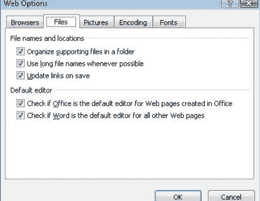

Windows 版的 Word、Excel 和 PowerPoint 都包含以下选项（Mac 版 Office 应用程序的选项不同）：

- 如果您希望应用程序将图形和其他单独的元素保存在与网页同名但后跟`_files`的文件夹中（例如，名为`products.html`的网页会自动获得一个名为`products_files`的文件夹），请选中**在文件夹中组织支持文件**复选框。应用程序会自动创建一个名为`filelist.xml`的文件，其中包含网页所需文件的列表。
- 清除**尽可能使用长文件名**复选框，以防止应用程序创建包含空格的长文件名，这可能与您正在使用的网络服务器不兼容。最好保持文件名简短，并在需要分隔文件名部分时使用下划线而非空格。
- 如果您希望应用程序在每次保存文件时自动检查每个链接并更新任何已更改的信息，请选中**保存时更新链接**复选框。在大多数情况下，这种自动更新很有帮助。

**图 9-4：***“Web 选项”对话框的“文件”选项卡包含针对 Word、Excel 和 PowerPoint 的不同选项集。这是 Word 的“文件”选项卡。*


Word 文档、Excel 工作表和 PowerPoint 演示文稿将其所有文本和嵌入元素（如图形）保存在同一文件中。链接项（如来自其他应用程序的图形或自动化对象）则保存在单独的文件中。


将支持文件保存在同一文件夹中通常很有帮助，因为您可以轻松地将网页及其支持文件移动到另一个文件夹。如果清除**在文件夹中组织支持文件**复选框，Office 应用程序会将图形和其他单独的元素与网页保存在同一文件夹中。这种行为可能会使您的文件夹更难管理，因为您无法一目了然地看出哪些支持文件属于哪个网页。但是，如果您无权在保存网页的文件夹中创建新文件夹，则可能需要清除**在文件夹中组织支持文件**复选框，以便 Office 应用程序不会尝试为您的网页创建新文件夹。


如果您正在创建一个内部网网站，并且所有访问者都使用分辨率高于`800 × 600`的显示器，您可以选择更高的分辨率。同样，如果您正在为小屏幕计算机（如手持计算机）设计网站，请选择较低的分辨率，例如`640 × 480`甚至`544 × 376`。

- 如果您希望 Internet Explorer 在单击 Internet Explorer 中的“编辑”按钮时，检查 Office 应用程序是否是您用于编辑在 Office 应用程序中创建的网页的默认 HTML 编辑器，请选中**检查 Office 是否为在 Office 中创建的网页的默认编辑器**复选框。如果您希望使用其他应用程序来编辑使用 Office 应用程序创建的网页，请清除此复选框。

Word 的“Web 选项”对话框中的“文件”选项卡还包括**检查 Word 是否为所有其他网页的默认编辑器**复选框。如果您希望将 Word 用作默认 HTML 编辑器来编辑使用 Word 或其他非 Office 应用程序创建的网页，请选中此复选框。（Excel 仍将是使用 Excel 创建的网页的默认编辑器，PowerPoint 仍将是使用 PowerPoint 创建的网页的默认编辑器。）如果您希望使用其他 HTML 编辑器作为默认编辑器，请清除此复选框。

### 选择“图片”选项卡选项

在“Web 选项”对话框的“图片”选项卡（如下所示）上，为网页中包含的图片选择选项。

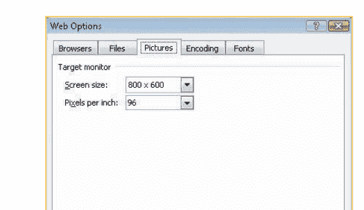

- 在**屏幕尺寸**下拉列表中，选择您预期大多数网站访问者将使用的最低分辨率。对于大多数网站，最佳选择是`800 × 600`，这是大多数当前计算机支持的分辨率（包括最小的上网本）。

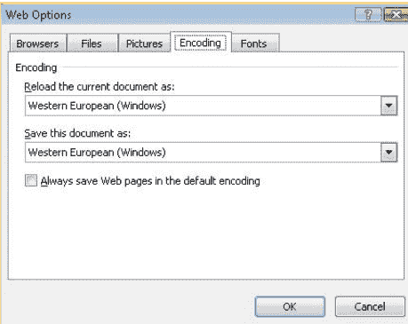

- 在**每英寸像素数**下拉列表中，选择用于网页中图片的每英寸像素数（ppi）。默认设置为`96 ppi`，这适用于大多数页面。您也可以选择`72 ppi`或`120 ppi`。此下拉列表在 PowerPoint 的“Web 选项”对话框中不显示。

### 选择“编码”选项卡选项

“Web 选项”对话框的“编码”选项卡（如下所示）允许您指定用于网页中字符的字符编码方案。北美和西欧的 Windows 版 Office 应用程序默认使用西欧（Windows）编码。这适用于大多数用途，但您可能更倾向于选择西欧（ISO）以符合 ISO-8859-1 标准，或选择 Unicode（UTF-8）以符合 Unicode 标准。同样，Mac 版 Office 应用程序默认使用西欧（Macintosh）编码；与 Windows 一样，您可能希望更改为西欧（ISO）。

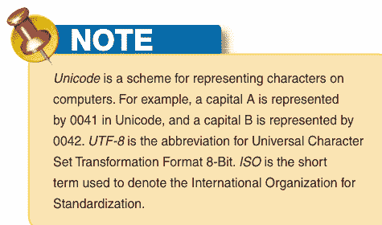

在**将此文档保存为**下拉列表中选择所需的编码。然后，如果您总是希望使用此编码，请选中**始终使用默认编码保存网页**复选框。选中此复选框将禁用“将此文档保存为”下拉列表。

“编码”选项卡顶部的**重新加载当前文档为**下拉列表允许您使用不同的编码重新打开当前文档。当您需要检查文档在不同编码下的显示效果时，此功能非常有用。

### 选择“字体”选项卡选项

“Web 选项”对话框的“字体”选项卡提供以下选项：

- 使用**字符集**列表框指定要用于页面的字符集。除非您需要使用其他字符集（如希伯来语或阿拉伯语）创建页面，否则请使用**英文/西欧/其他拉丁文稿**项。您需要确保所选的字符集可用于您正在使用的编码，因此除非您清楚自己在做什么，否则不要在此处进行更改。
- 使用**比例字体**下拉列表及其**大小**下拉列表指定要用于页面的比例字体和字体大小。
- 使用**固定宽度字体**及其**大小**下拉列表指定等宽字体和字体大小。

### 将新的“网页”和“网页预览”命令添加到 Office 应用程序

Word、Excel 和 PowerPoint 包含“网页预览”命令，您可以使用它来查看文档作为网页时的外观。但此命令不出现在功能区或 Microsoft Office 按钮菜单上，因此您需要将其添加到快速访问工具栏才能使用。

同样，Word 和 Excel 都有一个“另存为网页”按钮，用于将未保存的文档或工作簿保存为网页，而 Word 有一个“新建网页”命令，可用于启动新网页。您也必须将这些按钮添加到快速访问工具栏。

1. 打开您要更改的应用程序。
2. 单击**Microsoft Office**按钮，然后单击**选项**按钮以打开“选项”对话框。
3. 在左栏中，单击**自定义**项以显示“自定义”屏幕。图 9-5 显示了正在自定义的 Word 的“自定义”屏幕。
4. 确保**自定义快速访问工具栏**下拉列表显示**用于所有文档（默认）**。
5. 在**从下列位置选择命令**下拉列表中，选择**不在功能区中的命令**。命令列表显示在下拉列表下方的列表框中。
6. 向下滚动到“网页预览”命令。

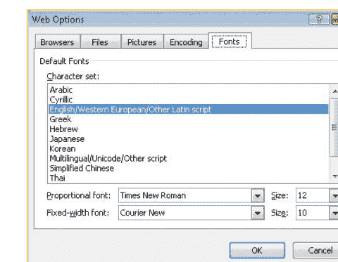

在“Web 选项”对话框中完成设置选择后，单击**确定**关闭该对话框，然后单击**确定**关闭“选项”对话框。

### 在 Word 中创建网页

选择合适的 Web 选项后，您就可以开始在 Word 中创建网页了。第一步是启动新网页。然后您可以添加文本和超链接，并检查页面的外观。如果您要从现有文档创建网页，则需要从中删除任何敏感信息，然后将其另存为网页。

#### 在 Word 中启动新网页

您现在可以在 Word 中创建一个新文档，并像这样添加内容：

1. 启动 Word（如果尚未运行），或切换到 Word。
2. 点击快速访问工具栏上的**New Web Page**按钮。你需要先将此按钮添加到快速访问工具栏，具体方法如快速操作步骤“将新建网页和网页预览命令添加到 Office 应用程序”所述。
3. 使用标准 Word 技术在页面上创建内容。例如：
   - 要输入文本，照常输入。
   - 要应用样式，点击格式工具栏上的**Style**下拉列表，然后点击所需的样式名称。
   - 要应用直接格式（例如，加粗或斜体），选择要应用格式的文本，然后点击格式工具栏上的相应按钮。
4. 按照本章后续“将 Word 文档保存为网页”部分所述保存文档。

#### 快速操作步骤：将新建网页和网页预览命令添加到 Office 应用程序（续）

7. 点击**Web Page Preview**命令，然后点击**Add**按钮将其添加到右侧的列表框中。随后你可以在该列表框中点击它，并使用向上箭头或向下箭头按钮在快速访问工具栏上重新定位它。
8. 对于 Word 或 Excel，向上滚动找到**Save As Web Page**按钮，点击它，然后点击**Add**按钮将其添加到右侧的列表框中。
9. 仅对于 Word，将左侧列表框向上滚动到**New Web Page**按钮。将此按钮添加到快速访问工具栏，并根据需要重新定位它。
10. 点击**OK**按钮关闭选项对话框。

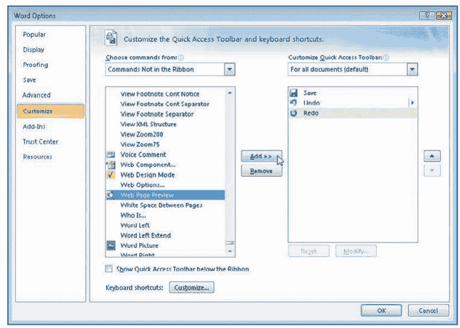

> 除了在 Word 中从零开始创建新网页，你也可以通过打开现有的 Word 文档、Excel 工作簿或 PowerPoint 演示文稿来创建网页。点击**Microsoft Office**按钮菜单，点击**Save As**，然后点击**Other Formats**以网页格式保存。详情请参阅本章后续的“将 Word 文档保存为网页”、“从 Excel 工作簿创建网页”和“从 PowerPoint 演示文稿创建网页”。

#### 创建超链接

在每个 Office 应用程序中，插入超链接的过程都是相同的，因此在此一并讨论。示例来自 Word。要插入超链接，请按照以下步骤显示插入超链接对话框，然后按照讨论你要创建的超链接类型的小节中的步骤操作：

1. 打开要创建超链接的文件。例如，启动 Word 然后打开文档。
2. 如果你希望超链接使用现有文本或图形作为用户点击的对象，请选择该文本或图形。否则，将插入点放在希望超链接出现的位置。
3. 点击功能区上的**Insert**选项卡，转到**Links**组，然后点击**Hyperlink**按钮。将出现插入超链接对话框（见图 9-6）。
4. 根据你要创建的是指向现有文件或网页、当前文档中的位置、新文档还是电子邮件地址的超链接，完成以下相应部分之一。

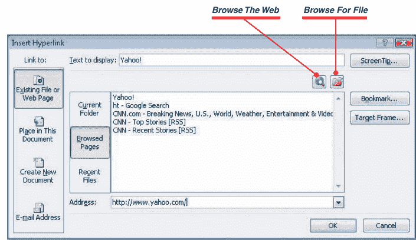

图 9-6：插入超链接对话框使你能够创建指向网页、同一文件中的位置、文件或电子邮件地址的超链接。


# 注意

如果 Internet Explorer 不是你的默认浏览器，“浏览 Web”按钮将无法正常工作。点击该按钮会打开你的默认浏览器，但当你返回插入超链接对话框时，Office 应用程序会尝试从 Internet Explorer 而非你的默认浏览器获取 URL。替代方法是：在默认浏览器中浏览到该网页，从地址栏复制地址，然后将其粘贴到插入超链接对话框的“地址”框中。在 Mac 版 Office 应用程序中，无论如何都需要使用复制粘贴。

##### 创建指向现有文件或网页的超链接

要创建指向现有文件或网页的超链接：

1. 在“链接到”列中，点击**Existing File Or Web Page**按钮（如果尚未选中）。
2. 通过以下方式之一导航到文件或网页：
   - 点击**Browse For File**按钮，使用出现的“链接到文件”对话框选择文件，然后点击**Open**按钮。Office 应用程序会自动在“地址”文本框中输入 URL。
   - 点击**Browse The Web**按钮，让 Windows 打开或激活一个 Internet Explorer 窗口，浏览到要链接到的页面，然后切换回插入超链接对话框。Office 应用程序会自动在“地址”文本框中输入 URL。
   - 点击**Current Folder**按钮显示当前文件夹。点击**Browsed Pages**按钮显示最近浏览过的网页列表。点击**Recent Files**按钮显示最近使用过的本地文件列表。
   - 从“地址”下拉列表中选择地址。
3. 将“要显示的文字”文本框中的默认文本更改为希望为超链接显示的文本。（这是用户点击以访问链接页面的文本。如果你已在网页上选择了文本，它将显示在此处。）
4. 要为超链接添加屏幕提示，点击**ScreenTip**，在“设置超链接屏幕提示”对话框中输入文本，然后点击**OK**。屏幕提示在用户点击链接前为其提供有关链接的额外信息。
5. 要使超链接连接到文档中的特定锚点，而不是仅仅连接到文档开头，点击**Bookmark**并在“选择文档中的位置”对话框中选择锚点项目（见图 9-7）。你需要事先在文档中放置书签或锚点。
6. 点击**OK**。Office 应用程序插入超链接。

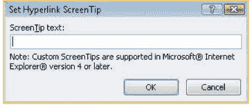

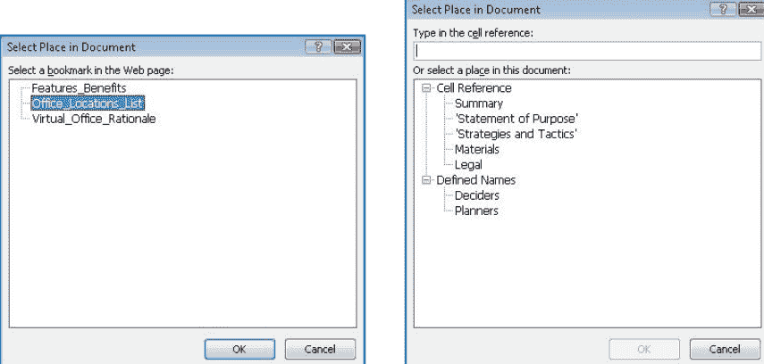

图 9-7：Office 应用程序使你能够链接到目标文档中的特定位置——例如，Word 文档中的书签（左）、Excel 工作表中的单元格或区域（右），或 PowerPoint 演示文稿中的幻灯片。

##### 创建指向当前文档中位置的超链接

要创建指向当前文档中位置的超链接：

1. 在“链接到”列中，点击**Place In This Document**按钮（见图 9-8）。
2. 将“要显示的文字”文本框中的默认文本更改为希望为超链接显示的文本。（这是用户点击以访问链接页面的文本，如果你最初选择了文本，则是该文本。）
3. 要为超链接添加屏幕提示，点击**ScreenTip**，在“设置超链接屏幕提示”对话框中输入文本，然后点击**OK**。
4. 点击**OK**。Office 应用程序插入超链接。

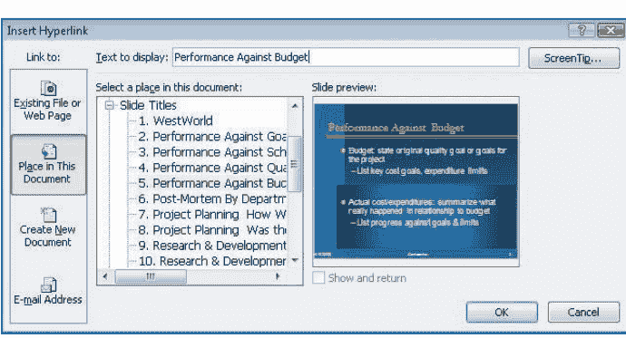

*图 9-8：插入超链接对话框中的“本文档中的位置”区域使你能够快速链接到同一文档中的锚点。*

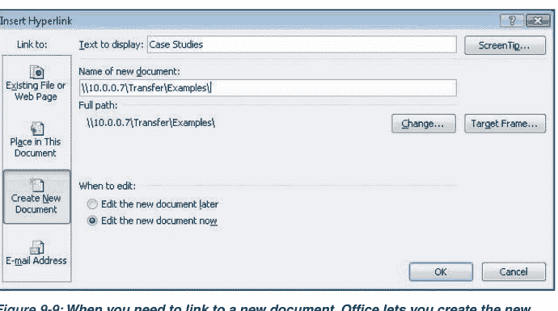

*图 9-9：当你需要链接到新文档时，Office 允许你立即创建新文档。这有助于确保新文档使用正确的名称和位置保存，减少出错的可能性。*

##### 创建指向新文档的超链接

要创建指向新文档的超链接：

1. 点击**Create New Document**按钮（见图 9-9）。
2. 在**Name Of New Document**文本框中输入文件名和扩展名。查看**Full Path**区域中的路径，确保其显示的是你想要的文件夹。如有必要，点击**Change**按钮；使用“新建文档”对话框指定文件夹、文件名和扩展名，然后点击**OK**。
3. 将**Text To Display**文本框中的默认文本更改为希望为超链接显示的文本。（这是用户点击以访问链接页面的文本，如果你最初选择了文本，则是该文本。）
4. 要为超链接添加屏幕提示，点击**ScreenTip**按钮，在**Set Hyperlink ScreenTip**对话框中输入文本，然后点击**OK**。
5. 默认情况下，Office 应用程序会选择“立即编辑新文档”选项按钮。如果你不希望立即打开新文档进行编辑，请选择**稍后编辑新文档**选项按钮。
6. 单击**确定**。Office 应用程序会插入超链接并创建文档。

> **注意**
>
> 当你在文档中输入网址、电子邮件地址或网络路径，然后按下**空格键**、**Tab 键**、**Enter 键**或标点键时，Office 应用程序会自动创建超链接。如果你觉得这种行为不便，可以将其关闭：单击**Microsoft Office**按钮，然后单击**选项**按钮。单击**校对**类别，然后单击**自动更正选项**按钮。在“自动更正”对话框中，单击**键入时自动套用格式**选项卡，清除**键入时自动替换**下的**Internet 及网络路径替换为超链接**复选框，然后单击**确定**关闭每个对话框。

##### 创建指向电子邮件地址的超链接

要创建一个启动向特定电子邮件地址发送邮件的`mailto`超链接：

1. 在“链接到”列中，单击**电子邮件地址**按钮（参见图 9-10）。
2. 在“电子邮件地址”文本框中键入电子邮件地址（或在“最近使用的电子邮件地址”列表框中单击它），并在“主题”文本框中键入邮件主题。
3. 将“要显示的文字”文本框中的默认文本更改为希望为超链接显示的文本。（这是用户单击以访问链接页面的文本，也是你最初选中的文本。）
4. 要为超链接添加屏幕提示，请单击**屏幕提示**按钮，在“设置超链接屏幕提示”对话框中键入文本，然后单击**确定**。
5. 单击**确定**。Office 应用程序会插入超链接。

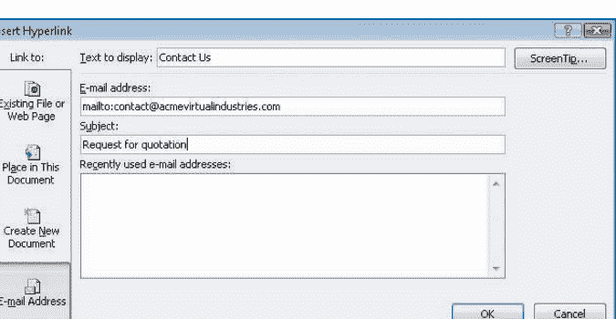

#### 检查页面的显示效果

在将 Office 文档保存为网页之前，你可能想使用“网页预览”来检查其外观。

1. 如果文档尚未打开，请在相应的应用程序中打开它。例如，在 Word 中打开 Word 文档。
2. 单击快速访问工具栏上的“网页预览”按钮。（你需要按照本章前面“将新建网页和网页预览命令添加到 Office 应用程序”快速步骤的描述，将此按钮添加到快速访问工具栏。）该应用程序会创建一个临时文件，其中包含网页格式的页面，然后在 Internet Explorer 中显示该页面。图 9-11 显示了一个示例。
3. 查看网页后，单击**关闭**按钮（X 按钮）关闭 Internet Explorer 标签页或窗口。

#### 从文档中删除敏感信息

在创建将发布到网站（而不是本地网络站点）的网页时，请确保删除 Office 应用程序默认自动包含在文档中的个人信息和敏感数据。要删除此信息：

1. 启动应用程序并打开要转换为网页的文档。
2. 单击**Microsoft Office**按钮，突出显示**准备**，然后单击**检查文档**。出现“文档检查器”对话框。此对话框包含针对不同应用程序的不同选项，但基本思想是相同的：让你删除任何潜在的敏感信息。图 9-12 显示了 Word 的“文档检查器”对话框。
3. 选择要从文档中删除的每个信息类别的复选框。
4. 单击**检查**按钮。应用程序检查文档并更新对话框以显示找到的项目（参见图 9-13）。
5. 对于要删除的每个敏感信息类别，单击**全部删除**按钮。如有必要，单击**重新检查**按钮再次检查文档，以确保所有危险数据已被清除。
6. 单击**关闭**按钮关闭文档检查器。
7. 单击快速访问工具栏上的**保存**按钮以保存文档。

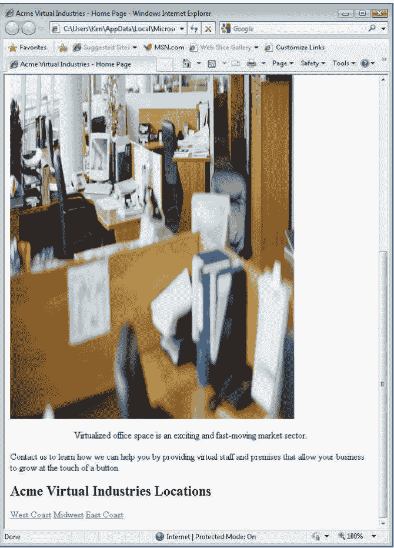

**图 9-11：**“网页预览”功能使你能够在将网页保存为 HTML 格式之前识别问题（例如此处被压缩的图像）。

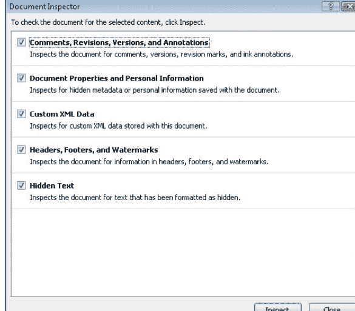

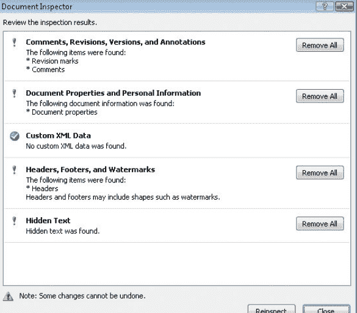

*图 9-12：***在将文档发布为网页之前，使用“文档检查器”对话框检查文档中的敏感信息。*

*图 9-13：***对于要删除的每类文档信息，单击“全部删除”按钮。**

#### 将 Word 文档保存为网页

要将现有的 Word 文档保存为网页：

1. 如果 Word 尚未运行，请启动它，或切换到它。
2. 单击**Microsoft Office**按钮，单击**打开**，选择要保存为网页的现有文档，然后单击**打开**。或者，单击**Microsoft Office**按钮，然后在“最近使用的文档”菜单上单击文档。文档随即打开。
3. 单击快速访问工具栏上的“另存为网页”按钮。“另存为”对话框出现。
4. 在“保存类型”下拉列表中，选择要使用的文件格式（有关可用格式的讨论，请参阅本章中的“选择合适的 Web 文件格式”快速步骤）。例如，选择“网页”。Word 会显示与网页相关的控件（参见图 9-14）。
5. 选择保存网页的文件夹。
6. 在“文件名”文本框中键入文件名。如果你想使用`.html`扩展名而不是`.htm`扩展名（对于“网页”或“筛选过的网页”格式的文件），或者使用`.mhtml`扩展名而不是`.mht`扩展名（对于“单个文件网页”格式的文件），请同时键入扩展名。
7. 检查“页标题”区域中显示的标题。（你可能看不到标题。）要更改标题，请单击**更改标题**按钮，在“设置页标题”对话框中键入新标题，然后单击**确定**。
8. 单击**保存**。Word 将文档保存为网页。
9. 如果你已完成文档操作，请单击**Microsoft Office**按钮，然后单击**关闭**。如果你已完成 Word 操作，请单击**Microsoft Office**按钮，然后单击**退出应用程序**（其中*应用程序*是应用程序的名称）。

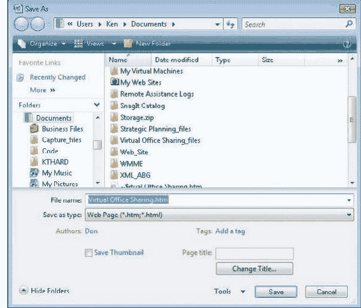

**图 9-14：**Word 的“另存为”对话框用于保存网页，包括“页标题”区域和“更改标题”按钮。

## 快速参考

### 选择合适的 Web 文件格式

Word、Excel 和 PowerPoint 各自提供两种或更多种 HTML 格式可供选择；因此，在以 HTML 格式保存文件之前，请确保你了解这些格式之间的区别以及哪种格式适用于何种目的。

Word、Excel 和 PowerPoint 各自提供“单个文件网页”格式和“网页”格式。Word 还提供“筛选过的网页”格式。

#### 网页格式

“网页”格式创建一个 HTML 文件，其中包含文档的文本内容以及一个包含文档图形的单独文件夹。这使得网页的 HTML 文件本身更小，但整个页面分发起来有点麻烦，因为你还必须分发图形文件夹。该文件夹会自动创建，并以网页名称加上`_files`命名。例如，名为`Products.html`的网页会有一个名为`Products_files`的文件夹。

使用“网页”格式的文件使用`.htm`和`.html`文件扩展名。这些文件还使用特定于 Office 的标签，以 HTML 格式保留文件包含的所有信息。

#### 单个文件网页格式

“单个文件网页”格式创建一个网页存档文件，其中包含网页所需的所有信息——所有文本内容和所有图形。使用“单个文件网页”格式可以创建易于分发的文件。

使用“单个文件网页”格式的文件使用`.mht`和`.mhtml`文件扩展名。这些文件使用特定于 Office 的标签，以 HTML 格式保留文件包含的所有信息。

续……


#### 筛选过的网页格式

“筛选过的网页”格式仅在 Word 中可用。与“网页”格式一样，此格式创建一个 HTML 文件，其中包含文档的文本内容以及一个单独的、自动命名的文件夹（包含文档的图形）。但是，此格式会从文档中删除特定于 Office 的标签。

删除这些功能会减小文件大小，当你只需要 HTML 时，这是个好主意。当你需要的是一个没有 Word 特定功能或高级格式的网页时，这非常棒。缺点是文件会丢失 Word 项目，如文档属性、模板链接和 VBA 代码，因此当你需要往返处理复杂文档时——即以网页格式保存它们，然后将其带回 Word 而不丢失任何数据或元数据——此格式就不太有用了。

使用“筛选过的网页”格式的文件使用`.htm`和`.html`文件扩展名。

#### 从 Word 文档中删除特定于 Office 的标签

如本章前面所讨论，Word 使用自定义 HTML 标签来存储将整个 Word 文档以 HTML 格式保存所需的特定于 Office 的数据。如果你想能够在 Word 中编辑文档并保留所有功能，保存这些特定于 Office 的数据是好的，但当你只是一次性使用 Word 为网站创建页面时，就不需要这些额外的数据了。

要从文档中删除标签，请按照以下步骤操作：

1. 按照上一节的步骤操作，但在“另存为”对话框的“保存类型”下拉列表中选择**筛选过的网页**格式。
2. 当你单击**保存**时，会出现下图所示的 Microsoft Office Word 对话框，提示你特定于 Office 的标签将被删除。单击**是**。

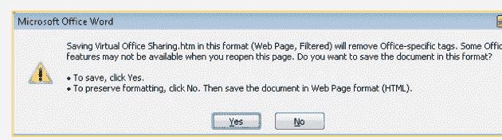

### 使用 Word 创建 HTML 元素

如果你选择不使用 Word 作为主要的 HTML 编辑器，你可能仍然希望使用 Word 来创建一些 HTML 元素，以便将它们包含在你的网页中。

1. 如果 Word 尚未运行，则启动它。
2. 打开一个现有文档，或创建一个包含所需内容的新文档。
3. 将 Word 文档保存为其中一种 HTML 格式。
4. 在你的浏览器中查看生成的页面。
5. 查看网页的源代码。例如，在 Internet Explorer 中，单击**页面**菜单按钮，然后单击**查看源文件**。
6. 选择你想要复制的元素的代码，然后发出复制命令（例如，按`CTRL+C`）。
7. 切换到你的 HTML 编辑器，定位插入点，然后发出粘贴命令（例如，按`CTRL+V`）。
8. 如果你已完成使用，关闭 Word 和你的浏览器。

根据你在“Web 选项”对话框中选择的浏览器设置，你可能还会看到关于将从 Word 文档中移除的功能的警告。如果你想继续，请单击**继续**；如果你想选择其他格式，请单击**取消**。

### 从 Excel 和 PowerPoint 创建网页

Word 非常适合创建网页，但如果你要在网页上使用的数据是工作簿的一部分，你可能需要改用 Excel。同样，你可以使用 PowerPoint 从演示文稿创建网页。

#### 从 Excel 工作簿创建网页

Excel 允许你将选定的部分工作簿、一个工作表或整个工作簿保存为网页，可以包含交互性也可以不包含。然而，通常你会想要“发布”部分工作簿、一个工作表或整个工作簿的副本，因为“发布为网页”对话框为网页提供了更多功能和灵活性。

要将 Excel 工作簿、工作表或工作表的一部分保存为网页：

1. 如果 Excel 尚未运行，则启动它，或切换到 Excel。
2. 打开现有的工作表，或创建一个新工作表，添加内容并保存。
3. 如果你想将工作表（而不是工作簿）保存为网页，请选择该工作表。如果你想将工作表中的某个区域保存为网页，请选择该区域。
4. 单击快速访问工具栏上的**另存为网页**按钮。“另存为”对话框出现（参见图 9-15）。
5. 在“保存位置”区域，如果你想保存或发布整个工作簿，请选择**整个工作簿**选项按钮。如果你想发布活动工作表或选定的区域，请选择**选定区域**选项按钮。当选择了一个区域时，“选定区域”选项按钮会列出该区域（例如，“选定区域：$A$1:$H$15”）；如果没有选择区域，则显示“选定区域：工作表”。
6. 使用地址框和主列表框来指定保存网页的文件夹。
7. 在“保存类型”下拉列表中，选择你想要使用的文件格式——例如，网页（`*.htm`、`*.html`）。有关可用格式的讨论，请参阅“选择合适的网页文件格式”快速步骤。
8. 在“文件名”文本框中，键入文件名。如果你想使用`.html`扩展名而不是`.htm`扩展名，或者使用`.mhtml`扩展名而不是`.mht`扩展名，请键入该扩展名。
9. 单击**发布**。“发布为网页”对话框出现（参见图 9-16）。

图 9-15：Excel 的“另存为”对话框用于保存网页，其中包含发布工作簿、工作表或选定区域的控件。

> **注意**
>
> 以“网页”格式保存的文件可以使用`.htm`或`.html`扩展名。以“单个文件网页”格式保存的文件可以使用`.mht`或`.mhtml`扩展名。

图 9-16：在 Excel 的“发布为网页”对话框中，选择每次保存工作簿时是否自动重新发布网页。

10. 使用“发布内容”部分中的“选择”下拉列表和列表框来指定要发布的内容。如有必要，更改“选择”下拉列表中选定的项目。如果你选择“单元格区域”项目，Excel 会显示一个“折叠对话框”按钮。单击此按钮可将对话框折叠到其标题栏，在工作表中选择区域，然后再次单击**折叠对话框**按钮以恢复对话框。

> **注意**
>
> “每次保存工作簿时自动重新发布”选项有助于确保网页始终是最新的，但仅当你拥有到发布网页站点的永久快速连接时才使用它。

11. 检查“标题”文本框中显示的标题（如果有）。要更改它，请单击**更改**按钮，在“设置标题”对话框中键入新标题，然后单击**确定**。
12. 检查“文件名”文本框中的路径和文件名。如有必要，键入更改内容，或单击**浏览**，在“发布为”对话框中指定文件夹和文件名，然后单击**确定**。
13. 如果你希望 Excel 在每次保存文件时自动重新发布此网页，请选中**每次保存工作簿时自动重新发布**复选框。
14. 如果你希望 Excel 在 Internet Explorer 中显示网页以便你可以检查它，请选中**在浏览器中打开发布的网页**复选框。这通常是一个好主意，因为它可以帮助你发现发布网页时发生的任何错误。
15. 单击**发布**。Excel 发布网页，并且（如果你选中了“在浏览器中打开发布的网页”复选框）在 Internet Explorer 中显示它。

#### 从 PowerPoint 演示文稿创建网页

要将 PowerPoint 演示文稿保存为网页：

1. 如果 PowerPoint 尚未运行，则启动它，或切换到 PowerPoint。
2. 打开现有的演示文稿，或创建一个新演示文稿，添加内容并保存。
3. 单击**Microsoft Office**按钮，高亮显示**另存为**，然后单击**其他格式**。“另存为”对话框出现。
4. 在“保存类型”下拉列表中，选择你想要使用的格式——网页（`*.htm`、`*.html`）或单个文件网页（`*.mht`、`*.mhtml`）。“另存为”对话框显示将演示文稿保存为网页的控件（参见图 9-17）。
5. 单击**发布**。“发布为网页”对话框出现（参见图 9-18）。
6. 在“发布内容”部分，选择要发布演示文稿的哪一部分：完整的演示文稿、一组幻灯片范围，或你定义的自定义放映。（如果演示文稿不包含自定义放映，“自定义放映”选项按钮不可用。）如果你想在幻灯片中包含演讲者备注，请选中**显示演讲者备注**复选框。
7. 在“浏览器支持”部分，选择**Microsoft Internet Explorer 4.0 或更高版本**选项按钮、**Microsoft Internet Explorer 3.0、Netscape Navigator 3.0 或更高版本**选项按钮，或**所有上面列出的浏览器**选项按钮。
8. 检查“页标题”显示中显示的标题。要更改它，请单击**更改**按钮，在“设置页标题”对话框中键入新标题，然后单击**确定**。
9. 检查“文件名”文本框中的路径和文件名。如有必要，键入更改内容，或单击**浏览**按钮，在“发布为”对话框中指定文件夹和文件名，然后单击**确定**。
10. 如果你希望 PowerPoint 在你的默认浏览器中显示网页以便你可以检查它，请选中**在浏览器中打开发布的网页**复选框。
11. 单击**发布**按钮。PowerPoint 发布该页面，并且（如果你选择这样做）在 Internet Explorer 中显示它。

> **提示**
>
> 使用“Microsoft Internet Explorer 4.0 或更高版本”设置创建的网页演示文稿适用于大多数当前和最近的网页浏览器。

> **注意**
>
> Internet Explorer 可能会显示信息栏，告知它已限制该文件显示可能访问你计算机的活动内容，并阻止了演示文稿的显示。要查看演示文稿，请单击信息栏，单击**允许阻止的内容**，然后在“安全警告”对话框中单击**是**。

> **提示**
>
> PowerPoint 演示文稿往往包含许多用于背景、项目符号或线条等元素的图形，以及你手动包含的任何图形。如果缺少某个图形，演示文稿可能不显示图像、显示图像的空白占位符，或显示一个红色 X。

## 如何……

- 理解表单的基础知识
- 定义表单结构
- 理解`method`属性
- 向表单添加字段
- 完成表单
- 允许访客上传文件
- 创建一个将内容通过电子邮件发送给你的表单
- 理解用户事件的不同类别
- 处理脚本威胁
- 显示页面上次更新时间
- 将浏览器重定向到另一个页面
- 验证表单是否已填写

## 第 10 章：使用表单和脚本

本章将向你展示如何创建表单，以从你网站的访客那里收集信息，无论是使用网页服务器上的脚本，还是（更简单地）通过电子邮件。

你还将学习如何向你的页面添加脚本以执行有用的操作。例如，你可以显示页面上次更新的时间，将浏览器重定向到另一个页面，或者验证访客是否已填写表单上的必填字段。

### 创建表单

为了让你的网页访客能够向你提供信息，你需要创建一个访客可以填写的表单。例如，你可能需要：

- 实现一个登录表单，确保访问你网站特定部分的所有访客都已注册（并且可能支付了订阅费）
- 提供一个电子邮件通讯或纸质目录的注册表单
- 允许访客向你上传图片或其他文件

#### 理解表单的基础知识

网页表单是一个包含字段的网页，这些字段是访客可以输入信息或从一组预定义选项中进行选择的区域。当访客访问该表单时，浏览器会像往常一样显示网页，包括表单的字段。访客可以与这些字段进行交互——例如，通过在文本字段中键入文本，通过选中复选框或一组选项按钮中的一个选项按钮，或者通过从下拉列表中选择一个项目。

填写完表单后，访客单击提交表单的命令按钮，通常通过运行使用 Perl 等编程语言编写的通用网关接口（CGI）脚本来完成。

要使表单工作，你必须：

- 创建一个包含适合你目的的适当字段的表单
- 在网页服务器上，设置一个脚本来处理访客在表单中输入的信息
- 在表单中包含用于处理该表单的适当 HTML 指令


> **提示**
>
> 许多网站也提供表单脚本，因此值得搜索你需要的内容。你的网络主机也可能提供论坛，供用户分享代码、技巧和建议。

这个过程比仅仅创建一个网页并将其复制到你的网络主机服务器要复杂得多，但大多数网络主机都为各种常见的表单用途提供了易于使用的脚本。因此，在你开始计划或创建任何表单之前，请检查你的互联网服务提供商（ISP）或网络主机为你的账户类型提供了哪些脚本功能。（通常，不同类型的用户账户具有不同的脚本级别可用——通常，你支付的越多，获得的脚本就越多。）

#### 定义表单结构

在开始按照本节描述创建表单之前，请确定表单的目的，并确定它将收集哪些信息。将这些信息划分为合适的字段。

例如，如果你计划创建一个包含表单收集信息的数据库，请将名字和姓氏分开，而不是将它们放在单个字段中。同样，将地址信息分成几个字段，如本章后面的示例所示。将姓名和地址分开可以让你按每个组成部分进行排序，因此你可以按姓氏、城市、邮政编码等进行排序。

开始创建表单：

1. 打开记事本或你的 HTML 编辑器，并开始一个新的网页。例如，如果你已经按照本书前面的建议创建了 HTML 文档的骨架，请打开该文件，然后将其另存为其他名称。否则，创建以下文档骨架，然后将其保存为你选择的名称：

```html
```


```xml
<?xml version="1.0" encoding="utf-8"?>

<!DOCTYPE html PUBLIC "-//W3C//DTD XHTML 1.0 Transitional//EN"
    "http://www.w3.org/TR/xhtml1/DTD/xhtml1-transitional.dtd">

<html xmlns="http://www.w3.org/1999/xhtml" xml:lang="en"
    lang="en">

<head>
    <title></title>
</head>

<body>
</body>

</html>
```

2. 在正文（`body`）中要开始表单的位置单击，然后键入开始的 `<form>` 标签：

```html
<form
```

3. 键入 `action` 属性，并指定你要用于返回或处理访客在表单中输入数据的脚本的名称（如果需要，还包括位置）。以下示例使用存储在`/cgi-bin/`文件夹中名为`register.php`的脚本：

```html
<form action="cgi-bin/register.php"
```

4. 键入 `method` 属性，并指定值`get`或`post`，视情况而定。（有关`get`和`post`之间区别的解释，请参阅“理解 method 属性”快速参考。）例如：

```html
<form action="cgi-bin/register.php" method="get">
```

5. （可选）键入 `name` 属性，并指定你想要分配给表单的名称。除非你想通过脚本访问表单，否则名称不是必需的，但你可能会发现为表单分配名称有助于区分不同的表单：

```html
<form action="cgi-bin/register.php" method="get"
    name="registration"
```

> **注意**
>
> 对于`action`属性，你需要输入一个可供你使用的脚本的名称和位置——这个脚本可以是你的网络主机为你提供的，也可以是你从网络上其他地方下载并安装到你网站上的，或者你自己开发的。如果你只是照搬本节所示的示例，你的表单将无法工作，除非你恰好有一个名为`register.php`的脚本存储在名为`/cgi-bin/`的文件夹中。

6. 键入结束角括号以完成 `<form>` 标签：

```html
<form action="cgi-bin/register.php" method="get"
    name="registration">
```

7. 在新行上，键入结束 `</form>` 标签：

```html
</form>
```

8. 在 `<form>` 和 `</form>` 标签之间，输入表单的文本和字段，如以下各节所述。

## 快速参考

### 理解 `method` 属性

对于 `method` 属性，你需要指定 `get`（将表单数据发送到 `action` 指定的脚本）或 `post`（将表单数据在 HTTP 头部发送）。你需要指定`get`还是`post`取决于你所使用的脚本。

通常，当你在收集或检索数据时使用`get`，而当你需要存储数据、通过电子邮件发送数据或以其他方式处理数据时使用`post`。出于安全原因，对于产品订购表单，你应该使用`post`而不是`get`。

`get` 将表单内容组装成一个名为`querystring`的文本字符串，该字符串被添加到浏览器加载的下一页地址框中的 URL 后面，并用问号分隔。查询字符串中的每个字段用一个和号（`&`）分隔，每个空格被替换为一个加号（`+`），每个字段的名称后跟一个空格和该字段的值。

例如，如果你访问一个网站，在名为`textbox1`的文本框中键入`Jane Ramirez`，并单击“提交”按钮，则查询字符串`?textbox1=Jane+Ramirez&mybutton=Submit`会被添加到地址框中的 URL。

`get` 的优点是，如果访客将该页面加入书签，查询字符串也会被保存在书签中，这样他或她就可以直接返回到表单的结果。缺点是在地址栏中显示表单内容可能是一个安全问题。

`post` 不会将查询字符串添加到地址栏，因此它避免了潜在的安全问题；这就是为什么它更适合产品订购表单。`post` 的缺点是访客无法为表单结果添加书签。

### 向表单添加字段

创建表单的基本结构并指定要执行的操作和方法后，根据需要向表单添加文本框、下拉列表、复选框和命令按钮。还可以使用通常的标签向表单添加任何文本或其他对象（例如图形）。

#### 添加单行文本框

要添加单行文本框：

1. 将插入点放在 `<form>` 和 `</form>` 标签之间的适当位置，然后按 **ENTER** 创建一个新行。
2. 为你字段的标签键入一个标签，以便用户识别它。例如，键入`First Name`。
3. 键入 `<input/>` 标签的开头、一个空格、`type` 属性、一个等号、双引号、文本和双引号：

```html
<input type="text"
```

4. 键入一个空格、`name` 属性、一个等号、双引号、你想要分配给文本框的名称和双引号：

```html
<input type="text" name="firstname"
```

5. 键入一个空格、`size` 属性、一个等号、双引号、文本框所需的宽度和双引号。这是字符数。

### 添加多行文本框

单行文本框便于获取访客的简短文本，但若希望他们能更自由地表达，应改用多行文本框。

添加多行文本框的方法如下：

1. 将光标置于 `<form>` 与 `</form>` 标签之间，按 **ENTER** 创建新行。
2. 输入 `<textarea>` 标签的开头：

```html
<textarea
```

3. 输入一个空格、`cols` 属性、等号以及文本框应占据的列数。这大致相当于文本框宽度上可显示的字符数（等同于 `<input/>` 标签的 `size` 属性）：

```html
<textarea cols="40"
```

4. 输入一个空格、`rows` 属性、等号以及文本框所需的行数：

```html
<textarea cols="40" rows="10"
```

5. 输入 `<textarea>` 标签的闭合尖括号、你希望在文本框中显示的任何默认文本，以及闭合的 `</textarea>` 标签：

```html
<textarea cols="40" rows="10">请在此输入您的留言。</textarea>
```

> 在整个表单中，你需要添加标题、标签和说明文本，这无非就是输入文本。接下来的几组步骤将讨论如何创建表单字段，并让你自行在字段外添加文本。你将在最后的“完成表单”部分看到如何将文本用于标题和标签的示例。

将 `type` 属性设置为`text`会使 `<input/>` 标签显示一个单行文本框。

文本框中可显示的字符数（用户可以输入更多字符——最多可达 `maxlength` 属性指定的数量，该属性将在下文解释）：

```html
<input type="text" name="firstname" size="20">
```

> 在指定数值（如 `size` 属性和 `maxlength` 属性的值）时，不需要使用双引号。

6. 如果希望在文本框中显示默认文本，请输入一个空格、`value` 属性、等号、双引号、默认文本和双引号：

```html
<input type="text" name="firstname" size="20" value="请在此输入名字">
```

> 如果该文本框是用于访客输入密码或其他需要防止窥视的信息，请对 `<input/>` 字段使用 `type="password"` 而非 `type="text"`。当访客在框中输入时，每个字符都会显示为星号或圆点，而不是字符本身。不要为密码文本框分配默认值，因为它会显示为星号或圆点而非文本。

7. 如果要限制访客可输入的文本量，请输入一个空格、`maxlength` 属性、等号、双引号、最大字符数和双引号：

```html
<input type="text" name="firstname" size="20" value="请在此输入名字" maxlength="20">
```

### 添加下拉列表

若需让访客从多个选项中选择一项，请使用下拉列表。添加下拉列表的方法如下：

1. 将光标置于 `<form>` 与 `</form>` 标签之间的适当位置，按 **ENTER** 创建新行。
2. 输入 `<select>` 标签的开头：

```html
<select
```

3. 输入一个空格、`size` 属性（指定列表中可见的行数）、等号、双引号、数字 1 和双引号，以及闭合尖括号：

```html
<select size="1">
```

4. 按 **ENTER** 开始新行。
5. 输入 `<option>` 标签的开头、一个空格、`value` 属性、等号、双引号、表示访客选择此项目的标识编号和双引号。例如，创建第一个项目：

```html
<option value="1">
```

6. 输入 `<option>` 标签的闭合尖括号、你希望在下拉列表中为该项目显示的文本，以及闭合的 `</option>` 标签。例如，创建列表项 AL：

```html
<option value="1">AL</option>
```

默认情况下，浏览器会显示下拉列表中的第一个项目。若要浏览器显示另一个项目，请在适当项目的开标签`<option>`中添加`selected`属性——例如`<option value="3" selected>美国</option>`。当你有一个很长的列表，而访客最可能选择的项目并未排在第一时，设置默认项目特别有用。（或者，你可以重新排列列表，将最可能的一项或几项放在前面。）

如果你未为复选框的`value`属性指定文本，当它被选中时会获得值`"on"`。

7. 重复步骤 4-6 以创建所需数量的列表项。以下代码展示了一个简化的示例：

```html
<option value="1">AL</option>
<option value="2">AK</option>
<option value="3">AR</option>
<option value="4">AS</option>
<option value="5">AZ</option>
<option value="6">CA</option>
<option value="7">CO</option>
<option value="8">CT</option>
...
<option value="58">WI</option>
<option value="59">WY</option>
```

8. 输入闭合的 `</select>` 标签以结束下拉列表。当用户点击下拉列表的向下箭头时，将显示整个列表。

### 添加复选框

对于呈现非互斥的选项，请使用复选框。添加复选框的方法如下：

1. 将光标置于 `<form>` 与 `</form>` 标签之间的适当位置，按 **ENTER** 创建新行。
2. 输入 `<input/>` 标签的开头、一个空格、`type` 属性、等号、双引号、`checkbox` 和双引号：

```html
<input type="checkbox"
```

3. 输入一个空格、`name` 属性、等号、双引号、你希望分配给复选框的名称和双引号：

```html
<input type="checkbox" name="Catalog"
```

4. 输入一个空格、`value` 属性、等号、双引号、表示访客选择此项目的标识文本和双引号：

```html
<input type="checkbox" name="Catalog" value="Catalog"
```

5. 输入一个空格、`id` 属性、等号、双引号、此复选框的标识符名称和双引号：

```html
<input type="checkbox" name="Catalog" value="Catalog"
    id="catalog"
```

6. 如果希望复选框默认被选中，请输入一个空格，后跟`checked="checked"`：

```html
<input type="checkbox" name="Catalog" value="Catalog" id="catalog" checked="checked">
```

7. 输入 `<input/>` 标签的斜杠和闭合尖括号：

```html
<input type="checkbox" name="Catalog" value="Catalog" id="catalog" checked="checked"/>
```

8. 在下一行，输入 `<label>` 标签的开头，该标签将显示复选框旁边的文本：

```html
<label
```

9. 输入 `for` 属性、等号、双引号、复选框的 id 名称、双引号和闭合尖括号：

```html
<label for="catalog">
```

10. 输入你希望在复选框旁边显示的文本，后跟闭合的 `</label>` 标签：

```html
<label for="catalog">寄送目录</label>
```

### 添加选项按钮

> 选项按钮也称为*单选按钮*，因为在传统收音机上，一次只能选择一个电台。

选项按钮使访客能够从两个或多个互斥选项中进行选择。在任何时刻，一个选项按钮组中只能有一个选项按钮被选中；选择一个选项按钮会清除该组中所有其他选项按钮。

添加一组选项按钮的方法如下：

1. 将光标置于 `<form>` 与 `</form>` 标签之间的适当位置，按 **ENTER** 创建新行。
2. 输入 `<input/>` 标签的开头、一个空格、`type` 属性、等号、一对双引号、`radio` 和另一对双引号：

```html
<input type="radio"
```

3. 输入一个空格、`name` 属性、等号、一对双引号、该组选项按钮的名称和另一对双引号：

```html
<input type="radio" name="customertype">
```

### 添加命令按钮

本章到目前为止讨论的控件，让访问者可以与你的表单互动、输入文本并做出选择；但要让他们能够执行操作，你必须添加一个或多个命令按钮。至少，你必须添加一个用于提交表单的按钮。通常，包含一个重置表单的按钮也是一个好主意，它可以清除其字段中所有已选选项或已输入的数据。

要添加提交按钮：

1. 将插入点放在`<form>`和`</form>`标签之间的适当位置，然后按 **ENTER** 键创建一个新行。

> **注意**
>
> `name`属性将单选按钮彼此关联，使它们成为一个组。如果你为组中不同的单选按钮分配了不同的`name`属性值，它们将相互独立，并且无法正常工作。要创建两个不同的单选按钮组，请为属于每个组的按钮使用不同的`name`值。

> **注意**
>
> 要创建重置按钮，请按照以下步骤操作，但将`type="submit"`替换为`type="reset"`，并为按钮分配一个值，例如`重置表单`或`清除所有字段`。

2. 输入`<input/>`标签的开头、一个空格、`type`属性、等号、一对双引号、`submit`，以及另一对双引号：

```html
<input type="submit"
```

3. 输入一个空格、`value`属性、等号、一对双引号、按钮的名称、另一对双引号，以及`<input/>`标签的闭合斜杠和尖括号：

```html
<input type="submit" value="提交反馈"/>
```

### 完成表单

以下代码清单展示了图10-1所示示例表单的完整代码，但为了简洁，省略了部分州和地区列表。

```html
<h1>客户反馈</h1>

<form action="feedback.php" method="get">

<p>名： <input type="text" name="firstname"
    size="20" value="在此输入您的名"
    maxlength="20"/>
</p>

<p>姓： <input type="text" name="lastname"
    size="20" value="在此输入您的姓"
    maxlength="20"/></p>

<p>地址1：
<input type="text" name="address1"
    value="地址行1" size="40"/>
</p>

<p>地址2：
    <input type="text" name="address2"
        value="地址行2" size="40"/>
</p>

<p>城市：
    <input type="text" name="addresscity"
        value="城市" size="17"/>

&nbsp;州： <select size="1">

    <option value="1">AL</option>
    <option value="2">AK</option>
    <option value="3">AR</option>
    <option value="4">AS</option>
    <option value="5">AZ</option>
    <option value="6">CA</option>
    <option value="7">CO</option>
    <option value="8">CT</option>
    <option value="9">DC</option>
    <option value="10">DE</option>
    <option value="11">FL</option>
    <option value="12">FM</option>
    <option value="13">GA</option>
    <option value="14">GU</option>
    <option value="15">HI</option>
    <option value="16">IA</option>
```


```html
<option value="17">ID</option>
<option value="18">IL</option>
<option value="19">KS</option>
<option value="20">KY</option>

<!-- 此处为简洁省略了其他州 -->

<option value="58">WI</option>
<option value="59">WY</option>
</select>

&nbsp;邮编：

<input type="text" name="addresszip" value="邮编" size="5" maxlength="5"/>

</p>

<p>电子邮件：

<input type="text" name="email" value="在此输入您的电子邮件地址" size="40"/>

</p>

<p>
  <input type="radio" name="customertype" id="customertype"/>
  <label for="customertype">现有客户</label>

  &nbsp;&nbsp;

  <input type="radio" name="customertype" id="newcustomer" checked="checked"/>
  <label for="newcustomer">新客户</label>
</p>

<p>
  <input type="checkbox" name="Catalog" value="Catalog" id="catalog" checked="checked"/>
  <label for="catalog">发送产品目录</label>

  &nbsp;&nbsp;

  <input type="checkbox" name="MailList" value="MailList" id="maillist"/>
  <label for="maillist">加入邮件列表</label>
</p>

<p>
  您想对我们说的话：<br />

  <textarea cols="40" rows="10">在此输入您的留言。</textarea>
</p>

<p>
  <input type="submit" value="提交反馈" name="submit" align="middle" id="submit"/>
  <input type="reset" value="清除表单" name="clear" align="left"/>
</p>

</form>
```

图 10-1：在你的表单中包含一个重置或清除按钮，以便访问者可以在必要时轻松清除他们在表单中输入的信息。

## 允许访问者上传文件

根据你创建的表单类型，你有时可能需要允许访问者向你上传文件。例如，如果你接受访问者对网站的投稿，你可能需要让访问者上传图片；如果你销售软件，你可能需要允许访问者上传配置文件，以便你能诊断问题。

要允许访问者上传文件：

1. 将插入点放在`<form>`和`</form>`标签之间的适当位置，然后按ENTER键创建一个新行。
2. 输入`<input/>`标签的开头、一个空格、`type`属性、等号、一对双引号、`file`，以及另一对双引号：`<input type="file"`
3. 输入一个空格、`name`属性、等号、一对双引号、上传控件的名称，以及另一对双引号：`<input type="file" name="upload"`
4. 输入一个空格、`size`属性、等号、一对双引号、上传控件中文本框的大致宽度、另一对双引号，以及标签的闭合尖括号：`<input type="file" name="upload" size="60"/>`

图10-2展示了表单中生成的上传控件。

无论你收到哪种类型的文件，在打开它们之前，都请使用诺顿防病毒软件（`www.symantec.com`）、McAfee VirusScan（`www.mcafee.com`）或带有最新病毒定义的免费Avast（`www.avast.com`）等防病毒程序检查它们是否含有病毒。即使是看似无害的JPEG文件也可能包含恶意软件。

## 创建一个将内容通过电子邮件发送给你的表单

如果你的网站主机没有提供满足你需求的易用脚本，你可以轻松创建一个将内容通过电子邮件发送给你的表单。这是一种快速简便的返回表单内容的方法，但你必须暴露一个电子邮件地址，该地址可能会被实时访问者或网络爬虫收集。无论哪种方式，该电子邮件地址最终都可能出现在垃圾邮件列表中——因此请使用一个你可以放弃而不会影响你主要通信线路的地址。

要创建一个将内容通过电子邮件发送给你的表单：

1. 输入开始的`<form>`标签：`<form`
2. 输入`action`属性、等号、一对双引号、`mailto:`和电子邮件地址，以及另一对双引号：`<form action="mailto:customers@acmevirtualindustries.com"`
3. 输入一个空格、`method`属性、等号、一对双引号、`post`、另一对双引号，以及`<form>`标签的闭合尖括号：`<form action="mailto:customers@acmevirtualindustries.com" method="post">`
4. 按照本节前面的描述创建表单的其余部分。

如果访问者使用的是Internet Explorer，点击命令按钮提交电子邮件表单时，可能会显示一个警告（如此处所示），提示该表单将通过电子邮件提交且未加密，会将访问者的电子邮件地址暴露给你。访问者可以选择继续提交数据或取消提交。

使用Firefox或其他基于Mozilla代码库的浏览器（例如Camino）的访客，通常会看到一条信息在其默认电子邮件应用程序中自动启动，他们可以选择是手动发送还是取消发送而无需发送。该信息不会自动发送。

> 注意：脚本可以在服务器（*服务器端脚本*）或Web浏览器（*客户端脚本*）上运行。本节讨论客户端脚本。

## 在你的网页中使用脚本

脚本是用*脚本语言*（一种编程语言）编写的命令列表，用于自动化活动。网页上可以使用各种脚本语言，但截至本文撰写时，使用最广泛的是JavaScript。

脚本可以高度复杂——但你也可以使用简短直接的脚本为你的网页添加交互性，使其能够执行仅靠HTML无法完成的操作。本节将简要介绍脚本，并展示一些你可以使用JavaScript执行的简单操作示例，而无需学习太多该语言。如果你发现这些操作有用，可以选择学习更多关于JavaScript的知识，以便更充分地使用它。详细信息请查阅*JavaScript: A Beginner’s Guide*（McGraw-Hill, 2009）等书籍。

要告知浏览器你正在使用脚本而不是HTML代码，请将脚本置于起始`<script>`标签和结束`</script>`标签之间。在起始`<script>`标签内，使用`type`属性指定脚本所用的脚本语言——本例中是JavaScript：

```html
<script type="text/JavaScript">
</script>
```

### 了解用户事件的不同类别

脚本之所以运行，是因为它被访客（或访客的浏览器）采取的某个动作所触发。这样的动作称为*事件*，简单来说就是发生了可定义的事情。表10-1解释了你可以在脚本中使用的最广泛使用的用户事件，按类别划分。以下事件通常最有用：

- `onclick`事件在访客点击网页上的某个元素（例如链接）时执行操作很有用。
- `onsubmit`事件在表单发送处理之前，检查所有必填字段是否已填写完成很有用。
- `onmouseover`和`onmouseout`事件用于实现图像翻转等效果：当鼠标移过时，现有图形被另一个图形替换；当鼠标移开图形区域时，恢复原始图形。
- `onselect`事件可用于自动选择、清除或启用受当前选择影响的其他复选框、选项按钮或菜单项。

| 事件名称 | 事件发生时机 |
| :--- | :--- |
| 浏览器生成的事件 | |
| `onload` | 浏览器开始加载网页 |
| `onunload` | 浏览器开始离开网页（因为访客已指示其加载另一个网页） |
| `onerror` | 浏览器尝试运行的脚本中发生错误 |
| `onabort` | 访客停止加载当前页面（例如，通过单击停止按钮） |
| 鼠标事件 | |
| `onmousemove` | 访客在浏览器窗口中移动鼠标指针 |
| `onmouseover` | 访客移动鼠标指针使其悬停在特定元素上——例如，将鼠标指针移到图形上 |
| `onmouseout` | 访客移动鼠标指针使其离开相关元素——例如，将鼠标指针移开图形 |
| `onclick` | 访客单击网页上的元素 |
| `ondblclick` | 访客双击网页上的元素 |
| `onmousedown` | 访客在元素上按下鼠标按钮并保持按住 |
| `onmouseup` | 访客释放他/她一直按住的鼠标按钮 |
| 键盘事件 | |
| `onkeypress` | 访客按下并释放一个键（换句话说，执行一次普通的击键动作） |
| `onkeydown` | 访客按下一个键并保持按住 |
| `onkeyup` | 访客释放他/她一直按住的键 |
| 表单字段事件 | |
| `onsubmit` | 访客单击表单上的提交按钮 |
| `onreset` | 访客单击表单上的重置按钮 |
| `onselect` | 访客选择一个选项按钮、复选框或菜单项 |
| `onchange` | 访客在文本框中输入或单击不同的选项按钮、复选框或菜单项 |
| `onfocus` | 访客将焦点移动到表单字段——例如，在输入文本之前单击文本字段 |
| `onblur` | 访客将焦点从相关表单字段移开 |

*表10-1：脚本的用户事件*

### 处理脚本威胁

JavaScript可用于对网页访客的意愿执行恶意操作，因此一些人阻止其浏览器执行JavaScript。一些浏览器也默认阻止脚本，理由是它们可能是恶意的。

在Windows上，Internet Explorer通常会显示信息栏，警告访客有关JavaScript等活动内容。要使用该脚本，访客必须单击信息栏，然后单击**允许阻止的内容**，如下所示。

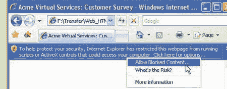

然后，访客必须在出现的安全警告对话框中单击**是**。

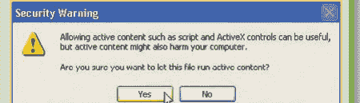

如果你的页面依赖JavaScript而浏览器未执行它，页面将无法正常工作。考虑警告用户，他们需要启用JavaScript才能成功查看你的页面。或者，提供一个不使用JavaScript的网站版本，以便用户无需启用它即可查看你的网站。

### 显示页面最后更新时间

你网站上的某些页面可能经常变更。如果它们确实变更，你可能希望向访客显示页面最后更新的时间，以便访客了解自上次访问以来页面是否包含新信息。虽然你可以将日期作为文本包含并在每次更改页面时手动更新它，但使用一个简短的脚本来插入页面最后修改的日期和时间——或者更准确地说，是最后保存到Web服务器的时间——要容易得多。

以下示例使用`document.lastModified`语句提供页面保存的日期和时间，并使用`document.write`语句在前面添加说明文本，在末尾添加句点：

```html
<script type="text/JavaScript">
    document.write("This page was last modified on ")
    document.write(document.lastModified)
    document.write(".")
</script>
```


> **注意**
>
> `onload`和`onunload`事件被一些不道德的网站广泛用于显示包含大多数访客可能不会选择查看的内容的弹出窗口。由于这种用法，许多浏览器允许用户阻止显示此类自动生成的窗口。即使这些窗口未被阻止，也请避免使用它们，因为它们经常引起访客的负面反应。

### 将浏览器重定向到另一个页面

你可以使用JavaScript将浏览器重定向到另一个页面：

```html
<script type="text/JavaScript">
    window.location="http://www.acmevirtualindustries.com"
</script>
```

### 验证表单是否已填写

如果你创建表单，可能需要在允许访客提交表单之前，验证必填字段是否已填写。你可以使用脚本检查字段的内容。

以下示例展示了一个网页的代码（见图10-3），其中包含一个简短的脚本，对两个文本框执行基本验证，简单地确保两者都不为空。

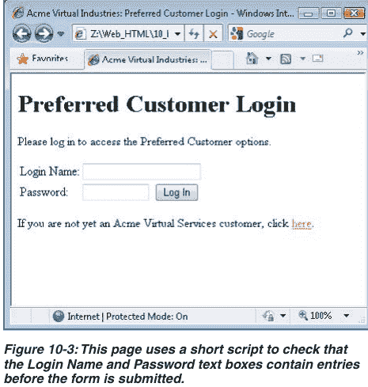

```xml
<?xml version="1.0" encoding="utf-8"?>
<!DOCTYPE html PUBLIC "-//W3C//DTD XHTML 1.0 Transitional//EN"
 "http://www.w3.org/TR/xhtml1/DTD/xhtml1-transitional.dtd">
<html xmlns="http://www.w3.org/1999/xhtml" xml:lang="en"
lang="en">
<head>
    <meta http-equiv="content-type" content="text/html; charset=utf-8" />
    <title>Acme Virtual Industries: Preferred Customer Login</title>
    <script type="text/javascript" language="JavaScript">
    function verify(loginform)
    {if (loginform.login.value=='')
        {alert('Enter your login name.'); return false;}
    if (loginform.password.value=='')
        {alert('Enter your password.'); return false;}
    return true}
    </script>
</head>
<body>
<h1>Preferred Customer Login</h1>
<p>Please log in to access the Preferred
```

# 提示

你也可以使用`document.write`语句在网页中显示其他信息。例如，`document.write(document.title)`语句显示页面的标题，`document.write(location.href)`语句显示当前网页的文件名，`document.write(document.referrer)`语句显示将浏览器引导到当前网页的来源网页名称。

```html
Customer options.

<form method="post" action="login.cgi"
      onsubmit="return verify(this);">

<table border="0">
  <tr>
    <td>Login Name:</td>
    <td colspan="2"><input type="text"
        name="login" size="20"/></td>
  </tr>
  <tr>
    <td>Password:</td>
    <td><input type="password" name="password"
        size="10"/></td>
    <td><input type="submit" value="Log In"/></td>
  </tr>
</table>
</form>

<p>If you are not yet an Acme Virtual Services customer,
   click <a href="new_cust.html">here</a>.</p>

</body>
</html>
```


# 注意

你也可以通过使用`http-equiv`元标签来重定向浏览器，正如第1章所讨论的。元标签的优点是不会触发脚本警告；然而，一些浏览器允许你阻止元刷新，这会阻止此类重定向工作。如果你使用元标签来重定向浏览器，请在重定向页面中提供解释，说明浏览器将被发送到何处，并提供一个链接，以便在元刷新被禁用时访问者可以手动点击。

表单本身包含两个文本框（`input type="text"`），一个名为`login`，另一个名为`password`，以及一个带有“Log In”文本的提交按钮。`<form>`标签中的`onsubmit`事件指定了当表单被提交时（换句话说，当访问者点击“Log In”按钮时），脚本返回当前对象（`onsubmit="return verify(this);"`）的名为`verify`的函数的值。

文档头部中`<script>`和`</script>`标签内的代码执行以下操作：

- 声明使用的脚本语言是 JavaScript。
- 声明一个名为`verify`的函数，并指定其操作的对象是`loginform`。
- 将表单`loginform`上名为`login`的文本框的`value`（内容）（`loginform.login.value`）与空字符串（`''`）进行比较。如果匹配，`alert`语句将显示一个消息框，告知访问者问题所在，并返回值`false`，阻止表单被提交。
- 将名为`password`的文本框的值（内容）（`loginform.password.value`）与空字符串（`''`）进行比较。如果匹配，`alert`语句将显示一个消息框（如图所示），告知访问者问题所在，并再次返回值`false`，阻止表单被提交。

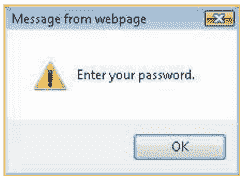

如果登录文本框和密码文本框都包含文本，该函数将返回值`true`，从而允许表单被提交。

# 索引

- `&nbsp;`代码，49
- `&shy;`代码，49
- 垂直对齐，113
- 空白，48

## CSS

- 对齐、居中或调整文本，148
- 控制字体格式，146–148
- 内嵌样式表，139
- 外部样式表，136，138，140–142
- 浮动布局，151–157
- 格式化元素的第一个字母，145
- 格式化元素的第一行，146
- 缩进，148
- 内部样式表，136
- 行高，149–150
- 将多个样式表链接到网页，142
- 边距，149
- 覆盖样式表，146，155–157
- 概述，136–138
- 防止背景图形被平铺或滚动，150–151
- 选择器，138，142–145
- 样式层叠，137
- 样式规则，138–139
- 版本，140
- 自定义上传，41
- Cyberduck，42

## A

- 绝对链接，82，83
- Adobe Dreamweaver，17
- 对齐元素，56
  - 图形，70
  - 表格、行和单元格，110–113
  - 文本，148
- 替代文本，68–69，129
  - 添加到框架页面，127
- 锚点元素，83，84
- Apache，33
- Arachnophilia，16
- 非对称互联网连接，33
- 属性
  - `action`，185
  - `align`，48，56，110–113，148
  - `alt`，15
  - `bgcolor`，115，116
  - `cellpadding`，109–110
  - `cellspacing`，109–110
  - `class`，143
  - `color`，61
  - `colspan`，114
  - `content`，20
  - `href`，17，84
  - `id`，142–143
  - `maxlength`，187
  - `method`，185，186
  - `name`，20，133，185–186
  - `noresize`，129
  - `nowrap`，108
  - `rowspan`，114
  - `rules`，105
  - `scrolling`，129
  - `size`，61
  - `style`，62，63，64，66

## 音频

- 传递方式，94–95
- 格式，94
- 下载链接，95
- 播放链接，95–96
- 流媒体，33

## B

- 背景颜色，64–65
- 闪烁文本，64
- 博客服务，37
- 主体，8
- 粗体，58
- 边框，64，65–66
  - 应用到图形，72
  - 框架，127–128
  - 表格，101，103–105
- 换行，48
- 浏览器
  - 使用其他浏览器检查网页，23–26，40
  - 在浏览器中覆盖样式表，155–157
- 项目符号列表，50，51–52

## C

- 层叠样式表。*参见*CSS
- HTML标签中的大小写敏感性，5
- 客户端。*参见*Web客户端
- 剪贴画图形，69
- 颜色，40
  - 背景颜色，64–65
  - 文本颜色，61
- 注释，13
- 压缩，74，79
- 连接速度，32–33
- 版权，69

## D

- 定义列表，50，53–54
- 抖动，40
- 分区，48
  - 用作选择器，144–145
- DNS，34
- DOCTYPE声明，添加到网页，6–7
- 文档头。*参见*头部
- 记录你的网站，4
- 域名服务。*参见*DNS
- 域名
  - 获取你自己的域名，32
  - 注册，34–36
- 域名系统。*参见*DNS
- 电子邮件
  - 创建一个将内容通过电子邮件发送给你的表单，194–195
  - 创建指向电子邮件地址的超链接，172
  - 创建电子邮件按钮，90–91
  - 创建发送电子邮件的链接，88–91
  - 签名，76–79
- 在网页中嵌入视频，96
- 强调。*参见*斜体
- eNom，35

## Excel

- 从Excel工作簿创建网页，178–180
- “常规”选项卡选项，160–161
- 外联网，31

## 格式

- 对齐元素，56
- 基本结构，47
- 粗体，58
- 边框，64
- 换行，48
- 分区，48
- 字体，60–61
- 标题，49–50
- 连字符，49
- 内联样式，62–66
- 斜体，58
- 键盘文本，60
- 行间距，63
- 列表，50–55
- 不间断空格，49，50
- 上划线，63
- 段落，47
- 预格式化文本，57
- 示例文本，60
- 更小或更大的文本，60
- 删除线，59，63
- 下标和上标，59
- 下划线，58，63
- 可变文本，60

## 表单

- 添加多行文本框，187–188
- 添加单行文本框，186–187
- 复选框，189–190
- 命令按钮，191–192
- 填写，192–193
- 创建一个将内容通过电子邮件发送给你的表单，194–195
- 下拉列表，188–189
- 允许访问者上传文件，193
- 选项按钮，190–191
- 结构，184–186
- 验证表单是否已填写，198–200

## 框架

- 添加替代文本，127，129
- 边框，127–128
- 创建组件文档，123
- 使用行和列创建，126
- 使用列创建，125
- 使用行创建，124–125
- 定义高度和宽度，121–122
- 内联，130–133
- 更改框架内容的链接，133
- 边距，129
- 规划使用框架的网页，121
- 防止访问者调整大小，129
- 滚动，129

## 框架集

- 添加组件文档，126–127
- 创建框架集文档，123–124
- 嵌套，130

- FTP，41
- FTP客户端，41
  - 使用其传输网站，42–43
- 文件扩展名，19
- 文件格式，176–177
- 文件传输协议。*参见*FTP
- FileZilla，42

## Firefox

- 在其中使用默认字体和颜色，156–157

## 浮动布局

- 使用`clear`属性防止，155–157
- 三列，154–155
- 两列，152–154

## 文件夹

- 创建，4–5
- 我的网站，5
- 按文件夹分隔内容，4

## 字体

- 颜色，61
- 格式，60–61，64
- 等宽字体，59
- 字体大小，60–61
- *另请参见*格式

- GIF文件，75
- Go Daddy，35

## 图形

- 添加标题，72
- 对齐，70
- 替代文本，68–69
- 应用边框，72
- 背景图形，74，76
- 更改大小，70–71
- 创建或获取，68–69
- 在电子邮件签名中，76–79
- 图像映射，91–93
- 插入，68
- 减小文件大小以加快页面加载速度，79
- 定位，69
- 长描述URL，70
- 使用间隔器定位，73
- 防止背景图形被平铺或滚动，150–151
- 使用以控制文本外观，72

## H

- 头部，8
- 标题，49–50
  - 添加到网页，10–11
- 隐藏元素，66
- 水平线，75–76
- `.htm`，19
- `.html`，19

## HTML

- 定义，2
- 使用哪个版本，4
- HTML 5，定义，3
- HTML编辑器，16
- HTTP，27
- 超链接
  - 在Word中创建，168–173
  - 创建链接文件，18–19
  - 指向电子邮件地址，172
  - 指向现有文件或网页，169–170
  - 指向新文档，171–172
  - 指向当前文档中的特定位置，170
  - *另请参见*链接
- 连字符，可选，49

## I

- 图像映射，91–93
- 图像
  - 向网页添加图片，14–15
  - 调整大小，15
- 缩进，48，55–56，148
  - 首行缩进，62
- 内联框架，130–133
- 互联网，定义，27
- Internet Explorer，23–26
  - 在其中应用样式表，155–156
- Internet信息服务（IIS），33
- 内联网，31，164
- IP地址，29
- IPv4，28，29
- IPv6，28–29
- ISO，165
- 互联网服务提供商，评估，34
- 斜体，58

## J

- JavaScript，197
  - 重定向到另一个页面，198
  - *另请参见*脚本
- JPEG文件，75

## K

- 键盘快捷键
  - 分配给链接，86
  - 用于保存网页，11
- Komodo Edit，16
- KompoZer，17

## L

- 换行，12–13
- 行间距，63
- 链接文件，创建，18–19

## 链接

- 绝对链接，82，83
- 更改制表顺序，86–87
- 在图形中创建多个链接，91–93
- 显示屏幕提示，87–88
- 用于下载文件，86–87
- 用于下载音频或视频文件，95
- 图形链接，82–84
- `mailto`，90
- 在新窗口中打开，86
- 指向网页上的特定点，85–86
- 用于播放音频或视频文件，95–96
- 相对链接，82–83
- 用于发送电子邮件，88–91
- 文本链接，82
- 网页内链接，84–85
- *另请参见*超链接

## 列表

- 项目符号列表，50，51–52
- 定义列表，50，53–54
- 嵌套列表，54–55
- 有序列表，50，52–53
- 逻辑样式标签，58
- 有损和无损压缩，74

## M

- 边距，149
- 标记标签。*参见*标签
- 标记验证服务，22–23，24
- 元标签
  - 重定向到另一个页面，21–22，199
  - 自动重新加载页面，20–21
- Microsoft Expression Web，17
- Microsoft Office，160
  - *另请参见*Office应用程序
- Microsoft Word。*参见*Word
- 等宽字体，46–47，59
- 移动文本，65–66
- 我的网站文件夹，5

## N

- 命名约定，4
- 导航，86–87
- 嵌套框架集，130
- 嵌套列表，54–55
- 嵌套表格，115–116
- Network Solutions，35
- 不间断空格，49，50

## 记事本

- 打开，5
- 一次打开两个或多个文件，18
- 将记事本固定到“开始”菜单，6

- 编号列表，50，52–53
- 预览网页，166，173，174
- 属性
  - 字体，146–148
  - 行高，63，149–150
  - 外边距，149
  - 文本对齐，148
  - 文本转换，63
  - 可见性，66
- SEO。*参见*搜索引擎优化
- 服务器。*参见*Web服务器
- 购物车，33
- 单文件网页格式，176
- 软连字符，49
- 查看源代码，13
- 特殊字符，49
- 流式传输，33
- 删除线，59，63
- 强调文本。*参见*粗体
- 下标和上标，59
- 系统标识符，6

## O

- Office应用程序
- 比例字体，46–47
- 协议，41
- 伪元素，145–146
- 公共标识符，6

## R

- 重定向到另一个页面，21–22，198
- 表格
  - 自动刷新页面，20–21
  - 添加行和列，103
  - 对齐，110–113
  - 应用背景颜色，115
  - 边框，101，103–105
  - 数据表格，98
  - 按行和列分组单元格，105–108
  - 布局表格，98
  - 嵌套，115–116
  - 概述，97–98
  - 内边距和间距，109–110
  - 规划，98
  - 设置表格和单元格高度，109
  - 设置表格和单元格宽度，108–109
  - 单元格跨列或跨行，114–115
  - 结构，98–102
  - 垂直分隔线，117
- Register.com，35
- 相对尺寸，122
- 自动重新加载页面，20–21
- `robots`元标签，20
- 往返传输，161
- 规则，75–76，105，117

## S

- Safari，23–26
- 在其中应用样式表，157
- 段落，47
- 屏幕分辨率，40，164
- 标签，6，49，59
- 链接的屏幕提示，87–88
- 添加到网页，11–12
- `<!-- -->`，13
- 脚本，195
- Parallels Desktop，25
- `<a>`，17
- 重定向到另一个页面，198
- PC模拟程序，25
- `<b>`，58
- 显示页面最后更新时间，197
- 物理样式标签，58
- `<basefont>`，61
- 威胁，197
- PNG文件，74
- `<big>`，59，60
- 用户事件，195–197
- PowerPoint
  - `<blockquote>`，56
  - 验证表单是否已填写，198–200
- 从PowerPoint演示文稿创建网页，181–182
- `<body>`，8
- 防止滚动，150–151
- “常规”选项卡选项，161–162
- `<br/>`，12–13，48
- 搜索引擎优化，21
- 搜索引擎，21
- 自闭合标签，12
- `<colgroup>`，107
- `<dd>`，53–54
- `<div>`，48，144–145
- `<dl>`，53–54
- `<em>`，58
- `<font>`，60
- `<form>`，185
- `<frameset>`，124，125，126
- `<h1>`，10，49–50
- `<head>`，8
- `<hr/>`，75–76
- `<HTML>`，7–8
- `<i>`，58
- ``，14–15
- `<kbd>`，60
- `<li>`，51–52
- `<marquee>`，65–66
- `<nobr>`，48
- `<ol>`，52–53
- `<p>`，11–12，47
- `<pre>`，57，59
- `<samp>`，60
- `<script>`，195
- `<small>`，60
- `<span>`，144
- `<strike>`，59
- `<strong>`，58
- `<sub>`，59
- `<sup>`，59
- `<table>`，98–102
- `<tbody>`，106
- `<td>`，100
- `<tfoot>`，106
- `<title>`，9
- `<tr>`，100
- `<tt>`，59，60
- `<u>`，58
- `<ul>`，51–52
- `<var>`，60
- 区分大小写，5
- `iframe`，131–133
- `img`，68
- `meta`标签，20
- 嵌套，59
- 自闭合，12
- TCP/IP，27
- 文本
  - 闪烁，64
  - 大小写，63
  - 缩进，48，55–56，62
  - 行间距，63
  - 移动，65–66
  - 预格式化，57
  - *另请参见*格式设置
- 文本链接，82
- 添加到网页的文本段落，11–12
- 平铺，防止，150–151
- 标题，9，11
- 流量，31–32
- 垂直分隔线，117
- 视频
  - 交付方式，94–95
  - 嵌入网页，96
  - 格式，94
  - 下载链接，95
  - 播放链接，95–96
  - 流式传输，33
- “查看源代码”命令，13
- VirtualBox，25
- VMWare Fusion，25

## T

- 重定向到另一个页面，21–22，198

## W

- W3标记验证服务，22–23，24
- Web，27
- Web浏览器
  - 使用其他浏览器检查网页，23–26，40
  - 在浏览器中覆盖样式表，155–157
- Web客户端，28
- Web主机
  - 空间容量，31
  - 流量容量，31–32
  - 评估需求，30
  - 音频和视频流媒体，33
  - 选择服务，31
  - 评估，34
  - Internet连接速度和正常运行时间，32–33
  - 账户数量，32
  - 购物车和安全服务器，33
  - 对Web工具的支持，33
  - 你自己的域名，32
- 筛选的网页格式，177
- 网页格式，176
- 网页
  - 访问，29–30
  - 添加头部和主体标签，8
  - 添加<HTML>标签，7–8
  - 使用其他浏览器检查，23–26
  - 注释，13
  - 从Excel工作簿创建，178–180
  - 使用meta标签描述页面，20
  - 格式设置，14
  - 标题，10–11
  - 图像，14–15
  - 保持足够小以便快速下载，39
  - 布局，77
  - 换行，12–13
  - 链接到页面上的特定点，85–86
  - 页面内链接，84–85
  - 自动重新加载，20–21
  - 保存，9，11
  - 结构，6–8，47
  - 文本段落，11–12
  - 标题，9
  - 查看，9–10
  - 查看源代码，13
- Web服务器，28，33
  - 安全服务器，33
- Web创作应用程序，16–17，37
  - 内置FTP，41
- 网站，28
  - 在其他浏览器上检查，40
  - 提高有效性，37–39
  - 规划内容，36–37
  - 传输到Web，41–43
  - 更新和维护，40–41
- Windows Vista
  - Business Edition，33
  - FTP客户端，41
  - Ultimate Edition，33
- Word
  - 创建HTML元素，178
  - 创建超链接，168–173
  - 从Word文档中删除Office特定标签，177–178
  - 从文档中删除敏感信息，173–175
  - 将文档另存为网页，166–167，175–177
  - 开始新的网页，166–167
  - “网页预览”命令，166，173，174
- 万维网。*参见*Web

## U

- 下划线，58，63
- Unicode，165
- 统一资源定位符。*参见*URL
- 无序列表。*参见*项目符号列表
- 更新，显示页面最后更新时间，197
- 上传，允许访客上传文件，193
- 正常运行时间，32–33
- URL，29–30
  - 在浏览器中输入，31
  - 长描述URL，70
- 用户事件，195–197
- UTF-8，165

## V

- 验证HTML，W3标记验证服务，22–23，24
- 版本
  - HTML 5，3
  - 使用哪个HTML版本，4
- XHTML，定义，3
- XHTML 5，3
- XML，定义，3
