# HTML5 与 CSS 综合指南 - 第七版：Shelly Cashman 系列


## 全局函数

APP 72

# 前言

Shelly Cashman 系列® 提供计算机教育领域最优质的教材。我们很高兴之前出版的 HTML 书籍能受到如此广泛的欢迎。基于教师和学生的反馈，我们对 HTML 书籍的每一个新版本都进行了重大改进。《HTML5 与 CSS（第七版）》延续了您对 Shelly Cashman 系列所期待的创新、质量和可靠性。

本书的 Shelly Cashman 系列开发团队仔细审查了其教学法，并分析了其在当今学生教学中的有效性。当今的学生阅读较少，但需要记住更多。他们不仅需要能够执行技能，还需要记住这些技能，并知道如何将其应用于不同的环境。当今的学生需要被持续吸引和挑战，以保留他们所学的内容。

通过这本 HTML 书籍，我们继续致力于关注用户及其最佳学习方式。

**本教材的目标**

《HTML5 与 CSS：综合教程（第七版）》适用于三个学分单元的课程，全面深入地介绍 HTML 和基本的 Web 设计技术。无需 Web 页面开发或计算机编程经验。本书的具体目标如下：

-   教授使用全面的 Web 开发生命周期开发 Web 页面的基础知识
-   让学生熟悉 HTML 和 CSS 语言，并创建适合课程作业、专业用途和个人使用的 Web 页面
-   让学生了解常见的 Web 页面格式和功能
-   促进对万维网资源的好奇心和独立探索
-   培养以练习为导向的方法，允许学生通过示例学习
-   鼓励自主学习，并帮助在远程教育环境中学习如何创建 Web 页面的人
-   让学生熟悉 XHTML 指南
-   说明如何使用 JavaScript 和文档对象模型（DOM）创建动态 Web 页面并添加功能
-   展示 XML 的优势

# Shelly Cashman 教学法

**经过验证的教学法，强调项目规划**
每章都在项目规划框架内呈现一个需要解决的实际问题。通过使用“预先规划”框，项目导向性得到加强，这些框鼓励对项目中各个步骤如何进行进行批判性思考。带有支持性屏幕的分步指导引导学生完成各个步骤。教学步骤得到“问与答”、“实验步骤”和“顺便说一下”等特色功能的支持。

**视觉上引人入胜的书籍，保持学生的兴趣**
分步任务，配合支持性图形，为学生提供丰富的视觉体验。屏幕上提供的解说性和导航信息，让学生在需要时获得所需信息。

**支持性参考材料（附录）**
附录提供了关于 HTML5 和 CSS 主题的更多信息，包括 HTML 快速参考、浏览器安全色板、Web 无障碍标准、CSS 属性和值，以及将 Web 页面发布到 Web 服务器等附录。

**集成万维网**
万维网通过 (1) “顺便说一下”注释；以及 (2) 每章的“在线学习”部分，融入到 HTML5 和 CSS 的学习体验中。

**章末学生活动**
丰富的章末活动为学生提供了各种巩固和拓展技能的机会，学生可以通过个人和小组工作来应用和扩展他们的技能。

# 在线配套

在线配套包括每章的“在线学习”练习，以及“@Source”链接、“轮到你了”链接和“问与答”。要访问这些课程材料，请访问 www.cengagebrain.com。在 CengageBrain.com 主页上，使用页面顶部的搜索框搜索“HTML5 and CSS 7th Edition”。这将带您进入本书的产品页面。在产品页面上，单击“学习工具”标题下的“立即访问”按钮。

# 教师资源

教师资源包括教学和测试辅助工具，可通过 CD-ROM 或 login.cengage.com 访问。

**教师手册** 包括总结每章章节、图形和框内元素的讲义笔记、教师提示、课堂活动、实验活动以及 Microsoft Word 文件中的快速测验。

**教学大纲** 易于自定义的样本教学大纲，涵盖政策、作业、考试和其他课程信息。

**图形文件** 教材中每个图形的电子形式插图。

**PowerPoint 演示文稿** 多媒体讲授演示系统，提供每章的幻灯片。演示文稿基于章节目标。

**练习答案** 包含所有章末练习和章节巩固练习的答案。

**试题库与测试引擎** 试题库包括每章 112 道问题，以基于目标和批判性思维的题型为特色，并包含页码参考。还包括测试引擎 ExamView，它是满足您基于目标的测试需求的终极工具。

版权 2012 Cengage Learning。保留所有权利。未经许可，不得以任何形式或任何方式复制、扫描或复制。由于电子权利，电子书和/或电子章节中可能省略了某些第三方内容。编辑审查认为，任何省略的内容不会对整体学习体验产生重大影响。Cengage Learning 保留随时删除额外内容的权利，如果后续权利限制要求这样做。

**学生数据文件** 包括学生完成练习所需的所有文件。

**学生附加活动** 由章节巩固练习组成，包括判断题、选择题和简答题，帮助学生增强对所学材料的信心。

# SAM：技能评估管理器

SAM 2010 旨在帮助学生从课堂走向现实世界。它允许学生在积极、动手操作的环境中训练和测试重要的计算机技能。SAM 易于使用的系统包括针对最常用 Microsoft Office 应用程序的强大交互式考试、培训和项目。SAM 模拟 Microsoft Office 2010 应用程序环境，允许学生通过执行实际任务（如将文本加粗或设置幻灯片切换）来展示他们的知识和思考技能。加上实际应用中的项目，学生就能真正学习并将技能应用于以业务为中心的文档。SAM 专为与 Shelly Cashman 系列配合使用而设计，包括方便的页码参考，以便学生可以打印与课堂上使用的 Shelly Cashman 教材相匹配的有用学习指南。对于教师，SAM 还包括强大的调度和报告功能。

# 在线学习内容

Course Technology 与当今领先的远程学习解决方案提供商和课堂管理平台合作。教师可以通过密码保护的教师资源访问这些材料，网址为 login.cengage.com。教师资源包括：额外的案例项目、样本教学大纲、每章的 PowerPoint 演示文稿等。如需更多信息或教师用户名和密码，请联系您的销售代表。学生要访问这些材料，必须购买特定于本书名和您所在校园平台的 WebTutor PIN 码。学生资源可能包括（取决于教师的偏好），但不限于：主题复习、复习题和练习测试。

# CourseNotes

Course Technology 的 CourseNotes 是六折页快速参考卡，以直观且用户友好的格式强化软件应用程序最重要的概念和功能。CourseNotes 在课程期间和之后都是学生极佳的参考工具。CourseNotes 适用于 Adobe Dreamweaver CS5、Web 2.0: Recharged、Buyer’s Guide: Tips for Purchasing a New Computer、Best Practices in Social Networking、Hot Topics in Technology 等更多主题。访问 **www.cengagebrain.com** 了解更多信息！


# 导览之旅

通过"导览之旅"产品线，为您的课堂增添趣味与互动性。播放其中一部简短的迷你影片，为您的讲座增色并激发课堂讨论。或者，将一部影片作为家庭作业布置，并让学生完成每个主题附带的相关作业。"导览之旅"产品线省去了您为学生提供新技术和软件应用信息的准备工作，并有助于让学生专注于与其生活相关的内容；所有这些都能在一小时内完成！

## 关于我们的封面

Shelly Cashman系列持续更新我们的方法和内容，以反映当今学生的学习方式和体验新技术的方式。这种对学生成功的关注体现在我们的封面上，封面展示了布莱恩特大学的学生在课程中使用Shelly Cashman系列的真实场景，并反映了学习我们书籍的学生的多样年龄和背景。当您使用Shelly Cashman系列时，您可以确信您正在使用最有效的课件学习计算机技能。

## 教科书导览

Shelly Cashman系列教学法：基于项目——逐步指导——多样化评估

### "提前规划"框通过鼓励学生在开始工作前就其要实现的目标进行战略性思考，为他们成功创建项目做好准备。

> **提前规划**
> **通用项目指南**
> 创建网页时，您执行的操作和做出的决定将影响最终页面的外观和特征。当您创建网页时，例如上一页图2-1所示的项目，您应遵循以下通用指南：
>
> 1. 完成网页规划。在开发网页之前，您必须了解网站的目的，确定网站的用户及其计算环境，并决定谁拥有网页上的信息。
>
> 2. 分析网页的需求。在Web开发生命周期的分析阶段，您应分析网页上应包含哪些内容。在此阶段，您将确定网页的结构。有关Web开发生命周期各阶段的信息，请参阅第1章的"HTML 15：网页开发生命周期"部分。
>
> 3. 选择网页的内容。一旦完成分析，您需要确定网页上应包含哪些内容。遵循"少即是多"的原则。文本越少，网页被阅读的可能性就越大。用尽可能少的词语表达观点。
>
> 4. 确定您将用于此网页的文件命名约定。在开始创建和保存文件之前，您应决定一个标准的文件命名方式。您应该使用.htm扩展名吗？如上一章所述，当主机Web服务器只允许短文件名时，应使用该扩展名。当主机Web服务器允许长文件名时，使用.html。您应该给文件取什么名字来指示文件的内容或目的？例如，将网页命名为page1.html并不能描述该网页是什么；一个更具描述性的名称有助于网站的开发。
>
> 5. 确定保存网页的位置。您可以将网页永久存储，或将其保存到永久或临时存储介质，包括硬盘、USB闪存盘、CD或DVD。您的讲师或您为其开发网页的公司可能有特定的存储介质要求。
>
> 6. 确定存储设备上使用的文件夹结构。一旦确定了使用的存储介质，您还应确定保存网页的文件夹位置、结构和名称。这应在开始保存任何文件之前完成。

### 逐步指导现在提供了超越点击操作的背景信息。每个步骤都提供了学生为何执行每项任务，或者执行后会发生什么的信息。

**保存HTML文件**

在创建此项目的过程中，您已输入了大量文本，并且不想冒丢失已完成工作的风险。此外，要在浏览器中查看HTML，您必须保存文件。以下步骤展示了如何保存HTML文件。

1. 将USB闪存盘连接到计算机的某个USB端口，单击Notepad++菜单栏上的"文件"（图2-17）。
2. 单击"文件"菜单上的"另存为"以显示"另存为"对话框（图2-18）。

**问答**
我必须保存到USB闪存盘吗？
不。您可以保存到任何设备或文件夹。文件夹是存储介质上的特定位置。使用相同的过程，但选择您的设备或文件夹。

格式化网页的各种元素。网页的整体外观影响其清晰传达信息的能力。您格式化或格式化网页的示例包括添加图像、颜色或水平线。

**图形图像。**引人注目的图形图像有助于传达网页信息并增添视觉趣味。图形可用于展示产品、优点，或直观地传达不易用文字表达的信息。

**定位和格式化图形图像。**图形图像的位置和格式应吸引观众的注意力，并将他们吸引到网页。

**合规性。**Web开发的一个重要部分是您的网页遵循标准。万维网有一个在线验证器，允许您测试您的网页并查找任何错误。

**本章将详细阐述上述指南的更多具体细节。本章还将说明在创建所示网页过程中，针对这些指南执行的操作。**

HTML 74 HTML 第2章 使用内联样式创建和编辑网页

1. 单击浏览器中的地址栏以突出显示当前URL。
2. 键入validator.w3.org以替换当前条目，然后按ENTER键。
3. 如有必要，如果浏览器要求打开新窗口，请单击"确定"。
4. 单击"通过文件上传验证"选项卡（图2-37）。

1. 单击"浏览"按钮。
2. 在您的存储设备上找到rockclimbing.html文件，然后单击该文件名。
3. 单击"打开"按钮。在"选择要上传的文件"对话框中，文件路径和名称将插入到"文件"框中，如图2-38所示。

HTML 76 HTML 第2章 使用内联样式创建和编辑网页

**查看网页的HTML源代码**

源代码是用于创建网页或程序的代码或指令。对于网页，源代码是HTML代码，然后由浏览器翻译成图形化的网页。您可以从浏览器中查看任何网页的HTML源代码。此功能允许您检查自己的HTML源代码，以及查看其他开发人员用于创建其网页的HTML代码。如果网页上的某个功能适合或吸引您的网页，您可以查看源代码以了解添加该功能所需的HTML，然后可以调整HTML代码以用于您自己的网页。您可以使用浏览器查看大多数网页的源代码。以下步骤展示了如何使用浏览器查看您网页的HTML源代码。

1. 使用浏览器上的"后退"按钮返回到网页。
2. 单击命令栏上的"页面"。如果您的命令栏未显示，请右键单击标题栏，单击"命令栏"，然后单击"页面"。
3. 单击"查看源文件"以在默认文本编辑器中查看HTML代码（图2-40）。

问答框提供学生在操作步骤时可能遇到的问题，并在他们需要时提供有关其操作的额外信息。

红色的导航提示框向学生显示单击位置。解释性提示框总结屏幕上正在发生的事情。


HTML 72 HTML第2章 使用内联样式创建和编辑网页

## 在浏览器中刷新视图

在 Notepad++ 中继续开发 HTML 文件时，在修改过程中通过浏览器查看文件是个好习惯。在浏览器中查看修改后的网页时点击刷新按钮，可以确保显示网页的最新版本。以下步骤展示了如何在浏览器中刷新网页视图，以便查看修改后的网页。

1.  点击任务栏上的 Internet Explorer 按钮，显示 rockclimbing.html 网页。点击地址栏上的刷新按钮，显示修改后的网页（图2–35）。

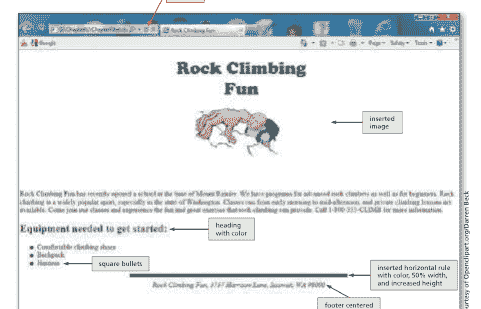

图2–35

许多步骤序列之后附带的“其他方法”框解释了完成所呈现任务的其他方式。

**B T W**

HTML 与 HTML5 标签 网络上有很多学习 HTML 标签的优秀资源。要获取更多关于 HTML 和 HTML5 的信息，请在搜索引擎中搜索“HTML 标签”或“HTML5 标签”。

## 验证和查看 HTML5

在第1章中，你了解了验证 HTML 代码。要获取网络上可用的最新版本软件，以确保你的网页没有错误，请访问网页验证（无错误）页面。这应始终是你网页开发过程的一部分。要验证一个网页，请使用万维网联盟（W3C）验证器的“网页文档标记有效性”打开文档。验证器会查看你正在使用的 HTML 或 XHTML 类型，然后检查代码是否符合该版本。在本章中，项目使用 HTML5 版本。如果验证检测到你的 HTML 文件中有错误，验证器会在检查此文档为 HTML5 时指出发现的错误。图2–36a在下一页。结果行显示页面的错误，或点击“跳转到：验证”向下滚动页面，或点击“跳转到：验证”查看每个错误。需要注意的是，一个错误可能导致多个错误消息。图2–36b显示在这种情况下，一个初始错误导致了两个错误。rockclimbing.html 文件第19行的 `<h2>` 标签被用于第19行的 `<h2>` 标签内）导致了

6.  使用文件名 apply2-1solution.html 将修改后的 HTML 文件保存在 Chapter02\Apply 文件夹中。
7.  在 validator.w3.org 验证你的 HTML 代码。
8.  输入 g:\Chapter02\Apply\apply2-1solution.html（或你的数据文件存储路径）作为 URL，以便在浏览器中查看修改后的网页。
9.  打印该网页。
10. 按照你的老师指定的格式提交修改后的 HTML 文件和网页。

扩展你的知识 HTML 81

## 扩展你的知识

扩展你在本章中学到的技能，并尝试新技能。

### 创建定义列表

说明：启动 Notepad++。打开学生数据文件 Chapter02\Extend 文件夹中的文件 extend2-1.html。有关下载学生数据文件的说明，请参阅本书封底内页，或联系你的老师获取访问所需文件的信息。此示例网页包含该网页的所有文本。你将添加必要的标签，使其成为带有加粗术语的定义列表，如图2–45所示。

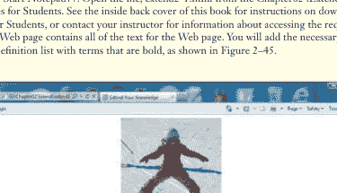

图2–45

执行以下任务：

1.  使用文件 extend2-1.html 中提供的文本，按照第 HTML 52 页表 2–6 所示的定义列表代码，修改 HTML 代码，将网页从单行文本更改为定义列表。

版权所有 2012 Cengage Learning。保留所有权利。不得以任何形式或任何方式（全部或部分）复制、扫描或复制。由于电子权利，某些第三方内容可能在电子书和/或电子章节中被删除。编辑审查认为任何被删除的内容不会对整体学习体验产生重大影响。Cengage Learning 保留随时删除额外内容的权利，如果后续权利限制要求。

每章末尾的扩展你的知识项目允许学生扩展和延伸在本章中学到的技能。学生运用批判性思维尝试新技能以完成每个项目。

## 教材演练

“使其正确”项目要求学生分析一个文件，发现其中的错误，并使用他们在本章中学到的技能进行修复。

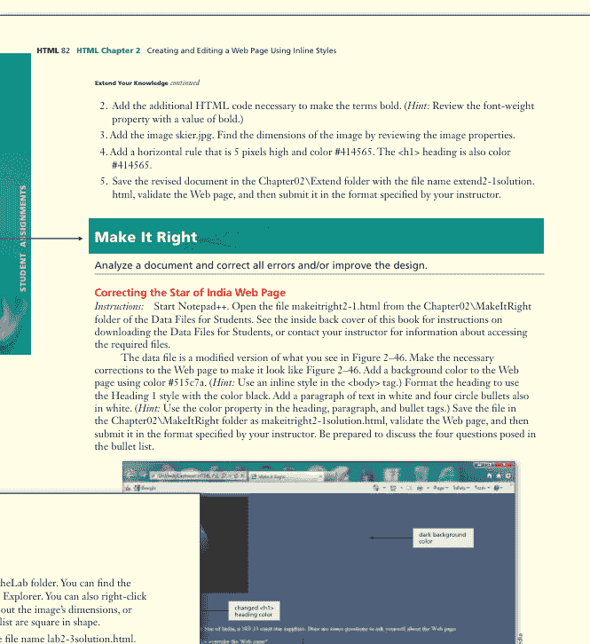

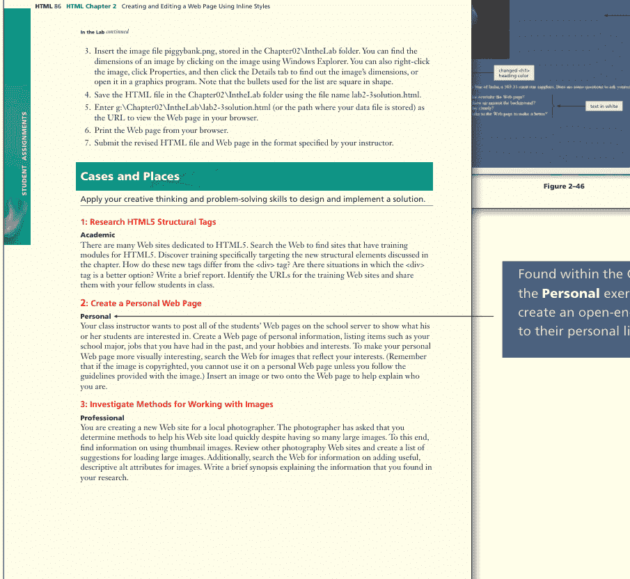

在“案例与场所”练习中的“个人”练习要求学生创建一个与其个人生活相关的开放式项目。

# HTML5 和 CSS

第七版

综合版

版权所有 2012 Cengage Learning。保留所有权利。不得以任何形式或任何方式（全部或部分）复制、扫描或复制。由于电子权利，某些第三方内容可能在电子书和/或电子章节中被删除。编辑审查认为任何被删除的内容不会对整体学习体验产生重大影响。Cengage Learning 保留随时删除额外内容的权利，如果后续权利限制要求。

# 1 HTML、XHTML 和 CSS 简介


## 学习目标

当你能够做到以下几点时，你将掌握本章中的材料：

- 描述互联网及其相关关键术语
- 描述万维网及其相关关键术语
- 描述网站的类型和目的
- 讨论网络浏览器并识别其用途
- 定义用于 Web 开发的超文本标记语言（HTML）和 HTML5 标准
- 讨论 Web 开发中层叠样式表（CSS）的使用
- 定义文档对象模型（DOM）并描述其与 HTML 的关系
- 定义可扩展超文本标记语言（XHTML）并描述其与 HTML 的关系
- 识别用于创建 HTML 文档的工具
- 描述 Web 开发生命周期的五个阶段
- 描述网站设计的不同方法和每种网站结构的目的
- 讨论在整个 Web 开发生命周期中测试的重要性
- 解释成为一个细心的 Web 用户的重要性

## 简介

在深入探讨使用 HTML5 和 CSS 创建网页的细节之前，了解一下这些技术与互联网和万维网发展的关系很有用。互联网始于计算机和计算机网络的连接。这种连接对我们的日常生活产生了巨大影响。今天，全球数百万人可以访问互联网，这是世界上最大的网络。数十亿网页，提供你可以想象的任何主题的信息，目前在万维网上可用。人们使用互联网搜索信息、与世界各地的其他人交流和寻求娱乐。学生通过这个计算机网络注册课程、支付学费和查询最终成绩。商店和个人使用计算机连接销售他们的产品，大多数行业依赖互联网和万维网进行商业交易。

超文本标记语言（HTML），以及最近的 HTML5 和层叠样式表（CSS）使得万维网得以存在。为了有效利用这些技术，你需要理解互联网和 HTML 背后的主要概念。在本章中，你将学习有关互联网、万维网、内联网和外联网的一些基础知识。你将了解网络浏览器、HTML 和相关关键术语的定义、Web 开发生命周期的五个阶段以及每个阶段涉及的任务。

## 什么是互联网？

今天，大多数人已经在学校、家中、工作场所或当地图书馆接触过互联网。**互联网**是一个全球性的计算机和计算机网络集合，它通过调制解调器、电话线、电视电缆、卫星链路、光纤连接以及其他通信设备和媒体，将数十亿台企业、政府、教育机构、组织和个人使用的计算机连接起来（图1–1）。

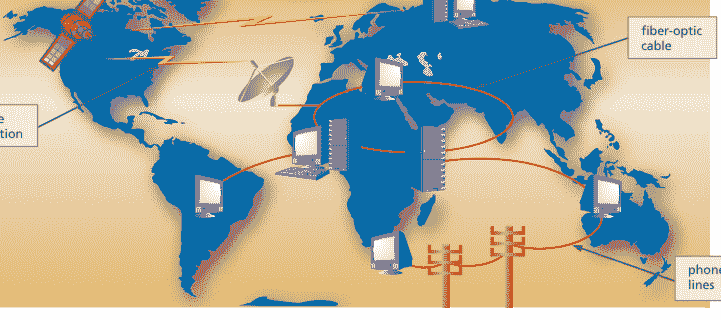


## 互联网与万维网

互联网由美国国防部高级研究计划局（ARPA）于20世纪60年代开发。ARPANET（互联网的最初名称）最初只有四个节点，并于1969年发送了第一条消息。如今的互联网拥有数百万个节点，分布于数千个网络中。**网络**是指两台或多台计算机连接在一起，以共享资源和信息的集合。如今，高速、中速和低速数据线路连接着各个网络。这些数据线路使得数据（包括文本、图形图像以及音频和视频数据）能够在不同计算机之间传输。**互联网骨干网**是连接全球主要计算机系统的高速数据线路集合。**互联网服务提供商（ISP）**是与互联网骨干网保持永久连接的公司。ISP利用高速或中速数据线路，使个人和公司能够连接到骨干网以访问互联网。家庭的互联网连接通常是连接到ISP的DSL或电缆数据线路。

在世界大多数国家，数百万人使用家庭、办公室、学校以及图书馆等公共场所的计算机连接到互联网。事实上，互联网被设计为一个人们可以共享信息或协作的平台。连接到互联网的用户可以访问各种服务，包括电子邮件、社交网络和万维网，在万维网上他们可以通过多种类型的网站找到各种信息（图1-2）。

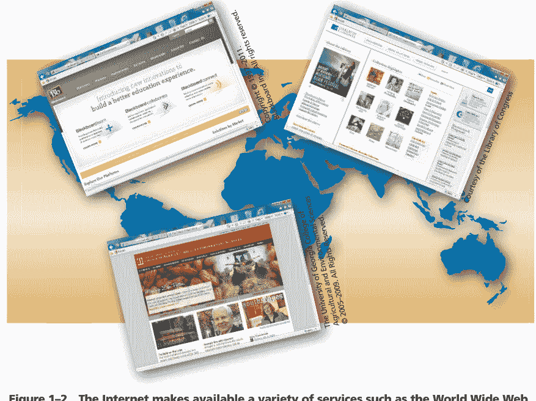

## 什么是万维网？

许多人将“互联网”和“万维网”这两个术语互换使用，但这并不准确。互联网是基础设施，是计算机的物理网络。**万维网**，也称为**网络**，是互联网中支持多媒体的部分，由一系列相互链接的文档集合组成。为了支持多媒体，万维网依赖于**超文本传输协议（HTTP）**，这是一组用于交换文本、图形、声音、视频和其他多媒体文件的规则。万维网上的链接文档或信息页面被称为**网页**。由于万维网支持文本、图形、声音和视频，因此网页可以包含任何这些多媒体元素。万维网处于不断变化之中，包含数十亿个网页。由于创建网页非常容易，新的网页一直在不断增加。

**网站**是由个人、公司、教育机构或其他组织创建和维护的相关网页集合。例如，如图1-3所示，许多组织，如美国劳工部，会发布和维护网站。每个网站都包含一个**主页**，这是用户访问网站时看到的第一个文档。主页通常用作网站上其他文档和文件的索引或目录。

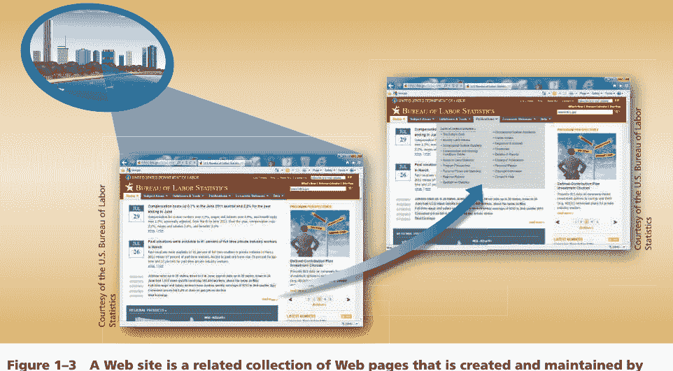

**图1-3** 网站是由个人、公司、教育机构或其他组织创建和维护的相关网页集合。

## Web服务器

网页存储在**Web服务器**或**主机**上，它是一台存储并发送（提供）所请求的网页和其他文件的计算机。任何安装了Web服务器软件并连接到互联网的计算机都可以充当Web服务器。每个网站都存储在一个或多个Web服务器上，并从中运行。一个大型网站可能分布在不同地理位置的多个服务器上。

为了使你开发的网页可供受众访问，你必须发布这些页面。**发布**是指将网页以及相关的图形和音频等文件复制到Web服务器上。一旦网页被发布，无论Web服务器位于何处，任何能够访问互联网的人都可以查看它。例如，尽管美国劳工部网站存储在美国某地的Web服务器上，但世界各地的任何人都可以查看它。一旦网页被发布，它几乎可以被任何计算机读取：无论你使用的是Mac、Windows还是Linux操作系统，配备何种计算机硬件，你都可以访问数十亿个已发布的网页。

## 网站类型与目的

网站一般分为三种类型：互联网网站、内联网和外联网。表1-1列出了这三种类型网站的特点。

**互联网网站**，也称为**网站**，是通常向公众开放的网站。个人、团体、公司和教育机构出于各种目的使用网站。内联网和外联网也使用互联网技术，但访问权限仅限于特定群体。

**内联网**是一个私有网络，它使用互联网技术在员工之间共享公司信息。内联网包含在公司或组织的网络内部，这使其具有私密性，仅供需要访问的人员使用。政策和流程手册通常可以在内联网上找到。其他文档，如员工名录、公司简报、产品目录和培训手册，也经常通过内联网分发。

**外联网**是一个私有网络，它使用互联网技术与精选的商业合作伙伴或关键客户共享业务信息。公司和组织可以使用外联网来共享产品手册、培训模块、库存状态和订单信息。外联网还可能允许零售商直接从其供应商处采购库存或在线支付账单。

公司使用网站在全球范围内宣传或销售其产品和服务，并为客户提供技术和产品支持。许多公司网站还支持**电子商务（电商）**，即在互联网上买卖商品和服务。利用电子商务技术，这些网站允许客户浏览产品目录、进行比价并在线订购产品。图1-4显示了Cengage.com，这是一家在线销售和分发教材相关材料的公司。许多公司网站还提供招聘信息和公告、常见问题解答（FAQ）部分、用于征求客户意见的客户反馈链接，以及可搜索的技术支持数据库。

### 内联网与外联网

有许多网站讨论内联网和外联网的创意。许多公司已经在使用这些技术，并分享他们的“最佳实践”技巧。许多网站提供建立和维护内联网或外联网的有价值信息，以及其他资源。

### 电子商务

如今，电子商务已成为商业活动的标准组成部分。然而，电子商务技术仍在不断发展，提供新的应用和潜在用途。

**表1-1 网站类型**

| 类型 | 用户 | 访问权限 | 应用 |
|---|---|---|---|
| 互联网网站 | 任何人 | 公开 | 用于与公众共享信息，如个人信息、产品目录、课程信息 |
| 内联网 | 员工或成员 | 私有 | 用于与员工或成员共享信息，如表格、手册、组织日程安排 |
| 外联网 | 精选的商业合作伙伴 | 私有 | 用于与商业合作伙伴和客户共享信息，如库存更新、产品规格、财务信息 |


**图1-4** Cengage.com是一个提供在线教育材料的网站。

学院、大学和其他学校使用网站来分发有关学习领域的信息、提供课程信息或为学生在线注册课程。教师使用他们的网站发布公告、发布阅读材料的问题、列出联系信息，并方便地提供讲义和幻灯片。如今，许多教师使用其所在学校采用的课程管理软件来上传课程内容。在大学内使用标准化的课程管理产品，使学生更容易找到与他们各种课程相关的信息。许多课程管理工具允许教师为课程编写自己的Web内容。在许多系统中，教师可以使用网页，在学校提供的课程管理工具的结构内为学生提供更多信息。除了通过网络与当前学生保持联系外，大学还为各种访问者提供各种网站功能，如图1-5所示。

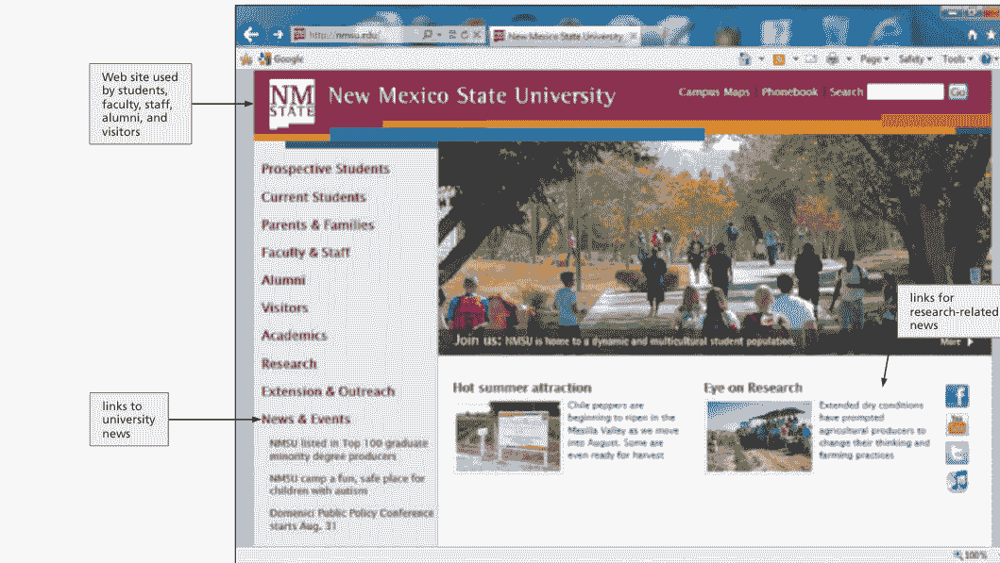

除了公司和教育机构使用互联网外，个人可能会创建包含其简历的个人网站，以便任何感兴趣的雇主都能轻松访问。家庭可以通过网站分享照片、视频和音频片段、故事、日程安排或其他信息（图1-6）。许多个人网站允许密码保护，这为信息共享提供了更安全的环境。


## 网页浏览器

要在任何类型的网站上显示网页，计算机需要安装一个网页浏览器。**网页浏览器**，也称为**浏览器**，是一种用于解释和显示网页，并允许您查看和与之交互的程序。当今流行的浏览器包括微软的Internet Explorer、Mozilla Firefox、Google Chrome和Apple Safari。浏览器提供了多种功能，包括定位网页、在网页间前后链接、收藏网页或添加书签，以及选择安全设置等功能。

要使用浏览器定位一个网页，您需要在浏览器的地址栏或位置栏中输入该网页的统一资源定位符（URL）。**统一资源定位符（URL）** 是可在互联网上访问的文档或其他文件的地址。Web上的URL示例如下：

```
http://www.cengagebrain.com/shop/index.html
```

该URL指示浏览器使用HTTP通信协议，在cengagebrain.com Web服务器的shop文件夹中定位index.html网页。网页URL可以在多种地方找到，包括学校目录、名片、产品包装和广告中。

超链接是万维网的一个基本组成部分。**超链接**，也称为**链接**，是一种用于将一个网页与同一服务器上的另一个网页或位于世界任何地方的不同Web服务器上的网页连接起来的元素。点击超链接允许您快速地从一个网页移动到另一个网页，而用户无需关心这些网页的存放位置。您也可以点击超链接移动到同一网页的不同部分。

有了超链接，网站用户不必以线性方式查看信息。相反，他或她可以点击可用的超链接以多种方式查看信息，正如本章后面所述。许多不同的网页元素，包括文本、图形和动画，都可以作为超链接。图1-7展示了几个用作超链接的不同网页元素的示例。


## 什么是超文本标记语言？

网页是使用**超文本标记语言（HTML）**创建的，HTML是一种用于为万维网创建文档的创作语言。HTML使用一组称为**标签**或**标记**的特殊指令来定义Web文档的结构和布局，并指定页面在浏览器中的显示方式。

网页是一个包含文本和HTML标签的文件。HTML标签标记文本，以定义其在浏览器中查看时应如何显示。HTML包含数百个用于格式化网页和创建到其他文档或网页的超链接的标签。例如，HTML标签`<p>`和`</p>`用于表示一个新段落，上方有一行空白，`<table>`和`</table>`用于表示表格的开始和结束，而`<hr />`用于在页面上显示一条水平线。图1-8a显示了创建图1-8b所示网页所需的HTML标签。您还可以通过使用属性来增强HTML标签，如图1-8a所示。**属性**定义HTML标签的附加特征，如字体粗细或样式。

HTML是**平台无关的**，这意味着您可以在一种类型的计算机上创建或编写HTML文件，然后使用另一种类型的计算机上的浏览器将该文件作为网页查看。无论您使用什么平台，页面看起来都是一样的。Web技术的最大好处之一是，同一个网页可以在许多不同类型的数字硬件上查看，包括智能手机等移动设备。

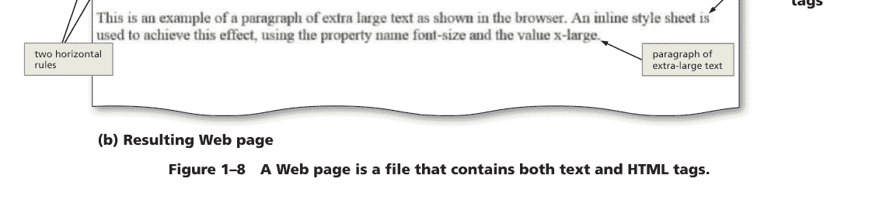

## HTML元素

HTML结合了标签和描述性属性，以定义文档在Web浏览器中应如何显示。HTML元素包括标题、段落、超链接、列表、图像等。HTML元素语法如下：

- HTML元素以**开始标签**/**开始标记**开头
- HTML元素以**结束标签**/**结束标记**结束
- **元素内容**是插入开始标签和结束标签之间的所有内容
- 一些HTML元素具有**空内容**（例如，`<br />`或`<hr />`）
- 空元素在**开始标签中关闭**（使用空格-/关闭，如`<br />`）
- 大多数HTML元素可以有**属性**

例如，要在网页上指定一段文本，您需要输入以下HTML代码：

```
<p>This is a paragraph of text.</p>
```

其中`<p>`是开始或开始标签，`</p>`是结束或结束标记，内容位于这些标签之间。表1-2展示了一些HTML元素的示例。

### 表1-2 HTML元素

| 元素 | 用途 | 代码和内容 |
| :--- | :--- | :--- |
| 标题 | 指示出现在浏览器标题栏上的标题 | `<title>This is the title text.</title>` |
| 锚点 | 创建一个指向名为default.html的网页的链接 | `<a href="default.html">This is text for a link.</a>` |
| 换行 | 在下一个元素前插入换行（没有空行）；没有内容或结束标签；使用空格-/作为结束标签 | `<br />` |

关于HTML元素，有许多信息来源。万维网联盟（w3.org）提供了最全面的标签和属性列表及其使用示例。W3C的主要目标之一是帮助网站建设者理解和利用使网络对所有人可访问的标准。

## 实用的HTML实践

创建HTML文件时，良好的编码实践是用空格和制表键分隔HTML代码的各个部分。在代码部分之间添加空格，无论是使用空行还是制表，都可以让您立即看到相互关联的代码部分，并帮助您更清晰地查看文档中的HTML元素。HTML浏览器会忽略HTML文档中标签之间的空格，因此代码中插入的空格和缩进不会出现在网页上。图1-9展示了一个HTML文件的示例，其中代码部分用空行分隔，代码部分有缩进。其他开发人员查看此代码时，可以立即看到特定部分在代码中的位置。

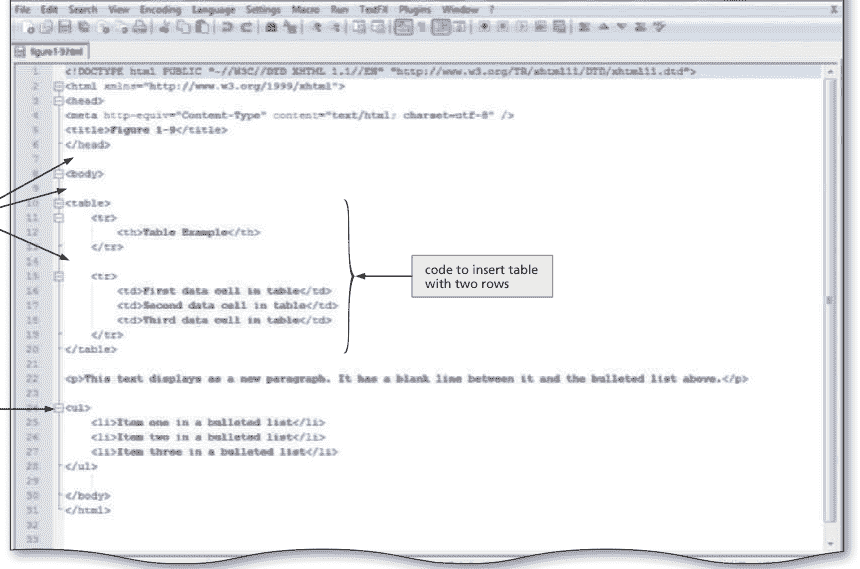

## HTML版本

HTML已经经历了多个版本，每个版本都扩展了这种创作语言的功能。为确保浏览器能够解释每个新版本的HTML，万维网联盟（W3C）维护着HTML标准或规范，这些标准在其网站上公开提供。HTML5是HTML的最新版本。HTML5为Web开发提供了更灵活的方法。例如，使用HTML5，您可以在标签和属性中组合使用小写、大写或混合大小写字母。尽管HTML5具有灵活性，本书将遵循良好的编码实践，以便在未来XHTML标准可能取代HTML5时易于转换。本书遵循的编码实践是：使用全小写的标签和属性，将所有属性值用引号括起来，关闭所有标签，并正确嵌套标签（参见第HTML 13页的表1-3）。尽管HTML5在Web开发人员中非常流行，但它仍由万维网联盟开发中。因此，Web开发人员面临的挑战是了解哪些新标签和属性得到哪些浏览器的支持。本书使用了目前Internet Explorer支持的HTML5标签和属性。此外，我们将HTML 4.01标签和属性与HTML5结合使用，以创建本书中的所有网页。尽管HTML5和HTML 4.01很受欢迎，但大多数浏览器仍继续支持HTML 3.2和2.0版本。正如本章后面所述，在开发测试阶段，验证网页在各种浏览器中按预期显示非常重要。

## 层叠样式表

本书采取了新的方向，摒弃了已弃用的标签和属性。**已弃用**的标签和属性是指正在逐步淘汰，因此不再在最新的W3C标准中推荐使用的标签和属性。然而，许多网页中仍在使用已弃用的标签，因此从维护的角度了解它们的目的很有好处。在附录A中，已弃用的标签和属性用星号标出。为了消除已弃用的HTML标签，项目使用层叠样式表（CSS）来改变网页的样式（或外观）。虽然HTML允许Web开发人员更改网页的结构、设计和内容，但它在定义一个或多个网页的外观或样式方面能力有限。**层叠样式表（CSS）**允许您为各种网页元素指定样式。**样式**是定义网页元素外观的规则。**样式表**是一系列为网页或整个网站定义样式的规则。通过样式表，您可以通过更改字体系列、字体大小、边距和链接规范等特征，以及颜色和边框等视觉元素，来改变一个或多个网页的外观。CSS不用于向您的网站添加任何内容；它只是让您的内容看起来更有风格。

使用CSS，您可以在单个网页中或整个网站中为元素指定样式。例如，如果您希望网页上的所有文本段落缩进五个空格，您可以使用样式表来处理缩进，而不是为每个段落编写缩进代码。并且，如果您决定将缩进改为三个空格，您只需更改样式表中的一行，而不是更改每个段落的编码。因此，您可以看到使用CSS节省了大量时间，并使样式更改变得更加容易。

CSS不是HTML；它是一种独立的语言，用于增强HTML的显示能力。万维网联盟，即定义HTML标准的同一组织，定义了CSS的规范。本书将提供关于CSS3的信息，这是当前正在开发的最新版本的CSS。我们将探讨CSS3为Web开发领域带来的新功能。请注意，这是一个不断变化的目标。

**CSS、DOM和XHTML** w3.org网站拥有大量关于层叠样式表（CSS）、文档对象模型（DOM）和可扩展HTML（XHTML）的信息和教程。W3C网站上建议的标准是大多数Web开发人员遵循的标准。


并非所有浏览器都支持CSS3提供的最新选择器语法。本书末尾的附录A（也可在线获取）列出了HTML标签及其对应属性，您可据此按需修改网页元素；附录D则提供了与不同CSS元素相关的属性及取值的完整信息。

### 文档对象模型（DOM）

HTML可与其他Web技术结合使用，为网页提供额外功能。例如，术语**文档对象模型（DOM）**描述了HTML标签、CSS和脚本语言（如JavaScript）的组合。DOM允许JavaScript等语言操作底层文档的结构，以创建交互式、动态的网页。这是一种网页（或文档）包含可操作对象（元素、链接等）的模型。DOM允许Web开发者添加、删除或修改元素或属性。与基本HTML网页相比，采用DOM增强的网页能更好地响应访客交互。并非所有交互式网页都需要DOM，但如果您需要高度的交互性，那么这或许是一个值得考虑的模型。CSS、JavaScript和DOM将在本书综合版（12章）的后续章节中详细讲解。

## 可扩展超文本标记语言（XHTML）

如前所述，HTML使用标签来描述文档在Web浏览器中的显示方式，即网页格式。HTML用于显示数据，而**可扩展标记语言（XML）**则旨在传输和存储数据。XML提供了一套规则，用于将文档编码为机器可读的形式。XML并非HTML的替代品，而是一种与软件和硬件无关的工具，用于承载信息。第12章将深入探讨XML，并向学生教授XML的具体内容。**可扩展超文本标记语言（XHTML）**是HTML格式的一种重构，使其符合XML的结构和内容规则。通过结合HTML和XML，XHTML融合了HTML的显示特性与XML更严格的编码标准。

如前所述，本书中的项目使用了HTML5引入的一些新标签和属性。XHTML标准不适用于HTML5，但我们将按照表1-3遵循XHTML编码实践，因为这些实践确保了编码风格的一致性。只要您在网页开头使用HTML5的`<!DOCTYPE>`声明：

```
<!DOCTYPE HTML>
<html>
```

将XHTML编码实践与任何新的HTML5标签或属性结合使用，在验证代码时不会引起问题。

Web开发的一个重要步骤是检查您的网页是否符合W3C定义的HTML5标准。您将从第2章开始验证网页，使用上面提到的新的HTML5 `<!DOCTYPE>`声明，并在全书中持续这一过程。大多数已开发的网页可能无法通过验证。然而，最好从一开始就使用W3C推荐的标准进行Web开发训练。

表1-3列出了一些Web开发者应遵循的编码规则，以确保在使用HTML 4.01和HTML5标签及属性组合时，其HTML代码符合XHTML标准。本书中的所有项目（`<!DOCTYPE>`除外）都遵循XHTML标准，并遵守表1-3中概述的规则。每条规则的具体细节将在项目中使用时详细解释。

| 实践 | 无效示例 | 有效示例 |
| --- | --- | --- |
| 所有标签和属性必须使用小写字母书写 | `<TABLE WIDTH="100%">` | `<table width="100%">` |
| 所有属性值必须用单引号或双引号括起来 | `<table width=100%>` | `<table width="100%">` |
| 所有标签必须闭合，包括没有结束标签的img、hr和br等标签，但必须作为实践闭合它们 | `<br><hr><p>This is another paragraph` | `<br /><hr /><p>This is another paragraph</p>` |
| 所有元素必须正确嵌套 | `<p><strong>This is a bold paragraph</p></strong>` | `<p><strong>This is a bold paragraph</strong></p>` |

## 创建HTML文档的工具

您可以使用简单的文本编辑器（如Notepad++、Notepad、TextPad或TextEdit）通过HTML创建网页。**文本编辑器**是一种允许用户输入、更改、保存和打印文本（如HTML）的程序。文本编辑器没有许多高级功能，但它们确实可以让您轻松开发HTML文档。例如，如果您想将DOCTYPE标签插入网页文件，可以在任何文本编辑器中输入必要的文本，如下页图1-10a和图1-10b所示。尽管记事本（图1-10b）对于Web开发来说是一个足够的文本编辑器，但请注意它与Notepad++的不同之处。Notepad++是一个功能更强大的文本编辑器，它在输入HTML代码时会使用颜色方案。

您也可以使用HTML文本编辑器（如EditPlus或BBEdit（Mac OS））来创建网页。**HTML文本编辑器**是一种提供基本文本编辑功能以及更高级功能的程序，例如对各种HTML标签的颜色编码、用于插入HTML标签的菜单以及拼写检查器。**HTML对象编辑器**（如EiffelStudio对象编辑器）提供了大纲编辑器的额外功能，允许您展开和折叠HTML对象及属性、编辑参数以及查看附加到展开对象的图形。

许多流行的软件应用程序也提供了使您能够轻松开发网页的功能。例如，Microsoft Word、Excel和PowerPoint具有“另存为网页”选项，该选项通过自动向文档添加HTML标签将其转换为HTML文件。使用Microsoft Access，您可以创建允许您查看数据库中数据的网页。Adobe Acrobat也具有导出功能，可以创建HTML文件。这些应用程序还允许您向网页添加超链接、下拉框、单选按钮或滚动文本。

这些先进的Web功能使得将任何文档、电子表格、数据库或演示文稿保存为网页显示变得简单。例如，公司政策和流程手册以及PowerPoint演示文稿可以轻松保存为网页并发布到公司内网。可以授权外联网用户访问网页，以查看或更新存储在数据库中的信息。

您还可以使用**WYSIWYG**编辑器（如Adobe Dreamweaver、Amaya或CoffeeCup HTML Editor）来创建网页。**WYSIWYG编辑器**是一种提供图形用户界面的程序，允许开发者在开发过程中预览网页。WYSIWYG（发音为wizzy-wig）是“What You See Is What You Get”（所见即所得）的首字母缩写。WYSIWYG编辑器会在您向网页添加元素时为您创建HTML代码，这意味着您不必直接输入HTML标签。WYSIWYG编辑器的主要问题是它们常常会生成“臃肿”的HTML代码（HTML标签周围包含了许多不必要的额外代码行）。

> **免费的HTML WYSIWYG编辑器**
> 有许多流行的WYSIWYG编辑器正被许多Web开发新手用于创建设计精良、交互式的网站。您可以在大多数搜索引擎中搜索“WYSIWYG HTML editor”来找到它们。

# HTML 14 HTML 第1章 HTML、XHTML和CSS简介

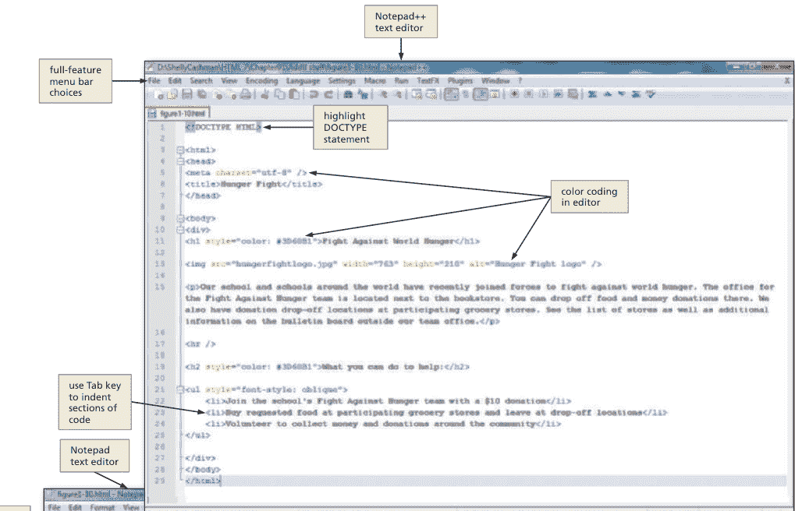

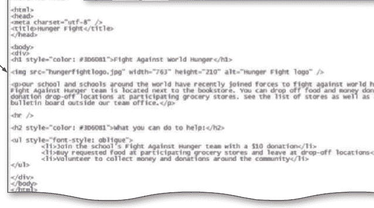

图1–10 使用Notepad++或Notepad等文本编辑器，您可以直接在文件中输入HTML标签。

无论您使用哪种类型的程序来创建网页，了解HTML的具体细节都很重要，这样您才能在编辑器之外进行更改。例如，您可能能够使用Dreamweaver创建网页，但如果您想做一些小的修改，了解HTML标签本身会非常有帮助。同样重要的是了解Web开发生命周期，以确保网站中的网页保持一致和完整。

版权所有© 2012 Cengage Learning。保留所有权利。未经许可，不得以任何形式复制、扫描或部分/全部复制。由于电子权利，某些第三方内容可能从电子书和/或电子章节中删除。编辑审查认为，任何被删除的内容不会对整体学习体验产生重大影响。Cengage Learning保留根据后续权利限制随时删除额外内容的权利。


## 网站开发生命周期

多年来，大学和学院的信息技术课程一直强调在设计和实施新软件时遵循系统开发生命周期的重要性，以确保一致性和完整性。网站开发过程也应遵循类似的周期。全面的规划和分析能确保开发人员提供用户真正想要的东西。如果你在没有进行彻底规划和分析的情况下就开始编写网页代码，就有可能遗漏相关信息。在项目开发的早期阶段对网站进行修正，其成本要远低于修改已完成的网页。

本节概述的网站开发生命周期，可用于任何类型或规模的网站开发项目。**网站开发生命周期**是一个可用于开发任何复杂程度网页的过程。该生命周期包括以下阶段：规划、分析、设计与开发、测试，以及实施与维护。表1–4列出了在网站开发生命周期的每个阶段中应该问的几个问题。在本书中，你将在开发网页时遵循这个系统化的周期。

| 网站开发阶段 | 需要问的问题 |
| --- | --- |
| 规划 | • 这个网站的目的是什么？<br>• 谁会使用这个网站？<br>• 用户的计算环境是怎样的？<br>• 谁拥有并负责网站上的信息？<br>• 谁决定信息是否/在哪里出现在网站上？ |
| 分析 | • 用户需要执行哪些任务？<br>• 什么信息对用户有用？<br>• 必须考虑哪些流程因素？ |
| 设计与开发 | • 网站将包含多少个网页？<br>• 网页将如何组织？<br>• 什么类型的网站结构适合该内容？<br>• 如何最好地呈现内容以方便使用？<br>• 这个网站将采用什么文件命名约定？<br>• 网页文件将使用什么文件夹结构？<br>• 如何在整个开发过程中应用标准？<br>• 哪些形式的多媒体对网站有积极作用？<br>• 如何在不限制可用性的情况下解决无障碍访问问题？<br>• 是否会有国际受众？ |
| 测试 | • 网页是否通过万维网联盟（W3C）的验证流程并符合HTML5标准？<br>• 网站内容是否正确？<br>• 网站功能是否正常？<br>• 用户能否找到完成所需任务的信息？<br>• 导航是否清晰易用？ |
| 实施与维护 | • 网站如何发布？<br>• 如何吸引用户访问和再次访问网站？<br>• 网站如何更新？<br>• 谁负责内容更新？<br>• 谁负责结构更新？<br>• 如何通知用户网站的更新？<br>• 网站会被监控吗？ |

## 网站规划

网站规划是网站开发生命周期的第一个阶段，涉及确定网站的目标或目的。网站规划阶段的第一步是回答“这个网站的目的是什么？”这个问题。如你所知，个人和团体出于各种目的设计并发布网站。个人开发网站是为了分享他们的爱好、发布简历，或者只是分享关于个人兴趣的想法。组织创建网站是为了让成员了解即将到来的活动或招募新成员。企业创建网站是为了广告和销售产品，或为其客户提供24小时在线支持。教师发布网站，或使用学校的在线课程管理软件为其课程添加信息，目的是告知学生课程政策、作业和截止日期，以及课程要求。在你充分确定网站的预期目的之前，不应继续进行网站开发项目。

除了理解网站的目的，你还应该理解谁会使用该网站以及大多数用户的计算环境。了解目标受众的构成——包括年龄、性别、一般人口统计背景以及计算机素养水平——将有助于你设计适合目标用户的网站。理解用户的计算环境将决定使用何种类型的Web技术。例如，如果大多数用户使用的是低速互联网连接，你就不想创建包含大型图形或多媒体元素的页面。

网站规划阶段的最后一个方面是确定内容的所有者和作者。为此，你需要问以下问题：
- 谁拥有并负责网站上的信息？
- 谁决定信息是否/在哪里出现在网站上？

一旦你确定了谁将提供和授权网站内容，就可以将这些个人纳入网站开发项目的各个方面。

## 网站分析

在分析阶段，你需要对网站的内容和功能做出决策。为了帮助定义合适的网站内容和功能，你应该首先确定用户需要执行的任务。回答这个问题可以让你定义必要的内容以促进这些任务，并确定对用户有用的信息。应从网站中删除不服务任何目的的多余内容。

在分析阶段，考虑支持网站功能所需的过程也很重要。例如，如果你确定用户应该能够通过网站订购产品，那么你还需要定义每次提交订单时要采取的流程或行动。例如，订单提交后，该订单将如何在库存控制和应付账款等后台业务应用程序中进行处理？用户是否会收到包含订单详情的电子邮件确认？分析阶段是网站开发生命周期中较为重要的阶段之一。清晰地理解并定义网站期望的内容和功能，将指导你设计网站的类型，并减少网站开发过程中的变更。

## 网站设计与开发

在确定网站目的并定义内容和功能之后，你需要考虑网站的设计。网站设计的一些关键考虑因素包括：定义如何组织网页内容、选择合适的网站结构、确定如何使用多媒体、解决无障碍访问问题，以及为国际受众设计页面。网站设计最重要的方面之一是确定在网站上提供导航的最佳方式。如果用户无法轻松找到他们想要的信息，他们将不会再次访问你的网站。

组织一个网页的方式有很多，就像组织一份报告或论文的方式也有很多一样。表1–5列出了一些用于创建易于阅读和导航的网页的组织标准。

### 无障碍访问标准

创建一个对所有用户都可访问的网站，可以让你的网站覆盖最广泛的受众。此外，根据《康复法案》第508条，任何由美国联邦机构使用的网站或技术必须可供残疾人使用。有关第508条指南，请参阅附录C。

### 表1–5 网页组织标准

| 元素 | 组织标准 | 原因 |
| :--- | :--- | :--- |
| 标题 | 使用简单明了、能清晰解释页面目的的标题 | 标题帮助用户理解页面的目的；一个好的标题能在搜索引擎结果列表中解释页面 |
| 标题 | 使用标题来分隔主要主题 | 标题使网页更易于阅读；简洁的标题能清晰解释页面的目的 |
| 水平线 | 插入水平线来分隔主要主题 | 水平线提供图形元素来分隔网页内容 |
| 段落 | 使用段落来划分大段文本 | 段落提供更短、更易读的文本部分 |
| 列表 | 在适当的时候使用项目符号列表或编号列表 | 列表提供有组织的、易于阅读的文本，供读者快速浏览 |
| 页面长度 | 保持合适的网页长度 | 网页用户并不总是会滚动查看较长页面上的信息；适当的页面长度增加了用户查看关键信息的可能性 |
| 信息 | 将最重要的信息放在网页顶部以突出显示 | 网页用户会快速浏览页面；将关键信息放在页面顶部增加了用户查看关键信息的可能性 |
| 其他 | 包含一个联系电子邮件地址；包含最后修改日期 | 电子邮件地址和日期为用户提供了一种联系网站开发者并提出问题的方式；最后修改日期帮助用户判断网站信息的时效性 |

网站可以使用几种不同类型的结构，包括线性结构、层次结构和网状结构。每种结构以不同的方式链接或连接网页，以定义用户如何导航网站和查看网页。你应该根据用户将如何导航网站和查看网站内容来为网站选择结构。

**线性**网站结构以直线方式连接网页，如图1–11所示。如果网页上的信息应按特定顺序阅读，则线性网站结构是合适的。例如，如果第一个网页（模块1）上的信息对于理解第二个网页（模块2）上的信息是必需的，那么你应该使用线性结构。每个页面都会有从一个网页到下一个网页的链接，以及返回到上一个网页的链接。在很多情况下，网页需要按顺序阅读，例如在培训材料中，需要完成模块1才能尝试模块2的情况。


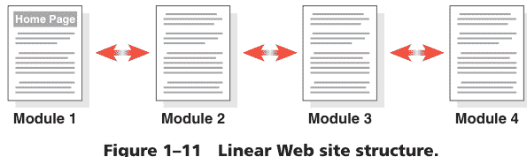

## 图 1–11  线性网站结构。

线性网站结构的一种变体是增加了指向网站首页的链接，如图 1–12 所示。对于某些网站来说，从一个模块按顺序移动到下一个模块仍然很重要，但同时也希望用户能够随时方便地返回首页。在这种情况下，你仍然会为模块网页提供指向上一个和下一个模块的链接，但每个网页也会包含一个返回首页的链接。这样，用户就不必多次点击“上一步”链接才能返回首页。

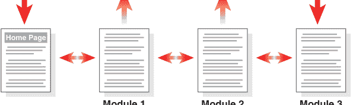

## 图 1–12  带有首页链接的线性网站结构。

层次化的网站结构将网页以树状结构连接起来，如图 1–13 所示。层次化的网站结构非常适用于拥有一个主页并链接到多个子页面，而这些子页面又链接到更深层子页面的网站。

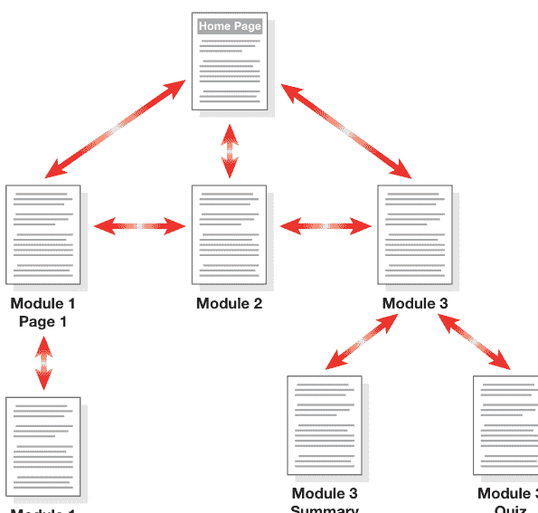

## 图 1–13  层次化网站结构。

索引或目录页面，该页面链接到所有其他网页。在这种结构中，主索引页面将显示一般信息，而次级页面则包含更详细的信息。注意图 1–13 中的信息组织得非常符合逻辑。网页访问者可以轻松地从首页导航到三个模块中的任何一个。此外，访问者可以通过模块 3 的链接轻松进入“模块 3 测验”。然而，这种结构固有的一个问题在于，无法轻松地从一个部分跳转到另一个部分。举个例子，要从“模块 1 第 2 页”移动到“模块 3 总结”，访问者必须使用“后退”按钮返回首页，然后点击模块 3 的链接。对于只有两个网页的网站来说，这已经有些烦人了，但试想一下，如果模块 1 有 100 个网页会怎样！

为了解决层次化模型的问题，你可以使用网状模型。**网状**网站结构没有固定的组织形式，如图 1–14 所示。网状网站结构最适合用于那些信息不需要按特定顺序阅读，并且提供多种导航选项的网站。万维网就使用了网状结构，因此用户可以按照他们选择的任何顺序在网页之间导航。注意，在这种结构下，网站访问者可以更轻松地在模块或模块总结之间切换。在这种模型中，你通常会为每个页面提供一个指向首页的链接，这意味着从每个单独的网页都会有一个额外的箭头指回首页（这在小图中很难表现出来）。如今，许多网站利用图形图像（通常是公司或机构标志）作为首页链接，放置在每个网页的左上角。你将在本书后面学习并使用这种技术。

大多数网站都是线性、层次化和网状结构的组合。网站上的某些信息可能从索引页面开始按层次组织，其他信息可能可以从网站的各个区域访问，而还有一些信息可能按线性组织，以便按特定顺序阅读。如果这种组合有助于用户轻松导航网站，那么混合使用这三种结构是合适的。关键是尽可能高效地将正确的信息传递给用户。

无论你使用哪种结构或结构组合，都应该平衡网站的广度和深度。**广度较大的网站**是指其首页

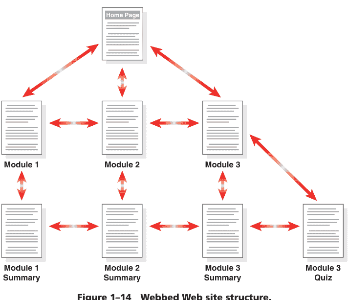

## 图 1–14 网状网站结构。

是主索引页面，并且所有其他网页都单独链接到首页（图 1–15）。通过仅从首页访问其他网页，广度较大的网站迫使用户必须返回首页才能从一个网页移动到另一个网页。这种结构使得导航对用户来说既耗时又受限。更好的结构应该为用户提供导航选项，允许在网页之间直接移动。

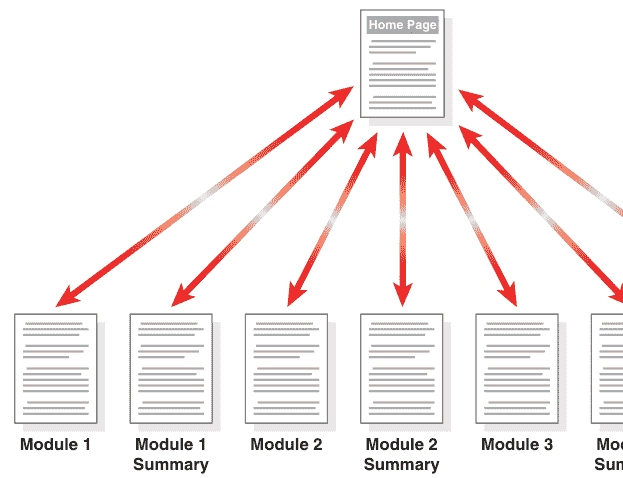

**深度较大的网站**是指拥有很多层级页面，需要用户点击多次才能到达特定网页的网站（图 1–16）。通过要求访问者在到达所需页面之前浏览多个网页，深度较大的网站迫使用户花费时间查看可能没有有用内容的中间页面。例如，注意在 HTML 18 页的图 1–13 中查找“模块 3 总结”，与在图 1–16 中查找同一网页（“模块 3 总结”）的区别。假设用户已经浏览过图 1–13 所示的网站一次，以学习模块 3 的材料。但是，当用户使用图 1–16 所示的结构返回网站，以复习“模块 3 总结”网页并参加“模块 3 测验”时，用户必须逐页浏览整个模块 3 的材料，才能到达“模块 3 总结”页面。你大概会希望为用户提供更便捷的访问该网页的方式。

作为 Web 开发人员，你必须为网站选择合适的结构，并努力平衡广度和深度。用户访问网站是为了寻找信息以完成某项任务。良好的设计提供便捷的导航，使用户能够快速轻松地找到内容。除了规划网站本身的设计外，Web 开发人员还应始终在设计阶段的早期就规划具体的命名和存储约定。一旦你确定了网站的结构以及实现网站目标所需的大致页面数量，你就需要确定在文件命名和文件夹结构上要使用什么标准。例如，将你的网页保存为 page1.html 和 page2.html 这样的名称，并不能告诉你这些网页的用途。更好的选择是将海岸酒店网站的首页命名为 oceansidehome.html 或 oceanside.html，而包含预订表单的网页可以命名为 reservation.html。这些文件名可以告诉开发人员以及将来维护该网站的开发人员这些网页的用途。

Web 开发生命周期 HTML 21

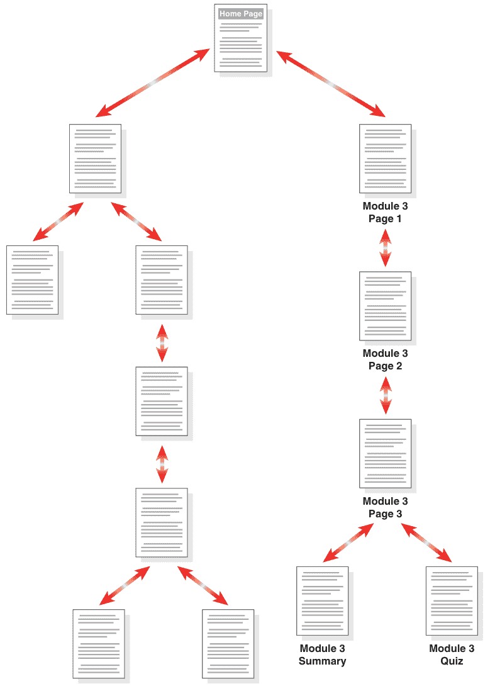

## 图 1–16 深度较大的网站。

同样的原则也适用于你在 Web 开发中使用的文件夹结构。本书中的项目包含的网页文件和图形文件很少，因此所有内容（网页和图形）都存储在一个文件夹中。然而，对于大型网站，你可能希望将网页文件与图形文件分开存放。更大、更复杂的网站可能还需要一个专门的文件夹来存储视频或音频片段。你存储文件的方式会影响你在 HTML 代码中访问这些文件的方式。在 Web 开发生命周期的规划阶段确定一个好的文件夹结构非常重要。你将在第 3 章学习更多关于有效文件夹结构的知识。在设计和开发阶段，你还应该考虑哪些类型的多媒体（如果有的话）能够为网站体验带来积极贡献。例如，

顺带一提 网页结构 Web 上有许多资源可以进一步讨论网站结构。除了通用的设计信息外，还有许多付费或免费下载的工具可以帮助你设计网站。在搜索引擎中输入短语 “Web site structure” 即可找到许多有价值的设计资源。

版权 2012 Cengage Learning。保留所有权利。未经许可，不得以任何形式复制、扫描或复制，全部或部分。由于电子权利，某些第三方内容可能在电子书和/或电子章节中被删除。编辑审查认为，任何被删除的内容不会对整体学习体验产生重大影响。Cengage Learning 保留在后续权利限制要求时随时删除其他内容的权利。


在网站中添加公司CEO的视频信息可能有用，但如果用户的计算环境不支持视频播放，那么视频就失去了意义。通常，除非对网站体验有积极作用，否则不要在网站中使用高级多媒体技术。如今，越来越多的网站正在使用音频和视频内容。添加多媒体可以增强网站的整体目的，但有时也会分散信息的传达。

最后，请考虑无障碍访问和国际化问题。Web开发者应始终为多元受众设计，包括身体残障人士和全球用户。一个关键考量是，身体残障人士使用的软件可能无法与某些Web功能配合使用。例如，如果你在网站上使用图形，请务必为每个图形提供替代文本。为了支持国际受众，请使用全球通用的图标，避免内容中使用俚语表达，并构建简单、加载速度快的页面，以适应较低速的网络连接。

刚才讨论的设计问题只是你需要考虑的基本网页设计问题中的一部分。在本书中，设计问题将结合每个项目进行探讨。互联网上也有许多优秀的网页设计资源可供参考。

一旦网站设计确定，就可以开始Web开发了。本书的其余章节除了讨论实际的网页开发外，还会介绍良好的网页标准。你将学习许多开发技术，包括链接、表格、图形、图像映射和Web表单。涵盖本书所有开发技术的总纲领是使用级联样式表（CSS）。

## 网站测试

测试应在网站的所有页面上进行。你还需要测试网页内的链接、指向网站内其他网页的链接，以及指向外部网站的链接。测试是Web开发的重要组成部分，确保你的网页按预期工作。

网站应在Web设计和开发过程的各个阶段进行测试。测试过程应全面，包括审查网页内容、功能性和易用性。存在断裂链接、缺失图形和错误内容的网站会给用户留下糟糕的印象。你需要吸引用户访问你的网站并保持他们的兴趣。如果访客发现你的网站测试和维护不佳，他们就不太可能再次访问。如果用户不经常访问网站，你就无法传达你的信息。测试内容和功能的一些基本步骤包括：

-   通过W3C标记验证服务运行每个网页进行验证
-   校对页面内容和标题，检查拼写和语法是否准确
-   检查链接，确保它们未断裂且链接正确
-   检查图形，确认它们显示正常且链接正确
-   确保已解决无障碍访问和国际化问题
-   测试表单和其他交互式页面元素
-   测试页面，确保它们加载迅速，即使在较低速连接上也是如此
-   打印每个页面，检查打印页面的效果

**易用性**是衡量产品（如网站）让用户完成其目标的程度的指标。**易用性测试**是一种方法，通过要求网站或其他产品的用户执行特定任务，来衡量产品的易用性以及用户对体验的感受。网站的易用性测试应关注三个关键方面：内容、导航和呈现。

易用性测试可以通过多种方式进行；一种有效的方法是直接观察用户与网站的交互（或使用网站）。在观察用户时，你可以追踪他们点击的链接，并记录他们的操作和评论。你甚至可以要求用户解释他们在浏览网站时试图完成什么任务。通过观察用户获得的信息对于识别网站中潜在的问题区域非常有价值。例如，如果你观察到用户难以找到列出商店位置和营业时间的网页，你可能需要澄清链接描述或使这些链接在首页上更加突出。

另一种进行易用性测试的方法是给用户一个特定的任务来完成（例如查找产品价格列表），然后观察他们如何浏览网站来完成该任务。如果可能，请让他们解释为什么选择某些链接。这两种观察方法都极具价值，但都需要接触用户。

易用性测试也可以通过问卷调查来完成。在编写问卷或调查时，请确保撰写开放式问题，这些问题可以为你提供有价值的信息。例如，问一个是/否问题“这个网站在视觉上吸引人吗？”将不会收集到有用的信息。如果你将该问题改为使用量表响应，例如“请使用1（低）到5（高）的量表评价本网站的视觉吸引力”，你就可以从用户那里获得更有价值的反馈。然而，确保量表本身对用户来说是清晰易懂的。如果你打算让选择1表示“低”评分，但用户认为1表示“高”，那么你的调查结果就值得怀疑了。易用性测试问卷应始终包含供用户撰写额外解释性评论的空间。

图1-17显示了你可能在网站易用性测试问卷中包含的一些问题类型和组织结构的示例。

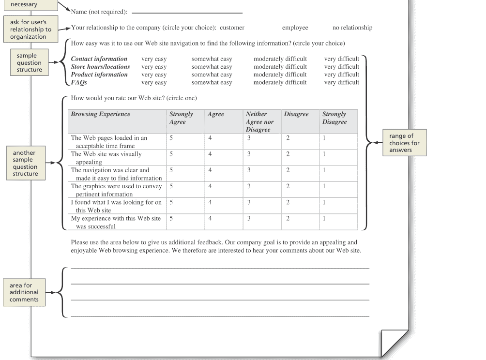

除了内容、功能性和易用性测试外，还有其他类型的测试。对于新实施或维护的网站，还应进行两种其他测试：兼容性测试和压力测试。**兼容性测试**是为了验证网站能在各种浏览器和浏览器版本上工作。最初，使用你的受众最可能使用的浏览器进行测试。不同的浏览器对网页的某些方面显示不同，因此在多种不同的浏览器中测试网页以验证它们在每个浏览器中都显示正确非常重要。如果你使用了旧版浏览器不支持或需要插件的技术，请考虑更改内容或为旧版浏览器提供替代网页进行查看。如果你的受众同时使用PC和Macintosh电脑，你需要在两个平台上使用浏览器测试网页。你可能还想在几个版本的同一浏览器（通常是最近两个版本）中测试网页，以防用户尚未升级。

**压力测试**确定当更多用户访问网站时网站会发生什么。一个同时有100个用户访问的网站可能运行良好。但当数千名用户同时使用该网站时，它可能会以不可接受的慢速运行。压力测试验证网站在众多用户下仍能以可接受的速度运行。有许多公司未对其网站进行有效压力测试的案例。这种测试缺失的后果是灾难性的，当太多用户尝试访问同一网站功能时，网站会锁定。特别是在用于电子商务的网站情况下，网站必须保持在线状态至关重要。崩溃或锁定的网站无法销售产品或服务，公司将损失大量金钱。

## 网站实施与维护

一旦网站测试完成并进行了必要的更改，就可以实施网站了。网站的实施涉及将网页实际发布到Web服务器。许多HTML编辑器和所见即所得编辑器都提供发布功能。你也可以使用FTP软件（如WS_FTP或CuteFTP）将你的网页发布到Web服务器。发布网站后，你应该再次测试网页，确认没有明显的错误，例如断裂链接或缺失图形。

网站测试和实施后，你需要制定一个流程来维护网站；用户无疑会请求更改，而及时的内容也需要更新。然而，你需要确保网站的更新不会损害网站的完整性和一致性。例如，如果一个大型网站由几个不同的人更新不同的网页，你可能会发现很难在整个网站页面上保持一致的外观。你应该计划定期更新网站，以保持内容最新。这可能是每小时、每天、每周或频率更低，具体取决于网站的目的。不要让你的内容变得陈旧、过时，或者包含指向不存在网页的断裂链接。作为一个寻找与特定主题相关信息的用户，你有多大可能会相信一个写着“最后更新于1998年12月10日”的网站上的信息来自可靠来源？

为了帮助管理网站维护任务，首先确定谁负责内容、结构、功能等方面的更新。然后，将更新职责限制给特定的用户。确保实施由一个或多个Web开发者控制，他们可以在发布前彻底测试网页。

当对网站进行更新和更改时，请考虑使用图形横幅或“最新动态”公告通知用户，解释任何新功能以及这些功能将如何使他们受益。这种技术不仅能让用户知情，还能鼓励他们回来看看网站有什么新内容。


最后，网站监控是维护网站的另一个关键方面。通常，托管网站的Web服务器会记录有关网站使用情况的信息日志。**日志**是一个文件，它列出了从该网站请求过的所有网页。网站日志对Web开发者来说是宝贵的信息来源。获取并分析这些日志，可以让你确定诸如访客数量、浏览器类型和版本、连接速度、最常请求的页面以及使用模式等信息。利用这些信息，你可以设计一个对目标受众有效的网站，为访客提供丰富且有价值的体验。

## 成为善于观察的Web用户

当你开始学习本课程，并可能开启你的Web开发生涯时，一个有用的做法是成为一个善于观察的Web用户。我们大多数人每天都会多次（甚至更频繁地）使用Web来完成日常任务。作为一名Web开发者，你应该审视你访问的网页，关注其功能性和设计。正如本章末尾第一个“实验室”练习中所描述的，你可以将那些你认为有效或无效、好或不好的网站添加为书签，并将它们作为你自身Web开发工作的参考。在搜索信息或在线购物时，留意Web上的趋势。例如，闪烁的文字和带有图案的背景曾经在Web上非常流行，但现在其他设计技术已经取而代之。成为一个善于观察的Web用户可以帮助你成为更有效的Web开发者。

> **顺便提一下：快速参考**
> 有关HTML标签及其相关属性的列表，请参阅本书末尾的HTML快速参考（附录A），或访问本书配套网站www.cengagebrain.com上的HTML快速参考。

## 章节总结

在本章中，你学习了互联网、万维网以及相关技术，包括Web服务器和Web浏览器。你了解了HTML在创建网页中的关键作用，并回顾了用于创建HTML文档的工具。你还了解到大多数Web开发项目都遵循一个五阶段的生命周期。下面列出的项目包含了你在本章学到的所有新概念。

1.  描述互联网（HTML 2）
2.  描述万维网（HTML 3）
3.  定义Web服务器（HTML 4）
4.  描述互联网、内联网和外联网（HTML 5）
5.  讨论Web浏览器（HTML 7）
6.  定义超文本标记语言（HTML 8）
7.  描述HTML元素（HTML 9）
8.  列出有用的HTML实践（HTML 10）
9.  解释HTML版本（HTML 11）
10. 描述层叠样式表（HTML 11）
11. 定义文档对象模型（HTML 12）
12. 定义可扩展超文本标记语言（XHTML）（HTML 12）
13. 描述用于创建HTML文档的工具（HTML 13）
14. 讨论Web开发生命周期（HTML 15）
15. 描述Web开发规划阶段的步骤（HTML 16）
16. 解释Web开发分析阶段（HTML 16）
17. 讨论Web设计与开发（HTML 17）
18. 描述各种网站结构（HTML 17）
19. 讨论网站测试的重要性，包括可用性测试、兼容性测试和压力测试（HTML 22）
20. 讨论网站实施和维护（HTML 24）
21. 解释成为善于观察的Web用户的重要性（HTML 25）

## 在线学习

测试你对章节内容和关键术语的掌握程度。

说明：要完成以下练习，请访问www.cengagebrain.com。在CengageBrain.com主页，使用页面顶部的搜索框搜索HTML5 and CSS 7th Edition。这将带你到本书的产品页面。在产品页面，点击“Study Tools”标题下的“Access Now”按钮。在配套网站页面，选择第1章，然后点击所需练习的链接。

**章节强化 判断题、选择题和简答题**
一系列判断题、选择题和简答题，测试你对章节内容的掌握。

**谁想成为计算机天才？**
一个互动游戏，以电视问答节目的形式挑战你对章节内容的了解。

**闪卡**
一个互动学习环境，你需要根据显示的定义识别章节的关键术语。

**术语轮盘**
一个互动游戏，以电视节目*幸运轮盘*（*Wheel of Fortune*）的形式挑战你对章节关键术语的了解。

**模拟测试**
一系列选择题，测试你对章节内容和关键术语的掌握。

**填字游戏挑战**
一个填字游戏，挑战你对章节中呈现的关键术语的了解。

## 应用你的知识

巩固技能并应用你在本章学到的概念。

**理解网页结构**
说明：图1-18展示了OnGuardOnline.gov的网站。正如你在本章所学到的，三种常见的网站结构包括线性、层次和网状。根据这些信息，确定OnGuardOnline.gov网站使用的结构。查看其他类似的网站，并确定哪些网站设计功能对用户有益。将这些想法融入到OnGuardOnline.gov的新网站设计中。用纸草拟OnGuardOnline.gov网站的新设计草图。

执行以下任务：

1.  启动浏览器。在浏览器中打开OnGuardOnline.gov网站。通过点击“文件”菜单上的“打印”或点击打印图标来打印主页。
2.  探索OnGuardOnline.gov网站，确定该网站使用的结构（线性、层次或网状），然后将其写在打印件上。
3.  找到另外两个政府网站。打印每个网站的主页。浏览这些网站，识别任何对用户有益的设计功能。
4.  使用你在第3步中找到的政府网站中的想法，在纸上为OnGuardOnline.gov网站草拟一个新的网站结构和设计。
5.  按照你老师指定的格式提交你的答案。

图1-18

## 拓展你的知识

拓展你在本章学到的技能，并尝试新技能。

### 评估用户调查

*说明：*启动你的文字处理程序。打开学生数据文件中Chapter01\Extend文件夹下的文档extend1-1.docx。有关下载学生数据文件的说明，请参见本书的封底内页，或联系你的老师获取有关访问所需文件的信息。这个示例网站调查展示了在收集网站可用性反馈时可能提出的各种问题。如章节中所述，评估你网站的可用性很重要。

你将评估用户调查，并修改问题或添加适用于你所选网站的新问题。然后你将请五个人填写你的调查。

*执行以下任务：*

1.  判断调查问题是否能为你提供关于网站的有价值的信息。为什么能或为什么不能？
2.  确定你可以做些什么来改进网站调查。使用文字处理程序，将你的分析输入到一个新文件中，并将文件保存为extend1-1solution.docx。
3.  分析原始调查中的问题后，按照HTML 23页图1-17中提供的一些准则修改用户调查。将你新的调查问题输入到第2步完成分析之后的新extend1-1solution.docx文件中。在调查中添加问题，这些问题将帮助你确定用户对所选网站的看法。记住，使用调查的目的是为了改进网站。因此，你的问题必须提供能帮助你实现该目标的信息。
4.  完成这些步骤后，按照你老师指定的格式提交extend1-1solution.docx文件。

## 使其正确

分析文档并纠正所有错误和/或改进设计。

### 纠正网站类型表格

说明：启动你的文字处理程序。打开学生数据文件中Chapter01\MakeItRight文件夹下的文件makeitright1-1.docx。有关下载学生数据文件的说明，请参见本书的封底内页，或联系你的老师获取有关访问所需文件的信息。如表1-6所示的文档是表1-5（HTML 17页）的修改版本。该表格有意包含错误，列出了本章讨论的网页组织标准。不要参考表1-5，通过识别所列七个元素中每一个的正确组织标准和原因来对表1-6进行必要的更正。将修改后的文档保存为makeitright1-1solution.docx，然后按照你老师指定的形式提交。

| 元素 | 组织标准 | 原因 |
|---|---|---|
| 标题 | 用于分隔主要主题 | 提供图形元素以分割网页内容 |
| 标题（Headings） | 使用简单明了的标题来清晰解释页面的目的 | 提供更短、更易读的文本部分 |
| 水平线 | 适当时在项目符号或编号格式中使用 | Web用户并不总是滚动查看较长页面上的信息；适当的页面长度增加了用户查看关键信息的可能性 |
| 段落 | 保持合适的网页长度 | Web用户会快速浏览页面；将关键信息放在页面顶部增加了用户查看关键信息的可能性 |
| 列表 | 插入这些图形元素以分隔主要主题 | 提供有组织、易于阅读的文本，供读者扫视 |
| 页面长度 | 使用这些来帮助分隔大量文本 | 标题帮助用户理解页面的目的；一个好的标题能在搜索引擎结果列表中解释页面内容 |
| 信息 | 将最重要的信息放在网页顶部以强调 | 使网页更易于阅读；简单的标题清晰地解释页面的目的 |


## 实验环节

设计并/或创建一份文档，遵循本章介绍的指南、概念和技能。实验按难度递增顺序排列。

**实验1：评估网站**

*问题：* 在本章中，你学习了做一个善于观察的网页用户的重要性，这能帮助你成为更高效的Web开发者。为了进一步发展这个概念，请找出并讨论“好”与“坏”（即“有效”与“无效”）的网站。启动你的浏览器和文字处理程序。打开学生数据文件中Chapter01\IntheLab文件夹下的lab1-1.docx文件。有关下载学生数据文件的说明，请参阅本书封底内页，或联系你的讲师获取访问本书所需文件的信息。

*说明：* 使用你的浏览器和列出的文件执行以下步骤。

1.  浏览互联网，找出一个“好”（即有效）的网站和一个“坏”（即无效）的网站。根据你自己的判断，确定这些网站中什么是“好”的，什么是“坏”的。你将在下面的步骤2中说明你判断的具体原因。
2.  使用lab1-1.docx文件，对你选定的好网站和坏网站的可用性进行评分。务必在调查中添加额外评论，具体说明你对该网站的正面或负面感受。使用文件名lab1-1goodsolution.docx和lab1-1badsolution.docx保存文档。
3.  与另一名同学组队，在回顾你们选定的网站时讨论你的调查结果。同时审阅你的学生搭档的网站和调查。
4.  打开名为lab1-1comparison.docx的文字处理文档，记录你的调查结果与你的学生搭档的意见之间存在的任何分歧。确保在此新文档中包含你和搭档审阅的四个网站的URL。使用文件名lab1-1comparison.docx保存文档。
5.  按照讲师指定的格式提交你自己的解决方案（lab1-1goodsolution.docx和lab1-1badsolution.docx）以及团队文档（lab1-1comparison.docx）。

## 实验环节（续）

**实验2：为花店设计网站**

*问题：* 你附近的花店希望你设计一个网站，让访客能够获取全面的信息。为此，你必须完成规划和分析阶段，回答以下问题：

- 花店访客希望在网站上完成什么任务？
- 花店老板希望在网站上完成什么任务？
- 应该包含哪些类型的信息？
- 谁将提供网站内容的信息？

采访几位曾去过花店的朋友或亲戚，确定这些问题的答案。基于这些信息，你将为花店网站的主页绘制设计草图，例如下一页图1-19所示的设计。

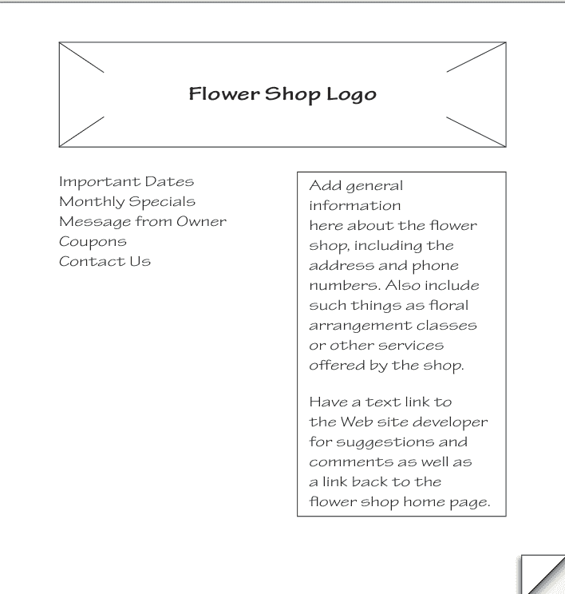

*说明：* 使用你的文字处理程序和纸张执行以下任务。

1.  回顾Web开发生命周期规划和分析阶段的问题，如第HTML 15页表1-4所示。
2.  评估表中列出的这些问题的价值。添加你认为与花店网站规划和分析相关的其他问题。
3.  启动你的文字处理程序。如有必要，打开一个新文档。输入你将用于规划和分析的问题。使用文件名lab1-2solution.docx保存文档。打印文档。
4.  使用你设计的问题，采访去过花店的朋友和家人，确定网站中应包含哪些信息，谁将提供信息等等。
5.  收集所需信息后，在纸上为网站主页绘制设计草图。
6.  与你采访的人分享你的设计草图，听取他们对你设计的意见。
7.  根据与朋友和亲戚交流获得的反馈，在纸上重新绘制设计，进行任何修改。
8.  在第一份设计草图上写上“初始设计”。
9.  在第二份设计草图上写上“第二版设计”。
10. 按照讲师指定的格式提交你的解决方案（lab1-2solution.docx）。

## 实验环节

**实验3：提出规划阶段问题：互联网、内联网和外联网设计**

*问题：* 本章讨论了三种不同类型的网站——互联网、内联网和外联网。每种类型的网站针对不同的目标受众。思考一个你经常光顾的零售企业，以及该企业如何可能使用互联网、内联网和外联网站点。第HTML 15页表1-4中的规划阶段问题已复制在表1-7中。确定这些问题的答案，并将你的想法填入表格。如果有些问题难以/无法直接回答（例如，用户的计算环境是什么？），列出你可以找到这些问题答案的方法。

*说明：* 启动你的文字处理程序。打开学生数据文件中Chapter01\InTheLab文件夹下的lab1-3.docx文件。有关下载学生数据文件的说明，请参阅本书封底内页，或联系你的讲师获取访问所需文件的信息。使用你的文字处理程序执行以下任务。

1.  在表格的第一行输入业务类型。确定所有三种类型网站的第一个问题的答案，然后将答案输入相应的表格单元格。如果你选择的业务没有理由维护三种网站类型（互联网、内联网或外联网）中的一种，请在你的答案中详细说明为什么不需要它。
2.  继续回答其他四个问题。
3.  使用文件名lab1-3solution.docx保存文件，然后按照讲师指定的格式提交。

| 规划问题 | 互联网 | 内联网 | 外联网 |
|---|---|---|---|
| 这个网站的目的是什么？ | | | |
| 谁将使用这个网站？ | | | |
| 用户的计算环境是什么？ | | | |
| 谁拥有并创作网站上的信息？ | | | |
| 谁决定信息是否/放置在网站的哪个位置？ | | | |

## 案例与实践

运用你的创造性思维和问题解决技能来设计并实现解决方案。

**注意：** 完成这些作业，你可能需要使用学生数据文件。有关下载学生数据文件的说明，请参阅本书封底内页，或联系你的讲师获取访问所需文件的信息。

**1：创建可用性调查问卷**

**学术** 你学校最近更新了其网站。学校管理层选择了一个团队来开发一份可用性调查问卷，可以发放给一组用户（包括学生、家长和教师）以评估新网站。你希望通过发放这份调查问卷获得哪些类型的信息？你如何传达调查问卷上的信息，以便清楚地表明你正在询问什么？使用你的文字处理程序创建一份可用性调查问卷。将调查问卷发放给至少五个人，包括上述每个群体中的至少一人。允许参与者完成调查问卷，然后查看结果。如果可能，询问用户他们认为各个问题传达了什么信息。这是你想传达的吗？如果不是，想出更清晰、更相关的问题，将调查问卷重新发放给另一组参与者。

**2：了解更多关于HTML5的知识**

**个人** 本章介绍了HTML5在Web开发中的应用。你将在本书中一直使用HTML5，因此熟悉它很重要。访问W3Schools网站（w3schools.com）以了解更多关于HTML5的知识。在其他网站上找到三个关于HTML5的其他信息来源。使用文字处理程序，创建一个文档，简要描述你找到的网站，并解释你如何利用这三个网站进行Web开发。

**3：了解更多关于Web可访问性问题的知识**

**专业** 你的公司希望向员工提供在线课程。一些员工有身体方面的挑战，在线课程必须让每个人都能访问，这一点至关重要。你的经理要求你了解更多关于可访问性指南的信息，以确定需要做哪些更改才能让公司的在线课程对那些有身体挑战的人可访问。研究网络上的可访问性问题，确定需要考虑哪些需求以满足可访问性要求。务必访问w3.org网站。在做研究时考虑以下问题：在开发网页时，你必须考虑哪些类型的身体挑战？这些网站就可访问性提出了哪些建议？为什么这对你作为Web开发人员很重要？


# 2 使用内联样式创建和编辑网页

## 学习目标

当你能够做到以下几点时，就意味着你已掌握了本章内容：

-   识别网页的元素
-   启动 Notepad++ 并描述 Notepad++ 窗口
-   在 Notepad++ 中启用自动换行
-   输入 HTML 标签
-   输入一个居中的标题和一段文本
-   创建无序列表、有序列表或定义列表
-   保存 HTML 文件
-   使用浏览器查看网页
-   激活 Notepad++
-   识别网页图像的类型和属性
-   使用内联样式添加图像、更改网页标题的颜色、更改项目符号列表的样式，以及添加水平线
-   在浏览器中查看 HTML 源代码
-   打印网页和 HTML 文件
-   退出 Notepad++ 和浏览器

版权所有 2012 Cengage Learning。保留所有权利。未经许可，不得以任何部分或全部形式复制、扫描或复制。由于电子权利，某些第三方内容可能会在电子书和/或电子章节中被屏蔽。编辑审查认为，任何被屏蔽的内容都不会对整体学习体验产生重大影响。Cengage Learning 保留在后续权利限制要求时随时删除额外内容的权利。

HTML

# 2 使用内联样式创建和编辑网页

## 引言

在了解了 Web 开发生命周期后，你应当对适当的网站规划、分析和设计的重要性有了清晰的认识。完成这些阶段后，下一个阶段就是使用 HTML 实际开发网页。正如第 1 章所讨论的，网页是通过使用 HTML 标签和属性来定义网页的结构、布局和外观而创建的。在本章中，你将使用基本的 HTML 标签来创建和编辑一个网页。

## 项目 — 攀岩乐趣网页

第 2 章说明了如何使用 HTML 为一家攀岩公司创建一个网页，如图 2-1a 所示。作为该公司的员工，你的任务之一是开发一个网页来宣传公司的攀岩课程。攀岩乐趣网页将包含公司的基本信息以及开始攀岩所需装备的信息。

为了输入创建网页所用的文本和 HTML 标签，你将使用一个名为 Notepad++ 的程序，如图 2-1b 所示。Notepad++ 是一个基础的文本编辑器，可用于简单文档或使用 HTML 创建网页。本书的早期版本使用了 Notepad，它是 Windows 操作系统自带的文本编辑器。Notepad 可以很好地输入 HTML 元素和网页内容，但 Notepad++ 是一个功能更丰富的文本编辑器。Notepad++ 具有行号显示功能，这在阅读代码时非常有帮助。它还会用不同的颜色高亮显示代码和文本，你将在本章稍后部分看到。由于其额外的多功能性，本版选用 Notepad++ 作为文本编辑器。你将使用 Microsoft Internet Explorer 浏览器在创建网页时查看它。默认情况下，Internet Explorer 随 Windows 安装，Notepad++ 可以从网上免费下载。如果你的电脑上没有 Notepad++，可以从 notepad-plus-plus.org 网站下载。如果你的电脑上没有 Internet Explorer，其他浏览器程序也可以使用。

## 概述

在阅读本章时，你将通过执行以下常规任务来学习如何创建图 2-1 所示的网页：

-   在 Notepad++ 窗口中输入 HTML 代码。
-   将文件保存为 HTML 文件。
-   输入基本的 HTML 标签并向文件中添加文本。
-   通过添加标题和创建项目符号列表来组织文本。
-   使用图像和内联样式增强网页的外观。
-   在浏览器中查看网页和 HTML 代码。
-   验证网页。
-   打印网页。

(a) 攀岩乐趣网页。

(b) 用于创建该网页的 HTML 代码。

图 2-1

HTML 36 HTML 第 2 章 使用内联样式创建和编辑网页

**提前规划**

### **通用项目指南**

创建网页时，你执行的操作和做出的决定将影响最终页面的外观和特性。在创建网页时，例如上一页图 2-1 所示的项目，你应该遵循以下通用指南：

1.  **完成网页规划。** 在开发网页之前，你必须了解网站的目的，识别网站的用户及其计算环境，并决定网页上信息的所有者。
2.  **分析网页的需求。** 在 Web 开发生命周期的分析阶段，你应该分析网页上要包含哪些内容。在这个阶段，你确定用户需要的任务和信息。有关 Web 开发生命周期各阶段的信息，请参阅第 1 章第 HTML 15 页的表 1-4。
3.  **选择网页的内容。** 一旦完成分析，你需要确定网页上要包含的内容。遵循 *少即是多* 的原则。文字越少，网页被阅读的可能性越大。使用尽可能少的字来表达一个要点。
4.  **确定此网页的文件命名约定。** 在开始创建和保存文件之前，你应该决定一个标准的文件命名方式。是应该使用 .htm 还是 .html 扩展名？正如本章稍后解释的，当主机 Web 服务器只允许短文件名时，使用 .htm 扩展名。当主机 Web 服务器允许长文件名时，使用 .html。应该给你的文件起什么名字以指示文件的内容或目的？例如，将网页命名为 page1.html 并没有描述该网页的内容；一个更具描述性的名称有助于网站的开发。
5.  **确定保存网页的位置。** 你可以将网页永久存储或保存在各种存储介质上，包括硬盘、USB 闪存盘、CD 或 DVD。你的导师或你正在为之开发网页的公司可能有特定的存储介质要求。
6.  **确定在存储设备上使用的文件夹结构。** 一旦确定了要使用的存储介质，你还应该确定保存网页的文件夹位置、结构和名称。这应该在开始保存任何文件之前完成。
7.  **确定如何格式化网页的各种元素。** 网页的整体外观显著影响其清晰传达信息的能力。你可以修改网页外观或格式的示例包括添加图像、为标题添加颜色以及添加水平线。
8.  **寻找合适的图形图像。** 引人注目的图形图像有助于传达网页的整体信息并增加视觉趣味。图形可用于展示产品、服务、结果或好处，或以视觉方式传达文字不易表达的信息。
9.  **确定图形图像的位置和格式。** 图形图像的位置和格式应该吸引观众的注意力，并引导他们阅读网页。
10. **测试网页是否符合 W3C 标准。** Web 开发的一个重要部分是测试以确保你的网页遵循标准。万维网联盟 (W3C) 有一个在线验证器，可以让你测试你的网页并清晰地解释任何错误。

在适当的时候，本章将在适当的节点介绍有关上述指南的更具体细节。本章还将确定在创建图 2-1a 所示网页时，针对这些指南所执行的操作和做出的决定。

版权所有 2012 Cengage Learning。保留所有权利。未经许可，不得以任何部分或全部形式复制、扫描或复制。由于电子权利，某些第三方内容可能会在电子书和/或电子章节中被屏蔽。编辑审查认为，任何被屏蔽的内容都不会对整体学习体验产生重大影响。Cengage Learning 保留在后续权利限制要求时随时删除额外内容的权利。


## 网页的组成部分

如今，许多人——包括个人、学生、教师、企业高管、网页开发者等——都在为个人或职业目的制作网页。每个人都有自己独特的风格，因此制作出的网页也像创作者本人一样丰富多彩。然而，大多数网页都包含几个基本特征或元素，如图 2-2 所示。

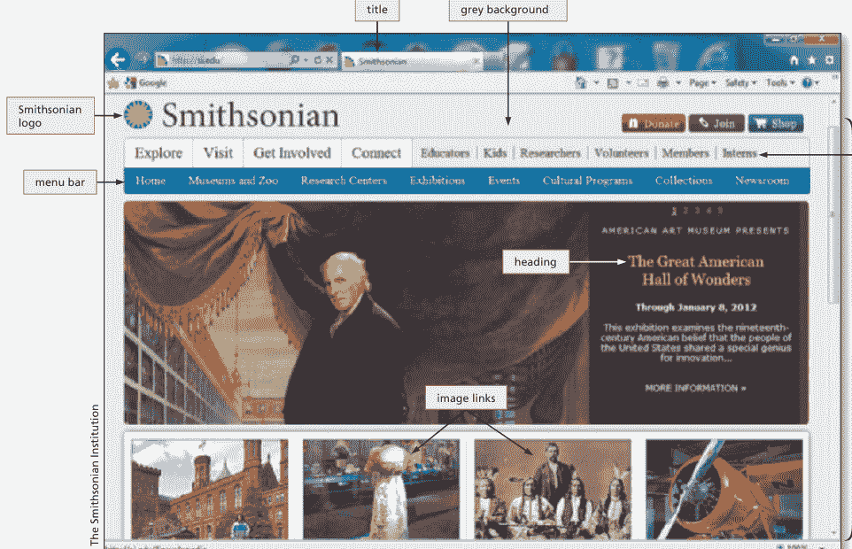

### 浏览器窗口元素

网页的**标题**是当网页显示时，出现在浏览器窗口标题栏和任务栏上的文本。如果用户将该页添加到浏览器的**收藏夹**或**书签**列表中，标题也是分配给该页的名称。由于标题非常重要，你应当始终在网页中包含一个标题。标题通常是你看到的第一个元素，它应当标明该页面的主题或目的。标题应当简洁而具有描述性，向访问者简要说明页面的内容或目的。

网页的**主体**包含在浏览器窗口中显示的信息。主体可以包括文本、图形和其他元素。网页显示包含在 `<body>`（开始主体）和 `</body>`（结束主体）标签内的所有内容。

网页的**背景**是一种纯色、一张图片或一个图形，网页的其他元素将在其上显示。选择背景时，务必确保它不会掩盖网页上的信息。在浏览网页时，请留意那些让网页内容无法清晰显示的背景颜色或图像。这无疑是网页开发者应当遵循的"避免事项"准则。

> ### 收藏夹与书签
> Internet Explorer、Google Chrome 和 Mozilla Firefox 都具有一个功能，允许你将网页添加到一个列表中，以便将来快速访问。Internet Explorer 将其称为"收藏夹"，而 Chrome 和 Firefox 则称之为"书签"。网页开发者需要确保在其网页中包含一个具有描述性的标题，因为这才是显示在书签或收藏夹中的标题。

### HTML 资源

网络上有很多关于 HTML 和网页开发的优秀信息资源。其中较好的资源之一是 HTML Goodies 网站，它提供各种主题的入门教程和进阶指南，以及免费下载和讨论区。要了解更多关于该网站的信息，请在搜索引擎中搜索"HTML Goodies"这个术语。

## 文本元素

普通文本是用于网页主要内容的默认文本格式。普通文本可用于标准段落，或格式化显示为：粗体、斜体或下划线；不同颜色等等。你也可以使用内联样式来更改文本格式，这是本书贯穿使用的方法。普通文本也可用于一系列称为列表的文本项。通常，列表是项目符号列表或编号列表。可以更改列表的各种属性。例如，你可能希望使用方形项目符号而非默认的圆形项目符号，或者将列表文本设置为斜体或粗体。

标题用于分隔文本段落或页面的不同部分。标题的字体比普通文本大，并且通常是粗体、斜体或与普通文本不同的颜色。标题大小从 1（最大）到 6（最小）不等。在设置网页时，通常从一个标题大小依次递减到下一个最小的大小。

## 图像元素

网页通常使用几种不同类型的图形或图像，例如图标、项目符号、线条、照片、插图或其他图片。在网页中使用的图像也称为内联图像，这意味着图像或图形文件不是 HTML 文件的一部分。相反，网络浏览器在将网页显示在浏览器窗口中时，会将单独的图形文件合并到网页中。HTML 文件包含 `` 标签，用于告诉浏览器从服务器请求哪个图形文件、在页面的哪个位置插入它以及如何显示它。

网页通常使用几种不同类型的内联图像。图像映射是一种特殊的内联图像类型，你可以在其中定义一个或多个区域作为热点。热点是图像中的一个区域，当被选中时会激活一个功能。例如，图像映射中的每个热点都可以链接到不同的网页。一些内联图像是动态的，意味着它们包含运动效果并且外观可以改变。

水平线是显示在网页上用于分隔页面不同部分的线条。虽然水平线的外观可以变化，但许多网页使用内联图像作为水平线。或者，你可以使用水平线标签（`<hr />`）来添加简单的水平线，例如本章项目中使用的那条线。

## 超链接元素

网页中更重要的元素之一是超链接，或称链接。链接是文本、图像或其他网页元素，你点击它以指示浏览器转到文件中的某个位置或从服务器请求一个文件。在网络上，链接是在网页之间和网站之间导航的主要方式。链接不仅指向网页，还指向图形、声音、视频、程序文件、电子邮件地址以及同一网页的不同部分。

文本链接，也称为超文本链接，是最常用的超链接。例如，前一页图 2–2 中的文本"志愿者"链接到志愿服务机会。当文本标识一个超链接时，它通常显示为带下划线的文本，颜色与网页的其他文本不同。

图像链接也非常常见。例如，图 2–2 中标识了两个图像链接。单击其中任何一个图像链接都会发送（或链接）用户到另一个网页，该网页包含关于这些项目的更多信息。公司或组织的标志，例如史密森尼学会的标志，通常用作指向主页或公司信息的图像链接。

## 定义网页结构

要创建一个 HTML 文档，你需要使用文本编辑器输入有关网页结构、网页内容以及如何显示该内容的说明。本书使用 Notepad++ 文本编辑器来为所有项目和练习输入 HTML 元素和内容。

在开始输入此项目的内容之前，你必须首先输入定义网页整体结构的标签。你可以通过插入一个 `<!DOCTYPE>` 标签和五个标签（`<html>`、`<head>`、`<meta />`、`<title>` 和 `<body>`）以及相应的闭合标签（`</html>`、`</head>`、`</title>` 和 `</body>`）来完成此操作。这些标签定义了标准网页的结构，并将 HTML 文件划分为其基本部分：页头信息和包含文本及图形的页面主体。

**`<!DOCTYPE>`** 标签用于告诉浏览器该文档使用的是哪种 HTML 或 XHTML 版本和类型。在本书中，我们将使用 HTML5 的 `<!DOCTYPE>` 标签。除了该标签外，万维网联盟（W3C）还支持其他版本 HTML 或 XHTML 的三种文档类型：严格型、过渡型和框架集型。**严格型**文档类型在希望禁止使用已弃用标签时指定。**已弃用标签**是 W3C 标记为最终将从其规范中移除的标签，因为这些标签已被更新、功能更强的标签、属性或 CSS 属性所取代。**过渡型**文档类型允许使用已弃用标签。**框架集型**文档类型用于在网页上支持框架，也允许使用已弃用标签，尽管框架标签已被 HTML5 淘汰。`<!DOCTYPE>` 标签包含一个 URL，该 URL 引用了位于 w3.org 网站上的文档类型定义。虽然本书不使用已弃用标签，但项目确实使用了 HTML5，它不需要引用文档类型定义的 URL。

> **`<!DOCTYPE>` 标签**
> w3schools.com 网站提供了关于用于 HTML5 或 XHTML 严格型、过渡型和框架集型文档类型的 `<!DOCTYPE>` 标签的更多信息。要了解更多关于 `<!DOCTYPE>` 标签的信息，请访问位于 w3.org 的 W3C 网站。它提供了关于此标签以及其他 HTML 标签的丰富信息。

## 定义 HTML 文档

在 `<!DOCTYPE>` 标签之后的第一组标签，`<html>` 和 `</html>`，表示一个 HTML 文档的开始和结束。这组标签包含了网页的所有内容、格式化该内容的标签以及定义文档不同部分的标签。软件工具（如浏览器）使用这些标签来确定文件中 HTML 代码的起始和结束位置。

### 头部

下一组标签，`<head>` 和 `</head>`，包含网页标题和其他文档头部信息。插入到 `<head> </head>` 容器中的标签之一是 meta 标签。**`<meta />`** 标签有多种功能。在本章中，它用于声明字符编码 UTF-8。**Unicode 转换格式（UTF）** 是一种压缩格式，允许计算机显示和操作文本。当浏览器遇到此 meta 标签时，它将根据标签中嵌入的特定 UTF-8 编码正确显示网页。UTF-8 是网页、电子邮件和其他应用程序的首选编码标准。选择的编码在验证网页时也很重要。meta 标签的其他用途将在本书后续章节中描述。`<title>` 标签是另一个插入到 `<head> </head>` 容器中的标签。**`<title>`** 和 **`</title>`** 标签表示网页的标题，当网页在浏览器窗口中显示时，它会出现在浏览器标题栏和任务栏上。当用户将页面添加到收藏夹或书签列表时，标题也是分配给该页面的名称。

### 主体

最后一组标签，`<body>` 和 `</body>`，包含网页的主要内容。所有文本、图像、链接和其他内容都包含在这最后一组标签内。下一页的表 2–1 列出了到目前为止描述的标签的功能，以及你将在本章中使用的其他标签。


## HTML 第2章 使用内联样式创建和编辑网页

**表2-1 基本 HTML 标签及其功能**

| HTML 标签 | 功能 |
| :--- | :--- |
| <!DOCTYPE> | 指示所使用 HTML 的版本和类型；可能包含指向 DTD 的 URL 引用 |
| <html> </html> | 指示 HTML 文档的开始和结束 |
| <head> </head> | 指示文档中用于标题和其他文档头部信息的部分的开始和结束 |
| <meta /> | 指示关于网页的隐藏信息 |
| <title> </title> | 指示标题的开始和结束。标题不会出现在网页的主体中，而是出现在浏览器的标题栏上。 |
| <body> </body> | 指示网页主体的开始和结束 |
| <hn> </hn> | 指示称为标题的文本部分的开始和结束；大小范围从 <h1> 到 <h6>。标题大小示例请参见 HTML 47 页的图 2-9a。 |
| <p> </p> | 指示新段落的开始和结束；在新段落上方插入一个空行 |
| <ul> </ul> | 指示无序（项目符号）列表的开始和结束 |
| <li> </li> | 指示紧随标签之后的项目是列表中的一个项目 |
| <hr /> | 插入一条水平线 |
| <br /> | 在标签出现的位置插入一个换行符 |

WordPad 是 Windows 附带的一个文本编辑器，你也可以用它来创建 HTML 文件。要启动 WordPad，请单击任务栏上的“开始”按钮，单击“开始”菜单中的“所有程序”，单击“所有程序”子菜单中的“附件”，然后单击“附件”文件夹中的“WordPad”。WordPad 帮助提供了有关如何使用该产品的提示。

Notepad++ 提供了丰富的帮助信息。程序内部有 Notepad++ 帮助，在线也有帮助设施。

大多数 HTML 开始标签，如 <html>、<head>、<title> 和 <body>，都有相应的结束标签，</html>、</head>、</title> 和 </body>。请注意，对于没有结束标签的标签，如 <meta />、<hr /> 和 <br />，标签使用一个空格后跟一个正斜杠来关闭。

## 启动 Notepad++

网页的规划、分析和设计完成后，你就可以开始使用文本编辑器输入 HTML 代码和网页内容来开发网页了。以下步骤假设 Windows 7 正在运行且 Notepad++ 已安装，并基于典型安装启动 Notepad++。你可能需要询问你的老师如何为你的计算机下载、安装和启动 Notepad++。

1. 单击 Windows 任务栏上的“开始”按钮以显示“开始”菜单。单击“开始”菜单左窗格底部的“所有程序”以显示“所有程序”列表。单击“所有程序”列表中的 Notepad++ 文件夹（图 2-3）。

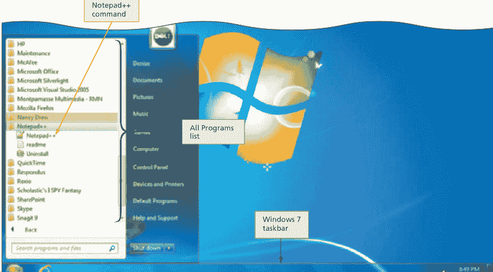

定义网页结构 HTML 41

1. 单击列表中的 Notepad++ 以显示一个空白的 Notepad++ 窗口（图 2-4）。
2. 如果 Notepad++ 窗口未最大化，请单击 Notepad++ 标题栏上的“最大化”按钮将其最大化。请注意，默认情况下，Notepad++ 启动时会打开最近使用的文件，因此你的 Notepad++ 屏幕可能与图 2-4 不同。要关闭所有打开的文件，请单击“文件”，然后单击“全部关闭”。

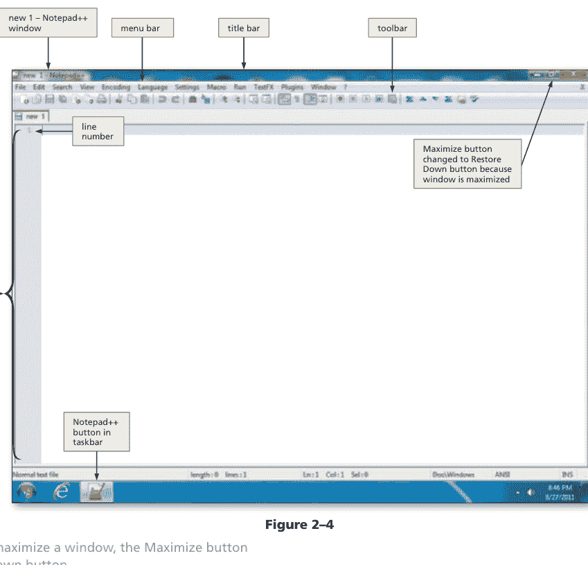

> **问与答** 什么是最大化窗口？
最大化窗口会填满整个屏幕。当你最大化一个窗口时，“最大化”按钮会更改为“向下还原”按钮。

> **问与答** 如何将 Notepad++ 添加到我的“开始”菜单或任务栏？
要将 Notepad++ 添加到“开始”菜单或任务栏，请完成上面的步骤 1，右键单击 Notepad++，然后单击“附加到开始菜单”或“附加到任务栏”。

| 其他方式 |
| --- |
| 1. 如果桌面上有 Notepad++ 图标，请双击它 | 2. 如果“开始”菜单上有，请单击 Notepad++ |

## 在 Notepad++ 中启用自动换行

在 Notepad++ 中，除非启用了自动换行功能，否则在文本区域中输入的文本会持续向右滚动。**自动换行**会使文本行在窗口右边缘处断开并出现在新行上，因此所有输入的文本在 Notepad++ 窗口中都可见。启用自动换行时，即使一段文本可能在 Notepad++ 中显示为多行，它也将被分配一个逻辑行号。自动换行不会影响文本打印的方式。以下步骤显示了如何在 Notepad++ 中启用自动换行。

- 单击菜单栏上的“视图”（图 2-5）。
- 如果“自动换行”旁边没有复选标记，请单击“自动换行”。

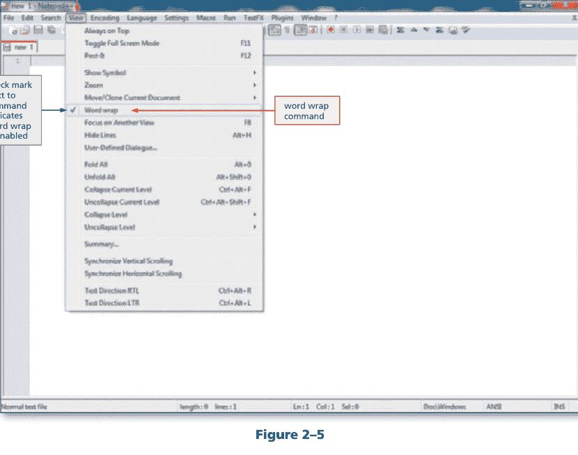

> **问与答**
如何知道自动换行是否已启用？
当启用自动换行时，“视图”菜单上的“自动换行”命令前会有一个复选标记，并且当你输入时，你的文字会保留在屏幕上。

**问与答**
如果未启用自动换行，文本会怎样？
段落的文本在 Notepad++ 中会全部显示在一行上并滚动出屏幕，尽管网页在浏览器中仍会正确显示。为了在 Notepad++ 中的可读性，你应该启用自动换行。

## 使用 HTML 标签定义网页结构

第一个任务是输入定义网页结构的初始标签。表 2-2 包含用于创建 HTML 35 页图 2-1a 所示网页的 HTML 标签和文本。在本章和本书中，当需要输入大段 HTML 代码或文本时，你将在带有行号引用的表格中找到这些代码或文本，而不是在步骤中。步骤将指导你输入表格中所示的文本。

表 2-2 初始 HTML 标签

| 行 | HTML 标签和文本 |
|---|---|
| 1 | <!DOCTYPE HTML> |
| 2 | |
| 3 | \<html\> |
| 4 | \<head\> |
| 5 | \<meta charset="utf-8" /\> |
| 6 | \<title\>Rock Climbing Fun\</title\> |
| 7 | \</head\> |

以下步骤说明了如何输入定义网页结构的初始标签。

1. 输入表 2-2 中所示的 HTML 代码（图 2-6）。在每行末尾按 ENTER 键。如果在输入过程中出错，请使用 BACKSPACE 键删除所有字符，直到并包括错误字符，然后继续输入。

- 按 ENTER 键开始下一行代码，在 \</head\> 标签后留一个空行。

- 将你输入的内容与图 2-6 进行比较。如果你发现错误，请使用鼠标指针或箭头键将插入点移动到每个错误的右侧，然后使用 BACKSPACE 键更正错误。

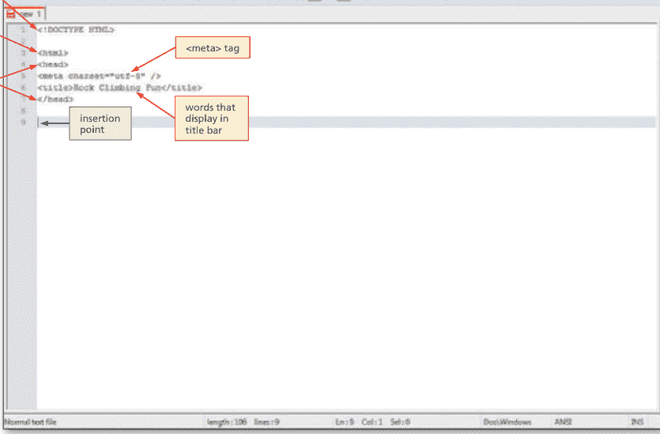

图 2-6

## HTML 第2章 使用内联样式创建和编辑网页

- 在第 9 行，输入 `<body>` 然后按两次 ENTER 键。
- 输入 `</body>` 然后按 ENTER 键。
- 输入 `</html>` 作为结束标签（图 2-7）。
- 将你输入的内容与图 2-7 进行比较，必要时更正你的输入错误。

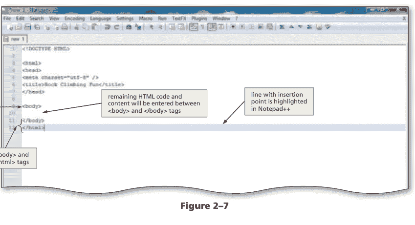

图 2-7

> **我是否必须为每个我开发的网页输入初始 HTML 标签？**
许多其他章节中使用了相同的初始 HTML 标签。为避免重新输入这些标签，你可以保存刚刚输入的代码，并为其指定一个新的文件名，例如 structure.html 或 template.html。如果你将此文件保存在文件夹的根级别，你将在其他章节中轻松访问它。

**我的 HTML 代码可以使用大写或小写字母吗？**
HTML5 允许以大写、小写或混合大小写输入标签。但是，在本书中，项目说明遵循第 1 章 HTML 13 页表 1-3 中介绍的指南。

> **了解如何格式化文本的各种元素。**
通过格式化网页上的字符和段落，你可以改善其整体外观。在网页上，请考虑以下格式化建议。

- **确定网页布局。** HTML5 引入了新标签来格式化网页的布局。这些标签包括 head、section、articles 和 footer 部分。
- **在适当时使用默认文本大小。** 正文文本由标题和网页底部之间的所有文本组成。此文本以尽可能少的单词突出显示消息的关键点。它应该易于阅读和遵循。在强调积极面的同时，正文文本必须是现实、真实和可信的。默认字体大小和样式适合用于正文。
- **有效利用标题。** 主标题通常是网页上的第一行文本。它传达网页的目的，例如标识公司名称。在此项目中，公司名称是页面顶部使用的图像的一部分，因此不需要 1 号标题。应遵循标题大小标准，如 HTML 47 页图 2-9 所示。主标题应为 1 号，子主题或副标题应为 2 号。对于本章中的网站，你从 2 号标题开始，因为主标题是图像的一部分。该标题标识了所需的设备。通常不建议从一个标题大小跳到小两级的标题。例如，如果你的主标题是 1 号，那么下一个标题应该是 2 号，而不是 4 号。
- **用项目符号列表突出显示关键点。** 项目符号是位于列表项开头的点或其他符号。项目符号列表包含特定信息，通过列表比通过段落文本能更清楚地识别这些信息。


## 格式化网页

在 HTML 4.01 中，引入了 `<div>` 标签来分隔网页内的各个部分。这运作良好，我们在整本书中都使用了 `<div>` 标签。HTML5 引入了新的语义元素，以帮助网页开发者构建网页的布局。这些标签是**语义化**的，因为标签的名称反映了其用途。例如，新的 `<footer>` 标签用于显示网页底部（或页脚）的内容。`<aside>` 标签用于添加与网页主要内容**切线相关**或属于次要议题的内容。这些新的 HTML5 标签，包括 `<article>`、`<aside>`、`<footer>`、`<header>`、`<nav>` 和 `<section>`，将用于本书中的网页项目布局。虽然 `<div>` 标签与 id 属性（见图 2-8a）结合也能实现相同的布局效果，但 Web 开发的未来包括了这些新的 HTML5 布局标签。图 2-8b 展示了 HTML5 提供的新结构元素以及它们如何帮助构建网页结构。请注意，根据网页设计的不同，`<nav>`（导航）标签也可以用在页面顶部 header 下方。

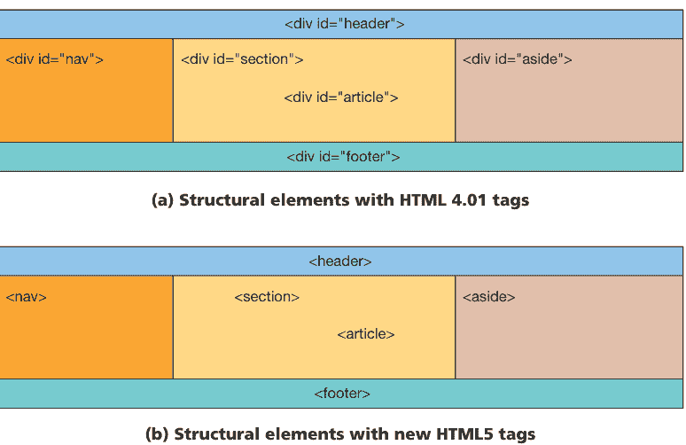

页眉（header）部分是网页的顶部区域，通常用于放置公司标志、主标题文本或导航。`<nav>` 标签标识了一个可以替代用于导航的网页区域。`<section>` 标签用作通用的文档或应用部分。一个部分（section）可以用来组织网页内容，并搭配标题标签（即 h1 到 h6）。文章（article）插入在部分（section）内，以丰富内容。`<aside>` 标签代表与页面其余部分稍有关联的内容，例如评论、传记或背景信息。页脚（footer）通常用于放置公司信息。表 2-3 描述了这些新标签各自的用途。本章中的项目包含一个页眉、一个页脚和一个包含一篇文章的部分。

### 表 2–3 HTML5 结构元素

| 元素 | 用途 |
| :--- | :--- |
| 页眉 (Header) | 放置在网页顶部的信息，例如标志或主标题 |
| 导航 (Navigation) | 链接到网页其他部分、网站其他部分或网站外部的导航结构 |
| 部分 (Section) | 网页上的主要内容区域 |
| 文章 (Article) | 代表独立信息片段的内容 |
| 侧边栏 (Aside) | 与网页主题切线相关或稍有关联的内容 |
| 页脚 (Footer) | 放置在网页底部的信息，例如版权或联系信息 |

## 输入网页内容

一旦建立了网页结构，就该输入网页的内容了，包括标题、一段信息性文本段落、一个子主题标题和一个项目符号列表。

网页通常包含大量的文本。由于你在 Notepad++ 中开启了自动换行（见第 HTML 42 页图 2–5），你输入的所有文本都将显示在一个 Notepad++ 窗口中。如果有大量信息，你可以将文本分成段落，这有助于分隔关键思想并使文本更易于阅读。段落之间使用 `<p>`（开始段落）和 `</p>`（结束段落）标签，并用一个空行分隔。在一个网页上放置过多的文本不是一个好选择。你的读者可能会在大段的文本中迷失。如果你发现自己必须按 Page Down 键数十次才能到达网页底部，你就需要考虑重构你的网页。你可以将大块信息拆分到更多的标题下，这样会更易于管理和阅读。

标题用于分隔网页上的文本或添加新主题。标题有几种样式和大小，由 `<h1>` 到 `<h6>` 标签表示，其中 `<h1>` 最大。通常，除非你使用图形图像作为标题（我们将在后续步骤中这样做），否则你会使用 Heading 1 样式作为主标题。图 2–9a 展示了一个使用不同大小标题的网页。一个网页通常只有一个主标题；因此，该网页的 HTML 文件通常只有一组 `<h1>` 标签。保持网页外观一致的一种方法是为同一主题级别的标题使用相同的标题大小（图 2–9b）。本章后面插入的页眉图像将取代图 2–9b 中网页顶部的主标题。因此，完整的网页将不会有任何 `<h1>` 标题。注意，在图 2–9b 中，文本段落和项目符号列表都是由 2 级标题分隔的。这种分隔表明这些文本（即两个段落加一个项目符号列表）在网页上的重要性处于同一级别。

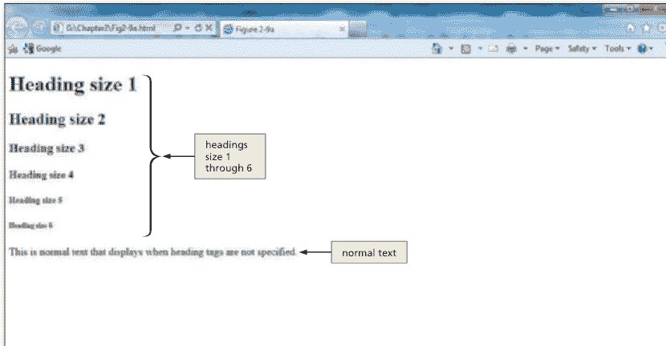

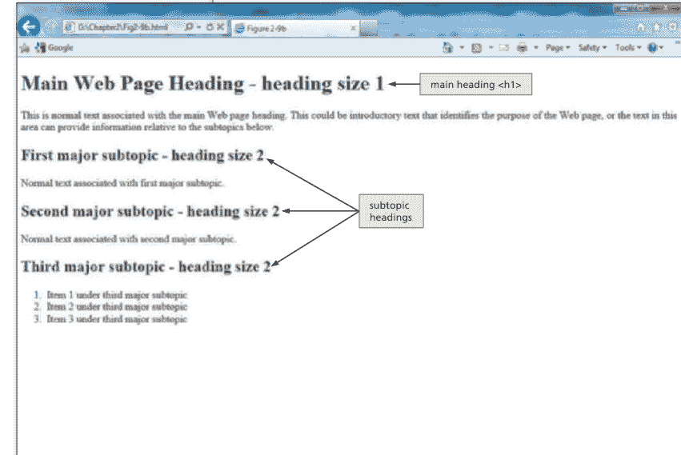

(a) 六种标题大小的示例。

(b) 一致地使用标题有助于组织网页内容。

图 2–9

有时，网页上的文本以列表格式而不是段落格式呈现，对用户来说更容易阅读和理解。HTML 提供了几种类型的列表，但最常用的是无序（项目符号）列表和有序（编号）列表。在 Web 开发生命周期的设计阶段，你需要决定组织网页内容和格式化网页上文本最有效的方式。你的主要目标是给网页访问者提供一种有效的方式来找到他们需要的信息。如果用户不能轻松找到所需内容，他们就不会再次访问你的网站。

> **用于组织的标题**
> 使用标题来组织网页内容和强调关键点时，务必保持一致性。也就是说，如果你对特定级别的文本使用了 heading 2（`<h2>`）样式，那么你就应该始终使用 heading 2 样式来分隔该级别的信息。另外，不要在文档中跳过标题级别。例如，不要从 heading 1（`<h1>`）样式开始，然后使用 heading 3（`<h3>`）样式。

## 输入文本段落

输入初始的 HTML 标签后，接下来你使用 `<p>` 标签添加一个文本段落。当浏览器在 HTML 文件中找到 `<p>` 标签时，它会开始一个新行，并在新段落上方插入一个空行。`</p>` 结束标签表示段落的结束。输入这个文本段落时，不要在每行末尾按 ENTER 键。因为自动换行已开启，即使不按 ENTER 键，你的文本也会自动换行到下一行。表 2-4 包含了该段落中使用的 HTML 标签和文本。

### 表 2-4 添加文本段落

| 行 | HTML 标签和文本 |
| :--- | :--- |
| 11 | `<section>` |
| 12 | `<article>` |
| 13 | `<p>Rock Climbing Fun has recently opened a school at the base of Mount Rainier. We have programs for advanced rock climbers as well as for beginners. Rock climbing is a widely popular sport, especially in the state of Washington. Classes run from early morning to mid-afternoon, and private climbing lessons are available. Come join our classes and experience the fun and great exercise that rock climbing can provide. Call 1-800-555-CLIMB for more information.</p>` |

以下步骤说明了如何在 HTML 文件中输入文本段落。

1.  单击第 10 行，然后按 ENTER 键。
2.  将插入点置于第 11 行，输入如表 2-4 所示的 HTML 代码。输入第 13 行的文本时，不要在每行末尾按 ENTER 键，句号后只使用一个空格。
3.  按 ENTER 键两次，将插入点定位到第 15 行（图 2-10）。

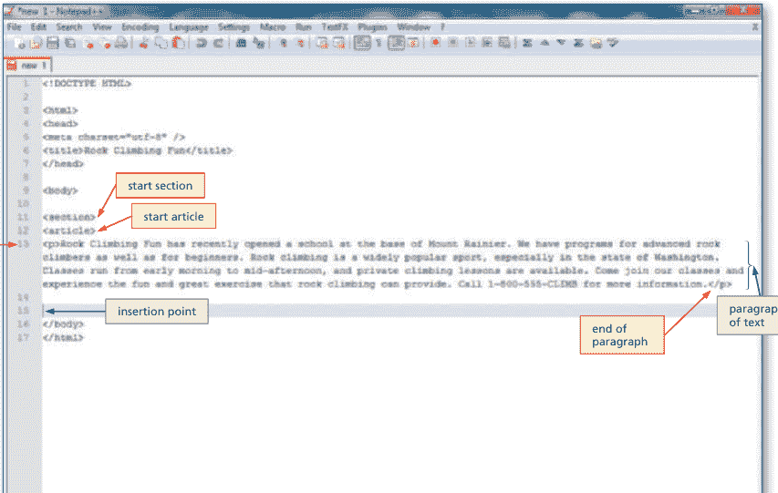

> 为什么在表 2-4 的第 13 行中，每行代码输入后不按 ENTER 键？

因为在你启动 Notepad++ 后立即开启了自动换行，所以你输入的段落文本会自动换行到下一行。文本会延伸到 Notepad++ 窗口的末尾然后换行。如果你没有开启自动换行，你输入的文本会继续向右滚动，而左侧的文本则会滚出屏幕。开启自动换行后，所有文本都保持在 Notepad++ 窗口中可见。

图 2-10


## 添加标题

标题“入门所需设备”用于分隔文本段落和项目符号列表。您使用 `<h2>` 标题，因为它并非网页的主标题。您将在本章稍后插入一张图片作为主标题。以下步骤说明如何在网页上添加标题。

1.  将插入点置于第 15 行，在文本区域输入 `<h2>入门所需设备：</h2>`，然后按两次回车键（图 2–11）。

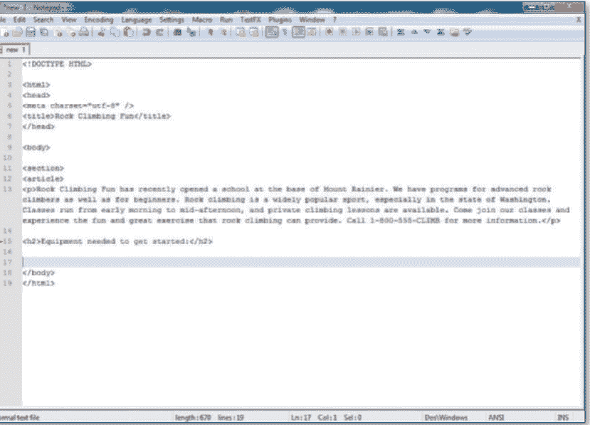

## 使用列表呈现内容

列表将文本组织成条目格式。通常，列表使用项目符号（无序）或编号（有序）。**无序列表**，也称为**项目符号列表**，使用称为项目符号的小图像来格式化信息。图 2–12 展示了格式化为无序（或项目符号）列表的网页文本以及用于创建这些列表的 HTML 代码。
**有序列表**，也称为**编号列表**，使用数字或字母按顺序格式化信息。有序列表非常适合用于组织必须强调顺序的项目，例如一系列步骤。图 2–13 展示了格式化为有序（或编号）列表的网页文本以及用于创建这些列表的 HTML 标签。

`<ul>` 和 `</ul>` 标签必须位于无序或项目符号列表的开头和结尾。`<ol>` 和 `</ol>` 标签用于有序或编号列表的开头和结尾。无序和有序列表具有可选的项目符号和编号类型。如图 2–12 所示，无序列表可以使用三种不同的项目符号选项之一：实心圆点、方块或空心圆。如果未指定类型，则使用默认的实心圆点。您也可以使用图像作为项目符号，这将在后面的章节中展示。有序列表可以使用数字、字母或罗马数字，如图 2–13 所示。默认选项是使用阿拉伯数字，如 1、2 和 3。在输入 `<ul>` 或 `<ol>` 标签以定义列表类型后，使用 `<li>` 和 `</li>` 标签来定义有序或无序列表中的每个列表项。

### 列表样式

有时将网页文本组织成列表会很有帮助。您可以使用多种列表选项。网页的用途决定了哪种方式更有效。有关列表样式选项，请参见附录 D 中的“列表样式”部分。

## 创建无序列表

为了突出显示访问者参加“Rock Climbing Fun”课程时需要的设备，您将使用表 2–5 中所示的 HTML 标签和文本创建一个项目符号（无序）列表。请记住，每个列表项必须以 `<li>` 开头，以 `</li>` 结尾。

### 表 2–5 添加无序列表

| 行 | HTML 标签和文本 |
| :--- | :--- |
| 17 | `<ul>` |
| 18 | `<li>舒适的攀岩鞋</li>` |
| 19 | `<li>背包</li>` |
| 20 | `<li>安全带</li>` |
| 21 | `</ul>` |
| 22 | `</article>` |
| 23 | `</section>` |

以下步骤说明如何使用默认的项目符号样式创建一个无序（或项目符号）列表。

1.  将插入点置于第 17 行，输入表 2–5 中所示的 HTML 代码。在第 18 行输入文本时，请确保在行首按 TAB 键（如果第 19 行和第 20 行未自动缩进，也需如此操作）。在每行末尾按回车键。

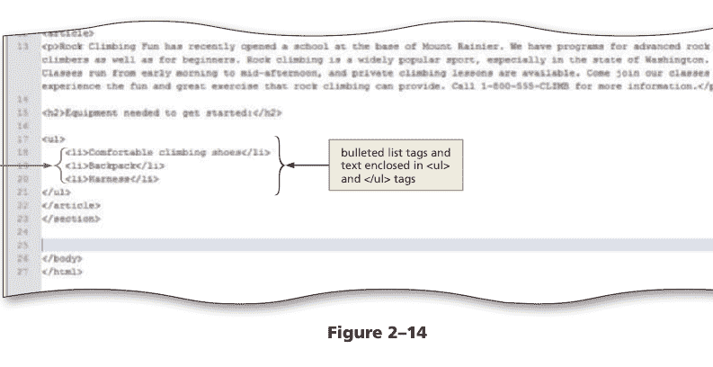

2.  在第 23 行，按两次回车键，将光标定位到第 25 行，并在第 24 行留出一个空行（图 2–14）。

> 为什么要在包含 `<li>`（列表项）代码的行首按 TAB 键？
> 在输入列表项时使用 TAB 键（缩进）有助于格式化文本，使您能轻松看出此文本与段落文本不同。缩进文本有助于网页开发者识别代码中的特定部分是相互关联的。

## 关于列表格式的更多信息

如果使用不带属性的 `<ul>` 或 `<ol>` 起始标签，您将得到默认的项目符号（实心圆点）或编号样式（阿拉伯数字）。要更改项目符号或编号类型，需在 `<ol>` 或 `<ul>` 标签内输入 **list-style-type** 属性。要创建带有方块项目符号的列表，您应输入以下行

```html
<ul style="list-style-type: square">
```

作为内联样式（CSS）代码。您可以在附录 D 中找到其他列表样式属性和值。

除了有序和无序列表外，还有第三种列表，称为**定义列表**，它以类似字典的方式突出显示信息。虽然它们的使用频率低于无序或有序列表，但定义列表对于创建类似术语和定义词汇表的列表非常有用，如图 2–15a 所示。图 2–15b 展示了用于创建定义列表的 HTML 代码。

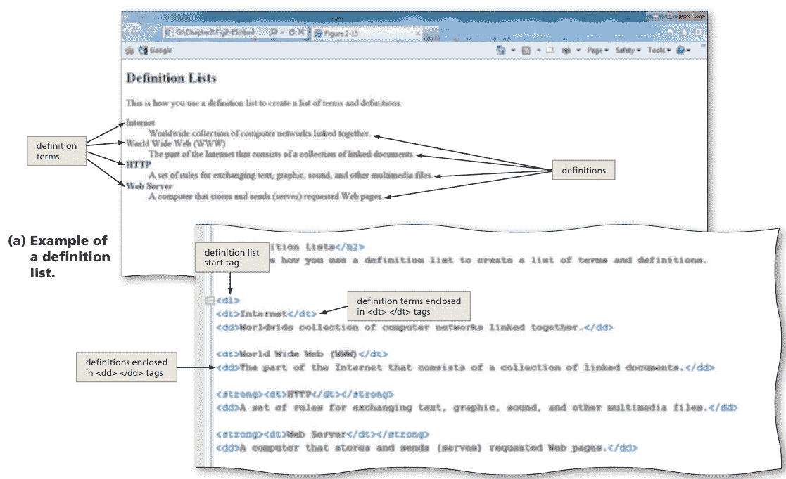

定义列表的语法不像无序和有序列表样式中使用的 `<ul>`、`<ol>` 或 `<li>` 结构那样直观。对于定义列表，您使用 `<dl>` 和 `</dl>` 标签来开始和结束列表。`<dt>` 标签表示一个术语，`<dd>` 标签通过缩进该术语的定义来标识该术语的定义。表 2–6 列出了定义列表标签及其用途。

| 定义列表标签 | 用途 |
|---|---|
| `<dl>` `</dl>` | 开始和结束一个定义列表 |
| `<dt>` `</dt>` | 标识一个术语 |
| `<dd>` `</dd>` | 标识正上方术语的定义 |

如图 2–15 所示，默认情况下，定义术语左对齐，每个术语的定义都缩进，以便轻松区分其为上方术语的定义。为了更清晰地标识定义术语，您可能希望将术语加粗，如图 2–15 中最后两个定义（HTTP 和 Web Server）所示。您可以通过将术语包裹在 `<strong></strong>` 容器中来实现这一点。这会给术语强烈的强调，因此文本通常显示为粗体文本。以下代码可以为 HTTP 定义术语实现此效果。

```html
<strong><dt>HTTP</dt></strong>
```

## 添加页脚

正如本章前面提到的，HTML5 引入了几个新的结构元素，有助于增强网页的布局。这些新元素之一，页脚，将在本章的下一节中插入。页脚标签用于将文本定位到网页底部。放置在那里的内容通常与公司的地址、版权或联系信息有关。

## 添加页脚

让网站访问者能够联系公司非常重要。在下一步中，您将使用表 2–7 中所示的标签和文本，在 HTML 文件中插入一个标签，将公司联系信息输入到网页上。

### 表 2–7 添加页脚

| 行 | HTML 标签和文本 |
| :--- | :--- |
| 25 | `<footer>` |
| 26 | Rock Climbing Fun, 3737 Harrison Lane, Issawak, WA 98000 |
| 27 | `</footer>` |

1.  将插入点置于第 25 行，输入表 2–7 中所示的 HTML 代码。在每行末尾按回车键（图 2–16）。

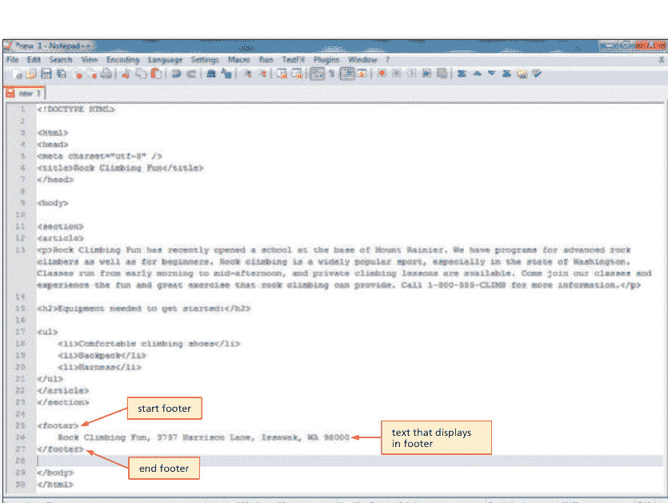

**HTML 文件名**
HTML 文件的扩展名为 .html 或 .htm。网站的主页通常称为 index.html、index.htm、default.html 或 default.htm。请咨询您的网络托管服务提供商，以确定他们使用哪个名称。

**保存您的工作**
在操作过程中定期保存 HTML 文件是一个好习惯，以避免丢失已完成工作的风险。您应该养成在添加大量信息（例如段落或图像）后保存文件的习惯。在输入多个难以重做的 HTML 标签后，您可能也想保存文件。

**存储您的文件**
许多学校为学生提供 Web 服务器上的空间来存储他们的网页。然而，将您的网页保存到其他介质（例如 USB 闪存驱动器）可确保您拥有已创建文件的备份副本。将网页文件保存到学校实验室的计算机硬盘上，存在下次进入该实验室时文件不存在的风险。许多学校在计算机启动时删除所有文件。

## 保存和组织 HTML 文件

在您可以在 Web 浏览器中查看 HTML 文件之前，必须保存它。出于以下原因，保存 HTML 文件也很重要：

- 如果计算机关闭或在文本编辑器打开时断电，内存中的文档将会丢失。
- 如果时间不够无法完成项目，您可以在将来继续完成文档，而无需重新开始。

要保存文件，请使用 Notepad++ 的“文件”->“保存”命令。保存文件时，您需要给文件命名，然后加上文件扩展名。正如本书前面提到的，文件名应始终与其用途相关。例如，将文件命名为 page1 并未说明该文件的用途。将文件命名为 rockclimbing 则立即表明该文件与该主题有关。本书中的网页文件始终使用全小写字母命名，且不含空格。这是本书遵循的标准。

HTML 文件必须以 **.htm** 或 **.html** 扩展名结尾。许多较旧的 Web 服务器只能显示扩展名为 .htm 的页面，或短文件名（即长度最多为八个字符的文件名）。扩展名为 .html 的 HTML 文件可以在允许长文件名（即长度最多为 255 个字符）的操作系统上的 Web 服务器上查看。几乎所有当前的操作系统都允许长文件名，包括 Windows 7、Windows Vista、Windows XP、Windows Server 2003/2008、Windows 2000、Mac OS X 和 Linux。对于运行不接受长文件名操作系统的 Web 服务器，您需要使用 .htm 扩展名。在本书中，所有文件都使用 .html 扩展名保存。

您将使用一个非常简单的文件夹结构来存放本书中的所有项目。因此，将文件组织到文件夹中非常重要，这样项目的所有文件，包括 HTML 代码和图形图像，都保存在同一个文件夹中。如果您从学生数据文件（见本书封底内页）正确下载了文件，您将拥有所需的文件结构。最初保存 rockclimbing.html 文件时，您将把它保存在 Chapter02 文件夹的 ChapterFiles 子文件夹中。第 2 章中使用的图形图像 rockclimbing.jpg 将存储在同一文件夹中——Chapter02\ChapterFiles。因为本书中的章节项目相对简单且使用较少的图像，所以图像和 HTML 代码存储在同一个文件夹中。然而，在实际应用中，一个网站可能包含数百或数千个文件，更合适的做法是将 HTML 代码和图形图像分开存放在不同的子文件夹中。您将在第 3 章中学习更多关于组织 HTML 文件和文件夹的知识。

**提前规划**

- **确定保存网页的位置。**
    保存网页时，必须决定使用哪种存储介质。
    - 如果您总是在同一台计算机上工作，并且不需要将项目传输到其他位置，那么您计算机的硬盘驱动器将足以作为存储位置。然而，将项目的备份副本保存在单独的介质上是一个好主意，以防文件损坏或计算机硬盘故障。
    - 如果您计划在不同位置或多台计算机上处理项目，则应将项目保存在可移动介质上，例如 USB 闪存驱动器或 CD。本书中的项目使用 USB 闪存驱动器，它可以快速可靠地保存文件，并且可以重复使用。CD 易于携带，并且是项目最终版本的良好备份，因为它们通常只能保存一次文件。

以上是关于保存文件的一般准则。您的讲师可能会给出与后续步骤不同的具体保存指示。


## 保存 HTML 文件

在创建此项目时，您已经输入了大量文本，不希望冒着丢失目前所完成工作的风险。此外，要在浏览器中查看 HTML，您必须先保存该文件。以下步骤将展示如何保存 HTML 文件。

1. 将 USB 闪存驱动器连接到计算机的某个 USB 端口，点击 Notepad++ 菜单栏上的文件 (File)（图 2–17）。

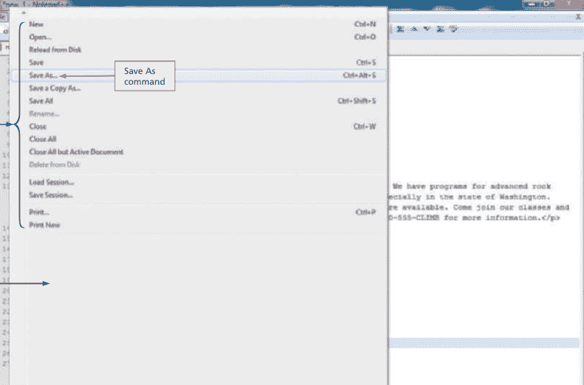

2. 点击文件 (File) 菜单上的另存为 (Save As) 以显示另存为对话框（图 2–18）。

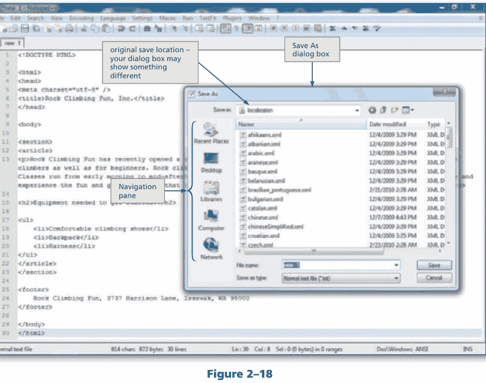

> **问答** 我必须保存到 USB 闪存驱动器吗？
> 不一定。您可以保存到任何设备或文件夹。文件夹是存储介质上的一个特定位置。使用相同的过程，但选择您的设备或文件夹即可。

3. 在文件名文本框中键入 rockclimbing.html 以更改文件名。键入文件名后不要按回车键。
4. 点击对话框左侧的计算机 (Computer) 以显示可用驱动器的列表（图 2-19）。
5. 如有必要，滚动列表，直到您的 USB 闪存驱动器（例如 UDISK 2.0 (G:)）出现在可用驱动器列表中。

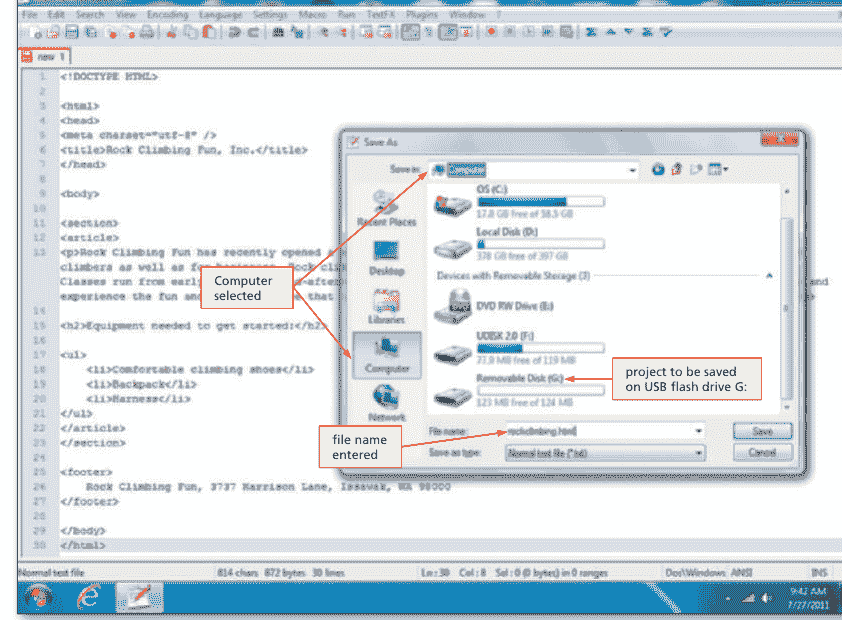

图 2–19

> **问答** 为什么我的文件、文件夹和驱动器列表与图中显示的排列和命名方式不同？
> 您计算机的配置决定了文件和文件夹列表的显示方式以及驱动器的命名方式。

> **问答** 如何知道我的文件将保存在哪个驱动器和文件夹中？
> Notepad++ 会显示可用驱动器和文件夹的列表。然后您可以选择希望保存文件的驱动器和/或文件夹。

6. 在计算机列表中双击 UDISK 2.0 (G:)（或您的存储设备），选择 USB 闪存驱动器（本例中为 G 盘）作为新的保存位置。

> **问答** 如果我的 USB 闪存驱动器名称或盘符不同怎么办？
> 您的 USB 闪存驱动器很可能具有不同的名称和盘符，并且连接到不同的端口。请验证计算机列表中的设备是否正确。

7. 如有必要，打开 Chapter02\ChapterFiles 文件夹（图 2–20）。

> **问答** 如果我的 USB 闪存驱动器中没有名为 Chapter02\ChapterFiles 的文件夹怎么办？
> 如果您按照步骤从学生数据文件下载了章节文件，您应该有一个名为 Chapter02\ChapterFiles 的文件夹。如果没有，请咨询您的讲师。

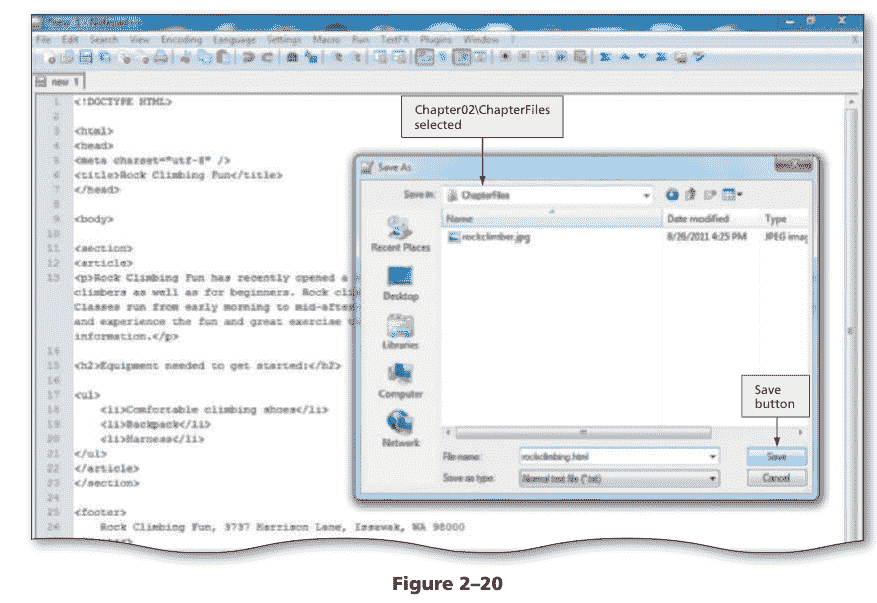

8. 点击另存为对话框中的保存按钮，将文件以 rockclimbing.html 的名称保存在 USB 闪存驱动器上（图 2–21）。

> **问答** 现在我的文件只在 USB 驱动器上了吗？
> 不，虽然 HTML 文件已保存在 USB 驱动器上，但它也保留在内存中并显示在屏幕上（图 2–21）。Notepad++ 在标题栏和文档选项卡上显示新的文件名。

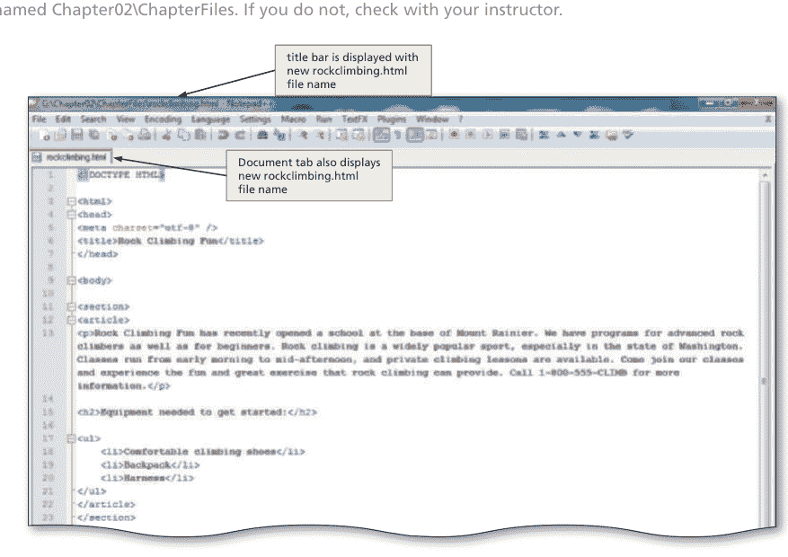

**其他方法**
1. 按 CTRL+ALT+S，键入文件名，点击计算机 (Computer)，选择驱动器或文件夹，点击保存按钮

> **附带说明** 为多种浏览器开发网页：在开发网页时，您必须考虑访问者将使用的浏览器类型。流行的浏览器包括 Internet Explorer、Google Chrome、Mozilla Firefox 和 Apple Safari。彻底测试的一部分包括在不同浏览器的多个版本中查看您的网页。

## 使用浏览器查看网页

保存 HTML 文件后，您应该在浏览器中查看该网页，以查看到目前为止网页的样子。HTML 文件在浏览器中的显示方式，就好像该文件在 Web 上可用一样。通常，在开发期间定期查看网页是一种良好的编码习惯，因为它允许您查看各种 HTML 标签对文本的效果，并检查 HTML 文件中的错误。如果您的计算机在浏览器窗口打开时连接到互联网，它会显示一个**主页**（或**起始页**），这是每次启动 Internet Explorer 时都会出现的网页。

## 启动浏览器

HTML 文件已保存在 USB 驱动器上，下一步是使用浏览器查看该网页。由于 Windows 是**多任务**操作系统，您可以同时运行多个程序，例如 Notepad++ 和您的浏览器。以下步骤说明如何启动浏览器来查看网页。

1. 点击任务栏上的 Internet Explorer 图标（图 2–22）。

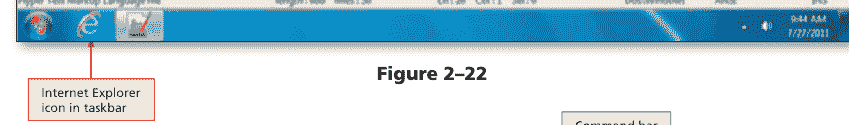

> **问答** 为什么我的浏览器显示不同的窗口？
> 因为可以通过浏览器设置更改作为主页显示的网页，所以您的浏览器显示的主页可能不同。学校和组织通常会为实验室或办公室计算机上安装的浏览器自定义主页。

2. 如有必要，点击最大化按钮以最大化浏览器窗口（图 2–23）。


**其他方法**
1. 点击开始 (Start)，点击所有程序 (All Programs)，点击 Internet Explorer
2. 双击桌面上的 Internet Explorer 图标（如果有）

版权所有 2012 Cengage Learning。保留所有权利。未经许可，不得以任何形式或任何方式（电子、机械、影印、录制或其他）复制、扫描或重复本出版物的任何部分。由于电子权利方面的原因，某些第三方内容可能会从电子书和/或电子章节中被删除。编辑审查认为，任何被删除的内容不会对整体学习体验产生重大影响。Cengage Learning 保留根据后续权利要求随时删除额外内容的权利。

## 在浏览器中查看网页

浏览器允许您打开位于计算机上的 Web 文件，并拥有完整的浏览功能，就好像该网页存储在 Web 服务器上并可在 Web 上访问一样。以下步骤使用此技术在浏览器中查看 HTML 文件 rockclimbing.html。

1. 点击地址栏以选择 URL。键入 g:\Chapter02\ChapterFiles\rockclimbing.html，在地址栏中输入 HTML 文件的路径（图 2–24）。

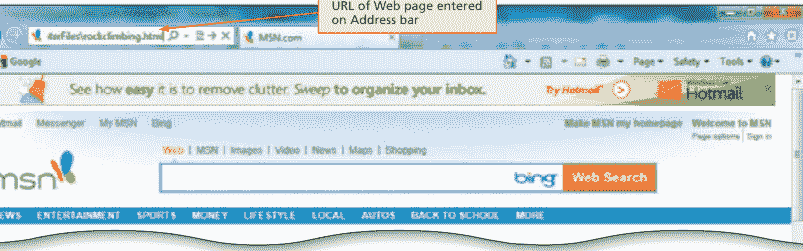

> **问答** 如果我的文件在其他位置怎么办？
> 您可以在地址栏中键入文件的路径，或浏览到您的文件，如“其他方法”所示。

2. 按回车键显示 rockclimbing.html 页面，就好像它在 Web 上可用一样（图 2–25）。

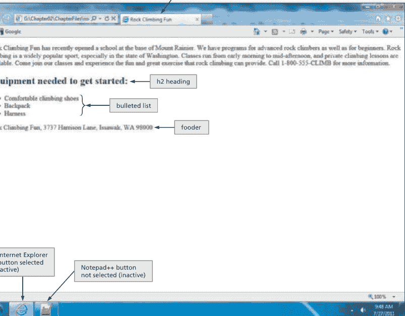

> **问答** 如果我的页面显示不正确怎么办？
> 仔细检查您的 rockclimbing.html 文件与下一页的图 2–26，确保您没有输入错误或遗漏任何内容。更正错误，重新保存文件，然后通过在浏览器中刷新网页再次尝试。

**其他方法**
1. 在 Windows 资源管理器中，双击 HTML 文件名以在默认浏览器中打开
2. 在 Windows 资源管理器中，右键点击 HTML 文件名，指向打开方式 (Open with)，点击浏览器名称

## 激活 Notepad++

查看网页后，您可以通过向 HTML 文件添加额外的标签或文本来修改它。要继续编辑，您必须首先返回到 Notepad++ 窗口。以下步骤说明如何激活 Notepad++。

1. 点击任务栏上的 Notepad++ 按钮以最大化 Notepad++ 并使其成为活动窗口（图 2–26）。

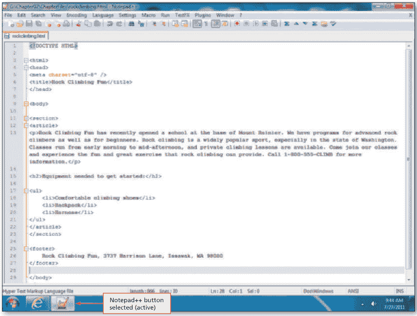

## 改善网页的外观

网页开发的一个目标是创建视觉上吸引人并能保持访客兴趣的网页。本章到目前为止开发的网页功能齐全，但缺乏视觉吸引力。在本节中，您将学习如何改善网页的外观，从图 2–27a 所示的样子到图 2–27b 所示的样子，方法包括添加图像、为标题添加颜色、更改页脚样式、添加水平线以及更改项目符号列表的列表样式类型。这些任务中的许多都可以通过使用样式表来完成。


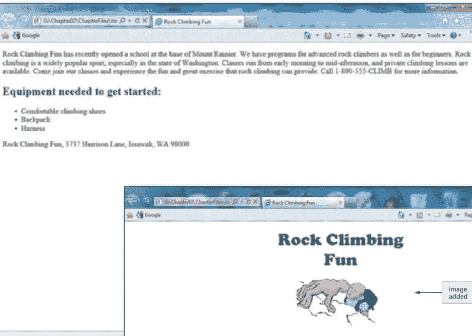

(a) “攀岩乐趣”网页。

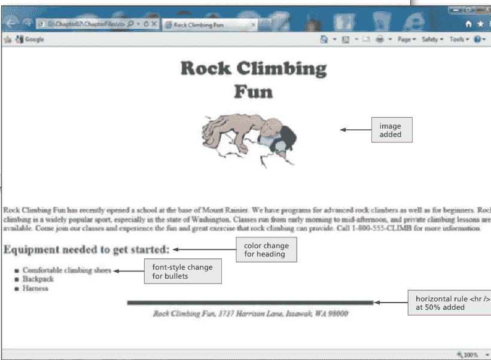

(b) 为改善外观而格式化后的“攀岩乐趣”网页。

图 2-27

### 使用样式表

虽然 HTML 允许 Web 开发者对网页的结构、设计和内容进行更改，但它在定义一个或多个网页的外观（或样式）方面能力有限。因此，样式表应运而生。

作为回顾，**样式**是定义网页上元素外观的一条规则。**层叠样式表（CSS）**则是一系列规则，用于定义单个网页或整个网站的样式。借助样式表，你可以通过更改字体族、字号、边距和链接规范等特性来改变一个或多个网页的外观。

CSS 的最新版本是 CSS3。与 HTML5 一样，CSS3 在万维网联盟（W3C）中仍处于工作草案状态。CSS3 新增了许多样式特性，包括基于列的布局、圆角边框和增强的文字效果。要了解完整的 CSS3 样式，请访问 w3.org。我们将在后面的章节中使用一些新样式。

CSS 支持三种类型的样式表：内联样式、嵌入式（或内部）样式表和外部（或链接）样式表。使用**内联样式**时，你是将样式添加到某个单独的 HTML 标签上，例如标题或段落。该样式会更改该特定标签，但不会影响文档中的其他标签。使用**嵌入式样式表**（或**内部样式表**）时，你是在 HTML 文档的 `<head>` 标签内添加样式表，以定义整个网页的样式。使用**外部样式表**（或**链接样式表**）时，你需要创建一个包含所有想要应用的样式的文本文件，并将文件保存为 `.css` 扩展名。然后，在网站中的任何网页上添加到此外部样式表的链接。外部样式表提供了最大的灵活性，非常适合将相同格式应用于网站中的所有网页。外部样式表还能让你轻松、快速地在网页间更改格式。在本章的项目中，我们将使用内联样式来增强标题（更改颜色）和项目符号列表（更改字体样式）的样式。

**样式表优先级** 如表 2–8 所示，CSS 支持的三种样式表在不同层面上控制网页的外观。每种类型的样式表在相对于其他样式表时，也具有不同的优先级或优先程度。例如，外部样式表用于定义网站中多个页面的样式。嵌入式样式表用于更改单个网页的样式，并会覆盖或优先于外部样式表中定义的任何样式。内联样式用于控制单个 HTML 标签内的样式，并优先于嵌入式和外部样式表中定义的样式。

**补充说明** **内联样式** 当你想更改单个 HTML 元素的外观（或样式）时，使用内联样式很有帮助。附录 D 包含了大多数浏览器支持的层叠样式表属性和值。本章中使用的内联样式可以在该附录中找到。有关 CSS 的更多信息，请查阅 w3.org。

**表 2–8 样式表优先级**

| 类型 | 层级与优先级 |
| --- | --- |
| 内联 | • 用于更改单个 HTML 标签内的样式<br>• 覆盖嵌入式和外部样式表 |
| 嵌入式 | • 用于更改单个网页的样式<br>• 覆盖外部样式表 |
| 外部 | • 用于更改网站中多个页面的样式 |

由于样式表具有不同的优先级，因此可以在单个网页上使用所有三种类型的样式表。例如，你可能希望网页中的某些元素与网站中的其他网页保持一致，但同时也希望该网页的某些部分外观有所变化。你可以通过使用这三种类型的样式表来实现这一点。

**样式语句格式** 无论使用哪种类型的样式表，都必须使用**样式语句**来定义样式。以下代码展示了内联样式中使用的样式语句示例：

```
<h1 style="font-family: Garamond; font-color: navy">
```

样式语句由选择器和声明组成。样式语句中标识页面元素的部分称为**选择器**。在此示例中，选择器是 h1（标题大小 1）。样式语句中标识元素应如何显示的部分称为**声明**。在此示例中，声明是引号内的所有内容：`font-family` 和 `font-color` 属性及其值（分别为 Garamond 和 navy）。声明包含至少一种要应用于所选元素的样式类型，或称为**属性**。属性的示例包括 `color`、`text-indent`、`border-width` 和 `font-style`。对于每个属性，声明包含一个相关的**值**，该值指定该特定属性的显示参数。

每个属性根据其可以定义的样式接受特定的值。例如，属性 `font-color` 可以接受值 `navy`，但不能接受值 `10%`，因为那不是有效的颜色值。在本章的下一节中，你将把 h2 标题的颜色更改为 #384738。在这种情况下使用内联样式是合适的，因为网页上只有一个标题需要更改。如果你有许多标题需要更改，嵌入式或外部样式表会更合适。这将在后面的章节中讨论。

**内联样式** 内联样式用于定义单个 HTML 标签的样式。例如，要更改水平线的样式，你可以添加一个内联样式，以 `<hr />`（水平线）标签作为选择器，并添加一个定义新的高度、宽度和背景颜色样式的声明，如下所示：

```
<hr style="height: 8px; background-color: #384738; width: 50%" />
```

由于内联样式优先于其他类型的样式表，并影响单个 HTML 标签的样式，因此当网页的某个部分或某个元素需要具有与网页其余部分不同的样式时，它们非常有用。在本章的项目中，使用内联样式来更改 `<h2>` 标题的颜色、项目符号列表类型、页脚以及网页上的水平线样式。

现在你了解了样式表和内联样式的工作原理，是时候考虑添加图像以增强网页外观了。

## 使用网页分区

将网页分割成若干分区（或部分）会很有帮助，这允许你将样式应用于不同的网页元素。在本书中，你有时会使用起始 `<div>` 和结束 `</div>` 分区标签作为插入图像的容器。你还会使用新的 HTML5 布局元素来帮助将网页结构划分为不同部分。如前所述，这些新的语义元素很有用，因为标签的名称实际上反映了标签的用途。例如，`<header>` 标签用于在网页顶部（或页眉）显示文本。使用结构和分区标签允许你添加样式，例如使图像居中或为图像添加背景颜色。

**查找合适的图形图像。**
要在网页上使用图形图像（也称为图形），图像必须以数字形式存储在文件中。包含图形图像的文件有多种来源：

-   一些网站提供免费且不受版权限制的图像；这些图像被认为是**公共领域**的。其他网站提供的图像则需要版权所有者的许可或使用费。
-   你可以用数码相机拍照并**下载**，这是将数字图像从相机复制到计算机的过程。
-   使用扫描仪，你可以将打印的图片、图画或图表转换为数字文件。

如果你收到的图片来自自身以外的来源，在确定其不含病毒之前请勿使用该文件。**病毒**是一种可能损坏计算机上的文件和程序的计算机程序。请使用防病毒程序验证你使用的所有文件都是无病毒的。

（接下页）

提前规划


**确定图形图像的位置和格式。** 图形的内容、尺寸、形状、位置和格式应能吸引观看者的兴趣，诱使他们停留并阅读网页。通常，图形是网页上的视觉焦点和最大的视觉元素。如果您在图形图像中使用颜色，请确保这些颜色是网页配色方案的一部分。

**确定图像的宽度和高度。** 图像的宽度和高度（以像素为单位）应始终在 `` 标签中明确指定。浏览器将使用这些尺寸来确定图像的显示大小。

**为图像提供替代文本。** 描述图像的文本（称为替代文本）应始终用于每个图像。此文本对于使用屏幕阅读器（将计算机屏幕上的信息转换为音频输出）的视障用户尤其有用。替代文本的长度应合理。

## 网页图像的类型

图像以多种方式用于增强网页外观，使其更有趣、更多彩。图像可用于添加背景色、帮助组织网页、阐明文本中的观点，或作为指向其他网页的链接。图像也常用于分隔网页部分（例如使用水平线）或作为引导访客浏览网站的导航元素。

网页使用三种文件类型作为图像：GIF、JPEG 和 PNG（表 2–9）。**图形交换格式 (GIF)** 文件的扩展名为 .gif。保存为 GIF（发音为 *jiff* 或 *giff*）的图形图像使用称为 LZW 压缩的技术，以使其在网页上下载时体积更小。标准（或非隔行扫描）GIF 图像在加载时逐行显示。隔行扫描 GIF 图像则一次性加载，起初呈现模糊外观，随着加载过程逐渐变得清晰。对于大尺寸图像，使用隔行扫描 GIF 是一个好技巧，因为网页访客可以在图像加载过程中看到其模糊轮廓。

第二种图像文件类型是**便携式网络图形 (PNG)**，其扩展名为 .png。PNG（发音为 *ping*）格式也是一种无损压缩文件格式，支持多种颜色和分辨率。PNG 格式是 GIF 格式的无专利替代方案。大多数较新的浏览器都支持 PNG 图像。

最后，**联合图像专家小组 (JPEG)** 文件的扩展名为 .jpg、.jpe 或 .jpeg。JPEG（发音为 *JAY-peg*）是一种使用有损压缩技术保存的图形图像，它在压缩过程中会丢弃部分数据，最适合用于具有平滑色调和颜色变化的图像。JPEG 文件通常用于更复杂的图像（如照片），因为 JPEG 文件格式比其他文件类型支持更多的颜色和分辨率。

| 图像类型 | 用途 |
| :--- | :--- |
| 图形交换格式 (GIF) | • 用于颜色较少 (<256) 的图像<br>• 允许透明背景 |
| 便携式网络图形 (PNG) | • 最新的图像格式<br>• 适用于所有类型的图像<br>• 允许透明度变化 |
| 联合图像专家小组 (JPEG) | • 用于颜色较多 (>256) 的图像，例如照片 |

如果图像不是这些格式之一，您可以使用绘图或图形编辑程序将图像转换为 .gif、.jpg 或 .png 格式。一些绘图程序甚至允许您将标准 GIF 图像保存为隔行扫描格式。如今市场上有许多绘图和图形编辑程序，例如 Adobe Photoshop 和 Corel Paint Shop Pro。

## 图像属性

您可以使用属性来增强 HTML 标签。**属性**为 HTML 标签定义附加特征。例如，您应该对所有 `` 标签使用 width 和 height 属性。表 2–10 列出了可用于 `` 标签的属性。在本章中，`` 标签使用了 src 和 alt 属性。图像属性将在后续章节中详细解释。

**避免过度使用图像**
谨慎避免在网页上过度使用图像。使用过多图像可能会使您的网页显得杂乱，或分散访客对网页目的的注意力。图像应具有明确用途，例如传达内容、在视觉上组织页面、提供超链接或服务于其他功能。

### 表 2–10 图像属性

| 属性 | 功能 |
| :--- | :--- |
| alt | • 图像加载时显示的替代文本<br>• 对于将计算机屏幕信息转换为音频输出的屏幕阅读器特别有用<br>• 应简明概括图像的目的<br>• 通常应控制在 50 个字符以内 |
| height | • 定义图像的高度，以像素为单位<br>• 提高加载速度 |
| src | • 定义要加载图像的 URL |
| width | • 定义图像的宽度，以像素为单位<br>• 提高加载速度 |

## 添加图像

在早期，网络主要用于研究人员相互分享信息，纯功能性的纯文本网页是常态。如今，网页访客已习惯于一个更加图形化的世界，并期望网页能使用提供视觉吸引力的图像。以下步骤说明了如何通过使用表 2–11 所示的标签和文本，在 HTML 文件中输入 `` 标签来向网页添加图像。

### 表 2–11 添加图像

| 行号 | HTML 标签和文本 |
| :--- | :--- |
| **11** | `<header style="text-align: center">` |
| **12** | `` |
| **13** | `</header>` |

- 点击空白的第 10 行，然后按 ENTER 键。
- 将插入点置于第 11 行，如表 2–11 所示输入 HTML 代码。在每行末尾按 ENTER 键（图 2–28）。

> **问答**  alt 属性的用途是什么？
alt 属性有三个重要作用。首先，视障用户使用的屏幕阅读器会朗读替代文本。其次，在图像加载过程中会显示替代文本。最后，为了符合良好的编程标准，alt 标签是必需的。

> **问答**  `<header>` 标签中使用的内联样式的目的是什么？
您使用 `style="text-align: center"` 语句将页眉居中显示在网页上。

**提前规划**  进行其他视觉增强。
除了图像，还有几种方法可以增加视觉吸引力。
**为标题添加颜色。** 网页开发者经常使用颜色来突出显示网页上的元素。所选颜色应与为页面选择的图像相协调。同时应确保网页文本易于阅读。有些颜色（例如深色）可能不合适，因为默认的黑色文本无法在深色背景上有效显示。更改元素（如标题）的颜色时，最好将相同的样式应用于网页上的所有标题以保持一致性。
**更改项目符号列表的列表样式类型。** 更改项目符号列表中项目符号的样式有时具有美学效果。当您想要突出显示信息时，可能还需要将项目符号文本设置为斜体或粗体。
**插入水平线。** 使用水平线来分隔网页上的文本很有用。水平线用作页面的分隔符，用于分隔文本部分。
**更改页脚样式。** 页脚包含不必重点突出的内容（例如联系信息）。可以更改该标签的样式，使其与页面上的其他内容区分开来。


## 其他视觉增强效果

吸引网页访客注意力的一种方法是使用颜色。网页背景、文本、边框或链接可以使用多种颜色。图 2–29 展示了网页中常用的颜色及其对应的六位数代码。这些六位数代码，即**十六进制**代码，可用于指定背景、文本或链接的颜色。"攀岩乐趣"网页的标题当前是黑色的（默认颜色）。你将通过为标题和水平线添加内联样式来美化网页。

> **顺便提一下** | **颜色** 图 2–29 并未列出所有可能的网页颜色。还有许多其他颜色可供用于网页背景或文本字体。有关颜色的更多信息，请参阅附录 B 或在网页上搜索浏览器颜色。

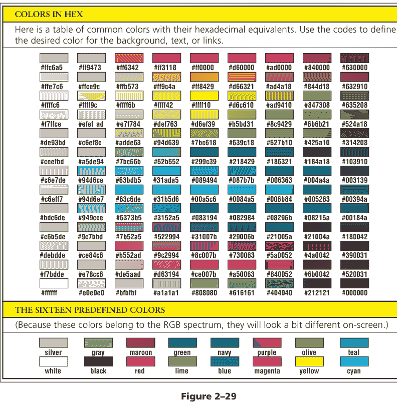

图 2–29 所示的颜色代码和名称可用于背景、文本、边框和链接颜色。`<h2>` 标签中使用了 `color` 属性来指定标题的颜色。标题将使用颜色 `#384738`，因为它是上面步骤中插入的图形图像中使用的颜色之一。

另一种增强网页视觉效果的方法是更改部分文本的样式。这有助于突出网页上的特定文本。在本节中，你将使用内联样式将页脚文本更改为斜体样式。此更改有助于引起人们对这段旁注内容的注意。

> **顺便提一下** | **浏览器安全色** 网页开发人员过去必须确保使用浏览器安全色（附录 B）。当今显示器的趋势是显示“真彩色”，这意味着显示器可以显示 1600 万种颜色中的任何一种。很少有人再使用 8 位显示器了，因此你通常无需将自己限制在浏览器安全色内。

最后，你将添加一个水平线和内联样式以进一步增强此网页。如本章前面所述，水平线是网页上用作分隔线的线条，用于在页面的不同部分之间提供视觉分隔。你可以使用内联图像来添加水平线，也可以使用水平线标签（`<hr />`）来添加简单的水平线，如下所示。为了使水平线更明显，你将为其设置 8 像素的高度，并将背景色设置为与 `<h2>` 标题相同的颜色。你还将水平线的宽度设置为网页宽度的 50%。你通过内联样式对水平线进行这三项更改。图 2–30 展示了各种水平线的示例以及用于添加它们的 HTML 代码。页面上的第一条水平线显示的是默认水平线。通过增加显示的像素数可以为水平线增加尺寸。

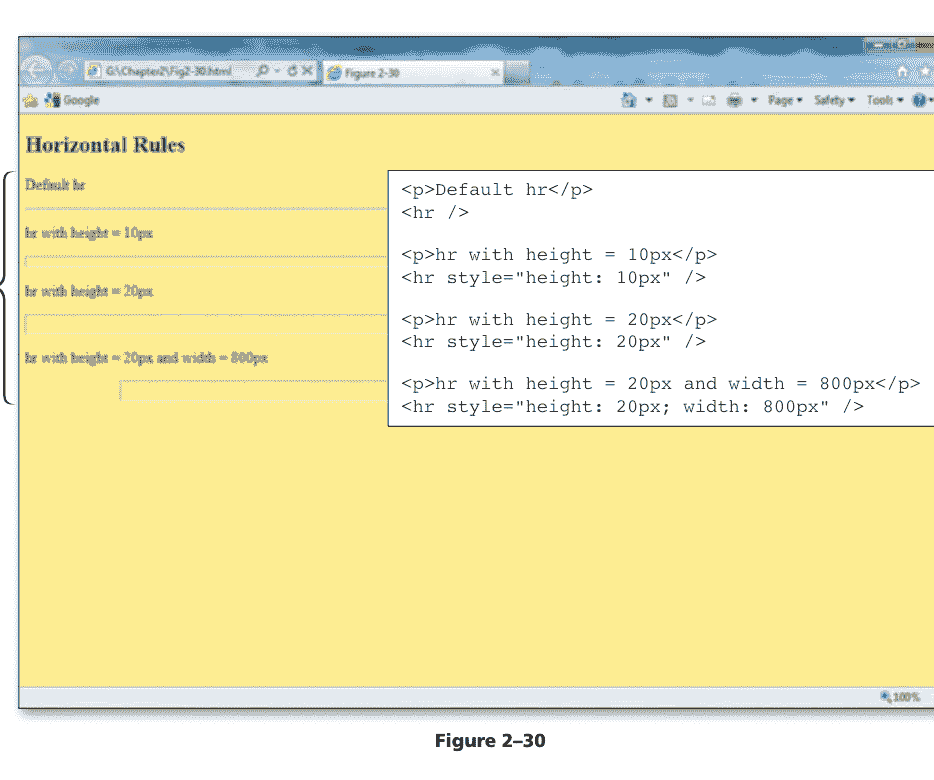

图 2–30

## 为网页标题添加颜色

要更改网页上标题的颜色，必须在 HTML 文件的 `<h2>` 标签中添加 `color` 属性。**color** 属性允许你更改网页上各种元素的颜色。以下步骤展示了如何在内联样式中使用 `color` 属性添加颜色。

1.  在第 19 行 `<h2>` 中的 “2” 之后、右括号之前单击，然后按空格键。
2.  输入 `style="color: #384738"` 作为标题的颜色代码（图 2–31）。

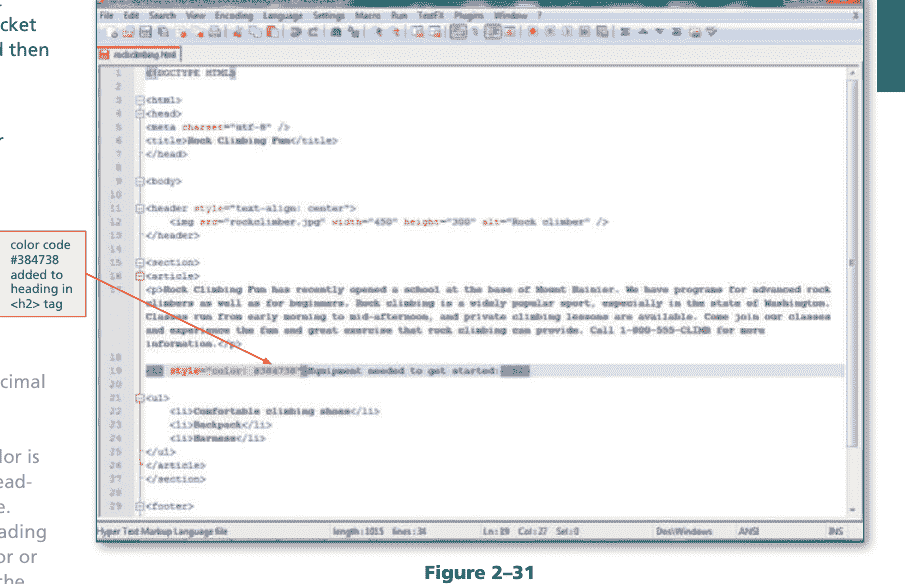

**问与答**

**我可以用任何十六进制代码或颜色名称来更改标题颜色吗？**

虽然你可以使用任何可用的十六进制代码或颜色名称，但你必须确保颜色适合网页的标题。你不希望标题颜色太浅或以其他方式削弱标题的效果。

## 更改项目符号列表样式

要更改项目符号列表的样式，你需要再次使用带有 `list-style-type` 属性的内联样式。`list-style-type` 属性允许你将项目符号类型从默认的实心圆更改为其他选项。`list-style-type` 有多个值，如附录 D 所示。以下步骤展示了如何使用内联样式更改 `list-style-type` 属性。

1.  在第 21 行 `<ul>` 中的 “|” 之后、右括号之前单击，然后按空格键。
2.  输入 `style="list-style-type: square"` 作为代码（图 2–32）。

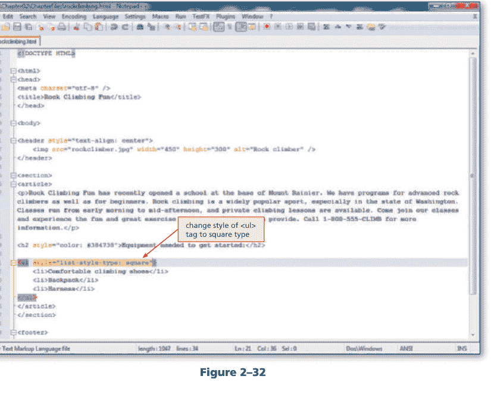

## 添加水平线

接下来，你将插入一条水平线，将网页的顶部与页脚区域分开。你还将水平线的高度设置得比默认值更高（8 像素），将背景色更改为与标题匹配，并将宽度设为 50%。以下步骤说明了如何向网页添加水平线。

## 更改页脚样式

要更改页脚元素的样式，你需要再次使用带有 `font-style` 属性的内联样式。在此步骤中，你将页脚在网页上居中，并将字体样式更改为斜体。页脚信息通常不是网页的重点，因此将页脚内容设置为斜体是合适的。以下步骤展示了如何使用内联样式居中并更改文本。

1.  在第 31 行 `<footer>` 中的 “r” 之后、右括号之前单击，然后按空格键。输入 `style="text-align: center; font-style: italic"` 作为代码（图 2–34）。
2.  单击菜单栏上的“文件”，然后单击“保存”。

```html
<footer style="text-align: center; font-style: italic">
    Rock Climbing Fun, 3737 Harrison Lane, Issaquah, WA 98008
</footer>
```

## 在浏览器中刷新视图

当你在 Notepad++ 中继续开发 HTML 文件时，最好在修改时在浏览器中查看该文件。在浏览器中查看修改后的网页时，单击“刷新”按钮可确保显示最新版本的网页。以下步骤展示了如何在浏览器中刷新网页视图以查看修改后的网页。

-   单击任务栏上的 Internet Explorer 按钮以显示 rockclimbing.html 网页。
-   单击地址栏上的“刷新”按钮以显示修改后的网页（图 2–35）。

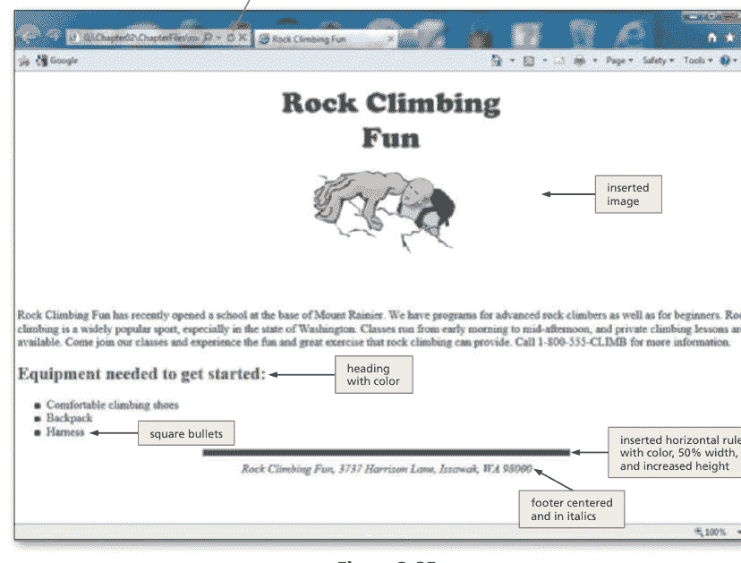

图 2–35

> 其他方法
1.  在 Internet Explorer 中，按 F5 刷新。

## 验证和查看 HTML 代码

> 顺便提一下
HTML 和 HTML5 标签
网上有许多优秀的资源列出了 HTML5 标签。有关 HTML 和 HTML5 的更多信息，请在搜索引擎中搜索“HTML 标签”或“HTML5 标签”。

在第 1 章中，你了解了如何验证 HTML 代码。网上有许多验证服务可用于确保你的 HTML 代码遵循标准。这应该是网页测试的常规部分。本书中使用的验证服务是 W3C 标记验证服务 (validator.w3.org)。此验证器检查 HTML 和 XHTML 网页文档的标记有效性，以及一些其他标记语言。验证器会查看 DOCTYPE 语句以确定你使用的 HTML 或 XHTML 版本，然后检查代码是否对该版本有效。在本章中，项目使用的是 HTML5 DOCTYPE。

如果验证检测到 HTML 代码中的错误，你会在标题栏中看到警告“Errors found while checking this document as HTML5!”，标题栏为红色（下一页图 2–36a）。结果行显示你有多少错误。你可以向下滚动页面或单击“Jump To: Validation Output”链接查看每个错误的详细说明。

需要注意的是，一个错误可能导致更多错误。例如，为展示有错误的代码，rockclimbing.html 文件中第 19 行的 `</h2>` 标签被移除了。图 2–36b 显示，在这种情况下，一个初始错误（第 21 行的 `<ul>` 标签不能在第 19 行的 `<h2>` 标签内使用）导致了总共三个错误和一个警告。


## 验证与查看 HTML 代码

既然你已为网页添加了所有基本元素，并用图片、颜色、斜体和分隔线进行了增强，现在就需要验证你的代码了。当前的 HTML5 验证流程不仅会返回错误，还会返回信息性警告，如 HTML 75 页图 2-39a 所示。尽管验证器显示代码“已成功通过 HTML5 验证”，但它也会为代码显示一个警告。图 2-39b 解释了该警告，它指出用于验证 HTML5 代码的 HTML5 一致性检查器目前仍处于实验阶段。正如本章前面提到的，HTML5 本身及其相关支持功能仍然是实验性的，这个警告只是在告诉你这一点。不过，这个警告无关紧要，你的代码已经通过了验证流程。以下步骤说明了如何使用 W3C 验证器验证你的 HTML 代码。

### HTML 74 HTML 第 2 章 使用内联样式创建和编辑网页

1.
- 点击浏览器的地址栏，高亮显示当前 URL。
- 输入 **validator.w3.org** 替换当前条目，然后按回车键。
- 如果浏览器询问是否打开新窗口，请根据需要点击“确定”。
- 点击“通过文件上传验证”选项卡（图 2-37）。

**图 2-37**

2.
- 点击“浏览”按钮。
- 在存储设备上找到 **rockclimbing.html** 文件，然后点击该文件名。
- 点击“选择要上传的文件”对话框上的“打开”按钮，文件路径和名称将被插入到“文件”框中，如图 2-38 所示。

**图 2-38**

3.
- 点击“检查”按钮。应会显示验证结果，如图 2-39a 和 2-39b 所示。
- 返回“攀岩乐趣”网页，可通过点击浏览器的“后退”按钮，或点击任务栏中的 Internet Explorer 按钮。

> 我如何知道我的 HTML 代码是否有效？
通知标题将变为绿色，并且在“结果”区域，你应该会看到“通过”字样。

> 如果我的 HTML 代码未通过验证怎么办？
如果你的代码有错误，请编辑 HTML 文件以修正错误。标记验证服务报告会列出你的代码中存在的问题。一旦你做出必要的更改并保存文件，你可以使用“浏览”按钮打开更正后的 HTML 文件，然后向下滚动并点击“重新验证”按钮来验证更改后的代码。

(b)

图 2-39

## 查看网页的 HTML 源代码

源代码是用于创建网页或程序的代码或指令。对于网页而言，源代码就是 HTML 代码，然后由浏览器将其翻译为图形化网页。你可以从浏览器内查看任何网页的 HTML 源代码。此功能使你能够检查自己的 HTML 源代码，以及查看其他开发者用于创建其网页的 HTML 代码。如果网页上的某个功能适合或吸引你，你可以查看源代码以了解添加该功能所需的 HTML，然后复制部分 HTML 代码到你自己的网页上。你可以使用浏览器查看大多数网页的源代码。以下步骤展示了如何使用浏览器查看网页的 HTML 源代码。

1.
- 使用浏览器的“后退”按钮返回到网页。
- 点击命令栏上的“页面”。如果你的命令栏未显示，请右键点击标题栏，点击“命令栏”，然后点击“页面”。
- 点击“查看源文件”以在默认文本编辑器中查看 HTML 代码（图 2-40）。

命令栏上的“页面”命令；你的命令栏可能有所不同

在新的 Notepad++ 窗口中打开的 HTML 源代码

问与答

所有浏览器都允许我以相同方式查看 HTML 源代码吗？
Chrome、Firefox 和 Safari 等浏览器都允许你查看网页的源代码。但是，它们可能使用不同的按钮或菜单选项来访问源代码。例如，在 Mozilla Firefox 中，选择“查看”，然后点击“页面源代码”。

图 2-40

2.
- 点击文本编辑器菜单栏上的“关闭”按钮，关闭活动的文本编辑器窗口（图 2-41）。

**图 2-41**

> 问与答
默认文本编辑器是什么？
对于 Internet Explorer，它可能是记事本，但根据你的浏览器设置，也可能是 Notepad++ 或其他编辑器。

## 打印网页和 HTML 文件

创建并保存 HTML 文件后，你可能需要打印一份 HTML 代码和生成的网页。文件、网页或其他文档的打印版本称为**硬拷贝**或**打印件**。HTML 文件和网页的打印副本可以保存以供参考或分发。以下步骤展示了如何打印网页及其对应的 HTML 文件。

1.
- 根据打印机说明准备好打印机。
- 在浏览器窗口中打开“攀岩乐趣”网页，点击命令栏上的“打印”图标。
- 当“打印”对话框出现时，点击“打印”按钮。
- 当打印机停止打印网页时，取出打印件（图 2-42）。

**图 2-42**

> 问与答
还有其他打印网页的方法吗？
按 CTRL+P 可打开“打印”对话框，你可以在其中选择打印选项。你也可以使用菜单栏上“文件”菜单中的“打印”选项。

2.
- 点击任务栏上的 Notepad++ 按钮，激活 Notepad++ 窗口。
- 点击菜单栏上的“文件”，点击“打印”命令，然后点击“打印”按钮，打印 HTML 代码的硬拷贝（图 2-43）。

```html
<!DOCTYPE html>
<html>
<head>
<meta charset="utf-8" />
<title>Rock Climbing Fun, Inc.</title>
</head>
<body>
<header style="text-align: center">
    
</header>
<section>
<article>
<p>Rock Climbing Fun has recently opened a school at the base of Mount Rainier. We have programs for advanced rock climbers as well as for beginners. Rock climbing is a widely popular sport, especially in the state of Washington. Classes run from early morning to mid-afternoon, and private climbing lessons are available. Come join our classes and experience the fun and great exercise that rock climbing can provide. Call 1-800-555-CLIMB for more information.</p>
<h2 style="color: #384738">Equipment needed to get started:</h2>
<ul style="list-style-type: square">
    <li>Comfortable climbing shoes</li>
    <li>Backpack</li>
    <li>Harness</li>
</ul>
</article>
</section>
<hr style="height: 8px; background-color: #384738; width: 50%" />
<footer style="text-align: center; font-style: italic">
    Rock Climbing Fun, 3737 Harrison Lane, Issaquah, WA 98000
</footer>
</body>
</html>
```

> **为什么我需要一份 HTML 代码的打印件？**
拥有一份硬拷贝打印件对于初学开发者来说是一个无价的工具。打印副本可以帮助你立即看到 HTML 标签与你在浏览器中看到的网页之间的关系。

图 2-43

> **附注** 快速参考
有关 HTML 标签及其相关属性的列表，请参阅本书末尾的 HTML 快速参考（附录 A），或访问本书配套网站 www.cengagebrain.com 上的 HTML 快速参考。有关 CSS 属性和值的列表，请参阅附录 D。

## 退出 Notepad++ 和浏览器

以下步骤展示了如何退出 Notepad++ 和浏览器。

1. 在 Notepad++ 中，点击“文件”菜单，然后点击“全部关闭”。
2. 点击 Notepad++ 标题栏上的“关闭”按钮。
3. 点击 Internet Explorer 标题栏上的“关闭”按钮。


## 本章总结

在本章中，你已经学习了如何识别网页元素、定义网页结构，以及使用文本编辑器输入网页内容。你通过内联样式增强了网页的外观，保存并验证了代码，并在浏览器中查看了网页和源代码。以下列出的项目包含了你在本章中学习的所有新的HTML技能。

1.  启动Notepad++ (HTML 40)
2.  在Notepad++中启用自动换行 (HTML 42)
3.  使用HTML标签定义网页结构 (HTML 42)
4.  输入一段文本 (HTML 48)
5.  输入标题 (HTML 49)
6.  创建无序列表 (HTML 51)
7.  添加页脚 (HTML 53)
8.  保存HTML文件 (HTML 55)
9.  启动浏览器 (HTML 58)
10. 在浏览器中查看网页 (HTML 59)
11. 激活Notepad++ (HTML 60)
12. 添加图像 (HTML 65)
13. 为网页标题添加颜色 (HTML 69)
14. 更改项目符号列表样式 (HTML 70)
15. 添加水平线 (HTML 70)
16. 更改页脚样式 (HTML 71)
17. 在浏览器中刷新视图 (HTML 72)
18. 验证HTML代码 (HTML 73)
19. 查看网页的HTML源代码 (HTML 76)
20. 打印网页和HTML文件 (HTML 77)

## 在线学习

**测试你对本章内容和关键术语的掌握程度。**

*说明：* 要完成以下练习，请访问www.cengagebrain.com。在CengageBrain.com主页上，使用页面顶部的搜索框搜索*HTML5 and CSS 第7版*。这将带你到本书的产品页面。在产品页面上，点击“学习工具”标题下方的“立即访问”按钮。在图书配套网站页面上，选择第2章，然后点击所需练习的链接。

## 章节强化 判断题、选择题和简答题

一系列判断题、选择题和简答题，测试你对本章内容的理解。

### 谁想成为计算机天才？

一个互动游戏，以电视问答节目的形式挑战你对本章内容的了解。

### 闪卡

一个互动学习环境，你需要根据显示的定义识别相关的章节关键术语。

### 术语轮盘

一个互动游戏，以电视节目《幸运轮盘》的风格挑战你对章节关键术语的了解。

### 模拟测试

一系列选择题，测试你对本章内容和关键术语的掌握程度。

### 纵横字谜挑战

一个纵横字谜，挑战你对本章中关键术语的了解。

## 应用所学知识

巩固你在本章学到的技能并应用所学的概念。

## 编辑“应用所学知识”网页

**说明：** 启动Notepad++。打开学生数据文件中Chapter02\Apply文件夹下的apply2-1.html文件。有关下载学生数据文件的说明，请参阅本书的封底内页，或联系你的老师获取有关访问本书所需文件的信息。

apply2-1.html文件是一个部分完成的HTML文件，你将使用它来完成本练习。图2–44显示了在添加了额外的HTML标签和属性后，该网页在浏览器中应有的显示效果。


*执行以下任务：*

1.  在浏览器中输入g:\Chapter02\Apply\apply2-1.html作为URL来查看网页。
2.  检查HTML文件及其在浏览器中的显示效果。
3.  使用Notepad++修改HTML代码，使网页看起来与图2–44所示的类似。两个标题的颜色都为#910603。（*提示：* 使用style="color: #910603"属性和值。）
4.  将图像kimono_doll.jpg（位于Chapter02\Apply文件夹中）添加到网页。其宽度为260像素，高度为346像素。（*提示：* 将图像包含在`<header>` `</header>`容器中，并记得使用alt属性。）
5.  按照图2–44所示，使用“圆形”项目符号类型制作项目符号列表。

## 拓展知识

拓展你在本章学到的技能，并尝试新的技能。

### 创建定义列表

**说明：** 启动Notepad++。打开学生数据文件中Chapter02\Extend文件夹下的extend2-1.html文件。有关下载学生数据文件的说明，请参阅本书的封底内页，或联系你的老师获取有关访问所需文件的信息。这个示例网页包含了网页的所有文本内容。你将添加必要的标签，将其变成一个定义列表，其中术语为粗体，如图2–45所示。


图2–45

**执行以下任务：**

1.  使用extend2-1.html文件中给出的文本，按照第HTML 52页表2–6所示的定义列表代码，修改HTML代码，将网页从一行文本更改为定义列表。
2.  添加必要的HTML代码使术语加粗。（*提示：* 复习font-weight属性，值为bold。）
3.  添加图像skier.jpg。通过查看图像属性找到其尺寸。
4.  添加一条高5像素、颜色为#414565的水平线。<h1>标题的颜色也是#414565。
5.  将修改后的文档保存在Chapter02\Extend文件夹中，文件名为extend2-1solution.html，验证网页，然后按照老师指定的格式提交。

## 纠错

分析文档并修正所有错误和/或改进设计。

### 修正“印度之星”网页

**说明：** 启动Notepad++。打开学生数据文件中Chapter02\MakeItRight文件夹下的makeitright2-1.html文件。有关下载学生数据文件的说明，请参阅本书的封底内页，或联系你的老师获取有关访问所需文件的信息。

该数据文件是你在图2–46中看到的修改版本。对网页进行必要的修正，使其看起来像图2–46。使用颜色#515c7a为网页添加背景色。（*提示：* 在<body>标签中使用内联样式。）将标题格式设置为标题1样式，颜色为黑色。添加一段白色文本和四个白色圆形项目符号。（*提示：* 在标题、段落和项目符号标签中使用color属性。）将文件保存在Chapter02\MakeItRight文件夹中，文件名为makeitright2-1solution.html，验证网页，然后按照老师指定的格式提交。准备讨论项目符号列表中提出的四个问题。


## 实验室

### 实验1：创建一个信息类网页

**问题：** 你喜欢志愿服务，并决定制作一个网页公告（如图2–47所示）来宣传最新的食品募捐活动。


图2–47

**说明：** 执行以下步骤：

1.  在Notepad++中创建一个新的HTML文件，在<title> </title>标签内设置标题为Lab 2-1。
2.  添加donations.jpg图像文件，其宽度为272，高度为277。将图像放在网页的左侧。两个标题都使用绿色。
3.  添加如图2–47所示的段落文本。将“$10 off”这几个词设置为超大字体样式。（提示：复习附录A中的<span> HTML标签。）
4.  创建一个项目符号列表，包含所示信息。
5.  将文件保存在Chapter02\InTheLab文件夹中，文件名为lab2-1solution.html。
6.  打印lab2-1solution.html文件。
7.  在浏览器中输入g:\Chapter02\InTheLab\lab2-1solution.html（或你的数据文件存储路径）作为URL来查看网页。
8.  打印网页。
9.  按照老师指定的格式提交修改后的HTML文件和网页。

### 实验2：创建一个健康生活网页

**问题：** 你在你所在城市的健康生活委员会工作。你想创建一个网页，展示两个健康生活的好点子，如图2-48所示。


图2-48

**说明：** 执行以下步骤：

1.  在Notepad++中创建一个新的HTML文件，在<title> </title>标签内设置标题为Lab 2-2。对于初始HTML标签，如果你在本章项目开始时创建了structure.html文件，可以使用它，否则请键入初始标签。
2.  通过添加一个<h1>标题“健康生活计划”开始正文部分。将标题格式设置为标题1样式，并在网页上居中对齐。（*提示：* 参阅附录D中的text-align属性以居中标题。）
3.  添加如图2-47所示的居中文本段落。确保第四句话显示在下一行，中间没有空行。（*提示：* 使用<br />标签。）
4.  添加一条高10像素、宽80%、背景色为#2fb66a的水平线。
5.  添加一个居中的标题，如图所示，使用标题2样式。
6.  添加healthy.png图像。查找该图像的高度和宽度属性，并将其与替代文本一起包含。


## 在实验室中

### 实验室 3：设计个人网页

问题：你的朋友们担心自己无法存钱。他们向你求助，因为你似乎总是能为不时之需存下钱。你决定制作一个网页，为他们提供一些建议。你计划使用一段文字、一张图片和一个带项目符号的列表，如图 2-49 所示。图中的文字和项目符号应替换为你自己的省钱经验和建议。


图 2-49

说明：执行以下步骤：

- 1. 在 `<title> </title>` 标签内，创建一个标题为 "Lab 2-3" 的新 HTML 文件。
- 2. 包含一段简短的信息文字和一个带项目符号的列表，使用与图 2-49 类似的格式，提供关于你省钱经验的信息。
- 3. 插入存储在 `Chapter02\InTheLab` 文件夹中的图片文件 `piggybank.png`。你可以通过在 Windows 资源管理器中单击图片来查看其尺寸。也可以右键单击图片，单击“属性”，然后单击“详细信息”选项卡来查找图片的尺寸，或在图形程序中打开它。请注意，列表使用的项目符号是方形的。
- 4. 将 HTML 文件保存在 `Chapter02\InTheLab` 文件夹中，文件名为 `lab2-3solution.html`。
- 5. 在浏览器中输入 `g:\Chapter02\InTheLab\lab2-3solution.html`（或你的数据文件存储路径）作为 URL 以查看网页。
- 6. 从浏览器打印该网页。
- 7. 按照讲师指定的格式提交修改后的 HTML 文件和网页。

在实验室中 *续*

- 7. 添加另一个 `<h2>` 标题和水平线。
- 8. 将文件保存在 `Chapter02\IntheLab` 文件夹中，文件名为 `lab2-2 solution.html`。
- 9. 打印 `lab2-2.html` 文件。
- 10. 在浏览器中输入 `g:\Chapter02\IntheLab\lab2-2solution.html`（或你的数据文件存储路径）作为 URL 以查看网页。
- 11. 打印该网页。
- 12. 按照讲师指定的格式提交修改后的 HTML 文件和网页。

版权所有 © 2012 Cengage Learning。保留所有权利。未经许可，不得以任何形式全部或部分复制、扫描或复制。由于电子版权问题，电子书和/或电子章节中可能会删除一些第三方内容。编辑审查认为，任何被删除的内容不会对整体学习体验产生实质性影响。Cengage Learning 保留随时删除额外内容的权利，如果后续版权限制要求这样做。

## 案例与场景

运用你的创造性思维和问题解决技能来设计和实施解决方案。

**1：研究 HTML5 结构标签**
**学术**
有许多网站专门介绍 HTML5。搜索网络，寻找提供 HTML5 培训模块的网站。探索专门针对本章讨论的新结构元素的培训。这些新标签与 `<div>` 标签有何不同？在哪些情况下 `<div>` 标签是更好的选择？撰写一份简短的报告。找出培训网站的 URL，并在课堂上与同学们分享。

**2：创建个人网页**
**个人**
你的班级讲师希望将所有学生的网页发布到学校服务器上，以展示他或她的学生的兴趣所在。创建一个包含个人信息的网页，列出诸如你的学校专业、过去从事过的工作以及你的爱好和兴趣等项目。为了使你的个人网页更具视觉吸引力，搜索网络以找到反映你兴趣的图片。（请记住，如果图片受版权保护，除非你遵循图片提供的指南，否则你不能在个人网页上使用它。）在网页上插入一两张图片，以帮助说明你是谁。

**3：研究处理图片的方法**
**专业**
你正在为一家本地摄影师创建一个新网站。摄影师要求你找出方法，帮助他的网站即使拥有大量大型图片也能快速加载。为此，查找有关使用缩略图的信息。查看其他摄影网站，并创建一个关于加载大型图片的建议列表。此外，在网络上搜索有关为图片添加有用的、描述性 alt 属性的信息。撰写一份简短的摘要，解释你在研究中找到的信息。

# 3 使用链接、图片和嵌入式样式表创建网页


## 学习目标

当你能够做到以下几点时，你就掌握了本章的内容：

- 描述链接术语和定义
- 创建主页并使用图片增强网页
- 使用嵌入式（内部）样式表更改正文和标题格式
- 使用嵌入式和内联样式对齐文本并添加颜色
- 向同一网站中的网页添加文本链接
- 添加电子邮件链接
- 向另一个网站上的网页添加文本链接
- 使用绝对路径和相对路径
- 保存、验证和查看 HTML 文件并测试链接
- 使用样式类添加带有环绕文本的图片
- 向网页中的目标添加链接
- 使用内联样式将默认的项目符号列表类型更改为方形项目符号
- 复制和粘贴 HTML 代码
- 向同一网站中的网页添加图片链接

版权所有 © 2012 Cengage Learning。保留所有权利。未经许可，不得以任何形式全部或部分复制、扫描或复制。由于电子版权问题，电子书和/或电子章节中可能会删除一些第三方内容。编辑审查认为，任何被删除的内容不会对整体学习体验产生实质性影响。Cengage Learning 保留随时删除额外内容的权利，如果后续版权限制要求这样做。

# 3 使用链接、图片和嵌入式样式表创建网页

## 简介

万维网最有用和最重要的方面之一是能够将（链接）一个网页连接到其他网页——无论这些网页位于同一服务器还是不同的网络服务器上——位于世界任何地方。使用超链接，网站访问者可以从一个页面移动到另一个页面，并按任何顺序查看信息。许多不同的网页元素，包括文本、图形和动画，都可以作为超链接。在本章中，你将创建使用文本链接和图片链接相互链接的网页。在上一章中，你使用了内联样式来更改单个元素或 HTML 标签的外观。在本章中，你还将使用嵌入式样式表（也称为内部样式表）来设置整个网页的标题和正文等元素的外观。在开始这个项目之前，你应该已经完成了开发生命周期中的网站规划、分析和设计阶段。

## 项目 —— Eloise 的水下之旅网站

第 3 章说明了如何使用 HTML 为 Eloise 的水下之旅网站创建主页（图 3-1a），以及如何编辑现有的 `samplephotos.html` 网页（图 3-1b）以改善其外观和功能。你的姐姐 Eloise 最近开了一家水下旅游公司，并将其命名为 "Underwater Tours by Eloise"。她想在网上宣传她的公司，并展示海洋生物的示例图片。她知道你在大学学习过网站开发，并要求你开发两个相互链接的网页：一个主页和一个包含示例图片的网页。在分析过程中，你确定了四种要使用的基本链接类型。第一种是从同一网站中的一个网页链接到另一个网页。第二种是链接到另一个网站上的网页。第三种是电子邮件链接。第四种是在一个网页内部的链接。你计划为姐姐的网站利用所有这四种类型的链接。

"Eloise 的水下之旅"主页（图 3-1a）包括一个标志图片、标题、一个电子邮件链接和一个指向另一个网站上网页的文本链接。此页面还包括一个指向 `samplephotos.html` 网页的链接。示例照片网页（图 3-1b）包含两张图片，文本环绕着它们，并且有内部链接，允许访问者轻松地在网页内从一个部分移动到另一个部分。该网页还有一个图片链接，可以返回 "Eloise 的水下之旅"主页。


## 概述

在本章中，你将通过完成以下通用任务，学习如何创建如图 3-1 所示的网页：

- 使用嵌入式样式表、内联样式和类来更改文本、链接、图像和标题的格式。
- 使用内联样式创建带有方形项目符号的项目符号列表。
- 添加指向同一网站中另一个网页的链接。
- 添加指向外部网站的链接。
- 添加电子邮件链接。
- 在同一网页内添加目标和链接。

## 项目规划指南

在创建如前一页图 3-1 所示的项目等网页时，你应遵循以下通用指南：

1.  **规划网站。** 在开发多页网站之前，你必须规划网站的用途。有关网站开发生命周期规划阶段的信息，请参阅 HTML 第 15 页的表 1-4。在此阶段，你需要确定网站的用途、识别网站用户及其计算环境，并决定谁拥有网页上的信息。

2.  **分析需求。** 在网站开发生命周期的分析阶段，你需要分析网页应包含哪些内容。第 3 章中的网站开发项目与第 2 章完成的项目不同，因为它包含两个将相互链接的网页。因此，分析阶段的一部分包括确定多个网页如何协同工作以形成一个网站。

3.  **设计网站。** 分析完成后，即可设计网站。在此阶段，你需要确定网站的内容，包括文本和图形。本章特定的设计步骤还包括确定网站内部以及指向外部网站的链接。
    a.  **选择网页的内容。** 生命周期的这一部分也与前一章的项目不同，因为并非所有内容都必须出现在一个网页上（就像第 2 章那样）。对于多页网站，你可以根据需要在整个网站中分配内容。由于该网站的性质，图片是内容的重要组成部分。网站所有者希望展示其公司作品的示例。图片有助于突出在游览中可能看到的海洋生物。
    b.  **确定你将使用的层叠样式表类型。** 你已经学习了如何使用内联样式来最好地支持网站的设计和用途。在本章中，你将利用内联和嵌入式（内部）样式表来更改各种网页元素的外观（或样式）。你还将使用嵌入式样式表中的类来进一步控制网页元素的样式。你需要考虑这些选项中哪些最适合你的网站样式。
    c.  **确定页面将如何相互链接。** 此网站由主页（网站中的第一个页面）和你将链接到的辅助网页组成。你需要确定如何从主页链接到辅助页面（例如，使用文本或图形），以及如何链接回主页。
    d.  **确定其他必要的链接。** 除了主页和辅助网页之间的链接外，你还需要一个电子邮件链接。网站开发者在网站主页上提供电子邮件链接以供访客评论或提问是标准做法。此外，辅助网页（samplephotos.html）是一个很长的页面，需要访客向下滚动进行导航。由于其长度，提供轻松快捷的网页导航方式非常重要。你可以使用网页内的链接来实现这一点。

4.  **开发网页并插入所有链接。** 分析和设计完成后，网站开发者使用 HTML 和 CSS 创建网页。在此步骤中应遵循良好的网站开发标准实践。良好实践的示例包括使用适当的初始 HTML 标签（如前一章所示），以及始终为图像标识替代文本。

5.  **测试网站内的所有网页。** 网站开发的一个重要部分是测试，以确保你遵循前一章概述的标准。对于本书中的项目，你将使用万维网联盟（W3C）验证器，它允许你测试网页并清楚地解释其发现的任何错误。在测试时，你应该检查所有内容的准确性。此外，所有链接（外部、内部以及同一网站内的页面到页面）都应进行测试。

在适当的时候，本章将在适当的位置介绍有关上述指南的更多具体细节。本章还将说明在创建如图 3-1 所示的网页时，针对这些指南所执行的操作和做出的决定。

版权所有 2012 Cengage Learning。保留所有权利。不得以任何形式或任何方式进行复制、扫描或重复。由于电子权利，某些第三方内容可能会从电子书和/或电子章节中被抑制。编辑审查认为，任何被抑制的内容不会对整体学习体验产生重大影响。Cengage Learning 保留随时删除额外内容的权利，如果后续权利限制要求如此。

## 在网页上使用链接

如你所知，许多不同的网页元素（包括文本、图像和动画）都可以作为链接。文本和图像是用作链接最广泛的元素。图 3-2 显示了文本和图像链接的示例。

图 3-2 网页上的文本和图像链接。

在网页上使用文本链接时，请使用描述性文本作为可点击的单词或短语。例如，短语“Click here”（点击此处）没有向访客解释链接的目的。相比之下，短语“SAVE MONEY”（省钱）（在图 3-2 中）表明该链接连接到一个提供折扣机票的网页。

> 链接帮助
许多网站为新的 HTML5 开发者提供帮助。有关链接的更多信息，请在任何优秀的搜索引擎中搜索“HTML5 Tutorials”（HTML5 教程）或“HTML5 Help”（HTML5 帮助）等关键词。

当链接用文本标识时，它通常显示为带下划线的文本，颜色与主要网页文本不同。除非在锚点 `<a>` 或 `<body>` 标签中另行更改，否则浏览器设置会定义整个网页中文本链接的颜色。例如，在 Internet Explorer 中，未被点击（或访问过）的正常链接的默认颜色是蓝色，已访问链接是紫色，而活动链接（用户刚刚点击的链接）的颜色会变化。下一页的图 3-3 显示了正常和已访问状态下文本链接的示例。通常，将鼠标指针移到链接上会使鼠标指针变为指向的手形。此更改通知用户该文本或图像处有一个可用链接。

**图 3–3** 文本链接颜色和悬停变体示例。

相同的颜色默认设置适用于图像链接周围的边框颜色。边框使图像看起来像有一个框架。如果图像没有边框，则不会显示框架。边框的颜色显示该边框是否是一个链接，以及该链接是否已被访问（图 3-4）。

**图 3–4** 正常和已访问链接的颜色。

`<a>` 标签也被称为 **锚点标签**，因为它用于为指向同一网站中另一个页面、外部网站中的网页、同一网页内以及电子邮件链接创建锚点。这是你将在整个项目中用于插入网页的四种类型链接的标签。

版权所有 2012 Cengage Learning。保留所有权利。不得以任何形式或任何方式进行复制、扫描或重复。由于电子权利，某些第三方内容可能会从电子书和/或电子章节中被抑制。编辑审查认为，任何被抑制的内容不会对整体学习体验产生重大影响。Cengage Learning 保留随时删除额外内容的权利，如果后续权利限制要求如此。


## 在同一网站内链接到另一个网页

网页通常包含链接，用于将当前网页与同一网站内的另一个页面连接起来。例如，访客可以点击网站首页上的一个链接（下一页的图3-5a）来连接并查看同一网站上的另一个网页（图3-5b）。本项目中创建的网页包含了指向同一网站其他页面的链接：（1）“Eloise的水下之旅”主页包含一个指向“示例照片”网页的文本链接；（2）“示例照片”网页包含返回“Eloise的水下之旅”主页的文本和图片链接。要将`underwatertours.html`主页上的文字“示例照片”链接到`samplephotos.html`网页，你需要以下HTML代码：

```
<a href="samplephotos.html">sample photographs</a>
```

如果你想更改文本链接或图片链接边框的颜色以覆盖浏览器默认设置，你可以在锚点`<a>`或`<body>`元素中使用嵌入式或外部样式表来指定这些更改，或者使用内联样式。回想一下，你使用内联样式来更改单个元素的外观（或样式）。嵌入式（或内部）样式表用于更改一个网页中类似元素的样式。最后，外部样式表包含在一个单独的.css文档中，用于更改整个网站的样式。（你将在下一章中使用外部样式表。）要在锚点元素中使用嵌入式或外部样式表来更改普通、已访问和活动链接颜色（从默认值更改），你需要使用以下格式：

```
a {
  color: black;
}
```

其中`color`是指定的颜色名称，例如`black`，或十六进制颜色代码。要使用内联样式进行相同的更改，标签格式为：

```
<a style="color: black">
```

链接默认带有下划线，以表明它们是链接。你可以使用锚点标签内的`text-decoration`属性来禁用链接的下划线。**text-decoration属性**允许文本使用五种值之一进行“装饰”：`underline`、`overline`、`line-through`、`blink`或`none`。此属性可用于多种标签，包括锚点标签。

在设计阶段，你应该仔细考虑任何样式更改（尤其是对默认样式）的优缺点。在关闭链接下划线或更改默认链接颜色之前，确保用户仍然能够立即看到特定文本被用作链接。如果你确定可以有效地关闭链接上的下划线（就像你在本章后面创建的图片链接所做的那样），你可以将`text-decoration`属性更改为`none`。要使用嵌入式或外部样式实现此操作，你需要输入以下代码：

```
a {
  text-decoration: none;
}
```

要使用内联样式将`text-decoration`更改为`none`，请输入：

```
<a style="text-decoration: none">
```

**HTML 94** **HTML 第 3 章** 创建包含链接、图片和嵌入式样式表的网页


(a) 网站主页。

由 Sabath Mullet 提供

**Eloise的水下之旅** 是一家专门从事水下摄影之旅的公司。讲师们提供技术和创意摄影支持。可以为个人或团体预订行程。

被我们的一些示例照片所吸引，或者了解我们精彩的一个旅游目的地。如有问题或意见，请致电 (866) 555-ELOISE 或发送电子邮件至 underwatertoursbyeloise@example.com。

链接到同一网站中的另一个网页


图片链接，方便访客轻松返回主页

示例照片

Eloise的水下之旅为家庭、朋友和团队安排各种全日和半日潜水活动。想象一下自己拍摄美丽的水下动物和场景。请到我们的办公室查看可用水下之旅的照片。

**来自我们半日毛伊之旅的照片：**

- 蛙鱼
- 五彩龙虾

**蛙鱼**


这条美丽的红色鱼叫做蛙鱼。这只是你将在水下看到的五彩斑斓景象中的一个例子。我们在毛伊岛的潜水活动中发现了蛙鱼。所有行程的讲师都会向你展示如何充分利用你的设备来拍摄充满活力和生机的水下生活照片。

访问我们的网站或到我们的办公室，了解我们提供的许多令人兴奋的水下之旅。我们可以为您和您的团队设计一次满足需求和愿望的旅行。

(b) 同一网站中的链接网页。

由 Sabath Mullet 提供

100%

## 图 3–5

## 链接到另一个网站中的网页

Web开发最强大的功能之一是能够链接到您网站之外的网页。Web开发者使用这些链接将他们的网页与包含相同主题信息的其他网页连接起来。正是这些链接赋予了Web作为相互连接资源的价值，并提供了它的“网络特性”。在本项目中，主页（图3-6a）包含一个指向另一个网站页面的链接，访客可以在该页面上找到有关夏威夷国家公园的更多信息（图3-6b）。要将`underwatertours.html`主页上的文字“我们精彩的一个旅游目的地”链接到一个外部网站，你需要以下HTML代码：

```
<a href="http://www.nps.gov/state/hi/index.htm">one of our fabulous tour destinations</a>
```

请注意，该代码与用于链接到同一网站内网页的代码基本相同。但是，在链接到外部网站时，你必须添加完整的URL（http://www.nps.gov/state/hi/index.htm）。


图 3–6

## 在网页内链接

网页内的链接允许访客快速从网页的一个部分移动到另一个部分。这在需要滚动才能查看所有内容的长网页中尤其重要。许多网页在页面顶部包含一个链接列表，如菜单或目录，其中包含指向网页内各个部分的链接（图3-7）。在本项目中，“示例照片”网页包含从网页顶部部分到页面内其他部分的链接，以及返回网页顶部的链接。在网页内链接有两个步骤。首先，你必须使用一个对链接目的有意义的名称来设置目标。然后，你使用给定的名称创建一个指向该目标的链接。以下HTML代码展示了一个名为`fish`的目标示例，以及如何将该目标用作链接。第一条语句插入到你想要链接到的网页部分的顶部。第二条语句插入到网页顶部的项目符号列表中，你希望链接显示的位置。

```
<a id="fish"></a>
<a href="#fish">Frog Fish</a>
```

同样，请注意你也使用了锚点`<a>`标签进行此类型的链接。但是，对于这种页内链接，你需要在目标id前插入`#`，以表明你想要链接到网页的特定部分，而不一定是页面的顶部。有时当你浏览网页时，你可能会在链接地址中看到`#`。这通常会将你链接到网页的特定部分。


图 3–7 带有内部链接的网页。

> 顺便一提
> 电子邮件链接
> 你可以将多个电子邮件地址分配给一个mailto:标签。在`<a href=>`标签中使用格式"mailto:first@isp.com, second@isp.com"。一些较旧的浏览器可能不支持此标签。

## 链接到电子邮件地址

一个设计良好的网页总是为访客提供一种联系方式，以便他们联系负责维护网站或处理客户问题和意见的公司人员。提供联系信息的一种简便方法是在网站主页以及其他网页上包含电子邮件链接。如图3-8所示，当访客点击电子邮件链接时，它会自动在默认电子邮件程序中打开一个新消息，并在“收件人”字段中插入相应的联系电子邮件地址。然后访客可以键入并发送电子邮件以请求更多信息、发表评论或...

您可以通过点击网站上的mailto:链接，通过电子邮件联系公司，或通知公司其网站存在的问题。（注意：如果您的浏览器未配置为发送电子邮件，电子邮件链接将无法工作。）以下HTML代码示例了如何将文字underwater-toursbyeloise@isp.com链接到一个电子邮件链接。

```
<a href="mailto:underwater-toursbyeloise@isp.com">
underwater-toursbyeloise@isp.com</a>
```

您在此类链接中再次使用了锚点 `<a>` 标签。不过，在 `href` 属性中，您使用 `mailto:` 加上电子邮件地址作为其值。在代码中出现两次电子邮件地址 `underwater-toursbyeloise@isp.com` 可能看起来有些奇怪。第一次出现的电子邮件地址是用于链接本身。第二次出现的 `underwater-toursbyeloise@isp.com` 则用于网页上您用作链接的文字。

## 创建主页

本章开发的第一个网页是“Eloise水下之旅”网站的主页。主页是网站的主要页面，通常是网站访问者首先会看到的页面。网站主页应通过简要说明其提供的内容、服务或功能来明确网站的目的。主页还应清晰地指示访问者应点击哪些链接以从网站的一个页面导航到另一个页面。Web开发人员应设计网站，使从一个网页到另一个网页的链接清晰可见，导航明确。网站主页通常包含一个电子邮件链接，以便访问者可以轻松找到个人或组织的联系信息。现在许多网站还包含一个指向Web开发团队的额外电子邮件链接。用户可以利用此电子邮件链接，向Web开发人员报告网站的任何问题或对网站提出意见。

您通过启动Notepad++并输入初始HTML标签来开始创建主页。然后，您将为您的主页添加一个图像、标题、文本和一个无序列表。最后，您添加文本和电子邮件链接，然后测试这些链接。

## 启动 Notepad++

以下步骤假设Windows 7正在运行，基于典型安装启动Notepad++。您可能需要询问您的老师如何在您的计算机上启动Notepad++。

1.  单击Windows任务栏上的“开始”按钮，显示“开始”菜单。
2.  单击“开始”菜单左窗格底部的“所有程序”，显示“所有程序”列表。
3.  单击“所有程序”列表中的“Notepad++”，打开“Notepad++”文件夹。
4.  单击列表中的“Notepad++”，显示“Notepad++”窗口。如果Notepad中已有先前项目打开的文件，请立即通过单击每个打开文件的“关闭”按钮将其全部关闭。
5.  如果“Notepad++”窗口未最大化，请单击“Notepad++”标题栏上的“最大化”按钮将其最大化（图3–9）。
6.  单击菜单栏上的“查看”。如果“自动换行”命令旁没有复选标记，请单击“自动换行”。

## 输入定义网页结构的初始HTML标签

> **旁注 - 复制初始结构**
记住，您可以键入初始HTML标签并将该代码保存到名为 `structure.html` 的文件中，然后您可以打开该文件并将其用作所有HTML文件的基础。这消除了您在每个HTML文件开头输入相同代码的需要。只需记住在打开 `structure.html` 后立即以其新名称保存。

正如您在第2章中所做的那样，您以定义网页结构的初始HTML标签开始您的文件。表3–1包含了此任务所需的标签和文本。

### 表3–1 初始HTML标签
| 行 | HTML标签和文本 |
|---|---|
| 1 | `<!DOCTYPE HTML>` |
| 2 | |
| 3 | `<html>` |
| 4 | `<head>` |
| 5 | `<meta charset="utf-8" />` |
| 6 | `<title>Underwater Tours by Eloise</title>` |
| 7 | `</head>` |
| 8 | |
| 9 | `<body>` |
| 10 | |
| 11 | `</body>` |
| 12 | `</html>` |

以下步骤说明了如何输入定义网页结构的初始标签。

1.  输入表3–1所示的HTML代码。在每行末尾按ENTER键。如果您在键入时出错，请使用BACKSPACE键删除直到并包括错误字符的所有字符，然后继续键入。
2.  将插入点置于 `<body>` 和 `</body>` 标签之间的空白行（第10行），然后按ENTER键（图3–10）。
3.  将您输入的内容与图3–10进行比较。如果您注意到错误，请使用鼠标指针或箭头键将插入点移动到每个错误的右侧，然后使用BACKSPACE键纠正错误。

## 保存HTML文件

输入“Eloise水下之旅”主页的初始HTML代码后，您应该保存该文件。经常保存文件可以确保您不会丢失工作。在Notepad++中保存文件还会为代码添加颜色，这可以帮助您更容易地识别不同的元素。以下步骤说明了如何在Notepad++中保存HTML文件。

1.  在USB闪存驱动器连接到计算机的某个USB端口的情况下，单击“Notepad++”菜单栏上的“文件”，然后单击“保存”。
2.  在“文件名”文本框中键入 `underwatertours.html`（不要按ENTER键）。
3.  单击“另存为”对话框左窗格中的“计算机”，显示可用驱动器列表。
4.  如有必要，滚动列表直到 `UDISK 2.0 (G:)` 或您的存储设备的名称显示在可用驱动器列表中。
5.  打开 `Chapter03\ChapterFiles` 文件夹。
6.  单击“另存为”对话框中的“保存”按钮，将文件以 `underwatertours.html` 为名保存在USB闪存驱动器的 `Chapter03\ChapterFiles` 文件夹中。

### 提前规划

确定如何格式化文本的各种元素。
在网页上插入图形和颜色元素之前，您应该计划如何格式化它们。通过有效利用图形和颜色，您可以引起人们对网页上重要主题的注意，而又不会使其显得过于突出。考虑以下格式化建议。

-   **有效利用图形。** Web开发的一个重要部分是使用图形来吸引人们对网页的注意。通常，公司在其网站上使用与其印刷材料（如名片和信笺）相同的标志。在所有营销材料（包括网站）中使用相同的图形图像是向客户提供一致的视觉和品牌信息的好方法。
-   **使用与图形相关的标题。** 在许多情况下，公司使用标志图像作为其主页的主标题，而不是使用 `<h1>` 标题。有时最好将网页上标题和图形的颜色与标志协调一致。这可以引起人们对公司的标志图像的注意，并使网页看起来通过协调的颜色而更具凝聚力。通常应遵循从h1（最大）到h6（最小）的标题大小标准。然而，在本项目中，您将公司的标志图像用作主标题，因此您没有h1标题。HTML第89页图3-1b显示了h1和h2标题在适当优先级中的使用。

## 添加横幅图像

“Eloise水下之旅”主页包含一个标志图像，以提供视觉吸引力，吸引访问者的兴趣，并推广公司的品牌。以下步骤说明了如何使用 `<header></header>` 容器向网页添加图像。表3–2包含了添加标志图像的代码。

### 表3–2 添加标志图像
| 行 | HTML标签和文本 |
| :--- | :--- |
| **11** | `<header>` |
| **12** | `` |
| **13** | `</header>` |

1.  将插入点置于第11行，输入表3–2所示的HTML代码，在每行末尾按ENTER键。确保使用TAB键对第二行代码进行缩进。这将 `<header>` 的开始和结束标签与 `` 标签分隔开，突出了图像的插入。在第13行末尾按两次ENTER键，将插入点置于第15行（图3–11）。

### 图3–11

> **问与答**
为什么我应该包含width、height和alt属性？
添加width和height属性可以提高页面加载时间，因为浏览器在加载图像之前无需计算宽度和高度。尽可能避免使用height和width属性来调整图像大小。使用图形编辑软件调整其大小并以不同的文件名保存。img标签中使用的height和width属性应反映实际的图像大小。alt属性为辅助技术（如屏幕阅读器）提供有关图像用途的信息。

**确定如何格式化主页的文本元素。**
您应该在插入网页的文本元素之前始终制定一个计划。通过对网页上的字符和段落进行格式化，您可以改善其整体外观。有效格式化文本还可以使网页的信息或目的对用户更加清晰。在网页上，请考虑以下格式化建议。

### 提前规划

-   **适当时使用默认文本大小。** 正文文本由标题和网页底部之间的所有文本组成。此文本是网页的主要内容，应用于突出您信息的要点。您可以通过使用文本段落和列表来丰富您的内容。
-   **确定使用何种文本格式。** 在一个长网页上，通过变化文本可以帮助将信息分解到各个标题之间。谨慎使用粗体、颜色或斜体文本可以使网页看起来更有趣。确保不要过度格式化文本，因为这会使页面显得杂乱。在杂乱的网页中更难找到您正在寻找的内容。
-   **确定使用何种样式表。** 考虑使用样式表来变化文本元素的格式。如果文本在各段落之间有所不同，使用内联样式很好。如果您希望网页中的所有文本都相同，使用嵌入式样式表是合适的。如果文本在多个网页上通用，则应使用外部样式表（在下一章讨论）。
-   **确定适合主页的其他信息。** 适合主页的其他信息包括：公司地址（通常在标志中）、电话号码和电子邮件链接。


## HTML 102 HTML 第3章 创建包含链接、图像和嵌入式样式表的网页

## 添加文本段落

在Eloise水下之旅主页的水下巡游图片插入后，你需要添加两段介绍Eloise水下之旅的文本。表3-3显示了需要输入的标签和文本。

| 行号 | HTML标签和文本 |
|---|---|
| 15 | `<section>` |
| 16 | `<article>` |
| 17 | `<p>Eloise水下之旅是一家专门从事水下摄影之旅的公司。讲师们提供技术和创意摄影方面的支持。可为个人或团体安排巡游。</p>` |
| 18 | |
| 19 | `<p>浏览我们的一些样片，或了解我们某个精彩的巡游目的地。如有任何问题或意见，请致电 (999) 555-ELOISE 或发送电子邮件至 underwatertoursbyeloise@isp.com 联系我们。</p>` |
| 20 | `</article>` |
| 21 | `</section>` |

1.  将插入点置于第15行，输入表3-3所示的HTML代码。在第17行的`</p>`标签后按两次ENTER键，在第21行的`</section>`标签后按一次ENTER键。输入闭合标签`</article>`和`</section>`后，插入点将位于第22行（图3-12）。

> **问与答** 我是否必须在所有文本段落末尾使用`</p>`标签？
> 一个没有`</p>`标签的网页在浏览器中可能显示正确。但是，使用W3C标记验证服务时，该网页将无法通过验证。遗漏一个`</p>`标签会导致验证时出现许多错误。


版权所有 2012 Cengage Learning。保留所有权利。未经许可，不得以任何形式或任何方式复制、扫描或复制本出版物的全部或部分内容。由于电子权利，某些第三方内容可能会从电子书和/或电子章节中删除。编辑审查认为，任何被删除的内容不会对整体学习体验产生重大影响。Cengage Learning 保留随时删除额外内容的权利，如果后续的权利限制要求如此。

创建主页  HTML 103

规划如何以及在哪里使用四种类型的链接。

**确定如何从主页链接到同一网站中的另一个页面。** 链接到同一网站中的另一个网页通常使用文本链接。在确定使用哪些词语时，请确保文本链接清晰易懂。使用诸如“点击此处”之类的短语并不能清楚地指明链接的去向。选择“样片”这样的词语可以告诉网站访问者，如果他们想查看样片，就点击该链接。

**在主页上使用电子邮件链接。** 一个好的标准做法是在主页上包含一个电子邮件链接。同样，使用诸如“点击此处”之类的词语不如使用公司的实际电子邮件地址（在此例中为underwatertoursbyeloise@isp.com）作为电子邮件链接文本有效。

**确定主页的外部链接。** 网站的访问者可能希望了解某个主题的更多信息，因此也可以在主页（或网站中的任何其他网页）上包含一个链接。链接到外部网站（即超出当前网站范围的网站）是提供额外信息的合适方式。同样，为该链接选择有意义的词语或短语很重要。

**在长网页上使用内部链接。** 另一个好的标准做法是在网页较长时（即，当您必须使用滚动条或多次按PAGE DOWN键才能到达网页末尾时）在网页内包含链接。内部链接有助于访问者在长网页内更轻松地导航。还可以考虑使用链接，帮助访问者轻松返回长网页的顶部。

提前规划

HTML 第3章

## 添加指向同一网站中另一个网页的文本链接

对于此网站的目的，`<a>` 和 `</a>` 标签用于在网页上创建链接。如前所述，`<a>`（锚点）标签用于为链接创建锚点。锚点标签还可用于指定目标URL的基本语言或指定链接的媒体类型。href属性代表超文本引用。这是对网络上资源的引用（地址）。超链接可以指向网络上的任何资源，包括HTML页面、图像、声音文件或视频。用于创建链接的标签的基本形式是：

> `<a href="URL">链接文本</a>`

其中 *链接文本* 是显示在网页上的可点击的词语或短语，href（超文本引用）的值是链接页面或文件的名称或URL。表3-4显示了部分`<a>`标签属性及其功能。

顺便提一下

**其他链接**
您还可以创建链接到互联网上的其他位置（即非http协议），例如FTP站点和新闻组。要链接到FTP站点，请输入 `ftp://` URL，而不是像本项目中使用的 `http://` URL。对于新闻组，请输入 `news:新闻组名称`，对于该新闻组中的任何特定文章，请输入 `news:文章名称` 作为条目。

## 表3-4 `<a>` 标签属性及功能

| 属性 | 功能 |
|---|---|
| href | 指定链接页面或文件的URL。 |
| id | 为当前锚点定义一个名称（或id），以便它可以成为另一个链接的目标或目的地。网页上的每个锚点必须使用唯一的id。 |
| rel | 指定当前文档与链接文档之间的关系。rel属性的值是链接类型，例如 prev、next、author 或 license。例如，网页 chapter3.html 可能包含标签 `<a rel="next" href="chapter4.html">`，以表示链接到下一章 chapter4.html 的网页。 |

表3-4 `<a>` 标签属性及功能（续）

| 属性 | 功能 |
|---|---|
| type | 指定链接页面或文件的内容类型（也称为媒体类型或MIME类型），以帮助浏览器确定其是否能处理该资源类型。内容类型的示例包括 text/html、image/jpeg、video/quicktime、application/java、text/css 和 text/javascript。 |

在创建链接之前，请确保您知道要链接的文件的URL或名称，以及将用作可点击词语或短语的文本。这些词语应该是描述性的，并告诉网页访问者链接的目的。对于Eloise水下之旅主页，文本链接是网页底部段落中的一个短语。

## 添加指向同一网站中另一个网页的文本链接

Eloise水下之旅主页包含一个指向“样片”网页的文本链接，该网页是同一网站的一部分。以下步骤说明了如何在同一网站中添加指向另一个网页的文本链接。

将光标置于第19行单词 `sample` 的 `s` 左侧。输入 `<a href="samplephotos.html">` 以开始链接，将网页 samplephotos.html 设置为链接网页。将光标置于第19行 `photographs` 的 `s` 右侧。输入 `</a>` 以关闭链接（图3-13）。


> href属性是做什么用的？
> href 代表“超文本引用”，位于目标网页的URL之前。

> 当文本在浏览器中显示时，我如何知道它是否是一个链接？
> 在浏览器中，鼠标指针在链接处会变成指向手指。此外，默认情况下，用作链接的文本将显示为蓝色并带下划线。您可以更改链接的颜色和样式，这将在本章后面介绍。

> 如果我忘记在链接中插入 `</a>` 标签会怎样？
> 没有 `</a>` 标签的文本链接在浏览器中将无法正确显示。如果您忘记使用 `</a>` 标签来结束此文本链接，那么 `<a href="` 标签之后的所有文本都将充当该链接。在此示例中，`sample` 中的 `s` 之后的所有文本都将链接到 samplephotos.html 网页，这当然不是您想要的结果。

版权所有 2012 Cengage Learning。保留所有权利。未经许可，不得以任何形式或任何方式复制、扫描或复制本出版物的全部或部分内容。由于电子权利，某些第三方内容可能会从电子书和/或电子章节中删除。编辑审查认为，任何被删除的内容不会对整体学习体验产生重大影响。Cengage Learning 保留随时删除额外内容的权利，如果后续的权利限制要求如此。


## 添加电子邮件链接

添加电子邮件链接与添加文本链接类似，但电子邮件链接的 href 属性值不使用 URL，而是采用以下格式：

```
<a href="mailto:address@email.com">linktext</a>
```

其中，href 属性值使用 `mailto` 一词表示这是一个电子邮件链接，后跟冒号和要发送电子邮件消息的地址。当浏览器识别出被点击链接中的 mailto URL 时，它会自动在默认的电子邮件程序中打开一个新消息，并在“收件人”字段中插入相应的联系电子邮件地址。电子邮件链接的可点击文本通常是链接中使用的电子邮件地址。网页还应在链接之前提供一些信息，以便访问者了解电子邮件链接的用途。

## 如何添加电子邮件链接

“Eloise 的水下之旅”主页包含一个电子邮件链接，以便客户可以联系“Eloise 的水下之旅”以获取更多信息或对网页提出意见。用于创建指向网页的文本链接的 `<a>` 和 `</a>` 标签也用于创建电子邮件链接。以下步骤展示了如何向网页添加电子邮件链接。

1.  单击第19行 `underwatertours-byeloise@isp.com` 开头 `u` 的左侧。键入 `<a href="mailto:underwatertours-byeloise@isp.com">` 作为电子邮件链接的开始。这将链接到电子邮件地址 `underwatertours-byeloise@isp.com`，当链接被点击时生效。
    -   单击第19行电子邮件地址文本中 `isp.com` 的 `m` 之后、句点之前。
    -   键入 `</a>` 结束电子邮件链接，如图3-14所示。


**问与答**
我在第19行看到两处 `underwatertoursbyeloise@isp.com`。为什么需要两处？

第一处 `underwatertoursbyeloise@isp.com`（位于 `mailto:` 后的 `<a>` 标签内）是链接的目标。第二处电子邮件地址是将在浏览器中显示的文本链接本身。

## 向电子邮件链接添加其他信息

有时，你需要为电子邮件消息添加主题。当网页上放置多个电子邮件链接且每个链接具有不同目的时，此技巧会非常有用。例如，一个电子邮件可能用于一般问题，而另一个链接可能用于特定信息。你也可以包含一个抄送 (cc) 地址。例如，要在上述 mailto: 中包含主题，可以使用以下格式：

```
<a href="mailto:underwatertoursbyeloise@isp.com?subject=Maui tours">
```

有时，你需要在电子邮件主题之外，还要在正文中添加消息。当网页上放置多个电子邮件链接且每个链接具有不同目的时，此技巧会非常有用。例如，一个电子邮件可能用于一般问题，而另一个链接可能用于特定信息。使用 `subject` 和 `body` 属性对此场景会很有帮助。注意，在以下格式中，两个属性（`subject` 和 `body`）由 `&` 符号分隔：

```
<a href="mailto:underwatertoursbyeloise@isp.com?subject=Maui tours&body=Do you have half-day group tours?">
```

图3-15显示了主题 "Maui tours" 和消息文本 "Do you have half-day group tours?" 在电子邮件程序中的显示方式。


## 如何添加指向另一个网站网页的文本链接

用于创建指向同一网站内网页的文本链接的 `<a>` 和 `</a>` 标签，也用于创建指向另一个网站网页的链接。以下步骤说明了如何在“Eloise 的水下之旅”网页上添加一个指向描述夏威夷国家公园的外部网页的文本链接。

1.  单击第19行单词 `one` 中 `o` 的左侧，键入 `<a href="http://www.nps.gov/state/hi/index.htm">` 以添加点击时链接到的外部网站 URL。


2.  单击第19行 `destinations` 最后一个字母 `s` 的右侧，键入 `</a>` 结束标签，如图3-16所示。

**问与答** 我在浏览器的地址栏中输入 URL 时，从不输入 `http://` 部分。为什么在链接中必须添加 `http://`？示例照片链接我就不需要 `http://`。

虽然你在浏览器中输入 URL 时不需要输入 `http://`，但在创建外部链接时，必须始终将其作为 `href` 的一部分包含在内。示例照片网页与你链接的主页存储在同一文件夹中。因此，你不需要包含除网页文件名以外的任何信息。有关更多信息，请参阅下面关于绝对路径和相对路径的讨论。

**问与答** 当我链接到外部网页 (www.nps.gov) 时，我必须使用浏览器的“后退”按钮才能返回我的主页。这是返回的唯一方式吗？

是的。你必须使用“后退”按钮才能返回主页，因为这是一个外部网站。没有办法从外部网站提供返回你主页的链接。在后面的章节中，你将学习如何为外部链接打开一个新窗口。

## 使用绝对路径和相对路径

此时，重温文件如何组织和保存的总体概念是合适的。正如上一章所述，本书中的项目使用非常简单的文件夹结构。在本书中，图形图像与 HTML 文件存储在同一文件夹中，例如在 `Chapter03\ChapterFiles` 文件夹中。然而，对于大多数实际应用，将 HTML 代码和图形图像分离到不同的文件夹中会更合适。下一页的图3-17展示了本书可能使用的更复杂文件结构示例。

要理解如何使用这种文件夹结构，你需要确定文件的文件夹位置或路径。路径描述了可以找到文件的位置（文件夹或外部网站），从 UDISK G:\ 驱动器（或你计算机上的另一个驱动器）开始。这个起始位置也称为根位置。在确定文件位置时，你可以使用绝对路径或相对路径。绝对路径指定你链接或显示图形的文件的精确地址。你可以将绝对路径视为一个房屋的完整地址，包括门牌号、街道名称、城市、州和邮政编码。为了使用该绝对地址，你必须将整个路径（或地址）告诉想要到达该特定房屋的人。当你要引用位于你网页所在服务器之外的服务器上的网页时，必须使用绝对路径。在本章中，你使用了指向国家公园管理局夏威夷网站的绝对路径。这是因为该网页位于创建本章网页的服务器（或存储介质）之外。你用于此外部网站的链接语句是：

```
<a href="http://www.nps.gov/state/hi/index.htm">one of our fabulous tour destinations</a>
```

尽管绝对路径指明了文件的具体地址，但它们可能很繁琐。例如，如果你对特定外部网页地址使用绝对路径，而这些网页被移动到不同的文件夹或不同的网络服务器，那么所有绝对路径都必须更改。在上面的例子中，如果 `href="http://www.nps.gov/state/hi/index.htm"` 的主页移动到了新的网络服务器，你的链接将无法工作，因此必须更改。

**相对路径**指定文件相对于当前使用文件的位置。这类似于告诉某人你的房子位于那条街上唯一的加油站后第四个门。在这种情况下，你的地址是相对于起点——加油站的。因为你的用户有一个起点（加油站），你可以相对于起点描述终点地址（房子）。相对路径允许你在文件夹结构中向上移动。因此，在图3-17所示的示例中，要从网页 `underwatertours.html`（存储在 `HTMLcode` 子文件夹中）显示图像 `underwaterlogo.jpg`（存储在 `Images` 子文件夹中），该网页位于 `Chapter03\ChapterFiles` 文件夹内，你将使用以下相对路径结构：

```
\Images\underwaterlogo.jpg
```

查看图3-17，你会将图像 `underwaterlogo.jpg` 存储在 `Images` 子文件夹中，并将网页本身—— `underwatertours.html` 文件存储在 `HTMLcode` 子文件夹中。如果你将图像移动到 `HTMLcode` 子文件夹并查看 `underwatertours.html` 文件，图像 `underwaterlogo.jpg` 将不会显示，因为它不在原始文件夹中。

另一个例子是在根级别存储一个文件，在子文件夹中存储另一个文件。如果你将 `underwatertours.html` 文件存储在 `HTMLcode` 子文件夹中，但将图像 `underwaterlogo.jpg` 存储在 `ChapterFiles` 文件夹中，你将使用以下相对路径结构，其中两个点 `..` 表示上一级目录：

```
..\underwaterlogo.jpg
```

要显示带有 `underwaterlogo.jpg` 图像的 `underwatertours.html` 文件，你在识别图像时将使用以下相对路径：

```

```

另一个例子是你在本章中用于从主页链接到第二个网页以及反向链接的相对寻址。从主页 `underwatertours.html` 链接到第二个网页的 HTML 代码是：

```
<a href="samplephotos.html">sample photographs</a>
```

而从 `samplephotos.html` 网页返回主页的 HTML 代码是：

```
<a href="underwatertours.html">home page</a>
```

你当前在 `Chapter03` 文件夹中有一个 `ChapterFiles` 文件夹。因为 HTML 代码和图像都在同一个文件夹中，你的 HTML 代码访问这些图像时会像这样：

```


```

只要可行，最好使用相对路径以获得灵活性。如果根文件夹（即层次结构中“最高级”的文件夹）因某种原因必须更改，如果你使用了相对路径，则不必更改所有地址。


## HTML 110 HTML 第 3 章：使用链接、图像和嵌入式样式表创建网页

## 通过样式增添趣味与聚焦

在第 2 章中，你学习了如何使用 `<h1>` 到 `<h6>` 标签来改变标题的大小。网页上的任何文本，包括标题，都可以使用不同的颜色或样式进行格式化，使其脱颖而出。表 3–5 列出了一些可以使用样式增强网页标准文本的属性。请记住，CSS 和内联样式是更改网页内容样式的首选技术。

### 表 3–5 字体属性与值
| 属性 | 功能 |
| --- | --- |
| color | 更改字体颜色。值包括六位（十六进制）颜色代码、颜色名称或 RGB 值 |
| font-family | 更改字体或字型。值包括字体，如 Verdana 或 Arial；如果未指定字型，则文本使用默认字体显示 |
| font-size | 更改字体大小。值可以是实际的数字大小、百分比或诸如 large、medium、small 等值。 |
| font-style | 更改字体样式。值包括 normal、italic 和 oblique |
| font-weight | 更改字体粗细。值包括 normal、bold、bolder 和 lighter |

> **字体属性**
有关更完整的 CSS 字体属性和值列表，请参阅附录 D。你也可以使用 HTML `<font>` 标签（参见附录 A）设置字体特性，但此标签已从 HTML5 规范中移除。

图 3–18 显示了其中几个属性如何影响文本的外观。


## 通过 HTML 标签增添趣味与聚焦

除了第 2 章使用的内联样式之外，还有另一种格式化文本的方法。使用 HTML5 DOCTYPE 语句的网页允许使用已弃用的标签，如第 2 章所述。这些网页可以成功验证 HTML 元素和属性，包括已弃用的元素。文本也可以使用 HTML 中的格式标签进行格式化。在第 2 章中，你使用内联样式更改了网页上某些文本的字体样式。你可以不使用内联样式，而是使用 HTML 粗体标签（`<b> </b>`）使文本变为粗体。HTML 提供了许多可用于格式化文本的标签，其中几个列在表 3–6 中。

版权所有 2012 Cengage Learning。保留所有权利。不得部分或全部复制、扫描或复制。由于电子权利，某些第三方内容可能会从电子书和/或电子章节中删除。编辑审查认为，任何被删除的内容不会对整体学习体验产生重大影响。Cengage Learning 保留在后续权利限制要求时随时删除其他内容的权利。

## 创建主页 HTML 111

### 表 3–6 文本格式标签
| HTML 标签 | 功能 |
| --- | --- |
| `<b> </b>` | 物理样式标签，将文本显示为粗体 |
| `<blockquote> </blockquote>` | 指定长引文；缩进文本部分的边距 |
| `<em> </em>` | 逻辑样式标签，以强调形式显示文本（通常显示为斜体） |
| `<i> </i>` | 物理样式标签，将文本显示为斜体 |
| `<pre> </pre>` | 将包含的文本设置为预格式化材料，这意味着它保留空格和换行符；通常用于将另一个文档中列格式的文本粘贴到 HTML 代码中 |
| `<small> </small>` | 与周围文本相比，减小字体大小 |
| `<strong> </strong>` | 逻辑样式标签，以强强调形式显示文本（通常显示为粗体） |
| `<sub> </sub>` | 以下标形式显示文本（在正常文本下方） |
| `<sup> </sup>` | 以上标形式显示文本（在正常文本上方） |

图 3–19 显示了一个带有某些 HTML 文本格式标签的示例网页。这些标签分为两类：逻辑样式标签和物理样式标签。**逻辑样式标签**允许浏览器根据浏览器设置相对于网页上的其他文本来解释标签。例如，`<h2>` 标题标签是一种逻辑样式，表示标题文本应大于普通文本但小于使用 `<h1>` 标题标签格式化的文本。`<strong>` 标签是另一种逻辑样式，表示文本应具有强强调，并且大多数浏览器将其解释为以粗体字体显示文本。**物理样式标签**指定一种特定的字体更改，该更改由所有浏览器严格解释。例如，要确保文本显示为粗体字体，你需要将其包围在起始 `<b>` 和结束 `</b>` 标签之间。`<strong>` 标签更合适，因为它不会规定浏览器如何显示文本。在实践中，当网页显示时，`<strong>` 和 `<b>` 标签通常具有相同的结果。

(a) 各种格式类型的示例。


## HTML 112 HTML 第 3 章：使用链接、图像和嵌入式样式表创建网页

> **顺便说一下** 样式的类型
请记住，内联样式更改单个元素的样式；嵌入式样式表更改整个网页的样式；外部样式表更改同一网站中多个网页的样式。如果你想更改单个元素的样式，请使用内联样式。

## 样式表优先级回顾

在第 2 章中，你学习了如何插入内联样式。本章中的项目使用了内联样式，并向你介绍了嵌入式样式表。你将在第 4 章学习第三种也是最后一种样式形式，即外部样式表。此时回顾第 2 章关于样式优先级的信息（参见 HTML 53 页上的表 2-6）将有所帮助。内联样式用于控制单个 HTML 标签内的样式，并优先于嵌入式和外部样式表。嵌入式样式表用于更改一个网页上元素的样式，但会覆盖或优先于外部样式表中定义的任何样式。外部样式表是一个单独的文档，扩展名为 .css，用于为网站中的多个页面定义样式。

由于样式具有不同的优先级级别，所有三种类型的样式都可以在单个网页上使用。例如，在本章的这一部分中，你使用嵌入式样式表定义了 body、anchor 和 heading 样式，这些样式同时用于 underwatertours.html 文件和 samplephotos.html 文件。你还在每个网页上插入了一些内联样式。由于优先级规则，内联样式优先于嵌入式样式表。例如，如果你使用嵌入式样式表将所有段落设置为 Garamond 字体、普通文本类型和 12 号字，你可以使用该段落 `<p>` 标签内的内联样式覆盖该段落的字体、样式和大小。也许有一个段落你想突出显示，所以你使用内联样式使其变为粗体。或者也许有一个段落你想弱化，你使用内联样式使其变小并变为斜体。在 Web 开发的设计阶段，确定如何以及何时使用各种样式非常重要。

> **提前规划**

- **确定要使用哪个级别或样式表。**
由于优先级规则，通常最好首先查看最宽级别的样式。在本章项目中，你使用了内联和嵌入式样式表，其中嵌入式是更宽的级别。换句话说，嵌入式样式表用于整个网页，而内联样式用于特定的 HTML 标签。在第 4 章中，你将向你的章节项目添加外部样式表（最宽的级别）。

- **确定哪些样式需要与整个网站使用的标准不同。**
有时你需要更改样式以引起对内容的关注或吸引对它的关注。许多网站在主页底部都有法律声明。这不一定需要与该网页上的其他内容具有相同的字体大小。因此，你可能会选择较小的字体大小，并可能使该内容的文本变为斜体。网站中用于不同样式的两种样式表类型：嵌入式和内联。

- **使用嵌入式样式表影响单个网页。** 如果你只想让样式影响一个（或几个）网页，而不是整个网站的所有页面，这种样式类型很好用。

- **使用内联样式进行单个样式。** 如果你想更改一个网页的几个元素的样式，那么使用内联样式是最合适的。如果样式适用于网页的大多数（或全部），请考虑使用嵌入式或外部样式表。

## 使用嵌入式样式表

嵌入式样式表用于控制单个网页的样式。要向网页添加嵌入式样式表，你需要在定义头部部分的 `<head> </head>` 标签内的网页顶部插入一个起始 `<style>` 标签。添加所需的样式语句后，通过添加结束 `</style>` 标签来结束嵌入式样式表。


以下代码展示了一个嵌入式样式表的示例，用于将 h1 标题设置为 Garamond 字体，字号 32 点。此代码应添加在 `<head>` 和 `</head>` 标签之间，并置于 `<style> </style>` 标签内：

```css
<style type="text/css">
<!--
h1 {font-family: Garamond;
    font-size: 32pt;}
-->
</style>
```

在此嵌入式样式中，你通过使用 "text/css" 类型来标识该代码为样式表。你还应在嵌入式（内部）样式表中使用注释标签。注释标签应位于起始样式标签 `<style>` 之后和结束样式标签 `</style>` 之前。`<!--` 用于开始注释，`-->` 代码用于结束注释。这些注释行告诉浏览器，如果浏览器无法解释注释行之间的代码，则忽略其内容。因此，如果你的网页用户使用的是旧版浏览器，它可能无法解释嵌入式样式表。旧版浏览器会识别注释的开始 `<!--`，并忽略该行与注释结束 `-->` 之间的任何内容。将你的样式表包裹在注释行中是一种良好的 Web 开发技术。

h1（标题级别 1）元素是**选择器**，其余代码是**声明**。声明设置了两个不同属性的值。第一个属性-值语句将 h1 的字体族设置为 Garamond。第二个属性-值语句将字体大小设置为 32 点。样式语句包含在花括号中，每个属性-值语句以分号结尾。此语句告诉浏览器以 32 点 Garamond 字体显示所有 h1 标题。你可以使用此嵌入式样式表轻松地更改所有 h1 标题，而无需为每个单独的标题标签使用内联样式进行相同的更改。

各种类型的层叠样式表允许你控制网页上各种元素的多个不同属性值。表 3–7 列出了 CSS 中使用的六个主要属性及其相关选项。可以在 CSS 中使用的所有属性和属性值的完整列表包含在附录 D 中。

**表 3–7 CSS 属性和选项**

| 属性名称 | 可控制的选项 |
| :--- | :--- |
| background | • 颜色<br>• 图像<br>• 位置 |
| border | • 颜色<br>• 样式<br>• 宽度 |
| font | • 字体族<br>• 字号<br>• 字体样式<br>• 字体变体<br>• 字重 |
| list | • 图像<br>• 位置<br>• 类型 |

> **HTML/CSS 术语**
> 在 HTML 中，*标签*是向浏览器发出的特殊指令，用于指定网页的显示方式。许多标签具有属性，有助于进一步修改显示内容。在 CSS 中，样式*语句*由一个*选择器*和一个*声明*组成。标识页面元素的样式语句部分称为*选择器*。标识元素应如何显示的样式语句部分称为*声明*。声明包括至少一种要应用于所选元素的样式或属性。

**表 3-7 CSS 属性和选项（续）**

| 属性名称 | 可控制的选项 |
| :--- | :--- |
| margin | • 长度<br>• 百分比 |
| text | • 对齐<br>• 颜色<br>• 装饰<br>• 缩进<br>• 间距<br>• 空白 |

以下代码展示了一个嵌入式样式表的示例，你将在本章项目中使用：

> **另附：指定备选字体**
> 如果网页字体在用户计算机上不可用，你可以创建一个字体列表，浏览器将决定使用哪个字体。例如，如果网页使用 Geneva 字体，但 Arial 或 Helvetica 也能很好地工作，你可以创建一个用逗号分隔的可接受字体列表，代码如下：`<font face="geneva, arial, helvetica"> 你的文本</font>`。如果网页使用了网页访问者计算机上没有的字体，网页将使用默认字体（通常是 Times New Roman）显示。

```css
<style type="text/css">
<!--
body                {font-family: Arial, Verdana, Garamond;
                    font-size: 11pt;}
h1, h2, h3          {color: #020390;}
a                   {text-decoration: none;
                    color: #020390;}
a:hover             {background: #020390;
                    color: #01d3ff;}
-->
</style>
```

此嵌入式样式表定义了页面上的四个元素：body、标题、链接和链接悬停属性。第一个样式语句使用 **body** 选择器来指定网页上的所有文本应为以下字体族之一：Arial、Verdana 或 Garamond，字号为 11 点。计算机并不总是安装每种字体族，因此 Web 开发人员通常会指定多个字体族。如果第一个字体族不可用，则下一个生效。如果未安装任何指定的字体族，则使用计算机的默认字体。字体族之间用逗号分隔。

第二个样式语句定义了 h1、h2 和 h3 属性的值。值 #020390 将使此网页上的所有 h1、h2 和 h3 标题呈现深蓝色。在主页上，没有标题，但在第二个网页上有标题，本章稍后你将为该网页（包含 h1、h2 和 h3 标题）使用此相同的嵌入式样式表。

第三个样式语句定义了链接元素的一个属性。选择器 **a** 用于表示链接元素。属性-值语句 `text-decoration: none; color: #020390;` 将链接的外观从默认的带下划线的蓝色文本更改为无装饰。文本链接的默认样式是带下划线的文本。为了消除该下划线，你可以将 text-decoration 设置为 none。text-decoration 有多个值，包括：none、underline、overline 和 line-through。同样，默认情况下，链接文本在被访问前是蓝色的。通过内联样式，你可以更改该颜色。因为样式语句使用 **a** 作为选择器，所以它会将所有链接状态（正常、已访问、活动）更改为这些属性值。你也可以通过创建三个独立的样式语句，分别使用 **a:link**、**a:visited** 和 **a:active** 作为选择器，为正常、已访问和活动链接定义独特的样式。

最后一个样式语句使用 **a:hover** 选择器来定义当鼠标指针指向链接或**悬停**在链接上时链接的样式。在此语句中，你使用伪类（hover）来更精确地控制锚点（链接）元素。**伪类**通过冒号附加到选择器上，用于指定与选择器相关的状态或关系，使 Web 开发人员能够更好地控制该选择器。使用伪类的格式为：

```css
选择器:伪类 {属性: 值;}
```

选择器和伪类之间有一个冒号。应用于锚点或链接选择器时，可以使用四个伪类：

- link，用于未访问的链接
- visited，用于已访问页面的链接
- active，用于获得焦点时的链接（例如，当它被点击时）
- hover，用于鼠标悬停在其上时的链接。

hover 语句告诉浏览器，当鼠标悬停在链接上时，显示浅蓝色（颜色 #01d3ff）的链接文本，背景为深蓝色（#020390），如图 3–20 所示。添加链接悬停样式会显著改变链接的外观，并为网页增添交互性维度。


如前所述，嵌入式样式表中使用的 `<!--` 和 `-->` 代码（位于起始样式标签 `<style>` 之后和结束样式标签 `</style>` 之前）是注释行。这些注释行告诉浏览器，如果浏览器无法解释注释行之间的代码，则忽略其内容。

回顾一下，嵌入式样式表在三种类型样式中具有第二高的优先级。尽管内联样式会覆盖嵌入式样式表的属性，但嵌入式样式表的优先级高于外部样式表。

## 添加嵌入式样式表语句

下一页的表 3–8 显示了为 underwatertours.html 网页上的正文文本指定字体族和字号的嵌入式样式表的 CSS 代码。


表 3–8 用于嵌入式样式表的 CSS 代码

| 行号 | CSS 选择器和声明 |
|---|---|
| 7 | `<style type="text/css">` |
| 8 | `<!--` |
| 9 | |
| 10 | `body {font-family: Arial, Verdana, Garamond;` |
| 11 | `font-size: 11pt;}` |
| 12 | |
| 13 | `h1, h2, h3 {color: #020390;}` |
| 14 | |
| 15 | `a {text-decoration: none;` |
| 16 | `color: #020390;}` |
| 17 | |
| 18 | `a:hover {background: #020390;` |
| 19 | `color: #01d3ff;}` |
| 20 | |
| 21 | `-->` |
| 22 | `</style>` |

接下来的步骤将展示如何输入嵌入式样式表代码，以将 h1、h2 和 h3 标题更改为蓝色，将所有链接更改为蓝色且无文本装饰，并将链接悬停时的颜色更改为深蓝色背景和浅蓝色文字，从而提供视觉冲击效果。

- 在第 6 行 `<title>` 中 `>` 的右侧立即单击，然后按 ENTER 键。
- 输入表 3–8 中的代码，但不要在第 22 行末尾按 ENTER 键（图 3–21）。


> 我还可以在网页上使用哪些其他样式？附录 D 列出了可用的 CSS 属性和值。你也可以在网上搜索 CSS 如何用于 Web 开发的示例。最后，做一个积极的网页访问者，查看那些你认为特别有效或无效的样式的网页源代码。

## 添加用于颜色的内联样式

接下来的步骤将展示如何输入内联样式，以添加蓝色（#020390）和粗体字体粗细，从而提供视觉冲击并引起对公司名称 “Underwater Tours by Eloise” 的注意。使用此内联样式时，你将使用 `<span> </span>` 标签。`<span> </span>` 标签创建一个容器，用户可以向其中添加内联样式。`<span>` 标签比 `<div> </div>` 标签（用于定义 HTML 文档中的块级结构或分区）提供了更精细的样式控制级别。`<span>` 标签告诉浏览器将所选样式应用于 `<span></span>` 容器内的任何内容。

- 将插入点置于第 33 行 `<p>` 中 `>` 的右侧后，键入 `<span style="color: #020390; font-weight: bold">`（图 3–22）。
- 将插入点置于第 33 行 “Eloise” 中最后一个 “e” 的右侧后，键入 `</span>`（图 3–22）。


图 3–22

> **问与答** 我还可以使用哪些其他字体粗细？
字体粗细有 normal、bold、bolder 和 lighter。此外，你可以添加 100 到 900 的值，其中 400 等同于 normal，700 等同于 bold。如果你没有指定 font-weight，默认值为 normal。

> **问与答** 我可以为文本使用哪些不同的颜色？
你可以为标题、文本和背景使用多种颜色。你可以按颜色名称或十六进制代码命名颜色。示例请参见第 HTML 64 页的图 2–27。

## 保存 HTML 文件

当 “Underwater Tours by Eloise” 主页的 HTML 代码完成后，你应该将更改保存到文件。接下来的步骤将展示如何保存先前已保存的 HTML 文件。

1. 单击 Notepad++ 工具栏上的“保存”按钮，将 underwatertours.html 的最新版本保存到与上次保存时相同的存储设备和同一文件夹中。

## 验证 HTML、查看网页和测试链接

在保存了 “Underwater Tours by Eloise” 主页的 HTML 文件后，应对其进行验证以确保它符合当前的 HTML5 标准，并在浏览器中查看以确认网页按预期显示。测试 “Underwater Tours by Eloise” 主页中的两个链接以验证它们是否按预期工作也很重要。

版权所有 2012 Cengage Learning。保留所有权利。不得全部或部分复制、扫描或复制。由于电子权利，某些第三方内容可能从电子书和/或电子章节中被删除。编辑审查认为，任何被删除的内容不会对整体学习体验产生重大影响。Cengage Learning 保留随时删除额外内容的权利，如果后续权利限制需要。

## 验证 HTML 代码

1. 打开 Internet Explorer。
2. 导航到网站 validator.w3.org。
3. 单击“通过文件上传验证”选项卡。
4. 单击“浏览”按钮。
5. 在存储设备上找到 underwatertours.html 文件，然后单击文件名。
6. 单击“打开”按钮。
7. 单击“检查”按钮。应显示成功的验证，如图 3–23 所示。如果你的代码中有错误，你可能会看到类似于图 3–24 的屏幕。在此示例中，错误与缺少的 `</p>` 标签有关。


> **问与答** 如果我的 HTML 代码未通过验证怎么办？
如果代码有错误，你应该编辑 HTML 文件以更正错误。标记验证服务报告会清楚地列出你的代码问题所在。一旦你进行必要的更改并保存文件，你可以再次使用“浏览”按钮打开更正后的 HTML 文件。然后使用“重新验证”按钮来验证更改后的代码。

> **问与答** 为什么验证屏幕上记录了一个警告，但它仍然说通过了 HTML5 验证？
正如你在第 2 章所学，所有 HTML5 文件在验证时都会产生警告，因为 HTML5 仍在开发中。


> **顺便提一下** 常见验证错误
常见的验证错误包括：标签、选择器或属性拼写不正确；使用大写字母（DOCTYPE 除外）；以及标签嵌套不正确。单个编码错误可能导致验证期间出现多行错误。例如，图 3–24 显示了一个有两个错误的网页。

版权所有 2012 Cengage Learning。保留所有权利。不得全部或部分复制、扫描或复制。由于电子权利，某些第三方内容可能从电子书和/或电子章节中被删除。编辑审查认为，任何被删除的内容不会对整体学习体验产生重大影响。Cengage Learning 保留随时删除额外内容的权利，如果后续权利限制需要。

## 打印 HTML 文件

在 HTML 代码通过验证后，最好将其打印一份硬拷贝，以保留该文件的记录。

1. 单击任务栏上的 Notepad++ 按钮以激活 Notepad++ 窗口。
2. 单击菜单栏上的“文件”，单击“打印”，然后单击“打印”按钮以打印 HTML 代码的硬拷贝（图 3–25）。


图 3–25

## 查看网页

以下步骤说明如何在浏览器中查看 HTML 文件。

1. 打开 Internet Explorer。
2. 在 Internet Explorer 中，单击地址栏以选择地址栏中的 URL。
3. 键入 **G:\Chapter03\ChapterFiles\underwatertours.html**（或你的文件的特定路径）以在地址栏中显示新的 URL，然后按 ENTER 键（图 3–26）。

> **问与答** 如果我的页面没有正确显示怎么办？
在 Notepad++ 中仔细检查你的 underwatertours.html 代码，确保你没有打字错误或遗漏任何内容。更正错误，保存更改，然后重试。


图 3–26

### 提前计划

### 测试你的网页。

- 确定你需要测试什么。测试网页时，制定测试计划很重要。规划要测试的内容可确保网页的所有功能都被测试。你应该特别测试网页本身在多个浏览器上的显示，并测试网页上的所有链接是否正常工作。
- 测试网页在多个浏览器中的显示。当然，测试的第一部分是验证你的网页在每个浏览器中是否按预期显示。问自己以下问题：(1) 图片是否都显示在应该显示的位置？(2) 文本是否按预期呈现？(3) 链接是否按预期显示？
- 测试链接。在测试计划中，你需要处理插入到网页中的所有链接。测试外部链接尤其重要，即那些你无法控制的链接。如果你需要链接到你开发的网页之外，那么定期测试链接以确保它们仍然有效。
- 拥有测试计划。测试计划可以像包含三列信息的矩阵一样简单。第一列包含有关网页上所有链接的信息。第二列包含有关这些链接预期结果的信息。第三列是你在测试期间填写的一列。如果一个链接测试结果如预期，你可以在第三列中打勾。如果链接测试结果不是预期的，你可以在第三列中记下实际结果。使用这样的技术使彻底测试变得更容易。当你知道测试应该是什么结果时，它有助于你验证有效的链接。当不同的人开发和测试网页时，这是一个极好的技术。矩阵将清楚地通知开发人员测试结果。

> **顺便提一下** **网页测试**
网页开发的一个重要部分是测试网页链接。有关链接测试的更多信息，请在网上搜索关键字如 “HTML testing” 或查看万维网联盟 (w3.org) 网站。

## 测试网页上的链接

以下步骤展示了如何测试 “Underwater Tours by Eloise” 主页中的链接，以验证它们是否正常工作。（注意，如果你的浏览器未配置为与电子邮件客户端一起工作，则可能无法测试电子邮件链接。）

### 1

- 当 “Underwater Tours by Eloise” 主页在浏览器中显示时，将鼠标指向电子邮件链接 underwatertoursbyeloise@isp.com，然后单击该链接以打开默认的电子邮件程序，并在“收件人：”文本框中显示地址 underwatertoursbyeloise@isp.com，如图 3–27 所示。
- 单击“撰写邮件”窗口中的“关闭”按钮。如果对话框询问是否要保存更改，请单击“否”。


## HTML 第3章 创建包含链接、图像和内嵌样式表的网页

1.  点击“我们精彩旅游目的地之一”链接，测试网页上的外部链接。使用“后退”按钮返回 Eloise 水下之旅主页。
2.  将USB闪存驱动器插入G驱动器，指向示例照片链接并点击该链接。此时将显示二级网页 `samplephotos.html`（图3-28），尽管它尚未完成。

> **问与答**
> 当我点击链接时，我的电子邮件无法工作。为什么会发生这种情况？
> 您的计算机或学校服务器上可能未安装电子邮件客户端。因此，您可能无法测试此电子邮件链接。


## 打印网页

打印网页以供将来参考。

1.  点击标准工具栏上的“后退”按钮，返回 Eloise 水下之旅主页。
2.  点击命令栏上的“打印”按钮。
3.  一旦 Eloise 水下之旅主页打印完毕（图3-29），点击示例照片链接返回该网页。


## 编辑第二个网页

主页完成后，下一步是增强示例照片网页。对于此项目的这一部分，您将下载一个现有的网页文件，并编辑HTML代码以创建下页图3-30所示的网页。您将在两个图像标签中插入一个类ID，用于设置文本环绕图像。您还将添加两种额外类型的链接：同一网页内的链接和指向同一网站中另一个网页的图像链接。

正如您所学到的，用于创建链接的 `<a>` 标签必须指定其链接到的页面、文件或位置。在网页内链接的情况下， `<a>` 标签指定同一文件中的一个**目标**或命名位置。在向示例照片网页添加链接和目标之前，您需要添加一个使用方形列表样式类型作为项目符号的无序（项目符号）列表。此列表包含两个项目——Frog Fish（蛙鱼）和Colorful Lobster（彩色龙虾）——必须添加到页面。这些列表项将充当指向示例照片网页每个主要部分顶部标题的链接。点击时，这些链接将把网页访问者移动到相应的目标，这些目标分别命名为 `fish` 和 `lobster`。


## 顺便提及：网页优化

因为这个网页非常长，提供用户一种无需滚动即可快速返回网页顶部的方法是一种良好的设计实践。为此，该网页包含两个名为“返回顶部”的文本链接。这些链接位于Frog Fish和Colorful Lobster部分下方。点击时，任何“返回顶部”链接都会将网页访问者带回页面顶部。

为了完成示例照片网页，您将创建一个图像链接，以便用户可以点击“返回主页”链接返回 Eloise 水下之旅主页。网页底部已经插入了一个可用于返回主页的文本链接。从后续网页提供返回主页的链接始终很重要。您的访问者不应需要使用浏览器上的“后退”按钮来返回主页。

## 打开HTML文件

以下步骤说明如何在Notepad++中打开 `samplephotos.html` 文件。

1.  点击任务栏上的Notepad++按钮。
2.  将USB闪存驱动器连接到计算机的某个USB端口，点击菜单栏上的“文件”，然后点击“打开”。
3.  在导航窗格中点击“计算机”以显示可用驱动器列表。
4.  如有必要，滚动列表直到在可用驱动器列表中显示 `UDISK 2.0 (G:)`。
5.  如有必要，导航到USB驱动器 `(G:)`。点击 `Chapter03` 文件夹，然后在可用文件夹列表中点击 `ChapterFiles` 文件夹。
6.  在文件列表中点击 `samplephotos.html`。
7.  在“打开”对话框中点击“打开”按钮，以显示 `samplephotos.html` 网页的HTML代码，如图3-31所示。

> **问与答**
> 如果我在Notepad++中打开另一个文件，我会丢失 `underwatertours.html` 文件吗？
> 即使在Notepad++中打开了另一个HTML文件，`underwatertours.html` 的最后保存版本仍将保留在USB驱动器上。此外，即使在Notepad++中打开新文件后，另一个文件（`underwatertours.html`）仍保持在Notepad++的另一个标签页中打开。这是Notepad++的好处之一；您可以同时打开多个文件。


### 提前规划

-   **确定将使用哪些图形图像以及如何格式化它们。** 俗话说，一图胜千言。在Web开发中，有时使用图片可以使您的信息更清晰、更有吸引力。在规划阶段，您必须考虑哪些图片有助于（而不是妨碍）您的内容。您还必须决定文本相对于图片的对齐方式。有时将文本放在图片上方或下方是有意义的。文本环绕图片也可能是合适的。在创建网页之前，您需要确定所有这些细节。
-   **确定长网页上需要哪些链接。** 当您有一个特别长的网页（访问者必须使用PAGE DOWN键）时，您应该在网页内提供链接以便于导航。您需要决定在哪里放置分页是合理的。通常，最好在网页内链接到主要主题。确保通过在网页顶部附近提供链接，使网页访问者可以轻松移动到这些区域。
-   **使用返回页面顶部的链接。** 长网页的另一个好技巧是允许访问者从页面的多个位置轻松链接回网页顶部。提供返回长网页顶部的链接使浏览更加愉快。
-   **创建返回主页的链接。** 如果可能，您应该始终从二级网页提供返回主页的链接。您的访问者不应需要使用浏览器上的“后退”按钮才能回到网站的主页。常见的Web开发实践是使用公司徽标（通常是较小版本）导航回主页。同样，此处提到的此图像链接以及其他链接的目的都是使您的网站易于导航。

## 在样式语句中使用类

请注意，`samplephotos.html` 文件包含与您在本章前面在 `underwatertours.html` 文件中创建的相同内嵌样式表。对于第二个网页，您将在内嵌样式表中添加一个额外的元素（`img`）。为了在第二个网页（`samplephotos.html`）上根据需要使用图像元素，您需要理解CSS中使用的类的概念。CSS类使您能够更精细地控制网页上的样式。

回想一下，样式语句由选择器和声明组成。标识页面元素的样式语句部分称为选择器。

```
a {text-decoration: none; color: #020390;}
```

上面的示例显示了 `samplephotos.html` 网页中使用的内嵌样式表的一部分。示例中的选择器是 `a`（锚点或链接）。标识元素应如何显示的样式语句部分称为声明。在此示例中，声明是花括号之间的所有内容。这包括 `text-decoration` 属性及其值 `none`，以及名为 `color` 的属性和值 `#020390`。

您还可以对网页上显示的样式进行另一级别的控制。例如，与其让所有段落文本都以相同的样式显示，您可能希望页面上第一段的样式与其他段落文本不同。为了实现这些目的的更多控制，您可以将HTML文件的特定元素定义为一个类别或**类**。然后，您可以为每个类创建特定的样式。因此，在CSS中使用类允许您选择性地将样式应用于HTML标签。


例如，通过使用一个类，你可以为同一个网页的开始段落应用一种样式，为结尾段落应用另一种样式。在CSS中定义和使用类是一个两步过程。首先，通过添加标签将属于该类的所有元素标记出来：

```
class="classname"
```

其中 *classname* 是类的标识符或名称。

任何单词都可以用作类名，只要它不包含空格。然而，一般来说，你应该使用描述性的名称来阐明类的用途（例如，beginning、legallanguage 或 copyrighttext），而不是描述类外观的名称（例如，bluetext、largeritalic 或 boldsmallarial）。使用描述目的的名称使代码更易于阅读且更灵活。在本章中，你将在 `img` 元素中使用类名 `align-left` 和 `align-right`。这立即让查看代码的人知道，这些类定义的样式用于将图像左对齐或右对齐。

为类命名后，你可以在选择器中使用类名，并为该类定义特定的样式。例如，在嵌入式或内部样式表的 `<style>` 和注释标签内，你可以按以下格式输入样式语句：

```
p.beginning {color: red;
             font-size: 20pt;}
```

其中 `p` 表示该类应用于段落标签的特定类别，`beginning` 是类名。标签和类名用句点分隔。标签和类名共同构成样式语句的选择器。然后，声明中列出应应用于该类元素的属性-值语句。

例如，如果你想将开始段落的文本显示为20磅红色字体，你可以在下一页图3-32所示的示例代码中添加如所示的样式语句，然后使用标签 `<p class="beginning">` 来应用与 `p.beginning` 选择器关联的声明所定义的样式。如果段落 `<p>` 标签在不使用类名的情况下使用，则该段落将显示默认格式或由样式定义的其他格式。要在HTML标签中使用此类名，你需要输入：

```
<p class="beginning">
```

作为代码。

除了开始段落的样式外，图3-32a显示了一个为中间和结尾段落定义并应用类的HTML代码示例。图3-32b显示了生成的网页在浏览器中的外观。

你可以根据需要为网页添加任意多个类。这是一种非常有用的Web开发技术，允许网页具有灵活性和多样性。一个缺点是，类只能在嵌入式或外部样式表中定义和使用。因为使用类的目的是格式化一组元素，而不是单个元素，所以类在内联样式中不起作用。

## HTML 第3章 创建包含链接、图像和嵌入式样式表的网页


### 获取图像

网络上有成千上万的图像文件可以免费下载并用于非商业目的。搜索“免费图像”来查找图像。如果你找到想要使用的图形，请右键单击该图像，在快捷菜单上单击“图片另存为”，然后将图像保存到你的计算机上。许多应用程序都附带可以在网页上使用的剪贴画。其他类型的数字图像，例如通过扫描仪扫描的图像或用数码相机拍摄的照片，也可以包含在网页中。你也可以使用绘画或图像编辑程序创建图像。无论你从哪里获得图像，都应始终遵守版权规则和法规。

## 添加带环绕文本的图像

如附录A所示，`` 标签有许多属性，包括指定高度、宽度和替代文本的属性。
插入图像时，对齐也是一个关键考虑因素。对齐可以使图像和周围的文本呈现完全不同的外观。图3-33显示了两张图片，第一张是左对齐的，并将任何文本环绕在图像的右侧。在本章中，你将使用嵌入式样式表将图像对齐（浮动）到左侧或右侧，并将文本环绕在定位图像的右侧或左侧。你还将为图像周围添加一些空间（边距），使其与文本分开。为实现这些任务，你使用 `float` 和 `margin` 属性。
`float` 属性指示要将正在插入网页的元素显示（或浮动）在哪个方向（在本例中为左右）。**浮动**一个像图像这样的元素允许该元素移动到 `float` 语句中指示的一侧。由于这种重新定位（浮动），其他元素（如文本）会向上移动并被允许环绕在浮动元素旁边。当你在Internet Explorer中首次打开 `samplephotos.html` 文件时（第HTML 122页的图3-28），两张图片都是左对齐的。注意，文本对齐在每张图片下方，在图片右侧留出了大量空白。图3-28中的文本不像第HTML 124页图3-30那样环绕图像。你通过将 `float` 属性应用于图像来实现这种文本环绕。除了浮动元素外，你还应为图像周围提供一些空间。`margin-left` 和 `margin-right` 属性指示在每个元素周围放置多少像素的空间。在这种情况下，每张图片的左右周围将有五像素的空间。图3-33显示了带有边距间距的图像示例。


**图3-33 左对齐和右对齐的图像。**

使用样式在图像周围对齐文本有几种方法。你可以使用内联样式（下面显示的HTML代码）或嵌入式样式表来实现。使用内联样式添加左对齐和右对齐图像的HTML代码格式如下：

```


```

其中 `float` 属性告诉浏览器将图像元素浮动到哪一侧，而 `margin` 属性告诉浏览器在图像周围添加多少空间（5像素）。使用内联样式是浮动图像元素、环绕文本并在图像周围添加边距的完全可接受的方式，但可能有一种更高效的方法来完成它。

如果你需要在页面上浮动大量图像，则最好在嵌入式样式表中使用类，而不是使用内联样式。

本项目使用带有两步法的嵌入式样式表。首先，你将把类名 `align-left` 和 `align-right` 插入到将使用这些类的图像 `` 标签中。然后，你将把这些类名（`align-left` 和 `align-right`）添加到嵌入式样式表中的一个图像 `` 元素。要使用这种两步法，首先你将在网页内容中的 `` 标签本身内添加用于左对齐和右对齐类名的HTML代码：

```


```

这将第一张图像左对齐，第二张图像右对齐。
其次，你必须在嵌入式样式表中插入 `img`（图像）属性，并在定义用于图像的样式的地方添加那两个类名（`align-left` 和 `align-right`）。这涉及以下插入到嵌入式样式表中的代码：

```
img.align-left  {float: left;
               margin-left: 5px;
               margin-right: 5px;}
img.align-right {float: right;
               margin-left: 5px;
               margin-right: 5px;}
```

其中 `img` 是属性元素，`align-right` 和 `align-left` 是类名。类名 `align-right` 和 `align-left` 是任意的；你可以将它们命名为任何名称。为类命名时，请使用有意义的名称。注意类名与元素 `img` 用句点分隔。

## 使用缩略图图像

许多Web开发人员使用缩略图图像来提高页面加载时间。**缩略图图像**是图像本身的一个较小版本。缩略图用作一个链接，单击时将加载全尺寸图像。图3-34a显示了一个缩略图图像的示例。单击图像时，浏览器会加载全尺寸图像（图3-34b）。加载图像可能需要很长时间，这取决于图像的大小和复杂性。使用缩略图图像让访问者有机会决定是否查看全尺寸图像。
要创建图像的缩略图版本，可以在绘画或图像编辑程序中将图像调整为较小的尺寸，然后使用不同的文件名保存。然后将缩略图图像作为指向较大版本图像的图像链接添加到网页中。添加指向较大图像的缩略图图像的HTML代码采用以下形式：

```
<a href="largeimage.gif"></a>
```

其中 `largeimage.gif` 是全尺寸图像的名称，`thumbnail.gif` 是较小版本图像的名称。在这个简单的缩略图示例中，访问者单击缩略图图像以查看较大的图像，但全尺寸图像网页上没有“返回”按钮或链接供用户返回到原始网页。

**缩略图大小**
缩略图的大小根据图像的清晰度及其用途而变化。通常，100–150像素高度和100–150像素宽度是合适的大小。如果你需要访问者即使在较小尺寸下也能看到更多图像，那么较大的缩略图也可以。如果缩略图在非常小的尺寸（100 x 100）下易于区分，则该尺寸是合适的。此外，你不应该使用HTML代码中的 `height` 和 `width` 属性来调整图像大小。你应该在编辑程序中调整图像大小，并使用新的文件名保存它。


## 使用 CSS 类实现文字环绕图片

现在你将使用内嵌样式表，在 `samplephotos.html` 网页中让文字环绕两张图片。请记住，内嵌样式表仅影响其嵌入的网页。内嵌样式表放置在网页文件顶部的 `<head> </head>` 容器内。

以下步骤将向你展示如何通过为 `` 标签添加类名，并在内嵌样式表中定义这些类，来插入左对齐和右对齐的图片并实现文字环绕。表 3–9 列出了在步骤 3 中定义这些类所需的代码。

1.  在 Notepad++ 中显示 `sample-photos.html` 文件，点击第 45 行 `src` 中 `s` 的左侧，开始为第一个 `` 标签添加类名。
    输入 `class="align-left"` 并按空格键，以便在你刚输入的内容和 `src` 之间留有一个空格。
    点击第 57 行 `src` 中 `s` 的左侧，开始为第二个 `` 标签添加类名。
    输入 `class="align-right"` 并按空格键，以便在你刚输入的内容和 `src` 之间留有一个空格（图 3–35）。

2.  高亮显示第 21 行的 `<!-- Insert image style classes here -->` 这一行，如图 3–36 所示，开始添加图片类。

> **我必须按 DELETE 键来删除在步骤 2 中高亮显示的文本吗？**
> 不，你不必按 DELETE 键来删除第 21 行的文本。只要文本处于高亮状态，当你在步骤 3 中开始输入 HTML 代码时，文本就会被自动删除。

## 表 3–9 在内嵌样式表中插入类定义的 CSS 代码

| 行号 | CSS 选择器和声明 |
| :--- | :--- |
| 21 | img.align-left {float: left; |
| 22 | margin-left: 5px; |
| 23 | margin-right: 5px;} |
| 24 | |
| 25 | img.align-right {float: right; |
| 26 | margin-left: 5px; |
| 27 | margin-right: 5px;} |

3.  输入表 3–9 中的 HTML 代码，但在第 27 行末尾不要按回车键。这段 HTML 代码插入了内嵌样式表，这些样式将被上一步中插入的 `align-left` 和 `align-right` 类名所使用。这将使图片在网页上左对齐或右对齐，文字环绕在图片的右侧或左侧，并且图片周围会有五像素的水平间距（图 3–37）。

> **问与答 `float` 属性有什么作用？**
> `float` 属性允许你定位网页上的元素（在此例中是照片）。

> **问与答 为什么我们需要 `margin-left` 和 `margin-right` 属性？**
> 这些属性为正在插入的图片的左侧和右侧添加了五像素（在此例中）的间距。如果没有输入这些属性，文本就会紧挨着图片。在这两个元素之间留出一点空间可以使图片和文本更整洁。

## 清除文字环绕

在指定了图片对齐方式并定义了文字如何环绕后，你必须输入一个换行（`<br />`）标签来停止文字环绕。在使用代码让文字环绕图片后，你需要使用 `<br style="clear: left" />` 和 `<br style="clear: right" />` 标签来重置边距。如果你没有插入这段代码来清除环绕，那么所有文本都会继续环绕。例如，如果不在下方插入 `<br style="clear: left" />` 代码，以下文本（“色彩斑斓的龙虾”及其后续段落）就会紧接着关于蛙鱼的段落继续环绕。以下步骤展示了如何输入代码来清除文字环绕。

1.  高亮显示第 57 行的 `<!-- Insert Clear left here -->` 这一行，然后输入 `<br style="clear: left" />` 作为标签（图 3–38）。

2.  高亮显示第 69 行的 `<!--Insert Clear right here -->` 这一行，然后输入 `<br style="clear: right" />` 作为标签，以清除左对齐和右对齐图片的文字环绕，如图 3–39 所示。

> **问与答 如果不使用 `<br style="clear: direction" />` 标签会怎样？**
> 你跟随在环绕图片后的文本将不会按照你的意图显示。后续文本将继续环绕在文本和图片组合的末尾之外。

> **问与答 是否有一个标签可以清除所有对齐方式？**
> 是的。`<br style="clear: both" />` 标签可以清除所有文本对齐。

## 在网页内部添加链接

本项目最后要添加的链接是“示例照片”网页内部的链接，以及返回“Eloise 水下之旅”主页的链接。因为“示例照片”网页相当长，所以在网页顶部提供一个菜单或列表，让访客能够立即跳转到另一个部分，会更加方便。图 3–40 展示了点击页面顶部项目符号列表中的文本链接“蛙鱼”如何链接到网页另一部分中的蛙鱼部分。当鼠标指针移动到“蛙鱼”这两个字上并点击时，浏览器会重新定位或链接到名为 `fish` 的目标位置。请注意，当鼠标悬停在链接上时，链接会变为深蓝色背景和浅蓝色文字。这是因为该网页上嵌入了 `a:hover` 样式。

要在同一网页内创建链接，首先必须创建链接的目标位置。链接目标使用带有 `id` 属性的 `<a>` 标签创建，格式如下：

`<a id="targetname"></a>`

其中 `targetname` 是该网页内链接目标的唯一名称。请注意，该标签使用的是 `id` 属性，而不是 `href` 属性，并且在开始的 `<a>` 和结束的 `</a>` 标签之间不包含任何文本，因为该目标并不打算作为网页上可点击的链接出现。相反，链接目标旨在标记网页的特定区域，链接可以指向该区域。

指向目标的链接使用带有 `href` 属性的 `<a>` 标签创建，格式如下：

`<a href="#targetname">`

其中 `targetname` 是该网页中链接目标的名称。请注意，该标签使用 `href` 属性，后跟井号（`#`）和用引号括起来的目标名称。

## 设置链接目标

下一步是为网页的蛙鱼和色彩斑斓的龙虾部分设置链接目标。以下步骤展示了如何在“示例照片”网页中设置两个链接目标。

1.  **高亮显示第 49 行的** `<!-- Insert fish target here -->` 这一行。
    * **输入** `<a id="fish"></a>` 以创建一个名为 `fish` 的链接目标（图 3-41）。

2.  **高亮显示第 61 行的** `<!-- Insert lobster target here -->` 这一行。
    * **输入** `<a id="lobster"></a>` 以创建一个名为 `lobster` 的链接目标（图 3-42）。

> **问与答 这些目标的起始锚点和结束锚点标签之间没有任何内容。它们能起作用吗？**
> 这些目标只是占位符，因此它们不需要任何单词或短语；它们只需要一个目标名称，如锚点标签所示。

版权所有 2012 Cengage Learning。保留所有权利。不得全部或部分复制、扫描或重复。由于电子版权，电子书和/或电子章节中可能会抑制某些第三方内容。编辑审查认为，任何被抑制的内容不会对整体学习体验产生重大影响。Cengage Learning 保留因后续权利限制要求而随时删除额外内容的权利。


## 为网页内的链接目标添加链接

下一步是使用表 3–10 所示的代码添加链接目标。

| 行号 | HTML 标签和文本 |
| :--- | :--- |
| 47 | `<ul style="list-style-type: square">` |
| 48 | `<li><a href="#fish">Frog Fish</a></li>` |
| 49 | `<li><a href="#lobster">Colorful Lobster</a></li>` |
| 50 | `</ul>` |

接下来的步骤展示了如何添加代码来创建一个无序（项目符号）列表，然后将列表项用作链接，指向网页内的链接目标。

1.  选中第 47 行的 <!--Insert unordered list here -->。
2.  输入表 3–10 中的 HTML 代码，但在第 50 行末尾不要按回车键。这段 HTML 代码将插入一个项目符号列表，该列表提供了指向上方插入的两个目标（fish 和 lobster）的链接。

**问与答** 链接是否必须使用项目符号列表？
不是，你可以使用任何文本作为指向上述步骤创建的目标的链接。项目符号列表使链接易于查看，并将所有链接集中在网页的一个区域。

## 为页面顶部的目标添加链接

在此步骤中，你将添加两个“返回顶部”链接，以提供一种快速返回网页顶部的方式。要创建这些链接，你首先需要在页面顶部设置目标，然后创建指向该目标的链接。你还将使用内联样式使链接文本小于常规字号。以下步骤说明了如何为页面顶部的目标添加链接。

1.  选中第 35 行的 <!--Insert Top target here -->。
2.  输入 <a id= "top"></a> 作为标签，该标签将在网页顶部创建一个名为 top 的目标（图 3–44）。
3.  选中第 62 行的 <!--Insert first To Top link here -->。
4.  输入 <p><a href= "#top"><span style="font-size: small">To top</span></a></p> 作为标签（图 3–45）。

**问与答** 为什么此链接使用小字号字体？
返回页面顶部的链接应该既不显眼又能与页面上的其他文本区分开。请注意，网页最底部用于返回主页的文本链接也是相同的小字号。

## 复制和粘贴 HTML 代码

复制和粘贴功能对于在不同位置输入相同代码非常有用。以下步骤展示了如何将链接代码复制并粘贴到 HTML 代码中的另一行。

选中第 62 行的 HTML 代码 `<p><a href="#top"><span style="font-size: small">To top</span></a></p>`。

单击菜单栏上的“编辑”，然后单击“复制”。

选中第 74 行的 `<!-- Insert second To top link here -->` 以定位光标。

单击菜单栏上的“编辑”，然后单击“粘贴”，将你复制的 HTML 代码粘贴到第 74 行（图 3-46）。

## 向网页添加图像链接

最后一步是从“示例照片”网页添加一个图像链接，返回“Eloise 水下之旅”主页。你之前使用嵌入式样式表设置的链接样式，将链接背景色设置为深蓝色，文本设置为浅蓝色。但是，对于图像链接，这并不合适。为了仅覆盖此单一实例的嵌入式样式表，你将使用内联样式设置一个透明的背景色（`background-color: transparent`）和无文本装饰（`text-decoration: none`，即无下划线）。请记住，根据样式优先级规则，内联样式优先于嵌入式样式表。`<a>` 标签中的这两种样式（`background-color: transparent; text-decoration: none`）与 `` 标签中的 `border-color: transparent` 样式一起，确保图像周围没有边框，并且链接图像下方没有线条。请记住，`<div> </div>` 标签创建一个容器，用于定义网页中的逻辑分区。`<div>` 标签类似于段落标签，但它允许你将页面划分为更大的部分，并定义整个部分的样式。你可以定义页面的某个部分，并为该部分设置与周围文本不同的样式。当你使用 `<div> </div>` 标签时，你就能够设计使用 CSS 属性的布局。在这种情况下，你使用 `<div> </div>` 标签来插入将用作网页链接的图像。表 3-11 显示了用于插入图像链接的代码。

### 表 3-11 插入指向主页的图像链接的 HTML 代码

| 行号 | HTML 标签和文本 |
| :--- | :--- |
| 37 | `<div>` |
| 38 | `<a href="underwatertours.html" style="background-color: transparent; text-decoration: none">` |
| 39 | `</a>` |
| 40 | `</div>` |

以下步骤展示了如何在“示例照片”网页顶部创建一个图像链接。

1.  选中第 37 行的 `<!--Insert image and link back to home here -->`。
2.  输入表 3–11 中的 HTML 代码，但在第 40 行末尾不要按回车键。这段 HTML 代码将从图像 underwaterlogos.jpg 插入一个返回主页的链接。此图像是你在主页上使用的 underwaterlogo.jpg 图像的缩小版本（图 3–47）。

## 保存、验证和打印 HTML 文件

随着“示例照片”网页的 HTML 代码完成，应保存 HTML 文件，在 w3.org 上验证网页，并打印文件副本作为参考。

1.  单击菜单栏上的“文件”，然后单击“保存”，将 HTML 文件另存为 samplephotos.html。
2.  打开一个新的浏览器窗口，并访问 validator.w3.org。
3.  单击“通过文件上传验证”选项卡，浏览到 samplephotos.html 网页，然后单击“打开”。
4.  单击“检查”按钮以确定网页是否有效。如果文件无效，请进行更正、重新保存并重新验证。
5.  单击任务栏上的 Notepad++ 按钮以显示 samplephotos.html 代码。单击菜单栏上的“文件”，单击“打印”，然后在“打印”对话框中单击“打印”按钮以打印 HTML 代码。

## 查看和测试网页

HTML 代码已验证并保存后，你应该查看网页并测试链接。

1.  单击任务栏上的 Internet Explorer 按钮，在浏览器中查看 samplephotos.html 页面。
2.  单击地址栏中的“刷新”按钮以显示对网页所做的更改，该网页现在应看起来像 HTML 89 页上的图 3–1b。
3.  验证所有内部链接是否正常工作。单击网页顶部项目符号列表中的两个链接。然后向下滚动并单击每个“返回顶部”链接以检查其功能。最后，验证指向主页的图像链接是否正常工作。

**问与答** 当链接和目标显示在同一浏览器窗口中时，我如何判断内部链接是否正常工作？
为了看到页面内跳转到目标的过程，你可能需要将浏览器窗口还原并调整大小，使目标不可见，然后单击链接。

## 打印网页

1.  单击命令栏上的“打印”按钮以打印网页（图 3–48）。

## 快速参考

有关 HTML 标签及其相关属性的列表，请参见本书末尾的 HTML 快速参考（附录 A），或访问本书在 cengagebrain.com 上的配套网站中的 HTML 快速参考。有关 CSS 属性和值的列表，请参见附录 D。

## 退出 Notepad++ 和浏览器

1.  在 Notepad++ 中，单击“文件”菜单，然后单击“全部关闭”。
2.  单击 Notepad++ 标题栏上的“关闭”按钮。
3.  单击所有打开的浏览器窗口上的“关闭”按钮。

## 章节总结

在本章中，你学习了如何开发一个包含链接、图像和格式化文本的两页网站。你学习了如何使用内联和嵌入式样式表以及样式类来格式化每个网页中的元素。下面列出的项目包括你在本章学到的所有新 HTML 和 CSS 技能。

1.  添加横幅图像 (HTML 102)
2.  添加指向同一网站内另一网页的文本链接 (HTML 106)
3.  添加电子邮件链接 (HTML 107)
4.  添加指向另一网站中网页的文本链接 (HTML 109)
5.  添加嵌入式样式表语句 (HTML 117)
6.  添加用于颜色的内联样式 (HTML 119)
7.  测试网页上的链接 (HTML 123)
8.  使用 CSS 类使文本环绕图像 (HTML 134)
9.  清除文本环绕 (HTML 136)
10.  设置链接目标 (HTML 138)
11.  为网页内的链接目标添加链接 (HTML 139)
12.  为页面顶部的目标添加链接 (HTML 140)
13.  复制和粘贴 HTML 代码 (HTML 140)
14.  向网页添加图像链接 (HTML 141)

## 在线学习

测试你对章节内容和关键术语的掌握情况。

说明：要完成以下练习，请访问 www.cengagebrain.com。在 CengageBrain.com 主页上，使用页面顶部的搜索框搜索 HTML5 and CSS 7th Edition。这将带你来到本书的产品页面。在产品页面上，单击“学习工具”标题下的“立即访问”按钮。在配套网站页面上，选择第 3 章，然后单击所需练习的链接。

## 章节强化 判断题、选择题和简答题

一系列测试你对章节内容掌握情况的判断题、选择题和简答题。

### 谁想成为计算机天才？

一个互动游戏，以电视问答节目的形式挑战你对章节内容的了解。

### 闪卡

一个互动学习环境，你需要根据显示的定义识别章节关键术语。

### 术语轮盘

一个互动游戏，以电视节目《幸运轮盘》的形式挑战你对章节关键术语的了解。

### 模拟测试

一系列测试你对章节内容和关键术语掌握情况的选择题。

### 纵横字谜挑战

一个纵横字谜，挑战你对本章介绍的关键术语的了解。


## 应用你的知识

巩固技能并应用你在本章中学到的概念。

### 使用内联样式为网页添加文本格式

说明：启动 Notepad++。打开学生数据文件的 Chapter03\Apply 文件夹中的 apply3-1.html 文件。关于下载学生数据文件的说明，请参见本书的封底内页，或联系你的讲师了解如何获取所需文件。apply3-1.html 文件是一个部分完成的 HTML 文件，你将用于此练习。图 3–49 显示了“应用你的知识”网页在添加额外的 HTML 标签和属性后，在浏览器中应有的显示效果。

执行以下任务：

- 1. 在浏览器中输入 G:\Chapter03\Apply\apply3-1.html 作为 URL 来查看该网页。
- 2. 在 Notepad++ 中检查 HTML 文件及其在浏览器中的外观。
- 3. 在 Notepad++ 中，修改 HTML 代码，使网页看起来与图 3–49 中所示的类似。


应用你的知识 *续*

- 1. 使用内联样式创建 h1 标题“Dorm Room Doctors”，并将其设置为蓝色。
- 2. 使用 `<div></div>` 容器，将图像 garbage.jpg（宽度=560，高度=420）右对齐。为图像设置 10 像素的左右边距。（*提示：* 确保使用 alt 属性。）
- 3. 将第一个段落设置为大号字体。将该段落中的单词 YES 设置为红色。（*提示：* 使用 `<span>` 标签。）
- 4. 第二个段落应使用正常字体，但将单词 sanity 设置为蓝色和斜体。
- 5. 在第三个段落中，将电话号码和电子邮件地址设置为红色，并使用更粗的字体粗细。
- 6. 将修改后的 HTML 文件保存在 Chapter03\Apply 文件夹中，文件名为 apply3-1solution.html。
- 7. 验证你的代码。
- 8. 打印修改后的 HTML 文件。
- 9. 在浏览器中输入 G:\Chapter03\Apply\apply3-1solution.html 作为 URL 来查看修改后的网页。
- 10. 打印该网页。
- 11. 按照讲师指定的格式提交修改后的 HTML 文件和网页。

## 拓展你的知识

拓展你在本章中学到的技能，并尝试新技能。

### 创建锚点和链接

*说明：* 启动 Notepad++。打开学生数据文件的 Chapter03\Extend 文件夹中的 extend3-1.html 文件。关于下载学生数据文件的说明，请参见本书的封底内页，或联系你的讲师了解如何获取所需文件。这个示例 HTML 文件包含图 3–50 所示网页的所有文本。你将添加必要的标签，使该网页显示出左对齐和右对齐的图像、文本格式和链接，如图 3–50 所示。

*执行以下任务：*

- 1. 插入以下嵌入式样式：
    body  {font-family: Garamond, Arial, Verdana; font-size: 12pt;}
    h1, h2  {color: red; font-variant: small-caps;}
    .align-right  {float: right; margin-left: 15px; margin-right: 15px;}
    .align-left  {float: left; margin-left: 15px; margin-right: 15px;}
    a  {text-decoration: underline; color: red;}
    a:hover  {background: red; color: white;}

版权所有 2012 Cengage Learning。保留所有权利。不得部分或全部复制、扫描或复制。由于电子权利，某些第三方内容可能会从电子书和/或电子章节中被屏蔽。编辑审查认为，任何被屏蔽的内容不会对整体学习体验产生重大影响。Cengage Learning 保留随时移除额外内容的权利，如果后续权利限制要求如此。

## 图 3–50

- 2. 确保对所有其他样式使用内联样式。添加代码将第一张图片左对齐，第二张图片右对齐，并设置 15px 的边距。（提示：记住要为两张图片都清除对齐。）
- 3. 添加 HTML 代码以创建三个锚点（一个在网页顶部，一个在第一个 h2 标题附近，最后一个在第二个 h2 标题附近）。从第一个段落创建链接到每个甜点的标题。另外，如图 3–50 所示，创建两个返回顶部的链接，字体大小为 small。
- 4. 验证你的 HTML 代码并测试所有链接。
- 5. 将修改后的文档保存为 extend3-1solution.html，并按照讲师指定的格式提交。

版权所有 2012 Cengage Learning。保留所有权利。不得部分或全部复制、扫描或复制。由于电子权利，某些第三方内容可能会从电子书和/或电子章节中被屏蔽。编辑审查认为，任何被屏蔽的内容不会对整体学习体验产生重大影响。Cengage Learning 保留随时移除额外内容的权利，如果后续权利限制要求如此。

## 纠错提升

分析文档；纠正所有错误并改进设计。

### 修正埃及度假网页

说明：启动 Notepad++。打开学生数据文件的 Chapter03\MakeItRight 文件夹中的 makeitright3-1.html 文件。关于下载学生数据文件的说明，请参见本书的封底内页，或联系你的讲师了解如何获取所需文件。该网页是下一页图 3–51 所示内容的修改版本。对网页进行必要的修正，使其看起来与该图一致。此网页的背景颜色为 #e5aa64，h1 颜色为 #4a7493。使用内联样式浮动图像，并设置左右 15 像素的边距。该网页使用图像 egypt1.jpg 和 egypt2.jpg，两者的宽度和高度均为 512 和 384。


## 图 3-51

## 实验室

### 实验 1：创建带有链接的网页

问题：你的讲师希望你创建一个网页，展示你对链接目标的了解。你需要创建一个网页来演示此技术，类似于图 3–52 所示的网页。网页中的所有样式都使用内联样式。

说明：执行以下步骤：

- 1. 启动 Notepad++ 并创建一个新的 HTML 文件，在 head 部分设置标题为 Lab 3-1。
- 2. 开始 body 部分，添加图像 recycle.png 并将其左对齐。使用 margin-left 和 -right，值为 10 像素。
- 3. 添加标题“Help the Earth - Recycle”。将标题格式设置为 Heading 1 样式，左对齐，斜体，字体颜色为黑色。
- 4. 添加一个无序列表，包含三个列表项，如图 3–52 所示。这三个项目将用于链接到它们下方的三个文本部分。


### 图 3–52

实验室 *续*

- 5. 添加一个 Heading 2 样式的标题“About Recycling”，并设置一个名为 about 的链接目标。根据你对该主题的研究，输入一段文本，如图 3–52 所示。
- 6. 添加一个 Heading 2 样式的标题“When”，并设置一个名为 when 的链接目标。根据你对该主题的研究输入一段文本，如图 3–52 所示。
- 7. 添加一个 Heading 2 样式的标题“Contacts”，并设置一个名为 contact 的链接目标。输入段落文本，如图 3–52 所示。
- 8. 在页面顶部创建一个名为 top 的链接目标。
- 9. 在页面底部创建一个“To top”链接，如图 3–52 所示。将链接设置为指向页面顶部的 top 目标。
- 10. 从项目符号列表创建链接到三个目标。
- 11. 创建一个电子邮件链接，如图 3–52 所示。
- 12. 将 HTML 文件保存在 Chapter03\IntheLab 文件夹中，文件名为 lab3-1solution.html。
- 13. 验证 lab-3-1solution.html 文件。
- 14. 打印 lab3-1solution.html 文件。
- 15. 在浏览器中输入 URL G:\Chapter03\IntheLab\lab3-1solution.html 来查看该网页。
- 16. 打印该网页。
- 17. 按照讲师指定的格式提交 HTML 文件和网页。

## 实验室

## 实验 2：创建带有链接的网页

*问题：* 你的讲师希望你创建一个网页，展示你对链接目标的了解。你需要创建一个网页来演示此技术，类似于图 3–53 所示的网页。

*说明：* 执行以下步骤：

- 1. 启动 Notepad++ 并创建一个新的 HTML 文件，在 head 部分设置标题为 Lab 3-2。
- 2. 开始 body 部分，添加一个左对齐的 h1 标题。
- 3. 在嵌入式样式中添加以下代码。注意，所有文本链接的背景颜色与网页顶部的 h1 标题颜色相同。这是因为你在嵌入式样式中放入了以下代码：

```
body {font-family: Arial, Verdana, Garamond;
      font-size: 11pt;}
h1, h2, h3 {color: #19212d;}
a {color: black;}
a:hover {background: #19212d;
         color: white;}
img.align-right {float: right;
                 margin-left: 5px;
                 margin-right: 5px;}
img.align-left {float: left;
                margin-left: 5px;
                margin-right: 5px;}
```

### 蒂埃拉峰徒步旅行

**蒂埃拉峰徒步旅行**为家庭、朋友和团队提供种类繁多的日间徒步活动。想象一下自己沿着小溪徒步，或在徒步小径的顶峰欣赏山谷的美景。请到我们的任何一个办公室，了解目前可选的徒步路线。

#### 可观赏景点：

- 冰柱溪
- 俯瞰山谷

#### 冰柱溪


沿着冰柱溪徒步，观赏雄伟的水流。站在周围的树林中，聆听奔腾水流的舒缓声音。这条徒步路线被评为双靴难度，因为攀登强度适中偏上。然而，溪流附近的地面很平坦，可以频繁地停下来休息。

有如此多的徒步路线可供选择。请访问我们的网站或光临我们的任何一个办公室，了解其他精彩的徒步活动。我们可以根据您或您团队的需求和愿望设计一条徒步路线。

返回顶部

#### 俯瞰山谷

这条半天的徒步路线会继续攀登蒂埃拉山脉的一座较低山峰（1200英尺）。选择这个地点是为了能欣赏到下方山谷的绝佳景色。在这个停留点，可以拍摄到山谷和周围树林的美丽照片。

蒂埃拉峰徒步旅行还提供许多其他全天和半天的风景徒步体验。您可以按地点或活动强度搜索您梦想中的徒步路线。


返回顶部

这些图片仅展示了您在享受徒步旅行时可以看到的众多美丽景色中的一部分。

要预订您自己的行程，请致电(999) 555-TIERRA或发送电子邮件至tierrapeak@bip.com与我们联系。如果您使用电子邮件，请包含以下信息：(1) 您的地址和电话号码，(2) 您喜欢的徒步活动列表，以及 (3) 几个方便我们与您联系的日期和时间。收到您的请求后，我们将通过电子邮件回复。

**图 3–53**

在实验室 *（续）*

1. 添加一个无序列表，包含两个列表项，如图3–53所示。这两个项目将用于链接到它们下方的两个文本部分。（*提示*：注意项目符号是方块。）
2. 添加一个h1标题，一个h2标题和两个h3标题。
3. 添加一个内联样式表，将第一段的前三个单词设置为颜色#19212d，字体加粗。（*提示*：使用`<span></span>`容器。）
4. 添加提供的两张图片（creek.jpg和valley.jpg）。
5. 在页面顶部创建一个名为top的链接目标。
6. 在每个部分之后添加两个“返回顶部”链接，如图3–53所示。将链接设置为指向页面顶部的top目标。
7. 从项目符号列表创建到两个目标的链接。（*提示*：记得为两个目标插入唯一的id。）
8. 创建一个电子邮件链接，如图3–53所示。
9. 将HTML文件保存在Chapter03\IntheLab文件夹中，文件名为lab3-2solution.html。
10. 验证lab3-2solution.html文件。
11. 打印lab3-2solution.html文件。
12. 在浏览器中查看网页。
13. 打印网页。
14. 按照讲师指定的格式提交HTML文件和网页。

## 在实验室

### 实验 3：创建两个相互链接的网页

*问题*：您的通信学讲师要求班上每位学生创建一个两页的网站，以帮助同学们更多地了解您在学校所学的专业领域。她建议使用图3–54a和3–54b所示的基本模板作为起点。第一个网页（图3–54a）是一个主页，包含关于您专业的基本信息。请认真回答网页上列出的问题（例如，您为什么选择这个专业）。如果可能，在网页的某个位置添加一张与您所选领域相关的图片。添加一个指向第二个网页的链接。第二个网页（图3–54b）包含一段文本和带有链接的编号列表。

*操作说明*：执行以下步骤：

1. 启动Notepad++并创建一个新的HTML文件，在head部分设置标题为Lab 3-3。
2. 在第一个网页中，包含一个标题样式1的标题，类似于图3–54a所示，以及一段简短的文本。尝试并使用任何颜色作为标题颜色（示例为海军蓝）。（*提示*：复习附录D和在线资源中的text-align: center属性和值。）
3. 创建一个指向第二个网页lab3-3specifics.html的文本链接。
4. 将HTML文件保存在Chapter03\IntheLab文件夹中，文件名为lab3-3solution.html。验证lab3-3solution.html文件。打印lab3-3solution.html文件。
5. 创建一个新的HTML文件，在head部分设置标题为Lab 3-3 Specifics。

## HTML 第3章

## 学生作业

(b) 第二个网页。

**图 3-54**

（续）>

版权所有 2012 Cengage Learning。保留所有权利。不得以任何形式全部或部分复制、扫描或复制。由于电子版权，某些第三方内容可能从电子书和/或电子章节中被删除。编辑审查认为，任何被删除的内容不会对整体学习体验产生重大影响。Cengage Learning 保留随时删除额外内容的权利，如果后续的版权限制要求如此。

在实验室 *（续）*

6. 在第二个网页中，包含一个标题样式1的标题，类似于前一页图3–54b所示，一段简短的文本，以及两个标题样式2的标题。从一致性的角度出发，您可能希望使这些h2标题都使用相同的颜色。（提示：为此使用内联样式表。）
7. 创建两个有序（编号）列表，每个列表至少包含两个项目，这些项目用作指向另一个（外部）网站上网页的链接。添加一个返回第一个网页的链接，如图3–54b所示。
8. 将HTML文件保存在Chapter03\InTheLab文件夹中，文件名为lab3-3specifics.html。验证lab3-3specifics.html文件。打印lab3-3specifics.html文件。
9. 在浏览器中查看主页。点击文本链接进入第二个网页。点击列表中的链接以测试它们。
10. 打印网页。
11. 按照讲师指定的格式提交HTML文件和网页。

## 案例与实践

运用您的创造性思维和问题解决技能来设计并实现一个解决方案。

### 1：创建一个包含文本格式化的网页

**学术**
您最近获得了一个勤工助学职位，为学校所在学术系开发网页。您的教授要求您更新该系网站的主页，使其在视觉上更具吸引力。作为第一步，您计划创建一个包含示例文本格式的网页，例如图3–19（第HTML 111页）所示的那些格式，与教授分享，并获得她关于偏好哪些格式类型的反馈意见。在网页上包含格式设置为粗体、斜体、下划线、上标和下标的文本，每种文本类型使用不同的颜色和大小。对于大部分样式使用CSS样式，但也使用本章中显示的一些文本格式标签。确定为什么您会选择使用一种而不是另一种（即，样式与格式标签）。确保包含一个使用font-weight: bold样式的示例和一个使用bolder的示例，以查看它们一起显示时的比较效果。将这些与使用`<bold>`或`<strong>`作为格式标签进行比较。要有创意，确保网页看起来美观，但新样式不会分散对内容的注意力。在网页上使用不同的font-family采样以显示对比。准备好解释为什么某些font-family（例如，一种弯曲的脚本风格）可能不合适。

### 2：创建一个包含文本链接并定义链接颜色的网页

**个人**
您正在开始一项小生意，以便在上学期间获得一些收入。您请一位朋友设计了您的标志，并且您希望网页上的链接颜色与您选择的颜色相匹配。创建一个类似于图3–3（第HTML 92页）的网页，包含三个指向外部网站网页的文本链接。添加适当的链接样式，以定义与您的标志相匹配的链接颜色。此外，解释为什么您可能不想将链接颜色从标准蓝色和紫色更改为其他颜色，但同时展示如何适应不同的颜色而不使用户感到困惑。


### 3：创建包含五个页面的原型网站

**专业要求**
上城区企业的经理要求你为在线杂志《CityStuff》的新娱乐版块创建一个包含五个网页的简单原型。主页应包含指向“艺术”、“音乐”、“电影”和“餐饮”四个版块的标题和简要文字介绍。每段文字中都应包含一个链接，指向对应版块的四个详细页面之一（例如，“艺术”链接应连接到艺术网页）。主页底部还应包含一个电子邮件链接。添加一个“返回顶部”链接，该链接应连接到页面顶部的目标位置。四个详细网页应包含指向相关外部网站的链接以及返回主页的链接。如果可能，还应找到合适的图片用作背景或网页元素，并设置文字环绕图片显示。请记住使用CSS。在设计阶段，需要确定对于此网站使用内联样式表、嵌入式样式表还是两者结合更为合适。

# 4 使用外部样式表在网站中创建表格


## 学习目标

当您能够完成以下任务时，即表示已掌握本章内容：

- 定义表格元素
- 描述规划、设计和编写表格的步骤
- 创建一个无边框的表格，用作包含文本链接的水平导航栏
- 创建外部样式表，为整个网站定义样式
- 利用类（classes）以更精细地控制样式
- 将外部样式表链接到需要应用其样式的网页
- 创建带边框的表格并插入文本
- 使用 `box-shadow` 属性改变图像外观
- 使用 `border-spacing` 和 `padding` 属性调整单元格之间及内部的间距
- 利用内联样式更改网页上各个元素的样式
- 为行和单元格添加背景颜色
- 在表格下方插入标题
- 使用 `rowspan` 属性创建跨行的标题


## 引言

到目前为止，您已经学习了如何制作基本网页，以及如何将一个网页链接到另一个网页，无论是同一网站内还是网站外部的链接。您还学习了如何创建内联样式和嵌入（内部）样式表来更改网页元素的外观。在本章的项目中，您将创建一个外部（链接）样式表，为多个网页中的元素设置样式。该项目将通过教授您如何使用包含行和列的表格来组织和呈现网页信息，从而扩展您的HTML知识。在本章中，您将学习表格中使用的元素，以及如何规划、设计和编码表格。您将学习如何使用表格创建带有图像链接的水平导航栏，以及创建表格来组织文本和图像。您将通过操作表格和段落的属性和特性、更改边框、颜色和间距，以及添加表格标题来增强网站效果。您将使用新的CSS3 `box-shadow` 属性为横幅图像赋予独特的外观。

## 项目——海滨酒店与运动俱乐部网站

拥有一个可靠的网站便于公司客户查找该机构，提供了一种传达公司品牌的方式，并使公司能够提供额外的服务。作为海滨酒店与运动俱乐部的广告总监，您希望增强海滨酒店的网站，以提高酒店在现有客户和新客户中的曝光度，并整合从客户反馈调查中收集的想法。新网站将允许客户浏览信息表格，了解酒店和运动俱乐部提供的高尔夫、网球和餐饮选项。

如图4-1a所示，海滨酒店与运动俱乐部主页包含一个公司标志横幅和一个无边框表格，该表格在标志下方包含一个导航栏。无边框表格使用户能够轻松访问网站中的所有页面。该表格在网站的每个网页上都可用。高尔夫、网球和餐饮网页（图4-1b、图4-1c和图4-1d）顶部均包含公司标志横幅和相同的无边框表格，以及一个带边框的表格，用于显示该特定网页的内容。在本项目中，您将创建 `oceanside.html` 和 `golf.html` 网页。您将编辑 `tennis.html` 网页（图4-1c）以添加边框间距和内边距属性，从而调整单元格之间的间距。`dining.html` 网页文件（图4-1d）也将被编辑，添加一个包含表格信息的标题，并使用 `rowspan` 属性创建跨多行的标题。

在阅读本章并完成项目的过程中，您将学习如何规划、设计和编码表格，以创建用户友好的网站。您还将学习如何格式化表格以及组合表格功能，使页面更具可读性。此外，您将学习创建带有图像链接的导航栏。

```html
<HTML>
```


在网站所有网页顶部插入带有 `box-shadow` 效果的公司标志图像横幅

所有段落的左右两侧添加10点边距

在所有网页中插入导航栏


主页添加电子邮件链接

返回主页的链接

带10px边框和背景色标题的表格，标题文字为白色


添加内边距（5px）和边框间距（5px）以增强表格样式


使用两次 `rowspan` 属性，每次跨越三行

使用与网球网页相同的内边距和边框间距

在表格下方插入标题以澄清信息

**图 4-1**

## 概述

在阅读本章时，您将学习如何通过执行以下常规任务来创建前页图4-1a至图4-1d所示的网页：

- 在 Notepad++ 窗口中输入HTML代码。
- 将文件保存为HTML文件。
- 输入基本HTML标签并向文件添加文本。
- 添加包含图像链接的水平导航栏。
- 创建带边框的表格，以有组织的方式显示信息。
- 创建外部样式表，为网站中的所有网页设置样式。
- 使用类（classes）以更精细地控制所使用的样式。
- 将外部样式表链接到网页。
- 利用内联样式更改网页上各个元素的样式。
- 添加增强表格内边距和边框间距的HTML标签。
- 使用跨行（rowspanning）功能增强网页表格。
- 为表格添加标题。
- 打印HTML代码和网页

### 提前规划

**通用项目指南**
创建网页时，您执行的操作和做出的决定将影响最终页面的外观和特性（即样式）。在创建如图4-1a至图4-1d所示的网页时，您应遵循以下通用指南：

1. 完成网页规划。在开发网页之前，您必须了解网站的目的，识别网站的用户及其计算环境，并决定网页上信息的所有者。
2. 分析网页的内容和组织结构。在Web开发生命周期的分析阶段，您应分析网页上包含哪些内容以及如何组织这些信息。在此阶段，您需要确定要传达的信息，以便能够使用不同的技术在网页上突出显示这些信息。有关Web开发生命周期阶段的信息，请参阅HTML 15页的表1-4。
3. 选择网页的内容和组织结构。完成分析后，您需要具体确定网页上包含哪些内容。使用表格，您能够以非常有组织的方式显示网页内容。表格可用于仅显示文本，也可用于显示图形图像或文本与图像的组合。某些文本通过使用不同的列标题或行标题颜色可以更好地突出显示。其他信息则通过行和列跨域技术可以更有效地展示。所有这些都应在编码网页之前确定。
4. 确定如何格式化网页的各种元素。网页的整体外观或样式显著影响其清晰传达信息的能力。此外，您希望为网站访问者提供便捷的导航。添加图像和颜色有助于传达您的消息，而添加指向网站内其他网页的链接导航栏则使网站易于导航。确定用于整体外观或样式的样式表，包括外部样式表、嵌入式样式表和内联样式表。同时确定需要实现哪些格式化标签属性。


## 5. 确定网页的保存位置。** 你可以永久存储一个网页，也可以将其保存在多种存储介质上，包括硬盘、USB闪存盘、CD或DVD。你还可以指定存储介质上的特定位置来保存网页。根据你的分析，识别并确定所需的绝对地址和相对地址。

## 6. 创建网页和链接。** 在分析和设计网站后，你需要开发各个网页。在整个网站中保持一致的视觉风格非常重要。要一致地使用图形和链接，这样你的网站访问者才不会感到困惑。

## 7. 测试网站中的所有网页。** 网站开发的一个重要环节是进行测试，以确保你遵循了XHTML标准。本书使用万维网联盟（W3C）验证器，它允许你测试你的网页，并清晰地解释你遇到的任何错误。此外，你应检查所有内容是否准确，并测试所有链接。

如有必要，本章会在适当的地方更详细地介绍上述指南。本章还将识别在创建图4-1a至4-1d（第HTML 155页）所示网页的过程中，针对这些指南所执行的操作和做出的决策。

## 规划和设计一个多页网站

你在本章创建的网站由四个网页组成：oceanside.html、golf.html、tennis.html和dining.html。对于一个多页网站，你需要设计网站本身的外观以及各个网页的样式。你将同时使用格式标签属性和样式表来创建网站的整体外观（或样式）。**外部样式表**用于定义网站中多个页面的样式。使用外部（链接的）样式表，你首先在一个单独的文件中创建样式表，并将其保存为.css扩展名。然后，将这个样式表链接到任何你想使用它的网页中。

在第2章和第3章中，你学习了如何在网页中插入行内和嵌入式（内部）样式表。回顾一下，行内样式表用于更改单个HTML标签的样式。嵌入式样式表插入在单个网页的`<head>`和`</head>`标签之间，位于样式容器（`<style>`和`</style>`）内。嵌入式（或内部）样式表用于更改整个网页上元素的样式。对于本章的项目，你有一个多页网站，你将学习如何创建外部或链接的样式表。

## 使用表格创建网页

**表格**允许你使用HTML标签在网页上组织信息。当你希望将文本和图像排列成行和列，以使信息对网页访问者来说直观明了时，表格非常有用。你可以使用表格创建具有报纸式文本列或结构化信息列表的网页。表格可以很复杂，文本或图像跨越行和列，单元格有背景色和边框（下页图4-2a）。表格也可以很简单，采用基本的网格格式且没有颜色（图4-2b）。表格的用途有助于确定什么是合适的格式。

**HTML 160** **HTML 第4章** 使用外部样式表在网站中创建表格


(a) 复杂表格。


(b) 简单表格。

**图4-2**

在第3章中，你学习了如何让文本环绕图像。你也可以使用表格来定位文本和图像，例如图4-3所示；这是一个无边框表格，用于将文本定位在图像的右侧。使用表格定位文本和图像，而不是仅仅让文本环绕图像的一个优点是，你可以更精确地控制文本和图像的位置。然而，CSS是构建网站的首选方法；表格通常出现在遗留（即旧的）网站中。


**图4-3** 表格中定位的图像和文本。

版权所有 2012 Cengage Learning。保留所有权利。未经许可，不得以任何形式复制、扫描或部分或全部复制。由于电子权利，某些第三方内容可能会从电子书和/或电子章节中删除。编辑审查认为，任何被删除的内容都不会对整体学习体验产生实质性影响。Cengage Learning 保留在后续权利限制要求时随时删除额外内容的权利。

## 表格元素

表格由行、列和单元格组成，非常类似于电子表格。**行**是一行水平的信息。**列**是一列垂直的信息。**单元格**是行和列的交点。图4-4展示了这三个元素的示例。在图4-4a中，表格的第五行有绿色背景。在图4-4b中，第四列有蓝色背景。在图4-4c中，第2列和第6行交点的单元格有橙色背景。

如图4-4c所示，单元格可以是两种类型之一：表头单元格或数据单元格。**表头单元格**以粗体居中对齐的方式显示文本。**数据单元格**显示左对齐的普通文本。

理解行、列和单元格元素对于使用HTML创建表格非常重要。属性和属性是相对于这些表格元素设置的。例如，你可以为一整行信息、一个单元格或一行内的一个或多个单元格设置属性。附录A列出了HTML5不支持的所有属性，用双星号（**）标出。请查阅该附录以获取更多信息。

> 另外：表格用途广泛。它们可以以表格形式存储信息，或者在网页上创建布局。


图4-4

## 为表格元素添加样式

如前所述，有多种方法可以设置网页元素的样式（或外观）。你可以使用格式标签属性（例如，在<table>标签中设置border，或在<td>或<th>标签中设置colspan）来设置外观或样式。你也可以使用行内、嵌入式或外部（链接的）样式表来设置样式。在网站开发生命周期的设计阶段，你将决定如何为网页上的元素设置样式。

HTML5对表格的格式化方式做出了重大改变。所有<table>标签属性（如附录A所示）在HTML5中已被移除，除了border属性。在本书中，你将利用HTML5中可用于格式化表格的新标签和属性。例如，为了增加单元格之间的间距，你将使用行内样式中的border-spacing属性，而不是使用在HTML5中不受支持的cellspacing属性。如果你在HTML代码中使用了cellspacing属性并尝试使用HTML5 DOCTYPE验证文件，你会得到一个错误，指出“table元素上的cellspacing属性已过时。请改用CSS。”在本书中，我们不使用任何在HTML5中不受支持的属性。

此外，你将使用一个新的CSS3属性为本章项目中使用的横幅图像添加样式。box-shadow属性是CSS3中一个非常令人兴奋的新特性，可以用于多种方式。对于这个网站，它使横幅图像具有非常独特的外观，如第HTML 155页图4-1a所示。

图4-5a显示了一个未添加边框的信息表格示例。在图4-5b中，你看到一个边框设置为1像素的表格。如你所见，仅仅添加这一种样式就极大地改变了表格。图4-5c显示了一个设置了多种样式以增强外观的表格。通过组合使用行内样式和外部样式表，该表格看起来更具吸引力和专业性。在本章中，你将使用外部（链接的）样式表为整个网站中的表格设置样式。


## 表格边框、表头、标题与分隔线

表格不仅包含列和行，还包括表格边框、表头以及表格标题（图4-6）等特征。**表格边框**是围绕表格周界的线条。**表头**与标题单元格相同——指任何包含加粗居中文本、用于指示行或列用途的单元格。表头行用于标识每列数字的含义，而跨越多列和多行的标题则用于提供额外信息。表头也被非视觉浏览器用于识别表格内容。有关使您的网页对残障人士可访问的具体指南，请参见附录C。**表格标题**是位于表格上方或下方的描述性文本，进一步说明表格的用途。

表格可以单独或组合使用这些特征。表格的用途决定了使用哪些特征。例如，图4-6所示的表格列出了多列数字。表头行用于标识每列数字的含义，跨越多列和多行的标题用于提供额外信息。最后，表格标题解释了每个数字基于千位（即表格中列出的10代表10,000）。


**图4-6** 表头、边框和标题。

## 确定表格需求、规划与编码

为网页创建表格是一个三步流程：(1) 确定是否需要表格，(2) 规划表格，以及 (3) 对表格进行编码。以下各节将详细讨论这些步骤。

## 确定是否需要表格

首先，您必须确定是否确实需要表格。并非所有网页都需要使用表格。一般规则是，当表格有助于组织信息或网页元素，使其更易于网页访客阅读时，应使用表格。如果网页需要显示结构化的、有组织的信息列表，或包含必须以特定方式定位的文本和图像，表格通常很有用。图4-7a和4-7b分别展示了以表格和项目符号列表形式呈现相同信息的示例。要呈现此信息，表格（图4-7a）将是更好的选择。项目符号列表（图4-7b）可能使网页看起来尚可接受，但表格呈现信息的方式更清晰。


(a) 包含信息表格的网页。
(b) 包含信息项目符号列表的网页。
图4-7

## 规划表格

要创建有效的表格，您必须规划信息在表格中的呈现方式，然后进行良好的设计。在编写任何HTML代码之前，先在纸上绘制表格草图。在纸上绘制出表格后，更容易确定需要创建多少行和多少列，表格是否包含标题，以及任何标题是否跨越多行或多行。在纸上对表格进行概念化设计，可以节省您在确定使用哪些HTML表格标签来创建表格时的时间。

例如，要创建一个简单表格，列出越野队不同队员的跑步时间，您可能会绘制如图4-8a所示的表格草图。如果跑步者参加两种不同距离的比赛，例如5K和10K，这些信息可以包含在如图4-8b所示的表格设计中。如果表格需要包含每种比赛距离的不同比赛日期，这些信息可以包含在如图4-8c所示的表格中。最后，为使表格更易于网页访客理解，表格应包含跨越多行和多列的标题。例如，在图4-8b中，标题5K和10K各自跨越两列数据。由于使用了列合并，您可以轻松看出哪些跑步者参加了5K或10K比赛。在图4-8c中，由于使用了行合并，您可以轻松看出每场比赛进行的日期。诸如此类的设计问题应在输入任何HTML代码之前的规划阶段予以考虑。下一页的图4-9展示了表格编码后的可能样式。您将在本章项目中结合使用各种样式表以及格式化标签属性来创建表格。

**(a) 简单表格。**

| 姓名1 | 姓名2 | 姓名3 | 姓名4 |
|---|---|---|---|
| 时间 | 时间 | 时间 | 时间 |

**(b) 添加了列合并。**

| | | 5K | | 10K | |
|---|---|---|---|---|---|
| 姓名1 | 姓名2 | | 姓名3 | 姓名4 | |
| 时间 | 时间 | | 时间 | 时间 | |

> **顺便提一下：表格教程**
> 表格教程可通过在线资源获取。这些教程会逐步引导您完成表格创建过程。您可以在网上搜索“HTML表格教程”这个短语，以找到优质的信息来源。

**(c) 添加了行合并。**

| | | 5K | | 10K | |
|---|---|---|---|---|---|
| | 姓名1 | 姓名2 | 姓名3 | 姓名4 | |
| 5月5日 | 时间 | 时间 | 时间 | 时间 |
| 5月12日 | 时间 | 时间 | 时间 | 时间 |
| 5月19日 | 时间 | 时间 | 时间 | 时间 |
| 5月26日 | 时间 | 时间 | 时间 | 时间 |

**图4-8**


## 表格编码

完成表格设计后，您可以开始使用HTML标签对表格进行编码。表4-1列出了用于创建表格的四个主要HTML标签。其中一些标签具有属性，本章稍后会进行讨论。

**表4-1**

| 标签 | 功能 |
| :--- | :--- |
| `<table> </table>` | • 标示表格的开始和结束<br>• 所有其他表格标签均插入在此标签内 |
| `<tr> </tr>` | • 标示表格行的开始和结束<br>• 行由标题单元格或数据单元格组成 |
| `<th> </th>` | • 标示表格标题（也称为标题单元格）的开始和结束<br>• 表格标题默认为加粗文本并居中对齐 |
| `<td> </td>` | • 标示表格中数据单元格的开始和结束<br>• 数据单元格默认为正常文本并左对齐 |

图4-10a展示了这些标签在HTML文件中的使用示例，图4-10b展示了生成的网页。如图4-10b所示，该表格有四行（一个表头行和三行数据单元格）和两列。在图4-10a的HTML文件中，行由起始`<tr>`标签和结束`</tr>`标签标示。对于这个简单表格，表格的列数是根据每行中的单元格数量确定的。如图4-10b所示，每行有两个单元格，因此生成了一个两列的表格。（本章稍后您将学习如何在`<table>`标签内指定列数。）

如图4-10a的HTML代码所示，第一行包含表格标题单元格，由起始`<th>`标签和结束`</th>`标签标示。在第二、第三和第四行中，单元格包含数据，由起始`<td>`标签和结束`</td>`标签标示。在生成的表格（如图4-10b所示）中，第1行的表头显示为加粗居中文本。第2至4行数据单元格中的文本是左对齐的正常文本。图4–10b中的表格有边框，并使用内联样式将边框间距和内边距均设置为5像素，以进一步突出单元格之间的差异。本章稍后您将了解边框间距和内边距样式。


## 表格标签属性

在HTML5之前，这四个表格标签有许多可用于设置表格格式的属性。这些属性均列于附录A中。然而，HTML5不支持其中的大多数属性，建议您使用层叠样式表来设置网页中表格的样式。使用HTML5时：

-   `<table>`标签仅允许使用border属性
-   `<tr>`标签已无仍在使用的属性
-   `<th>`和`<td>`标签仍然允许使用rowspan、colspan和headers属性

**表4–2**

表4–2列出了可用于设置表格样式的CSS属性和值。您将在本章项目中使用border-spacing属性来增加表格边框之间的间距。通过结合使用HTML5支持的属性、内联样式以及外部样式表，许多其他样式被添加到本章网站中的表格样式设置中。

> **顺便提一下：表格边框**
> 表格边框可用于为图像添加边框。您可以将单个图像插入一个一行一列的表格中。使用边框可使图像具有三维外观，使其看起来带有相框。border属性的值只能是"1"或" "。您也可以使用CSS border属性来定义边框。

版权所有 2012 圣智学习出版公司。保留所有权利。未经许可，不得以任何形式或任何方式复制、扫描或复制本内容的部分或全部。由于电子版权，某些第三方内容可能从电子书和/或电子章节中被屏蔽。编辑审查认为，任何被屏蔽的内容不会对整体学习体验产生重大影响。如果后续的版权限制需要，圣智学习出版公司保留随时删除其他内容的权利。


### 表4–2 表格属性与值

| 属性 | 描述 | 值 |
| :--- | :--- | :--- |
| border-collapse | 指定表格边框是否合并，即表格单元格是拥有各自的边框还是共享一个公共边框 | **separate** / collapse / inherit |
| border-spacing | 指定相邻单元格边框之间的距离 | **not specified** / length / inherit |
| caption-side | 指定表格标题的放置位置 | **top** / bottom / inherit |
| empty-cells | 指定是否显示表格中空单元格的边框和背景 | **show** / hide / inherit |
| table-layout | 设置要用于表格的布局算法 | **auto** / fixed / inherit |

### 提前规划

**明确各种网页元素的用途。**

在向网页中插入表格或图形元素之前，你应该规划如何使用它们来呈现页面内容。通过有效利用表格和图形，你可以更好地组织网页上的重要主题。请考虑以下格式建议：

-   **有效利用图形。** 网页开发的重要部分是使用图形来吸引人们对网页的关注。通常，公司在其网站上使用与印刷材料（如名片和信笺）上相同的企业标识。在所有营销材料（包括网站）中使用相同的图形图像，是向客户提供一致视觉形象和品牌信息的好方法。色彩丰富的公司标识也能为网页增添引人注目的元素。
-   **格式化表格以呈现网页内容。** 有时表格没有边框会更好，而有时边框又能增强表格的美观性，这取决于表格的内容和目的。例如，在创建包含图像链接的表格时，你可能不希望有边框打断图像。在其他情况下，你可能只希望链接之间有分隔符（例如管道符号），以便为查看者在视觉上组织它们。在本章中，你将使用有边框和无边框的表格。另一个考虑因素是表格的放置位置（左对齐、右对齐或居中对齐）。
-   **明确需要哪些链接。** 多页网站中的每个网页都应有一个链接返回网站主页。网页开发人员通常使用公司标识链接回主页。在本项目中，标识也是网页的核心图像。因此，更好的选择可能是提供一个名为“主页”的链接，访问者可以使用它返回主页。每个网页都应包含指向网站其他页面的链接。将这些链接放在每个网页顶部的表格中有助于访问者轻松导航，并且在整个网站的所有网页中提供导航栏对于保持一致性也很重要。再次强调，提供链接的目的是使网站易于导航。

版权所有 2012 Cengage Learning。保留所有权利。未经许可，不得以任何形式或任何方式（电子或其他方式）复制、扫描或复制。由于电子版权，某些第三方内容可能在电子书和/或电子章节中被屏蔽。编辑审查认为，任何被屏蔽的内容不会对整体学习体验产生重大影响。Cengage Learning 保留在后续权利限制要求时随时删除其他内容的权利。

## 创建带有横幅标识和无边框导航表格的主页

本章项目中开发的第一个网页是 Oceanview 酒店和体育俱乐部网站的主页。正如你所学，主页是网站的主要页面，通常是网站访问者首先查看的页面。然后访问者点击链接，从主页移动到网站中的其他网页。Oceanview 酒店和体育俱乐部主页包含公司标识作为横幅图像，以及一个包含带有四个图像链接的导航栏的无边框表格。其中三个链接允许用户导航到其他页面：高尔夫网页、网球网页和餐饮网页。导航栏还包括一个返回主页的链接。除这些链接外，主页还提供了一个电子邮件链接，以便访问者可以轻松联系 Oceanview 酒店和体育俱乐部。

## 启动 Notepad++

创建 Oceanview 酒店和体育俱乐部网站的第一步是启动 Notepad++ 并确保启用了自动换行。以下步骤假设运行的是 Windows 7，并基于典型安装启动 Notepad++。你可能需要询问你的老师如何在你的计算机上启动 Notepad++。

1.  单击 Windows 任务栏上的“开始”按钮以显示“开始”菜单。
2.  单击“开始”菜单左窗格底部的“所有程序”以显示“所有程序”列表。
3.  单击“所有程序”列表中的 Notepad++ 以展开该文件夹。
4.  单击展开列表中的 Notepad++ 以启动 Notepad++ 程序。
5.  如果 Notepad++ 窗口未最大化，请单击 Notepad++ 标题栏上的“最大化”按钮使其最大化。
6.  单击菜单栏上的“查看”，并验证“自动换行”命令旁是否有复选标记。如果没有，请单击“自动换行”。

## 输入初始 HTML 标签以定义网页结构

正如你在第 2 章和第 3 章中所做的那样，你以定义网页结构的初始 HTML 标签开始你的文件。表 4-3 包含了此任务的标签和文本。

表 4-3 初始 HTML 标签

| 行 | HTML 标签和文本 |
| :--- | :--- |
| 1 | `<!DOCTYPE HTML>` |
| 2 | |
| 3 | `<html>` |
| 4 | `<head>` |
| 5 | `<meta charset="utf-8" />` |
| 6 | `<title>Oceanside Hotel and Sports Club</title>` |
| 7 | `</head>` |
| 8 | |
| 9 | `<body>` |
| 10 | |
| 11 | `</body>` |
| 12 | `</html>` |

以下步骤说明了如何输入定义网页结构的初始标签。

1.  输入表 4–3 中所示的 HTML 代码。在每行末尾按 ENTER 键。
2.  将插入点定位在 `<body>` 和 `</body>` 标签之间的空行（第 10 行），然后按 ENTER 键将插入点定位在第 11 行（图 4–11）。
3.  将你的屏幕与图 4–11 进行比较，并更正任何错误。


## 保存 HTML 文件

输入了 Oceanview 酒店和体育俱乐部主页的初始 HTML 代码后，你应该保存该文件。频繁保存文件可确保你不会丢失工作。在 Notepad++ 中保存文件还会为代码添加颜色，这可以帮助你更轻松地识别不同的元素。以下步骤在 Notepad++ 中保存 HTML 文件。

1.  单击菜单栏上的“文件”，单击“保存”，然后在“文件名”文本框中键入 `oceanside.html`（不要按 ENTER 键）。
2.  导航到保存数据文件的存储设备和文件夹（Chapter04\ChapterFiles），然后在“另存为”对话框中单击“保存”按钮以保存文件。

## 使用 box-shadow 属性

CSS3 的一个新属性是 box-shadow（参见附录 D 中的边框属性）。box-shadow 属性允许设计者轻松地在盒元素上实现多个投影（外部或内部），为 `<div>` 元素指定颜色、大小、模糊和偏移值。表 4–4 列出了可以与 box-shadow 属性一起使用的值。

| 值 | 描述 |
| :--- | :--- |
| h-shadow | 必需。水平阴影的位置。允许负值。如果为正值，阴影将在盒子的右侧；如果为负值，阴影在盒子的左侧。 |
| v-shadow | 必需。垂直阴影的位置。允许负值。如果为负值，阴影将在盒子的上方；如果为正值，阴影在盒子的下方。 |
| blur | 可选。模糊距离。如果设置为 0（零），阴影将是清晰的；数字越高，阴影越模糊。 |
| spread | 可选。阴影的大小。 |
| color | 可选。阴影的颜色。 |
| inset | 可选。将阴影从外部阴影（outset）更改为内部阴影。 |

你可以使用 box-shadow 属性为图像添加阴影。你可以在 `` 标签内使用内联样式来设置 oceanside.jpg 横幅图像的 box-shadow，如下页图 4–12a 所示。以下内联样式添加到了 `` 标签中：

```

```

（注意：本节中显示的所有 `` 标签也将包含图像的高度、宽度和 alt 属性，以符合良好的编码标准。为清晰起见，此处未显示它们。）在 box-shadow 属性中，水平和垂直阴影都设置为 10 像素，如图 4–12a 所示。模糊值设置为 12 像素，阴影颜色设置为灰色（#888888）。图 4–12b 显示了相同代码的一个示例，但水平和垂直阴影分别设置为 –10 像素，如下所示。

```

```

最后，你还可以通过使用逗号分隔的多个 box-shadow 值来叠加阴影。当指定多个阴影时，阴影从前到后分层。以下代码提供了一个示例，说明如何自定义 box-shadow 属性以获得独特效果，如图 4–12c 所示。

```

```


## HTML 第四章 使用外部样式表在网站中创建表格

(a) `box-shadow` 新属性的正数值示例。

具有 10px 底部和右侧偏移、灰色、12px 模糊的 box-shadow

© 图片由 Sabath Mullet 提供

具有 -10px 顶部和左侧偏移、灰色、20px 模糊的 box-shadow

(b) `box-shadow` 新属性的负数值示例。

具有 20px 和 -20px 两种偏移；12px 模糊；深蓝和深绿两种颜色的 box-shadow

© 图片由 Sabath Mullet 提供

(c) 具有两组值的 `box-shadow` 属性。

图 4–12

## 插入、居中并为图片添加 `box-shadow` 样式

海岸酒店和体育俱乐部主页的第一项任务是插入公司标志横幅 `oceansidelogo.jpg`。如本书前面所述，公司标志通常用于代表公司的所有沟通中，包括网站、名片和公司信笺。表 4–5 包含了添加居中标志横幅图片的 HTML 代码。

版权所有 2012 Cengage Learning。保留所有权利。不得以任何方式（部分或全部）复制、扫描或重复。由于电子权利限制，某些第三方内容可能会从电子书和/或电子章节中删除。编辑审查认为，任何被删除的内容不会对整体学习体验产生重大影响。Cengage Learning 保留随时移除额外内容的权利，如果后续的版权限制要求这样做。

## 使用横幅标志和无边框导航表格创建主页

表 4-5 用于添加和居中图片的 HTML 代码

| 行号 | HTML 标签和文本 |
| :--- | :--- |
| **11** | `<div style="text-align: center">` |
| **12** | `` |
| **13** | `</div>` |

以下步骤展示了如何添加居中的横幅图片。

1.  将插入点放在第 11 行，输入表 4-5 中所示的 HTML 代码，在每行末尾按 ENTER 键。确保使用 TAB 键缩进第二行代码。这将 `<div>` 开始和结束标签与 `` 标签分开，突出了图片的插入。在第 13 行末尾按两次 ENTER 键，将插入点定位到第 15 行（图 4-13）。

> **问与答**
> **当我按 ENTER 键结束第 12 行时，Notepad++ 也缩进了第 13 行。我如何移除缩进？**
> 你需要按左箭头键或 Backspace 键回到左页边距，然后再插入 `</div>` 标签。

> **问与答**
> **我如何确定图片的高度和宽度？**
> 有几种方法可以确定图片的高度和宽度。第一种方法是在 Windows 资源管理器中点击图片；状态栏会显示高度和宽度。另一种方法是在 Windows 资源管理器中右键点击图片，选择“属性”，并显示“详细信息”选项卡。第三种方法是在绘图或图像编辑程序中打开图片，并在状态栏或通过程序中的命令查看尺寸。虽然你可以使用 `` 标签中的 `width` 和 `height` 属性来调整宽度和高度，但这样做可能会导致网页上的图片看起来失真。

版权所有 2012 Cengage Learning。保留所有权利。不得以任何方式（部分或全部）复制、扫描或重复。由于电子权利限制，某些第三方内容可能会从电子书和/或电子章节中删除。编辑审查认为，任何被删除的内容不会对整体学习体验产生重大影响。Cengage Learning 保留随时移除额外内容的权利，如果后续的版权限制要求这样做。

## 使用表格创建水平导航栏

本项目中创建的网站由四个网页组成。访问者应能够轻松地从一个网页移动到其他三个网页中的任何一个。在网页顶部显眼位置提供导航栏（图 4–14）可以让访问者轻松访问导航链接。你将创建一个表格来容纳导航栏链接。

**导航**
已有研究评估了网页上放置导航栏和列表的最佳位置。研究结果各不相同，表明位于网页顶部、侧边和底部的导航选项在访客易用性上显示出轻微差异。网页导航最重要的方面是使选项足够容易定位，这样访客就不必费力寻找。

此表格和其他所有表格的样式都将在本章下一节中创建的外部样式表中设置。水平导航栏表格是无边框的（`border-style` 设置为 “none”），包含一行和七列（四个链接选项各占一列，三个分隔符也各占一列）。为了更好地将导航栏与海岸酒店和体育俱乐部标志对齐，表格宽度被设置为窗口宽度的 60%，这样它就不会和标志一样宽。导航栏有四个链接——主页、高尔夫、网球和餐饮——分别链接到网页 `oceanside.html`、`golf.html`、`tennis.html` 和 `dining.html`。每个链接都有自己的图像文件，包括 `home.gif`、`golf.gif`、`tennis.gif` 和 `dining.gif`。每个链接图像插入在单个单元格（列）中。在四个链接之间的列中包含 |（管道）符号，以在视觉上分隔它们。虽然你可以对这些链接使用纯文本，但使用图像可以让你在所有浏览器中创建一致的访问者体验，无论访问者是否安装了 Vivaldi 字体。链接图像是使用简单的绘图程序创建的。所有四个图像大小相等，并使用与标志相同的字体族（Vivaldi）。

表格中每一列（单元格）的宽度在外部样式表中被指定为一个类，该样式表稍后将在本章中链接到主页和本网站的所有其他网页。（如果你不为这些单元格定义宽度，宽度将默认为单元格中单词、图像或符号的大小。）`menuicon` 和 `menupipe` 类需要插入到导航栏中，以便采用外部样式表中定义的样式。`menuicon` 类将用于将每个包含图像的单元格宽度设置为表格宽度的 23%。`menupipe` 类将用于将每个包含管道符号的单元格宽度设置为表格大小的 1%。当你使用百分比指定大小时，通常最好不要将宽度设置为 100%，因为它会填满浏览器窗口的整个宽度。

就像你在第 3 章所做的那样，你将在创建类之前将类名添加到你的网页中，在这种情况下，是在外部样式表中。所有导航栏样式都由外部样式表控制。如果你不使用外部样式表，你将不得不在网站每个网页的每个导航栏中键入每个样式。使用外部（链接）样式表的优点是，如果你需要在整个网站范围内进行更改，你只需在外部样式表中进行一次更改即可。然后该更改将在已链接外部（链接）样式表的每个网页中生效。使用外部样式表，你只需创建一次 `.css` 文件，并用一行代码将其链接到每个网页。

## 创建带有图像链接的水平菜单栏

表 4–6 显示了水平导航栏表格的 HTML 代码。

表 4-6 用于插入菜单栏的 HTML 代码

| 行号 | HTML 标签和文本 |
| :--- | :--- |
| **15** | `<br /><table class="menu" style="border-style: none">` |
| **16** | `<tr>` |
| **17** | `<td class="menuicon"><a href="oceanside.html"></a></td>` |
| **18** | `<td class="menupipe">|</td>` |
| **19** | `<td class="menuicon"><a href="golf.html"></a></td>` |
| **20** | `<td class="menupipe">|</td>` |
| **21** | `<td class="menuicon"><a href="tennis.html"></a></td>` |
| **22** | `<td class="menupipe">|</td>` |
| **23** | `<td class="menuicon"><a href="dining.html"></a></td>` |
| **24** | `</tr>` |
| **25** | `</table>` |

以下步骤展示了如何创建一个包含指向网站四个页面图像链接的表格，并用管道符号分隔。管道符号通常位于 `ENTER` 键上方；当你按下 Shift 和 `\`（反斜杠）键时即可插入。


## HTML 第四章 使用外部样式表在网站中创建表格

将光标置于第15行，输入如表4–6所示的HTML代码，每输入一行后按回车键。使用TAB键缩进代码，如表中所示。在第26行（图4–15）之后再按一次回车键，将光标定位到第27行。


问与答 为什么用TAB键缩进代码？缩进是组织代码的好方法，能让代码段落一目了然。你可以立即看出哪些代码行与表格中的某一行相关联，这些代码行包含在缩进的 `<tr>` `</tr>` 标签内。当表格有很多行时（例如稍后在本章中将遇到的 dining.html 文件），这非常有帮助。

## 添加文本段落

接下来，需要向网页添加两个文本段落。文本将显示在刚刚插入的链接导航栏下方。你将使用段落 `<p>` 标签在导航栏和文本之间插入一个空行。表4–7包含了添加文本段落的代码。在第29行，你将在 `<span>` 标签中输入一个内联样式，将链接的文本装饰设置为下划线。尽管链接默认显示为带下划线的文本，但当你在下一节创建外部样式表时，会将所有链接的文本装饰设置为无。第29行插入的内联样式会覆盖该外部样式表的链接样式，仅将此电子邮件链接设置为带下划线。

表4-7 添加文本段落的HTML代码

| 行号 | HTML标签和文本 |
| :--- | :--- |
| 27 | `<p>Oceanside Hotel and Sports Club offers luxury hotel accommodations and premiere golf and tennis facilities together in one unique location. Year-round recreational activities are perfect for families to enjoy together. Nestled between the mountains and the ocean, Oceanside Hotel offers an exclusive golf experience for you and your business colleagues. Golf and tennis pros offer private and group instruction for players of all ages and all levels. At the end of the game, a great meal awaits you at our fine dining restaurant or our country club.</p>` |
| 28 | |
| 29 | `<p>Explore our Web site to learn more about our golf and tennis programs, or to review our dining menus. Thinking about visiting? Call us at (999) 555-OCEAN or send an e-mail to <a href="mailto:oceanside@isp.com"><span style="text-decoration: underline">oceanside@isp.com</span></a>.</p>` |

以下步骤说明了如何添加文本段落。

1. 将光标置于第27行，输入如表4–7所示的HTML代码以插入文本段落，每输入一行后按回车键，包括第29行（图4–16）。


## 保存HTML文件

Oceanside Hotel and Sports Club 主页的HTML代码完成后，你应该重新保存该文件。以下步骤展示了如何保存先前已保存的HTML文件。

1. 单击Notepad++工具栏上的“保存”图标，将oceanside.html的最新版本保存到与上次保存时相同的存储设备和文件夹中（图4–17）。

## HTML 178 HTML 第四章 使用外部样式表在网站中创建表格


## 查看网页和测试链接

保存Oceanside Hotel and Sports Club 主页的HTML文件后，应在浏览器中查看它，以确认网页显示符合预期。你暂不验证或打印网页，因为你还需要向文件中添加一条语句（链接到外部样式表）。测试Oceanside Hotel and Sports Club 主页上的四个链接以验证其功能是否如预期一样工作也很重要。

## 查看网页

以下步骤说明了如何在浏览器中查看HTML文件。

1. 在Internet Explorer中，单击地址栏以选择地址栏上的URL。
2. 在浏览器地址栏中键入 G:\Chapter04\ChapterFiles\oceanside.html 或你文件的所在位置，然后按回车键显示网页（图4–18）。


## 测试网页上的链接

以下步骤展示了如何测试Oceanside Hotel and Sports Club 主页上的链接，以验证它们是否正常工作。

1. 在浏览器中显示Oceanside Hotel and Sports Club 主页时，指向电子邮件链接 oceanside@isp.com，然后单击该链接，将打开默认的电子邮件程序，并在“收件人”文本框中填入地址 oceanside@isp.com。
2. 在新邮件窗口中单击“关闭”按钮。如果对话框询问是否要保存更改，请单击“否”。
3. 将U盘插入G驱动器，从刚刚创建的主页中单击“Tennis”链接。从“Tennis”页面单击“Home”返回主页。接下来，从主页单击“Dining”链接。从“Dining”页面单击“Home”返回主页。“Golf”页面的链接将无法工作，因为该网页尚未创建；你将在本章稍后创建它。“Tennis”和“Dining”网页上的链接可以正常工作，因为这些页面已在数据文件中提供了导航代码。

## 外部样式表

外部样式表是最全面的样式表类型，可用于控制网站内许多网页的一致性和外观。向网页添加外部样式表涉及两个步骤：创建外部样式表，然后将此样式表链接到所需的网页。外部样式表最有益的特性是，你只需更改外部样式表，就可以轻松更改链接了该样式表的所有网页的样式（外观）。例如，本章项目中的所有四个网页的 font-family 和 font-size 都设置在外部样式表中。如果网站所有者决定他们不喜欢该 font-family 或 font-size 的外观（或样式），你只需在一个文件中进行更改——即外部样式表。将此过程与将 font-family 和 font-size 通过嵌入式样式表或（最糟糕的情况）内联样式插入网站中的每个网页相比较。要更改所有 font-family 和 font-size 样式，你必须在样式所在的每个位置进行更改。外部（链接的）样式表是更改整个网站样式的最有效、最强大的方式。

外部样式表是一个文本文件，其中包含你要在整个网站中应用的样式的選擇器和声明。下面的示例代码展示了一个用于设置表格、段落、图像和链接格式的外部样式表示例。请注意此外部样式表中使用了类（例如 menu、menuicon、menupipe），这些类为用于导航的表格提供了更精细的控制。

```
body    {font-family: Centaur, "Century Gothic", Arial;
         font-size: 14pt;}
p       {margin-left: 10pt;
         margin-right: 10pt;}
a       {text-decoration: none;
         color: black;}
img     {border-color: transparent;}
```

```
table {
  width: 65%;
  margin-left: auto;
  margin-right: auto;
  border-color: #545859;
  border-style: ridge;
  border-width: 10px;
}
.menu {
  text-align: center;
  width: 60%;
}
.menuicon {
  width: 23%;
}
.menupipe {
  width: 1%;
}
th {
  color: white;
  background-color: #757775;
}
tr.stripe {
  background-color: #d8d8ce;
}
td.bolder {
  font-weight: bold;
}
caption {
  caption-side: bottom;
  font-style: italic;
}
```

外部样式表的格式与嵌入式样式表的格式非常相似。但是，外部样式表不需要 `<style>` `</style>` 标签来开始和结束样式表；它只需要样式语句。

要创建外部样式表，请使用Notepad++或其他文本编辑器在文本文件中输入所有样式语句，然后将文本文件保存为 .css（用于层叠样式表）扩展名。例如，上面显示的代码可以保存为文件名 stylesch4.css，然后链接到多个网页。

请记住，`<head>` 标签有多种用途。HTML文档 `<head>` `</head>` 容器中包含的信息向浏览器和搜索引擎提供信息，但不会在网页本身上显示。以下标签可用于 `<head>` `</head>` 容器内：`<base>`、`<link>`、`<meta>`、`<script>`、`<style>` 和 `<title>`。对于要应用外部样式表中样式的每个网页，必须在网页的 `<head>` `</head>` 标签内插入一个类似于以下示例代码的 `<link />` 标签：

```
<link rel="stylesheet" type="text/css" href="stylesch4.css" />
```

`<link />` 标签表示应将样式表 stylesch4.css 应用于此网页。属性值语句 rel="stylesheet" 定义了链接文档的关系（即定义它是一个样式表）。属性值语句 type="text/css" 指示链接文档中使用的内容和语言。属性值语句 href="stylesch4.css" 指示链接样式表的名称和位置 stylesch4.css。要将此样式表应用于网站中的其他页面，你需要在每个网页的 `<head>` `</head>` 标签之间插入相同的 `<link />` 标签。


## 确定网页中使用的样式表或其他格式类型。

-   确定网站中网页将共通的样式。网站应力求在所有页面中提供一致的体验。例如，如果使用表格，表格的样式应在整个网站中保持共同或一致。字体族样式也是网站所有网页通常共通的内容。考虑为涵盖多页网站中所有网页的样式使用外部（或链接的）样式表。由于本章项目是一个四页网站，因此非常适合使用外部（或链接的）样式表。你将在本项目中使用外部样式表来设置正文、段落、链接、图像和表格的样式。*（注：尽管保持网站一致性很重要，但本项目网页中创建的三个表格都将有所不同，以便你学习不同的表格技术。）*
-   识别需要与网站整体样式不同的元素。
    -   考虑为样式仅应用于特定网页的网页使用嵌入式样式表。当你希望一个网页内的元素彼此相似时，可以使用嵌入式样式表。但在本章项目中，你不会使用嵌入式样式表。
    -   考虑为任何对单个元素唯一的样式使用内联样式，例如当你希望一个网页上的一个单词或段落与其他所有内容看起来不同时。在本项目中，你将使用内联样式来对齐图像和调整某些文本。

## 添加外部样式表

下一步是创建一个外部样式表（.css 文件）并将其链接到将使用它的网页。外部（链接的）样式表将为正文文本、段落、链接、图像和表格格式设置样式。

由于字体族和字体大小样式应用于所有网页上的所有文本，因此你可以将该样式放在 body 元素中，在外部样式表中标识为 body。所有链接（在外部样式表中使用 a 标签标识）在所有状态下（常规、已访问和活动状态）均为黑色，且不使用文本装饰（即文本链接不会有下划线）。请注意，你通过在主页上的电子邮件地址链接添加内联样式覆盖了此样式。你的内联样式为电子邮件链接添加了下划线。大多数表格的宽度将相对于窗口为 65%。例外是之前创建的导航栏表格，它会稍小一些（宽度为 60%）。最后，你将使用第 3 章中讨论的类，以便更精细地控制网站表格的特定元素。你将使用一个名为 menu 的类用于导航栏链接。你还希望用竖线符号分隔导航栏表格单元格。为此，你将使用名为 menuicon 和 menupipe 的类来指定这些单元格的宽度。请注意，类是在元素定义之后用点号（.）命名的。因此，table.menu 语句标识了一个名为 menu 的类，该类将用于 table 元素。

### 添加注释
如果你的导师要求你将姓名添加到 CSS 代码文件中，你可以在注释行中添加姓名。使用 /* 和 */ 围绕添加的信息（例如你的姓名），将其标记为注释。

## 创建并链接外部样式表。

外部样式表功能最强大，优先级最低。你可以通过创建外部（.css）样式表并将其链接到所有网页，轻松地为网站创建统一的外观。

-   **创建 .css 文件。** 第一步是创建外部样式表本身。这个包含所有你需要的样式语句的文件，必须以 .css 作为文件扩展名保存。确保将此文件存储在与其他网页相同的文件夹中。
-   **将外部样式表链接到网页。** 第二步是将外部样式表（.css 文件）链接到你希望应用样式的网页。link 语句放置在 <head> 和 </head> 标签之间。

## 如何创建外部样式表

表 4-8 显示了用于 Oceanside Hotel and Sports Club 网站的外部样式表的样式语句。要创建外部样式表，你将打开一个新的文本文件，并输入定义网页样式的样式语句的 CSS 代码。编写样式语句后，你将使用 .css 文件扩展名保存该文件，以将其标识为 CSS 文件。

### 表 4-8 外部样式表代码
| 行号 | CSS 属性和值 |
| :--- | :--- |
| 1 | body {font-family: Centaur, "Century Gothic", Arial; |
| 2 | font-size: 14pt;} |
| 3 | |
| 4 | p {margin-left: 10pt; |
| 5 | margin-right: 10pt;} |
| 6 | |
| 7 | a {text-decoration: none; |
| 8 | color: black;} |
| 9 | |
| 10 | img {border-color: transparent;} |
| 11 | |
| 12 | table {width: 65%; |
| 13 | margin-left: auto; |
| 14 | margin-right: auto; |
| 15 | border-color: #545859; |
| 16 | border-style: ridge; |
| 17 | border-width: 10px;} |
| 18 | |
| 19 | .menu {text-align: center; |
| 20 | width: 60%;} |
| 21 | |
| 22 | .menuicon {width: 23%;} |
| 23 | |
| 24 | .menupipe {width: 1%;} |
| 25 | |
| 26 | th {color: white; |
| 27 | background-color: #757775;} |
| 28 | |
| 29 | tr.stripe {background-color: #d8d8ce;} |
| 30 | |
| 31 | td.bolder {font-weight: bold;} |
| 32 | |
| 33 | caption {caption-side: bottom; |
| 34 | font-style: italic;} |

以下步骤说明如何创建、保存和验证外部样式表。你必须使用不同的 w3.org 验证服务来验证 .css 文件。对于 .css 文件类型，你将使用 jigsaw.w3.org/css-validator/#validate_by_upload。验证结果页面看起来与你在 HTML 验证过程中看到的非常相似。

1. 如有必要，单击任务栏上的 Notepad++ 按钮以显示 oceanside.html。单击导航栏上的 File，然后单击 New。
2. 如表 4-8 所示，使用 TAB 键对齐文本，输入 CSS 代码（图 4-19）。


图 4-19

3. 将 USB 驱动器插入计算机后，单击菜单栏上的 File，然后单击 Save As。在 File name 文本框中输入 `stylesch4.css`。如有必要，导航到 G:\Chapter04\ChapterFiles 文件夹。单击 Save As 对话框中的 Save 按钮，将文件保存为 stylesch4.css。
4. 打开 Internet Explorer 并导航到 jigsaw.w3.org/css-validator/#validate_by_upload。
5. 验证 stylesch4.css 文件。
6. 返回到 stylesch4.css Notepad++ 文件，并打印样式表的硬拷贝（图 4-20）。

```
body {font-family: Centaur, "Century Gothic", Arial;
    font-size: 14pt;}

p   {margin-left: 10pt;
    margin-right: 10pt;}

a   {text-decoration: none;
    color: black;}

img {border-color: transparent;}

table {width: 65%;
    margin-left: auto;
    margin-right: auto;
    border-color: #545859;
    border-style: ridge;
    border-width: 10px;}

.menu  {text-align: center;
    width: 60%;}

.menuicon {width: 23%;}

.menupipe {width: 1%;}

th   {color: white;
    background-color: #757775;}
```
图 4-20

## 检查外部样式表

由于外部样式表的 CSS 代码比较复杂，有必要回顾一下它的作用。你输入的 CSS 代码（如 HTML 180 页表 4-8 所示）为网页上的五个主要元素定义了新样式：body、段落、链接、图像和表格。将样式按顺序插入外部样式表是一个好主意（但不是必需的）。

第 1 行和第 2 行上的第一个样式语句输入为：

```
body  {font-family: Centaur, "Century Gothic", Arial;
       font-size: 14pt;}
```

用于更改整个网站文本的字体族和字体大小。你使用 body 元素是因为你希望这些样式应用于网站上的文本（图 4-19）。如果你想对段落文本应用一种字体族或字体大小，而对链接文本应用另一种字体族和字体大小，你将使用段落 (p) 和链接 (a) 元素，而不是 body 来创建这些样式。本项目使用三种不同的字体族样式（Centaur、Century Gothic 和 Arial），以防查看网页的计算机没有第一种（Centaur）或第二种（Century Gothic）字体族。如果计算机没有任何三种字体族，则使用常规（默认浏览器）字体族。

接下来的样式应用于第 4 行和第 5 行的段落 (p) 元素：

```
p  {margin-left: 10pt;
    margin-right: 10pt;}
```

使用此样式，你添加了左右各 10 点宽的边距。这使段落文本从左右两边各缩进 10 点。要查看该样式语句对本网站主页外观的影响，请比较 HTML 176 页图 4-18 与 HTML 155 页图 4-1a。

第 7 行和第 8 行使用链接 (a) 元素定义了所有链接的样式：

```
a  {text-decoration: none;
    color: black;}
```

**颜色**
要找到确切的颜色，你可以在图形图像编辑程序中打开徽标，并使用其中一个工具（例如滴管工具）单击徽标本身。然后查看颜色框，你应该会看到该颜色的六位十六进制代码。

此语句将链接设置为没有文本装饰（无下划线），并使所有链接状态（常规、已访问和活动状态）为黑色。将 text-decoration 设置为 none 后，浏览器不会在任何链接下显示线条。将链接颜色设置为黑色可消除通常出现的蓝色和紫色（常规和已访问）链接颜色。外部样式表中的下一条语句（第 10 行）将图像标签的边框颜色设置为透明。使用该设置，任何图像周围都不会显示边框。

```
img  {border-color: transparent;}
```


## HTML 第四章

添加外部样式表 HTML 185


图 4-21

在这个外部样式表中，所有与表格相关的样式都集中从第 12 到 34 行插入：

```
table {width: 65%;
 margin-left: auto;
 margin-right: auto;
 border-color: #545859;
 border-style: ridge;
 border-width: 10px;}

.menu {text-align: center;
 width: 60%;}

.menuicon {width: 23%;}

.menupipe {width: 1%;}

th {color: white;
 background-color: #757775;}

tr.stripe {background-color: #d8d8ce;}

td.bolder {font-weight: bold;}

caption {caption-side: bottom;
 font-style: italic;}
```

第 12 到 17 行定义了网页上所有表格的通用样式。所有表格（导航栏除外）的宽度将设置为浏览器窗口的 65%。你通过为导航栏表格指定一个名为 `menu` 的类来单独控制其宽度（记住这可以是任意名称）。`margin: auto` 语句将表格元素相对于窗口边缘水平居中。由于使用了 `auto` 指示符，每侧的值是相等的。你还将表格边框颜色设置为 `#545859`，样式为凸起（ridge），宽度为 10 像素。

在第 19 到 24 行，在 `table` 元素下方，有三个命名的类：`menu`、`menuicon` 和 `menupipe`。这些行进行了缩进，以便你能轻松看出这些类与 `table` 元素相关。第 20 行将 `menu` 类的宽度指定为浏览器窗口的 60%，而不是其他所有表格的 65% 宽度。第 19 行告诉浏览器在表格单元格内居中导航图像链接（主页、高尔夫、网球和餐饮），而不是默认的左对齐设置。这些样式产生的差异请参见图 4-22。

`menuicon` 类将该列的宽度设置为 23%。`menupipe` 类将包含竖线符号的列宽度设置为 1%。你可以将这些类（`menu`、`menuicon` 和 `menupipe`）与你刚刚在 `oceanside.html` 文件中输入的 HTML 代码一起使用。

在第 26 和 27 行，你为所有表头（`<th>`）和行（`<tr>`）定义了样式。你指定了背景颜色为 `#757775`（一种深灰色），文本颜色为白色。第 29 行创建了一个名为 `stripe` 的表格行类。该类将用于将每隔一行设置为浅灰色，以与默认为白色的行区分开来（图 4-22）。第 31 行创建了一个名为 `bolder` 的表格数据单元格，该单元格在图 4-1d（HTML 155 页）所示的“餐饮”网页中使用。


CSS 代码的最后部分，即第 33 和 34 行，定义了应用于表格标题的样式。你希望所有标题都位于表格下方并设置为斜体。

## 链接到外部样式表

海滨酒店与运动俱乐部网站中有四个网页需要相同的样式：`oceanside.html`、`golf.html`、`tennis.html` 和 `dining.html`。将外部样式表链接到每个网页，可以为它们提供相同的边距、段落文本、链接、图像和表格样式。

要链接到外部样式表，必须在每个网页上插入一个 `<link />` 标签。用于链接外部样式表的 `<link />` 标签被添加到网页 HTML 代码的 `<head> </head>` 标签内。`<link />` 标签的一般格式是：

```
<link rel="stylesheet" type="text/css" href="stylesch4.css" />
```

其中 `rel="stylesheet"` 确立了链接的文档是一个样式表，`type="text/css"` 指示包含样式表的文本文件使用的是 CSS 语言，`href="stylesch4.css"` 提供了链接样式表的名称和位置（URL）。要将样式表链接到网页，`<link />` 标签必须使用 `"stylesheet"` 作为 `rel` 属性的值，`text/css` 作为 `type` 属性的值。用作 `href` 属性值的 URL 会根据用作外部样式表的文件的名称和位置而变化。这里使用的 URL 表明外部样式表 `stylesch4.css` 位于网站的主目录或根目录中。

## 如何链接到外部样式表

创建并保存外部样式表（.css 文件）后，你可以使用 `<link />` 标签将外部样式表链接到任何你希望应用该样式的网页。请注意，`link` 标签是像 `` 标签一样没有单独结束标签（例如 `<body>` 和 `</body>`）的标签之一。因此，你应该在标签中空格之后、`>` 之前使用 `/` 来表示标签的结束。

以下步骤说明如何使用 `<link />` 标签添加到外部样式表的链接：

- 1. 点击 Notepad++ 中的 `oceanside.html` 选项卡，使其成为活动窗口。
- 2. 在打开 `oceanside.html` 文件的情况下，点击第 6 行末尾的 `>` 之后，然后按两次回车键。你的插入点应位于第 8 行。
- 3. 键入 `<link rel="stylesheet" type="text/css" href="stylesch4.css" />` 作为 HTML 代码，然后按回车键，如图 4-23 所示。
- 4. 点击 Notepad++ 工具栏上的“保存”按钮。


> 问与答 使用外部样式表是否只需要插入该链接语句？
> 是的，使用外部样式表中定义的样式，这就是你需要做的全部。外部样式表中指定的样式将应用于该页面，除非嵌入式或内联样式表具有更高优先级。另外请记住，如果你想更改某个样式，只需在外部（链接的）样式表本身中更改它即可。它会自动在任何链接到该外部样式表的网页中生效。（如果该网页已在浏览器中打开，请记住点击“刷新”按钮。）

> 问与答 `stylesch4.css` 文件中的表格样式会对网站中的所有表格生效吗？
> 只要你在网页中插入了样式表链接语句，表格样式就会生效。请记住，你可以用嵌入式或内联样式表覆盖这些样式。如果网站中有一个表格你希望与其他所有表格有所不同，就可以这样做。

> 问与答 为什么外部样式表有时被称为链接样式表？
> 你上面创建的样式表是相对于（与内联或嵌入在其中相反）它所使用的网页而言是外部的。这就是为什么它被称为外部样式表。外部样式表是通过将其链接到网页中来使用的。它被称为“链接”是因为你使用 `<link />` 标签来插入它。

## 验证和打印 HTML，查看网页并测试链接

保存海滨酒店与运动俱乐部主页的 HTML 文件后，应对其进行验证以确保其符合本文档中应用的当前标准，并在浏览器中查看以确认网页按预期显示。测试海滨酒店与运动俱乐部主页中的链接以验证它们是否按预期工作也很重要。

## 如何验证网页

以下步骤说明如何验证 HTML 文件：

- 1. 打开 Internet Explorer 并导航至 validator.w3.org 网站。
- 2. 点击“通过文件上传验证”选项卡。
- 3. 点击“浏览”按钮。
- 4. 在你的存储设备上找到 `oceanside.html` 文件，点击文件名，然后在“选择要上传的文件”对话框中点击“打开”按钮，文件名将被插入到“文件”框中。
- 5. 点击“检查”按钮。

> 问与答 如果我的 HTML 代码未通过验证过程怎么办？
> 如果你的文件未通过验证，请对文件进行更改以纠正错误。然后你应该重新验证该文件。

## 如何打印 HTML 文件

HTML 代码通过验证后，最好将其打印一份纸质副本。

- 1. 点击任务栏上的 Notepad++ 按钮以激活 Notepad++ 窗口。
- 2. 点击菜单栏上的“文件”，点击“打印”命令，然后点击“打印”按钮打印 HTML 代码的纸质副本（图 4-24）。


## 查看、测试和打印网页

1.  单击 Windows 任务栏上的 Internet Explorer 按钮以激活 Internet Explorer。
2.  在 Internet Explorer 中，单击地址栏以选择地址栏中的 URL。
3.  输入 `G:\Chapter04\ChapterFiles\oceanside.html`（或您文件的特定路径）以在地址栏中显示新的 URL，然后按 ENTER 键。
4.  单击 Tennis 链接，然后单击“后退”按钮。单击 Dining 链接，然后单击“后退”按钮。
5.  单击 Internet Explorer 命令栏上的“打印”按钮以打印网页（图 4–25）。

> 问与答：为什么 Tennis 网页没有使用外部样式表中的样式进行格式化？
> 要使外部样式表生效，您必须将 `<link>` 语句插入到 Tennis 文件的 HTML 代码中。


## 创建第二个网页

您已经创建了 Oceanside Hotel and Sports Club 主页，其中包含用于轻松导航到网站其他页面的图像链接水平导航栏和外部样式表。现在是时候创建其中一个链接页面了——高尔夫页面（下一页的图 4–26）。与主页一样，高尔夫页面包含标志图像和文本链接的水平导航栏。在每个页面的顶部放置 Oceanside Hotel and Sports Club 标志和水平导航栏，可为整个网站提供一致性。导航栏列出了四个网页——主页、高尔夫、网球和餐饮——链接之间用 |（管道）符号分隔。导航栏下方是一个表格，列出了 Oceanside Hotel and Sports Club 提供的高尔夫选项。


| 活动 | 日期和时间 | 费率 |
| :--- | :--- | :--- |
| 常规打球 | 周三至周六，上午 7 点 - 下午 5 点 | $40.00 每轮 |
| 霰弹式打球 | 周日上午 7 点 - 下午 3 点 | $25.00 每轮 |
| 私人课程 | 周日至周五，上午 8 点 - 下午 2 点 | $30.00 每小时 |
| 小组课程 | 周一和周四，上午 8 点 - 中午 | $20.00 每小时 |

图 4–26

创建高尔夫网页的第一步是添加 HTML 标签来定义网页结构、Oceanside Hotel and Sports Club 标志横幅图像和水平导航栏。由于标志横幅图像和导航栏与主页上的相同，您可以从主页复制并粘贴 HTML 代码，然后为高尔夫页面进行编辑。您应该复制/粘贴此代码，因为您已经通过在浏览器中打开 `oceanside.html` 文件测试过它，并且您知道代码有效。与其重新输入代码（可能导致错误），复制/粘贴可确保其正确。

## 将 HTML 代码复制并粘贴到新文件中

以下步骤显示如何将定义网页结构和水平菜单表的 HTML 标签从 HTML 文件 `oceanside.html` 复制到新的 HTML 文件中。

1.  如有必要，单击任务栏上的 Notepad++ 按钮，然后单击 `oceanside.html` 选项卡使其成为活动窗口。
2.  在第 1 行 `<!DOCTYPE>` html 标签的 `<` 左侧立即单击。
3.  拖动至第 28 行的 `</table>` 标签，以突出显示第 1 到 28 行。
4.  按 CTRL+C 将选定的行复制到剪贴板。
5.  单击 Notepad++ 菜单栏上的“文件”，然后单击“新建”。
6.  按 CTRL+V 将剪贴板的内容粘贴到新文件中。按两次 ENTER 键，将插入点置于第 30 行。
7.  在第 6 行 `<title>` 中的“Oceanside Hotel and Sports Club”单词后，添加 `~ Golf`（使用波浪符 ~ 字符）。

HTML 192 HTML 第 4 章 使用外部样式表在网站中创建表格

## 保存 HTML 文件

添加了用于结构代码和菜单表的 HTML 代码后，应保存 `golf.html` 文件。对于此网页，结束 body `</body>` 和结束 HTML `</html>` 标签将在稍后添加。

1.  将 USB 驱动器插入计算机，单击菜单栏上的“文件”，然后单击“另存为”。在“文件名”文本框中输入 `golf.html`。
2.  如有必要，在“保存位置”列表中单击 `USB (G:)`（或您存储数据文件的驱动器）。双击 `Chapter04` 文件夹，然后在可用文件夹列表中双击 `ChapterFiles` 文件夹。单击“另存为”对话框中的“保存”按钮（图 4–27）。


图 4–27

### 提前规划

确定第二个网页需要哪些样式。在向高尔夫网页添加更多代码之前，思考一下您已经定义了哪些样式，并确定此网页中是否有任何内容需要与外部样式表不同。任何差异都可以作为格式化属性、内联样式或嵌入式样式表插入，以覆盖外部样式表中定义的样式。

-   查看外部样式表中的表格格式，以确定其是否适用于此页面。当表格用于定位文本和图像元素时，无边框表格通常是合适的。在其他情况下，例如当表格用于构建信息的列和行时，边框是合适的。
-   确定可能需要应用到此页面表格的任何其他样式。确保您的表格足够清晰，以便用户轻松识别所需信息非常重要。您可能希望从基本表格格式开始，并根据需要添加选项。

版权所有 2012 Cengage Learning。保留所有权利。不得以任何形式复制、扫描或复制全部或部分内容。由于电子版权，某些第三方内容可能会从电子书和/或电子章节中被删除。编辑审查认为，任何被删除的内容不会对整体学习体验产生重大影响。Cengage Learning 保留随时删除额外内容的权利，如果后续权利限制要求如此。

## 添加带边框的表格

在 `stylesch4.css` 外部样式表中定义的无边框表格样式适用于出现在每个页面上的水平导航栏。然而，无边框格式在呈现关于 Oceanside Hotel and Sports Club 可用高尔夫选项的三列五行信息时效果较差。图 4–28a 显示了带边框表格中的此信息。图 4–28b 显示了无边框表格中的相同信息，并且每隔一行具有不同的背景颜色。如图所示，使用带边框的表格使高尔夫网页上的信息更易于阅读，并提供了一个赋予表格三维外观的框架。


| 活动 | 日期和时间 | 费率 |
| :--- | :--- | :--- |
| 常规打球 | 周三至周六，上午 7 点 - 下午 5 点 | $40.00 每轮 |
| 霰弹式打球 | 周日上午 7 点 - 下午 3 点 | $25.00 每轮 |
| 私人课程 | 周日至周五，上午 8 点 - 下午 2 点 | $30.00 每小时 |
| 小组课程 | 周一和周四，上午 8 点 - 中午 | $20.00 每小时 |


| 活动 | 日期和时间 | 费率 |
| :--- | :--- | :--- |
| 常规打球 | 周三至周六，上午 7 点 - 下午 5 点 | $40.00 每轮 |
| 霰弹式打球 | 周日上午 7 点 - 下午 3 点 | $25.00 每轮 |
| 私人课程 | 周日至周五，上午 8 点 - 下午 2 点 | $30.00 每小时 |
| 小组课程 | 周一和周四，上午 8 点 - 中午 | $20.00 每小时 |

**图 4–28**

## 创建带边框的表格并插入文本

创建如图 4–28a 所示的表格首先涉及创建一个三列五行的表格。表格的第一行用于列标题；其他行用于数据。正如您所学到的，表格标题单元格 `<th>` 与数据单元格 `<td>` 在外观上有所不同。标题单元格中的文本显示为粗体并居中，而数据单元格中的文本显示为正常并左对齐。在您在项目早期部分创建的外部样式表 `stylesch4.css` 中，您为表格标题单元格设置了背景颜色为 `#757775`，文本为白色。表 4–9 包含用于创建高尔夫网页上高尔夫选项表格的 HTML 标签和文本。

表 4–9 创建表格的 HTML 代码

| 行号 | HTML 标签和文本 |
| :--- | :--- |
| **30** | `<table>` |
| **31** | `<tr>` |
| **32** | `<th>Activities</th>` |
| **33** | `<th>Days and Times</th>` |
| **34** | `<th>Rates</th>` |
| **35** | `</tr>` |
| **36** | |
| **37** | `<tr class="stripe">` |
| **38** | `<td>Regular play</td>` |
| **39** | `<td>Wednesday through Saturday, 7 a.m. - 5 p.m.</td>` |
| **40** | `<td>$40.00 per round</td>` |
| **41** | `</tr>` |
| **42** | |
| **43** | `<tr>` |
| **44** | `<td>Shotgun play</td>` |
| **45** | `<td>Sundays 7 a.m. - 3 p.m.</td>` |
| **46** | `<td>$25.00 per round</td>` |
| **47** | `</tr>` |
| **48** | |
| **49** | `<tr class="stripe">` |
| **50** | `<td>Private lessons</td>` |
| **51** | `<td>Sunday through Friday, 8 a.m. - 2 p.m.</td>` |
| **52** | `<td>$30.00 per hour</td>` |
| **53** | `</tr>` |
| **54** | |
| **55** | `<tr>` |
| **56** | `<td>Group lessons</td>` |
| **57** | `<td>Mondays and Thursdays, 8 a.m. - noon</td>` |
| **58** | `<td>$20.00 per hour</td>` |
| **59** | `</tr>` |
| **60** | `</table>` |
| **61** | |
| **62** | `</body>` |
| **63** | `</html>` |


以下步骤说明了如何创建一个带边框的表格，并在表头和数据单元格中输入文本。

将插入点置于第30行，按照表4-9所示，输入高尔夫表格的HTML代码，使用TAB键创建缩进，除最后一行（第63行）外，每行输入后按ENTER键（图4-29）。

## 问答
`<table>`、`<tr>`、`<th>` 和 `<td>` 标签中还有其他可用的属性吗？
HTML5不再支持大多数表格属性。你仍然可以像本章项目中所做的那样，使用级联样式表来更改表格的样式。

## 问答
为什么我们对标题使用白色字体颜色？
因为背景颜色太深（#757775），如果标题是默认的黑色，你将无法轻松阅读。在深色背景上将字体颜色更改为白色，使其更容易阅读。

```html
<tr>
  <th>活动</th>
  <th>日期和时间</th>
  <th>价格</th>
</tr>
<tr class="stripe">
  <td>常规打球</td>
  <td>周三至周六，上午7点 – 下午5点</td>
  <td>每轮 $40.00</td>
</tr>
<tr>
  <td>散弹式打球</td>
  <td>周日 上午7点 – 下午3点</td>
  <td>每轮 $25.00</td>
</tr>
<tr class="stripe">
  <td>私人课程</td>
  <td>周日至周五，上午8点 – 下午2点</td>
  <td>每小时 $30.00</td>
</tr>
<tr>
  <td>团体课程</td>
  <td>周一和周四，上午8点 – 中午</td>
  <td>每小时 $20.00</td>
</tr>
</table>
</body>
</html>
```

图4-29

## 保存、验证、查看和打印网页

添加完剩余的HTML代码后，执行以下步骤来保存、验证、查看和打印高尔夫网页。

1.  在Notepad++中，保存golf.html文件。
2.  单击任务栏上的Internet Explorer按钮。
3.  使用W3C验证服务验证golf.html网页。
4.  返回到Notepad++并打印golf.html Notepad++文件（图4-30）。
5.  返回到Oceanside的主页，单击高尔夫链接显示最新文件，然后打印网页，如次页图4-31所示。

HTML 196 HTML第4章 使用外部样式表在网站中创建表格

```html
<!DOCTYPE HTML>
<html>
<head>
<meta charset="utf-8" />
<title>Oceanside Hotel and Sports Club ~ Golf</title>
<link rel="stylesheet" type="text/css" href="stylesch4.css" />
</head>
<body>
<div style="text-align: center">

</div>
<br /><table class="menu" style="border-style: none">
<tr>
<td class="menuicon"><a href="oceanside.html"></a></td>
<td class="menupipe">|</td>
<td class="menuicon"><a href="golf.html"></a></td>
<td class="menupipe">|</td>
<td class="menuicon"><a href="tennis.html"></a></td>
<td class="menupipe">|</td>
<td class="menuicon"><a href="dining.html"></a></td>
</tr>
</table>
<table>
<tr>
<th>活动</th>
<th>日期和时间</th>
<th>价格</th>
</tr>
<tr class="stripe">
<td>常规打球</td>
<td>周三至周六，上午7点 - 下午5点</td>
<td>每轮 $40.00</td>
</tr>
<tr>
<td>散弹式打球</td>
<td>周日 上午7点 - 下午3点</td>
<td>每轮 $25.00</td>
</tr>
</table>
</body>
</html>
```

图4-30

Oceanside Hotel and Sports Club ~ Golf 第1页，共1页


| 活动 | 日期和时间 | 价格 |
| :--- | :--- | :--- |
| 常规打球 | 周三至周六，上午7点 - 下午5点 | 每轮 $40.00 |
| 散弹式打球 | 周日 上午7点 - 下午3点 | 每轮 $25.00 |
| 私人课程 | 周日至周五，上午8点 - 下午2点 | 每小时 $30.00 |
| 团体课程 | 周一和周四，上午8点 - 中午 | 每小时 $20.00 |

图4-31

## 测试网页上的链接

确认网页显示符合预期后，应测试水平导航栏上的四个链接，以验证它们是否按预期工作。以下步骤说明如何测试golf.html网页上的链接。比较图4-32a（初始网页）和图4-32b（在下一节输入HTML代码后的最终网页）。

1.  单击主页链接，转到Oceanside Hotel and Sports Club主页。
2.  单击高尔夫链接，返回到golf.html网页。
3.  单击餐饮链接。
4.  单击网球链接（图4-32a）。

## 问答
**为什么餐饮和网球网页没有使用外部样式表中的样式进行格式化？**
为了让外部样式表生效，你必须在餐饮和网球文件的HTML代码中插入`<link>`语句。


## 添加链接、边框间距、内边距和行颜色

高尔夫网页上的信息表没有使用任何额外的间距或内边距样式。因此，每个数据单元格的大小自动设置为插入文本所需的最小尺寸。然而，应修改tennis.html网页，通过为`<table>`标签添加内联样式来使用边框间距和内边距。**边框间距**指定表格中相邻单元格边框之间的距离。（有关边框间距的更多信息，请参见附录D中的表格属性。）额外的间距使每个单元格周围的边框看起来更粗（比较图4-33b与图4-33a中的边框粗细）。**内边距**是设置元素顶部、右侧、底部和左侧内边距的简写（有关更多信息，请参见附录D中的边距和内边距属性）。换句话说，如果你添加内边距，你就为单元格内的内容提供了更多空间。图4-33a和图4-33b说明了如何通过在`<table>`标签中添加带有边框间距和内边距的内联样式来影响表格的外观。为某些行添加类`stripe`也有助于使用颜色区分不同的行，并赋予表格独特的样式。

(a) 没有边框间距和内边距的表格。

此表未添加内边距或边框间距


此表添加了5像素的内边距和边框间距


(b) 带有边框间距和内边距的表格。

图4-33

- **确定是否需要使用内边距、边框间距或两者。** 你首先应该考虑是否根本需要这些间距属性。如果无需修改间距，你的内容就能很好地传达给用户，那么你可能不需要这样做。再看看golf.html网页。那里的信息完全可读，没有内边距或边框间距。
- **确定使用哪种类型的间距。** 如果你确定确实需要在数据单元格内部或周围插入空间，那么接下来应该考虑在表格内提供多少空间。边框间距是相邻单元格边框之间的距离。内边距设置元素顶部、右侧、底部和左侧的内边距。这两个属性都旨在使信息表更易于阅读。没有经验法则规定应使用多少内边距或边框间距。尝试不同的值，看看它们对表格的影响。
- **确定是否在表格中使用颜色。** 颜色可用于分隔或突出显示表格中的信息。本页使用的行颜色有助于观众区分不同的行。

## 打开HTML文件

在以下步骤中，你将激活Notepad++并打开tennis.html网页文件。

1.  切换到Notepad++并打开位于Chapter04\ChapterFiles文件夹中的tennis.html（图4-34）。


## 链接到外部样式表

在此网页中，你需要做的第一件事是链接到包含你希望此网页拥有的整体样式的外部样式表。

1.  高亮显示第8行的`<!--Insert link statement here -->`。
2.  输入`<link rel="stylesheet" type="text/css" href="stylesch4.css" />`以输入到外部样式表的链接。不要按ENTER键。

### 提醒我，这个链接语句是做什么的？
这个语句将此网页链接到你之前创建的外部样式表。你需要这个到外部（或链接的）样式表的链接，以便将这些样式应用到网页上。

## 为表格添加边框间距、内边距和行颜色

在tennis.html文件打开后，可以添加用于添加边框间距、内边距和行颜色的HTML代码。以下步骤说明如何向表格添加边框间距、内边距和装饰性颜色条纹。

1.  单击第30行`<table>`标签中`e`的右侧，然后按空格键。
    输入`style="border-spacing: 5px; padding: 5px"`作为属性和值，但不要按ENTER键（图4-35）。
2.  单击第37行`<tr>`中`r`的右侧，然后按空格键。
    输入`class="stripe"`，不要按ENTER键。
    单击第49行`<tr>`中`r`的右侧，然后按空格键。
    输入`class="stripe"`，不要按ENTER键。


图4-35

### 我可以为不同的单元格设置不同的内边距和边框间距吗？
利用内联样式的灵活性，你可以在表格标题或表格数据单元格级别调整边框间距和内边距。


## 保存、验证、打印 HTML 文件及打印网页

1.  将 USB 驱动器插入电脑后，点击菜单栏上的“文件”，然后点击“保存”以保存 `tennis.html` 文件。
2.  在 Internet Explorer 中显示 Oceanside Hotel and Sports Club 的 ~ 网球页面。
3.  使用 W3C 验证服务验证该网页。
4.  返回 Oceanside Hotel and Sports Club 的 ~ 网球页面，刷新网页，然后进行打印。
5.  返回 Notepad++ 并打印该文件。

## 添加表格标题与合并行

如果你需要向表格添加不适合放入单元格的信息，表格标题（caption）会是一个不错的选择。例如，查看 HTML 155 页图 4–1d 中的 `dining.html` 网页。标题说明了可应要求提供额外的菜单项目。这些“额外的菜单项目”信息不适合放入表格的标题或数据单元格中。将其作为 `h1` 或 `h2` 标题也不合适。将此信息放在标题中是完美的解决方案。`<caption>` 标签用于定义表格标题。`<caption>` 标签必须插入在 `<table>` 标签之后，并且每个表格只能指定一个标题。默认情况下，标题将居中显示在表格上方。在本项目中，你之前已在外部样式表中插入了 `caption-side` 属性，以将标题对齐到表格的底部（下方）。

当你想将多个单元格合并为一个时，可以使用行合并或列合并。你可以在表格中的任何位置合并行或列。通常，行和列的合并用于创建表格中的标题。`<th>` 或 `<td>` 标签的 **rowspan 属性** 设置一个单元格跨越的行数。尽管本章项目仅使用了行合并，但你也可以进行列合并。`<th>` 或 `<td>` 标签的 **colspan 属性** 设置一个单元格跨越的列数。HTML 164 页的图 4–9 展示了列合并和行合并的示例。请注意，5K 和 10K 这两个标题都各自跨越（或横跨）两列。标题“Meet Dates”跨越（或横跨）了四行信息。

下一页的图 4–36 显示了 `dining.html` 网页在处理开始时的样子。所有的表格内容都已存在，但没有任何行或列的合并。你在设计阶段决定，这个表格从行合并中会受益，但列合并是不必要的。你将输入 HTML 代码来完成行合并。在下一页的图 4–37 中，标题“Lunch Menu”是行合并的一个例子。在这种情况下，该标题跨越了三行。在同一图中，“Dinner Menu”这几个词也跨越了三行信息。

“stripe”类已被添加到每隔一行，以赋予表格独特的样式。此外，在本项目的这一部分，你将插入 `<td>` 类“bolder”（在 `stylech4.css` 文件的第 31 行），以使某些单元格中的文本比周围文本更粗体。这有助于突出显示每一行中主菜的名称，如图 4–37 所示。你本可以为每个你想要使其更粗体的数据单元格单独添加指定粗体字体的内联样式，但在外部样式表中使用一个类可以让你在其他表格中（如果合适）应用相同的字体粗细。

**顺便提一下**
**行与列合并**
创建跨越行和列的标题可以更清晰地定义表格。许多网站都包含关于行和列合并的信息。如需了解更多关于行和列合并的信息，请在网上搜索。

HTML 202 HTML 第 4 章 使用外部样式表在网站中创建表格


© Photo Courtesy of Sabath Mullet

图 4-36 增强功能之前的餐饮网页。


© Photo Courtesy of Sabath Mullet

图 4-37 增强功能之后的餐饮网页。

Copyright 2012 Cengage Learning. All Rights Reserved. May not be copied, scanned, or duplicated, in whole or in part. Due to electronic rights, some third party content may be suppressed from the eBook and/or eChapter(s). Editorial review has deemed that any suppressed content does not materially affect the overall learning experience. Cengage Learning reserves the right to remove additional content at any time if subsequent rights restrictions require it.

决定合并行或列的第一步是在纸上勾画出表格设计，如图 4–38 所示。同样，对于这个网页，已经确定列合并是不必要的。该表格按午餐和晚餐组织菜单项目，因此应该对这两个行标题进行行合并。

| | **BLT** | 薯条与凉拌卷心菜 | $ 9.95 |
|---|---|---|---|
| **午餐菜单** | **鸡肉可颂** | 通心粉沙拉 | $ 10.95 |
| | **素食汉堡** | 薯条与水果 | $ 10.95 |
| **晚餐菜单** | **三文鱼** | 米饭与蔬菜 | $ 18.95 |
| | **帕尔马干酪鸡肉** | 烤土豆与蔬菜 | $ 19.95 |
| | **乳蛋饼** | 水果沙拉 | $ 16.95 |

图 4–38

定义了表格的主要部分后，你必须确定每个标题应跨越多少行。在本项目中，标题“Lunch Menu”和“Dinner Menu”应该跨越三行。在接下来的步骤中，你将打开 `dining.html` 文件，链接外部样式表 `stylesch4.css`，并添加 `rowspan` 属性以创建跨越多行的表格标题。

-   **确定是否需要标题。** 标题可以帮助阐明表格的用途。对于某些表格，例如用于定位图像的表格和用于创建导航栏的表格，标题并不合适。用于组织信息行列的表格（如餐饮表格）可以从设置标题中受益，以澄清或添加关于表格内容的信息。标题标签必须直接插入在 `<table>` 标签之后。
-   **确定是否使用行和列合并。** 表格的用途决定了你是否需要添加行或列合并。如果内容被分割成逻辑信息段，你可能还需要包含行或列合并，以使内容清晰。如果你决定添加行或列合并，最好先在纸上勾画出你的想法。这可以帮助你更清楚地理解需要在何处使用哪些标签。
-   **确定背景是否需要不同的颜色。** 通过有效改变背景颜色，你可以帮助访问者更轻松地阅读充满信息的表格。如果你对相同级别（或类型）的信息使用相同颜色的背景，可以帮助在视觉上组织信息。同样，如果背景颜色非常深，你可能需要使用较浅的字体颜色。

## 打开 HTML 文件

1.  切换到 Notepad++ 并打开位于 `Chapter04\ChapterFiles` 文件夹中的 `dining.html`。

## 链接外部样式表

在这个网页中你需要做的第一件事是链接到包含你想要为此网页设置的样式的外部样式表。

1.  高亮显示第 8 行的文本 `<!--Insert link statement here -->`。
2.  输入 `<link rel="stylesheet" type="text/css" href="stylesch4.css" />` 以输入到外部样式表的链接。不要按回车键。

## 添加表格标题

使用 `<caption> </caption>` 标签将标题添加到表格中，以包围标题文本。使标题变为斜体并将其对齐到表格底部的格式包含在此页面现在链接的外部样式表（`stylesch4.css`）中。以下步骤展示了如何在菜单表格下方添加标题。

1.  高亮显示第 32 行的文本 `<!--Insert caption statement here -->`。
2.  输入 `<caption>Additional menu items available upon request</caption>` 作为在表格下方添加斜体标题的标签（图 4–39）。

> **尝试一下**
> 默认情况下，标题对齐在表格的顶部（上方）。你在外部样式表中更改了标题的样式，使其对齐在底部。要查看标题在表格顶部的样子，请在 `<caption>` 标签中插入一个内联样式表，并使用 `caption-side` 属性将标题对齐到顶部。（提示：你也可以删除 `stylesch4.css` 文件中的第 33 和 34 行。）


图 4–39

## 创建跨越多行的标题

以下步骤说明了如何输入 HTML 代码来创建两个各自跨越三行的标题：


## 添加标题与跨行合并 HTML 205

### 1
- 高亮显示第 35 行的 `<!--Insert first rowspan heading here -->`。
- 按两下 TAB 键，然后输入 `<th rowspan="3">Lunch` 并按 ENTER 键；下一行会自动缩进到相同层级。
- 输入 `<br />Menu` 并按 ENTER 键。
- 输入 `</th>` 作为 HTML 代码，但不要按 ENTER 键（图 4–40）。

> **问答**
> 上述步骤中 `<br />` 标签的作用是什么？
> `<br />` 标签将单词 Menu 移至第二行，使得第一列不会比表格中的其他列宽太多。


### 2
- 高亮显示第 56 行的 `<!--Insert second rowspan heading here -->`。
- 按两下 TAB 键，然后输入 `<th rowspan="3">Dinner` 并按 ENTER 键。
- 输入 `<br />Menu` 并按 ENTER 键。
- 输入 `</th>` 作为 HTML 代码，但不要按 ENTER 键（图 4–41）。


版权所有 2012 Cengage Learning。保留所有权利。未经许可，不得以任何形式或任何方式（电子、机械、影印、录制或其他）复制、扫描或重复本材料的全部或部分内容。由于电子权利，本书电子版和/或电子章节中可能不包含某些第三方内容。编辑审查认为，任何被删除的内容不会对整体学习体验产生实质性影响。如果后续的权利限制要求，Cengage Learning 保留随时删除额外内容的权利。

> **问答** 为什么在跨行标题（午餐菜单）和数据行（BLT）的 HTML 代码行之间没有额外的 `<tr>` `</tr>` 标签？
>
> 单词 Lunch Menu 和 BLT 位于正在被跨行合并的同一行（第 1 行）上。第 2 行包含 Chicken croissant 那一行；第 3 行是 Veggie burger 那一行。因此，跨行值设置为 3。跨行的文本（午餐菜单和晚餐菜单）总是与第一行文本对齐。

**实验**
- 从你在第 36 行和第 57 行输入的 HTML 代码中移除 `<br />` 标签。看看这将如何改变表格的外观。
- 将第 36 行和第 57 行的 `<br />` 标签更改为 `<p>` 标签（别忘了 `</p>`）。看看这对表格外观有什么影响。

## 为数据单元格添加粗体类

类 `bolder` 已在外部样式表 `stylesch4.css` 中定义。虽然我们希望数据单元格中的文本左对齐（`<td>` 标签的默认选项），但我们也希望通过使其比表格数据单元格中的其他文本更粗体来突出显示该文本。以下步骤说明了如何输入 HTML 代码以向六个数据单元格插入类 `bolder`。

### 1
- 单击第 38 行 `<td>` 中的 `d` 之后。
- 输入 `class="bolder"` 并不要按 ENTER 键。
- 对第 44、50、59、65 和 71 行重复这些步骤，如图 4–42 所示。


## 保存、验证和打印 HTML 文件
1. 将 USB 驱动器插入电脑后，单击 Notepad++ 工具栏上的保存图标以保存 `dining.html` 文件。
2. 使用 `validator.w3.org` 网页验证 HTML 文件。
3. 打印 Notepad++ 文件。

## 查看和打印网页
1. 单击任务栏上的 Internet Explorer 按钮。
2. 单击导航栏上的 Dining 链接以显示 Dining 网页。
3. 打印已输入跨行属性的网页（图 4–43）。


## 退出 Notepad++ 和浏览器
1. 在 Notepad++ 中，单击“文件”菜单，然后选择“全部关闭”。
2. 单击 Notepad++ 标题栏上的“关闭”按钮。
3. 单击浏览器标题栏上的“关闭”按钮。如有必要，单击“关闭所有选项卡”按钮。

## 章节总结

在本章中，你学习了如何创建和链接外部样式表。你了解了表格元素，以及在 HTML 中规划、设计和编码表格的必要步骤。你还学习了如何通过背景颜色、边框间距、内边距、标题、类以及跨行标题来增强表格。以下列出的项目包括你在本章中学习的所有新 HTML 技能。

1. 插入、居中并设置带盒阴影的图像样式 (HTML 170)
2. 创建带图像链接的水平菜单栏 (HTML 173)
3. 创建外部样式表 (HTML 180)
4. 链接到外部样式表 (HTML 185)
5. 将 HTML 代码复制并粘贴到新文件 (HTML 189)
6. 创建带边框的表格并插入文本 (HTML 192)
7. 为表格添加边框间距、内边距和行颜色 (HTML 198)
8. 添加表格标题 (HTML 202)
9. 创建跨行标题 (HTML 202)
10. 为数据单元格添加粗体类 (HTML 204)

## 在线学习

测试你对本章内容和关键术语的掌握程度。

**说明：** 要完成以下练习，请访问 www.cengagebrain.com。在 CengageBrain.com 主页上，使用页面顶部的搜索框搜索 "HTML5 and CSS 7th Edition"。这将带您进入本书的产品页面。在产品页面上，单击“学习工具”标题下的“立即访问”按钮。在书籍配套网站页面上，选择第 4 章，然后单击所需练习的链接。

## 章节强化 判断题、选择题和简答题
一系列测试你对本章内容理解的判断题、选择题和简答题。

### 谁想成为计算机天才？
一个以电视智力竞赛节目形式挑战你对本章内容理解的互动游戏。

### 抽认卡
一个互动学习环境，你根据显示的定义识别章节关键术语。

## 术语转盘
一个以电视节目《幸运转盘》形式挑战你对章节关键术语掌握的互动游戏。

### 模拟测试
一系列测试你对本章内容和关键术语掌握情况的选择题。

### 纵横字谜挑战
一个挑战你对本章呈现的关键术语掌握的纵横字谜。

## 应用你的知识

巩固技能并应用你在本章中学到的概念。

### 编辑网页上的表格

**说明：** 启动 Notepad++。从学生数据文件的 `Chapter04\Apply` 文件夹中打开文件 `apply4-1.html`。有关下载学生数据文件的说明，请参阅本书的封底内页，或联系你的讲师了解如何访问所需文件。`apply4-1.html` 文件是一个部分完成的 HTML 文件，你将使用它进行此练习。图 4–44 显示了在添加了额外的 HTML 标签、属性和样式后，应用你的知识网页在浏览器中应有的显示效果。


**图 4–44**

*执行以下任务：*
1. 输入 URL `G:\Chapter04\Apply\apply4-1.html` 以在浏览器中查看网页。
2. 检查 HTML 文件及其作为网页在浏览器中的外观。
3. 在表格的内联样式中添加边框宽度 10、边框间距 5 和内边距 15。
4. 添加必要的 HTML 代码，以实现图 4–44 网页上显示的附加功能。你的更改应包括一个跨越三列信息的 `colspan` 标题和两个各跨越三行的 `rowspan` 标题。主标题的字体大小为 large。

*续 >*

**应用你的知识** 续
5. 标题使用的颜色为：`colspan` - #bc4676；第一个和第二个 `rowspan` - #87aaae（如果愿意，可以尝试其他颜色）。条纹行的背景颜色为 #ddecef。这些彩色单元格中的所有文本均为白色。
6. 将修改后的文件保存在 `Chapter04\Apply` 文件夹中，文件名为 `apply4-1solution.html`。
7. 使用 W3C 验证服务验证代码。
8. 打印修改后的 HTML 文件。
9. 输入 URL `G:\Chapter04\Apply\apply4-1solution.html` 以在浏览器中查看网页。
10. 打印网页。
11. 按照讲师指定的格式提交修改后的 HTML 文件和网页。

## 扩展你的知识

扩展你在本章学到的技能，并尝试新技能。

### 创建带分隔线的表格

**说明：** 启动 Notepad++。从学生数据文件的 `Chapter04\Extend` 文件夹中打开文件 `extend4-1.html`。有关下载学生数据文件的说明，请参阅本书的封底内页，或联系你的讲师了解如何访问所需文件。此示例 HTML 文件包含图 4–45 所示网页的所有文本。你将添加必要的标签，使此网页显示如图 4–45 所示的表格。


**图 4–45**


## 修正 HTML 211

执行以下任务：

- 1. 添加 HTML 代码，将表格对齐到网页左侧。为表格设置边框为 1，内边距为 15 像素。添加一个跨六列的标题，颜色为 #4174ab。
- 2. 将图像 parasailing.jpg 插入到一个新的表格头单元格中，该单元格跨五行。使用本章讨论的方法确定图像的宽度和高度。
- 3. 创建一个外部样式表，包含以下样式，并将其保存为 stylesextend4-1.css。验证 CSS 代码。
- 4. 将 stylesextend4-1.css 链接到网页 extend4-1solution.html 中。

```
table			{text-align: center;}
.twentyfive		{width: 25%;}
.twelve			{width: 12%;}
th.blue			{background-color: #4174ab;
				color: white;}
td.instructors	{font-weight: bold;
				text-align: left;
				color: white;
				background-color: #4174ab;}
```

- 5. 将类 twentyfive 添加到前两列（图像和讲师）。在接下来的四列（星期几）中添加类 twelve 和 blue。（提示：用逗号分隔多个类名。）
- 6. 将类 instructors 添加到包含讲师姓名的表格单元格中。
- 7. 将修订后的文档保存为 extend4-1solution.html，并使用 W3C 验证器服务验证代码。
- 8. 重新保存 extend4-1solution.html。打印修订后的 HTML 文件和网页，并按照老师指定的格式提交。

## 修正

分析文档并纠正所有错误和/或改进设计。

**修正高尔夫球场锦标赛日程**

*说明：* 启动浏览器。从学生数据文件的 Chapter04\MakeItRight 文件夹中打开文件 makeitright4-1.html。有关下载学生数据文件的说明，请参阅本书封底内页，或联系您的老师了解访问所需文件的信息。该网页是您在下一页图 4-46 中所见内容的修改版本。对网页进行必要的修正，使其看起来像图 4-46，所有样式使用内联样式。该网页应包含六列信息，以及一个跨所有六列的主标题。第二行第一个单元格包含图像 golfcourse.png。第二行还在人的名和姓之间有一个换行符。（*提示：* 使用 <br /> 标签。）将标题移至底部并设为斜体。将表格的每隔一行颜色设为 #9ecc39。将文件保存为 makeitright4-1solution.html 并验证代码。按照老师要求的格式提交文件。

续>

## HTML 第 4 章 使用外部样式表在网站中创建表格

修正 续


## 实验室

### 实验 1：创建包含多个图像的表格

问题：Beautiful Backyards 的所有者希望评估在其公司主页上使用表格的可能性。要求您创建一个网页，展示两张图像以及如何使用表格来显示它们和相关文本，如图 4-47 所示。

说明：执行以下步骤：

- 1. 开始一个新的 HTML 文件，在主标题部分设置标题 Lab 4-1。
- 2. 标题 <h1> 颜色应为 #00934a。
- 3. 使用字号 large 插入网页顶部行所示的文本。
- 4. 添加一个居中、无边框的表格，包含两列和两行，内边距为 15。


图 4-47

- 5. 在第一行第一列插入图像 largewaterfall.jpg。（*提示：* 您可以使用本章讨论的技术来确定每个图像的宽度和高度。）
- 6. 在同一行的第二列添加第二张图像 pond.jpg。
- 7. 开始新的一行，并为每张图像添加一段文本。
- 8. 将 HTML 文件保存在 Chapter04\IntheLab 文件夹中，文件名为 lab4-1solution.html。
- 9. 使用 W3C 验证器服务验证网页。
- 10. 打印 lab4-1solution.html 文件。
- 11. 在浏览器中打开 lab4-1solution.html 文件，将其作为网页查看。
- 12. 打印网页。
- 13. 按照老师指定的格式提交修订后的 HTML 文件和网页。

## 实验室

### 实验 2：创建两个链接页面

问题：Clocks Beyond 的经理要求您创建两个网页，类似于图 4-48a 和 4-48b 所示的页面。第一个网页是一个主页，介绍 Clocks Beyond 的信息，并包含两个链接。第一个页面上的 Prices 链接将链接到钟表商店的物品价格清单。第二个名为 Links 的链接应引导网页访问者转到您选择的另一个与钟表相关的网页。您可以选择一个博物馆或您选择的类似网站。对于此项目，请使用内联样式表和外部（链接）样式表的组合来完成任务。

说明：执行以下步骤：

- 1. 开始一个新的 HTML 文件，在主标题部分设置标题 Lab 4-2a。
- 2. 创建一个一行两列的无边框表格，左侧数据单元格中包含图像 clock.jpg。使用 box-shadow 属性在图像的顶部和底部创建双色调阴影。值为：-20px -20px 15px #122973 和 20px 20px 15px #9a9391。（提示：确保用逗号分隔两个值字符串。）在右侧数据单元格中插入文字 Clocks Beyond，文字颜色为 #122973，字号为 xx-large。
- 3. 创建第二个一行两列的无边框表格，边框间距为 10 像素。在第一列中，使用背景色 #eddaa7，并包含两个文本链接：Prices（链接到 lab4-2bsolution.html）和 Links（链接到您选择的与钟表相关的网站）。在第二列中，添加文本和一个电子邮件链接，如图 4-48a 所示。

```
body     {font-family: Arial, Verdana, Garamond;
         font-size: 11pt;}

a        {text-decoration: none;
         color: #122973;}

table    {width: 65%;
         margin-left: auto;
         margin-right: auto;}

.menu    {text-align: left;
         width: 20%;}

.content {width: 80%;}
```

- 4. 创建一个包含以下样式的外部样式表。将其保存为 lab4-2styles.css。将此外部样式表链接到网页中。
- 5. 使用文件名 lab4-2asolution.html 将 HTML 文件保存在 Chapter04\IntheLab 文件夹中。使用 W3C 验证器服务验证该文件。打印 HTML 文件。
- 6. 开始一个新的 HTML 文件，在主标题部分设置标题 Lab 4-2b。将外部样式表 lab4-2styles.css 链接到该文件中。
- 7. 创建一个五行两列的表格，边框为 1，内边距为 15 像素，边框间距为 5 像素。
- 8. 如图 4-48b 所示，将第一个标题跨两列，使用文字颜色 #122973，背景色 #eddaa7，字号 large。
- 9. 在适当的表格单元格中输入标题 Item 和 Price 以及附加信息，如图 4-48b 所示。确保包含一个链接（字号 small，居中对齐）返回主页。


## 在实验室中

### 实验室 3：创建时间表

**问题：** 你想要创建一个网页和一个外部样式表，用于列出你的钢琴练习和志愿者时间表，类似于图 4-49 所示。该网页将使用一个包含跨行跨列图像的表格来组织信息。

*操作步骤：* 请执行以下步骤：

1.  创建一个新的 HTML 文件，在主要标题部分设置标题为 "Lab 4-3"。
2.  在网页中，创建一个有边框的表格，该表格在浏览器中占据 90% 的宽度，如图 4-49 所示。
3.  在 `<table>` 标签中插入一个内联样式，将边框颜色设置为 #194a70，边框宽度为 20 像素，边框样式为凹槽（groove）。通过使用 `border-radius` 属性（参见附录 D）为表格设置圆角效果。圆角半径应为 25 像素。
4.  包含如图所示的表头和数据单元格，并在数据单元格中填入有效信息（即，根据正常的活动日程填入真实的日期和时间）。主标题（钢琴练习时间表和儿童夏令营时间表）应跨三列居中对齐，并且行高为 30 像素。当样式表被编码并附加后，除了主标题之外的所有数据都将有 10 像素的缩进。
5.  添加两个图像，`piano.png` 和 `kids.png`，设置所有合适的图像属性，每个图像跨五行显示。
6.  外部样式表应包含以下样式，并保存为 `lab4-3styles.css`：

```
body		{font-family: Arial, Verdana, Garamond;
			font-size: 11 pt;}
th.subtitle	{text-align: left; text-indent: 10px;}
td		{text-indent: 10px;}
```

（提示：`<th>` 元素使文本左对齐。你会在哪个地方使用名为 `subtitle` 的类？）

7.  将 `lab4-3styles.css` 链接到 HTML 文件，并将 HTML 文件保存为 `lab4-3solution.html`。
8.  使用 W3C 验证服务验证 HTML 和 CSS 文件。
9.  打印 HTML 和 CSS 文件。
10. 从浏览器打印网页。
11. 按照老师指定的格式提交 HTML 文件、.css 文件和网页。

运用你的创造性思维和问题解决技能来设计并实现一个解决方案。

#### 1：在网络上查找表格

**学术**
你学校的教务长想要更新学校网站的网页。她请求你的帮助来完成这项工作，并希望看到一份提案。你认为表格是展示学校各种学术课程、潜在课程表以及活动日历的完美格式。浏览网络，寻找用于此类信息（例如你学校网站所需信息）的表格示例。打印这些页面，以便你有具体的实例展示给教务长。准备一份文件，向教务长解释你将如何为学校的具体需求使用此类表格。尝试使用故事板（一系列按顺序显示的插图或图像，直观地描绘你的想法）。绘制一个网页设计草图（参见第 HTML 163 页的图 4-8 和第 HTML 201 页的图 4-38），该设计将根据你的目的融入表格。

#### 2：创建时间表

**个人**
你的计算机俱乐部希望你创建一个表格，列出计算机实验室的会议、开放实验室和实验课时间。为此目的绘制一个基本的表格格式草图，并询问一些朋友（或同学）他们的看法。一旦你确定了网页的良好设计，就开始编写所需的表格代码。当你开始构建网页时，你应该开始考虑其他可以使网页外观更好的表格属性。创建一个带有边框的基本五行两列表格的网页。查看附录 D 中列出的可用于表格的附加属性。在其他网站（包括 W3C 网站 w3.org）上查找这些属性的信息。修改你网页上的基本表格，至少包含这些属性中的四个。

#### 3：创建礼品店网站

**专业**
你在 Webber Design 的设计团队被要求向一位现有客户提交一份提案，解释使用层叠样式表（CSS）的价值。选择一个你熟悉的网站。验证该网站使用了三种类型样式表中的哪一种。绘制该网站的层次结构图。确定这三种类型的样式表在这个网站中如何可以有不同的使用方式，并制定一个大纲，解释它们如何可以增强网站的页面或部分、增加样式一致性，或者使网站更易于维护。向该网站的所有者撰写一份提案，描述你可以使用样式表添加的功能以及这样做的好处，相对于该网站目前使用的格式化技术。运用本章中讨论的观点来强调样式表的其他好处。以投标书的形式撰写提案，提供时间估算和与开发工作相关的成本。将你的层次结构图和样式表大纲作为附录包含在提案中。

---

## 特别专题 1
# 吸引访问者访问你的网站

## 目标

当你能够做到以下几点时，你将掌握本特别专题的内容：

- 为你的网页添加关键词和描述
- 找到合适的网站服务器
- 确定域名的可用性
- 讨论网页发布选项
- 制定一个营销计划，让外界知道你的网站

## 简介

在第 4 章中，你开发了 Oceanside 酒店和运动俱乐部网站，该网站由四个网页组成。在这个特别专题中，你将学习如何对该网站进行微调，以确保它能吸引访问者。网站是一个被动的营销工具；如果没有人知道它的存在，它就毫无用处。仅仅开发一个网站是不够的。你还必须对网页进行修改，以确保它们能够吸引访问者。

## 项目 — 吸引访问者

网站已成为全球沟通的重要手段。企业利用网站与客户和供应商沟通。教师创建网站以与其他教师和学生沟通，私人用户创建网站以与家人、朋友等分享他们个人生活的方方面面。在第 4 章中，你创建了 Oceanside 酒店和运动俱乐部的主页 `oceanside.html`，如图 1 所示。本专题中的项目将向你展示如何利用 `<meta />` 标签向该页面添加关键词和描述，以帮助寻找此类主题的网站访问者找到你的网页。

## 概述

当你阅读本专题时，你将学习如何添加两个新的 meta 标签，这些标签将包含关键词和描述，以吸引访问者访问 Oceanside 网站。新的 meta 标签被添加到你之前添加到网页的 meta 标签之后（图 1a）。你还将学习如何找到托管站点、确定域名、发布网页，并通过执行以下一般性任务来制定营销计划：

- 确定你应该使用哪些 meta 名称（关键词和描述）。
- 将关键词和描述插入 meta 标签中。
- 识别可用的域名。
- 为你的网站确定合适的托管环境。
- 建立一个营销计划。


## 项目 — 吸引访客 HTML 221

```html
<!DOCTYPE html>
<html>
<head>
<meta charset="utf-8" />
<title>Oceanside Hotel and Sports Club</title>
<link rel="stylesheet" type="text/css" href="stylech4.css" />
</head>
<body>
<div style="text-align: center">
    
</div>
<br /><table class="menu" style="border-style: none">
    <tr>
        <td class="menuicon"><a href="oceanside.html"></a></td>
        <td class="menupipe">|</td>
        <td class="menuicon"><a href="golf.html"></a></td>
        <td class="menupipe">|</td>
        <td class="menuicon"><a href="tennis.html"></a></td>
        <td class="menupipe">|</td>
        <td class="menuicon"><a href="dining.html"></a></td>
    </tr>
</table>
```

(a) 启动 HTML 代码。


(b) 启动网页。

图 1

## 通用项目指南

在第 4 章的 Oceanside Hotel and Sports Club 主页中，你添加了一个标题 "Oceanside Hotel and Sports Club"，其中包含了关键词 "hotel" 和 "sports club"。"hotel" 和 "sports club" 这两个词标明了网站的主要主题，但尽管你的主题很清晰，你的网站还需要做更多的工作。一旦你的网页完成，你需要发布它并吸引访客。有几种吸引访客的方法，你将在接下来的项目中实现。在准备这个项目时，你应该遵循以下通用指南：

+   1. **确定你应该使用的 meta 名称。** 在 `<meta />` 标签内，你可以使用不同的 meta 名称，包括 keywords 和 description。在这一步，你将决定是使用 keywords 或 description，还是在不同的 meta 标签中同时使用两者。

(接下页)

### 提前规划

HTML 222 **专题 1**  吸引访客访问你的网站

**提前规划**

+   (接上页)
2.  **确定反映网站目的的关键词和描述。** 审视你的网站，确定最适用于该网站的关键词和描述。思考网页用户在搜索类似你网站的网站时会输入什么内容，并使用这些词/短语作为你的关键词和描述。这些关键词和描述是添加到网页标题或正文内容中已有的相关短语之外的。
3.  **确定可用的域名。** 网页地址或 URL 是你网页营销的重要组成部分。你可以注册你的域名，这将使网页用户更容易找到你的网站。你需要决定几个备选方案，然后确定这些域名是否已被注册。如果你选择的名字没有被注册，你可以购买并注册它。
4.  **评估你的网站托管选项。** 许多网站开发人员可以访问他们自己的网站服务器。如果你有，那么你就不必考虑其他网站托管选项。如果这不是一个选项，那么你需要找一个网站服务器来托管你的网页。
5.  **制定营销计划。** 你有很多宣传网页的选择。大多数公司都会在所有公司通讯中包含他们的 URL，包括信头、广告和产品。与相关网站分享链接也有助于获得访客。你需要制定一个计划，其中包含最有效的技术来有效宣传你的网页。请记住，网站只是公司营销计划的一个组成部分。你在这里制定的计划应该融入更大的营销计划。

## 添加关键词

你已经创建了此专题中使用的 HTML 文件。你将使用你在第 4 章创建的文件 oceanside.html。该页面包含一些关键词：你在网页标题中添加了 "hotel" 和 "sports club" 这两个词；你还在网页内容中使用了 "oceanside hotel"、"sports club"、"golf" 和 "tennis" 等词语和短语。搜索拥有高尔夫和网球设施的酒店的访客可能会使用这些词语或短语中的任何一个。你可以通过向 `<meta />` 标签添加额外的关键词和短语来明确标识你希望搜索引擎找到的关键词。
与其他项目一样，你使用 Notepad++ 通过添加关键词和描述来增强此文件。要在网页中包含额外信息，你将遵循以下通用步骤：

+   1. 在 Notepad++ 中打开 oceanside.html 文件。
2.  将关键词和描述添加到新的 `<meta />` 标签中。
3.  保存并验证文件。

版权所有 2012 Cengage Learning。保留所有权利。不得部分或全部复制、扫描或复制。由于电子权利，某些第三方内容可能在电子书和/或电子章节中被屏蔽。编辑审查认为，任何被屏蔽的内容不会对整体学习体验产生重大影响。Cengage Learning 保留在后续权利限制要求时随时删除额外内容的权利。

## 打开文件

在这个项目中，你将向已经创建的 oceanside.html 网页添加关键词和描述。以下步骤向你展示如何添加关键词。

+   1. 启动 Notepad++。
2.  在你存储在 G:\ 驱动器上的 Chapter04\ChapterFiles 文件夹中打开 oceanside.html 文件（图 2）。如有必要，在 Notepad++ 中启用自动换行。

> **问与答**
> 如果我没有创建第 4 章中的 oceanside.html 文件怎么办？
> 你的讲师应该有一份 oceanside.html 文件的副本。

**其他方法**
1. 在 Windows 资源管理器中，右键单击文件名 oceanside.html，然后单击“用 Notepad++ 编辑”。


## Meta 名称

meta 标签源于元数据（metadata）这个词，元数据是关于数据的数据。在到目前为止创建的每个网页中插入的初始 HTML 代码中，你已经包含了一个 meta 标签。这行代码

```html
<meta charset="utf-8" />
```

已包含在本书的所有网页中。如前所述，此语句将字符编码声明为 UTF-8。Unicode 转换格式（UTF）是一种压缩格式，允许计算机显示和处理文本。当浏览器遇到此 meta 标签时，它将根据标签中嵌入的特定 UTF-8 编码正确显示网页。UTF-8 是网页、电子邮件和其他应用程序的首选编码标准。

meta 标签还允许你通过使用 name 和 content 属性来指定网页的关键词、描述和作者。一些更常用的

HTML 224  **专题 1**  吸引访客访问你的网站

**SEO**
SEO 是搜索引擎优化（search engine optimization）的首字母缩写。SEO 是通过提高你的网站在搜索引擎结果中的排名来增加网站流量的过程。优化网站涉及编辑网页中的内容和 HTML，以增加其与特定关键词的相关性，并消除搜索引擎页面索引功能的障碍。要查找更多信息，请在互联网上搜索 SEO。

表 1 列出了常用的 meta 名称值。在这个项目中，你将使用其中两个 meta 名称值：description 和 keywords。一些搜索引擎使用 keywords 来查找你的网页。其他搜索引擎使用你网页内容中包含的 keywords。最好的计划是将关键词同时放在两个地方。另一方面，description 是一些搜索引擎添加在你的网页 URL 旁边以描述网页内容的文字。访客通常会查看该描述，以决定是否要从搜索引擎结果的 URL 列表中点击该特定链接（或 URL）。每个 name 和 content 属性对使用的格式是：

```html
<meta name="keywords" content="oceanside hotel, sports club,
golf, tennis" />
<meta name="description" content="Oceanside luxury hotel, golf,
tennis for family."
```

其中 name 标识 content 属性中的信息类型，content 标识你希望作为元数据出现的特定短语或单词。需要注意的是，这两个属性必须结合使用——如果未定义 name 属性，则不能定义 content 属性。

### 表 1 Meta 名称及其功能
| Meta 名称 | 功能 |
| :--- | :--- |
| author | 提供文档作者的姓名 |
| description | 提供文档的描述 |
| keywords | 提供用户可能在搜索引擎中搜索文档时输入的关键词列表 |

## 添加关键词

以下步骤说明如何向 oceanside.html 网页添加关键词：

+   1. 单击第 5 行末尾的 > 之后，然后按 ENTER 键，将插入点定位在第 6 行。
   - 输入 `<meta name="keywords" content="oceanside hotel, sports club, golf, tennis"/>`，然后按 ENTER 键（图 3）。


## 添加描述

以下步骤说明如何为您的网页添加元标签描述。

- 1. 如有必要，将插入点定位到第 7 行。
- 2. 输入 `<meta name="description" content="Oceanside luxury hotel, golf, tennis for family." />`，但不要按 ENTER 键（图 4）。


> **问与答**
> **关键词和描述之间有区别吗？**
> 有。搜索引擎使用关键词来查找您的网页，而描述则显示在搜索结果列表中各自网页 URL 的旁边。

> **问与答**
> **如果我的网页内容中已经包含了相关关键词，为什么还需要在 `<meta />` 标签中添加其他词呢？**
> 在两处都标识关键词总是有帮助的，因为有些搜索引擎依赖元标签中的关键词，而另一些则通过分析页面内容来对搜索结果进行排名。

## 保存、验证和打印文档

您已完成元标签的输入。与所有 Web 开发项目一样，您现在需要保存、验证并打印该文件。

- 1. 在 Notepad++ 中，单击工具栏上的保存图标，保存包含新元标签的文件。
- 2. 使用 w3.org 验证服务验证该文件。
- 3. 一旦文件成功验证，打印该文件（图 5）。
- 4. 关闭 Notepad++。

```html
<!DOCTYPE HTML>
<html>
<head>
<meta charset="utf-8" />
<meta name="keywords" content="oceanside hotel, sports club" />
<meta name="description" content="Oceanside luxury hotel, golf, tennis for family." />
<title>Oceanside Hotel and Sports Club</title>
<link rel="stylesheet" type="text/css" href="stylesch4.css" />
</head>
<body>
<div style="text-align: center">
  
</div>
<br /><table class="menu" style="border-style: none">
  <tr>
    <td class="menuicon"><a href="oceanside.html"></a></td>
    <td class="menupipe">|</td>
    <td class="menuicon"><a href="golf.html"></a></td>
    <td class="menupipe">|</td>
    <td class="menuicon"><a href="tennis.html"></a></td>
    <td class="menupipe">|</td>
    <td class="menuicon"><a href="dining.html"></a></td>
  </tr>
</table>
```
图 5

## 确定域名

域名是 URL 中的服务器名称部分。您可以使用发布网页的服务器域名，加上指向特定页面的路径，来构成您的网页地址。然而，这种网页地址选项可能导致 URL 很长、难以记忆，并且无法代表您的网站或业务。您可以在互联网上以每年极低的成本注册自己的域名。一个独特的域名可以让访问者更容易找到您的网页。就 oceanside.html 文件而言，如果您能找到一个既合适又可用的名称，您可以为您的 Oceanside Hotel and Sports Club 网站注册一个独特的域名。

要确定您考虑的域名是否可用，您可以从 InterNIC 开始搜索。InterNIC 是美国商务部的注册服务标志。InterNIC 网站 (www.internic.net) 由互联网名称与数字地址分配公司 (ICANN) 运营，旨在向公众提供有关互联网域名注册服务的信息。ICANN 负责管理和协调域名系统 (DNS)，以确保每个互联网地址都是唯一的，并且所有互联网用户都能找到所有有效地址。

**InterNIC** InterNIC 包含有关互联网域名注册服务的可信赖公共信息。InterNIC 网站设有常见问题解答 (FAQ) 部分、关于域名注册商的信息，以及域名争议的相关链接。

## 检查域名可用性

为了检查域名是否可用，请完成以下步骤：

- 1. 在浏览器的地址栏中输入 http://www.internic.net 并按 ENTER，如图 6 所示。
- 2. 查看网站的常见问题解答部分，以更好地理解域名命名流程。
- 3. 单击 Whois 链接，查看之前为 oceansidehotel 注册了哪些域名。在 Whois 网页提供的文本框中输入 oceansidehotel.com，然后单击“Submit”按钮查看该域名是否已注册。接下来，在文本框中输入 oceansidehotel.net 并查看结果。最后，尝试 oceansidehotel.org 并查看结果。


InterNIC 提供的丰富信息

## 寻找网站托管服务

Web 开发流程的下一步是发布您的网页，以便访问者可以看到它们。为了发布您的网站，您需要托管服务。网站托管有许多可用选项。您需要访问一个 Web 服务器，以便将网站中的所有网页上传到该服务器上。

一种选择是使用您用于连接互联网的互联网服务提供商 (ISP)。ISP 有时会为其客户提供网站托管空间。如果您注册了自己的域名，您可以请 ISP 在其服务器上使用您的新域名设置一个虚拟域名或共享网站托管。您的 ISP 服务器可以设置为通过使用虚拟域名将托管服务和带宽分配给多个网站。换句话说，虽然您注册了域名 oceansidehotel.com，但您的 ISP 会将其托管在自己的 Web 服务器上。虚拟网站托管是一个成本较低的选项，因为您不必为专门托管您网站的专用服务器付费。您可以向您的 ISP 咨询详情。第二种选择是使用收费的网站托管公司。有成千上万家提供网站托管服务的公司。大多数公司收取月费，但有些公司提供免费网站托管，以换取在您的网站上显示广告。最后一种选择是您自己设置 Web 服务器。您需要具备足够的技术知识来设置并保持其运行。

无论您选择使用 ISP 来托管您的网站、使用网站托管服务，还是自己设置 Web 服务器，您都需要考虑以下因素：

- 总成本是多少？比较月费或年费；最高成本并不总是提供最好的服务。
- 您可使用的空间有多少？您需要评估当前需求（即，文件大小、图形大小）以及未来需求（即，您将创建多少更多信息）。
- 连接速度有多快？连接到互联网的速度对于高效地服务您的访问者至关重要。
- 可用的总带宽传输量是多少？网站中网页的数量和大小以及图形图像的数量和大小是需要考虑的重要因素。
- 是否提供技术支持？您可能偶尔需要帮助，尤其是在开始阶段。
- 是否提供跟踪服务？许多托管公司允许您通过查看跟踪日志来了解访问者如何使用您的网站。

选择网站托管服务后，您需要将文件传输到该服务器。

## 发布您的网站

确定网站托管策略后，下一步是发布您的网页，以便访问者可以看到它们。**发布**您的网站意味着将您的文件传输到 Web 服务器上。文件传输有许多可用选项。您可以使用文件传输协议 (FTP) 程序，例如适用于 Windows 的 *WS_FTP*（下页图 7）或适用于 Mac 的 *Fetch*（有关 FTP 程序的更多信息，请参见附录 E）。此外，许多网页编辑器也提供发布功能。网页发布后，最后一步是营销其位置以吸引访问者。

## 营销你的网站

既然你的网页已经发布，你需要将信息传递给潜在的网站访客。你需要制定一个全面的营销计划。如果没有人访问你的网站，发布它就毫无意义。开始营销活动有几种方法：

-   将你的URL放在名片、公司宣传册、信纸和电子邮件签名中。
-   在新闻通讯和印刷文章中宣传你的URL。
-   口头向人们介绍你的网站。
-   寻找并被列入针对你行业的特定目录和搜索引擎。
-   购买横幅广告。
-   协商互惠链接，即如果对方同意链接到你的网站，你也同意链接到他们的网站。
-   利用你所在行业特定的新闻组。

> 搜索引擎
谷歌和雅虎都包含有关优化你网站的信息。查阅他们的网站管理员指南和资源，以获取关于在其搜索引擎上注册的绝佳点子。

## 在搜索引擎上注册

你已完成元标签的输入、网站的发布和营销。下一步是在两个最受欢迎的搜索引擎——谷歌和雅虎上注册你的网站。将你的网站注册到专注于与你网站相关主题的搜索引擎也是一个好主意。

### 如何在搜索引擎上注册你的网站

以下步骤将向你展示如何在谷歌和雅虎搜索引擎上注册你的网页。请注意，谷歌和雅虎搜索引擎都要求或建议你在向搜索引擎提交网站之前先注册他们的站点。

1.  在 Internet Explorer 中，在地址栏中键入 http://www.google.com/addurl.html 并按 ENTER 键（图 8）。
2.  单击“了解更多”链接。该页面上一些有价值的链接包括：Google 基础知识和网站管理员常见问题解答。这些链接提供了极好的起点。该页面还包含文章和其他有价值资源的链接，包括供网站管理员使用的工具和联系人。

1.  对于雅虎注册，在地址栏中键入 http://search.yahoo.com/info/submit.html 并按 ENTER 键（图 9）。
2.  按照指示添加你的 URL。
3.  关闭浏览器。

## 功能总结

在这个功能中，你学习了如何将关键词和描述元标签插入到你的网页中。
你还了解了域名、向潜在网络托管服务商应询问哪些问题、如何发布
你的网页、营销网站的方法，以及如何在搜索引擎上注册你的网站。
下面列出的项目包括你在本功能中学到的所有新技能。

1.  添加关键词 (HTML 226)
2.  添加描述 (HTML 226)
3.  检查域名可用性 (HTML 228)
4.  在搜索引擎上注册你的网站 (HTML 230)

## 在实验室中

使用本章介绍的指南、概念和技能设计和/或创建一个文档。
实验按难度递增的顺序列出。

### 实验 1：创建发布和营销计划

问题：你的任务是应用本特别功能中列出的想法和建议来编写一个
全面的发布和营销计划。该计划应以 Word 文件形式呈现，可
提交给你的导师。

说明：

1.  确定一个可用于你的海滨酒店和体育俱乐部
    网站的域名。
2.  研究并确定几个可能的网站托管选项。针对每个托管选项，回答本
    特别功能部分涵盖的所有六个问题。
3.  研究并确定关于在谷歌和
    雅虎上注册你网站的具体信息。
4.  编写一个营销计划，阐述你可以用来传播网站信息的具体方法。
    具体计划应包括：
    a. 定位针对网站所反映行业的特定目录和搜索引擎
    b. 调查购买横幅广告的利弊
    c. 确定可以建立互惠链接的网站
    d. 查找网站所反映行业特定的新闻组
5.  将文件保存为 Lab SF1-1 Marketing.docx。按照导师指定的格式提交文件。

### 实验 2：为另一个网站吸引访客

*问题：* 在本次作业中，你将评估另一个网站，以完成与本功能中相同的基本步骤，从而提高该网站在互联网上的可见性。

*说明：*

1.  选择一个你感兴趣的网站并打开该网站的主页。
2.  查看主页上使用的元标签（如果有的话）。*（提示：查看页面源代码以查看这些标签。）* 确定如何为该网页利用额外的元标签。使用哪些关键词和描述会比较好？其他相关网站使用了哪些关键词和描述？
3.  编写一个营销计划，阐述你可以用来传播该网站信息的具体方法。
    具体计划应包括：
    a. 定位针对网站所反映行业的特定目录和搜索引擎
    b. 确定可以建立互惠链接的网站
    c. 查找网站所反映行业特定的新闻组
4.  将文件保存为 Lab SF1-2 Marketing.docx。按照导师指定的格式提交文件。

# 5 创建图像映射

## 目标

当你能够做到以下几点时，你将掌握本章的内容：

-   定义与图像映射相关的术语
-   列出服务器端和客户端图像映射之间的区别
-   命名图像映射的两个组成部分并描述实现图像映射的步骤
-   区分适用于映射和不适用于映射的图像
-   在图像上绘制热点
-   描述 x 和 y 坐标如何与垂直和水平对齐相关
-   在“画图”中打开图像并使用“画图”定位图像映射坐标
-   创建一个主页
-   创建一个文本链接的导航栏
-   在网页上插入用作图像映射的图像，并使用 usemap 属性定义图像映射
-   在网页中插入特殊字符
-   使用 `<map>` `</map>` 标签开始和结束映射
-   使用 `<area>` 标签指示映射区域的形状、坐标和 URL
-   为整个网站中使用的样式创建一个外部样式表

# 5 创建图像映射

## 介绍

第 2 到第 4 章中的许多网页使用 `` 标签来添加图像。在第 3 章中，还通过使用 `<a>` `</a>` 标签将图像定义为链接的可点击元素，将图像用作返回主页的链接。当图像用作链接时，如第 3 章所示，整个图像成为可点击元素或热点。而对于图像映射，整个图像不必都可点击。相反，一个或多个特定区域充当热点。图像映射是一种特殊类型的内联图像，你可以在其中定义一个或多个区域作为热点。例如，图像映射中的每个热点都可以链接到同一网页的另一部分或不同的网页。以这种方式使用图像映射为网页开发者提供了极大的灵活性，以及包含导航选项的创造性方式。网页可以包含一个图像映射，突出显示网站的关键部分，并允许用户通过点击图像映射的相应区域导航到该部分，而不仅仅使用文本链接。

## 项目 — 塔汉纳湖旅游

第 5 章演示了如何创建一个图像映射，其中包含指向塔汉纳湖旅游网站内其他网页的链接。塔汉纳湖旅游网站包括主页和三个额外的网页，每个网页都通过图像映射和文本链接以及电子邮件链接链接到主页，如图 5-1 所示。在第 5 章中，你将创建塔汉纳湖旅游网站的主页（图 5-1a）以及一个用于网站所有网页的外部样式表。在主页上，你将包含一个指向 tahanna@isp.com 电子邮件地址的链接，该链接会打开一个电子邮件程序。图 5-1b、图 5-1c 和图 5-1d 所示的网页包含在学生数据文件中。两张图片 tahanna.jpg 和 tahannasm.jpg 也包含在学生数据文件中。第一张图片 tahanna.jpg 如图 5-1a 所示。所有链接的网页都使用较小的图片 tahannasm.jpg，如图 5-1b、图 5-1c 和图 5-1d 所示。尽管第二张图片较小，但文本链接处于相同位置。（有关下载学生数据文件的说明，请参见本书封底内页，或联系你的导师获取有关访问所需文件的信息。）HTML 标签用于创建支持图像中四个可点击区域的图像映射。网络的一个特点是它支持图形，因此网络访客期望在他们访问的网页上看到许多图像。图像使网页看起来更令人兴奋和有趣，而在图像映射的情况下，则提供了一种创造性的导航工具。

## 图 5–1 HTML 235

## 概述

阅读本章时，你将学习如何通过执行以下通用任务，创建如前一页图 5–1 所示的网页：

-   在 Notepad++ 窗口中输入 HTML 代码。
-   将文件保存为 HTML 文件。
-   在 Microsoft Paint 中查看图像以获取图像映射坐标。
-   输入基本 HTML 标签并向文件添加文本。
-   插入要用作图像映射的图像。
-   通过映射图像上的热点来创建图像映射。
-   创建指向其他网页和主页的链接，包括水平导航栏。
-   向主页添加特殊字符。
-   创建外部样式表并将链接插入主页。
-   保存并打印 HTML 和 CSS 代码。
-   验证、查看并打印网页。

**提前规划**

**通用项目指南**
在创建网页（如前一页图 5–1 所示的项目）时，应遵循以下通用指南：

1.  **规划网站。** 与所有多页网站一样，在开始编写 HTML 代码之前，应先规划网站。有关网站开发生命周期规划阶段的信息，请参阅 HTML 15 页的表 1–4。
2.  **分析需求。** 在网站开发生命周期的分析阶段，应分析网页需要包含哪些内容。第 5 章的网站开发项目与其他章节完成的项目不同，因为它包含图像映射。因此，分析阶段的一部分包括确定使用哪张图像以及在图像映射的何处放置链接。
3.  **选择图像。** 需要选择一张具有可用作链接的区域的图像，例如四个词（主页、滑雪、划船和用餐）。并非所有图像都适合进行图像映射，正如本章所述。
4.  **确定用作链接的图像映射区域。** 选择合适的图像后，需要确定如何划分图像映射以创建链接。要确保热点（链接）区域不会相互重叠。
5.  **确定其他必要的链接。** 除了主页和二级网页之间的链接外，此网站还需要一个电子邮件链接。在网站首页提供电子邮件链接以供访客评论或提问，是网站开发者的通用标准。此外，还需要提供指向网站上所有其他网页（skiing.html、boating.html 和 dining.html）的链接。
6.  **创建网页、图像映射和链接。** 分析和设计完成后，即可创建网页。应遵循良好的网站开发标准实践，例如使用前几章所示的初始 HTML 标签，为图像映射中的所有热点提供文本链接，并始终为图像标识替代文本（alt text）。
7.  **测试网站内的所有网页。** 测试网页以确保其符合 W3C 标准非常重要。在本书中，你将使用 W3C 验证器来验证网页。此外，应检查所有内容的准确性。最后，应测试所有链接（图像映射热点、文本链接以及同一网站内的页面间链接）。

如有必要，本章将在适当位置介绍有关上述指南的详细信息。本章还将说明在创建图 5–1 所示网页时，针对这些指南执行的操作和做出的决策。

## 图像映射简介

在本章中，你将使用图像映射在单个图像中创建四个可点击区域：一个链接到主页，一个链接到滑雪页面，一个链接到划船页面，一个链接到用餐页面。所有四个可点击区域均为矩形。图 5–2 显示了四个矩形可点击区域，每个区域都围住一个特定区域。点击任一矩形可点击区域的网页访客将链接到相应的网页（主页、滑雪、划船或用餐）。

**图 5–2 菜单图像上的可点击区域。**

## 使用图像映射

使用图像映射提供导航元素的风险之一是，如果图像未加载，用户将无法导航到其他链接的网页。另一个潜在问题是，为图像映射使用大图像可能会增加在较低速度连接上下载页面所需的时间。为避免此类性能问题，一些人在浏览网页时会关闭图像显示，选择在浏览器中仅显示文本。这些用户以及基于文本的浏览器的用户也无法导航依赖图像映射的网页。因此，使用图像映射进行导航的网页还应包含指向 URL 的文本链接，如前一页图 5–3a 所示。将文本链接与图像映射结合使用，可确保即使图像未下载或网页访客关闭了图像（如图 5–3b 所示），用户仍可使用文本链接导航到其他网页。

**HTML 238** **HTML 第 5 章** 创建图像映射

(a) **图像开启状态下的网页。**

**塔汉纳湖**是一个绝佳的游览胜地。你可以上午滑雪，下午划船。在玩乐一天后，可以放松身心，享受我们众多美妙餐厅之一的氛围。点击上方或下方的链接，探索活动和餐饮选项。将评论或问题发送至 **Lake Tahanna Tourism®**，邮箱为 tahanna@isp.com。

主页 | 滑雪 | 划船 | 用餐 <--- **文本链接**

(b) **图像关闭状态下的网页。**

**塔汉纳湖**是一个绝佳的游览胜地。你可以上午滑雪，下午划船。在玩乐一天后，可以放松身心，享受我们众多美妙餐厅之一的氛围。点击上方或下方的链接，探索活动和餐饮选项。将评论或问题发送至 **Lake Tahanna Tourism®**，邮箱为 tahanna@isp.com。

主页 | 滑雪 | 划船 | 用餐 <--- **文本链接仍然可用**

图 5–3

图像映射可以通过多种方式增强网页的功能性和吸引力。例如，图像映射可用作**图像映射按钮栏**，这是一种使用图形图像的导航栏，如图 5–4 和章末项目之一所示。这使导航栏成为网页更具吸引力的特色功能。

版权所有 2012 Cengage Learning。保留所有权利。未经许可，不得以任何形式或任何方式（电子、机械、影印、录制或其他）复制、扫描或复制本书的任何部分。由于电子版权，某些第三方内容可能从电子书和/或电子章节中删除。编辑审查认为，任何被删除的内容不会对整体学习体验产生重大影响。如果后续版权限制要求，Cengage Learning 保留随时删除额外内容的权利。

**图像映射简介 HTML 239**

## HTML 第 5 章

图 5–4 图像映射导航栏。

图像映射还用于将地理地图划分为热点，如图 5–5 所示。网页访客可以点击地图上的某个地理区域，并链接到有关该地点的更多信息。

图 5–5 网页上的地图图像映射。

版权所有 2012 Cengage Learning。保留所有权利。未经许可，不得以任何形式或任何方式（电子、机械、影印、录制或其他）复制、扫描或复制本书的任何部分。由于电子版权，某些第三方内容可能从电子书和/或电子章节中删除。编辑审查认为，任何被删除的内容不会对整体学习体验产生重大影响。如果后续版权限制要求，Cengage Learning 保留随时删除额外内容的权利。


## HTML 第5章

航空公司可能会使用图像映射来展示其某架飞机的座位图（图5-6）。你可以开发一个应用程序，将飞机票购买网页链接到座位图图像映射，允许客户选择自己的座位。该图展示了各种飞机座位的排列方式，有助于客户了解飞机的整体布局。


**图5-6** 飞机座位排列图像映射。

**关于图像映射** 图像映射常用于网站导航。许多在线HTML资源都介绍了图像映射的用途并给出了使用建议。可以使用任何优秀的搜索引擎查找更多关于图像映射的信息。

图像映射可用于多种应用。例如，如果你想创建一个展示你假期旅行的网站，你可以拍摄旅行纪念品的数字照片（图5-7a），并将其用作图像映射，将个人纪念品与你在某个特定国家拍摄的照片（图5-7b）链接起来。

图像映射简介 **HTML 241**


(a) **架子上的纪念品图像映射。**


(b) **埃及假期拍摄的照片。**

**图5-7**

房地产应用中也会使用房屋平面图的图像映射（图5-8）。这种映射允许潜在客户点击房屋中某个特定房间的热点，以查看该房间的图片或获取更多信息。使用这样的图像映射，人们有机会在线查看待售房屋。


**图5-8** 平面图可用作图像映射。

### 服务器端与客户端图像映射

图像映射有两种类型：服务器端和客户端。在**服务器端图像映射**中，图像由客户端（浏览器）显示，并通过运行在Web服务器上的程序实现。当网页访问者点击服务器端图像映射上的链接时，浏览器会将鼠标点击的x和y坐标发送到Web服务器，服务器解释这些坐标，然后根据这些坐标将访问者链接到正确的网页。因此，服务器端图像映射的所有工作都由Web服务器完成。

使用**客户端图像映射**时，浏览器完成所有工作。大多数Web开发者更倾向于使用客户端图像映射，这种映射无需将鼠标点击的x和y坐标发送到Web服务器进行解释。相反，坐标与热点将链接的URL一起包含在HTML文件中。当访问者点击客户端图像映射内的某个区域时，浏览器无需与Web服务器交互即可处理数据。

服务器端图像映射存在缺点。它们需要额外的软件才能在Web服务器上运行。这要求服务器管理员定期维护和更新服务器软件。此外，特定网站服务器上可用的图像映射必须先注册到服务器才能使用。虽然这个过程很简单，但必须完成。进一步地，对该已注册图像映射的所有更改都必须在Web服务器上协调，这无法实现快速更新。客户端图像映射有助于减少Web服务器的负载，通常下载更快，并且在用户点击链接时提供更快的响应。在本章的项目中，你将在Lake Tahanna旅游网站的主页上创建一个包含四个链接的客户端图像映射。你将在本章后面更多地了解客户端和服务器端图像映射。

### 理解图像映射过程。

在将图形和颜色元素插入网页之前，你应该规划好如何格式化它们。通过有效利用图形和颜色，你可以在不使网页过于拥挤的情况下，吸引人们对网页上重要主题的关注。为网页创建客户端图像映射是一个四步过程：

1.  **选择要用作图像映射的图像。**并非所有图像都适合良好的图像映射。除了给Web开发者寻找绘制点带来困难外，不清晰的区域也会使访问者难以看清一个链接可能在哪里结束、另一个在哪里开始。选择用于映射的图像时，要明智选择。
2.  **在图像上勾勒出热点。**有时最好打印一份图像副本，并在纸质图像上绘制热点区域。然后，你可以在图像编辑软件中处理图像时，拿着这份纸质副本进行查看。在勾勒（无论是在纸上还是在软件中）时，确定对于你想要链接的特定区域，哪些形状（即圆形、矩形或多边形）更合理。基于此判断，开始下一步：在图像上绘制这些区域。
3.  **为每个热点映射图像坐标。**本章将解释每个可链接区域需要提供的x和y坐标。需要考虑的一点是确保可链接区域不会相互重叠。这种重叠最终会让你的网站访问者感到困惑，因为他们认为会链接到某个区域，但坐标却将他们带到了其他地方。
4.  **创建图像映射的HTML代码。**为图像映射编写HTML代码与你之前在本书中所做的任何事情都不同。当你创建图像映射时，首先插入图像本身，然后在HTML代码后面标识你使用的映射名称。在代码的更下方，你实际使用该名称并标识构成热点边界的映射区域。

### 创建图像映射

图像映射由两个组件组成：一个图像和一个映射定义，该定义指定了热点及其链接的URL。

## 选择图像

并非所有图像都适合作为图像映射的候选。一个合适的图像，也是图像映射的良好选择，是具有明显视觉分区的图像。例如，下一页图5-9a中显示的意大利地图图像，具有独特、易于查看的分区，这些分区可作为理想的热点。用户可以轻松选择地图上的单个区域，以链接到有关每个地区的更多信息。然而，图5-9b中的意大利图像将不是一个好选择，因为该区域的边界不清晰。

版权所有 2012 Cengage Learning。保留所有权利。不得复制、扫描或复制，无论是全部还是部分。由于电子权利，某些第三方内容可能会从电子书和/或电子章节中被抑制。编辑审查认为，任何被抑制的内容都不会对整体学习体验产生重大影响。如果后续的权利限制需要，Cengage Learning保留随时删除其他内容的权利。


**图5-9**

## 勾勒热点的边界

为图像映射选择合适的图像后，下一步是在图像内勾勒出热点（可点击区域）。图5-10显示了一个在图像上勾勒出热点边界的图像映射示例。使用了意大利地图，并将两个区域（撒丁岛和西西里岛）定义为热点。因此，该图像映射将包含这两个区域的热点，每个热点可以链接到不同的网页。


**图5-10** 为图像映射热点勾勒的区域。

图5-11显示了本项目中将用作导航栏的Lake Tahanna旅游图像中文本的放大版本。在此截图中放大以便更容易展示如何在此特定图像上勾勒热点。此图像tahanna.jpg用作本章的图像映射，此处显示了已勾勒出的热点。该图像包含在学生数据文件中。对于章节项目，你使用四个单词（Home、Skiing、Boating和Dining）作为图像映射链接。你使用图像映射标签将这四个单词用矩形形状包围。这四个矩形形状被定义为热点，它们将链接到包含每个选项信息的网页。为每个热点映射图像坐标的过程基于此初始草图。此导航栏中使用的四个单词易于识别。在勾勒热点时，你必须小心在单词周围提供足够的空间，但又不能从一个单词溢出到下一个单词，这会让用户感到困惑，如图5-11所示。


**图5-11** 用作热点的勾勒矩形区域。


## 映射图像坐标

在确定了如何将图像划分为热点区域之后，您必须确定每个区域的x和y坐标。x和y坐标基于相对于x轴和y轴的位置。**x轴**沿着图像的底部水平延伸，而**y轴**沿着图像的左侧垂直延伸。因此，图像的左上角是坐标点(0,0)，如图5-12所示。**坐标对**中的第一个数字是x坐标，第二个数字是y坐标。图5-12显示了在包含图像tahanna.jpg的“画图”窗口中，起始的(0,0) x和y坐标。当您将鼠标指针向下移动时，y坐标数字会增加；当您将鼠标指针向右移动时，x坐标数字会增加。当您移动鼠标指针时，其位置相对于图像的坐标会显示在状态栏上。

您可以使用简单或复杂的图像编辑或画图程序来确定图像上不同点的x和y坐标。在本项目中，使用“画图”程序来查找您将在地图定义中使用的x和y坐标，该定义将单个图像划分为多个区域。


图5-12

映射区域可以使用三种形状之一：矩形、圆形或多边形。这些形状如图5-13所示。要定义图像的映射区域，您必须确定该形状的x和y坐标，然后在HTML代码中插入各种映射形状的坐标。


对于矩形映射区域，您使用左上角和右下角的坐标。例如，如图5-14a所示，矩形的x和y坐标为：左上角(46,35)，右下角(137,208)。对于矩形，您使用“rect”作为shape属性的值。对于圆形映射区域，您使用中心点和半径作为坐标。图5-14a中圆形的中心点坐标为(308,113)。如果将鼠标指针沿着y轴(113)移动到圆的边界，x轴为380。半径可以通过圆形右边界(380)的x轴值减去中心点(308)的x轴值来计算，得出半径为72（380 – 308）。对于圆形，您使用“circle”作为shape属性的值。对于多边形映射区域，您必须使用形状每个角的坐标。例如，在图5-14a中，多边形有五个角，坐标分别为(78,309)、(183,251)、(316,262)、(317,344)和(136,402)。对于多边形，您使用“poly”作为shape属性的值。图5-14b展示了如何在定义这三个形状为可点击区域所需的map语句中使用这些x和y坐标。

HTML 248 HTML 第5章 创建图像映射

(a) 带坐标的形状。


(b) 映射形状的HTML代码。

```html
<map name="shapes" id="shapes">
    <area shape="rect" coords="46,35,137,208" href=" " alt=" " />
    <area shape="circle" coords="308,113,72" href=" " alt=" " />
    <area shape="poly" coords="78,309,183,251,316,262,317,344,136,402"
        href=" " alt=" " />
</map>
```

图5-14

在塔汉纳湖旅游图像（tahanna.jpg）中，图像映射将使用四个矩形形状作为四个热点，如HTML 245页图5-11所示。可点击区域被映射为包含以下区域的矩形形状：主页、滑雪、划船和餐饮。

## 编写映射代码

创建图像映射的最后一步是编写映射的HTML代码。要创建客户端图像映射，需要使用`<map> </map>`和`<area>`标签。地图开始标签（`<map>`）和地图结束标签（`</map>`）创建客户端图像映射。`<area>`标签定义映射的特定区域以及这些区域的链接和锚点。每个映射区域的x和y坐标通过`coords`属性插入到`<area>`标签中，用引号括起来并用逗号分隔。编码映射所需的HTML标签、属性和值将在本章后面讨论。

版权所有 2012 Cengage Learning。保留所有权利。不得全部或部分复制、扫描或复制。由于电子权利，某些第三方内容可能从电子书和/或电子章节中删除。编辑审查认为，任何被删除的内容不会对整体学习体验产生重大影响。Cengage Learning保留随时删除额外内容的权利，如果后续权利限制需要这样做。

**处理图像。**
为了确定图像映射点的x和y坐标，您需要在所选的软件工具中打开图像。

- **选择一个软件工具。** 运行Windows操作系统的计算机已经有一个图像编辑工具可用，即“画图”。本章将向您展示如何在“画图”中处理您的图像。有关其他建议的编辑软件产品，请参见HTML 240页的表5-2。
- **编辑图像。** 在将图像用于网页之前，有时需要修改它（您可能想要调整其大小或重新定位）。“画图”还会为您提供``标签所需的图像尺寸（即宽度和高度）。
- **对图像进行其他更改。** 在“画图”中，您可以对图像进行其他更改，例如水平或垂直翻转图像，或更改图像的颜色。其他图形编辑软件选项提供了各种工具来对图像进行轻微或显著的更改。

提前规划

使用“画图”定位X和Y坐标

如您所知，您可以使用简单或复杂的图像编辑或画图程序来确定图像上不同点的x和y坐标。在本章中，使用“画图”程序来查找在地图定义中使用的x和y坐标，该定义将单个图像划分为多个区域。

## 启动画图

以下步骤启动“画图”。

1. 单击任务栏上的“开始”按钮。
2. 在“开始”菜单上单击“所有程序”，在“所有程序”子菜单上单击“附件”，然后指向“附件”子菜单上的“画图”（图5-15）。
3. 单击“画图”。


HTML 250 HTML 第5章 创建图像映射

- 如果需要，请单击标题栏右侧的“最大化”按钮以最大化窗口（图5-16）。

> 问与答
> 所有运行Windows的计算机都包含“画图”吗？
> 是的，“画图”应该包含在所有Windows操作系统中。

> 问与答
> 如何了解更多关于使用“画图”的信息？
> “画图”帮助实用程序相当好。您可以使用其“搜索”选项或“索引”搜索信息。“画图”帮助提供了许多任务的分步说明。


## 画图窗口

“画图”窗口包含几个与其他应用程序中的文档窗口类似的元素。“画图”窗口的主要元素是绘图区、功能区上的“主页”选项卡、“画图”按钮、“工具”组、“颜色”组和状态栏，如图5-16所示。

- 绘图区 — 绘图区是显示图像的地方。
- 主页选项卡 — 功能区上的“主页”选项卡包含创建和编辑图像最常用的工具和命令。
- 画图按钮 — “主页”选项卡左侧的“画图”按钮包含一个下拉箭头，可访问早期Windows版本中“文件”菜单上的功能，如打开、保存和打印。
- 工具组 — “主页”选项卡上的“工具”组显示用于编辑或绘制图像的工具。在本项目中，使用“工具”组中的“铅笔”工具来查找用作图像导航栏的文本的x和y坐标。
- 颜色组 — “主页”选项卡上的“颜色”组显示一个调色板，可用于设置绘图中的前景色、背景色或其他元素的颜色。
- 状态栏 — 状态栏显示鼠标指针在图像上当前位置中心点的坐标。

版权所有 2012 Cengage Learning。保留所有权利。不得全部或部分复制、扫描或复制。由于电子权利，某些第三方内容可能从电子书和/或电子章节中删除。编辑审查认为，任何被删除的内容不会对整体学习体验产生重大影响。Cengage Learning保留随时删除额外内容的权利，如果后续权利限制需要这样做。


## 在画图程序中打开图像文件

本章用于图像映射的图像文件（tahanna.jpg）存储在学生数据文件中。该图像是一张塔汉纳湖（Lake Tahanna）的照片，包含四个单词（从左到右），用于以下导航功能：主页（Home）、滑雪（Skiing）、划船（Boating）和餐饮（Dining）。以下步骤介绍如何在画图程序中打开图像文件。

1.  将 USB 驱动器插入计算机，单击画图按钮，然后单击打开。
    -   导航到存储学生数据文件的位置，双击 Chapter05 文件夹，然后在可用文件夹列表中双击 ChapterFiles 文件夹。
    -   单击 tahanna.jpg 图像，然后在“打开”对话框中单击“打开”按钮，以显示本章将用于图像映射的图像，如图 5-17 所示。

## 定位图像的 X 和 Y 坐标

下一步是定位图像上应被映射区域的 x 和 y 坐标。如图 5-18 所示，图像映射应包含四个可点击的矩形区域，这些区域将链接到其他网页。对于四个可链接的映射区域，必须首先确定左上角的 x 和 y 坐标对。然后，确定右下角的 x 和 y 坐标。

如您所知，x 和 y 坐标从图像左上角的 (0,0) 开始，如第 246 页 HTML 246 中的图 5-12 所示。如前所述，将鼠标指针向右（水平）移动会增加 x 坐标，向下（垂直）移动会增加 y 坐标。因为 tahanna.jpg 图像上用黑色勾画的导航栏图像中的四个可点击区域是矩形的，所以映射定义必须包括每个矩形形状的左上角和右下角的 x 和 y 坐标。这四个数字（左上角的 x, y + 右下角的 x, y）定义了矩形形状的热点。

表 5-1 显示了四个矩形映射区域的 x 和 y 坐标。矩形紧密围绕将用于链接的四个单词（主页、滑雪、划船和餐饮）形成。请注意，在表 5-1 中，所有四个单词的 y 坐标（63 和 82）都是相同的。这意味着您的矩形在导航链接上的垂直位置是相同的。第一个数字是 x 坐标，第二个数字是 y 坐标。例如，主页（Home）矩形由两对 x 和 y 坐标组成。一个点位于单词“Home”的左上角，另一个点位于单词的右下角。第一个 x 坐标（在单词“Home”的左上角）是 195，第一个 y 坐标是 63，位于单词“Home”的左上角。然后，您在单词“Home”的右下角定位一个点。这些 x 和 y 坐标在 `<area>` 标签中用于创建图像映射的映射定义。

| 表 5-1 X 和 Y 坐标 | |
| :--- | :--- |
| 位置 | 坐标 |
| 主页 | 195,63,247,82 |
| 滑雪 | 305,63,354,82 |
| 划船 | 413,63,470,82 |
| 餐饮 | 521,63,574,82 |

## 定位图像的 X 和 Y 坐标

以下步骤通过将鼠标指针移动到各个点，查看这些点的 x 和 y 坐标，来定位每个可点击矩形区域边界点的 x 和 y 坐标。虽然您不需要为此项目记录坐标，但通常情况下您会这样做。不过，在本例中，您将坐标与表 5-1 中显示的坐标进行比较，该表列出了此项目 `<area>` 标签中使用的确切坐标。

1.  如有必要，单击“工具”组中的铅笔按钮（图 5-19）。
2.  将鼠标指针移动到图像中单词“Home”的左上角，并记下状态栏中指示的该点的 x 和 y 坐标。移动鼠标直到坐标显示为 (195,63)（图 5-20a）。（不要单击鼠标按钮。）
3.  将鼠标指针移动到单词“Home”的右下角。坐标应显示为 (247,82)（您的坐标可能略有不同），如状态栏所示（图 5-20b）。（不要单击鼠标按钮。）用于此矩形热点的四个坐标是 195,63,247,82，如表 5-1 所示。
4.  将鼠标指针移动到图像中用作导航热点（滑雪、划船和餐饮）的其他四个单词的左上角和右下角。在表 5-1 中找到相应的 x 和 y 坐标。
5.  完成后，单击标题栏右侧的关闭按钮。如果出现提示，请不要保存对文件所做的任何更改。

> 我不确定这个练习的目的是什么，因为坐标已经为我们提供了。为什么我要使用画图程序执行这些步骤？

就项目而言，坐标已经给出。然而，正常的图像映射过程包括：找到合适的图像，勾勒出您认为边界所在的位置，并使用显示该信息的软件工具自行查找坐标。这个练习的目的是熟悉使用画图程序查找坐标。

**实验**
- 尝试“主页”选项卡上的“图像”和“颜色”组。它们为您提供了许多更改图像的选项。请确保使用不同的文件名保存文件，以便学生数据文件夹中包含的图像文件保持不变。

## 其他软件工具

虽然画图程序允许您手动识别映射区域的坐标，但也有专用的图像映射工具可以简化此过程（见表 5-2）。这些工具允许您单击图像以定义图像映射的可点击区域，然后自动生成图像映射所需的 x 和 y 坐标以及 HTML 代码。如果可能，请下载或导航到表 5-2 中列出的其中一个软件工具，并使用该软件映射 tahanna.jpg 图像中的可点击区域。作为进一步练习，在画图程序中打开学生数据文件夹 Chapter05\ChapterFiles 中的 shapecoord.gif 文件（图 5-21），并使用鼠标指针识别坐标以映射 shapecoord.gif 图像中的可点击区域。您也可以尝试使用表 5-2 中的一个或多个工具来映射图像中的可点击区域。

| 表 5-2 图像映射软件工具 | |
| :--- | :--- |
| 工具 | 平台 |
| Mapedit | Windows, UNIX, Mac OS |
| CoffeeCup Image Mapper | Windows |
| Image Map Tool | 在线 (image-maps.com) |

**开始主页。**
就像前面章节的其他项目一样，在开始一个新的网页之前，您需要回顾良好的 Web 开发标准。

### 提前计划

- **使用必需的 HTML 结构标签。** 您将验证此项目的网页，因此请确保使用使页面符合 HTML5 的必需 HTML 标签。这包括使用 `<meta>` 标签和 DOCTYPE 声明。
- **能复制就复制。** 在前面的章节中，您已经将 HTML 代码从一个已完成的页面复制到另一个页面，以简化操作。在此项目中，您也应该这样做。一旦网页通过验证，您就知道最初的 HTML 标签是正确的。因此，将这些代码行复制/粘贴到下一个网页文件中是有意义的。如果在整个网站中使用相同的导航栏，将该代码从一个网页复制到另一个网页也是有意义的。

## 创建主页

在将图像映射添加到塔汉纳湖旅游网站的主页之前，必须先创建主页。主页包含一个标志图像和文字段落，其中包含一个电子邮件链接。在主页底部，插入了一个水平文本链接列表。文本链接允许网站访问者导航到主页以及滑雪、划船和餐饮网页。

## 启动 Notepad++

1.  单击 Windows 任务栏上的“开始”按钮，显示“开始”菜单。
2.  单击“开始”菜单左窗格底部的“所有程序”，显示“所有程序”列表。
3.  在“所有程序”列表中单击 Notepad++ 文件夹。
4.  单击列表中的 Notepad++ 图标，显示 Notepad++ 窗口。如有必要，最大化 Notepad++ 窗口。
5.  单击菜单栏上的“查看”。如果“自动换行”命令旁边没有勾选标记，请单击“自动换行”。

## 输入初始 HTML 标签以定义网页结构

要创建主页，您将启动 Notepad++ 并输入初始 HTML 标签以定义网页的整体结构，如下一页表 5-3 所示。请注意，第 8 行是链接语句，将名为 stylesch5.css 的外部样式表链接到网页。您将在本项目后面的步骤中创建此外部样式表。


## HTML 256 HTML 第5章 创建图像映射

**表5–3 定义网页结构的HTML代码**

| 行 | HTML标签与文本 |
| :--- | :--- |
| **1** | `<!DOCTYPE HTML>` |
| **2** | |
| **3** | `<html>` |
| **4** | `<head>` |
| **5** | `<meta charset="utf-8" />` |
| **6** | `<title>塔汉纳湖旅游</title>` |
| **7** | |
| **8** | `<link rel="stylesheet" type="text/css" href="stylesch5.css" />` |
| **9** | |
| **10** | `</head>` |
| **11** | |
| **12** | `<body>` |
| **13** | |
| **14** | |
| **15** | `</body>` |
| **16** | `</html>` |

- 1. 输入表5–3中所示的HTML代码。在每行末尾按回车键。
- 2. 将插入点置于第14行空白行上，将你输入的内容与图5–22进行比较。如有必要，请纠正错误。

## 保存HTML文件

输入塔汉纳湖旅游主页的初始HTML代码后，你应该保存该文件。经常保存文件可以确保你不会丢失工作成果。在Notepad++中保存文件还会为代码添加颜色，帮助你更容易地识别不同元素。

- 1. 单击菜单栏上的“文件”，单击“保存”，然后在“文件名”文本框中键入tahanna.html（不要按回车键）。
- 2. 导航到你保存数据文件的存储设备和文件夹（Chapter05\ChapterFiles），然后在“另存为”对话框中单击“保存”按钮以保存文件。

## 插入用作图像映射的图像

创建主页的下一步是添加将用作图像映射的图像。图像tahanna.jpg存储在学生数据文件中。该图像由四个单词（主页、滑雪、划船、餐饮）组成，这些单词用作导航，由垂直线分隔，并放置在塔汉纳湖地区的照片上。

表5–4显示了与``标签相关的属性。usemap属性，一个客户端图像映射，是你在本项目中要使用的。客户端图像映射是由浏览器（客户端）运行的图像映射，而不是由Web服务器上的CGI脚本运行。你在HTML文档中提供运行映射所需的所有信息：图像和热点坐标。映射的功能在客户端提供，而不是在服务器端。当访问者单击图像映射上的热点时，浏览器会打开相应的URL。

服务器端图像映射使用CGI脚本使映射工作。ismap属性告诉浏览器将用户鼠标单击的坐标直接发送到服务器上的关联映射文件。如果你查看附录C“无障碍标准与网络”，你会发现从可用性角度讲，有理由使用客户端图像映射而不是服务器端图像映射。§1194.22(f)中的准则指出：“除非无法用可用的几何形状定义区域，否则应提供客户端图像映射来代替服务器端图像映射。”此外，WCAG 2.0指南在指南1.4.5中涉及此问题，其中指出：“如果使用的技术可以实现视觉呈现，则使用文本而不是文本图像来传达信息。”

| 标签 | 属性 | 功能 |
| :--- | :--- | :--- |
| `` | usemap | 指示客户端图像映射的URL |
| | ismap | 指示服务器端图像映射 |

## 图像宽度和高度

正如你在之前的项目中学到的，指定width和height属性有助于提高页面加载时间。通过在HTML代码中标识这些属性，浏览器不必确定图像的宽度和高度。

塔汉纳湖旅游主页将使用客户端图像映射。因此，添加图像的HTML代码将使用``标签的属性——src、width、height、alt和usemap——如下所示：其中src属性标识图像，width和height属性定义图像大小，alt属性定义屏幕阅读器将播放的文本。usemap属性向浏览器指示将用于该图像的客户端图像映射。客户端图像映射放置在`<map>`标签内，并定义用于图像映射的图像区域的x和y坐标。在添加用作图像映射的图像时，usemap属性的值（在本例中为usemap="#menubar"）表示浏览器应使用名为menubar的图像映射作为其图像映射源。

```

```

## 插入用作图像映射的图像

以下步骤插入一个用于图像映射的图像。
- 1. 如有必要，单击第14行。
- 2. 键入`<div style="text-align: center">`，然后按回车键。
- 3. 按一次TAB键，键入``，然后按回车键。
- 4. 按SHIFT+TAB键移回左页边距，键入`</div>`，然后按两次回车键（图5–23）。

> 我不明白usemap属性的用途。你能解释一下吗？

usemap属性将图像指定为客户端图像映射，并将map元素的id与图像关联起来。将在此网页末尾插入的`<map>`标签包含图像映射的坐标。usemap值（即#menubar）告诉浏览器这是一个图像映射，并且它需要查找具有该名称（menubar）的`<map>`标签id以获取映射坐标。

> 如果我想加快大图像的下载速度，我可以使用width和height属性更改图像尺寸使其变小吗？

虽然你可以这样做，但不应该这样做。使用这些属性更改图像仍然会强制浏览器下载整个图像，然后按你在width和height属性中的指示显示它。如果你想通过使图像变小来加快下载速度，你应该使用图像编辑软件（如画图）来更改尺寸，然后保存图像。在画图中，使用“主页”选项卡上“图像”组中的“调整大小”按钮。

## 添加段落文本

现在你将为主页添加一段段落文本。你将在段落中使用两次名为“boldword”的类。本章稍后将在外部样式表中定义此类。此文本的HTML代码如表5–5所示。

| 行 | HTML标签与文本 |
|---|---|
| 18 | `<p><span class="boldword">Lake Tahanna</span> is a great place to visit. You can ski in the morning and enjoy boating in the afternoon. After a day of fun, relax while enjoying the ambience of one of our many wonderful restaurants. Click the links above or below to discover activity and dining options. Send comments or questions to <span class="boldword">Lake Tahanna Tourism</span> at <a href="mailto:tahanna@isp.com"><span style="text-decoration: underline">tahanna@isp.com</span></a>.</p>` |

以下步骤输入标题和段落文本的标签。

- 1. 输入表5–5中所示的HTML代码，然后按两次回车键（图5–24）。

## HTML 260 HTML 第5章 创建图像映射

**顺便提及 - 使用特殊字符**

HTML中保留了一些字符。如果你希望浏览器实际显示这些字符，必须在HTML源代码中插入字符实体。例如，你不能在文本中使用大于或小于号，因为浏览器可能会将其误认为是标记。因此，你使用特殊字符&gt;（大于）和&lt;（小于）来显示这些字符。

## 插入特殊字符

创建主页的下一步是添加注册商标符号，如图5–25所示。注册商标符号（®）是一种特殊字符，许多字符列在附录F中。要显示注册商标符号，你使用以下实体：&reg;作为代码。在HTML中，**字符实体引用**是Web浏览器解释以显示特殊字符的代码片段。这些预定义的字符实体增强了你创建的网页上的内容。注册商标符号是个人、商业组织或其他类型的法律实体用于标识带有该商标的产品或服务源自唯一来源的独特标识。此符号表明该商标已在联邦层面注册。此符号不同于™（商标）符号，因为™符号表示个人或企业要么有未决的联邦商标申请，要么他们只是声称拥有该商标的权利。™符号的实体是&trade;，见附录F。

在本项目中，你将在你刚刚输入的段落文本的第18行插入&reg;实体。你将在`</span>`标签之后插入注册商标符号，因为没有理由让该符号成为不同颜色的粗体字体。

你将在此网页上使用另一个特殊字符。在下一段代码中，你将插入一个不间断空格来分隔网页底部的导航栏。不间断空格（&nbsp;）是HTML中常用的字符实体。浏览器总是会截断HTML页面中的空格。如果你在HTML文件中连续包含10个空格，浏览器会在显示页面之前删除其中的9个。要向文本添加空格，你使用&nbsp;字符实体。本项目中使用&nbsp;特殊字符来添加分隔菜单项的空格。


图5-26b所示的水平菜单栏是使用无序项目符号列表创建的。到目前为止，你已经在书中的多个项目中创建了几个无序项目符号列表。在每种情况下，你的项目符号列表都显示为图5-26a所示的那样。当然，对于这个网页来说，那不是一个有吸引力的外观。在后面的步骤中，你将通过插入到外部样式表中的语句，将此无序项目符号列表转换为水平（内联）显示。


## 插入特殊字符

以下步骤将插入一个注册商标符号。

1.  将插入点定位在第18行第二个 `</span>` 标签中 `>` 的右侧，键入 `&reg;`，然后按空格键，如图5-27所示。


## 创建带有文本链接的水平导航栏

下一步是在页面底部创建一个由文本链接组成的水平导航栏，这些链接与图像映射链接相对应。如前所述，网页包含指向图像映射中所有URL的文本链接非常重要，以防图像未下载、用户使用屏幕阅读器或用户的浏览器设置为不显示图像。在图5-27中，你可以看到菜单栏文本项之间插入了三个竖线符号（|）。这些竖线符号有助于分隔文本，使用户更容易选择菜单项。除了这些竖线符号，你还在菜单选项之间使用了另一个特殊字符实体，即不换行空格，使用字符实体 `&nbsp;`。

> 顺便说一下 | 文本链接
> 除了使用图像映射进行导航外，在所有网页上使用文本链接非常重要。你希望让你的网站访问者能够访问网站中的所有网页。文本链接应提供这种访问权限。

表5-6展示了用于创建水平导航栏的HTML代码。如第20至27行所示，HTML代码在网页文本段落下方底部添加了导航栏。

**表5-6 创建水平导航栏的HTML代码**

| 行号 | HTML标签和文本 |
| :--- | :--- |
| 20 | `<div style="text-align: center">` |
| 21 | `<ul>` |
| 22 | `<li class="navlist"><a href="tahanna.html">Home</a> &nbsp; | &nbsp;` |
| 23 | `<li class="navlist"><a href="skiing.html">Skiing</a> &nbsp; | &nbsp;` |
| 24 | `<li class="navlist"><a href="boating.html">Boating</a> &nbsp; | &nbsp;` |
| 25 | `<li class="navlist"><a href="dining.html">Dining</a>` |
| 26 | `</ul>` |
| 27 | `</div>` |

以下步骤在主页底部创建文本链接。

1.  如有需要，单击第20行。
2.  输入表5-6中所示的HTML代码，然后按两次回车键（图5-28）。

> > 我注意到我们在本书的许多项目中都使用了水平导航栏。还有其他方式来显示导航栏吗？
>
> 使用水平导航栏是因为它在美学上对这些项目有意义，但还有很多其他方式来显示导航项。一个好主意是查看互联网上的其他导航栏选项并查看HTML源代码。通过查看其他开发者的网页和源代码，你可以获得很多想法。请记住，导航栏的全部意义在于为你的网站访问者提供便捷的导航。


# 创建主页HTML 263

## HTML 第5章

> **创建图像映射。**
> 这是图像映射四步过程中的最后一步。HTML代码对图像映射的要求非常具体。只要有一个坐标不正确或一个形状不对，图像映射就无法按预期工作。

-   使用 `<map>` 标签。`<map>` 标签标识图像映射的名称和ID。名称拼写正确，并且在 `` 标签的 `usemap` 属性中使用相同的名称，这一点很重要。
-   使用 `<area>` 标签。`<area>` 标签在图像映射中也非常重要。你在此标签中标识区域形状以及x和y坐标。同样，即使一个数字输入错误，也可能使图像映射几乎无法使用。

### 提前规划

## 使用HTML标签和属性编码图像映射

到目前为止，本章已经介绍了创建图像映射的四个步骤中的三个：已选择 `tahanna.jpg` 图像作为图像映射并添加到主页；已在 `tahanna.jpg` 图像上绘制热点；并使用画图工具定位了图像上作为热点的每个映射区域的x和y坐标。完成这些步骤后，最后一步是使用HTML对图像映射进行编码。表5-7展示了用于创建图像映射的两个HTML标签以及每个标签的几个关键属性。

**表5-7 用于创建图像映射的标签和标签属性**

| 标签 | 属性 | 功能 |
| :--- | :--- | :--- |
| `<map> </map>` | | • 创建客户端图像映射 |
| | name | • 定义映射的名称 |
| `<area>` | | • 定义 `<map>` 元素内的可点击区域，以及链接和锚点 |
| | shape | • 指示映射区域的形状；可能的值为 `rect`、`poly` 和 `circle` |
| | coords | • 指示界定映射区域的点的x和y坐标 |
| | href | • 指示用于映射区域的链接（URL） |
| | alt | • 指示图像的替代文本 |

开始的 `<map>` 标签和结束的 `</map>` 标签定义了包含客户端图像映射的代码段。`<area>` 标签用于定义图像映射上的可点击区域。`<area>` 标签的一个示例是：

```
<area shape="rect" coords="305,63,354,82" href="skiing.html" alt="Skiing" />
```

其中，值为 `rect` 的 `shape` 属性将可点击的映射区域定义为矩形。`shape` 属性的其他可能值是 `poly`（多边形）和 `circle`（圆形）。`alt` 属性定义图像的替代文本。`coords` 属性指示标识可点击区域边界的x和y坐标对。对于矩形，你接下来需要确定左上角和右下角的坐标。`href` 属性指定链接的URL。在此示例中，网页访问者可以单击图像上围绕四个单词（Home、Skiing、Boating和Dining）的矩形内的任何位置。例如，左上角x和y坐标为305,63，右下角x和y坐标为354,82的矩形将链接到网页 `skiing.html`。

要插入圆形、矩形和多边形形状的 `<area>` 标签，例如图5-14（第HTML 248页）所示的那些，HTML代码如下所示：

```
<area shape="circle" coords="308,113,72" href="circle.html">
<area shape="rect" coords="46,35,137,208" href="rect.html">
<area shape="poly" coords="78,309,183,251,316,262,317,344,
136,402" href="poly.html">
```

### 创建图像映射

对于Lake Tahanna旅游主页上的图像映射，创建了四个可点击区域：Home、Skiing、Boating和Dining。所有四个可点击区域的形状均为矩形。表5-8展示了用于在主页上为 `tahanna.jpg` 图像创建图像映射的HTML代码。第29行将图像映射的名称定义为 `menubar`，这是在添加 `tahanna.jpg` 图像的 `` 标签的 `usemap` 属性中引用的名称。第29至32行根据第HTML 252页表5-1中列出的x和y坐标，定义了图像映射的四个矩形映射区域。每个矩形映射区域链接到网站上的四个其他网页之一。

**表5-8 创建图像映射的HTML代码**

| 行号 | HTML标签和文本 |
| :--- | :--- |
| 29 | `<map name="menubar" id="menubar">` |
| 30 | `<area shape="rect" coords="195,63,247,82" href="tahanna.html" alt="Home" />` |
| 31 | `<area shape="rect" coords="305,63,354,82" href="skiing.html" alt="Skiing" />` |
| 32 | `<area shape="rect" coords="413,63,470,82" href="boating.html" alt="Boating" />` |
| 33 | `<area shape="rect" coords="521,63,574,82" href="dining.html" alt="Dining" />` |
| 34 | `</map>` |

以下步骤输入HTML代码，为 `tahanna.jpg` 图像创建图像映射。

1.  如有需要，单击第29行。
2.  输入表5-8中所示的HTML代码，并在第34行按一次回车键（图5-29）。


> **问与答**
> 对于这个项目，我使用了所有矩形形状。我可以为这四个可点击区域使用其他形状吗？
> 对于这些导航链接，实际上没有其他形状可以使用。你可能考虑使用多边形形状作为链接，但这会使可点击区域让用户感到困惑。

> **问与答**
> 我可以为这个图像映射使用其他x和y坐标吗？
> 可以。这是图像映射中非常主观的部分。你需要选择边界中对你来说有意义的点。只需确保这些点对你的网页访问者也有意义。另外，注意不要让点重叠，否则最终会得到错误的结果。


## 保存 HTML 文件

Lake Tahanna 旅游主页的 HTML 代码已编写完成，现在您需要保存该文件。

1. 点击 Notepad++ 工具栏上的“保存”按钮，将 tahanna.html 的最新版本保存到与上次保存时相同的存储设备和文件夹中。

## 验证网页

1. 打开 Internet Explorer，导航至网站 `validator.w3.org`，然后点击“通过文件上传验证”选项卡。
2. 点击“浏览”按钮。
3. 在存储设备上找到 tahanna.html 文件，点击文件名，然后在“选择要上传的文件”对话框中点击“打开”按钮。
4. 点击“检查”按钮以验证该文件。

## 查看网页和测试链接

在您保存了 Lake Tahanna 旅游主页的 HTML 文件后，应该在浏览器中查看它，以确认网页显示符合预期。同样重要的是，测试 Lake Tahanna 旅游主页上的链接，以验证它们能按预期工作。请注意，后续网页上的图片是主页图片的一个较小版本（图 5–30）。这为网页开发者在附加网页上添加内容提供了更多空间。

## 查看网页

1. 在 Internet Explorer 中，点击地址栏以选中其上的 URL。
2. 在浏览器的地址栏中输入 `G:\Chapter05\ChapterFiles\tahanna.html` 并按回车键以显示网页（下一页的图 5–30）。

> **问与答**
> 为什么“滑雪”、“划船”和“餐饮”链接有效？
> 这些链接有效是因为 skiing.html、boating.html 和 dining.html 文件存储在学生数据文件的 Chapter05\ChapterFiles 文件夹中。

# HTML 266 HTML 第 5 章 创建图像映射


## 图 5–30

## 测试

特别是对于图像映射，在浏览器中彻底测试网页非常重要。如果 x 或 y 坐标中输入了一个错误的数字，整个图像映射都可能因此出错。请务必通过测试您的网页来确保可点击区域完全位于您想要的位置。

## 测试网页上的链接

1. 将 USB 闪存盘插入驱动器 G，从刚创建的主页点击“滑雪”链接。从那里点击返回“主页”，可以使用图像映射或文本链接。接下来，点击其他链接以测试学生数据文件中提供的附加网页（boating.html 和 dining.html）。测试从这些网页返回“主页”的链接。

## 打印 HTML 文件

在您的 HTML 代码通过验证后，最好将其打印一份纸质副本。

1. 点击任务栏上的 Notepad++ 按钮以激活 Notepad++ 窗口。
2. 点击工具栏上的“立即打印”按钮，打印 HTML 代码的纸质副本（图 5–31）。


## 图 5–31

## 规划外部样式表

主页已完成，但缺少一些样式细节。在整个网站中保持一致的外观非常重要。通过创建外部样式表，您可以以出色的样式保持这种一致性。

-   确定您想要使用的样式。如您所见，有许多样式可以用来增强您的网站（参见附录 D）。您可以在此网站中使用的一些样式包括：
    -   字体族 – 保持一致的字体族非常重要，因为字体的样式是您在网站中最常看到的。
    -   字号 – 出于与上述相同的原因，您应该保持字号的一致性；但这有例外，尤其是在网页标题中。
    -   边距 – 利用边距有助于定义网页的结构。
    -   链接周围的边框 – 您并不总是希望看到用作链接的图片周围有边框；将边框设置为零有时是更好的样式。
-   确定是否需要添加任何类。如果有代码将在多个网页中重复使用，您应该向外部样式表添加一个类，并在 HTML 文件中使用该类名。如果您想在整个网站中进行更改（例如字体颜色），在外部样式表中一次性更改要比在多个网页中多次更改容易得多。

**提前规划**

### 创建外部样式表

主页完成后，下一步是创建一个外部样式表，并将其链接到网站中的所有页面。您已经在 tahanna.html 文件的第 8 行将链接语句添加到了 HTML 代码中。此语句告诉浏览器链接到名为 stylesch5.css 的外部（链接）样式表。如果此时没有可用的 stylesch5.css 文件（就像现在的情况），则使用的是默认样式，如图 5–32a 所示。一旦您创建了 stylesch5.css 外部样式表，您的网页看起来就像图 5–32b 所示。


要创建外部样式表，您首先必须在 Notepad++ 中启动一个新文件。请记住第 4 章的内容，外部样式表不需要您用于所有网页的初始 HTML DOCTYPE 标签。外部样式表仅包含您希望在整个网站中使用的各种样式的代码。

### 创建外部样式表

表 5–9 包含了用于所有网页的外部样式表的 CSS 代码。第 1 行和第 2 行定义了网页的 font-family 和 font-size。第 4 行和第 5 行将左右边距设置为 5 磅。这将在网页边缘和段落文本开头之间提供 5 磅的空间。第 7 行和第 8 行创建了一个名为“boldword”的段落类，用于将文本格式化为海军蓝色和更粗的字体粗细。第 10 行为所有图像设置了透明边框，使其没有边框。第 12 行和第 13 行创建了一个名为 navlist（导航列表）的列表类，用于以内联（水平）方式显示每个列表项，且没有项目符号类型。这是用于导航菜单的好技术。第 15 至 19 行是您在以前的项目中使用过的样式。在这些行中，您设置了链接颜色的样式，没有文本装饰（无下划线）。您还使用了伪类 hover 来设置悬停链接的背景和文本颜色。

### 表 5–9 外部样式表代码

| 行 | CSS 属性和值 |
|---|---|
| 1 | body {font-family: Arial, Centaur, "Century Gothic"; font-size: 11pt;} |
| 4 | p {margin-left: 5pt; margin-right: 5pt;} |
| 7 | .boldword {color: #030a24; font-weight: bolder;} |
| 10 | img {border-color: transparent;} |
| 12 | li.navlist {display: inline; list-style-type: none;} |
| 15 | a {text-decoration: none; color: #030a24;} |
| 18 | a:hover {background: #030a24; color: #d0a4bb;} |

以下步骤用于创建外部样式表。

1.  如有必要，点击任务栏上的 Notepad++ 按钮。
2.  点击工具栏上的“新建”按钮。
3.  输入表 5–9 中显示的 HTML 代码（图 5–33）。


## 保存和打印 CSS 文件

1.  将 USB 驱动器插入计算机后，点击菜单栏上的“文件”，然后点击“另存为”。在“文件名”文本框中输入 `stylesch5.css`。
2.  如有必要，在“保存位置”列表中点击 UDISK (G:) 或您的存储设备。点击 Chapter05 文件夹，然后在可用文件夹列表中双击 ChapterFiles 文件夹。在“另存为”对话框中点击“保存”按钮。
3.  点击菜单栏上的“文件”，然后点击“立即打印”工具栏（图 5–34）。

```css
body{font-family: Arial, Centaur, "Century Gothic";
     font-size: 11pt;}
p    {margin-left: 5pt;
     margin-right: 5pt;}
.boldword {color: #030a24;
           font-weight: bolder;}
img  {border-color: transparent;}
li.navlist {display: inline;
           list-style-type: none;}
a    {text-decoration: none;
     color: #030a24;}
a:hover {background: #030a24;
     color: #d0a4bb;}
```

**图 5–34**

## 查看网页

1.  点击任务栏上的 Internet Explorer 按钮。
2.  点击导航栏图像映射上的“滑雪”区域以显示“滑雪”网页，如图 5–35 所示。


## 测试与打印网页

- 1. 在滑雪网页上，点击主页链接（文本或图像映射均可）。
- 2. 点击命令栏上的打印按钮来打印网页。如果命令栏不可见，请在工具栏上右键单击，然后在快捷菜单中单击命令栏。
- 3. 测试所有链接，包括图像映射中的链接和文本导航栏中的链接。如果任何链接无法正常工作，请返回 Notepad++ 修改 HTML 代码，保存更改，然后在浏览器中重新测试链接。

## 退出 Notepad++ 和浏览器

- 1. 在 Notepad++ 中，单击文件菜单，然后单击全部关闭。
- 2. 单击 Notepad++ 标题栏上的关闭按钮。
- 3. 单击浏览器标题栏上的关闭按钮。如有必要，请单击关闭所有标签页按钮。

## 章节总结

在本章中，你已经学习了如何开发一个利用图像映射从主页创建三个可点击区域的网站。下面列出的项目包括了你在本章中学习的所有新 HTML 技能。

- 1. 启动画图 (HTML 249)
- 2. 在画图中打开图像文件 (HTML 251)
- 3. 定位图像的 X 和 Y 坐标 (HTML 252)
- 4. 插入要用作图像映射的图像 (HTML 258)
- 5. 插入特殊字符 (HTML 261)
- 6. 创建图像映射 (HTML 264)
- 7. 创建外部样式表 (HTML 268)

**BTW 快速参考**
有关特殊字符的列表，请参见本书末尾的附录 F：符号和字符快速参考，或访问本书的在线资源网站：www.cengagebrain.com。

## 在线学习

测试你对章节内容和关键术语的掌握程度。

操作说明：要完成以下练习，请访问 www.cengagebrain.com。在 CengageBrain.com 主页上，使用页面顶部的搜索框搜索 HTML5 and CSS 7th Edition。这将带你到本书的产品页面。在产品页面上，单击“学习工具”标题下的“立即访问”按钮。在在线资源网站上，选择第 5 章，然后单击所需练习的链接。

- 章节强化：判断题、单选题和简答题系列，测试你对章节内容的理解。
- 谁想成为计算机天才？：以电视问答节目形式挑战你对章节内容掌握的互动游戏。
- 抽认卡：互动学习环境，你需要识别与显示定义相关联的章节关键术语。
- 术语转盘：以电视节目“幸运轮盘”形式挑战你对章节关键术语掌握的互动游戏。
- 练习测试：一系列多选题，测试你对章节内容和关键术语的理解。
- 纵横字谜挑战：以纵横字谜形式挑战你对本章呈现的关键术语的掌握。

## 应用所学

巩固技能并应用你在本章学到的概念。

### 将图像映射添加到网页

操作说明：你决定运用图像映射技能创建一个描述城市多年人口变化的网页。你计划创建一个类似于图 5-36 所示的网页，其中文件 barchart.png 作为图像映射，链接到一个示例网页，你可以在该网页上添加有关人口增长各种原因的信息。本练习要求你只使用 10,000 及以上的条形图。作为附加练习，请使用其他条形图（低于 10,000）创建热点。有关下载学生数据文件的说明，请参见本书封底内页，或联系你的老师获取访问所需文件的信息。

执行以下步骤：

- 1. 使用画图，打开学生数据文件 Chapter05\Apply 文件夹中的文件 barchart.png。
- 2. 条形图图像上的每个区域都是一个矩形区域。你只需使用最右边的四个条形图（10,000 及以上）来创建图像映射。在规划图像映射的形状时，请运用良好的判断力，确保没有可点击区域从一个矩形形状重叠到另一个，并且每个形状对其各自区域都有意义。使用画图，估算在 barchart.png 图像上创建四个可点击区域所需的 x 和 y 坐标。记下这些坐标以备后用。
- 3. 使用 Notepad++，创建一个新的 HTML 文件，在标题部分添加标题“Apply 5-1”。如图 5-36 所示，添加标题（使用 h1 标题和颜色 #000064）和文本。使用 &brvbar; 特殊字符（断竖线）分隔文本链接。
- 4. 使用画图确定  标签所需图像的尺寸。将图像左对齐到文本旁边。
- 5. 在  标签中使用 usemap 属性 usemap="#chart"。
- 6. 输入创建名为 chart 的图像映射所需的 <map> </map> 标签。
- 7. 输入定义图像 barchart.png 上四个可点击区域所需的 <area> 标签。使用步骤 2 中确定的 x 和 y 坐标，并将 href 属性设置为链接到学生数据文件中的 sample.html 文件或创建你自己的辅助网页。
- 8. 将 HTML 文件保存在 Chapter05\Apply 文件夹中，文件名为 apply5-1solution.html。使用 W3C 验证网页。打印 HTML 文件。
- 9. 在浏览器中打开文件 apply5-1solution.html，并测试图像映射和到提供的 sample.html 网页的文本链接。作为附加练习，链接到你选择的其他网页。
- 10. 打印主网页。
- 11. 按照老师指定的格式提交完成的文件。

## 拓展知识

拓展你在本章学到的技能，并尝试新技能。

### 创建图像映射

操作说明：启动 Notepad++。打开学生数据文件 Chapter05\Extend 文件夹中的文件 extend5-1.html。有关下载学生数据文件的说明，请参见本书封底内页，或联系你的老师获取访问所需文件的信息。extend5-1.html 文件是一个需要完成的半成品 HTML 文件。该网页是你在第 4 章完成的 oceanside.html 项目的延续。在这个项目中，你将添加一个图像映射来替代第 4 章插入的链接。你可以使用你在第 4 章创建的链接网页。图 5-37 显示了“拓展知识”网页在完成后应在浏览器中显示的效果。

执行以下任务：

- 1. 输入网址 G:\Chapter05\Extend\extend5-1.html 在浏览器中查看网页。
- 2. 检查 HTML 文件及其在浏览器中作为网页的外观。
- 3. 使用画图，打开 Chapter05\Extend 文件夹中的文件 menubar.jpg。确定在映射图像上创建六个可点击区域所需的 x 和 y 坐标，分别对应主页、高尔夫、网球、餐饮、客房服务和沙龙。对这六个区域使用矩形形状。
- 4. 向 extend5-1.html 文件添加 HTML 代码，以创建一个图像映射，将映射图像上的每个可点击区域链接到你选择的外部网页。如果你在第 4 章为该站点创建了网页，你可以将这些网页和第 4 章创建的外部样式表复制到第 5 章文件夹中。最好重命名它们（例如，golfch5.html），以将它们与原始页面分开。你还需要创建一个沙龙或客房服务网页。
- 5. 添加代码，在网页底部包含一个水平导航栏，类似于你在本章中创建的样式。编辑第 4 章的外部样式表，为网页底部的菜单栏添加所需的样式。
- 6. 使用提供的文件 futurech5.html 创建两个新网页中的一个（客房服务或沙龙）。在该页面上包含一个相关信息表格。
- 7. 将修改后的文件保存在 Chapter05\Extend 文件夹中，文件名为 extend5-1solution.html。将外部样式表保存为 extend5-1styles.css。
- 8. 验证网页，确保符合当前标准。
- 9. 完全测试所有链接。
- 10. 打印修改后的 HTML 主页文件。如果需要，也打印你创建的任何其他网页。
- 11. 输入网址 G:\Chapter05\Extend\extend5-1solution.html 在浏览器中查看网页。
- 12. 打印网页。
- 13. 按照老师指定的格式提交完成的文件。

## 纠正错误

分析文档并更正所有错误和/或改进设计。

### 更正旅行社网页

操作说明：启动 Notepad++。打开学生数据文件 Chapter05\MakeItRight 文件夹中的文件 makeitright5-1.html。有关下载学生数据文件的说明，请参见本书封底内页，或联系你的老师获取访问所需文件的信息。该网页是下一页图 5-38 所示内容的修改版本。对网页进行必要的更正，使其看起来像该图。该网页使用图像 ctmenu.jpg 作为图像映射，并且应该有四个热点链接。该网页还使用图像 ctdivider.jpg 作为底部文本导航栏中项目之间的分隔符。使用表 5-10 中的坐标和链接被点击时应显示的图像文件名，在网页底部添加五个文本链接。确保包含替代文本。按照老师指定的格式提交完成的 HTML 文件和网页。

**表 5–10 图像映射坐标、URL 和文本链接**

| 文本链接 | 图像映射坐标 | 文件名 |
|---|---|---|
| 墙边 | 346,152,493,179 | wall.jpg |
| 印第安玉米 | 346,202,493,234 | corn.jpg |
| 农场上 | 346,253,493,284 | farm.jpg |
| 湖边 | 346,303,493,334 | lake.jpg |


## HTML 276 HTML 第5章 创建图像映射

纠正错误 持续


## 图5–38

## 实验室实践

### 实验1：为老年中心创建网页

问题：你非常热衷于在当地老年中心做志愿者工作。你决定创建一个类似图5–39所示的网页，将文件seniorlogo.png用作图像映射，链接到你选择的五个网页。网页sample.html作为一个临时页面提供，你可以链接到它。

说明：执行以下步骤：

1.  使用“画图”程序，打开第05章\实验室实践文件夹中的文件seniorlogo.png。
2.  确定在图形图像上创建三个矩形可点击区域和两个多边形区域（用于Parcheesi和Poker）所需的x和y坐标。（提示：对于多边形形状，请注意记录每个点的坐标，如本章所述。）记下这些坐标以备后用。
3.  使用Notepad++，创建一个新的HTML文件，在标题部分输入“Lab 5-1”。如图5–39所示，添加文本链接。
4.  插入图像seniorlogo.png。在``标签中使用usemap属性`usemap="#menubar"`。
5.  输入创建名为menubar的图像映射所需的`<map>` `</map>`标签。


图5–39

6.  输入定义seniorlogo.png图像上三个矩形和两个多边形可点击区域所需的`<area>`标签。使用第2步中确定的x和y坐标，并将href属性设置为显示学生数据文件中提供的sample.html网页。
7.  在网页底部添加一个文本链接导航栏。在文本链接之间包含特殊字符`&brvbar;`以显示断开的垂直线。
8.  在第05章\实验室实践文件夹中，使用文件名lab5-1solution.html保存HTML文件。使用W3C验证该网页。打印HTML文件。
9.  在浏览器中打开文件lab5-1solution.html，测试图像映射和文本链接，验证它们是否链接到示例网页。
10. 打印该网页。
11. 按照导师指定的格式提交完成的HTML文件和网页。

## 实验室实践

### 实验2：映射水平导航栏

问题：你正在学习如何利用许多网站上常见的按钮栏。运用你的图像映射技能，创建一个包含四个圆形链接的网页。你计划创建一个类似图5–40所示的网页，将文件bluebuttons.jpg用作图像映射，链接到sample.html网页。

持续 >

版权所有 2012 Cengage Learning。保留所有权利。未经许可，不得复制、扫描或复制全部或部分内容。由于电子权利，电子书和/或电子章节中可能删除某些第三方内容。编辑审查认为，任何被删除的内容不会对整体学习体验产生重大影响。Cengage Learning保留随时删除额外内容的权利，如果后续的版权限制要求这样做。

HTML 278 HTML 第5章 创建图像映射

实验室实践 持续


图5-40

说明：执行以下步骤：

1.  使用“画图”程序，打开第05章\实验室实践文件夹中的文件bluebuttons.jpg。
2.  图像上的每个区域都是一个圆形形状。在规划图像映射的形状时，请合理判断，确保没有可点击区域从一个圆形形状重叠到另一个圆形形状，并且每个形状对其各自的区域都有意义。使用“画图”程序，估算在bluebuttons.jpg图像上创建四个圆形可点击区域所需的x和y坐标。（提示：对于圆形形状，找到圆心的坐标，然后找到圆周上一点。确定半径，如本章所述。）
3.  使用Notepad++，创建一个新的HTML文件，在标题部分输入“Lab 5-2”。添加对外部样式表lab5-2styles.css的链接，该样式表包含在数据文件中。如图5-40所示，添加标题（一个h1和两个h2标题）和文本。
4.  在body部分开始时，添加一个一行三列的表格。第一个单元格包含brightidealogo.png图像；第二个单元格包含如图5-40所示的`<h1>`标题。在第三个数据单元格中包含注册商标的特殊字符（参见附录F）。
5.  在`<div></div>`容器内，插入用于图像映射的图像bluebuttons.jpg。在``标签中使用usemap属性`usemap="#menubar"`。输入创建名为menubar的图像映射所需的`<map></map>`标签。
6.  插入一个项目符号列表，并使用图像bulbsm.png作为项目符号类型。（提示：使用`list-style-image`并包含图像的URL。）项目符号文本的字体大小应为11磅，字体样式为斜体。
7.  输入定义bluebuttons.jpg图像上四个圆形可点击区域所需的`<area>`标签。使用第2步中确定的x和y坐标，并将href属性设置为链接到主页、电子邮件链接和两个指向sample.html网页的链接。
8.  创建如图所示的网页底部导航栏。
9.  在第05章\InTheLab文件夹中，使用文件名lab5-2solution.html保存HTML文件。使用W3C验证网页。打印HTML文件。
10. 在浏览器中打开文件lab5-2solution.html，测试图像映射和文本链接。
11. 打印主网页。
12. 按照导师指定的格式提交完成的HTML文件和网页。

## 实验室实践

### 实验3：创建房屋建筑商的网站

问题：你正试图帮助你的叔叔蒙特戈扩大他的房屋建筑业务的影响力。为了帮助他向人们展示建筑质量，你将创建一个网站，其主页类似于图5–41。


图5–41

持续 >

实验室实践 持续

说明：执行以下任务：

1.  使用“画图”程序，打开学生数据文件第05章\实验室实践文件夹中的文件floorplan.jpg。
2.  使用“画图”程序，确定在地图图像上创建三个可点击区域所需的x和y坐标。使用两个矩形区域分别用于家庭活动室和入口。使用一个多边形区域用于洗衣储藏室。记下这些坐标以备后用。
3.  使用Notepad++，创建一个新的HTML文件，在主标题部分输入“Lab 5-3”。
4.  将所有标题和链接（电子邮件链接除外）设为红色。插入左右边距各20像素。将文本设为Arial 11磅字体。链接不应有文本装饰。（提示：使用嵌入式样式表实现这些样式。）
5.  在body部分开始时，添加如图5–41所示的floorplan.jpg图像。
6.  在``标签中使用usemap属性`usemap="#menubar"`。
7.  输入创建名为menubar的图像映射所需的`<map>` `</map>`标签。
8.  输入定义floorplan.jpg图像上三个可点击区域所需的`<area>`标签。使用第2步中确定的x和y坐标，并将href属性设置为当点击链接时显示数据文件中提供的图像（entrance.jpg、family.jpg和laundry.jpg）。
9.  在第05章\IntheLab文件夹中，使用文件名lab5-3solution.html保存HTML文件。验证该网页。打印HTML文件。
10. 在浏览器中打开文件lab5-3solution.html，测试图像映射和文本链接，验证它们是否链接到正确的图像。
11. 打印主网页。
12. 按照导师指定的格式提交完成的HTML文件和网页。

## 案例与实践

运用你的创造性思维和解决问题的能力来设计和实现一个解决方案。

### 1：分析网站的图像映射使用情况

学术类

完成对常访问网站的分析，以发现哪些网站使用图像映射进行导航。一些网站的例子有：amazon.com、yahoo.com等。找到至少一个使用图像映射的网站和一个不使用图像映射的网站。打印这些网站的主页作为示例。在一篇论文中解释你为什么认为使用图像是合适的。同时解释你为什么认为不使用图像映射的网站有其他导航技术。按照导师指定的格式提交你的论文。


### 2: 研究图像映射软件

**个人任务**
你可能对进一步了解 HTML 254 页表 5–2 中列出的某些图像映射软件工具非常感兴趣。请查阅列出的每个工具的相关信息，包括相关费用、免费试用版可用性、支持的平台以及易用性。如果任何网站提供免费试用版，并且你正在使用自己的计算机（或你的讲师/实验室协调员允许），请下载该软件并使用它创建一个图像映射。将使用这些工具的技术与本章中使用 Paint 的技术进行比较。撰写一份可用产品的概要，包括相关费用、免费试用版可用性、支持的平台以及易用性。

### 3: 使用图像映射链接到外部网站

**专业任务**
找到描绘实验 3 中使用的平面图中其他房间的图片。这些图片可以在房屋“建造”阶段拍摄，也可以是成品照片。如果你使用的是成品照片，可能需要更改主页上段落中的文本。使用其中一张图片（可以是三张提供的图片之一，也可以是新图片）创建一个额外的网页。将该图像用作图像映射，并创建合理的热点。例如，你可以在壁炉或洗衣房橱柜的某个部分设置一个热点，用于放大查看或链接到壁炉或橱柜制造商。

# 6 在网页上创建表单


## 学习目标

当你能够做到以下几点时，你就掌握了本章的内容：

- 定义与表单相关的术语
- 描述不同的表单控件及其用途
- 使用 <form> </form> 标签
- 使用 <input /> 标签
- 创建文本框
- 创建复选框
- 创建包含多个选项的选择菜单
- 使用 <select> 标签
- 使用 <option> 标签
- 创建单选按钮
- 创建文本区域框
- 创建提交按钮
- 创建重置按钮
- 使用 <fieldset> 和 <legend> 标签对表单信息进行分组

## 引言

到目前为止，我们完成的项目的目标都是向网站访客*呈现*信息。在本章中，你将学习如何通过添加一个用户输入表单，从网站访客那里*获取*信息。

使用网页表单进行用户输入可以减少出错的可能性，因为客户直接在包含表单的网页上输入数据或选择选项。表单有输入字段来提醒用户输入信息，并将选择限制在有效的选项内，以避免输入错误的数据。表单提供了一种从网页访客那里收集所需信息的简便方法。

在本章中，你将学习如何使用 HTML 在网页上创建表单。该表单将包含多个控件，包括复选框、下拉菜单、单选按钮和文本框。你还将学习添加提交和重置按钮，客户可以使用这些按钮提交已完成的表单或清除先前输入到表单中的信息。最后，你将学习使用 <fieldset> 标签以用户友好的方式对表单上的信息进行分组，并使用 <legend> 标签为表单中的分组添加标签。

## 项目 — 在网页上创建表单

金陈是一位音乐商业企业家，也是 Blu Wav 音乐的主唱。他和乐队在周末的派对和婚礼上演出，他有几张音乐爱好者可以购买的录音，并且他是多个广播节目的常客。金想知道人们喜欢听什么类型的音乐，还想知道人们听什么广播电台以及在哪里购买音乐。金有一个网站来宣传他的乐队和音乐。在网站上，他有一个访客可以打印并传真给他的表单。这个方法效果不佳。因此，他与你讨论了使用网络表单来收集信息的问题。

本章的学生数据文件中提供了 Blu Wav 音乐网页表单。在这个项目中，你将输入 HTML 标签来修改 Blu Wav 音乐的创始人金陈最初创建的静态网页表单（如图 6-1a 所示），并将其创建为基于网络的动态表单（如图 6-1b 所示）。此页面请求的信息与静态网页相同，但它是通过基于网络的表单创建的，允许用户输入数据、选择选项，然后将表单提交到一个电子邮件地址。

### (a) Blu Wav 的静态表单。


> 静态表单

> 文本框

> 复选框

> 单选按钮

> 三个表单分组

> 选择控件

> 提交和重置按钮

> 文本区域框


### (b) Blu Wav 的基于 Web 的表单。

### 图 6–1

HTML 285

## 概述

在阅读本章时，你将通过执行以下通用任务来学习如何创建前一页图 6–1b 所示的网页表单：

- 在 Notepad++ 中打开一个 HTML 文件。
- 输入基本 HTML 标签并向文件添加文本。
- 插入标签以创建一个包含多个输入控件的表单。
- 在表单上创建提交和重置按钮。
- 使用 <fieldset> 和 <legend> 标签为表单添加兴趣和组织结构。
- 添加嵌入式样式表来格式化网页上的特定元素。
- 保存、验证并打印 HTML 代码。
- 查看并打印网页。

## 通用项目指南

在创建网页（如前一页图 6–1 所示的项目）时，应遵循以下通用指南：

1.  **规划网站。** 在开始编写 HTML 代码之前，你应该规划希望收集的信息。有关 Web 开发生命周期规划阶段的信息，请参阅 HTML 15 页的表 1–4。在此阶段，你确定 Web 表单的目的，确定表单的用户及其计算环境，并决定如何最好地使用网页捕获所需信息。
2.  **分析需求。** 在 Web 开发生命周期的分析阶段，你应该分析网页表单中包含哪些内容。本章中的 Web 开发项目与在其他章节中完成的项目不同，因为它包含一个表单。因此，分析阶段的一部分包括确定要收集的信息以及用于此收集的最佳表单输入控件。
3.  **确定要使用的控件类型。** 表单旨在收集的信息类型决定了表单中使用的控件。例如，在只能从列表中选择一个选项的情况下，你应该使用单选按钮控件。在可以选择多个选项的情况下，你可以使用复选框或选择控件。如果你希望用户能够添加自己的评论，可以使用文本区域框。大多数表单使用控件的组合，而不仅仅是单一类型。
4.  **确定其他必要的表单选项。** 表单组织是网页表单开发的一个重要方面。你要确保用户理解需要提供什么信息。你还希望表单具有吸引力且易于使用。考虑使用 fieldset 和 legend 标签来美观地划分表单，并将信息分隔到逻辑子集中。
5.  **创建网页表单和链接。** 分析和设计完成后，Web 开发人员使用 HTML 创建网页表单。此步骤应遵循良好的 Web 开发标准实践。良好实践的示例包括利用适合特定需求的表单控件。
6.  **测试网页表单。** Web 开发的一个重要部分是测试，以确保你遵循本书前面章节中推荐的标准。在本书中，我们使用万维网联盟（W3C）验证器，它允许你测试你的网页并清楚地解释你遇到的任何错误。此外，在测试时，你应该验证所有控件是否按预期工作。最后，提交按钮和重置按钮都应进行测试。

必要时，本章将在适当的地方提供有关上述指南的更具体细节。本章还将确定在创建图 6–1 所示网页期间对这些指南执行的操作和做出的决定。


## 网页表单

图 6-1b（见 HTML 第 285 页）所示的 Blu Wav Music 网页表单，展示了一个动态网页表单的示例，其设计目的是向网页访客请求特定信息。一个网页表单包含三个主要组件：

-   输入控件
-   一个 `<form>` 标签，其中包含处理表单所需的信息
-   一个提交按钮，用于发送待处理的数据

## 输入控件

**输入控件**是表单上任何类型的输入机制。一个表单可以包含多个不同的输入控件，这些控件被分类为数据输入控件或文本输入控件。大多数控件通过使用 `<input />` 标签的 `type` 属性在 HTML 表单中定义。**数据输入控件**可以是单选按钮（radio）、复选框（checkbox）、提交按钮（submit）、重置按钮（reset）或选择菜单（select）。**文本输入控件**允许用户通过以下方式输入文本：

-   **文本框**（text），用于少量文本
-   **文本区域框**（textarea），用于较大量的文本
-   **密码文本框**（password），用于输入密码

如图 6-1b 所示，本章开发的表单使用了多种不同的数据和文本输入控件。
在可用的输入控件中，表 6-1 列出的八种在表单创建中使用最为频繁。

| 控件 | 功能 | 备注 |
| :--- | :--- | :--- |
| text | • 创建一个单行字段，用于输入相对少量的文本 | • 既指定了字段的显示大小，也指定了最大总长度 |
| password | • 与用于单行数据输入的文本框相同 | • 将输入的文本回显（或掩码）为圆点 |
| textarea | • 创建一个多行字段，用于输入相对大量的文本 | • 指定该区域的行数和列数 |
| select | • 创建一个下拉菜单，访客可以从中选择一个或多个选项 | • 以行为单位指定列表的长度 |
| checkbox | • 创建一个单项或一个列表项 | • 表示一个可以被选中的单项<br>• 表示一个可以选择多个项目的列表 |
| radio | • 创建一个列表项 | • 表示列表中只能选择一个项 |
| submit | • 提交表单以供处理 | • 告诉浏览器将表单上的数据发送到服务器 |
| reset | • 重置表单 | • 将所有输入控件恢复到默认状态 |

**文本控件**创建一个用于单行输入的文本框（见下一页图 6-2）。文本控件有两个属性：

-   **size**，决定在表单上显示的字符数
-   **maxlength**，指定输入字段的最大长度

例如，下面代码的第一行创建了一个用于输入用户姓氏的文本框，第二行创建了一个用于输入用户密码的文本框：

```html
<p>Last Name: <input name="lastname" type="text" size="25" /></p>
<p>Password: <input name="password" type="password" size="12" /></p>
```

**密码控件**也创建一个用于单行输入的文本框（图 6-2），不同之处在于输入到字段中的字符可以显示为星号或圆点。密码文本框保存访客输入的密码。密码显示为一系列字符、星号或圆点，具体由 Web 开发者决定，为输入的密码每个字符显示一个。此功能旨在帮助保护访客的密码在输入时不被他人观察到。


字段的最大长度可能超过表单上显示的字段大小。例如，考虑一个字段大小为三个字符，最大长度为九个字符。如果网页访客输入的字符数超过文本框的大小（三个字符），字符会向左滚动，最多可输入九个字符。

**复选框控件**允许网页访客（a）从单项列表中选择一项，或（b）从选项列表中选择多项（图 6-3）。复选框列表中的每个选项可以是开或关状态。默认情况下，所有复选框都未选中。可以通过在 `<input />` 标签内使用 `checked` 属性和值（`checked="checked"`）来更改默认设置，使特定复选框预选为默认值。以下是复选框控件的示例代码。第一个示例展示了如何为类型选择“乡村音乐”创建一个复选框。第二个示例代码显示当网页加载时，“民谣音乐”类型被选中（或勾选）。

```html
<input name="musictype" type="checkbox" value="country" />
Country

<input name="musictype" type="checkbox" checked="checked" value="folk" />
Folk
```

**单选按钮控件**将网页访客的选择限制在选项列表中只能选择一项（图 6-3）。每个选项前面都有一个**单选按钮**（或选项按钮），通常显示为一个空心圆圈。当访客选择一个单选按钮时，列表中的所有其他单选按钮会自动取消选择。默认情况下，所有单选按钮都未选中。要将特定按钮设置为默认值，您需要在 `<input />` 标签内使用 `checked` 值。以下是创建两个单选按钮控件的示例代码：

```html
<input name="purchases" type="radio" value="none" />
Don't buy music
<input name="purchases" type="radio" value="itunes" />
iTunes
```

> **单选按钮**
> 老式车载收音机是通过一排大的黑色塑料按钮操作的。按下一个按钮，你就能收到一个预设的电台。一次只能按下一个按钮。表单上的单选按钮工作原理与老式收音机按钮相同——一次一个按钮。而对于复选框，则可以一次选择多个选项。


### 图 6-3 复选框和单选按钮控件。

**选择控件**创建一个选择菜单，访客可以从中选择一个或多个选项（图 6-4）。这避免了访客必须在文本或文本区域字段中输入信息。当可选项目数量有限时，选择控件是合适的。用户点击列表箭头以查看菜单中的所有选项。点击时，默认选项首先出现并高亮显示以指示其被选中。选择控件不使用 `<input />` 标签，而是使用 `<select>` 和 `<option>` 标签。以下是选择控件的示例代码：

```html
<select name="station">
    <option>Google</option>
    <option>Live 365</option>
    <option>Pandora</option>
    <option>Slacker</option>
</select>
```


### 图 6-4 选择控件的不同选项。

**文本区域控件**创建一个允许多行输入的字段（图 6-5）。当需要或希望网页访客提供大量输入时，文本区域字段非常有用。请注意，文本区域控件使用 `<textarea>` 标签而不是 `<input />` 标签。HTML5 新增了六个文本区域属性。所有这些都在附录 A 中列出。除了这些，文本区域控件还有两个主要属性：

*   **rows**，指定文本区域字段中的行数
*   **cols**，指定文本区域字段中的列数

文本区域控件通过以下代码创建：

> ### BTW 文本区域
> 要创建一个文本区域，Web 开发者需要指定网页访客可以输入信息的行数和列数。您可以使用 textarea 标签内的 rows 和 cols 属性来指定尺寸。也可以使用 CSS 的 height 和 width 属性来设置尺寸。文本区域的最大字符数是 32,700。一个好的做法是将文本区域的列数限制在 50 或更少。以此为限制，文本区域将适合大多数屏幕。

```html
What else can you tell us about your music preferences?
<textarea name="other" rows="3" cols="100"></textarea>
```

**字段集控件**（见下一页图 6-5）不是输入控件，但有助于将相关的表单元素分组在一起。这使得表单更易于阅读和填写。图 6-5 中的表单部分显示了三个分组：两个具有左对齐的图例，一个具有右对齐的图例。使用 fieldset 标签立即分隔信息，让网页访客看到两个（或更多）类别的内容。


表单中包含了信息。用户填写表单越容易，他们就越有可能完成填写。使用以下代码可以创建一个 fieldset 控件；注意代码中的 ... 表示了将要编写各种输入控件的区域：

```
<fieldset><legend>Listener Information</legend>...</fieldset>
```


**提交控件**和**重置控件**分别用于创建提交按钮和重置按钮（图 6–6）。**提交按钮**将信息发送到指定位置进行处理。**重置按钮**会清除表单中输入的所有内容，将输入控件重置为默认值。网页表单必须包含提交按钮，大多数也包含重置按钮。提交和重置控件通过以下代码创建：

```
<input type="submit" value="Submit" />
<input type="reset" value="Reset" />
```


无论具体类型如何，每个输入控件都有一两个比其他属性更常用的属性：
* **name**，它标识了表单提交处理时被发送的具体信息。所有控件都有一个 name 属性。
* **value**，它是命名输入控件中包含的数据类型（即网页访问者输入的数据）。除了 textarea，所有控件也都有一个 value 属性。对于 textarea 字段，由于输入的可变性，不能使用 value 属性。

当网页访问者点击表单上的提交按钮时，控件的名称和控件中包含的数据值都会被发送到服务器进行处理。

## 用于创建表单的 HTML 标签

表单语句以 `<form>` 标签开始，以 `</form>` 标签结束。表单中的输入控件使用 HTML 标签或 HTML 标签的属性来创建。例如，select 和 textarea 控件分别使用 HTML 标签 `<select>` 和 `<textarea>` 创建。其他输入控件使用 HTML 标签的属性创建。例如，文本框、复选框、单选按钮以及提交和重置按钮都是使用 `<input />` 标签的 type 属性创建的。表 6–2 列出了本章中用于创建表单的 HTML 标签。这些元素的任何组合都可以在网页表单中使用。

### 表 6–2 用于创建表单的 HTML 标签

| 标签 | 功能 | 备注 |
| :--- | :--- | :--- |
| `<fieldset>` `</fieldset>` | 在表单上对相关控件进行分组 | 可选使用，用于提高可读性 |
| `<form>` `</form>` | 创建一个允许用户输入的表单 | 创建表单时必需 |
| `<input />` | 使用各种 type 属性值定义表单中使用的控件 | 输入控件必需 |
| `<legend>` `</legend>` | 定义在分组边框中显示的标题 | 使用 `<fieldset>` 标签时可选使用 |
| `<option>` `</option>` | 指定 `<select>` 标签中的一个选项 | 必需，每个选项一个 |
| `<select>` `</select>` | 创建一个供访问者选择的选项菜单 | 选择选项必需 |
| `<textarea>` `</textarea>` | 创建一个多行文本输入区域 | 较长或多行文本输入必需 |

## 用于创建表单的 HTML 标签属性

用于创建表单的许多 HTML 标签都有多个属性。表 6–3 列出了一些用于创建表单的 HTML 标签及其主要属性和功能。所有标签和属性都列在附录 A 中。HTML5 包含了 `<input />` 标签的新属性。但其中许多目前尚未被浏览器支持。

### 表 6–3 用于创建表单的 HTML 标签的属性和功能

| 标签 | 属性 | 功能 |
| :--- | :--- | :--- |
| `<form>` `</form>` | action | • 服务器完成操作的 URL |
| | method | • HTTP 方法（post） |
| | target | • 资源将被显示的位置 |
| `<input />` | alt | • 图像控件的替代文本 |
| | checked | • 将单选按钮或复选框设置为选中状态（一次只能选中一个） |
| | disabled | • 禁用一个控件 |
| | maxlength | • 可输入的最大字符数 |
| | name | • 控件的名称 |
| | readonly | • 指定元素应为只读；即不可编辑；可与 value 属性一起使用，使文本框或其他输入控件具有内容 |
| | size | • `<input />` 元素在表单上显示的字符数 |
| | src | • 指定要用作提交按钮的图像的 URL |
| | type | • 输入控件的类型（text, password, checkbox, radio, submit, reset, file, hidden, image, button 等） |
| | value | • 如果控件被选中则提交的值（单选按钮和复选框控件必需） |
| `<option>` `</option>` | selected | • 指定一个选项是否被选中 |
| | disabled | • 禁用一个控件 |
| | value | • 如果控件被选中则提交的值 |
| `<select>` `</select>` | name | • 元素的名称 |
| | size | • 选择列表中可见选项的数量 |
| | multiple | • 允许在选择列表中进行多选 |
| | disabled | • 禁用一个控件 |
| `<textarea>` `</textarea>` | name | • 控件的名称 |
| | rows | • 以行数表示的高度 |
| | cols | • 以列数表示的宽度 |
| | disabled | • 禁用一个控件 |
| | readonly | • 指定文本区域应为只读；即不可编辑；可与 value 属性一起使用，使文本框或其他输入控件具有内容 |

## 在网页上创建表单

在本章中，你将修改 Blu Wav Music 网站中使用的静态网页表单。该文件 bluwavform.html 目前仅包含文本，尚未使用表单或表单控件（参见 HTML 285 页图 6–1a）。使用这种静态表单对用户来说很不方便，他们必须打印表单，填写所需信息，然后将信息传真到文本开头段落中列出的电话号码。

文件 bluwavform.html 存放在本章的学生数据文件中。请参阅本书的封底内页，了解下载学生数据文件的说明，或联系你的老师获取访问所需文件的信息。在 Notepad++ 中打开此文件后，你将输入 HTML 代码，将这个静态网页转换为 HTML 285 页图 6–1b 所示的动态网页表单。

> **处理表单信息。**
创建网页表单时，最重要的问题之一是确定信息输入后如何处理。一种处理信息的方法是使用 CGI 脚本，这是一种用非 HTML 语言预先编写的代码。从表单收集的信息通常用于填充数据库。CGI 脚本提供了一种更好的方式来处理这些信息。就本书的范围而言，我们使用第二种方法来处理信息，即 post（发布）。post 可用于将信息发送到电子邮件地址。

- **使用 CGI 脚本。** 这个操作超出了本书的范围，但它是处理网页表单信息输入的更有效的方式。Web 开发人员需要找出服务器上有哪些脚本功能才能加以利用。
- **发布到电子邮件地址。** 因为我们不知道您所在位置的 Web 服务器上有哪些 CGI 脚本，所以我们将在本章中使用电子邮件发布技术。发布到电子邮件地址的信息不能直接使用，因此需要采取其他步骤来利用通过电子邮件接收到的数据。

### 启动 Notepad++ 并打开 HTML 文件

以下步骤启动 Notepad++ 并打开 HTML 文件 bluwavform.html。

1.  启动 Notepad++，如有必要，最大化窗口。
2.  将 USB 驱动器插入计算机，单击菜单栏上的“文件”，然后单击“打开”。
3.  如有必要，导航到 USB 驱动器上的 Chapter06\ChapterFiles 文件夹。
4.  在文件列表中单击 bluwavform.html。
5.  单击“打开”按钮，在 Notepad++ 中打开 bluwavform.html 文件（图 6-7）。


图 6-7

## 创建表单并确定表单处理方式

向网页添加表单时，首要步骤是创建表单并确定表单提交时的处理方式。开始标签 `<form>` 和结束标签 `</form>` 将网页的一个区域指定为表单。在 `<form>` 和 `</form>` 标签之间，可以添加表单控件来请求不同类型的信息并允许相应的输入响应。一个表单可以包含任意数量的控件。

`<form>` 标签的 **action 属性** 指定了表单提交时采取的操作。表单中输入的信息可以通过电子邮件发送到电子邮件地址，也可以用于更新数据库。虽然电子邮件选项是可行的，但许多网站使用通用网关接口（CGI）脚本来处理表单信息。

> **CGI 脚本**
> 使用 CGI 脚本处理表单是一种更有效的方式来处理从表单发送的数据。许多网站为 Web 开发人员提供免费的 CGI 脚本示例。请在网上搜索相关的 CGI 信息和免费示例。


## CGI脚本

**CGI脚本**是一个用编程语言（如PHP或Perl）编写的程序，它与Web服务器进行通信。CGI脚本将网页表单上输入的信息发送到服务器进行处理。由于这类处理涉及超出本书范围的编程任务，本章创建的表单中输入的信息将以文件形式提交到一个电子邮件地址。该电子邮件地址将在 `<form>` 标签的 `action` 属性值中指定。

> **顺便一提** | **Mailto限制**
> 一些学校和组织限制使用 mailto action。这需要你进行测试，以确定它是否适用于你的环境。

`<form>` 标签的 **method属性** 指定了表单中输入的数据发送到服务器进行处理的方式。在HTML中主要使用两种方式：get方法和post方法。**get方法** 将名称-值对附加到 `action` 属性指定的URL末尾。**post方法** 则将包含名称-值对的单独数据文件发送到 `action` 属性指定的URL（或电子邮件地址）。大多数Web开发人员更喜欢post方法，因为它更灵活。使用get方法时需要谨慎。一些Web服务器限制URL的大小，因此使用get方法有截断相关信息的风险。本章中的表单使用的是post方法。

以下HTML代码使用post方法和 `action` 属性创建一个表单，该属性表示表单信息应以附加数据文件的形式发送到电子邮件地址：

```html
<form method="post" action="mailto:bluwav@isp.com">
```

当表单提交时，包含输入数据的文件将作为电子邮件附件发送到电子邮件地址 bluwav@isp.com。

## 创建表单并识别表单处理

以下步骤输入HTML代码以创建表单并识别表单处理。

- 1. **高亮显示语句** `<!--Insert form method statement here -->` 在第11行。
- 2. **键入 `<form method="post" action="mailto:bluwav@isp.com">`** 以新标签替换高亮显示的语句。
- 3. **单击空白行36并按ENTER键。**
- 4. **键入 `</form>` 但不要按ENTER键**（图6-8）。


**图6-8**

版权所有 2012 Cengage Learning。保留所有权利。未经许可，不得以任何形式或任何方式（电子、机械、影印、录制或其他）复制、扫描或分发本出版物的任何部分。由于电子权利，某些第三方内容可能从电子书和/或电子章节中被删除。编辑审查认为，任何被删除的内容不会对整体学习体验产生重大影响。Cengage Learning保留随时删除额外内容的权利，如果后续权利限制要求如此。

## 更改文本消息

更新静态网页表单的下一步是修改文本，该文本告诉用户通过传真提交问卷。注意，Blu Wav徽标已经在文件第14行。表6-4显示了用于向用户提供表单目的信息的新HTML代码。

**表6-4 用于更改文本消息的HTML代码**

| 行号 | HTML标签和文本 |
| :--- | :--- |
| 17 | <p>我们想知道您喜欢哪些类型的音乐，以便我们通过流媒体和下载提供这些音乐。请完成我们的调查。</p> |

以下步骤更改文本消息以提供有关如何使用表单的说明。

- 1. 
- 高亮显示第17行。
- 输入表6-4中所示的HTML代码，但不要按ENTER键（图6-9）。
- 高亮显示第19至32行，然后按DELETE键；光标应位于第19行（图6-9）。


**表单控件。** 在创建网页表单之前，你应该计划如何格式化它。通过有效利用输入控件，你可以在不使网页过载的情况下，吸引用户对重要数据收集区域的关注。创建一个有效的表单包括：

- 1. **确定要收集的数据。** 就设计用于收集信息的表单而言，你需要访问者的姓名和电子邮件地址。确保为每个字段提供足够的空间，以免遗漏重要信息。例如，一个只有5个字符长的姓氏字段可能会遗漏某人姓氏的大部分内容。
- 2. **确定要使用的控件类型。** 对于姓名和电子邮件地址等数据，你需要文本输入区域。对于喜欢的互联网电台等数据，通常有一个有限的子集（例如，Google、Live 365、Pandora和Slacker），因此选择控件是合适的。当你询问访问者感兴趣收听或购买哪种音乐时，可以使用复选框，允许多选。对于只有一个合适答案的问题（例如，选择你最喜欢的），单选按钮更合适。

*（续）*

## 添加文本框

如前所述，文本框允许单行输入。以下HTML代码展示了用于向表单添加文本框的代码示例：

```html
<input name="lastname" type="text" size="25" />
```

`<input />` 标签创建一个输入控件，而属性和值 `type="text"` 指定输入控件是一个文本框。输入控件的 `name` 属性设置为值 `lastname`，用于描述要在此文本框中输入的信息。当表单提交时，`name` 用于区分与该字段关联的值与其他字段的值。

`size` 属性表示文本框在表单上显示的大小。在以下HTML代码中，`size="25"` 将文本字段设置为25个字符长度，这意味着文本框中只能显示25个字符。`maxlength` 属性 `maxlength="25"` 将文本框中可输入的字符数限制为25个字符。`maxlength` 属性指定了与 `size` 属性（25）相同数量的字符（25），因此用户输入的所有字符都将显示在文本框中。如果你指定的最大字符数大于 `size` 属性指定的字符数，则额外字符会在用户输入时在文本框中向右滚动。

## 添加文本框

创建表单的下一步是向表单添加三个文本框，供用户输入姓氏、名字和电子邮件地址。表6-5显示了向表单添加三个文本框的HTML代码。每个文本框的大小为25个字符，以便为访问者提供足够的空间来添加信息。未指定 `maxlength` 属性，这意味着用户可以输入超过25个字符的文本项，但文本框中仅显示25个字符。如你上一章所学，特殊字符 `&amp;nbsp;`（不换行空格）用于在文本框和标签之间提供空格。

**表6-5 用于添加文本框的HTML代码**

| 行号 | HTML标签和文本 |
| :--- | :--- |
| 19 | <p>名：<input name="firstname" type="text" size="25" /> &nbsp; &nbsp; |
| 20 | 姓：<input name="lastname" type="text" size="25" /> &nbsp; &nbsp; |
| 21 | 电子邮件地址：<input name="email" type="text" size="25" /></p> |

以下步骤向表单添加文本框。

- 1. 如果有必要，单击第19行并缩进一个TAB制表位。
- 2. 输入表6-5中所示的HTML代码，然后按两次ENTER键（图6-10）。


> **问与答：** 我如何知道应该将每个字段设置多大？
> 为各种输入区域确定合理的字段大小。例如，只允许姓氏字段为10个字符是不明智的，因为姓氏可能超过10个字符。为了提高你对字段大小的判断力，请观察你在线和纸上填写的表格。此外，考虑较长的街道或城市名称，并在你创建的表单中尝试它们。

> **问与答：** 如果我没有在 `<input />` 标签中指定类型，默认值是什么？
> `<input />` 标签的默认类型是文本框。因此，如果 `<input />` 标签中未使用 `type` 属性，它将创建一个文本框。

## 保存HTML文件

因为你打开的是一个已经创建的文件，所以你可以按CTRL+S键来保存你到目前为止所做的操作。在你的项目中经常执行此操作。

- 1. 将USB闪存驱动器连接到计算机的USB端口之一，按住CTRL键，然后按s键。

**其他方式**

| 其他方式 |
| --- |
| 1. 单击“文件”，然后单击“保存” |
| 2. 单击Notepad++工具栏上的“保存”图标 |

## 添加复选框

下一步是向表单添加六个复选框。复选框类似于单选按钮，但它们允许多个选项被选中。当只能选择一个选项时，应使用单选按钮，而当用户可以选择多个选项时，应使用复选框。以下HTML代码展示了用于向表单添加复选框的代码示例：

```html
<input name="musictype" type="checkbox" value="country" />Country
```


`<input />` 标签创建一个输入控件，而属性 `type="checkbox"` 则指定了该输入控件是一个复选框。输入控件的 `name` 属性被设置为值 `musictype`。当表单提交时，该名称用于将这些复选框字段关联的值与其他字段区分开来。`value` 属性 `"country"` 表示如果选中此复选框，则在文件中提交的值。

## 添加复选框

在网页表单中，使用了六个复选框，允许用户选择一种或多种音乐类型来添加。表 6-6 展示了向表单添加六个复选框的 HTML 代码。

| 行号 | HTML 标签和文本 |
| :--- | :--- |
| **23** | `<br />Select the type(s) of music that you prefer:` |
| **24** | `<br /><input name="musictype" type="checkbox" value="country" />Country &nbsp;` |
| **25** | `<input name="musictype" type="checkbox" value="folk" />Folk &nbsp;` |
| **26** | `<input name="musictype" type="checkbox" value="latin" />Latin &nbsp;` |
| **27** | `<input name="musictype" type="checkbox" value="pop" />Pop &nbsp;` |
| **28** | `<input name="musictype" type="checkbox" value="rap" />Rap &nbsp;` |
| **29** | `<input name="musictype" type="checkbox" value="rock" />Rock` |

以下步骤输入 HTML 代码以向表单添加复选框。

1.  检查插入点是否位于第 23 行，并缩进一个 Tab 制表符。
2.  输入表 6-6 中所示的 HTML 代码，然后按两次 ENTER 键（图 6-11）。

> 我如何确定是将字段列在同一行，还是在字段之间使用换行或段落分隔？
> 考虑网页本身的“房地产”（可用空间量）。如果你有一个特别长的表单，需要访问者向下滚动，请考虑将字段横向排列，而不是纵向排列。你既不想使信息过于拥挤，也不想强迫访问者过度滚动。


## 添加单选按钮

下一步是向表单添加单选按钮。请记住，单选按钮适用于用户只能从两个或更多选项中选择一个的场景。虽然有“是”或“否”答案的问题非常适合使用单选按钮，但其他类型的问题也同样适用。在选择他们大部分音乐购买渠道的情况下，用户需要从五个选项中选择一个。在网页表单中，单选按钮允许用户为一个问题选择一个答案。

## 添加单选按钮

表 6–7 包含向网页表单添加一组单选按钮的 HTML 代码。

**表 6–7 添加单选按钮的 HTML 代码**

| 行号 | HTML 标签和文本 |
| :--- | :--- |
| **31** | `<p>Where do you make most of your music purchases:` |
| **32** | `<br /><input name="purchases" type="radio" value="none" />Don't buy music &nbsp;` |
| **33** | `<input name="purchases" type="radio" value="itunes" />iTunes &nbsp;` |
| **34** | `<input name="purchases" type="radio" value="amazon" />Amazon &nbsp;` |
| **35** | `<input name="purchases" type="radio" value="online" />Other online store &nbsp;` |
| **36** | `<input name="purchases" type="radio" value="retail" />Retail store &nbsp;` |
| **37** | `</p>` |

以下步骤向表单添加三组单选按钮。

1.  检查插入点是否位于第 31 行，并缩进一个 Tab 制表符。
2.  输入表 6–7 中所示的 HTML 代码，然后按两次 ENTER 键（图 6–12）。


> **问答**
> **我本可以使用复选框而不是单选按钮来实现此控件吗？**
> 你本可以使用复选框，但这对于此信息来说没有意义。在这种情况下，选择单个选项是合适的，即选择一个作为用户的最爱。当在表单中使用复选框时，用户会认为他们可以进行多项选择。要着重熟悉大多数 Web 开发中使用的用户界面标准。

## 添加选择菜单

选择控件用于创建一个选择菜单，访问者可以从其中选择一个或多个选项。当选项数量有限时，选择控件是合适的。下一页的图 6–13 展示了表单中使用的基本选择菜单，列表中包含四个网络电台（Google, Live 365, Pandora 和 Slacker）作为选项。因为这是一个很短的列表（四个项目），你本可以使用单选按钮达到相同的目的。由于网页上有限的“房地产”（或空间），选择菜单通常用来代替复选框。选择框通常用于信用卡信息，因为信用卡网络的数量有限。通过在线表单接受信用卡是一个严肃的话题。有关更多信息，请参阅本页的“补充说明”。

> **补充说明**
> **安全性**
> 安全性是一个需要理解的重要问题，尤其是在收集信用卡信息时。请在网上搜索有关使用 SSL 加密的 HTTPS 协议与未加密的 HTTP 协议的具体信息。

**HTML 300** **HTML 第 6 章** 在网页上创建表单


图 6–13 选择控件。

如果在 `<select>` 标签中未指定 `size` 属性，则只显示一个选项以及一个列表箭头，如图 6–13 所示。当单击列表箭头时，选择菜单会显示所有选择选项。当用户从列表中选择一个选项（如 Pandora）时，它会以高亮形式显示。

## 添加选择菜单

表 6–8 展示了用于创建图 6–13 所示选择菜单的 HTML 代码。

**表 6–8 添加选择菜单的 HTML 代码**

| 行号 | HTML 标签和文本 |
| :--- | :--- |
| **39** | `<p>Favorite Internet radio station:` |
| **40** | `<select name="station">` |
| **41** | `<option>Google</option>` |
| **42** | `<option>Live 365</option>` |
| **43** | `<option>Pandora</option>` |
| **44** | `<option>Slacker</option>` |
| **45** | `</select>` |

以下步骤向网页表单添加选择菜单。

1.  检查插入点是否位于第 39 行，缩进一个 Tab 制表符。
2.  输入表 6–8 中所示的 HTML 代码，然后按两次 ENTER 键（图 6–14）。


**问答**
**我如何知道该使用哪种控件类型？**
考虑网页的“房地产”，并结合可用性。如果你有 20 个选项，使用选择控件可能不合适。对于四个电台选项来说，使用选择控件是合理的，因为用户熟悉这种模式。你也可以查看其他 Web 开发人员使用的控件类型，并应用那些对你的情况有意义的控件。

版权所有 2012 Cengage Learning. 保留所有权利。不得以任何形式全部或部分复制、扫描或复制。由于电子权利，某些第三方内容可能会从电子书和/或电子章节中被屏蔽。编辑审查认为任何被屏蔽的内容不会对整体学习体验产生重大影响。Cengage Learning 保留权利，如果后续权利限制要求，可随时移除额外内容。

## 了解高级选择菜单

选择菜单有许多变体，超出了网页表单中使用的简单选择菜单。第 HTML 292 页的表 6–3 列出了 `<select>` 标签的几个属性。使用这些属性，可以选择菜单设置为显示多个选项或仅显示一个，并带有下拉列表允许用户选择另一个选项。还可以定义选择菜单，使其默认预选一个选项。

图 6–15 展示了选择菜单的示例。用于创建每个选择菜单的 HTML 代码显示在下一页的图 6–16 中。


**图 6–15 带有变体的示例选择控件。**

示例 1 中的选择菜单是一个基本选择菜单，除了名称和列表选项外没有指定任何属性。由此产生的选择菜单使用一个列表菜单，允许用户从列表中选择一个选项。默认情况下没有选项被选中。示例 2 中的选择菜单使用 `size` 属性值 3，表示启动时菜单中应出现三个选项。用户可以使用上下滚动箭头查看列表中的其他选项。示例 3 中的选择菜单使用 `multiple` 属性，允许用户在列表中选择多个选项。要选择多个选项，用户必须先选择一个选项，然后按住 CTRL 键的同时单击列表中的其他选项。如果用户想要选择几个连续的选项，他或她可以选择第一个选项，然后按住 SHIFT 键的同时选择最后一个选项。第一个选项和最后一个选项之间的所有选项将自动被选中。示例 4 中的选择菜单也包含 `multiple` 属性，因此可以选择一个或多个选项。此外，示例 4 提供了一个在启动时选择一个选项（在本例中是 Yellow）的示例。如图 6–16 下一页的 HTML 代码所示，`selected` 属性包含在 Yellow 的 `<option>` 标签中，以指示 Yellow 应在启动时被选中。


选择菜单的用途决定了应使用何种类型的选择菜单以及创建该选择控件所需的HTML代码。利用图6–16所示的基本标签和属性，您可以创建适用于几乎所有目的的各种各样的选择菜单。

```
示例 1:
<select name="color">
    <option>Red</option>
    <option>Blue</option>
    <option>Yellow</option>
    <option>Green</option>
    <option>Black</option>
    <option>White</option>
</select>

示例 2:
<select name="color" size="3">
    <option>Red</option>
    <option>Blue</option>
    <option>Yellow</option>
    <option>Green</option>
    <option>Black</option>
    <option>White</option>
</select>

示例 3:
<select name="color" multiple="multiple">
    <option>Red</option>
    <option>Blue</option>
    <option>Yellow</option>
    <option>Green</option>
    <option>Black</option>
    <option>White</option>
</select>

示例 4:
<select name="color" multiple="multiple">
    <option>Red</option>
    <option>Blue</option>
    <option selected="selected">Yellow</option>
    <option>Green</option>
    <option>Black</option>
    <option>White</option>
</select>
```

图6–16 创建选择菜单的HTML代码。

## 添加额外文本框

创建网页表单的下一步是添加一个额外的文本框，用于输入选择菜单中未列出的网络电台。您再次使用不换行空格（`&nbsp;`）特殊字符将文本框从选择菜单移开超过一个空格。表6–9显示了用于添加额外文本框的HTML代码。这里使用文本字段而非文本区域字段，因为用户只需输入一行字符。

**表6–9 添加额外文本框的HTML代码**

| 行号 | HTML标签和文本 |
| :--- | :--- |
| 47 | `&nbsp;&nbsp;&nbsp;Name station not listed:` |
| 48 | `<input name="additstation" type="text" size="30" maxlength="30" />` |

以下步骤将向网页表单添加一个额外文本框。

1.  检查插入点是否在第47行，且缩进一个制表符位置。
2.  输入表6–9中显示的HTML代码，然后按两次ENTER键（图6–17）。将插入点对齐到第50行的开头。

## 反馈

表单的一个很好的用途是获取访问者的反馈。来自访问者的建议不仅可以帮助改进网站，还能让访问者感受到您关心他们的意见。考虑访问者的反馈有助于提高客户满意度。

## 添加文本区域框

接下来添加一个文本区域框。请记住，当您需要多行输入区域时使用文本区域。文本控件只允许用户输入一行信息。对于多行输入，请使用文本区域控件。

该表单包含一个文本区域，允许用户添加关于他们音乐偏好的额外评论。由于回复可能超过一行，因此使用文本区域控件。

## 添加文本区域框

下一步是向表单添加一个文本区域。使用文本区域是因为您希望用户能够输入多于一行的内容。表6–10包含用于指定多行输入文本区域的标签和文本。

**表6–10 添加文本区域的HTML代码**

| 行号 | HTML标签和文本 |
| :--- | :--- |
| 50 | `<br />What else can you tell us about your music preferences?` |
| 51 | `<br /><textarea name="other" rows="3" cols="100"></textarea>` |

以下步骤将向表单添加一个文本区域。

1.  如有必要，单击第50行。
2.  输入表6–10中显示的HTML代码，然后按ENTER键（图6–18）。

> **问答**
> 我如何知道文本区域框应该设置多大？
> 同样，您需要查看大多数Web开发中使用的标准。您还必须在浏览器中查看文本区域框，以了解其大小对网页表单的影响。例如，如果我们设置行数为4而不是3，网页访问者将无法在页面底部看到“感谢您完成我们的调查。”的消息。这是您希望访问者无需滚动就能看到的内容。当然，与其他标签一样，您可以使用CSS样式来设置文本区域框的大小。

## 添加提交和重置按钮

> **补充说明**
> 提交和重置按钮
> 当您在`<input />`标签内使用`type="submit"`属性和值或`type="reset"`属性和值时，会创建一个简单的默认按钮。也可以使用`<button>`标签来创建提交按钮。`<button>`标签允许您选择使用图像作为按钮，而不是使用默认按钮样式。按钮文本的外观可以通过`<style>`标签进行更改。这些标签在创建提交或重置按钮时为您提供了更大的灵活性。

表单控件如果没有提交信息进行处理的功能就毫无用处。创建表单的下一步是在网页表单底部添加两个按钮。第一个按钮“提交”，用于提交表单。当访问者点击此按钮时，表单中输入的数据将被发送到相应位置进行处理。第二个按钮“重置”，用于清除表单中已输入的所有数据。

以下HTML代码显示了用于在网页表单上创建提交和重置按钮的`<input />`标签：

```
<p><input type="submit" value="Submit" />
<input type="reset" value="Reset" /></p>
```

第一行HTML代码在网页表单上创建了一个提交按钮。提交按钮是通过在`<input />`标签中使用`type="submit"`属性创建的。value属性用于指示应出现在按钮面上的文本——本例中是“Submit”。

当用户点击提交按钮时，当前表单中所有输入的数据都会被发送到相应的位置进行处理。提交表单时所执行的操作基于`<form>`标签中指定的method和action属性。在本表单开头的`<form>`标签中，HTML代码将表单属性设置为`method="post"`和`action="mailto:bluwav@isp.com"`。因此，当用户点击提交按钮时，一个包含所有输入数据的数据文件会作为电子邮件附件自动发送到电子邮件地址bluwav@isp.com。默认情况下，数据文件名为Postdata.att。

以下代码显示了使用post方法时发送到电子邮件地址的数据文件示例。在本示例中，用户选中了单选按钮表示喜欢民谣音乐，选择了iTunes作为他们购买大部分音乐的地方，并选择了Pandora作为他们最喜欢的网络电台：

```
musictype=Folk&purchases=iTunes&station=Pandora
```

表单中输入的数据在数据文件中以名称-值对的形式出现——即name属性中指定的控件名称，后跟在控件中输入或选择的值。在上面的示例中，用户在复选框中选择了民谣音乐选项，该选项由名为`musictype`的字段控制。然后用户点击了iTunes选项的单选按钮，该选项由名为`purchases`的字段控制。用户还在选择菜单中选择了电台Pandora。使用与号（`&`）将所有名称-值对连接在一起，使它们更易于阅读。这封电子邮件的接收者可以获取此格式的信息并解读所请求的内容。可以开发一个用不同编程语言（如C++或Java）编写的简单程序来读取电子邮件中的信息并将其转换为更可用的格式。如本章前面所述，CGI脚本是从表单收集大量信息的更好方法，但这超出了本书的范围。

重置按钮也是任何表单的重要组成部分。重置表单会清除先前在文本框或文本区域中输入的所有信息，并将单选按钮、复选框、选择菜单和其他控件重置为其初始值。如上面HTML代码的第二行所示，重置按钮是通过在`<input />`标签中使用`type="reset"`属性创建的。value属性用于指示应出现在按钮面上的文本——本例中是“Reset”。

## 添加提交和重置按钮

以下步骤将向表单添加一个提交按钮和一个重置按钮。

1.  选中第53行的语句`<!--Insert Submit and Reset buttons here -->`。
2.  输入`<p><input type="submit" value="Submit" />`以创建提交按钮，然后按ENTER键。
3.  输入`<input type="reset" value="Reset" />`以创建重置按钮。不要按ENTER键（图6–19）。保存您的代码。

> **问答**
> 那个提交选项看起来很容易使用。我还需要做其他事情来处理数据吗？
> 不需要，提交按钮与您在表单标签中提供的语句配合使用，以处理输入的数据。

> **问答**
> 为什么我需要重置按钮？
> 最好在提交按钮旁边提供一个重置按钮。这很有用，可以清除所有输入的数据，以防您的访问者想要重新开始，或者他们改变主意或出错。

> **问答**
> 如果访问者使用重置按钮，这对标签中的默认值有什么影响？
> 重置会将这些默认值设置回标签中包含的原始值。换句话说，如果您使用了默认值，重置不会清除该值。


## HTML 第6章：在网页上创建表单

> **提前规划**
> **组织表单。** 当使用 fieldset 标签来分隔和组织表单上的信息时，请考虑以下几点：
> *   **必填信息与可选信息。** 您可以将所有必填信息分组到表单的一个部分中，并将所有可选信息放入另一个分组。通过这样做，您可以立即引起对表单上必填信息的注意。
> *   **总体组织。** 使用分组来增强表单的外观和感觉会很有帮助。尤其是在长表单的情况下，使用分隔符有助于引导访问者的注意力。

**分组**
顺便说一句，优秀网页设计的一个重要部分是使表单易于使用。如果网站访问者能够轻松理解所请求的信息，他们就更有可能完成表单。您可以使用 `<fieldset>` 标签将相似信息分组在一起。

## 使用表单分组组织表单

创建网页表单的一个重要方面是让表单易于网站访问者理解。例如，在表单上分组相似信息可以使信息更易于阅读和理解——从而也更容易填写。当某些信息是必需的而某些是可选的时候，分组尤其有帮助。例如，在在线订单表单中，所有个人信息都是必需的（例如，姓名、地址和信用卡号）。另一方面，在线订单表单可能包含访问者不想列出的项目（如年龄或性别）。因此，那是可选信息。

在本章开发的表单中，实际上没有必填信息。访问者不是在下订单，而只是识别偏好。在这种情况下，分组不是基于必填信息与可选信息，而是将相似的项目组织在一起。

**fieldset** 控件用于在表单上对相似信息进行分组。下面的 HTML 代码展示了用于向网页表单添加 fieldset 控件的 `<fieldset>` 标签：

```html
<fieldset><legend align="left">Left-aligned legend</legend>
</fieldset>
```

fieldset 标签内的 `<legend>` 标签是可选的。使用 `<legend>` 标签会为 fieldset 创建一个图例，该图例是显示在分组边框中的文本，如图 6-20 中的示例所示。


在您将添加的网页表单中，您将添加三个 fieldset 控件来对表单上的相似信息进行分组。第一个 fieldset 控件用于对听众信息进行分组，如图 6-21 所示。第一个 fieldset 控件具有左对齐的图例“听众信息”。第二个 fieldset 控件用于对音乐流派和购买习惯信息进行分组。第二个 fieldset 控件具有左对齐的图例“音乐流派和购买习惯”。第三个 fieldset 控件用于对广播电台信息进行分组，具有左对齐的图例“广播电台”。这些分组划分了表单，使其更具可读性，并清晰地分隔了相似信息。


### 添加 Fieldset 控件以创建表单分组

以下步骤将添加三组 fieldset 标签，以在网页表单上创建信息分组。

1.  在第19行开头 `<p>First Name` 之前单击，然后按 ENTER 键。
2.  将插入点移回第19行。如有必要，使用退格键移动到左边缘。键入 `<fieldset><legend>听众信息</legend>` 作为开始第一个 fieldset 的标签。
3.  在第22行 `</p>` 之后单击，然后按 ENTER 键。
4.  如有必要，使用退格键移动到左边缘，在第23行键入 `</fieldset>` 以结束第一个 fieldset，然后按 ENTER 键（图 6-22a）。


## 添加嵌入式样式表

创建网页表单的下一步是添加嵌入式样式表，以改进所有三个字段分组中图例的外观。图 6-23a 显示了在未更改图例样式时网页的当前显示。请注意，图例的默认位置在左侧，图例是默认颜色（黑色）。图 6-23b 显示了在嵌入式样式表中插入新图例样式后的网页。请记住，嵌入式样式表会更改单个网页的样式。嵌入式样式表插入在网页 `<head>` 部分的 `<style></style>` 容器内。


**(a)** 没有嵌入式样式表的图例。

由 Bluwav Music/Wikimedia 提供


**(b)** 有嵌入式样式表的图例。

图 6-23

在此样式表中，您将更改图例的颜色、字体样式和字体大小（第10至13行），使其变为蓝色且比周围文本更小。您还将使用 float 属性（第10行）将图例左对齐。在第3章中，您使用了 float 属性将图像相对于网页文本进行对齐。float 属性指示在哪个方向（在这种情况下是向左或向右）显示（或浮动）正在插入网页的元素（图例）。使用对齐元素（如 float）是一种有效的网页开发实践，这样您就可以在需要时轻松更改对齐方式。

版权所有 2012 Cengage Learning。保留所有权利。未经许可，不得以任何形式或任何方式复制、扫描或复制全部或部分内容。由于电子权利，某些第三方内容可能在电子书和/或电子章节中被删除。编辑审查已确定任何被删除的内容不会对整体学习体验产生重大影响。Cengage Learning 保留随时删除其他内容的权利，如果后续权利限制需要的话。

## 添加嵌入式样式表

表 6-11 展示了添加嵌入式样式表以格式化表单字段图例的 HTML 代码。

### 表 6-11：添加外部样式表的 HTML 代码
| 行号 | HTML 标签和文本 |
| :--- | :--- |
| **7** | `<style type="text/css">` |
| **8** | `<!--` |
| **9** | |
| **10** | `legend {float: left;` |
| **11** | `color: #0000fe;` |
| **12** | `font-style: italic;` |
| **13** | `font-size: small;}` |
| **14** | |
| **15** | `-->` |
| **16** | `</style>` |

以下步骤将嵌入式样式表添加到网页表单。

1.  高亮显示第7行的语句 `<!--Insert embedded style sheet here -->`。
2.  输入表 6-11 中所示的 HTML 代码，但在第16行不要按 ENTER 键（图 6-24）。


## 保存 HTML 文件

网页表单完成后，应保存 HTML 文件。以下步骤将 bluwav.html 文件保存在 USB 驱动器上。

1.  将 USB 驱动器插入计算机后，单击菜单栏上的“文件”，然后单击“保存”按钮以保存 bluwav.html 文件。

## 验证、查看和测试网页

完成 Blu Wav Music 网页表单后，您应该验证代码，并在浏览器中查看和测试它，以确认网页按预期显示，并且控件按预期工作。请注意，您无法测试“提交”按钮，因为它会自动生成一封发送到 bluwav@isp.com 的电子邮件，而这是一个不存在的电子邮件地址。当您从在线表单收集信息时，测试信息是否准确非常重要。本书不涉及与服务器端处理相关的验证问题。测试完控件后，应打印网页和 HTML 代码以备将来参考。以下步骤验证、查看和测试网页。

1.  通过在 validator.w3.org 上传文件来验证 bluwav.html 文件。
2.  在 Internet Explorer 中，单击地址栏，键入 G:\Chapter06\ChapterFiles\bluwav.html 或您的文件位置，然后按 ENTER 键显示 Blu Wav Music 的完成表单（下一页的图 6-25）。
3.  查看表单以确保所有拼写正确，并且控件位置适当。
4.  测试表单上的所有文本框。尝试在“其他广播电台”文本框中输入超过最大允许字符数的内容。
5.  单击复选框进行测试。您应该能够同时选择一个、两个或任意数量的框，因为复选框的设计是为了选择多个选项。
6.  通过单击列表箭头并选择一个选项来测试选择控件。
7.  单击单选按钮进行测试。您应该只能做出一个选择（不购买音乐、iTunes、Amazon、其他在线商店或零售商店）。
8.  通过输入一段文本来测试文本区域。验证它是否允许输入比文本区域中显示的更多字符。
9.  单击“重置”按钮。它应该清除表单并将所有控件重置为原始（默认）状态。


HTML 312 HTML 第6章 在网页上创建表单


图 6–25

## 打印网页和 HTML

1. 打印该网页。
2. 激活 Notepad++ 并打印该 HTML 文件（图 6–26）。

版权所有 2012 Cengage Learning。保留所有权利。未经许可，不得以任何形式或任何方式（部分或全部）进行复制、扫描或复制。由于电子版权，某些第三方内容可能会从电子书和/或电子章节中删除。编辑审查认为，任何被删除的内容不会对整体学习体验产生重大影响。Cengage Learning 保留随时删除额外内容的权利，如果后续版权限制需要。

使用表单组组织表单 HTML 313

```html
<!DOCTYPE html>
<html>
<head>
<meta charset="utf-8" />
<title>Blu Wav Music</title>
<style type="text/css">
<!--
legend {float: left;
        color: #0000fe;
        font-style: italic;
        font-size: small;}
-->
</style>
</head>
<body>

<form method="post" action="mailto:bluwav@isp.com">

<header>
    
</header>

<p>我们想知道您喜欢哪些类型的音乐，以便我们通过流媒体和下载提供这些音乐。请完成我们的调查。</p>

<fieldset><legend>听众信息</legend>
    <p>名：<input name="firstname" type="text" /> &nbsp; &nbsp;
    姓：<input name="lastname" type="text" size="25" /> &nbsp; &nbsp;
    电子邮件地址：<input name="email" type="text" size="25" /></p>
</fieldset>

<fieldset><legend>音乐类型和购买习惯</legend>
    <br />选择您喜欢的音乐类型：
    <br /><input name="musictype" type="checkbox" value="country" />乡村音乐 &nbsp;
    <input name="musictype" type="checkbox" value="folk" />民谣 &nbsp;
    <input name="musictype" type="checkbox" value="latin" />拉丁音乐 &nbsp;
    <input name="musictype" type="checkbox" value="pop" />流行音乐 &nbsp;
    <input name="musictype" type="checkbox" value="rap" />说唱音乐 &nbsp;
    <input name="musictype" type="checkbox" value="rock" />摇滚乐

    <p>您主要在哪里购买音乐：
    <br /><input name="purchases" type="radio" value="none" />不购买音乐 &nbsp;
    <input name="purchases" type="radio" value="itunes" />iTunes &nbsp;
    <input name="purchases" type="radio" value="amazon" />Amazon &nbsp;
    <input name="purchases" type="radio" value="online" />其他在线商店 &nbsp;
    <input name="purchases" type="radio" value="retail" />零售店 &nbsp;
    </p>
</fieldset>

<fieldset><legend>电台</legend>
    <p>最喜欢的网络电台：
        <select name="station">
            <option>Google</option>
            <option>Live 365</option>
            <option>Pandora</option>
            <option>Slacker</option>
        </select>
    </p>

    &nbsp; &nbsp;未列出的电台名称：
        <input name="additstation" type="text" size="30" maxlength="30" /></p>
</fieldset>

<br />关于您的音乐偏好，您还有什么可以告诉我们的？
<br /><textarea name="other" rows="3" cols="100"></textarea>

<p><input type="submit" value="提交" />
<input type="reset" value="重置" />

<br />感谢您完成我们的调查。</p>

</form>
</body>
</html>
```

图 6–26

HTML 314 HTML 第6章 在网页上创建表单

## 退出 Notepad++ 和浏览器

1. 在 Notepad++ 中，单击“文件”菜单，然后单击“全部关闭”。
2. 单击 Notepad++ 标题栏上的“关闭”按钮。
3. 单击浏览器标题栏上的“关闭”按钮。如有必要，单击“关闭所有选项卡”按钮。

**快速参考**
有关 HTML 标签及其相关属性的列表，请参见本书后面的附录 A，或访问本书的随书网站上的 HTML 快速参考（网址：www.cengagebrain.com）。有关 CSS 属性和值的列表，请参见本书后面的附录 D，或访问随书网站。

## 章节总结

在本章中，您学习了如何将静态网页转换为动态网页表单，并为用户输入添加各种控件。下面列出的项目包括您在本章中学习的所有新的 HTML 技能。

1.  创建表单并识别表单处理方式（HTML 294）
2.  添加图像并更改文本消息（HTML 295）
3.  添加文本框（HTML 296）
4.  添加复选框（HTML 298）
5.  添加单选按钮（HTML 299）
6.  添加选择菜单（HTML 300）
7.  添加文本区域框（HTML 303）
8.  添加提交和重置按钮（HTML 305）
9.  添加 Fieldset 控件以创建表单组（HTML 307）


## 测试您对章节内容和关键术语的理解。

**说明：** 要完成以下练习，请访问 www.cengagebrain.com。在 CengageBrain.com 主页，使用页面顶部的搜索框搜索 "HTML5 and CSS 7th Edition"。这将带您进入本书的产品页面。在产品页面上，单击“学习工具”标题下的“立即访问”按钮。在随书网站页面上，选择第 6 章，然后单击所需练习的链接。

## 章节强化 判断题、选择题和简答题

一系列判断题、选择题和简答题，测试您对章节内容的理解。

### 谁想成为计算机天才？

一个互动游戏，以电视问答节目的形式挑战您对章节内容的了解。

## 术语闪卡

一个互动学习环境，您需要根据显示的定义识别章节关键术语。

### 术语轮盘

一个互动游戏，以电视节目《幸运轮盘》的风格挑战您对章节关键术语的了解。

## 练习测试

一系列选择题，测试您对章节内容和关键术语的理解。

## 填字游戏挑战

一个填字游戏，挑战您对本章中出现的关键术语的了解。

版权所有 2012 Cengage Learning。保留所有权利。未经许可，不得以任何形式或任何方式（部分或全部）进行复制、扫描或复制。由于电子版权，某些第三方内容可能会从电子书和/或电子章节中删除。编辑审查认为，任何被删除的内容不会对整体学习体验产生重大影响。Cengage Learning 保留随时删除额外内容的权利，如果后续版权限制需要。

## 应用您的知识

巩固技能并应用您在本章中学到的概念。

### 创建课程评估网页表单

说明：启动 Notepad++。从学生数据文件的 Chapter06\Apply 文件夹中打开文件 apply6-1.html。有关下载学生数据文件的说明，请参见本书的内封底，或联系您的讲师以获取有关访问所需文件的信息。此示例 HTML 文件包含图 6–27 所示的课程评估调查网页的所有文本。您将添加必要的标签以制作网页表单。


**图 6–27**

执行以下任务：

1.  使用 Notepad++，添加必要的 HTML 代码，使网页看起来与图 6–27 所示的类似。表单中使用的控件包括：
    a. 一个用于课程编号的文本框
    b. 五组各五个用于课程评估选项的单选按钮
    c. 一个 3 行 80 列的文本区域框
2.  包含用于添加提交和重置按钮的 HTML 代码。
3.  使用 post 方法将电子邮件发送到 email@isp.com。
4.  将修改后的文档另存为 apply6-1solution.html。
5.  验证您的 HTML 代码并测试所有控件。
6.  打印网页和 HTML。
7.  按照讲师指定的格式提交解决方案。

版权所有 2012 Cengage Learning。保留所有权利。未经许可，不得以任何形式或任何方式（部分或全部）进行复制、扫描或复制。由于电子版权，某些第三方内容可能会从电子书和/或电子章节中删除。编辑审查认为，任何被删除的内容不会对整体学习体验产生重大影响。Cengage Learning 保留随时删除额外内容的权利，如果后续版权限制需要。


## 扩展你的知识

扩展你在本章学到的技能，并尝试新技能。

### 创建网页餐厅问卷

**说明：** 启动 Notepad++。通过添加标题、文本、表单控件和分组，为 Sahani's Blue Crab Diner 创建网页问卷，如图 6-28 所示。


**图 6-28**

*执行以下任务：*

+   1. 使用 Notepad++ 创建网页，添加必要的 HTML 代码，使网页与图 6-28 所示相似。代码应包括：
    a. 一个标题，包含特大字体大小和颜色 #137b95。同时添加一个特殊字符。（提示：参见附录 F。）在标题下方包含 blue_crab.png 图像。
    b. 三个用于访客外出就餐次数的单选按钮。
    c. 五个用于访客所吃食物类型的复选框。
    d. 一个包含三个选项的下拉选择框，选项为决定就餐地点的因素：价格、离家距离、食物质量。
    e. 一个文本区域框，包含三行和 60 列。
2. 添加必要的 HTML 代码以添加两个带有如图所示图例的分组。使用内嵌样式表（带类）或内联样式将图例更改为 #137b95 和斜体。将第一个图例左对齐，第二个右对齐。
3. 包含添加提交和重置按钮的必要 HTML 代码。
4. 使用文件名 extend6-1solution.html 保存修改后的文件。
5. 验证你的 HTML 代码。
6. 打印修改后的 HTML 文件。
7. 在浏览器中查看网页并测试所有控件。
8. 打印网页。
9. 按照你老师指定的格式提交文件。

## 纠正错误

分析文档并纠正所有错误和/或改进设计。

### 纠正年度客户调查网页

说明：启动 Notepad++。从学生的 Chapter06\MakeItRight 文件夹中打开文件 makeitright6-1.html。有关下载学生数据文件的说明，请参见本书的封底内页，或联系你的老师获取访问所需文件的信息。该网页是图 6–29 所示内容的修改版本。对网页进行必要的纠正，使其与图示相符。使用图像 oceansidelogosm.jpg 置于网页顶部特大标题的左侧。对 <h2> 标签应用以下样式："margin-left: 5px" "vertical-align: 50px"。（提示：使用 <span> 标签。）同时对  标签应用以下样式：margin-left: 250px。所示文本区域显示三行和 60 列。将文件另存为 makeitright6-1solution.html。


## 实验室练习

### 实验 1：创建学校书店调查

说明：学校书店的工作人员想要调查学生的购书习惯，以确定他们在哪里购买书籍。工作人员要求你创建一个包含图 6–30 所示问题的网页表单。


图 6–30

执行以下任务：

+   1. 使用 Notepad++ 创建一个新的 HTML 文件，在主标题部分设置标题为 Lab 6-1。在页面顶部添加网页 h2 标题 "书店调查"。
2. 创建一个表单，并使用 post 方法标识表单处理，action 属性设置为 mailto:email@isp.com。
3. 添加七个文本框，分别用于名字、姓氏、家庭或学校地址、城市、州、邮政编码以及电子邮件地址。
4. 添加两个单选按钮，让用户说明他们是否使用校园书店。
5. 添加一个选择菜单，包含三个你选择的选项（或使用 Arnie's Books、Lafollet Shops 和 University Bookstore），供用户选择他们购物的书店。
6. 创建第二组单选按钮，让用户说明他们是否在互联网上购买过书籍。
7. 创建一个用于附加评论的文本区域，并将其设置为 6 行和 100 列。
8. 在网页表单底部添加提交和重置按钮。
9. 在 Chapter06\IntheLab 文件夹中使用文件名 lab6-1solution.html 保存 HTML 文件。验证网页。打印 HTML 文件。
10. 在浏览器中打开 lab6-1solution.html 文件，并测试除提交按钮以外的所有控件。
11. 打印网页。
12. 按照你老师指定的格式提交文件。

### 实验 2：Penelope's Music House 调查

*说明：* Penelope's Music House 正在寻求有关其客户课程需求的信息。他们想了解客户现在正在上什么类型的音乐课程，每周练习多少时间，以及他们还想学习哪些其他音乐课程。该公司要求你创建一个如图 6–31 所示的网页表单调查。


图 6–31

*执行以下任务：*

+   1. 使用 Notepad++ 创建一个新的 HTML 文件，在主标题部分设置标题为 Lab 6-2。
2. 创建一个表单，并使用 post 方法标识表单处理，action 属性设置为 mailto 你的电子邮件地址（如果你没有电子邮件地址，请使用 email@isp.com）。
3. 为网页创建一个标题。首先，在网页顶部横向插入图像 music_clef_sm.png 五次。然后添加一个特大字体大小的标题，后跟小字体大小的说明。包含图 6–31 所示的特殊字符。将标题居中。
4. 添加三个文本框，分别用于姓氏、名字和电子邮件地址。

### 实验 3：使用 Fieldset 控件组织表单

说明：你在 Horizon Learning 的经理要求你创建一个网页表单，供初级 HTML 开发人员作为设计良好、用户友好的表单模板使用。在为多个不同网站创建表单的过程中，你已经了解到使用 fieldset 控件对表单控件进行分组可以创建一个组织良好、易于阅读的表单。创建一个使用三个 fieldset 控件的网页表单，如图 6–32 所示。


执行以下任务：

+   1. 使用 Notepad++ 创建一个新的 HTML 文件，在主标题部分设置标题为 Lab 6-3。
2. 添加网页标题 "嵌套分组和表格中的控件"。
3. 创建一个表单，并使用 post 方法标识表单处理，action 属性设置为 mailto 你的电子邮件地址（如果你没有电子邮件地址，请使用 email@isp.com）。
4. 添加两个文本框，分别用于姓名和电子邮件地址。
5. 添加两个单选按钮，如图 6–32 所示，其中选项 2 预先选中，以及四个复选框，其中选项 4 选中。
6. 添加一个 5 行 35 列的文本区域，如图 6–32 所示。
7. 插入一个选择菜单，选项为从选项 1 到选项 4。将选择菜单设置为显示三行，并将选项 1 作为默认选项预先选中。允许用户选择多个选项。
8. 在网页表单底部添加一个显示 "提交表单" 的提交按钮和一个显示 "重置表单" 的重置按钮。
9. 添加三个 fieldset 控件以对表单控件进行分组，如图 6–32 所示。将两个子分组嵌套在主分组中。
10. 在 Chapter06\IntheLab 文件夹中使用文件名 lab6-3solution.html 保存 HTML 文件。验证网页。打印 HTML 文件。
11. 在浏览器中打开 lab6-3solution.html 文件，并测试除提交按钮以外的所有控件。
12. 打印网页。
13. 按照你老师指定的格式提交文件。

## 案例与实践

运用你的创造性思维和问题解决技能来设计并实现一个解决方案。

### 1：将纸质表格转换为在线表格

**学术场景**
作为你的 Web 开发项目的一部分，你的老师要求你找到一份目前由你的学校管理部门、学校俱乐部或其他组织使用的静态表单。你作为学生填写的任何印刷表格都是本练习的好选择。将这个静态表单转换为动态网页表单。首先在纸上设计表单，考虑为每个输入区域使用最合适的字段。设计完成后，使用 HTML 开发网页表单。测试表单，测试完成后，向控制该表单的组织的几个人展示该表单。向他们解释为什么使用动态网页表单收集信息比使用印刷的静态表单更好。同时讨论使用在线表格（相比纸质表格）可能存在的缺点。例如，如果表格是在线的，那么需要学生签名的表格会怎样？

### 2：让表单更易使用

**个人场景**
你叔叔的汽车俱乐部想要收集俱乐部成员的信息。在互联网上搜索两三个用于收集俱乐部成员信息的网页表单示例。将这些表格作为示例打印出来。如果你是这些网站的 Web 开发人员，你会如何更新这些表单以收集更多信息或使其更易于使用？使用你找到的示例网页，绘制一个汽车俱乐部的网页表单设计草图。将此网页表单作为示例开发出来，与你的叔叔分享。


### 3：学习高级表单处理

**专业人士**
你在社区的一家小公司网络开发部门工作。你对学习最新的编程技术感兴趣，以便与时俱进。在本章中，表单中的数据被以文件形式发送到一个电子邮件地址。本章提到了CGI脚本以及PHP和Perl编程语言，作为处理表单提交信息的更好、更安全的方法。虽然CGI脚本和Perl编程超出了本书的范围，但它们是值得研究的重要主题。请上网搜索关于CGI脚本、PHP和Perl在表单中使用的更多信息。尝试找到解释如何使用这些技术的在线教程。收集在线信息还有哪些其他选项？开发一个网页，列出讨论这些主题的各种网站的链接。在每个链接下，写一小段文字，解释每个网站的目的以及为什么审阅它很重要。

# 7 使用高级层叠样式表

## 目标

当你能够做到以下几点时，你就掌握了本章的内容：

- 向网页添加嵌入式样式表
- 使用嵌入式样式表更改正文和链接样式
- 使用嵌入式样式表创建下拉菜单
- 更改下拉菜单的颜色和字体样式
- 创建外部样式表
- 使用外部样式表更改段落边距和字体样式
- 使用外部样式表创建弹出效果
- 使用类、伪类和division来实现弹出效果
- 使用`<link>`标签插入对外部样式表的链接
- 添加用于打印网页的外部样式表

## 简介

在前面的章节中，你使用了HTML标签和层叠样式表来改变网页在Web浏览器中的外观，例如添加斜体、粗体、颜色、标题和表格。这也被称为网页的样式。在本章中，你将扩展对CSS的知识，为你的网页添加额外的功能。你将为网站访客插入用于导航的下拉菜单。这项高级技术是通过更复杂的CSS代码实现的。你还将使用高级CSS技术添加图像弹出效果。使用CSS是格式化网页的更好方法，而不是使用表格。与使用表格构建网页结构相比，使用CSS提供了更大的灵活性。

## 项目——使用高级层叠样式表

Jared Adam’s Adventure Travel 的网站是几年前创建的。尽管该网站设计精良且有效，但他们现在希望使用下拉菜单和图像效果来改进网站。他们聘请你使用高级层叠样式表来增强他们的网站。

应Adam先生的要求，你使用高级层叠样式表添加了一个下拉菜单，如图7–1b所示。考虑到Jared Adam’s Adventure Travel的网站将继续发展，你建议修改网站，使用嵌入式和外部层叠样式表。你向他解释，层叠样式表可以在整个网站中保持一致的外观——特别是包含许多页面的网站，并可以使页面看起来更加精致。你建议创建一个外部样式表，将其链接到其他网页。这个样式表可以轻松地链接到网站的所有页面中，用于为网页上的图像提供弹出效果（图7–1b）。此外，你希望创建第二个外部样式表，用于打印，仅打印网页的内容，而不打印导航栏。Adam先生支持该计划，并鼓励你尽快开始。

(a) 没有样式表的网页。

(b) 有样式表的网页。

图 7-1

## 概述

当你阅读本章时，你将学习如何通过执行以下一般任务来创建上一页图7–1所示的网页：

- 规划CSS结构。
- 在Notepad++窗口中输入HTML代码。
- 将文件保存为HTML文件。
- 输入基本HTML标签并向文件添加文本。
- 在嵌入式样式表中使用`<style>`标签。
- 创建外部CSS文件，并使用`<link />`标签将其链接到网页中。
- 在浏览器中查看网页和HTML代码。
- 验证网页。
- 测试和打印网页。

### 提前规划

**通用项目指南**
在创建网页时，例如第HTML 325页图7–1所示的项目，你应该遵循以下通用指南：

1.  **规划网站。** 首先，你应该确定使用层叠样式表是否适合你的网站。如果你有几个网页，并且需要一种可以轻松更新的一致样式，那么CSS是一个不错的选择。如果只有一个内容和格式大多静态的页面，则可能不需要CSS。

2.  **分析需求。** 在Web开发生命周期的分析阶段，你应该分析网页中包含哪些内容。第7章介绍了可用于Web开发的高级CSS技术。使用样式表可以消除为简单更改而编辑多个网页的需要。可以编辑外部样式表以在整个网站中进行更改。分析阶段的一部分包括确定多个网页如何使用CSS协同工作。在本章中，你将创建嵌入式和外部样式表。

3.  **选择网页的内容。** 对于多页网站，你可以根据需要在整个网站中分发内容。

4.  **确定页面要使用的样式表类型及其优先级。** 如果确定CSS适用，那么你必须决定哪种类型的样式表最佳。对于具有许多外观相似的网页的网站，外部样式表可能是最佳选择。对于页面之间共同外观较少的网站，使用嵌入式或内联样式表可能是更好的选择。此外，了解样式表优先级有助于你理解每种样式如何与其他样式交互。

5.  **创建样式表。** 一旦分析和设计完成，Web开发人员就使用CSS创建网页。应遵循良好的Web开发标准实践。嵌入式和内联样式表用于特定的网页。外部样式表必须首先创建并保存为.css文件。然后，必须将链接语句插入所有将使用外部样式表的网页中。

6.  **测试网站中的所有网页。** Web开发的一个重要部分是测试，以确保你遵循了本书前面讨论的编码标准。在本书中，你使用了万维网联盟验证器，它允许你测试你的网页并清楚地解释你遇到的任何错误。如本书前面定义的，一个验证器用于所有.html文件，另一个用于所有.css文件。除了验证过程，你还应该在浏览器中测试网页本身。测试时，你还应检查所有内容是否准确，并确保所有链接按预期工作。

必要时，有关上述指南的更具体细节将在本章的适当位置进行介绍。本章还将确定在创建第HTML 325页图7–1所示网页时执行的操作和做出的决定。

### 使用样式表

正如你在前面章节中所学到的，虽然HTML允许Web开发人员更改网页的结构、设计和内容，但HTML在定义跨一个或多个网页的外观或样式方面能力有限。因此，创建了层叠样式表。使用CSS，你可以为网站中的所有网页建立标准外观。使用CSS，你可以避免在格式化相同类型的信息时添加重复代码的繁琐步骤。例如，你不必在单独的`<p>`标签中将所有文本段落设置为10pt Verdana字体，而可以在外部样式表中定义该样式，并将该外部文件链接到所有网页。CSS也非常适合格式化网页，但不使用HTML表格标签。正如本书前面提到的，表格不应用于格式化网页；而应使用CSS。

样式是定义网页上元素外观的规则，而样式表是一系列定义网页或整个网站样式的规则。CSS有三种类型：内联、嵌入式（或内部）和外部（或链接）。在前面的章节项目中，你已经使用了所有三种类型，通过更改font-family、font-size、margin和link规范等属性来改变一个或多个网页的外观。在本章中，你将学习使用更高级的CSS功能为网页添加功能。

首先，使用嵌入式样式表为网站首页添加下拉菜单（下一页图7–2a）。在此情况下使用嵌入式样式表，因为菜单仅出现在主页上。创建了一个用于打印的外部样式表（图7–2b），并将其链接到主页jaredadam.html。添加这些样式表后，Jared Adam’s Adventure Travel的主页看起来具有吸引力、精致且专业（图7–2c）。然后创建一个外部样式表，为网站中的其他网页添加弹出效果（图7–2d）。你使用外部样式表，因为该样式在多个网页中将是相同的。该外部样式表被链接到瀑布探险和鲸鱼观赏页面，以提供图7–2e所示的弹出效果。

**CSS**
万维网联盟拥有大量关于层叠样式表的信息。你可以从该网站了解CSS的新动态、访问CSS测试套件，并找到CSS创作工具的链接。更多信息，请访问W3C网站并搜索CSS。


# HTML 第7章 使用高级层叠样式表


(a) 主页的HTML。


(b) 用于打印的外部样式表。


(c) 嵌入式和外部样式表组合的主页。

图7-2

使用样式表


(d) **用于弹出效果的外部样式表。**


(e) **链接到外部样式的辅助网页。**

## 图7-2（续）

## 样式表优先级回顾

如前面章节所述，每种样式表类型相对于其他样式表具有不同的优先级或等级。表7-1回顾了样式表的优先级。

**表7-1 样式表优先级**

| 类型 | 等级和优先级 |
| :--- | :--- |
| 行内 | • 更改单个HTML标签内的样式<br>• 覆盖嵌入式和外部样式表 |
| 嵌入式 | • 更改单个网页的样式<br>• 覆盖外部样式表 |
| 外部 | • 更改网站中多个页面的样式 |

**确定要使用的样式表。** 使用样式表时，首要步骤是制定一个考虑样式表优先级的计划。本项目仅使用嵌入式和外部样式表。

- **将外部样式表用于希望在整个网站中通用的样式。** 如前所述，CSS最大的好处是能够在整个网站中识别一种样式。对于希望具有统一外观的网页，请使用外部样式表。
- **将嵌入式样式表用于单个网页的样式。** 如果你只想让样式影响一个（或少数几个）网页，而不是整个网站的所有页面，那么这种样式表很适用。
- **将行内样式表用于个别样式。** 如果你想更改一个网页中一个或几个部分的样式，那么使用行内样式表是最合适的。如果该样式旨在用于大多数（或所有）网页，你可能需要改用嵌入式或外部样式表。

## 将样式表添加到Jared Adam’s Adventure Travel网站

本章的Jared Adam’s Adventure Travel网站包含六个文件（不包括图像文件），如表7-2所示。第一个网页`jaredadam.html`是网站的主页。`jaredadam.html`文件包含网页顶部的导航栏，也包含公司标志和主页内容。

**表7-2 第7章项目使用的文件**

| 文件名 | 用途和启动时的显示细节 | 第7章中的更改 |
| :--- | :--- | :--- |
| jaredadam.html | • 网站的主页<br>• 包含一个无序导航选项列表、一个图像标志和一段文本 | • 添加一个嵌入式样式表，创建一个下拉菜单<br>• 通过定义边距、背景色和填充的样式来定位文本段落和图像 |
| waterfall.html | • 包含弹出效果所需的HTML标签、内容和图像 | • 添加一个外部样式表的链接，当用户将鼠标悬停在较小版本的图像上时，显示大图像 |
| whale.html | • 包含弹出效果所需的HTML标签、内容和图像 | • 添加一个外部样式表的链接，当用户将鼠标悬停在较小图像上时，显示大图像 |
| stylesch7.css | • 启动时为空；从头创建 | • 创建一个外部样式表<br>• 保存为.css文件 |
| printpage.css | • 启动时为空；从头创建 | • 创建一个外部样式表<br>• 保存为.css文件 |
| ch7sample.html | • 包含初始HTML代码和外部样式表链接语句的虚拟网页 | • 本章未对此网页做任何操作；你可以将其作为创建其他网页的起点 |

在本项目中，你将为Jared Adam’s Adventure Travel网站的网页添加不同类型的样式表。为了添加样式表，你将修改存储在学生数据文件的`Chapter07/ChapterFiles`文件夹中的三个网页：`jaredadam.html`、`waterfall.html`和`whale.html`。你还将创建两个外部样式表文件：`stylesch7.css`和`printpage.css`。除了表7-2中列出的文件外，本章项目所需的所有图像文件也存储在学生数据文件中。有关下载学生数据文件的说明，请参见本书的封底内页，或联系你的老师获取有关访问所需文件的信息。

## 创建嵌入式样式表

如果你想在网页内部设置样式，可以使用嵌入式样式表。就这个网站而言，你只想在主页上创建一个带有下拉菜单的导航栏。为此，你可以通过创建一个嵌入式样式表来设计主页上的菜单。

- **确定哪些网页差异足够大，值得使用嵌入式样式表。** 你的网站中可能只有一两个或少数几个网页与其他所有页面略有不同。在这种情况下，嵌入式样式表是合理的。如果在那一个网页（或几个页面）中需要重复使用某些样式，使用嵌入式样式表比使用一系列行内样式更好。例如，如果你想让一个网页中的所有文本段落具有相同的样式，那么将该样式嵌入式地设置比在该网页中为每个段落标签添加样式更有意义。
- **将嵌入式样式表复制到其他网页。** 如果你有几个应该具有相同样式的网页，可以先将嵌入式样式表插入到一个网页中，保存、验证并测试它。一旦你验证它按预期工作，就可以将其复制/粘贴到其他网页中。
- **必要时更改为外部样式表。** 如果你发现随着时间的推移，来自嵌入式样式的样式被用于更多网页，你应该创建一个外部样式表，并将其链接到你之前插入了嵌入式样式表的所有网页。例如，如果你决定要在网站的所有网页上都使用下拉菜单，你应该将嵌入式样式表中的代码移动到外部样式表，并将该外部样式表链接到网站的所有网页。

## 使用嵌入式样式表添加导航栏

为Jared Adam’s Adventure Travel网站添加样式表的第一步，是向网站主页`jaredadam.html`添加一个嵌入式样式表。首先，必须在Notepad++中打开HTML文件`jaredadam.html`。然后输入嵌入式样式表的代码。图7-3a显示了学生数据文件中提供的默认样式（无样式表）的主页，图7-3b显示了添加嵌入式样式表后的同一网页。


## 启动Notepad++并打开HTML文件

1. 启动Notepad++，如有必要，最大化窗口。
2. 将U盘插入计算机，单击菜单栏上的“文件”，然后单击“打开”。
3. 如有必要，导航到U盘上的`Chapter07\ChapterFiles`文件夹。
4. 在文件列表中双击`jaredadam.html`以打开如图7-4所示的文件。


## 设置Body样式和链接样式，并添加下拉菜单

在输入嵌入式样式表的代码之前，你应该更深入地了解你正在设置的样式。

嵌入式样式表的代码必须插入在开始的`<style>`标签和结束的`</style>`标签之间，这些标签位于`<head>`元素内。在样式标签容器内，Web开发人员通常遵循编码惯例，添加HTML开始注释代码`<!--`和结束注释代码`-->`。开始和结束的HTML注释行会隐藏任何旧浏览器无法解释的脚本语言。

首先，我们将回顾你将添加的嵌入式CSS代码的各个部分，并回顾每个部分如何帮助创建Jared Adam’s Adventure Travel的主页。这段代码将通过创建一个导航栏（见前一页的图7-3b）来增强网页顶部显示的三个无序列表，导航栏上包含“Water Expeditions”、“Exotic Destinations”和“Cycling Tours”字样。它还将改善每个无序列表中用作子菜单的两个列表项的外观。

### 单词间距

CSS的`word-spacing`属性是在单词之间添加额外间距的好方法。你可以使用任何长度单位，包括：英寸、厘米、毫米、磅、派卡、em、x高度和像素。


### 表 7–3 简写属性

| 内边距属性声明 | 生成的值 |
| :--- | :--- |
| padding: 25px 50px 75px 100px; | 上内边距为 25px<br>右内边距为 50px<br>下内边距为 75px<br>左内边距为 100px |
| padding: 25px 50px 75px; | 上内边距为 25px<br>左右内边距为 50px<br>下内边距为 75px |
| padding: 25px 50px; | 上下内边距为 25px<br>左右内边距为 50px |
| padding: 25px; | 所有四个内边距均为 25px |

**行高**
CSS 的 `line-height` 属性赋予你控制行高的能力。借助这个属性，你可以控制文本行之间的垂直间距。添加 `line-height` 值有三种不同的方式：按数字、按长度和按百分比。如果你按数字指定，浏览器会使用 `font-size` 属性来确定间距。你可以使用带有长度值的 `em` 和 `pt` 来设置固定的行高。最后，你可以使用百分比来确定行间距。

**简写属性**
简写属性非常好用，能让你的 CSS 代码非常高效。你可以将简写属性用于许多不同的元素，包括内边距、边框、外边距和字体。有关简写属性的有用信息，请参阅 w3.org 网站。

> **em 单位**
`em` 是 CSS 中一个非常有用的单位，因为它会自动适应网页访客使用的字体大小。

另请注意，你在声明中将内边距设置为一个“em”度量值。表 7–4 描述了 Web 开发人员可以使用的单位。

### 表 7–4 度量值

| 单位 | 描述 |
|---|---|
| % | 百分比 |
| in | 英寸 |
| cm | 厘米 |
| mm | 毫米 |
| em | 1em 等于当前字体大小；2em 意味着当前字体大小的两倍。例如，如果一个元素显示的字体为 12 pt，那么 2em 就是 24 pt |
| ex | 1ex 是字体的 x 高度（x 高度通常约为字体大小的一半） |
| pt | 磅（1 pt = 1/72 英寸） |
| pc | 派卡（1 pc = 12 磅） |
| px | 像素（计算机屏幕上的一个点） |

> **度量值**
何时最好使用“em”度量值而不是“pt”度量值？有许多高级网页设计资源讨论了这个话题。任何度量值的主要目标都是设计一个易于阅读的网页。

第 18 行还使用 `cursor: default` 语句将光标设置为默认值。如果没有这条语句，你就看不到如图 7–5a 所示的光标。插入这段光标代码后，你会看到如图 7–5b 所示的光标。


你将添加到 jaredadam.html 内嵌样式表的下一段代码（如下所示的第 20 至 28 行）指定了导航栏和子菜单的附加样式。

```
20 .menu ul  {display: none; position: absolute;
             background-color: white;
21           list-style: none; margin: 2px 5px 5px 0;
             padding: 0;}
22
23 .menu ul li {display: block; font-size: small;
               padding: 0.2em;}
24
25 div.menu:ul {margin: 0; padding: 0; display: block;
           background-color: white; color: #303032;}
26
27 div.menu ul li:hover {background-color: #cccccc;}
```

图 7-5b 显示了插入上述代码后的导航栏。图 7-6a 显示了当指针位于“水上探险”选项上时的导航栏。这是由 CSS 代码中第 20 和 21 行的样式语句定义的。图 7-6b 显示了当网页访客将鼠标悬停在“水上探险”列表中的“观鲸”列表项上时的导航栏。这种样式是在第 25 至 28 行使用了 `:hover` 伪类来定义的。

**顺便提一下**
**CSS 伪类**
为了扩展 CSS 的可能性，你可以使用伪类（例如，链接悬停）。如果使用得当，CSS 伪类可用于为某些选择器添加特殊效果。


内嵌样式表中的 CSS 代码包含一些你在前面章节中熟悉的属性，以及一些新的属性。CSS 代码中的第 20 行为 `menu` 类中的无序列表 (`ul`) 设置了一个样式。它首先将 `display` 设置为 `none`。当网页加载时（即在用户将鼠标悬停在菜单上之前），无序列表将不会显示（见前一页的图 7-5b）。`position` 属性用于在网页上定位一个元素。如果你不使用 `position` 属性，元素将按照它们在代码中出现的顺序显示在网页上。例如，如果你在 HTML 代码中输入了一行文本，然后在代码中插入了一张图片，那么文本会出现在网页上图片之前。第 20 行中的 `position: absolute` 属性设置了一种样式，使得菜单文本保持固定且不会移动。下一页的表 7-5 列出了 `position` 的可用属性值。


## 表 7-5 位置属性值

| 属性值 | 值描述 |
|---|---|
| absolute | 生成一个绝对定位的元素，其位置相对于第一个 position 属性不为 static 的父元素 |
| fixed | 生成一个绝对定位的元素，其位置相对于浏览器窗口 |
| relative | 生成一个相对定位的元素，其位置相对于其正常位置，因此“left: 10”会将元素向左移动 10 像素 |
| static | 默认值；无定位；元素出现在正常的文档流中 |
| inherit | 指定 position 属性的值应从父元素继承 |

当你在第 21 行添加 `list-style: none` 属性时，你会关闭无序列表默认项目符号（圆盘）的显示。`margin: 2px 5px 5px 0` 代码是边距的简写属性声明。当你在第 23 和 25 行设置 `display: block` 样式时，`ul` 元素将在其前后生成一个块级框（换行）。在第 30 行（如下所示），你将创建一个名为“whitepipe”的类：

```
30 .whitepipe {color: white;}
```

whitepipe 类将菜单选项之间使用的管道符号（|）的颜色设置为白色。我们将该管道符号设置为白色，以便它在深色背景上清晰显示。在嵌入式样式表的最后一部分（第 32 到 35 行），你将设置导航栏下方显示的内容（文本和图像）的样式。

```
32 p.box {width: 400px; margin-left: 20px; margin-top: 50px; border-radius: 5px;
33 background-color: white; padding: 10px; color: #303032;}
34
35 img.posit {position: relative; left: 460px; top: -270px;}
```

第 32 和 33 行创建了一个名为“box”的段落类，它描述了包围文本段落的框的样式。框的宽度为 400 像素，左边距为 20 像素，上边距为 50 像素，如图 7-7a 所示。`border-radius` 设置为 5 像素，使框具有圆角。背景颜色为白色，文本颜色为灰色（#303032）。第 35 行创建了一个名为“posit”的类，该类将图像定位在相对于左侧 460 像素和顶部 -270 像素的相对位置。图 7-7b 显示了从段落框底部向上 50 像素定位的相同图像。


图 7-7

## 添加嵌入式样式表

表 7-6 显示了将直接输入到主页 jaredadam.html 的 HTML 代码头部部分的嵌入式样式表的 CSS 代码。

| 行 | CSS 代码 |
|---|---|
| 10 | <style type="text/css"> |
| 11 | <!-- |
| 12 | body {font-family: Verdana, Arial; background-color: #303032;} |
| 13 | |
| 14 | a {text-decoration: none; color: #303032;} |
| 15 | |
| 16 | #menubar {background-color: #303032; color: white; height: 40px;} |
| 17 | |
| 18 | .menu {float: left; padding: 0.6em 3em 0.1em 0.5em; cursor: default;} |
| 19 | |
| 20 | .menu ul {display: none; position: absolute; background-color: white; |
| 21 | list-style: none; margin: 2px 5px 5px 0; padding: 0;} |
| 22 | |
| 23 | .menu ul li {display: block; font-size: small; padding: 0.2em;} |
| 24 | |
| 25 | div.menu:hover ul {margin: 0; padding: 0; display: block; |
| 26 | background-color: white; color: #303032;} |
| 27 | |
| 28 | div.menu ul li:hover {background-color: #cccccc;} |
| 29 | |
| 30 | .whitepipe {color: white;} |
| 31 | |
| 32 | p.box {width: 400px; margin-left: 20px; margin-top: 50px; border-radius: 5px; |
| 33 | background-color: white; padding: 10px; color: #303032;} |
| 34 | |
| 35 | img.posit {position: relative; left: 460px; top: -270px;} |
| 36 | --> |
| 37 | </style> |

以下步骤将嵌入式样式表添加到网页 jaredadam.html。

+   1. 高亮显示第 10 行的注释 `<!--Insert embedded style sheet here -->`。
* 输入表 7-6（图 7-8）中所示的 CSS 代码。

> 问与答 有什么简单的方法可以查看你的计算机系统支持哪些字体？
一种方法是查看应用程序中显示的字体名称和示例，例如 Microsoft Word 的“字体”组中。你可以在 Word 等应用程序中尝试不同的字体和大小，看看它们是什么样子。你也可以在 Word 中将文档另存为网页，然后在浏览器中查看。


> 问与答 为什么要使用“悬停”技术来处理链接？
使用悬停可以增加交互性，在这种情况下，它有助于为用户突出显示菜单和子菜单结构。

动手试试
* 移除第 20 行的 `position: absolute` 属性和值，保存文件，然后在浏览器中打开它。注意当你将鼠标悬停在“Water Expeditions”上时，这一更改如何影响“Exotic Destinations”和“Cycling Tours”这两个短语。将该语句放回原处。

## 保存、验证和查看 HTML 文件

在将嵌入式样式表添加到 jaredadam.html 网页后，你应该保存 HTML 文件并查看该网页以检查样式更改。
1. 将 USB 驱动器插入计算机，单击菜单栏上的“文件”，然后单击“保存”。
2. 使用 W3C 验证服务验证该网页。
3. 在网页浏览器中打开 jaredadam.html 文件，查看完成的导航栏，如 jaredadam.html 网页顶部所示（下页图 7-9）。

> 另外说明 字体系列
你还可以使用从 100 到 900 的数值来指定 `font-weight`。未加粗的普通文本的值为 400。每个更大的数值至少与其上面的数值一样粗，900 是该字体最粗的选项。浏览器在显示网页时会解释每个数值。

HTML 342 HTML 第 7 章 使用高级层叠样式表


未雨绸缪

创建外部样式表
外部样式表是最强大且优先级最低的样式表。使用这种样式表，你可以通过创建外部（.css）样式表并将其链接到所有其他网页中，轻松地在整个网站中创建一致的外观。在本项目中，你有多个页面，希望在鼠标悬停时显示更大的图像。

+   - 创建外部样式表。第一步是创建文件本身。这个文件包含你想要的所有样式语句，必须以 .css 为文件扩展名保存。确保将此文件存储在与其他网页相同的文件夹中。
- 将外部样式表链接到网页。第二步是将外部样式表（.css 文件）链接到你想要应用它的网页中。`<link>` 语句放在 `<head>` 和 `</head>` 标签之间。
- 根据需要向代码添加注释。添加到此外部样式表中的 CSS 代码很复杂。注释可以帮助你记住并解释你做了什么。注释不会显示在网页上，但它们会和 CSS 代码一起保留在文件中。

## 使用外部样式表添加弹出图像

正如你在前面章节中所学到的，外部样式表是一个单独的文本文件，包含定义网页元素在多个页面上如何显示的样式语句。在你创建包含所有所需样式语句和注释的文本文件后，将其保存为 .css 文件扩展名，以将其标识为 CSS 文件。然后，你使用 `<link>` 标签将外部样式表链接到你想要应用该样式的网页。

版权所有 2012 Cengage Learning。保留所有权利。不得部分或全部复制、扫描或复制。由于电子权利，某些第三方内容可能会从电子书和/或电子章节中被删除。编辑审查认为，任何被删除的内容不会对整体学习体验产生重大影响。Cengage Learning 保留随时删除其他内容的权利，如果后续权利限制要求这样做。


## 构建网页

将网页划分为逻辑部分来理解如何构建网页结构非常有用。在前面的章节中，你使用了 `<div>` 标签进行结构设计。具体来说，你通过将图像元素放置在标签内来对齐图像。你还使用 `<div>` 标签设置了特定的样式。当你使用 `<div>` 标签时，你就能够设计一个使用CSS的布局，包括插入图像。

在构建网页时，理解CSS盒模型的概念也很有帮助。**盒模型**描述了网页上显示的元素结构。一旦你在网页上定位了盒子，就可以通过操作其内边距、边框和外边距来控制其外观，如图7-10所示。**外边距**指定了元素与网页上其他内容之间的空间。**边框**是围绕元素内容的部分。**内边距**是元素内容与盒子边框之间的空间。这四个元素（内容、内边距、边框和外边距）决定了元素内容在浏览器中的显示方式。

**盒模型**

理解CSS盒模型是一个重要的概念。确定网页的有效结构涉及正确设置盒模型控件。在网上搜索“盒模型”一词，可以找到许多讨论盒模型控制原则的资源。


你将在本章此节完成的外部样式表中操作其中一些特性（边框、下外边距、上外边距）。你还将使用 `<div>` 标签来划分网页，以实现弹出效果。

**盒模型故障排除**

你还可以在Firebug或Google Chrome开发者工具等工具中找到大量关于盒模型故障排除的信息。

## 使用层叠样式表创建弹出图像

外部样式表的CSS代码定义了一个新样式，该样式可以在网页上提供弹出图像效果。在这种情况下，你将添加链接和悬停功能，使网站访问者可以悬停（即移动鼠标指针）在图像上，并显示该图像的较大版本。

用于弹出效果的两个文件，waterfall.html和whale.html，存储在学生数据文件中。这些文件都已准备好用于弹出效果，但需要在创建并保存外部样式表后插入链接语句。查看其中一个文件（waterfall.html）中的代码，看看你将输入的CSS代码在HTML文件中是如何使用的，这很有帮助。来自waterfall.html的HTML代码如下：

```html
<div id="sizes">
<p><a>
    
    
</a></p>
<p><a>
    
    
</a></p>
<p><a>
    
    
</a></p>
</div>
```

> **外部样式表验证器**
>
> 对于外部样式表，请务必使用位于 w3.org 验证服务（jigsaw.w3.org/css-validator/#validate_by_upload）的CSS验证器。

需要讨论两个方面来理解CSS代码如何应用于HTML代码。表7-7包含了你将输入到名为stylesch7.css的外部样式表中的CSS代码。上面来自waterfall.html的HTML代码显示了一个id为sizes的div，以及三张图片各自对应的两个 `` 标签，如HTML 325页上的图7-1b所示。

表7-7定义了waterfall.html代码中使用的名为“sizes”的id的样式。表7-7中的第1行创建了一个名为“small”的类，该类与图像元素一起使用。第4行和第7行标识了一个名为“large”的类，该类也将与图像元素一起使用，如上面waterfall.html代码所示。注意，第4行标识了id为sizes的div中，一个类名为large的图像链接（一个img.large）的样式。第4行还告诉浏览器将大图像的高度和宽度设置为零。这样做的最终效果是大图像在启动时不显示。

第7行针对相同的元素（a和img）和相同的类（large），但这次为悬停伪类（a:hover）设置样式。此样式语句告诉浏览器，当用户将鼠标悬停在小图像上时，将类名为large的图像放大。“large”版本的图像设置为绝对位置，距离浏览器窗口顶部68像素，距离窗口左侧170像素。放大后的图像高度为389像素，宽度为500像素。此CSS代码可以放大图像，但你也可以使用相同的基本代码结构来显示文本或其他元素。

### 创建外部样式表

要创建外部样式表，你将打开一个新的文本文件并输入表7-7所示的CSS代码。编码完样式语句后，你将文件保存为.css扩展名，以将其标识为CSS文件。

表7-7 外部样式表的代码

| 行号 | CSS 代码 |
| :--- | :--- |
| 1 | `img.small {text-decoration: none;}` |
| 2 | `/* 在左侧图像周围显示文本装饰 */` |
| 3 | |
| 4 | `div#sizes a img.large {height: 0; width: 0; border-width: 0;}` |
| 5 | `/* 通过将高度和宽度设置为零来隐藏较大的图像 */` |
| 6 | |
| 7 | `div#sizes a:hover img.large {position: absolute; top: 68px; left: 170px;` |
| 8 | `        height: 389px; width: 500px;}` |
| 9 | `/* 当用户将鼠标悬停在左侧较小的图像上时，` |
| 10 | `使较大的图像在右侧显示 */` |
| 11 | |
| 12 | `p {margin-bottom: 26px; margin-top: 26px; font-size: small;` |
| 13 | `        font-family: Verdana, Arial; color: #100375;}` |
| 14 | `/* 为p元素添加底部和顶部外边距，使其与大图像对齐 */` |

以下步骤创建一个外部样式表来定义网页样式。

1.  如有必要，单击任务栏上的Notepad++按钮。单击菜单栏上的“文件”，然后单击“新建”。
-   输入表7-7所示的CSS代码。
-   将文件保存为stylesch7.css（图7-11）。
-   验证CSS文件（在 jigsaw.w3.org/css-validator/#validate_by_upload），然后打印它。


## 链接到外部样式表

你现在想将此弹出图像效果添加到Jared Adam's Adventure Travel网站的两个网页中：waterfall.html和whale.html。将外部样式表链接到每个网页，使你能够以弹出格式放大图像。

要链接到外部样式表，必须在每个网页中插入一个 `<link>` 标签。用于链接外部样式表的 `<link>` 标签添加在网页HTML的 `<head>` 标签内。`<link>` 标签的通用格式为：

```html
<link rel="stylesheet" type="text/css" href="stylesch7.css" />
```

其中 `rel="stylesheet"` 确立链接的文档是样式表，`type="text/css"` 指示包含样式表的文本文件中使用了CSS语言，而 `href="stylesch7.css"` 提供了链接样式表的名称和位置（URL）。要将样式表链接到网页，`<link>` 标签必须使用"stylesheet"作为rel属性的值，使用text/css作为type属性的值。用作href属性值的URL根据用作外部样式表的文件的名称和位置而有所不同。此处使用的URL表明外部样式表stylesch7.css位于网站的主目录或根目录中。

## 链接到外部样式表

以下步骤使用 `<link>` 标签添加指向外部样式表的链接，然后保存、验证和测试HTML文件。

1.  如有必要，单击任务栏上的Notepad++按钮。

2.  将U盘插入计算机后，打开waterfall.html文件，如果需要，请导航到G:\Chapter07\ChapterFiles文件夹。

3.  高亮显示第8行的文本 `<!--Insert external style sheet link statement here -->`。

4.  输入 `<link rel="stylesheet" type="text/css" href="stylesch7.css" />` 以输入指向外部样式表的链接（图7-12）。


## 将剩余的 HTML 文件链接到外部样式表

你已经将 waterfall.html 页面链接到了外部样式表 stylesch7.css。现在你需要将 whale.html 网页链接到同一个样式表。以下步骤将向 Whale Watching 网页添加一个 `<link>` 标签，然后保存并测试文件。

1.  如果需要，点击任务栏上的 Notepad++ 按钮。
2.  将 USB 驱动器插入计算机，打开 whale.html 文件，如果需要，导航到 G:\Chapter07\ChapterFiles 文件夹。
3.  高亮显示第 8 行的文本 `<!--Insert external style sheet link statement here -->`。
4.  输入 `<link rel="stylesheet" type="text/css" href="stylesch7.css" />` 以添加到外部样式表的链接。
5.  保存文件。
6.  在 Web 浏览器中打开 whale.html 并测试弹出图像效果是否已实现。

## 创建用于打印的外部样式表

接下来，你将创建一个用于打印网页的外部样式表。当网站访客打印网页时，他们通常希望打印网页的内容，而不包括导航栏。你可以通过创建一个专门用于设置打印网页样式的外部样式表，来限制打印页面上出现的内容。

## 理解页面框模型

在这个外部样式表中，你将使用 @page 规则添加一个页面框来格式化打印页面。页面框是一个矩形区域，包含两个区域：页面区域和页边距区域。页面区域包括布局在页面上的元素（或框）。页边距区域环绕着页面区域；页面边距区域是透明的。Web 开发人员可以在 @page 规则内指定页面框的边距。@page 规则包含关键字 @page，后跟一个可选的页面选择器，再后跟一个声明块。页面选择器使 Web 开发人员能够灵活地指定第一页、所有左侧页面或所有右侧页面。例如，你可以为网站的第一个打印页指定不同的边距。因此，你可以在 @page 规则中使用 `:first` 伪类，使用如下语句：

```
@page :first { }
```

这个打印外部样式表没有使用任何可选的页面选择器。它确实包含一个带有以下语句的 @page 规则声明：

```
@page {margin: 0.5in;}
```

与其他外部样式表一样，你必须首先创建外部样式表，然后必须使用 `<link />` 语句将该样式表链接到你想要使用它的网页。

## 创建用于打印的外部样式表

表 7-8 显示了用于打印的外部样式表的代码。

表 7-8 打印样式表的代码

| 行 | CSS 代码 |
|---|---|
| 1 | @page {margin: 0.5in;} |
| 2 | /* 将打印页面设置为半英寸边距 */ |
| 3 | |
| 4 | #menubar {display: none;} |
| 5 | /* 不打印显示在网页顶部的导航栏 */ |
| 6 | |
| 7 | box {text-align: left; font-size: 12pt; font-family: Times New Roman;} |
| 8 | posit {border-width: 0px; width: 7.125in; height: 5.361in;} |
| 9 | /* 为段落框和图像 posit 类设置特定样式 */ |

第 2、5 和 9 行都是注释行。它们很重要，因为它们解释了上方的代码。第 4 行表示名为 menubar 的 id 元素不应显示（或打印）。第 7 和 8 行定义了 box 和 posit 类的打印参数。

## 创建用于打印的外部样式表 **HTML 349**

以下步骤创建一个外部样式表来定义网页的打印方式。

1.  如果需要，点击任务栏上的 Notepad++ 按钮。点击菜单栏上的 File，然后点击 New。
2.  输入如表 7-8 所示的 CSS 代码。
3.  将 USB 驱动器插入计算机，将文件另存为 `printpage.css`。如果需要，导航到 USB 驱动器上的 Chapter07\ChapterFiles 文件夹（图 7-14）。
4.  打印 CSS 代码。

## 链接到外部样式表

以下步骤使用 `<link>` 标签添加到外部样式表的链接，然后保存 HTML 文件。

1.  在 Notepad++ 中点击 jaredadam.html 标签页。
2.  高亮显示第 8 行的注释 `<!--Insert external style sheet link here -->`。
3.  输入 `<link rel="stylesheet" type="text/css" href="printpage.css" media="print" />` 以添加到外部样式表的链接（图 7-15）。
4.  保存并打印文件。

## 测试外部样式表

以下步骤测试 printpage.css 外部样式表。

1.  点击任务栏中的 Internet Explorer 按钮，然后点击网页底部的 Return to Jared Adam’s Adventure Tours 链接。
2.  点击刷新按钮。
3.  点击命令栏中的打印图标箭头，然后点击打印预览，以验证导航栏不会出现在打印预览中（图 7-16）。

> **问与答** 还有哪些样式可能适合打印？
如上所述，网站访客通常希望打印网页的内容，而不一定是格式。因此，你可能希望更改标题（h1 到 h6）的打印方式。你可以向 printpage.css 添加一个样式，使所有标题都以一个特定的尺寸打印（可能比网页的一般内容稍大）。你可能还想更改浏览器中显示的网页边距与打印页面上的边距。

图 7-16

版权所有 2012 Cengage Learning。保留所有权利。未经许可，不得以任何形式或任何方式（电子、机械、影印、录制或其他）复制、扫描或复制本书的任何部分。由于电子权利，某些第三方内容可能从电子书和/或电子章节中被删除。编辑审查认为，任何被删除的内容不会对整体学习体验产生重大影响。Cengage Learning 保留随时删除额外内容的权利，如果后续权利限制要求这样做。

## 退出 Notepad++ 和浏览器

查看并打印 HTML 和 CSS 文件后，项目即告完成。

1.  关闭所有打开的浏览器窗口。
2.  点击 Notepad++ 菜单栏上的 File，然后点击 Close All。
3.  点击 Notepad++ 窗口标题栏上的关闭按钮。

快速参考
有关 CSS 属性和值的列表，请参阅本书后面的 CSS 快速参考（附录 D），或访问本书的配套网站 www.cengagebrain.com。

## 章节总结

在本章中，你学习了如何在嵌入式和外部样式表中添加高级 CSS 功能，以增加功能并使你的网页具有一致且精美的外观。下面列出的项目包括你在本章中学到的所有新的 HTML 和 CSS 技能。

1.  添加嵌入式样式表（HTML 340）
2.  创建外部样式表（HTML 345）
3.  链接到外部样式表（HTML 346）
4.  创建用于打印的外部样式表（HTML 348）

## 在线学习

测试你对章节内容和关键术语的掌握程度。

说明：要完成以下练习，请访问 www.cengagebrain.com。在 CengageBrain.com 主页，使用页面顶部的搜索框搜索 HTML5 and CSS 7th Edition。这将带你到本书的产品页面。在产品页面上，点击 Study Tools 标题下的 Access Now 按钮。在配套网站网页上，选择第 7 章，然后点击所需练习的链接。

## 章节强化 判断题、选择题和简答题

一系列测试你对章节内容掌握程度的判断题、选择题和简答题。

### 谁想成为计算机天才？

一个互动游戏，以电视问答节目的形式挑战你对章节内容的了解。

### 闪卡

一个互动学习环境，你可以在其中根据显示的定义识别章节关键术语。

## 术语转盘

一个互动游戏，以电视节目《幸运转盘》的风格挑战你对章节关键术语的了解。

### 模拟测试

一系列测试你对章节内容和关键术语掌握程度的选择题。

### 纵横字谜挑战

一个挑战你对本章提出的关键术语了解的纵横字谜。


## 运用你的知识

巩固技能并运用你在本章中学到的概念。

### 为埃及网站添加菜单

说明：启动 Notepad++ 和浏览器。使用浏览器，打开学生数据文件 Chapter07\Apply 文件夹中的 apply7-1.html 文件。有关下载学生数据文件的说明，请参见本书封底内页，或联系你的导师以获取访问所需文件的信息。apply7-1.html 文件是完成本练习所需的部分完成的 HTML 文件。图 7–17 显示了在添加必要的代码后，该网页在浏览器中应有的外观。


*图 7–17*

*执行以下任务：*

1.  检查 HTML 文件及其在浏览器中的外观。
2.  将以下样式表嵌入到 apply7-1.html 文件中：

```
body
{font-family: Verdana, Arial, sans-serif;
background: #edbf79;}

a
{text-decoration: none; color: #5a3702;}

#menubar
{border-top: 4px solid #f4dab2; border-right: 4px solid #e0a140; border-bottom: 4px solid #e0a140; border-left: 4px solid #f4dab2; background-color: #f5cb8a; color: #5a3702; height: 23px;}

.menu
{float: left; padding: 0.1em 3em 0.1em 0.5em; cursor: default;}

.menu ul
    {display: none; position: absolute;
     background-color: #f4dab2; color: #5a3702;
     list-style: none; margin: 0.1em 0 0 0; padding: 0;}

.menu ul li
    {display: block; font-size: small; padding: 0.2em;}
div.menu:hover ul
    {margin: 0; padding: 0; display: block;
     border-bottom: .15em solid #e0a140; border-left:
     .15em solid #e0a140;}

div.menu ul li:hover {background-color: #e0a140;}
div.content
    {margin-left: 20px; margin-right: 20px;
     padding-top: 8%; color: #5a3702;}
```

3.  在网页的 body 部分插入必要的 HTML 以使用嵌入式样式表中的类。（提示：参考章节项目以帮助你确定这些类应插入的位置。）
4.  将文件另存为 apply7-1solution.html，验证代码，并打印文件。
5.  在浏览器中查看并打印网页。
6.  按照导师指定的格式提交解决方案。

## 拓展你的知识

拓展你在本章中学到的技能，并尝试新技能。

### 创建外部样式表

说明：你将创建并保存一个外部样式表，然后将其链接到学生数据文件 Chapter07\Extend 文件夹中的文件 extend7-1.html。有关下载学生数据文件的说明，请参见本书封底内页，或联系你的导师以获取访问所需文件的信息。此 HTML 文件包含图 7–18 所示网页的所有文本。


**拓展你的知识**（续）

执行以下任务：

1.  在 Notepad++ 中启动一个新文件，并添加以下 CSS 代码以创建一个新的外部样式表，指定以下内容：
    a. 所有链接为红色、加粗字重，且无文本装饰
    b. h1 标题为红色，段落左右边距为 40 像素
    c. 悬停颜色为蓝色，背景为红色
2.  将文件另存为 extend7-1styles.css 并打印文件。
3.  打开学生数据文件中的 extend7-1.html 文件，并添加指向外部样式表 extend7-1styles.css 的 link 语句。
4.  将文件另存为 extend7-1solution.html，验证代码，然后打印文件。
5.  在浏览器中打开 extend7-1solution.html 文件并打印网页。
6.  按照导师指定的格式提交解决方案。

## 修正它

分析文档并修正所有错误和/或改进设计。

### 修正万圣节之夜晚宴与舞会网页

说明：启动 Notepad++。打开学生数据文件 Chapter07\MakeItRight 文件夹中的文件 makeitright7-1.html。有关下载学生数据文件的说明，请参见本书封底内页，或联系你的导师以获取访问所需文件的信息。该网页是图 7–19 所示内容的修改版本，但包含错误，包括 CSS 代码中的错误。标题应为斜体，最后一段应为斜体且字号较小。对网页进行必要的修正，使其与图形一致。


## 实验室

### 实验 1：创建用于打印的外部样式表

*说明：* 你被要求创建一个可应用于多人个人网页的样式表。你决定在外部样式表中设置打印样式，以便它可以轻松链接到任意数量的网页文件。你使用本练习中的 lab7-1.html 文件。该网页的 HTML 代码已完成，如图 7–20a 所示。你应该创建外部样式表以生成图 7–20b 的效果。


*图 7–20*

*执行以下任务：*

1.  使用 Notepad++ 创建一个用于打印的外部样式表新文件。
2.  使用 CSS 创建样式结构，使网页上的导航栏不被打印。（*提示：使用 menubar id。*）同时，将打印页面上的网页内容左对齐，并使用 12 点的 Times New Roman 字体。（*提示：使用 content 类。*）
3.  将文件另存为 lab7-1print.css。
4.  打开 HTML 文件 lab7-1.html 并添加指向外部样式表 lab7-1print.css 的链接。
5.  将 HTML 文件另存为 lab7-1solution.html。验证文件然后打印它。

*续 >*

实验室 *续*

6.  在浏览器中打开文件 lab7-1solution.html。使用打印预览来测试你的外部样式表是否工作正常。
7.  打印网页的打印预览视图。
8.  按照导师指定的格式提交解决方案。

### 实验 2：添加外部和内联样式表

*说明*：你的家族企业 Marsh Vineyards Wedding Parties 正在参加家居与花园展，并希望创建一个网页来通知人们有关该活动的信息。活动协调员要求你创建一个包含企业信息和电子邮件地址链接的网页，如图 7–21 所示。该网页应链接到外部样式表 lab7-2styles.css，该文件位于学生数据文件 Chapter07\IntheLab 文件夹中。外部样式表不完整，因此你必须添加 h1、h2、段落和图像选择器及声明以完成它。

*执行以下任务：*

1.  使用 Notepad++，打开学生数据文件 Chapter07\IntheLab 文件夹中的 HTML 文件 lab7-2styles.css。
2.  将以下样式添加到外部样式表：
    a. h1 和 h2：“Baskerville Old Face”、“Calligrapher”、“Arial”字体，加粗字重，绿色
    b. 段落：“Baskerville Old Face”、“Calligrapher”字体，黑色，左边距 10 像素
    c. img：双线边框样式，粗边框宽度，绿色边框颜色，边距 10 像素


3.  使用相同的文件名保存文件。
4.  使用 Notepad++，打开 HTML 文件 lab7-2.html。
5.  添加必要的链接以应用来自 lab7-2styles.css 外部样式的样式。
6.  向最后一段文本添加一个内联样式表，将字体设置为 Verdana，字号为 10pt。
7.  在提供的表格内，插入一个 <h1> 标题标签，使用内联样式居中对齐，包含文本 Marsh Vineyards Wedding Parties 并在指示处换行。在标题右侧的表格单元格中添加图像 centertables.jpg。确保为图像包含 alt、height 和 width 属性。
8.  将文件另存为 lab7-2solution.html，验证文件，然后打印它。
9.  在浏览器中打开 lab7-2solution.html 文件并打印网页。
10. 按照导师指定的格式提交解决方案。

### 实验 3：开发用于弹出文本的外部样式表

*说明：* 你刚刚攀登了雷尼尔山，并兴奋地想在网上分享你的照片。你决定展示三张图片，并使用显示在图片下方的弹出文本来帮助讲述你的攀登故事，如图 7–22 所示。文件 lab7-3.html 是一个包含部分网页结构的 HTML 文件，位于学生数据文件 Chapter07\IntheLab 文件夹中。在本练习中，你将创建一个嵌入式样式表，当用户将鼠标悬停在图像上时，在每座山的图像下方显示文本。研究一次雷尼尔山攀登，以了解你的弹出文本应使用哪些信息。


# 8 向网页添加多媒体内容

## 学习目标

当你能够做到以下几点时，你就掌握了本章的内容：

-   描述网站中多媒体的优点和局限性
-   使用 HTML5 audio 元素为网页添加音频剪辑
-   识别音频和视频格式
-   使用 HTML5 video 元素为网页添加视频剪辑
-   描述嵌入式多媒体的参数

## 简介

在前面的章节中，你使用了 HTML 标签和 CSS 代码来改变网页在 Web 浏览器中的显示方式。你学习了如何使用网页表单从网站访客那里收集数据。你还学习了用于创建下拉菜单和弹出效果的高级 CSS 技术。在本章中，你将学习如何以音频和视频剪辑的形式插入多媒体内容。

## 项目 —— 为一个英国文学课堂网站添加多媒体

在你的英国文学课上，你正在学习亨利·沃兹沃斯·朗费罗的诗歌。为了让这位19世纪的诗人显得更真实，你们班创建了一个网站，展示朗费罗居住了近50年的家。你的老师安杰洛·加西亚先生希望你通过添加音频和视频剪辑来增强这个网站。

英国文学课的网站包含一个主页（图8–1a）和两个链接的网页（图8–1b和图8–1c）。主页包含一张朗费罗故居的图片以及一个水平导航栏。导航栏链接到另外两个页面。你将创建的一个网页包含一段位于马萨诸塞州剑桥市的朗费罗故居历史的短视频剪辑。另一个网页包含一段朗费罗诗歌的音频，这首诗描述了久别重逢后故地重游的变迁。你觉得添加多媒体文件（一个音频和一个视频）可能会让加西亚先生的英国文学课网站对学生更有吸引力。学生看到一张图片或读一首诗是一回事，但看到实际故居的视频并听到朗费罗诗歌的朗读可能会产生更大的影响。多媒体内容可以提供这种有价值的体验。由于使用多媒体内容比较复杂，你必须首先研究如何将多媒体添加到网页中。加西亚先生支持这个计划，并鼓励你尽快开始。

## 概述

在阅读本章时，你将通过执行以下通用任务，学习如何将多媒体内容添加到图8–1b和图8–1c所示的两个网页中：

-   规划网站中多媒体的使用
-   输入 HTML 代码以插入音频剪辑
-   输入 HTML 代码以插入视频剪辑
-   将文件保存为 HTML 文件
-   在浏览器中查看网页和 HTML 代码
-   验证网页
-   测试和打印网页

### 图 8–1

(a) 英国文学课网站的主页。

(b) 带有视频剪辑的网页。

(c) 带有音频剪辑的网页。

## 通用项目指南

在创建网页时，例如图8–1所示的章节项目，你应该遵循以下通用指南：

1.  **规划网站。** 首先，你应该确定使用多媒体内容是否适合你的网站。如果你的主题是音频或视频能够增强访客体验的类型，那么多媒体是一个不错的选择。
2.  **分析需求。** 在网站开发生命周期的分析阶段，你应该分析网页上应包含哪些内容。第8章介绍了一项新的网站开发技术：向网页添加多媒体内容；这项技术可以增强你在其他章节中开发的文本和图形内容。
3.  **选择网页的内容。** 你总是希望你的内容能积极地提升网站访客的体验。因此，你必须像评估文本或图形内容一样评估多媒体内容。网站有许多可用的内容来源。你可以轻松创建自己的视频和音频剪辑，并将其插入相应的网页。你也可以在审查任何版权限制后，利用在线可用的音频和视频剪辑。
4.  **确定要纳入网页的多媒体类型。** 你选择的多媒体类型基于内容的目的。如果你想提供背景音乐，音频剪辑就足够了；在这种情况下不需要视频剪辑。然而，对于更复杂的主题，视频剪辑可能更有效。例如，如果你想向某人解释钢琴上的中央 C 在哪里，视频剪辑更合适。如果你想让某人体验一段并非以“如何做”方式来解释事物的演讲，那么音频剪辑是可以接受的。
5.  **创建或找到多媒体内容并将其插入网站。** 一旦分析和设计完成，网站开发者就会为网站创建或找到合适的多媒体内容。同样，请考虑公共领域的内容来源。否则，自己开发多媒体内容可能是一次有趣的体验。在插入多媒体的步骤中，应遵循良好的网站开发标准实践。
6.  **测试网站中的所有网页。** 网站开发的一个重要部分是测试，以确保你遵循了本书前面章节中推荐的标准。在本书中，你使用万维网联盟（W3C）验证器，它可以让你测试你的网页并清楚地解释你遇到的任何错误。在测试时，你应该检查所有内容的准确性。最后，所有包含多媒体内容的网页都应按照本书贯穿始终的标准进行验证。

必要时，本章将在适当的章节中介绍有关上述指南的更具体细节。本章还将识别在创建前一页所示网页（图8–1）期间执行的操作和做出的决策。

### 使用多媒体

万维网（Web）的流行部分归功于查看包含图形图像、音频和视频的网页的能力。这些附加功能对网站来说可能非常棒，并为用户提供更丰富、更愉快的浏览体验。然而，有时多媒体的添加可能会分散网站信息的注意力。请始终牢记网站的目的。如果多媒体内容增强了该目的，则应将其包含在内。如果多媒体内容分散了网站的目的，那么你应该重新考虑使用它。

**多媒体**被定义为文本、声音和视频的组合，用以表达想法或传达信息。在互联网的早期，在 Web 上使用多媒体在某种程度上是受限的。大多数人使用调制解调器和标准电话线连接到互联网，因此没有足够的带宽（即数据传输容量）来容纳音频、视频甚至一些图形图像所需的大型文件。昨天的 Web 主要是基于文本的，只有少数背景颜色和小型图形图像。如今，大多数人使用宽带互联网连接，具有更大的数据传输容量。包含大型图形、音频和视频的多媒体网页已经很常见。

多媒体在网页上被广泛使用。许多公司利用视频向潜在客户展示新产品或如何使用其现有产品。你可能能够在自己进行医疗程序之前在线查看该程序。你可以从提供这些格式内容的网页上查看电影剪辑或听到音频录音的片段。**播客**，即按顺序发布的一系列音频或视频剪辑，在学术和公司环境中变得越来越普遍。此外，一些教师依靠多媒体内容来强调课程的重要方面。确定多媒体内容可能在何处增强学习非常重要。

**实验室练习**

*执行以下任务：*

1.  在 Notepad++ 中打开 lab7-3.html 文件。
2.  添加一个内嵌样式表以设置以下内容：
    a. links 类（无伪类）：文本位置应为绝对定位，距顶部 150 像素；文本应显示为块级元素，居中对齐，粗体，1em 无衬线字体；文本内边距为 5 和 10 像素，外边距为 0, 0 和 1 像素；边框宽度为 0，文本装饰为无；右边框为 5 像素实线海军蓝
    b. links 类悬停时：背景为海军蓝，边框为 5 像素白色双线
    c. span 标签（无伪类）：不应显示
    d. span 标签悬停时：文本应显示为块级元素，绝对定位，距顶部 220 像素，左侧 550 像素，宽度 180 像素；内边距为 5 像素，外边距为 10 像素；文本颜色为白色，背景为海军蓝；字体为 12 像素 Verdana 无衬线字体，在块内居中对齐
3.  将雷尼尔山攀登信息添加到你的 HTML 文件中。
4.  将文件另存为 lab7-3solution.html，进行验证，然后打印 HTML 代码。
5.  在浏览器中打开该网页，测试当你将鼠标悬停在每个山脉图像上时，弹出文本是否显示，如前一页图 7-22 所示。打印该网页。
6.  按照你老师指定的格式提交解决方案。

## 案例与实践

运用你的创造性思维和解决问题的能力来设计和实现一个解决方案。

#### 1：在线查找 CSS 信息

**学术**
浏览互联网，找到两个讨论高级层叠样式表（CSS）的网站。除了第2至7章中使用的方式外，CSS 还可以在你的网站开发中如何用于其他用途？你还可以使用哪些其他属性和值来格式化你的网页？你还可以通过哪些其他方式创建仅用于打印的外部样式表？具体评估 CSS3 如何与你可访问的浏览器一起使用。为每个网站撰写一份简短报告，包括 URL，并准备好讨论你还想利用哪些其他高级 CSS。

#### 2：应用弹出文本

**个人**
创建一个使用几张你自己的图片的网站。使用本章介绍的基本弹出技术，当网站访客将鼠标悬停在某张图片上时，显示文本而不是更大的图像。确定你如何可以在自己的网站开发中使用这种文本弹出效果，以及它为什么可能有帮助。写一篇一页的论文，解释你对使用 CSS 创建的弹出效果的想法。

#### 3：完成 Jared Adam's Adventure Travel 网站

在本练习中，你将完成 Jared Adam's Adventure Travel 网站。在第7章\ChapterFiles 文件夹的学生数据文件中，有四个指向虚拟网页 chapter7sample.html 的链接。示例网页通过两个链接访问，这两个链接从“Exotic Destinations”菜单选项下拉，另外两个链接从“Cycling Tours”菜单选项下拉。第一步，确定“Exotic Destinations”和“Cycling Tours”菜单项是否引起你的兴趣。如果不是，确定其他类别来替换“Exotic Destinations”和“Cycling Tours”（记住，这是一个“冒险旅行”网站），并确定下拉子菜单类别来替换“Exotic 1”、“Exotic 2”、“Cycling 1”和“Cycling 2”。一旦你确定要包含哪些类别，就搜索你的旅行照片或拍摄适当的“冒险”活动照片以完成该网站。

或观看体验。你不会希望分散网站访客的注意力，用令人分心的多媒体内容。本章介绍的网站突出展示了一位重要的19世纪美国诗人。为了提升用户体验，你将在两个不同的网页上分别插入一段音频剪辑和一段视频剪辑。这些剪辑恰到好处地增强了每个网页的内容，并未分散对主题的注意力。

本章介绍了在Web开发中使用多媒体的方法。本章重点介绍两种不同的多媒体形式：音频和视频。其他多媒体格式，如Java小程序、Flash和自动幻灯片等，虽未在本章讨论，但也存在。完成的网页（图8–2a和8–2b）包含相关的音频和视频剪辑，提供了有价值的多媒体内容。

## 幻灯片、Java和Flash

你可以使用大多数视频编辑软件轻松地将图片制作成幻灯片。Java小程序是一种用Java编程语言编写的程序，可以嵌入到网页中。Adobe Flash是一种流行的多媒体平台，但本章不作讨论。你可以在网络上搜索关于这些格式的更多信息。


# 图8–2

## 创建或查找多媒体文件

你可以通过自己创建或查找现有文件来获取多媒体文件。自己创建多媒体文件的好处是，你无需担心版权或许可协议。坏处是，它们可能达不到专业制作的质量。你可以使用麦克风和为编辑数字文件设计的软件来创建自己的音频文件。如今，有许多软件选项可用于音频和视频的创建与编辑。如果你确实使用了任何专业制作文件的部分，请务必理解并遵守版权和许可要求。

对于视频文件，你可以使用数码摄像机、数码相机甚至智能手机来制作可在网页上使用的剪辑。这正是YouTube等视频网站如此受欢迎的原因。对于Windows环境，可以从Microsoft网站下载Windows Live Movie Maker，它是Windows Live Essentials的一部分。MAGIX Movie Edit Pro软件和培训需付费提供，并有一个活跃的在线社区提供额外支持。Corel VideoStudio Pro提供简单和更高级的菜单系统选项，新手和专业视频编辑人员都能轻松使用。Roxio Creator是另一个允许你创建专业质量视频的软件选项。

对于Mac用户，iMovie是iLife软件套件的一部分，预装在大多数新电脑上，是一个极佳的选择。Final Cut Pro X提供专业级编辑功能，具有新的界面以及文件导入和组织功能。Mac操作系统上还有许多其他多媒体软件产品可供选择。

Adobe Premiere Elements是另一款广受好评的电影编辑软件解决方案，可在Mac或Windows操作系统上使用。与许多多媒体软件产品一样，Premier Elements为新手用户提供了创建专业质量视频的能力。

许多此类应用程序都提供免费试用期。如果可能，你可以尝试下载软件的免费试用版，并用它来编辑你制作的视频。你甚至可以尝试几个不同的程序，看看它们如何工作。大多数多媒体软件的操作方式相似，并且拥有用户友好的帮助工具，可以指导你完成编辑过程。大多数产品还提供模板和效果，你可以用它们来增强呈现多媒体的创意方面。

要在网络上查找多媒体资源，请搜索“公共领域的音频或视频”。许多网站都包含这类多媒体文件。再次强调，务必理解并遵守你在网络上找到的任何多媒体内容所附带的版权许可协议。

## 嵌入式与外部多媒体

嵌入媒体在概念上类似于插入内联图像。嵌入的媒体文件显示在网页内，用户可以直接在页面上访问音频或视频播放器控件。因为媒体文件直接嵌入到网页中，你可以用周围的文本或图形图像来补充音频或视频剪辑资源。在HTML5之前，`<object>`标签用于插入嵌入式内容。HTML5引入了两个新标签，`<audio>`和`<video>`，作为`<object>`标签的替代方案。然而，在撰写本书时，并非所有浏览器都支持这些新标签。本章将讨论这三个标签——`<object>`、`<audio>`和`<video>`。这为你将音频和视频整合到网页中提供了更多灵活性。

外部媒体文件通过网站访客点击的链接来访问。这为你的访客提供了直接链接到外部源，或选择下载或不下载文件的选项。与嵌入式媒体不同，外部媒体在显示时与其调用的网页上下文无关。`<embed>`标签用于在网页上放置外部交互内容或插件。使用外部链接是一种常见的Web开发实践，例如在YouTube等网站上常见的众多视频资源。外部媒体文件经常使用，而embed元素定义了一个用于外部应用程序或交互内容（即插件）的容器。此元素是HTML5的新特性，所有浏览器都支持。图8–3展示了如何使用新的`<video>`标签嵌入一段朗费罗故居的视频剪辑。视频辅以标题、文本和导航栏。


### 另外：多媒体资源

在网络上搜索可用于你项目的公共领域音频和视频剪辑来源。确定一种方法来记录网站、具体的版权和许可信息，以及你下载的剪辑。这是确保你遵守音频和视频剪辑创建者所要求指南的好方法。

## 媒体播放器和插件

浏览器的功能包括显示文本和前面章节讨论过的图形格式。为了播放音频或视频文件，一些浏览器需要一种称为媒体播放器或插件的应用程序的帮助。**媒体播放器**是用于播放多媒体文件的计算机软件。大多数软件媒体播放器支持多种媒体格式，包括音频和视频文件。本章使用一个.mp3音频文件和一个.mp4视频文件。两者都可以由Internet Explorer浏览器播放。本章也将讨论的Windows Media Player，可以播放音频和视频。Windows Media Player随Microsoft Windows一起提供。Mac操作系统自带QuickTime Player用于播放电影，而iTunes可以为Windows或Mac OS下载，用于播放各种媒体格式。

**插件**（也称为加载项或附加组件）是添加到浏览器（或其他程序）中的额外软件，以提供该程序（此处指浏览器）本身不具备的功能。换句话说，为了使嵌入的媒体文件在浏览器中工作，网站访客需要拥有正确的插件。大多数浏览器都安装了各种插件，但网站访客也可以从浏览器制造商处下载并安装必要的插件。常见的插件有Windows Media Player、Apple QuickTime Player、Adobe Flash、Microsoft Silverlight和Adobe Acrobat。

Internet Explorer（IE；本书中使用）使用专有的ActiveX控件。当IE遇到多媒体文件时，它会搜索相应的ActiveX控件。如果找不到，通常会询问用户是否要安装该控件。有些

### 另外：插件和附加组件

调查你所使用的浏览器版本有哪些可用插件。（在Internet Explorer中，显示命令栏，单击“工具”菜单，然后选择“管理加载项”。）在网络上搜索有关列出的附加组件的信息，并确定是否有其他有用的附加组件可以下载。


浏览器会引导用户前往可以下载所需插件的网站。给Web开发者的建议是采用常见格式，例如.wmv、.mp4、.flv和.mp3。同时，让你的用户了解所使用的格式也是一个好主意。如果插件未安装，IE浏览器通常会提供安装功能。如今，许多网站也为播放文件所需的ActiveX控件提供了指向相应制造商的链接。正如你在下一节中将看到的，各种音频和视频格式可以在多种播放器上播放。对于嵌入式多媒体，使用支持多种播放器的格式是一个好选择。

## HTML5与多媒体

HTML5通过audio和video元素引入了内置的媒体支持。这使Web开发人员能够轻松地将媒体嵌入HTML文档。本章将教授学生如何使用新的audio和video元素。它还深入讨论了object元素，以便学生在Web开发工作中有备选方案。

## 音频和视频文件格式

网页上可以使用多种音频和视频格式。表8–1列出了最常用的音频文件格式，表8–2列出了常见的视频文件格式。截至本书编写时，HTML5对新的audio和video元素支持的格式有限。表8–1和表8–2中用星号标示了支持的格式。需要理解的是，有许多可用的软件应用程序可以将一种音频（或视频）格式转换为另一种，这对Web开发人员来说是另一个选择。网页上使用的音频文件通常采用文件压缩技术。这减小了文件大小，但也可能降低音质。表8–1中包含的未压缩音频格式有.aiff、au和.wav。音频标签的三种主要格式是：.mp3、.ogg和.wav。在本项目中，你将插入一个.mp3文件。

**表8–1 常见音频文件格式**

| 格式 | 文件扩展名 | 描述 |
|---|---|---|
| AIFF | .aiff | • 由Apple开发的标准音频文件格式<br>• 作为非压缩和无损格式，它比MP3格式占用更多磁盘空间 |
| AU | .au | • Sun、UNIX和Java使用的标准音频文件格式<br>• 可压缩 |
| MIDI | .mid<br>.rmi | • 乐器数字接口 (MIDI)<br>• 仅限于电子乐器（如合成器）和其他电子设备<br>• 文件大小可能比其他格式小得多 |
| MP3* | .mp3 | • 最流行的音乐存储格式之一<br>• 将文件压缩到未压缩文件大小的大约1/10 |
| MP4* | .mp4 | • 基于QuickTime格式创建；用于音频和视频<br>• 是一种更快、更高质量的媒体<br>• 不被Windows Media Player支持 |
| Ogg* | .ogg | • 由Xiph.Org基金会维护<br>• 旨在提供高效的流媒体传输和高质量的数字多媒体<br>• 可与`<audio>`标签一起使用 |
| RealAudio | .ra<br>.ram | • 为互联网流音频设计；使用率下降<br>• 音质不如其他格式 |
| WAV* | .wav | • Windows的标准音频格式<br>• 常用于存储未压缩的CD质量音频文件<br>• 可通过压缩来减小文件大小 |

你选择的视频格式取决于你预期访问网站的访客。你的网站访客主要是Mac用户还是PC用户？你的普通用户具有何种级别的计算机配置（例如，RAM或缓存量）和连接速度（例如，宽带）？在本项目中，你将在网页上插入一个.mp4文件。

**表8–2 常见视频文件格式**

| 格式 | 文件扩展名 | 描述 |
| :--- | :--- | :--- |
| AVI | .avi | • 音频/视频交错格式<br>• 由微软开发，用于Windows系统<br>• 可包含音频和视频数据 |
| Flash | .swf | • 小型Web格式<br>• 可包含音频、视频或动画<br>• 需要Adobe Flash Player |
| Flash Video | .flv<br>.f4v | • 由Adobe开发<br>• 网页嵌入视频的首选格式<br>• 被YouTube和Hulu使用 |
| MPEG | .mpg<br>.mpeg<br>.mp3 | • 运动图像专家组<br>• 可高度压缩，从而获得较小的文件大小<br>• 被大多数主流浏览器支持 |
| MP4* | .mp4 | • 基于QuickTime格式创建；用于音频和视频<br>• 是一种更快、更高质量的媒体<br>• 不被Windows Media Player支持 |
| Ogg* | .ogg | • 由Xiph.org基金会维护<br>• 旨在提供高效的流媒体传输和高质量的数字多媒体<br>• 可与HTML5 `<video>`标签一起使用 |
| QuickTime | .mov | • 由Apple开发，适用于Windows和Mac操作系统<br>• 文件压缩可导致文件大小更小<br>• 需要QuickTime Player或Adobe Flash Player，两者都易于下载 |
| RealVideo | .rm<br>.rv | • 由RealNetworks开发的专有视频格式<br>• 需要RealPlayer |
| WebM* | .webm | • 由Google开发<br>• 免版税的开放格式<br>• 可与HTML5 `<video>`标签一起使用 |
| Windows Media | .wmv | • 由微软开发<br>• 最初为互联网流媒体应用设计<br>• 需要Windows Media Player或RealPlayer |

*由HTML5 `<video>`标签支持

## 向网页添加音频文件

加西亚先生的英语文学课网站由三个文件组成。第一个网页longfellow.html是主页，包含一张朗费罗故居图片和一个水平导航栏。这个网页将不会更改。下一个网页longfellow-audio.html是你将插入音频文件longfellow-audio.mp3的网页文件。第三个页面longfellow-video.html将包含视频剪辑longfellow-video.mp4。此网站中的所有网页都链接到外部样式表stylesch8.css。外部样式表文件也不会更改。不过，请查看该文件，以便熟悉网站中使用的样式。特别注意外部样式表中命名的类，并回顾这些类在longfellow-audio.html和longfellow-video.html文件中的使用方式。

### 音频剪辑

许多优秀的网页设计网站都讨论了音频剪辑在网页开发中的使用。搜索关于如何最有效利用音频剪辑的创意。

## 新的HTML5多媒体标签

如前所述，HTML5有两个用于多媒体的新标签：`<audio>`和`<video>`标签。这些标签取代了在下一节中讨论的`<object>`标签。我们之所以在书中保留`<object>`标签的信息，是因为新的HTML5标签存在局限性。有了这些知识，你可以退而求其次使用`<object>`标签来嵌入音频和视频剪辑。在本项目中，你将同时使用`<audio>`和`<video>`标签来插入剪辑，因此本章稍后会讨论这两个标签。

## Object标签

object元素支持许多不同的媒体类型，包括：图片、声音、视频以及其他对象。术语**object**用于描述人们希望放入HTML文档中的事物。附录A列出了可以与`<object>`标签一起使用的属性。`<object>`标签的目的是支持插件。由`<object>`标签启动的插件可用于播放音频和视频。object元素引用一个用于播放音频的插件，并且该插件的功能可以通过`<param>`标签来定义。表8–1和表8–2详细列出了用于播放特定音频和视频文件格式的某些媒体播放器。

使用`<object>`标签插入音频文件的代码如下：

```
<object data="longfellow-audio.mp3" height="45" width="250">
    <param name="URL" value="longfellow-audio.mp3" />
</object>
```

object语句包含**height**和**width**属性——即对象的高度和宽度（以像素为单位）。在指定音频文件时，你将包含高度和宽度，以标识你希望显示的播放器控制面板视图。表8–3显示了控制面板在不同宽度下的显示效果。在表8–3的所有情况下，对象的高度均为45像素，这提供了足够的高度来垂直显示播放器控件。（请注意，这些不是精确数字，而是显示右侧列中图像的宽度建议。）你可以尝试不同的宽度和高度，看看什么最适合你的应用。与大多数网页开发决策一样，你的目的将决定你为何选择特定的宽度。例如，如果你想让网站访客只能播放和暂停音频剪辑，而不能调整音量，你可以将宽度设置为42像素。

**表8–3 Windows Media Player控制面板视图**

| 宽度设置 | 生成的控件显示 | 图像 |
| :--- | :--- | :--- |
| 42像素 | 显示快进和播放/暂停按钮 |  |
| 66像素 | 显示后退、快进、播放/暂停和停止按钮 |  |
| 118像素 | 添加上一个和下一个按钮 |  |
| 250像素 | 添加音量控制（完整控制面板） |  |


图 8-4 展示了各种宽度尺寸如何相对于网页显示播放器控件。


图 8-4

## 对象标签参数

每种类型的媒体播放器都有各种可用的 `<object>` 标签参数。**参数**标识了您为其分配参数的对象的行为和外观。表 8-4 列出了 Windows Media Player 最常用的参数。

> **参数**
> 本章未讨论的许多其他对象参数也可用。不同的 ActiveX 控件具有可用于该控件的不同参数。请在线查阅其他参数可能对您在 Web 开发中的使用有何帮助。

### 表 8-4 Windows Media Player 常用参数

| 参数 | 默认值 | 描述 |
| :--- | :--- | :--- |
| autostart | true | 指定当前媒体项是否自动开始播放 |
| balance | 0 | 指定当前的立体声平衡；值范围从 –100 到 100 |
| baseURL | [无默认值] | 指定用于与嵌入在媒体项中的 URL 脚本命令进行相对路径解析的基础 URL |
| enabled | false | 指定 Windows Media Player 控件是否启用 |
| fullscreen | false | 指定视频内容是否以全屏模式播放 |
| mute | false | 指定音频是否静音 |
| playcount | 1 | 指定媒体项播放的次数；最小值为一 |
| rate | 1.0 | 指定播放速率；0.5 相当于正常播放速度的一半，2 相当于两倍 |
| showaudiocontrols | true | 设置是否显示音频控件 |
| showcontrols | true | 设置是否显示播放器控件 |
| showdisplay | false | 设置是否显示显示区域 |
| showstatusbar | false | 设置是否显示状态栏 |
| stretchtofit | false | 指定当视频窗口大于视频图像尺寸时，控件显示的视频是否自动调整大小以适应视频窗口 |
| uimode | full | 指定用户界面中显示哪些控件；可能的值有：invisible, none, mini, full |
| URL | | 指定要播放的媒体项的名称；您可以指定本地文件名或 URL |
| volume | [上次设置；0–100] | 零表示无音量，100 表示最大音量 |
| windowlessvideo | false | 指定或检索一个值，指示 Windows Media Player 控件是否在无窗口模式下渲染视频；当 windowlessvideo 设置为 true 时，播放器控件直接在客户端区域渲染视频，因此您可以应用特殊效果或将视频与文本分层 |

尽管您在本章中没有将任何 QuickTime 视频剪辑添加到任何网页中，但表 8-5 列出了 QuickTime 最常用的参数。要查看任何播放器的完整参数，请在线访问制造商的网站。

### 表 8-5 QuickTime 常用参数

| 参数 | 默认值 | 描述 |
| :--- | :--- | :--- |
| autoplay | true | 指定当前媒体项是否自动开始播放 |
| bgcolor | [无默认值] | 设置对象的背景颜色 |
| controller | true | 指定是否显示播放器控件 |
| endtime | [无默认值] | 指定剪辑中视频结束的时间 |
| loop | false | 以连续循环播放剪辑 |
| starttime | [无默认值] | 指定剪辑中视频开始的时间 |
| volume | [上次设置] | 设置初始音频音量 |

在示例代码（下文重复列出）中，在音频剪辑的 `<object>` `</object>` 容器中添加了一个参数。

```
<object data="longfellow-audio.mp3" height="45" width="250">
    <param name="URL" value="longfellow-audio.mp3" />
</object>
```

如表 8-4 所示，URL 参数标识了要播放的音频剪辑。在本例中，您插入的是一个 MPEG (.mp3) 文件。这是一段朗读朗费罗诗歌“Changed”的录音。一旦您打开带有此 `<object>` 语句的网页，longfellow-audio.mp3 音频剪辑会立即开始播放（请注意表 8-4 中的 autostart 默认值）。如前所述，网站的目的决定了您使用的参数。将自己视为网站访客。当您进入一个网站时，一个响亮的音频剪辑立即开始播放，您感觉如何？如果您无法选择暂停或停止剪辑，您会怎么想？在设计网站时，请始终考虑您自己的浏览习惯、喜好和厌恶。如果您不想自动启动 .mp3 文件，则需要在 `<object> </object>` 容器内添加一个 `<param name="autostart" value="false" />` 语句。通过这种音频剪辑插入方式，您确实提供了播放器控制面板，使用户有机会暂停或停止音频剪辑。

## HTML5 `<audio>` 标签

HTML5 中最受期待的功能之一是音频元素。`<audio>` 标签用于定义声音，例如音乐或其他音频流。在撰写本书时，`<audio>` 标签在所有主流浏览器中都得到支持。如果您使用的是不支持 `<audio>` 标签的旧浏览器，您可以退而使用 `<object>` 标签。这个新标签的缺点是它目前不支持所有音频格式。但是，您可以使用各种软件应用程序将一种音频格式转换为另一种格式。表 8-6 显示了可以与 `<audio>` 标签一起使用的属性和值。

### 表 8-6 `<audio>` 标签的属性

| 属性 | 值 | 描述 |
| :--- | :--- | :--- |
| autoplay | autoplay | 指定音频在准备好后立即开始播放 |
| controls | controls | 指定应显示音频控件（例如播放/暂停按钮等） |
| loop | loop | 指定音频每次播放完毕后将重新开始 |
| preload | auto metadata none | 指定作者认为页面加载时应如何以及是否加载音频 |
| src | URL | 指定音频文件的 URL |

下面的示例代码展示了如何使用 `<audio>` 标签插入一个名为 longfellow-audio.mp3 的音频文件。

```
<audio controls="controls" autoplay="autoplay">
  <source src="longfellow-audio.mp3" type="audio/mp3" />
  If you are reading this, your browser does not support the HTML5 audio element.
</audio>
```

controls 属性添加了音频控件，如播放、暂停和音量。它可以通过以下三种方式中的任何一种进行设置：

- `<audio controls="controls">`
- `<audio controls>`
- `<audio controls=" ">`

类似地，autoplay 属性可以通过以下任何一种方式进行设置：

- `<audio autoplay>`
- `<audio autoplay="autoplay">`
- `<audio autoplay=" ">`

您可以在 `<audio>` 标签本身中使用 src 属性，如下例所示：

```
<audio controls autoplay src="longfellow-audio.mp3">
  If you are reading this, your browser does not support the HTML5 audio element.
</audio>
```

但是，为了使 `<audio>` 标签在所有浏览器中都能工作，您应该在 audio 元素内部使用 source 元素。source 元素可以链接到不同的音频文件。浏览器将使用第一个识别的格式。下面是一个包含多个 `<source>` 标签的 `<audio>` 标签示例：

```
<audio controls="controls" autoplay="autoplay">
  <source src="longfellow-audio.mp3" type="audio/mp3" />
  <source src="longfellow-audio.ogg" type="audio/ogg" />
</audio>
```

不支持 audio 元素的浏览器将忽略 `<audio>` 标签。您应该始终在 `<audio>` 和 `</audio>` 标签之间插入文本内容，如果浏览器不支持该标签，这些内容将会显示。

关于这些示例中未看到的其他属性，preload 属性告诉浏览器在遇到元素时立即开始下载音频。loop 属性在音频播放完毕后立即重新开始播放。根据音频剪辑和网站的目的，这两个属性都可能很有用。

因为本书旨在突出 HTML5，所以您将使用新的 audio 元素插入朗费罗音频剪辑。（请注意，您也可以使用上面示例中所示的 object 元素插入相同的音频剪辑。）如前所述，如今大多数浏览器都支持 audio 元素，并且该音频剪辑采用新标签支持的格式（.mp3）。您可以使用任一元素来完成相同的任务。


## 将音频文件添加到网页

HTML 第8章

**提前规划**

**插入音频文件。** 如果您希望网站访客能够听到内容或背景音乐，您可以将音频文件插入到网页中。以本网站为例，您将插入一段朗读朗费罗诗歌《变迁》的音频剪辑。

-   确定要在网页中插入音频剪辑的区域。对于正在开发的网站来说，这很简单。有一个讨论该诗歌的 `longfellow-audio.html` 网页。您可以通过使用在外部样式表 `stylesch8.css` 中定义的 "audio" 类来居中音频剪辑的控件。
-   决定应该使用哪些属性（如果有的话）。对于这个音频剪辑，您希望网页打开时音频剪辑能自动开始播放。网站访客将能够使用提供的默认播放器控制面板来暂停、停止或重播音频剪辑。

### 启动 Notepad++ 并打开 HTML 文件

1.  启动 Notepad++，并在必要时最大化窗口。
2.  将 USB 驱动器插入计算机后，导航至 `Chapter08\ChapterFiles` 文件夹。
3.  双击文件列表中的 `longfellow-audio.html`，打开如图 8–5 所示的文件。

> 问与答 第23行的 "audio" 类的用途是什么？这是一个在外部样式表 `stylesch8.css` 中定义的类，您在第8行链接到了它。如果您还没有这样做，您应该查看那个外部样式表。所有类（在第15-17行、第23行和第27行）都是在那个外部样式表中创建的。


版权所有 2012 Cengage Learning。保留所有权利。不得以任何形式或任何方式（整体或部分）进行复制、扫描或复制。由于电子权利，部分第三方内容可能在电子书和/或电子章节中被屏蔽。编辑审查认为，任何被屏蔽的内容不会对整体学习体验产生重大影响。Cengage Learning 保留随时删除额外内容的权利，如果后续权利限制需要这样做。

### 向网页添加音频剪辑

`longfellow-audio.html` 网页文件除 `<audio>` 和 `<source>` 语句外已完整，接下来将添加这些语句。表 8–7 显示了此语句的 HTML 代码。

**表 8–7 添加音频剪辑语句的 HTML 代码**

| 行 | HTML 代码 |
| :--- | :--- |
| 24 | `<audio controls="controls" autoplay="autoplay">` |
| 25 | |
| 26 | `<source src="longfellow-audio.mp3" type="audio/mp3" />` |
| 27 | 如果您正在阅读此内容，那是因为您的浏览器不支持 HTML5 音频元素。 |
| 28 | |
| 29 | `</audio>` |

以下步骤将音频剪辑添加到朗费罗音频网页。

1.  在第24行，选中单词 `<!-- Insert audio statements here -->`。
2.  输入表 8–7 中的 HTML 代码，并按所示方式缩进。
3.  保存文件（图 8–6）。


### 使用 ActiveX 控件验证和查看网页

一如既往，您应该先验证页面，然后再查看它们。当您尝试链接到朗费罗音频网页时，您的浏览器很可能会阻止该页面的 ActiveX 内容并显示安全通知。**ActiveX 控件**是在互联网上广泛使用的小程序。它们可以通过提供工具栏、音频、视频、动画内容等使浏览更加愉快。然而，这些程序可能会出现故障，或者给您提供不想要的内容。在某些情况下，这些程序可能以您不认可的方式从您的计算机收集信息：可能会损坏计算机上的信息，在您不知情的情况下在您的计算机上安装软件，或者允许他人远程控制您的计算机。鉴于这些风险，只有在完全信任发布者和提供它的网站的情况下，才应安装 ActiveX 控件或插件。Internet Explorer 默认将安全性设置为高。这禁止 ActiveX 控件在没有您干预的情况下运行。以下步骤验证网页，然后在 Internet Explorer 中响应安全通知以查看网页。

1.  使用 W3C 验证服务验证 `longfellow-audio.html` 网页。
2.  将 USB 驱动器插入计算机后，导航至 `Chapter08\ChapterFiles` 文件夹，并在 Web 浏览器中打开 `longfellow.html` 文件以显示本网站的主页。单击 "Audio" 链接以导航到新保存的文件。
3.  由于 Internet Explorer 的高安全性级别，您会在浏览器底部的金色栏中收到通知（图 8–7）。


> **如果我使用 Internet Explorer 以外的浏览器，ActiveX 控件和安全通知会出现吗？**
> 不会。ActiveX 控件仅在 Internet Explorer Web 浏览器中显示。

4.  单击浏览器窗口底部金色栏中的“允许阻止的内容”按钮（图 8–8）。


5.  完成的网页显示音频控件（图 8–9）。


> **问与答**
> **对于网站中的每个页面，我都必须响应安全问题吗？**
> 不，对于给定的网站，您只需响应一次。例如，如果您接下来打开 `longfellow-video.html` 网页（在插入视频剪辑后），您将不会被要求回答那些安全问题。

亨利·沃兹沃思·朗费罗的《变迁》，由大卫·巴恩斯朗读

## 打印网页和 HTML 文件

1.  从浏览器打印朗费罗音频网页（图 8–10）。
2.  单击任务栏上的 Notepad++ 按钮。
3.  从 Notepad++ 打印 `longfellow-audio.html` 文件。


## 向网页添加多媒体内容

HTML 第8章

**提前规划**

**插入视频剪辑。** 视频剪辑可以为网页添加有价值的内容。视频剪辑有许多用途。公司使用剪辑进行培训或传达首席执行官的信息。讲师使用视频帮助在线课程的学生更好地理解复杂主题。许多人只是在个人网站或 YouTube 上使用视频剪辑作为娱乐。

-   **利用能增强网页内容的视频剪辑。** 在章节项目中，一段历史建筑的视频剪辑为网页增添了价值。
-   **决定是否使用自动启动参数。** 有时您希望鼓励用户先阅读网页上的一些材料，然后再观看相应的视频剪辑。在这种情况下，您希望关闭自动启动，并要求用户单击播放才能观看视频。

> **顺便提一下** 视频剪辑可能具有很大的文件大小，具体取决于剪辑的长度和质量。搜索有关将视频剪辑纳入网站时文件大小的经验法则的信息。

### 向网页添加视频剪辑

下一步是将视频文件 `longfellow-video.mp4` 添加到 `longfellow-video.html` 文件中。您将使用新的 HTML5 `<video></video>` 容器来完成此操作，类似于您为音频剪辑所做的那样。在讨论新的 `<video>` 标签之前，我们将谈谈使用 `<object>` 标签进行视频插入。正如本章前面音频部分提到的，您可以使用 object 元素代替 video 元素，以支持更多种类的视频格式。

以下 HTML 代码片段显示了您使用 `<object>` 标签添加视频剪辑的语句。因为我们在本例中使用了 object 元素，所以我们可以使用 .wmv 文件，正如本章前面解释的那样。您无法将 video 元素与那种视频格式 (.wmv) 一起使用。我们展示这段代码是考虑到 Web 开发人员可能只能访问 .wmv 格式的情况。如前所述，您可以将其转换为 .mp4（或其他可接受的）格式，然后就可以使用 video 元素。

```
<object data="longfellow-video.wmv" width="400" height="400">
    <param URL="longfellow-video.wmv" />
    <param name="autostart" value="false" />
    <param name="playcount" value="3" />
</object>
```

参数可以在 HTML 372 页的表 8-4 中找到。这次您不输入宽度和高度属性，以便您可以看到此视频剪辑在其默认大小下的样子。但是，您可以在 `<object>` 标签中添加宽度和高度属性。这是您可以尝试的事情。

用于视频剪辑插入的三个参数是：URL、autostart 和 playcount。source 元素用于视频剪辑的方式与用于音频剪辑的方式相同。它告诉您要插入的对象的名称。autostart 参数的默认值为 "true"，这意味着除非您在代码示例中将 autostart 设置为 "false"，否则剪辑将自动开始。关闭自动启动后，您的网站访客必须单击视频控制面板上的播放按钮才能开始播放视频剪辑。playcount 是视频播放的次数。默认为 1 次。正如在 Web 开发生命周期分析阶段做出的其他决定一样，您必须决定什么最适合您的应用程序。您是希望视频剪辑在网页打开时立即开始，还是最好要求您的用户手动启动它？

版权所有 2012 Cengage Learning。保留所有权利。不得以任何形式或任何方式（整体或部分）进行复制、扫描或复制。由于电子权利，部分第三方内容可能在电子书和/或电子章节中被屏蔽。编辑审查认为，任何被屏蔽的内容不会对整体学习体验产生重大影响。Cengage Learning 保留随时删除额外内容的权利，如果后续权利限制需要这样做。


## HTML5 `<video>` 标签

迄今为止，在网页上显示视频还没有统一标准——大多数视频是通过插件（如 Adobe Flash）来播放的。问题在于，不同的浏览器可能使用不同的插件，或者只识别特定的视频格式。你可以使用三个不同的标签来嵌入视频：`<embed>`、`<object>` 和 `<video>`。为了确保你的视频能在所有浏览器（Internet Explorer、Chrome、Firefox、Safari、Opera）和所有硬件（PC、Mac、iPad、iPhone）上播放，你不得不同时添加这三种元素并使用不同的视频格式。在本项目中，我们将讨论 `embed` 和 `object` 元素，并使用 `video` 元素来添加一段视频剪辑。

`<embed>` 标签的目的是将多媒体元素嵌入 HTML 页面。`<embed>` 标签的问题在于：它不为 HTML 4 所知，且无法正确验证；如果浏览器不支持 Flash，你的视频将无法播放；像 iPad 和 iPhone 这样的 iOS 设备无法显示 Flash 视频；此外，即使你将视频转换为另一种格式，它仍然无法在所有浏览器中播放。

`<object>` 标签的目的是将多媒体元素嵌入 HTML 页面。本章包含大量关于 object 元素的信息。虽然使用 `<object>` 标签的代码能正确验证，但此选项也存在一些问题：如果浏览器不支持 Flash，你的视频将无法播放；像 iPad 和 iPhone 这样的 iOS 设备无法显示 Flash 视频；并且，即使你将视频转换为另一种格式，它仍然无法在所有浏览器中播放。

## 使用 `<video>` 标签

HTML5 定义了一个新元素，它指定了在网页上嵌入视频或电影的标准方式：`video` 元素。该标签用于指定一段视频，例如电影剪辑或其他视频流。它受到大多数浏览器的支持，但请查阅第 HTML 369 页的表 8-2，以了解 `video` 元素支持哪些格式。与音频剪辑一样，有许多软件应用程序允许你将视频从一种格式转换为另一种格式。然而，使用 `video` 元素也存在一些问题：你必须将视频转换为支持的格式之一；`video` 元素在旧版浏览器中无法工作；并且 `video` 元素在 HTML 4 和 XHTML 中无法通过验证。表 8-8 列出了可用于 `<video>` 标签的属性和值。

| 属性 | 值 | 描述 |
| --- | --- | --- |
| autoplay | autoplay | 指定视频一旦准备就绪就立即开始播放 |
| controls | controls | 指定应显示视频控件（例如播放/暂停按钮等） |
| height | 像素 | 设置视频播放器的高度 |
| loop | loop | 指定视频每次播放结束后重新开始 |
| muted | muted | 指定视频的音频输出应被静音 |
| poster | URL | 指定在视频下载期间或用户点击播放按钮之前显示的图像 |
| preload | auto metadata none | 指定作者认为在页面加载时是否以及如何加载视频 |
| src | URL | 指定视频文件的 URL |
| width | 像素 | 设置视频播放器的宽度 |

以下示例代码展示了如何使用 `<video>` 标签在网页中插入名为 longfellow-video.mp4 的视频文件。

```
<video width="320" height="240" controls="controls">
  <source src="longfellow-video.mp4" type="video/mp4" />
  If you are reading this, your browser does not support the HTML5 video element.
</video>
```

始终包含 `width` 和 `height` 属性是一个好习惯。如果设置了高度和宽度，页面加载时就会为视频预留所需的空间。但是，如果没有这些属性，浏览器就不知道视频的大小，无法为其预留适当的空间。其效果将是，当视频加载时，页面布局会在加载过程中发生变化。

与 `audio` 元素一样，`controls` 属性会添加视频控件，如播放、暂停和音量。它可以通过以下三种方式中的任何一种进行设置：

- `<video controls="controls">`
- `<video controls>`
- `<video controls=" ">`

你可以在 `video` 元素本身中使用 `src` 属性，如下例所示：

```
<video controls autoplay src="longfellow-video.mp4">
  If you are reading this, your browser does not support the HTML5 video element.
</video>
```

此外，正如你对 `audio` 元素所做的那样，你应该在 `video` 元素内部使用 `source` 元素。`video` 元素允许多个 `source` 元素。`source` 元素可以链接到不同的视频文件。浏览器将使用第一个它识别的格式。下面是一个包含多个 `<source>` 标签的 `<video>` 标签示例：

```
<video controls="controls" autoplay="autoplay">
  <source src="longfellow-video.mp4" type="video/mp4" />
  <source src="longfellow-video.ogg" type="video/ogg" />
</video>
```

不支持 `video` 元素的浏览器会忽略 `<video>` 标签。你应该始终在 `<video>` 和 `</video>` 标签之间插入文本内容，如果浏览器不支持 `<video>` 标签，这些内容将会显示。

由于本书旨在突出介绍 HTML5，你将使用新的 `video` 元素来插入朗费罗视频剪辑。（请注意，你本可以像上面示例中展示的那样，使用 `object` 元素来插入同一段视频剪辑。）如前所述，如今大多数浏览器都支持 `video` 元素，并且视频剪辑采用的是新标签支持的格式（.mp4）。但是，该剪辑是使用一个格式转换软件应用程序，从 .wmv（Windows Media 格式）转换为 `video` 元素支持的格式（.mp4）的。创建网页时，你可以选择使用 `object` 元素配合 .wmv 文件，或者使用 `video` 元素（正如本项目中所做的）配合 .mp4 文件来完成相同的任务。

## 将视频剪辑添加到网页

要将视频文件 longfellow-video.mp4 添加到 longfellow-video.html 文件中，你将使用 `<video></video>` 容器，就像处理音频剪辑一样，但使用不同的属性。表 8-9 展示了添加视频剪辑的代码。

### 表 8-9 添加视频剪辑的 HTML 代码

| 行号 | HTML 代码 |
| --- | --- |
| 24 | <video width="320" height="240" controls="controls"> |
| 25 | |
| 26 | <source src="longfellow-video.mp4" type="video/mp4" /> |
| 27 | If you are reading this, it is because your browser does not support the HTML5 video element. |
| 28 | |
| 29 | </video> |

1. 如果需要，单击任务栏上的 Notepad++ 按钮。
- 如果需要，单击任务栏上的 Notepad++ 按钮。
- 从 Chapter08\ChapterFiles 文件夹中打开 longfellow-video.html 文件（图 8-11）。

2. 高亮选中第 24 行的 `<!--Insert the video statements here -->`。
- 高亮选中第 24 行的 `<!--Insert the video statements here -->`。
- 输入表 8-9 中显示的 HTML 代码（图 8-12）。
- 保存文件。

## 验证并查看网页

将视频剪辑添加到 longfellow-video.html 网页文件后，你需要验证该文件并查看网页以检查样式更改。

1. 使用 W3C 验证服务验证网页。
2. 返回网站主页，在浏览器中单击 longfellow-video.html 文件的导航链接以查看更改。图 8-13a 显示了视频启动时无控件的显示情况。当指针悬停在视频上时，控件将显示，如图 8-13b 所示。

## 打印网页和 HTML 文件

1. 从浏览器打印朗费罗视频网页。
2. 打印 Notepad++ 的 longfellow-video.html 文件（图 8-14）。

## 快速参考

有关 HTML 标签及其相关属性的列表，请参阅本书末尾的附录 A，或访问本书配套网站 www.cengagebrain.com 上的 HTML 快速参考。

## 章节小结

在本章中，你学习了如何在网页中嵌入音频和视频文件。下面列出的项目包括你在本章中学习的所有新的 HTML 技能。

1. 将音频剪辑添加到网页（HTML 376）
2. 使用 ActiveX 控件验证并查看网页（HTML 377）
3. 将视频剪辑添加到网页（HTML 383）


## 在线学习

测试你对章节内容和关键术语的掌握情况。

**说明：** 要完成以下练习，请访问 www.cengagebrain.com。在 CengageBrain.com 主页，使用页面顶部的搜索框搜索 HTML5 and CSS 7th Edition。这将带您进入本书的产品页面。在产品页面上，点击 Study Tools 标题下的 Access Now 按钮。在 Book Companion Site 网页上，选择第 8 章，然后点击所需练习的链接。

- **章节巩固 判断、选择与简答**
一系列判断、选择和简答题，测试你对章节内容的掌握。

- **谁想成为计算机天才？**
一个互动游戏，以电视问答节目的形式挑战你对章节内容的了解。

- **闪卡**
一个互动学习环境，你需要根据显示的定义找出相关的章节关键术语。

- **术语轮盘**
一个互动游戏，以电视节目《幸运轮盘》的风格挑战你对章节关键术语的掌握。

- **模拟测试**
一系列选择题，测试你对章节内容和关键术语的掌握。

- **填字游戏挑战**
一个填字游戏，挑战你对章节中呈现的关键术语的掌握。

## 知识应用

巩固你本章学到的技能，并应用所学概念。

### 添加背景声音

**说明：** 启动 Notepad++ 和浏览器。使用浏览器，从 Data Files for Students 的 Chapter08\Apply 文件夹中打开 apply8-1.html 文件。有关下载 Data Files for Students 的说明，请参阅本书的封底内页，或联系你的讲师以获取访问所需文件的信息。图 8-15 显示了添加必要代码后，浏览器中应有的“知识应用”网页外观。


图 8-15

执行以下任务：

1.  在 Notepad++ 中打开 apply8-1.html 文件，添加音频片段 04geeseflyhonk.mp3，并使用以下选项：
    a. 使用新的 audio 元素插入音频片段，使其不显示控制面板。
    b. 设置音频片段连续重复播放。
2.  将文件另存为 apply8-1solution.html。验证代码并打印文件。
3.  按照讲师指定的格式提交解决方案。

## 知识拓展

拓展你本章学到的技能，并尝试新的技能。

### 在单个网页上插入多个音频文件

**说明：** 启动 Notepad++。从 Data Files for Students 的 Chapter08\Extend 文件夹中打开文件 extend8-1.html。有关下载 Data Files for Students 的说明，请参阅本书的封底内页，或联系你的讲师以获取访问所需文件的信息。将文件另存为 extend8-1solution.html。此文件包含如图 8-16 所示的网页。


图 8-16

HTML 388 **HTML 第 8 章** 为网页添加多媒体内容

**知识拓展** *续*

*执行以下任务：*

1.  extend8-1.html 文件中有三个段落文本列出了寓言的标题。在 Notepad++ 中打开文件，使用 HTML5 audio 元素在相关标题下方添加三个音频片段（foxfable.mp3、goosefable.mp3 和 jupiterfable.mp3）。
2.  插入音频片段，使每个音频片段的控制面板都显示出来。
3.  将文件另存为 extend8-1solution.html；验证代码；打印文件。
4.  按照讲师指定的格式提交解决方案。

## 查错与优化

分析文档，纠正所有错误和/或改进设计。

### 纠正“狗狗把戏”网页

*说明：* 启动 Notepad++。从 Data Files for Students 的 Chapter08\MakeItRight 文件夹中打开文件 makeitright8-1.html，并将其另存为 makeitright8-1solution.html。有关下载 Data Files for Students 的说明，请参阅本书的封底内页，或联系你的讲师以获取访问所需文件的信息。该网页是图 8-17 所示内容的修改版本，但其中包含一些错误。dogtricks.wmv 视频不应自动播放，并应显示控制面板。对网页进行必要的修正，使其看起来与图示一致。在本练习中，你应使用 object 元素来添加视频片段。如有必要，请回顾本章中关于 object 元素的信息。参考本章中有关 Windows Media Player 的表格来完成任务。


图 8-17

## 实验室

### 实验 1：一首诡异的诗

*说明：* 你的英语老师想看看网页上的诗歌音频片段效果如何。她希望能够暂停、停止和重播该音频片段，如图 8-18 所示。


图 8-18

*执行以下任务：*

1.  使用 Notepad++，打开 Data Files for Students 的 Chapter08\IntheLab 文件夹中的 HTML 文件 lab8-1.html。
2.  将音频片段 ghostshighnoon.mp3 添加到网页中。
3.  添加 `<audio>` 属性以使此音频片段自动开始播放。
4.  添加显示音频片段控件所需的属性。
5.  将 HTML 文件保存在 Chapter08\IntheLab 文件夹中，命名为 lab8-1solution.html。验证文件并打印。
6.  在 Internet Explorer 中测试该网页。
7.  按照讲师指定的格式提交解决方案。

### 实验 2：美洲鹤视频

*说明：* 你的生物课正在学习鸟类迁徙。你读到一些研究人员正试图在美国重新引入美洲鹤，并帮助人工饲养的美洲鹤参与迁徙。你发现了一个展示这些努力进行的视频片段。你决定创建一个展示此视频的网页，如图 8-19 所示。


图 8-19

*执行以下任务：*

1.  使用 Notepad++，打开 Data Files for Students 的 Chapter08\InTheLab 文件夹中的 HTML 文件 lab8-2.html。
2.  使用 object 元素将视频片段 whooper.wmv 添加到网页中。
3.  不允许此视频自动播放，并显示播放器控件。
4.  将 HTML 文件保存在 Chapter08\InTheLab 文件夹中，命名为 lab8-2solution.html。验证文件并打印。
5.  在 Internet Explorer 中测试该网页。
6.  按照讲师指定的格式提交解决方案。

### 实验 3：添加视频片段

*说明：* 你的历史老师要求班上每位同学从一个政府网站上找一个有趣的事实。你发现了一个讨论白宫养蜂的视频片段，你认为展示此片段的网页会引起其他同学的兴趣。文件 lab8-3.html 位于 Data Files for Students 的 Chapter08\IntheLab 文件夹中。


图 8-20

*执行以下任务：*

1.  在 Notepad++ 中打开文件 lab8-3.html。将文件另存为 lab8-3solution.html。
2.  插入 WH_bees.mp4 文件作为视频。将宽度设置为 320，高度设置为 240，并显示播放器控件。视频不应自动播放。网页上应有一个控制面板，如图 8-20 所示。
3.  添加一行文本，以便在用户的浏览器不支持 video 元素时显示。
4.  保存文件，验证，然后打印。
5.  在 Internet Explorer 中测试该网页。
6.  按照讲师指定的格式提交解决方案。

## 案例实践

运用你的创造性思维和问题解决技能来设计和实现解决方案。

### 1：在线查找多媒体信息

**学术**
在互联网上搜索本章未讨论的其他 ActiveX 控件。为什么你会使用 Flash 而不是 Windows Media Player 或 QuickTime？Java Applets 的功能与 Windows Media Player 或 QuickTime 的功能是不同还是相似？RealAudio 与竞争对手有何不同？确定你在本章练习中会使用 ActiveX 控件的情况。

### 2：电影制作软件

**个人**
搜索可用于制作或编辑电影和音频片段的软件，这些软件通常提供免费试用期。大多数可用于编辑或制作电影的软件也可用于音频文件。如果可能，下载该软件并尝试使用 Data Files for Students 中提供的视频和音频片段。务必复制你计划使用的文件并保存原始文件，以防万一。在使用软件时，如遇到问题可使用帮助工具。向班级演示该软件。

### 3：多媒体格式

**专业**
复习第 HTML 368 页和 HTML 369 页表 8-1 和表 8-2 中列出的音频和视频格式。在本章中，你使用了以下类型的文件：.mp3、.mp4 和 .wmv。这些其他格式有什么优点？这些格式比本章使用的格式好还是差？为什么你会选择一种格式而不是另一种？一种媒体格式比其他格式更普遍吗？在线搜索至少三种其他格式的音频或视频片段。


# 特别专题 2：转换您网站上的框架


## 学习目标

当您能够做到以下几点时，就表明您已经掌握了本特别专题的内容：

- 定义与框架相关的术语
- 识别带框架的网站结构的所有组成部分
- 讨论框架定义文件的用途和设计
- 确定一种结构来替代网站中的框架
- 开发一个不使用框架的网站

版权所有 2012 Cengage Learning。保留所有权利。未经许可，不得以任何形式或任何方式进行复制、扫描或复制。由于电子权利问题，部分内容可能在电子书和/或电子章节中被屏蔽。编辑审查认为，任何被屏蔽的内容不会对整体学习体验产生实质影响。Cengage Learning 保留随时移除额外内容的权利，如果后续版权限制要求这样做。

## HTML 394 特别专题 2 转换您网站上的框架

## 引言

**框架**是网页的一个矩形区域——本质上，是一个窗口——其中可以显示一个独立的网页。框架允许用户在单个浏览器窗口中同时显示多个网页。每个框架显示一个不同的、独立的网页，每个网页都能与其他网页进行交互。包含框架的网页在外观和行为上都与之前项目中创建的网页不同。本书中的项目不使用框架，因为 HTML5 不支持框架标签。因此，带框架的网页无法通过 HTML5 文档类型定义验证。此外，同样重要的是，许多屏幕阅读器，例如视障人士使用的那些，难以显示使用框架的网站。《美国残疾人法案》（ADA）标准建议网站不要使用框架。除了残障辅助设备的问题外，使用框架进行网站开发还有其他潜在问题。当人们将网页添加为书签或收藏时，框架可能会引起问题。被存储的是框架定义，而这可能不是用户想要保存的页面。搜索引擎在索引使用框架的网站时也可能遇到问题。最后，当用户打印带有框架的网页时，他们可能无法得到在屏幕上看到的内容。然而，许多网站确实使用了框架结构，作为网站开发人员，您可能负责维护基于框架的网站。本特别专题解释了框架及其使用方式，并向您展示如何将网站从框架结构转换为更符合 ADA 标准并解决其他与框架相关的问题。

> **美国残疾人法案**
> 查看致力于此法案的网站，ada.gov。它包含大量与此法案相关的标准信息，包括关于网站功能的信息。

## 项目——转换框架

本特别专题介绍的网站基于框架结构。为了理解框架结构，您必须知道框架定义是什么以及它如何工作。您还必须了解网站中的其他网页如何与框架定义文件相关联。

在本特别专题中，您将复习学生数据文件中提供的基于框架的网页。请参阅本书的封底内页，了解下载学生数据文件的说明，或联系您的老师以获取有关访问所需文件的信息。图 1a 显示了使用框架的初始网站。蓝色虚线表示网页被分割成框架的位置。您可以看到顶部框架（蓝色虚线以上的网页部分）包含一个舞蹈工作室标志和一个导航栏。底部框架（蓝色虚线以下的网页部分）包含网页内容。您将查看框架定义文件（图 1b）并了解它如何与网站中的其他文件协同工作。然后，您将了解可以替代框架结构的选项。最后，您将重新设计网站，使其外观相似但移除了框架（图 1c 和 1d）。

## 概述

在阅读本专题的过程中，您将学习如何评估创建图 1a 所示网站的框架定义文件。然后，您将使用之前学过的技术，将使用框架构建的网站（图 1b）转换为不使用框架构建的网站（图 1c 和 1d）。您将通过执行以下通用任务来完成此操作：

- 确定框架定义文件在构建网站结构方面的用途。
- 识别可用于重组网站的网页设计方法。
- 对提供的网页进行必要的更改以重组网站。
- 验证和测试网页。


蓝色虚线仅用于显示框架；不会出现在网页上
底部框架设置为网页的 60%
顶部框架设置为网页的 40%
(a)


框架定义文件中的 HTML 代码
第一行显示 sf2menu.html 网页
第二行显示 sf2home.html 网页


(b)

(c)


(d)

图 1

## 通用项目指南

本项目中使用的网页已经使用框架结构完成。要更改结构，您首先需要了解当前的框架结构如何工作。然后，您可以确定可用于更改结构的技术。在准备本项目时，您应遵循以下通用指南：

1.  复习框架结构的布局。框架可以采用不同的布局。您可能有一个两帧布局，其中网页顶部或左侧有一个导航栏，或者一个三帧或四帧布局。您必须首先评估现有的框架结构。
2.  确定框架定义文件的用途和结构。一旦确定了结构，您就需要查看框架定义文件，了解它如何应用于布局。必须这样做，以便您可以适当地转换网站。
3.  确定可用于重组网站的转换策略。网站需要有效地转换。您可以使用不同的技术，但每种技术都需要评估其有效性和效率。
4.  进行必要的更改。确定技术后，您需要对网站进行必要的更改，将其从框架结构转换为新结构（如本书所有章节中所开发的）。

## 框架定义文件

框架定义文件构建框架布局，并告诉浏览器在每个框架中显示哪个文件。这是您在浏览器中打开以查看网站的文件。框架定义文件包含在页面加载时在框架中打开的两个、三个或四个网页的名称。

表 1 显示了用于创建框架结构的框架标签和属性，这些是 HTML 4 规范的一部分。

### 表 1 框架标签属性

| 标签 | 属性 | 功能 |
| --- | --- | --- |
| &lt;frameset&gt; | cols | 指示列数 |
| | rows | 指示行数 |
| &lt;frame&gt; | frameborder | 打开或关闭框架边框（1 或 0） |
| | marginheight | 调整框架的上下边距 |
| | marginwidth | 调整框架的左右边距 |
| | name | 定义框架的名称 |
| | noresize | 锁定框架边框以禁止调整大小 |
| | scrolling | 指定是否显示滚动条 |
| | src | 指示要在框架中显示的网页或其他文件 |

为 HTML 395 页上图 1a 所示网页创建此框架结构的 HTML 代码包含在 sf2index.html 框架定义文件中，如下所示（已添加行号）：

```
1 <!DOCTYPE html
2     PUBLIC "-//W3C//DTD XHTML 1.0 Frameset//EN"
3     "http://www.w3.org/TR/xhtml1/DTD/xhtml1-frameset.dtd">
4 <html xmlns="http://www.w3.org/1999/xhtml" xml:lang="en"
 lang="en">
5 <head>
6 <meta http-equiv="Content-Type" content="text/html;
 charset=utf-8" />
7 <title>Special Feature 2</title>
8 </head>
9 <frameset rows="40%,60%">
10 <frame src="sf2menu.html" title="menu" name="menu"
 frameborder="0" />
11 <frame src="sf2home.html" title="win-main" name="win-main"
 frameborder="0" />
12 </frameset>
13 </html>
```

请注意，此文件中的初始 HTML 语句与您在本书中创建的内容有几处不同。第 2 行和第 3 行在 HTML5 文档类型定义语句中被省略；第 4 行在 HTML5 中有所更改。在此框架示例代码中，必须声明 Frameset 文档类型，如第 2 行所示。此代码示例中第 6 行的 &lt;meta&gt; 语句也与您在所有其他 HTML 文件中创建的内容不同。本项目提供的所有其他文件已经包含了预期的 HTML5 文档类型和 meta 标签。

在上面的代码中，还要注意插入了一个框架集（第 9 行），其中包含两行（顶部和底部），分别创建了占网页 40% 和 60% 的两个部分（或框架）。（如果您想将导航框架放在左侧，内容框架放在右侧的结构，您需要将框架集代码行中的属性 “rows” 更改为 “cols”，并根据需要调整百分比。）始终会为每个使用的 &lt;frame /&gt; 标签有一个框架。也就是说，&lt;frame /&gt; 标签在框架集中定义了一个特定的窗口（或框架）。框架集中的每个框架可以具有不同的属性，例如边框、滚动、调整大小的能力等，但每个框架一次只包含一个网页，如下所述。

当网页加载时（在代码的第 10 行和第 11 行），您会看到 sf2menu.html 文件在第一个（顶部）框架中打开，sf2home.html 文件在第二个（底部）框架（或行）中打开。换句话说，顶部框架（sf2menu.html，包含标志和导航栏）显示在网页的顶部 40%，而名为 sf2home.html 的内容框架（或部分）显示在网页的底部 60%。还要注意第 11 行为该框架提供了目标名称 “win-main” 作为标识符。名称 “win-main” 被 sf2menu.html 文件（稍后显示）用作所有内容显示的目标框架。

**顺便提一下框架集**
框架集可以看作是带有各种窗格的窗户。每个窗格内都是一个独立的网页。框架定义文件是定义显示在各个窗格中的网页的 HTML 文件。框架集中使用的每个网页都可以在浏览器中以及在框架集中独立查看。


## 查看使用框架的网页

要查看本项目中使用的带框架网页，你需要在浏览器中打开 `sf2index.html` 框架定义文件。然后，你将打开 HTML 文件，并将该网页与框架定义文件中显示的代码进行比较。

1.  将 USB 驱动器插入计算机后，启动你的浏览器。
2.  在学生数据文件的 SF2\ChapterFiles 文件夹中打开 `sf2index.html` 文件（图 2）。
3.  点击导航链接（日程表、联系我们、主页）以查看整个网站。


启动 Notepad++ 并打开学生数据文件 SF2\ChapterFiles 文件夹中的 `sf2index.html` 框架定义文件（图 3）。

你如何判断该网站使用了框架？

唯一能完全确定网站结构使用了框架的方法是查看网页源代码。你会立刻发现网页的结构（如图 3 所示）是用框架开发的。在这个网站中，舞蹈工作室的标志和导航栏始终显示在网页的顶部部分（或框架）中，且此部分是静态的（即，它始终保持不变）。来自 `sf2home.html` 文件的内容显示在底部框架（名为 “win-main” 的目标）中。网站访客可以点击三个菜单项（日程表、联系我们、主页）中的任何一个，来自这些网页的内容就会显示在网页的动态（即，变化的）目标 “win-main”（底部框架）中。


图 3

## 框架布局

框架布局可以有多种设计方式。网站的目标和目的决定了哪种布局是合适的。例如，Caroline 的舞蹈工作室网站使用了基本的两框架结构，如图 2 和图 3 所示。顶部的导航保持不变，而底部的内容框架会变化。

## HTML 400 特别功能 2 转换你网站上的框架

图 4 展示了一个三框架结构，通常用于在第三个框架中显示公司标志。要创建如图 4 所示的三框架结构，HTML 代码如下所示。这次，你将首先定义两列（一列占垂直网页的 25%；另一列占 75%）。在第一列内，你将定义两行（一行占水平网页的 20%；另一行占 80%）。代码中使用了两个 `frameset` 标签，因为这些标签定义了窗口内框架的结构。

```
<frameset cols="25%,75%">
    <frameset rows="20%,80%">
        <frame src="header.html" title="header" name="header" scrolling="no" />
        <frame src="menu.html" title="menu" name="menu" />
    </frameset>
    <frame src="home.html" title="win-main" name="win-main" />
</frameset>
```


如图 5 所示的四框架结构，可用于将标题图片与标题文本分开。创建图 5 所示四框架结构所需的 HTML 代码如下。这次，你将首先定义两行，每行包含两列。

```
<frameset rows="30%,70%">
    <frameset cols="25%,75%">
        <frame src="logo.html" title="logo" name="logo" />
        <frame src="header.html" title="header" name="header" />
    </frameset>
    <frameset cols="25%,75%">
        <frame src="menu.html" title="menu" name="menu" />
        <frame src="home.html" title="win-main" name="win-main"/>
    </frameset>
</frameset>
```


## 确定转换策略

既然你已理解框架定义文件的目的和组织方式，你必须决定如何将网站从框架结构转换为符合 ADA 标准的结构。你有多种方法可以选择来完成此转换。一种方法类似于你在第 7 章项目中所做的，使用 `<div>` </div>` 标签在用户将鼠标悬停在图像上时提供一个弹出窗口。然而，在这里，你希望第二个网页的内容始终保持可见，而不仅仅是当用户悬停在其上时。使用 `<div>` 标签，你可以布局网页，使菜单在一个区域（或部分）保持不变，而内容显示在网页的第二个区域（或部分）。这没问题，但这意味着你必须将所有内容放在一个网页中。对于这个项目来说，这不是一种从框架转换的有效方式。第二种从框架结构转换的方法是将网页的静态部分（图像和导航栏）复制到网站中的所有页面。`sf2menu.html` 文件包含此网站的标志和导航栏。你将打开此文件，复制标志和导航栏代码，然后将其粘贴到 `sf2home.html`、`sf2schedule.html` 和 `sf2contact.html` 网页中。

## 复制导航栏的 HTML 代码

以下步骤从 `sf2menu.html` 文件中复制必要的导航栏代码。

1.  如有必要，启动 Notepad++。
2.  将 USB 驱动器插入计算机，打开学生数据文件 SF2\ChapterFiles 文件夹中的 `sf2menu.html` 文件。

> **问与答** 为什么要打开这个文件，而不是编辑框架定义文件 `sf2index.html`？
框架定义文件 `sf2index.html` 仅包含框架的结构。`sf2menu.html` 包含你想复制到网站中其他网页的标志和导航栏。

3.  选中第 14 到 21 行（图 6）。
4.  单击菜单栏上的“编辑”，然后单击“复制”。


## 将代码粘贴到主页并编辑代码

以下步骤将上面复制的代码粘贴到主页，并编辑代码以移除 `target` 属性。

1.  在 Notepad++ 中，打开 USB 驱动器上 SF2\ChapterFiles 文件夹中的 `sf2home.html` 文件。
2.  单击第 12 行 `<body>` 标签的 `>` 之后，然后按两次 ENTER 键。
3.  单击菜单栏上的“编辑”，然后单击“粘贴”。
4.  删除第 17、18 和 19 行的代码 `target="win-main"`（图 7）。
5.  单击工具栏上的“保存”按钮，将包含新代码的 `sf2home.html` 文件保存。


> **问与答** 通过复制和粘贴这段代码，我可以为网站访客提供与框架结构相同的外观，对吗？
是的，你的网站将在没有框架结构的情况下以相同的方式运行，图像和导航栏横跨网页顶部，内容在底部变化。

> **问与答** 为什么我必须移除 `target="win-main"` 代码？
`target` 是为支持框架结构中的动态（即，变化的）框架而命名的。因为现在只有一个网页代表主页，没有框架结构，所以你不需要指定目标框架。

## 将代码复制并粘贴到日程表和联系我们网页

以下步骤将导航栏代码复制并粘贴到日程表和联系我们网页。

1.  在新保存的 `sf2home.html` 文件中，复制第 14 到 21 行（第 17 到 19 行的代码 `target="win-main"` 应该已被删除）。
2.  在 Notepad++ 中，打开 `sf2schedule.html` 文件。单击第 13 行，然后按一次 ENTER 键。粘贴复制的八行代码。在第 21 行的 `>` 之后按一次 ENTER。
3.  单击工具栏上的“保存”按钮，将包含新代码的 `sf2schedule.html` 文件保存（图 8）。


4.  打开 `sf2contact.html` 文件。单击第 13 行，然后按两次 ENTER 键。将插入点移回第 14 行，并粘贴相同的八行代码。
5.  单击工具栏上的“保存”按钮，将包含新代码的 `sf2contact.html` 文件保存。

## 验证和打印文档

你已完成输入标志和导航栏所需的代码行。你现在需要验证并打印这些文件。

1.  使用 w3.org 验证服务验证 `sf2home.html`、`sf2schedule.html` 和 `sf2contact.html`。
2.  一旦所有文件都成功通过验证，打印这些文件。

版权所有 2012 Cengage Learning。保留所有权利。不得以任何形式（全部或部分）进行复制、扫描或复制。由于电子权利，一些第三方内容可能会从电子书和/或电子章节中删除。编辑审查认为，任何被删除的内容不会对整体学习体验产生重大影响。Cengage Learning 保留在后续权利限制要求时随时删除其他内容的权利。


## 在浏览器中查看网站

与所有其他项目一样，在浏览器中查看网页并测试所有链接非常重要。转换网站结构后，您将打开 `sf2home.html` 文件作为起始点，而不是框架定义文件 `sf2index.html`。从框架结构转换到新的网站结构后，您将从网站中移除 `sf2index.html` 文件。

1.  如有必要，请启动您的浏览器。在浏览器中打开 `sf2home.html` 文件（图 9）。
2.  通过点击“日程安排”、“联系方式”和“主页”链接来测试所有链接。


图 9

## 功能概述

在本专题中，您学习了如何将基于框架的网站转换为不使用框架的网站。这是 Web 开发的一个重要方面，因为 ADA 合规性标准并不完全支持框架。下面列出的项目包括您在本专题中学习的所有新的 Web 开发技能。

-   查看带框架的网站 (HTML 398)
-   复制导航栏的 HTML 代码 (HTML 402)
-   将代码粘贴到主页并编辑代码 (HTML 403)
-   将代码复制并粘贴到“日程安排”和“联系方式”网页 (HTML 404)
-   HTML 406 **专题 2** 转换您网站上的框架

## 实验室练习

设计和/或创建一个使用本章介绍的指南、概念和技能的文档。实验室练习按难度递增的顺序列出。

### 实验室练习 1：确定另一种从框架转换的方法

*说明：* 您的任务是研究框架转换策略，并确定另一种将网站从框架结构转换为非框架结构的方法。

*执行以下任务：*

1.  在线搜索有关与框架相关的 ADA 合规性问题的信息。
2.  查阅可用于转换使用框架构建的网站的其他技术。
3.  撰写一篇论文，讨论本专题中讨论的主题。您的论文应：
    a.  指定框架可能不是有效网站结构的原因
    b.  识别可用于重构网站的技术
    c.  确定如何在您自己的 Web 开发中利用这些技术
4.  将论文保存为 `Lab SF2-1 Conversion Strategies`。按照您老师指定的格式提交文件。

### 实验室练习 2：转换第二个网站

*说明：* 在本次作业中，您将把一个基于框架结构的网站转换为非框架结构，如图 10 所示。

*执行以下任务：*

1.  在浏览器中，打开学生数据文件中 `SF2\IntheLab` 文件夹中的 `LabSF2-2.html` 文件。
2.  查看此文件中突出显示的网站的结构和功能。
3.  确定如何通过从其当前框架结构进行转换来重构您的网站。您的转换策略可以是本专题中使用的策略，也可以是您在实验室练习 1 的研究中找到的另一种策略。
4.  对网站中的网页进行更改。将新文件保存为 `LabSF2-2solution.html`，验证所有文件，测试网站，并打印修改后网站的页面。
5.  按照您老师指定的格式提交文件。

实验室练习 HTML 407


创建无框架结构的双框架外观

图 10

# 9 集成 JavaScript 和 HTML5


## 目标

当您能够做到以下几点时，您将掌握本章的内容：

-   描述 JavaScript 以及如何将其与 HTML5 集成
-   描述 `<div>` 标签容器如何用于显示文本
-   描述一个有效的 JavaScript 用户定义函数
-   编写代码在网页上创建一个 `<script>` 部分
-   定义和描述 JavaScript 变量
-   提取当前系统日期
-   计算从当前日期到未来日期的天数
-   使用 `innerHTML` 属性向网页显示动态消息
-   编写一个用户定义的 JavaScript 函数来更改浏览器滚动条的颜色
-   编写一个用户定义的 JavaScript 函数，以通过 `<select>` 标签的 `<option>` 值打开一个网页
-   使用 `lastModified` 属性显示文档最后修改的日期
-   使用事件处理程序在网页加载时调用 JavaScript 用户定义函数

版权所有 2012 Cengage Learning。保留所有权利。禁止复制、扫描或全部或部分复制。由于电子权利，某些第三方内容可能在电子书和/或电子章节中被屏蔽。编辑审查认为，任何被屏蔽的内容不会对整体学习体验产生重大影响。Cengage Learning 保留在后续权利限制要求时随时删除其他内容的权利。

# 9 集成 JavaScript 和 HTML5

## 引言

许多个人、组织和公司依赖其网站作为与朋友、会员以及当前和未来客户沟通的关键载体。网页通常宣布即将到来的活动、提供更新信息或充当销售工具或目录。无论内容如何，网页功能都应激发访问者的兴趣并吸引他们返回网站。就像广告一样，网页只有六到七秒钟的时间来吸引并留住某人的注意力。

使网页有趣且有用的有效方法是包含动态内容以使网页具有交互性。向网页添加动态内容的一种方法是使用 JavaScript 代码显示动态消息。本章向您展示如何向网页添加 JavaScript 代码，使其更具动态性和吸引力。

## 项目——中西部婚博会网页

中西部婚博会希望推出他们的网页。您建议添加一个显示距展会开始还有多少天的动态消息，使用下拉菜单导航到其他网页，并更改滚动条颜色以帮助平衡页面外观与横幅颜色。您还建议包含网页最后修改的日期，以便用户知道网页内容是最新的。第 9 章介绍了添加这些动态功能以创建如图 9-1 所示网页的 JavaScript 代码。

## 概述

在阅读本章时，您将学习如何将 JavaScript 集成到网页上，如图 9-1 所示，通过执行这些通用任务：

-   编写一个 JavaScript 函数在 `<div>` 容器中显示动态消息
-   编写一个 JavaScript 函数来更改滚动条的颜色
-   编写一个 JavaScript 函数来使用下拉菜单链接到新网页
-   编写一个 JavaScript 函数来在 `<div>` 容器中显示网页最后修改的日期和版权信息


(a)


中西部婚博会 2014 网页

动态问候语，计算展会开始前的天数

规划您的夏季或秋季婚礼

滚动条颜色与网页横幅的配色方案相匹配

下拉菜单选项链接到其他网页

指针高亮显示“供应商列表”选项

(b)


中西部婚博会 2014 供应商列表网页

返回中西部婚博会主页的按钮

(c)


中西部婚博会 2014 活动日程网页

返回中西部婚博会主页的按钮

(d)


中西部婚博会 2014 婚礼技巧网页

# 图 9-1 中西部婚博会 2014 的主页，指针在下拉菜单上选择“供应商列表”链接。

HTML 411

版权所有 2012 Cengage Learning。保留所有权利。禁止复制、扫描或全部或部分复制。由于电子权利，某些第三方内容可能在电子书和/或电子章节中被屏蔽。编辑审查认为，任何被屏蔽的内容不会对整体学习体验产生重大影响。Cengage Learning 保留在后续权利限制要求时随时删除其他内容的权利。


## 通用项目指南

在向网页文档添加 JavaScript 或任何脚本语言时，你执行的操作和做出的决定将会影响最终网页的外观和特性。在编写 JavaScript 代码之前，你应遵循以下通用指南：

1. **确定你希望代码实现的功能。** 本章中的 JavaScript 任务包括计算距离未来某个日期的天数并显示包含当前日期和剩余天数的动态消息、更改滚动条颜色、使用下拉菜单（HTML 标签 `<select>/<options>`）链接到其他网页，以及在网页底部显示版权声明和页面最后修改日期。

2. **确定代码在网页上的显示位置。** JavaScript 代码应始终放置在 HTML 代码的 `<head>` 部分。若要在特定位置显示消息，JavaScript 可以将文本发送到 `<div>` 容器标签。通过使用 `<div>` 容器和 `innerHTML` 属性，JavaScript 用户自定义函数可以在 HTML 文档 `<body>` 中的任何位置显示动态消息。在本项目中，`<div>` 容器标签用于在“中西部婚礼博览会”横幅下方显示动态消息，并在网页底部显示最后修改日期和版权信息。

3. **确定开发期间网页的存储位置。** HTML 代码及相关图像的存储位置至关重要。最佳实践是在特定位置创建文件夹来组织 HTML 文件和图形。这种做法使得查找和维护图形及其他网站页面的链接变得简单。

必要时，本章将在适当位置提供更多关于上述指南的具体细节。同时，本章还将说明在创建如前一页图 9–1 所示网页时，针对这些指南所执行的操作和做出的决定。

## JavaScript

在将 JavaScript 代码添加到你的网页之前，你应该了解这门编程语言的一些基础知识。**JavaScript** 是一种事件驱动、基于对象的编程语言，它为网页提供各种类型的功能，例如与用户交互的能力。**事件驱动**的编程语言是指响应事件（如网页加载或用户单击“提交”按钮）的语言。JavaScript 是**基于对象**的，因为它是一种使用浏览器内置对象的脚本语言。

**内置对象**是浏览器通用的值（数组、日期、字符串等），它们既不依赖也不属于另一个对象。表 9–1 包含了许多浏览器通用的 JavaScript 内置对象的通用列表。JavaScript 开发者可以基于内置对象创建新对象，新对象会继承原始对象的属性。有关这些对象的更多信息，请参见附录 G 中的 JavaScript 快速参考。

### 表 9–1 JavaScript 内置对象

| 对象 | 描述 |
| :--- | :--- |
| Array | 返回一个有序的值集 |
| Boolean | 将对象转换为布尔值 |
| Date | 访问系统时间和日期 |
| Document | 表示浏览器窗口的内容 |
| DOM | 与文档对象模型相关的所有元素 |
| Function | 访问关于特定函数的信息 |
| History | 跟踪访问过的网页 |
| Location | 切换到新网页 |
| Math | 执行计算 |
| Navigator | 获取关于当前 Web 浏览器的信息 |
| Number | 支持特殊常量 |
| Object | 创建一个对象包装器 |
| RegExp | 描述字符模式 |
| Screen | 提供关于用户屏幕的特定平台信息 |
| String | 表示一组字符 |
| Window | 表示浏览器窗口 |

JavaScript 对象具有属性和方法。**属性**是描述对象特征的属性。如表 9–2 所示，对象及其属性通过用句点分隔对象和属性来编写。可以为属性分配一个特定的值，如下例所示：

> truck.style="pickup"

其中 truck 是对象，style 是属性，pickup 是分配给该属性的值。

### 表 9–2 对象和属性

| 通用形式： | object.property |
| :--- | :--- |
| 注释： | 其中先说明 *object*（对象），然后是句点，接着是描述性的 *property*（属性）。可以为属性分配一个值，或者属性可以返回一个值，如下方示例所示。在某些情况下，对象可以是上级对象的属性，例如属于表单的文本字段。 |
| 示例： | myForm.fname.style.backgroundColor="#ff0000" |
| | browser=navigator.appName |

**方法**是对象可以执行的动作。例如，与 truck 对象关联的方法可能是 style、color 和 model。对象及其方法之一可以写作：

> truck.load()

其中 truck 是对象，load 是 truck 对象的一个方法。方法后面跟着圆括号，括号可以是空的，也可以包含一个参数。

**参数**是传递给方法的值。有些方法需要参数，有些则不需要。例如，给定一个 truck 对象和 `load()` 方法，参数“firewood”描述了卡车可能装载的材料，写作：

> truck.load("firewood")

其中参数“firewood”描述了装入卡车的材料。

**其他脚本语言**

尽管 JavaScript 和 VBScript 是当今使用的两种主要客户端脚本语言，但还有十多种其他脚本语言可在特定平台或操作系统上运行。例如，PHP 和 Perl。Perl 代表“实用提取和报告语言”，由 Larry Wall 于 1987 年在 Unisys 公司时开发。

**对象继承**

一旦内置对象被转换为新对象，新对象就会继承原始对象的所有属性和方法。如表 9–3 所示，编写带方法的对象的通用形式类似于编写对象和属性。

### 表 9–3 对象和方法

| 通用形式： | objectname.method(argument values) |
| :--- | :--- |
| 注释： | 其中 objectname 是对象，method 是动作，argument values 是可选项或方法应使用的指令。句点将对象名称与方法分隔开。 |
| 示例： | window.open(Url, "", "toolbar=no,width=500,height=400,status=no,resize=yes") |
| | window.alert("This is a message") |
| | var ToDayDate=Date.toString() |

**JavaScript 方法和参数**

并非所有 JavaScript 方法都需要参数。事实上，对于某些方法，如果使用参数，反而会产生错误。

**JavaScript 帮助**

许多网站为 JavaScript 开发者提供帮助。要找到此类网站，可以在任何优秀的搜索引擎中搜索“JavaScript Tutorials”或“JavaScript Help”等关键词。

## 用户自定义函数

**函数**是为重复执行特定任务而编写的 JavaScript 代码。**用户自定义函数**是 Web 开发者编写的用于执行特定任务的 JavaScript 代码。每当需要执行该任务时，就可以使用该函数，从而避免在整个应用程序中多次重复代码。函数替代了那些太大而无法放入 HTML 属性中的大型 JavaScript 代码块。函数被放置在 HTML 代码 `<head>` 部分的 JavaScript 区域中。

JavaScript 对象以 window 对象为起点构成层次结构。其他对象，如 document、navigator 和 history，都属于 window 对象。这些对象是内置的，与它们关联的方法通常被称为内置函数。这些包括 `alert()`、`close()`、`open()` 和 `print()`。这些函数实际上属于 Window 对象。由于 Window 对象是默认假设的，开发者经常称它们为内置函数。有关内置函数的完整列表，请参见附录 G 中的 JavaScript 快速参考。

在本项目中，用户自定义函数使用通用容器标签来显示动态信息。**容器**是一个 HTML 标签，它使用 id 属性来标识一段 HTML 代码，以便可以通过 `innerHTML` 属性设置或定义标签的内容。`<div>` 标签容器定义了一个代码区域或部分，将相似的元素分组在一起。要唯一标识此 `<div>` 容器，请使用 id 属性，其 id 值应唯一，不被任何其他标签使用。在本项目中，id 值将被 JavaScript 用于将文本分配给该容器。因为空的 div 不包含其他标签或文本，所以它可以用来在网页中的特定位置动态显示文本。

大多数 JavaScript 用户自定义函数都是通过事件处理程序调用或触发的。事件是某个动作的结果，例如鼠标单击或网页加载到浏览器中。**事件处理程序**是 JavaScript 将动作与函数关联的方式。在本项目中，你首先编写函数，然后编写事件处理程序，将函数与特定事件（如加载网页）关联起来。

### 提前规划

**创建 `<div>` 标签容器以显示动态消息。**

要在网页上显示动态消息，你必须：

- 确定网页中希望显示动态消息的位置。在此网页中，你决定将动态消息放置在横幅下方的两条水平线之间。

- 为你的消息创建一个 `<div>` 标签容器。你需要创建一个带有 id 属性的 `<div>` 标签容器，该属性将标识该 div 区域与其他任何 `<div>` 标签区分开，并作为消息的存放位置。该容器与 `innerHTML` 属性配合使用，将显示动态消息。


## 如何打开现有 HTML 文件

以下步骤将打开学生数据文件中包含的 chapter9-1.html 文件，您将把 `<div>` 标签容器放置在此文件中。

1.  启动 Notepad++，如有必要，请最大化窗口。
2.  单击菜单栏上的“视图”。如果“自动换行”命令旁边没有复选标记，请单击“自动换行”。
3.  将 USB 闪存驱动器插入计算机后，单击菜单栏上的“文件”，然后单击“文件”菜单上的“打开”。
4.  导航至 USB 驱动器上的 Chapter09\ChapterFiles 文件夹。
5.  双击文件列表中的 chapter9-1.html 以显示该网页的 HTML 代码，如图 9-2 所示。


## 如何输入 `<div>` 标签容器

以下步骤输入带有 id 属性的 `<div>` 标签。在开始的 `<div>` 和结束的 `</div>` 标签之间不需要其他标签或文本。

1.  单击第 44 行的空白行，输入 `<div id="displayCountDown">` 并按 ENTER 键。
2.  输入 `</div>`，不要按 ENTER 键（图 9–3）。


## 编写用户自定义函数

用户自定义函数通常编写在 `<head>` 部分，以便在网页其余部分之前加载此代码。中西部婚展网页中的用户自定义函数执行以下操作：

-   计算并显示距离中西部婚展的天数。
-   更改滚动条颜色以匹配网页颜色。
-   显示网页上次修改的日期。
-   创建一个链接到其他网页的下拉菜单。

`<head>` 部分用户自定义函数中的代码，只有在 JavaScript 语句调用该函数时才会执行。调用函数意味着执行该函数。用户自定义函数的通用形式如表 9–4 所示。

**表 9–4 用户自定义函数**

| 通用形式： | function functionName(可选参数) { <br> &nbsp;&nbsp;&nbsp;&nbsp;JavaScript 代码 <br> } |
| :--- | :--- |
| **注释：** | 其中 **function** 是指定函数的关键字，*functionName* 是用户自定义函数的名称，而*可选参数*表示传递给函数的值或属性，这些值或属性将在 JavaScript 代码中由函数使用。*JavaScript 代码*代表函数运行时执行的语句。 |
| **示例：** | function showBrowserName() { <br> &nbsp;&nbsp;&nbsp;&nbsp;alert("You are using " +navigator.appname) <br> } <br> function getSum(myform) { <br> &nbsp;&nbsp;&nbsp;&nbsp;var sum= document.Calculator.Amount1.value+document.Calculator.Amount2.value <br> } |

表 9–5 显示了函数名的命名约定以及有效和无效的示例。函数名必须以字母或下划线开头；它可以包含数字，但不能包含任何空格、标点符号（如句点或逗号）或保留字。数据作为变量传递给函数，以便函数处理数据并返回结果。

**表 9–5 函数名的命名约定**

| 规则 | 有效的函数名 | 无效的函数名 |
| :--- | :--- | :--- |
| 必须以字母或下划线开头 | verifyForm() <br> \_3Ddisplay() | 3Ddisplay() |
| 不允许使用句点或其他标点符号 | get_Cookie() | make.cookie() <br> valid.form() |
| 不允许使用空格 | calcPayment() | calc payment() |
| 不允许使用连字符 | popWind() <br> pop_Wind() | pop-upWindow() |

要显示包含当前日期和距离特定未来日期天数的消息，您必须：

-   **在 `<head>` 部分创建 `<script>` 部分。** 在此项目中，`<script>` 部分将放置在 `<head>` 部分。
-   **定义变量。** 使用变量允许您使用每天变化的系统日期来计算从今天到中西部婚展的天数。
-   **计算距离中西部婚展的天数。** 要计算距离婚展的天数，您需要编写代码从未来日期中减去当前日期。
-   **显示消息字符串。** 使用 innerHTML 属性将消息放置在网页上。innerHTML 属性允许您更改出现在 HTML 标签开始和结束之间的文本内容。
-   **关闭 `<script>` 部分。** 所有 HTML 标签都必须有结束标签。如果未能关闭 `<script>` 部分，将产生不期望的结果。
-   **添加事件处理程序。** 事件处理程序在网页加载时调用函数以显示动态消息。

## 在 `<head>` 部分插入 `<script>` 标签

尽管 JavaScript 代码可以放置在 HTML 代码中任何地方的 `<script>` 部分，但开发人员遵循编码实践，将用户自定义函数和变量放在 `<head>` 部分。将 JavaScript 代码放在 `<head>` 部分可确保在用户开始使用网页之前，所有 JavaScript 都已加载和解释。

在本章中，您将只使用适用于最新版本 Microsoft Internet Explorer 的 JavaScript 功能。JavaScript 部分总是以 `<script>` 标签开始，该标签指示所使用的语言。与其他 HTML 标签类似，JavaScript `<script>` 标签具有开始 `<script>` 标签和结束 `</script>` 标签。

脚本标签的通用形式如表 9–6 所示。`<script>` 标签支持多个属性，包括 src、type 和 defer。过去，开始的 `<script>` 标签写为 `<script language="JavaScript">`，但如表 9–6 示例所示，首选样式是使用 type 属性。如果省略 type 或 language 属性，大多数浏览器默认为 JavaScript。

`<script>` 标签之后的 `<!--` HTML 注释行用于在浏览器无法识别 JavaScript 代码时隐藏 JavaScript 代码。与所有其他 HTML 标签一样，它必须关闭（使用 `-->` 格式）。

**脚本部分** 许多网页开发人员建议在网页被修改或构建时立即插入开始的 `<script>` 标签和结束的 `</script>` 标签。要记住的重要规则是，必须包含完整的 `<script>` 标签集，包括 `<script>` 和 `</script>`。

**HTML 418 HTML 第 9 章 集成 JavaScript 和 HTML5**

**BTW**
**JavaScript 中的 HTML 注释**
在 `<script>` 部分内，通常会添加 HTML 注释以在旧版浏览器中隐藏 JavaScript。HTML 注释是以 `<!--` 开头并以 `-->` 结尾的标签。如果 HTML 注释在 `<script>` 部分中未正确关闭，则可能导致网页的其余部分无法在浏览器中显示。

**表 9–6 JavaScript 部分**

| **通用形式：** | `<script src="url" type="valid MIME type" async="async" defer charset="character set" >` |
| :--- | :--- |
| **注释：** | 其中 **script** 是脚本标签，*src* 指定外部脚本 URL 的位置，*type* 表示有效的 MIME 类型或特定的脚本语言，language 是 HTML5 中已弃用的属性，而 *defer* 是一个布尔属性，指示脚本是否将生成任何文档内容。type 属性被 HTML5 以及 XHTML 和 XML 标准支持。src、async、charset 和 defer 属性是可选的。 |
| **示例：** | `<script type="text/javascript">` <br> `<!--Hide from old browsers` <br> `&nbsp;&nbsp;miscellaneous JavaScript code` <br> `//-->` <br> `</script>` |

## 如何输入开始 `<script>` 和注释标签

以下步骤输入 `<script>` 和 HTML 注释标签。

1.  *   在 Notepad++ 文件 chapter9-1.html 中，单击第 6 行（空白行）。
    *   输入 `<script type="text/javascript">` 作为脚本的开始，然后按 ENTER 键。
    *   输入 `<!--Hide from old browsers`，然后按 ENTER 键，将插入点置于第 8 行（图 9–4）。


> > **问与答**
> > 是否真的有必要添加注释 `<!--Hide from old browsers?`
> > 尽管自 Internet Explorer 和 Netscape 的第二版和第三版以来，JavaScript 就已添加到浏览器中，但传统观点认为程序员应考虑所有可能性，这意味着可能仍有人不使用支持 JavaScript 的浏览器。这在移动设备上可能尤其如此。

**BTW**
**JavaScript 注释**
可以通过两种方式在 JavaScript 中添加注释。双斜杠 `//` 用于表示单行注释。双斜杠 `//` 也用于关闭并在 `<script>` 部分中隐藏结束的 HTML 注释。要在脚本中注释多行，请以斜杠和星号 `/*` 开始注释，并以星号和斜杠 `*/` 结束注释行。

## 使用 JavaScript 变量

与其他编程语言一样，JavaScript 使用变量在内部内存中临时存储值。变量的值可能会根据表达式的结果或用户从表单输入的数据而改变。变量必须具有唯一的名称，并且必须遵循与用户自定义函数相同的命名约定。JavaScript 变量名区分大小写，这意味着变量名 months 与变量名 Months 不同。表 9–7 显示了规则以及有效和无效的变量名示例。

版权所有 © 2012 Cengage Learning。保留所有权利。不得全部或部分复制、扫描或复制。由于电子版权，某些第三方内容可能从电子书和/或电子章节中被抑制。编辑审查认为，任何被抑制的内容不会对整体学习体验产生重大影响。Cengage Learning 保留随时删除其他内容的权利，如果后续权利限制要求这样做的话。


## 规则 | 合法名称示例 | 非法名称示例
| :--- | :--- | :--- |
| 名称必须以字母或下划线开头 | menu | $menu |
| 名称其余部分必须是字母、数字或下划线 | Last_Name | Last-name |
| 名称不能包含空格、连字符或标点符号 | ZipCode | zip.code 或 zip code |
| 名称不能包含JavaScript对象、属性和保留字 | xNow | Date |

JavaScript变量被视为全局变量，除非该变量在用户自定义函数内定义，这种情况下它被视为局部变量。全局意味着变量的值可在HTML文件Web页面内的任何地方使用。要将变量定义为全局变量，必须在任何用户自定义函数之前在`<script>`部分声明。局部意味着变量的值仅在其定义的函数内可用。

必须知道变量的数据类型（它所存储的数据类型，如文本或数字），这样计算机才知道如何存储和操作数据。JavaScript有四种数据类型：数值型、字符串型、日期型或布尔型。数值型数据类型存储数字。字符串型数据类型是存储字符或字母、数字或符号组合的变量。日期型数据类型包含日期和时间。布尔型数据类型包含逻辑数据，可以是两个值之一，例如真/假或是否。

> 顺便提一下

**未定义的变量**
如果一个之前未定义或声明的变量的值在Web页面上被使用或显示，JavaScript会将值"undefined"赋给该变量。未定义的变量可能导致数学计算错误。

JavaScript变量是松散类型的，这意味着它们不必像其他编程语言那样被分配初始的特定数据类型。相反，JavaScript通过使用初始值声明变量来定义数据类型。此特性允许变量灵活存储任何数据类型。然而，Web开发者不建议在JavaScript代码中间更改变量的数据类型。此操作可能会产生错误，而且可能非常难以查找。表9-8显示了声明变量并为其赋值的一般形式。

### 表9-8 为变量赋值

| 一般形式： | var variableName=value |
| :--- | :--- |
| 注释： | 其中var是用于指定变量的可选关键字；variableName是有效的变量名；value是赋给变量的字符串、数值、日期或布尔值 |
| 示例： | var FilmStyle="Drama" // 此变量是字符串数据类型<br>var length=6.5 // 此变量是数值数据类型<br>var finished=true // 此变量是布尔数据类型 |

在表9-8的示例中，关键字var（意为变量）出现在变量名之前。关键字或保留字是在编程语言中具有特殊含义的单词。JavaScript的var关键字对于全局变量是可选的；但是，在第一次定义变量时，在其前面加上var关键字是良好的编程实践。此外，在函数内定义的局部变量必须使用var关键字。

**提前规划** 为了主页上的动态问候语，你需要计算两个日期之间的天数。计算机的系统日期不是以易于使用的字符串格式存储的（无法直接显示Date()对象的内容），因此必须将其分解以提取星期几、日期、年份和时间。首先，你必须使用以下步骤提取有关当前日期的信息：

- 使用Date()对象获取当前系统日期，并通过将当前日期赋给一个变量来创建一个新的对象实例。
- 使用toLocaleString()方法将日期转换为字符串以便操作。
- 使用indexOf()方法查找月份和星期几之间的空格以提取月份。
- 使用substring()方法从字符串中提取星期几。
- 使用substring()方法从字符串中提取日期的其余部分。
- 使用indexOf()方法在字符串中定位年份的位置。
- 使用substring()方法提取星期几。
- 使用substring()方法提取当前年份。
- 使用substr()方法从字符串中提取年份。

## 提取当前系统日期

内置的Date()对象用于访问当前系统日期和时间。在Midwest Bridal Expo网页上，使用了Date()对象及其几个方法来提取当前系统日期，然后将其作为问候语的一部分显示在网页上。

要操作Date()对象，必须创建一个新的对象实例。表9-9显示了用于创建新对象实例的JavaScript语句的一般形式，它使用new关键字并将内置对象赋给一个变量。这个变量被称为**对象实例变量**。

### 表9-9 创建新的对象实例

| 一般形式： | `var variableName=new Builtin_Object` |
|---|---|
| 注释： | 其中*variableName*是新对象实例的名称，**new**是必需的关键字，*Builtin_Object*是要从中创建新对象实例的对象名称 |
| 示例： | `var sysDate=new Date()` |
| | `var sysDate=new Date("February 12, 2014")` |

Date()对象还允许开发者输入除当前系统日期和时间之外的特定日期和时间。表9-9中显示的第一个示例没有提供特定的日期值，因此Date()对象从计算机访问当前系统日期和时间，并将其存储在对象实例变量sysDate中。在表9-9的第二个示例中，Date()对象在括号内有一个用引号括起来的特定日期值，该值（2014年2月12日）被赋给对象实例变量sysDate。

## 将系统日期转换为字符串

要使用存储在变量sysDate中的日期和时间值，必须先将该变量转换为字符串或一系列字符。要将日期转换为字符串，请使用toLocaleString()方法。表9-10显示了toLocaleString()方法的一般形式。

版权所有 2012 Cengage Learning。保留所有权利。未经许可，不得全部或部分复制、扫描或复制。由于电子权利，第三方内容可能在电子书和/或电子章节中被删除。编辑审查认为，任何被删除的内容都不会对整体学习体验产生重大影响。Cengage Learning保留随时移除其他内容的权利，如果后续权利限制需要这样做。

### 表9-10 toLocaleString() 方法

| 一般形式： | var variable=dateString.toLocaleString() |
| :--- | :--- |
| 注释： | 其中dateString是一个对象实例，toLocaleString()方法使用客户端计算机上使用的默认显示格式，将Date()对象实例转换为字符串。Date()对象的默认显示格式为：星期 月份 日期 年份 HH:MM:SS。 |
| 示例： | var curDate=sysDate.toLocaleString() |
| 结果： | curDate包含存储的日期和时间，格式为：星期 月份 日期 年份 HH:MM:SS |

一旦当前系统日期被转换为字符串，就可以使用JavaScript的indexOf()、substring()和substr()方法来提取星期几、月份、日期、年份以及小时（HH）、分钟（MM）和秒（SS），以显示在网页上。

**使用indexOf()方法** indexOf()方法返回指定值在字符串中首次出现的位置。表9-11解释了indexOf()方法如何搜索字符串中的特定值（该值用引号括起来），然后返回该值在字符串中的相对位置。如果在搜索字符串对象中找到了该值，indexOf()方法返回该值在字符串对象中的相对位置（通常是一个整数）。如果未找到搜索值，indexOf()方法返回负一（-1）。需要注意的是，字符串中的第一项的值将为零，而不是一。

### 表9-11 indexOf() 方法

| 一般形式： | var position=stringValue.indexOf("x") |
| :--- | :--- |
| 注释： | 其中stringValue是要搜索的字符串，x是要在stringValue中搜索的值，position是被赋值为x在字符串中位置的变量。值x必须是字面值。 |
| 示例： | curDate="February 12, 2014" dateLocate=curDate.indexOf(",") |
| 结果： | 返回在curDate的字符串值中找到的逗号的相对位置：11 |

**使用substring()方法从字符串中提取月份** substring()方法使用两个参数（x, y），其中x是字符串的起始点，y是所需最后一个字符的位置。如果只给出x参数，substring()方法返回从该位置开始到字符串末尾的所有字符。表9-12描述了substring()方法的一般形式。要使用substring()方法从字符串中提取年份2014，JavaScript代码应写为：

```
birthDay.substring(17,20)
```

### 表9-12 substring() 方法

| 一般形式： | var variable=string.substring(x,y) |
| :--- | :--- |
| 注释： | 其中string是任何字符串对象。substring方法提取字符串的一部分，从位置x开始，到位置y结束。x和y可以是常量或变量。 |
| 示例： | weekDay=dayofweek.substring(0, dateLocate) |
| 结果： | 变量weekDay包含给出当前星期几的子字符串结果 |

**使用substr()方法** substr()方法与substring()方法类似，因为它也提取字符串的一部分。尽管这些方法在JavaScript中执行相似的功能，但它们在参数值的使用方式上有所不同。substring()方法使用字符串中的精确字节位置来提取介于

x 和 y 位置，而 `substr()` 方法使用一个长度值来从 x 位置开始提取 y 个字符。表 9–13 描述了 `substr()` 方法。要使用 `substr()` 方法从字符串中提取年份 2014，JavaScript 代码应写为：

```
birthDay.substr(yearLocate, 4)
```

## 表 9–13 substr() 方法
| 通用形式： | var variable=string.substr(x,y) |
|---|---|
| 注释： | 其中 string 是任何字符串对象实例。此方法提取字符串的一部分，从位置 x 开始，长度为 y。x 和 y 可以是常量或变量。 |
| 示例： | var dayofweek = today.toLocaleString() //将日期转换为字符串，格式为：星期，月 日, 年 时:分:秒 上午/下午<br>yearLocate=dayofweek.indexOf("2014")<br>year=dayofweek.substr(yearLocate, 4) |
| 结果： | 变量 year 包含四位数的年份 |

`substring()` 和 `substr()` 方法都使用相对寻址作为在字符串中定位字符的一种方式。**相对地址**是一个字节在字节字符串中的位置，由其相对于该字符串第一个字节的位置来定义。例如，假设表 9–14 中的数据是存储在变量 `birthDay` 中的字符串值。字符字符串中第一个字节的地址为零 (0)。

## 表 9–14 相对寻址
| | | | | | | | | | | | | | | | | | | | | | |
|---|---|---|---|---|---|---|---|---|---|---|---|---|---|---|---|---|---|---|---|---|---|
| S | u | n | d | a | y | , | | | M | a | r | c | h | | 9 | , | | 2 | 0 | 1 | 4 |
| 0 | 1 | 2 | 3 | 4 | 5 | 6 | 7 | 8 | 9 | 10 | 11 | 12 | 13 | 14 | 15 | 16 | 17 | 18 | 19 | 20 |

表 9–15 显示了用于为 Midwest Bridal Expo 网页提取系统日期的 JavaScript 代码。该 JavaScript 代码使用 `Date()` 对象的 `toLocaleString()`、`substr()`、`substring()` 和 `indexOf()` 方法来获取当前系统日期，然后提取星期、日期、月份和年份。一旦这些值被提取并赋值给变量，就可以在网页上显示。

## 表 9–15 用于提取系统日期的代码
| 行号 | 代码 |
|---|---|
| 8 | function countDown() { |
| 9 | var today = new Date() |
| 10 | var dayofweek = today.toLocaleString() |
| 11 | dayLocate = dayofweek.indexOf(" ") |
| 12 | weekDay = dayofweek.substring(0, dayLocate) |
| 13 | newDay = dayofweek.substring(dayLocate) |
| 14 | dateLocate = newDay.indexOf(",") |
| 15 | monthDate = newDay.substring(0, dateLocate+1) |
| 17 | yearLocate = dayofweek.indexOf("2014") |
| 18 | year = dayofweek.substr(yearLocate, 4) |

第 8 行启动 JavaScript 用户自定义函数 `countDown()`。该函数必须包含左花括号。第 9 行创建新的日期对象实例变量 `today`，并将当前系统日期和时间赋值给该变量。第 10 行使用 `toLocaleString()` 方法将存储在 `today` 变量中的日期和时间值转换为字符串，并赋值给 `dayofweek` 变量。为了在字符串中找到星期几，第 11 行的 `indexOf()` 方法查找字符串中的第一个空格。第 12 行使用 `substring()` 方法提取星期几，而第 13 行提取字符串的其余部分，其中包括月份、日期、年份和时间。（请记住，当 `substring()` 方法与一个变量一起使用时，数据提取从给定变量的位置开始，一直到字符串的末尾。）第 14 行使用 `indexOf()` 方法查找分隔日期和年份的逗号。利用逗号的地址，第 15 行的 `substring()` 方法提取日期。为了找到年份，第 16 行使用 `indexOf()` 方法和当前年份来确定年份的起始地址。在第 16 行插入日期时，必须使用当前年份。第 17 行使用 `substr()` 方法，使用 `indexOf()` 方法获得的起始地址和年份的长度（即四个字符长）。

## 使用 Date() 对象提取当前系统日期

此步骤编写 JavaScript 代码，使用 `Date()` 对象及其方法来提取当前系统日期。

- 1. 如有必要，激活 Notepad++ 窗口。
- 2. 如有必要，单击 `<!--Hide from old browsers` 语句下方的第 8 行。
- 3. 输入表 9–15 中所示的 JavaScript 代码，如图所示进行缩进。在每一行完整代码的末尾按 ENTER 键。如果当前年份与 2014 年不同，请将第 16 行 `indexOf()` 方法中的 2014 替换为当前年份。
- 4. 键入表 9–15 中的最后一行后，按两次 ENTER 键，为额外的 JavaScript 代码留出空间。
- 5. 将您输入的内容与图 9–5 进行比较。在继续之前纠正任何错误。


> 问与答 **为什么图 9–5 中的一些代码被缩进？**
代码使用空格键缩进是为了便于阅读。它不影响代码的执行。您可能希望缩进代码段，以便更容易识别。

问与答 **如果在 `indexOf()` 方法中输入的年份与系统中的年份不同，会发生什么？**
年份将永远不会匹配，JavaScript 会返回看起来不寻常的结果，但不会是错误消息。

**提前规划**

计算动态问候语的未来日期所需的步骤包括：

- * 创建包含未来日期和当前日期的 `Date()` 对象实例。
- * 对当前日期和未来日期使用 `getTime()` 方法，通过将当前 `getTime()` 日期减去未来 `getTime()` 日期来计算当前日期与未来日期之间的毫秒数。
- * 使用 `Math.ceil()` 方法将毫秒数转换为天数，并向上取整到下一个整数。

## 计算到未来事件的天数

计算到未来日期的天数对于动态问候语非常有用。对于 Midwest Bridal Expo 网页，每次用户在浏览器中查看该网页时，网页都会显示一个问候语，告知他们距离 Midwest Bridal Expo 还有多少天。

**创建 Date() 对象实例以存储未来日期** 要计算到未来日期的天数，必须使用未来日期创建 `Date()` 对象的一个对象实例。如前所述，`Date()` 对象可以有一个特定的字面日期作为值，该值被赋给一个对象实例变量。例如，将日期设置为 Midwest Bridal Expo（2014 年 2 月 12 日）的 JavaScript 代码编写如下：

```
var bridalExpo = new Date("February 12, 2014")
```

对象实例变量 `bridalExpo` 现在将包含未来日期 2014 年 2 月 12 日。

**使用 getTime() 方法计算两个日期之间的毫秒数** 下一步是使用 `Date()` 对象的 `getTime()` 方法计算当前日期与 Midwest Bridal Expo 实际日期之间的毫秒数。`getTime()` 方法返回自 1970 年 1 月 1 日 00:00:00 以来经过的毫秒数以及另一个日期的毫秒数。计算两个日期之间的毫秒数比尝试计算实际天数更容易，因为每个月的天数不同，并且可能需要考虑闰年。确定毫秒数后，您可以将该值转换为天数。

要确定当前日期与另一个日期之间的毫秒数，JavaScript 代码应写为从未来日期的 `getTime()` 方法返回的值中减去当前系统日期的 `getTime()` 方法返回的值。例如，在本章中，JavaScript 代码编写如下：

```
var daysToGo = bridalExpo.getTime()-today.getTime()
```

其中变量 `daysToGo` 将包含未来日期与当前系统日期之间的毫秒数。

**使用 ceil() 方法将毫秒转换为天数并向上取整** 计算当前日期与 Midwest Bridal Expo 之间的毫秒数后，下一步是将毫秒转换为天数。要将毫秒转换为天数，JavaScript 代码应编写为将存储在 `daysToGo` 变量中的毫秒数除以 1000*60*60*24 的乘积。此表达式代表一秒中的 1,000 毫秒、一分钟中的 60 秒、一小时中的 60 分钟和一天中的 24 小时。

计算 `daysToGo/(1000*60*60*24)` 所返回的值很可能包含小数。然而，中西部婚博会的网页应将距离中西部婚博会的天数显示为整数。`Math` 对象的 `ceil()` 方法用于向上取整至最近的整数（例如，如果结果是 12.843 天，由于 `ceil()` 方法，将显示为 13）。`ceil()` 方法的一般形式如表 9–16 所示。

| 一般形式： | var variable=ceil(value) |
| :--- | :--- |
| 说明： | 其中 *value* 可以是任何计算的结果。**ceil()** 方法返回一个将值向上舍入到下一个最大整数的值。 |
| 示例： | var myResult=ceil(-3.8)<br>var myNumber=ceil(4.179) |
| 结果： | myResult 为 -3<br>myNumber 为 5 |

中西部婚博会网页的 JavaScript 代码编写如下：

```
var daysToBridalExpo = Math.ceil(daysToGo/(1000*60*60*24))
```

这段代码首先计算 1000\*60\*60\*24 的乘积，然后将存储在 `daysToGo` 变量中的值除以该乘积，最后将结果（向上舍入）提升到下一个最大整数。

## 计算距离未来日期的天数

计算距离未来日期天数的代码如表 9–17 所示。第 19 行根据 2014 年中西部婚博会的未来日期创建了 `bridalExpo` 对象。第 20 行从未来日期（`bridalExpo.getTime()`）中减去当前日期的毫秒数（`today.getTime()`）。第 21 行将毫秒数转换为天数。

| 行 | 代码 |
| :--- | :--- |
| 19 | var bridalExpo = new Date("February 12, 2014") |
| 20 | var daysToGo = bridalExpo.getTime()-today.getTime() |
| 21 | var daysToBridalExpo = Math.ceil(daysToGo/(1000\*60\*60\*24)) |

下一页的步骤将输入计算距离中西部婚博会天数的代码。

## HTML 426 HTML 第 9 章 集成 JavaScript 和 HTML5

- 如果需要，单击第 19 行。
- 输入表 9–17 中所示的 JavaScript 代码。如果需要，在第 19 行输入当年中西部婚博会的日期。在每行完整代码的末尾按 ENTER 键。


- 输入表 9–17 中的最后一行后，按两次 ENTER 键（图 9–6）。
- 将您输入的内容与图 9–6 进行比较。在继续之前更正任何错误。

> 日期是否只能以 "February 12, 2014" 的格式输入到 Date() 对象中？
日期也可以 2014, 1, 12 的格式输入到 Date() 对象中。因为 Date() 对象从 0 开始为月份编号，所以 2 月是 1。

> 如果我输入一个早于今天的中西部婚博会日期会发生什么？
输入一个早于今天日期的过去日期将导致倒计时显示负数。

**使用 JavaScript 向网页写入动态文本。**
在向网页写入动态文本之前，您需要确定消息内容以及如何格式化其显示。大多数消息将是文本字符串和变量的组合。可以使用标准 HTML 标签或内联样式来格式化文本。内联样式可以放置在 `<p>` 或 `<span>` 标签中以格式化文本。

## JavaScript 字符串
字符串的建议最大长度为 256 个字符或字节。此限制基于旧版浏览器的限制。

## 使用 innerHTML 向网页显示文本和变量值

计算出距离中西部婚博会的天数后，可以使用 JavaScript 将此数据写入网页。要将数据直接写入网页，JavaScript 可以使用 `document` 对象的 `write()` 或 `writeln()` 方法。然而，这些方法在位于 `<head>` 部分的用户自定义函数中并不有用。因此，大多数开发者不使用 `write()` 或 `writeln()` 方法，如果可能应避免使用它们。相反，要在特定位置显示文本，开发者会将 `innerHTML` 属性与 `<div>` 标签容器的 `id` 值结合使用。`innerHTML` 属性允许将动态内容放入与唯一标签 `id` 关联的容器中。（请注意，Firefox 浏览器不识别 `innerHTML` 属性。）表 9–18 显示了 `innerHTML` 属性的一般形式。

### JavaScript writeln() 方法
`writeln()` 方法仅在 HTML 标签中有效，这些标签要么对换行符（"/n"）敏感，要么对回车换行符敏感，例如 `<textarea>` 标签。

表 9–18 innerHTML 属性
| 一般形式： | tag\_id.innerHTML="text string" |
| :--- | :--- |
| 说明： | 其中 *tag\_id* 是分配给指定容器标签的 id 属性，*text string* 是 HTML 标签、文本和变量的任意组合。 |
| 示例： | displayCountDown.innerHTML = "Today is "+weekDay+" "+monthDate+" "+year+". We have "+daysToBridalExpo+" days until the Midwest Bridal Expo." |

## 使用 innerHTML 向网页显示文本和变量值

表 9–19 显示了编写一条简单欢迎消息的代码，该消息将文本与存储在多个变量中的值连接起来。在第 23 行，`innerHTML` 属性用于将数据直接放入网页的 `<p>` 标签容器中。文本消息字符串将 HTML 标签用引号括在文本消息字符串内。加号 (+) 将三个变量 `weekDay`、`monthDate` 和 `year` 以及文本消息和变量 `daysToBridalExpo` 连接在一起。引号的位置很重要，您必须包含闭合的 HTML 标签。第 24 行是 `countDown()` 用户自定义函数的闭合花括号。

表 9–19 将消息写入网页的代码

| 行 | 代码 |
| --- | --- |
| 23 | displayCountDown.innerHTML = "<p style='font-size:12pt; font-family:helvetica;'>Today is "+weekDay+" "+monthDate+" "+year+". We have "+daysToBridalExpo+" days until the Midwest Bridal Expo.</p>" |
| 24 | } |

以下步骤使用 `innerHTML` 属性显示文本和变量。

- 1. 如果需要，单击第 23 行。
- 2. 输入表 9–19 中所示的 JavaScript 代码，以使用存储的值创建消息文本。仅在每行完整代码的末尾按 ENTER 键。
- 3. 在第 24 行的最后一个 `}` 之后再按一次 ENTER 键，以便在用户自定义函数之间留一个空行（图 9–7）。


> innerHTML 属性可以用于其他任何用途吗？
`innerHTML` 属性可以检索任何具有 `id` 属性的标签的内容。`id` 属性值对于每个标签必须是唯一的。

> 当 JavaScript 看到加号 (+) 时，它如何知道是连接而不是相加？
当 JavaScript 解释器识别出加号 (+) 周围的值不是数值时，它将尝试将它们连接在一起。

> ### 更改浏览器滚动条的颜色。
滚动条颜色可以使用 JavaScript 用户自定义函数更改。要更改滚动条颜色，请遵循以下准则：
- JavaScript 必须能够访问对象（滚动条）。使用 `document` 对象的 `getElementsByTagName()` 方法将 "HTML" 对象分配给一个变量。`getElementsByTagName()` 方法返回一个数组，包含属于指定对象的所有元素以及该对象的所有关联属性。
- 使用该变量作为对象，JavaScript 可以为各种滚动条属性设置值：`FaceColor`、`ArrowColor`、`HighlightColor`、`3DlightColor`、`DarkshadowColor`、`TrackColor` 和 `ShadowColor`。
- 至少为 `FaceColor` 和 `TrackColor` 分配与网页颜色匹配或相协调的颜色。

**提前规划**

### 颜色值
为了在使用颜色时具有最大的灵活性，网页开发者建议使用十六进制版本或 `rgb()` 方法版本来分配颜色。使用标准颜色名称时要小心。像 "lightblueaqua" 这样的颜色名称可能不被 style 属性识别。

## 更改浏览器滚动条的颜色

目前，层叠样式表（CSS）没有被所有浏览器识别的用于更改浏览器滚动条颜色的官方标准样式。要修改滚动条，JavaScript 需要知道该对象以便分配新的样式值。您使用 `getElementsByTagName()` 方法获取任何类型 HTML 元素的列表。在此示例中，`getElementsByTagName()` 方法将标识滚动条对象并将其分配给一个变量，然后该变量可以被 JavaScript 修改。表 9–20 显示了 `getElementsByTagName()` 方法的一般形式。

### 表 9–20 getElementsByTagName() 方法
| | |
|---|---|
| 一般形式： | document.getElementsByTagName('html') |
| 说明： | 其中 `getElementsByTagName()` 是 `document` 对象的方法，`'html'` 是要返回的对象。标签元素必须以单引号作为字符串输入，并且区分大小写。`'html'` 标签用于访问整个网页文档，允许通过 `styleObject` 变量使用 CSS 选择器进行修改。返回值以数组格式返回，因此每个元素都可以通过数组值单独引用。返回的值也可以使用与该值关联的任何属性。该示例显示了创建名为 `styleObject` 的 html 标签样式对象的方法。 |
| 示例： | styleObject=document.getElementsByTagName('html')[0].style |

## CSS 和滚动条
只有 Internet Explorer 会使用 JavaScript 和与 `<html>` 标签关联的 `getElementsByTagName()` 方法修改滚动条属性。所有其他浏览器将忽略这组代码，并且不修改滚动条。

要修改网页滚动条的颜色，请使用 `styleObject` 对象名称与标准滚动条属性：`FaceColor`、`ArrowColor`、`HighlightColor`、`3DlightColor`、`DarkshadowColor`、`TrackColor` 和 `ShadowColor`。例如，要更改滚动条的 `FaceColor`，请写

```
styleObject.scrollbarFaceColor="#ffde5b"
```

其中颜色必须写为标准颜色名称、十六进制值或使用 `rgb()` 值方法定义。

在中西部婚博会网页上，滚动条颜色被更改为橙色，滚动条轨道为黄色。

## 输入用于更改浏览器滚动条颜色的用户自定义函数

表 9–21 显示了更改滚动条颜色的代码。第 26 行将函数定义为 `scrollColor()`。第 27 行定义 `<html>` 标签的 style 属性并将其分配给一个对象，以便在第 28 和 29 行中可以更改面部颜色和轨道颜色。第 28 行使用十六进制值将滚动条面部的颜色更改为橙色。第 29 行使用十六进制值将滚动条轨道的颜色更改为黄色。第 30 行关闭 `scrollColor()` 函数。


## 更改浏览器滚动条颜色的代码

| 行号 | 代码 |
|---|---|
| 26 | `function scrollColor() {` |
| 27 | `    styleObject=document.getElementsByTagName('html')[0].style` |
| 28 | `    styleObject.scrollbarFaceColor="#ffde5b"` |
| 29 | `    styleObject.scrollbarTrackColor="#ffba00"` |
| 30 | `}` |

以下步骤将在 `<head>` 部分输入用于更改浏览器滚动条颜色的用户自定义函数。

1.  **如有必要，单击第26行的空白处。**
2.  **输入表9-21中所示的JavaScript代码。**
3.  **在最后一个 `}` 后按两次ENTER键，在用户自定义函数之间留出一个空行（图9-8）。**

图9-8

> **将选择列表用作下拉菜单。**
要将 `<select>` 列表用作下拉菜单，一个用户自定义函数必须利用以下内容：
-   窗口的 `location` 属性（`window.location`），可以为其分配一个URL，并且它会更改浏览器中网页的位置。
-   `selectedIndex` 属性，用于标识从下拉菜单中选择了哪个项目。

## 使用 selectedIndex 属性和 Location 对象链接到新 URL

如HTML 411页图9-1所示，中西部婚纱展网页也包含一个 `<select>` 列表，允许用户从下拉菜单中选择项目。根据在选择列表中选择的项目，代码将把用户链接到包含供应商列表、日程安排或婚礼技巧的三个网页之一。

当用户在选择列表中选择一个项目时，选择列表的 `selectedIndex` 属性返回所选项目的值，在此情况下是另一个网页的URL。选择列表中项目的 `selectedIndex` 值被认为是按编号排列的，第一个项目从零开始。第二个项目是1，依此类推。表9-22显示了 `selectedIndex` 属性的一般形式。

> **selectedIndex 属性**
`selectedIndex` 属性不能单独使用；它必须用于完整引用特定的选择列表、其所属的表单及其选项。

**表9-22 selectedIndex 属性**

| | |
|---|---|
| 一般形式： | `var varname=formName.SelectListName.selectedIndex` |
| 说明： | 其中 *varname* 是一个变量，*formName* 是包含选择列表的表单的标识符，*SelectListName* 是选择列表的名称，**selectedIndex** 是一个属性，返回一个与项目在列表中位置对应的整数 |
| 示例： | `var menuSelect=myForm.Menu.selectedIndex` |

正如您在前面章节中所学的，选择列表中每个项目显示的文本都包含在 `<option>` 标签中。option 标签还支持 `value` 属性，如图9-9中的代码所示。`value` 属性中的值描述了该项目，并可以赋值给一个变量。

然后，可以使用此变量将新的网页位置赋值给窗口的 `location` 属性。此语句将在浏览器中加载新的URL。表9-23显示了 `location` 属性的一般形式。

**表9-23 Location 属性**

| | |
|---|---|
| 一般形式： | `object=window.location` 或 `window.location=URL` |
| 说明： | 其中 *object* 是一个变量或其他可以显示当前窗口URL的对象，*URL* 是要显示的网页的地址。使用 `window` 对象是可选的。 |
| 示例： | `myform.textbox.value=window.location`<br>`location="http://www.cengagebrain.com"` |

为了将选择列表用作导航，您需要创建一个函数，该函数将确定用户选择的哪个选项，并导致所选页面在浏览器中加载。表9-24显示了 `loadInfo()` 函数的JavaScript代码，该函数使用选定的值来确定列表中选择了哪个项目，分配该项目的 `value` 属性，然后使用该变量创建一个URL。

**表9-24 更改位置的代码**

| 行号 | 代码 |
| :--- | :--- |
| 32 | `function loadInfo(myForm) {` |
| 33 | `    var menuSelect=myForm.Menu.selectedIndex` |
| 34 | `    var menuUrl=myForm.Menu.options[menuSelect].value+".html"` |
| 35 | `    window.location=menuUrl` |
| 36 | `}` |

然后，在选择列表的对象名称和数据文件中提供的表单上使用 `selectedIndex` 属性。第32行定义了函数名称。表单对象 `myForm` 通过选择列表的 `name` 属性传递给函数。在第33行，`selectedIndex` 语句将从列表中选择的项目的数值赋给变量 `menuSelect`。在这一行中，`menuSelect` 是一个变量名，`myForm` 是包含选择列表的表单的标识符，`Menu` 是选择列表的名称。`Menu` 的 `options` 属性引用选择列表中的 `<option>` 标签，而 `selectedIndex` 表示选择列表中所选项目的整数值。第34行将所选项目（`menuSelect`）的 `value` 属性与文件扩展名 `.html` 连接起来，创建一个URL。使用加号（`+`）将URL名称与 `.html` 文件扩展名连接起来。第35行使用该URL在浏览器窗口中加载该网页。第36行关闭函数。

## 输入用于通过下拉菜单链接到新 URL 的用户自定义函数

以下步骤输入用于通过下拉菜单链接到新URL的用户自定义函数。（注意：`<option>` 标签包含在数据文件中。）

1.  如有必要，单击第32行。
2.  输入表9-24中所示的JavaScript代码，以输入下拉菜单的选项和链接。
3.  在第36行后按两次ENTER键（图9-10）。

图9-10

**HTML 432 HTML 第9章 集成JavaScript和HTML5**

> **提前规划**
在网页上编写最后修改日期。
网页的最后修改日期表明信息的时效性。编写此内容时，您应遵循以下准则：
-   确定您的消息内容。许多网页在显示版权信息的同时显示最后修改日期。
-   创建一个 `id` 为 `displayCopyRight` 的 `<div>` 标签容器。
-   创建一个用引号括起来的文本消息字符串，并在文本字符串中包含 `document.lastModified` 属性。
-   使用 `innerHTML` 属性将消息赋值给 `<div>` 标签容器。

**顺便说一句**
lastModified 属性
对于较旧的浏览器和未知的Web服务器，`lastModified` 属性可能返回与预期不同的值。

## 显示文档最后修改日期

大多数Web开发人员一致认为，网页应显示网页的最后修改日期，以便访问者了解网页内容的时效性。对于中西部婚纱展网页，最后修改日期应以较小的字体出现在页面底部，以免消息分散用户的注意力（参见HTML 411页图9-1）。

JavaScript提供了一种简单的方法来显示日期，即使用文档对象的 `lastModified` 属性。`lastModified` 属性以 `mm/dd/yyyy` 格式显示日期，后跟 `hh:mm:ss` 格式的时间。表9-25显示了文档 `lastModified` 属性的一般形式。

**表9-25 lastModified 属性**

| 一般形式： | document.lastModified |
| 说明： | 其中 **lastModified** 是文档对象的一个属性，返回文档最后保存的日期 |
| 示例： | var lastDateModified= document.lastModified |

表9-26显示了放置版权和最后修改日期文本的 `<div>` 标签容器的代码。

**表9-26 创建版权和最后修改日期的 `<div>` 标签容器的代码**

| 行号 | 代码 |
| :--- | :--- |
| 119 | `<div id="displayCopyRight">` |
| 120 | `</div>` |

表9-27显示了用于创建用户自定义函数 `copyRight()` 的JavaScript代码，该函数用于显示文档最后修改的日期和时间以及版权消息。

**表9-27 显示 lastModified 日期的代码**

| 行号 | 代码 |
| :--- | :--- |
| 38 | `function copyRight() {` |
| 39 | `    var lastModDate = document.lastModified` |
| 40 | `    var lastModDate = lastModDate.substring(0,10)` |
| 41 | `    displayCopyRight.innerHTML = "<p style='font-size:12pt; font-family:helvetica;'>Today is "+weekDay+" "+monthDate+" "+year+". We have "+daysToBridalExpo+" days until the Midwest Bridal Expo.</p>"` |
| 42 | `}` |

版权所有 2012 Cengage Learning。保留所有权利。禁止以任何形式或部分复制、扫描或复制。由于电子权利，一些第三方内容可能在电子书和/或电子章节中被屏蔽。编辑审查认为，任何被屏蔽的内容不会对整体学习体验产生重大影响。Cengage Learning 保留随时删除额外内容的权利，如果后续的权利限制要求这样做。


第38行定义了copyRight()函数。第39行将网页最后修改的日期赋值给一个临时变量`lastModDate`。第40行使用substring()方法仅提取日期部分。第41行使用innerHTML属性将消息字符串赋值给`<div>`标签容器。`document.URL`显示当前文档的网页地址。第42行结束该函数。

## 在文本字符串中包含最后修改日期和版权信息

以下步骤输入JavaScript代码，以便在文本字符串中包含最后修改日期和版权信息。

- 1. 向下滚动并单击第119行。
  - 输入表9–26中的JavaScript代码。在最后一行后不要按回车键。


- 2. 向上滚动并单击第38行。
  - 输入表9–27中所示的JavaScript代码。
  - 在每一行后按回车键，在第42行的`}`后按两次回车键（图9–12）。


## 完成JavaScript代码段

正如你所知，所有HTML标签都必须有开始和结束标签，以将其与页面其他元素分隔开。要完成这部分JavaScript代码，需要添加结束注释标签和结束`</script>`标签。

## 输入结束注释和结束</script>标签

表9–28显示了用于关闭第6行的开始`<script>`标签和第7行的开始注释标签的代码，这些代码在第HTML 418页的图9–4中输入。

表9–28 关闭脚本代码段
| 行 | 代码 |
| --- | --- |
| 44 | //--> |
| 45 | </script> |

第44行结束了在第7行开始的注释`<!-- Hide from old browsers`。如果使用了HTML注释行但没有正确关闭，它会将网页文档的其余部分视为注释的一部分。第45行的结束`</script>`标签结束了JavaScript代码段，并防止其后的HTML代码被解释为JavaScript代码。以下步骤输入结束注释标签和结束`</script>`标签。

1. 如有必要，单击第44行空白行。
2. 输入表9–28中所示的JavaScript代码，并在最后一行后不要按回车键（图9–13）。


如果`<script>`代码段没有正确关闭会发生什么？如果使用了HTML注释行但没有正确关闭，网页文档的其余部分将被视为注释。当用户尝试查看该网页时，该注释行之后将不会显示任何内容。

为什么在`<script>`代码段中需要注释？某些浏览器或移动网页设备无法正确解释JavaScript代码，因此注释会隐藏JavaScript代码。如果注释行没有正确关闭，网页可能从注释点开始无法显示，从而给人一种网页是空白的错觉。如果发生这种情况，请务必检查是否包含了结束注释标签。

提前规划
使用事件处理程序来调用用户自定义函数。
事件处理程序必须与控制该事件的对象（如按钮、下拉菜单或HTML标签）放置在一起。在本章中，事件是load和change，因此你使用事件处理程序onLoad和onChange来调用用户自定义函数。在本章中，你将：
- 将onLoad事件处理程序放在`<body>`标签中。
- 将onChange事件处理程序放在启动下拉菜单的`<select>`标签中。

## 使用事件处理程序调用JavaScript函数

既然你已经添加了用于倒计时到特定日期的用户自定义函数、更改了滚动条颜色、使用了下拉菜单，并在页面底部添加了最后修改日期，你需要添加代码，以便在网页加载时调用这些函数。JavaScript有两种调用函数的基本方法。一种方法是使用事件处理程序和对象方法。另一种方法是在逻辑执行点处的JavaScript代码段中编写函数名。本章编写的用户自定义函数使用事件处理程序执行。

正如你所学到的，事件是操作的结果，例如鼠标单击或窗口加载。事件处理程序是将该操作与函数关联的一种方式。例如，当用户单击按钮或复选框时，JavaScript用户自定义函数可能与该事件相关联。如果捕获到该事件，然后触发或调用JavaScript用户自定义函数，关联的函数将执行。事件处理程序的一般形式如表9–29所示。

表9–29 事件处理程序
| 一般形式： | `<标签 属性 事件处理程序="JavaScript代码">` |
| --- | --- |
| 说明： | 其中标签是HTML标签；属性是标签的可以赋值的属性；事件处理程序是JavaScript事件处理程序的名称；JavaScript代码是要执行的指令，通常以函数名的形式出现 |
| 示例： | `<body onLoad="scrollColor()">` |

JavaScript事件处理程序使网页更具动态性和交互性，它允许JavaScript代码仅在响应用户操作（如鼠标单击或选择列表中的项目）时执行。有关事件处理程序的完整列表，请参见附录G中的JavaScript快速参考。你在Midwest Bridal Expo网页中使用了onLoad和onChange事件处理程序。

要让JavaScript用户自定义函数在页面加载时自动执行，请使用onLoad事件。onLoad事件处理程序在网页完成加载到浏览器后触发关联的函数。当对象的值发生变化时，onChange事件处理程序会被触发。例如，当用户在选择列表中选择一个项目时，选择列表的值就会改变。

## 将用户自定义函数与OnLoad事件关联

以下步骤输入JavaScript代码，以便将countDown()、scrollColor()和copyRight()用户自定义函数与onLoad事件关联。

- 1. 单击第78行`<body>`标签中`y`的右侧，如图9–14所示。


HTML 436 HTML 第9章 集成JavaScript和HTML5

- 2. 按一次空格键，然后在`<body>`标签内输入`onLoad="scrollColor(); countDown(); copyRight();"`。不要按回车键（图9-15）。


## 将用户自定义函数与OnChange事件关联

当用户在选择列表中选择一个项目（改变选择列表的值）时，此更改会触发关联的用户自定义函数`loadInfo()`。函数调用中的`this.form`参数将`<option>`标签的值发送给函数。以下步骤将用户自定义函数`loadInfo()`与onChange事件关联。

- 1. 滚动到第110行，并单击"Menu"的右侧。
- 2. 按一次空格键，然后在`<select>`标签内输入`onChange="loadInfo(this.form)"`。不要按回车键（图9-16）。


## 保存HTML文件

Midwest Bridal Expo网页的第一部分JavaScript代码完成后，你应该保存文件。

- 1. 单击菜单栏上的"文件"，单击"保存"，然后在"文件名"文本框中输入`chapter9-1solution.html`（不要按回车键）。
- 2. 导航到你保存数据文件的存储设备和文件夹（Chapter09\ChapterFiles），然后单击"另存为"对话框中的"保存"按钮以保存文件。


### 图9-17

## 测试完成的网页

完成JavaScript代码后，你应该在浏览器中测试代码。以下步骤打开浏览器（如Internet Explorer）并加载chapter9-1solution.html网页，以测试JavaScript是否正常工作。

- 1. 打开Internet Explorer，在地址栏中输入`G:\Chapter09\ChapterFiles\chapter9-1solution.html`。
- 2. 按回车键显示网页（图9–18a）。如果出现安全消息，请单击"允许阻止的内容"按钮。（如果你运行的是IE 8或更低版本，安全消息可能有所不同。）
- 3. 在下拉菜单中选择"Vendor List"以显示供应商列表网页。
- 4. 单击网页左下角的"后退"按钮或标准工具栏上的"后退"按钮，返回Midwest Bridal Expo主页。
- 5. 在下拉菜单中选择"Wedding Tips"（图9–18b）以显示婚礼技巧网页。
- 6. 单击网页左下角的"后退"按钮或标准工具栏上的"后退"按钮，返回Midwest Bridal Expo主页。
- 7. 从下拉菜单中选择"Schedule"以显示婚博会活动日程网页。
- 8. 单击网页左下角的"后退"按钮或标准工具栏上的"后退"按钮，返回Midwest Bridal Expo主页。

> **问答**
> 我是否应该始终允许运行ActiveX控件的网页加载？
> 对于你刚创建的或你熟悉的网页，你可以让ActiveX控件执行。然而，如果你不熟悉某个网站，建议不要让它们运行。


如果网页显示不正常该怎么办？
如果您的网页显示不正确，请关闭任何错误消息，然后单击任务栏上的 Notepad++ 按钮。根据 HTML 416 至 HTML 437 页上的图 9–3 到图 9–17 检查您的 JavaScript 代码。更正任何错误，保存文件，单击任务栏上的 Internet Explorer 按钮以激活浏览器，然后单击地址栏上的“刷新”按钮。

有什么方法可以一次显示网页上的所有错误吗？
Internet Explorer 不提供此功能。如果 JavaScript 代码缺少句点、缺少引号或拼写错误，网页将显示错误。要继续加载网页，请单击对话框中的“确定”按钮。浏览器将停止处理任何更多 JavaScript 代码，但会加载它能加载的网页部分。您修复错误后，刷新网页以查看是否发现任何其他错误。

为什么除了 Internet Explorer，没有其他浏览器（Firefox、Chrome 或 Safari）可以更改滚动条颜色？
根据各种网络论坛，只有 Internet Explorer 允许更改滚动条颜色。实际上，滚动条不被视为网页的一部分，而只是浏览器的一部分，并且只有 IE 具有更改浏览器颜色的能力。

我无法让动态消息在 Mozilla Firefox 中显示，但它可以在 Internet Explorer、Chrome 和 Safari 中显示。怎么回事？
早期版本的 Firefox 不识别 `innerHTML` 属性；但是，在撰写本文时，各种网络论坛没有迹象表明当前版本也不识别。


## 验证网页

既然您已经测试了网页并确保 JavaScript 按预期工作，您应该在 w3.org 网站上验证该页面。

1. 打开 Internet Explorer，导航到 validator.w3.org 网站，然后单击“通过上传验证”选项卡。
2. 单击“浏览”按钮。
3. 在您的存储设备上找到 chapter9-1solution.html 文件，单击文件名，然后单击“选择要上传的文件”对话框上的“打开”按钮。
4. 单击“检查”按钮以验证文件。

> **问与答**
> 当我验证时，它说通过了 HTML5 验证，但有一个警告？
> 因为 HTML5 尚未最终确定并被所有浏览器采用，此警告只是让您的标记对于 HTML5 是有效的，但它可能会在不遵守 HTML5 规范的任何浏览器上遇到问题。

## 打印 HTML 文件

完成并测试网页后，您应该使用 Notepad++ 打印 HTML 文件以供将来参考。

1. 单击任务栏上的 Notepad++ 图标，然后单击 chapter9-1solution.html 选项卡以激活文件。
2. 单击菜单栏上的“文件”，然后单击“打印”。单击“打印”对话框中的“打印”按钮。

## 退出 Notepad++ 和浏览器

1. 在 Notepad++ 中，单击“文件”菜单，然后单击“全部关闭”。
2. 单击 Notepad++ 窗口标题栏上的“关闭”按钮。
3. 单击所有打开的浏览器窗口上的“关闭”按钮。

**附注 | 快速参考**
有关 JavaScript 语句及其相关属性的列表，请参阅本书末尾的 JavaScript 快速参考（附录 G），或访问 www.cengagebrain.com 上的 JavaScript 快速参考网页。

## 章节摘要

在本章中，您学习了基本的 JavaScript 概念以及如何编写和插入 JavaScript 代码，使您的网页更具动态性和交互性。以下列出的项目包括您在本章中学到的所有新的 HTML 和 JavaScript 技能。

1. 输入 `<div>` 标签容器 (HTML 416)
2. 输入开始的 `<script>` 和注释标签 (HTML 418)
3. 使用 Date() 对象提取当前系统日期 (HTML 423)
4. 计算到未来日期的天数 (HTML 425)
5. 使用 innerHTML 向网页显示文本和变量值 (HTML 427)
6. 输入用于更改浏览器滚动条颜色的用户定义函数 (HTML 428)
7. 输入使用下拉菜单链接到新 URL 的用户定义函数 (HTML 431)
8. 在文本字符串中包含上次修改日期和版权信息 (HTML 433)
9. 输入结束的注释和结束的 `</script>` 标签 (HTML 434)
10. 将用户定义函数与 onLoad 事件关联 (HTML 435)
11. 将用户定义函数与 onChange 事件关联 (HTML 436)

## 在线学习

测试您对章节内容和关键术语的了解。

*说明：* 要完成以下练习，请访问 `www.cengagebrain.com`。在 CengageBrain.com 主页上，使用页面顶部的搜索框搜索 *HTML5 and CSS, 7th Edition*。这将带您进入本书的产品页面。在产品页面上，单击“学习工具”标题下的“立即访问”按钮。在“图书伴侣网站”网页上，选择第 9 章，然后单击所需练习的链接。

### 章节巩固 正误、选择和简答
一系列测试您对章节内容了解的真/假、多项选择和简答题。

### 谁想成为计算机天才？
一个互动游戏，以电视问答节目的风格挑战您对章节内容的了解。

### 抽认卡
一个互动学习环境，您可以在其中识别与显示定义相关的章节关键术语。

### 术语之轮
一个互动游戏，以电视节目*幸运之轮*的风格挑战您对章节关键术语的了解。

### 模拟测试
一系列测试您对章节内容和关键术语了解的多项选择题。

### 纵横字谜挑战
一个挑战您对章节中呈现的关键术语了解的纵横字谜游戏。

## 应用您的知识

巩固您在本章中学到的技能并应用这些概念。

### 添加用户定义函数
*说明：* 启动 Notepad++。从学生数据文件的 Chapter09\Apply 文件夹中打开 apply9-1.html 文件。有关下载学生数据文件的说明，请参阅本书的封底内页，或联系您的讲师以获取访问所需文件的信息。

apply9-1.html 文件是一个部分完成的 HTML 文件，您将在此练习中使用。图 9–19 显示了在添加 JavaScript 后，应在浏览器中显示的“应用您的知识”网页。此问题需要使用 JavaScript 来更改滚动条颜色、显示动态消息以及显示版权信息和网页的最后修改日期。问题还要求在 `<body>` 标签中添加事件处理程序以调用 JavaScript 用户定义函数。

*执行以下任务：*

1. 以 HTML 416 页上的图 9–3 为指导，在第 50 行的两个橙色分隔线图像 (hrimg-summercamp.jpg) 之间输入一个 id 名为 countDown 的 `<div>` 标签。
2. 在网页 `<head>` 部分的 `<style>` 标签之前，输入用于用户定义函数的 JavaScript 代码部分的开始。确保包含注释行以对旧浏览器隐藏 JavaScript。
3. 以 HTML 422、425 和 427 页上的表 9–15、9–17 和 9–19 中的代码为指导，编写一个 JavaScript 用户定义函数来显示图 9–19 中所示的倒计时消息。为此网页使用您自己的当前日期和未来日期。

应用您的知识 HTML 441


图 9–19

4. 确保输入函数的结束大括号，后跟结束的 HTML 标签以关闭 `<script>` 部分。
5. 以 HTML 432 页上的表 9–26 中的代码为指导，在结束的 `</table>` 标签之后和结束的 `</body>` 标签之前，输入代码以创建一个 id 属性为 copyrightdate 的 `<div>` 标签容器。
6. 以 HTML 432 页上的表 9–27 中的代码为指导，使用 `<div>` 标签容器、id 属性 copyrightdate 和 innerHTML 属性编写一个用户定义函数，以在网页底部显示文档 URL、版权消息和文档的最后修改日期，如图 9–19 所示。（提示：要添加版权符号，请在文本中输入 `&copy;`。）


## 继续应用你的知识

7.  在`<body>`标签中输入`onLoad`事件处理程序，以便在网页加载时调用这两个用户自定义函数。
8.  将修改后的文件保存在`Chapter09\Apply`文件夹中，文件名为`apply9-1solution.html`。
9.  使用w3.org验证器验证该文件。
10. 在你的浏览器中查看并测试该网页。在本练习中，你必须使用Internet Explorer才能看到倒计时消息。
11. 如果发生任何错误，请对照步骤1到7检查代码，进行必要的更改，使用相同文件名保存文件，然后在浏览器中刷新网页。
12. 按照你老师指定的格式提交修改后的HTML文件和网页。

## 拓展你的知识

拓展你在本章中学到的技能，并尝试新的技能。你需要上网搜索来完成作业。

### 了解更多关于显示消息的知识

*说明：* 启动Notepad++和你的浏览器。从学生数据文件的`Chapter09\Extend`文件夹中打开`extend9-1.html`文件。有关下载学生数据文件的说明，请参阅本书的封底内页，或联系你的老师获取访问所需文件的信息。

*执行以下任务：*

1.  上网搜索关于如何在浏览器状态栏显示消息的JavaScript指令。（*提示：* 查找Window对象的属性。）
2.  添加`<script>`部分，然后编写一个名为`copyRight()`的用户自定义函数的代码，该函数将使用`lastModified`属性和`substring()`方法来提取网页最后修改和保存的日期。然而，不是将消息放在`<div>`容器中，而是创建一个版权声明："© Copyright Denver Opera House 2014. This document was last modified"后跟日期，并将其赋值给浏览器状态栏。（*注意：* 允许Internet Explorer运行被阻止的内容后，你可能需要右键单击地址栏并确保状态栏被选中。如果状态栏仍然不显示，你可能需要单击刷新按钮重新加载网页并显示状态栏。）
3.  上网搜索滚动条箭头和阴影颜色的正确名称。以HTML 429页表9–21中的代码为指导，输入一个名为`newScroll()`的用户自定义函数的代码，将滚动条颜色更改为表9–30中所示的十六进制值。
4.  定位分隔线图像之间的空白行，并输入用于动态消息的`<div>`标签容器。使用id属性`"displayDate"`，并包含一个class属性`center`，该属性在CSS代码中已定义。

### 表9–30 滚动条颜色

| 滚动条表面颜色 | #603520 |
| :--- | :--- |
| 滚动条箭头颜色 | #bf853f |
| 滚动条轨道颜色 | #ffffff |
| 滚动条阴影颜色 | #a66030 |

5.  使用表9–15、9–17和9–19中的代码，编写显示图9–20所示动态消息的用户自定义函数。选择一个距离当前日期约30天的日期用于计算。
6.  `<div>`标签不是唯一的容器标签。还有什么其他标签可以用来包含项目？在表格的最后一行之后和结束`</body>`标签之前，输入一个id属性为`footer_Msg`的容器标签。包含一个名为`"footertext"`的class属性，该属性在CSS代码中已存在。
7.  编写JavaScript用户自定义函数`footerMsg()`，在页脚容器中显示歌剧院地址如下：
    The Denver Opera House
    900 Market Street
    Denver, CO 80205
8.  在`<body>`标签中添加`onLoad`事件处理程序，以便在网页加载时调用所有用户自定义函数。
9.  将修改后的文件保存在`Chapter09\Extend`文件夹中，文件名为`extend9-1solution.html`。
10. 使用w3.org验证网页验证该文件。
11. 在Internet Explorer中查看并测试该网页。
12. 如果发生任何错误，请对照步骤1到8检查代码，进行必要的更改，使用相同文件名保存文件，然后在浏览器中刷新网页。
13. 按照你老师指定的格式提交修改后的HTML文件和网页。

动态消息：今天是2014年11月24日，星期四。丹佛歌剧院的盛大重新开业还有16天。

为氛围而来...为音乐而留！

欢迎来到壮观的丹佛歌剧院。丹佛歌剧院建于1882年，是一个西方文化机构。我们的内部设计让你仿佛穿越时空，当你走进我们新近修复的大厅时，那里保留着许多原有的维多利亚风格特征。试着想象19世纪末的顾客涌入剧院，渴望聆听普契尼、罗西尼、莫扎特、比才和威尔第的音乐和台词。来参观丹佛最古老的艺术地标，欣赏19世纪维多利亚式建筑的杰出范例，其特色包括皮革模版装饰、华丽的压花锡制天花板和美丽的镜框式舞台。

除了一个美丽的剧院，丹佛歌剧院还有一个艺术画廊、一个礼品店和艺术咖啡馆。我们的艺术画廊每年举办八到十次展览，展出当地、全国和国际知名艺术家和工匠的作品。参观完艺术画廊后，可以去礼品店，在那里可以购买从绘画、版画到原创手工陶器、玻璃器皿和珠宝等各类原创艺术品。艺术咖啡馆对公众开放，是一个聚会场所，音乐家和表演者在排练间隙在这里休息，艺术家们在这里会面讨论创意，朋友们则聚在这里放松。

| 艺术画廊开放时间 | 礼品店开放时间 | 艺术咖啡馆开放时间 |
| :--- | :--- | :--- |
| 周一至周六 | 周一至周六 | 周日至周四 |
| 上午10:00至下午6:00 | 上午11:00至下午6:30 | 上午10:00至晚上8:00 |
| 周日 | 周日 | 周五和周六 |
| 中午至下午5:00 | 中午至下午5:30 | 上午11:00至晚上11:00 |

丹佛歌剧院
900 Market Street
Denver, CO 80205

状态栏显示版权声明和文件最后修改日期

(c) Copyright Denver Opera House 2014. This document was last modified 11/24/2014.

图9–20

版权所有 2012 Cengage Learning。保留所有权利。未经许可，不得以任何形式或任何方式进行复制、扫描或重复。由于电子版权，某些第三方内容可能会从电子书和/或电子章节中删除。编辑审查认为，任何被删除的内容不会对整体学习体验产生重大影响。Cengage Learning保留随时删除额外内容的权利，如果后续的版权限制需要这样做。

## 让它正确

分析网页上的JavaScript代码并纠正所有错误。

### 纠正语法错误并插入缺失的代码

**说明：** 启动你的浏览器。从学生数据文件的`Chapter09\MakeItRight`文件夹中打开`makeitright9-1.html`文件。有关下载学生数据文件的说明，请参阅本书的封底内页，或向你的老师咨询获取本书所需文件的信息。

图9–21所示的网页是Frank's Fix-it Hardware的阵亡将士纪念日促销公告。这个网页有四个错误，你需要找到并纠正它们。

*执行以下任务：*

1.  当你在浏览器中打开`make9-1.html`文件时，你会注意到滚动条没有变色，动态消息没有显示在水平线之间，版权声明和最后修改日期也没有显示。在你找到并修复了显示动态消息的错误后，日期将包含时间。你必须从消息中删除时间，只显示日期。
2.  启动Notepad++。打开`make9-1.html`文件。将HTML文件保存在`Chapter09\MakeItRight`文件夹中，文件名为`make9-1solution.html`。
3.  将用户自定义函数中的代码与HTML 429页表9–21中更改滚动条颜色的代码进行比较。进行必要的更改，以更改Frank's Fix-it Hardware网页中的滚动条颜色。
4.  将HTML 422、425和427页表9–15、9–17和9–19中创建动态消息的代码与Frank's Fix-it Hardware网页的HTML文件中的代码进行比较，并根据需要进行更正。
5.  确保用户自定义函数被正确的事件处理程序正确调用，并且它们位于正确的位置。
6.  保存更正后的HTML文件并使用你的浏览器进行测试。如果发生错误，请检查你的代码并再次保存。你的网页应与图9–21相似。
7.  按照你老师指定的格式提交修改后的HTML文件和网页。


**制作正确的 HTML** 445

## **学生作业**

## **HTML 第 9 章**


## **图 9–21**

版权所有 2012 Cengage Learning。保留所有权利。不得以任何形式或任何方式进行复制、扫描或复制。由于电子权利，部分第三方内容可能在电子书和/或电子章节中被隐藏。编辑审查认为，任何被隐藏的内容不会对整体学习体验产生实质性影响。Cengage Learning 保留随时移除额外内容的权利，如果后续权利限制要求这样做。

## 实验室

使用本章介绍的指南、概念和技能设计和/或创建一个网页。实验室按难度递增顺序列出。

### 实验室 1：为 Dorin and Dodaro 会计事务所创建网页

说明：你在 Dorin and Dodaro 会计事务所工作，被要求创建他们的新网站。你将创建如图 9–22 所示的网页，包括添加动态消息和更改滚动条颜色。


图 9–22

执行以下任务：

- 1. 启动 Notepad++，从学生数据文件的 Chapter09\IntheLab 文件夹中打开 lab9-1.html 文件。将文件另存为 lab9-1solution.html。
- 2. 在 `<head>` 部分的 `<title>` 标签下方启动一个新的 `<script>` 部分。编写一个名为 `scrollColor()` 的 JavaScript 用户自定义函数来更改滚动条颜色。参考 HTML 429 页的表 9–21 中的代码，并为滚动条的面颜色和轨道颜色使用以下颜色值：
    面颜色：#857040
    轨道颜色：#f4efe9
- 3. 插入一个使用 id `taxDay` 和 CSS 类 `taxmessage` 的 `<div>` 容器。将此 `<div>` 插入在 `hrImg-red.gif` `` 分隔符之间。
- 4. 编写一个名为 `taxMsg()` 的 JavaScript 用户自定义函数来计算距离纳税截止日期的天数。参考 HTML 422、425 和 427 页的表 9–15、9–17 和 9–19 中的代码。询问你的导师使用哪个日期，4月15日还是季度末。让消息显示如下：今天是 年，月，日。您还有 N 天来提交税款。用当前日期信息替换 年、月、日，N 应该是距离纳税截止日期的天数。
- 5. 在 `<body>` 标签中添加适当的事件处理程序，以便在网页加载时调用 `scrollColor()` 和 `taxMsg()` 用户自定义函数。
- 6. 保存完成的 HTML 文件，验证它，并使用浏览器进行测试。如果发生错误，请检查代码，保存并再次测试。
- 7. 按照你导师指定的格式提交完成的 HTML 文件和网页。

## 实验室

### 实验室 2：Tao Health Foods

说明：你是 Tao Health Foods 的网络开发人员。公司正在开设一家新店，并希望在其网站上宣布盛大开业。你决定添加一个动态公告来倒计时盛大开业。你决定使用下拉菜单链接到其他信息页面。为了使网页更加丰富多彩，你更改了滚动条的颜色。在网页底部，你想要添加 URL 信息以及最后修改日期。网页应如下一页的图 9–23 所示。

续>

HTML 448 HTML 第 9 章 集成 JavaScript 和 HTML5

实验室续


## 图 9–23

版权所有 2012 Cengage Learning。保留所有权利。不得以任何形式或任何方式进行复制、扫描或复制。由于电子权利，部分第三方内容可能在电子书和/或电子章节中被隐藏。编辑审查认为，任何被隐藏的内容不会对整体学习体验产生实质性影响。Cengage Learning 保留随时移除额外内容的权利，如果后续权利限制要求这样做。

## 执行以下任务：

- 1. 启动 Notepad++，从学生数据文件的 Chapter09\IntheLab 文件夹中打开 lab9-2.html 文件，并将其另存为 lab2-1solution.html。
- 2. 在 `<head>` 部分，在 `<title>` 标签后的行上，启动一个新的 `<script>` 部分，用于四个用户自定义函数。编写一个名为 `healthFoodScroll()` 的 JavaScript 函数来更改滚动条颜色。参考表 9–21 中的代码，并为滚动条的面颜色和轨道颜色使用以下颜色值：
    面颜色：#e88028
    轨道颜色：#d15900
- 3. 参考 HTML 431 页的表 9–24 中的代码，编写一个名为 `menuLinks()` 的 JavaScript 函数，该函数使用 `<select>` 列表 `infoMenu` 跳转到不同的网页。
- 4. 在两个橙色分隔线图像 `hrlmg-healthy.gif` 之间输入 HTML 代码，创建一个 id 属性为 `displayCountDown` 的 `<div>` 标签。
- 5. 编写一个名为 `grandOpening()` 的 JavaScript 用户自定义函数，以获取当前日期并计算距离盛大开业的天数。在你的代码中使用一个与当前日期相关的未来日期。脚本代码应显示一个动态消息，如图 9–23 所示。
- 6. 在 `</body>` 结束标签之前，输入 HTML 代码，创建一个你选择的容器标签，其 id 属性为 `displayCopyRight`。
- 7. 使用 HTML 432 页的表 9–27 中的代码，编写用于显示版权声明和网页最后修改日期的 JavaScript 用户自定义函数。
- 8. 在适当的 HTML 标签中添加事件处理程序，以便在网页加载时调用 `healthFoodScroll()`、`grandOpening()` 和 `copyRight()` 函数。在 `<select>` 标签中添加 `onChange()` 事件处理程序，以便在用户从下拉菜单中选择项目时调用 `menuLinks()` 函数。
- 9. 保存完成的 HTML 文件，验证它，并使用浏览器进行测试。如果发生错误，请检查代码，保存并再次测试。
- 10. 按照你导师指定的格式提交完成的 HTML 文件和网页。

HTML 450 HTML 第 9 章 集成 JavaScript 和 HTML5

学生作业

## 实验室

### **实验室 3：World Travel Expo 网页**
*说明：* 你是 World Travel 的网络开发人员，被要求为他们的年度 World Travel Expo 更新网页。你将创建一个网页，如图 9–24 所示，宣布即将举行的 World Travel 博览会。


图 9–24

版权所有 2012 Cengage Learning。保留所有权利。不得以任何形式或任何方式进行复制、扫描或复制。由于电子权利，部分第三方内容可能在电子书和/或电子章节中被隐藏。编辑审查认为，任何被隐藏的内容不会对整体学习体验产生实质性影响。Cengage Learning 保留随时移除额外内容的权利，如果后续权利限制要求这样做。

## 执行以下任务：

- 1. 启动 Notepad++，从 Chapter09\IntheLab 文件夹中打开 lab9-3.html 文件。将文件另存为 lab9-3solution.html。
- 2. 使用本章学到的技术，编写 JavaScript 代码来创建带有倒计时的动态消息、更改滚动条颜色，并使用 `<select>` 标签中的 `selectedIndex` 链接到新网页。菜单链接包括 Vendors、Ticket Prices、Tour Listing 和 Floor Plan。此外，添加 URL、版权声明和网页最后修改日期。为本实验室使用一个接近当前日期的未来日期。使用 #20409a 作为滚动条的面颜色，#ffde20 作为滚动条的轨道颜色。
- 3. 保存完成的 HTML 文件，验证它，并使用浏览器进行测试。如果发生错误，请检查代码，保存并再次测试。
- 4. 按照你导师指定的格式提交完成的 HTML 文件和网页。

## 案例与实践

运用你的创造性思维和问题解决技能来设计和实施解决方案。

注意：要完成这些作业，你可能需要使用学生数据文件。有关下载学生数据文件的说明，请参见本书的封底内页，或联系你的导师以获取有关访问所需文件的信息。

### 1：了解浏览器

学术
选择以下浏览器之一：Internet Explorer、Netscape、Firefox、Chrome、Safari、Opera 或 Mozilla 项目。研究并开发你所选浏览器的简要历史（包括版本时间线）。创建一个约五分钟的 PowerPoint 演示文稿，详细说明你的发现。从一个包含原始浏览器名称的时间线开始，并包括多年来发布的各种版本（如果存在，则包括 Mac OS 版本）。描述每个浏览器每次升级所提供的改进。在你的研究中，包括该浏览器支持的各种 W3C 规范（XHTML、HTML5、XML 等）。如本章所述，只有 Internet Explorer 允许程序员动态修改滚动条。搜索论坛或网站，查找关于为什么你选择的浏览器允许或不允许访问滚动条的讨论。你的研究是否揭示了浏览器的其他任何可以或不能修改的部分？

### 2：创建个人网页

个人
许多家庭已经开始通过互联网共享信息。考虑你自己的家人和朋友，然后使用本章介绍的概念和技术，创建一个宣布生日、婚礼、周年纪念、家庭聚会或其他特殊家庭活动的网页。使用动态消息显示当前日期和距离活动的天数。让你的页面足够长（也许添加几张照片），以便滚动条处于活动状态，并编写用于更改滚动条颜色的 JavaScript 用户自定义函数。创建一个下拉菜单，链接到你已经创建的或已存在的其他网页，例如链接到有网页的家人或朋友。在底部添加版权声明和网页最后修改日期，并使用小字体。确保检查你创建的网页上的拼写和语法。


### 3：为Green Bay Shopper创建网页

**专业提示**
作为Green Bay Shopper（一家本地周广告报）的暑期实习生，你被要求为该购物者创建主页。你可以使用`case9-3banner.jpg`作为页面横幅。你可以在主页上使用四张广告图片，以使页面具有足够的长度，从而让滚动条显示出来。使用`case9-3lorem_ipsum`文本文件中的段落和列表作为页面中的文本内容。

主页应包含一个下拉菜单，链接到房地产、优惠券和个人广告网页。主页应将滚动条面颜色更改为`#999999`，轨道颜色更改为`#cccccc`。创建一个动态消息，指示距离秋季活动（万圣节、感恩节或圣诞节）或春季活动（情人节、圣帕特里克节或阵亡将士纪念日）还有多少天，并将其放置在两条分割线（`case9-3divider.jpg`）之间。添加一个版权消息，其中包含网页最后修改的日期，并在Internet Explorer的状态栏中显示。

对于房地产网页，使用三张房屋照片和一段`lorem ipsum`文本作为每所房屋的描述。对于优惠券页面，创建一个2×2的表格，在一列中显示商品，在另一列中显示折扣百分比。对于个人广告，只需创建一个单列四行的表格，并在每行中放置一段`lorem ipsum`文本。

# 10 创建弹出窗口、添加滚动消息和验证表单


## 学习目标

当你能够完成以下任务时，你将掌握本章的内容：

- 编写一个JavaScript用户自定义函数来显示滚动消息
- 编写一个JavaScript用户自定义函数来验证表单数据
- 编写一个JavaScript用户自定义函数，根据销售金额和首付款计算贷款总额
- 编写一个JavaScript用户自定义函数来计算每月贷款还款额
- 定义`if`和`if...else`语句、条件运算符和操作数
- 编写一个JavaScript用户自定义函数，用于格式化文本字段中的输出
- 描述如何打开一个弹出窗口

# 10 创建弹出窗口、添加滚动消息和验证表单

## 引言

在第9章中，你学习了如何使用变量和对象将JavaScript集成到HTML5文档中，以及如何编写由事件处理程序调用的JavaScript用户自定义函数。本章将巩固这些技能，并向你展示如何创建一个滚动消息，该消息在表单文本字段中显示文本信息，以及如何使用JavaScript来验证用户输入表单的数据。本章讨论的验证技术使用`if...else`语句；`parseInt()`、`parseFloat()`和`isNaN()`内置函数；`Math`对象的`pow()`方法；以及`Number`对象的`toFixed()`方法。最后，本章讨论如何显示一个弹出窗口。

## 项目——Shoreline State Bank贷款计算器

许多银行、信用合作社和房地产网站都包含每月还款计算器，帮助买家确定他们购买汽车、抵押贷款或其他类型贷款的月供是多少。这些计算器通常允许买家输入基本的贷款信息——贷款金额、利率和贷款年限——这些信息用于估算每月还款额。

Shoreline State Bank决定根据最近的客户满意度调查改进其网站。最受请求的项目之一是一个简单的贷款计算器，允许客户估算他们的每月抵押贷款还款额。作为网络开发者之一，你被指派创建这个新的网页。

你决定创建一个交互式表单，允许客户输入房屋的售价和首付金额。该表单会计算抵押贷款金额，然后允许用户输入贷款利率，并从下拉菜单中选择贷款年限。当用户单击“计算”按钮时，将显示每月的抵押贷款还款额。“重置”按钮允许用户重新开始并尝试不同的值。你还决定添加一个简单的滚动消息，银行在其中说明某些二手车贷款可以按购买价格的100%提供。此外，银行希望有一个弹出窗口来宣传即将举行的古董汽车展，并列出他们一些受欢迎的银行服务。图10-1显示了贷款计算器的弹出窗口、滚动消息和用户输入表单。


(a)


(b)

**图10–1**

HTML 455

版权所有 2012 Cengage Learning。保留所有权利。未经许可，不得以任何形式或任何方式（全部或部分）复制、扫描或复制。由于电子权利，某些第三方内容可能会从电子书和/或电子章节中被删除。编辑审查认为，任何被删除的内容都不会对整体学习体验产生重大影响。Cengage Learning保留随时删除其他内容的权利，如果后续的权利限制要求这样做。

## 概述

在阅读本章时，你将学习如何编写嵌入式JavaScript代码，通过执行以下一般任务来创建前页图10-1a和10-1b所示的网页：

- 打开一个现有的HTML文件并添加JavaScript代码。
- 在文本字段中创建滚动消息。
- 使用内置函数将文本字段的值转换为数值。
- 验证输入到表单中的数据是否为数字且大于零。
- 根据售价减去首付金额计算抵押贷款金额。
- 根据贷款金额、利率和贷款年限计算抵押贷款每月还款额。
- 将每月还款额格式化为货币格式显示。
- 当网页初次加载时打开一个弹出窗口。
- 显示网页最后修改的日期。
- 保存、验证和测试网页。
- 打印HTML代码和网页。

### 提前规划

#### 一般项目指南

当将JavaScript或任何脚本语言添加到网页文档时，你执行的操作和做出的决定将会影响最终网页的外观和特性。在编写JavaScript代码之前，你应该遵循以下一般准则：

- **确定你希望代码完成什么。** 对于本章的项目，你希望在文本字段中创建一个滚动消息，添加一个弹出窗口，创建一个用于用户输入的表单，验证用户输入，根据用户输入执行计算，以货币格式输出结果，并显示网页最后修改的日期。
- **确定整体网页外观。** 当网页首次加载时，将显示一个弹出窗口。该网页还包括一条持续滚动的文本消息。抵押贷款计算的数据在表单中输入、验证，结果以货币格式显示。版权信息和页面最后修改的日期显示在页面底部。
- **确定数据验证要求。** 在计算每月还款额之前，必须验证表单中输入的数据。售价、首付金额、利率和贷款年限必须是数字、非空且大于零。如果数据不符合这些标准，将显示一个警告消息框通知用户，并将插入点定位在相应的文本字段中。在验证首付金额时，它不应大于售价。
- **确定所需的计算。** 你将需要一个计算贷款金额的公式，基于销售金额减去首付款，以及每月还款额的计算公式。公式将在本章后面给出。

当必要时，关于上述准则的更具体细节将在本章的适当位置进行介绍。本章还将确定在创建图10-1所示网页过程中执行的操作和做出的决定。


## 在网页中插入滚动消息

为网站访客提供信息的一种简单方法是向网页添加滚动文本消息。公司经常在网站上使用滚动消息来突出显示突发新闻、关键产品或特别促销活动。滚动文本消息可以显示在网页内的文本字段中，也可以显示在浏览器窗口的状态栏中。由于网页访客通常不会查看状态栏，因此将滚动消息放置在网页的显眼位置是更好的选择。
滚动消息有四个基本组成部分：

- 显示对象（一个表单文本字段）
- 在文本字段中滚动的文本消息
- 文本消息中下一个字符的位置
- 时间延迟

**显示对象**标识滚动消息的显示位置，在本项目中，它是一个表单文本字段。滚动**消息**是一个分配给变量的文本字符串。当消息显示时，用户看到的正是这个文本字符串。**位置**是文本字符串中下一个字符的位置。**延迟**调节字符在文本字段中显示的速度。

为海岸线州立银行网页创建滚动消息的第一步是创建将显示滚动消息的对象。显示滚动消息最常见的对象是文本字段。文本字段必须是表单对象的一部分。在海岸线州立银行网页中，你将把表单和文本字段放置在横幅下方。

你必须使用 `id` 属性为表单命名，使用 `name` 属性为文本字段命名。`<form>` 的 `id` 用作对象，`<input>` 的 `name` 用作属性，以便在 JavaScript 代码中用于将消息字符串分配给文本字段。文本字段的 `size` 属性指示文本字段的显示宽度。

## 打开现有的 HTML 文件

与第 9 章一样，你将把 JavaScript 集成到现有的 HTML 文档中。`chapter10-1.html` 文件有一个嵌入的 CSS `<style>` 部分。以下步骤打开学生数据文件中的 `chapter10-1.html` 文件。

1. 启动 Notepad++，如有必要，请最大化窗口。
2. 单击菜单栏上的“视图”。如果“自动换行”命令旁边没有勾号，请单击“自动换行”。
3. 将 USB 闪存驱动器插入计算机，单击菜单栏上的“文件”，然后单击“文件”菜单上的“打开”。
4. 导航到 USB 驱动器上的 `Chapter10\ChapterFiles` 文件夹。
5. 双击文件列表中的 `chapter10-1.html` 以显示 `chapter10-1.html` 网页的 HTML 代码（下一页图 10–2）。

无障碍问题
W3.org 的 Web 内容无障碍指南 (WCAG) 2.0 建议滚动消息应具有允许用户停止和启动滚动的机制。更多信息请参见附录 C。在 `<input>` 文本字段中停止文本会产生不可预测的结果。然而，第 11 章展示了如何停止在页面上滚动的图像。

HTML 458 **HTML 第 10 章** 创建弹出窗口、添加滚动消息和验证表单


# 图 10-2

## 创建用于显示滚动消息的表单文本字段

以下步骤创建一个表单和一个表单文本字段来显示滚动消息。表 10-1 显示了创建用于滚动消息的表单和文本字段的 HTML 代码。

### 表 10-1 创建表单和文本字段的代码

| 行 | 代码 |
| :--- | :--- |
| **67** | `<form id="msgForm">` |
| **68** | `<p style="text-align:center"><input type="text" name="scrollingMsg" size="25" /></p>` |
| **69** | `</form>` |

第 67 行开始表单，并使用 `id` 属性为表单指定唯一名称 `msgForm`。第 68 行以 `<p>` 标签和一个使文本字段居中的内联样式开始。表单输入标签是文本类型，它创建了一个可以接收数据的文本字段。文本字段命名为 `scrollingMsg`，大小设置为 25。第 69 行是结束标签 `</form>`。

1. 单击 `<div class="center-div">` 标签下方的空白行 67。
2. 输入上一页表 10–1 中显示的 HTML 代码以创建表单和文本字段（图 10–3）。


问与答
除了文本字段，滚动消息是否可以放置在其他 Web 元素中？
除了文本字段，任何可以为其分配值的对象，例如按钮、状态栏或标题栏，都可以用来显示滚动文本消息。

## 创建 scrollingMsg() 用户自定义函数

`scrollingMsg()` 函数需要两个变量并执行五个任务。
这两个变量是：
- `adMsg` 变量代表消息。
- `beginPos` 变量代表文本消息中的当前位置。
`scrollingMsg()` 函数执行的五个任务是：
- 将字符串消息分配给显示对象（在本项目中，即文本字段）
- 将 `beginPos` 变量递增 1，以将文本消息中的下一个字符放入显示对象
- 使用 `if` 语句测试消息是否结束
- 如果文本已滚动到消息末尾，则从第一个字符重新开始
- 使用设置为 200 毫秒的 `setTimeout()` 方法使显示连续并调节显示速度

表 10–2 显示了开始 JavaScript 部分、声明并初始化 `adMsg` 和 `beginPos` 变量、声明 `scrollingMsg()` 函数以及将消息的第一个字符分配给文本字段的代码。

附注
滚动文本的放置
虽然可以使用 `innerHTML` 属性将滚动文本分配给 `<div>` 标签容器，但 `<div>` 标签容器无法像文本字段或按钮等表单对象那样提供那么多的控制。

### 表 10–2 开始 scrollingMsg() 函数的代码

| 行 | 代码 |
|---|---|
| 6 | `<script type="text/javascript">` |
| 7 | `<!--Hide from old browsers` |
| 8 | `var adMsg="** Did you know some used cars can have 100% loan value? Ask for details! **"` |
| 9 | `var beginPos=0` |
| 10 | `function scrollingMsg() {` |
| 11 | `msgForm.scrollingMsg.value=adMsg.substring(beginPos, adMsg.length)+adMsg.substring(0,beginPos)` |

第 6 行和第 7 行开始网页文件的 `<script>` 部分。第 8 行声明 `adMsg` 变量并将消息字符串 "*** Did you know some used cars can have 100% loan value? Ask for details! ***" 赋值给它。消息字符串开头和结尾的空格确保消息两端都出现空格。第 9 行声明 `beginPos` 变量，用于表示文本字符串的起始位置，并将其初始化为零。第 10 行声明 `scrollingMsg()` 函数。第 11 行将消息字符串分配给文本字段对象，该对象由表单 (`msgForm`)、文本字段对象 (`scrollingMsg`)（作为 `msgForm` 表单对象的属性）和 `value` 属性构成。`value` 属性用于向文本字段的内容分配文本。图 10–4 说明了这些对象之间的关系以及该语句是如何得出的。


第 11 行赋值语句的其余部分使用 `substring()` 方法并将 `adMsg` 变量的剩余部分连接到 `adMsg` 变量的开头。正如你在第 9 章所学，`substring()` 方法需要两个参数 `(x,y)`，其中 `x` 是字符串的起点，`y` 是所需最后一个字符的位置。这条语句告诉 `scrollingMsg()` 函数将字符串消息中的下一个字符分配给文本字段，使消息看起来像是在滚动。

## 创建 scrollingMsg() 用户自定义函数

以下步骤创建 `scrollingMsg()` 用户自定义函数并定义其变量。

1. 单击第 6 行，即 `<title>` 标签下方的空白行。
2. 输入上一页表 10–2 中显示的 JavaScript 代码，输入开始脚本标签并定义滚动消息中使用的变量，按所示缩进。按 ENTER 键将插入点定位在第 12 行（图 10–5）。


> **问与答** 如何格式化滚动消息？
当使用 `<input>` 文本字段时，你可以使用内联样式来格式化文本。


## 递增位置定位变量

在声明 `scrollingMsg()` 函数之后，下一步是递增 `beginPos` 变量，并将消息字符串中的下一个字符附加到文本字段中。为了让消息在文本字段中滚动，位置定位变量（`beginPos`）必须递增1。表10-3描述了使用JavaScript语句递增变量的各种方式。

### 表10-3 递增变量
| 语句 | 解释 |
| --- | --- |
| variable=variable+1 | 执行等号右侧的表达式，并将结果赋给左侧的变量 |
| variable+=1 | 将等号后的数字加到变量上 |
| variable++ | 将变量加1；在赋值后递增 |
| ++variable | 在赋值前将变量加1 |

递增后，位置定位变量 `beginPos` 的新值允许第11行的 `substring()` 方法提取消息字符串中的下一个字符，并将其附加到文本字段中消息的末尾。

## 输入递增位置定位变量的代码

以下步骤输入递增位置计数器的代码。

- 1. 如有必要，单击第12行并在前一行下方缩进。
- 2. 键入 `beginPos= beginPos+1` 以将位置定位器递增1，然后按 ENTER 键（图10-6）。


> 为什么我们这样写递增语句，而不是使用其他方法之一？
这种方法是最常见的，并且最容易被初学者理解。此外，开发者应该使用一种格式，该格式能被任何可能在初始实现后需要修改其代码的人识别。

## 输入 if 语句

将位置定位变量（`beginPos`）递增1后，JavaScript代码必须确定 `beginPos` 的当前值是否超过消息字符串的长度。**if语句**用于测试一个条件，然后根据测试结果执行一个或多个操作。if语句的一般形式见下一页的表10-4。if语句测试一个**条件**，即任何值的比较，其计算结果为 `true` 或 `false`。如果比较结果为 `true`，则执行大括号内的JavaScript代码。如果比较结果为 `false`，则执行右大括号之后的代码。

顺便提一下条件评估中的**操作数**。**操作数**是数值、字符串、逻辑或对象数据类型或值。操作数必须是相同的数据类型，否则你不会得到一个真实的比较结果。

图10-7显示了与if语句对应的流程图。if语句确定 `beginPos` 变量的当前值是否大于消息的长度。

### 表10-4 if语句
| 一般形式： | `if (condition) { condition为true时执行的JavaScript语句 }` |
|---|---|
| 注释： | 其中 *condition* 是值的比较。所有条件都必须放在括号内。如果比较结果为 `true`，JavaScript会执行大括号之间的语句。如果比较结果为 `false`，则执行右大括号之后的JavaScript语句。 |
| 示例： | `if (beginPos>adMsg.length) { beginPos=0 }` |

如表10-4中的示例所示，条件使用称为运算符的符号来指示应在值之间进行何种类型的比较。表10-5显示了用于比较的条件运算符。有关条件运算符的更多信息，请参见附录G中的JavaScript快速参考。


**图10-7**

### 表10-5 条件运算符
| 运算符 | 示例 | 结果 |
|---|---|---|
| == | (a==b) | 如果 a 等于 b 则为真 |
| === | (a=== b) | 如果 a 等于 b 且数据类型相同则为真 |
| != | (a!=b) | 如果 a 不等于 b 则为真 |
| !== | (a!==b) | 如果 a 不等于 b 和/或数据类型不同则为真 |
| > | (a>b) | 如果 a 大于 b 则为真 |
| < | (a<b) | 如果 a 小于 b 则为真 |
| >= | (a>=b) | 如果 a 大于或等于 b 则为真 |
| <= | (a<=b) | 如果 a 小于或等于 b 则为真 |
| && | (a==b) && (x<y) | 如果两个条件都为真（a等于b且x小于y）则为真 |
| \|\| | (a!=b) \|\| (x>=a) | 如果任一条件为真（a不等于b或x大于或等于a）则为真 |
| ! | !(a<b) | 如果 a 大于 b 则为真；如果 a 小于 b 则为假 |

图10-8所示的流程图和示例代码说明了if语句如何将起始位置变量（`beginPos`）与消息的总长度（`adMsg.length`）进行比较。


## 图10-8

如果 `beginPos` 变量的当前值超过 `adMsg` 变量的长度，则该语句将值零赋给 `beginPos` 变量。通过将 `beginPos` 设置为零，JavaScript代码重新开始将字符串消息的第一个字符赋给文本字段，这产生文本在文本字段中滚动的错觉。

## 输入 if 语句

表10-6显示了输入if语句的代码。

### 表10-6 输入if语句的代码
| 行号 | 代码 |
|---|---|
| 13 | if (beginPos>adMsg.length) { |
| 14 |     beginPos=0 |
| 15 | } |

以下步骤输入if语句。

- 如有必要，单击第13行并在前一行下方缩进。
- 按表10-6所示输入代码并缩进，以添加if语句来测试 `beginPos` 值，然后按 ENTER 键（图10-9）。


## 图10-9

> 问答 所有JavaScript if语句都必须以这种格式编写吗？当条件后只有一条语句时，如本例所示，该语句可以写成：`if (beginPos>adMsg.length) beginPos=0`。请注意，对于只有一条语句需要在条件为真时执行的情况，大括号被省略了。如果需要执行多条语句，则必须使用大括号来创建语句块。

顺便提一下**递归**。在本章的项目中，递归用于让例程无限期地运行，或者直到调用其他函数来停止它。通常，递归函数应该有一种机制，在完成任务时终止函数。

## 使用 setTimeout() 方法创建递归调用

为了让消息文本在文本字段中持续滚动，你使用一种称为**递归**的编程技术，其中一个函数在其自身内部被调用，创建一个“无限循环”。`setTimeout()` 方法用于在指定的时间段（以毫秒为单位）过后调用函数或计算表达式。`setTimeout()` 方法的一般形式如表10-7所示。

### 表10-7 setTimeout() 方法
| 一般形式： | setTimeout("instruction", 以毫秒为单位的时间延迟) |
|---|---|
| 注释： | 其中 *instruction* 是任何有效的JavaScript语句，时间延迟以毫秒数表示 |
| 示例： | window.setTimeout("scrollingMsg()",200) |

`setTimeout()` 方法对用户定义的 `scrollingMsg()` 函数进行递归调用，持续显示字符并调节文本字段中字符显示的速度。

## 添加 setTimeout() 方法以创建递归调用

以下步骤添加 `setTimeout()` 方法，以创建对 `scrollingMsg()` 函数的递归调用，这将控制滚动消息中字符的显示速度。

- 1. 如有必要，单击第16行并在前一行代码下方缩进，键入 `window.setTimeout("scrollingMsg()", 200)` 以在自身内部调用 `scrollingMsg()`，然后按 ENTER 键。
- 将插入点与函数语句对齐，在第17行键入 `}` 以关闭函数，然后按两次 ENTER 键（图10-10）。


> **问答** 你如何知道滚动速度设多快最好？
最好的方法是尝试几种不同的速度，并让潜在用户观看并表明他们的偏好。

> **问答** 如果你将数字从200改为2000会怎样？
文本将每两秒显示一个字符，这会非常无聊，你会失去用户的兴趣。


## 完成 JavaScript 部分

以下步骤输入 JavaScript 代码以完成 `<script>` 部分。

1.  如有必要，单击第 19 行，并将插入点定位到与第 6 行的 `<script>` 标签对齐的位置。
2.  输入 `//-->` 以关闭注释，隐藏 JavaScript，然后按 ENTER 键。
3.  输入 `</script>` 以关闭 `<script>` 部分，但不要按 ENTER 键（图 10–11）。

> **问与答**
> 我可以使用一个连字符和大于号来结束注释吗？
> 不行，必须使用两个连字符和大于号来关闭注释。


## 添加 Onload 事件处理程序

向网页添加滚动消息的最后一步是添加一个事件处理程序，以便在网页加载时启动滚动消息。正如第 9 章所讨论的，**事件**是一个动作，例如鼠标点击或窗口加载。**事件处理程序**是将该动作与函数关联的一种方式。启动滚动消息的事件处理程序是 onLoad 事件处理程序，它被放置在 `<body>` 标签中。

JavaScript 标准在拼写事件处理程序时同时使用大写和小写，如下一页的表 10–8 所示。为了符合 HTML5 标准并通过 HTML5 验证，本文遵循 HTML5 标准。因为 HTML5 允许混合大小写的属性，而 JavaScript 事件处理程序的标准也是混合大小写，所以本文将使用混合大小写的事件处理程序。

表 10–8 显示了一些事件处理程序及其关联的对象。如表所示，事件处理程序只能与某些对象一起使用。例如，onClick 事件处理程序用于在用户点击按钮或链接时触发 JavaScript 代码，而 onLoad 事件处理程序用于在文档加载到浏览器窗口时触发 JavaScript 代码。有关事件处理程序的更多信息，请参阅附录 G 中的 JavaScript 快速参考。

### 表 10–8 对象及其关联的事件处理程序

| 对象 | 事件处理程序 |
| :--- | :--- |
| button | onClick, onDblClick |
| document | onLoad, onUnload |
| form | onSubmit, onReset, onBlur, onKeydown, onKeypress, onKeyup |
| hyperlink | onClick, onMouseover, onMouseout, onDblClick, onMousemove, onMousedown |
| image | onLoad, onAbort, onError, onMousemove, onMousedown |
| input box | onBlur, onChange, onFocus, onKeypress, onKeyup, onKeydown |
| Submit button | onClick |
| window | onLoad, onUnload, onBlur, onFocus |

在本章中，onLoad 事件处理程序调用 scrollingMsg() 函数，使用以下语句：

```
onLoad="scrollingMsg()"
```

其中 onLoad 是事件处理程序，scrollingMsg() 函数是作为事件结果执行的代码。该语句输入在 <body> 标签中，以指示当网页加载时，onLoad 事件处理程序应调用 scrollingMsg() 函数。

## 输入 onLoad 事件处理程序以调用 scrollingMsg() 函数

以下步骤输入 onLoad 事件处理程序以调用 scrollingMsg() 函数。

1.  单击第 76 行中 body 的 y 的右侧。
2.  按一次空格键。
3.  输入 onLoad="scrollingMsg();" 以添加事件处理程序，不要按 ENTER 键（图 10–12）。


## 保存 HTML 文件并测试网页

完成一部分 JavaScript 代码后，你应该测试你的网页以确保代码正常工作。在确认滚动消息正常工作之前，你不应该继续进行下一部分。随着 scrollingMsg() 函数代码的完成和 onLoad 事件处理程序的添加（以便在网页加载时调用该函数），你应该保存 HTML 文件并测试网页。以下步骤保存 HTML 文件，然后测试网页。

1.  单击菜单栏上的文件，单击另存为，然后在文件名文本框中输入 `chapter9-10solution.html`（不要按 ENTER 键）。
2.  导航到你保存数据文件的存储设备和文件夹（Chapter10\ChapterFiles），然后单击另存为对话框中的保存按钮以保存文件。
3.  打开 Internet Explorer，并在地址框中输入 `G:\Chapter10\ChapterFiles\chapter10-1solution.html`。
4.  按 ENTER 以显示网页。如果浏览器窗口底部出现安全消息，请单击允许阻止的内容按钮。（如果你运行的是 Internet Explorer 8 或更低版本，你的安全消息可能不同。）消息应在表单文本字段中开始滚动（图 10–13）。
5.  在继续进行下一部分之前，请验证此代码是否有效。如果你有错误，请对照图 10–3、10–10、10–11 和 10–12 检查你的代码。纠正任何错误，保存你的网页文件，并刷新浏览器。

> **问与答**
> **如果我没有看到安全消息怎么办？**
> 这可能意味着你的浏览器没有设置严格的限制和安全性。你可能需要刷新浏览器或关闭它并重新启动浏览器。


验证表单输入。

本项目中的验证和计算需要两个独立的用户定义函数。为了计算每月还款额，输入到文本字段的值必须是有效数字。一个名为 validSalesAmt() 的用户定义函数执行以下步骤来验证文本字段条目并计算贷款额：

- 使用 parseInt() 或 parseFloat() 函数将文本字段值转换为数值
- 使用 isNaN（非数字）函数验证该值是否为数字，然后验证该值是否大于零
- 使用 if 语句测试该值是否不是数字、是否为零或小于零，如果是，则显示错误消息，清除文本字段，并将插入点定位在该文本字段中
- 从销售金额中减去首付金额以计算贷款金额

为了调用 validSalesAmt() 验证函数，向表单添加了 onBlur 事件处理程序。一旦计算出贷款金额，用户必须输入贷款利率和偿还贷款的年数。有效的年数显示在表单的 <select> 列表中，但验证仍然必须验证是否选择了数字。一个名为 CalcLoanAmt() 的用户定义函数遵循以下步骤来验证文本字段和 <select> 列表条目，并计算每月还款额：

- 对于贷款利率，使用 parseInt() 或 parseFloat() 函数将贷款利率文本字段值转换为数值
- 如果该值不是数字、是零或小于零，则显示错误消息，清除文本字段，并将插入点定位在该文本字段中
- 对于贷款年数，使用 parseInt() 函数将年数文本字段值转换为数值
- 使用 isNaN（非数字）函数验证是否从下拉菜单中选择了有效值

## 验证网页表单数据

网页开发人员使用多种技术来使用 JavaScript 验证网页表单。一些开发人员选择在输入时通过结合使用 onchange 事件处理程序和用户定义函数来验证每个项目。验证网页表单非常重要，因为一些网页数据库对无效数据敏感，可能会崩溃，或者数学公式在使用无效数据时可能停止工作。

## 添加带有验证的贷款计算器

图 10–14 所示的抵押贷款还款计算器表单请求用户输入。该表单名为 homeLoanForm，已在 HTML 文件中创建。必须添加 JavaScript 代码来验证输入、计算贷款金额并在 homeLoanForm 表单中显示结果。为了使计算器工作，每个文本字段必须有一个有效的数据条目。你将编写两个用户定义函数，一个名为 validSalesAmt()，另一个名为 CalcLoanAmt()，来执行这三个任务。其他 JavaScript 用户定义函数将计算每月还款额并显示格式化的结果。


## 使用嵌套 if…else 语句验证表单

你可以使用不同的技术来验证表单。本章使用一系列嵌套的 if…else 语句。if…else 语句类似于 if 语句，但它指定了当条件为假时要执行的语句，如图 10–15 的流程图所示。与 if 语句非常相似，if…else 语句测试一个条件。如果条件为真，则执行 if 语句后花括号之间的语句。如果条件为假，则执行 else 语句后花括号之间的语句。

验证算法首先将文本字段值转换为一个数字。if...else 语句测试输入到文本字段中的值是否有效。如果为假，则显示错误消息，清空文本字段，并将插入点放回该文本字段中。这可以防止用户继续操作，直到在文本字段中输入有效的数据。如果文本字段中输入的值有效（条件为真），则检查下一个文本字段，直到所有文本字段都经过验证。验证过程如图 10–16 的流程图所示。

这种验证设计是必要的，因为 JavaScript 具有事件驱动的特性。当用户触发一个调用函数的事件时，处理会停留在该函数内，直到所有语句执行完毕。由于一个函数中的所有语句都会执行，因此表单验证例程使用嵌套的 if...else 语句来确保每个文本字段都得到正确验证。通过嵌套 if...else 语句，你可以将一个 if...else 语句放在另一个内部，如图 10–17 所示。

```javascript
if (dollarLen > 3) {
    while (dollarLen > 0) {
        tempdollars = dollars.substring(dollarLen - 3, dollarLen)
        if (tempdollars.length == 3) {
            formatdollars = "," + tempdollars + formatdollars
            dollarLen = dollarLen - 3
        } else {
            formatdollars = tempdollars + formatdollars
            dollarLen = 0
        }
    }
    if (formatdollars.substring(0, 1) == ",") {
        dollars = formatdollars.substring(1, formatdollars.length)
    } else {
        dollars = formatdollars
    }
}
```

## 使用内置函数验证数据

在验证数据时，JavaScript 代码可能需要评估多个标准——例如，确保文本字段不为空或包含数字数据（而不是文本或字符）。HTML 表单将输入到文本字段的数据作为文本字符数据接受，这意味着在测试或验证之前，必须将值转换为数字。表 10–9 描述了两个用于转换值的内置函数 parseInt() 和 parseFloat()，以及一个用于测试转换后的值是否为数字的函数 isNaN()。

## 数字基数

基数 (Radix) 是整数值应转换成的数字基数。
数字基数表示数字的位数和位置。
我们使用基数 10 作为十进制系统。基数 2 是二进制，基数 8 是八进制，基数 16 是十六进制。

### 表 10–9 内置函数：parseInt()、parseFloat()、isNaN()

| 通用形式： | 变量 = parseInt(值，基数) |
|---|---|
| 说明： | 转换为整数。*值* 可以是任何字符串，可以是变量或字面量；*基数* 是你希望字符串转换成的数字基数。基数 2 表示二进制基数，8 表示八进制，10 表示十进制。该函数返回一个整数值，去除小数点后的值。 |
| 示例： | parseInt(loanAmount, 10) |
| 通用形式： | 变量 = parseFloat(值) |
| 说明： | 转换为浮点数。*值* 可以是任何字符串，可以是变量或字面量，表示一个浮点数。浮点数是具有分数或小数值（包括百分比）的数字。该函数以浮点数形式返回该值。 |
| 示例： | parseFloat(loanAmount) |
| 通用形式： | isNaN(值) |
| 说明： | isNaN 意思是“不是数字”。*值* 可以是任何值，可以是变量或字面量。该函数返回一个布尔条件，真或假。 |
| 示例： | isNaN(loanAmount) |

## parseFloat() 和 parseInt() 内置函数

parseFloat() 函数是一个内置函数，它解析字符串参数并将值转换为十进制浮点数。如果第一个字符不能转换为数字，则结果为 NaN，意思是“不是数字”。parseInt() 内置函数将值转换为整数。如果输入的值是 12Wre，parseInt() 将转换为 12。

下一页的图 10–18 显示了如何将表单的值传递给用户自定义函数 validSalesAmt()。

顺便提一下 isNaN() 内置函数 测试值是否为非数字的 isNaN() 内置函数，是唯一一个将数值作为参数进行测试的函数。该测试使用 NOT 运算符并返回 true 或 false 的布尔值。

表 10–10 显示了用于将 null 或其他值赋给表单内文本字段对象的 JavaScript 语句的通用形式。

### 表 10–10 赋值语句

| 通用形式： | document.表单名.文本字段名.value = 变量或字面量 |
|---|---|
| 说明： | 其中 *表单名* 是表单的名称；*文本字段名* 是表单中某个文本字段的名称；value 是属性；*变量或字面量* 是分配给文本字段的值。 |
| 示例： | document.LoanForm.Amount.value=LoanAmt<br>document.LoanForm.Amount.value="12500"<>br>document.LoanForm.Amount.value="" |

要将插入点放回表单中的特定文本字段，必须为该文本字段设置焦点 (focus)。设置焦点意味着将注意力给予某个对象。JavaScript 使用 **focus() 方法** 将注意力给予某个对象。当焦点设置到一个对象（例如 Amount 文本字段）时，JavaScript 语句会自动将插入点定位在该文本字段中。表 10–11 显示了 focus() 方法的通用形式。

### 表 10–11 focus() 方法

| 通用形式： | document.表单名.对象名.focus() |
|---|---|
| 说明： | 其中 *表单名* 是包含该对象的表单的名称；*对象名* 标识应设置焦点的对象。 |
| 示例： | document.LoanForm.Amount.focus() |

创建此验证函数的第一步是定义所需的变量。表 10–12 显示了为用户自定义函数 validSalesAmt() 和 CalcLoanAmt() 定义变量的代码。

### 表 10–12 用于验证贷款金额的 validSalesAmt() 函数代码

| 行 | 代码 |
|---|---|
| 19 | var salesAmt |
| 20 | var loanAmt |
| 21 | var loanRate |
| 22 | var loanYears |

版权所有 2012 Cengage Learning。保留所有权利。未经许可，不得复制、扫描或全部或部分复制。由于电子权利，一些第三方内容可能会从电子书和/或电子章节中删除。编辑审查认为，任何被删除的内容不会对整体学习体验产生重大影响。如果后续权利限制需要，Cengage Learning 保留随时删除其他内容的权利。

第 19 到 22 行声明了两个用户自定义函数中将使用的变量。表 10–13 显示了进入用户自定义函数 validSalesAmt() 以及使用 parseInt() 和 isNaN() 函数基于销售额减去首付金额验证和计算抵押贷款金额所需语句的代码。

### 表 10–13 用于验证和计算贷款金额的 validSalesAmt() 函数代码

| 行 | 代码 |
|---|---|
| 24 | function validSalesAmt() { |
| 25 | var salesAmt=parseInt(homeLoanForm.SaleAmount.value,10) |
| 26 | if (isNaN(salesAmt) \|\| (salesAmt <= 0)) { |
| 27 | alert(“销售价格不是有效数字！”) |
| 28 | homeLoanForm.SaleAmount.value = “ “ |
| 29 | homeLoanForm.SaleAmount.focus() |
| 30 | } |
| 31 | else { |
| 32 | var downPmtAmt=parseInt(homeLoanForm.DownPayment.value,10) |
| 33 | if (isNaN(downPmtAmt) \|\| (downPmtAmt <= 0) \|\| (downPmtAmt > salesAmt)) { |
| 34 | alert(“ 首付应大于 0 且小于销售金额！ “) |
| 35 | homeLoanForm.DownPayment.value = “ “ |
| 36 | homeLoanForm.DownPayment.focus() |
| 37 | } |
| 38 | else { |
| 39 | loanAmt = salesAmt-downPmtAmt |
| 40 | homeLoanForm.LoanAmount.value = loanAmt |
| 41 | homeLoanForm.Rate.focus() |
| 42 | } |
| 43 | } |
| 44 | } |

第 24 行声明了 validSalesAmt() 函数，并使用 LoanForm 中输入或选择的值。第 25 行将 SaleAmount 文本字段中输入的数据分配给 salesAmt 变量，parseInt() 函数将该值转换为整数。从第 26 行开始的 if 语句测试 salesAmt 变量的值是否不是数字，或者输入的值是否小于或等于零。如果条件的结果为真（即，输入的值不是数字或者是负数），函数会通过警报消息（第 27 行）通知用户销售金额无效，清除 SaleAmount 文本字段中输入的数据（第 28 行），然后将焦点设置回 SaleAmount 文本字段（第 29 行）。第 30 行的大括号关闭了 if 语句。

因为一个事件必须执行直到完成，所以 validSalesAmt() 函数会验证所有输入的值。第 31 行继续使用 else 语句来验证首付金额。第 32 行将 DownPayment 值转换为整数并分配给 downPmtAmt 变量。第 33 行的 if 语句测试 downPmtAmt 是否是一个数字且大于零但小于或等于 salesAmt。如果任何复合条件为假，第 34 行显示警报错误消息。第 35 行清除输入文本字段，第 36 行将焦点设置回 DownPayment 输入文本字段。


第37行结束if语句。第38行开始else语句块，用于处理有效数据。第39行通过从销售金额中减去首付值来计算贷款金额。第40行将贷款金额赋值给LoanAmount输入文本框，以在表单上显示。第41行将焦点设置到利率输入文本框，以继续处理表单。

## 添加包含嵌套if...else语句的validSalesAmt()函数以验证表单数据

以下步骤输入validSalesAmt()用户定义函数以及用于验证在SaleAmount和DownPayment文本框中输入的金额并计算贷款金额的if...else语句。

- 1. 如有必要，单击任务栏上的Notepad++按钮，在Notepad++窗口中显示chapter10-1solution.html。单击第18行。按一次ENTER键创建一个空行，并将插入点定位在第19行。输入表10-12（第HTML 472页）中所示的JavaScript代码，按图示缩进，输入用于为用户定义函数定义变量的代码。在第22行之后按两次ENTER键。输入前一页表10-13中所示的JavaScript代码，按图示缩进，输入用户定义函数validSalesAmt()的代码，该函数验证输入的数据并根据销售金额减去首付值计算贷款金额。在第44行（图10-19）之后按一次ENTER键。


> **JavaScript语句中等号周围是否需要空格？**

不需要，并非必须。你可以编写一行代码在等号周围有空格，另一行没有空格，这不会有任何影响。

## 输入onBlur事件处理程序以调用validSalesAmt()函数

在添加了用于验证销售价格和首付值并计算贷款金额的用户定义函数后，你需要添加一个onBlur事件处理程序，以便在用户按下Tab键或单击利率文本框时调用validSalesAmt()函数。在输入首付值后将插入点移动到另一个表单字段或对象，意味着该文本框不再具有焦点，这称为模糊。以下步骤输入onBlur事件处理程序以调用validSalesAmt()函数。

- 1. 向下滚动到表单的HTML代码，然后单击第127行，位于size="9"属性的结束引号之后，最右侧的/>括号之前。
- 2. 按一次空格键。
- 3. 键入onBlur="validSalesAmt()"以将事件处理程序添加到DownPayment文本框，但不要按ENTER键（图10–20）。


## 验证利率和贷款年数

CalcLoanAmt()用户定义函数用于验证利率和贷款年数。CalcLoanAmt()的代码如表10–14所示。此函数在用户输入利率值、从下拉菜单中选择年数，然后单击“计算”按钮后被调用。

### 表10–14 验证利率的代码

| 行 | 代码 |
|---|---|
| 46 | function CalcLoanAmt() { |
| 47 | loanRate=parseFloat(homeLoanForm.Rate.value) |
| 48 | if (isNaN(loanRate) \|\| (loanRate <= 0)) { |
| 49 | alert("The interest rate is not a valid number!") |
| 50 | homeLoanForm.Rate.value = "" |
| 51 | homeLoanForm.Rate.focus() |
| 52 | } |

第46行声明了用户定义函数CalcLoanAmt。当用户单击“计算”按钮时，会调用此函数。第47行将利率文本框中的值传递给loanRate变量，并使用parseFloat()函数将其转换为浮点数。因为利率是浮点数，所以你必须使用parseFloat()函数来保持利率为浮点数。

第48行中的if语句测试loanRate变量，以确定它是否是一个数字或该值是否小于或等于零。如果条件结果为true，则会显示一条警告消息（第49行），通知用户利率无效。第50行清除在利率文本框中输入的数据，然后第51行将焦点设置回利率文本框。第52行的花括号结束if语句。如果loanRate数据有效，则该函数随后会验证年数。

表10-15显示了用于验证在“年数”下拉列表中选择的值的代码。

### 表10-15 转换和验证输入年数值的代码

| 行 | 代码 |
| --- | --- |
| 53 | else { |
| 54 | loanYears=homeLoanForm.Years.value |
| 55 | if (isNaN(loanYears) \|\| (loanYears < 1 \|\| loanYears > 30)) { |
| 56 | alert("Please select a valid number from the list (10, 15, 20, or 30)!") |
| 57 | homeLoanForm.Years.selectedIndex = 0 |
| 58 | homeLoanForm.Years.focus() |
| 59 | } |
| 60 | } |
| 61 | } |

第53行是一个else语句，当第48行的if条件为false时执行该语句。第54行接收从下拉菜单中选择的值。从第55行开始的if语句检查条件，以确定输入的loanYears值是否是一个数字，或是否小于1，或是否大于30。如果年数无效，第56行显示一条消息，第57行将selectedIndex设置为0。第58行将焦点放回“年数”下拉菜单。第59到61行的花括号结束了嵌套的if...else语句和函数。

## 输入CalcLoanAmt()用户定义函数

以下步骤输入CalcLoanAmt()函数，以验证利率（例如4.75）文本框和从下拉菜单中选择的年数。

- 1. 如有必要，单击第45行，然后按一次ENTER键。
- 2. 从第46行开始，输入前一页表10-14中所示的JavaScript代码以验证利率，按图10-21所示缩进代码。
- 3. 继续在第53行，输入表10-15中所示的JavaScript代码以验证贷款的年数，按图10-21所示缩进以对齐代码。
- 4. 按ENTER键完成嵌套if...else语句的else部分（图10-21）。


> **为什么年份没有转换为浮点数？**
大多数贷款，尤其是抵押贷款，不是按年的部分来发放的，因此年数应该是整数。

## 输入onClick事件处理程序以调用CalcLoanAmt()函数

验证抵押贷款还款计算器的最后一步是添加一个事件处理程序，以便在用户单击“计算”按钮时调用CalcLoanAmt()函数。在输入表单中的所有数据后，用户单击“计算”按钮，这会触发CalcLoanAmt()函数来验证表单中输入的利率和年数数据。以下步骤输入onClick事件处理程序以调用CalcLoanAmt()函数。

- 1. **向下滚动到表单的HTML代码，然后单击第174行，位于"Calculate"的结束引号之后，最右侧的/>括号之前。**
  - 按一次空格键。
  - 键入`onClick="CalcLoanAmt()"`以将事件处理程序添加到“计算”按钮，但不要按ENTER键（图10–22）。


## 保存HTML文件并测试网页

输入了用于表单验证的JavaScript代码后，网页可以保存并在浏览器中进行测试。CalcLoanAmt()函数将验证文本框输入项，但尚不会计算每月还款额。以下步骤保存HTML文件并测试网页。在正常运行此代码之前，请勿继续。

- 1. 将USB驱动器插入计算机，单击菜单栏上的“文件”，然后单击“保存”。
- 2. 单击任务栏上的浏览器按钮。
- 3. 单击地址栏上的“刷新”按钮。
- 4. 网页显示后，单击“销售价格”文本框。
- 5. 输入下一页表10–16中所示的测试数据集1，按TAB键移动到下一个文本框。
- 6. 当出现错误消息时，单击“确定”按钮，并为缺失数据输入一个有效的数字。
- 7. 输入测试数据集1后，单击表单底部的“计算”按钮。
- 8. 完成一组数据后，单击表单底部的“重置”按钮。
- 9. 使用表10–16中所示的测试数据集2、3和4，重复步骤5至8，并响应任何错误消息。下一页图10–23显示了带有错误消息的第四个数据集。


| 数据集 | 售价 | 首付 | 利率 % | 年限 | 备注 |
| --- | --- | --- | --- | --- | --- |
| 1 | | 23000 | 4.75 | 20 | 售价不是有效的数字！ |
| 2 | 123900 | 24800 | A | 15 | 利率不是有效的数字！ |
| 3 | 190000 | 19000 | 3.75 | 30 | 无错误信息 |
| 4 | 231000 | 45000 | 5.375 | | 请从列表 (10, 15, 20, 或 30) 中选择一个有效的数字！ |


图 10–23

**提前规划**

> **计算月供。**
monthlyPmt() 函数需要三个参数：贷款金额 (loanAmt)、利率 (loanRate) 和还款年数 (loanYears)。这些值从 CalcLoanAmt() 用户自定义函数传递到 monthlyPmt() 函数。计算月供的步骤如下：
1. 将三个变量 —— loanAmt、loanRate 和 loanYears —— 传递给 monthlyPmt() 函数。
2. 将年利率除以 1200 转换为月利率 (interestRate)。
3. 将年数乘以 12 转换为还款月数 (Pmts)。
4. 使用以下公式计算月供：
   loanAmt * (interestRate / (1 - (1 / Math.pow(1+interestRate,Pmts))))
5. 使用 toFixed(2) 方法，将月供作为保留两位小数的固定小数值返回。

## 添加月供计算

表单验证的 JavaScript 代码完成后，下一步是向 CalcLoanAmt() 函数添加代码以计算月供。首先，必须在 CalcLoanAmt() 函数中添加一条语句来调用名为 monthlyPmt() 的用户自定义函数，该函数用于计算月供。monthlyPmt() 函数使用表单中的有效数据来计算月供。结果即为月供，它作为一个浮点值返回。

monthlyPmt() 函数在 CalcLoanAmt() 函数中的放置位置很重要，这样，如果文本框中的值无效，该函数就不会尝试处理无效数据并返回未定义的结果。为了正确放置此函数，必须向 CalcLoanAmt() 函数再添加一个 else 语句，如表 10–17 所示。

表 10–17 调用 monthlyPmt() 函数的代码

| 行 | 代码 |
|---|---|
| 60 | else { |
| 61 | var monthlyPmtAmt = monthlyPmt(loanAmt,loanRate,loanYears) |
| 62 | homeLoanForm.Payment.value=monthlyPmtAmt.toString() |
| 63 | } |

第 60 行在嵌套的 if...else 语句中添加了一个额外的 else 语句。第 61 行调用 monthlyPmt() 函数，并将贷款金额、利率和贷款年数作为变量传递：loanAmt、loanRate 和 loanYears。结果存储在名为 monthlyPmtAmt 的临时变量中。第 62 行使用 toString() 方法将月供结果赋值给表单上的 Payment 文本框，将该值转换为字符串以便在文本框中显示，并用于后续编写的格式化用户自定义函数。第 63 行是额外 else 语句的结束大括号。

## 输入调用 monthlyPmt() 函数的代码

以下步骤输入最终的 else 语句和将所需值传递给 monthlyPmt() 函数的函数调用。

+   1. 单击第 60 行的开头，然后按 ENTER 键插入一个空行。
• 单击刚刚插入的空行（第 60 行）。
• 按空格键在第 59 行的结束大括号下缩进，然后输入表 10–17 中所示的 JavaScript 代码，以调用 monthlyPmt() 用户自定义函数并将结果赋值给支付文本框，但不要按 ENTER 键（图 10–24）。


> 问与答 如果我现在尝试执行此网页，会发生错误吗？
是的，因为 monthlyPmt() 用户自定义函数尚未编写和输入。

## 创建 monthlyPmt() 用户自定义函数

monthlyPmt() 函数是一个用于计算每月还款额的用户自定义函数。monthlyPmt() 函数的 JavaScript 代码如表 10–18 所示。

表 10–18 monthlyPmt() 用户自定义函数的代码

| 行 | 代码 |
|---|---|
| 67 | `function monthlyPmt(loanAmt, loanRate, loanYears) {` |
| 68 | `var interestRate = loanRate / 1200` |
| 69 | `var Pmts = loanYears * 12` |
| 70 | `var Amnt = loanAmt * (interestRate / (1 - (1 / Math.pow(1+interestRate, Pmts))))` |
| 71 | `return Amnt.toFixed(2)` |
| 72 | `}` |

> **Math 对象**
Math 对象不能用于创建其他对象。Math 对象的大多数属性返回预设值。Math 对象的其他属性实际上是方法，其作用类似于函数。

第 67 行声明了 monthlyPmt() 函数。第 68 行通过将年利率除以 1200 来确定月利率百分比。结果被赋值给 interestRate（利率）变量。第 69 行通过将贷款年数乘以 12 来确定贷款的每月还款次数。结果值被赋值给 Pmts 变量。

第 70 行是根据贷款金额、月利率百分比和每月还款次数计算月供的公式。该公式的数学表达式为：

```
贷款金额 * (月利率 / (1 - (1 /(1 + 月利率)^还款次数)))
```

但是，JavaScript 不使用典型的编程语言符号来表示代码中的幂运算。相反，为了计算表达式 (1 + 月利率)^还款次数，JavaScript 使用与 Math 对象关联的 pow() 方法。表 10–19 显示了 pow() 方法的一般形式。

表 10–19 Math.pow() 方法

| | |
|---|---|
| 一般形式： | `Math.pow(number, exponent)` |
| 说明： | 其中 *number* 是提升到 *exponent* 次幂的值。pow() 方法接受变量 (X,n)、常量 (2,3) 或两者 (Sidelength,2)。 |
| 示例： | `Math.pow(2, 3)`<br>`Math.pow(X, n)`<br>`Math.pow(Sidelength, 2)` |

第 71 行中的 return 语句告诉函数将表达式的结果作为长度为两位的固定小数值返回。Number 对象的 toFixed() 方法返回一个设置为特定小数位数的值，如表 10–20 所示。

表 10–20 Number.toFixed() 方法

| | |
|---|---|
| 一般形式： | `Number.toFixed(digits)` |
| 说明： | 其中 *digits* 是小数点后的精确位数。必要时，该数字将被四舍五入或用零填充。 |
| 示例： | `Pmt = 234.8932`<br>`Pmt.toFixed(3)`<br>结果：`234.893`<br><br>`Amt = 843.6778`<br>`Amt.toFixed(2)`<br>结果：`843.68` |

## 创建 monthlyPmt() 函数

以下步骤输入 monthlyPmt() 用户自定义函数，以计算汽车贷款的月供。

+   1. 单击第 67 行的开头，然后按一次 ENTER 键。
2. 将插入点定位在刚创建的空行第 67 行。
3. 输入表 10–18 中所示的 JavaScript 代码来编写计算月供的代码，然后按一次 ENTER 键（图 10–25）。


图 10–25

## 保存 HTML 文件并测试网页

现在可以计算月供了，这是测试网页的好时机。在代码正常工作之前，您不应继续下一节。以下步骤保存 HTML 文件并测试网页。

+   1. 将 USB 驱动器插入计算机，单击菜单栏上的“文件”，然后单击“保存”。
2. 单击任务栏上的浏览器按钮。
3. 单击地址栏旁边的“刷新”按钮。
4. 单击表单上的“重置”按钮。
5. 如有必要，单击“售价”文本框，将插入点置于该文本框中。
6. 在“售价”文本框中键入 174500，然后按 TAB 键。
7. 在“首付”文本框中键入 51000，然后按 TAB 键。如果没有错误，将计算出 123500 的贷款金额并显示在“贷款金额”文本框中。
8. 在“利率（例如 5.9）”文本框中键入 4.5，然后按 TAB 键。
9. 在“年限”下拉菜单字段中选择 30，然后单击“计算”按钮（图 10–26 在下一页）。

> 如果我的结果略有不同怎么办？我是不是做错了什么？
如果你的结果只相差几分钱，可能只是你计算机上数学处理器的差异。如果数值相差数百甚至数千美元，请检查第 68 到 70 行的公式代码。


HTML 482 HTML 第10章 创建弹出窗口、添加滚动消息和验证表单


提前规划

格式化输出结果。
要格式化结果，`dollarFormat()` 函数执行以下七个基本步骤：
1.  初始化两个变量：一个用于保存值的美元部分，另一个用于保存格式化后的金额。
2.  使用 `split()` 方法将美元部分与美分部分分离。
3.  `split()` 方法创建一个数组；第零个元素包含美元金额。
4.  在超过999的美元金额中，每隔三位数插入一个逗号。
5.  使用两位小数重建结果字符串值。
6.  在第一个数字的左边立即插入一个美元符号，中间不留空格。
7.  返回完成的格式化值。
该值被赋给表单中的“月付款”文本字段。

## 将月付款输出格式化为货币格式

如图10-26所示，贷款还款计算器目前将月付款金额显示为带两位小数的值。为了设置表单以带美元符号的货币格式显示月付款金额，需要使用 `dollarFormat()` 函数。首先，你必须输入一条语句，将月付款 `CalcLoanAmt()` 函数生成的字符串对象传递给 `dollarFormat()` 函数。然后，`dollarFormat()` 函数分析该字符串，添加逗号，并返回带有美元符号和两位小数的数字。

版权所有 2012 Cengage Learning。保留所有权利。未经许可，不得全部或部分复制、扫描或复制。由于电子权利，某些第三方内容可能会从电子书和/或电子章节中被抑制。编辑审查认为，任何被抑制的内容不会对整体学习体验产生重大影响。Cengage Learning 保留随时移除额外内容的权利，如果后续权利限制要求这样做的话。

添加月付款计算 **HTML 483**

**使用字符串对象的 split() 方法** `split()` 方法用于根据识别的分隔符和所需的“子”字符串数量来拆分字符串。`split()` 方法在字符串对象中搜索分隔符（用引号括起来），并为每个分隔符创建一个单独的子字符串。这些值存储在一个数组中。**数组** 是一个 JavaScript 对象，用于在一个变量名中存储多个值。数组将在第11章中详细讨论。表10-21显示了 `split()` 方法的一般形式。

**表10-21 split() 方法**
| 一般形式： | `var newValue = stringname.split(separator, how many)` |
|---|---|
| 说明： | 其中 *newValue* 是一个保存拆分结果的变量；*stringname* 是任何字符串对象；*separator* 是一个字符串值，例如空格、逗号或句点，它可以分隔字符串；而 *how many* 是一个值，指示拆分将产生多少个项目。 |
| 示例： | `phone="555.543.4321"` |
| | `numbparts=phone.split(".",3)` |
| | `areacode=numbparts[0]` |
| | `numbparts[0] 包含 555` |
| | `numbparts[1] 包含 543` |
| | `numbparts[2] 包含 4321` |

在本章中，`split()` 方法用于在月付款金额的小数点处将美元与美分分开。图10-27提供了 `split()` 方法工作原理的示例。


**开始 dollarFormat() 函数并格式化美元部分** `dollarFormat()` 函数初始化用于将值格式化为货币的变量。大多数程序员一致认为，清除和初始化变量以确保数据有效是良好的编程实践。表10-22显示了用于添加 `dollarFormat()` 函数的 JavaScript 代码。

**表10-22 dollarFormat() 函数的代码**
| 行号 | 代码 |
|---|---|
| 74 | `function dollarFormat(valuein) {` |
| 75 | `    var formatValue = ""` |
| 76 | `    var formatDollars = ""` |
| 77 | `    formatAmt = valuein.split(".",2)` |
| 78 | `    var dollars = formatAmt[0]` |

第74行声明了 `dollarFormat()` 函数和 `valuein` 变量。第75和76行通过赋予空值来清除用于组合格式化输出的变量。第77行中的 `split()` 方法将值的美元部分和美分部分返回到名为 `formatAmt` 的数组中。作为一个数组，`formatAmt[0]` 包含美元金额，`formatAmt[1]` 包含美分。第78行将美元金额分配给 `dollars` 变量。

## 输入 dollarFormat() 函数

以下步骤输入 `dollarFormat()` 函数并初始化变量。

**1**
- 单击第73行，然后按一次 ENTER 键。
- 在第74行，输入上一页表10-22中的 JavaScript 代码以开始 `dollarFormat()` 函数，然后按 ENTER 键（图10-28）。


**图10–28**

> **提前规划**
**使用 while 循环在数字中每隔三位插入一个逗号。**
为了每隔三位数字放置一个逗号，请使用 while 循环。以下步骤描述了 while 循环的逻辑：
1.  从美元值的右侧开始提取三位数字，方法是从美元值的长度（dollarLen）中减去3。
2.  验证是否已减去三位数字，然后在输出字符串中插入一个逗号。
3.  减少美元值的长度，以寻找下一组三位数字。
4.  当不再有三位数字组且 dollarLen 的长度为零时，过程（循环）完成。

## 使用 while 循环和 if...else 语句提取美元部分并插入逗号

循环是一系列重复执行直到满足条件的语句。JavaScript 有两种类型的循环：for 循环和 while 循环。两种类型的循环都使用图10-29所示的流程图说明的逻辑。两种循环都首先测试一个条件，以确定是否要执行循环中的指令。


**图10–29**

**for 循环** 依赖于使用数值的条件语句，因此通常被称为计数器控制循环。表10-23显示了 for 循环的一般形式。

### 表10–23 for 循环

| | |
| :--- | :--- |
| 一般形式： | `for (start; stop; counter-control) {`<br>`    JavaScript statements`<br>`}` |
| 说明： | 其中 *start* 是初始化为起始值的变量；*stop* 是一个表达式，指示循环应终止的条件；而 *counter-control* 是一个表达式，指示如何递增或递减计数器。分号分隔这三个变量。 |
| 示例： | `for (j=1; j<5; j++) {`<br>`for (ctr=6; ctr>0; ctr--) {`<br>`for (itemx=1; itemx<10; itemx=itemx+2) {` |

**while 循环** 依赖于可以使用数值或字符串的条件语句。与 for 循环执行指定次数不同，while 循环将执行直到指定条件不再为真。表10-24显示了 while 循环的一般形式。

### 表10–24 while 循环

| | |
| :--- | :--- |
| 一般形式： | `while (condition) {`<br>`    JavaScript statements`<br>`}` |
| 说明： | 其中 *condition* 可以是数值或字符串；而当条件的结果为真时，JavaScript 语句执行。 |
| 示例： | `while (ctr < 6) {`<br>`while (isNaN(temp)) {`<br>`while (Response != "Done") {` |

在本章中，while 循环用于格式化月付款值的美元值。美元部分由小数点左边的数字表示。如果抵押贷款付款的美元部分包含超过三位数字，则需要插入逗号。表10-25显示了用于确定美元值长度和逗号位置的 JavaScript 语句。

### 表10–25 用于确定美元值长度和逗号位置的代码

| 行号 | 代码 |
| :--- | :--- |
| 79 | `var dollarLen = dollars.length` |
| 80 | `if (dollarLen > 3) {` |
| 81 | `    while (dollarLen > 0) {` |
| 82 | `        tempDollars = dollars.substring(dollarLen - 3, dollarLen)` |
| 83 | `        if (tempDollars.length == 3) {` |
| 84 | `            formatDollars = ","+tempDollars+formatDollars` |
| 85 | `            dollarLen = dollarLen - 3` |
| 86 | `        } else {` |
| 87 | `            formatDollars = tempDollars+formatDollars` |
| 88 | `            dollarLen = 0` |
| 89 | `        }` |
| 90 | `    }` |


## HTML 486 HTML 第10章 创建弹出窗口、添加滚动消息和验证表单

### 表 10–25（续）
| 行号 | 代码 |
| :--- | :--- |
| 91 | `if (formatDollars.substring(0,1) == ",")` |
| 92 | `dollars = formatDollars.substring(1,formatDollars.length)` |
| 93 | `else` |
| 94 | `dollars = formatDollars` |
| 95 | `}` |

由于美元部分的值仍然是字符串，第79行使用length属性来确定美元部分有多少位数字。第80行的if语句判断美元部分的长度是否超过三位数字。如果条件为真，则while循环例程（第81行到第90行）会每三位数字放置一个逗号。第82行通过从美元值的长度（dollarLen）中减去3，从右侧提取三位数字。第83行的if语句验证是否提取到三位数字，第84行在输出字符串中插入一个逗号。第85行递减美元值的长度，以查找下一组三位数字。当不再有三位数字组时，dollarLen的长度被设置为零（第88行），循环在第90行终止。第91行到第95行的语句确保当小数点左侧只有三位数字时，代码不会插入逗号。

## 输入if...else语句和while循环以提取输出中的美元部分并插入逗号

以下步骤输入if...else语句和while循环，以提取输出中的美元部分，并在需要时向输出中插入逗号。

1.  如有必要，单击第79行。
2.  如表10–25所示（从上一页开始）输入JavaScript代码，按所示方式缩进以提取美元部分，插入适当的逗号，然后按ENTER键（图10–30）。


## 重建格式化输出并返回格式化值

接下来，必须编写JavaScript语句来重建（连接）格式化的美元和美分输出，将其组合成一个格式化的付款金额值，将该付款金额值存储在formatValue变量中，并返回formatValue变量。表10–26显示了完成此任务所需的语句。

版权所有 2012 Cengage Learning。保留所有权利。未经许可，不得以任何形式或任何方式全部或部分复制、扫描或复制。由于电子权利，某些第三方内容可能会在电子书和/或电子章节中被屏蔽。编辑审查认为，任何被屏蔽的内容不会对整体学习体验产生重大影响。Cengage Learning 保留随时删除其他内容的权利，如果后续权利限制要求如此。

### 表 10-26 重建格式化输出并返回格式化值的代码
| 行号 | 代码 |
| :--- | :--- |
| 96 | `var cents = formatAmt[1]` |
| 97 | `var formatValue="$"+dollars+"."+cents` |
| 98 | `return formatValue` |
| 99 | `}` |

第96行将formatAmt[1]数组中的两位小数值分配给cents变量。第97行重建这些值，连接一个美元符号（$）、dollars变量、一个小数点和cents变量。第98行将格式化后的值返回给CalcLoanAmt()函数。第99行关闭函数。

## 重建格式化输出并返回格式化值

以下步骤重建格式化输出并将其返回给调用函数。

1.  如有必要，单击第96行。
2.  从表10-26输入JavaScript代码，按所示方式缩进以重建格式化输出并返回格式化值，然后按ENTER键（图10-31）。


## 将每月付款值传递给dollarFormat()函数

为了让每月付款值以货币格式显示在“每月付款”文本框中，必须将其传递给dollarFormat()函数。由于dollarFormat()函数处理的是字符串值，每月付款结果必须首先使用toString()方法转换为字符串。在第9章中，toString()方法用于将日期值转换为字符串。在本章中，toString()方法用于将每月付款转换为dollarFormat()函数可以处理的字符串。

以下步骤输入将每月付款作为字符串对象传递给dollarFormat()函数所需的JavaScript语句。

1.  向上滚动并单击第62行（以`home LoanForm.Payment.value`开头的行）。
2.  将插入点放在`monthlyPmtAmt.toString()`之前，然后输入`dollarFormat(`，不带空格。
3.  将插入点放在`dollarFormat(monthlyPmtAmt.toString()`之后，然后输入`)`，但不要按ENTER键（图10-32）。


## 保存HTML文件并测试网页

以下步骤保存HTML文件并测试网页。

1.  将USB驱动器插入计算机，单击菜单栏上的“文件”，然后单击“保存”。
2.  单击任务栏上的浏览器按钮。
3.  单击“刷新”按钮。
4.  输入以下测试数据：售价：174500，首付：51000，利率：5.375，年数：30。
5.  单击“计算”按钮。结果应按图10–33所示格式化。


**图 10–33**

> **提前计划**
> **规划弹出窗口。**
> 弹出窗口用于向网页添加额外信息。您必须决定希望弹出窗口使用哪些功能。问自己以下问题：
> * 是否希望包含状态栏、标题栏、地址栏、滚动条、工具栏和菜单栏？
> * 是否希望用户能够调整窗口大小？
> * 窗口的宽度和高度应该是多少？
> 这些属性都可以在open()方法中设置为属性，从而为该特定弹出窗口创建自定义外观。

> **顺便说一句**
> **弹出窗口**
> 除了alert()消息框外，Web开发人员还使用弹出窗口来显示更多信息或吸引注意力。请谨慎使用弹出窗口，因为过多的弹出窗口会惹恼访问者。

## 添加弹出窗口

正如您在本章所学到的，alert()方法是向用户显示消息的一种方式。然而，这些消息框仅在灰色背景上显示文本。要创建视觉上更有趣的消息，您可以使用JavaScript在单独的窗口中打开并显示另一个HTML文件，该文件可以显示颜色、图形、动画和其他媒体。这样的窗口称为**弹出窗口**，因为它出现在先前打开的浏览器窗口之上。

**open()方法**用于创建弹出窗口。表10–27显示了open()方法的一般形式。

### 表 10–27 open() 方法
| 项目 | 内容 |
| :--- | :--- |
| 一般形式： | var windowname=open("窗口文件名(URL)", "对象名", "特性") |
| 说明： | 其中 *windowname* 是窗口对象的可选名称（仅当您需要在任何其他网页中引用该弹出窗口时才需要）；*窗口文件名* 是HTML文件的名称；而特性描述了窗口应如何显示。 |
| 示例： | open("chapter10-1notice.html","noticeWin","width=520,height=330") |

如表10–27所示，添加open()方法创建弹出窗口时，所有弹出窗口特性必须包含在一组引号内。表10–28描述了open()方法更常用的属性，这些属性用于定义弹出窗口特性。有关open()方法的更多信息，请参见附录G中的JavaScript快速参考。

### 表 10–28 open() 方法属性
| 特性 | 描述 | 书写为 |
| :--- | :--- | :--- |
| height | 以像素为单位声明高度 | "height=450" |
| location | 包含地址栏 | "location=yes" |
| menubar | 包含菜单栏 | "menubar=yes" |
| resize | 允许用户调整大小 | "resizeable=yes" |
| scrollbars | 包含滚动条 | "scrollbars=yes" |
| status | 包含状态栏 | "status=yes" |
| titlebar | 移除标题栏 | "titlebar=yes" |
| toolbar | 包含工具栏 | "toolbar=yes" |
| width | 以像素为单位声明宽度 | "width=220" |

在本章中，open()方法用于打开一个弹出窗口，该窗口将显示关于Shoreline State Bank服务的信息。您将插入popUpNotice函数和open()方法的代码，然后添加一个事件处理程序，在页面加载时调用popUpNotice()函数。在本章前面，onLoad事件处理程序已与scrollingMsg()函数关联。您也将为popUpNotice()函数使用onLoad事件处理程序。多个函数可以与同一个事件处理程序关联。

表10–29显示了创建用户定义函数popUpNotice()的代码。chapter10-1notice.html文件已经创建并存储在学生数据文件的Chapter10\ChapterFiles文件夹中。

### 表 10–29 打开chapter10-1notice.html弹出窗口的代码
| 行号 | 代码 |
| :--- | :--- |
| 101 | function popUpNotice() { |
| 102 | open("chapter10-1notice.html","noticeWin","width=520,height=330") |
| 103 | } |


第101行声明了 popUpNotice() 函数。第102行的语句打开 chapter10-1notice.html 网页，将其作为宽度为520像素、高度为330像素的弹出窗口。第103行关闭该函数。

## 输入 popUpNotice() 函数以打开弹出窗口

以下步骤将输入包含 open() 方法的 popUpNotice() 用户自定义函数，以便在弹出窗口中打开 chapter10-1notice.html 文件。

1.  激活 Notepad++ 的 chapter10-1solution.html 窗口。
2.  点击第100行，即 `//-->` 标签正上方的那一行，然后按一次 ENTER 键。
3.  在第101行，输入前一页表10-29中的JavaScript代码，按如图所示缩进，并在第103行后按 ENTER 键（图10-34）。

```
function popUpNotice() {
    open("chapter10-1notice.html","noticeWin","width=520,height=330");
}
```


## 添加事件处理程序以调用 popUpNotice() 函数

现在，你需要添加 onLoad 事件处理程序，以便在网页加载时打开弹出窗口。每个函数名都用一对引号括起来，并用分号分隔。以下步骤将第二个函数调用添加到 onLoad() 事件处理程序中。

1.  将插入点置于第162行（以 `<body onLoad=` 开头的那一行）末尾的 `>` 前面（图10-35）。


添加版权信息和最后修改日期 HTML 491

HTML 第10章

2.  按空格键，输入 `popUpNotice();`，将 popUpNotice() 用户自定义函数的调用添加到第二个引号之前，但不要按 ENTER 键（图10-36）。


> 问与答
这是打开弹出窗口的唯一方法吗？
open() 方法可以放置在 `<head>` 部分的 `<script>` 部分中的任何位置。一旦 `<head>` 部分在浏览器中加载，它就会执行“独立”的 open() 方法，打开一个弹出窗口。然而，此代码必须在 `<head>` 部分中才能正常工作。

## 添加版权信息和最后修改日期

正如你在第9章所学，显示网页最后修改日期的目的是让用户了解网页上所包含信息的时效性。你已经向 Midwest Bridal Expo 网页添加了JavaScript代码来显示URL、版权声明和文件的最后修改日期。Shoreline State Bank 网页应包含类似的JavaScript代码，但仅显示网页的修改日期，而不是时间。

要显示包含版权信息和网页最后修改日期的页脚消息，你需要在网页底部插入一个 `<div>` 标签。表10-30显示了创建 `<div>` 标签容器的代码。`displayDateLast` id 属性的嵌入式样式会将该区域的大小设置为屏幕宽度的50%，并将该区域置于屏幕中央。

**表 10–30 创建 `<div>` 标签容器的代码**

| 行号 | 代码 |
|---|---|
| 236 | <div id="displayDateLast"> |
| 237 | </div> |

要仅显示日期，表10-31中的代码使用了 substring() 方法来仅获取日期并显示版权信息。

**表 10–31 使用 substring() 方法显示最后修改日期的代码**

| 行号 | 代码 |
|---|---|
| 105 | function copyRight() { |
| 106 | var lastModDate = document.lastModified |
| 107 | var lastModDate = lastModDate.substring(0,10) |
| 108 | displayDateLast.innerHTML = "<h6>Copyright &copy; Shoreline State Bank " + "<br /> This document was last modified "+lastModDate+".</h6>" |
| 109 | } |

第105行声明了 copyRight() 用户自定义函数。第106行从 document.lastModified 属性中赋值最后修改日期。第107行的 substring(0,10) 方法提取日期和时间的前10个字符 —— mm/dd/yyyy —— 这样只显示日期而不显示时间。第108行使用 id 属性 displayDateLast 和 innerHTML 属性将消息字符串赋值给 `<div>` 标签容器。文本使用 `<h6>` 标签格式化，`<br />` 标签将信息放置在两个单独的行上。

版权所有 2012 Cengage Learning。保留所有权利。不得全部或部分复制、扫描或复制。由于电子版权，某些第三方内容可能会从电子书和/或电子章节中删除。编辑审查认为任何被删除的内容都不会对整体学习体验产生重大影响。Cengage Learning 保留在后续版权限制要求时随时删除额外内容的权利。

## 使用 substring() 方法显示最后修改日期

以下步骤将输入JavaScript代码以添加 `<div>` 容器，并使用 substring() 方法显示文件的最后修改日期。

1.  点击第236行（`</body>` 标签正上方的空白行）。输入表10-30中的HTML `<div>` 标签代码，但在第237行后不要按 ENTER 键（图10-37）。
2.  点击第104行并按 ENTER 键。输入前一页表10-31中的JavaScript代码以输入版权和最后修改日期代码，仅在每完整行的末尾按 ENTER 键（图10-38）。
3.  将插入点置于第168行（包含 `<body>` 标签的那一行）末尾的 `>` 前面。按空格键，在 `popUpNotice()` 之后输入 `copyRight()`，将 copyRight() 用户自定义函数的调用添加到 `<body>` 标签，不要按 ENTER 键（图10-39）。


## 保存 HTML 文件、测试网页和打印 HTML 文件

包含贷款支付计算器和弹出窗口的 Shoreline State Bank 网页的代码已完成。现在你应该保存HTML文件，使用Web浏览器测试JavaScript代码，然后打印HTML文件。

1.  将USB驱动器插入计算机，单击菜单栏上的“文件”，然后单击“保存”。
2.  单击任务栏上的浏览器按钮。
3.  单击浏览器工具栏上的“刷新”按钮。
4.  如有必要，单击“允许阻止的内容”按钮。（如果你运行的是 Internet Explorer 8 或更低版本，你的安全消息可能有所不同。）
5.  如果相同的安全消息显示在弹出窗口上，请单击“允许阻止的内容”按钮，然后单击“关闭窗口”按钮关闭弹出窗口。
6.  如有必要，向下滚动以验证网页底部是否显示了页面的最后修改日期（文件保存的日期），如图10-40所示。
7.  返回 Notepad++ 并打印HTML文件。

添加版权信息和最后修改日期 HTML 493

> 问与答
我的安全消息在点击按钮前消失了，发生了什么？
如果安全消息在点击“允许阻止的内容”按钮前消失，请刷新网页，安全消息应该会显示。


## 验证网页

1.  打开 Internet Explorer，导航到网站 validator.w3.org，然后单击“通过文件上传验证”选项卡。
2.  单击“浏览”按钮。
3.  在存储设备上找到 chapter10-1solution.html 文件，单击文件名，然后在“选择要上传的文件”对话框中单击“打开”按钮。
4.  单击“检查”按钮。

## 退出 Notepad++ 和浏览器

1.  在 Notepad++ 中，单击“文件”菜单，然后单击“关闭所有”。
2.  单击 Notepad++ 标题栏上的“关闭”按钮。
3.  单击浏览器标题栏上的“关闭”按钮。如有必要，单击“关闭所有选项卡”按钮。

> 另见 快速参考
有关JavaScript语句及其关联属性的列表，请参阅本书后面的JavaScript快速参考（附录G），或访问本书配套网站 www.cengagebrain.com 上的JavaScript快速参考。

版权所有 2012 Cengage Learning。保留所有权利。不得全部或部分复制、扫描或复制。由于电子版权，某些第三方内容可能会从电子书和/或电子章节中删除。编辑审查认为任何被删除的内容都不会对整体学习体验产生重大影响。Cengage Learning 保留在后续版权限制要求时随时删除额外内容的权利。


## 章节总结

本章描述了如何编写JavaScript来创建滚动消息、弹出窗口以及if和if...else语句；如何向用户自定义函数传递值；如何验证输入到表单中的数据，并使用parseInt()、parseFloat()和isNaN()内置函数将文本转换为数字值；以及如何格式化字符串输出结果以显示为货币格式。下面列出的项目包含了你在本章学到的所有新JavaScript技能。

- 1. 创建表单文本字段以显示滚动消息（HTML 458）
- 2. 创建scrollingMsg()用户自定义函数（HTML 460）
- 3. 输入代码以递增位置定位器变量（HTML 461）
- 4. 输入if语句（HTML 463）
- 5. 添加setTimeout()方法以创建递归调用（HTML 464）
- 6. 输入onLoad事件处理程序以调用scrollingMsg()函数（HTML 466）
- 7. 添加带有嵌套if...else语句的validSalesAmt()函数以验证表单数据（HTML 474）
- 8. 输入onBlur()事件处理程序以调用validSalesAmt()函数（HTML 475）
- 9. 输入CalcLoanAmt()用户自定义函数（HTML 476）
- 10. 输入onClick()事件处理程序以调用CalcLoanAmt()函数（HTML 477）
- 11. 输入代码以调用monthlyPmt()函数（HTML 479）
- 12. 创建monthlyPmt()函数（HTML 481）
- 13. 输入dollarFormat()函数（HTML 484）
- 14. 输入if...else语句和while循环以提取输出的美元部分并插入逗号（HTML 486）
- 15. 重构格式化输出并返回格式化后的值（HTML 487）
- 16. 将月付款值传递给dollarFormat()函数（HTML 487）
- 17. 输入popUpNotice()函数以打开弹出窗口（HTML 490）
- 18. 添加事件处理程序以调用popUpNotice()函数（HTML 490）
- 19. 使用substring()方法显示最后修改日期（HTML 492）

## 在线学习

**测试你对章节内容和关键术语的知识。**

*说明：* 要完成以下练习，请访问 www.cengagebrain.com。在CengageBrain.com主页，使用页面顶部的搜索框搜索 *HTML5 and CSS 第7版*。这将带您进入本书的产品页面。在产品页面上，单击“学习工具”标题下方的“立即访问”按钮。在图书伴侣网站网页上，选择第10章，然后单击所需练习的链接。

**章节强化判断题、选择题和简答题**
一系列判断题、选择题和简答题，测试你对章节内容的知识。

**谁想成为计算机天才？**
一个互动游戏，以电视问答节目的风格挑战你对章节内容的知识。

**抽认卡**
一个互动学习环境，你根据显示的定义识别与章节关键术语相关的术语。

**术语轮盘**
一个互动游戏，以电视节目 *幸运轮盘* 的风格挑战你对章节关键术语的知识。

**模拟测试**
一系列选择题，测试你对章节内容和关键术语的知识。

**填字游戏挑战**
一个填字游戏，挑战你对章节中呈现的关键术语的知识。

## 应用你的知识

巩固技能并应用你在本章学到的概念。

**说明：** 启动Notepad++。从学生的Chapter10\Apply文件夹中打开apply10-1.html文件。有关下载学生数据文件的说明，请参见本书的封底内页，或联系你的讲师以获取有关访问所需文件的信息。apply10-1.html文件是一个部分完成的HTML文件，适用于Crab Apple Heights小学，你将将其用于此练习。你将使用JavaScript创建滚动消息并验证三个文本字段：家长或监护人姓名、手机号码和电子邮件地址。家长姓名和手机号码字段不得为空。电子邮件地址必须包含@符号以表示有效的电子邮件地址。你必须在`<body>`标签中添加事件处理程序以调用滚动消息函数，并在提交按钮中添加事件处理程序以调用验证函数。图10–41显示了添加JavaScript后应在浏览器中显示的“应用你的知识”网页。


### 图10–41

*执行以下任务：*

- 1. 在网页的`<head>`部分输入用于用户自定义函数的JavaScript代码段开头。
- 2. 以第HTML 458页表10–1中的代码为指导，在棕色分隔线后的`<div>`标签之后输入滚动消息的表单。使用Message作为表单名称，msgBox作为文本字段名称。
- 3. 分别以第HTML 459页表10–2、第463页表10–6和第464页图10–10中的代码为指导，编写一个名为scrollingMsg()的JavaScript用户自定义函数，以显示以下文本字符串：“The next school board meeting will discuss the playground funding issue.”。请确保在文本字符串消息前后各留一个空格。
- 4. 将此文本字符串分配给名为Msg的变量。
- 5. 使用变量名startAt作为消息的位置定位器。
- 6. 在用于调用scrollingMsg()函数的setTimeout()方法中，使用300毫秒作为时间延迟。
- 7. 声明一个名为emailValidate(emailForm)的新用户自定义函数。
- 8. 使用if语句通过测试文本字段的长度是否小于1来验证家长或监护人姓名文本字段（parent）是否为空。如果字段为空，则使用alert通知用户，消息为：“Please enter a parent or family name.”
- 9. 使用if语句通过测试文本字段的长度是否小于1来验证手机号码文本字段是否为空。如果字段为空，则使用alert通知用户，消息为：“Please enter a cell phone number in the format of xxx-xxx-xxxx to receive text messages.”
- 10. 使用indexOf()方法确定电子邮件文本字段中是否包含@符号。将indexOf()方法的结果分配给名为atSign的变量。
- 11. 输入if语句测试atSign的值。如果atSign小于0，则使用alert()方法显示消息：“Sorry, that e-mail address is not in the form of userID@ followed by provider name. Please re-enter your e-mail address.”
- 12. 输入else语句，以便如果电子邮件地址格式正确，alert()方法将显示消息：“Thank you. Your e-mail address will be added to our mailing list.”。请确保正确关闭JavaScript `<script>`部分。
- 13. 在`<body>`标签中输入正确的事件处理程序以调用滚动消息函数。
- 14. 在提交按钮的`<input>`标签中输入正确的事件处理程序以调用`<head>`部分中的emailValidate()用户自定义函数。
- 15. 将修订后的文件保存在Chapter10\Apply文件夹中，文件名为apply10-1solution.html。
- 16. 使用w3.org验证网页进行验证。
- 17. 在浏览器中测试网页。
- 18. 如果发生任何错误，请对照步骤1至14检查代码，进行所需的更改，使用相同的文件名保存文件，然后在浏览器中刷新网页。
- 19. 以你讲师指定的格式提交修订后的HTML文件和网页。

## 拓展你的知识

拓展你在本章学到的技能并尝试新技能。你需要搜索互联网来完成作业。

### 深入了解显示消息

说明：启动Notepad++和你的浏览器。从学生的Chapter10\Extend文件夹中打开extend10-1.html文件。有关下载学生数据文件的说明，请参见本书的封底内页，或联系你的讲师以获取有关访问所需文件的信息。

extend10-1.html文件是一个部分完成的HTML文件，你将将其用于此练习。图10–42显示了添加JavaScript后应在浏览器中显示的“拓展你的知识”网页。

许多网站使用表单，其中表单的一部分或按钮通过变灰或不可见而被“禁用”，直到回答问题或选择了选项按钮或复选框项。一旦问题、选项按钮或复选框被填写或选中，按钮、文本字段或图像可能会变得可见或可用。


## (a)


## (b)

**图 10–42**

搜索互联网，了解如何禁用和启用文本框与按钮，以及如何通过 HTML 属性和样式隐藏图像。然后，搜索 JavaScript 代码，以便在单选按钮被选中时禁用和激活文本框与按钮。（当重新加载网页时，你需要禁用这些字段和按钮并隐藏图像。）当文本框和按钮显示时，用户将输入一个电子邮件地址，该地址必须有效，随后会显示一个 PassMark 图像。（提示：请查阅带有 `getElementById()` 方法的 `style.display`。）

请执行以下任务：

- 1. 将文件 `extend10-1.html` 另存为 `extend10-1solution.html`。
- 2. 在 `<head>` 部分创建一个 `<script>` 区域，用于定义三个用户自定义函数：`disableItems()`、`accept_it()` 和 `register()`。

（续）

## HTML 第 10 章 创建弹出窗口、添加滚动消息和验证表单

*知识拓展（续）*

- 3. 编写一个名为 `disableItems()` 的用户自定义函数，它将由 `onload` 事件处理程序调用，用于禁用电子邮件文本框、`submitreg` 按钮、`emailfield` 以及 PassMark 图像。此函数还应确保 `acceptpolicy` 和 `rejectpolicy` 单选按钮处于启用状态。
- 4. 编写一个名为 `accept_it()` 的用户自定义函数，当点击 `acceptpolicy` 单选按钮时调用。此函数应启用 `emailfield` 和 `register`（`submitreg`）按钮。
- 5. 编写一个名为 `register()` 的用户自定义函数，用于验证输入到 `emailfield` 中的电子邮件地址。如果电子邮件地址格式不正确（缺少 `@` 符号），则显示以下错误消息：“抱歉，该电子邮件地址格式无效。请重新输入您的电子邮件地址。”并将焦点返回到 `emailfield`。如果电子邮件地址格式正确，则显示消息：“您的注册已提交”，然后显示 PassMark 图像（`extend10-1safe.jpg`）。
- 6. 在 `<body>` 标签中输入适当的事件处理程序，以便在网页加载时调用 `disableItems()` 函数。
- 7. 在 `acceptpolicy` 单选按钮的 `<input>` 标签中输入适当的事件处理程序，以便在用户点击 `acceptpolicy` 单选按钮时调用 `accept_it()` 用户自定义函数。
- 8. 在 `submitreg` 按钮的 `<input>` 标签中输入适当的事件处理程序，以便调用 `register()` 用户自定义函数来验证电子邮件地址并显示 PassMark 图像。
- 9. 保存完成的 HTML 文件，并在浏览器中进行测试。如果发生错误，请检查从步骤 2 到 8 的代码，保存并再次测试。
- 10. 使用 w3.org 验证网页进行验证。
- 11. 按照老师指定的格式提交完成的 HTML 文件和网页。

## 使其正确

分析网页上的 JavaScript 代码并修正所有错误。

### 修正语法错误并插入缺失代码

*说明：* 启动浏览器。从学生数据文件的 `Chapter10\MakeItRight` 文件夹中打开文件 `make10-1.html`。有关下载学生数据文件的说明，请参阅本书的封底内页，或联系老师了解如何获取所需文件。

`make10-1.html` 网页是一个大学网页，允许学生计算学期费用，其中包含四个错误。并非所有错误都是拼写错误或语法错误。有些是逻辑错误，这意味着某个语句可能执行顺序错误、缺失，或者在 JavaScript 的情况下，使用了不正确的属性或方法。

请将以下信息用作修正的背景：从下拉菜单中选择的学分数是 14，并在总费用中输入 1800。修正后的网页如图 10–43 所示。

*执行以下任务：*

- 1. 在浏览器中刷新网页并查看错误消息。（*提示：* 你可能需要启用 Internet Explorer 脚本调试才能看到错误。使用“工具”菜单上的“Internet 选项”命令，单击“高级”选项卡，然后在“设置”框的“浏览”类别中，取消选中“禁用脚本调试(Internet Explorer)”复选框。）


**图 10–43**

- 2. 修正任何拼写错误的变量名、函数名和对象名。搜索 JavaScript 代码中可能导致结果不正确的任何逻辑错误。
- 3. 确保表单输入的验证正确。
- 4. 确保所有用户自定义函数都被正确调用。
- 5. 将修正后的 HTML 文件保存为 `make10-1solution.html`，在浏览器中进行测试，然后验证网页。如果仍然发生错误，请检查从步骤 1 到 4 的代码并再次保存。
- 6. 按照老师指定的格式提交修订后的 HTML 文件和网页。

## 实验室

根据本章介绍的指导原则、概念和技能设计和/或创建一个网页。实验室按难度递增的顺序列出。

### 实验 1：Danyi 的甜甜圈

说明：你的妹妹 Danyi 开了一家甜甜圈店。她问你是否可以创建一个网页来计算甜甜圈订单的费用。用户将从下拉菜单中选择甜甜圈类型，并输入他们想要的甜甜圈数量。当用户点击计算按钮时，它将验证输入的数据并计算甜甜圈的费用。示例解决方案如后文图 10–44 所示。

（续）

HTML 500 **HTML 第 10 章** 创建弹出窗口、添加滚动消息和验证表单

实验室（续）


**图 10–44**

版权所有 © 2012 Cengage Learning。保留所有权利。不得以任何形式复制、扫描或复制全部或部分内容。由于电子权利，某些第三方内容可能在电子书和/或电子章节中被抑制。编辑审查认为，任何被抑制的内容都不会对整体学习体验产生重大影响。Cengage Learning 保留在后续权利限制要求时随时移除额外内容的权利。

说明：执行以下任务：

- 1. 启动 Notepad++，并从学生数据文件的 `Chapter10\IntheLab` 文件夹中打开 `lab10-1.html` 文件。
- 2. 将文件另存为 `lab10-1solution.html`。
- 3. 在 `<head>` 部分创建一个用于用户自定义函数的 `<script>` 区域。
- 4. 创建一个用于滚动消息的表单。使用文本 ** -Danyi 的甜甜圈是很好的筹款物品.- ** 作为消息。
- 5. 在第 100 行的 `donutOrder` 表单表格下方放置消息框文本框的表单。使用 "msgBox" 作为表单名称，并使用内联样式表 `center-items` 在页面上居中显示表单。将输入文本字段命名为 "Message"，并将其宽度设置为 45。
- 6. 使用名为 `donutOrder` 的表单，编写 JavaScript 代码来验证表单中的下拉菜单和文本框值。使用嵌套的 if 语句来验证是否选择了 `donutType` 以及 `count` 是否为有效的数字值。
- 7. 如果未选择甜甜圈类型且甜甜圈数量不是数字，则显示一条消息，清空文本字段，并使用 `focus()` 方法将插入点重新定位回该文本字段。
- 8. 如果值有效，则通过将选定的甜甜圈类型乘以订购数量来计算甜甜圈的费用。将该值分配给变量 `totalCost`。
- 9. 使用 `toFixed()` 方法将 `totalCost` 赋值给自身，以设置两位小数。
- 10. 参考 HTML 483 至 HTML 487 页表 10–22、10–25 和 10–26 中的代码，在 `donutCost` 文本字段中以货币格式显示结果。
- 11. 添加一个名为 `thankyouWindow` 的函数来显示弹出窗口 `lab10-1thankyou.html`。
- 12. 添加一个名为 `lastModifiedMsg` 的函数，在 `<div id="footer">` 标签中显示文档最后修改的日期。
- 13. 确保在需要的地方添加适当的事件处理程序。
- 14. 保存修订后的 `lab10-1solution.html` 文件。
- 15. 在浏览器中测试该网页。
- 16. 使用 w3.org 验证网页来验证该网页。
- 17. 如果发生任何错误，请对照步骤 3 到 14 检查代码，进行任何必要的更改，使用相同的文件名保存文件，然后在浏览器中刷新网页。
- 18. 按照老师指定的格式提交修订后的 HTML 文件和网页。


## 在实验室中

### 实验 2：Circle Cement

**说明：** 你是 Circle Cement 的网站管理员。许多客户一直在询问如何计算某项工程需要订购多少水泥。管理层要求你创建一个交互式网页，允许客户输入所需混凝土的长度、宽度和深度，并计算所需码数。该网页包含一条滚动消息，并能验证表单中输入的数据是否为数值。计算出的所需码数将截断到小数点后两位，并显示在 yards 文本字段中。请添加 JavaScript 代码使网页如图 10–45 所示。

(a)

(b)

**图 10–45**

版权所有 2012 Cengage Learning。保留所有权利。未经许可，不得以任何形式复制、扫描或复制。由于电子版权，某些第三方内容可能会从电子书和/或电子章节中被编辑删除。编辑审查认为，任何被删除的内容不会对整体学习体验产生重大影响。Cengage Learning 保留在后续权利限制要求时随时删除额外内容的权利。

请执行以下任务：

- 1. 启动 Notepad++，打开学生数据文件夹中 Chapter10\IntheLab 文件夹里的 lab10-2.html 文件。
- 2. 将文件另存为 lab10-2solution.html。
- 3. 参考第 HTML 458 页表 10–1 中的代码，在第 55 行的 <div> 标签之间创建一个表单，包含一个用于滚动消息的文本字段。将表单命名为 msgForm，输入文本字段命名为 messageBox，并将文本字段大小设置为 32。
- 4. 在 <head> 部分创建一个 <script> 部分，用于用户自定义函数。
- 5. 参考第 HTML 460 至 HTML 464 页图 10–4 至 10–10 中的代码，编写名为 textMsg() 的用户自定义函数。将消息字符串 "*** 记住，你应该在你的订单基础上增加约 10%，以免不够用。 ***" 赋值给一个名为 concreteMsg 的变量。
- 6. 使用 200 作为 setTimeout() 方法的延迟时间，以递归方式调用 textMsg() 函数。
- 7. 参考第 HTML 475 和 HTML 476 页表 10–14 和 10–15 中的代码，编写 JavaScript 用户自定义函数 concreteCalc()，以验证表单中输入的数据是否为数值且不小于 0。
- 8. 将长度值赋给 iLength，宽度值赋给 iWidth，深度值赋给 iDepth。
- 9. 一旦数据被验证为数值，通过将 iLength 乘以 iWidth 乘以 iDepth 来计算 cubicInches。通过将 cubicInches 除以 1728 来计算 cubicFeet。通过将 cubicFeet 除以 27 来计算 cubicYards。
- 10. 使用 toFixed() 方法将 cubicYards 赋值给 yards 文本字段，并保留 2 位小数。
- 11. 如果发生错误，请检查第 3 步至第 10 步的代码，保存并重新测试。确保没有错误后再继续。
- 12. 参考第 HTML 489 页表 10–29 中的代码，编写一个用户自定义函数，使用文件 lab10-2announce.html 打开一个弹出窗口。将窗口大小设置为宽 545 像素，高 330 像素。
- 13. 参考第 HTML 491 页表 10–30 中的代码，在 </body> 结束标签之前，输入一个带有 id 属性 concreteLastDate 和内联样式 margin-left 为 20% 的 <div> 标签。
- 14. 参考第 HTML 491 页表 10–31 中的代码，输入用户自定义函数以显示网页最后修改的日期，如图 10–45 所示。
- 15. 确保在表单和 <body> 标签中根据需要输入事件处理程序。
- 16. 保存完整的 HTML 文件，验证并使用浏览器按照图 10–45 所示的值测试网页。
- 17. 如果发生错误，请检查第 12 步至第 16 步的代码，保存并重新测试。
- 18. 按照指导老师指定的格式提交完整的 HTML 文件和网页。

HTML 504 HTML 第 10 章 创建弹出窗口、添加滚动消息和验证表单

## 在实验室中

### 实验 3：Consumer Credit Counselors

*说明：* 你是 Consumer Credit Counselors 的网站管理员，这是一个非营利组织。作为对信用意识强的个人的一项福利，一个网页将允许用户输入其信用卡债务金额、利率和最低每月还款额，以计算还清信用卡所需的时间（月数）。该网页将包含一条滚动消息 "*** 你的每月还款额越高，你能还清债务的速度就越快。***" 当网页加载时，一个弹出窗口将显示一些关于 Consumer Credit Counselors 的基本信息。该网页将验证表单中输入的数据是否为数值且大于零，并显示还清信用卡债务所需的月数。

图 10–46

请执行以下任务：

- 1. 启动 Notepad++，打开学生数据文件夹中 Chapter10\IntheLab 文件夹里的 lab10-3.html 文件。立即保存为 lab10-3solution.html。
- 2. 使用本章学到的技术，编写 JavaScript 代码以创建滚动消息、验证表单中输入的数据，并计算以特定每月还款额还清债务所需的月数。将滚动消息表单文本字段放在横幅图像后的空白行处，并使用内嵌样式表类 align-center 来居中表单。在网页底部 </body> 标签前的空白行中添加网页最后修改的日期。使用 <div> 或 <footer> 标签，内联样式设置左边距为 25%，并设置 id 属性 lastDate。应显示一个弹出窗口，消息如图 10-46a 所示。弹出窗口大小为宽 600 像素，高 390 像素。弹出窗口文件名为 lab10-3announce.html。
- 3. 保存完整的 HTML 文件，验证并使用浏览器进行测试。如果发生错误，请检查代码，保存并重新测试。
- 4. 按照指导老师指定的格式提交完整的 HTML 文件和网页。

## 案例与实践

运用你的创造性思维和解决问题的技能来设计并实现一个解决方案。

注意：要完成这些作业，你可能需要使用学生数据文件。请参阅本书封底内页的说明，了解如何下载学生数据文件，或联系你的指导老师以获取访问所需文件的信息。

### 1：创建股市俱乐部网页

学术类

你是校园股市俱乐部的一员。因为你学习过网页设计和网页编程课程，他们请你创建一个网页，允许用户输入五支俱乐部选择追踪的股票的当前报价和股数。你的网页表单应验证输入的数据是否为数值，并显示购买股票的总成本，格式需包含逗号和美元符号。

你应该在互联网上搜索一个小组件或徽章（例如 Yahoo! Finance 的 finance.yahoo.com/badges）。按照创建 HTML 代码的步骤，将股票行情嵌入到你的页面中。使用你的五支股票作为股票代码。（在互联网上搜索你想使用的股票代码。）使用此页面作为网页加载时启动的弹出窗口。

### 2：计算你的 GPA

个人类

学生经常喜欢追踪自己的学期 GPA。请咨询你的学校，但大多数使用加减等级制度的学校为字母等级分配以下分值：A+ = 4，A = 4，A- = 3.7，B+ = 3.3，B = 3，B- = 2.7，C+ = 2，C- = 1.7，D+ = 1.3，D = 1，D- = .7，F = 0。W、I、P 等级不计入 GPA。

创建一个表单，允许你输入四到六门课程。每门课程设置一个文本框用于接受字母等级。在字母等级旁边，设置一个文本字段用于接受该课程的学分。包括“计算 GPA”和“重置”按钮。当你点击“计算 GPA”按钮时，JavaScript 函数需要验证输入的字母等级是否有效，然后累加等级分数。同时，你需要累加学分。

续 >>

版权所有 2012 Cengage Learning。保留所有权利。未经许可，不得以任何形式复制、扫描或复制。由于电子版权，某些第三方内容可能会从电子书和/或电子章节中被编辑删除。编辑审查认为，任何被删除的内容不会对整体学习体验产生重大影响。Cengage Learning 保留在后续权利限制要求时随时删除额外内容的权利。


## 案例与场景（续）

要计算 GPA，需将绩点数除以总学时数。使用 `alert()` 函数显示你的 GPA。在验证成绩时，应将文本字段中的字母转换为大写以保持一致。此外，你只需查找 A+、A、A- 等字母等级。并非所有课程都需要成绩，因此不应输入 W、I 或 P 等成绩。

### 3：为房地产网站创建网页

**专业场景**
你是海岸线州立银行的实习生。银行收到了大量关于贷款计算器网页的咨询。客户希望能够输入销售价格、首付百分比（而非具体金额），并根据首付计算抵押贷款金额。此外，他们希望将个人抵押贷款保险（PMI）的金额计算并添加到表单中。

创建一个独立的函数，用于验证销售价格和首付百分比文本字段是否为有效数字。通过将首付百分比乘以销售价格，再从销售价格中减去该值来计算首付。使用 `onBlur` 事件处理程序在输入首付百分比后调用此函数。提示：销售价格 - (销售价格 * (首付百分比/100))。

使用章节项目中的原始表单，添加文本字段，并使用原始事件处理程序调用 `Calc()` 用户自定义函数。添加计算逻辑以测试首付百分比是否小于 20%，从而计算 PMI。月度 PMI 通过将抵押贷款金额乘以 .005，再将乘积除以 12 来计算得出月度金额。

# 11 使用 DOM 增强网页

## 学习目标
当你能够完成以下内容时，便已掌握本章材料：
- 定义文档对象模型（DOM）
- 使用 `Math.random()` 方法在每次加载网页时显示不同的图像
- 描述鼠标事件处理程序如何控制图像翻转效果
- 将层叠样式表（CSS）与 JavaScript 语句结合，以定位网页上的元素
- 使用 JavaScript 的 `setTimeout()` 和 `clearTimeout()` 方法控制页面上的浮动图像
- 直接使用 JavaScript 命令调用 JavaScript 函数
- 使用 `onMouseOver` 和 `onMouseOut` 事件处理程序控制弹出式标题
- 在 JavaScript 语句中整合 `<div>` 标签以实现弹出式标题
- 定义数组并描述如何创建数组实例
- 使用图像对象创建幻灯片放映

## 引言

> **顺便说一下**
> **文档对象模型（DOM）**
> 文档对象模型（DOM）是一种应用程序编程接口（API），它标识接口、语义和关系，并允许 JavaScript 和其他语言动态操作和更新底层文档的结构。DOM 的核心部分包括脚本语言、标记语言和样式表。DOM 简单的层级命名系统使得网页上的某些对象（如图像、表单和层）可被脚本语言访问，从而使网页的外观能够适应特定情况。

在第 10 章中，你学习了编写 JavaScript 用户自定义函数，为网站添加滚动消息和弹出窗口，验证网页表单上的用户输入，根据用户输入进行计算，以及将输出格式化到文本字段。本章在你迄今所学的这些技能之上，介绍了**文档对象模型（DOM）**，这是一组结合了 HTML、层叠样式表（CSS）和脚本语言（如 JavaScript，过去常被称为 DHTML）的技术。DOM 将使你的网页更具动态性。在本章中，你将使用 DOM 来操作图像对象。你将创建四个网页，这些网页结合了使用图像翻转效果的导航栏、在网页加载时显示随机图像、展示幻灯片放映、使用浮动图像作为链接到弹出窗口，以及使用弹出式标题显示额外信息。

## 项目——Hickory Oaks 森林保护区网站

你是 Hickory Oaks 森林保护区的网页开发团队成员，该保护区正在重新设计其网站以融入 DOM 技术。新设计包括一个导航栏，使用图像翻转效果作为链接到关于自然中心、礼品店和步道三个不同网页的链接。为保持一致性，每个网页都使用相同的导航栏。主页使用随机数生成器，在每次用户重新加载页面时显示不同的图像。

为了让 Hickory Oaks 森林保护区网站更有趣，你将让自然中心网页自动启动一个幻灯片放映，展示不同树木的图片。你将让礼品店网页使用浮动图像为页面增添动画效果，当用户将鼠标悬停在图像上时动画停止，当用户将鼠标移开图像时动画重新开始。如果用户点击浮动图像，将显示一个带有优惠券的弹出窗口。对于步道网页，你将添加弹出式标题，提供关于步道某些方面的更多信息。**弹出式标题**是指当鼠标指针悬停在屏幕上的某个项目时出现的文本；该文本提供关于该项目的附加信息。学生数据文件中提供的网页包含内嵌的 CSS，用于格式化和放置文本与图像。在本章后面，你将输入与弹出式标题和图像相关的额外 CSS 选择器和属性。

图 11-1 显示了完成后的 Hickory Oaks 森林保护区主页以及三个带有动态元素的辅助网页。

HTML 508

版权所有 2012 Cengage Learning。保留所有权利。不得以任何形式或任何方式全部或部分复制、扫描或重复。由于电子权利限制，某些第三方内容可能在电子书和/或电子章节中被删除。编辑审查认为，任何被删除的内容不会对整体学习体验产生重大影响。Cengage Learning 保留随时删除额外内容的权利，如果后续权利限制要求如此。

`</a></a></a>HTML`

幻灯片图像每两秒更换一次

使用图像翻转效果的导航栏

鼠标悬停在"中心"按钮上时图像改变

弹出窗口中的可打印优惠券

点击"关闭窗口"关闭弹出窗口

(a) Hickory Oaks 森林保护区主页。

(b) 带有幻灯片放映的自然中心页面。

(c) 带有浮动图像的礼品店页面。

每次加载网页时显示随机图像

浮动图形是链接到弹出窗口的链接

鼠标悬停时浮动图像停止移动

将鼠标悬停在链接文本上查看弹出式标题

相同的图像翻转导航栏

(d) 带有弹出式标题的步道页面。

图 11–1

HTML 509

## 概述
在阅读本章时，你将学习如何使用 DOM 与 JavaScript 结合，通过执行以下通用任务来创建如前一页图 11–1 所示的动态页面：
- 为所有网页创建一个使用图像翻转效果的导航栏。
- 创建一个主页，在每次加载网页时显示不同的随机图像。
- 在自然中心网页上创建一个幻灯片放映，展示不同类型的树木。
- 在礼品店网页上创建一个浮动图像，该图像也用作启动弹出窗口的链接。
- 在步道网页上创建弹出式标题，为选定的术语提供附加信息。

## 通用项目指南
在创建包含多个网页的复杂网站时，应确定将创建哪些页面以及每个页面包含的内容。此外，还应确定到其他页面的链接。Hickory Oaks 森林保护区网站包含四个网页。主页链接到三个其他页面：自然中心、礼品店和步道。每个网页都使用相同的导航栏，并将图像翻转效果用作按钮。主页使用随机数生成器，在每次加载网页时显示不同的图像。自然中心网页有一个幻灯片放映。礼品店网页有一个浮动图像，并使用一个弹出窗口显示保护区礼品店的优惠券。步道网页使用弹出式标题，提供关于你在步道上可能遇到和观察到的动植物的更多信息。在必要时，本章将在适当位置提供关于上述指南的更具体说明。本章还将确定在创建图 11–1 所示网页过程中所执行的操作以及所做的相关决策。

### 顺便说一下 文档对象模型技术
用于创建这些网页的 DOM 技术是为在 Microsoft Internet Explorer 9 中使用而设计的。因为并非所有浏览器都以相同的方式识别对象，所以这些技术在其他浏览器中可能无法工作或可能产生意外结果。DOM 层级命名系统使得网页上的对象（如图像、表单组件、层等）可被脚本语言访问。因为样式表控制对象的位置或定位，它们使脚本语言能够更进一步地控制这些对象。DOM 命名系统使用这些对象来创建父子关系的树状层级结构。在此层级中，每个对象都是一个节点。

### 文档对象模型（DOM）
网页上的每个部分和组件都是一个对象，文档对象模型（DOM）允许脚本语言（如 JavaScript）访问和操作这些对象。DOM 允许开发者使用 HTML 对象、标签和属性、样式表属性以及脚本语言的组合，来创建比基本 HTML 网页更具动画效果、更能响应访客交互的网页。

使用 DOM，开发者能够识别对象（如图形），并在网页上对其进行定位、替换或移动。**定位**指定了网页上元素（如文本和图形）的放置位置。元素的动态定位是现代网页的一个关键特性，它使网页更具吸引力和交互性。


## 在 Notepad++ 中打开现有的 HTML 文件

在本章中，学生数据文件中的文件 chapter11-1home.html 提供了主页 Web 页面的部分完成的 HTML 代码，其中包含一个嵌入的 CSS `<style>` 部分。你将从在新的 Notepad++ 窗口中打开此文件开始。

1.  启动 Notepad++，如有必要，请最大化窗口。验证自动换行是否已开启。
2.  将 USB 闪存驱动器插入计算机后，单击菜单栏上的“文件”，然后单击“打开”。
3.  导航到 USB 驱动器上的 Chapter11\ChapterFiles 文件夹。
4.  双击文件列表中的 chapter11-1home.html 以显示 chapter11-1home.html Web 页面的 HTML 代码，如图 11–2 所示。

### 附注：文档对象模型层级节点

DOM 命名系统使用父级和子级关系的树状层级结构，其中每个对象都是一个节点。节点是树状结构中的一个点，表示对象之间的关系。`<html>` 标签是根节点，而 `<body>` 标签是 `<html>` 标签节点的子节点。这些关系允许一个对象成为另一个对象的子对象，文档对象与 Web 页面内对象之间的关系使 Web 开发人员能够访问 Web 页面的各个方面。


## 图 11–2

## 计划预告

**创建带有图像翻转效果的导航栏。** 要在 Hickory Oaks Forest Preserve Web 站点上创建和使用导航栏，请创建以下项目：

- 一组用作按钮的图像，用于表示鼠标状态：弹起状态、悬停状态和按下状态
- 一个包含一行的表格，以及根据需要为每个按钮设置的多个数据单元格
- 与每个鼠标事件处理程序关联的 JavaScript 用户自定义函数

按钮的命名方式应统一，将状态（up、over、down）作为名称的一部分。例如，chapter11-1home_down.jpg 包含按钮文本（home）及其被单击时的状态（down）。该名称将用于选择正确的按钮以匹配调用图像翻转用户自定义函数的事件处理程序。

## 创建导航栏

更新 Hickory Oaks Forest Preserve Web 站点的第一步是为按钮创建所需的图形。在本例中，图形设计师已创建并提供了图像。按钮图像名称应与鼠标状态相关：up、down 或 over。导航栏是一个 HTML 表格，包含一个表格行（`<tr>`）和四个表格数据单元格（`<td>`），这些单元格将包含图像（``）以及调用用户自定义函数以根据鼠标操作更改按钮的事件处理程序。此外，在每个表格数据单元格中，一个锚点标签（`<a href>`）使图像成为指向另一个 Web 页面的链接。在每个表格数据单元格内，`` 标签包含一个 id 属性，以将该图像标识为一个对象。表 11–1 回顾了 `` 标签的一般形式。

### 表 11–1 用于创建图像对象的 `` 标签的一般形式

| | |
|---|---|
| 一般形式： | `` |
| 注释： | 其中，源（img_Filename）代表最初在标签出现位置显示的图像的文件名。id 属性为 JavaScript 标识对象。为了符合 HTML5 标准，`` 标签需要一个 alt 属性，该属性是在图形未加载时显示的替代文本。此外，HTML5 要求空标签（如 ``）必须在标签内包含结束符 /。 |
| 示例： | `` |

表 11–2 显示了输入 HTML 表格以创建图像翻转导航栏的图像对象的代码。

### 表 11–2 用于创建包含导航栏的表格的 HTML 代码

| 行 | 代码 |
|---|---|
| 66 | `<table class="centerItems">` |
| 67 | `<tr>` |
| 68 | `<td>` |
| 69 | `<a href="#">` |
| 70 | `</a>` |
| 71 | `</td>` |
| 72 | `<td>` |
| 73 | `<a href="chapter11-1centersolution.html">` |
| 74 | `</a>` |
| 75 | `</td>` |
| 76 | `<td>` |
| 77 | `<a href="chapter11-1shopsolution.html">` |
| 78 | `</a>` |
| 79 | `</td>` |
| 80 | `<td>` |
| 81 | `<a href="chapter11-1trailsolution.html">` |
| 82 | `</a>` |
| 83 | `</td>` |
| 84 | `</tr>` |
| 85 | `</table>` |

第 66 行开始存放导航栏的表格。class 属性 centerItems 将基于样式表选择器和规则在页面上居中该表格。第 67 行开始唯一的表格行。第 68、72、76 和 80 行开始一个新列或数据单元格标签（`<td>`）以容纳每个图像。第 71、75、79 和 83 行关闭数据单元格 `</td>` 标签。第 69、73、77 和 81 行包含 `<a href>` 标签以链接到四个 Web 页面中的每一个。第 70、74、78 和 82 行包含带有处于“弹起状态”的按钮图像的 `` 标签。第 84 行关闭行 `</tr>` 标签，第 85 行关闭 `</table>`。

## 创建用于容纳导航栏的 HTML 表格

以下步骤输入 HTML 代码以创建导航栏。

1.  单击第 66 行（`</div>` 标签后的空行）。
2.  输入表 11–2 中所示的 HTML 代码以创建导航栏的 HTML 表格，按所示缩进。不要在第 85 行的 `</table>` 标签后按 ENTER 键（图 11–3）。


图 11–3

## 计划预告

**创建用于图像翻转效果的用户自定义函数。**
要使 Hickory Oaks Forest Preserve Web 站点上的导航栏正常工作，必须为鼠标事件编写三个用户自定义函数，分别对应导航按钮的每种状态。你将使用的鼠标事件处理程序是 onMouseOver、onMouseDown、onMouseUp 和 onMouseOut。onMouseUp 和 onMouseOut 将使用相同的函数。每个函数将执行以下操作：
- 使用按钮名称、与事件处理程序关联的鼠标状态（over、down、up 和 out）以及文件名扩展名来构造该状态对应的图形文件名
- 使用 getElementById() 方法将文件名分配给正确的图像位置

`` 标签中的 id 属性被 getElementById() 方法用于识别正确的按钮。当函数代码完成后，鼠标事件处理程序将被添加到 `` 标签中，以调用相应的图像翻转函数。

## 创建用于图像翻转效果的 JavaScript 用户自定义函数

你将为与特定鼠标事件关联的按钮的三种状态（up、over 和 down）中的每一种编写一个用户自定义函数：一个名为 overButton() 的函数用于鼠标悬停在按钮上时，由 onMouseOver 事件处理程序调用；一个名为 downButton() 的函数用于用户单击按钮时，由 onMouseDown 事件处理程序调用；以及一个名为 upButton() 的函数用于用户释放鼠标按钮时，由 onMouseUp 事件处理程序调用。如果用户决定不单击该按钮，并将鼠标移出按钮，onMouseOut 事件处理程序也将调用 upButton() 用户自定义函数。表 11–3 显示了使用 `` id 属性作为对象一部分，将新图像分配给定义位置的 JavaScript 语句的一般形式。

### 表 11–3 将图像分配给定义的位置

| **表 11–3 将图像分配给定义的位置** |
| :--- |
| **一般形式：** | `document.getElementById(id_attribute).src="new image filename"` |
| **注释：** | 其中，通过将新文件名分配给图像对象源（src）属性，新图像会出现在与原始图像相同的位置。JavaScript 代码中的 objectname 必须与图像标签 id 属性中的对象名称匹配。由于 `` 中的 name 属性已弃用，因此你使用 getElementById() 属性来标识 objectname。 |
| **示例：** | `document.getElementById(img).src="chapter11-1home_over.gif"` |

为了使用户自定义函数足够通用，可以处理一个按钮的所有可能图像，请使用带有变量的 getElementById() 方法来标识按钮图形文件和占位符。表 11–4 显示了 getElementById() 方法的一般形式。

### 表 11–4 getElementById() 方法

| **表 11–4 getElementById() 方法** |
| :--- |
| **一般形式：** | `getElementById('id_value')`<br>`getElementById(variable)` |
| **注释：** | 其中 **getElementById()** 是一个返回具有该特定 id 的对象的方法。**id** 值必须用引号括起来或作为有效的变量名输入。作为引号中的字符串，它区分大小写，必须与标签 id 属性完全匹配。返回值也可以使用与该值关联的任何属性。下面的示例显示了使用变量名（img）在方法中为图像占位符分配新图形文件的方法。 |
| **示例：** | `buttonImg="chapter11-1"+img+"_over.jpg"`<br>`document.getElementById(img).src=buttonImg` |

版权所有 2012 Cengage Learning。保留所有权利。不得部分或全部复制、扫描或重复。由于电子权利，某些第三方内容可能会从电子书和/或电子章节中被抑制。编辑审查认为，任何被抑制的内容不会对整体学习体验产生重大影响。Cengage Learning 保留随时移除额外内容的权利，如果后续的版权限制需要这样做。


每个函数的代码如表 11-5 所示。这些函数将与鼠标事件处理程序关联，因此当用户将鼠标移到按钮上、点击按钮、释放按钮或移开鼠标时，按钮会切换到相应的图片。

### 表 11-5 用户自定义函数的 JavaScript 代码

| 行 | 代码 |
| :--- | :--- |
| **6** | `<script type="text/javascript">` |
| **7** | `<!-- Hide from old browsers` |
| **8** | `function overButton(img) {` |
| **9** | `buttonImg="chapter11-1"+img+"_over.gif"` |
| **10** | `document.getElementById(img).src=buttonImg` |
| **11** | `}` |
| **12** | |
| **13** | `function downButton(img) {` |
| **14** | `buttonImg="chapter11-1"+img+"_down.gif"` |
| **15** | `document.getElementById(img).src=buttonImg` |
| **16** | `}` |
| **17** | |
| **18** | `function upButton(img) {` |
| **19** | `buttonImg="chapter11-1"+img+"_up.gif"` |
| **20** | `document.getElementById(img).src=buttonImg` |
| **21** | `}` |
| **22** | |
| **23** | `//-->` |
| **24** | `</script>` |

第 6 行开始一个 JavaScript 代码段。第 7 行是一个标准的 HTML 注释，用于在旧浏览器中隐藏 JavaScript 代码。第 8 行定义了用户自定义函数 `overButton()`，其参数为 `img`。将 `img` 传递给函数，以创建该事件所需的图像文件名。第 9 行使用该参数构造图像文件名，第 10 行使用 `getElementById` 通过 `src` 属性将新的图像文件赋值给 `` 标签。第 13 行和第 18 行定义了 `downButton()` 和 `upButton()` 函数。第 14 行和第 19 行构造相应的图像文件名，第 15 行和第 20 行将新图像赋值给 `` 标签。第 11、16 和 21 行关闭函数定义，第 23 和 24 行关闭注释和 JavaScript 代码段。

## 创建用于图片翻转的用户自定义函数

以下步骤输入代码，以创建用于图片翻转的用户自定义函数。

1.  单击第 6 行（标题代码之后的空行）。


-   输入上一页表 11-5 中的代码，为每个按钮创建 JavaScript 用户自定义函数，并按图示缩进。在闭合的 `</script>` 标签后不要按 ENTER 键（图 11-4）。

## 输入鼠标事件处理程序以调用用户自定义函数

下一步是在 `` 标签中输入鼠标事件处理程序。表 11-6 显示了添加到 `` 标签的鼠标事件处理程序代码。

| 行 | 代码 |
|---|---|
| **88** | `onMouseOver="overButton('home')"` `onMouseDown="downButton('home')"`<br>`onMouseOut="upButton('home')"` `onMouseUp="upButton('home')"` |
| ... | ... |
| **92** | `onMouseOver="overButton('center')"` `onMouseDown="downButton('center')"`<br>`onMouseOut="upButton('center')"` `onMouseUp="upButton('center')"` |
| ... | ... |
| **96** | `onMouseOver="overButton('shop')"` `onMouseDown="downButton('shop')"`<br>`onMouseOut="upButton('shop')"` `onMouseUp="upButton('shop')"` |
| ... | ... |
| **100** | `onMouseOver="overButton('trails')"` `onMouseDown="downButton('trails')"`<br>`onMouseOut="upButton('trails')"` `onMouseUp="upButton('trails')"` |

第 88 行为“主页”按钮添加了鼠标事件处理程序。第 92 行为“中心”按钮添加了鼠标事件处理程序。第 96 行为“商店”按钮添加了鼠标事件处理程序。第 100 行为“小径”按钮添加了鼠标事件处理程序。

以下步骤输入鼠标事件处理程序的代码，以调用与图片翻转相关的用户自定义函数。请注意，在 Notepad++ 中，每行代码都可能自动换行到第二行。

1.  单击第 88 行，并将插入点置于 `alt="home"` 属性之后。
-   按空格键，然后输入表 11-6 中第 88 行所示的代码，为“主页”按钮输入所有与图片翻转相关的鼠标事件处理程序。完成后不要按 ENTER 键。


2.  单击第 92 行，并将插入点置于 `alt="nature center"` 属性之后。
-   按空格键，然后输入表 11-6 中第 92 行所示的代码，为“中心”按钮输入所有与图片翻转相关的鼠标事件处理程序。完成后不要按 ENTER 键。

3.  单击第 96 行，并将插入点置于 `alt="gift shop"` 属性之后。
-   按空格键，然后输入表 11-6 中第 96 行所示的代码，为“商店”按钮输入所有与图片翻转相关的鼠标事件处理程序。完成后不要按 ENTER 键。

4.  单击第 100 行，并将插入点置于 `alt="trails"` 属性之后。
-   按空格键，然后输入表 11-6 中第 100 行所示的代码，为“小径”按钮输入所有与图片翻转相关的鼠标事件处理程序。完成后不要按 ENTER 键（图 11-5）。

## 保存并测试 Hickory Oaks Forest Preserve 网页导航栏

Hickory Oaks Forest Preserve 网页导航栏的代码已完成。现在您应该保存 HTML 文件，然后使用 Web 浏览器测试 JavaScript 代码。以下步骤用于保存并测试 Hickory Oaks Forest Preserve 网页。

**HTML 518 HTML 第 11 章** 使用 DOM 增强网页

1.  在计算机上插入 U 盘，单击 Notepad++ 菜单栏上的“文件”，然后单击“另存为”。在“文件名”文本框中键入 `chapter11-1homesolution.html`（不要按 ENTER 键）。
2.  如有必要，导航至 `Chapter11\ChapterFiles` 文件夹，然后单击“保存”按钮。
3.  启动浏览器。如有必要，单击“最大化”按钮。
4.  打开 Internet Explorer，在地址栏中键入 `G:\chapter11\ChapterFiles\chapter11-1homesolution.html`，然后按 ENTER 键（图 11–6）。
5.  如果浏览器窗口底部出现安全消息，请单击“允许阻止的内容”按钮。（如果您运行的是 Internet Explorer 8 或更低版本，安全消息可能有所不同。）


1.  将鼠标指针移到“主页”按钮上。按钮图像应更改颜色，如图 11–7 所示。


1.  单击“主页”按钮。按钮图像应更改颜色（图 11–8）。


# **使用用户自定义函数创建随机图像生成器**

随机图像生成器将在每次加载网页时在图像占位符中显示一张新图像。要创建一个显示随机图像的用户自定义函数，必须遵循以下步骤和编程逻辑。

-   确定图像对象的位置
-   确定用作默认图像的图像
-   确保每张图像的大小尽可能接近
-   使用以下逻辑编写用户自定义 JavaScript 函数：
    1.  在数组对象中定义图像列表，将第一个元素设为空或 null
    2.  通过将数组长度减 1 来确定最大随机数大小
    3.  使用 `Math.ceil()` 和 `Math.random()` 方法创建随机数
    4.  使用随机数作为下标，将数组值赋给图像占位符
    5.  在 `<body>` 标签中添加 `onLoad` 事件处理程序，以便在加载网页时调用用户自定义函数

在“主页”网页中，数组的第一个元素是空或 null，因为它是元素 0，并且 `Math.ceil()` 方法与 `Math.random()` 方法配合使用时永远不会返回零。因此，该图像将永远不会被使用或显示。

## 创建用户自定义函数随机数生成器

在“主页”网页上创建随机图像的第一步是创建一个列表，用于存储随机数生成器将要选择的图像文件名：`chapter11-1b_bee3.jpg`、`chapter11-1blackant.jpg`、`chapter11-1deer.jpg`、`chapter11-1dragonfly1.jpg`、`chapter11-1gray_squirrel.jpg` 和 `chapter11-1monarch.jpg`。（这些文件可以在学生数据文件中找到。）JavaScript 与其他编程语言一样，使用称为数组的数据结构来处理数据列表。**数组** 是一个数据项的集合，由一个变量名表示。这个变量称为 **数组名**。每个单独的数据项称为一个元素，而一个下标引用数组中的单个数据项。**下标** 是一个数字，用于指定数组元素的单次出现。

数组是内置对象。要创建一个数组并填充数据，需要创建 `Array` 对象的一个对象实例。回顾第 9 章可知，**对象实例** 是从内置对象创建的新 JavaScript 对象。表 11–7 显示了从 `Array` 对象创建数组对象实例的通用形式。

**顺便一提**
**数组**
JavaScript 数组不像其他编程语言那样是固定长度的。可以向数组添加新元素，而无需重新定义结构。同时请记住，JavaScript 是一种松散类型的语言，不需要将变量声明为特定的数据类型。因此，您可以将字符串、数字或布尔值存储到同一个数组中。

### 表 11–7 创建数组

| | |
| --- | --- |
| 通用形式： | `var myarrayname=new Array()` |
| 注释： | 其中 **Array** 是一个内置对象，而 **new** 命令创建数组的一个新对象实例。数据项可以通过以下两种方式填充数组：(1) 将数据直接放入数组对象中；或 (2) 单独赋值。 |
| 示例： | `var randomImage = new Array(" ", "chapter11-1b_bee3.jpg", "chapter11-1blackant.jpg", "chapter11-1deer.jpg","chapter11-1dragonfly1.jpg")`<br>或<br>`var randomImage=new Array()`<br>`randomImage[0]=""`<br>`randomImage[1]="chapter11-1b_bee3.jpg"`<br>`randomImage[2]="chapter11-1blackant.jpg"`<br>`randomImage[3]="chapter11-1deer.jpg"`<br>`randomImage[4]="chapter11-1dragonfly1.jpg"` |


下标被放置在数组名称后的方括号[ ]中，如表 11–7 中的示例所示。下标必须是任何有效的 JavaScript 变量或数字字面值。JavaScript 数组中的第一个元素始终是元素零 [0]。

在将数据元素分配给数组后，JavaScript 代码可以通过引用带有下标的数组名来检索或使用数据。如图 11–9 所示，数组中的数据是按顺序存储的。例如，要引用第二个元素（chapter11_1blackant.jpg），JavaScript 代码使用 `randomImage[1]` 的内容。要引用数组中的第三个元素，JavaScript 代码使用 `randomImage[2]` 的内容。

更新 Hickory Oaks Forest Preserve 主页的下一步是创建一个用户定义的函数，用于使用随机数生成器从数组中显示图像。通过这个函数，网页每次加载时都会显示不同的图像。表 11–8 展示了创建数组对象、生成随机数以及将新图像分配给图像占位符的代码。

### 表 11–8 用于创建随机显示图像的用户定义函数代码

| 行号 | 代码 |
|---|---|
| 23 | `var randomImage = new Array ("", "chapter11-1b_bee3.jpg", "chapter11-1blackant.jpg", "chapter11-1deer.jpg", "chapter11-1dragonfly1.jpg", "chapter11-1gray_squirrel.jpg", "chapter11-1monarch.jpg")` |
| 24 | `function rndimage() {` |
| 25 | `rndnumsize=randomImage.length-1` |
| 26 | `var randomnumber=Math.ceil(Math.random()*rndnumsize)` |
| 27 | `document.getElementById("dailyImage").src=randomImage[randomnumber]` |
| 28 | `}` |

第 23 行创建了数组对象 `randomImage`，包含一个空元素和六个图像文件名。空元素由一对空引号 ("") 创建。第 24 行声明了用户定义函数 `rndimage()`。第 25 行通过获取数组大小 (`randomImage.length`) 并从中减去 1 来确定随机数的最大值。这个减法是必要的，因为数组的第一个元素被标识为元素零。第 26 行使用 `Math.ceil()` 方法和 `Math.random()` 方法生成随机数。`Math.random()` 方法生成一个介于 0 和 1 之间的数字。该结果乘以数组大小（在本例中为七）再减一，得到 `rndnumsize`（即六）。

乘以数组大小得到一个介于 1 和 7 之间的数字，`Math.ceil()` 方法会将该值向上舍入到下一个整数，然后赋值给变量 `randomnumber`。`randomnumber` 的值在第 27 行中用于将数组元素分配给图像占位符。第 28 行结束该函数。

## 输入随机数生成器用户定义函数

以下步骤输入用户定义函数 `rndimage()`，用于随机地将图像分配给图像占位符。

- 1. 单击第 22 行，然后按一次 ENTER 键。
- 2. 在第 23 行，输入表 11–8 中所示的 JavaScript 代码，以创建用户定义的函数，从而随机将图像分配给图像占位符，如图 11–10 所示。
- 3. 按一次 ENTER 键。

## 输入显示版权信息和最后修改日期的代码

如第 HTML 509 页图 11–1a 所示，Hickory Oaks Forest Preserve 主页在网页底部显示版权信息、文件最后修改的日期和 URL。为了只显示日期而不显示时间，JavaScript 代码使用了第 10 章介绍过的 `substring()` 方法。但是，首先必须在 HTML 代码中插入一个带有 id 属性的 `<div>` 或 `<footer>` 容器标签，用于显示消息。表 11–9 展示了带有 id 属性和用于格式化版权显示的 class 属性的 `<footer>` 标签的 HTML 代码。通过添加 class 属性，可以使用样式表条目来格式化该容器的文本，从而无需使用内联样式。

### 表 11–9 带有 id 和 class 属性的 <footer> 标签代码

| 行号 | 代码 |
|---|---|
| 119 | `<footer id="displayCopyRight" class="footer_format">` |
| 120 | `</footer>` |

下一页的表 11–10 展示了用于显示版权信息和网页最后修改日期的 `<script>` 部分的 JavaScript 代码。

### 表 11–10 用于版权和最后修改日期的 JavaScript 代码

| 行号 | 代码 |
|---|---|
| 30 | `function copyRight() {` |
| 31 | `var lastModDate = document.lastModified` |
| 32 | `var lastModDate = lastModDate.substring(0,10)` |
| 33 | `displayCopyRight.innerHTML = "The URL of this document is "+document.URL+"<br />Hickory Oaks Forest Preserve"+"<br /> This document was last modified "+lastModDate +".</p>"` |
| 34 | `}` |

以下步骤输入 HTML `<footer>` 标签和 JavaScript 用户定义函数，以便使用 `substring()` 方法显示版权信息和文件最后修改的日期，使其显示在网页底部。

- 1. 单击第 119 行。
- 输入上一页表 11–9 中所示的 HTML 代码，将版权消息定位在页面底部（图 11–11）。

图 11–11

- 2. 单击第 29 行，然后按 ENTER 键。
- 在第 30 行，输入表 11–10 中所示的 JavaScript 代码，然后按 ENTER 键（图 11–12）。

图 11–12

## 在 <body> 标签中输入 onLoad 事件处理程序

在输入了用于显示随机图片、版权信息和最后修改日期的用户定义函数代码后，最后一步是在 `<body>` 标签中添加 onLoad 事件处理程序，以调用 `rndimage()` 和 `copyRight()` 用户定义函数。以下步骤在 `<body>` 标签中输入事件处理程序。

- 1. 在第 95 行，单击单词 `body` 中字母 `y` 的后面。
- 2. 按一次空格键，然后在 `>` 之前输入 `onLoad="rndimage(); copyRight();"`。
- 3. 不要在末尾按 ENTER 键（图 11–13）。

## 保存 HTML 文件并测试网页

在完成用户定义函数以及用于版权信息和最后修改日期的 JavaScript 部分的代码后，你应该保存 HTML 文件并测试网页。以下步骤保存 HTML 文件，然后测试 Hickory Oaks Forest Preserve 主页。

- 1. 将 USB 驱动器插入计算机后，单击菜单栏上的“文件”，然后单击“保存”以保存 Chapter11-1homesolution.html 文件。
- 2. 单击任务栏上的 Internet Explorer 按钮，然后单击浏览器窗口上的“刷新”按钮。
- 3. 如有需要，向下滚动以查看网页底部和版权信息。
- 4. 将鼠标移到“Center”按钮上，但不要单击鼠标。注意图像发生了变化。
- 5. 单击“刷新”按钮，查看由随机数生成器用户定义函数生成的不同自然图像（图 11–14）。

---

HTML 524 HTML 第 11 章 使用 DOM 增强网页

> **提前规划**
> **创建自动幻灯片。**
> 许多网站不是只在页面上显示一张图片，而是包含幻灯片来显示多张图片。目的是吸引访问者的注意力并让他们停留在页面上。要包含一个在 Nature Center 页面打开时自动启动的幻灯片，你需要执行以下操作：
> - 确定图像对象的位置
> - 确定要使用的图像
> - 使用以下逻辑编写用户定义的 JavaScript 函数：
>   1. 在数组对象中定义图像列表
>   2. 建立一个计数器
>   3. 将计数器加 1
>   4. 将计数器与列表中的项目数量进行比较
>   5. 根据当前计数器值，将列表元素分配给图像对象
>   6. 使用 `setTimeout()` 方法再次调用该函数
> - 添加事件处理程序以调用该函数

## 在 Nature Center 网页上创建幻灯片

如第 HTML 509 页图 11–1b 所示，Nature Center 网页包含一个幻灯片。**幻灯片**是一组大小相同的图像，它们在相同位置每隔几秒显示一张，以产生图像在轮播的效果。本章中的幻灯片持续运行，没有控制按钮。

## 在 Notepad++ 中打开现有的 HTML 文件

在本章中，学生数据文件中提供了 Nature Center 网页的部分完成的 HTML 代码。要修改此网页，必须在新的 Notepad++ 窗口中打开文件 chapter11-1center.html。

- 1. 如有需要，启动 Notepad++。
- 2. 打开 Chapter11\ChapterFiles 文件夹中的 chapter11-1center.html 文件。

## 复制粘贴导航栏、事件处理程序和图像翻转函数

为了保持所有网页外观的一致性，Nature Center 网页应该使用为 Hickory Oaks Forest Preserve 主页创建的相同导航栏。

- 1. 如有需要，在 Notepad++ 中打开 chapter11-1homesolution.html 文件。
- 2. 复制第 97 行到第 116 行的 HTML `<table>` 代码以复制导航栏。
- 3. 单击 chapter11-1center.html 文件中的第 63 行，并粘贴代码以将第 HTML 512 页表 11–2 中的导航栏插入到 Nature Center 网页文件中。

版权所有 2012 Cengage Learning. 保留所有权利。未经许可，不得以任何形式或任何方式（电子、机械、影印、录制或其他）复制、扫描或部分/全部复制本材料。由于电子权利限制，某些第三方内容可能会在电子书和/或电子章节中被屏蔽。编辑审查认为，任何被屏蔽的内容不会对整体学习体验产生重大影响。Cengage Learning 保留在后续权利限制要求时随时删除额外内容的权利。


## 创建并放置图像对象

创建幻灯片的第一步是确定幻灯片图像的位置。要为用户定义的函数定义图像，必须添加 `name` 属性和值。`name` 属性允许 JavaScript 将新的图形图像分配到与原始图像相同的位置。此技术与 HTML 512 页表 11–1 中的相同。如 HTML 514 页表 11–3 所述，新的图形文件被分配给图像占位符。

## 创建图像对象

初始图像放置在文本正文的 `<p>` 标签之后。`id` 属性将被 `getElementById()` 方法用于将新图像分配到此位置。此外，嵌入式样式表中的 id 选择器将使图像“浮动”到文本的左侧。表 11–11 显示了在网页数据单元格中放置图像对象的 HTML 代码。

表 11–11 输入幻灯片 `` 对象的代码
| 行 | 代码 |
| :--- | :--- |
| 105 | `` |

以下步骤在网页的特定位置创建一个图像对象。

1.  将插入点定位在第 105 行的 `<p class="paragraph_header">` 标签之后。
2.  在上一页的表 11–11 中输入代码以定义并放置初始图像，并且不要在行尾按回车键（图 11–16）。

## 创建幻灯片用户定义函数

创建幻灯片的第一步是创建一个数组，用于存储将构成幻灯片的图像文件名。自然中心网页将仅包含六张图像：`chapter11-1elm.jpg`、`chapter11-1oak.jpg`、`chapter11-1ginko.jpg`、`chapter11-1japanesemaple.jpg`、`chapter11-1magnolia.jpg` 和 `chapter11-1blue_bean.jpg`。回想一下，随机图像生成器在数组中使用了一个空条目，因为随机数生成器代码不会产生零。幻灯片数组不需要空条目，因为数组中的每张图像，包括零位置的图像，都将被 JavaScript 代码循环显示。

表 11–12 显示了用户定义函数 `slideShow()` 的 JavaScript 代码，该函数创建数组，然后循环显示图像，一张接一张地显示。

表 11–12 创建 `slideShow()` 函数的代码
| 行 | 代码 |
|---|---|
| 23 | `var slides=new Array("chapter11-1elm.jpg", "chapter11-1oak.jpg", "chapter11-1ginko.jpg", "chapter11-1japanesemaple.jpg", "chapter11-1magnolia.jpg", "chapter11-1blue_bean.jpg")` |
| 24 | |
| 25 | `var slideCntr=slides.length-1` |
| 26 | `function slideShow() {` |
| 27 | `  slideCntr+=1` |
| 28 | `  if (slideCntr==slides.length) slideCntr=0` |
| 29 | `  document.getElementById("slideHolder").src = slides[slideCntr]` |
| 30 | `  setTimeout("slideShow()",2000)` |
| 31 | `}` |

第 23 行开始创建一个名为 `slides` 的数组，其中设置了六个图像文件名作为数据元素。第 25 行使用 `length` 属性 `slides.length` 初始化名为 `slideCntr` 的计数器变量为数组中的元素数量。长度减去一，这样计数器在第 27 行就不会超过数组中的元素数量。第 26 行声明了用户定义函数 `slideShow()`。第 27 行将 `slideCntr` 增加一，第 28 行使用 `slides.length` 属性将计数器与数组中的项目数量进行测试。如果 `slideCntr` 等于数组中的元素数量，第 28 行将 `slideCntr` 赋值为零 (0)，这会将计数器重新初始化为数组的第一个元素。使用 `length` 属性允许开发人员添加或删除数组中的图像，而无需更改其他代码行。第 29 行将 `slides[slideCntr]` 的内容分配给由 `getElementById()` 方法标识的图像对象，以便显示新图像。然后，该函数在第 30 行使用 `setTimeout()` 方法在两秒延迟后递归调用自身。第 31 行的花括号 (`}`) 完成 `slideShow()` 函数。

## 创建用于添加幻灯片的用户定义函数

以下步骤输入 `slideShow()` 函数以在自然中心页面上创建幻灯片。

1.  单击空白行 22，按一次回车键，然后在第 23 行输入表 11–12 中所示的 JavaScript 代码，以创建 `slideShow()` 用户定义函数，按图 11–17 所示缩进。
2.  在右花括号后按一次回车键以完成用户定义函数。

## 输入 OnLoad 事件处理程序以调用函数

下一步是输入 `onLoad` 事件处理程序，该程序在自然中心网页加载时调用 `slideShow()` 函数。要最初调用 `slideShow()` 用户定义函数，需将 `onLoad` 事件处理程序放在 `<body>` 标签中。以下步骤输入 `onLoad` 事件处理程序以调用 `slideShow()` 函数。

1.  将插入点定位在第 89 行 `<body>` 标签中 `y` 和 `>` 符号之间。
2.  按一次空格键。
3.  键入 `onLoad="slideShow();"` 以在 `<body>` 标签中输入 `onLoad` 事件处理程序，并且不要按回车键（图 11–18）。

## 保存 HTML 文件并测试网页

随着自然中心网页代码的完成，应保存 HTML 文件，并在浏览器中查看该网页，以确认网页按预期显示和运行。

1.  将 USB 驱动器插入计算机后，单击菜单栏上的“文件”，然后单击“文件”菜单上的“另存为”。
2.  在“文件名”文本框中键入 `chapter11-1centersolution.html` 以使用新名称保存文件，然后在“另存为”对话框中单击“保存”按钮。
3.  单击任务栏上的 Internet Explorer 按钮，显示 Hickory Oaks 森林保护区主页。
4.  单击“标准”工具栏上的“刷新”按钮。
5.  单击“中心”按钮。当自然中心网页加载时，幻灯片将开始（图 11–19）。如果浏览器窗口底部出现安全消息，请单击“允许阻止的内容”按钮。（如果你运行的是 Internet Explorer 8 或更低版本，你的安全消息可能有所不同。）
6.  单击导航栏上的“主页”按钮以返回主页。

图 11–19

## 将浮动图像添加到礼品店网页

网页上浮动图像的位置基于 1024 × 768 的屏幕分辨率。不同的屏幕分辨率需要调整定位值。在本章中，用于创建浮动图像的 JavaScript 代码包括四个执行以下操作的用户定义函数：

提前规划

-   使图像从右向左浮动（`floatingImage()` 函数）
    以下步骤详细说明了 `floatingImage()` 函数的编程逻辑：
    1.  将左侧像素位置减 10
    2.  测试左侧像素位置以确定是否已离开屏幕
    3.  如果左侧像素 < 150，则根据 1024 乘 768 的屏幕分辨率重置到屏幕右侧 (950)
    4.  使用 `<div>` 标签的 id 属性将计算出的左侧像素值分配给 `<div>` 标签对象的 `pixelLeft` 属性
    5.  将用于调用 `floatingImage()` 函数的 `setTimeout()` 方法分配给一个变量，以便可以使用 `clearTimeout()` 方法停止滚动
-   使用 `clearTimeout()` 方法停止图像滚动（`stopFloat()` 函数）
-   使用 `setTimeout()` 方法重新启动图像滚动（`restartFloat()` 函数）
-   使用 `open()` 方法为优惠券报价打开弹出窗口（`coupon()` 函数）

## 在 Notepad++ 中打开现有的 HTML 文件

要移动或浮动图像，需将其放置在用户定义函数引用的 `<div>` 标签层中。浮动图像放置在页面上的图像之后，以填充一些空白并避免覆盖任何其他文本。首先，必须打开礼品店网页。

1.  如有必要，启动 Notepad++。
2.  打开 `Chapter11\ChapterFiles` 文件夹中的 `chapter11-1shop.html` 文件。


## 复制粘贴导航栏、事件处理程序和图像翻滚函数

为了在所有网页之间保持外观一致性，礼品店网页应使用为 Hickory Oaks Forest Preserve 主页创建的相同导航栏、事件处理程序和图像翻滚函数。

1.  如有必要，在 Chapter11\ChapterFiles 文件夹中的 `chapter11-1homesolution.html` 文件在 Notepad++ 中打开。
2.  复制第 97 到 116 行的 HTML `<table>` 代码（导航栏的 HTML 代码和鼠标事件处理程序）。
3.  在 `chapter11-1shop.html` 文件中，单击第 62 行并粘贴代码以创建导航栏。
4.  修改第 65 行，将 # 符号替换为 `chapter11-1homesolution.html`。
5.  修改第 74 行，将 `chapter11-1shopsolution.html` 替换为 # 符号。
6.  在 `chapter11-1homesolution.html` 文件中，复制第 6 到 21 行的 JavaScript 代码。返回 `chapter11-1gifts.html` 文件，并在第 6 行插入复制的导航栏图像翻滚代码。在 } 花括号之后，按两次 ENTER 键。在第 23 和 24 行添加结束 HTML 注释 (//-->) 和结束 `</script>` 标签，并且不要按 ENTER 键（图 11–20）。


## 输入 floatingImage()、stopFloat() 和 restartFloat() 函数

下一步是输入代码，使图像在礼品店网页上从右向左浮动，当鼠标悬停在图像上时停止浮动，当鼠标移开时重新开始浮动。表 11–13 显示了 `floatingImage()` 函数的代码。

**表 11–13 floatingImage() 函数的代码**

| 行 | 代码 |
| :--- | :--- |
| **23** | `var leftPX=950` |
| **24** | `function floatingImage() {` |
| **25** | `    leftPX-=10` |
| **26** | `    if (leftPX<-150) leftPX=950` |
| **27** | `    document.getElementById('floatImg').style.pixelLeft=leftPX` |
| **28** | `    imager=setTimeout("floatingImage()",100)` |
| **29** | `}` |

第 23 行将 950 赋值给变量 `leftPX`，表示在 1024x768 屏幕分辨率下屏幕的右侧。第 24 行声明了函数 `floatingImage()`。第 25 行将 `leftPX` 变量递减 10 像素。第 26 行测试 `leftPX` 的值，看它是否已超出屏幕末端。选择值 –150 是为了允许图像在重新从右侧开始之前完全滚动出屏幕。如果该值小于 –150，则将 `leftPX` 赋值为 950，以便图像可以从右侧再次开始。第 27 行将 `leftPX` 的值赋给图像对象的 `pixelLeft` 属性，该对象由 `getElementbyId('floatImg')` 对象标识。第 28 行将 `setTimeout()` 方法的递归调用赋值给一个变量，以便可以通过调用不同函数的 `onMouseOver` 事件处理程序来停止浮动图像。第 29 行关闭函数代码。

**使用 JavaScript 在网页上创建简单动画**
可以通过移动与一个分区（层）关联的对象来创建动画。在递归的用户定义函数中反复更改分区的位置和布局，对象就会移动。

## 输入 floatingImage() 函数

以下步骤输入 `floatingImage()` 函数。

1.  单击第 22 行，然后按 ENTER 键。
2.  在第 23 行，按照表 11–13 所示输入 JavaScript 代码以输入 `floatingImage()` 用户定义函数，并如图所示缩进。
3.  按两次 ENTER 键，将插入点放在第 31 行（图 11–21）。


## 输入 stopFloat() 函数

`stopFloat()` 函数在访问者将鼠标移到图像上时停止图像浮动。函数 `stopFloat()` 响应 `onMouseOver` 事件处理程序。表 11–14 显示了 `stopFloat()` 函数的 JavaScript 代码。

**表 11–14 stopFloat() 函数的代码**

| 行 | 代码 |
|---|---|
| 31 | `function stopFloat() {` |
| 32 | `    clearTimeout(imager)` |
| 33 | `}` |

第 31 行定义了 `stopFloat()` 用户定义函数。第 32 行的 `clearTimeout()` 方法通过清除在表 11–13 中第 28 行由 `setTimeout()` 方法进行的递归调用中使用的 `imager` 变量来停止浮动图像。第 33 行关闭 `stopFloat()` 函数。

以下步骤输入 `stopFloat()` 用户定义函数。

1.  如有必要，单击第 31 行。
2.  输入表 11–14 所示的代码以创建 `stopFloat()` 用户定义函数，并如图所示缩进。
3.  按两次 ENTER 键，将插入点定位在第 35 行（图 11–22）。


## 输入 restartFloat() 函数

`restartFloat()` 函数在访问者将鼠标移开浮动图像时重新开始图像滚动。此函数 `restartFloat()` 响应 `onMouseOut` 事件处理程序。表 11–15 显示了 `restartFloat()` 用户定义函数的代码。

**表 11–15 restartFloat() 函数的代码**

| 行 | 代码 |
|---|---|
| 35 | `function restartFloat() {` |
| 36 | `    setTimeout("floatingImage()", 100)` |
| 37 | `}` |

第 35 行声明了该函数。第 36 行使用 `setTimeout()` 方法调用 `floatingImage()` 用户定义函数。第 37 行关闭 `restartFloat()` 函数代码。

以下步骤输入用户定义函数 `restartFloat()`。

1.  如有必要，单击第 35 行。
2.  输入表 11–15 所示的代码以创建 `restartFloat()` 用户定义函数，并如图所示缩进。
3.  按两次 ENTER 键，将插入点放在第 39 行（图 11–23）。


图 11–23

## 输入 coupon() 函数

添加到礼品店网页的第四个用户定义函数是 `coupon()` 函数，当用户单击浮动图像时，该函数会打开优惠券弹出窗口。表 11–16 显示了 `coupon()` 函数的代码。

**表 11–16 coupon() 函数的代码**

| 行 | 代码 |
|---|---|
| 39 | `function coupon() {` |
| 40 | `    window.open("chapter11-1coupon.html", "coupon", "width=525,height=360")` |
| 41 | `}` |

第 39 行声明了该函数。第 40 行使用 `open()` 方法将优惠券网页作为弹出窗口打开。属性设置将窗口大小调整为宽 525 像素，高 360 像素。此窗口不需要任何菜单或滚动条。第 41 行关闭函数。

以下步骤输入 `coupon()` 用户定义函数。

1.  如有必要，单击第 39 行并输入表 11–16 所示的代码以创建 `coupon()` 用户定义函数，并如图所示缩进。
2.  在第 41 行之后按一次 ENTER 键（图 11–24）。


图 11–24

## 输入内部样式表以设置浮动图像的格式

下一步是在内部 CSS 中添加一个 id 选择器来放置浮动图像。样式表使用 id 选择器 `floatImg`，稍后它将与 `<div>` 标签容器关联以定位图像。内部样式表将位置设置为绝对定位，距离屏幕左侧 950 像素。以下步骤在用于在礼品店网页上定位浮动图像的内部样式表中输入 id 选择器。

1.  单击空白的第 91 行，然后按 ENTER 键。
2.  键入 `#floatImg {` 以创建 id 选择器，然后按 ENTER 键。
3.  如图 11–25 所示缩进，然后键入 `position: absolute; left: 950 px;` 以定义图像的初始位置，然后按 ENTER 键。
4.  移至左页边距并键入 `}` 以关闭 `#floatImg` id 选择器，然后按 ENTER 键（图 11–25）。


## 使用 <div> 和  标签为浮动图像输入图像对象

下一步是添加浮动图像。首先，必须在网页上添加一个 `<div>` 标签容器。`<div>` 标签使用 id 选择器 `#floatImg` 来指示图像最初应放置的位置。`<div>` 标签层成为图像对象，其 `pixelLeft` 属性被修改以更改图像的位置，使其在页面上浮动。表 11–17 显示了必须添加到网页表格中的 `<div>` 标签和图像标签的 HTML 代码。

**表 11–17 <div> 标签和图像标签的代码**

| 行 | 代码 |
|---|---|
| 137 | `<div id="floatImg">` |
| 138 | `` |
| 139 | `</div>` |

第 137 行以带有 `floatImg` id 选择器属性 (`id="floatImg"`) 的 `<div>` 标签开始。第 138 行是带有三个事件处理程序的 `` 图像标签。此行必须键入，没有任何换行符。`onMouseOver` 事件处理程序调用 `stopFloat()` 用户定义函数以停止移动。当访问者将鼠标移开图像时，`onMouseOut` 事件处理程序调用 `restartFloat()` 用户定义函数。`onClick` 事件处理程序调用 `coupon()` 用户定义函数，该函数显示一个带有优惠券的弹出窗口。`style` 属性将导致鼠标指针在鼠标悬停在图像上时变为手形。第 139 行是结束的 `</div>` 标签。

**BTW <div> 标签的用途**
`<div>` 标签被称为容器，用于格式化需要相同样式的文本部分或分区的布局。Web 开发人员通常将分区描述为层，因为它们可以相互堆叠，并根据需要动态显示。

**BTW 移动对象**
可以使用脚本语言在分区 (`<div>`) 或跨度 (`<span>`) 标签内动态修改对象位置。浏览器之间的差异可能会导致分区显示得比开发人员最初打算的稍低或稍高。


在礼品店网页中添加浮动图像 HTML 535

## 输入 `<div>` 和 `` 标签以创建浮动图像

以下步骤展示了如何输入 `<div>` 和 `` 标签。

- 1. 单击第 137 行，将插入点放置在 `</body>` 标签之前的空行上。
- 输入表 11–17 中所示的 HTML 代码，以在此位置为浮动图像创建 `<div>`、`` 和 `</div>` 标签（图 11–26）。


## 添加 OnLoad 事件处理程序以调用 floatingImage() 函数

修改礼品店网页的最后一步是输入 onLoad 事件处理程序，以便在网页加载后立即调用 floatingImage() 用户自定义函数。以下步骤将 onLoad 事件处理程序添加到 `<body>` 标签中。

- 1. 单击第 99 行。
- 将插入点定位在 `body` 的 `y` 和 `>` 符号之间，然后按一次空格键。
- 输入 `onLoad="floatingImage();"` 并按回车键（图 11–27）。


## 保存 HTML 文件并测试网页

礼品店网页的代码完成后，应保存 HTML 文件，并在浏览器中查看网页，以确认网页的外观和功能符合预期。

- 1. 将 USB 驱动器插入计算机后，单击菜单栏上的“文件”，然后单击“文件”菜单上的“另存为”。
- 2. 在“文件名”文本框中输入 `chapter11-1shopsolution.html`，以新名称保存文件，然后单击“另存为”对话框中的“保存”按钮。
- 3. 单击任务栏上的 Internet Explorer 按钮。
- 4. 在“地址”框中输入 `G:\chapter11\ChapterFiles\chapter11-1shopsolution.html`，然后按回车键。如果浏览器窗口底部出现安全消息，请单击“允许阻止的内容”按钮。（如果您运行的是 Internet Explorer 8 或更低版本，安全消息可能有所不同。）
- 5. 当礼品店网页加载时，一个艺术木牌图像开始从右向左在页面上浮动。
- 6. 将鼠标悬停在浮动图像上。图像将停止浮动（图 11–28a）。
- 7. 单击浮动图像。优惠券弹出窗口出现（图 11–28b）。


(a) 木牌浮动图像。

由 William J. Dorn 提供；由 Bernice P. Bishop 博物馆、Wikimedia 提供；由 Will Murray、Wikimedia 提供


(b) 带优惠券的弹出窗口。

图 11–28

版权所有 2012 Cengage Learning。保留所有权利。未经许可，不得全部或部分复制、扫描或复制。由于电子权利，某些第三方内容可能从电子书和/或电子章节中删除。编辑审查认为，任何被删除的内容不会对整体学习体验产生重大影响。Cengage Learning 保留随时删除额外内容的权利，如果后续权利限制要求这样做。

在小径网页上创建弹出标题 HTML 537

提前规划

HTML 第 11 章

创建弹出标题

创建弹出标题需要以下步骤：
- 输入与特定图像关联的用户自定义函数 `popupCaption()` 的 JavaScript 代码
- 输入嵌入式样式表
- 为四个术语中的每一个输入 `<a>` 标签和事件处理程序
- 输入包含弹出标题文本和样式表属性的 `<div>` 标签，这些属性用于格式化弹出标题文本的外观

以下步骤详细说明了 `popupCaption()` 函数的编程逻辑：
1. 使用元素 id 定义图像文件
2. 构建弹出对象并确定状态（隐藏或可见）
3. 如果可见，则隐藏弹出标题并恢复原始图像
4. 如果隐藏，则显示带有新图像的弹出标题

## 在小径网页上创建弹出标题

小径网页包含四个元素，它们作为网页上的超链接显示：362、蜜蜂、蝴蝶和小兔子。当用户将鼠标悬停在这些超链接上时，弹出标题将显示，同时出现一个新图像。HTML 509 页上的图 11–1d 显示了弹出标题的示例。

这四个单词作为超链接显示，使用的是锚标签 `<a>`，其中嵌入了 JavaScript 语句和事件处理程序，以调用用户自定义函数 `popupCaption()`。`popupCaption()` 用户自定义函数结合使用 JavaScript 对象和属性，并与相关的样式表定义配合，以显示标题文本。每个弹出标题由 `<div>` 标签定义，这些标签具有 `id` 和 `class` 属性，与样式表协同工作。

## 在 Notepad++ 中打开现有的 HTML 文件

现在您将在 Notepad++ 中打开小径 HTML 文件，以输入 JavaScript 用户自定义函数、样式表信息、`<a>` 标签、调用 JavaScript 函数的事件处理程序以及包含弹出标题文本的 `<div>` 标签。

- 1. 如有必要，启动 Notepad++。
- 2. 打开 Chapter11\ChapterFiles 文件夹中的 `chapter11-1trails.html` 文件。

## 复制和粘贴导航栏、事件处理程序和图像翻转功能

为保持所有网页外观的一致性，小径网页应使用为 Hickory Oaks Forest Preserve 主页创建的相同导航栏。

- 1. 如有必要，在 Notepad++ 中打开 Chapter11\ChapterFiles 文件夹中的 `chapter11-1homesolution.html`。
- 2. 复制第 97 行至第 116 行的 HTML `<table>` 代码，该代码包含导航栏的 HTML 代码和鼠标事件处理程序。
- 3. 在 `chapter11-1trails.html` 文件中，单击第 60 行并粘贴代码以创建导航栏。
- 4. 修改第 64 行，将 `#` 符号替换为 `chapter11-1homesolution.html`。
- 5. 修改第 76 行，将 `chapter11-1trailssolution.html` 替换为 `#` 符号。
- 6. 在 `chapter11-1homesolution.html` 文件中，复制第 6 行至第 21 行的 JavaScript 代码。返回 `chapter11-1tours.html` 文件，在第 6 行插入复制的代码，然后按两次回车键。在第 23 行和第 24 行添加结束 HTML 注释 (`// -->`) 和结束 `</script>` 标签（图 11–29）。


**图 11–29**

eval() 语句

`eval()` 语句，即 evaluator 的缩写，执行一个表达式，就像它最初是作为语言代码编写的一样。`eval()` 语句在执行 JavaScript 语句时非常有用，这些语句使用在网页加载时值未知的数据，例如窗口大小。

## 创建 popupCaption() 用户自定义函数

`popupCaption()` 用户自定义函数的 JavaScript 代码编写方式使其可用于所有弹出标题。该函数将从事件处理程序接收两个参数，并显示相应的弹出标题。表 11–18 显示了用于创建 `popupCaption()` 函数的 JavaScript 代码。

### 表 11–18 创建 popupCaption() 函数的代码

| 行 | 代码 |
| :--- | :--- |
| 23 | `function popupCaption(evnt,currElement) {` |
| 24 | `    var imgShow="chapter11-1"+currElement+".jpg"` |
| 25 | `    var documentObj=document.getElementById(currElement).style` |
| 26 | `    if (currElement!=0) {` |
| 27 | `        var state=documentObj.visibility` |
| 28 | `        if (state=="visible" \|\| state=="show") {` |
| 29 | `            documentObj.visibility="hidden"` |
| 30 | `            document.getElementById("trailimage").src="chapter11-1trailimg1.jpg"` |
| 31 | `        }` |
| 32 | `        else {` |
| 33 | `            documentObj.visibility="visible"` |
| 34 | `            document.getElementById("trailimage").src=imgShow` |
| 35 | `        }` |
| 36 | `    }` |
| 37 | `}` |

第 23 行声明了 `popupCaption()` 用户自定义函数并分配了两个参数值：事件值 (`evnt`) 和元素名称或 id (`currElement`)。本章后面将输入 `onMouseOver` 和 `onMouseOut` 事件处理程序的代码，这些代码将这些参数的值传递给函数。事件值指示鼠标指针是移入还是移出超链接，或者超链接是否被单击。如果访问者单击鼠标，函数将接收空参数作为事件值，这不会触发事件。传递给函数的名称或 id 参数指示了要与 `<div>` 标签中的关联文本一起使用的样式表选择器。

第 24 行使用 `currElement` 并构建与弹出标题关联的图形文件名，用于显示与标题关联的图像。第 25 行定义了一个局部变量 `documentObj`，该变量将用于显示或隐藏标题。第 26 行测试 `currElement` 的值以确定鼠标悬停在哪个链接元素上。如果该值大于 0，第 27 行使用样式属性 `visibility` 定义元素的当前状态。

第 28 行然后测试状态是否为 `visible` 或 `show`。如果标题已经在显示，则将标题的 `visibility` 属性设置为 `"hidden"`（第 29 行），并显示原始的小径图像（第 30 行）；第 29 行完成 `if` 语句，`else`（第 32 行）开始显示弹出标题（第 33 行）及相关小径图像（第 34 行）的代码。鼠标事件处理程序中的 `currElement` 是小径图像的名称和包含弹出标题文本的 `<div>` 标签 id 属性。第 35 行关闭 `else`。第 36 行关闭第 26 行的 `if`，第 37 行关闭第 23 行的函数。标题的位置是固定的，由 CSS id 选择器设置。这些标题显示在正文文本下方，并位于页面上显示的新图像的左侧。


## 输入 popupCaption() 函数

以下步骤输入 popupCaption() 用户自定义函数的代码。

1.  单击第 22 行并按一次 ENTER 键。输入前一页表 11-18 中所示的代码以创建 popupCaption() 函数，按图示缩进，然后按一次 ENTER 键将插入点置于第 38 行（图 11-30）。


## 使用 id 和 class 属性添加嵌入式样式表

Trails 网页上使用的嵌入式样式表采用 id 和 class 选择器来定义四个弹出说明框各自的样式。每个说明框使用一个 id 属性和值进行唯一标识，这样 popupCaption() 函数就能确保同一时间只有一个说明框显示。id 选择器在样式表中的用法与 class 选择器非常相似——只是 id 选择器需要以井号 (#) 作为前缀输入。

在 Trails 网页中，`<div>` 标签用于包含出现在弹出说明框中的文本。在这种用法中，`<div>` 标签被称为容器。**容器**意味着文本被分组在一起。包含在 `<div>` 标签内的文本被称为**行内文本**。id 和 class 属性用于 `<div>` 标签中，将嵌入式样式表中的选择器与四个弹出说明框分别关联起来。

popupCaption() 用户自定义函数需要两个参数：evnt 和 currElement。对于每个弹出说明框，evnt 参数指示事件类型（使用 onMouseOver 或 onMouseOut 事件处理程序），currElement 参数传递样式表的 id 选择器。图 11-31 说明了事件处理程序函数调用、样式表中的相关选择器以及 `<div>` 标签中的文本之间的关系。`<div>` 标签包含一个 id 属性，即样式表选择器，以及样式表类，该类指示如何格式化显示的弹出说明框文本。因此，要将样式应用于弹出说明框，嵌入式样式表使用 id 属性值作为选择器。

### id 和 class 选择器

回顾前面的章节，id 选择器用于标识一个元素，而 class 可以用于标识多个元素。class 选择器必须通过 HTML 标签中的 class 属性来表示。在级联选择器的正常层次结构中，id 选择器具有比属性选择器更高的优先级。

## 在 Trails 网页上创建弹出说明框


popupCaption() 函数代码使用这些值，在样式表中 trailImg1 选择器定义的位置显示弹出说明框。Trails 网页上的嵌入式样式表有四个 id 选择器——trailImg1 到 trailImg4——用于设置每个弹出说明框出现的位置。它还定义了 captionText 类的样式，该样式定义了弹出说明框文本的格式。表 11–19 展示了用于设置弹出说明框位置和格式化说明框文本的嵌入式样式表代码。

**表 11–19 在样式表中使用选择器的代码**

| 行号 | 代码 |
|---|---|
| 89 | #trailImg1 { |
| 90 | position: absolute; |
| 91 | visibility: hidden; |
| 92 | display: inline-block; |
| 93 | } |
| 95 | #trailImg2 { |
| 96 | position: absolute; |
| 97 | visibility: hidden; |
| 98 | display: inline-block; |
| 99 | } |
| 101 | #trailImg3 { |
| 102 | position: absolute; |
| 103 | visibility: hidden; |
| 104 | display: inline-block; |
| 105 | } |
| 106 | |
| 107 | #trailImg4 { |
| 108 | position: absolute; |
| 109 | visibility: hidden; |
| 110 | display: inline-block; |
| 111 | } |
| 112 | |
| 113 | .captionText { |
| 114 | background-color: #006600; |
| 115 | padding: 5px; |
| 116 | margin-left:20%; |
| 117 | border: 2px solid black; |
| 118 | -webkit-border-radius: 20px; |
| 119 | -moz-border-radius: 20px; |
| 120 | border-radius: 20px; |
| 121 | -webkit-box-shadow: 3px 3px 4px #000; |
| 122 | -moz-box-shadow: 3px 3px 4px #000; |
| 123 | box-shadow: 3px 3px 4px #000; |
| 124 | width: 250px; |
| 125 | font-weight: bolder; |
| 126 | color: white; |
| 127 | } |

### 何时使用 `<div>` 和 `<span>` 容器标签

`<div>` 标签将项目分组为块级元素，而 `<span>` 标签将项目分组为行内元素。行内意味着 `<span>` 标签本身不进行任何格式化。例如，`<div>` 标签会导致段落换行，而 `<span>` 标签则不会。使用 `<span>` 标签允许在 division 或 paragraph 内更改样式。

第 89、95、101 和 107 行为四个 Trail 图像（trailImg1 到 trailImg4）声明了 id 选择器。第 90、96、102 和 108 行将 position 属性设置为 absolute。第 91、97、103 和 109 行使用 visibility 属性 (hidden) 来隐藏弹出说明框。第 92、98、104 和 110 行指示显示方式将为 inline-block。

第 113 行开始 class 选择器 captionText，以定义弹出说明框文本应如何显示。第 114 行将背景色设置为较深的绿色。第 115 行将内边距设置为五像素。第 116 行指示弹出说明框应以浏览器窗口宽度的 20% 作为左边距显示。第 117 到 124 行描述了显示框的特征。边框厚度为两像素，圆角半径为 20 像素。第 120 到 122 行描述了弹出说明框显示的投影。第 125 行指示文本应加粗，第 126 行将文本颜色设置为白色。第 127 行关闭 captionText 类选择器。

## 输入弹出说明框的级联样式表 id 和 class 选择器

以下步骤为弹出说明框输入级联样式表 id 和 class 选择器。

1.  单击第 88 行并按 ENTER 键。从上一页的第 89 到 111 行开始，输入表 11–19 中所示的代码以在嵌入式样式表中输入 id 选择器，按图示缩进。按两次 ENTER 键将插入点置于第 113 行（图 11–32）。


2.  在第 113 行继续输入，输入表 11–19 中从第 113 到 127 行的代码，以输入 class captionText 的样式，按图示缩进，然后在第 127 行之后按 ENTER 键。（图 11–33）。

> 问与答 在这个样式表代码中，同时使用了颜色名称和十六进制代码。有什么区别吗？没有区别。大多数浏览器都能识别标准颜色名称。其他颜色必须使用它们的十六进制值输入。


## 添加链接和事件处理程序以调用 popupCaption() 函数

在 Trails 网页上突出显示为链接的四个术语，必须具有与这些 `<a href>` 标签关联的 onMouseOver 和 onMouseOut 事件处理程序代码，以调用 popupCaption() 用户自定义函数。当访客将鼠标悬停在超链接上时，popupCaption() 函数会更改网页上的图像并显示弹出说明框。通常，链接与 URL 关联，因此当访客单击超链接时，浏览器会显示一个新网页。此网页使用与 onMouseOver 和 onMouseOut 事件处理程序关联的链接，在用户指向链接时显示弹出说明框。使用 `<a href="#">` 是为了防止用户意外单击链接时浏览器显示新网页。以下步骤输入弹出说明框链接和 onMouseOver、onMouseOut 事件处理程序以调用 popupCaption() 函数。

## HTML 第 11 章 使用 DOM 增强网页

1.  在第 157 行，将插入点置于第一个句子中数字 362 之前。键入 `<a href="#" onMouseOver="popupCaption(event,'trailImg1')" onMouseOut="popupCaption(event,'trailImg1')">` 以输入 362 弹出说明框的链接。不要按 ENTER 键。立即单击数字 362 的右侧，并键入 `</a>` 以关闭 `<a>` 锚点标签。不要按 ENTER 键（图 11–34）。


2.  在同一行和段落更靠后的位置，将插入点置于单词 bees 之前。键入 `<a href="#" onMouseOver="popupCaption(event,'trailImg2')" onMouseOut="popupCaption(event,'trailImg2')">` 以输入 bees 弹出说明框的链接。不要按 ENTER 键。单击单词 bees 的右侧并键入 `</a>` 以关闭 `<a>` 锚点标签。不要按 ENTER 键（图 11–35）。


3.  在同一段落更靠后的位置，将插入点置于单词 butterflies 之前。键入 `<a href="#" onMouseOver="popupCaption(event,'trailImg3')" onMouseOut="popupCaption(event,'trailImg3')">` 以输入 butterflies 弹出说明框的链接。不要按 ENTER 键。单击单词 butterflies 的右侧并键入 `</a>` 以关闭 `<a>` 锚点标签。不要按 ENTER 键。在同一段落更靠后的位置，将插入点置于短语 baby bunnies 之前。键入 `<a href="#" onMouseOver="popupCaption(event,'trailImg4')" onMouseOut="popupCaption(event,'trailImg4')">` 以输入 baby bunnies 弹出说明框的链接。不要按 ENTER 键。单击短语 baby bunnies 的右侧并键入 `</a>` 以关闭 `<a>` 锚点标签。不要按 ENTER 键（图 11–36）。


> 问与答 弹出说明框选择器都具有相同的特征。为什么我们必须使用这么多？每个弹出说明框都必须有自己的选择器，以便被弹出说明框代码识别并与 `<div>` 容器中的文本匹配。

> 问与答 `<a href>` 标签中的井号 (#) 是什么意思？# 符号表示它是一个空链接，不会尝试链接到另一个 URL。


## 输入包含弹出说明文字的 `<div>` 标签

Trails 网页上四个弹出说明中出现的文本都包含在 `<div>` 标签中。`<div>` 标签使用 `id` 和 `class` 属性，将弹出说明与控制说明文本外观的内嵌样式表声明关联起来。表 11–20 显示了用于输入定义说明文本的 `<div>` 标签的 HTML 代码。

表 11–20 包含 captionText 文本的 `<div>` 标签代码
| 行 | 代码 |
|---|---|
| **160** | `<div id="trailImg1" class="captionText">` |
| **161** | Hickory Oaks 在圣诞前夜提前关闭，圣诞节、感恩节和复活节当天休息。 |
| **162** | `</div>` |
| **163** | `<div id="trailImg2" class="captionText">` |
| **164** | 各种各样的蜜蜂和黄蜂常光顾我们的花园。这只大黄蜂就是一例。 |
| **165** | `</div>` |
| **166** | `<div id="trailImg3" class="captionText">` |
| **167** | 蝴蝶常来我们的花园，你会看到帝王斑蝶、毛边眼蛱蝶以及各种凤蝶。 |
| **168** | `</div>` |
| **169** | `<div id="trailImg4" class="captionText">` |
| **170** | 幼兔被称为 kits。一窝最多可有 12 只。 |
| **171** | `</div>` |

第 160 行是带有 `trailImg1` ID 选择器和 `captionText` 类选择器的 `<div>` 标签。第 161 行包含鼠标悬停在 362 链接上时显示的弹出文本。第 163 行是带有 `trailImg2` ID 选择器和 `captionText` 类选择器的 `<div>` 标签。第 164 行是蜜蜂链接的弹出文本。第 166 行是带有 `trailImg3` ID 选择器和 `captionText` 类选择器的 `<div>` 标签。第 167 行是蝴蝶链接的文本。第 169 行是带有 `trailImg4` ID 选择器和 `captionText` 类选择器的 `<div>` 标签。第 170 行是幼兔链接的文本。第 162、165、168 和 171 行用于关闭 `<div>` 标签。

## 输入包含弹出说明文字的 `<div>` 标签

以下步骤用于输入包含弹出说明文字的 `<div>` 标签。

1. 单击第 160 行，在关闭 `</div>` 标签和关闭 `</body>` 标签之间。
2. 输入表 11–20 中所示的代码，为弹出说明文本创建 `<div>` 容器。不要在最后一行的 `</div>` 标签后按回车键（图 11–37）。

## 保存 HTML 文件并测试 Trails 网页

Trails 网页的 JavaScript 代码完成后，应保存 HTML 文件并在浏览器中查看网页，以确认网页显示正常，并且弹出说明和新图像正确显示。

1. 将 USB 驱动器插入计算机，单击菜单栏上的“文件”，然后单击“另存为”。
2. 在“文件名”文本框中输入 chapter11-1trailssolution.html，然后单击“保存”按钮。
3. 单击状态栏上的 Internet Explorer 按钮。
4. 在“地址”框中输入 G:\chapter11\ChapterFiles\chapter11-1trailssolution.html，然后按回车键。如果浏览器窗口底部出现安全消息，请单击“允许阻止的内容”按钮。（如果您运行的是 Internet Explorer 8 或更低版本，您的安全消息可能有所不同。）
5. 显示 Trails 网页后，将鼠标指针移到链接 362 上，以查看新图像和弹出说明。
6. 接下来，将鼠标指针分别移到“bees”（蜜蜂）链接和“baby bunnies”（幼兔）链接上，以测试弹出说明和图像。
7. 将鼠标指针移到“butterflies”（蝴蝶）一词上，以查看新图像和弹出说明，如图 11–38 所示。

## 测试和验证 Hickory Oaks Forest Preserve 网页

开发网站的最终任务是测试和验证所有网页和链接。以下步骤用于测试 Hickory Oaks Forest Preserve 网页。

1. 单击地址框，输入 G:\chapter11\chapter11-1homesolution.html 并按回车键。如果浏览器窗口底部出现安全消息，请单击“允许阻止的内容”按钮。（如果您运行的是 Internet Explorer 8 或更低版本，您的安全消息可能有所不同。）

## 章节总结

第 11 章介绍了文档对象模型（DOM）的概念，这是一种包含 HTML、级联样式表（CSS）和脚本语言（如 JavaScript）的组合技术。使用 DOM，您学习了如何创建带有图像翻转的导航栏、从图像数组中显示随机图像、创建并在网页加载时自动开始的幻灯片放映、创建既作为链接又指向弹出窗口的浮动图像，以及如何使用弹出说明为网页上的术语添加更多信息。下面列出的项目包括您在本章中学到的所有新技能。

1. 创建包含导航栏的 HTML 表格 (HTML 513)
2. 为图像翻转创建用户定义函数 (HTML 516)
3. 输入鼠标事件处理程序以调用用户定义函数 (HTML 517)
4. 保存并测试 Hickory Oaks Forest Preserve 网页导航栏 (HTML 517)
5. 输入随机数生成器用户定义函数 (HTML 521)
6. 输入代码以显示版权信息和最后修改日期 (HTML 521)
7. 在 `<body>` 标签中输入 OnLoad 事件处理程序 (HTML 522)
8. 创建图像对象 (HTML 525)
9. 创建用于添加幻灯片放映的用户定义函数 (HTML 527)
10. 输入 OnLoad 事件处理程序以调用函数 (HTML 527)
11. 输入 floatingImage() 函数 (HTML 531)
12. 输入 stopFloat() 函数 (HTML 532)
13. 输入 restartFloat() 函数 (HTML 532)
14. 输入 coupon() 函数 (HTML 533)
15. 输入用于格式化浮动图像的内嵌样式表 (HTML 534)
16. 输入用于浮动图像的 `<div>` 和 `` 标签 (HTML 535)
17. 添加 OnLoad 事件处理程序以调用 floatingImage() 函数 (HTML 535)
18. 输入 popupCaption() 函数 (HTML 540)
19. 为弹出说明输入级联样式表 ID 和类选择器 (HTML 543)
20. 添加链接和事件处理程序以调用 popupCaption() 函数 (HTML 543)
21. 输入包含弹出说明文字的 `<div>` 标签 (HTML 545)

## 在线学习

测试您对章节内容和关键术语的了解。

说明：要完成以下练习，请访问 www.cengagebrain.com。在 CengageBrain.com 主页，使用页面顶部的搜索框搜索“HTML5 and CSS 7th Edition”。这将带您进入本书的产品页面。在产品页面上，单击“Study Tools”标题下的“Access Now”按钮。在“Book Companion Site”网页上，选择第 11 章，然后单击所需练习的链接。

### 章节强化题（判断题、选择题、简答题）

一系列判断题、选择题和简答题，测试您对章节内容的了解。

### 谁想成为计算机天才？

一个互动游戏，以电视问答节目的形式挑战您对章节内容的了解。

### 闪卡

一个互动学习环境，您需要根据显示的定义识别相关的章节关键术语。

### 术语轮盘

一个互动游戏，以电视节目“Wheel of Fortune”的形式挑战您对章节关键术语的了解。

### 模拟测试

一系列选择题，测试您对章节内容和关键术语的了解。

### 纵横字谜挑战

一个纵横字谜，挑战您对本章关键术语的了解。

## 应用知识

巩固技能并应用您在本章中学到的概念。

说明：启动 Notepad++。打开 Data Files for Students 中 Chapter11\Apply 文件夹中的 apply11-1.html 文件。有关下载 Data Files for Students 的说明，请参见本书封底内页，或联系您的讲师获取访问所需文件的信息。
apply11-1.html 文件是一个部分完成的 HTML 文件，您将在本次练习中使用它。第 HTML 550 页的图 11–39 显示了添加 JavaScript 代码后，“应用知识”网页在浏览器中的预期显示效果。

执行以下任务：

1. 以第 HTML 539 页的表 11–18 中的 JavaScript 代码为指导，创建一个用户定义函数，用于创建弹出说明并更改正文文本左侧的图像。提供的图像的 `id` 属性为 `making_steel`；在用户定义函数的 `getElementById()` 方法中使用此 ID。使用原始图像 `apply11-1steelmill.jpg` 作为鼠标离开链接术语时显示的图像。
2. 以第 HTML 541 页的表 11–19 中的 CSS 代码为指导，为每个弹出说明和图像添加一个 CSS 选择器。使用 `#smelting`、`#H_Bessemer`、`#taconite`、`#limestone`、`#coke_oven` 和 `#rolled_coil` 来匹配提供的图像。


### 运用你的知识 *（续）*

[img/8618afd0b644f3cd21517093f0890fc0_568_0.png]

图 11–39

## 拓展你的知识

拓展你在本章学到的技能，并尝试新的技能。你需要搜索互联网来完成此任务。

### 深入了解移动或浮动对象

*操作说明：* 启动 Notepad++ 和你的浏览器。打开“学生数据文件”中 Chapter11\Extend 文件夹下的 extend11-1.html 文件。有关下载“学生数据文件”的说明，请参见本书的封底内页，或联系你的导师了解如何获取所需文件。

表 11–13 中的代码通过修改 `getElementById()` 对象的 `pixelLeft` 样式，每次将网页上的对象移动 10 像素。通过简单地将 `pixelLeft` 设置为特定位置，并使用鼠标事件调用相应的用户自定义函数，可以将对象从屏幕上的一个位置移动到另一个位置。该网页还使用了本章中的浮动对象，但不是让对象从左到右或从右到左浮动，而是修改了用户自定义函数，使对象从上到下浮动。为了使网页更有趣，每次加载网页时会随机选择浮动对象。初始图像（保龄球、球瓶和随机保龄球瓶位置图像）放置在数据文件中的正确位置。此外，还提供了这些图像的 CSS 选择器和值。

[img/8618afd0b644f3cd21517093f0890fc0_569_0.png]

图 11–40

执行以下任务：

- 1. 打开 extend11-1.html 数据文件，并立即将其另存为 extend11-1solution.html。
- 2. 以表 11–13 中第 27 行（设置图像位置）为指导，编写一个名为 `moveRight()` 的用户自定义函数，将保龄球对象向右移动到球瓶的位置。将图像文件 `extend11-1pinsdown.gif` 分配给球瓶对象。
- 3. 编写一个名为 `moveBack()` 的用户自定义函数，将保龄球对象移回其在网页左侧的原始位置。将图像文件 `extend11-1pinsup.gif` 分配给球瓶对象。
- 4. 在嵌入的 CSS 中添加以下 id 选择器：`pins` 和 `bowling_ball`。按如下设置 `pins` 属性：`position: absolute; left: 900px; top: 217px`。按如下设置 `bowling_ball` 属性：`position: absolute; left: 200px; top: 225px`。
- 5. 在单词 "Bowl" 前有一个带 `id="ImgText"` 的 `<span>` 标签。为此 id 在嵌入式样式表中添加另一个 CSS id 选择器（`ImgText`）。按如下设置属性：`position: absolute; left: 10px; top: 196px`。
- 6. 在 `<span>` 标签之后，在 `<a href="#">` 标签内插入鼠标事件，以调用 `moveRight()` 和 `moveBack()` 用户自定义函数。
- 7. `apDiv1` 选择器使用 `id="splits"` 在横幅右侧放置一个图像。编写名为 `selectImg()` 的用户自定义函数，为 `splits` 图像分配一个随机图像。这些图像是各种类型的保龄球分瓶。文件名如下：`extend11-1_2-4-7.gif`、`extend11-1_4-7-8.gif`、`extend11-1_4-10.gif`、`extend11-1_5.gif`、`extend11-1_6-10.gif` 和 `extend11-1_7-10.gif`。分配随机图像后，调用一个名为 `dropImage()` 的用户自定义函数。
- 8. 编写用户自定义函数 `dropImage()`，使随机选择的分瓶图像从屏幕顶部下降到底部。通过将 `leftPX` 改为 `topPX` 来修改表 11–13 中的代码，测试 `topPX > 600`。如果图像位于网页底部，将 `topPX` 重置为 10 并使用 `clearTimeout()` 方法停止滚动。要将图像从上向下移动，请对 `apDiv1` 使用 `getElementById()`，将 `style.pixelTop` 设置为 `topPX` 值。不要忘记使用递归从函数内部调用 `dropImage()` 函数。
- 9. 保存文件并启动你的浏览器。输入 URL `G:\Chapter11\Extend\extend11-1solution.html` 以在浏览器中查看和测试该网页。
- 10. 如果发生任何错误，请对照步骤 1 到 8 检查代码，进行必要的更改，使用相同的文件名保存文件，然后在浏览器中刷新网页。
- 11. 按照你导师指定的格式提交修改后的 HTML 文件和网页。

## 纠正错误

分析网页上的 JavaScript 代码并纠正所有错误。

### 纠正语法错误并插入缺失的代码

*操作说明：* 启动你的浏览器，并在浏览器中打开“学生数据文件”中 Chapter11\MakeItRight 文件夹下的 make11-1.html 文件。有关下载“学生数据文件”的说明，请参见本书的封底内页，或联系你的导师了解如何获取所需文件。该文件是业余气象学会的网页，包含五个错误。错误可能是语法、逻辑或缺失代码的形式。更正后的页面如图 11–41 所示。

[img/8618afd0b644f3cd21517093f0890fc0_570_0.png]

执行以下任务：

- 1. 启动 Notepad++。打开 make11-1.html 文件，并将文件另存为 make11-1solution.html。
- 2. `floatImage()` 用户自定义函数有一个错误。左侧的闪电云应该滚动整个网页的宽度。在 `floatImage()` 函数中找到错误，使闪电云滚动整个网页的宽度。
- 3. 当鼠标悬停在浮动的闪电云上时，它不会停止。比较表 11–13 和 11–14 中的代码，找到错误。
- 4. 当幻灯片尝试查找图像时，出现错误。所有图像都已提供，因此不是缺少图像。找到与 `cloudSlideShow()` 用户自定义函数相关的错误。
- 5. 当点击闪电云图像时，它应该通过调用用户自定义函数 `conference()` 打开一个弹出窗口公告。
- 6. 更正这些错误，然后保存更正后的 HTML 文件。使用你的浏览器测试更正后的网页。如果仍然有错误，请检查你的代码、保存并再次测试（提示：检查 `<body>` 标签中的 `onLoad` 事件处理程序）。
- 7. 按照你导师指定的格式提交修改后的 HTML 文件和网页。

## 实验室

根据本章介绍的指南、概念和技能，设计和/或创建一个网页。实验室按难度递增的顺序列出。

### 实验 1：麦迪逊镇公园与休闲部

*操作说明：* 你是麦迪逊镇公园与休闲部的暑期实习生。你的主管希望创建一个网页，宣布由 Schillingburg Lumber and Hardware 赞助的一些面向 DIY 房主的免费课程。该网页需要一个带有电灯开关的图像翻转效果，开关可以是开启或关闭状态；当点击图像时，会弹出一个窗口，显示关于商店每周抽奖活动的公告。该网页有一个包含课程的无序列表：安装瓷砖、修理损坏的电灯开关、更换破损的纱窗和修理漏水的水龙头。当用户将鼠标悬停在选定的单词上时，一个新的图像会替换扳手和锤子的插图，并显示一个弹出标题（图 11–42）。

[img/8618afd0b644f3cd21517093f0890fc0_571_0.png]

HTML 554 HTML 第11章 使用DOM增强网页

## 实验室练习续

### (b)


图11–42（续）

请执行以下任务：

- 1. 启动 Notepad++，并从学生数据文件的 Chapter11\InTheLab 文件夹中打开 lab11-1.html 文件。
- 2. 将文件另存为 lab11-1solution.html。
- 3. 在第6行的 `<title>` 标签下方，在 `<head>` 部分中开始一个 `<script>` 代码段。
- 4. 使用表11–5中代码的修改版本，编写两个名为 `turnSwitchOn()` 和 `turnSwitchOff()` 的JavaScript函数，用于在鼠标悬停或移开图像时更改开关图像。将 id `lightswitch` 通过参数 `img` 传递给函数，以便在 `getElementById()` 方法中使用。
- 5. 以第HTML 539页表11–18中的代码为指导，编写一个名为 `caption()` 的JavaScript函数，用于替换无序列表右侧的工具标志图像并显示弹出式说明文字。
- 6. 以第HTML 541和HTML 542页表11–19中的代码为指导，为陶瓷瓷砖 (`#ceramic`)、破损的电灯开关 (`#switch`)、撕裂的纱窗 (`#screen`) 和漏水的浴室水龙头 (`#faucet`) 输入嵌入式CSS选择器。为每个选择器使用以下属性：`position: absolute`，`visibility: hidden`，以及 `display: inline-block`。
- 7. 为弹出式说明文字输入类选择器 `moreInfo`，并使用以下属性：`background-color: #3d3d3d`，`padding: 5px`，`margin-left:20%`，`border: 2px solid black`，`-webkit-border-radius: 20px`，`-moz-border-radius: 20px`，`border-radius: 20px`，`-webkit-box-shadow: 3px 3px 4px #000`，`-moz-box-shadow: 3px 3px 4px #000`，`box-shadow: 3px 3px 4px #000`，`width: 250px`，`font-weight: bolder`，以及 `color: white`。
- 8. 使用表11–23中的文本为弹出式说明文字创建 `<div>` 标签。

版权所有 2012 Cengage Learning。保留所有权利。不得全部或部分复制、扫描或复制。由于电子权利，某些第三方内容可能会从电子书和/或电子章节中删除。编辑审查已认定，任何被删除的内容不会对整体学习体验产生重大影响。Cengage Learning 保留随时删除其他内容的权利，如果后续的版权限制需要。

## 表11–23

```html
<div id="ceramic" class="moreInfo">
浴室或厨房中的陶瓷瓷砖易于安装且易于保持清洁。装饰性瓷砖为任何装饰增添亮点。
</div>
<div id="switch" class="moreInfo">
最重要的规则是确保关闭正在维修设备的电源。使用绝缘螺丝刀拆除电线。
</div>
<div id="screen" class="moreInfo">
您可以使用防水胶水和小块纱网进行紧急维修。
</div>
<div id="faucet" class="moreInfo">
关闭水源并打开水龙头，让多余的水流进水槽。用毛巾或布覆盖水槽，以保护其免受可能掉落工具的损坏，并防止小零件掉入排水管。用胶带包裹扳手钳口以保护水龙头的表面处理。
</div>
```

- 9. 为提供的课程列表（陶瓷瓷砖、破损的电灯开关、撕裂的纱窗和漏水的浴室水龙头）添加 `<a href>` 锚点标签，以便在鼠标悬停和移开事件处理程序中调用第5步中编写的 `caption()` 函数。
- 10. 以第HTML 533页表11–16中的代码为指导，编写一个名为 `specialsPage()` 的用户自定义函数，用于打开一个弹出窗口以显示 `lab11-1specials.html`。要将弹出窗口命名为 specials，请在与电灯开关悬停图像关联的 `<a href>` 标签中添加代码 `JavaScript:specialsPage()`。
- 11. 保存完成的HTML文件，并使用浏览器进行测试。如果发生错误，请检查第3步到第10步的代码，保存并再次测试。
- 12. 验证您的网页，并按照教师指定的格式提交完成的HTML文件和网页。

## 实验室练习

### 实验2：Sierra Gem and Stone Society

*说明：* 您是 Sierra Gem and Stone Society 的成员。该组织希望拥有网络形象，因此要求您创建一个网页。您决定创建一个页面，在正文左侧显示一张随机图片，并在右侧运行一个展示各种水晶和晶洞形成的幻灯片。正文中提到了“Pangea”。当用户将鼠标悬停在该词上时，会显示一张小型“Pangea”地图图片和一个弹出式说明文字。您需要添加JavaScript代码，使这些网页如下一页图11–43所示。

HTML 556 HTML 第11章 使用DOM增强网页

实验室练习续


图11-43

*执行以下任务：*

- 1. 启动 Notepad++，并从学生数据文件的 Chapter11\IntheLab 文件夹中打开 lab11-2.html 文件。
- 2. 将文件另存为 lab11-2solution.html。
- 3. 以第HTML 520页表11-8中的代码为指导，在正文左侧显示一张随机图片。`` 标签的 id 属性为 `randomImg`，用于在每次网页加载时分配一张新的随机图片。
- 4. 为随机图片数组 (`randomImage`) 使用以下文件：lab11-2quartz1.jpg, lab11-2quartz2.jpg, lab11-2quartz3.jpg, lab11-2quartz4.jpg, lab11-2quartz5.jpg, lab11-2quartz6.jpg, 和 lab11-2quartz7.jpg。
- 5. 以第HTML 526页表11–12中的代码为指导，在正文右侧创建幻灯片。`` 标签的 id 属性为 `slideHolder`，用于分配幻灯片数组中的下一张图片。
- 6. 幻灯片数组 (`slides`) 的文件名为 lab11-2agate1.jpg, lab11-2agate2.jpg, lab11-2amethyst-geode.jpg, lab11-2carmel-oooids.jpg, lab11-2flint.jpg, 和 lab11-2petrified_wood.jpg。
- 7. 使用表11–18中的代码创建一个弹出式说明文字，该文字还显示隐藏的图片（即“Pangea”地图）以及说明文本。要显示地图，请使用带有 id 属性 `pangea_map` 的 `` 标签的 `getElementById()`，根据状态将 `style.visibility` 属性设置为 `hidden` 或 `visible`。
- 8. 为弹出式说明文字输入嵌入式样式表选择器 `#pangea`。使用以下属性和属性值：`position: absolute; visibility: hidden; display: inline-block`。
- 9. 为弹出式说明文字输入嵌入式样式表类选择器 `.pangeaText`。使用以下属性和属性值：`background-color: #006600; padding: 5px; margin-left: 25%; border: 2px solid black; -webkit-border-radius: 20px; -moz-border-radius: 20px; border-radius: 20px; -webkit-box-shadow: 3px 3px 4px #000; -moz-box-shadow: 3px 3px 4px #000; box-shadow: 3px 3px 4px #000; width: 250px; font-weight: bolder; color: white`。
- 10. 在结束标签 `</body>` 之前，输入以下用于弹出式说明文字的 `<div>` 标签：

```html
<div id="pangea" class="pangeaText"> Pangea，源于希腊语，意为“所有陆地”，大约形成于3亿年前。 </div>
```

- 11. 将完成的HTML文件保存为 lab11-2solution.html。
- 12. 通过在浏览器中加载 lab11-2solution.html 来测试完成的网页。单击“Pangea”链接以查看弹出式说明文字和图片。确保幻灯片没有遗漏任何图片。重新加载页面，确保显示新的随机图片。如果发生错误，请检查第3步到第10步的代码，保存并再次测试。
- 13. 验证您的网页，并按照教师指定的格式提交完成的HTML文件和网页。


### 实验3：Hickory Oaks Bird Sanctuary

说明：您是 Hickory Oaks Bird Sanctuary 的一名志愿者。主管知道您上过网页开发课程，要求您建立一个展示鸟类保护区的网站。他需要总共四个网页，包括主页、鸟类、鸟类计数和补给品商店页面。他希望使用图像悬停效果作为导航栏。主页是 Hickory Oaks Bird Sanctuary 的总体描述，并在每次页面加载时显示一张随机图片。鸟类页面描述保护区的使命，并包含一个展示不同季节可能看到的各种鸟类的幻灯片。鸟类计数页面旨在招募志愿者来清点鸟类。该页面正文中有四个术语被标记为链接，以便当用户将鼠标悬停在术语上时，显示弹出式说明文字，并在正文右侧显示新的图片。补给品页面有一只浮动的老鹰图像，它在一组图像下方从左向右移动。当用户将鼠标悬停在老鹰上时，它会停止。当鼠标移开时，它会继续在网页上移动。如果用户单击老鹰，会弹出一个窗口显示一张优惠券（下一页图11–44）。


HTML 558 HTML 第11章 使用DOM增强网页

实验室 *续*

*执行以下任务：*

- 1. 启动 Notepad++ 并打开 lab11-3.html 文件。立即将其另存为 lab11-3solution.html。
- 2. 运用本章所学的技术，创建表格以制作导航栏，使用提供的图片为首页（lab11-3solution.html）创建导航栏。这些图片分别对应主页、鸟类、鸟类计数和供应品网页。你会发现一个内嵌的CSS样式表，其中包含了用于图片、表格、分区和文本的标签、类和ID选择器。
- 3. 运用本章所学的技术，编写JavaScript代码，为鼠标按下事件处理程序以及鼠标抬起和移出事件处理程序更改导航栏中的图片。对于 onMouseDown 事件处理程序，链接到相应的主页、鸟类、鸟类计数和供应品网页。

版权 2012 Cengage Learning。保留所有权利。未经许可，不得以任何形式或任何方式复制、扫描或复制全部或部分内容。由于电子权利，部分第三方内容可能在电子书和/或电子章节中被屏蔽。编辑审查认为，任何被屏蔽的内容不会对整体学习体验产生实质性影响。Cengage Learning 保留因后续权利限制要求而随时删除额外内容的权利。

- 4. 将文件另存为 lab11-3solution.html，用作主页。
- 5. 打开 lab11-3birds.html 并添加表格、JavaScript代码和鼠标事件处理程序以创建导航栏。
- 6. 编写JavaScript代码以创建幻灯片。`` 标签的 id 为 slideshow，用于分配幻灯片中的下一张图片。图片文件包括 lab11-3cedarwaxwing.jpg、lab11-3easternkingbird.jpg、lab11-3fieldfarethrush.jpg、lab11-3flycatcher.jpg、lab11-3kingfisher.jpg 和 lab11-3mallard.jpg。
- 7. 将网页另存为 lab11-3birds_solution.html。
- 8. 打开 lab11-3birdcount.html 文件并添加表格、JavaScript代码和鼠标事件处理程序以创建图片翻转导航栏。
- 9. 编写JavaScript代码，为每种鸟类类型显示弹出说明。使用图片文件 lab11-3osprey.jpg 作为默认图片。蜂鸟链接使用 lab11-3hummingbird.jpg，红头啄木鸟使用 lab11-3red-headed_woodpecker.jpg，鹪鹩链接使用 lab11-3wren.jpg，黄头黑鸟链接使用 lab11-3yellow-headedblackbird.jpg。使用表 11-24 中的文本作为弹出说明，并使用内嵌的CSS id和class选择器。

表 11-24 弹出说明文本

| id | class | 文本 |
|---|---|---|
| hummingbird | birdText | 您知道西半球有343种蜂鸟吗？ |
| red-headed_woodpecker | birdText | 这是北美唯一一种头部和颈部完全为红色的啄木鸟。 |
| wren | birdText | 湿地的丧失是鹪鹩种群数量下降的主要原因。 |
| yellow-headedblackbird | birdText | 黄头黑鸟喜欢有香蒲和芦苇的深而湿的沼泽地区、池塘和湖泊。 |

- 10. 将HTML文件另存为 lab11-3birdcount_solution.html。
- 11. 打开 lab11-3supplies.html 文件并添加表格、JavaScript代码和鼠标事件处理程序以创建导航栏。
- 12. 编写JavaScript代码，使一张图片（lab11-3_eagle.jpg）在页面上从左到右漂浮移动。该图片位于一个 id 为 flyingEagle 的 `<div>` 标签容器中。
- 13. 添加JavaScript用户定义函数，使鼠标悬停在飞行的鹰图片上时停止图片移动，鼠标移开时继续移动图片。编写用户定义函数，在新窗口中打开 lab11-3coupon.html，并设置宽度为525，高度为365。
- 14. 务必为所有网页添加适当的事件处理程序以调用这些用户定义函数。
- 15. 将完成的HTML文件另存为 lab11-3supplies_solution.html。
- 16. 保存所有网页后，使用浏览器进行测试。如果发生错误，请检查代码、保存并重新测试。
- 17. 验证您的网页，并按照教师指定的格式提交完成的HTML文件和网页。

## 案例与实践

运用您的创造性思维和问题解决技能来设计并实现一个解决方案。

注意：要完成这些作业，您可能需要使用学生数据文件。请参阅本书封底内页的说明下载学生数据文件，或联系您的教师获取有关访问所需文件的信息。

### 1：飓风幻灯片

**学术**
从 www.nhc.noaa.gov/aboutnames.shtml 开始，创建一个涵盖以下主题的网页幻灯片。将主题或问题列为无序列表。从列表中选择一个词或短语作为弹出提示。

- 列表内容：
    - 谁创建了大西洋盆地飓风名称列表？他们何时开始为飓风命名？
    - 萨菲尔-辛普森飓风风力等级是什么？每个等级的持续风速是多少？
    - 谁或什么是“飓风猎人”？
    - 哪一年命名风暴最多？
    - 有多少个五级飓风在美国登陆？它们的名字是什么？

使用您在 Wikimedia（commons.wikimedia.org/wiki/Main_Page）或 nhc.noaa.gov 网页上找到的图片来制作幻灯片图片。当用户将鼠标悬停在无序列表中的选定词或短语上时，更改图片。

### 2：创建个人网页

**个人**
使用个人或家庭事件（如毕业、生日、纪念日、婚礼或其他家庭活动）创建一个个人网页，其中包含至少六张图片的幻灯片。使用弹出说明来强调图片的某些方面。

### 3：使用JavaScript在网页上拖放图片

**专业**
您是 Secure Micro 公司新招聘的实习生。他们希望推出他们的网站，并邀请您为首页设计一个独特的介绍。您已经学会了如何创建在固定位置随机显示图片、在固定位置每隔几秒更改图片（幻灯片）、使用超链接显示带有弹出说明的新图片的网页。如果您完成了“拓展知识”练习，您还学会了如何更改图片的位置。本章没有向您展示如何使用拖放功能在屏幕上移动图片。

Case11-3drag-n-drop.html 包含三张图片：case11-3_computer_worm、case11-3_monitor 和 case11-3_hypodermic。这些图片放置在网页上，并且所有相关的样式表值已被设置以正确标识图片对象。

JavaScript Kit 网站（javascriptkit.com/howto/drag.shtml）提供了一套简单的JavaScript代码，允许您将注射针拖到受病毒感染的电脑显示器上。您只需将代码复制并粘贴到 drag-n-drop html 文件中，并修改代码以使用 case11-3_hypodermic 和 case11-3_monitor 图片。您需要将 .drag 样式更改为 inoculate，并在 drags() 用户定义函数中将 classname 更改为 inoculate。请务必保留代码归属信息给 JavaScript Kit 网站，如代码中所列。您应该将 `<script>` 标签更改为符合 HTML5 标准。此外，使用本章中“漂浮”图片的代码，使 chapter11-3_computer_worm 图片从右到左漂浮过页面。将此页面另存为 case11-3drag-n-drop_solution.html。

## 第12章 创建和使用XML文档

## 学习目标

当您能够完成以下内容时，说明您已掌握本章材料：

- 描述 XML 与 HTML 的区别
- 描述 XML 文档实例以及创建格式正确且有效的 XML 文档的规则
- 定义处理指令、文档序言和文档实例的目的
- 描述并创建 XML 架构定义（XSD）语言文件
- 创建 XSL 样式表文件并将其绑定到 XML 文档
- 讨论 Internet Explorer 中 XML 数据岛的用途
- 讨论在表格中显示 XML 文档的内置表格元素方法
- 创建用于搜索 XML 文档的 JavaScript 用户定义函数


## 12 创建和使用 XML 文档

**顺便提一下**

**Internet Explorer 与数据岛**
数据岛最早在 Internet Explorer 5 中使用。用于将 XML 文件链接到 HTML 页面的 `<xml>` 标签是 Internet Explorer 特有的，至今仍在 Internet Explorer 9 中使用。要在其他浏览器中使用数据岛，需要将整个 XML 数据内容嵌入到 HTML 文件中，并创建所谓的“数据块”。

## 简介

在本章中，你将学习如何创建可作为独立网页使用的 XML 数据文件、使用 XSL 样式表格式化文件，以及将 XML 文件绑定到 HTML5 网页。在某些情况下，XML 数据会显示在 HTML5 表格中，而在其他情况下，则会以其他格式显示。特别是，你将创建并使用 XML 文档作为数据库或数据岛。**数据岛**是与主 HTML5 网页分离的一组数据元素。使用 XML 数据岛的优势在于减少了仅为显示数据所需的数据库管理系统活动。

通过使用 `<xml>` 标签将 XML 数据绑定或链接到 HTML5 网页，可以操作 HTML5 对象以增强可用性。仅限于 Microsoft Internet Explorer 的 `<xml>` 标签最早随 Internet Explorer 5 引入。本章介绍的技术仅适用于 Microsoft Internet Explorer 8 和 9。具体而言，HTML5 代码用于在表格中显示数据岛，并使用 JavaScript 用户自定义函数搜索特定项目。

**顺便提一下**

**XML 作为数据岛**
数据岛能够将 XML 文档嵌入到 HTML 页面中。该过程使用数据源对象技术。使用 XML 数据岛的缺点是 XML 文档是静态的。客户端处理不允许对服务器上的 XML 文档进行实时更新。

## 项目 — 创建一个 XML 文档

Calumet 餐饮用品公司的网站及其产品列表已取得巨大成功。然而，客户一直在要求提供其他方式来浏览或搜索产品列表。你最近了解了可扩展标记语言，它提供了传统 HTML5 页面所不具备的一些灵活性。你建议网站为客户提供查看产品列表的各种方式，包括使用可扩展样式表语言将 XML 文档转换为按物品编号显示的可读格式。接下来，你建议使用 HTML5 表格，用户可以按描述顺序浏览产品。最后，你建议使用 JavaScript，允许用户按物品描述搜索产品。

图 12–1 所示的网页展示了同一 XML 文档的三种不同应用。图 12–1a 显示了 Calumet 餐饮用品公司的主页，其中包含三个链接：一个链接在浏览器中打开一个 XML 页面，显示所有可用产品列表，按物品描述顺序由 XSL 样式表格式化（图 12–1b）。下一个链接以表格形式按物品编号顺序显示 XML 数据（图 12–1c）。最后一个链接显示一个网页，用于按物品描述的任何部分搜索产品（图 12–1d）。


图 12-1

## 概览

在阅读本章时，你将学习如何创建格式良好且有效的 XML 文档（创建 XML Schema 定义）、使用 XSL 样式表格式化和显示 XML 文档、在网页表格中显示 XML 文档，以及使用 JavaScript 搜索餐饮用品产品，并通过执行以下通用任务来实现：

-   创建一个 XML Schema 定义文件。
-   创建一个 XSL 样式表来格式化 XML 文档的输出。
-   将 XSL 样式表绑定到 XML 文档。
-   将 XML 文档作为数据岛绑定到 HTML 文档，并在 HTML 表格中显示 XML 数据。
-   创建一个 JavaScript 函数，用于搜索 XML 文档数据岛中的项目。

**通用项目指南**
创建 XML 文档时，应遵循以下通用指南：

1.  **确定要创建的 XML 文档类型。** XML 文档应遵循所需输出的格式。如果要创建文本文档，如备忘录或库存项目数据库，XML 文档应符合该类型文档的一般形式。
2.  **确定文档的内容。** 内容可以从现有文档或数据库创建。许多应用程序可以自动生成 XML 文档，或者可能需要手动创建 XML 文档。无论哪种情况，都必须使用 XML Schema 定义文件定义数据类型。
3.  **确定文档的显示方式。** 如果文档将在网页上显示，你必须考虑如何格式化其内容以进行显示。例如，可以使用 XSL 样式表格式化文档，或使用 HTML 表格显示。

必要时，本章将在适当的地方提供有关上述指南的更多具体细节。本章还将明确在创建前一页图 12–1 所示的网页过程中，针对这些指南所执行的操作和做出的决定。

## XML 与 HTML5

最初使用 HTML 开发的网页呈现静态信息，并允许链接到包含其他信息的其他网页。在早期的 Web 开发中，数据被转换为 HTML 文档中使用的表单。如果数据发生变化，则必须更改 Web 文档。随着对能够呈现当前数据并允许用户与该数据交互的更动态网页的需求的出现，Web 开发人员开始依赖各种数据库管理系统来存储和检索数据。一些流行的数据库管理系统包括 Oracle、Microsoft SQL Server、MySQL、ObjectStore 和 PostgreSQL。每个数据库管理系统都使用 HTML 文档中的各种编程语言接口来访问数据。

然而，在 HTML 文档中格式化这些数据可能会有问题。数据可以是简单文本的格式、行列表格的格式，或者具有复杂关系的层次结构。它可以是表格、电子邮件和报告的形式。开发可扩展标记语言是为了提供一种以一种清晰高效的方式共享所有各种类型数据的方法。XML 为所有类型的数据提供了一种通用格式，任何使用可以读取 XML 的软件（如 Web 浏览器）的人都可以使用。XML 还提供了一种将数据与 HTML 文档分离的方法，因此当数据更新时，HTML 文档只需显示新数据，从而允许网页随数据变化而动态变化。

## 设计 XML 文档

XML 使用标签来描述文档的结构及其内容。XML 标签不像 HTML 文档那样格式化文本的显示。XML 为组织提供了一种灵活的方式来共享公共数据并将数据与网页集成。本章创建的主要 XML 文档是 Calumet 餐饮用品公司提供的产品列表，该列表将作为数据库（或数据岛）。XML 数据将由 XSL 格式化或绑定到 HTML 网页，以表格形式显示并使用 JavaScript 进行搜索。

在网页上显示 XML 文档需要将样式表绑定或链接到 XML 文档，该样式表将 XML 文档的元素格式化为在浏览器中显示的样式。XML 文档可以使用层叠样式表或可扩展样式表语言样式表进行格式化。**可扩展样式表语言**用于创建格式化结构化 XML 数据的样式表。与层叠样式表相比，XSL 样式表为 XML 文档提供了更多的灵活性和控制。虽然层叠样式表可以格式化单个 XML 元素，但 XSL 可以控制元素的顺序或添加其他信息。大多数开发人员更喜欢使用 XSL 样式表而不是层叠样式表来格式化 XML 文档。

> **顺便提一下 | XML**
> 与 HTML 类似，XML 是标准通用标记语言的一个子集。标准通用标记语言使开发人员能够创建自己的元素。XML 从标准通用标记语言继承了这种能力。XML 不会取代 HTML，但它提供了一种扩展和增强文档使用和外观的方法。开发人员可以使用任何编辑器手动创建 XML 文档，也可以使用 Microsoft SQL Server 或 Microsoft Access 数据库中的现有表生成 XML 文档，然后将其绑定到其网页。

### XML 标准

正如你在第 1 章所学，万维网联盟负责监督和制定 Web 开发标准。为了帮助确保在 XML 中创建的学科特定标签之间的一致性，万维网联盟为 XML 定义了一套标准或目标，如表 12–1 所示。这些目标为所有未来的 XML 开发和与 XML 相关的学科特定标记语言提供了一个框架。

> **顺便提一下 | XML 对 HTML5 的好处**
> XML 开发标准影响了 HTML 标准。HTML 的一个版本 XHTML（现在是 2.0 版）是为了在 XML 和其在万维网上的呈现之间提供无缝关系而创建的。该发展的一个方面是必须依赖样式表来格式化网页的显示。HTML5 和 CSS3 的开发使 HTML 语言更符合 XML 标准。

**表 12–1 XML 的设计目标**

| 目标 |
|------|
| 1. XML 应能在互联网上直接使用。 |
| 2. XML 应支持广泛的应用程序。 |
| 3. XML 应与标准通用标记语言兼容。 |
| 4. 应易于编写处理 XML 文档的程序。 |
| 5. XML 中可选特性的数量应保持绝对最小，理想情况下为零。 |
| 6. XML 文档应易于人类阅读且相当清晰。 |
| 7. XML 设计应快速准备。 |
| 8. XML 的设计应是正式且简洁的。 |
| 9. XML 文档应易于创建。 |
| 10. XML 标记的简洁性极不重要。 |

将 XML 文档用作数据库只是 Web 开发人员使用 XML 的众多方式之一。这些数据库的创建和使用是本章的核心重点。随着万维网联盟小组继续开发 XML 标准，企业和组织将发现 XML 的许多新用途。XML 的一个重要目标是允许创建学科特定的标记语言标签。下一页的表 12–2 是使用 XML 创建的用途和扩展标记语言的部分列表。


XML 的应用不限于 Web 数据库。目前有超过一百个行业在使用某种形式的 XML，范围从会计和金融到天气。

## XML 的现实世界用途

| 用途 | 扩展标记语言的描述 |
|---|---|
| 定义数据库 | 使用标签和字段以多种方式存储和显示数据 |
| 为文档提供结构 | 为书籍和戏剧中的元素提供结构，例如索引或场景指示 |
| 提供 Web 服务 | 使用简单对象访问协议 (SOAP) 和 Web 服务描述语言 (WSDL) 通过网络执行 Web 服务（函数） |
| 交换财务信息 | 使用开放金融交换 (OFX) 在各种应用程序之间交换信息 |
| 存储语音脚本 | 存储语音邮件消息或常规日常消息 |
| 标注地图 | 使用 Keyhole 标记语言 (KML)（一种 XML 标记语言）向地图添加地标、形状和路径 |
| 格式化数学公式 | 使用 MathML 格式化数学和科学内容标记 |
| 定义企业的标准文档格式 | 允许业务合作伙伴共享标准 XML 业务文档库，例如采购订单和发票；使用通用业务语言 (UBL) 识别在特定上下文中交换的文档 |
| 创建有效的 XML 网页 | 遵循 XML 标准和工具过渡到 XHTML |
| 编辑开源文档 | 开放文档格式 (ODF) 是用于文字处理、电子表格和演示软件的文件格式 |
| 显示电子文本 | 使用 XHTML 和 XML 显示电子书和 ePub 设备的内容 |

## XML 解析器的用途
XML 解析器对于创建、读取、更新或操作 XML 文档是必不可少的。大多数现代 Web 浏览器都包含用于脚本语言和 XML 的各种解析器。

## 语法规则
XML 文档必须格式良好才能被应用程序处理。XML 文档要格式良好，必须遵守 XML 的基本语法规则，如下表所列。在 XML 文档在应用程序中显示之前，必须解析该文档。解析器是一个 XML 处理器，它验证文档是否遵循格式良好文档的语法规则，并将文档转换为元素树。大多数现代 Web 浏览器都包含 XML 解析器。有关 XML 语法的更多信息，请参见附录 H 中的 XML 快速参考。

### 通用标识符
元素由基于开发人员提供或定义的名称的标签组成。开发人员为标签提供的名称称为通用标识符 (GI)。在选择通用标识符来命名文档元素时，开发人员必须遵循两个简单的规则：(1) 名称必须以字母或下划线 (_) 开头，并且可以包含字母、数字、句点、连字符或下划线；以及 (2) XML 前缀或冒号的使用保留用于未来的预期标准化。

### XML 语法规则

| 规则 | 注释 | 示例 |
|---|---|---|
| XML 区分大小写。 | 使用任何大小写——大写、小写或混合——但要保持一致。 | 正确：`<Root></Root>` 或 `<root></root>` 或 `<ROOT></ROOT>` 错误：`<Root></ROOT>` |
| 所有标签必须有关闭标签。 | 所有标签，包括空标签，都必须有关闭标签。空标签允许使用特殊形式。空标签没有内容，例如 `<br>` 和 `` 标签。 | `<p>This is a paragraph</p>` `<name>Susan</name>` `<br />` |
| 所有文档必须有一个根元素。 | 包括开始文档的根或开始标签。 | `<root>` `<child></child>` `</root>` |
| 元素必须嵌套。 | 元素不能单独存在，除非它们是唯一的根元素。 | `<club>` `<name>Spanish</name>` `</club>` |
| 属性值必须用引号括起来。 | 使用单引号或双引号，但要保持一致。 | `<Image picture="icon.jpg" />` |
| 使用 XML 时，空白会被保留。 | 标签内单词之间的空格会被保留。 | 无需使用 ASCII 字符 (`&nbsp;`) 来添加空格 |

## 设计 XML 文档

本章展示如何手动创建格式良好的文档。图 12–2a 显示了一个在 Notepad++ 中创建的简单 XML 文档。当在浏览器或应用程序中显示或解析时（图 12–2b），此 XML 文档对用户可能没有太大意义。将 XML 文档链接到 XSL 样式表（图 12–2c）使浏览器能够以更易读的格式显示文档（图 12–2d）。


**图 12–2**

版权所有 2012 Cengage Learning。保留所有权利。不得全部或部分复制、扫描或复制。由于电子权利，某些第三方内容可能在电子书和/或电子章节中被删除。编辑审查认为，任何被删除的内容不会对整体学习体验产生重大影响。Cengage Learning 保留随时删除其他内容的权利，如果后续权利限制要求这样做。

## 创建格式良好的 XML 文档

创建格式良好的 XML 文档需要以下任务，如下一节所述：

- 1. 识别描述文档内容的标签并创建 XML 架构定义 (XSD)。
- 2. 创建序言。
- 3. 创建文档实例。

数据库分析师将数据集合称为 **关系**。要表示关系中的属性或字段，数据库分析师使用一种简单的符号，称为模式。数据库 **模式** 是一个显示关系的逻辑设计，写为关系名称后跟括号中的属性或字段列表，形式为：

```
Relation_Name (attribute1, attribute2..., attributen)
```

Relation_Name 表示数据集合的名称，*n* 代表属性的总数。数据分析后，为 Calumet Restaurant Supply 商店开发了一个关系，并使用上述符号样式，XML 文档的逻辑模式设计为

```
item (item-id, item-description, item-boh, item-brand, item-cost, item-vendor_ID)
```

关系的名称是 item；括号内的属性描述关于每个项目的内容。

格式良好的 XML 文档由两个主要部分组成：序言和文档实例或元素（图 12–3）。**序言** 包含处理指令语句以及任何必要的附加注释，用于提供有关文档内容和结构的信息，例如可选的文档类型定义 (DTD) 或指向 DTD 的链接。**文档实例** 包含 XML 文档的主要内容或元素。文档实例的 **根元素** 包含指向 XML 架构定义文件的链接。由于 XML 架构定义是形成 XML 文档的首选方法，本章讨论如何创建 XML 架构定义 (XSD) 文件并将其链接到 XML 文件。

序言可能包含处理指令语句、声明语句或注释。**处理指令** 是传递给使用 XML 文档的应用程序的一个或多个指令。**XML 声明** 是一个处理指令语句，用于标识文档中使用的 XML 版本。图 12–3 所示的序言包含一个 XML 声明，这是第 1 行的处理指令，后面是第 2 行标识文件的注释。

### 格式良好的文档
格式良好的文档满足某些标准：文档必须至少有一个根元素，并且必须将子元素嵌套在根中；每个标签必须有一个开始标签和关闭标签，包括空标签；所有属性值必须用单引号或双引号括起来，但必须保持一致。

### XML 序言
每个 XML 文档都必须有一个序言。序言必须包含至少一行——一个声明语句——将文档标识为 XML 文档：`<?xml version="1.0" ?>`。


文档实例包含 XML 文档的主要内容或元素，并为文档提供逻辑结构。**实例**是 XML 元素的出现。XML 文档必须至少包含一个元素的实例或出现。主元素是根元素，可以包含一个或多个子元素或**子元素**。元素之间的这种父子关系赋予了 XML 其分层、树状结构，如图 12-4 所示。

## 启动 Notepad++ 并创建新的 XML 架构文档

以下步骤使用 Notepad++ 创建新的 XML 架构文档。

1.  启动 Notepad++，并在必要时最大化 Notepad++ 窗口。如果未启用自动换行功能，请启用它。
2.  将 USB 驱动器插入计算机后，单击菜单栏上的“文件”，然后单击“文件”菜单上的“另存为”。
3.  如有必要，导航到存储设备上的 Chapter12\ChapterFiles 文件夹。
4.  在“文件名”文本框中键入 `chapter12-1products.xsd`。
5.  单击“另存为”对话框中的“保存”按钮以保存架构定义文件（图 12-5）。

## 创建 XML 架构定义

**XML 架构定义**描述了 XML 文档的结构，其中包括数据类型。XML 架构定义比文档类型定义（DTD）更有用，因为 DTD 不描述数据类型。此外，DTD 无法强制执行特定的数据类型（例如日期）是否被实现。由于这些限制，XML 标准更倾向于使用 XML 架构定义来描述 XML 文件。
XML 架构定义是 XML 文件，因此，它们必须遵守任何 XML 文档都必须遵循的相同规则。标签必须有起始标签和结束标签，尽管许多 XML 架构定义会使用带属性的空标签。必须遵守属性的规则：它们必须是小写字母，值必须用引号括起来。XML 架构定义的基本组成部分是元素。表 12-4 显示了 XML 架构定义 `<element>` 标签的基本格式。

### 表 12-4 XML 架构定义元素的一般形式

| 一般形式： | `<xs:element name="field name" type="data type" />` |
| --- | --- |
| 说明： | **xs:** 是一个命名空间，用于将此元素与任何其他可能同名的元素区分开。**name** 是一个属性，用于定义字段名称；**type** 是一个属性，用于说明有效数据类型之一。简单元素可以有可选的 default 或 fixed 属性来为字段分配默认值。如果未分配其他值，则分配默认值；fixed 值不允许分配任何其他值。大多数开发人员使用 xs 或 xsd 作为默认命名空间。本文使用 xs。 |
| 示例： | `<xs:element name="item-brand" type="xs:string" />` |

XML 架构定义中的元素可以是简单类型或复杂类型。**简单类型**元素是仅包含文本的元素。**复杂类型**元素是包含子元素或子元素和/或属性的元素，这些子元素或属性本身包含数据。表 12-5 比较了简单类型和复杂类型元素。

### 表 12-5 简单类型和复杂类型元素的比较

| 类型 | 描述和 XML 元素 | XML 架构 |
| :--- | :--- | :--- |
| 简单 | 仅包含文本的 XML 元素<br><first_name>Bill</first_name> | <xs:element name="first_name" type="string" /> |
| 复杂 | 包含子元素或属性的 XML 元素<br><products>
  <item>
    <item-id>A345</item-id>
  </item>
</products> | <xs:element name="products">
  <xs:complexType>
    <xs:sequence>
      <xs:element name="item" type="childType" minOccurs="1" maxOccurs="unbounded" />
    </xs:sequence>
  </xs:complexType>
</xs:element> |

架构中元素的定义必须包括数据类型。XML 架构定义有几个内置数据类型，如表 12-6 所示。从这个简单数据类型列表中，开发人员可以构建自定义数据类型。自定义数据类型以基础数据类型开始，并包括以域（有效值范围）、长度或字符或数字数量（模式）形式存在的限制。

### 表 12-6 内置数据类型

| 数据类型 | 描述 |
| :--- | :--- |
| String | 数据是任何字符集 |
| Integer | 数据是任何整数，而非分数 |
| Decimal | 数据是任何包含小数的数字 |
| Date | 表示日期，格式为 YYYY-MM-DD |
| Boolean | true 或 false、yes 或 no、on 或 off 的二进制逻辑 |
| Binary | 一组按八个一组的二进制代码 |
| AnyURI | 有效的 URI 互联网地址 |

自定义数据类型在数据库系统中相当常见。这些数据类型有助于验证数据字段，以减少错误的数据输入。表 12-7 显示了一个自定义数据类型的示例。该示例显示了一个名为 age_range 的自定义数据类型字段，其域在 18 到 70 之间。**域**是数据库字段的一组有效值。

### 表 12-7 自定义数据类型示例

| 自定义数据类型示例 |
| :--- |
| <xs:simpleType name="age_range">
    <xs:restriction base="xs:integer">
        <xs:minInclusive value="18" />
        <xs:maxInclusive value="70" />
    </xs:restriction>
</xs:simpleType>
<xs:element name="employee">
    <xs:complexType>
        <xs:sequence>
            <xs:element name="employment_age" type="age_range" />
        </xs:sequence>
    </xs:complexType>
</xs:element> |

XML 架构定义是一个 XML 文件，以 XML 处理语句开头。XML 处理指令的一般形式如表 12-8 所示。

### 表 12-8 XML 处理指令的一般形式

| 一般形式： | `<?target attribute1="value" attribute2="value"?>` |
| --- | --- |
| 说明： | 问号 ? 将其标识为处理指令。*target* 是应用程序的名称。*attributes* 和 *values* 告诉处理器如何处理该语句。分配给属性的值可以用单引号或双引号括起来，只要它们一致即可。 |
| 示例： | `<?xml?>`<br>`<?xml version="1.0"?>`<br>`<?xml version="1.0" encoding="UTF-8" standalone="yes" ?>` |

XML 架构定义中的下一个语句是 `<xs:schema>` 根元素。此语句包含一个命名空间声明。表 12-9 显示了一个带有单个 XML 文件命名空间声明的简单根元素。

### 表 12-9 带有命名空间声明的根元素

| 根元素： | `<xs:schema xmlns:xs="http://www.w3.org/2001/XMLSchema"`<br>`[targetNamespace="URI"`<br>`xmlns="URI"`<br>`elementFormDefault="qualified"]`<br>`>` |
| --- | --- |
| 说明： | **xs** 是命名空间。**xmlns** 是 XML 命名空间位置，并将 *xs* 与 w3.org 网站上所有模式的模式相关联。最常用的命名空间是 *xs* 或 *xsd*。<br>括号内的可选元素包括 *targetNamespace*，它将其他命名空间项与指定的 URI 相关联。**xmlns** 定义默认命名空间位置，*elementFormDefault* 表示定义必须是限定命名空间。 |
| 示例 | `<xs:schema xmlns:xs="http://www.w3.org/2001/XMLSchema">` |

开发人员使用 `<annotation>` 和 `<documentation>` 标签向其 XML 架构定义文件添加文档。文档应包括由谁在何时对文件所做的所有更改的描述。在 XML 架构定义中，使用 `<annotation>` 和 `<documentation>` 标签。表 12-10 描述了 XML 架构定义文件中 `<annotation>` 和 `<documentation>` 标签的一般格式。

### 表 12-10 Annotation 和 Documentation 标签的一般格式

| 一般形式： | `<namespace:annotation [id="value" | other attributes]>`<br>`<namespace:documentation [source=URI | xml:lang="language">`<br>`描述性文本`<br>`</namespace:documentation>`<br>`</namespace:annotation>` |
| --- | --- |
| 说明： | **`<annotation>`** 元素是描述性文档的顶级标签。`<annotation>` 标签可以有可选的 id 或其他非架构属性。<br>**`<documentation>`** 元素表示开始和结束标签内的文本是非架构数据。`<documentation>` 标签可以有可选的 Web 信息源。<br>`xml:lang` 属性标识文档内容的语言。 |
| 示例： | `<xs:annotation>`<br>`<xs:documentation>`<br>`此 XSD 描述了 Calumet 餐厅用品产品的数据结构，由 S.Sims 于 2014 年 7 月 13 日创建。`<br>`</xs:documentation>`<br>`</xs:annotation>` |


## 输入前导码、根元素、注释和文档元素的代码

表12–11展示了以包含前导码、根元素、注释和文档元素开始一个新的XML模式定义的代码。

表12–11 前导码、根元素、注释和文档元素的代码

| 行 | 代码 |
|---|---|
| 1 | `<?xml version="1.0" encoding="utf-8" standalone="yes" ?>` |
| 2 | |
| 3 | `<xs:schema xmlns:xs="http://www.w3.org/2001/XMLSchema">` |
| 4 | |
| 5 | `<xs:annotation>` |
| 6 | `  <xs:documentation>` |
| 7 | `    This XSD describes the data structure of Calumet Restaurant Supply product listing created July 13, 2014 by S.Sims.` |
| 8 | `  </xs:documentation>` |
| 9 | `</xs:annotation>` |
| 10 | |
| 11 | `</xs:schema>` |

第1行是标准的XML处理语句。第3行是 `<schema>` 根标签，并分配了来自w3.org网站的命名空间声明。第5行是用于文档的 `<annotation>` 开始标签。第6行是 `<documentation>` 标签。第7行是此文件的描述。第8行和第9行关闭了在第5行和第6行开始的标签。第11行是关闭的 `<schema>` 标签。

以下步骤输入前导码、根元素、注释和文档元素的代码。

+   1
    -   如果需要，单击第1行。
    -   输入表12–11所示的XML代码，以包含前导码、根元素、注释和文档元素开始XML模式定义，如图12–6所示。

> **问答**
> 为什么包含关闭根标签？
> 包含它是为了防止你在模式末尾忘记添加它，从而在模式验证时导致错误。


图12–6

## 定义父元素

模式的下一部分定义父元素 `<products>`。此元素是一个复杂类型，因为它包含一个子元素 `<item>`。`minOccurs` 和 `maxOccurs` 属性表示基数。**基数** 是指父元素和子元素之间的关系数量。`minOccurs` 属性表示至少必须存在一个项目，而 `maxOccurs` 属性的 `unbounded` 值表示可以有无限数量的项目。

## 输入 `<products>` 元素的代码

表12–12展示了插入父元素的代码。

表12–12 插入 `<products>` 元素的代码

| 行 | 代码 |
| :--- | :--- |
| 11 | `<xs:element name="products">` |
| 12 | `<xs:complexType>` |
| 13 | `<xs:sequence>` |
| 14 | `<xs:element name="item" type="childType" minOccurs="1" maxOccurs="unbounded" />` |
| 15 | `</xs:sequence>` |
| 16 | `</xs:complexType>` |
| 17 | `</xs:element>` |

第11行是一个 `<element>` 标签，它定义了XML文档中的products元素。第12行表明这是一个带有子元素的复杂数据类型元素。第13行的 `<sequence>` 标签表明以下元素必须按顺序出现。第14行只标识了一个元素，即带有 `minOccurs` 和 `maxOccurs` 属性的item，用于定义基数。第15、16和17行按顺序关闭了第13、12和11行的元素标签。

以下步骤输入父元素的代码。

+   1. 单击第10行并按一次ENTER键，将插入点置于空白的第11行。
    -   输入表12–12所示的XML代码以添加 `<products>` 元素标签。
    -   在第17行之后按两次ENTER键（图12–7）。


图12–7

## 定义和插入子元素

模式的下一部分定义子元素，这些子元素被定义为使用group元素的 `<complexType>` 元素。表12–13描述了 `<group>` 元素的基本形式。

表12–13 Group元素的一般形式

| Group 元素： | `<namespace:group [id=ID name=Name ref=referencedName maxOccurs=positive Integer minOccurs=zero or any positive Integer any attributes] >` |
|---|---|
| 注释： | **group** 元素表示一系列元素是一个更大的group元素的一部分。**id** 是一个唯一名称。**name** 指定了组的名称，仅在元素是组的父元素时使用。**Ref** 将此组与另一个group元素关联。name和ref属性不能同时使用。**minOccurs** 和 **maxOccurs** 表示可以出现的有效值范围，最小为零（minOccurs），最大为由 `maxOccurs` 中的 `unbounded` 定义的无限制。*any* 属性是任何非XML属性。 |
| 示例 | `<xs:group ref="childElements" />` |

## 输入 `<complexType>` 元素的代码

表12–14中的代码展示了定义group元素的XML模式定义元素标签。

表12–14 插入 `<complexType>` 元素的代码

| 行 | 代码 |
|---|---|
| 19 | `<xs:complexType name="childType">` |
| 20 | `<xs:group ref="childElements" />` |
| 21 | `</xs:complexType>` |

第19行是一个 `<complexType>` 元素，它表明以下元素是一个子元素。第20行通过 `<group>` 标签扩展了此定义，表明group元素属于子元素，即 `<item>`。第21行关闭了 `<complexType>` 元素。以下步骤输入 `<complexType>` 元素的代码。

+   1. 如果需要，单击第19行。
    -   输入表12–14所示的XML代码以输入 `<complexType>` 元素来定义group元素。
    -   在第21行之后按ENTER键，并将插入点定位在第23行的开头（图12–8）。


## 输入子Group元素的代码

最后一个 `<group>` 元素列出了属于 `<item>` 元素的各个元素。`<item>` 元素是 `<products>` 元素的子元素，每个item实例都有描述该项目的元素。这些描述性（或 `<sequence>`）元素是 `<item>` 元素的子元素。表12–15中的代码包含group元素和每个单独项目及其数据类型的 `<sequence>` 元素。

表12–15 插入 `<group>` 元素的代码

| 行 | 代码 |
| :--- | :--- |
| 23 | `<xs:group name="childElements">` |
| 24 | `<xs:sequence>` |
| 25 | `<xs:element name="item-id" type="xs:string" />` |
| 26 | `<xs:element name="item-description" type="xs:string" />` |
| 27 | `<xs:element name="item-boh" type="xs:integer" />` |
| 28 | `<xs:element name="item-brand" type="xs:string" />` |
| 29 | `<xs:element name="item-cost" type="xs:decimal" />` |
| 30 | `<xs:element name="item-vendor_ID" type="xs:string" />` |
| 31 | `</xs:sequence>` |
| 32 | `</xs:group>` |

第23行是 `<group>` 元素，它将 `<sequence>` 项目与子元素（item）关联，后者在第20行通过名称 `childElements` 被引用。第24行开始 `<sequence>` 元素。回想一下，在 `<sequence>` 元素之后的元素必须按照它们在XML文件中存在的顺序排列。第25到30行是命名各个字段并定义其数据类型的元素标签。第31行关闭 `<sequence>` 标签，第32行关闭 `<group>` 标签。关闭的 `</xs:schema>` 元素（图12–9中的第34行）已在表12–11的前导码中输入，以免被遗忘。

以下步骤输入 `<group>` 元素的代码，以定义属于 `<item>` 元素的 `childElements`。

+   1. 如果需要，单击第23行。
    -   输入表12–15所示的XML代码以输入 `<group>` 元素来定义 `childElements`，并在第32行之后按一次ENTER键（图12–9）。


## 保存和验证XML模式定义文件

以下步骤重新保存XML模式定义文件并检查它是否为有效的XML文档。

+   1. 将USB驱动器插入计算机后，保存XSD模式定义文件。
    -   关闭chapter12-1products.xsd文件，但不要关闭Notepad++。
    -   启动浏览器，在地址框中输入www.w3.org/2001/03/webdata/xsv，然后按ENTER键。
    -   向下滚动找到以“Use this form only if you are behind a firewall or have a schema to check which is not accessible via the Web”开头的部分，如图12–10所示。


图12–10

+   2. 单击“浏览”按钮并导航到USB驱动器。
    -   双击chapter12-1products.xsd文件以选择用于验证网页的XML模式定义文件。
    -   选中“显示警告”和“继续”复选框，但不要选中“作为完整模式进行检查”复选框（图12–11）。


> **问答**
> 为什么我们没有勾选“作为完整模式进行检查”复选框？
> 如果模式和XML文件将一起验证，则应勾选此项。我们尚未完成XML文件。


3 单击“上传并获取结果”按钮。一个有效的XML模式定义将不会出现任何错误信息（图12-12）。


我有一个错误；文件未能通过验证。我该怎么办？

你需要检查你的代码，确保所有内容都按照表格中的指示正确拼写和格式化。检查是否有缺失的标签或标签未正确关闭。

**提前规划**

## 创建XML文档文件。

创建XML文档的第一步是创建序言。以下任务是创建序言和开始一个格式良好的XML文档所必需的：

1.  输入XML声明。
2.  输入一个XML注释（HTML注释标签）以标识XML文件的名称作为文档。

## 在XML文档中创建序言

XML序言中的第一条语句是XML声明。**XML声明**是序言中的一个处理指令，为将处理XML文档的应用程序提供额外信息。虽然可选，但大多数XML文档序言中的第一个处理指令是XML声明。此处理语句与第HTML 572页表12-8中所述的相同。

序言还可以包含为用户提供或开发者提供有关文档信息的注释。XML注释在形式上与HTML注释非常相似。与HTML注释一样，浏览器或解析器会忽略XML注释。表12-16展示了XML注释的一般形式。

**表12-16 XML注释的一般形式**

| 一般形式： | `<!-- 注释语句 -->` |
| :--- | :--- |
| 注释： | 注释是可选的，可以放置在标签之间的任何位置，但不能在标签内部。注释必须以左尖括号 (<)、感叹号 (!) 和双连字符 (--) 开头。注释必须以双连字符 (--) 和右尖括号 (>) 结尾。 |
| 有效示例： | `<!-- 文件名: chapter12-1products.xml -->`<br>`<Tag><!-- 关于标签的注释 --></Tag>` |
| 无效示例： | `<Tag <!-- 此标签是新的 -->>数据</Tag>` |

## 创建新的XML文档并输入序言代码

表12-17中的代码包含XML文件序言的代码。

**表12-17 序言的代码**

| 行号 | 代码 |
| :--- | :--- |
| 1 | `<?xml version="1.0" encoding="utf-8" standalone="yes" ?>` |
| 2 | `<!-- 文件名: chapter12-1products.xml -->` |

第1行是XML声明，标识这是一个使用XML版本1.0的XML文档，使用utf-8编码标准，并标识这是一个独立文件。第2行是声明XML文件名称的注释。在W3C的建议之前，通常会有文档类型定义（DTD）。由于本文遵循当前使用XML模式定义的建议，因此之前创建的XSD文件将在文档实例代码中附加。以下步骤使用Notepad++创建一个新的XML文档并输入序言代码。

1.  如有必要，激活Notepad++窗口。
    如有必要，单击菜单栏上的“文件”，然后单击“新建”以创建一个新的Notepad++文档。
    将USB驱动器插入计算机后，单击菜单栏上的“文件”，然后单击“另存为”。
    如有必要，导航到UDISK (G:)上的Chapter12\ChapterFiles文件夹。
    在“文件名”文本框中输入`chapter12-1products.xml`。
    单击“另存为”对话框中的“保存”按钮（图12-13）。


2.  如有必要，单击第1行。
    输入表12-17中所示的XML代码以创建序言，然后按两次ENTER键（图12-14）。


> 为什么XSD文件的链接不在序言中？
它将作为文档实例根元素的一部分输入。

## 创建文档实例。

XML文档的主要数据是文档实例。文档实例是文档的所有组成部分，无论文档是自由格式文本还是数据库。创建文档实例时，设计者应完成以下任务：

- 使用在XML模式定义中创建的带有属性的关系或逻辑模式。
- 如果使用了重复的标识符名称，确定是否需要命名空间。
- 识别各种XML元素的数据值。

## 在XML文档中创建文档实例

XML文档的第二部分是文档实例或元素。文档实例部分包含文档元素和实际内容或数据。必须有一个根元素，所有其他元素都嵌套在根元素内。这种格式创建了层次结构的树状结构。此结构将XML文档定义为格式良好的文档。表12-18显示了元素标签的一般形式。

| 一般形式： | `<元素开始标签>元素内容</元素结束标签>` |
| --- | :--- |
| 注释： | XML文档需要开始和结束元素标签。元素标签名称必须是有效名称。标签描述元素所代表的内容类型（例如，项目描述，项目品牌）。开始和结束标签在拼写和大小写上必须完全匹配。元素内容或数据是在标签之间输入的文本。 |
| 示例： | `<item-description>36X18不锈钢工作台</item-description>`<br>`<item-brand>ChefMaster</item-brand>`<br>`<item-cost>497.99</item-cost>` |

## 开始在XML文档中输入文档实例

如表12-19所示，item-id、item-description、item-boh、item-brand、item-cost和item-vendor_ID都是<item>元素内的子元素。item元素是嵌套在<products>根元素内的子元素。

| 行号 | 代码 |
| --- | :--- |
| 4 | `<products xmlns:xsi="http://www.w3.org/2001/XMLSchema-instance" xsi:noNamespaceSchemaLocation="chapter12-lproducts.xsd">` |
| 5 | `<item>` |
| 6 | `<item-id>A345</item-id>` |
| 7 | `<item-description>36X18不锈钢工作台</item-description>` |
| 8 | `<item-boh>4</item-boh>` |
| 9 | `<item-brand>ChefMaster</item-brand>` |
| 10 | `<item-cost>497.99</item-cost>` |
| 11 | `<item-vendor_ID>5T300</item-vendor_ID>` |
| 12 | `</item>` |

第4行代表XML文档的根元素，包含开始标签<products>以及标识并将XML模式定义文件绑定到此XML文档的代码。第5行定义了<item>元素。第6到11行是<item>元素的子元素，每个数据项出现一次对应一个实例。第12行是</item>元素结束标签。以下步骤将在XML文档chapter12-1products.xml中输入文档实例。

1.  如有必要，单击第4行。输入表12-19中所示的XML代码以创建根和第一个文档实例。在第12行后按ENTER键（图12-15）。

> 问与答
我输入第4行时，应该什么时候按ENTER？
将第4行作为一行连续输入，直到行尾才按ENTER键。第4行在您的屏幕上换行显示的位置可能与表12-19或图12-15不同。


## 完成在XML文档中输入文档实例

要完成文档实例，列表中每个项目记录的剩余元素使用相同的格式输入，如表12-20所示。

**表12-20 完成文档实例的代码**

| 行号 | 代码 |
| --- | :--- |
| 13 | `<item>` |
| 14 | `<item-id>R140</item-id>` |
| 15 | `<item-description>14英寸烤刀</item-description>` |
| 16 | `<item-boh>19</item-boh>` |
| 17 | `<item-brand>Russel</item-brand>` |
| 18 | `<item-cost>58.99</item-cost>` |
| 19 | `<item-vendor_ID>CH100</item-vendor_ID>` |
| 20 | `</item>` |
| 21 | `<item>` |
| 22 | `<item-id>S245</item-id>` |
| 23 | `<item-description>盐和胡椒瓶</item-description>` |
| 24 | `<item-boh>3</item-boh>` |
| 25 | `<item-brand>Du Pont</item-brand>` |
| 26 | `<item-cost>9.99</item-cost>` |
| 27 | `<item-vendor_ID>5TY90</item-vendor_ID>` |
| 28 | `</item>` |
| 29 | `<item>` |


HTML 582 HTML 第12章 创建和使用XML文档

表12-20 完成文档实例的代码（续）

| 行 | 代码 |
|---|---|
| **30** | `<item-id>G321</item-id>` |
| **31** | `<item-description>Tomato Slicer</item-description>` |
| **32** | `<item-boh>5</item-boh>` |
| **33** | `<item-brand>Cooper</item-brand>` |
| **34** | `<item-cost>169.98</item-cost>` |
| **35** | `<item-vendor_ID>5T790</item-vendor_ID>` |
| **36** | `</item>` |
| **37** | `</products>` |

第13行到第36行为每个项目重复元素。第21行开头的`<Item>`标签故意使用大写字母I，以演示XML文档在浏览器中显示时出现的错误。第37行是根元素的结束标签`</products>`。

以下步骤输入XML文档`chapter12-1products.xml`文档实例的剩余部分。

1.  如果需要，单击第13行并按图12-16所示缩进。
2.  输入表12-20所示的XML代码，其中包含第21行的错误，以完成文档实例的创建，然后不要按ENTER键（图12-16）。


图12-16

## 在浏览器中保存和测试XML文档

以下步骤保存并测试XML文档。

1.  保存完成的`chapter12-1products.xml`文档。
2.  启动浏览器。如果需要，单击最大化按钮。
3.  在地址栏中输入`G:\Chapter12\ChapterFiles\chapter12-1products.xml`，然后按ENTER键显示完成的文档（图12–17）。

> **问与答** 文档没有按预期显示。发生了什么？
> 第21行的标签不正确，导致XML数据无法正确显示。

> **问与答** 这个错误是故意制造的，所以我们知道行号。如何找到意外错误的行号？
> 在Internet Explorer 9中，按F12键。浏览器底部会显示一个新窗口。单击工具栏上的“浏览器模式：IE9”按钮，然后单击“Internet Explorer 9：兼容性视图”。这将不会显示错误的行号，但会给你一些提示，指出哪个元素可能出错。Firefox、Chrome和Safari浏览器会显示带有行号的错误。

> **问与答** 浏览器会一次显示所有错误吗？
> 遗憾的是，你必须在浏览器发现每个错误时进行更正；浏览器解析器在遇到第一个错误时会停止处理。


## 更正标签错误并重新测试XML文档

以下步骤更正标签错误并重新测试XML文档。

1.  单击任务栏上的Notepad++按钮。
2.  单击第21行。
3.  将大写字母I替换为小写字母i（图12–18）。


2.  保存更正后的文件。
3.  激活浏览器。
4.  单击地址栏上的刷新按钮以显示更正后的页面（图12–19）。
5.  如果出现安全消息，单击“允许阻止的内容”按钮。（如果你运行的是Internet Explorer 8或更低版本，安全消息可能有所不同。）


> **问与答** `<products>`和`<item>`标签旁边的减号是什么意思？
> `<products>`和`<item>`标签前面的减号表示数据的级别或节点（根或子节点）。用户可以通过单击加号展开或单击减号折叠来展开或折叠文档的层级。未格式化的XML文档难以阅读。

HTML 第12章

3.  单击第二个和第四个`<item>`标签前面的减号，以折叠列表中的这两个实例（图12–20）。
4.  单击第二个`<item>`标签前面的加号以展开该实例。


> 如果我单击第一个`<products>`标签前面的减号会发生什么？
> 整个实例列表将被折叠，所有子`<item>`标签都不可见。

## 验证XML和XSD文件

一旦XSD和XML文件创建完成并使用`<xml>`标签绑定在一起，你应该验证XSD是否确实定义了XML实例。以下步骤使用提供此服务的网站来验证XSD和XML文件。

1.  如果需要，激活你的浏览器。
-   单击地址栏。
-   输入`www.corefiling.com/opensource/schemaValidate.html`，然后按ENTER键加载网页（图12–21）。


版权所有 2012 Cengage Learning。保留所有权利。未经许可，不得以任何方式复制、扫描或复制，无论是全部还是部分。由于电子权利，某些第三方内容可能会从电子书和/或电子章节中被删除。编辑审查认为，任何被删除的内容都不会对整体学习体验产生重大影响。Cengage Learning保留随时删除其他内容的权利，如果后续的权利限制要求这样做的话。

HTML 586 HTML 第12章 创建和使用XML文档

2.
-   单击“XML Schema”文本框旁边的“浏览”按钮。
-   导航到你的存储设备并找到XML Schema Definition文件，`chapter12-1products.xsd`。
-   单击“选择要上传的文件”对话框中的“打开”按钮。
-   单击“XML Instance”文本框旁边的“浏览”按钮。
-   如果需要，导航到你的存储设备并找到XML文档文件，`chapter12-1products.xml`。
-   单击“打开”按钮。


图12–22

3.
-   单击XML Schema Validator上的“Validate”按钮以上传文件。
-   当网页指示XML实例和XML schema存在时，单击“Click here”链接查看结果（图12–23）。


> **问与答** 如果返回错误，我该怎么办？
> 查看指示的行号，并将你的代码与图12–9和图12–18中的代码进行比较，进行任何更正，然后重复步骤1到3。

图12–23

HTML 第12章

## 将XSL样式表格式化和链接到XML文档

XSL样式表用于将XML文档转换为更具风格的文档。
要创建XSL文档，请执行以下任务：
1.  确定将要显示的XML文档元素以及你希望它们如何显示。
2.  确定XSL元素：
    a. 确定`<template>`元素是使用所有元素还是仅使用部分元素。
    b. 确定for-each元素。
    c. 确定每个XSL value-of元素的样式，并使用`<span>`标签和内联样式进行格式化。
    d. 确定是否需要排序，以及使用哪个XML元素作为排序键。
    e. 确定所需的任何描述性文本。
3.  将XSL样式表链接到XML文档。

提前计划

## 使用XSL样式表格式化XML文档

本节概述了使用可扩展样式表语言格式化XML文档显示所需的技术，并将XML文档绑定到XSL样式表。回想一下，主页上的List链接是一个图像，该图像链接到一个XML文档，该文档将按描述顺序显示产品。（图12–1b，第HTML 563页）。此XML文档的输出和显示是使用XSL样式表定义的，该样式表将每条记录设置为以列表形式显示，并按`<item-description>`元素升序排序。

顺便提一下

XSL
XSL包含三种语言：一种用于转换XML（XSLT），一种用于定义XML部分或模式（XPath），以及一种用于格式化对象和定义XML显示（XSL）。XSL样式表假设关联的XML文档使用层次结构，该结构包含根元素、子元素以及任何可选的属性、命名空间、处理语句或注释。XSL样式表无法将任何其他类型的文档（如Word、PDF或PostScript文件）转换为HTML文档。

## 打开XML文档并以新名称保存

你将继续使用“学生数据文件”中提供的一个文件，而不是你开始使用的.xml文件，该文件类似但包含额外的产品项目。下一步是打开该文档，将其另存为新名称，然后创建XSL样式表以将项目列表格式化并放置在所需的顺序中。有关下载“学生数据文件”的说明，请参阅本书的封底，或联系你的讲师获取有关访问所需文件的信息。

以下步骤打开一个文本文档`chapter12-1data.txt`，并将其保存为`chapter12-1products_solution.xml`。

1.  激活Notepad++窗口。右键单击`chapter12-1products.xml`文件标签，然后在快捷菜单上单击“关闭”。
2.  将USB驱动器插入计算机后，单击菜单栏上的“文件”，然后在“文件”菜单上单击“打开”。
3.  如果需要，导航到USB驱动器上的`Chapter12\ChapterFiles`文件夹。在“保存类型”下拉列表中单击“All types (`*,*`)”。
4.  双击文件列表中的`chapter12-1data.txt`。
5.  单击菜单栏上的“文件”，然后在“文件”菜单上单击“另存为”。

版权所有 2012 Cengage Learning。保留所有权利。未经许可，不得以任何方式复制、扫描或复制，无论是全部还是部分。由于电子权利，某些第三方内容可能会从电子书和/或电子章节中被删除。编辑审查认为，任何被删除的内容都不会对整体学习体验产生重大影响。Cengage Learning保留随时删除其他内容的权利，如果后续的权利限制要求这样做的话。


## 创建 XSL 样式表

如前所述，XML 文档可以通过 CSS 或 XSL 样式表进行格式化。大多数 Web 开发人员认为使用 CSS 进行格式化不切实际，因此更倾向于使用 XSL 样式表。XSL 样式表执行两个操作：格式化和转换 XML 文档。XSL 样式表可以**转换** XML 文档，方法是指示浏览器或解析器以完全不同的形式输出 XML 文档。XSL 获取 XML 文档（称为**源**），并生成完全不同的输出（称为**结果树**）。

XSL 样式表使用的语法类似于 XML 文档的语法，并具有与其他 XML 文档相同的层次化树状结构。XSL 样式表中的每个样式表元素都必须使用命名空间前缀 **xsl**，以将 XSL 元素与 XML 元素区分开。要定义命名空间，在序言语句之后，第一个元素是根元素。XSL 样式表中的根元素是 `<xsl:stylesheet>` 或 `<xsl:transform>` 标签，并且必须包含版本号。这些根元素的通用格式如表 12–21 所示。有关 XSL 样式表元素的完整列表，请参见附录 H 中的 XML 快速参考。

### 表 12–21 XSL 样式表中 stylesheet 元素的通用形式

| 通用形式： | `<xsl:stylesheet xmlns:prefix="URL" language="language">`<br>... (其他样式表代码)<br>`</xsl:stylesheet>`<br>或<br>`<xsl:transform version="v.x" xmlns:prefix="URL" language="language">`<br>... (其他样式表代码)<br>`</xsl:transform>` |
|---|---|
| 注释： | **stylesheet**（或 **transform**）元素是 XSL 样式表的根元素。**prefix** 定义 XML 命名空间 (xmlns)。命名空间允许在文档中使用重复的名称。**URL** 表示 W3C 推荐的官方 XSL 规范。language 属性是可选的。stylesheet 或 transform 元素必须在文档末尾通过结束标签 `</xsl:stylesheet>` 或 `</xsl:transform>` 进行关闭。 |
| 示例： | (1) `<xsl:stylesheet xmlns:xsl="http://www.w3.org/TR/WD-xsl">`<br>(2) `<xsl:transform version="1.0" xmlns:xsl="http://www.w3.org/1999/XSL/Transform">` |

**stylesheet** 或 **transform 元素**建立命名空间，以便其余元素（如模板）可以使用不会与其他元素混淆的名称。**模板**是指令，它标识文档中应该被转换或转换的元素，然后指定应如何转换该元素。浏览器在显示 XML 文档中的特定元素时会参考模板。模板是 XSL 样式表最重要的部分，XSL 样式表必须至少包含一个模板元素。表 12–22 显示了模板元素的通用形式。

### 表 12–22 模板元素的通用形式

| 通用形式： | `<xsl:template match="pattern" language="language">`<br>... (其他样式表代码)<br>`</xsl:template>` |
|---|---|
| 注释： | pattern 表示 XML 元素或节点。模式 "/" 表示将显示整个文档。模板元素需要一个结束元素。 |
| 示例： | `<xsl:template match="">`<br>... (其他样式表代码)<br>`</xsl:template>` |

XSL 模板元素将每个输出与一个输入相关联。`match="/"` 属性定义了整个文档。

## 开始创建 XSL 样式表

此 XSL 样式表将使用 XML 文件中的 `<item-description>` 标签元素，按物品描述顺序显示物品。表 12-23 显示了 XSL 样式表中处理指令、XML 声明、样式表元素和模板元素的代码。

### 表 12-23 创建 XSL 样式表的代码

| 行 | 代码 |
| :--- | :--- |
| 1 | `<?xml version="1.0" encoding="utf-8" standalone="yes" ?>` |
| 2 | `<xsl:transform version="1.0" xmlns:xsl="http://www.w3.org/1999/XSL/Transform">` |
| 3 | `<xsl:template match="/">` |

第 1 行是 XML 声明，标识这是一个使用 XML 1.0 版本的 XML 文档。第 2 行是 XSL 样式表元素，用于为其余元素定义命名空间 xsl。第 3 行定义了模板模式，使用 "/" 表示该模板适用于整个 XML 文档。以下步骤开始创建 XSL 样式表。

1.  如有必要，激活 Notepad++ 窗口。
2.  单击菜单栏上的“文件”，然后单击“新建”以开始新的 Notepad++ 文档。
3.  将 USB 驱动器插入计算机后，单击菜单栏上的“文件”，然后单击“另存为”。如有必要，导航到 Chapter12\ChapterFiles 文件夹。
4.  在“文件名”文本框中输入 chapter12-1products_solution.xsl，然后单击“保存”按钮。
5.  输入表 12-23 中显示的代码以开始 XSL 样式表，然后在第 3 行之后按一次 ENTER 键（图 12-24）。


> **问答**
> 如果将多个 XSL 样式表链接到一个 XML 文档会发生什么？
> 如果将多个 XSL 样式表链接到一个 XML 文档，则使用浏览器读取的第一个 XSL 样式表，其他样式表将被忽略。

> **问答**
> 能否将 XSL 样式表和层叠样式表同时链接到一个 XML 文档？
> 如果将 XSL 样式表和层叠样式表同时链接到一个 XML 文档，则使用 XSL 样式表，层叠样式表将被忽略。

## 输入 HTML 代码以在网页中显示横幅和页眉文本

下一步是输入将在浏览器中显示横幅和页眉文本的 HTML 标签。`<p>` 和 `<span>` 标签将使用内联 CSS 样式来格式化网页上的横幅和文本，并使其居中。此代码必须放在 `<template>` 标签之后，如表 12–24 所示。

### 表 12–24 显示横幅和页眉文本的代码

| 行 | 代码 |
|---|---|
| 4 | `<p style="text-align:center">` |
| 5 | `` |
| 6 | `</p>` |
| 7 | `<p style="text-align:center">` |
| 8 | `<span style="font-weight:bold; font-family:arial, helvetica, san-serif; font-size:18px">Restaurant Supply - Browse by Description</span>` |
| 9 | `</p>` |

第 4 行是一个带有 style 属性的段落标签，用于将第 5 行的横幅 `` 居中。结束标签 `</p>` 位于 `` 标签之后。第 7 行是一个新的 `<p>` 标签，带有 style 属性，用于将网页页眉文本居中。第 8 行中的 `<span>` 标签包含内联样式，用于将页眉文本格式化为粗体、Arial 字体和 18 号大小。第 8 行还包含页眉文本和结束标签 `</span>`。第 9 行是结束标签 `</p>`。以下步骤输入 HTML 标签以使横幅居中并格式化页眉文本。

1.  如有必要，单击第 4 行。
2.  输入表 12–24 中显示的代码，以输入用于使横幅居中并格式化页眉文本的 HTML 标签。在第 9 行之后按 ENTER 键（图 12–25）。


## 使用 XSL 样式表标签

通过组合 XSL 元素和 XML 标记标签，XSL 样式表告诉浏览器如何转换和格式化 XML 文档，以便在网页上以段落格式显示记录。在本项目中，您将使用 for-each、sort、text 和 value-of XSL 样式表标签。**for-each** 元素使列表中的每个元素出现，并将每个与 `<products>` 相关的子元素 `<item>` 关联起来。

> **顺便提一下**
> **XSL 样式表元素**
> xsl:stylesheet 或 xsl:transform 元素必须有一个版本号，并应按如下方式编写：`<xsl:stylesheet version="1.0" xmlns:xsl="http://www.w3.org/1999/XSL/Transform">` 或 `<xsl:transform version="1.0" xmlns:xsl="http://www.w3.org/1999/XSL/Transform">`。需要版本号，因为命名空间代码 `xmlns:xsl="http://www.w3.org/1999/XSL/Transform"` 表明使用的是 W3C 官方规范。

1.  如有必要，导航到 UDISK (G:) 上的 Chapter12\ChapterFiles 文件夹。
2.  在“文件名”文本框中输入 chapter12-1products_solution.xml，然后单击“保存”按钮。


关联关系标识了哪些 XML 元素应出现在网页的项目列表中。表 12–25 展示了 **for-each** 元素的一般形式。

### 表 12–25 for-each 元素的一般形式

| | |
|---|---|
| **一般形式：** | `<xsl:for-each select="pattern">` |
| **说明：** | **for-each** 元素返回由 **select** 属性模式标识的关联子元素的数据。当 **for-each** 循环处理数据时，模式名称中包含的每个子节点都会成为当前节点元素或记录。 |
| **示例：** | `<xsl:for-each select="products/item">` |

XSL 样式表允许以更自由但组织有序的方式显示数据。要按项目描述顺序显示项目，请使用 **sort** 元素，如表 12–26 所示。

### 表 12–26 sort 元素的一般形式

| | |
|---|---|
| **一般形式：** | `<xsl:sort [select="value" lang="token" data-type="value" order="ascending|descending" case-order="upper-first|lower-first"] />` |
| **说明：** | **sort** 元素有五个可选属性：**select**、**lang**、**data-type**、**order** 和 **case-order**。**select** 属性值指明要排序的元素；**lang** 指明排序键的语言。系统默认语言被假定。**data-type** 用于指明 **select** 值的数据类型（按字母顺序或按数字）。在按字母顺序排序时，数字按字母顺序排序，这意味着 100 排在 99 之前。数字数据类型则按正确的数字顺序排序数字。**order** 指明升序（默认）或降序。**case-order** 指明大写或小写顺序是否优先。 |
| **示例：** | `<xsl:sort select="item-description" data-type="text" />` |

与 **for-each** 元素结合使用时，XSL 使用 `<xsl:text>` 标签在页面上显示文本。放置在 `<xsl:text>` 和结束 `</xsl:text>` 标签之间的任何文本都将基于任何 HTML 标签的格式进行显示。请记住，XML 文档中的空格会被保留，这与 HTML 文档不同，在 HTML 文档中必须使用特殊代码来插入空格。

要显示来自 XML 文档的任何元素值，XSL 样式表使用 XSL **value-of** 元素来显示项目列表中的每个实例。表 12–27 展示了 XSL **value-of** 元素的一般形式。

### 表 12–27 value-of 元素的一般形式

| | |
|---|---|
| **一般形式：** | `<xsl:value-of select="pattern" />` |
| **说明：** | **value-of** 元素指明页面应显示指定元素的值。**select** 属性的 *pattern* 值标识输出中使用的特定元素的名称。 |
| **示例：** | `<xsl:value-of select="item-description" />` |

## 添加 XSL 样式表标签

下一页的表 12–28 展示了剩余 XSL 的代码，用于按 item-description 升序排序数据，并在网页上以句子格式显示 item-description、item-boh 和 item-cost。

### 表 12–28 添加 for-each、sort、text 和 value-of XSL 样式表标签的代码

| 行 | 代码 |
|---|---|
| 10 | `<xsl:for-each select="products/item">` |
| 11 | `<xsl:sort select="item-description" data-type="text" />` |
| 12 | `<p style="margin-left:15%">` |
| 13 | `<span style="font-weight:bold; color:#7f0000">` |
| 14 | `<xsl:value-of select="item-description" />` |
| 15 | `</span>` |
| 16 | `<xsl:text> There are </xsl:text>` |
| 17 | `<span style="text-decoration:underline; font-weight:bold">` |
| 18 | `<xsl:value-of select="item-boh" />` |
| 19 | `</span>` |
| 20 | `<xsl:text> in stock and the cost is $</xsl:text>` |
| 21 | `<span style="font-family:arial, helvetica, sans-serif">` |
| 22 | `<xsl:value-of select="item-cost" />.` |
| 23 | `</span>` |
| 24 | `</p>` |
| 25 | `</xsl:for-each>` |
| 26 | `<p style="font-family:helvetica,arial; font-weight:bold"> <a href="chapter12-lhome_solution.html">Home</a></p>` |
| 27 | `</xsl:template>` |
| 28 | `</xsl:transform>` |

第 10 行是 `<for-each>` 标签，用于循环遍历 XML 文件并显示每个单独的实例。第 11 行是 `<sort>` 标签，指示元素按使用 `<item-description>` 元素的描述进行排序显示。第 12 行的段落 `<p>` 标签将每条记录显示在单独的行上，从左边距缩进窗口宽度的 15%。第 13 行是一个 `<span>` 标签，带有嵌入式样式表，用于将字体粗细设置为粗体，颜色设置为 #7f0000。第 14 行使用 **value-of select** 属性来显示 item-description 元素的值。第 15 行关闭了在第 13 行开始的 `<span>` 标签，因此接下来显示的文本不会使用相同样式。

第 16 行使用 text 属性在 item-description 和由第 18 行显示的 item-boh 值之间插入文本 “There are”。第 17 行的内联样式将 item-boh（库存数量）显示为粗体和下划线。第 20 行插入文本 “in stock and the cost is $”，第 21 行的 `<span>` 标签使用嵌入式样式表设置 item-cost 的字体，该值在第 22 行使用 `<value-of>` 标签显示。第 23 行关闭了 `<span>`。

第 24 行关闭了第 12 行的 `<p>` 标签。第 25 行关闭了 **for-each** 元素。第 26 行是一个带有嵌入样式的 `<p>` 标签，后跟一个 `<a href>` 标签，用于创建一个返回主页的链接。第 27 行关闭了第 3 行的 `<xsl:template>` 标签。第 28 行关闭了第 2 行的 `<xsl:transform>` 标签，该标签开始了 XSL 标记标签元素。

接下来的步骤将输入剩余的代码以完成 XSL 样式表。

## 使用 XSL 样式表格式化 XML 文档

1. 如有必要，单击第 10 行。
-   输入表 12–28 所示的代码，按所示缩进，以完成 XSL 样式表（图 12–26）。
-   保存 XSL 样式表文件。

## 将 XSL 样式表链接到 XML 文档

XSL 文件保存后，下一步是将 XSL 样式表链接到 XML 文档。对于此部分项目，你将把 chapter12-1products_solution.xsl 样式表链接到你之前从学生数据文件保存的 chapter12-1products_solution.xml 文件。将 XSL 样式表链接到 XML 文档需要 xml-stylesheet 处理指令。表 12–29 展示了此 xml-stylesheet 处理指令的一般形式。

### 表 12–29 xml-stylesheet 处理指令的一般形式

| 一般形式： | `<?xml-stylesheet type="text/xsl" href="file path" ?>` |
| 说明： | 用于链接 XSL 样式表的处理指令包含 **xml-stylesheet type** 属性。值 text/xsl 表示这是一个 XSL 文件。**href** 属性指明 XSL 文件的外部路径或 URI。 |
| 示例： | `<?xml-stylesheet type="text/xsl" href="chapter12-1products_solution.xsl" ?>` |

XSL 样式表处理指令通常在 XML 文档的序言中输入。

## 将 XSL 样式表链接到 XML 文档

以下步骤将添加一个 XSL 样式表处理指令，以将 XSL 样式表链接到 XML 文档 chapter12-1products_solution.xml。

1. 在 Notepad++ 中单击 chapter12-1products_solution.xml 选项卡。
2. 单击第 3 行，然后按一次 ENTER 键。
3. 在第 4 行，键入 `<?xml-stylesheet type="text/xsl" href="chapter12-1products_solution.xsl"?>` 以输入将 XSL 样式表链接到 XML 文档的代码，然后按一次 ENTER 键（图 12–27）。

## 保存并测试使用 XSL 样式表格式化的 XML 文档

XSL 样式表完成且处理指令添加到 XML 文档后，你应在浏览器中保存并测试 XML 文档。以下步骤保存并测试使用 XSL 样式表格式化的 XML 文档。

1. 保存 chapter12-1products_solution.xml 文件。
2. 激活浏览器。
3. 单击地址栏。
4. 键入 `G:\Chapter12\ChapterFiles\chapter12-1products_solution.xml`，然后按 ENTER 键，以显示按 item-description 顺序由 XSL 样式表格式化的 XML 文档（图 12–28）。

> **问与答 如果出现错误该怎么办？** 请对照图 12–25 和 12–26 检查你的代码，保存 XSL 文件，然后刷新浏览器显示。


## 在 Notepad++ 中关闭 XML 和 XSL 文件

一旦 XSL 样式表完成且 XML 文件正确显示，您就应该在 Notepad++ 中关闭 XSL 和 XML 文件。以下步骤将关闭 Notepad++ 中打开的文件。

1.  使 Notepad++ 窗口处于活动状态，右键单击 chapter12-1products_solution.xml 文件选项卡，然后在快捷菜单上单击“关闭”。
2.  右键单击 chapter12-1products.xml 文件选项卡，并在快捷菜单上单击“关闭”。
3.  关闭 chapter12-1products_solution.xsl 文件。

> **在 HTML 表格中显示 XML 数据。** 长长的数据列表查看起来可能很枯燥。使用表格将列表分成易于管理的页面可以使数据更易于阅读。要规划一个表格：
-   确定要在每个网页上显示的行数。
-   确定将对象与表格正确关联的 ID 名称。
-   为表格创建导航控制按钮。
-   确定表格中数据的任何样式格式。

## 使用带分页的 HTML 表格显示 XML 数据

Calumet Restaurant Supply 主页上的第二个超链接（HTML 第 563 页的图 12–1c）是“Table”。此网页使用 XML 文件作为数据岛，在表格中按项目 ID 顺序（图 12–29）显示可用产品项目的列表。回想一下，数据岛是与 HTML 网页分离的一组数据元素。HTML 网页与 XML 文档绑定，并在 HTML 表格中显示每个记录元素。在 Internet Explorer 中，`<table>` 标签有一个非标准属性 datapagesize，它规定了可以显示的行数。此属性仅在 Internet Explorer 中有效。该网页有四个按钮，这些按钮使用浏览器的内置功能，允许用户在表格行中前后导航，或移动到第一页或最后一页。


## 数据绑定

数据绑定由四个主要部分组成：数据源对象 (DSO)、数据使用者、绑定代理和表格重复代理。

将 XML 文档链接到 HTML 网页需要使用 HTML 元素 `<xml>` 来创建数据岛。`<xml>` 标签也仅在 Internet Explorer 中有效。XML 元素中的一个唯一名称代表数据岛，称为 **数据源对象 (dso)**。表 12–30 显示了 `<xml>` 元素的通用形式。由于 `<xml>` 标签是 Internet Explorer 独有的，因此此 HTML 网页将无法通过 w3.org 验证页正确验证。

| 通用形式： | `<xml id="name" src="URL"></xml>` |
| :--- | :--- |
| 说明： | `<xml>` 元素是 Microsoft 扩展，可能不被 Internet Explorer 以外的浏览器识别。id 属性值 *name* 必须是唯一名称，它必须表示数据源。Web 开发人员在任何名称值前使用前缀 *dso* 来表示它是数据源对象。*URL* 是 XML 数据文件的位置和名称。`<xml>` 元素必须有一个结束元素。 |
| 示例： | `<xml id="dsoTableList" src="chapter12-1product_id.xml"></xml>` |

## `<xml>` 标签和验证

`<xml>` 标签是 Internet Explorer 独有的。这个标签将 XML 文档链接或绑定到网页。此标签不被其他浏览器识别，因此在验证 HTML 页面时，此标签将被标识为无效。

当浏览器打开 HTML 网页时，XML 解析器会读取并解析 XML 数据。然后浏览器创建一个数据岛或数据源对象 (dso)，它将 XML 数据作为 **记录集** 进行处理和操作。记录集是数据记录及其字段的集合。Internet Explorer 浏览器还包含几个内置的方法、属性和事件，这些方法、属性和事件会自动与记录集关联。

## 创建在表格中显示 XML 数据的 HTML 文档

以下步骤创建在表格中显示 XML 数据的 HTML 文档。

1.  激活打开的 Notepad++ 窗口。
2.  将 USB 驱动器插入电脑后，从 Chapter12\ChapterFiles 文件夹中打开文件 chapter12-1table.html。
3.  单击菜单栏上的“文件”，然后单击“另存为”。
4.  在“文件名”文本框中键入 `chapter12-1table_solution.html`。
5.  单击“另存为”对话框中的“保存”按钮，以新名称保存文件（图 12–30）。


## 输入代码将 XML 文档链接到 HTML 网页

因为嵌入用于 XSD 或 XSL 文件的绑定标签会阻止 HTML 表格读取 XML 文件，所以本节将使用“学生数据文件”中提供的另一个 XML 文件 chapter12-1product_id.xml。此文件按项目 ID 排序。以下步骤将此 XML 文件与 HTML 网页绑定。

1.  使 chapter12-1table_solution.html Notepad++ 窗口处于活动状态，单击第 3 行。
2.  键入 `<xml id="dsoTableList" src="chapter12-1product_id.xml"></xml>` 以将 XML 文档链接到 HTML 网页。不要按 ENTER 键（图 12–31）。


## 添加导航控件

下一步是输入代码来添加四个导航按钮，这些按钮允许用户操作 HTML 网页上显示的记录数。这四个按钮中的每一个都调用一个元素方法，该方法将显示表格中的记录。表 12–31 列出了四个表格元素方法。

| 方法 | 操作 | 示例代码 |
| :--- | :--- | :--- |
| firstPage | 显示第一页记录 | TableName.firstPage() |
| previousPage | 显示上一页记录 | TableName.previousPage() |
| nextPage | 显示下一页记录 | TableName.nextPage() |
| lastPage | 显示最后一页记录 | TableName.lastPage() |

## 输入代码添加导航按钮

用于浏览记录的按钮是标准的 HTML `<form>` 按钮，但无需表单即可输入。当用户单击按钮时，onClick 事件处理程序会调用相关的内置方法。表 12–32 显示了将导航按钮添加到 HTML 网页的代码。

| 行 | 代码 |
| :--- | :--- |
| 53 | `<button type="button" onClick="inventoryStock.firstPage()">|&lt; Start </button>&nbsp;&nbsp;` |
| 54 | `<button type="button" onClick="inventoryStock.previousPage()">&lt; Previous Items</button>&nbsp;&nbsp;` |
| 55 | `<button type="button" onClick="inventoryStock.nextPage()"> Next Items &gt; </button>&nbsp;&nbsp;` |
| 56 | `<button type="button" onClick="inventoryStock.lastPage()"> Last Items &gt;| </button>` |

版权所有 2012 Cengage Learning。保留所有权利。不得全部或部分复制、扫描或复制。由于电子权利，某些第三方内容可能会从电子书和/或电子章节中被屏蔽。编辑审查认为，任何被屏蔽的内容不会对整体学习体验产生重大影响。如果后续权利限制要求，Cengage Learning 保留随时删除其他内容的权利。

每行中的 inventoryStock 对象将每个按钮的 onClick 事件处理程序与 `<table>` 标签关联起来，该标签将具有 id 属性 inventoryStock，该属性将在后续步骤中输入。

第 53 行创建了标题为 |< Start 的“开始”按钮。代码 &lt; 是一个 ASCII 字符引用，它在按钮标题上创建一个小于符号 (<)，或尖括号。“开始”按钮调用 firstPage() 方法，该方法告诉网页显示表格中的第一组记录。代码 &nbsp;&nbsp; 是一个 ASCII 字符引用，它代表分隔按钮的两个空格。第 54 行创建了标题为 < Previous Items 的“上一个项目”按钮。“上一个项目”按钮调用 previousPage() 方法，该方法告诉网页显示表格中的上一组记录。第 55 行创建了标题为 Next Items > 的“下一个项目”按钮。&gt; 代码是一个 ASCII 字符引用，它在按钮标题上创建一个大于符号 (>)，或尖括号。“下一个项目”按钮调用 nextPage() 方法，该方法告诉网页显示表格中的下一组记录。第 56 行创建了标题为 Last Items >| 的“最后一个项目”按钮。“最后一个项目”按钮调用 lastPage() 方法，该方法告诉网页显示表格中的最后一组记录。每个按钮都使用 ASCII 字符引用 &nbsp;&nbsp; 在按钮之间放置空格。

以下步骤将导航按钮添加到 HTML 网页。

1.  单击第 53 行。
2.  输入前一页表 12–32 中所示的代码，并且在第 56 行后不要按 ENTER 键（图 12–32）。


## 输入 `<table>` 表格标题和行标签

表 12–33 显示了 `<table>` 标签和指示表格宽度、要显示的行数以及绑定数据源对象所需的属性。表 12–33 中的代码包括表格标题 `<thead>` 和各个列标题名称。

| 行 | 代码 |
| :--- | :--- |
| **59** | `<table datapagesize="4" id="inventoryStock" datasrc="#dsoTableList">` |
| **60** | `<thead>` |
| **61** | `<tr>` |
| **62** | `<th>Item Id</th>` |


### 表 12–33 `<table>` 及表头和行标签的代码（续）

| 行号 | 代码 |
|---|---|
| 63 | `<th>描述</th>` |
| 64 | `<th>库存状态</th>` |
| 65 | `<th>成本</th>` |
| 66 | `</tr>` |
| 67 | `</thead>` |

第 59 行使用 `<table>` 标签开始表格定义，并包含一个 id 属性来命名表格 `inventoryStock`，该名称与按钮的 onClick 事件处理程序和内置函数相关联。`datasrc` 属性必须与第 3 行 `<xml>` 元素中定义的数据源对象名称匹配，并需在前面加上井号（#），即：`#dsoTableList`。`datapagesize` 属性将页面大小设置为 4，因此表格将一次显示四条记录或四行。第 60 行使用 `<thead>` 标签开始表格标题。标题是一行，在第 61 行用 `<tr>` 标签标示。第 62 至 65 行使用 `<th>` 标签包含列标题文本。第 66 行关闭行标签 `</tr>`，第 67 行使用 `</thead>` 标签关闭标题。表格的 `border` 和 `cellpadding` 属性在嵌入式样式表中定义。接下来的步骤开始创建 HTML 表格。

1.  单击第 58 行，按一次 ENTER 键。
2.  在第 59 行，输入表 12–33 所示的代码以创建表格标题，然后在第 67 行后按一次 ENTER 键（图 12–33）。

## 输入 `<tr>` 标签和属性值以将 XML 元素绑定到表格

表 12–34 显示了完成将显示每一行数据的表格的代码。该表格包含一行和五个数据单元格。`<span>` 标签和 `datafld` 属性用于标识要在每个单元格中显示的 XML 元素值。内联样式用于格式化单元格的内容。

| 行号 | 代码 |
|---|---|
| 68 | `<tr>` |
| 69 | `<td><span datafld="item-id" style="font-family:arial; font-size: 10pt; font-weight:bold"></span></td>` |
| 70 | `<td><span datafld="item-description" style="font-family:arial; font-size: 10pt"></span></td>` |
| 71 | `<td><span datafld="item-boh" style="font-family:arial; font-size: 10pt"></span></td>` |
| 72 | `<td style="text-align:right"><span datafld="item-cost" style="font-family:arial; font-size: 10pt"></span></td>` |
| 73 | `</tr>` |
| 74 | `</table>` |

第 68 行使用 `<tr>` 标签创建一个表格行。由于表格会自动循环数据并由 `datapagesize` 属性控制，因此只需要一个 HTML 表格行。第 69 至 72 行使用 `<span>` 标签和 `datafld` 属性创建表格数据单元格（`<td>` 标签），以定义出现在每个单元格中的特定 XML 元素数据值。第 69 至 72 行的 `<span>` 标签使用内联样式来格式化显示的值。第 73 行是关闭行标签 `</tr>`，第 74 行是关闭表格标签 `</table>`。接下来的步骤输入代码以完成表格。

1.  如有必要，单击第 68 行。
2.  输入表 12–34 所示的代码，将 XML 元素绑定到表格行。在第 74 行的关闭标签 `</table>` 之后不要按 ENTER 键（图 12–34）。

图 12–34

## 保存 HTML 文件并测试网页

网页完成后，您应该保存并测试 HTML 代码。

1.  将 USB 驱动器插入计算机后，保存文件。关闭 chapter12-1table_solution.html 文件，但保持 Notepad++ 打开。
2.  启动您的浏览器。如有必要，请最大化窗口。
3.  在地址栏中输入 `G:\Chapter12\ChapterFiles\chapter12-1table_solution.html`，然后按 ENTER 键。
4.  如果出现安全消息，请单击“允许阻止的内容”按钮。（如果您运行的是 Internet Explorer 8 或更低版本，您的安全消息可能有所不同。）
5.  单击“下一项”按钮（图 12-35）。
6.  单击“开始”按钮，然后单击“最后一项”按钮以滚动浏览表格。

> 此 HTML 代码中实际上没有输入任何 JavaScript。与按钮关联的函数在哪里？
> `firstPage()`、`nextPage()`、`previousPage()` 和 `lastPage()` 函数内置于 Internet Explorer 浏览器中。这些代码在 Firefox 等其他浏览器中将无法工作。

## 创建 HTML 文档以搜索 XML 文档并显示结果

用于按描述搜索产品项目的 JavaScript 代码有四个关键组件需要创建：

-   用于创建数据岛的 HTML 元素 `<xml>`
-   输入文本框和搜索命令按钮
-   带有 `id` 属性以标识网页输出区域的 `<div>` 标签
-   用于搜索记录集直到找到文本框输入值与相应 XML 数据元素匹配项的 JavaScript 函数

添加这四个关键元素后，您需要执行以下操作：

-   将 XML 文档绑定到 HTML，以便 JavaScript 用户自定义函数可以找到数据。
-   添加用于输入的表单文本字段。
-   添加用于激活搜索的按钮。
-   确定输出显示区域和格式。

## 使用 JavaScript 搜索 XML 文档并在网页上显示结果

XML 数据岛的一个常见用途是为用户提供搜索特定数据项的机制。Calumet Restaurant Supply 主页上的第三个超链接“搜索”是一个指向网页的链接，该网页允许用户使用描述的任何部分来搜索项目（图 12–36）。通过创建与网页绑定的数据岛，用户可以在不与其他数据库进程冲突的情况下查看记录。此网页允许用户输入描述或描述的一部分，然后按 ENTER 键或单击“搜索”按钮。如果输入文本字段不为空，JavaScript 函数将搜索数据岛中的匹配项。如果找到匹配项，网页将显示所有描述与输入术语匹配的项目。

搜索项目网页（可在学生的 Data Files 中找到）绑定到 XML 文档 `chapter12-1products_solution.xml`，并使用 JavaScript 函数搜索 XML 记录集以查找匹配项。JavaScript 代码使用 Internet Explorer 浏览器内置函数的数据源对象属性和方法。由于搜索是顺序的，XML 的顺序无关紧要；但是，与表格网页一样，XML 文件不能绑定 XSD 或 XSL 文件。

## 打开 HTML 文档并以新名称保存

以下步骤打开允许用户搜索 XML 文档并查看结果的 HTML 网页，并以新名称保存文档。

1.  如有必要，单击任务栏上的 Notepad++ 按钮以激活 Notepad++ 窗口。
2.  将 USB 驱动器插入计算机后，从 Chapter12\ChapterFiles 文件夹打开 `chapter12-1search-items.html`。
3.  将文件另存为 `chapter12-1search-items_solution.html`。

## 输入代码以将 XML 文档与 HTML 网页绑定

为了让用户可以使用此网页上的搜索功能搜索 XML 文档，XML 文档 `chapter12-1products_solution.xml` 必须通过首先将 XML 文档链接到 HTML 网页，然后将 XML 文档与 HTML 网页绑定来实现。接下来的步骤输入将 XML 文档 `chapter12-1products_solution.xml` 与 HTML 网页链接的代码。

1.  确保 `chapter12search-items_solution.html` Notepad++ 窗口处于活动状态，单击第 3 行。
2.  键入 `<xml id="dsoInventory" src="chapter12-1products_solution.xml"> </xml>`，但不要按 ENTER 键，以将 XML 文档与 HTML 代码绑定（图 12–37）。

图 12–37

## 输入 `<input>` 和 `<button>` 元素的代码

下一步是添加 HTML `<input>` 和 `<button>` 元素以创建输入文本框以及搜索和重置命令按钮。`<input>` 和 `<button>` 元素的代码如表 12–35 所示。

**表 12–35 带有 onKeyPress 和 onClick 事件处理程序的 `<input>` 和 `<button>` 元素代码**

| 行号 | 代码 |
|---|---|
| 39 | `<input type="text" id="SearchText" size="15" onKeyPress="keyPressed()"/>` |
| 40 | `<button type="button" onClick="findItem()">搜索</button>` |
| 41 | `<button type="button" onClick="clearField()">重置</button></p>` |

第 39 行定义了一个 `<input>` 对象。`type` 属性将对象定义为文本字段。`id` 属性将文本框命名为 `SearchText`，该名称成为用户自定义 JavaScript 函数用于访问输入字符的对象。`size` 属性将文本字段的宽度设置为 15 个字符。`onKeyPress` 事件处理程序在用户每次按键时调用 `keyPressed()` 用户自定义函数。如果按下了 ENTER 键，`keyPressed()` 用户自定义函数将调用 `findItem()` 用户自定义函数。

第 40 行定义了一个标题为“搜索”的按钮。如果用户单击搜索按钮，`onClick` 事件处理程序将调用用户自定义 JavaScript 函数 `findItem()`。第 41 行定义了一个标题为“重置”的按钮。此按钮不是普通的 `<form>` 重置按钮，需要 `onClick` 事件处理程序，当用户单击该按钮时调用用户自定义 JavaScript 函数 `clearField()`。此函数会清除文本字段和输出区域中的任何列表或错误消息。


接下来的步骤是为网页中的 `<input>` 和 `<button>` 元素输入代码。

1.  点击第 39 行。
2.  输入前一页表格 12–35 中的代码。在第 41 行之后不要按回车键（图 12–38）。


## 输入 HTML `<div>` 标签容器

下一步是添加 `<div>` 标签容器，以定义网页的一个输出区域，搜索结果将显示在此处。回顾第 9 章中 `<div>` 标签容器和 innerHTML 属性的用法。为了创建搜索结果的动态输出区域，`<div>` 标签使用 id 属性和值 `SearchResult`，表示搜索结果将显示在该区域。JavaScript 用户自定义函数使用该 id 值将搜索结果分配给网页的输出区域。内联样式属性将左外边距设置为屏幕宽度的 10% 相对距离，这样结果就能与输入文本字段对齐。以下步骤输入 `<div>` 元素以定义网页的输出区域。

1.  点击第 46 行。
2.  输入 `<div id="SearchResult" style="margin-left:10%">` 并按回车键。
3.  在第 47 行，输入 `</div>` 并且不要按回车键（图 12–39）。


> **为什么 margin-left 设置为 10% 而不是特定的像素数？**
> 通过使用百分比值，无论屏幕分辨率如何，左外边距总是保持在屏幕左侧的 10% 处。如果设置为特定的像素数，在不同的分辨率下可能看起来太小或太大。

## 创建 JavaScript 用户自定义函数 `findItem()` 和 `keyPressed()`

下一步是创建 JavaScript 用户自定义函数，该函数从输入搜索文本框中获取目标值，并将其与 XML 文档 `chapter12-1products_solution.xml` 中的 `<item-description>` 元素进行比较。

将 XML 文档链接到 `chapter12-1 search-items_solution.html` 网页后，下一步是向 HTML 文档中添加 JavaScript 用户自定义函数 `findItem()` 和 `keyPressed()`。当用户点击提交按钮时，会调用 `findItem()` 函数。用户每按一次键都会调用 `keyPressed()` 函数，并通过将按键与表示回车键的 ASCII 值 13 进行比较来测试用户是否按下了回车键。如果按下了回车键，则会调用 `findItem()` 函数。

**编写用户自定义函数 `findItem()`。**
用户自定义函数 `findItem()` 结合使用标准文档对象模型（DOM）对象、属性和方法以及 Internet Explorer 的内置 XML 解析器方法，通过项目描述在 XML 文档中查找库存项目。`findItem()` 函数将完成以下活动以执行此操作：

1.  将文本字段 (`search`) 输入值的字符数据转换为大写字符。
2.  验证输入值是否为空白或非字符值。
3.  移动到 XML 文档中的第一条记录。
4.  将 XML 文档中的每个元素与文本框值进行比较，直到找到匹配项。
5.  构建包含搜索结果的输出文本字符串。

## 输入 `findItem()` 用户自定义函数的代码

开始 JavaScript 部分并创建 `findItem()` 用户自定义函数的代码如表 12–36 所示。

### 表 12–36 开始 JavaScript 部分并创建 `findItem()` 函数的代码

| 行号 | 代码 |
| --- | --- |
| **7** | `<script type="text/javascript">` |
| **8** | `<!--Hide from old browsers` |
| **9** | `function findItem() {` |
| **10** | `SearchString=SearchText.value.toUpperCase()` |
| **11** | `if ((SearchString=="") \|\| (SearchString==" ")) {` |
| **12** | `SearchResult.innerHTML="&lt;Please enter a valid description.&gt"` |
| **13** | `return` |
| **14** | `}` |

第 7 行和第 8 行开始 JavaScript `<script>` 部分。第 9 行定义了 `findItem()` 用户自定义函数。第 10 行使用 `toUpperCase()` 方法将 `SearchText` 文本字段的值转换为大写字符。第 11 行是一个标准的 `if` 语句，用于确定生成的 `SearchString` 值是否为空白或 null。如果字符串为空白或 null，则第 12 行的代码将一条消息分配给 `<div>` 区域的 innerHTML 属性。第 13 行的 return 语句停止搜索并显示错误消息。第 14 行的大括号关闭了 `if` 语句。

以下步骤输入 `findItem()` 用户自定义函数中将文本字段转换为大写字符并测试空白或 null 值的语句。

1.  点击第 7 行。
2.  输入上一页表格 12–36 中显示的代码，然后在第 14 行之后按回车键以输入 `findItem()` 用户自定义函数（图 12–40）。


## 搜索记录集值并输出结果

在测试 `SearchText` 文本字段的输入值不是空白或 null 之后，`findItem()` 用户自定义函数会按顺序搜索链接的 XML 文档 `chapter12-1products_solution.xml` 中的数据，以查找与文本框输入值匹配的项。搜索使用数据源对象 `dsoInventory` 和 Internet Explorer 的内置方法在 XML 文档中遍历记录。如果找到匹配项，函数会创建一条结果消息，其中包含 HTML 字符串中的特定 XML 元素。表 12–37 显示了按顺序搜索 XML 文档并创建要在输出区域显示的结果消息的 JavaScript 代码。

### 表 12–37 搜索记录集值和构建输出字符串的代码

| 行号 | 代码 |
|---|---|
| 15 | `dsoInventory.recordset.moveFirst()` |
| 16 | `var outputResult=""` |
| 17 | `while (!dsoInventory.recordset.EOF) {` |
| 18 | `itemString=dsoInventory.recordset("item-description").value.toUpperCase()` |
| 19 | `if (itemString.indexOf(SearchString)>=0)` |
| 20 | `outputResult+=dsoInventory.recordset("item-description")` |
| 21 | `+" Item # <span style='font-style:italic; font-weight:bold;'>" + dsoInventory.recordset("item-id")` |
| 22 | `+ ". We have </span> "` |
| 23 | `+ dsoInventory.recordset("item-boh")` |
| 24 | `+ " in stock at a cost of <span style='font-weight:bold; color:#cc0000;'>$"` |
| 25 | `+ dsoInventory.recordset("item-cost") + ".</span><p></p>"` |
| 26 | `dsoInventory.recordset.moveNext();` |
| 27 | `}` |

回顾一下，记录集是数据记录的集合。第 15 行的内置 `moveFirst()` 方法将数据源对象 `dsoInventory` 的记录集中的内部指针定位到第一条记录。第 16 行将输出变量 `outputResult` 初始化为 null 值。第 17 行开始一个 while 处理循环。正如你在第 10 章所学到的，while 循环依赖于条件语句来终止。在此函数中，while 循环处理每条记录，直到 EOF 属性为 true。**EOF** 表示文件结束，并表示已读取所有 XML 文档记录。第 18 行将当前记录的 `<item-description>` 元素的值赋给 `itemString` 变量。为了确定 `SearchString` 中的值是否与搜索文本的任何部分匹配，第 19 行中的 if 语句使用 `indexOf()` 方法在 `itemString` 中查找 `SearchString` 值。回顾第 10 章，`indexOf()` 方法返回找到的值的相对位置。如果返回值大于或等于 0，则表示找到匹配项，第 20 至 25 行通过连接各种元素和描述性文本来构造输出值。使用此方法是为了使此脚本易于更改并适应搜索任何文本字符串。第 25 行末尾的 `<p></p>` 标签确保每个 `outputResult` 字符串都将显示在网页输出区域的单独行上。为了读取记录集中的每条记录，第 26 行使用内置的 `moveNext()` 方法告诉函数读取 XML 文档中的下一条记录。第 27 行关闭 while 循环。

## 输入搜索记录集值并构建输出字符串的代码

以下步骤输入代码，以使用全部或部分描述在 `chapter12-1products_solution.xml` 文件中搜索项目。

1.  如有必要，点击第 15 行。
2.  输入表 12–37 中显示的代码以搜索记录集值并构建输出字符串。在第 27 行之后按回车键（图 12–41）。

> **问与答**
> 为什么第 19 行的 if 语句后没有大括号 (`{}`)？
> 通常，在 JavaScript 中不能在行中间断开语句。第 20 行的表达式是一个例外，因为表达式语句可以在操作数等位置断开。回想一下，如果 if 语句在条件后只有一条语句，则不需要大括号来设置代码块。在这种情况下，第 20 至 25 行被视为一个 JavaScript 表达式。


## 输入代码以完成 findItem() 函数

下一步是测试 outputResult 字符串是否包含任何内容。如果不包含，则将一条告知用户未找到结果的消息赋值给 SearchResult.innerHTML 对象。表 12–38 展示了构建未找到结果消息的代码。

| 行号 | 代码 |
|---|---|
| 28 | `if (outputResult=="")` |
| 29 | `    SearchResult.innerHTML="&lt;Sorry, that description was not found, please modify and try again.&gt;";` |
| 30 | `else` |
| 31 | `    SearchResult.innerHTML=outputResult` |
| 32 | `}` |

第 28 行测试 outputResult 变量。如果 outputResult 为空（因为第 18 行未找到匹配项），那么第 29 行将一条未找到记录的消息赋值给 SearchResult.innerHTML 属性。如果找到了匹配项，则 if...else 语句在第 31 行的 else 部分使用 innerHTML 属性显示第 20 至 25 行构建的 outputResult 结果消息。第 32 行结束用户自定义函数。下一步将完成 findItem() 函数。

1.  如有需要，单击第 28 行。
2.  输入表 12–38 中所示的代码以完成 findItem() 函数，然后在第 32 行按两次回车键（图 12–42）。

## 输入 keyPressed() 函数的代码

表 12–39 展示了创建 JavaScript 用户自定义函数 keyPressed() 的代码，以便在按下回车键时调用 findItem() 用户自定义函数。

| 行号 | 代码 |
|---|---|
| 34 | `function keyPressed(k) {` |
| 35 | `    var hitEnter=event.keyCode` |
| 36 | `    if (hitEnter==13) findItem()` |
| 37 | `}` |

第 34 行声明了 keyPressed() 用户自定义函数，并接受一个参数值 k，该参数代表按下的键。第 35 行将按下的键的 keyCode 属性的值赋值给存储在变量 hitEnter 中的十进制值。第 36 行的 if 语句测试 hitEnter 的值是否等于 ASCII 码 13（即等同于回车键）。如果 hitEnter 等于 13，意味着按下了回车键，则调用 findItem() 用户自定义函数。每次按键都会调用 keyPressed() 函数，直到按下回车键。第 37 行关闭 JavaScript 函数。下一步将输入 keyPressed() 用户自定义函数。

1.  如有需要，单击第 34 行。
2.  输入表 12–39 中所示的代码以创建 keyPressed() 函数。在第 37 行后按两次回车键（图 12–43）。

## 输入 clearField() 函数的代码

重置按钮不会像普通 HTML 表单那样自动清除输入文本框，也不会清除 <div> 容器的输出区域。表 12–40 展示了创建名为 clearField() 的 JavaScript 用户自定义函数的代码，该函数用于清除输入文本框、清除 <div> 容器区域，并将焦点重新设置到文本框。

表 12–40 clearField() 用户自定义函数的代码

| 行号 | 代码 |
|---|---|
| 39 | `function clearField() {` |
| 40 | `    SearchText.value = ""` |
| 41 | `    SearchResult.innerHTML = ""` |
| 42 | `    SearchText.focus()` |
| 43 | `}` |
| 44 | |
| 45 | `//-->` |
| 46 | `</script>` |

第 39 行定义了 clearField() 用户自定义函数。第 40 行清除 SearchText 文本框。第 41 行使用 innerHTML 清除 SearchResult <div> 容器。第 42 行设置焦点并将插入点放回 SearchText 文本框以进行下次输入。第 45 和 46 行关闭 HTML 注释和 </script> 部分。下一步将输入 clearField() 用户自定义函数。

## 在浏览器中保存并测试 HTML 文档

1.  保存您的文件。
2.  激活浏览器。
3.  在地址栏中输入 G:\Chapter12\ChapterFiles\chapter12-1search-items_solution.html，然后按回车键。
4.  如果出现安全消息，请单击“允许阻止的内容”按钮。（如果您运行的是 Internet Explorer 8 或更低版本，您的安全消息可能有所不同。）

在输入文本框中输入表 12–41 中描述列的数据值，然后单击搜索按钮以测试此网页。图 12–45 展示了输入小写单词 slicer 作为描述后，如何返回可用的三种不同类型的切片器。

| 测试数据集 | 描述 | 结果消息 |
|---|---|---|
| 1 | toaster | 应显示一个输送式烤面包机项目。 |
| 2 | | <Please enter a valid description.> |
| 3 | oven | <Sorry, that description was not found, please modify and try again.> |
| 4 | slicer | 应显示番茄、土豆和薯条切片器。 |

## 验证 Calumet Restaurant Supply 主页上的链接

Calumet Restaurant Supply 主页已创建完成，并包含在学生数据文件中。需要进行最终测试以验证主页中的链接功能是否正常。以下步骤验证 Calumet Restaurant Supply 主页上的链接是否正确。

1.  单击地址栏。输入 **G:\Chapter12\ChapterFiles\chapter12-1homesolution.html**，然后按 **ENTER** 键。
2.  单击“列表”图像热点链接（图 12–46a）。
3.  查看网页后，单击“后退”按钮返回 Calumet Restaurant Supply 主页。
4.  单击“表格”图像热点链接，然后单击两次“下一项”按钮（图 12–46b）。
5.  查看网页后，单击“后退”按钮或单击“主页”链接返回 Calumet Restaurant Supply 主页。
6.  单击“搜索”图像热点链接。
7.  在搜索文本框中输入 **stainless steel**，然后单击“搜索”以搜索由不锈钢制成的物品（图 12–46c）。

> **问与答** 如果浏览器无法正确显示网页怎么办？关闭所有错误消息窗口。确保文件名与超链接匹配，并检查与该网页关联的代码。

> **问与答** 为什么我们现在不验证网页？`<xml>` 标签是 Internet Explorer 独有的，因此当您将 HTML 文件提交给 w3.org 验证器时，该标签将无法通过验证。验证器也无法识别与 `<xml>` 标签相关的许多属性，例如 `<span>` 标签中的 datafld 属性，这会导致验证器产生大量错误。

图 12–46

## 退出 Notepad++ 和浏览器

在验证 Calumet Restaurant Supply 主页上的链接正确且网页有效后，关闭 Notepad++ 和您的浏览器。

1.  在 Notepad++ 中，单击“文件”菜单，然后单击“全部关闭”。
2.  单击 Notepad++ 标题栏上的“关闭”按钮。
3.  单击浏览器标题栏上的“关闭”按钮。如有需要，单击“关闭所有标签页”按钮。

## 章节总结

在第 12 章中，您学习了如何创建和使用 XML 文档。您创建了一个格式良好且有效的 XML Schema Definition 和 XML 文档实例。您创建了一个 XSL 样式表来格式化和显示 XML 文档。通过将 XML 文档与 HTML 网页绑定，您创建了以表格形式显示 XML 数据的网页，并且您学习了编写 JavaScript 函数来搜索 XML 文档中的记录。下面列出的项目包括您在本章中学到的所有新技能。

1.  启动 Notepad++ 并创建新的 XML Schema 文档 (HTML 570)
2.  输入序言、根、注释和文档元素的代码 (HTML 573)
3.  为 `<products>` 元素输入代码 (HTML 574)
4.  为 `<complexType>` 元素输入代码 (HTML 575)
5.  为子组元素输入代码 (HTML 576)
6.  保存并验证 XML Schema Definition 文件 (HTML 577)
7.  创建新的 XML 文档并输入序言代码 (HTML 579)
8.  开始在 XML 文档中输入文档实例 (HTML 580)
9.  完成在 XML 文档中输入文档实例 (HTML 581)
10. 更正标签错误并重新测试 XML 文档 (HTML 584)
11. 验证 XML 和 XSD 文件 (HTML 585)
12. 开始创建 XSL 样式表 (HTML 589)
13. 输入 HTML 代码以在网页中显示横幅和标题文本 (HTML 590)
14. 添加 XSL 样式表标签 (HTML 591)
15. 将 XSL 样式表链接到 XML 文档 (HTML 594)
16. 保存并测试使用 XSL 样式表格式化的 XML 文档 (HTML 594)
17. 输入代码以将 XML 文档与 HTML 网页链接 (HTML 597)
18. 输入代码以添加导航按钮 (HTML 597)
19. 输入 `<table>` 表格表头和行标签 (HTML 598)
20. 输入 `<tr>` 标签和属性值以将 XML 元素绑定到表格 (HTML 600)
21. 保存 HTML 文件并测试网页 (HTML 601)
22. 输入代码以将 XML 文档与 HTML 网页绑定 (HTML 603)
23. 为 `<input>` 和 `<button>` 元素输入代码 (HTML 603)
24. 输入一个 HTML `<div>` 标签容器 (HTML 604)
25. 为 findItem() 用户自定义函数输入代码 (HTML 605)
26. 输入代码以搜索记录集值并构建输出字符串 (HTML 607)
27. 输入代码以完成 findItem() 函数 (HTML 608)
28. 为 keyPressed() 函数输入代码 (HTML 608)
29. 为 clearField() 函数输入代码 (HTML 609)
30. 在浏览器中保存并测试 HTML 文档 (HTML 610)
31. 验证 Calumet Restaurant Supply 主页上的链接 (HTML 611)


## 在线学习

测试您对章节内容和关键术语的掌握程度。

**说明：** 要完成以下练习，请访问 www.cengagebrain.com。在 CengageBrain.com 主页上，使用页面顶部的搜索框搜索 *HTML5 and CSS, 第7版*。这将带您进入本书的产品页面。在产品页面上，点击“学习工具”标题下的“立即访问”按钮。在图书配套网站页面上，选择第12章，然后点击所需练习的链接。

**章节巩固题（判断、选择、简答）**
一系列判断题、选择题和简答题，测试您对章节内容的掌握程度。

**谁想成为计算机天才？**
一个互动游戏，以电视问答节目的形式挑战您对章节内容的掌握程度。

**闪卡**
一个互动的学习环境，您需要根据显示的定义来识别章节关键术语。

**术语转盘**
一个互动游戏，以电视节目《幸运转盘》的风格，挑战您对章节关键术语的掌握程度。

**模拟测试**
一系列选择题，测试您对章节内容和关键术语的掌握程度。

**填字游戏挑战**
一个填字游戏，挑战您对章节中呈现的关键术语的掌握程度。

## 知识应用

巩固技能并应用您在本章中学到的概念。

**说明：** 启动 Notepad++。打开学生数据文件中 Chapter12\Apply 文件夹下的 apply12-1bigbox_emails.txt 文件。有关下载学生数据文件的说明，请参见本书的封底内页，或联系您的老师了解访问所需文件的信息。

该文本文件包含一个逻辑关系模型，类似于第 HTML 568 页的定义。它是发送给客户的三封订单确认电子邮件的数据。您需要创建一个 XML 文档、一个关联的 XML Schema Definition 文件，以及一个 XSL 样式表，以便在浏览器中显示格式化的数据。图 12-47 展示了 Big Box Business XML 页面，该页面将使用您即将创建并链接到 XML 数据文件的 XSL 样式表在浏览器中显示。

# HTML 第12章 创建和使用XML文档

知识应用 *续*


## 图 12-47

请执行以下任务：

1.  启动一个新的 Notepad++ 文件。以第 HTML 573 至 HTML 576 页的表 12-11、12-12、12-14 和 12-15 中的代码为指导，为 Big Box Company 电子邮件数据创建 XML Schema Definition 文件。
2.  将 XSD 文件保存在 Chapter12\Apply 文件夹中，文件名为 apply12-1email_schema_solution.xsd。
3.  启动一个新的 Notepad++ 文件。将 XML 文档保存在 Chapter12\Apply 文件夹中，文件名为 apply12-1email_solution.xml。
4.  以第 HTML 579 和 HTML 580 页的表 12-17 和 12-19 中的代码为指导，使用 apply12-1bigbox_emails.txt 文件中的项目数据输入 XML 文档实例元素。保存您的 XML 文件。
5.  启动您的浏览器。导航到您的存储设备并选择 apply12-1email_solution.xml 文件。如果 XML 文件未能正确显示，请检查您的代码，保存文件，激活浏览器，然后刷新网页。
6.  启动一个新的 Notepad++ 文件，并将其保存为 apply12-1email_style_solution.xsl。
7.  以第 HTML 589 至 HTML 592 页的表 12–23、12–24 和 12–28 中的代码为指导，创建一个 XSL 样式表，将电子邮件显示为图 12–47 所示。对于每个已定义的字段，使用 `<span>` 标签，并设置内联样式：font-family 为 Arial, Helvetica, sans-serif；font-style 为 italic；font-weight 为 bold；color 为 #000099。使用 `<p>` 标签并设置内联样式：将标签“Body”的 text-decoration 设置为 underline，font-variant 设置为 small caps。使用另一个 `<p>` 标签将正文数据放在新行上。使用 `<span>` 标签并设置内联样式：font-family 为 Times, Times New Roman, serif，font-weight 为 bold。在电子邮件正文之后，使用 `<p>` 标签和 `<xsl:text>` 标签插入一串星号，以将当前电子邮件消息与下一条分隔开。
8.  如有必要，激活您的浏览器。在地址栏中，键入 www.corefiling.com/opensource/schemaValidate.html，然后按 ENTER 键加载网页，如第 HTML 585 页的图 12–21 所示。点击 XML Schema 输入文本框旁边的“浏览”按钮。导航到您的存储设备并选择 apply12-1email_schema_solution.xsd 文件。
9.  点击 XML Instance 文本框旁边的“浏览”按钮。导航到您的存储设备并选择 apply12-1email_solution.xml 文件。
10. 点击“验证”按钮。当“您的结果已准备就绪”页面显示时，点击“点击此处”链接，查看您的 XML 和 XSD 文件是否有效。
11. 如果发生错误，请对照步骤 1 到 7 中的说明检查您的代码，然后保存并再次测试 XML 和 XSD 文档文件。
12. 按照老师指定的格式提交 XSD、XML 和 XSL 文件。

## 拓展知识

拓展您在本章中学到的技能，并尝试新的技能。您需要搜索互联网来完成作业。

### 了解更多关于显示XML数据岛的内容

**说明：** 启动 Notepad++ 和您的浏览器。打开学生数据文件中 Chapter12\Extend 文件夹下的 extend12-1menu.xml 文件。有关下载学生数据文件的说明，请参见本书的封底内页，或联系您的老师了解访问所需文件的信息。

提供了两个文件：extend12-1menu.xml 和 extend12-1home.html，后者是一个简单的网页，包含四个链接：列出早餐项目、列出午餐项目、列出晚餐项目以及列出价格低于 $4 的项目。您需要创建一个使用 `<xsl:if>` 标签的 XSL 样式表，仅显示早餐、午餐和晚餐项目，并将其与菜单 XML 文件链接。您还将创建一个使用 `<xsl:choose>` 标签的 XSL 样式表，仅显示价格低于 $4 的项目。搜索互联网以获取有关使用 `<xsl:if>` 和 `<xsl:choose>` 标签的教程。

# HTML 616 HTML 第12章 创建和使用XML文档


仅显示早餐数据


仅显示午餐数据


仅显示晚餐数据


仅显示价格低于 $4.00 的数据项

## 图 12-48

版权所有 2012 Cengage Learning。保留所有权利。不得以全部或部分形式复制、扫描或复制。由于电子权利，某些第三方内容可能在电子书和/或电子章节中被删除。编辑审查认为，任何被删除的内容不会对整体学习体验产生实质性影响。Cengage Learning 保留随时删除其他内容的权利，如果后续权利限制要求如此。

请执行以下任务：

1.  启动一个新的 Notepad++ 文档。创建一个 XSL 样式表，使用 `<xsl:if>` 标签仅显示早餐项目 `<menu_type>`，并按 `<name>` 元素排序。将 menu_type 显示为 Arial, Helvetica, sans-serif，字体大小为 12pt，字体为小型大写字母。将名称显示为小型大写字母，但使用斜体、粗体，颜色为 #834411。将描述显示为下划线，14 点字体大小，并以粗体开始新段落。将标签“Cost”显示为粗体和下划线，但价格为正常、中等，颜色为 #990000。在价格前插入“$”。将此 XSL 文件保存为 extend12-1menu_breakfast.xsl。
2.  打开 extend12-1menu.xml 文件。立即将其另存为 extend12-1menu_breakfast.xml。按照第 HTML 594 页图 12–27 所示的代码，添加代码将您刚创建的早餐 XSL 样式表链接到 XML 文档。保存 XML 文档。
3.  打开 extend12-1menu_breakfast.xsl 样式表，将文件另存为 extend12-1menu_lunch.xsl。修改 `<xsl:if>` 标签以仅显示午餐 `<menu_type>` 项目，并按 `<name>` 元素排序。保存修改后的 XSL 文件。选择 extend12-1menu_breakfast.xml 文件，并修改 XSL 样式表链接代码，将午餐 XSL 样式表绑定到 XML 文档。将 XML 文档保存为 extend12-1menu_lunch.xml。
4.  打开 extend12-1menu_lunch.xsl 样式表，将文件另存为 extend12-1menu_supper.xsl。修改 `<xsl:if>` 标签以仅显示晚餐 `<menu_type>` 项目，并按 `<name>` 元素排序。保存修改后的 XSL 文件。选择 extend12-1menu_lunch.xml 文件，并修改 XSL 样式表链接代码，将晚餐 XSL 样式表绑定到 XML 文档。将 XML 文档保存为 extend12-1menu_supper.xml。
5.  打开 extend12-1menu_supper.xsl 样式表，将文件另存为 extend12-1menu_choose.xsl。更改 `<xsl:if>` 标签，使用 `<xsl:choose>` 标签仅显示价格低于 $4 的项目。将 `<xsl:sort>` 更改为按价格顺序排序。保存修改后的 XSL 文件。选择 extend12-1menu_supper.xml 文件，并修改 XSL 样式表链接代码，将选定的 XSL 样式表绑定到 XML 文档。将 XML 文档保存为 extend12-1menu_choose.xml。
6.  启动您的浏览器。在地址框中输入 G:\Chapter12\Extend\extend12-1home.html，以在浏览器中查看各种 XML 文档。如果发生任何错误，请对照步骤 1 到 5 中的说明检查您的代码，然后保存并再次测试 XML 页面。
7.  按照老师指定的格式提交修改后的 XML 和 XSL 文件以及 HTML 网页。

## 纠错

分析网页上的 XML 代码并纠正所有错误。

### 修正语法错误

**说明：** 您将使用学生数据文件中 Chapter12\MakeItRight 文件夹下的 make12-1plant_list_error.xml、make12-1schema_error.xsd 和 make12-1table_error.html 文件。有关下载学生数据文件的说明，请参见本书的封底内页，或联系您的老师了解访问所需文件的信息。

Stems Floral and Garden Supply 的 XML 和 XSD 文件及网页总共有五处错误。当您尝试显示 XML 数据文件时，由于第四个实例中的错误，它只会显示四个实例。由于数据类型中的错误，XSD 文件将无法验证。由于三处错误，数据将无法在 HTML 表格中显示。您需要识别这三个文件中的所有错误并进行纠正。纠正后的网页将显示如图 12–49 所示的花卉项目列表。


## HTML 618 HTML 第12章 创建和使用XML文档

“修正错误”续


图12-49

执行以下任务：

- 1. 在Notepad++中打开 make12-1plant_list_error.xml，并将其另存为 make12-1plant_list_solution.xml。
- 2. 激活浏览器。在地址栏中输入 `G:\Chapter12\MakeItRight\make12-1plant_list_solution.xml`，以在浏览器中查看该XML文档。记下显示的最后一个实例。
- 3. 在Notepad++中更正错误，然后保存XML文件。激活浏览器并刷新网页。在继续之前，请确保XML文件无错误。
- 4. 在Notepad++中打开 make12-1schema_error.xsd，并将其另存为 make12-1schema_solution.xsd。
- 5. 激活浏览器。在地址栏中输入 `www.corefiling.com/opensource/schemaValidate.html`，以在浏览器中查看CoreFiling XML Schema验证器网页。
- 6. 点击XML Schema输入文本框旁边的“浏览”按钮。导航到您的存储设备并选择 make12-1schema_error.xsd 文件（此文件包含错误）。
- 7. 点击XML Instance文本框旁边的“浏览”按钮。导航到您的存储设备并选择 make12-1plant_list_solution.xml 文件（这是您更正后的XML实例文档）。
- 8. 点击“验证”按钮。当“您的结果已就绪”页面显示时，点击“点击此处”链接以查看有关无效XSD文件的错误消息。错误列表将描述XML文件中的三个错误，但其中两个错误与XSD Schema文件有关。

版权所有 2012 Cengage Learning。保留所有权利。未经许可，不得以任何形式或任何方式（电子、机械、影印、录制或其他方式）复制、扫描或复制。由于电子权利，某些第三方内容可能从电子书和/或电子章节中被屏蔽。编辑审查认为，任何被屏蔽的内容不会对整体学习体验产生实质性影响。Cengage Learning保留在后续权利限制要求时随时删除额外内容的权利。

- 9. 更正XML和XSD文件的错误，将文件另存为 make12-1schema_solution.xsd，并使用CoreFiling网页重新验证该文件。在XSD和XML文档均无错误之前，请勿继续。
- 10. 打开 make12-1table_error.html 文件并将其另存为 make12-1table_solution.html。
- 11. 激活浏览器，并在地址栏中输入 `G:\Chapter12\MakeItRight\make12-1table_solution.html` 以查看HTML表格。由于文件中存在三个与 `<xml>` 标签中的 `src`、`<table>` 标签的 `datasrc` 属性以及其中一个 `datafld` 名称有关的错误，因此不显示任何内容。
- 12. 找到并更正错误，然后保存 make12-1table_solution.html 文件。
- 13. 激活浏览器并点击“刷新”按钮。
- 14. 如果仍然发生错误，请检查数据源名称的拼写，保存文件，然后在浏览器中再次测试。
- 15. 按照讲师指定的格式提交修订后的XML、HTML和XSD文件。

## 实验室

使用本章介绍的指导原则、概念和技能设计和/或创建一个网页。实验室按难度递增顺序列出。

### 实验室 1：显示印第安纳石油公司的资产清单

说明：您是印第安纳石油公司（InOCo）的网页开发人员之一。他们使用内网并利用XML显示各种数据库项目。其中一个数据库是会计和财务部门的资产清单。您的任务是创建一个XML文件和XSL样式表来显示数据（图12–50）。您将获得公司横幅和一个包含数据关系模型模式的文本文件（lab12-1data.txt）。您将创建一个格式良好的XML实例和一个格式良好的XSL样式表。


图12–50

续 > 

## HTML 620 HTML 第12章 创建和使用XML文档

实验室 续

执行以下任务：

- 1. 启动一个新的Notepad++文件。使用 lab12-1data.txt 文件中的信息和数据，创建一个格式良好的XML文件。保存为 lab12-1asset_solution.xml。
- 2. 以HTML 573至HTML 576页表格12–11、12–12、12–14和12–15中的代码为指导，创建一个XML Schema Definition文件，并将其保存为 lab12-1asset_solution.xsd。注意XML实例文档中日期的格式。
- 3. 启动浏览器。在地址栏中输入 `www.corefiling.com/opensource/schemaValidate.html`，以在浏览器中查看CoreFiling XML Schema验证器网页。
- 4. 浏览到 lab12-1asset_solution.xsd 和 lab12-1asset_solution.xml 文件，点击“验证”按钮，然后点击“点击此处”链接以查看是否显示任何错误消息。
- 5. 如果存在错误，请更正您的XSD文件，保存它，然后在CoreFiling网页上重新验证。在XSD和XML文档均无错误之前，请勿继续。
- 6. 启动一个新的Notepad++文件，并立即保存为 lab12-1asset_solution.xsl。以表格12–24和12–28中的代码为指导，创建一个XSL样式表以显示 lab12-1asset_solution.xml 文件的格式化内容。
- 7. 按 asset_description 排序项目。
- 8. 使用 `<span>` 标签将标签“Asset ID:”格式化为粗体。使用 `<span>` 标签将 asset_id 的显示内容格式化为 `font-variant:small-caps`, `font-style:italic`, `font-weight:bold`, 和 `color:#834411`。
- 9. 使用 `<xsl:text>` 标签插入标签“Description:”。将 asset_description 的内容格式化为 `font-variant` 为 normal，`font-weight` 为 bolder，`color` 为 #000000。在描述后跟一个逗号和一个空格。
- 10. 插入标签“Location of asset:”，后跟 asset_location 的内容，并使用内联样式进行格式化。将 `font-variant` 格式化为 normal，`font-weight` 为 medium，`color` 为 #000000，`text-decoration` 为 underline。在内容后跟一个逗号和一个空格。
- 11. 放置标签“Date asset acquired”，然后将 asset_date_acquired 的内容格式化为 `font-variant:normal`, `font-weight:medium`, 和 `color:#000000`。在内容后跟文本“, and date asset sold: ”。请务必包含空格。
- 12. 将 asset_date_sold 格式化为 `font-variant` 为 small-caps，`font-weight` 为 bold，`color` 为 #834411。在日期后跟一个逗号和一个空格，然后是文本“asset has a salvage value: ”。将 asset_salvage_value 格式化为 `font-variant` 为 small-caps，`font-weight` 为 bold，`color` 为 #834411。
- 13. 务必关闭所有打开的标签。
- 14. 保存完成的XSL文件。激活 lab12-1asset_solution.xml 文件。添加 `<?xml?>` 标签以将XSL样式表链接到XML文件。保存XML文件。
- 15. 使用浏览器测试完成的XML文件。如果发生错误，请检查步骤9到14的代码，然后保存并再次测试。
- 16. 按照讲师指定的格式提交完成的XML文件、XSD文件和XSL文件。

## 实验室

### 实验室 2：创建Indy Airline XML数据岛

**说明：** 您是印第安纳波利斯市Indy Air公司IT部门的暑期实习生。管理层希望开发一个航班时刻表数据库。网络管理员Evonn Woods将将航班时刻表的文本文件版本转换为XML数据岛的任务分配给您。她希望您创建两个版本的网页来显示航班。一个版本是一个表格，按目的地顺序显示所有航班，一次显示四个；另一个网页允许客户按目的地搜索航班。XML文件和HTML搜索页面如图12–51所示。


**图12–51**

## HTML 622 HTML 第12章 创建和使用XML文档

实验室 *续*

执行以下任务：

- 1. 使用Notepad++打开学生数据文件的 Chapter12\IntheLab 文件夹中的 lab12-2flight_data.txt 文件。
- 2. 使用此数据创建一个XML数据文件，并将其另存为 lab12-2flight_flight_solution.xml。
- 3. 启动另一个新的Notepad++会话，打开 lab12-2flight-table.html 文件，并将其另存为 lab12-2flight-table_solution.html。
- 4. 以HTML 598至HTML 600页图12–32到12–34中的代码为指导，编写HTML代码以在表格中显示航班。设置属性以在表格中一次显示五行。不要忘记添加 `<xml>` 标签以将XML文件绑定为数据岛。保存您的HTML文件。
- 5. 启动Internet Explorer并测试您的HTML文件。如果表格不显示，请检查表格单元格中数据源对象和 `datafld` 属性的拼写。
- 6. 启动一个新的Notepad++文档，打开 lab12-2flight-search.html 文件，并将其另存为 lab12-2flight-search_solution.html。
- 7. 以表格12–35中的代码为指导，为搜索功能输入 `<input>` 和 `<button>` 元素。以图12–39中的代码为指导，为输出结果输入 `<div>` 标签容器。
- 8. 以表格12–36、12–37和12–38中的代码为指导，启动一个JavaScript部分并输入 `findFlights()` 用户定义函数，以按目的地搜索航班。
- 9. 以表格12–39中的代码为指导，创建 `keyPressed()` 用户定义函数。以表格12–40中的代码为指导，创建 `clearField()` 用户定义函数并关闭 `<script>` 部分。
- 10. 保存完成的HTML文件并使用您的浏览器进行测试。如果发生错误，请检查您的代码，保存并再次测试。
- 11. 按照讲师指定的格式提交完成的XML文件和HTML网页。

## 实验室

### 实验室 3：创建德克萨斯职业服务网站

*说明：* 您在全国知名的职业介绍所德克萨斯职业服务公司工作。您最近将工作数据转换为XML数据岛，以便客户浏览或搜索当前可用的工作。您的任务是创建下一页图12–52所示的网页。这些网页包括一个使用XSL样式表按职位顺序显示的XML实例文档、一个在HTML表格中显示工作的网页，以及按职位搜索工作的能力。

学生数据文件中提供了 lab12-3homesolution.html 主页。此页面有指向三个页面的链接。您将创建 lab12-3jobs_solution.xml 和 lab12-3jobs_solution.xsl，以在格式化列表中显示可用工作。您将创建 lab12-3jobs_solution.xml 和 lab12-3jobstable_solution.html，以在HTML表格中显示工作。您将创建 lab12-3searchjobs_solution.html，以允许用户按标题搜索职位。

执行以下任务：

- 1. 使用本章学到的技术，从学生数据文件中的 lab12-3jobs_data.txt 文件创建一个XML数据岛。此文件中的数据按职位顺序排列。测试XML文件以确保其无错误且格式良好。将文件另存为 lab12-3jobs_solution.xml。
- 2. 使用本章学到的技术，编写XSL代码来创建一个XSL样式表，该样式表将按标题顺序显示工作数据岛。使用表12–42中列出的文本和元素项目的样式定义来创建XSL样式表。将此文件另存为 lab12-3jobs_solution.xsl。此外，添加适当的XML处理语句以将XSL样式表链接到步骤1中创建的 lab12-3jobs_solution.xml 文件。

版权所有 2012 Cengage Learning。保留所有权利。未经许可，不得以任何形式或任何方式（电子、机械、影印、录制或其他方式）复制、扫描或复制。由于电子权利，某些第三方内容可能从电子书和/或电子章节中被屏蔽。编辑审查认为，任何被屏蔽的内容不会对整体学习体验产生实质性影响。Cengage Learning保留在后续权利限制要求时随时删除额外内容的权利。


在实验室 **HTML** 623

## HTML 第 9 章

## 学生作业

(a) 主页。

由 Diana Allen 提供

(b) 按标题顺序排列的职位。

由 Diana Allen 提供

(c) 按类别顺序排列的职位。

由 Diana Allen 提供

(d) 按职位名称搜索。

由 Diana Allen 提供

**图 12-52**

| 文本/元素项目 | 样式 |
| :--- | :--- |
| 职位名称： | font-weight:bolder |
| value-of select="title" | font-variant:small-caps; font-style:italic; font-weight:bold; color:#0000ff |
| value-of select="category" | font-variant:normal; font-weight:medium; color:#000000; text-decoration:underline |
| value-of select="description" | font-variant:small-caps; font-weight:bold; color:#834411 |
| value-of select="location" | font-variant:normal; font-weight:medium; color:#000000 |
| value-of select="reference" | font-variant:normal; font-weight:bolder; color:#000000 |

**表 12-42 样式定义**

*续 >*

版权所有 2012 Cengage Learning。保留所有权利。未经许可，不得以任何形式或全部、部分复制、扫描或复制。由于电子权利的原因，部分第三方内容可能从电子书和/或电子章节中被屏蔽。编辑审查认为，任何被屏蔽的内容不会对整体学习体验产生重大影响。Cengage Learning 保留随时删除额外内容的权利，如果后续权限限制需要。

在实验室 *续*

1.  以 lab12-3table.html 为起点，使用本章所学的技术创建一个 HTML 网页，在表格中显示作业数据岛。每次只显示五个职位。将此文件另存为 lab12-3jobstable_solution.html。
2.  以 lab12 searchjobs.html 为起点，使用本章所学的技术创建一个 HTML 网页，允许客户端按职位名称搜索 XML 数据文件。如同章项目中一样，用户应能点击“搜索”按钮或按回车键来激活搜索。将此文件另存为 lab12-3searchjobs_solution.html。使用 lab12-3jobs_solution.xml 作为 JavaScript 搜索函数的 XML 数据岛。
3.  确保保存完成的 XML、XSL 和 HTML 文件。学生数据文件中已提供 lab12-3homesolution.html 文件。HTML lab12-3homesolution.html 网页包含指向这些文件中每一个的链接。启动浏览器并测试文件。如果发生错误，请检查代码、保存并再次测试。HTML 网页在 validator.w3.org 网站上将无法验证，因为 Microsoft <xml> 标签和特殊的 <table> 标签属性（datasrc 和 datapagesize）不被验证器识别。
4.  按照讲师指定的格式提交完成的 XML、XSL 和 HTML 文件。

## 案例与实践

运用你的创造性思维和问题解决技能来设计并实现一个解决方案。

### 1：了解可缩放矢量图形

**学术**
可缩放矢量图形 (SVG) 是一种在 XML 中绘制二维图形的方式。SVG 必须遵循并遵守 XML 标准。搜索互联网上的 SVG 教程。你需要创建一个简单的 HTML 文件，其中包含嵌入的 SVG 代码，以绘制至少三个带颜色的形状。在浏览器中打开 HTML 文件，并捕获图像以用于幻灯片演示文稿。创建一个幻灯片演示文稿，至少包含以下内容：解释 SVG 及其版本和优势、创建和查看文件所需的条件，以及演示绘制三个形状并在网页中显示结果所需的代码。按照讲师规定的格式提供演示文稿和 HTML/SVG 文件。

### 2：创建个人 XML 数据库

**个人**
使用你的 CD、DVD 或 MP3 收藏，创建一个包含至少六个实例的 XML 文件。包括一个描述你数据库的 XSD 架构。要显示你的数据库，可以创建一个 XSL 样式表或一个使用 HTML 表格的 HTML 网页。此外，创建一个 HTML 网页，以便在 Internet Explorer 中按艺术家姓名查询你的数据岛。

### 3：创建活动时间表 XML 数据库

**专业**
你是 Redding Botanical Gardens 的一名新入职实习生。你的第一个任务是创建一个 XML 数据岛，在 HTML 表格中显示当前月份的活动。表格应有七列，对应一周的每一天，并且一次只显示一周。要查看其他周，用户将点击你创建的“前进”或“后退”按钮。搜索其他植物园的网站以获取活动灵感。示例活动可能包括周末花卉展览、课程、实地考察、筹款活动或其他你能想到的活动。

## 附录 A
## HTML 快速参考

## HTML 编码标准

HTML 是用于在万维网上发布超文本的原始语言。它是一种基于标准通用标记语言 (SGML) 的非专有格式。HTML 文档可以使用各种工具创建，从简单的文本编辑器（如 Notepad 和 Notepad++），到复杂的所见即所得创作工具（如 Adobe Dreamweaver）。可扩展标记语言 (XML) 是一种使用标签来描述文档结构和内容的标记语言，而不仅仅是格式。

可扩展超文本标记语言 (XHTML) 是 HTML 的重新表述，使其符合 XML 的结构和内容规则。通过结合 HTML 和 XML，XHTML 提供了 HTML 的显示功能和 XML 要求的更严格的编码标准。

HTML5 是 HTML 的最新版本。HTML5 是一种非常灵活的语言，没有像万维网联盟 (W3C) 定义的 XHTML 标准那样的编码标准。例如，使用 HTML5，你可以在标签和属性中组合使用小写、大写或混合大小写字母。尽管 HTML5 很灵活，本书仍坚持良好的编码实践（除了 XHTML 的 <!DOCTYPE> 标签），以便在 XHTML 标准有一天取代 HTML5 时，可以轻松转换。本书遵循的编码实践如表 A-1 所示。本书中的项目使用 HTML5 的 <!DOCTYPE> 标签，并遵循表 A-1 中概述的标准。这些信息也显示在第 1 章的表 1-3 中。

| 实践 | 无效示例 | 有效示例 |
| --- | --- | --- |
| 所有标签和属性必须用小写字母书写 | `` | `` |
| 所有属性值必须用单引号或双引号括起来 | `` | `` |
| 所有标签都必须闭合，包括像 img、hr 和 br 这样没有结束标签的标签，但作为实践，它们必须被闭合 | `<br>`<br>`<hr>`<br>`<p>This is another paragraph` | `<br />`<br>`<hr />`<br>`<p>This is another paragraph</p>` |
| 所有元素都必须正确嵌套 | `<p><strong>This is a bold paragraph</p></strong>` | `<p><strong>This is a bold paragraph</strong></p>` |

## HTML 标签和属性

HTML 使用像 <h1> 和 <p> 这样的标签，将文本结构化为标题、段落、列表、超文本链接等。许多 HTML 标签具有可以以不同方式定义的属性，以进一步构建网页内容。属性是定义 HTML 元素的部分。属性提供额外的信息，浏览器可以使用这些信息来确定诸如如何显示元素等事项。例如， 标签中的高度和宽度属性描述了图像的尺寸。**全局属性**是那些可以与大多数（存在例外）HTML 标签一起使用的属性。HTML4 有许多全局属性，HTML5 添加了一些新的（如下所示）。表 A-2 列出了 HTML5 全局属性。这是所有 HTML5 元素共有的属性的综合列表（存在一些例外）。

**表 A-2 HTML5 全局属性**

| 属性 | 值 | 描述 |
| :--- | :--- | :--- |
| accesskey | *字符* | 指定访问元素的快捷键 |
| class | *类名* | 引用样式表中指定的类 |
| contenteditable | true, false, inherit | 指定用户是否可以编辑元素的内容 |
| contextmenu | *menu_id* | 为元素指定上下文菜单；值必须是 <menu> 元素的 id |
| dir | ltr, rtl, auto | 指定元素内容的文本方向 |
| draggable | true, false, auto | 指定是否允许用户拖动元素 |
| dropzone | copy, move, link | 指定拖动项目/数据在元素中放置时发生的情况 |
| hidden | hidden | 指定元素应该被隐藏 |
| id | *id* | 为元素指定唯一的 id |
| lang | *语言代码* | 指定元素内容的语言 |
| spellcheck | true, false | 指定是否必须检查元素的拼写和语法 |
| style | *样式定义* | 为元素指定内联样式 |
| tabindex | *数字* | 指定元素的标签顺序 |
| title | *文本* | 指定关于元素的额外信息 |

由于 W3C 不断更新 HTML 规范，HTML 标签会增加、删除和被更新的标签取代。表 A-3 列出了 HTML 标签及其关联的属性。该列表提供了每个标签及其值的简要描述。每个属性的默认值在“描述”列中以粗体文本表示。表 A-3 中列出的某些标签和元素突出显示如下：


## 表 A–3 HTML 标签与属性

| HTML 标签与属性 | 描述 |
|---|---|
| `<!DOCTYPE>` | 指示所使用的 HTML 版本 |
| `<!--Text here-->` | 插入浏览器会忽略的注释 |
| `<a>….</a>` | 锚点；创建超链接或片段标识符 |
| `charset=character set **` | 指定链接资源的字符编码 |
| `href=URL` | 指定目标 URL 的超链接引用 |
| `media=media_query` | 指定目标 URL 针对何种媒体/设备进行优化 |
| `id=text` | 为包含的文本指定一个 id，使其成为超链接的目标 |
| `rel=relationship` | 指示从当前页面到目标的关系 |
| `rev=relationship **` | 指示从目标到当前页面的关系 |
| `target=_blank, _self, _parent, _top, framename` | 定义链接资源将在其中显示的窗口或框架的名称 |
| `type=MIME_type` | 指定目标 URL 的 MIME 类型 |
| `<address>….</address>` | 用于作者信息、电子邮件地址或地址等；在某些浏览器中，包含的文本显示为斜体并缩进 |
| `<area>….</area>` | 在客户端图像映射上创建可点击区域或热点 |
| `alt=text` | 指定该区域的替代文本 |
| `coords=value1, value2` | 指定定义热点边缘的坐标；以逗号分隔的值列表 |
| `href=URL` | 指定目标 URL 的超链接引用 |
| `hreflang=language_code` | 指定目标 URL 的语言 |
| `media=media query` | 指定目标 URL 针对何种媒体/设备进行优化 |
| `nohref**` | 指示该区域没有关联链接 |
| `shape=circle, poly, rect` | 标识区域的形状 |
| `target=_blank, _self, _parent, _top, framename` | 定义链接资源将在其中显示的窗口或框架的名称 |
| `type=MIME_type` | 指定目标 URL 的 MIME 类型 |
| `<article>….</article>` | 定义一篇文章 |
| **\<aside\>...\</aside\>** | 定义页面主要内容之外的内容 |
| **\<audio\>...\</audio\>** | 定义声音内容 |
| `autoplay=autoplay` | 指定音频应在准备好后立即开始播放 |
| `controls=controls` | 指定应显示播放控件 |
| `loop=loop` | 指定音频播放完毕后应重新开始播放 |
| `preload=auto, metadata, none` | 指定页面加载时是否应加载音频 |
| `src=URL` | 指定要播放的音频的 URL |
| **\<b\>...\</b\>** | 指定文本以粗体显示 |
| **\<base /\>** | 标识文档中所有相对 URL 的基准 |
| `href=URL` | 指定用于解析文档中所有相对 URL 的绝对 URL |
| `target=_blank, _self, _parent, _top, _framename` | 定义显示超链接页面的默认窗口（或框架）的名称 |
| **\<big\>...\</big\> \*\*** | 将包含的文本增大到比周围文本更大的字号；具体显示大小取决于浏览器和默认字体 |
| **\<blockquote\>...\</blockquote\>** | 将包含的文本设置为引文显示，左右缩进 |
| `cite=URL` | 指定引文的来源 |
| **\<body\>...\</body\>** | 定义网页内容的开始和结束 |
| `alink=color \*\*` | 定义活动链接的颜色 |
| `background=URL \*\*` | 标识要用作背景的图像 |
| `bgcolor=color \*\*` | 设置文档的背景颜色 |
| `link=color \*\*` | 定义尚未访问的链接的颜色 |
| `vlink=color \*\*` | 定义已访问链接的颜色 |
| **\<br /\>** | 插入换行符 |
| **\<canvas\>...\</canvas\>** | 定义图形 |
| `height=pixels` | 指定画布的高度 |
| `width=pixels` | 指定画布的宽度 |
| **\<caption\>...\</caption\>** | 为表格创建标题 |
| `align=position \*\*` | 设置标题位置 |
| **\<center\>...\</center\> \*\*** | 将包含的文本在页面上水平居中 |
| **\<cite\>...\</cite\>** | 指示包含的文本是引文；文本通常以斜体显示 |
| **\<code\>...\</code\>** | 指示包含的文本是来自程序的代码示例；文本通常以等宽字体（如 Courier）显示 |
| **\<col\>...\</col\>** | 将表格中的列组织成列组以共享属性值 |
| `align=position \*\*` | 设置列内文本的水平对齐方式 |
| `span=number` | 设置 \<col\> 元素跨越的列数 |
| `valign=position \*\*` | 指定列内文本的垂直对齐方式 |
| `width=pixels \*\*` | 设置列组中每列的宽度 |
| **\<colgroup\>...\</colgroup\>** | 包围一组 \<col\> 标签并对列进行分组以设置属性 |
| `align=position \*\*` | 指定列内文本的水平对齐方式 |
| `char=character \*\*` | 指定用于对齐列值的字符（例如，使用句点对齐货币值） |
| **<colgroup>…</colgroup>** *(续)* | |
| *charoff=value* ** | 指定与 char 属性中指定的字符对齐的数据偏移的字符数 |
| *span=number* | 设置 <col> 元素跨越的列数 |
| *valign=position* ** | 指定列内文本的垂直对齐方式 |
| *width=pixels* ** | 设置 colgroup 语句跨越的每列的宽度 |
| **<command>…</command>** | 定义命令按钮 |
| *checked=checked* | 定义命令是否被选中；仅当类型为单选按钮或复选框时使用 |
| *disabled=disabled* | 定义命令是否可用 |
| *icon=URL* | 定义要作为命令显示的图像的 URL |
| *label=name* | 定义命令的名称；标签可见 |
| *radiogroup=groupname* | 定义此命令所属的单选按钮组的名称；仅当类型为单选按钮时使用 |
| *type=checkbox, command, radio* | 定义命令的类型；默认值为 command |
| **<datalist>…</datalist>** | 定义一个下拉列表 |
| **<dd>…</dd>** | 指示包含的文本是定义列表中的定义 |
| **<details>…</details>** | 定义元素的细节 |
| **<div>…</div>** | 定义 HTML 文档中的块级结构或区域 |
| *align=position* ** | 指定内容块的对齐方式 |
| **<dl>…</dl>** | 创建一个定义列表 |
| **<dt>…</dt>** | 指示包含的文本是定义列表中的术语 |
| **<em>…</em>** | 指示包含的文本应被强调；通常显示为斜体 |
| **<embed>…</embed>** | 定义外部交互式内容或插件 |
| *height=pixels* | 指定嵌入内容的高度 |
| *src=URL* | 指定嵌入内容的 URL |
| *type=MIME_type* | 指定嵌入内容的 MIME 类型 |
| *width=pixels* | 指定嵌入内容的宽度 |
| **<fieldset>…</fieldset>** | 对相关的表单控件和标签进行分组 |
| *disabled=disabled* | 指定 fieldset 应被禁用 |
| *form=form_id* | 指定 fieldset 所属的一个或多个表单 |
| *name=text* | 指定 fieldset 的名称 |
| **<figcaption>…</figcaption>** | 定义 figure 元素的标题 |
| **<figure>…</figure>** | 定义一组媒体内容及其标题 |
| **<font>…</font>** ** | 定义包含文本的外观 |
| *color=color* ** | 设置字体颜色；可以是十六进制值（#rrggbb）或预定义颜色值的名称 |
| *face=list* ** | 标识字体；多个条目应用逗号分隔 |
| *point-size=value* ** | 设置下载字体的文本磅值大小 |
| *size=value* ** | 以绝对值（1 到 7）或相对值设置字体大小 |
| *weight=value* ** | 设置字体的粗细，范围从 100（最细）到 900（最粗） |
| **<footer>…</footer>** | 定义一个章节或页面的页脚 |

**新** 图标表示 HTML5 中新增的标签或属性，并且可以与 HTML5 DOCTYPE 一起成功验证。请注意，这些标签可能不适用于所有浏览器。

* 已弃用的标签用星号标示。这些标签已被较新的元素取代，并且可以与 Transitional DOCTYPE 一起成功验证。

** 双星号表示 HTML5 中不支持（或不存在）的标签和属性。使用这些标签并配合 HTML5 DOCTYPE 会导致验证错误。但是，这些标签可以与 Transitional DOCTYPE 一起验证。它们仍然保留在表 A–3 中，因为你会在维护的网页中遇到它们。

已弃用的元素仍然可用，并且大多数浏览器仍然支持它们。浏览器在可预见的未来可能会继续支持已弃用的标签和属性，但最终这些标签可能会过时，因此无法保证未来的支持。因此，最好不要使用已弃用的标签。

有关 HTML 标签和属性的完整列表、更详尽的描述、HTML 标签示例以及 XHTML 编码标准，请访问 W3C 网站 w3.org。

版权所有 2012 Cengage Learning。保留所有权利。不得以任何形式复制、扫描或复制全部或部分内容。由于电子版权，某些第三方内容可能从电子书和/或电子章节中被抑制。编辑审查认为，任何被抑制的内容不会对整体学习体验产生重大影响。Cengage Learning 保留随时移除额外内容的权利，如果后续版权限制需要。


## APP 6 HTML 附录 A HTML 快速参考

表 A–3 HTML 标签和属性（续）

| HTML 标签和属性 | 描述 |
|---|---|
| `<form>...</form>` | 标记一个网页表单的开始和结束 |
| `action=URL` | 指定将处理该表单的应用程序的 URL；必需属性 |
| `autocomplete=on, off` (NEW) | 指定表单是否应启用自动完成功能 |
| `enctype=encoding` | 指定表单元素值的编码方式 |
| `method=get, post` | 指定将表单参数（数据）传递给服务器的方法 |
| `name=form_name` | 指定表单的名称 |
| `novalidate=novalidate` (NEW) | 如果存在，则表单在提交时不应进行验证 |
| `target=_blank, _self, _parent, _top, framename` | 指定显示表单结果的框架或窗口 |
| `<frame>...</frame>` ** | 在框架集中界定一个框架 |
| `frameborder=option` ** | 指定是否显示框架边框 |
| `marginheight=value` ** | 在框架内容的上方和下方添加 n 像素的间距 |
| `marginwidth=value` ** | 在框架内容的左侧和右侧添加 n 像素的间距 |
| `name=text` ** | 指定框架的名称 |
| `noresize` ** | 防止用户调整框架大小 |
| `scrolling=option` ** | 是否添加滚动条——总是、从不或需要时添加 |
| `src=URL` ** | 定义在框架中显示的源文档的 URL |
| `<frameset>...</frameset>` ** | 定义框架集中的一个框架集合 |
| `cols=value1, value2,...` ** | 定义框架集中框架的数量和宽度 |
| `frameborder=option` ** | 指定是否显示框架边框 |
| `rows= value1, value2,...` ** | 定义框架集中框架的数量和高度 |
| `<head>...</head>` | 界定 HTML 文档头部的开始和结束 |
| `<header>...</header>` (NEW) | 为某个节或页面定义页眉 |
| `<hgroup>...</hgroup>` (NEW) | 定义文档中某个节的信息 |
| `<hn>...</hn>` | 定义一个标题级别 n，范围从最大 (h1) 到最小 (h6) |
| `align=left, center, right` ** | 指定标题的对齐方式 |
| `<hr />` | 插入一条水平线 |
| `align=left, center, right` ** | 指定水平线的对齐方式 |
| `noshade=noshade` ** | 指定不使用 3D 阴影并圆化线的两端 |
| `size=value` ** | 将线的厚度设置为以像素为单位的值 |
| `width=pixels, %` ** | 将线的宽度设置为以像素为单位的值或页面宽度的百分比；推荐使用百分比 |
| `<html>...</html>` | 表示 HTML 文档的开始和结束 |
| `manifest=URL` (NEW) | 指定文档缓存清单的 URL |
| `version=data` ** | 指示使用的 HTML 版本；通常不使用 |
| `<i>...</i>` | 将所包围的文本设置为斜体显示 |
| `<iframe>...</iframe>` * | 在 HTML 文档中创建一个内联框架，也称为浮动框架或子窗口 |
| `height=pixels` | 将框架高度设置为以像素为单位的值 |
| `marginheight=value` ** | 将框架内容与其上下边框之间的边距设置为以像素为单位的值 |
| `marginwidth=value` ** | 将框架内容与其左右边框之间的边距设置为以像素为单位的值 |

NEW HTML5 新特性   * 已废弃标签   ** HTML5 中不支持

版权所有 2012 Cengage Learning。保留所有权利。不得以任何方式或任何形式（全部或部分）复制、扫描或复制。由于电子权利，某些第三方内容可能在电子书和/或电子章节中被屏蔽。编辑审查认为，任何被屏蔽的内容不会对整体学习体验产生重大影响。Cengage Learning 保留在后续权利限制要求时随时删除额外内容的权利。

HTML 标签和属性 APP 7

HTML 附录 A

## 表 A–3 HTML 标签和属性（续）

| HTML 标签和属性 | 描述 |
| --- | --- |
| `<iframe>….</iframe> *` (续) | |
| name=text * | 为当前框架分配一个名称 |
| noresize * | 防止用户调整框架大小 |
| sandbox=allow-option | 指定对框架内容的限制 |
| scrolling=option ** | 是否添加滚动条——总是、从不或需要时添加 |
| seamless=seamless | 指定 iframe 应无缝集成 |
| src=URL * | 定义在框架中显示的源文档的 URL |
| srcdoc=HTML_code | 指定在 iframe 中显示的文档的 HTML |
| width=pixels * | 将框架宽度设置为以像素为单位的值 |
| `….</img>` | 将图像插入到当前网页中 |
| align=type ** | 定义图像相对于文本或页边距的对齐方式 |
| alt=text | 如果浏览器无法显示图像，则提供图像的文本描述；应始终使用 |
| border=value ** | 将图像周围边框的厚度设置为以像素为单位的值；值为 0 或 1；不建议开发者使用此属性 |
| height=pixels | 将图像的高度设置为以像素为单位的值（不是百分比）；应始终使用 |
| src=URL | 指定要显示的图像的 URL；必需 |
| usemap=#mapname | 指定坐标和链接的映射，用于定义此图像内的 href |
| width=pixels | 将图像的宽度设置为以像素为单位的值（不是百分比）；应始终使用 |
| `<input>….</input>` | 定义表单中使用的控件 |
| alt=text | 提供控件或图像按钮的简短描述；用于不支持内联图像的浏览器 |
| autocomplete=on, off | 指定输入字段是否应在页面加载时获得焦点 |
| autofocus=autofocus | 指定输入字段应在页面加载时获得焦点 |
| checked=checked | 将单选按钮和复选框设置为选中状态 |
| disabled=disabled | 禁用控件 |
| form=form_id | 指定输入元素所属的一个或多个表单 |
| formaction=URL | 覆盖表单的 action 属性。定义提交表单时将数据发送到的位置（用于 type=”submit” 和 type=”image”） |
| formenctype=encoding | 覆盖表单的 enctype 属性。定义在将表单数据发送到服务器之前如何对其进行编码（用于 type=”submit” 和 type=”image”） |
| formmethod=get, post | 覆盖表单的 method 属性。定义将数据发送到操作 URL 的 HTTP 方法（用于 type=”submit” 和 type=”image”） |
| formnovalidate= formnovalidate | 覆盖表单的 novalidate 属性。定义输入元素在提交时不应进行验证 |
| formtarget=_blank, _self, _parent, _top, framename | 覆盖表单的 target 属性。定义提交表单时使用的目标窗口（用于 type=”submit” 和 type=”image”） |
| height=pixels, % | 输入元素的高度（用于 type=”image”） |
| list=datalist_id | 引用一个包含输入元素预定义选项的数据列表 |
| max=number, date | 指定输入字段的最大值 |
| maxlength=number | 设置文本或密码控件允许的最大输入字符数 |

NEW HTML5 新特性   * 已废弃标签   ** HTML5 中不支持

版权所有 2012 Cengage Learning。保留所有权利。不得以任何方式或任何形式（全部或部分）复制、扫描或复制。由于电子权利，某些第三方内容可能在电子书和/或电子章节中被屏蔽。编辑审查认为，任何被屏蔽的内容不会对整体学习体验产生重大影响。Cengage Learning 保留在后续权利限制要求时随时删除额外内容的权利。

APP 8 HTML 附录 A HTML 快速参考

## 表 A–3 HTML 标签和属性（续）

| HTML 标签和属性 | 描述 |
| --- | --- |
| **`<input>.....</input>`** *(续)* | |
| multiple=multiple | 如果存在，则允许用户输入多个值 |
| name=text | 为控件分配一个名称 |
| pattern=regexp_pattern | 指定输入字段值的模式或格式 |
| placeholder=text | 指定提示信息以帮助用户填写输入字段 |
| readonly=readonly | 防止对控件进行更改 |
| required=required | 表示提交表单时需要输入字段的值 |
| size=number | 将控件的初始大小设置为以字符数为单位的值 |
| step=number | 指定输入字段的合法数字间隔 |
| src=URL | 如果控件设置为图像，则标识图像的位置 |
| type=type | 定义控件的类型 |
| value=value | 设置控件的初始值 |
| **`<ins>.....</ins>`** | 识别并显示相对于先前版本已插入文档的文本 |
| cite=URL | 指定包含有关插入文本更多信息的文档的 URL |
| datetime=datetime | 更改的日期和时间 |
| **`<kbd>.....</kbd>`** | 将所包围的文本设置为显示为类似键盘的输入 |
| **`<keygen>.....</keygen>`** | 定义表单中的生成密钥 |
| autofocus=autofocus | 使输入字段在页面加载时获得焦点 |
| challenge=challenge | 指定 keygen 的值在提交时应被质询 |
| disabled=disabled | 禁用 keygen 字段 |
| form=form_id | 定义输入字段所属的一个或多个表单 |
| keytype=rsa, dsa, ec | 指定密钥的安全算法（例如，rsa 生成 RSA 密钥） |
| name=text | 定义输入元素的唯一名称；name 属性用于在提交时收集字段值 |
| **`<label>.....</label>`** | 为表单控件创建标签 |
| for=element_id | 指示标签所应用元素的名称或 ID |
| form=form_id | 指定标签字段所属的一个或多个表单 |
| **`<legend>.....</legend>`** | 为 fieldset 元素分配一个标题，由 `<fieldset>` 标签定义 |
| **`<li>.....</li>`** | 将所包围的文本定义为列表中的列表项 |
| value=value | 从 value 值开始插入或重新开始计数 |
| **`<link />`** | 建立 HTML 文档与另一个文档（如外部样式表）之间的链接 |
| charset=character set ** | 指定链接资源的字符编码 |
| href=URL | 定义链接文档的 URL |
| name=text | 命名当前锚点，使其可以成为其他链接的目标 |
| rel=relationship | 指示从当前页面到目标的关系 |
| rev=relationship ** | 指示从目标到当前页面的关系 |
| sizes=heightxwidth, any | 指定链接资源的大小（高度和宽度） |
| target=name ** | 定义链接资源将出现的框架的名称 |
| type=MIME_type | 指示链接文档的数据或媒体类型（例如，用于链接样式表的 text/css） |

**NEW** HTML5 新特性   * 已废弃标签   ** HTML5 中不支持

版权所有 2012 Cengage Learning。保留所有权利。不得以任何方式或任何形式（全部或部分）复制、扫描或复制。由于电子权利，某些第三方内容可能在电子书和/或电子章节中被屏蔽。编辑审查认为，任何被屏蔽的内容不会对整体学习体验产生重大影响。Cengage Learning 保留在后续权利限制要求时随时删除额外内容的权利。


## HTML 附录 A

| HTML 标签和属性 | 描述 |
| --- | --- |
| `<map>...</map>` | 指定客户端图像映射；必须包含 `<area>` 标签 |
| `name=text` | 为图像映射分配一个名称 |
| `<mark>...</mark>` | 定义标记的文本 |
| `<menu>...</menu>` | 定义命令列表/菜单 |
| `label=menulabel` | 为菜单指定一个可见的标签 |
| `type=context, toolbar, list` | 指定要显示的菜单类型 |
| `<meta />` | 提供有关 HTML 文档的附加数据（元数据） |
| `charset=character_set` | 指定 HTML 文档的字符编码 |
| `content=text` | 指定 `<meta>` 信息的值；必填 |
| `http-equiv=content-type, default-style, refresh` | 指定元数据的 HTTP 等效名称；告知服务器在 HTML 文档发送给客户端时，将该名称和内容包含在 HTTP 头中 |
| `name=text` | 为元数据分配一个名称 |
| `scheme=text **` | 提供用于解释 `content` 属性中信息的附加上下文 |
| `<meter>...</meter>` | 定义在预定义范围内的度量 |
| `form=form_id` | 指定此度量所属的表单 |
| `high=number` | 指定度量值被认为是高值的点 |
| `low=number` | 指定度量值被认为是低值的点 |
| `max=number` | 指定最大值；默认值为 1.0 |
| `min=number` | 指定最小值；默认值为 0 |
| `optimum=number` | 指定哪个度量值是最佳值 |
| `value=number` | 必填。指定度量的当前或“已测量”值 |
| `<nav>...</nav>` | 定义导航链接 |
| `<noframes>...</noframes> **` | 定义在不支持框架的浏览器中显示的内容 |
| `<object>...</object>` | 在 HTML 文档中包含一个外部对象，如图像、Java 小程序或其他外部对象 |
| `data=URL` | 标识对象数据的位置 |
| `form=form_id` | 指定对象所属的一个或多个表单 |
| `height=pixels` | 将对象的高度设置为像素值 |
| `name=text` | 为对象分配一个控件名称，以便在表单中使用 |
| `type=MIME_type` | 指定对象的内容或媒体类型 |
| `usemap=#mapname` | 关联由 `<map>` 元素定义的图像映射 |
| `width=pixels` | 将对象的宽度设置为像素值 |
| `<ol>...</ol>` | 定义一个包含带编号列表项元素（`<li>`）的有序列表 |
| `reversed=reversed` | 指定列表顺序应为降序 |
| `start=start` | 指定有序列表的起始值 |
| `type=option **` | 设置或重置列表的编号格式 |
| `<optgroup>...</optgroup>` | 定义一个选项组 |
| `disabled=disabled` | 指定一个选项组应被禁用 |
| `label=text` | 为选项组指定一个标签 |

+ 新增 HTML5 新功能
* 已弃用的标签
** HTML5 中不支持

版权所有 2012 Cengage Learning。保留所有权利。不得全部或部分复制、扫描或复制。由于电子权利，某些第三方内容可能会从电子书和/或电子章节中被删除。编辑审查认为，任何被删除的内容不会对整体学习体验产生重大影响。Cengage Learning 保留随时删除其他内容的权利，如果后续版权限制需要。

## 表 A–3 HTML 标签和属性（续）

| HTML 标签和属性 | 描述 |
|---|---|
| **<option>…</option>** | 定义选择列表中的各个选项，由 `<select>` 元素定义 |
| `disabled=disabled` | 禁用选项项 |
| `label=text` | 为选项提供一个比其内容中指定的更短的标签 |
| `selected=selected` | 将选项设置为列表中的默认或选中选项 |
| `value=text` | 设置当用户选择该选项时返回给服务器的值 |
| **<output>…</output>** | 定义某些类型的输出 |
| `for=element_id` | 指定输出字段相关联的一个或多个元素 |
| `form=form_id` | 指定输出字段所属的一个或多个表单 |
| `name=text` | 为对象指定一个名称（在提交表单时使用） |
| **<p>…</p>** | 分隔段落；自动在文本之间插入空行 |
| `align=position **` | 对齐段落内的文本 |
| **<param>…</param>** | 向对象或小程序传递参数，由 `<object>` 定义 |
| `name=text` | 定义对象所需参数的名称 |
| `type=MIME_type **` | 指定对象的内容或媒体类型 |
| `value=data` | 设置参数的值 |
| `valuetype=data, ref, object **` | 标识 `value` 属性中使用的参数类型 |
| **<pre>…</pre>** | 保留包含文本的原始格式；保持换行和间距与原始文本相同 |
| **<progress>…</progress>** | 定义任何类型任务的进度 |
| `max=number` | 定义完成值 |
| `value=number` | 定义进度的当前值 |
| **<q>…</q>** | 将包含的文本设置为简短引文 |
| `cite=URL` | 指定引文的源 URL |
| **<rp>…</rp>** | 用于 ruby 注释中，定义当浏览器不支持 ruby 元素时显示的内容 |
| **<rt>…</rt>** | 为 ruby 注释定义解释 |
| **<ruby>…</ruby>** | 定义 ruby 注释，用于东亚字体排版 |
| **<s>…</s>** | 定义不再正确、准确或相关的文本 |
| **<samp>…</samp>** | 将包含的文本设置为显示为计算机程序或脚本的示例输出；通常以等宽字体显示 |
| **<script>…</script>** | 将客户端脚本插入 HTML 文档 |
| `async=async` | 定义脚本是否应异步执行 |
| `defer=defer` | 表示浏览器应推迟执行脚本 |
| `src=URL` | 标识外部脚本的位置 |
| `type=MIME_type` | 指定脚本的 MIME 类型 |
| **<section>…</section>** | 定义一个节 |
| **<select>…</select>** | 定义一个表单控件以创建多选菜单或滚动列表；包含一组 `<option>` 标签来定义一个或多个选项 |
| `autofocus=autofocus` | 使选择字段在页面加载时获得焦点 |
| `disabled=disabled` | 禁用选择列表 |
| `form=form_id` | 定义选择字段所属的一个或多个表单 |
| `multiple=multiple` | 设置列表允许多选 |
| `name=text` | 为选择列表分配一个名称 |
| `size=value` | 设置列表中可见选项的数量 |
| **<small>…</small>** | 将包含的文本设置为以较小字体显示 |
| **<source>…</source>** | 定义媒体资源 |
| `media=media_query` | 指定媒体资源针对哪种媒体/设备进行了优化；默认值：all |
| `src=URL` | 媒体的 URL |
| `type=MIME_type` | 指定媒体资源的 MIME 类型 |
| **<span>…</span>** | 创建用户定义的容器以向 HTML 文档添加内联结构 |
| **<strike>…</strike> **` | 设置包含的文本显示为强强调；通常显示为粗体文本 |
| **<strong>…</strong>** | 设置包含的文本显示为强强调；通常显示为粗体文本 |
| **<style>…</style>** | 包含嵌入式样式表规则，用于 HTML 文档 |
| `media=media_query` | 标识样式的预期媒介 |
| `scoped=scoped` | 如果存在，样式应仅应用于此元素的父元素及其子元素 |
| `type=text/css` | 指定样式表的 MIME 类型 |
| **<sub>…</sub>** | 将包含的文本设置为下标显示 |
| **<summary>…</summary>** | 定义“detail”元素的标题 |
| **<sup>…</sup>** | 将包含的文本设置为上标显示 |
| **<table>…</table>** | 标记表格的开始和结束 |
| `align=position **` | 对齐表格文本 |
| `border=value` | 指定表格单元格是否有边框；唯一值为“ ”和 1 |
| `cellpadding=pixels **` | 将每个单元格内容周围的内边距设置为像素值 |
| `cellspacing=pixels **` | 将单元格之间的间距设置为像素值 |
| `frame=option **` | 定义要显示外边框（框架）的哪些部分 |
| `rules=option **` | 指定表格单元格之间要出现的内边框 |
| `summary=text **` | 提供表格目的和结构的摘要 |
| `width=pixels, % **` | 以像素或窗口百分比设置表格宽度 |
| **<tbody>…</tbody>** | 定义表格主体中的行组 |
| `align=option **` | 对齐文本 |
| `char=character **` | 指定用于对齐列值的字符（例如，使用句点对齐货币值） |
| `charoff=value **` | 指定要偏移与 `char` 属性中指定字符对齐的数据的字符数 |
| `valign=position **` | 设置组中单元格的垂直对齐方式 |
| **<td>…</td>** | 定义表格中的一个数据单元格；内容默认左对齐且为普通文本 |
| `abbr=text **` | 提供单元格内容的缩写版本，浏览器可在空间有限时使用 |
| `align=position **` | 指定水平对齐方式 |

+ 新增 HTML5 新功能
* 已弃用的标签
** HTML5 中不支持

版权所有 2012 Cengage Learning。保留所有权利。不得全部或部分复制、扫描或复制。由于电子权利，某些第三方内容可能会从电子书和/或电子章节中被删除。编辑审查认为，任何被删除的内容不会对整体学习体验产生重大影响。Cengage Learning 保留随时删除其他内容的权利，如果后续版权限制需要。


## 应用 12 HTML 附录 A HTML 快速参考

| HTML 标签和属性 | 描述 |
| --- | --- |
| `<td>...</td>` （续） | |
| `bgcolor=color` ** | 定义单元格的背景颜色 |
| `char=character` ** | 指定一个字符，用于对齐列值（例如，使用句点对齐货币值） |
| `charoff=value` ** | 指定一个字符数，用于偏移与 `char` 属性中指定字符对齐的数据 |
| `colspan=value` | 定义单元格跨越的相邻列数 |
| `headers=header_id` | 定义当前单元格的标题单元格列表 |
| `rowspan=value` | 定义单元格跨越的相邻行数 |
| `scope=option` ** | 指定该元素为其定义标题单元格的单元格 |
| `valign=position` ** | 设置组中单元格的垂直对齐方式 |
| `width=pixels, %` ** | 设置表格宽度，可以是像素值或占表格总宽度的百分比 |
| `<textarea>...</textarea>` | 在表单中创建一个多行文本输入区域 |
| `autofocus=autofocus` | 指定文本区域字段在页面加载时应获得焦点 |
| `cols=value` | 定义文本输入区域的列数 |
| `disabled=disabled` | 禁用该元素 |
| `form=form_id` | 指定文本区域所属的一个或多个表单 |
| `maxlength=number` | 指定文本区域允许的最大字符数 |
| `name=text` | 为文本区域分配一个名称 |
| `placeholder=text` | 指定一个提示，以帮助用户填写输入字段 |
| `readonly=readonly` | 阻止用户编辑文本区域中的内容 |
| `required=required` | 表示提交表单时必须提供输入字段的值 |
| `rows=value` | 定义文本输入区域的行数 |
| `wrap=hard, soft` | 指定文本区域中文本的换行方式，以及在表单提交时是否换行 |
| `<tfoot>...</tfoot>` | 将行识别并分组为表页脚 |
| `align=position` ** | 指定水平对齐方式 |
| `char=character` ** | 指定一个字符，用于对齐列值（例如，使用句点对齐货币值） |
| `charoff=value` ** | 指定一个字符数，用于偏移与 `char` 属性中指定字符对齐的数据 |
| `valign=position` ** | 设置组中单元格的垂直对齐方式 |
| `<th>...</th>` | 定义表头单元格；内容默认为粗体且居中对齐 |
| `colspan=value` | 定义单元格跨越的相邻列数 |
| `headers=header_id` | 指定一个单元格相关联的一个或多个标题单元格 |
| `rowspan=value` | 定义单元格跨越的相邻行数 |
| `scope=col, colgroup, row, rowgroup` | 指定标题单元格是列、行，还是列组或行组的标题 |
| `width=pixels, %` ** | 设置表格宽度，可以是像素值或占表格总宽度的百分比 |

NEW HTML5 新增 * 已弃用标签 ** HTML5 不支持

版权所有 2012 Cengage Learning。保留所有权利。不得以任何形式复制、扫描或复制全部或部分内容。由于电子权利，一些第三方内容可能从电子书和/或电子章节中删除。编辑审查认为，任何删除的内容不会对整体学习体验产生重大影响。Cengage Learning 保留在后续权利限制要求时随时删除额外内容的权利。

## 表 A–3 HTML 标签和属性（续）

| HTML 标签和属性 | 描述 |
| --- | --- |
| `<thead>….</thead>` | 将行识别并分组为表头 |
| `align=position` ** | 指定水平对齐方式 |
| `char=character` ** | 指定一个字符，用于对齐列值（例如，使用句点对齐货币值） |
| `charoff=value` ** | 指定一个字符数，用于偏移与 `char` 属性中指定字符对齐的数据 |
| `valign=position` ** | 设置组中单元格的垂直对齐方式 |
| `<time>….</time>` | 定义日期/时间 |
| `datetime=datetime` | 指定 `time` 元素的日期或时间；如果元素内容中未指定日期或时间，则使用此属性 |
| `pubdate=pubdate` | 指定 `<time>` 元素中的日期和时间是文档（或最近的祖先 `article` 元素）的发布日期和时间 |
| `<title>….</title>` | 定义 HTML 文档的标题；应始终使用 |
| `<tr>….</tr>` | 定义表格中的一行单元格 |
| `align=position` ** | 指定水平对齐方式 |
| `bgcolor=color` ** | 定义单元格的背景颜色 |
| `char=character` ** | 指定一个字符，用于对齐列值（例如，使用句点对齐货币值） |
| `charoff=value` ** | 指定一个字符数，用于偏移与 `char` 属性中指定字符对齐的数据 |
| `valign=position` ** | 设置组中单元格的垂直对齐方式 |
| `<tt>….</tt> **` | 将包围的文本设置为电传打字机或计算机风格的等宽字体格式 |
| `<u>….</u> **` | 设置包围的文本显示为下划线 |
| `<ul>….</ul>` | 定义一个包含项目符号列表项元素（`<li>`）的无序列表 |
| `type=circle, disc, square` ** | 设置或重置列表的项目符号格式 |
| `<var>….</var>` | 表示包围的文本是变量名；用于标记变量或程序参数 |
| `<video>…</video>` | 定义视频 |
| `autoplay=autoplay` | 如果存在，视频在准备好后将立即开始播放 |
| `controls=controls` | 如果存在，将显示控件，例如播放按钮 |
| `height=pixels` | 设置视频播放器的高度 |
| `loop=loop` | 如果存在，视频每次播放完毕后将重新开始 |
| `muted=muted` | 指定音频的默认状态。目前，只允许“muted” |
| `poster=URL` | 指定代表视频的图像的 URL |
| `preload=auto, metadata, none` | 指定是否应在页面加载时加载视频 |
| `src=URL` | 要播放的视频的 URL |
| `width=pixels` | 设置视频播放器的宽度 |
| `<wbr>…</wbr>` | 定义一个可能的换行点 |

## 附录 B

## 浏览器安全色板

## 浏览器安全色

三种硬件组件有助于将颜色传递给计算机用户：处理器、显卡和监视器。由于存在的组件种类繁多，用户看到的颜色质量差异很大。用户计算机上的软件，特别是网络浏览器，也会影响颜色在监视器上的显示方式。为网络浏览器创建的所有可能的颜色变化进行规划即使不是不可能，也是非常困难的。过去，网络开发人员必须确保使用浏览器安全色。这些浏览器安全色限制了网页上使用的颜色数量，并最大限度地减少了颜色变化的影响。当今监视器的趋势是显示“真彩色”，这意味着监视器可以显示 1600 万种颜色中的任何一种。很少有人再使用 8 位监视器了，因此您通常不必将自己限制在浏览器安全色中。

总共 216 种浏览器安全色在不同的监视器、操作系统和浏览器（包括 Windows 和 Macintosh 操作系统以及 Internet Explorer、Apple Safari、Google Chrome 和 Mozilla Firefox 浏览器）上显示相同。在您的网站上使用颜色时，请记住仅使用 216 种浏览器安全色可能会非常受限。在那些 8 位监视器上，只有浏览器安全色会被显示。如果您决定使用非浏览器安全色，浏览器将尝试通过组合（一个称为抖动的过程）任意数量的 216 种可接受颜色来创建该颜色。生成的颜色可能与您预期的颜色略有不同。

有关 216 种浏览器安全色的完整列表，请参阅下一页的表 B–1，或访问本书的配套网站 www.cengagebrain.com。

请注意，在识别要使用的特定颜色时，您可以使用颜色名称或颜色编号。例如，您可以使用编号 #000099（参见下一页的颜色样本）或单词“navy”来指定相同的颜色。另请注意，为符合 XHTML 标准，颜色名称（如“navy”或“silver”）必须全部小写，并且所有颜色（无论通过名称还是编号标识）都应包含在引号中。尽管本书教授 HTML5（不适用 XHTML 标准），但我们仍然强调使用小写字母和引号。


## 附录 16 HTML 附录 B 浏览器安全色板

## 表 B–1 浏览器安全色

| | | | | | |
|---|---|---|---|---|---|
| #ffffff | #ffffcc | #ffff99 | #ffff66 | #ffff33 | #ffff00 |
| #ffccff | #ffcccc | #ffcc99 | #ffcc66 | #ffcc33 | #ffcc00 |
| #ff99ff | #ff99cc | #ff9999 | #ff9966 | #ff9933 | #ff9900 |
| #ff66ff | #ff66cc | #ff6699 | #ff6666 | #ff6633 | #ff6600 |
| #ff33ff | #ff33cc | #ff3399 | #ff3366 | #ff3333 | #ff3300 |
| #ff00ff | #ff00cc | #ff0099 | #ff0066 | #ff0033 | #ff0000 |
| #ccffff | #ccffcc | #ccff99 | #ccff66 | #ccff33 | #ccff00 |
| #ccccff | #cccccc | #cccc99 | #cccc66 | #cccc33 | #cccc00 |
| #cc99ff | #cc99cc | #cc9999 | #cc9966 | #cc9933 | #cc9900 |
| #cc66ff | #cc66cc | #cc6699 | #cc6666 | #cc6633 | #cc6600 |
| #cc33ff | #cc33cc | #cc3399 | #cc3366 | #cc3333 | #cc3300 |
| #cc00ff | #cc00cc | #cc0099 | #cc0066 | #cc0033 | #cc0000 |
| #99ffff | #99ffcc | #99ff99 | #99ff66 | #99ff33 | #99ff00 |
| #99ccff | #99cccc | #99cc99 | #99cc66 | #99cc33 | #99cc00 |
| #9999ff | #9999cc | #999999 | #999966 | #999933 | #999900 |
| #9966ff | #9966cc | #996699 | #996666 | #996633 | #996600 |
| #9933ff | #9933cc | #993399 | #993366 | #993333 | #993300 |
| #9900ff | #9900cc | #990099 | #990066 | #990033 | #990000 |
| #66ffff | #66ffcc | #66ff99 | #66ff66 | #66ff33 | #66ff00 |
| #66ccff | #66cccc | #66cc99 | #66cc66 | #66cc33 | #66cc00 |
| #6699ff | #6699cc | #669999 | #669966 | #669933 | #669900 |
| #6666ff | #6666cc | #666699 | #666666 | #666633 | #666600 |
| #6633ff | #6633cc | #663399 | #663366 | #663333 | #663300 |
| #6600ff | #6600cc | #660099 | #660066 | #660033 | #660000 |
| #33ffff | #33ffcc | #33ff99 | #33ff66 | #33ff33 | #33ff00 |
| #33ccff | #33cccc | #33cc99 | #33cc66 | #33cc33 | #33cc00 |
| #3399ff | #3399cc | #339999 | #339966 | #339933 | #339900 |
| #3366ff | #3366cc | #336699 | #336666 | #336633 | #336600 |
| #3333ff | #3333cc | #333399 | #333366 | #333333 | #333300 |
| #3300ff | #3300cc | #330099 | #330066 | #330033 | #330000 |
| #00ffff | #00ffcc | #00ff99 | #00ff66 | #00ff33 | #00ff00 |
| #00ccff | #00cccc | #00cc99 | #00cc66 | #00cc33 | #00cc00 |
| #0099ff | #0099cc | #009999 | #009966 | #009933 | #009900 |
| #0066ff | #0066cc | #006699 | #006666 | #006633 | #006600 |
| #0033ff | #0033cc | #003399 | #003366 | #003333 | #003300 |
| #0000ff | #0000cc | #000099 | #000066 | #000033 | #000000 |


## 附录 C
无障碍标准与网络

## 实现网络的无障碍访问

全球近15%的人口患有某种形式的残疾，即限制个人执行某些任务的身体状况。美国国会于1973年通过了《康复法案》，禁止对残疾人的歧视。1998年，国会修订了该法案以反映信息技术的最新变化。第508条款要求联邦政府开发、采购、维护或使用的任何电子信息必须便于残疾人访问。阻碍人们使用网络的残疾主要分为四类：视觉、听觉、运动和认知障碍。这一修正案对网页的设计和开发产生了深远的影响。

虽然第508条款专门针对由联邦政府创建和维护的网站，但所有合格的网络开发者都遵守第508条款指南。将每个人视为网站的潜在用户，包括残疾人，这一点很重要。忽视我们近15%人口的需求是糟糕的做法。然而，第508条款的某些部分不被HTML5支持。例如，longdesc（§ 1194.22a）和框架（§ 1194.22i）不再被HTML5支持。网络开发者不会使用这些元素，这使得这些第508条款要求变得无效。

万维网联盟（W3C）发起了一项名为网络无障碍倡议（WAI）的计划，该计划为无障碍标准制定指南和支持材料。这些指南被称为网络内容无障碍指南（WCAG），涵盖了与第508条款规则中定义的许多相同问题，并就卓越的网站设计对它们进行了扩展。

## 第508条款指南示例

第508条款指南的13个部分如下：

- **A 部分—总则**
    - 1194.1 目的。
    - 1194.2 适用范围。
    - 1194.3 一般例外。
    - 1194.4 定义。
    - 1194.5 等效便利性。
- **B 部分—技术标准**
    - 1194.21 软件应用程序和操作系统。
    - 1194.22 基于Web的内网和互联网信息和应用。16条规则。
    - 1194.23 电信产品。
    - 1194.24 视频和多媒体产品。
    - 1194.25 自包含、封闭产品。
    - 1194.26 桌面和便携式计算机。
- **C 部分—功能性能标准**
    - 1194.31 功能性能标准。
- **D 部分—信息、文档和支持**
    - 1194.41 信息、文档和支持。

网络开发者应彻底审查这些指南。我们将在后续章节中重点关注内网和互联网开发的具体指南。

第508条款的第§ 1194.22小节，**基于Web的内网和互联网信息和应用**，是影响网络设计的修正案部分。§ 1194.22中有16个段落，编号从（a）到（p）。这16个段落描述了网站的每个组件应如何设计以确保可访问性。以下是这16个段落的列表：

**§ 1194.22 (a) 必须为每个非文本元素提供文本等效物（例如，通过“alt”、“longdesc”或元素内容）。**
包含网页内容的图形图像应包含文本替代方案。为了良好的网络开发实践，所有图像都应包含alt属性来描述该图像，如第2章所示。如前所述，HTML5不支持longdesc。

**§ 1194.22 (b) 任何多媒体演示的等效替代方案必须与演示同步。**
音频剪辑应包含内容的文本记录；视频剪辑需要隐藏式字幕。

**§ 1194.22 (c) 网页的设计应确保通过颜色传达的所有信息在没有颜色的情况下也可获得，例如通过上下文或标记。**
尽管颜色是大多数网页的重要组成部分，但如果颜色对网站内容有重大影响，您需要考虑那些患有某种形式色盲的网站访客。

**§ 1194.22 (d) 文档应组织得无需关联样式表即可阅读。**
样式表在网络开发中扮演着重要角色。但是，某些浏览器允许用户创建自己的自定义样式表，这可能会更改您指定的样式表。在使用样式表开发网站时，请确保即使您指定的样式表被关闭，网站仍能保持其功能。

**§ 1194.22 (e) 必须为服务器端图像映射的每个活动区域提供冗余文本链接。**
*和*

版权所有 2012 Cengage Learning。保留所有权利。不得以任何形式复制、扫描或复制全部或部分内容。由于电子权利，一些第三方内容可能在电子书和/或电子章节中被屏蔽。
编辑审查认为，任何被屏蔽的内容不会对整体学习体验产生重大影响。Cengage Learning 保留随时移除额外内容的权利，如果后续权利限制要求如此。

**§ 1194.22 (f) 应提供客户端图像映射，而不是服务器端图像映射，除非无法使用可用的几何形状定义区域。**
这意味着网络开发者最好使用客户端图像映射，除非映射使用客户端不允许的形状。如果网络开发者选择使用服务器端图像映射，则应为图像映射上的每个链接提供文本替代方案。

**§ 1194.22 (g) 应为数据表标识行和列标题。**
*和*
**§ 1194.22 (h) 应使用标记关联具有两个或更多逻辑行或列标题级别的数据表的数据单元格和标题单元格。**
您应构建表格，使其以线性方式呈现。换句话说，表格内容应一次显示一个单元格，从左到右遍历每一行，然后再移动到下一行。

**§ 1194.22 (i) 框架应使用有助于框架识别和导航的文本进行命名。**
虽然HTML5不支持框架，但理解法律要求很重要。非视觉浏览器一次打开一个框架站点。因此，网络开发者为每个框架命名非常重要，并且名称应反映该框架的内容。您可以使用title或id属性，但由于非视觉浏览器使用的属性不同，网络开发者应同时使用这两个属性。

**§ 1194.22 (j) 页面的设计应避免导致屏幕以大于2 Hz且低于55 Hz的频率闪烁。**
网页上的动画可能会让许多人感到困扰。然而，它们也可能对患有某些认知或视觉障碍或癫痫发作障碍的人造成严重伤害。因此，您应确保动画在所述范围内，并尽可能限制动画的使用。您还应确保必要的页面内容在没有动画的情况下也可用。

**§ 1194.22 (k) 当无法通过任何其他方式实现符合本部分规定时，应提供具有等效信息或功能的纯文本页面，以使网站符合本部分的规定。每当主页面发生更改时，纯文本页面的内容也应更新。**
如果您无法遵守其他15条指南，您应提供一个纯文本页面来显示页面内容。您还应提供一个易于访问的链接指向该纯文本网页。

**§ 1194.22 (l) 当页面使用脚本语言显示内容或创建界面元素时，脚本提供的信息应用可被辅助技术读取的功能性文本标识。**
脚本通常用于创建更有趣和动态的网页。您应确保脚本的功能对于使用非视觉浏览器的任何人员仍然可用。


### § 1194.22 (m)
当网页要求客户端系统上存在应用程序、插件或其他应用程序来解释页面内容时，该页面必须提供符合1194.21 (a)至(l)节的插件或应用程序的链接。

您网页上使用的任何应用程序或插件也应符合第508节的要求。Web开发人员应提供符合第508节的应用程序或插件的链接。

### § 1194.22 (n)
当电子表格设计为在线填写时，表格应允许使用辅助技术的人员访问完成和提交表格所需的信息、字段元素和功能，包括所有说明和提示。

表格需要对任何人无障碍，包括使用非视觉浏览器的人员。因此，您应在网页上包含的任何表格中，为按钮、输入框和文本区域框包含值属性或替代文本。

### § 1194.22 (o)
应提供一种方法，允许用户跳过重复的导航链接。

在网页最顶部提供文本链接可能很有帮助，这样非视觉浏览器的用户可以快速链接到网站的内容。一些Web开发人员使用一个链接，允许用户通过使用透明图像立即跳转到网页的主要内容。

### § 1194.22 (p)
当需要计时响应时，应提醒用户并给予充足的时间来表明需要更多时间。

用户需要有足够的时间对因不活动而导致的超时做出反应，方法是通知用户该过程即将超时。然后应为用户提供一种简单的方式来请求额外时间。

## WAI指南
WAI为Web开发人员确定了12条指南，称为《Web内容无障碍指南》（WCAG）2.0。《Web内容无障碍指南》（WCAG）文件解释了如何使Web内容对残障人士更具可访问性。Web**内容**通常指网页或Web应用程序中的信息，包括文本、图像、表格、声音等。所有Web开发人员都应查阅w3.org/WAI/intro/wcag.php官方网站上的信息，以获取有关这些指南的完整信息，并应将这些指南应用于他们的网页开发。

12条WCAG 2.0指南分为四个原则：可感知、可操作、可理解和稳健性。任何想要使用Web的人都必须拥有以下内容：

**可感知：**信息和用户界面组件必须以用户可以感知的方式呈现给用户。用户必须能够感知正在呈现的信息（它不能对所有感官都不可见）。

**可操作：**用户界面组件和导航必须是可操作的。用户必须能够操作界面（界面不能要求用户无法执行的交互）。

**可理解：**信息和用户界面的操作必须是可理解的。用户必须能够理解信息以及用户界面的操作（内容或操作不能超出他们的理解范围）。

**稳健性：**内容必须足够稳健，以便各种用户代理（包括辅助技术）能够可靠地解释。随着技术的发展，用户必须能够访问内容（随着技术和用户代理的发展，内容应保持可访问）。

如果这些条件中的任何一个不成立，残障人士将无法使用Web。

对于每条指南，都有可测试的成功标准，分为三个级别：A、AA和AAA。要使网页符合WCAG 2.0，必须满足以下所有符合性要求：

- **A级：**对于A级符合性（最低符合性级别），网页满足所有A级成功标准，或提供符合性替代版本。
- **AA级：**对于AA级符合性，网页满足所有A级和AA级成功标准，或提供AA级符合性替代版本。
- **AAA级：**对于AAA级符合性，网页满足所有A级、AA级和AAA级成功标准，或提供AAA级符合性替代版本。

表C-1包含WCAG 2.0指南及其相应符合性级别的摘要。

### 表 C-1
| WCAG 2.0 指南 | 级别 |
| :--- | :---: |
| **原则1：可感知——信息和用户界面组件必须以用户可以感知的方式呈现给用户。** | |
| **指南1.1 文本替代：**为任何非文本内容提供文本替代，以便它可以被转换为人们需要的其他形式，例如大字体、盲文、语音、符号或更简单的语言。 | |
| **1.1.1 非文本内容：**向用户呈现的所有非文本内容都有一个文本替代，用于实现同等目的。 | A |
| **指南1.2 基于时间的媒体：**为基于时间的媒体提供替代方案。 | |
| **1.2.1 仅音频和仅视频（预录制）：**提供了基于时间的媒体的替代方案，为预录制的仅音频或仅视频内容呈现等效信息。 | A |
| **1.2.2 字幕（预录制）：**为同步媒体中的所有预录制音频内容提供字幕，除非该媒体是文本的媒体替代方案并明确标注。 | A |
| **1.2.3 音频描述或媒体替代（预录制）：**为同步媒体提供基于时间的媒体的替代方案或预录制视频内容的音频描述，除非该媒体是文本的媒体替代方案并明确标注。 | A |
| **1.2.4 字幕（直播）：**为同步媒体中的所有直播音频内容提供字幕。 | AA |
| **1.2.5 音频描述（预录制）：**为同步媒体中的所有预录制视频内容提供音频描述。 | AA |
| **1.2.6 手语（预录制）：**为同步媒体中的所有预录制音频内容提供手语翻译。 | AAA |
| **1.2.7 扩展音频描述（预录制）：**当音频中的停顿不足以让音频描述传达视频的含义时，为同步媒体中的所有预录制视频内容提供扩展音频描述。 | AAA |
| **1.2.8 媒体替代（预录制）：**为所有预录制的同步媒体和所有预录制的仅视频媒体提供基于时间的媒体的替代方案。 | AAA |
| **1.2.9 仅音频（直播）：**提供了基于时间的媒体的替代方案，该方案为直播的仅音频内容呈现等效信息。 | AAA |
| **指南1.3 可适应：**创建可以以不同方式呈现（例如更简单的布局）而不会丢失信息或结构的内容。 | |
| **1.3.1 信息和关系：**通过呈现传达的信息、结构和关系可以通过编程方式确定或以文本形式提供。 | A |
| **1.3.2 有意义的顺序：**当内容呈现的顺序影响其含义时，可以通过编程方式确定正确的阅读顺序。 | A |
| **1.3.3 感官特性：**为理解和操作内容提供的说明不依赖于组件的感官特性，如形状、大小、视觉位置、方向或声音。 | A |
| **指南1.4 可区分：**使用户更容易看到和听到内容，包括将前景与背景分离。 | |
| **1.4.1 颜色的使用：**颜色不作为传达信息、指示操作、提示响应或区分视觉元素的唯一视觉手段。 | A |
| **1.4.2 音频控制：**如果网页上的任何音频自动播放超过3秒，则提供暂停或停止音频的机制，或者提供独立于系统整体音量级别控制音频音量的机制。 | A |
| **1.4.3 对比度（最低）：**文本和文本图像的视觉呈现的对比度至少为4.5:1（具体例外情况，请参阅w3.org/TR/WCAG）。 | AA |
| **1.4.4 调整文本大小：**除了字幕和文本图像外，文本可以在不使用辅助技术的情况下调整大小至200%而不会丢失内容或功能。 | AA |
| **1.4.5 文本图像：**如果所使用的技术可以实现视觉呈现，则使用文本传达信息而不是文本图像（具体例外情况，请参阅w3.org/TR/WCAG）。 | AA |
| **1.4.6 对比度（增强）：**文本和文本图像的视觉呈现的对比度至少为7:1（具体例外情况，请参阅w3.org/TR/WCAG）。 | AAA |
| **1.4.7 低或无背景音频：**对于预录制的仅音频内容，其中1)音频不包含背景声音，2)背景声音可以关闭，或3)背景声音比前景语音内容低至少20分贝。 | AAA |
| **1.4.8 视觉呈现：**对于文本块的视觉呈现，提供了一种机制，可以轻松地操作页面的外观（例如，背景颜色、文本大小）。 | AAA |
| **1.4.9 文本图像（无例外）：**文本图像仅用于纯装饰或文本的特定呈现对于传达的信息至关重要。 | AAA |
| **原则2：可操作**——用户界面组件和导航必须是可操作的。 | |
| **指南2.1 键盘可访问：**使所有功能都可通过键盘访问。 | |
| **2.1.1 键盘：**内容的所有功能都可通过键盘接口操作，而不需要特定的按键计时，除非底层功能需要依赖于用户移动路径而不仅仅是端点的输入。 | A |
| **2.1.2 无键盘陷阱：**如果键盘焦点可以使用键盘接口移动到页面的某个组件，那么焦点可以仅使用键盘接口移出该组件，并且，如果它需要超过未修改的箭头键或Tab键或其他标准退出方法，应告知用户移出焦点的方法。 | A |
| **2.1.3 键盘（无例外）：**内容的所有功能都可通过键盘接口操作，而不需要特定的按键计时。 | AAA |

版权所有 2012 Cengage Learning。保留所有权利。不得全部或部分复制、扫描或复制。由于电子权利，某些第三方内容可能会从电子书和/或电子章节中被屏蔽。编辑审查认为，任何被屏蔽的内容不会对整体学习体验产生重大影响。Cengage Learning保留随时移除额外内容的权利，如果后续权利限制要求这样做的话。


### 表 C-1（续）

| WCAG 2.0 准则 | 级别 |
|---|---|
| **准则 2.2 足够的时间：** 为用户提供足够的时间来阅读和使用内容。 | |
| **2.2.1 时间可调：** 用户应能轻松更改内容设置的任何时间限制。 | A |
| **2.2.2 暂停、停止、隐藏：** 用户应能暂停、停止或隐藏移动、闪烁、滚动或自动更新的信息。 | A |
| **2.2.3 无时限：** 时间限制并非内容呈现的事件或活动的关键部分，非交互式同步媒体和实时事件除外。 | AAA |
| **2.2.4 中断：** 用户可以推迟或抑制中断，涉及紧急情况的中断除外。 | AAA |
| **2.2.5 重新验证：** 当经过验证的会话过期后，用户可以在重新验证后继续活动而不丢失数据。 | AAA |
| **准则 2.3 癫痫症：** 不要以已知会导致癫痫发作的方式设计内容。 | |
| **2.3.1 三次闪烁或低于阈值：** 网页不包含在任何一秒内闪烁超过三次的内容，或者闪烁低于一般闪烁和红色闪烁阈值。 | A |
| **2.3.2 三次闪烁：** 网页不包含在任何一秒内闪烁超过三次的内容。 | AAA |
| **准则 2.4 可导航：** 提供帮助用户导航、查找内容和确定其位置的方法。 | |
| **2.4.1 绕过区块：** 提供一种机制来绕过在多个网页上重复出现的内容区块。 | A |
| **2.4.2 网页标题：** 网页具有描述主题或目的的标题。 | A |
| **2.4.3 焦点顺序：** 如果网页可以按顺序导航，并且导航顺序会影响含义或操作，则可聚焦组件以保持含义和可操作性的顺序接收焦点。 | A |
| **2.4.4 链接目的（上下文中）：** 每个链接的目的可以从链接文本本身或从链接文本与其程序确定的链接上下文一起来确定，除非链接的目的对普通用户来说是模糊的。 | A |
| **2.4.5 多种方式：** 提供多种方式在网页集合中定位网页，除非该网页是某个过程的结果或该过程的一个步骤。 | AA |
| **2.4.6 标题和标签：** 标题和标签描述主题或目的。 | AA |
| **2.4.7 焦点可见：** 任何可键盘操作的用户界面都有一种操作模式，其中键盘焦点指示器是可见的。 | AA |
| **2.4.8 位置：** 提供关于用户在网页集合中位置的信息。 | AAA |
| **2.4.9 链接目的（仅链接）：** 提供一种机制，允许每个链接的目的仅从链接文本本身识别，除非链接的目的对普通用户来说是模糊的。 | AAA |
| **2.4.10 章节标题：** 使用章节标题来组织内容。 | AAA |
| **原则 3：可理解——信息和用户界面的操作必须是可理解的。** | |
| **准则 3.1 可读：** 使文本内容可读且可理解。 | |
| **3.1.1 网页语言：** 每个网页的默认人类语言可以被程序确定。 | A |
| **3.1.2 部分语言：** 内容中每个段落或短语的人类语言可以被程序确定，专有名词、技术术语、语言不确定的词语以及已成为直接周围文本习惯用语的词语或短语除外。 | AA |
| **3.1.3 非常规词汇：** 提供一种机制来识别以非常规或受限方式使用的特定词语或短语的定义，包括习语和行话。 | AAA |
| **3.1.4 缩略语：** 提供一种识别缩略语扩展形式或含义的机制。 | AAA |
| **3.1.5 阅读水平：** 当文本需要高于初中教育水平的阅读能力时（移除专有名词和标题后），提供补充内容，或提供不需要高于初中教育水平阅读能力的版本。 | AAA |
| **3.1.6 发音：** 提供一种机制来识别词语的特定发音，当词语的含义在上下文中不明确时，需要知道发音。 | AAA |
| **准则 3.2 可预测：** 使网页的出现和操作具有可预测性。 | |
| **3.2.1 聚焦时：** 当任何组件接收到焦点时，它不会启动上下文变更。 | A |
| **3.2.2 输入时：** 更改任何用户界面组件的设置不会自动导致上下文变更，除非在使用该组件之前已告知用户此行为。 | A |
| **3.2.3 一致导航：** 在网页集合中多个网页上重复出现的导航机制，每次重复时都以相同的相对顺序出现，除非由用户发起更改。 | AA |
| **3.2.4 一致标识：** 在网页集合中具有相同功能的组件应以一致的方式标识。 | AA |
| **3.2.5 按需更改：** 仅通过用户请求启动上下文变更，或提供一种机制来关闭此类变更。 | AAA |
| **准则 3.3 输入辅助：** 帮助用户避免和纠正错误。 | |
| **3.3.1 错误识别：** 如果自动检测到输入错误，则标识出错项，并以文本形式向用户描述错误。 | A |
| **3.3.2 标签或说明：** 当内容需要用户输入时，提供标签或说明。 | A |
| **3.3.3 错误建议：** 如果自动检测到输入错误并已知其更正建议，则向用户提供这些建议，除非这会危及内容的安全或目的。 | AA |
| **3.3.4 错误预防（法律、财务、数据）：** 对于导致用户发生法律承诺或财务交易、修改或删除数据存储系统中用户可控制的数据、或提交用户测试响应的网页，提供一种机制，允许在最终提交前审查、确认和更正信息。 | AA |
| **3.3.5 帮助：** 提供上下文相关的帮助。 | AAA |
| **3.3.6 错误预防（所有）：** 对于需要用户提交信息的网页，提供一种机制，允许在最终提交前审查、确认和更正信息。 | AAA |
| **原则 4：健壮——内容必须足够健壮，能够被各种用户代理（包括辅助技术）可靠地解释。** | |
| **准则 4.1 兼容：** 最大程度地提高与当前和未来用户代理（包括辅助技术）的兼容性。 | |
| **4.1.1 解析：** 在使用标记语言实现的内容中，元素具有完整的开始和结束标签，元素根据其规范进行嵌套，元素不包含重复属性，并且任何 ID 都是唯一的，规范允许这些特性的除外。 | A |
| **4.1.2 名称、角色、值：** 对于所有用户界面组件（包括但不限于：表单元素、链接和脚本生成的组件），其名称和角色可以被程序确定；用户可以设置的状态、属性和值可以被程序设置；并且这些项的变更通知可提供给用户代理，包括辅助技术。 | A |

版权所有 2012 Cengage Learning. 保留所有权利。未经许可，不得以任何形式或任何方式复制、扫描或复制全部或部分内容。由于电子权利，一些第三方内容可能从电子书和/或电子章节中被抑制。编辑审查认为，任何被抑制的内容都不会对整体学习体验产生重大影响。Cengage Learning 保留随时移除额外内容的权利，如果后续权利限制要求如此。


## 附录 D
## CSS 属性与值

本附录简要回顾级联样式表（CSS）的概念和术语，并列出 CSS 第 1、2 和 3 级的属性和值。CSS3 的属性和值用 NEW 图标标出。CSS3 采用模块化方法处理样式表，这使得 CSS 能够以更及时、更灵活的方式进行更新。目前，并非所有浏览器都支持许多新属性。如前所述，CSS3 与 HTML5 一样，是一个不断发展的目标。浏览器会持续不断地适应新的属性，并且会继续这样做。

## CSS 概念与术语

CSS 支持三种类型的样式表：内联、嵌入式（或内部）和外部（或链接式）。**样式** 是一条规则，用于定义网页上元素的外观。内联样式用于更改单个元素（如标题或段落）的外观（或样式）。**样式表** 是一系列规则，用于定义网页或整个网站的样式。**样式声明** 会更改特定的元素，但不会影响文档中的其他元素。使用嵌入式样式表时，你需要在 HTML 文档的 `<head></head>` 标签之间，将样式表添加到 `<style></style>` 容器中。嵌入式或内部样式表允许你为整个网页定义样式。使用链接式或外部样式表时，你需要创建一个文本文件，其中包含要应用的所有样式，并将该文本文件保存为扩展名为 .css 的文件。然后，你可以在网站中任何想要应用这些样式的网页上，添加指向此外部样式表的链接。外部样式表为你提供了最大的灵活性，非常适合将相同的格式应用于网站中的所有网页。外部样式表还使得跨网页快速更改格式变得轻而易举。

样式声明中用于识别你想要更改的页面元素的部分称为**选择器**。在下面的示例中，选择器是 h1（一级标题）元素。样式声明中用于识别元素应如何显示的部分称为**声明**。在此示例中，声明是花括号 `{color: red}` 之间的所有内容。这包括名为 `color` 的属性和名为 `red` 的值。

```
h1    {color: red;}
```

你可以在嵌入式和外部样式表中使用上述声明。对于外部（链接式）样式表，你需要将包含选择器和声明的文件保存为 .css 文件。然后，将该文件链接到你想要应用这些样式的任何网页中。要将相同的样式声明添加到嵌入式样式表中，你必须将选择器和声明放在 `<style></style>` 容器中，如下所示。此代码应插入到 `<head></head>` 容器内。

```
<style type="text/css">
    h1 {color: red;}
</style>
```

这两种样式表（嵌入式和外部）为你提供了最大的灵活性。例如，如果你想让所有 h1 和 h2 标题都显示为红色，只需添加以下代码：

```
h1, h2 {color: red;}
```

你也可以将 h1 标题的样式更改为内联样式。你可以按照以下格式将代码插入到网页的主体中：

```
<h1 style="color: red">
```

尽管内联样式可能非常有用，但请理解，你必须为网页内的每个 h1（或 h2 或 h3）标题插入相同的声明。这使得内联样式不如其他样式表灵活。

如表 D-1 所示，CSS 支持的三种样式表在不同层级上控制网页的外观。每种样式表类型相对于其他类型也具有不同的优先级或优先顺序。例如，外部样式表用于为网站中的多个页面定义样式。嵌入式样式表用于更改单个网页的样式，但会覆盖或优先于外部样式表中定义的任何样式。内联样式表用于控制单个 HTML 标签内的样式，并优先于嵌入式和外部样式表中定义的样式。

### 表 D-1 CSS 优先级
| 类型 | 层级与优先级 |
|---|---|
| 内联 | • 更改单个 HTML 标签内的样式<br>• 覆盖嵌入式和外部样式表 |
| 嵌入式 | • 更改单个网页的样式<br>• 覆盖外部样式表 |
| 外部 | • 更改网站中多个页面的样式 |

由于样式表具有不同的优先级，因此可以在单个网页上使用所有三种类型的样式表。例如，你可能希望网页的某些元素与网站中的其他网页保持一致，但同时也希望改变该网页某些部分的外观。你可以通过使用这三种类型的样式表来实现这一点。

有关 CSS 属性和值的更全面列表，请参阅万维网联盟（w3.org）的网站。除了关于 CSS 第 1 级和第 2 级的丰富信息外，W3C 网站还包含关于 CSS3 的广泛信息，从其历史到当今在浏览器中的使用。该网站还包括许多在线教程，用于学习 CSS 第 1 级和第 2 级以及 CSS3。

## CSS 属性

表 D-2 至 D-30 显示了各类 CSS 属性的属性名称、描述和有效值。标有 NEW 图标的属性是 CSS3 的新特性。表格名称旁的 NEW 图标表示表格中的所有属性都是 CSS3 的新特性。粗体列出的值是默认值。

### 可接受的度量单位

| 属性名称 | 描述 | 值 |
|---|---|---|
| color | 颜色可以是关键字，也可以是数字十六进制、RGB、RGBA、HSL 或 HSLA 颜色规范 | [关键字]<br>[#rrggbb] |
| length | 表示相对（em, ex, px）和绝对（in, cm, mm, pt, pc）长度 | em – 相对于浏览器默认字体的大写 M 的尺寸<br>ex – 相对于浏览器默认字体的小写 x 的尺寸<br>px – 表示一个像素，最小的度量单位<br>in – 一英寸<br>cm – 一厘米<br>mm – 一毫米<br>pt – 1/72 英寸<br>pc – 1/12 英寸 |
| percentage | 值总是相对于另一个值 | 相对于父元素的宽度或高度的百分比；如果只给出一个值，则第二个值设置为 “auto” |

APP 28 HTML 附录 D CSS 属性与值

### 动画属性

### 表 D-3 动画属性

| 属性名称 | 描述 | 值 |
| --- | --- | --- |
| @keyframes | 指定动画 | [动画名称]<br>[关键帧选择器]<br>[CSS 样式] |
| animation | 除 `animation-play-state` 属性外，以下所有动画属性的简写属性 | |
| animation-delay | 指定动画何时开始 | [时间] |
| animation-direction | 指定动画是否应在交替周期中反向播放 | **normal**<br>alternate |
| animation-duration | 指定动画完成一个周期所需的秒数或毫秒数 | [时间] |
| animation-iteration-count | 指定动画应播放的次数 | [数字]<br>infinite |
| animation-name | 为 @keyframes 动画指定名称 | [关键帧名称]<br>**none** |
| animation-play-state | 指定动画是正在运行还是已暂停 | paused<br>**running** |
| animation-timing-function | 指定动画的速度曲线 | linear<br>**ease**<br>ease-in<br>ease-out<br>ease-in-out<br>cubic-bezier |

### 背景和颜色属性

### 表 D-4 背景和颜色属性

| 属性名称 | 描述 | 值 |
| --- | --- | --- |
| background | background 属性是用于设置单个背景属性的简写属性 | |
| background-attachment | 将背景图像设置为固定或随页面滚动 | **scroll**<br>fixed<br>inherit |
| background-clip | 指定背景的绘制区域 | |
| background-color | 设置元素的背景颜色 | **transparent**<br>[颜色] |
| background-image | 将图像设置为背景 | **none**<br>[URL] |
| background-origin | 指定背景图像的定位区域 | |
| background-position | 设置背景图像的起始位置 | [长度]<br>[百分比]<br>bottom<br>center<br>left<br>right<br>top |


## HTML 附录 D

### 背景与颜色属性

表 D–4 背景与颜色属性（续）

| 属性名称 | 描述 | 值 |
|---|---|---|
| background-repeat | 设置背景图像是否/如何重复 | **repeat**, repeat-x, repeat-y, no-repeat, inherit |
| background-size | 指定背景图像的大小 | |

### 边框属性

表 D–5 边框属性

| 属性名称 | 描述 | 值 |
|---|---|---|
| border | 在一个声明中设置所有边框属性 | |
| border-color | 在一个声明中设置四条边框颜色的简写属性；可设置一到四种颜色 | [color], transparent |
| border-bottom-color<br>border-left-color<br>border-right-color<br>border-top-color | 分别设置上、右、下、左边框的颜色 | [color] |
| border-image | 用于设置所有 `border-image-*` 属性的简写属性 | |
| border-image-outset | 指定边框图像区域超出边框框的量 | [length], [number] |
| border-image-repeat | 指定边框图像应被重复、取整还是拉伸 | **stretch**, repeat, round |
| border-image-slice | 指定边框图像的内偏移量 | [number], [percentage], fill |
| border-image-source | 指定用作边框的图像 | **none**, [image] |
| border-image-width | 指定边框图像的宽度 | [number], [percentage], auto |
| border-radius | 用于设置所有四个 `border-*-radius` 属性的简写属性 | |
| border-bottom-left-radius<br>border-bottom-right-radius<br>border-top-left-radius<br>border-top-right-radius | 分别设置左下、右下、左上和右上角的边框形状 | [percentage], [length] |
| border-style | 在一个声明中设置四条边框样式的简写属性；可设置一到四种样式 | **none**, dashed, dotted, double, groove, inset, outset, ridge, solid |
| border-bottom-style<br>border-left-style<br>border-right-style<br>border-top-style | 分别设置上、右、下、左边框的样式 | **none**<br>dashed<br>dotted<br>double<br>groove<br>inset<br>outset<br>ridge<br>solid |
| border-width | 在一个声明中设置四条边框宽度的简写属性；可设置一到四个值 | **medium**<br>[length]<br>thick<br>thin |
| border-bottom-width<br>border-left-width<br>border-right-width<br>border-top-width | 分别设置上、右、下、左边框的宽度 | **medium**<br>[length]<br>thick<br>thin |
| NEW box-decoration-break | | |
| NEW box-shadow | 为盒子附加一个或多个投影 | [h-shadow]<br>[v-shadow]<br>[blur]<br>[spread]<br>[color]<br>inset |

### 盒子属性

表 D–6 盒子属性

| 属性名称 | 描述 | 值 |
|---|---|---|
| overflow-style | 指定溢出元素的首选滚动方法 | **auto**<br>scrollbar<br>panner<br>move<br>marquee |
| overflow-x | 指定当内容在水平方向上溢出元素内容框时，是否裁剪其左右边缘 | **visible**<br>hidden<br>scroll<br>auto<br>no-display<br>no-content |
| overflow-y | 指定当内容在垂直方向上溢出元素内容框时，是否裁剪其上下边缘 | **visible**<br>hidden<br>scroll<br>auto<br>no-display<br>no-content |
| rotation | 围绕由 `rotation-point` 属性定义的点旋转元素 | [angle] |
| rotation-point | 将一个点定义为距左上边框边缘的偏移量 | left top, left center, left bottom, right top, right center, right bottom, center top, center center, center bottom |

### 分类属性

表 D–7 分类属性

| 属性名称 | 描述 | 值 |
|---|---|---|
| display | 描述元素在画布（如打印页、计算机显示器等）上是否/如何显示 | block, inline, list-item, none |
| white-space | 声明元素内部的空白如何处理：'normal'方式（空白被折叠）、pre（表现类似 HTML 的 `<pre>` 元素）或 nowrap（仅通过 `<br />` 元素进行换行） | normal, pre, nowrap |

### 颜色属性

表 D–8 颜色属性

| 属性名称 | 描述 | 值 |
|---|---|---|
| color-profile | 允许指定除默认值以外的源颜色配置文件 | |
| opacity | 设置元素的不透明度级别 | [value], inherit |
| rendering-intent | 允许指定除默认值以外的颜色配置文件渲染意图 | |

### 分页媒体内容属性

表 D–9 分页媒体属性

| 属性名称 | 描述 | 值 |
|---|---|---|
| bookmark-label | 指定书签的标签 | |
| bookmark-level | 指定书签的级别 | |
| bookmark-target | 指定书签链接的目标 | |
| float-offset | 将浮动元素推到其通过 `float` 浮动方向的相反方向 | |
| hyphenate-after | 指定在断字字符之后，被断字单词中最少的字符数 | |
| hyphenate-before | 指定在断字字符之前，被断字单词中最少的字符数 | |
| hyphenate-character | 指定在断字换行发生时显示的字符串 | |
| hyphenate-lines | 指示元素中连续断字行的最大数量 | |
| hyphenate-resource | 指定一个逗号分隔的外部资源列表，以帮助浏览器确定断字点 | |
| hyphens | 设置如何拆分单词以改进段落布局 | |
| image-resolution | 指定图像的正确分辨率 | |
| marks | 在文档中添加裁切和/或十字标记 | |

### 尺寸属性

表 D–10 尺寸属性

| 属性名称 | 描述 | 值 |
|---|---|---|
| height | 设置元素的高度 | **auto**<br>[length]<br>[percentage]<br>inherit |
| max-height | 设置元素的最大高度 | **none**<br>[length]<br>[percentage]<br>inherit |
| max-width | 设置元素的最大宽度 | **none**<br>[length]<br>[percentage]<br>inherit |
| min-height | 设置元素的最小高度 | [length]<br>[percentage]<br>inherit |
| min-width | 设置元素的最小宽度 | [length]<br>[percentage]<br>inherit |
| width | 设置元素的宽度 | **auto**<br>[length]<br>[percentage]<br>inherit |

### 弹性盒子属性

| 属性名称 | 描述 | 值 |
|---|---|---|
| box-align | 指定如何对齐盒子的子元素 | start<br>end<br>center<br>baseline<br>**stretch** |
| box-direction | 指定盒子的子元素显示在哪个方向 | **normal**<br>reverse<br>inherit |
| box-flex | 指定盒子的子元素在尺寸上是否灵活 | [value] |
| box-flex-group | 将灵活元素分配给灵活组 | [integer] |
| box-lines | 指定当列在父盒子中空间用完时，是否会转到新行 | **single**<br>multiple |
| box-ordinal-group | 指定盒子子元素的显示顺序 | [integer] |
| box-orient | 指定盒子的子元素应水平还是垂直布局 | horizontal<br>vertical<br>**inline-axis**<br>block-axis<br>inherit |
| box-pack | 指定水平盒子中的水平位置和垂直盒子中的垂直位置 | **start**<br>end<br>center<br>justify |

### 字体属性

| 属性名称 | 描述 | 值 |
|---|---|---|
| font | 用于设置字体属性的简写属性 | |
| @font-face | 允许网站下载和使用除"Web 安全"字体之外的字体的规则 | |
| font-family | 元素的字体族名称和/或通用族名称的优先级列表 | [family-name]<br>cursive<br>fantasy<br>monospace<br>sans-serif<br>serif |
| font-size | 设置字体的大小 | [length]<br>[percentage]<br>large<br>larger<br>**medium**<br>small<br>smaller<br>x-large<br>x-small<br>xx-large<br>xx-small<br>inherit |


### 表 D-12 字体属性（续）

| 属性名称 | 描述 | 值 |
| --- | --- | --- |
| font-size-adjust | 保留当字体回退时文本的可读性 | [number] none inherit |
| font-stretch | 从字体系列中选择正常、压缩或扩展的字形 | normal condensed semi-condensed ultra-condensed expanded semi-expanded ultra-expanded |
| font-style | 设置字体的样式 | normal italic oblique |
| font-variant | 以小型大写字体或普通字体显示文本 | normal small-caps |
| font-weight | 设置字体的粗细 | normal bold bolder lighter |

### 生成内容属性

### 表 D-13 生成内容属性

| 属性名称 | 描述 | 值 |
| --- | --- | --- |
| content | 与 `:before` 和 `:after` 伪元素一起使用，插入生成的内容 | none normal counter attr [string] open-quote close-quote no-open-quote [URL] inherit |
| counter-increment | 递增一个或多个计数器 | none [id number] inherit |
| counter-reset | 创建或重置一个或多个计数器 | none [id number] inherit |
| crop | 允许替换元素仅为对象的一个矩形区域，而非整个对象 | |
| move-to | 导致元素从文档流中移除，并在文档后期的某个点重新插入 | |
| page-policy | 确定给定元素的哪个基于页面的实例应用于计数器或字符串值 | |
| quotes | 设置嵌入引用的引号类型 | none [string] inherit |

### 网格属性

| 属性名称 | 描述 | 值 |
|---|---|---|
| grid-columns | 指定网格中每一列的宽度 | [length] [percentage] **none** inherit |
| grid-rows | 指定网格中每一行的高度 | [length] [percentage] **none** inherit |

### 超链接属性

| 属性名称 | 描述 | 值 |
|---|---|---|
| target | 用于设置 `target-name`、`target-new` 和 `target-position` 属性的简写属性 | |
| target-name | 指定在何处打开链接（目标目的地） | **current** root parent new modal [name] |
| target-new | 指定新的目标链接应在新窗口还是在现有窗口的新标签页中打开 | **window** tab none |
| target-position | 指定新的目标链接应放置在哪里 | **above** behind front back |

### 行框属性

| 属性名称 | 描述 | 值 |
|---|---|---|
| alignment-adjust | 允许更精确地对齐元素 | |
| alignment-baseline | 指定内联级元素相对于其父元素的对齐方式 | |
| baseline-shift | 允许相对于主导基线重新定位主导基线 | |
| dominant-baseline | 指定缩放基线表 | |
| drop-initial-after-adjust | 为初始字母的主连接点设置首字下沉的对齐点 | |
| drop-initial-after-align | 设置初始行框中的哪条对齐线用于与初始字母框的主连接点 | |

APP 36 HTML 附录 D CSS 属性与值

### 表 D-16 行框属性（续）

| 属性名称 | 描述 | 值 |
| --- | --- | --- |
| drop-initial-before-adjust | 为初始字母的次连接点设置首字下沉的对齐点 | |
| drop-initial-before-align | 设置初始行框中的哪条对齐线用于与初始字母框的次连接点 | |
| drop-initial-size | 控制首字母的部分下沉 | |
| drop-initial-value | 激活首字下沉效果 | |
| inline-box-align | 设置多行内联块中哪一行与行内的前一个和下一个内联元素对齐 | |
| line-stacking | 用于设置 `line-stacking-strategy`、`line-stacking-ruby` 和 `line-stacking-shift` 属性的简写属性 | |
| line-stacking-ruby | 设置包含注音标注元素的块元素的行堆叠方法 | |
| line-stacking-shift | 设置包含带有基线偏移元素的块元素的行堆叠方法 | |
| line-stacking-strategy | 设置包含块元素内堆叠行框的行堆叠策略 | |
| text-height | 设置内联框中文本内容区域的块进程维度 | |

### 列表属性

### 表 D-17 列表属性

| 属性名称 | 描述 | 值 |
| --- | --- | --- |
| list-style | 用于在一个声明中设置 `list-style-image`、`list-style-position` 和 `list-style-type` 的简写属性 | |
| list-style-image | 设置图像作为列表项标记 | none [URL] |
| list-style-position | 缩进或扩展列表项标记相对于项目内容的位置 | outside inside |
| list-style-type | 设置列表项标记的类型 | disc circle square decimal lower-alpha lower-roman upper-alpha upper-roman |

### 外边距和内边距属性

### 表 D-18 外边距和内边距属性

| 属性名称 | 描述 | 值 |
|---|---|---|
| margin | 设置外边距属性的简写属性 | |
| margin-bottom | 分别设置元素的上、右、下、左外边距 | [length] [percentage] auto inherit |
| margin-left | |
| margin-right | |
| margin-top | |
| padding | 在一个声明中设置内边距属性的简写属性 | |
| padding-bottom | 分别设置元素的上、右、下、左内边距 | [length] [percentage] inherit |
| padding-left | |
| padding-right | |
| padding-top | |

### 跑马灯属性

### 表 D-19 跑马灯属性

| 属性名称 | 描述 | 值 |
|---|---|---|
| marquee-direction | 设置移动内容的方向 | |
| marquee-play-count | 设置内容移动的次数 | |
| marquee-speed | 设置内容滚动的速度 | |
| marquee-style | 设置移动内容的样式 | |

### 多栏属性

### 表 D-20 多栏属性

| 属性名称 | 描述 | 值 |
|---|---|---|
| column-count | 指定一个元素应被划分成的栏数 | [number] **auto** |
| column-fill | 指定如何填充栏 | **balance** auto |
| column-gap | 指定栏之间的间距 | [length] **normal** |
| column-rule | 用于设置所有 `column-rule-*` 属性的简写属性 | |
| column-rule-color | 指定栏之间分隔线的颜色 | [color] |
| column-rule-style | 指定栏之间分隔线的样式 | **none** hidden dotted dashed solid double groove ridge inset outset |

### 分页媒体属性

| 属性名称 | 描述 | 值 |
|---|---|---|
| fit | 当替换元素的宽度和高度属性均非 auto 时，为其缩放提供提示 | |
| fit-position | 确定对象在框内的对齐方式 | |
| image-orientation | 指定用户代理应用于图像的向右或顺时针方向的旋转 | |
| page | 指定元素应显示的特定页面类型 | |
| size | 指定页面内容包含框的大小和方向 | |

### 定位属性

| 属性名称 | 描述 | 值 |
|---|---|---|
| bottom | 指定定位元素的底部位置 | **auto** [length] [percentage] inherit |
| clear | 指定元素的哪些边不允许其他浮动元素 | left right both **none** inherit |
| clip | 裁剪绝对定位的元素 | [shape] **auto** inherit |

| 属性名称 | 描述 | 值 |
| :--- | :--- | :--- |
| cursor | 指定要显示的光标类型 | [URL] **auto** crosshair default e-resize help move n-resize ne-resize nw-resize pointer progress s-resize se-resize sw-resize text w-resize wait inherit |
| display | 指定元素应生成的框类型 | none block **inline** inline-block inline-table list-item run-in table table-caption table-cell table-column table-column-group table-footer-group table-header-group table-row table-row-group inherit |
| float | 指定框是否应浮动 | left right **none** inherit |
| left | 指定定位元素的左侧位置 | **auto** [length] [percentage] inherit |
| overflow | 指定内容溢出元素框时的处理方式 | **visible** hidden scroll auto inherit |
| position | 指定用于元素的定位方法类型（static、relative、absolute 或 fixed） | **static** absolute fixed relative inherit |

版权所有 2012 Cengage Learning。保留所有权利。不得整体或部分复制、扫描或复制。由于电子权利，某些第三方内容可能在电子书和/或电子章节中被删除。编辑审查认为任何被删除的内容不会对整体学习体验产生重大影响。Cengage Learning 保留随时移除额外内容的权利，如果后续权利限制要求这样做。


APP 40 HTML 附录 D CSS 属性和值

### 表 D-22 定位属性（续）

| 属性名 | 描述 | 值 |
|---|---|---|
| right | 指定定位元素的右侧位置 | auto [length] [percentage] inherit |
| top | 指定定位元素的顶部位置 | auto [length] [percentage] inherit |
| visibility | 指定元素是否可见 | visible hidden collapse inherit |
| z-index | 设置定位元素的堆叠顺序 | auto [number] inherit |

### 打印属性

### 表 D-23 打印属性

| 属性名 | 描述 | 值 |
|---|---|---|
| orphans | 设置当元素内发生分页时，页面底部必须保留的最小行数 |  |
| page-break-after | 设置元素后的分页行为 | auto always avoid left right inherit |
| page-break-before | 设置元素前的分页行为 | auto always avoid left right inherit |
| page-break-inside | 设置元素内的分页行为 | auto avoid inherit |
| widows | 设置当元素内发生分页时，页面顶部必须保留的最小行数 |  |

### Ruby 属性

| 属性名 | 描述 | 值 |
|---|---|---|
| ruby-align | 控制 ruby 文本与 ruby 基内容相对于彼此的文本对齐方式 |  |
| ruby-overhang | 当 ruby 文本比 ruby 基宽时，决定 ruby 文本是否允许以及在哪一侧部分悬伸于其自身基之外的任何相邻文本 |  |
| ruby-position | 控制 ruby 文本相对于其基的位置 |  |
| ruby-span | 控制注释元素的跨度行为 |  |

### 语音属性

| 属性名 | 描述 | 值 |
|---|---|---|
| mark | 用于设置 mark-before 和 mark-after 属性的简写属性 |  |
| mark-after | 允许将命名标记附加到音频流 |  |
| mark-before | 允许将命名标记附加到音频流 |  |
| phonemes | 为对应元素包含的文本指定语音发音 |  |
| rest | 用于设置 rest-before 和 rest-after 属性的简写属性 |  |
| rest-after | 指定在朗读元素内容后要遵守的停顿或韵律边界 |  |
| rest-before | 指定在朗读元素内容前要遵守的停顿或韵律边界 |  |
| voice-balance | 指定左右声道的平衡 |  |
| voice-duration | 指定渲染所选元素内容所需的时间 |  |
| voice-pitch | 指定语音的平均音高（一个频率） |  |
| voice-pitch-range | 指定平均音高的变化范围 |  |
| voice-rate | 控制语速 |  |
| voice-stress | 指示要应用的强调强度 |  |
| voice-volume | 指语音合成输出的波形振幅 |  |

APP 42 HTML 附录 D CSS 属性和值

### 表格属性

### 表 D-26 表格属性

| 属性名 | 描述 | 值 |
|---|---|---|
| border-collapse | 指定表格边框是否应合并 | collapse separate inherit |
| border-spacing | 指定相邻单元格边框之间的距离 | [length] inherit |
| caption-side | 指定表格标题的位置 | top bottom inherit |
| empty-cells | 指定是否在表格中的空单元格上显示边框和背景 | hide show inherit |
| table-layout | 设置用于表格的布局算法 | auto fixed inherit |

### 文本属性

### 表 D-27 文本属性

| 属性名 | 描述 | 值 |
|---|---|---|
| color | 设置文本颜色 | [color] inherit |
| direction | 指定文本方向/书写方向 | ltr rtl inherit |
| hanging-punctuation | 指定标点字符是否可以放置在行框外部 | none first last allow-end force-end |
| letter-spacing | 增加或减少字符之间的间距 | normal [length] inherit |
| line-height | 设置行高 | normal [length] [number] [percentage] inherit |
| punctuation-trim | 指定是否应修剪标点字符 | none start end allow-end adjacent |
| text-align | 指定文本的水平对齐方式 | left right center justify inherit |

版权所有 2012 Cengage Learning。保留所有权利。未经许可，不得以任何形式或任何方式（包括影印、扫描或复制）进行全部或部分复制。由于电子权利的原因，电子书和/或电子章节中可能会屏蔽某些第三方内容。经编辑审查，认为任何被屏蔽的内容不会对整体学习体验产生重大影响。Cengage Learning 保留在后续权利限制要求时随时删除额外内容的权利。

CSS 属性 APP 43

### 表 D-27 文本属性（续）

| 属性名 | 描述 | 值 |
| :--- | :--- | :--- |
| text-align-last | 当 text-align 为 "justify" 时，描述块的最后一行或强制换行前的一行如何对齐 | NEW |
| text-decoration | 为文本添加装饰 | none blink line-through overline underline inherit |
| text-indent | 缩进元素中的第一行文本 | [length] [percentage] inherit |
| text-justify | 指定当 text-align 为 "justify" 时使用的对齐方法 | auto interword interideograph intercluster distribute kashida none |
| text-outline | 指定文本轮廓 | none [thickness] [blur] [color] |
| text-overflow | 指定当文本溢出包含元素时应发生的情况 | clip ellipsis [string] |
| text-shadow | 为文本添加阴影 | [h-shadow] [v-shadow] [blur] [color] NEW |
| text-transform | 控制文本大写 | none capitalize lowercase uppercase inherit |
| text-wrap | 指定文本的换行规则 | normal none unrestricted suppress NEW |
| vertical-align | 设置文本的垂直定位 | baseline [length] [percentage] bottom middle sub super text-bottom text-top top inherit |
| white-space | 指定如何处理元素内的空白字符 | normal nowrap pre preline prewrap inherit |

版权所有 2012 Cengage Learning。保留所有权利。未经许可，不得以任何形式或任何方式（包括影印、扫描或复制）进行全部或部分复制。由于电子权利的原因，电子书和/或电子章节中可能会屏蔽某些第三方内容。经编辑审查，认为任何被屏蔽的内容不会对整体学习体验产生重大影响。Cengage Learning 保留在后续权利限制要求时随时删除额外内容的权利。

APP 44 HTML 附录 D CSS 属性和值

### 表 D-27 文本属性（续）

| 属性名 | 描述 | 值 |
| :--- | :--- | :--- |
| word-break | 指定非 CJK 脚本的换行规则 | normal break-all hyphenate |
| word-spacing | 增加或减少单词之间的间距 | normal [length] inherit |
| word-wrap | 允许长而不可断开的单词被断开并换行到下一行 | normal break-word |

### 2D/3D 转换属性

### 表 D-28 2D/3D 转换属性

| 属性名 | 描述 | 值 |
| :--- | :--- | :--- |
| backface-visibility | 定义当元素不面向屏幕时是否应可见 | visible hidden |
| perspective | 指定 3D 元素的查看透视 |  |
| perspective-origin | 指定 3D 元素的底部位置 | [x-axis] [y-axis] |
| transform | 对元素应用 2D 或 3D 转换 |  |
| transform-origin | 允许更改转换元素上的位置 | [x-axis] [y-axis] [z-axis] |
| transform-style | 指定嵌套元素在 3D 空间中如何呈现 | flat preserve-3d |

### 过渡属性

### 表 D-29 过渡属性

| 属性名 | 描述 | 值 |
| :--- | :--- | :--- |
| transition | 用于设置四个过渡属性的简写属性 |  |
| transition-delay | 指定过渡效果何时开始 | [time] |
| transition-duration | 指定过渡效果完成所需的秒数或毫秒数 | [time] |
| transition-property | 指定过渡效果对应的 CSS 属性名称 | none all property |
| transition-timing-function | 指定过渡效果的速度曲线 | linear ease ease-in ease-in-out ease-out cubic-bezier |

版权所有 2012 Cengage Learning。保留所有权利。未经许可，不得以任何形式或任何方式（包括影印、扫描或复制）进行全部或部分复制。由于电子权利的原因，电子书和/或电子章节中可能会屏蔽某些第三方内容。经编辑审查，认为任何被屏蔽的内容不会对整体学习体验产生重大影响。Cengage Learning 保留在后续权利限制要求时随时删除额外内容的权利。


## 用户界面属性

表 D-30 用户界面属性

| 属性名称 | 描述 | 值 |
|---|---|---|
| appearance | 允许您使元素看起来像标准的用户界面元素 | **normal**<br>icon<br>window<br>button<br>menu<br>field |
| box-sizing | 允许您定义某些元素以某种方式适应某个区域 | **content-box**<br>border-box<br>inherit |
| icon | 为作者提供使用图标等效样式化元素的能力 | **auto**<br>[URL]<br>Inherit |
| nav-down | 指定使用向下箭头导航键时导航到的位置 | **auto**<br>[id]<br>[target-name]<br>inherit |
| nav-index | 指定元素的制表键顺序 | **auto**<br>[number]<br>inherit |
| nav-left | 指定使用向左箭头导航键时导航到的位置 | **auto**<br>[id]<br>[target-name]<br>inherit |
| nav-right | 指定使用向右箭头导航键时导航到的位置 | **auto**<br>[id]<br>[target-name]<br>inherit |
| nav-up | 指定使用向上箭头导航键时导航到的位置 | **auto**<br>[id]<br>[target-name]<br>inherit |
| outline-offset | 偏移轮廓线，并将其绘制在边框边缘之外 | [length]<br>inherit |
| resize | 指定用户是否可以调整元素的大小 | **none**<br>both<br>horizontal<br>vertical |

## 附录 E
将网页发布到 Web 服务器

发布您的网站意味着将您的文件传输到一个 Web 服务器（Web 主机），该服务器将使您的页面在 Web 上全天候可用。发布涉及两个基本步骤：选择 Web 主机，并将您的网站文件（通常通过 FTP）上传到该主机。

## 选择 Web 主机

有许多可用于 Web 托管的选项，如特辑“吸引访问者访问您的网站”中的“寻找网站托管服务”部分所述。常见选项是使用您用于连接到互联网的 ISP 或使用 Web 托管服务。

您的互联网服务提供商（ISP）可能为其客户提供托管网站的空间。如果提供，您应该联系 ISP 的网络系统管理员或技术支持人员，以确定他们的 Web 服务器是否支持 FTP，并获得访问 Web 服务器所需的权限。托管网站还有其他选项。您可以使用任何浏览器和搜索引擎搜索免费的 Web 主机。无论您选择哪个 Web 主机，您都必须获取用户名和密码才能访问主机。

## 将文件上传到主机

一旦您选择了 Web 主机，您将需要一个程序将您的文件传输到 Web 服务器。最常见的文件传输程序称为 FTP。文件传输协议（FTP）是一种互联网标准，允许计算机与互联网上的其他计算机交换文件。FTP 的开发是为了在各种计算机之间可靠高效地促进文件共享。在个人计算机上运行的 FTP 程序有时被称为 FTP 客户端。

互联网上有很多免费的 FTP 程序。使用任何搜索引擎搜索 FTP，您会找到各种程序。请阅读文档以确保该程序与您的计算机和操作系统兼容。然后下载并安装您选择的 FTP 程序。

现在您可以使用 FTP 程序将您的网页上传到服务器。请确保包含构成您网站的所有 HTML 文件、CSS 文件和任何图形文件。表 E-1 显示了使用 FTP 上传文件的步骤。所有必要的信息（例如，用户名）应由 Web 主机的网络管理员提供给您。执行每一步的具体按键或鼠标点击在不同的 FTP 客户端中可能有所不同。

### 表 E-1 使用 FTP 上传您的 Web 文件

1.  启动您的 FTP 程序。
2.  输入网络管理员提供的主机名/地址。
3.  选择主机类型。
4.  输入网络管理员提供的 FTP 用户 ID 和密码。
5.  您应该在 FTP 对话框中看到本地系统（您的计算机）和远程系统（Web 主机）。
6.  浏览您的本地驱动器以找到存储文件的文件夹；然后在远程系统上定位文件夹。
7.  突出显示您要上传的文件，并将文件复制到远程系统。

## 附录 F
符号和字符快速参考

## 使用符号和特殊字符

有一种方法可以使用实体字符引用将特殊字符插入到您的 HTML 和 XHTML 代码中。表 F-1 至 F-3 包含最常用的字符引用、数学和技术字符引用，以及箭头字符引用。本书中的几个项目使用了这些字符引用，以增强您创建的网页上的内容。

您可以在 unicode.org 上找到完整的字符列表。您也可以在网络上搜索许多其他 unicode 字符映射资源。

| 符号 | 字符引用 | 描述 |
|---|---|---|
| & | &amp; | 与号 |
| ¦ | &brvbar; | 断竖线 |
| ¢ | &cent; | 分币符号 |
| © | &copy; | 版权符号 |
| ¤ | &curren; | 货币符号 |
| † | &dagger; | 匕首符号 |
| ‡ | &Dagger; | 双匕首符号 |
| € | &euro; | 欧元符号 |
| > | &gt; | 大于号 |
| « | &laquo; | 左指向双角引号 |
| < | &lt; | 小于号 |
| — | &mdash; | 长破折号 |
| [Tab] | &nbsp; | 不间断空格（可用于网页上的制表） |
| – | &ndash; | 短破折号 |
| ¬ | &not; | 非符号 |
| ¶ | &para; | 段落符号 |
| £ | &pound; | 英镑符号 |
| " | &quot; | 引号 = APL 引号 |
| ® | &reg; | 注册商标符号 |
| » | &raquo; | 右指向双角引号 |
| § | &sect; | 章节符号 |
| ™ | &trade; | 商标符号 |
| ¥ | &yen; | 日元符号 |

APP 50 HTML 附录 F 符号和字符快速参考

## 表 F–2 数学和技术字符引用

| 符号 | 字符引用 | 描述 |
| :---: | :--- | :--- |
| ∧ | &and; | 逻辑与 |
| ∠ | &ang; | 角 |
| ≈ | &asymp; | 约等于 |
| ∩ | &cap; | 交集 |
| ∪ | &cup; | 并集 |
| ° | &deg; | 度符号 |
| ÷ | &divide; | 除号 |
| ≡ | &equiv; | 恒等于 |
| ∃ | &exist; | 存在 |
| ƒ | &fnof; | 函数 |
| ∀ | &forall; | 对于所有 |
| ½ | &frac12; | 二分之一分数 |
| ¼ | &frac14; | 四分之一分数 |
| ¾ | &frac34; | 四分之三分数 |
| ≥ | &ge; | 大于或等于 |
| ∞ | &infin; | 无穷大 |
| ∫ | &int; | 积分 |
| ∈ | &isin; | 属于 |
| ≤ | &le; | 小于或等于 |
| µ | &micro; | 微符号 |
| ∇ | &nabla; | 向后差分 |
| ≠ | &ne; | 不等于 |
| ∋ | &ni; | 作为成员包含 |
| ∂ | &part; | 偏微分 |
| ⊥ | &perp; | 垂直 |
| ± | &plusmn; | 正负号 |
| Π | &prod; | n元乘积 |
| ∝ | &prop; | 与…成比例 |
| √ | &radic; | 平方根 |
| ∼ | &sim; | 波浪号 |
| Σ | &sum; | n元求和 |
| ∴ | &there4; | 因此 |

## 表 F–3 箭头字符引用

| 符号 | 字符引用 | 描述 |
| :---: | :--- | :--- |
| ↓ | &darr; | 向下箭头 |
| ↔ | &harr; | 左右箭头 |
| ← | &larr; | 向左箭头 |
| → | &rarr; | 向右箭头 |
| ↑ | &uarr; | 向上箭头 |


## 附录 G
JavaScript 快速参考

## JavaScript 简介

韦氏词典以多种方式定义了 **script**：首先，作为手写风格或字体风格，例如草书；其次，作为文档；第三，作为舞台、电影或广播或电视节目的文本。舞台、电影或电视剧本也包含供演员使用的舞台指导。然而，计算机也使用脚本，脚本是程序用来执行特定任务或一组任务的指令集。**脚本语言**遵循一组规则并有自己的语法。脚本语言通常需要由使用该脚本的程序或实用程序进行解释。

像 JavaScript 这样的脚本语言扩展了 HTML 的功能，使网页具有交互性。HTML 告诉浏览器如何显示文本和图像、设置列表和选项按钮以及建立超链接，而 JavaScript 则通过添加动态内容和交互元素使网页变得生动。使用 JavaScript，网页开发人员可以添加以下功能：

- 滚动消息
- 动画和动态图像
- 弹出窗口
- 动态消息
- 数据验证

JavaScript 是 Sun Microsystems 和 Netscape 合作的产物。Netscape 开发了一种名为 LiveScript 的脚本语言，而 Sun Microsystems 则试图简化其 Java 编程语言。这两项工作的合作催生了 JavaScript。第一个 JavaScript 标准由欧洲计算机制造商协会（ECMA）于 1997 年创建和开发，为第 1 版。ECMAScript 的当前版本是第 5 版，于 2009 年 12 月最终确定。

JavaScript 版本 1.5 基于 ECMAScript 第 3 版。包括 Yahoo!、Microsoft、Mozilla 和 Google 在内的成员之间的分歧导致了基于各个浏览器引擎、超出版本 1.5 的 JavaScript 扩展的开发。Mozilla 开发者网站列出了 JavaScript 版本 1.8.5。1.5 以上的版本是特定于浏览器的，并包含特定于该浏览器和浏览器版本的对象、属性和方法。

以下参考指南适用于 JavaScript 模型版本 1.5，该版本仍然适用于所有跨浏览器应用程序。JavaScript 的后续版本是特定于浏览器的，本附录未详细介绍。有关 JavaScript 的更详细信息，请参阅 Mozilla 开发者网络网站 developer.mozilla.org/en/JavaScript。有关完整的 ECMA 标准文档，您可以从 www.ecma-international.org/publications/files/ECMA-ST/Ecma-262.pdf 下载 PDF 文件。

版权所有 2012 Cengage Learning。保留所有权利。不得以任何方式复制、扫描或复制，无论是全部还是部分。由于电子权利，某些第三方内容可能在电子书和/或电子章节中被抑制。编辑审查已确定任何被抑制的内容不会对整体学习体验产生重大影响。Cengage Learning 保留随时移除额外内容的权利，如果后续权利限制要求这样做。


## 为什么使用 JavaScript？

使用 JavaScript 可以为网页添加交互性，从而增强其功能。用户可以即时获得反馈，无需复杂的通用网关接口（CGI）脚本和语言。CGI 脚本是指运行在 Web 服务器上、用于处理数据的任何程序。网页将数据发送到服务器，服务器处理数据后可能向网页返回结果。除了服务器端脚本和程序外，许多网站还使用 CGI 在服务器上搜索数据库或处理采购订单。

使用 CGI 脚本的缺点在于，当所需任务可以在用户计算机上处理时，它们会浪费资源。例如，使用 JavaScript，你可以在用户计算机上立即验证数据录入表单（如采购请求）。这就消除了将数据发回服务器进行验证的需要。用户能即时获得反馈，在网络流量高峰期也无需等待响应。

## 保留字

保留字（也称为关键字）是对编程语言具有特殊含义的单词。大多数保留字用于程序语句或定义数据。保留字不能用作 JavaScript 的变量、函数、方法或对象名称。表 G-1 列出了 ECMAScript 规范和典型浏览器为 JavaScript 保留的单词。

**表 G-1 保留字**

| abstract | double | in | throw |
| :--- | :--- | :--- | :--- |
| boolean | else | instanceof | throws |
| break | enum | int | transient |
| byte | export | label | true |
| case | extends | long | try |
| catch | false | native | typeof |
| char | final | new | var |
| class | finally | null | void |
| const | float | return | volatile |
| continue | for | short | while |
| debugger | function | super | with |
| default | goto | switch | |
| delete | if | synchronized | |
| do | import | this | |

一些保留字对 JavaScript 具有特殊含义；另一些则为未来 JavaScript 扩展保留使用。表 G-2 列出了这些未来保留字。

**表 G-2 未来保留字**

| implements | package | public |
| :--- | :--- | :--- |
| interface | private | static |
| let | protected | yield |

## 数据类型

**数据类型** 是指变量所保存数据的类别。JavaScript 变量是动态类型的，这意味着在网页中使用它们之前，无需将其声明为特定类型。JavaScript 支持多种数据类型，包括原始数据类型（数字、字符串和布尔值）、复合类型（对象和数组）、特殊类型（null 和 undefined）、正则表达式以及函数。表 G-3 总结了原始和特殊数据类型。

**表 G-3 原始和特殊数据类型**

| 数据类型 | 形式 | 描述 | 示例 | 范围 |
| :--- | :--- | :--- | :--- | :--- |
| Boolean | True/False | 可以表示是或否、开或关、真或假 | check_pt = true<br>test_2 = false | true 或 false |
| Null | 无值 | 空 | val_hold = null | null |
| Numeric | Integer | 不带小数点的正数或负数 | count = 4 | -2^32 到 2^32 |
| | Floating-point | 带小数点，或使用指数表示法的正数或负数 | accum = 4.678<br>amt = -67.126<br>distance = 2e11 | 大约 +1.79769e308 到 -1.7e308 |
| | 特殊数字 | NaN | ValType = NaN | NaN 表示非数字 |
| | | Infinity（或 MAX_VALUE 或 POSITIVE_INFINITY） | highNum = Infinity | MAX_VALUE: +1.7976931348623157e308 |
| | | -Infinity（或 MIN_VALUE 或 NEGATIVE_INFINITY） | highNegNum = -Infinity | MIN_VALUE: +5e-324 |
| String | 文本和非数字字符 | 由引号括起来的一组连续字符 | productName = "Router"<br>phone = "555-1212" | 零个或多个字符 |
| Undefined | 无值 | 已声明但尚未赋值的变量 | var i | undefined |

## 变量名

**变量名**（也称为**标识符**）必须以字母、美元符号（$）或下划线（_）开头，并且不能是前一页表 G-1 中所示的保留字。变量名区分大小写，且不能包含空格。变量可以通过 `var` 语句声明，同时也可以进行初始化。

虽然美元符号（$）是有效的变量名字符，但大多数开发者避免使用它，因为美元符号也可能向解释器指示机器生成的代码。此外，变量的字符数没有特定的限制。不过，较旧的浏览器对整个语句有 255 个字符的限制。

变量名不能使用句点，因为句点用于分隔对象、属性和方法。有关有效和无效变量名的示例，请参阅下一页的表 G-4。此外，你必须记住，在 JavaScript 中，变量名是区分大小写的。如果你创建一个表单并使用混合大小写的拼写（如 `State`）作为变量名，后来又使用全大写拼写（如 `STATE`）作为变量名，JavaScript 会将这些拼写视为两个不同的变量名。

**表 G-4 有效和无效的变量名**

| 有效的变量名 | 无效的变量名 |
| :--- | :--- |
| cust_id | cust.id |
| Cust_Id | %Cust_Id |
| _cust_id | +cust_identifier |
| cust_id_number | Cust id number |
| CustIdNumber | 9custIDNumber |
| Custid1 | Cust ID |
| _case | case |

变量在第一次使用时通过插入 `var` 关键字来声明，然后是变量名，后跟等号（=），最后是值。例如，如果你通过键入 `var gpa` 声明一个名为 `gpa` 的变量，该变量将被分配无值。要为变量赋初值零，请键入 `var gpa=0`。当前版本的 Mozilla Firefox 和 Microsoft Internet Explorer 会指出，如果变量未被赋值，则该变量是**未定义的**。此外，变量可以有 **null** 值。

## 字面量

变量用于存储数据或值，而**字面量**是不会改变的常量值。字面量是实际的数字或文本，而不是计算结果或从键盘输入的值。如果字面量是数字，则称为数字字面量；如果是字符或文本值，则称为字符串字面量。

**字符串字面量**是用引号括起来的文本。对于字符串字面量，你必须将文本放在一对引号内。如果数字被包含在引号内，它们将被视为字符串，而不是数字。将引号之间的字符视为一个顺序组，一个接一个，形成一个连续的字符串。

## 字符串中的转义序列

**转义字符**（\）表示字符串中紧跟其后的字符具有特殊含义。转义字符及其后面的字符形成一个**转义序列**。转义序列总结在表 G-5 中。

**表 G-5 转义序列**

| 转义序列 | 含义 | 转义序列 | 含义 |
| :--- | :--- | :--- | :--- |
| \’ | 撇号或单引号 | \r | 回车符 |
| \" | 双引号 | \t | 水平制表符 |
| \\ | 反斜杠 | \v | 垂直制表符 |
| \b | 退格符 | \ddd | 八进制序列（已弃用） |
| \f | 换页符 | \xdd | 十六进制序列 |
| \n | 换行符 | \udddd | Unicode 序列 |

其中 *d* 代表一个数字

## 运算符

**运算符**是用于操作表达式中操作数的符号。

## 运算符类型

表 G-6 总结了 JavaScript 运算符类型。

**表 G-6 JavaScript 运算符类型**

| 类型 | 运算符 | 名称 | 描述 | 示例 |
| :--- | :--- | :--- | :--- | :--- |
| 算术 | + | 加法 | 将两个操作数相加 | rtn = amt + 5.6 |
| | - | 减法 | 从一个操作数中减去另一个 | rtn = amt - disc |
| | * | 乘法 | 将一个操作数乘以另一个 | rtn = amt * .5 |
| | / | 除法 | 用一个操作数除以另一个 | rtn = amt / 4 |
| | % | 取模 | 返回除法运算的余数 | rtn = amt % 3 |
| | ++ | 递增 | 将操作数加一 | newAmt = ++oldAmt<br>newAmt = oldAmt++ |
| | -- | 递减 | 将操作数减一 | newAmt = --oldAmt<br>newAmt = oldAmt-- |
| | - | 取反 | 返回操作数的相反值 | newAmt = -oldAmt |
| 赋值 | = | 赋值 | 将右操作数的值赋给左操作数 | discRate = 4 |
| | += | 组合赋值（加） | 将右操作数的值与左操作数的值相加，并将新值赋给左操作数 | discRate += 13 |
| | -= | 组合赋值（减） | 从左操作数的值中减去右操作数的值，并将新值赋给左操作数 | discRate -= 3 |
| | *= | 组合赋值（乘） | 将左操作数的值乘以右操作数的值，并将新值赋给左操作数 | discRate *= .2 |
| | /= | 组合赋值（除） | 将左操作数的值除以右操作数的值，并将新值赋给左操作数 | discRate /= 10 |
| | %= | 组合赋值（取模） | 将左操作数的值除以右操作数的值，并将余数（或零）赋给左操作数 | discRate %= 5 |
| 按位 | ~ | 按位非 | 执行二进制非操作 | secur = ~rights |
| | << | 左移 | 将整数的位进行二进制左移 | Op = 15 << 1 |
| | >> | 右移 | 将整数的位进行二进制右移 | Op = 15 >> 1 |
| | >>> | 零填充右移 | 对整数进行无符号二进制右移 | Op = 15 >>> 1 |
| | & | 按位与 | 对整数执行按位与操作 | Op = 01111 & 11111 |
| | ^ | 按位异或 | 对整数执行按位异或操作 | Op = 01111 ^ 11111 |
| | \| | 按位或 | 对整数执行按位或操作 | Op = 01111 \| 11111 |


## 表 G–6 运算符类型（续）

| 类型 | 运算符 | 名称 | 描述 | 示例 |
| --- | --- | --- | --- | --- |
| 比较 | == | 等于 | 如果操作数相等则返回 true | if (a == b) { |
| | != | 不等于 | 如果操作数不相等则返回 true | if (a != b) { |
| | > | 大于 | 如果左操作数大于右操作数则返回 true | if (a > b) { |
| | < | 小于 | 如果左操作数小于右操作数则返回 true | if (a < b) { |
| | >= | 大于或等于 | 如果左操作数大于或等于右操作数则返回 true | if (a >= b) { |
| | <= | 小于或等于 | 如果左操作数小于或等于右操作数则返回 true | if (a <= b) { |
| | === | 等于（不进行类型转换） | 如果操作数相等且类型相同则返回 true | if (a === b) { |
| | !== | 不等于（不进行类型转换） | 如果操作数不相等或类型不同则返回 true | if (a !== b) { |
| | in | in | 如果在对象中找到该属性作为其成员属性则返回 true | (property in object) |
| | instanceof | instanceof | 如果数据类型与对象匹配则返回 true | (datatype instanceof object) |
| 条件 | ?: | 如果？则：否则 | 执行内联 if-then-else 并分配两个可能值中的一个 | Ret = (test == true) ? "It's true" : "It's false" |
| 表达式控制 | void | 返回空值 | 将变量设置为未定义状态 | ret = void |
| 逻辑 | && | 与 | 如果左操作数和右操作数都返回 true 值，则返回 true；否则返回 false 值 | if ((a < b) && (c > d)) { |
| | \|\| | 或 | 如果左操作数或右操作数返回 true 值，则返回 true；如果两个操作数都不返回 true 值，则包含 \|\|（或）运算符的表达式返回 false 值 | if ((a < b) \|\| (c > d)) { |
| | ! | 非 | 如果表达式为 false 则返回 true，如果表达式为 true 则返回 false | if (!(a < b)) { |
| 多重求值 | , | 求值/返回右侧+ | 对两个表达式求值并返回第二个 | Ret = (x -, z) * (y -, q) |
| 对象 | new | 新对象 | 创建一个新对象 | CD = new Album |
| | delete | 移除对象属性 | 移除对象的单个属性 | delete CD |
| 字符串 | + | 连接 | 组合两个字符串 | lang = "Java" + "Script" |
| | += | 连接 | 将右操作数的值连接到左操作数的值，并将新值分配给左操作数 | Lang += "Script" |
| 类型识别 | typeof | 返回类型 | 返回操作数的数据类型 | ret = typeof(CD) |

## 运算符优先级

除非括号/方括号/点另有规定，在表达式中从左到右读取时，所有否定/递增/杂项操作首先执行，然后是所有乘法/除法/取模，接着是所有加法/减法，然后是所有比较，再然后是所有相等性/恒等性，接着是所有逻辑与，然后是所有逻辑或，最后是所有赋值运算符。**运算符优先级**总结在表 G–7 中。

### 表 G–7 运算符优先级

| 运算符 | 符号 | 优先级 |
| :--- | :--- | :--- |
| 括号/方括号/点 | ( ) [ ] . new | 最高 |
| 递增/否定/杂项 | ++ -- ! + - ~ delete typeof void | |
| 乘法/除法/取模 | * / % | |
| 加法/减法 | + - | |
| 移位 | << >> >>> | |
| 比较 | < <= > >= in instanceof | |
| 相等性/恒等性 | == === != !== | |
| 按位与 | & | |
| 按位异或 | ^ | |
| 按位或 | | | |
| 逻辑与 | && | |
| 逻辑或 | || | |
| 条件 | ?: | |
| 赋值运算符 | = += -= *= /= %= | |
| 多重求值 | , | 最低 |

## JavaScript 语句

**语句**用于编写 JavaScript 指令。表 G–8 总结了 JavaScript 语句。

### 表 G–8 JavaScript 语句

| 语句 | 描述 |
| :--- | :--- |
| ; | 用于分隔语句，用作空语句时返回正常。 |
| block | 由一对花括号 { } 限定的 JavaScript 语句块。 |
| break | 退出 switch 语句和循环。将程序控制转移到 switch 语句之后或终止循环之后的语句行。 |
| comment | 解释脚本功能的注释。注释被解释器忽略。单行注释以 // 开头。多行注释以 /* 开头，以 */ 结尾。 |
| const | 标识已声明的常量值。 |
| continue | 停止执行 while 或 for 循环中的语句块，并继续循环的下一次迭代。 |
| do...while | 在循环中执行语句块，直到测试条件求值为 false。循环中的语句至少执行一次。 |
| debugger | 当代码在调试器中运行时会导致断点出现，否则无效。 |
| finally | 在 try 和 catch 语句块执行后执行一个语句块。无论是否抛出异常，finally 语句块都会执行。finally 语句块的一个良好用途是允许优雅地失败。 |
| for | 创建一个包含三个可选表达式的循环，这些表达式包含在括号中并用分号分隔，后跟在循环中执行的语句块。终止循环的测试在循环中的语句块执行之前进行。 |
| for...in | 在对象的所有属性上迭代指定变量。对于每个不同的属性，JavaScript 执行指定的语句。 |
| for...of | 迭代对象属性行数组和类数组对象（仅 Gecko 引擎）。 |
| for each...in | 在对象属性行数组和类数组对象上迭代指定变量（仅 Gecko 引擎）。 |
| function | 定义一个新函数。可接受的参数包括字符串、数字和对象。例如，function myfunc() {。 |
| if...else | 如果条件为 true，则执行一个语句块。如果条件为 false，则执行另一个语句块。 |
| label | 提供一个标识符，可与 break 或 continue 一起使用，以指示程序应继续执行的位置。 |
| let | 在块中初始化一个局部变量。 |
| return | 导致当前函数停止，并可能向调用者返回一个值。例如，return endingval。 |
| switch | 允许程序对表达式求值，并尝试将表达式的值与 case 标签匹配。 |
| throw | 抛出或发送异常。异常可以是表达式或对象。 |
| try...catch | 执行一个语句块进行尝试，以及在发生错误时执行的语句。在 Internet Explorer 5 及更高版本中实现。 |
| var | 声明并可能初始化新变量。例如，var retval。 |
| while | 创建一个循环，对表达式求值，如果为 true，则执行一个语句块。然后只要指定条件为 true，循环就会重复。 |
| with | 为语句块建立默认对象。 |

## 事件处理程序

JavaScript 通过事件使 HTML 文档动态化。**事件**是用户执行的操作，例如单击按钮。通常，当事件发生时，会执行 JavaScript 代码。事件处理程序名称始终以 "on" 开头。在标准 HTML 中，事件处理程序名称采用混合大小写；单词 "on" 之后的第一个字母大写。在 XML 和 XHTML 中，因为所有属性必须是小写的，所以它们都以小写字符拼写。表 G–9 总结了 JavaScript 事件处理程序。

### 表 G–9 事件处理程序

| 事件处理程序 | 触发时机 | 处理程序对象 | 用于 HTML 语句 |
| --- | --- | --- | --- |
| onabort | 图像加载被中断 | 图像 |  |
| onafterprint | 页面打印之后 | 窗口（仅 Internet Explorer） | <body> |
| onbeforeprint | 在页面打印或检查打印预览之前触发 | 窗口（仅 Internet Explorer） | <body> |
| onbeforeunload | 在页面卸载之前显示消息 | 窗口 | <iframe> |
| onblur | 元素变为非活动状态 | 按钮、复选框、文件上传、层、密码、单选按钮、重置、选择、提交、文本、文本区域、窗口 | <body> ... </body> <frameset> ... </frameset> <frame> ... </frame> <input type="text" /> <textarea> ... </textarea> <select> ... </select> |
| onchange | 元素的值发生变化 | 文件上传、选择、文本、文本区域 | <input type="text" /> <textarea> ... </textarea> <select> ... </select> |

版权所有 2012 Cengage Learning。保留所有权利。不得以任何形式或任何方式复制、扫描或复制全部或部分内容。由于电子权利，某些第三方内容可能会在电子书和/或电子章节中被屏蔽。编辑审查认为，任何被屏蔽的内容不会对整体学习体验产生重大影响。Cengage Learning 保留随时删除额外内容的权利，如果后续的版权限制需要这样做。


### 表 G–9 事件处理器（续）

| 事件处理器 | 触发时机 | 处理对象 | 在 HTML 语句中的使用 |
|---|---|---|---|
| onclick | 元素被单击一次 | Button, Checkbox, Document, Link, Radio, Reset, Submit | `<a> ... </a> <input type="submit" /> <input type="reset" /> <input type="radio" /> <input type="checkbox" /> <input type="text" />` |
| onclose | 当前窗口正在关闭 | Window 元素 | |
| oncontextmenu | 右键单击以触发上下文菜单 | 返回 false 可阻止上下文菜单显示 | 所有元素 |
| oncopy | 正在将文本复制到剪贴板 | 返回 false 可阻止文本被复制 | `<textarea> ... </textarea> <input type="text" /> <select> ... </select>` |
| oncut | 正在将文本剪切到剪贴板 | 返回 false 可禁用文本剪切 | `<textarea> ... </textarea> <input type="text" /> <select> ... </select>` |
| ondblclick | 元素被双击 | Document, Link | `<a> ... </a> <input type="submit" /> <input type="reset" /> <input type="radio" /> <input type="checkbox" /> <input type="text" />` |
| ondragdrop | 对象被拖放至窗口中 | Window（在所有平台上可能不可用） | `<body> ... </body>` |
| onerror | 加载文档或图像时发生错误 | Image, Window | ` <body> ... </body>` |
| onfocus | 元素变为活动状态 | Button, Checkbox, FileUpload, Layer, Password, Radio, Reset, Select, Submit, Text, Textarea, Window（在所有平台上可能不可用） | `<body> ... </body> <input type="text" /> <textarea> ... </textarea> <select> ... </select>` |
| onhashchange | 当 URL 的哈希部分（# 之后的任何内容）发生更改时触发 | 仅在 Window 和 Body 元素中适用于 Firefox 3.5 和 Internet Explorer 8+ | |
| onkeydown | 按下指定键 | Document, Image, Link, Textarea | `<body> ... </body>  <a> ... </a> <textarea> ... </textarea>` |
| onkeypress | 按下并释放指定键 | Document, Image, Link, Textarea | `<body> ... </body>  <a> ... </a> <textarea> ... </textarea>` |
| onkeyup | 释放指定键 | Document, Image, Link, Textarea | `<body> ... </body>  <a> ... </a> <textarea> ... </textarea>` |
| onload | 文档或图像加载完成 | Image, Layer, Window | ` <body> ... </body>` |
| onmousedown | 按下鼠标按钮 | Button, Document, Link | `<a> ... </a> <input type="submit" /> <input type="reset" /> <body> ... </body>` |
| onmouseenter | 用于鼠标首次进入元素时，与 onmouseover 不同，不会对所有内部元素持续触发 | （仅限 Internet Explorer） | 所有元素 |
| onmouseleave | 用于鼠标离开元素时 | （仅限 Internet Explorer） | 所有元素 |
| onmousemove | 鼠标移动 | 不与任何特定对象关联，因为鼠标移动非常频繁；必须与特定对象关联 | `<body> ... </body>` |
| onmouseout | 鼠标移出元素 | Layer, Link | `<a> ... </a> <area> ... </area>` |
| onmouseover | 鼠标移入元素 | Layer, Link | `<a> ... </a> <area> ... </area>` |
| onmouseup | 释放鼠标按钮 | Button, Document, Link | `<a> ... </a> <input type="submit" /> <input type="reset" /> <body> ... </body>` |
| onmousewheel | 用户使用鼠标滚轮滚动（Internet Explorer 6+, Opera, Safari）Firefox 使用 DOMMouseScroll | wheelDelta 属性用于确定滚动方向和数量 | 所有元素 |
| onmove | 窗口或框架被移动 | Window（仅限 Internet Explorer） | `<body> ... </body>` |
| onoffline | 浏览器处于离线工作状态 | | 浏览器 |
| ononline | 浏览器处于在线工作状态 | | 浏览器 |
| onpaste | 用户尝试从剪贴板粘贴时 | 返回 false 可阻止粘贴 | 所有 `<form>` 元素 |
| onreset | 表单被重置 | Form | `<form> ... </form>` |
| onresize | 窗口或框架大小被调整 | Window | `<body> ... </body>` |
| onselect | 用户在表单中选择一个字段 | Text, Textarea | `<input type="text" /> <textarea> ... </textarea>` |
| onsubmit | 用户提交表单 | Form | `<form> ... </form>` |
| onunload | 文档卸载 | Window | `<body> ... </body>` |

## 对象

本节列出了主要 JavaScript 对象的属性、方法和事件。

### Date 对象

**Date** 对象用于访问系统时间和日期。Date 对象的方法汇总于表 G-10。

### 表 G-10 Date 对象

| 方法 | 返回值 | 方法 | 设置值 |
|---|---|---|---|
| getDate() | Date 对象的月份中的日期 | setDate() | Date 对象的月份中的日期 |
| getDay() | Date 对象的星期几 | setFullYear() | Date 对象的四位数年份 |
| getFullYear() | Date 对象的年份（四位数格式） | setHours() | Date 对象的小时数 |
| getHours() | Date 对象的小时数 | setMilliseconds() | Date 对象的毫秒数 |
| getMilliseconds() | Date 对象的毫秒数 | setMinutes() | Date 对象的分钟数 |
| getMinutes() | Date 对象的分钟数 | setMonth() | Date 对象的月份 |
| getMonth() | Date 对象的月份 | setSeconds() | Date 对象的秒数 |
| getSeconds() | Date 对象的秒数 | setTime() | Date 对象的时间（以自 1970 年 1 月 1 日以来的毫秒数表示） |
| getTime() | Date 对象的时间（以自 1970 年 1 月 1 日以来的毫秒数表示） | setUTCDate() | Date 对象的通用时间日期 |
| getTimezoneOffset() | 当前日期与 GMT 之间的本地时区偏移量（以分钟为单位） | setUTCFullYear() | Date 对象的通用时间四位数年份 |
| getUTCDate() | Date 对象的通用时间日期 | setUTCHours() | Date 对象的通用时间小时数 |
| getUTCDay() | Date 对象的通用时间星期几 | setUTCMilliseconds() | Date 对象的通用时间毫秒数 |
| getUTCFullYear() | Date 对象的通用时间四位数年份 | setUTCMinutes() | Date 对象的通用时间分钟数 |
| getUTCHours() | Date 对象的通用时间小时数 | setUTCMonth() | Date 对象的通用时间月份 |
| getUTCMilliseconds() | Date 对象的通用时间毫秒数 | setUTCSeconds() | Date 对象的通用时间秒数 |
| getUTCMinutes() | Date 对象的通用时间分钟数 | | |
| getUTCMonth() | Date 对象的通用时间月份 | | |
| getUTCSeconds() | Date 对象的通用时间秒数 | | |

| 方法 | 转换方式 |
|---|---|
| parse() | 将日期解析为组成部分（以毫秒为单位） |
| toDateString() | 将日期作为当前时区的字符串返回 |
| toLocaleDateString() | 将日期作为当前时区的字符串值 |
| toLocaleString() | 将 Date 对象转换为字符串，设置为当前时区 |
| toLocaleTimeString() | 将时间作为当前时区的字符串值 |
| toString() | 将 Date 对象转换为字符串 |
| toTimeString() | 将时间作为当前时区的字符串值 |
| toUTCString() | 将 Date 对象转换为字符串，设置为通用时间 |
| UTC() | 将日期转换为毫秒数（以自 1970 年 1 月 1 日以来的毫秒数表示） |
| valueOf() | 将 Date 对象转换为毫秒格式 |

### Document 对象

**Document 对象**表示浏览器窗口的内容。表 G-11 总结了 Document 对象的属性和方法。请注意，所有属性和方法可能无法在所有浏览器中工作，尤其是较旧的版本。为避免混淆，非标准属性不包含在此列表中。

### 表 G-11 Document 对象

| 属性 | 描述 |
|---|---|
| activeElement | 当前获得焦点的元素 |
| alinkColor | 由 `<body>` 标签的 alink 属性指定的活动链接的颜色；建议使用样式表代替属性（已弃用） |
| all[] | 引用文档中所有 HTML 元素的数组（已弃用） |
| anchors[] | 引用文档锚点的数组 |
| applets[] | 引用文档小程序的数组（已弃用） |
| bgColor | 由 `<body>` 标签的 bgColor 属性指定的文档背景色；建议使用样式表代替属性（已弃用） |
| body | 包含文档的内容 |
| characterSet | 当前使用的字符集 |
| cookie | 为当前文档指定一个 cookie |
| domain | 当前文档所在服务器的域名 |
| embeds[] | 引用文档的 ActiveX 控件和插件的数组 |
| fgColor | 由 `<body>` 标签的 fgColor 属性指定的文档前景文本颜色；建议使用样式表代替属性（已弃用） |
| forms[] | 引用文档中多个表单的数组 |
| head | 包含文档头部节点的内容 |
| images[] | 引用文档图像的数组 |
| lastModified | 文档最后修改的日期 |
| links[] | 引用文档链接的数组 |
| location | 文档的 URL |
| parentWindow | 引用文档的窗口 |
| plugins[] | 引用文档中使用的对象的数组，与 embeds[] 数组同义 |
| readyState | 文档加载时的状态 |
| referrer | 提供链接到当前文档的文档的 URL |
| title | 由文档 `<head>` 部分的 `<title> ... </title>` 标签对指定的文档标题 |
| URL | 当前文档的 URL |
| vlinkColor | 由 `<body>` 标签的 vlink 属性指定的文档已访问链接的颜色（已弃用） |


表 G–11 文档对象（续）

| 方法 | 功能 |
| :--- | :--- |
| close() | 通知网页浏览器，你已结束对窗口或框架的写入操作，并且文档应被显示 |
| createAttribute | 创建新的属性节点 |
| elementFromPoint() | 指定位于某个点的 HTML 元素 |
| getElementById() | 通过指定的 id 引用对象；id 属性值可以包含在单引号或双引号中 |
| getElementsByName() | 通过其 name 值引用对象；name 属性值可以包含在单引号或双引号中 |
| getElementsByTagName() | 通过其标签名引用对象；tag 属性值可以包含在单引号或双引号中 |
| getSelection() | 返回选中的文本 |
| open() | 打开一个非当前窗口的窗口，用于通过 write() 和 writeln() 方法更新其内容 |
| routeEvent() | 将捕获的事件传递给下一个事件处理程序 |
| write() | 在网页上创建新文本 |
| writeln() | 在网页上创建新文本，后跟一个换行符 |

### 为对象指定颜色

当为对象（如前景色或背景色）指定颜色时，颜色应遵循红、绿、蓝（rgb）配色方案。颜色可以写为标准颜色名称，如红色、橙色、绿色等；或者颜色可以用其 r、g、b 的十六进制值表示。红色的十六进制值将写作 #ff0000，其中 ff 表示全红，0000 表示没有绿色或蓝色。颜色也可以写为 rgb() 方法，例如绿色将写作 rgb(0,255,0)。

### 表单对象

**表单对象**代表用 <form> ... </form> 标签对创建的表单。表 G–12 概括了表单对象的属性和方法。

表 G–12 表单对象

| 属性 | 描述 |
| :--- | :--- |
| action | 表单数据将提交到的 URL |
| autocomplete | 浏览器（布尔值：on，off）是否可以自动填充表单控件（HTML5 中的新增功能） |
| elements[] | 表示表单元素的数组 |
| elements.length | 表单中元素的数量 |
| encoding | 正在提交的数据的格式 |
| method | 表单数据将提交到的方法（GET 或 POST） |
| name | 表单的名称（已弃用：建议使用 id 属性） |
| novalidate | 布尔值，表示如果表单提交到服务器 CGI，则不应验证表单（HTML5 中的新增功能） |
| target | 显示服务器返回的任何结果的窗口 |
| 方法 | 函数 |
| reset() | 清除输入到表单中的任何数据 |
| submit() | 将表单提交到 Web 服务器 |

### 历史对象

**历史对象**跟踪已访问的页面。表 G-13 概括了历史对象的属性和方法。

表 G-13 历史对象

| 属性 | 描述 |
| :--- | :--- |
| current | 当前文档的 URL |
| length | 包含在当前浏览器会话期间已打开的特定文档数量 |
| next | 历史记录数组中下一个文档的 URL |
| previous | 历史记录数组中上一个文档的 URL |

| 方法 | 函数 |
| :--- | :--- |
| back() | 相当于点击网页浏览器的“后退”按钮 |
| forward() | 相当于点击网页浏览器的“前进”按钮 |
| go(n) | 打开历史列表中由 n 指定的特定文档（n 是一个整数或 URL） |
| toString() | 以字符串格式返回历史记录 |

### 图像对象

**图像对象**代表使用  标签创建的图像。表 G-14 概括了图像对象的属性和事件。

表 G-14 图像对象

| 属性 | 描述 |
| :--- | :--- |
| border | 只读属性，包含由  标签的 border 属性指定的边框宽度（以像素为单位），包括加载过程中发生错误的情况 |
| complete | 布尔值，当图像完全加载时返回 true |
| height | 只读属性，包含由  标签的 height 属性指定的图像高度 |
| hspace | 只读属性，包含由  标签的 hspace 属性指定的图像左右水平空间量（以像素为单位） |
| name | 分配给标签的名称（结果不可预测，因为 name 属性在 HTML5 中已弃用） |
| src | 显示图像的 URL |
| vspace | 只读属性，包含由  标签的 vspace 属性指定的图像上下垂直空间量（以像素为单位） |
| width | 只读属性，包含由  标签的 width 属性指定的图像宽度 |

| 事件 | 描述 |
| :--- | :--- |
| onabort | 用户取消图像的加载，通常是通过点击“停止”按钮 |
| onerror | 加载图像时发生错误 |
| onload | 图像加载完成 |

### JSON 对象

**JSON 对象**（JavaScript 对象表示法）提供了在脚本中插入数据而无需使用 XML 的能力。表 G-15 显示了表示 JSON 数据的两个示例，表 G-16 概括了 JSON 方法。

### 表 G–15 JSON 示例

| 示例 | 规则 |
| :--- | :--- |
| { "author": "Mark Twain", "title": "Tom Sawyer", "year": 1876 } | 所有字符串值必须用双引号括起来。标识符（字段名）必须用双引号括起来，后跟冒号。值不能是函数或属性。 |
| var jsonBooks={ "author": "Mark Twain", "title": "Tom Sawyer", "year": 1876 } | |

### 表 G–16 JSON 方法

| 方法 | 描述 |
| :--- | :--- |
| stringify(object, [replacer, space]) | 将对象转换为 JSON 字符串。replacer 和 space 是可选的。replacer 是一个用户定义的函数，用于将一个值替换为另一个值。space 是一个整数，用于在数据元素前放置空格。 |
| parse(string [reviver]) | 将 JSON 字符串转换为对象。reviver 是可选的。reviver 是一个用户定义的函数，用于进一步修改任何数据。 |
| toJSON() | 规定 JSON.stringify 将如何序列化数据。 |

### Math 对象

Math 对象提供了执行计算的能力。表 G–17 概括了 Math 对象的属性和方法。

### 表 G–17 Math 对象

| 属性 | 描述 |
| :--- | :--- |
| E | 自然对数的底（约等于 2.718） |
| LN10 | 10 的自然对数（约等于 2.302） |
| LN2 | 2 的自然对数（约等于 0.693） |
| LOG2E | E 的以 2 为底的对数（约等于 1.442） |
| LOG10E | E 的以 10 为底的对数（约等于 0.434） |
| PI | 圆的周长与其直径的比值（约等于 3.142） |
| SQRT1_2 | 1/2 的平方根（约等于 0.707） |
| SQRT2 | 2 的平方根（约等于 1.414） |

| 方法 | 函数 |
| :--- | :--- |
| abs(x) | x 的绝对值 |
| acos(x) | x 的反余弦值 |
| asin(x) | x 的反正弦值 |
| atan(x) | x 的反正切值 |
| atan2(y,x) | 其参数商的反正切值 |
| ceil(x) | 将 x 舍入到下一个最高整数 |
| cos(x) | x 的余弦值 |
| exp(x) | x 的指数值 |
| floor(x) | 将 x 舍入到下一个最低整数 |
| log(x) | x 的自然对数 |
| max(x,y) | 两个数中较大的一个 |
| min(x,y) | 两个数中较小的一个 |
| pow(x,y) | x 的 y 次幂值 |
| random() | 0.0 到 1.0 之间的随机数 |
| round(x) | 将 x 舍入到最接近的整数 |
| sin(x) | x 的正弦值 |
| sqrt(x) | x 的平方根 |
| tan(x) | x 的正切值 |

### 位置对象

**位置对象**包含有关网页的信息。表 G–18 概括了位置对象的属性和方法。

表 G–18 位置对象

| 属性 | 描述 |
| --- | --- |
| hash | URL 的锚点 |
| host | URL 的主机名和端口部分的组合 |
| hostname | URL 的主机名 |
| href | 完整的 URL 地址 |
| pathname | URL 的路径 |
| port | URL 的端口 |
| protocol | URL 的协议 |
| search | URL 的搜索或查询部分 |

| 方法 | 函数 |
| --- | --- |
| reload() | 导致当前显示在网页浏览器中的页面再次打开 |
| replace() | 用另一个 URL 替换当前加载的 URL |

### 导航对象

**导航对象**用于获取有关当前网页浏览器的信息。表 G–19 概括了导航对象的属性和方法。

表 G–19 导航对象

| 属性 | 描述 |
| --- | --- |
| appName | 网页浏览器名称 |
| appVersion | 网页浏览器版本 |
| cookieEnabled | 表示是否启用 Cookie 的布尔结果 |
| language | 网页浏览器使用的语言 |
| mimeTypes[] | 包含客户端浏览器支持的 MIME 类型的数组 |
| online | 返回一个布尔值，指示浏览器是否在线工作 |
| oscpu | 返回一个表示当前操作系统的字符串 |
| platform | 使用的操作系统 |
| plugins[] | 包含已安装插件的数组 |


### 表 G–19 Navigator 对象（续）

| 属性 | 描述 |
| :--- | :--- |
| userAgent | 用户代理 |
| 方法 | 功能 |
| javaEnabled() | 确定当前浏览器中是否启用了 Java |
| plugins.refresh() | 在客户端启用新安装的插件 |
| savePreferences() | 保存所有用户偏好设置 |

### Window 和 Frame 对象

**Window 对象**代表浏览器的一个窗口或窗口中的一个独立框架。因此，每个 **Frame 对象**都是一个窗口对象，并使用 Window 对象的所有方法和属性。表 G–20 总结了 Window 和 Frame 对象的属性、方法和事件。（*注意：* HTML5 不支持框架，并且不推荐用于有无障碍需求的用户；应尽可能避免使用。此处包含框架相关信息，以防您遇到较旧的网页。）

### 表 G–20 Window 和 Frame 对象

| 属性 | 描述 |
| :--- | :--- |
| closed | 确定窗口是否已关闭的布尔值 |
| defaultStatus | 写入状态栏的默认文本 |
| document | 对 Document 对象的引用 |
| frames[] | 列出窗口中 Frame 对象的数组 |
| history | 对 History 对象的引用 |
| length | 窗口中的框架数量 |
| location | 对 Location 对象的引用 |
| name | 窗口的名称 |
| navigator | 指向浏览器的 Navigator 对象 |
| opener | 打开另一个窗口的窗口对象 |
| parent | 包含当前框架的父框架 |
| screen | 浏览器运行所在的屏幕信息 |
| self | 对 Window 对象自身的引用 |
| status | 写入状态栏的临时文本 |
| top | 包含当前框架的最顶层 Window 对象 |
| window | 对 Window 对象自身的引用 |
| 方法 | 功能 |
| alert() | 显示带有“确定”按钮的消息对话框 |
| blur() | 将焦点从窗口移开 |
| clearTimeout() | 取消已设置的超时 |
| close() | 关闭窗口 |
| confirm() | 显示带有“确定”和“取消”按钮的确认对话框 |
| focus() | 使 Window 对象成为活动窗口 |
| moveBy(x,y) | moveBy() 方法将窗口水平或垂直移动指定的像素数；正数向右和向下移动，负数向相反方向移动 |
| moveTo(x,y) | moveTo() 方法将窗口移动到数字值指定的位置 |
| open() | 打开一个新窗口 |
| prompt() | 显示一个提示用户输入信息的对话框 |
| setTimeout() | 在指定的毫秒数后执行一个函数 |
| 事件 | 触发条件 |
| onblur | 窗口变为非活动状态 |
| onerror | 窗口加载时发生错误 |
| onfocus | 窗口变为活动状态 |
| onload | 文档在窗口中完全加载 |
| onresize | 窗口大小被调整 |
| onunload | 窗口中的当前文档被卸载 |

Window 对象的 open() 方法有许多可能的参数。表 G-21 显示了 open() 方法的特性和值。

### 表 G-21 open() 方法

| 特性 | 描述 | 书写方式 |
| :--- | :--- | :--- |
| directories | 新窗口显示额外的按钮 | "directories=yes" |
| location | 包含地址栏 | "location=yes" |
| menubar | 包含菜单栏 | "menubar=yes" |
| resizeable | 允许用户调整大小 | "resizeable=yes" |
| scrollbars | 包含滚动条 | "scrollbars=yes" |
| status | 包含状态栏 | "status=yes" |
| titlebar | 移除标题栏 | "titlebar=no" |
| toolbar | 包含工具栏 | "toolbar=yes" |
| width | 以像素为单位指定宽度 | "width=220" |
| height | 以像素为单位指定高度 | "height=450" |

### Number 对象

**Number 对象**提供可能因平台而异的特殊常量支持，并暴露一个转换方法。表 G-22 总结了 Number 对象的属性和方法。

### 表 G–22 Number 对象

| 属性 | 描述 |
| :--- | :--- |
| MAX_VALUE | 最大数值 |
| MIN_VALUE | 最小数值 |
| NaN | 非数字值 |
| NEGATIVE_INFINITY | 负无穷的值 |
| POSITIVE_INFINITY | 正无穷的值 |
| 方法 | 描述 |
| toExponential() | 返回一个以指数表示法表示数字的字符串 |
| toFixed() | 返回一个以定点表示法表示数字的字符串 |
| toLocaleString() | 基于系统设置返回数字的字符串表示 |
| toPrecision() | 返回一个以定点表示法表示数字到指定精度的字符串 |
| toString() | 将数字值转换为字符串值 |

### Function 对象

**Function 对象**使程序员能够访问有关特定函数的信息。表 G–23 总结了 Function 对象的属性和方法。

### 表 G–23 Function 对象

| 属性 | 描述 |
| :--- | :--- |
| caller | 调用当前函数的函数名称 |
| length | 为函数声明的参数数量 |
| prototype | 对象类的原型 |
| 方法 | 描述 |
| apply() | 将函数用作对象的方法 |
| call() | 允许您在不同对象（调用对象）的上下文中调用（执行）另一个对象的方法 |
| toSource() | 返回一个表示函数源代码的字符串；覆盖 Object.toSource 方法 |
| toString() | 将函数转换为字符串值 |

### Screen 对象

**Screen 对象**提供有关用户屏幕的平台特定信息。表 G–24 总结了 Screen 对象的属性。

### 表 G–24 Screen 对象

| 属性 | 描述 |
| :--- | :--- |
| availHeight | 屏幕的可用高度 |
| availLeft | 第一个可用的水平像素 |
| availTop | 第一个可用的垂直像素 |
| availWidth | 屏幕的可用宽度 |
| colorDepth | 客户端浏览器调色板的颜色深度 |
| height | 客户端屏幕的高度 |
| pixelDepth | 客户端浏览器屏幕的颜色分辨率（以每像素位数表示） |
| width | 客户端屏幕的宽度 |

### Boolean 对象

**Boolean 对象**将其他对象转换为布尔值。对于 undefined、null、0、-0、false、NaN 或空字符串 ("") 的值，返回 False 的值。所有其他值返回 True 的值。表 G–25 总结了 Boolean 对象的方法。

### 表 G–25 Boolean 对象

| 方法 | 功能 |
| :--- | :--- |
| toSource | 返回一个表示对象源代码的字符串；您可以使用此值创建一个新对象。它覆盖 Object.toSource 方法。 |
| toString | 返回一个表示指定对象的字符串。它覆盖 Object.toString 方法。 |

### Array 对象

**数组**是与单个变量名关联的一组有序值。表 G–26 总结了 Array 对象的属性和方法。

### 表 G–26 Array 对象

| 属性 | 描述 |
| :--- | :--- |
| index | 对于由正则表达式匹配创建的数组，匹配在字符串中的从零开始的索引 |
| input | 对于由正则表达式匹配创建的数组，反映正则表达式所匹配的原始字符串 |
| length | 反映数组中的元素数量；可以更改以截断或扩展数组 |
| **方法** | **功能** |
| concat() | 连接两个数组并返回一个新数组 |
| join() | 将数组的所有元素连接成一个字符串 |
| pop() | 从数组中移除最后一个元素并返回该元素 |
| push() | 将一个或多个元素添加到数组的末尾并返回数组的新长度 |
| reverse() | 反转数组的元素；第一个数组元素变成最后一个，最后一个变成第一个 |
| shift() | 从数组中移除第一个元素并返回该元素 |
| slice() | 提取数组的一部分并返回一个新数组 |
| sort() | 对数组的元素进行排序 |
| splice() | 从数组中添加和/或移除元素 |
| toLocaleString() | 返回表示数组及其元素的字符串 |
| toSource() | 返回表示指定数组的数组字面量；使用此值可以创建一个新对象，因为它覆盖了 Object.toSource 方法 |
| toString() | 返回表示数组及其元素的字符串；覆盖 Object.toString 方法 |
| unshift() | 将一个或多个元素添加到数组的开头并返回数组的新长度 |


## 字符串对象

**字符串对象**表示一组字符。任何转换为字符串对象的对象都可以使用任何字符串方法。表 G–27 总结了字符串对象的属性和方法。

### 表 G–27 字符串对象

| 属性 | 描述 |
| :--- | :--- |
| length | 指定字符串的长度 |

| 方法 | 功能 |
| :--- | :--- |
| anchor() | 创建一个超文本目标 |
| big() | 以大字体显示文本，如同在 `<big> ... </big>` 标签中 |
| blink() | 使文本闪烁，如同在 `<blink> ... </blink>` 标签中 |
| bold() | 以粗体显示文本，如同在 `<b> ... </b>` 标签中 |
| charAt() | 返回指定位置（相对索引）的字符 |
| charCodeAt() | 返回一个数字，表示给定位置（相对索引）字符的 Unicode 值 |
| concat() | 连接两个字符串的文本 |
| fixed() | 以等宽字体显示文本，如同在 `<tt> ... </tt>` 标签中 |
| fontcolor() | 以指定颜色显示文本，如同在 `<font> ... </font>` 标签中 |
| fontsize() | 以指定字体大小显示文本，如同在 `<font> ... </font>` 标签中 |
| fromCharCode() | 使用指定的 Unicode 值序列创建字符串 |
| indexOf() | 返回调用字符串对象中指定值首次出现的索引，如果未找到则返回 -1 |
| italics() | 以斜体显示字符串，如同在 `<i> ... </i>` 标签中 |
| lastIndexOf() | 返回调用字符串对象中指定值最后一次出现的索引，如果未找到则返回 -1 |
| link() | 创建请求另一个 URL 的 HTML 超文本链接 |
| match() | 使用正则表达式匹配字符串 |
| replace() | 匹配正则表达式和字符串，并将匹配的子字符串替换为新的子字符串 |
| search() | 在正则表达式和指定字符串之间搜索匹配项 |
| slice() | 从现有字符串中返回一个新字符串 |
| small() | 以小字体显示文本，如同在 `<small> ... </small>` 标签中 |
| split() | 将字符串对象拆分为子字符串数组 |
| strike() | 以删除线文本显示文本，如同在 `<strike> ... </strike>` 标签中 |
| sub() | 以下标形式显示文本，如同在 `<sub> ... </sub>` 标签中 |
| substr() | 返回从字符串中特定位置开始、具有特定长度的字符 |
| substring() | 返回字符串的子字符串 |
| sup() | 以上标形式显示文本，如同在 `<sup> ... </sup>` 标签中 |
| toLowerCase() | 返回转换为小写的字符串值 |
| toSource() | 返回创建实例的源代码；重写 Object.toSource 方法 |
| toString() | 返回创建该对象的对象类型或构造函数名称；重写 Object.toString 方法 |
| toUpperCase() | 返回转换为大写的字符串值 |

## 正则表达式

**正则表达式 (RegExp)** 用于模式匹配。表 G–28 描述了用于模式的特殊字符。

| 字符 | 描述 |
| :--- | :--- |
| / | 每个模式必须以斜杠开头 |
| \d | 匹配任意数字 |
| \s | 匹配任意空格、换行符、制表符、回车符 |
| \w | 匹配任意字母数字字符 |
| ^ | 字符串的开头 |
| $ | 字符串的结尾 |
| ? | 所有字符中的第一个 (?xy) 表示 x 或 xy |
| * | 字符的多个 (*xy) 表示 x 或 xy 或 xyy |
| + | 所有字符的多个 (xy+) 表示 xy，或 xyy，或 xyyy |
| [xx] | 在方括号中用于替代项；(Adobe CS[3456]) 将返回 Adobe CS3、Adobe CS4、Adobe CS5 或 Adobe CS6 |
| [x–x] | 在方括号中用于序列；(JavaScript 1.[1–5]) 表示 JavaScript 1.1 或 JavaScript 1.2 等 |
| [^x–x] | 在方括号中用于匹配除选定字符外的任何内容；([^w–y]) 表示除 w 到 y 之外的任何字母 |
| (x) | 子模式 |
| . | 点表示任意字符 |
| (min, max) | 序列的最小或最大数量；(x(1,3)) 表示 x 或 xx 或 xxx |

## 全局函数

表 G–29 总结了 JavaScript 中始终可用的**全局函数**。

| 函数 | 描述 |
| :--- | :--- |
| decodeURI() | 解码或替换编码 URI 中的转义序列表示的字符；无法解码非编码 URI 的转义序列 |
| decodeURIComponent() | 解码或替换编码 URIComponent() 中的每个转义序列表示的字符 |
| encodeURI() | 将除 URI 中具有特殊含义的字符外的所有字符替换为适当的 UTF-8 转义序列 |
| encodeURIComponent() | 假设 URI 不完整，不将保留的 Component() 字符视为具有特殊含义，并对其进行编码 |
| escape() | 返回十六进制码 |
| eval() | 在没有引用特定对象的情况下评估 JavaScript 代码字符串 |
| isFinite() | 评估参数以确定它是否为有限数字 |
| isNaN() | 评估参数以确定它是否不是数字 |
| number() | 将对象转换为数字 |
| parseFloat() | 解析字符串参数并返回浮点数 |
| parseInt() | 解析字符串参数并返回整数 |
| string() | 将对象转换为字符串 |
| unescape() | 返回指定十六进制编码值的 ASCII 字符串 |

# 附录 H
XML 快速参考

## 什么是 XML？

**可扩展标记语言 (XML)** 是标准通用标记语言 (SGML) 的一个子集。XML 的当前版本是 1.0，第五版不是一个新版本，而是基于报告错误的更改更新 (www.w3.org/TR/xml/)。XML 允许开发人员创建自己的文档元素或标签。万维网联盟 (W3C, www.w3.org) 制定了 XML 和其他 Web 语言的标准。

XML 文档由两个主要部分组成：序言和文档实例。**序言**包含处理指令和任何必要的附加注释，以提供有关文档内容和结构的信息。XML 序言可以包括以下任何内容：

- XML 声明语句和注释
- 文档类型声明，可选的文档类型定义 (DTD) 用于定义元素、属性和数据的逻辑关系
- 可选链接到 CSS 或 XSL 样式表

**文档实例**包含 XML 文档的主要内容或元素，并为文档提供逻辑结构。

## 格式良好和有效的 XML 文档

XML 文档必须格式良好才能被应用程序处理。有效的 XML 文档是遵守 DTD 或 XML 架构定义 (XSD) 中指定的规则和结构的文档。元素是任何 XML 文件的基本构建块。表 H–1 显示了定义格式良好和有效 XML 文档的语法规则。XML 文档必须至少格式良好。除了第 12 章所示的网站 www.corefiling.com/opensource/schemaValidate.html 外，您可以在 www.w3schools.com/dom/dom_validate.asp 检查 XML 文档的语法，或在 www.xmlvalidation.com/ 检查有效的 DTD。有关如何使用和验证 XML 文档的说明，请参见这些网站。

| 规则编号 | 规则 |
| --- | --- |
| 1 | 必须包含至少一个正确标记的元素。 |
| 2 | 必须包含一个唯一的开始和结束标签，包括整个文档。 |
| 3 | 所有剩余标签必须正确嵌套，不能重叠。 |
| 4 | XML 标签区分大小写。 |
| 5 | XML 文档必须包含至少一个根元素，并将子元素嵌套在根元素内。 |
| 6 | 所有元素都包含开始和结束标签。 |
| 7 | 元素属性值必须用引号括起来。 |
| 8 | 元素可以是空的；空元素必须正确格式化，在结束标签前包含 /（正斜杠）。 |
| 9 | 只有实体引用可以使用 < 和 & 字符。 |

版权所有 2012 Cengage Learning。保留所有权利。不得以任何形式或部分复制、扫描或重复。由于电子权利，某些第三方内容可能会从电子书和/或电子章节中被屏蔽。编辑审查认为任何被屏蔽的内容不会对整体学习体验产生重大影响。Cengage Learning 保留权利，如果后续权利限制要求，可随时移除额外内容。


## XML 处理指令

表 H–2 展示了 XML 文档序言部分中声明、语句和注释的基本形式。

表 H–2 XML 指令

| 指令 | 通用形式 | 示例 | 说明 |
| :--- | :--- | :--- | :--- |
| XML 声明 | `<?xml version="#" encoding="encoding" standalone="yes|no" ]?>` | `<?xml version="1.0" standalone="yes"?>` | 定义版本、字符编码以及是否需要 DTD 来解析 XML 文档；standalone="yes" 表示没有外部标记文档会影响解析器处理的 XML 数据 |
| 文档类型声明 | `<!DOCTYPE ROOT-ELEMENT PUBLIC/SYSTEM="URL-DTD.DTD">` | `<!DOCTYPE PHONELIST SYSTEM="PHONELIST.DTD">` | PUBLIC 表示公共 DTD 的位置；SYSTEM 表示私有 DTD 的位置 |
| 处理指令 | `<?target attribute="value" ?>` | `<?xml-stylesheet type="text/xsl" href="products.xsl" ?>` | 指示应用程序访问应用程序外部的文档或文件（在此示例中是一个样式表）；可以包含一个或多个属性 |
| 注释 | `<!--Comments -->` | `<!-- File Name: products.xml -->` | 为用户或开发人员提供关于文档的信息；注释会被应用程序忽略 |
| 字符数据类型（未解析） | `<![CDATA [text]]>` | `<![CDATA [The <b> tag should always have an end </b> tag. ]]>` | 不被视为标记的特殊字符数据部分，与受 XML 语法规则约束的已解析字符数据（PCDATA）相对；CDATA 部分常用于展示 XML 或 HTML 语法示例 |

## XML 元素和属性规则

元素必须由开始和结束标签绑定，或为空元素。元素可以包含其他元素，但必须按正确的顺序嵌套。表 H–3 列出了创建有效 XML 元素的语法规则。表 H–4 包含了元素规则列表。表 H–5 展示了有效、无效和空 XML 元素的示例。

表 H–3 XML 元素语法规则

| 规则编号 | 规则 |
| :--- | :--- |
| 1 | 必须以字母或下划线开头 |
| 2 | 可以包含字母、数字、连字符、句点或下划线 |
| 3 | 不能包含空格、逗号或符号（@#$%^&*!） |
| 4 | 不能以 XML 开头，XML 是为将来使用而保留的 |
| 5 | 名称区分大小写；开始和结束标签必须使用相同的大小写 |
| 6 | 冒号仅在声明命名空间时可接受 |
| 7 | 空元素没有文本或值，但可以包含属性 |

### 表 H–4 XML 元素规则

| 符号 | 含义 |
| :--- | :--- |
| #PCDATA | 元素包含已解析的字符数据或文本，并符合 XML 约束（CDATA 属性是非解析字符数据） |
| element name (单独出现) | 元素名称只能使用一次 |
| element name ? | 元素使用一次或根本不使用 |
| element name + | 元素具有一对多（1:n）关系 |
| element name * | 元素具有零个或一对多（1:n）关系 |
| , (逗号) | 在元素之间使用以指示顺序 |
| \| (竖线) | 在元素之间使用以指示二选一 |
| ( ) | 用于将相关元素分组在一起；可以嵌套 |

### 表 H–5 XML 元素的有效和无效示例

| 示例 | 说明 |
| :--- | :--- |
| <FirstName></FirstName> | 有效 |
| <Picture SRC="mypic.jpg" /> | 有效空元素 |
| <_Project></_Project> | 有效 |
| <First-Name></First-Name> | 有效 |
| <Hanger_41></Hanger_41> | 有效 |
| <Java Script></Java Script> | 无效（包含空格） |
| <xmlproject></xmlproject> | 无效（不能以 xml 开头） |
| <Para></PARA> | 无效（开始和结束标签大小写不同） |
| <45Degree></45Degree> | 无效（以数字开头） |

元素属性描述关于元素的附加信息。属性值必须用引号括起来（单引号或双引号均可）。属性名称遵循与元素相同的规则。表 H–6 展示了保留属性。

### 表 H–6 保留属性

| 属性 | 说明 | 示例 |
| :--- | :--- | :--- |
| xml:lang= "code" | 其中 code 表示元素主体的语言 | <Greet xml:lang="en">Hey</Greet> |
| xml:space= "action" | 其中 action 为 default 或 preserve；preserve 表示保留空白，default 表示根据默认设置处理空白 | <Lines xml:space="preserve">This is one line</Lines> |
| xml:link= "type" | 其中 type 为 simple、extended、locator、group 或 document | <a xml:link="simple" href=http://www.w3.org>W3C</a> |

## XML 模式定义（XSD）

**XML 模式定义（XSD）** 以更精确的细节描述了 XML 文档的结构。因为 XML 文档可以用作数据库，所以其结构必须被定义。XSD 描述了字段、数据类型以及可以存储在字段中的值。XSD 文件是 XML 文档实例的外部文档，并在根 `<xml>` 标签中链接到 XML 文件。

**文档类型定义（DTD）** 是 XSD 的前身，定义了 XML 文档中的元素和属性。虽然 DTD 过去被用于验证 XML 文件的结构，但它已被弃用，因为 XSD 能够提供关于 XML 结构的更多细节，它能够定义特定的数据类型以强制保证数据有效性。DTD 使用一种数据类型定义 XML 文档。而在 XSD 中，你必须根据其特定的数据类型来定义内容。例如，DTD 不能将字段定义为日期类型，而 XSD 可以。此外，DTD 无法像 XSD 那样创建和定义复杂数据类型。在 XSD 中，定义为日期的元素必须符合日期的格式。

XML 模式定义本身就是一个 XML 文件。它必须遵循任何有效且格式良好的 XML 文档的相同规则。XSD 文件包含简单类型定义、复杂类型定义、属性声明和元素等主要组成部分。**简单类型** 定义不包含子元素，也不包含属性。**复杂类型** 定义包含其他元素和属性。**属性** 是出现在开始标签或空元素中的值。**元素** 定义了 XML 文件的内容及其与其他元素的关系。

`<schema>` 元素是每个 XSD 的根元素。`<schema>` 包含用于识别和关联命名空间与模式定义的信息。xmlns 属性指向定义命名空间的 URI。**命名空间** 用于防止多个不同来源使用的同名元素产生混淆。这些元素可能具有相同的名称，但数据类型不同。表 H–7 展示了 XSD 中定义命名空间的 `<schema>` 根元素的通用形式。

### 表 H–7 根 `<schema>` 元素

| 根元素： | `<xs:schema xmlns:xs="http://www.w3.org/2001/XMLSchema"`<br>`[targetNamespace=" URI "`<br>`xmlns="URI "`<br>`elementFormDefault="qualified"]`<br>`>` |
| :--- | :--- |
| 说明： | **xs** 是命名空间。**xmlns** 是 XML 命名空间位置，并将 xs 与 www.w3.org 网站上所有模式的模式关联起来。最常用的命名空间是 xs 或 xsd。方括号内的可选元素是 **targetNamespace**，它将其他命名空间项与指定的 URI 关联起来。**xmlns** 定义默认命名空间位置，**elementFormDefault** 表示定义必须是命名空间限定的。 |
| 示例 | `<xs:schema xmlns:xs="http://www.w3.org/2001/XMLSchema">` |

要定义一个 XML 元素，XSD 的 `<element>` 标签会命名元素并指定数据类型。表 H–8 展示了 XSD `<element>` 标签的通用形式。

### 表 H–8 `<element>` 标签元素

| 通用形式： | `<xs:element name="field name" type="data type" />` |
| :--- | :--- |
| 说明： | **xs:** 是一个命名空间，用于将此元素与任何可能同名的其他元素区分开来。**name** 是一个用于定义字段名称的属性；**type** 是一个用于声明有效数据类型之一的属性。简单元素可以有一个可选的 default 或 fix 属性，用于为字段分配默认值。如果未分配其他值，则分配默认值；fixed 值不允许分配任何其他值。大多数开发人员使用 xs 或 xsd 作为默认命名空间。本书使用 xs。 |
| 示例： | `<xs:element name="qoh" type="xs:integer" default="0" />` |

表 H–9 定义了用于定义任何 XML 文档结构的其余 XSD 元素。


## 元素名称

| 元素名称 | 描述 |
|---|---|
| all | 指示子元素可以按任意顺序出现（参见 sequence） |
| annotation | 指示用于模式注释的顶层元素 |
| any | 允许使用模式未定义的元素扩展 XML 文档 |
| anyAttribute | 允许使用模式未定义的属性扩展 XML 文档 |
| appInfo | 包含在 annotation 元素中；保存供应用程序使用的信息 |
| attribute | 定义一个属性 |
| attributeGroup | 定义用于复杂类型定义的属性组 |
| choice | 在 group、choice、sequence、complexType 或 restriction 元素内，只能出现其中一个元素 |
| complexContent | 指示是否允许混合内容；xs:extension 元素允许混合，而 xs:restriction 不允许混合内容 |
| complexType | 定义复杂类型元素 |
| documentation | 包含在 annotation 中，用于关于模式的注释 |
| element | 定义一个元素 |
| extension | 扩展现有的 simpleType 或 complexType 元素 |
| field | unique、key 或 keyref 使用的 XPath 表达式 |
| group | 定义用于复杂类型定义的元素组 |
| import | 引用用于其他命名空间定义的模式的命名空间 |
| include | 用于将大型模式分解为较小的部分 |
| key | 指示属性或元素值必须是唯一的关键字 |
| keyref | 定义对指定的 key 或 unique 元素的约束 |
| list | 仅在简单类型元素中可用，用于指定内容中要使用的值列表 |
| notation | 允许非 XML 数据的格式 |
| redefine | 重新定义简单类型、复杂类型和组（参见 include） |
| restriction | 定义对 simpleType、simpleContent 或 complexContent 的约束，以明确有效范围 |
| schema | 定义模式的根元素 |
| selector | 为标识约束选择一组元素（参见 key、unique、keyref） |
| sequence | 指示子元素必须按顺序出现。 |
| simpleContent | 用于 complexType 元素，定义简单内容，如文本和属性 |
| simpleType | 定义简单类型，并指定关于属性或纯文本元素值的约束和信息 |
| union | 允许创建由多个数据类型集合（并集）组成的简单类型 |
| unique | 指示元素或属性值在文档内必须是唯一的 |

## 简单类型

简单元素是不包含任何其他元素或属性的 XML 元素。在 XSD 中，`<element>` 标签声明元素的名称及其数据类型。表 H–10 显示了一个简单的 XML 元素示例及其关联的模式。

| 简单 XML 元素 | XML 模式 |
|---|---|
| 仅包含文本的 XML 元素 `<first_name>Bill</first_name>` | `<xs:element name="first_name" type="xs:string" />` |

XSD 中的 `<element>` 标签必须具有数据类型。表 H–11 显示了最常见的数据类型。

### 表 H–11 XSD 数据类型

| 数据类型 | 描述 |
| :--- | :--- |
| AnyURI | 有效的 URI 互联网地址 |
| Binary | 一组八位二进制码 |
| Boolean | 真或假、是或否、开或关、或 1 或 0 的二进制逻辑 |
| Date | 以 YYYY-MM-DD 格式表示的日期 |
| Decimal | 包含小数的任意数字 |
| Integer | 任何非分数的整数 |
| String | 任何字符集 |

数据类型可以有约束或面。这些值进一步定义了 XML 元素中包含的数据的约束或验证，超出了它是字符串还是数值的范畴。例如，要具体定义元素中可接受的值，可以使用枚举约束来列出可接受的值。表 H–12 显示了常见的约束或面。

### 表 H–12 约束或面

| 数据类型约束 | 描述 |
| :--- | :--- |
| enumeration | 可接受值的列表 |
| fractionDigits | 定义最大小数位数，值必须大于或等于零 |
| length | 明确说明允许的字符数或列表项数，且值必须大于或等于零 |
| maxExclusive | 域上限的数值 |
| maxInclusive | 定义数值的上限 |
| maxLength | 定义允许的最大字符数或列表项数，且值必须大于或等于零 |
| minExclusive | 下限的数值 |
| minInclusive | 定义数值的下限 |
| minLength | 定义允许的最小字符数或列表项数，且值必须大于或等于零 |
| pattern | 定义可接受的确切字符序列 |
| totalDigits | 定义允许的位数，且必须大于零 |
| whiteSpace | 定义换行符、制表符、空格和回车符 |

## 复杂类型

复杂元素是包含其他元素或属性的 XML 元素。在 XSD 中，`<element>` 标签声明元素的名称及其数据类型。表 H–13 显示了一个复杂元素示例及其关联的模式。

### 表 H–13 复杂类型元素

| 复杂 XML 元素 | XML 模式 |
| :--- | :--- |
| 包含子元素或属性的 XML 元素<br>`<schedule_item>`<br>`    <course_no>CSCI-C340</course_no>`<br>`    <course_title>Web programming</course_title>`<br>`</schedule_item>` | `<xs:element name="schedule_item">`<br>`    <xs:complexType>`<br>`        <xs:sequence>`<br>`            <xs:element name="course_no" type="string" />`<br>`            <xs:element name="course_title" type="string" />`<br>`        </xs:sequence>`<br>`    </xs:complexType>`<br>`</xs:element>` |

## XSL 样式表

**可扩展样式表语言 (XSL)** 是一种用于表达样式表的语言，它包含了三项技术：

- **XSL 转换 (XSLT)**，一种将 XML 文档转换为其他类型文档的语言。
- **XML 路径语言 (XPath)**，一种 XSLT 用来访问或引用 XML 文档部分的语言。
- **XSL 格式化对象**，一种定义 XML 格式化和显示的语言。

表 H–14 显示了 W3C 指定的 XSLT 元素。

### 表 H–14 XSLT 元素

| 元素名称 | 描述 |
| :--- | :--- |
| xsl:apply-imports | 应用来自导入样式表的模板规则 |
| xsl:apply-templates | 将模板规则应用于当前元素 |
| xsl:attribute | 向当前输出元素添加一个新属性 |
| xsl:attribute-set | 定义一个命名的属性集 |
| xsl:call-template | 提供一种调用命名模板的方法 |
| xsl:choose | 提供基于条件的机制选择 |
| xsl:comment | 向输出添加一个注释节点 |
| xsl:copy | 将当前节点复制到输出 |
| xsl:copy-of | 创建当前节点的副本 |
| xsl:decimal-format | 定义与 format-number() 函数结合使用时，将数字转换为字符串时要使用的字符和符号 |
| xsl:element | 向输出添加一个新元素节点 |
| xsl:fallback | 指示如果处理器不支持某个 XSLT 元素时要执行的代码 |
| xsl:for-each | 提供在输出流中创建循环的机制 |
| xsl:if | 提供基于条件的条件分支机制 |
| xsl:import 和 xsl:include | 合并来自不同样式表的规则 |
| xsl:key | 声明一个可以在样式表中通过 key() 函数使用的命名键 |
| xsl:message | 将错误消息写入输出 |
| xsl:namespace-alias | 用输出中的不同命名空间替换样式表中的命名空间 |
| xsl:number | 确定当前节点的整数位置并格式化数字 |
| xsl:otherwise | 是 choose 机制的一部分（参见 xsl:choose） |
| xsl:output | 定义输出文档的格式 |
| xsl:param | 声明一个局部或全局参数 |
| xsl:preserve-space | 指示要保留空白的元素 |
| xsl:processing-instruction | 向输出添加处理语句或指令 |
| xsl:sort | 在复制到输出之前重新排列输入 |
| xsl:strip-space | 指示要删除空白的元素 |
| xsl:stylesheet | 定义样式表的根元素 |
| xsl:template | 定义一个模板 |
| xsl:text | 向输出写入字面文本或空格 |
| xsl:transform | 定义样式表的根元素 |
| xsl:value-of | 定义要插入输出的节点 |
| xsl:variable | 定义常量 |
| xsl:when | 是 choose 机制的一部分（参见 xsl:choose） |
| xsl:with-param | 定义要传递给模板的参数的值 |

## 文档类型定义 (DTD)

**文档类型声明**是一个处理指令，它告诉处理器在哪里定位文档类型定义。文档类型定义 (DTD) 定义了 XML 文档中的元素和属性。DTD 还定义了元素和属性出现的顺序。DTD 可以嵌入到文档类型声明中，或者链接为外部文档。使用 DTD 允许开发人员确认 XML 文档是否有效，即是否符合 DTD 中指定的结构。然而，DTD 已在很大程度上被开发人员弃用，转而支持更简洁的 XML Schema Definition。这里包含它严格仅供参考。

序言部分也可以包含文档类型声明，告诉处理器在哪里定位 DTD。DTD 可以是一个外部文件，也可以嵌入到 XML 文档中。DTD 有两个元素指示父级 (<Video>) 和子级 (<Movie>) 之间的关系。表 H–15 显示了标识嵌入式 DTD 的文档类型声明的一般形式。


## HTML 附录 H

| 表 H–15 带嵌入式文档类型定义的文档类型声明通用形式 | 
| :--- | 
| **通用形式：** | `<!DOCTYPE Name [` `<!--ELEMENT 父元素定义 (子元素定义 * | + | ?)>` `<!--ELEMENT 子元素定义 (子元素列表)` `<!--ELEMENT 子元素定义 ANY[(#PCDATA)>` `]` `>` | 
| **注释：** | `!DOCTYPE` 是一个保留字，表示文档类型声明的开始。*Name* 是任何有效的元素名称，定义了嵌入式 DTD 的名称。第 2 行的方括号表示 DTD 的开始。**!ELEMENT** 是一个保留字，用于定义文档中的元素类型。子元素定义限定符是星号 (*)、加号 (+) 或问号 (?)。星号表示零到多个，加号表示一个到多个，问号表示零个或一个。*Definition* 是一个或多个有效的元素定义。ANY 表示可以关联任何类型的数据，#PCDATA 表示元素包含已解析的字符数据，即文本数据。第 6 行的方括号结束 DTD，第 7 行的右尖括号结束文档类型声明。 | 
| | `<?xml version="1.0" encoding="UTF-8"?>` `<!-- 文件名：video_collection.xml -->` `<!DOCTYPE Video` `[` `<!--ELEMENT Video (Movie*)>` `<!--ELEMENT Movie (Year, Title, Director, Type, Actor_Male, Actor_Female, Time, Rating)>` `<!--ELEMENT Year (#PCDATA)>` `<!--ELEMENT Title (#PCDATA)>` `<!--ELEMENT Director (#PCDATA)>` `<!--ELEMENT Type (#PCDATA)>` `<!--ELEMENT Actor_Male (#PCDATA)>` `<!--ELEMENT Actor_Female (#PCDATA)>` `<!--ELEMENT Time (#PCDATA)>` `<!--ELEMENT Rating (#PCDATA)>` `]` `>` `<Video>` `<Movie>` `<Year>2000</Year>` `<Title>Cast Away</Title>` `<Director>Robert Zemeckis</Director>` `<Type>Adventure</Type>` `<Actor_Male>Tom Hanks</Actor_Male>` `<Actor_Female>Helen Hunt</Actor_Female>` `<Time>143</Time>` `<Rating>PG-13</Rating>` `</Movie>` `</Video>` |

文档类型定义 (DTD) 类似于数据库模式，它定义了 XML 文档中的元素和属性。DTD 指明了 XML 文档的元素如何相互关联。DTD 提供了文档的语法规则。当 XML 文档遵循 DTD 时，它被认为是有效的。DTD 可以包含元素声明、属性列表声明、实体声明和表示法声明。**元素声明**定义了元素中包含的内容类型。表 H–16 描述了元素声明的基本形式。

版权所有 2012 Cengage Learning。保留所有权利。不得以任何形式全部或部分复制、扫描或复制。由于电子权利，某些第三方内容可能从电子书和/或电子章节中被屏蔽。编辑审查认为任何被屏蔽的内容不会对整体学习体验产生重大影响。Cengage Learning 保留随时移除额外内容的权利，如果后续的权限限制要求这样做。

## 表 H–16 元素声明的通用形式

| 通用形式： | <!ELEMENT 元素名称 (规则)> |
| --- | --- |
| 注释： | !ELEMENT 是声明；元素名称是任何有效的 XML 元素名称（参见第 APP 74 页表 H–3 中的规则）；规则是关键字，例如 ANY 或 #PCDATA。ANY 关键字意味着可以显示其他有效的标签和数据；#PCDATA 意味着只能显示已解析的字符数据。 |
| 示例： | <!ELEMENT SONG (Title, Singer)>
<!ELEMENT Title (#PCDATA)>
<!ELEMENT Singer (#PCDATA)> |

## 属性列表声明

DTD 也可以包含属性列表声明。属性列表中的项必须对应于 XML 元素内声明的任何属性。表 H–17 显示了属性列表声明的通用形式。

## 表 H–17 属性列表声明的通用形式

| 通用形式： | <!ATTLIST 元素名称 属性名称 数据类型 默认值> |
| --- | --- |
| 注释： | 元素名称是 XML 元素的名称。属性名称是属性的名称。数据类型是属性的数据类型。默认值是属性的任何默认值。在示例中，width 是 txtBox 元素的一个属性，具有 CDATA（字符数据）类型和默认值 10。 |
| 示例： | <!ATTLIST txtBox width CDATA "10"> |

属性列表声明中的数据类型可以是 10 种不同类型的数据类型属性之一，如表 H–18 所示。

## 表 H–18 DTD 数据类型属性

| 类型 | 描述 |
| --- | --- |
| CDATA | 字符数据；可以包含任何字符串以及用于和号 (&amp;)、小于号和大于号或尖括号 (&lt; 或 &gt;) 或引号 (&quot;) 的特殊符号 |
| Enumerated | 属性的可能值列表（例如 cash/check/charge）；只能使用一个 |
| ENTITY | 单个实体；外部数据或已声明的 DTD 实体 |
| ENTITIES | 多个实体；外部数据或在 DTD 中声明的实体 |
| ID | 用于区分一个元素与其他元素的唯一元素标识符属性 |
| IDREF | 标识另一个元素的唯一 ID 的值 |
| IDREFS | 标识属性的多个值，用空格分隔 |
| NMTOKEN | XML 名称令牌；将属性值限制为任何有效的 XML 名称（字母、数字、连字符、下划线和句点） |
| NMTOKENS | 允许属性值包含多个 XML 名称，用空格分隔 |
| NOTATION | 允许属性值是在 DTD 表示法声明中指定的值 |

属性列表声明中的默认值必须与数据类型匹配。如果指定了特定值，则该值必须用引号括起来。默认值由表 H–19 中显示的四个选项之一组成。

| 修饰符 | 描述 |
|---|---|
| #DEFAULT value | 在默认属性值设置的特定值 |
| #FIXED "value" | 属性值是固定的，必须始终采用分配的默认值 |
| #IMPLIED | 属性值是可选的；如果在元素类型中使用，则不提供默认值 |
| #REQUIRED | 属性值必须随元素一起指定 |

## 实体声明

正如刚才讨论的，DTD 也可以包含**实体声明**，它将一个名称分配给一段文本或其他字符，这些字符可以被解释为标记语言并在文档中被替换。替换文本必须以和号 (&) 开始，以分号 (;) 结束。实体声明可以是内部或外部的。表 H–20 显示了内部实体声明的通用形式。表 H–21 显示了可以在实体声明中使用的预定义符号。

| 通用形式： | `<!ENTITY name "&replacement;">`<br>`<ELEMENT>text "&replacement;"</ELEMENT>` |
| 注释： | 属性 *name* 是有效的元素名称，*replacement* 是要在字符串中被替换的实体字符。不允许循环引用。 |
| 示例： | `<!ENTITY copyright "&#xA9;">`<br>`<PUBLISHED>2014 Cengage Learning &copyright;</PUBLISHED>` |

| 实体 | 符号 | 解释 |
|---|---|---|
| &amp; | & | 不能在处理指令中使用 |
| &lt; | < | 与以引号开头的属性一起使用 |
| &gt; | > | 在正常文本和处理指令中，在 ]]> 之后使用 |
| &quot; | " | 在双引号内的属性中使用 |
| &apos; | ' | 在单引号内的属性中使用 |
| &#xhex; | [varied] | 其中 *hex* 被替换为字符的十六进制值，例如 A9 表示版权符号 (©) |

XML 允许使用外部实体来引用另一个文件的内容。外部实体存在于指定的位置或 URL。外部文件的内容在引用点被插入，并作为引用文档的一部分被解析。表 H–22 显示了外部实体的通用形式。

| 通用形式： | `<!ENTITY name PUBLIC/SYSTEM "URI/URL">`<br>`<ELEMENT>text "&name;"</ELEMENT>` |
| 注释： | 属性 *name* 是有效的元素名称；*URI* 或 *URL* 是指向该系统上的文件或可通过 URL 访问的公共文件的标识符。**ENTITY** 必须首先声明。 |
| 示例： | `<!ENTITY stockquotes SYSTEM`<br>`"www.cnbc.com/id/26272770/site/14081545/">`<br>`<finances>`<br>`<dowjones>Dow Jones Industrial Averages</dowjones>`<br>`&stockquotes;`<br>`</finances>` |


## 未解析实体与符号声明

**符号声明**用于告知处理器，某个实体引用的是不应被解析的非XML内容。未解析实体最常用于将图形整合到文档中的XML元素。

符号也必须在实体中声明。未解析实体通过NDATA关键字来标识。未解析数据不使用&和;符号。表H–23提供了一个示例。

| 表H–23 未解析实体示例 |
| --- |
| `<ENTITY imageA SYSTEM www.imaginary_site.org/myimage.gif NDATA GIF89a><image src="imageA" />` |

## 索引

-   粗体页码表示定义。
-   后跟“t”的页码表示表格。
-   后跟“BTW”的页码表示边注。
-   后跟“+t”或“+BTW”的页码表示相关讨论及表格或边注。

## 备注

## 符号

-   & (和号)：实体符号起始字符，**附录 83+t, 84**
-   * (星号)：子定义限定符，**附录 75t, 81t**
-   @ 页面规则，**HTML 348+BTW**
-   \ (反斜杠)：转义字符，**附录 54**
-   : (冒号)：XML保留字符，**HTML 566BTW**
-   $ (美元符号)：变量名字符，**附录 53**
-   // (双斜杠)：注释符号，**HTML 418BTW**
-   <!--...-->：注释代码，**HTML 113, 115, 333, 418+BTW; 附录 3t**
-   !DOCTYPE保留字，**附录 81t**
-   <!DOCTYPE> 标签/语句，**HTML 12, 39+BTW, 40t, 43, 397; 附录 1, 3t**
-   !ELEMENT保留字，**附录 81t**
-   – (减号)：折叠文档层级符号，**HTML 584–585**
-   (不间断空格)，**HTML 260**
-   . (句点)
    -   类名分隔符，**HTML 127, 179BTW, 181**
    -   方法/属性名分隔符，**HTML 413**
    -   不作为变量名字符，**附录 53**
-   .. (两个句点)：上一级目录符号，**HTML 109**
-   | (竖线符号)：链接分隔符，**HTML 175**
    -   着色，**HTML 338**
-   + (加号)
    -   子定义限定符，**附录 75t, 81t**
    -   连接运算符，**HTML 427; 附录 56t**
    -   展开文档层级符号，**HTML 584–585**
-   += (加等于号)：连接赋值运算符，**附录 56t**
-   # (井号)
    -   id选择器符号，**HTML 540**
    -   链接目标符号，**HTML 96, 135, 599**
-   #PCDATA关键字，**附录 75t, 81t, 82t**
-   ? (问号)：子定义限定符，**附录 75t, 81t**
-   ?: (问号冒号)：条件运算符，**附录 56t**
-   " " (引号)
    -   属性值定界符，**HTML 568BTW**
    -   空元素（空集），**HTML 520**
    -   字符串字面量定界符，**附录 54**
-   ' ' (引号)：属性值定界符，**HTML 568BTW**
-   ® (注册商标符号)，**HTML 260, 261**
-   ; (分号)
    -   实体符号结束字符，**附录 83+t, 84**
    -   语句终止符，**附录 57t**
-   /*...*/：注释符号 (JavaScript)，**HTML 418BTW**
-   [] (方括号)：下标定界符，**HTML 520**
-   ™ (商标符号)，**HTML 260**
-   _ (下划线)：XML标签名字符，**HTML 566BTW**

## 数字

-   2D/3D变换属性，**附录 44t**

## A

-   a选择器（锚点/链接元素），**HTML 93, 114, 126, 184**
-   <a>标签（锚点标签），**HTML 10t, 92, 93, 95, 96+BTW, 97, 103, 105, 106, 108–109, 123, 512–513+t; 附录 3t**
-   <a>标签属性，**HTML 103–104t; 附录 3t**
    -   id属性，**HTML 103t, 135; 附录 3t**
    -   主题和正文属性（电子邮件链接），**HTML 106**
    -   *另见* href属性
-   </a>标签，**HTML 104**
-   绝对路径，**HTML 107–109**
-   绝对值（position属性），**HTML 337, 338t**
-   Access文档：转换为网页，**HTML 13**
-   无障碍指南，**HTML 22, 262BTW**
    -   相关研究，**HTML 32**
    -   第508条款指南，**HTML 17BTW; 附录 17, 17–20**
    -   WCAG指南，**附录 17, 2021, 2124t**
-   accesskey属性（全局），**附录 2t**
-   Acrobat文档：转换为网页，**HTML 13**
-   action属性（<form>标签），**HTML 293–294; 附录 6t**
-   动作。*参见* 事件
-   Active X控件（Internet Explorer），**HTML 367–368, 372BTW**
    -   使用其验证和查看网页，**HTML 377–378**
-   ADA标准，**HTML 394+BTW**
    -   将框架转换为，**HTML 394–396, 401–404, 405, 406–407**
-   附加组件。*参见* 插件
-   <address>标签，**附录 3t**
-   寻址，相对，**HTML 422+t**
-   Adobe Photoshop，**HTML 254BTW**
-   Adobe Premiere Elements，**HTML 366**
-   高级选择菜单，**HTML 301–302**
-   AIFF格式，**HTML 368t**
-   航空公司座位图图像映射，**HTML 240**
-   警报消息，**HTML 475, 476t, 488**
-   文本对齐，**HTML 126, 128, 129**
    -   文本环绕图像，**HTML 128–130, 132–133; 停止/清除，HTML 134**
-   alt属性（<area>标签），**HTML 263+t; 附录 3t**
-   alt属性（标签），**HTML 65+t, 66, 258, 512t; 附录 7t**
-   图像的替代文本，**HTML 64, 66**
    -   *另见* alt属性（标签）
-   视频片段的替代文本，**HTML 382**
-   美国残疾人法案标准。*参见* ADA标准
-   和号 (&)：实体符号起始字符，**附录 83+t, 84**
-   分析网页需求，**HTML 36, 90, 158, 236, 286, 326, 363**
-   分析网站，**HTML 16**
    -   用于图像映射使用，**HTML 280**
    -   相关问题，**HTML 15t**
-   锚点元素。*参见* a选择器
-   锚点，**HTML 10t**
    -   属性。*参见* <a>标签属性
    -   创建，**HTML 92–93**
    -   *另见* a选择器；<a>标签
-   动画内联图像，**HTML 38**
-   动画（使用JavaScript），**HTML 531BTW**
-   动画属性，**附录 28t**
-   <annotation>标签（XML），**HTML 572+t, 573+t**
-   ANY关键字，**附录 81t, 82t**
-   应用程序文档：转换为网页，**HTML 13**
-   <area>标签，**HTML 248, 263, 263–264+t; 附录 3t**
    -   向其中插入坐标，**HTML 248**
-   <area>标签属性，**HTML 248, 263+t; 附录 3t**
-   参数（方法的），**HTML 413, 414BTW**
-   算术运算符，**附录 55t**
    -   优先级，**附录 57t**
-   ARPANET，**HTML 3**
-   数组元素：引用，**HTML 520**
-   数组名称，**HTML 519**
-   Array对象：属性和方法，**附录 70+t**
-   数组，**HTML 483, 519+BTW**
    -   创建，**HTML 519–520+t, 526+t**
    -   引用元素，**HTML 520**
    -   幻灯片图像数组，**HTML 526+t**
-   箭头字符引用，**附录 50t**
-   <article>标签，**HTML 45; 附录 3t**
-   文章（独立内容），**HTML 45, 46t**
-   <aside>标签，**HTML 45; 附录 4t**
-   旁注（次要问题/分支内容），**HTML 45, 46t**
-   赋值颜色，**HTML 428+BTW**
    -   赋值给内置对象，**附录 63**
-   将表单输入数据值赋给文本字段，**HTML 472+t**
-   将图像赋给定义的位置，**HTML 514+t, 525**
-   赋值运算符，**附录 55t**
    -   优先级，**附录 57t**
-   星号 (*)：子定义限定符，**附录 75t, 81t**
-   吸引访客访问网站，**HTML 220–231**
-   DTD中的属性列表声明，**附录 82–83+t**
-   属性选择器，**HTML 540BTW**
-   属性值定界符 (")，**HTML 568BTW**
-   属性值
    -   全局属性值，**附录 2t**
    -   XHTML编码实践/标准，**HTML 13t; 附录 1t**
-   属性（HTML元素的）。*参见* HTML标签属性
-   属性（open()方法），**HTML 489+t**
-   属性（XML元素的），**HTML 570; 附录 75+t**
-   属性（XSD元素的），**HTML 570; 附录 76**
-   属性（XSD的），**附录 76**
-   AU格式，**HTML 368t**
-   音频片段，**HTML 362, 363, 365**
    -   添加（插入），**HTML 369–376**；使用<audio>标签，**HTML 373–374, 376, 386–387**；网页上的多个文件，**HTML 387–388**；使用<object>标签，**HTML 370–373**
    -   其容器。*参见* <audio>标签容器
    -   查找，**HTML 364, 366+BTW**
    -   格式，**HTML 368+t, 392**
    -   与视频片段对比，**HTML 364**
-   <audio>元素。*参见* <audio>标签容器
-   <audio>标签属性，**HTML 373+t, 374; 附录 4t**
-   <audio>标签容器（<audio>标签/元素），**HTML 366, 370, 373, 374; 附录 4t**
    -   使用其添加（插入）音频片段，**HTML 373–374, 376, 386–387**
-   author（元名称），**HTML 223–224+t**
-   autoplay属性（<audio>标签），**HTML 373t, 374; 附录 4t**
-   autostart参数（<object>标签），**HTML 372t, 380**
-   AVI格式，**HTML 369t**

## B

-   <b>标签，**HTML 110, 111+t; 附录 4t**
-   后退按钮（浏览器上的），**HTML 107, 125, 126, 131**
-   背景颜色
    -   图像链接的，**HTML 139**
    -   图像的，**HTML 63**
    -   表格中的，**HTML 161, 203**
-   背景属性，**HTML 113t; 附录 28–29t**
-   背景声音：添加，**HTML 386–387**
-   背景，**HTML 37**
    -   属性，**HTML 113t; 附录 28–29t**
    -   声音，**HTML 386–387**
    -   *另见* 背景颜色
-   反斜杠 (\)：转义字符，**附录 54**
-   横幅图像
    -   为其添加盒阴影，**HTML 171–172**
    -   添加/插入，**HTML 100–101**；带盒阴影，**HTML 172–173**
    -   居中，**HTML 173, 590**
    -   标题文本，**HTML 590+t**
-   <base />标签，**附录 4t**
-   beginPos变量（scrollingMsg()函数），**HTML 459**
    -   确定其值，**HTML 461–463**
    -   递增，**HTML 461+t**
-   <big>标签，**附录 4t**
-   数据绑定，**HTML 596BTW**
-   将XML文档与网页绑定，**HTML 603**
-   将XML元素绑定到表格，**HTML 600**
-   按位运算符，**附录 55t**
    -   优先级，**附录 57t**
-   空行，**HTML 10**
    -   插入，**HTML 40t, 43, 46**
-   块语句，**附录 57t**
-   <blockquote>标签，**HTML 111t; 附录 4t**
-   Blu Wav Music网页表单，**HTML 284–313**
-   模糊，**HTML 475**
-   主体（网页/HTML文档的），**HTML 37, 39**
    -   *另见* body选择器（body元素）
    -   body属性（电子邮件链接），**HTML 106**
    -   body选择器（body元素），**HTML 114, 184, 334**
    -   正文文本，**HTML 44**
        -   字体设置，**HTML 334**
-   <body>标签，**HTML 39, 40t, 44; 附录 4t**
-   粗体标签。*参见* <b>标签
-   bolder类，**HTML 201**
    -   添加，**HTML 183, 206**
-   文本加粗
    -   使用粗体标签，**HTML 110, 111t**
    -   使用bolder类，**HTML 183, 206**
    -   使用内联样式，**HTML 52–53**
-   boldword类，**HTML 268, 269**
-   书签（收藏夹），**HTML 37+BTW**
-   书店调查表单，**HTML 318–319**
-   布尔数据类型（JavaScript），**HTML 419; 附录 53+t**
-   Boolean对象：方法，**附录 70+t**
-   图像链接的边框颜色，**HTML 92**
    -   更改，**HTML 93**
-   边框属性，**HTML 113t; 附录 29–30t**
    -   表格属性，**HTML 162, 167, 168t; 附录 42t**
-   边框间距（单元格周围的），**HTML 162, 167, 198, 199**
    -   添加，**HTML 200**
-   border-collapse属性，**HTML 168t; 附录 42t**
-   border-spacing属性，**HTML 162, 167, 168t; 附录 42t**
-   无边框表格，**HTML 156, 160, 162**
    -   使用其创建导航栏，**HTML 174–176**
-   边框，**HTML 343**
    -   图像链接边框颜色，**HTML 92, 93**
    -   图像的，**HTML 167BTW**
    -   表格的。*参见* 表格边框
    -   带边框的表格，**HTML 193**；创建，**HTML 194–195+t**
    -   *另见* 边框属性
-   盒模型（网页结构），**HTML 343+BTW**
-   盒属性，**附录 30–31t, 33t**
    -   弹性盒属性，**附录 33t**
    -   行盒属性，**附录 35–36t**
-   盒阴影
    -   为横幅图像添加，**HTML 171–172**
    -   插入带盒阴影的横幅图像，**HTML 172–173**
-   box-shadow属性，**HTML 162, 171–172+t; 附录 30t**
-   盒（用于网页元素的），**HTML 338–339**
    -   模型（结构），**HTML 343+BTW**
    -   *另见* 边框
-   <br />标签，**HTML 10t, 40t, 134, 491+t; 附录 4t**
-   break语句，**附录 57t**
-   大型网站，**HTML 19–20**
-   浏览器窗口：最大化，**HTML 41, 58**
-   浏览器窗口元素（网页上的），**HTML 37**
    -   *另见* 背景；主体；标题
-   浏览器安全颜色，**HTML 67BTW; 附录 15, 16t**
-   浏览器（Web浏览器），**HTML 7**
    -   <audio>元素支持，**HTML 373, 374**
    -   后退按钮，**HTML 107, 125, 126, 131**
    -   在其中显示XML文档，**HTML 588, 590–593, 613–614**
    -   隐藏旧浏览器注释，**HTML 417, 418+BTW+t, 434**
    -   HTML支持，**HTML 11**
    -   插件支持，**HTML 381**；<audio>元素，**HTML 373, 374**；<video>元素，**HTML 382**
    -   退出/关闭Notepad++及其，**HTML 78, 142, 208, 271, 314, 351, 493, 612**
    -   刷新视图，**HTML 72**
    -   研究项目，**HTML 451**
    -   滚动条颜色，**HTML 428–429, 442, 443**
    -   启动，**HTML 58**
    -   <video>元素支持，**HTML 382**
    -   在其中查看HTML代码，**HTML 76–77**
    -   在其中查看网页，**HTML 58, 59, 72, 120, 141, 178, 190, 195, 201, 207, 265, 270, 311, 341, 384, 405**；使用Active X控件，**HTML 377–378**
    -   网站兼容性测试，**HTML 24, 58BTW**
    -   *另见* Internet Explorer
-   内置数据类型（XML/XSD元素），**HTML 571+t**
-   内置函数（JavaScript），**HTML 471–472, 475+t**
    -   全局函数，**附录 72+t**
-   内置对象（JavaScript），**HTML 412–414+t**
    -   着色，**附录 63**
    -   Math对象，**HTML 413t, 480BTW; 附录 65–66+t**
    -   方法，**HTML 413–414+t+BTW; 附录 60–71t**。*另见具体方法*
    -   属性。*参见* 内置对象的属性
    -   设置焦点，**HTML 472+t**
    -   *另见* 数组；Date对象；*以及其他特定对象*
-   项目符号列表（无序列表），**HTML 44, 46, 47, 49**
    -   创建，**HTML 50, 51+t**
    -   定义项目，**HTML 50**
    -   定义样式，**HTML 337–338**
    -   定位，**HTML 337–338**
    -   重新设置样式，**HTML 66, 70**
    -   与表格对比，**HTML 164**
-   项目符号，**HTML 44**
    -   更改类型，**HTML 51, 66**；使用内联样式，**HTML 70**


## 索引

### 索引 IND 3

- 选项，HTML 50；APP 36t
- 企业（公司）；网站使用，HTML 5–6，16
- 按钮图像：更改，HTML 512，514–515+t
- `<button>` 标签，HTML 304btw
- 按钮（表单上）
    - 创建，HTML 304btw
    - 禁用/启用，HTML 496–498
    - 关联的事件处理程序，HTML 466+t；APP 58–60t
    - 导航按钮，HTML 597–598
    - 搜索按钮，HTML 603–604+t
    - 另请参见单选按钮（选项按钮）；重置按钮；提交按钮

### C

- CalcLoanAmt() 函数，HTML 468
    - 调用，HTML 477
    - 创建，HTML 472+t，476，479
- 计算成本，HTML 499–501
- 计算每月付款额，HTML 478–481，504–505
- 计算到未来日期的天数，HTML 417，424–426+t
- 调用用户定义函数，HTML 414，435–436
    - 递归调用，HTML 464，527，531
    - 另请参见特定函数下
- Calumet 餐饮供应网页，HTML 562–563，565，567–611
- `<canvas>` 标签，APP 4t
- `<caption>` 标签，HTML 201；APP 4t
- caption-side 属性，HTML 168t；APP 42t
- 标题。请参见弹出标题；表格标题
- 基数（XML 元素），HTML 574
- Caroline's Dance Studio 网站，HTML 394–395，397–399
- 层叠样式表（CSS），HTML 2，11–12+btw，22，61，327
    - 高级技术，HTML 324–359
    - 基本概念/术语，HTML 61–63；APP 25–27
    - 当前版本（CSS3），HTML 11–12，61；APP 25，27
    - 在文档对象模型中，HTML 12，508
    - 网站资源，HTML 327btw，358
    - 另请参见类；（网页元素的）属性；样式表（CSS）；样式语句；（网页元素的）样式
- 大小写
    - 标签，HTML 13t，44
    - 变量名，APP 53
- CDATA。请参见字符数据
- ceil() 方法，HTML 424–425+t，519，520t，521
- 单元格（表格中），HTML 161
    - 数据单元格，HTML 161，166，167，194，195
    - 表头单元格。请参见表头
    - 周围间距，HTML 162。另请参见边框间距；内边距
- cellspacing 属性，HTML 162；APP 11t
- `<center>` 标签，APP 4t
- 图像居中，HTML 63
    - 横幅，HTML 173，590
- 表格居中，HTML 186
- 分（货币）。请参见美元和分
- CGI 脚本，HTML 294；APP 51
    - 使用其处理表单信息，HTML 292，293–294+btw
- 字符数据（CDATA），APP 74t
    - 转换为数字，HTML 471+t+btw，476t
- 字符编码，UTF-8，HTML 39，223
- 字符引用（字符实体），HTML 260+btw；APP 49–50t
    - 插入特殊字符，HTML 260+btw，261
- 复选框（表单上），HTML 287，288+btw，289
    - 添加，HTML 297–298
- 复选框控件（表单上），HTML 287t，288
    - 另请参见复选框
- 子定义限定符（\*，+，?），APP 75t，81t
- 子元素（XML 文档中），HTML 569
    - 定义，HTML 575+t
    - 输入，HTML 576+t
    - 父元素和，HTML 574
- 圆形图像映射区域，HTML 247–248，263–264
- `<cite>` 标签，APP 4t
- class 属性（全局），APP 2t
- 类名分隔符（.），HTML 127，179btw，181
- 类选择器，HTML 540–543+btw
- 类（网页元素的）（CSS），HTML 126–128
    - bolder 类，HTML 183，201，206
    - 定义/命名，HTML 127，179btw，181
    - 在外部样式表中，HTML 179，181，268，269
    - 用于菜单/导航栏元素，HTML 175，179–180，181，186
    - 伪类，HTML 114–115，337+btw
    - 作为选择器，HTML 540–543+btw
    - stripe 类，HTML 183，198，201
    - whitepipe 类，HTML 338
    - 用类实现文本环绕图像，HTML 129–130，132–133；停止/清除环绕，HTML 134
- 分类属性，APP 31t
- clearField() 函数，HTML 603+t，609–610btw
- clearTimeout() 方法，HTML 529
- 可点击区域（图像映射上）。请参见热点
- 客户端图像映射，HTML 242–243+btw，257，258
- 关闭 Notepad++。请参见退出 Notepad++ 和浏览器
- 关闭开始标签，HTML 9–10+t，13t，40；APP 1t
- 在 Notepad++ 中关闭 XML 文件，HTML 595
- `<code>` 标签，APP 4t
- 编码
    - 图像映射，HTML 248，263–264
    - JavaScript，HTML 417–418+btw
    - 表格，HTML 166–167
- 编码实践
    - HTML 标准，HTML 10，11；APP 1+t
    - JavaScript 标准，APP 51
    - UTF-8 字符编码，HTML 39，223
    - XHTML 标准，HTML 11+btw，12，13t；APP 1
- `<col>` 标签，APP 4t
- `<colgroup>` 标签，APP 4–5t
- 折叠文档级别符号（-），HTML 584–585
- 冒号（:）。XML 保留字符，HTML 566btw
- 颜色代码，常用，HTML 67
- 颜色属性，APP 31t
    - background 属性，APP 28t
    - 边框属性，APP 29t
    - 字体属性，HTML 110t
    - 文本属性，APP 42t
    - 度量单位属性，APP 27t
- 着色
    - 内置对象，APP 63
    - 标题。请参见标题着色
    - 图像，HTML 64
    - 链接，HTML 334
    - 管道符号（|），HTML 338
    - 滚动条，HTML 428–429，442，443
- 标题着色，HTML 66，67
    - 使用嵌入式样式表，HTML 116
    - 使用内联样式，HTML 69，117
- 颜色，HTML 67+btw
    - 赋值，HTML 428+btw；赋值给内置对象，APP 63
    - 背景。请参见背景颜色
    - 浏览器安全色，HTML 67btw；APP 15，16t
    - 常用颜色代码，HTML 67
    - 查找，HTML 184
    - 字体颜色，HTML 110t
    - 图像链接背景颜色，HTML 139
    - 图像链接边框颜色，HTML 92，93
    - 文本链接。请参见文本链接颜色
    - 另请参见颜色属性；着色
- 颜色组（画图窗口），HTML 250
- cols 属性（`<textarea>` 标签），HTML 289；APP 12t
- colspan 属性（`<th>`/`<td>` 标签），HTML 167，201；APP 12t
- 列标题。请参见表头
- 列合并，HTML 165–166，201+btw，203
- 列（表格中），HTML 161
    - 表头列。请参见表头
    - 合并，HTML 165–166，201+btw，203
- `<command>` 标签，APP 5t
- 逗号：在美元值中插入，HTML 484–486
- 注释代码（HTML）（`<!--...-->`），HTML 113；APP 3t
    - JavaScript 内部，HTML 417，418+btw+t，434
    - `<style>` 标签容器内，HTML 115，333
- 注释符号（JavaScript）（//，/\*...\*/），HTML 418btw；APP 57t
- 注释（HTML），HTML 113，342
    - 隐藏旧浏览器注释，HTML 417，418+btw+t，434
    - 另请参见注释代码（HTML）
- 注释（JavaScript），HTML 418btw；APP 57t
- 注释（XML），HTML 578+t；APP 74t

版权所有 2012 Cengage Learning。保留所有权利。未经许可，不得以任何形式或任何方式（全部或部分）复制、扫描或复制。由于电子权利，某些第三方内容可能会从电子书和/或电子章节中删除。编辑审查认为，任何被删除的内容都不会对整体学习体验产生重大影响。Cengage Learning 保留随时删除额外内容的权利，如果后续权利限制要求这样做。

### IND 4 索引

- 商业，电子（电子商务），HTML 5–6+BTW
- 公司。*请参见* 企业
- 比较运算符（条件运算符），HTML 462+t+BTW；APP 56t
    - 优先级，APP 57t
- 兼容性测试（网站在浏览器上），HTML 24，58BTW
- 复杂类型 XML/XSD 元素，HTML 570，571t，574，575；APP 79+t
    - 输入，HTML 574t，575t，576+t
- 复杂类型 XSD，APP 76，79
- 连接运算符（+=），APP 56t
- 连接字符串，HTML 427
- 连接运算符（+），HTML 427；APP 56t
- 条件运算符（?:），APP 56t
    - 优先级，APP 57t
- 条件运算符。*请参见* 比较运算符
- 条件语句（条件）
    - 在 if 语句中，HTML 461–462+t
    - 在循环中，HTML 485+t
- 一致性检查器，HTML5，HTML 72，75
- 一致性级别（WCAG 指南），APP 21
- const 语句，APP 57t
- 容器（标签集），HTML 414，540
    - 用于音频剪辑。*请参见* `<audio>` 标签容器；`<object>` 标签容器
    - 用于嵌入式样式表。*请参见* `<style>` 标签容器
    - 用于页眉：`<header>` 标签容器，HTML 45，100–101；APP 6t。*另请参见* `<head>` 标签容器
    - 用于内联样式。*请参见* `<span>` 标签容器
    - 用于章节。*请参见* `<div>` 标签容器
    - 用于文本强调（`<strong>` 标签容器），HTML 52–53，111t；APP 11t
    - 用于视频剪辑。*请参见* `<embed>` 标签容器；`<object>` 标签容器；`<video>` 标签容器
- 内容（信息）（在网站/网页上）
    - 用于分页媒体属性的内容，APP 32t
    - 定义/选择，HTML 16，36，90，158，326，363
    - 动态。*请参见* 动态文本
    - 输入/添加，HTML 45，46–53
    - 在表单上。*请参见* 网页表单下
    - 生成的内容属性，APP 34t
    - 独立内容（文章），HTML 45，46t
    - 从内容中观察和学习，HTML 25
    - 组织标准，HTML 17t，28t
    - 用于内容的章节，HTML 45，46t
    - 结构元素，HTML 45，46t。*另请参见* 页脚；页眉；章节
    - 附带内容（次要问题/旁注），HTML 45，46t
    - 测试，HTML 22
    - *另请参见* 图像；多媒体；文本
- 用于分页媒体属性的内容，APP 32t
- 内容所有者和作者：标识，HTML 16
- contenteditable 属性（全局），APP 2t
- contextmenu 属性（全局），APP 2t
- continue 语句，APP 57t
- 控制面板。*请参见* 播放器控制面板
- 控件。*请参见* 字段集控件；输入控件
- controls 属性（`<audio>` 标签），HTML 373t，374；APP 4t
- controls 属性（`<video>` 标签），HTML 381t，382；APP 13t
- 转换
    - 应用程序文档为网页，HTML 13
    - 字符数据为数字，HTML 471+t+BTW，476t
    - 日期和时间（Date 对象方法），APP 61–62t
    - 框架为 ADA 标准，HTML 394–396，401–404，405，406–407
    - 毫秒为天，HTML 424–425
    - 数字为字符串，HTML 479，487
    - 纸质表单为网页表单，HTML 321
    - 系统日期为字符串，HTML 420–421+t
- 坐标（热点的），HTML 246–248，252
    - 确定（定位），HTML 249，251–253，263–264
    - 插入 `<area>` 标签，HTML 248
- 协调标题与图形，HTML 100
- coords 属性（`<area>` 标签），HTML 248，263+t；APP 3t
- 将嵌入式样式表复制到网页中，HTML 331
- 复制 HTML 代码，HTML 138–139
    - 到其他网页，HTML 191；导航栏代码，HTML 402–404，524–525，530，537–538
- 复制网页结构，HTML 44，98BTW
- 版权信息：显示，HTML 432–433+t，491+t，521–522+t
- copyRight() 函数，HTML 432–433+t，491+t，522–523+t
- Corel VideoStudio Pro，HTML 366
- 成本计算器，HTML 499–501
- countDown() 函数，HTML 427+t
- 优惠券网页（弹出窗口），HTML 533+t
- coupon() 函数，HTML 533+t，534+t
- 课程评估表，HTML 315
- 课程管理，电子，HTML 6，16
- 信用卡信息，HTML 299+BTW
- 信用卡付款计算器，HTML 504–505
- CSS。*请参见* 层叠样式表
- CSS 文件（.css 文件），HTML 62；APP 25，26
    - 保存和打印，HTML 270
    - *另请参见* 外部样式表
- CSS 样式表。*请参见* 样式表（CSS）
- CSS3，HTML 11–12，61；APP 25，27
- currElement 参数（popupCaption() 函数），HTML 540–541
- 货币。*请参见* 美元和分
- 光标：设置，HTML 336
- cursor 属性，APP 39t
- 自定义数据类型（XML/XSD 元素），HTML 571+t
- 客户调查表，HTML 317

### D

- 数据（表单上）。*请参见* 表单输入数据
- 数据（XML 文档中）。*请参见* XML 数据
- 数据绑定，HTML 596BTW
    - *另请参见* 绑定 ...
- 数据块，HTML 562BTW
- 数据单元格（表格中），HTML 161，167
    - 文本，HTML 161，166，194，195
- 数据集合（关系），HTML 568
    - 逻辑设计。*请参见* 模式
- 数据输入控件（表单上），HTML 287+t，288–289，290
    - *另请参见* 复选框；单选按钮；重置按钮；选择菜单；提交按钮；*以及* 文本输入控件
- 数据岛（XML），HTML 562+BTW，565，595，602
    - 创建，HTML 595BTW，596，621–622，624
    - 缺点，HTML 562BTW
    - 显示，HTML 604，606–607+t，615–617；在表格中，HTML 595–601，622–624
- 数据源对象（dso），HTML 596
    - *另请参见* 数据岛
- DTD 属性列表声明中的数据类型属性，APP 82–83+t
- 数据类型约束/面（用于 XSD 元素），APP 78+t
- 数据类型
    - 在 DTD 属性列表声明中，APP 82–83+t
    - 在 JavaScript 中，HTML 419；APP 53+t
    - 用于 XML/XSD 元素，HTML 571+t；APP 78+t
- 数据验证。*请参见* 验证表单输入数据
- 数据库管理系统（DBMS），HTML 564
- 数据库。*请参见* 数据岛
- `<datalist>` 标签，APP 5t
- datapagesize 属性（`<table>` 标签），HTML 598t，599
- datasrc 属性（`<table>` 标签），HTML 598t，599
- 日期数据类型（JavaScript），HTML 419
- 最后修改日期：显示，HTML 17t，432–433+t，491–492+t，521–522+t
- Date 对象，HTML 420
    - 创建实例变量，HTML 420+t，424
    - 方法，HTML 420BTW；APP 61–62t
    - *另请参见* 系统日期
- 日期
    - 转换（Date 对象方法），APP 61–62t
    - 文档最后修改日期，HTML 17t，432–433+t，491–492+t，521–522+t
    - 未来日期：计算到该日期的天数，HTML 417，424–426+t
    - 在脚本中插入，APP 64–65+t
    - 系统日期：转换为字符串，HTML 420–421+t；提取，HTML 420–423+BTW
- 天数
    - 计算到未来日期的天数，HTML 417，424–426+t
    - 将毫秒转换为天数，HTML 424–425

版权所有 2012 Cengage Learning。保留所有权利。未经许可，不得以任何形式或任何方式（全部或部分）复制、扫描或复制。由于电子权利，某些第三方内容可能会从电子书和/或电子章节中删除。编辑审查认为，任何被删除的内容都不会对整体学习体验产生重大影响。Cengage Learning 保留随时删除额外内容的权利，如果后续权利限制要求这样做。


## 索引 IND 5

## 索引

数据库管理系统（DBMSs），**HTML 564**
`<dfn>` 标签，**HTML 52+t; APP 5t**
`debugger` 语句，**APP 5t**
声明
文档类型声明，**APP 80**，80t
DTDs 中的声明，**APP 81–84**
DTDs 的声明，**APP 80**，81t
命名空间声明，**HTML 572+t; APP 76+t**
样式语句中的声明，**HTML 62**，**113+btw**，126; **APP 25**
XML 声明，**HTML 568**，**578**，**579+t**; **APP 74t**
声明变量 (JavaScript)，**HTML 419+t**; **APP 54**
解码函数，**APP 72t**
深层网站，**HTML 20–21**
定义列表，**HTML 52–53**
- 创建，**HTML 52**，81–82
`delete` 运算符，**APP 56t**
已弃用的属性，**HTML 11**，**111btw**; **APP 3**
已弃用的标签，**HTML 11**，**39**，**110**，**111btw**; **APP 3**
描述 (meta names)，**HTML 221**，**222**，**223–224+t**
- 添加，**HTML 222**，225
网站设计与开发，**HTML 17–22**，**29–31**，**90**，**159**
- 通过观察，**HTML 25**
- 相关问题，**HTML 15t**
- 使用日志，**HTML 25**
`<details>` 标签，**APP 5t**
数字图像。*参见* 图像
`dimension` 属性，**APP 32t**
`dir` 属性 (全局)，**APP 2t**
目录上级符号 (..)，**HTML 109**
目录结构。*参见* 文件夹结构
残疾法案。*参见* Section 508 (康复法案)
显示对象 (网页表单)，**HTML 457**
`displayDateLast` id 属性 (`<div>` 标签)，**HTML 491+t**
`<div>` 标签容器 (`<div>` 标签)，**HTML 45**，**63**，**117**，**139**，**173**，**334–335**，**343**，**414**，**416**，**534btw**; **APP 5t**
- 从框架转换，**HTML 401–402**
- 定义输出区域，**HTML 604**
- 显示版权信息，**HTML 432–433+t**，491+t
- 显示弹出式说明文字，**HTML 540**，545，549+t
- 显示最后修改日期，**HTML 432–433+t**，491–492+t
- 与表单对象相比，**HTML 459btw**
- 定位对象，**HTML 534–535+btw+t**
- 与 `<span>` 标签相比，**HTML 541btw**
- 将网页划分为多个部分，**HTML 63**，139，343
`<dl>` 标签，**HTML 52+t**; **APP 5t**
`do...while` 语句，**APP 57t**
`<!DOCTYPE` 保留字，**APP 81t**
`<!DOCTYPE>` 标签/语句，**HTML 12**，**39+btw**，40t，43，397; **APP 1**，3t
文档头部，**HTML 39**
文档实例 (在 XML 文档中)，**HTML 568**，**569**，580; **APP 73**
- 创建，**HTML 580–582**
文档级别折叠/展开符号 (-, +)，**HTML 584–585**
Document 对象：属性和方法，**APP 62–63+t**
文档对象模型 (DOM)，**HTML 11btw**，12，**508+btw**，**510+btw**，**512btw**
文档类型声明，**APP 80**，80t
文档类型定义。*参见* DTDs
XSDs 的文档标签，**HTML 572+t**，573+t
`<documentation>` 标签 (XML)，**HTML 572+t**，573+t
文档。*参见* 应用程序文档; HTML 文档/文件; XML 文档/文件
美元符号 ($)：变量名字符，**APP 53**
`dollarFormat()` 函数，**HTML 482**
- 创建，**HTML 483–487**
美元和美分 (货币)
- 将月付款格式化为，**HTML 482–487**
- 在美元值中插入逗号，**HTML 484–486**
- 将月付款值传递给函数，**HTML 487**
- 重构，**HTML 486–487+t**
- 分离，**HTML 483–484+t**
DOM (文档对象模型)，**HTML 11btw**，12，**508+btw**，**510+btw**，**512btw**
定义域 (值的范围)，**HTML 476btw**，**571**
域名 (网站)，**HTML 222**
- 确定和检查可用性，**HTML 226**
双句点 (..)：一个目录级别向上符号，**HTML 109**
`downButton()` 函数，**HTML 514**，515t
`draggable` 属性 (全局)，**APP 2t**
拖放图像，**HTML 560**
绘图区域 (画图窗口)，**HTML 250**
在 XML 文档中绘制形状，**HTML 624**
下拉菜单
- 添加，**HTML 333–341**，352–353
- 表单上的。*参见* 选择菜单
- 通过它们链接到 URL，**HTML 429–431**
- 选择列表 `selectedIndex` 属性，**HTML 429–430+btw+t**，431
- 子菜单，**HTML 333–334**，336–337
`dropzone` 属性 (全局)，**APP 2t**
dso (数据源对象)，**HTML 596**
- *另请参阅* 数据岛
`<dt>` 标签，**HTML 52+t**; **APP 5t**
DTDs (文档类型定义)，**APP 80**，81
- 数据类型属性，**APP 82–83+t**
- 中的声明，**APP 81–84**
- 的声明，**APP 80**，81t
- 的 URL 引用，**HTML 39**
- XSDs 与 DTDs，**HTML 570**; **APP 76**
动态文本 (消息/问候语)：显示，**HTML 414**，**417**，**420**，**426–427**，**442–443**
动态网页功能。*参见* 浮动图像; 图像翻转; 弹出式说明文字; 弹出式图像; 弹出式文本; 弹出式窗口; 滚动消息; 幻灯片放映

**E**
电子商务，**HTML 5–6+btw**
电子邮件地址
- 表单信息发送到，**HTML 292**，294+btw
- 链接到，**HTML 96btw**，97，105
- 网页上的，**HTML 17t**
- *另请参阅* 电子邮件链接
电子邮件链接，**HTML 90**，**96–97**，103，**105btw**，236
- 添加，**HTML 96btw**，97，105
- 向其中添加信息，**HTML 106**
ECMA 标准 (JavaScript)，**APP 51**
创建 HTML 文档的编辑器，**HTML 13–14**，24
DTDs 中的元素声明，**APP 81–82+t**
`<!ELEMENT` 保留字，**APP 81t**
`<element>` 标签 (在 XSDs 中)，**HTML 570+t**，**580+t**; **APP 76+t**，77+t，79+t
- 数据类型，**HTML 571+t**; **APP 78+t**
em 单位/值，**HTML 336t+btw**
`<em>` 标签，**HTML 111t**; **APP 5t**
电子邮件。*参见* 上述电子邮件 ...
`<embed>` 元素。*参见* `<embed>` 标签容器
`<embed>` 标签容器 (`<embed>` 标签/元素)，**HTML 367**，381; **APP 5t**
嵌入式样式表，**HTML 62+t**，366; **APP 25**
- 其中的类，**HTML 126–128**
- 的容器。*参见* `<style>` 标签容器
- 复制到其他网页中，**HTML 331**
- 创建 (添加/使用)，**HTML 62**，**93**，**112–116**，**126–128**，**159**，**308–310**，**327**，**328**，**331–341**
- 从其创建外部样式表，**HTML 331**
- 用于导航栏，**HTML 332–341**
- 用于弹出式说明文字，**HTML 540–543+t**，**548–549+t**
- 优先级，**HTML 62+t**，112，115，**330t**; **APP 26–27+t**
- 其中的样式语句，**HTML 112–113**，114; **APP 25–26**
- 用途/利用，**HTML 93**，**112+btw**，**159**，**179**，**181**，**330**，**331**
- 使文本环绕图像，**HTML 129–130**，132–133; 停止/清除环绕，**HTML 134**
空 HTML 元素，**HTML 9**
空集 (空元素) ("")，**HTML 520**
`empty-cells` 属性，**HTML 168t**; **APP 42t**
编码函数，**APP 72t**
结束标签，**HTML 9–10+t**，13t，40; **APP 1t**
英国文学课程网站，**HTML 362–363**，365，367
实体，外部 (XML)，**APP 83+t**
实体，未解析 (XML)，**APP 84**
DTDs 中的实体声明，**APP 83–84+t**
预定义的实体符号，**APP 83+t**
EOF 属性，**HTML 606t**，607
HTML 代码中的错误，**HTML 72–73**
- 常见验证错误，**HTML 118btw**
转义字符 (\)，**APP 54**
转义序列，**APP 54+t**
`escape()` 函数，**APP 72t**
`eval()` 函数/语句，**HTML 538BTW**; **APP 72t**
评估用户调查，**HTML 27–28**
评估网站，**HTML 25**，29
事件处理程序，**HTML 414**，434，435+t，465; **APP 58–60+t**
- 使用它们调用用户定义的函数，**HTML 414**，435–436
- 与之关联的对象，**HTML 466+t**; **APP 58–60t**
- *另请参阅鼠标事件处理程序；以及特定的 on... 事件处理程序*
事件驱动编程，**HTML 412BTW**
事件驱动编程语言，**HTML 412**
事件 (动作)，**HTML 414**，435，**465**; **APP 58**
- 将用户定义的函数与之关联，**HTML 414**，435–436
`evnt` 参数 (`popupCaption()` 函数)，**HTML 540–541**
Excel 文档：转换为网页，**HTML 13**
文档级别展开符号 (+)，**HTML 584–585**
幂运算：`pow()` 方法，**HTML 480+t**
表达式控制运算符，**APP 56t**
使用 XML 创建的扩展标记语言，**HTML 565**，566t
可扩展超文本标记语言。*参见* XHTML
可扩展标记语言。*参见* XML
可扩展样式表语言。*参见* XSL
外部实体 (XML)，**APP 83+t**
外部多媒体文件，**HTML 366–367**
外部样式表，**HTML 62+t**，179–190; **APP 25**
- 在其中添加你的姓名，**HTML 181BTW**
- 其中的类，**HTML 179**，181，268，269
- 创建 (添加/使用)，**HTML 62**，93，159，179–180，181–183+t，269–271，327，328–329，342–347，353–354，356–358;
  从嵌入式样式表创建，**HTML 331**;
  用于打印，**HTML 348–349**，355–356
- 链接到，**HTML 180**，181，187–188，200，204，342，346–347，349
- 用于弹出式图像，**HTML 343–347**
- 用于弹出式文本，**HTML 357–358**，358
- 优先级，**HTML 62+t**，112，115，330; **APP 26–27+t**
- 保存和打印 CSS 文件，**HTML 270**
- 其中的样式语句，**HTML 179–180**，184–186; **APP 25–26**
- 测试，**HTML 350**
- 用途，**HTML 93**，112BTW，159，179，181，330
- 验证，**HTML 186BTW**，344BTW
提取系统日期，**HTML 420–423+BTW**
外联网，**HTML 5+t+BTW**

**F**

收藏夹 (书签)，**HTML 37+BTW`
字段集控件 (表单上)，**HTML 289–290**，306，307
- 添加，**HTML 306–308**
- 使用它们对信息进行分组，**HTML 284**，286，289–290，296，306–310+BTW，320–321
`<fieldset>` 标签，**HTML 284**，286，289–290，291t，296，306; **APP 5t**
`<figcaption>` 标签，**APP 5t**
`<figure>` 标签，**APP 5t**
文件传输协议。*参见* FTP
文件。*参见* CSS 文件; HTML 文档/文件; 多媒体文件; XML 文档/文件; XSDs (XML 架构定义)
电影。*参见* 视频剪辑
Final Cut Pro X，**HTML 366**
`finally` 语句，**APP 57t**
查找
- 颜色，**HTML 184**
- 图形，**HTML 63**
- 多媒体文件，**HTML 364**，366+BTW，392
- 表格，**HTML 217**
- Web 服务器 (主机)，**HTML 227+BTW**; **APP 47**
- *另请参阅搜索 XML 文档 ...*
`findItem()` 函数，**HTML 603+t**，605–606+t，608+t
固定小数值：设置，**HTML 480+t`
固定值 (position 属性)，**HTML 338t**
Flash 格式，**HTML 369t**，381
Flash 视频格式，**HTML 369t**
弹性盒属性，**APP 33t**
`float` 属性，**HTML 128–129**，133，309; **APP 39t**
浮动图像，**HTML 128–129**
- 显示，**HTML 529–535**，550–552，559
- 格式化，**HTML 534**
`floatingImage()` 函数，**HTML 531+t**
- 调用，**HTML 535**
楼层平面图图像映射，**HTML 242**
焦点 (在对象上)：设置，**HTML 472+t**
`focus()` 方法，**HTML 472+t**
文件夹结构，**HTML 21**，36，54，107
- 一个目录级别向上符号 (..)，**HTML 109**
- 路径，**HTML 107–109`
字体属性，**HTML 110t+BTW**，113t，334; **APP 33–34t**
`<font>` 标签，**APP 5t**
`font-family` 属性，**HTML 113**，334; **APP 33t**
字体
- 确定系统字体支持，**HTML 341**
- 指定 (设置)，**HTML 113**，114，181，184，334
- 指定备选字体，**HTML 114BTW**
- 指定字重，**HTML 341BTW**
- *另请参阅字体属性*
页脚消息，**HTML 432–433**，491–492
`<footer>` 标签容器，**HTML 45**; **APP 5t**
- 显示版权信息，**HTML 521–522+t**
- 显示最后修改日期，**HTML 521–522+t**
页脚，**HTML 45**，46t
- 添加，**HTML 53+t**，521–522+t
- 消息，**HTML 432–433**，491–492
- 重新样式化，**HTML 66**，71
- *另请参阅* `<footer>` 标签容器
`for each...in` 语句，**APP 58t**
`for` 语句 (for 循环)，**HTML 484**，485+t; **APP 57t**
`for...in` 语句，**APP 57t**
`for...of` 语句，**APP 57t**
for-each 元素 (在 XSL 样式表中)，**HTML 590–591+t+BTW**
表单输入控件。*参见* 输入控件
表单输入数据
- 为文本字段赋值，**HTML 472+t**
- 将字符数据转换为数字，**HTML 471+t+BTW**
- 确定是否为数字，**HTML 471+t**，472BTW
- 验证。*参见* 验证表单输入数据
Form 对象：属性和方法，**APP 63+t**
表单对象，**HTML 459+BTW`
- *另请参阅按钮；文本字段*
表单标签，**HTML 291+t**
- 属性，**HTML 291–292+t**
- *另请参阅* `<form>` 标签; `<input />` 标签; `<option>` 标签; `<select>` 标签; `<textarea>` 标签
`<form>` 标签，**HTML 291t**，293; **APP 6t**
`<form>` 标签属性，**HTML 291t**，293–294; **APP 6t**
格式化
- 浮动图像，**HTML 534**
- 表格，**HTML 159**，162–163，167，168
- 文本。*参见* 格式化文本
- 网页，**HTML 45–46**，158，327
- XML 文档，**HTML 565**，587–593，613–615
- *另请参阅重新样式化*
格式化文本，**HTML 44**，100，101，152
- 加粗。*参见* 加粗文本
- 使用嵌入式样式表，**HTML 126–128**
- 使用外部样式表，**HTML 179–180**，184
- 字体属性，**HTML 110t+BTW**，113t，334; **APP 33–34t**
- 标题，**HTML 110–111**。*另请参阅为标题着色*
- 使用内联样式，**HTML 117**，143–144
- 用于格式化的标签，**HTML 110–111+t**
- *另请参阅文本间距*
表单 (用于用户输入)：将纸质表单转换为网页表单，**HTML 321**
- *另请参阅网页表单*
四框架结构，**HTML 400–401**
框架定义文件，**HTML 396–397+BTW`
Frame 对象：属性和方法，**APP 67–68+t`
框架结构 (布局)，**HTML 396**，397，399–401
`<frame />` 标签，**HTML 396t**，397; **APP 6t**
`<frame />` 标签属性，**HTML 396t**，397; **APP 6t`
框架 (网页上)，**HTML 394–407**; **APP 67**
- 转换为 ADA 标准，**HTML 394–396**，401–404，405，406–407
- 定义文件，**HTML 396–397+BTW`
- 问题，**HTML 394**
- 结构 (布局)，**HTML 396**，397，399–401
- 带框架的网页：转换为 ADA 标准，**HTML 394–396**，401–404，405，406–407; 查看，**HTML 398–399**; 与无框架相比，**HTML 394**
frameset 文档类型，**HTML 39**


## HTML5, APP 6t

framesets, **HTML** 397+BTW
**FTP** (文件传输协议), **APP** 47
FTP程序（软件）, **HTML** 24; **APP** 47
使用其上传文件, **APP** 48+t
Function对象：属性和方法, **APP** 69+t
function语句, **APP** 58t
（网站的）功能性
定义, **HTML** 16
测试, **HTML** 22, 58BTW
函数（JavaScript）：内置函数, **HTML** 471–472, 475+t；全局函数, **APP** 72+t
*另见* 用户定义函数
未来日期：计算到未来日期的天数, **HTML** 417, 424–426+t
未来保留字（JavaScript）, **APP** 52+t

## G

生成内容属性, **APP** 34t
XML标签的通用标识符, **HTML** 566BTW
地理地图作为图像地图, **HTML** 239
get方法（表单信息处理）, **HTML** 294
getElementById()方法, **HTML** 512BTW, 514+t, 525, 527
getElementsByTagName()方法, **HTML** 428+t+BTW
getTime()方法, **HTML** 424
**GIF**（图形交换格式）文件, **HTML** 64+t, 65
礼品店网页, **HTML** 508, 509, 529–535
全局属性, **APP** 2+t
全局函数, **APP** 72+t
全局变量（JavaScript）, **HTML** 419
目标（网站）：确定, **HTML** 16
**Google**：向其注册网站, **HTML** 229
**GPA**网页, **HTML** 505–506
图形图像。*参见* 图像（图形）
图形交换格式（**GIF**）文件, **HTML** 64+t, 65
图形工具/程序, **HTML** 65, 254BTW
图像地图工具, **HTML** 254+t, 281
*另见* 画图
问候语。*参见* 动态文本
网格属性, **APP** 35t
组元素（在XML文档中）, **HTML** 575+t, 576
定义, **HTML** 575+t
输入, **HTML** 576+t
在表单中对信息进行分组, **HTML** 284, 286, 289–290, 296, 306–310+BTW, 320–321

## H

<h1> 到 <h6> 标签, **HTML** 40t, 46–47+BTW; **APP** 6t
硬盘：将HTML文件保存到, **HTML** 54
（网页/HTML文档的）头部, **HTML** 39

<head> 标签容器, **HTML** 39, 40t, 43+t, 112, 180, 414, 416BTW, 417–418; **APP** 6t, 25, 26
表头行, **HTML** 163
*另见* 表格标题
<header> 标签容器, **HTML** 45, 100–101+t; **APP** 6t
页眉, **HTML** 39, 45, 46t
横幅页眉文本, **HTML** 590+t
表格的。*参见* 表格标题
*另见* 头部; <head> 标签容器; <header> 标签容器
headers属性（<th>/<td>标签）, **HTML** 167; **APP** 12t
标题单元格。*参见* 表格标题
标题, **HTML** 38, +46
着色, **HTML** 66, 67；使用嵌入式样式表, **HTML** 116；使用内联样式, **HTML** 69, 117
一致使用, **HTML** 46–47+BTW
与图形协调, **HTML** 100
输入, **HTML** 49
格式化, **HTML** 110–111。*另见* ...着色，*上文*
主标题, **HTML** 44, 46；横幅图像作为, **HTML** 100–101
组织标准, **HTML** 17t, 28t
规划, **HTML** 44, 100
大小, **HTML** 44, 46–47BTW
表格中的。*参见* 表格标题
标签。*参见* <h1> 到 <h6> 标签
利用, **HTML** 44, 100
height属性（标签）, **HTML** 64, 65+t, 258+BTW; **APP** 7t
height属性（<object>标签）, **HTML** 370, 380; **APP** 9t
height属性（<video>标签）, **HTML** 381t, 382; **APP** 13t
<hgroup> 标签, **APP** 6t
Hickory Oaks森林保护区网站, **HTML** 508–509, 511–518, 520–547
hidden属性（全局）, **APP** 2t
“对旧浏览器隐藏”注释, **HTML** 417, 418+BTW+t, 434
层级式网站结构, **HTML** 18–19
History对象：属性和方法, **APP** 64+t
住宅建筑商网站, **HTML** 279–280
主页（起始页）, **HTML** 4, 58, 97
将导航栏HTML代码复制到, **HTML** 402–403
创建, **HTML** 97–123, 255–267, 279–280
其上的文本格式化, **HTML** 101
图像地图用途, **HTML** 279–280, 280
Jared Adam's探险旅游网站, **HTML** 326, 327, 330, 332, 333–339
返回主页的链接, **HTML** 18, 19, 19–20, 93, 94, 124–125, 126；添加, **HTML** 139–140
命名选项, **HTML** 54BTW
Oceanside酒店和体育俱乐部网站, **HTML** 156, 157
Eloise的水下之旅网站, **HTML** 88, 89
主页选项卡（画图窗口）, **HTML** 250
homeLoanForm表单, **HTML** 468
水平菜单栏。*参见* 导航栏

水平线, **HTML** 38, 66, 68
添加/插入, **HTML** 40t, 68, 70–71
组织标准, **HTML** 17t, 28t
设置样式, **HTML** 63
表格中的, **HTML** 210–211
主机。*参见* Web服务器
热点（图像地图区域）, **HTML** 38, 236, 237, 238, 242BTW
选择, **HTML** 243
定义, **HTML** 247–248, 263–264
勾画, **HTML** 244–245
*另见* （热点的）坐标
悬停样式（链接）, **HTML** 114–115, 344
将鼠标悬停在链接上, **HTML** 91, 337
<hr /> 标签, **HTML** 38, 40t; **APP** 6t
href属性（<a>标签）, **HTML** 93, 95, 96+BTW, 97, 103+t, 104, 105, 106, 108–109, 130, 135, 543, 544, 549+t; **APP** 3t
href属性（<area>标签）, **HTML** 263+t, 264; **APP** 3t
href属性（<link />标签）, **HTML** 180, 187; **APP** 8t
.htm扩展名, **HTML** 54+BTW
**HTML**（超文本标记语言）, **HTML** 2, 8–11; **APP** 1
代码。*参见* HTML代码
编码实践, **HTML** 10, 11; **APP** 1+t
当前版本。*参见* HTML5
在文档对象模型中, **HTML** 12, 508+BTW, 510
元素。*参见* HTML元素
平台无关性, **HTML** 8
快速参考, **APP** 1–13
样式表增强。*参见* 层叠样式表（CSS）
样式限制, **HTML** 11, 61
支持的版本, **HTML** 11
标签。*参见* HTML标签
*另见* XHTML（可扩展超文本标记语言）
HTML代码（源代码）
注释。*参见* 注释（HTML）
复制。*参见* 复制HTML代码
中的错误, **HTML** 72–73；常见验证错误, **HTML** 118BTW
文件。*参见* HTML文档/文件
缩进, **HTML** 10, 51, 173, 176, 205
实践标准, **HTML** 10+BTW, 11+BTW; **APP** 1+t
打印输出, **HTML** 77–78
膨胀的代码, **HTML** 14
下一行起始, **HTML** 43, 205
验证。*参见* 验证HTML代码/网页
查看, **HTML** 76–77
HTML文档/文件
将应用程序文档转换为, **HTML** 13
最后修改日期, **HTML** 17t, 432–433+t, 491–492+t, 521–522+t
定义, **HTML** 39–44+t
元素。*参见* HTML元素
关联的事件处理程序, **HTML** 466+t; **APP** 58–60t
命名, **HTML** 54
打开, **HTML** 125, 199, 203, 293, 333, 375, 415, 457–458, 524, 529, 602

组织结构。*参见* 文件夹结构
打印, **HTML** 77–78, 119, 140, 189, 201, 207, 225, 266–267, 312–313, 379, 385, 404, 439
保存。*参见* 保存HTML文件/网页
创建工具, **HTML** 13–14, 24; **APP** 1
W3C支持的类型, **HTML** 39
上传到Web服务器。*参见* 发布（网页/网站）
验证。*参见* 验证HTML代码/网页
*另见* 网页

HTML元素, **HTML** 9–10+t
属性。*参见* HTML标签属性
嵌套, **HTML** 13t
HTML5不支持的, **APP** 17
结构元素, **HTML** 45, 46t。*另见* 页脚; 页眉; 章节
*另见* HTML标签; 网页元素
.html扩展名, **HTML** 54+BTW
HTML文件。*参见* HTML文档/文件
HTML Goodies网站, **HTML** 38BTW
关于网页表单的指南, **HTML** 287BTW

HTML对象编辑器, **HTML** 13
HTML标签属性, **HTML** 8, 9; **APP** 2, 3–13t
已弃用的属性, **HTML** 11, 111BTW; **APP** 3
全局属性, **APP** 2+t
HTML5不支持的, **HTML** 162, 167
设置, **HTML** 161
标准资源, **HTML** 10BTW, 25BTW
XHTML编码实践, **HTML** 12, 13; **APP** 1t
*另见 具体标签属性*

HTML标签, **HTML** 8–9, 113BTW; **APP** 2, 3–13t
属性。*参见* HTML标签属性
基本标签, **HTML** 40t。*另见* 初始标签
大小写, **HTML** 13t, 44
使用其定义网页结构, **HTML** 39–44+t, 45, 98–99+t, 169–170+t, 255–256+t
已弃用的标签, **HTML** 11, 39, 110, 111BTW; **APP** 3
结束标签, **HTML** 9–10+t, 13t, 40; **APP** 1t
表单。*参见* 表单标签
初始。*参见* 初始标签
布局标签, **HTML** 45
逻辑样式标签, **HTML** 111+BTW
嵌套, **HTML** 13t; **APP** 1t
物理样式标签, **HTML** 111+BTW
快速参考, **APP** 1–13
研究, **HTML** 72BTW, 86
关于它们的资源, **HTML** 10BTW, 25BTW, 39BTW, 78BTW; **APP** 3
语义标签, **HTML** 45, 63
集合。*参见* 容器
开始标签, **HTML** 9；闭合, **HTML** 9–10+t, 13t, 40; **APP** 1t
用于结构元素, **HTML** 45。*另见* 初始标签
用于表格, **HTML** 166–167+t, 167; **APP** 11, 12；属性, **HTML** 167

文本格式化标签, **HTML** 110–111+t
用于网页表单。*参见* 网页表单标签
XHTML编码实践, **HTML** 12, 13t; **APP** 1+t
*另见 具体标签*
HTML文本编辑器, **HTML** 13, 24
<html> 标签, **HTML** 39, 40t, 43; **APP** 6t
HTML5, **HTML** 11, 12, 39; **APP** 1
其不支持的属性, **HTML** 162, 167
doctype标签/声明。*参见* <!DOCTYPE>标签/声明
其不支持的元素, **APP** 17
与框架, **HTML** 394
全局属性, **APP** 2+t
布局标签, **HTML** 45
与多媒体, **HTML** 366, 367, 368, 370
研究, **HTML** 32
结构元素, **HTML** 45, 46t。*另见* 页脚; 页眉; 章节
XML与, **HTML** 56BTW
HTML5一致性检查器, **HTML** 72, 75

HTTP（超文本传输协议）, **HTML** 4
超链接属性, **APP** 35t
超链接。*参见* 链接
超文本链接。*参见* 文本链接
超文本标记语言。*参见* HTML
超文本传输协议（HTTP）, **HTML** 4

## I

<i> 标签, **HTML** 111t; **APP** 6t
ICANN（互联网名称与数字地址分配机构）, **HTML** 226
id属性（<a>标签）, **HTML** 103t, 135; **APP** 3t
id属性（<div>标签）, **HTML** 540, 549+t
displayDateLast, **HTML** 491+t
id属性（全局）, **APP** 2t
id属性（标签）, **HTML** 512+t, 514, 525, 526
id属性（<input>标签）, **HTML** 603+t
id选择器, **HTML** 525, 534, 540–543+BTW
标识符
XML标签的通用标识符, **HTML** 56BTW
变量名, **HTML** 418–419+t; **APP** 53–54+t
确定目标、用户以及内容所有者和作者, **HTML** 16
确定用户任务, **HTML** 16
if语句, **HTML** 469BTW, 607
输入, **HTML** 461–463+t
if ... else语句, **HTML** 469+BTW; **APP** 58t
在货币值中插入逗号, **HTML** 485–486
验证表单输入数据, **HTML** 469–471, 474
if:then:else运算符, **APP** 56t
<iframe> 标签, **APP** 6–7t
图像属性。*参见* 标签属性

图像边框；表格边框作为, **HTML** 167+BTW
图像元素（网页上）, **HTML** 38
*另见* 水平线
图像链接背景色, **HTML** 139
图像链接边框颜色, **HTML** 92
更改, **HTML** 93
图像链接, **HTML** 38
返回主页的, **HTML** 93, 94, 124–125；添加, **HTML** 139–140
背景色, **HTML** 139
边框颜色, **HTML** 92, 93
图像地图上的。*参见* 热点
带有图像的导航栏, **HTML** 174–176, 186；在图像地图中, **HTML** 238–239, 277–279
缩略图作为, **HTML** 130–131+BTW
图像地图导航栏, **HTML** 238–239, 277–279
图像地图工具, **HTML** 254+t, 281
图像地图, **HTML** 38, 234
客户端图像地图, **HTML** 242–243+BTW, 257, 258
编码, **HTML** 248, 263–264
创建, **HTML** 243–255, 257–258, 263–264, 272–273, 274–275, 276–277, 279–280
热点。*参见* 热点
插入图像用作, **HTML** 257–258
其中的导航栏, **HTML** 238–239, 277–279
性能问题, **HTML** 237
规划, **HTML** 263
服务器端图像地图, **HTML** 242–243+BTW, 257
与文本链接, **HTML** 237, 238, 261BTW
类型, **HTML** 242–243+BTW
用途, **HTML** 238–242+BTW, 281；在主页上, **HTML** 279–280, 280

Image对象：属性和方法, **APP** 64+t
图像对象
创建, **HTML** 512+t；以及定位, **HTML** 525–526+t, 534–535+t
图像翻转功能
将HTML代码复制到其他网页, **HTML** 525, 530, 538
创建, **HTML** 514–517
图像翻转：带有图像翻转的导航栏, **HTML** 511–518, 558–559
图像（图形）, **HTML** 36, 38
添加/插入, **HTML** 65–66, 100–101, 128–131, 172–173
替代文本, **HTML** 64, 66。*另见* alt属性
分配到定义的位置, **HTML** 514+t, 525
属性。*参见* 标签属性
背景色, **HTML** 63
横幅。*参见* 横幅图像
边框, **HTML** 167BTW
作为按钮, **HTML** 304BTW
居中, **HTML** 63, 173
选择, **HTML** 236
着色, **HTML** 64
与标题协调, **HTML** 100
确定高度和宽度, **HTML** 173
拖放, **HTML** 560


## 索引

与事件处理器关联的，**HTML** 466t；**APP** 58–59t
文件类型（格式），**HTML** 64–65+t
查找（来源），**HTML** 63
浮动。*参见* 浮动图像
内联图像，**HTML** 38。*另见* 图像映射
插入以用作图像映射，**HTML** 257–258
作为映射。*参见* 图像映射
作为对象。*参见* 图像对象
获取/下载，**HTML** 128BTW
在画图程序中打开，**HTML** 251
优化，**HTML** 64BTW
组织，**HTML** 54
过度使用，**HTML** 65BTW
规划，**HTML** 63, 64, 100, 126, 168, 243, 249
弹出图像，**HTML** 343–347
使用表格定位，**HTML** 160, 212–213
随机图像，**HTML** 519–521, 556
研究，**HTML** 86
调整大小，**HTML** 130BTW, 344
标签。*参见*  标签
缩略图，**HTML** 130–131+BTW
用途，**HTML** 36, 64+t, 65
利用，**HTML** 100, 126, 168
文本环绕，**HTML** 128–130, 132–133；停止/清除环绕，**HTML** 134
 标签，**HTML** 38, 64, 65–66+t, 109, 129, 173, 512+t, 514；**APP** 7t
使用其定位对象，**HTML** 525–526t, 534–535+t
 标签属性，**HTML** 64, 65+t, 66, 109, 257–258+t+BTW, 512BTW；**APP** 7t
iMovie，**HTML** 366
实现网站，**HTML** 24
相关问题，**HTML** 15t
in 运算符，**APP** 56t
缩进文本，**HTML** 10, 51, 173, 176, 205
indexOf() 方法，**HTML** 420+t+BTW, 422–423+t, 606t, 607
个人（人员）：网站用途，**HTML** 6–7, 16
信息。*参见* 内容
信息型网页：创建，**HTML** 83–85
inherit 值（position 属性），**HTML** 338t
继承（对象继承），**HTML** 413BTW
初始标签（HTML），**HTML** 39, 43t
使用定义网页结构，**HTML** 39–44+t, 98–99+t, 169–170+t, 255–256+t
保存，**HTML** 44, 98BTW
内联图像，**HTML** 38
*另见* 图像映射
内联样式，**HTML** 62+t, 63；**APP** 25
使用添加横幅图像，**HTML** 100–101
使用添加水平线，**HTML** 68, 70–71
使用加粗文本，**HTML** 52–53
使用更改项目符号类型，**HTML** 70
使用设置标题颜色，**HTML** 69, 117
容器，**HTML** 117, 176
创建（添加/使用），**HTML** 62, 63, 357
使用设置文本格式，**HTML** 117, 143–144
优先级，**HTML** 62+t, 112, 115, 330；**APP** 26–27+t
使用重新设置项目符号列表样式，**HTML** 70
使用重新设置页脚样式，**HTML** 71
样式语句，**HTML** 63
用途，**HTML** 63, 93, 112+BTW, 159, 179, 181, 330
网站资源，**HTML** 62BTW
使用实现文本环绕图像，**HTML** 129
内联文本，**HTML** 540
innerHTML 属性：显示动态文本，**HTML** 426–427+t, 491+t
输入控件（表单上），**HTML** 284, 286, 287–290+t, 293
与事件处理器关联，**HTML** 466t；**APP** 58–60t
分组，**HTML** 284, 286, 289–290, 296, 306–310+BTW, 320–321
规划，**HTML** 295–296
选择，**HTML** 300
*另见* 复选框；密码文本框；单选按钮；重置按钮；搜索按钮；选择菜单；提交按钮；文本字段；文本区域
输入数据。*参见* 表单输入数据
<input /> 标签，**HTML** 287–289, 290, 291t；**APP** 7–8t
<input /> 标签属性，**HTML** 287–289, 290, 291t, 296, 603+t；**APP** 7–8t
<ins> 标签，**APP** 8t
插入点：在文本字段中定位，**HTML** 472+t
instanceof 运算符，**APP** 56t
讲师：网站用途，**HTML** 6, 16
交互式网页，**HTML** 12
利率：验证，**HTML** 475–476+t
内部实体声明，**APP** 83+t
内部样式表。*参见* 嵌入式样式表
网站国际化，**HTML** 22
Internet，**HTML** 2–3, 5t
历史资源，**HTML** 4BTW
其上的服务，**HTML** 3。*另见* 验证服务
*另见* 万维网 (World Wide Web)
Internet 骨干网，**HTML** 3
Internet Corporation for Assigned Names and Numbers (ICANN)，**HTML** 226
Internet Explorer 特性，**HTML** 428BTW, 510BTW, 562+BTW, 583BTW, 595, 596BTW, 602
*另见* Active X 控件
Internet 服务提供商。*参见* ISP
Internet 站点。*参见* 网站
InterNIC 服务和网站，**HTML** 226BTW
内网，**HTML** 5+t+BTW
isFinite() 函数，**APP** 72t
ismap 属性 ( 标签)，**HTML** 257+t
isNaN 函数，**HTML** 468, 471+t, 472BTW；**APP** 72t
ISP（Internet 服务提供商），**HTML** 3
作为网站主机，**HTML** 227；**APP** 47
斜体标签。*参见* <i> 标签
iTunes，**HTML** 367

**J**

Jared Adam's Adventure Travel 网站，**HTML** 324–350, 359
Java 小程序，**HTML** 365BTW
JavaScript，**HTML** 410–452, 519BTW
优缺点，**HTML** 412BTW
使用其制作动画，**HTML** 531BTW
内置函数。*参见* 内置函数
内置对象。*参见* 内置对象
计算每月付款额，**HTML** 478–481, 504–505
计算到未来日期的天数，**HTML** 417, 424–426+t
更改滚动条颜色，**HTML** 428–429, 442, 443
注释，**HTML** 418BTW；**APP** 57t
完成（结束），**HTML** 433–434, 465
更正，**HTML** 444–445, 498–499, 552–553
创建图像翻滚函数，**HTML** 514–517
创建幻灯片秀，**HTML** 524–528
使用创建网页，**HTML** 446–452
数据类型，**HTML** 419；**APP** 53+t
显示动态文本，**HTML** 414, 417, 420, 426–427
显示浮动图像，**HTML** 529–535, 550–552
显示滚动消息，**HTML** 457–467, 495–496
显示最后修改日期，**HTML** 432–433+t, 491–492+t, 521–522+t
在文档对象模型中，**HTML** 12, 508+BTW, 510+BTW, 512BTW
转义序列，**APP** 54+t
事件处理器。*参见* 事件处理器
提取系统日期，**HTML** 420–423+BTW
将每月付款额格式化为货币，**HTML** 482–487
函数。*参见* 内置函数；用户定义函数
生成随机图像，**HTML** 519–521
其中的 HTML 注释代码，**HTML** 417, 418+BTW+t, 434
链接到 URL，**HTML** 429–431
对象。*参见* 内置对象
运算符。*参见* 运算符
起源，**APP** 51
项目指南，**HTML** 412, 456
快速参考，**HTML** 493BTW；**APP** 51–72
保留字，**HTML** 419；**APP** 52+t
搜索 XML 文档并显示结果，**HTML** 601–610, 622–624
标准，**APP** 51
开始（<script> 标签），**HTML** 417–418+t+BTW
语句，**APP** 57–58+t。*另见具体语句*
用户定义函数。*参见* 用户定义函数
用途，**APP** 51, 52
验证表单输入数据，**HTML** 456, 468–477+BTW
变量。*参见* 变量
版本，**APP** 51
网站资源，**HTML** 414BTW；**APP** 51
JavaScript Kit 网站，**HTML** 560
JPEG（联合图像专家小组）文件，**HTML** 64+t, 65
JPEG（联合图像专家小组）文件，**HTML** 64+t, 65
JSON 对象：属性和方法，**APP** 64–65+t

## K

<kbd> 标签，**APP** 8t
<keygen> 标签，**APP** 8t
keyPressed() 函数，**HTML** 603+t, 605, 608–609+t
关键字（JavaScript）。*参见保留字*
关键字（元名称），**HTML** 221, 222, 223–224+t
添加，**HTML** 222, 224

## L

label 语句，**APP** 58t
<label> 标签，**APP** 8t
Lake Tahanna Tourism 网站，**HTML** 234–238, 243–248, 251–253, 255–271
lang 属性（全局），**APP** 2t
lastModified 属性（文档对象），**HTML** 432+t+BTW, 491t, 492
布局标签，**HTML** 45
在线学习练习，**HTML** 26, 79, 142, 208, 272, 314, 351, 386, 440, 494, 548, 613
<legend> 标签，**HTML** 284, 286, 291t, 306；**APP** 8t
图例，**HTML** 306, 307
重新设置样式，**HTML** 308–310
长度单位/值，**HTML** 333BTW, 336t；**APP** 27t
let 语句，**APP** 58t
<li> 标签，**HTML** 40t, 50；**APP** 8t
换行符，**HTML** 10t
插入，**HTML** 40t
line-height 属性，**HTML** 335BTW；**APP** 42t
线性网站结构，**HTML** 17–18
linebox 属性，**APP** 35–36t
文本行：间距，**HTML** 335BTW
链接元素。*参见 a 选择器*
链接属性（超链接属性），**APP** 35t
链接分隔符 (|)，**HTML** 175
链接目标符号 (#)，**HTML** 96, 135, 599
链接目标
创建（设置），**HTML** 135, 136, 144–145, 147–148, 148–150
链接到，**HTML** 135, 137–138, 148, 150
<link /> 标签，**HTML** 180, 187, 346；**APP** 8t
链接样式表。*参见外部样式表*
链接文本颜色。*参见文本链接颜色*
链接
到电子邮件地址，**HTML** 96BTW, 97, 105
到外部样式表，**HTML** 180, 181, 187–188, 200, 204, 342, 346–347, 349
到链接目标，**HTML** 135, 137–138, 148, 150
到文本：在另一个网站的网页上，**HTML** 94–95, 107；在同一网站的网页上，**HTML** 93–94, 103–104
到 URL，**HTML** 429–431
链接到网页，**HTML** 7–8, 90
在另一个站点上，**HTML** 94–95, 107
返回主页，**HTML** 139–140
在同一页面上，**HTML** 93BTW, 96, 103, 123–124, 135–138
在同一站点上：另一个页面，**HTML** 93–94, 103–104, 109；返回主页，**HTML** 139–140；同一页面，**HTML** 93BTW, 96, 103, 123–124, 135–138
将 XML 文档链接到网页，**HTML** 596, 597, 603
将 XSL 样式表链接到 XML 文档，**HTML** 593–594
链接（超链接），**HTML** 7–8, 38
添加/使用，**HTML** 91–97, 135–140, 147–153, 214–215。*另见链接...*
返回主页，**HTML** 18, 19, 19–20, 93, 94, 124–125, 126；添加，**HTML** 139–140
设置颜色，**HTML** 334
电子邮件。*参见电子邮件链接*
与事件处理器关联，**HTML** 466+t；**APP** 58–60t
悬停样式，**HTML** 114–115, 344
悬停，**HTML** 91, 337
图像。*参见图像链接*
图像映射上的。*参见热点*
规划，**HTML** 103, 126, 168
到弹出说明，**HTML** 543–544, 549+t
属性，**APP** 35t
研究，**HTML** 91BTW
分隔符 (|)，**HTML** 175
状态，**HTML** 114
样式，**HTML** 114–115, 184
目标。*参见链接目标*
测试，**HTML** 121–122, 179, 197, 266, 611
文本。*参见文本链接*
“返回顶部”链接，**HTML** 124, 126；添加，**HTML** 138
类型，**HTML** 88, 103
利用，**HTML** 103, 126, 168
网页元素作为，**HTML** 88, 91
*另见* 锚点；链接...
列表属性，**HTML** 113t；**APP** 36t
列表样式，**HTML** 49BTW
list-style-type 属性，**HTML** 51；**APP** 36t
更改，**HTML** 70
列表，**HTML** 38
项目符号。*参见项目符号列表（无序列表）*
定义列表，**HTML** 52–53, 81–82
编号列表（有序列表），**HTML** 47, 50
组织标准，**HTML** 17t, 28t
属性，**HTML** 113t；**APP** 36t
样式，**HTML** 49BTW
类型，**HTML** 47, 51
字面量，**APP** 54
Live Movie Maker (Windows)，**HTML** 366
loadInfo() 函数，**HTML** 430–431+t
贷款还款计算器，**HTML** 454–455, 468–488
计算每月付款额，**HTML** 478–481
增强版，**HTML** 506
将每月付款额格式化为货币，**HTML** 482–487
验证表单输入数据，**HTML** 456, 468–477+BTW
贷款年限：转换和验证，**HTML** 476+t
局部变量（JavaScript），**HTML** 419
LocaleString() 方法，**HTML** 420–421+t
定位导航栏，**HTML** 174BTW
Location 对象：属性和方法，**APP** 66+t
location 属性（窗口），**HTML** 430+t
逻辑运算符，**APP** 56t
优先级，**APP** 57t
逻辑样式标签，**HTML** 111+BTW
徽标。*参见横幅图像*
网站日志，**HTML** 25
长文件名：支持的操作系统，**HTML** 54
loop 属性（<audio> 标签），**HTML** 373t, 374；**APP** 4t
循环，**HTML** 484–486
for 循环，**HTML** 484, 485+t；**APP** 57t
while 循环，**HTML** 484, 485–486+t, 606t, 607；**APP** 58t

## M

MAGIX Movie Edit Pro，**HTML** 366
主标题，**HTML** 44, 46
横幅图像作为，**HTML** 100–101
维护网站，**HTML** 24–25
相关问题，**HTML** 15t
<map> 标签，**HTML** 248, 263, 263+t；**APP** 9t
外边距属性，**HTML** 114t, 128–129, 133；**APP** 37t
外边距（边框周围），**HTML** 343
<mark> 标签，**APP** 9t
营销网站，**HTML** 222, 228, 230
marquee 属性，**APP** 37t
Math 对象，**HTML** 413t, 480BTW
属性和方法，**APP** 65–66+t
数学字符引用，**APP** 50t
最大化窗口，**HTML** 41, 58
maxlength 属性（<input /> 标签），**HTML** 287, 296；**APP** 7t
测量单位属性，**APP** 27t
测量单位/值，**HTML** 333BTW, 336t+BTW；**APP** 27t
Media Player。*参见 Windows Media Player*
媒体播放器，**HTML** 367
菜单栏。*参见导航栏*
menu 类，**HTML** 175, 179–180, 181, 185, 186
样式，**HTML** 335
<menu> 标签，**APP** 9t
menuicon 类，**HTML** 175, 179–180, 181, 185, 186
menupipe 类，**HTML** 175, 179–180, 181, 185, 186


## N

菜单。*参见* 下拉菜单；选择菜单

消息
- 警报消息，**HTML** 475, 476t, 488
- 版权消息，**HTML** 432–433+t, 491+t, 521–522+t
- 最后修改日期，**HTML** 17t, 432–433+t, 491–492+t, 521–522+t
- *另请参见* 动态文本；滚动消息

元名称（元数据），**HTML** 221, 222, 223–224+t
- 添加，**HTML** 222, 224, 225

`<meta />` 标签，**HTML** 39, 40t, 43+t, 220, 223–224；**APP** 9t

`<meter>` 标签，**APP** 9t

method 属性（`<form>` 标签），**HTML** 294；**APP** 6t

方法（内置对象）（JavaScript），**HTML** 413–414+t+BTW；**APP** 60–71+t
- *另请参见* 具体方法

MIDI 格式，**HTML** 368t

中西部新娘博览会网页，**HTML** 410–411, 420–439

毫秒
- 计算到未来日期的数值，**HTML** 424
- 转换为天，**HTML** 424–425

减号（-）：折叠文档级别符号，**HTML** 584–585

网页上的修改日期，**HTML** 17t

网站监控，**HTML** 25

每月付款额
- 计算，**HTML** 478–481, 504–505
- 格式化为货币，**HTML** 482–487
- 将值传递给函数，**HTML** 487

monthlyPmt() 函数，**HTML** 478, 479
- 调用，**HTML** 479
- 创建，**HTML** 480–481

鼠标事件处理程序，**HTML** 466t, 514, 516–517+t, 534+t, 543, 544
- 鼠标指针悬停在链接上，**HTML** 91, 337

moveFirst() 方法，**HTML** 606+t

moveNext() 方法，**HTML** 606t, 607

Movie Edit Pro (MAGIX)，**HTML** 366

移动。*参见* 定位网页元素

MP3 格式，**HTML** 368t, 369t

MP4 格式，**HTML** 368t, 369t

MPEG 格式，**HTML** 369t

多列属性，**APP** 37–38t

多媒体，**HTML** 362–392, **364**
- HTML5 与，**HTML** 366, 367, 368, 370
- 规划，**HTML** 364
- 用途，**HTML** 21–22, 364–365
- *另请参见* 多媒体文件

多媒体文件
- 创建，**HTML** 364, 366
- 嵌入式文件，**HTML** 366
- 外部文件，**HTML** 366–367
- 查找，**HTML** 364, 366+t, 392
- 格式，**HTML** 364, 365, 368–369+t, 392
- *另请参见* 音频剪辑；视频剪辑

多页网站：规划与设计，**HTML** 159

多重求值运算符，**APP** 56t
- 优先级，**APP** 57t

音乐课程调查表，**HTML** 319–320

## O

name 属性（`` 标签），**HTML** 512+BTW, 525；**APP** 7t

name 属性（`<input />` 标签），**HTML** 290, 296；**APP** 8t

命名空间声明，**HTML** 572+t；**APP** 76+t
- 命名空间（XML），**HTML** 570t；**APP** 76
    - 定义，**HTML** 588
    - *另请参见* 命名空间声明

命名
- 类，**HTML** 127, 179+BTW, 181
- HTML 文档/文件，**HTML** 54
- 文本字段，**HTML** 457
- 用户定义函数，**HTML** 417+t
- 变量，**HTML** 418–419+t；**APP** 53–54+t
- 网页表单，**HTML** 457
- 网页，**HTML** 20, 36
- XML 标签，**HTML** 566+BTW
- *另请参见* 域名；元名称

命名系统（在 DOM 中），**HTML** 508+BTW, 510+BTW

自然中心网页，**HTML** 508, 509, 524–528

`<nav>` 标签，**HTML** 45；**APP** 9t

导航栏（菜单栏）
- 将 HTML 代码复制到其他网页，**HTML** 402–404, 524–525, 530, 537–538
- 创建（添加），**HTML** 261–262；使用嵌入式样式表，**HTML** 332–341；使用表格，**HTML** 174–176+t, 512–513+t
- 元素类，**HTML** 175, 179–180, 181, 186, 268, 269
- 使用图片链接，**HTML** 174–176, 186；在图像地图中，**HTML** 238–239, 277–279
- 使用图片悬停效果，**HTML** 511–518, 558–559
- 定位，**HTML** 174+BTW
- 测试，**HTML** 517–518
- 使用文本链接，**HTML** 261–262

导航按钮（用于显示 XML 数据），**HTML** 597–598

导航部分/结构，**HTML** 45, 46t

Navigator 对象：属性和方法，**APP** 66-67+t

navlist 类，**HTML** 268, 269

嵌套 if...else 语句
- 在美元值中插入逗号，**HTML** 485–486
- 验证表单输入数据，**HTML** 469–471, 474

嵌套 HTML 元素，**HTML** 13t；**APP** 1t

Netscape：JavaScript 起源，**APP** 51

网络，**HTML** 3
- 内联网/外联网，**HTML** 5+t+BTW
- *另请参见* 互联网

new 命令，**HTML** 519t

new 运算符，**APP** 56t

`<noframes>` 标签，**APP** 9t

不间断空格（ ），**HTML** 260

普通文本，**HTML** 38

DTD 中的符号声明，**APP** 84+t

Notepad，**HTML** 13, 14, 34

Notepad++，**HTML** 13, 14, 34
- 激活，**HTML** 60
- 添加到开始菜单/任务栏，**HTML** 41
- 关闭 XML 文件，**HTML** 595
- 启用自动换行，**HTML** 42
- 退出/关闭，**HTML** 78, 142, 208, 271, 314, 351, 439, 493, 612
- 启动，**HTML** 40–41, 98, 169, 255, 293, 333, 375, 570

null 数据类型（JavaScript），**APP** 53+t

null 元素（空集）（“”），**HTML** 520

数字基数：基数，**HTML** 471+BTW

Number 对象：属性和方法，**APP** 68–69+t

编号列表的数字样式
- 更改，**HTML** 51
- 选项，**APP** 36t

number() 函数，**APP** 72t

编号列表（有序列表），**HTML** 47, 50
- *另请参见* 编号列表的数字样式

数字（数字字面量），**APP** 54
- 将字符数据转换为数字，**HTML** 471+t+BTW, 476t
- 转换为字符串，**HTML** 479, 487
- 确定表单输入数据是否为数字，**HTML** 471+t, 472+BTW
- 固定小数值，**HTML** 480+t
- 四舍五入，**HTML** 424–425
- *另请参见* 计算...；美元和美分（货币）

数字数据类型（JavaScript），**HTML** 419；**APP** 53+t

数字字面量。*参见* 数字

## P

对象编辑器，**HTML** 13

object 元素。*参见* `<object>` 标签容器

对象继承，**HTML** 413+BTW

对象实例变量，**HTML** 420+t, 424, 519

对象实例，**HTML** 420+t, 424, 519

对象运算符，**APP** 56t

对象参数。*参见* `<object>` 标签参数

`<object>` 元素。*参见* `<object>` 标签容器

`<object>` 标签属性，**HTML** 370–371+t, 380；**APP** 9t

`<object>` 标签容器（`<object>` 标签/元素），**HTML** 366, 370–371, 381, 382；**APP** 9t
- 使用其添加（插入）音频剪辑，**HTML** 370–373
- 使用其添加（插入）视频剪辑，**HTML** 380, 388

`<object>` 标签参数，**HTML** 372–373+BTW+t, 380

基于对象的编程语言，**HTML** 412

面向对象编程（OOP），**HTML** 412+BTW

对象，**HTML** 12, 370, 508+BTW, 510
- 内置。*参见* 内置对象（JavaScript）
- 数据源对象（dso），**HTML** 596
- 关联的事件处理程序，**HTML** 466+t；**APP** 58–60t
- 表单对象，**HTML** 459+BTW。*另请参见* 按钮；文本字段
- 图像。*参见* 图像对象
- 使用 div/span 标签定位，**HTML** 534+BTW
- *另请参见* 网页元素

观察并从用户那里学习，**HTML** 22–23

观察并从网站学习，**HTML** 25

海景酒店及运动俱乐部网站项目，**HTML** 156–207, 274–275

Ogg 格式，**HTML** 368t, 369t

`<ol>` 标签，**HTML** 50；**APP** 9t

**on...** 事件处理程序。*参见* 事件处理程序；以及下面具体的 on... 事件处理程序

onBlur 事件处理程序，**HTML** 466t, 468, 475；**APP** 58t

onChange 事件处理程序，**HTML** 436, 466t；**APP** 58t
- onChange 事件：将用户定义函数与其关联，**HTML** 436

onClick 事件处理程序，**HTML** 466t, 534t, 603+t；**APP** 59t

上级目录级别符号（..），**HTML** 109

onKeyPress 事件处理程序，**HTML** 466t, 603+t；**APP** 59t

在线学习练习。*参见* 在线学习练习

onLoad 事件处理程序，**HTML** 435–436, 466t, 489, 490, 522, 527, 535；**APP** 59t
- onLoad 事件：将用户定义函数与其关联，**HTML** 435–436

onMouseDown 事件处理程序，**HTML** 466t, 514, 516–517+t；**APP** 60t

onMouseOut 事件处理程序，**HTML** 466t, 514, 516–517+t, 534+t, 543, 544；**APP** 60t

onMouseOver 事件处理程序，**HTML** 466t, 514, 516–517+t, 534+t, 543, 544；**APP** 60t

onMouseUp 事件处理程序，**HTML** 514, 516–517+t；**APP** 60t

OOP（面向对象编程），**HTML** 412+BTW

open() 方法，**HTML** 489+t, 490, 533

open() 方法属性/参数，**HTML** 489+t；**APP** 68+t

打开 HTML 文档/文件，**HTML** 125, 199, 203, 293, 333, 375, 415, 457–458, 524, 529, 537, 602

在 Paint 中打开图像，**HTML** 251

打开 XML 文档/文件，**HTML** 587

可操作原则（WCAG），**APP** 20

操作数（在 if 语句条件中），**HTML** 461+BTW, 462+BTW

操作系统：长文件名支持，**HTML** 54

运算符（JavaScript），**APP** 55–56+t
- 比较运算符（条件运算符），**HTML** 462+t+BTW；**APP** 56t
- 连接运算符（+），**HTML** 427；**APP** 56t
- 优先级，**APP** 56–57+t

`<optgroup>` 标签，**HTML** 302+BTW；**APP** 9t

优化图像，**HTML** 64+BTW

优化网站，**HTML** 224+BTW, 228+BTW

选项按钮。*参见* 单选按钮

`<option>` 标签，**HTML** 291t, 302+BTW, 430；**APP** 10t

`<option>` 标签属性，**HTML** 292t, 301–302, 430；**APP** 10t

订单表单，**HTML** 499–503

运算符的优先级顺序，**APP** 56–57+t

有序列表。*参见* 编号列表

文件组织。*参见* 文件夹结构

网页的组织标准，**HTML** 17+t, 28t

组织：网站用途，**HTML** 16

输出区域（网页）
- 定义，**HTML** 604
- 在其中显示搜索结果，**HTML** 606–607+t

`<output>` 标签，**APP** 10t

overButton() 函数，**HTML** 514, 515t

过度使用图像，**HTML** 65+BTW

## Q

p 选择器（段落元素），**HTML** 127, 184

`<p>` 标签（段落标签），**HTML** 40t, 607；**APP** 10t
- 插入空行，**HTML** 40t, 46

`</p>` 标签，**HTML** 102

内边距（单元格周围），**HTML** 162, 167, 198, 199
- 添加，**HTML** 200

内边距（网页元素周围），**HTML** 343

内边距属性，**APP** 37t
- 简写语句，**HTML** 335–336+t

页面框模型，**HTML** 348

页面长度：组织标准，**HTML** 17t, 28t

@page 规则，**HTML** 348+BTW

页面选择器，**HTML** 348

分页媒体属性，**APP** 38t
- 分页媒体属性的内容，**APP** 32t

Paint（程序）
- 在其中打开图像，**HTML** 251
- 启动，**HTML** 249–250
- 窗口元素，**HTML** 250

Paint 按钮（Paint 窗口），**HTML** 250

画图工具/程序，**HTML** 65, 254+BTW
- 图像地图工具，**HTML** 254+t, 281
- *另请参见* Paint

Paint 窗口元素，**HTML** 250

纸质表单（用于用户输入）：转换为网页表单，**HTML** 321

段落元素。*参见* p 选择器

段落
- 周围的框，**HTML** 338–339
- 输入/添加，**HTML** 9–10, 48+t, 102, 176–177, 259
- 格式化开头/中间/结尾段落，**HTML** 127–128
- 组织标准，**HTML** 17t, 28t
- 分隔，**HTML** 46
- 样式，**HTML** 184, 338–339
- *另请参见* p 选择器；`<p>` 标签

`<param>` 标签，**HTML** 370；**APP** 10t

父元素（在 XML 文档中），**HTML** 574
- 输入，**HTML** 574t

已解析字符数据（PCDATA），**APP** 74t, 81t

parseFloat() 函数，**HTML** 468, 471+t+BTW, 475；**APP** 72t

parseInt() 函数，**HTML** 468, 471+t+BTW；**APP** 72t

解析器（XML），**HTML** 566+BTW

将每月付款额值传递给函数，**HTML** 487

密码控件（在表单上），**HTML** 287t, 288

密码文本框（在表单上），**HTML** 287, 288

路径（文件的）：绝对路径和相对路径，**HTML** 107–109

模式匹配：正则表达式，**APP** 72+t

PCDATA（已解析字符数据），**APP** 74t, 81t

可感知原则（WCAG），**APP** 20

句点（.）
- 类名分隔符，**HTML** 127, 179+BTW, 181
- 方法/属性名分隔符，**HTML** 413
- 不作为变量名字符，**APP** 53

句点（..）：上级目录级别符号，**HTML** 109

Perl，**HTML** 413+BTW

个人数据岛：创建，**HTML** 624

个人抵押贷款保险（PMI），**HTML** 506

个人网页：创建，**HTML** 85–86, 86, 451, 560

人员（个人）：网站用途，**HTML** 6–7, 16

Photoshop (Adobe)，**HTML** 254+BTW

物理样式标签，**HTML** 111+BTW

竖线符号（|）：链接分隔符，**HTML** 175
- 着色，**HTML** 338

占位符：将图像分配给，**HTML** 514+t, 525

将插入点放置在文本字段中，**HTML** 472+t

放置网页元素。*参见* 定位网页元素

规划网页，**HTML** 36, 158, 255
- 浏览器滚动条颜色，**HTML** 428
- 计算每月付款额，**HTML** 478
- 将框架转换为 ADA 标准，**HTML** 396
- 最后修改日期，**HTML** 432
- 动态文本，**HTML** 414, 417, 420, 426
- 事件处理程序，**HTML** 434
- findItem() 函数，**HTML** 605
- 浮动图像，**HTML** 529
- 将每月付款额格式化为货币，**HTML** 482
- 表单：信息处理选项，**HTML** 292；输入控件，**HTML** 295–296
- 指南，**HTML** 36, 90, 158–159, 221–222, 236, 286, 326–327, 363–364, 396, 412, 456, 510
- 标题，**HTML** 44, 100
- 图像地图，**HTML** 263
- 图像悬停功能，**HTML** 514
- 图像（图形），**HTML** 63, 64, 100, 126, 168, 243, 249, 529


在美元数值中插入逗号，**HTML** 484

JavaScript项目，**HTML** 412, 456

链接，**HTML** 103, 126, 168

多媒体，**HTML** 364

导航栏，**HTML** 331, 511

弹出式说明文字，**HTML** 537

随机图像生成器，**HTML** 519

幻灯片放映，**HTML** 524

存储介质，**HTML** 36, 54+顺便提及, 159

样式/样式表，**HTML** 112, 181, 192, 267, 326, 330, 331

表格，**HTML** 165, 168, 199, 203, 595

测试，**HTML** 36, 121+顺便提及, 159, 327

文本格式，**HTML** 44, 100, 101, 152

视频片段，**HTML** 380

视觉增强，**HTML** 66

XML文档，**HTML** 564, 578, 580, 587；数据搜索，**HTML** 601

规划网站，**HTML** 16, 90, 236, 286, 326, 363

多页面站点，**HTML** 159

相关问题，**HTML** 15t, 31

测试，**HTML** 364

**HTML**的平台无关性，**HTML** 8

playcount参数（**\<object\>**标签），**HTML** 372t, 380

播放器控制面板

显示，**HTML** 370, 373

视图，**HTML** 370–371+t

插件（附加组件），**HTML** 367–368+顺便提及

浏览器支持，**HTML** 381；**\<audio\>**元素，**HTML** 373, 374；**\<video\>**元素，**HTML** 382

支持标签，**HTML** 370

加等号（+=）：连接运算符，**APP** 56t

加号（+）

子定义限定符，**APP** 75t, 81t

连接运算符，**HTML** 427；**APP** 56t

扩展文档级别符号，**HTML** 584–585

PMI（个人抵押贷款保险），**HTML** 506

PNG（便携式网络图形）文件，**HTML** 64+t, 65

引号（""）

属性值定界符，**HTML** 568BTW

空元素（空集），**HTML** 520

字符串字面量定界符，**APP** 54

引号（"）：属性值定界符，**HTML** 568BTW

return语句，**APP** 58t

rgb()方法，**HTML** 428；**APP** 63

rndImage()函数，**HTML** 520-521, 522-523

健壮性原则（WCAG），**APP** 21

Rock Climbing Fun网页项目，**HTML** 34-78

根元素（XML文档的），**HTML** 568, 569, 572+t, 573+t

在Internet Explorer中显示，**HTML** 583BTW

根元素（XSD的），**APP** 76+t

根元素（样式表/转换元素）（XSL样式表的），**HTML** 588+t+BTW

根位置（文件的），**HTML** 107

数字舍入，**HTML** 424-425

行颜色，**HTML** 198, 199

添加，**HTML** 200

行标题（标题行），**HTML** 163

另见表格标题

行合并，**HTML** 165-166, 201-203+BTW, 204-206

行（表格中的），**HTML** 161, 166

标题行，**HTML** 163. 另见表格标题

之间的规则，**HTML** 210-211

合并，**HTML** 165-166, 201-203+BTW, 204-206

rows属性（\<textarea\>标签），**HTML** 289；**APP** 12t

rowspan属性（\<th\>/\<td\>标签），**HTML** 167, 201；**APP** 12t

Roxio Creator，**HTML** 366

\<rp\>标签，**APP** 10t

\<rt\>标签，**APP** 10t

ruby属性，**APP** 41t

\<ruby\>标签，**APP** 10t

规则：在表格中，**HTML** 210-211

另见水平线

屏幕阅读器

替代文本，**HTML** 64

与框架，**HTML** 394

\<script\>标签，**HTML** 417-418+t+BTW；**APP** 10t

\</script\>标签，**HTML** 433-434+t, 465

脚本语言，**HTML** 412, 413BTW；**APP** 51

在文档对象模型中，**HTML** 12, 508+BTW, 510+BTW

另见JavaScript

脚本，**APP** 51

在其中插入日期，**APP** 64-65+t

滚动条（浏览器）：更改颜色，**HTML** 428-429, 442, 443

scrollColor()函数，**HTML** 428-429

滚动消息，**HTML** 457+BTW

显示，**HTML** 457-467, 495-496

scrollingMsg()函数，**HTML** 459

调用，**HTML** 466；用于连续显示，**HTML** 464

创建，**HTML** 459-463

搜索按钮（表单上）：创建，**HTML** 603-604+t

搜索引擎优化（SEO），**HTML** 224BTW, 228BTW

搜索引擎

优化网站以适应，**HTML** 224BTW, 228BTW

向其注册网站，**HTML** 228-229

Search Items网页，**HTML** 602-604

搜索XML文档并显示结果，**HTML** 601-610, 622-624

座位图图像映射，**HTML** 240

第二个网页

创建，**HTML** 151-152, 190-197

编辑（改进），**HTML** 123-125

第508条（康复法案），**APP** 17

无障碍指南，**HTML** 17BTW；**APP** 17, 17-20

\<section\>标签，**HTML** 45；**APP** 10t

节（网页的），**HTML** 45, 46t

将网页划分为，**HTML** 63, 139, 343

JavaScript节，**HTML** 417-418+t

信用卡信息安全，**HTML** 299BTW

选择控件（表单上），**HTML** 287t, 289, 299

另见选择菜单

选择列表（下拉菜单）：selectedIndex属性，**HTML** 429-430+BTW+t, 431

\<select\>标签，**HTML** 291t, 302BTW；**APP** 10-11t

\<select\>标签属性，**HTML** 292t, 301-302；**APP** 10-11t

selectedIndex属性（选择列表），**HTML** 429-430+BTW+t, 431

选择框（表单上的），**HTML** 299

选择菜单（表单上的下拉菜单），**HTML** 287+t, 289, 299, 300

添加，**HTML** 299-300

高级菜单，**HTML** 301-302

子菜单，**HTML** 302BTW

选择器（样式语句中的），**HTML** 62, 113+BTW, 126；**APP** 25

一个选择器，**HTML** 93, 114, 126, 184

R

单选按钮（选项按钮）（表单上），**HTML** 287, 288-289+BTW

添加，**HTML** 298-299

禁用/启用，**HTML** 496-498

单选控件（表单上），**HTML** 287t, 288

另见单选按钮

基数（数字进制），**HTML** 471BTW

随机图像：生成，**HTML** 519-521, 556

random()方法，**HTML** 519, 520t, 521

RealAudio格式，**HTML** 368t

RealVideo格式，**HTML** 369t

记录集（XML数据的），**HTML** 596

导航按钮，**HTML** 597-598

搜索并显示结果，**HTML** 606-607+t

矩形映射区域，**HTML** 247-248, 252, 263-264

递归（函数的），**HTML** 464+BTW

递归函数调用，**HTML** 464, 527, 531

在浏览器中刷新视图，**HTML** 72

注册商标符号 ®，**HTML** 260, 261

向搜索引擎注册网站，**HTML** 228-229

正则表达式，**APP** 72+t

康复法案，**APP** 17

另见第508条

rel属性（\<a\>标签），**HTML** 103t；**APP** 3t

关系运算符。另见比较运算符（条件运算符）

关系（数据集合），**HTML** 568

逻辑设计。另见模式

相对寻址，**HTML** 422+t

相对路径，**HTML** 109

相对值（position属性），**HTML** 338t

保留属性（XML元素的），**APP** 75+t

保留字（关键字）（JavaScript），**HTML** 419；**APP** 52+t

保留字（关键字）（XML），**APP** 81t

重置按钮（表单上），**HTML** 284, 287, 290, 304

添加，**HTML** 304-305

创建，**HTML** 603-604+t

重置控件（表单上），**HTML** 287t, 290

另见重置按钮

调整图像大小，**HTML** 130BTW, 344

restartFloat()函数，**HTML** 532-533+t, 534+t

餐厅问卷表，**HTML** 316-317

重新设置样式

项目符号列表，**HTML** 66, 70

页脚，**HTML** 66, 71

图例，**HTML** 308-310

结果树，**HTML** 588

S

\<s\>标签，**APP** 10t

\<samp\>标签，**APP** 10t

Sample Photographs网页，**HTML** 88, 89, 96, 123-125

另见第二个网页

保存CSS文件，**HTML** 270

保存HTML文件/网页，**HTML** 54-57+BTW, 99-100, 117, 140, 170, 176-177, 192, 195, 201, 207, 225, 257, 265, 297, 311, 341, 436-437, 467, 477, 481, 488, 492, 523, 528, 535, 546, 601, 602, 610

保存初始标签，**HTML** 44, 98BTW

保存XML文档，**HTML** 587-588, 594

保存XSD文件，**HTML** 577

可缩放矢量图形（SVG），**HTML** 624

表格中的日程安排，**HTML** 216-217, 217

模式（\<schema\>元素），**HTML** 568, 572+t, 573+t；**APP** 76+t

定义。另见XSD（XML模式定义）

学校书店调查表，**HTML** 318-319

学校：网站用途，**HTML** 6, 16

Screen对象：属性，**APP** 69+t

属性选择器，**HTML** 540+t+BTW

body选择器，**HTML** 114

类选择器，**HTML** 540–543+t+BTW

id选择器，**HTML** 525, 534, 540–543+t+BTW

p选择器，**HTML** 127, 184

页面选择器，**HTML** 348

用于弹出说明文字，**HTML** 540–543

应用于伪类，**HTML** 114–115

*另见* 类

语义标签，**HTML** 45, 63

分号（;）

实体符号结束字符，**APP** 83+t, 84

语句终止符，**APP** 57t

老年人中心网页，**HTML** 276–277

SEO（搜索引擎优化），**HTML** 224+t+BTW, 228+t+BTW

分隔美元与美分，**HTML** 483–484+t

服务器端图像映射，**HTML** 242–243+t+BTW, 257

服务器。另见Web服务器（主机）

互联网上的服务，**HTML** 3

*另见* 验证服务

setTimeout()方法，**HTML** 464, 527, 529, 531

SGML（标准通用标记语言），**HTML** 565+t+BTW

阴影。另见盒阴影

shape属性（\<area\>标签），**HTML** 263+t；**APP** 3t

形状：在XML文档中绘制，**HTML** 624

Shoreline State Bank网页，**HTML** 454–493, 506

简写属性，**HTML** 335–336+t+BTW+t

次要内容（旁注/切题内容），**HTML** 45, 46t

简单类型XML/XSD元素，**HTML** 570, 571t；**APP** 77+t

简单类型XSD，**APP** 76, 77–78

size属性（\<input /\>标签），**HTML** 287–288, 296, 603+t；**APP** 8t

勾勒热点，**HTML** 244–245

勾勒表格，**HTML** 165, 203

幻灯片放映图像数组，**HTML** 526+t

幻灯片放映，**HTML** 524

创建，**HTML** 365+t+BTW, 524–528, 555–557, 559, 560

slideShow()函数：创建，**HTML** 526–527+t

\<small\>标签，**HTML** 111t；**APP** 11t

排序元素（XSL样式表中的），**HTML** 591+t+t+BTW

声音：背景，**HTML** 386–387

*另见* 音频片段

源（XML文档），**HTML** 588

源代码，**HTML** 76

*另见* HTML代码

源对象，数据（dso），**HTML** 596

\<source\>元素

在\<audio\>元素中，**HTML** 374

在\<video\>元素中，**HTML** 380, 382

*另见* \<source\>标签

\<source\>标签，**HTML** 374；**APP** 11t

*另见* \<source\>元素

纪念图像映射，**HTML** 240–241

单元格间距，**HTML** 162

*另见* 边框间距；内边距

间距文本，**HTML** 10

行，**HTML** 335+t+BTW

单词，**HTML** 333+t+BTW

*另见* 空行；缩进文本

\<span\>标签容器（\<span\>标签），**HTML** 117, 176；**APP** 11t

与\<div\>标签对比，**HTML** 541+t+BTW

用于定位对象，**HTML** 534+t+BTW

在表格中合并行/列，**HTML** 165–166, 201–203+t+BTW, 204–206

特殊字符

插入，**HTML** 260+t+BTW, 261

引用/实体，**HTML** 260+t+BTW；**APP** 49–50t

*另见* 符号；以及*符号*部分中的特定字符

特殊数据类型（JavaScript），**APP** 53+t

语音属性，**APP** 41t

spellcheck属性（全局），**APP** 2t

split()方法，**HTML** 482, 483–484+t

方括号（\[\]）：下标定界符，**HTML** 520

src属性（\<audio\>标签），**HTML** 373t, 374；**APP** 4t

src属性（\标签），**HTML** 65+t, 109, 258；**APP** 7t

src属性（\<video\>标签），**HTML** 381t, 382；**APP** 13t

标准通用标记语言（SGML），**HTML** 565+t+BTW

标准

网页开发标准（W3C），**HTML** 10+t+BTW, 11+t+BTW

网页组织标准，**HTML** 10+t+BTW, 11+t+BTW, 17+t, 28t

XML标准，**HTML** 565+t

*另见* 无障碍指南；ADA标准；编码实践

开始菜单：添加Notepad++，**HTML** 41

起始页。另见主页

开始标签，**HTML** 9

关闭，**HTML** 9–10+t, 13, 40；**APP** 1t

启动

浏览器，**HTML** 58

下一行代码，**HTML** 43, 205

Notepad++，**HTML** 40–41, 98, 169, 255, 293, 333, 375, 570

画图，**HTML** 249–250

语句终止符（;），**APP** 57t

语句（JavaScript），**APP** 57–58+t

*另见特定语句*

语句（XML），**APP** 74+t

静态值（position属性），**HTML** 338t

状态栏（画图窗口），**HTML** 250

股市俱乐部网页，**HTML** 505

stopFloat()函数，**HTML** 532+t, 534+t

存储介质，**HTML** 36, 54+t+BTW, 159

*另见* USB闪存驱动器

存储网页，**HTML** 36, 54+t+BTW, 412

网站压力测试，**HTML** 24

严格文档类型，**HTML** 39

\<strike\>标签，**APP** 11t

字符串数据类型（JavaScript），**HTML** 419；**APP** 53+t

字符串字面量，**APP** 54

String对象：属性和方法，**APP** 71+t

字符串运算符，**APP** 56t

string()函数，**APP** 72t

字符串

连接，**HTML** 427

将数字转换为，**HTML** 479, 487

将系统日期转换为字符串，**HTML** 420–421+t

转义序列，**APP** 54+t

长度限制，**HTML** 426+t+BTW

条纹类，**HTML** 198, 201

添加，**HTML** 183

\<strong\>标签容器，**HTML** 52–53, 111+t；**APP** 11t

HTML中的结构元素，**HTML** 45, 46t

*另见* 页脚；标题；节

结构。另见文件夹结构；网页结构；网站结构

style属性（全局），**APP** 2t

样式表（CSS），**HTML** 11, 62+t, 327, 510+t+BTW；**APP** 25

创建（添加/使用），**HTML** 93, 326, 327–329, 330–349

在文档对象模型中，**HTML** 508+t+BTW, 510+t+BTW

一个链接的与链接的XSL样式表，**HTML** 589

规划（利用），**HTML** 90, 112+t+BTW, 159, 181, 192, 267, 326, 330, 331

优先级，**HTML** 62+t, 112, 115, 330+t；**APP** 26–27+t

项目文件，**HTML** 330–331+t, 343–344

*另见* 嵌入式样式表；外部样式表

样式表（XSL）。另见XSL样式表

样式语句（CSS），**HTML** 62–63, 113+t+BTW；**APP** 25

其中的类。另见类（网页元素的）

用于嵌入式样式表，**HTML** 112–113, 114；**APP** 25–26

用于外部样式表，**HTML** 179–180, 184–186；**APP** 25–26

用于内联样式，**HTML** 63

其中的伪类，**HTML** 114–115, 337+t+BTW

样式标签：文本格式标签，**HTML** 110–111+t

*另见* \<style\>标签容器

\<style\>标签容器，**HTML** 112–113, 114, 159, 335；**APP** 11t, 25, 26

其中的注释代码，**HTML** 115, 333

样式（网页元素的）（CSS），**HTML** 11, 61, 110, 327；**APP** 25

用于项目符号列表，**HTML** 66, 70, 337–338

字体属性，**HTML** 110t+t+BTW, 113t, 334；**APP** 33–34t

用于链接，**HTML** 114–115, 184

菜单类样式，**HTML** 335

用于段落，**HTML** 184, 338–339

规划（利用），**HTML** 112+t+BTW, 159, 181, 192, 267

优先级，**HTML** 62+t, 112, 115, 330+t；**APP** 26–27+t

用于表格，**HTML** 162, 167, 185, 186

*另见* 内联样式；样式表；样式语句

版权所有 2012 Cengage Learning。保留所有权利。不得以任何方式或形式（全部或部分）复制、扫描或复制。由于电子版权，某些第三方内容可能在电子书和/或电子章节中被抑制。编辑审查认为，任何被抑制的内容不会对整体学习体验产生重大影响。Cengage Learning保留随时删除额外内容的权利，如果后续版权限制要求如此。


## IND 16 索引

样式表元素（在 XSL 样式表中），**HTML 588+t+btw**

<sub> 标签，**HTML 111t; APP 11t**

subject 属性（电子邮件链接），**HTML 106**

子菜单（下拉菜单的），**HTML 333–334**, 336–337

选择菜单的（在表单上），**HTML 302btw**

提交按钮（在表单上），**HTML 284**, 287, 290, 304

- 添加，**HTML 304–305**

提交控件（在表单上），**HTML 287t**, 290

- *另见* 提交按钮

下标分隔符 ([])，**HTML 520**

下标（数组的），**HTML 519**, 520

substr() 方法，**HTML 421–423+t**

substring() 方法，**HTML 420+t**, 422–423+t, 460, 491–492+t

<summary> 标签，**APP 11t**

Sun Microsystems：JavaScript 起源，**APP 51**

<sup> 标签，**HTML 111t; APP 11t**

调查。*参见* 用户调查

SVG（可缩放矢量图形），**HTML 624**

switch 语句，**APP 58t**

符号：预定义实体符号，**APP 83+t**

- *另见* 特殊字符

系统日期
- 转换为字符串，**HTML 420–421+t**
- 提取，**HTML 420–423+btw**

Web 开发的系统开发生命周期。*参见* Web 开发生命周期

## T

tabindex 属性（全局），**APP 2t**

表格属性。*参见* 表格标签属性

表格边框，**HTML 163**

- 作为图片边框，**HTML 167+btw**

表格标题，**HTML 163**, 201, 203

- 添加，**HTML 204**
- 样式，**HTML 185, 186**

表格元素方法，**HTML 597+t**

表格元素，**HTML 161**, 162btw

- *另见* 单元格；列；行

表头（标题单元格），**HTML 161, 163**, 166
- 样式，**HTML 185**, 186
- 文本，**HTML 161, 163**, 194, 195

表格属性，**HTML 168t; APP 42t**
- border-spacing 属性，**HTML 162**, 167, 168t; **APP 42t**

表格标签属性，**HTML 167**

- *另见* <table> 标签属性；<td> 标签属性；<th> 标签属性；<tr> 标签属性

表格标签，**HTML 166–167+t**

- *另见* <table> 标签；<td> 标签；<th> 标签；<tr> 标签

<table> 标签，**HTML 166–167+t**, 167, 595, 598–599+t; **APP 11t**

<table> 标签属性，**HTML 162**, 167; **APP 11t**

table-layout 属性，**HTML 168t; APP 42t**

表格，**HTML 159–168**
- 属性。*参见* 表格标签属性
- 背景颜色，**HTML 161**, 203
- 将 XML 元素绑定到，**HTML 600**
- 无边框。*参见* 无边框表格
- 边框，**HTML 163**, 167+btw
  - 带边框，**HTML 193**；创建，**HTML 194–195+t**
- 与项目符号列表的比较，**HTML 164**
- 标题。*参见* 表格标题
- 居中，**HTML 186**
- 编码，**HTML 166–167**
- 创建，**HTML 164–167**；带边框，**HTML 194–195+t**；带多个图像，**HTML 212–213**；带分隔线，**HTML 210–211**；在线教程，**HTML 165btw**
- 使用表格创建导航栏，**HTML 174–176+t**, 512–513+t
- 定义，**HTML 598–599+t**
- 确定是否需要，**HTML 164**
- 在表格中显示 XML 数据，**HTML 595–601**, 622–624
- 编辑，**HTML 209–210**
- 元素方法，**HTML 597+t**
- 元素，**HTML 161**, 162btw。*另见* 单元格；列；行
- 特性，**HTML 163**
- 查找，**HTML 217**
- 格式化，**HTML 159**, 162–163, 167, 168
- 表头。*参见* 表头
- 规划，**HTML 165**, 168, 199, 203, 595
- 使用表格定位文本和图像，**HTML 160**, 212–213
- 表格中的分隔线，**HTML 210–211**
- 绘制草图，**HTML 165**, 203
- 跨行/列，**HTML 165–166**, 201–203+btw, 204–206
- 样式，**HTML 162**, 167, 185, 186
- 标签。*参见* 表格标签
- 文本，**HTML 161**, 194, 195
- 用途，**HTML 160**, 161btw, 327
- 利用，**HTML 168**
- 宽度，**HTML 186**

标签属性。*参见* HTML 标签属性

标签集。*参见* 容器

标签。*参见* HTML 标签；XML 标签

离题内容（次要问题/旁白），**HTML 45**, 46t

任务栏：将 Notepad++ 添加到，**HTML 41**

<tbody> 标签，**APP 11t**

<td> 标签，**HTML 166–167+t**, 600+t; **APP 11–12t**

<td> 标签属性，**HTML 162**, 167, 201; **APP 11–12t**

教师：网站使用，**HTML 6**, 16

技术字符引用，**APP 50t**

模板元素（在 XSL 样式表中），**HTML 588**, 589t+btw

模板（用于 XML 文档），**HTML 588**

测试
- 外部样式表，**HTML 350**
- 链接，**HTML 121–122**, 179, 197, 266, 611
- 导航栏，**HTML 517–518**
- Web 页面表单，**HTML 286**
- XML 文档，**HTML 583**, 584–585, 594

- 另见测试 Web 页面；测试网站

测试 Web 页面，**HTML 24**, 90, 141, 190, 236, 266btw, 271, 311–312, 437–438, 467, 477–478, 481, 488, 492–493, 517–518, 523, 528, 535–536, 546–547, 601, 610
- 规划，**HTML 36**, 121+btw, 159, 327, 364

- 另见验证 HTML 代码/Web 页面

测试网站，**HTML 22–24**, 58btw
- 规划，**HTML 364**
- 相关问题，**HTML 15t**

文本
- 对齐，**HTML 126**。*另见* ... 环绕图像，*下文*
- 交替文本。*参见* 交替文本 ...
- 正文文本，**HTML 44**；字体设置，**HTML 334**
- 加粗。*参见* 加粗文本
- 控件。*参见* 文本控件
- 动态文本。*参见* 动态文本
- 元素，**HTML 38**。*另见* 页脚；页眉；标题；列表；段落
- 强调容器（<strong> 标签），**HTML 52–53**, 111t; **APP 11t**
- 格式化。*参见* 格式化文本
- 缩进，**HTML 10**, 51, 173, 176, 205
- 内联文本，**HTML 540**
- 链接到：另一个网站上的 Web 页面，**HTML 94–95**, 107；同一网站上的 Web 页面，**HTML 93–94**, 103–104
- 链接。*参见* 文本链接
- 弹出文本。*参见* 弹出文本
- 使用表格定位，**HTML 160**, 212–213
- 属性。*参见* 文本属性
- 间距。*参见* 文本间距
- 在表格中，**HTML 161**, 194, 195
- Web 页面表单使用说明，**HTML 295**
- 环绕图像，**HTML 128–130**, 132–133；停止/清除，**HTML 134**

- *另见* 字符数据

文本框。*参见* 文本字段

文本控件（在表单上），**HTML 287–288+t**
- 密码控件，**HTML 287t**, 288
- textarea 控件，**HTML 287t**, 289

- *另见* 文本字段（文本框）

文本编辑器，**HTML 13**, 14, 77
- HTML 编辑器，**HTML 13**, 24
- 记事本，**HTML 13**, 14, 34
- 写字板，**HTML 40btw**

- *另见* Notepad++

text 元素（在 XSL 样式表中），**HTML 591**

文本元素（在 Web 页面上），**HTML 38**

- *另见* 页脚；页眉；标题；列表；段落

命名，**HTML 457**
密码文本框，**HTML 287, 288**
将插入点置于其中，**HTML 472+t**

- 另见 textarea 字段

文本文件。*参见* CSS 文件

文本格式化。*参见* 格式化文本

文本格式化标签，**HTML 110–111+t**

文本输入控件（在表单上），**HTML 287–288+t, 289**

- 另见文本字段

文本链接颜色（链接文本颜色），**HTML 91, 92, 114, 115**
- 更改，**HTML 93, 114**

文本链接，**HTML 38, 91**
- 颜色。*参见* 文本链接颜色
- 与图像映射，**HTML 237, 238, 261+BTW**
- 使用文本链接的导航栏，**HTML 261–262**
- 样式，**HTML 114**
- 返回顶部链接，**HTML 124, 126, 138**
- 链接到另一个网站上的 Web 页面，**HTML 94–95, 107**
- 链接到同一网站上的 Web 页面，**HTML 93–94, 103–104**

文本属性，**HTML 114+t; APP 42–44+t**
- line-height 属性，**HTML 335+BTW; APP 42+t**
- word-spacing 属性，**HTML 333+BTW; APP 44+t**

文本环绕。*参见* 文本环绕图像

text-decoration 属性，**HTML 93, 114, 126, 176, 334; APP 43+t**

textarea 控件（在表单上），**HTML 287+t, 289**

- 另见 textarea 字段

textarea 字段（在表单上），**HTML 287, 289+BTW, 290, 303**
- 添加，**HTML 303–304**
- 关联的事件处理程序，**HTML 466+t; APP 58–60+t**

<textarea> 标签，**HTML 289, 291+t; APP 12+t**

<textarea> 标签属性，**HTML 292+t; APP 12+t**

<tfoot> 标签，**APP 12+t**

<th> 标签，**HTML 166–167+t, 598–599+t; APP 12+t**

<th> 标签属性，**HTML 162, 167, 201; APP 12+t**

<thead> 标签，**HTML 598–599+t; APP 13+t**

三框架结构，**HTML 400**

throw 语句，**APP 58+t**

缩略图图像，**HTML 130–131+BTW**

<time> 标签，**APP 13+t**

时间：转换（Date 对象方法），**APP 61–62+t**

title 属性（全局），**APP 2+t**

<title> 标签，**HTML 10+t, 39, 40+t, 44; APP 13+t**

标题（Web 页面/HTML 文档的），**HTML 10+t, 37**
- 组织标准，**HTML 17+t, 28+t**

返回顶部链接，**HTML 124, 126**
- 添加，**HTML 138**

toFixed() 方法，**HTML 480+t**

toLocaleString() 方法，**HTML 420–421+t**

创建 HTML 文档的工具，**HTML 13–14, 24; APP 1**

工具组（Paint 窗口），**HTML 250**

toString() 方法，**HTML 479, 487**

锦标赛日程 Web 页面，**HTML 211–212**

<tr> 标签，**HTML 166–167+t, 598–599+t, 600+t; APP 13+t**

<tr> 标签属性，**HTML 167; APP 13+t**

商标符号 ™，**HTML 260**

 Trails Web 页面，**HTML 508, 509, 537–545**

transform 元素（在 XSL 样式表中），**HTML 588+t+BTW**

transform 属性，2D/3D，**APP 44+t**

transition 属性，**APP 44+t**

过渡型文档类型，**HTML 39**

try...catch 语句，**APP 58+t**

<t> 标签，**APP 13+t**

在线创建表格的教程，**HTML 165+BTW**

两框架结构，**HTML 399–400**

2D/3D transform 属性，**APP 44+t**

type 属性（<a> 标签），**HTML 104+t**

type 属性（<input /> 标签），**HTML 287, 296; APP 8+t**

typeof 运算符，**APP 56+t**

<u> 标签，**APP 13+t**

<ul> 标签，**HTML 40+t, 50; APP 13+t**

undefined 数据类型（JavaScript），**APP 53+t**

undefined 变量（JavaScript），**HTML 419+BTW; APP 54**

下划线文本（用于文本链接），**HTML 38, 91, 114**
- 禁用，**HTML 93, 114**

下划线 (_)。XML 标签名称字符，**HTML 566+BTW**

可理解原则（WCAG），**APP 20**

Underwater Tours by Eloise 网站项目，**HTML 88–141**

unescape() 函数，**APP 72+t**

Unicode 转换格式 (UTF)，**HTML 39, 223**

统一资源定位符 (URL)，**HTML 7**

度量单位属性，**APP 27+t**

无序列表。*参见* 项目符号列表

未解析实体（XML），**APP 84**

upButton() 函数，**HTML 514, 515+t**

更新网站/Web 页面，**HTML 24**

将 HTML 文件上传到 Web 服务器。*参见* 发布（Web 页面/网站）

URL 参数（<object> 标签），**HTML 372+t, 373, 380**

URL（统一资源定位符），**HTML 7**
- DTD 引用，**HTML 39**
- 链接到，**HTML 429–431**

易用性，**HTML 22**

易用性调查。*参见* 用户调查

易用性测试，**HTML 22–24**

USB 闪存驱动器：将 HTML 文件保存到，**HTML 54, 55–57, 100**

usemap 属性（ 标签），**HTML 257+t, 258; APP 7+t**

用户界面
- 设计，**HTML 18+BTW**
- 属性，**APP 45+t**

用户调查（问卷），**HTML 23**
- 创建，**HTML 32**
- 评估，**HTML 27–28**

用户任务：识别，**HTML 16**

用户定义函数（JavaScript），**HTML 414**
- 调用，**HTML 414, 435–436**；递归调用，**HTML 464, 527, 531**。*另见* 特定函数下
- 创建/添加，**HTML 416–417, 440–442**
- 通过函数链接到 URL，**HTML 430–431+t**
- 命名，**HTML 417+t**
- 将月付款值传递给，**HTML 487**
- 递归，**HTML 464+BTW**
- *另见* 特定函数

用户界面属性，**APP 45+t**

用户（网站的）
- 识别，**HTML 16**
- 识别任务，**HTML 16**
- 观察并从中学习，**HTML 22–23**
- 网站使用，**HTML 5–7, 16**

- *另见* 用户界面；用户调查

UTF（Unicode 转换格式），**HTML 39, 223**

UTF-8 字符编码，**HTML 39, 223**

度假 Web 页面，**HTML 146**

验证外部样式表，**HTML 186+BTW, 344+BTW**

验证表单输入数据，**HTML 456, 468–477+BTW**
- 使用内置函数，**HTML 471–472, 475+t**
- 使用嵌套 if....else 语句，**HTML 469–471, 474**

验证 HTML 代码/Web 页面，**HTML 12, 22, 36, 72–75, 117–118, 140, 188, 190, 195, 201, 207, 225, 265, 311, 341, 384, 404, 439, 493**
- 使用 Active X 控件，**HTML 377–378**
- <xml> 标签和，**HTML 596+BTW**

验证 XML 文件，**HTML 585–586**

验证 XSD 文件，**HTML 577–578, 585–586**

常见验证错误，**HTML 118+BTW**

验证服务，**HTML 72**
- W3C 标记验证服务，**HTML 72, 73, 73–75**

validSalesAmt() 函数，**HTML 468**
- 调用，**HTML 468, 475**
- 创建，**HTML 472–474+t**

value 属性（<input /> 标签），**HTML 290; APP 8+t**

value-of 元素（在 XSL 样式表中），**HTML 591+t+BTW**

值：度量单位/值，**HTML 333+BTW, 336+t+BTW; APP 27+t**
- *另见* 属性值

var 语句，**APP 54, 58+t**

<var> 标签，**APP 13+t**

变量（JavaScript），**HTML 418–419+t; APP 53–54**
- 数组名称，**HTML 519**
- beginPos 变量，**HTML 459, 461–463+t**


## IND 18 索引

声明，HTML 419+t；APP 54
命名，HTML 418-419+t；APP 53-54+t
对象实例，HTML 420+t，424，519
未定义，HTML 419btw；APP 54
VBScript，HTML 413btw

视频剪辑，HTML 362，363，365，382
添加（插入），HTML 380-383，390-391；使用 `<object>` 标签，HTML 380，388；使用 `<video>` 标签，HTML 380，381-383
备用文本，HTML 382
与音频剪辑的比较，HTML 364

容器。参见 `<video>` 标签容器
创建，HTML 364，366
文件大小，HTML 380btw
查找，HTML 364，366+btw
格式，HTML 368，369+t，392
软件选项，HTML 366，392

`<video>` 元素。参见 `<video>` 标签容器
`<video>` 标签属性，HTML 381-382+t；APP 13t

`<video>` 标签容器（`<video>` 标签/元素），HTML 366，370，380，381，382；APP 13t
使用其添加（插入）视频剪辑，HTML 380，381-383

VideoStudio Pro (Corel)，HTML 366

查看 HTML 代码，HTML 76-77
查看网页，HTML 58，59，72，120，141，178，190，195，201，207，265，270，311，341，384，405
使用 Active X 控件，HTML 377-378
查看带框架的网页，HTML 398-399

虚拟 Web 托管，HTML 227
病毒，HTML 63

网站访问者
吸引，HTML 220-231
来自他们的反馈，HTML 303btw

视觉增强，HTML 66，67-72
另见图像（图形）
视觉参数：分类属性，APP 31t

## W

W3C（万维网联盟），HTML 4btw

CSS 信息，HTML 327btw

支持的 HTML 文档类型，HTML 39

HTML 更新，APP 2

WCAG 指南，APP 17，20-21，21-24t

网页开发标准，HTML 10btw，11+btw

W3C 标记验证服务，HTML 72，73，73-75

WAI（Web 可访问性倡议）：WCAG 指南，APP 17，20-21，21-24t

WAV 格式，HTML 368t
`<wbr>` 标签，APP 13t

WCAG 指南，APP 17，20-21，21-24t
关于滚动消息，HTML 457btw
Web（万维网），HTML 3-4 可访问性。参见可访问性指南
历史资源，HTML 4btw
另见浏览器；Web 开发生命周期；Web 开发项目；网页；Web 服务器；网站

Web 可访问性倡议（WAI）：WCAG 指南，APP 17，20-21，21-24t

Web 浏览器。参见浏览器
Web 内容可访问性指南。参见 WCAG 指南

Web 开发生命周期，HTML 15-25 阶段问题，HTML 15+t
另见分析网站；设计和开发网站；实施网站；维护网站；规划网站；测试网站

Web 开发项目

- Blu Wav Music 网页表单，HTML 284-313
- Calumet Restaurant Supply 网页，HTML 562-563，565，567-611
- Caroline's Dance Studio 网站，HTML 394-395，397-399
- 英语文学课程网站，HTML 362-363，365，367
- 指南，HTML 36，90，158-159，221-222，236，286，326-327，363-364，396，412，456，510
- Hickory Oaks Forest Preserve 网站，HTML 508-509，511-518，520-547
- Jared Adam's Adventure Travel 网站，HTML 324-350，359
- Lake Tahoma Tourism 网站，HTML 234-238，243-248，251-253，255-271
- Midwest Bridal Expo 网页，HTML 410-411，420-439
- Oceanside Hotel and Sports Club 网站，HTML 156-207，274-275
- Rock Climbing Fun 网页，HTML 34-78
- Shoreline State Bank 网页，HTML 454-493，506
- Underwater Tours by Eloise 网站，HTML 88-141

网页元素，HTML 36，37-38 其盒模型，HTML 343+btw
作为链接，HTML 88，91
组织标准，HTML 17+t，28t 定位。参见定位网页元素
属性。参见（网页元素的）属性
选择。参见类
结构元素，HTML 45，46t。另见页脚；页眉；区段
样式。参见样式
利用，HTML 168
另见背景；主体；头部；图像；链接；对象；文本；标题；以及 HTML 元素

网页表单标签，HTML 291+t 属性，HTML 291-292+t
另见 `<fieldset>` 标签；`<form>` 标签；`<input />` 标签；`<legend>` 标签；`<option>` 标签；`<select>` 标签；`<textarea>` 标签

网页表单（用于用户输入），HTML 284

添加：复选框，HTML 297-298；fieldset 控件，HTML 306-308；单选按钮，HTML 298-299；重置按钮，HTML 304-305；选择菜单，HTML 299-300；提交按钮，HTML 304-305；文本框，HTML 296-297，302-303；文本区域框，HTML 303-304
组件，HTML 284，287-292

将纸质表单转换为，HTML 321
更正，HTML 317

成本计算器，HTML 499-501

创建，HTML 286，292-305，315-317，318-320

信用卡付款计算器，HTML 504-505

数据。参见表单输入数据
编辑（改进），HTML 321
关联的事件处理程序，HTML 466t；APP 60t

分组信息，HTML 284，286，289-290，296，306-310+btw，320-321
HTML 指南，HTML 287btw
信息处理选项，HTML 292，293-294+btw，322。另见...
分组信息，如上
输入数据。参见表单输入数据
使用说明，HTML 295
用于贷款付款。参见贷款付款计算器

命名，HTML 457
对象，HTML 459+btw。另见按钮；文本字段

订单表单，HTML 499-503
组织，HTML 286。另见...
分组信息，如上

Search Items 网页，HTML 602-604
标签。参见网页表单标签
测试，HTML 286
验证。参见验证表单输入数据

网页结构
盒模型，HTML 343+btw
复制，HTML 44，98btw
定义，HTML 39-44+t，45，63，98-99+t，139，169-170+t，255-256+t，334，343

网页，HTML 4，8-9
分析需求，HTML 36，90，158，236，286，326，363
与 XML 文档绑定，HTML 603
着色。参见着色；颜色
内容。参见内容（信息）
将应用程序文档转换为，HTML 13

将嵌入式样式表复制到其中，HTML 331

将 HTML 代码复制到其他页面，HTML 191；导航栏代码，HTML 402-404，524-525，530，537-538
更正，HTML 82，146，211-212，275-276，354，388

创建，HTML 8-9，83-86，88-153，159，236；使用嵌入式样式表，HTML 112-116，126-128；使用外部样式表，HTML 179-190；指南，HTML 36，90，158-159，221-222，236，286，326-327，363-364，396，412，456，510；主页，HTML 97-123，255-267，279-280；使用图像地图，HTML 276-277，279-280；使用内联样式。参见内联样式；带链接，HTML 91-97，135-140，147-153，214-215；概述，HTML 34，89，158，220，236，286，326，362，394，410，456，510，564；用于搜索 XML 文档并显示结果，HTML 601-610，622-624；第二个网页，HTML 151-152，190-197；使用表格，HTML 159-179；使用 JavaScript，HTML 446-452；网站资源，HTML 38btw。另见图像；链接；样式；表格；Web 开发生命周期；Web 开发项目

数据元素与之分离。参见数据岛
开发标准（W3C），HTML 10btw，11+btw
在其上显示 XML 数据，HTML 604，606-607+t，615-617
划分为区段，HTML 63，139，343
动态功能。参见浮动图像；图像翻转；弹出说明；弹出图像；弹出文本；弹出窗口；滚动消息；幻灯片放映

编辑（改进），HTML 60-72，80-81，123-125+btw。另见...
更正，如上
元素。参见网页元素
格式化，HTML 45-46，158，327
带框架：转换为 ADA 标准，HTML 394-396，401-404，405，406-407；查看，HTML 398-399；与不带框架的比较，HTML 394

其上的框架。参见框架
主页。参见主页（起始页）
图像。参见图像
交互式页面，HTML 12
链接。参见链接...
将 XML 文档链接到，HTML 596，597，603

链接。参见链接（超链接）
元数据。参见元名称
其上的多媒体。参见多媒体
命名，HTML 20，36
组织标准，HTML 17+t，28t
输出区域。参见输出区域

个人网页，HTML 85-86，86，451
规划。参见规划网页
打印，HTML 77-78，123，141，190，195-196，201，207，271，348+btw，379，385；为其创建外部样式表，HTML 348-349，355-356

发布，HTML 4，24，227-228；APP 47-48+t
保存。参见保存 HTML 文件/网页
保存结构，HTML 44，98btw
第二个。参见第二个网页

区段，HTML 45，46t；将网页划分为，HTML 63，139，343
起始。参见主页（起始页）
存储介质，HTML 36，54+btw，159
存储，HTML 36，54+btw，412
结构。参见网页结构
样式。参见样式
表格。参见表格
测试。参见测试网页
更新，HTML 24
验证。参见验证 HTML 代码/网页

查看，HTML 58，59，72，120，141，178，190，195，201，207，265，270，311，341，384，405；使用 Active X 控件，HTML 377-378
另见 HTML 文档/文件；网站

Web 服务器（主机），HTML 4
查找/选择，HTML 227+btw；APP 47
将网页/网站发布到，HTML 4，24，227-228；APP 47-48+t

网站结构，HTML 17-21
练习，HTML 26

网站资源，HTML 21btw
另见网页结构
网站，HTML 4，5
可访问性。参见可访问性指南
分析，HTML 16；对于图像地图使用，HTML 280；相关问题，HTML 15t

吸引访问者，HTML 220-231
广度网站，HTML 19-20
内容。参见内容（信息）
创建：指南，HTML 90，221-222，236，510；原型，HTML 153。另见...
设计和开发，如下
深度网站，HTML 20-21

设计和开发，HTML 17-22，29-31，90，159，218；通过观察，HTML 25；相关问题，HTML 15t；使用日志，HTML 25。另见 Web 开发生命周期；Web 开发项目

域名，HTML 222，226
评估，HTML 25，29
文件夹结构，HTML 21，36，54，107；路径，HTML 107-109
功能：定义，HTML 16；测试，HTML 22，58btw
主机：查找/选择，HTML 227+btw；APP 47

实施，HTML 24；相关问题，HTML 15t
日志，HTML 25
维护，HTML 24-25；相关问题，HTML 15t
营销，HTML 222，228，230
监控，HTML 25
其上的多媒体。参见多媒体

观察和学习，HTML 25
优化，HTML 224+btw，228+btw
规划，HTML 16，90，236，286，326，363；多页网站，HTML 159；相关问题，HTML 15t，31

宣传，HTML 220-231
发布，HTML 4，24，227-228；APP 47-48+t
在搜索引擎注册，HTML 228-229
结构。参见网站结构
测试，HTML 22-24+btw，58+btw；相关问题，HTML 15t

类型，HTML 5+t，31
更新，HTML 24
用户界面设计，HTML 18btw
用途，HTML 5-7，16
访问者反馈，HTML 303btw
另见网页；以及特定网站

网状网站结构，HTML 19
WebM 格式，HTML 369t
欢迎消息。参见动态文本
格式良好的 XML 文档，HTML 566-567，568btw；APP 73
创建，HTML 568-586

“最新消息”公告，HTML 24
while 语句（while 循环），HTML 484，485-486+t，606t，607；APP 58t
whitepipe 类，HTML 338
width 属性（`` 标签），HTML 64，65+t，258+btw；APP 7t

width 属性（`<object>` 标签），HTML 370-371+t，380；APP 9t
width 属性（`<video>` 标签），HTML 381t，382；APP 13t

窗口元素（在网页上），HTML 37
另见背景；主体；标题
Window 对象：属性和方法，APP 67-68+t
窗口

关联的事件处理程序，HTML 466t；APP 58-60t
location 属性，HTML 430+t
最大化，HTML 41，58
另见窗口元素

Windows Live Movie Maker，HTML 366
Windows Media 格式，HTML 369t
Windows Media Player，HTML 367
控制面板：显示，HTML 370，373；视图，HTML 370-371+t
参数，HTML 372+t
with 语句，APP 58t
.wmv 文件，HTML 369t，380

Word 文档：转换为网页，HTML 13
自动换行，HTML 42，48
在 Notepad++ 中启用，HTML 42

word-spacing 属性，HTML 333btw；APP 44t
WordPad，HTML 40btw
单词：间距，HTML 333btw

万维网。参见 Web
万维网联盟。参见 W3C
使文本环绕图像，HTML 128-130，132-133
停止/清除，HTML 134
write() 方法，HTML 426
writeln() 方法，HTML 426+btw
所见即所得编辑器，HTML 13-14+btw，24

## X

x 轴，HTML 246

XHTML（可扩展超文本标记语言），HTML 11+btw，12，565btw；APP 1
编码实践，HTML 11+btw，12，13t；APP 1

XML（可扩展标记语言），HTML 12，562，564-565；APP 1，73
注释，HTML 578+btw；APP 74t
与 HTML5，HTML 565btw
命名空间声明，HTML 572+t；APP 76+t
命名空间，HTML 570t；APP 76
快速参考，APP 74-84
保留字，APP 81t
标准，HTML 565+t
用途，HTML 565，566t+BTW

XML 数据
显示，HTML 604，606-607+t，615-617；在表格中，HTML 595-601，622-624

搜索 XML 文档并显示，HTML 601-610，622-624
另见数据岛；记录集
XML 声明，HTML 568，578，579+t；APP 74t

版权所有 2012 Cengage Learning。保留所有权利。不得整体或部分复制、扫描或复制。由于电子版权，某些第三方内容可能在电子书和/或电子章节中被屏蔽。编辑审查已判定任何被屏蔽的内容不会对整体学习体验产生重大影响。Cengage Learning 保留随时移除额外内容的权利，如果后续版权限制要求如此。


XML文档/文件，**APP 73**，75 与网页绑定，**HTML 603** 在Notepad++中关闭，**HTML 595** 更正，**HTML 584**，617–619 创建，**HTML 562–563**，564，565BTW，568–586，619–620 数据在。*参见 XML数据* 定义。*参见 DTDs（文档类型定义）；XSDs（XML架构定义）* 设计，**HTML 565** 在浏览器中显示，**HTML 588**，590–593，613–614 在其中绘制形状，**HTML 624** 元素。*参见 XML元素* 格式化，**HTML 565**，587–593，613–615 实例。*参见（XML文档中的）文档实例* 链接到网页，**HTML 596**，597，603 将XSL样式表链接到，**HTML 593–594** 打开，**HTML 587** 规划，**HTML 564**，578，580，587；数据搜索，**HTML 601** 处理指令。*参见处理指令* 序言。*参见序言* 保存，**HTML 587–588**，594 搜索并显示结果，**HTML 601–610**，622–624 语法规则，**HTML 566+t**；**APP 73+t**；针对元素，**APP 74t** 模板，**HTML 588** 测试，**HTML 583**，584–585，594 验证，**HTML 585–586** 格式良好，**HTML 566–567**，568BTW；**APP 73**

XML元素，**HTML 566BTW**；**APP 73**，75t 属性，**HTML 570**；**APP 75+t** 绑定到表格，**HTML 600** 基数，**HTML 574** 子元素，**HTML 569**；定义，**HTML 575+t**；输入，**HTML 576+t**；父元素与，**HTML 574** 复合类型，**HTML 570**，571t，574，575；**APP 79+t**；输入，**HTML 574t**，575t，576+t 数据类型，**HTML 571+t**；**APP 78+t** 定义，**APP 76t** 组元素，**HTML 575+t**，576；定义，**HTML 575+t**；输入，**HTML 576+t** 父元素，**HTML 574**；输入，**HTML 574t** 根元素，**HTML 568**，569，572+t，573+t 简单类型，**HTML 570**，571t；**APP 77+t** 语法规则，**APP 74t** 用法规则，**APP 75t** XSL样式表元素对比，**HTML 588** *另见 XML标签；XSD元素*

XML解析器，**HTML 566+BTW**

XML路径语言（XPath），**APP 79**

XML前缀，**HTML 566BTW**

XML架构定义。*参见 XSDs*

XML标签，**HTML 565**，570 命名，**HTML 566BTW** XSD文档标签，**HTML 572+t**，573+t *另见 <element> 标签（在XSDs中）* <xml> 标签/元素，**HTML 562+BTW**，596+t+BTW xmlns属性（XSDs），**HTML 572+t**；**APP 76+t**

XPath（XML路径语言），**HTML 587BTW**；**APP 79**

XSD元素，**HTML 570+t**；**APP 76+t**，77t 属性，**HTML 570**；**APP 76** 复合类型，**HTML 570**，571t，574，575；**APP 79+t**；输入，**HTML 574t**，575t，576+t 数据类型，**HTML 571+t**；**APP 78+t** 根元素，**APP 76+t** 简单类型，**HTML 570**，571t；**APP 77+t** *另见 <element> 标签*

XSDs（XML架构定义）（XSD文件），**HTML 568**，570；**APP 75–76** 复合类型，**APP 76**，79 创建，**HTML 570–573** 文档标签，**HTML 572+t**，573+t 对比DTDs，**HTML 570**；**APP 76** 元素。*参见 XSD元素* 保存，**HTML 577** 简单类型，**APP 76**，77–78 验证，**HTML 577–578**，585–586

XSL（可扩展样式表语言），**HTML 562**，**565**，587BTW；**APP 79** XSL格式化对象，**APP 79**

XSL样式表元素 for-each元素，**HTML 590–591+t+BTW** 根（stylesheet/transform）元素，**HTML 588+t+BTW** sort元素，**HTML 591+t+BTW** stylesheet元素，**HTML 588+t+BTW** template元素，**HTML 588**，589t+BTW text元素，**HTML 591** transform元素，**HTML 588+t+BTW** value-of元素，**HTML 591+t+BTW** 对比XML元素，**HTML 588**

XSL样式表标签，**HTML 590–591+t** 添加，**HTML 591–592+t**

XSL样式表，**HTML 587BTW**，588；**APP 79–80** 创建，**HTML 588–589**，615，619–620 元素。*参见 XSL样式表元素* 使用格式化XML文档，**HTML 565**，587–593 链接到XML文档，**HTML 593–594** 链接多个，**HTML 589** 链接一个对比链接CSS样式表，**HTML 589** 处理指令，**HTML 593+t** 标签。*参见 XSL样式表标签*

XSL样式表处理指令，**HTML 593+t**

XSLT（XSL转换），**HTML 587BTW**；**APP 79** XSLT元素，**APP 79–80t**

## Y

- y轴，**HTML 246**
- Yahoo!：向其注册网站，**HTML 229**
- 贷款年限：转换和验证，**HTML 476+t**

## CENGAGEbrain.com

购买。租用。访问。

在 **cengagebrain.com** 上访问学生数据文件和其他学习工具。

详细说明请访问 **www.cengage.com/ct/studentdownload**。

将数据文件存储在USB驱动器上，以最大限度地提高组织和处理文件的效率。
Macintosh用户应使用程序来扩展WinZip或PKZip存档。请向您的讲师或实验室协调员寻求帮助。

版权所有 2012 Cengage Learning。保留所有权利。未经许可，不得以任何形式或任何方式复制、扫描或复制。由于电子权利，某些第三方内容可能会从电子书和/或电子章节中被删除。编辑审查认为，任何被删除的内容不会对整体学习体验产生重大影响。Cengage Learning保留随时删除额外内容的权利，如果后续权利限制要求这样做。
