# HTML5 和 CSS3 全合一 秘籍（第 3 版）

从**免费**速查表开始

速查表包含

- 检查清单
- 图表
- 常见指令
- 以及其他好东西！

要获取专为本书创建的速查表，请访问 **[www.dummies.com/cheatsheet/html5css3aio](http://www.dummies.com/cheatsheet/html5css3aio)**

## 在 Dummies.com 变聪明

Dummies.com 通过提供涵盖从清除壁纸到使用最新版 Windows 等方方面面的数千条解答，让您的生活更轻松。

查看我们的

- 视频
- 图解文章
- 分步说明

此外，每月参与我们的 Dummies.com 抽奖活动，您有机会赢得丰厚奖品。*

想要每周都获得“傻瓜书”的资讯吗？请订阅以下内容的新闻简报

- 数码摄影
- Microsoft Windows 与 Office
- 个人理财与投资
- 健康与养生
- 计算机、iPod 与手机
- eBay
- 互联网
- 美食、家居与园艺

## 在 Dummies.com 找到“如何做”


*抽奖活动并非在所有国家/地区提供；请访问 Dummies.com 了解官方规则。

# HTML5 与 CSS3

## 全能篇


**第3版**

**安迪·哈里斯 著**


# HTML5和CSS3全能指南，第3版

- 寻找优秀的Web开发者浏览器 44
    - 一点古老的历史 44
    - 主流浏览器概览 46
    - 其他值得注意的浏览器 48
    - 浏览器的底线 49

### 第4章：使用列表和表格管理信息

- 制作列表并两次检查 51
    - 创建无序列表 51
    - 创建有序列表 53
    - 制作嵌套列表 54
    - 构建定义列表 57
- 构建表格 59
    - 定义表格 60
    - 跨行和跨列 63
    - 避免基于表格的布局陷阱 65

### 第5章：使用链接建立连接

- 使你的文本超链接化 67
    - 介绍锚标签 68
    - 比较块级元素和内联元素 69
    - 分析一个锚点 69
    - 介绍URL 70
- 制作链接列表 71
- 处理绝对和相对引用 73
    - 理解绝对引用 73
    - 介绍相对引用 73

### 第6章：添加图像、声音和视频

- 向你的页面添加图像 77
    - 链接到图像 78
    - 使用``标签添加内联图像 80
    - `src` (源) 81
    - 高度和宽度 81
    - `alt` (替代文本) 81
- 选择图像处理工具 82
    - 一图胜过340万言 82
    - 介绍IrfanView 84
- 选择图像格式 85
    - BMP 85
    - JPG/JPEG 86
    - GIF 86
    - PNG 88
    - SVG 89
    - Web图像格式总结 90
- 处理你的图像 90
    - 在IrfanView中更改格式 90
    - 调整图像大小 91
    - 增强图像颜色 92

# 第7章：创建表单

使用内置效果 93
其他可用效果 97
批处理 98
处理音频 99
添加视频 101
你拥有出色的表单 105
表单必须有一定形式 107
构建文本样式输入 109
制作标准文本框 109
构建密码框 111
制作多行文本输入 112
创建多选元素 114
进行选择 114
构建复选框 116
创建单选按钮 117
按下你的按钮 119
制作输入式按钮 120
构建提交按钮 121
重新开始：重置按钮 121
介绍 `<button>` 标签 121
新的表单输入类型 122
date 122
time 123
datetime 123
datetime-local 123
week 124
month 125
color 125
number 125
range 126
search 126
email 127
tel 127
url 127

## 目录

### 第7章：走向移动

移动思维
构建响应式网站
指定媒体类型
添加限定符
让你的页面响应式
构建宽屏布局
添加窄屏CSS
使用jQuery Mobile构建移动界面
构建基本的jQuery移动页面
处理可折叠内容
构建多页文档
从网站到应用
为你的程序添加图标
移除Safari工具栏
离线存储你的程序

**索引**

## 第26章 HTML5与CSS3从入门到精通（第三版）

## 引言

我热爱互联网，如果你拿起了这本书，很可能你也同样热爱。互联网充满活力、纷繁复杂、激动人心、趣味盎然且极具实用价值。从用户的角度来看，网络已经相当有趣了，但这还只是故事的一部分。也许互联网最棒的部分在于其高度的参与性。你可以构建自己的内容——而且是免费的！这真的很神奇。在此之前，从未有过这样的交流形式。任何能够使用基础个人电脑并具备一点知识的人，都能在这个通信史上令人兴奋的平台中，创建属于自己的数字家园。

真正的问题在于如何实现这一点。许多网络开发书籍实际上是关于如何使用某种你必须购买的软件。这没问题，但这并非必要。市面上已经出现了许多旨在简化网络开发的软件包——其中一些确实相当好用——但无论你使用哪个软件包，了解表面之下实际运作的原理仍然至关重要。本书正是为此而生。

## 关于本书

在本书中，你将确切了解网络是如何运作的。你将学习如何使用各种工具，但更重要的是，你将创建属于你自己的网络内容。你将发现：

- **网页是如何创建的：** 你将弄清楚网页的基本结构。因为你会亲手构建页面，所以你会很好地理解这种结构。这里没有秘密。
- **如何分离内容与样式：** 你将理解现代网络思维的基础——样式应该与内容分离。
- **如何使用网络标准：** 网络曾经相当混乱，但最终，一些标准从混乱中脱颖而出。你将了解这些标准如何运作以及如何使用它们。
- **如何创建外观精美的网页：** 当然，你想要一个看起来很棒的网站。通过本书，你将学习如何运用布局、样式、颜色和图像。
- **如何构建现代布局：** 许多网页具有多栏布局、菜单和其他花哨功能。你将学会如何构建所有这些元素。
- **如何添加交互性：** 使用JavaScript语言，可以实现向页面添加表单、验证表单数据以及创建动画。
- **如何在服务器上编写程序：** 如今的网络由运行在Web服务器上的程序提供支持。你将了解功能强大的PHP语言，并学会如何使用它来创建强大而高效的网站。
- **如何驾驭数据的力量：** 每个网络开发者最终都需要与数据交互。你将学习如何创建有效的数据库。你还将了解如何将数据库连接到你的网页，以及如何创建有效且实用的界面。
- **AJAX如何改变一切：** 未来最热门的网络技术是AJAX（异步JavaScript和XML）。你将学会如何利用这种工作方式，并用它来创建更加强大和有趣的应用程序。

### 2 五个愚蠢的假设

我没有任何愚蠢的假设：在本书中我不预设任何前提。如果你从未构建过网页，那么你找对书了。你不需要任何经验，也不必了解任何关于HTML、编程或数据库的知识。我会讲解你需要的所有内容。

如果你对计算机基本熟悉（能浏览网络和使用文字处理器），你就具备了所需的所有技能。

如果你已经接触网络开发一段时间，你仍然会发现本书很实用。

如果你用过HTML但没用过HTML5，本书将展示事物的变化，并让你发现HTML5与CSS3的强大组合。

你将看到新的HTML和CSS功能如何真正让你的网页“载歌载舞”，支持诸如音频和视频嵌入、动画等高级功能。

如果你已经熟悉HTML和CSS，那么你就可以开始添加JavaScript功能，用于表单验证和动画。如果你从未使用过编程语言，JavaScript是一个非常棒的起点。

如果你开始认真对待网络开发，你可能已经意识到在某些时候需要使用服务器。PHP是一种非常强大、免费且易于使用的语言，在网络领域极为突出。你将使用它让程序发送电子邮件、存储和加载文件信息，以及操作数据库。

如果你涉足商业开发，你肯定需要更深入地了解数据库。我每周都会收到一些公司的邮件，他们正在寻找能够创建可靠的关系型数据库并将其与网站通过PHP连接起来的人。

如果你对AJAX感到好奇，你可以阅读关于它是什么、如何运作以及如何使用它来为你的网站添加功能的内容。你还将了解到一个非常强大且易于使用的AJAX库，它能为你的技能库增添巨大的功能。

我编写这本书，是作为我希望自己当年能拥有的参考书。如果你的书架上只有一本网络开发书籍，那应该是这本。无论你正处于网络开发的哪个阶段，你都能在本书中找到一些有趣且新的东西。

### 使用任何电脑

网络开发的一大优点是它的易用性。你不需要高端机器来构建网站。你现在使用的设备可能就足够了。我用Windows 7、Ubuntu Linux和Macbook Pro测试了本书中的大部分示例。我测试的电脑范围从尖端平台到移动设备，再到价值35美元的树莓派。本书中使用的大多数软件在所有主要平台上都是免费的。在少数并非如此的情况下，所有平台都有类似的替代品可供选择。

### 不要购买任何软件

网络开发所需的一切都在配套网站上。本书只使用了开源软件。以下是亮点：

- **Komodo Edit**：Komodo Edit是我目前最喜欢的编辑器。它是一款功能扎实的免费文本编辑器，非常适合你在编程旅途中遇到的许多文本编辑任务。它在每个平台上的工作方式也完全相同，因此你使用什么计算机或操作系统并不重要。
- **XAMPP**：当你准备好转向服务器端时，XAMPP是一个完整且易于安装的服务器软件包，功能异常强大。它包括强大的Apache Web服务器、PHP编程语言、MySQL数据库管理器以及大量实用工具。
- **实用工具**：我在本书中每次使用一个工具（例如数据映射器、图表工具或图像编辑器），我都会将其放在配套网站上。

没有必要购买任何昂贵的网络开发工具。你需要的一切都在这里，而且不比那些更昂贵的网络编辑器更难使用。

### 本书的组织结构

网络开发是解决一系列相互关联但又各不相同的问题。本书根据具体技术分为八个分册。你可以按照任何顺序阅读它们，但你会发现后面的分册往往依赖于前面分册描述的主题。（例如，如果没有HTML，JavaScript就没什么意义，因为JavaScript通常嵌入在用HTML编写的网页中。）以下描述了这八个分册：

- **第一分册：创建HTML基础** —— 网络开发包含许多语言和技术，但HTML是基础。在这里，我向你展示HTML5——HTML的最新版本，并描述如何用它来构建页面的基本骨架。
- **第二分册：使用CSS进行样式设计** —— 过去，HTML有一些标签来美化页面，但它们的功能远不够强大。如今，开发者使用层叠样式表（CSS）为页面添加颜色和格式，以及活力和魅力。（我相当确定这些都是正式的计算机编程术语。）
- **第三分册：使用CSS构建布局** —— 探索使用浮动元素、固定定位和绝对定位来设置布局的最佳方式。学习如何构建各种多栏页面布局，以及如何创建动态按钮和菜单。
- **第四分册：使用JavaScript进行客户端编程** —— 学习使用简单而强大的JavaScript语言掌握基本的编程技能——即使你以前从未编过程。操作网页表单中的数据，并使用强大的正则表达式技术来验证表单输入。还可以了解如何使用强大的新`<canvas>`元素通过JavaScript创建动画。
- **第五分册：使用PHP进行服务器端编程** —— 将你的代码移到服务器端，并充分利用这种强大的语言。学习如何响应网络请求；处理条件、函数、对象和文本文件；以及连接数据库。
- **第六分册：使用MySQL管理数据** —— 大多数严肃的网络项目最终都与数据有关。了解数据库是如何创建的，如何设置安全的数据服务器，数据规范化的基础，以及如何为你的网站创建可靠且值得信赖的数据后端。
- **第七分册：使用AJAX集成客户端与服务器** —— 关注让网络热议纷纷的技术。AJAX并非真正的语言，而是一种关于网络开发的新思维方式。深入了解这里发生的事情，亲手构建一两个AJAX连接，并阅读一些非常酷的库，用于为你的页面添加高级功能和特性。
- **第八分册：从页面走向网站** —— 本分册将贯穿全书的许多线索串联起来。了解如何创建自己的完整Web服务器解决方案或选择一个网络主机。逐步了解设计一个复杂的多页网站的过程。学习如何使用内容管理系统来简化复杂的网站，最后，运用全书教授的技能构建自己的内容管理系统。

### 第三版的更新内容

这实际上是本书的第三版。（以前的版本名为《HTML、XHTML和CSS从入门到精通》。）我进行了一些改动以跟上技术的进步：

**聚焦HTML5：** 本书第一版使用的是HTML4，第二版使用的是XHTML，而本版则采用了HTML5。我对HTML5感到非常兴奋，因为它比旧版本更容易使用，而且功能也强大得多。

**与CSS3集成：** CSS3是CSS的最新版本，它带来了一些精彩的新特性，包括使用自定义字体、动画和新型布局机制的能力。

**改进的PHP内容：** PHP在本书中反映了一些重大更新。我已将所有表单输入修改为使用更安全的`filter_input`机制，现在所有数据库连接都使用PDO库。

**增强的jQuery内容：** jQuery作为一个实用库，其重要性已超越以往。内容更新涵盖了该库的一些优秀新特性。

**新增移动章节：** 移动网页开发正变得越来越重要。我提供了一个新章节，其中包含使你的页面适配移动设备的技巧，包括使用jQuery Mobile库以及构建能根据屏幕尺寸自动调整的响应式设计。

**支持WebsiteBaker CMS：** 我在我的网络业务中经常使用这个内容管理系统，我发现它特别易于修改。我修改了第VIII部分第3章，解释如何使用和修改这个优秀的CMS。

**各种调整与改进：** 没有一本书是完美的（尽管我真的努力尝试了）。上一版中有一些段落让读者觉得难以理解。我尽力改进了这些区域。非常感谢那些提供反馈的人！

### 本书中使用的图标

这是一本*For Dummies*系列的书，所以你完全有理由期待一些花哨的图标，对吧？我不会让你失望。以下是你将会看到的：

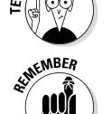

这是我分享可能从经验中总结出的任何小见解的地方。

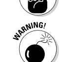

我有时确实无法控制自己的极客属性。偶尔，我想更深入地解释一些东西。阅读这个，可以在你下次的计算机科学鸡尾酒会上给人留下深刻印象，或者如果你真的不需要细节，可以跳过。


这里包含大量细节。我用这个图标指出容易被遗忘的重要内容。

### 书外的资源

你可以在网上找到本书的更多功能。访问网站获取这些额外内容：

- ✓ 配套网站：www.aharrisbooks.net/haio

    这是我为本书开设的主要网站。书中的每一个示例都在这个网站上运行，这样你就可以看到实际效果。必要时，我也包含了源代码，以便你能看到任何无法通过普通的“查看源代码”命令查看的内容的源代码。我还发布了书中提到的每一个软件的链接。如果你发现网站上的任何示例无法运行，请访问我的网站。如果书中的示例有问题，我会立即更新网站，所以请查看我的网站以比较你的代码和我的代码。我还有我的其他书籍的链接、一个你可以提问的论坛，以及一个可以给我发送任何特定问题的电子邮件表格。

- ✓ 速查表：访问 www.dummies.com/cheatsheet/html5css3aio 获取本书的速查表。在这里，你可以找到关于精选HTML语法、CSS属性、JavaScript语法和MySQL命令的入门指南。

- ✓ Dummies.com在线文章：访问 www.dummies.com/extras/html5css3aio 查找本书的附加内容。在这里，你可以找到关于诸如使用HTML实体、重置和扩展CSS、JavaScript库、在PHP中使用模板、SQLite和替代数据策略、jQuery插件的乐趣以及Web下一步发展方向等主题的文章。

- ✓ 更新：For Dummies技术书籍有时会有更新。要检查本书的更新，请访问 www.dummies.com/extras/html5css3aio。

### 从哪里开始

嗯，这真的取决于你。我真心相信你可以利用本书成为一名顶尖的Web开发者。这是我对你的目标。

尽管这是一本大部头的书，但仍然有更多的东西需要去探索。如果你有问题或者只是想聊聊天，请随时通过电子邮件联系我：andy@aharrisbooks.net。你也可以访问我的网站 www.aharrisbooks.net/ 获取代码示例、更新和其他好东西。

我努力回复所有读者的电子邮件，但有时我会落后。请对我保持耐心，我会尽力提供帮助。

我迫不及待地想收到你的来信，并看到你开发的令人惊叹的网站。祝你愉快，发现更多，并保持联系！

## 第一部分

### 构建HTML基础

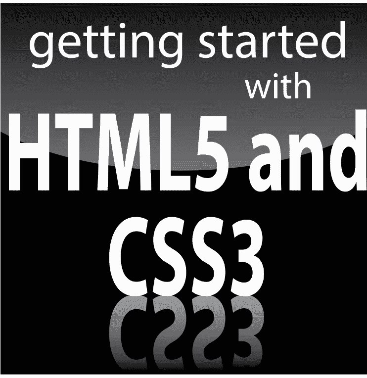

访问 www.dummies.com 获取更多精彩的在线内容。

### 目录概览

**第1章：坚实的HTML基础 ................................. 9**

- 创建基本页面 ........................................................................9
- 理解基本页面中的HTML ................................................... 11


# 第1章：坚实的HTML基础

## 本章内容

- 创建一个基本网页
- 理解最关键的HTML标签
- 设置你的HTML开发环境
- 查看你的网页

本章是你构建网页的入门章节。在本章结束之前，你将拥有并运行你的第一个网页。这是一个谦逊的开端，但你在这里学到的基础网络技术是当今网络上一切的基石。

在本小册中，你将发现使用HTML5的现代网页设计形式。你的网页将从头开始设计，这使得它们易于修改和定制。尽管你在本书中会学到更高级的技术，但你将从本章发现的这些基础网页开始，并让它们实现各种令人兴奋的功能。

## 创建基本网页

好消息是：你需要的最重要的网络技术也是最简单的。你不需要任何昂贵或复杂的软件，也不需要一台强大的计算机。你可能已经拥有了开始所需的一切。

别再说了！启动计算机，创建一个网页吧！

1.  打开一个文本编辑器。

你可以使用任何你想要的文本编辑器，只要它允许你将文件保存为纯文本格式。如果你使用的是Windows，记事本现在就可以用。如果你使用的是Mac，你可能需要下载一个文本编辑器。我喜欢`Komodo Edit` (www.activestate.com/komodo-edit) 或 `TextWrangler` (www.barebones.com/products/textwrangler/)。让`TextEdit`正确工作是可能的，但直接下载一个专为此设计的工具可能更容易。我将在本小册的第3章更全面地介绍文本编辑器。

不要使用像Microsoft Word或Mac TextEdit这样的文字处理软件。这些是功能强大的工具，但它们无法以正确的格式保存文件。这些工具进行居中对齐、更改字体等操作的方式在网络中不起作用。我保证你很快就会明白如何完成所有这些操作，但文字处理程序无法正确执行这些操作。即使是“另存为HTML”功能也无法正常工作。你确实只需要一个非常简单的文本编辑器，仅此而已。在本小册的第3章，我将向你展示更多能让你工作更轻松的编辑器。你不应该使用Word或TextEdit。

2.  输入以下代码。

真的。在你的文本编辑器中输入它，这样你就能获得一些编写实际代码的经验。我很快就会解释这一切的含义，但现在输入它来感受一下：

```html
<!DOCTYPE HTML>
<html lang="en-US">
<head>
<meta charset="UTF-8">
<!-- myFirst.html -->

<title>My very first web page!</title>
</head>

<body>

<h1>This is my first web page!</h1>

<p>
This is the first web page I've ever made,
and I'm extremely proud of it.
It is so cool!
</p>

</body>
</html>
```

3.  将文件保存为`myFirst.html`。

你的文件名不能包含空格，并且必须以`.html`扩展名结尾，这一点很重要。空格会在互联网上引发问题（当然，所有好的网页最终都会出现在那里），而`.html`扩展名是大多数计算机识别此文件是HTML文件（网页的另一个名称）的方式。文件保存在哪里并不重要，只要你能在下一步找到它。

4.  打开你的网页浏览器。

网页浏览器是用来查看页面的程序。在你将网页发布到某个网络服务器后，你的格特鲁德姑妈就可以使用她的浏览器来查看你的页面。你还需要一个浏览器（是浏览器，不是格特鲁德姑妈）来测试你的页面。现在，使用你通常使用的任何浏览器。大多数Windows用户已经安装了Internet Explorer。如果你是Mac用户，可能已经有Safari。Linux用户通常使用Chrome或Firefox。这些都可以。在本小册的第3章，我将解释为什么你可能需要不止一个浏览器，以及如何配置它们以最大化其用途。

5.  在浏览器中加载你的页面。

你可以通过多种方式完成此操作。你可以使用浏览器的“文件”菜单打开本地文件，也可以直接将文件从桌面（或任何地方）拖动到打开的浏览器窗口中。

6.  享受你新获得的天才时刻。

你简单的文本文件被转换了！如果一切顺利，它将如图1-1所示。

### 理解基本网页中的HTML

你在上一节创建的页面使用了一种极其简单的标记法——HTML（超文本标记语言），它自网络诞生之初就已存在。HTML是一项极好的技术，原因如下：

-   **它使用纯文本。** 大多数文档系统（如文字处理软件）使用特殊的*二进制编码方案*，将格式直接合并到计算机的内部语言中，这会将文档锁定在特定的计算机或软件中。也就是说，以Word格式存储的文档在没有理解Word格式的程序的情况下无法读取。HTML通过将所有内容存储为纯文本来克服这个问题。

**图 1-1：** 恭喜！你现在是一名网页开发者了！

-   **它适用于所有计算机。** HTML的主要目的是拥有一个通用格式。任何计算机都应该能够读写它。纯文本格式有助于实现这一点。

-   **它描述文档的含义。** HTML并非真正设计用来指示页面或其元素的外观。HTML是关于描述各种元素的含义（稍后会详细介绍）。当你弄清楚如何正确使用HTML时，这具有一些明显的优势。

-   **它不描述文档的外观。** 这一点看起来很奇怪。当然，当你查看图1-1时，你会看到网页上的文本外观与它在文本编辑器中的外观相比发生了变化。使用HTML格式化文档确实会导致文档外观的改变。但这并非HTML的重点。你将在第二册和第三册中发现如何使用另一种强大的技术——CSS——在你定义了页面的含义之后来改变它的外观。这种将含义与布局分离是HTML最好的特性之一。

-   **它易于编写。** 当然，HTML比这个第一个例子要复杂一些，但你可以轻松地在没有任何专业编辑器的情况下学会如何编写HTML。你只需要知道少数几个元素，而且它们非常直观。

-   **它是免费的。** 使用HTML完全免费，主要是因为它不属于任何人。没有公司控制它（尽管有几家曾尝试过），也没有人为它申请专利。这项技术可以被任何人自由使用，这是一个巨大的优势。

### 认识你的新朋友：标签

编写HTML代码的关键是尖括号（`<>`）内的特殊文本。这些特殊元素是*标签*。它们不是要显示在网页上的，而是向网页浏览器提供有关文本含义的指令。标签旨在相互嵌套以指示页面的组织结构。这个基本页面将向你介绍你将遇到的所有主要标签。（还有更多标签，但它们可以等一两章。）每个标签都有一个开始标签和一个结束标签。结束标签与开始标签相同，只是结束标签有一个斜杠（`/`）：

-   `<!DOCTYPE HTML>`：这个特殊标签用于告知浏览器文档类型是HTML。这就是浏览器知道你将编写HTML5文档的方式。你有时会看到doctype有其他值，但HTML5是现在的主流选择。

-   `<html lang="en"></html>`：`<html>`标签是整个网页的基础。该标签开始页面。同样，`</html>`结束页面。例如，页面以`<html>`开始，以`</html>`结束。`<html></html>`的组合表示页面中的所有内容都被定义为HTML代码。在HTML5中，你应该告诉浏览器页面将用哪种语言编写。因为我用英语写作，所以我用代码“en”来指定。

一些书教你用大写字母编写HTML标签。这曾经是一个标准，但现已不再推荐。

-   `<head></head>`：这些标签定义了网页的一个特殊部分，称为*head*（有时也叫*header*）。网页的这个部分让我想起了汽车的发动机舱。这是你稍后要放置一些好东西的地方，但不是主要内容所在的位置。现在，你要放在head中的唯一东西是文档的标题。稍后，你将添加样式信息和编程代码，让你的页面“唱起来”和“跳起来”。

-   `<meta charset="UTF-8">`：meta标签用于向浏览器提供更多信息。这个命令向浏览器提供更多信息，告诉它使用哪个字符集。英语通常使用一个称为（出于晦涩的原因）UTF-8的字符集。你不必太担心这个，但用英语编写的每个HTML5页面都使用这个代码。

-   `<!-- -->`：这个标签表示一个*注释*，浏览器会忽略它。然而，注释用于描述代码中特定部分的作用。

-   `<title></title>`：这个标签用于确定页面的标题。标题通常包含普通文本。你定义的任何内容都会以某种特殊方式显示。许多浏览器将标题文本放在浏览器的标题栏中。搜索引擎经常使用标题来描述页面。

在本书中，我使用HTML代码的文件名作为标题。这样，你就可以将任何图表或代码清单与本书随附网站上的相应文件匹配起来。通常，你会使用更具描述性的内容，但对于像这样的书籍来说，这是一个有用的技术。

说标题文本总是显示在标题栏中并不完全准确，因为网页被设计为在许多不同的浏览器上工作。当然，标题确实在大多数主流浏览器中以这种方式显示，但在手机和平板电脑上呢？HTML从不规定会发生什么；它只建议。这可能很难适应，但这是一个现实。你用绝对控制权换取了广泛的兼容能力，这是一笔不错的交易。

-   `<body></body>`：页面的主要内容包含在这些标签中。大部分HTML代码和用户看到的内容都在body区域。如果head区域是发动机舱，那么body就是乘客所在的地方。

-   `<h1></h1>`：H1代表*一级标题*。此标记内的任何文本都被视为突出的标题。默认情况下，大多数浏览器会为定义为H1的任何内容添加特殊格式，但不能保证。H1标题并不真正指定任何特定的字体或格式，只是文本作为一级标题的*含义*。当你在第二册中发现如何使用CSS时，你将能够让你的标题呈现出你想要的任何样子。在第一本小册中，现在请保留所有默认布局，并确保你理解HTML是关于语义含义的，而不是关于布局或设计的。标题还有其他级别，

#### 标题层级

课程内容会通过 `<h6>` 到 `<h1>` 级别的标题来组织，其中 `<h2>` 表示比 `<h1>` 稍次要的标题，`<h3>` 比 `<h2>` 更次要，依此类推。


初学者有时会忍不住将第一个标题设为 `<h1>` 标签，第二个设为 `<h2>`，第三个设为 `<h3>`。但事情并非如此运作。网页如同报纸和书籍一样，使用不同的标题来指示页面上各元素的相对重要性，通常还会改变文本的字号。你可以在第二册中阅读更多相关内容。

- `<p></p>`：在 HTML 中，p 代表段落标签。在你的网页中，应将每个标准段落包裹在一对 `<p></p>` 中。你可能注意到 HTML 不会保留源代码中的回车符或空白符。也就是说，如果你在代码中按回车将文本换行，该换行在最终的网页中不一定会被保留。

`<p></p>` 结构是管理文档中每个段落前后间距的一种简单方法。

一些较老的书籍建议使用不带 `</p>` 的 `<p>` 来为文档添加空格，类似于按回车键。这种想法以后可能会给你带来问题，因为它不能准确反映网页浏览器的工作方式。不要把 `<p>` 想成回车符。相反，应将 `<p>` 和 `</p>` 视为定义一个段落。段落模型功能更强大，因为很快你就会明白如何为任何正确定义的段落设置带有雏菊图案的绿色背景黄色文字（或任何你想要的东西）。如果事物被正确标记，以后操作起来会容易得多。


| 关于基本页面的几点说明 |
| :--- |
| 为你制作的第一个页面感到自豪吧。它可能很简单，但它是一切伟大事物的基础。在继续之前，花点时间思考一下你在这个不起眼的页面中展示的一些重要 HTML 原则： |
| ✅ **所有标签均为小写。** 虽然 HTML 允许使用大写标签，但现代开发者在大多数情况下已约定使用小写标签。（`<!DOCTYPE>` 是此规则的一个显著例外。） |
| ✅ **标签对是容器，有开始和结束。** 标签包含其他标签或文本。 |
| ✅ **某些元素可以重复。** 每个页面只能有一个 `<html>`、`<title>` 和 `<body>` 标签，但许多其他元素（如 `<h1>` 和 `<p>`）可以根据需要重复任意多次。 |
| ✅ **回车符会被忽略。** 在记事本文件中，存在许多回车符。原始文档的格式对 HTML 输出没有影响。标记标签指示了输出的外观。 |

## 设置你的系统

制作网页并不需要太多东西。你的纯文本编辑器和网络浏览器基本就够了。不过，有些工具可以让你作为网页开发者的日常生活更轻松。

### 显示文件扩展名


本节讨论的方法主要适用于 Windows 用户，但它非常重要。Windows 使用*扩展名*（文件名中句点后面的部分）来确定你正在处理的文件类型。这在网页开发中非常重要。你创建的文件是简单的文本文件，但如果你用普通的`.txt`扩展名保存它们，你的浏览器将无法正确读取。更糟糕的是，Windows 的默认设置会向你隐藏这些扩展名，因此你只能依靠图标来判断文件类型，这会导致各种问题。我建议你让 Windows 明确显示文件扩展名。以下是 Windows 7 中的设置方法：

1. **单击“开始”按钮。**

   这会打开标准的开始菜单。

2. **打开“控制面板”。**

   “控制面板”应用程序允许你修改操作系统的许多部分。

3. **找到“外观和个性化”。**

   此部分允许你修改操作系统的视觉外观和感觉。

4. **选择“文件夹选项”。**

   此对话框允许你修改整个视觉界面中文件夹的显示方式。

5. **找到“高级设置”。**

   单击“查看”选项卡，然后在“高级设置”下查找。

6. **显示文件扩展名。**

   默认情况下，“隐藏已知文件类型的扩展名”复选框处于选中状态。取消选中此复选框以显示文件扩展名。

在 Windows 8 中显示文件类型的过程类似：

1. **转到 Windows 资源管理器。**

   使用 Windows 资源管理器磁贴来打开 Windows 资源管理器——Windows 的标准文件管理器。

2. **单击“查看”选项卡。**

   此选项卡允许你修改目录的显示方式。

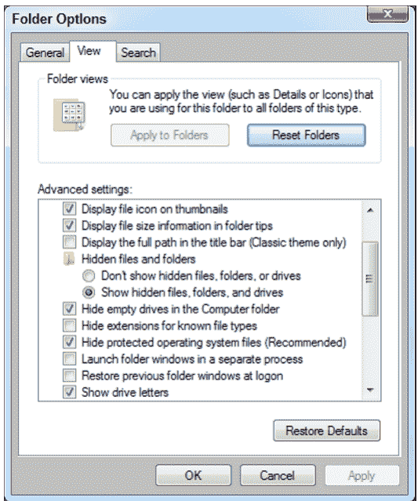

图 1-2：不要隐藏文件扩展名（取消选中那个“隐藏扩展名”复选框）。

3. **取消选择“文件名扩展名”。**

   如果此按钮被选中，则文件扩展名会显示（这正是你想要的）。（参见图 1-2。）请注意，这与 Windows 7 的行为相反。

> 虽然我的演示使用的是 Windows 7 和 8，但该技术在较旧版本的 Windows 中类似。只需快速搜索“显示文件扩展名”即可。

#### 设置你的软件

你将编写大量网页，因此设置你的系统使该过程尽可能容易是合理的。我将在本迷你书的第 3 章中更详细地讨论一些你应该使用的软件，但现在，这里有几条简单的建议：

- ◆ **在桌面上放置一个记事本图标。** 你将编辑大量文本文件，因此将记事本（或你使用的任何其他文本编辑器）的图标直接放在桌面上会很有帮助。这样，你就可以通过将其拖到桌面来快速编辑任何网页。当你使用比记事本更复杂的编辑器时，你也会需要它们的快捷方式。

- ◆ **获取另一个网页浏览器。** 你可能*非常*喜欢你的浏览器，这没关系，但你不能假设每个人都喜欢和你一样的浏览器。你需要了解其他浏览器如何解释你的代码。Chrome 是一个功能极其强大的浏览器，它完全免费，并且拥有许多出色的程序员功能。如果你还没有，我建议至少在桌面上放置两个浏览器的快捷方式。

## 理解魔法

人们对网页的大多数问题源于对这种媒介实际工作方式的误解。大多数人熟悉文字处理软件，我们知道如何让文档按照我们想要的样子呈现。现代应用程序使用所见即所得（WYSIWYG）技术，承诺*所见即所得*。对于打印文档来说，这是一个合理的承诺，但在网络上并非如此。

网页的外观取决于许多你无法控制的因素。用户可能使用比你更小或更大的屏幕来阅读你的页面。她可能使用与你不同的操作系统。她可能连接速度较慢，或者为了速度关闭了图形显示。她可能失明并使用屏幕阅读器技术来浏览网页。她可能在平板电脑、智能手机，甚至是较旧的（不那么智能的）手机上阅读你的页面。你无法制作一个在所有这些情况下看起来都一样的文档。

一个很好的折衷方案是制作一个文档，清晰地指示信息如何组合在一起，并对视觉设计提出建议。用户和她的浏览器可以决定采用这些建议的多少。

你对视觉设计有部分控制权，但永远无法完全控制，这没关系，因为你用完全控制换取了可访问性。拥有你从未听说过的设备的人也可以访问你的页面。

练习几次，直到你可以轻松构建一个页面而无需查阅任何资料。很快，你就准备好进入下一步——像专业人士一样构建页面。

#### 18 第一册：创建 HTML 基础

## 第 2 章：关于验证的一切

**本章内容**

- 介绍有效页面的概念
- 使用文档类型声明
- 设置字符集
- 认识 W3C 验证器
- 出错时修复问题
- 使用 HTML Tidy 清理你的页面

网页开发正在经历一场革命。随着网络的成熟并成为日常生活的重要组成部分，确保网页正常运行变得至关重要——因此，呼吁网页开发者遵循自愿的网页开发标准。

### 有人来阻止这场 HTML 疯狂吧！

在过去的糟糕岁月里，网页是一件很随意的事情。人们随心所欲地编写 HTML 页面。虽然这很容易，但它导致了很多问题：

- **浏览器制造商添加了在所有浏览器上都无法工作的特性。** 人们想要更漂亮的网页，带有颜色、字体和花哨的东西，但没有一种标准的方法来做这些事情。每个浏览器都有一套不同的标签来支持增强功能。作为开发者，你无法真正知道你的网页是否能在所有浏览器上运行。如果你想使用某个炫酷的功能，你必须确保你的用户拥有正确的浏览器。

- **意义和布局之间的区别变得模糊。** 人们期望对自己的网页进行某种设计控制，因此各种新标签涌现，模糊了描述页面和装饰页面之间的区别。

- **基于表格的布局被当作一种变通方法使用。** HTML 没有很好的方法来处理布局，于是聪明的网页开发者开始使用表格作为布局机制。这勉强可行，但并不简单或优雅。

- **人们开始使用工具来编写页面。** 网页开发很快变得如此繁琐，以至于人们开始认为自己无法再手写 HTML，需要某种编辑器。

# XHTML 有一些很棒的构想

2000年，万维网联盟（通常缩写为 W3C）聚集在一起，为 HTML 提出了一些修正方案。其基本计划是创建一种符合更严格标记形式或*可扩展标记语言（XML）*的新 HTML 形式。细节冗长乏味，但本质上，他们就网页标准化方式达成了一些共识。以下是其中一些标准：

- **所有标签都有结束标记。** 每个标签都包含一个开始标签和一个结束标签。（嗯，少数例外内置了自己的结束标记。当你在本迷你书的第 6 章遇到第一个这样的标签时，我会解释。）这是一个新发展，因为在传统 HTML 中，结束标签被认为是可选的，许多标签甚至没有结束标签。

- **标签不能重叠。** 在 HTML 中，有时人们会有马虎和重叠标签的倾向，像这样：`<a><b>my stuff</a></b>`。这在 XHTML 中是不允许的，这是件好事，因为它会让浏览器感到困惑。如果一个标签在某个容器标签内被打开，那么该标签必须在该容器关闭之前关闭。

- **一切都是小写。** 有些人用大写写 HTML，有些人用小写，有些人则随心所欲。这不一致，使得编写能够读取所有变体的浏览器变得更加困难。

- **属性必须加引号。** 如果你已经做过一些 HTML，你知道引号以前是可选的——现在不是了。（有关属性的更多信息，请参阅第 3 章。）

- **布局必须与标记分离。** 传统 HTML 有一堆更多是关于格式而非标记的标签（如 `<font>` 和 `<center>`）。这些标签很有用，但做得还不够。XHTML（至少是严格版本）消除了所有这些标签。不过别担心；CSS 提供了这些标签的所有功能以及更多功能。

这听起来像严格的图书馆员规则，但它们实际上完全没有限制性。大多数优秀的 HTML 编码者已经在遵循这些指南或类似的东西。

尽管你正从 XHTML 过渡到 HTML5，但 XHTML 的这些方面仍然保留，它们是所有优秀 HTML5 开发者仍在使用的指南。

HTML5 实际上比 XHTML 严格版允许更宽松的规则解释，但在本书中，我编写的 HTML5 代码也通过了大多数 XHTML 严格测试。这种实践确保了代码整洁且没有意外。

# 20 别让这 HTML 疯狂再继续了！

为他们处理所有那些复杂性。虽然这些编辑程序引入了最初让事情变得更简单的新功能，但这些工具也使得代码在没有原始编辑器的情况下几乎无法更改。Web 开发者开始认为，没有大公司的工具就无法设计网页。

- **Web 的本质正在改变。** 与此同时，这些因素使普通的 Web 开发变得更具挑战性。创新者们认识到，Web 并非真正关于文档，而是关于能够动态创建文档的应用程序。你访问的许多最有趣的网页根本不是网页，而是每次你访问时动态生成网页的程序。这种创新意味着开发者必须使网页既对人类可读，也对程序可读。

- **XHTML 试图修复问题。** Web 的标准机构（确实有这样一个机构）叫做万维网联盟（W3C），它试图通过一个名为 XHTML 的新标准来解决问题。这是一种也遵循更严格 XML 规则的 HTML 形式。如果每个人都同意遵循 XHTML 标准，许多丑陋之处就会消失。

- **XHTML 也不奏效。** 尽管 XHTML 是个好主意，但结果证明它很复杂。部分内容很难手工编写，而且几乎没有开发者完全遵循标准。即使是浏览器制造商对于如何读取和显示 XHTML 也没有完全达成一致。如果没人遵循，再好的主意也没用。

简而言之，HTML 的世界真是一团糟。

# 关键在于验证

*你验证我*

在老式 HTML 中，你永远不知道你的页面在不同浏览器上的外观。事实上，你甚至不知道你的页面是否编写正确。有些错误在一个浏览器上看起来没问题，但在另一个浏览器上会导致崩溃。

*验证*的想法是为了消除 HTML 的一些不确定性。它就像你代码的拼写检查器。我常用的拼写检查器有时让我觉得自己有点笨，因为我会犯错。不过我喜欢它，因为只有我一个人看到错误。我可以在把文档交给你之前修正拼写错误，这样我就显得聪明了。（嗯，也许吧。）

如果你能有一个特殊的检查器，为你的网页做同样的事情，那就太酷了。它不是检查你的拼写，而是测试你的页面是否有错误，并让你知道是否犯了任何错误。如果你能有某种认证，证明你的页面遵循卓越标准，那就更酷了。

这就是页面验证的工作原理。你可以指定你的页面将遵循某个特定标准，并使用软件工具确保你的页面符合该标准的规格。该软件工具就是*验证器*。我将在接下来的“验证你的页面”部分向你展示两个不同的验证器。

浏览器也承诺遵循某个特定标准。如果你的页面验证通过某个给定标准，任何验证通过同一标准的浏览器都能正确地再现你的文档，这非常重要。

最重要的验证器是 W3C 验证器，地址是 `http://validator.w3.org`。

验证器实际上是一个检查页面有效性的软件的前端。它查看你的网页的文档类型，并检查页面是否符合该文档类型的规则。如果不符合，它会告诉你可能出了什么问题。

你可以通过三种方式向验证器提交代码：

- **通过 URI 验证。** 当页面托管在 Web 服务器上时，使用此选项。存储在本地计算机上的文件无法用此技术检查。第 VIII 册描述了你需要了解的关于使用 Web 服务器的所有知识，包括如何创建自己的服务器以及如何将文件移动到服务器上。（*URI*，即统一资源标识符，是网络地址的一个更正式的术语，更常见的形式是 URL。）

- **通过文件上传验证。** 这种技术适用于你尚未发布到 Web 服务器的文件。它非常适合你编写在计算机上但尚未对外公开的页面。这是初学者最常用的验证类型。

- **通过直接输入验证。** 验证器页面有一个文本框，你可以直接将代码粘贴进去。它有效，但我通常更喜欢使用其他方法，因为它们更容易。

验证可能听起来很麻烦，但它实际上是一个很棒的工具，因为粗糙的 HTML 代码会导致很多问题。更糟糕的是，你可能认为一切正常，直到别人查看你的页面，突然，页面显示不正确。

截至本文撰写时，W3C 验证器可以读取和测试 HTML5 代码，但 HTML5 验证仍被视为实验性的。在 HTML5 变得更加主流之前，你的 HTML5 页面可能会收到关于 HTML5 实验性质的警告。你可以安全地忽略此警告。

### 验证你的页面

为了解释这一切，我创建了一个古希腊的伊索可能会做的网页。好吧，也许伊索并没有把他的著名寓言写成网页，但如果他写了，它们可能看起来像下面的代码清单：

```html
<!DOCTYPE HTML>
<html lang="en-US">
<head>
  <meta charset="UTF-8">

<!-- oxWheels1.html -->

<!-- 注意这个页面有故意设置的错误！请参阅正文和
     oxWheelsCorrect.html 以获取更正版本。
-->
</head>
<body>
<title>The Oxen and the Wheels</title>
<h1>The Oxen and the Wheels</h1>
<h2>From Aesop's Fables</h2>

<p>
    A pair of Oxen were drawing a heavily loaded wagon along a
    miry country road. They had to use all their strength to pull
    the wagon, but they did not complain.
</p>

<p>
    The Wheels of the wagon were of a different sort. Though the
    task they had to do was very light compared with that of the
    Oxen, they creaked and groaned at every turn. The poor Oxen,
    pulling with all their might to draw the wagon through the
    deep mud, had their ears filled with the loud complaining of
    the Wheels. And this, you may well know, made their work so
    much the harder to endure.
</p>

<p>
    "Silence!" the Oxen cried at last, out of patience. "What have
    you Wheels to complain about so loudly? We are drawing all the
    weight, not you, and we are keeping still about it besides."
</p>

<h2>
They complain most who suffer least.
</h2>
```

#### 24 验证你的页面

代码看起来没问题，但实际上存在许多问题。伊索可能是个伟大的故事家，但从这个例子来看，他似乎是个粗心的程序员。错误可能很难发现，但相信我，它们确实存在。问题是，如何在用户发现问题之前找到它们？

你可能会想，如果在网页浏览器中查看页面，问题会显而易见。各种浏览器似乎都能妥善处理页面，即使它们的显示方式并不完全相同。图2-2展示了浏览器中的`oxWheels1.html`。

Chrome似乎很好地处理了这个页面，但`From Aesop's Fables`应该是一个二级标题，即`H2`，但它显示为纯文本。除此之外，几乎没有迹象表明有什么问题。

如果看起来没问题，谁会在乎它是否完全正确？你可能想知道，只要一切运行正常，为什么我们要关心底层代码是否有错误。毕竟，如果页面显示正常，谁会去看代码呢？

问题是，你不知道它是否会显示正常，代码中的错误最终会回来困扰你。如果可能，你希望立即知道代码的哪些部分有问题，这样你就可以修复它们，而不用担心。

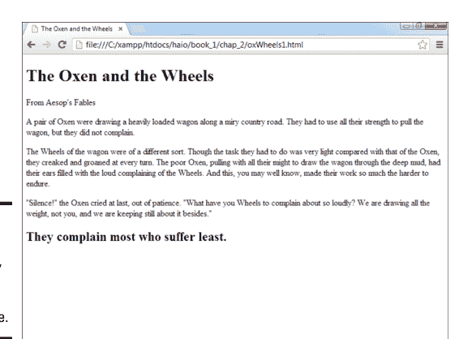

**图2-2：** 页面看起来没问题，但标题很奇怪。

## 伊索拜访W3C

要了解这个页面的情况，请访问W3C验证器`http://validator.w3.org`。图2-3展示了我访问该网站并上传`oxWheels1.html`副本的过程。

屏住呼吸，点击“检查”按钮。你可能会对图2-4所示的结果感到惊讶。

验证器是一个挑剔的家伙，它似乎一点也不喜欢这个页面。验证器确实返回了一些有用的信息，并给出了足够的提示，你很快就能理解这些内容。

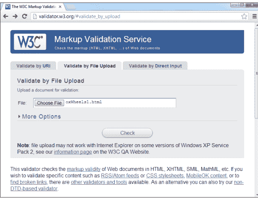

**图2-3：** 我正在检查`oxWheels`页面，以查找任何问题。

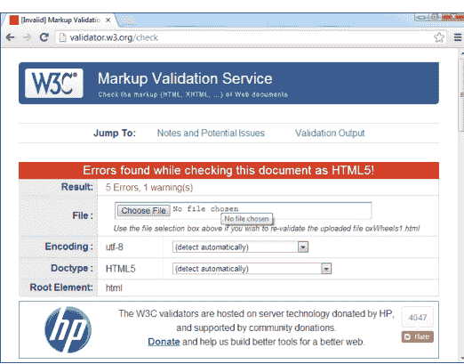

**图2-4：** 五个错误？这不可能是对的！

### 验证你的页面

#### 检查概述

在查看具体的问题之前，先快速浏览一下验证器发送给你的网页。该网页充满了方便的信息。页面顶部告诉你许多有用的内容：

- **结果：** 这才是真正重要的。通过查看这一行，你将知道剩余的错误数量。不过，不要惊慌。文档中的错误可能比你在这里看到的数量要少。

- **文件：** 你正在处理的文件名。

- **编码：** 你设置的文本编码。如果你没有明确设置文本编码，你可能会在这里看到一个警告。

- **文档类型：** 这是从你的文档中提取的文档类型。它指明了验证器用于检查你页面的规则。这通常应该显示为`HTML5`。

- **可怕的红色横幅：** 经验丰富的网页开发者甚至不需要阅读结果页面就能知道是否有问题。如果一切顺利，会有一个绿色的祝贺横幅。如果有问题，横幅就是红色的。看起来不太好啊，伊索。

> 不要因为有错误而惊慌。错误通常会重叠，所以代码中的一个问题常常会导致多个错误弹出。大多数情况下，你的错误远少于页面所说的，而且很多错误是重复的，所以一旦你找到一个错误，你就会知道如何在整页中修复它。

#### 验证页面

验证器并不总是告诉你所有你需要知道的信息，但它确实给了你一些很好的线索。页面验证是繁琐的，但并不像一开始看起来那么困难。以下是一些进行页面验证的策略：


- **只关注第一个错误。** 当然，页面上可能有100个错误，但要一个一个地解决。列表中唯一重要的错误是第一个。在解决第一个错误之前，完全不要担心其他错误。

- **注意第一个错误的位置。** 你得到的最有帮助的信息是关于验证器识别出错误的行和列的信息。这并不总是错误所在的位置，但它确实给了你一些线索。

- **查看错误消息。** 它通常很有趣。错误消息有时很有帮助，有时则完全神秘。

- **查看详细文本。** 与大多数编程错误消息不同，W3C验证器试图用类似英语的语言解释出了什么问题。它仍然不总是有意义，但有时文本会给你一个提示。

# 第I部分 第2章 全部关于验证

- **快速浏览接下来的几个错误。** 有时，一个错误会表现为多个错误。也看看接下来的几个错误，看看它们是否提供了更多见解；有时，它们确实会。

- **尝试修改并重新验证。** 如果你有想法，就测试一下（但一次只解决一个问题）。保存后再次检查页面。如果第一个错误现在出现在比之前更大的行号上，你就成功了。

- **不要担心错误数量增加。** 在成功修复一个问题后，感知到的错误数量有时会增加而不是减少。这没关系。有时，修复一个错误会揭示以前隐藏的错误。更常见的是，修复一个错误会清除更多其他错误。只需集中精力从文档开头到结尾清除错误。

- **重复此过程。** 查看新的顶部错误并将其解决。继续下去，直到获得梦寐以求的验证绿色横幅。（如果我以后写一个HTML冒险游戏，验证绿色横幅将是最强大的护身符之一。）

## 检查第一个错误

再次查看`oxWheels1.html`页面的结果。第一个错误消息看起来像图2-5。

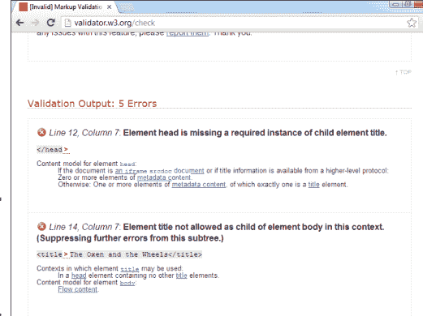

**图2-5：** 好吧，这下一切都清楚了。

图2-5显示了前两个错误消息。第一个抱怨头部缺少一个标题。第二个错误消息则是在抱怨标题在正体内。相关代码在此重复：

```html
<!DOCTYPE HTML>
<html lang="en-US">
<head>
    <meta charset="UTF-8">

<!-- oxWheels1.html -->

<!-- note this page has deliberate errors! Please see the text
     and oxWheelsCorrect.html for a corrected version.
-->

</head>
<body>
<title>The Oxen and the Wheels</title>
```

仔细查看`<head>`和`<title>`标签对，并回顾错误消息中的说明，你可能会发现问题所在。`<title>`元素应该放在头部，但我意外地把它放在了正体内！（好吧，这不是意外；我在这里故意犯这个错误来向你展示会发生什么。不过，我过去确实真犯过这个错误。）

## 修复标题

如果`<title>`标签是问题所在，对HTML进行快速修改应该就能修复它。`oxWheels2.html`展示了另一种形式的页面，其中包含了我提出的修复：

```html
<head>
<meta http-equiv="Content-Type" content="text/html; charset=iso-8859-1" />

<!-- oxWheels2.html -->

<!-- Moved the title tag inside the header -->
<title>The Oxen and the Wheels</title>

</head>
<body>
```

**注意：** 我只展示了我更改的页面部分。整个页面可在本书网站上获取。有关网站的更多信息，请参见本书的引言部分。

修复此问题相当简单：

1. **将标题移入头部。** 我认为这里的问题是将`<title>`元素放在了正体内，而不是它应该所在的头部。如果我将标题移到头部，错误应该会被消除。

2. **修改注释以反映页面状态。** 注释反映我所做的更改很重要。

3. **保存更改。** 通常，你只需对同一文档进行更改，但我选择更改文件名，这样你就可以看到随着页面改进，我的更改存档。这实际上是个好主意，因为你将拥有文档更改的完整历史记录，如果意外地把事情弄得更糟，你总是可以恢复到旧版本。

## 解决下一个错误

一个错误解决了，但还有更多。下一个错误（参见图 2-6）看起来很奇怪，但仔细查看代码后就会发现其原因。

这类错误非常常见。它通常意味着你忘了关闭某个东西，或者把某个东西放错了位置。错误信息指出问题在第 17 行。下一个错误也在第 17 行。看看你能否在相关代码中找到问题：

```
<body>
<h1>The Oxen and the Wheels
<h2</h1>From Aesop's Fables</h2>
```

一旦知道该看哪里，问题就更容易发现了。我太粗心了，在结束`<h1>`标签之前就开始了`<h2>`标签。在许多情况下，一个标签可以完全嵌套在另一个标签内部，但你不能像这里这样让标签定义重叠。`<h1>`必须关闭后，我才能开始`<h2>`标签。

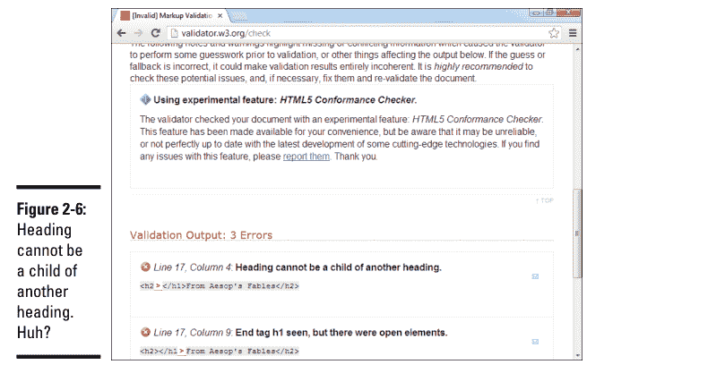

这解释了为什么浏览器可能会对如何显示标题感到困惑。这段代码不清楚应该以 H1 还是 H2 格式显示，或者可能根本不应用任何特殊格式。了解问题并修复它，远比无知地等待问题发生要好得多。

第三个版本——`oxWheels3.html`——修复了程序的这一部分：

```
<!-- oxWheels3.html -->
<!-- sort out the h1 and h2 tags at the top -->
<title>The Oxen and the Wheels</title>
</head>
<body>
<h1>The Oxen and the Wheels</h1>
<h2>From Aesop's Fables</h2>
```

验证器已经修复了许多错误，但页面中仍然存在一个非常隐蔽的问题。看看你能否找到它，然后继续阅读下文。

### 使用 Tidy 修复页面

W3C 验证器并非唯一的选择。另一个很棒的工具——HTML Tidy——可以用来修复你的页面。你可以下载 Tidy，或者直接使用`http://infohound.net/tidy`的在线版本。图 2-7 展示了在线版本。

> 验证真的那么重要吗？

我仿佛已经听到了愤怒的邮件。"安迪，我从 1998 年就开始写网页了，我从来没用过验证器。"好吧，确实如此。很多人，甚至一些专业的网页开发者，都在不验证代码的情况下工作。我早期的一些网页根本通不过验证。（你可以对任何页面运行 W3C 验证器，不仅限于你写的页面。如果你喜欢感觉比那些粗心的编码者优越，这可能会给你带来巨大的乐趣。）当我变得更熟练、在网页开发上更高效时，我发现那些小错误往往会在后续带来很多麻烦。我真心认为你应该验证你写的每一个页面。从现在开始养成这个习惯，它会带来巨大的回报。当你第一次学习这些东西时，就要做对。

如果你已经知道一些 HTML，你可能会暂时讨厌验证器，因为它会拒绝你可能认为完全没问题的编码习惯。改掉一个习惯比学习一个新做法要难得多，所以我理解你的感受。但这仍然是值得的。

当你严格要求自己验证页面后，你会发现你已经养成了好习惯，验证过程也会变得没那么痛苦。经验丰富的程序员实际上喜欢验证过程，因为它变得容易得多，并且可以防止以后导致大量麻烦的问题。你甚至可能想重新验证一个使用了一段时间的页面。有时内容更新会导致错误。

图 2-7：HTML Tidy 是 W3C 验证器的替代品。

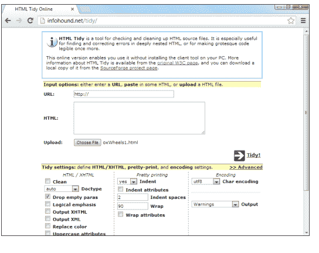

与 W3C 的验证器不同，Tidy 实际上会尝试修复你的页面。图 2-8 展示了 Tidy 建议如何修复`oxWheels1.html`页面。

Tidy 会检查页面中的许多常见错误，并尽其所能修复这些错误。然而，结果并不完美：

- ◆ 它默认输出 XHTML。XHTML 没问题，但我们这里在做 HTML，所以取消选中 Output XHTML（输出 XHTML）复选框。你需要选中的唯一复选框是 Drop Empty Paras（删除空段落）。

图 2-8：Tidy 修复了页面，但修复方式有点笨拙。

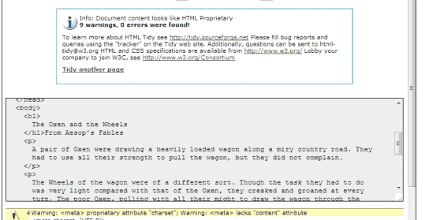

- Tidy 被标题搞混了。Tidy 正确地修复了一级标题，但它在处理二级标题时遇到了困难。它删除了所有标签，所以现在是有效的，但本应是二级标题的文本就那样悬在那里。

- 有时，缩进不对。我设置 Tidy 缩进每个元素，这样很容易看出标签对是如何匹配的。如果我没有明确设置缩进，我发现 Tidy 生成的代码非常难读。

- 这些更改不是永久的。Tidy 所做的一切都只是建议。如果你想保留更改，需要在编辑器中保存结果。点击 "Download Tidied File"（下载整理好的文件）按钮即可轻松完成。

有时当我遇到难题时会使用 Tidy，因为我发现它的错误信息比 W3C 验证器更容易理解。然而，我从不完全信任它。在它更新到真正理解 HTML5 之前，它有时会删除完全有效的 HTML5 标签。真正没有东西可以替代优秀的传统侦探技巧和官方的 W3C 验证器。

你找到最后一个错误了吗？我试图用`<p>`而不是`</p>`来关闭一个段落。这种事情会让 XHTML 验证器抓狂，但 HTML 会坦然接受，所以你甚至可能不知道有问题。Tidy 确实注意到了这个问题并修复了它。当你在处理一个复杂页面而感觉有些不对劲时，请记住这一点。可能存在一个你看不见的错误，它正在干扰你。在这种情况下，考虑使用验证器和 Tidy 来找出问题所在并修复它。

# 第三章：选择你的工具

**本章内容**

- 选择文本编辑器

- 使用专用的 HTML 编辑器

- 比较常见的浏览器

网页开发是一项大工程。你不会不带装满工具的腰带（和一顶酷帽子）去建筑工地，网页开发也是一样（只不过你通常不需要为网页开发戴安全帽）。整个行业都在发展，试图销售能让网页开发变得更容易的工具。有趣的是，你可能并不需要他们试图卖给你的那些工具。一些最好的网页开发工具是免费的，而一些最昂贵的工具并没有那么大的帮助。

本章将告诉你你需要什么，以及如何用优秀的程序设置你的工作空间，以简化网页开发。

## 大厂产品的问题：Expression Web 和 Adobe Dreamweaver

许多网页开发书籍实际上是关于如何使用特定类型软件的书。微软的 Expression Web 和 Adobe Dreamweaver 是这一类别中的两个主要应用程序。这些工具功能强大，并提供了一些*看似*很棒的特性：

- **所见即所得（WYSIWYG）编辑：** 所见即所得是从文字处理器借鉴的理念。你可以像创建文本文档一样创建网页，并使用菜单和工具来处理所有格式。理论上，你不需要知道任何复杂的代码。

- **模板：** 你可以创建一个保持不变的模板，并基于该模板构建多个页面。如果你需要更改模板，其他所有内容都会自动更改。

- **站点管理：** 站点中各个页面之间的交互可以自动维护。

这些听起来都是相当不错的特性，确实如此。这些工具（以及更新的替代品，如微软的 Expression 套件）非常强大，可以成为你网页开发工具包的重要组成部分。然而，同样强大的程序也会引入问题，例如：

- **代码维护：** 专注于视觉设计的商业编辑器往往会生成难以管理的代码。如果你发现需要手动修改某些地方，修复代码会相当困难。

- **厂商锁定：** 这些工具由公司开发，目的是让你购买他们的其他产品。如果你使用 Dreamweaver，会发现它很容易与其他 Adobe 应用程序（如 ColdFusion）集成，但连接非 Adobe 技术就没那么简单了。同样，微软的产品设计也旨在与其他微软技术协同工作。

- **成本：** 这些软件包的成本持续上涨。尽管有免费的微软网页开发工具版本，但商业版本非常昂贵。同样，Dreamweaver 的售价为 400 美元。两家公司都鼓励你购买软件套件，这很容易额外花费数百美元。

- **复杂性：** 它们很复杂。你可以参加完整的课程，或者购买一本厚书来学习如何仅使用其中一项技术。如果学习起来如此困难，它真的能为你节省力气吗？

- **代码：** 你仍然需要理解它。无论你的平台多么出色，在某些时候，你都必须深入研究你的代码。在你花掉所有钱并花时间弄懂一个应用程序之后，你仍然需要理解底层代码的工作原理，因为问题仍然会发生。例如，如果你的页面在 Safari 浏览器上无法正常工作，你必须找出原因并自行修复问题。

- **标准遵循不一致：** 这些工具在这方面有所改进，但如果你希望你的页面符合最新标准，你必须在工具生成后对其进行大量编辑。

- **显示差异：** 所见即所得（WYSIWYG）是个谎言。这真的是大问题。WYSIWYG 对文字处理器有效，因为可以让屏幕看起来像打印页面。页面打印后，内容就固定了。你无法预知网页在浏览器中的显示效果，因为这取决于浏览器。如果用户用手机或手持设备加载你的页面呢？编辑器倾向于强化一种误解，即你可以像处理打印文档一样对待网页，而事实上，网页是一种非常不同的东西。

- **与其他工具不兼容：** 网页开发现在正转向内容管理系统（CMS）——动态创建网站的程序。通常，CMS 系统提供与可视化编辑器相同的易用性，但还有其他优势。然而，将商业编辑器生成的代码迁移到 CMS 非常困难。我在第 8 卷中详细介绍了 CMS 系统。

## 在线网站构建器怎么样？

许多现代网站是使用内容管理系统（CMS）构建的。内容管理系统是软件程序，允许你直接在网页浏览器中构建和修改页面。一些 CMS 系统是免费的，一些则需要付费使用。我在第 8 卷中介绍了如何安装和修改 CMS（甚至构建自己的 CMS）。CMS 系统可能很不错，因为它允许你无需任何特殊工具或知识即可可视化地构建网站。

CMS 方法是一个非常好的解决方案，但我仍然建议你学习如何手动构建网站。最终，即使使用 CMS，它也使用 HTML 和 CSS，即使有帮助，你也需要这些技能来使你的网站看起来和运行良好。

## 替代的网页开发工具

对于网页开发，你真正需要的只是一个文本编辑器和一个网页浏览器。你的电脑上可能已经有一套基本工具。如果你阅读了本小册子的第 1 章和第 2 章，你已经创建了几个网页。但是，每台电脑附带的基础工具可能不足以进行严肃的工作。网页开发需要一种专门的文本编辑器，并且已经发展出许多工具使这项工作更容易。

我在网页开发中发现四种类型的程序很有用：

- **增强型文本编辑器：** 这些工具是文本编辑器，但它们通过各种高级功能进行了增强，如语法检查器、代码着色工具、宏工具和多文档界面。

- **浏览器和插件：** 有些浏览器比其他浏览器更适合开发。你还需要一套完整的浏览器来确保你的代码在所有浏览器中都能工作。有些浏览器可以通过插件扩展以实现高级性能。

- **编程技术：** 本书涵盖了有关集成其他技术的所有相关信息，如 Apache、PHP 和 MySQL。我在第 8 卷第 1 章中向你展示如何安装这些技术所需的一切。你现在还不必担心这些事情，但你应该从一开始就养成与这些增强技术兼容的习惯。

- **多媒体工具：** 网页通常包含各种类型的图像，以及其他多媒体，如自定义字体、音效和视频。你需要一些工具来管理这些资源。

作为一名程序员，你会将文本编辑器视为忠实的伙伴。你将在这个工具上花费大量时间，因此请使用一个适合你的工具。

文本编辑器应该保存纯文本，不含任何格式。你不希望它保存颜色、字体选择或其他文本格式，因为这些不会自动转换为 HTML。

幸运的是，你有几种选择，如下节所述。

### 除非没有其他选择，否则避免使用的工具

文本编辑器可能是一个简单的程序，但这并不意味着它们都一样。有些程序有给初学者（以及有经验的开发人员）带来问题的历史。通常没有必要使用这些较弱的选择。

#### Microsoft Word

不要用它进行网页开发。Word 是一个文字处理器。尽管理论上它可以创建网页，但它生成的 HTML 代码绝对糟糕。例如，我创建了一个空白文档，在其中写了"Hello World"，更改了字体，并将其保存为 HTML。生成的页面包含不规范的代码，既不是纯粹的 HTML 也不是 XHTML，而且长达 114 行。Word 正在变得更好，但它不是一个好的网页开发工具。事实上，不要使用任何文字处理器。它们根本不是为这类工作设计的。

#### Windows 记事本

记事本无处不在，而且是免费的。这是好消息。然而，记事本没有许多你可能需要的功能，例如行号、多文档支持或宏。如果你在不熟悉的电脑上，可以使用它，但尽量使用其他工具。许多人从记事本开始，但很快就会发现它的局限性。

#### Mac TextEdit

Mac 内置了一个简单的文本编辑器——TextEdit，它类似于记事本，但更接近文字处理器，而不是程序员的文本编辑器。TextEdit 以多种格式保存文件。如果你想用它来编写网页，你必须将文件保存为纯文本格式，并且不能使用 TextEdit 的任何格式化功能。除非确实必要，否则最好不要使用 TextEdit。

### 推荐的程序员编辑器

如果记事本、Word 和 TextEdit 不是最佳选择，那么哪些是更好的选择？

问得好。因为文本编辑器是如此重要的工具，选择可能有点取决于你的偏好，所以我会重点介绍一些我最喜欢的。请注意，我在这里提到的每个编辑器都是完全免费的，所以在尝试这些之前不要花钱购买任何东西。

#### 一个值得注意的编辑器：Notepad++

Notepad++ 有很多有趣的功能。以下是一些亮点：

- **语法高亮：** Notepad++ 可以识别关键的 HTML 术语，并将不同类型的术语设置为不同的颜色。例如，所有 HTML 标签都渲染为蓝色，文本为黑色，这使得很容易判断是否犯了某些错误，例如忘记结束一个标签。请注意，颜色不会保存在文档中。着色功能是为了帮助你理解代码。

- **多文件：** 你通常需要一次编辑多个文档。你可以同时在内存中打开多个不同的文档。


- **多语言支持：** 目前，你的页面只包含 HTML。不久之后，你会使用其他语言，如 SQL、CSS 和 PHP。Notepad++ 也足够智能，可以识别这些语言。

- **宏：** 每当你发现自己在重复做某事时，考虑编写一个键盘宏。Notepad++ 有一个很棒的宏功能。宏可以轻松录制和回放一系列击键，可以为你节省大量工作。

- **页面预览：** 编写页面后，需要测试。Notepad++ 内置了快捷键，让你可以快速在 Internet Explorer（`Ctrl+Alt+Shift+I`）和 Firefox（`Ctrl+Alt+Shift+X`）中查看页面。

- **TextFX：** Notepad++ 的开源设计使其易于添加功能。TextFX 扩展（内置于 Notepad++）允许你做各种有趣的事情。其中一个特别方便的工具集是在你的页面上运行 HTML Tidy 并修复任何问题。

遗憾的是，Notepad++ 仅适用于 Windows。如果你使用 Mac 或 Linux，你需要寻找其他替代品。在 Mac 和 Linux 世界中，最接近的替代品是 gedit。

### 38 选择文本编辑器

#### gedit

一个简单但有效的编辑器是 gedit，它免费适用于所有主流操作系统。它是许多 Linux 版本的默认编辑器，但你也可以从 `http://projects.gnome.org/gedit/` 下载适用于 Mac 和 Windows 的版本。

它具备所有标准功能，包括语法高亮（它用不同颜色为代码的不同部分着色，以帮助调试）、行号以及标签列表——这是一个特殊的菜单，如果你忘记了某些语法，可以从列表中选择常见的 HTML 标签。（你可能需要通过编辑-偏好设置菜单尝试插件，以激活所有这些功能。）

遗憾的是，gedit 没有宏编辑器。这对你来说可能不是决定性的缺点，但我常常发现宏工具极其有用，而我更喜欢我的编辑器具有此功能。（如果你特别极客，它确实公开了整个 Python 语言，并允许你用它修改任何东西，但这是另一个话题。）如果你需要一个非常好的通用编辑器，请考虑 gedit。它能满足你大部分需求，又不会过于复杂。

图 3-2 展示了 gedit 的实际运行效果。

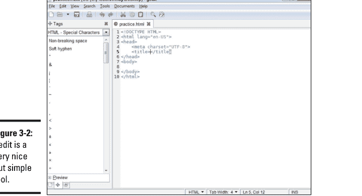

#### 老牌标准：VI 和 Emacs

讨论文本编辑器，就不能不提那些历史悠久的 UNIX 编辑器，它们是早期互联网体验的核心。互联网上的大部分开创性工作都是在 UNIX 和 Linux 操作系统中完成的，这些环境拥有两个极其流行的文本编辑器家族。在现代观念看来，它们可能显得晦涩难懂，但即使在 Windows 社区，它们仍然拥有热情的拥护者。（而且，Linux 比以往任何时候都更受欢迎！）

#### VI 和 VIM

*VI* 代表 Visual Editor（可视化编辑器）。这个名称现在看来有些奇怪，因为大多数开发者无法想象一个*非可视化*的编辑器。在那个年代，VI 能够使用整个屏幕来编辑文本是一件非常了不起的事情。在那之前，面向行的编辑器是编辑文本文件的主要方式。相信我，你现在的情况好多了。图 3-3 展示了 VI 的现代变体（称为 GVIM）的运行效果。

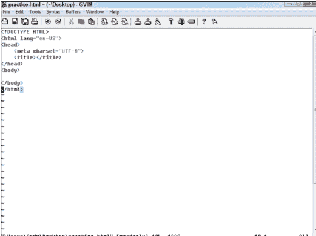

**图 3-3：** VI 不漂亮，但一旦你了解它，它就非常强大。

VI 是一个*模态*编辑器，这意味着同一个键有时有多项功能，具体取决于编辑器的当前模式。例如，`I` 键用于指示你想要插入文本的位置。`D` 键用于删除文本，等等。当然，当你插入文本时，这些键就恢复了它们通常的含义。这种多模式行为对现代用户来说令人困惑，但一旦你习惯了，它的效率会高得惊人。熟练的 VI 用户对它钟爱有加，常常不用其他工具。

VI 对一些用户来说可能过于晦涩，因此出现了许多变体，比如 VIM（VI Improved）。（是的，它本该叫 VII，但也许他们怕人们会把它叫做罗马数字 7。）VIM 比 VI 稍微友好一些，而 GVIM 则更加友好。它会告诉你当前处于哪种模式，并包含鼠标支持、菜单和图标等现代功能。即便有了这些功能，VIM 对大多数人来说也并不直观。

VI 的版本几乎适用于所有在用的操作系统。如果你已经了解 VI，你可能会喜欢用它来开发网页，因为它具备你可能需要的所有功能。如果你还不了解 VI，那么从一个更标准的文本编辑器开始，比如 Notepad++，对你来说可能更有效率。

#### Emacs

UNIX 世界的另一个流行编辑器是 Emacs。和 VI 一样，如果你从不使用 Linux 或 UNIX，你可能不需要这个工具。也和 VI 一样，如果你已经会用了，你可能就不需要其他东西了。Emacs 长期以来一直是程序员的编辑器（自 1976 年以来一直在持续开发），它拥有你能想到的几乎所有功能。

Emacs 还有很多你没想到的功能，包括一个内置的文本冒险游戏，甚至一个心理治疗模拟器。说真的，这些功能不是我编出来的。

Emacs 拥有非常强大的自定义和宏功能，并允许你同时查看和编辑多个文件。Emacs 还能查看和操作本地文件系统、管理远程文件、访问本地操作系统（OS）的 shell，甚至无需离开程序就能浏览网页或收发电子邮件。如果你愿意投入时间去理解一个程序，你将获得一个功能强大到令人难以置信的工具。大多数主要操作系统都有 Emacs 的版本。Emacs 是我在任何新电脑上首先安装的程序之一，因为它如此强大。图 3-4 展示了 Emacs 的一个版本。

增强版 —— XEmacs ——（如图所示）使用像现代程序一样的标准菜单和图标，因此入门相当容易。

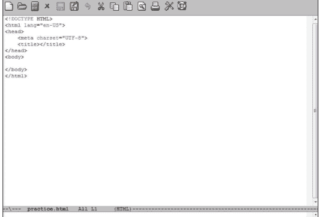

Emacs 有数量惊人的选项和非标准的界面，对初学者来说可能颇具挑战。然而，那些投入了时间学习的人（比如我）对它钟爱有加。

#### 我的个人选择：Komodo Edit

就个人而言，我真的很喜欢 Komodo Edit (`www.activestate.com/komodo-edit`)。这个编辑器功能极其强大，但不像一些老旧工具那么令人生畏。它拥有现代化的流线型界面，但功能比你乍一看所意识到的要多。Komodo Edit 实际上是一款名为 Komodo IDE 的商业集成开发环境（IDE）的开源姊妹版。Komodo IDE 要花费数百美元，但 Komodo Edit 的功能几乎同样多，而且完全免费。图 3-5 展示了 Komodo Edit。

Komodo Edit 有许多真正引人入胜的功能，使其在我心中脱颖而出：

- ◆ **所有标准功能：** Komodo Edit 拥有我提到的作为程序员编辑器所必需的所有功能，包括语法高亮、行号以及纯文本格式保存。

- ◆ **代码补全：** 许多高端的程序员编辑器都有这个功能，但在文本编辑器中不那么常见。工作原理是：当你将页面设置为 HTML5（通过从右下角的菜单中选择）后，Komodo 会“观察”你的输入并提供提示。因此，如果你开始输入 `<h`，Komodo 会弹出一个小对话框，显示所有以 h 开头的标签。如果你选择了 `<html>`，然后移到下一行并输入一个尖括号（`<`），你会得到一个弹出菜单，其中列出了 `<head>` 和 `<body>`，因为这是在此上下文中有效的两个标签。Komodo 在知道何时使用哪个标签方面相当智能。当你刚开始学习时，这可能是一个很有帮助的功能。

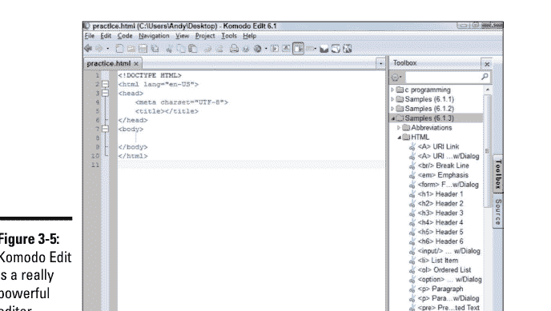

### 40 选择文本编辑器

#### Komodo Edit（续）

- • **多文件支持：** 你的前几个网页将是单个文档，但大多数网站包含多个页面。Komodo 允许你同时打开多个页面，并可以同时比较任意两个页面。

- • **页面预览：** 只需使用 `ctrl-K-V`，即可在第二个标签页中预览当前网页。这是查看页面效果的快速方法。

- • **多语言支持：** 本书（以及整个 Web 开发）需要使用多种不同的语言。Komodo Edit 处理你将使用的语言与处理 HTML 一样出色。Komodo 原生支持 HTML、CSS、JavaScript、PHP、MySQL 以及更多语言。（事实上，我也用它来使用 Python、C++ 和 Java 等其他语言，所以你最终可能在 Web 开发之外也会用到它。）

- • **多平台：** 这对你来说现在可能不是什么大事，但 Komodo 在所有主要操作系统 —— Windows、Mac 和 Linux 上的工作方式都相同。这在 Web 开发中非常重要，因为你在网络探索中会遇到新的操作系统。我使用所有三种主要操作系统类型，并在它们上都使用 Komodo。

- • **远程文件支持：** 最终，你将会把你的网站发布到远程 Web 服务器上。（有关如何设置服务器的详细信息，请参阅第 VIII 卷。）即使网页不在你自己的机器上，Komodo 也能让你轻松编辑网页！

- • **页面模板：** 如果你记不清页面该如何开始，可以从“文件”菜单中选择“新建 ↵ 来自模板的文件”，以一个包含一些初始代码的文件开始。请注意，Komodo 提供的 HTML5 代码并不包含验证器想要的所有内容，但你可以添加所需的功能并将其保存为自己的模板（文件 ↵ 另存为 ↵ 模板）。

- • **代码示例库：** Komodo 自带一个完整的代码示例库。要查看它，请选择“视图 ↵ 标签页和侧边栏 ↵ 工具箱”。工具箱会出现，其中包含许多有趣的工具。从树状结构中选择 samples-HTML，你将看到几个有用的 HTML 代码片段。你可以双击其中任何一个，将代码片段直接添加到你的页面中。当你不记得具体如何输入某些内容时，这会很有帮助。

- • **强大的宏系统：** 随着你使用编辑器的时间增多，你可能会想要添加一些自定义功能。“宏和命令”功能尤其强大。该系统允许你录制一系列击键并播放它们。当你发现自己在重复做某件事时（例如，如果你有一个文件名列表，想把它们变成链接），这非常方便。我喜欢一个好的宏系统。如果你创建了一个特别好的宏，你可以保存它以便以后重用，甚至可以为它分配一个快捷键，使其成为你的 Komodo 系统的永久组成部分。

- • **工具和命令：** 探索“工具”面板，看看一些默认安装的非常有用的工具。这些工具通常用于向底层操作系统发送命令。你可以使用工具系统查看特定目录的内容、在特定浏览器中预览当前文档，或者几乎任何你可以从命令行完成的操作。

### 用 Emmet 为 Komodo 赋能

当你刚开始编码时，Komodo Edit 的基本功能足以满足你的需求。然而，随着你编码能力的提升，你可能会想要一些工具来提高效率。我最喜欢的 Komodo 附加组件是一款名为 Emmet（原名 Zen Coding）的工具。它是一款能让你极快编写 HTML 和 CSS 的利器。

本质上，这个工具允许你输入一个代码片段，然后 Emmet 会将其扩展为完整代码。例如，看看下面的代码：

`html:5>h1{my page}+ul>li*5{item $}`

安装了 Emmet 后，你只需调用 Emmet 的 `展开缩写` 命令，就会生成以下 HTML 片段：

```html
<!doctype html>
<html lang="en">
<head>
    <meta charset="UTF-8">
    <title>Document</title>
</head>
<body>
    <h1>my page</h1>
    <ul>
        <li>item 1</li>
        <li>item 2</li>
        <li>item 3</li>
        <li>item 4</li>
        <li>item 5</li>
    </ul>
</body>
</html>
```

当然，你现在可能还不理解 Emmet 代码或它生成的 HTML，所以不必急于安装 Emmet，等到你对 HTML 和 CSS 更熟练一些再说。不过，当你准备好了，你会发现 Emmet 是你工具库中最强大的工具之一。你可以通过搜索 `工具 ⮂ 附加组件` 菜单来安装 Emmet（以及许多其他有趣的附加组件）。

我实际上比使用 Komodo 内置的代码片段更频繁地使用 Emmet，因为我发现它更快、更灵活。借助这个工具和一点练习，我能在文本编辑器中比使用像 Dreamweaver 这样的图形化工具更快速、更准确地构建一个网页。

-   ◆ **扩展和附加组件：** Komodo 使用了与 Firefox 网页浏览器相同的基本架构。Komodo 的开发者使其非常易于扩展，因此有数百个真正出色的附加组件可以轻松安装。在熟悉了 Komodo 的标准版本后，你可能想研究一些附加组件使其更上一层楼。请参阅附近的侧边栏“用 Emmet 为 Komodo 赋能”以了解我最喜欢的附加组件。

### 其他文本编辑器

网页开发中还使用了许多其他文本编辑器。最重要的是找到一个符合你工作方式的编辑器。如果你不喜欢我目前建议的任何编辑器，这里还有几个你可能想尝试的：

-   • **SynEdit**：非常类似于 Notepad++，在网页开发者中很受欢迎

-   • **Scintilla**：主要是一个编程编辑器，但对 HTML 编码有很好的支持

-   • **jEdit**：一个用 Java 编写的流行文本编辑器，功能不错，但有些开发者认为它比其他选择慢

### 编辑器的最终结论

有令人眼花缭乱的编辑器供你选择。哪一个最适合你在某种程度上是个个人决定。随着你编码风格的发展，你会更了解哪个编辑器最适合你。如果你不确定，我推荐从 gedit（如果你想要简单快速）或 Komodo Edit（如果你准备好迎接更强大的功能）开始。然后，随着你花更多时间在某个编辑器上，可以尝试一些其他的，看看哪个最符合你的需求。

#### 44 寻找优秀的网页开发者浏览器

网页旨在浏览器中显示；所以，当然，你需要浏览器进行测试。然而，并非所有浏览器都一样，所以你需要不止一个。目前有许多重要的浏览器在使用，你需要了解它们之间的关系，因为用户正是通过它们来查看你的作品的。

#### 一点古老的历史

你可能已经注意到，浏览器在显示和处理网页的方式上存在不一致。了解我们是如何陷入这种混乱局面的很有帮助。

#### Mosaic/Netscape：杀手级应用

起初，浏览器是由小型团队编写的。最重要的早期浏览器是 Mosaic，由一个位于伊利诺伊州尚佩恩-厄巴纳的美国国家超级计算应用中心（NCSA）的团队编写。

NCSA 团队的几名成员决定创建一个完全商业化的网页浏览器。Netscape 由此诞生，并迅速成为最突出和重要的浏览器，在其鼎盛时期占据了 97% 的市场份额。

#### 微软加入（并赢得了）这场战斗

微软带着 Internet Explorer（IE）登场了。微软和 Netscape 之间爆发了一场激烈的斗争（有时被称为第一次浏览器战争）。每个浏览器都定期增加新功能。最终，整个标签集演化出来，以至于为 IE 编写的网页并不总能在 Netscape 中工作，反之亦然。开发者有三个糟糕的选择：只支持一种浏览器、编写两个版本的网页，或者坚持使用两种浏览器共有的更有限的功能集。

Netscape 6.0 在技术上令人失望，微软抓住了机会，几乎完全垄断了浏览器市场。由于几乎没有竞争，微软版本的标准成为了 *唯一* 的标准。微软赢得战争后，经历了一段稳定但创新甚少的时期。

#### Firefox 震撼世界

一个新浏览器从 Netscape 的灰烬中崛起（事实上，它的原名是 Firebird，以传说中从自身灰烬中重生的凤凰命名）。后来更名为 Firefox，它为网络注入了新的活力。Firefox 有几个对网页开发者非常有吸引力的新功能：

-   * **严格遵守标准：** Firefox 几乎完美地遵循了 W3C 标准。

-   * **标签页浏览：** 一个浏览器窗口可以有多个标签页，每个标签页显示自己的页面。

-   * **易于定制：** Firefox 开发者鼓励人们为 Firefox 添加改进和扩展。这导致了数百个有趣的附加组件。

-   * **改进的安全性：** 到那时，IE 中的许多安全漏洞已被公开。尽管 Firefox 也有许多相同的问题，但它在开放性和快速解决问题方面的声誉要好得多。

#### WebKit 再次搅乱局面

下一次变革来自一个名为 *WebKit* 的渲染引擎。这个工具是 Apple 的 Safari 和 Google 的 Chrome 浏览器共享的底层引擎。这些浏览器再次改变了局面，它们对标准遵从性更加激进，并强调浏览器内置的编程能力。Chrome 和 Safari 都是同一项基本技术的扩展。情况变得更加复杂。最近，Google 宣布他们正在开发一个基于 WebKit 的新渲染引擎“blink”。目前尚不清楚这意味着什么，但就目前而言，WebKit 仍是一个可靠的起点。

#### HTML5 开启第二次浏览器战争

现在越来越清楚，网络远不止是一个文档机制。它正真正变得像一个操作系统，并且网络越来越多地关乎应用而非文档。HTML5 是这场创新的核心，如今再次有许多浏览器可供选择。情况有所改善，因为开发者坚持要求遵守 HTML5 标准，任何遵循这些标准的浏览器都是可接受的。今天真正的问题不是用户偏好哪个浏览器，而是用户是否拥有一个大致符合当今标准的浏览器？

#### 主要浏览器概述

浏览器是网络的主要工具。你所有的用户都使用这种或那种浏览器查看你的页面，因此你需要对每种浏览器有所了解。

#### Microsoft Internet Explorer 10

Microsoft Internet Explorer（IE）在互联网上仍然是一个主导者。Explorer 仍然极其普遍，因为它随 Microsoft Windows 预装。当然，它也只能在 Microsoft Windows 上运行。Mac 和 Linux 不受支持（不过用户似乎对此并不太在意）。

IE 10 版本终于对 HTML5 标准的主要部分有了体面的支持（即使不是完全支持）。如果你按照本书描述的 HTML5 版本（使用 HTML5 标准的一个相当通用的子集）来编写页面，你可以期待你的页面在 IE10 中运行良好。大多数功能在 IE9 中也能工作，但并非全部。

#### 旧版本的 Internet Explorer


IE 的早期版本仍然非常重要，因为许多计算机尚未安装 10。版本 6 曾经在互联网上占据主导地位一段时间，并且它拒绝消亡。然而，它无法很好地配合现代标准工作，因此大多数开发者认为它已过时。（有一些软件包构建在 IE6 的专有功能之上，因此它并未完全消失，但消费者没有必要使用这个版本。）

### Mozilla Firefox

从程序员的角度来看，Firefox 是 IE 的重大改进，原因如下：

- **更好的代码视图**：如果你查看页面的 HTML 代码，你会在一个特殊窗口中看到代码。代码有语法着色，易于阅读。IE 的某些版本在记事本中显示代码，这很令人困惑，因为你以为可以编辑代码，但实际上只是在编辑一个副本。

- **更好的错误处理**：你总会犯错。通常，Firefox 在指出错误方面比 IE 做得更好，特别是当你开始使用 JavaScript 和其他先进技术时。

- **出色的扩展**：Firefox 有一些奇妙的扩展，使网页开发变得轻松许多。这些扩展允许你实时修改代码、自动验证代码以及动态探索页面的结构。

### 多平台支持

IE 仅能在 Windows 操作系统上运行，因此 Mac 或 Linux 用户无法使用。即使你只是 Windows 开发者，你的用户也可能使用其他系统，因此你需要了解其他浏览器是如何运作的。

#### WebKit/Safari

Mac 和 iPhone/iPad 操作系统 (iOS) 的默认浏览器叫做 Safari。它是一个功能强大的浏览器，基于 `WebKit` 渲染引擎构建。Safari 在设计时就考虑了标准兼容性和速度，这一点显而易见。你的 Mac 和 iOS 用户几乎肯定会使用 Safari，因此你应该对它有所了解。幸运的是，Chrome 也使用 `WebKit`（或其变体），因此如果页面在 Chrome 上看起来不错，那么在你的 Apple 用户那里很可能也没问题。

#### Google Chrome

Google 看好基于浏览器的应用程序的未来，这些应用采用 `AJAX` 技术。（`AJAX` 在第 VII 书中介绍。）Chrome 浏览器速度极快，尤其是在作为该策略基础的 `JavaScript` 技术方面。Chrome 对通用标准的遵守相当好。此外，Chrome 拥有许多开发工具包，这使得它成为许多 Web 开发者（包括我）首选的浏览器。许多开发工具的功能只有在你经验更丰富时才能理解，但以下是一些亮点：

- **实时页面编辑**：你可以访问任何网页，右键单击“检查此元素”，并实时修改该元素的文本。然后你可以看到带有新内容的元素是什么样子。你可以选择页面的一部分来查看对应的代码，也可以选择代码来查看它代表页面的哪个部分。图 3-6 展示了该功能的实际应用。

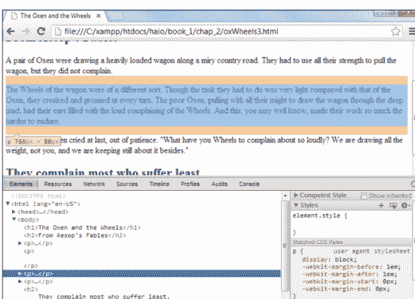

- **页面大纲**：一个设计良好的网页是以大纲形式创建的，各种元素相互嵌套。元素视图允许你以这种格式查看网页，并能够折叠和展开元素，从而清晰地查看页面结构。

- **实时 CSS 编辑**：当你在第 II 和第 III 书中学习如何应用 CSS 样式时，你会希望看到各种 CSS 规则如何改变你的页面。在“检查元素”视图中，你可以高亮显示页面的一部分，并在更改 CSS 的同时实时查看更改如何影响你的页面。

- **网络选项卡**：此功能允许你检查页面的每个部分加载所需的时间。对于排查页面加载缓慢的问题很有帮助。

- **来源视图**：这允许你查看页面的完整代码。当你进行 `JavaScript` 编程时（在第 IV 书中），它尤其有用，因为它包含一个强大的调试套件。

- **控制台**：控制台视图是直接集成到浏览器中的一个小型命令行工具。这非常有用，因为它通常会显示其他情况下隐藏的错误。控制台在使用 `JavaScript` 时最有用，因此在第 IV 书中有更详细的描述。

#### 其他值得注意的浏览器

Firefox 和 IE 是浏览器世界的主要参与者，但它们绝对不是你会遇到的唯一浏览器。

#### Opera

Opera 浏览器是最早符合标准的浏览器之一，它是一个技术扎实但从未被广泛使用的浏览器。如果你在设计页面时严格遵循标准，使用 Opera 的用户访问它们不会有任何问题。Opera 对 HTML5 的兼容性非常好。许多游戏机和移动设备都有基于 Opera 的浏览器，因此值得研究。

#### WebKit/Safari

Apple 在所有最新版本的 Mac OS 中都包含了一个网络浏览器。当前的版本——Safari——是一个优秀的符合标准的浏览器。Safari 最初是为 Mac 设计的，但也有 Windows 版本。`WebKit` 框架是 Safari 的基础，也被许多其他在线应用程序使用，主要在 Mac 上。Safari 的修改版本是 iPhone 和 iPad 上浏览器的基础。


听觉浏览器会朗读网页内容。它们最初是为视力障碍人士设计的，但没有任何残疾的人也经常使用它们。Fire Vox 是 Firefox 的一个变体，它能大声朗读网页。

担心纯文本阅读器似乎没有必要，因为视力障碍人士在人口中所占比例相对较小，而且你可能认为他们不是你的目标受众。你可能还是应该考虑这些用户，因为帮助他们并不困难（而且如果你为某些组织开发，支持残疾人士是必须的）。还有另一个原因。搜索引擎（Google 是主要参与者）读取你的页面就像纯文本浏览器一样。因此，如果一个元素对基于文本的浏览器不可见，它就不会出现在搜索引擎中。

### 浏览器的底线

实际上，你需要能够访问几个浏览器，但你不可能拥有所有浏览器。我倾向于使用 Chrome 进行初始开发测试。我会在 IE 10 版本中查看我的页面，并尽量保留一台装有 IE 7 或 8 的旧电脑，看看会发生什么。

我还会检查 Android 手机和平板电脑上的内置浏览器，看看页面在那里的显示效果。通常，如果你遵循本书中概述的 HTML5 子集，你可以放心它在大多数浏览器上都能工作。然而，仍然没有保证。如果你遵循标准，你的页面可以在任何浏览器上显示，但你可能无法获得完全预期的布局。

# 第 50 部分 第 1 书：创建 HTML 基础

# 第 4 章：使用列表和表格管理信息

本章内容

- 理解基本列表
- 创建无序、有序和嵌套列表
- 构建定义列表
- 构建基本表格
- 使用 `rowspan` 和 `colspan` 属性

你经常需要呈现大量有组织的信息，而 HTML 有一些出色的工具来管理这项任务。HTML 有三种列表和一个强大的表格结构来组织你的页面内容。弄清楚这些工具如何工作，你就可以轻松地管理复杂信息。

## 制作并仔细检查列表

HTML 支持三种类型的列表。`无序`列表通常包含项目符号。当列表中元素的顺序不重要时使用它们。`有序`列表通常在每个列表项之前有某种数字计数器。`定义`列表包含术语及其定义。

### 创建无序列表

HTML 中所有的列表类型都密切相关。最简单、最常见的列表是无序列表。

#### 查看无序列表

查看图 4-1 所示的简单页面。除了几个标题外，它还有一个信息列表。

这个浏览器列表有一些有趣的视觉特征：

- **项目是缩进的**：在左边缘和每个列表项的开头之间有一些额外的空间。
- **列表元素有项目符号**：每个项目前面的那个小点是一个`项目符号`。项目符号通常用在这种无序列表中。
- **每个项目另起一行**：当显示列表项时，它会显示在新行上。

这些特征帮助你识别这是一个列表，但它们只是默认行为。将某些东西定义为列表并不会强制它以特定的方式呈现；默认设置只是帮助你看到这些项目确实是列表的一部分。

请记住 HTML 的核心理念。你并不是在描述事物*看起来*如何，而是它们*意味着*什么。当你学会 CSS 后，可以随时更改外观，因此不要过于纠结于事物的特定外观。现在，只需认识到 HTML 可以构建列表，并确保你知道如何使用各种类型。

## 构建无序列表

列表由两种标签组成。一种标签包围整个列表并指示列表的一般类型。第一个示例演示了一个无序列表，它由 `<ul></ul>` 对包围。

> **注意**：将 `<ul>` 集合内的所有代码缩进是很常见的。无序列表可以放在正文中。

在 `<ul></ul>` 集合内是多个列表项。列表的每个元素都存储在 `<li>`（列表项）和 `</li>` 标签之间。通常，每个 `<li></li>` 对在源代码中占一行，尽管你可以让一个列表项尽可能长。

关于如何将项目符号更改为各种其他图像（包括圆圈、正方形甚至自定义图像）的信息，请参阅第 II 书第 4 章。

### 创建有序列表

有序列表与无序列表几乎完全相同。传统上，有序列表使用数字而非项目符号（尽管你可以通过 CSS 进行更改；详见第二册第四章）。

#### 查看有序列表

图 4-2 展示了一个包含基本有序列表的页面——`basicOL.html`。

图 4-2 显示了一个项目被编号的列表。当你的数据是步骤列表或包含某种数值的信息时，有序列表是一个不错的选择。

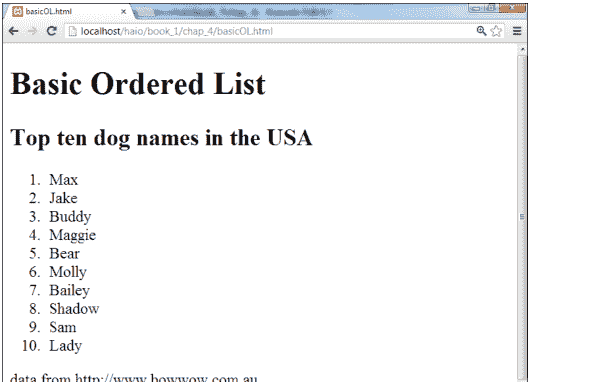

无序列表的代码非常简单直接：

```
<!doctype html>
<html lang="en">
<head>
    <meta charset="UTF-8">
    <title>basicUL.html</title>
</head>
<body>
    <h1>Basic Lists</h1>
    <h2>Common Web Browsers</h2>
    <ul>
        <li>Firefox</li>
        <li>Chrome</li>
        <li>Internet Explorer</li>
        <li>Opera</li>
        <li>Safari</li>
    </ul>
</body>
</html>
```

## 构建有序列表

`basicOL.html` 的代码与之前的无序列表非常相似：

```
<!doctype html>
<html lang="en">
<head>
    <meta charset="UTF-8">
    <title>basicOL.html</title>
</head>
<body>
    <h1>Basic Ordered List</h1>
    <h2>Top ten dog names in the USA</h2>
    <ol>
        <li>Max</li>
        <li>Jake</li>
        <li>Buddy</li>
        <li>Maggie</li>
        <li>Bear</li>
        <li>Molly</li>
        <li>Bailey</li>
        <li>Shadow</li>
        <li>Sam</li>
        <li>Lady</li>
    </ol>

    <p>
        data from http://www.bowwow.com.au
    </p>
</body>
</html>
```

唯一的改变是列表标签本身。有序列表使用的是 `<ol>` 指示符，而不是 `<ul>` 标签。列表项仍然是与无序列表中使用的相同的 `<li></li>` 对。

你无需在任何地方指定项目编号；编号会根据每个项目在列表中的位置自动生成。因此，你可以更改项目的顺序，而数字仍然正确。

这正是 HTML 的精妙之处——它关乎含义，而非布局。如果你指定了具体的数字，那么调整内容顺序将会是一团糟。真正重要的是元素位于有序列表内部。


### 创建嵌套列表

有时，你想在页面中创建大纲或其他类型的复杂数据。如果需要，你可以轻松地将列表相互嵌套。图 4-3 展示了一个更复杂的列表，描述了美国和澳大利亚流行的猫咪名字。

图 4-3 使用了组合列表来完成这项工作。该图包含一个包含两个国家的列表：美国和澳大利亚。每个国家都有一个 H3 标题和另一个（有序的）列表。你可以将各种元素嵌套在列表中，但如果你想让页面通过验证，就必须小心操作。

#### 嵌套列表

#### 流行的猫咪名字

- **美国**

  1. Tigger
  2. Tiger
  3. Max
  4. Smokey
  5. Sam

- **澳大利亚**

  1. Oscar
  2. Max
  3. Tiger
  4. Sam
  5. Misty

图 4-3：无序列表中的有序列表！

在这个例子中，有一个只包含两个元素的无序列表。每个元素都包含一个 `<h3>` 标题和一个有序列表。页面以相对清晰的方式处理所有这些数据，并且能正确通过验证。

## 检查嵌套列表示例

以下是 `nestedList.html` 的完整代码：

```
<!doctype html>
<html lang="en">
<head>
    <meta charset="UTF-8">
    <title>nestedList.html</title>
</head>
<body>
    <h1>Nested Lists</h1>

    <h2>Popular Cat Names</h2>
    <ul>
        <li>
            <h3>USA</h3>
            <ol>
                <li>Tigger</li>
                <li>Tiger</li>
                <li>Max</li>
                <li>Smokey</li>
                <li>Sam</li>
            </ol>
        </li>

        <li>
            <h3>Australia</h3>
            <ol>
                <li>Oscar</li>
                <li>Max</li>
                <li>Tiger</li>
                <li>Sam</li>
                <li>Misty</li>
            </ol>
        </li>
    </ul>
</body>
</html>
```

你可能会在代码清单中注意到以下几点：

- 一个大的 `<ul>` 集合包围了整个主列表。
- 主列表只有两个列表项。
- 每个项目代表一个国家。
- 每个国家都有一个 `<h3>` 元素，用于在 `<li>` 内描述国家名称。
- 每个国家还有一个包含名称列表的 `<ol>` 集合。
- 缩进确实有助于你看清各项之间的关联。

### 为代码添加缩进

你可能已经注意到我在这本书中为所有 HTML 代码都添加了缩进。浏览器会忽略所有缩进，但这仍然是一个重要的编码习惯。

关于代码格式化的观点有很多，但本书中使用的标准格式在你形成自己的风格之前，会对你很有帮助。

通常，我使用以下规则来缩进 HTML 代码：

- **缩进每个嵌套元素**：因为 `<head>` 标签位于 `<html>` 元素内部，我通过缩进来表明这一点。同样，`<li>` 元素总是缩进在 `<ul>` 或 `<ol>` 对内部。
- **对齐你的元素**：如果一个元素占用了多行，将结束标签与开始标签对齐。这样，你就知道什么结束了什么。
- **使用空格，而非制表符**：制表符在源代码中经常会引发问题。不同的编辑器对制表符的格式化方式不同，而制表符和空格混用可能会在你用其他编辑器查看时，让你精心格式化的页面变得一团糟。

  大多数编辑器都有将制表键解释为空格的功能。在你的编辑器中找到并启用此功能是一个好主意，这样每次你按下制表键时，它都会被解释为空格。在 `Komodo Edit` 中，你可以在“编辑”↩“首选项”↩“编辑器”↩“缩进”中进行设置。

- **使用两个空格**：大多数编码者每个缩进级别使用两个或四个空格。HTML 元素可以嵌套得很深。嵌套七层或八层是常见的。如果你使用制表符或太多的空格，你会得到大量空白，以至于看不清代码。
- **在左边距结束**：如果你完成了页面但没有回到左边距，说明你忘记结束某个元素。正确的缩进让你能轻松看清页面结构。每个元素都应该与其结束标签对齐。

#### 构建嵌套列表

当你查看嵌套列表的代码时，可能会觉得它看起来令人生畏，但实际上并没有那么难。秘诀是从外到内构建列表：

1. **首先创建外层列表**：构建主列表（无论是有序还是无序的）。在我的例子中，我从一个只包含两个国家的无序列表开始。
2. **向外层列表添加列表项**：如果你想在较大列表中添加文本或标题（像我做的那样），可以在这里添加。如果你只是在主列表中放入另一个列表，你可能想先放一些占位符 `<li>` 标签，以确保一切正常。
3. **在添加下一级列表之前进行验证**：嵌套列表可能会让验证器（和你）感到困惑。在添加内部列表之前，对外层列表进行验证，以确保没有问题。
4. **添加第一个内部列表**：当你确认基本结构没问题后，添加第一个内部列表。在我的例子中，这是美国的猫咪名字有序列表。
5. **重复直到完成**：继续添加列表，直到你的页面看起来正确。
6. **频繁验证**：边做边验证比等到全部完成要好得多。尽早发现错误，以免重复它们。

### 构建定义列表

还有一种列表类型——定义列表——非常有用，即使它使用不频繁。定义列表最初是为格式化字典式的定义而设计的，但任何当你拥有名称和值对时，它都非常有用。图 4-4 展示了一个定义列表的示例。

定义列表不使用项目符号或数字。相反，它们有两个元素。`定义术语`通常是单词或短语。在图 4-4 中，浏览器名称被定义为定义术语。`定义描述`是包含实际定义的扩展文本块。

定义列表的标准布局会缩进每个定义描述。当然，在你理解了第二册和第三册中的 CSS 之后，你可以根据需要更改布局。


任何时候，当你想要一个由关键术语（而非项目符号或数字）标记的列表时，都可以使用定义列表。定义列表在其他情况下也很有用，例如表单、带说明的图表等。

## 制作清单并再次检查

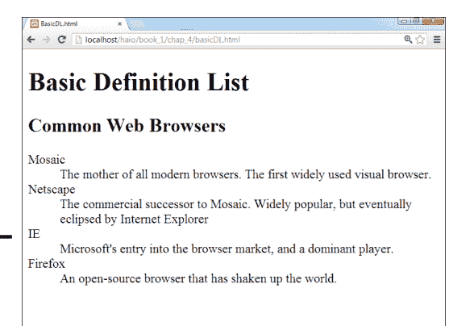

**图 4-4：** 一个基础定义列表。

以下是 `basicDL.html` 的代码：

```html
<!DOCTYPE HTML>
<html lang="en-US">
  <head>
    <meta charset="UTF-8">
    <title>BasicDL.html</title>
  </head>
  <body>
    <h1>Basic Definition List</h1>
    <h2>Common Web Browsers</h2>
    <dl>
      <dt>Mosaic</dt>
      <dd>
        The mother of all modern browsers. The first widely used visual browser.
      </dd>

      <dt>Netscape</dt>
      <dd>
        The commercial successor to Mosaic. Widely popular, but eventually eclipsed by Internet Explorer
      </dd>

      <dt>IE</dt>
      <dd>
        Microsoft's entry into the browser market, and a dominant player.
      </dd>

      <dt>Firefox</dt>
      <dd>
        An open-source browser that has shaken up the world.
      </dd>
    </dl>
  </body>
</html>
```

如您所见，定义列表使用了三对标签：

- `<dl></dl>` 定义整个列表。

- `<dt></dt>` 定义每个定义术语。

- `<dd></dd>` 定义定义数据。

定义列表并不常用，但它们可能极其有用。任何时候你有一个需要术语和值组合的列表，定义列表都是一个不错的选择。

## 构建表格

有时，你会遇到最适合以表格格式呈现的数据。HTML 支持多种表格标签来完成这类工作。图 4-5 展示了一个非常基础的表格。

有时，以有意义的方式展示数据的最佳方法是将其组织成表格。HTML 使用（巧妙命名的）`<table>` 标签定义表格。表格包含若干表格行（由 `<tr>` 标签定义）。每个表格行可以由若干表格数据（`<td>`）或表格标题（`<th>`）标签组成。

将图 4-5 中的输出与创建它的 `basicTable.html` 的代码进行比较：

```html
<!doctype html>
<html lang="en">
```

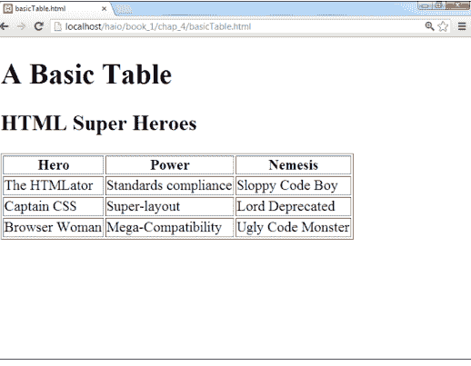

图 4-5：

表格对于某些数据表示很有用。

```html
<head>
    <meta charset="UTF-8">
    <title>basicTable.html</title>
</head>
<body>
    <h1>A Basic Table</h1>
    <h2>HTML Super Heroes</h2>
    <table border = "1">
      <tr>
        <th>Hero</th>
        <th>Power</th>
        <th>Nemesis</th>
      </tr>
      <tr>
        <td>The HTMLator</td>
        <td>Standards compliance</td>
        <td>Sloppy Code Boy</td>
      </tr>
      <tr>
        <td>Captain CSS</td>
        <td>Super-layout</td>
        <td>Lord Deprecated</td>
      </tr>
      <tr>
        <td>Browser Woman</td>
        <td>Mega-Compatibility</td>
        <td>Ugly Code Monster</td>
      </tr>
    </table>
</body>
</html>
```

### 定义表格

HTML 表格由 `<table></table>` 对定义。仔细缩进和安排代码很有意义，这样你可以在代码中看到表格的结构。只需扫一眼代码，你就能猜出表格由三行组成，每行包含三个元素。

在文字处理器中，你通常通过定义行数和列数来创建一个空白表格，然后填充它。在 HTML 中，你逐行定义表格，每行中的元素决定了列数。你需要确保每行具有相同数量的元素。

默认情况下（至少在大多数浏览器中如此），表格不显示边框。如果你想看到基本的表格边框，可以打开表格的 `border` 属性。（`属性`是一种可以附加到某些标签上的特殊修饰符。）

```html
<table border = "1">
```

此标签创建一个表格并指定其边框大小为 1。如果你省略 `border = "1"` 部分，有些浏览器会显示边框，有些则不会。你可以将边框值设置为 0 或更大的数字。更大的数字会产生更粗的边框，如图 4-6 所示。

虽然这种设置表格边框的方法完全可以，但我在第二卷第四章展示了一种更灵活和强大的技术。

设置表格边框是个好主意，因为你无法指望所有浏览器都有相同的默认设置。此外，边框值始终用引号括起来。当你在第二卷中阅读 CSS 时（你是否已经听腻了？），你会发现如何添加比这个简单属性允许的更复杂和有趣的边框。

### 添加你的第一行

定义表格后，你需要添加一些行。每行由一对 `<tr></tr>` 表示。

在 `<tr></tr>` 集合内，你需要一些表格数据。第一行通常由 **表格标题** 组成。这些特殊单元的格式不同，以表明它们是标签，而不是数据。

表格标题有一些默认格式以帮助你记住它们是标题，但你可以更改它们的外观。你可以在第二卷和第三卷中以各种很棒的方式更改表格标题的外观。定义表格标题，这样当你发现格式并决定将所有表格标题设置为黄绿色时，你就知道 HTML 代码中所有表格标题的位置了。

将标题缩进在 `<tr>` 集合内。如果你的表格包含三列，你的第一行可能像这样开始：

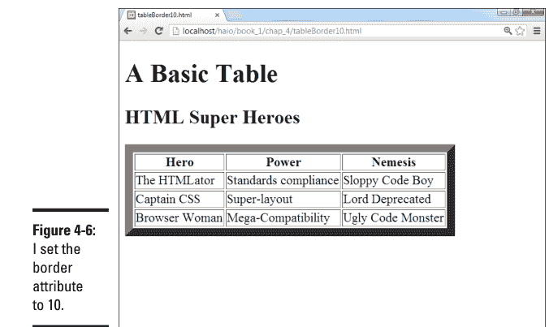

```html
<tr>
  <th></th>
  <th></th>
  <th></th>
</tr>
```

将要显示在表格标题中的文本放在 `<th>` 和 `</th>` 元素之间。内容按定义的顺序显示。

> **标题** 不必在第一行。如果你想让标题在左侧，只需在每行的第一个元素放置一对 `<th></th>` 即可。如果你愿意，可以在顶部和左侧都放置标题。实际上，标题可以放在任何地方，但通常只将标题放在顶部或左侧才有意义。

### 制作数据行

下一步是创建另一行。数据行就像标题行一样，只是它们使用 `<td></td>` 对而不是 `<th></th>` 对来包含数据元素。通常，一个三列的表格的空行如下所示：

```html
<tr>
  <td></td>
  <td></td>
  <td></td>
</tr>
```

将数据元素放在 `<td></td>` 段内，你就准备就绪了。

### 在文本编辑器中构建表格

有些人认为表格是使用所见即所得编辑器的一个好理由，因为他们认为在文本模式下创建表格很难。你必须稍微规划一下，但如果你遵循这个计划，在没有图形工具的情况下构建 HTML 表格实际上相当快速和简单：

1.  **提前规划。** 了解表格将有多少行和列。先在纸上草绘可能有帮助。以后更改行数很容易，但在编写了一些代码后更改列数可能会非常麻烦。

2.  **创建标题。** 如果你打算从标准的标题在顶部的表格开始，首先创建标题行。保存、检查和验证。你不希望在添加更多复杂性时错误成倍增加。这个标题行告诉你需要多少列。

3.  **构建一个示例空行。** 创建一个具有正确数量的 `td` 元素的示例行，每行一个 `<td></td>` 对。构建一个 `td` 集合，然后使用复制和粘贴将此数据单元格复制所需的次数。确保 `<td>` 对的数量等于标题行中 `<th>` 集合的数量。

4.  **复制并粘贴空行以创建所需的行数。**

5.  **保存、查看和验证。** 在投入大量精力添加数据之前，确保一切看起来正确且验证通过。

6.  **用你需要的数据填充表格。** 逐行在 `<td></td>` 对之间添加数据。

7.  **再次测试和验证，确保你没有意外地破坏任何东西。**

### 合并行与列

有时，你需要在表格设计中有更多的灵活性。图 4-7 展示了一个邪恶霸主的日程表页面。

做一个邪恶霸主显然是一件复杂的事情。从代码的角度来看，占据多个单元格的项目是最有趣的。设计陷阱需要两个上午，改进藏身处需要三个上午。整个周五下午和晚上都用于世界统治。看看代码，你就会明白它是如何工作的：

```html
<!doctype html>
<html lang="en">
<head>
    <meta charset="UTF-8">
    <title>tableSpan.html</title>
</head>
<body>
    <h1>Using colspan and rowspan</h1>
    <table border = "1">
        <caption><p>My Schedule</p></caption>
        <tr>
            <th></th>
            <th>Monday</th>
            <th>Tuesday</th>
            <th>Wednesday</th>
            <th>Thursday</th>
            <th>Friday</th>
        </tr>

        <tr>
            <th>Breakfast</th>
            <td>In lair</td>
            <td>with cronies</td>
            <td>In lair</td>
            <td>in lair</td>
            <td>in lair</td>
        </tr>

        <tr>
            <th>Morning</th>
            <td colspan = "2">Design traps</td>
            <td colspan = "3">Improve Hideout</td>
        </tr>

        <tr>
            <th>Afternoon</th>
            <td>train minions</td>
        </tr>
    </table>
</body>
</html>
```

#### 64 构建表格

使单元格大于默认尺寸的秘诀在于两个特殊属性：`rowspan` 和 `colspan`。

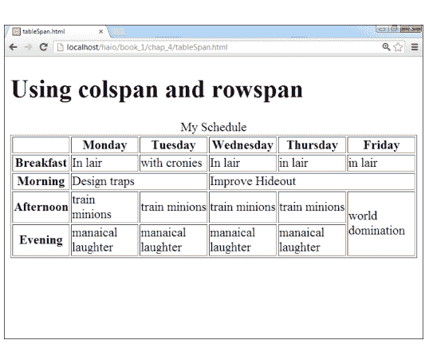

**图 4-7：** 这些活动中有些会占据多个单元格。

## 跨越多列

上午的活动往往持续数天。设计陷阱将占用周一和周二的上午，而改进藏身处将占用剩下的三个上午。再看一下“上午”行；操作方法如下：

```html
<tr>
    <th>Morning</th>
    <td colspan="2">Design traps</td>
    <td colspan="3">Improve Hideout</td>
</tr>
```

“设计陷阱”单元格跨越了两个常规列。`colspan` 属性指定了该单元格将跨越多少列。“改进藏身处”单元格的 `colspan` 为 3。

“上午”行仍然占据六列。`<th>` 占用一列，与常规情况一样，但“设计陷阱”单元格跨越两列，“改进藏身处”单元格跨越三列，总计六列宽。如果增加一个单元格的宽度，你需要消除该行中其他一些单元格来补偿。

## 跨越多行

一个相关属性——`rowspan`——允许一个单元格占据表格的多行。回顾图 4-7 中的“星期五”列，你会看到“统治世界”单元格占据了两个时间段。（如果统治世界很容易，那每个人都会做了。）相关代码如下：

```html
<tr>
    <th>Afternoon</th>
    <td>train minions</td>
    <td>train minions</td>
    <td>train minions</td>
    <td>train minions</td>
    <td rowspan="2">world domination</td>
</tr>
<tr>
    <th>Evening</th>
    <td>maniacal laughter</td>
    <td>maniacal laughter</td>
    <td>maniacal laughter</td>
    <td>maniacal laughter</td>
</tr>
```

“晚上”行只有五个条目，因为“统治世界”单元格延伸到了通常由一对 `<td>` 占用的空间。


如果你想使用 `rowspan` 和 `colspan`，不要只是在你的编辑器里埋头苦干。先草拟出你想要实现的效果。我在这方面相当熟练，但在创建 `tableSpan.html` 代码之前，我仍然需要先画草图。

## 避免基于表格的布局陷阱

表格非常棒。它们是呈现某些数据的绝佳方式。当你加入 `colspan` 和 `rowspan` 的概念后，你可以使用表格创建一些相当有趣的布局。事实上，因为老式的 HTML 并没有任何布局技术，许多开发者想出了一些基于表格的惊人布局。今天你仍然会看到许多网页设计主要使用表格作为布局机制。

然而，使用表格进行布局会导致一些问题，例如：

- **表格并非为布局而设计。** 表格是为了数据呈现而设计的，而不是布局。要让表格用于布局，你不得不采用许多巧妙的变通方法，比如表格嵌套在其他表格内，或者使用不可见的图片来制造间距。

- **代码很快变得复杂。** 表格涉及大量的 HTML 标记。如果代码涉及表格相互嵌套，很难记住哪个 `<td>` 元素关联到哪个表格的哪一行。基于表格的布局非常难以手动修改。

- **格式化需要逐个单元格进行。** 一个网页可能由数百个单元格组成。更改字体或颜色通常涉及在页面各处的数百个单元格中进行修改。这使你的页面灵活性降低，更难更新。

- **呈现方式与数据紧密绑定。** 基于表格的布局将数据与其呈现方式紧密交织在一起。这与网页设计的一个主要目标——数据与其呈现分离——背道而驰。

- **基于表格的布局难以更改。** 创建基于表格的布局后，进行修改非常困难，因为所有表格单元格都可能对其他单元格产生影响。

- **基于表格的布局给屏幕阅读器带来问题。** 视障人士使用特殊软件阅读网页。这些屏幕阅读器非常擅长按照预期方式读取表格（用于管理表格数据），但屏幕阅读器无法判断表格何时被用作布局技术而非数据呈现工具。这使得基于表格的布局不太符合无障碍访问标准。

- **基于表格的布局适应性差。** 现代用户期望在手机、平板电脑以及桌面电脑上运行页面。基于表格的设计不容易扩展到这些较小的屏幕尺寸。

请抵制使用表格进行布局的诱惑。让表格做它们该做的事：数据呈现。第三卷完全是关于如何使用 CSS 生成任何你可能想要的视觉布局。基于 CSS 的方法更容易、更可靠，也更灵活。

# 第5章：使用链接建立连接

## 本章内容

- 理解超链接

- 构建锚点标签

- 识别绝对链接和相对链接

- 构建内部链接

- 创建链接列表

超链接的基本概念在今天已司空见惯，但在当年却是一项重大突破。仔细想想，这个想法依然相当了不起：当你点击某段文本（或一个指定的图像）时，你的浏览器会立即跳转到别处。新目的地可能与初始页面位于同一台计算机上，也可能在世界上的任何角落。

理论上，任何页面都是通向任何其他页面的入口，所有信息都有能力相互链接。这仍然是一个深刻的概念。在本章中，你将学习如何为你的页面添加链接。

### 让文本变得可点击

超链接确实是一件美妙的事。信不信由你，曾经有一段时间，你必须手动输入你想访问的网页地址。现在不再需要这样了。图 5-1 展示了一个描述我最喜欢的一些网站的页面。

在图 5-1 中，带下划线的单词是超链接。点击超链接会将你带到指定的网站。虽然作为网页用户，你 undoubtedly 对此非常熟悉，但实现这一机制需要几个细节：

- **必须有可链接的元素。** 某些文本或其他元素必须为链接行为提供触发点。

- **是链接的东西应该看起来像链接。** 在编写纯 HTML 时，这其实很容易做到，因为所有链接都有一个标准（即使可能不太美观）的外观。链接通常是带下划线的蓝色文本。当你能够自定义配色方案时，你可能不再希望链接看起来像默认样式，但它们仍应可被识别为链接。

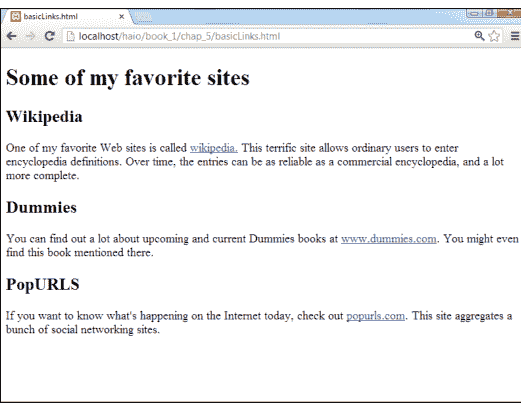

**图 5-1：** 你可以点击链接访问其他网站。

- **浏览器需要知道去哪里。** 当用户点击链接时，浏览器会被定向到互联网上的某个地址。有时该地址在页面上是可见的，但并非必须如此。

- **链接应该可以集成到文本中。** 在这个例子中，每个链接都是句子的一部分。某些内容应该能够表现得像链接，而不必像标题标签那样独立成行。


- **链接的外观有时会发生变化。** 链接有时最初是蓝色的带下划线文本，但在链接被访问后，链接会显示为紫色。在你了解 CSS 后，你可以改变这种行为。

> **提示**  
> 当然，如果你的网页提到了其他网站，你应该提供一个指向该网站的链接。

### 介绍锚点标签

超文本的关键是一个名为 `anchor`（锚点）的标签。这个标签被 `<a></a>` 标签对包裹，包含了管理页面间链接所需的所有信息。

`basicLinks.html` 页面的代码如下所示：

```html
<!DOCTYPE html>
<html lang="en-US">
<head>
    <meta charset="UTF-8">
    <title>basicLinks.html</title>
```

# 块级元素与行内元素的比较

本书迄今为止描述的所有标签都是块级标签。块级标签通常以换行符开始和结束。例如，三个 `<h1>` 标签占据三行。每个 `<p></p>` 标签对的上下都有隐含的间距。大多数 HTML 标签都是块级标签。

有些标签被设计为嵌入在块级标签内部，不会打断文本的流动。锚点标签就是其中一种。锚点在 HTML 正文中永远不会独立存在。这类标签是行内标签。它们被设计为嵌入在块级标签中，例如列表项、段落和标题。

## 分析锚点

第一个链接以非常直接的方式展示了锚点的所有主要部分：

```
<a href = "http://www.wikipedia.org">wikipedia.</a>
```

- ◆ 锚点标签本身：锚点标签就是 `<a></a>` 这对标签。你不需要输入整个单词 "anchor"，只需输入 a。

- ◆ 超文本引用（href）属性：几乎所有锚点都包含此属性。编写 `<a` 而不带 href 的情况非常罕见。href 属性表示后面将是一个网络地址。

- ◆ 带引号的网络地址：浏览器将跟随的地址被引号括起来。有关网络地址的更多信息，请参阅本章的下一节。在此示例中，`http://www.wikipedia.org` 就是该地址。

- ◆ 显示为链接的文本：用户通常期望点击格式特殊的文本。出现在 `<a href>` 部分和 `</a>` 部分之间的任何文本在页面上都是可见的，并且格式化为链接。在此示例中，单词 "wikipedia" 就是链接文本。

- ◆ `</a>` 标记：此标记表示文本链接结束。

### 介绍 URL

特殊的链接地址是网络的重要组成部分。你可能已经将网络地址输入到浏览器的地址栏中（`http://www.google.com`），但你可能并不完全清楚它们是如何工作的。网络地址在技术上称为 URL（统一资源定位符），它们具有非常特定的格式。


有时，你会看到 URI（统一资源标识符）这个术语而不是 URL。URI 在技术上是网络地址更正确的名称，但 URL 这个术语已经流行起来。这两个术语非常接近，可以互换使用。

URL 通常包含以下部分：

- ◆ 协议：网络协议是关于通信如何发生的标准化约定。网络主要使用 HTTP（超文本传输协议），但偶尔也会遇到其他协议。大多数地址以 `http://` 开头，因为这是网络上的标准。协议通常以冒号和两个斜杠（`://`）结束。

- ◆ 主机名：传统上将你的主要 Web 服务器命名为 www。虽然没有这个要求，但这已经非常普遍，以至于用户期望在 `http://` 后面直接输入 www。无论如何，紧跟在 `http://` 之后（直到第一个句点之前）的文本就是你所链接的实际计算机的名称。

- ◆ 域名：最后两个或三个字符表示特定类型的 Web 服务器。这些字母可以提供有关托管网页的组织类型的有用信息。三个字母的域名通常表示组织类型，两个字母的域名表示国家/地区。有时，你甚至会看到两者的组合。

- ◆ **子域**：主机名（通常是 www）和域名（通常是 .com）之间的所有内容就是子域。这样使用是为了让大型组织可以在同一域名下拥有多个服务器。例如，我所在部门的网页是 `http://www.cs.iupui.edu`。www 是主服务器的名称，这是 IUPUI（印第安纳大学-普渡大学印第安纳波利斯分校）的计算机科学系，它是一个教育机构。

- ◆ **页面名称**：有时，地址会指定网络上的特定文档。此页面名称跟在地址后面，通常以 `.html` 结尾。有时，页面名称还包括子目录和用户名信息。例如，我的 Web 开发课程位于我在 IUPUI 的（aharris）空间的 N241 目录中，因此该页面的完整地址是 `http://www.cs.iupui.edu/~aharris/n241/index.html`。

- ◆ **用户名**：某些 Web 服务器设置有多个用户。有时，地址会使用波浪号（~）字符表示特定用户的帐户。我的地址中包含 `~aharris`，表示该页面位于我（aharris）在机器上的帐户中。

> 页面名称有时是可选的。许多服务器都设置了特殊的默认页面名称，如果未指定其他名称，则会显示该页面。此名称通常是 `index.html`，但有时是 `home.htm`。在我的服务器上，`index.html` 是默认名称，所以我通常只指向 `www.cs.iupui.edu/~aharris/n241`，然后索引页面就会出现。

| 域名 | 说明 |
| :--- | :--- |
| .org | 非营利机构 |
| .com | 商业企业 |
| .edu | 教育机构 |
| .gov | 政府机构 |
| .ca | 加拿大 |
| .uk | 英国 |
| .tv | 图瓦卢 |

### 创建链接列表

许多网页最终都是链接列表。因为列表和链接配合得如此之好，所以我们来看看一个例子。图 5-2 展示了一个链接列表，这些链接指向某位（咳咳）极其英俊的作者所著的书籍。

这个示例没有需要理解的新代码，但页面显示了一些有趣的组件：

- ◆ **该列表**：一个普通的无序列表。
- ◆ **链接：** 每个列表项包含一个链接。该链接有一个引用（你无法立即看到）和可链接的文本（其标记与普通链接相同）。
- ◆ **描述性文本：** 每个链接后面都有一些描述该链接的普通文本。编写一些文本伴随实际链接是非常常见的做法。

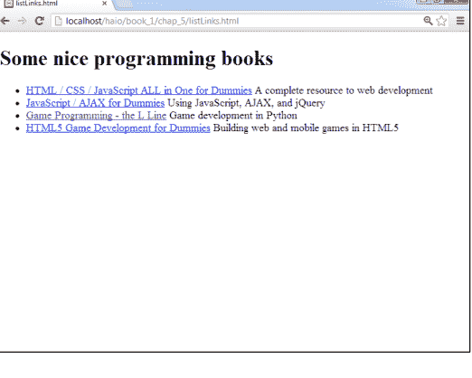

图 5-2：将链接放在列表中很常见。

此代码展示了页面的组织方式：

```html
<!DOCTYPE html>
<html lang = "en-US">
    <head>
        <meta charset = "UTF-8">
        <title>listLinks.html</title>
    </head>
    <body>
        <h1>Some nice programming books</h1>
        <ul>
            <li><a href = "http://www.aharrisbooks.net/haio"> HTML / CSS / JavaScript ALL in One for Dummies</a> A complete resource to web development</li>
            <li><a href = "http://www.aharrisbooks.net/jad"> JavaScript / AJAX for Dummies</a> Using JavaScript, AJAX, and jQuery</li>
            <li><a href="http://www.aharrisbooks.net/pythonGame"> Game Programming - the L Line</a> Game development in Python</li>
            <li><a href="http://www.aharrisbooks.net/h5g"> HTML5 Game Development for Dummies</a> Building web and mobile games in HTML5</li>
        </ul>
    </body>
</html>
```

这里的缩进很有趣。每个列表项包含一个锚点和一些描述性文本。为了保持代码整洁，Web 开发人员倾向于将锚点放在列表项内部。如果地址很长，有时会将其放在新的一行，锚点文本放在新的一行，描述放在后续行中。我通常将 `<li>` 标签放在最后一行的末尾，这样开始的 `<li>` 标签看起来就像无序列表的项目符号。这样在以后编辑列表时更容易找到你的位置。

### 处理绝对引用和相对引用

地址不止一种类型。到目前为止，你只看到了绝对引用，用于链接到外部页面。另一种引用——相对引用——用于链接你自己网站内部的多个页面。

#### 理解绝对引用

在 `basicLinks.html` 中使用的链接类型是*绝对引用*。绝对引用总是以协议名称（通常是 `http://`）开头。绝对引用是 Web 页面的完整地址，就像你在浏览器地址栏中使用的那样。绝对引用用于引用 Internet 上其他地方的站点。即使你的网站迁移了（例如，从你的桌面计算机到 Internet 上某处的 Web 服务器），所有绝对引用仍将正常工作，因为它们不依赖当前页面的位置来获取任何信息。

#### 介绍相对引用

当你的网站包含多个页面时，会使用相对引用。你可能选择拥有多个页面和一个在它们之间移动的链接机制。图 5-3 显示了一个包含多个链接的页面。

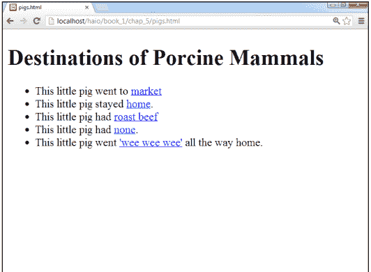

**图 5-3：** 这些小猪肯定到处跑……

#### 74 使用绝对引用和相对引用

这个页面本身并不太有趣，但它并非要独立存在。当你点击其中一个链接时，你会进入一个全新的页面。图 5-4 展示了点击市场链接后会发生什么。

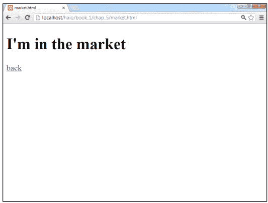

图 5-4：市场页面允许你返回。

市场页面很简单，但它也包含一个返回初始页面的链接。大多数网站根本不是单个页面，而是一个相互连接的网页网络。当你有一组页面具有交叉链接时，相对引用非常有用。

`pigs.html` 的代码展示了相对引用的工作方式：

```html
<!DOCTYPE html>
<html lang = "en-US">

  <head>
    <meta charset = "UTF-8">
    <title>pigs.html</title>
  </head>

  <body>
    <h1>Destinations of Porcine Mammals</h1>
    <ul>
      <li>This little pig went to
        <a href = "market.html">market</a></li>
      <li>This little pig stayed
        <a href = "home.html">home</a>.</li>
      <li>This little pig had
        <a href = "roastBeef.html">roast beef</a></li>
      <li>This little pig had
        <a href = "none.html">none</a>.</li>
      <li>This little pig went
        <a href = "wee.html">'wee wee wee'</a>
        all the way home.</li>
    </ul>
  </body>
</html>
```

## 使用绝对引用和相对引用

#### 75

大部分代码都完全熟悉。唯一令人惊讶的是*缺少*的部分。仔细看看其中一个链接：

```
<a href = "market.html">home</a>.</li>
```

没有协议（`http://` 部分），也没有地址，只有一个文件名。这是一个*相对引用*。相对引用通过假定当前页面的地址来工作。当用户点击 `market.html` 时，浏览器没有看到协议，因此它假定 `market.html` 与 `pigs.html` 在同一服务器的同一目录中。

相对引用就像方向指示。例如，如果你在我的实验室里，问饮水机在哪里，我会说：“出去到走廊，左转，在下一个走廊尽头再左转。”如果你从正确的位置开始，这些方向能让你找到饮水机。如果你在其他地方，遵循同样的方向，你真的不知道最终会到哪里。

当你有一堆相互连接的网页时，相对引用效果很好。如果你创建了大量关于同一主题的页面，并将它们放在同一目录中，你可以在页面之间使用相对引用。如果你决定将页面移动到另一个服务器，所有链接仍然可以正常工作。


在第八册中，你将了解如何设置永久的 Web 服务器。通常最方便的做法是在本地计算机上创建和修改页面，然后将它们传送到 Web 服务器供全世界查看。如果你使用相对引用，很容易将一组页面一起移动，并且知道链接仍然有效。

如果你引用的是别人网站上的页面，你必须使用绝对引用。如果你链接到你网站上的另一个页面，通常使用相对引用。

#### 76 第一册：创建 HTML 基础

# 第 6 章：添加图像、声音和视频

## 本章内容

- 了解图像的主要用途
- 选择图像格式
- 创建内联图像
- 使用 IrfanView 和其他图像软件
- 更改图像大小
- 添加音频剪辑
- 处理视频

你已经掌握了文本的基础知识，但只有文本的页面……嗯，有点无聊。图片能为网页增色不少，而且处理起来相当容易。今天的网络实际上是一个多媒体环境，HTML5 终于提供了对音频和视频的强大支持。了解如何将这些很棒的功能添加到你的网页中。

### 向页面添加图像

每次浏览网络时，你都会遇到几乎每个页面上的大量图片。通常，网页上的图像以四种方式使用：

- **外部链接：** 页面中嵌入了带有链接的文本。当用户点击链接时，图像会替换 Web 浏览器中的页面。要制作外部链接图像，只需制作一个普通链接（如我在本书第 5 章中描述的），但指向图像文件而不是 HTML（超文本标记语言）文件。

- **嵌入图像：** 图像嵌入到页面中。页面的文本通常会环绕图像流动。这是网络上最常用的图像类型。

- **背景图像：** 图像可以用作整个页面或页面特定部分的背景。图像通常需要一些特殊的处理才能适合用作背景。

- **自定义项目符号：** 通过 CSS，你可以将小图像指定为有序或无序列表的项目符号。这允许你制作任何可以绘制的自定义列表标记。

你在本章中读到的技术适用于所有类型的图像，但一些特定应用（如背景和项目符号）使用 CSS。有关在 CSS 中使用图像的详细信息，请参阅第二册第 4 章。

### 链接到图像

合并图像最简单的方法是链接它们。图 6-1 显示了 `externalImage.html` 页面。

页面的代码只不过是一个简单的链接：

```html
<!DOCTYPE html>
<html lang = "en-US">
  <head>
    <meta charset = "UTF-8">
    <title>externalImage.html</title>
  </head>
  <body>
    <h1>Linking to an External Image</h1>
    <p>
      <a href = "shipStandard.jpg">
        Susan B. Constant
      </a>
    </p>
  </body>
</html>
```

`href` 指向图像文件，而不是 HTML 页面。你可以在锚标签中指向任何类型的文件。如果浏览器知道文件类型（例如 HTML 和标准图像格式），浏览器会显示该文件。如果浏览器不知道文件格式，用户的计算机会尝试使用通常用于打开该类型文件的任何程序来显示文件。

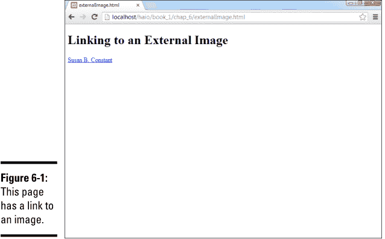

**提示**

如果你需要复习，请参阅本书第 5 章关于锚标签的讨论。

这对大多数图像来说效果很好，因为图像是直接在浏览器中显示的。

**警告！**

你可以将这个锚标签技巧用于任何类型的文件，但结果可能非常不可预测。如果你使用链接技巧指向一些奇怪的文件格式，不能保证用户有合适的软件来查看它。通常，将此技巧保留用于非常常见的格式，如 GIF 和 JPG。（如果你不熟悉这些格式，本章后面会进行描述。）

大多数浏览器会自动调整图像大小以适应浏览器大小。这意味着大图像可能看起来比实际小，但用户仍然必须等待整个图像下载完成。

因为这是相对引用，所以指定的图像必须与 HTML 文件在同一目录中。当用户点击链接时，页面会被图像替换，如图 6-2 所示。

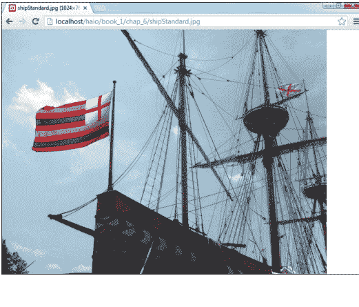

图 6-2：图像出现在页面的位置。

外部链接很容易创建，但它们有一些问题：

- **它们不预览图像。** 用户只有文本描述来判断图片可能是什么。
- **它们中断了流程。** 如果页面包含一系列图像，用户必须不断离开页面来查看图像。
- **用户必须返回才能回到主页面。** 图像看起来像一个网页，但它不是。图像中没有链接或其他解释性文本表明如何返回网页。大多数用户知道点击浏览器的“后退”按钮，但不要假设所有用户都知道该怎么做。

#### 80 向页面添加图像

### 使用 `` 标签添加内联图像

提供图像链接的替代方法是将图像嵌入到页面中。图 6-3 展示了此技术的一个示例。

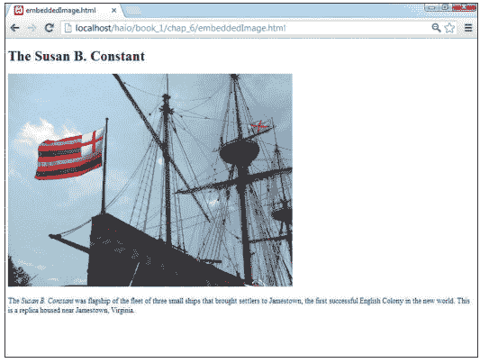

代码显示了此图像如何被包含在页面中：


<!DOCTYPE html>
<html lang="en-US">
    <head>
        <meta charset="UTF-8">
        <title>embeddedImage.html</title>
    </head>
    <body>
        <h1>The Susan B. Constant</h1>
        <p>
            
        </p>
        <p>
            The <em>Susan B. Constant</em> was flagship of the
            fleet of three small ships that brought settlers to Jamestown, the first
            successful English Colony in the new world.  This is a replica housed
            near Jamestown, Virginia.
        </p>
    </body>
</html>

图像（img）标签是本页的主角。此标签允许你获取图像文件并直接将其整合到页面中。图像标签是一个自结束标签。它不以 `</img>` 结尾。相反，使用 `/>` 字符来结束 img 定义，以表示此标签没有内容。


你可能已经注意到，我在页面中将 *Susan B. Constant* 设为斜体，我使用了 `<em>` 标签来实现此效果。`<em>` 代表 *强调*，而 `<strong>` 表示 **强烈强调**。默认情况下，`<em></em>` 标签对内的任何文本都会显示为斜体，`<strong></strong>` 文本则显示为粗体。当然，你可以通过 CSS 来更改此行为。

图像标签有多个重要属性，我将在以下各节中进行讨论。

## src (源文件)

src 属性允许你指定图像的 URL（统一资源定位符）。这可以是绝对引用或相对引用。通常最好链接到你自己目录结构中的图像，因为你无法确定外部图像在用户访问页面时是否仍然存在。（有关引用类型的更多信息，请参阅本迷你书的第 5 章。）

## height 和 width

height 和 width 属性用于指示图像的大小。浏览器使用此信息来确定在页面上预留多少空间。


height 和 width 属性应该 *描述* 图像的大小。你可以使用这些属性来实际更改图像的大小，但这不是一个好主意。请使用你的图像编辑器来更改图像大小（我将在本章后面向你展示如何操作）。如果你使用了 height 和 width 属性，即使用户只会看到较小的版本，她也必须等待完整图像加载。不要让用户等待他们不会看到的信息。如果你使用这些属性将图像放大到其默认尺寸以上，生成的图像分辨率会很差。通过在图像工具中查看来找到图像的实际尺寸，并使用这些值。如果你省略了 height 和 width，浏览器会自动确定大小，但你不能保证在图像全部下载完成前看到文本。添加这些属性可以让浏览器在无需等待图像的情况下格式化页面。

## alt (替代文本)

alt 属性使你有机会指定描述图像的替代文本。当用户禁用图像显示时，以及屏幕阅读器会使用替代文本信息。alt 标签中的信息也被用于像 Google 图片这样的图像搜索软件中。

> 所有图像都必须包含 alt 属性。此外，`` 标签是一个行内标签，因此需要嵌套在块级标签（如 `<p>` 或 `<li>`）中。

## 选择图像处理工具

你不能随便从数码相机上抓取一张旧图片就指望它能在网页上正常工作。图片也许能用，但它可能会给你的观众带来问题。重要的是要理解，*数字图像*（你在计算机或类似设备上看到的任何种类的图像）与你在纸质媒介上看到的图像是不同的。

### 一图胜千言（340 万字）

如今的数码相机和扫描仪令人惊叹。即使是价格适中的相机，其分辨率现在也能接近老式模拟相机的水平。扫描仪也能够获取传统图像并将其转换为计算机使用的数字格式。然而，在这两种情况下，默认图像的格式都可能导致问题。数字图像存储为一系列点，或 *像素*。在印刷品中，点非常密集，但计算机屏幕上的点更大。图 6-4 显示了从数码相机直接获取的船舶图像的样子。

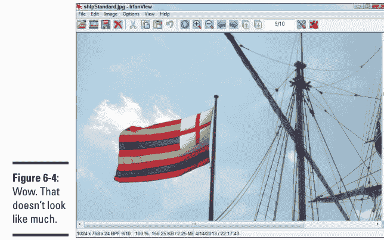

我的图片（用较旧的数码相机拍摄）分辨率为 6 兆像素 (MP)。这是一个相当不错的分辨率，但现代数码相机要高得多。如果我把这张图片打印在纸上，所有这些点都非常小，我会得到一张不错的图片。如果我在计算机屏幕上显示同一张图片，我只能看到一个角落。这张实际图片的尺寸是 2,816 像素宽，2,112 像素高。你只能看到图像的一小部分，因为本书的屏幕截图是以 1024×768 像素拍摄的。图像可见部分不到四分之一。

当你在大多数浏览器中查看大图时，它会自动调整大小以适应页面。光标通常会变成某种放大镜，如果你点击图像，可以看到其全尺寸或较小尺寸。

一些图像查看器会获取非常大的图像并自动调整它们的大小以适应屏幕。（这是 Windows 默认图像查看器和大多数浏览器的默认行为。）由于这个功能，图像可能看起来大小合理，但在实际网页中，它会很大且难以下载。在使用图像之前，请确保你了解其实际大小。

尽管缩小图像以便完整查看显然有益，但这样做还有一个更引人注目的原因。屏幕上的每个像素需要 3 字节的计算机内存。（*字节* 是计算机内存的基本单位。）作为对比，一个文本字符大约需要 1 字节。未压缩的船舶图像大小高达 17 兆字节 (MB)。如果你将一个词视为五个字符长，那么一张直接从数码相机获取的图片所占用的存储空间和传输时间大约相当于 3,400,000 个词。在 56K 调制解调器上下载这张图片几乎需要三分钟！

在网页中，小图通常显示为大约 320×240 像素，较大的图像通常为 640×480 像素。如果我使用软件将图像重新采样为我实际需要的尺寸，并使用适当的压缩算法，我可以使图像看起来像图 6-5 那样。


新版本的图像是我需要的尺寸和文件格式，它看起来同样好，而且大小更合理，只有 88 千字节 (KB)。这是原始图像大小的 2%。


尽管这张图片比原始图像小得多，但它占用的内存仍然比文本多得多。即使是这张较小的图像，其传输时间和存储空间也相当于 1,600 个词！在没有宽带连接的情况下，下载它仍然需要 10 秒钟。请明智地使用图像。

图像很棒，但在使用时请记住以下几点：

- **确保图像值得展示。** 不要无故使用图片，因为每张图片都会显著降低页面的访问速度。

- **使用软件调整图像大小。** 在本章后面，我将向你展示如何使用免费软件将图像更改为你所需的精确尺寸。

- **使用压缩格式。** 网页上几乎从不使用图像的原生格式，因为它们实在太大了。有几种格式对于处理各种类型的图像很有用。我将在本章后面的“选择图像格式”一节中介绍这些格式。

## 介绍 IrfanView

*IrfanView*（由 Irfan Skiljan 开发）是一款免费软件程序，可以处理你的基本图像操作需求以及更多功能。本书中的所有屏幕截图都是用它完成的，并且当我在使用 Windows 时，我把它作为我的主要图像查看器。你可以在 www.irfanview.net 获取副本。当然，你可以使用任何你想要的软件，但如果某样东西真的很好而且免费，那它就是一个很好的起点。在本章的其余部分，我将向你展示如何使用 IrfanView 完成主要的图像处理工作，但你可以使用任何你喜欢的图像编辑器。

网页开发者需要一个图像处理程序来帮助完成所有这些任务。与其他 Web 开发工具一样，你可以为图像处理工具支付相当多的费用，但你不必这样做。你的图像工具至少应具备以下功能：

- **调整大小：** 网页需要的图像比纸上印刷的要小。你需要一个工具，允许你将图像调整为特定的尺寸以用于 Web 显示。

- **保存为不同格式：** 有令人眼花缭乱的图像格式可用，但只有少数几种格式在 Web 上可靠运行（我将在下一节中讨论）。你需要一个工具，能够处理各种格式的图像，并可靠地将其转换为适合 Web 的格式。

### 裁剪

您可能只需要原始图片的一小部分。裁剪工具允许您从图像中提取一个矩形区域。

### 滤镜

您可能会发现有必要以某种方式修改您的图像。您可能需要减少红眼、调亮或调暗图像，或者调整颜色。有时，可以通过锐化或模糊滤镜，或者更具艺术性的滤镜（如画布或油画工具）来改善图像。

### 批处理

您可能有多张图像需要同时处理。批处理工具可以一次对大量图像执行操作，正如您将在本章后面看到的。

您可能还需要其他一些功能，例如制作合成图像、带透明度的图像以及更强大的效果。您可以使用商业工具或优秀的开源程序 Gimp。我使用 IrfanView 进行基本处理，当需要更强大的功能时，我会使用 Gimp。有关 Gimp 的更完整讨论，请参见第 VIII 册，第 4 章。

IrfanView 是我的最爱，但它仅适用于 Windows。如果您想尝试一些其他优秀的软件，这里有一些免费的替代品：

- XnView：与 IrfanView 类似，XnView 允许您预览和修改数百种格式的图片，创建缩略图等。它适用于 Mac 和 Linux。

- Pixia：Pixia 是一款来自日本的、功能齐全的仅限 Windows 使用的图形编辑器。非常强大。

- GimpShop：这是 Gimp 的一个修改版本，具有类似 Photoshop 的菜单。

- Paint.NET：这是一个强大的仅限 Windows 使用的画图程序。

使用 Google 或其他搜索引擎来查找这些程序中的任何一个。

## 选择图像格式

几乎没有人会在网络上使用原始图像，因为它们太大且太笨重。通常，网络图像会被压缩以占用更少的空间。您在计算机世界中看到的所有图像文件类型（BMP、JPG、GIF 等）本质上是使图像文件变小的不同方式。并非所有格式都适用于网络，而且它们具有不同的特性，因此对它们有更多了解是有好处的。

### BMP

BMP 格式是 Microsoft 的标准图像格式。虽然有时会被压缩，但通常不会。BMP 格式创建非常详细的图像，几乎没有压缩，文件通常太大，无法在网页上使用。许多网络浏览器可以处理 BMP 图像，但您不应该使用它们。相反，应将其转换为其他格式。

### JPG/JPEG

JPG 格式（也称为 JPEG）是由联合图像专家组设计的一个相对较旧的格式。（明白了吗？JPEG！）它的工作原理是丢弃对人类感知不太重要的数据。每次以 JPG 格式保存图像时，您都会丢失一点信息。这听起来很糟糕，但实际上并非如此。同一张图像以其原始格式显示为 13MB，而以 JPG 格式存储时则压缩为 1.5MB。大多数人无法通过视觉区分压缩和非压缩版本的图像。


JPG 算法专注于图像中对感知重要的部分（例如亮度和对比度），并丢弃不太重要的数据。（实际上，大部分颜色数据被丢弃，但颜色通过精心设计的视觉错觉重新创建。）

JPG 最适用于具有大量颜色和细节的摄影风格图像。许多数码相机直接将图像保存为 JPG。

JPG 过程的一个部分允许您确定压缩量。当您将图像保存为 JPG 时，您通常可以在准确度和压缩度之间的某个尺度上确定质量。

JPG 压缩方案会对文本造成特殊问题。JPG 不擅长保留高对比度的锐利区域（例如背景上的字母）。JPG 不是带有文本的横幅图像或其他图像的最佳格式。请改用 GIF 或 PNG。带有文本的 JPG 将显示特有的方形伪影。

即使您选择 100% 的准确度，文件仍然被大幅压缩。可调压缩仅适用于过程的一小部分。过度压缩文件可能会导致可见的方形阴影或*伪影*。用您的图像进行试验，看看它们能承受多少压缩而仍然看起来像原始图像。


在制作图像的 JPG 版本时，请保留一份高质量的原始图像，因为每次复制都会丢失一些细节。如果您从另一个 JPG 生成的 JPG 再制作一个 JPG，细节损失会开始累积，图像会损失一些视觉质量。

### GIF

GIF 格式最初是为 CompuServe 开发的，远在 Web 发明之前。这种格式在当时是一个突破，并且仍然具有一些出色的特性。

GIF 是一种*无损*算法，因此，理论上将图像转换为 GIF 时不会丢失数据（与*有损*的 JPG 格式相比）。GIF 通过*调色板*技巧和*游程编码*技巧来实现其神奇效果。

调色板的工作原理类似于数字填色套装，其中图像上印有一系列数字，每种颜色都有一个对应的编号。GIF 图像有一份 256 种颜色的列表，这些颜色是从图像中自动选择的。每种颜色都被分配一个编号。原始（未压缩）图像的每个像素需要 3 个字节的信息（每个字节分别确定红色、绿色和蓝色的量）。在 GIF 图像中，所有这些信息在调色板中只存储一次。图像本身包含对调色板的大量引用。

例如，如果蓝色在调色板中存储为颜色 1，那么一段蓝色可能看起来像这样：

1, 1, 1, 1, 1, 1, 1, 1, 1, 1

当 GIF 看到一串相同的颜色时，它会使用其另一个技巧——游程编码。GIF 格式可以指定一个包含 10 个 1 的列表，而不是将上述值存储为 1, 1, 1, 1, 1, 1, 1, 1, 1, 1。这就是游程编码的基本思想。本例中的船图像作为全尺寸 GIF 图像大小为 2.92MB。

GIF 格式最适合颜色数量相对较少且大面积相同颜色的图像。您在绘图程序中绘制的大多数图形都可以很好地转换为 GIF 格式。照片并不理想，因为它们通常包含超过 256 种颜色，而颜色的微妙变化意味着几乎没有可以利用游程编码的纯色斑块。

GIF 确实有几个非常棒的优点，使其保持流行。首先，GIF 图像可以定义一种透明色。通常，您会选择某种自然界中不存在的可怕颜色（有点像选择伴娘礼服）作为透明色。然后，当 GIF 遇到该颜色的像素时，它会显示其下方的任何内容。这是一种粗糙但有效的透明形式。图 6-6 显示了一个带透明度的图像。

每当您在网页上看到一个看起来不是矩形的图像时，很有可能该图像是 GIF。图像仍然是矩形的，但具有透明度，使其看起来更自然。通常，您在保存 GIF 时设置的背景色将成为透明色。

创建复杂的透明背景，如雕像，需要比 IrfanView 更复杂的工具。我使用了 Gimp，但任何高端图形工具都可以完成这项工作。IrfanView 更适合对整个图像进行操作。

GIF 的另一个有趣特性是能够创建动画。动画 GIF 是存储在同一文件中的一系列图像。您可以嵌入信息，确定图像之间的间隔。您可以使用 Gimp 创建动画 GIF。

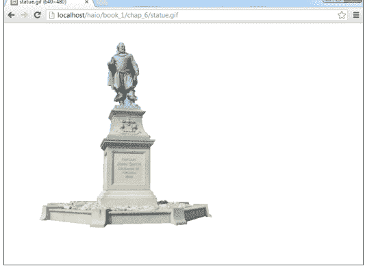

动画 GIF 在网络早期被过度使用，现在许多人认为它们是业余水平的标志。没有人再认为那个动画邮箱可爱了。请参阅第 IV 册，第 7 章，了解为页面添加动画的更灵活的现代方式。

有一段时间，关于 GIF 方案的一部分存在一些法律上的麻烦。该算法的所有者试图收取许可费。这笔费用转嫁给了使用商业软件的人，但对免费软件的创作者来说成了一个大问题。


幸运的是，法律问题似乎目前已得到解决。尽管如此，您仍会看到许多开源软件的倡导者完全避免使用 GIF 算法，因为这个问题。

### PNG

开源软件倡导者创建了一种新的图像格式，它结合了 JPG 和 GIF 的最佳特性，并且没有法律问题。由此产生的格式是*便携式网络图形*，即 *PNG*。这种格式具有许多有趣的特性，例如：

- **无损压缩：** 与 GIF 类似，PNG 在存储数据时不丢失任何信息。

- **动态调色板：** PNG 支持您想要的任意多种颜色。您不像使用 GIF 那样被限制在 256 种颜色。

### SVG

上述所有格式都以像素为单位存储信息。这种机制称为*基于光栅*的图像格式。然而，这并非处理图像的唯一方式。一种名为“可缩放矢量图形（SVG）”的格式对网页开发而言相对较新。SVG图形以一系列指令的形式存储，其格式与HTML非常相似。例如，一个SVG中的圆存储如下：

```
<circle cx="50" cy="50" r="30"
    style="stroke:#0000ff; stroke-width: 5px; fill:#ff0000;"/>
```

虽然可以手动编写SVG代码，但更常见的做法是使用Inkscape之类的编辑器。SVG图形具有一些显著的优势：

+   图像可以无损缩放。SVG最大的优势在于能够改变图像尺寸。对于基于光栅的图像，任何尺寸的改变都会导到图像质量损失。而SVG图像可以任意改变大小而不会损失质量。

+   文件大小可以非常小。矢量图像的文件大小基于图像的复杂程度，而非其视觉尺寸。因此，可以描述为一系列简单形状的图像，即使占据整个页面，也可能产生非常小的文件。

+   矢量图像易于编辑。你可以通过移动和操作构成图像的各种形状来编辑矢量图像。这使得像SVG这样的矢量图像非常容易编辑。

在HTML的早期版本中，矢量图像并不实用。这是Flash（主要是一种矢量格式）曾经如此流行的原因之一。SVG是HTML5最有趣的新特性之一。SVG图像可以像任何其他类型的图像一样嵌入，也可以通过JavaScript代码直接操作。你可以在 http://openclipart.org/ 找到大量免费使用的SVG图像。

## 网页图像格式总结


# 图像格式选择指南

所有这些格式可能看起来令人眼花缭乱，但选择图像格式很容易，因为每种格式都有其自身的优缺点：

- 当你需要透明度或动画时，`GIF` 是最佳选择。避免在照片上使用 GIF，因为你无法获得最佳压缩效果，并且会损失颜色数据。
- `JPG` 对于摄影图像最有用，最适合 JPG 压缩技术。然而，请记住 JPG 不适合需要透明度的图像。由于有损压缩技术，JPG 图像中的文本往往变得难以阅读。
- `PNG` 在大多数情况下都很有用。较旧的浏览器可能对此格式支持不佳。
- `SVG` 对于需要无损缩放或图像相对简单的图像很有用。
- **BMP 及其他格式**应完全避免使用。尽管你可以在特定情况下让其他格式工作，但大多数时候使用任何其他图像格式都没有充分的理由。

# 处理你的图像

所有这些关于压缩算法和图像缩放的讨论可能听起来很棒，但具体如何操作呢？

幸运的是，`IrfanView` 可以免费完成你所需的几乎所有工作。IrfanView 为你需要的所有主要图像处理类型提供了出色的功能。

## 在 IrfanView 中转换格式

使用 IrfanView 转换图像格式非常简单。例如，在你的计算机上找到一个图像文件，然后按照以下步骤操作：

1. **通过将图像拖放到 IrfanView 中或将图像拖入 IrfanView，或使用“文件 ↦ 打开”菜单命令，将图像加载到 IrfanView 中。**
2. **在保存之前，对图像进行任何你想要的更改。**
3. **使用“文件 ↦ 另存为”命令保存文件。**
4. **从“另存为”对话框中选择图像格式，如图 6-7 所示。**
5. **用新文件名保存文件。** 保留原始文件，并将任何更改保存到新文件中。这样，你就不会覆盖原始文件。如果你正在转换为 JPG 格式，这一点尤其重要，因为每次连续保存 JPG 都会导致一些图像损失。

不要在文件名中使用空格。你的文件可能会移动到互联网上的其他计算机，而某些计算机处理空格时会有问题。对于任何将在互联网上使用的文件，最好避免使用空格和标点符号（下划线字符除外）。此外，要非常注意大小写。你的图像最终可能会出现在 Linux 服务器上，而大小写在那里很重要。

## 调整图像大小

所有其他的图像处理技巧可能是可选的，但你*真的*应该调整图像大小。虽然高速连接处理大图像可能没有问题，但没有什么比过大的图像尺寸更快地让用户（尤其是连接较弱的用户）无法访问网页了。

要使用 IrfanView 调整图像大小，请执行以下步骤：

1. **将图像加载到 IrfanView 中。** 你可以通过将图像拖放到 IrfanView 图标上、拖放到已打开的 IrfanView 实例中，或使用 IrfanView 内的菜单来完成此操作。
2. **从“图像”菜单中，选择“调整大小/重采样”。** 你也可以使用 `Ctrl+R` 执行此步骤。图 6-8 显示了结果对话框。
3. **确定新的图像大小。** 提供了多种标准图像尺寸。800×600 像素将在大多数浏览器中创建一个较大的图像。如果你想让图像更小，需要在文本框中输入尺寸。嵌入网页的图像通常宽度为 320 像素，高度为 240 像素。这是一个非常好的起点。比这小的图像很难看清，而比这大的图像可能占据太多屏幕空间。
4. **使用提供的复选框保持纵横比。** 这可以确保高度和宽度之间的比例得到维持。否则，图像可能会变形。
5. **将结果图像保存为新文件。** 当你缩小图像时，你会丢失数据。对于放在网上的版本来说这完全没问题，但你应该保留原始的大图像，以防你想要再次调整大小。
6. **选择重采样，而非调整大小。** 重采样是一种较慢但更准确的更改图像尺寸的技术。这是 IrfanView 的默认行为，因此无需更改。在现代计算机上它仍然相当快。默认的（Lanczos）滤镜就很好，尽管如果你愿意，可以尝试其他滤镜以获得更快的转换。

## 增强图像颜色

有时，你可以通过修改颜色来改进图像。“图像”菜单上的“颜色校正”对话框为你提供了多种选项，如图 6-9 所示。

你可以使用此工具对图像进行许多有益的操作：

- **亮度：** 当调整为更高的值时，图像更接近白色。当调整为负值时，图像更接近黑色。当你想使图像变亮或变暗用作背景图像时，这很有用。

**图 6-9：** 你可以在“颜色校正”对话框中更改多个选项。

如果你的图像太暗或太亮，你可能会想使用“亮度”功能来修复它。本节后面描述的“伽马校正”功能对此任务更有用。

- **对比度：** 你通常将“对比度”功能与“亮度”功能结合使用来调整图像。有时，通过少量的对比度调整可以改进图像。
- **色彩平衡：** 有时，图像的色彩平衡较差（例如，室内照明有时会产生蓝色色偏）。你可以通过一系列滑块调整红、绿、蓝的数量。管理色彩平衡最简单的方法是查看图像中本应为白色的部分，然后调整滑块直到它看起来真正呈白色。
- **伽马校正：** 这用于校正过暗或过亮的图像。与“亮度”调整不同，“伽马校正”会自动调整对比度。对此滑块进行微调有时可以修复稍微过暗或过亮的图像。
- **饱和度：** 当饱和度处于最小值时，图像变为黑白。处于最大值时，颜色得到增强。使用此控件可以创建灰度图像或增强颜色以达到艺术效果。

## 使用内置效果

IrfanView 还有其他一些有时非常有用的效果。这些效果可以在“图像”菜单上单独找到，也可以使用“图像”菜单上的“图像效果浏览器”找到。“图像效果浏览器”（如图 6-10 所示）通常是更好的选择，因为它让你对大多数效果有更多控制，并提供效果将如何操作的交互式反馈。有时，效果被称为*滤镜*，因为它们将原始图像通过一个数学函数传递，该函数就像一个过滤器或处理器，用于创建修改后的输出。

### 操作你的图像

以下是一些效果的概述，包括使用它们的场景：

- **无效果：** 仅用于比较目的，图 6-11 显示了未开启任何滤镜的船图像。

> 我为了说明目的夸大了这些效果，但在印刷页面上可能仍然难以看清这些滤镜的全部效果。本书中的灰度图像是实际彩色图像的较差呈现。请将本章中的图像作为起点，但要真正理解这些滤镜，你需要在 IrfanView 或类似工具中亲自用你自己的图像进行实验。我也将所有这些图像添加到了本书的配套网站上，以便你在那里查看它们。有关配套网站的更多信息，请参见本书的引言。

- **模糊：** 此滤镜减少相邻像素之间的对比度。（真的，我们可以讲解数学原理，但让我们留到改天吧，好吗？）你可能想知道为什么有人会故意让图像变模糊。有时，模糊滤镜可以修复图像中的颗粒感。你也可以将模糊与锐化（我稍后会介绍）结合使用，以修复图像中的小瑕疵。我在图 6-12 中对标准船图像应用了模糊滤镜。

- **锐化：** 与模糊相反，锐化滤镜增强相邻像素之间的对比度。谨慎使用时，它有时可以改善图像质量。锐化滤镜与模糊滤镜结合使用，对于去除小瑕疵最为有效。图 6-13 显示了应用锐化滤镜后的船图像。


图 6-12：模糊滤镜减少对比度。


图 6-13：锐化滤镜增加对比度。

> **警告！** 如果你相信电视上的犯罪节目，你可以获取一张模糊的图像，然后不断应用锐化滤镜，就能从一英里外监控摄像头拍到的模糊图像中读出车牌号码。然而，事情通常并非如此。你无法从垃圾中创造出细节，但有时，你可以进行一些小的改进。

- **浮雕：** 此滤镜创建一个灰度图像，看起来像浮雕金属，如图 6-14 所示。有时，浮雕效果可以将图像转换成有用的背景图像，因为浮雕图像的对比度较低。你可以使用“增强颜色”对话框将灰色浮雕图像更改为更吸引人的颜色。
- **油画效果：** 此滤镜为图像应用类似油画的纹理，如图 6-15 所示。它有时可以清理图像并赋予其更艺术的外观。较高的设置会使绘画更加抽象。

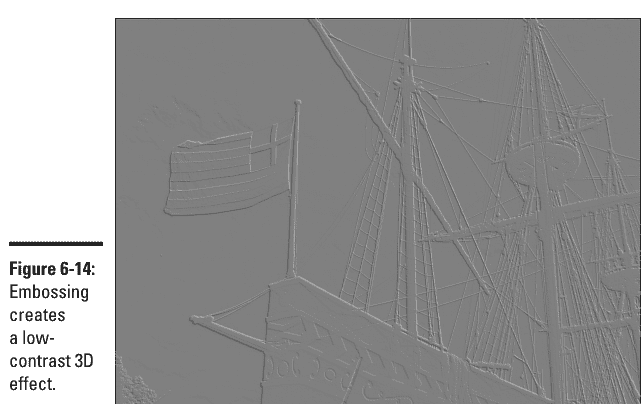


图 6-16：图像看起来像按钮一样从页面上凸起。

- **3D 按钮：** 此功能可用于创建一个图像，类似于图 6-16，看起来像页面上的一个按钮。这在你弄清楚如何使用 CSS 或 JavaScript 来为虚拟按钮切换图像时会很有用。你可以在滤镜中设置图像的表观高度。通常，你会将此滤镜应用于打算制作成用户可点击按钮的较小图像。
- **红眼消除：** 你使用此滤镜来解决闪光摄影中的一个常见问题。有时，人的眼睛看起来会带有一点红色色调。与其他滤镜不同，这个滤镜更容易从“图像”菜单中访问。使用鼠标选择图像中的红色部分，然后应用滤镜将红色区域变为黑色。最好不要对整个图像执行此滤镜，因为你可能会无意中将其他红色的东西变成黑色。

## 其他可用的效果

还有更多效果和滤镜可供使用。IrfanView 内置了一些你可以尝试的其他效果。你还可以下载大量 Adobe Photoshop 8BF 格式的效果。这些效果滤镜通常可以在 IrfanView 和其他图像处理程序中使用。

一些效果允许你分解图像、添加闪光、将图像映射到 3D 形状上、创建老式棕褐色效果等等。

如果你想进行更高级的图像处理，可以考虑使用一个功能齐全的图像编辑器。Adobe Photoshop 是行业标准，但 Gimp 是一个开源替代品，其功能几乎同样强大。有关使用 Gimp 进行图像处理的更多信息，请参见第八部分，第 4 章。

### 批处理

通常，你一次需要修改大量图像。IrfanView 有一个出色的*批处理*工具，允许你同时处理多张图像。我经常使用此工具将我想要在页面上使用的所有图像转换为特定的尺寸和格式。这个过程看起来有点复杂，但一旦习惯，你就可以快速轻松地修改大量图像。

如果你想同时转换大量图像，请按照以下步骤操作：

1. **确定原始图像并将它们放入一个目录中。** 我发现最简单的方法是将所有图像收集到一个目录中，无论它们来自数码相机、扫描仪还是其他设备。
2. **通过选择“文件 ⤑ 批量转换 — 重命名”打开“批量转换”对话框。** 此时会显示“批量转换”对话框，如图 6-17 所示。
3. **在“批量转换”对话框中浏览目录窗口，找到你的原始图像。**
4. **通过点击“添加”按钮，将你的图像复制到“输入文件”工作区。** 选择你想要修改的图像，然后按下“添加”按钮。所选图像的名称将被复制到“输入文件”工作区。

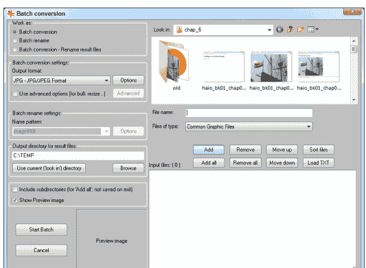

5. **指定输出目录。** 如果你想将新图像放入与输入文件相同的目录，请点击“使用此目录作为输出”按钮。如果不是，请选择你希望新图像存放的目录。
6. **在“工作模式”框中，选择“批量转换 — 重命名结果文件”。** 你可以使用此设置重命名文件、进行其他转换，或两者兼而有之。通常，我建议两者都做。
7. **将输出格式设置为你想要的格式。** 对于照片，你可能希望使用 JPG 格式。
8. **如果你想为图像指定其他命名约定，请在“批量重命名设置”区域更改重命名设置。** 默认情况下，每个图像的名称为 `image###`，其中 `###` 是一个三位数。它们按照“输入文件”工作区中的列表顺序编号。你可以使用“上移”和“下移”按钮来更改图像在此列表中出现的顺序。
9. **点击“设置高级选项”按钮以更改图像大小。** 这将显示“为所有图像设置”对话框，如图 6-18 所示。
10. **在“调整大小”区域指定图像的新尺寸。** 预设了几种常用尺寸。如果你想使用其他尺寸，请使用给定的选项。我将我的尺寸设置为 320×240。
11. **关闭“为所有图像设置”对话框，然后在“批量转换”对话框中，点击“开始”按钮。** 几秒钟后，新图像就创建好了。

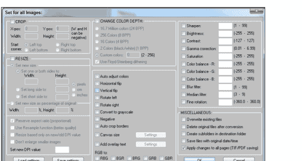

**图 6-18：** 使用“为所有图像设置”对话框在批处理模式下调整图像大小。

# 处理音频

HTML 很早就支持图像，但现在它也能很好地处理音频文件。这是一个重大突破，因为以前音频需要像 Flash 这样的外部程序。

## 处理音频

图 6-19 展示了一个带有简单音频文件的页面。

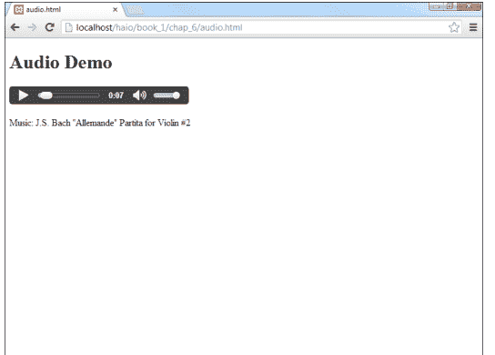

**图 6-19：** 此页面嵌入了一首歌曲。

在 HTML5 中，使用新的 `<audio>` 标签为网页添加音频非常容易。这是创建此页面的代码：

```html
<!doctype html>
<html lang="en">
<head>
    <meta charset="UTF-8">
    <title>audio.html</title>
</head>
<body>
    <h1>Audio Demo</h1>
    <audio controls = "controls">
        <source src = "Allemande.mp3" type = "audio/mpeg">
        <source src = "Allemande.ogg" type = "audio/ogg">
        Your browser does not support HTML5 Audio
        Please use this link instead:
        <a href = "Allemande.mp3">Allemande.mp3</a>
    </audio>
    <p>
        Music: J.S. Bach "Allemande" Partita for Violin #2
    </p>
</body>
</html>
```

尽管目前几乎每个浏览器都支持 `<audio>` 标签，但它们对于支持哪种格式仍然无法达成一致。一些浏览器支持 MP3 文件，一些支持称为 Ogg 的新标准，还有一些支持 WAV。

### 添加音频文件

确保音频播放的最佳方法是提供两种不同的格式。我发现同时包含 Ogg 和 MP3 格式可以确保我的音频能在所有主流浏览器上播放。

要向您的页面添加音频文件，请遵循以下步骤：

1. **在页面中添加 `<audio>` 标签。** `<audio>` 标签表示音频文件将被放置的位置。您在代码中放置标签的位置对应于控件将出现的位置。
2. **开启控件。** 您可以使用 `controls="controls"` 属性来指定控制面板。这会导致出现一个小的控制面板，如图 6-19 所示。如果省略此指令，将不会有控制面板，这意味着用户将无法播放该片段。
3. **创建一个或多个 `<source>` 元素。** 在 `<audio></audio>` 标签对内，添加一个或多个 `<source>` 元素。每个 source 元素表示您将链接到的一个文件。
4. **设置 `src` 属性以指示文件。** `<source>` 标签的 `src` 属性（我们能不能再弄一个几乎同名的东西？）用于指示您希望播放的音频文件的文件名。
5. **为旧版浏览器添加备用代码。** `<audio>` 和 `</audio>` 标签之间的任何额外 HTML 代码将只被不理解 audio 标签的浏览器解释。如果您愿意，可以添加一个普通锚点来下载音效。这样，即使是旧版浏览器的用户也能听到他们错过的内容。

# 添加视频

`<video>` 标签与 `<audio>` 标签非常相似，其工作方式完全相同。您可以使用此标签将视频添加到您的网页中，并且视频直接在浏览器中播放，无需像 Flash 这样的插件。通过 HTML 播放视频的能力是一个重大突破，而且实现起来并不困难。

当然，它并不完美。有许多相互竞争的视频标准，而浏览器（想象一下）无法就接受哪种标准达成一致。最重要的标准被称为 H.264 和 Ogg。有些浏览器偏好其中一种；有些偏好另一种。更复杂的是，视频文件的扩展并不总是指示底层的编码机制。这意味着视频编码需要一些实验。如果您的视频文件不是您想要的格式，您可能需要转换它。`FFmpeg` 和 `VLC` 是您可以用来将视频转换为所需格式的出色免费工具。

## 添加视频

正如任何知识产权一样，请确保您已获得文件原始所有者的许可。仅仅因为您*可以*将视频嵌入到您的网页中，并不意味着您*应该*这样做。

图 6-20 显示了一个嵌入了简单视频的页面。

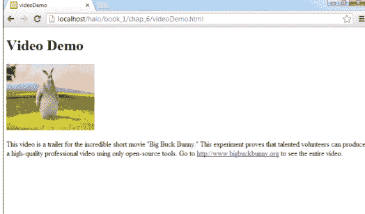

**图 6-20：** 此页面包含一个视频。

该页面的代码显示了 `<video>` 标签与 `<audio>` 标签的相似之处：

```html
<!DOCTYPE html>
<html lang="en">
  <head>
    <title>videoDemo</title>
  </head>
  <body>
    <h1>Video Demo</h1>
    <video src = "bigBuck.ogv"
           controls = "controls">
      Your browser does not support embedded video
      through HTML 5.
    </video>
    <p>
      This video is a trailer for the incredible short movie
      "Big Buck Bunny."  This experiment proves that talented
      volunteers can produce a high-quality professional video
      using only open-source tools.
      Go to <a href = "http://www.bigbuckbunny.org">
      http://www.bigbuckbunny.org</a> to see the entire video.
    </p>
  </body>
</html>
```


视频文件非常大，它们会使您的网站对用户来说感觉慢得多。将它们移动到Web服务器也很麻烦。因此，许多Web开发人员更喜欢将视频上传到YouTube这样的服务，并简单地链接到另一个服务器上的视频。如果您右键单击一个YouTube视频，可以从出现的菜单中选择“复制嵌入代码”。这会给您提供可以在自己网站上使用的代码。


# 第7章：创建表单

## 本章内容

- 向页面添加表单
- 创建输入和密码文本框
- 构建多行文本输入
- 制作列表框和复选框
- 构建单选按钮组
- 使用HTML5表单元素
- 创建按钮

HTML使您能够描述网页，但如今的网络不再是单向的。用户希望通过网页进行交流，输入信息、从下拉列表中进行选择并进行互动，而不仅仅是阅读。在本章中，您将学习如何在页面中构建这些交互元素。

## 您拥有出色的表单

关于HTML，您还需要理解的一个方面是——制作表单的能力。表单是页面中允许用户交互的部分。图7-1显示了一个包含所有主要表单元素的页面。

表单演示（或者如果您在家跟着做，是本书网站上的`formDemo.html`）展示了HTML中的主要表单元素。在本章中，您将发现如何构建所有这些元素。有关本书网站的更多信息，请参阅“引言”。

您可以使用普通的HTML创建表单，但要让它们做些事情，您需要一门编程语言。第IV册解释了如何使用JavaScript与表单交互，第V册描述了PHP语言。使用本章来弄清楚如何构建表单，然后跳到另一本迷你书来弄清楚如何让它们做事情。如果您还没有准备好进行完全的编程，可以暂时跳过本章，继续阅读第II册和第III册的CSS。当您准备好制作与JavaScript或PHP一起使用的表单时，再回来这里。

## 您拥有出色的表单

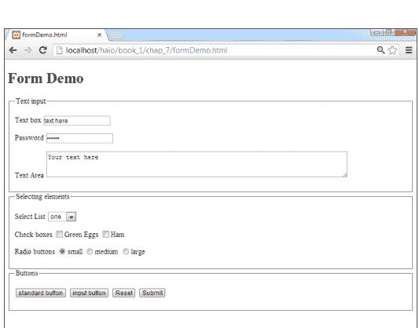

`formDemo.html`页面显示了以下元素：

- **表单：** 表单元素的容器。虽然表单元素本身通常不是页面的可见部分（如`<body>`标签），但通过适当的CSS，它可以是可见的。
- **文本框：** 这些标准的表单元素允许用户在一行元素中输入文本。
- **密码框：** 这些框类似于文本框，但它们会自动隐藏文本以防止窥探。
- **文本区域：** 这些多行文本框比其他类型的文本框能容纳更多的文本。您可以指定用户可以输入的文本区域的大小。
- **选择列表：** 这些列表框为用户提供多个选项。用户可以从列表中选择一个元素。您可以指定要显示的行数，或在激活时使列表下拉。
- **复选框：** 这些非文本框可以选中或不选中。复选框*独立*工作——一次可以选择多个（与单选按钮不同）。
- **单选按钮：** 通常成组出现，在一个组中一次只能选择一个单选按钮。选择一个单选按钮会取消选择同组中的其他按钮。
- **按钮：** 这些元素让用户开始某种过程。输入按钮用于JavaScript编码（我在第IV册中描述），而提交按钮用于服务器端编程（参见第V册）。重置按钮很特殊，因为它会自动将所有表单元素重置为其默认配置。
- **标签：** 许多表单元素都有一个与之关联的小文本标签。虽然标签不是必需的，但它们可以使表单更容易用CSS设置样式，也更容易让用户使用。
- **字段集和图例：** 这些用于分隔表单的某些部分。它们是可选的，但它们可以为表单增添很多视觉吸引力。

现在您已经了解了表单元素的概述，是时候开始构建一些表单了！

### 表单必须有一定的形式

所有的表单元素都必须嵌入在`<form></form>`标签对内。`basicForm.html`的代码展示了最简单的表单：

```html
<!DOCTYPE html>
<html lang = "en-US">
<head>
    <meta charset = "UTF-8">
    <title>basicForm.html</title>
</head>
<body>
    <h1>A basic form</h1>
    <form action = "">
        <h2>Form elements go here</h2>
        <h3>Other HTML is fine, too.</h3>
    </form>
    <p>
        <input type = "text"
               value = "googoo" />
    </p>
</body>
</html>
```

`<form></form>`标签对表示页面中可能包含表单元素的部分。所有其他表单元素（按钮、选择对象等）都必须在`<form>`标签对内。

`action`属性指示提交表单时应发生什么。这需要一门编程语言，因此关于`action`属性的完整描述在第IV册中。不过，您必须指定一个操作以进行验证，所以目前只需将`action`属性留空，用一对引号（`""`）表示即可。

### 使用字段集和标签组织表单

表单可以包含许多组件，但最重要的是*输入元素*（文本框、按钮、下拉列表等）和描述这些元素的*文本标签*。传统上，Web开发人员使用表格来设置表单，但这并不是最好的方法，因为表单不是表格信息。HTML包含一些很好的功能来帮助您描述表单的各个部分。图7-2显示了一个带有字段集、布局和基本输入的页面。

# 108 你拥有出色的表单

**图 7-2：** 该表单包含图例和标签。

`<fieldset>` 是一个特殊元素，用于为一组表单元素提供视觉上的分组。

我承认，这个表单看起来仍然不太好，但这并非重点。和所有 HTML 标签一样，表单元素的目的不是描述表单的外观，而是定义所有主要元素的含义。（我又来了……）你可以使用 CSS 来让表单呈现你想要的样子。HTML 标签描述的是表单的各个部分，这样你就有了可以挂载 CSS 的地方。我保证，这一切很快就会变得清晰明了。

以下是 `fieldset` 示例的代码（对应本书网站上的 `fieldsetDemo.html`）：

```html
<!DOCTYPE html>
<html lang = "en-US">
<head>
<meta charset = "UTF-8">
<title>fieldsetDemo.html</title>
</head>
<body>
<h1>Sample Form with a Fieldset</h1>
<form action = "">
<fieldset>
<legend>Personal Data</legend>
<p>
<label>Name</label>
<input type = "text" />
</p>
<p>
<label>Address</label>
<input type = "text" />
</p>
<p>
<label>Phone</label>
<input type = "text" />
</p>
</fieldset>
</form>
</body>
</html>
```

该表单包含以下元素：

- **`<form>` 和 `</form>` 标签：** 它们将表单定义为页面的一部分。别忘了空的 `action` 属性。
- **`<fieldset>` 标签对：** 这对标签将其中的元素描述为一组字段。这个元素并非必需，但当你使用 CSS 时，它确实能提供一些不错的组织和布局选项。你可以将 `<fieldset>` 视为一张空白画布，用于为表单添加视觉设计。默认情况下，`<fieldset>` 会在所有包含的元素周围添加一个边框。
- **`<legend>` 标签：** 作为 `<fieldset>` 的一部分，该标签允许你为整个 `<fieldset>` 指定一个图例。图例对用户是可见的。
- **段落标签：** 我有时会将每个标签及其对应的输入元素放在一个段落中。这提供了良好的格式化能力，并能将每个标签对保持在一起。
- **`<label>` 标签：** 该标签允许你将特定文本块指定为标签。默认情况下不进行格式化，但你稍后可以用 CSS 添加样式。`<label>` 标签还有一个可选的 `for` 属性，允许你将标签与特定的输入元素关联起来。这能帮助你进一步组织表单。
- **`<input>` 元素：** 用户在这些元素中输入数据。目前，我只使用非常基本的文本输入，以便表单有输入功能。在下一节中，我将解释如何构建更完整的文本输入。

## 构建文本样式的输入框

大多数表单元素都是同一标签的变体。`<input>` 标签可以创建单行文本框、密码框、按钮，甚至不可见的内容（如隐藏字段）。这些对象中的大多数共享相同的基本属性，尽管外观可能不同。

### 创建标准文本框

图 7-3 展示了 `<input>` 元素最常见的形式——一个简单的文本框。

# 110 构建文本样式的输入框

要创建一个基本的文本输入框，你需要一个表单和一个 `<input>` 元素。通常还会添加一个标签，以便用户知道应该在文本框中输入什么。以下是代码示例：

```html
<!DOCTYPE html>
<html lang = "en-US">
  <head>
    <meta charset = "UTF-8">
    <title>textbox.html</title>
  </head>
  <body>
    <form action = "">
      <p>
        <label>Name</label>
        <input type = "text"
               id = "txtName"
               value = "Jonas"/>
      </p>
    </form>
  </body>
</html>
```

一个 `<input>` 元素有三个常用属性：

- **`type`**：`type` 属性指明这是哪种类型的输入元素。第一个示例将 `type` 设置为 `text`，创建一个标准文本框。本章后面还会介绍创建密码框、隐藏字段、复选框和按钮的其他类型。
- **`id`**：`id` 属性为该字段创建一个标识符。当你使用编程语言从此元素中提取数据时，使用 `id` 来指定你指的是哪个字段。`id` 字段通常以一个提示性短语开头，以表明它是什么类型的对象（例如，`txt` 表示文本框）。
- **`value`**：此属性决定文本框的默认值。如果你省略此属性，文本框初始时为空。

文本框还可以有其他不那么常用的属性，例如：

- **`size`**：此属性决定显示的字符数。
- **`maxlength`**：使用此属性设置允许的最大字符数。

没有 `</input>` 标签。`<input>` 标签是过去许多标签没有结束标签时的遗留物。你只需在原始标签后添加一个斜杠（`/`）来结束它，如前面的示例代码所示。

你可能会想，既然 `<label>` 标签对表单的外观或行为没有任何影响，为什么我还要添加它。在这个特定示例中，`<label>` 标签确实没有效果，但就像 HTML 中的所有其他内容一样，你可以在 CSS 中用它做出令人惊叹的样式效果。尽管标签通常没有默认样式，但它们仍然很有用。

### 创建密码框

密码框与文本框类似，只是文本不会显示出来。相反，会显示一串星号。图 7-4 展示了一个基本的密码框。

以下代码显示密码框与普通文本框几乎完全相同：

```html
<!DOCTYPE html>
<html lang = "en-US">
<head>
    <meta charset = "UTF-8">
    <title>password.html</title>
</head>
<body>
    <form action = "">
        <fieldset>
            <legend>Enter a password</legend>
            <p>
                <label>Type password here</label>
                <input type = "password"
                       id = "pwd"
                       value = "secret" />
            </p>
        </fieldset>
    </form>
</body>
</html>
```

在这个例子中，我创建了一个 ID 为 `pwd` 的密码框。该字段的默认值是 `secret`。字符串 `secret` 实际上不会显示在字段中；它会被六个星号字符替代。

# 112 构建文本样式的输入框

**图 7-4：** 输入秘密密码……

密码框几乎不提供有意义的安全性。它能防止用户被间谍卫星偷瞄肩膀读取密码，仅此而已。HTML 的开放标准和编程语言意味着密码通常是明文传递的。存在解决方案——例如 SSL（安全套接字层）技术——但目前请记住，密码框不适合用来保护你秘制酱料的配方。

这个例子实际上并没有对密码做任何处理，但你会用其他技术来完成。

### 创建多行文本输入

单行文本框是一个强大的功能，但有时，你希望有更大一点的空间。图 7-5 所示的 `essay.html` 程序演示了如何创建一个用于论文题目的页面。

这个程序的主角是一个新标签——`<textarea>`：

```html
<!DOCTYPE html>
<html lang = "en-US">
<head>
  <meta charset = "UTF-8">
  <title>essay.html</title>
</head>
<body>
  <form action = "">
    <fieldset>
      <legend>Quiz</legend>
      <p>
        <label>Name</label>
        <input type = "text"
               id = "txtName" />
      </p>
      <p>
        <label>
          Please enter the sum total of
          Western thought. Be brief.
        </label>
      </p>
      <p>
        <textarea id = "txtAnswer"
                  rows = "10"
                  cols = "40"></textarea>
      </p>
    </fieldset>
  </form>
</body>
</html>
```

构建文本样式的输入框 113

书籍 I 第 7 章

创建表单

使用 `<textarea>` 标签时，需要注意以下几点：

- 它需要一个 `id` 属性，就像 `<input>` 元素一样。
- 你可以使用 `rows` 和 `cols` 属性来指定大小。
- 内容放在标签之间。文本区域可以包含比普通 `<input>` 标签多得多的信息，因此内容不是放在 `value` 属性中，而是放在 `<textarea>` 和 `</textarea>` 标签之间。

> **提示**
>
> 代码中放在 `<textarea>` 和 `</textarea>` 之间的任何内容都会出现在输出中。这包括空格和换行符。如果你不希望文本区域中有任何空白，请将结束标签紧挨着起始标签放置，就像我在 `essay` 示例中所做的那样。

**图 7-5：** 这个小测验可能需要多行回答。

### 创建多个选择元素

有时，您希望向用户呈现一个选项列表，然后让用户从中选择一个元素。HTML 有多种有趣的方式可以实现这一点。

#### 制作选择

下拉列表是网页开发者最喜欢的选取工具，原因如下：

*   **它节省屏幕空间。** 只显示当前选择。当用户点击列表时，一系列选项会下拉显示，选择完成后又会消失。
*   **它限制了输入。** 用户只能选择您在列表中提供的选项。这使得处理潜在输入变得更加容易，因为您不必担心打字错误。
*   **其值可以与用户所见不同。** 这看起来似乎是个奇怪的优点，但有时它确实非常有用。在本章后面介绍颜色值时，我会展示一个例子。

图 7-6 展示了一个简单的下拉列表在实际中的使用。

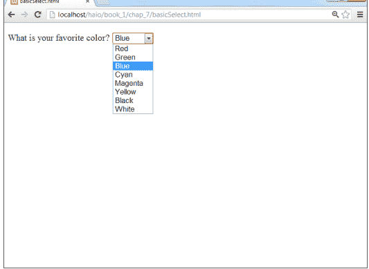

这个简单下拉列表的代码如下：

```html
<!DOCTYPE html>
<html lang = "en-US">
<head>
    <meta charset = "UTF-8">
    <title>basicSelect.html</title>
</head>
<body>
    <form action = "">
        <p>
            <label>What is your favorite color?</label>
            <select id = "selColor">
                <option value = "#ff0000">Red</option>
                <option value = "#00ff00">Green</option>
                <option value = "#0000ff">Blue</option>
                <option value = "#00ffff">Cyan</option>
                <option value = "#ff00ff">Magenta</option>
                <option value = "#ffff00">Yellow</option>
                <option value = "#000000">Black</option>
                <option value = "#ffffff">White</option>
            </select>
        </p>
    </form>
</body>
</html>
```

`<select>` 对象与您习惯的一些其他输入元素略有不同，例如

*   它被 `<select></select>` 标签对包围。这些标签表示整个列表。


*   `select` 对象有一个 `id` 属性。尽管 `select` 对象内部有许多其他标签，但通常只有 `select` 对象本身具有 `id` 属性。
*   它包含一系列 `<option></option>` 标签对。每个单独的选择都包含在一对 `<option></option>` 中。
*   每个 `<option>` 标签都有一个与之关联的值。该值供代码使用。这个值不一定是用户看到的内容。（请参阅侧边栏“那些奇怪的 #ff00ff 东西是什么？”以获取示例。）
*   `<option></option>` 之间的内容对用户是可见的。这些内容是用户实际看到的。

> ### 那些奇怪的 #ff00ff 东西是什么？
>
> 如果您仔细查看 `basicSelect.html` 的代码，会发现这些值都是带有井号和奇怪字符的奇怪文本。这些是十六进制代码，它们是计算机描述颜色的好方法。我在第二册第一章中解释了它们的工作原理。这种编码机制远没有看起来那么难理解。不过目前来看，这个同时包含颜色名称和十六进制值的代码，是一个很好的例子，说明了我们想向用户显示一件事（英文颜色名称），而将另一个值（十六进制代码）发送给程序。您将在第四册第五章再次看到这段代码，到时我将使用一个类似的列表框，通过 JavaScript 来更改页面的背景颜色。

## 构建文本样式输入

> 选择框并不需要下拉行为。如果您愿意，可以使用 `size` 属性指定要显示的行数。在这种情况下，您指定的行数将始终在屏幕上可见。

## 构建复选框

当您希望用户开启或关闭某个特定选项时，可以使用复选框。例如，请看图 7-7。

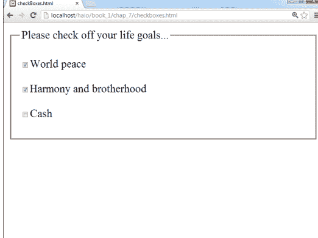

**图 7-7：** 可以同时选择任意数量的复选框。

每个复选框代表一个真或假的值，可以被选中或不被选中，并且每个复选框的状态完全独立于其他复选框。用户可以一个都不选，全选，或者选择任意组合。

这段代码表明复选框使用了您的老朋友 `<input>` 标签：

> ### 这一切似乎不一致
>
> 有时，表单元素的值对用户是可见的，有时是隐藏的。有时，用户看到的文本在标签内部，有时又不在。这有点令人困惑。标准是随着时间演化的，老实说，它们本可以更一致一些。尽管如此，这就是您可用的元素集，它们并没有那么难理解。多写几次表单，您就会记住的。您总是可以先查看我的代码，将其作为起点借用。

```
<!DOCTYPE html>
<html lang="en-US">
<head>
  <meta charset="UTF-8">
  <title>checkBoxes.html</title>
</head>
<body>
  <form action="">
    <fieldset>
      <legend>Please check off your life goals</legend>
      <p>
        <input type="checkbox" id="chkPeace" value="peace" />World peace
      </p>
      <p>
        <input type="checkbox" id="chkHarmony" value="harmony" />Harmony and brotherhood
      </p>
      <p>
        <input type="checkbox" id="chkCash" value="cash" />Cash
      </p>
    </fieldset>
  </form>
</body>
</html>
```

您使用的是 `<input>` 标签的相同属性，但它们的工作方式与普通文本框中略有不同：

*   **type 是 checkbox**。这就是浏览器知道要创建复选框而不是文本框的原因。
*   **复选框仍然需要 ID**。如果您将编写与此对象交互的编程代码（最终会这样），您将需要一个 ID 作为引用。
*   **该值对用户隐藏**。用户看不到实际的值。这是给程序员用的（就像 `select` 对象一样）。复选框后面的任何文本只是*看起来*像是与之关联的文本。

## 创建单选按钮

当您希望让用户从一组选项中只选择一个时，可以使用单选按钮。图 7-8 展示了一个单选按钮组在实际中的使用示例。

单选按钮可能看起来与复选框相似，但它们有一些重要的区别：

*   **一次只能选中一个**。术语 *radio button*（单选按钮）源自老式汽车收音机。当您按下某个电台的按钮时，所有其他按钮都会弹出。即使我的车现在也没那么旧了，但这个名字保留了下来。
*   **它们必须在一个组中。** 单选按钮只有在组的上下文中才有意义。单选按钮的要点是与其所属的组进行交互。
*   **它们都具有相同的 name 属性！** 每个单选按钮都有自己的 ID（像其他输入元素一样），但它们还有一个 `name` 属性。`name` 属性表示该单选按钮所属的组。
*   **您可以在一个页面上有多个组。** 只需为每个组使用不同的 `name` 属性。
*   **组中必须有一个被选中。** 组应该始终有一个且仅有一个值。某些浏览器默认会选中组中的第一个元素，但为了保险起见，您应该选中您希望被选中的元素。将 `checked = "checked"` 属性（由冗余部门开发）添加到您希望页面出现时被选中的元素上。在这个例子中，为了良好的资本主义暗示性销售，我预选了最贵的选项。

以下是一些解释一切的代码：

```
<!DOCTYPE html>
<html lang="en-US">
<head>
    <meta charset="UTF-8">
    <title>radioButtons.html</title>
</head>
<body>
    <form action="">
        <fieldset>
            <legend>How much do you want to spend?</legend>
            <p>
                <input type="radio"
                       name="radPrice"
                       id="rad100"
                       value="100" />Too much
            </p>
            <p>
                <input type="radio"
                       name="radPrice"
                       id="rad200"
                       value="200" />Way too much
            </p>
            <p>
                <input type="radio"
                       name="radPrice"
                       id="rad5000"
                       value="5000"
                       checked="checked" />You've got to be kidding.
            </p>
        </fieldset>
    </form>
</body>
</html>
```

## 按下您的按钮

HTML5 还附带了几种类型的按钮。您使用这些家伙来让某些事情实际发生。通常，用户通过在文本框中输入，然后从列表、选项或复选框中选择来设置某种输入。然后，用户点击按钮以触发响应。图 7-9 演示了四种类型的按钮。

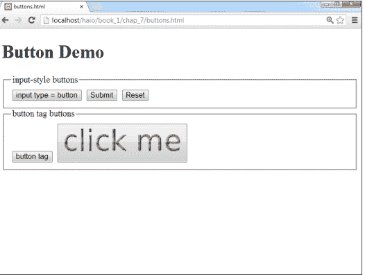

**图 7-9：** HTML5 支持几种类型的按钮。

此按钮示例的代码如下所示：

```
<!DOCTYPE html>
<html lang="en-US">
<head>
<meta charset="UTF-8">
<title>buttons.html</title>
</head>
<body>
<h1>按钮演示</h1>
<form action="">
<fieldset>
<legend>
输入框式按钮
</legend>
<input type="button"
       value="input type = button" />
<input type="submit" />
<input type="reset" />
</fieldset>
<fieldset>
<legend>按钮标签按钮</legend>
<button type="button">
button tag
</button>
<button>

</button>
</fieldset>
</form>
</body>
</html>
```

本节将介绍每种按钮类型。

### 制作输入框式按钮

最常见的按钮形式是你的老朋友——`<input>` 标签的另一种形式。如果你将 `input` 的 `type` 属性设置为 "button"，你就会生成一个基本的按钮：

```html
<input type="button"
       value="input type = button" />
```

普通的 Input 按钮有几个关键特性：

*   **输入类型设置为 "button"。** 这会生成一个普通按钮。
*   **`value` 属性设置按钮的标题。** 更改 `value` 属性即可设置新标题。此按钮的标题显示了按钮的创建方式：`input type = "button"`。
*   **这种类型的按钮不暗示链接。** 尽管按钮在被点击时似乎会下压，但它不会执行任何操作。你需要编写一些 JavaScript 代码才能使其工作。
*   **稍后，你将为按钮添加事件处理。** 在第四卷中了解 JavaScript 后，你将使用一个特殊属性将按钮与代码关联起来。
*   **这种类型的按钮用于客户端编程。** 这类代码驻留在用户的计算机上。我将在第四卷中讨论使用 JavaScript 进行客户端编程。

### 构建提交按钮

提交按钮通常用于服务器端编程。在这种编程形式中，代码位于 Web 服务器上。在第五卷中，你将使用 PHP 创建服务器端代码。`<input>` 标签也用于创建提交按钮！

```html
<input type="submit" />
```

尽管它们看起来一样，但提交按钮在几个微妙的方面与普通按钮不同：

*   **`value` 属性是可选的。** 如果省略它，按钮将显示 "Submit Query"。当然，你可以将 `value` 更改为任何你想要的值，这将成为提交按钮的标题。
*   **点击它会触发链接。** 这种类型的按钮是为服务器端编程设计的。当你点击按钮时，表单中的所有信息都会被收集并发送到网络上的另一个页面。
*   **目前，它不会跳转到任何地方。** 当你将表单的 `action` 属性设置为 null ("") 时，你告诉提交按钮只需重新加载当前页面。当你了解真正的服务器端编程后，你会将表单的 `action` 属性更改为处理数据的程序。
*   **提交按钮不适用于客户端。** 尽管你可以为提交按钮附加一个事件（就像常规 Input 按钮一样），但链接行为通常会导致问题。对于客户端请使用常规 Input 按钮，对于服务器端请使用提交按钮。

### 重来一次：重置按钮

多功能的 `<input>` 标签的另一种形式创建了重置按钮：

```html
<input type="reset" />
```

这个按钮有一个非常明确的用途。当被点击时，它会将其表单的所有元素重置为默认值。与提交按钮一样，它有一个默认值（"reset"），并且不需要任何代码。

### 介绍 `<button>` 标签

按钮作为 Web 的有用组成部分已经很长时间了，但它有点乏味。HTML 4.0 引入了 `<button>` 标签，其工作方式如下：

```html
<button type="button">
button tag
</button>
```

`<button>` 标签的作用更像一个标准的 HTML 标签，但它也可以像提交按钮一样工作。以下是主要特点：

*   `type` 属性决定样式。你可以将按钮设置为普通类型（通过将其类型设置为 button）、提交或重置。如果你不指定类型，按钮将使用提交样式。按钮的类型表示其行为，就像 Input 式按钮一样。
*   标题放在 `<button></button>` 标签对之间。没有 `value` 属性。只需将预期的标题放在 `<button>` 标签对内即可。
*   你可以包含其他元素。与 Input 按钮不同，你可以在按钮内放置图像或带样式的文本。这为你提供了其他一些能力。`buttons.html` 示例中的第二个按钮使用了一个小 GIF 图像来创建一个更丰富多彩的按钮。

### 新的表单输入类型

HTML 表单围绕着谦逊而灵活的 `input` 元素构建。HTML5 增加了许多非常有用的输入类型，有助于构建更现代、更灵活的界面。

尽管对这些标签的支持并不普遍，但现在开始使用它们是安全的。任何不理解高级输入类型的浏览器（甚至 IE6）都会回退到 `input type = "text"`，这仍然可以按预期工作（尽管没有较新标签的验证和用户界面改进）。

请注意，标准指出各种类型将会被支持，但元素被支持的具体方式会因浏览器而异。例如，对于使用标准桌面计算机的用户，电子邮件字段看起来可能就像一个普通的文本字段，但移动设备上的虚拟键盘可能会在遇到电子邮件字段时切换为包含 @ 符号。

图 7-10 展示了 Google Chrome 中许多此类表单元素的实际应用，它支持所有这些功能。

### date

将输入类型设置为 `date` 表示你希望用户输入一个日期值。一些浏览器（Firefox 3.5）仍然显示一个文本字段，而其他浏览器（Opera 10）则显示一个特殊的日历控件，允许更精确、更轻松地选择日期。还有一些浏览器（Chrome）同时包含文本和弹出式日历。如果通过文本输入日期，则必须以 `yyyy-mm-dd` 格式输入。

```html
<input type="date"
       id="date" />
```

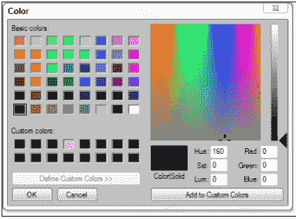

**图 7-10：** 较新的浏览器有特殊的输入控件——这里我正在选择一个颜色。

你可以通过将 `min` 和 `max` 属性应用于元素来限制允许的日期范围。

### time

`time` 输入类型的目的是允许用户输入一个时间。时间以 `hh:mm` 格式存储，其中 `hh` 是小时（24小时制），`mm` 是分钟。一些浏览器直接在字段中包含冒号，而另一些则通过数字和冒号字符修改虚拟键盘。也有可能浏览器会弹出某种自定义时间选择器，但这在主要浏览器中尚未得到支持。

```html
<input type="time"
       id="time" />
```

### datetime

`datetime` 元素将 `date` 和 `time` 组合成一个单一的元素。它还包含一个用于输入时区的机制。

```html
<input type="datetime"
       id="datetime" />
```

一些浏览器为日期弹出日历控件，并为时间提供格式化的输入框。其他浏览器可能会为日期和时间输入修改虚拟键盘。

### datetime-local

`datetime-local` 元素与 `datetime` 元素类似，但不包含时区指示符。

```html
<input type="datetime-local"
       id="datetimeLocal" />
```

### 管理日期和时间数据

各种日期和时间元素返回的官方完整日期和时间格式是一种专用代码：

```
yyyy-mm-ddThh:mm:ff:gg
```

代码中的每个字符都描述了日期和时间的一部分：

*   **yyyy**：四位数的年份。
*   **-（连字符）**：必须放在年份和月份之间。另一个连字符放在月份和日期之间。
*   **mm**：两位数的月份。
*   **dd**：两位数的日期。
*   **T**：大写 "T" 表示代码时间部分的开始。
*   **hh**：两位数的小时，24小时制。
*   **:（冒号）**：小时和分钟之间的冒号字符。另一个冒号将出现在时区偏移量的小时和分钟之间。
*   **mm**：两位数的分钟。
*   **+/-Z**：时区偏移量用大写 Z（如果时间是祖鲁时间或 GMT 时间）或 + 或 - 符号表示（如果时间在另一个时区）。
*   **ff**：如果时区不是祖鲁时间，则指示与 GMT 相差的小时数。
*   **gg**：与祖鲁时间相差的分钟数。通常为 00，但时区偏移 15、30 或 45 分钟也是可能的。

例如，2010年10月11日下午5:30，纽约市将表示为：

```
2010-10-11T17:30-05:00
```

如果你的用户使用的浏览器验证 `datetime` 字段，日期和时间需要采用此格式才能被视为有效。`datetime` 字段的值将采用此格式，这对于计算机程序来说相对容易解析和管理。

`datetime-local` 输入类型期望并返回与标准 `datetime` 元素相同格式的日期和时间，只是 `datetime-local` 不包含时区偏移量。

### week

`week` 字段用于从日历控件中选择一周。它返回以下格式的值：

```
yyyy-Wnn
```


- `yyyy`代表四位数的年份
- `-`是连字符
- `W`是大写 W 字符
- `nn`是两位数的周数

### 新型表单输入类型

部分浏览器会弹出标准的日历控件。当用户选择一个日期（或一周）时，仅返回年份和周数。其他浏览器则会简单地验证格式是否正确：

```html
<input type="week"
       id="week" />
```

#### 月份（month）

`month`输入类型会生成一个四位年份后跟两位月份。它通常会弹出与其他日期选择器相同的日历控件，但仅返回年份和月份（`yyyy-mm`格式）。

```html
<input type="month"
       id="month" />
```

#### 颜色（color）

`color`工具允许用户使用标准 Web 格式选择颜色：可识别的颜色名称（如`yellow`）以及以`#`符号开头的十六进制值（如`#ff0033`）。浏览器可能会显示类似文字处理软件和绘图程序中的颜色选择工具。目前，某些浏览器仅显示一个文本框，并指示当前内容是否为有效的颜色名称或值。

```html
<input type="color"
       id="color" />
```

#### 数字（number）

`number`字段允许输入数字数据。这通常包括一个文本字段后跟某种选择器（例如上下箭头），或者它可能会将便携设备的虚拟键盘更改为仅处理数字输入。

```html
<input type="number"
       id="number"
       max="10"
       min="0" />
```

`number`输入类型支持几个特殊属性：

- `min`：允许的最小值。如果存在屏幕输入元素，它将不允许小于`min`值的值。如果字段值小于`min`值，该字段也将无法通过验证。
- `max`：允许的最大值。如果存在屏幕输入元素，它将不允许大于`max`值的值。如果字段值大于`max`值，该字段将无法通过验证。
- `step`：此值指示视觉界面工具（通常是小的上下箭头）在激活时改变值的幅度。
- `value`：元素的数值。

所有值可以是整数或浮点数。然而，当前支持此标签的浏览器（Opera 和 Chrome）在验证浮点值方面似乎不如验证整数值那样完善。要对数字输入进行更多控制，请考虑使用下一节介绍的范围（range）输入类型。

#### 范围（range）

范围输入类型是 HTML 工具包中期待已久的一项新增功能。用户界面专家多年来一直知道，用户输入整数值很难做到恰到好处。大多数用户界面工具包都提供某种滑块或滚动条机制，使用户能够轻松地直观输入数值。`<input type="range">`构造终于将此功能添加到 HTML 表单中。

```html
<input type="range"
        id="range"
        min="0"
        max="255"
        value="128" />
```

范围输入接受数字（`number`）、最小值（`min`）、最大值（`max`）、值（`value`）和步长（`step`）属性。如果浏览器支持此标签，用户将看到一个滚动条。如果不支持，则将显示一个纯文本输入类型。当此元素普及时，应鼓励使用它，因为将用户输入限制在有效范围内（尤其是当此机制是视觉化且易于操作时）要比事后检查用户输入容易得多。

然而，范围类型不显示确切的值，并且可能比数字输入类型更难获得精确的结果。一种解决方案是将输出（`output`）标签与范围配对，并使用 JavaScript 在范围更改时更新输出。请参阅本书网站上的`rangeOutput.html`以查看此功能的实际应用。（您可能需要回顾第四本书中的 JavaScript 编码才能完全理解此示例。）

#### 搜索（search）

搜索输入类型用于检索打算用作搜索一部分（无论是内部搜索还是通过 Google 等搜索服务）的文本。在大多数浏览器上，它显示为一个普通的文本字段。它有时确实具有一些特殊行为。在 Safari 上，搜索字段有一个小的 X，用于清除搜索内容。在 Chrome 上，主搜索栏（也是 Chrome 中的 URL 输入元素）的自动完成功能会自动应用于搜索框。

```html
<input type="search"
        id="search" />
```

与其他新的输入类型一样，在不支持`search`元素的浏览器中使用它不会有任何惩罚。回退方案是一个纯文本输入。

请注意，`search`元素实际上并不执行任何搜索。如果您想实际搜索该值，您仍然需要编写一些代码。`search`元素确实为您提供了一个与浏览器集成搜索工具一致的界面，但实际行为仍取决于程序员。

#### 电子邮件（email）

`email`元素通常看起来像一个纯文本字段，但它会验证电子邮件地址。此外，浏览器可能会以其他方式修改用户体验。例如，移动浏览器可能会修改虚拟键盘以包含电子邮件地址中始终存在的`@`符号：

```html
<input type="email"
       id="txtEmail" />
```

#### 电话（tel）

`tel`字段用于输入电话号码。它期望三个数字后跟一个连字符和四个数字。如果您想允许区号或分机号通过验证，您可能需要使用`pattern`属性进行调整。

```html
<input type="tel"
       id="tel" />
```

#### 网址（url）

使用此输入类型来指示网址。支持此元素的浏览器将检查`http://`前缀。移动浏览器也可能调整虚拟键盘以包含 URL 中常见的字符：冒号（`:`）、正斜杠（`/`）和波浪号（`~`）。

```html
<input type="url"
       id="url" />
```

# 第二部分：使用 CSS 进行样式设计

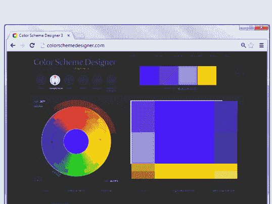

访问 www.dummies.com/extras/html5css3aio 了解更多关于使用 HTML 实体的信息。

# 内容概览

第 1 章：为你的世界着色 ………………………………131
现在你拥有了风格元素………………………131
在 CSS 中指定颜色……………………………134
选择你的颜色……………………………140
创建你自己的配色方案………………………143

第 2 章：样式化文本…………………………………149
设置字体族……………………………149
基于 Web 字体的诅咒 ……………………………154
指定字体大小 ……………………………160
相对测量单位……………………………163
确定其他字体特性……………………………164

第 3 章：选择器：使用类和样式进行编码 …………175
选择特定片段……………………………175
使用强调和强烈强调……………………………177
修改 em 和 strong 的显示方式……………………………179
定义类……………………………180
介绍 div 和 span……………………………184
使用伪类来样式化链接 ………………………………187
在上下文中选择……………………………190
为多个元素定义样式 ………………………………191
使用新的 CSS3 选择器……………………………193

第 4 章：边框和背景…………………………197
加入边框巡逻队……………………………197
介绍盒子模型 ……………………………202
新的 CSS3 边框技术……………………………207
更改背景图像……………………………212
操作背景图像 ………………………………218
在列表中使用图像 ………………………………223

第 5 章：CSS 的层次级别 ………………………………225
管理样式级别 ………………………………225
理解层叠样式表中的层叠部分………………………233
管理浏览器不兼容性 ………………………………237

第 6 章：CSS 特殊效果 ………………………………245
图像效果……………………………245
文本效果 ………………………………249
转换和过渡……………………………252

# 第 1 章：为你的世界着色

## 本章内容

- 介绍 style 元素
- 为标签添加样式
- 动态修改页面
- 指定前景色和背景色
- 理解十六进制颜色
- 领会 HSL 颜色
- 开发配色方案

HTML 在设置页面基本设计方面做得很好，但坦白说：它制作的页面相当丑陋。在过去，开发人员向 HTML 添加了许多其他标签使其更美观，但用 HTML 代码更改设计是一件随意的事情。现在，HTML 禁止了所有使页面更具吸引力的标签。这听起来很糟糕，但实际上并非损失。如今，HTML 几乎总是与 CSS（层叠样式表）一起编写。使用 CSS 来美化你的 HTML 页面可以做的事情之多，令人惊叹。

CSS 允许你更改页面上任何图像的颜色、添加背景和边框、更改元素（如列表和链接）的视觉外观，以及自定义页面的整体布局。此外，CSS 允许你保持 HTML 的简洁，因为所有格式都存储在 CSS 中。CSS 也很高效，因为它允许你跨多个元素和页面重用样式。如果说 HTML 赋予了你页面的结构，那么 CSS 赋予了它们美感。

本章将通过描述如何为页面添加颜色来让你入门。

### 现在你拥有了风格元素

CSS 的秘密在于样式表，这是一组描述各种对象如何显示的规则。例如，查看图 1-1 中的`basicColors.html`。

> 像往常一样，不要只听我说。本章是关于颜色的，你需要查看配套网站上的这些页面，以了解我所说的。有关配套网站的更多信息，请参阅本书的简介。

#### 132 现在你有了样式元素

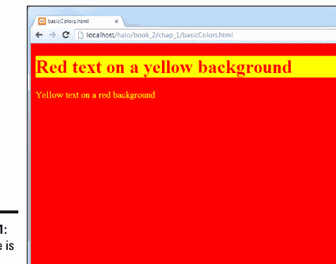

**图 1-1：** 这个页面是彩色的！

HTML代码中没有提供任何颜色信息。使这个页面不同于普通HTML页面的是我在头部添加的一个新部分。来看看代码，看看发生了什么（有趣的部分已用粗体标出）：

```html
<!DOCTYPE html>
<html lang = "en-US">
  <head>
    <meta charset = "UTF-8">
    <title>basicColors.html</title>
    <style type = "text/css">
      body {
        color: yellow;
        background-color: red;
      }
      h1 {
        color: red;
        background-color: yellow;
      }
    </style>
  </head>
  <body>
    <h1>Red text on a yellow background</h1>
    <p>
      Yellow text on a red background
    </p>
  </body>
</html>
```

正如你所看到的，HTML代码中没有什么特别不同的地方。`body`部分只包含一个`h1`和一个`p`标签。虽然文本提到了颜色，但HTML代码中没有任何东西让这些颜色真正生效。

秘密在于我放在头部区域的新的`<style></style>`标签对：

```css
<style type = "text/css">
    body {
        color: yellow;
        background-color: red;
    }
    h1 {
        color: red;
        background-color: yellow;
    }
</style>
```

`<style>`标签是一个HTML标签，但它的作用很特别：它切换了语言！在`style`元素内部，你写的不再是HTML。你进入了一种全新的语言——CSS。CSS和HTML有着不同的分工，但它们被设计为能很好地协同工作。

你可能会觉得CSS代码仍然是HTML的一部分，因为它在HTML页面内部，但最好将HTML和CSS视为两种不同（尽管相关）的语言。HTML描述内容，而CSS描述布局。CSS（你很快就会看到）具有与HTML不同的语法和风格，并且并不总是嵌入在网页中。

## 设置样式表

样式表为HTML元素描述呈现规则。如果你看前面的样式表（`<style>`标签内的代码），你可以看到我已经为两个元素描述了呈现规则：`<body>`和`<h1>`标签。每当浏览器遇到这些标签之一时，它就会尝试使用这些样式规则来改变该标签的视觉外观。

样式就是一串*选择器*（你想要修改的页面中的位置）。目前，我使用标签名称（`body`和`h1`）作为选择器。然而，在本小书的第3章中，我会展示更多你可以使用的选择器。

每个选择器可以有多条样式*规则*。每条规则描述了选择器的某个属性。要设置样式，请记住以下几点：

- **从样式标签开始。** 你目前要使用的样式类型是嵌入在页面中的。你应该在头部区域描述你的样式。
- **在头部区域包含样式类型。** 样式类型始终是`"text/css"`。开头的`<style>`标签总是像这样：`<style type = "text/css">`
- **定义一个元素。** 使用元素名称（仅标签名称）开始定义特定元素的样式。你可以为所有HTML元素（以及其他东西，但今天先不说）定义样式。`body`的选择器这样指定：

```css
body {
```

- **使用花括号（`{}`）包围样式规则。** 每个样式规则都包含在一组花括号中。与许多编程语言类似，花括号标记了代码的特殊部分。传统上，会在花括号内缩进。
- **给出规则名称。** 在本章中，我使用了两个非常简单的规则：`color`和`background-color`。在本小书中，你将了解到更多可以修改的CSS规则（有时也称为属性）。规则名称后总是跟着一个冒号（`:`）。
- **输入规则的值。** 不同的规则接受不同的值。属性值后面跟着一个分号。传统上，每对名称-值占一行，像这样：

```css
body {
  color: yellow;
  background-color: red;
}
```

# 更改颜色

在这个非常简单的例子中，我只是改变了一些颜色。以下是CSS中的两个主要颜色属性：

- `color`：指元素中任何文本的前景色。
- `background-color`：元素的背景色。（连字符是名称的正式部分。如果省略它，浏览器将不知道你在说什么。）

使用这两个属性，你可以指定任何元素的颜色。例如，如果你希望所有段落都有蓝色背景上的白色文本，请将以下文本添加到你的样式中：

```css
p {
  color: white;
  background-color: blue;
}
```


> CSS区分大小写。CSS样式应全部用小写字母书写。

你将在学习过程中发现更多的样式元素，但它们都遵循颜色属性所说明的相同原理。

## 在CSS中指定颜色

以下是CSS中定义颜色的两种主要方法。你可以使用颜色名称，如`pink`和`fuchsia`，或者你可以使用*十六进制值*。（本章后面，在“创建自己的配色方案”部分，你将了解如何使用特殊的数字设计符来选择颜色。）每种方法都有其优点。

### 使用颜色名称

颜色名称似乎是最简单的解决方案，对于像`red`和`yellow`这样的基本颜色，它们工作得很好。然而，颜色名称存在一些问题，使得它们对网页开发人员来说很麻烦：

- **只有16个颜色名称是合法的。** 虽然大多数浏览器接受数百种颜色名称，但只有16种保证在CSS和HTML验证器中有效。参见表1-1了解这16种颜色的列表。
- **颜色名称有些主观。** 你会发现对于究竟什么构成任何特定颜色有不同的看法，尤其是当你处理更晦涩的颜色时。（我个人不知道`PeachPuff`和`PapayaWhip`是颜色。它们听起来更像甜点食谱。）
- **修改颜色可能很困难。** 例如，比`Gainsboro`稍微蓝一点的颜色是什么？（是的，那也是一个颜色名称。我不知道我的色彩识别障碍有多严重。）
- **它们很难匹配。** 假设你正在为你的猫建立一个在线神殿，并且你希望文本与你猫的眼睛颜色相匹配。很难确定哪种颜色名称对应你猫的眼睛。我猜你可以问问猫。

十六进制颜色值可以用大写或小写表示。为了完整性，此表中包含了神秘的十六进制代码。如果你不理解它们是关于什么的，也没关系。所有内容将在下一节揭示。

**表1-1 合法的颜色名称和十六进制等效值**

| 颜色 | 十六进制值 |
| :--- | :--- |
| 黑色 (Black) | `#000000` |
| 银色 (Silver) | `#C0C0C0` |
| 灰色 (Gray) | `#808080` |
| 白色 (White) | `#FFFFFF` |
| 栗色 (Maroon) | `#800000` |
| 红色 (Red) | `#FF0000` |
| 紫色 (Purple) | `#800080` |
| 品红 (Fuchsia) | `#FF00FF` |
| 绿色 (Green) | `#008000` |
| 酸橙绿 (Lime) | `#00FF00` |
| 橄榄色 (Olive) | `#808000` |
| 黄色 (Yellow) | `#FFFF00` |
| 海军蓝 (Navy) | `#000080` |
| 蓝色 (Blue) | `#0000FF` |
| 水鸭蓝 (Teal) | `#008080` |
| 水绿色 (Aqua) | `#00FFFF` |

显然，我无法在这本黑白书中向你展示实际颜色，因此我在本书的配套网站上添加了一个简单的页面来显示所有命名的颜色。查看`namedColors.html`以查看实际颜色，并参见本书的介绍以了解如何访问该网站。

### 给你的颜色加上十六进制

HTML中的颜色是一件奇怪的事情。看起来“简单”的方法（使用颜色名称）结果却有很多问题。大多数网页开发人员*真正*使用的方法听起来难得多，但起初并不像它看起来那么糟糕。*十六进制颜色*方案使用看似奇怪的数字和字母组合来确定颜色值。`#00FFFF`是水绿色。`#FFFF00`是黄色。这是一个只有计算机科学家才会喜欢的方案。然而，一旦你习惯了，你会发现这个系统有其独特的极客魅力。（而极客魅力难道不是最好的一种吗？）

十六进制颜色通过精确描述计算机正在做什么来工作，因此你需要更多地了解计算机如何处理颜色。屏幕上的每个点（或*像素*）实际上由三束微小的光（或LCD二极管或类似的东西）组成。每个像素都有微小的红、绿、蓝光束。

这些光束的工作方式有点像舞台灯。想象一个黑色的舞台，三个聚光灯（红色、绿色和蓝色）对准同一个点。如果所有的灯都关闭，舞台将完全黑暗。如果你只打开红灯，你会看到红色。你可以打开组合以获得新的颜色。例如，打开红光和绿光会产生一个黄色光点。打开所有三个灯会产生白色。

### 按数字着色

在计算机系统中，每个小灯都可以调整到不同的亮度级别。这些值从0（完全关闭）到255（完全打开）。因此，你可以将红色描述为`rgb(255, 0, 0)`，黄色描述为`rgb(255, 255, 0)`。

0到255的值范围看起来很奇怪，因为你可能习惯了十进制数学。计算机实际上以二进制表示法存储值。计算机看到的黄色实际上是

```
1111111111111110000000
```

哎呀！肯定有更简单的方法来处理所有这些二进制值。这就是我们使用*十六进制表示法*的原因。请继续阅读……

图 1-2 展示了一个可以通过红、绿、蓝滑块来选择颜色的页面。每个滑块都显示了其十进制值和十六进制值。

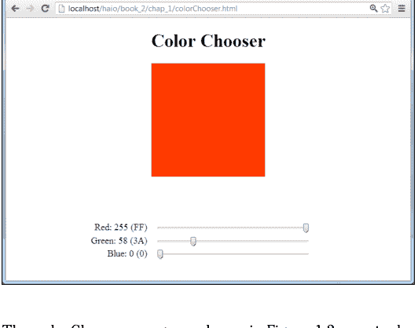

图 1-2：使用这个程序来尝试你可以使用的各种颜色。


图 1-2 中展示的 `colorChooser` 程序使用了将在第四册中介绍的技术。任何与用户交互的页面都可能使用一种编程语言（本例中是 JavaScript）。你可以随意浏览代码，但如果你还没有准备好将编程添加到你的网站中，也不用担心。我保证，你很快就能掌握了。

## 十六进制教育

所有这些 1 和 0 会变得很乏味。程序员喜欢转换成另一种更容易处理的格式。信不信由你，将二进制数转换为基数 16 比转换为基数 10 更容易，所以程序员就是这样做的。即使不理解基数 16（也称为*十六进制*或 *hex*）转换，你也能过得很好，但你应该理解一些关键特性，例如：

- 每个十六进制数字是**四位二进制数字**的简写。程序员使用十六进制的全部原因是为了简化二进制的处理。
- 每个数字代表 **0 到 15** 之间的一个值。四位二进制数字代表 0 到 15 之间的一个值。
- 我们**必须发明一些数字**。十六进制看起来如此奇怪的全部原因就在于包含了字符。原因很简单：数字字符不够用了！表 1-2 说明了这个基本问题。

**表 1-2 十进制数的十六进制表示**

| 十进制（基数 10） | 十六进制（基数 16） |
| --- | --- |
| 0 | 0 |
| 1 | 1 |
| 2 | 2 |
| 3 | 3 |
| 4 | 4 |
| 5 | 5 |
| 6 | 6 |
| 7 | 7 |
| 8 | 8 |
| 9 | 9 |
| 10 | A |
| 11 | B |
| 12 | C |
| 13 | D |
| 14 | E |
| 15 | F |

普通的数字 0-9 在十六进制和十进制中是一样的，但十进制中的值 10-15 在十六进制中由字母字符表示。

你已经非常习惯看到数字 10 等于双手的手指数量，但当你开始像我们这样摆弄不同的记数系统时，情况就不总是这样了。数字 10 简单地表示当前基数的一个单位。直到今天，你可能只用过十进制，但今天一切都变了。数字 10 在十进制中是十，但在二进制中，10 表示二。在八进制中，10 表示八，在十六进制中，10 表示十六。这很重要，因为当你想用十六进制表示手指的数量时，你不能使用熟悉的符号 10，因为在十六进制中 10 表示十六。我们需要一个单独的数字来表示十，所以计算机科学家通过借用字母解决了这个难题。10 是 A，11 是 B，15 是 F。

如果所有这些数学理论让你头晕，别担心。我在下一节中展示了一些使用这种方案创建漂亮颜色的捷径。不过，现在你需要理解的是如何使用十六进制颜色：

- **一种颜色需要六位十六进制数字。** 一个像素需要三种颜色，每种颜色使用八位二进制数字。每种颜色对应两位十六进制数字。两位表示红色，两位表示绿色，最后两位表示蓝色。
- 十六进制颜色值通常以井号开头。为了提醒浏览器该值将是十六进制的，该值前面通常会加上一个井号（#）。所以，黄色是 `#FFFF00`。

使用十六进制处理颜色可能看起来真的很疯狂和困难，但它有一些重要的优点：

- **精确性：** 使用这个系统可以为你提供大量的颜色可供选择（如果你真的想知道的话，超过 1600 万种）。你不可能自己想出那么多颜色名称。嗯，你可以，但完成时你已经非常非常老了。
- **客观性：** 十六进制值不是主观意见的问题。关于哪种颜色是烧赭色可能会有争论，但十六进制值 `#666600` 是明确无误的。
- **可移植性：** 大多数图形编辑软件都使用十六进制系统，因此你可以选取图像的任何颜色并立即获得其十六进制值。这将使你很容易为你猫的眼睛颜色找到那个在线神殿。
- **可预测性：** 在你理解了它的工作原理后，你可以获取任何十六进制颜色并将其转换为稍暗、稍亮或稍多一点蓝色的值。对于命名的颜色来说，这很难做到。
- **易用性：** 这一点可能看起来有点牵强，但在我在下一节中描述的网络安全调色板之后，你很容易就能对颜色有一个大致的概念，然后进行微调以获得你想要的确切形式。

### 使用网络安全调色板

很久以前，浏览器甚至无法就它们可靠显示哪些颜色达成一致。网页开发者通过在预定义的调色板中工作来应对，这个调色板在每个浏览器上都能很好地工作。今天的浏览器在显示多种颜色方面没有问题，但所谓的*网络安全调色板*有时仍然被使用，因为它是一个简单的起点。

网络安全调色板（如表 1-3 所示）的基本思想是：每种颜色只能具有以下值之一：`00`、`33`、`66`、`99`、`CC` 或 `FF`。`00` 是每种颜色最暗的值，`FF` 是最亮的。原色都由 0 和 F 组成：`#FF0000` 是红色（全是红色，没有绿色，没有蓝色）。网络安全颜色使用这些值的任何组合，因此 `#33CC00` 是网络安全的，但 `#112233` 不是。

**表 1-3 网络安全颜色值**

| 描述 | 红色 | 绿色 | 蓝色 |
| :--- | :--- | :--- | :--- |
| 非常亮 | FF | FF | FF |
| | CC | CC | CC |
| | 99 | 99 | 99 |
| | 66 | 66 | 66 |
| | 33 | 33 | 33 |
| 非常暗 | 00 | 00 | 00 |

要从该图表中选择一个网络安全值，请确定你想要每种颜色的量。一个明亮的红色将红色完全打开（FF），没有绿色（00）和蓝色（00），形成 `#FF0000`。如果你想要一个较暗的红色，你可能会稍微降低红色。下一个较暗的网络安全红色是 `#CC0000`。如果那还不够暗，你可以尝试 `#990000`。假设你喜欢那个，但你想要它带一点紫色。只需增加一两档蓝色：`#990033` 或 `#990066`。

图 1-3 是一个简单的工具，允许你尝试网络安全调色板。

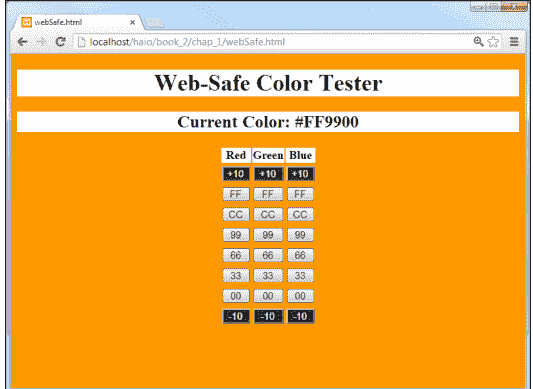

**图 1-3：** 使用此工具探索网络安全颜色。

> **提示** 网络安全颜色最初旨在缓解的问题早已解决，但它们作为起点仍然很受欢迎。网络安全颜色为你提供了一个分散且易于理解的子集颜色作为起点。你不必停留在那里，但这是一个很好的起点。

## 选择你的颜色

颜色可能看起来令人生畏，但只要稍加练习，你就能有风格地管理颜色。

### 从网络安全颜色开始

`webSafe.html` 程序的工作原理是让你快速输入一个网络安全值。要制作红色，请按红色列中的 FF 按钮。蓝色和绿色值具有默认值 00，因此背景是红色。

网络安全颜色为你提供了很大的发挥空间，而且它们非常容易使用。事实上，它们如此常见，以至于你可以使用一种快捷方式。因为网络安全颜色都是重复的，你可以将重复的数字（FF）写成单个数字（F）。你可以将品红色指定为 `#FF00FF` 或 `#F0F`，浏览器都能理解，给你一种令人头疼的品红色。

要制作一个较暗的红色，请将 FF 更改为下一个较小的值，变成 `#CC0000`。如果你想要更暗，可以尝试 `#990000`。尝试所有红色值，看看获得几种不同类型的红色是多么容易。如果你想制作粉色的变体，请一起提高绿色和蓝色值。`#FF6666` 是一种柔和的粉色；`#FF9999` 稍微亮一点；而 `#FFCCCC` 是一种非常白的粉色。

### 修改你的颜色

网络安全调色板很方便，但它给你提供的是相对较少的颜色（如果你数的话，是 216 种）。盒子里有 216 支蜡笔很不错，但你可能需要更多。通常，我从网络安全颜色开始，然后边做边调整。如果你想要比 `#FFCCCC` 更浅的粉色，你可以跳出网络安全的框架，使用 `#FFEEEEE` 或任何你想要的颜色！

在 `webSafe.html` 程序中，你可以使用每行顶部和底部的按钮来微调对颜色的调整。

### 在你自己的页面上操作

当然，颜色在我的页面上看起来如何并不重要。关键是要让你的页面上的东西看起来不错。要为你的页面添加颜色，请执行以下操作：

1. **像往常一样定义 HTML。**
   HTML 不应该与颜色有任何关系。严格在 CSS 中添加颜色。

2. **在页面的头部区域添加一个 `<style>` 标签。**
   不要忘记设置 `type = "text/css"` 属性。

3. **为你想要修改的每个标签添加一个选择器。**
   你可以修改任何 HTML 标签，所以如果你想改变所有段落，添加一个 `p { }` 选择器。使用不带尖括号的标签名称，所以 `<h1>` 变成 `h1 { }`。

4. **添加 `color` 和 `background-color` 属性。**

你将在第二卷和第三卷中发现更多可以修改的CSS元素，但现在，先坚持使用`color`和`background-color`。

5. 使用颜色名称或十六进制颜色值来指定颜色值。

### 实时修改CSS

Chrome浏览器在处理CSS代码时有一个特别酷的技巧。你可以查看网页上任何元素的CSS并进行更改，并实时看到结果！

其工作原理如下：

1. 按照正常方式构建页面。
   使用你的文本编辑器构建基本页面。

2. 添加CSS选择器。
   为你打算更改的元素指定CSS。网站上的`emptyCSS.html`页面展示了一个非常简单的例子。你可以在CSS中放入任何想要的值，或者现在也可以简单地留空CSS。如果你想实验一下，可以看看网站上的`emptyCSS.html`。它为页面上描述的三个元素（`body`、`h1`和`p`）提供了空的选择器。

3. 在Chrome中加载你的页面。
   其他浏览器也开始开发类似Chrome的工具，但Chrome显然是领导者，所以从Chrome开始。

4. 检查一个元素。
   右键单击任意元素，并从弹出的菜单中选择“检查元素”。

5. 为强大的开发者工具而惊叹。
   图1-4显示了检查元素时弹出的开发者工具。暂时将其保持在“Elements”标签页。

6. 更改HTML代码！
   你可以双击代码查看器中的代码并修改内容。这很有趣，但并非永久性更改，也不是特别有用。

7. 你也可以修改CSS。
   如果已定义样式选择器，它将出现在“Styles”标签页下的“Matched CSS Rules”部分。你可以添加新的样式规则或更改现有的规则，并且能够实时看到结果。

8. 你甚至可以使用漂亮的选择器来选颜色。
   当定义了颜色规则时，你会看到一个小色板。单击该颜色即可使用一个漂亮的选择器来选择颜色。

9. 选择页面的不同部分以修改其他规则。
   只要保存了某种规则，你就可以修改任何元素的CSS。

10. 复制并粘贴你想要保留的任何样式规则。
    在Web开发者工具栏中进行的修改不是永久性的。如果你发现喜欢的颜色或其他样式规则，可以从开发者窗口中复制它们并粘贴到你的代码中。

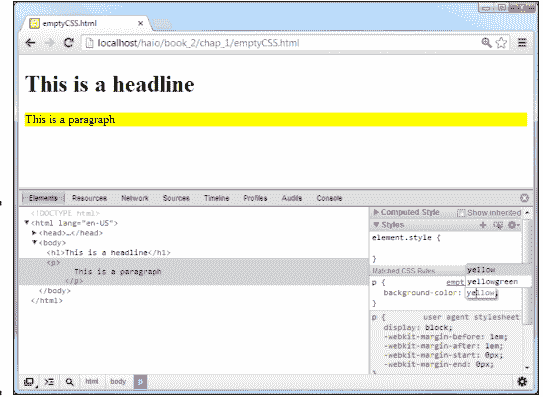

### 创建你自己的配色方案

设置颜色的技术方面并不太难，但决定*使用什么*颜色可能是一个挑战。已经有许多书籍专门讲述如何确定配色方案。这个过程有点主观，但一些工具和规则可以帮助你入门。

### 理解色相、饱和度和明度

RGB颜色模型很有用，因为它直接关系到计算机如何生成颜色，但它并不完美。用RGB可视化颜色的变化有点困难。因此，经常使用其他配色方案。最常见的变体是*色相、饱和度和明度*，即HSL。HSL系统以一种更贴近色轮的方式来组织颜色。


有时你会遇到HSB或HSV配色方案，它们与HSL非常相似。在所有这些颜色模式中，你从一个色相开始，然后使用饱和度来表示颜色离灰度有多远。亮度、值和明度基本上做同样的事情（确定颜色中能量的大致多少），但使用不同的模型。

要使用HSL描述颜色，你需要用数字值指定颜色的三个特性：

- **色相：** 基本颜色。色轮被分成一系列色相。这些通常是中间色调，可以使其*更亮*（更接近白色）和*更暗*（更接近黑色）。
- **饱和度：** 颜色的浓度。高饱和度非常鲜艳。低饱和度颜色非常淡。如果你降低图像中所有的饱和度，图像将变成*灰度图*，完全没有颜色。
- **明度：** 颜色中的光量。查看值的最简单方法是想象图像转换为灰度图（通过降低饱和度）时的样子。所有较亮的颜色会更接近白色，而较暗的颜色则会接近黑色。

HSL模型很有用，因为它允许你选择搭配和谐的颜色。使用色相属性选择基本颜色。由于各种颜色值之间存在数学关系，因此很容易预测哪些颜色搭配效果好。确定了所有色相后，你可以更改饱和度和值来调整页面的整体色调。通常，特定方案中的所有颜色都具有相似的饱和度和值。

如果你愿意，可以使用HSL颜色模型来选择颜色。图1-5显示了一个颜色选择器，它允许你基于HSL模型设计颜色。

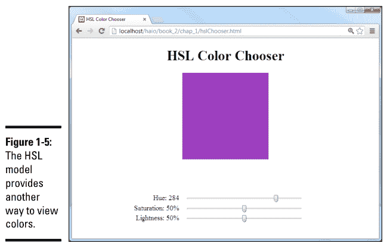

### 在你的页面中使用HSL颜色

你可以在CSS中使用颜色的任何地方指定HSL值。例如，查看配套网站上的`HSLcolors.html`。（我这里没有显示它，因为颜色差异在黑白书中过于微妙，无法展示。）`HSLcolors.html`的代码展示了如何使用HSL配色方案：

```html
<!DOCTYPE html>
<html lang="en-US">
<head>
    <meta charset="UTF-8">
```


# HSL 颜色模型与 CSS 文本样式

## HSL 颜色示例

```html
<!DOCTYPE html>
<html lang="en-US">
<head>
    <meta charset="UTF-8">
    <title>HSLcolors.html</title>
    <style type="text/css">
        body {
            background-color: hsl(180, 75%, 75%);
        }
        h1 {
            color: hsl(180, 75%, 25%);
            background-color: hsl(180, 75%, 90%);
        }
        p {
            color: hsl(0, 75%, 25%);
        }
    </style>
</head>
<body>
    <h1>This is a headline</h1>
    <p>This is a paragraph</p>
</body>
</html>
```

## 使用 HSL 配色方案的步骤

1. **照常设置选择器。** 在 CSS 中，为你希望着色的每个元素设置一个选择器。
2. **添加颜色规则。** 在本章中，你将学习两个颜色规则：`color` 和 `background-color`。将一个或两个应用于每个选择器。
3. **使用 HSL 函数。** 使用后跟括号的 `hsl()` 表示你希望使用 HSL 技术计算颜色。
4. **指明色相。** 想象一个顶部为红色的色轮。色相是你想要选择的颜色的角度（以度为单位）。色相应在 0 到 360 之间。
5. **确定饱和度。** 饱和度以百分比衡量。0% 的饱和度表示灰度图（介于黑白之间），而 100% 的饱和度表示完全饱和的颜色，没有灰度。你需要将百分号作为饱和度值的一部分包含在内。
6. **指定明度。** 明度也以百分比表示，0% 为完全黑色，100% 为完全白色。50% 的明度值将确定白色和黑色之间的平衡颜色。明度值也应包括百分号。

HSL 模型是 CSS 相对较新的补充，因此它可能无法在旧浏览器中工作，但它可能非常有用。HSL 使得更容易预测颜色搭配是否好看。如果你保持 HSL 值中的任意两个相同，而改变第三个，那么这两种颜色很可能搭配得很好。

## 使用配色方案设计器

有些人有很好的色彩感。其他人（比如我）则有点费力，因为这一切似乎都有点主观。如果你已经对颜色充满信心，你可能不需要这一节——尽管，你仍然可能会发现它作为对你已有知识的确认很有趣。另一方面，如果你在油漆店感到困惑，你可能会发现了解一些非常有用的工具是有帮助的。

一个很好的入门方式是使用一个免费工具：配色方案设计器，如图 1-6 所示。这个由 Petr Stanicek 创建的工具，使用 HSV 模型的变体来帮助你选择配色方案。你可以在 `http://colorschemedesigner.com` 找到这个程序。

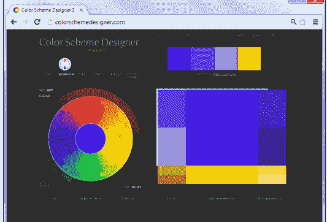

配色方案设计器拥有多种功能，例如：

*   **色轮：** 这个工具可能会让你回想起小学美术课的美好记忆。色轮按照艺术家熟悉的排列方式组织颜色。你可以点击色轮，为你的页面选择一种基色。
*   **配色方案选择器：** 你可以从多种配色方案中选择。我将在本节稍后部分描述这些方案。
*   **预览区域：** 此区域实时展示所选颜色的实际效果，让你看到各种颜色如何协同工作。
*   **十六进制值：** 所选颜色的十六进制值会显示在页面上，方便你复制到自己的应用程序中。
*   **变体：** 你可以查看所选方案的变体。这些变体通常很有用，因为它们无需你计算就能展示饱和度和明度的差异。
*   **色盲模拟：** 这个非常实用的工具让你能够看到你的配色方案在患有不同类型色盲的人眼中是什么样子。

不亲自尝试一下，这些功能可能难以理解。一定要动手操作这个工具，看看创建和谐配色是多么简单。

## 选择基础色调

配色方案设计器的工作原理是让你选择一种主色调，然后运用多种方案之一来选取与基础色调搭配和谐的其他色调。要为你想要的页面选择基础色调，请点击色轮上的颜色。

色轮是根据传统的艺术家配色方案（基于 HSV）而非计算机图形使用的 RGB 方案排列的。当你选择一种颜色时，会返回最接近的 RGB 表示。这很好，因为它允许你将传统的（HSV 风格）色彩理论应用于略有不同的 RGB 模型。

当你在色轮上选择一种颜色时，你实际上是在选择一种色调。如果你想要任何类型的红色，你可以选择色轮上出现的红色。然后你可以调整变体，以整体修改方案中所有颜色的饱和度和明度。

要使用此方案选择颜色，请遵循以下步骤：

1.  选择基础色调。
2.  选择配色方案类型。
3.  **调整你的方案。** 主要方案使用默认的饱和度和明度设置。“调整方案”选项卡允许你修改饱和度和明度设置，以更精细地控制配色方案。你还可以调整对比度级别，以获得非常有趣的效果。
4.  **预览方案。** 设计器提供多种预览配色方案的选项，包括使用该方案快速创建网页的功能。你还可以查看色盲模拟器，看看你的页面在患有不同色盲的人眼中是什么样子。
5.  **导出颜色设置。** 如果需要，你可以将颜色设置导出为多种格式，包括一个非常出色的 HTML/CSS 格式。你也可以将颜色保存到一个特殊文件中，以便导入 GIMP 或 Photoshop，这样你页面中使用的精确颜色在图像编辑器中也可用。

## 选择配色方案

各种配色方案利用色轮周围的数学关系来预测与主色搭配和谐的颜色。以下是基本方案及其功能：

*   **单色：** 取基础色调，并提供多种饱和度和明度变体。当你确实想强调某种特定颜色时（例如，如果你在做一个关于热带雨林的网站，并且想要大量绿色），这个方案很适用。务必确保前景色和背景色之间有高对比度，以保证文本可读。
*   **互补色：** 使用基础色调和其*互补*（相反）色。通常，此方案使用基础色调的几种变体，并添加少量互补色调以形成对比。
*   **三色组：** 选择基础色调和两种相反色调。选择三色组方案时，你还可以选择相反颜色之间的角度距离。如果该距离为零，则为互补色方案。当角度增加时，你就得到了一个*分裂互补*系统，它使用基础色调和两种与对比色等距的色调。这种方案在完全对比时可能显得刺眼，但调整饱和度和明度后，你可以创造出非常出色的配色方案。
*   **四色组：** 生成四种色调。与三色组方案一样，当添加更多色调时，除非你调整变体以降低对比度，否则保持页面的统一会变得更困难。
*   **类似色：** 方案使用基础色调及其两种相邻色调。
*   **强调类似色：** 与类似色方案相同，但添加了互补色。

# 第二章：文本样式

## 本章内容

- ✔ 介绍字体与字型
- ✔ 指定字体族
- ✔ 确定字体大小
- ✔ 理解 CSS 测量单位
- ✔ 管理其他字体特征
- ✔ 使用字体规则简化字体样式

网页仍然是以文本为主的媒体，因此你会希望添加一些格式化功能。HTML 本身并不能进行任何有意义的文本格式化，但 CSS 添加了广泛的工具，用于选择字型、字体大小、装饰、对齐等等。在本章中，你将了解如何以 CSS 的方式管理文本。

这里需要说明一点语义问题。大多数人所说的*字体*（font），更准确的叫法是*字型*（typeface）。从技术上讲，字体（font）是指特定字型在特定大小下，并带有特定装饰（下划线、斜体等）的集合。说实话，在数字环境中，这个区别并不那么重要。你不会在 CSS 中显式设置字体（font）。你确定的是*字体族*（font family，本质上是一种字型），然后修改其特征（创造出纯粹主义者眼中的字体）。尽管如此，当我提到大多数人称为字体（font）的东西（操作系统中描述一套字母外观的文件）时，我仍然使用熟悉的术语*字体*（font）。

## 设置字体族

要为页面的某部分分配字体族，请使用一些新的 CSS。图 2-1 展示了一个标题设置为 Comic Sans MS 的页面。

如果此页面在 Windows 机器上查看，它通常能正确显示字体，因为 `Comic Sans MS` 随大多数版本的 Windows 一起安装。如果你在其他类型的机器上，可能会显示其他字体。稍后会详细讨论这一点，但现在，先看看这个简单的例子。

```html
<!DOCTYPE html>
<html lang="en-US">
<head>
    <meta charset="UTF-8">
    <title>comicHead.html</title>
    <style type="text/css">
        h1 {
            font-family: "Comic Sans MS";
        }
    </style>
</head>
<body>
    <h1>This is a heading</h1>
    <p>This is ordinary text.</p>
</body>
</html>
```

### 应用 `font-family` 样式属性

此页面的秘诀在于 CSS 的 `font-family` 属性。与大多数 CSS 元素一样，它可以应用于页面上的任何 HTML 标签。在这个特定情况下，我将其应用于一级标题。

```css
h1 {
    font-family: "Comic Sans MS";
}
```

然后你可以附加任何想要的字体名称，浏览器会尝试使用该字体来显示元素。

即使某个字体在你的计算机上运行良好，如果用户机器上没有安装该字体，它也可能无法工作。

> **图 2-1：** 标题使用的是 Comic Sans 字体（大多数情况下）。

如果在 iPad 上运行完全相同的页面，你可能会看到如图 2-2 所示的结果。

> **图 2-2：** 在 iPad 上，标题可能不是相同的字体！

特定的字体 `Comic Sans MS` 安装在 Windows 机器上，但 MS 代表 Microsoft。这种字体并不总是安装在 Linux 或 Mac 上。（有时有，有时没有。）你不能指望用户安装了任何特定的字体。

> **提示**
> Comic Sans 字体用于示例没问题，但它在网页开发中已被过度使用。专业的网页开发者在实际应用中避免使用它，因为它会让你的页面看起来业余。

### 使用通用字体

这有点令人沮丧。即使使用字体很容易，你也不能随意使用它们，因为你不知道用户是否安装了它们。幸运的是，你可以做几件事来提高成功的几率。第一个技巧是使用通用字体名称。这些是每个合规浏览器都同意支持的虚拟字体名称。图 2-3 展示了使用了所有通用字体的页面。

> **提示**
> 我使用了浏览器控件使字体比正常情况大，以便你能在图中看到细节。程序员和用户都应该能够更改字体大小。稍后，我将描述如何通过代码更改字体大小。如果你想了解你的浏览器如何处理这些字体，请查看配套网站上的 `fontFamilyDemo.html`。有关配套网站的更多信息，请参阅本书的引言。

#### 通用字体家族

通用字体确实是字体家族：

*   **衬线字体：** 这些字体带有小衬线（增强可读性的细小横笔）。印刷文本（如你正在阅读的段落）倾向于使用衬线字体，它们也是大多数浏览器的默认字体。最常见的衬线字体是 `Times New Roman` 或 `Times`。
*   **无衬线字体：** 无衬线字体没有小“脚”。通常用于标题或其他强调。有时，它们被视为比衬线字体更现代、更简洁，因此有时用于正文文本。`Arial` 是最常见的无衬线字体。在本书中，图表说明使用的是无衬线字体。
*   **草书字体：** 这些字体看起来有点像手写体。在 Windows 中，脚本字体通常是 `Comic Sans MS`。当你想要不太正式的外观时，可以使用脚本字体。*For Dummies* 系列书籍在章节标题中随处可见脚本字体。
*   **幻想字体：** 幻想字体是装饰性的。几乎你能想到的任何主题都有幻想字体来代表，从克林贡语到托尔金。你也可以找到唤起某种文化的字体，使英语文本看起来像波斯语或中文。幻想字体最好谨慎使用，用于强调，因为它们常常以牺牲可读性来换取视觉吸引力。
*   **等宽字体：** 等宽字体产生固定宽度的字体，类似打字机文本。等宽字体常用于显示代码。`Courier` 是常见的等宽字体。本书中的所有代码清单都使用等宽字体。

因为通用字体在所有符合标准的浏览器上都可用，你可能会认为可以放心地使用它们。嗯，你可以确定它们会出现，但结果可能仍然会让你惊讶。图 2-4 显示了与图 2-3（在 Windows 中）相同的页面，但在 iPad 上。

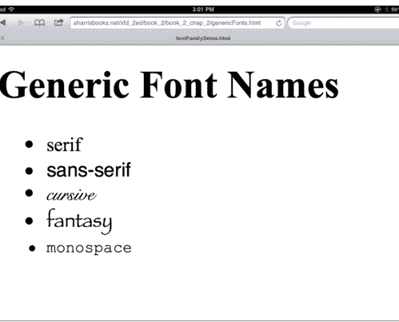

> **图 2-4：** Windows 和 iPad 在幻想字体上意见不一。

Mac 显示的是另一种变体，因为这里列出的字体并非*实际*字体。相反，它们是*虚拟*字体。符合标准的浏览器承诺选择一个合适的替代品。例如，如果你选择无衬线字体，一个浏览器可能选择使用 `Arial`，另一个可能选择 `Chicago`。你始终可以使用这些通用字体名称，并知道浏览器能找到一些相近的东西，但不能保证浏览器会选择哪个确切的字体。不过，这总比没有强。当你使用这些字体时，你至少能保证得到风格相近的东西，即使不是完全符合你的预期。

### 列出字体清单

这种不确定性令人沮丧，但你可以采取一些控制措施。如果你愿意，可以指定一个完整的字体名称列表。浏览器会依次尝试每个字体。如果找不到指定的字体，它会转到下一个字体，依此类推。

你可能会选择一个你知道安装在所有 Windows 机器上的字体，一个在 Mac 上找到的字体，最后一个是所有 Linux 机器上都有的字体。你的列表中的最后一个字体应该是通用字体之一，这样你就能在最坏的情况下有所控制。

#### 表 2-1 字体对照表

| Windows | Mac | Linux |
| :--- | :--- | :--- |
| Arial | Arial | Nimbus Sans L |
| Arial Black | Arial Black | |
| Comic Sans MS | Comic Sans MS | TSCu_Comic |
| Courier New | Courier New | Nimbus Mono L |
| Georgia | Georgia | Nimbus Roman No9 L |
| Lucida Console | Monaco | |
| Palatino | Palatino | FreeSerif |
| Tahoma | Geneva | Kalimati |
| Times New Roman | Times | FreeSerif |
| Trebuchet MS | Helvetica | FreeSans |
| Verdana | Verdana | Kalimati |

#### 网络字体的诅咒

你可以使用此图表来推导出要尝试的字体列表。例如，查看以下样式：

```css
p {
    font-family: "Trebuchet MS", Helvetica, FreeSans, sans-serif;
}
```


这个样式提供了多种选择。首先，浏览器尝试加载 `Trebuchet MS`。如果是 Windows 机器，此字体可用，因此会显示它。如果不行，浏览器尝试 `Helvetica`（一种默认的 Mac 字体）。如果还不行，它会尝试 `FreeSans`，一种在 Linux 机器上经常安装的字体。如果这也不行，它会默认使用老可靠的无衬线字体，即简单地选择一种无衬线字体。

请注意，多于一个单词的字体名称必须用引号括起来，字体名称列表用逗号分隔。


不要对 Linux 字体太紧张。确实，等效字体更难找到，但 Linux 用户往往分为两个阵营：要么他们不在乎字体是否完全相同，要么他们在乎并安装了能识别通用名称的等效字体。无论哪种情况，你基本上可以专注于 Mac 和 Windows 用户，只要你使用了通用字体名称，在 Linux 机器上也能正常工作。事实是，我主要使用 Linux，我已经安装了我需要的所有字体。

## 网络字体的诅咒

字体起初看起来很简单，但在实际使用中会出现一些大问题。

### 理解问题

字体的问题在于：字体资源安装在每个操作系统中。它们不会随页面其余部分一起下载。你的网页可以调用特定字体，但除非该字体已安装在用户的计算机上，否则不会显示。

假设我有一个很酷的字体叫做 `Happygeek`。（我刚编的。如果你是字体设计师，欢迎制作一个叫这个名字的字体。只需发给我一份，我等不及了。）它安装在我的计算机上，当我在文字处理器中选择字体时，它会出现在列表中。我可以使用它创建一个文字处理文档，一切都会很好。

如果我将使用 `Happygeek` 的文档打印件寄给我的奶奶，一切都没问题，因为纸张不需要实际的字体，它只是墨水。如果我将数字文件发送给她，并告诉她要在她的计算机上打开，我们就会有问题。看，她并不那么时髦，没有安装 `Happygeek`。她的计算机会选择其他字体。

这在文字处理中不是一个大问题，因为人们通常不会四处发送使用复杂字体的文档数字副本。然而，网页*仅*以数字形式传递。要了解可以使用哪些字体，你必须知道用户机器上安装了哪些字体，而这几乎是不可能的。

部分担忧是技术性的（弄清楚如何将字体信息传输到浏览器），但真正的问题是数字版权管理。如果你购买了一个字体供自己使用，这是否给了你将其转移给其他人的权利，从而使他们可以在不付费的情况下使用？

### 字体标签的消亡

旧式 HTML 中曾有一个标签叫做 `<font>` 标签。你可以使用此标签更改大小、颜色和字体族。还有用于斜体（`<i>`）、粗体（`<b>`）和居中（`<center>`）的特定标签。这些标签非常容易使用，但它们导致了一些主要问题。为了很好地使用它们，你最终会在页面上到处放置各种标签来尝试描述标记，而不是内容的意义。没有简单的方法重用字体信息，因此你经常不得不在整个页面中多次重复内容，使其难以更改。现在不鼓励网页开发者使用 `<font>`、`<i>`、`<b>` 或 `<center>` 标签。我在本章中展示的 CSS 元素足以弥补这一损失。你现在有了一个更灵活、更强大的替代方案。

### 使用嵌入式字体

虽然网页开发者可以为网页建议任何字体，但字体文件传统上是客户端资产。如果客户端没有安装该字体，她将看不到它。幸运的是，CSS3 支持一个合理的解决方案来提供可下载字体，称为 `@font-face`。图 2-5 显示了一个包含几个嵌入式字体的页面。

## Web字体的诅咒

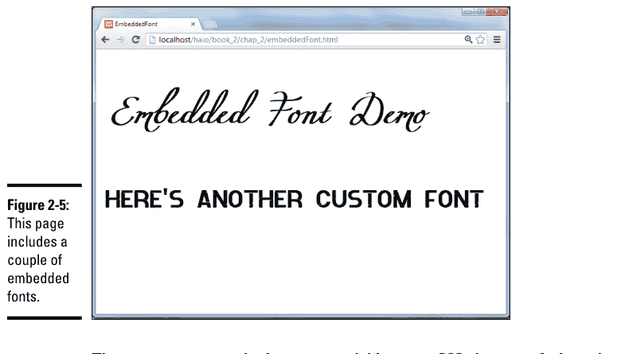

`@font-face` 样式的工作方式与大多数 CSS 元素不同。它并非为页面某部分应用标记，而是定义了一个可在其他标记中使用的新 CSS 值。具体来说，它允许你在服务器上放置字体文件，并使用该字体定义一个字体族。

```
@font-face {
    font-family: "Miama";
    src: url("Miama.otf");
}
```

`font-family` 属性表示你将在后续 CSS 代码中为该字体指定的名称。通常它与字体文件名相似，但这不是必须的。`src` 属性是服务器上实际字体文件的 URL。定义了 `@font-face` 后，就可以在后续 CSS 代码的普通 `font-family` 属性中使用它：

```
h1 {
    font-family: Miama;
}
```

以下是自定义字体的示例代码：

```
<!DOCTYPE html>
<head>
    <title>EmbeddedFont</title>
    <style type = "text/css">
      @font-face {
        font-family: "Miama";
        src: url("Miama.otf");
      }
      @font-face {
        font-family: "spray";
        src: url("ideoma_SPRAY.otf");
      }
    </style>
</head>
</html>
```

```
h1 {
    font-family: Miama;
    font-size: 300%;
}
h2 {
    font-family: spray;
}
</style>
</head>
<body>
<h1>嵌入字体演示</h1>
<h2>这是另一种自定义字体</h2>
</body>
</html>
```

尽管所有现代浏览器都支持 `@font-face` 功能，但实际支持的字体文件类型因浏览器而异。以下是主要的字体类型：

- **TTF:** 标准的 TrueType 格式得到了良好支持，但并非所有浏览器都支持。许多开源字体提供此格式。
- **OTF:** 类似于 TTF，但它是真正的开放标准，因此受到关注开放标准的人士的青睐。除了 IE 之外，大多数浏览器都支持它。
- **WOFF:** WOFF 是一种提议的标准格式，目前 Firefox 支持。微软已暗示将在 IE 中支持此格式。
- **EOT:** 这是微软专有的嵌入字体格式。它仅在 IE 中有效，但公平地说，微软提供嵌入字体支持已有多年历史。

你可以使用字体转换工具（如 `http://onlinefontconverter.com/`）转换为你需要的任何字体格式。

可以提供多个 `src` 属性。这样，你可以同时包含 EOT 和 OTF 版本的字体，使其能在各种浏览器上工作。

使用此技术时，你需要本地拥有字体文件的副本。目前，它应与网页位于同一目录（就像处理图像一样）。当你开始在 Web 服务器上托管时，你需要将字体文件与网页所需的其他所有资源一起移动到服务器上。能够使用字体并不意味着你应该使用。请仔细考虑可读性，并尊重知识产权。幸运的是，有许多优秀的免费开源字体可供选择。首先查看开放字体库（`http://openfontlibrary.org/`）。Google 字体（`www.google.com/fonts/`）是另一个优秀的免费字体资源。使用 Google 字体工具，你可以选择嵌入在 Google 服务器上的字体，并复制代码使字体无需下载即可使用。

### 使用图片作为标题

通常，你应为页面主要内容使用标准字体，因此字体种类有限不是大问题。但有时你想在标题中使用特殊字体。你可以使用图形编辑器（如 GIMP）创建基于文本的图片，然后将其整合到页面中。图 2-6 展示了此技术的示例。

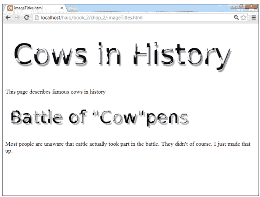

图 2-6：字体显示正常，因为它是一张图片。

在这个例子中，我想使用我的特殊奶牛字体。（我*喜欢*我的奶牛字体。）

流程如下：

1.  **规划你的页面。**
    使用图形时，灵活性会降低。你需要确切知道标题应该是什么，还需要知道哪个级别的标题显示什么内容。不要依赖浏览器显示标题，而是在图形工具（我使用 GIMP）中创建图形，并直接放置到页面中。

2.  **创建你的图片。**
    我使用了 GIMP 中出色的 Logo 功能（选择 `Xtns ⤍ Script-fu ⤍ logos`）来创建我的奶牛文本。我使用 *Bovination* 工具为每个标题构建了图片。我很高兴有这个 Bovation 工具。这是我一直想要的东西。要是它能转化成武器就好了。

3.  **直接指定字体大小。**
    在图片中，以像素为单位指定字体大小是合理的，因为这里讨论的是具体的像素数。你在图形编辑器中创建“虚拟文本”，因此将文本设置为你希望在最终页面中呈现的大小即可。

4.  **使用任何你想要的字体。**
    你不必担心用户是否拥有该字体，因为你发送的不是字体，而只是用该字体合成的图片。

5.  **为每个标题创建单独的图片。**
    这个练习包含两张图片——一个一级标题和一个二级标题。由于我是直接创建图片，所以需要我自己追踪图片如何传达其标题级别。

6.  **考虑标题级别。**
    确保二级标题的值看起来比一级标题稍小或不那么强调。也就是说，用于一级标题的图片，应比用于较不强调标题级别的图片使用更大的字体。通常，这通过调整图片中的字体大小来实现。

7.  **按照通常方式构建页面。**
    创建完这些特殊图片后，构建一个常规网页。将 `<h1>` 和 `<h2>` 标签放在你通常放置的位置。

8.  **将 `` 标签放在标题标签内。**
    不要放置普通文本，而是在 `<h1>` 和 `<h2>` 标签内放置图片标签。如果有点困惑，请参考后面的代码 `imageTitles.html`。

9.  **将标题文本放在 alt 属性中。**
    这里 `alt` 属性尤其重要，因为如果用户关闭了图片显示，文本仍然会作为适当样式的标题出现。网速慢的用户在图片加载前就能看到文本，使用文本阅读器的用户仍然可以读取图片的 alt 文本。

以下是用于生成基于图片标题的代码：

```
<!DOCTYPE html>
<html lang = "en-US">
<head>
  <meta charset = "UTF-8">
  <title>imageTitles.html</title>
</head>
<body>
  <h1>
    
  </h1>
  <p>
    This page describes famous cows in history
  </p>
  <h2>
    
  </h2>
  <p>
    Most people are unaware that cattle actually took
    part in the battle. They didn't of course. I just
    made that up.
  </p>
</p>
</body>
</html>
```

这种技术在自定义图形和普通 HTML 之间取得了很好的平衡，具体优点如下：

- **你对图片有很好的控制力。** 如果你熟练使用图形工具，你可以制作任何类型的图片作为标题。实际上，除了你的技能和创造力，没有任何限制。
- **页面保留其结构。** 你仍然有标题标签在位，因此很容易看出你打算让特定图片充当标题。在 HTML 代码中仍然可以看到页面的组织结构。
- **你有备用文本。** 如果图片无法显示，`alt` 属性会被激活。
- **图片标题的语义得以保留。** `alt` 标签提供了另一个很棒的功能。如果它们复制了图片文本，该文本仍然可供屏幕阅读器和搜索引擎使用，因此文本不会埋没在图片中。

这项技术非常适合标题或其他区域，但请注意，我很小心地在 `<alt>` 标签中重复了标题文本。这很重要，因为我不想丢失文本。搜索引擎工具和屏幕阅读器需要这些文本。

不要试图将此技术用于大量正文。这样做会导致一些问题：

- **文本不再可搜索。** 如果文本埋没在图片中，搜索引擎就找不到它。
- **文本更难更改。** 你不能用文本编辑器更新页面。相反，你必须下载图片、修改它，然后再次上传。
- **图片比文本需要多得多的带宽。** 如果图片不能实质性地增加你的页面价值，就不要使用图片。你可以为一些标题图片找到理由，但仅仅为了使用特定字体就将整个页面存储为图片，就很难说得过去了。

## 指定字体大小

与字体名称一样，字体大小在 CSS 中很容易更改，但也有一些隐藏的陷阱。

### 大小只是一个建议！

在印刷媒体中，一旦你确定了文本的大小，它基本就固定了。用户无法轻松更改印刷品中的字体大小。相比之下，网页浏览器经常会改变文本的大小。基于手机的浏览器显示文本的方式与高分辨率 LCD 面板上的浏览器不同。此外，大多数浏览器允许用户更改屏幕上所有文本的大小。使用 `Ctrl++`（加号）和 `Ctrl+-`（减号）可以使文本变大或变小。在旧版本的 IE（IE7 之前的版本）中，从“页面”菜单中选择“文本大小”选项来更改文本大小。

用户确实应该拥有在浏览器中调整字体大小的能力。当我在投影仪上显示网页时，我经常调整字体大小，以便后排的学生也能阅读。有些页面设置的字体大小对我来说太小，无法阅读。（可能是我的高科技显示器的问题。这不可能与我的年龄有任何关系。）

精确地确定字体大小与网络的精神背道而驰。例如，如果你声明你的文本将正好是 12 磅，那么可能会发生以下两种情况之一：

-   **浏览器可能会字面上强制执行 12 磅规则。** 这剥夺了用户的控制权，因此需要更大字体的用户就无能为力了。IE 的旧版本就是这样做的。
-   **用户可能仍然会更改大小。** 如果浏览器是这样运行的（通常如此），12 磅并不总是意味着 12 磅。如果用户可以更改字体大小，那么字面上的大小选择就毫无意义。

网页开发者应该设置字体大小，但只能以*相对*的方式设置。不要费心使用绝对测量（在大多数情况下），因为它们并不真正意味着你想象的那样。让用户确定基础字体大小，并指定相对于该大小的更改。

### 使用 font-size 样式属性

在 CSS 中，字体大小的基本概念非常容易掌握。查看图 2-7 中的 `fontSize.html`。

这个页面显然显示了几个不同的字体大小。“Font Sizes”这一行是一个普通的 `h1` 元素。其他所有行都是段落标签。它们之所以以不同的大小出现，是因为它们应用了不同的样式。

字体大小通过（巧妙命名的）`font-size` 属性来更改：

```
p {
    font-size: small;
}
```

## 绝对测量单位

很多时候，你需要在 CSS 中指定某物的大小。当然，字体大小就是这种情况之一。不同类型的测量具有不同的含义。了解 CSS 中有两种不同的单位很重要。*绝对测量*试图描述一个特定的大小，就像在现实世界中一样。*相对测量*是关于对某个默认值的更改。通常，网络开发者正朝着字体大小使用相对测量的方向发展。

### 磅 (pt)

在文字处理中，你可能熟悉*磅*作为字体大小的度量单位。你可以使用缩写 `pt` 来表示你正在使用磅进行测量，例如：

```
p {
  font-size: 12pt;
}
```

12 和 `pt` 之间没有空格。

不幸的是，磅不是网页的有效度量单位。磅是一个绝对刻度，对打印有用，但在网络上不可靠，因为你不知道用户的屏幕分辨率是多少。12 磅的字体在不同的显示器上可能看起来更大或更小。

在某些版本的 IE 中，当你以磅指定字体大小后，用户就无法再更改字符的大小。从可用性的角度来看，这是不可接受的。相对大小方案（我将在本章后面描述）可以防止这个问题。

### 像素 (px)

像素指的是屏幕上的小点。你可以用像素指定字体大小，尽管通常不是这样做的。首先，不同的显示器制作像素的大小不同。你无法真正确定一个像素相对于整个屏幕大小有多大。不同的字母大小不同，所以像素大小是对平均字符宽度和高度的粗略测量。使用 `px` 缩写来以像素测量字体：

```
p {
    font-size: 20px;
}
```

### 传统度量单位 (in, cm)

你也可以使用英寸 (`in`) 和厘米 (`cm`) 来测量字体，但这完全不切实际。想象一下，你有一个网页同时显示在你的屏幕和投影系统上。你自己显示器上的一英寸在投影仪上可能看起来像十英寸。现实生活中的度量单位对网络来说没有意义。你唯一可能使用它们的情况是你将打印某些内容，并且你完全了解打印机的配置方式。如果是这种情况，你最好使用面向打印的布局工具（如文字处理器）而不是 HTML。

## 相对测量单位

在网络开发中，相对测量是更明智的选择。使用这些方案来相对于标准大小进行更改。

### 命名大小

CSS 内置了许多字体大小名称：

- `xx-small`
- `x-small`
- `small`
- `medium`
- `large`
- `x-large`
- `xx-large`

你可能会因为这些大小没有更具体的描述而感到困扰：large 有多大？嗯，它比 medium 大。这听起来像是随口一说，但这是事实。用户在浏览器中设置默认字体大小（或保持不变），所有其他字体大小都应相对于这个预设大小。medium 大小是你页面上段落文本的默认大小。作为比较，`<h1>` 标签通常是 `xx-large`。

### 百分比 (%)

百分比单位是一个相对测量，用于指定相对于其正常大小的字体。使用 50% 使字体大小减半，使用 200% 使其大小加倍。使用 `%` 符号表示百分比，如下所示：

```
p {
    font-size: 150%;
}
```

百分比基于普通文本的默认大小，因此 100% 的 `<h1>` 标签与普通段落中的文本大小相同。

### Em (em)

在传统排版中，em 是一个度量单位，相当于该字体中“m”字符的宽度。在实际的网络使用中，它实际上是另一种指定字体相对大小的方式。例如，0.5 em 是正常大小的一半，3 em 是正常大小的三倍。术语 `em` 用于指定此测量。

```
p {
    font-size: 1.5em;
}
```


以下是字体大小的最佳策略：

- **没有充分理由不要更改大小。** 大多数情况下，浏览器默认大小完全足够好，但有时你可能想稍微调整一下字体。
- **为页面定义一个整体大小。** 如果你想为整个页面定义字体大小，请在 `<body>` 标签中进行。使用命名大小、百分比或 `em`，以避免绝对大小的副作用。在 `body` 中定义的大小会自动应用于 `body` 中的每个元素。
- **修改任何其他元素。** 你可能希望你的链接比普通文本稍大一些。你可以通过对元素应用 `font-size` 属性来实现这一点。如果可能，请使用相对测量。

## 确定其他字体特征

除了大小和颜色（请参见本小册子的第 1 章），你还可以通过多种其他方式更改字体。

图 2-8 显示了你可以进行的几种常见的文本修改。

这个页面上的各种段落以不同的方式进行了修改。你可以更改文本的对齐方式，以及为文本添加斜体、粗体、下划线或删除线。

CSS 使用一套可能令人困惑的规则来操作各种字体工具。一条规则决定字体样式，另一条决定粗细。

为清晰起见，我将在以下部分描述这些技术。

> **提示**
>
> 我使用了一个尚未展示的技巧来生成这个比较页面。我有多个段落，每个段落都有自己的样式。请参阅本小册子的第 3 章，了解如何在特定页面中拥有多个段落样式。

### 使用 font-style 设置斜体

`font-style` 属性允许你创建斜体文本，如图 2-9 所示。

以下是一些代码，演示如何添加斜体格式：

```html
<!DOCTYPE html>
<html lang="en-US">
<head>
    <meta charset="UTF-8">
    <title>italics.html</title>
    <style type="text/css">
        p {
            font-style: italic;
        }
    </style>
</head>
<body>
    <h1>Italics</h1>
    <p>This paragraph is in italic form.</p>
</body>
</html>
```

#### 图 2-9：你可以使用 `font-style` 属性制作斜体文本。

`font-style` 的值可以是 `italic`、`normal` 或 `oblique`（向左倾斜）。

如果你想将特定段落设置为斜体、正常或倾斜样式，请使用 `font-style` 属性。

### 使用 font-weight 实现粗体

你可以通过使用 `font-weight` CSS 属性使字体变为粗体，如图 2-10 所示。

**图 2-10：** `font-weight` 属性影响文本的粗细。

如果你想使部分文本变为粗体，请使用 `font-weight` CSS 属性，如下所示：

```html
<!DOCTYPE html>
<html lang="en-US">
<head>
    <meta charset="UTF-8">
    <title>bold.html</title>
    <style type="text/css">
        p {
            font-weight: bold;
        }
    </style>
</head>
<body>
    <h1>Boldface</h1>
    <p>This paragraph is bold.</p>
</body>
</html>
```

字体粗细可以通过几种方式定义。通常，你只需在 `font-weight` 规则中指定 `bold`，就像我在这个代码中所做的那样。你也可以使用从 100（极细）到 900（粗体）的数值。

### 使用 text-decoration

`text-decoration` 可用于为文本添加一些其他有趣的格式，包括下划线、删除线、上划线和闪烁。

例如，以下代码生成一个带下划线的段落：

```html
<!DOCTYPE html>
<html lang="en-US">
<head>
    <meta charset="UTF-8">
    <title>underline.html</title>
    <style type="text/css">
        p {
            text-decoration: underline;
        }
    </style>
</head>
<body>
    <h1>Underline</h1>
    <p>This paragraph is underlined.</p>
</body>
</html>
```

在网页中使用下划线时要小心。用户已经被训练成认为带下划线的文本是链接，因此他们可能会点击你的带下划线的文本，期望它将他们带到某个地方。

`underline.html` 代码生成的页面类似于图 2-11。

你也可以使用 `text-decoration` 实现其他效果，例如删除线（在 CSS 中称为 `line-through`），如以下代码所示：

```html
<!DOCTYPE html>
<html lang="en-US">
<head>
    <meta charset="UTF-8">
    <title>strikethrough.html</title>
    <style type="text/css">
        p {
            text-decoration: line-through;
        }
    </style>
</head>
<body>
    <h1>Strikethrough</h1>
    <p>This paragraph has strikethrough text.</p>
</body>
</html>
```

`strikethrough.html` 代码生成的页面类似于图 2-12。

`text-decoration` 还有一些其他很少使用的选项，例如：

- **上划线：** `overline` 属性在文本上方放置一条线。除了少数数学和化学应用（这些应用最好在方程编辑器中完成并作为图像导入），我看不出这可能在什么情况下使用。
- **闪烁：** `blink` 属性是传奇的 Netscape `<blink>` 标签的远亲，它使文本在页面上闪烁。`<blink>` 标签（以及无端的动画 GIF）长期以来一直被嘲笑为业余者的标志。不惜一切代价避免使用闪烁文本。

互联网开发者中有一个古老的笑话：使用 `<blink>` 标签的唯一合法地方是这个句子：薛定谔的猫是 `<blink>不 </blink>` 死的。没有什么比用 HTML 来说明量子力学更有趣的了。

### 使用 text-align 进行基本对齐

你可以使用 `text-align` 属性来居中、左对齐或右对齐文本，如以下代码所示：

```html
<!DOCTYPE html>
<html lang="en-US">
<head>
    <meta charset="UTF-8">
    <title>center.html</title>
    <style type="text/css">
        p {
            text-align: center;
        }
    </style>
</head>
<body>
    <h1>Centered</h1>
    <p>This paragraph is centered.</p>
</body>
</html>
```

你也可以使用 `text-align` 属性来右对齐或左对齐文本。图 2-13 所示的页面演示了 `text-align` 属性。

**图 2-13：** 这段文本使用 `text-align` 居中。

> **警告！** 你只能将 `text-align` 属性应用于文本。旧的 `<center>` 标签可用于将几乎任何内容（表格、一些文本或图像）居中，这非常简单但会导致问题。第 III 册解释了如何以各种强大的方式定位元素，包括将任何内容居中。使用 `text-align` 将文本在其自身元素内居中（无论该元素是标题、段落、表格单元格还是其他任何内容）。

### 其他文本属性

CSS 还提供了一些其他文本处理工具，但它们很少使用：

- **字体变体：** 可以设置为 `small-caps`，使你的文本仅使用大写字母。小写字母以较小的字体大小显示。
- **字母间距：** 调整字母之间的间距。通常以 `em` 为单位。（有关 `em` 的更多信息，请参阅本章前面的“相对测量单位”部分。）网页上的字体非常不可预测，如果你试图微观管理到这种程度，你肯定会对此结果感到失望。
- **单词间距：** 允许你调整单词之间的间距。
- **文本缩进：** 让你调整元素第一行的缩进。此值使用正常的测量单位。缩进可以设置为负值，如果你愿意，可以产生悬挂缩进的效果。
- **垂直对齐：** 当你有一个具有大量垂直空间的元素（通常是表格单元格）时使用。你可以指定在这种情况下文本的行为方式。
- **文本转换：** 帮助你将文本转换为大写、小写或首字母大写（首字母大写）的形式。
- **行高：** 表示元素中行之间的垂直间距。与字母和单词间距一样，如果你如此关心事物的确切显示方式，你可能会感到失望。

### 使用 font 快捷方式

记住所有不同的字体属性及其可能的值可能很繁琐。Aptana 和其他专用 CSS 编辑器使其变得容易得多，但专业人士经常使用另一种技术。`font` 规则提供了一种快捷方式来设置许多有用的字体属性。以下代码向你展示如何使用 `font` 规则：

```html
<!DOCTYPE html>
<html lang="en-US">
<head>
    <meta charset="UTF-8">
    <title>fontTag.html</title>
    <style type="text/css">
        p {
            font: bold italic 150% "Dadhand", cursive;
        }
    </style>
</head>
<body>
    <h1>Using Font shortcut</h1>
    <p>This paragraph has many settings.</p>
</body>
</html>
```

图 2-14 展示了强大的 `font` 规则在实际中的应用。

`font` 规则的伟大之处在于它结合了许多其他与字体相关的规则，提供了一种更简单的方式来处理大多数文本格式化需求。

`font` 属性非常方便。本质上，它允许你将所有其他字体属性合而为一。其工作原理如下：

- **在 CSS 中指定 `font` 规则。**
- **列出任何 `font-style` 属性。** 你可以提及 `font-style` 规则中通常使用的任何属性（`italic` 或 `oblique`）。如果你不想使用任何一个，直接继续即可。
- **列出任何 `font-variant` 属性。** 如果你想要小型大写字母，可以在此处指定。如果不需要，就将此部分留空。
- **列出任何 `font-weight` 值。** 可以是 `bold` 或字体粗细数字（100–900）。
- **以任何你想要的测量系统指定 `font-size` 值（但首选 `em` 或百分比）。** 不要忘记测量单位符号（`em` 或 `%`），因为 `font` 规则正是通过此识别这是一个大小值。
- **最后指定 `font-family` 列表。** 最后一个元素是你要浏览器尝试的字体系列列表。此列表必须放在最后，否则浏览器可能无法正确解释 `font` 属性。（Dadhand 是我拥有的自定义字体；如果 Dadhand 不可用，将使用 cursive。）

`font` 规则很好，但它并不能完成所有事情。你可能仍然需要单独的 CSS 规则来定义文本颜色和对齐方式。这些属性不包含在 `font` 快捷方式中。

不要在 `font` 属性列表中使用逗号分隔值。仅在 `font-family` 声明列表中使用逗号分隔值。

只要顺序正确，你可以跳过任何你想要的值。例如，

```css
font: italic "Comic Sans MS", cursive;
```

是完全可以接受的，同样，

```css
font: 70% sans-serif;
```

### 处理下标和上标

# 第三章：选择器：使用类与样式进行编码

## 本章内容

- 修改特定命名的元素
- 添加并修改强调与加粗强调
- 创建类
- 介绍 `span` 与 `div`
- 使用伪类与链接标签
- 选择特定上下文
- 定义多种样式

你已经知道如何使用 CSS 来改变特定标签的所有实例，但如果你想要更有选择性地应用样式呢？例如，你可能只想改变一个段落的背景色，或者想定义一些特殊的新段落类型。也许你想为页面的部分内容指定不同的段落颜色，或者想让已访问的链接与未选中的链接显示不同。CSS 样式中用于指示你想要设置样式的元素的部分被称为*选择器*。在本章中，你将发现一些强大的新方法来选择页面上的元素。

### 选择特定片段

图 3-1 演示了如何称呼那些不欣赏你网页开发能力的人。

### 定义多种段落类型

除了文化价值外，这个页面很有趣，因为它有三种不同的段落样式。引言段落是普通的。引文使用了斜体字体，而署名使用了等宽字体并右对齐。

以下代码中的引文来自我最喜欢的网站之一：莎士比亚式侮辱生成器。没有什么比用抑扬格五步诗来责骂别人更令人满意的了（www.pangloss.com/seidel/Shaker/index.html）。

**图 3-1：** 这个页面有三种段落类型。

```html
<!DOCTYPE html>
<html lang="en-US">
<head>
    <meta charset="UTF-8">
    <title>quote.html</title>
    <style type="text/css">
        #quote {
            font: bold italic 130% Garamond, "Comic Sans MS", fantasy;
            text-align: center;
        }
        #attribution {
            font: 80% monospace;
            text-align: right;
        }
    </style>
</head>
<body>
    <h1>Literature Quote of the Day</h1>
    <p>How to tell somebody off the classy way:</p>
    <p id="quote">[Thou] leathern-jerkin, crystal-button, knot-pated, agate-ring, puke-stockings, caddis-garter, smooth-tongue, Spanish pouch!</p>
    <p id="attribution">-William Shakespeare (Henry IV Part I)</p>
</body>
</html>
```

## 为已识别的段落设置样式

到目前为止，你已经使用 CSS 为页面上的所有特定元素应用了样式。例如，你可以为 `<p>` 标签添加样式，该样式将应用于页面上的所有段落。

### 使用强调与加粗强调

有时（如莎士比亚侮辱页面所示），你想为一个元素应用多种样式。你可以通过为每个元素命名并在 CSS 样式表中使用该名称来实现。具体方法如下：

1. **为每个要修改的 HTML 元素添加一个 `id` 属性。**
   例如，带有署名的段落现在有一个值为 `attribution` 的 `id` 属性。
   `<p id="attribution">`

2. **在 CSS 中创建一个样式。**
   在 CSS 中使用井号后跟元素的 ID 来指定你不再讨论标签类型，而是一个特定的元素：例如，CSS 代码包含选择器 `#attribution`，意思是“将此样式应用于具有 `attribution` id 的元素。”
   `#attribution {`

3. **添加样式。**
   为你命名的元素创建一个样式。在这个例子中，我希望具有 `attribution` ID 的段落右对齐、等宽字体，并且比正常字体稍小。此样式将仅附加到特定元素。

```css
#attribution {
    font: 80% monospace;
    text-align: right;
}
```


## ID 技巧

ID 技巧适用于任何命名元素。ID 必须是*唯一的*（你不能在一个页面上重复使用相同的 ID），因此当你的样式只想应用于页面上的一个元素时，此技术效果最佳。无论它是什么 HTML 元素（可以是标题 1、段落、表格单元格或任何其他元素）。如果它有 ID `quote`，那么 `#quote` 样式就会应用于它。你可以在同一个样式表中同时使用 ID 选择器和普通（元素）选择器。

## 使用强调与加粗强调

你可能会惊讶地发现，HTML 并不允许使用斜体或加粗。旧式 HTML 有 `<i>` 标签表示斜体，`<b>` 标签表示加粗。这些看起来简单易用。不幸的是，它们可能会误导你。在你的 HTML5 中，你不应该指定*如何*设置样式。相反，你应该指定样式的*目的*。XHTML 严格模式中的 `<i>` 和 `<b>` 标签在 HTML5 中被移除，并被 `<em>` 和 `<strong>` 替代。

`<em>` 标签表示*强调*。默认情况下，`em` 会使你的文本斜体。`<strong>` 标签代表**加粗强调**。它默认显示为加粗。

图 3-2 展示了一个使用了 `em` 和 `strong` 默认样式的页面。

### 使用强调与加粗强调

图 3-2：你可以使用 `em` 和 `strong` 来添加强调。

`emphasis.html` 页面的代码非常简单。它完全没有 CSS：

```html
<!DOCTYPE html>
<html lang = "en-US">
    <head>
        <meta charset = "UTF-8">
        <title>emphasis.html</title>
    </head>
    <body>
        <h1>Emphasis and Strong Emphasis</h1>
        <p>
            This paragraph illustrates two main kinds of emphasis.
            <em>This sentence uses the em tag.</em>
            By default, emphasis is italic.
            <strong>This sentence uses strong emphasis.</strong>
            The default formatting of strong emphasis is bold.
        </p>
        <p>
            Of course you can change the formatting with CSS.
            This is a great example of <em>semantic</em> formatting.
            Rather than indicating the <strong>formatting</strong>
            of some text, you indicate <strong>how much it is emphasized.</strong>
        </p>
        <p>
            This way, you can go back and change things, like adding color
            to emphasized text without the formatting commands
            muddying your actual text.
        </p>
    </body>
</html>
```

认为 `em` 只是*斜体*的另一种说法，`strong` 是*加粗*的另一种说法是不恰当的。在旧方案中，一旦你将某内容定义为斜体，就很难再改变。HTML 方式描述的是含义，而你可以根据自己的意愿来定义它。

## 修改 em 和 strong 的显示效果

图 3-3 展示了如何修改强调级别。我为 `em` 使用了黄色高亮（没有斜体），为 `strong` 使用了更大的红色字体。

`emphasisStyle.html`（如图 3-3 所示）的 HTML 代码与 `emphasis.html`（如图 3-2 所示）的代码*完全相同*。唯一的区别是添加了一个样式表。样式表嵌入在网页的 `style` 标签之间。如果你想复习如何将 CSS 样式融入你的网页，请查阅本迷你书的第 1 章。

```css
<style type = "text/css">
    em {
        font-style: normal;
        background-color: yellow;
    }
    strong {
        color: red;
        font-size: 110%;
    }
</style>
```

样式用于修改 HTML。HTML 中的含义保持不变——只是样式发生了改变。

## 定义类

语义标记比旧的（更字面的）标签更有用，因为即使样式被更改，它们仍然能传达真实含义。（在 HTML 代码中，重要的是文本是否被强调，而不是强调文本意味着什么。这项工作属于 CSS。）

下面这句话有什么好笑的？

`<strong>` 总是加粗的。

明白了吗？*这是一个厚颜无言的谎言！* 有时我自己都会被逗乐。

你可以轻松地为页面中所有特定类型的元素应用样式，但有时你可能想要更精细地控制样式。例如，你可能想要不止一种段落样式。以图 3-4 中展示的 `classes.html` 页面为例。

这个页面再次包含了多种格式：

- **问题使用大型斜体无衬线字体。** 问题不止一个。
- **答案则较小、蓝色，并使用手写体字体。** 答案也不止一个。


问题和答案都是段落，所以你不能简单地对段落应用样式，因为你需要两种不同的样式。有多个问题和多个答案，所以使用 ID 技巧会出问题。两个不同的元素不能拥有相同的 ID。这就是“类”概念发挥作用的地方。每个 ID 属于单个元素，但许多元素（即使是不同类型）可以共享同一个类。

### 向页面添加类

CSS 允许你在 HTML 中定义类，并创建应用于整个类的样式定义。工作方式如下：

1. 为你的 HTML 问题添加 `class` 属性。

    与 ID 不同，多个元素可以共享同一个类。我的所有问题都使用这个 `<p>` 标签的变体来定义。将类设置为 `question` 表示这些段落将被样式化为问题：

    ```html
    <p class="question">
      What kind of cow lives in the Arctic?
    </p>
    ```

2. 为答案添加类似的类属性，将答案的类设置为 `answer`：

    ```html
    <p class="answer">
      An Eskimoo!
    </p>
    ```

    现在你有了两种不同的段落子类：`question` 和 `answer`。

3. 为问题创建类样式。

    类样式在 CSS 中定义。在类名前使用句点（`.`）来指定类。类在 CSS 中这样定义：

    ```css
    <style type="text/css">
      .question {
        font: italic 150% arial, sans-serif;
        text-align: left;
      }
    </style>
    ```

    在这种情况下，`question` 类被定义为左对齐的大号无衬线字体。

4. 定义答案的外观。

### 使用类

以下是 `classes.html` 页面的代码，展示了如何使用 CSS 类：

```html
<!DOCTYPE html>
<html lang="en-US">
<head>
    <meta charset="UTF-8">
    <title>classes.html</title>
    <style type="text/css">
        .question {
            font: italic 150% arial, sans-serif;
            text-align: left;
        }
        .answer {
            font: 120% "Comic Sans MS", cursive;
            text-align: right;
            color: #00F;
        }
    </style>
</head>
<body>
    <h1>Favorite Jokes</h1>
    <p class="question">
        What kind of cow lives in the Arctic?
    </p>
    <p class="answer">
        An Eskimoo!
    </p>
    <p class="question">
        What goes on top of a dog house?
    </p>
    <p class="answer">
        The woof!
    </p>
</body>
</html>
```


有时你会看到选择器，比如 `p.fancy`，它同时包含元素和类名。这种样式仅应用于附加了 `fancy` 类的段落。通常，我喜欢类，因为它们可以应用于各种元素，所以我通常省略元素名称，以使样式尽可能可重用。

### 组合类

一个元素可以使用多个类。图 3-5 展示了这种现象的一个例子。


图 3-5 中的段落看起来有三种不同的样式，但只定义了 `red` 和 `script`。第三个段落同时使用了两个类。以下是代码：

```html
<!DOCTYPE html>
<html lang="en-US">
    <head>
        <meta charset="UTF-8">
        <title>redScript.html</title>
        <style type="text/css">
            .red {
                color: white;
                background-color: red;
            }
            .script {
                font-family: cursive;
            }
        </style>
    </head>
    <body>
        <h1>Multiple Classes</h1>
        <p class="red">
            This paragraph uses the red class
        </p>
        <p class="script">
            This paragraph uses the script class
        </p>
        <p class="red script">
            This paragraph uses both classes
        </p>
    </body>
</html>
```

样式表引入了两个类。`red` 类使段落变红（准确说是白字红背景），而 `script` 类为元素应用了手写字体。

前两个段落各有一个类，其表现如预期。有趣的是第三个段落，因为它有两个类。

```html
<p class="red script">
```

这同时为段落指定了 `red` 和 `script` 类。两种样式将按照它们书写的顺序应用于元素。注意两个类名都在引号内，且不需要（也不允许）使用逗号。如果愿意，你可以为一个元素应用超过两个类。如果类之间存在冲突规则（比如一个使元素变绿，下一个使其变蓝），那么列表中较后的类会覆盖之前的值。

元素也可以有一个 ID。当浏览器尝试显示对象时，会综合考虑 ID 样式、元素样式以及所有类样式。

> 技术细节
>
> 通常，我不喜欢使用颜色或其他具体的格式化指令作为类名。通常，最好基于其含义来命名类（例如 `mainBackgroundColor`）。你可能决定绿色比红色更好，那么你要么必须更改类名，要么必须有一个实际上将东西染成绿色的 `red` 类。那会很奇怪。

## 介绍 div 和 span

到目前为止，我主要将 CSS 样式应用于段落（使用 `<p>` 标签），但实际上你可以使用任何你想要的元素。事实上，你可能想发明自己的元素。也许你想要一种特定的样式，但它不完全是一个段落。也许你想在段落内部应用特定样式。HTML 有两个非常有用的元素，它们被设计为`通用`元素。它们没有任何预定义的含义，因此非常适合用 `id` 和 `class` 属性进行修改。

- `div`：一个块级元素（就像 `p` 元素）。它的作用就像一个段落。`div` 通常在前后有回车符。通常，你使用 `div` 来组合一系列段落。
- `span`：一个行内元素。它通常不会引起回车符，因为它旨在嵌入到其他块级元素（通常是段落或 `div`）中。通常，`span` 用于为包含在块级元素内的元素添加某种特殊格式。

### 按意义组织页面

要了解 `div` 和 `span` 为何有用，请查看图 3-6。


**图 3-6：** 这个页面有姓名和电话号码。

该页面的格式不完整（请阅读第 III 部分关于 CSS 定位的内容），但已有一些格式。每个姓名和电话号码对显然是一组事物。姓名和电话号码的格式不同。这个页面有趣的地方在于代码：

```html
<!DOCTYPE html>
<html lang="en-US">
<head>
    <meta charset="UTF-8">
    <title>divSpan.html</title>
    <style type="text/css">
        .contact {
            background-color: #CCCCFF;
        }
        .name {
            font: italic 110% arial, sans-serif;
        }
        .phone {
            font: 100% monospace;
        }
    </style>
</head>
<body>
    <div class="contact">
        <span class="name">Andy</span>
        <span class="phone">111-1111</span>
    </div>
    <div class="contact">
        <span class="name">Elizabeth</span>
        <span class="phone">222-2222</span>
    </div>
    <div class="contact">
        <span class="name">Matthew</span>
        <span class="phone">333-3333</span>
    </div>
</body>
</html>
```


这段代码令人兴奋之处在于其清晰性。当你查看 HTML 时，你非常清楚正在处理的数据类型，因为结构描述了数据。每个`div`代表一个联系人。一个联系人有一个姓名和一个电话号码。


HTML 并未规定数据如何显示，只规定了它的含义。

### 为什么不使用表格？

经验丰富的网络开发者在这里会难以置信地摇头。这个页面看起来像个表格，那为什么不直接用表格呢？这里重要的是信息是否存在于表格中，而是姓名和电话号码是联系人的一部分。如果你能在没有表格的情况下完美地描述数据，就没必要引入人为的表格元素。

如果你仍然想让数据*看起来*像表格，这完全可能，如图 3-7 所示。要了解一些样式代码的具体工作原理，请参阅第三册。当然，如果你想预览，欢迎查看这个样式化版本的源代码（在配套网站上称为`divSpanStyled.html`）。更多关于配套网站的信息，请参阅本书的介绍部分。


关键在于：在你定义数据之后，你可以随心所欲地控制它。使用`span`和`div`来定义数据，比使用表格给你更多的控制权，并且让你的 HTML 代码更加干净。

`div`和`span`并非简单的表格替代品。它们是基于*含义*将页面组织成段落的工具。在你将它们布置好之后，你可以使用 CSS 为这些段落应用各种有趣的样式。

## 使用伪类为链接添加样式

现在你的网页有了一些样式，你可能会有点担心链接有多丑。默认的链接样式虽然有用，但可能不适合你的配色方案。

### 为标准链接添加样式

为链接添加样式很容易。毕竟，`<a>`（定义链接的标签）只是一个 HTML 标签，你可以为任何标签添加样式。下面是一个例子，我将链接设置为黑色，背景为黄色：

```css
a {
  color: black;
  background-color: yellow;
}
```

这工作得很好，但链接比其他一些元素稍微复杂一些。链接实际上有三种*状态*：

- **普通状态：** 这是标准状态。在没有添加 CSS 的情况下，大多数浏览器将未访问的链接显示为蓝色带下划线的文本。
- **已访问状态：** 当用户访问了链接并返回到当前页面时，此状态启用。大多数浏览器使用紫色带下划线的样式来表示链接已被访问。
- **悬停状态：** 当用户的鼠标悬停在元素上时，此状态启用。大多数浏览器在默认设置中不使用悬停状态。

如果你为页面中的`<a>`标签应用了一个样式，该样式将应用于所有锚点的所有状态。

### 为链接状态添加样式

你可以为每个状态应用不同的样式，如图 3-8 所示。在这个例子中，我将普通链接设置为白色背景上的黑色文本。已访问的链接是黄色背景上的黑色文本；并且，如果鼠标悬停在链接上，链接则变为黑色背景上的白色文本。

#### 188 使用伪类为链接添加样式


图 3-8：链接可以有三种状态：普通、已访问和悬停。

看看代码，了解它是如何实现的：

```html
<!DOCTYPE html>
<html lang="en-US">
<head>
    <meta charset="UTF-8">
    <title>linkStates.html</title>
    <style type="text/css">
        a {
            color: black;
            background-color: white;
        }
        a:visited {
            color: black;
            background-color: #FFFF33;
        }
        a:hover {
            color: white;
            background-color: black;
        }
    </style>
</head>
<body>
    <h1>Pseudo-classes and links</h1>
    <p>
        <a href="http://www.google.com">This link is normal</a>
    </p>
    <p>
        <a href="http://www.reddit.com">This link has been visited</a>
    </p>
    <p>
        <a href="http://www.digg.com">The mouse is hovering over this link</a>
    </p>
</body>
</html>
```

## 使用伪类为链接添加样式

代码 HTML 部分中的链接没有什么特别之处。链接的状态在用户与页面交互时动态变化。样式表决定了各种状态下的表现。以下是组装代码的方法：

1. 首先通过为`<a>`标签定义样式来确定普通链接样式。如果你没有定义任何其他伪类，所有链接都将遵循普通链接样式。
2. 为已访问的链接定义样式。在当前浏览器会话中访问过某个网站后，链接将使用此样式。`a:visited`选择器表示已访问过的链接。
3. 为悬停的链接定义样式。`a:hover`样式仅在鼠标悬停在链接上时才应用于该链接。一旦鼠标离开链接，样式将恢复为标准样式或已访问样式。

### 最佳链接实践

链接样式有一些特殊特征。应用样式到链接时需要稍微小心。在应用样式到链接时，请考虑以下问题：

- **顺序很重要。** 务必先定义普通锚点。伪类是基于标准锚点样式的。
- **确保它们看起来仍然像链接。** 让用户知道某个东西是链接很重要。如果你去掉了通常表示链接的下划线和颜色，你的用户可能会感到困惑。通常，你可以毫无问题地更改颜色，但链接应该是带下划线的文本或明显看起来像按钮的东西。
- **测试已访问链接。** 测试已访问链接有点棘手，因为在你访问一个链接后，它会保持已访问状态。大多数浏览器允许你删除浏览历史记录，这应该也会将链接状态清除为`未访问`。
- **不要在悬停状态更改字体大小。** 与大多数样式不同，悬停会实时更改页面。与普通链接字体大小不同的悬停样式可能会导致问题。页面会自动重新格式化以适应更大（或更小）的字体，这可能会使屏幕上的大量文本快速移动。这可能会让用户感到沮丧和不安。最安全的做法是只在悬停时更改颜色或边框，而不更改字体系列或字体大小。

## 上下文选择

CSS 允许一些其他巧妙的选择技巧。看看图 3-9，你会看到一个包含两种段落的页面。

`context-style.html`页面的代码看起来出奇地简单：

```html
<!DOCTYPE html>
<html lang="en-US">
<head>
    <meta charset="UTF-8">
    <title>context-style</title>
    <style type="text/css">
        #special p {
            text-align: right;
        }
    </style>
</head>
<body>
    <h1>Selecting By Context</h1>
    <div>
        <p>This paragraph is left-justified.</p>
        <p>This paragraph is left-justified.</p>
        <p>This paragraph is left-justified.</p>
    </div>
    <div id="special">
        <p>The paragraphs in this div are different.</p>
        <p>The paragraphs in this div are different.</p>
        <p>The paragraphs in this div are different.</p>
    </div>
</body>
</html>
```


如果你查看`context-style.html`的代码，你会发现一些有趣的事情：

- 页面有两个`div`。一个是匿名的，另一个是特殊的。
- 没有一个段落有 ID 或 class。这个页面中的段落没有定义名称或类，但它们显然有两种不同的行为。前三个段落左对齐，后三个段落右对齐。
- 样式规则影响特殊`div`内的段落。再看一下样式：

```css
#special p {
```

这个样式规则的意思是，“将此样式应用于任何出现在名为`special`的元素内部的段落”。你也可以定义一个规则，应用于列表项内的图像或特定类中的强调项目。当你在没有逗号的情况下包含一系列样式选择器时，你是在指示一个嵌套样式。

在`special`外部定义的段落不受影响。这种嵌套选择技术可以帮助你创建非常复杂的样式组合。当你开始构建定位元素（如菜单和列）时，它变得特别方便。

### 为多个元素定义样式

有时，你希望许多元素共享相似的样式。例如，看图 3-10。


#### 192 为多个元素定义样式

如图 3-10 所示，顶部的三个标题都具有非常相似的样式。创建三个不同的样式会很繁琐，因此 CSS 提供了一种快捷方式：

```html
<!DOCTYPE html>
<html lang = "en-US">
  <head>
    <meta charset = "UTF-8">
    <title>multiStyle.html</title>
    <style type = "text/css">
      h1, h2, h3 {
        text-align: center;
        font-family: "Bradley Hand ITC", cursive;
        background-color: yellow;
      }
      h3 {
        font-family: monospace;
      }
    </style>
  </head>
  <body>
    <h1>H1 Heading</h1>
    <h2>H2 Heading</h2>
    <h3>H3 Heading</h3>
  </body>
</html>
```

一个样式元素（以`h1, h2, h3`开头的那个）提供了所有三种标题类型的所有信息。如果在样式选择器中包含由逗号分隔的多个元素，该样式将应用于列表中的所有元素。在此示例中，居中的手写体字体和黄色背景以相同的样式应用于标题级别 1、2 和 3。

如果你想进行修改，也是可以的。我创建了第二个`h3`规则，将`font-family`属性更改为`monospace`。样式规则按顺序应用，因此你始终可以从通用规则开始，然后在样式中稍后修改特定元素。

> 请注意
> 如果选择器规则中有多个元素，是否使用逗号会带来巨大差异。如果用空格（而不是逗号）分隔元素，CSS 会查找嵌套在另一个元素内的元素。如果包含逗号，CSS 会将规则应用于所有列出的元素。

可以使用标点符号对选择器进行更精确的定义。例如，`+`选择器描述兄弟关系。例如，看下面的规则：

```
h1+p
```

这仅针对紧跟在一级标题后的段落。所有其他段落将被忽略。还有其他选择器，但这里提到的选择器对于大多数应用来说已经足够。

你可能想知道为什么我们需要这么多不同类型的选择器。对于大多数元素，你可以使用标签名称，只需要为任何需要特殊注意的元素应用一个类或 ID。这是事实，但 CSS 的一个目标是使你的 HTML 代码尽可能干净。你要尽可能地利用页面本身的结构来帮助你确定样式。

## 使用新的 CSS3 选择器

CSS3 支持几个具有有趣新功能的新选择器。

### 属性选择

你现在可以将样式应用于任何具有特定属性值的元素。例如，`input`标签有多种形式，所有这些都由`type`属性决定。如果你将单一样式应用于`input`元素，该样式将应用于多种不同类型的元素：复选框、文本字段和单选按钮。通过使用新的属性语法，你可以将样式应用于任何特定类型的输入元素：

```
input [type="text"]{
    background-color: #CCCCFF;
}
```

你可以有或没有标签类型来应用样式，但如果你选择一个非常常见的属性，可能会产生意想不到的副作用。

图 3-11 展示了正在运行的`input`选择器。


### not

有时你想要一个反向选择。例如，假设你想将样式应用于所有不属于`special`类的段落：

```
p:not(.special) {
    border: 1px solid red;
}
```

### nth-child

`nth-child`选择器允许你选择一个组中的一个或多个元素。基本版本使用数字输入：

```
#myList>li:nth-child(1){
    border: 1px solid blue;
}
```

这允许你将样式应用于一组元素中的第一个。在我的示例中，我有一个包含四个项目的列表。样式应用于列表项，而不是列表本身。（在我看来，列表项是列表的子元素，所以应该是列表的`nth-child`，但没人问过我。）

数字值实际上可以是一个公式，比如`an+b`。如果你喜欢代数（谁不喜欢呢？），你可以像这样选择所有偶数编号的元素：

```
#myList>li:nth-child(2n){
    border: 1px solid blue;
}
```

类似的公式可以用来选择奇数编号的子元素。

```
#myList>li:nth-child(2n+1){
    border: 1px solid blue;
}
```

你可以使用这个公式系统来获得各种分组（例如，用`3n`表示每第三个元素），但大多数人只需要特定的元素，或者所有偶数行或奇数行。CSS3 提供了快捷关键字`even`和`odd`，这样你就不必用数学方法来做了：

```
#myList>li:nth-child(even){
    color: white;
    background-color: red;
}
```


`last` 关键字允许你从一组中选取最后一个元素。这种选择技术还有一些变体：

- `:nth-last-child(N)`：其工作方式与 `nth-child` 类似，只是它从元素组的末尾开始计数，而不是从开头开始。
- `:nth-of-type(N)`：此选择器的工作方式与 `nth-child` 类似，只是它会过滤到特定类型，并忽略任何不完全是相同类型的元素。
- `last-child`：这（很自然地）选择最后一个子元素。
- `last-nth-of-type(N)`：工作方式类似于 `nth-of-type`，但从组的末尾开始。
- `first-child`：抓取第一个元素（技术上这在 CSS2 中就可用，但很少使用）。

这些选择工具在所有现代浏览器中都得到完全支持。但是，由于它们通常仅用于提高可读性，因此使用它们应该是安全的。较旧的浏览器会直接跳过该样式。

图 3-12 展示了 `nth-child` 选择器的多种变体。


### 其他新的伪类

伪类允许你根据元素的状态指定样式。现代 CSS 支持许多新的伪类：

- `:hover`：`:hover` 伪类从一开始就是 CSS 的一部分，但它最初仅被正式定义为 `<a>` 标签使用。现在 `:hover` 伪类可以应用于任何元素。如果鼠标（或其他指向设备）悬停在某个元素上，该元素就激活了 `hover` 状态。请注意，移动设备并不总是支持 `hover`，因为在激活项目之前，指向设备（触控笔或手指）的位置是未知的。移动设备可能有某种制表机制来指示当前悬停的是哪个项目。
- `:focus`：当元素准备好接收键盘输入时，`:focus` 伪类会被激活。
- `:active`：当表单元素当前正在被使用时，它就是活动的：例如，当一个按钮被按下但尚未释放时。移动设备通常会直接跳到活动模式，而不会经过悬停模式。当使用状态进行样式设置时，这可能是一个重要的设计考虑因素。

所有现代浏览器（IE 系列浏览器除外）都完全支持状态伪类。即使是早期版本的 IE 也只有有限且有缺陷的支持。

# 第 4 章：边框和背景

## 本章内容

- 创建边框
- 管理边框大小、样式和颜色
- 使用边框快捷方式样式
- 理解盒模型
- 设置内边距和外边距
- 创建背景和低对比度图像
- 更改背景图像设置
- 向列表项添加图像

CSS 提供了一些出色的功能来使你的元素更加丰富多彩，包括一个灵活而强大的系统来为你的元素添加边框。你还可以为全部或部分页面添加背景图像。本章描述了如何使用边框和背景来达到最佳效果。

## 加入边框巡逻队

你可以使用 CSS 在任何 HTML 元素周围绘制边框。你可以在边框大小、样式和颜色方面有一些自由度。以下是定义边框属性的两种方法：使用单个边框属性和使用快捷方式。边框实际上不会改变布局，但它们确实增加了视觉上的分隔感，这可能很吸引人，尤其是当你的布局更复杂时。

### 使用边框属性

图 4-1 展示了一个页面，其中在标题周围绘制了一个简单的边框。


**图 4-1：**
此页面展示了双红色边框。

`borderProps.html` 页面的代码展示了 CSS 中边框的基本原理：

```html
<!DOCTYPE html>
<html lang="en-US">
<head>
    <meta charset="UTF-8">
    <title>borderProps.html</title>
    <style type="text/css">
        h1 {
            border-color: red;
            border-width: .25em;
            border-style: double;
        }
    </style>
</head>
<body>
    <h1>This has a border</h1>
</body>
</html>
```

每个元素都可以定义边框。边框需要三个属性：

- **width**：边框的宽度。可以使用任何 CSS 单位来衡量，但边框宽度通常以像素（`px`）或 `em` 为单位描述。（*记住：* 一个 `em` 大致等于当前字体中大写字母“M”的宽度。）
- **color**：用于显示边框的颜色。可以像 CSS 中的任何其他颜色一样定义，使用颜色名称或十六进制值。
- **style**：CSS 支持多种边框样式。对于接下来一节中的示例，我选择了一个双线边框。这会在元素周围绘制一个由两条较细线条组成的边框。

如果要让边框正确显示，你必须定义所有三个属性。不能依赖所有浏览器中的默认值都能正常工作。

### 定义边框样式

CSS 有一个预先确定的边框样式列表可供选择。图 4-2 展示了一个显示所有主要边框样式的页面。


图 4-2：此页面展示了主要边框样式。

你可以为任何边框选择以下任意样式：

- **Solid（实线）**：元素周围的单条实线。
- **Double（双线）**：元素周围的两条线，中间有间隙。边框宽度是两条线的总宽度加上间隙。
- **Groove（凹槽）**：使用阴影模拟蚀刻在页面上的凹槽。
- **Ridge（脊）**：使用阴影模拟绘制在页面上的脊。
- **Inset（内嵌）**：使用阴影模拟内嵌的按钮。
- **Outset（外凸）**：使用阴影模拟从页面 *凸出* 的按钮。
- **Dashed（虚线）**：元素周围的虚线。
- **Dotted（点线）**：元素周围的点线。

我这里没有重新印刷 `borderStyles.html` 的源代码，但如果你希望查看，它包含在配套网站上。（有关配套网站的更多信息，请参见本书的介绍。）我为每个列表项添加了一个小边距，使边框更容易区分。边距将在本章后面的“边框、外边距和内边距”部分讨论。

#### 危险的阴影

几种边框样式依赖阴影来产生特殊效果。使用这些带阴影的样式时，请注意以下几点：

- **并非所有浏览器的处理方式都相同。** 我在本迷你书的第 5 章中展示了一种为每个浏览器定义不同配色方案的技术。如果这让你困扰，目前先避免使用带阴影的样式。
- **你需要较宽的边框。** 如果边框非常细，阴影效果通常很难看清。
- **不同浏览器的阴影处理方式不同。** 所有阴影技巧都是修改基础颜色（你用 `border-color` 属性指定的颜色）来模拟深度。
- **黑色阴影在 IE 中不起作用。** IE 通过使颜色变暗来获得阴影效果。如果你的基础颜色是黑色，IE 无法让任何颜色变得更暗，因此你完全看不到阴影效果。同样，白色阴影在 Firefox 上的效果也不好。

#### 使用边框快捷方式

为每个边框定义三个不同的 CSS 属性有点繁琐。幸运的是，CSS 包含一个方便的边框快捷方式，使边框定义变得容易得多，如图 4-3 所示。


**图 4-3：** 此边框仅用一条 CSS 规则定义。

从输出上你看不出区别，但 `borderShortcut.html` 的代码非常简单：

```html
<!DOCTYPE html>
<html lang="en-US">
<head>
    <meta charset="UTF-8">
    <title>borderShortcut.html</title>
    <style type="text/css">
        h1 {
            border: red 5px solid;
        }
    </style>
</head>
<body>
    <h1>This page uses the border shortcut</h1>
</body>
</html>
```

描述边框属性的顺序无关紧要。只需指定颜色、大小和边框样式即可。

## 创建部分边框

如果愿意，你可以对边框的每一侧进行更精确的控制。有许多用于每个子边框的专用边框快捷方式。图 4-4 展示了如何为元素的顶部、底部或侧面添加边框。


图 4-4 为标题底部应用了边框样式，同时为段落的上方、下方和两侧应用了不同的边框。部分边框很容易构建，从代码清单中可以看出：

```html
<!DOCTYPE html>
<html lang="en-US">
<head>
    <meta charset="UTF-8">
    <title>subBorders.html</title>
    <style type="text/css">
        h1 {
            border-bottom: 5px black double;
        }
        p {
            border-left: 3px black dotted;
            border-right: 3px black dotted;
            border-top: 3px black dashed;
            border-bottom: 3px black groove;
        }
    </style>
</head>
<body>
    <h1>This heading has a bottom border</h1>
    <p>
        Paragraphs have several borders defined.
    </p>
    <p>
        Paragraphs have several borders defined.
    </p>
</body>
</html>
```

注意边框样式。CSS 为边框的每一侧都有样式规则：`border-top`、`border-bottom`、`border-left` 和 `border-right`。每个样式都像边框快捷方式一样工作，但它只作用于边框的一侧。


每一侧也有特定的边框属性（例如，`bottom-border-width` 调整底部边框的宽度），但它们几乎从未使用过，因为快捷方式版本要简单得多。

### 介绍盒模型

XHTML 和 CSS 使用一种称为 *盒模型* 的特定格式化类型。理解这种布局技术的工作原理很重要。如果你不理解其中的一些细微差别，你会对页面流动的方式感到惊讶。

盒模型依赖于两种类型的元素：内联元素和块级元素。块级元素包括 `<div>` 标签、段落和所有标题（h1–h6），而 `strong`、`a` 和 `image` 是内联元素的示例。

内联元素和块级元素之间的主要区别在于：块级元素始终在屏幕上描述自己的空间，而内联元素仅允许在块级元素的上下文中存在。

你的整个页面在块级元素中定义，其中包含用于细节的内联元素。

每个块级元素（至少在默认设置下）占据父元素的整个宽度。下一个块级元素直接位于上一个定义的元素下方。

内联元素流动方式不同。它们倾向于立即位于前一个元素的右侧。如果当前行没有剩余空间，内联元素会下移到下一行并位于最左侧。

#### 边框、外边距和内边距

每个块级元素周围都有几层空间，例如：

- **Padding（内边距）**：内容和边框之间的空间。
- **Border（边框）**：围绕内边距。
- **Margin（外边距）**：边框外部，边框和父元素之间的空间。

图 4-5 展示了外边距、内边距和边框之间的关系。


你可以更改外边距、边框和内边距的设置来调整元素周围的空间。`margin` 和 `padding` CSS 规则用于设置这些元素的大小，如图 4-6 所示。


图 4-6：外边距和内边距影响元素的定位。

在图 4-6 中，我为一系列段落应用了不同的 `margin` 和 `padding` 组合。为了使事情更容易可视化，我在包含所有段落的 `<div>` 周围以及每个单独的段落元素周围绘制了边框。你可以看到间距是如何受到影响的。

```html
<!DOCTYPE html>
<html lang="en-US">
<head>
    <meta charset="UTF-8">
    <title>marginPadding.html</title>
    <style type="text/css">
        div {
            border: red 5px solid;
        }
        p {
            border: black 2px solid;
        }
        #margin {
            margin: 5px;
        }
        #padding {
            padding: 5px;
        }
        #both {
            margin: 5px;
            padding: 5px;
        }
    </style>
</head>
```

### 边距与内边距

你可以使用任何标准的 CSS 度量单位来确定边距和内边距，但最常用的是像素和 `em`。

## 使用边距和内边距定位元素

与边框类似，你可以使用 `margin` 和 `padding` 规则的变体来影响元素特定一侧的间距。这种技巧中一个特别重要的形式是 *居中*。

在旧式 HTML 中，你可以用 `<center>` 标签居中任何元素或文本。这非常简单，但它违反了内容与样式分离的原则。`text-align:center` 规则是一个不错的替代方案，但它只对元素的内容有效。如果你想居中一个完整的块级元素，你需要另一种技巧，如图 4-7 所示。


**图 4-7：** 使用边距调整定位。

这个页面说明了几个有趣的概念：

- 你可以调整**块的宽度**。包含所有段落的主 `div` 的宽度被设置为页面主体宽度的 75%。
- 通过**将 `margin-left` 和 `margin-right` 设置为 `auto`** 来居中元素。将左右边距都设置为 `auto` 可使元素在其父元素内居中。这个技巧最常用于居中 `div` 和表格。
- 使用 **`margin-left` 缩进整个段落**。你可以使用 `margin-left` 或 `margin-right` 在边框和内容之间增加额外空间。
- **百分比指的是父元素的百分比**。当你使用百分比作为边距和内边距的度量单位时，你指的是父元素的百分比；因此，50% 的 `margin-left` 会使元素的左半部分留空。
- **边框帮助你查看正在发生的事情**。我给 `mainBody` div 添加了边框，以帮助你看到 `div` 是居中的。
- **将边距设置为 `auto` 并不能使文本居中**。它居中的是 `div`（或其他块级元素）。使用 `text-align: center` 来居中 `div` 内部的文本。

展示这些概念的代码如下所示：

```html
<!DOCTYPE html>
<html lang="en-US">
<head>
    <meta charset="UTF-8">
    <title>center.html</title>
    <style type="text/css">
        #mainBody {
            border: 5px double black;
            width: 75%;
            margin-left: auto;
            margin-right: auto;
        }
        .indented {
            margin-left: 50%;
        }
    </style>
</head>
<body>
    <h1>Centering</h1>
    <div id="mainBody">
        <p>
            This paragraph is part of the centered main body.
        </p>
        <p class="indented">
            This paragraph is indented to the right.
        </p>
    </div>
</body>
</html>
```


## 新的 CSS3 边框技术

边框从一开始就是 CSS 的一部分，但 CSS3 增加了一些真正令人兴奋的新选项。现代浏览器现在支持由图像制成的边框，以及圆角和盒子阴影。这些技术有望为你的设计增添令人兴奋的新功能。

### 图像边框

CSS3 允许你为元素边框使用图像。这个机制非常强大，因为它检测图像的边缘并将其"切片"，以从图像的边缘和角创建边框的边缘和角。

例如，看看图 4-8 中简单的相框图像。


相框图像以`frame.png`的形式存储在与 HTML 文件相同的目录中。它的中心是透明的。应用以下代码可以为页面上所有的`h2`元素添加图像边框：

```css
h2 {
    border-width: 15px;
    border-image: url("frame.png") 25% repeat;
    -webkit-border-image: url("frame.png") 25% repeat;
    -moz-border-image: url("frame.png") 25% repeat;
}
```

以下是添加边框图像的步骤：

1. **获取你的图像。**
   图像应该已经设计为某种边框。通常它会是边缘周围的一个形状，中心是纯色或透明的。我通常将图像制作为 100×100 像素，这样稍后计算起来更容易。
2. **指定边框宽度。**
   你需要直接指定边框宽度。相框图像的边框会缩放以适应你想要的任何大小。
3. **计算你想使用图像边框的多少部分。**
   我想使用相框图像的外圈 25% 作为边框，所以指定 25%。如果你省略百分号，该值将以像素为单位计算。如果你愿意为每个边界使用不同部分的原始图像，可以添加四个值。
4. **指示你想要的行为。**
   原始图像几乎永远不会与你想要环绕的元素大小相同，因此你可以提供一个提示来解释浏览器应如何处理比原始图像更大的元素。最常见的选择是`repeat`（重复原始图像）或`stretch`（拉伸图像以占据整个空间）。对于像本例中使用的`frame.png`这样的简单图像，结果将是相同的。

> ### `-moz` 和 `-webkit` 前缀是怎么回事？
> 在查看图像边框演示的代码时，你会看到三个版本的`border-image`规则：`border-image`、`-webkit-border-image`和`-moz-border-image`。这是你将在许多较新的 CSS 元素中看到的模式。当一个元素仍在最终确定时，一些浏览器制造商会使用特殊的浏览器特定前缀来定义该规则的测试版本。`-webkit`是 Chrome 和 Safari 中使用的渲染引擎，`-moz`被 Firefox 使用。有时你也会看到`-o`前缀表示 Opera，`-ms`表示 Internet Explorer。你总是可以尝试通用的规则名称，但对于像图像边框这样的新规则，包含特定于供应商的版本也是安全的。随着这些新规则的接受度越来越广泛，供应商前缀将不再需要。

图 4-9 显示了将图像用作标题周围的自定义边框。


图 4-9：将图像用作自定义边框。

### 添加圆角

旧版 CSS 以其非常矩形的特性而闻名，因此网页设计师试图通过添加圆角来柔化他们的设计。这种效果很难实现。CSS3 通过`border-radius`规则大大简化了圆角的创建。

图 4-10 演示了一个带有圆角边框的简单页面。


图 4-10：这个标题具有圆角边框。

#### 新的 CSS3 边框技术

对于支持该标签的浏览器，实现圆角相当容易：

```html
<!DOCTYPE HTML>
<html lang = "en">
<head>
<title>corners.html</title>
<meta charset = "UTF-8" />
<style type = "text/css">
h1 {
  width: 60%;
  background-color: #000066;
  color: #9999ff;
  border: #9999ff 3px groove;
  margin: auto;
  text-align: center;
  border-radius: .5em;
}
</style>
</head>
<body>
<h1>Round Corners Demo</h1>
</body>
</html>
```

`border-radius`规则的工作原理是从元素的每个角切割一个圆弧。该圆弧具有指定的半径，因此对于尖角，你会想要一个较小的半径。你可以使用任何常见的度量单位来度量半径，但像素 (px) 和字符宽度 (em) 是最常用的。

除非元素定义了`background-color`或`border`，否则边框不可见。请注意，每个标签都有变体以支持特定的角：`border-top-left-radius`等。如果你不希望对元素的所有四个角应用相同的半径，这会很有用。最新的浏览器现在支持通用的`border-radius`规则。你可以通过使用特定于供应商的前缀来支持一些上一代的浏览器。如果你的浏览器不理解`border-radius`规则，它将简单地创建普通的直角。

#### 添加盒子阴影

通常会在元素上添加盒子阴影以创建深度的错觉。图 4-11 显示了一个带有简单盒子阴影的页面。
盒子阴影效果并不难实现，但它通常作为类定义的一部分来完成，以便在整个页面中重复使用。以下是一些示例代码：

```html
<!DOCTYPE HTML>
<html lang = "en">
<head>
<title>boxShadow.html</title>
<meta charset = "UTF-8" />
<style type = "text/css">
```

## 更改背景图像

你可以使用`img`标签为页面添加图像，但有时你希望将图像用作特定元素或整个页面的背景。

你可以使用`background-image` CSS 规则为页面或页面上的元素应用背景图像。图 4-12 展示了具有此功能的页面。

通过 CSS 将背景图像附加到元素并不难。以下是基本步骤：

1.  **查找或创建一个合适的图像**，并将其放在与页面相同的目录中，以便于查找。
2.  **将`background-image`样式规则附加到要应用图像的页面**。如果想将图像应用于整个页面，请使用`body`元素。
3.  **通过添加`url`标识符告诉 CSS `background-image`的位置**。使用关键字`url()`表示接下来是地址。
4.  **输入图像的地址。** 如果图像与页面在同一目录中，这是最简单的。如果是这种情况，你只需输入图像名称即可。确保用引号将 URL 括起来。
5.  **通过在浏览器中查看网页来测试你的背景图像**。

背景图像可能会出很多问题。图像可能不在正确的目录中，你可能拼错了名称，或者可能忘记了`url()`部分。（我有时会犯所有这些错误。）

### 进行背景检查

添加背景相当容易，但背景图像并不完美。图 4-13 展示了一个具有漂亮背景的页面。不幸的是，文本难以阅读。

背景图像可以为你的页面增添许多*活力*，但它们也可能引入一些问题，例如：

- **背景图像会增加文件大小。** 图像通常很大，因此大的背景图像会使你的页面体积大增，更难下载。
- **有些图像会使你的页面更难阅读。** 背景中的图像会干扰文本，因此页面可能更难阅读。
- **好的图像并不适合做背景。** 好的图像会吸引眼球并引起注意。背景图像的作用是融入背景。如果你想让人们看一幅图，就将其嵌入。背景图像不应跳到前台。
- **背景需要是低对比度的。** 如果你的背景图像是深色的，你可以使浅色文本可见。如果背景图像是浅色的，深色文本会显示出来。如果你的图像有明暗区域（几乎所有的好的图像都是如此），那么几乎不可能找到一种在它上面看起来效果好的文本颜色。

### 背景难题的解决方案

多年来，网页开发者提出了许多解决背景图像问题的方法。我在`backgroundImage.html`页面（图 4-12 所示的可读版本）中使用了其中几种解决方案。

### 使用平铺图像

如果你尝试创建一个与整个网页一样大的图像，该图像会非常大，以至于拨号用户几乎永远看不到它。即使使用压缩技术，页面大小的图像对于快速或便捷的加载来说也太大了。

幸运的是，你可以使用小得多的图像，让用户误以为它占据了整个屏幕。图 4-14 展示了我用来覆盖整个页面的`ropeBG.jpg`。

图片由 Julian Burgess 提供（Creative Commons 许可）

我为背景使用了一个专门创建的图像。尽管它只有 500 像素宽 x 500 像素高，但它经过精心设计可以重复，因此你看不到接缝。如果你仔细观察，可以分辨出图像在重复，但无法确切指出一个副本在哪里结束、下一个在哪里开始。

这类图像称为*平铺背景*，有时也称为*无缝纹理*。

### 获取平铺图像

如果你想要一个可以无缝重复的图像，主要有两种选择：

- **在线查找图像。** 许多网站提供免费的无缝背景图像供你在网站上使用。试试搜索，看看能找到什么。
- **制作自己的图像。** 如果找不到符合需求的预制图像，你总是可以自己制作。所有主要的图像编辑工具都有无缝背景工具。在`GIMP`中，选择`滤镜 ➜ 映射 ➜ 制作无缝`。查看第 VIII 册第 4 章，了解在`GIMP`中制作自己的平铺背景的技术。

默认情况下，背景图像会在水平和垂直方向上根据需要重复多次以填满整个页面。这样整个页面都被你的背景填满，但你只需下载一个小图像。

### 设置背景颜色

背景颜色可以是提高可读性的强大工具。如果你设置了特定元素的背景颜色，该背景颜色会显示在底层元素的背景图像之上。以`backgroundImage.html`示例为例，我将所有`p`对象的背景颜色设置为白色，因此无论背景多么复杂，文本都显示在白色背景上。这对于正文文本（如`<p>`标签）是一种有用的技术，因为文本通常较小，可读性尤为重要。如果愿意，你可以设置一个与背景图像相似的背景颜色。只要确保前景颜色与背景颜色形成对比，使文本易于阅读即可。

### 设置半透明背景颜色

在现代浏览器中，你可以透过段落看到背景。我通过设置两次背景颜色实现了这个技巧。第一个`background-color`规则将背景设置为白色。这总是有效的（但不会产生任何透明度）。第二个`background-color`规则使用了一种较新的颜色规则形式，称为`rgba`。这个技巧允许你提供一个带有透明度的颜色值。此规则需要四个参数。前几个是 RGB 值（以 10 为基数，所以白色是 255, 255, 255）。第四个参数是 alpha 值，代表透明度。Alpha 的值在 0 到 1 之间，其中 0 是完全透明，1 是不透明。为了使你的文本可读，你应该将 alpha 设置得相当高。在此示例中我使用了 .85。

还有一种 HSLA 颜色规则，它允许你为用第 1 章描述的 HSL 机制定义的颜色添加 alpha。与 RGBA 类似，它只需接受一个 0-1 的第四个参数来表示 alpha 的量。

当你使用深色背景图像和浅色文本时，请务必将`background-color`也设置为深色。这样文本才能保持可读。图像加载比颜色慢，并且可能会损坏。确保用户能立即阅读文本。

## 降低对比度

在`backgroundImage.html`中，标题文本相当深色，在深色背景图片上不会显示良好。对于`h1`标题，我使用了不同的技巧。标题使用了绳索图片的不同版本；这个版本被调整得更加明亮。图片如图 4-15 所示。


对于这个元素，我保留了绳索图片，但我制作了一个更明亮的背景，这样深色文本就能在下面很好地显示。这种技术允许你在文本下方使用背景图片，但如果你使用它，需要注意以下几点：

-   **使图片非常暗或非常亮。** 使用`IrfanView`或你最喜欢的图像编辑器中的"调整颜色"命令，使图片变暗或变亮。不要犹豫。如果你创建一个更亮的版本，就让它变得*非常*亮。（有关`IrfanView`中颜色操作的详细信息，请参阅 Book I, Chapter 6；有关如何在`GIMP`中更改颜色的信息，请参阅 Book VIII, Chapter 4。）
-   **将前景设置为与背景形成对比的颜色。** 如果你有一个非常亮的背景图片版本，你可以在上面使用深色文本。深色背景需要浅色文本。使用 CSS 代码调整文本颜色。
-   **设置背景颜色。** 使背景颜色能代表图片。背景图片可能需要一些时间才能显示，但背景颜色会立即显示，因为它是在 CSS 中定义的。这对于浅色文本尤其重要，因为白色文本在默认的白色背景上是不可见的。在背景图片出现后，它会覆盖背景颜色。确保文本颜色与背景形成对比，无论背景是图片还是纯色。
-   **将此技巧用于大文本。** 标题通常比正文大，即使它们有背景，也更容易阅读。尽量避免在较小的正文后面放置背景图片。这会使文本更难阅读。

## 操作背景图片

放置背景图片后，你可能对其显示方式并不完全满意。别担心，你仍然有一些控制权。你可以指定图片如何重复以及如何定位。

### 关闭重复

背景图片默认在水平和垂直方向上重复。然而，你可能不希望背景图片重复。图 4-16 是一个页面，其中的绳索图片设置为完全不重复。


代码使用`background-repeat`属性来关闭自动重复。

```html
<!DOCTYPE html>
<html lang = "en-US">
<head>
<meta charset = "UTF-8">
<title>noRepeat.html</title>
<style type = "text/css">
  body {
    background-image: url("ropeBG.jpg");
    background-repeat: no-repeat;
  }
  h1 {
    background-color: white;
  }
</style>
</head>
<body>
  <h1>Background with no-repeat</h1>
</body>
</html>
```

`background-repeat`属性可以设置为以下四个值之一：

-   `repeat`：默认值；图片在 x 轴和 y 轴上无限重复。
-   `no-repeat`：仅显示图片一次；x 轴或 y 轴均不重复。
-   `repeat-x`：水平重复图片，但不垂直重复。
-   `repeat-y`：垂直重复图片，但不水平重复。

## 使用 CSS3 渐变

渐变（两种或多种颜色之间的混合）可以是一种很好的背景。以前，开发者会通过在图像编辑器中创建一个细长的渐变条带，然后使用`repeat-x`或`repeat-y`规则使该小图片在页面上复制来创建渐变。这是一种不错的技术，但它不够灵活，因为图片大小是固定的，并且只能实现相对简单的线性渐变。

CSS3 添加了一个出色的渐变规则，可以通过 CSS 原生创建渐变。当这种技术被完全采用时，它会使渐变处理变得容易得多。

图 4-17 展示了多个 CSS3 渐变的实际应用示例：

CSS3 支持两种主要类型的渐变：线性和径向。线性渐变沿直线改变颜色，而径向渐变从中心点向外辐射。

渐变机制一直是 CSS 中标准化和采用较慢的部分，因此它仍在变化中，但看起来浏览器最终正在确定一个标准。不幸的是，供应商特定的前缀目前仍然是必要的，这使得这项技术有点繁琐。

直到最近，渐变语法甚至比现在更加混乱，`WebKit`（Chrome 和 Safari）使用的渐变语法与`Mozilla`完全不同，而微软则拒绝添加任何实现。


现在看起来大家都将采用`Mozilla`风格的实现，它非常易于使用，也是本文演示的那种。如果你在网上搜索，你会看到一些其他语法，特别是针对基于`WebKit`的浏览器，但本文描述的机制似乎是标准。

### 构建一个简单的渐变

图 4-17 中的方框 1 演示了最简单的渐变。它从左到右变化，从红色开始，以白色结束。（当然，你需要以彩色形式查看才能完全欣赏它）。在本书的配套网站上查看`gradient.html`以查看此示例的多色效果。

```css
#box1 {
    background-image: linear-gradient(left, red, white);
    background-image: -moz-linear-gradient(left, red, white);
    background-image: -webkit-linear-gradient(left, red, white);
}
```


# 构建简单线性渐变

1. **定义选择器。**
   渐变是在 CSS 中定义的，你需要使用任何标准的 CSS 选择器来确定你将为哪个元素添加渐变。如果你需要关于 CSS 选择器的更多细节，请参阅本迷你书的第 3 章。

2. **使用 `background-image` 规则。**
   渐变是一种特殊形式的图片。你可以使用 `background-image` 规则将渐变应用到任何元素的背景，包括整个页面的 `body`。

3. **调用 `linear-gradient()` 函数。**
   一些 CSS 元素如 `url()` 和 `rgba()` 需要括号，因为从技术上讲它们是函数。这种区别现在并不重要，但当你使用这种类型的值时，你需要加上括号。`linear-gradient()` 技术就是一个函数。（你将在 Book IV 中的 JavaScript 和 Book V 中的 PHP 中编写自己的函数。）

4. **确定渐变流动的方向。**
   你可以使渐变在元素内沿任何你想要的方向流动。指示 `left` 会导致元素从左到右流动。你可以使用 `top` 从顶部到底部流动，或使用 `top left` 从左上角到右下角流动。使用 `top`、`left`、`bottom` 和 `right` 的任何组合。你也可以指定以度为单位的角度，如下一个示例所示。

5. **指定起始颜色。**
   使用任何标准的颜色工具（颜色名称、十六进制颜色、`rgb()`/`rgba()` 或 `hsl()`）来确定起始颜色。

6. **指定结束颜色。**
   指定的最后一个颜色将是渐变的结束颜色。渐变从起始颜色均匀地流向结束颜色。

7. **使用浏览器扩展重复。**
   到你读到这里时，浏览器可能都会使用标准的 `linear-gradient()` 机制，特定于浏览器的规则将不再必要。不过目前，你仍然需要为特定的浏览器添加变体。你需要为每个主要供应商制作一个新版本的 `background-image` 规则。

## 制作更有趣的渐变

当你查看图 4-17 中的方框 2 时，你会看到一个更复杂的渐变，显示出多种颜色和一个有趣的角度。

```css
#box2 {
    background-image:
        linear-gradient(75deg, red, white 33%, white 66%, blue);
    background-image:
        -moz-linear-gradient(75deg, red, white 33%, white 66%, blue);
    background-image:
        -webkit-linear-gradient(75deg, red, white 33%, white 66%, blue);
}
```

以下是为你的渐变增添更多趣味的方法。

### 操作背景图像

1. **使用角度指定方向。**
   与其使用标准的 `top`/`left` 关键字来指定渐变方向，你也可以指定一个起始角度。角度是以数学方式以度为单位测量的，0 度来自右侧，90 度来自正上方。你必须使用 `deg` 来指定度数，因此 75 度写作 `75deg`。

2. **添加任意数量的颜色。**
   一个渐变可以包含任意数量的颜色。每次颜色变化被称为一个*颜色停靠点*。我的示例展示了三种不同的颜色。

3. **确定颜色停靠点的位置。**
   默认情况下，颜色沿渐变均匀分布。如果你愿意，你可以移动任何颜色，使其出现在渐变上的任何位置。颜色停靠点的位置由百分比指示。第一个和最后一个颜色停靠点无需添加位置，因为它们分别被假定为 0% 和 100%。

4. **通过提供两个相同颜色的停靠点来创建一条色带。**
   方框 2 的特点是一条白色色带。为了实现这种效果，我创建了两个白色的颜色停靠点，一个出现在 33%，另一个出现在 66%。这将我的渐变大致分成了三等份。

5. **在相同位置放置两种颜色以实现突然的颜色变化。**
   如果你想要突然的颜色变化，只需在相同的百分比位置放置两种不同的颜色即可。

6. **为所有浏览器重复此操作。**
   同样，在这种技术变得更加标准化之前，你需要考虑各种浏览器。

## 构建径向渐变

CSS3 支持第二种渐变类型，称为*径向渐变*。基本思想相同，只是它不像线性渐变那样沿直线流动，而是似乎从元素的一个中心点向外辐射。

方框 3 所示的基本径向渐变是使用以下 CSS 代码创建的：

```css
#box3 {
  background-image: radial-gradient(white, blue);
  background-image: -moz-radial-gradient(white, blue);
  background-image: -webkit-radial-gradient(white, blue);
}
```

正如你所见，基本径向渐变的创建方式与线性渐变非常相似，只是它使用的是 `radial-gradient()` 函数而不是 `linear-gradient()` 函数。

径向渐变有许多选项，这使得它们非常有前途，但浏览器对这些不同标准的支持相当零散。方框 4 展示了一个包含三种颜色的径向渐变：

```css
#box4 {
    background-image:
        radial-gradient(red, white, blue);
    background-image:
        -moz-radial-gradient(red, white, blue);
    background-image:
        -webkit-radial-gradient(red, white, blue);
}
```

你也可以将渐变的形状从圆形改为椭圆，将渐变的中心点改为元素内的不同点，并指定颜色停靠点。你需要查阅当前的规范来了解这些是如何实现的，因为它们仍然处于实验性阶段。

## 在列表中使用图像

虽然不算严格意义上的背景，但你也可以为列表项使用图像。有时，你可能希望为列表使用某种特殊的项目符号，如图 4-18 所示。


在这一页上，我列出了我（许多）最喜欢的辣椒品种。对于这种列表，一个定制的辣椒项目符号正是你需要的。当然，CSS 就是答案：

### 在列表中使用图像

```html
<!DOCTYPE html>
<html lang="en-US">
<head>
    <meta charset="UTF-8">
    <title>listImages.html</title>
    <style type="text/css">
        li {
            list-style-image: url("pepper.gif");
        }
    </style>
</head>
<body>
    <h1>我最爱的辣椒</h1>
    <ul>
        <li>青椒</li>
        <li>哈瓦那辣椒</li>
        <li>Arrivivi Gusano</li>
    </ul>
</body>
</html>
```

`list-style-image` 属性允许你将图像附加到列表项上。要创建自定义项目符号：

1. **从自定义图像开始。**
   项目符号图像应该很小，所以你可能需要制作一些小尺寸的图像。我取了一个小辣椒图像，并将其调整为 25×25 像素。图像将被裁剪到合适的宽度，但它将保留原始图像的所有高度，所以请制作得小巧一些。

2. **使用 `url()` 属性指定 `list-style-image`。**
   你可以将图像设置为 `list-style-image`，所有项目符号都将被该图像替换。

3. **在浏览器中测试列表。**
   确保一切正常工作。检查浏览器是否能找到图像，尺寸是否正确，以及一切是否符合你的预期。


如果你不想使用图像，CSS 还有许多其他样式可以应用于你的列表项。使用 `list-style-type` 规则将你的列表设置为多种样式之一。完整的样式列表请查阅官方 CSS 文档，但最常用的样式类型有 `disc`、`circle`、`square`、`decimal`、`upper-roman`、`lower-roman`、`upper-latin` 和 `lower-latin`。请注意，你可以将数字样式应用于有序或无序列表中的列表项，因此这些列表类型之间的区别不像以前那么重要了。

# 第 5 章：CSS 的层级

## 本章内容

- ✔ 构建元素级样式
- ✔ 创建外部样式表
- ✔ 创建多页面样式
- ✔ 管理层叠样式
- ✔ 使用 CSS 重置样式
- ✔ 使用条件注释

CSS 是设置页面视觉显示的绝佳工具。当你第一次编写 CSS 代码时，会被鼓励将所有 CSS 规则放在页面顶部的 `<style>` 元素中。CSS 还允许你将样式规则定义在 HTML 的 `<body>` 内部或一个单独的文档中。在本章中，你将阅读到这些应用样式规则的替代方法、何时使用它们以及各种样式规则如何相互交互。

## 管理样式层级

样式可以在三个层级应用到你的页面：

- **局部样式：** 通过在 HTML 元素的属性中指定样式来定义。
- **页面级样式：** 在页面的头部区域定义。这是本迷你书第 1 至 4 章中使用的样式类型。
- **外部样式：** 在单独的文档中定义并链接到页面。

### 使用局部样式

样式可以直接在 HTML 的 `<body>` 中定义。图 5-1 是这种代码的一个示例。局部样式有时也称为元素级样式，因为它修改了页面上某个特定元素的实例。

从图 5-1 中你看不出区别，但如果你仔细阅读代码，就会发现它与本迷你书其他章节中看到的样式代码不同：


```html
<!DOCTYPE html>
<html lang="en-US">
<head>
  <meta charset="UTF-8">
  <title>localStyles.html</title>
</head>
<body>
  <h1>局部样式</h1>
  <p style="border: 2em #FF00FF groove">
    此段落具有一个局部定义的边框。
  </p>
  <p style="font-family: sans-serif;
              font-size: 1.2em;
              font-style: italic">
    此段落应用了一系列字体和文本规则。
  </p>
</body>
</html>
```

当你查看这段代码时，有几点应该变得明显：

- **头部没有 `<style>` 元素。** 通常，你在页面头部使用 `<style>` 部分来定义所有样式。这个页面没有这样的部分。
- **段落有自己的 `style` 属性。** 我在 HTML 主体中的每个段落上添加了一个 `style` 属性。所有 HTML 元素都支持 `style` 属性。
- **整个样式代码放在一对引号内。** 对于每个有样式的元素，整个样式都放在一对引号中，因为它是一个 HTML 属性。你可以使用缩进和空白（就像我做的那样）来使内容更易于理解。

#### 何时使用局部样式

局部样式不应该是你的首选，但在某些情况下它们可能很有用。

如果你正在编写一个从文字处理器或其他工具转换的程序，局部样式通常是最简单的使转换工作的方法。如果你使用文字处理器创建一个页面并告诉它将页面保存为 HTML，它通常会使用局部样式，因为文字处理器经常在自己的专有格式中使用这种技术。通常当你看到一个有很多局部样式的 HTML 页面时，是因为一个自动翻译工具生成了该页面。

有时，你会在代码示例中看到局部样式的使用。例如，以下代码可以用来演示不同的边框样式：

```html
<!DOCTYPE html>
<html lang="en-US">
<head>
    <meta charset="UTF-8">
    <title>localBorders.html</title>
</head>
<body>
    <h1>内联边框</h1>
    <p style="border: 5px solid black">
        此段落具有实线黑色边框。
    </p>
    <p style="border: 5px double black">
        此段落具有双线黑色边框。
    </p>
</body>
</html>
```

出于示例目的，看到样式紧邻元素旁边是很有帮助的。这段代码对于演示或测试目的（如果你只是想快速查看一些边框样式）是可以的，但对于生产代码来说并不是一个好主意。

局部样式具有非常高的优先级，因此你在局部样式中应用的任何内容都会覆盖其他样式规则。如果事情没有按预期进行，这可以是一个有用的解决方法，但最好让你的样式正确工作，而不是依赖解决方法。

#### 局部样式的缺点

应用局部样式相当容易，但在大多数情况下，这种技术通常不被推荐，因为它存在一些问题，例如

- **效率低下：** 如果你使用 `style` 属性在元素级定义样式，你定义的只是特定的实例。如果你想用这种方式设置整个页面的段落颜色，你最终会写很多样式规则。
- **可读性：** 如果样式信息分散在页面各处，那么查找和修改它们要比集中在头部（或者如你即将看到的，放在外部文档中）困难得多。
- **缺乏分离：** 将样式置于元素级别，违背了将内容与样式分离的目标。修改变得困难得多，且样式与内容的混合会使你的代码更难阅读和修改。
- **笨拙：** 整批 CSS 规则必须塞进一个带有引号的单个 HTML 属性中。这可能难以阅读，因为 CSS 直接集成到了 HTML 的流程中。
- **引号问题：** HTML 属性需要引号，一些 CSS 元素也需要引号（例如，包含空格的字体族）。在一个元素中使用多层引号是惹麻烦的根源。

### 使用外部样式表

CSS 支持另一种使用样式的方式，称为*外部样式表*。此技术允许你将样式表定义为一个单独的文档，并将其导入到你的网页中。为了看看这为何有吸引力，请看下图。

图 5-2 展示了一个具有独特风格的页面。


图 5-2：此页面为 `body`、`h1` 和段落标签设置了样式。

当你查看 `externalStyle.html` 的代码时，可能会惊讶地发现完全没有明显的样式信息！

```html
<!DOCTYPE html>
<html lang="en-US">
  <head>
    <meta charset="UTF-8">
    <title>externalStyle.html</title>
    <link rel="stylesheet"
          type="text/css"
          href="myStyle.css" />
  </head>
  <body>
    <h1>External Style</h1>
    <p>
      This page has styles set for paragraphs, body, and header 1.
    </p>
    <p>
      The styles are defined in an external style sheet.
    </p>
  </body>
</html>
```

通常你看到样式标签的地方（在头部），这里没有样式。相反，你看到的是一个 `<link>` 标签。这个特殊标签用于将当前文档与另一个文档连接起来。

#### 定义外部样式

当你使用外部样式时，样式元素不是嵌入在页面头部，而是位于一个完全独立的文档中。

在这种情况下，页面连接到一个名为 `myStyle.css` 的特殊文件。此文件包含所有 CSS 规则：

```css
/* myStyle.css */
body {
  background-color: #333300;
  color: #FFFFFF;
}

h1 {
  color: #FFFF33;
  text-align: center;
  font: italic 200% fantasy;
}

p {
  background-color: #FFFF33;
  color: #333300;
  text-align: right;
  border: 3px groove #FFFF33;
}
```


该样式表看起来就像页面级样式，但有几个关键区别：

- 样式表规则包含在单独的文件中。样式不再是 HTML 页面的一部分，而是存储在服务器上的一个完全独立的文件。CSS 文件通常以 `.css` 扩展名结尾。
- 没有 `<style></style>` 标签。这些标签不需要，因为样式不再嵌入在 HTML 中。
- 代码以注释开头。`/* */` 对在 CSS 中表示注释。老实说，你可以在页面级的 CSS 中像我在外部文件中这样添加注释。外部 CSS 文件经常包含注释。
- 样式文档没有 HTML。CSS 文档只包含 CSS。这更接近于将样式（在 CSS 文档中）与内容（在 HTML 文档中）分离的目标。
- 该文档不与任何特定页面绑定。外部 CSS 的巨大优势在于可重用性。CSS 文档不是任何特定页面的一部分，但任何页面都可以使用它。

#### 重用外部 CSS 样式

当你有多个页面需要相同样式时，外部样式表真的很有趣。如今大多数网站都使用多个页面，它们应该共享一个通用样式表以保持一致性。图 5-3 展示了第二个使用相同 `myStyle.css` 样式表的页面。


代码展示了这有多容易实现：

```html
<!DOCTYPE html>
<html lang="en-US">
<head>
  <meta charset="UTF-8">
  <title>SecondPage.html</title>
  <link rel="stylesheet"
        type="text/css"
        href="myStyle.css" />
</head>
<body>
  <h1>Second Page</h1>
  <p>
    This page uses the same style as
    <a href="externalStyle.html">externalStyle.html</a>.
  </p>
</body>
</html>
```

外部样式表具有一些巨大的优势：

- **一个样式表可以控制多个页面：** 通常，网站中有大量不同的页面都共享相同的通用样式。你可以在一个文档中定义样式表，让所有 HTML 文件都引用该 CSS 文件。
- **全局更改更容易：** 假设你有一个包含十几个页面的网站，你决定要某种黄绿色的背景（我不知道为什么——暂且这样吧）。如果每个页面都有自己的页面级样式定义，你必须修改 12 次。如果你使用外部样式，只需在一个地方进行更改，它就会自动传播到系统中的所有页面。
- **内容与设计分离：** 使用外部 CSS，所有设计都存储在 CSS 中，而数据则在 HTML 中。
- **易于升级：** 因为整个网站的设计参数都定义在一个文件中，你可以轻松地更改网站，而无需逐个处理单独的 HTML 文件。

#### 理解 link 标签

`<link>` 标签是将 CSS 引用添加到 HTML 文档的关键。`<link>` 标签具有以下特点：

- **`<link>` 标签是 HTML 页面的一部分。** 在你的 HTML 文档中使用 `<link>` 标签来指定 HTML 页面将使用哪个 CSS 文档。
- **`<link>` 标签只出现在头部。** 与 `<a>` 标签不同，`<link>` 标签只能出现在头部。
- 标签没有视觉呈现。用户看不到 `<link>` 标签，只能看到它的效果。
- `<link>` 标签用于将文档与另一个文档关联起来。你使用 `<link>` 标签来描述文档之间的关系。
- `<link>` 标签有一个 `rel` 属性，用于定义关系类型。目前，你唯一会使用的关系是 `stylesheet` 属性。
- `<link>` 标签还有一个 `href` 属性，用于描述另一个文档的位置。

> 链接标签通常用于将页面连接到外部定义的样式文档（更多内容见下一节）。

大多数人将由锚点 (`<a>`) 标签创建的超链接称为超链接或链接。这可能会引起一些混淆，因为从这个意义上说，`link` 标签并不创建那种类型的链接。如果由我来决定，`<a>` 标签应该被称为 `<link>` 标签，而当前称为 `link` 的标签应该被称为 import 或其他什么。也许蒂姆·伯纳斯-李在命名这些元素时本打算打电话给我，只是忘了。我是这么想的。

## 指定外部链接

要使用 `<link>` 标签指定外部样式表，请按照以下步骤操作：

1. 定义样式表。
   外部样式表与你已经了解的样式表非常相似。只需将所有样式放在一个单独的文本文档中，去掉 `<style>` 和 `</style>` 标签。在我的示例中，我创建了一个名为 `myStyle.css` 的新文本文件。
2. 在 HTML 页面的 head 区域创建一个 link 元素，以定义 HTML 和 CSS 页面之间的链接。
   我的 link 元素如下所示：
3. 通过设置 `rel = "stylesheet"` 属性来设置链接的关系。
   老实说，`stylesheet` 几乎是你唯一会使用的关系，所以这应该成为自动行为。
4. 通过设置 `type = "text/css"` 来指定样式类型（就像你处理页面级样式一样）。
5. 使用 `href` 属性确定样式表的位置。

```html
<link rel="stylesheet"
      type="text/css"
      href="myStyle.css" />
```

# 理解层叠样式表中的层叠部分

CSS 中的 *C* 代表 *层叠*，这是一个优雅的术语，描述了一个同样优雅且重要的概念。样式在不同层级间层叠或流动。一个元素的视觉呈现可能受到另一个元素甚至另一个文档中规则的影响。

#### 继承样式

当你将样式应用于一个元素时，你改变了该元素的外观。如果该元素包含其他元素，该样式通常会传递给那些容器。请看图 5-4 的说明。

图 5-4 展示了几个段落，所有段落都有不同的字体样式。每个段落都是白色文字配黑色背景。所有段落都使用幻想字体。其中两个段落是斜体，一个还是粗体。查看代码以了解 CSS 是如何定义的。


```html
<!DOCTYPE html>
<html lang="en-US">
  <head>
    <meta charset="UTF-8">
    <title>CascadingStyles</title>
    <style type="text/css">
      body {
        color: white;
        background-color: black;
      }
      p {
        font-family: comic sans ms, fantasy;
      }
      .italicized {
        font-style: italic;
      }
      #bold {
        font-weight: bold;
      }
    </style>
  </head>
  <body>
    <h1>Cascading Styles</h1>
    <p>This is an ordinary paragraph</p>
    <p class="italicized">
      This paragraph is part of a special class
    </p>
    <p class="italicized" id="bold">
      This paragraph has a class and an ID
    </p>
  </body>
</html>
```

查看这个页面，你会注意到一些有趣的事情：

- **所有内容都是黑色背景上的白色文字。** 这些样式在 `body` 中定义。没有指定颜色的段落会继承其父元素（这里是 `body`）的颜色。不需要单独指定段落的颜色，因为 `body` 已经为它们设定了。
- **所有段落都使用 fantasy 字体。** 我将段落的 `font-family` 属性设置为 `fantasy`。所有没有明确指定 `font-family` 属性的段落都将使用此规则。
- **一个类用于定义斜体。** 第二个段落是 `italicized` 类的成员，这为它赋予了斜体样式。因为它也是一个段落，所以它获得了段落字体，并继承了来自 `body` 的颜色规则。
- **bold ID 仅标识字体粗细。** 第三个段落与各种样式相关联。这个段落显示了第二个段落的所有样式，再加上其自身 ID 的附加属性。

在 `cascadingStyles.html` 示例中，最后的段落从通用的 `p` 定义中继承字体，从其类中继承斜体，并从其 ID 中继承加粗。任何元素都可以从这些定义中的任何一个获取样式特征。

# 样式层级

一个元素会显示你为它定义的任何样式规则，但某些规则也会从其他地方传递过来。通常，样式规则在页面中的层叠方式如下：

- **`body` 为整个页面定义整体样式。** 你希望整个页面共享的任何样式规则都应在 `body` 中定义。`body` 中的任何元素都从页面的样式开始。这使得定义整体页面样式变得容易。
- **块级元素将其样式传递给其子元素。** 如果你为一个 `div` 定义了特定样式，那么该 `div` 内的任何元素都将继承 `div` 的样式属性。同样，定义一个列表也会定义列表项。
- **你总可以覆盖继承的样式。** 当然，如果你不希望段落继承 `body` 的某种特定样式，你只需更改它们即可。

> **记住**
> 并非所有样式规则都会传递给子元素。文本格式和颜色样式会被继承，但边框和定位规则不会。这实际上是有道理的。仅仅因为你在一个 `div` 周围定义了一个边框，并不意味着你也希望该 `div` 内部的段落周围有相同的边框。

# 覆盖样式

继承样式的另一面是覆盖继承样式规则的能力。例如，看看这段代码：

```html
<!DOCTYPE html>
<html lang="en-US">
<head>
    <meta charset="UTF-8">
    <title>overRide.html</title>
    <style type="text/css">
        body { color: red; }
        p { color: green; }
        .myClass { color: blue; }
        #whatColor { color: purple; }
    </style>
</head>
<body>
    <div>
        This div has only the style from the body.
    </div>
    <p>
        This is a regular paragraph with paragraph styling
    </p>
    <p class="myClass">
        This paragraph is a member of a class
    </p>
    <p class="myClass" id="whatColor">
        This paragraph is a member of a class and has an ID,
        both with style rules.
    </p>
</body>
</html>
```

> **提示**
> 代码清单的缩进方案与我在本章其他部分使用的不同。因为所有样式都只有一条规则，我选择不缩进以节省空间。

问题是：`whatColor` 元素会显示什么颜色？它是 `body` 的成员，所以应该是红色。它也是一个段落，而段落是绿色的。它也是 `myClass` 类的成员，所以应该是蓝色。最后，它的 ID 是 `whatColor`，具有此 ID 的元素应该是紫色。

四个看似冲突的颜色规则都施加在这个可怜的元素上。它会是什么颜色？

CSS 有一个明确的排序系统来处理这种情况。通常，更具体的规则会胜过更一般的规则。以下是优先级（从最高到最低）：

1. **用户偏好：** 用户始终拥有最终决定权，决定使用哪些样式。用户不必使用任何样式，并且总是可以更改其本地页面副本的样式表。如果用户需要应用特殊样式（例如，为视觉障碍者提供高对比度），他应该始终有这个选项。
2. **局部样式：** 局部样式（在 HTML 中用 `style` 属性定义）在开发者定义的样式中具有最高优先级。它会覆盖任何其他样式。
3. **id：** 附加到元素 id 的样式具有很大的权重，因为它会覆盖样式表中定义的任何其他样式。
4. **类：** 附加到类的样式会覆盖对象元素的样式。所以，如果你有一个段落颜色为绿色，但它属于一个颜色为蓝色的类，那么该元素将是蓝色的，因为类样式优先于元素样式。
5. **元素：** 元素样式优先于其任何容器。例如，如果一个段落在一个 `div` 内部，段落样式有可能覆盖 `div` 和 `body` 的样式。
6. **容器元素：** `div`、表格、列表和其他用作容器的元素会传递它们的样式。如果一个元素位于一个或多个此类容器内，它可以从中继承样式属性。
7. **body：** 在 `body` 样式中定义的任何内容都是整个页面的默认值，但它会被任何其他样式覆盖。

在 `overRide.html` 示例中，`id` 规则具有优先级，因此段落显示为紫色。

如果你想要一个更完整的示例，请查看配套网站上的 `cascadingStyles.html`。它通过其他段落扩展了 `whatColor` 示例，以演示层级结构的各个级别。

## 样式定义的优先级

当你在不同的地方定义样式（局部、页面级别或外部）时，样式规则的位置也有一个排序。通常，外部样式的排名最弱。你可以编写页面级别的样式规则来覆盖外部样式。

如果你决定所有段落都是蓝色的，但你有一个页面希望段落是绿色的，你可能会这样做。在页面级别的样式表中将段落定义为绿色，你的页面将拥有绿色段落，而不会干扰其他页面的样式。

页面级别的样式（在 `header` 中定义）具有中等权重。它们可以覆盖外部样式，但会被局部样式覆盖。

局部定义的样式（使用 HTML `style` 属性）具有最高优先级，但应尽可能避免使用。如果需要覆盖页面级别的默认样式，请使用类或 ID。

通常，在页面中较晚定义的样式优先于较早定义的样式。

# 管理浏览器不兼容性

虽然我们在处理样式表，但还有一件事你应该知道。尽管如今所有现代浏览器都能很好地管理 CSS，但 Internet Explorer（尤其是早期版本）以非标准方式行事而闻名。

你所知道的大多数内容在任何浏览器中都能同样良好地工作。我专注于既定的标准，它们在大多数浏览器上工作得很好。不幸的是，Internet Explorer（尤其是 7 之前的版本）以不完全遵循标准而臭名昭著。Internet Explorer (IE) 并非所有事情都做得完全正确。当 IE 拥有无可争议的主导地位时，每个人都只让事情在 IE 上工作。现在你面临一个更大的问题。你需要让你的代码适用于符合标准的浏览器，有时你需要做一些修改以确保 IE 能正确显示内容。

# 应对不兼容性

自 Web 开发开始以来，这一直是一个问题，多年来已经提出了许多解决方案，例如

- **“最佳浏览方式”免责声明：** 一种常见的技术是为一个或另一个浏览器编码，然后通过发布此免责声明要求用户同意你的选择。这不是一种好技术，因为用户不应该适应你。此外，有时选择权不在用户手中。越来越多的自定义设备（如游戏机、平板电脑和手机）内置了难以更改的浏览器。IE 在 Linux 机器上不可用，并非每个人都可以安装新的浏览器。
- **并行页面：** 你可能会想为你的页面创建两个版本，一个用于 IE，另一个用于符合标准的浏览器（如 Firefox、Netscape Navigator、Opera、Safari 等）。这也是一个糟糕的解决方案，因为这会使工作量加倍甚至更多。你将在跟踪两个不同页面的更改时遇到很多麻烦。它们不可避免地会失去同步。
- **基于 JavaScript 的浏览器检测：** 在第四卷中，你将看到 JavaScript 具有检查浏览器的功能。这很好，但它仍然无法完全处理不同浏览器在样式表实现上的差异。
- **CSS 黑科技：** CSS 社区经常依赖一系列黑科技（非官方的变通方法）来处理 CSS 兼容性问题。这种方法通过利用 IE 中的某些缺陷来克服其他问题。最大的问题是，当微软修复了一些缺陷（就像他们在 IE 10 中所做的那样），你依赖来修复问题的许多缺陷可能已经消失，但原始问题仍然存在。
- **条件注释：** 尽管 IE 有缺陷，但它也有一些创新特性。其中一个特性，*条件注释*，允许你编写仅在 IE 中显示的代码。由于其他浏览器不支持此功能，因此任何非 IE 内核的浏览器都会忽略特定于 IE 的代码。这是目前坚持 Web 标准的程序员所偏好的技术。

#### 制作特定于 Internet Explorer 的代码

如果我给你看一个简单的例子，然后展示如何使用条件注释技巧来解决 CSS 不兼容性问题，你会更容易理解条件注释的工作原理。

图 5-5 显示了在 Firefox 中查看的一个简单页面。图 5-6 显示了完全相同的页面在 IE 7 中显示的效果。


看看 `IEorNot.html` 的代码，看看它是如何工作的。

```html
<!DOCTYPE html>
<html lang="en-US">
<head>
```


<meta charset="UTF-8">
<title>IEorNot.html</title>
</head>
<body>
<p>
I will now use a conditional comment to determine your
browser. I'll let you know if you're using IE.
</p>
<!--[if IE]>
<h1>You're using IE</h1>
<![endif]-->
</body>
</html>

唯一新的部分是那些奇怪的注释：
<!--[if IE]>
<h1>You're using IE</h1>
<![endif]-->

条件注释是 Internet Explorer 独有的一个特殊功能。它们允许你对浏览器进行测试。你可以在 `<!--[if IE]>` 和 `<![endif]-->` 之间放置任何你想要的 HTML 代码，但该代码仅由 Internet Explorer 的版本渲染。任何其他浏览器都会将整个块作为注释读取并完全忽略它。

因此，当你在 IE 中查看 IEorNot.html 时，它看到条件注释，对自己说，“是的，我是 Internet Explorer”，并显示“正在使用 IE”的标题。如果你在 Firefox 中查看同一个页面，浏览器不理解条件注释，但将其视为 HTML 注释（以 `<!--` 开头，以 `-->` 结尾）。HTML 注释会被忽略，因此浏览器不会执行任何操作。

### 在 CSS 中使用条件注释

条件注释本身并不那么有趣，但它们可以成为创建兼容 CSS 的非常有用的工具。你可以使用条件注释创建两个不同的样式表，一个适用于 IE，另一个适用于所有其他浏览器。图 5-7 和图 5-8 说明了该技术的一个简单示例：


大多数浏览器将读取一个标准样式表，该样式表创建黄色背景。


如果该页面在 IE 中渲染，它将使用第二个样式表。

查看代码，你会发现它与 IEorNot.html 页面非常相似。

```html
<!DOCTYPE html>
<html lang="en-US">
<head>
<meta charset="UTF-8">
<title>WhatBrowser.html</title>
<!-- default style -->
<style type="text/css">
body {
background-color: yellow;
color: blue;
}
</style>
<!-- IE only style overrides default -->
<!--[if IE]>
<style type="text/css">
body {
background-color: red;
color: yellow;
}
</style>
<![endif]-->
</head>
<body>
<p>
This page has a red background in IE, and a yellow
background in other browsers.
</p>
</body>
</html>
```

如果你想让页面在 IE 和其他浏览器中使用不同的样式，请执行以下操作：

1. 首先定义默认样式。首先创建适用于大多数浏览器的样式。大多数情况下，此样式也适用于 IE。你可以在页面级别（使用 `<style></style>` 标签对）或外部（使用 `<link>` 标签）创建样式。
2. 在头部创建一个条件注释。在主样式之后创建一个条件注释，如下面的代码片段所示。
```html
<!-- default style -->
<style type="text/css">
body {
background-color: yellow;
color: blue;
}
</style>
<!-- IE only style overrides default -->
<!--[if IE]>
<![endif]-->
```
3. 在注释内部构建一个新的特定于 IE 的样式。注释内部的样式将仅应用于 IE 浏览器，例如以下几行：
```html
<!--[if IE]>
<style type="text/css">
body {
background-color: red;
color: yellow;
}
</style>
<![endif]-->
```
4. 注释中的样式可以是页面级或外部的。与默认样式一样，你可以使用 `<style></style>` 标签对来创建页面级样式，也可以使用 `<link>` 标签引入外部定义的样式表。
5. 只在条件样式中放置解决 IE 问题的代码。IE 会读取两种样式中的代码，因此没有必要重复所有内容。仅在 IE 未按预期执行的那些区域使用条件样式。
6. 不要忘记结束条件注释。如果你省略了条件注释的结尾（或任何注释的结尾），你的大部分页面将不会显示。这可能是糟糕的。

### 检查 Internet Explorer 版本

到目前为止，你还没有遇到很多需要条件注释的情况，但当你需要时，它们非常方便。还有一个技巧可能有用。你可以指定你正在使用的 IE 版本。当你在第三卷中阅读关于可定位 CSS 的内容时，这很重要，因为 IE 7 及更高版本在与标准兼容的代码配合方面表现良好，但早期版本则不然。你可以使用此变体仅为 IE 6 及更早版本指定代码。

```html
<!--[if lte IE 6]>
...
<![endif]-->
```

`lte` 表示小于或等于，因此此条件内的代码将仅在早期版本的 IE 上运行。如果你知道用户使用的是 IE 10 或更高版本，那么本书中描述的大多数概念都将正常工作。对于早期版本的 IE，你可能必须依赖条件注释才能使一切正常工作。

## 使用 CSS 重置

即使浏览器就包含哪些 CSS 元素达成了一致，它们在实际细节上有时也会有所不同。例如，它们可能为列表元素选择不同的边距和内边距。Web 开发人员经常使用一种名为 CSS 重置的特殊 CSS 样式。这只是一个外部 CSS 文件，它明确定义了每个元素的细节。当你使用 CSS 重置时，你就不太可能因为浏览器之间的差异而感到意外。许多优秀的重置可以在 www.cssreset.com 上免费使用。对于 HTML5 的使用，我更喜欢该页面上提供的 HTML5 Doctor CSS 重置。

尽管页面重置对设计师来说是天赐之物，但它们确实会稍微减慢页面加载和渲染时间（因为它们会重置页面中是否使用的每一个元素）。你不应该仅将页面重置用作唯一的 CSS，而应对其进行修改以适应你的特定需求。此外，你会发现，除非你关心每个浏览器上的内容都完全相同（这无论如何都不太可能发生），否则重置并非至关重要。

由于这些原因，我在本书中不使用 CSS 重置，但正如第八卷所述，它们经常在 Web 框架和 CMS 系统中使用。

# 第六章：CSS 特效

## 本章内容

- ✔ 添加倒影效果
- ✔ 处理不透明度
- ✔ 使用描边和阴影处理文字
- ✔ 为元素添加变换
- ✔ 使用过渡动画

CSS 非常适合为网站增添视觉趣味。更新版本的 CSS 更进一步，为网页添加了曾经需要在图像编辑器或编程语言中花费数小时才能实现的功能。在本章中，你将了解如何让你的页面元素突显出来、产生倒影、旋转、移动，甚至响应基本输入——所有这些都可以仅用 CSS 实现。

### 图像效果

CSS 允许你为页面应用一些有趣的特殊效果。这些效果可以应用于任何元素，但通常应用于图像和标题。请注意，这些效果仍被视为实验性的，因此各浏览器的实现存在差异。

#### 透明度

CSS3 完全支持可调节的不透明度。这体现在几个方面。首先，任何元素都有一个 `opacity` 属性，可以设置为从 0（完全透明）到 1（完全不透明）的值。

图 6-1 显示了一个具有部分透明度的 `div` 叠加在图像上的效果。


该页面的完整代码易于理解：

```html
<!DOCTYPE HTML>
<html lang="en">
<head>
<title>opacity.html</title>
<meta charset="UTF-8" />
<style type="text/css">
body {
background-image: url("apoyo.jpg");
background-repeat: no-repeat;
}
h1 {
color: rgba(0, 0, 0, .3);
}
#box {
position: absolute;
top: 350px;
left: 100px;
height: 100px;
width: 100px;
border: 1px solid red;
background-color: white;
opacity: .3;
}
</style>
</head>
<body>
<h1>Opacity Demo</h1>
<div id="box"></div>
</body>
</html>
```

除了最后一个属性外，所有代码都是常见的 HTML 和 CSS2 内容。`opacity` 属性接受一个介于 0 和 1 之间的浮点值。零 (0) 表示完全透明，一 (1) 表示完全不透明。

请注意，图 6-1 也说明了 CSS 支持的另一种主要透明形式——标题使用 RGBA 模型为颜色添加了 alpha 透明度。有关 `rgba` 和 `hsla` 颜色模型的更多信息，请参阅本迷你书的第 4 章。通常，当你想为单个颜色添加部分透明度时使用 alpha。不透明度可以用于整个元素，即使是像图像或视频这样复杂的东西。

所有最新版本的浏览器都支持不透明度，无需使用特定于厂商的前缀。旧版浏览器会简单地将元素显示为完全不透明，因此在部分透明元素下方的内容对于旧版浏览器可能是不可见的。

#### 倒影

倒影是另一个如果运用得当，能为页面增添不少效果的视觉元素。虽然它不是 CSS3 规范的正式组成部分，但它是一项很有前途的技术。目前，只有基于 WebKit 的浏览器（即 Safari、iPhone/iPad 和 Chrome）支持此功能。然而，它显示出如此大的潜力，未来很可能会以某种形式出现在其他浏览器中。

图 6-2 显示了一个带有倒影的标题和图像。


将以下 CSS 应用于任何带有 `reflect` 类的元素，即可在支持的浏览器中获得漂亮的倒影效果：

```css
-webkit-box-reflect: below 2px;
```

基本的倒影相当简单：

1. **应用 `-webkit-box-reflect` 属性。**
遗憾的是，目前没有通用版本，其他浏览器也未复制 `reflect` 属性。
2. **指定倒影放置的位置。**
通常倒影放在主要元素下方，但也可以放在上方、左侧或右侧。
3. **指定间隙宽度。**
倒影可以紧挨着原始元素放置，但通常留有小间隙会更好看。间隙通常以像素为单位测量。

这将产生一个非常漂亮的倒影。

然而，倒影通常并非像素级的完美复制。它们往往会随着距离的增加而逐渐消失。WebKit 允许你为倒影添加渐变。在这种情况下，渐变从完全不透明（白色）到完全透明（透明）。

```css
.reflect {
-webkit-box-reflect: below 2px
-webkit-linear-gradient(bottom, white, transparent 40%, transparent);
}
```

倒影的标准部分与前面的示例相同，但它包含一个使倒影逐渐淡入透明的渐变。

1. **构建一个线性渐变。**
用于倒影的渐变几乎是线性的。请注意，渐变**不是**一个新的 CSS 规则，而只是现有倒影规则中的一个参数。
2. **使渐变从底部移动到顶部。**
使用 `top` 表示渐变从顶部开始，使用 `bottom` 表示渐变从底部开始。这些值代表*原始*图像的顶部和底部，而不是倒影（倒影当然是翻转的）。通常，你的渐变从原始图像的底部开始（它位于倒影的顶部）。
3. **以完全不透明开始。**
原始图像的底部是倒影的顶部，而倒影的顶部应该是完全不透明的。这个渐变实际上与颜色无关，而是关于倒影的哪些部分是可见的。将初始颜色设置为白色可使倒影顶部完全不透明。（当然，你可以使用 `rgba()` 设置任何其他你想要的透明度值，但在此上下文中，只有 alpha 部分很重要。）
4. **以完全透明结束。**
原始图像的顶部（倒影的底部）应该是完全透明的，因此使用特殊颜色关键字 `transparent`（等效于 `rgba(255, 255, 255, 0)`）结束渐变。
5. **添加色标以调整淡出效果。**
添加一个色标以指示你希望倒影从何处开始淡出。我希望图片大约在 40% 的位置开始淡出，因此我在 40% 处添加了一个内部的透明色标。

如果你需要复习渐变的工作原理，请查阅本迷你书的第 4 章。

请注意，倒影图像在页面布局计算中不会被视为单独的元素，因此文本和其他内容会直接流过你的倒影上方。

倒影通常应用于图像，但也可以应用于任何元素，甚至是视频！


通过巧妙地使用变换和渐变属性，可以在其他浏览器中获得倒影效果。不过，目前可能最安全的做法是，将此效果保留给已知用户将使用受支持的浏览器的情况，或者倒影效果并非绝对必需的情况。

#### 文字效果

CSS 中关于文字最重要的改进是本迷你书第 2 章中描述的 `@font` 机制。该技术允许你定义自己的字体并将其与网站一起打包。CSS3 还提供了其他文本格式化技巧。`text-stroke` 和 `text-shadow` 规则允许你对页面中的文字进行有趣的变换。

这两个规则都用于装饰文字，但它们可能影响可读性，因此应谨慎使用。它们更适合用于较大的文本（如标题），而不是网站的主要内容。

#### 文字描边

使用 CSS3，你可以为文本指定描边颜色。这定义了字母周围的轮廓。你可以指定描边颜色（使用任何标准的 CSS 颜色值）以及描边宽度（使用常规的尺寸属性）。

图 6-3 显示了一个带有描边文字的页面。


`text-stroke` 规则应用了此效果。你可以在代码中看到它的用法：

```html
<!DOCTYPE HTML>
<html lang="en">
<head>
<title>textStroke.html</title>
<meta charset="UTF-8" />
<style type="text/css">
h2 {
color: yellow;
-webkit-text-stroke: 2px red;
font-size: 300%;
}
</style>
</head>
<body>
<h1>Text Stroke Demo</h1>
<h2>This text has a stroke</h2>
</body>
</html>
```

目前没有浏览器直接支持 `text-stroke` 属性，但基于 WebKit 的浏览器（Chrome 和 Safari）支持特定于厂商的 `-webkit-` 版本。不支持该规则的浏览器会简单地忽略它，因此在支持更加完善之前，这不应是你设计的重要组成部分。

## 文本阴影

阴影是现代网页设计中另一项常见特性。阴影能为页面增添层次感，但若运用得当，也能通过将标题从页面中“托起”来增强可读性。`text-shadow` 属性在技术上属于 CSS2 规范，但直到最近才获得主流浏览器的支持。图 6-4 展示了 `text-shadow` 的实际效果：

```html
<!DOCTYPE html>
<html lang="en">
<head>
<title>textShadow.html</title>
<meta charset="UTF-8" />
<style type="text/css">
h2 {
font-size: 300%;
text-shadow: 5px 5px 2px #cccccc;
}
</style>
</head>
<body>
```


# Text Shadow Demo

## This text has a shadow

```html
<h1>Text Shadow Demo</h1>

<h2>This text has a shadow</h2>

</body>

</html>
```


`text-shadow` 属性包含四个参数：

- **偏移量-x：** 决定阴影在 x（左右）轴上与原始文本的距离。正值使阴影向右偏移，负值则向左偏移。
- **偏移量-y：** 决定阴影在 y（上下）轴上与原始文本的距离。正值使阴影向下偏移，负值则向上偏移。
- **模糊半径：** 指定阴影的模糊半径。若值为 `0px`，则无模糊效果，阴影看起来与原始文本完全一致。通常，模糊值应接近较长偏移量的值。这样阴影既能被识别为文本的投影，又不会喧宾夺主。
- **颜色：** 定义阴影颜色。通常建议使用深灰色，但也可尝试其他颜色以实现特殊效果。注意模糊处理会使阴影颜色变浅。若应用大量模糊，阴影颜色可与文本颜色相同；若阴影模糊程度较低，则可能需要调浅阴影颜色以保证可读性。

阴影的大小通过偏移量与模糊半径的组合来间接控制。您可能需要通过试验来获得理想的阴影效果。阴影效果以微妙为佳，因为过度使用会影响可读性。在图 6-4 中，我特意将阴影设置得比普通网页更深，以确保其在屏幕截图中清晰可见。通常情况下，我会将阴影调得更浅，以几乎潜意识的方式暗示页面深度。

文本阴影的特殊应用可用于帮助文字在背景图片上脱颖而出。只需添加一个小型对比色阴影。这种技巧在需要将文字置于背景上时非常实用，因为每个字母都会生成自身的高对比度背景。再次强调，务必不要为了设计美感而牺牲可读性。

目前所有最新版浏览器均支持 `text-shadow` 功能，无需添加特殊前缀。

# 变换与过渡

早期 HTML 最受诟病的缺陷之一，就是对屏幕元素显示方式的诸多限制。虽然整个第三册专门讲解屏幕布局，但 CSS3 引入了一套重要的新工具集，用于修改任意元素的位置、尺寸和方向。

变换机制允许您对任意元素应用经典变换（旋转、平移或缩放）。过渡机制则使这些变化能随时间逐步实现。这两种技术结合，形成了相对简单却功能强大的动画形式，而过去实现这类动画需要复杂的编程技巧或借助 Flash 等外部插件。

## 变换

CSS3 能够对任意元素应用几何变换。这为网页开发者提供了前所未有的视觉控制能力。

`transform` 属性允许您对任何 div 元素应用数学变换。应用 `transform` 时，需要指定以下一个或多个参数来描述变换类型：

- `translate`：将对象从默认位置移动。平移需要两个参数：X 轴测量值和 Y 轴测量值，使用标准的 CSS 测量单位。
- `rotate`：围绕中心点旋转图像。接受一个角度参数（以度为单位，例如 30 度表示为 `30deg`）。
- `scale`：改变对象尺寸。标准版本同时均匀调整水平和垂直尺寸。`scalex` 和 `scaley` 属性可用于沿单个轴进行缩放。缩放采用标准 CSS 测量单位。若缩放值大于 1，对象将放大；介于 0 到 1 之间则缩小。零值或负值缩放未被定义。
- `skew`：允许将元素倾斜一定角度。`skew` 参数需要角度测量值（以度为单位）。`skewx` 和 `skewy` 变体可对变换进行更精细的控制。

您可以通过在 `transform` 属性后列出多个参数（以空格分隔）来组合多种变换。

例如，考虑以下 HTML 片段：

```html
<div id="box1">box 1</div> <div id="box2">box 2</div> <div id="box3">box 3</div> <div id="box4">box 4</div> <div id="box5">box 5</div>
```

代码展示了五个相同的 div 元素。为方便说明，所有 div 共用同一套 CSS：

```css
#box1, #box2, #box3, #box4, #box5 {
  width: 100px;
  height: 80px;
  border: 3px solid black;
  background-color: yellow;
}
```

为每个元素应用不同版本的 `transform` 属性，以观察变换效果。

```css
#box2 { transform: translate(100px, 0px); }
#box3 { transform: rotate(45deg); }
#box4 { transform: scale(2) translate(100px, 0px); }
#box5 { transform: skew(3); }
```

此代码的效果如图 6-5 所示。


请注意浏览器对这一属性的支持情况正在变化。Chrome 和 Safari 仍然要求使用 `-webkit` 前缀，但 Firefox 和 Opera 已支持无前缀版本。IE 10 理论上支持标准版本，但版本 9 需要 `-ms-` 前缀，而更早的 IE 版本则完全忽略变换功能。如果您查看 transform.html 网站的实际源代码，会发现每条规则都有多个版本以适应不同浏览器：

```css
#box2 {
    transform: translate(100px, 0px);
    -webkit-transform: translate(100px, 0px);
    -ms-transform: translate(100px, 0px);
}
```

最终，厂商特定前缀将因通用标准的确立而不再必要。但目前最稳妥的做法仍是包含所有前缀。若需兼容旧版 Firefox 和 Opera，也可加入 `-moz-` 和 `-o-` 前缀。

### 三维变换

随着浏览器性能不断提升，许多令人振奋的新功能正在涌现。其中最引人注目的发展之一就是三维变换的形成。三维变换与传统变换相似，但引入了虚拟的第三轴。

普通的二维动画基于二维坐标系：X 轴左右延伸，Y 轴上下贯通。即使在二维变换中，也隐含着 Z 轴的存在。Z 轴穿过对象中心，直指观察者的眼睛并向屏幕后方无限延伸。二维旋转实际上是围绕这个假想的 Z 轴进行。我们可以通过 CSS 的 `z-index` 属性来确定元素的层叠关系，因此尽管所有屏幕元素与用户的实际距离相同，它们却呈现出某种深度感。

三维变换具备与二维变换相同的基本操作（平移、旋转、缩放），但可以沿着三个轴（X、Y 或 Z）中的任意一个应用变换。这可能有些难以理解，请参考图 6-6 进行说明：

在图 6-6 中，您可以看到五个样式几乎相同的方框。每个方框应用了不同的三维变换：

- **方框 1 为默认行为：** 采用普通布局，未应用任何三维变换。
- **方框 2 绕 x 轴旋转 45 度：** 方框 2 看似被截断，实则是绕水平（X）轴旋转的结果。注意方框本身及其内部文字都被缩短了。
- **方框 3 几乎不可见：** 方框 3 同样绕 X 轴旋转，但旋转角度接近 90 度，因此几乎不可见。（若旋转 90 度，由于元素本身没有厚度，它*会*完全消失。）


**图 6-6：** 这些方框经过三维变换。

- **方框 4 是倒置的：** 我将方框 4 围绕 X 轴旋转了 180 度，使其完全翻转。请注意，围绕 Y 轴旋转也会翻转方框，但文字会保持在顶部，并沿垂直轴反向。
- **方框 5 正在做各种疯狂的事情：** 方框 5 同时应用了两个变换。它围绕 X 轴旋转 45 度，围绕 Y 轴旋转 -45 度。

查看代码以确切了解此处发生的情况。

```html
<!DOCTYPE HTML>
<html lang = "en">
    <head>
        <title>transform3D.html</title>
        <meta charset = "UTF-8" />
        <style type = "text/css">
        body {
        perspective: 1000;
        -webkit-perspective: 1000;
        }
        #box1, #box2, #box3, #box4, #box5{
        width: 100px;
        height: 80px;
        border: 3px solid black;
        background-color: yellow;
        }
        #box2 {
        transform: rotateX(45deg);
        -webkit-transform: rotateX(45deg);
        }
        #box3 {
        transform: rotateX(89deg);
        -webkit-transform: rotateX(89deg);
        }
        #box4 {
        transform: rotateX(180deg);
        -webkit-transform: rotateX(180deg);
        }
        #box5 {
        transform: rotate3D(1, 2, 0, 45deg);
        -webkit-transform: rotate3D(1, -1, 0, 45deg);
        }
        </style>
    </head>
<body>
    <h1>3D Transform Demo</h1>
    <div id = "box1">box 1</div>
    <div id = "box2">box 2</div>
    <div id = "box3">box 3</div>
    <div id = "box4">box 4</div>
    <div id = "box5">box 5</div>
</body>
</html>
```

第一个新规则是 `perspective`。更改将包含变换元素的父元素的透视。这使你能够确定元素的显示方式。透视指示相机距离元素的远近。我在示例中应用了 1000 的透视，这提供了不错的立体感。

方框 2 到 4 都使用相同的变换规则：`rotateX()`。此机制非常类似于 2D `rotate()` 函数，但它沿 X 轴旋转。还有 `rotateY()` 和 `rotateZ()` 函数，但 `rotateZ()` 使用较少，因为它与 2D `rotate()` 技术类似。

如果你想应用多个旋转，可以使用 `rotate3d()` 函数。此函数接受四个参数。前三个是三个轴的修饰符，第四个是角度。查看方框 5，我已经在 X 和 Y 轴上旋转了 45 度。

CSS3 还支持 `translateX`、`translateY()` 和 `translateZ()` 函数。这些机制允许你沿特定轴指定平移。（它们不常使用，因为 2D `translate()` 方法同时封装了 `translateX` 和 `translateY`，而 `z-index` 是沿 z 轴平移的成熟方式。）`translate3d()` 函数允许你同时沿多个轴平移。

CSS3 包含 `scaleX`、`scaleY` 和 `scaleZ` 函数，但同样不总是使用，因为它们的作用类似于 2D 缩放函数。还有一个用于多维缩放的 `scale3d()` 函数。

对 3D 变换的支持正在增长但尚未完善。目前，`-webkit` 和无前缀版本将支持大多数浏览器。IE 系列浏览器对 3D 变换的支持有限。

# 过渡动画

已经可以通过伪类（如 hover）或 JavaScript 代码即时更改 CSS 属性。在 CSS3 之前，所有 CSS 状态更改都是瞬间发生的。通过新的 `transition` 属性，你可以让过渡随时间逐渐发生。

图 6-7 演示了过渡，但由于它涉及移动，你真的需要在浏览器中查看此示例。


看一个简单的 h1 标题：

```html
<h1>Transition Demo</h1>
```

CSS 代码主要相当直接：

```css
h1 {
    color: black;
    font-size: 300%;
    transition: color 1s ease-in;
}
h1:hover {
    color: red;
}
```

首先忽略 `transition` 属性。如果你查看其余代码，很容易看出它的作用。在正常状态下，标题是黑色的。在悬停状态下，颜色是红色的。通常，当鼠标悬停时标题立即变红，当鼠标离开时立即变黑。但是，当添加 `transition` 属性时，颜色变化不是立即的，而是需要一秒钟。颜色逐渐从黑色变为红色，再变回来。

当过渡与变换结合时，过渡会更有趣。想象一个非常简单的 `div`：

```html
<div id = "box">Box 1</div>
```

应用一点 CSS3 魔法，当用户悬停在 `div` 上时，它会平滑旋转直到倒置。当用户离开 `div` 时，它会平滑地旋转回原始位置：

```css
#box {
    transition: all 1s ease-in;
    height: 100px;
    width: 100px;
    border: 1px solid black;
}
#box:hover {
    transform: rotate(180deg);
}
```

`transform` 定义在 `:hover` 伪类中。唯一的新增元素是在类的标准样式中指定的过渡。

`transition` 属性接受几个参数：

1.  **`animation` 属性：** 此标签定义的动画类型。默认值是 `all`，但其他类型应该也能工作，包括 `color`、`length`、`width`、`percentage`、`opacity` 和 `number`。如果有疑问，使用标准的 `all`。
2.  **`duration`：** 动画的长度，以秒为单位。一秒是 `1s`。
3.  **`timing` 函数：** 如果你希望动画以恒定速度发生，请使用 `linear`。如果你希望更自然的运动，在动画开始时逐渐加速，结束时逐渐减速，请使用以下之一：`ease`、`ease-in`、`ease-out`、`ease-in-out`。
4.  **`delay`：** 如果你包含第二个时间值，这将被视为延迟。动画在延迟之后才会开始。

如果你愿意，可以使用单独的属性来设置动画的各个部分，但大多数开发人员更喜欢单行快捷方式（类似于用于边框的方式）。

并非所有 CSS 属性都可以动画化，但许多可以。可能需要一些实验来确定哪些 CSS 属性可以使用 `transition` 属性进行动画化。

不幸的是，标准 `transition` 属性不被任何主要浏览器支持，但有 Mozilla（`-moz-`）、WebKit（`-webkit-`）和 Opera（`-o-`）的特定于供应商的版本。在广泛支持之前，你的最佳选择是除了标准版本外，还包含所有特定于供应商的版本。

# 动画

`transform` 行为相当酷，但 CSS3 承诺了一种更令人兴奋的动画形式，称为（等等）`animation` 机制。

图 6-8 说明了方框在屏幕上移动的动画。

当然，在书中查看动画没有意义。你需要在网站上查看此内容。


以下是构建 CSS 动画的基本策略：

1.  **生成一组关键帧。**
    动画基于关键帧的概念。每个关键帧指定对象的状态，浏览器尝试在关键帧之间平滑过渡。

2.  **为每个关键帧提供百分比。**
    关键帧以百分比开头，指示关键帧将在动画中的哪个位置发生。第一个关键帧应为 0%（动画开始），最后一个应为 100%（动画结束）。你可以根据需要指示任意多的中间关键帧。

3.  **为每个关键帧添加一个小样式表。**
    将你希望修改的任何样式放在一个小样式表中。在时间线的指定位置，遵循此动画的元素将显示给定的样式行为。你可以在此处放置任何你想要的样式信息。

4.  **将动画应用于你的元素。**
    `animation` 规则允许你将关键帧应用于元素。如果需要，你可以在许多不同的元素之间重用相同的关键帧。

5.  **修改动画。**
    你可以将许多与过渡相同的特性应用于动画。有许多参数，但最常用的元素是关键帧、时间和重复。

查看 animation.html 的代码，看看这一切是如何运作的：

```html
<!doctype html>
<html lang="en">
<head>
<meta charset="UTF-8"><title>animation.html</title>
<style type = "text/css">
@keyframes anim {
  0% {left: 0px; top: 0px;}
  25% {left: 100px; top: 0px;}
  50% {left: 100px; top: 100px;}
  75% {left: 0px; top: 100px;}
  100% {left: 0px; top: 0px;}
}
@-webkit-keyframes anim {
  0% {left: 0px; top: 0px;}
  25% {left: 100px; top: 0px;}
```


```
  50% {left: 100px; top: 100px;}

  75% {left: 0px; top: 100px;}

  100% {left: 0px; top: 0px;}

}

@-moz-keyframes anim {

  0% {left: 0px; top: 0px;}

  25% {left: 100px; top: 0px;}

  50% {left: 100px; top: 100px;}

  75% {left: 0px; top: 100px;}

  100% {left: 0px; top: 0px;}

}

@-o-keyframes anim {

  0% {left: 0px; top: 0px;}

  25% {left: 100px; top: 0px;}

  50% {left: 100px; top: 100px;}

  75% {left: 0px; top: 100px;}

  100% {left: 0px; top: 0px;}

}

#box {

  position: absolute;

  border: 1px solid black;

  -webkit-animation: anim 5s linear infinite;

  -moz-animation: anim 5s linear infinite;

  -o-animation: anim 5s linear infinite;

  animation: anim 5s linear infinite;

}

</style>

</head>

<body>

<div id = "box">Moving box</div>

</body>

</html>
```


关于这个示例，有几点需要注意：

- **创建名为 `anim` 的关键帧集**：`@keyframes` 规则（非常类似于本书第2章描述的 `@font-family` 规则）用于创建可在CSS其余部分中使用的页面级资源。在此例中，它用于生成一个关键帧集。

- **构建特定于浏览器的版本**：不幸的是，动画机制仍然需要特定于浏览器的前缀。通常最简单的方法是针对一个浏览器（我通常从WebKit开始），然后在基本行为正常工作后为其他浏览器复制。

- **此示例使元素沿方形路径移动**：对于这个特定示例，我打算让一个 `div` 沿方形路径移动。当你查看关键帧时，你会看到我只是随着时间推移更改了 `div` 的 `left` 和 `top` 位置。

- **使起点和终点相同**：因为我计划连续运行此动画，所以希望起点和终点位置相同。

- **将 `anim` 关键帧集应用于 `box` 元素**：使用 `animation` 规则应用 `anim` 关键帧集。

- **指明动画长度**：动画是关于随时间变化的，因此 `animation` 标签还需要一个持续时间，以秒（s）或毫秒（ms）为单位。

- **确定缓动**：缓动是动画片段开始和结束时动画的表现方式。这里使用的 `linear` 规则使动画保持恒定速度。你也可以使用 `ease-in-out`（默认行为）使元素以变速移动。

- **确定重复次数**：你可以指定动画重复的次数。如果省略此部分，动画在页面首次加载时只会发生一次。你可以指定 `infinite`（如我在示例中所做的），使动画只要页面在内存中就持续重复。

注意，你还可以设置许多其他参数，例如 `easing`（在本章的“过渡动画”部分描述）和 `delay`。这些可以通过 `animation` 规则或单独的规则来设置。目前，我倾向于保持动画尽可能简单，至少在所有浏览器都能无需厂商前缀处理动画之前。

在第四册中，你将学习更复杂的JavaScript编程动画技术。

#### 262 变换与过渡

# 第三部分

## 使用CSS构建布局

### 三列布局

| 左列 | 中列 | 右列 |
| :--- | :--- | :--- |
| Lorem ipsum dolor sit amet, consectetur adipiscing elit. Vivamus dui. Suspendisse potenti. Duis mattis ac, ligula et, justo. Maecenas Squirrelus erat, elementum quis, rhoncus non, posuere nec, neque. Jacobus et diam eu orci placerat interdum. Sed sapien. Vestibulum viverra dapibus odio. Nunc vel Benjamin. Vivamus porta ipsum at lectus. In condimentum metus. | Lorem ipsum dolor sit amet, consectetur adipiscing elit. Vivamus dui. Suspendisse potenti. Duis mattis ac, fringilla et, justo. Clara Prima, lacinia ac, elementum quis, rhoncus non, posuere nec, neque. Jacobus et diam eu orci placerat interdum. Sed sapien. Vestibulum viverra dapibus odio. Nunc vel Benjamin. Vivamus porta ipsum at lectus. In condimentum metus. | Lorem ipsum dolor sit amet, consectetur adipiscing elit. Vivamus dui. Suspendisse potenti. Duis mattis ac, fringilla et, justo. Clara Prima, lacinia ac, elementum quis, rhoncus non, posuere nec, neque. Jacobus et diam eu orci placerat interdum. Sed sapien. Vestibulum viverra dapibus odio. Nunc vel Benjamin. Vivamus porta ipsum at lectus. In condimentum metus. |

页脚

访问 `www.dummies.com/extras/html5css3aio` 以获取更多关于重置和扩展CSS的信息。

### 目录概览

**第1章：玩转奇妙的浮动 . . . . . . . . . . . . . . . . . . . . . . . . . 265**
避开旧式布局陷阱 . . . . . . . . . . . . . . . . . . . . . . . . . . . . . . . . . . . . . . . . . . . . . . . . . . . . . . . . 265
介绍浮动布局机制 . . . . . . . . . . . . . . . . . . . . . . . . . . . . . . . . . . . . . . . . . . . . . . . . . . . . . . . . . 268
将浮动与块级元素一起使用 . . . . . . . . . . . . . . . . . . . . . . . . . . . . . . . . . . . . . . . . . . . . . . . . . . . . 271
使用浮动为表单设置样式 . . . . . . . . . . . . . . . . . . . . . . . . . . . . . . . . . . . . . . . . . . . . . . . . . . . . . . . . 276

**第2章：构建浮动页面布局 . . . . . . . . . . . . . . . . . . . . . . . . . 285**
创建基本的两列设计 . . . . . . . . . . . . . . . . . . . . . . . . . . . . . . . . . . . . . . . . . . . . . . . . . . . . . . . . 285
构建三列设计 . . . . . . . . . . . . . . . . . . . . . . . . . . . . . . . . . . . . . . . . . . . . . . . . . . . . . . . . . . . . . . . . 295
构建固定宽度布局 . . . . . . . . . . . . . . . . . . . . . . . . . . . . . . . . . . . . . . . . . . . . . . . . . . . . . . . . . . . . . . 302
构建居中的固定宽度布局 . . . . . . . . . . . . . . . . . . . . . . . . . . . . . . . . . . . . . . . . . . . . . . . . . . . . 305

**第3章：设置列表和菜单的样式 . . . . . . . . . . . . . . . . . . . . . . . . . 309**
重新审视列表样式 . . . . . . . . . . . . . . . . . . . . . . . . . . . . . . . . . . . . . . . . . . . . . . . . . . . . . . . . . . . 309
创建动态列表 . . . . . . . . . . . . . . . . . . . . . . . . . . . . . . . . . . . . . . . . . . . . . . . . . . . . . . . . . . . . . . . . 314
构建基本的菜单系统 . . . . . . . . . . . . . . . . . . . . . . . . . . . . . . . . . . . . . . . . . . . . . . . . . . . . . . . . . . 321

**第4章：使用替代定位 . . . . . . . . . . . . . . . . . . . . . . . . . . 327**
使用绝对定位 . . . . . . . . . . . . . . . . . . . . . . . . . . . . . . . . . . . . . . . . . . . . . . . . . . . . . . . . . . . . . . 327
管理 z-index . . . . . . . . . . . . . . . . . . . . . . . . . . . . . . . . . . . . . . . . . . . . . . . . . . . . . . . . . . . . . . . . 331
使用绝对定位构建页面布局 . . . . . . . . . . . . . . . . . . . . . . . . . . . . . . . . . . . . . . . . . . . . . . . . . . . . 332
创建更灵活的布局 . . . . . . . . . . . . . . . . . . . . . . . . . . . . . . . . . . . . . . . . . . . . . . . . . . . . . . . . . . . . 336
探索其他类型的定位 . . . . . . . . . . . . . . . . . . . . . . . . . . . . . . . . . . . . . . . . . . . . . . . . . . . . . . . . . 340
弹性盒子布局模型 . . . . . . . . . . . . . . . . . . . . . . . . . . . . . . . . . . . . . . . . . . . . . . . . . . . . . . . . . . 344
确定你的布局方案 . . . . . . . . . . . . . . . . . . . . . . . . . . . . . . . . . . . . . . . . . . . . . . . . . . . . . . . . . . . . . . 351

# 第一章：奇妙的浮动布局

## 本章内容

- 了解传统布局工具的缺陷
- 在图像和块级标签中使用浮动
- 设置浮动元素的宽度和边距
- 使用浮动创建美观的表单
- 在浮动中使用清除属性

HTML 常被诟病的一点是缺乏真正的布局工具。虽然你可以对页面进行很多设置，但它本质上仍是元素在屏幕上垂直排列的清单。随着网络的成熟和屏幕分辨率的提高，人们希望网页看起来更像印刷品，拥有多栏、美观的表单以及更多的布局选项。CSS 提供了许多出色的工具来构建精美的布局。一旦你掌握了它们，几乎可以构建任何你想象得到的布局。本章将介绍神奇的 `float` 属性，以及如何将其作为优秀页面布局的基础。

### 避免传统布局陷阱

在史前时代（好吧，是 CSS 之前），HTML 内置的选项中没有一种能很好地创建布局。聪明的网页开发者和设计师想出了一些解决方法，但这些方案都有各自的问题。

#### 框架的问题

框架是 HTML 早期版本的一项功能。它允许你将页面分成几个部分，每个部分填充来自服务器的不同页面。你可以独立地更改这些页面，从而创建一个非常灵活的系统。你还可以指定每个框架的宽度和高度。

乍一看，框架似乎是解决布局问题的理想方案。但实际上，它有很多缺点，例如

- **复杂性：** 如果你有一个包含四个部分的主页面，你就必须跟踪五个网页。一个*主*页面负责跟踪每个部分的相对位置，但自身不包含内容。其他每个页面都有内容，但无法自动感知其他页面。
- **链接问题：** 默认的链接操作会导致内容在原始链接所在的同一框架中弹出，而这通常不是你想要的。通常，你会将菜单放在一个框架中，并让该菜单的结果在另一个框架中弹出。这意味着大多数锚点都必须被修改才能正常工作。
- **备份噩梦：** 如果用户导航到一个带有框架的页面，然后导致其中一个框架发生变化，那么备份按钮应该做什么？它应该返回到之前的状态（只有一个部分返回到其之前的状态），还是用户意图完全离开主页面返回到之前的内容？两种做法都有其道理，但无法确定用户的意图。从未有人能为此问题找到一个合理的折衷方案。
- **丑陋：** 虽然可以让框架不那么显眼，但当用户改变屏幕尺寸时，它们仍然会变得很明显，并且滚动条会自动弹出。
- **搜索引擎问题：** 搜索引擎对基于框架的页面存在许多问题。搜索引擎可能只会索引基于框架网站的一部分，而访问者可能会得到缺少导航或侧边栏的不完整网站。

由于所有这些原因，HTML5 不再支持框架。你在本章中读到的布局技术足以弥补框架作为布局工具缺失所带来的损失。

HTML5 确实允许一种称为 iFrame 的有限类型的框架，但即使它也不是必需的。关于如何通过 AJAX 将服务器上其他页面的内容集成到一起，请参阅第七卷第六章。

#### 表格的问题

当框架被证明不是解决方案后，网页设计师转向了表格。HTML 拥有灵活而强大的表格工具，利用该工具可以进行各种创造性的布局。一些网页开发者至今仍在这样做，但你会看到基于流的布局更简洁、更容易。表格是为显示表格数据而设计的，而不是作为布局工具。当你使用表格来设置网站的视觉布局时，你会遇到以下问题：

- **复杂性：** 虽然表格语法并不太难，但典型的表格定义中包含大量嵌套标签。为了获得你想要的精确外观，你可能不会使用普通的表格，而是使用一些技巧，比如 `rowspan` 和 `colspan`、特殊的间隔图像，以及表格中的表格。很快，代码就会变得臃肿且令人困惑。
- **内容与显示的融合：** 使用表格进行布局违反了将内容与显示分离的原则。如果你的内容埋藏在一堆复杂的表格标签中，它将很难移动和更新。
- **缺乏灵活性：** 如果你创建了一个基于表格的布局，然后又决定不喜欢它，你基本上必须从头开始重新设计整个页面。例如，在基于表格的设计中，将菜单从左侧移到顶部绝非易事。

表格非常适合显示表格数据。避免将其用于布局，因为你有更好用的工具。

#### 巨大图像的问题

有些设计师完全跳过 HTML，直接将网页创建为巨大的图像。像 Photoshop 这样的工具包含了在大型图像中创建链接的功能。再次强调，这似乎很理想，因为熟练的艺术家可以精确控制显示的内容。与其他技术一样，这也有几个主要缺点，例如：

- **尺寸和形状限制：** 当你的页面基于一张大图时，你就固定了该页面图像的尺寸和形状。如果有人想在手机或 PDA 上查看你的页面，它很可能无法正常显示，甚至完全无法显示。
- **内容问题：** 如果你用图形编辑器创建了所有文本，这些文本并未真正作为文本存储在网页中。实际上，网页将没有任何文本。这意味着搜索引擎无法索引你的页面，而且为残疾人准备的屏幕阅读器也无法工作。
- **更新困难：** 如果你发现页面上有错误，你必须修改图像，而不仅仅是修改一段文本。这使得更新页面比使用纯 HTML 文档更具挑战性。
- **文件大小问题：** 一张足以填满现代浏览器窗口的图像会非常大，下载速度缓慢。使用此技术几乎会将访问速度较慢的用户排除在你的网站之外。

#### Flash 的问题

另一个广受欢迎的工具是 Adobe 的 Flash 动画工具。该工具在页面上定位元素方面提供了极大的灵活性，并支持以前在普通 HTML 中难以或不可能实现的技术，例如声音和视频集成、自动运动补间以及基于路径的动画。Flash 在网络开发中曾占有一席之地（尤其是在嵌入式游戏方面——可以查看我之前的书《Beginning Flash Game Programming For Dummies》，由 John Wiley & Sons 出版）。尽管 Flash 具有历史意义，但出于以下原因，你应该避免将其用于普通网络开发：

- **成本：** Flash 编辑器并不便宜，而且看起来也不会变得便宜。这个工具很好，但如果免费或低成本的替代品同样有效，就很难证明其成本的合理性。
- **二进制编码：** Flash 网页中的所有文本都存储在 Flash 文件本身中。对浏览器不可见。Flash 页面（如基于图像的页面）无法在网页搜索中工作，并且对使用屏幕阅读器的人没有帮助。
- **更新问题：** 如果你需要更改基于 Flash 的页面，你需要安装 Flash 编辑器。这可能会使保持页面更新变得更加困难。
- **内容无分离：** 就浏览器而言，除了 Flash 元素外没有任何内容，因此内容和布局完全没有分离。如果你想做出更改，你必须更改 Flash 应用程序。
- **搜索引擎问题：** 用 Flash 编写的代码并不总能被搜索引擎读取（尽管 Google 正在解决这个问题）。
- **技术问题：** Flash 没有直接集成到浏览器中，这导致了一些小麻烦。前进和后退按钮无法按预期工作，打印可能有问题，而且支持并不普遍。
- **移动访问受限：** iPhone 和 iPad 不支持 Flash，其他移动平台上的支持也有限。随着移动平台变得越来越重要，很难证明在一个不受这些平台支持的系统上工作是合理的。
- **不再必需：** HTML5、CSS3 和 JavaScript 现在已经解决了曾经让 Flash 成为如此引人注目的替代品的许多缺点。你不再需要插件来播放音频和视频，或者编程游戏。（事实上，我现在所有的网页游戏编程都是用 HTML5 完成的——可以查看我的另一本书《HTML5 Game Programming For Dummies》，由 John Wiley & Sons 出版）。

## 介绍浮动布局机制

CSS 提供了几种布局技术。对于大多数应用，首选技术是*浮动布局*。这种技术的基本思想是让 HTML 布局尽可能简单，但提供样式提示，告诉屏幕上各个元素如何相互交互。

### 介绍浮动布局机制

在浮动布局中，你并不严格规定每个元素的确切位置。相反，你提供一些提示，让浏览器为你管理布局。这确保了灵活性，因为无论浏览器窗口变成什么大小或形状，浏览器都会尽力遵循你的意图。如果用户调整浏览器窗口大小，页面会尽可能地适应新的大小和形状。

浮动布局通常比其他类型的布局需要更少的代码，因为只有少数元素需要专门的CSS。在大多数其他布局技术中，你需要为每一个元素提供CSS，才能使效果达到你的预期。

### 将float用于图像

使用`float`属性最常见的地方是与图像一起使用。图1-1中有一个段落，其中嵌入了一张图片。


图1-1：图像的默认行为就像单个字符。

你可能更希望图像占据段落的整个左侧部分。文本应该围绕段落流动，类似于图1-2。

当你给`img`元素添加`float:left`属性时，图像会倾向于向左移动，将其他内容推到右侧。现在，文本会环绕图像流动。图像实际上从页面布局的正常流中移除了，因此段落会占据所有空间。在段落内部，文本会避免覆盖图像。


图1-2：现在文本环绕着图像。

## 添加float属性

添加float属性的代码非常简单：

```html
```


```html
<!DOCTYPE html>

<html lang = "en-US">

<head>

    <meta charset = "UTF-8">

    <title>imgFloatLeft.html</title>

    <style type = "text/css">

        img {

            float: left;

        }

   </style>

</head>

<body>

    <p>

        

        The image now has its float attribute set to left. That means

        that the text will flow around the image as it normally does

        in a magazine.

        The image now has its float attribute set to left. That means

        that the text will flow around the image as it normally does

        in a magazine.

        The image now has its float attribute set to left. That means

        that the text will flow around the image as it normally does

        in a magazine.

        The image now has its float attribute set to left. That means

        that the text will flow around the image as it normally does

        in a magazine.

        The image now has its float attribute set to left. That means

        that the text will flow around the image as it normally does

        in a magazine.

   </p>

</body>

</html>
```

代码中唯一的新元素是CSS的`float`属性。`img`对象设置了`float:left`属性。没有必要改变段落的任何其他属性，因为段落文本知道要环绕图像浮动。

当然，你不必只向左浮动。图1-3显示了相同页面，但图像的`float`属性被设置为向右。

### 将`float`用于块级元素

`float`属性不仅适用于图像。你也可以将它用于任何元素（通常是`p`或`div`）来创建新的布局。在理解了事情实际运作方式之后，使用`float`属性来设置页面布局很容易。

#### 浮动段落

段落和其他块级元素有明确定义的默认行为。它们占据页面的整个宽度，下一个元素出现在下方。当你将`float`元素应用于段落时，该段落的行为不会改变太多，但后续段落的行为会发生变化。

为了说明，我将带你完成构建两个并排段落的整个过程。

首先看一个有三个段落的页面。段落2的`float`属性被设置为`left`。图1-4说明了这样一个页面。


**图1-4：** 段落2和3的行为很奇怪。

如你所见，这里出现了一些奇怪的格式问题。我稍后会改进，以形成双栏布局的雏形，但现在，我们先来看看发生了什么：

- **我为段落添加了边框。** 正如你将看到的，元素的宽度并不总是通过查看其内容就能明显看出。当我处理`float`时，我经常在关键元素上添加临时边框，以便我能看到发生了什么。一旦你调整好了，总是可以移除边框的。
- **第一个段落行为正常。** 第一个段落的行为与你在所有块级元素中看到的行为相同。它占据页面的整个宽度，下一个元素将被放置在它下面。
- **第二个段落相当正常。** 第二个段落的`float`属性被设置为`left`。这意味着该段落将被放置在其正常位置，但其他文本将被放置在此元素的右侧。
- **第三个段落看起来很窄。** 第三个段落似乎包围了第二个，但文本被推到了右边。上一个段落中的`float`参数导致这一个被放置在任何剩余空间（目前不多）。剩余空间在右侧，最终会在第二个段落下方。

产生此效果的代码很简单，HTML和CSS标记同样简单：

```html
<!DOCTYPE html>

<html lang = "en-US">

<head>

    <meta charset = "UTF-8">

    <title>floatDemo</title>

    <style type = "text/css">

        p {

            border: 2px black solid;

        }

        .floated {

            float: left;

        }

   </style>

</head>

<body>

    <h1>Float Demo</h1>

    <p>

        Paragraph 1.

        This paragraph has the normal behavior of a block-level element.

        It takes up the entire width of the page, and the next element

        is placed underneath.

   </p>

    <p class = "floated">

        Paragraph 2.

        This paragraph is floated left. It is placed to the left, and the

        next element will be placed to the right of it.

   </p>

    <p>

        Paragraph 3.

        This paragraph has no floating, width or margin. It takes whatever

        space it can to the right of the floated element, and then flows

        to the next line.

   </p>

</body>

</html>
```

从代码中可以看出，我有一个简单的类`floated`，其`float`属性被设置为`left`。段落的定义方式与普通方式相同。即使在截图中段落2看起来像是嵌入在段落3内部，代码清楚地表明事实并非如此。这两个段落是完全独立的。

我为每个段落添加了黑色边框，这样你就可以看到元素的大小并不总是你所期望的。

## 调整宽度

当你浮动一个元素时，后续元素的行为高度依赖于第一个元素的宽度。这导致了基于浮动布局的一个主要原则：

如果你浮动一个元素，你必须同时定义它的宽度。

这个规则的例外是具有预定义宽度的元素，例如图像和许多表单元素。这些元素已经有隐式宽度，所以你不需要在CSS中定义宽度。如果有疑问，可以尝试将宽度设置为不同的值，直到你获得想要的布局。

图1-5显示了我将浮动段落的宽度调整为页面宽度的`50%`之后的页面。


**图1-5：** 浮动段落的宽度为页面的`50%`。

图1-5中的情况看起来好多了，但段落2仍然似乎嵌入在段落3内部。唯一显著的变化在CSS样式中：

我给浮动元素添加了一个`width`属性。

启用`float`属性的元素通常也需要定义宽度，但图像或其他具有固有宽度的元素除外。

```css
<style type = "text/css">

   p {

      border: 2px black solid;

   }

   .floated {

      float: left;

      width: 50%;

   }

</style>
```

当您在宽度上下文中使用百分比值时，您实际上是在表达相对于父元素（在本例中，由于段落嵌入在文档正文中，因此父元素是`body`）的百分比。将`width`设置为`50%`意味着我希望这个段落占据文档正文宽度的一半。

### 设置下一个外边距

现在看起来仍然不太对劲。我给每个段落添加了边框，以便您能看到浮动元素的一个重要特征。尽管第3段的文本环绕在第2段的右侧，但实际的段落元素仍然一直延伸到页面的左侧。元素本身不一定围绕浮动元素流动，但其内容会。第3段的背景颜色和边框仍然会像第2段不存在时那样占用相同的空间。

这是因为浮动元素从页面的正常文档流中移除了。第3段可以访问第2段曾经占据的空间，但第3段中的文本会尝试在不侵占第2段文本的情况下找到自己的空间。

您需要以某种方式告诉第3段远离第2段的空间。在认识到这个问题后，解决它并不难。图1-6展示了一个解决方案。


第3段的`margin-left`属性被设置为`52%`。由于第2段的宽度是`50%`，这就在列之间提供了一点间隙。让我们看看代码，了解一下这里发生了什么：

```html
<!DOCTYPE html>

<html lang = "en-US">

<head>

    <meta charset = "UTF-8">

    <title>floatWidthMargin.html</title>

    <style type = "text/css">

        p {

            border: 2px black solid;

        }

        .floated {

            float: left;

            width: 50%;

        }

        .right {

            margin-left: 52%;

        }

   </style>

</head>

<body>

    <h1>Specifying the width</h1>

    <p>

        Paragraph 1.

        This paragraph has the normal behavior of a block-level element.

        It takes up the entire width of the page, and the next element

        is placed underneath.

   </p>

    <p class = "floated">

        Paragraph 2.

        This paragraph is floated left. The

        next element will be placed to the right of it. Now this has a width

        of 50%.

       </p>

    <p class = "right">

        Paragraph 3.

        This paragraph now has a margin-left so it is separated from the

        previous paragraph. Its width is still automatically

        determined.

   </p>

</body>

</html>
```

## 使用浮动来设置表单样式

许多页面布局问题似乎都需要使用表格。巧妙地使用CSS `float`可以在没有表格开销的情况下帮助实现多列布局。

表单会引起特别的头痛，因为表单通常涉及左列的标签，然后是右列的`input`元素。您可能很想将这样的表单放在一个表格中。添加表格标签会使HTML变得复杂得多，而且没有必要。使用CSS来管理布局要好得多。

您可以浮动元素来创建吸引人的表单，而无需使用表格。图1-7展示了一个使用`float`来对齐各种元素的表单。

随着页面设计变得越来越复杂，将HTML和CSS分开考虑更有意义。HTML让您了解页面的整体意图，而CSS可以单独修改。使用外部CSS是这种理念的自然延伸。首先查看`floatForm.html`，在担心样式之前，专注于HTML结构：


```html
<!DOCTYPE html>

<html lang = "en-US">

    <head>

        <meta charset = "UTF-8">

        <title>floatForm.html</title>

        <link rel = "stylesheet"

              type = "text/css"

              href = "floatForm.css" />

   </head>

    <body>

        <form action = "">

            <fieldset>

                <label>Name</label>

                <input type = "text"

                       id = "txtName" />

                <label>Address</label>

                <input type = "text"

                       id = "txtAddress" />

                <label>Phone</label>

                <input type = "text"

                       id = "txtPhone" />

                <button type = "button">

                    submit request

               </button>

           </fieldset>

       </form>

   </body>

</html>
```

当您查看这段代码时，请注意关于页面设计的几个有趣之处：

- **CSS是外部的。** CSS在外部文档中定义。这使得更改样式变得容易，并帮助您专注于HTML文档本身。
- **HTML代码是最小化的。** 代码非常简洁。它包含一个带有`fieldset`的表单。`fieldset`包含`labels`、`input`元素和一个`button`。
- **没有表格。** 没有必要添加表格作为人工组织方案。表格不会增加页面的清晰度。表单元素本身提供了足够的结构，可以满足您所需的所有格式设置。
- **标签是设计的一部分。** 我在整个表单中使用了`label`元素，这给了我一个可以随心所欲设置样式的元素。
- **一切都是可选择的。** 我希望对标签应用一种CSS样式，对`input`元素应用另一种样式，对`button`应用第三种样式。我已经设置了HTML，这样我就可以使用CSS选择器，而不需要任何`id`或`class`属性。
- **有一个按钮。** 我故意使用了`button`元素而不是`<input type = "button">`。这样，我就可以对所有`input`元素应用一种样式，对`button`元素应用不同的样式。


将页面设计成这样，使其内部结构提供您所需的所有选择器，这真是太棒了。这使得页面非常干净且易于阅读。但是，如果需要，不要害怕添加类或ID。

图1-8展示了没有任何CSS时页面的样子。

在开始处理CSS之前，先查看纯HTML的页面通常是个好主意。


如果您的页面有样式，并且您想看看没有样式规则时的样子，请使用`Chrome`开发者工具或`Firebug`。您可以暂时禁用部分或全部CSS样式规则，以查看底层的默认内容。这有时会非常方便。

## 使用浮动美化表单

给表单一个表格的感觉，每行包含一个标签及其关联的`input`元素，这会非常好。我为这个页面第一次尝试的CSS文件如下所示：

```css
/* floatNoClear.css

   CSS file to go with float form

   Demonstrates use of float, width, margin

   Code looks fine but the output is horrible.

*/

fieldset {

  background-color: #AAAAFF;

}

label {

  float: left;

  width: 5em;
```


```css
text-align: right;
margin-right: .5em;
}
input {
background-color: #CCCCFF;
float: left;
}
button {
float: left;
width: 10em;
margin-left: 7em;
margin-top: 1em;
background-color: #0000CC;
color: #FFFFFF;
}
```

这个 CSS 看起来很合理，但您会发现它并不完全正确。（我将在本章后面展示问题及其修复方法。）以下是构建 CSS 的步骤：

1. **为每个元素添加颜色。**
   颜色是一个很好的第一步。一方面，它们确保您的选择器正常工作，这样所有内容都在您认为的位置。这个配色方案有一种很好的现代感，有很多蓝色。
2. **将标签浮动到左侧。**
   标签全部浮动到左侧，这意味着它们应该尽可能向左移动，其他内容应该放在它们的右侧。
3. **将标签宽度设置为 `5em`。**
   这为标签将包含的文本提供了充足的空间。
4. **将标签设置为右对齐。**
   将标签右对齐使文本紧贴 `input` 元素，但给它们一点 `margin-right`，这样文本就不会太近。
5. **将 `input` 的 `float` 设置为 `left`。**
   这告诉每个 `input` 元素尽可能向左（靠近其标签）移动。如果可能，`input` 元素会紧挨着标签放置，如果有必要，则放在下一行。与图像类似，`input` 元素有默认宽度，因此不一定需要在 CSS 中定义宽度。
6. **也浮动按钮，但给按钮一点顶部外边距，使其在顶部有适当的空间。将宽度设置为 `10em`。**

这看起来是一个相当不错的 CSS 文件。它遵循了所有规则，但如果将其应用于 `floatNoClear.html`，您会对图 1-9 所示的结果感到惊讶。

在谈论了基于浮动的布局有多好之后，您可能期待一些更整洁的东西。如果您在浏览器中操作页面，您会发现当浏览器宽度较窄时一切正常，但当您扩展浏览器宽度时，它会变得难看。图 1-10 显示了页面非常窄时的表单。


**图 1-9：**
这个表单是……嗯……很丑。

当页面稍宽一些时，情况会变得更糟，如图1-11所示。

如果将页面宽度尽可能拉大，你就能体会到浏览器试图实现的效果，如图1-12所示。

**图1-12：** 浏览器试图将所有输入框放在同一行。

当CSS没有达到你预期的效果时，通常是因为它基于某些错误的假设，这里就是这种情况。左浮动会使一个元素尽可能向左移动，如果需要的话还会换到下一行。然而，这实际上并不是你在这页面上想要的效果。输入框应该浮动在标签旁边，但每个标签都应该从新的一行开始。标签应该一直浮动到左边距，输入框则紧挨着标签向左浮动。

## 调整fieldset宽度

一种方法是考虑当页面较窄时它的表现如何，因为新的标签和输入框组合会简单地换行到下一行。你总能使一个容器变得足够窄，以强制产生你预期的效果。因为所有的字段元素都在`fieldset`内部，你只需使其变窄就能获得良好的布局，如图1-13所示。

当你想测试CSS的更改时，没有什么比Chrome开发者工具中的CSS编辑器更好的了。我就是用这个工具即时编辑CSS来制作图1-13的。

将`fieldset`的宽度设置为`15em`就能完成任务。因为其他元素的宽度已经确定，将它们强制放入一个宽`15em`的框中，就能使所有元素与`float`属性的正常换行行为很好地对齐。如果你不想让宽度变化那么明显，可以将其应用到`form`元素上，该元素没有任何可见属性（除非你添加了，例如`color`或`border`）。

图1-13：使用更窄的fieldset后，所有元素看起来好多了。

不幸的是，这并不总是有效，因为用户可能会调整字体大小，从而打乱你所有精心设计。

## 使用clear属性控制页面布局

调整容器的宽度是一个合适的解决方案，但它确实感觉有点像变通办法。应该有某种方法可以使表单正确工作，而不管容器的宽度如何。确实存在这样的机制。

`clear`属性用于具有`float`属性的元素。`clear`属性可以设置为`left`、`right`或`both`。将`clear`属性设置为`left`意味着你不想让任何东西在这个元素的左边。换句话说，这个元素应该位于其容器的左边距。这正是你在这里想要的。每个标签都应该从新的一行开始，所以将其`clear`属性设置为`left`。

为了强制按钮独占一行，将其`clear`属性设置为`both`。这意味着按钮左边和右边都不应该有任何元素。它应该独占一行。

> 如果你希望一个元素开始新的一行，请将其`float`和`clear`属性都设置为`left`。如果你希望一个元素独占一行，请将`float`设置为`left`，`clear`设置为`both`。

使用`clear`属性可以让你拥有一个宽度灵活的容器，同时仍然能对表单设计保持合理的控制。图1-14表明，表单可以与页面同宽，并且仍然能正确工作。这个版本无论页面宽度如何都能正常工作。

# 第三册 第1章 浮动趣味多

## 284 使用浮动为表单设置样式

图1-14：当你对浮动元素应用clear属性时，就可以控制布局。

以下是最终的CSS代码，包括标签和按钮中的`clear`属性：

```css
/* floatForm.css
   与浮动表单配套的CSS文件
   演示float、width、margin和clear的用法
*/
fieldset {
  background-color: #AAAFF;
}
label {
  clear: left;
  float: left;
  width: 5em;
  text-align: right;
  margin-right: .5em;
}
input {
  float: left;
  background-color: #CCCCFF;
}
button {
  float: left;
  clear: both;
  margin-left: 7em;
  margin-top: 1em;
  background-color: #0000CC;
  color: #FFFFFF;
}
```

你现在已经掌握了使用流式布局的基本工具。请参阅本小册的第2章，了解如何将这些工具组合起来构建完整的页面布局。

# 第2章：构建浮动页面布局

## 本章内容

- 创建经典的两栏页面
- 创建页面设计图
- 使用临时背景颜色
- 创建流体布局和三栏布局
- 处理和居中固定宽度的布局

浮动布局技术为表格、框架和其他以前使用的布局技巧提供了很好的替代方案。你可以使用普通的HTML和CSS样式构建许多优雅的多栏页面布局。

### 创建基本的两栏设计

如今许多页面使用带有页眉和页脚的两栏设计。使用本章介绍的技术，这样的页面很容易构建。

### 设计页面

最好在纸上而不是在电脑上进行基本的设计工作。这是我的原始草图，如图2-1所示。

首先画出草图，这样你就能知道你的目标是什么。你的草图应包括以下信息：

- **整体页面流：** 你想要多少栏？会有页眉和页脚吗？
- **区域名称：** 每个区域需要一个ID，这将在HTML和CSS中使用。
- **宽度指示：** 每栏的宽度是多少？（当然，这些宽度加起来应该是100%或更少。）
- **固定宽度或百分比宽度：** 宽度是以百分比（相对于浏览器尺寸）还是固定测量单位（像素）来衡量？这具有重要意义。在这个例子中，我使用的是基于百分比的动态宽度。
- **字体考虑：** 是否有任何区域需要特定的字体样式、字体或颜色？

## 286 创建基本的两栏设计

图2-1：这是一个非常标准的两栏样式。

配色方案：你网站的主色调是什么？每个区域的文本颜色和背景颜色是什么？

这个特定的草图（图2-1）非常简单，因为页面将使用默认颜色和字体。对于更复杂的工作，你需要一个更详细的草图。草图的目的是将设计决策与编码问题分开。尽可能先解决设计问题，这样你就可以专注于使用HTML和CSS来构建设计。

> 给完美主义者的提示
>
> 如果你真的注重细节和控制，你会发现这一章令人沮丧。那些习惯于完全控制设计的人（就像你在印刷领域经常做的那样）在意识到自己对网页外观的实际控制力有多小时，往往会感到压力很大。
>
> 真的，没关系。这是一件好事。当你为网络设计时，你放弃了绝对的控制，但获得了难以置信的灵活性。使用本章概述的想法，让你的页面在符合标准的浏览器上看起来正确。深呼吸，然后在别的浏览器上看看（比如Internet Explorer 6，如果你想心脏病发作的话！）。你精心定位的所有东西都一团糟。再深呼吸一下，使用条件注释来修复有问题的代码，而不改变它在那些正确运行的浏览器中的工作方式。现在可以合理期望大多数用户至少有一个部分兼容HTML5的浏览器。

## 构建HTML

一旦你有了基本的设计，就可以开始构建作为框架的HTML代码了。从基本的CSS开始，但为你的最终作品中每个要包含的区域创建一个div。你可以为CSS放置一个占位符，但暂时不要添加任何CSS。这是我的基本代码。我删除了一些冗余文本以节省空间：

```html
<!DOCTYPE html>
<html lang = "en-US">
    <head>
        <meta charset = "UTF-8">
        <title>twoColumn.html</title>
        <link rel = "stylesheet"
              type = "text/css"
              href = "twoCol.css" />
    </head>
    <body>
        <div id = "head">
            <h1>Two Columns with Float</h1>
        </div>
        <div id = "left">
            <h2>Left Column</h2>
            <p>
                Lorem ipsum dolor sit amet, consectetuer adipiscing elit. Vivamus dui.
            </p>
        </div>
        <div id = "right">
            <h2>Right Column</h2>
            <p>
                Lorem ipsum dolor sit amet, consectetuer adipiscing elit. Vivamus dui.
            </p>
        </div>
        <div id = "footer">
            <h3>Footer</h3>
        </div>
    </body>
</html>
```

这段HTML代码本身并不引人注目，但它有一些重要的特点，例如：

- ◆ **它符合标准。** 在进行大量CSS工作之前，最好检查并确保基本HTML代码格式良好。不规范的HTML可能会在以后给你带来重大麻烦。
- ◆ **它包含四个div。** 页面稍后要移动的部分都封装在`div`元素中。
- ◆ **每个div都有一个ID。** 所有div都有一个从草图中确定的ID。
- ◆ **HTML中没有格式。** HTML代码不包含任何格式。这完全交给CSS处理。
- ◆ **它还没有样式。** 虽然`<link>`标签指向一个样式表，但样式表当前是空的。

图2-2显示了在添加任何CSS之前页面的样子。

### 使用临时背景色

现在介绍我最喜欢的CSS技巧之一... 在做任何其他事情之前，首先为每个命名的div创建一个选择器，并为每个div添加临时背景色。让每个div的颜色都不同。CSS可能看起来像这样：

```css
#head {
    background-color: lightblue;
}
#left {
    background-color: yellow;
}
#right {
    background-color: green;
}
#footer {
    background-color: orange;
}
```

你不会保留这些背景色，但它们在处理布局时提供了非常有用的提示：

- **测试选择器：** 当你更改每个选择器的背景时，你可以看到是否正确记住了选择器的名称。令人惊讶的是，我有多少次因为没有正确编写选择器而认为代码出了问题。
- **识别div：** 如果你给每个div不同的颜色，当它们表现不符合预期时，更容易分辨哪个是哪个。
- **指定每个div的大小：** div内的文本并不总是实际大小的良好指示器。背景色可以告诉你真正的情况。

当然，你不会保留这些颜色。它们只是在设计过程中帮助你观察情况的有用工具。请查看网站上的bg.html和bg.css以获取完整代码。

图2-3展示了开启背景色时页面的外观。


> 提醒
> 无法在图2-3的黑白图像中看到实际颜色是正常的。只需知道当你在全彩模式下查看页面时，各种颜色将帮助你了解布局情况。

### 设置浮动列

这个特定布局不需要重大转换。几个CSS规则就能解决问题：

```css
#head {
    border: 3px black solid;
}
#left {
    border: 3px red solid;
    float: left;
    width: 20%;
}
#right {
    border: 3px blue solid;
    float: left;
    width: 75%
}
#footer {
    border: 3px green solid;
    clear: both;
}
```

我对CSS进行了以下更改：

- **浮动`#left` div。** 将`#left` div的`float`属性设置为`left`，这样其他div（特别是`#right` div）就会移动到它的右侧。
- **设置`#left`的宽度。** 当你浮动一个div时，你必须同时设置它的宽度。我将`left` div的宽度设置为页面宽度的20%作为起点。
- **也浮动`#right` div。** `right` div也可以向左浮动，它会紧贴在`left` div旁边。别忘了添加宽度。我将`#right`的宽度设置为75%，留下另外5%用于内边距、外边距和边框。
- **清除footer。** footer应该占据页面的整个宽度，因此将其`clear`属性设置为`both`。

图2-4展示了应用此样式表后的页面外观（请参阅网站上的floated.html和floated.css获取完整代码）。


图2-4：现在左列已经浮动了。

#### 调整边框

图2-4中的彩色背景突出了这种布局方案的一些重要特征。例如，两列高度不同。这可能会产生重要影响。

你可以更改边框使页面看起来更像列布局。我追求报纸风格的外观，因此使用简单的双线边框。我在标题下方添加黑色边框，在右列左侧添加灰色边框，在底部区域上方添加灰色边框。调整内边距并居中footer完成了整体效果。以下是完整的CSS：

```css
#head {
    border-bottom: 3px double black;
}
#left {
    float: left;
    width: 20%;
}
#right {
    float: left;
    width: 75%;
    border-left: 3px double gray;
}
#footer {
    clear: both;
    text-align: center;
    border-top: 3px double gray;
}
```


# 第三册 第2章 构建浮动页面布局

最终效果如图2-5所示。


> 图2-5：这是一个不错的设计，可以随着页面宽度调整。

## 流式布局的优势

这种布局方案（带有浮动和可变宽度）通常被称为*流式*布局，因为它有列，但列的大小取决于浏览器宽度。这是一个重要问题，因为与印刷世界的布局不同，你实际上不知道显示你页面的浏览器窗口会有多大。即使用户有宽屏显示器，浏览器也可能在一个小得多的窗口中。流式布局可以很好地适应这种情况。

流式布局（以及所有其他基于浮动的布局）还有另一个巨大优势。如果用户关闭CSS或无法使用它，页面仍然会显示。元素只会按顺序垂直打印，而不是按照预期的布局。这对于屏幕阅读器或具有特别小屏幕的设备（如手机）来说尤其方便。

## 使用语义化标签

随着Web开发人员开始使用浮动布局技术，他们几乎总是创建名为`nav`、`header`和`footer`的`div`。HTML5的开发者决定创建具有这些名称的新元素。看看下面的代码，了解语义化标签的实际应用。

```html
<!DOCTYPE HTML>
<html lang="en">
<head>
  <title>semantic</title>
  <meta charset="UTF-8">
  <style type = "text/css">
    header {
      border-bottom: 5px double black;
    }
    nav {
      float: left;
      width: 20%;
      clear: left;
      min-height: 400px;
      border-right: 1px solid black;
    }
    section {
      float: left;
      width: 75%;
      padding-left: 1em;
    }
    article {
      float: left;
      width: 75%;
      padding-left: 1em;
    }
    footer {
      clear: both;
      border-top: 5px double black;
      text-align: center;
    }
 </style>
</head>
<body>
  <header>
    <h1>This is my header</h1>
 </header>
  <nav>
    <h2>Navigation</h2>
    <ul>
      <li><a href="#">link a</a</li>
      <li><a href="#">link b</a</li>
      <li><a href="#">link c</a</li>
      <li><a href="#">link d</a</li>
      <li><a href="#">link e</a</li>
   </ul>
 </nav>
  <section id = "1">
    <h2>Section 1</h2>
    <p>Section body</p>
 </section>
  <section id = "2">
    <h2>Section 2</h2>
    <p>Section body</p>
 </section>
  <article>
    <h2>Article</h2>
    <p>Article body</p>
 </article>
  <footer>
    <h2>Footer</h2>
    <address>
      Andy Harris <br />
      <a href = "mailto:andy@aharrisbooks.net">
      andy@aharrisbooks.net</a>
   </address>
 </footer>
</body>
</html>
```

正如你所看到的，HTML5中有许多新的语义化标记标签：

- `header`：这与`h1-h6`标签不同。它表示页面中将包含页面标题的一块内容。通常标题会占据整个页面宽度，并包含某种横幅图像。它通常包含`h1`内容。
- `nav`：此标签表示某种导航部分。它本身没有特定的样式，但通常用作网站导航的水平或垂直菜单。
- `section`：`section`用于指定页面的通用部分。你可以在同一页面上有多个`section`。
- `article`：`article`类似于`section`，但旨在用于外部资源。许多页面由软件自动生成，当这些页面集成来自其他来源的内容时，旨在使用`article`标签来集成这些内容。
- `footer`：`footer`旨在显示页面底部的页脚内容。通常`footer`覆盖页面底部，尽管这不是默认行为。

请注意，这些元素都没有任何特定的格式。你需要通过CSS代码提供格式。每个元素都可以直接作为HTML元素进行格式化（因为它本身就是一个HTML元素）。所有最新版本的浏览器都支持语义化标记标签，但如果你想支持旧版浏览器（特别是8之前的IE），你仍然需要使用`div`。

## 语义标签的更多趣味用法

HTML5 引入了许多其他语义标签。它们大多数没有特定的格式化作用。不过，你仍会遇到它们，因此这里列举了一些看起来很可能被广泛使用的标签：

- `address`：用于保存联系信息。
- `aside`：表示页面中与主内容相关但独立分离的片段。
- `menu/command`：最终，它将允许在页面中定义弹出菜单或工具栏，命令将被嵌入该菜单中。目前尚不支持。
- `figure`：用于整合一张图片和一个标题。
- `figcaption`：用于描述图片，通常包含在 `figure` 标签内。
- `time`：用于显示日期或时间。
- `summary/detail`：摘要始终可见，点击后，详细信息将出现。目前尚不支持。
- `svg`：允许你使用 SVG 语言通过代码描述矢量图像。
- `meter`：表示落在特定范围内的数值。
- `output`：用于交互式应用程序的输出。
- `progress`：应指示任务的进度（但目前它看起来还不像一个进度条）。

## 构建三栏设计

有时，你会更倾向于三栏设计。这是两栏方式的一个简单变体。图 2-6 展示了一个简单的三栏布局。


图 2-6：这是一个三栏浮动布局。

此设计使用非常基础的 CSS 和五个有名称的 `div`。以下是代码（为节省空间，移除了示例段落文本）：

```html
<!DOCTYPE html>
<html lang="en-US">
<head>
  <meta charset="UTF-8">
  <title>threeColumn.html</title>
  <link rel="stylesheet"
        type="text/css"
        href="threeColumn.css" />
</head>
<body>
  <div id="head">
    <h1>Three-Column Layout</h1>
 </div>
  <div id="left">
    <h2>Left Column</h2>
    <p>
      Lorem ipsum dolor sit amet, consectetuer adipiscing elit. Vivamus dui.
   </p>
 </div>
  <div id="center">
    <h2>Center Column</h2>
    <p>
      Lorem ipsum dolor sit amet, consectetuer adipiscing elit. Vivamus dui.
   </p>
 </div>
  <div id="right">
    <h2>Right Column</h2>
    <p>
      Lorem ipsum dolor sit amet, consectetuer adipiscing elit. Vivamus dui.
   </p>
 </div>
  <div id="footer">
    <h3>Footer</h3>
 </div>
</body>
</html>
```

## 为三栏页面设置样式

从 HTML 代码可以看出，这个页面其实很简单。它只有五个有名称的 `div`，仅此而已。所有真正有趣的内容都在 CSS 中：

```css
#head {
  text-align: center;
}
#left {
  float: left;
  width: 20%;
  padding-left: 1%;
}
#center {
  float: left;
  width: 60%;
  padding-left: 1%;
}
#right {
  float: left;
  width: 17%;
  padding-left: 1%;
}
#footer {
  border: 1px black solid;
  float: left;
  width: 100%;
  clear: both;
  text-align: center;
}
```

每个元素（`head` 除外）都被设置了浮动并指定了合适的宽度。生成此页面的过程与两栏布局类似：

1. **规划布局。** 首先大致构思页面的外观以及各栏的相对宽度。在此示意图中包含所有部分的名称。
2. **创建 HTML 框架。** 创建所有必要的 `div`，包括 `id` 属性。添加示例文本，以便你能看到页面的整体结构。
3. **添加临时背景色。** 为每个元素添加临时背景色，以便在开始调整浮动属性时能够看清效果。这也能确保你正确拼写了所有选择器。
4. **设置最左侧元素浮动。** 为最左侧的栏添加浮动属性。别忘了指定宽度（使用百分比）。
5. **检查你的工作。** 经常保存工作并在浏览器中查看。保存页面后，使用浏览器的 F5 键快速刷新。
6. **设置中间元素浮动。** 为中间元素添加浮动和宽度属性。
7. **设置最右侧元素浮动。** 为右侧元素设置浮动和宽度属性。
8. **确保总宽度约为 95%。** 你希望所有宽度之和接近但不超过 100%。通常，你需要为边距和内边距留出一些空间。最终的调整会在稍后进行，但你肯定不希望占用超过 100% 的可用空间。
9. **设置页脚浮动并清除浮动。** 为了让页脚正常工作，你需要设置其浮动并清除两侧的浮动。如果你愿意，可以将其宽度设置为 100%。
10. **进行调整。** 移除临时边框，调整边距和内边距，并按需设置对齐方式。边距和内边距使用百分比，然后调整使所有百分比之和等于 100%。

Internet Explorer 的早期版本（6 及更早版本）有一个关于边距和内边距的知名问题。根据标准，元素的宽度应该是 *内容* 的宽度，而边框、边距和内边距应位于其外部。一个行为正常的浏览器在添加边框和边距时不会缩小你的内容。Internet Explorer 的早期版本将宽度计算为 *包含* 所有边框、内边距和边距，实际上在添加这些元素时缩小了内容。如果你的页面布局在 IE 中看起来有点不对，这可能就是问题所在。如果这个问题困扰你，可以使用 Book II 第 5 章中描述的条件注释技术为 IE 创建一个变体样式表。

## 浮动布局的问题

浮动布局方案非常优雅，但它确实有一个缺点。图 2-7 显示了每个元素带有背景色的三栏页面。


图 2-7：栏并非真正的列；每个的高度都不同。

图 2-7 显示了这类布局的一个重要方面。这些栏实际上是块级元素，每个的高度都不同。通常，我认为一栏会延伸至整个页面的高度，但 CSS 并非如此工作。例如，如果你想为每栏设置不同的背景色，你会希望每栏的高度相同。这可以通过一个 CSS 技巧来实现（至少对于符合标准的浏览器而言）。

## 指定最小高度

符合标准的浏览器（所有版本的 Firefox 和 Opera，以及 IE 7+）支持 `min-height` 属性。它指定了一个元素的最小高度。你可以使用此属性强制所有栏具有相同的高度。图 2-8 说明了此效果。

CSS 代码只需向所有栏元素添加 `min-height` 属性：

```css
#head {
    text-align: center;
    border-bottom: 3px double gray;
}
#left {
    float: left;
    width: 20%;
    min-height: 30em;
    background-color: #EEEEEE;
}
#center {
    float: left;
    width: 60%;
    padding-left: 1%;
    padding-right: 1%;
    min-height: 30em;
}
#right {
  float: left;
  width: 17%;
  padding-left: 1%;
  min-height: 30em;
  background-color: #EEEEEE;
}
#footer {
  border: 1px black solid;
  float: left;
  width: 100%;
  clear: both;
  text-align: center;
}
```

图 2-8：`min-height` 属性强制所有栏具有相同的高度。

> 请记住
> 仍然需要一些猜测。你必须通过实验来确定 `min-height` 应该设置为多大。如果猜得太小，某个栏会比 `min-height` 更高，栏将无法正确显示。如果猜得太大，屏幕底部将会有大量空白区域。

所有现代浏览器都支持 `min-height`，但一些较旧的浏览器可能不支持此属性。

## 使用 height 和 overflow

如果你知道内容的大小，`min-height` 技巧是理想的，但现代 Web 开发需要适应多种屏幕尺寸。很难预测你的页面在智能手机或其他较小浏览器上的显示效果。如果使用 `min-height` 而文本过大无法放入屏幕，你可以使用另一种策略。你可以使用 `height` 规则来设置每个元素的高度。像所有 CSS 一样，`height` 只是一个建议。问题是当原本在大浏览器中显示正常的内容被迫适应较小空间时该怎么办。答案是一系列通常称为*响应式设计*的技术。响应式设计的基本思想是设计一个页面，使其无论在哪种设备上都能自然调整以获得良好的视图。响应式设计的一种非常基本的方法是为页面元素同时指定宽度和高度，然后让浏览器管理溢出情况。图 2-9 展示了一个被缩小到低于显示文本所需最小尺寸的页面。有关响应式 Web 设计和移动 Web 开发的更多信息，请参阅 Book VII 第 7 章。


**图2-9：** 页面太小，无法容纳全部文本。请注意滚动条。

如果你将高度和宽度设置为页面宽度的特定百分比，可能会导致文本无法完全显示。你可以通过在CSS中添加溢出规则来解决这个问题。

看看在 `overflow.html` 中使用的CSS代码：

```css
#head {
    text-align: center;
    border-bottom: 3px double gray;
}
#left {
    float: left;
    width: 20%;
    height: 30em;
    overflow: auto;
    background-color: #EEEEEE;
}
#center {
    float: left;
    width: 60%;
    padding-left: 1%;
    padding-right: 1%;
    height: 30em;
    overflow: auto;
}
#right {
    float: left;
    width: 17%;
    padding-left: 1%;
    height: 30em;
    overflow: auto;
    background-color: #EEEEEE;
}
```

```css
#footer {
    border: 1px black solid;
    float: left;
    width: 100%;
    clear: both;
    text-align: center;
}
```


设置溢出属性告诉浏览器当无法将文本放置在指定空间时该如何处理。使用 `overflow: auto` 仅在必要时显示滚动条。溢出规则的其他选项包括 `visible`（文本流出框外——这是默认值）、`hidden`（不显示溢出内容）和 `scroll`（始终显示滚动条）。我更喜欢 `auto`。

### 3.2 构建固定宽度布局

流式布局非常棒。它们非常灵活，而且构建起来并不难。不过，有时使用固定宽度布局是不错的选择，特别是当你想让布局与特定背景图像匹配时。

固定宽度布局的主要特点是使用固定的度量单位（几乎总是像素），而不是流式布局中使用的百分比度量。

图2-10展示了一个两列页面。


接下来的示例看起来会偏离中心。请跟随操作以了解发生了什么，并在本章后面的“构建居中的固定宽度布局”部分了解如何居中浮动布局。

## 设置HTML

与往常一样，HTML代码非常简洁。它包含一些命名的div。（与往常一样，为了节省空间，我已移除了填充文本。）

```html
<!DOCTYPE html>
<html lang="en-US">
<head>
    <meta charset="UTF-8">
    <title>fixedWidth.html</title>
    <link rel="stylesheet" type="text/css" href="fixedWidth.css" />
</head>
<body>
    <div id="header">
        <h1>Fixed Width Layout</h1>
    </div>
    <div id="left">
        <h2>Left Column</h2>
    </div>
    <div id="right">
        <h2>Right Column</h2>
    </div>
    <div id="footer">
        <h3>Footer</h3>
    </div>
</body>
</html>
```

### 使用CSS固定宽度

HTML设置好之后，你可以使用CSS来强制执行两列方案。

这是CSS代码：

```css
#header {
    background-color: #e2e393;
    border-bottom: 3px solid black;
    text-align: center;
    width: 800px;
    padding-top: 1em;
}

#left {
    float: left;
    width: 200px;
    clear: left;
    border-right: 1px solid black;
    height: 30em;
    overflow: auto;
    padding-right: .5em;
}

#right {
    float: left;
    width: 570px;
    height: 30em;
    overflow: auto;
    padding-left: .5em;
}

#footer {
    width: 800px;
    text-align: center;
    background-color: #e2e393;
    border-top: 3px double black;
    clear: both;
}
```

所有这些都相当直接：

1.  **为每个元素着色以查看发生的情况。** 首先为每个div设置不同的背景颜色，以便你能够观察发生的情况。
2.  **确定布局的总宽度。** 为整个布局选择一个目标宽度。我选择了800像素，因为它是一个相当标准的宽度。
3.  **调整全宽元素的宽度。** 通常最容易从像页眉和页脚这样的元素开始，它们通常占据设计的整个宽度。
4.  **浮动列。** 按照本章所述的方式浮动列。将每个列向左浮动。
5.  **设置列宽。** 首先让列宽之和等于整个设计的宽度（在我的例子中是800像素）。稍后你将为边距和边框进行微调。
6.  **清除左列。** 确保左列应用了 `clear: left` 规则。
7.  **设置列高。** 给每列相同的高度。如果你给列添加边框或背景颜色，这会使事情看起来正确。
8.  **调整边框和内边距。** 使用边框、内边距和边距来调整页面以获得你想要的外观。在我的例子中，我给左列添加了边框以分隔列，并添加了内边距以防止文本紧贴边框。
9.  **再次调整宽度。** 添加边框、内边距和边距可能会改变现有元素的宽度。在修改这些属性后，仔细查看你的布局以确保它没有被弄乱，并在必要时修改各个宽度。

### 构建居中的固定宽度布局

固定宽度布局很常见，但如果浏览器宽度不是CSS中指定的宽度，它们看起来会有点奇怪。如果浏览器太窄，布局将无法正常工作，第二列（通常）会掉到下一行。

如果浏览器太宽，页面看起来会挤在左边距上，右边有大量的空白空间。

自然的解决方案是制作一个相对较窄的固定宽度设计，并使其居中于整个页面内。图2-11展示了使用此技术的页面。


有些人称这种类型的设计（在浏览器中居中的固定宽度浮动）为*果冻*布局，因为它既不是完全流式的，也不是完全固定的。

#### 使用一个全包裹div创建代理body

无论如何，HTML只需要一个新的元素，一个包裹在 `body` 内所有内容的 `all` div（与往常一样，我已移除了占位符文本）：

```html
<!DOCTYPE html>
<html lang="en-US">
<head>
    <meta charset="UTF-8">
    <title>fixedWidthCentered.html</title>
    <link rel="stylesheet" type="text/css" href="fixedWidthCentered.css" />
</head>
<body>
    <div id="all">
        <div id="header">
            <h1>Fixed Width Centered Layout</h1>
        </div>
        <div id="left">
            <h2>Left Column</h2>
        </div>
        <div id="right">
            <h2>Right Column</h2>
        </div>
        <div id="footer">
            <h3>Footer</h3>
        </div>
    </div>
</body>
</html>
```

整个页面内容现在被封装在一个特殊的 `all` div 中。这个div将被调整为标准宽度（通常是640或800像素）。`all` 元素将居中于 `body` 中，其他元素将被放置在 `all` 内部，就好像 `all` 是 `body` 一样：

```css
#all {
    width: 800px;
    height: 600px;
    margin-left: auto;
    margin-right: auto;
    border: 1px solid gray;
}

#header {
    background-color: #e2e393;
    border-bottom: 3px solid black;
    text-align: center;
    width: 800px;
    height: 100px;
    padding-top: 1em;
}

#left {
    float: left;
    width: 200px;
    clear: left;
    border-right: 1px solid black;
    height: 400px;
    padding-right: .5em;
}

#right {
    float: left;
    width: 580px;
    height: 400px;
    padding-left: .5em;
}

#footer {
    width: 800px;
    height: 60px;
    text-align: center;
    background-color: #e2e393;
    border-top: 3px double black;
    padding-bottom: 1em;
    clear: both;
}
```

#### 果冻布局如何工作

此代码与 `fixedWidth.css` 样式非常相似，但它有一些重要的新特点：

-   **`all` 元素有固定宽度。** 该元素的宽度将决定页面固定部分的宽度。
-   **`all` 也需要固定高度。** 如果你不指定高度，`all` 的高度将为0像素，因为它内部的所有元素都是浮动的。
-   **居中 `all`。** 记住，要居中div（或任何其他块级元素），你需要将 `margin-left` 和 `margin-right` 都设置为 `auto`。
-   **不要浮动 `all`。** `margin: auto` 技巧不适用于浮动元素。`all` 不应设置 `float` 属性。
-   **确保内部宽度之和等于 `all` 的宽度。** 如果 `all` 的宽度为800像素，请确保 `all` 内所有元素的宽度、边框和边距之和正好是800像素。如果你超出哪怕一个像素，某些东西就会溢出并破坏效果。你可能需要微调宽度才能使一切正常工作。
-   **调整高度：** 如果你的设计有固定高度，你还需要微调高度，使所有内容看起来完全正确。计算会让你接近，但通常你需要花些时间仔细调整精确的度量，才能让一切恰到好处。

### 12. 鼠标悬停时使按钮呈现下压效果：

```css
#menu a:hover {
    background-color: #DDDDDD;
    box-shadow: 3px 3px 3px gray;
    border: none;
}
```

当鼠标悬停在按钮上时，阴影变小，元素的背景色变深。我还移除了边框，使按钮显得扁平。这些技巧结合在一起，营造出按钮被按下的逼真错觉。

这个列表构成了一个理想的导航菜单，尤其适合放置在多列浮动布局的一列中。

> 阴影技巧虽然简单，但变化多样。如果你愿意，可以在图像编辑器中制作两个空按钮图像（一个向上，一个向下），然后简单地交换背景图像，而不是改变阴影。有些变化还涉及更改边框。

## 构建水平列表

有时，你需要水平的按钮栏。由于HTML列表往往是垂直的，你可能容易误以为水平列表是不可能实现的。事实上，CSS提供了将完全相同的HTML转换为水平列表所需的一切。图3-2展示了这样一个页面。


无需再次展示HTML代码，因为它完全没有改变。（CSS是不是很棒？）甚至CSS代码也没有太大变化：

```css
#menu ul {
    margin-left: -2.5em;
}

#menu li {
    list-style-type: none;
    width: 7em;
    text-align: center;
    float: left;
}

#menu a {
    text-decoration: none;
    color: black;
    display: block;
    background-color: #EEEEFF;
    box-shadow: 5px 5px 5px gray;
    margin-bottom: 2px;
    margin-right: 2px;
    border-radius: 5px;
    border: 3px outset #EEEEFF;
}

#menu a:hover {
    background-color: #DDDDDE;
    box-shadow: 3px 3px 3px gray;
    border: none;
}
```

修改方法非常简单：

1.  **通过为每个li设置float:left值来浮动每个列表项：**

    ```css
    #menu li {
        list-style-type: none;
        float: left;
        width: 5em;
        text-align: center;
    }
    ```

2.  **通过将li元素的margin-left样式转移到ul上，来移动整个ul的左外边距：**

    ```css
    #menu ul {
        margin-left: -2.5em;
    }
    ```

3.  **添加右外边距。**

    现在按钮栏是水平的了，添加一点右间距，这样按钮就不会显得拥挤：

    ```css
    margin-right: 2px;
    ```

## 创建动态列表

简单的按钮列表可能比普通的HTML链接更好看，但有时你的页面需要更复杂的导航方案。例如，你可能想创建一个菜单系统来帮助用户了解网站的结构。

当你考虑一个复杂的层级组织（大多数多页网站最终都是这样）时，描述其结构最简单的方法就是使用一套*嵌套*列表。HTML列表可以包含其他列表，这可以是组织数据的好方法。

嵌套列表是组织大量信息的好方法，但它们可能很复杂。你可以使用一些特殊的技巧，让列表的部分内容在需要时显示和消失。在本章后面的“隐藏内层列表”和“让内层列表按需显示”部分，你将扩展这一技术来构建你的页面菜单系统。

#### 构建嵌套列表

首先，创建一个完全不使用CSS的嵌套列表系统。图3-3展示了一个包含基本嵌套列表的页面。


**图3-3：** 这个嵌套列表还没有任何样式。

目前还没有应用CSS样式，但这个列表本身就有其复杂性：

- **主列表有三个条目。** 这实际上是一个多层列表。顶层表示类别，不一定是链接。
- **顶层列表的每个元素都有自己的子列表。** 第二层链接在大多数元素中包含各种链接。
- **Web Development元素还有另一层子列表。** 这个列表条目的总体布局对应于一个复杂的信息层级结构——就像大多数复杂的网站一样。
- **该列表符合HTML Strict标准。** 在涉及相对复杂的HTML代码（如多层列表）时，在添加CSS之前验证你的代码尤为重要。HTML结构中的一个小问题，在纯HTML文档中可能不被注意，但会导致你的CSS出现各种奇怪的问题。

以下是该嵌套列表的纯HTML代码：

```html
<!DOCTYPE html>
<html lang="en-US">
<head>
    <meta charset="UTF-8">
    <title>nestedList.html</title>
</head>
<body>
    <h1>Some of my favorite links</h1>
    <ul>
        <li>Social networking
            <ul>
                <li><a href="http://www.digg.com">digg</a></li>
                <li><a href="http://www.reddit.com">reddit</a></li>
                <li><a href="http://www.stumbleupon.com">stumbleupon</a></li>
            </ul>
        </li>
        <li>Reference
            <ul>
                <li><a href="http://www.google.com">google</a></li>
                <li><a href="http://wikipedia.org">wikipedia</a></li>
                <li><a href="http://dictionary.com">dictionary</a></li>
            </ul>
        </li>
        <li>Web development
            <ul>
                <li>XHTML/CSS
                    <ul>
                        <li><a href="http://www.w3schools.com">w3 schools</a></li>
                        <li><a href="http://htmlhelp.com">htmlHelp</a></li>
                    </ul>
                </li>
            </ul>
        </li>
    </ul>
</body>
</html>
```


```html
                        <li><a href="http://www.csszengarden.com">CSS Zen Garden</a</li>

                   </ul>

               </li>

                <li>Programming

                    <ul>

                        <li><a href="http://javascript.com">javascript.com</a</li>

                        <li><a href="http://php.net">php.net</a</li>

                        <li><a href="http://www.mysql.com">mysql.com</a</li>

                   </ul>

               </li>

           </ul>

       </li>

   </ul>

</body>

</html>
```


在构建像这样的复杂嵌套列表时，要特别注意你的缩进。没有正确的缩进，建立页面结构会变得非常困难。此外，一个列表项可以包含文本和另一个列表。任何其他安排（例如，在列表项之间放置文本）都会导致验证错误，并在尝试应用CSS时带来大麻烦。

#### 隐藏内层列表

创建动态菜单系统的第一步是隐藏嵌套在列表项中的任何列表。在你的页面中添加以下CSS样式：

```css
li ul {
    display: none;
}
```

实际上，你通常只对特殊标记的`div`应用此技术，例如菜单系统。现在不用担心这个。在本章后面，我会向你展示如何将此技术与按钮技术的变体结合起来，用于复杂的菜单系统。

你的页面将经历惊人的转变，如图3-4所示。


这一小段CSS代码功能强大。它做一些奇妙的事情，例如：

- **操作出现在列表项内的无序列表：** 这实际上意味着最顶层的列表不会受到影响，但出现在任何列表项内的任何无序列表都将应用该样式。
- **使用`display:none`使文本消失：** 将`display`属性设置为`none`会告诉HTML页面完全隐藏给定的数据。

这段代码在几乎所有浏览器上都能很好地工作。让文本消失相当容易。不幸的是，让所有浏览器恢复显示它稍微棘手一些。

#### 让内层列表按需显示

有趣的部分是当鼠标悬停在父元素上时，让内部列表弹出。第二个CSS样式可以实现这一点：

```css
li ul {
    display: none;
}

li:hover ul {
    display: block;
}
```

新代码很有趣。页面初始加载时，它看起来与图3-4所示的相同，但看看将鼠标悬停在Social Networking元素上的效果，如图3-5所示。


**图3-5：** 将鼠标悬停在列表项上会使其子项出现。

这段代码并非在所有浏览器上都有效！Internet Explorer 6 (IE6)及更早版本不支持除`a`以外任何元素的`:hover`伪类。对于早期版本的IE，提供一个带有替代样式的条件注释。所有现代浏览器（包括IE 7及更高版本）都能正常工作。

以下是列表重新显示代码的工作原理：

- **所有列表内的列表都被隐藏。** 第一条样式规则隐藏了任何位于列表元素内部的列表。
- **`li:hover`指的是当前被悬停的列表项。** 也就是说，如果鼠标位于某个列表项上，则此规则适用于它。
- **`li:hover ul`指的是悬停列表项内的无序列表。** 换句话说，如果某个内容是位于当前有鼠标悬停的列表内的无序列表，则应用此规则。（呼！）

## 创建动态列表

将列表显示为块级元素。`display:block` 会覆盖之前的 `display:none` 指令，并将特定元素显示为一个块。文本就神奇地重新出现了。

这个躲猫猫的把戏本身并不那么出色。内容像这样弹出和消失其实相当烦人。还有另一个更烦人的问题。看看图 3-6，了解可能出现的问题。


要理解为什么会这样，再看看导致该部分重新出现的 CSS 代码：

```css
li:hover ul {
    display: block;
}
```

这段代码的意思是，为任何作为被悬停 `li` 元素子元素的 `ul` 设置 `display` 为 `block`。问题在于，"Web 开发"这个 `li` 包含一个 `ul`，而这个 `ul` 又包含*另外两个* `ul`。Web 开发下的所有列表都会显示出来，而不仅仅是直接子元素。

只需再对 CSS 进行一处修改就能解决这个问题：

```css
li ul {
    display: none;
}

li:hover > ul {
    display: block;
}
```

大于号 (`>`) 是一个特殊的选择器工具。它表示直接的关系。换句话说，`ul` 必须是被悬停的 `li` 的直接子元素，而不是孙元素或曾孙元素。有了这个指示符，页面就能正确运行，如图 3-7 所示。


这个技巧允许你创建任意深度的嵌套列表，并通过悬停在其父元素上来打开任何部分。

我当前的代码包含一个具有三级嵌套的列表，但你可以根据需要添加任意多的嵌套列表，并使用此代码使其充当动态菜单。

图 3-8 展示了如何打开列表的下一部分。


我并不是说这种菜单是个好主意。内容这样弹来弹去实际上相当分散注意力。通过一些额外的格式化，你可以利用这些想法制作一个功能性的菜单系统。我在这里只是展示基础，以便你能在添加更多细节之前，在一个更简单的系统中看到这种躲猫猫的行为。

### 构建基本菜单系统

你可以结合按钮和折叠列表的技术，完全用 CSS 构建一个菜单系统。图 3-9 展示了一个带有垂直排列菜单的页面。


当用户将鼠标悬停在菜单的某一部分时，相关的子元素会出现，如图 3-10 所示。

这种类型的菜单有几个有趣的优势，例如：

- **完全用 CSS 编写。** 你不需要任何其他代码或编程语言。
- **菜单只是嵌套列表。** HTML 只是一组嵌套列表。如果 CSS 被禁用，页面将显示为一组嵌套列表，链接仍然正常工作。
- **元素之间的关系清晰可见。** 当你选择一个元素时，可以轻松看到其父级和兄弟关系。

尽管这种菜单系统很好，但它并不完美。因为它依赖于 `li:hover` 技巧，所以在 7.0 之前的 Internet Explorer (IE) 版本中无法工作。你需要为这些用户提供备用的 CSS。


#### 使用 CSS 构建垂直菜单

垂直菜单系统使用的 HTML 与 `hiddenList` 示例完全相同——只是 CSS 改变了。这是新的 CSS 文件：

```css
/* vertMenu.css */

/* 取消整个列表的缩进 */
#menu ul {
  margin-left: -2.5em;
}

/* 将 li 设置为按钮 */
#menu li {
  list-style-type: none;
  border: 1px black solid;
  width: 10em;
  background-color: #cccccc;
  text-align: center;
}

/* 将锚点显示为按钮 */
#menu a {
  color: black;
  text-decoration: none;
  display: block;
}

/* 悬停时锚点闪白 */
#menu a:hover {
  background-color: white;
}

/* 折叠菜单 */
#menu li ul {
  display: none;
}

/* 悬停时显示子菜单 */
#menu li:hover > ul {
  display: block;
  margin-left: -2em;
}
```

当然，CSS 使用了一些技巧，但确实没有什么新东西。它只是你已经知道的技术的组合：

1.  通过将 `ul` 的 `margin-left` 设置为负值来抵消典型的缩进，从而取消整个列表的缩进。`2.5em` 大约是合适的值。

    由于你移除了 `list-style` 类型，列表项的正常缩进将成为一个问题。

2.  格式化 `li` 标签。

    菜单结构中的每个 `li` 标签都应该看起来像一个按钮。使用 CSS 完成此任务：

    ```css
    /* 将 li 设置为按钮 */
    #menu li {
      list-style-type: none;
      border: 1px black solid;
      width: 10em;
      background-color: #cccccc;
      text-align: center;
    }
    ```

    a. 将 `list-style-type` 设置为 `none`。
    b. 使用 `border` 属性设置边框。
    c. 通过将 `text-align` 设置为 `center` 来使文本居中。
    d. 添加背景颜色或图片，否则当按钮重叠时，后面会出现一些奇怪的边框渗漏。

3.  按如下方式格式化锚点：

    ```css
    /* 将锚点显示为按钮 */
    #menu a {
      color: black;
      text-decoration: none;
      display: block;
    }
    ```

    a. 使用 `text-decoration: none` 去掉下划线。
    b. 给锚点一个一致的颜色。
    c. 将 `display` 设置为 `block`（这样整个区域都将是可点击的，而不仅仅是文本）。

4.  通过改变用户悬停在元素上时的背景色，来提供一些指示表明这是一个锚点：

    ```css
    /* 悬停时锚点闪白 */
    #menu a:hover {
      background-color: white;
    }
    ```

    由于锚点不再看起来像锚点，你必须做些其他事情来表明这些元素有特殊之处。当用户将鼠标移到菜单 `div` 中的任何锚点标签上时，该锚点的背景颜色将变为白色。

5.  使用隐藏菜单的技巧（在本章前面的"隐藏内部列表"部分讨论过）来折叠菜单，隐藏所有子列表：

    ```css
    /* 折叠菜单 */
    #menu li ul {
        display: none;
    }
    ```

6.  当鼠标悬停在父元素上时，通过添加"让内部列表按需显示"部分描述的代码来显示隐藏的菜单：

    ```css
    /* 悬停时显示子菜单 */
    #menu li:hover > ul {
        display: block;
        margin-left: -2em;
    }
    ```

#### 构建水平菜单

你可以制作一个菜单结构的变体，使其沿页面顶部工作。图 3-11 展示了其可能的样子。


子菜单直接从其父元素下方出现。我发现对于深度嵌套的列表，一点点缩进会有所帮助，如图 3-12 所示。


同样，HTML 是相同的。水平菜单的 CSS 与垂直菜单的 CSS 非常接近。主要区别在于浮动列表项：

```css
/* vertMenu.css */

/* 取消每个无序列表的缩进 */
#menu ul {
    margin-left: -2.5em;
}

/* 将每个列表项变成一个实心的灰色块 */
#menu li {
    list-style-type: none;
    border: black solid 1px;
    float: left;
    width: 10em;
    background-color: #CCCCCC;
    text-align: center;
}

/* 设置锚点像按钮一样工作 */
#menu a {
    display: block;
    color: black;
    text-decoration: none;
}

/* 悬停时锚点闪白 */
#menu a:hover {
    background-color: white;
}

/* 折叠嵌套列表 */
#menu li ul {
    display: none;
}

/* 悬停时显示子列表 */
#menu li:hover > ul {
    display: block;
}

/* 缩进第三代列表 */
#menu li li li{
    margin-left: 1em;
}
```

CSS 代码与垂直菜单 CSS 只有几个变化：

-   通过添加 `float` 和 `width` 属性来浮动每个列表项。

    ```css
    /* 将每个列表项变成一个实心的灰色块 */
    #menu li {
        list-style-type: none;
        border: black solid 1px;
        float: left;
        width: 10em;
        background-color: #CCCCCC;
        text-align: center;
    }
    ```

    这使得列表项在同一个行中彼此相邻出现。

-   给每个列表项一个宽度。在这种情况下，`10em` 似乎差不多。

-   通过让一级子列表直接显示在父列表下方，来缩进深度嵌套的列表。
    比其父级嵌套更深的列表很难阅读。一点点缩进对清晰度大有帮助。

-   使用 `#menu li li li` 来缩进嵌套的列表项，如下所示：

    ```css
    /* 缩进第三代列表 */
    #menu li li li{
        margin-left: 1em;
    }
    ```

    此选择器对在其家族树中具有 `#menu` 和三个列表项的元素有效。它仅对深度为三层的列表项起作用。其他层级不需要这种特殊格式，但它有助于偏移第三级列表项。

这些技巧只是你可以用一些创造力以及 CSS 和 HTML 的惊人力量所能做的事情的开始。你可以采用这里展示的简单示例来创建你自己的导航杰作。


> 这些菜单系统运行得相当好，但如果它们在标准布局系统中使用，页面的其余部分可能会移动以适应菜单形状的变化。为避免这种情况，请使用本迷你书第 4 章中描述的固定机制来放置菜单。

# 第4章：使用替代定位方式

## 本章内容

-   设置定位为绝对定位
-   管理z-index
-   创建固定与灵活的布局
-   使用固定与相对定位
-   使用新的弹性盒模型

浮动布局（在本迷你书的第2章中描述）是当今设置页面布局的首选方式，但有时，其他替代方案也很有用。你可以使用绝对、相对或固定定位技术，将页面元素精确放置到你想要的位置。嗯，差不多精确。这仍然是Web开发，没有什么是绝对精确的。由于这些替代方案都不完全令人满意，W3C（Web标准组织）引入了一种非常有前景的新布局模型，称为弹性盒模型。

本章描述的技术将让你在构建精美网站方面拥有更多能力。

### 使用绝对定位

首先考虑默认的布局机制。图4-1展示了一个包含两个段落的页面。

我使用CSS为每个段落设置了不同的颜色（以方便后续讨论），并设定了特定的高度和宽度。定位交由默认的布局管理器处理，它将第二个（黑色）段落直接放置在第一个（蓝色）段落的下方。

#### 设置HTML代码

代码并不出人意料：

```html
<!DOCTYPE html>

<html lang = "en-US">

 <head>

  <meta charset = "UTF-8">

  <title>boxes.html</title>

  <style type = "text/css">

    #blueBox {

      background-color: blue;

      width: 100px;

      height: 100px;

    }

    #blackBox {

      background-color: black;
```


```html
<!DOCTYPE html>
<html lang="en-US">
<head>
    <meta charset="UTF-8">
    <title>absPosition.html</title>
    <style type="text/css">
        #blueBox {
            background-color: blue;
            width: 100px;
            height: 100px;
        }
        #blackBox {
            background-color: black;
            width: 100px;
            height: 100px;
        }
    </style>
</head>
<body>
    <p id="blueBox"></p>
    <p id="blackBox"></p>
</body>
</html>
```

如果你没有提供进一步的指引，段落（和其他块级元素一样）倾向于在自身前后提供回车符，从而相互堆叠。默认的布局技术确保了元素永远不会重叠。

#### 添加定位准则

图4-2展示了一些新内容：段落重叠了！

这一效果通过一些新的CSS属性实现：


图4-2：现在段落相互重叠了。

```html
<!DOCTYPE html>
<html lang="en-US">
<head>
    <meta charset="UTF-8">
    <title>absPosition.html</title>
    <style type="text/css">
        #blueBox {
            background-color: blue;
            width: 100px;
            height: 100px;
            position: absolute;
            left: 0px;
            top: 0px;
            margin: 0px;
        }
        #blackBox {
            background-color: black;
            width: 100px;
            height: 100px;
            position: absolute;
            left: 50px;
            top: 50px;
            margin: 0px;
        }
    </style>
</head>
<body>
    <p id="blueBox"></p>
    <p id="blackBox"></p>
</body>
</html>
```

那么，为什么我要关心盒子是否重叠呢？嗯，你可能不关心，但有趣的部分在于：你可以更精确地控制元素的位置和大小。你甚至可以覆盖浏览器防止元素重叠的默认倾向，这为你提供了一些有趣的选择。

#### 让绝对定位生效

CSS的一些新部分允许对这些元素的大小和位置进行更直接的控制。这是一个盒子的CSS：

```css
#blueBox {
  background-color: blue;
  width: 100px;
  height: 100px;
  position: absolute;
  left: 0px;
  top: 0px;
  margin: 0px;
}
```

1.  将`position`属性设置为`absolute`。
    绝对定位可用于确定（差不多）元素将被放置在屏幕上的什么位置：
    `position: absolute;`

2.  在CSS中指定左位置。
    在确定一个元素将具有`absolute`定位后，它就会从正常文档流中移除，因此你需要固定它的位置。`left`属性决定了元素左边缘的位置。这可以使用任何测量单位来指定，但通常以像素为单位：
    `left: 0px;`

3.  使用CSS指定顶部位置。
    `top`属性指示元素顶部的位置。同样，这通常以像素为单位指定：
    `top: 0px;`

4.  使用`height`和`width`属性来确定大小。
    通常，当你指定位置时，你也想确定大小：
    `width: 100px;`
    `height: 100px;`

5.  将外边距设置为0。
    当你使用绝对定位时，你拥有相当大的控制权。因为浏览器对待外边距的方式不完全相同，你最好将外边距设置为0，并手动控制元素之间的间距：
    `margin: 0px;`

> 通常，你只将绝对定位用于命名元素，而不是类或通用元素类型。例如，你不会希望页面上所有的段落都具有相同的大小和位置，否则你就无法全部看到它们。绝对定位一次只作用于一个元素。

### 管理z-index

当你使用绝对定位时，你可以精确决定元素放置的位置，因此它们可能重叠。默认情况下，在HTML中后描述的元素会定位在先描述的元素之上。这就是为什么在图4-2中，黑色盒子出现在蓝色盒子的上面。

#### 处理深度

你可以使用一个特殊的CSS属性`z-index`来改变这个默认行为。z轴指的是元素看起来离观察者有多近。图4-3演示了这是如何工作的。


`z-index`属性需要一个数值。数字越大，表示元素离用户越近（或在*上面*）。任何`z-index`值都会使该元素位于具有默认`z-index`的元素之上。当你想让某些元素显示在其他元素之上时（例如，临时出现在其他文本之上的菜单），这非常有用。

以下是说明`z-index`效果的代码：

```html
<!DOCTYPE html>
<html lang="en-US">
<head>
    <meta charset="UTF-8">
    <title>zindex.html</title>
    <style type="text/css">
        #blueBox {
            background-color: blue;
            width: 100px;
            height: 100px;
            position: absolute;
            left: 0px;
            top: 0px;
            margin: 0px;
            z-index: 1;
        }
        #blackBox {
            background-color: black;
            width: 100px;
            height: 100px;
            position: absolute;
            left: 50px;
            top: 50px;
            margin: 0px;
        }
    </style>
</head>
<body>
    <p id="blueBox"></p>
    <p id="blackBox"></p>
</body>
</html>
```

#### 使用z-index

此代码中唯一的更改是添加了`z-index`属性。`z-index`值越高，该对象看起来离用户越近。使用`z-index`时需要记住以下几点：

1.  **一个元素可以完全隐藏另一个元素。**当你开始绝对定位元素时，一个元素可能看起来消失了，因为它被另一个元素完全覆盖。`z-index`属性是检查这种情况的好方法。
2.  **负的`z-index`可能会有问题。**`z-index`的值应该是正数。虽然支持负值，但一些浏览器（尤其是旧版本的Firefox）不能很好地处理它们，可能导致你的元素消失。
3.  **最好为所有值都指定一个`z-index`。**如果你只为一些元素定义了`z-index`，而让其他元素的`z-index`未定义，你就无法保证会发生什么。如果不确定，就为每个值设置自己的`z-index`，这样你就确切知道哪个元素应该覆盖哪个。
4.  **不要给两个元素相同的`z-index`。**`z-index`的意义在于明确哪个元素应该显示在更近的位置。不要通过给页面上两个不同元素分配相同的`z-index`值来违背这一目的。

## 使用绝对定位构建页面布局

你可以使用绝对定位来创建页面布局。这个过程涉及到一些权衡。与浮动技术相比，使用绝对定位你往往能更好地控制页面，但绝对布局需要更多的规划和更多的细节关注。图4-4展示了使用绝对定位技术创建的页面布局。

### 绝对定位布局概述

在开始使用绝对定位来构建页面之前，最好先规划整个流程。以下是一个理想流程的示例：

1.  **规划网站。**
    拥有一张指定网站布局外观的图纸非常重要。在绝对定位中，你的规划比浮动设计更重要，因为你需要指定每个元素的尺寸和位置。
2.  **指定整体尺寸。**
    这种特定类型的布局具有固定尺寸。创建一个`all` div来容纳所有其他元素，并指定此div的大小（目前使用固定单位，通常是px或em）。
3.  **创建HTML。**
    HTML页面应为页面的每个部分命名一个div（因此，如果你有页眉、栏和页脚，你需要为每个部分创建一个div）。
4.  **构建CSS样式表。**
    CSS样式可以是内部样式或外部链接样式，但由于绝对定位往往比浮动需要更多的标记，因此更推荐使用外部样式表。
5.  **为每个元素命名。**
    如果你为每个元素分配不同的边框颜色，会更容易看清发生了什么。
6.  **设置每个元素的绝对定位。**
    在布局中的每个元素的CSS中设置`position: absolute`。
7.  **指定每个元素的大小。**
    根据你的图表设置每个元素的`height`和`width`。（你*确实*绘制了图表，对吧？）
8.  **确定每个元素的位置。**
    使用`left`和`top`属性来确定每个元素在布局中的位置。
9.  **调整布局。**
    你可能需要调整边距和边框。你可能需要做一些调整才能让一切正常工作。例如，菜单宽度为150px，但我添加了5px的`padding-left`和5px的 `padding-right`。这意味着菜单的宽度需要调整为140px，才能让所有内容保持合适的布局。

### 编写HTML

HTML代码非常直接：

```html
<!DOCTYPE html>
<html lang="en-US">
<head>
    <meta charset="UTF-8">
    <title>absLayout.html</title>
    <link rel="stylesheet" type="text/css" href="absLayout.css" />
</head>
<body>
    <div id="all">
        <div id="head">
            <h1>使用绝对定位的布局</h1>
        </div>
        <div id="menu"></div>
        <div id="content"></div>
    </div>
</body>
</html>
```

（与典型的布局示例一样，为了清晰起见，我已从此代码清单中删除了lorem文本。）

HTML文件调用了一个名为`absLayout.css`的外部样式表。

### 添加CSS

CSS代码有点长，但不太难：

```css
/* absLayout.css */
#all {
  border: 1px solid black;
  width: 800px;
  height: 600px;
  position: absolute;
  left: 0px;
  top: 0px;
}
#head {
  border: 1px solid green;
  position: absolute;
  width: 800px;
  height: 100px;
  top: 0px;
  left: 0px;
  text-align: center;
}
#menu {
  border: 1px solid red;
  position: absolute;
  width: 140px;
  height: 500px;
  top: 100px;
  left: 0px;
  padding-left: 5px;
  padding-right: 5px;
}
#content {
  border: 1px solid blue;
  position: absolute;
  width: 645px;
  height: 500px;
  top: 100px;
  left: 150px;
  padding-left: 5px;
}
```

使用绝对定位创建的静态布局有几个需要记住的重要特征：

-   **你需要承诺定位所有东西。**在开始使用绝对定位后，你需要在整个网站中使用它。所有主要页面元素都需要绝对定位，因为正常的文档流机制不再适用。
-   你仍然可以在具有绝对定位的元素*内部*使用浮动布局，但如果其中任何一个主元素（标题、栏和页脚）设置了绝对定位，那么所有的主元素都需要设置绝对定位。
-   **你应该指定大小和位置。**使用浮动布局，你仍然允许一定程度的流动性。绝对定位意味着你需要负责布局中*每个*元素的形状和大小。
-   **绝对定位适应性较差。**使用这种技术，你几乎被绑定在特定的屏幕宽度和高度上。你将难以适应平板电脑和手机。（下一节将展示一个更灵活的替代方案。）
-   **所有的宽度和高度必须累加。**当你确定显示大小时，所有的高度、宽度、边距、内边距和边框都必须累加，否则你会得到一些奇怪的结果。使用绝对定位时，你也可能会花一些时间用计算器计算所有的宽度和高度。

### 创建更灵活的布局

你可以使用绝对定位和一些灵活性来构建布局。图4-5展示了这样一种设计。

此布局的大小与浏览器屏幕的大小相关联。它试图在调整浏览器大小时进行调整。你可以在图4-6中看到这种效果。

**图4-6：**布局按比例调整大小。

页面只是占据了浏览器屏幕的固定百分比。无论屏幕大小如何，所有比例都保持不变。

让页面随浏览器调整大小可以工作，但这并非完整的解决方案。当浏览器窗口足够小时，文本将不再适合，从而产生难看的溢出效果。你可以使用`overflow`属性来修复这个问题，但这样在你的较小元素中就会出现滚动条。

### 使用百分比设计

这种*绝对但灵活*的技巧是通过使用百分比测量来实现的。位置仍然设置为`absolute`，但不是用像素定义大小和位置，而是使用百分比。以下是CSS：

```css
/* absPercent.css */
#all {
  border: 1px black solid;
  position: absolute;
  left: 5%;
  top: 5%;
  width: 90%;
  height: 90%;
}
#head {
    border: 1px black solid;
    position: absolute;
    left: 0%;
    top: 0%;
    width: 100%;
    height: 10%;
    text-align: center;
}
#head h1 {
    margin-top: 1%;
}
#menu {
    border: 1px green solid;
    position: absolute;
    left: 0%;
    top: 10%;
    width: 18%;
    height: 90%;
    padding-left: 1%;
    padding-right: 1%;
    overflow: auto;
}
#content {
    border: 1px black solid;
    position: absolute;
    left: 20%;
    top: 10%;
    width: 78%;
    height: 90%;
    padding-left: 1%;
    padding-right: 1%;
    overflow: auto;
}
```


任何绝对定位（即使是这种灵活的类型）的关键都是数学。当你只看代码时，并不清楚所有这些数字从何而来。查看图 4-7 中的页面图表，看看所有值是如何得出的。

### 构建布局

以下是布局的工作原理：

1. **通过创建一个带有 `all` ID 的 div 来创建 `all` 容器。**
    `all` 容器将容纳页面的 `所有` 内容。在这种类型的布局中它并非绝对必要，但它确实允许居中效果。
2. **指定 `all` 的大小和位置。**
    我希望页面内容在浏览器窗口中居中，因此我将其高度和宽度设置为 90%，将其 `margin-left` 和 `margin-top` 设置为 5%。实际上，这也设置了 `margin-right` 和 `margin-bottom` 为 5%。这些百分比指的是 `all` div 的容器元素，即 body，其大小与浏览器窗口相同。
3. **其他百分比是相对于 `all` 容器的。**
    因为所有其他元素都放置在 `all` 内部，所以百分比值不再指整个浏览器窗口。菜单和内容区域的宽度和高度被计算为它们容器（即 `all`）的百分比。
4. **确定高度。**
    高度通常相当直接，因为你通常不需要更改边距。但请记住，页眉占页面空间的 10%，因此菜单和内容的高度都需要设置为 90%。
5. **计算大致宽度。**
    原则上，菜单栏的宽度为 20%，内容栏为 80%。但这并不完全准确。
6. **补偿边距。**
    你可能需要一些边距，否则文本会显得拥挤。如果你想在菜单栏上有 1% 的 `margin-left` 和 1% 的 `margin-right`，你必须将菜单的宽度设置为 18% 以补偿边距。同样，将内容宽度设置为 78% 以补偿边距。

好像这还不够复杂，记住 Internet Explorer 6 (IE6) 和早期浏览器计算边距的方式不同！在这些浏览器中，边距发生在内容 `内部`，因此你不必补偿它们（但你必须记住它们使可用内容区域变小）。如果你使用绝对定位，你可能需要创建一个条件注释样式表来处理 IE6。

## 探索其他定位类型

如果你使用了 `position` 属性，很可能用的是 `absolute`。不过，以下其他定位技术在某些情况下也很实用：

- **相对定位（Relative）：** 当你想要将一个元素从其默认位置移动时，可以设置 `position: relative`。例如，如果你将位置设置为 `relative` 并设置 `top: -10px`，该元素将被放置在屏幕上比正常位置高10像素的地方。
- **固定定位（Fixed）：** 当你希望一个元素即使在页面滚动时也能保持在同一位置，可以使用固定定位。这有时用于在内容长度超过屏幕宽度时，将菜单保留在屏幕上。如果你使用固定定位，请确保不要覆盖屏幕上已有的内容。

真正的技巧在于使用适当组合的定位方案来解决有趣的问题。

### 创建一个固定的菜单系统

图 4-8 展示了一种非常常见的网页类型——左侧有一个菜单，主区域包含多个故事或主题。


这个设计有一个有趣之处。左侧的按钮列表指向页面中的特定部分。当你点击其中一个按钮（比如 Gamma 按钮）时，页面的相应部分就会被调出，如图 4-9 所示。


图 4-9：页面滚动到 Gamma 内容，但菜单保持不动。

通常，当你向下滚动页面时，页面顶部的内容（如菜单）会消失。但在这个例子中，菜单留在屏幕上，即使它最初放置的页面部分现在已经在屏幕之外了。

Gamma 不一定会被移动到页面顶部。链接到某个元素能确保它可见，但不能保证它出现的位置。

你可以通过组合多种定位技术来实现这种效果。

#### 设置 HTML

固定菜单页面的 HTML 很简单（你现在已经能预料到了）：

```html
<!DOCTYPE html>
<html lang = "en-US">
<head>
  <meta charset = "UTF-8">
  <title>fixedRelative.html</title>
  <link rel = "stylesheet"
        type = "text/css"
        href = "fixedRelative.css" />
</head>
<body>
  <h1>Fixed Position</h1>
  <div id = "menu">
    <h2>Menu</h2>
    <ul>
      <li><a href = "#alpha">Alpha</a</li>
      <li><a href = "#beta">Beta</a</li>
      <li><a href = "#gamma">Gamma</a</li>
      <li><a href = "#delta">Delta</a</li>
   </ul>
 </div>
  <div class="content"
       id="alpha">
      <h2>Alpha</h2>
 </div>
  <div class="content"
       id="beta">
      <h2>Beta</h2>
 </div>
  <div class="content"
       id="gamma">
      <h2>Gamma</h2>
 </div>
  <div class="content"
       id="delta">
      <h2>Delta</h2>
 </div>
</body>
</html>
```

这段 HTML 有几个值得注意的特点：

- **它包含一个菜单。** 名为 `menu` 的 div 包含一个链接列表（像大多数菜单一样）。
- **菜单包含内部链接。** 菜单可以包含指向外部文档的链接，或者（像这个例子一样）指向当前文档内部的链接。`<a href="#alpha">Alpha</a>` 这段代码意味着创建一个指向本页面中 ID 为 `alpha` 的元素的链接。
- **页面有一系列内容 div。** 页面的大部分内容出现在几个带有 `content` 类的 div 中。这个类表明所有这些 div 将共享一些格式。
- **内容 div 具有独立的 ID。** 虽然所有 `content` div 都属于同一个类，但每个都有自己的 ID。这允许菜单选择单个项（如果需要，也允许单独设置样式）。

> 与这类代码的常规做法一样，我在代码清单中省略了填充段落。

#### 设置 CSS 值

有趣的工作发生在 CSS 中。以下是代码概览：

```css
/* fixedRelative.css */
body {
    background-color: #fff9bf;
}
h1 {
    text-align: center;
}
#menu {
    position: fixed;
    width: 18%;
}
#menu li {
    list-style-type: none;
    margin-left: -2em;
    text-align: center;
}
#menu a{
    display: block;
    border: 2px gray outset;
    text-decoration: none;
    color: black;
}
#menu a:hover{
    color: white;
    background-color: black;
    border: 2px gray inset;
}
#menu h2 {
    text-align: center;
}
.content {
    position: relative;
    left: 20%;
    width: 80%;
}
.content h2 {
    border-top: 3px black double;
}
```

如果你浏览过本迷你书的其他章节，大部分 CSS 看起来都很熟悉。我修改了菜单列表，使其看起来像一组按钮，并为标题和边框添加了一些基本格式。这里有趣的是我如何定位各个元素。

以下是构建固定菜单的方法：

1. **通过将 `position` 属性设置为 `fixed`，将菜单位置设置为 `fixed`。**
    `menu` div 应该保持在同一位置，即使页面的其他部分在滚动。固定定位使菜单保持不动，无论页面上发生什么其他情况。
2. **使用 `width` 属性为菜单指定宽度。**
    菜单的宽度必须是可预测的，无论是出于美观考虑，还是为了确保内容不被菜单覆盖。在此示例中，我将菜单宽度设置为页面宽度的 18%（20% 减去一些边距空间）。
3. **通过明确设置 `top` 和 `left` 属性来考虑菜单位置。**
    当你指定固定位置时，可以用 `left` 和 `top` 属性来确定元素在屏幕上的位置。我认为默认位置很好，所以没有更改它。
4. **将 `content` 的 `position` 设置为 `relative`。**
    默认情况下，`content` 类的所有成员将填满整个页面宽度。因为菜单需要页面最左侧的 20%，所以将 `content` 类的位置设置为 `relative`。
5. **将 `content` 的 `left` 属性更改为 20%。**
    因为 `content` 使用了 `relative` 定位，将 `left` 设置为 20% 会将父元素宽度的 20% 添加到每个 `content` 的 `left` 值中。这将确保在所有内容面板左侧为菜单留出空间。
6. **为 `content` 指定 `width` 属性。**
    如果你没有定义 `width`，`content` 面板可能会溢出页面的右侧。使用 `width` 属性可以确保这种情况不会发生。

> **记住**
> 实际上，我很少使用绝对定位进行页面布局。它太难实现，而且对于现代浏览器的范围来说过于不灵活。然而，它仍在某些特殊情况下使用，比如网页游戏开发，程序员故意颠覆常规布局方案以更好地控制视觉界面。

## 弹性盒布局模型

页面布局一直是 Web 开发中的一个持续关注点。有许多不同的页面布局方法，但都有其缺点。当前的标准是浮动机制。虽然它工作得很好，但有两个主要弱点。

- **它可能难以理解：** 浮动规范的各个部分可能难以理解，其行为也不直观。`width`、`clear` 和 `float` 属性之间的关系可能很难理解。
- **页面顺序很重要：** 语义布局的一个目标是将页面的创建方式与其显示方式完全分离。使用浮动布局时，HTML 文档中编写各个元素的顺序会影响它们的放置位置。理想的布局方案应该允许通过 CSS 进行任何类型的放置，即使在 HTML 完成之后。

绝对定位一开始看起来很棒，但它有自己的问题：

- **它更注重细节：** 绝对定位是一种承诺。你最终常常需要直接控制屏幕上每个元素的大小和位置，这既繁琐又困难。
- **它不够灵活：** 如今响应式设计（创建能够适应各种可用设备的页面）风靡一时，绝对定位方案根本无法提供现代 Web 开发所需的灵活性。

还有一些其他的布局机制（表格和框架）已被证明不是可行的布局选项，这似乎让 Web 程序员没有理想的解决方案。

### 创建弹性盒布局

CSS3 提出了一种新的布局机制，旨在解决困扰 Web 开发的诸多布局问题。弹性盒布局方案（有时称为 *flexbox*）显示出很大的潜力。其基本工作原理如下（为清晰起见，我有意省略了细节。具体实现请继续阅读）：

1. **将页面片段指定为盒子。**
    大多数元素的 `display` 属性可以设置为多种类型。CSS3 引入了一种新的显示类型：`box`。将元素的 display 设置为 `box` 使其能够通过弹性盒机制容纳其他元素。
2. **确定子元素的排列方向。**
    使用一个名为 `box-orient` 的新属性来确定当前元素的子元素是垂直还是水平放置在主元素内部。
3. **指定子元素的权重。**
    每个子元素可以被赋予一个数字权重。权重决定了该元素占据多少空间。如果权重为零，元素将占用尽可能少的空间。如果所有元素的权重都是一，它们将占据相同的空间。如果一个元素的权重是 2，其他所有元素的权重是 1，那么这个较大的元素的大小将是其他元素的两倍，以此类推。权重通过 `box-flex` 属性来确定。

#### 弹性盒子布局模型

4. **在第一个盒子内嵌套另一个盒子。**
    你可以在弹性盒子内部相互嵌套。只需为将要显示该布局的内部元素应用 `box` 显示类型。
5. **修改元素出现的顺序。**
    通常，元素按照它们在页面上被放置的顺序出现，但你可以使用 `box-ordinal-group` 属性来调整放置顺序。

## 查看弹性盒子布局

例如，看一下以下的 HTML 代码：

```html
<div id = "a">
    <div id = "b">b</div>
    <div id = "c">c</div>
    <div id = "d">
        <div id = "e">e</div>
        <div id = "f">f</div>
   </div>
</div>
```

尽管这显然是一个虚构的例子，但它展示了一个可能难以使用标准布局技术进行样式设置的复杂结构。图 4-10 展示了一个复杂的嵌套样式，这种样式通过传统布局技术很难实现：


以下样式表用于将弹性网格样式应用到此页面：

```css
div {
    border: 1px solid black;
}
#a {
    width: 300px;
    height: 200px;
    display: box;
    box-orient: horizontal;
}
#b {
    box-flex: 1;
}
#c {
    box-flex: 1;
}
#d {
    display: box;
    box-orient: vertical;
    box-flex: 2;
}
#e {
    box-flex: 1;
    box-ordinal-group: 2;
}
#f {
    box-flex: 1;
}
```

这个 CSS 看起来很复杂，但实际上只有四个新的 CSS 元素。以下是这个特定示例的工作原理：

**1. 将 a 设置为主容器。**

a div 是主容器，所以给它设置高度和宽度。它将包含弹性盒子，因此将 display 属性设置为 box。通过将 box-orient 属性设置为 vertical 或 horizontal，来确定你希望此盒子的子元素如何排列。

**2. 指定 b、c 和 d 的权重。**

在我的示例中，我希望元素 b 和 c 占据一半的空间，d 填充剩余的空间。为了实现这种行为，将 b 和 c 的 box-flex 值设置为 1，将 d 的 box-flex 值设置为 2。

**3. 将 d 设置为另一个容器。**

d 元素将包含 e 和 f。使用 `display: box` 使 d 成为弹性容器，并使用 `box-orient: vertical` 使元素垂直排列。（通常，嵌套元素会在水平和垂直之间切换。）

**4. 元素 e 和 f 应各占 d 的一半。**

使用 `box-flex` 属性为这些元素赋予相等的权重。

**5. 更改 e 的序数组，使其出现在 f 之后。**

`box-ordinal-group` 属性指示元素在其组内显示的顺序。通常，所有项目的默认值都是 1，因此它们按照编写的顺序出现。你可以通过将其 `box-ordinal-group` 值设置为更大的数字来降级一个元素，导致该元素比正常情况显示得更晚。我将 e 设置为序数组 2，因此它显示在元素 f 之后。

### ... 现在谈点现实情况

弹性盒子系统看起来很完美。它比目前使用的那些复杂得令人费解的布局技术合理得多。然而，弹性盒子系统尚未准备好普遍使用。目前，没有一个浏览器直接实现弹性盒子属性。但是，有特殊的供应商特定版本可用。基于 WebKit 的浏览器（主要是 Safari 和 Chrome）使用以 `-webkit-` 开头的变体，而基于 Gecko 的浏览器（Firefox 和 Mozilla）使用 `-moz-` 前缀。微软最终支持了弹性盒子，但它需要 `-ms-`。为了让本章中的示例在现代浏览器中工作，你需要包含所有属性的 `-ms-`、`-webkit-` 和 `-moz-` 版本，如下所示：

```css
#a {
  width: 300px;
  height: 200px;
  box-orient: horizontal;
  display: box;
  -moz-box-orient: horizontal;
  display: -moz-box;
  -webkit-box-orient: horizontal;
  display: -webkit-box;
  -ms-box-orient: horizontal;
  display: -ms-box;
}
#b {
  box-flex: 1;
  -moz-box-flex: 1;
  -webkit-box-flex: 1;
  -ms-box-flex: 1;
}
```


目前没有一个浏览器支持标准版本，但我还是把它包含了进去，因为希望在不久的将来只需要那个版本。这项技术值得学习，因为它很可能成为未来首选的布局技术。

要看一个完整的例子，请查看图 4-11，它展示了一个标准的两栏页面。

#### 弹性盒子布局模型


虽然从截图中看不出来，但这个页面完全使用了 HTML5，包括新的语义标签（关于语义标签的讨论请参见侧边栏）和弹性盒子布局模型。

尽管 CSS 代码可能看起来很复杂，但实际上它相当简单，只是为了处理所有不同的浏览器前缀而重复了四次：

```html
<!DOCTYPE HTML>
<html lang = "en">
<head>
<title>flexTwoCol.html</title>
<meta charset = "UTF-8" />
<style type = "text/css">
  #all {
    display: box;
    display: -moz-box;
    display: -webkit-box;
    display: -ms-box;
    box-orient: vertical;
    -moz-box-orient: vertical;
    -webkit-box-orient: vertical;
    -ms-box-orient: vertical;
    height: 400px;
    width: 600px;
    margin-right: auto;
    margin-left: auto;
  }
  #main {
    display: box;
    display: -moz-box;
    display: -webkit-box;
    display: -ms-box;
    box-orient: horizontal;
    -moz-box-orient: horizontal;
    -webkit-box-orient: horizontal;
    -ms-box-orient: horizontal;
  }
  #nav {
    box-flex: 1;
    -moz-box-flex: 1;
    -webkit-box-flex: 1;
    -ms-box-flex: 1;
  }
  #article {
    box-flex: 6;
    -moz-box-flex: 6;
    -webkit-box-flex: 6;
    -ms-box-flex: 6;
  }
  header, footer {
    display:block;
    text-align: center;
  }
</style>
</head>
<body>
    <div id = "all">
        <header>
            <hgroup>
                <h1>双栏演示</h1>
                <h2>使用弹性盒子布局</h2>
           </hgroup>
       </header>
        <div id = "main">
            <div id = "nav">
                <h2>导航列表</h2>
                <ul>
                    <li><a href = "#">一</a</li>
                    <li><a href = "#">二</a</li>
                    <li><a href = "#">三</a</li>
                    <li><a href = "#">四</a</li>
                    <li><a href = "#">五</a</li>
               </ul>
           </div>
            <div id = "article">
                <h2>主要内容</h2>
           </div>
       </div>
        <footer>
            <h2>Andy Harris</h2>
            <a href = "http://www.aharrisbooks.net">
                http://www.aharrisbooks.net</a>
       </footer>
   </div>
</body>
</html>
```


#### 350 弹性盒子布局模型

Web 开发人员已经接受了语义标记的理念，这完全关乎基于*含义*来标记事物。很快，几乎每个页面都有许多同名的 `div`：`div id = "header"`、`div id = "navigation"`、`div id = "footer"` 等等。

HTML5 最终发布了一组语义标记元素来描述标准页面元素。以下是最重要的几个列表：

- `<header>` - 描述页面的页眉区域
- `<nav>` - 导航元素，通常包含某种菜单系统
- `<section>` - 包含一个内容部分
- `<article>` - 包含一篇文章——通常由外部来源生成
- `<footer>` - 包含页脚元素

语义元素很有用，因为它们简化了标记。不幸的是，并非所有浏览器都能识别这些元素。它们会正常渲染，但可能还需要一段时间，CSS 才能有信心地与这些元素一起使用。

### 引入语义布局标签

弹性盒子方法确实很有前景。当你习惯了它之后，弹性盒子比浮动方法更不神秘，也比绝对定位灵活得多。本质上，我的页面使用一个固定宽度的 `div`，并在其内部放置一个弹性盒子。无需担心浮动、清除或任何特定的测量值，除了那个针对 all `div` 的测量值。唯一的缺点是需要为所有浏览器前缀编写 CSS。现在，我用文本编辑器中的宏来解决这个问题。

### 确定你的布局方案

所有这些布局选项可能让你头晕目眩。什么是正确的策略？嗯，这取决于。
最重要的是找到一种你熟悉且能给你所有所需灵活性的技术。
浮动布局通常是你最好的选择，但了解绝对定位的工作原理也是好的。偶尔，你会发现绝对定位是个好主意的情况，但通常它比浮动机制更难实现。
绝对定位起初看起来非常有吸引力，因为它承诺了如此多的控制。事实是，要做好它相当复杂，它也不是

#### 352 确定你的布局方案

它并不像浮动布局技术那样灵活，而且在旧版浏览器中很难让它正常工作。

有时，固定定位和相对定位方案会很方便，正如本章后面介绍的固定菜单示例中所示。

Flexbox 方案看起来非常有前景，但目前编写起来比较繁琐，因为你需要为所有浏览器前缀重复编写代码。当它可以在不使用前缀的情况下使用时，它可能会成为主流方案。

有时，你会发现最好将多种方案结合起来使用。（绝对定位很难与其他方案结合，但在大多数情况下，你可以安全地结合使用浮动、固定定位和相对定位技术。）

关键是理解各种可用的选项，这样你就能为当前正在处理的任何项目做出良好的选择。

# 第四部分：使用 JavaScript 进行客户端编程


访问 [www.dummies.com/extras/html5css3aio](http://www.dummies.com/extras/html5css3aio) 获取更多关于 JavaScript 库的信息。

# 内容概览

- **第 1 章：JavaScript 入门** ...................................................... **355**
    - 在 JavaScript 中工作 ..................................................................................................................355
    - 编写你的第一个 JavaScript 程序 .........................................................................................357
    - 介绍变量 ....................................................................................................................359
    - 使用连接构建更好的问候语 ............................................................................362
    - 理解字符串对象 ..................................................................................................364
    - 理解变量类型 .....................................................................................................368
    - 将变量更改为所需类型 ......................................................................................372

- **第 2 章：与页面对话** ..................................................................................... **375**
    - 理解文档对象模型 .................................................................................375
    - 管理按钮事件 ...............................................................................................................379
    - 管理文本输入和输出 ..................................................................................................384
    - 写入文档 ................................................................................................................388
    - 使用其他文本元素 ................................................................................................391

- **第 3 章：判断与调试** ......................................................................... **399**
    - 使用 If 进行选择 ...................................................................................................................399
    - 使用 for 循环管理重复 .............................................................................................406
    - 构建 While 循环 ....................................................................................................................413
    - 使用调试器管理错误 ................................................................................................418

- **第 4 章：函数、数组和对象** ................................................................... **429**
    - 将代码分解为函数 .......................................................................................................429
    - 向函数传递数据及从函数返回数据 .............................................................................................432
    - 管理作用域 ...........................................................................................................................437
    - 构建基本数组 ....................................................................................................................439
    - 使用二维数组 ............................................................................................444
    - 创建你自己的对象 ...........................................................................................................449
    - 介绍 JSON .........................................................................................................................454

- **第 5 章：获取有效输入** ...................................................................................... **459**
    - 从下拉列表获取输入 .............................................................................................459
    - 管理多选 ......................................................................................................462
    - 检查一下：读取复选框 ..........................................................................................465
    - 使用单选按钮 .........................................................................................................468
    - 解释单选按钮 ............................................................................................................469
    - 使用正则表达式 ................................................................................................470
    - 用于验证的新 HTML5/CSS3 技巧 ........................................................................................479

- **第 6 章：在画布上绘制** .............................................................................. **483**
    - 画布基础 ..............................................................................................................................483
    - 填充和描边样式 ....................................................................................................................486
    - 绘制基本形状 ............................................................................................................491
    - 使用路径 .......................................................................................................................496
    - 图像 ........................................................................................................................................505
    - 操作像素 ......................................................................................................................508

- **第 7 章：使用画布实现动画** ....................................................................... **511**
    - 变换 ...........................................................................................................................511
    - 动画 .....................................................................................................................................515
    - 读取键盘 ...................................................................................................................521

# 第 1 章：JavaScript 入门

**本章内容**
- 将 JavaScript 代码添加到你的页面中
- 为 JavaScript 设置你的环境
- 创建变量
- 使用模态对话框进行输入和输出
- 使用连接构建文本数据
- 理解数据类型
- 使用字符串方法和属性
- 使用转换函数

**网页**由 HTML 代码定义，并通过 CSS 来充实。但要让它们动起来、呼吸、唱歌和跳舞，你需要添加一种或多种编程语言。如果你觉得构建网页很酷，那么你会喜欢上用一点编程能做的事情。编程使页面能与用户交互。交互性是“新媒体”中的“新”字（至少我是这么认为的）。学会编程，你的页面就会焕发生机。

有时人们对编程感到紧张。它看起来既困难又神秘，而且只有超级极客才做。这纯属无稽之谈。编程并不比 HTML 和 CSS 难。它是一种自然的延伸，你会喜欢上它的。

在本章中，你将发现如何向你的网页中添加代码。你使用一种叫做 JavaScript 的语言，它已经内置在大多数网页浏览器中。你不需要购买任何特殊的软件、编译器或特殊工具，因为你可以像编写 HTML 和 CSS 一样编写 JavaScript——使用普通的文本编辑器或像 `Aptana` 这样的专业编辑器。

### 在 JavaScript 中工作

JavaScript 是一种由网景通信公司首先开发的编程语言。现在几乎所有浏览器都支持它。你应该立即了解一些关于 JavaScript 的事情：

这是一门真正的编程语言。别让任何人告诉你相反的说法。当然，JavaScript 不像 `C++` 或 `VB.NET` 这样的“庞然大物”那样拥有所有相同特性，但它仍然具备一门完整编程语言的所有标志。

- **它不是 Java。** Sun Microsystems 公司开发了一种名为 Java 的语言，它有时也用于 Web 编程。尽管名字相似，Java 和 JavaScript 是完全不同的语言。最初的计划是让 JavaScript 成为一种更简单的语言，用于控制更复杂的 Java 小程序，但这从未真正实现。

不要告诉别人你在用 Java 编程。当 JavaScript 程序员犯这个错误时，Java 程序员们总喜欢表现得高人一等、盛气凌人。如果你不确定，可以在我的网页上提问。这两种语言我都能帮你。

- **它是一种脚本语言。** 在编程语言中，JavaScript 对用户相当友好。它不像某些其他语言那样死板或啰嗦。它也不需要任何特殊步骤（比如编译），所以使用起来相当容易。这些特点使得 JavaScript 成为一门很棒的入门语言。

### 选择 JavaScript 编辑器

尽管 JavaScript 是一种编程语言，但它本质上仍然是文本。因为它通常嵌入在网页中，所以你可以使用与编辑 HTML 和 CSS 相同的文本编辑器。我是 `Komodo` 的忠实粉丝，因为当你在使用更正式的编程语言编写代码时，你在 HTML 和 CSS 中已经享受到的那些通用功能甚至变得更加重要：

- **语法高亮：** 就像处理 HTML 和 CSS 一样，`Komodo` 会自动调整代码颜色，以帮助你看清程序中的情况。正如你将在后面的侧边栏“连接与你的编辑器”中看到的，当情况变得复杂时，这种调整可能会带来很大的好处。
- **代码补全：** 当你输入一个对象的名称时，`Komodo` 会为你提供一个可能的补全列表。这个快捷方式非常有用，因为你不需要记住各种函数和命令的所有细节。
- **弹出式帮助：** 当你输入一个 `Komodo` 能识别的函数时，它会自动弹出一个帮助菜单，解释该函数的作用以及可以放置哪些参数。

### 选择你的测试浏览器

除了编辑器之外，当你在测试 JavaScript 代码时，应该重新考虑一下你的浏览器。所有主流浏览器都支持 JavaScript，并且对 JavaScript 的支持在不同浏览器之间相对相似（至少对于本章涉及的内容而言）。然而，在测试代码方面，浏览器并非完全相同。

当你编写 JavaScript 代码时，事情总会出错，而浏览器负责告诉你出了什么问题。如今，`Chrome` 是 JavaScript 程序员最喜欢的浏览器，因为它拥有极其强大的编辑工具。`Firebug` 插件为其他浏览器添加了许多相同的功能，但最好还是从 `Chrome` 开始，因为它所需的一切都已经内置。关于调试 JavaScript 代码的更多信息，请参见本迷你书的第 3 章。

### 编写你的第一个 JavaScript 程序

任何 JavaScript 程序的基础都是一个标准的网页，就像本迷你书前三本中介绍的那些。

要创建你的第一个 JavaScript 程序，你需要在你的页面中添加 JavaScript 代码。图 1-1 展示了任何语言中经典的第一个程序。

这个页面包含一个非常简单的 JavaScript 程序，它在一个叫做对话框的特殊元素中弹出一个短语“Hello, World!”。这相当酷。

> **Hello World？**

编程语言有一个悠久的传统，那就是你用任何语言编写的第一个程序应该简单地说“Hello, World!”，而不做其他任何事情。这个习惯实际上有一个非常好的实际原因。Hello World 是你能编写的、能够证明其有效性的最简单的程序。Hello World 程序被用来帮助你了解编程环境的工作原理——程序是如何编写的，你需要采取哪些特殊步骤来让代码运行，以及它是如何工作的。在你确认能够让代码弹出来说声“嗨”之前，编写更复杂的程序是没有意义的。

以下是代码概览：


<!DOCTYPE html>

<html lang="en-US">

<head>

<meta charset="UTF-8">

<title>HelloWorld.html</title>

<script type="text/javascript">

// Hello, world!

alert("Hello, World!");

</script>

</head>

<body>

</body>

</html>

如你所见，这个页面的 HTML body 部分没有任何内容。你可以将 JavaScript 与 HTML 内容结合起来。不过目前，你只需将 JavaScript 代码放在 head 区域的一个特殊标签中，就能让它工作。

### 嵌入你的 JavaScript 代码

JavaScript 代码通过 `<script>` 标签放置在你的网页中。JavaScript 代码放在 `<script></script>` 这一对标签内。`<script>` 标签有一个必需的属性 `type`，它通常是 `text/javascript`。（也可以是其他类型，但很少使用。）

### 创建注释

就像 HTML 和 CSS 一样，注释很重要。因为程序代码可能比 HTML 或 CSS 更难解读，所以在 JavaScript 中注释你的代码甚至比在这些环境中更加重要。JavaScript 中的注释字符是两个斜杠（`//`）。浏览器会忽略从这两个斜杠到行尾的所有内容。你也可以使用多行注释（`/* */`），就像在 CSS 中一样。

### 使用 alert() 方法进行输出

你可以通过多种方式在 JavaScript 中输出数据。在本章中，我将重点介绍最简单易懂的方法——`alert()`。

这种方法会弹出一个小对话框，其中包含供用户阅读的文本。警告框是*模态对话框*的一个例子。模态对话框会中断程序的流程，直到用户注意到它们。在用户通过单击“确定”按钮确认对话框之前，程序中不会发生其他任何事情。在用户单击按钮之前，无法与页面进行交互。

模态对话框可能看起来有点粗鲁。事实上，当你发现其他输入和输出技术后，可能就不会经常使用它们了。对话框要求用户关注这一事实，使得它在你开始编程时成为一个非常容易使用的工具。我在整个章节中都使用它（以及它的一个“亲戚”），因为它易于理解和使用。另外，请注意，对话框在不同浏览器和操作系统之间会略有不同。没有办法更精确地控制对话框的工作方式，但它们很容易使用。你将在接下来的几章中学习到更复杂的与用户交互的方式。

### 添加分号

JavaScript 中的每个命令都以分号（`;`）字符结尾。在大多数计算机语言中，分号的作用类似于英语中的句号。它表示一个逻辑思想的结束。通常，代码中的每一行也对应编辑器中的一行。

说实话，即使你省略分号，JavaScript 通常也能正常工作。然而，你还是应该添加它们，因为它们有助于澄清你的意图。此外，许多其他语言，包括 PHP（参见第 5 本书），都要求使用分号。你不妨现在就养成一个好习惯。

### 介绍变量

计算机程序通过处理信息来获得其能力。图 1-2 展示了一个从用户那里获取数据以包含在个性化问候语中的程序。

这个程序引入了一种新的对话框，允许用户输入一些数据。这些信息被存储在程序中以供后用。在用户输入她的名字后，她会得到一个问候，如图 1-3 所示。

问候的其余部分在第二个对话框中完成，如图 1-4 所示。它包含了在第一个对话框中提供的用户名。

你的浏览器可能没有也可能有“阻止此页面创建附加对话框”复选框。这实际上是 Chrome 中一个很好的调试功能。有可能创建出失控的程序。Chrome 检测到连续弹出两个对话框，认为我们可能正处于一种被称为*无限循环*的危险情况中。（关于循环——无限循环和其他循环——的更多信息，请参见本迷你书的第 3 章。）目前，只需单击“确定”按钮，因为这个程序正按预期工作。很快，我们将停止使用对话框，因为它们太烦人了。

图 1-4：现在问候完整了。

输出可能看起来并不那么惊人，但看看源代码，看看发生了什么：

变量本质上就是内存中用于存储数据的区域。每当希望计算机程序“记住”某些信息时，你都可以创建一个变量并将信息存储其中。

变量通常具有以下特征：

- **var 语句：** 你可以使用 `var` 命令来表明正在创建一个变量。
- **名称：** 创建变量时，必须为其指定一个名称。
- **初始值：** 立即为每个变量赋予一个值是有用的。
- **数据类型：** JavaScript 会自动判断变量中数据的类型（关于这一点，将在后续“理解变量类型”部分详细说明），但你仍需清楚地预期变量将包含何种类型的数据。

### 向用户请求信息

`prompt` 语句执行了几项有趣的操作：

- **弹出一个对话框。** 这个模态对话框与 `alert()` 方法创建的对话框非常相似。
- **提出一个问题。** `prompt()` 命令要求你向用户提出一个问题。
- **提供回答空间。** 对话框包含一个供用户输入回答的区域，以及用户完成后或想要取消操作时可点击的按钮。
- **将信息传递给变量。** `prompt()` 命令的目的是从用户那里获取数据，因此 prompt 几乎总是与一个变量相关联。代码执行完毕后，变量即包含指定的值。

### 响应用户

此程序使用 `alert()` 语句开始向用户致以问候。第一个 alert 与本章前面“编写你的第一个 JavaScript 程序”部分描述的 helloWorld 程序中的 alert 工作方式完全相同：

```javascript
alert("Hi");
```

括号内的内容是你希望用户看到的文本。在此例中，你希望用户看到字面值“Hi”。

第二个 `alert()` 语句略有不同：

```javascript
alert(person);
```

### 使用连接构建更好的问候

这个 `alert()` 语句的参数没有引号。因为参数没有引号，JavaScript 理解为你并不是想显示文本 *person*。相反，它会查找一个名为 `person` 的变量并返回该变量的值。

变量可以采用任何名称，存储并返回一个定制化的问候语。

将问候语和人名放在两个不同的对话框中似乎有些笨拙。图 1-5 展示了一个更好的解决方案。


程序再次请求输入一个名字并将其存储在变量中。这一次，问候语被合并到一个 alert 中（见图 1-6），看起来好多了。


图 1-6 的奥秘是计算领域中那些奇妙的瑰宝之一：一个非常简单的想法，却有着一个非常复杂的名字。*连接（concatenation）* 这个术语是一个极其复杂的词，用来描述一个基本过程。看看下面的代码，你会发现将变量与文本组合起来并没有那么复杂：

```javascript
<script type="text/javascript">

//from concat.html

var person = "";

person = prompt("What is your name?");

alert("Hi there, " + person + "!");

</script>
```


为简洁起见，本章仅包含 `script` 标签及其内容。页面的其余部分是一个标准的空白 HTML 页面。你可以在网站上查看完整文档。我在每个 JavaScript 代码片段中都包含一个注释，指示你可以在配套网站上获取完整文件。

#### 比较字面量和变量

程序 concat.html 包含两种文本。“Hi there, ”是一个字面文本值。也就是说，你的本意确实是说“Hi there, ”（包括逗号和空格）。person 是一个变量。（关于变量的更多信息，请参见本章前面的“介绍变量”部分。）

你可以在一个短语中组合字面值和变量：

```javascript
alert("Hi there, " + person + "!");
```

这段代码的关键在于引号的使用。“Hi there, ”是一个字面值，因为它在引号内。另一方面，person 是一个变量名，因为它*没有*在引号内；“!”是一个字面值。你可以用加号将任意数量的文本片段组合在一起。

使用加号组合文本称为 *连接（concatenation）*。（我告诉过你，这是一个简单想法的复杂说法。）

#### 连接与你的编辑器

连接的难点在于弄清楚文本的哪一部分是字面值，哪一部分是字符串。不久你就会看得眼花缭乱，试图理解引号应该放在哪里。

现代文本编辑器（如 Komodo）有一个出色的功能可以帮你解决这个问题。它们会对不同种类的文本着色。默认情况下，Komodo 将 JavaScript 关键字设为紫色，文本设为蓝色，变量设为黑色。这真的非常有帮助，尤其是当你做了些傻事，比如忘记关闭引号时。

如果这些颜色差异对你来说太微妙，大多数具有语法高亮功能的编辑器都允许你更改设置以满足你的需求。不要害怕使用这些工具来帮助你更好地编程。

#### 在连接的短语中包含空格

你可能对输出行中逗号和引号之间的额外空格感到好奇：

```javascript
alert("Hi there, " + person + "!");
```

这个额外的空格很重要，因为你希望输出看起来像一个正常的句子。如果没有这个空格，计算机不会添加它，输出看起来会是这样：

```
Hi there,Rachael!
```

你需要按照输出应有的样子来构建它，包括空格和标点符号。

## 理解字符串对象

上一个程序中使用的 `person` 变量旨在保存文本。程序员（毕竟是程序员）为文本发明了自己神秘的术语。在编程中，文本被称为 *字符串（string）* 数据。

术语 *字符串（string）* 源于文本在计算机内存中的存储方式。每个字符都存储在内存自己的单元格中，单词或短语中的所有字符让早期程序员联想到串上的珠子。对一群极客来说，这出奇地富有诗意，对吧？

### 介绍基于对象的编程（以及奶牛）

JavaScript（以及许多其他现代编程语言）使用一种强大的模型，称为 *面向对象编程（OOP）*。这种编程风格有许多优势。对初学者最重要的是，它允许你使用一些非常强大的对象，这些对象开箱即用就能完成有趣的工作。

对象用于描述可以具有许多特征的复杂事物——比如一头奶牛。你真的无法用一个整型变量来充分描述一头奶牛。

在许多面向对象环境中，对象可以具有以下特征。（以奶牛对象为例。）

- ◆ **属性：** 关于对象的特征，例如 `breed` 和 `age`
- ◆ **方法：** 对象可以执行的操作，例如 `moo()` 和 `giveMilk()`
- ◆ **事件：** 对象响应的刺激，例如 `onTip`

我在整本小册子中都会描述这些概念，因为并非所有对象都支持所有这些特征。

如果你有一个类型为 `cow` 的变量，它描述的是一个相当复杂的东西。这个东西可能具有属性、方法和事件，所有这些都可以一起使用来构建一个良好的奶牛表示。（信不信由你，我一生中不止一次构建过奶牛编程结构——你可能以为编程很枯燥！）

Java 中的大多数变量类型实际上都是对象，而且大多数 JavaScript 对象都有完整的属性和方法；许多甚至有事件处理程序。掌握这些东西的工作原理，你就拥有了一个强大而引人入胜的编程环境。

> 技术说明
> 好吧，在你给我发任何愤怒的邮件之前，我知道关于 JavaScript 是否是*真正*的面向对象语言存在很多争论。在这本入门书籍中，我不会深入探讨（坦率地说，既无聊又不那么重要的）细节。我们现在将 JavaScript 称为面向对象的，因为它对初学者来说已经足够接近了。如果这让你困扰，你可以称 JavaScript 为基于对象的语言。几乎所有人都同意这一点。你可以在本小册子中找到更多关于此主题的信息，同时在第 4 章学习如何创建自己的对象，并在第 2 章学习将 HTML 元素用作对象。

### 探究字符串的长度

当你将文本赋值给一个变量时，JavaScript 会自动将该变量视为一个字符串对象。该对象立即获得字符串对象的特征。字符串有几个属性和一堆方法。其中有一个有趣的属性（至少对初学者来说）是 `length`。查看图 1-7 中的示例，了解 `length` 属性的实际应用。


程序能够找出一个短语的长度，这有点酷。更酷的是它的工作原理。一旦你将一个文本值赋给一个变量，JavaScript 就将该变量视为一个字符串，并且因为它是一个字符串，所以它现在具有一个 `length` 属性。这个属性返回以字符为单位的字符串长度。代码中是这样实现的。

#### 366 理解字符串对象

```javascript
<script type="text/javascript">

//来自 nameLength.html

var person = prompt("请输入您的姓名。");

var length = person.length;

alert("你好，" + person + "！");

alert("名字 " + person + " 的长度是 " + length + " 个字符。");

</script>
```

属性的使用方式类似于一种特殊的子变量。例如，在前面的例子中，`person` 是一个变量。`person.length` 是 `person` 变量的 `length` 属性。在 JavaScript 中，对象和变量通过一个点号连接（中间没有空格）。

JavaScript 中的 `string` 对象只有另外两个属性（`constructor` 和 `prototype`）。这两个属性仅在高级编程中才需要，因此我暂时跳过它们。

## 使用字符串方法操作文本

`length` 属性虽然很酷，但字符串对象还有更多技巧。对象也有 `methods`（对象能够执行的操作）。JavaScript 中的字符串拥有各种各样的方法。以下是我最喜欢的一些：

- `toUpperCase()` 生成字符串的全大写副本。
- `toLowerCase()` 生成字符串的全小写副本。
- `substring()` 返回字符串的特定部分。
- `indexOf()` 确定一个字符串是否出现在另一个字符串中。

字符串对象还有许多其他方法，但我重点介绍上面几个，因为它们对初学者很有用。许多字符串方法，比如 `big()` 和 `fontColor()`，只是向文本添加 HTML 代码。它们并不常用，因为生成的 HTML 代码不会通过验证，而且实际上也省不了多少事。其他一些方法，比如 `search()`、`replace()` 和 `slice()`，使用了高级构造，如数组和正则表达式，这些对初学者来说并非必要。（要了解关于使用数组的更多信息，请参阅本小册子的第 4 章。要了解关于正则表达式的更多信息，请参阅第 5 章。）

不要只听我说。去查阅 JavaScript 字符串对象（在众多在线 JavaScript 参考资料中任选一个），看看它有哪些属性和方法。

与属性一样，方法也是通过点号附加到对象上的。方法通过一对括号来区分，括号内有时包含称为 `参数` 的特殊信息。

了解方法如何工作的最佳方式是看一些实际运行的例子。查看 stringMethods.html 的代码：

```javascript
<script type="text/javascript">

//来自 stringMethods.html

var text = new String;

text = prompt("请输入一些文本。");

alert("我要大声喊出来：");

alert(text.toUpperCase());

alert("现在变成小写...");

alert(text.toLowerCase());

alert("第一个 'a' 在字母位置...");

alert(text.indexOf("a"));

alert("前三个字母是 ...");

alert(text.substring(0, 3));

</script>
```

图 1-8 显示了此程序产生的输出。


在这个例子中，我通过使用 `var text = new String;` 明确地将 `text` 定义为字符串变量。

JavaScript 不要求你显式地确定变量的类型，但你可以这样做，这有时会很有帮助。

**为什么前三个字符是 (0, 3)？**

在你知道这个秘密之前，JavaScript（以及大多数编程语言）中的字符位置对你来说可能会显得有些奇怪。你可能期望 `text.substring(1,3)` 返回变量 `text` 的前三个字符，但我使用的是 `text.substring(0,3)`。原因如下：索引并不指向字符编号，而可以看作是字符*之间*的索引。

Komodo Edit 还有另一个很酷的功能。当你输入 `text` 时，Komodo 会理解你在谈论一个字符串变量，并自动弹出一个包含字符串对象所有可能属性和方法的列表。我希望我在刚开始做这个的时候也有这个功能！

从前面的代码可以看出，方法非常容易使用。当你有一个字符串变量时，你可以调用变量名，后跟一个点号和方法名。有些方法需要更多信息才能完成工作。具体说明如下：

- `toUpperCase()` 和 `toLowerCase()` 获取变量的值，并将其完全转换为给定的大小写。当你不关心变量的大小写时，此方法经常使用。
- `indexOf(substring)` 返回子字符串在变量中的字符位置。如果变量不包含该子字符串，则返回值 -1。
- `substring(begin, end)` 返回变量中从开始字符值到结束字符的子字符串。

### 理解变量类型

JavaScript 对变量包含文本还是数字并不十分挑剔，但这种区分仍然很重要，因为它可能会导致一些令人惊讶的问题。为了说明这一点，请看一个将两个数字相加的程序，然后看看当你尝试从用户那里获取要相加的数字时会发生什么。

## 数字相加

首先，看下面的程序：

```javascript
```


<script type="text/javascript">

//来自 addNumbers.html

var x = 5;

var y = 3;

var sum = x + y;

alert(x + " 加上 " + y + " 等于 " + sum);

</script>

（像本章通常一样，我只显示脚本部分，因为页面的其余部分是空白的。）

这个程序有三个变量。我将值 5 赋给了 `x`，将 3 赋给了 `y`。然后我将 `x + y` 相加，并将结果赋给第三个变量 `sum`。最后一行打印出结果，结果也显示在图 1-9 中。

**图 1-9：** 此程序（正确地）将两个数字相加。


从这个例子中注意几个重要事项：

- **你可以为变量赋值。** 最好将等号读作“得到”，这样第一个赋值就可以读作“变量 `x` 得到值 5。”
  `var x = 5;`
- **数值不加引号。** 当你引用文本字面值时，它总是加引号。数值数据，比如值 5，则不加引号。
- **你可以将数值相加。** 因为 `x` 和 `y` 都包含数值，所以你可以将它们相加。
- **你可以将运算结果存储在变量中。** 计算 `x + y` 的结果被放入一个名为 `sum` 的变量中。

一切都按预期进行。这个程序的行为符合预期。这很重要，因为情况并非总是如此。（你可以在下一节中看到这种行为的例子——我喜欢写故意出错的代码！）

### 用户输入的数字相加

`addNumbers.html` 程序的自然扩展是一个功能，允许用户输入两个值，然后返回它们的和。这个程序可以作为一个简单加法器的基础。以下是 JavaScript 代码：

```javascript
<script type="text/javascript">

//来自 addInputWrong.html

var x = prompt("第一个数字：");

var y = prompt("第二个数字：");

var sum = x + y;

alert(x + " 加上 " + y + " 等于 " + sum);

</script>
```

这段代码看起来相当合理。它请求每个值并将它们存储在变量中。然后它将变量相加并返回结果，对吗？好吧，看看图 1-10 看看有什么意外。


显然有些地方不对劲。要理解这个问题，你需要看看 JavaScript 如何猜测数据类型（见下一节）。

### 动态数据带来的麻烦

最终，存储在计算机中的所有信息，从音乐视频到电子邮件，都是以一堆 0 和 1 的形式存储的。同一个值 01000001 可能意味着各种事情：它可能表示数字 65 或字符 A。（事实上，在适当的上下文中，它确实意味着这两者。）如果被解释为实数、颜色或声音文件的一部分，相同的二进制值可能意味着完全不同的东西。

理论在这里不是关键，但有一点非常重要：计算机必须以某种方式知道存储在特定变量中的数据类型。

许多语言，比如 C 和 Java，都有各种关于定义数据的规则。如果你在这些语言中创建一个变量，就必须精确地定义该变量中将存放何种数据，并且之后不能更改。

JavaScript 对变量类型则随意得多。创建变量时，你可以放入任何想要的数据类型。事实上，数据类型可以改变。一个变量此时可以包含整数，在程序的另一部分又可能包含文本。

JavaScript 通过上下文来确定如何解释特定变量中的数据。当你给变量赋值时，JavaScript 会将数据归入以下类别之一：

- *整数*是完整的数字（没有小数部分）。它们可以是正数或负数。
- *浮点数*包含小数点——例如 3.14。浮点值也可以用科学计数法表示，如 6.02e23（阿伏伽德罗常数——6.02 乘以 10 的 23 次方）。浮点数也可以是负数。
- *布尔*值只能为 true 或 false。
- 文本在编程语言中通常被称为*字符串*数据。字符串值通常用引号括起来。
- *数组*和*对象*是更复杂的数据类型，目前可以先忽略。

大多数情况下，当你创建变量时，JavaScript 都能正确猜中类型，不会出问题。但有时，JavaScript 会做出错误假设，导致问题发生。

### 令人头疼的加号

本章中我将以两种方式使用加号。以下代码使用了加号的一种用法（连接两个字符串值）：

```javascript
var x = "Hi, ";

var y = "there!";

result = x + y;

alert(result);
```

在此代码中，`x` 和 `y` 是文本变量。`result = x + y` 这行被解释为“连接 `x` 和 `y`”，结果为“Hi, there!”。

奇怪的是：下面这段代码几乎完全相同。

```javascript
var x = 3;

var y = 5;

result = x + y;

alert(result);
```

#### 将变量转换为所需类型

奇怪的是，尽管两个代码片段中的语句 `result = x + y` 完全相同，但加号的行为却不同。

在第二种情况下，`x` 和 `y` 是数字。加法运算符承担着两项完全不同的工作。如果操作数是数字，它执行加法；如果操作数是文本，它执行连接。

这就是第一个加法程序出错的原因。当用户在提示对话框中输入数据时，JavaScript 假定数据是文本。当我尝试将 `x` 和 `y` 相加时，它“好心”地执行了连接操作。

> **提示** 这种现象（一个运算符在不同情况下执行不同操作）有一个计算机科学术语。对此感兴趣的人称之为*重载运算符*。聪明的人有时会激烈争论重载运算符是否是个好主意，因为它们可能导致此类问题，但在其他上下文中也能使事情更简单。我不打算在此参与辩论。只要你能发现问题并解决它，这其实没那么重要。


#### 将变量转换为所需类型

如果 JavaScript 难以确定变量中的数据类型，你可以使用一些便捷的转换函数，友好地引导它做出正确判断，如表 1-1 所示。

#### 表 1-1 变量转换函数

| 函数 | 从 | 到 | 示例 | 结果 |
| --- | --- | --- | --- | --- |
| `parseInt()` | 字符串 | 整数 | `parseInt("23")` | 23 |
| `parseFloat()` | 字符串 | 浮点数 | `parseFloat("21.5")` | 21.5 |
| `toString()` | 任何变量 | 字符串 | `myVar.toString()` | 变化 |
| `eval()` | 表达式 | 结果 | `eval("5 + 3")` | 8 |
| `Math.ceil()` | 浮点数 | 整数 | `Math.ceil(5.2)` | 6 |
| `Math.floor()` | 浮点数 | 整数 | `Math.floor(5.2)` | 5 |
| `Math.round()` | 浮点数 | 整数 | `Math.round(5.2)` | 5 |

#### 使用变量转换工具

转换功能非常强大，但只在自动转换引起问题时才需要它们。以下是它们的工作方式：

- `parseInt()` 用于将文本转换为整数。如果在括号内放入文本值，函数将返回整数值。如果字符串是浮点表示形式（例如 "4.3"），则返回整数值（4）。
- `parseFloat()` 将文本转换为浮点值。
- `toString()` 接受任何变量类型并创建字符串表示。通常不需要显式调用此函数，因为它在需要时会自动调用。
- `eval()` 是一个特殊方法，接受字符串作为输入。然后它尝试将字符串作为 JavaScript 代码进行求值并返回输出。你可以用此方法进行变量转换或作为简单计算器——`eval("5 + 3")` 返回整数 8。
- `Math.ceil()` 是将浮点数转换为整数的几种方法之一。此方法总是向上取整，因此 `Math.ceil(1.2)` 是 2，`Math.ceil(1.8)` 也是 2。
- `Math.floor()` 与 `Math.ceil()` 类似，只是它总是向下取整，因此 `Math.floor(1.2)` 和 `Math.floor(1.8)` 都将计算为 1。
- `Math.round()` 的工作方式类似于小学使用的标准四舍五入技术。任何小于 0.5 的小数部分向下取整，大于或等于 0.5 的向上取整，因此 `Math.round(1.2)` 是 1，`Math.round(1.8)` 是 2。

#### 修复 addInput 代码

掌握了所有这些转换知识后，修复 addInput 程序使其正常工作就相当容易了。只需在相加前使用 `parseFloat()` 将两个输入强制转换为浮点值。你无需显式将结果转换为字符串。调用 `alert()` 方法时会自动完成。

```javascript
// from addInput.html

var x = prompt("first number:");

var y = prompt("second number:");

var sum = parseFloat(x) + parseFloat(y);

alert(x + " plus " + y + " equals " + sum);
```

你可以看到程序在图 1-11 中正确运行。


转换方法允许你确保数据格式完全符合你的要求。

# 第 2 章：与页面交互

## 本章内容

- 介绍文档对象模型
- 响应表单事件
- 将按钮连接到函数
- 从文本字段检索数据
- 更改文本字段中的文本
- 将数据发送到页面
- 处理其他与文本相关的表单元素

JavaScript 很有趣，但它存在于 web 浏览器中有其原因：让你能够修改网页。JavaScript 最棒的地方在于它如何帮助你控制页面。你可以使用 JavaScript 从用户那里读取有用信息，并动态修改页面。

### 理解文档对象模型

JavaScript 程序通常存在于网页的上下文中。页面的内容通过称为*文档对象模型 (DOM)* 的机制提供给 JavaScript 程序。

DOM 是一组封装整个网页内容的特殊复杂变量。你可以使用 JavaScript 从 DOM 中读取信息并确定元素的状态。你也可以修改 DOM 变量，从 JavaScript 代码内部更改页面。

### 预览 DOM

感受 DOM 的最简单方法是在 Chrome 中加载一个页面并在控制台中尝试。按照以下步骤来体验 DOM：

1. **使用 Chrome 浏览器。**
   大多数浏览器都有类似本例中使用的 Web 开发者控制台，但 Chrome 的控制台非常易用且内置，因此你应该从它开始。

2. **加载任何你想要的页面。**
   从相对简单的页面开始可能最容易，这样你可以理解发生了什么。

3. **打开 Web 开发者工具栏。**
   使用 `F12` 键，或通过菜单选择“查看” -> “开发者” -> “开发者工具”或“工具” -> “开发者工具”。（具体步骤可能因 Chrome 版本或操作系统而异。）

4. **转到控制台选项卡。**
   开发者工具窗口有许多选项卡，但我们现在需要的是控制台选项卡（并且在你进阶后它将继续有用）。

5. **输入 `document`。**
   不要忘记末尾的句点。当你输入句点时，Chrome 的自动完成功能会描述与文档相关的所有各种元素。`document` 是一个非常高级的变量（称为*对象*），包含大量子变量。你可以滚动浏览此列表，查看与 `document` 相关的所有内容。

6. **更改页面的背景颜色。**
   尝试在控制台中输入以下内容：
   `document.body.style.backgroundColor = "green"`
   你可以使用此技巧（临时）更改各种特性。

7. **进一步探索文档树。**
   即使你还不完全清楚发生了什么也没关系，但可以使用此技巧来整体感受页面的复杂性以及你能用它做的所有有趣事情。

图 2-1 展示了一个通过控制台选项卡动态修改的简单网页。


图 2-1：即使是非常简单的页面也有复杂的 DOM。

控制台标签页的功能远比我在这里介绍的要丰富和强大。本小册的第3章将详细探讨如何利用这个强大的工具来诊断页面中发生的问题。

当你查看一个简单页面的 DOM 时，很容易会感到不知所措。你会看到列出了许多变量。从技术上讲，这些变量都是一个名为 `window` 的特殊对象的元素。`window` 对象拥有大量的子对象，它们都列在 DOM 视图中。表 1 描述了一些重要的 `window` 变量。

#### 表 1 主要的 DOM 对象

| 变量 | 描述 | 备注 |
| --- | --- | --- |
| `document` | 代表 HTML 页面 | 最常被脚本操作的元素 |
| `location` | 描述当前 URL | 更改 `location.href` 可以跳转到新页面 |
| `history` | 最近访问过的页面列表 | 通过它来查看之前的页面 |
| `status` | 浏览器状态栏 | 更改此属性以在状态栏中设置消息 |

### 以 JavaScript 方式，获得蓝色调

当你开始编写 JavaScript 代码来访问 DOM 时，一切就变得有趣起来了。看看图 2-2 中的 `blue.html`。


**图 2-2：** 这个页面是蓝色的。但 CSS 在哪里？

页面上有蓝色背景上的白色文本，但没有 CSS！相反，它有一个小脚本，直接修改 DOM，通过代码控制页面颜色。

```html
<!DOCTYPE html>

<html lang = "en-US">

  <head>

    <meta charset = "UTF-8">

    <title>blue.html</title>

  </head>

  <body>

    <h1>I've got the JavaScript Blues</h1>

    <script type = "text/javascript">

      // use javascript to set the colors

      document.body.style.color = "white";

      document.body.style.backgroundColor = "blue";

    </script>

  </body>

</html>
```


# 编写JavaScript代码来改变颜色

图2-3所示的页面非常简单，但它有一些独特之处。


- 它没有CSS。一种CSS形式是通过代码动态创建的。
- 脚本位于`body`中。我不能将这个特定的脚本放在头部，因为它引用了`body`。

当浏览器首次看到脚本时，必须有`body`存在，文本才能被更改。如果我把脚本放在头部，浏览器读取代码时还没有`body`，所以它会感到困惑。如果我把脚本放在`body`中，那么`body`就存在了，脚本就可以更改它。（如果你


> ### 不应该是 `background-color` 吗？

如果你研究过DOM的样式元素，你会注意到一些有趣的事情。许多元素名称很熟悉，但又不完全相同。`background-color` 变成了 `backgroundColor`，`font-weight` 变成了 `fontWeight`。CSS使用连字符表示单词分隔，而DOM则合并单词并使用大写字母以示清晰。你会发现所有你熟悉的旧CSS元素，但它们的名称会根据这个非常可预测的公式发生变化。尽管如此，如果你感到困惑，只需使用控制台来查看各种样式元素。

不完全理解这个讨论也没关系。这个例子可能是你唯一一次看到这种技巧，因为我将在下一个示例中展示一种更好的方法。)

- **使用DOM引用来更改样式颜色。** 这个长长的"面包屑"式语法（`document.body.style.color`）让你从`document`一路穿过`body`到`style`，最后到`color`。虽然繁琐，但非常彻底。
- **将前景色设置为白色。** 你可以将`color`属性更改为任何有效的CSS颜色值（颜色名称或十六进制值）。这就像CSS一样，因为你影响的就是CSS。
- **将背景色设置为蓝色。** 同样，这个调整就像设置CSS一样。

# 管理按钮事件

当然，编写像`blue.html`这样的代码没有充分的理由。你会发现，构建CSS和编写JavaScript一样简单。优势在于，当你使用DOM在页面加载完成后动态地更改其行为时。

图2-3显示了一个名为`backgroundColors.html`的页面。

页面设置为默认的白色背景。它有两个按钮，用于更改`body`的背景色。点击蓝色按钮，你会看到它起作用了，如图2-4所示。

一些非常令人兴奋的事情刚刚发生。

- **页面有一个表单。** 关于表单元素的更多信息，请参阅第1册第7章。
- **按钮能执行操作。** 普通的HTML表单实际上什么也做不了。你必须编写某种编程代码来完成任务。这个程序做到了。而且是两次。完全免费。

380 管理按钮事件


图2-4：它变蓝了！真开心！

- **每个按钮都有一个名为 `onclick` 的特殊属性：** `onclick`属性是一个事件处理程序。这很特别，因为它允许你对按钮按压应用某种操作。分配给`onclick`的操作（一行JavaScript代码）将在每次点击按钮时执行。
- **每个按钮都将背景更改为不同的颜色：** 蓝色按钮使背景变蓝，白色按钮——嗯，你懂的。我简单地使用了控制台示例中的代码来更改背景色。
- **代码直接集成在按钮中：** 你可以将一行JavaScript代码附加到按钮的`onclick`事件。我用那行代码来改变背景颜色。

以下是代码：

```html
<!DOCTYPE html>
<html lang = "en-US">
  <head>
    <meta charset = "UTF-8">
    <title>backgroundColors</title>
 </head>
  <body>
    <h1>Click a button to change the color</h1>
    <form action = "">
      <fieldset>
        <input type = "button"
               value = "blue"
               onclick = "document.body.style.backgroundColor = 'blue'"/>
        <input type = "button"
               value = "white"
               onclick = "document.body.style.backgroundColor = 'white'" />
     </fieldset>
   </form>
 </body>
</html>
```

# 添加一个函数以实现更多功能

按钮可以工作了，但程序看起来效率不高。首先，按钮只能为`onclick`事件处理程序附加一行代码。其次，两个按钮中的代码几乎完全相同。一定有一种更有效的方法。大多数时候，JavaScript代码不是逐行编写的。相反，它被封装在一个称为*函数*的特殊元素中。函数只是一系列带有名称的代码行。函数还可以接受一个可选的参数，并返回输出。你将在本小册的第4章中更深入地了解函数，但现在先看看这个基础版本。

```html
<!DOCTYPE html>
<html lang = "en-US">
<head>
  <meta charset = "UTF-8">
  <title>backgroundColors</title>
  <script type = "text/javascript">
    // from backgroundColors
    function makeBlue(){
      document.body.style.backgroundColor = "blue";
    } // end changeColor
    function makeWhite(){
      document.body.style.backgroundColor = "white";
    }
 </script>
</head>
<body>
  <h1>Click a button to change the color</h1>
  <form action = "">
    <fieldset>
      <input type = "button"
             value = "blue"
             onclick = "makeBlue()"/>
      <input type = "button"
             value = "white"
             onclick = "makeWhite()" />
   </fieldset>
 </form>
</body>
</html>
```

这个程序的外观和行为与图2-3和图2-4中的程序完全一样，因此我不在这里提供截图。重要的是我如何改进了页面可见部分背后的代码。

这里发生了一些有趣的事情。看看这个程序与第一个相比发生了哪些变化。

382 管理按钮事件

1. **脚本区域中有一个名为 `makeBlue()` 的函数。**
   `function`关键字允许你将一条或多条命令组合在一起并给它们一个名字。在这个例子中，我给了那个讨厌的`document.body.style`废话一个更合理的名称——`makeBlue()`。
2. **括号是必需的。**
   每当你定义一个函数时，你必须包含括号，但有时（比如在这个简单的例子中）它们是空的。你将在下一个示例中看到如何向括号中添加内容。
3. **函数内部包含一行或多行代码。**
   用花括号（`{}`）标记一个函数。这个例子中函数只有一行代码，但你可以有任意多的代码行。
4. **函数名描述了函数的功能。**
   函数用于简化代码，因此函数名描述函数的功能非常重要。
5. **另一个函数使背景变白。**
   一个按钮使背景变蓝，另一个使其变白，所以我将为每个按钮创建一个函数。
6. **将函数附加到按钮上。**
   现在按钮各自调用一个函数，而不是直接执行操作。

**记住** 你可能想知道，制作函数的所有这些工作是否值得——毕竟，这些程序看起来完全一样——但新的程序要稍微多做一些工作。在这个非常简单的例子中，函数只是多了一点工作，但使代码更清晰了一点。随着你的程序变得越来越复杂，毫无疑问函数会改进它们，特别是当你对函数如何工作了解更多时。

# 制作一个更灵活的函数

使用函数的代码版本看起来并不比直接添加代码容易多少，事实也确实如此。但函数不仅仅能重命名一行代码，它们的功能要强大得多。想想那个例子中的两个函数，你会很快意识到它们几乎完全相同。如果你能编写一个简单的函数，让它将背景更改为任何你想要的颜色，那就太棒了。这正是下一个示例（`backgroundColorFunction.html`）中发生的事情。以下是代码：

```html
<!DOCTYPE html>
<html lang = "en-US">
    <head>
        <meta charset = "UTF-8">
        <title>backgroundColors</title>
        <script type = "text/javascript">
            // from backgroundColors
            function changeColor(color){
                document.body.style.background = color;
            }
       </script>
   </head>
    <body>
        <button onclick="changeColor('red')">Red</button>
        <button onclick="changeColor('blue')">Blue</button>
        <button onclick="changeColor('green')">Green</button>
   </body>
</html>
```

## 点击按钮改变颜色

```html
document.body.style.backgroundColor = color;
} // end changeColor
</script>
</head>
<body>
	<h1>Click a button to change the color</h1>
	<form action = "">
		<fieldset>
			<input type = "button"
				   value = "blue"
				   onclick = "changeColor('blue')"/>
			<input type = "button"
				   value = "white"
				   onclick = "changeColor('white')" />
		</fieldset>
	</form>
</body>
</html>
```

再一次，这个程序对普通用户来说，看起来会和图2-3和2-4中的程序完全一样，所以我没有包含屏幕截图。这是计算机编程中重要的一部分。通常，最重要的变化对用户来说是不可见的。如果你曾经雇佣过程序员，你肯定也了解这个问题。

- ♦ **页面有一个单独的`changeColor()`函数。** 页面只有一个名为`changeColor()`的函数，在头部定义。

♦ **`changeColor()`函数包含一个颜色参数。** 这一次，括号里面有一个值：

`function changeColor(color){`

括号里的术语`color`称为*参数*。参数是传递给函数的值。在函数内部，`color`作为一个变量可用。当你调用一个函数时，你可以向它发送一个值，像这样：

`changeColor('white');`

这将文本值`'white'`发送给函数，在函数内部它成为了`color`变量的值。

你有时会看到*参数*（argument）和*参数*（parameter）这两个术语被交替使用来指代传递给函数的东西，但这些术语并不完全相同。从技术上讲，参数是变量名（`color`），而实参（argument）是该变量的值（`'white'`）。

你可以根据需要设计一个拥有任意多个参数的函数，但你需要为每个参数命名。在设计好带有参数的函数后，调用该函数时必须为每个参数提供一个实参。

♦ **两个按钮都将信息传递给`changeColor`：** 两个按钮都调用`changeColor()`函数，但它们传递了不同的颜色值。这是函数最有用的特性之一。它们允许你重复使用相似但不完全相同的代码。这使得构建可轻松重用的强大功能成为可能。


## 在引号内嵌入引号

仔细看看前一节代码中的`onclick`行。你可能没有注意到一个重要问题：

`onclick`是一个HTML参数，其值必须用引号括起来。该参数恰好是一个函数调用，而函数调用传递的是字符串值。字符串值也必须用引号括起来。如果你在所有地方都使用双引号，这种设置可能会变得令人困惑，因为浏览器无法知道引号是嵌套的。看看这行不正确的代码：

```
onclick = "changeColor("white")" />
```

HTML会认为`onclick`参数包含值`"changeColor("`，并且它将完全不知道`white")`是什么。

幸运的是，JavaScript有一个简单的解决方法来解决这个问题。如果你想在一个引号内嵌入另一个引号，只需切换到单引号即可。这行代码的参数被写在单引号内：

```
onclick = "changeColor('white')" />
```

### 编写changeColor函数

`changeColor()`函数很容易编写。

```javascript
<script type = "text/javascript">
  // from backgroundColors
  function changeColor(color){
    document.body.style.backgroundColor = color;
  } // end changeColor
//
</script>
```

它像往常一样放在头部区域。它只是一个接受一个名为`color`的参数的函数。主体的`backgroundColor`属性被设置为`color`。

**我可以在头部编写JavaScript来引用主体，因为头部代码都在一个函数中。该函数在主体就位之前就被读取，但直到用户点击按钮时才会被激活。到用户通过点击按钮激活代码时，主体已经存在，所以没有问题。**

# 管理文本输入和输出

DOM最有趣的应用也许是让用户能够通过网页与程序通信，而不需要所有那些烦人的对话框。图2-5显示了一个包含两个文本框和一个按钮的网页表单。


**图2-5：** 我在顶部的文本框中输入了一个名字。

当你点击按钮时，一些令人兴奋的事情发生了，如图2-6所示。


**图2-6：** 我收到了问候！没有警告框！

显然，基于表单的输入和输出比不断中断的对话框要好得多。

## 介绍事件驱动编程

图形用户界面通常使用一种叫做*事件驱动编程*的技术。想法很简单。

1. 创建一个用户界面。
   在网页中，用户界面通常由HTML和CSS构建。
2. 确定程序应该响应的事件。
   如果你有一个按钮，用户会点击它。（如果你想保证他们点击它，就在按钮上写上"发射导弹"。我不知道为什么，但它总是有效。）按钮几乎总是有事件。一些其他元素也有。
3. 编写一个函数来响应每个事件。
   对于你想测试的每个事件，编写一个函数来处理需要发生的事情。
4. 从表单元素获取信息。
   现在你正在访问表单元素的内容以从用户那里获取信息。你需要一种从文本字段和其他表单元素获取信息的机制。
5. 使用表单元素进行输出。
   对于这个简单的例子，我还使用表单元素进行输出。输出放在第二个文本框中，即使我并不打算让用户在那里输入任何文本。

## 创建HTML表单

构建一个可以管理文本输入和输出的程序的第一步是创建HTML框架。这是HTML代码：

```html
<!DOCTYPE html>
<html lang = "en-US">
<head>
<meta charset = "UTF-8">
<title>textBoxes.html</title>
<script type = "text/javascript">
// from textBoxes.html
function sayHi(){
var txtName = document.getElementById("txtName");
var txtOutput = document.getElementById("txtOutput");
var name = txtName.value;
txtOutput.value = "Hi there, " + name + "!";
} // end sayHi
</script>
<link rel = "stylesheet"
type = "text/css"
href = "textBoxes.css" />
</head>
<body>
<h1>Text Box Input and Output</h1>
<form action = "">


<fieldset>

<label>Type your name: </label>

<input type="text" id="txtName" />
<input type="button" value="click me" onclick="sayHi()" />
<input type="text" id="txtOutput" />

</fieldset>

</form>

</body>

</html>

```

当你查看这段代码时，请注意几个重要的想法：

- **页面使用外部CSS。** CSS样式很好，但它在讨论中并不重要。它安全地封装在自己的文件中。当然，你可以查看或更改它。
- **页面的大部分是一个表单。** 所有表单元素都必须在表单内。
- **使用了一个`fieldset`来包含表单元素。** `input`元素需要放在某种块级元素内，而`fieldset`是一个自然的选择。
- **有一个名为`txtName`的文本字段。** 这个文本字段包含名字。我以`txt`开头来提醒自己这个字段是一个文本框。
- **第二个元素是一个按钮。** 你不需要给按钮一个ID（因为它不会在代码中被引用），但它确实有一个`onclick()`事件。
- **按钮的`onclick`事件引用了一个（尚未定义的）函数。** 在这个例子中，它被命名为`sayHi()`。
- **第二个文本框包含问候语。** 这第二个文本框叫做`txtOutput`，因为它是用于输出的文本字段。

在设置好HTML页面后，函数就变得相当容易编写，因为你已经确定了所有的主要构造。你知道你需要一个名为`sayHi()`的函数，这个函数从`txtName`字段读取文本，并写入`txtOutput`字段。

### 使用`getElementById`访问页面

HTML是一回事，JavaScript是另一回事。你需要某种方式将HTML表单元素转换成JavaScript可以读取的东西。神奇的`getElementById()`方法正是这样做的。首先，看看`sayHi()`函数的前两行（像往常一样在头部定义）。

```javascript
function sayHi(){
    var txtName = document.getElementById("txtName");
    var txtOutput = document.getElementById("txtOutput");
}
```

你可以通过遍历DOM来提取网页中创建的每一个元素。在过去，这种方法就是我们访问表单元素的方式。它又丑又繁琐。现代浏览器有了美妙的`getElementById()`函数。这个函数遍历DOM并返回一个指向具有所请求ID的对象的引用。

*引用*仅仅是指定对象在内存中的位置指示器。你可以将引用存储在变量中。操作这个变量就是操作它所表示的对象。如果你愿意，可以把它想象成将文本框变成一个变量。

请注意，我将这个变量命名为`txtName`，与原始文本框的名称相同。这个变量指的是表单中的文本字段对象，而不是该文本字段的值。一旦我获得了对文本字段对象的引用，我就可以使用它的方法和属性从中提取数据，并向其发送新的值。

## 操作文本字段

在获得对文本字段的访问权限后，你可以使用`value`属性来操作这些字段的值：

```javascript
var name = txtName.value;
txtOutput.value = "Hi there, " + name + "!"
```

文本字段（实际上，所有输入字段）都有一个`value`属性。你可以像读取普通字符串变量一样读取这个值。你也可以向这个属性写入值，文本字段会实时更新。

这段代码处理了数据的输入和输出：

1. **为名字创建一个变量。** 这是一个普通的字符串变量。
2. **将文本框的值复制到变量中。** 现在你有了一个代表文本框的变量，你可以访问它的`value`属性来获取用户输入的值。
3. **为用户创建一条消息。** 使用普通的字符串拼接。
4. **将消息发送到输出文本框。** 你也可以向`value`属性写入文本，这将更改屏幕上文本字段的内容。

> 文本字段总是返回字符串值（就像提示框一样）。如果你想从文本字段中提取一个数值，你可能需要使用`parseInt()`或`parseFloat()`函数进行转换。

### 写入文档

表单元素非常适合从用户那里获取输入，但它们并不适合用于输出。将输出放在一个可编辑的字段中实际上没有太大意义。更改网页文档本身是一个好得多的方法。

DOM 正好支持这样一种技术。大多数 HTML 元素都有一个`innerHTML`属性。这个属性描述了元素内部的 HTML 代码。在大多数情况下，它既可以被读取，也可以被写入。

那么有哪些例外呢？单元素标签（如``和`<input>`）不包含任何 HTML，所以显然读取或更改它们的内部 HTML 没有意义。表格元素通常可以被读取，但不能直接更改。

图 2-7 展示了一个包含基本表单的程序。


这个表单没有用于输出的表单元素。输入一个名字并点击按钮，你会看到图 2-8 中的结果。


# 写入文档

令人惊讶的是，这个页面可以动态地修改自身。它不仅仅是更改表单字段的值，而是更改了 HTML。

### 准备 HTML 框架

要了解页面如何动态地修改自身，首先要查看 innerHTML.html 的 HTML body：

```html
<body>
    <h1>Inner HTML Demo</h1>
    <form action="">
        <fieldset>
            <label>Please type your name</label><p>
            <input type="text" id="txtName" />
            <button type="button" onclick="sayHi()">Click Me</button>
        </fieldset>
    </form>
    <div id="divOutput">Watch this space.</div>
</body>
```

代码体有几个有趣的特点：

- **程序有一个表单。** 这个表单相当标准。它有一个用于输入的文本字段和一个按钮，但没有输出元素。
- **按钮将调用一个 `sayHi()` 函数。** 页面需要一个此名称的函数。大概，它会以某种方式说“嗨”。
- **有一个用于输出的 div。** 主体中的一个 div 元素被指定用于输出。
- **该 div 有一个 ID。** id 属性通常用于 CSS 样式，但 DOM 也可以使用它。任何将被动态脚本操作的 HTML 元素都应该有一个 id 字段。

### 编写 JavaScript

修改 innerHTML 的 JavaScript 代码并不难：

```javascript
<script type="text/javascript">
    //from innerHTML.html
    function sayHi(){
        txtName = document.getElementById("txtName");
        divOutput = document.getElementById("divOutput");
        name = txtName.value;
        divOutput.innerHTML = "<em>" + name + "</em>";
        divOutput.innerHTML += " is a very nice name.";
    }
</script>
```

第一步（通常对于网页表单也是如此）是从输入元素中提取数据。请注意，我可以为任何 DOM 元素创建一个变量表示，而不仅仅是表单元素。`divOutput`变量是 DOM div 的 JavaScript 表示。

### 查找你的 innerHTML

就像表单元素一样，div 也有其他你可以修改的有趣属性。`innerHTML`属性允许你更改 div 显示的 HTML 代码。你可以在`innerHTML`属性中放入任何有效的 HTML 代码，甚至是 HTML 标签。请确保你仍然遵循 HTML 规则，以便你的代码是有效的。

## 使用其他文本元素

当你知道如何使用文本字段时，你就掌握了大约一半的表单元素。其他几个表单元素的工作方式与文本字段完全相同，包括：

- **密码字段** 用星号隐藏用户的输入，但保留实际的文本。
- **隐藏字段** 允许你在页面上存储信息而不向用户显示。（它们在客户端编码中略有使用，但在 JavaScript 中几乎从不使用。）
- **文本区域** 是文本框的一种特殊变体，旨在处理多行输入。

图 2-9 是一个在同一表单上提供所有这些元素的页面。


# 使用其他文本元素

当用户点击按钮时，所有字段的内容（甚至是密码和隐藏字段）都会出现在页面的底部，如图 2-10 所示。


图 2-10：现在你可以看到所有东西里有什么了。

#### 构建表单

以下是生成图 2-9 和 2-10 所示表单的 HTML 代码（otherText.html）：

```html
<body>
    <h1>Text Input Devices</h1>
    <form action="">
        <fieldset>
            <label>Normal Text field</label>
            <input type="text" id="txtNormal" />
            <label>Password field</label>
            <input type="password" id="pwd" />
            <label>Hidden</label>
            <input type="hidden" id="hidden" value="I can't tell you" />
            <textarea id="txtArea" rows="10" cols="40">This is a big text area.
It can hold a lot of text.
            </textarea>
            <button type="button" onclick="processForm()">Click Me</button>
        </fieldset>
    </form>
    <div id="output"></div>
</body>
```

如果你在第 I 部分第 7 章阅读过关于表单元素的内容，你可能会对这段代码感到熟悉。对于这个例子，有几点值得注意：

- **一个普通的文本字段出现了，仅用于比较目的。** 它有一个 id，以便在 JavaScript 中可以被识别。
- **下一个字段是密码字段。** 密码显示星号，但存储实际输入的文本。这个密码的 id 是 pwd。
- **隐藏字段有点奇怪。** 你可以使用隐藏字段在页面上存储信息而不向用户显示该信息。与其他类型的文本字段不同，用户无法修改隐藏字段。（她通常甚至不知道它的存在。）这个隐藏字段的 id 是 secret，值是（"I can't tell you"）。
- **文本区域格式不同。** `input`元素都是单标签元素，但`textarea`旨在包含大量文本，因此它有开始和结束标签。文本区域的 id 是 txtArea。
- **一个按钮启动了所有功能。** 和往常一样，大多数元素只是坐在那里收集数据，但按钮有一个与之关联的`onclick`事件，该事件调用一个函数。
- **外部 CSS 让它看起来更漂亮。** 这个页面有一些最低限度的 CSS 来清理它。CSS 不是本讨论的重点，所以我没有复制它。请注意，页面上可能有一个下拉列表，所以我为它准备了一个 CSS 样式，即使它默认不显示。

密码字段和隐藏字段看起来是安全的，但它们并不安全。任何查看页面源代码的人都将能够读取隐藏字段的值，而密码是以明文方式传输其信息的。你真的不应该使用 Web 技术（尤其是这种）来传输核发射密码或你秘制酱料的秘密。（嗯，也许秘制酱料的配方*就是*发射密码——听起来像一部糟糕的间谍电影。）

当我创建一个文本字段时，我通常会暂停我的缩进规则，因为文本字段会保留其中的所有内容，包括任何缩进。

### 编写函数

构建完表单后，你只需要一个函数。好消息是：JavaScript 以完全相同的方式处理所有这些元素！你处理密码、隐藏字段或文本区域的方式与处理常规文本字段的技术（本章前面在“管理文本输入和输出”中描述）完全相同。以下是代码：

#### 处理其他文本元素

```javascript
// from otherText.html
function processForm(){
    //grab input from form
    var txtNormal = document.getElementById("txtNormal");
    var pwd = document.getElementById("pwd");
    var hidden = document.getElementById("hidden");
    var txtArea = document.getElementById("txtArea");
    var normal = txtNormal.value;
    var password = pwd.value;
    var secret = hidden.value;
    var bigText = txtArea.value;
    //create output
    var result = ""
    result += "<dl> \n";
    result += "    <dt>normal</dt> \n";
    result += "    <dd>" + normal + "</dd> \n";
    result += " \n";
    result += "    <dt>password</dt> \n";
    result += "    <dd>" + password + "</dd> \n";
    result += " \n";
    result += "    <dt>secret</dt> \n";
    result += "    <dd>" + secret + "</dd> \n";
    result += "    \n";
    result += "    <dt>big text</dt> \n";
    result += "    <dd>" + bigText + "</dd> \n";
    result += "</dl> \n";
    var output = document.getElementById("output");
    output.innerHTML = result;
} // end function
```


这个函数比本章中的其他函数要长一些，但它遵循的模式完全相同：从字段中提取数据，构建用于输出的字符串，然后将该输出写入页面中一个`div`的`innerHTML`属性。

代码本身没有新东西，但仍有一些你应该考虑的特性：

- **为每个表单元素创建一个变量。** 使用`document.getElementById`机制。
- **创建一个包含每个元素内容的字符串变量。** 别忘了：`getElementById`技巧返回的是一个对象。你需要提取`value`属性才能查看对象内部的内容。
- **创建一个大字符串变量来管理输出。** 当输出像这个一样变得又长又乱时，可以拼接一个大变量，然后一次性输出它。
- **HTML 是你的好帮手。** 这个输出有点复杂，但`innerHTML`就是HTML，所以你可以使用任何想要的HTML样式来格式化你的代码。返回的字符串实际上是一个完整的定义列表。文本框中的内容（在这种情况下）会作为HTML文本被复制出来，所以如果我想要回车或格式，我必须用代码来添加它们。
- **换行符（`\n`）可以让输出更整洁。** 如果我在HTML中编写一个普通的定义列表，我会把每一行放在新的一行。我尽量让我的程序编写代码的方式和我手写时一样，所以我会在所有我手写HTML时会添加回车的地方都添加换行符。

## 理解生成的源代码

当你运行上一节中的程序时，你的JavaScript代码实际上改变了它所在的页面。那些不是来自服务器（而是由你的程序创建）的代码，有时被称为*生成的源代码*。生成代码的技术很强大，但它可能有一个显著的问题。尝试下面的实验来看看我的意思：

1. **重新加载页面。**
   你想在不显示表单内容的情况下查看它，这样你就可以查看源代码。一切都会如你所料；源代码显示的就是你写的内容。

2. **点击 "Click Me" 按钮。**
   你的函数运行了，页面发生了变化。你显然向输出`div`添加了HTML，因为你可以直接在屏幕上看到输出。

3. **再次查看源代码。**
   你会很惊讶。输出`div`是空的，即使你能清楚地看到它已经改变了。

4. **检查生成的代码。**
   使用HTML验证器扩展或W3验证器（在第I卷第2章中描述）并不能检查你生成的代码中的错误。你必须自己检查，但这很难看到代码！

图2-11说明了这个问题。


这是怎么回事："查看源代码"命令（在大多数浏览器上）实际上并不是查看页面当前状态的源代码。它会返回服务器并获取页面，但将其显示为源代码而不是渲染后的输出。因此，"查看源代码"命令对于告诉你页面如何动态变化并没有用。同样，页面验证器检查的是服务器上的页面，没有考虑可能动态发生的事情。

当你构建普通的网页时，这种方法没有问题，因为普通的网页不会改变。动态生成的页面可以随时改变，"查看源代码"工具并没有考虑到这一点。如果你在动态生成的HTML中犯了错误，你不能简单地查看源代码来找出错误所在。幸运的是，Chrome为你提供了一个相当简单的解决方案。

Chrome开发者工具（可通过`F12`或Mac上的`Cmd+shift+I`调用——我有没有提过这个工具有多棒？）可以准确地向你展示浏览器当前显示的内容。

以下是使用方法：

1. **运行页面并使其经受考验。**
   点击按钮并执行页面所做的操作来修改自身。

2. **检查页面。**
   右键单击页面上的任何位置，然后从弹出菜单中选择`检查元素`。开发者工具将弹出，你将进入一个特殊的轮廓视图。

3. **选择代码以查看相应的页面元素。**
   在`elements`（元素）视图中选择一段代码，页面的相应部分就会被高亮显示。

4. **选择一个元素以查看其代码。**
   当你处于检查模式时，你可以点击页面上的任何可见元素，相应的代码就会被高亮显示。

5. **显示的代码是当前正在显示的内容。**
   与`view source`（查看源代码）的结果不同，元素检查器显示的是屏幕上当前的内容，而不是服务器上的内容。

6. **你甚至可以在这里更改内容。**
   你可以双击"Elements"（元素）选项卡中的内容并进行更改，页面也会随之改变。（嗯……这是否意味着你可以更改在线报纸的头条并让它看起来完全真实？这似乎有点恶作剧。我希望没有人会这么做。）别担心，没有更改是永久性的。

**7. "面包屑轨迹"显示了你的位置。**
你可以通过查看开发者屏幕底部的内容，准确看到哪些标签是活动的。

**8. 你还可以看到哪些CSS文件是当前活动的。**
如第II卷所述，你还可以在此屏幕上修改CSS，以查看更改CSS后页面的样子。这是试验页面的理想方式。

这些工具可以在你试图找出生成的代码为何行为异常时让你保持理智。（我真希望多年前就能有它们……）

图2-12展示了显示动态生成内容的Chrome开发者工具。


### 如果你不在Chrome浏览器中怎么办？

如果你使用的是其他浏览器，Firebug扩展可以执行与Chrome开发者工具大部分相同的功能。Firebug在Firefox上运行效果最好，但也有一个轻量版本可以在任何浏览器上运行。

如果这些工具都不可用，还有另一个很酷的技巧你可以做。在地址栏中输入以下内容：

```
javascript:alert(document.body.innerHTML)
```

这个非常狡猾的技巧使用JavaScript来生成页面当前状态的源代码：

1. **以`javascript:`标识符开头。**
   当你以`javascript`开头输入地址时，浏览器会立即将地址的其余部分作为JavaScript指令而不是地址来渲染。很酷，对吧？（试试`javascript: alert(2+5)`把你的浏览器变成计算器。哇哦。）

2. **使用`alert`进行快速输出。**
   你想查看当前加载的页面的源代码，所以使用`alert`机制将代码打印在弹出窗口中，同时保持原始页面不变。

3. **打印当前页面的源代码。**
   `document.body.innerHTML`技巧返回`<body>`标签内的所有HTML代码。这不会显示你的头部或`doctype`信息，但它确实显示了页面在内存中当前的状态，即使它已经通过代码被动态更改了。这通常足以在紧要关头弄清楚问题所在。

# 第三章：决策与调试

## 本章内容

- 使用条件进行决策
- 使用嵌套的`if`语句和`switch`结构
- 使用`for`循环重复执行
- 使用`while`循环重复执行
- 理解错误（`bug`）和崩溃（`crash`）的区别
- 使用调试器控制台
- 调试你的程序

计算机程序是复杂的。它们涉及信息。变量（在本迷你书第一章中描述）是信息的基础（尽管你将在后续章节中学习一些更复杂和有趣的数据类型）。编程的另一个关键组成部分是控制——即管理解决有趣复杂问题所需的指令。在本章中，你将学习关键的控制结构——`if`语句和循环结构。控制能力增强的同时，出错的机会也随之增加，因此你还将学习如何管理代码中的问题。

### 使用if进行选择

有时你需要你的代码做出决策。例如，如果有名人输入了他们的名字到你的网站上，你可能想为他们创建一个自定义的问候语。（我知道这是一个有点傻的例子，但请跟我一起看。）看看图3-1和3-2中的`ifElse.html`网站。


这个程序（以及接下来的几个程序）使用一个基本的HTML结构来从文本字段获取信息、响应按钮点击，并在指定区域打印输出。以下是代码的HTML部分：

```html
<body>
  <h1>If Demo</h1>
  <form action = "">
    <fieldset>
      <label id = "lblOutput">Please enter your name</label>
      <input type = "text"
          id = "txtInput"
          value = "Tim Berners-Lee" />
      <button type = "button"
              onclick = "checkName()">
          click me
     </button>
   </fieldset>
 </form>
</body>
</html>
```

如你所见，该程序查看文本框中的输入，并根据文本字段的值改变行为。以下是`ifElse.html`中调用的`checkName()`函数：

```javascript
function checkName(){
    // from ifElse.html
    lblOutput = document.getElementById("lblOutput");
    txtInput = document.getElementById("txtInput");
    userName = txtInput.value;
    if (userName == "Tim Berners-Lee"){
        lblOutput.innerHTML = "Thanks for inventing HTML!";
    } else {
        lblOutput.innerHTML = "Do I know you?";
    } // end if
} // end function
```

### 使用if更改问候语

这段代码在一个称为`if`语句的结构内使用了一个称为*条件*的重要概念。以下是操作步骤：

1. 像往常一样设置网页。HTML代码中有名为`lblOutput`和`txtInput`的元素。还有一个按钮，点击时会调用`checkName()`。
2. 为重要的页面元素创建变量。你正在从`txtInput`获取数据并更改`lblOutput`中的HTML代码，因此为这两个元素创建变量。
3. 从`txtInput`获取`userName`。使用`txtInput.value`技巧获取名为`txtInput`的输入元素的值，并将其放入变量`userName`中。
4. 设置条件。这个程序的关键是一个称为*条件*的特殊元素——一个可以被计算为真或假的表达式。条件通常是（如本例中）比较。注意，双等号（`==`）用于表示相等。在这个例子中，我询问变量`userName`是否等于值`"Tim Berners-Lee"`。
5. 将条件放入`if`结构中。`if`语句是众多使用条件的编程构造之一。它包含关键字`if`，后跟一个条件（在括号中）。如果条件为真，则执行后面花括号中的所有代码。
6. **编写条件为真时要执行的代码。** 在条件后创建一组花括号。如果条件为真，这些花括号内的任何代码都将执行。确保正确缩进你的代码，并使用正确的花括号（`}`）来结束代码块。在这个例子中，我向Tim Berners-Lee问好（因为他*确实*就是那么棒）。
7. **构建一个`else`子句。** 你可以构建一个只有单个代码块的`if`语句，但通常你希望当条件为`false`时代码执行其他操作。使用`else`结构表示你将有一个第二个代码块，该代码块仅在条件为`false`时执行。
8. **编写条件为`false`时要发生的代码。** `else`子句后的代码块仅在条件为`false`时执行。在这个特定示例中，我为除Berners-Lee之外的所有人准备了问候语。

### if的不同形式

`if`语句功能极其强大，并且有多种变体。你实际上可以有一个、两个或任意数量的分支。你可以这样编写代码：

```javascript
if (userName == "Tim Berners-Lee"){
  lblOutput.innerHTML = "Thanks for inventing HTML";
} // end if
```

使用此结构，如果`userName`是`"Tim Berners-Lee"`，则会显示问候语；如果`userName`是其他任何内容，则不会发生任何事情。你也可以使用`if-else`结构（这是实际代码中使用的形式）：

```javascript
if (userName == "Tim Berners-Lee"){
  lblOutput.innerHTML = "Thanks for inventing HTML!";
} else {
  lblOutput.innerHTML = "Do I know you?";
} // end if
```

还有一种替代方法，允许你通过添加新条件来比较任意多的结果：

```javascript
if (userName == "Tim Berners-Lee"){
  lblOutput.innerHTML = "Thanks for inventing HTML!";
} else if (userName == "Al Gore") {
  lblOutput.innerHTML = "Thanks for inventing the Internet";
} else if (userName == "Hakon Wium Lie") {
  lblOutput.innerHTML = "Thanks for inventing CSS";
} else {
    lblOutput.innerHTML = "Do I know you?";
} // end if
```

我在这里不重复所有HTML代码以节省空间。请访问本书网站查看使用这些示例的相应HTML代码。（在引言中了解如何访问本书网站。）你会在网站上找到`if.html`、`ifElse.html`和`ifElseSelf.html`。请务必查看源代码以了解HTML和JavaScript代码如何交互。此外，如果你想回忆如何让JavaScript代码直接与网页交互，请回顾本迷你书的第二章。

### 条件运算符

`==`运算符检查两个值是否相同，但JavaScript还支持许多其他运算符：

| 运算符 | 含义 |
| :--- | :--- |
| `a == b` | a等于b |
| `a < b` | a小于b |
| `a > b` | a大于b |
| `a <= b` | a小于或等于b |
| `a >= b` | a大于或等于b |
| `a != b` | a不等于b |

如果你来自另一种编程语言，如Java、C++或PHP，你可能想知道字符串比较是如何工作的，因为这些语言中需要不同的运算符。JavaScript对所有数据类型使用完全相同的比较运算符，因此无需学习不同的运算符。是的，JavaScript！

### 嵌套你的if语句

你有时还会遇到`if`结构的其他一些变体。一种变体是*嵌套`if`*语句。这仅仅意味着你可以将`if`语句放在彼此内部，以实现更复杂的选项。例如，看看下面的代码：

```javascript
function checkTemp(){
    //from nestedIf.html
    var temp = prompt("What temperature is it outside?");
    temp = parseInt(temp);

    if (temp < 60){
        //less than 60
        if (temp < 32){
            //less than 32
            alert("It's freezing!");
        } else {
            //between 32 and 60
            alert("It's cold.");
        } // end 'freezing if'
    } else {
        //We're over 60
        if (temp < 75){
            //between 60 and 75
            alert("It's cool.");
        } else {
            //temp is higher than 75
            if (temp > 90){
                //over 90
                alert("It's really hot.");
            } else {
                //between 75 and 90
                alert("It's warm.");
            } // end 'over 90' if
        } // end 'over 75' if
    } // end 'over 60' if
} // end function
```

这段代码看起来很复杂，但其实并非如此。它只是接收一个温度值，并查找一个值范围。以下是发生的过程：

1. 从用户获取温度值。询问用户温度。我这里使用简单的`prompt`语句，但你也可以从表单字段中获取值。如果需要关于该过程的帮助，请参阅本迷你书的第二章。

2. 将温度转换为数字类型。回想一下，计算机对数据类型很挑剔，有时你需要将变量调整为正确的类型。`parseInt()`函数强制将任何值转换为整数，这非常适合我们的需求。

3. 使用`if`语句将可能性一分为二。外部（最外层的）`if`语句将所有较冷的温度与较暖的温度分开。


## 4. 使用内部 `if` 语句进一步澄清

在凉爽（低于 60 度）的温度范围内，你可能想知道是寒冷还是冰点以下，因此放置第二个条件来确定温度范围。

## 5. 上限由外部 `if` 语句决定

当温度在 32 到 60 度之间时，代码中的第一个 `else` 子句被触发，因为它位于两个 `if` 语句内：`temp < 60` 为真，且 `temp < 32` 为假，所以温度在 32 到 60 度之间。

## 6. 缩进和注释不是可选的

随着代码变得越来越复杂，缩进和注释字符变得至关重要。确保你的缩进准确反映每个 `if` 语句的开头和结尾，并且代码有清晰的注释，这样你就能知道会发生什么（或者你期望会发生什么——实际情况可能不同）。

## 7. 你可以按需嵌套任意深度

正如你在此结构中所见，对于高于 60 度的温度有三种不同的可能性。只需添加更多的 `if` 语句即可获得你希望的行为。

## 8. 测试你的代码

当你构建这种结构时，你需要多次运行程序以确保它能按预期工作。

## 使用 `switch` 做出决策

JavaScript 和许多其他语言一样，支持另一种称为 `switch` 的决策结构。当你有许多离散值需要与单个变量进行比较时，这是一种有用的替代方案。看看本章前面命名程序的这个变体：

```javascript
function checkName() {
    // from switch.html
    var name = prompt("What is your name?");

    switch (name) {
        case "Bill Gates":
            alert("Thanks for MS Bob!");
            break;
        case "Steve Jobs":
            alert("The Newton is awesome!");
            break;
        default:
            alert("do I know you?");
    } // end
} // end checkName
```

`switch` 代码的行为类似于 `if-elseif` 结构，但它使用不同的语法：

### 1. 在 `switch` 语句中指明一个变量

在 `switch` 语句的括号中，放置一个变量或其他表达式。`switch` 语句后跟一个用花括号 (`{}`) 包裹的代码块。

### 2. 使用 `case` 语句指明一个情况

`case` 语句后跟变量的一个可能值，然后是一个冒号。由程序员确保值的类型与变量类型匹配。

### 3. 每个 `case` 以 `break` 语句结束

每个 `case` 以 `break` 语句结束。这表明你已经完成了对情况的考虑，是时候跳出这个数据结构了。如果你没有明确包含 `break` 语句，你会得到奇怪的行为（所有后续的情况也会被评估为真）。

### 4. 定义一个 `default` 情况来捕获其他行为

就像你通常在 `if-elseif` 结构中添加 `default else` 来捕获任何未预料到的值一样，`default` 关键字捕获变量中未被明确捕获的任何值。

尽管 `switch` 结构看起来很有用，但我个人不太喜欢它，原因如下：

- **有更好的选择**：`switch` 的行为可以用 `if-else` 结构构建，并且通常可以通过使用数组或函数来改进。（数组和函数都在本小书的第 4 章中有描述。）
- **Switch 不擅长处理不等式**：当有离散值要比较（如名称）时，`switch` 结构工作得很好，但当你需要比较一个范围的值（如温度）时，它就笨拙得多了。
- **语法过时**：`switch` 语句的语法可以追溯到编程早期开发的 C 语言。冒号和 `break` 语句与在其他地方用于包含代码片段的大括号结合得很笨拙。
- **不鼓励使用 `break` 关键字**：通常 `break` 关键字表示你想要中断程序的正常流程。这常常被那些想不出更优雅编写代码方式的粗心程序员用作捷径。因为在编程的其他地方不鼓励使用 `break` 关键字，所以有一个结构需要使用它会让人感到奇怪。
- **现代语言甚至没有它**：许多新语言（如 Python）根本不支持 `switch`，所以将来你很可能会遇到一种不能使用 `switch` 的语言。你最好现在就学习替代方案。

由于这些原因，我在我自己的编程中很少使用 `switch`。

## 使用 `for` 循环管理重复

计算机以重复行为著称。让计算机做某件事很多次是相当容易的。实现这种行为的主要方式是使用一种称为 `循环` 的机制。`for` 循环是一种标准的循环类型，当你知道某事会发生多少次时使用。图 3-3 显示了 `for` 循环最基本的形式：


图 3-3：此程序从一数到十。

### 设置网页

同一个网页用于演示三种不同类型的 `for` 循环。和往常一样，HTML 代码设置一切。以下是创建基本框架的 HTML 代码：

```html
<body onload="init()">
    <h1>For loops</h1>
    <form action="">
        <fieldset>
            <button type="button" onclick="count()">
                count to ten
            </button>
            <button type="button" onclick="back()">
                count backwards
            </button>
            <button type="button" onclick="byFive()">
                count by fives
            </button>
        </fieldset>
    </form>
    <div id="output">Click a button to see some counting...</div>
</body>
```

虽然 HTML 相当直接，但它确实有一些重要的特性：

1. **body 调用了一个初始化函数。**

    通常，你希望某些代码在页面首次加载时运行。一种常见的方法是将函数调用附加到 `body` 元素的 `onload` 属性上。在这个例子中，我在主体加载完成后立即调用 `init()` 函数。`init()` 函数的内容将在下一节中描述。

2. **页面主要是一个 HTML 表单。**

    此页面最重要的部分是带有三个按钮的表单。每个按钮调用不同的 JavaScript 函数。

3. **创建了一个用于输出的特殊 `div`。**

    在 `div` 中放入一些默认文本是一个好主意，这样你就可以看到输出应该放在哪里，并且可以确保 `div` 在应该变化时确实发生了变化。

从这个例子中，很容易看出为什么先编写 HTML 是个好主意。HTML 代码为程序提供了一个坚实的基础，同时也很好地勾勒出我将需要的 JavaScript 代码。显然，这个页面需要四个 JavaScript 函数：`init()`、`count()`、`back()` 和 `byFive()`。所有函数的名称都相当不言自明，所以很容易看出每个函数应该做什么。同样清楚的是，名为 `output` 的 `div` 被用作输出区域。当你设计好 HTML 页面时，JavaScript 代码就会变得非常容易上手。

### 初始化输出

这个程序说明了 JavaScript 编程中经常出现的情况：所有三个主要函数都将引用同一个输出区域。为 `output` 创建三个不同的变量似乎有些浪费。相反，我创建一个可供所有函数使用的全局 `output` 变量，并在页面加载时将该变量附加到该元素一次。

为了理解为什么这是必要的，讨论一个称为*变量作用域*的概念很重要。通常，变量是在函数内部创建的。只要函数还在运行，变量就仍然存在。然而，当函数运行完毕后，在该函数内创建的所有变量都会立即被销毁。这可以防止函数意外更改其他函数中的变量。实际上，这意味着你可以将每个函数视为一个独立的程序。

然而，有时你希望一个变量能在多个函数中存在。`forLoop.html` 页面中的 `output` 变量就是一个很好的例子，因为所有函数都需要它。一个解决方案是在任何函数*外部*创建变量。这样，所有函数都可以访问它。

你可以在函数外部创建 `output` 变量，但在网页加载完成之前，你无法将其附加到网页中的实际 `div` 上完成构建。`init()` 函数在页面主体加载时被调用。在该函数内部，我为全局变量 `output` 赋值。主 JavaScript 代码和 `init()` 方法的代码如下所示：

```javascript
var output;

function init() {
    output = document.getElementById("output");
} // end init
```

这段代码创建了一个全局变量 `output`，然后在页面加载完成后将其附加到 `output` 这个 `div` 上。

## 创建基础的 `for` 循环

标准的 `for` 循环计算 1 到 10 之间的值。“数到十”按钮触发 `count()` 函数。以下是 `count()` 函数的代码：

```javascript
function count() {
    output.innerHTML = "";
    for (i = 1; i <= 10; i++) {
        output.innerHTML += i + "<br />";
    } // end for loop
} // end count
```

虽然 `count()` 函数清晰地打印了十行，但它只有一行代码修改了 `output` div。主代码重复多次以创建长输出。

1. **你可以立即使用 `output` 变量。**

    因为 `output` 是一个全局变量并且已经创建，所以你可以立即使用它。无需在函数中初始化它。

2. **清除输出。**

    将 `output.value` 设置为空字符串 (`""`) 以清除输出。这将销毁 `div` 中当前存在的任何文本。

3. **启动一个 `for` 循环。**

    `for` 循环是一种用于将某事重复特定次数的特殊循环。`for` 循环有三个组成部分：初始化、比较和更新。

4. **初始化你的计数变量。**

    `for` 循环通过多次更改整数值来工作。`for` 循环的第一部分将此变量（通常称为 `i`）初始化为起始值（通常为 0 或 1）。

5. **指定留在循环中的条件。**

    `for` 语句的第二部分是一个条件。只要条件为真，循环就会继续。一旦条件被评估为假，循环将退出。

### 用 `for` 循环管理重复

6. **更改变量。**

    `for` 语句的第三部分以某种方式更改变量。更改变量最常见的方法是给它加一。`i++` 语法是“给 `i` 加一”的简写。

7. **为重复代码构建代码块。**

    使用花括号和缩进来指示哪些代码会重复。花括号内的所有代码都会重复。

8. **在循环内部，写入输出。**

    在循环的每次迭代中，将 `i` 的当前值添加到输出 `div` 的 `innerHTML`。同时添加一个换行符 (`<br />`) 以使输出看起来更美观。当你添加到 `innerHTML` 属性时，你是在编写 HTML 代码，因此如果你想让输出出现在不同的行上，你需要编写 HTML 来实现这一点。（关于 `+=` 语句的解释，请参见本章中的“介绍快捷运算符”部分。）

9. **关闭循环。**

    不要忘记结束循环，否则你的程序将无法正确运行。

## 介绍快捷运算符

你可能在 `forLoops.html` 的代码中注意到了一些新的运算符。这些是一些快捷工具，允许你更紧凑地表达常见的想法。例如，考虑以下代码：

```javascript
i = i + 1;
```

这表示“将 `i` 加一，并将结果存回 `i`。”这是一个相当标准的语句，即使它确实会让代数老师发疯。这个语句非常常见，因此经常被缩写，像这样：

```javascript
i += 1;
```

这个语句与上一个意思完全相同；将 `i` 加一。你可以用这个给变量 `i` 加上任何数量。因为 `+` 号用于连接（组合）字符串，所以你可以将 `+=` 快捷方式与字符串操作一起使用，所以考虑这个变体：

```javascript
var userName = "Andy";
userName += ", Benevolent Dictator for Life";
```

第二条语句将我的正式（我希望是）头衔附加到我的名字末尾。

你也可以使用 `-=` 运算符从变量中减去。甚至可以使用 `*=` 和 `/=`，但它们不常用。

回到数字——因为加一极其常见，所以还有一个更简洁的快捷方式：

```javascript
i++;
```

这个语句也表示“给 `i` 加一。”在标准的 `for` 循环中，我使用这个变体因为它非常简单。

当程序员决定制作 C 的新变体时，他们将新语言命名为 C++。明白了吗？它比 C 好一个等级！那些家伙真有趣！

## 倒数计数

在你理解基本的 `for` 循环后，制作一个倒数循环并不困难。以下是 `back()` 函数（由“倒数计数”按钮调用）：

```javascript
function back() {
    output.innerHTML = "";
    for (i = 10; i > 0; i--) {
        output.innerHTML += i + "<br />";
    } // end for loop
} // end back
```

当用户激活此函数时，她会得到图 3-4 所示的结果。


这段代码与第一个循环几乎完全一样，但请仔细观察循环是如何创建的：

1. **将 `i` 初始化为一个高值。**

    这次我想从 10 倒数到 1，所以让 `i` 从值 10 开始。

2. **只要 `i` 大于 0 就继续。**

    重要的是要注意这里的逻辑变化了。如果 `i` 大于 0，循环应该继续。如果 `i` 变为 0 或更小，循环退出。

3. **在每次循环中从 `i` 减去 1。**

    `--` 运算符的工作方式类似于 `++`，但它从变量中减去 1。

## 按五计数

了解 `for` 循环的工作原理后，按五计数（或任何其他值）是相当微不足道的。以下是“按五计数”按钮调用的 `byFive()` 代码：

```javascript
function byFive() {
    output.innerHTML = "";
    for (i = 5; i <= 25; i += 5) {
        output.innerHTML += i + "<br />";
    } // end for loop
} // end byFive
```

它与你见过的其他循环代码非常相似。

1. **将 `i` 初始化为 5。**

    我想要的第一个值是 5，所以这是 `i` 的初始值。

2. **只要 `i` 小于或等于 25 就继续。**

    因为我想让值 25 出现，所以我将条件设置为小于或等于 25。

3. **在每次循环中给 `i` 加 5。**

    每次循环，我都使用 `+=` 运算符给 `i` 加 5。

“按五计数”代码在图 3-5 中展示了实际效果。


## 理解 `for` 循环的精髓

`for` 循环可能看起来很复杂，但它们其实并不复杂。制作一个好的 `for` 循环的关键在于理解 `for` 语句有三个部分。语句的这三个部分都引用同一个变量。有时循环中使用的变量被称为 *哨兵变量*。如果你对哨兵变量没有更好的名称，传统上使用 `i`。要制作一个好的循环，你需要了解哨兵变量的三件事：

- **它如何开始？** `for` 循环的第一部分指示哨兵变量的起始值。如果你在向上计数，通常将哨兵变量从 0 或 1 开始。如果你在向下计数，通常将哨兵值从一个较大的数字开始。无论如何，你必须指示某个起始值。
- **它如何结束？** `for` 循环的中间部分指示一个条件。只要条件保持 `true`，循环就会继续。一旦条件被评估为 `false`，循环就会结束。
- **它如何改变？** 必须有某种机制将哨兵从起始位置移动到最终位置。在 `for` 循环中，这通常是某种加法或减法。无论你在这里做什么，你都需要确保哨兵有可能从起始位置移动到结束位置，否则循环将永远不会结束。

## 构建 `while` 循环

当你知道循环将执行多少次时，`for` 循环很有用，但有时你需要更灵活的循环类型。`while` 循环基于一个简单的想法。它包含一个条件。当条件为 `true` 时，循环继续；如果条件被评估为 `false`，循环退出。

### 制作一个基本的 `while` 循环

图 3-6 显示了一个询问密码的对话框。程序会一直要求输入密码，直到用户输入正确的密码。


### 414 构建 `while` 循环

以下是用于两个不同 `while` 示例的 HTML 代码：


```html
<body>
    <h1>While Loop Demo</h1>
    <p>The password is 'HTML5</p>
    <form action = "">
        <fieldset>
            <button type = "button"
                    onclick = "getPassword()">
                guess the password
           </button>

            <button type = "button"
                    onclick = "threeTries()">
                guess the password in three tries
           </button>
       </fieldset>
   </form>
</body>
```

图 3-6 中展示的版本会不断弹出一个对话框，直到用户给出正确答案。

```javascript
function getPassword(){
    //from while.html
    var correct = "HTML5";
    var guess = "";
    while (guess != correct){
        guess = prompt("Password?");
    } // end while
    alert("You may proceed");
} // end getPassword
```

构建一个用于密码验证的`while`循环并不难：

1. 将正确的密码存储在一个变量中。

   变量名很重要，因为它们可以让你的代码更易于理解。我使用`correct`和`guess`这两个名字来区分两种密码类型。初学者通常会将其中一个变量命名为`password`，但这可能会引起混淆，因为实际上有两个密码（正确的密码和猜测的密码）在起作用。设计变量名的最佳方式是预见到它们将被使用的条件。这个函数基于条件`guess == correct`。这是一个非常好的条件，因为它非常容易确定我们试图弄清楚的事情（猜测是否正确）。要很好地预见到变量名需要一些练习，但这是一个非常值得养成的习惯。

2. 将`guess`初始化为空值。

   这个循环的关键变量是`guess`。它开始时是一个空字符串。在循环开始之前初始化关键变量至关重要。

3. 设置`while`语句。

   `while`语句的语法极其简单：关键字`while`后跟一个条件，然后是一个代码块。

4. 构建条件。

   条件是`while`循环的核心。必须构建条件以使循环至少运行一次（通过将条件与变量初始化进行比较来确保这一点）。当条件为真时，循环继续。当条件求值为假时，循环将退出。这个条件将`guess`与`correct`进行比较。如果`guess`不等于`correct`，代码将继续执行。

5. 编写代码块。

   使用花括号和缩进来指示将在循环中重复的代码块。这个特定循环中唯一的代码是向用户请求密码。

6. 在循环内部添加代码以更改关键变量。

   在循环内的某个地方，你需要代码来改变关键变量的值。在这个例子中，`prompt`语句改变了密码。只要用户最终得到了正确的密码，循环就会结束。

## 让你的循环正常工作


`while`循环可能是危险的。编写一个运行不正确的`while`循环相当容易，而这类 bug 可能极其难以发现和修复。如果`while`循环设计不当，它可能会拒绝运行或永远运行。这些`无限循环`在 JavaScript 中尤其麻烦，因为它们可能导致整个浏览器崩溃。如果一个 JavaScript 程序陷入无限循环，通常唯一的解决办法是使用操作系统任务管理器（在 Windows 上是`Ctrl+Alt+Delete`）来关闭整个浏览器。

确保循环正常工作的简单方法是记住`while`循环需要与`for`循环相同的所有特征。（这些概念内置于`for`循环的结构中。而在`while`循环中，你需要自己负责实现它们。）如果你的循环不工作，请检查你是否遵循了以下步骤：

- ◆ **确定一个关键变量：** `while`循环通常基于一个条件，这个条件通常是一个比较（尽管它也可能是一个返回布尔值的变量或函数）。在`for`循环中，关键变量几乎总是一个整数。`while`循环可以基于任何类型的变量。

- ◆ **在循环前初始化变量：** 在循环开始之前，设置关键变量的初始值，以确保循环至少运行一次。（变量是如何开始的？）

- ◆ **确定循环的条件：** `while`循环基于一个条件。定义该条件，使得当条件为`true`时循环继续，当条件求值为`false`时循环退出。（变量是如何结束的？）

- ◆ **在循环内部改变条件：** 在循环代码内部的某个地方，你需要有最终能使条件变为`false`的语句。如果你忘记了这部分，你的循环将永远不会结束。（变量是如何改变的？）

这个例子是一个`while`循环的好例子，但却是处理安全性的糟糕方式。密码以明文显示，任何人都可以查看源代码来查看正确的密码。有好得多的方法来处理安全性，但这是我能想到的最简洁的`while`循环示例。

## 管理更复杂的循环

用不了多久，你就会发现标准的`for`或`while`循环似乎不够用的情况。例如，再次考虑密码示例。这次，你想询问密码，直到用户输入正确密码或猜错三次。想想你会如何构建这段代码。有多种方法可以做到，但这是最简洁的方法：

```javascript
function threeTries(){
    //continues until user is correct or has three
    //incorrect guesses
    //from while.html

    var correct = "HTML5";
    var guess = "";
    var keepGoing = true;
    var tries = 0;

    while (keepGoing){
        guess = prompt("Password?");
        if (guess == correct){
            alert("You may proceed");
            keepGoing = false;
        } else {
            tries++;
            if (tries >= 3){
                alert("Too many tries. Launching missiles...");
                keepGoing = false;
            } // end if
        } // end if
    } // end while
} // end threetries
```

这段代码稍微复杂一些，但它使用了一个很好的技术来大大简化循环：

1. **初始化`correct`和`guess`。**

   与前面的示例一样，初始化`correct`和`guess`密码。

2. **构建一个计数器来表示尝试次数。**

   `tries`变量将计算已进行的尝试次数。

3. **构建一个布尔哨兵变量。**

   `keepGoing`变量是特殊的。它的全部工作是指示循环是否应该继续。它是一个布尔变量，这意味着它只包含`true`或`false`值。

4. **使用`keepGoing`作为条件。**

   条件不一定必须是一个比较。它只需要是真或假。使用布尔变量作为条件！只要`keepGoing`的值为`true`，循环就会继续。任何时候你想退出循环，只需将`keepGoing`设置为`false`。

5. **请求密码。**

   你仍然需要密码，所以从用户那里获取这个信息。

6. **检查密码是否正确。**

   使用`if`语句检查密码是否正确。

7. **如果密码正确，向用户提供反馈并将`keepGoing`设置为`false`。**

   下次执行`while`语句时，循环结束。（记住，你希望在密码正确时循环结束。）

8. **如果密码不正确，即`(guess == correct)`条件为`false`，这意味着用户没有猜对密码。**

   在这种情况下，将尝试次数加一。

9. **检查尝试次数。**

   构建另一个`if`语句来检查尝试次数。

10. **如果已经尝试了三次，提供反馈（威胁全球毁灭总是很有趣）并将`keepGoing`设置为`false`。**

这个策略的基本思想非常直接：创建一个特殊的布尔变量，其唯一工作是指示循环是否继续。任何时候你想让循环退出，就改变那个变量的值。


如果你将大多数`while`循环改为这种格式（使用布尔变量作为条件），通常可以消除大多数`while`循环问题。当你的代码变得复杂时，很容易倾向于使用`&&`和`||`运算符来构建更复杂的条件。这些布尔运算符对初学者来说非常令人困惑，而且通常没有必要。（我的经验法则是：如果你能解释德摩根定律，你就可以在条件中使用布尔运算符。）大多数初学者（像我这样，我已经做了三十年了）会让他们的循环`过于`复杂。在循环中使用布尔变量可以消除对布尔运算符的需求，并解决许多逻辑问题。

### 使用调试器管理错误

当你开始编写循环和条件语句时，代码可能会出现相当严重的问题。有时很难确切知道究竟发生了什么。幸运的是，现代浏览器提供了一些优秀的工具，帮助你更仔细地检查代码。

调试器是一种特殊工具，允许你以"慢动作"运行程序，每次只执行一行代码，这样你就能准确看到正在发生的事情。谷歌浏览器内置了调试器，因此我将从它开始介绍。

要了解调试器的工作原理，请按照以下步骤操作。

1. 在 Chrome 中加载页面。

   你可以在大多数浏览器中添加调试器，但 Chrome 内置了一个，所以从它开始。我将加载`forLoops.html`页面，因为循环是常见的错误来源。

2. 打开开发者工具窗口。

   如果你右键单击页面任意位置并选择"检查元素"（或按`F12`键），你将获得一个出色的调试工具，如图 3-7 所示。

3. 使用`Elements`标签页检查页面。

   默认标签页以大纲视图显示页面，让你查看页面结构。如果你单击大纲中的任何元素，你可以查看与该元素关联的样式。实际元素也会在主页面上高亮显示，让你确切看到每个元素的位置。这对于检查 HTML 和 CSS 非常有用。

4. 切换到`Sources`标签页。

   开发者工具窗口有一个单独的标签页用于处理 JavaScript 代码。选择`Sources`标签页可以一次查看整个代码。有一个小菜单按钮，让你从程序使用的所有源页面中进行选择。如果你的页面引入了外部 JavaScript 文件，你也可以在这里选择它们。（注意，一些旧版本的 Chrome 将此称为`Scripts`标签页。）

5. 设置断点。

   通常你会让程序以正常速度开始运行，然后在遇到问题点之前放慢速度。在这个例子中，我对`count()`函数感兴趣，因此在代码窗口中点击该函数的第一行（16）。（点击函数的第一行比点击声明该函数的行更可靠，所以使用第 16 行而不是第 15 行。）单击要暂停的行号，行号会高亮显示，表示它现在是一个断点。

6. 刷新页面。

   在主浏览器中，使用刷新按钮或`F5`键刷新页面。页面最初可能是空白的。这没关系——这意味着程序在遇到该函数时已暂停。

7. 你的页面现在正在运行。

   如果你回头看主页面，你应该看到它现在已启动并运行。还没有发生任何事情，因为你还没有激活任何按钮。

8. 单击 Count 按钮。

   Count 按钮应激活`count`函数中的代码。单击此按钮看看是否发生。

9. 代码现在应暂停在第 17 行。

   回到代码窗口，第 17 行现在高亮显示。这意味着浏览器已暂停，当你激活`step`按钮时，高亮的代码将执行。

10. 步入下一行。

    在开发者工具窗口中，右上角有一系列按钮。`Step into the next line`（步入下一行）看起来像一个下面带点的向下箭头。你也可以使用`F11`键激活该命令。

11. 步进几次。

    使用`F11`键或步进按钮向前步进几次。观察高亮如何移动，这样你就可以真正看到循环的发生。当你的代码行为异常时，这非常有用，因为它让你确切看到处理器是如何遍历你的代码的。

12. 将鼠标悬停在代码中的变量`i`上。

    当你处于调试模式时，可以将鼠标悬停在代码窗口中的任何变量上，你将看到该变量的当前值。通常，当你的代码表现不佳时，是因为一个变量没有按照你预期的方式工作。

13. 添加监视表达式以简化变量查看。

    如果你认为循环行为异常，可以添加`watch expression`（监视表达式）以使调试更容易。在步进按钮正下方，你会看到一个名为 Watch Expressions 的标签页。单击加号添加新表达式。输入`i`并回车。

14. 继续单步执行代码。

    现在你可以继续单步执行代码，查看变量发生了什么。当你的代码未按预期执行时，这非常有用。


> 我个人认为 Chrome 内置的调试器是最好的之一，但它并非唯一选择。如果你使用 Firefox，优秀的 Firebug 扩展为 Firefox 添加了相同的功能（`http://getfirebug.com/`）。Safari 也内置了类似的 Web Inspector 工具，甚至 IE 最终也有了一个名为`F12`的不错的调试器。它们的工作原理大致相同。然而，通常情况下，JavaScript 错误会在所有浏览器上崩溃，因此选择你喜欢的进行初步测试，仅在必要时使用其他特定于浏览器的工具。

### 使用交互式控制台进行调试

开发者工具窗口还有另一个非常出色的工具，称为`console`（控制台）。我在本书第 2 章中简要介绍过它，但这个美妙的工具还有更多用途。尝试这个练习，看看你可以使用控制台的一些好方法：

1. **从`forLoops.html`页面开始。** 你可以调试任何页面，但`forLoops.html`对于调试特别有帮助。

2. **设置一个断点。** 对于此演示，请在`count()`函数（如果你使用我的代码版本，则在第 16 行）中设置一个断点。

3. **步进几行代码。** 使用`step`按钮或`F11`键步进几行代码。

4. 切换到 Console 标签页。

   Console 标签页切换到控制台模式。当程序暂停时，这尤其有趣，因为你可以实时检查和更改页面的性质。

5. 更改样式。

   尝试在控制台中输入`document.body.style.backgroundColor = light Green`。这会实时修改页面的背景颜色。这很有趣，但并不十分实用。

6. 检查`document.body`。

   在控制台中输入`document.body`并按回车键。你将看到大量关于 body 的信息。`Document.body`实际上是一个 JavaScript 变量，包含当前的文档主体。它功能强大，能让你了解很多正在发生的事情。

7. 检查 body 的 innerHTML。

   像任何 HTML 元素一样，`document.body`有一个 innerHTML 属性。你可以在控制台中检查它：`document.body.innerHTML`。

8. 查看变量`i`。

   你可以检查任何变量的当前值，只要该变量当前有意义。输入`i`（然后按回车）查看变量`i`的当前值。如果`count()`函数当前未运行，你可能会在这里得到一个奇怪的值。

9. 检查`i`的类型。

   正如你在本书第 2 章中可能记得的，所有变量都有 JavaScript 定义的特定类型，有时该数据类型不是你所预期的。你可以询问浏览器任何变量包含什么数据类型：`typeof(i)`返回 "number"。你也可能看到 "string" 或 "object"。

10. 检查你的输出变量是否正确定义。

    像许多交互式程序一样，此页面有一个名为`div`的 div，其中包含输出。如果这不是正确定义的，它将无法工作。在控制台中尝试`output`，看看`output`变量是否正确定义并且在作用域内。你可以使用`output.innerHTML`查看`output`的内容，甚至可以像这样更改`output`的值：`output.innerHTML = "Hi Mom!"`。

11. 检查你的函数。

    你可以在控制台中检查函数是否与你认为的一样。尝试输入`count`（不带括号）查看`count`的内容。

12. 从你的程序打印到控制台。

    你甚至可以让程序将信息打印到控制台。在代码中任何地方使用代码`console.log("hi there")`即可将


代码会向控制台打印一个值。通常，只有在代码运行不正常时，你才会这样做，以便查看发生了什么。你可能会使用类似这样的代码：`console.log("current value of i" + i)`。用户通常不知道控制台的存在，因此她看不到`console.log()`的任何结果。在发布代码的最终版本之前，你应该移除所有对`console.log()`的调用。

在早期浏览器版本中，控制台并不总是可用，因此它并不总是作为 JavaScript 编程的一部分被教授。既然它现在是一个常用工具，你绝对应该考虑使用它。

## 调试策略

生活中的一个事实是——当你编写代码时，你会遇到错误。每个程序员都需要知道在代码出错时如何诊断和修复。

首先要理解的是，崩溃和错误不是一回事。*崩溃*是你的代码中存在的问题，导致程序根本无法运行。听起来很糟糕，但实际上它们比*错误*更容易解决，后者是由技术上正确但做了错误事情的代码引起的。

### 解决语法错误

最常见的错误类型是*崩溃*或*语法错误*，通常意味着你拼错了命令或错误地使用了函数。从用户的角度来看，浏览器通常不会直接告诉你发生了语法错误，而是简单地坐在那里生闷气。发现错误的最佳方式是调出调试控制台。一旦发现页面行为不正确，就转到调试控制台并查看"Console"选项卡。你会在那里看到错误消息，而且通常可以点击错误消息来查看问题。以`syntaxError.html`中的以下代码为例：

```
function getPassword() {
    var correct = "HTML5";
    var guess = "";
    while (guess != correct) {
        guess = prompt("Password?");
    } // end while
    alert("You may proceed");
} // end getPassword
```

这段代码看起来可能就像`while.html`中的`getPassword()`函数，但我引入了一个肉眼难以发现的微妙错误。在浏览器中运行程序，点击"Guess the Password"按钮，浏览器似乎什么也不做，只是傲慢地瞪着你。但是，如果你激活调试控制台，你就会意识到它正在告诉你它认为出了什么问题。图 3-8 展示了调试控制台试图提供帮助。


如果调试器能准确地告诉你哪里出错了就好了，但通常需要进行一些侦探工作来解读错误消息。在这种情况下，似乎有两个错误，但它们实际上是同一个问题。点击第一个错误右侧的链接，你将被带到"Sources"视图，并看到出错的行被高亮显示，如图 3-9 所示。


错误消息并不总是那么清晰，但它们通常以其自身的方式有所帮助。这里的错误消息是"unexpected string"。这意味着浏览器遇到了它期望其他内容时遇到的字符串值。这有点帮助，但真正的策略是知道这一行*可能*有问题，你需要仔细检查。在某个时候，你可能会意识到第 10 行应该是一个等号。应该是`var correct = "HTML5"`，而不是`var correct == "HTML5"`。这是（就像大多数语法错误一样）由打字粗心引起的问题。像大多数语法错误一样，它有点难找（但有了调试器就容易多了）。找到错误后，通常很容易修复。在编辑器中更改代码，然后在浏览器中重新加载（按 F5 键）以查看更改是否解决了问题。

请注意，修复"unexpected string"错误会自动解决"function not defined"错误。这非常常见，因为通常一个错误会引发其他错误消息。通常，你只需要关注列表中最顶部的错误，因为解决它可能会解决其他错误，无需进一步操作。（当然，解决一个错误可能会暴露出以前隐藏的错误，但这不太常见。）

### 消除逻辑错误

语法错误看起来很糟糕，因为它们会导致整个程序崩溃，但实际上它们很容易解决。还有另一种类型的问题叫做*逻辑错误*，它们要麻烦得多。事实上，如果没有某种调试工具，它们几乎无法解决。然而，与语法错误一样，当你找到逻辑错误时，通常很容易修复。查看`logicError.html`以了解`getPassword()`函数中的典型逻辑问题：

```
function getPassword(){
  var correct = "HTML5";
  var guess = "";
  while (guess == correct){
    guess = prompt("Password?");
  } // end while
  alert("You may proceed");
} // end getPassword
```

仅看代码，很难发现这个问题。更糟糕的是，当你在浏览器中运行程序时，它不会报告错误。它不会正常工作，但代码在技术上是完全正确的。我没有让它做非法的事情（这会导致语法错误），而是让程序做了一些完全合法但不合逻辑的事情。逻辑错误被称为*缺陷*，它们比语法错误（通常称为*崩溃*）更有趣（但也更微妙）。

要解决逻辑错误，有几个步骤：

1. **理解你要完成什么。** 每当你编写程序时，请务必在运行程序之前回顾一下你想要完成什么。如果你不知道期望什么，你就不会知道程序是否达到了目标。写下你的期望通常很好，这样你就知道是否达到了目标。（专业程序员通常被要求在编写一行代码之前列出期望。）对于这个例子，当用户点击"Guess the Password"按钮时，用户应该得到一个提示，允许他们猜测密码。

2. **理解你的代码做了什么。** 自己运行`logicError.html`页面，看看实际发生了什么。对于逻辑错误，行为是不可预测的。循环可能永远不会发生，可能永远不会结束，或者有时正常有时不正常。发现逻辑错误的关键是预测为什么代码在做它正在做的事情，以及为什么它没有做你想做的事情。在这个例子中，当我按下"Guess the Password"按钮时，"You May Proceed"对话框立即出现，从未给我猜测密码的机会。

3. **在查看代码之前形成一两个假设。** 在查看代码之前思考一下哪里出了问题。尝试用简单的英语（而不是技术术语）描述哪里出了问题。在这种情况下，我认为有什么东西阻止了提示出现。也许导致提示的语句写错了，或者代码根本没有执行到那里。这是两种最可能的可能性，所以它们是我要寻找的。在查看代码之前决定这一点，因为一旦你看到代码，你就会开始担心细节，而不是思考大局。逻辑错误几乎总是关于逻辑的，盯着代码看无法发现逻辑错误，调试器也无法为你找到它们。

4. **解决语法错误。** 转到控制台，查看是否有语法错误。如果有，解决它们。在解决所有语法错误之前，逻辑错误不会出现。如果你的代码没有显示语法错误但仍然不正常工作，那么你就有逻辑错误。

5. **启动调试器。** 交互式调试对于逻辑错误非常有帮助。从你对应该发生什么以及你知道正在发生什么的英文定义开始。找到你认为有问题的函数，并在该函数上设置断点。

6. **识别关键变量或条件。** 大多数逻辑错误都围绕着不正常工作的条件，而条件通常基于变量。首先仔细查看控制你关心的行为的条件。在这种情况下，我有一个似乎永远不会发生的循环。这意味着我应该仔细查看该循环语句以及该语句中使用的任何变量。

7. **步进到你的可疑代码。** 如果你担心某个条件（这非常常见），使用调试器工具步进到该条件，但先不要执行它。（在大多数调试器中，高亮显示的行*即将*被执行。）

8. **查看相关变量。** 在执行条件行之前，思考一下你认为该条件中使用的任何变量应该包含什么值。使用监视工具或将鼠标悬停在变量名上，以确保你知道它们的当前值，并且这些值符合你的预期。在这个例子中，我关注第12行（`while guess == correct`），所以我想看看这些变量包含什么内容。

9. **预测可疑行应该做什么。** 如果你担心某个条件，通常是因为你预期它会做某事，但它没有做。在这个例子中，当函数被调用时，第12行的条件本应触发第13行的提示命令，但看起来我们从未到达第13行（或者我们到了，但第13行并没有做我们预期的事情）。调试的目标是找出可能发生的问题，并隔离出其中实际发生的问题。在开始查找问题之前，确保你知道自己要找什么。

10. **将你的预期与现实进行比较。** 当你在调试器中步进`getPassword()`函数（使用*步进到*按钮或F11键）时，你可能会发现问题。第12行开始的`while`循环*从未*执行，这意味着第13行从未发生，但它本应在第一次遍历时*总是*发生。现在你知道程序正在做什么了，但你还不知道为什么。

11. **思考你的逻辑。** 逻辑错误不是命令正确与否的问题（那是语法错误）。逻辑错误是关于告诉计算机做错误的事情。仔细思考你在这里应用的逻辑。在这个例子中，看起来我的条件是反的。你告诉计算机只要猜测正确就继续循环。你可能本意是只要猜测不正确就继续。由于你（正确地）初始化两个变量的方式，猜测一开始就是不正确的。因此条件被自动跳过，提示从未发生。

12. **修复它。** 当你知道问题所在时，修复代码很容易。在这个例子中，我的条件是合法的但不合逻辑。将`guess == correct`替换为`guess != correct`，你的代码就能正常工作了。

如果你发现调试很难，请不要担心。编程既是一门艺术，也是一门科学，调试逻辑错误更偏向于艺术的一面。随着练习和经验的积累，它确实会变得容易得多。

## 我们能让它自动化吗？

如果一个调试器能找到语法错误，那么如果调试器也能找到逻辑错误，岂不是非常棒？这个问题实际上是计算机科学中尚未解决的重大问题之一。研究人员仍在尝试发现一种技术，可以在不运行程序的情况下，通过数学方法确定程序在逻辑上是否正确，这种努力被称为*程序正确性证明*。如果你学习正规的计算机科学，你会在编程语言课程中遇到这些问题。谁知道呢？也许你就是那个解决这个问题，让编程对每个人都变得更容易的人！

# 第4章：函数、数组和对象

**本章内容**

- 向函数传递参数
- 从函数返回值
- 函数和变量作用域
- 创建基本数组
- 从数组中检索数据
- 构建多维数组
- 创建对象
- 构建对象构造函数
- 介绍JSON符号

你的代码很快就会变得复杂。不久之后，你就会发现自己想要编写更复杂的程序。当事情变得更大时，你需要新的组织结构来处理增加的复杂性。

你可以将几行代码捆绑到一个容器中，并给这个新的代码块起一个名字：一个函数。你也可以取一大堆变量，把它们放进一个容器，并给它一个名字。这被称为数组。如果你将函数和数据结合在一起，你会得到另一个有趣的结构，称为对象。

你可能已经在本书的其他地方遇到过最简单形式的变量和函数（变量在本分册的第1章首次介绍，函数在第2章出现）。本章是关于如何处理更多代码和更多数据而不至于抓狂。

## 将代码分解为函数

当你想让复杂代码更易于处理时，函数就派上用场了——它是控制复杂性的一个有用工具。你可以将一个大型、复杂的程序分解成几个较小的部分。每个部分独立存在，解决整体问题的特定部分。

你可以将每个函数视为一个微型程序。你可以在函数中定义变量，设置循环和分支，以及你能用程序做的任何其他事情。使用函数的程序基本上就是一个充满了子程序的程序。

在你定义了函数之后，它们就像是新的JavaScript命令。从某种意义上说，当你添加函数时，你是在扩展JavaScript。

为了更好地解释函数，回想一下一首古老的营火歌曲，"蚂蚁行军"。图4-1以JavaScript格式为你重新创作了这首经典歌曲。（你可能想边看这个程序边烤棉花糖。）

如果你不熟悉这首歌，它只是讲述了一群蚂蚁的故事。最小的那只显然有某种注意力问题。在每一节中，小蚂蚁都会被与节数押韵的东西分心。这首歌通常有十节，但为了演示我只做两节。

## 思考结构

在看代码之前，思考一下歌曲"蚂蚁行军"的结构。像许多歌曲一样，它有两个部分。*副歌*是一段在整个歌曲中重复多次的乐句。歌曲有几段*主歌*，它们彼此相似，但不完全相同。

想想在营火旁传递的歌谱。（我饿得想吃棉花糖夹心巧克力了。）副歌通常只列出一次，每段主歌都列出来。有时，歌谱上某处会有一个如下所示的部分：

```
第1节
副歌
第2节
副歌
```

图4-1：没有什么比一首经典的营火歌更能让我想到函数了。

## 构建antsFunction.html程序

音乐家们称其为*路线图*，这是一个很好的名字。路线图是浏览歌曲的高级视图。在路线图中，你不用担心特定主歌或副歌的细节。路线图展示了大局，你可以查看每一段主歌或副歌的细节。

看看`antsFunction.html`的代码，看看它如何让你想起"蚂蚁行军"的歌谱：

```html
<!DOCTYPE html>
<html lang = "en-US">

<head>
    <meta charset = "UTF-8">
    <title>antsFunction.html</title>
    <script type = "text/javascript">
        //from antsFunction.html

        var output;

        function chorus() {
            var text = "...and they all go marching down <br />";
            text += "to the ground <br />";
            text += "to get out <br />";
            text += "of the rain. <br />";
            text += " <br />";
            text += "boom boom boom boom boom boom boom boom <br /><br />";
            output.innerHTML += text;
        } // end chorus

        function verse1(){
            var text = "The ants go marching 1 by 1 hurrah, hurrah <br />";
            text += "The ants go marching 1 by 1 hurrah, hurrah <br />";
            text += "The ants go marching 1 by 1 <br />";
            text += " The little one stops to suck his thumb <br /><br />";
            output.innerHTML += text;
        } // end verse1

        function verse2(){
            var text = "The ants go marching 2 by 2 hurrah, hurrah <br />";
            text += "The ants go marching 2 by 2 hurrah, hurrah <br />";
            text += "The ants go marching 2 by 2 <br />";
            text += " The little one stops to tie his shoe <br /><br />";
            output.innerHTML += text;
        } // end verse2

        function makeSong(){
            output = document.getElementById("output");
            output.innerHTML = "";
            verse1();
            chorus();
            verse2();
            chorus();
        } // end makeSong

   </script>

</head>
```

```html
<body>
    <h1>使用基础函数</h1>
    <form action = "">
        <fieldset>
            <button type = "button"
                    onclick = "makeSong()">
                生成歌曲
           </button>
       </fieldset>
   </form>

    <div id = "output">
        歌曲将显示在这里...
   </div>

</body>
</html>
```

程序代码将歌曲的各个部分分解为与乐谱相同的片段。以下是`antsFunction.html`的一些有趣特性：

- **我创建了一个名为`chorus()`的函数**。函数只是一组带有名称的代码行。
- **合唱部分的所有代码都放入了这个函数中**。任何我想作为打印合唱部分的内容，都放入`chorus()`函数中。稍后，当我想打印合唱部分时，只需调用`chorus()`函数，它就会执行我存储在那里的代码。
- **每节诗也都有一个函数**。我将每节诗的代码分解到了各自的函数中。
- **`makeSong()`函数是一个路线图**。当所有细节都委托给函数时，代码的主体部分只需控制调用函数的顺序。在这个例子中，`makeSong()`函数由按钮点击触发，它运行所有其他函数。


- **细节隐藏在函数中**。`makeSong`代码处理大局。细节（如何打印合唱部分或诗节）隐藏在函数内部。
- **我使用基于标准表单的输出**。每个函数创建歌曲自己的部分，并根据需要将其添加到输出中。

## 在函数之间传递数据

函数在逻辑上是相互分离的。这种分离是件好事，因为它可以防止某些类型的错误。然而，有时你想向函数发送信息。你也可能希望函数返回某种类型的值。`antsParam.html`页面以一种利用函数输入和输出的方式重写了“The Ants Go Marching”这首歌。

### 在函数之间传递数据 433

```html
<!DOCTYPE HTML>
<html lang="en">
<head>
    <title>param.html</title>
    <meta charset="UTF-8" />
    <style type="text/css">
    </style>
    <script type="text/javascript">
    //Ants to marching in using functions with parameters
    
    function makeSong(){
        //create output variable
        var output = document.getElementById("output");
        
        output.innerHTML = "";
        
        output.innerHTML += verse(1);
        output.innerHTML += chorus();
        output.innerHTML += verse(2);
        output.innerHTML += chorus();
    } // end makeSong
    
    function chorus(){
        var result = "-and they all go marching down, <br />";
        result += "to the ground, to get out, of the rain. <br />";
        result += "boom boom boom boom <br />";
        result += "boom boom boom boom <br />";
        result += "<br />";
        return result;
    } // end chorus
    
    function verse(verseNumber){
        var distraction = "";
        if (verseNumber == 1){
            distraction = "suck his thumb";
        } else if (verseNumber == 2){
            distraction = "tie his shoe";
        } else {
            distraction = "there's a problem here...";
        } // end if
        
        var result = "The ants go marching ";
        result += verseNumber + " by " + verseNumber + ", ";
        result += "hurrah, hurrah <br />";
        result += "The ants go marching ";
        result += verseNumber + " by " + verseNumber + ", ";
        result += "hurrah, hurrah <br />";
        result += "The ants go marching ";
        result += verseNumber + " by " + verseNumber + "<br />";
        result += "The little one stops to ";
        result += distraction + "<br /> <br />";
        
        return result;
    } // end verse
    
    </script>
```

我没有提供这个程序的截图，因为它在用户看来和`antsFunction.html`完全一样。函数的一个优点是，我可以在不改变用户体验的情况下改进程序的底层行为。


第四卷

第4章

函数、数组和对象

### 434 在函数之间传递数据

这段代码包含了一些重要的新想法。（以下列表只是概述；具体内容将在后续章节中介绍。）

- **这些函数返回一个值**。函数不再自行执行警报。相反，它们创建一个值并将其返回给主程序。
- **只有一个诗节函数**。因为各诗节都非常相似，只使用一个诗节函数是合理的。这个改进后的函数需要知道它正在处理哪一节，以处理差异。

## 检查 `makeSong` 代码

`makeSong`代码在一个重要方面发生了改变。在上一个程序中，`makeSong`代码调用函数，由函数完成所有工作。这次，函数本身实际上并不输出任何内容。相反，它们收集信息并将其传回主程序。在`makeSong`代码内部，每个函数都被当作一个变量来处理。

你以前见过这种行为。`prompt()`方法返回一个值。现在`chorus()`和`verse()`方法也返回值。你可以对这个值做任何你想做的事情，包括将其存储到变量中、打印它，或将其与某个其他值进行比较。

如果你有一个函数控制所有动作，该函数通常被称为`main()`。某些语言要求你必须有一个名为`main()`的函数，但JavaScript没有那么严格。在这个例子中，我使用了`makeSong()`，因为这个名字比`main()`更具描述性。尽管如此，`makeSong()`函数是一个主函数，因为它控制着程序的其余部分。

像我这里做的这样，将数据的创建与其使用分开是个好主意。这样，你就有更多的灵活性。在一个函数创建了一些信息后，你可以将其打印到屏幕上、存储在网页上、放入数据库或做任何其他事情。

### 查看合唱部分

“The Ants Go Marching”歌曲程序的合唱部分已被改为返回一个值。再看一下`chorus()`函数，你就能明白我的意思。

```javascript
function chorus(){
    var result = "-and they all came marching down, <br />";
    result += "to the ground, to get out, of the rain. <br />";
    result += "boom boom boom boom <br />";
    result += "boom boom boom boom <br />";
    result += "<br />";
    return result;
} // end chorus
```

以下是变化之处：

- **函数的目的已改变**。该函数不再设计为向屏幕输出某个值。相反，它现在向主程序提供文本，主程序可以对结果做任何想做的事情。
- **有一个名为`text`的变量**。这个变量包含要发送到主程序的所有文本。（在上一个程序中它包含所有文本，但现在更加重要了。）
- **`text`变量通过多行连接**。我使用字符串连接来构建一个复杂的值。注意使用了换行标签（`<br />`）来强制HTML输出换行。
- **`return`语句将`text`发送到主程序**。当你想让一个函数返回某个值时，只需使用`return`后跟一个值或变量即可。注意`return`应该是函数的最后一行。

### 处理诗节

`verse()`函数非常有趣：

- 它可以打印多个诗节。
- 它接受输入以确定打印哪个诗节。
- 它根据输入修改诗节。
- 它返回一个值，就像`chorus()`一样。

为了让诗节如此多功能（明白了吗？多功能/verse-atile!），它必须从主程序接收输入并返回输出。

### 将数据传递给 `verse()` 函数

`verse()`函数总是通过在括号内传入一个值来调用。例如，主程序设置`verse(1)`来调用第一节，`verse(2)`来调用第二节。括号内的值称为*参数*。

该诗节函数必须设计为接受一个参数（因为我使用括号内的值来调用它）。看看第一行，了解它是如何做到的。

```javascript
function verse(verseNumber){
```

在函数定义中，我包含了一个变量名。在函数内部，这个变量被称为*形参*。（不要纠结于术语。人们经常交替使用参数和形参这两个术语。）重要的思想是，每当`verse()`函数被调用时，它自动拥有一个名为`verseNumber`的变量。无论你传递什么参数给主程序中的`verse()`函数将成为函数内部变量`verseNumber`的值。

你可以根据需要定义具有任意多个参数的函数。每个参数都为你提供向函数传递一条信息的机会。

### 确定干扰项

如果你知道歌曲的段落数，你就能确定是什么干扰了歌中的"小家伙"。你可以用几种方式来确定这个干扰项，但简单的 if-elseif 结构对这个示例来说已经足够了。

```javascript
var distraction = "";
if (verseNumber == 1) {
    distraction = "suck his thumb.";
} else if (verseNumber == 2) {
    distraction = "tie his shoe.";
} else {
    distraction = "I have no idea.";
}
```

我将变量`distraction`初始化为空。如果`verseNumber`是 1，则将`distraction`设置为 "suck his thumb"。如果`verseNumber`是 2，则`distraction`应为 "tie his shoe"。`else` 子句将`verseNumber`的任何其他值视为错误。

> 如果你是经验丰富的程序员，你可能会对着这段代码大喊。它仍然不是最优的。幸运的是，在本章后面的"构建基本数组"部分，我将展示一个更好的解决方案，使用数组来处理这种特定情况。


当这段代码片段执行完毕时，`verseNumber`和`distraction`都将包含一个有效的值。

### 创建文本

当你知道这些变量后，构建输出文本就相当容易了：

```javascript
var result = "The ants go marching ";
result += verseNumber + " by " + verseNumber + ", ";
result += "hurrah, hurrah <br />";
result += "The ants go marching ";
result += verseNumber + " by " + verseNumber + ", ";
result += "hurrah, hurrah <br />";
result += "The ants go marching ";
result += verseNumber + " by " + verseNumber + "<br />";
result += "The little one stops to ";
result += distraction + "<br /> <br />";

return result;
} // end verse
```

这里进行了大量的字符串拼接，但它本质上与原始的`verse()`函数代码相同。这个版本只是灵活得多，因为它可以处理任何段落。（当然，前提是函数已经预先加载了处理`verseNumber`的逻辑。）

### 管理作用域

函数非常像一个独立的小型程序。你在函数内部创建的任何变量，其意义仅限于该函数内部。当函数执行完毕时，它的变量就消失了！这种机制实际上是一件好事。一个大型程序会有数百个变量，要跟踪它们可能很困难。你可能在不知情的情况下重用了一个变量名，或者无意中更改了一个值。当你将代码分解成函数时，每个函数都有自己独立的变量集。你无需担心这些变量是否会在其他地方引起问题。

### 介绍局部变量和全局变量

你也可以在主要（脚本）级别定义变量。这些变量是全局变量。全局变量在主要级别和每个函数内部都可用。局部变量（在函数内部定义的变量）仅在该函数内部有意义。局部与全局变量的概念有时被称为作用域。

局部变量有点像地方警察。地方警察的地理管辖范围有限，但他们在这个范围内非常有用。他们了解街区。有时，你会遇到跨地方管辖范围的情况。这种情况就需要州警或联邦调查局（FBI）。局部变量是地方警察，全局变量就是 FBI。

通常，应尽量将变量设为局部变量。唯一真正需要全局变量的情况是，你希望某些信息在多个函数中使用。

### 检查变量作用域

为了理解变量作用域的含义，请查看 `scope.html`：

```html
<script type="text/javascript">
  //from scope.html
  var globalVar = "I'm global!";

  function myFunction(){
    var localVar = "I'm local";
    console.log(localVar);
  }

  myFunction();
</script>
```

这个程序定义了两个变量。在主代码中，定义了`globalVar`，而`localVar`在函数内部定义。如果你在调试模式下运行程序并监视变量，就可以看到它们的行为。图 4-2 显示了程序运行初期的情况。

图 4-2：`globalVar` 已定义，但 `localVar` 尚未定义。


在调用函数之前，`localVar` 没有意义，因此在计算机执行到代码的该部分之前，它保持未定义状态。前进几行，你会看到 `localVar` 有了一个值，如图 4-3 所示。

图 4-3：`localVar` 有了一个值，因为我在函数内部。


请确保在此示例中使用"远程控制"工具栏上的"单步调试（Step Into，下箭头）"，而不是"单步跳过（Step Over，上箭头）"。当"单步跳过"遇到函数时，它会将整个函数作为一行运行，而不是逐行查看函数代码。如果你想查看函数内部并观察其中发生的情况（就像这里所做的那样），请使用"单步调试"。当你知道一个函数工作正常，并想将其视为单条指令时，请使用"单步跳过"。如果不确定，始终使用"单步调试"以准确查看代码中发生的情况。（我添加了监视表达式以阐明变量的内容。）

`globalVar` 仍然有一个值（它是 FBI 探员），`localVar` 也因为处于函数内部而有一个值。

如果你再前进几步，当函数结束时，`localVar` 将不再拥有值（参见图 4-4）。


变量作用域是一件好事，因为它意味着你只需跟踪全局变量和当前函数内部定义的变量。作用域的另一个优点是能够重用变量名。你可以让十个不同的函数都使用相同的变量名，它们不会相互干扰，因为它们是完全不同的变量。

### 440 构建基本数组

如果函数是带有名称的代码行组，那么*数组*就是带有名称的变量组。数组与函数类似，因为它们都用于管理复杂性。数组是一种特殊类型的变量。当你需要处理一系列相同类型的数据时，就可以使用数组。

以下代码展示了数组的基本用法：

```html
<script type="text/javascript">
    //from genres.html

    //creating an empty array
    var genre = new Array(5);

    //storing data in the array
    genre[0] = "flight simulation";
    genre[1] = "first-person shooters";
    genre[2] = "driving";
    genre[3] = "action";
    genre[4] = "strategy";

    //returning data from the array
    alert ("I like " + genre[4] + " games.");
    //]
</script>
```

变量 `genre` 是一个特殊变量，因为它包含多个值。本质上，它是一个游戏类型的列表。`new Array(5)` 结构在内存中为五个变量创建了空间，它们都名为 `genre`。

### 访问数组数据

指定数组后，你可以使用方括号语法处理单个元素。一个整数标识数组的每个元素。索引通常从 0 开始。

```javascript
genre[0] = "flight simulation";
```

前面的代码将文本值 "flight simulation" 赋值给 `genre` 数组变量的第 0 位。


大多数语言要求所有数组元素都是相同类型。JavaScript 非常宽容。你可以在 JavaScript 数组中组合各种各样的东西。这种灵活性有时很有用，但要注意，这个技巧并非在所有语言中都适用。通常，我尽量保持数组的所有成员类型相同。

在将数据存储到数组中后，你可以使用相同的方括号语法来读取信息。

这一行

```javascript
alert ("I like " + genre[4] + " games.");
```

找到 `genre` 数组的第 4 个元素，并将其包含在输出消息中。

图 4-5 展示了 `genres.html` 的运行结果。

## 在 for 循环中使用数组


使用数组的主要原因是为了方便。当你有一个包含大量信息的数组时，你可以编写代码快速处理这些数据。每当有一个数据数组时，你通常会对数组中的每个元素执行某些操作。请查看 `games.html` 以了解如何实现：

```html
<script type = "text/javascript">
    //来自 games.html

    //预加载一个数组
    var gameList = new Array("Flight Gear", "Sauerbraten", "Future Pinball",
                             "Racer", "TORCS", "Orbiter", "Step Mania", "NetHack",
                             "Marathon", "Crimson Fields");

    var text = "";
    for (i = 0; i < gameList.length; i++){
        text += "I love " + gameList[i] + "\n";
    } // 结束 for 循环
    alert(text);
</script>
```

注意这段代码中的几点：

- **`gameList` 数组。** 这个数组包含一些我最喜欢的免费游戏的名称。

- **数组是用值预加载的。** 如果在创建数组时提供了一个值列表，JavaScript 会简单地用你指定的值预加载数组。如果预加载数组，你不需要指定数组的大小。

- **`for` 循环遍历数组。** 数组和 `for` 循环是天然的搭档。`for` 循环遍历数组的每个元素。

- **数组的长度用于 `for` 循环条件中。** 我没有指定值 10，而是在 `for` 循环中使用了数组的 `length` 属性。这种做法很好，因为当我添加或删除元素时，循环会自动调整以适应数组的大小。


### 442 构建一个基本数组

- 处理每个元素。因为 `i` 从 0 到 9（数组索引），我可以轻松地打印数组的每个值。在这个例子中，我只是将值添加到一个输出字符串中。

注意换行符。`\n` 组合是一个特殊字符，它告诉 JavaScript 添加一个回车，就像你按 Enter 键时得到的那样。图 4-6 展示了 `games.html` 的运行结果。


> 图 4-6：现在我有一个游戏列表。数组和循环很有趣！


如果你想完全毁掉你的工作效率，可以去搜索一下这些游戏的名称。它们绝对令人难以置信，而且每一个都是免费的。很难再找到比这更好的了。所以，即使你没有在本书中学到如何编程，你也从中学到了一些有用的东西！

## 再看蚂蚁之歌

如果你读过前面的部分，你可能刚把那首行进的蚂蚁之歌从脑海中赶走。抱歉。看看下面的变体，它使用数组和循环进一步简化了代码。

```html
<script type = "text/javascript">
    //使用函数和数组的"这位老人"

    var distractionList = Array("", "吸吮他的拇指", "系好他的鞋带",
        "爬上一棵树", "关上门");

    function makeSong(){
        //创建输出变量
        var output = document.getElementById("output");
        output.innerHTML = "";
        for (verseNumber = 1; verseNumber < distractionList.length; verseNumber++){
            output.innerHTML += verse(verseNumber);
            output.innerHTML += chorus();
        } // 结束 for 循环

    } // 结束 makeSong

    function chorus(){
        var result = "-他们都向前行进，<br />";
        result += "来到地面，为了躲避，这风雨。 <br />";
        result += "嘣嘣嘣嘣 <br />";
        result += "嘣嘣嘣嘣 <br />";
        result += "<br />";
        return result;
    } // 结束 chorus

    function verse(verseNumber){
        var distraction = distractionList[verseNumber];

        var result = "蚂蚁们列队行进 ";
        result += verseNumber + " 个又 " + verseNumber + " 个， ";
        result += "万岁，万岁 <br />";
        result += "蚂蚁们列队行进 ";
        result += verseNumber + " 个又 " + verseNumber + " 个， ";
        result += "万岁，万岁 <br />";
        result += "蚂蚁们列队行进 ";
        result += verseNumber + " 个又 " + verseNumber + " 个<br />";
        result += "小蚂蚁停下来去 ";
        result += distraction + "<br /> <br />";

        return result;
    } // 结束 verse

</script>
```

这段代码与本章前面"向函数传递数据并从函数返回数据"部分中展示的 `antsParam` 程序略有不同。

- **它有一个名为 `distractionList` 的数组。** 这个数组（尽管名字有误导性）是一个干扰事项列表。我把第一个元素（元素零）设为空，这样诗句的编号才能正确对齐。（记住，计算机通常从零开始计数。）

- **`verse()` 函数查找一个干扰事项。** 因为干扰事项现在在一个数组中，你可以使用 `verseNumber` 作为索引来查找特定的干扰事项。将这个函数与 `antsParam` 中的 `verse()` 函数进行比较。该程序可以在"向函数传递数据并从函数返回数据"部分找到。尽管数组比代码结构需要更多的规划，但它们可以显著提高代码的可读性。

- **`makeSong()` 函数是一个循环。** 我遍历 `distractionList` 数组的每个元素，打印出相应的诗句和副歌。

- **`chorus()` 函数保持不变。** 你不需要更改 `chorus()`。

## 使用二维数组

数组在处理数据列表时非常有用。有时，你会遇到最适合用表格来想象的数据。例如，如果你想构建一个距离计算器来确定两个城市之间的距离，原始数据可能看起来像表 4-1。

**表 4-1：主要城市之间的距离**

| | **0) 印第安纳波利斯** | **1) 纽约** | **2) 东京** | **3) 伦敦** |
| --- | --- | --- | --- | --- |
| **0) 印第安纳波利斯** | 0 | 648 | 6476 | 4000 |
| **1) 纽约** | 648 | 0 | 6760 | 3470 |
| **2) 东京** | 6476 | 6760 | 0 | 5956 |
| **3) 伦敦** | 4000 | 3470 | 5956 | 0 |

想想你会如何使用表 4-1 来计算距离。例如，如果你从纽约到伦敦，你会选择纽约的行和伦敦的列，然后找出它们的交点。那个单元格中的数据就是距离（3,470 英里）。

当你在任何种类的表中查找信息时，你实际上是在使用一个*二维数据结构*——这是一个花哨的术语，但它只是指表格。如果你想在表中查找某些东西，你需要两个索引，一个用来确定行，另一个用来确定列。

如果这个概念难以理解，想想经典的"战舰"游戏。游戏区域是一个方格网格。你宣布 I-5，意思是 I 列、5 行，对手在那个网格中查看，发现你击沉了他的战舰。在编程中，你通常对两个索引都使用整数，但除此之外，它和战舰游戏完全一样。任何时候你有二维数据，你都需要用两个索引来访问它。

通常，我们将索引称为*行*和*列*，以帮助你将结构想象成一个表格。有时，其他名称能更清楚地描述其工作方式。看看图 4-7，你会看到 `distance.html` 程序要求输入两个城市，并根据数据表返回距离。


图 4-7：

这是一个关于双城的故事。

你甚至还能得到它们之间的距离！


第四卷

第4章

函数、数组和对象

### 446 使用二维数组

是的，在编程中你可以有三维、四维或更多维度的数组，但目前先别担心这个。（它可能会让你脑袋爆炸。）大多数时候，一维或二维数组就足够了。

这个程序比其他一些程序稍长一点，所以我在接下来的部分将其分解，以便于理解。请务必在网站上查看完整的程序。

### 设置数组

这个程序的关键是数据组织。第一步是设置两个数组。

```html
<script type = "text/javascript">
//来自 distance.html

//cityName 包含城市的名称
cityName = new Array("Indianapolis", "New York", "Tokyo", "London");

//创建一个二维距离数组
distance = new Array (
    new Array (0, 648, 6476, 4000),
    new Array (648, 0, 6760, 3470),
    new Array (6476, 6760, 0, 5956),
    new Array (4000, 3470, 5956, 0)
);
```

第一个数组是一个普通的一维城市名称数组。我一直小心地保持城市顺序一致，所以每当我提到城市 0 时，我说的是印第安纳波利斯（我的家乡），纽约总是在位置 1，依此类推。

在你的数据设计中，你必须小心始终保持事物顺序一致。在将数据输入计算机之前，务必先在纸上组织好数据，这样你就会明白什么值应该放在哪里。

`cityNames` 数组有两项工作。首先，它提醒我所有城市的顺序，其次，当我知道一个索引时，它给了我一种获取城市名称的简便方法。例如，我知道 `cityName[2]` 总是"东京"。

`distance` 数组非常有趣。如果你稍微眯起眼睛看，它看起来很像本章前面展示的表 4-1。那是因为它*就是*表 4-1，只是格式略有不同。

因为每一行本身就是一个数组，你需要知道数组内的列号。

所以，`distance[1][3]` 的意思是找到 `distance` 中的第一行（"纽约"）。

在这一行中，找到第三个元素（"伦敦"）并返回其对应的值（3470）。很酷，对吧？


一个初级程序员通常会使用大量的 `if` 语句来解决这个问题。这种方案是可行的，但很快就会变得难以管理。有四个城市时，你需要四个条件来判断你来自哪个城市，而每个条件又需要三个条件来确定你要去哪个城市。这还能应付，但当你有十个城市时，你就会有大约一百个条件，而有一百个城市时，你大约会有一万个条件。而像我这里演示的那样使用数组，代码的复杂度不会随着元素数量的增加而变高。对于计算机科学专业的学生来说，这个问题的复杂度是大 O(n²)，意味着随着元素数量的增加，复杂度会呈平方级增长。使用数组能驯服这种复杂度，使程序更高效、更具扩展性。经验丰富的程序员倾向于通过使用更复杂的数据结构来追求更简洁的代码结构。

### 获取城市

程序要求你输入两个城市。你希望用户输入的是城市编号而非名称，并且你需要问两次这个问题。这听起来是使用函数的好时机。

```javascript
function getCity(){
  // 显示城市列表并获取与城市名称对应的编号
  var theCity = "";  // 将用于存放城市编号

  var cityMenu = "请输入编号选择城市: \n";
  cityMenu += "0) 印第安纳波利斯 \n";
  cityMenu += "1) 纽约 \n";
  cityMenu += "2) 东京 \n";
  cityMenu += "3) 伦敦 \n";

  theCity = prompt(cityMenu);
  return theCity;
} // 结束 getCity
```

`getCity()` 函数会打印一个包含城市选项的小菜单，并请求输入。然后返回该输入。


你可以用各种方式改进 `getCity()`。例如，它也许应该重复提示直到获得一个有效的数字，这样用户就不会输入城市名称或其他无效内容。我暂时保持其简单。如果你想了解用户界面元素如何帮助用户只提交有效输入，请直接跳到本迷你书的第 5 章。

### 创建 main() 函数

`main()` 函数处理程序的大部分代码。

```javascript
function main(){
  var output = "";
  var from = getCity();
  var to = getCity();
  var result = distance[from][to];
  output = "从 " + cityName[from];
  output += " 到 " + cityName[to];
  output += " 的距离是 " + result + " 英里。";
  alert(output);
} // 结束 main

main();
```

`main()` 函数控制着整个流程。操作步骤如下：

1. **创建输出变量。**

   此函数的目的是创建一些描述距离的文本输出。我首先创建一个名为 `output` 的变量，并将其初始值设为空。

2. **获取出发城市。**

   幸运的是，你有一个名为 `getCity()` 的优秀函数来处理以正确格式获取城市的所有细节。调用此函数，并将其值赋给新变量 `from`。

3. **获取目的地城市。**

   `getCity()` 函数确实很方便。再次使用它来获取你将称为 `to` 的城市编号。

4. **获取距离。**

   因为你知道两个索引，并且它们的格式正确，所以你可以直接在表格中查找它们。查找 `distance[from][to]` 并将其存储在变量 `result` 中。

5. **输出响应。**

   使用字符串连接构建一个合适的响应字符串并发送给用户。

6. **从 `cityNames` 数组获取城市名称。**

   程序使用数字索引来表示城市，但这对用户来说没有意义。使用 `cityNames` 数组来检索用于输出的两个城市名称。

7. **运行 `main()` 函数。**

   只有一行代码不在任何函数内部。这行代码调用了 `main()` 函数并启动了整个程序。

我实际上并没有按照前面步骤中向你展示的顺序编写程序。有时"由内而外"地思考更有意义。我实际上是先创建了数据结构（纸上的一个普通表格），然后构建了 `main()` 函数。这种方法使我明显地意识到需要一个 `getCity()` 函数，并且为我提供了一些关于 `getCity` 应该如何工作的线索。（换句话说，它应该显示一个城市列表并提示输入数字。）


## 创建你自己的对象

到目前为止，你已经在 JavaScript 中使用了许多很棒的对象，比如 `document` 对象和数组对象。然而，这只是开始。事实证明，你也可以构建自己的对象，而且这些对象可以非常强大和灵活。对象通常有两个重要组成部分：属性和方法。属性就像与对象关联的变量。所有属性共同描述了该对象。方法就像与对象关联的函数。方法描述了对象可以做的事情。如果说函数允许你将代码段组合在一起，数组允许你将变量组合在一起，那么对象则允许你将代码段和变量（以及函数和数组）都放在同一个大构造中。

### 构建基本对象

JavaScript 使得构建对象变得极其简单。因为一个变量可以包含任何值，所以你可以简单地开始将变量当作对象来使用，它就变成了一个对象。

图 4-8 展示了一个具有属性的对象。

**图 4-8：**

这个警告框实际上是在使用一个对象。


看一下下面的代码：

```javascript
//来自 basicObject.html
//创建这个小生物
var critter = new Object();

//添加一些属性
critter.name = "Milo";
critter.age = 5;
```

```javascript
//查看属性值
alert("这个小生物的名字是 " + critter.name);
```

其工作原理并不难理解：

1. **创建一个新对象。**

   JavaScript 有一个内置的对象叫做 `Object`。使用 `new Object()` 语法创建一个变量，你就能为自己构建一个闪亮的、全新的标准对象。


2. **向对象添加属性。**

   属性是一个子变量。它只不过是附加在特定对象上的变量。例如，当你给`critter.name`赋值时，你是在指定`critter`有一个名为`name`的属性，同时也在给它一个初始值。

3. **一个对象可以拥有任意数量的属性。**

   只需不断添加属性。这允许你将多个变量组合成一个更大的对象。

4. **每个属性可以包含任何类型的数据。**

   与数组通常要求所有元素包含完全相同类型的数据不同，每个属性可以有不同的类型。

5. **使用点语法来查看或更改属性。**

   如果`critter`对象有一个`name`属性，你可以将`critter.name`用作一个变量。像其他变量一样，你可以通过给`critter.name`赋一个新值来改变它，或者读取该属性的内容。


如果你习惯于更严格的面向对象语言，如 Java，你会发现 JavaScript 这种随意的态度相当奇怪，甚至可能有点马虎。其他语言在对象的创建和使用方面确实有更多规则，但 JavaScript 的方式有其独特的魅力。不要过于纠结于这些差异。JavaScript 处理对象的方式既强大又令人耳目一新。

### 向对象添加方法

除了属性，对象还有其他特征。它们还可以有方法。方法就是附加在对象上的函数。为了理解我在说什么，看看这个例子：

```javascript
//创建这个小生物
//来自 addingMethods.html
var critter = new Object();

//添加一些属性
critter.name = "Milo";
critter.age = 5;
```

#### 452 创建你自己的对象

```javascript
critter.talk = function(){

  msg = "Hi! My name is " + this.name;

  msg += " and I'm " + this.age;

  alert(msg);

} // 方法结束

// 调用 talk 方法

critter.talk();
```

这个例子扩展了上一节描述的`critter`对象。除了属性，这个新的 critter 还拥有一个`talk()`方法。如果说属性描述了对象的特征，那么方法描述的是对象能做什么。图 4-9 展示了 critter 展示其`talk()`方法：


它的工作原理如下：

1. **根据需要构建具有任意属性的对象。**

   首先构建一个对象并赋予它一些属性。

2. **定义方法就像定义属性一样。**

   事实上，在 JavaScript 中，方法*就是*属性，但不必太在意这一点；这可能会让你脑子一团乱。

3. **你可以将预先构建的函数分配给一个方法。**

   如果你创建了一个想用作方法的函数，你可以直接将其赋值。

4. **你也可以创建一个匿名函数。**

   更常见的是，你会想在定义对象时直接创建方法。你可以使用`function() {`语法立即创建一个函数。

5. **`this`关键字指向当前对象。**

   在函数内部，你可能想访问对象的属性。`this.name`指的是当前对象的`name`属性。

6. 然后你可以直接引用该方法。

   定义了一个带有方法的对象后，你就可以调用它。例如，如果 critter 对象有一个 talk 方法，使用`critter.talk()`来调用这个方法。

#### 构建可复用的对象

这些对象很好，但如果你想构建多个具有相同定义的对象呢？JavaScript 支持一种叫做构造函数的概念，它允许你定义一个对象模式并复用它。

这是一个例子：

```javascript
// 构建一个构造函数
// 来自 constructor.html
function Critter(lName, lAge){
    this.name = lName;
    this.age = lAge;
    this.talk = function(){
        msg = "Hi! My name is " + this.name;
        msg += " and I'm " + this.age;
        alert(msg);
    } // talk 方法结束
} // Critter 类定义结束

function main(){
    // 构建两个 critters
    critterA = new Critter("Alpha", 1);

    critterB = new Critter("Beta", 2);
    critterB.name = "Charlie";
    critterB.age = 3;

    // 让它们说话
    critterA.talk();
    critterB.talk();

} // main 结束
main();
```

这个例子涉及创建一个类（一种生成对象的模式）并复用该定义来构建两个不同的 critters。首先，看看类定义是如何工作的：

- ◆ 构建一个普通函数：JavaScript 类被定义为函数的扩展。函数名也将是类名。注意类函数名通常以大写字母开头。当一个函数以这种方式用于描述对象时，该函数被称为对象的构造函数。如果你愿意，构造函数可以接受参数，但它通常不返回任何值。在我的特定示例中，我添加了`name`和`age`参数。

- ◆ 使用 this 来定义属性：添加任何你想要包含的属性，包括默认值。注意你以后可以更改这些属性的值。每个属性都应该以`this`和一个点开头。如果你希望你的对象有一个`color`属性，你应该写成`this.color = "blue"`这样的形式。我的示例使用局部参数来定义属性。这是一种非常常见的做法，因为这是预载重要属性的一种简便方式。

- 使用`this`来定义任何你想要的方法：如果你希望你的对象有方法，使用`this`操作符后跟`function(){}`关键字来定义它们。你可以添加任意数量的函数。

JavaScript 定义和使用对象的方式很简单，但有点非标准。大多数其他支持面向对象编程（OOP）的语言所采用的方式与这里描述的技术不同。有些人会争辩说 JavaScript 不是一种真正的 OOP 语言，因为它不支持称为*继承*的特性，而是使用称为*原型*的特性。区别并不是那么关键，因为 JavaScript 中大多数 OOP 的用法都是像这里描述的非常简单的对象。只需明白，这里对面向对象编程的介绍非常粗略，但足以让你入门。

#### 使用你崭新的对象

定义了一个类之后，你就可以复用它。再看看 main 函数，看看我是如何使用我新创建的`Critter`类的：

```javascript
function main(){
  // 构建两个 critters

  critterA = new Critter("Alpha", 1);

  critterB = new Critter("Beta", 2);
  critterB.name = "Charlie";
  critterB.age = 3;

  // 让它们说话
  critterA.talk();
  critterB.talk();

} // main 结束
main();
```

定义了一个类之后，你可以将其用作一种新的数据类型。这是一个非常强大的能力。工作原理如下：

- 确保你能访问该类：除非 JavaScript 知道该类，否则类是没有用的。在这个例子中，类是在代码中定义的。

- 使用`new`关键字创建类的实例：`new`关键字意味着你想根据定义创建一个特定的 critter。通常，你会将新对象赋给一个变量。我的构造函数期望提供`name`和`age`，因此它会自动创建一个具有给定`name`和`age`的 critter。

- **根据需要修改类属性：** 你可以更改任何类属性的值。在我的例子中，我更改了第二个 critter 的`name`和`age`，只是为了展示如何操作。

- **调用类方法：** 因为`critter`类有一个`talk()`方法，所以只要你希望 critter 说话，就可以随时使用它。

#### 454 介绍 JSON

JavaScript 对象和数组非常灵活。事实上，它们因其强大和易用而广为人知，以至于一种称为 JavaScript 对象表示法（JSON）的特殊数据格式已被许多其他语言采用。

JSON 主要用于存储复杂数据（特别是多维数组）并在程序之间传递数据。JSON 本质上是另一种以 JavaScript 对象格式描述复杂数据的方式。当你在 JSON 中描述数据时，通常不需要构造函数，因为数据被用来确定类的结构。

JSON 数据正成为 Web 编程中非常重要的一部分，因为它提供了一种在程序和编程语言之间传输数据的简便机制。

#### 以 JSON 格式存储数据

要了解 JSON 的工作原理，请看这个简单的代码片段：

```javascript
var critter = {
    "name": "George",
    "age": 10
};
```

这段代码描述了一个 critter。这个 critter 有两个属性，一个`name`和一个`age`。这个 critter 看起来很像一个数组，但不像大多数数组那样使用数字索引，这个 critter 使用字符串值作为索引。它实际上是一个对象。

你可以使用数组语法的一种变体来引用各个元素，像这样：

```javascript
alert(critter["name"]);
```

你也可以使用所谓的*点*表示法（如在对象中使用）像这样：

```javascript
alert(critter.age);
```

两种表示法的工作方式相同。大多数内置的 JavaScript 对象使用点表示法，但两种方式都是可接受的。

JavaScript 数组如此有用的原因在于它们实际上就是对象。当你在 JavaScript 中创建一个数组时，你正在构建一个具有数字属性名的对象。这就是为什么你可以使用数组或对象语法来管理 JSON 对象属性。

在网站上查看`jsonDistance.html`，可以看到本节代码的实际效果。这里没有显示截图，因为所有有趣的工作都在代码中。

以 JSON 表示法存储数据：

1. **创建变量。**

   你可以像使用任何其他变量一样使用`var`语句。

2. **将内容包含在花括号（`{}`）内。**

   这与你创建预加载数组的机制相同（如本章前面所述）。

3. **指定一个键。**

   对于这个 critter，我希望属性名为"name"和"age"，而不是数字索引。对于每个属性，我从属性名开始。键可以是字符串或整数。

4. **在键后面加上冒号（`:`）。**

5. **创建与该键关联的值。**

   然后你可以将任何类型的值与键关联起来。在这个例子中，我将值`George`与键`name`关联起来。

6. **用逗号（`,`）分隔每个名称/值对。**

   你可以添加任意多的名称/值对。

如果你熟悉其他语言，你可能会认为 JSON 结构类似于哈希表或关联数组。JavaScript 确实像使用这些其他结构一样使用 JSON 结构，但说 JSON 是哈希或关联数组并不完全准确。它只是一个对象。不过，如果你想把它看作这些东西之一，我不会告诉任何人。

#### 构建更复杂的 JSON 结构

JSON 很方便，因为它可以用来处理相当复杂的数据结构。例如，看下面这个（奇怪地熟悉）的用 JSON 格式编写的：

```javascript
var distance = {
  "Indianapolis" :
    { "Indianapolis": 0,
      "New York": 648,
      "Tokyo": 6476,
      "London": 4000 },
```

```json
"纽约": {
    "印第安纳波利斯": 648,
    "纽约": 0,
    "东京": 6760,
    "伦敦": 3470
},
"东京": {
    "印第安纳波利斯": 6476,
    "纽约": 6760,
    "东京": 0,
    "伦敦": 5956
},
"伦敦": {
    "印第安纳波利斯": 4000,
    "纽约": 3470,
    "东京": 5956,
    "伦敦": 0
}
};
```

这个数据结构是表示用于描述二维数组的距离数据的另一种方式。这是另一个二维数组，但与之前描述的略有不同。

- **距离是一个 JSON 对象：** 整个数据结构存储在单个变量中。这个变量是一个包含名称/值对的 JSON 对象。

- **距离对象有四个键：** 这些键对应于原始图表的四行。

- **键是城市名称：** 原始的二维数组使用数字索引，这很方便但有点人工化。在 JSON 结构中，索引是实际的城市名称。

- **每个条目的值是另一个 JSON 对象：** JSON 元素的值可以是任何东西，包括另一个 JSON 对象。非常复杂的关系可以被概括在单个变量中。

- **每一行被概括为一个 JSON 对象：** 例如，与"印第安纳波利斯"关联的值是一个从印第安纳波利斯到各个城市的距离列表。

- **整个声明是代码的"一行"：** 尽管为了清晰起见，它在编辑器中被放置在多行上，但整个定义实际上只是一行代码。

以这种方式设置数据看起来有点繁琐，但它使用起来非常容易。城市名称被直接用来提取数据，因此你可以使用类似数组的语法来查找两个城市之间的距离：

```javascript
alert(distance["印第安纳波利斯"]["伦敦"]);
```

如果你愿意，你可以使用点语法：

```javascript
alert(distance.印第安纳波利斯.东京);
```

你甚至可以使用某种混合方式：

```javascript
alert(distance["伦敦"].东京);
```

JSON 作为数据格式具有许多重要优势：

- **自描述性：** 即使你看到的是脱离任何代码的独立数据结构，你也能明白它的含义。

- **使用字符串作为索引使代码更易读：** 理解`distance["印第安纳波利斯"]["伦敦"]`比理解`distance[0][3]`容易得多。

- **JSON 数据可以作为文本存储和传输：** 这对 Web 编程具有深远的影响，尤其是在 AJAX 中（第七册描述的技术）。

- **JSON 可以描述复杂关系：** 这里展示的例子是一个简单的二维数组，但 JSON 格式可用于描述更复杂的关系，包括完整的数据库。

- **许多语言支持 JSON 格式：** 许多 Web 语言现在直接支持 JSON。其中最重要的是 PHP，它经常与 JavaScript 一起用于 AJAX 应用程序。

- **JSON 比 XML 更紧凑：** 另一种名为 XML 的数据格式经常用于传输复杂数据。然而，JSON 比 XML 更紧凑，更不"冗长"。

- **JavaScript 可以原生读取 JSON：** 某些数据需要在使用前进行翻译。一旦你的 JavaScript 程序能够访问 JSON 数据，就可以直接使用它。

你可能会想知道是否可以将方法嵌入 JSON 对象中。答案是肯定的，但当你使用 JSON 传输信息时通常不会这样做。在关于 AJAX 的第七册中，你会看到方法经常被添加到 JSON 对象中作为*回调函数*，但在你了解更多关于事件的知识之前，这种用法没有意义。

# 第 5 章：获取有效输入

## 本章内容

- 从下拉列表中提取数据

- 处理多选列表

- 从复选框和单选按钮组获取数据

- 使用正则表达式验证输入

- 使用字符、边界和重复运算符

- 使用模式记忆

从用户那里获取输入总是好的，但有时用户会犯错。无论何时，你都想让用户的工作更轻松，并防止某些类型的错误发生。

幸运的是，你可以利用几种专门为此目的设计的工具。在本章中，你将发现改善用户输入的两种主要策略：专用输入元素和模式匹配。这些工具共同作用，有助于确保用户输入的数据是有用且有效的。

### 从下拉列表获取输入

确保用户输入有效内容的最明显方法是为他们提供有效的选项。下拉列表是一种显而易见且简单的方法，如图 5-1 所示。

列表框方式相对于文本字段输入有很多优势：

- 用户可以使用鼠标输入，这比打字更快更容易。

- 你应该不会有任何拼写错误，因为用户没有输入响应。

- 用户知道所有可用的答案，因为它们都列出来了。

- 你可以确保用户给你一个有效的答案，因为你提供了可能的响应。

- 用户响应可以映射到更复杂的值——例如，你可以向用户显示"红色"，而列表框返回十六进制值`#FF0000`。

如果你想了解如何使用 HTML`select`对象构建列表框，请参阅第一册第 7 章。

图 5-1：用户从预定义的有效选项列表中进行选择。

#### 构建表单

当你创建预定义选项列表时，首先创建 HTML 表单，因为它定义了你完成该功能所需的所有元素。代码是标准表单：

```html
<body>
<form action = "">
<h1>请选择一种颜色</h1>
<fieldset>
<select id = "selColor">
<option value = "#FFFFFF">白色</option>
<option value = "#FF0000">红色</option>
<option value = "#FFCC00">橙色</option>
<option value = "#FFFF00">黄色</option>
<option value = "#00FF00">绿色</option>
<option value = "#0000FF">蓝色</option>
<option value = "#663366">靛蓝色</option>
<option value = "#FF00FF">紫罗兰色</option>
</select>
<input type = "button"
value = "改变颜色"
onclick = "changeColor()" />
</fieldset>
</form>
</body>
</html>
```


`select` 对象的默认行为是提供一个下拉列表。列表的第一个元素被显示，但当用户点击列表时，其他选项会出现。

代码引用的 `select` 对象应具有 `id` 字段。

在本章的这个和大多数示例中，我添加了 CSS 样式来清理每个表单。如果你想看看我是如何做的，请务必查看样式。还要注意，我现在只显示 HTML。完整的代码清单还包括 JavaScript 代码，我将在下一节中描述。

表单中的另一个元素是一个按钮。当用户点击按钮时，`changeColor()` 函数被触发。

因为这个表单中唯一的元素是 `select` 对象，所以你可能希望立即更改背景颜色，而不需要点击按钮。你可以通过直接在 `select` 对象上添加事件处理程序来做到这一点：

```html
<select id = "selColor"
        onchange = "changeColor()">
```

事件处理程序使得当用户更改 `select` 对象的值时，`changeColor()` 函数立即被触发。通常，只有当 `select` 是表单中唯一的元素时，你才会放弃用户点击按钮。如果表单包含多个元素，处理通常不会在用户通过点击按钮表示她准备就绪之前发生。

#### 读取列表框

幸运的是，标准的下拉列表相当容易读取。以下是 JavaScript 代码：

```javascript
<script type = "text/javascript">
// 来自 dropdownList.html

function changeColor(){
    var selColor = document.getElementById("selColor");
    var color = selColor.value;
    document.body.style.backgroundColor = color;
} // 函数结束
</script>
```

如你所见，读取 `select` 对象的过程与处理文本样式字段非常相似：

1. **创建一个变量来表示 `select` 对象。** `document.getElementById()` 技巧在这里就像用于文本字段一样有效。

2. **提取 `select` 对象的 value 属性。** `select` 对象的 `value` 属性反映了当前选定选项的值。因此，如果用户选择了黄色，则 `selColor` 的值为"#FFFF00"。

3. **设置文档的背景颜色。** 使用 DOM 机制将 body 的背景颜色设置为所选值。

## 管理多重选择

你可以比我在前面章节描述的方式更强大地使用 `select` 对象。图 5-2 展示了一个包含多选列表框的页面。


**图 5-2：** 你可以从这个列表中选择多个选项。

要实现多重选择功能，你需要对 HTML 和 JavaScript 代码都进行一些修改。

### 为多重选择对象编写代码

你需要从两个方面修改 `select` 代码以实现多重选择：

- **允许多重选择。** 默认情况下，`select` 框只有一个值。你需要设置一个开关来告诉浏览器允许选择多个项目。
- **将模式设置为多行选择。** 当你需要多重选择时，标准的下拉行为没有意义，因为用户需要同时看到所有选项。大多数浏览器会自动切换到多行模式，但你应该直接控制这个过程。

`multiSelect.html` 的 HTML 代码与前面章节描述的 `dropdownList` 页面类似，但请注意几处修改。

```html
<body>

    <h1>多重选择</h1>

    <form action = "">

        <fieldset>

            <label>

                选择你掌握的语言。
                （按住 Ctrl 并单击可选择多个项目）

            </label>

            <select id = "selLanguage"
                    multiple = "multiple"
                    size = "10">

                <option value = "HTML">HTML</option>
                <option value = "CSS">CSS</option>
                <option value = "JavaScript">JavaScript</option>
                <option value = "PHP">PHP</option>
                <option value = "MySQL">MySQL</option>
                <option value = "Java">Java</option>
                <option value = "VB.NET">VB.NET</option>
                <option value = "Python">Python</option>
                <option value = "Flash">Flash</option>
                <option value = "Perl">perl</option>

            </select>

            <button type = "button"
                    onclick = "showChoices()">

                提交

            </button>

        </fieldset>

    </form>

    <div id = "output">

    </div>

</body>

</html>
```

这段代码并不令人震惊，但它确实有一些重要特点：

- **将 select 对象命名为 selLanguage**。与往常一样，表单元素需要一个 `id` 属性，以便你可以在 JavaScript 中读取它。
- **为你的 select 对象添加 multiple 属性**。此属性告诉浏览器接受使用 Shift+单击（用于连续选择）或 Ctrl+单击（用于更精确的选择）进行多重输入。
- **将 size 设置为 10**。size 表示要显示的行数。我将 size 设置为 10，因为我的列表有十个选项。
- **创建一个按钮**。对于多重选择，你可能不希望在用户完成选择之前触发操作。一个单独的按钮是确保代码在你想要的时间触发的最简单方法。
- **创建一个输出 div**。此代码用于保存响应。

### 编写 JavaScript 代码

读取多选列表框的 JavaScript 代码与本章前面“读取列表框”一节中描述的标准选择代码略有不同。value 属性通常返回一个值，但多选列表框通常返回多个结果。

## 管理多重选择


关键是要认识到 `select` 对象内部的 `option` 对象列表实际上是一种数组，而不仅仅是一个值。你可以更仔细地查看对象列表，看看哪些被选中，这基本上就是 `showChoices()` 函数所做的：

```javascript
<script type = "text/javascript">

  //来自 multi-select.html

  function showChoices(){

    //检索数据

    var selLanguage = document.getElementById("selLanguage");

    //设置输出字符串

    var result = "<h2>你的语言<\/h2>";

    result += "<ul> \n";

    //遍历选项

    for (i = 0; i < selLanguage.length; i++){

      //检查当前选项

      currentOption = selLanguage[i];

      //如果它被选中则打印

      if (currentOption.selected == true){

        result += "  <li>" + currentOption.value + "<\/li> \n";

      } // 结束 if

    } // 结束 for 循环

    //完成列表并打印出来

    result += "<\/ul> \n";

    output = document.getElementById("output");

    output.innerHTML = result;

  } // 结束 showChoices

</script>
```

起初，这段代码看起来令人生畏，但如果你分解它，它并不太复杂。

1. **创建一个变量来表示整个 `select` 对象。**
   标准的 `document.getElementById()` 技术工作良好。
   `var selLanguage = document.getElementById("selLanguage");`

2. **创建一个字符串变量来保存输出。**
   当你构建复杂的 HTML 输出时，使用字符串变量比直接向元素编写代码容易得多。
   `var result = "<h2>你的语言<\/h2>";`

3. **构建一个无序列表来显示结果。**
   无序列表是输出结果的好方法，所以我在我的 `result` 变量中创建一个。
   `result += "<ul> \n";`

4. **将 `selLanguage` 视为数组进行遍历。**
   使用 `for` 循环逐行检查列表框。请注意，`selLanguage` 像数组一样具有 `length` 属性。
   `for (i = 0; i < selLanguage.length; i++){`

5. **将当前元素赋值给一个临时变量。**
   随着循环的进行，`currentOption` 变量保存对原始 `select` 对象中每个 `option` 元素的引用。
   `currentOption = selLanguage[i];`

6. **检查当前元素是否已被选中。**
   对象 `currentOption` 有一个 `selected` 属性，可以告诉你该对象是否已被用户高亮显示。`selected` 是一个布尔属性，所以它要么是 true，要么是 false。
   `if (currentOption.selected == true){`

7. **如果元素已被选中，则向输出列表添加一个条目。**
   如果用户高亮显示了此对象，请在 `result` 变量中保存的无序列表中创建一个条目。
   `result += " <li>" + currentOption.value + "<\/li> \n";`

8. **关闭列表。**
   循环遍历完所有对象后，你可以关闭正在构建的无序列表。
   `result += "<\/ul> \n";`

9. **将结果打印到输出 div 中。**
   `output` div 的 `innerHTML` 属性是打印无序列表的绝佳位置。
   `output = document.getElementById("output");`
   `output.innerHTML = result;`


这里发生了一些奇怪的事情。选择框的选项表现得像一个数组。无序列表也很像一个数组。找到了！它们*就是*数组，只是形式不同。你可以将任何列出的数据视为数组。有时你将数据组织成列表（用于显示），有时组织成数组（用于内存存储），有时它是一个选择组（用于用户输入）。现在你开始像程序员一样思考了！

### 谢谢，结账：读取复选框

复选框实现了另一个有用的数据输入功能。任何时候你有布尔数据时，它们都很有用。如果某个值可以是 true 或 false，那么复选框就是一个很好的工具。图 5-3 说明了一个响应复选框的页面。


复选框彼此独立。虽然它们经常成组出现，但任何复选框都可以被选中或取消选中，无论其邻居的状态如何。


**图 5-3：** 你可以在这里选择你的配料。喜欢多少就选多少。

#### 构建复选框页面

要构建图 5-3 所示的复选框页面，首先查看 HTML：

```html
<body>

    <h1>你的披萨上要加什么？</h1>

    <form action = "">

        <fieldset>

            <input type = "checkbox"
                   id = "chkPepperoni"
                   value = "pepperoni" />

            <label for = "chkPepperoni">意式香肠</label>

            <input type = "checkbox"
                   id = "chkMushroom"
                   value = "mushrooms" />

            <label for = "chkMushroom">蘑菇</label>

            <input type = "checkbox"
                   id = "chkSausage"
                   value = "sausage" />

            <label for = "chkSausage">香肠</label>

            <button type = "button"
                    onclick = "order()">

                点披萨

            </button>

        </fieldset>

    </form>

    <h2>你的订单：</h2>

    <div id = "output">

    </div>

</body>
```

每个复选框都是一个单独的 `input` 元素。请注意，复选框的值不会显示出来。相反，通常在复选框后面放置一个标签（或类似文本）。一个按钮调用 `order()` 函数。

请注意，这些标签具有一个 `for` 属性，该属性将每个标签与其对应的复选框连接起来。以这种方式将标签连接到复选框时，用户可以通过点击复选框或标签来激活它。这为用户提供了更大的点击目标，使他们的操作更便捷。满意的用户犯错更少，这反过来也让您的工作更轻松。

## 响应复选框

复选框不需要过多的维护。提取复选框后，它有两个关键属性：

-   您可以使用 `value` 属性来存储与该复选框相关联的值（就像您在本迷你书的第2章中处理文本字段一样）。
-   `checked` 属性是一个布尔值，指示该复选框是否被选中。

`order()` 函数的代码展示了如何实现：

```javascript
//来自 checkBoxes.html

function order(){

    //获取变量

    var chkPepperoni = document.getElementById("chkPepperoni");

    var chkMushroom = document.getElementById("chkMushroom");

    var chkSausage = document.getElementById("chkSausage");

    var output = document.getElementById("output");

    var result = "<ul> \n"

    if (chkPepperoni.checked){

        result += "<li>" + chkPepperoni.value + "</li> \n";

    } // 结束 if

    if (chkMushroom.checked){

        result += "<li>" + chkMushroom.value + "</li> \n";

    } // 结束 if

    if (chkSausage.checked){

        result += "<li>" + chkSausage.value + "</li> \n";

    } // 结束 if

    result += "</ul> \n"

    output.innerHTML = result;

} // 结束函数
```

对于每个复选框：

1.  确定复选框是否被选中。使用 `checked` 属性作为条件。
2.  如果选中，则返回与该复选框关联的 `value` 属性。

在实践中，通常会省略 `value` 属性。重要的是复选框是否被选中。如果 `chkMushroom` 被选中，用户显然想要蘑菇，因此您可能不需要在复选框本身中显式存储该数据。

### 使用单选按钮

单选按钮组看起来很简单，但比它们表面上看起来的要复杂。图5-4展示了一个使用单选按钮选择的页面。


图5-4：一个单选按钮组中一次只能选中一个成员。

关于单选按钮，最重要的一点是，就像角马和竞走者一样，它们必须成组出现。每组单选按钮中只有一个按钮是活动的。该组的设置应确保始终有一个按钮是活动的。

您在HTML代码中指定单选按钮组。组中的每个元素仍然可以有一个唯一的id（这在与标签关联时很方便）。查看代码，您会注意到一些有趣的事情。所有的单选按钮都有相同的 `name`！

```html
<body>

    <h1>你将用什么武器对抗恶龙？</h1>

    <form action = "">

        <fieldset>

            <input type = "radio"
```


```html
                   name = "weapon"

                   id = "radSpoon"

                   value = "spoon"

                   checked = "checked" />

            <label for = "radSpoon">勺子</label>

            <input type = "radio"

                   name = "weapon"

                   id = "radFlower"

                   value = "flower" />

            <label for = "radFlower">花</label>

            <input type = "radio"

                   name = "weapon"

                   id = "radNoodle"

                   value = "wet noodle" />

            <label for = "radNoodle">湿面条</label>

            <button type = "button"

                onclick = "fight()">

                对抗恶龙

           </button>

       </fieldset>

   </form>

    <div id = "output">

   </div>

</body>

```

当所有其他元素都有 `id` 时，使用 `name` 属性看起来有点奇怪，但这样做有充分的理由。`name` 属性用于表示单选按钮的*组*。因为该组中的所有按钮都具有相同的名称，所以它们是相关的，并且其中只有一个会被选中。每个按钮仍然可以有一个唯一的ID（事实上确实如此）。ID仍然用于将标签与按钮关联起来。再次强调，这提供了更大的点击目标，以便用户可以点击按钮或与该按钮关联的标签。

浏览器识别此行为，并在选中某个按钮时自动取消选中组中的其他按钮。

我添加了一个标签来描述每个单选按钮的含义。

> 提示：您需要使用 `checked = "checked"` 属性将其中一个单选按钮预设为选中状态。如果未能这样做，您将不得不添加代码来应对完全没有答案的可能性。

#### 解释单选按钮

从一组单选按钮中获取信息需要一种与大多数表单元素略有不同的技巧。与 `select` 对象不同，没有容器对象可以返回简单的值。您也不能遍历页面上的每个单选按钮，因为您可能有多个组。（想象一个包含多项选择测试的页面。）

这个问题正是 `name` 属性发挥作用的地方。虽然 `id` 必须是唯一的，但页面上的多个元素可以具有相同的 `name`。如果它们具有相同的 `name`，您就可以将这些元素视为一个数组。

查看代码以了解其工作原理：

```javascript
// 来自 radioGroup.html

function fight(){

    var weapon = document.getElementsByName("weapon");

    for (i = 0; i < weapon.length; i++){

        currentWeapon = weapon[i];

        if (currentWeapon.checked) {

            var selectedWeapon = currentWeapon.value;

        } // 结束 if

    } // 结束 for

    var output = document.getElementById("output");

    var response = "<h2>你用 ";

    response += selectedWeapon + " 击败了恶龙</h2> \n";

    output.innerHTML = response;

} // 结束函数
```

这段代码看起来与本章中的所有其他代码非常相似，但它有一个巧妙的不同之处：

- **它使用 `getElementsByName` 来检索具有此名称的元素数组。** 现在您已经熟悉了 `getElementById`，我在这里设置了一个障碍。请注意它是复数形式——`getElementsByName`——因为这个工具用于提取一个元素数组。它返回一个元素数组。（在本例中，是武器组中的所有单选按钮。）
- **它将结果视为一个数组。** 结果变量（本例中的 `weapon`）是一个数组。通常，对数组最常做的处理是使用循环。使用 `for` 循环遍历数组中的每个元素。
- **将数组的每个元素赋值给 `currentWeapon`。** 此变量保存对当前单选按钮的引用。
- **检查当前武器是否被选中。** `checked` 属性指示任何单选按钮是否被选中。
- **如果选中，则保留单选按钮的值。** 如果单选按钮被选中，它的值就是该组的当前值，因此将其存储在变量中以备后用。
- **输出结果。** 您现在可以像处理任何其他来源的数据一样处理结果。

### 使用正则表达式

拥有正确类型的表单元素可能很有帮助，但事情仍然可能出错。有时，您必须让用户输入内容，并且这些信息必须采用特定格式。例如，看一下图5-5。

一种检查表单输入是否为正确格式的机制会非常有用。这个程序实现了这样的功能，检查每个字段是否有内容，并确保电子邮件地址和电话号码格式正确。您可以使用字符串函数创建这种测试功能，但这可能会非常混乱。想象一下，要在这页面上强制执行以下规则，需要多少个 `if` 语句和字符串方法：


图5-5：这个页面一团糟。没有用户名，电子邮件和电话号码无效。

- **每个字段必须输入内容。** 这个相对容易——只需检查非空值即可。
- **电子邮件必须采用有效格式。** 也就是说，它必须由几个字符、一个"at"符号（@）、更多字符、一个句点和一个两到四个字符的域名组成。检查这种格式会非常麻烦。
- **电话号码也必须采用有效格式。** 电话号码可以有多种格式，但假设您要求区号用括号括起来，后面跟一个可选的空格，再跟三个数字、一个破折号和四个数字。所有数字必须是数字字符。

尽管您可以强制执行这些规则，但使用普通的字符串操作工具将极其困难。

JavaScript字符串有一个 `match` 方法，它有助于在较大的字符串中查找子字符串。这个工具很好，但我们不仅仅是在查找特定文本，而是在查找文本模式。例如，我们想知道某个东西是否是电子邮件地址（文本、一个@、更多文本、一个句点以及两到四个更多字符）。

想象一下编写这段代码会有多难，然后看看 `validate.html` 页面的代码：

```html
<script type = "text/javascript">

    function validate(){

        // 获取输入

        name = document.getElementById("txtName").value;

        email = document.getElementById("txtEmail").value;

        phone = document.getElementById("txtPhone").value;
```

#### 使用正则表达式

```javascript
//创建一个空的错误消息

errors = "";

//检查姓名 - 只需存在即可

if (name == ""){

    errors += "请提供姓名 \n";

} // 结束 if

//检查电子邮件

emailRE = /^.+@.+\.{2,4}$/;

if (email.match(emailRE)){

    //console.log("电子邮件匹配");

    //不做任何处理。

} else {

    //console.log("电子邮件不匹配");

    errors += "请检查电子邮件地址 \n";

} // 结束 if

//检查电话号码

phoneRE = /^\(\d{3}\) *\d{3}-\d{4}$/;

if (phone.match(phoneRE)){

    //console.log("电话号码匹配");

    //不做任何处理

} else {

    //console.log("电话号码有问题");

    errors += "请检查电话号码\n";

} // 结束电话号码检查 if

//检查是否有错误

if (errors == ""){

    alert ("正在处理数据");

    //处理表单

} else {

    alert(errors);

} // 结束 if

} // 结束函数
```

此处仅展示 JavaScript 代码以节省空间。请访问网站查看 HTML 和 CSS 的编写方式。

代码其实并不难！

- **它从表单中提取数据。** 提取方式与常规方法相同。
- **验证过程是一系列嵌套的 if 语句。** 观察其整体结构。if 语句嵌套了三层。
- **姓名检查非常简单。** 唯一出错的可能就是没有提供姓名。
- **如果姓名错误，则不检查其他项。** 如果姓名不正确，你就不需要检查其他内容。
- **构建正则表达式。** 这个验证过程看起来相当简单，直到你看到包含 `emailRE = /^.+@.+\.{2,4}$/;` 的那一行。那一行看起来像在骂人的漫画家。这个奇怪的文本是正则表达式，也是本程序的关键。目前，先把它当作一句神秘的咒语接受。我稍后会解释它，但现在请关注整体流程。

#### 使用正则表达式

- 将正则表达式与电子邮件地址匹配。下一行检查电子邮件地址是否与正则表达式匹配。如果表达式匹配电子邮件地址，结果为 `true`，如果不匹配，则为 `null`。
- 检查电话号码。同样，电话号码检查很简单，只是匹配的部分同样神秘：`/^\(\d{3}\)\s*\d{3}-\d{4}$/`（说真的，这东西是谁发明的？）。这又是一个正则表达式。
- 如果一切正常，则处理表单。通常此时会调用某种函数来完成表单处理。

通常，你会在 JavaScript 中进行验证，然后将信息传递给服务器上的程序。这样，当数据到达服务器时，程序已经知道它是有效的。请参阅第七部分第 1 章的 AJAX 内容，了解具体实现方式。


## 正则表达式简介

当然，这个程序的秘密在于解码 `match` 语句中使用的神秘表达式。它们实际上不是字符串，而是一种非常强大的文本处理技术，称为正则表达式解析。正则表达式从 Unix 世界迁移到了许多编程语言中，包括 JavaScript。

正则表达式是一种用于搜索和替换文本模式的强大微型语言。本质上，它允许你搜索复杂的模式和表达式。这是一种看起来很奇怪的语言，但一旦你知道如何解读这些神秘的表达式，它就具有某种魅力。

正则表达式通常与 JavaScript 中的字符串 `match()` 方法一起使用，但也可以与 `replace()` 方法以及其他一些地方一起使用。


表 5-1 总结了 JavaScript 正则表达式中的主要运算符。

### 表 5-1：JavaScript 正则表达式运算符

| 运算符 | 描述 | 示例模式 | 匹配项 | 不匹配项 |
| :--- | :--- | :--- | :--- | :--- |
| . (句点) | 除换行符外的任何单个字符 | . | e | \n |
| ^ | 字符串开头 | ^a | apple | banana |
| $ | 字符串结尾 | a$ | Banana | apple |
| [字符列表] | 大括号中字符列表中的任何一个 | [abcABC] | A | D |
| [字符范围] | 范围内的任何字符 | [a-zA-Z] | F | 9 |
| \d | 任何单个数字字符 | \d\d\d-\d\d\d\d | 123-4567 | The-thing |
| \b | 单词边界 | \bthe\b | the | theater |
| + | 前一个字符出现一次或多次 | \d+ | 1234 | text |
| * | 前一个字符出现零次或多次 | [a-zA-Z]\d* | B17, g | 7 |
| {数字} | 重复前一个字符 *数字* 次 | \d{3}-\d{4} | 123-4567 | 999-99-9999 |
| {最小, 最大} | 重复前一个字符至少 *最小* 次，但不超过 *最大* 次 | ^.{2,4}$ | ca, com, info | watermelon |
| (模式段) | 将结果存储在模式内存中，可通过代码返回 | ^(.).*\1$ | gig, wallow | Bobby |

不要死记硬背这个表！本章其余部分将详细解释正则表达式的工作原理。请将表 5-1 作为参考备用。

要查看正则表达式的工作原理，请查看图 5-6 中的 `regex.html`。


顶部的文本框接受一个正则表达式，第二个文本框包含要检查的文本。你可以在以下部分的示例中进行练习，看看正则表达式是如何工作的。一旦你掌握了它们，它们真的非常有用。在浏览示例时，请在这个测试工具中尝试它们。（我在网站上为你提供了这个工具，但没有在这里重现代码。当然，你随时可以查看源代码。）

## 在正则表达式中使用字符

使用正则表达式的主要目的是搜索文本。假设你在 bigCorp 公司工作，需要员工的电子邮件地址。你可以使用以下代码制作一个仅接受包含 `bigCorp` 术语的电子邮件地址的表单：

```javascript
if (email.match(/bigCorp/)) {

    alert("匹配");

} else {

    alert("不匹配");

} // 结束 if
```

`match()` 方法中的文本用斜杠 (`/`) 而不是引号括起来，因为表达式从技术上讲不是字符串；它是一个正则表达式。斜杠帮助解释器意识到这种特殊类型的文本需要额外处理。

> **提示：** 如果你忘记将正则表达式用引号括起来，大多数时候它仍然有效。JavaScript 在需要时会尝试将字符串值转换为正则表达式。然而，如果你看过科幻电影，你就知道通常最好不要信任计算机。使用斜杠字符来明确地将文本强制转换为正则表达式格式。我并不是说如果你不这样做你的电脑就会接管世界，但你永远无法预料……

### 此匹配是最简单的类型

我只是在寻找"干草堆"（存储在 `email` 中的电子邮件地址）中"针"（`bigCorp`）的存在。如果 `bigCorp` 出现在文本中的任何位置，匹配结果为 `true`，然后我就可以做我想做的事情（通常是在服务器上处理表单）。更多时候，你想捕获错误并提醒用户需要修改什么。

### 标记行首和行尾

你可能想改进搜索，因为你真正想要的是以 `bigCorp.com` 结尾的地址。你可以在匹配字符串中放置一个特殊字符来指示行尾应该在哪里：

```javascript
if (email.match(/bigCorp.com$/)){

  alert("匹配");

} else {

  alert("不匹配");

} // 结束 if
```


匹配字符串末尾的美元符号表示这部分文本应出现在搜索字符串的末尾，因此`andy@bigCorp.com`是匹配的，但`bigCorp.com announces a new Website`则不是。


如果你是正则表达式的高手，你会知道这个例子有一个小问题，但它相当苛刻。我将在即将进行的“使用特殊字符”部分中解释它。现在，只需欣赏你可以将字符串末尾作为搜索参数包含进来。

同样，你可以使用脱字符号（`^`）表示字符串的开头。

如果你想确保文本字段只包含短语`oogie boogie`（你为什么不这样做呢？），你可以附加开始和结束标记。只有当短语中没有其他内容出现时，代码`/^oogie boogie$/`才为真匹配。

### 使用特殊字符

除了普通文本，你还可以使用一堆特殊字符符号进行更灵活的匹配：

- **使用句点匹配字符：** 最强大的字符是句点（`.`），它代表单个字符。除换行符（`\n`）外的任何单个字符都与句点匹配。一个可以匹配任何字符的字符可能看起来很傻，但它实际上非常强大。表达式`/b.g/`匹配*big*、*bag*和*bug*。事实上，它匹配任何包含*b*后跟任意单个字符然后是*g*的短语，因此*bxg*、*b g*和*b9g*也是匹配的。
- **使用字符类：** 你可以在方括号中指定一个字符列表，如果其中任何一个字符匹配，JavaScript就会进行匹配。

### 执行重复操作

所有字符修饰符一次只引用一个特定字符，但有时你想同时处理多个字符。几个运算符可以帮你完成这个过程。

- **查找一个或多个元素：** 加号（`+`）表示“一个或多个”前一个字符，因此模式`/ab+c/`会匹配*abc*、*abbbbbbc*或*abbbbbbbbc*，但不会匹配*ac*（必须至少有一个b）或*afc*（必须是b）。
- **匹配零个或多个元素：** 星号表示“零个或多个”前一个字符。所以`/I'm .* happy/`会匹配*I'm happy*（*I'm*和*happy*之间有零个任意字符）。它也会匹配*I'm not happy*（因为中间有字符出现）。

`.*`组合特别有用，因为它可以用来改进匹配，比如电子邮箱地址：`/^.*@bigCorp\.com$/`对于匹配虚构公司中的电子邮件地址做得相当不错。

- **指定匹配次数：** 你可以使用花括号（`{}`）来指定前一个字符应该重复的次数。例如，你可以将电话号码模式重写为`/\(\d\{3\}\) \*\d\{3\}-\d\{4\}/`。这个结构表示“括号中的三个数字，后跟任意数量的空格（零个或多个），然后是三个数字、一个连字符和四个数字。”使用这个模式，你可以判断用户输入的电话号码是否为有效格式。

你也可以指定最小和最大匹配次数，因此`/[aeiou]{1,3}/`表示“至少一个且不超过三个元音。”

现在你可以改进电子邮件模式，使其包含任意数量的字符、一个`@`符号，并以一个句点和两到四个字母结尾：`/^.+@.+\.{2,4}$/`。

正则表达式可以检查电子邮件地址是否匹配正确的模式，但它无法判断该地址是否是互联网上实际存在的有效地址。你实际上需要尝试发送一封电子邮件来验证它是否有效，这超出了JavaScript的范畴。（我在第五册中展示了如何通过PHP发送电子邮件。）

### 使用模式记忆

有时你想记住模式的一部分并重用它。你可以使用括号将模式的一部分分组并记住它。例如，`/(foo){2}/`不会匹配*foo*，但会匹配*foofoo*。被重复两次的是整个片段。

你也可以在表达式后面引用存储的模式。模式`/^(.).*\1$/`匹配任何以相同字符开头和结尾的单词或短语。`\1`符号代表字符串中的第一个模式；`\2`代表第二个，依此类推。

在完成模式匹配后，记住的模式仍然在特殊变量中可用。变量`$1`是存储的第一个模式；`$2`是第二个，依此类推。你可以使用这个技巧来查找HTML标签并报告找到的标签：匹配`^<(.*)>.*<\/\1>$`，然后打印`$1`以查看标签是什么。

关于正则表达式还有更多值得探索的内容，但这个基本概述应该能让你编写一些强大而有用的模式。

## HTML5/CSS3 验证新技巧

HTML5和CSS3添加了一些技巧来简化验证，它们绝对非常棒。

虽然你总是可以使用JavaScript和正则表达式来验证页面（如本章所述），但HTML5承诺了一个更简单的解决方案。当你使用专用输入元素（在第I册第7章中描述）时，浏览器会自动检查表单字段以确保其格式正确。如果条目无效，表单通常不会提交，并且特殊的`:invalid`CSS伪类将与无效字段关联。只需为你的页面提供处理`:invalid`状态的CSS：

```css
:invalid {
    background-color: red;
}
```

当此CSS状态处于活动状态时，任何无效字段都将具有`:invalid`样式。例如，如果你有一个`email`字段，并且该字段的内容不是有效的电子邮件地址，那么`invalid`样式将被应用。一旦地址格式正确，`invalid`样式将被移除。

开发者不需要向表单添加任何其他代码。只需添加CSS来显示无效条目，浏览器会完成剩下的工作。你甚至不需要为电子邮件地址或其他任何特殊输入字段指定正则表达式——每种字段类型的相应正则表达式已经内置。

请注意，如果字段是必需的（带有`required`属性），在它包含某个值之前，它将被视为无效。

浏览器可能会在所有字段都验证通过之前拒绝处理表单，但这种行为在符合HTML5的浏览器中似乎还不普遍。

如果你愿意，可以通过向该元素添加`novalidate`属性来关闭任何字段的验证。

图5-7显示了第I册第7章中的`newElements.html`页面，该页面使用了漂亮的样式表并应用了验证修饰符。请注意，姓名字段是必需的，而电子邮件地址是无效的，因此这些字段显示了我为无效字段指定的红色背景。


**图5-7：** 新的HTML5表单元素具有自动验证功能。

请查看网站上的`html5validation.html`的代码——代码与第I册第7章相比没有实质性变化。CSS代码是新的，因此我在此复制：

```css
<style type = "text/css">
    fieldset {
        width: 600px;
        background-color: #EEEEEE;
        margin-left: auto;
        margin-right: auto;
        box-shadow: 5px 5px 5px gray;
    }
    label {
        float: left;
        clear: left;
        width: 250px;
        text-align: right;
        padding-right: 1em;
    }
    input {
        float: left;
    }
    :required {
        border: 1px solid red;
    }
    :invalid {
        color: white;
        background-color: red;
    }
    button {
        display: block;
        margin-left: auto;
        margin-right: auto;
        clear: both;
    }
</style>
```

### 添加模式

`pattern`属性允许你指定一个正则表达式用于验证表单。如果内容与正则表达式匹配，该字段将被视为有效。（有关更多细节，请参阅本章的“使用正则表达式”部分。）`pattern`属性应仅在标准验证技术不足时使用（即，你正在使用一个没有自动模式的普通输入元素），因为调试正则表达式可能很困难。

```html
<input type = "text"
       id = "txtPhone"
       pattern = "\(\d{3}\) +\d{3}-\d{4}"
       title = "(ddd) ddd-ddd" />
```

当你指定一个模式时，你也应该包含一个`title`属性。标题应说明模式是什么。浏览器可以将其用作给用户的提示。在占位符文本中添加模式信息也可能很有用。（请参阅后面的`placeholder`属性。）

### 将字段标记为必填

`required`属性允许你将特定字段指定为必填。支持的浏览器会标记所有必填字段（可能通过用红色高亮显示），如果它们未被填写。如果用户尝试提交一个包含空必填字段的表单，一些浏览器也会发送警告。

```html
<input type = "text"
       required />
```

特殊的`:required`伪类允许你将CSS样式应用于表单中的所有必填元素（例如，给它们一个边框或背景颜色）。这是一个为必填元素添加红色边框的CSS样式示例：

```css
:required {
  border: 1px solid red;
}
```

如果你有一个必填字段且没有内容，该字段将触发`invalid`样式。

### 添加占位符文本

`placeholder`属性允许你在文本字段中添加一个特殊的占位符值。这个占位符充当一个临时标签，用于显示字段的用途，而不需要一个标签标签。一旦用户激活该字段，占位符文本就会消失。

```html
<input type = "text"
       placeholder = "Name" />
```

并非所有浏览器都支持占位符文本。其他浏览器将简单地忽略`placeholder`属性。同样，如果字段已经填写，占位符将不可见。出于这些原因，仍然建议添加一个标签，以便用户知道在每个文本区域中输入什么。占位符文本在用于指示输入应如何格式化时特别有用（特别是当这将通过验证或模式强制执行时）。

# 第6章：在画布上绘图

## 本章内容

- ✓ 在HTML页面中添加画布
- ✓ 使用颜色、图案和渐变
- ✓ 绘制路径和几何图形
- ✓ 处理图像
- ✓ 像素操作

画布元素是HTML5中最有趣的新发展之一。虽然`<canvas>`标签是一个HTML标签，但如果没有JavaScript编程，它确实没什么意思。`<canvas>`标签提供了一个图形上下文，这是一个页面区域，可以用JavaScript命令在其上绘制。

`<canvas>`标签提供了一个丰富的绘图操作工具包，很可能会革新网络。`<canvas>`标签的创新以及JavaScript引擎速度的提高，很可能会带来网络的新用途。许多开发者已经使用`<canvas>`标签和JavaScript开发了游戏，而就在几年前，这些游戏可能需要Flash或Java。此外，`<canvas>`的灵活性可能会导致全新的基于HTML的视觉工具和小部件，这对可用性和用户界面可能具有深远的影响。

`<canvas>`标签受到所有当前浏览器的支持。

虽然`<canvas>`元素的许多功能（阴影、变换和图像）在HTML5生态系统的其他部分也可以使用，但在支持该平台的所有浏览器上，各种`<canvas>`元素的实现是相同的。这种普遍支持使得画布成为动画应用程序的理想选择。

### 画布基础

首先，用一个简单的`<canvas>`标签演示开始。"Hello World"的画布变体创建一个简单的画布并在其上绘制一个矩形。

#### 设置画布

要使用`<canvas>`标签，构建一个包含`<canvas>`元素的网页。通常你会提供`width`、`height`和`id`参数：

```html
<canvas id = "drawing"
        width = "200"
        height = "200">
    <p>Your browser does not support the canvas tag...</p>
</canvas>
```

在`<canvas>`标签内，你可以放置任何你想要的HTML代码。如果浏览器不支持`<canvas>`标签，这些代码将会出现。通常，你只会放置某种消息，让用户知道她错过了什么。

没有某种JavaScript代码，画布上不会发生任何有趣的事情。通常你会使用一个函数在屏幕上绘制。这是我的`draw()`函数，它由`body onload`事件调用：

```javascript
function draw(){
    //from basicCanvas.html
    var canvas = document.getElementById("surface");
    if (canvas.getContext){
        var con = canvas.getContext('2d');
        con.fillStyle = "rgb(255,255,0)";
        con.fillRect(40,140,150,50);
    } // end if
} // end draw
```


图 6-1 展示了使用此代码创建的页面：


`draw()` 函数说明了使用画布标签的所有主要思想。以下是如何构建基本绘图的方法：

- 创建一个指向画布的变量引用：使用标准的 `getElementById()` 机制创建一个指向画布的变量。
- 从画布中提取图形上下文：画布元素有一个图形上下文，这是一个封装了画布可以执行的所有绘图方法的特殊对象。现在大多数浏览器支持 2D 上下文，但 3D 上下文也开始出现。
- 设置上下文的 `fillStyle`：`fillStyle` 指示你将如何为填充区域（如矩形）着色。基本方法是提供一个 CSS 颜色值。有关如何使用颜色、渐变或图像模式进行填充的信息，请参阅“填充和描边样式”部分。
- 创建一个填充矩形：图形上下文有一些内置形状。矩形形状相当容易构建。它需要四个参数：`x`、`y`、`width` 和 `height`。`x` 和 `y` 参数表示矩形左上角的位置，`width` 和 `height` 参数表示矩形的大小。所有测量值均以像素为单位。有关可以构建的各种基本形状的更多信息，请参阅“绘制基本形状”部分。

#### `<canvas>` 的工作原理

我将在本章中详细介绍，但从 `<canvas>` 的工作方式及其一般功能概述开始是很有帮助的。

`<canvas>` 中实际上只有两个主要的绘图函数：`fill` 和 `stroke`。大多数绘图都是一个两步过程。首先，你定义某种形状（矩形、圆弧、一系列线条），然后告诉画布使用 `stroke` 或 `fill` 进行绘制。描边只是画一条线，所以如果你描边一个矩形，你会看到矩形的轮廓，但它不会被填充。填充绘制填充的形状，所以一个填充的矩形将显示矩形的内部。

你可以指定一个 `fillStyle`，它指定了后续填充命令的颜色和模式。你也可以指定一个 `strokeStyle`，它决定了后续描边命令的绘制方式。

更复杂的形状是通过称为 `paths` 的机制绘制的，这是一系列的线条绘制指令。你可以使用路径来创建描边或填充的形状。

你可以将图像绘制到画布上。你可以将整个图像或图像的一部分绘制到画布上。

### 填充和描边样式

画布中的几乎每个操作都实现了填充或描边样式。为了充分利用画布，你需要理解它们是如何工作的。可以用于填充和描边的主要有三种样式类型：颜色、渐变和图案。

#### 颜色

在 Canvas API 中有多个地方可以指定颜色值。通常，你可以使用与 CSS 和 HTML 中相同的颜色工具：

- ◆ **六位十六进制值：** 管理颜色最常见的方法是使用与 CSS 中相同的六位十六进制方案，红、绿、蓝各占两位。该值以井号开头。例如，`#FF0000` 是红色，`#FFFF00` 是黄色。
- ◆ **三位十六进制值：** 十六进制颜色值经常使用重复的值，因此你可以将这些值缩写为三位数。在这种方案中，红色是 `#F00`，黄色是 `#FF0`。
- ◆ **颜色名称：** 你通常可以使用颜色名称，如“red”或“yellow”。常见的颜色名称通常有效，但并非所有浏览器都支持相同的颜色名称列表，因此“papaya whip”可能不受支持。（不管怎样，它听起来更像是甜点食谱而不是颜色。）
- ◆ **rgb 和 rgba 值：** 你可以使用 `rgb()` 函数来使用整数（0-255）或百分比（0%-100%）创建颜色。红色将是 `rgb(255, 0, 0)`，黄色是 `rgb(100%, 100%, 0%)`。

注意，`rgb()` 函数必须像任何其他颜色值一样放在引号中。如果需要包含 alpha 通道，请添加第四个参数，其值在 0 到 1 之间。半透明的红色可以表示为 `rgba(255, 0, 0, 0.5)`。

-   ◆ **hsl 和 hsla：** 新的 `hsl` 和 `hsla` 颜色格式本应得到 `<canvas>` 元素的支持，但目前不同浏览器对这些功能的支持程度各不相同。

请注意，颜色的各种值必须始终用引号括起来。颜色参数是一个可被解释为 CSS 颜色的字符串。

### 渐变

你也可以用渐变来填充图形。Canvas 中的渐变定义分为两步：

-   ◆ **创建渐变对象：** 上下文对象内置了两种方法。一种用于构建线性渐变，另一种用于构建径向渐变。
-   ◆ **添加颜色停靠点：** 颜色停靠点是一个特殊元素，表示要添加到渐变中的颜色。你可以添加任意数量的颜色，也可以指定颜色在渐变图案中的出现位置。

以下代码在画布上创建了一个径向渐变和一个线性渐变。

```javascript
function draw(){
    //from gradient.html
    var drawing = document.getElementById("drawing");
    var con = drawing.getContext("2d");
    //build a linear gradient
    lGrad = con.createLinearGradient(0,0,100,200);
    lGrad.addColorStop(0, "#FF0000");
    lGrad.addColorStop(.5, "#00FF00");
    lGrad.addColorStop(1, "#0000FF");
    con.fillStyle = lGrad;
    con.fillRect(0, 0, 100, 200);
    //build a radial gradient
    rGrad = con.createRadialGradient(150, 100, 0, 150, 100, 100);
    rGrad.addColorStop(0, "#FF0000");
    rGrad.addColorStop(.5, "#00FF00");
    rGrad.addColorStop(1, "#0000FF");
    con.fillStyle = rGrad;
    con.fillRect(100,0, 200, 200);
} // end draw
```

此代码的输出结果如图 6-2 所示。

*线性*渐变是一种颜色模式，颜色沿直线路径相互融合。要定义线性渐变：

1.  **创建一个变量来保存渐变**：渐变比简单颜色复杂一些，因此需要存储在变量中以便重复使用。
2.  **构建渐变**：使用上下文对象的 `createLinearGradient()` 方法来构建线性渐变。
3.  **定义渐变路径**：`createLinearGradient()` 方法需要四个参数。这些参数定义了一条线（x1, y1, x2, y2）。颜色与此线垂直，因此如果想要水平的颜色带，请绘制一条垂直线。如果想要垂直的颜色带，请绘制一条水平线。在我的示例中，我绘制了一条对角线以获得对角线方向的颜色。这条线通常占据元素的整个宽度或高度，但并非必须如此。如果线比图像小，多余区域将自动分配渐变最近端的颜色。
4.  **添加颜色停靠点**：没有颜色的渐变没什么意思。渐变对象的 `addColorStop()` 方法允许你向渐变中添加颜色。每个颜色停靠点有两个参数：`position` 和 `color`。位置是一个 0 到 1 的值，表示颜色在渐变线上的位置。0 是起点，1 是终点，中间值位于中间。颜色参数是一个可被解释为 CSS 颜色的文本值。你可以使用本部分颜色章节中描述的任何机制。至少，你应该定义两个颜色停靠点，一个用于起点，一个用于终点。
5.  **将渐变应用为填充图案**：如果你想将渐变用作填充图案，请将上下文的 `fillStyle` 设置为刚刚创建的渐变变量。随后的所有填充操作都将使用该渐变图案，直到 `fillStyle` 被更改为其他内容。

径向渐变类似。它们不是在直线上绘制渐变，而是绘制一系列圆形的颜色带。第一种颜色是圆心，最后一种颜色定义了一个外半径。构建径向渐变与构建线性渐变非常相似。唯一的区别在于 `create` 命令。

使用上下文对象的 `createRadialGradient()` 方法来构建径向渐变。此命令实际上需要六个参数：

-   ◆ **beginX**：起点的 X 坐标。这通常是你图形的中心。
-   ◆ **beginY**：与 `beginX` 一起，确定了渐变的起始位置。
-   ◆ **beginRadius**：中心圆的半径。通常为 0，但如果你想更强调中心颜色，可以设置得更大一些。
-   ◆ **endX**：描述结束圆的 X 坐标。通常与 `beginX` 相同。
-   ◆ **endY**：与 `endX` 一起，定义了结束圆的位置。如果起始圆和结束圆位置相同，你将得到一个圆形渐变。改变结束位置可以使渐变沿特定方向延伸。
-   ◆ **endRadius**：结束半径定义了最后一种颜色渐变的放置位置。此半径值越小，渐变越集中；值越大，渐变分布的面积越广。渐变定义后，`addColorStops()` 方法的工作方式与线性渐变完全相同。通过 `createRadialGradient()` 命令创建的变量通常存储在一个变量中，以供后续 `fillStyle()` 请求使用。

### 图案

图案用于定义要被用作填充或描边的图像。你可以使用任何图像作为图案，但通常最好找到或创建一个设计用于平铺的图像。（有关如何使用免费软件构建平铺图案的完整信息，请参见第八册第四章。）网络上也有许多平铺图案的来源。当你获得一个想要用作填充图案的图像后，以下是如何在 `<canvas>` 标签中实现它：

```javascript
function draw(){
    //from pattern.html
    var drawing = document.getElementById("drawing");
    var con = drawing.getContext("2d");
    var texture = document.getElementById("texture");
    pFill = con.createPattern(texture, "repeat");
    con.fillStyle = pFill;
    con.fillRect(10, 150, 190, 150);
    con.font = "40px sans-serif";
    con.fillText("Pattern!", 20, 80);
    con.strokeStyle = pFill;
    con.lineWidth = 5;
    con.strokeRect(10, 10, 180, 100);
} // end draw
```

你可以在图 6-3 中看到此代码的结果。

图案其实就是一张图像。构建图案相对直接：

1.  **获取图像的访问权限。**
    你需要一个 JavaScript 图像对象作为图案的基础。有多种方法可以做到这一点，但最简单的方法是在 HTML 中的某处创建图像，用 `display:none` 样式隐藏它，然后使用标准的 `document.getElementById()` 技术来获取图像。（关于加载图像的其他方法，请参见本章末尾的“在画布上绘制图像”。）
2.  **为图案创建一个变量。**
    与渐变一样，图案填充可以重用，因此请将图案存储在一个变量中以供后续使用。
3.  **构建图案。**
    上下文的 `createPattern()` 方法根据图像创建图案。
4.  **指定图案的重复参数。**
    第二个参数指示图案将如何重复。默认值为 `repeat`，它在 X 轴和 Y 轴上无限重复图案。如果你的图案不是平铺的，你会在图案重复处看到明显的接缝。你也可以将重复值设置为 `repeat-x`、`repeat-y` 和 `no-repeat`。
5.  **将图案变量应用到 `fillStyle` 或 `strokeStyle`。**
    将图案变量赋值给上下文的 `fillStyle`，然后执行任何填充操作以绘制图案。

## 绘制基本形状

一些基本形状可以直接绘制到图形上下文上。最常见的形状是矩形和文本。

### 矩形函数

你可以绘制三种不同类型的矩形：

-   `clearRect(x, y, w, h)`：擦除一个以 `(x, y)` 为左上角、大小为 `(w, h)` 的矩形。通常，擦除操作会绘制背景色。
-   `fillRect(x, y, w, h)`：绘制一个以 `(x, y)` 为左上角、大小为 `(w, h)` 的矩形框。该矩形用当前定义的 `fillStyle` 填充。
-   `strokeRect(x, y, w, h)`：绘制一个以 `(x, y)` 为左上角，宽度为 `(w)`、高度为 `(h)` 的矩形框。该矩形框不会被填充，但会使用当前定义的 `strokeStyle` 和 `lineWidth` 绘制其轮廓。

图 6-4 展示了几个矩形。


以下是生成图 6-4 的代码：

```javascript
function draw(){
    //from rectangle.html
    var drawing = document.getElementById("drawing");
    var con = drawing.getContext("2d");
    con.fillStyle = "red";
    con.strokeStyle = "green";
    con.lineWidth = "5";
    con.fillRect(10, 10, 180, 80);
    con.strokeRect(10, 100, 180, 80);
} // end draw
```

### 绘制文本

`<canvas>` 标签对文本有完整支持。你可以在画布上的任何位置添加文本，并使用任何你想要的字体样式和大小。

图 6-5 展示了一个包含文本的画布。


在画布上绘制文本非常类似于绘制矩形。第一步是选择所需的字体。画布字体是通过为上下文的 `font` 属性赋值来创建的。字体的定义方式与 CSS 中单字符串字体赋值相同。你可以按照使用字体快捷方式时的相同顺序来指定所有字体特性：样式、变体、字重、大小和字体族。

当你准备在屏幕上显示实际文本时，请使用 `fillText()` 方法，它接受三个参数。第一个参数是要显示的文本。最后两个参数是文本左侧的 X 和 Y 位置。以下代码用于生成图 6-5 所示的结果。当 `strokeStyle` 未被显式设置时，描边默认为黑色。

```javascript
function draw(){
    //from text.html
    var drawing = document.getElementById("drawing");
    var con = drawing.getContext("2d");
    //clear background
    con.fillStyle = "white";
    con.fillRect(0, 0, 200, 200);
    // draw font in red
    con.fillStyle = "red";
    con.font = "20pt sans-serif";
    con.fillText("Canvas Rocks!", 5, 100);
    con.strokeText("Canvas Rocks!", 5, 130);
} // end draw
```

#### 添加阴影

你可以为你在画布上绘制的任何内容添加阴影。阴影的创建非常简单。它们需要上下文对象的几个属性：

- **shadowOffsetX:** 决定阴影沿 X 轴移动的距离。通常这个值在 0 到 5 之间。正值会将阴影移动到物体的右侧。更改此值和 `shadowOffsetY` 值可以改变光源出现的位置。
- **shadowOffsetY:** 决定阴影沿 Y 轴移动的距离。正值会将阴影移动到物体的下方。通常，页面上的所有阴影应具有相同的 X 和 Y 偏移量，以表示一致的光照。偏移值的大小暗示了元素从页面“抬起”的高度。
- **shadowColor:** 阴影颜色指示阴影的颜色。通常定义为黑色，但如果你愿意，可以更改为其他值。
- **shadowBlur:** `shadowBlur` 效果决定阴影的模糊程度。如果设置为 0，阴影将极其清晰和锐利。值为 5 会导致阴影柔和得多。阴影模糊通常会提亮阴影颜色。

如果你要给文本应用阴影，请确保文本仍然可读。首选大而简单的字体，并且你可能需要调整阴影颜色或模糊度以确保主文本仍然可读。在你应用了阴影特性之后，所有后续的绘图命令都会包含阴影。如果你想关闭阴影，请使用 RGBA 将 `shadowColor` 设置为透明色。

以下是生成带阴影文本的代码：

```html
<!DOCTYPE HTML>
<html lang = "en">
<head>
    <title>shadow.html</title>
    <meta charset = "UTF-8" />
    <style type = "text/css">
        body {
            background-color: #cccccc;
        }
    </style>
    <script type = "text/javascript">
        function draw(){
            //from shadow.html
            var drawing = document.getElementById("drawing");
            var con = drawing.getContext("2d");
            //clear background
```


```html
con.fillStyle = "white";

con.fillRect(0, 0, 200, 200);

// draw font in red

con.fillStyle = "red";

con.font = "18pt sans-serif";

//add shadows

con.shadowOffsetX = 3;

con.shadowOffsetY = 3;

con.shadowColor = "gray";

con.shadowBlur = 5;

con.fillText("Canvas Rocks!", 5, 100);

} // end draw

</script>

</head>

<body onload = "draw()">

<h1>Shadows</h1>

<canvas id = "drawing"
        height = "200"
        width = "200">
    <p>Canvas not supported!</p>
</canvas>

</body>

</html>
```

图 6-6 展示了 `<canvas>` 内阴影的一个示例。


### 使用路径

更复杂的形状是使用路径机制创建的。路径只是一系列由图形上下文“回放”的命令。你可以将其视为笔触运动的录制。这是一个绘制蓝色三角形并带有红色边框的示例：

```javascript
function draw(){
    //from pathDemo.html
    var drawing = document.getElementById("drawing");
    var con = drawing.getContext("2d");
    con.strokeStyle = "red";
    con.fillStyle = "blue";
    con.lineWidth = "5";
    con.beginPath();
        con.moveTo(100, 100);
        con.lineTo(200, 200);
        con.lineTo(200, 100);
        con.lineTo(100, 100);
    con.closePath();
    con.stroke();
    con.fill();
} // end draw
```

这里展示的代码生成了图 6-7 中显示的输出。


**图 6-7：** 路径可用于绘制多线形状。

绘制路径的技术并不十分复杂，但它确实涉及新的步骤：

1.  **生成图形上下文。**
    所有 `<canvas>` 程序都从创建一个画布变量和另一个图形上下文变量开始。
2.  **设置 `strokeStyle` 和 `fillStyle`。**
    `strokeStyle` 表示线条的颜色。`lineWidth` 属性描述线条的宽度（以像素为单位），`fillStyle` 表示封闭形状将填充的颜色。
3.  **开始路径。**
    路径是一系列绘图命令。使用 `beginPath()` 方法开始定义你的路径。
4.  **移动笔触。**
    `moveTo(x, y)` 命令将笔触移动到屏幕上的特定点，但不进行绘制。
5.  **绘制线条。**
    `lineTo(x, y)` 命令从当前笔触位置向指定的 (x, y) 坐标绘制一条直线。有关用于构建弧线、圆和更复杂曲线的其他绘图命令的信息，请参阅“绘制基本形状”部分。（请注意，线条此时仍然不可见。请参见步骤 7。）
6.  **关闭路径。**
    当你完成一个路径后，使用 `closePath()` 函数表示你已完成路径定义。
7.  **描边或填充路径。**
    当你定义一个路径时，它不会立即显示！`stroke()` 命令使用当前的描边样式和线宽沿着路径绘制线条。如果你愿意，可以使用 `fill()` 命令来绘制由路径定义的填充形状。如果路径没有定义一个封闭形状，`fill()` 命令会绘制一条从终点到起点的直线。`fill()` 命令使用 `fillStyle()` 指定的颜色、渐变或图案来填充路径。

请注意，`closePath()` 函数会在路径的第一个点和最后一个点之间绘制一条连接线。这会创建封闭形状。如果你希望路径保持开放状态，请在 `closePath()` 命令之前使用 `stroke()` 命令。在创建新路径之前，仍然需要调用 `closePath()`。

> 记住，`lineTo()` 方法实际上并不会绘制一条线！它只是指示你的路径。路径在你执行 `stroke()`、`closePath()` 或 `fill()` 命令之前是不可见的。

#### 线条绘制选项

每当使用描边命令时，你都可以使用一些有趣的选项来修改线条宽度和样式。图 6-8 展示了其中几种选择。


**图 6-8：** 你可以修改描边的多个方面。

用于创建图 6-8 的代码如下：

```javascript
function draw(){
    //from lineStyle.html
    var drawing = document.getElementById("drawing");
    var con = drawing.getContext("2d");

    //change line width and color
    con.strokeStyle = "red";
    con.lineWidth = 10;
    con.lineJoin = "round"
    con.beginPath();
    con.moveTo(10, 40);
    con.lineTo(20, 10);
    con.lineTo(30, 40);
    con.stroke();
    con.closePath();

    con.strokeStyle = "blue";
    con.lineJoin = "bevel"
    con.beginPath();
    con.moveTo(40, 40);
    con.lineTo(50, 10);
    con.lineTo(60, 40);
    con.stroke();
    con.closePath();

    con.lineJoin = "miter";
    con.strokeStyle = "green";
    con.beginPath();
    con.moveTo(70, 40);
    con.lineTo(80, 10);
    con.lineTo(90, 40);
    con.stroke();
    con.closePath();

    //线帽样式
    con.lineCap = "butt";
    con.strokeStyle = "red";
    con.beginPath();
    con.moveTo(10, 100);
    con.lineTo(90, 100);
    con.stroke();
    con.closePath();

    con.lineCap = "round";
    con.strokeStyle = "blue";
    con.beginPath();
    con.moveTo(10, 120);
    con.lineTo(90, 120);
    con.stroke();
    con.closePath();

    con.lineCap = "square";
    con.strokeStyle = "green";
    con.beginPath();
    con.moveTo(10, 140);
    con.lineTo(90, 140);
    con.stroke();
    con.closePath();
} // 结束绘制
```

虽然代码清单很长，但它非常重复。只有几个新元素：

-   **`strokeStyle`**：使用任何样式选项（颜色、渐变或图案）来指定线条的绘制方式。
-   **`lineWidth`**：以像素为单位指定线条的宽度。
-   **`lineJoin`**：`lineJoin` 属性表示路径中角点的渲染方式。默认形式是 `miter`，它会产生尖角。你也可以选择 `round`（圆角）或 `bevel`（斜角）。
-   **`lineCap`**：你还可以确定线条末端的渲染方式。使用 `round` 产生圆头，`square` 产生方头，`butt` 则在线条宽度处精确切断。`square` 和 `butt` 看起来几乎一样，但 `square` 会在每条线的末端添加一段小方块，而 `butt` 则是直接切断。

### 绘制弧线和圆

弧线和圆是 `path` 机制的一部分。它们的创建方式与直线类似，作为路径的一部分来执行。路径创建完成后，使用 `stroke()` 或 `fill()` 命令来实际绘制弧线或圆。

弧线和圆都是通过 `arc()` 方法创建的。

要绘制弧线或圆：

1.  **设置描边或填充样式。**
    与所有路径绘制命令一样，你需要在绘制弧线之前指定填充或描边样式。
2.  **开始一条路径。**
    弧线与直线一样，必须作为路径的一部分来绘制。如果需要，弧线可以与直线组合使用。
3.  **指定圆心。**
    弧线本质上是圆的一部分，因此你首先要通过确定圆心来开始定义弧线。`arc()` 方法的前两个参数就是圆心的坐标。
4.  **指明圆的半径。**
    第三个参数是描述该弧线的圆的半径。
5.  **定义起始点和终止点。**
    弧线是圆的一部分。要指明你想绘制圆的哪一部分，请指明起始角度和终止角度。这些度量是 `arc()` 方法的第四和第五个参数。请注意，角度是以弧度为单位定义的。
6.  **指明绘制方向。**
    最后一个参数决定绘制方向。使用 `true` 表示逆时针方向，使用 `false` 表示顺时针方向。

以下代码使用了弧线绘制函数：

```javascript
function draw(){
    //来源：arcCirc.html
    var drawing = document.getElementById("drawing");
    var con = drawing.getContext("2d");
    con.strokeStyle = "green";
    con.fillStyle = "rgba(255,0,0,0.5)";
    con.lineWidth = "5";
    //半圆描边
    con.beginPath();
    con.arc(220, 140, 50, 0, Math.PI, false);
    con.closePath();
    con.stroke();
    //整圆填充
    con.beginPath();
    con.arc(220, 220, 50, 0, Math.PI*2, true);
    con.closePath();
    con.fill();
}
```

这段代码生成了图 6-9 所示的图像。


**图 6-9：** 使用 `arc()` 命令绘制圆和弧线。

`arc()` 命令的角度测量以*弧度*作为单位。弧度是数学中常用的角度单位，而不是度。一个弧度就是你将圆的半径沿着圆周展开时所形成的角度。弧度通常使用常量 π 表示，因此一个完整的圆等于 2 * π 弧度。JavaScript 内置了常量 `Math.PI` 以简化与圆周率相关的工作。你可以使用表 6-1 来确定主要角度。

**表 6-1 弧度制角度测量**

| 方向 | 角度 |
| --- | --- |
| 北 | 3 * Math.PI/2 |
| 西 | Math.PI |
| 南 | Math.PI/2 |
| 东 | 0 |

如果你熟悉弧度测量，你可能会觉得这些角度是反的（通常，π/2 是北，3* π /2 是南）。在计算机系统中，角度是反转的，因为 Y 轴是向下增加的。

### 绘制二次曲线

Canvas 元素还支持两种优雅的曲线绘制机制。*二次曲线*是一种具有起始点和终止点的特殊曲线。然而，起始点和终止点之间的线条会受到一个*控制点*的影响。例如，看图 6-10。它显示了一条带有控制点的简单曲线。


如果你研究二次曲线的代码，你会发现它的工作方式与绘制直线和弧线非常相似：

```javascript
function draw(){
    //来源：quad.html
    drawing = document.getElementById("drawing");
    con = drawing.getContext("2d");
    con.strokeStyle = "black";
    con.lineWidth = "5";
    con.beginPath();
    con.moveTo(10,190);
    con.quadraticCurveTo(100, 10, 190, 190);
    con.stroke();
    con.closePath();
    //用蓝色标记起点和终点
    drawDot(10, 190, "blue");
    drawDot(190, 190, "blue");
    //用红色标记控制点
    drawDot(100, 10, "red");
} // 结束绘制

function drawDot(x, y, color) {
    con.fillStyle = color;
    con.beginPath();
    con.arc(x, y, 10, 0, 2 * Math.PI, true);
    con.fill();
    con.closePath();
} // 结束绘制点
```

二次曲线的起点和终点被明确描述，线条就起始和终止于这些点。然而，控制点通常不在曲线上。相反，它*影响*曲线。

以下是构建二次曲线的方法：

1.  **开始一条路径。**
    曲线与大多数绘图功能一样，在路径的上下文中操作。
2.  **移动到起始位置。**
    使用 `moveTo()` 命令移动到曲线的起点。
3.  **使用 `quadraticCurveTo()` 方法绘制曲线。**
    此方法接受四个参数：控制点的 X 和 Y 坐标，以及终点的 X 和 Y 坐标。
4.  **如果需要，绘制另一条曲线。**
    与大多数绘图命令一样，你可以链接一系列 `quadraticCurveTo()` 调用来构建更复杂的形状。

请注意，在这个例子中，我调用了一个名为 `drawDot` 的自定义函数来在屏幕上绘制各个点。完整的代码可以在我的网站上找到。（有关该网站的更多信息，请参阅本书的简介。）

### 构建贝塞尔曲线

*贝塞尔曲线*是另一种曲线绘制工具。它类似于二次曲线，但需要两个控制点。图 6-11 展示了一条贝塞尔曲线。

构建贝塞尔曲线与构建二次曲线几乎完全相同。`bezierCurveTo` 函数接受六个参数：第一个控制点的 X 和 Y 坐标，第二个控制点的 X 和 Y 坐标，以及终点的 X 和 Y 坐标。以下是图 6-11 所示贝塞尔路径的代码。


**图 6-11：** 贝塞尔曲线使用两个控制点。

```javascript
function draw(){
    //来源：bezier.html
    drawing = document.getElementById("drawing");
    con = drawing.getContext("2d");
    con.strokeStyle = "black";
    con.lineWidth = "5";
    con.beginPath();
    con.moveTo(10,10);
    con.bezierCurveTo(100, 10, 100, 190, 190, 190);
    con.stroke();
    con.closePath();
    //用蓝色标记起点和终点
    drawDot(10, 10, "blue");
    drawDot(190, 190, "blue");
    //用红色标记控制点
    drawDot(100, 10, "red");
    drawDot(100, 190, "red");
} // 结束绘制

function drawDot(x, y, color){
    con.fillStyle = color;
    con.beginPath();
    con.arc(x, y, 10, 0, 2 * Math.PI, true);
    con.fill();
    con.closePath();
} // 结束绘制点
```


与二次曲线示例一样，我使用了一个自定义的 `drawDot()` 函数来绘制控制点的圆圈。有关如何绘制这些点的信息，请参阅“绘制弧线和圆”一节。

## 图像

尽管 HTML 很早就支持图像，但 canvas 接口为网页图像注入了新的活力。图像可以在 canvas 中显示，并与 canvas API 的矢量绘图技术相结合。你还可以选择图像的一部分进行显示，并对图像应用各种变换，以创建有趣的构图和动画。

图 6-12 展示了此技术的一个基本版本，在一个 canvas 元素上绘制了两次图像。


## 在 canvas 上绘制图像

在 `<canvas>` 元素中使用图像最简单的方法是使用网页上已有的图像。你可以用普通的 `` 标签将图像放在页面上，并使用 CSS 的 `display: none` 规则使图像不可见。另一种方法是在 JavaScript 中创建一个 `Image` 对象，并应用 `src` 属性将该图像链接到特定的图像文件。要了解这两种技术的示例，请参考以下 HTML 代码：

```html

<canvas id="drawing"
        height="400"
        width="400">
    <p>Canvas not supported</p>
</canvas>
```

以下 JavaScript 代码在 canvas 中显示图像：

```javascript
function draw(){
  //from image.html
  var drawing = document.getElementById("drawing");
  var con = drawing.getContext("2d");
  var goofyPic = document.getElementById("goofyPic");
  con.drawImage(goofyPic, 0, 0, 50, 50);
  var image2 = new Image();
  image2.src = "andyGoofy.gif";
  con.drawImage(image2, 100, 100, 70, 50);
} // end draw
```

具体步骤如下：

**1. 在主页面中创建图像。**
访问图像最简单的方法是使用普通的 HTML 将图像嵌入主页面。如果你愿意，可以用 CSS 代码（`display: none`）隐藏 `` 标签，这样只有 canvas 中的版本是可见的。

**2. 为图像创建 JavaScript 变量。**
使用普通的 `document.getElementById()` 机制创建一个指向该图像的变量。

**3. 在 canvas 上绘制图像。**
`drawImage()` 函数接受五个参数。第一个是图像对象的名称（它必须是 JavaScript 图像对象的名称，而不仅仅是图像的文件名）。接下来的两个参数是图像左上角的 X 和 Y 值，最后两个参数是图像的尺寸（宽度和高度）。

**4. 创建 JavaScript Image 对象。**
如果你不想在页面中嵌入图像，可以使用 JavaScript 动态创建图像。使用 `new Image()` 构造函数构建一个新图像。

**5. 更改图像的 `src` 属性。**
如果你创建了一个 JavaScript 图像，必须指定 `src` 属性以指示与该图像关联的文件。图像加载可能需要一些时间。


图像从服务器加载完成前不会显示。在大多数情况下，这不会成为问题，但有时你会发现需要延迟程序的执行，直到图像加载完毕。图像对象有一个 `onload` 属性，它接受一个回调函数。使用此技术来等待你的绘图完成。

```javascript
image.onload = finishDrawing;

function finishDrawing(){
//rest of drawing code goes here
}
```

### 绘制图像的一部分

有时你只想绘制原始图像的一小部分。图 6-13 展示了一个聚焦于滑稽脸中心部分的程序：


**图 6-13：** 此图像是前一个图像的放大局部。

绘制图像的一部分相当容易。使用相同的 `drawImage()` 命令，但这次使用一个有九个参数的版本：

```javascript
con.drawImage(goofyPic, 60, 70, 90, 90, 0, 0, 150, 150);
```

以下是所有这些参数的含义：

- **图像名称：** 第一个参数是图像的名称（不是文件名，而是 JavaScript Image 对象的名称）。
- **源区域的左上角：** 第一项任务是选择将要显示的原始图像部分。接下来的两个参数表示原始图像上选区的左上角。（你可能需要使用像 Gimp 或 IrfanView 这样的图像编辑器来确定选区的位置和大小。）
- **源区域的高度和宽度：** 接下来的两个参数表示源选区的高度和宽度。
- **目标位置：** 接下来的两个参数是图像左上角在 canvas 上的位置。
- **目标尺寸：** 最后两个参数描述了目标图像在 canvas 上的尺寸。

这里描述的“仅绘制图像一部分”的技术非常有用，因为它允许你将多个图像组合成一个图像（有时称为精灵表）。这减少了图像传输的开销（一个大图像比多个小图像传输更快）。它也经常用于游戏和动画中，其中一个实体可能需要按顺序显示多个图像来表示行走或攻击。

### 操纵像素

`<canvas>` 标签还有一个令人难以置信的绝招。你可以将 `<canvas>` 标签的数据提取为底层的像素数据。如果你知道如何操纵这些数据，你就可以对图像进行非常广泛的实时控制。你可以使用这些数据进行色彩平衡，以及尝试你自己的模糊、锐化和色度键效果。

为了理解如何对图像进行如此多的控制，你需要了解图像在内存中是如何存储的。无论图像以何种格式存储在文件系统中，它都显示为一个像素列表。每个像素（在标准的32位系统中）由四个整数表示：RGBA。R 值表示当前点中有多少红色。G 代表绿色，B 代表蓝色。A 代表 alpha，它是图像透明度的度量。这些值中的每一个都可以从0变化到255。当你将图像转换为 imageData 时，你会得到一个巨大的整数数组。每四个整数代表一组颜色数据的单个像素。

下面是一个改变图像色彩平衡的示例：

```javascript
function draw(){
    //from pixel.html
    var drawing = document.getElementById("drawing");
    var con = drawing.getContext("2d");
    var original = document.getElementById("original");
    CANV_WIDTH = 200;
    CANV_HEIGHT = 200;
    //draw the original on the canvas
    con.drawImage(original, 0, 0);
    //get the image data
    imgData = con.getImageData(0, 0, 200, 200);
    //loop through image data
    for (row = 0; row < CANV_HEIGHT; row++){
        for (col = 0; col < CANV_WIDTH; col++){
            //find current pixel
            index = (col + (row * imgData.width)) * 4;
            //separate into color values
            r = imgData.data[index];
            g = imgData.data[index + 1];
            b = imgData.data[index + 2];
            a = imgData.data[index + 3];
            //manipulate color values
            r -= 20;
            g += 50;
            b -= 30;
            a = a;
            //manage boundary conditions
            if (r > 255){
                r = 255;
            }
            if (r < 0){
                r = 0;
            }
            if (g > 255){
                g = 255;
            }
            if (g < 0){
                g = 0;
            }
            if (b > 255){
                b = 255;
            }
            if (b < 0){
                b = 0;
            }
            if (a > 255){
                a = 255;
            }
            if (a < 0){
                a = 0;
            }
            //return new values to data
            imgData.data[index] = r;
            imgData.data[index+1] = g;
            imgData.data[index+2] = b;
            imgData.data[index+3] = a;
        } // end col for loop
    } // end row for loop
    //draw new image onto canvas
    con.putImageData(imgData, 0, 0);
} // end function
```

尽管代码清单看起来相当长，但理解起来其实并不太难：

1. 绘制原始图像。
你要使用的技术是从 `<canvas>` 元素中提取数据，因此要修改图像，首先需要将其绘制到 canvas 上。我首先用普通的 `drawImage()` 方法将我的滑稽脸图像绘制到 canvas 上。

2. 提取图像数据。
`getImageData()` 方法获取当前 canvas 显示的图片，并将其放入一个巨大的整数数组中。

3. 创建一个循环来处理行。
图像数据被分解为行和列。每一行从 0 到画布的高度，因此创建一个 `for` 循环来遍历所有行。

4. 再创建一个循环来处理列。
在每一行内部，数据范围是从 0 到画布的宽度，因此在第一个 `for` 循环内部创建第二个 `for` 循环。使用一对嵌套的 `for` 循环来遍历二维数据（如图像信息）是非常常见的做法。

5. 查找 `imageData` 中当前行和列对应的索引。
`imageData` 数组为每个像素包含四个整数，因此我们需要进行一些计算来确定每个像素的第一个整数位于何处。最简单的公式是：行号乘以画布宽度，加上列号，最后将整个结果乘以四。

6. 从索引中提取相应的颜色值。
该索引也代表当前像素的红色值。下一个整数是绿色值，接着是蓝色值，最后是 alpha 值。

7. 根据需要操作颜色值。
如果你打算制作一个色彩平衡应用（就像我所做的），你可以简单地通过加减值来改变整体色彩平衡。在我的示例中，我为绿色增加一点值，并从红色和蓝色中减去一点值。我选择保持 alpha 值不变。当然，如果你想尝试像素级的图像处理，这正是你可以进行更精细操作的地方。

8. 检查边界。
像素值不能低于 0 或高于 255，因此需要检查这两个边界，并将所有像素值调整到合法范围内。

9. 将操作后的值返回到 `imgData` 数组。
你可以将值复制回数组，并且应该这样做，以使更改可见。

10. 将 `imageData` 绘制回画布。
`putImageData()` 函数将当前的图像数据作为普通图像绘制回画布。图像的新版本将反映出这些更改。在我的例子中，我得到了一张看起来明显不健康的图像。

色彩平衡效果过于微妙，无法在黑白屏幕截图中准确显示，因此请访问本书的配套网站查看该程序的完整效果。有关该网站的更多信息，请参阅本书的介绍。

# 第 7 章：使用 Canvas 进行动画

## 本章内容

- 使用图像
- 管理变换
- 处理键盘输入
- 构建基本动画

`<canvas>` 标签（在本迷你书的第 6 章中引入）为 HTML 添加了长期以来所需的图形支持。在本章中，你将了解如何扩展这些想法来创建有趣的动画，甚至是用户交互。

### 变换

*变换*是可应用于任何绘图或图像以改变其外观的数学运算。主要有三种变换：

- 平移：在 X 和 Y 方向移动一定距离
- 旋转：围绕特定点旋转
- 缩放：改变绘图在 X 和 Y 方向的尺寸

`<canvas>` 元素允许对任何类型的绘图执行所有这些操作。然而，`<canvas>` 元素实现此操作的方式比你以前接触的可能更接近数学。在理解其真正的工作原理之前，Canvas 元素中的变换可能很难理解。

在数学中，你并不是真正变换*对象*。相反，你修改坐标系，并在新变换后的坐标系中绘制图像。在矢量绘图应用程序中，通常有多个隐藏的坐标系同时工作。这很重要，因为这正是 Canvas 变换的工作原理。本质上，当你想要对一个对象执行变换时，你将执行以下步骤：

1. **声明一个临时坐标系的开始。**
主图像已经有自己的坐标系，该坐标系不会改变。在变换任何内容之前，你需要构建一个新的坐标系来容纳这些更改。（命名不当的）`save()` 命令表示开始定义一个新的坐标系。

2. **使用 `translate()` 移动原点。**
默认情况下，原点 (0, 0) 位于画布的左上角。通常，你会在（新的）原点上构建变换后的对象，并移动原点以放置对象。如果你平移 (50, 50)，然后在 (0, 0) 处绘制图像，图像将绘制在临时坐标系的原点，该原点位于主画布的 (50, 50) 位置。

3. **使用 `rotate()` 旋转坐标系。**
`rotate()` 命令围绕其原点旋转新坐标系。旋转参数是以弧度表示的角度。

4. **在 X 和 Y 方向缩放坐标系。**
你还可以通过应用 X 和 Y 缩放值来改变新坐标系。这允许你创建拉伸和压缩的图像。

5. **在新坐标系中创建元素。**
应用了所有你想要的变换后，你可以使用所有普通的 Canvas 绘图技术。然而，这些绘图将绘制在你刚刚创建的“虚拟”坐标系中，而不是 Canvas 的主坐标系中。

6. **关闭临时坐标系。**
通常你会希望对画布的不同部分应用不同的变换。当你完成某个特定变换时，使用 `restore()` 命令关闭新坐标系。所有后续的绘图命令将使用 `<canvas>` 对象的默认坐标系。

### 构建一个变换后的图像

一个真实的示例更容易理解，请看下面的代码：

```javascript
function draw(){
    //来自 transform.html
    var drawing = document.getElementById("drawing");
    var con = drawing.getContext("2d");
    var goofyPic = document.getElementById("goofyPic");
    con.save();
    con.translate(100, 100);
    con.rotate(Math.PI / 4);
    con.scale(3.0, 1.5);
    con.drawImage(goofyPic, -25, -25, 50, 50);
    con.restore();
    //使用普通坐标系绘制一个矩形
    con.strokeStyle = "red";
    con.lineWidth = 5;
    con.strokeRect(0, 0, 200, 200);
} // 结束 draw
```


这个程序创建了一个包含平移、旋转和缩放的新坐标系。它在新坐标系中绘制了一张图像。然后，它恢复到标准坐标系并绘制了一个矩形框架。

这个程序将显示为图 7-1。

以下是构建此类图像的方法：

### 1. 获取图像对象
按照本迷你书第 6 章的说明，从主站点加载图像。

### 2. 使用 `save()` 方法开始变换
`save()` 方法（在我看来）名称非常令人困惑。此方法*不会*将画布保存到文件。相反，它将当前的坐标系设置保存在内存中，并允许你定义一个新的坐标系。我会将此方法命名为 `beginTransaction()`。

### 3. 应用你想要的任何平移
记住，平移会移动整个坐标系。如果你像我在这个例子中那样将坐标系平移 (100, 100)，这意味着任何后续在 (0, 0) 处的绘制实际上将出现在我 200×200 画布的中心。

### 4. 如果愿意，旋转坐标系
如果你愿意，可以对坐标系应用旋转。系统将围绕其原点旋转。通常，为了获得你想要的效果，请设计你的图像使其以原点为中心，并通过平移原点来移动图像。旋转角度以弧度定义。


如果你更习惯使用角度，可以使用此公式进行转换：`弧度 = 角度 * (Math.PI / 180)`。

### 5. 在 X 和 Y 方向缩放坐标系
你可以通过指示新的缩放值来改变新坐标系的表观宽度和高度。缩放是一个乘法运算。如果缩放比例为 1，元素保持不变。如果缩放比例为 2，元素是原始大小的两倍，而 0.5 是原始大小的一半。你甚至可以使用负数进行缩放以翻转图像。

### 6. 绘制你的图像
在应用了所有变换之后，在画布上进行绘制。你可以使用任何你想要的 Canvas 绘图技术：路径、矩形、图像、文本等等。绘图将被指定的变换所修改。

### 7. 结束变换
`restore()` 方法应该被命名为 `endTransform()`。（W3C 的朋友们，如果你们在听，我可以帮你们想出更好的名字。告诉我会议什么时候安排。）无论如何，此方法表示你已完成对在此变换中声明的所有变换的思考，并准备返回到默认坐标系。术语 *restore*（恢复）的真正含义是“返回到调用 `save` 命令开始此变换时所保存的坐标状态”。

### 8. 后续绘图将使用默认坐标
在我的例子中，我在图像周围绘制了一个普通的矩形。这个矩形应该使用画布的常规坐标——我不希望它像图像一样被旋转或缩放。因为这些绘图命令存在于 `save()/restore()` 对之外，所以它们使用常规坐标系。

## 关于变换的一些思考

变换是一套功能极其强大的工具集，也是 HTML5 最受期待的特性之一。然而，它们确实隐藏了一定的数学知识。你可以在线性代数（其背后的数学理论）不精通的情况下使用它们，但仍有几个关键概念需要记住：

- **每个变换都存储为一个矩阵：** 有一个称为*矩阵*（这甚至比电影《黑客帝国》更酷）的底层结构，它在一个数学结构中存储所有的平移、旋转和缩放。如果你愿意，可以通过上下文对象的 `transform()` 方法直接使用变换矩阵。
- **变换的顺序会产生影响：** 尝试这个实验。站在房间中央。现在向前走五步，然后向左转 90 度。看看你在哪里。现在回到相同的起点，尝试以相反的顺序进行：先向左转 90 度，然后向前走五步。你最终到达了不同的地方！操作的顺序很重要，因此请尝试不同的变换顺序。

点。这次，向左转90度，然后向前走五步。你现在还在原地吗？可能需要稍微实验一下才能达到预期效果。

**变换系统然后在原点绘图：** canvas中的大多数绘图命令允许你在画布的任何位置绘制内容。如果不使用变换，你可以使用此机制将内容放置在任意位置。但是，如果使用变换，更简单的方法是变换整个坐标系，然后在原点 (0, 0) 绘制元素。否则，你会得到一些非常奇怪的结果（尤其是在组合旋转和平移时）。

## 动画

当然，关于HTML5 canvas标签的一个主要问题是它能否取代Flash，成为在浏览器中实现游戏和动画的机制。答案是肯定的。我为此写了一整本书：《HTML5游戏开发傻瓜书》（由John Wiley & Sons出版）。请查阅该书，了解更多关于构建游戏和动画的信息，包括用户输入、碰撞检测以及构建多种类型游戏的说明。

游戏和动画的关键是利用浏览器内置的动画功能。

### 动画循环概述

动画通常需要一种称为*动画循环*的特殊组织方式。动画循环的基本结构在任何语言中都是相同的：

1. **初始化。**
    创建资源，包括背景和你将使用的所有对象。在实时操作中，对象通常被称为*精灵*。通常这在程序首次运行时完成，以节省主要执行过程中的时间。你还可以设置图像尺寸、显示尺寸、帧速率以及其他在游戏执行期间不会改变的常量。

2. **确定帧速率。**
    动画和游戏通过以规定的速率重复调用函数来工作。通常，你会有某种函数被重复调用。在JavaScript中，你通常使用`setInterval()`函数来指定一个将被重复调用的函数。帧速率表示指定函数被调用的频率。游戏和动画通常以每秒10到30帧的帧速率运行。更快的帧速率更流畅，但某些硬件可能无法维持。

3. **评估当前状态。**
    每个精灵实际上是一个数据元素。在每一帧中，确定是否发生了重要事件：用户是否按下了键？某个元素应该移动吗？某个精灵是否离开屏幕？两个精灵是否相撞了？

4. **修改精灵数据。**
    每个精灵通常具有位置或旋转数据，可以在每一帧中修改。通常这是通过变换（平移、旋转和缩放）来完成的，尽管有时你可能会在图像之间切换。

5. **清除背景。**
    动画实际上是一系列在相同位置快速绘制的图像。通常你需要在每帧开始时清除背景，以清除上一帧的图像。

6. **重绘所有精灵。**
    每个精灵都使用其新数据重绘。精灵看起来在移动，因为它们被绘制在新的位置或方向上。


通常我会在这里显示一个屏幕截图，但动画的静态图像在本书中看起来不会很有趣。请查看本书配套网站上的autoRotate.html，以实时查看程序运行。同时，请查看我在该网站上为你准备的所有其他精彩内容。你可以在引言中找到有关本书配套网站的更多信息。

### 设置常量

例如，构建一个在canvas内旋转图像的程序。完整代码分为几个部分。我将使用一个基本图像作为精灵。首要任务是设置描述问题的各种变量和常量。以下代码在任何函数之外创建，因为它描述了将在函数之间共享的值：

```javascript
var drawing;

var con;

var goofyPic;

var angle = 0;

CANV_HEIGHT = 200;

CANV_WIDTH = 200;

SPR_HEIGHT = 50;

SPR_WIDTH = 40;
```

`drawing`变量将引用`canvas`元素。`con`变量将是绘图上下文，`goofyPic`是要旋转的图像，`angle`将用于确定图像当前旋转了多少。其他值是用于描述canvas和精灵高度和宽度的常量。

### 初始化动画

与往常一样，`body onload`机制将在页面加载完成后立即启动一些代码。但是，页面现在有两个函数。`init()`函数处理初始化，而`draw()`函数被重复调用以处理实际的动画。以下是`init()`函数中的代码：

```javascript
function init(){

    drawing = document.getElementById("drawing");

    con = drawing.getContext("2d");

    goofyPic = document.getElementById("goofyPic");

    setInterval(draw, 100);

} // end init
```

`init()`函数的任务是初始化事物。在这个特定示例中，我将各种元素（canvas、上下文和图像）加载到JavaScript变量中并设置动画。`setInterval()`函数用于设置主动画循环。它接受两个参数：

- **一个可重复调用的函数：** 第一个参数是要重复调用的函数的名称。在这种情况下，我将多次调用`draw`函数。
- **一个延迟值：** 第二个参数表示函数应该被调用的频率（以毫秒为单位，即千分之一秒）。延迟100将创建每秒10帧的帧速率。延迟50将产生每秒20帧的帧速率，依此类推。

### 动画化当前帧

`draw()`函数将被连续多次调用。通常，它的任务是清除帧、计算新的精灵状态并重绘精灵。以下是代码：

```javascript
function draw(){

    //clear background

    con.fillStyle = "white";

    con.fillRect(0, 0, CANV_HEIGHT, CANV_WIDTH);

    //draw border

    con.strokeStyle = "red";

    con.lineWidth = "5";

    con.strokeRect(0, 0, CANV_WIDTH, CANV_HEIGHT);

    //change the rotation angle

    angle += .25;

    if (angle > Math.PI * 2){

        angle = 0;

    }

    //start a new transformation system

    con.save();

    con.translate(100, 100);

    con.rotate(angle);

    //draw the image

    con.drawImage(goofyPic,

        SPR_WIDTH/-2, SPR_HEIGHT/-2,

        SPR_WIDTH, SPR_HEIGHT);

    con.restore();

} // end draw
```

虽然代码看起来可能有点复杂，但它实际上并没有做任何新事情。以下是它逐步完成的工作：

1. **清除背景。**
    请记住，动画是重复绘制。如果你不在每帧开始时清除背景，你将看到上一帧的绘图。使用上下文的`clearRect()`函数绘制一个全新的背景，或者使用其他绘图工具来使用更复杂的背景图像。你必须首先清除背景，以便后续的绘图能在干净的画布上进行。

2. **绘制任何非精灵内容。**
    在这个示例中，我希望帧周围有一个红色边框。只需使用普通的canvas元素即可。我使用`strokeStyle`、`lineWidth`和`strokeRect()`在canvas周围构建了一个红色的矩形框架。注意，我使用`CANV_HEIGHT`和`CANV_WIDTH`常量来引用当前的canvas尺寸。

3. **修改精灵状态。**
    在这个示例中，我想修改图像的旋转角度。我之前在函数外部创建了一个名为`angle`的变量。（`angle`在函数上下文之外创建很重要，这样它才能在函数调用之间保持其值。）我在每一帧中给angle增加一个小量。每当改变一个变量（特别是在像动画这样近乎无限循环的循环中）时，你应该检查边界条件。在这个示例中，我正在改变角度。允许的最大角度值（以弧度为单位）是 2 * π。如果角度大于 2 * π，则将其重置为零。

4. **构建变换。**
    许多动画实际上是变换的修改。这里就是这种情况。我实际上并没有改变图像，而是改变了包含图像的变换。使用`save()`方法设置一个新的变换，并使用`rotate()`和`translate()`函数来变换一个临时坐标系。（有关变换如何与临时坐标系相关联，请参见本章开头的“变换”部分。

5. **在新变换的中心绘制图像。**
    请记住，`drawImage()`命令基于图像的左上角绘制图像。如果你在新变换的 (0, 0) 处绘制图像，图像会围绕其左上角旋转。通常你希望图像围绕其中心点旋转。只需

### 移动元素

通常你更希望移动一个元素。这个过程实际上与旋转机制非常相似。下面是一段代码，它移动一个图像，并在图像离开画布时将其包裹到另一侧。

```javascript
//from wrap.html

var drawing;

var con;

var goofyPic;

CANV_HEIGHT = 200;

CANV_WIDTH = 200;

SPR_HEIGHT = 50;

SPR_WIDTH = 40;

var x = 0;

var y = 100;

var dx = 10;

var dy = 7;

function init(){

    drawing = document.getElementById("drawing");

    con = drawing.getContext("2d");

    goofyPic = document.getElementById("goofyPic");

    setInterval(draw, 100);

}

function draw(){

    //clear background

    con.clearRect(0, 0, 200, 200);

    //move the element

    x += dx;

    y += dy;

    //check for boundaries

    wrap();

    //draw the image

    con.drawImage(goofyPic, x, y, SPR_WIDTH, SPR_HEIGHT);

    //draw a rectangle

    con.strokeStyle = "red";

    con.lineWidth = 5;

    con.strokeRect(0, 0, CANV_WIDTH, CANV_HEIGHT);

} // end draw

function wrap(){

    if (x > CANV_WIDTH){

        x = 0;

    }

    if (x < 0) {

        x = CANV_WIDTH;

    }

    if (y > CANV_HEIGHT) {

        y = 0;

    } // end if

    if (y < 0) {

        y = CANV_HEIGHT;

    } // end wrap
}
```

`wrap` 代码与旋转程序非常相似。它有一些不同的特点。以下是它的作用：

1. **跟踪精灵的位置。** 精灵的位置现在会改变，因此重要的变量是 X 和 Y，用于跟踪精灵的位置。

2. **包含精灵运动的变量。** `dx` 变量代表 *x方向上的差值*，用于显示 x 值每帧变化多少。同样，`dy` 用于显示 y 值每帧变化多少。x、y、dx 和 dy 都在函数上下文外部创建。

3. **移动元素的值。** 在每一帧（在 `draw()` 函数中），将 `dx` 加到 x 上，并将 `dy` 加到 y 上。

4. **检查边界。** 我创建了一个名为 `wrap()` 的新函数来检查边界条件。

代码非常直观。如果精灵的 x 值超过了画布的宽度（意味着它已经移动到了画布的右边界），则将 x 值重置为 0（将其移动到左侧）。使用类似的计算来检查其他边界，并将图像重置到另一侧。静态图像无法很好地展示这个动画。请查看配套网站上的 `wrap.html` 以查看示例。`bounce.html` 页面展示了以下示例。

### 墙壁反弹

如果你更喜欢让精灵从墙壁上反弹回来，只需将 `wrap()` 函数替换为一个像这样工作的 `bounce()` 函数：

```javascript
function bounce() {

    //from bounce.html

    if (x > CANV_WIDTH - SPR_WIDTH) {

        dx *= -1;

    }

    if (x < 0) {

        dx *= -1;

    }

    if (y > CANV_HEIGHT - SPR_HEIGHT) {

        dy *= -1;

    }

    if (y < 0){

        dy *= -1;

    }

} // end bounce
```

### 读取键盘

键盘是一种主要的输入技术，尤其是对于台式机。读取键盘的标准方法是设置称为 *事件处理程序* 的特殊函数。JavaScript 有多个预定义的事件处理程序可供你实现。keyDemo.html 程序演示了一个基本键盘处理程序的实际应用。

```html
<!DOCTYPE HTML>

<html lang="en-US">

<head>

    <meta charset="UTF-8">

    <title>keyDemo.html</title>

    <script type="text/javascript">

    //var keysDown = new Array(256);

    var output;

    function init(){

        output = document.getElementById("output");

        document.onkeydown = updateKeys;

    } // end init

    updateKeys = function(e){

        //set current key

        currentKey = e.keyCode;

        output.innerHTML = "current key: " + currentKey;

    }

    //keyboard constants simplify working with the keyboard
```


```html
    K_A = 65; K_B = 66; K_C = 67; K_D = 68; K_E = 69; K_F = 70; K_G = 71;
    K_H = 72; K_I = 73; K_J = 74; K_K = 75; K_L = 76; K_M = 77; K_N = 78;
    K_O = 79; K_P = 80; K_Q = 81; K_R = 82; K_S = 83; K_T = 84; K_U = 85;
    K_V = 86; K_W = 87; K_X = 88; K_Y = 89; K_Z = 90;
    K_LEFT = 37; K_RIGHT = 39; K_UP = 38; K_DOWN = 40; K_SPACE = 32;
    K_ESC = 27; K_PGUP = 33; K_PGDOWN = 34; K_HOME = 36; K_END = 35;
    K_0 = 48; K_1 = 49; K_2 = 50; K_3 = 51; K_4 = 52; K_5 = 53;
    K_6 = 54; K_7 = 55; K_8 = 56; K_9 = 57;
   </script>
</head>
<body onload = "init()">
    <div id = "output">
        Press a key to see its code
   </div>
</body>
</html>
```

# 522 读取键盘


**图 7-2：** 此页面会报告你按下的键。

## 管理基本键盘输入

这个特定的示例展示了基本的键盘检查以及 `simpleGame` 中使用的更复杂的技术。以下是基本版本的工作原理：

1. **将一个函数分配给 `onkeydown`。** `document.onkeydown` 属性是一个特殊属性。如果你将一个函数分配给此属性，那么每当操作系统识别到按键时，都会自动调用该函数。在此示例中，我分配了 `updateKeys` 函数。

2. **创建函数，包括事件参数。** `updateKeys()` 函数将自动接收一个事件对象（通常称为 `e`）。

3. **确定按下了哪个键。** `e.keyCode` 属性返回一个数字代码，指示按下了哪个键。在 `keyDemo` 程序（以及 `simpleGame`）中，`currentKey` 变量保存此数字值。

4. **将键与键盘常量之一进行比较。** 很难记住哪个键对应哪个数字值，因此 `keyDemo` 和 `simpleGame` 提供了键盘常量列表。它们很容易记住：`K_A` 是 A 键，`K_SPACE` 是空格键。当然，如果你想使用的某个键不可用，你可以添加其他键。虽然我在此示例中实际上没有使用键盘常量，但它们很有用，因此你可以轻松确定按下了哪个键。

## 用键盘移动图像

通过让图像响应键盘移动，你可以实现一种形式的交互性。图 7-3 说明了这种技术，但在书中看到它确实不太令人满意。和往常一样，你需要在网站上试用它。


本质上，移动图像涉及组合 `keyDemo.html`（用于键盘输入）和 `wrap.html`（用于设置画布并使对象在计时器控制下移动）中的关键思想。以下是代码：

```html
<!DOCTYPE HTML>
<html lang = "en">
<head>
<title>keyboar motion</title>
<meta charset = "UTF-8" />
<style type = "text/css">
  .hidden{
    display: none;
  }
</style>
<script type = "text/javascript">
//move based on keyboard input
var drawing;
var con;
var goofyPic;
CANV_HEIGHT = 200;
CANV_WIDTH = 200;
SPR_HEIGHT = 50;
SPR_WIDTH = 40;
var x = 0;
var y = 100;
var dx = 0;
var dy = 0;
var currentKey;
function init(){
  drawing = document.getElementById("drawing");
  con = drawing.getContext("2d");
  goofyPic = document.getElementById("goofyPic");
  document.onkeydown = updateKeys;
  setInterval(draw, 100);
}
function updateKeys(e){
  currentKey = e.keyCode;
  if (currentKey == K_LEFT){
    dx = -5;
  }
  if (currentKey == K_RIGHT){
    dx = 5;
  }
  if (currentKey == K_UP){
    dy = -5;
  }
  if (currentKey == K_DOWN){
    dy = 5;
  }
  if (currentKey == K_SPACE){
    dx = 0;
    dy = 0;
  }
} // end updateKeys
function draw(){
  //clear background
  con.clearRect(0, 0, 200, 200);
  currentKey = null;
  //move the element
  x += dx;
  y += dy;
  //check for boundaries
  wrap();
  //draw the image
  con.drawImage(goofyPic, x, y, SPR_WIDTH, SPR_HEIGHT);
  //draw a rectangle
  con.strokeStyle = "red";
  con.lineWidth = 5;
  con.strokeRect(0, 0, CANV_WIDTH, CANV_HEIGHT);
} // end draw
function wrap(){
  if (x > CANV_WIDTH){
    x = 0;
  }
  if (x < 0){
    x = CANV_WIDTH;
  }
  if (y > CANV_HEIGHT){
    y = 0;
  }
  if (y < 0){
    y = CANV_HEIGHT;
  }
} // end wrap
```

```html
        }
        if (y > CANV_HEIGHT){
            y = 0;
        } // end if
        if (y < 0){
            y = CANV_HEIGHT;
        }
    } // end wrap
    //键盘常量
    K_LEFT = 37; K_RIGHT = 39; K_UP = 38; K_DOWN = 40; K_SPACE = 32;
</script>
</head>
<body onload = "init()">
    <h1>键盘控制运动</h1>
    
    <canvas id = "drawing"
            height = "200"
            width = "200">
        <p>Canvas 不支持</p>
   </canvas>
    <p>
        使用方向键移动图像，空格键停止运动。
   </p>
</body>
</html>
```


该程序本质上是`wrap.html`，并做了以下更改：

- 1. **将`updateKeys()`设置为事件处理程序。** 因为这个程序实时读取键盘，所以你必须分配一个事件处理程序。
- 2. **确定按下了哪个键。** 将最后按下的键存储在一个名为`currentKey`的变量中。
- 3. **将`currentKey`与键盘常量进行比较。** 使用常量将`currentKey`与你感兴趣的任何键进行比较——目前是方向键和空格键。
- 4. **根据当前键值更改`dx`和`dy`。** 当你知道按下了哪个键时，使用此信息修改`dx`和`dy`值，这决定了图像的移动方式。
- 5. **`draw()`函数仍然执行绘制。** `draw()`函数按固定间隔调用。将输入（`keyPressed`）与动画（`draw`）分开是很常见的做法。

# 526 读取键盘

这是一个非常简单的键盘输入机制。它适用于基本的用户输入，但在游戏中我们使用更复杂的输入技术，包括一种称为*轮询*的机制，它允许同时按下多个键。此外，现代网络包括移动设备，这些设备具有有趣的新功能，包括触摸界面和倾斜控制。有关这些高级输入技术的信息，请参阅我的书*HTML5 游戏开发傻瓜书*。你还会看到其他形式的动画，包括图像替换和精灵表动画。

# 第五部分

## 使用 PHP 进行服务器端编程


访问`www.dummies.com/extras/html5css3aio`了解更多关于在 PHP 中使用模板的信息。


# 内容概览

**第 1 章：服务器入门** ........................... 529

- 介绍服务器端编程 .................................................................................... 529
- 安装你的 Web 服务器.......................................................................................................... 532
- 检查`phpinfo()` .................................................................................................................... 533
- 使用 PHP 构建 HTML .............................................................................................................. 536
- 使用引号编码..................................................................................................... 539
- 使用 PHP 风格的变量 ............................................................................................. 540
- 构建 HTML 输出................................................................................................................... 543

**第 2 章：PHP 和 HTML 表单** ............................ 549

- 探索 PHP 和 HTML 之间的关系................................................................... 549
- 将数据发送到 PHP 程序 .................................................................................................. 552
- 选择你的疯狂方式..................................................................................... 556
- 从其他表单元素检索数据 .............................................................................. 563

**第 3 章：使用控制结构** ...................... 569

- 再次介绍条件.................................................................................................. 569
- 构建经典的 if 语句................................................................................................ 570
- 进行 switch 操作.................................................................................................... 578
- 使用 for 循环 .................................................................................................... 581
- 使用 while 循环......................................................................................... 584

**第 4 章：使用数组** .................... 587

- 使用一维数组 .................................................................................................. 587
- 与数组一起使用循环.................................................................................... 590
- 介绍关联数组.................................................................................................... 594
- 介绍多维数组........................................................................................ 597
- 将字符串拆分为数组.................................................................................................... 600

**第 5 章：使用函数和会话变量** .............. 605

- 创建你自己的函数 ..................................................................................................... 605
- 使用会话变量管理持久性............................................................................. 611

**第 6 章：处理文件和目录** .............. 617

- 文本文件操作 ................................................................................................................. 617
- 使用分隔数据..................................................................................... 626
- 使用文件和目录功能 ............................................................................... 633

**第 7 章：异常和对象** .............. 639

- PHP 中的面向对象编程 ......................................................................................... 639
- 你拥有你妈妈的眼睛：继承 ........................................................................... 647
- 捕获异常....................................................................................................................... 650

# 第 1 章：服务器入门

本章内容

- 介绍服务器端编程
- 测试你的安装
- 检查`phpinfo()`
- 使用嵌入式 PHP 编写 HTML
- 理解各种类型的引号
- 管理连接和插值
- 使用 heredoc 简化编码

欢迎来到本书的服务器端编程部分。在这个迷你书中，你将发现 PHP 的所有基础知识，以及如何使用 PHP 使你的页面在当今的互联网中变得动态和相关。

在本章中，你将阅读关于设置服务器并准备运行的内容。我将尽可能轻松地引导你完成这个过程，到最后，你将能够运行并准备好在测试环境中提供你自己的网页。（我在第 VIII 本书中讨论了让全世界都可以访问它们。）

## 介绍服务器端编程

我首先介绍服务器端编程。这与你可能在 JavaScript 中完成的客户端编程有些不同。

### 在服务器上编程

服务器端编程用于在服务器上动态创建页面，然后再将其发送到客户端。而客户端编程在客户的机器上执行，服务器端编程则在网页甚至发送给用户之前就在服务器上完成了。

客户端编程（如在 JavaScript 中完成的）在单个用户的机器上完成大部分工作。这有优势，因为这些机器有诸如鼠标和图形卡之类的小玩意。客户端程序可以实时交互。

## 介绍服务器端编程

然而，客户端有一个大问题。在客户端编写的程序通常具有某种形式的强制遗忘症（没有长期记忆）。出于安全原因，客户端应用程序无法将信息存储在文件中，也无法与计算机上的其他程序交互。此外，你永远无法确切知道用户拥有什么样的设置，因此你无法真正确定你的程序是否能正常运行。

这就是服务器端编程的用武之地。在纯粹的服务器端编程环境中，所有操作都发生在网络服务器上。用户以为她像往常一样请求一个网页，但地址实际上指向一个计算机程序。该程序施展一些魔法，生成一个网页。用户看到一个网页，可能永远不知道这并非一个普通网页，而是一个由程序生成的页面。

在网络上运行的服务器具有一些非常大的优势，例如：

1.  服务器端程序可以访问本地文件系统。要求服务器程序在服务器上加载和保存文件完全没问题。
2.  服务器端程序可以调用外部程序。这是一件非常重要的事情，因为许多网络应用程序实际上是关于处理数据的。数据库程序对现代网络开发非常重要。更多相关信息请参见第VI卷。
3.  用户看到的只是普通的HTML。你可以设置你的程序做任何你想做的事情，但输出是常规的HTML。你不必担心用户使用什么浏览器，或者他是否使用Mac，或者他使用哪个浏览器版本。任何可以显示HTML的浏览器都可以与PHP一起使用。

## 运行你的程序

当使用浏览器获取网页时，你会向服务器发送一个请求。然后服务器查看你请求文件的扩展名（.HTML、.php、.js等），并决定做什么。如果服务器看到.HTML或.js，它会说："好的。这里没什么事。只需要把它原样发回去。"当服务器看到.php时，它会说："哦，天哪。他们需要PHP在这里构建一些东西。"

服务器取下这个页面，并呼唤PHP来现场构建所请求的网页。PHP会检查程序员的蓝图，然后用HTML构建出可工作的页面。

然后服务器从PHP获取该页面，并将纯HTML发送回客户端，由浏览器显示给用户。

当你编写PHP程序时，Web服务器必须先处理它，然后浏览器才能看到它。要测试你的PHP程序，你需要一个Web服务器，并且该服务器必须安装了PHP。

## 选择一种语言

通过服务器端编程动态创建网页有各种各不同的方式。在互联网还在蹒跚学步的时代，人们使用诸如Perl和CGI脚本之类的东西来处理所有服务器端编程。最终，人们对网站的需求越来越高，很快这些技术就力不从心了。

当今流行的语言有：

- **ASP.NET**：微软的竞争者
- **Java**：来自Sun Microsystems的重量级产品
- **Python**：Python正成为一种流行的替代品，但作为服务器端语言，其流行度尚未超过PHP。
- **PHP**：本迷你书中介绍的流行语言

## ASP.NET

ASP.NET是事件驱动、编译型和面向对象的。ASP.NET于2002年取代了90年代的ASP语言。微软将其重新用于.NET框架，以促进与桌面应用程序的跨兼容性以及与Visual Studio的集成（尽管你可以从任何文本编辑器编写ASP.NET应用程序）。ASP.NET运行在微软的Internet Information Services（IIS）Web服务器上，这通常比大多数其他技术需要更昂贵的服务器。尽管ASP.NET是一项出色的技术，但我不建议对成本敏感的用户使用它。

## Java

Java长期以来一直是一个强有力的竞争者。这种语言确实是以咖啡命名的。如果你在银行或保险公司工作，或者需要构建下一个eBay或Amazon.com，你可能需要考虑使用Java。然而，Java可能非常耗时，而且难以理解。用Java完成的事情可能需要编写多达16行代码，而用PHP可能只需要短短4行代码。Java是完全免费的，其用于提供Web组件的Apache Tomcat Web服务器也是如此。Java最初是为了编写桌面应用程序而创建的，并且至今在这方面仍然非常出色。如果你熟悉C/C++，你会对Java感到非常熟悉，因为它非常相似。它是完全面向对象的，并且是编译型的。Java功能强大，但对初学者来说可能具有挑战性。它将是一门很好的第二语言。

## 安装你的Web服务器

#### 编译与解释？

解释型语言和编译型语言有什么区别？*编译型*语言会被编译一次成更易于计算机处理的格式，以便在计算机调用时更快地处理。编译型语言通常速度非常快，但灵活性较差。*解释型*语言*每次*被调用时都必须由服务器即时解释，这速度较慢，但提供了更大的灵活性。在当今速度极快的服务器下，解释型语言通常能够承受负载，并且无需重新编译即可处理更改的能力在快节奏的网络开发世界中可能是一个优势。

#### Python

Python语言用于多种场景，包括服务器端编程。尽管Python最近变得更加流行，但在这方面它的使用频率仍然不及PHP。

### PHP

PHP诞生于对Perl的一系列修改，并从此蓬勃发展（在某种程度上取代了曾经被视为维系互联网的"管道胶带和泡泡糖"的Perl）。

PHP非常适合你的服务器端Web开发目的。*Media Wiki*（为运行流行的互联网百科全书维基百科而编写的引擎）运行在PHP上，许多其他流行的大型、中型和小型网站也是如此。PHP是一门扎实、易于学习、成熟的语言（于1994年推出）。PHP可以是面向对象的，也可以是过程式的：你可以自由选择。PHP是解释型的，而不是编译型的。

**技术细节**
本书中使用的当前稳定版本的PHP是PHP5.5。这可能会让你感到困惑，因为互联网上有许多关于PHP6的参考。确实有一个PHP6，但它已经停产数年，最重要的改进已经转移到PHP5引擎中。本书中的示例适用于PHP5.3之后的任何版本，这最有可能是你服务器上运行的版本。

#### 安装你的Web服务器

要使PHP正常工作，你必须在计算机上安装一些其他东西，例如：

- **一个Web服务器**：这个特殊程序使计算机能够处理文件并将其发送到Web浏览器。我使用Apache，因为它是免费的、功能强大，并且与PHP配合得非常好。
- **一个数据库后端**：现代网站严重依赖数据，因此一个能够管理数据需求的程序非常重要。为此我使用MySQL（一个免费且强大的工具）。第VI卷完全致力于使用MySQL和一些相关工具创建数据。
- **一种编程语言**：服务器端编程依赖于一种语言。我使用PHP，因为它效果很好而且免费。

与Web服务器一起工作主要有两种方式：

- **使用免费的XAMPP软件安装自己的服务器**。从`www.apachefriends.org/en/xampp.html`下载。第VIII卷第1章有关于安装XAMPP的完整说明。
- **在别人已经设置好的远程服务器上工作**。大多数低成本的Web服务器（甚至一些免费的）都直接支持PHP和MySQL。

有关这两种技术的完整信息，请查看第VIII卷第1章。在你设置好机器或在某个地方获得一个可以访问PHP的账户后，请回到这里。我会等你。

## 检查`phpinfo()`

使用你崭新的服务器其实非常简单，但许多初学者在这一步可能会感到困惑。

有一件事你必须记住，任何你希望服务器提供服务的内容都必须位于服务器的文件结构中。如果你的桌面上有一个PHP文件，并希望在浏览器中查看它，那将无法工作，因为它不在你的服务器中。虽然，是的，从技术上讲它可能和你的服务器在同一台*机器*上（如果你使用XAMPP），但它并不*在*服务器内部。

因此，要从服务器提供一个文件，它必须位于服务器安装的htdocs目录中。如果你安装了XAMPP，转到你安装XAMPP的文件夹（可能是`c:/xampp`或`c:/Program Files/xampp`），并找到`htdocs`目录。这就是你放置所有PHP文件的地方。现在就记下它。

如果你使用的是远程服务器，你需要使用你的主机的文件管理工具或FTP（两者都在第VIII卷第1章中描述）来传输文件。通常会有专门指定的文件夹用于放置你的Web内容，通常与你的域名相关。你可能需要向服务器主机确认以确定。

为了掌握将文件放在正确位置并访问它们的方法，创建一个测试文件，该文件将显示你所有的PHP、Apache和MySQL设置。

#### 534 检查`phpinfo()`

为了测试所有功能，我们来编写著名的"Hello World!"程序的 PHP 版本。请按照以下步骤创建你的第一个 PHP 程序：

1.  **打开一个文本编辑器，创建一个新文件。**
    PHP 文件本质上是纯文本文件，与 HTML 和 JavaScript 类似。你可以使用相同的编辑器来创建它们。

2.  **构建一个标准的网页。**
    通常，你的 PHP 页面一开始都是标准的网页，使用你基本的 HTML 模板。不过，我们从一个更简单的例子开始，所以你可以从一个空的文本文件入手。

3.  **添加 PHP 引用。**
    编写一个标签来标识 PHP。开始标签形如`<?php`，结束标签形如`?>`。就 HTML 而言，所有 PHP 代码都嵌入在一个 HTML 标签内。

4.  **编写一行 PHP 代码。**
    你很快会学到更多 PHP 知识，但有一个命令对于测试你的配置是否正常工作特别有用。输入`phpinfo();`这一行。这个强大的命令会提供大量的诊断信息。

5.  **将文件保存到你的服务器。**
    PHP 文件不能随意存储。你需要将其放在 Web 服务器的一个可访问目录下。如果你使用的是 XAMPP，那么该目录就是`xampp`目录下的`htdocs`目录。如果你使用的是远程服务器，则需要将文件移动到该服务器上，可以通过主机提供的文件传输机制、FTP 程序，或者通过你的编辑器自动完成。（关于 Komodo 的远程编辑信息，请参阅旁边的侧边栏"选择 PHP 编辑器"。）

6.  **在浏览器中预览你的页面。**
    使用你的 Web 浏览器查看生成的页面。请注意，你不能简单地通过文件菜单加载文件或将其拖拽到浏览器中。如果你安装了 XAMPP，你需要通过`http://localhost/fileName.php`这样的方式来引用文件。如果文件在远程服务器上，则需要使用该服务器上文件的完整地址：例如`http://myhost.freehostia.com/fileName.php`。

你从步骤 3 和 4 中得到的代码应该如下所示：


<?php

    phpinfo();

?>

嗯。只有三行代码，看起来似乎没什么作用。里面的 HTML 代码也少得可怜。不过，当你在浏览器中运行它时，你会看到图 1-1 所示的页面。

### 535 检查 phpinfo()

### 第五卷 第一章：服务器入门


图 1-1：那个小小的 PHP 程序确实在屏幕上显示了大量信息。

如果你看到的是实际的 PHP 代码，而不是图 1-1 所示的结果，那可能是你引用页面的方式不正确。请检查以下几点：

- **文件是否在正确的位置？** 你的文件必须位于 `htdocs` 目录下或远程服务器上（或这些位置的子目录中）。

- **你使用了 .php 扩展名吗？** 除非文件名带有 `.php` 扩展名，否则服务器不会调用 PHP。

- **你引用文件的方式正确吗？** 如果地址栏中的 URL 以 `file://` 开头，说明你绕过了服务器，PHP 未被激活。你的地址必须以 `http://` 开头。要么使用 `http://localhost`（用于本地 XAMPP 中的文件），要么使用你的远程托管服务的 URL。

图 1-1 的这个 `phpinfo` 页面对于检查你的服务器配置至关重要。它显示了服务器的所有不同设置，描述了正在运行的 PHP 版本以及哪些模块处于活动状态。这些信息非常有用。

你通常不应在生产服务器上运行包含所有 `phpinfo()` 信息的页面，因为它会向坏人泄露他们可能用来搞破坏的信息。

这个 `test.php` 程序展示了 PHP 最有趣的一点。程序本身只有几行，但当你运行它时，结果却是一个复杂的网页。查看网页的源代码，你会发现许多你并未编写的代码。这就是 PHP 的魔力。你编写一个程序，它就为你创建一个网页。

如果你不理解 `phpinfo()` 命令产生的页面中的任何内容，也不必惊慌。它包含了关于 PHP 在你的服务器上如何配置的许多细节，这些现在可能意义不大。但是，如果你在 PHP 使用上遇到问题并向我寻求帮助，这将是我要你提供的第一样东西。经验丰富的开发人员可以通过查看 `phpinfo` 进行大量故障排除，因此掌握这项技能非常方便。

PHP 编程的基本流程如下：

1.  你构建一个标准页面，并在其中包含 PHP 代码。
2.  当服务器识别出 PHP 代码时，它会调用 PHP 解释器并将该代码传递给它。

PHP 程序几乎总是设计用于生成 HTML 代码，然后将 HTML 代码传递回用户。用户永远不会看到 PHP 代码，因为它在到达浏览器之前会被翻译成 HTML。

> 默认情况下，如果你在 Web 浏览器中输入一个目录路径，Apache 会自动加载 `index.html` 或 `index.php`。如果你使用的是 XAMPP，`htdocs` 中已经有一个名为 `index.php` 的程序。将其重命名为 `index.php.off`。现在，如果你导航到 `http://localhost/`，你将看到你的服务器可以运行的目录和文件列表，其中包括 `test.php`。当你有一个生产站点时，你通常会将一个文件命名为 `index.html` 或 `index.php`，这样用户就不必输入完整的文件名。有关如何设置服务器以使其最易于使用的更多信息，请参阅第八卷第一章。

### 选择 PHP 编辑器

在本书的上一版中，我推荐使用 Aptana 进行 PHP 编辑。如果你已经使用 Aptana 进行其他网页编辑，你可能也会喜欢用它来编辑 PHP。然而，Aptana 已经发生了变化，PHP 支持不再内置于标准版的 Aptana 中。

老实说，我更喜欢使用 Komodo Edit（在第一卷第三章中也提到过）进行所有的网页编辑。它比 Aptana 简单一些，并且仍然内置了所有重要的功能，如语法补全和高亮显示，无需插件。

Komodo 还有一个功能对 PHP 程序员来说可能是救命稻草。如果你在一个远程 Web 服务器上工作，你可以设置一个到该服务器的连接（选择“编辑 > 首选项 > 服务器”）。然后，你可以使用“远程保存”命令将文件直接保存到服务器。这样，你就可以使用 Komodo 的所有功能，而无需在本地安装 Apache 或 PHP，也无需执行额外的文件传输步骤。

### 使用 PHP 构建 HTML

在 PHP 中，你实际上并不是在向用户打印任何东西。相反，你是在构建一个将被发送到浏览器的 HTML 文档，浏览器将解释 HTML，然后将*那个*（HTML）打印给用户。因此，你的所有代码都会被解释两次：首先在服务器上生成 HTML，然后在用户的机器上生成输出显示。

如果你使用过 HTML、CSS 和 JavaScript，你可能会感到沮丧，因为所有这些环境都在客户端运行，而你无法控制客户端环境。你不知道用户将使用什么浏览器，因此你无法确切知道 HTML、CSS 和 JavaScript 在那里将如何运行。当你用 PHP 编程时，你是在一台你实际控制的机器（服务器）上工作。你确切地知道服务器的能力，因为（在许多情况下）是你自己配置的。

但这仍然不是一个完美的情况，因为你的 PHP 代码将生成 HTML/CSS 页面（有时甚至包含 JavaScript），而这些页面仍然需要应对各种各样的客户端环境。

你用任何语言编写的第一个程序总是“Hello World!”程序或其某种变体。请按照以下步骤操作：

**1. 在你的编辑器中创建一个新的 PHP 文件。**

我更喜欢使用 Komodo Edit，因为它对 PHP 和远程文件访问有很好的支持。

如果你使用其他文本编辑器，只需按照你通常的方式打开一个纯文本文件（通常是“文件 > 新建”），并确保将其保存在 `htdocs` 下，扩展名为 `.php`。如果你使用的是远程服务器，在测试前请将文件传输到该服务器。

**2. 创建你的标准 HTML 页面。**

PHP 代码通常嵌入在 HTML 页面的上下文中。以你的标准 HTML 模板开始。（有关 HTML 的复习，请参阅第一卷第二章。）

**3. 在 body 中输入以下代码：**

```php
<?php

print "<h1>Hello World!</h1>";

?>
```

根据你安装的 Apache 版本，你可能可以使用更短的 `<? ?>` 版本的 PHP 指令（而不是 `<?php ?>`）。但是，几乎所有的安装都支持 `<?php ?>` 版本，所以这可能是最安全的做法。

注意，你不是在简单地写文本，而是在创建一个 HTML 标签。PHP 创建 HTML。这是一个非常重要的概念。

**4. 保存文件。**

记住要直接保存到 `htdocs` 或 `htdocs` 的子目录中。如果你使用的是远程服务器，请使用 Komodo 将其远程保存到该服务器，或者保存到本地再传输到服务器以进行查看。

### 538 用 PHP 构建 HTML

**5. 在网页浏览器中查看该文件，如图 1-2 所示。**

网页的地址以 `http://` 协议开头，然后是服务器名称。如果页面位于本地计算机上，服务器名称就是 `localhost`，它直接对应于你的 `htdocs` 目录。如果你在 `htdocs` 目录中有一个名为 `thing.php` 的文件，地址将是 `http://localhost/thing.php`。同样，如果它位于 `htdocs` 下名为 `project` 的子目录中，地址将是 `http://localhost/project/thing.php`。如果页面位于远程服务器上，地址将包含服务器名称，如下所示：

```
http://www.myserver.com/thing.php
```


那么，你在这里做了什么呢？你已经弄清楚了如何使用 `print` 语句。这使你能够向用户输出任何你想要的文本。

请注意，每一行都以分号 (`;`) 结尾，就像 JavaScript 代码一样。PHP（与 JavaScript 不同）对分号非常挑剔，如果你忘记了，你可能会得到一个非常奇怪的错误，而且很难找出原因。

对于本书中的所有其他示例，你都可以在配套网站上查看程序的运行情况，并查看源代码以了解发生了什么。这对于 PHP 代码是行不通的，因为 PHP 在到达浏览器之前就已经被转换成了 HTML。因此，在我的网站上，我为每个 PHP 程序提供了特殊的源代码列表，这样你就可以看到代码在通过解释器之前的样子。

### echo 还是 print？

`echo` 是另一种为浏览器生成代码的方式。在几乎所有情况下，你使用 `echo` 的方式与使用 `print` 完全相同。每个人都知道 `print` 的作用，但 `echo` 听起来像是我应该发出某种海豚的叫声。

区别在于 `print` 会返回一个值，而 `echo` 不会。`print` 可以用作复杂表达式的一部分，而 `echo` 不能。这实际上归结为 `print` 更具动态性，而 `echo` 稍微（我这里说的是非常轻微）快一些。

我更喜欢 `print`，因为 `echo` 能做的事情 `print` 都能做，而且 `print` 对我的简单大脑来说更有意义。

### 使用引号编码

使用 `print` 有很多种不同的方式。以下是打印文本的合法方式，但它们有细微的差别：

```php
print ("<p>Hello World!</p>");

print ("<p>Hello World!<br />
Hello Computer!</p>");

print '<p><a href="http://www.google.com">Hello Google!</a></p>';
```

无论如何，你都必须在想要打印的文本周围加上某种形式的引号。然而，PHP 通常用于编写 HTML 代码，而 HTML 代码本身就包含很多引号。所有这些引号可能会让人头疼。

如果你想要在被双引号包围的 `print` 语句中打印双引号怎么办？你可以用反斜杠来*转义*它们（告诉 PHP 将它们视为字面字符，而不是字符串的结束），如下所示：

```php
print "<a href=\"link.HTML\">A Link</a>";
```

这可能会变得乏味，所以一个更好的解决方案将在本章后面的“使用 heredocs 生成输出”部分讨论。


这种反斜杠技术仅适用于包含在双引号内的文本。单引号告诉 PHP 照原样获取引号内的所有内容。双引号允许 PHP 分析文本中的特殊字符，例如转义引号（以及变量，你将在本章的下一节中了解到）。单引号不允许这种行为，这就是它们在 PHP 编程中很少使用的原因。

### PHP 风格的变量使用

变量在任何编程语言中都极其重要，在 PHP 中也不例外。

PHP 中的变量总是以 `$` 开头。

PHP 变量几乎可以命名为任何名称。有一些保留字你不能用来命名变量（例如 `print`，它在 PHP 中已经有了含义），所以如果你的程序不工作而你又找不出原因，试着改变一些变量名或者查看保留字列表（在 www.php.net 的在线帮助中），以找出你的变量名是否是这些非法词之一。

PHP 对变量中的数据类型非常宽容。当你创建一个变量时，你只需将内容放入其中。PHP 会自动将变量设置为所需的任何类型。这被称为松散类型。同一个变量可以包含数字数据、文本或其他更复杂的数据类型。PHP 通过检查上下文来动态确定变量中的数据类型。

尽管 PHP 对数据类型很随意，但重要的是要明白，数据仍然是基于其类型存储在几种标准格式之一中的。PHP 支持几种形式的整数和浮点数。PHP 对文本数据也有很好的支持。程序员通常不说“文本”，而是称文本数据为字符串数据。这是因为文本的内部数据表示让早期的程序员想起了串上的珠子。你很少需要担心在 PHP 中使用什么类型的信息，但你确实需要知道 PHP 正在悄悄地将数据转换成它可以用的格式。


#### 连接

*连接*是将较小的字符串连接起来形成一个更大字符串的过程。（有关连接在 JavaScript 中的应用描述，请参阅第四卷第一章。）PHP 使用句点 (`.`) 符号来连接两个字符串值。以下示例代码返回短语 `oogieboogie`：

```php
$word = "oogie ";
$dance = "boogie";
print $word . $dance;
```


如果你已经知道一些 JavaScript 或其他语言，大多数概念可以迁移过来，但细节可能会让你栽跟头。JavaScript 使用加号进行连接，而 PHP 使用句点。这些是恼人的细节，但通过练习，你将能够分清它们。

当 PHP 看到句点时，它将句点两边的值视为字符串（文本）并将它们连接（合并）起来。如果 PHP 看到加号，它将加号两边的值视为数字，并尝试对它们执行数学加法运算。这个操作有助于 PHP 确定它正在处理的数据类型。

以下程序说明了连接和加法之间的区别（输出见图 1-3）：

```php
<?php
    //from helloVariable.php
    $output = "World!";
    print "<p>Hello " . $output . "</p>";
    print "<p>" . $output + 5 . "</p>";
?>
```


**图 1-3：** 加法和连接之间的区别。

前面的代码将值为 `World` 的变量 `output` 与 `Hello` 连接起来打印。接下来，它将变量 `output` 加到数字 5 上。当 PHP 看到加号时，它将两边的值解释为数字。因为 `output` 没有逻辑上的数值，PHP 将其赋值为 0，然后加到 5 上，结果是将 `<p>5</p>` 输出发送到浏览器。

#### 将变量插入到文本中

如果你有一大段文本需要打印，并且中间穿插了变量，使用连接来添加变量可能会变得有点乏味。幸运的是，你不必这样做！

使用 PHP，你可以包含变量，如下所示（输出见图 1-4）：

```php
<!DOCTYPE html>
<html lang = "en-US">
<head>
    <meta charset = "UTF-8" />
    <title>helloInterpolation</title>
</head>
<body>
    <?php
        $firstName = "John";
        $lastName = "Doe";
        print "<p>Hello $firstName $lastName!</p>";
    ?>
</body>
</html>
```


**图 1-4：** 变量被打印出来，而无需进行烦人的连接。

这个过程被称为*插值*。因为所有 PHP 变量都以美元符号开头，所以你可以自由地将变量直接放在字符串值中，当 PHP 看到变量时，它会自动用该变量的值替换该变量。

> 警告！
> 插值仅适用于双引号字符串，因为双引号表示 PHP 应该在将字符串传递给用户之前对其进行处理。

### 构建 HTML 输出

PHP 程序的输出通常是一个 HTML 页面。就 PHP 而言，HTML 只是字符串数据，因此你的 PHP 程序经常需要进行大量的字符串操作。你经常会编写大段的文本（HTML 代码），其中穿插着一些变量（由你的 PHP 程序生成）。这种文本（HTML 输出）通常会跨越多行，需要保留回车符，并且经常包含引号和 `<>` 符号等特殊字符。如果你想用普通的引号符号来构建网页，它们会有点乏味。这里有一个例子。

假设你想创建一个程序，将 `$name` 和 `$address` 变量的值放入如下所示的表格中：

```html
<table style = "border: 1px solid black">
  <tr>
    <td>name</td>
    <td>John</td>
  </tr>
  <tr>
    <td>address</td>
    <td>123 Main St.</td>
  </tr>
</table>
```

有几种方法可以结合 PHP 和 HTML 代码，如以下各节所示。

#### 使用双引号插值

使用常规双引号，代码看起来像这样：

```php
$name = "John";
$address = "123 Main St.";
$output = "";
$output .= "<table style = \"border: 1px solid black\"> \n";
$output .= "  <tr> \n";
$output .= "    <td>name</td> \n";
$output .= "    <td>$name</td> \n";
$output .= "  </tr> \n";
$output .= "  <tr> \n";
$output .= "    <td>address</td> \n";
$output .= "    <td>$address</td> \n";
$output .= "  </tr> \n";
$output .= "</table> \n";
print $output;
```


然而，使用引号来生成 HTML 输出存在以下不便：

- **必须初始化 `$output` 变量。** 在向 `$output` 变量添加任何内容之前，需要赋予它一个初始的空值。
- **必须反复将数据连接到 `$output` 变量上。** `.=` 运算符允许我将内容追加到字符串变量中。
- **所有引号必须转义。** 由于双引号表示字符串的结束，所有内部的双引号都必须在其前面加上反斜杠（`\`）。
- **每一行必须以换行符（`\n`）序列结尾。** PHP 会创建 HTML 源代码。你派生的 PHP 代码应该看起来和手写的一样好，因此你需要保留回车符。这意味着你需要在每一行的末尾添加一个换行符。
- **HTML 语法嵌入在 PHP 语法之中。** 这个示例展示了 PHP 代码如何创建 HTML 代码。每一行都包含了两种语言的代码，相互交织。这可能会让初学者感到困惑。

### 使用 heredoc 生成输出

PHP 使用一种称为 heredoc 的巧妙解决方案来解决所有这些问题。*Heredoc* 本质上是一种多行引号，通常以 `HERE` 这个词开始和结束。

理解 heredoc 的最佳方式是看一个实际示例，所以这里用 heredoc 重写了上面的例子：

```php
<?php

$name = "John";

$address = "123 Main St.";

print <<<HERE

<table style = "border: 1px solid black">

    <tr>

        <td>name</td>

        <td>$name</td>

    </tr>

    <tr>

        <td>address</td>

        <td>$address</td>

    </tr>

</table>

HERE;

?>
```

图 1-5 展示了这段代码的实际运行效果。


Heredoc 有几个显著的优势：

- **所有回车符都得以保留。** 不需要放入任何换行符。原始文本中的任何回车符都会保留在输出中。
- **Heredoc 保留引号符号。** 也不需要转义你的引号，因为双引号不是 heredoc 的字符串结束字符。
- **支持变量插值。** 你可以在 heredoc 中使用变量名，就像使用普通的引号字符串一样。
- **Heredoc 的内容看起来像普通的 HTML。** 当你在 heredoc 内工作时，可以暂时将思维切换到 HTML 模式，但同时具备变量插值的能力。

以下是一些关于 heredoc 的注意事项：

- heredoc 以三个小于符号（`<<<`）开头，后跟一个 heredoc 符号，该符号将充当“超级引号”（你使用任何想要的值来创建自定义引号，代替单引号或双引号）。
- heredoc 符号可以用几乎任何文本表示，但 `HERE` 是最常见的分隔符（因此得名 heredoc）。你绝对可以使用任何你想要的内容作为 heredoc 符号。但你可能应该坚持使用 `HERE`，因为这是其他程序员所期望的。
- 整个 heredoc 只需要一个分号。从技术上讲，整个 heredoc 算作一行。这意味着你唯一需要的分号是在结束符号之后。

#### 构建 HTML 输出

- heredoc 必须用与开头相同的词来关闭。
- heredoc 的结束词必须单独在一行，不能有其他符号或空格，只能是该词后跟一个分号。
- 你不能缩进 heredoc 的结束词；结束词前面或后面不能有任何空格或制表符。


到目前为止，heredoc 最常见的问题是缩进结束标记。`HERE`（或你使用的任何其他符号）必须与你编辑器的左边缘对齐，否则 PHP 将无法识别它。这通常意味着 PHP 会将你程序的其余部分解释为一个大字符串的一部分，并且永远无法完成执行。

Heredoc 有一个缺点：它们往往会打乱你的格式，因为你必须以不同于代码其他部分的方式缩进 heredoc。


编写 heredoc 时，不要在第一个 `<<<HERE` 后面加分号。另外，不要忘记最后的 `HERE;` 前面不能有任何空白字符——它必须独自在新一行，前面没有任何空格。一个理解 heredoc 规则的编辑器会高亮显示 heredoc 内的所有代码，为你省去很多麻烦。Komodo 会自动执行此操作，Aptana 也是如此（如果你安装了 PHP 插件）。Notepad++ 也有此功能。

## 从 PHP 切换到 HTML

还有一种方法可以组合 PHP 和 HTML 代码。服务器主要将 PHP 文档视为 HTML 文档。任何不在 `<?php ?>` 符号内的代码都被视为 HTML，而 PHP 符号内的任何内容都被解释为 PHP。

这意味着你可以在 PHP 和 HTML 之间来回切换，如下例所示：

```php
<?php

    $name = "John";

    $address = "123 Main St.";

    // 暂时从 PHP “切出”

?>

<table style = "border: 1px solid black">

    <tr>

        <td>name</td>

        <td><?php print $name; ?></td>

    </tr>

    <tr>

        <td>address</td>

        <td><?php print $address; ?></td>

    </tr>

</table>

<?php

//我又回到 PHP 了

?>
```

### 打印快捷方式

在 PHP 和 HTML 之间切换时，如果你只有一个变量想要打印，根据你的服务器设置，你可能可以像这样打印变量：

使用此技巧时，你实际上不必写 `print`。请注意，如果你在开始的 PHP 标签中的问号后面必须输入 `php`，则此技巧无效。

```php
<?= $name ?>
```

此选项（来回切换）通常用于当你有很多 HTML 代码但只有少数几个简单的 PHP 变量时。我更喜欢 heredoc 方法，但你可以随意尝试，找出适合你的系统。

548 第五书：使用 PHP 进行服务器端编程

# 第 2 章：PHP 与 HTML 表单

## 本章内容

- 理解 HTML 和 PHP 之间的关系
- 使用 `date()` 函数
- 格式化日期和时间信息
- 创建设计为与 PHP 配合工作的 HTML 表单
- 在 get 和 post 数据传输之间做出选择
- 从你的 HTML 表单中检索数据
- 使用 HTML 表单元素

PHP 几乎从不单独使用。PHP 通常与 HTML 紧密结合使用。许多语言都有创建输入表单和用户界面的功能，但对于 PHP，整个用户体验都是基于 HTML 的。用户永远不会真正看到任何 PHP。大多数输入到 PHP 程序的数据来自 HTML 表单，而 PHP 程序的输出是一个 HTML 页面。

在本章中，你将发现如何集成 PHP 和 HTML。你将探索如何将 PHP 代码嵌入到 HTML 页面中，如何编写 HTML 表单以便它们向 PHP 程序发送信息，如何编写 PHP 程序来读取这些数据，以及如何向用户发送 HTML 响应。

### 探索 PHP 和 HTML 之间的关系

PHP 是一种与 HTML 不同的语言，但两者密切相关。最好将 PHP 视为一种扩展，允许你执行在 HTML 中不容易做到的事情。参见图 2-1 的示例。

每次你运行 `getTime.php` 时，它都会生成当前日期和时间，并将这些值返回给用户。这在普通的 HTML 中是不可能的，因为日期和时间（根据定义）总是在变化。虽然你可以使用 JavaScript 来制作这个页面，但 PHP 方法对于演示 PHP 如何工作很有用。首先，看一下 PHP 代码：

```html
<!DOCTYPE html>

<html lang = "en-US">

<head>

    <meta charset = "UTF-8">

    <title>showDate.php</title>

</head>

<body>

    <h1>Getting the Time, PHP Style</h1>

```

```php
<?php

print "<h2>Date: ";

print date("m-d");

print "</h2> \n";

print "   <h2>Time: ";

print date("h:i");

print "</h2>";

?>

</body>

</html>
```


### 在 HTML 中嵌入 PHP

PHP 代码具有一些有趣的特征：

1. **它的结构主要是 HTML 文档。** 文档类型定义、文档标题和初始 H1 标题都是普通的 HTML。像开始任何 HTML 文档一样开始你的页面。PHP 页面可以包含任意多的 HTML 代码。（你可能根本没有任何 PHP！）PHP 声明的唯一作用是告知服务器可以在文档中嵌入 PHP 代码。
2. **PHP 代码嵌入在页面中。** 你可以使用 `<?php` 标签从 HTML 切换到 PHP。使用 `?>` 符号表示 PHP 代码的结束。
3. **PHP 代码创建 HTML。** PHP 通常用于创建 HTML 代码。实际上，PHP 接管并打印出无法在静态 HTML 中创建的页面部分。PHP 代码片段的结果通常是 HTML 代码。
4. **`date()` 函数以特定格式返回当前日期。** 格式字符串指示日期应如何显示。（有关日期格式化的更多信息，请参见本章边栏“探索 date() 格式函数”。）
5. **PHP 代码的结果将是一个 HTML 文档。** 当 PHP 代码完成时，它将被 HTML 代码替换。

## 查看结果

如果在浏览器中查看 `showDate.php`，你不会看到 PHP 代码。相反，你会看到一个 HTML 页面。使用浏览器查看页面源代码时会更有趣。你将看到如下内容：

```html
<!DOCTYPE html>

<html lang = "en-US">

  <head>

    <meta charset = "UTF-8">

    <title>showDate.php</title>

  </head>

  <body>

    <h1>Getting the Time, PHP Style</h1>

    <h2>Date: 07-05</h2>

    <h2>Time: 03:50</h2>

  </body>

</html>
```

奇妙之处在于你所看不到的。当你在浏览器中查看 `showDate.php` 的源代码时，PHP 代码完全不见了！这是关于 PHP 最重要的观点之一：浏览器永远不会看到任何 PHP 代码。PHP 代码在发送到浏览器之前已经完全转换为 HTML。这意味着你无需担心用户的浏览器是否理解 PHP。因为用户永远看不到你的 PHP 代码（即使他查看 HTML 源代码），所以 PHP 代码可以在任何浏览器上工作，并且比客户端代码更加安全。

### 探索 date() 格式化函数

`showDate.php` 程序利用了 PHP 众多有趣且强大的函数之一来显示日期。PHP 的 `date()` 函数返回当前日期。通常，你会向 `date()` 函数传递一个特殊的格式字符串，指示你希望日期如何格式化。日期字符串中的字符表示特殊的代码。以下是一些字符及其含义：

- d：月份中的日期（数字）
- D：星期三字母缩写（Wed）
- m：月份（数字）
- M：月份三字母缩写（Feb）
- F：月份的文本表示（February）
- y：年份的两位数表示（08）
- Y：年份的四位数表示（2008）
- h：小时（12小时制）
- H：小时（24小时制）
- i：分钟
- s：秒

你也可以在格式中嵌入标准标点符号，因此 d/m/y 将在日期的每个部分之间包含斜杠。还有更多可用的符号。有关日期和时间格式的更多信息，请查看 PHP 文档：http://us3.php.net/manual/en/function.date.php。

## 向 PHP 程序发送数据

你可以从 HTML 表单向 PHP 程序发送数据。有关此技术的示例，请参见图 2-2 中的 `askName.html`。


**图 2-2：** 此 HTML 页面有一个简单的表单。

HTML 表单（在 Book I, Chapter 7 中有详细描述）允许用户在网页上输入数据。然而，HTML 本身无法响应表单。你需要某种程序来响应表单。Book IV 描述了如何使用 JavaScript 来响应表单，但你也可以编写 PHP 代码来处理基于表单的输入。当用户提交表单时，`askName.html` 完全从浏览器中消失，并被 `greetUser.php` 取代，如图 2-3 所示。

`greetUser.php` 程序从上一页（本例中为 `askName.html`）检索数据，并返回相应的问候语。

### 创建用于 PHP 处理的表单

`askName.html` 程序是一个标准的 HTML 表单，但它有几个特殊功能，使其适合 PHP 处理。（有关如何构建 HTML 表单的更多信息，请参见 Book I, Chapter 7。）以下是 HTML 代码：

```html
<!DOCTYPE html>

<html lang = "en-US">

<head>

  <meta charset = "UTF-8">

  <title>askName.html</title>

</head>
```

```html
<body>

    <form action = "greetUser.php"
          method = "get">

        <fieldset>

            <label>Please enter your name</label>

            <input type = "text"
                   name = "userName" />

            <button type = "submit">
                submit
            </button>

        </fieldset>

    </form>

</body>

</html>
```


要构建一个旨在与 PHP 配合使用的表单，需要采取几个特殊步骤：

1.  **编写一个 HTML 页面作为框架。** 此页面是一个常规 HTML 页面。以与构建标准 HTML 页面相同的 HTML 框架开始。如果需要，可以使用 CSS 样式（但在此简单示例中我将其省略）。通常，你可以在任何地方创建 HTML 文档，但当页面将与 PHP 配合使用时则不然。此页面旨在与 PHP 文档配对。PHP 文档只有在服务器的文件空间中才能运行，因此你应该将 HTML 文档保存在 htdocs 下，以确保它能正确调用 PHP 表单。

2.  **将表单的 `action` 属性设置为指向 PHP 程序。** `form` 元素有一个名为 `action` 的属性。`action` 属性用于确定哪个程序应该接收表单传输的数据。我希望此数据由名为 `greetUser.php` 的程序处理，因此我将 `greetUser.php` 设置为 `action`：

    ```html
    <form action = "greetUser.php"
          method = "get">
    ```

3.  **将表单的 `method` 属性设置为 get。** `method` 属性指示表单数据将如何发送到服务器。目前，使用 `get` 方法。有关各种可用方法的信息，请参阅本章后面的“选择方法”部分：

    ```html
    <form action = "greetUser.php"
          method = "get">
    ```

4.  **添加表单需要的所有输入元素。** 表单的目的是从用户那里获取信息并将其发送到服务器上的程序。设计一个表单来询问你想从服务器获取的任何问题。我的表单尽可能简单，只有一个文本字段，但你可以使用任何 HTML 表单元素：

    ```html
    <form action = "greetUser.php"
          method = "get">

      <fieldset>

        <label>Please enter your name</label>

        <input type = "text"
               name = "userName" />

        <button type = "submit">
          submit
        </button>

      </fieldset>
    ```

5.  **为每个元素添加 `name` 属性。** 如果你希望表单元素传递到服务器，则必须为其添加 `name` 属性。*注意：* 这与用于客户端处理的 `id` 属性不同。

    ```html
    <input type = "text"
           name = "userName" />
```


PHP程序将使用`name`属性从表单中提取信息。

如果需要，表单元素可以同时具有`name`和`id`。`name`属性主要由服务器端程序使用，而`id`属性主要用于CSS和JavaScript。`name`和`id`可以（并且通常）具有相同的值。

6. **向页面添加提交按钮。** 客户端表单和为服务器处理而设计的表单之间最重要的区别是按钮。一个特殊的提交按钮将表单中的所有数据打包并传递给`action`属性中指定的程序。提交按钮可以通过两种形式创建：

```html
<input type = "submit" value = "click me"/>
```

或

```html
<button type = "submit">click me</button>
```

将`submit`指定为按钮的`type`属性可确保按钮将数据发送到服务器。

如果你的表单有一个提交按钮和一个空白的`action`属性，则当前页面将重新加载。

### 在PHP中接收数据

PHP代码通常是一个两步过程。首先，你创建一个HTML表单，然后将该表单发送到PHP程序进行处理。请务必阅读上一节"创建用于PHP处理的表单"，因为现在我将向你展示如何使用PHP程序读取该表单。

上一节中的HTML表单指向一个名为`greetUser.php`的程序。这告诉服务器转到包含原始HTML文档（`askName.html`）的同一目录，并在该目录中查找名为`greetUser.php`的程序。因为`greetUser`是一个PHP程序，所以服务器将其传递给PHP，PHP将从表单中提取数据。然后程序使用来自表单的数据创建问候语。在我更详细地解释之前，请先查看`greetUser.php`的所有代码：

```php
<!DOCTYPE html>
<html lang = "en-US">
  <head>
    <meta charset = "UTF-8">
    <title>greetUser.php</title>
 </head>
  <body>
    <?php
      $userName = filter_input(INPUT_GET, "userName");
      print "<h1>Hi, $userName</h1>";
    ?>
 </body>
</html>
```

`greetUser.php`不是一个复杂的程序，但它展示了最常见的PHP用法：从表单中检索数据。以下是构建方法：

1. **创建一个新的PHP程序。** 此程序应与`askName.html`在同一目录中，该目录应位于服务器可以找到的位置（通常在`htdocs`或`public_html`目录下）。

2. **从普通HTML开始。** PHP程序通常包裹在普通HTML中，因此开始文档时就像它是纯HTML一样。使用任何CSS样式和普通

## 选择你的操作方式

你需要的 HTML 标签。（虽然我通常会添加一些 CSS 样式让输出不那么单调，但为了尽可能简单，我保留了这个示例。）

3. 添加一个PHP代码段。在页面的某个地方，你需要切换到PHP语法，以便从表单中提取数据。使用`<?php`符号来表示PHP代码的开始：

```php
<?php
$userName = filter_input(INPUT_GET, "userName");
print "<h1>Hi, $userName</h1>";
?>
```

4. 提取用户名变量。从表单发送的所有数据都存储在内存中的一个特殊变量里。有多种方法可以提取这些数据，但首选方法是使用`filter_input()`函数，就像我在这里所做的那样。该函数接受两个参数：第一个是一个常量，用于确定输入类型（我在这里查找的是通过GET机制传递的输入）。第二个参数是与表单元素关联的名称。通常，你会创建一个与对应表单元素同名的PHP变量。

有关`filter_input()`机制以及可用于检索信息的其他一些工具的更多信息，请参阅即将到来的"从表单获取数据"部分。

5. 打印问候语。现在，你的PHP程序中有了一个包含用户名的变量，因此你可以向用户打印问候语。请记住，PHP程序的所有输出都是HTML代码，因此请务必将输出嵌入到合适的HTML标签中。我将问候语放在一级标题中：

```php
print "<h1>Hi, $userName</h1>";
```


`greetUser.php`脚本并非设计为直接运行。它依赖于`askName.html`。如果你提供一个指向`greetUser.php`的直接链接，程序会运行，但不会接收到用户名，因此无法按预期工作。除非你设计的PHP脚本无需输入即可工作，否则不要放置指向它们的链接。在本书的配套网站上，你可以找到我每个PHP文件的源代码链接，但其中大多数不能直接运行，必须由HTML文件调用。有关该网站的更多信息，请参阅本书的引言部分。

## 选择你的操作方式

服务器端处理的关键在于为你的HTML表单添加`method`和`action`属性。对于`method`属性，你有两个主要选择：

- **GET：** `get`方法收集表单中的信息，并将其附加到URL。PHP程序从地址中提取表单数据。表单的内容对任何人都是可见的。
- **POST：** `post`方法通过一个称为环境变量的机制将数据传递给服务器。这种机制使表单元素稍微安全一些，因为它们不会像`get`方法那样在公共场合显示出来。

### 使用 get 发送数据

`get`方法易于理解。查看图2-4中从`askName.html`调用`getRequest.php`后的结果。请仔细注意地址栏中的URL。


发送到PHP程序的地址后面附加了额外内容：

```
http://localhost/haio/book_5/chap_2/greetUser.php?userName=Andy+Harris
```

这个地址的大部分是我测试服务器上（确实有些复杂的）页面地址。有趣的部分是`greetUser.php`之后的部分：

```
greetUser.php?userName=Andy+Harris
```

这一行清楚地展示了`get`方法如何将信息传递给服务器上的程序：

- URL是从表单`action`属性中提取的。当提交按钮被激活时，浏览器会自动创建一个以表单`action`属性开头的特殊URL。默认地址与原始HTML文件位于同一目录中。
- 问号表示表单数据即将到来。浏览器在URL后附加一个问号，表示后面是表单数据。
- 每个字段/值对都被列出。问号后面是每个字段名称及其关联值，格式如下：`URL?field1=value1&field2=value2`
- 等号（`=`）跟在每个字段名称后面。每个字段名称与该字段的值之间用等号分隔（中间没有空格）。
- 字段值紧跟在等号之后。每个字段的值跟在等号后面。
- 空格被转换为十六进制符号。`get`数据通过URL传输，而URL中不允许出现空格或其他特殊字符。浏览器会自动将字段名称或值中的所有空格转换为它可以处理的值，通常是将空格转换为特殊字符。幸运的是，解码过程会移除这些特殊字符，因此你无需担心。
  有时，空格会被转换为`%20`符号，而不是加号。这并不太重要，因为转换是自动完成的。只需知道URL不能包含空格。
- 使用与号（`&`）来添加新的字段名称/值对。这个特定示例（由`askName.html`创建的URL）只有一个名称/值对。如果表单有更多元素，它们将全部用与号分隔。


你无需进行任何URL格式化。当用户点击提交按钮时，它会自动完成。你也永远不必解码所有这些，因为PHP会为你完成。

如果你理解了`get`方法的工作原理，你就可以利用它向没有原始表单的程序发送数据。例如，看看这个地址：

`http://www.google.com/search?q=dramatic+chipmunk`

如果你在浏览器的地址栏中输入这段代码，你会得到关于经典五秒钟视频的Google搜索结果。（如果你还没看过这个视频，值得一看。）如果你知道某个特定的服务器端程序（如Google的搜索引擎）使用`get`协议，并且你知道需要哪些字段（`q`在Google的程序中代表查询），你就可以向程序发送一个请求，就好像该请求来自表单一样。

你也可以编写一个带有预加载搜索查询的链接：

```html
<a href = "http://www.google.com/search/q=dramatic+chipmunk">
    Google search for the dramatic chipmunk
</a>
```

如果用户点击生成的链接，他将获得当前关于戏剧花栗鼠视频的Google搜索结果。（实际上，它是一只草原犬鼠，但"戏剧花栗鼠"听起来更好。）

### 我是如何知道如何编写 Google 查询的？

你可能想知道我是如何知道Google引擎期望哪些字段的。如果程序使用`get`，只需使用预期的表单进行搜索，然后查看生成的URL。通过一些测试和经验，我得知只有`q`字段是绝对必要的。

这个技巧（绕过表单）可能会被一些人视为粗鲁，因为它规避了可能内置于表单中的安全功能。尽管如此，它对于某些非常公开的功能很有帮助，例如预加载的Google搜索，或通过硬编码链接查询特定地点的天气数据。

> ⚠ 警告！当然，如果你可以绕过预期的表单向程序发送请求，其他人也可以对你做同样的事情。你永远无法100%确定人们是从你的表单发送请求的。这可能会导致一些问题。请参阅下一节，了解一种通过仅读取通过`post`方法发送的数据来最小化此问题的技术。

## 使用 post 方法传输表单数据

`GET`方法易于理解，因为它直接在URL中发送所有数据。这使得查看发生了什么变得容易，但使用`get`也有一些缺点：

- 生成的URL可能会非常混乱。网页上的地址本身可能就很复杂，再加上`get`请求的详细信息，会变得更加难以处理。一个包含多个字段的表单可能会使URL变得如此之长，以至于几乎无法跟随。
- 所有表单信息都是用户可读的。`get`方法在URL中显示表单数据，用户可以轻松读取。这可能不是期望的，尤其是当表单发送潜在敏感数据时。
- 可传递的信息量有限。一些服务器不接受超过4,000个字符的URL。如果你的表单有很多字段或字段包含大量数据，你很容易超过这个限制。

`get`方法限制性的解决方案是另一种数据传输形式：`post`方法。

其工作原理如下：

- 你指定表单的方法将是`post`。你以完全相同的方式创建HTML表单。唯一的区别是表单的`method`属性。将其设置为`post`：

```html
<form action = "greetUser.php"
      method = "post">
```

#### 560 选择你的疯狂方式

1. **数据被收集并编码，就像在`get`方法中一样。** 当用户点击提交按钮时，数据会以类似于`get`请求的格式进行编码，但它不会附加到URL上。
2. **表单数据被直接发送到服务器。** PHP程序仍然可以检索数据（通常通过一种称为*环境变量*的机制），即使数据没有编码在URL上。同样，你不需要负责提取数据的细节。PHP使得这个过程相当简单。

`post`方法通常比`get`更受青睐，因为：

1. **URL不会被表单数据污染。** 数据不再通过URL传递，因此生成的URL比由`get`方法生成的要干净得多。
2. **数据对用户不可见。** 因为数据没有显示在URL中，所以它比`get`数据稍微安全一些。
3. **没有实际的大小限制。** URL的大小不是限制因素。如果你的页面将发送大量数据，那么`post`方法是首选。


拥有所有这些优势，你可能会奇怪为什么还有人使用`get`。实际上，有两个充分的理由。`get`方法允许你将请求嵌入URL中（这是`post`做不到的）。此外，`get`有时是调试的更好选择，因为它更容易看到传递给服务器的内容。

## 从表单获取数据

从表单中提取数据的首选方法是`filter_input()`函数。这个强大的工具不仅可以从表单中提取数据，还能防御某些类型的攻击，并允许你在使用数据之前对其进行清理。过滤输入需要两个或三个参数：

1. **输入类型常量：** 第一个参数是一个描述数据来源的常量。最常见的是，这个值是`INPUT_GET`或`INPUT_POST`。还有一些其他值可用（`INPUT_COOKIE`和`INPUT_ENV`），但它们很少使用。有几个非常有用的值尚未实现（`INPUT_SESSION`和`INPUT_REQUEST`）。
2. **变量名：** 这是调用此程序的表单中的`name`属性。如果名称拼写错误或不存在，结果将不可预测（关于如何处理这种情况，请参阅本迷你书的第3章）。变量名必须与HTML表单元素名称大小写相同，必须用引号括起来，并且*不*包含美元符号，因为这是一个HTML变量，而不是PHP变量。通常，你会将`filter_input()`函数的结果传递给一个与表单元素同名的PHP变量。
3. **一个可选的过滤器：** 你可以指定许多过滤器中的一个，以便在处理之前传递输入。这些过滤器主要分为两种类型：

*清理过滤器* 都以短语`FILTER_SANITIZE`开头，旨在剥离各种类型的字符。`FILTER_SANITIZE_STRING`移除或转换任何特殊字符，`FILTER_SANITIZE_EMAIL`移除电子邮件地址中不允许的任何字符。有适用于所有主要数据类型的过滤器（`int`和`float`），以及特殊的Web特定过滤器（电子邮件、URL、特殊HTML字符）。

*验证过滤器* 实际上并不加载值，而是检查它是否处于可接受的格式中。它们都以`FILTER_VALIDATE`开头，并返回一个布尔值，表示变量是否通过了验证。通常，在接受变量之前你会进行验证，以防止黑客向你的程序传递恶意代码。

如果你没有指定过滤器，将自动应用`FILTER_SANITIZE_STRING`过滤器，这确实为你提供了一层保护。表2-1列出了最常用的过滤器。

| 过滤器 | 描述 |
|---|---|
| `FILTER_SANITIZE_STRING` | 剥离标签，编码或移除特殊字符。 |
| `FILTER_SANITIZE_SPECIAL_CHARS` | 将HTML特殊字符（`<>&`）转换为对应的ASCII等效字符。 |
| `FILTER_SANITIZE_EMAIL` | 移除电子邮件地址中不允许的任何字符。 |
| `FILTER_SANITIZE_URL` | 移除URL中不允许的任何字符。 |
| `FILTER_SANITIZE_NUMBER_INT` | 移除除数字和符号（`+/-`）之外的所有字符。 |
| `FILTER_SANITIZE_NUMBER_FLOAT` | 移除除数字、句点、逗号和符号（`+/-`）之外的所有字符。 |
| `FILTER_VALIDATE_INT` | 如果输入是整数，则返回True。 |
| `FILTER_VALIDATE_FLOAT` | 如果输入是浮点值，则返回True。 |
| `FILTER_VALIDATE_BOOLEAN` | 如果输入可以被读作布尔值（true/false, on/off, yes/no, 1/0），则返回True。如果输入不是布尔值，则返回NULL。 |
| `FILTER_VALIDATE_URL` | 如果输入是合法的URL（不检查地址），则返回True。 |
| `FILTER_VALIDATE_EMAIL` | 如果输入是合法的电子邮件地址（不检查地址），则返回True。 |
| `FILTER_VALIDATE_IP` | 如果输入是有效的IP地址（不检查地址），则返回True。 |
| `FILTER_VALIDATE_REGEXP` | 如果输入匹配给定的正则表达式，则返回True。（更多关于正则表达式的内容，请参见第IV册第5章。） |

还有更多过滤器，有些带有可选参数，因此你可能需要查看在线文档以获取所有详细信息。百分之九十的情况下，你会坚持使用默认的`FILTER_SANITIZE_STRING`过滤器。

### 老派风格：像奶奶过去那样处理表单输入

本章描述的`filter_input`技术是获取表单输入的最佳方法，但它相对较新。多年来，人们使用其他方法。

PHP包含许多特殊的内置变量，让你能够访问大量信息。每个变量都存储为一个关联数组；更多关于关联数组的内容，请参阅本迷你书的第4章。这些特殊变量在你的PHP代码中任何地方都可用，所以它们被称为超级全局变量。以下是一些最重要的：

如果你想检索通过`post`方法发送的值，请使用以下变体：

```php
$userName = $_POST["userName"];
```

如果你不关心数据是通过`get`还是`post`发送的，请使用`$_REQUEST`：

```php
$userName = $_REQUEST["userName"];
```


- `$_GET`：通过 get 方法发送到此程序的变量列表
- `$_POST`：通过 post 方法发送到此程序的变量列表
- `$_REQUEST`：`$_GET` 和 `$_POST` 的组合

`$_REQUEST` 超级全局变量从 get 和 post 请求中获取数据，因此无论表单如何编码，它都能工作。许多程序员使用 `$_REQUEST` 技术，这样他们就不必担心编码机制。

最早的 PHP 版本有一个名为 `register_globals` 的特性，可以自动为你进行 `$_REQUEST` 提取。如果你的程序来自一个 `userName` 字段，程序将“神奇地”拥有一个预先加载了该字段值的 `$userName` 变量。尽管这是一个非常方便的选项，但作恶者很快学会了如何利用这种行为来制造各种麻烦。尽管很方便，但 `register_globals` 特性现在在大多数服务器上已被关闭，甚至在下一个版本的 PHP 中也不可用。

你可以使用这些变量来查找在表单中发布的信息。例如，`askName.html` 页面包含一个名为 `userName` 的字段。当用户查看此页面时，它通过 get 方法向 `greetUser.php` 发送请求。然后，`greetUser.php` 可以检查其 `$_GET` 变量，查看是否存在名为 `userName` 的字段：

```php
$userName = $_GET["userName"];
```

这行代码检查通过 get 发送的所有数据，查找名为 `userName` 的字段，并将该字段的内容复制到变量 `$userName` 中。

本章描述的 `filter_input()` 机制是从表单获取输入的首选方式，因为它能提供良好的保护以防止恶意攻击，但你仍然会看到使用其他技术的 PHP 代码在流传。

## 从其他表单元素检索数据

从下拉列表和单选按钮获取数据与从文本字段获取数据一样容易。在 PHP 中（与 JavaScript 不同），你使用完全相同的技术从任何类型的表单元素中提取数据。

### 使用复杂元素构建表单

要查看更复杂的表单示例，请查看图 2-5 中的 `monty.html`。这个程序是对我一直最喜欢的一部电影的致敬。（如果你真的想称自己为程序员，你可能得租这部电影看看。它是文化的一部分。）


HTML 表单提出了问题。（如果你需要复习 HTML 表单，请查看第 I 册第 7 章。）以下是代码：

```html
<!DOCTYPE html>
<html lang="en-US">
<head>
    <meta charset="UTF-8">
    <title>monty.html</title>
    <link rel="stylesheet" type="text/css" href="monty.css" />
</head>
<body>
    <h1>Monty Python Quiz</h1>
    <form action="monty.php" method="post">
        <fieldset>
```

#### 564 从其他表单元素获取数据

```html
<p>
  <label>What is your name?</label>
  <select name="name">
    <option value="Roger">Roger the Shrubber</option>
    <option value="Arthur">Arthur, King of the Britons</option>
    <option value="Tim">Tim the Enchanter</option>
  </select>
</p>

<p>
  <label>What is your quest?</label>
  <span>
    <input type="radio" name="quest" value="herring" />
    To chop down the mightiest tree in the forest with a herring
  </span>
  <span>
    <input type="radio" name="quest" value="grail" />
    I seek the holy grail.
  </span>
  <span>
    <input type="radio" name="quest" value="shrubbery" />
    I'm looking for a shrubbery.
  </span>
</p>

<p>
  <label>How can you tell she's a witch?</label>
  <span>
    <input type="checkbox" name="nose" value="nose"/> She's got a witch nose.
  </span>
  <span>
    <input type="checkbox" name="hat" value="hat"/> She has a witch hat.
  </span>
  <span>
    <input type="checkbox" name="newt" value="newt" /> She turned me into a newt.
  </span>
</p>

<button type="submit">Submit</button>
</fieldset>
</form>
</body>
</html>
```

这段代码没有什么特别复杂的地方。请注意以下特性：

- **`action` 属性被设置为 `monty.php`。** 此页面（`monty.html`）将把数据发送给 `monty.php`，后者应该位于同一服务器上的同一目录中。
- **`method` 属性被设置为 `post`。** 此页面上的所有数据都将通过 `post` 方法传递给服务器。
- **每个表单元素都有一个 `name` 属性。** 这些 `name` 属性将在 PHP 程序中用于提取数据。
- **所有单选按钮的 `name` 值相同。** 要让单选按钮协同工作，需要给它们都设置相同的 `name`。尽管它们的 `name` 相同，但每个按钮的 `value` 不同。当 PHP 程序接收到请求时，它将只获取被选中的单选按钮的值。
- **每个复选框都有独立的 `name`。** 复选框有些不同。每个复选框都有自己独立的 `name`，但只有在其被选中时，其 `value` 才会被发送到服务器。

我在这里不介绍文本区域、密码字段或隐藏字段，因为对 PHP 来说，它们与文本框类似。从这些元素中获取数据，就像处理文本字段一样。

## 响应复杂表单

`monty.php` 程序被设计用来响应 `monty.html`。当我在 `monty.html` 中提交表单时，你可以看到它的响应，如图 2-6 所示。


**图 2-6：** `monty.php` 程序对“巨蟒剧团”测验的响应。

#### 566 从其他表单元素获取数据


`monty.html` 使用 `monty.css` 并调用 `monty.php`，这并非巧合。我特意给这些文件起了相似的名字，以便更容易看清它们是如何组合在一起的。

这个程序的工作方式与大多数 PHP 程序类似：它将表单中的数据加载到变量中，并根据这些变量组装输出。以下是 PHP 代码：

```php
<!DOCTYPE html>
<html lang="en-US">
<head>
    <meta charset="UTF-8">
    <title>monty.php</title>
    <!-- Meant to run from monty.html -->
</head>
<body>
    <h1>Monty Python quiz results</h1>
    <?php
    // gather the variables
    $name = filter_input(INPUT_POST, "name");
    $quest = filter_input(INPUT_POST, "quest");

    // don't worry about check boxes yet; they may not exist

    // send some output
    $reply = <<< HERE
    <p>
        Your name is $name.
    </p>
    <p>
        Your quest is $quest.
    </p>
    HERE;

    print $reply;

    // determine if she's a witch
    $witch = false;

    // See if check boxes exist
    if (filter_has_var(INPUT_POST, "nose")) {
        $witch = true;
    }

    if (filter_has_var(INPUT_POST, "hat")) {
        $witch = true;
    }

    if (filter_has_var(INPUT_POST, "newt")) {
        $witch = true;
    }

    if ($witch == true) {
        print "<p>She's a witch!</p> \n";
    } // end if
    ?>
</body>
</html>
```

如果你想响应一个包含多种类型数据的表单，可以这样做：

1. **从 HTML 表单开始。**
   确保你知道表单中所有字段的名称，因为你的 PHP 程序需要这些信息。

2. **将你的 PHP 嵌入到 HTML 框架中。**
   也以标准的 HTML 框架作为 PHP 文档的起点。你的 PHP 代码的输出结果仍然应该是符合标准的 HTML。使用 `<?php` 和 `?>` 符号来指示 PHP 代码的存在。

3. **为每个表单元素创建一个变量。**
   使用本章“在 PHP 中接收数据”一节中描述的 `$_REQUEST` 技术来提取表单数据，并将其存储在局部变量中：
   ```php
   // gather the variables
   $name = filter_input(INPUT_POST, "name");
   $guest = filter_input(INPUT_POST, "guest");
   ```
   暂时不要担心复选框。稍后你将确定它们是否存在。你其实并不关心它们的值。

4. **在 heredoc 中构建你的输出。**
   PHP 编程几乎总是涉及根据从上一个表单中提取的变量来构建 HTML 文档。heredoc 方法（在本迷你书的第 1 章中描述）是打包输出的理想方法：
   ```php
   // send some output
   $reply = <<< HERE
   [
       <p>
           Your name is $name.
       </p>
       <p>
           Your quest is $quest.
       </p>
   [HERE;
   [
       print $reply;
   ```

5. **检查每个复选框的存在性。**
   复选框是 PHP“以相同方式处理所有表单元素”规则的一个例外。复选框重要的部分并非其值。你真正需要知道的是复选框是否被选中。其工作原理如下：如果复选框被选中，一个名称和值将被传递给 PHP 程序。如果复选框未被选中，那么这个变量就像从未存在过一样：
   a. 创建一个名为 `$witch` 的变量，并设置为 `false`。在这次女巫搜寻中，先假设其无罪，除非有证据证明其有罪。
   每个复选框如果被选中，都将成为她是女巫的证据。`filter_has_var()` 函数用于确定特定变量是否存在。该函数接受一个输入类型和一个变量名（就像 `filter_input()` 一样），如果变量存在则返回 `true`，否则返回 `false`。

#### 568 从其他表单元素获取数据

b. **检查每个复选框变量。** 如果它存在，说明对应的复选框被选中了，那么她一定是女巫（而且她的体重必须和鸭子一样——你*真的*得看看这部电影）。

在测试了所有复选框的存在性之后，如果没有任何复选框被选中，`$witch` 变量将仍然是 `false`。如果任意组合的复选框被选中，`$witch` 将为 `true`：

```php
// determine if she's a witch
$witch = false;

// See if check boxes exist
if (filter_has_var(INPUT_POST, "nose")) {
    $witch = true;
}

if (filter_has_var(INPUT_POST, "hat")) {
    $witch = true;
}

if (filter_has_var(INPUT_POST, "newt")) {
    $witch = true;
}

if ($witch == true) {
    print "<p>She's a witch!</p> \n";
} // end if
```


在 `filter_has_var()` 机制出现之前，程序员使用另一个名为 `isset()` 的函数来确定变量是否存在。两种方法都可以，但为了保持本书的一致性，我坚持使用 `filter` 机制。

# 第 3 章：使用控制结构

**本章内容**

- 熟悉条件
- 使用 `if`、`else if` 和 `else`
- 使用 `switch` 结构
- 使用 `while` 和 `for` 循环
- 使用比较运算符

当计算机程序看起来在做决策时，它们就变得最有趣。PHP 拥有与 JavaScript 许多相同的决策结构，因此如果你已经看过第 4 册的第 2 章和第 3 章，你会发现本章非常熟悉。无论如何，让我们看看条件，了解让计算机分支和循环的关键。

## 再次介绍条件

计算机程序做决策。这是它们有趣的一部分。但计算机看起来做出的所有决策实际上都早已由程序员决定。计算机的决策能力完全基于一个称为**条件**的概念。这个小宝石是一个可以被评估为真或假的表达式。（这听起来很深刻。我想知道它会不会在期中考试中出现？）

条件可以是变量之间的比较，可以是布尔（真或假）变量，也可以是返回真或假值的函数。

如果关于条件的这些话听起来像是 *déjà vu*（既视感），你可能已经在第 4 册的第 2 章和第 3 章中读到过条件了。你会发现这里有很多相同的思路；毕竟，条件（以及分支、循环和许多其他东西）超越了单一编程语言。尽管这本迷你书涵盖了一种不同的语言，但你会看到对相同类型事物的介绍。如果你还没读过那本迷你书，你可能想先浏览一下，以便了解即使在语言改变时，编程如何保持不变。

### 构建经典的 if 语句

`if` 语句是计算机编程的核心力量。看一下图 3-1，了解它如何工作。如果你已经读过第 IV 卷，这个程序可能会很熟悉。它掷一个标准的六面骰子，然后在屏幕上显示那个骰子。


当它掷出一个六点时，会显示一个精心制作的多媒体事件，如图 3-2 所示。（好吧，它只是显示 *Holy Guacamole! That's a six!* 后面还有跳舞的河马……）


这个程序与第 IV 卷第 3 章中的 `if.html` 程序非常相似。我在这里做了与那个程序完全相同的事情。然而，PHP 和 JavaScript 有一些不同，这是编程游戏的一部分。欣赏语言之间流通的概念，同时注意那些不同的细节。

### 使用 PHP 方式掷骰子

PHP 有一个随机数生成器，它的工作方式与 JavaScript 中的略有不同。PHP 版本实际上对于骰子来说更容易。

```php
$variable = rand(a, b);
```

这段代码创建一个在 `a` 和 `b` 之间（包含）的随机整数，所以如果你想得到一个随机的 1-6 骰子，你可以使用这样的语句：

```php
$die = rand(1, 6);
```

没有比这更容易的了。

### 检查你的六点

`if.php` 程序的代码掷一个骰子，显示一张图片，并庆祝掷出六点的欢乐时刻。

```php
<!doctype html>
<html lang="en">
<head>
    <meta charset="UTF-8">
    <title>if.php</title>
</head>
<body>
    <h1>尝试掷出六点</h1>
    <p>
        <a href="if.php">再次掷骰</a>
    </p>
    <?php
```


//感谢 openClipart.org 的用户 rg1024

//提供了精美的骰子图片

`$roll = rand(1,6);`

```
print <<<HERE

<p>

    

</p>

HERE;
```

```
if ($roll == 6){

    print("<h1>Holy Guacamole! That's a six!</h1>\n");

} // end if
```

?>

</body>

</html>

这个过程异常熟悉：

1.  从一个标准的 HTML 模板开始。和往常一样，PHP 包含在 HTML 中。直到遇到 HTML 无法处理的部分——也就是掷骰子和对掷骰结果做出响应时，才需要切换到 PHP。
2.  添加一个链接让用户可以再次掷骰。添加一个返回同一页面的链接。当用户点击链接时，服务器刷新页面并掷出一个新的数字。
3.  使用 `rand()` 函数掷骰子。将结果放入一个名为 `$roll` 的变量中。
4.  通过创建相应的 `` 标签打印图形。我预先加载了一系列骰子图片到一个名为 images 的目录中。每张图片都被仔细地命名为 `dado_1.png` 到 `dado_6.png`。（Dado 是西班牙语中“骰子”的意思——感谢 openclipart.org 的用户 rg1024 提供的精美图片。）要在 PHP 中显示一张图片，只需打印出一个标准的 img 标签。URL 是通过将变量 `$roll` 插入到图片名称中创建的。别忘了 HTML 要求 img 标签有一个 alt 属性。我直接使用 `$roll` 的值作为 `alt`。这样，即使图片不工作，也能知道骰子的点数。
5.  检查骰子是否是六点。这就是条件发挥作用的地方。使用 `if` 语句查看 `$roll` 的值是否为 6。如果是，打印出一条消息。


`==`（两个等号）表示“等于”。单个等号表示赋值。如果在条件中使用单个等号，代码可能不会崩溃，但它可能不会做你想做的事情。

`else` 子句用于你想在条件为真时做一件事，而在条件为假时做另一件事的情况。如图 3-3 所示的 `highLow.php` 程序处理这种情况。

代码与 `if.php` 程序非常相似。

粗体代码显示了程序中唯一的新部分。

```
<!doctype html>

<html lang="en">

<head>

    <meta charset="UTF-8">

    <title>highLow.php</title>

</head>

<body>

    <h1>高还是低？</h1>

<p>

<a href = "highLow.php">再次掷骰</a>

</p>

<?php

$roll = rand(1,6);

print <<<HERE

<p>

    

</p>

HERE;

if ($roll > 3){

    print "<h2>你掷出了一个大数</h2>\n";

} else {

    print "<h2>这个数字相当小</h2> \n";

} // end if

?>

</body>

</html>
```


图 3-3：这个程序会告诉掷出的点数是大还是小。

这个程序的大部分代码与前一个代码示例相同，但条件略有不同：

- 现在条件是一个不等式。我现在使用大于号（`>`）来将掷出的点数与值 3 进行比较。你可以使用表 3-1 中的任何比较运算符。如果 `$roll` 大于 3，条件将评估为真，第一批代码将运行。

| 比较 | 讨论 |
|---|---|
| `A == B` | 如果 A 等于 B 则为真 |
| `A != B` | 如果 A 不等于 B 则为真 |
| `A < B` | 如果 A 小于 B（如果是数字）或在字母表中更早（对于字符串）则为真 |
| `A > B` | 如果 A 大于 B（数字）或在字母表中更晚（字符串）则为真 |
| `A >= B` | A 大于或等于 B |
| `A <= B` | A 小于或等于 B |

- 添加一个 `else` 子句。
- 包含用于假条件的代码。

`else` 子句很特殊，因为它处理条件为假的情况。它所做的就是设置另一段代码。

只有在条件评估为假时，`else` 和 `if` 结束花括号之间的代码才会运行。

### 理解比较运算符

PHP 使用许多与 JavaScript（以及许多其他基于 C 的语言）相同的比较运算符。表 3-1 总结了这些运算符。

请注意，PHP 动态确定变量类型，因此数字值和字符串值之间的比较可能会导致问题。最好在不确定时显式地将变量强制转换为所需的类型。例如，如果你想确保变量 `$a` 在与值 4 比较之前是一个整数，你可以使用这个条件：

```
(integer) $a == 4
```

这会强制将变量 `$a` 读取为整数。你也可以使用这种技术（称为 *类型转换*）来强制变量转换为其他类型：`float`、`string` 或 `boolean`。

### 走中间路线

`if` 结构的另一个变体允许你检查多个条件。例如，看看图 3-4 中的 `highMidLow.php` 页面。

图 3-4：现在有三种可能的评论，这要归功于 `else if` 结构。


如果掷出点数是 1 或 2，程序报告 `Low`。如果是 3 或 4，它说 `Middle`；如果是 5 或 6，结果就是 `High`。这个 `if` 有三个分支。看看它是如何工作的；你可以根据需要添加任意数量的分支。

```
<!doctype html>

<html lang="en">

<head>

    <meta charset="UTF-8">

    <title>highMidLow.php</title>

</head>

<body>

    <h1>高、中还是低？</h1>

    <p>

        <a href = "highMidLow.php">再次掷骰</a>

    </p>

    <?php

    $roll = rand(1,6);

    print <<<HERE

    <p>

        

    </p>

    HERE;

    if ($roll > 4){

        print "<h2>高！</h2>\n";

    } else if ($roll <= 2){

        print "<h2>低</h2>\n";

    } else {

        print "<h2>中</h2> \n";

    } // end if

    ?>

</body>

</html>
```

`if` 语句是这个程序中唯一的新部分。它并不令人震惊。

1.  **从一个标准条件开始。** 检查掷出的点数是否大于 4。如果是，就说 `High`。如果第一个条件为真，计算机将评估第一部分中的代码，然后跳过 `while` 循环的其余部分。
2.  **添加第二个条件。** `else if` 部分允许我添加第二个条件。只有当第一个条件为假时，才会评估第二个条件（`roll <= 2`）。如果此条件为真，将执行此代码块内的代码（打印出值 `Low`）。你可以根据需要添加任意数量的 `else if` 部分。一旦发现某个条件为真，与该条件关联的代码块就会执行，程序就会离开整个 `else` 系统。
3.  **包含一个 else 子句来处理遗漏的情况。** 如果前面的条件都不为真，则与 `else` 子句关联的代码将运行。在这种情况下，掷出的点数小于 4 且大于 2，所以报告它在 `Middle`。

### 构建生成自身表单的程序

`if` 结构的一个特别重要的应用是服务器端编程所独有的。到目前为止，你的许多 PHP 程序都需要两个独立的文件：一个 HTML 页面用于从用户那里获取信息，一个 PHP 程序用于响应该代码。如果 PHP 程序能够判断它是否有数据，那不是很好吗？如果它有数据，它会处理它。如果没有，它只生成一个表单来处理数据。那将是非常棒的，而这正是你可以在 `if` 语句的帮助下做到的。图 3-5 显示了 `ownForm.php` 的初稿。


**图 3-5：** 在第一次运行时，`ownForm.php` 生成一个 HTML 表单。

当用户提交表单时，有趣的事情发生了。程序会调用自身。不过这一次，`ownForm` 识别出用户发送了一些数据，并处理这些信息，给出如图3-6所示的结果。

这个程序实际上不需要任何新东西，只是重新利用了你已经知道的一些工具。看看下面的代码：

```
<!doctype html>

<html lang="en">

<head>

    <meta charset="UTF-8">

    <title>ownForm.php</title>

</head>

<body>

<?php

if (filter_has_var(INPUT_POST, "userName")){

    //the form exists - process it

    $userName = filter_input(INPUT_POST, "userName");

    print "<h1>Hi, $userName</h1>\n";

} else {

    //no form present, so give 'em one

    print <<<HERE

    <form action = ""

          method = "post">

        <fieldset>

            <label>Name</label>

            <input type = "text"

                   name = "userName">

            <button type = "submit">

                submit

            </button>

        </fieldset>

    </form>

HERE;

} // end if

?>

</body>

</html>
```

让一个程序像这样“表演自己的特技”相当简单。关键在于使用一个 `if` 语句。然而，首先要考虑其行为。在这个例子中，程序围绕 `$userName` 变量运行。如果这个变量有值，就可以被处理。如果变量尚未设置，用户需要看到一个表单，以便她输入数据。

- **1. 检查关键变量是否存在。** 使用 `isset()` 函数来确定相关变量是否已被设置。检查 `$_REQUEST` 或其他超级全局变量（`$_POST` 或 `$_GET`）以确定表单是否已被提交。即使表单有几十个字段，你也只需检查一个变量的存在性。
- **2. 如果变量存在，则处理表单。** 如果变量存在，从表单中提取所有变量并继续你的处理。
- **3. 如果变量不存在，则构建表单。** 如果变量不存在，你需要创建表单，向用户请求该变量（以及你需要的任何其他变量）。注意，表单元素的 `action` 属性应为空（""）。这告诉服务器重新调用同一个程序。

如果你使用的是 HTML5 验证器，它会对空的 `action` 属性提出警告。这很有趣，因为之前的 HTML 和 XHTML 实现在这种情况下要求它必须存在。在这种特定情况下（一个 PHP 程序创建一个表单，该表单将再次调用 PHP 程序），许多 Web 开发人员会忍受验证器的抱怨，因为这个空的属性明确定义了我想做的事情（调用自身），而且没有坏处。

## 使用 switch 语句

通常，你会遇到一个表达式可能有多种可能值的情况。你总是可以使用 `if-else if` 结构来处理这种情况，但 PHP 提供了另一个有趣的选择，如图 3-7 所示。

**图 3-7：** 魔法 8 球使用 `switch` 语句。

此程序的代码使用了 `switch` 结构。看看它是如何实现的：

```
<!doctype html>

<html lang="en">

<head>

  <meta charset="UTF-8">

  <title>switch.php</title>

</head>

<body>

<p>Ask the magic 8 ball a yes or no question!</p>

<?php

$yourNumber = rand(1,8);

switch($yourNumber){

  case 1:

    print "<p></p>";

    break;

  case 2:

    print "<p></p> ";

    break;

  case 3:

    print "<p></p>";

    break;

  case 4:

    print "<p></p>";

    break;

  case 5:

    print "<p></p>";

    break;

  case 6:

    print "<p></p>";

    break;

  case 7:

    print "<p></p>";

    break;

  case 8:

    print "<p></p>";

    break;

  default:

    print "<p>An error has occurred. Please try again, or contact support@somesite.com for assistance. Error code: 8BIC:$yourNumber </p>";

}

?>

<p>

    <a href="switch.php">Ask another question!</a>

</p>

</body>

</html>
```


这段代码的主要（实际上几乎是唯一的）特性是`switch`语句。它的工作原理如下：

- **1. 以`switch`语句开始。** 这表明你将构建一个`switch`结构。
- **2. 将表达式放入括号中。** 在`switch`语句之后是一对括号。将你希望评估的表达式（通常是一个变量）放在括号内。在这个例子中，我检查变量`$yourNumber`的值。
- **3. 用大括号将整个 switch 结构括起来。** 使用花括号表示整个 case 结构。与大多数块结构一样，使用缩进来帮助你记住结构的组织方式。
- **4. 建立第一个 case。** 放入你想要检查的第一个值。在这种情况下，我在查找值1。注意数据类型很重要，因此请确保你比较的数据类型与你认为变量将包含的数据类型相同。使用冒号（`:`）表示 case 的结束。这是少数几种在行尾不使用分号或大括号的情况之一。
- **5. 编写当表达式匹配 case 时应执行的代码。** 如果表达式与 case 匹配（例如，如果`$yourNumber`等于1），你在此处编写的代码将被执行。
- **6. 使用`break`语句结束代码。** 当你使用`if-else if`结构处理多个条件时，解释器遇到第一个真条件后就会跳出该系统。Switch 的工作方式不同。除非你指定（使用`break`语句），否则即使某个表达式匹配，代码也会继续评估其他 case。你几乎总是需要`break`语句。
- **7. 使用`default`子句处理任何意外行为。** `switch`结构的`default`部分用于处理未涵盖在之前定义的任何 case 中的情况。始终包含一个`default`子句是个好主意。

在这个例子中包含一个`default`子句可能看起来很奇怪。毕竟，我知道`rand()`函数是如何工作的，而且我知道我只会得到1到8之间的值。不应该有超出 case 覆盖范围的值，但我却为这种可能性准备了`default`子句。即使某些事情*不应该*发生，有时它确实会发生。至少，我想要一段良好的代码来解释发生了什么并发送某种错误消息。如果这是一个重要问题，我可能会让代码悄悄地给我发一封电子邮件，让我知道出了什么问题。

你可能会想 switch 是否必要。我本可以使用骰子例子中展示的插值技巧来获取必要的图片。但是，请记住，HTML要求所有图片都有`alt`标签。对于骰子，掷出的值是一个完全可以接受的`alt`值。魔法8球需要在图片无法正常工作时返回文本。我使用 switch 来确保我有合适的`alt`文本可用。（如果你认为使用数组来处理这种情况会更好，那么你可以获得额外加分。）

### 使用 for 循环

有时你想重复某件事。PHP（像大多数语言一样）支持多种循环结构。从朴素而可爱的`for`循环开始，如图3-8所示。

如你所见，图3-8打印了*大量*骰子。实际上，它打印了100个骰子。手工操作会很乏味，但这正是计算机非常擅长的事情。

以下代码解释了一切：

```
<!doctype html>
<html lang="en">
<head>
  <meta charset="UTF-8">
  <title>for.php</title>
  <style type="text/css">
    img{
      height: 40px;
      width: 50px;
    }
  </style>
</head>
<body>
  <h1>Dice Rolling Game</h1>
  <p>Welcome to the dice rolling game. Rolling 100 dice. How many will be sixes?</p>
  <p>
  <?php
  $sixCount = 0;
  for ($i = 0; $i < 100; $i++){
    $userNumber = rand(1,6);
    print <<< HERE
      
    HERE;
    if($userNumber == 6){
      $sixCount++;
    } // end if
  } // end for
  print "</p><p>You rolled $sixCount six(es)!</p>";
  ?>
  <p><a href="for.php">Try Again!</a></p>
</body>
</html>
```

大部分代码是普通的HTML。注意那个负责打印骰子的唯一`print`语句。那个`print`语句（以及一些辅助字符）被重复了100次。`for`循环是完成大量工作的强大方式。

- **1. 以`for`关键字开始。** 这个关键字表示`for`结构的开始。

```php
for ($i = 0; $i < 100; $i++){
```

### 2. 添加初始化器

`for`循环通常围绕一个特定的整型变量展开，这个变量有时被称为*哨兵变量*。`for`循环的第一部分就是设置该变量的初始值。通常，变量会被初始化为0或1。

```php
for ($i = 0; $i < 100; $i++) {
```

### 3. 添加条件

只要条件为真，循环就会持续；一旦条件求值为假，循环立即退出。通常，条件会检查变量是否大于某个值。

```php
for ($i = 0; $i < 100; $i++) {
```

### 4. 添加修改器

每次循环时，你都需要做些事情来改变哨兵变量的值。通常，你会给哨兵变量加1（记住，`++`是“加一”的简写）。

```php
for ($i = 0; $i < 100; $i++) {
```

### 5. 用花括号将循环体括起来

将要重复执行的代码放在花括号（`{}`）内。和往常一样，将花括号内的所有代码缩进，这样你就能清楚地知道自己身处某个结构内部。

> for循环在第四卷第三章中首次介绍。关于for循环的更多细节，包括如何构建一个倒计数或按五计数的循环，请参阅该章节。我不在这里重复那些内容，因为for循环在PHP和JavaScript中的工作方式完全相同。

这个特定的程序还有几个其他特性，使其适合用于打印出100个骰子点数。

- **它使用`$i`作为计数变量。** 当哨兵变量的名称不重要时，经常使用`$i`。`$i`的值将从0变化到99，实现循环的100次迭代。
- **每次循环时，掷一次骰子。** 使用熟悉的`rand()`函数来生成1到6之间的随机骰子值。因为这段代码在循环内部，所以会被重复执行。

```php
$userNumber = rand(1,6);
```

- **打印出与骰子点数相关的图像。** 我使用插值来确定显示哪张图像。请注意，我使用代码将图像文件调整到了较小的尺寸。

```php
print <<< HERE
    
HERE;
```

## 使用while进行循环

检查你是否掷出了**6**。出于某种奇怪的原因，我对六点的痴迷仍在继续。如果掷出的是6，就给`$sixCount`变量加1。在循环结束时，这个变量将包含掷出六点的总次数。

```php
if($userNumber == 6){
    $sixCount++;
} // end if
```

打印`$sixCount`的值。在循环完成后，报告掷出了多少次六点。

```php
print "You rolled $sixCount six(es)!";
```

`while`循环是重复执行代码的另一种主要方式。图3-9展示了掷骰子游戏的一个变体。


while循环与for循环非常相似。它们需要相同的思考：

- **一个哨兵变量：** 这个特殊变量控制着对循环的访问。与`for`循环中通常使用的`int`不同，`while`循环的哨兵可以是任何类型。
- **初始化：** 在循环开始前设置哨兵变量的初始值。不要依赖默认设置（因为你不知道它们是什么）。相反，你自己设置这个值。
- **一个条件：** `while`语句需要一个条件。这个条件控制着对循环的访问。只要条件为真，循环就继续。一旦条件求值为假，循环就退出。
- **一个修改器：** 你必须以某种方式修改哨兵变量的值。重要的是，修改语句必须发生在循环内部的某个地方。在for循环中，你几乎总是通过加或减来修改变量。在while循环中，可以使用任何类型的赋值语句来修改变量。

for循环比while循环稍微安全一些，因为for循环的结构要求你考虑初始化、条件和修改。这三个特性都内置于for语句中。while语句只要求条件。这可能会让你认为你不需要其他部分，但那是危险的。在任何类型的循环中，你都需要初始化哨兵变量并修改其值。使用while循环时，你有责任自己添加这些特性。如果不这样做，将导致无限循环，或者循环根本不发生。更多内容请参阅第四卷第三章。

看一下while.php程序的以下代码，了解它的工作原理：

```html
<!doctype html>
<html lang="en">
<head>
    <meta charset="UTF-8">
    <title>while.php</title>
    <style type="text/css">
        img {
            height: 40px;
            width: 50px;
        }
    </style>
</head>
<body>
    <h1>Dice Rolling Game 2</h1>
    <p>Welcome to the dice rolling game. See how many rolls it takes to get a six!</p>
    <div id = "output">
        <?php
        $userNumber = 999;
        $counter = 0;
        while ($userNumber != 6){
            $userNumber = rand(1,6);
            print <<< HERE
                
            HERE;
            $counter++;
        }
        print "<p>It took $counter tries to get a six.</p>";
        ?>
    </div>
    <p><a href="while.php">Try Again!</a></p>
</body>
</html>
```

这个例子说明了while循环的微妙之处。所有关键元素都在，但它们看起来并不都像是while循环的一部分。

## 使用while进行循环

1. 初始化`$userNumber`。
2. 设置条件。
3. 修改哨兵。


while循环可能会导致很多问题，因为它们可能引发逻辑错误。也就是说，语法（代码的结构和拼写）可能没问题，但程序仍然无法正常运行。几乎总是，这个问题可以通过思考一个良好运行循环的三个部分来解决：初始化哨兵、创建有意义的条件、适当地修改哨兵。更多关于while循环的内容请参阅第四卷第三章。

#### 我可以为PHP使用调试器吗？

在第四卷中，你将学习如何使用调试器来检查代码。这对于编写while循环时容易出现的逻辑错误尤其方便。如果PHP代码也能有类似的工具就好了。不幸的是，PHP调试器相对较少，而且可能难以安装和使用。这是因为PHP不是一种交互式语言，而是在服务器上以批处理模式处理代码。你在第四卷中使用的Chrome调试器是客户端应用程序，它永远看不到PHP代码。调试PHP的最好方法就是使用经典的print语句。如果某些东西工作不正常，在循环之前、之中和之后打印出哨兵变量，看看是否能找到规律。人们转向AJAX（见第七卷）的一个原因是，更多的逻辑在客户端完成，那里更容易调试。

# 第四章：使用数组

## 本章内容

- 创建一维数组
- 充分利用多维数组
- 使用`foreach`循环简化数组管理
- 将字符串分解为数组

随着时间的推移，数组将成为你工具箱中最重要的工具之一。对于初学者来说，它们可能有点难以掌握，但不要让这阻止你。数组很棒，因为它们允许你快速地将相同的指令应用于大量项目。

在PHP中，*数组*是一个变量，它保存多个值，这些值映射到键上。想想高尔夫记分卡。你有几个分数，每个对应高尔夫球场上的一个洞。洞号是键，该洞的分数是值。键通常是数字，但值可以是任何类型。你可以有一个字符串、数字甚至对象的数组。任何时候当你想到一个项目列表时，数组就是表示这个列表的自然方式。

### 使用一维数组

最基本的数组是*一维*数组，它基本上只是一个带有槽位的容器。每个槽位中只有一个变量。在本节中，你将了解如何创建这种数组并填充它。

### 创建一个数组

创建数组相当简单。首先，你需要创建一个变量，然后告诉PHP你希望该变量成为一个数组：

```php
$theVar = array();
```

现在，`$theVar`是一个数组。然而，它是一个空数组，等待你来填充它。


从技术上讲，你可以跳过变量创建步骤。显式定义一个数组仍然是一个好主意，因为它有助于你记住该元素是一个数组，并且在一些特殊情况（例如将数组传递给函数）下，定义确实很重要。

## 填充数组

数组是一个容器，因此在其中放入一些东西会更有趣。你可以通过添加一个索引（一个整数）来引用数组元素，该索引表示你正在谈论数组中的哪个元素。

假设我有以下数组：

```php
$spanish = array();
$spanish[1] = "uno";
$spanish[2] = "dos";
```

我在这里做的是向数组添加了两个元素。本质上，我声明元素 1 是 *uno*，元素 2 是 `dos`。

PHP 还有另一个有趣的技巧。看看下一行：

```php
$spanish[] = "tres";
```

这看起来有点奇怪，因为我没有指定索引。PHP 非常智能。如果你不指定索引，它会查看数组中已使用的最大索引，并将新值放在下一个位置。因此，值 `tres` 将被放置在数组的元素 3 中。

PHP 的数组机制在某种程度上是出了名的。从不同角度看，PHP 在数组方面要么比大多数语言宽容得多，要么马虎得多。例如，你不必指定数组的长度。PHP 会根据需要自动调整数组大小。事实上，你甚至不必显式创建数组。当你开始使用数组时，如果数组不存在，PHP 会自动创建它。虽然这非常方便，但我看过足够多的科幻电影，知道当我们将所有决策都交给计算机时可能会发生什么。

### 查看数组元素

你可以使用与创建数组完全相同的方式来访问数组元素。数组元素只是变量；唯一的区别是数字索引。以下是打印数组元素的一种方法：

```php
print <<< HERE
One: $spanish[1] <br />
Two: $spanish[2] <br />
Three: $spanish[3] <br />
```

```php
print "<pre> \n";
print_r($spanish);
print "</pre> \n";
```

`print_r()` 函数是一个特殊的调试函数。它允许你传递整个数组，并以易于阅读的格式打印数组。最好将 `print_r()` 函数的输出放在 `<pre>` 元素中，以便输出保持格式。

当然，`print_r()` 函数的结果对你有意义，但你的用户不关心数组。这只是一个调试工具。通常，你会使用其他技术向用户显示数组。

要查看 `basicArray.php` 中所有代码的样子，请参见图 4-1。


### 预加载数组

有时你会立即知道放入数组的元素。在这些情况下，你可以使用 `array()` 函数的特殊版本来完成此操作。看看这段代码：

```php
$english = array("zero", "one", "two", "three");
print "<pre> \n";
print_r($english);
print "</pre> \n";
```

这个简单的程序允许你一次性加载数组的值。注意我从零开始。计算机倾向于从零开始计数，因此如果你不指定索引，第一个元素将是零索引的。

**590** *在数组中使用循环*

我使用 `print_r()` 函数快速查看数组的内容。预加载的数组如图 4-2 所示。


## 在数组中使用循环

数组和循环就像花生酱和果冻；它们是绝配。当你开始使用数组时，最终你会想要遍历数组中的每个元素并对其进行处理。`for` 循环是实现此目的的完美方式。

查看 `loopingArrays.php` 代码，了解我如何使用 `for` 循环的两种变体来遍历数组：


```php
<!doctype html>
<html lang="en">
<head>
    <meta charset="UTF-8">
    <title>loopingArrays.php</title>
</head>
<body>
    <h1>Looping through arrays</h1>
    <div>
        <?php
        //first make an array of mini-book names
        $books = array("Creating the HTML Foundation",
                       "Styling with CSS",
                       "Using Positional CSS for Layout",
                       "Client-Side Programming with JavaScript",
                       "Server-Side Programming with PHP",
                       "Databases with MySQL",
                       "Into the Future with AJAX",
                       "Moving From Pages to Web Sites");

        //just print them out with a loop
        print "<p> \n";
        for ($i = 0; $i < sizeof($books);$i++){
            print $books[$i] . "<br />\n";
        } // end for
        print</p> \n";

        //use the foreach mechanism to simplify printing out the elements
        print "<p> \n";
        foreach ($books as $book){
            print $book . " <br />\n";
        } // end foreach
        print</p> \n";
        ?>
   </div>
</body>
</html>
```

数组和循环之间的关系并不难理解：

- **1. 创建你的数组。**
  此示例使用了一个包含迷人且可爱的网页开发书籍中迷你书名的数组。注意我预加载了数组。数组语句（虽然只有一行逻辑）在编辑器中实际上占据了多行，但这没有问题。

- **2. 构建一个`for`循环来遍历数组。**
  循环需要为数组中的每个元素执行一次；在这种情况下，是八次。设置一个重复八次的循环。它将从`0`开始，到`7`结束。

- **3. 使用`sizeof()`函数确定结束点。**
  因为你知道这个数组有八个元素，所以你可以将条件设置为`$i < 8`。推荐使用`sizeof()`函数，因为即使数组大小改变它也能工作。此外，它更容易理解我的意思。`sizeof($books)`意味着"`$books`数组的大小"。数字`8`可能意味着任何东西。

- **4. 打印每个元素。**
  在循环内部，我只需打印数组的当前元素，即`$books[$i]`。不要忘记添加`<br />`标签，如果你希望在HTML输出中换行。添加`\n`以保持HTML源代码整洁。

### 使用`foreach`简化循环

循环和数组之间的关系如此紧密，以至于许多语言提供了专门为数组设计的`for`循环的特殊版本。看看这个代码片段，看看它有多酷：

```php
//use the foreach mechanism to simplify printing out the elements
print "<p> \n";
```

# 在数组中使用循环

```php
foreach ($books as $book){
    print $book . " <br />\n";
} // end foreach
print</p> \n";
```

`foreach`循环是`for`循环的特殊版本，简化了数组操作。它的工作原理如下：

- **1. 使用`foreach`关键字开始循环。** 这告诉PHP你正在使用`foreach`变体。
- **2. 第一个参数是数组名称。** `foreach`循环旨在处理数组，因此第一个参数是你想要遍历的数组。
- **3. 创建一个变量来保存数组的每个元素。** 在每次循环遍历中，`$book`变量将保存`$books`数组的当前元素。大多数时候，你使用数组循环是因为你想处理数组的每个元素。使用`foreach`循环使这更容易。
- **4. 在循环内部使用`$book`变量。** `$book`变量已准备就绪。使用`foreach`的好处是你不必担心索引。`$book`变量始终包含数组的当前元素。

你可以在图4-3中看到这两个循环的结果。对于用户来说，没有区别。在输出时，两者都只是文本。


许多语言都有`foreach`循环的变体，但它们在细节上差异很大。在PHP中，数组在前，然后是标量（非数组）变量。在Python中，顺序是相反的。在大多数语言（如PHP）中，标量变量在每次遍历时都会生成，但在JavaScript中，生成的是键。尽管可以使用`foreach`循环，但要注意它在不同语言之间的转换不像大多数操作那样自由。

## 数组和HTML

数组很棒，因为它们用于在你的编程语言中保存数据列表。当然，HTML已经有其他处理列表的方法。`<ul>`和`<ol>`标签都用于列表的可视化表示，`<select>`对象用于让用户从列表中选择。从数组构建这些HTML结构非常常见。图4-4说明了这是如何完成的。


页面的代码与前面的示例没有太大不同。它只是添加了一些HTML格式：

```html
<!DOCTYPE html>
<html lang="en">
<head>
    <meta charset="UTF-8">
    <title>arrayHTML.php</title>
</head>
<body>
    <h1>Arrays are useful in HTML</h1>
    <div>
        <?php
            //first make an array of mini-book names
```

## 介绍关联数组

```php
$books = array("Creating the XHTML Foundation",
            "Styling with CSS",
            "Using Positional CSS for Layout",
            "Client-Side Programming with JavaScript",
            "Server-Side Programming with PHP",
            "Databases with MySQL",
            "Into the Future with AJAX",
            "Moving From Pages to Web Sites");

//将数组转换为编号列表
print "<ol>\n";
foreach ($books as $book){
  print " <li>$book</li> \n";
} // end foreach
print</ol>\n";

//将数组转换为选择对象
print "<select name = \"book\"> \n";
foreach ($books as $book){
  print " <option value = \"$book\">$book</option> \n";
} // end foreach
print</select> \n";
?>
   </div>
</body>
</html>
```

基于数组构建HTML输出相对简单。要创建有序列表或无序列表，只需使用`foreach`循环，但要添加HTML格式化代码将数组转换为HTML格式的列表：

```php
//将数组转换为编号列表
print "<ol>\n";
foreach ($books as $book){
  print " <li>$book</li> \n";
} // end foreach
print</ol>\n";
```

同样，如果您希望用户从数组中选择一个元素，设置一个显示数组元素的`<select>`结构也相当容易：

```php
//将数组转换为选择对象
print "<select name = \"book\"> \n";
foreach ($books as $book){
  print " <option value = \"$book\">$book</option> \n";
} // end foreach
print</select> \n";
```

## 介绍关联数组

您可以使用字符串值作为键。例如，您可以像这样创建一个数组：

```php
$myStuff = array();
$myStuff["name"] = "andy";
$myStuff["email"] = "andy@aharrisbooks.net";
print $myStuff["name"];
```

关联数组与普通（数字索引）数组在一些微妙但重要的方面有所不同：

- **顺序未定义。** 常规数组总是基于数字索引进行排序。由于键不是数字的，您无法知道关联数组的顺序。
- **必须指定一个键。** 如果您正在构建一个数字索引数组，PHP总是可以猜测下一个键应该是什么。这对于关联数组是不可能的。
- **关联数组最适合用于名称/值对。** 当您希望处理以名称/值对形式出现的数据时，可以使用关联数组。这在PHP和HTML中经常出现。HTML属性通常采用这种格式，CSS规则和表单输入元素也是如此。
- **PHP一些最重要的值是关联数组。** `$_REQUEST`变量（在本迷你书的第3章中描述）是一个重要的关联数组。`$_GET`、`$_POST`和其他几个变量也是如此。

> 如果您使用字符串作为数组索引，请务必包含引号。即使不加引号它也可能有效，但这是糟糕的编程实践，并且在未来可能无法正常工作。

### 在关联数组中使用`foreach`

处理一个您想要评估的大型关联数组是非常常见的。例如，PHP包含一个非常有用的数组`$_SERVER`，它提供了关于服务器配置的信息（如主机名、PHP版本和其他许多有用的信息）。以下代码片段（来自`serverInput.php`）遍历整个`$_SERVER`数组并打印每个键/值对：

```php
<?php
print "<dl> \n";
foreach ($_SERVER as $key => $value){
    print <<<HERE
    <dt>$key</dt>
    <dd>$value</dd>
HERE;
} // end foreach
print</dl> \n";
?>
```

您可以在图4-5中看到这个程序在我的工作服务器上运行的情况。


图4-5：此变量在关联数组中存储数据。

以下是其工作原理：

1. **像正常一样开始`foreach`循环。**
   `foreach`循环的关联形式开始时与普通循环一样：
   `foreach ($_SERVER as $key => $value){`

2. **标识关联数组。**
   第一个参数是数组名称：
   `foreach ($_SERVER as $key => $value){`

3. **为键创建一个变量。**
   关联数组的每个元素都有一个键和一个值。我将键放入名为`$key`的变量中：
   `foreach ($_SERVER as $key => $value){`

4. **使用`=>`符号表示关联关系。**
   此符号帮助PHP识别您正在讨论的是关联数组查找：
   `foreach ($_SERVER as $key => $value){`

5. **将元素的值分配给一个变量。**
   `$value`变量保存数组项的当前值：
   `foreach ($_SERVER as $key => $value){`

6. **在循环内使用这些变量。**
   每次PHP执行循环时，它都会从数组中提取另一个元素，将该元素的键放入`$key`数组，并将关联值放入`$value`。然后您可以在循环内使用这些变量。

随意使用它们。我使用了定义列表，因为这是显示键/值对的自然方式。定义列表就是键和值。

```php
print <<<HERE
    <dt>$key</dt>
    <dd>$value</dd>
HERE;
```

> **警告！**
>
> `$_SERVER`变量对于检查您的环境非常有用，但您不应将显示此类信息的程序放在可公开访问的服务器上。这样做会给恶意分子提供可能给您带来麻烦的信息。将其用于测试和调试，然后删除它。出于安全考虑，我在我的实际站点上禁用了这个示例，但如果您愿意，仍然可以查看源代码。

### 介绍多维数组

PHP中的数组可以容纳任何东西，甚至其他数组。这被证明是一个非常有用的功能。多维数组是一个容纳数组的数组。当您的数据以某种表格形式排列时，可以使用多维数组。

#### 我们要去旅行

这些数组的一些用途是分组事物或用作查找表。关于查找表的一个可能用途，请参阅第IV卷第4章——使用多维数组存储城市之间的距离。您可以使用PHP做完全相同的事情。即使语法有些不同，概念也完全相同。图4-6是一个HTML页面，允许用户选择旅行出发地和目的地。


图4-6：用户通过选择挑选出发地和目的地。

以下代码显示了基本的HTML表单：

```html
<!DOCTYPE html>
<html lang="en">
<head>
    <meta charset="UTF-8">
    <title>Distance.html</title>
    <style type="text/css">
        form {
            width: 600px;
            margin: auto;
        }
        label {
            width: 250px;
            float: left;
            clear: left;
            text-align: right;
            margin-right: 1em;
        }
        select {
            float: left;
        }
        button {
            display: block;
            clear: both;
            margin: auto;
        }
   </style>
</head>
<body>
    <h1>Distance Calculator, PHP Style</h1>
    <form action = "distance.php"
          method = "post">
        <fieldset>
            <legend>Distance calculator</legend>
            <label>From</label><p>
            <select name = "from">
                <option value="0">Indianapolis</option>
                <option value="1">New York</option>
                <option value="2">Tokyo</option>
                <option value="3">London</option>
           </select>
            <label>To</label><p>
            <select name = "to">
                <option value="0">Indianapolis</option>
                <option value="1">New York</option>
                <option value="2">Tokyo</option>
                <option value="3">London</option>
           </select>
            <button type = "submit">
                calculate
           </button>
       </fieldset>
   </form>
</body>
</html>
```


这个表单没有任何不熟悉的地方：

1. **将表单的 `action` 设置为 `distance.php`。**
   那是实际计算距离的程序。像往常一样，使用 `post` 方法。

2. **创建一个选择框来确定用户从哪里来。**
   这个表单元素将被称为 `from`，因为它代表用户来自的城市。请注意，该值是一个整数，将对应不同的城市编号（0 代表印第安纳波利斯，依此类推）。

3. **创建第二个选择框用于目的地。**
   第二个选择框与第一个类似，但它的名称是 `to`。

4. **使用 CSS 进行美化。**
   一点 CSS 就能让这个页面看起来更漂亮得多。

# 查找距离

当用户提交表单时，她会看到如图 4-7 所示的显示结果。


**图 4-7：** 这个聪明的程序计算了距离。

当然，你可以用 `if` 语句、`switch` 语句等来计算城市之间的距离，但这类问题实际上是一个查找表问题。这意味着，在没有计算机的情况下，解决它的最佳方法是构建一个表格。要使用该表格，你需要使用行表示来源，列表示目的地，然后查看它们交叉的位置得到结果。使用二维数组可以让计算机轻松完成完全相同的事情，如以下代码所示：

```html
<!DOCTYPE html>
<html lang="en">
<head>
  <meta charset="UTF-8">
  <title>Distance Results</title>
</head>
<body>
  <?php
  //get variables from form
  $cityName = array("Indianapolis", "New York", "Tokyo", "London");
  $from = filter_input(INPUT_POST, "from");
  $to = filter_input(INPUT_POST, "to");
  $distance = array(
    array(0, 648, 6476, 4000),
    array(648, 0, 6760, 3470),
    array(6476, 6760, 0, 5956),
    array(4000, 3470, 5956, 0));
  //calculate and display distance
  $result = $distance[$from][$to];
  print "<h1>Distance from $cityName[$from] to $cityName[$to] is $result miles</h1>\n";
  ?>
</body>
</html>
```

二维数组极大地简化了事情。看看程序是如何计算结果的：

1. 创建一个标准数组来处理城市名称。
2. 从表单中获取 `to` 和 `from` 数据。
3. 构建一个二维数组来存储距离数据。
4. 在 `distance` 数组中查找距离。
5. 打印出结果。

# 将字符串拆分成数组

很多时候，将字符串拆分成数组会很有用，尤其是在从文件中读取输入时。

以下是两种不同的方法：

- **`explode`**：`explode` 使用一个参数作为分隔符，并根据该参数将字符串拆分成数组。
- **`preg_split`**：如果你需要正则表达式，使用 `preg_split` 是可行的方法。`preg_split` 允许你处理复杂的文本块，查找存储在正则表达式中的多个不同分隔符，并根据你指定的分隔符将其拆分成数组。

`explode` 适用于逗号分隔值 (CSV) 文件等所有你希望拆分文本的参数都相同的情况。`preg_split` 更适用于当你有多个不同的参数希望拆分文本，或者你寻找的参数比较复杂的情况。

# 使用 explode 创建数组

使用 `explode` 创建数组非常简单直接：

```php
explode(" ", $theString);
```

第一个值是你用来拆分字符串的分隔符。第二个值是你希望拆分成数组的字符串。在这个例子中，字符串将在每个空格处拆分。你可以将任何你想要的内容作为 `split` 参数。

所以，如果你有一个字符串，希望将每个单词存储为一个值，请输入以下代码（输出见图 4-8）：

```html
<!DOCTYPE html>
<html lang="en">
<head>
    <meta charset="UTF-8">
    <title>explode</title>
</head>
<body>
    <h1>Using explode</h1>
    <?php
        $theString = "'Twas brillig and the slithy toves";
        $theArray = explode(" ", $theString);
        print "<pre> \n";
        print_r($theArray);
        print "</pre> \n";
    ?>
</body>
</html>
```

分隔符可以是任何你想要的内容。如果你处理的是 CSV 文件，其中每个值都用逗号分隔，你的 `explode` 方法可能看起来像这样：

```php
$theArray = explode(",", $theString);
```


你将在本书第 6 章了解更多关于处理多种类型文件的知识。

**图 4-8：** 字符串被分解成数组。

# 使用 preg_split 创建数组

`preg_split` 稍微复杂一些。`preg_split` 使用正则表达式将字符串拆分成数组，这可能会比 `explode` 稍慢一些。

`preg_split` 看起来和 `explode` 一模一样，但引号内不是单个字符，你可以将你想要拆分的所有字符塞进引号内的方括号中，或者你可以使用复杂的正则表达式来确定值如何拆分。

如果你需要复习正则表达式，请查看第四卷第 5 章。正则表达式在 JavaScript 和 PHP 中的工作方式相同，因为这两种语言的正则表达式工具都源自更古老的语言 Perl。（`preg_split` 中的 `preg` 代表“Perl 正则表达式”。）

一个你想使用 `preg_split` 而不是 `explode` 的例子可能是处理电子邮件地址。一个基本的电子邮件地址有句点 (.) 和 at 符号 (@)。因此，要在这两个字符中的任何一个处拆分，你可以执行以下操作（输出见图 4-9）：

```html
<!DOCTYPE html>
<html lang="en">
<head>
    <meta charset="UTF-8">
    <title>preg_split.html</title>
</head>
<body>
    <h1>Using preg_split</h1>
    <?php
        $theString = "joe@somewhere.net";
        $theArray = preg_split("/[@\.]/", $theString);
        print "<pre>\n";
        print_r($theArray);
        print "</pre>\n";
    ?>
</body>
</html>
```


**图 4-9：** 电子邮件地址被拆分成数组。

回想一下，正则表达式被包裹在斜杠字符中，方括号表示多个选项中的一个。我想在 at 符号或句点处拆分。记住用 `\.` 指定句点，因为普通的句点表示“任何字符”。

`preg_split` 适用于时间戳、电子邮件地址以及其他存在多个不同分隔符希望拆分字符串的情况。

> **技术细节**
> PHP 的早期版本有一个名为 `split` 的函数。它很像 `preg_split` 函数，但它使用不同的正则表达式语法。几乎没有人使用它，并且它已不再受支持。对于简单模式使用 `explode`，当你需要正则表达式的强大功能时使用 `preg_split`。

# 第 5 章：使用函数和会话变量

## 本章内容

- ✔ 创建函数以管理代码的复杂性
- ✔ 通过使用函数增强你的代码
- ✔ 处理变量作用域
- ✔ 熟悉会话变量
- ✔ 将会话变量融入你的代码

PHP 程序用于解决有趣的问题，这些问题可能变得相当复杂。在本章中，你将探索管理这种复杂性的方法。你将了解如何构建函数来封装你的代码。你还将学习如何使用会话变量，使你的程序即使在被多次调用时也能跟踪其值。

### 创建你自己的函数

用不了多久，你的代码就会开始变得复杂。函数就是用来管理这种复杂性的。举个例子，看一下图 5-1。


**图 5-1：** 这个程序掷五个骰子。

#### 用传统方式掷骰子

在我向你展示如何用函数改进代码之前，先看一个不使用函数的程序，以便你有个对比。

以下 `rollDice.php` 程序创建五个随机数并为每个骰子显示一个图形：

```php
<!DOCTYPE html>
<html lang = "en-US">
  <head>
    <meta charset = "UTF-8">
    <title>rollDice1.php</title>
  </head>
  <body>
    <h1>RollDice 1</h1>
    <h2>Uses Sequential Programming</h2>
    <div>
    <?php
      $roll = rand(1,6);
      $image = "dado_$roll.png";
      print <<< HERE
        
HERE;
      $roll = rand(1,6);
      $image = "dado_$roll.png";
      print <<< HERE
        
HERE;
      $roll = rand(1,6);
      $image = "dado_$roll.png";
      print <<< HERE
        
HERE;
      $roll = rand(1,6);
      $image = "dado_$roll.png";
      print <<< HERE
        
HERE;
      $roll = rand(1,6);
      $image = "dado_$roll.png";
      print <<< HERE
        
HERE;
    ?>
    </div>
  </body>
</html>
```

#### 通过函数改进代码

函数是预先定义好的代码片段。定义函数后，你可以根据需要多次调用它。从下面的代码可以看到，这个程序的外观与 `rollDice1.php` 完全相同，但内部组织结构却大不相同：

```php
<!DOCTYPE html>
<html lang = "en-US">
    <head>
        <meta charset = "UTF-8">
        <title>rollDice2.php</title>
    </head>
    <body>
        <h1>RollDice 2</h1>
        <h2>Uses Functions</h2>
        <?php
        function rollDie(){
            $roll = rand(1,6);
            $image = "dado_$roll.png";
            print <<< HERE
            
HERE;
        } // end rollDie
        for ($i = 0; $i < 5; $i++){
            rollDie();
        } // end for loop
        ?>
    </body>
</html>
```

以下是这个版本中的主要变化：

1. **使用 `function` 关键字定义函数。** `function` 关键字表示接下来将定义一个函数。定义中的代码不会立即执行，而是 PHP 会“记住”函数定义内的代码，并根据需要调用：`function rollDie(){`
2. **为函数命名。** 函数名应表明函数的功能。我将我的函数命名为 `rollDie()`，因为它就是这样做的（掷骰子）：`function rollDie(){`
3. **使用圆括号指定参数。** 你可以通过在圆括号中指明来发送*参数*（供函数使用的特殊变量）。这个函数不需要参数，所以我将圆括号留空：`function rollDie(){`

> 关于函数、参数和 `return` 语句的更多信息，请参阅第四部分第四章。PHP 中的函数与 JavaScript 中的类似函数几乎完全一样。

4. **以左花括号（`{`）开始函数定义。** 左花括号用于表示函数代码的开始。
5. **缩进构成函数的代码。** 使用缩进表示哪些代码属于你的函数。在这个例子中，函数生成随机数并根据该随机数打印一个图像标签：

```php
function rollDie(){
    $roll = rand(1,6);
    $image = "dado_$roll.png";
    print <<< HERE
        
HERE;
} // end rollDie
```

6. **以右花括号（`}`）表示函数结束。**
7. **通过引用来调用函数。** 函数定义后，你可以在代码中像使用 PHP 内置函数一样使用它。在这个例子中，我在循环内调用了该函数：

```php
for ($i = 0; $i < 5; $i++){
    rollDie();
} // end for loop
```

由于代码定义在函数中，我可以根据需要多次运行它。函数还使你的代码更易于阅读，因为掷骰子的细节被隐藏在函数中。

> **为函数和变量命名**
> 为你的变量和函数制定一个好的命名方案可能很难。但这样做非常重要，因为当你返回你的程序时，如果你没有一致地为函数和变量命名，你将很难理解自己写了什么。这里有两个常见的命名方案可以让事情变得简单：在单词之间使用下划线（`_`）或使用驼峰命名法。
>
> 我在整个本书中偏好并使用的方法是驼峰命名法，即第一个单词之后的每个新单词首字母大写，就像这样-Just-Like-This。它比下划线方法占用的空间更少，并且使代码阅读更快——而且在你习惯之后，你甚至不会再注意到它。
>
> 使用下划线很简单，就像这样-用-下-划-线-分-隔-每-个-单-词。它是可读的，但它很难看，并且可能导致变量名变得非常长。
>
> 有大量的命名方案可用，即使你不使用这两种中的任何一种，选择一个并保持一致性也很重要。在谷歌上搜索“命名变量”会返回超过一百万条结果，所以有大量的资源可用。

### 管理变量作用域

PHP 中有两种作用域：全局和局部。

如果你在函数外部定义一个变量，它有可能在任何函数内部使用。如果你在函数内部定义一个变量，你只能从创建它的函数内部访问它。有关变量作用域的更多信息，请参阅第四部分第四章。

因此，如果你有一个想要在函数内部访问和修改的变量，你需要通过圆括号传递它，或者使用 `global` 修饰符访问它。

以下代码只会打印一次 "hello world!"：

```php
<?php
$output = "<p>hello world!</p>";
function helloWorld(){
    global $output;
    print $output;
}
```


```php
function helloWorld2(){

    print $output;

}

helloWorld();

helloWorld2();

?>
```

我在`helloWorld2()`函数中省略了`global`关键字，所以它根本没有打印，因为在该函数内部，局部变量`$output`是未定义的。通过在`helloWorld()`函数中添加`global`关键字，我让它知道我指的是在函数外部定义的全局变量。

> PHP 在函数内部默认使用局部作用域，因为它不希望你意外地访问或覆盖程序中的其他变量。有关全局和局部作用域的更多信息，请查看`http://us3.php.net/manual/en/language.variables.scope.php`。

### 从函数返回数据

在函数的末尾，你可以告诉函数返回一个（且仅一个）值。`return` 语句应该是你函数的最后一个语句。`return` 语句不是必需的，但它可能很方便。

下面的代码示例中的`getName()`函数将返回 "World" 供程序使用。程序将打印它一次，并将文本存储在一个变量中以供以后多次打印，如下面的代码和图 5-2 所示：

```php
<!DOCTYPE html>

<html lang="en">

<head>

    <meta charset="UTF-8">

    <title>helloFunction</title>

</head>

<body>

<?php

function getName(){

    return "World";

}

print "<h1>Hello, " . getName() . "</h1>";

$name = getName();

print <<<HERE

<p>$name, welcome to our site. We are so very happy to have you here</p>

<p>If you would like to contact us, $name, just use the form on the contact page</p>

HERE;

?>

</body>

</html>
```

图 5-2：带`return`语句的函数示例。

> 图 5-2 中的例子是刻意设计的。这个函数很容易被一个变量替代，但使用该函数的程序并不知道该函数只有一行代码。以后，我可能会让这个函数变得更复杂（例如从数据库或会话变量中获取名字）。这指出了返回值的函数的一个非常重要的特性：当你使用它们时，它们可以表现得像变量一样。

### 使用会话变量管理持久性

服务器端编程非常方便，但它有一个主要缺点。到服务器的每个连接都是完全不同的事务。有时，你会希望在程序的多次调用之间重用一个变量。作为一个例子，请看一下图 5-3 中的`rollDice3.php`。


图5-3：此页面显示了一个点数、掷骰次数和目前的总点数。

`rollDice3.php`的有趣之处在于你刷新页面时会发生什么。看看图5-4。这仍然是`rollDice3.php`，在我刷新了几次浏览器之后。看看总点数。它随着每次掷骰而增加。


图5-4：计数和总点数值持续增长。

`rollDice3.php`程序很有趣，因为它违背了正常的服务器端编程行为。在一个普通的PHP程序中，每次刷新浏览器，程序都会从头开始重新执行。每个变量都会重新初始化。

## 理解会话变量

`rollDice3.php`的行为与众不同。它有一种机制来跟踪总掷骰次数和页面访问次数。

当访问者访问你的网站时，她会被自动分配一个唯一的会话ID。该会话ID要么存储在cookie中，要么存储在URL中。会话允许你在该特定用户访问你的网站期间，以及如果她没有清除缓存或删除cookie的情况下在未来的访问中跟踪信息。

> **警告！** 任何普通黑客都可以嗅探出你的会话ID，如果你允许它们存储在URL中。为防止这种情况，请在你的PHP配置文件中使用 `session.use_only_cookies` 指令。这对于不想在他们的机器上存储cookie的用户来说可能不方便，但如果你在他们的会话中存储任何敏感信息，这是必要的。

会话很棒，因为它们就像一个用户随身携带的大盒子，你可以往里面扔东西。即使用户多次返回网站，存储在会话中的变量也会保留其值。如果你有数百个用户同时访问你的网站，每个人仍然只能访问他们自己的变量版本。

> **提示** 在这个例子中，我有一个程序被多次运行，但你也可以使用会话在程序之间传递数据。所有来自同一域名的程序都可以访问每个用户的相同会话信息，因此你可以使用会话在大型系统中的程序之间管理数据。

以下是`rollDice3.php`的代码：

```php
<?php

session_start();

?>

<!DOCTYPE html>

<html lang = "en-US">

    <head>

        <meta charset = "UTF-8">

        <title>rollDice3.php</title>

   </head>

    <body>

        <h1>RollDice 3</h1>

        <h2>Uses a Session Variable</h2>

        <?php

function init(){

    global $count;

    global $total;

    //increment count if it exists

    if (isset($_SESSION["count"])){

        $count = $_SESSION["count"];

        $count++;

        $_SESSION["count"] = $count;

    } else {

        //if count doesn't exist, this is our first pass,

        //so initialize both session variables

        $_SESSION["count"] = 1;

        $_SESSION["total"] = 0;

        $count = 1;

    } // end if

} // end init

function rollDie(){

    global $total;

    $roll = rand(1,6);

    $image = "dado_$roll.png";

    print <<< HERE

    

    HERE;

    $total = $_SESSION["total"];

    $total += $roll;

    $_SESSION["total"] = $total;

} // end rollDie

init();

rollDie();

print " <p>Rolls: $count</p> \n";

print " <p>Total: $total</p> \n";

?>

   </body>

</html>
```

这个程序掷一个骰子，但它使用会话变量来跟踪掷骰次数和总点数。每次同一用户（使用同一浏览器）访问该站点时，都会更新会话变量。

### 将会话变量添加到你的代码中

以下是将会话纳入程序的方法：

1. **以调用 `session_start()` 开始你的代码**。
    如果你想使用会话变量，你的代码必须以 `session_start()` 调用开始，甚至在 `DOCTYPE` 定义之前。我在程序开头放了一个小的 `<?php ?>` 代码块来启用会话：

    ```php
    <?php

        session_start();

    ?>
    ```

    会话最常见的错误就是没有以 `session_start()` 开始。会话变量使用HTTP头作为通信过程的一部分，在 `session_start` 之前的任何其他代码（即使是空行或无关的HTML代码）都会导致头信息在没有会话信息的情况下被发送。每个包含会话变量的程序都必须以 `session_start()` 调用开始。


2. **检查会话变量是否存在。**
    就像表单变量一样，会话变量在程序执行时可能存在也可能不存在。如果这是程序的首次运行，会话变量可能尚未创建。`init()` 函数检查 `count` 会话变量是否存在。如果存在，它将递增计数器；如果不存在，它将初始化会话。`$_SESSION` 是一个超全局数组（类似于 `$_REQUEST`）。

    ```php
    if (isset($_SESSION["count"])){

    ```

3. **从 `$_SESSION` 超全局数组加载会话变量。**
    创建一个局部变量，并从 `$_SESSION` 关联数组中提取当前值：

    ```php
    $count = $_SESSION["count"];
    ```

    请注意，如果你尚未初始化该变量，此行可能会触发错误。某些PHP配置设置为自动为不存在的会话变量赋值为0，而有些则会触发错误。

4. **递增计数器。**
    `$count` 变量现在是一个普通变量，因此你可以用普通的方式为其添加一个值：

    ```php
    $count++;
    ```

5. **将值存回 `$_SESSION` 超全局数组。**
    你可以操作局部变量，但如果你想在程序下次为该用户运行时使用该值，则需要在更改后将值存回会话中。

    例如，以下代码从会话加载变量 `$count`，将其加1，然后存回会话：

    ```php
    $count = $_SESSION["count"];

    $count++;

    $_SESSION["count"] = $count;
    ```

6. **如果会话变量不存在，则初始化它们。**
    有时你需要访问一个会话变量，但该会话尚不存在。通常，这将发生在旨在多次运行的程序的首次执行中。如果用户跳过了适当的先前程序而直接进入某个程序（例如，你有一个包含三个PHP程序的系统，而用户使用书签直接跳转到程序3，而没有先运行程序1来设置会话），也会发生这种情况。在这些情况下，你将需要传递错误消息或静默地创建新的会话变量。在我的示例中，如果会话不存在，我只是简单地创建一个新的会话。通过向 `$_SESSION` 超全局数组赋值可以轻松完成：

    ```php
    //if count doesn't exist, this is our first pass,

    //so initialize both session variables

    $_SESSION["count"] = 1;

    $_SESSION["total"] = 0;

    $count = 1;
    ```


> **提示** 如果你想为了测试目的重置会话，你可以编写一个快速程序将变量设置为0，或者你可以清除历史记录。在大多数浏览器上，清除所有历史数据也会清除cookie和会话数据，但你可能需要检查额外的选项以确保会话在你的浏览器中被清除。请注意，会话数据本身并不存储在cookie中。cookie只包含一个引用号，以便服务器可以在服务器上存储的文件中查找会话数据。

### 会话与安全

会话机制功能强大且易于使用。但它并非万无一失。会话是通过一种称为**cookies**的浏览器机制自动处理的。cookies本身并无善恶之分，但它们名声不佳，因为有些程序会恶意使用它们。你偶尔会遇到关闭了cookies的用户，但这并不是一个主要问题，因为当cookies不可用时，PHP可以自动使用其他选项。在PHP中很少需要直接操作cookie，因为会话是cookie概念的更高层抽象。

像所有通过HTTP协议传递的数据一样，会话和cookie信息是完全以明文传递的。有恶意的人可以捕获你的会话信息并利用它做坏事。

通常，你应该避免传递敏感信息（信用卡数据、社会安全号码等），除非你对安全措施非常放心。如果你必须在PHP程序中传递潜在的敏感数据，请研究一种称为TLS（传输层安全）的技术，它可以自动加密通过你站点传输的所有数据。TLS取代了旧的SSL技术，可作为Apache服务器的免费插件使用。

此外，会话数据（目前）还没有像表单输入数据那样经过过滤。`filter_input`命令计划也将允许`INPUT_SESSION`作为选项，但尚未实现，因此会话数据通过一个没有过滤保护的超全局数组进行操作。出于这个原因，不要从不可信的程序中读取会话变量。只读取由你编写或理解的程序存储的会话数据。

# 第6章：操作文件和目录

本章内容

- ✓ 保存到文本文件
- ✓ 从文本文件读取
- ✓ 将文件读取为数组
- ✓ 解析带分隔符的文本数据
- ✓ 使用文件和目录函数

任何编程语言的重要组成部分都是文件操作。无论你需要创建一个逗号分隔值（CSV）文件，还是生成一个目录中的动态文件列表，或者只是需要一个半永久的位置来在服务器上记录日志，文件操作功能都是你PHP工具箱中不可或缺的一部分。

## 文本文件操作

与文本文件的交互分为两个基本类别：写入和读取。写入和读取归结为六个基本函数。有关这六个基本文件函数的简要说明，请参见以下项目符号列表。每个函数在以下“向文件写入文本”和“从文件读取”部分中都有完整的子章节：

- `fopen()`：将一个连接到你指定的文件的指针存储在你指定的变量中
- `fwrite()`：将你指定的文本写入你指定的文件
- `fclose()`：关闭你使用`fopen()`创建的、连接到你指定文件的连接
- `fgets()`：从你指定的文件中读取一行
- `feof()`：检查在文件读取过程中是否到达你指定文件的末尾
- `file()`：将你指定文件的全部内容放入一个数组中

### 向文件写入文本

本节详细介绍了访问和写入文件所需的函数，例如如何使用`fopen()`函数向PHP请求访问文件，使用`fwrite()`函数向文件写入，以及使用`fclose()`函数让PHP知道你已完成对该文件的操作。

**fopen()**

要进行任何文件操作，你必须告诉PHP你想要操作哪个文件，并告诉PHP你想要如何操作该文件。

`fopen()`函数有两个必须传递给它的必需参数：文件路径和你想要执行的文件操作类型（*模式*）。

如果成功，`fopen()`函数会返回一个到请求文件的连接。（该连接称为*指针*——有关更多信息，请参阅“官方文件操作术语”边栏。）如果发生错误，`fopen()`函数会返回`False`。无论`fopen()`函数返回什么（连接或`False`），都应该将其赋值给一个变量（一个*流*）。

以下是`fopen()`函数的示例；有关`fopen()`函数实际使用的示例，请参阅本章后面的“在CSV文件中存储数据”部分：

`$fileConnection = fopen($theFile, $theMode);`

在前面的示例中，`fopen()`函数返回的文件连接被赋值给变量`$fileConnection`。变量`$theFile`包含文件的路径；例如，`C:\\xampp\\htdocs\\inc\\info.txt`和`/inc/log.txt`都是有效的文件路径。文件必须位于服务器可以访问的位置，这意味着你可以将文件放在任何可以放置PHP页面以供服务器执行的地方。

虽然可能，但你可能不应该尝试连接到“我的文档”文件夹中的文件或你操作系统上的等效文件夹。你需要实际的文件路径，这可能相当复杂。你打开的文件也不必位于`htdocs`目录中。如果你希望访问的文件只能通过你的程序访问，这可能会很有用。如果文件将与你的程序位于同一目录中，请使用相对引用；如果文件将位于系统上的其他位置，请使用绝对引用。如果你将程序移动到远程服务器，你只能访问驻留在该服务器上的文件。

变量`$theMode`将包含以下列表中的一个值：

- `r`：授予对文件的只读访问权限
- `w`：授予对文件的写入权限

但要小心，因为如果你为`fopen()`函数指定此模式（`w`）并使用`fwrite()`函数，你将完全覆盖文件中可能已有的任何内容。如果文件中有任何你需要保留的内容，请不要使用`w`。

- ◆ `a`：授予向文件追加文本的权利。当你为`fopen()`函数指定此模式并使用`fwrite()`函数时，`fwrite()`函数会将你指定的任何文本追加到现有文件的末尾。

- ◆ `r+` 或 `w+`：授予对文件的读写权限。我在这本书中不讨论`r+`和`w+`，只是说它们是访问文件的一种特殊方式，称为随机访问。这允许你同时读写文件。如果你需要这种类型的访问，你可能应该使用更简单、更强大的东西，比如关系数据库。

### fwrite()

在你使用`fopen()`函数打开文件并将文件连接赋值给变量后（有关更多信息，请参阅本章前面的“fopen()”部分），你可以在PHP代码中使用该文件。你可以从文件读取，或者可以使用`fwrite()`函数写入文件。

根据你在使用`fopen()`函数打开文件时指定的模式，`fwrite()`函数要么覆盖文件的全部内容（如果你使用了`w`模式），要么将你指定的文本追加到文件末尾（如果你使用了`a`模式）。

`fwrite()`函数有两个必须传递给它的必需参数：由`fopen()`函数建立的到文件的连接，以及你希望写入文件的文本。`fwrite()`函数成功时返回写入文件的字节数，失败时返回`False`。

以下是`fwrite()`函数的示例（有关`fwrite()`函数实际使用的示例，请参阅本章后面的“在CSV文件中存储数据”部分）：

```
$writeResults = fwrite($fileConnection, $text);
```

`fwrite()`函数也可以写成`fputs()`。`fwrite()`和`fputs()`的功能完全相同。`fputs()`只是书写`fwrite()`的不同方式。`fputs()`被称为`fwrite()`的别名。

### fclose()

在你完成文件操作后，关闭文件连接很重要。

要关闭你一直在使用的文件连接，你必须将你希望关闭的文件连接传递给`fclose()`函数。如果成功关闭文件连接，`fclose()`函数将返回`True`；如果未能关闭文件连接，则返回`False`。

以下是`fclose()`函数的示例：

```
fclose($fileConnection);
```

### 写入基本文本文件

通常，你会想做一些简单的事情，比如将表单中的信息记录到文本文件中。图6-1展示了一个简单的程序，它响应一个表单并将输入传递给一个文本表单。


**图 6-1：** 这是一个标准的联系信息表单。

我没有在这里重现这个表单的代码，因为它只是基础的HTML。当然，代码在本书的配套网站上可以找到，我建议你去那里查看。关于配套网站的更多信息，请参阅本书的引言部分。

当用户在表单中输入联系信息后，数据将被传递给一个程序，该程序读取数据、打印出回复，并将信息存储在一个文本文件中。程序的输出如图6-2所示。

### 我被机器人攻击了！

这里展示的基本HTML表单是可用的，但你会发现，当你开始将表单放到网站上时，你最终会受到机器人垃圾程序的攻击，它们利用你的表单来发布（通常是不合适的）内容。

解决这个问题的最佳方案是一种叫做CAPTCHA的技术，它是一种用于判断表单是由人还是由计算机提交的机制。当你在网上填写表单并必须从一个奇怪的图像中输入随机的单词或字母时，你就是在使用一种CAPTCHA形式。

你可以通过将你的表单转换为PHP页面来实现一个非常简单的CAPTCHA形式。创建一个简单的数学问题，并将答案存储在会话变量中。让用户解答这个问题，并将答案作为表单的一部分提交。让你的程序将用户的答案与会话中的答案进行核对。

尽管这无法防止蓄意攻击，但对于基本保护来说已经足够了。

#### 6.2.2 文本文件操作


**图 6-2：** 该程序已对文件输入做出了响应。

该程序更有趣的行为对用户是不可见的。程序打开一个文件用于输出，并将表单内容打印到该文件的末尾。以下是几次输入后的数据文件内容：

```
first: Andy
last: Harris
email: andy@aharrisbooks.net
phone: 111-1111

first: Bill
last: Gates
email: bill@Microsoft.com
phone: 222-2222

first: Steve
last: Jobs
email: steve@apple.com
phone: 333-3333

first: Linus
last: Torvalds
email: linus@linux.org
phone: 444-4444

first: Rasmus
last: Lerdorf
email: rasmus@php.org
phone: 123 456 7890
```

处理此输入的程序并不复杂。它本质上从表单中获取数据，打开一个数据文件用于输出，并将该数据附加到文件中已有的任何内容之后。以下是`addContact.php`的代码：

```php
<!DOCTYPE html>
<html lang="en">
<head>
<meta charset="UTF-8">
<title>addContact.html</title>
<link rel = "stylesheet"
type = "text/css"
href = "contact.css" />
</head>
<body>
<?php
//read data from form
$lName = filter_input(INPUT_POST, "lName");
$fName = filter_input(INPUT_POST, "fName");
$email = filter_input(INPUT_POST, "email");
$phone = filter_input(INPUT_POST, "phone");

//print form results to user
print <<< HERE

<h1>Thanks!</h1>

<p>
Your spam will be arriving shortly.
</p>

<p>
first name: $fName <br />
last name: $lName <br />
email: $email <br />
phone: $phone
</p>

HERE;

//generate output for text file
$output = <<< HERE
first: $fName
last: $lName
email: $email
phone: $phone

HERE;

//open file for output
$fp = fopen("contacts.txt", "a");

//write to the file
fwrite($fp, $output);
fclose($fp);

?>
</body>
</html>
```

处理过程很直接：

1. **从传入的表单读取数据。**
   只需使用`filter_input`机制从表单中读取变量。

2. **报告你正在做什么。**
   让用户知道发生了什么。至少，要报告数据的内容，并告诉他们数据已保存。这很重要，因为文件操作对用户是不可见的。

3. **创建一个用于输出的变量。**
   在这个简单的例子中，我向文本文件打印的值与向用户报告的几乎相同。文本文件没有HTML格式，因为它打算用纯文本编辑器阅读。（当然，你可以保存HTML文本，创建一个基本的HTML编辑器。）

4. **以追加模式打开文件。**
   你可能有数百个条目。使用*追加模式*可确保每个条目都添加到文件末尾，而不是覆盖之前的内容。

5. **将数据写入文件。**
   使用`fwrite()`或`fputs()`函数将数据写入文件。

6. **关闭文件。**
   不要忘记使用`fclose()`函数关闭文件。

> **提示**
> 你使用的文件扩展名在很大程度上暗示了数据的存储方式。如果你将数据存储在扩展名为`.txt`的文件中，用户会认为它可以用纯文本编辑器读取。`.dat`扩展名暗示某种格式化数据，而`.csv`暗示逗号分隔值（本章稍后解释）。你可以使用任何你想要的扩展名，但要注意，如果你给文本文件一个像`.pdf`或`.doc`这样的扩展名，你会让用户感到困惑。

> **记住**
> 在这个程序中，我开玩笑说要给用户发送垃圾邮件，但我当然不会这么做。如果你确实想向列表中的人发送电子邮件，这并不难实现。在PHP文档中查找`mail(to, subject, message)`函数。当然，仅仅因为你*能够*做某事并不意味着你*应该*做。如果你未经许可向人们发送电子邮件，他们会认为你是垃圾邮件发送者，而且你通常会因此被服务器踢出。使用PHP发送电子邮件的能力被垃圾邮件发送者大量滥用，因此许多服务器已经为较便宜的托管计划关闭了此功能。

#### 关于文件权限的说明

你的程序将加载和存储文件，因此你需要了解一些相关的工作原理。如果你使用的是基于Windows的服务器，你可能不会遇到任何问题，因为Windows有一个非常简单的文件权限系统。然而，你的程序最终可能会托管在类Unix系统上，因此你需要了解一些关于这些系统上文件权限的工作原理。在Unix/Linux世界中，每个文件都有一个所有者，该所有者可以指定谁可以对文件进行什么操作。通常，如果你的程序创建了一个文件，它可以写入和读取该文件，但这并不总是如此。如果在测试这些程序时遇到文件访问错误，很可能操作系统对文件的所有者以及可以对该文件执行什么操作感到困惑。你应该能够通过服务器的文件管理系统或FTP客户端更改文件的所有权及其权限（有关这些工具的更多信息，请参阅第VIII册）。首先尝试将数据文件的权限设置为`777`（所有用户的所有权限）。如果无法做到这一点，你可能需要将所有权更改为自己的。尝试在你的工具中右键单击文件名，并查找“属性”对话框以获取这些选项。

## 从文件中读取

如果你可以向文件写入数据，那么你也可以从该文件读取数据就合情合理了。图6-3中显示的`readContact.php`程序从前面的程序中拉取保存的数据并显示在屏幕上。

**图 6-3：**
该程序读取文本文件并将其显示在屏幕上。


编写一个读取文本文件的程序并不难。以下是代码：

```php
<!DOCTYPE html>
<html lang="en">
<head>
    <meta charset="UTF-8">
    <title>readContact.php</title>
</head>
<body>
    <h1>Contacts</h1>
    <div>
        <?php
        //open up the contact file
        $fp = fopen("contacts.txt", "r") or die("error");

        //print a line at a time
        while (!feof($fp)) {
            $line = fgets($fp);
            print "$line <br />";
        }

        //close the file
        fclose($fp);
        ?>
    </div>
</body>
</html>
```


#### 6.2.6 使用分隔数据

> 为什么不直接链接到该文件？

如果这个程序只是打印出文本文件的内容，你可能会想知道它是否真的有必要。毕竟，你可以只提供一个指向文本文件的链接。对于这个简单的例子，这可能是对的，但读取文件的过程为你提供了许多其他选项。例如，你可能想添加改进的 CSS 格式。你也可能想过滤内容：例如，只匹配与特定条目相关的行。最后，你可能想做比打印文件内容更多的事情——比如，通过电子邮件发送它们或转换成另一种格式。当你将内容读入内存时，你可以对它们做任何事情。

过程与写入文件类似，但它使用 `while` 循环。

1.  **以读取模式打开文件。**
    打开文件就像写入时一样，但使用 `r` 指示符以读取模式打开文件。现在你可以对文件使用 `fgets()` 函数了。

2.  **创建一个用于读取数据的 `while` 循环。**
    通常，你将一次读取文件的一行。你将创建一个 `while` 循环来控制操作。

3.  **使用 `feof()` 检查文件结尾。**
    你希望循环在文件中还有更多行时继续。`feof()` 函数在到达文件末尾时返回值 `true`，如果还有更多行可读则返回 `false`。只要 `feof()` 返回 `false`，你就希望继续。感叹号 (`!`) 运算符是逻辑非。条件 `!feof($fp)` 在文件中还有数据时为真，在没有剩余行时为假，因此这是这里使用的适当条件。

4.  **使用 `fgets()` 函数读取下一行。**
    此函数从文件中读取下一行并将该行传递给一个变量（本例中为 `$line`）。

5.  **打印出该行。**
    当前行的内容在一个变量中，你可以对它做任何你想做的事情。在这个例子中，我只是简单地打印出来，但你可以格式化内容、搜索特定值或其他任何你想做的事情。

## 使用分隔数据

这种存储数据的基本机制非常适合少量数据，但如果你要处理大量信息，它很快就会变得难以管理。如果你预计有成百上千的人阅读你的表单，你将需要一种更有条理的方式来存储数据。你可以在第六卷中了解如何使用关系型数据库来处理此类任务，但对于更简单的数据任务，目前采用另一种折中方案也是可以的。你可以将数据存储在非常基础的文本格式中，这种格式可以被电子表格和数据库轻松读取。这种方法的优点在于它为数据引入了一些结构，同时仍然非常易于管理。

基本计划是以一种能将数据读回变量的方式来格式化数据。通常，你会将某个表单的所有数据存储在单行中，并使用*分隔符*来分隔该行中的值。分隔符仅仅是用于分隔数据点的任意字符。电子表格多年来一直使用这种格式作为传输数据的基本方式。在电子表格领域，这种类型的文件被称为 CSV（代表*逗号分隔值*）文件。然而，分隔符不一定非得是逗号。它几乎可以是任何字符。我通常使用制表符或管道符号（`|`），因为它们不太可能出现在我尝试保存和加载的数据中。

### 将数据存储在 CSV 文件中

以下是将数据存储在 CSV 文件中的方法：

1.  **你可以使用相同的 HTML 表单。**
    无论采用何种存储机制，数据的收集方式都是相同的。我确实创建了一个名为 `addContactCSV.html` 的新页面，但这个文件与 `addContact.html` 页面的唯一区别是 `action` 属性。我让这两个页面将数据发送到不同的 PHP 程序，但其他一切都是相同的。

2.  **正常读取数据。**
    在你的 PHP 程序中，首先从前面的表单中提取数据。

    ```php
    $lName = filter_input(INPUT_POST, "lName");
    $fName = filter_input(INPUT_POST, "fName");
    $email = filter_input(INPUT_POST, "email");
    $phone = filter_input(INPUT_POST, "phone");
    ```

3.  **将所有数据存储在单行制表符分隔的行中。**
    拼接一个包含表单所有数据的长字符串。在变量之间放置分隔符（我使用的是制表符 `\t`），并在末尾放置换行符（`\n`）。

    ```php
    //generate output for text file
    $output = $fName . "\t";
    $output .= $lName . "\t";
    $output .= $email . "\t";
    $output .= $phone . "\n";
    ```

4.  **以追加模式打开文件。**
    这次，我将文件命名为 `contacts.csv`，以提醒自己联系人表单现在已以 CSV 格式存储。

5.  **将数据写入文件。**
    `fwrite()` 函数可以轻松完成这项工作。

6.  **关闭文件。**
    这一部分（就像程序的大部分内容一样）与代码的早期版本完全相同。

以下是 `addContactCSV.php` 的完整代码：

```php
<!DOCTYPE html>
<html lang="en">
<head>
    <meta charset="UTF-8">
    <title>addContactCSV.php</title>
    <link rel = "stylesheet"
          type = "text/css"
          href = "contact.css" />
</head>
<body>
<?php
    //read data from form
    $lName = filter_input(INPUT_POST, "lName");
    $fName = filter_input(INPUT_POST, "fName");
    $email = filter_input(INPUT_POST, "email");
    $phone = filter_input(INPUT_POST, "phone");

    //print form results to user
    print <<< HERE
    <h1>Thanks!</h1>
    <p>
    Your spam will be arriving shortly.
    </p>
    <p>
    first name: $fName <br />
    last name: $lName <br />
    email: $email <br />
    phone: $phone
    </p>
HERE;

    //generate output for text file
    $output = $fName . "\t";
    $output .= $lName . "\t";
    $output .= $email . "\t";
    $output .= $phone . "\n";

    //open file for output
    $fp = fopen("contacts.csv", "a");
    //write to the file
    fwrite($fp, $output);
    fclose($fp);
?>
</body>
</html>
```

如你所见，这不是一种非常困难的数据存储方式。

### 直接查看 CSV 数据

如果你在纯文本编辑器中查看生成的文件，它看起来会像图 6-4。


**图 6-4：** 数据由制表符分隔，每个条目占一行。

当然，CSV 数据并非设计为作为纯文本读取。在大多数操作系统上，`.csv` 文件扩展名会自动链接到默认的电子表格程序。如果你双击该文件，它很可能会在你的电子表格中打开，看起来会像图 6-5。


**图 6-5：** 大多数电子表格可以直接读取 CSV 数据。

这是一种存储大量数据的简便方法，因为你可以使用电子表格来操作数据。当然，关系型数据库（在第六卷中描述）甚至更好，但对于相对简单的数据集，这是一种非常简单的方法。我已经使用这种通用方法构建了许多数据录入系统。

### 在 PHP 中读取 CSV 数据

当然，你也可能想要自己读取 CSV 数据。这样做并不太困难。查看以下 `readContactCSV.php` 的代码：

```php
<!DOCTYPE html>
<html lang="en">
<head>
<meta charset="UTF-8">
<title>readContactCSV.php</title>
</head>
<body>
<h1>Contacts</h1>
<div>
<?php
print <<< HERE
<table border = "1">
<tr>
<th>First</th>
<th>Last</th>
<th>email</th>
<th>phone</th>
</tr>
HERE;

$data = file("contacts.csv");
foreach ($data as $line){
    $lineArray = explode("\t", $line);
    list($fName, $lName, $email, $phone) = $lineArray;
    print <<< HERE
<tr>
<td>$fName</td>
<td>$lName</td>
<td>$email</td>
<td>$phone</td>
</tr>
HERE;
} // end foreach

//print the bottom of the table
print "</table> \n";
?>
</div>
</body>
</html>
```

图 6-6 显示了该程序的运行情况。

**图 6-6：** 此程序从文件中的数据创建 HTML 表格。


在此程序中，我读取 CSV 文件的内容并将其显示在 HTML 表格中。这与读取任何其他文本文件没有太大不同，但有一些新的要点。

1.  打印表头。
2.  将数据加载到数组中。
3.  使用 `foreach` 循环遍历内容。

手动打印带有字段名称的表头是最简单的，因为我知道它们会是什么。一个简单的 heredoc 就可以完成这项工作。

```php
print <<< HERE
<table border = "1">
<tr>
<th>First</th>
<th>Last</th>
<th>email</th>
<th>phone</th>
</tr>
HERE;
```

PHP 有一个名为 `file` 的绝佳工具。此函数以文件名作为其唯一输入。然后打开该文件并将所有内容放入数组中，将每一行放在数组的对应元素中。无需创建文件指针，也无需打开或关闭文件。在此示例中，我将 `contacts.csv` 的所有内容加载到名为 `$data` 的数组中。

```php
$data = file("contacts.csv");
```

现在，我可以使用一个简单的 `foreach` 循环来遍历文件内容。我将当前行放入一个名为（等等……）`$line` 的变量中。

```php
foreach ($data as $line) {
```

4.  **将每一行分解为它自己的数组。**

    你一定会喜欢一个名字听起来很暴力的函数，特别是当它非常有用的时候。使用 `explode` 命令将行分隔为其组成部分。在此示例中，我按制表符（`\t`）字符进行分隔，因为这是我在存储文件时使用的分隔符。

    ```php
    $lineArray = explode("\t", $line);
    ```

5.  **使用 `list()` 函数将数组的每个元素存储到它自己的变量中。**

    我可以只使用数组，但我认为将数据传回我在创建程序时使用的相同变量名更容易。`list()` 构造正是这样做的。向它提供一堆变量名，并将一个数组赋值给它，现在数组的每个元素都将被分配给相应的变量。

    ```php
    list($fName, $lName, $email, $phone) = $lineArray;
    ```

6.  **在 HTML 表格行中打印变量。**

    所有变量都非常适合放在 HTML 表格中，所以只需打印出表格的当前行。

    ```php
    print <<< HERE
    <tr>
    <td>$fName</td>
    <td>$lName</td>
    <td>$email</td>
    <td>$phone</td>
    </tr>
    HERE;
    ```

7.  **清理你的工作。**

    有一些小的收尾工作要做。完成循环并关闭 HTML 表格。无需关闭文件，因为 `file()` 函数会自动完成。

    ```php
    } // end foreach
    //print the bottom of the table
    print "</table> \n";
    ```

这些快捷方式——`file()` 函数和 `list()`——使得处理 CSV 数据变得非常容易。这就是这种数据类型在基础数据问题中很受欢迎的原因之一。

> **警告！**
> `list()` 构造仅适用于数字索引数组，并假定数组索引从 0 开始。如果你想将 `list()` 函数与关联数组一起使用，请用 `array_values()` 函数包围数组变量。从技术上讲，`list()` 不是一个函数，而是一种语言构造。（有关 `list()` 函数的更多信息，请参见 http://us3.php.net/list。）

## 使用 HTML 实体进行转义

如果您打算将用户输入显示到屏幕上，请在将用户输入保存到文件或发送到浏览器之前，对所有特殊字符进行转义。否则，一些恶意用户可能会使用一些简单的 CSS 和 HTML 来真正搞乱您的页面。记住：谨慎是您的朋友。防止这种情况最简单的方法是使用 `htmlentities()` 函数：

这相当于 HTML 实体转换。也就是说，如果用户输入了 `<div>`，它将被转换为 `&lt;div&gt;`。当您将其显示回页面时，浏览器不会创建一个新的 HTML `<div>`，而是会简单地向用户输出字面字符串 `<div>`。

```php
$userInput = htmlentities($userInput);
```

此函数将用户可能输入的任何 HTML 字符转换为对应的实体。

如果您出于某种原因想解码这些实体，可以使用 `html_entity_decode()` 函数。它的工作原理与 `htmlentities()` 函数完全相同，只是方向相反。

`file()` 函数很有吸引力，但它并不适合所有情况。只要文件大小相对较小，它就很好用，但如果您尝试加载一个非常大的文件，您将遇到内存限制。在 `readContact.php` 中使用的“逐行读取”方法没有这个问题，因为在任何给定时间只有少量数据在内存中。

HTML 纯粹主义者一看到 HTML 表格往往会抓狂。确实，HTML 表格曾经被严重滥用作为布局技术，但这并不意味着它们*永远*不应该被使用。使用表格标签来布局表格数据是完全合适的，这正是我在这个程序中所做的。

## 使用文件和目录函数

有时，您可能需要 PHP 处理目录中的文件。假设您为客户开发了一个报告工具。每周，您为客户生成一份新报告并将其放入一个目录中。您不想每次都必须更改页面，因此，可以制作一个页面，自动生成客户可以选择的所有报告文件的列表。这就是您可以使用像 `opendir()` 和 `readdir()` 这样的函数来完成的事情。

### `opendir()`

使用 `opendir()` 函数，您可以创建一个变量（严格来说，这种变量称为*句柄*），允许您处理特定目录。

`opendir()` 函数接受一个参数：您要处理的目录路径。`opendir()` 函数成功时返回一个目录句柄（类似于与目录的连接），失败时返回 `False`。

这是一个 `opendir()` 函数的示例（参见“生成文件链接列表”部分以了解 `opendir()` 函数的实际应用）。此函数将指向 `C:\xampp\htdocs\XFD\xfd5.7` 目录的目录句柄存储在 `$directoryHandle` 变量中：

```php
$directoryHandle = opendir("C:\xampp\htdocs\XFD\xfd5.7");
```

### `readdir()`

使用 `opendir()` 函数打开目录后，您就有了一个指向第一个文件的光标。此时，您可以使用 `while` 循环逐个读取文件名。为此，请使用 `readdir()` 函数。

`readdir()` 函数接受一个参数：包含使用 `opendir()` 函数创建的目录句柄的变量。`readdir()` 函数成功时返回光标当前聚焦的文件名，失败时返回 `False`。

这是一个 `readdir()` 函数的示例。此函数遍历 `$dp` 指定的目录中的每个文件，并将当前文件的文件名分配给 `$filesArray` 数组的一个新索引：

```php
while($currentFile !== false){
  $currentFile = readDir($dp);
  $filesArray[] = $currentFile;
}
```


实际的`readdir()`函数本身是`readdir($dp)`。有关`readdir()`函数的更多信息，请参阅 PHP 官方在线文档：`http://us.php.net/function.readdir`。

在某些情况下，`readdir()`函数可能返回评估为`False`的非布尔值，例如`0`或`""`。在测试`readdir()`函数的返回值时，请使用`===`或`!==`，而不是`==`或`!=`，以适应这些特殊情况。

### chdir()

如果您想在一个不是创建文件的 PHP 页面所在目录的其他目录中创建文件，您需要更改目录。在 PHP 中，您可以使用`chdir()`函数更改目录。

如果您想在写入文件之前绝对确定您在正确的目录中，您可以将`if`语句与`getcwd()`函数一起使用。这通常有点多余，但它可能很有帮助。

`chdir()`函数接受一个参数：您希望处理的目录路径。`chdir()`函数成功时返回`True`，失败时返回`False`。

这是一个`chdir()`的示例。此函数切换到`C:\xampp\htdocs\XFD\xfd5.6`目录：

```php
chdir("C:\xampp\htdocs\XFD\xfd5.6");
```

当您切换到一个目录后，您就可以自由地使用`fwrite()`函数向其中写入内容。请参阅本章前面的“`fwrite()`”部分。

## 生成文件链接列表

使用`opendir()`和`readdir()`函数，您可以生成目录中文件的链接列表。

看看文件链接列表示例的 PHP 代码；有关此示例生成的 HTML，请参见图 6-7：

```html
<!DOCTYPE html>
<html lang="en">
<head>
 <meta charset="UTF-8">
 <title>fileList.php</title>
</head>
<body>
 <ul>
 <?php
 $dp = opendir(".");
 $currentFile = "";
 while($currentFile !== false){
 $currentFile = readdir($dp);
 $filesArray[] = $currentFile;
 } // end while
 //sort the array in alpha order
 sort($filesArray);
 //write the output
 $output = "";
 foreach($filesArray as $aFile){
 $output .= " <li><a href=\"$aFile\">$aFile</a</li> \n";
 } // end foreach
 print "$output";
 ?>
</ul>
</body>
</html>
```

以下是`fileList.php`程序执行其魔法的方式：

1. **打开一个指向当前目录的目录指针。**
   在所有主要操作系统中，句点 (.) 字符表示当前目录。

```php
$dp = opendir(".");
```

2. **构建一个循环，直到没有文件为止。**
   使用特殊的`!==`比较是为了防止罕见的问题，例如名为`false`的文件。（是的，信不信由你，有时会发生这种情况。）

```php
while($currentFile !== false){
```

3. 从目录指针读取下一个文件。
   `readDir()`函数读取下一个文件并将其存储到一个变量（`$currentFile`）中。

```php
$currentFile = readDir($dp);
```

4. 将当前文件附加到数组中。
   如果您只是将一个文件分配给一个没有索引的数组，PHP 会将元素放在下一个可用的空间中。

```php
$filesArray[] = $currentFile;
```

5. 对数组进行排序。
   文件在数组中不会按任何特定顺序排列，因此使用`sort()`函数。

```php
sort($filesArray);
```

6. 打印数组的每个元素。
   我使用无序链接列表来显示每个文件。将其设为链接，以便用户可以直接点击文件进行查看。

```php
foreach($filesArray as $aFile){
    $output .= " <li><a href=\"$aFile\">$aFile</a</li> \n";
} // end foreach
```

> 在 Windows 服务器上，您必须转义文件路径中的反斜杠。您可以通过在文件路径中的反斜杠前添加一个反斜杠来实现。（例如，您应该写`C:\xampp\htdocs\XFD\xfd5.7\`而不是`C:\xampp\htdocs\XFD\xfd5.7\`。）在 Unix 服务器上，您不必这样做，因为文件路径使用斜杠 (/) 而不是反斜杠 (\)。

如果您只想要一种特定的文件类型，可以使用正则表达式来过滤文件。如果我只想从目录中获取 .txt 和 .dat 文件，我可以让文件数组通过此过滤器来筛选出不需要的文件类型：

```php
$filesArray = preg_grep("/txt$|dat$/", $filesArray);
```

有关正则表达式的更多信息，请查看第 IV 册第 5 章以及本书的第 4 章。

#### 638 第五册：PHP 服务端编程

# 第七章：异常与对象

## 本章内容

- 介绍 PHP 对象
- 创建构造函数
- 为对象添加属性和方法
- 使用访问修饰符保护数据
- 通过继承构建子类
- 使用异常处理捕获错误

PHP 已成为 Web 编程中至关重要的一部分，并经历了数次重要变革。随着 PHP 越来越主流化，它吸收了许多传统语言的重要特性。其中两个关键特性便是面向对象编程（OOP）和异常处理。对象是可复用的组件，封装了数据与函数（首次在第四册第四章中提及）。异常处理是一种用于检测并优雅地从错误中恢复的机制。面向对象编程和异常处理都是现代数据编程的重要组成部分，构成了大多数实际 PHP 编码的核心。

### PHP 中的面向对象编程

编写了几个程序后，你可能开始注意到一些模式：

- **编程是困难的：** 编写出符合预期的代码并不容易。
- **代码应尽可能复用：** 当你让某段代码运行起来后，你会希望尽可能多地复用它，以避免不断编写全新代码的痛苦。
- **程序关乎数据与指令：** 程序既涉及数据，也涉及操作这些数据所需的指令。数据存储在变量中，指令存储在函数中。
- **抽象是件好事：** 函数之所以出色，是因为它们隐藏了细节，让你能以更宏观的方式解决问题。更高层次的抽象（同时整合函数与数据）可能效果更佳。

计算机科学家们也想到了这些点子，其成果便是称为*面向对象编程（OOP）*的编程风格。OOP 首次在第四册第四章中作为 JavaScript 的特性进行了描述。PHP 也支持面向对象编程，但其方式略有不同。

JavaScript 和 PHP 都支持面向对象编程，但细节差异很大。即使你熟悉 JavaScript 中的 OOP，仍应仔细研究 PHP 的实现方式。PHP 的机制实际上与 C++ 非常相似，而 C++ 是最常用的多用途编程语言之一，因此学习 PHP 的技术是个很好的选择。当你越过细节差异后，你会发现 OOP 的核心思想即使在不同的语言实现中也保持不变。


学习 PHP 的 OOP 机制很重要，因为你可能使用的许多高级库都是面向对象的，而且正确实现的 OOP 可以在很大程度上驯服复杂的程序。

## 构建一个基本对象

通过查看一个简单的 PHP 文件开始你的 OOP 实验：

```php
<?php
//SimpleCritter.php
//meant to be included
class Critter{
    public $name;
    public function __construct($name = "Anonymous"){
        $this->name = $name;
    } // end constructor
    public function sayHi(){
        return "Hi. My name is $this->name.";
    } // end sayHi method
} // end critter def
?>
```

这是一个有趣的 PHP 文件，因为它没有遵循你以前见过的模式。这段代码并非旨在直接运行，而是供其他代码复用。以下是其要点：

1. **这里不需要 HTML。**
   此文件是纯粹的 PHP。它完全不需要任何 HTML，因为它将被另一个 PHP 程序调用。这里的目的是代码复用，因此这段代码是被设计为可复用的。
2. **定义一个类。**
   使用`class`关键字定义一个类（即制造对象的蓝图）。在这个例子中，我定义了`Critter`类。注意类名通常采用大写开头。
3. **定义一个属性。**
   如果你在类内部定义一个变量，它就成为一个*属性*。属性非常像变量，但它们存在于类内部。关键字`public`表示该变量将对任何需要它的代码可用。（事实证明这不是个好主意，但让我们先保持第一个例子的简单性。有关公共属性可能导致的问题及如何解决，请参阅“使用访问修饰符保护数据”一节。）属性是对象的特征。
4. **定义一个方法。**
   跳到`sayHi()`函数。在很大程度上，它看起来就像任何其他函数。但是当一个函数被定义在对象内部时，它就成了一个*方法*。方法是对象能做的事情。大多数方法都被声明为公共的。方法和其他函数一样，可以有参数和返回值。
5. **使用`$this`引用当前对象。**
   在对象定义内部，特殊关键字`$this`指向当前正在定义的对象。`$this`关键字通常用于区分属性和方法与普通变量和函数。
6. **`$this->name`指向 name 属性。**
   特殊符号`->`是一个*解引用运算符*。其实这比听起来要花哨一些。它简单地表明`name`是对象的一部分。（PHP 中的`$this->name`工作方式与 JavaScript 中的`this.name`非常相似。）
7. **构建一个构造函数。**
   除了普通方法外，对象还可以有一个称为*构造函数*的特殊方法。在 PHP 中，构造函数名为`__construct`（前面有两个下划线）。构造函数是在类被实例化时自动调用的特殊函数。（也就是说，你正在根据蓝图烘焙饼干。）构造函数通常用于初始化所有属性，并在创建类的新实例时设置任何可能必要的初始化工作。传统上，构造函数即使不是第一个编写，也会被列为类中的第一个方法。
8. **构造函数接受一个参数。**
   像任何函数一样，构造函数可以接受一个或多个参数。在这个例子中，我希望能够在创建生物时立即命名，所以构造函数有一个`$name`参数。
9. **参数有默认值。**
   如果用户未指定参数，构造函数将分配 "Anonymous" 作为默认值。
10. **结束类定义。**
    整个类定义都在一对花括号内，所以不要忘记缩进代码并注释结束引号，以明确你正在结束什么。

### 使用你崭新的类

你在 simpleCritter.php 中做的是创建一个类的定义。这就像写一个食谱。这个文件包含了构建类的指令，但你通常会在不同的项目中使用这个类（或者很多项目——如果你的类很有用，你会多次使用它）。

看看图 7-1 所示的 useCritter.php。截图看起来没什么，但幕后发生了很多有趣的事情。以下是代码：

```html
<!DOCTYPE html>
<html lang="en">
<head>
  <meta charset="UTF-8">
  <title>UseCritter</title>
</head>
<body>
  <?php
  require_once("simpleCritter.php");
  $a = new Critter("Jack");
  //referring to a property
  print "Name: $a->name <br />";
  print $a->sayHi();
  ?>
</body>
</html>
```


如果 simpleCritter.php 是关于定义类（编写食谱），那么 useCritter.php 就是关于创建*实例*（用食谱制作饼干）。以下是其工作原理：

1. **将 useCritter.php 和 simpleCritter.php 存放在同一目录。**
   如果你愿意，可以使用复杂的目录结构，但刚开始时，将所有东西放在一起以保持简单。这个程序（useCritter.php）需要 simpleCritter.php，所以在你有充分的理由之前，请将它们放在同一位置。
2. **包含 simpleCritter.php 文件。**
   PHP 提供了许多允许访问其他文件的工具。这些函数中最常用的是`require_once()`。此函数将导入一个外部文件，对于代码复用非常方便。

```php
require_once("simpleCritter.php");
```

PHP 有四个不同的函数，它们看起来都做同样的事情：`include()`、`include_once()`、`require()`和`require_once()`。区别很微妙，对于初学者来说不是特别重要，但你仍然应该知道它们是什么。如果你使用`include()`或`include_once()`并且文件不存在，程序仍会继续运行（但可能会崩溃，因为你需要的东西不可用）。如果你使用某个 require 函数且文件不可用，程序会立即停止。

我使用`require()`而不是`include()`，因为如果我调用一个外部文件而它不存在，我想立刻知道。*once*指令增加了另一个安全特性：如果你已经 require 过一次该文件，它就不会再次被加载到内存中。这看起来有点傻，除非你做过一些 C++ 编程，记得防止同一文件被多次包含的机制有多笨拙。现在，坚持使用`require_once()`。它几乎总是能满足你在 PHP 中文件包含的需求。

3. **创建新类的一个实例。**
   创建一个变量（我称之为`$a`），并使用`new`关键字使这个变量成为`Critter`类的一个实例。因为 Critter 构造函数接受一个字符串参数，所以我传递一个名字给 Critter。

```php
$a = new Critter("Jack");
```

4. **像普通变量一样引用属性。**
   类的任何公共属性都可以像普通变量一样操作，但使用全名（`$a->name`）来引用该属性。你可以将属性视为更大变量（类）内部的子变量。你可以像读写任何其他变量一样读取或写入属性（尽管正如你在下一节中看到的，在现实生活中这通常不被鼓励）。

```php
//referring to a property
print "Name: $a->name <br />";
```

#### 644 PHP中的面向对象编程

5. 像调用函数一样调用方法。
    方法与函数非常相似，只是它们附加在类实例上。像调用函数一样调用方法，但使用完整名称（`$a->sayHi()`）。

```php
print $a->sayHi();
```

在这个简单示例中，对象极其简单，但对象的强大之处在于当你拥有大量对象并且它们变得复杂时。对象允许你封装实体的数据和行为，这是一个非常强大的概念。

## 使用访问修饰符保护数据

上一节中定义的simpleCritter类完成了任务，但它可以被改进。随着计算机科学家开始处理数据，他们遇到的最大问题之一是可信度。你如何确定程序中的数据是它应该的样子？确保数据质量的最好方法是建立某种门控机制，使得数据在不经过某种过滤的情况下无法被更改。对象恰恰具有这种特性。看看改进后的Critter.php文件：

```php
<?php
//带有访问修饰符的Critter
class Critter{
    //现在属性是受保护的
    protected $name;
    public function __construct($name = "Anonymous"){
        $this->name = $name;
    }
    public function setName($name){
        $this->name = $name;
    }
    public function getName(){
        return $this->name;
    }
    public function sayHi(){
        return "Hi. My name is $this->name.";
    }
} // critter定义结束
?>
```


这个类定义几乎和上一个一样，但有一个关键区别：`name`属性不能被直接更改。以下是代码所做的：

1. 将属性定义为受保护的。
2. 为每个属性添加一个设置器。
3. 为每个属性添加一个获取器。

在PHP中，你可以使用三种访问修饰符，它们定义了属性或方法的可访问性。在`SimpleCritter`类中，你全程使用了`public`访问。你可以使用的其他修饰符是`private`（意味着这个元素只能被当前类访问）和`protected`（目前，你可以认为`private`和`protected`是相同的）。（我将在本章名为“如何继承风（以及其他任何东西）”的章节中描述它们的区别。）

当你将属性设置为`private`或`protected`时，你表明该元素不能从外部修改。然而，这里有一个漏洞。你可以（也应该）编写自己的方法来允许访问受保护的属性。设置器方法几乎总是命名为`setPropertyName()`之类的，并且它接受一个参数。设置器然后可能会检查属性的有效性，然后将其传递给实例变量。在这个简单的例子中，我将允许任何字符串，但如果有（例如）一个以度为单位的角度属性，我可能想检查输入是否是一个在0到360之间的数值。设置器允许你管理数据输入。

获取器方法几乎总是命名为`getPropertyName()`之类的，并且它不接受任何参数。通常它简单地返回属性值。通常，你会为每个属性同时拥有一个获取器和一个设置器。

### 使用访问修饰符

当你用安全的属性定义了你的对象时，与该对象的所有交互都倾向于通过方法进行。下面是一个例子：

```php
<!doctype html>
<html lang="en">
<head>
    <meta charset="UTF-8">
    <title>使用访问修饰符</title>
</head>
<body>
    <?php
    require_once("Critter.php");
    $a = new Critter("Nobody");
    //这一行不再合法：
    // print $a->name;
    //而是使用方法
    $a->setName("Brayden");
    print "Hi, " . $a->getName() . "! <br />";
    ?>
</body>
</html>
```

图7-2显示了`accessMod.php`的（不太引人注目的）输出。在编程中，很多时候最重要的变化对用户来说并不明显。


**图7-2：** 这个critter比上一个更守规矩。

这个例子类似于`useCritter.php`的演示，但现在我使用的是带有受保护数据的增强版critter。以下是区别：

1. **此示例需要增强版的Critter文件。**
    我将受保护版本的`Critter`存储在一个名为`Critter.php`的文件中，因此这是此示例所需的文件。
2. **你不能再直接操作属性。**
    现在尝试直接访问属性（无论是读取还是写入属性）将导致错误。
3. **此示例使用访问方法与属性交互。**
    使用`setName()`来更改名称，使用`getName()`来获取名称。

### 认真的吗？你想让我更努力地工作，只是为了……更努力地工作？

我理解你。第一个对象示例（具有公共属性）易于理解并且似乎运行良好。然后我建议通过保护属性使其稍微复杂一点，这需要你通过添加新方法来稍微更努力地工作，而这又需要你通过使用这些方法来更努力一点。这一切似乎没有必要且有点武断，而更基本的对象似乎运行良好。

然而，像我这里描述的那样保护数据成员是非常重要的，并且值得去做（即使在这个非常人为的例子中并不明显）。原因如下：

- **数据错误难以修复：** 数据错误出了名地难以事后修复。最好有一个机制从一开始就防止这些错误。这就是`private`属性的全部意义——防止坏数据。
- **某些数据需要落在特定参数范围内：** 想象你有一个需要以度为单位的角度的类。你会希望这是一个在0到360之间的数值。使用普通变量或公共属性，无法确定该值是否在预期范围内。使用设置器方法，你可以保证该值将在预期范围内。
- **有些“属性”根本不是属性：** 考虑一个定义圆形的类。起初你可能认为你会想要半径、周长和面积的属性。然而，如果你允许用户更改所有这些属性会怎样？我们应该允许一个半径为1而面积为1的圆吗？（答案：只有在我们极其靠近黑洞，时空法则正在崩溃时才可以。）通常，你只会存储半径，但你会提供`getCircumference()`和`getArea()`方法，这些方法将根据当前半径计算这些值。对用户来说，周长和面积是“只读”属性，因为它们可以被读取但不能直接更改。如果你想允许用户更改面积，你可以这样做，但实际上你会反向工程新的半径并进行更改。
- **这通常就是规定：** 大多数软件公司和计算机科学教师会要求你尽可能保护你的数据，所以你不如现在就学习如何这样做。

## 你遗传了你母亲的眼睛：继承

面向对象编程还有一个特性，使其对于大型项目非常有用。许多对象彼此相关，你可以使用家族树关系来简化你的编程。考虑下面的例子，如图7-3所示。


**图7-3：** 这个critter有脾气。

### 基于另一个critter构建一个critter

镇上来了一个新critter。这个具有相同的基本特征，但脾气更差。看看代码，看看发生了什么：

```php
<!doctype html>
<html lang="en">
<head>
    <meta charset="UTF-8">
    <title>inherit.php</title>
</head>
<body>
    <?php
        require_once("Critter.php");
        class BitterCritter extends Critter{
            //所有属性和方法都从Critter继承
            //你可以添加新的属性和方法
            public function glower(){
                return "$this->name glowers at you without saying anything.";
            } // glower结束
            //如果你覆盖了一个现有方法，行为就会改变
            public function talk(){
                return "None of your business!";
            } // talk结束
        } // 类定义结束
        $a = new BitterCritter();
        print $a->glower() . "<br />";
        print $a->talk() . "<br />";
    ?>
</body>
</html>
```

这个示例说明了一种非常常见的编程场景，即我想要对一个先前定义的类进行特化。我已经有了一个`Critter`类，但我想要一种新的`Critter`。我的新生物（`BitterCritter`）以与普通生物相同的基本特征开始，但带来了新的变化。（我还可以开发其他的——比如`GlitterCritter`、`SpitterCritter`和`HitterCritter`……）面向对象的继承思想是处理这种情况的完美方式。

如果你关注过关于JavaScript面向对象编程的讨论，你可能会奇怪为什么我在第IV部分没有多谈继承。JavaScript支持一种基于称为原型而非继承的概念的不同形式的面向对象编程。人们总是进行冗长而乏味的对话来讨论哪种技术更好，但最终这并不太重要。大多数面向对象语言都支持PHP中使用的这种继承形式，所以你真的应该了解它是如何工作的。

### 如何继承风（以及其他任何东西）

以下是实现继承的方法：

1.  从一个现有类开始。
    在这个例子中，我从普通的`Critter`类开始，我使用`require_once()`函数导入了它。
2.  使用`extends`关键字创建你的新类。
    在定义类时，如果你使用`extends`关键字来指明你正在继承哪个类，你的新类将拥有父类的所有属性和方法。
3.  你可以访问父类的公共和受保护元素，但不能访问私有元素。
    如果一个属性或方法在原始类中被定义为私有的，那么它就真正与其他代码无关了。没有其他代码片段可以访问那个元素。但通常情况下，当你从一个类继承时，新的子类应该能够访问父类的元素。这就是为什么我通常将属性创建为受保护的而不是私有的。
4.  添加新的属性和方法。
    你可以用父类没有的额外属性和方法来扩展你的新类。`BitterCritter`现在具有普通生物没有的`glower()`方法。
5.  你也可以覆盖父类行为。
    如果你重新定义了父类拥有的方法，你就改变了新类的行为。这允许你修改现有行为（这是面向对象思想中一种称为多态的形式）。在这个例子中，我修改了`bitterCritter`的`talk`方法，使其更加刻薄。

这个演示只是对面向对象编程的粗浅一瞥。这种软件开发形式远比我在这个入门章节中能描述的要复杂得多，但基础知识都在这里。虽然你可能不会立即看到从头构建自己的对象的必要性，但当你开始探索数据编程和内容管理系统等更复杂的想法时，你肯定会遇到面向对象的PHP代码。

## 捕获异常

现实生活中的编程是危险的。很多事情都可能出错。因此，编程数据的明智方式是*防御性编程*。这种实践涉及预见错误并尝试优雅地解决它们。PHP有一些高级的错误处理技术非常适合这项任务。

想象你写了如下代码：

```php
print 5 / 0;
```

我知道你不会那样做，但有时糟糕的代码会溜过去。如果你的服务器设置为传递错误消息，你会看到类似图7-4所示的内容。

### 介绍异常处理

图7-4中实际发生的事情比你一开始可能意识到的要多得多。许多PHP安装的默认行为是隐藏错误。（否认：我最喜欢的应对机制。）然而，错误确实会发生，特别是如果你允许用户输入。以下代码清单显式地捕获错误并忽略服务器设置进行报告：

```php
<!doctype html>
<html lang="en">
<head>
    <meta charset="UTF-8">
    <title>try.php</title>
</head>
<body>
    <p>
        <?php
        try {
            5 / 0;
        } catch (Exception $e){
            print $e->getMessage();
        } // end try
        ?>
    </p>
</body>
</html>
```


以下是具体过程：

1. **使用 `try` 关键字表示潜在的危险代码。**
   `try` 关键字打开一个代码块（类似于循环或条件语句）。`try` 和 `catch` 之间的所有代码都被视为潜在的危险代码。
2. **将危险代码放在 `try` 块中。**
   任何可能导致错误的代码都应该放在 `try` 块内。在这个（极其刻意的）例子中，我放了一行代码，这行代码会让任何有自尊的数学老师头爆炸。最危险的代码通常涉及程序员无法直接控制的事情：访问外部文件、对用户定义数据的操作，或暴露给外部程序和进程。
3. **使用 `catch` 子句来预见错误。**
   `catch` 子句表示危险代码的结束。
4. **指明异常类型。**
   `catch` 子句的参数是一个 `Exception` 类型的对象。PHP 有许多内置异常，通常库或工具集会包含新的异常（你也可以自己构建）。在这个通用案例中，我使用标准的 `Exception`，它会在任何类型的异常上触发。（如果需要，你可以有多个 `catch` 语句，每个语句在不同类型的异常上触发。）
5. **管理异常。**
   `catch` 子句打开另一个代码块。在这里放置将解决问题（或者至少死得有点风格和优雅——在从这个凡尘俗世消失之前告知用户出了什么问题）的代码。这里最常见的行是调用 `print ($e->getMessage())`。所有异常对象都有一个 `getMessage()` 方法，这行代码报告当前的错误消息。

### 知道何时捕获异常

如果你的服务器设置为调试（如 XAMPP 默认设置），通常不需要设置异常处理，因为调试设置的默认行为是无论如何都会报告异常。有几个时候你仍然需要显式的异常处理：

- **你在没有调试设置的服务器上：** 你可能无法访问服务器配置，因此可能无法打开自动异常报告。手动异常报告（如本单元所做的）仍然可以通过。
- **你想做一些特别的事情：** 自动异常处理程序只是报告问题。如果你想做其他事情（比如说，如果找不到文件就使用默认文件），你需要为此情况设置自定义异常处理程序。
- **你在做一些特殊的事情：** 特殊库（如第 VI 部分第 5 章描述的 PDO 库）通常带有自己的自定义异常，你需要一个异常处理程序来覆盖这些情况。

# 第六部分：使用 MySQL 管理数据

访问 [www.dummies.com/extras/html5css3aio](http://www.dummies.com/extras/html5css3aio) 了解更多关于 SQLite 和替代数据策略的信息。

# 内容概览

- **第 1 章：数据入门**
  - 检查数据的基本结构
  - 介绍 MySQL
  - 设置 phpMyAdmin
  - 使用 phpMyAdmin 实现数据库
- **第 2 章：使用 MySQL 管理数据**
  - 手写 SQL 代码
  - 使用 phpMyAdmin 运行脚本
  - 使用 `AUTO_INCREMENT` 作为主键
  - 从表中选择数据
  - 编辑记录
  - 导出你的数据和结构
- **第 3 章：规范化你的数据**
  - 识别单表数据的问题
  - 介绍实体关系图
  - 介绍规范化
  - 识别数据中的关系
- **第 4 章：使用连接组合数据**
  - 计算虚拟字段
  - 计算日期值
  - 创建视图
  - 使用内连接组合表
  - 管理多对多连接
- **第 5 章：将 PHP 连接到 MySQL 数据库**
  - PHP 和 MySQL：一段完美（但极客的）恋情
  - 允许用户交互

# 第 1 章：数据入门

## 本章内容

- 理解数据库、表、记录和字段
- 介绍关系数据模型
- 介绍三层模型
- 理解 MySQL 数据类型
- 开始使用 MySQL 和 phpMyAdmin
- 为您的 MySQL root 账户添加密码
- 创建新的 MySQL 用户
- 设计一个简单的表
- 向表中添加数据

大多数程序和网站本质上都是关于数据的。数据驱动着互联网，因此，如果您想构建功能强大的现代网站，真的需要理解数据如何运作以及如何管理好它。

Web 开发的趋势是使用一系列协同工作的专用语言。HTML 描述页面内容，CSS 管理视觉布局，JavaScript 添加客户端交互性，PHP 添加服务器端功能。当我告诉您，另一种专门处理数据的语言——SQL（结构化查询语言）时，您可能不会感到惊讶。

在这个迷你系列中，您将学习如何管理数据。具体来说，您将了解如何创建数据库、添加数据、创建查询以检索数据，以及创建复杂的数据模型来解决现实世界的问题。在本章中，我将向您展示一些可以自动化创建数据结构和添加数据过程的工具。在本迷你系列的后续章节中，我将展示如何直接通过 SQL 和 PHP 代码来控制这个过程。

### 探究数据的基本结构

自计算诞生以来，数据一直是编程的重要组成部分。许多语言都有处理数据的特殊功能，但经过多年的发展，一些关键思想已经演化出来。一种称为*关系数据建模*的系统已成为数据管理的主要方法，并为此模型开发了一种标准语言，称为 SQL（结构化查询语言）。

SQL 有两个主要组成部分：

- *数据定义语言*（DDL）是 SQL 的一个子集，帮助您创建和维护数据库。您使用 DDL 来构建数据库并向其中添加数据。
- *数据查询语言*（DQL）用于在数据存入数据库后将其提取出来。通常，您的用户输入会被转换为查询，以便从现有数据库中获取信息。

理解数据最简单的方法是直接查看一些数据。下表包含一些基本联系信息：

| 姓名 | 公司 | 电子邮件 |
| --- | --- | --- |
| Bill Gates | Microsoft | bill@msBob.com |
| Steve Jobs | Apple | steve@rememberNewton.com |
| Linus Torvalds | Linux Foundation | linus@gnuWho.org |
| Andy Harris | John Wiley & Sons | andy@aharrisBooks.net |

> **注意：** 所有这些电子邮件地址完全是虚构的（除了我的）。Bill Gates 没有给我他的实际电子邮件地址。他也不接我的电话......（抽泣）。

以表格形式思考数据是非常普遍的。实际上，这个结构在高级数据库程序员口中有个花哨的正式名称，叫做*表*。*表*（在数据库术语中）只是数据的二维表示。当然，也有一些计算机科学术语来描述表中的内容：

- **每一行是一个记录。** 记录描述一个离散的实体。在这个表中，每个记录是电子邮件目录中的一个人。
- **记录由字段组成。** 这个表中的所有记录都有三个字段：姓名、公司和电子邮件。字段非常像编程语言中的变量；它们可以有类型和值。有时，字段也被称为*列*。
- **记录的集合就是表。** 表中的所有记录都有相同的字段定义，但字段中的值可以不同。
- **一堆表构成一个数据库。** 现实世界的数据通常不能很好地放在一个表中。通常，您会创建几个不同的表，它们协同工作以描述复杂的信息。数据库是一堆表的集合。通常，您通过用户和密码系统来限制对数据库的访问。

### 确定记录中的字段

如果您想创建数据库，您需要考虑您正在描述的是什么实体以及该实体包含哪些字段。在上一节的表格中，我描述的是电子邮件联系人。每个联系人需要三段信息：

- **姓名：** 给出联系人的姓名，50 个字符或更少
- **公司：** 描述联系人所属的公司，30 个字符或更少
- **电子邮件：** 列出联系人的电子邮件地址，50 个字符或更少

每当您定义一个记录时，首先考虑表代表什么，然后思考与该实体相关的详细信息。表的主题（表所代表的事物类型）就是记录。字段是该记录的细节。

在您给我发关于我糟糕的数据设计的电子邮件之前，请知道我是故意简化这个第一个例子的。当然，它应该将姓和名分开成单独的字段，还应该有一个主键。我将在本迷你系列的后面部分以及本章后面的“定义主键”一节中讨论这些项目。如果您已经了解这些内容，您可能不需要阅读本节。对于其余的人，您应该从一个简单的数据模型开始，我保证很快就会添加所有这些好东西。


### 介绍 SQL 数据类型

每个记录包含多个字段，这些字段很像普通语言中的变量。与 JavaScript 和 PHP 等脚本语言（它们对数据类型往往比较随意）不同，数据库对记录中存储的数据类型非常挑剔。

表 1-1 展示了 MySQL（本书中使用的 SQL 变体）中的几种关键数据类型。

#### 表 1-1 MySQL 数据类型

| 数据类型 | 描述 | 备注 |
|---|---|---|
| `INT` (`INTEGER`) | 正数或负数整数（无小数点） | 范围大约从 –20 亿到 20 亿。对于更大的整数，使用 `BIGINT`。 |
| `DOUBLE` | 双精度浮点数 | 以科学计数法存储小数值。用于极大或极小的值。 |
| `DATE` | 以 `YYYY-MM-DD` 格式存储的日期 | 可以各种格式显示。 |
| `TIME` | 以 `HH:MM:SS` 格式存储的时间 | 可以各种格式显示。 |
| `CHAR(length)` | 固定长度文本 | 长度始终相同。较短的文本用空格填充。较长的文本会被截断。 |
| `VARCHAR(length)` | 可变长度文本 | 仍然是固定长度，但末尾空格会被修剪。限制为 256 个字符。 |
| `TEXT` | 更长的文本 | 最多约 64,000 个字符。如需更多空间，请使用 `LONGTEXT`。 |
| `BLOB` | 二进制数据 | 最多 64K 的二进制数据。如需更多空间，请使用 `LONGBLOB`。 |


表 1-1 只列出了最常用的数据类型。这些数据类型可以处理大多数情况，但如果您需要其他类型的数据，请查阅数据库软件的文档。

### 指定记录的长度

在定义数据库时，数据类型尤为重要。关系数据库有一个重要的结构规则：表中的每条记录必须占用相同大小的内存。这个规则看似武断，但实际上非常有用。

想象一下，您正在电话簿中查找某人的名字，但要求您一次只能查看一个条目。如果您要找的是 Aaron Adams，情况会相当好，但如果您要找的是 Zebulon Zoom 呢？这种顺序搜索会非常慢，因为您必须一直翻阅电话簿才能找到 Zebulon。即使知道 Zeb 是第 5,379 条记录也没多大帮助，因为您不知道一条记录具体在哪里结束，另一条又从哪里开始。


如果您真的叫 Zebulon Zoom，那您的名字非常酷——在开源世界里这是个好兆头，像 Linus 和 Guido 这样的名字非常流行。我想我不出名的唯一原因就是我的名字太无聊了。我正在考虑改成一个海豚之类的名字。（嗨，我的名字是“Andy Squeeeeeek! Click Click Harris.”）

关系数据库通过强制每条记录长度相同来解决这个问题。仅仅是为了论证，假设每条记录占用正好是 100 字节。这样，你就能通过每条记录的长度乘以所需记录的索引来确定每条记录在磁盘上的位置。（记录 0 位于字节 0，记录 1 位于字节 100，记录 342 位于字节 34200，以此类推。）这种机制使得计算机能够跟踪所有记录的位置，并立即跳转到特定记录，即使系统中包含成百上千条记录。

我这里描述的实际上是对实际运作过程的一个极大简化，但基础原理是正确的。如果你想了解更多，真的应该去研究更复杂的数据库和数据结构课程或书籍。这些内容相当有趣。

记录的长度很重要，因为记录字段的数据类型决定了其大小。*数值数据*（整数和浮点值）在计算机内存中具有固定大小。字符串（在其他编程语言中使用）通常具有*动态长度*。也就是说，所使用的内存量取决于文本的长度。在数据库应用程序中，你很少会使用动态长度的文本。相反，通常会为每个文本字段确定字符数。

## 定义主键

当你将联系人数据转换为实际的数据库时，通常会再添加一个重要的字段。每个表都应该有一个字段作为*主键*。主键是一个特殊的字段，它：

- **唯一**：一个表中不能有两条主键相同的记录。
- **保证存在**：表中的每条记录在主键字段中都有值。

主键字段通常是（尽管不总是）整数，因为你可以轻松构建一个系统来生成新的唯一值。（在当前数据库中找到最大的键值并加一。）

在本书中，每个表都有一个主键。它们通常是数值型的，并且通常是记录定义中的第一个字段。我还在每个键字段后加上字母 ID，以帮助记忆它是主键。

主键很有用，因为它们允许数据库系统维护一个目录，以便快速访问表。当你构建多表数据结构时，你会看到如何使用键来将表链接在一起。

电子邮件联系人表的定义可能如下所示：

| 字段名 | 类型 | 长度（字节） |
| :--- | :--- | :--- |
| `ContactID` | `INTEGER` | 11 |
| `Name` | `VARCHAR` | 50 |
| `Company` | `VARCHAR` | 30 |
| `E-mail` | `VARCHAR` | 50 |

仔细查看表定义，你会注意到一些重要的概念：

- **现在有一个 `contactID` 字段。** 这个字段用作主键。它是一个 `INTEGER` 字段。
- **`INTEGER` 会自动分配长度。** 不需要指定 `INTEGER` 字段的大小（因为在 MySQL 中，所有 `INTEGER` 恰好是 11 字节长）。
- **文本字段都是 `VARCHAR`。** 这个特定的表包含大量文本。所有文本字段都存储为 `VARCHAR` 类型。
- **每个 `VARCHAR` 都有指定的长度。** 确定最佳长度在某种程度上是一门艺术。如果字段太短，你就无法挤入所有想要的数据。如果太长，则会浪费空间。

`VARCHAR` 并非完全的可变长度。长度是固定的，但会添加额外的空格。假设我有一个名为 `userName` 的 `VARCHAR(10)` 字段。如果我输入名称 `'Andy'`，该字段包含 `'Andy'`（即 `'Andy'` 后跟六个空格）。如果我输入值 `'Rumplestiltskin'`，该字段包含值 `'Rumplestil'`（`'Rumplestiltskin'` 的前 10 个字符）。

`CHAR` 和 `VARCHAR` 的区别在于对较短单词的处理方式。当你返回 `CHAR` 字段的值时，包含所有填充空格。`VARCHAR` 会自动截断任何尾随空格。

在实践中，程序员很少使用 `CHAR`，因为 `VARCHAR` 提供了你几乎总是想要的行为。

## 介绍 MySQL

使用 SQL 的程序通常称为关系数据库管理系统（RDBMS）。有许多流行的 RDBMS 可用：

- **Oracle** 是行业巨头。许多高端商业应用都使用 Oracle 的高级功能。它功能强大，但高昂的价格使其主要适用于大型组织。
- **MS SQL Server** 是微软在高端数据库市场的产品。它通常与 .NET 编程语言和微软 IIS 服务器集成的基于微软的系统中使用。它也可能相当昂贵。
- **MS Access** 是大多数版本 Microsoft Office 附带的入门级数据库系统。尽管 Access 是学习数据设计的好工具，但它在处理基于 Web 的数据工具典型的大数量请求方面存在一些众所周知的问题。
- **MySQL** 是一个开源数据库，在开源领域引起了巨大反响。虽然它不如 Oracle 或 SQL Server 那样健壮，但它一直在不断接近。最新版本具有曾经只属于昂贵专有系统的功能和能力。
- **SQLite** 是另一个展现出巨大潜力的开源数据库。这个程序非常小巧且快速，因此它在那些你意想不到的地方也能很好地工作（想想手机和平板电脑）。

好消息是，几乎所有的数据库都以大致相同的方式工作。它们都读取相当相似的 SQL 语言方言。无论你选择哪种数据库，基本操作都大致相同。

### 为什么使用 MySQL？

本书专注于 MySQL，因为这个程序：

- **非常容易获取**：如果你已经安装了 XAMPP（参见第 VIII 部分），那么你已经可以使用 MySQL 了。许多托管账户也内置了 MySQL 访问权限。
- **易于使用**：你可以从命令行或从一个特殊程序使用 MySQL。大多数人通过名为 phpMyAdmin 的程序操作 SQL（本章稍后的“设置 phpMyAdmin”部分将介绍）。这个程序提供了一个图形界面来执行大多数关键任务。
- **相对典型**：MySQL 支持所有基本 SQL 功能和一些增强功能。如果你理解了 MySQL，你就能相当容易地切换到另一个 RDBMS。
- **功能强大**：MySQL 功能强大，足以处理中小型公司的典型 Web 服务器数据处理。一些非常大的公司甚至也使用它。
- **与 XAMPP 和 PHP 集成**：PHP 内置了对 MySQL 的支持，因此你可以轻松编写与 MySQL 数据库协作的 PHP 程序。
- **免费且开源**：MySQL 免费提供，这使其成为一个非常有吸引力的选择。MySQL 提供了开源软件的其他优势。因为代码是公开可用的，所以你可以准确地了解其工作原理。该工具的开源性质也意味着可能会有附加组件或变体，因为开发者很容易修改开源工具。

### 理解三层架构

现代网络编程通常使用所谓的*三层架构*，如表 1-2 所示。

| 层 | 平台（软件） | 内容 | 语言 |
| --- | --- | --- | --- |
| 客户端 | Web 浏览器（Chrome） | 网页 | HTML/CSS/JS |
| 服务器 | Web 服务器（Apache） | 业务规则和逻辑 | PHP（或其他类似语言） |
| 数据 | 数据服务器（MySQL） | 数据内容 | SQL（通过 MySQL 或其他数据服务器） |

用户通过 Web 浏览器与系统交互，浏览器管理 HTML 代码。CSS 和 JavaScript 也可能位于用户层，但一切都是通过浏览器处理的。然后用户向服务器发出请求，该请求有时会通过像 PHP 这样的服务器端语言传递。然后这个程序接收请求并进行处理，将 HTML 返回给客户端。许多请求涉及数据，这就引入了第三层（数据层）。Web 服务器可以通过 SQL 将请求打包发送给数据服务器。数据服务器管理数据并准备响应发送回 Web 服务器，Web 服务器再生成 HTML 输出返回给用户。

图 1-1 提供了三层系统的概述。

### 使用 MySQL 实践

MySQL 是一个服务器，因此必须安装在计算机上才能工作。要使用 MySQL 进行实践，你有几种选择：

- **从命令行运行你自己的 MySQL 副本。** 如果你在自己的机器上安装了 MySQL，可以转到命令行并直接执行程序。这个任务不难，但比较繁琐。
- **使用 phpMyAdmin 与你自己的 MySQL 副本交互。** 这个解决方案通常是最佳的。phpMyAdmin 是一套 PHP 程序，允许你通过 Web 浏览器访问和操作数据库。如果你已经设置了 XAMPP，那么你就拥有了所需的一切。（有关 XAMPP 的更多信息，请参阅第 VIII 部分。）你也可以安装 MySQL 和 phpMyAdmin。


虽然可以不使用 XAMPP，但如果可以的话，你真的应该避免手动配置带来的麻烦。在本章中，我通过 phpMyAdmin 来操作所有 MySQL，但我会在本小书的第 2 章和第 5 章中展示其他替代方案。

- 从你的托管网站运行 MySQL。如果你使用的是 Freehostia 或其他托管服务，你通常通过 phpMyAdmin 来访问 MySQL。

## 设置 phpMyAdmin

目前与 MySQL 交互最常见的方法是通过 phpMyAdmin。如果你已经安装了 XAMPP，那么你就已经有了 phpMyAdmin。以下是使用它连接 MySQL 的方法：

1. 使用图 1-2 所示的 XAMPP 控制面板打开 MySQL。你还需要运行 Apache（因为 XAMPP 通过服务器运行）。你不需要将 MySQL 或 Apache 作为服务运行，但你必须同时运行它们。（通过点击程序名称旁边的启动按钮来启动两个程序。）

# 664 设置 phpMyAdmin


图 1-2：我已在 XAMPP 控制面板中使用按钮启动了 Apache 和 MySQL。

2. 在浏览器中访问 XAMPP 主目录。

如果你使用的是默认安装，只需将浏览器指向 `http://localhost/xampp`。它应该看起来像图 1-3。


图 1-3：通过 localhost 定位 XAMPP 子目录。

**警告！** 不要直接通过常规文件系统来查找 XAMPP 目录。你必须使用 localhost 机制，以便激活 phpMyAdmin 中的 PHP 代码。

3. 在菜单的“工具”部分找到 phpMyAdmin。

phpMyAdmin 页面如图 1-4 所示。


4. 创建一个新数据库。

在指定的文本字段中输入数据库的名称。我将我的数据库命名为 *haio*（*HTML All in One*——明白了吗？）。

### 更改 root 密码

MySQL 是一个强大的系统，这意味着它可能造成巨大的破坏。不幸的是，MySQL 的默认安装存在一个你可以驾驶航空母舰穿越的安全漏洞。默认用户叫做 `root`，没有任何密码。虽然你不必担心那些烦人的密码，但克格勃（KGB）同样可以无需密码访问你的数据。

本节内容有点技术性，如果你使用 XAMPP 运行自己的数据服务器，这一点非常重要。但如果你使用的是在线托管服务，你就不必担心本节描述的数据安全问题。你可以直接跳到名为“在远程服务器上使用 phpMyAdmin”的部分。不过，你最终还是需要这些知识，所以别把这几页从书里撕掉。

相信我，坏人知道 `root` 是 MySQL 上最强大的账户，而且默认情况下没有密码。他们很乐意利用这些信息来伤害你（或者更糟，以你的名义作恶）。显然，给 `root` 账户设置密码是个非常好的主意。幸运的是，这样做并不困难：

# 666 设置 phpMyAdmin

1. 正常登录 phpMyAdmin。主屏幕如图 1-5 所示。你的界面上可能会在底部看到一条可怕的警告。你马上就要解决这个问题了。


图 1-5：这是 phpMyAdmin 的主屏幕。

2. 点击“权限”链接来修改用户权限。顶部的“权限”选项卡允许你访问并更改用户权限。新屏幕看起来类似于图 1-6。


图 1-6：各个用户存储在一个表中。

3. **编辑 `root` 用户。** 很可能你只有一个用户，叫做 `root`（也许还有一个叫 `pma` 的 phpMyAdmin 用户）。`root` 账户的“密码”字段显示为“否”。你将为 `root` 用户添加密码。右边的图标允许你编辑此记录。（如果找不到，将鼠标悬停在小图标上以查看工具提示。）编辑屏幕如图 1-7 所示。


4. **审视 `root` 管理员的强大权限。** 即使你不知道所有这些都是什么，`root` 显然可以做很多事情，你不应该让这种权力不受约束。（参考任何詹姆斯·邦德电影，了解不受约束的权力会发生什么。）你仍然会让 `root` 做所有这些事情，但你将设置一个密码，这样只有你才能在这个系统上使用 `root`。向下滚动页面一点，直到你看到类似于图 1-8 的部分。

5. **分配密码。** 只需在“密码”框中输入密码，然后在下一个框中重新输入。确保你两次输入相同的密码。遵循所有你通常的密码规则（六个或更多字符长，无空格，区分大小写）。

6. **点击“执行”按钮。** 如果一切顺利，密码就更改成功了。

7. **惊恐地后退。** 试着回到 phpMyAdmin 主页（点击小房子图标），然后可怕的事情发生了，如图 1-9 所示。

# 668 设置 phpMyAdmin


图 1-8：这是你添加密码的地方。


图 1-9：这个消息可不妙。也许我应该让它保持易受攻击的状态。

不要对图 1-9 中的错误感到恐慌。信不信由你，这个错误是好的。到目前为止，phpMyAdmin 一直在以 `root` 身份无密码登录你的数据库（就像坏人要做的一样）。现在，phpMyAdmin 试图做同样的事情（以 `root` 身份无密码登录），但它做不到了，因为现在 `root` 有密码了。

你需要做的是告诉 phpMyAdmin 你刚刚锁上了门，并把钥匙给它。（嗯，是密码，但我很享受我的比喻。）

1. **找到 phpMyAdmin 配置文件。** 你必须让 phpMyAdmin 知道你已经更改了密码。在你的 phpMyAdmin 目录中查找一个名为 `config.inc.php` 的文件。（如果你在 Windows 下使用了默认的 XAMPP 安装，该文件位于 `C:\Program Files\xampp\phpMyAdmin\config.inc.php`。）

2. **找到 root 密码设置。** 使用文本编辑器的搜索功能，我在第 70 行找到了它，但在你的编辑器中可能在其他地方。在 Notepad++ 中，它看起来像图 1-10。


**图 1-10：** 这是用户名和配置信息。

3. **更改 root 设置以反映你的密码。** 输入你的 root 密码。例如，如果你的新密码是 `myPassword`，请将该行更改为如下所示：

```
$cfg['Servers'][$i]['password'] = 'myPassword'; // MySQL password
```

当然，`myPassword` 只是一个例子。它其实是个很糟糕的密码。请用你实际的密码替换它。


4. **保存 `config.inc.php` 文件。** 保存配置文件并返回 phpMyAdmin。如果你在 Mac 或 Linux 机器上，你可能需要将文件权限设置为 644。

5. **再次尝试进入 phpMyAdmin。** 这一次，你不会得到错误，也没有人能够在没有你的密码的情况下进入你的数据库。你不应该再担心这个问题了，但每次连接到这个数据库时，你都需要提供用户名和密码。

**670** *设置 phpMyAdmin*

## 添加用户

更改 root 密码是最基本的安全措施，但不是唯一的措施。你可以向系统添加各种虚拟用户以进一步保护它。

你能够以 `root` 身份登录你自己的 MySQL（和 phpMyAdmin）副本，因为你是 `root` 所有者。（如果不是，请参考前一节。）这是你的数据库，所以你应该被允许对它做任何事情。

你可能不希望你的程序以 `root` 身份登录，因为这可能会让恶意代码潜入你的系统并捣乱。最好为每个数据库设置一个不同的用户，并只允许该用户访问该数据库中的表。

**警告！**

我可不是在开玩笑，这里的危险是真实存在的。拥有 `root` 访问权限的用户可以进入你的数据库并做任何事情，包括创建更多用户或更改 `root` 密码，这样你就再也无法进入自己的数据库了！你通常不应该编写任何使用 `root` 的 PHP 程序。相反，为那个数据库设置一个特殊用户。如果坏人不是以 `root` 身份进入，他们就无法炸毁一切。

幸运的是，使用 phpMyAdmin 创建新用户并不困难：

1. **使用 root 权限登录 phpMyAdmin。** 如果你在自己的服务器上运行 XAMPP，你将自动以 `root` 身份登录。
2. **激活“权限”选项卡以查看用户权限。**
3. **使用“权限”页面上的“添加新用户”链接添加新用户。**
4. **在新用户页面填写用户信息（参见图 1-11）。**


**图 1-11：** 这是正在创建的新 `haio` 用户。

请确保添加用户名和密码。通常，你使用 `localhost` 作为主机。

**5. 如果数据库尚不存在，则创建一个。**
如果你还没有为该项目创建数据库，你可以通过“自动创建数据库”单选按钮自动完成。

**6. 不要分配全局权限。**
只有 root 用户才应拥有全局权限。你希望此用户仅能在特定数据库内操作。

**7. 点击“执行”按钮创建用户。**
你会看到一个如图 1-12 所示的新屏幕（你需要向下滚动一点才能看到页面的这部分）。

**8. 指定用户的数据库。**
在下拉列表中选择数据库。此用户（`haio`）将只能访问 `haio` 数据库中的表。请注意，在开始时，你的系统上可能没有太多数据库。

**9. 应用大部分权限。**
通常，你希望你的程序在其自身的数据库内几乎能做所有事情，因此你可以应用几乎所有权限（至少目前如此）。我通常选择除“授权”以外的所有权限，该权限允许用户将访问权授予其他用户。图 1-13 显示了权限页面。

> 在开始阶段，你的程序可以访问一个数据库并能在其中进行大量操作。随着你的数据变得更加关键，你可能希望创建限制更严格的用户账户，以便那些应该只读取你的数据的程序没有修改或删除记录的能力。这种更改使得恶意用户更难破坏你的系统。

#### 672 使用 phpMyAdmin 设置

图 1-13：haio 用户在此数据库上可以执行所有操作，但不能授予权限。

> 你的数据库用户通常不是人类。这个概念比较难理解，尤其是如果你还没有使用过 PHP 或其他服务器端语言的话。数据库用户通常是你编写的、以你的名义访问数据库的程序。

你的数据库用户通常不是人类。这个概念比较难理解，尤其是如果你还没有使用过 PHP 或其他服务器端语言的话。数据库用户通常是你编写的、以你的名义访问数据库的程序。

## 在远程服务器上使用 phpMyAdmin

如果你使用服务提供商在某个远程系统上工作，管理和创建数据库的机制可能有点不同。每个主机都有其自己的特点，但它们都非常相似。例如，以下是我如何连接到 Freehostia 在 `http://freehostia.com` 上的系统（我在此发布本书的示例页面）：

1. **使用服务器登录信息登录到你的服务提供商。**
   你通常会看到某种控制面板，其中包含作为管理员可用的各种工具。这些工具通常看起来像图 1-14。

2. **找到你的数据库设置。**
   并非所有免费托管服务都提供数据库访问，但大多数都提供免费的 MySQL 访问。你通常可以访问某种用于管理数据库的工具。（在免费服务器上，你可用的数据库数量可能有限，但在商业账户上会更多。）图 1-15 显示了 Free Hostia 中的数据库管理工具。

3. **根据你的系统强制执行的规则创建一个数据库。**
   有时，你可以在 phpMyAdmin 内创建数据库（如我在上一节中所做的），但更多时候，你需要使用像图 1-15 所示的特殊工具来创建数据库。Free Hostia 施加了一些限制：数据库名称以系统用户名开头，并且不能超过 16 个字符。

4. **为此数据库创建一个密码。**
   你可能需要为数据库设置密码（有时还有另一个用户名），以防止未经授权访问你的数据。因为数据库是与 Web 服务器不同的服务器，所以它有自己的安全系统。在许多托管服务上，你必须输入密码，系统会自动创建一个与数据库同名的 MySQL 用户名。记下这些信息，因为你在编写程序与该数据交互时需要它。

> **提示：**
> 如果你的屏幕看起来与图 1-15 略有不同，不要惊慌。不同的托管公司有不同的规则和系统，所以情况不会完全一样，但可能会很相似。如果遇到困难，一定要查看托管服务的帮助系统。你也可以联系支持系统。他们通常很乐意提供帮助，但如果你付费使用托管服务，他们会（可以理解地）提供更有帮助的服务。即使是免费托管系统也提供一些在线支持，但如果你打算认真使用，付费购买在线支持是值得的。

图 1-15：数据库管理工具让我可以创建或编辑数据库。

图 1-14：Free Hostia 网站显示了许多有用的管理工具。

第六册
第一章

开始使用数据

#### 674 使用 phpMyAdmin 实现数据库

5. **使用 phpMyAdmin 向数据库添加表。**
   定义数据库后，通常可以使用 phpMyAdmin 操作数据。使用 Free Hostia，你只需点击数据库名称，即可作为该数据库的管理员登录到 phpMyAdmin。图 1-16 显示了在 phpMyAdmin 中的新数据库，已准备就绪。

图 1-16：现在我可以在 phpMyAdmin 中访问数据库了。

通常，远程服务器不会给你 root 权限，因此你不必处理本章“更改 root 密码”部分中描述的整个 root 密码问题。相反，你通常要么在 phpMyAdmin 中始终使用一个密码，要么为每个数据库使用不同的用户和密码。

## 使用 phpMyAdmin 实现数据库

当你拥有一个数据库时，就可以构建一个表。当你定义了一个表后，就可以添加数据。当你有了数据，就可以查看它。首先构建一个表来处理本章第一部分“检查数据的基本结构”中描述的联系人数据：

1. **确保你已登录到 phpMyAdmin。**
   phpMyAdmin 页面应如图 1-17 所示，你的数据库名称在左列中可用。

#### 使用 phpMyAdmin 实现数据库 675

2. **通过点击左列中的数据库名称激活数据库。**
   如果数据库为空，则会出现如图 1-18 所示的“添加表”页面。

3. **使用 phpMyAdmin 工具创建一个新表。**
   既然你有了一个数据库，就将联系人表添加进去。联系人数据库有四个字段，因此在框中输入 4 并点击执行。一个如图 1-19 所示的表单出现。

#### 676 使用 phpMyAdmin 实现数据库

图 1-19：创建联系人表。

4. **输入字段信息。**
   在网格中输入字段名称以创建表。它应如图 1-20 所示。

图 1-20：在此表单上输入字段数据。

在图 1-20 中，你看不到，但你可以将 `contactID` 的索引选择为主键。请务必添加此指示符。还将整个表的排序规则设置为 `ascii_general_ci`。

5. **点击“保存”按钮并查看结果。**
   phpMyAdmin 会自动为你编写一些 SQL 代码并执行它。图 1-21 显示了代码和新表。

#### 使用 phpMyAdmin 实现数据库 677

图 1-21：phpMyAdmin 创建了这段神秘代码并构建了一个表。

现在，左侧面板指示你正在 xfđ 数据库中，该数据库有一个名为 Contact 的表。

定义表后，你可以添加数据。点击左列中的“联系人”，你会看到如图 1-22 所示的管理联系人表的屏幕。

图 1-22：我已经添加了字段。

你可以使用“插入”选项卡添加数据，该选项卡会根据你的表设计提供一个如图 1-23 所示的表单。

# 第 2 章：使用 MySQL 管理数据

## 本章内容

- 使用 SQL 脚本文件
- 使用 `AUTO_INCREMENT` 构建主键值
- 选择字段子集
- 显示记录子集
- 修改数据
- 删除记录
- 导出数据

虽然我们倾向于将互联网视为一系列相互连接的文档，但网络正日益成为数据的天下。HTML 和 CSS 语言仍然用于管理网页文档，但 SQL（结构化查询语言）——数据的语言——正变得越来越核心。在本章中，你将了解如何使用 SQL 来定义数据结构、向数据库添加数据以及修改这些数据。

## 手工编写 SQL 代码

虽然你可以使用 phpMyAdmin 来构建数据库，但它真正做的是为你编写和执行 SQL 代码。你应该了解如何自己编写 SQL 代码，原因有很多：

- **这相当容易。** SQL 并不是特别困难（至少开始时是这样——后面确实会变得复杂）。一旦你知道怎么做，我发现用 SQL 编写代码比在 phpMyAdmin 中创建数据库更快、更容易。
- **你需要在程序中编写代码。** 你可能从 PHP 程序中运行数据库。你需要能够在 PHP 代码中编写 SQL 命令，而 phpMyAdmin 对这项工作帮助不大。
- **你不能完全信任计算机。** 你应该理解任何署有你名字的代码，即使你使用了 phpMyAdmin 这样的工具来编写代码。如果你的程序崩溃了，你最终必须修复它，所以你真的应该知道它是如何工作的。
- **SQL 脚本具有可移植性。** 将整个数据结构移动到新服务器是困难的，但如果你有一个创建和填充数据库的脚本，那么这个脚本只是一个 ASCII 文件。你可以轻松地将一个完整的数据库（包括数据）移动到新的机器上。
- **SQL 脚本允许你快速重建损坏的数据库。** 在测试系统时，你经常会犯一些可能损害数据结构的错误。拥有一个可以快速将数据重置为某个标准测试状态的脚本是非常好的。

### 理解 SQL 语法规则

SQL 是一种语言（类似于 XHTML、JavaScript、CSS 和 PHP），因此它有自己的语法规则。SQL 的规则和传统有些独特，因为这种语言的目的与更传统的编程语言不同：

- **关键字使用大写。** 官方上，SQL 不区分大小写，但传统是将所有保留字大写，将所有自定义元素的名称使用驼峰命名法（在第 V 卷第 6 章中描述）。有些 SQL 变体是区分大小写所以假设它们都区分大小写是最安全的。
- **一条语句可以在编辑器中占据多行。** SQL 语句通常不难，但可能会很长。一条语句在编辑器中占据多行是很常见的。
- **逻辑行以分号结尾。** 与 PHP 和 JavaScript 一样，SQL 中的每个语句都以分号结尾。
- **空格会被忽略。** DBMS 系统不关心空格和回车符，因此你可以（并且应该）使用这些工具来帮助你阐明代码含义。
- **文本值使用单引号。** MySQL 通常使用单引号来表示文本值，而不是其他语言中使用的双引号。如果你确实想在文本中包含一个单引号，请对其使用反斜杠转义。

## 检查 buildContact.sql 脚本

看一下下面的代码：

```


# SQL 脚本构建与查询指南

## buildContact.sql

```sql
-- buildContact.sql

DROP TABLE IF EXISTS contact;

CREATE TABLE contact (

    contactID int PRIMARY KEY,

    name VARCHAR(50),

    company VARCHAR(30),

    email VARCHAR(50)

);

INSERT INTO contact VALUES

    (0, 'Bill Gates', 'Microsoft', 'bill@msBob.com');

INSERT INTO contact VALUES

    (1, 'Steve Jobs', 'Apple', 'steve@rememberNewton.com');

INSERT INTO contact VALUES

    (2, 'Linus Torvalds', 'Linux Foundation', 'linus@gnuWho.org');

INSERT INTO contact VALUES

    (3, 'Andy Harris', 'Wiley Press', 'andy@aharrisBooks.net');

SELECT * FROM contact;
```

这段强大的代码是用 SQL 编写的。我将在本节中更详细地解释每个部分，但这里是一个概述：

1. **如果 contact 表已存在，则将其删除。** 此脚本完全重建 contact 表，因此如果它已存在，为避免重复，会临时将其删除。
2. **创建一个名为 contact 的新表。** 正如你所见，表创建语法简洁但非常直接。每个字段名后跟其类型和长度（至少在 VARCHAR 的情况下是如此）。
3. **使用 INSERT 命令向表中添加值。** 每条记录使用一个新的 INSERT 语句。
4. **使用 SELECT 命令查看表数据。** 此命令显示表的内容。

## 删除表

从删除一个表开始创建它似乎有些奇怪，但实际上有很好的理由。当你尝试一个数据结构时，你经常会发现自己在反复构建和重建表。

这行代码

```sql
DROP TABLE IF EXISTS contact
```

意思是，“查看当前数据库，看 contact 表是否存在于其中。如果存在，则删除它。”此语法确保你在后续行中重建表时重新开始。典型的 SQL 表创建脚本首先删除任何将被覆盖的表以避免混淆。

## 创建表

你使用（恰如其分的）`CREATE TABLE` 命令创建一个表。contact 表的具体创建语句如下所示：

```sql
CREATE TABLE contact (

    contactID int PRIMARY KEY,

    name VARCHAR(50),

    company VARCHAR(30),

    email VARCHAR(50)

);
```

创建表涉及几个小任务：

1. **指定表名。** `CREATE TABLE` 语句需要一个表名。指定表名。表名（如变量和文件名）通常不应包含空格或标点符号，除非有充分理由。
2. **用左括号开始字段定义。** 左括号表示字段列表的开始。传统上，每行列出一个字段，并像常规代码一样缩进，尽管此格式不是必需的。
3. **每个字段以字段名开始。** 每个字段都有名称和类型。从字段名开始，它也应该是一个单词。
4. **指示字段类型。** 字段类型紧跟在字段名之后（无标点符号）。
5. **如果需要，指示字段长度。** 如果字段是 `VARCHAR` 或 `CHAR` 字段，请在括号内指定其长度。你可以指定数字类型的长度，但我不建议这样做，因为 MySQL 会自动确定数字字段的长度。
6. **添加特殊修饰符。** 一些字段有特殊修饰符。现在，请注意主键是在 `contactID` 字段上指定的。
7. **以逗号结束字段定义。** 逗号字符表示字段定义的结束。
8. **以右括号和分号结束表定义。** 关闭开始表定义的右括号，并以分号结束整个语句。

## 向表中添加记录

你使用 `INSERT` 命令向表中添加数据。此命令的工作方式并不太令人惊讶：

```sql
INSERT INTO contact VALUES

    (0, 'Bill Gates', 'Microsoft', 'bill@msBob.com');
```

按照以下步骤操作：

1. **以 INSERT 关键字开始。** 使用 INSERT 来表明此指令是数据插入命令。
2. **指定要添加数据的表。** 在我的示例中，我只有一个表，所以使用 `INTO contact` 来指定数据进入的表。
3. **（可选）指定字段名。** 你可以指定字段名列表，但如果你按标准顺序向所有字段添加数据，则此步骤是不必要的。如果你有一个字段名列表，期望 `VALUES` 列表中具有完全相同数量的值，并且它们应该按相同的顺序排列。
4. **使用 VALUES 关键字** 表明将提供一个字段值列表。
5. **将值括在括号内。** 使用括号将数据值列表括起来。
6. **按正确顺序放置所有值。** 按照字段指定的确切相同顺序放置值。
7. **将文本值放在单引号内。** MySQL 使用单引号来指定文本值。
8. **以分号结束语句，** 就像处理所有 SQL 命令一样。
9. **对其他数据重复此操作。** 添加任意数量的 INSERT 命令来填充数据表。

## 查看示例数据

创建并填充表后，你会想检查它。SQL 提供了 `SELECT` 命令来完成此目的。`SELECT` 功能强大，但其基本形式非常简单：

```sql
SELECT * FROM contact;
```

此命令只是从数据库中返回所有记录的所有字段。

## 使用 phpMyAdmin 运行脚本

phpMyAdmin 提供了处理 SQL 脚本的出色功能。你可以直接在 phpMyAdmin 中编写脚本，也可以使用任何文本编辑器。

再次强调，你的编辑器真的可以帮助你。我建议使用像 Notepad++ 或 Komodo Edit 这样的文本编辑器，它们都支持 SQL 的语法着色。这确实可以帮助你找到代码中的错误。

如果你在其他编辑器中编写了脚本，你需要将其保存为文本文件并导入到 phpMyAdmin 中。

### 使用 phpMyAdmin 运行脚本

要在 phpMyAdmin 中运行脚本，请按照以下步骤操作：

1. **连接到 phpMyAdmin。**
    确保您已登录并连接到系统。
2. **导航到正确的数据库。**
    通常，您使用主屏幕左侧的下拉列表来选择数据库。（如果您尚未创建数据库，请参阅本小册子第 1 章中的说明。）图 2-1 显示了启用 `haio` 数据库的 phpMyAdmin 主屏幕。


3. **激活 SQL 弹出窗口。**
    您可以通过点击左侧导航菜单中的小 SQL 图标来完成此操作。生成的窗口如图 2-2 所示。


4. **（可选）直接在此对话框中输入您的 SQL 代码。**

此快捷方式适合对数据进行快速查询，但通常您使用预编写的脚本创建和初始化数据。

5. **转到“导入文件”选项卡。**

在此选项卡中，您可以将文件直接上传到 MySQL 服务器。图 2-3 显示了生成的页面。点击“选择文件”按钮定位您的文件，然后点击“执行”按钮将其加载到 MySQL。


**图 2-3：** 导入外部定义的 SQL 脚本。

如果您已经按照本小册子第 1 章中的说明创建了联系人数据库，您可能会担心会覆盖数据。您确实会覆盖，但在流程的这一阶段，这正是您想要的。脚本的意义在于帮助您构建数据库并快速重建它。当您在表中有有意义的数据后，您就不会那么频繁地重建它了，但在测试和创建阶段，这项技能至关重要。

6. **检查您的成果。**

回顾 phpMyAdmin 页面，您会看到类似图 2-4 的内容。它显示了您的脚本，并且如果脚本以 `SELECT` 语句结束，还会显示表的输出。（phpMyAdmin 的较新版本仅显示脚本中的最后一条语句，但除非脚本有错误，否则所有语句都会被执行。）

### 使用 AUTO_INCREMENT 创建主键


图 2-4：这是脚本运行结果，在 phpMyAdmin 中显示。

主键非常重要，因为您将其用作表的标准索引。主键的任务是唯一标识表中的每条记录。请记住，主键有几个重要特征：

- **它必须存在。** 每条记录都必须有一个主键。
- **它必须是唯一的。** 同一表中的两条记录不能具有相同的键值。
- **它不能为空。** 每个键值必须有一个值。

当您最初创建表时，所有值都在您面前，但如果您以后想添加一个字段怎么办？无论如何，您必须确保每条记录中的主键都是唯一的。

多年来，数据库开发人员发现整数值作为主键尤其方便。整数的最大优点在于您总能找到一个唯一的值。只需在表中找到最大的索引值并加一即可。

幸运的是，MySQL（像大多数数据库软件包一样）有一个出色的功能，可以自动生成唯一的整数索引。

看看这个 buildContact.sql 脚本的变体：

```sql
-- buildContactAutoIncrement.sql

DROP TABLE IF EXISTS contact;

CREATE TABLE contact (

contactID int PRIMARY KEY AUTO_INCREMENT,

name VARCHAR(50),

company VARCHAR(30),

email VARCHAR(50)

);

INSERT INTO contact VALUES

(null, 'Bill Gates', 'Microsoft', 'bill@msBob.com');

INSERT INTO contact VALUES

(null, 'Steve Jobs', 'Apple', 'steve@rememberNewton.com');

INSERT INTO contact VALUES

(null, 'Linus Torvalds', 'Linux Foundation', 'linus@gnuWho.org');

INSERT INTO contact VALUES

(null, 'Andy Harris', 'Wiley Press', 'andy@aharrisBooks.net');

SELECT * FROM contact;
```

以下是此脚本中的更改：

- **在主键定义中添加 AUTO_INCREMENT 标记。** 此标记表示 MySQL 系统将自动为此字段生成一个唯一的整数。您可以将 `AUTO_INCREMENT` 标记应用于任何字段，但最常见的是应用于主键。
- **用 null 替换索引值。** 当您定义一个带有 `AUTO_INCREMENT` 的表时，您不应再在受影响的字段中指定值。相反，只需放置 `null` 值。当 SQL 解释器看到 `AUTO_INCREMENT` 字段上的 `null` 值时，它会自动查找下一个最大的整数。

您可能想知道为什么我在说主键永远不应为空时，却输入 null 值。嗯，我实际上并不是让它们为空。`null` 值只是给解释器的一个信号：“嘿，这个字段是 AUTO_INCREMENT 的，我希望你为它找到一个值。”

#### 拉丁语-瑞典语？

phpMyAdmin 是一个很棒的工具，但它确实有一个奇怪的特点。当您查看表设计时，您可能会发现排序规则被设置为 `latin1_swedish_ci`。此语法指的是内部数据结构使用的原生字符集。这套字符集本身并没有什么害处（瑞典语是一门美妙的语言），但我不希望错误地暗示我的数据库是用瑞典语编写的。

幸运的是，这是一个容易修复的问题。在 phpMyAdmin 中，转到“操作”选项卡并查找“表选项”。然后您可以将排序规则设置为任何您想要的值。我通常使用 `latin1_general_ci`，因为它对于美式英语（我大多数数据集使用的语言）效果很好。（如果您使用的语言需要排序规则功能，请参阅 MySQL 关于国际化的文档。）

我只在某些版本的 phpMyAdmin 中遇到过这个问题。如果您直接从 MySQL 解释器或从 PHP 程序内创建数据库，排序规则问题似乎就不存在了。

## 从表中选择数据

创建数据库很好，但数据库的真正意义在于从中提取信息。SQL 提供了一个功能强大的命令来从数据库中检索数据。基本形式如下：

```sql
SELECT * FROM contact;
```

练习 SQL 命令最简单的方法是使用 phpMyAdmin。图 2-5 显示了打开 SQL 选项卡的 phpMyAdmin。


图 2-5：您可以在 phpMyAdmin 中轻松测试查询。

请注意，您可以在多个位置输入 SQL 代码。如果您正在处理特定的表，您可以调用该表的 SQL 选项卡（如图 2-5 所示）。您也可以随时通过 phpMyAdmin 主面板上的 SQL 按钮（在所有 phpMyAdmin 屏幕的左侧面板上）将 SQL 代码输入到您的系统中。


如果有一个特定的表当前处于活动状态，SQL 对话框会显示当前表的字段，这在您编写 SQL 查询时非常方便。

在 SQL 对话框中尝试 `SELECT * FROM contact;` 代码，您将看到图 2-6 所示的结果。


图 2-6：标准的 SELECT 语句返回整个表。

### 只选择几个字段

随着数据库变得越来越复杂，您经常会发现您并不想要所有东西。有时，您一次只希望看到几个字段。您可以将星号 (`*`) 字符替换为字段名称。例如，如果您只想查看姓名和电子邮件地址，请使用此 SELECT 语句的变体：

```sql
SELECT name, email FROM contact;
```

只有您指定的列会出现，如图 2-7 所示。


图 2-7：现在，结果只有两列宽。

这里还有另一个可以使用字段完成的非常巧妙的技巧。您可以为每列赋予一个新的虚拟字段名称：

```sql
SELECT

name as 'Person',

email as 'Address'

FROM contact;
```

此代码也只选择两列，但这次，它将特殊标签 Person 和 Address 附加到列上。您可以在图 2-8 中看到此结果。


为每列添加虚拟名称的功能现在看起来可能没什么大不了的，但当您的数据库包含多个表时，它就变得非常方便。例如，您可能有一个名为 pet 的表和另一个名为 owner 的表，它们都有一个 name 字段。虚拟标题功能有助于防止您（和您的用户）感到困惑。

### 选择记录子集

数据处理中最重要的任务之一是返回满足某种标准的数据库子集。例如，如果您想快速给比尔·盖茨发一封电子邮件怎么办？使用此查询：

```sql
SELECT *

FROM contact

WHERE

    name = 'Bill Gates';
```

此查询有几个关键特征：

- **它选择所有字段。** 此查询选择所有字段（目前）。
- **一个 WHERE 子句出现了。** `WHERE` 子句允许你指定一个条件。
- **它包含一个条件。** SQL 支持条件，就像普通的编程语言一样。MySQL 只返回符合该条件的记录。
- **这个条件以一个字段名开头。** SQL 条件通常将一个字段与一个值（或另一个字段）进行比较。
- **条件使用单等号。** 你可能会在这个细节上感到困惑，因为 SQL 在条件中使用单等号（`=`），而大多数编程语言在此目的下使用双等号（`==`）。
- **所有文本值必须包含在单引号中。** 我正在寻找与文本字符串 'Steve Jobs' 的精确匹配。
- **它假设搜索是区分大小写的。** 不同的数据库在 `SELECT` 语句中对大小写敏感性有不同的行为，但最稳妥的做法是假设大小写很重要。

图 2-9 显示了此查询的结果。


SQL 对整个文本字符串非常挑剔。以下查询在 `contact` 数据库中不会返回任何结果：

```sql
SELECT *

FROM contact

WHERE

  name = 'Bill';
```

`contact` 表中没有任何 `name` 字段包含 Bill 的记录（除非我未注意时你添加了一些记录）。Bill Gates 不是 Bill，因此此查询返回空结果。

### 使用部分信息进行搜索

当然，有时你只有部分信息。看看下面的变体，了解它如何工作：

```sql
SELECT *

FROM contact

WHERE

    company LIKE 'W%';
```


此查询查看`company`字段，并返回任何`company`字段以 W 开头的记录。图 2-10 展示了其工作方式。


`LIKE`子句相当直观：

- 关键字`LIKE`表示即将进行部分匹配。它仍然是`SELECT`语句，但现在带有`LIKE`关键字，表示不需要精确匹配。
- 搜索文本仍然包含在单引号中，就像普通的`SELECT`语句一样。
- 百分号（`%`）表示一个通配符值。搜索字符串`'W%'`查找 W 后跟任意数量的字符。
- 任何后跟`%`的文本表示你正在搜索字段的开头。因此，如果你正在查找名为 Steve 的人，可以编写`SELECT * FROM contact WHERE name LIKE 'Steve%';`。

### 搜索字段的结束值

同样，你可以找到以特定值结尾的字段。假设你想向通讯录中所有拥有`.com`地址的人发送电子邮件。这个查询可以实现：

```sql
SELECT *
FROM contact
WHERE
    email LIKE '%.com';
```

图 2-11 显示了此查询的结果。


### 搜索字段中的任意文本

`LIKE`子句的另一个变体允许你在字段中的任意位置查找短语。假设你记得数据库中有人写书，于是决定搜索包含 "book" 这个短语的电子邮件地址：

```sql
SELECT *
FROM contact
WHERE
    email LIKE '%book%';
```

搜索短语的开头和结尾都有百分号，因此如果指定字段的任何位置出现短语 "book"，你就会得到匹配。你猜怎么着？图 2-12 显示此查询匹配上了一位谦逊但可爱的作者的记录！


### 使用正则表达式进行搜索

如果你知道如何使用正则表达式，你就知道当需要更复杂的搜索时它们有多棒。MySQL 有一个特殊形式的`SELECT`关键字，支持正则表达式：

```sql
SELECT *
FROM contact
WHERE
    company REGEXP '^.\{9}$';
```

`REGEXP`关键字允许你使用强大的正则表达式进行搜索。（有关正则表达式的更多信息，请参考第 IV 卷，第 5 章。）此特定表达式检查`company`字段是否恰好包含九个字母。在此表中，它只返回一个值，如图 2-13 所示。

> **TIP**
> 不幸的是，并非所有数据库程序都支持`REGEXP`功能，但 MySQL 支持。如果你理解正则表达式（公认地深奥）的语法，它确实非常强大。


### 对结果进行排序

你可以使用`ORDER BY`子句指定查询结果的顺序。它的用法如下：

```sql
SELECT *
FROM contact
ORDER BY email;
```

`ORDER BY`指令允许你指定一个字段进行排序。在这个例子中，我希望记录按电子邮件地址的字母顺序显示。图 2-14 展示了其效果。


默认情况下，记录按升序排序。数值字段从最小到最大排序，文本字段按标准字母顺序排序。

嗯，不完全是标准的字母顺序……SQL 不像图书管理员那样智能，后者有关于跳过 "the" 等词的特殊规则。SQL 仅仅查看字符的 ASCII 值来进行排序。

你也可以反转顺序：

```sql
SELECT *
FROM contact
ORDER BY email DESC;
```

反转顺序会导致记录按电子邮件地址的反向字母顺序输出。`DESC`代表降序。`ASC`代表升序，但由于它是默认值，通常不需要指定。

## 编辑记录

当然，数据库的目的是管理数据。有时，你想在数据已存入表后对其进行编辑。SQL 包含完成此任务的便捷命令：`UPDATE`和`DELETE`。`UPDATE`命令修改现有记录的值，`DELETE`命令则完全删除记录。

### 更新记录

假设你决定修改比尔·盖茨的地址，以加强最近的一次营销胜利。以下 SQL 代码可以实现：

```sql
UPDATE contact
SET email = 'bill@XBoxOneRocks.com'
WHERE name = 'Bill Gates';
```

`UPDATE`命令包含几个部分：

- `UPDATE`命令。这指明你将修改哪个表。
- `SET`命令。这表示一个新的赋值。
- 为字段分配一个新值。这使用标准的编程风格赋值语句，将新值附加到指定字段。你可以一次修改多个字段。只需用逗号分隔`field = value`对即可。
- 指定一个`WHERE`子句。你不希望此更改应用于数据库中的所有记录。你只想更改那些`name`是 Bill Gates 的记录中的电子邮件地址。使用`WHERE`子句来指定你打算更新哪些记录。

你的数据库中可能有不止一个人叫比尔·盖茨。姓名不能保证是唯一的，因此它们并不是最好的搜索标准。这种情况实际上正是使用主键的一个非常好的理由。此更新的一个更好版本如下所示：

```sql
UPDATE contact
SET email = 'bill@XBoxOneRocks.com'
WHERE contactID = 1;
```

`contactID`保证是唯一且存在的，因此它是一个理想的搜索标准。只要可能，`UPDATE`（以及`DELETE`）命令应使用主键进行搜索，以避免意外更改或删除错误的记录。

### 删除记录

有时，你需要删除记录。SQL 有一个命令用于这种情况，而且使用起来相当简单：

```sql
DELETE FROM contact
WHERE contactID = 1;
```

上面的行会删除`contactID`为 1 的整条记录。

请非常小心使用`DELETE`命令——它是破坏性的。务必确保你有一个`WHERE`子句，否则你可能会用一条快速命令删除表中的所有记录！同样，确保你理解`WHERE`子句，这样你才不会对删除的内容感到惊讶。在执行`DELETE`之前，最好先运行一个使用`WHERE`子句的普通`SELECT`查询，以确保你确切知道你要删除什么。通常，你应该仅基于主键进行`DELETE`操作，以避免产生任何附带损害。

### 导出你的数据和结构

在你构建了一个出色的数据结构之后，你可能会出于多种原因想要导出它：

- 你想要一个备份。以防万一出问题！
- 你想要迁移到生产服务器。在摸索阶段，在本地（离线）服务器上工作是明智的，但最终你需要迁移到一个实时服务器。移动实际的数据库文件很棘手，但你可以轻松移动一个脚本。
- 你想要进行数据分析。你可能想将数据放入电子表格进行进一步分析，或者放入逗号分隔的文本文件，以便没有 SQL 访问权限的程序读取。

你需要记录**表结构**。在开始使用数据集的结构编写程序时，数据集的结构极其重要。拥有表格结构的 Word 处理或 PDF 格式版本会非常有用。

MySQL（因此也是 phpMyAdmin）有一些非常好的工具，可以将你的数据导出为多种格式。

图 2-15 显示了"导出"选项卡的概览，展示了一些功能。


不同的输出样式用于不同的目的：

- **CSV（逗号分隔值）格式**：一种纯 ASCII 逗号分隔格式。每条记录存储在自己的行中，每个字段用逗号分隔。CSV 格式很好，因为它具有通用性。大多数电子表格程序都能原生读取 CSV 数据，而且即使你的服务器不支持 MySQL，编写程序来读取 CSV 数据也非常容易。如果你想备份数据以便迁移到另一个服务器，CSV 是一个不错的选择。图 2-16 显示了创建 CSV 文件的一些选项。

使用指定选项创建的数据文件如下所示：

```
"contactID","name","company","email"
"1","Bill Gates","Microsoft","bill@XBoxOneRocks.com"
"2","Steve Jobs","Apple","steve@rememberNewton.com"
"3","Linus Torvalds","Linux Foundation","linus@gnuWho.org"
"4","Andy Harris","Wiley Press","andy@aharrisBooks.net"
```


图 2-16：创建 CSV 文件时有多个选项可供选择。

> **警告！** CSV 格式通常使用逗号和引号，因此如果这些字符出现在你的数据中，你可能会遇到问题。一定要测试你的数据，如果遇到问题，可以使用其他一些分隔符。

MS Excel 和 Open Document Spreadsheet：这是目前支持的两种电子表格格式。使用其中一种格式导出数据，会给你一个可以轻松操作的电子表格文件，这在你想基于数据制作图表或进行数据分析时很方便。图 2-17 显示了一个以联系人表为特色的 Excel 文档。


图 2-17：这个 Excel 电子表格是自动生成的。

- **文字处理格式**：有几种格式可用于为你的项目创建文档。图 2-18 显示了使用此功能创建的文档。通常，你使用这些格式来描述数据的格式和当前内容。LaTeX 和 PDF 是用于打印的特殊格式。

图 2-18：文字处理、PDF 和 LaTeX 格式非常适合文档编制。


## 导出 SQL 代码

最巧妙的技巧之一是让 phpMyAdmin 构建一个完整的 SQL 脚本，用于重新创建你的数据库。图 2-19 显示了可用的选项。

图 2-19：你可以指定几个选项来输出你的 SQL 代码。


生成的代码如下：

```sql
-- phpMyAdmin SQL Dump
-- version 3.3.9
-- http://www.phpmyadmin.net
--
-- Host: localhost
-- Generation Time: Jul 10, 2013 at 08:30 PM
-- Server version: 5.5.8
-- PHP Version: 5.3.5

SET SQL_MODE="NO_AUTO_VALUE_ON_ZERO";

/*!40101 SET @OLD_CHARACTER_SET_CLIENT=@@CHARACTER_SET_CLIENT */;
/*!40101 SET @OLD_CHARACTER_SET_RESULTS=@@CHARACTER_SET_RESULTS */;
/*!40101 SET @OLD_COLLATION_CONNECTION=@@COLLATION_CONNECTION */;
/*!40101 SET NAMES utf8 */;

--
-- Database: `haio`
--

-- --------------------------------------------------------

--
-- Table structure for table `contact`
--

DROP TABLE IF EXISTS contact;

CREATE TABLE IF NOT EXISTS contact (
  contactID int(11) NOT NULL AUTO_INCREMENT,
  `name` varchar(50) DEFAULT NULL,
  company varchar(30) DEFAULT NULL,
  email varchar(50) DEFAULT NULL,
  PRIMARY KEY (contactID)
) ENGINE=InnoDB  DEFAULT CHARSET=latin1 AUTO_INCREMENT=5 ;

--
-- Dumping data for table `contact`
--

INSERT INTO contact (contactID, `name`, company, email) VALUES
(1, 'Bill Gates', 'Microsoft', 'bill@XBoxOneRocks.com'),
(2, 'Steve Jobs', 'Apple', 'steve@rememberNewton.com'),
(3, 'Linus Torvalds', 'Linux Foundation', 'linus@gnuWho.org'),
(4, 'Andy Harris', 'Wiley Press', 'andy@aharrisBooks.net');
```

你可以看到 phpMyAdmin 生成了一个相当不错的脚本，你可以用它来重新创建这个数据库。如果数据库损坏，你可以轻松使用此脚本来重建，或者将数据结构复制到 MySQL 的其他实现中。

通常，你会同时使用这两个目的。不时地复制你的数据结构和数据（以防哥斯拉攻击你的服务器之类的情况）。

通常，你在一个服务器上构建数据，然后想将其迁移到另一个服务器。最简单的方法是在一个服务器上构建数据库。然后你可以导出构建 SQL 文件的脚本，并将其加载到第二个服务器中。

### 创建 XML 数据

另一种保存数据的方法是通过 XML。phpMyAdmin 创建了一个标准的 XML 形式来封装数据。XML 输出如下所示：

```xml
<?xml version="1.0" encoding="utf-8"?>
<!--
- phpMyAdmin XML Dump
- version 3.3.9
- http://www.phpmyadmin.net
-
- Host: localhost
- Generation Time: Jul 10, 2013 at 08:32 PM
- Server version: 5.5.8
- PHP Version: 5.3.5
-->
<pma_xml_export version="1.0"
    xmlns:pma="http://www.phpmyadmin.net/some_doc_url/">
    <!--
    - Structure schemas
    -->
    <pma:structure_schemas>
        <pma:database name="haio" collation="latin1_swedish_ci" charset="latin1">
            <pma:table name="contact">
                CREATE TABLE `contact` (
                  `contactID` int(11) NOT NULL AUTO_INCREMENT,
                  `name` varchar(50) DEFAULT NULL,
                  `company` varchar(30) DEFAULT NULL,
                  `email` varchar(50) DEFAULT NULL,
                  PRIMARY KEY (`contactID`)
                ) ENGINE=InnoDB AUTO_INCREMENT=5 DEFAULT CHARSET=latin1;
           </pma:table>
       </pma:database>
   </pma:structure_schemas>
    <!--
    - Database: 'haio'
    -->
    <database name="haio">
        <!-- Table contact -->
        <table name="contact">
            <column name="contactID">1</column>
            <column name="name">Bill Gates</column>
            <column name="company">Microsoft</column>
            <column name="email">bill@XBoxOneRocks.com</column>
       </table>
        <table name="contact">
            <column name="contactID">2</column>
            <column name="name">Steve Jobs</column>
            <column name="company">Apple</column>
            <column name="email">steve@rememberNewton.com</column>
       </table>
        <table name="contact">
            <column name="contactID">3</column>
```


```xml
            <column name="name">Linus Torvalds</column>

            <column name="company">Linux Foundation</column>

            <column name="email">linus@gnuWho.org</column>

       </table>

        <table name="contact">

            <column name="contactID">4</column>

            <column name="name">Andy Harris</column>

            <column name="company">Wiley Press</column>

            <column name="email">andy@aharrisBooks.net</column>

       </table>

   </database>

</pma_xml_export>
```

XML 通常用作通用数据语言，尤其是在 AJAX 应用程序中。

**704** 第 VI 册：使用 MySQL 管理数据

# 第 3 章：数据规范化

**本章内容**

- 理解为什么单表数据库不够用
- 识别常见的数据异常
- 创建实体关系图
- 使用 MySQL Workbench 创建数据图表
- 理解前三个范式
- 定义数据关系

**数**据库可能会给人错觉。尽管数据库很容易创建，但初学者通常一旦开始处理实际数据就会遇到问题。

计算机科学家（特别是 20 世纪 70 年代一位名叫 E. F. Codd 的绅士）研究了潜在的数据问题，并定义了组织数据的技术。这个方案被称为*数据规范化*。在本章中，你将发现为什么单表数据库很少能处理现实世界的数据，以及如何根据基本的规范化规则创建一个定义良好的数据结构。

> **提示**
> 在网站上，我提供了一个名为`buildHero.sql`的脚本，它构建了本章的所有表。请随时将该脚本加载到你的 MySQL 环境中，亲自查看所有这些表。

## 识别单表数据的问题

将所有东西都塞进一个表里是诱人的。虽然这样做非常容易（尤其是使用 SQL），而且看起来是个好主意，但事情很快就会出错。

表 3-1 显示了一个看似简单的数据库，描述了一些超级英雄。

#### 706 识别单表数据的问题

**表3-1 示例数据库**

| 名称 | 能力 | 反派 | 计谋 | 使命 | 年龄 |
|---|---|---|---|---|---|
| 管道工 | 厄运下水道蛇、疏通能力、抗味能力 | 污泥大师 | 用黏液征服芝加哥 | 阻止污泥大师 | 37 |
| 二进制小子 | 十六进制打击、模糊化 | 八进制 | 消灭数字8和9 | 确保二进制表示的世界安全 | 19 |
| 保洁员 | 神奇拖把 | 污泥大师 | 用黏液征服纽约 | 阻止污泥大师 | 41 |

乍看之下，这个数据库似乎不会出什么大问题，因为它只有三条记录和六个字段。数据很简单，数量也不多。然而，许多麻烦正潜伏在表面之下。以下部分概述了潜在的问题。

## 身份认同危机

表3-1是关于什么的？起初，它似乎关于超级英雄，但有些信息实际上与超级英雄相关的事物有关，比如反派和使命。这个问题乍看之下似乎无关紧要，但它日后会引发各种实际问题。一个表应该只关于一件事。当它试图涵盖更多信息时，其功能就会大打折扣。

每当一个初学者（甚至常常是经验丰富的数据开发者）创建一个表时，该表通常会包含不属于它的字段。你必须将事物分解到多个表中，以便每个表真正只关于一件事。这样做的过程也能解决许多其他问题。

### 列出的能力

看看"能力"字段。每个超级英雄可以拥有不止一种能力。有些英雄拥有大量能力。问题在于，当一个字段可能包含大量数值时，你该如何处理这种情况？你经常会看到以下解决方案：

- **一个大型文本字段**：这就是我在此案例中的做法。我创建了一个巨大的（255个字符）`VARCHAR`字段，并期望它足够用。用户只需输入所有可能的技能。
- **多个字段**：有时，数据设计者会创建一堆字段，例如`power1`、`power2`等等。

这两种解决方案都存在一个共同的缺陷。你永远无法确定需要预留多少空间，因为你永远无法确切知道列表中会有多少项。假设你选择了大型文本字段的方法。你可能有一个非常聪明的英雄，拥有多种能力，因此你用能力列表填满了整个字段。如果你的英雄又学会了一种新能力，会发生什么？你应该删除一些内容来腾出空间吗？你应该使用缩写吗？

如果你选择拥有多个能力字段，问题也不会消失。你仍然需要确定英雄可以拥有多少种技能。如果你指定了十个技能字段，而你的某个英雄学会了第十一种能力，你就遇到问题了。

显而易见的解决方案是提供远超任何人需要的空间。如果是文本字段，就让它足够大；如果是多个字段，就创建数百个。这两种方法都很浪费。记住，一个数据库通常可能包含数百或数千条记录，而每条记录的大小都必须相同。如果你将记录定义得比实际需要的更大，这种浪费会放大数百或数千倍。

> 你可能会说，这又不是20世纪70年代。如今处理器能力和存储空间都非常便宜，我为什么还要担心节省几个字节？嗯，便宜仍然不等于免费。程序员们现在处理的数据集往往比早期大得多，因此效率仍然很重要。这里还有一个重要的变化。如今，数据更有可能通过互联网传输。当今真正的关键问题并非处理器或存储效率。如今的问题是传输效率，这归结于同样的原则：不要存储不必要的数据。

当数据库使用列出式字段时，你往往会看到其他问题。如果字段没有足够的空间容纳所有数据，人们就会开始使用缩写。如果你正在寻找一个拥有隐身能力的英雄，你不能简单地在`powers`字段中搜索"invisibility"（隐身），因为它可能是"inv"、"in"或"invis"（甚至是"can't see"）。如果你急需一个隐身英雄，搜索可能会很令人沮丧，而且你可能会因为没有猜中所有可能的缩写而错过一个结果。（我猜你看不见那个隐身英雄。）

如果数据库使用列出字段模型，你还会面临另一个问题。现在，你的搜索必须遍历所有十个（甚至数百个）能力字段，因为你不知道哪个字段包含"隐身"能力。这个问题会使你的搜索查询比原本可能的情况复杂得多、缓慢得多。

你有时会看到的另一个所谓解决方案是创建一堆布尔字段：隐身、超级速度、X光视觉等等。这个修补方案解决了一部分问题，因为布尔数据很小。但它仍然很麻烦，因为数据开发者必须预见到每一种可能的能力。你可能会添加一个"其他"字段，但这又重新引入了列出字段的问题。

列出字段是一场噩梦。

### 重复与可靠性

数据的另一个常见问题是重复。如果你允许数据在数据库中重复出现，可能会产生一些非常棘手的副作用。请回顾本章前面的表3-1，并准备回答一些关于它的问题……

污泥大师的邪恶计谋是什么？

这个问题看起来很简单，但表3-1给出了一个模棱两可的回答。如果你看第一行（管道工），计谋是"用黏液征服芝加哥"。如果你看保洁员，计谋是"用黏液征服纽约"。到底是哪一个？大概指的是同一个计谋，但在数据库的一部分中，目标是纽约，而在另一处，目标是芝加哥。从数据库中，你无法真正判断哪个是正确的，或者两者都有可能。我被要求在两条不同的记录中输入计谋。它应该是同一个计谋，但我输入得不一样。现在，数据出现了冲突，你不知道该相信哪条记录。

有没有可能这些计谋本应不同？当然有可能，但你不希望将这个假设付诸偶然。数据设计的意义正是要提出这些问题，并设计你的数据方案以强化你组织的规则。

这里有一个相关问题。如果你需要紧急联络任何正在对抗污泥大师的英雄，该怎么办？你可能会编写如下查询语句：

```sql
SELECT * FROM hero WHERE villain = 'Septic Slime Master'
```

这个查询是相当合理的请求，但它不会起作用。保洁员记录中的反派是污泥*大师*（Septic *Slim* Master）。有人在数据库中输入错误，现在保洁员不知道如何击败污泥大师。

如果你的数据库允许重复，这类错误会时有发生。

总的来说，你不希望将任何信息重复输入数据库。如果你有一种方法可以只输入一次"污泥大师"，那应该能消除此类问题。

#### 709 介绍实体-关系图

#### 包含可变数据的字段

另一种问题在"年龄"字段中显而易见。（看，即使是超级英雄也有强制退休年龄。）年龄是一个不应该真正存在于数据库中的字段的绝佳例子，因为它一直在变化。如果你的数据库中有年龄字段，你将如何处理人们变老的问题？你会在每个英雄的生日更新年龄吗？（如果是这样，你需要存储那个生日，并且需要每天运行一个脚本，看看今天是谁的生日。）你也可以每年给所有人增加一岁，但这个解决方案似乎也不是一个好办法。

应尽可能避免使用定期变化的字段，而是在需要时使用公式生成相应的结果。

#### 删除问题

另一种问题潜伏在表面之下。假设你不得不解雇二进制小子。（对他来说，一切都是非黑即白。你就是没法和那家伙妥协。）你删除了他的记录，然后你想分配另一个英雄去对抗八进制。当你删除二进制小子时，你也删除了关于八进制及其险恶计划的所有信息，因为八进制的信息唯一存储的地方就是在二进制小子的记录里。

在一个相关问题中，如果你遇到了一个新反派，但你还没有为这个反派分配英雄怎么办？当前的数据设计不允许你在没有英雄的情况下添加反派。你必须编造一个假英雄，这似乎不太合适。反派值得拥有自己的表，而这正是他们将得到的。

## 介绍实体-关系图

你可以通过将单个表分解为一系列更小、更专业的表来解决表3-1所示数据库的所有问题。

处理数据设计的典型方法是使用一个称为*实体-关系（ER）*图的概念。这种图表通常包括以下内容：

- **实体：** 通常，一个表就是一个实体，但你也会看到其他类型的实体。实体通常绘制为一个方框，每个字段列在其中。
- **关系：** 关系绘制为方框之间的连线。当你了解到各种形式的关系时，我会向你展示用于描述这些关系类型的特定符号。

### 使用 MySQL Workbench 绘制 ER 图

你可以用任何东西创建 ER 图（我通常使用白板），但有一些非常棒的免费软件可以提供帮助。一个特别好的程序

#### 710 介绍实体关系图

被称为 MySQL Workbench (http://dev.mysql.com/downloads/tools/)。这款软件拥有许多非常便捷的功能：

- **数据库设计的可视化表示：** MySQL Workbench 允许您轻松定义表，然后查看其在 ER（实体关系）形式下的样子。您可以创建多个表，并进行可视化操作以查看它们之间的关系。
- **理解 ER 规则：** MySQL Workbench 不仅仅是一个绘图程序。它专门用于绘制 ER 图，因此会为每个表和关系创建标准的设计。其他数据管理员可以理解您使用此工具创建的 ER 图。
- **与 MySQL 集成：** 在创建了您喜欢的数据设计后，您可以让 MySQL Workbench 创建一个 MySQL 脚本来创建您定义的数据库。事实上，您甚至可以让 Workbench 查看现有的 MySQL 数据库，并从中创建 ER 图。

## 在 Workbench 中创建表定义

在 MySQL Workbench 中创建表是一项相当简单的任务：

1. **创建新模型。**

    选择`File ➞ New`来创建一个新模型。图 3-1 显示了 MySQL Workbench 模型界面。


图 3-1：MySQL Workbench 主界面。

2. **创建新表。**

    使用"添加表"图标（位于屏幕顶部附近）来创建一个新表。屏幕底部会打开一个新的对话框，允许您更改表名。您会看到一个如图 3-2 所示的新表单。将表名更改为`hero`，但暂时将其他值留空。


3. **编辑列。**

    选择屏幕底部的"列"选项卡来编辑表的字段。您可以在这里添加字段名称和类型。创建一个如图 3-3 所示的`hero`表。您可以使用`Tab`键添加新字段。


### 4. 制作表的图表。

到目前为止，MySQL Workbench 看起来很像 phpMyAdmin。Workbench 最有用的功能是它能让您以图表形式查看表。您可以通过几种方式查看表，但最简单的方法是从模型菜单中选择"从目录对象创建图表"。执行此操作时，您会看到如图 3-4 所示的屏幕。


该图表不显示表的内容，只显示设计。实际上，MySQL Workbench 并不真正关心数据库中有什么。这里的关键思想是数据如何组织。这很重要，因为您将创建多个表来管理您的超级英雄。

### 5. 提取代码。

如果您愿意，可以查看用于创建您刚刚设计的表的 SQL 代码。只需右键单击表并选择"将 SQL 复制到剪贴板"。该表的 CREATE 语句将被复制到剪贴板，您可以将其粘贴到您的脚本中。以下是 Workbench 创建的代码：

```sql
CREATE TABLE IF NOT EXISTS 'mydb'.'hero' (
  'heroID' INT NOT NULL ,
  'name' VARCHAR(50) NULL ,
  'birthDate' DATE NULL ,
  'missionID' INT NULL ,
  PRIMARY KEY (heroID) )
ENGINE = InnoDB
```

生成的代码与本书第 2 章描述的代码类似，但有一些差异：

### 这一切都很好……

但我该如何与实际的数据库打交道呢？MySQL Workbench 用于帮助您设计和理解复杂的数据库。到目前为止，您一直在本地系统中工作，该系统并未连接到特定的数据库。这实际上是一种非常好的工作方式。不过最终，您会确定一个设计，并希望根据该模型构建一个真实的数据库。MySQL Workbench 有许多工具可以为您提供帮助。首先，使用"数据库 – 管理连接"对话框创建到数据库的连接。然后，您可以使用"正向工程"选项将您的设计提交到数据库，或者使用"逆向工程"选项提取您已创建的数据库并从中构建图表。

虽然这些选项很方便，但并非绝对必要。老实说，我通常不使用 MySQL Workbench 中的代码工程功能。事实上，我（和许多数据开发人员一样）最初的数据设计大多是在白板上完成的，然后使用像 MySQL Workbench 这样的工具制作更清晰的设计版本。我在这里向您展示这个工具，因为它可能对您有帮助，并且它比我的白板涂鸦能生成更美观的图表。

艰苦的工作是组织数据。将图表转换为 SQL 代码相当容易。使用像 MySQL 这样的工具来查看您的数据如何组合在一起。然后，如果您愿意，可以让它为您生成代码，或者简单地将其作为起点，手动编写代码。

正如您在其他语言中看到的那样，可视化工具可以帮助您构建代码，但它们并不能免除您的责任。如果代码署了您的名，您就需要理解它的工作原理。手动编写代码最容易做到这一点。

- **默认 NULL 值已指明：** 大多数字段的默认值定义为 NULL。（当然，主键不能为 NULL，它是这样定义的。）
- **字段和表名被引号括起：** 自动生成的代码在所有字段和表名周围使用单引号。当标识符包含空格时，需要使用单引号。因为我在任何名称中都很少使用空格，所以我倾向于不使用引号，因为它们会使代码复杂化。
- **主键表示法不同：** 主键不是在字段定义中定义的，而是在表定义中作为单独的条目设置的。这只是一个风格问题。

## 介绍规范化

试图将所有数据塞入单个表通常会导致问题。解决这些问题的过程称为*数据规范化*。规范化实际上是一组规则。当您的数据库遵循第一条规则时，它被称为处于*第一范式*。对于这本入门书，您需要达到第三范式，这适用于大多数应用。

第六卷 第 3 章
规范化您的数据

### 第一范式

范式的官方定义听起来像是律师和数学家的后代。以下是第一范式的官方定义：

> 当且仅当一个表表示一个关系时，它才处于第一范式。它不允许空值或重复行。

是的，随便吧。

以下是其实际含义：

```
消除列表字段。
```

一个数据库处于第一范式，如果

- **它没有重复字段。** 将任何可能出现在重复字段中的数据提取出来，创建一个新表。
- **它有主键。** 为每个表添加一个主键。（有些人会认为这个要求不一定是第一范式的一部分，但无论如何，它在下一步中都是必要的。）

从实际意义上讲，第一范式意味着摆脱列表字段并创建一个新表来包含超能力。您需要返回到模型视图来创建一个新表，然后重新创建图表。图 3-5 显示了处于第一范式的数据的 ER 图。


图 3-5：现在我有两个表了。

这里发生了一些事情：

1. 创建一个名为`power`的新表。该表只包含一个键和超能力名称。
2. 将`power`字段从`hero`表中移除。`hero`表不再有`power`字段。
3. 为两个表都添加主键。两个表现在都有一个整数主键。检查我的表，不再有任何列表字段，所以我处于第一范式。

这一切都很好，但用户确实希望这些数据是连接的，那么如何将它们重新连接起来呢？有关答案，请参见本书第 4 章。

### 第二范式

第二范式的官方术语与第一范式一样令人困惑：

> 一个表只有在处于 1NF 并且所有非键字段完全依赖于整个候选键，而不仅仅是其一部分时，才处于第二范式（2NF）。

嗯？你不得不佩服这些计算机科学家。

从实际意义上讲，第二范式也很容易。它实际上意味着

```
消除重复。
```


查看所有存在重复数据的位置，并创建新表来处理它们。

在英雄数据中（如本章前面的表 3-1 所示），通过将英雄数据拆分为三个表，可以消除许多问题。图 3-6 说明了拆分数据的一种方式。

`badHero` 设计中的许多问题发生的原因是，显然一个特定的任务可能有不止一个英雄参与，因此任务数据会被重复。通过将任务数据分离到另一个表中，我保证了任务数据只输入一次。

# 介绍规范化


## 第三范式

第三范式增加了一项要求。其官方定义如下：

一个表如果处于第二范式并且不存在对候选键的传递依赖，则它处于第三范式。

哇！这些定义越来越拗口了。再说一次，这实际上比听起来容易得多：

确保函数依赖。

换句话说，检查每个表的每个字段，确保它确实描述了该表所代表的内容。例如，故事情节是与任务相关还是与英雄相关？反派角色呢？

函数依赖的棘手之处在于，你通常并不真正知道数据应该如何关联。只有使用数据的人才真正知道它应该如何运作。（事实上，通常他们也不知道。）你必须与客户合作，确切地弄清楚业务规则（描述数据实际如何运作的规则）。你无法真正从数据本身来判断。

好消息是，对于像英雄数据这样简单的结构，通常当你达到第二范式时，就已经处于第三范式了。尽管如此，你仍然应该检查。一旦数据库处于第三范式，你就减少了多种异常的可能性，因此你的数据比过去可靠得多。还存在其他几种规范化形式，但第三范式对于大多数应用来说已经足够了。

### 识别数据中的关系

在规范化数据（参见前一节）之后，你已经创建了实体（表）。现在，你需要研究这些实体之间的关系。

数据关系主要存在三种类型（其中只有两种是常见的）：

- **一对一关系**：表 A 的每个元素都与表 B 的一个元素相关联。这种关系类型并不常见，因为如果两个表之间存在一对一关系，则信息可以安全地合并到一个表中。
- **一对多关系**：对于表 A 的每个元素，表 B 中可能存在多个可能的元素。任务与英雄之间的关系就是一对多关系，因为每个任务可以有多个英雄，但每个英雄只有一个任务。（我的英雄们注意力有问题，不太擅长同时处理多项任务。）注意，英雄和任务不是一对多关系，而是多对一关系。顺序很重要。
- **多对多关系**：当 A 的一个元素可能对应 B 的多个值，而 B 也可能对应 A 的多个值时，就会发生这种关系。通常，列表字段最终都是多对多关系。在英雄数据中，英雄与超能力之间的关系就是多对多关系，因为每个英雄可以有多种超能力，而每种超能力可以属于多个英雄。

你可以使用 ER 工具来绘制各种关系类型的图表。图 3-7 展示了对 `hero` 设计的这一补充。


请注意，MySQL Workbench 实际上并不允许你绘制多对多连接。我在图 3-7 中画了这个是为了说明这一点。在下一章中，我将展示如何使用一种叫做 *链接表* 的特殊技巧来模拟多对多关系。

ER 图使用特殊符号来表示不同类型的关系。表之间的线表示 *连接* 或关系，但连接的类型由线端的标记表示。通常，乌鸦脚或实心圆表示“多”，而双线表示“一”。


ER 图比我这里展示的简单图要复杂得多，但对于本简介来说，“一”和“多”的符号足以让你入门。

# 第 4 章：用连接组合数据

## 本章内容

- 使用 SQL 函数
- 创建计算字段
- 处理日期值
- 构建视图
- 创建内连接和链接表

对于大多数数据，单个表是不够的。如果你理解了数据规范化规则（参见本迷你书第 3 章），你就知道如何将数据分解成一系列更小的表。但问题仍然存在：你如何将所有这些被拆分的表重新组合起来，以创建用户实际可用的东西？

在本章中，你将发现几种组合表中数据以创建有用结果的技术。


我写了一个快速的 PHP 脚本来帮助我处理本章中的大部分图表。我打算查看的每个 SQL 查询都存储在一个单独的 SQL 文件中，我可以加载该文件并使用 PHP 代码来查看它。欢迎在配套网站上查看 `showQuery` 的代码。如果你想自己运行此代码，请务必更改用户名和密码以反映你的数据设置。使用 `queryDemo.html` 查看所有查询的实际效果。我还包含了一个名为 `buildHero.sql` 的脚本，它可以创建一个包含我在本章中提到的所有表和视图的数据库。欢迎将该脚本加载到你的数据库中，这样你就可以在家跟着练习。你将在本迷你书的第 5 章中了解更多关于编写自己的 PHP 代码来读取 SQL 数据的内容。

### 计算虚拟字段

数据规范化的一部分意味着消除可以计算的字段。在本迷你书第 3 章描述的 `hero` 数据库中，数据规范化意味着你不存储英雄的年龄，而是存储他或她的出生日期。当然，如果你真的想要年龄，你应该能够找到某种方法来计算它。SQL 支持在查询中直接计算结果。

首先查看图 4-1 中的 `hero` 表。


**图 4-1：** 规范化后的英雄表。

本迷你书第 3 章表 3-1 中介绍的数据库最初想法是跟踪每个英雄的年龄。这个想法不好，因为年龄每年都在变化。相反，我存储了英雄的出生日期。但如果你确实想要年龄呢？

### 介绍 SQL 函数

事实证明，SQL 支持许多有用的函数，你可以用它们来操作日期和时间数据。表 4-1 显示了特别有用的 MySQL 函数。还有更多可用的函数，但这些函数是使用最频繁的。

| **表 4-1** | **有用的 MySQL 函数** |
| :--- | :--- |
| **函数** | **描述** |
| `CONCAT(A, B)` | 连接两个字符串结果。可用于从两个或多个字段创建单个条目。例如，组合 `firstName` 和 `lastName` 字段。 |
| `FORMAT(X, D)` | 将数字 X 格式化为 D 位数。 |
| `CURRDATE()`, `CURRTIME()` | 返回当前日期或时间。 |
| `NOW()` | 返回当前日期和时间。 |
| `MONTH()`, `DAY()`, `YEAR()`, `WEEK()`, `WEEKDAY()` | 从日期值中提取特定值。 |
| `HOUR()`, `MINUTE()`, `SECOND()` | 从时间值中提取特定值。 |
| `DATEDIFF(A, B)` | 常用于查找两个事件之间的时间差（年龄）。 |
| `SUBTIMES(A, B)` | 确定两个时间之间的差值。 |
| `FROMDAYS(INT)` | 将整数天数转换为日期值。 |

通常，你会使用一种编程语言（如 PHP）来管理用户看到的内容，而编程语言往往比数据库拥有更丰富的函数集。尽管如此，在数据库层面执行某些功能通常仍然很有用。

### 知道何时计算虚拟字段

你在以下情况下计算数据：

- **你需要从多个文本字段创建单个字段。** 你可能需要组合名字、中间名和姓氏字段以创建单个姓名值。你也可以组合地址的所有元素以创建单个输出。
- **你想对数据进行数学运算。** 想象一下，你正在为一个蔬菜市场编写数据库，并且你想根据 `costPerPound` 字段加上 `pounds-Purchased` 字段来计算价值。你可以在查询中包含数学运算。
- **你需要转换数据。** 也许你以磅为单位存储了重量信息，而你希望查询以千克为单位返回数据。
- **你想进行日期计算。** 通常，你需要根据特定日期计算年龄。日期计算在数据方面特别有用，因为数据库和其他语言通常具有不同的日期格式。

### 计算日期值

`birthday` 值存储在 `hero` 表中，但你真正想知道的是英雄的年龄。在数据库中存储日期非常常见。你经常需要计算从该日期到当前日期的时间，可能是以年为单位，或者可能是以年和月为单位。函数可以帮助你进行这些计算。

#### 计算日期值

首先，我们来看一个简单的函数，它可以告诉你当前的日期和时间，就像我在图 4-2 中所做的那样。


日期和时间本身并不那么重要，但你可以将这些信息与后面章节描述的其他函数结合使用，来做一些非常有趣的事情。

### 使用 DATEDIFF 确定年龄

当你将 `NOW()` 函数与 `DATEDIFF()` 函数结合使用时，它会非常方便，如图 4-3 所示。


这个查询计算了当前日期 `NOW()` 与每个英雄生日之间的差值。`DATEDIFF()` 函数通过将两个日期转换为整数来工作。然后它可以将两个整数相减，以天数为单位给你结果。


通常你会为你计算的字段命名，否则，用于计算结果的公式将成为虚拟字段的名称。用户并不关心公式，所以使用 `AS` 特性为虚拟字段提供一个更有用的名称。

### 添加计算以获取年数

当然，大多数人不会以天数来考虑年龄。年龄（除非你谈论的是果蝇之类的东西）通常以年为单位。一个简单的解决方案是将天数年龄除以 365（一年中的天数）。图 4-4 展示了这种类型的查询。


这段代码几乎与图 4-3 中显示的查询相同，只是它使用了数学运算符。你可以在查询中使用大多数数学运算符来进行快速转换。现在，年龄以年为单位指定，但小数部分有点奇怪。通常，你要么使用整年测量，要么使用月、周和天。

### 将整数天数转换为日期

`YEAR()` 函数仅从日期中提取年份，`MONTH()` 函数提取月份，但这两个函数都需要日期值。`DATEDIFF()` 函数创建一个整数。你需要以某种方式将 `DATEDIFF()` 产生的整数值转换回日期值。

（有关此函数的更多信息，请参阅本章前面的“使用 DATEDIFF 确定年龄”部分。）

图 4-5 是另一个以年和月表示年龄的查询版本。


**图 4-5：** 年龄现在被转换回日期。

这个查询获取 `DATEDIFF()` 值并将其转换回日期。实际日期很有用，但它有一些奇怪的格式。如果你仔细看这些日期，你会看到它们有每个英雄的年龄，但它是以古代某个特定日期的形式编码的。

### 使用 YEAR() 和 MONTH() 获取可读的值

在确定了以天为单位的年龄后，你可以使用 `YEAR()` 和 `MONTH()` 函数以更可读的方式提取英雄的年龄，如图 4-6 所示。

**图 4-6：** `YEAR()`、`MONTH()` 和 `DAY()` 函数返回日期的各个部分。


这个查询开始变得复杂，但它产生了一些非常好的输出。不过，将年、月、日分成单独的字段还是有点别扭。

### 连接以形成一个字段

如果你有年、月、日的值，最好能将这些信息中的一些组合起来，得到一个自定义字段，如图 4-7 所示。

**图 4-7：** 现在，年龄又回到了一个字段中，正如最初打算的那样。


这个查询使用 `CONCAT()` 函数将计算和字面值组合起来，以生成用户期望的准确输出。即使生日是存储的值，输出也可以是年龄。

## 创建视图

将生日转换为格式化年龄的查询确实很复杂。通常，你会在 PHP 代码中预定义这个查询，这样你就不用再考虑它了。但是，如果你使用 MySQL 5.0 或更高版本，你可以使用一个叫做 `VIEW` 的绝佳工具。*视图*有点像虚拟表。

理解视图的最佳方式是看一个实际使用的示例。看看这段 SQL 代码：

```sql
CREATE VIEW heroAgeView AS

    SELECT

        name as 'hero',

        CONCAT(

            YEAR(FROM_DAYS(DATEDIFF(NOW(), birthday))),

            ' years, ',

            MONTH(FROM_DAYS(DATEDIFF(NOW(), birthday))),

            ' months'

        ) AS 'age'

    FROM

        hero;
```

如果你仔细看，它与用于根据出生日期生成年龄的查询完全相同，只是添加了 `CREATE VIEW` 语句。当你运行这段代码时，没有明显的变化，但数据库将这个查询存储为一个名为 `heroView` 的视图。图 4-8 展示了很酷的部分。


**图 4-8：** 这个简单的查询隐藏了很多复杂性。

这段代码看起来并不真的很花哨，但看看输出。它就像你拥有一个包含所有你想要的信息的表，但现在数据被保证以一种不错的格式呈现。

创建视图后，你可以在后续的 `SELECT` 语句中使用它，就像使用普通表一样！关于视图，有几件重要的事情需要知道：

- **它们并不存储在数据库中。** 视图不是真正的数据；它只是一个预定义的查询。它看起来和感觉像一个表，但它是根据表实时创建的。
- **你不能向视图写入数据。** 因为视图不包含数据（它们反映其他表的数据），所以你不能直接向它们写入数据。你不能像对普通表那样对视图使用 `INSERT` 或 `UPDATE` 命令。
- **它们是 MySQL 的相对较新的特性。** 尽管视图很有用，但直到 MySQL 5.0 版本才添加了视图。如果你的服务器使用更早的版本，你将不得不进行一些变通，这在侧边栏“如果我被困在 MySQL 4.0 怎么办？”中有所描述。
- **你可以在 `SELECT` 语句中将视图视为表。** 你可以使用视图来构建 `SELECT` 语句，就像使用普通表一样。

一些数据库包使它看起来好像你可以更新视图，但这实际上是一种错觉。这样的程序会反向工程视图以更新每个表。这种方法远非万无一失，你可能应该避免使用它。

### 如果我被困在 MySQL 4.0 怎么办？

视图非常棒，很难想象没有它们如何处理数据。然而，你的托管服务可能没有安装 MySQL 5.0 或更高版本，这意味着你无法使用视图。别灰心。你可以通过两种方式处理这个问题。

最常见的方法是将所有可能需要的查询（那些本该是视图的查询）作为字符串存储在你的 PHP 代码中。从 PHP 执行查询，你就基本执行了视图。在 MySQL 中可用视图之前，大多数程序员就是用这种方法。

另一种方法是在数据库中创建一个新表，比如叫做 `storeQuery`。将所有视图的文本放入这个表中，然后你就可以从数据库中提取视图代码，并通过对数据服务器的第二次操作来执行它。

## 使用内连接组合表

当我在本书的第 3 章中规范 `hero` 数据库时，我将其分成了几个表。快速看一下图 4-9 中的 `hero` 表。


你可能注意到这个表中的大多数任务信息现在已经消失，除了一个重要字段。`missionID` 字段是一个整数字段，包含 `mission` 表的主键。*外键*是一个包含另一个表主键的字段。

## 使用内连接合并表

外键用于重新连接因规范化而被拆分的表。

查看图 4-10 中的 `mission` 表，`mission` 和 `hero` 表之间的关系开始变得清晰。


`mission` 表没有指向英雄的链接。它不能有，因为任何任务都可以连接到任意数量的英雄，而你不能使用一个列表字段。

### 构建笛卡尔连接和内连接

比较 `hero` 和 `mission` 表，你会看到它们如何结合在一起。`hero` 表中的 `missionID` 字段标识英雄所属的任务。`hero` 表中没有实际的任务数据，只有指向玩家所属任务的链接。

创建一个包含两个表的查询（如图 4-11 所示）很诱人。这个查询看似连接了表，但显然没有做正确的事情。你只有三个英雄和两个任务，但这个查询却返回了六行！这里发生的事情被称为 *笛卡尔连接*。它是所有可能的英雄和任务值的组合，这显然不是你想要的。


你并不真的想要所有这些值都出现；你只想看到 `hero` 表的 `missionID` 与 `mission` 表中的 `missionID` 字段相匹配的那些。换句话说，你想要一个查询，只返回两个 `missionID` 值相同的行。该查询可能如图 4-12 所示。它与上一个查询几乎完全相同，只是这一次，一个 `WHERE` 子句指示外键和主键应该匹配。


这种特定的设置（使用外键引用来连接两个表）被称为 *内连接*。有时，你会看到这样的语法：

```sql
SELECT

  hero.name AS 'hero',

  hero.missionID AS 'heroMID',

  mission.missionID AS 'missMID',
```


```sql
  mission.description AS 'mission'

FROM

  hero INNER JOIN mission

  ON

  hero.missionID = mission.missionID;
```

微软的一些数据库产品更喜欢这种语法，但它做的事情是一样的：连接两个表。

### 强制实施一对多关系

每当你的ER图指示一个多对一（或一对多）关系时，你通常使用内连接（参见上一节）。具体步骤如下：

1.  **从ER图开始。** 你不可能完全在脑海中理清这些！画一个图表。使用像`MySQL Workbench`这样的工具，或其他软件、铅笔和纸、镜子上的口红，什么都行。你需要一个草图。
2.  **识别一对多关系。** 你可能需要与使用数据的人交谈，以确定哪些关系是一对多的。在英雄数据中，一个英雄只能有一个任务，但每个任务可以有多个英雄。因此，英雄是多端，任务是一端。
3.  **找到一表和多表的主键。** 每个表都应该有一个主键。（你有时会看到更高级的替代方案，如多字段键，但等你更高级一点再处理这些东西。）
4.  **在多表中创建对一表的外键引用。** 在关系中多端的表中添加一个字段，该字段只包含指向一端表的键。


你不需要在关系的一端的表中放置外键。这个概念让大多数初学者感到困惑。你不需要（也不希望）一个指回多表的链接，因为你不知道需要多少个链接。多个链接将构成一个列表字段，而这正是你试图避免的。

如果前面的步骤对你来说难以理解，回想一下英雄的例子。每个英雄（根据业务规则）只能执行一个任务。因此，在`hero`表中放置一个指向任务的链接是有意义的，因为你只有一个任务。每个任务可以与多个英雄相关联，所以如果你试图将任务链接到英雄，你就会在`mission`表中拥有列表字段，违反了第一范式。（关于范式类型的更多信息，请参阅本书的第3章。）图4-13展示了它在实际中如何工作。这个连接的结果看起来很像数据库的原始意图，但现在它是规范化的。


有人曾就这个例子写信给我，说英雄应该被允许执行多个任务，否则他们就不是很好的英雄。这是一个很好的观点，它引出了数据开发中最重要的问题之一。数据程序员的工作是*反映现有的业务规则*。我在这个例子中刻意编造了业务规则，以简化解释，所以我设定了一个业务规则（每个英雄一个任务），从"拯救世界"的角度来看，这可能不是最好的。然而，如果你的业务规则就是这样，你的工作就是实施它。改变业务规则有其时机和场合，数据开发人员可以提供帮助，但这实际上是客户做出的决定。在我合作过的几家公司中，也许我为他们做的最有用的事情就是帮助他们更好地理解他们的数据，并认识到他们的某些业务规则何时可以改进。当客户改变规则时，你可以实施新规则，但你不应该自己改变业务规则。

### 计算内连接的优势

尽管图4-13中的表包含了原始非规范化数据集中的所有内容（除了重复字段——这很快就会讲到），但新版本在几个方面要好得多：

- ◆ **没有数据重复。** 情节只在数据库中存储一次。即使它可能在此输出中出现多次，每个值也只存储一次。
- • **搜索效率大大提高。** 因为数据只存储一次，你不再需要担心拼写和输入错误。如果条目有错误，它就是普遍错误的，你只需在一个地方修复它。
- • **数据组织正确。** 虽然用户从这个输出中看不出来，但表现在被分开了，每种类型的数据都放在了它所属的地方。
- • **输出仍然看起来像用户想要的。** 用户不关心第三范式。（关于规范化的更多信息，请参阅本书的第3章。）他们只是想访问他们的数据。这个表给了他们一个查询，返回他们正在寻找的数据，尽管底层数据结构已经发生了巨大变化。

### 构建视图以封装连接

内连接查询非常有用，非常适合用来创建视图。我基于它创建了一个视图：

```sql
CREATE VIEW heroMissionView AS

  SELECT

    hero.name AS 'hero',

    mission.description AS 'mission',

    mission.villain AS 'villain',

    mission.plot AS 'plot'

  FROM hero, mission

  WHERE

    hero.missionID = mission.missionID;
```

拥有视图意味着你不必每次都重新创建查询。你可以将视图视为一个虚拟表用于新的查询：

```sql
SELECT * FROM heroMissionView;
```

## 管理多对多连接

内连接是实现一对多关系的完美方式。如果你看ER图，你经常也会看到多对多关系。当然，你也需要对它们建模。秘诀在于：你实际上无法直接做到。这是真的。关系型数据模型实际上没有一种很好的方法来做多对多连接。相反，你需要模拟它。这并不难，但有点取巧。


你使用多对多连接来处理列表数据，例如英雄和能力之间的关系。每个英雄可以有任意数量的能力，每种能力也可以属于任意数量的英雄（参见图4-14中的表）。

### 管理多对多连接

内连接之所以简单，是因为你只需在"多"表中放置一个指向关系"一"端的外键引用即可。（参考本章前面"使用内连接组合表"一节。）在多对多连接中，没有"一"端，那么引用该放在哪里呢？这就得靠计算机科学家想出巧妙的解决方案了。

首先，回顾图4-14中的`hero`表。请注意，该表中不包含对超能力的引用。现在，看看图4-15中的`power`表。你会看到很多超能力，但没有对英雄的引用。

接下来是巧妙的部分。请看图4-16中的一个新表。

这个查询的结果可能会让你惊讶。这个新表除了外键之外什么都没有。它本身看起来意义不大，但它代表了数据中最重要的概念之一。

### 理解链接表

图4-16中所示的`hero_power`表是一个全新的表，坦率地说，它是个奇怪的小东西：

-   **它不包含自己的数据。** 表里内容很少。
-   **它不描述一个实体。** 本章前面展示的所有表都描述了数据中的实体，而这个不是。
-   **它描述的是关系。** 这个表实际上描述的是英雄和超能力之间的关系。该表中的每个条目都是英雄和超能力之间的一个链接。
-   **它包含两个外键引用。** 该表中的每条记录都将`hero`表中的一个条目与`power`表中的一个条目链接起来。
-   **它与另外两个表都是多对一连接。** 该表与`hero`表是多对一关系。`hero_power`的每条记录都连接到`hero`的一条记录。同样，`hero_power`的每条记录也连接到`power`的一条记录。
-   **这两个多对一连接共同创建了一个多对多连接。** 这是最神奇的部分：通过创建一个包含两个多对一连接的表，你就在原始表之间创建了多对多连接！
-   **这种结构称为链接表。** 链接表用于在实体之间创建多对多关系。

### 使用链接表进行多对多连接

图4-17展示了英雄数据的完整ER图。

链接表本身并不十分有用，因为它们不包含实际数据。通常，你会在查询或视图中使用链接表：

```sql
SELECT

    hero.name AS 'hero',

    power.name AS 'power'

FROM

    hero, power, hero_power

WHERE

    hero.heroID = hero_power.heroID

AND

    power.powerID = hero_power.powerID;
```

关于这种查询，有几点需要思考：

-   **它组合了三个表。** 这种复杂性起初看起来可能很吓人，但其实完全没问题。这个查询的重点是使用`hero_power`表来识别英雄和超能力之间的关系。注意`FROM`子句列出了所有三个表。
-   **`WHERE`子句有两个链接。** `WHERE`子句的第一部分通过内连接将`hero_power`表与`hero`表链接起来。第二部分通过另一个内连接将`power`表链接起来。
-   **你可以使用另一个`AND`子句来进一步限制结果。** 当然，你可以继续向`AND`子句添加其他部分，使结果解决特定问题，但我暂时不这样做。

图4-18显示了该查询的结果。现在你得到了可用的结果。

同样，这个查询是创建视图的一个明显场景：

```sql
CREATE VIEW heroPowerView AS

SELECT

    hero.name AS 'hero',

    power.name AS 'power'

FROM

    hero, power, hero_power

WHERE

    hero.heroID = hero_power.heroID

AND

    power.powerID = hero_power.powerID;
```

通常，你不会完全像这个视图那样获取结果。相反，你会显示例如"二进制男孩"的信息，并且你想要他的超能力列表。没有必要把"二进制男孩"说三次，因此你倾向于使用两个查询（如果可能，都从视图中获取）来简化任务。例如，看看这两个查询：

```sql
SELECT * FROM heroMissionView WHERE hero = 'binary boy';

SELECT power FROM heroPowerView WHERE hero = 'binary boy';
```

这两个查询的组合为你提供了足够的数据来描述原始表中的所有内容。通常，你会在PHP代码中将所有这些数据组合在一起。

### 管理多对多连接

这段代码是标准的PHP数据访问代码，但它对数据库执行了两次查询：

```php
<!doctype html>

<html lang="en">

<head>

    <meta charset="UTF-8">

    <title>showDetails.php</title>

    <style type="text/css">

        dt {

            float: left;

            width: 4em;

            clear: left;

        }

        dd {

            float: left;

            width: 20em;

        }

   </style>

</head>

<body>

<?php

//连接

    try {

        $con= new PDO('mysql:host=localhost;dbname=haio', "haio", "haio");

        $con->setAttribute(PDO::ATTR_ERRMODE, PDO::ERRMODE_EXCEPTION);

        //获取所请求英雄的大部分信息

        $hero = "binary boy";

        $query = <<<HERE

SELECT

    *

FROM

    heroMissionView

WHERE

    hero = '$hero'

HERE;

        print "<dl> \n";

        $result = $con->query($query);

        $result->setFetchMode(PDO::FETCH_ASSOC);

        foreach ($result as $row){

            foreach ($row as $field => $value){

                print <<<HERE

<dt>$field</dt>

<dd>$value</dd>

HERE;

            } // 字段foreach循环结束

        } // 行foreach循环结束

        print "    <dt>powers</dt> \n";

        print "    <dd> \n";

        //创建另一个查询以获取超能力

        $query = <<<HERE

SELECT

    power

FROM

    heroPowerView

WHERE hero = '$hero'

HERE;

        //将超能力放入无序列表

        $result = $con->query($query);

        print "<ul>\n";

        foreach ($result as $row){

            foreach ($row as $field => $value){

                print "<li>$value</li>\n";

            } // foreach循环结束

        } // while循环结束

        print</ul>\n";

        print</dd>\n";

        print</dl>\n";

    } catch(PDOException $e) {

        echo 'ERROR: ' . $e->getMessage();

    } // try块结束

?>

</body>

</html>
```

请参考本书第5部分，了解更多关于PHP及其如何用于访问数据库的信息。

### 第6部分：使用MySQL管理数据

# 第5章：将PHP连接到MySQL数据库

## 本章内容

-   构建连接字符串
-   向数据库发送查询
-   检索数据结果
-   格式化数据输出
-   允许用户查询
-   清理用户提交的数据请求

数据已成为网络的显著特征。当你使用HTML和CSS构建更复杂的网站时，你最终会感到需要将数据整合到你的网站中。你可以使用PHP内置的基本数据结构完成一定程度的数据工作，但更复杂的数据问题需要更复杂的工具。同样，MySQL在数据处理方面非常出色，但对于从用户获取输入或准备HTML输出并不完美。PHP和MySQL是完美的合作伙伴，它们的优势和劣势非常互补。

> 本章假设你有一个可用的数据库，并且你对SQL（结构化查询语言；数据库的语言）的工作原理有一些基本知识。同时也假设你熟悉PHP。如果你需要复习PHP，请查看第5部分。第6部分详细介绍了MySQL。

### PHP与MySQL：一场完美（但极客的）浪漫

PHP程序员经常使用MySQL作为他们首选的数据后端，原因有很多：

-   MySQL是开源且免费的。与PHP一样，MySQL是开源的，因此PHP和MySQL可以（与Apache一起）用来构建非常强大且低成本的数据解决方案。
-   MySQL非常强大。MySQL作为数据程序的能力稳步提升，现在它几乎与商业工具一样强大。

### PHP与MySQL：一段完美（但极客）的恋情

（只需花费数千美元。这比许多价值数百美元的方案都要好。）

-   **PHP内置了对MySQL的支持。** PHP包含许多专门设计的函数，以帮助程序员维护MySQL数据库。
-   **你可能已经安装了MySQL。** 如果你安装了XAMPP，你可能已经有一个可用的MySQL安装。详情请查阅第VIII卷，第1章。
-   **MySQL从设计之初就考虑了远程控制。** MySQL旨在通过其他程序（如你用PHP编写的代码）进行管理。它不像Access那样有用户界面，而是从一开始就被设计为通过像PHP这样的编程语言来控制。

在深入细节之前，先概述一下如何从MySQL数据库中获取数据：

1.  **建立连接。**
在与数据库交互之前，你必须在PHP程序和数据库之间建立关系。此过程涉及识别数据库的位置，并传递用户名和密码。
2.  **构造查询。**
大多数时候，你都会有某种想要传递给数据库的查询或请求。例如，你可能想查看特定表中的所有数据，或者你可能想更新一条记录。在这两种情况下，你都使用SQL来准备传递给数据库的请求。
3.  **提交查询。**
构造好查询后，你通过（连接）将其传递给数据库。假设查询格式正确，数据库会处理请求并返回结果。
4.  **处理结果。**
数据库返回一个包含查询结果的特殊变量。你通常需要遍历这个复杂的变量，以找到它包含的所有数据。例如，它可能包含数百条记录。（有关记录的更多信息，请参阅即将出现的章节"从数据库中检索数据"。）
5.  **向用户显示输出。**
大多数时候，你会处理查询结果，并将其转换为某种用户可以查看的HTML显示。

例如，看一下图5-1中的`contact.php`。


**图5-1：** 此程序从数据库中获取所有联系人数据。

`contact.php`程序不包含任何实际的联系人信息。所有数据都是从数据库中提取的。以下是代码概述：

```html
<!DOCTYPE html>

<html lang = "en-US">

<head>

<meta charset = "UTF-8">

<title>contact.php</title>

</head>

<body>

<p>

<?php

try {

    $con= new PDO('mysql:host=localhost;dbname= dbName', "user", "pwd");

    $con->setAttribute(PDO::ATTR_ERRMODE, PDO::ERRMODE_EXCEPTION);

    $result = $con->query('SELECT * FROM contact');

    $result->setFetchMode(PDO::FETCH_ASSOC);

    foreach($result as $row){

        foreach ($row as $name=>$value){
```


```php
            print "<strong>$name</strong> $value <br />";

        } // end field loop

        print "<br />";

    } // end record loop

} catch(PDOException $e) {

    echo 'ERROR: ' . $e->getMessage();

}

?>

</p>

</body>

</html>
```

如果你想在家尝试这个程序，首先在你的MySQL副本中运行`build ContactAutoIncrement.sql`脚本（可在第VI卷，第2章找到）。请注意，你可能需要更改数据库、用户名和密码值，以使你的示例正常工作。这将确保你已创建数据库。如需有关创建数据库的更多信息，请参阅第VI卷，第2章。

## 理解数据连接

所有数据库工作的关键在于连接。数据库连接让我想起一些银行免下车服务点的气动管道系统。有一个小容器，你可以将你的请求放入其中。你按下按钮，容器通过管道快速发送给柜员，柜员处理你的请求，然后通过管道将结果发回给你。

在数据编程中，连接就像那条管道：它是你的程序（你的车）和数据（银行）之间的管道。要建立数据连接，你需要知道四件事：

- **主机名（服务器位置）：** 通常，数据服务器会与Web服务器和PHP程序位于同一台物理机器上。在这些情况下，你可以使用`localhost`作为服务器名称。使用XAMPP的测试服务器几乎总是使用`localhost`连接。如果你在生产环境中工作，可能需要向服务提供商询问数据库的服务器地址。
- **你的数据库用户名：** 数据库程序应始终启用某种类型的安全设置。（有关设置数据库用户和密码的信息，请参阅第VI卷，第1章。）你的程序需要知道用于访问数据的用户名。（我经常仅为我的程序创建一个特殊的用户名。第VI卷，第1章概述了此过程。）


当你通过XAMPP首次安装MySQL时，它允许root用户无密码访问。这些设置允许任何人对你的数据执行任何操作。显然，从安全角度来看，这不是一个好的解决方案。务必为你的数据库至少设置一个用户名和密码组合。如果你使用在线托管服务，你可能没有root访问权限。在这种情况下，通常为你构建的每个数据库创建一个新用户。第VI卷对此有详细说明。

- **数据库密码：** 没有密码的用户名是不安全的。你的PHP程序也需要密码。这是在创建数据库时设置的。


如果你打算公开源代码（就像我在配套网站上做的那样），务必更改用户名和密码，这样别人就无法利用这些信息来入侵你的实际数据。

- **数据库名称：** 单个MySQL安装可以有许多可用的数据库。你通常会为构建的每个项目设计一个单独的数据库。MySQL需要知道哪个特定数据库包含你正在寻找的信息。

### 介绍PDO

多年来，PHP使用了许多机制来连接数据库。长期以来，标准是针对各种数据库类型的一系列库。许多人使用`mysql`库，这是一个（请跟上我）用于处理MySQL的函数库。如果你想使用不同的数据库，你需要一个具有不同函数的不同库。

`mysql`库的另一个问题是安全性。该库中使用的技术打开了许多安全漏洞。有技术可以关闭这些漏洞，但并非每个程序员都使用它们。

`mysqli`库（mysql改进版）修复了许多这些问题，但仍然特定于单个数据库，并且比旧库稍微复杂一些。

PHP 5.1及更高版本现在包含一个名为PDO（PHP数据对象）的库，它是对`mysql`库的重大改进。以下是一些关键特性：

1. **它适用于多种后端：** 过去，更改数据库引擎意味着重写所有代码。使用PDO，你对所有数据库使用完全相同的机制，因此更改数据引擎要容易得多。
2. **它使用面向对象的语法：** PHP支持面向对象编程，但其语法与JavaScript略有不同。面向对象编程为数据访问添加了一些不错的功能，所以这通常是一件好事。
3. **它提供更安全的数据访问：** PDO使用一种称为*预处理语句*的机制，可以防止最具挑战性的数据错误。本章后面的"允许用户交互"部分将对此进行更多介绍。

### 建立连接

使用PDO时，连接是PDO对象的一个实例。当你创建一个PDO对象时，你就是在建立与数据库的连接。数据连接命令充满了细节：

```php
$con = new PDO('mysql:host=localhost;dbname=dbname', "username", "password");
```

这行代码中发生了很多重要的事情：

1. **设置一个变量来保存连接。**
   创建PDO对象的全部意义在于拥有一个连接对象，该对象具有用于修改数据和进行查询的各种方法。因此，数据连接过程的第一部分是创建一个连接对象。我称我的为`$con`。

2. **构建一个新的 PDO 对象。**
   由于 PDO 是面向对象的，因此需要使用 `new` 关键字来调用 PDO 对象的构造函数。（关于 PHP 中的对象和构造函数的更多信息，请参见第 V 卷第 7 章。）

   ```php
   $con = new PDO('mysql:host=localhost;dbname=dbname', "username", "password");
   ```

3. **指定数据库类型。**
   MySQL 是 PHP 程序员最常用的数据库系统，因此这里我指定了它。然而，PDO 的优势之一就是其灵活性。如果你换用不同的关系型数据库管理系统（RDBMS），你（至少在理论上）只需要做一个微小的改动，代码就能继续工作。

   ```php
   $con = new PDO('mysql:host=localhost;dbname=dbname', "username", "password");
   ```

4. **指示主机。**
   当你在本地 XAMPP 安装上工作时，主机通常是 `localhost`。如果你使用的是远程服务器，你可能需要调查一下你的数据库托管在哪里。它们可能位于一台完全不同的、有自己独立地址的计算机上。

   ```php
   $con = new PDO('mysql:host=localhost;dbname=dbname', "username", "password");
   ```

5. **指定数据库名称。**
   在一个连接中，你可能拥有多个数据库。使用连接字符串的这一部分来确定你要使用哪个数据库。

   ```php
   $con = new PDO('mysql:host=localhost;dbname=dbname', "username", "password");
   ```

6. **指示用户名。**
   每个数据库很可能都有一个被指定为该数据库管理员的特定用户。（关于如何设置用户和数据库，请参见本迷你书第 1 章。）

   ```php
   $con = new PDO('mysql:host=localhost;dbname=dbname', "username", "password");
   ```

7. **提供密码。**
   你的程序本质上是以该用户身份登录。这就是为什么为每个应用程序构建一个特定用户是件好事。这样你可以严格控制对数据库的访问。

   ```php
   $con = new PDO('mysql:host=localhost;dbname=dbname', "username", "password");
   ```

如果你使用的是没有密码的 root 用户，那么你是在让你的计算机暴露在被入侵的风险之下。请参见我在第 VII 卷第 1 章中的说明，以设置更安全的安装。

## 从数据库检索数据

PDO 连接建立后，使用起来相当简单。以下是从 PDO 连接中检索数据的总体规划：

1. 将所有 PDO 代码放在异常处理程序中。
   数据访问本质上是危险的。这是一个容易出错的完美场景，所以使用异常处理程序来防止潜在的错误。使用 `try` 子句开始你的异常处理程序。你可以在第 V 卷第 7 章中了解更多关于异常的信息。

   ```php
   try {
   ```

2. 建立数据连接。
   创建一个 PDO 对象，建立你的数据连接。

   ```php
   $con = new PDO('mysql:host=localhost;dbname=dbName', "userName", "password");
   ```

3. 开启错误跟踪。
   PDO 有一些用于跟踪错误的功能。这些功能特别有用，因为普通的 PHP 错误代码对解决 PHP 问题没有帮助。使用 PDO 对象的 `setAttribute()` 方法开启 PDO 的错误报告机制。

   ```php
   $con->setAttribute(PDO::ATTR_ERRMODE, PDO::ERRMODE_EXCEPTION);
   ```

4. 执行查询。
   PDO 对象的 `query()` 方法允许你对数据库应用一个查询，并将结果返回到一个特殊的变量中。

   ```php
   $result = $con->query('SELECT * FROM contact');
   ```

   `query()` 方法是从数据库获取数据的几种技术之一。它是一个快捷方式，用于当你发送一个期望返回结果（如 `SELECT` 语句）的 SQL 请求时。当你想传递一个不会返回结果（如 `CREATE TABLE` 或 `UPDATE` 语句）的命令时，请使用 `execute()`。

5. 设置获取模式。
   你可以让 PDO 以多种格式返回数据。目前，选择`PDO::FETCH_ASSOC`。此格式将每条记录作为关联数组返回。这是最易于使用的获取模式。（你也可以将每条记录作为数字索引数组、同时包含数字和关联的数组以及特殊对象返回。）

   ```php
   $result->setFetchMode(PDO::FETCH_ASSOC);
   ```

6. 逐行读取数据。
   数据查询的结果通常是一个表，因此一次读取一行（记录）。`$result` 变量是一个普通数组，因此你可以轻松使用 `foreach` 循环将数据分离成行。

   ```php
   foreach($result as $row){
   ```

7. 每一行都是一个关联数组。
   每一行也可以被视为一个数组。PDO 有多种提取数据的方法，但你在第 5 步中将获取模式设置为了关联数组。这意味着你可以使用 `foreach` 循环的关联变体，非常容易地将每一行分离为其名称/值对。

   ```php
   foreach ($row as $name=>$value) {
   ```

8. 打印字段的名称和值。
   现在你可以简单地打印出字段的名称和值。回忆一下，你正在构建 HTML 输出，因此你可以采用一些简单的方法（就像我在这个例子中所做的那样），或者用更复杂的方式（如定义列表或表格）来编码你的输出。

   ```php
   print "<strong>$name</strong> $value <br />";
   ```

9. 结束所有结构。
   这是一组复杂的指令。真的很容易忘记一个结束结构。确保正确缩进并标记所有结束花括号。

   ```php
   } // end field loop

   print "<br />";

   } // end record loop
   ```

10. 捕获异常。
    因为所有这些代码都发生在 `try` 块内，所以你需要某种 `catch` 机制。我的例子只是简单地报告错误。

    ```php
    } catch(PDOException $e) {

        echo 'ERROR: ' . $e->getMessage();

    } // end try
    ```

### 使用 HTML 表格输出

SQL 中的基本结构单元称为 `table`，因为它通常以表格格式显示。HTML 也有表格结构，非常适合输出 SQL 数据。图 5-2 显示了`contactTable.php`，它在 HTML 表格中显示 `contact` 信息。

表格是输出 SQL 结果的一种非常常见的方式。表格输出与本章其他地方显示的基本版本有一个很大的不同。在表格中，你有一行单独的行包含字段名。以下是代码：

**图 5-2：**
在 HTML 表格中显示的联系人信息。

| contactID | name | company | email |
| :--- | :--- | :--- | :--- |
| 1 | Bill Gates | Microsoft | bill@XBoxOneRocks.com |
| 2 | Steve Jobs | Apple | steve@rememberNewton.com |
| 3 | Linus Torvalds | Linux Foundation | linus@gnuWho.org |
| 4 | Andy Harris | Wiley Press | andy@aharrisBooks.net |

```html
<!DOCTYPE html>

<html lang = "en-US">

<head>

  <meta charset = "UTF-8">

  <title>contact.php</title>

  <style type = "text/css">

    table, th, td {border: 1px solid black};

 </style>

</head>

<body>

  <p>

  <?php

  try {

    $con= new PDO('mysql:host=localhost;dbname=dbName', "user", "pwd");

    $con->setAttribute(PDO::ATTR_ERRMODE, PDO::ERRMODE_EXCEPTION);

    $query = "SELECT * FROM contact";

    //first pass just gets the column names

    print "<table> \n";

    $result = $con->query($query);

    //return only the first row (we only need field names)

    $row = $result->fetch(PDO::FETCH_ASSOC);

    print "  <tr> \n";

    foreach ($row as $field => $value){

      print "    <th>$field</th> \n";

    } // end foreach

    print " </tr> \n";

    //second query gets the data

    $data = $con->query($query);

    $data->setFetchMode(PDO::FETCH_ASSOC);

    foreach($data as $row){

      print "  <tr> \n";

      foreach ($row as $name=>$value){

        print "    <td>$value</td> \n";

      } // end field loop

print "</tr> \n";

} // end record loop

print</table> \n";

} catch(PDOException $e) {

    echo 'ERROR: ' . $e->getMessage();

} // end try

?>

</p>

</body>

</html>
```

你可能会对我在这里使用表格感到困惑，因为在 HTML 和 CSS 迷你书中我非常强烈地反对使用表格进行页面布局。表格本身并不邪恶：它们只是不是为页面布局机制而设计的。然而，表格*确实*是为显示表格数据而设计的，而数据查询的结果几乎就是表格数据的定义。你仍然可以（并且应该）使用 CSS 来处理表格的特定布局细节。当用于呈现数据时，表格是没问题的，这正是我在这里所做的。

这段代码与基本的`contact.php`程序仍然非常相似。它以完全相同的方式从数据库中提取数据。主要区别在于字段名的处理方式。字段名将放在表格标题中，并且从每行中只打印值。要使此功能正常工作，请按照以下步骤操作：

1. 建立正常的 MySQL 连接。
   从标准连接开始。在相当确定可以从数据库读取数据之前，不要担心格式化。

   ```php
   $con = new PDO('mysql:host=localhost;dbname=dbName', "user", "pwd");

   $con->setAttribute(PDO::ATTR_ERRMODE, PDO::ERRMODE_EXCEPTION);
   ```

2. 确定你的查询。
   创建一个查询，该查询将生成一个表、视图或搜索结果。将其存储在一个变量中以便使用。（在这个练习中，你将使用两次相同的查询。）

   ```php
   $query = "SELECT * FROM contact";
   ```

3. 在提取任何结果之前打印 table 标签。
   所有查询数据都将显示在表格内部，因此在开始打印任何应放入表格的内容之前，先打印 table 标签。

   ```php
   print "<table> \n";
   ```

4. 进行第一次提取以获取字段名。
   实际上你将查询数据库两次。第一次，你只需要字段名，你将用它来构建表头，因此只需要一行数据。

## 允许用户交互

`fetch` 方法从 `$result` 变量中获取下一条可用记录。你需要以关联数组格式获取记录数据，因此需要传递 `PDO::FETCH_ASSOC` 常量来指定这一点。

### 5. 将字段名作为表头打印。

现在你已经获取了单条记录，可以遍历该记录作为关联数组，并使用 `$field` 值打印字段名。

```php
print " <tr> \n";

foreach ($row as $field => $value){

    print " <th>$field</th> \n";

} // end foreach
```


```
print "</tr> \n";
```

#### 6. 执行第二次查询。

现在使用`$con->query()`方法再次执行查询。这次，你要进行一次返回多个结果的常规查询。不要忘记将获取模式设置为关联数组。

```php
//second query gets the data

$data = $con->query($query);

$data->setFetchMode(PDO::FETCH_ASSOC);
```

#### 7. 使用嵌套循环打印数据元素。

使用常规的嵌套循环技巧，打印所有数据元素，每条记录占用HTML表格的一行。

```php
foreach($data as $row){

    print " <tr> \n";

    foreach ($row as $name=>$value){

        print " <td>$value</td> \n";

    } // end field loop

    print "</tr> \n";

} // end record loop
```

## 允许用户交互

如果你有一个大型数据库，你可能希望允许用户搜索数据库。例如，图5-3中的表单允许用户在"我的联系人"数据库中进行搜索。


图5-3：用户可以检查任何字段中的任何值。

关于图5-3中的表单，有几个有趣之处：

- **搜索值可以是任何内容。** 第一个字段是一个普通的文本字段。用户可以在这里输入任何内容，因此你应该预料到一些意外情况。
- **用户通过下拉菜单选择字段。** 你不能期望用户确切知道你在数据库中使用的字段名。只要有可能，就应以更方便用户、更不容易出错的格式提供此类信息。
- **此表单旨在填写查询。** 后端程序（`search.php`）将根据从该表单收集的数据构建查询。该表单的目的是向用户请求两个信息：要搜索的字段和在该字段中要查找的值。`search.php` 使用从该表单收集的数据来构建该查询并将其提交到数据库。
- **用户不了解SQL。** 即使用户确实了解SQL，也不要让他使用它。SQL查询应该始终在服务器端构建。获取足够的信息来构建SQL查询，但不要将查询发送给PHP。这样做会使你的数据库容易受到重大滥用，例如本章后面描述的SQL注入攻击。
- **该表单使用 `post` 机制。** 从HTML的角度来看，表单使用 `get` 还是 `post` 并不重要，但当你使用表单构建SQL查询时，使用 `post` 更安全一些，因为它使恶意用户更难伪造你的网站并向数据库发送虚假请求。

### 构建HTML搜索表单

这是`search.html`的HTML代码：

```html
<!DOCTYPE html>

<html lang = "en-US">

<head>

    <meta charset = "UTF-8">

    <title>search.html</title>

    <link rel = "stylesheet"

          type = "text/css"

          href = "search.css" />

</head>

<body>

    <h1>Search my contacts</h1>

    <form action = "search.php"

          method = "post">

        <fieldset>

            <label>Search for</label>

            <input type = "text"

                   name = "srchVal" />

            <label>in</label>

            <select name = "srchField">

                <option value = "contactID">ID</option>

                <option value = "name">contact name</option>

                <option value = "company">company name</option>

                <option value = "email">email address</option>

           </select>

            <button type = "submit">submit request</button>

       </fieldset>

   </form>

</body>

</html>
```

这确实是一个非常基础的表单。有趣的部分发生在用户提交此表单时触发的`search.php`程序中。

### 响应搜索请求

当用户提交`search.html`时，会出现如图5-4所示的页面，由`search.php`创建。

`search.php`程序与`contactTable.php`并没有太大不同。它接收一个SQL查询，将其发送到数据库，并以HTML表格形式返回结果。唯一的新概念是如何构建SQL查询。与我在本章所有其他示例中将整个查询预加载到字符串变量中不同，我使用了来自表单的输入来构建查询。

从某个层面看，这似乎很简单，因为SQL查询只是一个字符串，并且很容易根据输入数据构建字符串。然而，你永远不应该将用户输入插值到SQL字符串中。如果你直接将表单中的数据包含到SQL查询中，你就会使自己暴露于一种称为SQL注入的恶意攻击。想象一下，有人输入 Andy; DROP TABLE contact 作为搜索值。如果程序员不谨慎，这个假名字可能会破坏数据库的部分内容。


图5-4：程序根据`search.html`中的参数搜索数据库。

永远不要直接将用户输入插值到SQL语句中。请使用下一节中描述的清理机制。

你可以使用输入数据来构建自定义查询，但你必须先做以下两件事之一：

- **清理数据以确保其合法**：有几种方法可以做到这一点，包括`PDO::quote()`方法。我在下一节中将展示另一种技术，确保数据处于非常特定的预设值集合中。
- **使用预处理语句**：预处理语句是一个强大的工具。它们不仅可以清理你的数据，还可以显著加快数据请求的速度。预处理语句将在下一节中描述。

在深入所有细节之前，这里是总体计划。

1. **确保字段名是合法的值。**
   用户可以通过下拉列表输入字段名。理论上，这应该只允许合法的字段名（如果我正确构建了表单），但恶意者可以构建一个伪造的表单，在其中放入他们想要的任何值。因此，我将确保字段名值与我已知的合法字段列表匹配，如果输入的内容不在我的列表中，则退出。

2. **构建预处理语句。**
   *预处理语句* 是一种特殊的数据库结构。它类似于查询，但其中包含一些占位符。例如，你可以创建以下行：

   ```php
   $stmt = $con->prepare("SELECT * FROM contact WHERE $field LIKE ?");
   ```

   数据库将按原样编译该语句，但不会立即执行。问号表示稍后将提供的值，你可以放置任意数量的问号。

3. **执行预处理语句。**
   当你有一个预处理语句时，你可以通过向其发送一个值数组（每个问号对应一个值）来执行它。即使它只有一个值，我仍然需要一个数组。

   ```php
   $stmt->execute(array("j%"));
   ```

4. **这些值*不*被视作SQL。**
   预处理语句的一个优点是，传递的值（在本例中是`j%`，用于查找以`J`开头的值）永远不会被编译为SQL，因此大多数SQL注入攻击都可以通过这种技术预防。

5. **预处理语句可以重复使用。**
   虽然对于这个特定应用程序来说不需要，但你可以多次重复使用一个预处理语句，并且它只在第一次被数据库编译。这可能非常有用，因为许多Web应用程序涉及从表单读取数据并将结果传递到查询中。

理论是好的，但需要一个实际的例子。和往常一样，我在这里提供完整的代码，然后指出特定的功能。首先看大局：

```php
<!DOCTYPE html>

<html lang = "en-US">

<head>

    <meta charset = "UTF-8">

    <title>search.php</title>

</head>

<body>

    <h1>My Contacts</h1>

<?php

try {

    $fieldName = array("contactID", "name", "company", "email");

    //get values from form

    $srchField = filter_input(INPUT_POST, "srchField");

    $srchValue = filter_input(INPUT_POST, "srchVal");

    //don't proceed unless it's a valid field name

    if (in_array($srchField, $fieldName)){

        $field = $srchField;

        //put value inside %% structure

        $value = "%".$srchValue."%";

        $con= new PDO('mysql:host=localhost;dbname=dbName', "user", "pwd");

        $con->setAttribute(PDO::ATTR_ERRMODE, PDO::ERRMODE_EXCEPTION);

        $stmt = $con->prepare("SELECT * FROM contact WHERE $field LIKE ?");

        $stmt->execute(array($value));

        $result = $stmt->fetchAll(PDO::FETCH_ASSOC);

        if (empty($result)){

            print "No matches found";

        } else {

            foreach($result as $row){

                foreach ($row as $field => $value){

                    print "<strong>$field</strong> $value <br />";

                } // 结束字段循环

                print "<br />";

            } // 结束行循环

        } // 结束'空结果'判断

    } else {

        print "That is not a valid field name";

    } // 结束 if

} catch(PDOException $e) {

    echo 'ERROR: ' . $e->getMessage();

} // 结束 try

?>

</body>

</html>
```

这个程序里有不少内容，但大部分并非新知识。

1. 将所有内容包裹在一个`try`块中。

   像往常一样，异常处理是数据访问的重要组成部分，因此请务必添加标准的`try-catch`块。

   ```php
   try {

       ...

   } catch(PDOException $e) {

       echo 'ERROR: ' . $e->getMessage();

   } // 结束 try
   ```

2. 创建一个包含有效字段名称的数组。

   检查某个值是否在特定范围内的最简单方法是构建一个合法值的数组。我在第4步中使用这个数组来检查字段是否合法。

   ```php
   $fieldName = array("contactID", "name", "company", "email");
   ```

3. 从用户获取输入。

   使用常规的`filter_input`机制从表单中获取用户输入。请注意，你（暂时）不会在SQL中直接信任这些数据，但你仍然需要提取数据。

   ```php
   $srchField = filter_input(INPUT_POST, "srchField");
   $srchValue = filter_input(INPUT_POST, "srchVal");
   ```

   ```php
   if (in_array($srchField, $fieldName)){

       ...

   } else {

       print "That is not a valid field name";

   } // 结束 if
   ```

5. 为`$field`和`$value`创建变量。

   `$field`的值直接从表单复制（因为你已经确认其合法性）。`$value`变量将通过不同的机制进行保护，所以我只是简单地在开头和结尾添加 %。（因为这个值将用于 LIKE 子句，% 符号表示搜索字符串的位置无关紧要。）

   ```php
   $field = $srchField;

   // 将值放在 %% 结构内

   $value = "%%$srchValue%";
   ```

6. 设置一个`PDO`连接。

   以典型的方式设置`PDO`连接。

   ```php
   $con= new PDO('mysql:host=localhost;dbname=dbName', "user", "pwd");
   $con->setAttribute(PDO::ATTR_ERRMODE, PDO::ERRMODE_EXCEPTION);
   ```

7. 准备一条语句。

   主要的查询将是一个预处理语句，因此使用问号占位符进行设置。你可以将`$field`变量直接包含在查询中，因为它已经过验证。

   ```php
   $stmt = $con->prepare("SELECT * FROM contact WHERE $field LIKE ?");
   ```

8. 执行语句。

   将一个值数组发送给`execute()`方法以执行预处理语句。该数组的条目数量应与预处理语句中的问号数量相同。

   ```php
   $stmt->execute(array($value));
   ```

9. 获取结果。

   使用`fetchAll()`方法从查询中检索所有结果。使用熟悉的`FETCH_ASSOC`常量将结果集设置为关联数组。

   ```php
   $result = $stmt->fetchAll(PDO::FETCH_ASSOC);
   ```

10. 测试空结果集。

    如果`fetchAll()`方法的结果为空，则表示没有匹配到查询内容。向用户发送某种消息，让他们知道发生了什么。

    ```php
    if (empty($result)){

        print "No matches found";

    } else {

        ...

    } // 结束 if
    ```

11. 成功时打印结果。

    如果结果中有值，像往常一样解析所有数据并打印出来。

    ```php
    foreach($result as $row){

        foreach ($row as $field => $value){

            print "<strong>$field</strong> $value <br />";

        } // 结束字段循环

        print "<br />";

    } // 结束行循环
    ```

你可以使用相同的技术来控制创建和修改数据库所需的所有SQL语句。事实上，大多数互联网上的数据程序正是这样工作的，维护数据库并允许用户间接修改数据。

#### 那么为什么不把字段名放在预处理语句中呢？

如果你一直在关注这个例子，你会看到你不应该直接将用户输入的内容包含在SQL查询中。预处理语句是保护数据库的最佳方式。那么为什么我不直接这样做呢？

事实上，我尝试过这样做，但预处理语句期望占位符是字段值，而不是字段名称。因此，我继续将字段名插入到SQL中，但前提是我已确保它是一个合法的值。还有其他方法，但关键警告依然成立：务必非常小心，不要在SQL语句中使用未经过滤的表单输入。

```php
$stmt = $con->prepare("SELECT * FROM contact WHERE ? LIKE ?");

$stmt->execute(array($field, $value));
```


# 第七部分：使用 AJAX 整合客户端与服务器


访问 `www.dummies.com/extras/html5css3aio` 了解更多关于 `jQuery` 插件的趣味用法。

# 内容概览

**第 1 章：AJAX 基础**
- AJAX 详解
- 建立一个基本的 AJAX 连接
- 全面协作——实现异步连接

**第 2 章：使用 `jQuery` 改进 JavaScript 和 AJAX**
- `jQuery` 简介
- 你的第一个 `jQuery` 应用
- 创建初始化函数
- 探究 `jQuery` 对象
- 为对象添加事件
- 使用 `jQuery` 发起 AJAX 请求

**第 3 章：`jQuery` 动画**
- 捉迷藏游戏
- 使用 `jQuery` 改变位置
- 动态修改元素

**第 4 章：使用 `jQuery` 用户界面工具包**
- `jQuery` 用户界面带来的功能
- 调整主题大小
- 拖放与回调

**第 5 章：使用 `jQuery` 提升可用性**
- 多元素设计
- 提升可用性

**第 6 章：处理 AJAX 数据**
- AJAX 风格发送请求
- 构建多步骤应用
- 处理 XML 数据
- 处理 `JSON` 数据

**第 7 章：走向移动端**
- 移动思维
- 构建响应式网站
- 让你的页面响应式
- 使用 `jQuery Mobile` 构建移动界面
- 从网站到应用

# 第 1 章：AJAX 基础

## 本章内容

- 理解 AJAX
- 使用 JavaScript 管理 HTTP 请求
- 创建 `XMLHttpRequest` 对象
- 构建同步 AJAX 请求
- 从 AJAX 请求中检索数据
- 管理异步 AJAX 请求

如果你一直在关注网络趋势，你无疑听说过 AJAX。这项技术引起了广泛兴趣。在本章中，我将向你展示 AJAX 到底是什么、如何使用它，以及如何使用特定的 AJAX 库来增强你的网页功能。

首先需要弄清楚 AJAX 到底是什么，以及它不是什么。它不是

- **一种编程语言：** 它不是你在众多语言之外需要学习的另一种语言。
- **新技术：** AJAX 中使用的大部分技术实际上并不新颖；不同的是这些技术的使用方式。
- **截然不同：** 在很大程度上上，AJAX 关注的内容与你在本书其他部分看到的一样：构建与用户交互的合规网页。

所以你一定会想，为什么人们对 AJAX 如此兴奋。它是一件相对简单的事情，但它有潜力改变人们对互联网开发的思考方式。以下是它的真实面目：

- **直接控制客户端-服务器通信：** 与 Web 表单和服务器端程序之间的自动通信不同，AJAX 是关于更直接地管理这种关系。
- **使用 `XMLHttpRequest` 对象：** 这是一个特殊的对象，它已经被内置到所有主要浏览器的 DOM 中很长时间了，但并未被大量使用。AJAX 真正的创新在于为这个此前几乎未知的实用程序找到了创造性的（也许是无意的）用途。
- **客户端与服务器端编程更紧密的关系：** 到目前为止，客户端程序（通常是 JavaScript）做自己的事情，服务器端程序（PHP）则在没有太多互动的情况下运行。

## AJAX 详解

AJAX 有助于客户端编程与服务器端编程更好地协同工作，增进它们对彼此的了解。AJAX 并非难事，但细节繁多。为了简化 AJAX 技术的使用，涌现了许多优秀的库。你可以为客户端语言（如 JavaScript）和服务器端语言（如 PHP）找到相应的 AJAX 库。

或许你正在一个使用购物车机制的在线商店进行购买。

在一个典型的（AJAX 出现之前的）系统中，一整个网页被下载到用户的计算机上。虽然可能存在一些基于 JavaScript 的有限交互，但任何需要数据请求的操作都必须发送回服务器。例如，如果你在一个购物网站上，想了解更多关于那个你一直看中的毛皮内衬鱼缸的信息，你可能会点击"更多信息"按钮。这会导致一个请求被发送到服务器，服务器会为你构建一个全新的网页来响应你的新请求。

每次你发起请求时，系统都会动态构建一个全新的页面。客户端和服务器之间是一种"远距离"的关系。

在过去，想要管理网站内容时，你必须刷新每个网页——这至少可以说是耗时的。但有了 AJAX，你可以在不刷新页面的情况下更新页面内容。服务器不再发送一整个页面响应，而仅仅是*发送你想要更新的内容，仅此而已*。

如果你使用的是一个支持 AJAX 的购物车，你可能仍然会点击鱼缸图片。一个 AJAX 请求会被发送到服务器，获取鱼缸的信息，并立即将其放置在当前页面上，无需刷新整个页面。

AJAX 技术允许你向服务器发送一个请求，服务器随后只更改页面的一小部分。有了 AJAX，你可以同时进行大量较小的请求，而不是几个重建页面、造成大量干扰活动的大型请求。


在用户看来，这使得网页看起来更像传统的应用程序。这就是 AJAX 的巨大吸引力：它让 Web 应用程序表现得更像桌面应用程序，即使这些 Web 应用程序具有远程数据库访问等复杂功能。

Google 的 Gmail 是第一个广泛使用 AJAX 的大型应用程序，它让人们惊叹不已，因为它在 Web 浏览器中的感觉如此像一个常规应用程序。

## AJAX 详解

技术人员喜欢简洁的缩写词。没有什么比发明一个术语更令人陶醉的了。AJAX 就是一个有了自己生命力的术语。就像许多计算机缩写一样，它可能说起来有趣，但它的实际含义并不那么重要。AJAX 代表异步 JavaScript 和 XML。说实话，这些术语很可能为了创造一个可发音的缩写词而被选择，而不是因为它们在准确性或与 AJAX 工作方式的相关性上。

### A 代表异步

一个*异步*事务（至少在 AJAX 术语中）是指可以同时发生多件事。例如，你可以在处理表单的其他部分的同时，让 AJAX 调用处理一个请求。AJAX 请求不一定是异步的，但它们通常是。

在网页设计中，*异步*意味着你可以独立地发送和接收任意多个不同的请求。数据可以在任何时间开始传输，而不影响其他数据传输。你可以有一个表单，在每个字段填写完毕后立即将其保存到数据库，或者有一系列下拉列表，根据你刚选择的值生成下一个下拉列表。（如果现在这不太明白也没关系。这不是理解 AJAX 的重要部分，但元音字母在缩写词中总是不错的。）

在本章中，我将向你展示如何实现 AJAX 的同步和异步版本。

### J 代表 JavaScript

如果你想进行 AJAX 调用，你只需编写一些 JavaScript 代码来模拟一个表单。然后你可以访问 DOM 中的一个特殊对象（`XMLHttpRequest` 对象），并使用它的方法将该请求发送给服务器。你的程序就像一个表单一样工作，即使那里根本没有表单。从这个意义上说，当你编写 AJAX 代码时，你实际上是在使用 JavaScript。当然，你也可以使用任何其他能够与 DOM 通信的客户端编程语言，包括 Flash 和（在较小程度上）Java。JavaScript 是主导技术，所以它出现在缩写词中。

很多时候，你也使用 JavaScript 来解码来自 AJAX 请求的响应。

### A 代表... 和？

我认为在缩写词中使用"和"有点牵强，但 AJX 就不如 AJAX 酷了。他们没问过我。

### 而 X 代表... 数据

*X* 代表 XML，这是将数据从服务器来回传递的一种方式。因为你使用的对象是 `XMLHttpRequest` 对象，所以它请求 XML 是有道理的。它可以做到这一点，但它也可以获取任何类型的文本数据。你可以使用 AJAX 来检索各种各样的东西：

*   纯文本：有时你只想从服务器获取一些文本。也许你有一个包含每日名言的文本文件之类的东西。
*   格式化的 HTML：你可以将服务器上的文本存储为 HTML/XHTML 代码片段，并使用 AJAX 将此页面片段加载到你的浏览器中。这为你提供了一种强大的方式，通过一系列较小的片段来构建页面。你可以使用这种方法重用页面的某些部分（例如标题或菜单），而无需在服务器上重复它们。
*   XML 数据：XML 是传递数据的一种好方式。（这正是它被发明出来的目的。）你可能会发送一个请求给一个程序，该程序访问数据库，发起请求，并以 XML 形式返回结果。
*   `JSON` 数据：一种名为 `JSON`（JavaScript Object Notation）的新标准正作为格式化数据传输的替代方案出现。它有一些有趣的优点。你可能已经在第四卷第四章中构建了 `JSON` 对象。你可以读取已经格式化为 JavaScript 对象的文本文件。

## 建立基本的 AJAX 连接

AJAX 以一种你可能不熟悉的方式使用了网络的一些相当技术性的部分。阅读本章的其余部分，以便你知道 AJAX 在做什么，但不要被细节所困。*没有人是手工完成的！*（除了编写 AJAX 库或关于使用 AJAX 的书籍的人。）在本迷你书的第 2 章中，我将展示一个库来完成所有工作。如果所有这些细节让你感到困惑，那就跳到下一章，等你准备好了解这一切是如何运作时再回来。

`basicAjax.html` 程序（如图 1-1 所示）展示了 AJAX 的实际应用。


图 1-1：点击按钮，你将看到一些 AJAX 魔法。

当用户点击链接时，会出现如图 1-2 所示的小弹出窗口。


> **提示**
>
> 如果你没听懂这个笑话，你需要去租《巨蟒与圣杯》。这是极客文化的一部分。相信我。事实上，你真的应该拥有一份拷贝。

让 JavaScript 弹出一个对话框很容易，但这里有趣的是文本的来源。数据存储在服务器上的一个文本文件中。如果没有 AJAX，你没有一种简单的方法在不重新加载整个页面的情况下从服务器获取数据。

> **技术要点**
>
> 你可能会声称 HTML 框架允许你从服务器拉取数据，但在现代版本的 HTML 中，框架已被弃用，因为它们导致了许多其他问题。你可以使用框架从服务器加载数据，但你无法用基于框架的数据做所有其他用 AJAX 能做的很酷的事情。即使框架被允许，AJAX 在大多数情况下也是一个好得多的解决方案。

> **技术要点**
>
> 你可能无法在没有 Web 服务器的情况下运行此程序。与 PHP 一样，AJAX 需要服务器才能正常工作。如果你想运行此程序，请将其放在服务器的一个子目录中，并像运行 PHP 程序一样通过 `localhost` 运行它。

这个特定的例子使用了一些捷径，使其更容易理解：

*   **该程序并非完全异步。** 程序在检索数据时会暂停。作为用户，你可能甚至不会注意到这一点，但正如你将看到的，这可能会带来严重的缺点。但同步方法更简单一些，所以我从这个例子开始，然后将其扩展为异步版本。
*   **此示例并非完全跨浏览器兼容。** 我在此程序中使用的技术在 IE 7 及更高版本和所有版本的 Firefox（以及大多数其他符合标准的浏览器）中运行良好。它在 IE 6 及更早版本中无法正常工作。我建议你使用 `jQuery` 或另一个库（在本迷你书的第 2 章中描述）以实现跨浏览器兼容性。

## 建立基本的 AJAX 连接

审视下面的代码，你会发现它相当合理：

```html
<!DOCTYPE HTML>
<html lang="en">
<head>
    <meta charset="UTF-8">
    <title>basicAJAX.html</title>
    <script type="text/javascript">
    function getAJAX(){
        var request = new XMLHttpRequest();
        request.open("GET", "beast.txt", false);
        request.send(null);
        if (request.status == 200){
            //we got a response
            alert(request.responseText);
        } else {
            //something went wrong
            alert("Error- " + request.status + ": " + request.statusText);
        } // end if
    } // end function
   </script>
</head>
<body>
<h1>Basic AJAX</h1>
<form action="">
    <p>
        <button type="button"
                onclick="getAJAX()">
            Summon the vicious beast of Caerbannog
       </button>
   </p>
</form>
</body>
</html>
```


在本章中，我将详细解释如何手动构建一个支持 AJAX 的网页。了解其工作原理很有好处，但在现实世界中，几乎没有人采用这种方式。阅读本章以获得基本的理解，但如果细节有点模糊，请不要担心。本迷你书的其他章节将介绍一个强大的库，它极大地简化了 AJAX 编程。如果本章内容过于技术化，欢迎随时跳过。等你准备好了再回来看。

## 构建 HTML 表单

AJAX 并不绝对需要 HTML 表单，但这里我有一个简单的例子。请注意，该表单与服务器没有任何关联。

```html
<form action="">
    <p>
        <button type="button"
                onclick="getAJAX()">
            Summon the vicious beast of Caerbannog
       </button>
   </p>
</form>
```

此页面的设置类似于客户端（JavaScript）交互。表单的 action 元素为空。代码使用了一个按钮（而非 submit 元素），并且该按钮关联了一个名为 `getAJAX()` 的 JavaScript 函数。

你真正需要的只是一些可以触发 JavaScript 函数的结构。

> **提示**
> AJAX 并非一项复杂的技术，但它确实借鉴了其他几项技术。如果你对此材料不熟悉，可能需要回顾第四册中的 JavaScript 章节。尽管这些示例不需要 PHP，但它们确实涉及像 PHP 那样的服务器端响应，因此 AJAX 通常由已经熟悉 JavaScript 和 PHP 以及基础 XHTML 和 CSS 环境的人来学习。当 AJAX 还结合了 PHP（通常涉及数据库）时，它最为有用。因此，AJAX 是一种真正擅长整合其他工具的工具，最好在你对这些其他技术有基本掌握后再进行学习。

### 创建 XMLHttpRequest 对象

AJAX 的关键是一个名为 `XMLHttpRequest` 的特殊对象。所有主流浏览器都拥有它，知道如何在代码中使用它正是 AJAX 能够工作的原因。创建它相当简单：

```javascript
var request = new XMLHttpRequest();
```


> **警告！**
> Internet Explorer 5 和 6 使用一种完全不同的方式来调用`XMLHttpRequest`对象，该方式涉及一种名为 ActiveX 的技术。如果你想支持这些旧版浏览器，请使用我在本迷你书第 2 章中提到的某个库。我决定在本入门章节中不考虑它们。

这行代码创建了`XMLHttpRequest`对象的一个实例。你使用此对象的方法和属性来控制向服务器的请求。

AJAX 其实就是 HTTP，即你的浏览器和服务器一直静默地用于相互通信的协议。你可以这样理解 AJAX 请求：想象你有一个篮子，把手上系着一个气球和一根长绳子。当你在城市中行走时，你可以在某个特定的窗户下放开篮子，让它上升。窗户（服务器）往篮子里放一些东西，然后你可以收紧绳子，将篮子放下来并取回里面的东西。`XMLHttpRequest`对象的各种特性在表 1-1 中描述。

**表 1-1 `XMLHttpRequest`对象的有用成员**

| 成员 | 描述 | 篮子类比 |
| :--- | :--- | :--- |
| `open(protocol, URL, synchronization)` | 打开与服务器上指定文件的连接。 | 站在某个特定的窗户下。 |
| `send(parameters)` | 使用给定参数（或`null`）启动事务。 | 放开篮子但抓住绳子。 |
| `status` | 返回服务器返回的 HTTP 状态码（200 表示成功）。 | 检查错误代码（"窗户关闭"、"气球爆了"、"绳子断了" 或 "一切正常"）。 |
| `statusText` | HTTP 状态的文本形式。 | 状态码的文本形式。 |
| `responseText` | 事务响应的文本。 | 获取篮子里的内容物。 |
| `readyState` | 描述事务的当前状态（4 表示完成）。 | 篮子是空的、正在上升、正在下降，还是已到达并准备好获取内容物？ |
| `onReadyStateChange` | 事件处理程序。将一个函数附加到此参数上，当`readyState`变化时，该函数将被自动调用。 | 当篮子的状态发生变化时我应该做什么？例如，当我取回篮子时，我应该做点什么吗？ |

不要担心表 1-1 中的所有细节。我会在文中根据需要描述这些东西。此外，其中一些元素仅与异步连接相关，因此你并不总是需要使用它们。

### 打开与服务器的连接

`XMLHttpRequest`对象有几个有用的方法。其中最重要的一个是`open()`方法：

`request.open("GET", "beast.txt", false);`

`open()`方法打开一个与服务器的连接。就服务器而言，此连接与用户点击链接或提交表单时建立的连接完全相同。`open()`方法接受以下三个参数：

* **请求方法：** 请求方法描述了服务器应如何处理请求。其值与第五册第 3 章中描述的表单`method`值相同。典型值是`GET`和`POST`。
* **文件或程序名称：** 第二个参数是服务器上的文件或程序的名称。这通常是与当前页面在同一目录下的程序或文件。
* **同步触发器：** AJAX 可以在同步或异步模式下执行。（是的，我知道，那样的话它就只是 JAX 了，但请理解我。）同步形式更容易理解，所以我先使用它。下一个示例（以及本书中所有其他示例）都使用异步方法。

对于此示例，我使用`GET`机制在同步模式下从服务器加载一个名为`beast.txt`的文件。

### 发送请求和参数

打开请求后，你需要将该请求传递给服务器。`send()`方法执行此任务。它还提供了一种将数据发送到服务器的机制。如果请求是发送给 PHP 程序（或服务器上的其他程序），这才有意义。因为我只是请求一个普通的文本文档，所以我向服务器发送值`null`。本迷你书的第 6 章描述了如何处理其他类型的数据。

```javascript
request.send(null);
```

这是一个同步连接，因此程序会在这里暂停，直到服务器发送请求的文件。如果服务器从未响应，页面将会挂起。（这正是为什么你通常使用异步连接。）由于这只是一个测试程序，假设一切都会正常进行并继续下去。

回到篮子类比，`send()`方法放开篮子，使其飘向窗户。在同步连接中，你假设篮子被装满并自动下降。下一步直到篮子回到地面才会发生。（但如果出了问题，下一步可能*永远不会*发生，因为篮子可能再也回不来了。）


### 检查状态

直到服务器传递某种响应，代码的下一行才会执行。任何 HTTP 请求后都会跟一个数字代码。通常，你的浏览器会自动检查这些代码，你看不到它们。偶尔，你会遇到一个 HTTP 错误代码，比如 404（文件未找到）或 500（内部服务器错误）。如果服务器能够响应请求，它会传递一个状态码 200。

`XMLHttpRequest`对象有一个名为`status`的属性，它返回 HTTP 状态码。如果状态是 200，则一切正常，你可以继续。如果状态是其他值，则发生了某种类型的错误。

### HTTP 响应代码的乐趣

就像邮局在信封上盖上成功/错误的戳记一样，服务器会在你的请求中发送回状态消息。你可以在万维网联盟的网站`www.w3.org/Protocols/rfc2616/rfc2616-sec10.html`上看到所有可能的状态码，但为了让你入门，重要的有以下几个：

* **200 = OK：** 这是成功码。一切顺利，你的响应已被返回。
* **400 = Bad Request：** 这是客户端错误码。它意味着用户端出了问题。请求格式不佳，无法被理解。
* **404 = Not Found：** 这是客户端错误码。用户请求的页面不存在或无法找到。
* **408 = Request Timeout：** 这是客户端错误码。服务器放弃等待用户的计算机完成其请求。
* **500 = Internal Server Error：** 这是服务器错误码。它意味着服务器出现了错误，无法完成请求。

在运行依赖于该请求的代码之前，请确保请求的状态是成功的。（除非整个过程都成功了，否则不要从篮子里拿出任何东西。）


如果你愿意，可以检查所有不同的状态码，但在这个简单的例子中，我只确保状态是 200：

```javascript
if (request.status == 200){
    //we got a response
    alert(request.responseText);
} else {
    //something went wrong
    alert("Error- " + request.status + ": " + request.statusText);
} // end if
```

`request.status`属性包含服务器响应。如果此值为 200，我想对结果进行一些处理。在这种情况下，我只是在警报框中显示文本。如果请求不是 200，我使用`statusText`属性来确定出了什么问题，并将该信息通过警报传递给用户。


`status`属性就像查看返回后的篮子。它可能装有请求的数据，或者可能有一些说明。（"对不起，窗口已关闭。我无法满足你的请求。"）如果数据没有成功返回，处理它就没有多大意义。

当然，我可以对数据做更多的事情。如果它已经是 HTML 代码格式，我可以使用第四册中描述的`innerHTML` DOM 技巧在页面的任何部分显示代码。它也可能是其他类型的格式化数据（XML 或 JSON），我可以使用 JavaScript 操纵它，并随心所欲地处理它。

## 现在，连接在一起——让连接变得异步

上一节描述的同步 AJAX 连接很容易理解，但它有一个主要缺点：客户端页面在等待服务器响应时会停止处理。这似乎不是什么大问题，但确实是。如果外星人攻击了 Web 服务器，它将无法建立连接，页面的其余部分将永远不会被激活。用户的浏览器将无限期挂起。在大多数情况下，用户将不得不通过按 Ctrl+Alt+Delete（或其他操作系统上的类似过程）来关闭浏览器进程。显然，最好防止这种错误。

> **记住**
> 这就是为什么大多数 AJAX 调用都使用异步技术。以下是最大的区别：当你发送异步请求时，客户端会继续处理页面的其余部分。当请求完成时，事件处理程序会处理该事件。如果服务器宕机，浏览器将不会挂起（尽管页面可能不会做你想做的事情）。

换句话说，`readyState`属性就像查看篮子的进度。篮子可能空着坐在那里，因为你还没有开始处理。它可能正在上升到窗口、被装满、正在返回，或者它可能已经下来并准备好了。你只关心最后一个状态，因为那意味着数据已准备就绪。

> **提示**
> 我没有包含异步版本的图示，因为对用户来说，它看起来与同步连接完全相同。请务必将此代码放在你自己的服务器上，并亲自检查一下。

异步版本在前端看起来完全相同，但代码结构略有不同：

```html
<!DOCTYPE html>
<html lang="en">
<head>
    <meta charset="UTF-8">
    <title>asynch.html</title>
    <script type = "text/javascript">
    var request; //make request object a global variable
    function getAJAX(){
        request = new XMLHttpRequest();
        request.open("GET", "beast.txt");
        request.onreadystatechange = checkData;
        request.send(null);
    } // end function
    function checkData(){
        if (request.readyState == 4) {
            // if state is finished
            if (request.status == 200) {
                // and if attempt was successful
                alert(request.responseText);
            } // end if
        } // end if
    } // end checkData
   </script>
</head>
<body>
<h1>Asynchronous AJAX transmission</h1>
<form action = "">
    <p>
        <button type = "button"
                onclick = "getAJAX()">
            Summon the beast of Caerbannogh
       </button>
   </p>
</form>
</body>
</html>
```

### 设置程序

此程序的总体设置与前面的 AJAX 示例类似。HTML 是一个简单的按钮，用于调用`getAJAX()`函数。

JavaScript 代码现在有两个函数。`getAJAX()`函数设置请求，但一个单独的函数（`checkData()`）响应请求。在异步 AJAX 模型中，你通常将请求和响应分开放在不同的函数中。

请注意，在 JavaScript 代码中，我通过在任何函数外部声明`XMLHttpRequest`对象（`request`），使其成为一个全局变量。我通常避免使用全局变量，但在此情况下这是合理的，因为我有两个不同的函数需要请求对象。

### 构建 getAJAX() 函数

`getAJAX()`函数设置并执行与服务器的通信：

```javascript
function getAJAX(){
    request = new XMLHttpRequest();
    request.open("GET", "beast.txt");
    request.onreadystatechange = checkData;
    request.send(null);
} // end function
```

此函数中的代码非常直接：

1. **创建请求对象。**
   请求对象的创建方式与本章前面"创建`XMLHttpRequest`对象"一节中的第一个示例完全相同。
2. **调用`request`的`open()`方法打开连接。**
   注意，这次我省略了同步参数，这会创建（默认的）异步连接。
3. **分配一个事件处理程序来捕获响应。**
   你可以使用类似于 DOM 中的事件处理程序。在本例中，我告诉请求对象在请求状态每次改变时调用一个名为`checkData`的函数。当你使用这种特定机制调用函数时，不容易向函数发送参数。这就是为什么我将`request`设为全局变量。
4. **发送请求。**
   和之前一样，`send()`方法开始该过程。因为现在是异步连接，页面的其余部分将继续处理。一旦请求的状态发生变化（希望是因为成功传输），`checkData`函数就会被激活。

### 读取响应

当然，你现在需要一个函数来处理从服务器返回的响应。这是通过检查响应的就绪状态来完成的。任何 HTTP 请求都有一个就绪状态，这是一个简单的整数值，描述请求当前所处的状态。你会发现很多就绪状态，但你唯一关心的是 4，这意味着请求已完成并准备处理。

> **准备，设置，就绪状态！**
> 请求对象的`readyState`属性指示请求的就绪状态。它有五个可能的值：
> * 0 = 未初始化：请求对象已创建，但尚未调用`open()`方法。
> * 1 = 加载中：请求对象已创建，`open()`方法已被调用，但`send()`方法尚未被调用。
> * 2 = 已加载：请求对象已创建，`open()`方法已被调用，`send()`方法已被调用，但服务器尚未提供响应。
> * 3 = 交互中：请求对象已创建，`open()`方法已被调用，`send()`方法已被调用，响应已开始从服务器返回，但尚未完全接收。
> * 4 = 已完成：请求对象已创建，`open()`方法已被调用，`send()`方法已被调用，响应已完全接收，并且请求对象已完成其所有请求/响应任务。

每次请求的`readyState`属性发生变化，你映射到`readyStateChanged`的函数就会被调用。在典型的 AJAX 程序中，每个事务会发生四次。在事务完成之前读取数据没有意义，这将在`readyState`等于 4 时发生。

检查响应的基本策略是在名为`request.readyState`的属性中检查就绪状态。如果就绪状态为 4，则检查状态码以确保没有错误发生。如果就绪状态为 4 且状态码为 200，那么你就成功了，可以处理表单了。以下是代码：

```javascript
function checkData(){
    if (request.readyState == 4) {
        // 如果状态为已完成
        if (request.status == 200) {
            // 并且尝试成功
            alert(request.responseText);
        } // 结束 if
    } // 结束 if
} // 结束 checkData
```


# 第2章：用 jQuery 改进 JavaScript 和 AJAX

## 本章内容

- 下载和包含 jQuery 库
- 使用 jQuery 发起 AJAX 请求
- 使用组件选择器
- 为组件添加事件
- 用 jQuery 创建一个简单的内容管理系统

JavaScript 拥有惊人的能力。它本身就很实用，而当你加入 AJAX，它就变得异常强大。然而，JavaScript 也可能很繁琐。你有很多东西需要记住，处理跨平台问题可能真的很麻烦。一些任务（如 AJAX）有点复杂，需要很多步骤。无论什么任务，你总是需要处理浏览器兼容性问题。

正因为如此，网络程序员开始将常用函数编译成可重用的库。这些库随着时间的推移变得更加强大，其中一些现在已成为网络开发的基础。

随着这些库变得越来越强大，它们不仅增加了 AJAX 功能，许多库还为 JavaScript/DOM 编程添加了曾经只有传统编程语言才有的特性。许多这些库还允许新的视觉美感以及增强的技术能力。

有许多非常强大的 JavaScript/AJAX 库可用。它们都使基本的 JavaScript 更容易，每个库都有自己的学习曲线。没有库能为你编写代码，但一个好库可以处理一些枯燥的工作，让你专注于程序的创造性方面。JavaScript 库可以让你比使用原生 JavaScript 更高层次地工作，用更少的时间编写更精致的页面。

有几个重要的 JavaScript/AJAX 库可用。以下是最突出的一些：

- **DOJO：** 一个非常强大的库，包含一系列用户界面小部件（如 Visual Basic 和 Java 中的那些）以及 AJAX 功能。
- **Prototype：** 最早流行的 AJAX 库之一。它包含对 AJAX 的出色支持以及用户界面对象的扩展（通过 scriptaculous 扩展）。
- **Yahoo 用户界面 (YUI)：** Yahoo! 用它来开发其所有的 AJAX 应用程序。Yahoo! 已将这个令人印象深刻的库作为开源发布。
- **jQuery：** 它已成为更流行的 JavaScript 和 AJAX 库之一。它是本书强调的库。

## jQuery 简介

本书专注于 jQuery 库。尽管有许多优秀的 AJAX/JavaScript 库可用，但 jQuery 已迅速成为最突出的库之一。以下是 jQuery 流行的一些原因：

- 它是一个强大的库。jQuery 系统非常强大。它能做各种令人印象深刻的事情，让你的 JavaScript 更容易编写。
- 它很轻量。你需要在每个需要它的文件中包含对库的引用。整个 jQuery 库仅占 55K，比许多图像文件还小。它不会对下载速度产生显著影响。
- 它支持灵活的选择机制。jQuery 极大地简化和扩展了 DOM 操作的核心机制 `document.getElementById`。
- 它具有出色的动画支持。你可以使用 jQuery 让元素出现和淡出、移动和滑动。
- 它让 AJAX 查询变得微不足道。你会惊讶于使用 jQuery 时 AJAX 是多么容易。
- 它有增强的事件机制。JavaScript 对事件的支持非常有限。jQuery 添加了一个非常强大的工具，可以为几乎任何元素添加事件处理程序。
- 它提供跨平台支持。jQuery 库试图为你管理浏览器兼容性问题，这样你就不用太担心具体使用的是哪个浏览器。
- 它支持用户界面小部件。jQuery 自带一个强大的用户界面库，包括 HTML 没有的工具，如拖放控件、滑块和日期选择器。
- 它具有高度可扩展性。jQuery 有一个插件库，支持各种可选功能，包括新的小部件和工具，如音频集成、图像库、菜单等等。
- 它引入了强大的新编程思想。jQuery 是一个很好的工具，可以学习一些非常有趣的思想，如函数式编程和可链式对象。我在本书第4章中介绍这些内容时会解释它们。
- 它是免费的开源软件。它根据开源许可证提供，这意味着使用它不需要任何费用，并且你可以查看它并在需要时进行修改。
- 它相当典型。如果你选择使用不同的 AJAX 库，你仍然可以转移在 jQuery 中学到的思想。

### 安装 jQuery

jQuery 库易于安装和使用。请遵循以下步骤：

1. 访问 jquery.com。
2. 下载当前版本。

在撰写本文时，最新版本是 1.10.2。有一个 2.X 系列，但这些版本不支持旧浏览器，因此只有在旧浏览器（特别是 IE 6 及更低版本）完全不再使用时才会被采用。

你可能可以选择多个版本的文件。我推荐在实际使用中使用压缩版本。为了使这个文件尽可能小，每个不必要的字符（包括空格和回车符）都被移除了。这个文件非常紧凑，但难以阅读。如果你想实际阅读代码，请下载未压缩版本，但通常最好在你的程序中包含压缩版本。

3. 将生成的 .js 文件存储到你的工作目录中。

`jquery-1.10.2.min.js` 是当前文件。

要在你的页面中包含该库，只需将其作为外部 JavaScript 文件链接：

```html
<script type="text/javascript"
        src="jquery-1.10.2.min.js"></script>
```

确保在编写或包含引用 jQuery 的其他代码之前包含上述代码。

### 从 Google 导入 jQuery

添加 jQuery 支持非常容易，你还有另一个很好的方法可以在不下载任何东西的情况下为你的页面添加 jQuery（和其他 AJAX 库）支持。Google 公开提供了几个重要库（包括 jQuery）的版本，你可以从其服务器下载。

这有几个有趣的优势：

- 你不必安装任何库。所有的库文件都留在 Google 服务器上。
- 库会自动更新。你无需对代码进行任何更改，就能始终访问库的最新版本。
- 库可能加载更快。当你的页面首次从 Google 的服务器读取库时，你需要等待完整下载，但之后库会存储在*缓存*中（浏览器内存的一种形式），因此后续请求基本上是即时的。

以下是操作方法：

```html
<script type="text/javascript"
        src="http://www.google.com/jsapi"></script>
<script type="text/javascript">
    // 加载 jQuery
    google.load("jquery", "1");
    // 你的代码放在这里
</script>
```

本质上，从 Google 加载 jQuery 是一个两步过程：

1. **从 Google 加载 Google API。**
    使用第一个 `<script>` 标签引用 Google AJAX API 服务器。这使你能够访问 `google.load()` 函数。
2. **调用 `google.load()` 来加载 jQuery。**
    - 第一个参数是你想要加载的库的名称。
    - 第二个参数是版本号。如果留空此参数，你将获得最新版本。如果指定一个数字，Google 会给你该版本的最新变体。在我的例子中，我想要版本 1 的最新变体，而不是版本 2。

请注意，使用 Google 方法不需要在本地安装任何文件。

所有这些管理 jQuery 的选项可能令人眼花缭乱。使用对你最有效的任何技术。我更喜欢使用本地代码而不是 Google 解决方案，因为我发现它更容易，而且即使我离线，这个方法也有效。对于较小的项目（如本章中的演示），我不喜欢 Google 的在线要求。在本章中，我简单地引用了 jQuery 文件的本地副本。

### 你的第一个 jQuery 应用

作为 jQuery 的入门，构建一个你已经可以用 JavaScript/DOM 创建的应用程序。这向你介绍了 jQuery 的一些强大功能。图 2-1 展示了运行中的 change.html 页面，但有趣的部分（通常如此）隐藏在底层。

#### 你的第一个 jQuery 应用程序


图 2-1：本页面内容通过 jQuery 进行了修改。

## 设置页面

起初，jQuery 应用程序与你已经编写过的任何其他 HTML/JavaScript 代码看起来没有太大不同，但 JavaScript 代码有所不同：

```html
<!DOCTYPE html>
<html lang="en-US">
<head>
  <title>change.html</title>
  <script type="text/javascript"
          src="jquery-1.10.2.min.js"></script>
  <script type="text/javascript">
    function changeMe(){
      $("#output").html("I changed");
    }
  </script>
</head>
<body onload="changeMe()">
  <h1>Basic jQuery demo</h1>
  <div id="output">
    Did this change?
  </div>
</body>
</html>
```


如果你已经了解 jQuery，你可能会对我在这个例子中使用 `body onload` 感到震惊。jQuery 提供了一个优于 `onload` 机制的绝佳替代方案，但我想一次只介绍一个重要的新概念。下一个示例将展示 jQuery 对 `body onload` 的替代方案，并解释为什么这是一个巨大的改进。

`changeme.html` 的基本特性完全不令人意外：

- **HTML 中有一个名为 `output` 的 div。** 这个 div 最初显示的是“Did this change?”。代码应该将其内容更改为其他内容。
- **HTML 在 body 加载完成后调用一个名为 `changeMe()` 的函数。** 这是在 DOM 编程中经常使用的机制，尽管你将在下一节看到一种调用初始函数的新方法。
- **代码中引用了 jQuery 库。** 任何使用 jQuery 的页面都必须通过本章前面描述的机制之一来加载它。
- **`changeMe()` 函数看起来真的很疯狂。** 当你运行程序时，你能看出它的作用。代码获取 `output` div 的引用，并将其 `innerHTML` 属性更改为新值（“I've changed.”）。然而，其语法非常新颖。所有功能都被打包进了一行（看起来很古怪的）代码中。

```javascript
$("#output").html("I changed");
```

## 认识 jQuery 节点对象

jQuery 强大功能背后的关键在于其底层数据模型。jQuery 有一种独特的 DOM 视角，比标准对象模型更强大。理解其工作方式是使用 jQuery 进行强大编程的关键。

> jQuery *节点* 是一个特殊对象，它为普通 DOM 元素添加了许多功能。网页上的任何元素（任何链接、div、标题等）都可以被定义为 jQuery 节点。你也可以根据标签类型创建 jQuery 节点列表，因此你可以有一个存储页面上所有段落或所有具有特定类名的对象的 jQuery 对象。jQuery 对象有非常有用的方法，比如 `html()`，用于更改元素的 `innerHTML` 属性。

jQuery 节点基于基本 DOM 节点，因此可以从任何 DOM 元素创建。然而，它也添加了重要的新特性。这是面向对象理念的一个好例子。

### 创建 jQuery 对象

你有多种方式创建 jQuery 对象，但最简单的是通过特殊的 `$()` 函数。你可以在函数内放置一个标识符（与 CSS 标识符非常相似），以基于元素构建一个 jQuery 对象。例如，

```javascript
var jqOutput = $("#output");
```

jQuery 方法更简洁，它不像 `getElementById` 技术那样获取 DOM 对象的引用，而是创建一个新的基于 DOM 元素的 jQuery 对象。如果这有点难以理解，请不要担心。随着你的习惯，它会变得更容易。

### 使用你的新 jQuery 节点对象

因为 `jQoutput` 是一个 jQuery 对象，它具有一些强大的方法。例如，你可以使用 `html()` 方法更改对象的内容。以下两行是等效的：

```javascript
jQoutput.html("I've changed"); //jQuery 版本
DOMoutput.innerHTML = "I've changed"; //普通 JS / DOM
```

jQuery 不要求你为每个对象创建变量，因此 `changeMe()` 函数中的代码可以这样写：

```javascript
//创建一个变量然后修改它
var jQoutput = $("#output");
jQoutput.html("I've changed");
```

或者你可以像这样简化它：

```javascript
$("#output").html("I've changed");
```

最后一个版本就是程序实际的写法。通过 `$()` 机制引用一个对象并立即在该对象上执行一个方法（就像我在这里所做的）是非常常见的做法。

## 创建初始化函数

许多页面需要一个初始化函数。这是一个在早期运行的函数，用于设置页面的其余部分。`body onload` 机制在 DOM/JavaScript 中经常使用，以便在文档开始加载后尽快加载页面。这项技术在第四册第7章中有所描述。虽然 `body onload` 能很好地完成这项工作，但传统技术存在几个问题：

- **它需要对 HTML 进行更改。** JavaScript 代码应与 HTML 完全分离。你不应该为了让它与 JavaScript 配合而必须更改 HTML。
- **时机仍然不太合适。** 在 `body onload` 中指定的代码直到整个页面显示后才执行。如果代码在 DOM 加载*之后*、页面显示*之前*注册会更好。

### 使用 $(document).ready()

jQuery 提供了一个克服这些缺点的 `body onload` 的绝佳替代方案。看看 `ready.html` 的代码，看看它是如何工作的：

```html
<!DOCTYPE html>
<html lang="en-US">
<head>
<title>ready.html</title>
<script type="text/javascript"
src="jquery-1.10.2.min.js"></script>
<script type="text/javascript">
$(document).ready(changeMe);
function changeMe(){
  $("#output").html("I changed");
}
</script>
</head>
<body>
<h1>Using the document.ready mechanism</h1>
<div id="output">
  Did this change?
</div>
</body>
</html>
```

这段代码与 `change.html` 非常相似，但它使用了 jQuery 技术来运行初始化代码：

- **`body` 标签不再有 `onload` 属性。** 这是 jQuery 编程的一个常见特性。HTML 不再直接链接到 JavaScript，因为 jQuery 允许 JavaScript 代码附加到网页上。
- **初始化函数是用 `$(document).ready()` 函数创建的。** 这种技术告诉浏览器在 DOM 加载完成后（因此它可以访问表单的所有元素）但在页面显示之前（因此表单的任何效果对用户来说都是瞬时的）执行一个函数。
- **`$(document)` 从整个文档创建一个 jQuery 对象。** 整个文档可以通过在 `$()` 函数中指定 `document` 来转换为 jQuery 对象。请注意，在这种情况下不使用引号。
- **指定的函数会自动运行。** 在这个特定的情况下，我想要运行 `changeMe()` 函数，所以我把它放在 `ready()` 方法的参数中。注意我将 `changeMe` 作为变量引用，所以它没有引号或括号。（更多关于将函数作为变量引用的讨论，请参阅第四册第7章。）

你会看到其他几个地方（特别是在事件处理中）jQuery 期望一个函数作为参数。这样的函数通常被称为*回调*函数，因为它在某种事件发生后被调用。你还会看到响应键盘事件、鼠标移动和 AJAX 请求完成的回调函数。

### document.ready 的替代方案

你有时会看到一些快捷方式，因为运行初始化代码是如此常见。你可以将

```javascript
$(document).ready(changeMe);
```

缩短为以下代码：

```javascript
$(changeMe);
```

如果这段代码没有在函数内部定义，并且 `changeMe` 是页面上定义的一个函数，jQuery 会自动直接运行该函数，就像 `document.ready` 方法一样。

你也可以直接创建一个匿名函数：

```javascript
$(document).ready(function() {
    $("#output").html("I changed");
});
```

我认为这种（匿名函数）方法比较繁琐，但你经常会看到 jQuery 代码使用这种技术。就个人而言，我倾向于创建一个名为 `init()` 的函数，并用这样一行代码来调用它：

```javascript
$(init);
```


我认为这种方法简单易懂，但当你在网页上查看代码时，可能会遇到其他变体。

## 探究 jQuery 对象

jQuery 对象很有趣，因为它很容易从各种 DOM 元素创建，并且因为它为这些元素添加了美妙的新特性。

### 更改元素的样式

如果你能动态更改元素的 CSS，你就能对它做很多事情。jQuery 使这个过程变得相当容易。当你有一个 jQuery 对象后，你可以使用 `css()` 方法添加或更改对象的任何 CSS 属性。以 `styleElements.html` 为例，如图 2-2 所示。

#### 探究 jQuery 对象


图 2-2：此处所有样式均由 jQuery 函数动态应用。

这段代码展示了 jQuery 代码的典型简洁性：

```html
<!DOCTYPE html>
<html>
<head>
    <title>styleElements.html</title>
    <meta charset="UTF-8">
    <script type="text/javascript" src="jquery-1.10.2.min.js"></script>
    <script type="text/javascript">
        $(init);
        function init(){
            $("h1").css("backgroundColor", "yellow");
            $("#myParagraph").css({"backgroundColor":"black", "color":"white"});
            $(".bordered").css("border", "1px solid black");
        }
    </script>
</head>
<body>
    <h1>I'm a level one heading</h1>
    <p id="myParagraph">I'm a paragraph with the id "myParagraph."</p>
    <h2 class="bordered">I have a border.</h2>
    <p class="bordered">I have a border too.</p>
</body>
</html>
```

你会在这个程序中发现一些有趣的地方。首先，看看 HTML：

- 它包含一个 H1 标签。我知道这不太令人兴奋，但我用它来展示如何按 DOM 类型定位元素。
- 有一个 ID 为 `myParagraph` 的段落。这将用于演示如何通过 ID 定位元素。
- 有两个类为 `bordered` 的元素。在普通的 DOM 操作中，你没有简便的方法将代码应用于所有具有特定类的元素，但 jQuery 让这变得简单。
- 多个元素有自定义 CSS，但没有定义任何 CSS。jQuery 代码动态地更改了所有 CSS。

`init()` 函数被指定为文档就绪时要运行的函数。在这个函数中，我使用强大的 CSS 方法来动态更改每个元素的 CSS。我稍后会回到 CSS，但首先请注意各个元素是如何被定位的。

## 选择 jQuery 对象

jQuery 提供了几种从 DOM 元素创建 jQuery 对象的替代方法。通常，你在 jQuery 中选择对象的规则与在 CSS 中相同：

- DOM 元素按原样定位。你可以在 `$("")` 机制中包含任何 DOM 元素来定位所有相似的元素。例如，使用 `$("h1")` 引用所有 H1 对象，或使用 `$("p")` 引用所有段落。
- 使用 `#` 标识符定位特定 ID。这与在 CSS 中完全一样。如果有一个 ID 为 `myThing` 的元素，使用代码 `$("#myThing")`。
- 使用 `.` 标识符定位一个类的成员。同样，这与你在 CSS 中使用的机制相同，因此所有附加了 `bordered` 类的元素都可以用代码 `$(".bordered")` 进行修改。
- 你甚至可以使用复杂标识符。你可以使用复杂的 CSS 标识符，如 `$("li img")`。此标识符仅定位列表项内的图像。

这些选择方法（全部借用了熟悉的 CSS 符号）为你的代码增加了惊人的灵活性。你现在可以轻松地在 JavaScript 代码中按照你在 CSS 中识别元素的相同规则来选择元素。

### 修改样式


在你识别了一个对象或一组对象之后，你可以应用 jQuery 方法。一个非常强大且简单的方法是 `css()` 方法。此方法的基本形式接受两个参数：一个样式规则和一个值。

例如，要使所有 H1 对象的背景颜色变为黄色，我使用以下代码：

```javascript
$("h1").css("backgroundColor", "yellow");
```

如果你将样式规则应用于一组对象（例如所有 H1 对象或所有带有 `bordered` 类的对象），相同的规则会立即应用于所有对象。

样式规则还有一个更强大的变体，允许你一次应用多个 CSS 样式。它接受一个 JSON 表示法中的单个对象作为其参数：

```javascript
$("#myParagraph").css({"backgroundColor":"black", "color":"white"});
```

此示例使用一个定义为一系列规则/值对的 JSON 对象。如果你需要复习 JSON 对象的工作原理，请查看第 IV 册，第 4 章。

### 为对象添加事件

jQuery 库为 JavaScript 添加了另一个极其强大的功能。它允许你轻松地将事件附加到任何 jQuery 对象。作为一个例子，请查看 `hover.html`，如图 2-3 所示。


图 2-3：当光标悬停在列表项上时，其周围会出现一个边框。

当你的光标移到任何列表项上时，该项周围会出现一个边框。在普通 CSS 中实现这种效果并不困难，但在 jQuery 中甚至更容易。

#### 添加 hover 事件

查看代码以了解其工作原理：

```html
<!DOCTYPE html>
<html lang="en">
<head>
    <title>hover.html</title>
    <meta charset="UTF-8">
    <script type="text/javascript" src="jquery-1.10.2.min.js"></script>
    <script type="text/javascript">
        $(init);
        function init(){
            $("li").hover(border, noBorder);
        } // end init
        function border(){
            $(this).css("border", "1px solid black");
        }
        function noBorder(){
            $(this).css("border", "0px none black");
        }
    </script>
</head>
<body>
    <h1>Hover Demo</h1>
    <ul>
        <li>alpha</li>
        <li>beta</li>
        <li>gamma</li>
        <li>delta</li>
    </ul>
</body>
</html>
```

HTML 非常简单。它只是一个无序列表。JavaScript 也不太复杂。它由三个单行函数组成：

- `init()` 在文档就绪时被调用。它为所有列表项创建 jQuery 对象，并将 `hover` 事件附加到它们上。`hover()` 函数接受两个参数：
    - 第一个是在光标悬停在对象上时调用的函数。
    - 第二个是在光标离开对象时调用的函数。
- `border()` 在当前元素周围绘制边框。`$(this)` 标识符用于指定当前对象。在此示例中，我使用 `css` 函数在对象周围绘制边框。
- `noBorder()` 是一个与 `border()` 函数非常相似的函数，但它从当前对象移除边框。

在这个例子中，我使用了三个不同的函数。许多 jQuery 程序员更喜欢使用匿名函数（有时称为 lambda 函数）将整个功能封装在一行中：

```javascript
$("li").hover(
    function(){
        $(this).css("border", "1px solid black");
    },
    function(){
        $(this).css("border", "0px none black");
    }
);
```

请注意，从技术上讲，这仍然是一行代码。我没有引用两个已经创建的函数，而是在需要的地方立即构建函数。每个函数定义都是 `hover()` 方法的一个参数。


如果你是计算机科学家，你可能会争辩说这不是 lambda 函数的一个完美例子，而且你是对的。重要的是要注意，一些函数式编程的思想（如 lambda 函数）正在悄悄进入主流 AJAX 编程，这是一个令人兴奋的发展。如果你只是咕哝一声“lambda”然后走开，人们会认为你是某种古怪的计算机科学家。还有什么比这更有趣的呢？

尽管我完全适应匿名函数，但我经常发现命名函数方法更易于阅读，所以我倾向于更频繁地使用完整的命名函数。所有那些括号里的大括号让我头晕。

### 动态更改类

jQuery 支持另一个绝妙的功能。你可以定义一个 CSS 样式，然后动态地从元素添加或删除该样式。图 2-4 展示了一个可以动态修改任何列表项边框的页面。


图 2-4：点击列表项，它们的边框会开启和关闭。

## 向对象添加事件

代码展示了添加此类功能有多么简单：

```html
<!DOCTYPE html>
<html lang="en">
<head>
    <title>class.html</title>
    <meta charset="UTF-8">
    <style type="text/css">
        .bordered {
            border: 1px solid black;
        }
    </style>
    <script type="text/javascript" src="jquery-1.10.2.min.js"></script>
    <script type="text/javascript">
        $(init);
        function init(){
            $("li").click(toggleBorder);
        } // end init
        function toggleBorder(){
            $(this).toggleClass("bordered");
        }
    </script>
</head>
<body>
    <h1>Class Demo</h1>
    <ul>
        <li>alpha</li>
        <li>beta</li>
        <li>gamma</li>
        <li>delta</li>
    </ul>
</body>
</html>
```

以下是制作此程序的方法：

1. 从一个基本的 HTML 页面开始。所有有趣的内容都发生在 CSS 和 JavaScript 中，因此页面的实际内容并非那么关键。
2. 创建一个你想添加和移除的类。我构建了一个名为 `bordered` 的 CSS 类，它简单地在元素周围绘制一个边框。当然，如果你愿意，可以创建更复杂的、包含各种格式的 CSS 类。
3. 链接一个 `init()` 方法。正如你开始看到的那样，大多数 jQuery 应用程序都需要某种初始化。我通常将第一个函数命名为 `init()`。
4. 每当用户点击列表项时，调用 `toggleBorder()` 函数。`init()` 方法只是设置一个事件处理程序。每当一个列表项接收到点击事件（即被点击）时，就应激活 `toggleBorder()` 函数。而 `toggleBorder()` 函数，顾名思义，切换边框。

## 使用 jQuery 改进 JavaScript 和 AJAX

### 使用 jQuery 发出 AJAX 请求

jQuery 支持许多其他事件。任何 jQuery 节点都可以响应以下任何事件：

- **change**：元素的内容发生变化。
- **click**：用户点击元素。
- **dblClick**：用户双击元素。
- **focus**：用户已选中该元素。
- **keydown**：用户在元素获得焦点时按下一个键。
- **hover**：光标悬停在元素上；当光标离开元素时调用第二个函数。
- **mouseDown**：鼠标按钮在元素上被点击。
- **select**：用户已在文本样式的输入框中选中了文本。

jQuery 有多种方法可以操作元素的类：

- `addClass()` 为元素分配一个类。
- `removeClass()` 从元素中移除一个类定义。
- `toggleClass()` 切换类（如果当前未附加则添加，否则移除）。

像 jQuery 这样的 AJAX 库的主要目的是简化 AJAX 请求。难以置信使用 jQuery 可以如此简单。图 2-5 展示了 `ajax.html`，一个包含基本 AJAX 查询的页面。


### 使用 AJAX 包含文本文件

这个程序在功能上非常类似于本小册第 1 章中描述的 `asynch.html` 程序，但代码要简洁得多：

```html
<!DOCTYPE html>
<html lang="en">
<head>
    <meta charset="UTF-8">
    <title>ajax.html</title>
    <script type="text/javascript" src="jquery-1.10.2.min.js"></script>
    <script type="text/javascript">
        $(document).ready(getAJAX);
        function getAJAX(){
            $("#output").load("hello.txt");
        }
    </script>
</head>
<body>
    <div id="output"></div>
</body>
</html>
```

HTML 非常简洁（正如你对 jQuery 示例所期望的那样）。它只是创建了一个名为 `output` 的空 div。

JavaScript 代码也不复杂。标准的 `$(document).ready` 函数在文档准备就绪时调用 `getAJAX()` 函数。`getAJAX()` 函数只是创建一个基于输出 div 的 jQuery 节点，并通过基本的 AJAX 请求加载 `hello.txt` 文件。

此示例确实使用了 AJAX，因此如果它不工作，你可能需要回忆一些关于 AJAX 工作原理的细节。使用 AJAX 的程序应该通过 Web 服务器运行，而不是仅仅从本地文件运行。此外，被读取的文件应与发出 AJAX 请求的程序位于同一服务器上。

此处描述的 `load()` 机制适用于希望将纯文本或 HTML 代码片段加载到页面中的基本情况。你将在本小册的第 6 章中阅读到更复杂的 AJAX 技术。

### 使用 AJAX 构建一个简易的内容管理系统

AJAX 和 jQuery 可以成为构建高效网站的非常有用的方法，即使没有服务器端编程。通常，网站基于一系列可交换和重复使用的小元素。你可以使用 AJAX 构建一个框架，允许轻松重用和修改网页内容。

例如，看看图 2-6 所示的 `cmsAJAX`。


图 2-6：此页面是使用 AJAX 和 jQuery 动态创建的。

尽管从用户的角度来看，这个页面没有什么惊人之处，但查看代码可能会显示一些惊喜：

```html
<!DOCTYPE html>
<html lang="en">
<head>
  <meta charset="UTF-8">
  <title>CMS Using AJAX</title>
  <link rel="stylesheet" type="text/css" href="cmsStd.css" />
  <script type="text/javascript" src="jquery-1.10.2.min.js"></script>
```


```html
  <script type="text/javascript">
    $(init);
    function init(){
      $("#heading").load("head.html");
      $("#menu").load("menu.html");
      $("#content1").load("story1.html");
      $("#content2").load("story2.html");
      $("#footer").load("footer.html");
    };
 </script>
</head>
<body>
  <div id="all">
    <!-- This div centers a fixed-width layout -->
    <div id="heading">
   </div><!-- end heading div -->
    <div id="menu">
   </div> <!-- end menu div -->
    <div class="content" id="content1">
   </div> <!-- end content div -->
    <div class="content" id="content2">
   </div> <!-- end content div -->
    <div id="footer">
   </div> <!-- end footer div -->
 </div> <!-- end all div -->
</body>
</html>
```

查看代码，你可以看到这些有趣的特点：

- 页面没有内容！所有的`div`都是空的。屏幕截图中显示的任何文本都不在此文档中，而是全部从较小的文件动态拉取。
- 页面由空的命名`div`组成。页面不是由任何特定内容组成，而是由带有`ID`的占位符组成。
- 它使用`jQuery`。`jQuery`库被用来极大地简化通过`AJAX`调用加载数据。
- 所有内容都在单独的文件中。浏览目录，你可以看到非常简单的`HTML`文件，它们包含页面的各个小部分。例如，`story1.html`看起来像这样：

```html
<h2>Book I - Creating the HTML Foundation</h2>
<ol>
    <li>Sound HTML Foundations</li>
    <li>It's All About Validation</li>
    <li>Choosing your Tools</li>
    <li>Managing Information with Lists and Tables</li>
    <li>Making Connections with Links</li>
    <li>Adding Images</li>
    <li>Creating forms</li>
</ol>
```

- `init()`方法在`document.ready`时运行。当文档准备就绪时，页面运行`init()`方法。
- `init()`方法使用`AJAX`调用来动态加载内容。它不过是一系列的`jQuery load()`方法。

这种方法可能看起来工作量很大，但它有一些非常有趣的特点：

- 如果你正在构建一个有多个页面的大型网站，你通常希望只设计一次视觉外观，然后反复重用相同的大致模板。
- 另外，你可能有一些元素（如菜单和标题）会在多个页面上保持一致。你可以简单地创建一个默认文档，然后为每个页面复制粘贴它，但这种方法会变得混乱。如果你已经根据模板创建了100个页面，然后需要向菜单添加内容或更改标题怎么办？你需要在100个不同的页面上进行更改。（事实上，这确实发生过。这是本书的第三版，每个版本的标题都略有变化。我只需要更改一次标题。）

#### 794 使用 jQuery 发起 AJAX 请求

模板化方法的优势在于代码复用。就像使用外部样式表可以让你将一个样式表应用到数百个文档一样，设计一个没有内容的模板可以让你将代码片段存储在较小的文件中并重复使用。所有 100 个页面都指向同一个菜单文件，因此如果你想更改菜单，你只需更改一个文件，所有内容都会随之更改。

以下是使用这种方法的方法：

1. **为你的整个网站创建一个单一的模板。**
   构建基本的`HTML`和`CSS`来管理整个网站的整体外观和感觉。暂时不要担心内容。只需为页面的所有组件构建占位符。确保为每个元素指定一个`ID`，并编写`CSS`以将元素定位到你想要的位置。

2. **添加 jQuery 支持。**
   链接到`jQuery`库，并创建一个默认的`init()`方法。编写代码来处理填充那些将始终保持一致的页面部分。（我正是按照所示的方式使用此模板。）

3. **复制模板。**
   在你对模板的工作方式有了概念后，为网站的每个页面创建一个副本。

4. **通过更改 `init()` 函数来自定义每个页面。**
   模板中唯一会变化的部分是`init()`函数。你所有的页面都将完全相同，除了它们拥有加载不同内容的自定义`init()`函数。

5. **使用 AJAX 将自定义内容加载到 div 中。**
   使用`init()`函数将内容加载到每个`div`中。将更多内容构建为小文件以创建新页面。


这是一种管理内容的好方法，但它还不是一个成熟的内容管理系统。即使是`AJAX`也无法完全让你在 Web 上存储内容。更复杂的内容管理系统还使用数据库而不是文件来处理内容。你将需要某种服务器端编程（如`PHP`，在第五卷中涵盖）和通常的数据库（如`mySQL`，在第六卷中涵盖）来处理这类工作。内容管理系统和复杂的网站设计在第八卷中涵盖。

# 第三章：jQuery 动画

## 本章内容

- 使用 jQuery 隐藏和显示元素
- 元素的淡入淡出
- 为过渡添加回调函数
- 元素动画
- 对象链
- 使用选择器过滤器
- 添加和删除元素

`jQuery`库简化了大量`JavaScript`编码。它最出色的特点之一是它增加了在普通`JavaScript`和`DOM`编程中难以实现的功能。本章将教你如何通过识别特定对象、移动它们、让它们出现、滑动和淡出来"抖动和烘烤"你的程序。

### 玩捉迷藏

要开始这一切，请看一下图 3-1 所示的`hideShow.html`。


#### 796 玩捉迷藏

`hideShow`程序乍看起来很简单，但它做了一些非常有趣的事情。所有的二级标题实际上都是按钮，所以当你点击它们时，有趣的事情会发生：

- **显示按钮显示先前隐藏的元素。** 图 3-2 演示了显示的内容。


- **隐藏按钮隐藏内容。** 隐藏按钮的行为非常明显。如果内容正在显示，它将立即消失。
- **切换按钮切换内容的可见性。** 如果内容当前可见，则将其隐藏。如果它是隐藏的，则显示出来。
- **向下滑动按钮使内容过渡出现。** 向下滑动过渡就像拉下一个窗罩，通过基本动画使内容可见。
- **向上滑动按钮使内容过渡消失。** 此动画看起来像拉上窗罩以隐藏内容。
- **动画速度可以控制。** 可以调整过渡动画播放的快慢。此示例缓慢播放向下滑动动画，而向上滑动动画播放得更快。可以精确指定过渡所需的时间（以毫秒为单位，1/1000 秒）。
- **淡入按钮允许元素溶解显示。** 这看起来很像视频中使用的淡入效果。与滑动动画一样，动画速度可以控制。

淡出按钮将元素淡出到背景色。此技术逐渐修改元素的不透明度，使其最终消失。

你可以调整过渡动画播放的快慢。你可以精确指定过渡所需的时间（以毫秒为单位，1/1000 秒）。此外，任何过渡都可以附加一个回调函数。


当然，这个例子依赖于动画，这在静态书籍中是看不到的。请务必在我的网站上查看此示例以及所有其他示例页面：www.aharrisbooks.net。更好的方法是，将它们安装在你自己的机器上，并摆弄我的代码，直到它们对你来说变得有意义。

本例中显示的动画在你想选择性地隐藏和显示页面部分时很有用：

- 菜单是一个明显的用途。你可能选择将菜单结构存储为一系列嵌套列表，并且仅在父级被激活时显示菜单的部分。
- 小的预览句子在用户点击或悬停在其上时会展开以显示更多信息。此技术通常用于博客和新闻网站，让用户预览大量主题，有点像基于文本的缩略图图像。

### 获取过渡支持

`jQuery`库内置了对过渡的支持，使这些效果非常容易产生。在深入细节之前，请先查看整个程序：

```html
<!DOCTYPE html>
<html lang = "en-US">
<head>
    <title>hideShow.html</title>
    <meta charset = "UTF-8">
    <style type = "text/css">
    #content {
        width: 400px;
        height: 200px;
        font-size: 200%;
        padding-left:1em;
        background-color: yellow;
        position: absolute;
        left: 300px;
        top: 100px;
    }
    h2 {
        width: 10em;
        border: 3px outset black;
        background-color: lightgray;
        text-align: center;
        font-family: sans-serif;
        border-radius: 5px;
        box-shadow: 5px 5px 5px gray;
    }
   </style>
    <script type = "text/javascript"
            src = "jquery-1.10.2.min.js</script>
    <script type = "text/javascript">
      $(init);
      function init(){
        //styleContent();
        $("#content").hide();
        $("#show").click(showContent);
        $("#hide").click(hideContent);
        $("#toggle").click(toggleContent);
        $("#slideDown").click(slideDown);
        $("#slideUp").click(slideUp);
        $("#fadeIn").click(fadeIn);
        $("#fadeOut").click(fadeOut);
      } // end init
      function showContent(){
        $("#content").show();
      } // end showContent
      function hideContent(){
        $("#content").hide();
      } // end hideContent
      function toggleContent(){
        $("#content").toggle();
      } // end toggleContent
      function slideDown(){
        $("#content").slideDown("medium");
      } // end slideDown
      function slideUp(){
        $("#content").slideUp(500);
      } // end slideUp
      function fadeIn(){
        $("#content").fadeIn("slow", present);
      } // end fadeIn
      function fadeOut(){
        $("#content").fadeOut("fast");
      } // end fadeOut.
      function present(){
        alert("I'm here");
      } // end present
   </script>
</head>
<body>
    <h1>Hide and show</h1>
    <h2 id = "show">Show</h2>
    <h2 id = "hide">Hide</h2>
    <h2 id = "toggle">Toggle</h2>
    <h2 id = "slideDown">Slide Down</h2>
    <h2 id = "slideUp">Slide Up</h2>
    <h2 id = "fadeIn">Fade In</h2>
    <h2 id = "fadeOut">Fade Out</h2>
    <p id = "content">
        This is the content. It is hidden at first, but it is hidden and
        shown with jQuery techniques.
   </p>
</body>
</html>
```

这个例子一次看完可能显得又长又复杂，但当你把它分解成小块时，它其实并不难理解。

## 编写 HTML 和 CSS 基础

本示例中使用的`HTML`非常简洁，这在`jQuery`开发中很常见：

- 一个一级标题
- 一系列二级标题
- 一个段落

本示例中，二级标题将用作按钮。我使用`CSS`样式让`H2`标签看起来更像按钮（添加了边框和背景色）。我为每个按钮都添加了`ID`属性，以便稍后添加`jQuery`事件。

> **技术细节**：如果我希望`H2`元素看起来和表现得像按钮，为什么不一开始就使用`button`标签来创建它们呢？在这个例子中，我想专注于`jQuery`，并尽可能保持`HTML`简单。`jQuery`可以轻松地让*任何*元素表现得像按钮，所以我就是这么做的。用户通常不期望`H2`元素是可点击的，因此你需要进行一些样式设置（就像我做的那样）来帮助他们理解该元素可以点击。出于比较目的，本章中的另外两个示例使用的是实际的`HTML`按钮。

`HTML`的另一个有趣部分是`content` `div`。在这个例子中，实际内容并不重要，但我确实添加了一些`CSS`，以便在内容弹出时更容易看到。

> **记住**：从编程的角度来看，`HTML`最关键的部分是包含了`ID`属性。这使得`jQuery`脚本可以轻松地操作该组件，使其以各种方式隐藏和重新出现。请注意，`HTML`和`CSS`本身并没有做任何隐藏内容的操作。它将完全通过`jQuery`代码来隐藏（和显示）。

> **技术细节**：（图标图片）

### 圆角按钮

我使用了一些巧妙的`CSS`技巧让`H2`元素看起来像按钮。首先，我将它们设置为灰色（像大多数按钮一样）。我还给了它们一个`outset`边框，使它们呈现出 3D 效果。

我添加了`border-radius`元素来获得圆角，并添加了`box-shadow`来增加一点立体感。

#### 初始化页面

初始化过程只是设置舞台并分配一系列事件处理程序：

```javascript
$(init);
function init(){
    //styleContent();
    $("#content").hide();
    $("#show").click(showContent);
    $("#hide").click(hideContent);
    $("#toggle").click(toggleContent);
    $("#slideDown").click(slideDown);
    $("#slideUp").click(slideUp);
    $("#fadeIn").click(fadeIn);
    $("#fadeOut").click(fadeOut);
} // end init
```

使用`jQuery`的模式应该很熟悉：

1. **设置一个初始化函数。**
   使用`$(document).ready()`机制（在本迷你书的第 2 章中描述）或这个更简洁的快捷方式来指定一个初始化函数。
2. **隐藏内容 div。**
   当用户第一次看到页面时，内容`div`应该是隐藏的。
3. **为每个 H2 按钮附加事件处理程序。**
   这个程序是一系列小函数的集合。`init()`函数将每个函数附加到对应的按钮上。注意我是如何仔细命名函数和按钮，以使所有连接都易于理解。

#### 隐藏和显示内容

此页面上的所有效果都基于隐藏和显示内容`div`。`hide()`和`show()`方法演示了`jQuery`动画的工作原理：

```javascript
function showContent(){
    $("#content").show();
} // end showContent
function hideContent(){
    $("#content").hide();
} // end hideContent
```


这些函数中的每一个都以相同的基本方式工作：

- **识别内容 div：** 基于内容 div 创建一个 jQuery 节点。
- **隐藏或显示节点：** jQuery 对象具有用于隐藏和显示的内置方法。

`hide()` 和 `show()` 方法会立即执行。如果元素当前可见，`show()` 方法将不起作用。同样，`hide()` 对已经隐藏的元素也没有效果。

### 切换可见性

除了 `hide()` 和 `show()` 之外，jQuery 对象还支持 `toggle()` 方法。此方法会查看元素的当前状态并改变它。如果元素当前隐藏，它会变为可见；如果当前可见，则会被隐藏。`toggleContent()` 函数演示了如何使用此方法：

```javascript
function toggleContent() {
    $("#content").toggle();
} // end toggleContent
```

### 滑动元素

jQuery 支持允许你对元素的出现和消失进行动画处理的效果。通用方法与 `hide()` 和 `show()` 非常相似，但你会发现一个额外的变化：

```javascript
function slideDown() {
    $("#content").slideDown("medium");
} // end slideDown

function slideUp() {
    $("#content").slideUp(500);
} // end slideUp
```

`slideDown()` 方法使元素出现，就像卷帘被拉下一样。`slideUp()` 方法以类似的方式使元素消失。

这些函数接受一个速度参数，指示动画发生的速度。如果省略速度参数，默认值为中等。速度可以是以下字符串值：

- Fast（快速）
- Medium（中等）
- Slow（慢速）
- 以毫秒为单位的数值（1/1000 秒；值 500 表示 500 毫秒，即半秒）

`show()`、`hide()` 和 `toggle()` 方法也接受速度参数。在这些函数中，对象以指定的速度缩小和扩大。

还有一个 `slideToggle()` 函数可用，它使用滑动动画技术来切换元素的可见性。

### 淡入淡出元素

第三种“现在你能看到它”的动画由 `fadeIn` 方法提供。这些技术调整元素的不透明度。现在代码应该看起来很熟悉了：

```javascript
function fadeIn() {
    $("#content").fadeIn("slow", present);
} // end fadeIn

function fadeOut() {
    $("#content").fadeOut("fast");
} // end fadeOut

function present() {
    alert("I'm here");
} // end present
```

`fadeIn()` 和 `fadeOut()` 的工作方式与 `hide()` 和 `slide()` 技术完全相同。淡入淡出技术调整元素的不透明度，然后将其移除，而不是像滑动和显示技术那样动态改变元素的大小。

我在 `fadeIn()` 函数中添加了另一个元素。如果向 `fadeIn()` 方法（或者本节中描述的任何动画方法）提供一个函数名作为第二个参数，则该函数会在动画完成后被调用。当你点击淡入按钮时，`content` div 会慢慢淡入，当它完全可见时，`present()` 函数会被调用。在这个例子中，这个函数没做什么，只是弹出一个警告框，但它可以用来在元素可见后处理某些指令。以这种方式使用的函数是*回调函数*。

如果元素已经可见，则回调方法会立即触发。

## 使用 jQuery 更改位置

jQuery 库还具有有趣的功能来更改元素的任何特征，包括其位置。图 3-3 所示的 `animate.html` 页面展示了多种有趣的动画技术。

你知道我要说什么，对吧？这个程序会移动东西。你在书里看不到那个。一定要查看实际页面。相信我，它比这个屏幕截图看起来有趣得多。

此页面说明了如何通过修改 CSS 来移动 jQuery 元素。它还演示了一个重要的 jQuery 技术，称为*对象链式调用*，以及一个非常有用的动画方法，允许你创建随时间平滑移动的效果。像往常一样，先浏览整个代码；我将其分成几个部分以便更仔细地检查。

图 3-3：点击按钮，元素就会移动。

```html
<!DOCTYPE html>
<html lang="en-US">
<head>
    <title>Animate.html</title>
    <meta charset="UTF-8">
    <style type="text/css">
    #content {
        width: 300px;
        height: 200px;
        font-size: 200%;
        background-color: yellow;
        position: absolute;
        left: 300px;
        top: 100px;
        padding-left: .5em;
    }
    </style>
    <script type="text/javascript" src="jquery-1.10.2.min.js"></script>
    <script type="text/javascript">
        $(init);
        function init() {
            $("#move").click(move2);
            $("#glide").click(glide);
            $("#left").click(left);
            $("#right").click(right);
        } // end init
        function move2() {
            $("#content").css("left", "50px");
            $("#content").css("top", "100px");
        } // end move2
        function move() {
            $("#content").css("left", "50px")
            .css("top", "100px");
        } // end move
        function glide() {
            //移动到初始位置
            $("#content").css("left", "50px")
                .css("top", "100px");
            //滑动到新位置
            $("#content").animate({
                "left": "400px",
                "top": "200px"
            }, 2000);
        } // 结束滑动
        function left() {
            $("#content").animate({"left": "-=10px"}, 100);
        } // 结束向左
        function right() {
            $("#content").animate({"left": "+=10px"}, 100);
        } // 结束向右
    </script>
</head>
<body>
<h1>动画演示</h1>
<form action="">
    <fieldset>
        <button type="button" id="move">移动</button>
        <button type="button" id="glide">滑动</button>
        <button type="button" id="left">&lt;--</button>
        <button type="button" id="right">--></button>
    </fieldset>
</form>
<p id="content">此内容将根据控件操作而移动。</p>
</body>
</html>
```

## 构建框架

HTML始终是基础。这个页面与`hideShow`页面类似，但我决定使用带有按钮的真实表单作为控制面板。按钮使用起来并不困难，但编写代码时稍微繁琐一些，因为它们必须同时位于表单元素和块级元素内，并且比H2元素需要更多的编码。

请注意，我在一个按钮的标题中使用了`&lt;`。这个HTML实体显示小于符号。如果我使用实际的符号（<），浏览器会认为我开始了一个新的HTML标签，从而感到困惑。

所有按钮都有`id`属性，但我没有通过`onclick`属性将函数附加到它们上。使用jQuery后，采用jQuery的方式并使用jQuery事件技术是有意义的。

另一个重要的HTML元素是`content` div。同样，这个元素只是一个占位符，但我添加了CSS样式，以便在它移动时能明显看到。这个元素必须设置为绝对定位，因为位置将在代码中动态更改。

### 设置事件

初始化工作主要是为各个按钮设置事件处理程序。当文档准备好时，会调用一个`init()`函数。该函数包含用于各种事件的函数指针，在按钮被按下时将流量导向正确的函数：

```javascript
function init() {
    $("#move").click(move);
    $("#glide").click(glide);
    $("#left").click(left);
    $("#right").click(right);
} // 结束初始化
```

像往常一样，命名约定使代码易于理解。

### 不要随意链式调用……好吧，随意链式调用

`move()`函数其实并不那么激进。它所做的只是使用第VII卷第2章描述的`css()`方法来更改元素的位置。毕竟，位置只是一个CSS属性，对吧？嗯，比这要复杂一点。

元素的位置实际上存储在*两个*属性中：`top`和`left`。

你第一次尝试的`move()`函数可能看起来像这样：

```javascript
function move() {
    $("#content").css("left", "50px");
    $("#content").css("top", "100px");
} // 结束移动
```

尽管这种方法确实有效，但它有一个微妙的问题。它分两个独立的步骤移动元素。虽然大多数浏览器足够快，不会让这成为问题，但jQuery支持一个叫做*节点链式调用*的非常巧妙的功能，允许你将多个jQuery步骤组合成一行。

几乎所有jQuery方法都会返回一个jQuery对象作为副作用。因此，这一行

```javascript
$("#content").text("changed");
```

不仅更改了内容节点的文本，还创建了一个新节点。如果你想，可以将该节点附加到变量上，像这样：

```javascript
var newNode = $("#content").text("changed");
```

然而，大多数jQuery程序员所做的只是在先前定义的节点末尾附加新功能，像这样：

```javascript
$("#content").text("changed").click(hiThere);
```

这个新行获取由`$("#content")`创建的节点并更改其文本值。然后，它获取这个新节点（文本已更改的那个）并为其添加一个点击事件，当点击`content`元素时调用`hiThere()`函数。通过这种方式，你通过将节点链式连接在一起来构建一个日益复杂的节点。

> 这些节点链可能难以阅读，因为它们可能导致一行中出现大量代码。不过，JavaScript并不关心回车符，因为它使用分号来确定逻辑行的结束。你可以更改复杂的链式行，使其适合文本编辑器的几行，像这样：
>
> ```javascript
> $("#content")
>     .text("changed")
>     .click(hiThere);
> ```
>
> 请注意，只有最后一行有分号，因为它是一条逻辑行，即使它在编辑器中出现在三行。

### 使用链式调用构建move()函数

对象链式调用使得构建`move()`函数变得容易，可以同时更改内容的`left`和`top`属性：

```javascript
function move() {
    $("#content").css("left", "50px")
        .css("top", "100px");
} // 结束移动
```

此函数使用`css()`方法将`left`属性更改为50px。然后对生成的对象使用第二个`css()`方法调用，将`top`属性更改为100px。对用户而言，`top`和`left`元素是同时更改的。

## 使用animate()构建基于时间的动画

使用`css()`方法是在屏幕上移动元素的好方法，但运动是瞬间完成的。jQuery支持一个强大的方法`animate()`，允许你在指定的时间范围内更改任何DOM特性。`animate.html`上的`glide`按钮在两秒钟内将`content` div从（50, 100）平滑移动到（400, 200）：

```javascript
function glide() {
    //移动到初始位置
    $("#content").css("left", "50px")
        .css("top", "100px");
    //滑动到新位置
    $("#content").animate({
        "left": "400px",
        "top": "200px"
    }, 2000);
} // 结束滑动
```

该函数首先使用链式`css()`方法立即将元素移动到初始位置。然后使用`animate()`方法控制动画。此方法最多可以有三个参数：

- **一个描述要动画化的属性的JSON对象：** 第一个参数是JSON表示法中的对象，描述名称/值属性对。在这个例子中，我告诉jQuery将`left`属性从其当前值更改为400px，并将`top`值更改为200px。任何可以通过DOM更改的数值都可以包含在此JSON对象中。除了数值，你还可以使用"hide"、"show"或"toggle"来指定一个动作。更多关于JSON对象的细节，请查阅第IV卷第4章。
- **速度属性：** 速度参数的定义方式与淡入淡出和滑动动画的速度相同。你可以找到三种预定义的速度：慢速、中速和快速。你也可以用毫秒表示速度；例如，2000表示两秒。
- **一个回调函数：** 这个可选参数描述动画完成时要调用的函数。本章前面的“淡入淡出元素”部分描述了回调函数的使用。

### 我们不能直接用CSS3吗？

如果你还记得第III卷，CSS3有出色的定位和动画工具，那么如果纯CSS就能实现，为什么还要用jQuery呢？这是一个非常好的问题。jQuery实际上在可以的情况下使用CSS3，当遇到无法使用jQuery的浏览器时，则回退到其他技术。jQuery方法还有另一个优势：因为jQuery实际上是JavaScript代码，所以当你用jQuery移动元素时，你拥有真正的编程语言的所有灵活性，包括变量、循环、函数以及所有像CSS这样的标记语言所不具备的强大功能。

### 缓动效果

jQuery 的 `animation()` 方法支持另一个选项：`easing`。这个术语指的是动画在其整个生命周期中的相对速度。如果你仔细观看 `animate.html` 页面上的动画，你会看到运动开始时较慢，然后加速，最后再次减慢。这提供了一种自然的动画感觉。默认情况下，jQuery 动画使用所谓的 `swing` 缓动风格（两端慢，中间快，就像孩子荡秋千一样）。如果你想要更一致的速度，可以将 "linear" 指定为第四个参数，这样动画就会以恒定的速度运行。你还可以安装插件以获得更高级的缓动技术。

### 移动一小段：相对运动

你也可以使用动画机制将对象相对于其当前位置进行移动。箭头按钮及其关联的功能执行此任务：

```javascript
function left() {
    $("#content").animate({"left": "-=10px"}, 100);
} // end left

function right() {
    $("#content").animate({"left": "+=10px"}, 100);
} // end right
```


这些函数也使用了 `animate()` 方法，但你在位置参数中看到了一个小差异。`+=` 和 `-=` 修饰符表示我想分别添加到或减去该值，而不是指定一个绝对位置。当然，你可以根据需要向 JSON 对象添加任意数量的参数，但这些是一个良好的开端。

请注意，因为我移动的量很小（10 像素），所以我希望运动相对快速。每次运动持续 100 毫秒，即 1/10 秒。

### 动态修改元素

jQuery 库支持修改页面的第三种主要方式：动态添加和删除内容。这是处理页面的一种强大方式。此功能的关键是 jQuery 最强大的工具之一——其灵活的选择引擎。你还可以使用众多属性来修改节点。如图 3-4 所示的 `changeContent.html` 页面展示了这些工具的一些强大功能。


**图 3-4：** change-Content 的默认状态有点单调。

当然，这些按钮允许用户动态更改页面。点击“添加文本”按钮会在内容区域添加更多文本，如图 3-5 所示。

第 807 册 第 3 章

jQuery 动画


**图 3-5：** 可以在任何内容区域内附加更多文本。

- ◆ 克隆按钮很有趣，因为它允许你复制一个元素并将其放置在文档层次结构中的其他位置。多次点击 `clone` 按钮可以得到如图 3-6 所示的页面。


**图 3-6：** 我已对原始内容制作了多个克隆。

- • “包裹在 Div 中”按钮允许你将 HTML 元素包裹在任何现有元素周围。“包裹在 Div 中”按钮会用一个 div（带红色边框）包裹每个克隆的元素。你可以多次点击此按钮为任何元素添加多个包裹。图 3-7 显示了我包裹几次后的效果。


**图 3-7：** 现在你可以看到所有克隆元素周围都有一个红色边框的 div。

- • “更改交替段落”按钮提高了可读性；有时你希望能够交替列表和表格的样式。jQuery 有一种简便的方法可以选择组中的每个其他元素并为其赋予样式。“更改交替段落”按钮激活一些代码，将所有奇数编号的段落变为白色文本和绿色背景。请参见图 3-8 中的演示。


**图 3-8：** 所有奇数编号的段落都具有新样式。

- - “重置”按钮会重置你使用其他按钮所做的所有更改。

`changeDocument.html` 的代码看起来很复杂，但遵循了你在 jQuery 编程中见过的一般模式。像往常一样，首先查看整个代码，然后阅读它的分解方式：

```html
<!DOCTYPE html>
<html lang="en-US">
<head>
    <title>changeContent.html</title>
    <meta charset="UTF-8">
    <style type="text/css">
    #content {
        width: 300px;
        background-color: yellow;
        left: 300px;
        top: 100px;
        padding-left: .5em;
        border: 0px none black;
    }
    div {
        border: 3px solid red;
        padding: 2px;
    }
    </style>
    <script type="text/javascript" src="jquery-1.10.2.min.js"></script>
    <script type="text/javascript">
        $(init);
        function init(){
            $("#reset").click(reset);
            $("#addText").click(addText);
            $("#wrap").click(wrap);
            $("#clone").click(clone);
            $("#oddGreen").click(oddGreen);
        } // end init
        function reset(){
            //remove all but the original content
            $("p:gt(0)").remove();
            $("div:not(#content)").remove();
            //reset the text of the original content
            $("#content").html("<p>This is the original content</p>");
        } // end reset
        function addText(){
            $("p:first").append(" &#x2026;and this was added later.");
        } // end addContent
        function wrap(){
            $("p:gt(0)").wrap("<div></div>");
        } // end wrap
        function clone(){
            $("p:first").clone()
            .insertAfter("p:last")
            .css("backgroundColor", "lightblue");
        } // end clone
        function oddGreen(){
            //turn alternate (odd numbered) paragraph elements green
            $("p:odd").css("backgroundColor", "green")
            .css("color", "white");
        } // end oddGreen
    </script>
</head>
<body>
    <h1>Adding Content Demo</h1>
    <form action="">
        <fieldset>
            <button type="button" id="reset">reset</button>
            <button type="button" id="addText">add text</button>
            <button type="button" id="clone">clone</button>
            <button type="button" id="wrap">wrap in div</button>
            <button type="button" id="oddGreen">change alternate paragraphs</button>
        </fieldset>
    </form>
    <div id="content">
        <p>This is the original content</p>
    </div>
</body>
</html>
```

诚然，你在这里看到了很多代码，但考虑到这个页面有多少功能，它其实并不算太糟。将其分解成小块来看，一切就都合理了。

### 构建基础页面

像往常一样，从检查 HTML 开始。此页面的基本代码搭建了演示平台：

1.  **创建一个包含按钮的表单。**
    这个表单将成为控制面板。为你想要添加的每个功能添加一个按钮。确保每个按钮都有一个 ID，但你不需要指定 `onclick()` 函数，因为 `init()` 函数会处理这一点。

2.  **构建一个原型内容 div。**
    创建一个名为 `content` 的 div，并向该 div 添加一个段落。

> 小心你的初始 HTML 结构。你在本章中尝试的操作和选择技巧依赖于对初始页面结构的透彻理解。确保你确切理解页面是如何设置的，这样才能理解如何操作它。如果你的标准 HTML 页面（在添加任何 JavaScript/jQuery 代码之前）不能通过验证，那么你的代码很可能无法按预期工作。


### 初始化代码

初始化部分相当直接。设置一个 `init()` 函数，并使用它为所有按钮分配事件处理程序：

```javascript
$(init);
function init() {
    $("#reset").click(reset);
    $("#addText").click(addText);
    $("#wrap").click(wrap);
    $("#clone").click(clone);
    $("#oddGreen").click(oddGreen);
} // end init
```

### 添加文本

向组件添加文本相当容易。`append()` 方法将文本附加到 jQuery 节点的末尾。表 3-1 显示了许多其他向节点添加文本的方法。

#### 表 3-1：向节点添加文本的方法

| 方法 | 描述 |
| :--- | :--- |
| `append(text)` | 将文本（或 HTML）添加到选定元素的末尾 |
| `prepend(text)` | 将内容添加到选定元素的开头 |
| `insertAfter(text)` | 将文本添加到选定元素之后（在元素外部） |
| `insertBefore(text)` | 将文本添加到选定元素之前（在元素外部） |

还有更多可用的方法，但这些是我认为最有用的。请务必查阅官方文档 http://docs.jquery.com 以查看其他选项。

```javascript
function addText(){
    $("p:first").append(" &#x2026;and this was added later.");
} // end addContent
```

`append()` 方法将文本添加到元素的末尾，但在元素内部（而不是在元素结束之后）。在此示例中，文本将成为内容 div 内段落的一部分。这段代码更有趣的部分是选择器。它可以这样理解：

```javascript
$("p").append(" &#x2026;and this was added later.");
```

那会将文本添加到段落的末尾。默认文本只有一个段落，所以这很有道理。如果有更多段落（也确实会有），`p` 选择器可以选择所有段落，将文本同时添加到所有段落中。通过指定 `p:first`，我使用一个特殊过滤器来确定应该影响哪个段落。

本页的许多示例都使用了 jQuery 过滤器，因此我在以下章节中进行了描述。目前，请注意 `p:first` 表示第一个段落。当然，你也看到了 `p:last` 等等。继续阅读……

### 克隆的攻击

你可以克隆（复制）任何你能识别为 jQuery 节点的东西。这会创建节点的副本而不改变原始节点。克隆的节点不会立即在屏幕上显示。你需要将它放置到某个位置，通常使用 `append()`、`prepend()`、`insertBefore()` 或 `insertAfter()` 方法。

查看 `clone()` 函数以了解其工作原理：

```javascript
function clone(){
    $("p:first").clone()
    .insertAfter("p:last")
    .css("backgroundColor", "lightblue");
} // end clone
```

1. **选择第一个段落。**
   第一个段落是我想要复制的。（一开始只有一个段落，但这种情况很快就会改变。）

2. **使用 `clone()` 方法制作副本。**
   现在你已经制作了一个副本，但它仍然不可见。使用链式调用对这个副本进行一些有趣的操作。

3. **将新元素添加到页面上最后一个段落之后。**
   `p:last` 标识符是最后一个段落，所以 `insertAfter("p:last")` 意味着将新段落放在文档中最后一个可用段落之后。

4. **更改 CSS。**
   仅为了好玩，将 `css()` 方法链式添加到新元素上，并将背景色更改为浅蓝色。这仅仅强化了你可以通过链式调用继续向节点添加命令的事实。

请注意，段落位于 `content` 内部。当然，通过仔细使用选择器，我可以将它们放在其他地方，但我将它们放在了我想要的位置。

很难跟踪页面的更改，因为标准的 `view source` 命令显示的是*原始*源代码，而不是你的 jQuery 魔法修改后的代码。jQuery 在内存中更改页面的 HTML，但不更改包含页面的文本文件。如果你的页面没有按预期工作，你需要查看脚本生成的源代码以了解实际情况。

Chrome 或 Firebug 中的调试器工具是调试各种网络编码的关键，尤其是当事情因 JavaScript 和 jQuery 而变得复杂时。使用“检查元素”工具查看页面的实际内容。如果你的 jQuery 不起作用，请务必检查控制台，看看它是否发送了任何错误消息。使用调试工具进行调试在 Book IV, 第 3 章中有描述。

请注意，第一个段落的内容是连同其当前内容和样式信息一起克隆到新元素中的。如果你克隆段落，然后向其添加内容并再次克隆，第一个克隆具有默认文本，第二个克隆将包含附加文本。如果你修改元素的 CSS 样式然后克隆它，克隆也会继承原始节点的任何样式特征。

### 就是这么简单

有时你想将一个对象嵌入到另一个元素（或两个元素）中。例如，`changeContent` 页面上的 `wrap` 按钮用一对 `<div></div>` 包围每个克隆的段落。我在 CSS 中定义了 `div` 标签以包含红色边框。反复点击 `wrap` 按钮会用红色边框包围所有克隆的段落。这在普通的 DOM 和 JavaScript 中会是一个非常繁琐的效果，但 jQuery 让它变得相当容易：

```javascript
function wrap(){
  $("p:gt(0)").wrap("<div></div>");
} // end wrap
```

`wrap()` 方法很容易理解。如果你给它任何容器标签，它会将该容器包裹在选定节点周围。你也可以使用多个元素，所以如果你想将段落包含在单个项目列表中，你可以这样做：

```javascript
$("p").wrap("<ul><li></li></ul>");
```

结果代码会将每个段落包裹在无序列表和列表项中。

回到 `wrap()` 函数，我决定不将每个段落都用 div 包裹，只包裹那些被克隆的段落。（主要是为了能向你展示其他一些很酷的选择过滤器。）选择器 `p:gt(0)` 意味着选择所有索引大于 0 的段落。换句话说，忽略第一个段落，但将后续方法应用于所有其他段落。你还会发现这些过滤器：

- Less-than (`:lt`) 隔离某个索引之前的元素。
- Equals (`:eq`) 隔离具有特定索引的元素。

### 交替样式

在长列表或数据表上交替背景色是一种常见效果，但这在普通的 CSS 和 JavaScript 中会是一个繁琐的效果。不足为奇，jQuery 选择器使这成为一项相当容易的工作：

```javascript
function oddGreen(){
  //turn alternate (odd numbered) paragraph elements green
  $("p:odd").css("backgroundColor", "green")
           .css("color", "white");
} // end oddGreen
```

```javascript
function reset(){
    //remove all but the original content
    $("p:gt(0)").remove();
    $("div:not(#content)").remove();
    //reset the text of the original content
    $("#content").html("<p>This is the original content</p>");
} // end reset
```


此函数回顾了本章中展示的许多 jQuery 和选择技巧：

1. **删除除第一个段落外的所有段落。**
   任何索引大于 0 的段落都是克隆的，所以需要移除。`remove()` 方法移除与当前选择器关联的所有 jQuery 节点。

2. **删除除原始 content div 外的所有 div。**
   我本可以再次使用 `:gt` 选择器，但我使用了另一个有趣的选择器——`:not`。这会移除每一个不是主要 `content` div 的 div。这移除了通过 `wrap()` 函数添加的所有 div。

3. **将原始 `content` div 重置为默认文本。**
   将默认文本恢复到其原始状态，以便页面被重置。

我这里真正需要的只是代码的最后一行。更改 `content` div 的 HTML 会用包含的内容替换当前内容，所以前两行在这个特定上下文中并非完全必要。不过，了解在需要时如何移除元素是有用的。

## 选择器和过滤器的更多乐趣

jQuery 选择器和过滤器确实有趣且强大。表 3-2 描述了更多过滤器，并说明了它们的使用方法。

请注意，这是一个代表性列表。请务必查阅官方文档 `http://docs.jquery.com` 以获取更完整的过滤器列表。

**表 3-2 精选 jQuery 过滤器**

| 过滤器 | 描述 |
| :--- | :--- |
| `:header` | 任何标题标签（H1, H2, H3）。 |
| `:animated` | 任何当前正在进行动画的元素。 |
| `:contains(text)` | 任何包含指定文本的元素。 |
| `:empty` | 元素为空。 |
| `:parent` | 此元素包含其他一些元素。 |
| `:attribute=value` | 元素具有指定值的属性。 |

# 第4章：使用 jQuery 用户界面工具包

## 本章内容

- 探索 jQuery UI
- 安装 UI 和模板
- 使用 UI 模板类
- 拖放功能
- 绑定事件
- 调整元素大小

jQuery 库是一个简化 JavaScript 编程的非凡工具。它如此流行且强大，以至于开发者们开始为其添加新功能，使其更加有用。其中最重要的功能之一是一个名为 jQuery UI（用户界面）的框架，有时也称为 UI 工具包。这就是本章的全部内容。

### jQuery 用户界面带来了什么

这个工具为 Web 开发增加了一些非常受欢迎的功能，包括新的视觉元素（小部件）、统一的图标集，以及一个用于轻松生成吸引人的 CSS 样式的机制：

- **新的用户界面元素**：作为现代用户界面工具，HTML 缺少一些重要工具。大多数现代视觉语言内置支持诸如滚动条、专用日期选择器和多标签工具等设备。尽管 HTML5 确实承诺了其中一些功能，但浏览器的支持程度差异很大。jQuery UI 添加了这些功能的版本，能够在新旧浏览器上以一致的方式工作。
- **高级用户交互**：jQuery 小部件为用户与你的页面交互提供了新颖且令人兴奋的方式。使用 UI 工具包，你可以轻松地让用户通过拖放元素进行选择，并展开和收缩页面的部分区域。
- **灵活的主题模板**：jQuery UI 包含一个模板机制，用于控制元素的视觉外观。你可以从数十个预构建的主题中选择，或使用工具构建你自己的特定外观。你也可以重用这个模板库来管理其他页面元素的外观（不仅仅是库定义的那些）。
- **完整的图标库**：jQuery UI 有一个图标库，可用于你的 Web 开发。它包含箭头、按钮和许多其他小物件，可以轻松更改以适应你的模板。
- **非常简洁、现代的外观**：使用 jQuery UI 构建前瞻性的视觉设计非常容易。它支持图案、阴影和许多特殊的视觉效果。
- **jQuery 的强大功能**：因为 jQuery UI 是 jQuery 的扩展，它增加了 jQuery 语言的非凡功能。
- **开源价值**：jQuery UI（就像 jQuery 本身）是一个开源项目，拥有一个非常活跃的社区。这意味着该库可以免费使用，并可以根据需要进行修改。

jQuery 工具包相当令人兴奋。了解它的最佳方式是在线查看示例。jQuery 网站 `http://jqueryui.com` 是获取 jQuery 最新信息的绝佳场所。

### 它是一个主题公园

jQuery UI 中最酷的工具之一是称为*主题*的概念，它本质上是一套视觉规则集。主题本质上是一个复杂的 CSS 文档，设计用于与 UI 库一起使用。

### 使用 themeRoller 概览 jQuery

jQuery 网站还有一个名为 *themeRoller* 的奇妙工具。themeRoller 允许你选择和修改主题，因此它是预览主题工作方式以及查看 UI 扩展关键功能的绝佳场所。图 4-1 展示了这个网页，它演示了许多 jQuery UI 的强大功能。

图 4-1：themeRoller 让你查看许多 jQuery UI 元素并修改它们的外观。

在使用 themeRoller 更改主题之前，请先用它来熟悉 UI 元素。图 4-1 中可以看到几个有用的工具：

- **Accordion（手风琴）**：页面中上部分有三个部分（第 1 部分、第 2 部分和第 3 部分）。用户点击某个部分标题时，可以展开该部分并折叠其他部分。
- **Slider（滑块）**：滑块（或滚动条）是用户界面的基本元素。它们允许用户使用简单的视觉工具选择数值。jQuery 滑块可以通过多种方式调整，以实现轻松且无错误的输入。
- **Datepicker（日期选择器）**：确保用户正确输入日期非常困难。日期选择器控件会自动在页面中弹出一个日历，让用户操作日历来选择日期。这是一个极其有用的工具。
- **Tabs（标签页）**：通常需要一种机制来隐藏和显示页面的部分内容。手风琴技术是实现这一点的一种方式，但标签页是另一种非常流行的机制。这种机制允许你无需太多工作就能构建功能强大的多标签文档。

向下滚动页面，你会看到更多有趣的工具。图 4-2 展示了其中一些小部件的实际运行效果。

这些小部件展示了 jQuery UI 库的更多强大功能：

- **Progress bar（进度条）**：最好将你的代码设计成几乎没有延迟，但如果你的程序某部分需要一些时间，进度条是一个很好的提醒，表明某事正在发生。
- **Dialog（对话框）**：`open dialog` 按钮会弹出一个看似对话框的东西。它的行为很像 JavaScript 的 alert，但外观要好得多，并且具有使其更高级的功能。在图 4-2 中，对话框有一个巧妙的标题：对话框标题。
- **格式化工具**：jQuery UI 包含特殊工具，用于将页面的某些部分设置为警告、突出显示文本，或添加阴影和透明度。如果你仔细看图 4-2，你会看到几个特殊格式化的例子，包括红色警报框、投影和 `UI-highlight` 样式。
- **图标**：jQuery UI 附带了大量图标，你可以在页面中使用。将鼠标悬停在 themeRoller 上的每个图标上，可以看到图标的描述。这些图标可以轻松地用于实现各种用户交互。

这只是对视觉元素的快速预览。在了解本章如何安装和使用 jQuery UI 的基础知识后，请阅读本小册子第 5 章，了解更多关于如何实现各种元素的信息。

查看 themeRoller 页面左侧的栏。如果你点击图库标签（是的，它使用了 jQuery UI 标签页界面），你可以看到一系列预构建的主题。图 4-3 展示了使用完全不同主题的 themeRoller 页面。

内置主题相当令人印象深刻，当然，你也可以创建自己的主题。虽然你始终可以手动编辑 CSS，但 themeRoller 应用程序的全部意义在于使这个过程更容易。

如果你回到“Roll Your Own”标签，你可以看到一个手风琴选择器，用于选择各种主题选项。你可以更改字体、添加圆角、选择各种配色方案等等。你可以随意摆弄这些选项，创建自己的视觉样式。然后你可以保存该主题并在自己的项目中使用它。

主题和小部件是 jQuery 用户界面库的显而易见的功能，但它们不是唯一的功能。除了这些更可见的工具外，jQuery UI 还为 jQuery 节点添加了许多新行为。这些新行为（拖放、调整大小等）用于为网页添加功能，这在更传统的编程中是很难实现的。

### 想要拖动？使组件可拖动

这个程序的基本思想与本小册子第 2 章和第 3 章中描述的 jQuery 概念完全一致。页面有非常简单的 HTML 代码。一个初始化函数创建一个特殊的 jQuery 节点并赋予其功能。仅此而已。

你的第一个构建示例是一个简单的应用程序，允许用户用鼠标拾取页面元素并移动它。虽然你在第四册第 7 章中使用 JavaScript 和 DOM 来完成此操作，但你会发现使用 jQuery UI 轻松实现相同效果非常容易。图 4-4 展示了该页面的实际运行效果。

这个示例是一个很好的起点，因为它非常简单。通常，jQuery UI 应用程序最难的部分是连接到库。完成之后（这并没有*那么*难），其余的编程就简单得可笑。看看代码，你就会明白我在说什么：

```html
<!DOCTYPE html>
<html lang="en">
<head>
  <title>drag.html</title>
  <meta charset="UTF-8" />
  <style type="text/css">
    #dragMe {
      width: 100px;
      height: 100px;
      border: 1px solid blue;
      text-align: center;
    }
  </style>
  <script type="text/javascript" src="js/jquery-1.9.1.js"></script>
  <script type="text/javascript" src="js/jquery-ui-1.10.3.custom.min.js"></script>
  <script type="text/javascript">
    $(init);
    function init(){
      $("#dragMe").draggable();
    }
  </script>
</head>
<body>
  <h1>拖动演示</h1>
  <div id="dragMe">
    拖动我
  </div>
</body>
</html>
```

## 下载库

编写 jQuery UI 代码并不困难，但获取库的正确部分可能会有些令人困惑。jQuery UI 库比标准的 jQuery 包要大得多，所以如果你不需要的话，可能不希望包含整个库。

图 4-4：用户可以简单地将框拖动到页面上的任何位置。

### jQuery 用户界面带来了什么

jQuery UI 的早期版本允许你下载整个包，但将各种不同的元素存储在单独的 JavaScript 文件中。为了引入不同的元素，通常需要激活半打不同的 `script` 标签。更糟糕的是，存在一些依赖问题，因此你需要确保在使用其他包之前安装了某些特定的包。这使得一个简单的库在实际使用时变得相当复杂。

幸运的是，最新版本的 jQuery UI 使这个过程变得简单多了：

1. **选择（或创建）你的主题。**
   使用 ThemeRoller 网站从模板库中选择一个起点。然后你可以完全自定义你的主题，以制作你想要的任何东西（更改颜色、字体和其他元素）。

2. **下载主题。**
   ThemeRoller 有一个下载按钮。当你准备好下载主题时，点击此按钮。

3. **选择你需要的元素。**
   当你刚开始一个项目时，你可能会选择所有元素。如果你发现页面加载太慢，你可能需要构建一个更小的版本，只包含你需要的元素。目前，选择所有元素。

4. **下载文件。**
   选择你需要的元素后，你可以将它们下载为一个 zip 文件。

5. **将 zip 文件的内容安装到你的工作目录。**
   zip 文件包含许多文件和目录。将 `css` 和 `js` 目录复制到你的网页所在的目录（通常是 `public_html` 或 `htdocs` 目录）。你不需要复制 `development-bundle` 目录或 `index.html` 页面。

6. **如果你安装了多个主题，只需复制额外主题的主题信息。**
   所有主题使用相同的 JavaScript。只有 CSS（和相关的图像文件）会更改。如果你希望在项目中有多个主题，只需复制 CSS 内容。每个主题将是主 CSS 目录的不同子目录。

7. **链接到 CSS 文件。**
   使用标准的链接技术链接到 jQuery UI 创建的 CSS 文件。你也可以链接到你自己的 CSS 文件，或者在自定义 CSS 之外使用内部 CSS。确保路径正确。通常，路径类似于 `css/themeName/jquery-ui-1.8.1.custom.css`。（注意，在这个第一个例子中，我没有链接到 CSS。CSS 将在后面名为“基于主题调整大小”的部分中解释。）

8. **链接到 JavaScript 文件。**
   jQuery UI 工具包还会安装两个 JavaScript 文件：标准的 jQuery 库和 jQuery UI 库。默认情况下，这两个文件都安装在 `js` 目录中。你需要链接到这两个文件。一个将命名为类似 `jquery-1.9.1.js`，另一个将命名为类似 `jquery-ui-1.10.3.custom.min.js`。有时你会看到压缩文件和普通版本并存。压缩版本会包含 `min` 这个词。任何一个版本都可以，但压缩版本加载更快。

**提示**
如果某些东西不能正常工作，请再次检查你的文件路径。几乎总是，当 jQuery UI 的东西不能正常工作时，是因为你没有链接到所有正确的文件。另外，请注意，jQuery UI 创建的 CSS 文件也包含图像。确保你的主题有一个关联的 images 目录，否则你的项目可能无法正常工作。如果你从下载中复制了整个 CSS 和 JS 目录，你应该没问题。

## 编写程序

以下是编写程序的步骤：

1. **创建一个基本的 HTML 文档。**
   标准文档不需要特别的东西。我创建了一个 ID 为 `dragMe` 的 div。这就是我想要使其可拖动的 div（当然，你可以将拖动功能应用于任何可以用 jQuery 选择的东西）。

2. **添加标准 jQuery 库。**
   第一个 `script` 标签导入标准的 jQuery 库。UI 库需要先加载 jQuery。

3. **添加指向 jQuery UI 库的链接。**
   第二个 `script` 标签导入 jQuery UI 库。（有关如何获取此库的详细信息，请参见下面关于下载和安装 jQuery 的部分。）

4. **创建一个初始化函数。**
   使用标准的 jQuery 技术为你的页面构建一个初始化函数（像往常一样，我将我的函数命名为 `init()`）。

5. **构建可拖动的节点。**
   使用标准的 jQuery 选择技术来隔离你想要使其可拖动的元素。使用 `draggable()` 方法使元素可拖动。

6. **测试你的应用程序。**
   信不信由你，这就是全部了。只要一切设置正确，你的元素就是可拖动的！用户可以用鼠标拖动它并将其放置在屏幕上的任何位置。

如果你真的在注意，你可能会注意到 UI 附带的 jQuery 版本比我在前一章中使用的 10.2 版本稍旧。实际上，这没什么大不了的，因为差异很小。对于 UI 示例，我使用与 UI 库捆绑的 jQuery 版本，因为我知道它们经过测试可以协同工作。

### 基于主题调整大小

下一个示例演示了 jQuery UI 包中的两个重要概念：

- **它展示了一个可调整大小的元素。** 用户可以拖动底部或右侧边框来更改元素的大小。使元素可调整大小与使其可拖动非常相似。
- **它展示了主题的使用。** 请看图 4-5，了解发生了什么。

图 4-5：主题为页面提供了独特的视觉风格。

从图 4-5 中你可以看到，页面具有明确的视觉风格。元素具有独特的字体和背景，标题采用特定的视觉风格。尽管这没什么惊天动地的（毕竟，这只是 CSS），但令人兴奋的是这些样式是由主题定义的。主题可以轻松地更改为另一个主题（手工创建或通过 ThemeRoller 创建），所有这些元素的视觉外观都将反映新主题。

主题为你的网站提供了更高层次的抽象，使更改整体视觉风格变得更加容易。

图 4-6 显示了“调整我大小”元素更改尺寸后的页面，你可以看到页面的其余部分会重新格式化以适应新调整大小的元素。

以下代码揭示了大部分有趣的内容实际上是 CSS 编码，而调整大小实际上只是更多的 jQuery UI 魔法：

```html
<!DOCTYPE html>
<html lang="en-US">
<head>
  <meta http-equiv="content-type" content="text/xml; charset=utf-8" />
  <link rel="stylesheet" type="text/css" href="css/ui-lightness/jquery-ui-1.10.3.custom.css" />
  <style type="text/css">
    h1 {
      text-align: center;
    }
    #resizeMe {
      width: 300px;
      height: 300px;
      text-align: center;
    }
    #sample {
      width: 200px;
      height: 200px;
      margin: 1em;
    }
  </style>
  <script type="text/javascript" src="js/jquery-1.9.1.js"></script>
  <script type="text/javascript"
```


## 检查 HTML 和标准 CSS

与往常一样，HTML 是整个页面的基础。它一如既往地非常简洁，并展示了页面的整体结构。HTML 仅由三个主要元素组成：一个标题和两个`div`。每个`div`包含自己的二级标题和一个段落。`div`被赋予 ID 以便更容易设置样式。

我还包含了一个基本的 CSS 部分来处理页面的整体布局。我希望小部件具有指定的初始大小，因此我使用普通 CSS 来实现这种效果。

### 导入文件

jQuery 应用程序需要导入 JavaScript 代码库。在此应用程序（以及大多数 jQuery UI 应用程序）中，我导入三个文件：

- 主要的 jQuery 库：此文件是必不可少的 jQuery 基础库。如本迷你书中第 2 章所述，它作为普通 JavaScript 文件导入。
- jQuery UI 库：此文件也是一个标准的 JavaScript 库。在本章前面，我描述了如何获取此文件的自定义版本。
- 主题 CSS 文件：当您使用 themeRoller 创建主题时，会提供一个 CSS 文件。此文件就是您的主题。因为这是一个 CSS 文件而不是 JavaScript 代码，所以使用`link`标签将其附加到您的页面。

并非所有 jQuery UI 示例都需要主题，但大多数需要。正如您在以下示例中看到的那样，主题还提供了一些其他非常好的效果，因此当您想使用 jQuery UI 时，包含主题 CSS 文件是值得的。

### 创建可调整大小的元素

令人惊讶的是，项目中最简单的部分是让`resizable`元素具有可调整大小的行为。这是一个相当标准的 jQuery UI 技巧：

```javascript
$(init);

function init(){

    $("#resizeMe").resizable();

    themify();

} // end init
```

1. **从一个初始化函数开始。**
   与所有优秀的 jQuery 代码一样，此示例从标准初始化开始。
2. **使元素可调整大小。**
   将`resizeMe` div 标识为 jQuery 节点，并使用`resizable()`方法使其可调整大小。就这么简单。
3. **调用第二个函数为元素添加主题。**
   虽然`resizable()`方法不需要使用 jQuery 主题，但主题确实能改善元素的外观。

### 为元素添加主题

jQuery 主题工具使您可以通过 CSS 轻松装饰您的元素。jQuery 主题的妙处在于它们是*语义化*的；也就是说，您指定元素的一般用途，然后让主题应用相应的特定 CSS。您可以使用 themeRoller 应用程序轻松创建新主题或修改现有主题。通过这种方式，您可以为您的站点创建精致的外观，并且只需编写很少的 CSS 代码。这是一个非常强大的机制。

许多 jQuery 界面元素（如本章其他地方描述的手风琴和标签工具）会自动使用当前的 CSS 主题。当然，您也可以将它们应用于您自己的任何元素，以获得一致的外观。

主题只是 CSS 类。要将 CSS 主题应用于元素，您可以向对象添加一个特殊的类。

例如，您可以通过添加以下代码使段落看起来像当前定义的`ui-widget`：

```html
<div class = "ui-widget">

My div now looks like a widget

</div>
```

当然，在 HTML 中添加类违反了语义设计的一个原则（即，将内容与布局分离），因此最好（也更高效）在 JavaScript 中使用 jQuery 来完成这项工作：

```javascript
function themify(){

    //add theme-based CSS to the elements

    $("div").addClass("ui-widget")

        .addClass("ui-widget-content")

        .addClass("ui-corner-all");

    $(":header").addClass("ui-widget-header")

        .addClass("ui-corner-all");

    $("#resizeMe")

        .append('<span class = "ui-icon ui-icon-star"></span>');

}
```

`themify()`函数将所有主题添加到我页面上的元素中，为其应用漂亮的 jQuery 主题。我使用 jQuery 技巧来简化这个过程：

1. **使用 jQuery 识别所有 div。**
   我希望页面上的所有`div`都像小部件一样设置样式，因此我使用 jQuery 识别所有`div`元素。

2. **为所有 div 添加 ui-widget 类。**
   此类在主题中定义。所有 jQuery 主题都定义了此类，但具体细节（颜色、字体大小等）因主题而异。通过这种方式，您可以换出主题以更改外观，而代码仍然有效。`ui-widget`类将元素定义为小部件。

3. **同时添加 ui-widget-content。**
   `div`需要附加两个类，因此我使用链式调用来指定`div`也应该是`ui-widget-content`类的成员。此类指示小部件的内容（而不仅仅是类本身）应被样式化。

4. **指定圆角。**
   圆角已成为 Web 2.0 视觉设计的标准。使用 jQuery 可以极其轻松地实现此效果——只需将`ui-corner-all`类添加到您想要具有圆角的任何元素即可。

   圆角使用 CSS3，目前并非所有浏览器都支持。在较旧的浏览器中，您的页面将不会显示圆角，但页面在其他方面仍将正常工作。

5. **使所有标题符合 widget-header 样式。**

   jQuery 主题包含漂亮的标题样式。您可以轻松地使所有标题标签（`H1`到`H6`）遵循此主题。使用`:header`过滤器识别所有标题，并将`ui-widget-header`和`ui-corner-all`类应用于这些标题。

jQuery UI 包支持许多有趣的类，如表 4-1 所述。

**表 4-1：jQuery UI 定义的 CSS 类**

| 类 | 用于 | 描述 |
| :--- | :--- | :--- |
| `ui-widget` | 小部件的外部容器 | 使元素看起来像一个小部件。 |
| `ui-widget-header` | 标题元素 | 应用独特的标题外观。 |
| `ui-widget-content` | 小部件 | 将小部件内容样式应用于元素及其子元素。 |
| `ui-state-default` | 可点击元素 | 显示标准（未点击）状态。 |
| `ui-state-hover` | 可点击元素 | 显示悬停状态。 |
| `ui-state-focus` | 可点击元素 | 当元素具有键盘焦点时显示焦点状态。 |
| `ui-state-active` | 可点击元素 | 当鼠标在元素上点击时显示活动状态。 |
| `ui-state-highlight` | 任何小部件或元素 | 指定元素当前处于高亮状态。 |
| `ui-state-error` | 任何小部件或元素 | 指定元素包含错误或警告消息。 |
| `ui-state-error text` | 文本元素 | 允许高亮错误而不更改其他元素（主要用于表单验证）。 |
| `ui-state-disabled` | 任何小部件或元素 | 表示小部件当前被禁用。 |
| `ui-corner-all`, `ui-corner-tl`（等） | 任何小部件或元素 | 为元素添加当前圆角大小。使用`tl`、`tr`、`bl`、`br`、`top`、`bottom`、`left`、`right`指定特定角。 |
| `ui-widget-shadow` | 任何小部件 | 为小部件应用阴影效果。 |

在 UI 主题中还定义了一些其他类，但这些是最常用的。如需了解更多详情，请参考当前的 jQuery UI 文档。

### 添加图标

请注意图 4-6 中`resizeMe`元素内部的小星星。这个元素是 jQuery UI 图标的示例。所有 jQuery 主题都支持一套标准的图标，这些图标是小尺寸（16 像素见方）的图片。图标集包括用于箭头的标准图标，以及菜单和工具栏中常用的图片（保存和加载、新建文件等）。某些 jQuery UI 元素会自动使用图标，但你也可以直接添加它们。要将图标用于你的程序中，请遵循以下步骤：

1. **包含一个 jQuery UI 主题。**
   图标是主题包的一部分。包含与主题对应的 CSS 样式表（就像你在本示例中已经做好的那样）。

2. **确保图片是可访问的。**
   当你下载一个主题包时，它包含一个图片目录。此目录中包含的图片用于创建自定义背景以及图标。CSS 文件期望在与其相同的目录中有一个名为`images`的目录。此目录应包含多个以`ui-icons`开头的图片。这些图片包含所有必要的图标。如果图标图片文件不可用，图标将不会显示。（当然，如果你愿意，可以在图形工具中编辑这些图片以对其进行自定义。）

3. **在你希望图标出现的位置创建一个 span。**
   在 HTML 中你希望图标出现的位置放置一个空的`span`元素。你可以直接将`span`放在 HTML 中，也可以通过 jQuery 添加它。我更喜欢通过 jQuery 添加 UI 元素，以尽可能保持 HTML 的纯净。

4. **将`ui-icon`类附加到 span 上。**
   这告诉 jQuery 将`span`视为一个图标。`span`的内容将被隐藏，并且`span`的大小将被调整为容纳一个 16 像素见方的图标图片。

5. **附加第二个类以标识特定的图标。**
   查看 themeRoller 页面以查看可用的图标。当你将鼠标悬停在此页面上的某个图标上时，你可以看到与该图标关联的类名。

你可以像这样直接在 HTML 中添加代码：

```html
<p id = "myPara">

    This is my text

    <span class = "ui-icon ui-icon-star"></span>

</p>
```

或者，你可以使用 jQuery 向你的元素添加相应的代码：

```javascript
$("#myPara").append('<span class = "ui-icon ui-icon-star"></span>');
```

## 拖动、放置与回调

jQuery 元素看起来不错，它们还具有有趣的功能。大多数 jQuery UI 对象都能够响应特定的事件。例如，看一下图 4-7 所示的`dragDrop.html`页面。


**图4-7：** 该页面有一组可拖动的元素和一个目标。

当你将一个元素拖放到目标上时，目标的颜色和内容会发生变化，如图 4-8 所示。

该程序的另一个有趣之处是包含了多个可拖动元素。此程序演示了 jQuery 如何简化处理多个元素的工作。

在查看较小的片段之前，请先看一下整个程序：

```html
<!DOCTYPE html>

<html lang = "en">

<head>

    <title>dragDrop.html</title>

    <meta charset = "utf-8" />

    <link rel = "stylesheet"

          type = "text/css"

          href = "css/ui-lightness/jquery-ui-1.10.3.custom.css" />

    <style type = "text/css">

    .dragMe {

    width: 100px;

    height: 100px;

    border: 1px solid blue;

    text-align: center;

    background-color: white;

    position: absolute;

    z-index: 100;

    }

    #target {

    width: 200px;

    height: 200px;

    border: 1px solid red;

    text-align: center;

    position: absolute;

    left: 300px;

    top: 100px;

    z-index: 0;

    }

    </style>

    <script type = "text/javascript"

        src = "js/jquery-1.9.1.js"></script>

    <script type = "text/javascript"

        src = "js/jquery-ui-1.10.3.custom.min.js"></script>

    <script type = "text/javascript">

    $(init);

    function init(){

        // make some clones of dragMe

        cloneDragMe();

        //make all drag me elements draggable

        $(".dragMe").draggable();

        //set target as droppable

        $("#target").droppable();

        //bind events to target

        $("#target").bind("drop", changeTarget);

        $("#target").bind("dropout", resetTarget);

    } // end init
```


```javascript
    function cloneDragMe(){

        for (i = 1; i <= 4; i++){

            zValue = (101 + i) + "";

            yPos = 100 + (i * 20) + "px";

            $("div:first").clone()

                .insertAfter("div:last")

                .css("top", yPos)

                .css("zIndex", zValue)

                .append(" " + i);

        } // end for loop

    } // end cloneDragMe
```

```javascript
    function changeTarget(event, ui)

        $("#target").addClass("ui-state-highlight")

            .html("Dropped ")

            .append(ui.draggable.text());

    } // end changeTarget
```

```javascript
    function resetTarget(event, ui){

        $("#target").removeClass("ui-state-highlight")

            .html("Drop on me");

    } // end reset
    </script>

    </head>

    <body>

        <h1>Drag and Drop Demo</h1>

        <div class = "dragMe">

            Drag me

        </div>

        <div id = "target">

            Drop on me

        </div>

    </body>

    </html>
```

### 构建基础页面

与 jQuery 的典型用法一样，HTML 代码很简单。非常引人注目的是，你只看到了一个`dragMe`元素。事实证明，在 HTML 中构建一个单一元素，然后使用 jQuery 和 JavaScript 制作你需要的多个副本会更简单。你还看到了一个`target`元素。我添加了基本的 CSS，使元素易于观察（边框），并将它们设置为绝对定位，以便我能控制其初始位置。

请注意，我给`target`附加了一个 ID（因为页面上将只有一个目标），并将`dragMe`定义为一个类（因为我希望页面上可以有多个可拖动元素）。

### 初始化页面

初始化过程比本章前面的一些示例稍微复杂一些，但仍不太难理解。主要的增加是能够响应一些特殊事件：

```javascript
$(init);

function init(){

    // make some clones of dragMe

    cloneDragMe();

    //make all drag me elements draggable

    $(".dragMe").draggable();

    //set target as droppable

    $("#target").droppable();

    //bind events to target
```


```
$("#target").bind("drop", changeTarget);

$("#target").bind("dropout", resetTarget);

} // end init
```

这里的步骤不难理解：

1. **制作`dragMe`元素的副本。**
   这部分不是关键（实际上，我是在用单个元素测试后添加的）。但是，如果你想拥有可拖动元素的多个副本，请使用一个方法来封装这个过程。

2. **使所有`dragMe`元素可拖动。**
   对所有具有`dragMe`类的元素使用jQuery的`draggable()`方法。

3. **将目标设置为可放置元素。**
   `droppable()`方法设置一个元素，使其可以在可拖动元素被拖放到其上时接收事件。请注意，仅将某物设置为可放置本身不会产生任何特殊效果。有趣的部分发生在你将事件绑定到元素时。

4. **将`drop`事件绑定到目标。**
   可放置元素可以像任何jQuery对象一样附加事件。但是，将事件附加到用户界面对象的机制与标准的jQuery事件机制（涉及每个事件的自定义函数）略有不同。使用`bind()`方法来指定在特定事件发生时要调用的函数。当用户将一个被设为可拖动的节点拖放到目标元素上时，会触发`drop`事件，因此调用`changeTarget()`函数。

5. **同时将`dropout`事件绑定到目标。**
   你可以绑定另一个事件，以便在用户从目标移除所有可拖动元素时发生。此事件称为`dropout`，我已经告诉程序在此事件被触发时调用`resetTarget()`函数。


你经常看到程序员使用这个过程的快捷方式。有时，函数在`bind`调用中匿名定义，有时事件函数作为JSON对象直接附加在`droppable()`方法赋值中。如果你对这些技术感到熟悉，请随意使用它们。我选择这里使用的技术，是因为我认为它是最清晰、最易于理解的模型。

### 处理放置操作

当用户拖动一个`dragMe`元素并将其放置到目标上时，目标的背景颜色会发生变化，并且程序会报告被拖动元素的文本。代码很简单：

```
function changeTarget(event, ui){

    $("#target").addClass("ui-state-highlight")

        .html("Dropped ")

        .append(ui.draggable.text());

} // end changeTarget
```

下面是具体实现步骤：

1. **创建一个对应于放置事件的函数。**
   `drop`事件绑定到一个名为`changeTarget`的函数，因此我需要创建这样一个函数。

2. **包含两个参数。**
   绑定的事件函数需要两个参数。第一个是封装了事件的对象（与常规DOM编程中的类似），第二个是名为`ui`的元素，它封装了有关用户界面的信息。你可以使用`ui`对象来确定哪个可拖动元素被放到了目标上。

3. **高亮显示目标。**
   用某种方式表明目标状态已经改变是一个好主意。你可以直接更改CSS（使用jQuery），或者使用jQuery主题来应用预定义的高亮类。我选择使用jQuery主题技术，简单地将`ui-state-highlight`类添加到`target`对象。

4. **更改文本以指示新状态。**
   通常，你应该做些事情来表明放置了什么内容。（例如，如果是购物应用，你应该将该元素添加到数组中，以便记住用户想要购买什么。）在这个例子中，我只是简单地更改目标的文本，以表明元素已被放置。

5. **使用`ui.draggable`获取被放置元素的引用。**
   `ui`对象包含有关用户界面的信息。`ui.draggable`是触发当前函数的可拖动元素的引用。它是一个jQuery元素，因此你可以对其使用任何jQuery方法。在这个例子中，我从可拖动元素中提取文本，并将其附加到目标文本的末尾。

### 离校事件处理

另一个函数用于处理`dropout`条件，当可拖动元素不再放置在目标上时会发生这种情况。我将`resetTarget()`函数绑定到此事件：

```
function resetTarget(event, ui){

    $("#target").removeClass("ui-state-highlight")

        .html("Drop on me");

} // end reset
```

你需要做的就是：

1. **从目标中移除高亮类。**
   使用主题类的一大优点是它们很容易移除。移除高亮类，目标就会恢复到其原始外观。

2. **重置HTML文本。**
   现在目标是空的，重置其HTML以提示用户放置一个新元素。

### 克隆元素

你可以简单地运行现有的程序（只有一个`dragMe`类的副本），但更常见的是，拖放用于多个元素。例如，你可能允许用户将各种图标从你的目录拖到购物车中。

基本的jQuery库提供了制作任意数量元素副本所需的所有功能。复制元素很简单，只需使用jQuery的`clone()`方法。

更精细的代码用于确保各个元素正确显示：

```
function cloneDragMe(){

    for (i = 1; i <=4; i++){

        zValue = (101 + i) + "";

        yPos = 100 + (i * 20) + "px";

        $("div:first").clone()

            .insertAfter("div:first")

            .css("top", yPos)

            .css("zIndex", zValue)

            .append(" #" + i);

    } // end for loop

} // end cloneDragMe
```

具体步骤如下：

1. **创建一个`for`循环。**
   每当你在做重复性的事情时，`for`循环都是一个可能的工具。在这个例子中，我想制作四个编号从1到4的克隆，所以我有一个名为`i`的变量，它的值可以从1变化到4。

2. **为元素创建`zValue`。**
   CSS的`zIndex`属性用于表示元素的层叠顺序。较高的值看起来离用户更近。我给每个元素一个超过100的`zOrder`，以确保它显示在目标之上。（如果你不指定`zIndex`，拖动的元素可能会到目标下方而变得不可见。）`zValue`变量被映射到`zIndex`。

3. **确定元素的y位置。**
   我希望每个连续的`dragMe`元素副本都比前一个稍低一些。将`i`乘以20可确保每个元素与前一个元素相隔20像素。加上100像素可将新的元素堆栈移动到靠近原始元素的位置。

4. **制作第一个元素的克隆。**
   使用`clone()`方法制作第一个`div`的克隆。（使用`:first`过滤器指定要复制哪个`div`。）


5. **记得插入新克隆的元素。**
   克隆的元素仅存在于内存中，直到以某种方式将其添加到页面中。我选择将该元素添加到第一个元素之后。

6. **使用`yPos`变量设置元素的`top`属性。**
   使用你之前计算的`yPos`变量来设置新创建元素的垂直位置。使用`css()`方法将`yPos`变量应用于元素的`left` CSS规则。

7. **设置`zIndex`。**
   与y位置类似，你创建的`zValue`变量被映射到一个CSS值。在这个例子中，`zValue`被映射到`zIndex`属性。

8. **将索引添加到元素的文本中。**
   使用`append()`方法将`i`的值添加到元素的HTML中。这样你就可以分辨出哪个元素是哪个。

# 第5章：使用jQuery提升可用性

## 本章内容

- ✔ 使用滚动条
- ✔ 构建排序机制
- ✔ 管理可选择项
- ✔ 使用对话框工具
- ✔ 创建手风琴式页面
- ✔ 构建基于标签页的界面

jQuery UI为你的网页增加了一些非常强大的功能。一些最有趣的工具是小部件，它们是标准HTML中未提供的用户界面元素。其中一些元素通过提供更简单的输入选项来补充HTML。例如，要让用户以可预测的方式输入日期可能相当困难。日期选择器小部件提供了一个易于使用的日历来选择日期。该界面对程序员来说很容易添加，并且使用户很难错误地输入日期。jQuery UI提供的另一类重要工具通过隐藏内容直到需要，来帮助管理复杂页面。

## 多元素设计

处理页面复杂性一直是Web开发中的一个持续问题。随着页面变得更长、更复杂，浏览页面变得更加困难。早期版本的HTML对此问题的解决方案很少。框架的使用曾一度流行，因为它允许程序员将导航信息放在一个框架中，而将内容放在另一个框架中。然而，框架增加了额外的可用性问题，已经不再流行。动态HTML和AJAX似乎是完美的替代技术，但它们可能难以实现，尤其是在以可靠的方式跨浏览器实现方面。

jQuery UI提供了两个令人难以置信的工具来管理较大的页面：

- ◆ 手风琴工具允许你创建一个大页面，但一次只显示其中较小的部分。
- ◆ 标签页工具允许你轻松地将一个大页面转换为带有标签菜单的页面。

这些工具非常易于使用，极大地丰富了你的页面开发选项。这两个工具都自动化并简化了构建具有动态内容的大页面所需的DOM和AJAX工作。

### 使用手风琴小部件

一些最强大的jQuery工具实际上是最容易使用的。手风琴小部件已经成为jQuery UI工具集中非常受欢迎的一部分。看看图5-1中的`accordion.html`，了解它的工作原理。


图5-1：此页面显示了一本听上去很熟悉的书的第一本小册子大纲。

当你查看图5-1时，你会看到这本书前三本小册子的标题。第一本小册子的详细信息可用，但其他书籍的详细信息被隐藏。如果你单击Book II的标题，Book I将被最小化，而Book II现在将展开，如图5-2所示。

这种奇妙的效果允许用户专注于较大上下文的特定部分，同时看到整体大纲。它被称为*手风琴*，因为各个部分会展开和收缩，使用户能够专注于某个部分，而不会在整体中迷失位置。可折叠内容已成为一个重要的可用性工具，由Mac OS中的系统栏和其他流行的可用性工具普及开来。


图5-2：书籍I最小化，书籍II现在展开。

使用jQuery实现手风琴（折叠）效果非常简单：

```
<!DOCTYPE html>

<html lang = "en-US">

<head>

    <title>accordion.html</title>

    <meta charset = "UTF-8" />

    <link rel = "stylesheet"

          type = "text/css"

          href = "css/ui-lightness/jquery-ui-1.10.3.custom.css" />

    <script type = "text/javascript"

            src = "js/jquery-1.9.1.js"></script>

    <script type = "text/javascript"

            src = "js/jquery-ui-1.10.3.custom.min.js"></script>

    <script type = "text/javascript">

        $(init);

        function init(){

            $("#accordion").accordion();

        }

    </script>

</head>

<body>

<h1>Accordion Demo</h1>

<div id = "accordion">

    <h2><a href = "#">Book I - Creating the HTML Foundation</a></h2>

    <ol>

        <li>Sound HTML Foundations</li>

        <li>It's All About Validation</li>

        <li>Choosing your Tools</li>

        <li>Managing Information with Lists and Tables</li>

        <li>Making Connections with Links</li>

        <li>Adding Images</li>

        <li>Creating forms</li>

    </ol>

    <h2><a href = "#">Book II - Styling with CSS</a></h2>

    <ol>

      <li>Coloring Your World</li>

      <li>Styling Text</li>

      <li>Selectors, Class, and Style</li>

      <li>Borders and Backgrounds</li>

      <li>Levels of CSS</li>

    </ol>

    <h2><a href = "#">Book III - Using Positional CSS for Layout</a></h2>

    <ol>

      <li>Fun with the Fabulous Float</li>

      <li>Building Floating Page Layouts</li>

      <li>Styling Lists and Menus</li>

      <li>Using alternative Positioning</li>

    </ol>

</div>

</body>

</html>
```

正如你查看代码所见，它主要就是HTML。实现这种效果非常容易：

1. **导入所有常用组件。**
   你需要导入jQuery和jQuery UI的JavaScript文件，以及一个主题CSS文件。（如果需要复习此过程，请参阅第七册第四章。）你还需要确保CSS能够访问包含图标和背景的图片目录，因为它会自动使用其中的一些图片。

2. **像往常一样构建你的HTML页面。**
   构建一个HTML页面，就像你平时做的那样。注意你想要折叠的部分。通常每个元素都应该有一个标题标签，并且它们都处于同一级别（在我的例子中是二级标题）。

3. **创建一个包含所有可折叠内容的`div`。**
   将所有可折叠内容放入一个带有ID的单独`div`中。你将把这个`div`转换为一个jQuery手风琴元素。

4. **在每个你希望指定为可折叠的标题周围添加一个锚点。**
   在每个你想要用作可折叠标题的标题周围放置一个空的锚点标签（`<a href = "#"></a>`）。`#`号表示锚点将调用当前页面，并被jQuery UI引擎用作占位符。你可以直接在HTML中添加锚点，也可以通过jQuery代码添加。

5. **创建一个jQuery `init()`函数。**
   使用本迷你手册第三章所示的常规技术来构建jQuery初始化器。

6. **将`accordion()`方法应用于该`div`。**
   使用jQuery识别包含可折叠内容的`div`，并对其应用`accordion()`：

```
function init(){

    $("#accordion").accordion();

}
```

## 构建标签页界面

网页开发中的另一个重要技术是使用标签页界面。这允许用户通过选择一系列标签页之一来更改某个区域的内容。图5-3展示了一个示例。

在标签页界面中，一次只显示一个元素，但所有标签页都是可见的。标签页界面比手风琴稍微可预测一些，因为标签页（与手风琴的标题不同）保持在相同的位置。标签页会改变颜色以指示当前高亮显示的标签，它们也会改变状态（通常是改变颜色）以指示被悬停。当你点击另一个标签页时，控件的主内容区域将替换为相应的内容。图5-4显示了用户单击“书籍3”标签页时发生的情况。


与手风琴一样，标签页效果极其容易实现。查看以下代码：

```
<!DOCTYPE html>

<html lang = "en-US">

<head>

  <meta charset = "UTF-8" />

  <link rel = "stylesheet"

        type = "text/css"

        href = "css/ui-lightness/jquery-ui-1.10.3.custom.css" />

  <script type = "text/javascript"

          src = "js/jquery-1.9.1.js"></script>

  <script type = "text/javascript"

          src = "js/jquery-ui-1.10.3.custom.min.js"></script>

  <script type = "text/javascript">

    $(init);

    function init(){
```


```html
$("#tabs").tabs();

}

</script>

<title>tabs.html</title>

</head>

<body>

<h1 class="ui-state-default">Tab Demo</h1>

<div id="tabs">

  <ul>

    <li><a href="#book1">Book 1</a></li>

    <li><a href="#book2">Book 2</a></li>

    <li><a href="#book3">Book 3</a></li>

  </ul>

  <div id="book1">

    <h2>Book I - Creating the HTML Foundation</h2>

    <ol>

      <li>Sound HTML Foundations</li>

      <li>It's All About Validation</li>

      <li>Choosing your Tools</li>

      <li>Managing Information with Lists and Tables</li>

      <li>Making Connections with Links</li>

      <li>Adding Images</li>

      <li>Creating forms</li>

    </ol>

  </div>

  <div id="book2">

    <h2>Book II - Styling with CSS</h2>

    <ol>

      <li>Coloring Your World</li>

      <li>Styling Text</li>

      <li>Selectors, Class, and Style</li>

      <li>Borders and Backgrounds</li>

      <li>Levels of CSS</li>

    </ol>

  </div>

  <div id="book3">

    <h2>Book III - Using Positional CSS for Layout</h2>

    <ol>

      <li>Fun with the Fabulous Float</li>

      <li>Building Floating Page Layouts</li>

      <li>Styling Lists and Menus</li>

      <li>Using alternative Positioning</li>

    </ol>

  </div>

</div>

</body>

</html>
```

构建基于标签页界面的机制与手风琴非常相似：

1. **添加所有相应的文件。**
   像大多数 jQuery UI 效果一样，你需要 jQuery、jQuery UI 和一个主题 CSS 文件。你还需要访问主题背景图形的图片目录。

2. **正常构建 HTML。**
   如果你无论如何都在构建一个结构良好的网页，那么你已经非常接近了。

3. **构建一个包含所有标签页数据的 div。**
   这就是你将施展 jQuery 魔法的元素。

4. **将主要内容区域放入命名的 div 中。**
   每个将作为页面显示的内容都应该放在一个具有描述性 ID 的 div 中。每个这样的 div 都应该放在标签页 div 中。（如果感到困惑，请参阅我的代码以了解结构。）

5. **添加指向内容的本地链接列表。**
   构建一个链接菜单。将其放在标签页 div 的顶部。每个链接应该是指向其中一个 div 的本地链接。例如，我的索引看起来像这样：

```html
<ul>
    <li><a href="#book1">Book 1</a></li>
    <li><a href="#book2">Book 2</a></li>
    <li><a href="#book3">Book 3</a></li>
</ul>
```

6. 像往常一样构建一个 `init()` 函数。
   使用常规的 jQuery 技术。

7. 在主 div 上调用 `tabs()` 方法。
   令人难以置信的是，一行 jQuery 代码就完成了所有工作。

### 与 AJAX 一起使用标签页

你有一种更简单的方式来使用 jQuery 标签页界面。与其将所有代码放在单个文件中，不如将每个面板的 HTML 代码放在单独的 HTML 文件中。然后，你可以使用标签页机制的简化形式，通过 AJAX 调用自动导入各种代码片段。查看 `AJAXtabs.html` 代码作为示例：

```html
<!DOCTYPE html>
<html lang="en-US">
<head>
    <meta charset="UTF-8" />
    <link rel="stylesheet"
          type="text/css"
          href="css/ui-lightness/jquery-ui-1.10.3.custom.css" />
    <script type="text/javascript"
            src="js/jquery-1.9.1.js"></script>
    <script type="text/javascript"
            src="js/jquery-ui-1.10.3.custom.min.js"></script>
    <script type="text/javascript">
        $(init);
        function init() {
            $("#tabs").tabs();
        }
        //
        </script>
    <title>AJAXtabs.html</title>
</head>
<body>
    <h1>AJAX tabs</h1>
    <div id="tabs">
        <ul>
            <li><a href="book1.html">Book 1</a></li>
            <li><a href="book2.html">Book 2</a></li>
            <li><a href="book3.html">Book 3</a></li>
        </ul>
    </div>
</body>
</html>
```

**注意：** 我没有为 `AJAXtabs.html` 页面提供屏幕截图，因为它看起来与图 5-4 所示的 `tabs.html` 完全相同。

此版本的代码不包含任何实际内容！相反，jQuery 构建标签页结构，然后使用链接发出 AJAX 请求以加载内容。默认情况下，它查找由第一个标签页（`chap1.html`）并将其加载到显示区域。以下是 `book1.html` 包含的内容：

```html
<h2>Book I - Creating the HTML Foundation</h2>
<ol>
    <li>Sound HTML Foundations</li>
    <li>It's All About Validation</li>
    <li>Choosing your Tools</li>
    <li>Managing Information with Lists and Tables</li>
    <li>Making Connections with Links</li>
    <li>Adding Images</li>
    <li>Creating forms</li>
</ol>
```

如你所见，`book1.html` 只是一个代码片段。它不需要一个完整网页的所有构成部分（比如 doctype 或 header），因为它旨在作为更大页面的一部分被引入。AJAX 技巧是一种精妙的技术，因为它让你能够轻松构建模块化系统。你可以单独构建这些代码页面，并轻松地将它们包含到更大的页面中。这是一个内容管理系统的良好基础。

## 改善可用性

尽管 UI 小部件外观精美且有趣，但另一个重要方面是它们如何提升可用性。网页常被用来从用户那里获取信息。某些类型的信息用户可能很难正确输入。jQuery UI 元素包含一些工具来帮助解决这个特定问题。如图 5-5 所示的 `UItools.html` 页面，演示了其中的一些技术。


图 5-5：UItools 页面使用标签页界面来演示多种输入工具。

这个页面内容很多，但标签页界面使其井然有序，让用户能够一次专注于一个想法。使用标签页界面确实能简化用户的生活。

这个页面有点长，因为它包含多个部分。我分块演示代码以便于管理。请务必在网站上查看完整代码。

以下是主要的 HTML 代码，以便你了解页面的整体结构：

```html
<h1>UI tools</h1>
<div id="tabs">
  <ul>
    <li><a href="#datePickerTab">datePicker</a></li>
    <li><a href="#sliderTab">slider</a></li>
    <li><a href="#selectableTab">selectable</a></li>
    <li><a href="#sortableTab">sortable</a></li>
    <li><a href="#dialogTab">dialog</a></li>
  </ul>
```

你会看到一个名为 `tabs` 的主 div。它包含一个指向将包含演示的各种 div 的链接列表。我在演示的相应部分描述每个 div。该页面还导入了 jQuery、jQuery UI 和主题 CSS。`init()` 方法包含大部分 jQuery 代码：

```javascript
$(init);
function init(){
  $("h1").addClass("ui-widget-header");
  $("#tabs").tabs();
  $("#datePicker").datepicker();
  $("#slider").slider()
  .bind("slide", reportSlider);
  $("#selectable").selectable();
  $("#sortable").sortable();
  $("#dialog").dialog();
  //initially close dialog
  $("#dialog").dialog("close");
} // end init
```

`init` 部分初始化了各个组件。`init()` 函数的细节在每个部分使用时进行描述。

大多数这些特殊小部件需要安装标准的 jquery 链接、jqueryui 和一个模板。许多小部件使用了模板库中的功能。当然，你可以从默认模板开始，稍后再进行调整。你只需要有一个可用的模板来查看所有效果。

### 玩转日期选择

想象一下，你正在编写一个需要出生日期的程序。从用户那里获取日期信息可能是一个特别棘手的问题，因为存在太多变体。用户可能使用数字表示月份，月份名称或缩写。有些人使用月/日/年格式，而其他人使用日/月/年格式。他们可能输入两位数或四位数的年份。（那个愚蠢的千年虫问题其实还没完全消失。我后院还有个地堡。）更糟的是，没有日历在眼前，真的很难选择一个日期。

日期选择器对话框是整个 jQuery UI 库中最酷的元素之一。当你向一个文本框添加 `datepicker()` 功能时，该文本框就变成了一个日期选择器。当用户点击日期框时，会自动弹出一个日历，如图 5-6 所示。


用户可以在日历上选择一个日期，它将以标准格式放入文本框中。没有比这更好的方式从用户那里获取日期输入了。构建一个日期选择器非常简单：

1. **从一个 jQuery UI 页面开始。**
   你需要 jQuery、jQuery UI 和一个主题来使用日期选择器。
2. **创建一个包含文本字段的表单。**
   任何标准的文本输入元素都可以。务必给元素一个 ID，以便你可以在 JavaScript 中引用它：

```html
<div id="datePickerTab">
    <h2>date picker</h2>
    <input type="text" id="datePicker" />
</div>
```

3. **用 jQuery 隔离文本输入元素。**
   从输入元素构建一个标准的 jQuery 节点。
4. **添加 `datepicker()` 功能。**
   使用 `datepicker()` 方法将文本节点转换为日期选择器。这通常在某种类型的 `init()` 函数中完成。剩下的就是自动的了！
   `$("#datePicker").datepicker();`
5. **以正常方式从表单元素检索数据。**
   当用户选择了日期后，它会自动放入文本框。就你的程序而言，文本框仍然是一个普通的文本字段。以普通方式检索数据。

日期选择器是一个强大的工具，具有许多附加选项。查看 jQuery UI 文档，了解如何使用它来选择日期范围、生成特定日期格式等等。

### 用滑块选择数字

数字输入是另一个重要的可用性问题。当你希望用户输入数字信息时，确保数据确实是数字且在你想要的范围内可能相当困难。传统程序员经常使用滑块（有时称为滚动条）来简化数字输入的接收。图 5-7 展示了一个滑块。


滑块（像许多 jQuery UI 对象一样）非常容易设置。以下是相关的 HTML 代码片段：

```html
<div id="sliderTab">
    <h2>slider</h2>
    <div id="slider"></div>
    <div id="slideOutput">0</div>
</div>
```

滑块标签页是一个基础的 div。它包含另外两个 div：

- `slider` div 实际上是空的。当 jQuery 被激活时，它将被滑块元素替换。
- 本节中的另一个 div（`slideOutput`）将用于输出滑块的当前值。

在 `init()` 函数中创建滑块元素，使用一些可预测的 jQuery 代码：

```javascript
$("#slider").slider();
```

`slider()` 方法将任何 jQuery 元素变成一个滑块，用可视滑块替换其内容。

注意，你可以添加一个 JSON 对象作为参数，用各种选项来设置滑块。有关滑块自定义的示例，请参阅本书网站上的 `rgbSlider.html`。有关如何访问本书网站的更多信息，请参阅引言。

你可以设置一个回调方法，每当滑块移动时被调用。在我的示例中，我将其链接到创建滑块的代码中：

```javascript
$("#slider").slider()
    .bind("slide", reportSlider);
```

使用 `bind()` 方法将 `reportSlider()` 函数（接下来描述）绑定到 `slide` 事件。

`reportSlider()` 函数读取滑块的值，并在一个输出 div 中报告：

```javascript
function reportSlider() {
    var sliderVal = $("#slider").slider("value");
    $("#slideOutput").html(sliderVal);
} // end reportSlider
```


图 5-8：可选择项可以轻松地用鼠标选中。

### 可选择元素

你可能有这样一种情况：你希望用户从元素列表中进行选择。`selectable` 小部件是从普通列表创建此功能的好方法。用户可以拖动或按住 Ctrl 点击项目来选择它们。特殊 CSS 类会自动应用，以指示项目正在被考虑选择或已被选中。图 5-8 演示了选择过程。

按照以下步骤创建一个可选择元素：

1. **从一个无序列表开始。**
   在你的 HTML 中构建一个标准的无序列表。给 `ul` 一个 ID，以便它可以被识别为 jQuery 节点：

```html
<div id="selectableTab">
    <h2>selectable</h2>
    <ul id="selectable">
        <li>alpha</li>
        <li>beta</li>
        <li>gamma</li>
        <li>delta</li>
    </ul>
</div>
```

2. **为选择和已选择状态添加 CSS 类。**
   如果你希望可选择项目在正在被选择或已被选择时改变外观，请如图所示添加 CSS 类。一些特殊类（`ui-selecting` 和 `ui-selected`）是预定义的，将在适当的时间添加到元素上：

```css
<style type="text/css">
    h1 {
        text-align: center
```


### 3. 在 `init()` 函数中，将列表指定为可选择的节点

使用标准 jQuery 语法：`selectable()`。

```javascript
$("#selectable").selectable();
```

当元素被选中时，会附加 `ui-selected` 类。请务必为该类添加某种 CSS 样式，否则你将无法分辨哪些项目已被选中。

如果你想对所有已选中的项目执行某些操作，只需创建一个包含 `ui-selected` 类的 jQuery 元素组：

```javascript
var selectedItems = $(".ui-selected");
```

## 构建可排序列表

有时你希望用户能够更改列表的顺序。这可以使用 `sortable` 小部件轻松实现。图 5-9 展示了默认配置下的可排序列表。当然，你可能需要以某种方式表明该列表是可排序的，因为此功能对用户来说并不明显。


### 改善可用性


**图 5-10：** 用户可以将元素拖动到不同的顺序。

用户可以拖动列表成员并更改其顺序，如图 5-10 所示。

创建可排序列表非常简单。请遵循以下步骤：

1.  **构建一个常规列表。**
    可排序元素通常是列表。该列表是一个带 ID 的常规列表：

    ```html
    <div id="sortableTab">
      <h2>sortable</h2>
      <ul id="sortable">
        <li>alpha</li>
        <li>beta</li>
        <li>gamma</li>
        <li>delta</li>
      </ul>
    </div>
    ```

2.  **将其转换为可排序节点。**
    在 `init()` 方法中添加以下代码：

    ```javascript
    $("#sortable").sortable();
    ```

## 创建自定义对话框

JavaScript 提供了一些对话框（alert 和 prompt 对话框），但这些对话框相当简陋且相对不灵活。jQuery UI 包含一种技术，可以将任何 div 转换为虚拟对话框。该对话框遵循主题，并且可调整大小和移动。图 5-11 展示了一个对话框。

### 改善可用性


构建对话框并不困难，但你需要能够用代码打开和关闭它，否则它将无法像适当的对话框（模拟操作系统中的窗口）那样工作：

1.  **创建你打算用作对话框的 div。**
    创建一个 div 并为其指定一个 ID，以便将其转换为对话框节点。添加 `title` 属性，标题将显示在对话框的标题栏中。

    ```html
    <div id="dialog" title="my dialog">
      <p>
        The dialog class allows you to have a movable, sizable
        customized dialog box consistent with the installed
        page theme.
      </p>
    </div>
    ```

2.  **将 div 转换为对话框。**
    在 `init()` 函数中，使用 `dialog()` 方法将 div 转换为 jQuery 对话框节点：

    ```javascript
    $("#dialog").dialog();
    ```

3.  **默认隐藏对话框。**
    通常你希望对话框在发生某种事件之前不可见。在此特定示例中，我不想让对话框出现，直到用户点击按钮。我在 `init()` 函数中放入了一些代码来关闭对话框，这样对话框在被调用之前就不会显示。

4.  **关闭对话框。**
    要关闭对话框，请引用对话框节点并再次调用 `dialog()` 方法。这次，将单个值 `"close"` 作为参数传递，对话框将立即关闭：

    ```javascript
    //initially close dialog
    $("#dialog").dialog("close");
    ```

5.  **点击 X 会自动关闭对话框。**
    对话框有一个小 X，看起来像大多数窗口系统上的关闭窗口图标。用户可以通过单击此图标来关闭对话框。

6.  **你可以用代码打开和关闭对话框。**
    我的“打开对话框”和“关闭对话框”按钮调用控制对话框行为的函数。例如，这是连接到“打开对话框”按钮的函数：

    ```javascript
    function openDialog(){
      $("#dialog").dialog("open");
    } // end openDialog
    ```

# 第 6 章：处理 AJAX 数据

## 本章内容

- 了解服务器端编程的优势
- 认识 PHP
- 为标准 PHP 处理编写表单
- 使用 AJAX 构建虚拟表单
- 提交交互式 AJAX 请求
- 处理 XML 数据
- 响应 JSON 数据

AJAX 和 jQuery 非常有用，但也许 AJAX 最重要的用途是作为网页和服务器上编写的程序之间的纽带。在本章中，你将概述网络服务器上的编程工作原理，以及 AJAX 如何改变客户端和服务器端编程之间的关系。你将了解从服务器发送的主要数据形式，并学习如何使用 jQuery 和 JavaScript 解释这些数据。

## 以 AJAX 风格发送请求

本书其他部分中的 AJAX 工作涉及导入预格式化的 HTML 文件。这是 AJAX 的一个很好的用法，但 AJAX 真正令人兴奋的方面是它如何加强客户端和服务器之间的关系。图 6-1 显示了一个名为 `AJAXtest.html` 的页面，该页面使用 JavaScript 函数调用 PHP 程序，并将结果整合到同一页面中。

### 发送数据

此程序的 AJAX 版本很有趣，因为它没有表单。通常，请求 PHP 文档的 HTML 页面会有一个表单，该表单请求 PHP 页面。此页面没有表单，但 JavaScript 函数创建了一个“虚拟表单”，并将此表单数据传递给 PHP 页面。通常，PHP 程序的结果是一个全新的页面，但在此示例中，PHP 程序的结果直接集成到原始 HTML 页面上。首先查看 HTML/JavaScript 代码：

```html
<!DOCTYPE html>
<html lang="en-US">
<head>
    <title>AJAXTest.html</title>
    <meta charset="UTF-8" />
    <script type="text/javascript" src="jquery-1.10.2.min.js"></script>
    <script type="text/javascript">
        $(init);

        function init(){
            $.get("simpleGreet.php", { "userName": "Andy" }, processResult);
        }

        function processResult(data, textStatus){
            $("#output").html(data);
        }
    </script>
</head>
<body>
<h1>AJAX Test</h1>
<div id="output">
    This is the default output
</div>
</body>
</html>
```

此程序使用 jQuery 函数模拟表单。它生成自己的虚拟表单，并将其直接传递给 PHP 程序。然后 PHP 程序处理表单数据并产生文本结果，JavaScript 可以直接处理这些结果。本质上，JavaScript 和 jQuery 直接管理服务器请求（而不是让浏览器自动完成），这样程序员就能对这个过程有更多的控制权。


以下是其工作原理：

1.  **从 HTML 框架开始。**
    与往常一样，HTML 构成了任何 Web 程序的脊梁。这里的 HTML 非常简单——一个标题和一个用于输出的 div。请注意，此示例不包含表单。

2.  **包含 jQuery 库。**
    你可以不用 jQuery 来做 AJAX，但你没有太多理由这样做。jQuery 库让生活变得更容易，并且还处理跨浏览器问题。如果需要，你也可以包含 jQuery UI 和一个主题，但它们并不是绝对必要的。

3.  **像往常一样初始化。**
    此程序一旦运行，就会从服务器获取数据。（在下一个示例中，我将向你展示如何使此过程更具交互性。）以正常方式设置一个 `init()` 函数，以处理页面加载后的立即执行。

4.  **使用 `.get()` 函数设置 AJAX 调用。**
    jQuery 有许多有趣的 AJAX 函数。`.ajax()` 函数是管理各种 AJAX 请求的强大工具，但 jQuery 还包括许多简化特定类型请求的实用函数。这里使用的 `get()` 函数设置了一个请求，该请求对服务器来说就像使用 `get` 方法提交的表单一样。（是的，还有一个 `post()` 函数，其行为类似于 `post` 表单。）

5.  **指定接收请求的程序。**
    通常你的 AJAX 请求会指定一个应该响应该请求的程序。我使用的是 `greetUser.php`。

6.  **将表单数据作为 JSON 对象传递。**
    将所有要发送给程序的数据封装为一个 JSON 对象。（如果需要复习 JSON，请查看第 IV 册第 4 章。）通常这将是一系列名称/值对。在此示例中，我简单地指示了一个名为 `userName`、值为 `"Andy"` 的字段。

7.  **指定一个回调函数。**
    通常你想对 AJAX 调用的结果执行某些操作。使用回调函数来指示当 AJAX 调用完成时应该执行哪个函数。在此示例中，一旦服务器完成返回表单数据，我就调用 `processResult()` 函数。

### 使用 AJAX 方式发送请求

（请访问配套网站上的 `nameForm.html` 和 `greetUser.php`，以对比一个更典型的 HTML/PHP 解决方案。更多关于网站的信息，请参阅本书的引言。）每次请求都要构建一个完整的 HTML 页面，开销很大。大量内容是重复的。然而，由于你使用了 AJAX，PHP 的结果不必创建一个完整的网页。PHP 只需创建一个小的 HTML 片段即可。

看一下 `simpleGreet.php`，你会发现它非常简洁：

```php
<?php
$userName = filter_input(INPUT_GET, "userName");
print "<p>Hi, $userName!</p>";
?>
```

这比大多数 PHP 程序简单得多。它只需要获取用户名并将其打印出来。JavaScript 函数负责将代码放到正确的位置。当你使用 AJAX 时，HTML 页面保留在客户端，而 JavaScript 向服务器发起更小的请求。PHP 代码更简单，并且通常传输的代码量也更小，因为重复的结构化信息更少了。请确保如果数据是通过 GET 方法发送的，你需要用 `INPUT_GET` 来提取它。


回到 HTML 部分，我需要一个函数来处理 AJAX 请求从服务器返回后的结果。`processResult()` 函数已被指定为回调函数，所以再来看一下这个函数：

```javascript
function processResult(data, textStatus){
    $("#output").html(data);
}
```

这个函数使用 jQuery 实现非常简单：

1.  **接受两个参数。**
    AJAX 回调函数总是接受两个参数。第一个是字符串，包含服务器发送的任何输出（在本例中，是来自 `processResult.php` 的问候语）。第二个参数包含 HTTP 状态结果的文本版本。状态信息在 AJAX 请求失败时对测试很有用。
2.  **确定一个输出区域。**
    只需从输出 div 创建一个 jQuery 节点即可。
3.  **将数据传递到输出区域。**
    有时你可能需要对 AJAX 结果做更复杂的处理，但目前，结果是纯 HTML，可以直接复制到 div 中。

## 构建一个多步应用


AJAX 最常见的用途是构建一个隐藏客户端和服务器之间关系的应用程序。例如，看看图 6-2 所示的 `multiPass.html` 页面。这看起来像一个普通的 HTML 页面。它有一个包含英雄名字的下拉列表。然而，这个名称列表直接来自数据库，而数据库不能在 HTML/JavaScript 中直接读取。当用户从列表中选择一个英雄时，页面会自动更新以显示该英雄的详细信息。同样，这些数据直接来自数据库。图 6-3 显示了选择英雄后的页面。


当然，仅用 PHP 也能实现这种行为，但看到一个 HTML/JavaScript 页面能够访问数据库中的数据是很有趣的。当然，这里也有一些 PHP 在运行，但 AJAX 管理了整个过程。看看 `multiPass.html` 的代码，了解一下发生了什么：

```html
<!DOCTYPE html>
<html lang="en">
<head>
  <title>multiPass.html</title>
  <meta charset="UTF-8">
  <script type="text/javascript" src="jquery-1.10.2.min.js"></script>
  <script type="text/javascript">
  $(init);

  function init(){
    //从数据库加载列表
    $("#heroList").load("loadList.php");
  } // end init

  function showHero(){
    //传递英雄ID，检索该英雄的所有数据
    heroID = $("#heroList").val();
    $("#output").load("showHero.php", {"heroID": heroID});
  } // end showHero
  </script>
</head>
<body>
  <h1>Multi - Pass Demo</h1>
  <form>
    <fieldset>
      <label>hero</label><p>
      <select id="heroList" onchange="showHero()">
      </select>
      <div id="output">
        Please select a hero for more information...
      </div>
    </fieldset>
  </form>
</body>
</html>
```


### 设置 HTML 框架

一如既往，HTML 页面提供了页面的中心骨架。这个网站相当简单，因为它设置了一些空白区域，稍后将用 AJAX 请求来填充：

1. **导入 jQuery。**
    jQuery 库使 AJAX 变得非常简单，所以首先导入该库。如果需要复习如何导入 jQuery，请查阅本手册的第 2 章。你也可以包含 jQuery UI 模块，但对于这个简单的示例来说不是必需的。

2. **构建一个简单的表单。**
    页面上有一个表单，但这个表单的设计更偏向于客户端交互，而非服务器端。注意表单没有指定 `action` 参数。这是因为表单不会直接联系 PHP 程序。让 AJAX 函数来做这件事。

3. **不要添加按钮。**
    传统表单几乎总是有按钮（客户端编码中的标准按钮或用于服务器端的提交按钮）。虽然你仍然可以包含按钮，但 AJAX 的目标之一就是简化用户交互。一旦用户选择了一个新的英雄，页面就会更新，所以你不需要一个按钮。


4. **创建一个空的 `<select>` 对象。**
    构建一个包含所有英雄名字的 HTML `select` 元素，但暂时不要填充它。英雄名字应该来自数据库。给 `<select>` 对象一个 `id` 属性，以便可以通过代码操作它。

5. **为 `<select>` 对象应用一个 `onchange` 事件。**
    当用户选择一个新的英雄时，调用一个 JavaScript 函数来检索关于该英雄的数据。

6. **为输出构建一个 div。**
    为输出创建一个占位符。给它一个 `id`，以便稍后在代码中可以引用它。

### 加载 select 元素

第一个任务是从数据库加载 `select` 元素。这应该在页面加载后立即完成，因此代码将放在一个标准的 `init()` 函数中：

1. **编写一个初始化函数。**
    使用标准的 jQuery 技术。我使用 `$(init)` 这个范式，因为我觉得它最简单。

2. **基于 `<select>` 对象构建一个 jQuery 节点。**
    使用 jQuery 选择技术来构建一个 jQuery 节点。

3. **调用 jQuery 的 `load()` 方法。**
    此方法允许你指定一个服务器端文件来激活。本书中的许多 AJAX 示例使用普通 HTML 文件，但在本例中，你调用的是一个 PHP 程序。
    `load()` 方法的工作方式与 `get()`（本章前面使用过）类似，但当 AJAX 调用的目的是填充网页上的某个元素时（就像本例一样），使用 `load()` 会更容易一些。


4. **调用 loadList.php。**
    当你调用一个 PHP 程序时，你不会加载程序的文本。相反，你是要求该程序执行它能做的任何事情（在这种情况下，是获取英雄名字和 `heroID` 的列表），并将程序的*结果*放入当前元素的内容中。在这种情况下，PHP 程序执行数据库查询，并返回填充 `<select>` 对象所需的 `<option>` 元素。

### 编写 loadList.php 程序

当然，你需要在服务器上有一个 PHP 程序来完成这项工作。AJAX 使得 PHP 编程比旧技术简单得多，因为每个 PHP 程序通常只解决一个小问题，而不是必须构建完整的页面。`loadList.php` 程序就是一个很好的例子：

```php
<?php

//连接数据库

try {

    $con= new PDO('mysql:host=host;dbname=dbName', "user", "pwd");

    $con->setAttribute(PDO::ATTR_ERRMODE, PDO::ERRMODE_EXCEPTION);

    $result = $con->query('SELECT * FROM hero');

    $result->setFetchMode(PDO::FETCH_ASSOC);

    foreach($result as $row){

        $id = $row["heroID"];

        $name = $row["name"];

        print <<< HERE

        <option value = "$id">$name</option>

HERE;

    } // end record loop

} catch(PDOException $e) {

    echo 'ERROR: ' . $e->getMessage();

} // end try

?>
```

`loadList.php` 的代码是使用 AJAX 的 PHP 程序的典型代表。它小巧、专注，并且干净利落地完成一项简单的工作。（我倾向于将 AJAX 中的 PHP 程序看作更像是外部函数，而不是完整的程序。）这个特定程序的关键是理解我试图创建的输出。回想一下，这个示例中表单上有一个空的 `select` 元素。我希望程序将以下（加粗的）源代码添加到页面中：

```html
<select id="heroList" onchange="showHero()">

    <option value="1">**The Plumber**</option>

    <option value="2">**Binary Boy**</option>

    <option value="3">**The Janitor**</option>

</select>
```

## 构建多通行证应用

程序应访问数据库并找出`hero`表中的所有记录。然后，它应将`heroID`分配给每个选项的value属性，并显示每个英雄的名称。在你明确想要创建什么之后，实现起来并不困难：

1.  **建立数据库连接。**
    在这个例子中，PHP主要用于连接数据库。第一个任务是建立数据连接，这并不意外。使用本书第六卷第五章概述的技术，连接到你的数据库。
2.  **创建查询以从数据库获取数据。**
    我想要构建的`<option>`元素需要`hero`数据库中的`heroID`和`name`字段。最简单的方法是使用`SELECT * FROM hero;`查询来获取我需要的所有数据。
3.  **将查询应用于数据库。**
    将查询传递给数据库，并将结果存储在`$result`变量中。
4.  **遍历每条记录。**
    使用本书第六卷第五章描述的PDO关联数组获取技术。
5.  **根据当前记录构建一个`<option>`元素。**
    因为每条记录都存储为关联数组，所以很容易使用当前记录中的字段构建一个`<option>`元素。
6.  **打印结果。**
    你从PHP程序打印的任何内容，都会成为调用`load()`方法的jQuery元素的内容。在这种情况下，`<option>`元素被放置在`<select>`对象中（所有优秀的`<option>`元素都位于此）。


### 响应选择

页面初始化后，`<select>`对象包含英雄列表。当用户选择一个英雄时，`showHero()`函数会通过select元素的`onchange`事件被调用。

`showHero()`函数是另一个AJAX函数。它收集触发另一个PHP程序所需的详细信息。这一次，PHP程序需要一个参数。`showHero()`函数模拟一个包含数据元素的表单，然后通过AJAX的`load()`方法将数据传递给PHP：

```javascript
function showHero(){

    //pass a hero id, retrieve all data about that hero

    heroID = $("#heroList").val();

    $("#output").load("showHero.php", {"heroID": heroID});

} // end showHero
```

如果用户选择了某个英雄，你就有了该英雄的`heroID`作为`<select>`对象的值。你可以使用此数据向PHP程序打包请求。该程序使用`heroID`构建查询并返回所请求英雄的数据：

1.  **从`select`元素中提取`heroID`。**
    你正在构建一个将充当虚拟表单的JSON对象，因此你需要访问要发送到服务器的所有数据。PHP程序唯一需要的信息是`heroID`，因此使用jQuery的`val()`方法从`<select>`元素中提取值。
2.  **使用`load()`方法更新`output`元素。**
    再次使用极其方便的`load()`方法来调用AJAX请求。这一次，加载`showHero.php`的结果。
3.  **将表单数据传递给服务器。**
    `showHero.php`程序认为它正在从表单获取信息。在AJAX中，模拟表单最简单的方法是将所有本应在表单中的数据放入一个JSON对象中。在这种情况下，只需要传递一个数据元素：`{"heroID": heroID}`。这会发送一个名为`heroID`的字段，其中包含JavaScript变量`heroID`的内容。如果你需要复习JSON格式，请参阅本书第四卷第四章。


虚拟表单技术是一种常见的AJAX惯用法。它很重要，因为它克服了普通HTML在可用性方面的严重限制。在传统编程中，调用服务器端程序的主要方式是通过HTML表单提交。使用AJAX，你可以响应任何JavaScript事件（如本例中使用的`onchange`事件），并使用JavaScript代码创建任何你想要的假表单。你可以使用来自一个或多个表单的变量，或者你可以发送来自JavaScript变量的数据。AJAX让你可以使用JavaScript精确控制发送什么数据到服务器以及何时发送数据。这改善了用户体验（如本例所示）。它也常用于在将数据传递给服务器之前，允许在JavaScript中进行表单验证。

### 编写showHero.php脚本

`showHero.php`脚本是一个简单的PHP程序，只有一个任务：在获得`heroID`后，根据该键向数据库传递查询，并根据查询返回一个HTML片段。代码是标准的数据库访问脚本：

```php
<?php

//get heroID

$heroID = filter_input(INPUT_POST, 'heroID');

    try {

        $con= new PDO('mysql:host=localhost;dbname=dbName', "user", "pwd");

        $con->setAttribute(PDO::ATTR_ERRMODE, PDO::ERRMODE_EXCEPTION);

        $stmt = $con->prepare("SELECT * FROM hero WHERE heroID = ?");

        $stmt->execute(array($heroID));

        $result = $stmt->fetchAll(PDO::FETCH_ASSOC);

        foreach($result as $row){

            foreach ($row as $field => $value){

                print <<< HERE

<strong>$field: </strong>$value <br />

HERE;

            } // end field loop

        } // end record loop

    } catch(PDOException $e) {

        echo 'ERROR: ' . $e->getMessage();

    } // end try

```

就showQuery.php程序而言，它收到了来自一个普通表单的请求。它的工作是根据该输入生成HTML输出：

1.  **从表单中获取$heroID的值。**
    使用标准的`filter_input`机制从表单中提取数据。（对PHP程序来说，这不是一个正常表单并不重要。注意AJAX调用是通过POST机制发送数据的，所以你就这样检索它。）

```php
$heroID = filter_input(INPUT_POST, 'heroID');
```

2.  **建立标准数据连接。**
    创建你的标准PDO连接，包括异常处理器、PDO连接和异常属性。

```php
try {

    $con= new PDO('mysql:host=host;dbname=dbName', "user", "pwd");

    $con->setAttribute(PDO::ATTR_ERRMODE, PDO::ERRMODE_EXCEPTION);

```

3.  **构建预处理语句。**
    此查询将涉及用户输入（heroID来自用户表单），因此应使用预处理语句以防止SQL注入攻击。（有关SQL注入和预处理语句的更多信息，请参阅本书第六卷第五章。）
    你只想获取由$heroID标识的英雄的数据，因此构建一个选择单条记录的查询。

```php
$stmt = $con->prepare("SELECT * FROM hero WHERE heroID = ?");

$stmt->execute(array($heroID));
```

4.  **使用heroID执行语句。**
    将heroID传递给预处理语句，将此元素放入数组中，并将其传递给语句。

```php
$result = $stmt->fetchAll(PDO::FETCH_ASSOC);
```

#### 处理XML数据

5.  **处理结果。**
    使用普通的foreach机制打印查询结果。你可以对输出进行任何花哨的处理，但现在我采用非常标准的“打印所有内容”的方法。

```php
foreach($result as $row){

    foreach ($row as $field => $value){

        print <<< HERE

        <strong>$field: </strong>$value <br />

        HERE;

    } // end field loop

} // end record loop
```

#### 处理XML数据

服务器端工作通常涉及数据存储，因为这是服务器端容易做而客户端难以做的一件事。数据可以以多种方式存储：

-   纯文本文件中
-   HTML中
-   JSON中
-   XML中
-   关系数据库中

数据库方法最为常见，因为它极其强大和灵活。通常，程序员使用HTML页面向用户请求信息，然后在PHP中使用这些信息，用一种称为SQL（结构化查询语言）的特殊语言准备对数据库的请求。数据请求被传递给数据库管理系统，后者向PHP程序返回某种结果集。PHP程序然后通常构建一个HTML页面并将页面传回浏览器。

当你使用AJAX时，这个过程可以更容易，因为PHP程序不必创建一个完整的网页。真正需要传回给JavaScript程序的只是数据查询的结果。本章中的例子创建了HTML片段作为输出，但你通常希望让你的服务器端程序更通用一些，以便数据可以用于多种不同的方式。通常，数据使用一种特殊的数据格式返回，以便JavaScript程序可以轻松地管理数据。

当服务器端程序被设计为简单地接收一些输入并产生通用数据作为输出时，该程序有时被称为*Web服务*。Web服务非常受欢迎，因为它们可以简化编码并可以重用。这些都是好事。


# XML 回顾

XML格式已成为在客户端和服务器之间封装传输数据的重要工具。你可能已经熟悉XML，因为XHTML其实就是遵循更严格XML标准的HTML。

XML远不止于HTML。XML实际上可用于存储任何类型的数据。例如，查看以下文件（pets.xml）：

```xml
<?xml version="1.0" encoding="utf-8"?>

<pets>

  <pet>

    <animal>cat</animal>

    <name>Lucy</name>

    <breed>American Shorthair</breed>

    <note>She raised me</note>

  </pet>

  <pet>

    <animal>cat</animal>

    <name>Homer</name>

    <breed>unknown</breed>

    <note>Named after a world-famous bassoonist</note>

  </pet>

  <pet>

    <animal>dog</animal>

    <name>Jonas</name>

    <breed>Cairn Terrier</breed>

    <note>The dog that currently owns me</note>

  </pet>

</pets>
```


# XML 数据基础

如果你查看 `pets.xml`，会发现它看起来非常像 HTML。HTML 标签非常特定（只有少数是合法的），但 XML 标签可以是任何内容，只要它们遵循一些简单（但熟悉）的规则：

## 1. 以文档类型声明开头

正式的 XML 声明通常有非常复杂的文档类型声明，但基本的 XML 数据通常使用更简单的定义：

```
<?xml version="1.0" encoding="utf-8"?>
```

任何时候你创建自己的 XML 格式（就像本例中所做的那样），都可以使用这个通用的文档类型声明。

## 2. 为所有元素创建一个容器

整个结构必须有一个容器标签。我使用 `pets` 作为容器。如果没有一个单一的容器，你的程序在读取 XML 数据时经常会遇到麻烦。

## 3. 构建基本数据节点

在我的简单示例中，每只宠物都包含在一个 `pet` 节点内。每只宠物都有相同的数据元素（但这并非必需）。

标签区分大小写。标签名称应保持一致。为每个元素使用驼峰命名法和单词。

## 4. 根据需要添加属性

你可以像 HTML 一样为 XML 元素添加属性。与 HTML 一样，属性是用等号（`=`）分隔的名称/值对，且值必须始终用引号括起来。

## 5. 像在 HTML 中一样嵌套元素

要小心地像在 HTML 中一样将元素彼此嵌套。

# 获取 XML 数据

你可以通过多种方式获取 XML 文件：

- 大多数数据库可以将数据导出为 XML 格式。
- 更常见的是，PHP 程序从数据库读取数据，并创建一长串 XML 以供输出。

在这个简单的介绍中，我只是在文本编辑器中编写了 XML 文件并将其保存为文件。

无论 XML 数据是直接来自文件，还是从 PHP 程序传递过来，你使用 JavaScript 操作 XML 的方式都是相同的。

# 使用 jQuery 处理 XML

XML 数据实际上很熟悉，因为你可以使用用于处理 HTML 的工具。更好的是，用于从 HTML 页面提取元素的 jQuery 函数在应用于 XML 数据时几乎无需更改。所有标准的 jQuery 选择器和工具都可以用来管理 XML 文件，就像管理 HTML 页面的部分内容一样。

图 6-4 所示的 `readXML.html` 页面展示了一个 JavaScript/jQuery 程序，该程序读取 `pets.xml` 文件并对数据做一些有趣的事情。

在这个例子中，它提取所有宠物的名称并将它们放入一个无序列表中。代码如下：

```
<!DOCTYPE html>
<html lang="en-US">
<head>
    <meta charset="UTF-8" />
    <script type="text/javascript" src="jquery-1.10.2.min.js"></script>
    <script type="text/javascript">
        $(init);

        function init(){
            $.get("pets.xml", processResult);
        } // end init

        function processResult(data, textStatus){
            //clear the output
            $("#output").html("");

            //find the pet nodes...
            $(data).find("pet").each(printPetName);
        } // end processResult

        function printPetName(){
            //isolate the name text of the current node
            thePet = $(this).find("name").text();

            //add list item elements around it
            thePet = "<li>" + thePet + "</li>";

            //add item to the list
            $("#output").append(thePet);
        } // end printPetName
    </script>
    <title>readXML.html</title>
</head>
<body>
    <h1>Reading XML</h1>
    <ul id="output">
        <li>This is the default output</li>
    </ul>
</body>
</html>
```

图 6-4：宠物的名称来自 XML 文件。

## 创建 HTML

像大多数 jQuery 程序一样，这个页面以一个基本的 HTML 框架开始。这个框架特别简单：一个标题和一个列表。该列表有一个 ID（以便通过 jQuery 轻松识别）和一个元素（该元素将被来自 XML 文件的数据替换）。

### 检索数据

`init()` 函数设置了一个 AJAX 请求：

```
$(init);

function init(){
    $.get("pets.xml", processResult);
} // end init
```

此函数使用 `get()` 函数来请求数据：

1. **使用 jQuery 的 `get()` 机制设置请求。**
   因为我只是请求一个静态文件（与 PHP 程序相对），所以 `get()` 函数是设置请求最简单的 AJAX 工具。
2. **指定文件或程序。**
   通常你会调用 PHP 程序来检索数据，但在这个例子中，我直接从 `pets.xml` 文件中拉取数据，因为它更简单，而且 XML 是如何生成的其实并不重要。`get()` 机制可用于检索纯文本、HTML 或 XML 数据。我的程序将接收 XML 数据，因此我应该调用一个 XML 文件或产生 XML 输出的程序。
3. **设置一个回调函数。**
   当 AJAX 完成时，指定一个要调用的函数。我的例子在 AJAX 传输完成后调用 `processResult()` 函数。

### 处理结果

`processResult()` 函数接受两个参数：`data` 和 `textStatus`：

```
function processResult(data, textStatus){
    //clear the output
    $("#output").html("");

    //find the pet nodes...
    $(data).find("pet").each(printPetName);
} // end processResult
```

`processResult()` 函数执行几个简单的任务：

1. **清除输出 ul。**
   `output` 元素是一个无序列表。使用其 `html()` 方法清除默认的列表项。
2. **从数据创建一个 jQuery 节点。**
   `data`（作为参数传递）可以转换为一个 jQuery 节点。为此过程使用 `$(data)`。
3. **查找每个 pet 节点。**
   使用 `find()` 方法在数据中识别 `pet` 节点。
4. **指定一个命令来操作每个元素。**
   使用 `each()` 方法指定你想将一个函数分别应用于每个 `pet` 元素。本质上，这创建了一个循环，每个元素调用一次该函数。

   `each` 机制是称为迭代器的概念的一个例子，迭代器是函数式编程的基本组成部分。（在你下次参加计算机科学活动时，抛出这些小宝石会让你听起来像个英雄。不客气。）

5. **为每个元素运行一次 `printPetName` 函数。**
   `printPetName` 是一个回调函数。

### 打印宠物名称

`printPetName` 函数为 XML 数据中的每个 `pet` 元素调用一次。在函数内部，`$(this)` 元素作为 jQuery 节点引用当前元素：

```
function printPetName(){
    //isolate the name text of the current node
    thePet = $(this).find("name").text();

    //add list item elements around it
    thePet = "<li>" + thePet + "</li>";

    //add item to the list
    $("#output").append(thePet);
} // end printPetName
```

1. **检索宠物的名字。**
   使用 `find()` 方法查找当前 `pet` 节点的 `name` 元素。
2. **从节点中提取文本。**
   名字仍然是一个 jQuery 对象。要找到实际的文本，请使用 `text()` 方法。
3. **将文本转换为列表项。**
   我使用字符串连接将宠物名称的纯文本转换为列表项。
4. **将宠物名称列表项附加到列表中。**
   `append()` 方法非常适合这项任务。

当然，你可以对数据做更复杂的事情，但这只是使用 jQuery 提取你想要的数据，然后将其转换为 HTML 输出的问题。

# 处理 JSON 数据

在 AJAX 中，XML 一直被视为处理数据的标准方式（事实上，AJAX 中的“X”就代表 XML）。但事实是，另一种格式正变得越来越流行。尽管 XML 易于人类（和计算机程序）阅读，但它有点冗长。所有那些结束标签可能会变得有些繁琐，并可能不必要地增加数据块的文件大小。虽然在客户端处理 XML 并不困难，但它确实需要一些适应过程。AJAX 程序员正开始转向使用 JSON 作为数据传输机制。JSON 不过是第四册第 4 章描述的 JavaScript 对象表示法，并且在整个这本迷你书中都有使用。

## 了解 JSON 的优点

JSON 有许多非常有趣的优点：

- **数据以纯文本形式发送。** 与 XML 类似，JSON 数据可以以易于传输、读取和解释的纯文本格式发送。
- **数据可直接使用。** 客户端程序通常用 JavaScript 编写。由于数据已经是 JavaScript 格式，因此可以立即使用，无需进行 XML 所需的操作。
- **数据比 XML 更紧凑一些。** JavaScript 表示法没有结束标签，因此体积更小。如果需要，也可以将其编写得更节省空间（以牺牲一些可读性为代价）。
- **多种语言可以使用。** 任何语言都可以将 JSON 数据作为一长串文本发送。然后，你可以在 JSON 数据上应用 JavaScript 的 `eval()` 函数，将其转换为一个变量。
- **PHP 现在原生支持 JSON。** PHP 5.2 及更高版本支持 `json_encode()` 和 `json_decode()` 函数，这些函数可以将 PHP 数组（即使是非常复杂的）转换为 JSON 对象，反之亦然。
- **jQuery 有一个 `getJSON()` 方法。** 这个方法的工作方式类似于 `get()` 或 `post()` 方法，但它专门优化用于接收 JSON 值。

> 如果一个程序使用 `eval()` 函数将结果字符串转换为 JSON 对象，就存在潜在的安全隐患：字符串中的任何代码都会被视为 JavaScript 代码，因此恶意用户可能会在其中塞入一些恶意代码。请确保你信任提供 JSON 数据的来源。


`pets.xml` 中描述的宠物数据，在组织成 JSON 变量时看起来是这样的：

```
{
    "Lucy": { "animal": "Cat",
               "breed": "American Shorthair",
               "note": "She raised me"},
    "Homer": { "animal": "Cat",
               "breed": "unknown",
               "note": "Named after a world-famous bassoonist"},
    "Jonas": { "animal": "Dog",
               "breed": "Cairn Terrier",
               "note": "The dog that currently owns me"}
}
```

请注意几点：

- JSON 格式的数据比 XML 格式更紧凑。
- 你不需要一个顶层变量类型（比如 XML 数据中的 `pets`），因为整个实体就是一个变量（很可能叫做 `pets`）。

JSON 利用了 JavaScript 在处理对象方面的灵活性：

- **一个对象用花括号括起来：** `{ }`。主对象由一对花括号表示。
- **对象由键/值对组成。** 在我的数据中，我使用动物名称作为节点键。请注意，键是一个字符串值。
- **节点的内容可以是另一个节点。** 每个动物包含另一个 JSON 对象，保存关于该动物的数据。JSON 节点可以嵌套（类似 XML 节点），从而支持复杂的数据结构。
- **整个元素是一个大变量。** JavaScript 可以将整个元素视为一个大的 JavaScript 对象，并将其存储在一个变量中。这使得在客户端处理 JSON 对象变得相当容易。

## 使用 jQuery 读取 JSON 数据

正如你可能预料的那样，jQuery 有一些功能可以简化（原本就简单的）管理 JSON 数据的过程。

图 6-5 展示了 `readJSON.html`，一个读取 JSON 数据并以漂亮格式返回结果的程序。

这是 `readJSON.html` 的完整代码：

```
<!DOCTYPE html>
<html lang="en-US">
<head>
    <title>readJSON.html</title>
    <meta charset="UTF-8" />
    <style type="text/css">
        dt {
            font-weight: bold;
            float: left;
            width: 5em;
            margin-left: 1em;
            clear: left;
        }
    </style>
    <script type="text/javascript" src="jquery-1.10.2.min.js"></script>
    <script type="text/javascript">
        $(init);

        function init(){
            $.getJSON("pets.json", processResult);
        } // end init

        function processResult(data){
            $("#output").text("");

            for(petName in data){
                var pet = data[petName];
                $("#output").append("<h2>" + petName + "</h2>");
                $("#output").append("<dl>");
                for (detail in pet){
                    $("#output").append("  <dt>" + detail + "</dt>");
                    $("#output").append("  <dd>" + pet[detail] + "</dd>");
                } // end for
                $("#output").append("</dl>");
            } // end for
        } // end processResults
    </script>
</head>
<body>
    <h1>Reading JSON</h1>
    <div id="output">
        This is the default output
    </div>
</body>
</html>
```


### 管理框架

这个程序的基础是标准的 XHTML 和 CSS。以下是详细信息：

1. **构建一个基本的 HTML 页面。**
   大部分工作将在 JavaScript 中进行，因此你真正需要的只是一个 H1 标题和一个输出 `div`。
2. **在输出 div 中放入默认文本。**
   在输出 `div` 中放入某种文本。如果 AJAX 不工作，你会看到这段文本。如果 AJAX 正常工作，输出 `div` 的内容将被一个定义列表替换。
3. **为定义列表添加 CSS。**
   我将每只宠物的信息打印为定义列表，但我不喜欢 `<dl>` 的默认格式。我添加了自己的 CSS 来收紧定义的外观。（我喜欢将 `<dt>` 和 `<dd>` 放在同一行输出。）

### 检索 JSON 数据

jQuery 库有一个特殊的 AJAX 函数用于检索 JSON 数据。`getJSON()` 函数发起一个 AJAX 调用，并期望返回 JSON 数据：

```
$(init);

function init(){
    $.getJSON("pets.json", processResult);
} // end init
```


使用 jQuery 获取 JSON 数据并不困难：

1. **设置标准的 `init()` 函数。**
   在这个例子中，我一等页面加载完成就拉取 JSON 数据。

2. **使用 `getJSON()` 函数。**
   这个工具从服务器获取 JSON 数据。

3. **从 `pets.json` 拉取数据。**
   通常你会请求一个 PHP 程序，该程序执行某种数据库请求并以 JSON 对象形式返回结果。对于这个简单的例子，我只是从一个我用文本编辑器编写的 JSON 文件中抓取数据，这样我就不必编写 PHP 程序了。无论数据是来自直接的文件还是程序，客户端处理都是相同的。

4. **指定一个回调函数。**
   与大多数 AJAX 方法一样，`getJSON()` 允许你指定一个回调函数，该函数在数据传输到客户端完成后触发。

### 处理结果

JSON 请求返回的数据已经是有效的 JavaScript 格式，因此你只需要一些 `for` 循环来提取数据。过程如下：

```javascript
function processResult(data) {
  $("#output").text("");
  for (petName in data) {
    var pet = data[petName];
    $("#output").append("<h2>" + petName + "</h2>");
    $("#output").append("<dl>");
    for (detail in pet) {
      $("#output").append("  <dt>" + detail + "</dt>");
      $("#output").append("  <dd>" + pet[detail] + "</dd>");
    } // end for
    $("#output").append("</dl>");
  } // end for
} // end processResults
```

**1. 创建回调函数。**
这个函数期望一个 `data` 参数（就像大多数 AJAX 请求一样）。在这种情况下，`data` 对象包含一个完整的 JSON 对象，封装了来自请求的所有数据。

**2. 清空输出。**
我用一系列定义列表替换输出。当然，你可以按照自己的意愿格式化输出。

```javascript
$("#output").text("");
```

**3. 遍历列表中的每个 `petName`。**
这种特殊形式的 `for` 循环会找到列表中的每个元素。在这里，它获取数据元素中找到的每个宠物名称：

```javascript
for (petName in data) {
```

**4. 将宠物提取为一个变量。**
这种特殊形式的 `for` 循环检索的不是实际的宠物对象，而是与每个宠物关联的键。使用该宠物名称来查找宠物，并通过数组查找将其转换为一个变量：

```javascript
var pet = data[petName];
```

**5. 用宠物的名字构建一个标题。**
将宠物名称用 `<h2>` 标签括起来以创建一个标题，并将其附加到输出中：

```javascript
$("#output").append("<h2>" + petName + "</h2>");
```

**6. 为每只宠物创建一个定义列表。**
用 `<dl>` 标签开始列表。当然，你可以使用任何你喜欢的格式，但我喜欢用定义列表来处理这种名称/值数据：

```javascript
$("#output").append("<dl>");
```

**7. 从宠物中获取详细信息名称。**
宠物本身就是一个 JSON 对象，所以使用另一个 `for` 循环来提取它的每个详细信息名称（动物、品种、备注）：

```javascript
for (detail in pet) {
```


**8. 将详情名称设置为定义术语。**
用 `<dt></dt>` 标签对包裹每个详情名称。（不要忘记转义斜杠字符，以避免 HTML 验证警告。）

```javascript
$("#output").append(" <dt>" + detail + "</dt>");
```

**9. 用 `<dd></dd>` 标签对包裹定义值。**
这为定义值提供了适当的格式：

```javascript
$("#output").append(" <dd>" + pet[detail] + "</dd>");
```

**10. 关闭定义列表。**
内部的 `for` 循环完成后，你就完成了对一只宠物的描述，因此关闭定义列表：

```javascript
$("#output").append("</dl>");
```

---

# 第七册：使用 AJAX 集成客户端与服务器

# 第七章：走向移动端

## 本章内容

- ✓ 提升移动端的可访问性
- ✓ 使用媒体查询构建响应式设计
- ✓ 使用 jQuery 移动库
- ✓ 构建移动端友好的界面
- ✓ 添加可折叠的界面元素
- ✓ 使用 jQuery 移动构建多页面应用
- ✓ 将移动页面转换为 iOS 应用

移动设备已不再是正在成为主流，它们就是主流。尽管人们仍在使用传统台式设备浏览网页，但移动设备比以往任何时候都更普及、更重要。在大多数情况下，你可以将移动设备视为普通网页浏览器，但它们确实有一些特殊的注意事项和技巧。在本章中，你将学习如何关注移动用户的需求，以及如何运用一些非常酷的技巧让移动网站脱颖而出。

### 移动端思维

几年前，移动编程与普通编程完全不同。你必须学习完全不同的语言和可视化工具集。尽管你仍然可以使用原生的移动语言进行编程，但人们想用移动设备完成的大部分工作，都可以通过 HTML5 配合 CSS 和 JavaScript 来实现。事实上，这正是 HTML5 和 CSS3 的主要驱动力之一——让网络更加移动友好。

如今，几乎所有移动设备都配备了兼容 HTML5 的浏览器，因此只需学习 HTML5，你就已经迈入了移动开发的大门。本书中的任何页面或程序都应该能在移动客户端上正常运行。（我已在 iPad 和 Android 手机上测试过所有内容。）

不过，有一些简单的事情你可以做，以改善那些在平板电脑或手机上访问你网站的用户的浏览体验：

- ✦ **放大文本：** 平板电脑和手机的屏幕往往更小，分辨率更低。如果你的字体在普通屏幕上很小，在手机上将难以阅读。如果你预期会有移动用户，可以考虑使用更大的字体尺寸。
- ♦ **增大用户界面元素：** 让按钮变大也是一个好主意，因为它们需要被粗大的手指而不是微小的鼠标点击。如果你使用复选框或单选按钮，务必使用相关的标签来扩大点击目标。请参阅本章后面的“使用 jQuery Mobile 构建移动界面”部分，了解如何通过专为移动设备设计的 jQuery UI 特殊版本来改进你的界面。
- ♦ **考虑关闭“有用”的功能：** 许多手机和平板电脑都带有自动大写输入和自动拼写纠正的工具。你可以通过向 `input` 元素添加以下属性来关闭这些功能：

```html
<input type="text" autocorrect="off" autocapitalize="off">
```

仔细考虑每个输入字段，以确保你选择了最佳选项。例如，“姓氏”字段会受益于自动大写，但不需要自动纠正。

- ♦ **使用特殊输入元素：** HTML5 包含一些优秀的新输入类型。其中许多都是针对移动键盘设计的。例如，`<input type="url">` 字段会创建一个外观普通的文本框，但在许多移动设备上，它会弹出一个包含网络地址中常用特殊字符（例如 `/` 和 `:` 更突出）的自定义键盘。同样，`<input type="email">` 会弹出一个包含 `@` 符号的键盘。许多其他输入元素（日期、颜色和时间）会弹出专门设计的元素，以便在没有键盘的情况下也能良好工作。任何无法使用这些特殊输入类型的浏览器都会回退到标准文本输入，因此这是一个非常安全的工具。
- ♦ **避免使用 `:hover` 状态：** CSS3 几乎为每个元素都提供了 `:hover` 状态，当鼠标悬停在元素上但未点击时会激活该状态。触摸屏没有悬停状态！大多数触摸屏事件感觉就像鼠标输入，但触摸屏没有简单的方法来模拟 `:hover` 状态。将此用于特殊效果是可以的，但如果你的项目打算供移动用户使用，不要将其作为页面设计的主要部分。
- ♦ **使用响应式 CSS 构建：** 大多数时候，你可以构建一个页面，使其在所有浏览器上都能良好运行，但有时你确实需要针对不同的浏览器尺寸和能力提供不同的内容。这就是媒体查询的用武之地。本质上，它们允许你根据当前的屏幕尺寸（通常是最重要的变量）应用特定的规则。请参阅下一节“构建响应式网站”，以了解如何针对特定的屏幕尺寸。
- ♦ **添加视口指示器：** 许多移动设备的默认行为是直接在较小的屏幕上显示标准页面。虽然这可行，但通常很难让屏幕对所有尺寸都易读。如果你按照本章描述的方式创建自定义布局，你可以将屏幕的默认行为设置为响应你改进的布局：

```html
<meta name="viewport" content="width=device-width, user-scalable=false">
```

### 构建响应式网站

让网站在不同分辨率下都能良好运行的一种方法是，基于检测到的媒体类型提供不同的 CSS 规则。

CSS3 有一个奇妙的新特性叫做媒体查询，它允许你指定一种媒体类型并确定显示的各种特性。你可以使用此规范构建一个 CSS 子集，当浏览器检测到特定类型或大小的显示时，就应用该子集。

#### 指定媒体类型

`@media` 规则允许你指定包含的 CSS 应修改哪种类型的输出。最常见的媒体类型有 `screen`、`print`、`speech`、`handheld`、`projection` 和 `tv`。还有更多，但只有 `print` 和 `screen` 被普遍支持。

例如，以下代码将指定用户打印文档时的字体大小：

```css
@media print {
  body {
    font-size: 10pt;
  }
}
```

此 CSS 可以嵌入到普通 CSS 文档中，但通常应放置在文档末尾，因为它包含了与正常规则不同的例外情况。你可以在 `@media` 元素中放置任意多的 CSS 代码，但只应放入与你感兴趣的具体情况相关的 CSS 代码。例如，对于打印输出，我可能会关闭所有颜色以节省墨水，并且我可能会使用点（pt）作为字符大小，因为点在打印输出中确实有意义。

#### 添加限定条件

除了指定媒体类型外，`@media` 规则还有一个非常强大的技巧。你可以为媒体应用一个特殊的限定条件。例如，看看图 7-1。


**图 7-1：** 当页面宽度大于 500 像素时，它显示白底黑字。

当浏览器宽度大于 500 像素时，你可以看到白底黑字。但使屏幕变窄，你会看到一些有趣的事情，如图 7-2 所示。

通常你会使用这个技巧来更改布局，但从这个更简单的颜色更改示例开始。我将在本章后面的“使你的页面具有响应性”部分展示如何更改布局。这是这个更简单示例的代码：

```html
<!doctype html>
<html lang="en">
<head>
  <title>narrowBlack.html</title>
  <meta charset="UTF-8">
  <meta name="viewport" content="width=device-width, user-scalable=false">
  <style type="text/css">
    body {
      color: black;
      background-color: white;
    }
    @media (max-width: 500px) {
      body {
        color: white;
        background-color: black;
      }
    }
  </style>
</head>
<body>
  <h1>限定条件演示</h1>
  <p>
    尝试调整此页面的大小。当页面宽于 500 像素时，页面显示为白底黑字。
  </p>
  <p>
    当页面窄于 500 像素时，颜色反转，变为黑底白字。
  </p>
</body>
</html>
```

#### 图 7-2：屏幕变窄时，颜色随之改变！


---

### 让你的页面实现响应式

以下是构建自适应屏幕宽度的页面的方法：

1. **按照常规方式构建你的网站。**
   这正是“将内容与布局分离”这一理念真正发挥作用的地方。同一套 HTML 代码将呈现出两种不同的样式。
2. **以常规方式应用 CSS 样式。**
   按常规方式构建你的标准样式——目前，可以使用 `<style>` 标签将样式嵌入页面。你的主样式应处理最常见的情况。（通常是全尺寸的桌面显示器。）
3. **构建一个 `@media` 规则。**
   `@media` CSS 规则应放置在常规 CSS 的末尾。
4. **设置 `max-width: 500px` 限定符。**
   此限定符表示，仅当屏幕宽度小于 500 像素时，此部分内的规则才会被使用。
5. **在新的样式集中放置特殊情况规则。**
   你在 `@media` 规则内定义的任何 CSS 规则，只要限定符条件成立，就会被激活。使用这些规则来覆盖现有的 CSS。请注意，你不必重新定义所有内容。只需提供在你特定上下文中有意义的规则即可。在这个（简单的）示例中，我只是交换了前景色和背景色，但你可以做更有趣的事情，正如本章后面“让你的页面实现响应式”部分所展示的那样。
6. **添加一个视口。**
   移动浏览器有时会尝试重新缩放页面，以便用户能一次性看到全部内容。这违背了使用特殊样式的目的，因此使用 `viewport` 元标签来指示浏览器应报告其真实宽度。关闭页面缩放通常也很有用，因为这应该不再是必需的。

在这个示例中，浏览器始终应用主样式（白底黑字）。然后它会查看 `@media` 规则，以确定限定符是否成立。如果宽度小于 500 像素，`max-width: 500px` 限定符的求值结果为真，`@media` 部分内的所有 CSS 代码都将被启用。然后浏览器会存储这两组 CSS，并根据规则状态应用正确的 CSS。

## 让你的页面实现响应式

媒体查询最常见的用途是在遇到较小屏幕时，对页面布局进行显著改变。整个第三卷中描述的屏幕布局已经对不同的屏幕尺寸具有一定的适应性，但真正的响应式设计更进一步，它认识到在某些情况下可能需要改变（而不仅仅是缩小）整个布局。

例如，看一下图 7-3 中的页面。


**图 7-3：** 这是一个标准的两栏页面。

在普通的桌面显示器上查看时，它显示为两栏设计，这是传统显示器的标准设计。但是，当在较小的显示器（如你可能在手机上遇到的那种）上查看同一个完全相同的页面时，请看图 7-4 显示的较小页面。


**图 7-4：** 同一个页面现在变成了单栏。

多栏布局在桌面上可能看起来很棒（尤其是在宽屏显示器日益普及的情况下），但对于使用窄浏览器的用户来说，可能会非常令人沮丧。这个页面会检测浏览器是否过窄而无法显示栏，然后自动切换到单栏显示。它还会增大整体字体大小，以补偿移动屏幕普遍较弱的分辨率，并且可以做更多事情（例如，调整按钮大小，使其更容易用手指点击）。

如果浏览器再次调整到较大的尺寸，它将恢复到两栏视图。

这种响应式技术一点也不难实现。首先（一如既往）浏览一下 HTML 代码。

```html
<!doctype html>
<html lang="en">
<head>
    <title>responsive.html</title>
    <meta charset="UTF-8">
    <link rel="stylesheet" type="text/css" href="responsiveWide.css" />
    <link rel="stylesheet" type="text/css" href="responsiveNarrow.css" />
    <meta name="viewport" content="width=device-width, initial-scale=1.0">
</head>
<body>
  <div id="all">
    <header>
      <h1>Responsive Layout Demo</h1>
    </header>
    <nav>
      <ul>
        <li>one</li>
        <li>two</li>
        <li>three</li>
        <li>four</li>
        <li>five</li>
      </ul>
    </nav>
    <div id="content">
      <p>
        Try this page on different sizes of screens.
      </p>
      <p>
        On wider browsers, it will have a two-column layout.
        On a smaller screen (like a phone,) it will revert
        to a single-column format better for mobile browsers.
      </p>
    </div>
    <footer>
```


```html
      This is my footer

   </footer>

 </div>

</body>

</html>
```

说真的，这段 HTML 最显著的地方在于它是多么*不起眼*。HTML 中绝对没有任何内容表明当页面调整大小时它会做些特别的事情。我确实调用了两个独立的 CSS 文件（虽然我本可以只用一个，但我觉得分开规则挺好的）。

在你浏览 HTML 时，它看起来像是一个基于 HTML5 的标准两栏布局。我尽可能使用了原生的 HTML5 元素，并为没有 HTML5 语义标签的功能使用了 div 命名。

唯一的新元素是 header 中的 `meta viewport` 属性。一些移动浏览器会自动缩放到较小的屏幕尺寸，而另一些则表现得像较大的浏览器，让你自己手动缩放。如果你想让浏览器默认显示较小的尺寸，请在文档头部添加 `meta viewport` 属性。这对于 iOS 设备尤其有用。

```html
<meta name="viewport" content="width=device-width, initial-scale=1.0">
```

### 构建宽布局

如果你查看响应式示例的第一个 CSS 文件，它看起来会非常像第三卷中描述的那种两栏设计。以下是 `responsiveWide.css` 的代码：

```css
body {

  background-color: red;

}

#all {

  background-color: white;

  width: 600px;

  margin-left: auto;

  margin-right: auto;

}

header {

  text-align: center;

}

nav {

  background-color: green;

  float: left;

  width: 150px;

  color: white;

  height: 400px;

}

#content {

  background-color: yellow;

  float: left;

  width: 440px;

  height: 400px;

  padding-left: 10px;

}

footer {

  color: white;

  background-color: gray;

  clear: both;

  text-align: center;

}
```

再次强调，这段代码中绝对没有任何内容表明有什么特殊的事情发生。它看起来就像你在第二卷中见过的 CSS。这再次体现了响应式设计的一大优点。按照你一贯的方式为基础用例构建即可。在这个例子中，我构建了一个固定宽度为 600 像素的果冻布局，它会浮动在更大的屏幕中。只要浏览器宽度大于 600 像素，布局就会浮动在屏幕中央。正如这类布局的典型做法，我为主要容器（`nav` 和 `#content`）指定了高度，以使所有内容看起来美观。

为了视觉上的清晰，我更改了背景色和前景色，这样即使在黑白截图中，每个元素的尺寸和位置也很明显。显然，这些刺眼的颜色值在生产环境中需要更改。不过，说实话，我有点喜欢这种刺眼的感觉。

### 添加窄屏 CSS

第二个 CSS 文件是魔法（如果有的话）发生的地方。它也是一个标准 CSS 文件，只是：

- **整个文件被封装在一个媒体查询中**：这第二个文件完全基于针对较小浏览器的例外情况。
- **针对屏幕宽度小于 600 像素的情况**：由于标准视图期望屏幕大于 600 像素，我将针对任何窄于 600 像素的屏幕进行捕获。（你可以尝试针对典型智能手机的尺寸进行捕答，但这是一个动态目标，因为市场上有太多设备，无法确定宽度是多少。我只是针对对我的设计最有意义的情况。）
- **覆盖任何需要更改的样式规则**：如果屏幕宽度小于 600 像素，我就不再想要果冻布局。相反，我想要...

页面将以单列布局呈现，占据屏幕的大部分宽度。我还想稍微增大整体文字尺寸。仅修改必要的CSS，使你的页面适应更窄的屏幕。

以下是 `responsiveNarrow.css` 文件的代码：

```css
@media (max-width: 600px) {

    /*针对更窄屏幕的特殊指令 */

    #all {

        display: block;

        width: 90%;

        font-size: 125%;

    }

    nav {

        display: block;

        width: 100%;

        height: auto;

    }

    #content{

        display: block;

        width: 95%;

        height: auto;

        padding-left: 5%;

    }

    footer {

        display: block;

        width: 100%;

    }

}
```

具体的规则更改只是覆盖了 `responsiveWide.css` 中定义的样式规则。

1.  **将 `all` div 设置为占据屏幕宽度的90%。**
    在主CSS中，`#all` div被设置为600像素宽，但这里我将其宽度覆盖为基于百分比的设置，使其占据当前屏幕宽度的90%。我还将字体大小设置为标准大小的125%，以使文字在较小屏幕上更易于阅读。我没有更改 `#all` 的其他任何内容，因为我这里只关注与屏幕宽度相关的更改。

2.  **将浮动元素更改为 `display: block`。**
    在宽屏呈现中，`nav` 和 `#contents` 元素是浮动的。移除浮动行为最简单的方法是分配一个新的 `display`。将 `display` 设置为 `block` 将使这些元素表现得像默认的 `div`。

3.  **为每个块设置相对宽度。**
    在宽屏布局中，这些块被分配了基于像素的精确宽度。这需要用更灵活的方案来覆盖。我将每个元素设置为其父容器宽度的100%，而父容器宽度是整个屏幕尺寸的90%。

4.  **将高度设置为自动。**
    在宽屏呈现中，为每列指定特定高度是合理的。但在更流畅的移动呈现中，这就不合理了。将 `height` 设置为 `automatic` 以覆盖宽屏CSS代码中指定的高度。

5.  **根据需要调整。**
    你需要测试你的代码以确保其正常工作。一个调整是在内边距上。在我的固定宽度宽屏版本中，我用像素指定了 `#content` div 的内边距。在更窄的版本中，将此值设置为百分比更有意义。


这仅仅是对媒体查询机制的简要介绍。这个规范中包含的内容远比我能在这本（已经很厚重的）书中展示的要多。有关你可以使用媒体查询的各种技术的更多信息，请查阅 W3C 规范：`www.w3.org/TR/css3-mediaqueries/`。

## 使用 jQuery Mobile 构建移动界面

构建移动友好型网站还有另一种非常流行的方法，那就是使用一个名为 `jQuery Mobile` 的 `jQuery` 附加库。`jQuery Mobile` 是建立在 `jQuery` 库之上的 JavaScript 和 CSS 代码的强大组合。

### 构建一个基本的 jQuery mobile 页面

图 7-5 展示了一个使用 `jQuery mobile` 的基本页面。

`jQuery` 库的工作原理是获取一个普通的 HTML5 页面，并以模拟原生外观和感觉的方式对其进行修改。代码看起来非常像普通的 HTML：

```html
<!doctype html>

<html lang="en">

<head>

  <meta charset="UTF-8">

  <title>Mobile Demo</title>

  <link rel="stylesheet"

        href="http://code.jquery.com/mobile/1.3.1/jquery.mobile-1.3.1.min.css" />

  <script src="http://code.jquery.com/jquery-1.9.1.min.js</script>

  <script src="http://code.jquery.com/mobile/1.3.1/jquery.mobile-1.3.1.min.js</script>

</head>

<body>

  <div data-role = "page" data-theme = "b">

    <div data-role = "header" data-position = "fixed">

      <h1>jQuery Mobile Demo</h1>

   </div>

    <div data-role = "content">

      <p>

        <a href = "http://jquerymobile.com/"

           data-role = "button">jQuery Mobile web site</a>

     </p>

      <ul data-role = "listview">

        <li>This is an ordinary list</li>

        <li>Coded to look like</li>

        <li>a mobile list</li>

     </ul>

   </div>

    <div data-role = "footer" data-position = "fixed">

      from <em>HTML All in One for Dummies</em>

   </div>

 </div>

</body>

</html>
```

几个细节将这个页面变成了移动奇迹：

1.  **包含 `jQuery mobile` CSS。**
    这是一个特殊的 CSS 文件，旨在将 HTML 元素转换为其移动对应物。虽然你可以自己下载它，但大多数开发者直接链接到 `jQuery` 网站（就像我这里所做的）。

2.  **包含标准的 `jQuery` 库。**
    大部分代码基于 `jQuery`，因此也要集成 `jQuery` 库。同样，我从 `jQuery` 官方网站获取 `jQuery`。

3.  **引入 `jQuery mobile` 库。**
    这是一个 JavaScript 库，它扩展了 `jQuery` 库以添加新的移动特定行为。

4.  **为主 div 添加 `data-role="page"` 属性。**
    在你的页面中创建一个主 div 并为其提供 `data-role` 属性。这是由 `jQuery mobile` 添加的自定义属性。`jQuery` 会检查各种元素的数据角色，并自动对这些元素应用样式和行为更改。将你的主 div 分配 `page` 数据角色。这告诉浏览器将整个 div 视为一个页面。有关页面的更多信息，请参阅本章后面的"构建多页文档"部分。

5.  **指定数据主题。**
    你可以将数据主题应用于任何元素，但几乎总是应用于页面。`jQuery mobile` 内置了许多默认主题，称为 "a" 到 "e"。尝试找到你喜欢的主题，或者你可以使用位于 `http://jquerymobile.com/themeroller/index.php` 的特殊移动版 ThemeRoller 来构建自己的主题。

6.  **在页面内添加更多 div。**
    在你的页面 div 内添加更多 div。通常你会有三个：`header`（页眉）、`content`（内容）和 `footer`（页脚）。

7.  **为页眉 div 指定 `data-role="header"`。**
    通过将任何页眉信息放置在具有 "header" 数据角色的 div 中，你是在告诉 `jQuery` 将此元素视为移动页眉并应用相应的样式。页眉通常包括一个 `<H1>` 标签。关于如何向页眉添加按钮，请参阅名为"构建多页文档"的部分。通常你会通过 `data-position="fixed"` 属性将页眉指定为固定位置。这确保了如果其余内容滚动，页眉将保持原位，这是移动应用程序中的典型行为。

8.  **设置内容 div。**
    添加一个带有 `data-role="content"` 的 div 来设置页面的主内容区域。你网站的所有主要主体元素都应该放在这个部分中。

9.  **任何链接都可以转换为按钮。**
    Web 应用程序中的标准约定是将链接转换为按钮，这些按钮比基于鼠标输入的目标更大。通过将 `data-role="button"` 属性添加到锚点标签，可以轻松地将任何链接转换为按钮。

10. **将列表转换为移动列表视图。**
    在移动世界中，列表也有特殊的约定。你可以使用（现在请跟我一起读……）`data-role` 属性将任何列表转换为 `listview`（列表视图）。

11. **构建页脚。**
    添加另一个 div，并将 `data-role` 设置为"footer"。通常，页脚（像页眉一样）使用 `data-position` 属性固定位置。

### 处理可折叠内容

前面在本分册中描述的 `jQuery` 手风琴元素非常适合移动开发，因为它允许你在屏幕上放置大量文本的概览，并允许用户一次专注于一个元素。`jQuery` `mobile` 库使得为移动设备构建这一机制变得非常容易。

图 7-6 展示了一个暗示我有史以来最喜欢的可折叠内容的页面。


**图 7-6：** 我想知道第 2 册里有什么？

当用户点击一本书时，隐藏的内容就会显示出来，如图7-7所示。


**图7-7：** 被选中的内容展开，其他内容隐藏。

可折叠内容的技巧与标准的`jQuery mobile`示例非常相似：

```html
<!doctype html>

<html lang="en">

<head>

    <meta charset="UTF-8">

    <title>collapsible.html</title>

    <link rel="stylesheet"

        href="http://code.jquery.com/mobile/1.3.1/jquery.mobile-1.3.1.min.css" />

    <script src="http://code.jquery.com/jquery-1.9.1.min.js</script>

    <script src="http://code.jquery.com/mobile/1.3.1/jquery.mobile-1.3.1.min.js">

   </script>

</head>

<body>

    <div data-role = "page">

        <div data-role = "header" data-position = "fixed">

            <h1>Collapsible Content</h1>

       </div>

        <div data-role = "content">

            <div data-role = "collapsible-set"

                 data-theme = "c" data-content-theme = "b">

                <div data-role = "collapsible">

                    <h2>Book 1</h2>

                    <p>

                        Learn to build a basic site with HTML including new HTML5 features.

                   </p>

               </div>

                <div data-role = "collapsible">

                    <h2>Book 2</h2>

                    <p>

                        Add basic CSS to your sites to change colors and fonts, and to control backgrounds and images.

                   </p>

               </div>

                <div data-role = "collapsible">

                    <h2>Book 3</h2>

                    <p>

                        Use positional CSS to build attractive and flexible site layouts in a number of different ways.

                   </p>

               </div>

           </div>

       </div>

   </div>

</body>

</html>
```


这段代码大部分是标准的HTML，只是用了一些新的属性。

1. **导入标准的jQuery mobile内容。**
   从`jQuery.com`导入CSS和JavaScript文件。当然，如果你愿意，也可以导入自己的CSS和JavaScript，但本例中我保持简单。

2. **像往常一样设置数据角色。**
   所有jQuery mobile页面都具有相同的一般结构。为页面构建一个`div`，并添加页眉、内容和页脚。使用`data-role`属性指定每个部分的角色。

3. **将一个`div`设置为可折叠集。**
   如果你想要手风琴效果，只需在内容中构建一个`div`，并将`data-role`设置为`"collapsible-set"`。

4. **为折叠集设置数据主题。**
   为折叠集指定一个数据主题。如果你还明确设置了`data-content-theme`，效果会最好。（如果没设置，有时展开的内容看起来可能不像主元素的一部分。）

5. **在集合中放置一个或多个可折叠对象。**
   可折叠对象就是一个`data-role`设置为`"collapsible"`的`div`。

6. **在每个可折叠项中添加某种标题。**
   任何标题标签（从`<H1>`到`<H6>`）都将用作可折叠元素始终可见的把手。

7. **非标题内容将被隐藏。**
   可折叠元素的任何其他内容默认情况下都会被隐藏，仅在选中元素时才显示。

# 构建多页文档

能够精简网页以适应移动设备当然很好，但显然，如果页面变小了，你就需要更多的页面。移动应用程序通常使用翻页的隐喻，在小小的屏幕空间中容纳更多数据，而jQuery mobile库提供了另一个绝妙的工具，使这变得很容易。看看图7-8，了解如何将单个web文档分成多个页面。


到目前为止，这个应用程序看起来和你之前见过的其他jQuery mobile应用程序一样。有一件事不同，那就是页眉中的按钮。移动应用程序在页眉中放置导航按钮非常常见。按下"下一个"按钮，你会看到图7-9。


图7-9：第二页是相似的。

经过一个巧妙的淡入过渡，下一页出现了。这一页的页眉中有两个按钮。再次按下"下一个"会带用户到第三页，如图7-10所示。

第三页再次非常熟悉，但这次它的页眉左边有一个按钮，主要内容区域有另一个按钮。

这三个页面的有趣之处在于，它们根本不是三个页面！它完全只是一个页面，被设计成像三个不同的页面一样工作。这种安排有几个优点。

# 902 使用jQuery Mobile构建移动界面


图7-10：我想这是第三页。

- **CSS和JavaScript资源只需要加载一次：** 这保持了系统的一致性，并略微提高了加载时间。
- **没有延迟时间：** 当文档加载时，整个内容都在内存中，即使一次只显示一部分。这使你能够快速地在页面之间移动，而无需等待服务器访问。

当然，这个机制并不能取代带你进入新页面的普通链接。当你有一个大的页面，希望将其视为几个较小的页面，以免用户必须滚动时，通常就会实现这种类型的机制。

以下是`multiPage.html`的完整代码。当然，我在代码清单之后解释每个新概念。

```html
<!doctype html>
<html lang="en">
<head>
    <meta charset="UTF-8">
    <title>multiPage.html</title>
    <link rel="stylesheet"
        href="http://code.jquery.com/mobile/1.3.1/jquery.mobile-1.3.1.min.css" />
    <script src="http://code.jquery.com/jquery-1.9.1.min.js</script>
    <script src="http://code.jquery.com/mobile/1.3.1/jquery.mobile-1.3.1.min.js">
   </script>
    <style type = "text/css">
        #foot {
            font-size: 75%;
            font-style: italic;
            text-align: center;
        }
        pre {
            margin-left: auto;
            margin-right: auto;
            background-color: white;
            width: 8em;
        }
   </style>
</head>
<body>
    <div id = "page1" data-role = "page" data-theme = "b">
        <div id="head" data-role = "header">
            <h1>Page One</h1>
            <a href = "#page2" class = "ui-btn-right">next</a>
       </div>
        <div id="content" data-role = "content">
            <p>
                This is the index
           </p>
            <ul>
                <li><a data-role = "button" href = "#page1">page 1</a</li>
                <li><a data-role = "button" href = "#page2">page 2</a</li>
                <li><a data-role = "button" href = "#page3">page 3</a</li>
           </ul>
       </div>
        <div id="foot" data-role = "footer" data-position = "fixed">
            from HTML All in One for Dummies
       </div>
   </div>
    <div id = "page2" data-role = "page" data-theme = "b">
        <div id="head" data-role = "header">
            <a href = "#page1">prev</a>
            <h1>Page Two</h1>
            <a href = "#page3">next</a>
       </div>
        <div id="content" data-role = "content">
            <p>
                The second page is much like the first, except
                it isn't the first, and it has text rather than
                buttons. It's the second page.
                If you like the first, I suppose you can
                go back, but you should really go to the next
                page, because I hear it's really nice.
           </p>
       </div>
        <div id="foot" data-role = "footer" data-position = "fixed">
            from HTML All in One for Dummies
       </div>
   </div>
    <div id = "page3" data-role = "page" data-theme = "b">
        <div id="head" data-role = "header">
            <a href = "#page2">prev</a>
            <h1>Page Three</h1>
       </div>
        <div id="content" data-role = "content">
            <pre>
                3333333
                3        3
                         3
                  33333
                         3
                3        3
                33333333
           </pre>
            <p>
                <a href = "#page1" data-role = "button" data-transition = "flip">
                    Go to index
               </a>
           </p>
       </div>
        <div id="foot" data-role = "footer" data-position = "fixed">
            from HTML All in One for Dummies
       </div>
   </div>
</body>
</html>
```

虽然这个例子的代码很长，但它并没有涉及太多新的内容。

1. **加载jQuery mobile内容。**
   从`jQuery.com`网站拉取必要的CSS和JavaScript文件。

2. **应用你自己的CSS。**
   即使你是在"借用"jQuery的CSS代码，你仍然可以添加自己的。我添加了CSS来让页脚和`pre`元素按照我想要的方式工作。

3. **构建你的页面。**
   你可以构建任意数量的页面，但它们都遵循相同的通用jQuery mobile模式：创建一个包含页眉、内容和页脚`div`的页面`div`。使用`data-role`属性来指示每个`div`的角色。

### 4. 为每个页面级的`div`元素设置`id`属性。

因为用户会翻阅页面，所以每个页面都需要某种标识符。给每个页面一个唯一的`id`属性。我采用了比较普通无华的`page1`、`page2`和`page3`。你可以想出更巧妙的名字。

### 5. 在页眉中构建按钮。

本示例中唯一真正新颖的部分（除了页面翻转本身）是页眉中的按钮。跳到第2页的页眉，你会看到一些非常有趣的内容：

```html
<a href = "#page1">prev</a>
<h1>Page Two</h1>
<a href = "#page3">next</a>
```

如果你在`data-role`为`header`的元素内定义一个链接，该链接将自动成为一个按钮。此外，定义的第一个这样的链接将自动放置在页眉的左侧，第二个将放置在右侧。

### 6. 将单个按钮强制放在右侧。

如果你想让一个按钮位于右侧（如我在第1页所做的那样），请为该按钮添加一个类：

```html
<h1>Page One</h1>
<a href = "#page2" class = "ui-btn-right">next</a>
```

### 7. 使用内部锚点在页面间跳转。

看看所有按钮中的URL。它们以哈希符开头，表示文档内的内部链接。请记住，虽然这对用户来说感觉像三个不同的页面，但实际上它是一个大的网页。

### 8. 尝试过渡效果。

仔细看看第3页的按钮：

```html
<a href = "#page1" data-role = "button" data-transition = "flip">
  Go to index
</a>
```

这个按钮有一个特殊的`data-transition`属性。默认情况下，移动页面会以淡入淡出的方式切换。你可以将过渡设置为`slide`、`slideup`、`slidedown`、`pop`、`fade`或`flip`。你还可以通过添加另一个属性`data-direction = "reverse"`来反转过渡效果。

# 从网站到应用

如今每个人都想制作移动应用。这里有个大秘密。许多应用实际上是用HTML5、CSS和JavaScript编写的。你已经掌握了开发能在移动设备上运行的应用所需的所有知识。更好的是，你不需要像开发原生应用那样学习一门新语言或获得应用商店的许可或购买许可证。

对于iOS用户，你可以做几个很棒的技巧。你可以设计你的程序，让用户可以直接将图标添加到桌面。然后，用户可以像启动任何其他应用一样启动该程序。你还可以让浏览器隐藏正常的浏览器界面元素，这样你的程序看起来就不像是在浏览器中运行的！

事实证明，这些效果相当容易实现。

# 为你的程序添加图标

现代版本的iOS（iPhone/iPad操作系统）已经具备将任何网页保存到桌面的功能。只需在Safari中查看该网页，然后点击分享按钮。你会发现一个将网页保存到桌面的选项。你可以指导你的用户这样做，他们就能像启动普通应用一样启动你的程序。

然而，保存的应用的默认图标相当难看。如果你想有一个漂亮的图标，可以将一个小图像保存为`.png`文件，并将其放在与你的程序相同的目录中。然后，你可以在页面的头部添加以下代码行，当用户保存你的程序时，该图像将出现在桌面上：

```html
<link rel="apple-touch-icon" href="myImage.png" />
```

作为额外的好处，iPhone或iPad会自动调整图像以使其看起来像一个Apple图标，并添加适合已安装iOS版本的效果（iOS6中是圆角和玻璃质感，iOS7中是扁平化）。

当然，这个图标技巧是Apple独有的机制。对于大多数版本的Android，你指定的任何书签都可以通过主浏览器添加到桌面，但没有自定义图标的选项。如果你使用其他操作系统，`apple-touch-icon`指令将被忽略。

# 移除Safari工具栏

尽管你的程序在主屏幕上看起来不错，但当用户激活该程序时，仍然很明显它是网页浏览器的一部分。你可以通过在头部添加另一行代码轻松隐藏浏览器工具栏：

```html
<meta name="apple-mobile-web-app-capable" content="yes" />
```

除非程序是从桌面启动的，否则此代码不会产生任何不同的效果。但是，在这种情况下，它会隐藏工具栏，使程序看起来和感觉上像一个功能齐全的应用。作为额外的好处，这会以全屏模式运行程序，为游戏操作提供稍多一些的空间。

同样，这是一个特定于Apple的解决方案。在Android设备上没有简单的方法可以实现相同的效果。

# 将你的程序存储在离线状态

现在你的程序看起来很像一个应用了，只是它只在连接到互联网时才能运行。HTML5有一个很棒的功能，允许你在第一次运行时将整个网页本地存储。然后，如果用户尝试访问该程序但系统无法联网，将运行游戏的本地副本。本质上，程序在第一次被激活时被下载并保留在本地设备上。

实现这种效果相对容易：

- **确保你的程序稳定：** 在使用离线存储机制之前，你需要确保你的程序接近发布就绪。至少，你需要确保知道游戏所需的所有外部文件。
- **只使用本地资源：** 对于此类项目，你不能依赖外部互联网，因此你需要将所有文件放在本地。这意味着你不能真正使用PHP或外部文件。你需要将服务器上所有内容的本地副本。
- **构建`cache.manifest`文件：** 查看包含你的游戏的目录，并创建一个名为`cache.manifest`的新文本文件。
- **编写第一行：** `cache.manifest`文件的第一行应仅包含文本`CACHE MANIFEST`（全部大写）。
- **列出目录中的每个文件：** 写出目录中每个文件的名称，每行一个文件。注意你的大小写和拼写。
- **添加`manifest`属性：** `<html>`标签有一个名为`manifest`的新属性。使用此属性向服务器描述可以找到缓存清单的位置：

```html
<html lang = "en"
       manifest = "cache.manifest">
```

- **正常加载页面：** 你需要以正常方式加载一次网页。如果一切设置正确，浏览器将静默地制作文件的副本。
- **测试离线存储：** 测试离线存储的最佳方法是暂时关闭机器上的无线访问，然后尝试访问文件。如果一切顺利，你应该能够像仍然在线一样看到你的页面。
- **检查服务器设置：** 如果离线存储不工作，你可能需要咨询服务器管理员。服务器上需要配置`text/manifest` MIME类型。你可能需要请服务器管理员为你的账户在`.htaccess`文件中设置此选项：

```bash
addtype text/cache-manifest .manifest
```


请注意，`cache-manifest`机制可能需要几个小时才能识别更改，因此当你对页面进行更改时，这些更改不会自动更新到本地浏览器。这就是为什么最好在项目开发周期接近尾声时再进行离线归档。

### 908 从网站到应用

# 第八部分

## 从页面到网站

访问`www.dummies.com/extras/html5css3aio`了解更多关于网页下一步发展的内容。

# 内容概览

**第1章：管理你的服务器**
理解客户端和服务器 911
使用XAMPP创建你自己的服务器 914
选择网络主机 920
管理远程站点 922
命名你的站点 928
远程管理数据 931

**第2章：规划你的站点**
创建一个多页网站 933
规划一个更大的站点 934
理解客户 934
理解受众 937
建立站点计划 939
创建页面模板 943
充实项目 950

**第3章：介绍内容管理系统**
内容管理系统概述 954
预览常见的CMS 955

**第4章：编辑图形**
使用图形编辑器 977
选择编辑器 978
介绍Gimp 979
理解图层 986
介绍滤镜 988
解决常见的网页图形问题 989

**第5章：掌控内容**
使用你自己的代码构建“穷人的CMS” 995
创建你自己的基于数据的CMS 1001

# 第1章：管理你的服务器

## 本章内容

- 理解客户端/服务器关系
- 回顾客户端开发工具
- 收集服务器端开发工具
- 使用XAMPP安装本地服务器
- 设置必要的安全选项
- 选择远程服务器
- 管理远程服务器
- 选择并注册域名

网页制作是一项复杂的工程。单个基础网页本身可能并不太复杂，但网页的独特之处在于，它们只有在互联网的语境中才有意义——这是一个拥有独特规则的、全新的庞大工程。

根据你在网页开发旅程中所处的阶段，你可能需要理解整个架构，也可能只需满足于较小的一部分。不过，你应该对互联网的基本工作原理以及本书中描述的各种技术如何融入其中有一个基本概念。

### 理解客户端和服务器

使用网络的人是*客户端*。你也可以将用户的计算机或浏览器视为客户端。互联网上的客户端具有某些特性：

- **客户端由个人用户控制。** 你无法控制用户使用何种连接或计算机。它甚至可能不是计算机，而是手机，或者（我并非开玩笑）冰箱。
- **客户端具有临时连接。** 客户端通常没有到互联网的永久连接。即使一台机器连接在永久网络上，大多数用作客户端的机器也使用可变化的临时分配地址。
- **客户端可能拥有强大的资源。** 客户端机器可能具备多媒体功能、鼠标，并能与用户进行实时交互。
- **客户端是受限的。** 网页浏览器和其他客户端软件通常是受限的，以便通过互联网访问的程序无法对本地文件系统进行重大更改。因此，大多数客户端程序在一种“沙箱”中运行，以防止恶意代码。
- **客户端可以关闭而不会带来不利影响。** 关闭你的计算机通常不会给其他人带来真正的问题。通常，客户端机器可以随时关闭或移动，而不会有任何问题。

服务器是通常托管网页的机器。它们具有截然不同的一组特性：

- **服务器由服务器管理员控制。** 服务器管理员负责确保服务器上的所有数据安全。
- **服务器具有永久连接。** 服务器的目的是接受来自客户端的请求。因此，服务器需要被永久分配一个IP地址。
- **服务器通常也有名称。** 为了方便用户，服务器管理员通常注册域名，使他们的服务器更容易被找到。
- **服务器可以访问其他程序。** Web服务器经常与其他程序或计算机（特别是数据服务器）通信。
- **服务器必须可靠。** 如果Web服务器停止工作，任何试图访问该服务器上页面的人都将无计可施。这就是为什么Web服务器通常运行Unix或Linux，因为这些操作系统往往特别稳定。
- **服务器必须拥有专用软件。** 真正使一台计算机成为服务器的要素是Web服务器软件的存在。虽然有多个选择，但只有两个主导市场：Apache和Microsoft IIS。

### 客户端开发系统的组成部分

一个开发系统由多个组件构成。如果你在客户端进行编程（使用XHTML、CSS和JavaScript），你需要以下工具：

- **网页浏览器：** 你至少需要几个浏览器，以便查看你的程序在不同浏览器中的表现。Chrome对Web开发者特别有用，因为它拥有丰富的开发者工具集。
- **文本编辑器：** 几乎所有的Web开发都使用纯文本文件。一个标准的文本编辑器应该是你标准工具包的一部分。我偏爱Komodo Edit，因为它能处理本书中描述的所有语言，在所有桌面操作系统上都运行良好，而且是免费的。（我也很喜欢Emacs，但我不会把这个“怪物”强加给任何人。）

对于客户端开发，你不一定需要访问服务器。你可以直接在自己的机器上测试所有程序，无需其他准备。当然，你最终会需要一个服务器，以便向所有人展示你的页面。

此处列出的客户端开发工具在第I册第3章有更详细的描述。

### 服务器端系统的组成部分

当你开始在服务器端工作时（使用PHP、MySQL和AJAX），你需要一个稍微复杂些的设置。除了客户端开发所需的一切之外，你还需要以下组件：

- Web服务器：这个软件允许用户从你的机器请求网页。你必须注册一个托管服务并使用其服务器，或者自己安装一个。（本章将向你展示这两种技术。）迄今为止，最常用的服务器是Apache。Web服务器软件通常一直在后台运行，因为你永远不知道何时会有请求进来。
- 服务器端语言：各种语言可以连接到Web服务器以提供服务器端功能。我在这本书中选择的语言是PHP，因为它在功能、速度、价格（免费）和实用性方面有着出色的组合。PHP需要安装在服务器机器上，并且Web服务器必须配置为识别它。关于其他服务器端语言的回顾，请参阅第VI册第1章。
- 数据服务器：你的许多程序处理数据，它们需要某种应用程序来处理这些数据。在开源世界中，最常见的数据服务器是MySQL。这个数据包免费、强大且灵活。数据服务器也一直在后台运行。你必须配置PHP以使其知道它可以访问MySQL。
- 邮件服务器：如果你的程序发送和接收电子邮件，你需要某种电子邮件服务器。在Windows世界中，最受欢迎的电子邮件服务器是Mercury Mail，而在Unix和Linux世界中，Sendmail很受欢迎。在家庭服务器上，你可能不需要关心这个，但当你使用远程主机时，你应该了解它。
- FTP服务器：有时，你需要能够将文件远程发送到你的服务器。FTP服务器提供了这种能力。同样，对于你自己的机器，你可能不需要这个，但当你使用远程主机时，你绝对应该了解它。
- phpMyAdmin：MySQL有一个命令行界面，但它功能有限且操作笨拙。访问MySQL数据库最简单的方法是使用phpMyAdmin程序。因为它是一系列PHP程序，所以需要完整安装PHP、MySQL和Apache（不过，通常你会将它们一起安装）。

## 使用XAMPP创建你自己的服务器

如果网站托管解决方案的要求看起来令人生畏，那是因为它们确实如此。手工搭建一个可运行的服务器系统比用它开始编程要困难得多。

我不建议手工搭建你自己的系统。因为现在有非常好的选择，所以完全不值得为此感到沮丧。

XAMPP是一个绝对出色的开源工具。它内置了以下软件包：

- Apache：标准的Web服务器，是整个软件包的基石。
- PHP：已配置好，可以与Apache和MySQL一起开始使用。
- MySQL：也配置为与Apache和PHP协同工作。
- phpMyAdmin：一个可以立即运行的数据管理工具。
- Mercury Mail：一个邮件服务器。
- FileZilla FTP服务器：一个FTP服务器。
- PHP库：许多有用的PHP附加组件，包括GD（图形支持）、Ming（Flash支持）等。
- 附加语言：Perl，另一种极其流行的脚本和服务器语言，以及SQLite，另一个有用的数据库包。
- 控制和配置工具：一个控制面板，允许你轻松地打开和关闭各种组件。

此列表描述的是Windows版本。Mac和Linux版本包含所有相同类型的软件，但具体的软件包有所不同。

考虑到这个系统强大的功能，其下载量非常小。安装程序只有34MB。

XAMPP的安装相当简单无痛：只需下载安装程序并接受所有默认值即可。

## 使用 XAMPP 创建你自己的服务器

如果你使用 Windows，你可能需要更改软件包的安装位置，因为程序文件目录会对一些用户造成问题。我通常在 Windows 安装中将 XAMPP 安装在 `C:\` 驱动器的根目录。对于 Mac 和 Linux，默认目录就可以了。

### 运行 XAMPP

安装 XAMPP 后，你可以通过 XAMPP 控制面板来管理你的新工具。图 1-1 展示了这个程序运行时的界面。

XAMPP 的一些组件（例如 PHP）只在需要时运行。而其他一些组件（如 Apache 和 MySQL）则设计为在后台持续运行。在开始使用服务器之前，你需要确保它已开启。

你可以选择将 Apache 和 MySQL 作为服务运行，这意味着该程序始终在后台运行。这种安排很方便，但会略微降低你的机器性能。我通常根据需要开关 Apache 和 MySQL。

在你的机器上保持服务器程序打开会构成安全风险。请务必采取充分的安全预防措施。有关设置安全特性的信息，请参阅本章后面的“设置安全级别”部分。

### 测试你的 XAMPP 配置

确保 Apache 和 MySQL 正在运行，然后打开你的网页浏览器。将地址设置为 `http://localhost`，你将看到如图 1-2 所示的屏幕。

此页面表明 XAMPP 已安装并正在工作。请随意尝试“Demos”部分中的各种项目。即使你可能还不知道它们具体做什么，你也应该了解它们的一些功能。

### 添加你自己的文件

当然，拥有一个网络服务器的意义在于放入你自己的文件。使用你的文件管理工具在文件系统中找到 XAMPP 目录。在 XAMPP 目录正下方是 `htdocs` 文件夹，这是主要的网络目录。Apache 只提供位于此目录或其子目录中的文件。（这样，你就不必担心你的情书会在互联网上传播。）

所有你希望 Apache 提供的文件都必须位于 `htdocs` 或其子目录中。

当你在浏览器中将 `http://localhost` 指定为地址时，你是在告诉浏览器在本地机器的主 `htdocs` 目录中查找。你没有指定要加载的特定文件。如果没有给 Apache 文件名，并且它看到了名为 `index.html` 或 `index.php` 的文件，它会显示该文件。因此，在默认的 `htdocs` 目录中，`index.php` 程序会立即被调用。虽然这个程序显示了 XAMPP 欢迎页面，但你通常不希望这种情况发生。

将 `index.php` 重命名为 `index.php.old` 或类似名称。如果你需要，它仍然在那里，但现在没有索引页了，Apache 只会给你当前目录中的文件和文件夹列表。图 1-3 通过浏览器展示了我看到的 localhost 目录。

**图 1-3：** 禁用 `index.php` 后，我可以看到文件和目录列表。

通常，你不希望用户在生产服务器上看到这个难看的索引，但我在开发环境中更喜欢这样，这样我就能确切地知道服务器上有什么。等一切准备就绪后，我会制作 `index.html` 或 `index.php` 页面来生成更专业的目录。

通常，你希望为你所有的主要项目创建子目录。我为自己添加了几个其他目录，包括 `haio`，它包含了本书的所有代码。

> **提示** 如果你想在删除 `index.php` 程序后显示 XAMPP 欢迎屏幕，只需将浏览器指向 `http://localhost/xampp`。

## 设置安全级别

当你有一个网络服务器和一个数据服务器在运行时，你创建了一些主要的安全漏洞。你应该采取一些预防措施以确保你相当安全：

- **将你的服务器仅视为本地资产。** 不要将家庭安装的 Apache 作为生产服务器运行。仅将其用于测试目的。使用远程主机进行文件的实际部署。它已为所有安全难题做好了准备。
- **运行防火墙。** 你绝对应该运行所有最新版本 Windows 自带的 Windows 防火墙（或你操作系统的等效软件）。你也可以考虑使用开源或商业防火墙。默认情况下阻止对所有端口的传入访问，仅在需要时打开它们。实际上没有必要允许对你网络服务器的传入访问。你只需要在 `localhost` 模式下运行它。

XAMPP 用于各种工具的端口列在图 1-4 所示的安全屏幕上。

- **运行基本安全检查。** XAMPP 包有一个方便的安全屏幕。图 1-4 展示了基本的安全措施。我已经调整了我的安全级别，所以你可能会比我的多几个“红灯”。点击页面底部的安链接接，可以找到一些易于使用的安全工具。
- **更改 MySQL root 密码。** 如果你还没有这样做，请使用安全链接更改 MySQL root 密码，如图 1-5 所示。（我在第六卷第一章中展示了另一种更改密码的方法。）
- **添加 XAMPP 目录密码。** 在安全表单的下半部分输入密码，以保护你的 XAMPP 目录免受未经授权的访问。当你尝试访问 XAMPP 目录时，系统会提示你输入此密码。

安全总是需要权衡的。当你增加安全性时，你常常会引入功能上的限制。例如，如果你更改了 MySQL 的 root 密码，一些示例（以及 phpMyAdmin）可能不再工作，因为它们假设密码是空白的。你经常需要进行微调。有关 MySQL 和 phpMyAdmin 中密码问题的完整讨论，请参阅第六卷第一章。

### 在功能性和安全性之间权衡

你可能会震惊于我的示例仍然存在一些安全漏洞。确实如此，但情况并没有看起来那么糟糕：

- 防火墙是第一道防线。如果你的防火墙阻止了外部对服务器的访问，你的系统面临的唯一真正危险来自你自己。从一个可靠的防火墙开始，并确保除非你确定已采取适当的安全措施，否则不允许访问端口 80（Apache）或端口 3306（MySQL）。
- 我让 phpMyAdmin 保持开放。phpMyAdmin 需要对 MySQL 数据库进行 root 访问权限，因此如果有人能通过网络服务器访问 phpMyAdmin，他们就能获取我的数据并对其做任何事情。因为我的防火墙阻止了端口 80 的访问，除了 localhost 访问，你无法从任何地方访问 phpMyAdmin，这真的不是问题。
- 我没有在这台机器上运行邮件或 FTP 服务器。安全系统不确定我的 FTP 或邮件系统是否安全，但因为我没有运行它们，所以这也不是真正的问题。

> 如果你遇到 Apache 启动困难的问题，请看看你正在运行的其他程序。有时其他程序使用了 XAMPP 需要的相同端口，从而导致问题。通讯程序（如 Skype）因此臭名昭著。如果无法在 Skype 运行时启动 Apache，请关闭 Skype（或其他有问题的软件），直到 Apache 启动。通常，在 Apache 运行后你就能运行 Skype 了。

## 选择网络主机

创建本地服务器对于开发非常有用，因为你可以在自己控制的服务器上测试程序，而不需要实时的互联网连接。

然而，如果可能的话，你应该避免在自己的计算机上运行生产服务器。典型的家庭连接没有你所需的有保证的 IP 地址。此外，你可能与你的宽带提供商签署了协议，承诺不会从你的账户运行公共网络服务器。

这种情况实际上并不是问题，因为有成千上万的网络托管服务可供选择，让你可以轻松托管你的文件。你应该出于以下原因考虑使用外部网络托管：

- **主机，而不是你，来处理安全难题。** 仅这一条理由就足够了。安全并不难，但它是一个永无止境的问题（因为坏人不断发现新的漏洞）。
- **远程服务器始终在线。** 或者，至少应该如此。网络服务器除了提供网页服务外不做其他任何事情。即使你的电脑关闭或正在做其他事情，你的网页也是可用的。
- **专用服务器有一个永久 IP 地址。** 与大多数家庭连接不同，专用服务器有一个永久分配给它的 IP 地址。你可以轻松地将域名连接到永久服务器，以便用户轻松连接。
- **通常存在辅助服务。** 许多远程托管服务提供其他服务，如数据库、FTP 和电子邮件托管。
- **价格可以非常合理。** 托管是一个竞争激烈的市场，这意味着有一些不错的交易可用。体面的托管可以免费获得，而改进的服务则非常合理。

你可以在像 `http://free-webhosts.com` 这样的网站上找到许多免费托管服务。

### 寻找托管服务

在寻找托管服务时，问问你自己这些问题：

### 连接到托管服务

本书的示例页面托管在 Freehostia.com 上，这是一家出色、低成本的托管服务。你可以找到许多优秀的托管服务，但本章其余示例均使用 Freehostia，本书的示例即托管于此。

选择适合你的托管服务。如果你找到一个真正喜欢的免费托管服务，可以升级到付费服务。托管是一项相当经济实惠的服务，优质托管服务非常值得投资。

## 管理远程站点

显然，如果你的托管服务上没有页面，那就没什么意思了。幸运的是，有许多方法可以操作你的新站点。

### 使用基于 Web 的文件工具

大多数情况下，你的主机商都提供某种控制面板，类似于图 1-6 所示的样子。


通常会有某种文件管理工具，可能类似于图 1-7 所示的样子。


图 1-7：此文件管理工具允许你操作系统上的文件。

在本例中，我所有的 Web 文件都在 `www/aharrisbooks.net` 目录中，因此我点击查看它们。图 1-8 显示了你在实际目录中可能看到的内容。


图 1-8：现在，你可以看到这里有一些文件。

此页面允许你重命名、上传和编辑现有文件，以及更改文件权限。

你可以使用简单的集成编辑器创建或编辑文件：使用"创建文件"按钮构建一个新文件。在文本区域中输入文件名，然后点击按钮。你也可以点击文件旁边的编辑按钮，文件将在编辑器中打开。无论哪种情况，都会出现如图 1-9 所示的文本编辑器。


**图 1-9：** 托管服务提供了一个功能有限的文本编辑器。

你可以使用此类编辑器编写整个网站，但基于 Web 的文本编辑并不实用，而且有点笨拙。更常见的情况是，你在自己的 XAMPP 系统上创建文件，然后在基本完成后将它们上传到服务器。仅将服务器端编辑功能用于快速修复。

### 理解文件权限

大多数托管服务使用 Linux 或 Unix。这些操作系统的文件权限机制比 Windows 文件系统的更复杂。在某些时候，你可能需要操作文件权限。

本质上，世界分为三类人群：你自己、你的组和其他所有人。你可以允许每个组对每个文件拥有不同的权限。每个权限都是一个布尔值（真或假）：

- **读权限：** 文件可读。通常，你希望每个人都能读取你的文件，否则你不会将它们放在 Web 服务器上。
- **写权限：** 文件可写、可修改和可删除。显然，只有你应该能够写入你的文件。
- **执行权限：** 表示文件是可执行程序或可通过的目录。通常，你的文件都不被认为是可执行的，尽管你所有的目录都是。

#### 这些权限到底是什么？

权限通常被视为二进制数字：111 表示“读、写、执行”。这个（111 值）也是一个 7 权限，因为 111 二进制转换为十进制是 7（或者八进制，但让我们现在跳过这个细节）。

权限以三位数字读取，每个数字表示一组权限，因此 644 权限表示 `rw- r-- r--`。这个例子可以解释为“所有者应该能够读取和写入此文件。其他所有人都可以读取它。没有人可以执行它。”

如果你不理解这个概念，别担心。指导原则非常简单：确保你的每个文件都具有 644 权限，每个目录都具有 755 权限。这就是你真正需要知道的全部。

### 使用 FTP 管理你的站点

大部分工作在本地机器上完成，然后以大批量方式发送到服务器。（这就是我在本书中完成所有操作的方式。）当你想要高效上传大量文件时，标准的基于 Web 的文件管理工具相当令人沮丧。

幸运的是，大多数主机都提供 FTP（文件传输协议）系统。*FTP* 是一种用于高效传输文件的客户端/服务器机制。要使用它，你可能需要在主机上配置某种 FTP 服务器，以确定应使用的设置、用户名和密码。图 1-10 显示了显示此信息的 Freehostia 控制面板。


你还需要一个 FTP 客户端。幸运的是，有许多免费客户端可用。我喜欢 FileZilla，原因如下：

- 它是免费的开源软件。这总是一个优点。
- 它在每个操作系统上的工作方式都相同。无论我是在 Windows、Linux 还是 Mac 上，它都以相同的方式工作。
- 它易于使用。感觉很像文件管理器。

图 1-11 显示了在我的浏览器中运行的 FileZilla。


### 使用 FTP 客户端

FileZilla 和其他 FTP 程序所做的工作几乎相同。以下是使用方法：

1. **下载并安装 FileZilla。**
   你可以从 `http://download-filezilla-ftp-free.com/` 免费下载 FileZilla。（我的主页上也有一个链接：`www.aharrisbooks.net`。）
2. **收集登录信息。**
   你需要从服务提供商处获取 FTP 登录信息。通常这包括一个特殊地址（像 URL，但以 `ftp://` 开头）、用户名和密码。这些凭据不一定与登录服务器使用的凭据相同。
3. **输入主机信息。**
   使用站点管理器（`Ctrl+S` 或 文件→站点管理器）来管理你的站点。选择"新建站点"按钮以建立新连接。

**站点。** 有些站点有带宽限制，如果你的请求过多，会关闭你的站点。

- **给你多少空间？** 普通的网页和数据库不需要大量空间，但如果你处理大量图像、音频和视频文件，你的空间需求会急剧增加。
- **是否强制在你的页面上投放广告？** 许多免费托管服务通过在你的页面上强制投放广告来赚钱。这种做法可能会带来问题，因为你可能并不总是希望将你的页面与正在广告宣传的公司联系起来。（例如，一个日托中心的页面可能不应该有约会服务的广告。）
- **支持哪些脚本语言（如果有的话）？** 寻找 PHP 支持。
- **主机是否提供预构建脚本？** 许多主机提供一系列预构建和预安装的脚本。这些通常可以包括内容管理系统、消息板和其他非常有用的工具。例如，如果你知道你将需要 Moodle（一个为教师提供的课程管理工具），你可以寻找内置了它的托管服务。（如果你想要的工具不在那里，请确保你有 FTP 访问权限，以便可以自行安装。）
- **主机是否提供数据库访问？** 是否提供 phpMyAdmin 支持？你可以获得多少个数据库？大小限制是多少？
- **该服务提供哪种类型的控制面板？** 它是否允许轻松访问你需要的所有功能？
- **使用哪种类型的文件管理？** 例如，确定你如何将文件上传到系统。大多数服务使用基于浏览器的上传。这个系统对于小型项目来说没问题，但如果你要传输大量文件，它就很不方便。寻找 FTP 支持来处理这个问题。
- **主机是否有不活跃政策？** 许多免费托管服务会在你一段时间（通常是 30 到 90 天不活跃）不操作后自动关闭你的站点。务必了解此政策。
- **你是否确信服务器将保持在线？** 是否提供备份？提供哪种类型的支持？请注意，这些服务在付费服务器上更有可能提供。
- **如果需要，你升级起来有多容易？** 特定的托管计划是否满足你的需求且不过于昂贵？
- **该服务是否为你提供子域名，以及你是否可以注册自己的域名？** 你可能还想重定向一个未通过该服务获取的域名。（有关域名信息，请参阅本章后面的“为你的站点命名”部分。）
- **提供哪种类型的支持？** 大多数托管服务都有某种支持机制，通过电子邮件或工单系统。有些主机提供实时聊天，有些提供电话支持。与真人实时交谈非常有帮助，这通常值得付费。

**922 管理远程站点**

**926 管理远程站点**

**924 管理远程站点**

对话框中有一个用于输入登录信息的位置。将地址（通常以`ftp://`开头）填入`host`框，用户名和密码则填入其他框中。通常你可以将`port`框留空，因为这个信息通常由系统自动确定。（如果不确定，可以尝试端口21或22。）如果普通的FTP连接不起作用，请咨询你的服务器是否需要使用SFTP（一种更安全的变体）。如果是这样，只需在“加密”字段中选择服务器提供的相应加密方法。一旦建立连接，SFTP的运行方式与FTP几乎完全相同。图1-12展示了站点管理器对话框。


*图1-12：使用FileZilla设置FTP账户。*

4. **连接到FTP服务器。**
   点击“连接”按钮以建立连接。大量难以理解的消息会在顶部面板中快速闪过。几秒钟后（如果一切顺利），你将在右侧面板中看到远程系统的目录列表。

5. **使用左侧面板管理本地文件。**
   左侧面板控制本地文件系统。用它来查找你本地计算机上的文件。它就像“我的电脑”或Finder一样，是一个普通的文件管理系统。

6. **使用右侧面板处理远程文件。**
   右侧面板控制远程服务器文件系统。它的工作方式与本地系统完全相同，只是允许你操作远程系统上的文件。使用此系统导航到远程系统上的相应目录。你也可以使用此屏幕上的相应按钮创建新目录或重命名文件。

7. **拖动文件进行传输。**
   要在机器之间传输文件，只需拖动它们。从本地机器拖动到远程机器是上传，反之则是下载。你可以同时移动多个文件。

8. **注意错误。**
   大多数情况下，一切都很顺利，但有时会出现问题。底部面板显示潜在的错误消息。如果出现错误，你可能需要重新加载某个文件。

> 提示
大多数远程服务器运行某种版本的Unix操作系统。你可能不熟悉Unix，但它的工作方式确实与你已知的系统非常相似。然而，它有一个对你来说可能很新的特性：文件权限。大多数情况下，FTP程序会自动获取正确的文件权限，但如果你上传文件后浏览器无法看到它，请尝试在FileZilla中右键单击该文件并查看其属性。大多数Web文件应该具有名为644的权限集（这意味着你可以读写该文件，其他人可以读取它，但没有人可以在服务器上运行它）。如果设置为其他值，请尝试更改为644。Web目录通常应具有755权限，这几乎总是默认值。

> 技术细节
FTP是一个完全不安全的协议。你通过FTP传输的任何内容，对于嗅探互联网的任何坏人来说都是完全可见的。因此，一些服务器使用不同的协议：安全FTP（SFTP）。Filezilla支持此协议以及你的服务器可能使用的其他协议。

### 命名你的站点

建立站点并运行后，你需要为其设置一个人们能记住的地址。域名系统（DNS）就像是整个互联网的地址簿。DNS是为你的站点分配名称的机制。

## 理解域名

在创建域名之前，你应该了解此系统工作原理的基础知识：

- 互联网上的每台计算机都有一个IP（互联网协议）地址。当你连接到互联网时，你的计算机会被分配一个特殊的数字。这个*IP地址*唯一标识你的计算机。客户端机器不需要保持相同的地址。例如，我的笔记本电脑在家里有一个地址，在工作地点有另一个地址。客户端地址是动态分配的，这没问题。但服务器需要一个不会改变的永久地址。

- **IP地址用于查找计算机。** 每当你请求一个网页时，你都是在寻找一个具有特定IP地址的计算机。例如，Google的IP地址是`66.102.9.104`。将其输入浏览器地址栏，按回车键，你就会看到Google主页。

- **DNS名称简化了寻址。** IP数字对人类用户来说太令人困惑了。域名系统（DNS）是一系列数据库，将网站名称与其关联的IP数字连接起来。例如，当你输入`http://www.google.com`时，DNS系统会查找文本`www.google.com`，并找到具有关联IP的计算机。

- **你必须注册一个DNS名称。** 当然，要确保特定名称与某个页面相关联，你需要注册这种关系。

### 注册域名

在本节中，我将向你展示如何使用Freehostia.com注册域名。请查阅你的托管服务文档。即使细节不同，主要技术也可能相似。

要为你的站点添加域名，请按照以下步骤操作：

1. **登录服务。**
   登录到你的托管服务管理面板。你通常会看到如图1-13所示的控制面板。


*图1-13：此控制面板显示了所有选项，包括域名和子域名工具。*

2. **找到域名管理器。**
   在Freehostia中，域名管理器是常规管理面板的一部分。

3. **选择一个子域名。**
   在免费托管服务中，主域名（例如`freehostia.com`）通常由系统为你选定。有时，你可以免费设置一个子域名（如`mystuff.freehostia.com`）。管理此过程的页面可能如图1-14所示。

*图1-14：使用此页面为你的账户创建子域名。*


4. **寻找域名搜索工具。**
   通常，你会有一个工具，如图1-15所示，允许你搜索域名。

5. **搜索你想要的域名。**
   你可以输入一个域名来查看它是否可用。

*图1-15：我正在搜索`aharrisbooks.net`——这似乎是个不错的名字！*


6. **如果域名可以注册并且你想要拥有它，请立即购买。**
   如果一个域名可以转移，这意味着其他人可能拥有它。
   不要在你准备好购买之前搜索域名。网上一些不道德的人会搜索被查询过的域名，然后立即购买，希望以后以更高的价格卖回给你。如果你搜索了一个域名，第二天再回来购买，你经常会发现它已经不可用，必须进行转移。我还见过有人主动提出卖给你一个当前可用的域名，但在你同意从他们那里购买后，他们才买下它，并以巨大的加价出售。

7. **注册域名。**
   域名购买过程涉及将你注册为域名所有者。WHOIS信息会将你的信息提供给查询该域名的人。

8. **等待一两天。**
   你的新域名不会立即可用。这个名称需要几天时间才能在所有地方注册完毕。

9. **记得续订你的域名注册。**
   域名注册并不昂贵（通常每年约10美元），但你必须续订它，否则有失去该名称的风险。

## 远程管理数据

网站通常与数据库配合工作。你的托管服务可能具有远程处理MySQL数据库的功能。你应该了解这个过程是如何运作的，因为它通常与在本地计算机上操作数据库略有不同。

### 创建你的数据库

通常，如图1-16所示的工具允许你选择一个已定义的数据库或创建一个新的数据库。


需要这个数据库创建步骤是因为你没有MySQL的`root`访问权限。（如果每个人都拥有`root`访问权限，将会导致混乱。）相反，你通常被分配一个由服务器强制执行的用户名和数据库名。在Freehostia上，所有数据库名称都以用户名和下划线开头。要创建一个新的数据库，你需要提供数据库名称和密码。通常，MySQL用户以与数据库名称相同的名称创建。

创建数据库后，你可以选择它来处理MySQL中的数据。图1-17展示了我在Freehostia上数据库的MySQL屏幕。


从图1-17中你可以看到，如果你阅读了第六部分，phpMyAdmin会有些眼熟。通常，公共服务器会移除“权限”部分，因为你不是以`root`身份登录的。其他所有内容基本相同。有关如何使用phpMyAdmin处理数据库的详细信息，请参阅第六部分。

#### 查找MySQL服务器名称

在整本书的第六部分中，我假设MySQL服务器与Web服务器在同一台物理机器上。这种情况在XAMPP安装中很常见，但商业服务器通常有独立的数据服务器。你可能需要仔细查阅文档或找到“服务器统计信息”部分，以了解你的PHP程序应如何引用你的服务器。

到目前为止，将程序迁移到远程服务器时最大的问题就是弄清楚新的连接方式。确保你知道服务器名称、用户名和密码的正确组合。在处理复杂应用程序之前，请先在简单的PHP应用程序上进行测试。

# 第二章：规划你的网站

## 本章内容
- 规划多页面网站
- 与客户协作
- 分析目标受众
- 构建网站规划
- 创建HTML和CSS模板
- 完善项目细节

在某个阶段，你的网页开发工作开始扩展。你不再局限于思考单个网页文档，而是开始构建更复杂的系统。大多数现实的网页问题远不止一个页面就能解决。如何过渡到一个由多个不同但相互关联的页面组成的网站？如何构思创建一个实现特定目的的网站的过程？

你甚至可能在考虑从事商业网页开发工作。如果是这样，那么现在绝对是时候思考如何为客户制定一个计划了。

## 创建多页面网站

一个完整的网站具有以下特征：

- **统一的主题：** 网站中的所有页面都应围绕某个主题——产品、商店或爱好。主题具体是什么并不太重要，但页面应围绕它统一起来。
- **一致的设计：** 网站应有统一的配色方案。所有页面应具有相同（或相似）的布局，字体选择和图像也应使用相似的风格。
- **导航方案：** 用户必须有一个清晰的机制在不同页面之间移动。页面的组织结构及其关系应当一目了然。
- **通用的地址：** 通常，一个网站的所有页面位于同一台服务器上，并拥有一个通用的DNS名称，以便于区分。

### 规划大型网站

显然，网页设计技能对于构建网站至关重要，但当创建比单个页面更大的项目时，则需要更广泛的技能组合。

如果你开始构建一个更复杂的网站，你需要有一个计划，否则你不会成功。如果你为别人构建一个网站，这个计划就更为重要。

在设计一个大型网站时，你需要问自己以下几个问题：

- **网站的目的是什么？** 网站不必严肃，但必须有一个主题。如果你不知道你的网站是关于什么的，你的用户也不知道（他们会很快离开）。
- **我的受众是谁？** 网站是一种沟通形式，如果你不理解你的受众，你就无法有效地沟通。这个网站的主要目标受众是谁？
- **我有哪些可用资源？** 资源涉及的远不止金钱（但金钱有帮助）。你有多少时间？你能获得可靠的技术框架吗？在需要时你能得到帮助吗？你是否拥有所有的文案和原始材料？
- **我想传达什么信息？** 信不信由你，这个问题常常带来巨大的麻烦。有人说：“我需要一个网站。”当你问她想在网站上放什么时，她说：“哦，很多东西。”然而，当你试图明确答案时，人们往往不知道他们想让网站传达*什么*。
- **视觉设计有哪些限制？** 如果你为一个小企业构建页面，它可能已经有某种视觉识别（例如通过宣传册或标识）。企业主通常希望你坚持公司当前的品牌形象，这可能需要与企业合作过的平面设计师或广告商进行协商。
- **我将把这个网站放在哪里？** 客户是否已有域名？移动域名会导致问题吗？是否需要迁移已在线的内容？你是否已经有了托管空间和DNS名称的构想？

## 理解客户

通常，一个大型网站是应他人的要求而创建的。即使你为自己创建网站，你也应把自己视为客户。如果项目要取得成功，你需要了解关于客户的一些情况，如下所述。

### 确保客户期望明确

关于客户期望是否明确这个问题，简短的回答是：“通常不明确。”

一个真正理解互联网并知道如何实现其网站愿景的客户可能不需要你。大多数时候，客户自己对网站应该实现什么的概念，往好里说是模糊的。以下是一些入门性问题，你可以询问以了解客户的期望：

- **你想通过这个网站传达什么信息？** 如果网站有一个可以浓缩成一个短语或句子的核心信息，请找出这个信息是什么。
- **你想通过这个网站触达谁？** 确定客户预期的典型网站用户是谁。了解她是否预期还有其他用户，以及网站是否有多于一种潜在的用户类型。（例如，客户和员工可能需要不同的东西。）
- **这个网站试图解决什么问题？** 有时，网站被设想为解决特定问题的方案（例如，将日程表放到网上，或保持在线通讯更新。）
- **现有的设计框架是什么？** 确定该组织是否已有一些品牌和设计策略，或者你在这方面是否有自由发挥的空间。如果客户已经在与平面设计师或艺术家合作，你需要他们的联系方式。
- **时间限制是什么？** 了解客户需要网站多快完成。客户是希望一次性完成整个项目，还是可以分阶段进行？
- **是否已有技术框架？** 确定项目是否需要与现有数据库、Web服务器、网站或域名协同工作，以及你是否对这些资源有完全的访问权限。
- **是否存在安全顾虑？** 首先问是否会被要求在互联网上发布不应发布的数据（例如个人信息、信用卡号或社会保险号）。除非你对安全措施非常有把握，否则请远离任何需要你处理这类潜在危险数据的项目。
- **你将如何获得文案？** 任何专业的网页开发者都会告诉你，客户通常承诺会立即提供文案，但很少在你不反复恳求的情况下交付。即使内容可用，也常常不完整或不正确。你需要有一个从客户获取材料的计划，否则你无法推进到某个阶段。
- **客户是否有报酬策略？** 如果你的工作会得到报酬，了解你将如何获得报酬，是按小时还是按项目计费。如果你有商业安排，请将其视为商业行为并签订合同。即使页面是免费为朋友编写的，签订书面合同也是个好主意，因为你不希望因网站这么愚蠢的事情而破坏友谊。

### 划分任务

构建一个网站可能涉及许多不同的任务。你的合同应说明预期完成这些任务中的哪些。以下列表描述了项目的潜在范围：

- **网站布局**：确定网站包含哪些页面以及它们如何相互连接。
- **HTML编码**：有些项目只需要HTML编码和CSS。假设文案已提供，你只需将其转换为HTML格式。这项工作不难，但很乏味。在创建了HTML模板后，使用具有宏功能的文本编辑器。
- **HTML模板设计**：设计整体页面布局。这里内容不重要，重要的是通用的页面设计。这项任务需要示例数据和一个编辑器。通常与CSS模板设计一起进行。
- **CSS设计**：在你有一个或两个HTML模板（从而了解页面的逻辑结构）之后，你可以开始进行视觉设计。从纸上的草图开始，或许还可以用绘图程序生成图像。在布局获得批准后，编写CSS来实现它。
- **数据设计**：如果项目包含数据库组件，花些时间分析（并经常是重建）数据结构以遵循规范化规则。数据工作很困难，因为它没有视觉结果，但它对整个网站至关重要。这一步通常被推迟到项目最后，而这个决定常常导致网页项目失败。如果你需要数据设计，请尽早开始。
- **数据实现**：如果项目有数据组件，编写并测试SQL代码来构建数据库，包括表、视图和示例查询。你需要时间编写PHP代码将数据库连接到HTML前端。
- **网站集成与实现**：将所有部分组合在一起并使其正常工作需要付出一些努力。通常，这个过程是持续的。网站需要设置在生产服务器上，然后进行测试和发布。
- **测试**：让你的实际用户测试你的工作至关重要。你可以使用正式的可用性研究，但即使没有，通过让人们使用你的系统并观察他们的操作（同时保持沉默），你也能学到很多东西。

方法是检验你的假设是否正确以及网站是否按需运作的最佳途径。

> **请记住**

在本次讨论中，我假设你将手动构建整个网站。在本小册的第3章中，我将解释如何使用内容管理系统来简化大型网站的构建过程。

## 理解受众

理解受众是网站规划中最棘手的部分之一。你需要从多个方面预判受众，如下文所述。

### 确定你想触达的对象

在做出大量设计决策之前，你需要仔细思考你希望通过网站触达的用户类型。

试着预判人们访问特定网站时的心理状态。例如，我的一个学生曾同时负责两个网站：一个是大学研究生院的网站，另一个是水疗中心的网站。她必须对这两个网站的用户采取截然不同的思考方式，这影响了她处理每个步骤的方式。

研究生院页面是大学网站的一部分。该大学已有自己的风格和品牌指南、官方色彩以及一系列（不断演进的）标准。该网站的潜在用户是寻求在线学位的研究生。该网站的重点完全在于事务性内容。人们来这里是为了了解研究生项目并安排自己的日程。他们需要关于课程、教师和日程的信息，但不希望任何东西干扰手头的任务。文案高效而正式，配色方案标准，布局也显得很官方。

水疗中心的页面则完全不同。店主热爱设计，花了很长时间为实体空间的墙壁挑选合适的油漆颜色。她对自己的宣传册非常满意，虽然不确定自己到底想要什么，但知道什么是不合适的。她希望向顾客提供沙龙的信息，但更重要的是，她希望顾客能感受到光顾她的沙龙所能带来的那种振奋、放松和充满女性魅力的体验。

这两个网站虽然需要相同的一般性技术技能，但由于客户及其用户差异巨大，因此需要截然不同的视觉和技术设计。

这些不同的网站。如果你访问大学网站，带着学生的心态，你想要快速、可靠的信息。如果你在选课之后寻找一个沙龙，你很可能想要被好好款待。网站是一种体验。网站的设计应该反映出你希望用户在访问时获得的体验。

### 了解用户的技术专长

理解用户不仅仅是心理学的练习。你还需要评估用户的技术熟练程度，因为它会对你的网站产生重大影响。考虑典型用户的这些问题：

- **用户是否使用宽带接入：** 大学生、核心游戏玩家和网站开发者通常拥有高速互联网接入，因此他们不介意包含大量视频、多媒体资源和大文件的页面。（事实上，他们可能*期望*看到这样的页面。）许多人仍在使用拨号连接或带宽有限的移动网络接入。如果你的受众连接速度较慢，每张图片都会导致延迟。音频和视频资源对这个群体完全无法使用——甚至会让你的网站对他们失去吸引力。
- **用户是否使用较新的浏览器：** 你无法预测用户使用哪种浏览器，但可以考虑你的目标受众是否有理由安装任何当前的浏览器。总的来说，祖母们使用的是购买电脑时预装的浏览器。（不过，我确实认识一些精通技术的祖母。）如果你的受众中大多数人仍在使用老旧的浏览器——信不信由你，它们仍然被广泛使用——那么在你的页面上使用高级 CSS 和 JavaScript 技巧可能不是最佳选择。
- **用户是否使用较新的电脑：** 作为技术人员，我们往往假设其他人也跟上了技术发展的步伐。这个假设不一定准确。
- **用户是否具备某些熟练技能：** 例如，如果你包含了一个 Flash 动画，用户可能没有安装正确版本的 Flash。你必须判断是否可以合理地期望用户安装一个插件。
- **这是否主要是一个移动应用：** 如今，每个网站都应该被视为潜在的移动网站，但如果你的访客中有很大比例将使用移动设备来查看你的页面，这将对你的设计产生影响。

这个过程不是为了刻板印象，但你在构建网站时*必须*考虑用户。你要尽可能地匹配用户的期望和能力。


当然，你在这里做出了一些假设，而且很可能出错。我曾经为一个退休教授俱乐部做过一些工作，我基于他们是退休人员来预判他们的需求。我应该基于他们是教授来预判。而他们也确实指出了我的错误！在接触真实用户后，要愿意调整你的预期。（对于专业工作，你*必须*与真实用户见面并观察他们使用你的网站。）

## 构建网站计划

通常，大型网站的初期工作包括为网站设计制定计划。我喜欢尽早完成这一步，因为它有助于我看清项目的真正范围。*网站计划*是网站的概述。通常，它以层级图的形式绘制。

我曾受邀帮助一所重点大学的一个学术部门设计网站。我问的第一个问题是：“你们希望网站上有什么内容？”我在白板上记下了所有内容，没有考虑组织结构。图2-1展示了那个草图的（整理后的）版本。


对于本章中的所有草图，我都使用了 Dia 这个开源绘图工具。这是一个用于此类工作的优秀工具，我在网站上添加了一个链接，方便你使用。

在所有参与者都提出了他们认为网站需要的所有内容后，我把他们请出了房间。我仅用纸和笔，基于我*认为*信息应如何组织，创建了一个更有条理的草图。我的图表如图2-2所示。


图2-2：此图表展示了数据的有组织表示。

### 创建网站概览

创建网站概览图时，请牢记以下建议：

- **运用七法则。** 该法则表明，人们通常无法一次处理超过七个选项。尽量不要在任何层级上超过七个主要信息部分。每个部分又可以细分为最多七个子块，每个子块又可以再细分为七个子块。

  *注意：即使是这本书也运用了七法则！（嗯，算是吧——这本书有八个小册子。）你手里的这本大部头看起来太吓人了，不像一本书，但如果将其分成较小的部分，就更容易管理了。很聪明，对吧？*

- **识别共性。** 当你审视数据时，会显现出通用的分组。在大学的例子中，我很容易看出我们有很多课程数据、学位信息、教职员信息和研究信息。我原本考虑了几个不太符合的其他主题，后来意识到它们可以归为活动和机会两类。

- **尝试将每个主题分配到一个组。** 我在这里做的是一种形式的*数据规范化*。这种数据结构不一定是正式的，但我使用了类似的思维方式，所以它可能是正式的。显然，我运用了函数依赖原则。

- **安排层级结构。** 将主题从最一般到最具体进行分组。例如，*课程信息*这个词非常宽泛。N100 是一门具体课程，它可能有许多教学班次（特定的日期、时间和教师组合）。因此，将班次分组在 N100 下，再将 N100 分组在课程下，是有道理的。

- **提供有代表性的数据。** 此处并非需要每一条零碎的信息。关键在于拥有足够的数据，以便你能看清数据之间的关系。
- **请记住，此图表*并非*代表网站设计。** 当我向人们展示此图表时，许多人以为我是在搭建菜单结构，他们想要一种不同的组织方式或菜单。那还不是重点。此类图表的目的是观察数据本身如何契合。当然，此图表往往会为页面设置和菜单结构提供信息，但并非必须如此。
- **并非每个方框都是一个页面。** 可能是，但并非必须是。在后续流程中，你可以决定如何组织网站的各个部分。例如，我们决定将 N100 的所有部分放在一个页面上，并使用 AJAX 显示 N100 信息。

为大型网站构建此类网站图表绝对至关重要，否则你将永远无法真正把握项目的范围。让主要利益相关者审阅它，看看它是否准确反映了你试图传达的*信息*。

## 构建网站图表

网站图表是网站概览的一个更具体的版本。此时，你需要就系统中特定页面及其组织关系做出承诺。图 2-3 展示了一个部门网站的网站图表。


图 2-3：现在你有了部门网站的网站图表。

#### 942 构建网站计划

网站图表与概览有所不同，原因如下：

- **每个方框代表一个页面。** 现在你必须就页面如何组织做出一些决定。确定在概览的哪个层级上设置独立页面。例如，是将所有课程部分放在一个页面上，还是将 N100 的所有部分放在一个页面上？每个课程的每个部分是否都有不同的页面？这些决定将帮助你确定构建页面时使用哪些技术。
- **网站图表仍然不需要包含每个页面。** 如果你有 30 个班级，只要你知道它们放在哪里，并且它们都具有相同的总体目的和设计，就不需要为每个班级都做规划。
- **导航结构应清晰。** 层级结构应为你提供清晰的导航结构。（当然，你可以，而且通常应该，添加一个辅助导航结构。请参阅侧边栏“语义导航”。）
- **为每个方框命名。** 每个页面都应有一个名称。这些方框名称将转化为页面标题，并帮助你形成统一的标题系统。这种安排对你的导航方案很有用。
- **识别每个方框的整体布局。** 通常，一个网站只使用几种布局。大多数页面有一个标准布局。通常，首页有不同的布局（用于新闻和导航信息）。你也可能有特殊的布局。例如，教师页面都有一个特定的布局，其中包含一个突出的图片。在此阶段不要规划布局——只需识别出来即可。
- **理清顺序。** 如果页面的顺序很重要，那么网站图表就是理清顺序的地方。例如，我按照从本科到博士课程的顺序组织了学位。

网站规划这一部分的目标是清晰理解每个页面的需求。这些信息应使你更容易完成数据和视觉设计步骤。网站图表是一份绝对关键的文档。获得批准后，将其打印出来并贴在你的显示器上。它是你项目其余部分的地图。

> **语义导航**

网页设计界流行的一个理念是语义导航，即你设置菜单结构时，使其反映人们试图完成的任务，而非反映你网站的层级结构。例如，一个大学院系网站可能会有一个包含常见学生活动、校友和教师的菜单。

如果操作得当，这个理念会非常有帮助，但不要试图以这种方式设置你的整个网站，因为这会导致数据重复过多。（学生和教师都需要课程信息，但你不想将信息发布在两个不同的地方。）相反，以规范化的方式设置你的网站，然后在网站上放置另一个菜单系统，允许用户根据他们试图解决的问题选择他们想要的网站部分。这样，你就两全其美了。

## 创建页面模板

如果你已经构建了网站图表，你应该对 web 开发项目的整体需求有了很好的感觉。你应该知道需要多少种布局以及每种布局的一般要求。你的下一项任务是思考视觉设计。以下是一些指导原则：

- **如果需要，请寻求帮助。** 视觉设计是一项需要洞察力和经验的技能。如果你“像程序员一样设计”（我就是这样！），不要害怕向具有设计感的人寻求帮助。不过，你仍然需要将设计转化为代码。
- **识别统一的设计目标。** 网站上的所有页面都具有某些共同特征。找出整体配色方案，是否使用标志，以及所有页面是否具有相同的页眉并保持相同的字体。
- **识别主要布局。** 通常，一个网站需要一个主要布局，该布局在网站中重复使用。通常，首页不使用此主要布局，但大多数内部页面使用。例如，确定哪些通用设计元素可以被大多数页面共享，每个页面是否都有标题，是否需要栏，以及图片有多重要。
- **识别特殊设计。** 首页通常与其他页面有些不同，因为它充当网站的概览。同样，如果你将重复某种类型的页面（在我大学例子中的课程页面和教师页面），你必须知道这些设计与主要布局有何不同。尽可能保持设计元素的一致性，因为统一性可以使你的工作更容易，并将网站页面联系在一起。

### 绘制页面设计草图

在绘制设计草图之前，不要写一行代码。图 2-4 展示了我示例网站的页面草图。

你的页面草图提供了足够的信息来创建 HTML 和 CSS 代码。它需要开始展示一些细节，例如以下细节：

- **绘制页面上的每个元素。** 任何主要页面元素（标题、菜单、栏）都必须清晰界定。
- **包含每个元素的类或 ID 标识符。** 如果你有一个将用作菜单的段落，请将其命名为 "menu"。如果你有一个内容区域，请现在识别该名称。将所有名称直接写在图表上，以便清楚地知道什么属于哪里。
- **包含所有相关的样式信息。** 描述每个字体、每个元素的宽度（包括度量单位）、前景色和背景色（包括十六进制代码）、背景图片（包括尺寸）以及你可能需要用来为页面编写 CSS 样式的任何其他信息。

# 944 创建页面模板

按照这些指南为网站中的每个页面模板构建页面草图。例如，如果你有三种页面设计，你就需要三个独立的图表。


图 2-4：这是此网站标准模板的一个示例草图。

只有这些图表为你提供了构建 HTML 和 CSS 模板所需的一切信息，它们才算完成。其理念是将所有设计工作放在纸上完成，然后用代码实现和调整你的项目。如果计划周全，编码就会很简单。

> 设计草图不是页面模型。它并非旨在看起来与页面一模一样。相反，它是一个用文字解释你需要用 HTML 和 CSS 编码的所有各种细节的草图。通常，设计师会制作漂亮的模型，但在开发中并无帮助，因为例如你需要知道尺寸和颜色。如果你想制作一个模型，尽管去做，但也要制作一个设计草图，其中包含诸如实际字体名称和十六进制颜色代码之类的内容，以便你可以用实际代码重新创建该模型。


### 构建 HTML 模板框架

页面布局确定后，你终于可以开始编写一些代码了。首先使用标准页面布局图，创建一个 HTML 模板，将其转换为可运行的代码。HTML 模板非常简单，因为大部分设计工作应在 CSS 中完成。请记住以下准则：

1. **记住模板只是一个框架。** HTML 主要是空的，它旨在被复制并填充实时数据。
2. **它包含对样式表的引用。** 外部 CSS 对于大型 Web 项目至关重要，因为许多页面会引用同一个样式表。即使样式表可能还不存在，也要创建对它的引用。
3. **包含所有必要的元素。** 元素本身可以是空的，但如果你的页面需要一个用于菜单的列表，就添加一个空列表。如果你需要一个内容 `div`，就把它放在适当的位置。
4. **从模板创建原型。** 你需要示例数据来测试 CSS。构建一个包含典型数据的原型页面。数据量应与实际网站的数据量相当，以便你能够预判格式问题。

很可能你永远不会手动在模板中输入内容。有几种自动化此过程的选项，可以在本系列丛书第 4 章中找到。

HTML 模板应该很容易构建，因为你需要的所有信息都在页面模板图中。图 2-5 显示了一个 HTML 原型。


**图 2-5：** 我网站的 HTML 原型（尚未附加 CSS）。

本系列丛书 第 VIII 册 第 2 章

规划你的网站

#### 946 创建页面模板

这是我原型的 HTML 代码：

```html


```html
<!DOCTYPE html>
<html lang="en-US">
<head>
    <meta charset="UTF-8">
    <title>CS Standard Template</title>
    <link rel="stylesheet"
        type="text/css"
        href="csStd.css" />
</head>
<body>
    <div id="all">
        <!-- This div centers a fixed-width layout -->
        <div id="heading">
            <h1>Heading</h1>
       </div><!-- end heading div -->
        <div id="menu">
            menu
            <ul>
                <li><a href="#">one</a</li>
                <li><a href="#">two</a</li>
                <li><a href="#">three</a</li>
           </ul>
       </div> <!-- end menu div -->
        <div class="content">
            <h2>Content 1</h2>
            One or more of these will contain content
            One or more of these will contain content
            One or more of these will contain content
            One or more of these will contain content
            One or more of these will contain content
            One or more of these will contain content
            One or more of these will contain content
       </div> <!-- end content div -->
        <div class="content">
            <h2>Content 2</h2>
            One or more of these will contain content
            One or more of these will contain content
            One or more of these will contain content
            One or more of these will contain content
            One or more of these will contain content
            One or more of these will contain content
            One or more of these will contain content
       </div> <!-- end content div -->
        <div id="footer">
            contact and footer info
       </div> <!-- end footer div -->
   </div> <!-- end all div -->
</body>
</html>
```

> 警告！人们通常会在这个时候就开始编写页面，但这是个危险的想法。在确定通用 HTML 结构之前，不要使用任何真实数据。你以后总是可以更改样式，但如果你创建了 100 个页面，然后决定每个页面都需要另一个 `<div>` 标签，你就必须返回去添加 100 个 div。

### 创建页面样式

HTML 框架到位后，你就可以开始处理 CSS 了。集成 CSS 的最佳方法是遵循以下步骤：

1. 从页面模板图开始。它应该包含你需要的所有信息。
2. 在浏览器中测试你的 CSS。从一个简单的 CSS 实现开始，确保你为所有页面元素使用了正确的名称。（例如，我喜欢为每个元素设置不同的背景颜色。）然后根据你的设计文档修改每个元素，边改边测试。
3. 根据你的图表实现 CSS。你应该是在`实现`你已经创建的设计，而不是在`设计`页面。（设计工作在图表制作过程中已经完成了。）
4. 保存设计。对于多页面项目，外部 CSS 放在单独的文件中绝对是最佳选择。在工作过程中，以常规方式保存 CSS，以便浏览器能够读取它。（有关实现外部样式表的信息，请参阅本系列丛书第 II 册。）
5. 测试和调整。CSS 的效果往往不尽如人意，因为不同浏览器对标准的遵循程度不同。你需要在其他浏览器上进行测试和调整。如果担心使用旧版技术的用户，你可能需要为旧版 IE 使用备用样式表。你可能还想制作一个移动版本。
6. 为其他模板重复此过程。为你在站点图中确定的每个其他模板重复此过程。

此过程的结果应该是多个 CSS 文件，你可以轻松地在整个站点中重复使用它们。

这是我主页的 CSS 代码：

```css
body {
    background-color: #000000;
}
h1 {
    text-align: center;
    font-family: sans-serif;
    color: white;
    text-shadow: 0 0 10px black;
}
```

#### 948 创建页面模板

```css
#all {
  background-color: white;
  border: 1px solid black;
  width: 800px;
  margin-top:2em;
  margin-left: auto;
  margin-right: auto;
  min-height: 600px;
}
#heading {
  background-color: #A11204;
  background-image: url("cbBackground.png");
  color: #FFFFFF;
  height: 100px;
  font-size: 2em;
  padding-left: 1em;
  border-bottom: 3px solid black;
  margin-top: -1.5em;
}
#menu {
  background-image: url("cbBackground.png");
  background-color: #A11204;
  color: #FFFFFF;
  float: left;
  width: 100px;
  min-height: 500px;
}
#menu li {
  list-style-type: none;
  margin-left: -2em;
  margin-right: .5em;
  text-align: center;
}
#menu a {
  color: #FFFFFF;
  display: block;
  border: #A11204 3px outset;
  text-decoration: none;
}
#menu a:hover {
  border: #A11204 3px inset;
}
.content {
  border: 3px double #A11204;
  margin: 1em;
  margin-left: 110px;
  padding-left: 1em;
  padding-bottom: 1em;
  padding-right: 1em;
  border-radius: 5px;
  box-shadow: 5px 5px 5px gray;
}
.content h2 {
  background-color: #A11204;
  background-image: url("cbBackground.png");
  color: #FFFFFF;
  text-align: right;
}
```

```css
#footer {
  color: #FFFFFF;
  background-color: #000000;
  border: 1px solid #A11204;
  float: left;
  clear: both;
  width: 100%;
  text-align: center;
}
```


图 2-6 显示了附加 CSS 后的标准模板。


## 构建数据框架

本章的示例假设一个大型 Web 项目可以仅用 HTML 和 CSS 完成。这始终是一个良好的起点，但如果你的程序需要数据或交互性，你可能需要一个数据后端。

大多数支持数据的网站失败是因为它们没有得到妥善规划。

原因几乎总是数据规范化没有尽早纳入计划，而项目的其他部分不可避免地依赖于一个规划良好的数据后端。

如果你怀疑你的项目将涉及数据库，你应该在早期阶段（在早期网站规划阶段）遵循以下步骤：

1.  **确定要解决的真实数据问题。** 数据很快就会变得复杂。确定你究竟为什么需要网站上的数据。尽可能保持数据简单，否则你会不堪重负。
2.  **在站点图中确定数据需求。** 找出在站点图的哪个位置获取数据。确定你正在检索哪些数据，并将此信息记录在站点图上。
3.  **创建第三范式 ER 图。** 在确定你可以创建第三范式的 ER 图之前，不要费心构建数据库。有关此过程的详细信息，请查阅本系列丛书第 VI 册第 3 章。如果你对数据设计不熟悉，请寻求帮助。
4.  **实现数据结构。** 创建一个 SQL 脚本，其中包含所有必要的数据结构（包括表和视图）以及示例数据。一旦设计完成，实现设计就很容易了。（这似乎是一个主题，不是吗？）
5.  **创建 PHP 中间件。** 数据库就位后，你通常需要 PHP 代码来接收请求，将它们传递给数据库，并返回结果。主站点的大多数 PHP 代码由简单的数据库查询组成。如果你能使用 AJAX 或 SSI，它会简化过程，因为你的 PHP 代码不必创建整个页面——它只需要创建代码片段。有关实现这些技术的帮助，请参阅本系列丛书第 3 章。
6.  **考虑更新功能。** 通常，当你有一个数据库时，你需要站点的另一部分允许客户更新信息。它通常是一个需要密码访问的管理站点。管理站点比主站点复杂得多，因为它需要添加、编辑和更新记录的功能。

## 充实项目

如果你完成了上一节的所有步骤，创建页面就变得相对容易了：只需将文案填入你创建的模板，将所有内容整合在一起，然后启动站点即可。

## 上线发布

通常，你在不公开可见的服务器上进行主要开发。按照以下步骤将站点投入生产：

1.  **测试你的设计。** 与真实用户进行一些可用性测试。观察人们在网站上解决典型问题，并看看他们遇到了什么问题。
2.  **校对所有内容。** 几乎没有比粗制滥造的文字更快地摧毁可信度的了。请一位专业的校对员或文字编辑检查网站上的所有内容，检查拼写和语法错误。如果你的页面包含特定类型的内容（例如技术信息或公司政策），请一位熟悉该主题的专家检查网站是否存在事实或内容错误。
3.  **准备在线托管环境。** 确保你有足够的服务器空间来满足需求。备份你的数据库并进行测试。检查域名，确保你没有法律上的负担。
4.  **将你的网站上线。** 将文件从开发服务器移动到主服务器。
5.  **再次测试所有内容。** 进行*测试版*测试，即让你的页面只对少数人开放。从这些测试者那里获取意见和反馈，并采纳最佳建议。
6.  **确保你有维护协议。** 网站很复杂，并且会有很长的使用寿命。确保你已签订明确说明你与项目持续关系的协议。通常，你应该让客户签署项目完成的确认，并建立某种形式的持续支持合同。
7.  **度个假。这是你应得的！**

# 思考效率

当你开始处理网站时，你可能会遇到重复的代码。例如，每个页面可能都有完全相同的标题栏。你显然不想为 100 个不同的页面编写完全相同的代码，因为它可能会改变，而你也不想在 100 个不同的地方进行更改。在这种情况下，你有三种选择：

- 使用 AJAX 导入重复代码。按照本书第 3 章中的 AJAX 说明导入你的页眉（或其他重复代码）。
- 使用服务器端包含 (SSI) 在服务器上导入代码。如果你的服务器允许，你可以使用 SSI 技术在服务器上导入页面，而无需使用 PHP 等语言。本书第 3 章解释了 SSI。
- 使用 PHP 构建页面。将所有片段放在单独的文件中，并使用 PHP 脚本将它们连接在一起。当你这样做时，你正在创建一个内容管理系统，这是本书第 3 章和第 5 章的主题。

# 第八部分：从页面到网站

# 第三章：内容管理系统简介

## 本章内容

- ✔ 了解内容管理系统的必要性
- ✔ 预览典型的内容管理系统
- ✔ 安装内容管理系统
- ✔ 向内容管理系统添加内容
- ✔ 设置导航结构
- ✔ 添加新的内容类型
- ✔ 使用主题更改外观
- ✔ 构建自定义主题

如果你曾经构建过一个大型网站，你可能会同意这个过程是可以改进的。经验丰富的网络开发者发现了以下关于大型项目的准则：

- 应尽可能消除重复。如果你发现自己反复复制相同的 HTML 代码，你就有了一个潜在的问题。当（而不是如果）这些代码需要更改时，你需要进行大量的复制粘贴工作。
- 内容应与布局分离。你已经听过这个说法，但当构建大型网站时，它提升到了一个新的水平。将*所有*内容与布局分离将非常有帮助，这样你只需创建一次布局并在一个地方进行更改。
- 内容实际上是数据。在某个时刻，网站的内容实际上只是数据。重要的是，这些数据可以——也应该——与布局代码分离。
- 内容属于用户。为某人开发网站可能成为一项长期承诺。如果客户依赖于这个网站，他会经常要求你进行修改。如果客户可以自己更改内容，只向你寻求结构或行为方面的更改，那将非常有帮助。
- 网站不是页面的集合——它是一个框架。如果你能帮助客户拥有数据，你就更关注于操作和显示这些数据的框架。这对你和客户来说都是件好事。

内容管理系统 (CMS) 旨在解决这些问题，正如本章将向你展示的那样。

# 内容管理系统概述

你在日常使用的许多网站都使用了 CMS。当你研究这些 CMS 时，你会开始在整个网络上识别它们。如果你有自己的服务器空间、一点耐心和一点知识，你可以使用 CMS 创建自己的专业外观网站。

此列表描述了 CMS 的一般特征：

- **它是用服务器端语言编写的。** 这种语言通常是 PHP，但 CMS 有时是用其他语言编写的。现在坚持使用 PHP，因为本书对其进行了描述，它易于使用，并且是最常用的 CMS 语言。
- **所有内容都作为数据处理。** CMS 的几乎所有内容都存储在文本文件中，或者（更常见的是）MySQL 数据库中。CMS 通常很少有 HTML 文件。
- **布局也由数据组成。** CSS 和 HTML 模板，以及 CMS 需要的所有其他内容，也都作为数据存储在文本文件或数据库中。
- **所有页面都是动态创建的。** 当用户登录到 CMS 时，她通常是在与一个 PHP 程序对话。这个程序分析当前情况并即时生成 HTML 文档。
- **有不同的访问级别。** 大多数 CMS 允许匿名访问（如普通网页），但也允许用户登录以获得更高的访问权限，通常还有一种特殊形式的管理访问权限来修改网站。
- **内容可以从系统内部修改。** 具有适当访问权限的用户可以修改 CMS 的内容，而无需了解 PHP 或数据库。通常，你甚至不需要了解 HTML 或 CSS。
- **布局也可以从系统内部修改。** 许多 CMS 允许你从系统内部更改布局和设计，尽管这个过程通常更复杂。
- **CMS 可以扩展。** 大多数 CMS 都可以通过数百个可视化主题、加载项模块和新功能轻松修改，而且这些功能通常是免费的。在大多数情况下，如果你需要的东西不存在，你可以自己制作。
- **许多最好的 CMS 都是开源的。** CMS 的价值令人震惊。当你考虑到它们能为你的在线存在做出多大贡献时，大多数 CMS 程序都是完全免费的，这真是太惊人了。

# 预览常见的 CMS

为了真正体验 CMS 的强大功能，你应该试驾几个。优秀的资源 `www.opensourcecms.com` 允许你以用户和管理员的身份登录数百个不同的 CMS，看看它们是如何工作的。我向你展示几个典型的 CMS，以便你了解它们的工作原理。

## Moodle

通常，你心中有一个特定的目的。例如，我想在不购买昂贵且复杂的课程管理系统的情况下教授一门在线课程。我安装了专用 CMS Moodle。图 3-1 显示了我其中一门课程的 Moodle 屏幕。


Moodle 有很多特性使其适合教育环境：

- 学生和教师管理：系统已经理解了学生和教师的角色，并提供了相应的系统功能。
- 在线作业创建和提交：在线课件最大的问题之一是如何将作业发送给学生并收回来。Moodle 有一个完整的系统来解决这个问题。
- 在线成绩簿：当老师批改作业（通过 Moodle 在线进行）时，学生的成绩会自动更新。
- 在线测试支持：Moodle 具有用于创建、管理和评分在线测验和考试的内置模块。
- 通信工具：Moodle 包括一个 wiki（一种协作文档工具）、在线聊天和论坛工具，你可以设置这些工具来加强与学生的沟通。
- **专业教育内容**：Moodle 由数百位充满热情（且极客范）的教师共同构建，因此它支持各种教学方法。

社区创建的软件可能非常优秀（就像 Moodle），因为它由真正知道自己需求的人构建，而且任何有想法（并有技能去实现）的人都可以添加或修改功能。其结果是一个有机的系统，通常比商业产品更出色。

> 我发现 Moodle 比我大学使用的商业课程管理系统更易于使用且更可靠。我为我的课程保留了一个 Moodle 备份，因为当“官方”系统宕机时，我总能为学生提供一些可用的东西。

## WordPress

WordPress 是另一个专业的 CMS，主要用于博客（网络日志的缩写，或在线公开日记）。WordPress 已成为互联网上占主导地位的博客工具。图 3-2 展示了一个典型的 WordPress 页面。


图 3-2：太棒了！我正在写博客！

WordPress 从一个简单的理念（博客）出发，并将其推向极致。未注册用户可以看到博客内容，但如果你登录，你就能获得一套完整的工具来管理你的在线随想。

图 3-3 展示了 WordPress 的管理员视图。

此外，你可以更改布局和颜色，添加新模板，以及做更多事情，就像在更传统的 CMS 中一样。

当然，还有数百种其他专业的 CMS。在你尝试从零开始构建自己的 CMS 之前，请先看看其他可用的产品，看看是否可以先利用别人的工作成果。


图 3-3：你可以轻松开始使用 WordPress——只需开始写作。

## Drupal

Drupal 是目前最流行的多用途 CMS 之一。它面向大型网站，比专业 CMS 更复杂——尽管它几乎无所不能。

图 3-4 展示了一个运行 Drupal 的基础网站。


图 3-4：Drupal 旨在支持在线社区。

Drupal 主要设计用于管理社区网站。它通常用于以下类型的网站：

- 游戏网站：许多游戏社区都基于像 Drupal 这样的 CMS，因为它允许用户分享信息、观点、新闻和文件。
- 软件网站：像 Drupal 这样的 CMS 是发布软件相关信息的理想场所，包括下载、文档和用户支持。
- 论坛：虽然你可以找到许多专用的论坛软件包，但 Drupal 支持多种优秀的论坛工具。
- 博客：你也可以将 Drupal 用作新闻网站和发布博客的地方。你可以在需要时添加社区功能。

Drupal 功能强大且极其流行。然而，这种强大也带来了日益增长的复杂性。学习 Drupal 所有能做的事情需要一些时间和努力。

## 使用 WebsiteBaker 构建一个 CMS 网站

在本章的剩余部分，我将带你完成使用 WebsiteBaker CMS 安装和定制一个完整网站的过程。这是我最喜欢的 CMS 之一，原因有很多：

- 它易于理解：像 Drupal 这样的系统已经变得非常复杂，以至于你通常需要整本的书来学习如何使用它们。WebsiteBaker（正如你将看到的）一点也不复杂，即使是一些相对高级的功能也是如此。
- 它易于修改：WebsiteBaker 使用一个相当简单的模板系统，主要是 HTML 和 CSS（夹杂了一些 PHP 函数）。这使得将那些并非在 WebsiteBaker 中设计的页面适配成 CMS 格式变得非常容易。
- 它易于教给客户：当你构建一个商业网站时，你的客户学会如何管理网站至关重要。你让客户管理网站变得越容易，你将来的工作就越轻松。
- 它相当完整：WebsiteBaker 的基础安装并不大，但你可以用数百个模块和模板来定制你的安装，以获得你想要的外观和行为。
- 它免费且开源：像我推荐的几乎所有软件一样，WebsiteBaker 完全免费且开源，即使用于商业用途也可以。

我将在接下来的部分专注于 WebsiteBaker，但它只是一个示例 CMS。请浏览这一节，但如果你想使用 WebsiteBaker 以外的其他 CMS，尽管去做。你会看到，无论你使用哪个特定的软件包，整体步骤基本上都是一样的。（我在演示服务器上安装 Drupal 和 WordPress 时使用的步骤几乎完全相同。）

### 安装你的 CMS

一个 CMS 软件包通常包含许多不同类型的文件。大多数主要是带有 HTML/HTML 页面和 CSS 的 PHP 程序。大多数 CMS 还包括用 MySQL 编写的数据库。要安装 CMS，你需要下载这些组件并将它们安装在你的服务器上。

1.  **从 `www.websitebaker2.org/en/home` 下载最新版本的 WebsiteBaker。** 下载 .zip 文件。（CMS 全是网页代码，所以你使用什么操作系统并不重要。）
2.  **在你的网站根目录下创建一个子目录。** 如果你使用本地服务器，请在 `htdocs`（或你保存网页文件的位置）下创建一个新的子目录。如果你在远程服务器上，请使用 FTP 或文件管理工具创建你希望文件存放的子目录。
3.  **将所有 WebsiteBaker 文件复制到新目录。** 你从 WebsiteBaker 下载的 .zip 文件包含一个 `wb` 目录。将此目录中的所有文件和文件夹复制到你的新目录中。
4.  **在浏览器中导航到新目录。** 确保你已启动 Apache 和 MySQL。如果你在本地机器上，请务必使用 `localhost` 机制来找到该目录。

如果一切顺利，你将看到 WebsiteBaker 安装向导，如图 3-5 所示。


大多数 CMS 的工作方式类似：你将一组基础文件安装到服务器上，然后系统帮助你配置其他系统。以下是安装 WebsiteBaker 的方法：

1.  **检查系统配置。** 安装向导的第 1 步确保你服务器上所有需要的组件都可用。
2.  **确保文件夹可写。** CMS 需要向服务器写入文件。如果你使用的是基于 Unix 的系统，你可能需要检查文件权限，以确保本节指定的所有文件和文件夹都可写入。每个指定的文件或文件夹都可以设置为 777 权限。有关更改 Unix 权限的更多信息，请参阅本迷你书的第 1 章。（即使你在家使用 Windows 或 Mac，你的网络服务器也可能使用 Linux 或 Unix。）
3.  **设置默认设置。** 指定 CMS 的路径、默认时区和默认语言。
4.  **指定你的操作系统。** Windows 有自己的工作方式，因此请让 WebsiteBaker 知道你是使用 Windows 还是基于 Unix 的系统。（Mac OSX 和 Linux 都是基于 Unix 的。）
5.  **包含数据库信息。** 提供 WebsiteBaker 连接数据库所需的信息。提供一个数据库名称，以及你希望用于访问数据库的用户名和密码。选中“安装表”选项，让 WebsiteBaker 自动构建你需要的数据库。
6.  **输入网站名称。** 此名称会出现在网站的所有页面上（但你可以稍后更改）。
7.  **创建管理员帐户。** 管理员帐户将拥有更改网站的能力。创建一个名为 admin 的用户，并设置一个你能记住的密码。
8.  **安装 CMS。** 按下“安装 WebsiteBaker”按钮来安装 CMS。图 3-6 显示了我填写内容后的安装向导。

如果一切顺利，你将看到如图 3-7 所示的管理页面。

安装 CMS 的最后一步是删除安装目录。此目录包含你用于安装 CMS 的脚本和工具。如果你将其保留，坏人可以从网络上重新安装你的 CMS 并破坏你的设置。一旦你确信安装顺利，请使用你的文件管理或 FTP 工具从你的 WebsiteBaker 目录中删除安装目录。当你这样做时，关于安装目录的警告将会消失。

## 预览常见内容管理系统


图 3-6：内容管理系统已准备安装。

> 除了手动安装 CMS 之外，许多托管服务都为流行的 CMS 提供自动化安装脚本，您可以使用它们。Freehostia 内置了对 WebsiteBaker 的支持，但我发现自动化系统往往使用的是较旧版本的软件。您仍然应该了解如何手动设置 CMS。


图 3-7：恭喜！您现在拥有一个全新的 CMS 了！

### 了解 WebsiteBaker 概览

管理页面（参见图 3-7）是您和其他管理员用于构建网站的控制面板。管理页面的工具是整个网站的基础：

- **页面：** 您在此处添加网站的主要内容。每个页面都在这里构建。WebsiteBaker 提供几种标准页面类型，您还可以通过模块功能安装数百种更多类型。
- **附加组件：** WebsiteBaker 的核心安装功能相当基础，但您可以通过多种方式进行自定义。最重要的技术是添加新类型的页面（模块）和新的视觉主题（模板）。我将在本章稍后描述这两种技术。
- **设置：** 允许您更改网站的全局设置。您可以从此面板修改网站名称、描述、主题和其他设置。
- **访问权限：** 允许您添加新用户和组，并授予不同用户对系统不同部分的访问权限。例如，如果您正在为一个教会设置网站，您可能希望儿童牧师只能访问网站的儿童事工部分。
- **媒体：** 您可以向网站添加图片和视频。此部分允许您管理和上传各种媒体文件到您的服务器。
- **偏好设置：** 允许您更改更多设置，包括管理员账户的电子邮件地址和密码。
- **管理工具：** 包含用于提升管理体验的高级选项。

### 添加您的内容

内容管理系统的核心是管理内容，因此现在是时候向系统添加页面了。

1.  **从管理页面，选择“页面”。** 屏幕将显示类似图 3-8 的界面。
2.  **输入“main”作为第一个页面的名称。** 您创建的每个页面都需要一个名称。
3.  **保持页面类型为 WYSIWYG。** 您可以制作多种不同类型的页面，但大多数页面将是标准的 WYSIWYG 格式。
4.  **将所有其他设置保持为默认值。** 在您拥有多个页面之前，此处提供的其他设置意义不大。
5.  **点击“添加”按钮添加页面。** 屏幕将显示类似图 3-9 的界面。


图 3-8：此页面允许您添加、修改和删除页面。


图 3-9：现在您处于一个不错的页面编辑器中。

### 使用 WYSIWYG 编辑器

CMS 的目的是使任何没有技术技能的人都能轻松编辑网站。您可以向一个 HTML 初学者提供管理员权限，他就可以使用该系统来构建网页，而无需了解 HTML 或 CSS。编辑器具有许多实用工具，使创建和编辑过程类似于使用文字处理器。

- **预定义字体和样式：** 用户可以从下拉菜单中选择字体和样式，而无需意识到这些选项利用的是预定义的 CSS 样式。
- **添加列表、链接和图像的能力：** 编辑器包含添加列表、链接和图像（以及其他类型内容）的功能，无需了解 HTML。如果添加图像，编辑器会包含一个向导，帮助您将图像上传到服务器。如果添加链接，向导会帮助您指定链接的 URL。
- **多种粘贴选项：** 许多用户在 Microsoft Word 中创建内容。“从 Word 粘贴”按钮会尝试删除 Word 添加到文件中的所有多余垃圾，并干净地粘贴内容，这是一项重要的救命功能。
- **纯文本源代码编辑器：** 我在 WYSIWYG 编辑器上最喜欢的功能是关闭 WYSIWYG 特性的按钮。“源代码”按钮以纯 HTML/HTML 文本显示页面。自动化功能很好，但我通常可以更快、更准确地手动构建页面。当可视化工具无法按预期工作时，此功能特别有用。

完成页面构建后，点击“保存”按钮保存页面内容。

编辑器顶部是一系列图标：一个房子、一个蓝色屏幕、一个救生圈和一个锁。点击蓝色屏幕（即“查看”图标）以打开您的新页面，并以用户将看到的方式查看它。图 3-10 显示了我的简单页面的结果。


WYSIWYG 页面是最常用的页面类型（尤其是由非技术用户使用），但它不是唯一的选择。WebsiteBaker 的标准版还附带许多其他默认页面类型：

- **代码：** 将页面解释为 PHP 代码。这是输入任何您希望的 PHP 代码的简便方法，包括数据库查询。代码被解释为 PHP，因此如果您希望它是 HTML，您可以只使用一个大型 heredoc。图 3-11 显示了正在编写的 PHP 代码片段，图 3-12 显示了结果。


- **表单：** 允许您在无需了解任何 HTML 的情况下构建基本的 HTML 表单。管理员可以添加所有正常的表单元素。图 3-13 显示了正在使用的表单编辑器。当用户输入表单数据时，内容会自动通过电子邮件发送给管理员，并存储在可通过 CMS 检索的数据库中。此功能是 CMS 最重要的因素之一，因为这是纯 HTML 网站根本无法做到的。


- **菜单链接：** 此占位符（它实际上不是一种页面类型）允许您创建有助于组织其他页面的菜单项。使用页面的父级属性将其设置为菜单或普通页面的子级。菜单结构会自动调整。
- **新闻 V3.5：** 一个博客功能，允许用户撰写博客文章。我经常将其用于其他用途，例如教会网站的讲道档案、商业网站的每周特辑等。当您处理重复的、按日期排序的材料时，博客功能总是很有用。您可以轻松地向同一个网站添加多个博客。图 3-14 显示了正在使用的新闻页面。
- **包裹器：** 这种极其通用的页面类型允许您做各种有趣的事情。本质上，它允许您将任何页面嵌入到 CMS 中。图 3-15 显示了用于将 Google 搜索嵌入到我网站中的包裹器。当您想访问外部订购或新闻组系统，同时又想保持在 CMS 的视觉结构内时，包裹器非常方便。


图 3-14：新闻页面类型允许您构建类似博客的文档。


图 3-15：使用包裹器页面类型将其他页面嵌入到您的系统中。

> 您并不局限于这些页面类型。有关如何向系统添加额外页面类型的信息，请参阅本章稍后的“添加新功能”部分。

### 更改模板

CMS 的主要目标之一是将视觉布局与内容分离。到目前为止，您已经了解了如何修改内容，但您也会想要更改页面的外观。网站的视觉设置都基于*模板*概念。您可以在不更改内容的情况下轻松地将新模板覆盖到现有网站上。

1.  **以管理员身份登录。** 显然，管理员有权更改模板（尽管您可以允许个人用户更改自己的模板）。
2.  **转到系统菜单。** 模板在系统菜单中设置。
3.  **在默认设置下更改模板。** 不要担心后端主题和搜索设置模板。最好在您更有经验之前将它们保持原样，因为它们对用户体验没有重大影响。
4.  **从下拉列表中选择一个模板。** 系统中安装的所有模板都在下拉列表中可用。在本例中，我选择了 All CSS 模板（默认值）。有关如何下载和安装系统中尚未安装的模板的信息，请参阅“添加其他模板”部分。
5.  **预览使用新模板后的网站。** 图 3-16 显示了使用 All CSS 模板时的网站内容。该模板本质上封装了核心 HTML 代码和用于显示每个文件的 CSS。


### 添加额外模板

WebsiteBaker 标准安装仅包含少量模板。通常，你需要使用额外模板。幸运的是，网上有数百个优秀模板可供选择，而且你也可以轻松创建自己的模板。以下是添加额外模板的方法。

1.  **在线找到你想要的模板。** 许多网站提供优秀的、免费的 WebsiteBaker 模板。我最喜欢的是 `www.websitebaker2.org/template/pages/templates.php` 上的模板库。这个存档中的模板已经过 WebsiteBaker 社区审核，并达到了最低质量标准。（注意，其中许多模板是从其他 CMS 系统移植过来的，因此无论你选择哪种 CMS，通常都能获得相似的外观和感觉。）
2.  **下载一两个你喜欢的模板。** 浏览模板时，请记住你之后可以对其进行修改。如果你不喜欢特定的颜色或图片，稍后可以更改。将下载的 .zip 文件保存到本地计算机的某个位置。
3.  **以管理员身份登录 WebsiteBaker。** 只有管理员才能向系统添加新模板。
4.  **导航到附加组件部分的模板页面。** 这是你安装和卸载已下载模板的地方。
5.  **单击“浏览”按钮，定位本地系统上的 .zip 文件。** 将包含模板的整个 .zip 文件上传到服务器。
6.  **单击“安装”按钮开始安装过程。** 安装完成后，你会收到通知。
7.  **导航到设置部分。** 安装模板不会自动应用该模板。
8.  **在设置中，应用新模板。** 从模板的下拉列表中指定要显示的模板。
9.  **预览你的新外观。** 使用“预览”按钮（或重新加载当前显示的 CMS 版本）来查看新外观。图 3-17 展示了我安装了 Multiflex-3 模板后的网站。

Multiflex-3 模板是互联网上最常用的模板之一。原始设计（`www.oswd.org/design/preview/id/3626`）是基于纯 HTML/CSS 实现构建的，但已被移植到几乎所有 CMS，包括 WebsiteBaker。这个设计是一个可靠且非常灵活的起点。我曾将它用作几十个网站的基础。当你熟悉它之后，你会到处都能认出它。

### 添加新功能

除了自定义模板，你还可以向系统中添加模块。模块是一种新的页面类型，可以添加额外的功能。数十个附加组件可在 WebsiteBaker AMASP（All Modules and Snippets Project，`www.websitebakers.com`）上获取。

附加组件模块包含许多新功能类型，包括在线购物模块、图片库、活动日历等。除了功能齐全的模块外，AMASP 还包括 PHP 代码片段（你可以将其复制到代码中以实现高级功能）和 Droplets（小型、独立的 PHP 模块，用于为你的网站添加功能）。你最好从完整模块开始，因为它们最容易上手。随着你对 WebsiteBaker 的熟练掌握，你会想要研究如何添加更多功能。

我的许多客户喜欢拥有图片库。我将它们用于许多事情，包括在线目录的简单形式，以及在手工艺或艺术家网站上展示示例作品。以下是添加一个基本但功能齐全的图片库的方法：

1.  **找到你想要测试的模块。** 访问 AMASP 网站，浏览各种模块，直到找到你喜欢的一个；大约有十几个。在本例中，我正在查看（名称缺乏想象力的）Image Gallery 模块。这个模块运行良好，外观不错，而且我的客户使用起来非常容易，所以我几乎总是在商业网站上安装它。
2.  **下载模块。** 模块的安装与模板类似。下载模块（通常是 .zip 文件中的 PHP 和 HTML 代码），然后将 .zip 文件保存到本地文件系统的某个位置。
3.  **以管理员身份登录。** 像往常一样，任何涉及更改网站的操作都需要管理员权限。
4.  **导航到附加组件部分。** 你在添加模板的同一部分添加模块；即，附加组件部分的模块页面。
5.  **浏览以找到你下载的 .zip 文件。** 单击“浏览”按钮，在本地系统上查找包含模块的 .zip 文件。找到文件后，单击“安装”按钮。WebsiteBaker 将模块上传到服务器并将文件放置在正确的位置。
6.  **将出现一种新的页面类型。** 当你转到页面部分时，你会看到一种新的页面类型。在这种情况下，你现在可以添加图片库了。

## 构建自定义主题

WebsiteBaker 是一种出色的方式，可以轻松快速地构建功能复杂且功能齐全的网站。拥有数百个模板，你肯定会找到喜欢的东西。然而，你几乎永远不会找到*完全*符合你要求的东西。如果你为他人开发，这一点尤其重要。通常，你会找到一个接近的模板，但你仍然需要修改颜色和图像。因此，了解 WebsiteBaker 模板的一般结构以及如何创建自己的模板非常重要。

### 从预制模板开始

1.  **找到一个你喜欢的起始模板。** 我通常让客户浏览模板库（`www.websitebaker2.org/template/pages/templates.php`）并告诉我他们最喜欢的三个模板。我也喜欢让他们解释他们喜欢或不喜欢每个模板的哪些方面。我告诉他们我们可以更改模板中的颜色或横幅图形，因此更应关注整体外观和感觉。如果你没有其他起点，我喜欢 WebsiteBaker 核心中内置的模板（尤其是 All CSS 和 Round）。Blank Template 专门用于自定义。我经常基于 Multiflex-3 构建商业网站，因为它在整个网络社区中广为人知，并且具有一些很棒的功能。
2.  **在本地系统上安装模板。** 在本地系统上处理模板比在远程服务器上容易得多。
3.  **定位模板的本地副本。** 通常，模板存储在服务器的 `wb/templates` 目录中。每个模板都有自己的文件夹。
4.  **复制要修改的模板的文件夹。** 通常，处理副本比处理原始文件更明智。将复制的文件夹粘贴到 templates 目录中。
5.  **重命名新文件夹以反映你的新模板名称。** 你的新模板需要与原始模板不同的名称。

此时，你拥有了原始模板的副本，但此副本尚未在 CMS 中显示。你需要进行一些更改，新模板才能可用。在你进行操作之前，请先查看典型 WebsiteBaker 模板的文件结构。图 3-18 展示了我复制的 Multiflex-3 模板。

我喜欢 WebsiteBaker 的一个原因是，与其他 CMS 相比，其模板结构相对简单。该目录包含数量相对较少的文件：

- **`index.php`**：这个 PHP 文件是基础文件，用作系统中每个页面的基础。它本质上是一个 HTML 页面，内置了一些特殊的 PHP 函数。你可以编辑任何你想要的 HTML，产生的更改将反映在网站的每个页面中。
- **`info.php`**：这个简单的 PHP 文件包含一些用于控制模板整体行为的变量。你将在此文件中进行一些更改，以给你的模板一个正式名称。
- **`layout_setup.css`**：这个 CSS 文件描述了用于整体页面设计的 CSS。你可以更改此 CSS 文件的内容来更改字体颜色或其他宏观 CSS。
- **`layout_text.css`**：这个 CSS 文件用于定义网站中各种文本元素的样式。如果你在 `layout_setup.css` 中找不到某个类，可能在这里找到。*注意*：其他模板中 CSS 文件的名称可能会改变，但至少会有一个 CSS 文件。
- **`editor.css`**：此文件用于修改内置的所见即所得编辑器。它描述了各种元素在编辑器中的显示方式。
- **`images` 目录**：通常，模板会包含一些图片。为了方便，它们存储在子目录中。你可能需要更改其中一些图片以创建你想要的外观。

有些模板更复杂，有些则不那么复杂。实际上，你可以根据需要拥有任意多或任意少的文件。你总是需要 `index.php` 和 `info.php`。你几乎总是至少有一个 CSS 页面。你可以在模板中包含任何其他你想要的东西，但其他都不是绝对必要的。

### 更改 info.php 文件

info.php 文件包含一些 PHP 变量。你可以修改这些变量来标识此模板为你自己的。你必须将模板名称更改为唯一值，你还可以更改开发者名称和版本号等变量。我通常会声明我对模板所做的任何重大更改，但我总是对原始开发人员给予肯定。站在巨人的肩膀上很棒，你应该在文档中给予他们应有的认可。以下是我进行了一些更改后的 info.php 文件：

```php
```


# 974 构建自定义主题

```php
<?php
/*
Website Baker Project <http://www.websitebaker.org/>
Copyright (C) 2004-2006, Ryan Djurovich
Website Baker is free software; you can redistribute it and/or modify it under the terms of the GNU General Public License as published by
自由软件基金会；许可证版本 2 或（您可选）任何更高版本。
Website Baker 的分发基于这样一个期望，即它将是有用的，但**不附带任何保证**；甚至没有对**适销性**或**特定用途适用性**的暗示保证。有关更多详细信息，请参阅 GNU 通用公共许可证。
您应该已经收到了一份与 Website Baker 一同提供的 GNU 通用公共许可证副本；如果没有，请致函自由软件基金会，地址：59 Temple Place, Suite 330, Boston, MA 02111-1307 USA
*/
$template_directory = 'aio';
$template_name = 'aio';
$template_version = '1.1';
$template_platform = '2.x';
$template_author = 'Andy Harris, from Erik Coenjaerts (WB port)';
$template_license = '<a href="http://www.1234.info/webtemplates/">Open Source</a>';
$template_description = 'Original design from <a href="http://www.1234.info/webtemplates/">1234.info</a>. Ported to Website Baker by <a href="http://www.coenjaerts.com">Erik Coenjaerts</a>.';
$menu[1]='Main Menu';
$menu[2]='Top Menu';
$menu[3]='Extra Menu';
$block[2]='Sidebar';
$block[3]='News';
?>
```


请注意，此模板具备三种不同类型的菜单和三个信息区块的潜力。（`$block[1]` 是主内容区块，默认可用。）

# 修改 index.php

在大多数情况下，您可以不修改 `index.php`。不过，您可以进行一些修改。如果您查看该文件，它基本上是纯 HTML/HTML 并包含一些 PHP 函数。通常，您可以放心地更改 HTML 代码，但对 PHP 代码要更加小心。PHP 代码倾向于调用 WebsiteBaker 代码库中定义的特殊函数。以下是您可能会遇到的函数和变量：

*   **`TEMPLATE_DIR`:** 此常量包含模板目录。使用它来创建指向模板目录的链接。
*   **`WEBSITE_TITLE`:** 使用此常量在模板的任何位置显示网站名称。
*   **`PAGE_TITLE`:** 菜单中定义的当前页面的标题。
*   **`WEBSITE_HEADER`:** 此常量显示在管理面板中定义的页头。

`show_menu(menuID)`：这是一个功能强大的函数。它分析您的网站结构并使用它来构建导航结构。它接受一个参数，即菜单的层级。（通常左侧菜单是第 1 级，顶部菜单是第 2 级，但这是可以更改的。）注意：一些模板使用更高级的 `show_menu_2()` 函数，该函数具有额外的参数，例如能够定义菜单显示方式的模板代码。

`page_content(blockID)`：此函数用于显示当前页面的内容。参数描述应该显示哪个内容区块。使用 1 表示主页面内容，2 表示区块 2，依此类推。

`page_footer()`：显示在管理面板中识别的页面页脚。


WebsiteBaker 还有许多其他的常量和函数，但这些是在几乎所有模板中使用的基本函数。有关完整文档，请参阅 www.websitebaker2.org 上的在线文档。其他 CMS 系统使用相同的理念（嵌入了 PHP 函数的 HTML 模板），但当然，在不同的 CMS 中，函数名称会有所不同。

您可能希望修改默认模板的其他方面。例如，Multiflex-3 模板包含多语言支持和大量的不同“便利贴”功能。我通常会移除多语言内容（因为我只说一种语言），并将所有“便利贴”改为使用相同的 CSS 样式（或者全部移除）。

# 修改 CSS 文件

当然，改变页面外观最强大的方法是修改 CSS 文件。方法如下：

1.  **首先进行备份。**当您在陌生的代码中操作时，很可能会破坏东西，所以请先备份，这样当您（不可避免地）破坏某些内容时，您将能够恢复到一个合理的起始点。
2.  **识别您想要修改的类。**在您未创建的系统中，这可能出奇地困难。使用 Chrome 或 Firebug 开发者工具的“检查”功能，快速识别哪些样式作用于特定元素及其类层次结构。
3.  **在 CSS 样式表中找到类定义。**请注意，一个系统可能有多个 CSS 文件，因此请找到包含您感兴趣的类信息的那个文件。
4.  **进行增量更改。**进行小的更改并频繁测试。
5.  **在本地服务器上测试。**您可以直接在本地服务器上的文件上进行更改。只需在每次更改后重新加载页面以确保更改得到反映。当然，您需要在系统中安装模板。

# 打包您的模板

模板不过是一组 PHP 和 CSS 文件（也许还有一些图像和其他文件）。移植模板以进行安装相当容易。只需按照以下步骤操作：

1.  **创建模板的稳定版本。**在打包之前，它不必完美，但至少您需要更改 `info.php` 页面以反映新模板的名称。
2.  **将整个目录打包为一个 .zip 文件。**使用 IZArc for Windows 或 Linux 或 Mac 附带的 zip 工具等实用程序。将 .zip 文件保存为与您的模板相同的名称。**注意：**不要在模板中包含模板目录本身；只需包含该目录的任何内容（如果有的话，包括子目录）。
3.  **将模板安装到您的 WebsiteBaker 副本中。**按照安装其他模板的方式安装您的模板。

# 第 4 章：编辑图形

## 本章内容

-   ✔ 介绍 Gimp
-   ✔ 管理主要工具
-   ✔ 选择图像元素
-   ✔ 使用图层
-   ✔ 了解滤镜
-   ✔ 创建平铺背景
-   ✔ 构建横幅图像

HTML 和 CSS 是强大的工具，但有时您仍然需要使用图形编辑器来达到您想要的效果。在本章中，您将学习使用 Gimp，一个免费且强大的图形编辑器。

## 使用图形编辑器

您会发现使用图形编辑器对于许多任务都很方便：

-   **修改图像：**图形工具的明显用途是修改或创建将用于网页的图像。这可能涉及更改图像大小、校正颜色平衡、更改文件类型或裁剪图像。
-   **准备背景图像：**正如我在第二册第 4 章中讨论的那样，如果不小心，背景图像可能会分散注意力。制作一张对比度较低的图像（比正常更亮或更暗）可能是有意义的，这样文本更容易阅读。您可能还想准备一个平铺背景。
-   **构建横幅：**许多网站包含一个特殊的横幅图像，在每个页面上都很突出。横幅图像通常有非常具体的尺寸要求。
-   **修改现有图形：**您可能正在修改来自 jQuery UI 项目（参见第七册第 4 章）或 CMS（参见本手册第 3 章）的模板。在这两种情况下，您经常拥有接近但不完全符合需要的图像。
-   **更改颜色：**通常，您有正确的图案，但没有正确的颜色。使用现代图形工具修改颜色出奇地容易。

### 选择编辑器

幸运的是，可以使所有这些任务都变得相当容易执行的优秀程序已经可用。基于光栅的图形编辑器正是为了解决这类问题以及更多问题而设计的。许多重要的图形工具用于 Web 开发：

*   **Adobe Photoshop：**行业标准的 Web 图形，实际上也是所有数字图像的标准，Photoshop 功能强大且功能齐全，但价格相当昂贵。还有一个稍微便宜但功能稍弱的版本叫 Adobe Photoshop Elements。
*   **Adobe Fireworks：**专为 Web 开发者设计，Fireworks 的特点是能够切片图像以从图像制作图形网页——而且相对便宜。
*   **Windows 画图：**这个简单的图像编辑器在所有版本的 Microsoft Windows 中都可用。虽然易于使用并且 Windows 用户已经可用，但画图功能相对有限。它仅支持几种图像格式，并且不完全支持透明图像或图层。
*   **Paint.net：**一群计算机科学学生决定创建一个 Microsoft 画图的改进版，后来发展成为一个非常强大的图像编辑程序。它是免费的（虽然技术上不是开源的），并且具有编辑 Web 图像可能需要的所有功能。但是，主要版本仅适用于 Windows。
*   **Gimp：**Photoshop 的一个流行替代品，Gimp 具有您可能需要的所有 Web 图像编辑功能。它完全免费、开源，并且适用于所有主要操作系统。出于这些原因，我在本章（实际上整本书——几乎所有图形都是使用 Gimp 创建的）中使用 Gimp。


人们对他们的图形程序充满热情。如果您喜欢 Photoshop，您可能会发现 Gimp 的界面奇怪且不熟悉。我认为学习 Gimp 的工作原理是值得花时间的，但如果您愿意，您可以下载 GimpShop，这是一个修改为使用与 Photoshop 相同的菜单和键盘快捷键的 Gimp 版本。

请注意，在此列表中，我只考虑成熟的图形编辑器。我在第二册第 4 章中描述了图像处理程序，例如 IrfanView（它更简单且功能较少）。

我也将讨论限制在*基于光栅*的图像编辑器，它们使用与*基于矢量*的图像编辑器不同的机制来管理图像。基于矢量的方法在 Web 上越来越受欢迎，尤其是在 HTML5 中支持 SVG 的情况下。但是，大多数 Web 图形都是光栅格式的，即使那些最初是以矢量格式创建的。

如果你对矢量图形处理感兴趣，我推荐你研究一下优秀的免费程序 Inkscape。它原生支持 SVG 格式，这是网页浏览器中最通用的矢量标准。

### 介绍 Gimp

如果你还没有安装 Gimp，请从本书网站或 www.gimp.org 获取最新版本。安装并熟悉该程序。Gimp 界面的多窗口布局如图 4-1 所示。


## Gimp 界面似乎有些杂乱……

Gimp 不像大多数程序那样只使用单窗口，而是采用多窗口模式。有些人觉得这种方式不习惯，但适应后你会发现这其实是个实用特性。你可以自由调整每个窗口的大小，并组合窗口以减少屏幕杂乱。我这样配置 Gimp：将最常用的窗口组合到工具箱中，这样工具箱窗口就显示了大多数对话框，而每个编辑中的图片则显示在独立窗口中。

如果你点击“配置选项卡”按钮（选项卡区域右上角的小箭头），就可以向主工具箱窗口添加新选项卡。我通常会将最常用的工具（导航、图层、工具选项和画笔）添加到工具箱，这样就能随时调用这些功能，而不需要打开单独的窗口。

最新版本的 Gimp 提供了单窗口模式，如果你更喜欢这种方式，只需从“窗口”菜单中选择“单窗口模式”即可。


在图 4-1 中，我打开了“更改前景色”对话框——只需在主工具箱中双击前景色就能打开这个对话框。Gimp 倾向于打开大量对话框，这可能会让一些人感到困扰。同时，我想展示这个颜色选择器的强大功能。就像 Gimp 的大多数功能一样，它提供了丰富的选项。

工具箱是 Gimp 的主控面板，管理着所有用于创建图像的工具。Gimp 还会创建一个图像窗口，其中包含菜单元素（默认情况下不显示图像）。你可以向图像窗口加载图像或创建新图像。

### 创建图像

选择“文件 ⤵ 新建”菜单命令来创建新图像。指定图像尺寸后，就会出现如图 4-2 所示的空白新图像。


**图 4-2：** 创建新的空白图像非常简单。

当然，你也可以将现有图像加载到 Gimp 中。Gimp 支持所有主流图像格式（通过可选插件还能支持数十种其他格式）。使用“文件 ⤵ 打开”菜单命令打开图像，或直接将图像文件拖到 Gimp 工具箱即可。

### 绘图工具

Gimp 包含许多用于创建或修改图像的实用工具。图 4-3 展示了其中部分工具。

-   ◆ **铅笔工具：** 铅笔工具是标准的绘图工具，能绘制出与笔触形状完全一致的硬边线条。你可以在“工具选项”面板（下一节介绍）中选择多种笔触形状。
-   **画笔工具：** 画笔工具与铅笔工具类似，但采用*抗锯齿*技术使边缘更平滑。与铅笔工具一样，画笔工具也能使用多种不同的笔触形状。
-   **橡皮擦工具：** 橡皮擦工具用于移除图像中的颜色。如果当前图层启用了透明度，橡皮擦工具会使区域变透明；如果未启用透明度，橡皮擦工具则会用背景色“绘制”。
-   **喷枪工具：** 喷枪工具允许你使用虚拟喷枪进行绘制，可以调整喷绘的流量和大小。配合压感绘图板使用时效果尤其出色。
-   **墨水工具：** 墨水工具模拟书法笔刷，绘制速度决定笔画宽度。效果非常逼真——因为我用它画出来的东西，看起来就像我尝试真实书法时写的一样糟糕。

### 处理现有图像

在网页开发中，处理现有图像是很常见的需求。例如，我曾为办公用品公司创建过几个网站。在网站中点缀订书机、便利贴等彩色图片确实很棒。但问题在于：如何获取这些图形？如果你是熟练的摄影师或艺术家，可以自己创作，但这需要比平时更多的时间和才华。你也可以复用网络上找到的图片，但这对图片所有者不够尊重。

最佳解决方案是使用像 www.freedigitalphotos.net 或 www.istockphoto.com 这样的图库网站。务必搜索免版税作品，并检查许可证以确保你可以使用和修改这些作品。我是库存图片的忠实用户。通常只需不到 20 美元就能找到十几张图片来美化网站，而且可以完全合法使用，这让我很安心。库存图片通常同时适用于印刷和数字用途。一般来说，你可以购买最小尺寸用于数字工作，这既经济又完全适用于网络展示。（注意：显示器的分辨率比印刷纸张低得多，因此较小尺寸的图片也能满足需求。）

要合法地复用图片，请考虑以下几点：

-   **注明来源：** 通常对于购买的图片不需要注明来源，但如果免费获得图片，这样做是礼貌的。你可以将来源信息放在源代码中。
-   **必要时获取许可：** 最好始终获得原始开发者的许可。有时这不可行或不必要，但你应该尽力尝试。当然，如果你购买了库存图片，就等于获得了使用许可。
-   **进行修改：** 对图片进行一些修改。如果是库存图片，这并非必须，但你可能需要调整颜色、移动元素，使图片更符合项目主题。注意：如果没有获得许可，修改图片并不能使其合法使用。


图 4-3：这些工具用于绘制或修改图像。

-   **仿制工具：** 强大的仿制工具允许你从图像的某部分抓取内容，并复制到另一部分。该工具常用于照片修饰，以去除疤痕和瑕疵。
-   **填充工具：** 填充工具用于为区域填充颜色或图案。它有多个选项，允许你选择图案、颜色和填充方式。（例如，可以为当前选区填充或为所有相同颜色的区域填充。）
-   **渐变工具：** 渐变工具允许你用颜色图案填充区域，功能与填充工具类似。它有众多选项来确定使用何种图案及其分布方式。（许多程序称之为“渐变工具”。）

> 提示：像 Gimp 这样复杂的程序值得（也确实有）专门的书籍来讲解。我无法在这简短的介绍性章节中描述所有功能。不过，这应该能让你了解它能做什么。请查看 www.gimp.org/tutorials 上的众多优秀用户教程和 www.gimp.org/docs 上的手册。

### 选区工具

你经常会需要处理图像的特定部分。拥有能帮助你抓取图像特定部分并单独处理的工具至关重要。Gimp（像任何高质量图形工具一样）提供了多种实用的选区工具。图 4-4 展示了它们在工具箱中的位置。


**图 4-4：**
这些工具用于选择图像的特定部分。

-   ◆ **矩形选择工具：** 矩形选择工具用于（猜对了……）选择矩形区域。矩形选区简单易用且非常常见，是很好的基础选区工具。
-   ◆ **椭圆选择工具：** 椭圆选择工具类似于矩形选择工具，但（你已经猜到了）它用于选择椭圆区域。可以将宽高比设置为 1:1 来选择正圆。
-   ◆ **自由选择工具：** 也称为套索工具，允许你手动绘制选区。要熟练使用需要极其稳定的手法，因此通常只用于粗略选择，之后再用其他技术进行精细调整。
-   ◆ **魔棒选择工具：** 也称为模糊选择工具，允许你抓取颜色相似的连续区域。当你想要选择大面积单一颜色区域时很方便。（例如，你可能想选择白色背景并替换为图案。）按住 Shift 键可以进行多选。
-   ◆ **按颜色选择工具：** 与模糊选择工具类似，按颜色选择工具会抓取所有选定颜色的像素（无论是否与选中像素相邻）并移除它们。（例如，非常适合用于绿幕抠图。）
-   ◆ **剪刀选择工具：** 剪刀选择工具使用图像处理技术自动选择图像的一部分。沿要选择的元素边缘点击，（如果顺利的话）选区会自动跟随边缘。这种方法适用于高对比度的元素，但需要理想条件。

### 修改工具

许多工具用于修改图像的部分。图 4-5 展示了主要的修改工具：

-   **前景选择：** 前景选择工具是一种多次操作的工具，可以简化从图像其余部分中提取图像一部分的过程。在第一次操作中，使用套索工具选择图像中想要选择的通用部分。图像将显示一个选择蒙版，选中部分为白色，未选中部分为蓝色。单击你想要保留的颜色，然后按回车键确认选择。
-   **贝塞尔选择：** 贝塞尔选择工具是我的最爱。单击图像以创建选择的通用轮廓。（实际上你是在创建一个 *贝塞尔路径*，它使用数学公式来绘制曲线形状。）修改路径直到它完全符合你的要求，然后你可以将其转换为选择。


-   **移动：** 此工具允许你移动选区、图层或其他一些元素。
-   **旋转、缩放、剪切、透视和翻转：** 这些工具都对选区应用变换。使用它们来旋转或调整图像部分的大小，或改变某个区域的透视，使其看起来位于一个倾斜的表面上。
-   **修复：** 此工具取样一个区域并将其应用于图像的其他部分（很像仿制工具）。它通常用于照片修饰，使皮肤看起来干净无瑕。它非常适合修复 JPG 图像中经常出现的矩形伪影。
-   **模糊/锐化：** 此工具用于使用当前画笔有选择性地模糊（降低对比度）或锐化（增加对比度）图像的一小部分。此工具通常用于快速修饰，以去除划痕或其他瑕疵。
-   **涂抹：** 这允许你将颜色推入相邻像素以清理图像。当试图构建平铺背景以帮助像素无缝对齐时，我经常使用此工具。
-   **减淡/加深：** 此工具以摄影暗房工具命名。它用于使图像的某些部分变暗或变亮，并去除不需要的阴影。

你可以通过在工具箱中双击任何工具来查看该工具的工具选项对话框。通常，我会将工具选项对话框停靠到主工具箱选项卡中，因为它使用非常频繁。

### 实用程序

Gimp 还提供了一些方便的实用程序。图 4-6 中突出显示的工具有多种用途：


-   **颜色选择器：** 两个重叠的矩形显示当前的前景色和背景色。单击其中一个矩形以选择要使用的新颜色。你可以通过多种方式选择颜色，使用 RGB 和 HSV 方案，以及预填充的调色板和一个非常酷的水彩工具。
-   **颜色拾取器：** 允许你确定图像上任何像素的 RGB 值，并将该颜色作为当前的绘图颜色。当你想精确匹配颜色时，它非常方便。
-   **缩放：** 允许你快速放大和缩小图像。拖动选择一个区域，所选区域将充满整个窗口。拖动时按住 Ctrl 键可缩小。按住鼠标中键（通常也是滚轮）可以向任意方向平移放大的视图。在处理细节工作时，放大查看非常有帮助。
-   **测量：** 在图像上拖动鼠标，你可以找到任意两点之间的距离和角度。移动工具对于精确放置很有用。
-   **移动：** 允许你移动选区或图层。
-   **对齐：** 对齐工具简化了将各种元素相互对齐的过程。
-   **裁剪：** 用于从图像中裁剪不需要的边界区域。
-   **文本：** 向图像添加可编辑的文本。文本工具与图层配合使用，因此有关更多详细信息，请查看接下来的“理解图层”部分。
-   **透视仿制：** 此工具结合了透视工具和仿制工具。虽然它很酷，但应用场景有点少见，所以我在网页开发中不经常使用它。

**图 4-6：** 这些工具通常很实用。

### 理解图层

Gimp 拥有惊人的多样化工具，但使用光栅图形工具所能完成的大多数有趣操作都涉及一个称为 *图层* 的概念。图层实际上非常简单：想象一下旧的动画电影（在数字动画成为可能之前）。画家们会创建一个大的背景，但角色是绘制在透明片上的（动画中称为 *赛璐珞片*）。动画的单个帧可能包含一个不透明的背景和其上方许多主要透明的图层。每个图层都可以单独操作，提供了极大的灵活性。

任何高端图形编辑器都支持某种形式的图层机制。（事实上，对图层的支持是基础图形工具和高级图形工具之间的主要区别因素。）图 4-7 显示了 Gimp 中的图层面板。


**图 4-7：** 图层面板允许你操作图层。

图层面板的主要区域是窗口，显示一叠图层。背景位于堆栈的底部，任何其他图层都位于其上方。上层图层上的任何内容都会遮挡下层图层。想象一下相机位于堆栈顶部向下看这叠图层。如果较高的图层具有透明度（通常如此），较低的图层将通过任何透明像素显示出来。

图层面板中的不透明度滑块允许你调整图层的整体透明度。这对于快速使图层变亮或变暗，以及其他效果（如阴影）非常有用。

一次只有一个图层是活动的。当前图层在图层面板底部的窗口中突出显示。大多数操作将仅对活动图层进行。单击图层窗口中的图层使其成为活动图层。

请确保你知道哪个图层是活动的。很多时候我试图在一个图层上绘图，但没有任何反应。然后我通常会更用力地涂鸦，以为这会有帮助。几乎每次发生这种情况，都是因为我选择了错误的图层，并在某个地方造成了很大的混乱。活动图层可能不可见，这是可能的（也是常见的）。幸运的是，撤销命令（`Ctrl+Z`）功能非常强大。如有疑问，请保持图层面板可见，以便你能辨别哪个图层是活动的。

每个图层旁边有两个可以激活的图标。眼睛图标切换图层的可见性。链接图标允许你将两个或更多图层链接在一起。每个图层还有一个名称。你可以双击图层名称来更改它。当你有一个包含许多图层的复杂图像时，这特别有用。

图层面板底部有以下按钮，可帮助你管理各种图层：

-   **新建图层：** 此按钮创建一个新图层。默认类型是透明，但你也可以选择让图层显示为前景色或背景色。
-   **上移和下移按钮：** 允许你在堆栈中向上或向下移动图层。图层在堆栈中的位置很重要，因为上层图层具有优先权。
-   **复制图层：** 复制当前活动图层。如果你正在修改一个图层，处理副本是个好主意，因为如果搞砸了，你仍然有一个备份。
-   **锚定：** 当你复制并粘贴图像的一部分时，粘贴的部分会放置在一个临时图层中。使用锚定按钮将选区固定到当前图层。
-   **删除：** 允许你删除当前活动图层。请小心删除正确的图层。

### 滤镜简介

数字编辑器包含许多其他非常有用的工具。通常，这些工具将数学滤镜应用于图像，以某种方式改变图像。Gimp 的标准安装包含数十个滤镜，但以下是网页开发者最常用的几种：

-   **模糊滤镜：** 模糊滤镜降低相邻像素之间的对比度，使图像不那么清晰，通常可用于隐藏瑕疵或划痕。最常见的模糊是高斯模糊，但还有许多其他模糊，包括运动模糊，它模拟了慢速相机拍摄快速移动物体时看到的模糊效果。
-   **反锐化蒙版：** 一类称为 *锐化* 滤镜的滤镜与模糊滤镜相反。它们增加相邻像素之间的对比度。我不知道为什么锐化滤镜被称为“反锐化蒙版”，但它确实如此。
-   **着色：** 这个奇妙的工具允许你在保持图层对比度的同时更改颜色，这对于改变头发、眼睛或衣服的颜色非常完美。

> *注意：* 没有像犯罪剧中常见的那种“增强”滤镜。遗憾的是，你不能无休止地“放大并增强”来通过勺子的反射看到杀手的眼睛颜色。

#### 亮度/对比度

允许你调整特定图层的亮度（整体值）和对比度。

#### 色彩平衡

允许你调整图层中红、绿、蓝三色的相对比例，可用于改善光照不佳的图片。

# 解决常见的网页图形问题

Gimp 及其类似工具可以有多种用途。本章剩余部分将像一本“食谱”，展示如何制作一些在网页开发中常用的图形。

# 更改颜色

你经常会遇到一张图像很好，但颜色不对的情况。例如，你可能想改变一个人衣服的颜色，或者让标志的某一部分与网站其他部分的配色方案相匹配。Gimp 使得实现这种效果非常简单：

1.  将你的初始图像加载到 Gimp 中，并对原始图像进行任何其他你想要的调整。
2.  使用“模糊选择工具”选择你要修改的部分。你可能需要按住 Shift 键，将颜色的多个变体添加到选区。
3.  使用复制命令 (`Ctrl+C`) 复制你刚刚选择的图像区域。
4.  使用粘贴命令 (`Ctrl+V`) 将选定区域粘贴到一个新图层中。粘贴的区域默认会进入一个新的“伪图层”。在“图层”面板中，你会看到一个名为“浮动选区 - 粘贴的图层”的图层。单击“新建图层”按钮，你将创建一个仅包含所需区域的新图层。
5.  通过应用“着色”滤镜（颜色 → 着色）为新图层着色。调整颜色滑块，直到获得你想要的颜色。因为你在新图层上进行了更改，所以你总是可以删除或隐藏该图层以恢复到原始状态。（或者创建多个不同的颜色图层，以便尝试各种选项。）

图 4-8 展示了使用此技术的一个示例，图像是一杯橙汁，来自我在 FreeDigitalPhotos.net 上找到的 Graur Razvan Ionut 的作品。原始图像只包含橙汁图片，但我复制了果汁杯，并将第二个杯子的颜色更改为类似咖啡的颜色。当然，你需要在线查看此效果，因为颜色变化在这本黑白书中不会很明显。有关配套网站的更多信息，请参阅本书的引言部分。


# 制作横幅图形

几乎每个商业网站都有一个*横幅图形*——一个特殊的图形，通常具有固定的尺寸（900×100 很常见），并且出现在每个页面上。通常，如果你正在修改一个 CSS 模板，你会有一个默认的横幅图形。你需要复制这个图形，以便从正确的大小和形状开始。

你可以通过多种方式制作横幅，但这里有一个你可以修改的简单技巧（图 4-9 展示了横幅的制作过程）：

1.  **加载或创建基本形状。** 如果你有起始图形，请将其加载到 Gimp 中。如果没有，请创建一个所需尺寸的新图像。我的是 100 像素高，900 像素宽。
2.  **创建等离子背景。** 使用“等离子”滤镜（滤镜 → 渲染 → 云彩 → 等离子）创建一个半随机图案。使用“新建种子”和“湍流”按钮来改变整体感觉。不要担心颜色；你会在下一步中去除它们。
3.  **在等离子背景就位后，使用“着色”滤镜为背景应用一种颜色。** 选择与你的主题一致的颜色。在这个例子中，选择较浅的颜色，因为你使用的是阴影，这需要较浅的背景。使用“亮度”滑块创建一个相对较浅的颜色。（我追求的是多云天空的效果，所以我将色调设置为 215，饱和度设置为 100，亮度设置为 75。）
4.  **使用“文字工具”创建文字图层。** 图形中的文字应该大而粗。文字工具会自动创建一个新图层。输入文字后，指定字体和大小。
5.  **复制文字图层。** 在“图层”面板中，复制文字图层。选择两个文字图层中下面的那个（它将成为阴影）。
6.  **模糊阴影。** 在选中阴影图层的情况下，应用“高斯模糊”（滤镜 → 模糊 → 高斯模糊）。
7.  **移动阴影。** 使用“移动工具”移动文字和阴影的相对位置。通常，用户期望阴影位于文字的稍微偏下和偏右的位置（模拟光线从左上方照射）。阴影离文字越远，文字看起来漂浮得就越高。
8.  **使阴影半透明。** 在仍然选中阴影图层的情况下，调整“不透明度”滑块到大约 50%。这将使阴影不那么明显，并允许部分背景透过阴影图层显现出来。
9.  **根据需要进行调整；根据需求进行添加。** 例如，一个客户希望他的招牌照片出现在横幅上。我拍了一张招牌的照片，将其作为一个图层导入，进行了清理，然后旋转和缩放图像，直到它合适地融入。
10. **保存为可重复使用的格式。** Gimp 中图像的原生格式是 XCF。（我不知道 XCF 代表什么，但每次我试图编一个首字母缩写词，结果都很不雅。我一定是哪里有问题。）XCF 存储所有内容——图层、设置等等。如果你以后需要修改横幅（你一定会的），你将有一个很好的版本可以使用。选择“文件 → 另存为”来保存文件。如果你指定 `.xcf` 扩展名，Gimp 会自动保存完整格式。
11. **导出为对网络友好的格式。** 通常，我将横幅图形保存为 PNG 或 GIF 文件。（Gimp 支持这两种格式。）我更喜欢 PNG，除非底层具有透明度（因为有些浏览器仍然不支持 PNG 格式的高级透明度功能）。不要将包含文字的图像保存为 JPG 格式。JPG 压缩方案以在文本上添加伪影而闻名。

通常，当你保存为另一种格式时，会出现一个选项对话框。如果不确定，请使用默认值。

图 4-10 展示了最终的横幅图像。我在网站上包含了 XCF 和 PNG 文件。欢迎你在 Gimp 中打开我的文件并进行实验。


# 制作平铺背景

通常，你希望背景图像覆盖整个页面。这可能比看起来更难，因为你不知道用户浏览器中的页面会有多大。更糟糕的是，大图像会占用大量空间并减慢用户的体验速度。常见的解决方案是使用一个设计成可在背景中重复平铺的图像。Gimp 有一些非常有用的工具来制作平铺图像。

回想一下，`background-repeat` CSS 属性允许你指定背景如何重复。默认设置使背景在 X 和 Y 轴上无限重复。你还可以将背景设置为水平重复（`repeat-x`）、垂直重复（`repeat-y`）或完全不重复（`no-repeat`）。

平铺背景的目标是让一个相对较小的图形填满整个页面，并且看起来像一个更大的图像。诀窍在于创建图像，使其重复的位置难以被发现。以下是在 Gimp 中制作平铺背景的一种方法（图 4-11 展示了背景的制作过程）。当然，你可以根据自己的目的调整此技术。


1.  **创建一个新图像。** 你的图像大小很重要。较小的图像下载效率更高，但图案会更加明显。从 256 x 256 像素开始。
2.  **构建随机图案。** 你可以使用上一节中描述的“等离子”滤镜技术，或者尝试一种类似的技术：选择 滤镜 → 渲染 → 云彩 → 差异云彩。“差异云彩”滤镜创建灰度图像，但具有许多有趣的选项。“可平铺”选项会创建一个可以平铺的图案。尝试这些选项，直到你得到有趣的效果。
3.  **调整对比度。** 为了获得最佳效果，你希望从亮到暗的值相对均匀分布。最简单的方法是使用自动归一化工具（颜色 → 自动 → 归一化）。
4.  **选择渐变。** 你将使用一种称为*渐变映射*的技术为图案添加颜色。使用“渐变”对话框（窗口 → 可停靠对话框 → 渐变）选择一个渐变。你图像上较暗的颜色将映射到渐变的颜色。

渐变左侧较深，右侧较浅。你可以调整颜色，因此不必担心颜色不完全符合预期。（如果需要，你可以通过点击渐变对话框的“新建渐变”按钮，使用渐变编辑器创建自定义渐变。）

5. **使用渐变映射工具（颜色 → 映射 → 渐变映射）将渐变颜色映射到你的云朵图案上。**

6. **偏移图像以检查平铺效果。**

检查图像是否平铺良好的最简单方法是偏移图像。这会将边缘移到中心位置，从而观察多个副本相邻时的效果。选择“图层 → 变换 → 偏移”打开偏移对话框。偏移对话框有一个便捷的 x/2, y/2 按钮。点击按钮即可查看图像效果。

7. **必要时清理图像。**

如果创建云朵图像时选择了“可平铺”选项，新图像看起来会很好。否则可能会出现明显的接缝。必要时可使用涂抹和仿制工具清理这些接缝。再次应用偏移工具检查接缝是否处理妥当。

8. **应用滤镜以获得所需效果。**

你可能需要为图像着色或轻微模糊，以掩盖清理过程中产生的瑕疵。请记住，如果希望文字清晰可读，背景图像应极其深或极其浅，且对比度极低。

9. **通过保存为 XCF 格式和网页友好格式（如 PNG）来测试图像，构建一个以该图像为背景的简单页面，并在浏览器中加载页面以确保其按预期平铺。**

图 4-12 展示了包含我的平铺图像作为背景的示例页面。


# 第 5 章：掌控内容

**本章内容**

-   使用服务器端包含（SSI）模拟 CMS
-   回顾使用 AJAX 的客户端包含
-   使用 PHP 包含构建基本的 CMS 风格系统
-   构建基于数据的 CMS
-   创建用于修改内容的表单

当今的商业网站结合了多种技能和工具：HTML、CSS、JavaScript、AJAX、数据库和 PHP。本书涵盖了许多这类技术。在本章中，你将结合所有这些技术构建自己的内容管理系统。其中一些系统构建起来非常简单，而另一些则相当复杂。

### 使用自定义代码构建“简易 CMS”

使用 CMS 的好处非常实在，但你可能不想完全投入到一个成熟的 CMS 中。首先，你必须学习每个 CMS 特有的工作方式，而且大多数 CMS 会将你限定在特定的思维模式中。例如，在 Drupal 中思考页面的方式与在 WebsiteBaker（两者在本册书第 3 章均有描述）中就不同。通过一些更简单的开发技巧，你仍然可以部分获得 CMS 的好处，具体将在以下章节中描述。


本章的示例基于整本书的信息。本章构建的所有 CMS（以及伪 CMS）都使用了本册书第 2 章中开发的设计。

### 使用服务器端包含（SSI）

Web 开发者长期以来一直使用简单的 SSI（服务器端包含）技巧作为管理内容的一种快捷简便的方式。它涉及将代码分解为更小的代码段和一个可复制的框架。例如，图 5-1 展示了本册书第 2 章中开发的网站的一个变体。


即使你在浏览器中查看源代码，也找不到页面的任何异常之处。

然而，如果你在文本编辑器中查看代码，会发现一些有趣的发现：

```


<!DOCTYPE html>

<html lang="en-US">

<head>

    <meta charset="UTF-8">

    <title>csSSI.shtml</title>

    <link rel="stylesheet"
        type="text/css"
        href="csStd.css" />

</head>

<body>

    <div id="all">

        <!-- This div centers a fixed-width layout -->

        <div id="heading">

            <!--#include virtual="head.html" -->

        </div><!-- end heading div -->

        <div id="menu">

            <!--#include virtual="menu.html" -->

        </div> <!-- end menu div -->

        <div class="content">

            <!--#include virtual="story1.html" -->

        </div> <!-- end content div -->

        <div class="content">

            <!--#include virtual="story2.html" -->

        </div> <!-- end content div -->

<div id="footer">

    <!--#include virtual="footer.html" -->

</div> <!-- end footer div -->

</div> <!-- end all div -->

</body>

</html>

```

这段代码片段中发生了一些有趣的事情：

-   ✦ 页面没有内容！所有实际内容（菜单和书籍信息）都消失了。这个仅包含结构信息的页面，是任何CSS的核心——结构与内容分离。
-   ✦ 一个奇怪的新标签代替了内容。在每个你期望看到文本的地方，你看到的是一个 `<!--#include -->` 指令。这个特殊指令告诉服务器去查找指定的文件并将其放在这里。
-   ✦ 文件名不寻常。服务器通常不会查找包含标签（因为大多数页面没有它们）。通常，你必须将文件保存为特殊扩展名 `.shtml`，以请求服务器查找并执行包含指令。（也可以通过特殊的服务器配置，允许在使用普通 `.html` 扩展名时使用SSI。）
-   ✦ 服务器并不总是允许SSI技术。并非每台服务器都配置了服务器端包含功能。你可能需要咨询你的服务器管理员才能使其工作。

服务器端包含的妙处在于它将内容与结构分离的方式。例如，查看第一个内容块的代码：

```

<!--#include virtual="story1.html" -->

```

这段代码通知服务器在当前目录中查找文件 `story1.html` 并将其内容放置在此处。该文件是一个大大简化的HTML片段：

```

<h2>Book I - Creating the HTML Foundation</h2>

<ol>

    <li>Sound HTML Foundations</li>

    <li>It's All About Validation</li>

    <li>Choosing your Tools</li>

    <li>Managing Information with Lists and Tables</li>

    <li>Making Connections with Links</li>

    <li>Adding Images</li>

    <li>Creating Forms</li>

</ol>

```

这种方法使修改页面变得非常容易。如果我想要新的内容，只需创建一个新文件 `story1.html` 并将其放入目录中即可。编写程序来自动完成此操作也很简单。

像PHP代码一样，如果你只是在浏览器中打开文件或将文件拖到窗口中，SSI代码不会工作。SSI需要服务器的积极参与；因此，要在你的机器上运行SSI页面，你需要像运行PHP代码一样使用本地主机。

如果你查看 `csSSI.shtml` 的源代码，你不会看到包含行；它们会被替换为包含的HTML片段。我在网站上放置了这个程序的特殊源代码视图，以便你可以像我查看PHP程序一样查看源代码。

### 使用AJAX和jQuery进行客户端包含

如果你无法使用服务器端包含，可以使用AJAX来达到相同的效果。

图5-2显示了一个看似相同的页面，但事实并非如此。


图5-1和图5-2看起来一模一样，但它们并不相同。从用户的角度来看，我使用了完全不同的手段来实现完全相同的输出。

代码揭示了正在发生的事情：

```
<!DOCTYPE html>

<html lang="en-US">

<head>

    <meta charset="UTF-8">

    <title>csAJAX.html</title>

    <link rel="stylesheet"
          type="text/css"
          href="csStd.css" />
<script type="text/javascript"
        src="jquery-1.10.2.min.js"></script>
<script type="text/javascript">
    $(document).ready(function() {
        $("#heading").load("head.html");
        $("#menu").load("menu.html");
        $("#content1").load("story1.html");
        $("#content2").load("story2.html");
        $("#footer").load("footer.html");
    });
</script>
</head>
<body>
    <div id="all">
        <!-- 此 div 使固定宽度的布局居中 -->
        <div id="heading">
        </div><!-- 结束 heading div -->
        <div id="menu">
        </div> <!-- 结束 menu div -->
        <div class="content"
             id="content1">
        </div> <!-- 结束 content div -->
        <div class="content"
             id="content2">
        </div> <!-- 结束 content div -->
        <div id="footer">
        </div> <!-- 结束 footer div -->
    </div> <!-- 结束 all div -->
</body>
</html>
```

再次说明，页面内容本身是空的。所有内容都和服务器端包含示例中一样，存在于相同的文本文件中。不过这一次，我使用了 jQuery AJAX 调用来将每个文本文件加载到相应的元素中。

方案如下：

1.  **导入 jQuery 库。**

    jQuery 库是目前使用 AJAX 最简单的方式，所以任何时候只要你想使用 AJAX，就请导入 jQuery。关于导入 jQuery 库的更多信息，请参见第七卷第 2 章。

2.  **添加初始化函数。**

    在 jQuery 中有多种方式调用初始化函数（在第七卷第 2 章讨论）。无论你使用哪种机制，只要它在页面加载后、任何其他 JavaScript 执行前发生即可。在此示例中，我使用了标准的 `$(document).ready` 机制。

3.  **使用 `load()` 方法加载每个 div。**

    jQuery 库有一个 `load()` 方法，它允许你发起一个 AJAX 调用，并将文档放置到指定的元素中。在你页面的每个元素上使用此机制。

通过更改 JavaScript，相同的文档结构可以用于完全不同的内容。如果你无法创建一个完整的内容管理系统（例如，因为服务器不允许 SSI），但你可以使用 AJAX，那么这是一种将内容与布局分离的简便方法。有关使用 jQuery 和 AJAX 进行页面包含的更多信息，请参见第七卷第 2 章。

## 使用 PHP 包含构建页面

当然，如果你可以使用 PHP，动态构建页面就相当容易了。

`csInclude.php` 程序展示了如何操作：

```
<!DOCTYPE html>
<html lang="en-US">
<head>
    <meta charset="UTF-8">
    <title>CS PHP Includes</title>
    <link rel="stylesheet"
          type="text/css"
          href="csStd.css" />
</head>
<body>
    <div id="all">
        <!-- 此 div 使固定宽度的布局居中 -->
        <div id="heading">
            <?php include("head.html"); ?>
        </div><!-- 结束 heading div -->
        <div id="menu">
            <?php include("menu.html"); ?>
        </div> <!-- 结束 menu div -->
        <div class="content">
            <?php include("story1.html"); ?>
        </div> <!-- 结束 content div -->
        <div class="content">
            <?php include("story2.html"); ?>
        </div> <!-- 结束 content div -->
        <div id="footer">
            <?php include("footer.html"); ?>
        </div> <!-- 结束 footer div -->
    </div> <!-- 结束 all div -->
</body>
</html>
```

如你所见，使用 PHP 几乎与本章前两节中介绍的 SSI 和 AJAX 方法相同：

1.  **首先构建一个模板。**

    三种页面包含方式的通用模板是相同的。无需更改总体设计或 CSS。

2.  **为每个包含创建一个 PHP 代码段。**

    在这种特定情况下，最简单的方法是为网站主体编写 HTML 代码，并为每个需要包含的部分编写一个小型 PHP 代码段。

3.  **包含 HTML 文件。**

    每个 PHP 代码片段所做的无非是包含相应的 HTML。

### 创建基于你自己的数据的 CMS

如果你已经阅读到本章的这一部分，你应该继续深入了解关系数据库如何为页面服务系统增加灵活性。如果你真的想要转变思路，创建一个真正的 CMS，你需要一个系统，它将所有数据存储在数据结构中，并动态地从该结构编译页面。这听起来像是个项目。实际上，创建你自己的 CMS 能很好地将本书中贯穿始终的大部分技能结合在一起：HTML、CSS、PHP 和 SQL。不过，它并没有听起来那么令人生畏。

#### 使用数据库管理内容

第一步是将数据存储从文件转移到关系数据库。内容管理系统中的每个页面通常具有相同的结构，只是数据不同。那么，如果你完全放弃文本文件，将所有内容存储在数据库中会发生什么？

数据结构在 SQL 中可能定义如下：

```
DROP TABLE IF EXISTS cmsPage;
CREATE TABLE cmsPage (
  cmsPageID INTEGER PRIMARY KEY AUTO_INCREMENT,
  title VARCHAR(30)
);

DROP TABLE IF EXISTS cmsBlock;
CREATE TABLE cmsBlock (
  cmsBlockID INTEGER PRIMARY KEY AUTO_INCREMENT,
  blockTypeID INTEGER,
  title VARCHAR(50),
  content TEXT,
  pageID INTEGER
);

DROP TABLE IF EXISTS blockType;
CREATE TABLE blockType (
  blockTypeID INTEGER PRIMARY KEY AUTO_INCREMENT,
  name VARCHAR(30)
);

DROP VIEW IF EXISTS pageView;
CREATE VIEW pageView AS
  SELECT
    blockType.name as 'block',
    cmsBlock.title as 'title',
    cmsBlock.content as 'content',
    cmsBlock.pageID as 'pageID',
    cmsPage.title as 'page'
  FROM
    cmsBlock, blockType, cmsPage
WHERE
  cmsBlock.blockTypeID = blockType.blockTypeID;

INSERT INTO cmsPage VALUES (
  null,
  'main page'
);

INSERT into blockType VALUES (null, 'head');
INSERT into blockType VALUES (null, 'menu');
INSERT into blockType VALUES (null, 'content1');
INSERT into blockType VALUES (null, 'content2');
INSERT into blockType VALUES (null, 'footer');

INSERT INTO cmsBlock VALUES (
  null,
  1,
  'it\'s a binary thing',
  null,
  1
);

INSERT INTO cmsBlock VALUES (
  null,
  2,
  'menu',
  '
        <ul>
          <li><a href="dbCMS.php?pageID=1">one</a></li>
          <li><a href="dbCMS.php?pageID=2">two</a></li>
          <li><a href="dbCMS.php?pageID=1">three</a></li>
        </ul>
    ',
  1
);

INSERT INTO cmsBlock VALUES (
  null,
  3,
  'Book I - Creating the HTML Foundation',
  '
<ol>
  <li>Sound HTML Foundations</li>
  <li>It\'s All About Validation</li>
  <li>Choosing your Tools</li>
  <li>Managing Information with Lists and Tables</li>
  <li>Making Connections with Links</li>
  <li>Adding Images</li>
  <li>Creating forms</li>
</ol>
    ',
  1
);

INSERT INTO cmsBlock VALUES (
  null,
  4,
  'Book II - Styling with CSS',
  '
<ol>
  <li>Coloring Your World</li>
  <li>Styling Text</li>
  <li>Selectors, Class, and Style</li>
  <li>Borders and Backgrounds</li>
  <li>Levels of CSS</li>
</ol>
',
1
);

INSERT INTO cmsBlock VALUES (
  null,
  5,
  null,
  'see <a href="http://www.aharrisbooks.net">aharrisbooks.net</a> for more information',
  1
);
```

此结构包含三个表和一个视图：

- **`cmsPage` 表：** 代表页面的数据，目前内容不多。一个更完整的版本可能会将菜单信息放入页面数据中，这样页面就能“知道”自己在菜单结构中的位置。

- **`cmsBlock` 表：** 代表一个信息块。每个块是在本章其他系统中会出现在一个微型 HTML 页面中的元素。此表是该结构中的关键表，因为 CMS 中的大部分内容都存储在此表中。

- **`blockType` 表：** 列出块类型。这个简单的表描述了各种块类型。


- `pageView` 视图：将所有其他信息联系在一起。在所有数据加载完毕后，`pageView` 视图将它们全部关联起来，如图 5-3 所示。


## 1004 创建你自己的基于数据的CMS

大部分数据以HTML格式读取，但它仍然是文本数据。我在配套网站上提供了完整的SQL文件（包括`INSERT`语句），文件名为`buildCMS.sql`。

### 编写PHP页面以从表中读取数据

使用基于数据的方法的好处在于其可扩展性。在使用本章的所有其他模型时，我不得不不断复制模板页面。如果你决定修改模板，就必须修改数百个页面。而如果使用数据，你可以编写一个PHP程序来生成系统中的任何页面。这个程序只需要一个页面编号参数。利用这个信息，它就可以查询系统，提取当前页面所需的所有信息，然后显示页面。以下是一个此类系统的（简化版）PHP代码：

```
<!DOCTYPE html>
<html lang = "en-US">

<head>
    <meta charset = "UTF-8">
    <title>CS Basic CMS</title>
    <link rel = "stylesheet"
        type = "text/css"
        href = "csStd.css" />
</head>
<?php
//get pageID from request if possible
$pageID = filter_input(INPUT_POST, "pageID");

if ($pageID == ""){
    $pageID = 1;
} // end if

try {
    //connect to database
    $con= new PDO('mysql:host=host;dbname=dbName', "user", "pwd");
    $con->setAttribute(PDO::ATTR_ERRMODE, PDO::ERRMODE_EXCEPTION);

    //read current page information from the db
    $stmt = $con->prepare("SELECT * FROM pageView WHERE PageID = ?");
    $stmt->execute(array($pageID));
    $result = $stmt->fetchAll(PDO::FETCH_ASSOC);

    //make page variables based on the current record
    foreach ($result as $row){
        if ($row["block"] == "head"){
            $head = $row["title"];
        } else if ($row["block"] == "menu"){
            $menu = $row["content"];
        } else if ($row["block"] == "content1"){
            $c1Title = $row["title"];
            $c1Text = $row["content"];
        } else if ($row["block"] == "content2"){
            $c2Title = $row["title"];
            $c2Text = $row["content"];
        } else if ($row["block"] == "footer"){
            $footer = $row["content"];
        } // end if
} // end foreach
} catch(PDOException $e) {
	echo 'ERROR: ' . $e->getMessage();
} // end try
?>

<body>
	<div id = "all">
		<!-- This div centers a fixed-width layout -->
		<div id = "heading">
			<h1>
				<?php print $head; ?>
			</h1>
		</div><!-- end heading div -->
		<div id = "menu">
			<?php print $menu; ?>
		</div> <!-- end menu div -->
		<div class = "content">
			<h2>
				<?php print $c1Title; ?>
			</h2>
			<div>
				<?php print $c1Text; ?>
			</div>
		</div> <!-- end content div -->
		<div class = "content">
			<h2>
				<?php print $c2Title; ?>
			</h2>
			<div>
				<?php print $c2Text; ?>
			</div>
		</div> <!-- end content div -->
		<div id = "footer">
			<?php print $footer; ?>
		</div> <!-- end footer div -->
	</div> <!-- end all div -->
</body>
</html>
```

这就是数据库CMS的精妙之处。你只需要这一个页面！你永远不需要复制它。同一个PHP脚本用于生成系统中的每个页面。如果你想更改样式或布局，只需在这个脚本中修改即可，它会自动应用到所有页面。这正是CMS系统展现其魔力的方式！

一次性查看所有代码可能会让人望而生畏，但当你将其分解开来，就变得相当容易，如以下步骤所示：

**1. 从请求中提取`pageID`编号。**

如果可能，从GET请求中提取`pageID`编号。如果用户发送了特定的页面请求，它就会有一个值。如果没有值，则获取页面编号1：

```
//get pageID from request if possible
//note this is a GET request, for flexibility
$pageID = filter_input(INPUT_GET, "pageID");

if ($pageID == ""){
    $pageID = 1;
} // end if
```

请注意，我使用了一个巧妙的技巧来指示页面。菜单链接都将调用同一个程序，但会传递不同的`pageID`：

```
<ul>
    <li><a href = "dbCMS.php?pageID=1">one</a</li>
    <li><a href = "dbCMS.php?pageID=2">two</a</li>
    <li><a href = "dbCMS.php?pageID=1">three</a</li>
</ul>
```

#### 2. 查询`pageView`以获取此页面的所有数据。

`pageView`视图的设计目的是通过一次查询为您提供构建页面所需的一切。

#### 3. 建立数据连接。

构建一个标准的`PDO`数据库连接。（如果需要更多关于构建`PDO`连接的信息，请查阅第六册第5章。）别忘了设置异常处理器和相应的错误常量。

```
try {
    //connect to database
    $con= new PDO('mysql:host=localhost;dbname=haio', "haio", "haio");
    $con->setAttribute(PDO::ATTR_ERRMODE, PDO::ERRMODE_EXCEPTION);

    // OTHER CODE WILL GO HERE

} catch(PDOException $e) {
    echo 'ERROR: ' . $e->getMessage();
} // end try
```

#### 4. 构建并执行查询。

使用预处理语句机制来构建一个将返回当前页面所有记录的语句。执行该语句，并将所有结果获取到名为`$results`的变量中。

```
//read current page information from the db
$stmt = $con->prepare("SELECT * FROM pageView WHERE PageID = ?");
$stmt->execute(array($pageID));
$result = $stmt->fetchAll(PDO::FETCH_ASSOC);
```

不要直接将`$pageID`变量插值到SQL查询中。这样做会使您容易受到SQL注入攻击。使用`prepare`/`execute`机制来防止此类攻击。

#### 5. 使用条目填充页面变量。

每个条目包含两个字段：`block`和`content`。`block`字段决定内容类型，而`content`字段显示那里有什么内容。使用此数据来填充用于构建页面的变量：

```
//make page variables based on the current record
foreach ($result as $row){
    if ($row["block"] == "head"){
        $head = $row["title"];
    } else if ($row["block"] == "menu"){
        $menu = $row["content"];
    } else if ($row["block"] == "content1"){
        $c1Title = $row["title"];
        $c1Text = $row["content"];
    } else if ($row["block"] == "content2"){
        $c2Title = $row["title"];
        $c2Text = $row["content"];
    } else if ($row["block"] == "footer"){
        $footer = $row["content"];
    } // end if

} // end foreach
```

#### 6. 输出页面。

回到HTML并生成页面，通过嵌入PHP来打印必要的变量。

```
<body>
  <div id = "all">
    <!-- This div centers a fixed-width layout -->
    <div id = "heading">
      <h1>
        <?php print $head; ?>
     </h1>
   </div><!-- end heading div -->
    <div id = "menu">
      <?php print $menu; ?>
   </div> <!-- end menu div -->
    <div class = "content">
      <h2>
        <?php print $c1Title; ?>
     </h2>
      <div>
        <?php print $c1Text; ?>
     </div>
   </div> <!-- end content div -->
    <div class = "content">
      <h2>
        <?php print $c2Title; ?>
     </h2>
      <div>
        <?php print $c2Text; ?>
     </div>
   </div> <!-- end content div -->
    <div id = "footer">
      <?php print $footer; ?>
   </div> <!-- end footer div -->
 </div> <!-- end all div -->
</body>
```

### 允许用户生成内容

CMS的标志是让技术知识有限的用户能够向系统添加内容的能力。我这个非常简单的CMS演示了向CMS添加数据的一种有限方式。图5-4展示了`buildBlock.html`页面。该页面允许授权用户向系统添加新块，并产生如图5-5所示的输出。

图5-4：用户可以添加内容，这将更新数据库。

图5-5：成功更新页面后的结果。

经过几次输入后，用户可以构建一个完整的第二页，其外观可能类似于图5-6。

该系统简单但有效。用户构建块，而这些块被组合成页面。首先，查看`buildBlock.html`页面。

```
<!doctype html>
<html lang="en">
<head>
    <meta charset="UTF-8">
    <title>Build new block</title>
    <link rel = "stylesheet"
          type = "text/css"
          href = "csStd.css" />
    <style type = "text/css">
    label {
        float: left;
        width: 10em;
        clear: left;
        text-align: right;
        padding-right: 1em;
    }
    input, select, textarea {
        float: left;
        width: 20em;
    }
    button {
        display: block;
        clear: both;
        margin: auto;
    }
   </style>
</head>
<body>
```

## 1010 创建你自己的基于数据的内容管理系统

```html
<div id = "all">
  <div id = "heading">
    <h1>Build a new block</h1>
 </div>

  <div class = "content">
    <form action = "buildBlock.php"
          method = "post">
      <fieldset>

        <label>
          password
       </label>
        <input type = "password"
               name = "password" />

        <label>block type</label>
        <select name = "blockType">
          <option value = "1">head</option>
          <option value = "2">menu</option>
          <option value = "3">content1</option>
          <option value = "4">content2</option>
          <option value = "5">footer</option>
       </select>

        <label>title</label>
        <input type = "text"
               name = "title" />

        <label>content</label>
        <textarea name = "content"
                  rows = "10"
                  cols = "40</textarea>

        <label>page</label>
        <select name = "pageID">
          <option value = "1">main page</option>
          <option value = "2">page 2</option>
       </select>

        <button type = "submit">
          submit
       </button>
     </fieldset>
   </form>
 </div>
</div>
</body>
</html>
```

这段代码是一个相当标准的HTML表单。以下是其要点：

- **添加CSS以保持一致性**：让用户理解她仍然在系统的一部分中，这一点很重要，因此我包含了用于显示输出的相同CSS。我还添加了本地CSS以改善表单显示。

- **构建一个调用`buildBlock.php`的表单**：此表单的目的是生成构建SQL `INSERT`语句所需的信息。`buildBlock.php`程序提供了这项关键服务。

- **要求输入密码**：你不想让任何人修改你的表单。包含一个密码以确保只有授权用户才能添加数据。

- **获取构建区块所需的其他数据**：思考你将要构建的`INSERT`查询。你需要获取向`cmsBlock`表添加新记录所需的所有数据。


老实说，这个页面有点草率。我硬编码了区块类型和页面ID。在一个真实的系统中，这些数据会从数据库中提取（理想情况下通过AJAX）。然而，我决定采用这种权宜之计以节省空间。

### 添加新区块


# 当页面所有者提交 buildBlock.html 表单时

当页面所有者提交 `buildBlock.html` 表单时，控制权被传递给 `buildBlock.php`。该程序从表单中读取数据，检查密码，创建 `INSERT` 语句，并将查询传递给数据库。

以下是代码及其详细说明：

```php
<!doctype html>
<html lang="en">
<head>
    <title>buildBlock.php</title>
    <meta charset="UTF-8">
</head>
<body>
    <?php
    //retrieve data from form
    $password = filter_input(INPUT_POST, "password");
    $blockType = filter_input(INPUT_POST, "blockType");
    $title = filter_input(INPUT_POST, "title");
    $content = filter_input(INPUT_POST, "content");
    $pageID = filter_input(INPUT_POST, "pageID");

    //check password
    if ($password == "allInOne"){
        manageResults();
    } else {
        print "<h2>Unauthorized access...</h2>";
    } // end if

    function manageResults(){
        global $blockType, $title, $content, $pageID;

        //return output
        print <<<HERE
        <h2>Page input:</h2>
        <p>
            blockType: $blockType <br />
            title: $title <br />
            content: $content <br />
            pageID: $pageID
        </p>
    HERE;

    try {
        //connect to database
        $con= new PDO('mysql:host=host;dbname=dbName', "user", "pwd");
        $con->setAttribute(PDO::ATTR_ERRMODE, PDO::ERRMODE_EXCEPTION);

        //create an INSERT statement based on input
        $stmt = $con->prepare('INSERT INTO cmsBlock VALUES(null, ?, ?, ?, ?)');
        $result = $stmt->execute(array($blockType, $title, $content, $pageID));

        //provide feedback
        if ($result){
            print "System updated";
        } else {
            print "There was an error";
        } // end if

    } catch(PDOException $e) {
        echo 'ERROR: ' . $e->getMessage();
    } // end try
    } // end function

    ?>
<p>
<a href = "dbCMS.php">return to the CMS</a>
</p>
</body>
</html>
```

## 1012 创建你自己的基于数据的内容管理系统

以下是如何将 PHP 代码与 HTML 表单一起使用以更新数据库：

1.  **从表单中检索数据。**

    使用 `filter_input` 或 `$_REQUEST` 机制从前一个表单中提取所有数据。

2.  **过滤查询中使用的所有输入。**

    除了密码之外的所有表单变量都用于 SQL 查询，因此将每个变量通过 `mysql_filter_input()` 函数传递，以防止 SQL 注入攻击。（有关 SQL 注入攻击及其预防方法的信息，请参阅第六卷第五章。）

3.  **检查密码。**

    你显然不希望任何人更改你的系统。检查密码，只有在用户授权时才继续。

4.  **打印表单内容。**

    在将数据传递给数据库之前，确保表单内容符合预期。

5.  **连接到数据库。**

    构建一个标准的数据库连接，以便你可以将查询传递给数据库。

6.  **构建并执行查询。**

    使用 prepare/execute 机制将查询发送到数据库。

    请注意，`INSERT` 命令不返回数据结果，因此无需执行 fetch 命令。但是，`$result` 变量仍将包含一个真值或假值，因此请比较此值以确保插入正确完成。

## 改进 dbCMS 设计

尽管上一节描述的简单 PHP/MySQL 组合是一个合适的起点，但你可能希望做更多工作以构建一个完整的 CMS，因为一个更好的 CMS 可能具有以下功能：

- **自动生成菜单**：dbCMS 中的菜单系统目前过于静态。你的数据库应该跟踪系统中每个页面的位置，你的菜单代码应该基于此信息动态生成。

- **更好的灵活性**：为了保持代码简单，我只创建了一种页面类型，并且页面始终恰好有两个内容区块。你会希望设计得更加灵活。

- **错误检查**：此程序还不够健壮，无法满足实际使用（目前）。如果数据不完整，它会崩溃。在将此系统用于实际应用之前，你需要一种方法来提高其“抗崩溃性”。

- **改进的数据输入**：本章描述的非常基本的输入表单是可以的，但当然可以改进。直接从数据库加载区块类型和页面数据会更好。如果用户能够创建新的区块类型也很好。不过，这个基础 CMS 展示了你如何开始构建自己的内容系统。

# 第八卷

## 第五掌控内容

### 1014 第八卷：从页面到站点

## 索引

## 特殊字符和数字

- `--` 运算符，412
- `<!-- -->`（注释）标签，13
- `!=`（不等于）条件运算符，403，574
- `!==` 比较运算符，634，636
- `#` 标识符，785
- `$( )` 函数，780–782，785
- `$` 运算符，474
- `$` 变量字符，540
- `%` 通配符值，692
- `&`（与号），558
- `&&`（与）运算符，417
- `( )`（括号），383，580
- `*` 运算符，474，477–478
- `*=` 运算符，410
- `.`（句点）
  - 连接运算符，541
  - 当前目录，636
  - 使用 `.` 匹配字符，476
  - 正则表达式运算符，473
  - 指定类，181
  - 用于定位类成员，785
- `.=` 运算符，544
- `/`（斜杠），12，475
- `/ /` 注释对，358
- `/* */` 注释对，230，358
- `/=` 运算符，410
- `:`（冒号），455
- `;`（分号），359，538，545–546，680
- `?`（问号），557
- `<? ?>` PHP 指令，537
- `\`（反斜杠），477，539，544
- `\\` 转义指令，540
- `\"` 转义指令，540
- `\'` 转义指令，540
- `\$` 转义指令，540
- `^`（脱字符）运算符，473，476
- `_`（下划线），609
- `{ }`（花括号）
  - 条件，402
  - 函数定义，382，608–609
  - JSON 表示法，455
  - 循环，583
  - 主对象，877
  - 样式规则，134
  - switch 语句，405，580
- `|`（管道），627
- `||`（或）运算符，417
- `~`（波浪号），71
- `+`（加号）
  - 连接，363，371–372
  - 数学加法，541
  - `+` 运算符，474，477
  - `++` 运算符，410–411
  - `+=` 运算符，410
- `<`（小于）条件运算符，403，574
- `<`（小于）符号，802
- `<>`（尖括号），12
- `<=`（小于或等于）条件运算符，403，574
- `=`（等号），558，691，872
- `-=` 运算符，410
- `==`（等于）条件运算符，401，403，572，574，691
- `===` 比较运算符，634
- `>`（大于）条件运算符，403，573
- `>`（大于）符号，319–320
- `->` 解引用运算符，641
- `>=`（大于或等于）条件运算符，403，574
- `,`（逗号），455
- `" "`（引号）
  - 属性中的引号，21
  - 双引号插值，543-544
  - 在引号内嵌入引号，384
  - 转义，539
  - 多级引号，228
  - 正则表达式，475
- `'`（单引号），384, 539, 680, 713
- `111` 权限，925
- `200 = OK` 响应代码，770
- `400 = Bad Request` 响应代码，770
- `404 = Not Found` 响应代码，770
- `408 = Request Timeout` 响应代码，770
- `500 = Internal Server Error` 响应代码，770
- `644` 权限，925, 928
- `755` 权限，925, 928

- Accented Analogic 配色方案，148
- 访问修饰符（access modifiers），644–646
- accordion（手风琴）方法，845
- accordion 页面，821, 841–845, 897–900
- action 属性，107, 121, 565
- action 属性，553–554, 557
- `:active` 伪类，196
- `addClass()` 方法，790
- `addColorStops()` 方法，489
- `addRadialGradient()` 命令，489
- address 语义标签，295
- Adobe Dreamweaver
    - 功能，33
    - 问题，34
- Adobe Fireworks，978
- Adobe Flash，267–268
- Adobe Photoshop，97, 978
- Airbrush 工具，Gimp，981–982
- AJAX
    - `<a></a>`（锚点）标签
        - 组成部分，69–70
        - 定义，68
        - 外部链接图像，78–79
    - 使用 jQuery 进行动画
        - 添加文本，813–814
        - 交替样式，816
        - 克隆，814–815
        - 嵌入对象，815–816
        - 淡入淡出效果，802
        - 一般讨论，795–797
        - 隐藏和显示效果，800–801
        - HTML 和 CSS 基础，799
        - 初始化页面，800
        - 修改元素，807–817
        - 定位，802–808
        - 选择器和过滤器，817
        - 滑动效果，801
        - 切换效果，800–801
        - 过渡，797–798
    - 异步特性，763
    - 构建伪 CMS，998–1000
    - 定义，761–764
    - 效率，951
    - 建立连接
        - 为构建表单，766–767
        - 检查状态，769–771
        - 创建 `XMLHttpRequest` 对象，767–768
        - 一般讨论，764–766
        - 打开到服务器的连接，768–769
        - 发送请求和参数，769
    - Google Chrome，47
    - 使用 jQuery 改进
        - 添加或移除样式，788–790
        - AJAX 请求，791–794
        - 更改样式，783–785
        - 创建对象，780–781
        - 事件，786–788, 790
        - 功能，776–777
        - 从 Google 导入，777–778
        - 初始化函数，781–783
        - 安装，777
        - 操作类，788–790
        - 方法，781
        - 修改样式，785–786
        - 节点对象，780
        - 选择对象，785
        - 设置页面，779–780
    - JavaScript，763
    - jQuery UI 工具包
        - 添加图标，833–834
        - 构建页面，836
        - 特征，819
        - 克隆元素，839–840
        - 下载库，824–826
        - 元素，821–822
        - 图标，820
        - 导入文件，829–830
        - 初始化页面，836–837
        - 调整元素大小，827–830
        - themeRoller 工具，820–823
        - 主题，819–820, 822–823, 830–833
        - 编写程序，826–827
    - 使连接异步
        - 一般讨论，771–772
        - `getAJAX()` 函数，772–773
        - 读取响应，773–774
        - 设置，771–772
    - 移动可访问性
        - 添加限定符，885–888
        - 应用开发，905–908
        - 改善用户体验，883–885
        - jQuery Mobile，894–905
        - 响应式布局，888–894
        - 指定媒体类型，885
    - 多次传递应用程序
        - 一般讨论，863–864
        - HTML 框架，864–865
        - 加载 `select` 元素，865–866
        - 响应选择，867–868
        - 编写程序，866–870
    - 发送请求，859–861
    - 为简化 PHP，861–862
    - 标签式界面，848–849
    - XML，763–764
- `alert()` 方法，358–359, 361–362, 373
- alert 机制，398
- Align 工具，Gimp，985–986
- 对齐
    - 边框，205–206
    - 文本
        - 水平，169–170
        - 垂直，170
- all 元素，306–307, 339
- alpha 透明度，89, 216, 247
- alt（备用文本）属性，81–82
- ampersands (&)，558
- Analogic 配色方案，148
- anchor (`<a></a>`) 标签
    - 组成部分，69–70
    - 定义，68
    - 外部链接图像，78–79
- and (`&&`) 运算符，417
- AND 子句，736
- angle braces (`< >`)，12
- `animate()` 函数，806–808
- `:animated` 过滤器，817
- animation（动画）
    - 使用 CSS
        - jQuery 对比，807
        - 使用动画机制，259–262
        - 使用过渡，257–259
    - 使用 JavaScript
        - 动画循环，515–516
        - 弹跳运动，520–521
        - 常量，516
        - 当前帧，517–519
        - 帧率，515
        - 初始化，517
        - 键盘输入，521–526
        - 移动元素，519-520
        - sprites，515
    - 使用 jQuery
        - 缓动，808
        - 淡入淡出效果，802
        - 一般讨论，795-797
        - 隐藏和显示效果，800-801
        - HTML 和 CSS 基础，799
        - 初始化页面，800
        - 修改元素，807-817
        - 定位，802-808
        - 滑动效果，801
        - 切换效果，800-801
    - 过渡，797-798
- animation 属性，259, 259-262
- animation 属性参数，259
- anonymous functions（匿名函数，lambda 函数），787-788
- Apache，532, 536, 663-664
- app development（应用开发）
    - 一般讨论，905-906
    - 图标，906
    - 移除 Safari 工具栏，906-907
    - 离线存储程序，907-908
- `append()` 方法，813-814, 840, 875
- append text access，619-620
- Apple Safari 浏览器
    - 调试，420
    - 功能，47-48
    - 一般讨论，10
    - 隐藏工具栏，906-907
    - 图像边框，208
- apple-touch-icon 指令，906
- Aptana，536, 545-546
- `arc()` 方法，500
- arcs，500-502
- arguments（参数）
    - 定义，383, 608
    - 指定，608


# array（ ）函数，589

# array_values（ ）函数，632

# arrays（数组）

- 访问数据，440-441

- associative（关联）

  - `foreach`循环，595-597

  - 一般讨论，594-595

- breaking strings into（将字符串分割）

  - 使用`explode`，601-602

  - 使用`preg_split`，602-603

- 包含不同类型的元素，440

- 用于处理复杂性，447

- 定义，429, 438-439

- 示例，442-443

- 一般讨论，439-440

- 列表数据，465

- multidimensional（多维）

  - 一般讨论，444-446, 597-600

  - `main()`函数，448-449

  - 设置，446-447

- one-dimensional（一维）

  - 创建，587

  - 用形状填充，588

  - 预加载，589-590

  - 查看元素，588-589

  - 使用循环

    - `for`，441-442, 590-591

    - `foreach`，591-593

    - HTML，593-594

# `<article>`语义标签，294, 351

# artifacts，86

# `aside`语义标签，295

# associative arrays（关联数组）

- `foreach`循环，595-597

- 一般讨论，594-595

# `:attribute=value`过滤器，817

# attributes（属性）

- 定义，60

- 引号内，21

# audio（音频）

- 添加到网页，99-100

- 格式，101

- `<audio></audio>`标签，100-101

# auditory web browsers，49

# `AUTO_INCREMENT`标签，686-687

# `\b`运算符，474

# `<b>`（粗体）标签，155, 179–180

# `back()`函数，408, 411

# background images（背景图像）

- 添加到网页，212–214

- 颜色调整，216

- 对比度，214, 217–218

- 渐变

  - 创建复杂，220–221

  - 创建简单，220–221

  - 一般讨论，219–220

  - 径向，222–223

- 问题，214

- 重复，关闭，218–219

- 大小，214

- 平铺，215–216, 977, 992–994

- 透明度，216

# `background-color`属性，134, 216

# `backgroundColor`属性，379, 384

# `background-image`属性，212–213

# `background-repeat`属性，218–219, 992–993

# backslashes (`\`)，477, 539, 544

# banner graphics（横幅图形），977

# `beginPath()`方法，497

# `beginRadius`参数，489

# `beginX`参数，489

# `beginY`参数，489

# “Best viewed with”声明，237

# beta testing（测试），951

# Bézier曲线，503–504

# Bezier Select工具，Gimp，983–984

# `bezierCurveTo`函数，503

# `big()`方法，366

# binary encoding schemes（二进制编码方案），11

# Blend工具，Gimp，982

# `blink`属性，169

# `<blink>`标签，169

# blinking text（闪烁文本），169

# `BLOB`数据类型，658

# block-level tags（块级标签），69, 184, 202–203, 235

# `blur`参数，252

# Blur/Sharpen工具，Gimp，984–985

# BMP格式，85, 90

# `<body></body>`标签，13

# boldface (`<b>`)标签，155, 179–180

# boldface text（粗体文本），81, 155, 166–167

# Boolean operators（布尔运算符），417

# Boolean values（布尔值），371

# `border()`函数，787

# `border`属性，60–61

# `border-bottom`属性，202

# `border-color`属性，200, 202

# `border-image`属性，208

# `border-left`属性，202

# `border-radius`属性，209–210, 799

# `border-right`属性，202

# borders（边框）

- 属性，197–199

- 盒子模型，203–205

- 盒子阴影，210–212

- 浮动两栏设计，291–292

- 图像，207–209

- 部分边框，201–202

- 圆角，209–210

- 阴影，200

- 定义边框的快捷方式，200–201

- 样式，199

- 表格，使其可见，60–61

# `bounce()`函数，520–521

# box model（盒子模型）

- 边框，203–205

- margins（外边距）

  - 一般讨论，203–205

  - 用于定位元素，205–206

- 概述，202–203

- padding（内边距）

  - 一般讨论，203–205

  - 用于定位元素，205–206

- box shadow（盒子阴影）

  - 边框，210–212

  - 按钮，312

# `box-flex`属性，345, 348

# `box-ordinal-group`属性，346

# `box-orient`属性，345, 347–348

# `box-shadow`属性，210–212

# `<br />`（换行）标签，410, 435

# 《HTML5与CSS3全能手册》第三版

## 花括号 (`{ }`)

- 条件语句，402

- 函数定义，382、608-609

- JSON表示法，455

- `for`循环，583

- 主对象，877

- 样式规则，134

- `switch`语句，405、580

## break (`<br />`)标签，410、435

## `break`语句，406、580

## 断点，418、420

## 缺陷（逻辑错误），424-426、586

## 项目符号

- 移除，311

- 在无序列表中，51

- 使用图像作为项目符号，77、223-224

## 业务规则，716、732

## `<button></button>`标签，121-122

## 按钮

- 添加功能

  - 在引号内嵌套引号，384

  - 综合讨论，381-382

  - 命名函数，383

  - 参数，383

  - 圆括号和花括号，382-383

- `<button>`标签，121-122

- 定义，106

- 浮动布局，278、280

- 综合讨论，119-120、379-381

- 水平排列的按钮栏

  - 超链接，313-314

  - 菜单系统，324-326

- 输入型按钮，120-121

- jQuery与按钮，799

- 用于多选列表，463

- `onclick`参数，379-380

- 重置按钮，121

- 圆角按钮，799

- 提交按钮，121、554

- 垂直排列的按钮列表

  - 超链接，309-310、310-313

  - 菜单系统，321-324

# C

## 日历控件

- 日期和时间格式，124

- `date`类型，122-123

- `datetime`类型，123

- `datetime-local`类型，123-124

- `month`类型，125

- `time`类型，123

- 时区，125

- `week`类型，124-125

## 回调函数，457、783、802、807、861

## 驼峰命名法，609

## `<canvas>`标签

- 动画

  - 动画循环，515-516

  - 弹跳运动，520-521

  - 常量，516

  - 当前帧动画，517-519

  - 初始化，517

  - 键盘输入，521-526

  - 移动元素，519-520

- 功能，485-486

- 填充

  - 颜色，486-487

  - 定义，485

  - 渐变，487-489

  - 图案，489-491

- 综合讨论，483

- 图像

  - 颜色平衡，508-510

  - 绘制，505-507

  - 绘制部分图像，507-508

  - 综合讨论，505

- 路径

  - 弧形，500-502

  - 贝塞尔曲线，503-504

  - 圆形，500-502

  - 定义，485

  - 综合讨论，496-498

  - 线宽和样式选项，498-499

  - 二次曲线，502-503

- 矩形，491-492

- 设置，484-485

- 阴影，494-495

- 描边

  - 颜色，486-487

  - 定义，485

  - 渐变，487-489

  - 图案，489-491

- 文本，492-493

- 变换

  - 创建变换后的图像，512-514

  - 定义，485-486、511

  - 综合讨论，511-512

  - 策略，514-515

# 索引 1021

## CAPTCHA机制，621

## 脱字符 (`^`)运算符，473、476

## 回车符，14

## 笛卡尔连接，729-730

## 层叠样式表。*参见* CSS3

## 大小写转换，170

## `case`语句，405

## `catch`子句，651

## `<center>`（居中）标签，155、205

## 居中固定宽度布局（果冻布局）

- 特点，307

- 综合讨论，305

- 局限性，308

- 替代主体，306-307

## 居中 (`<center>`)标签，155、205

## `centerX`参数，489

## `change`事件，790

## `[字符范围]`运算符，474、477

## `[字符]`运算符，474、476-477

## `CHAR(长度)`数据类型，658、660

## `chdir()`函数，634-635

## 复选框

- 检查其是否存在，567-568

- 创建，116-117

- 为其创建表单，466-467

- 定义，106

- 概述，465-466

- 响应，467

## `checkData`函数，773

## `checked = "checked"`属性，118

## `checked`属性，467、469-470

## Chrome浏览器

- 控制台，376-377、420-423

- CSS编码，142-143

- 调试，418-422、815

- 开发者工具窗口，376、418-419

- 特点，47-48

- 综合讨论，10

- 图像边框，208

- 查看生成的源代码，396-397

## 圆形，500-502

## `class`属性，181

## `class`关键字，640

## 类

- 添加到网页，181-182

- 组合，182-184

- 创建，452-453

- 定义，640、640-641

- 定义方法，453

- 定义属性，452-453

- 综合讨论，180-181

- 使用，642-644

- 用作新数据类型，453

- 与元素样式一起使用，182

- 与ID样式一起使用，184

## `clear`属性，283-284

## `clearRect()`函数，491

## `click`事件，790

## 客户端

- 特点，911-912

- 定义，911

## 客户端-服务器集成

- AJAX，定义，761-764

- 使用jQuery制作动画

  - 添加文本，813-814

  - 交替样式，816

  - 克隆，814-815

  - 嵌入对象，815-816

  - 淡入淡出效果，802

  - 综合讨论，795-797

  - 隐藏和显示效果，800-801

  - HTML和CSS基础，799

  - 初始化页面，800

  - 修改元素，807-817

  - 定位，802-808

  - 选择器和过滤器，817

  - 滑动效果，801

  - 切换效果，800-801

  - 过渡，797-798

- 建立连接

  - 为其构建表单，766-767

  - 检查状态，769-771

  - 创建`XMLHttpRequest`对象，767-768

  - 综合讨论，764-766

  - 打开与服务器的连接，768-769

  - 发送请求和参数，769

- 使用jQuery改进

  - 添加或移除样式，788-790

  - AJAX请求，791-794

  - 更改样式，783-785

  - 创建对象，780-781

  - 事件，786-788、790

  - 特点，776-777

  - 从Google导入，777-778

  - 初始化函数，781-783

  - 安装，777

  - 操作类，788-790

  - 方法，781

  - 修改样式，785-786

  - 节点对象，780

  - 选择对象，785

  - 设置页面，779-780

- jQuery UI工具包

  - 添加图标，833-834

  - 构建页面，836

  - 特点，819

  - 克隆元素，839-840

  - 下载库，824-826

  - 组成部分，821-822

  - 图标，820

  - 导入文件，829-830

  - 初始化页面，836-837

  - 调整元素大小，827-830

  - themeRoller工具，820-823

  - 主题，819-820、822-823、830-833

  - 编写程序，826-827

- 使连接异步化

  - 综合讨论，771-772

  - `getAJAX()`函数，772-773

  - 读取响应，773-774

  - 设置，771-772

- 移动可访问性

  - 添加限定符，885-888

  - 应用开发，905-908

  - 改善用户体验，883-885

  - jQuery Mobile，894-905

  - 响应式布局，888-894

  - 指定媒体类型，885

## 客户端编程

- 用于输出的`alert()`方法，358

- 数组

  - 访问数据，440-441

  - 包含不同类型的元素，440

  - 处理复杂性，447

  - 定义，429、438-439

  - 示例，442-443

  - 综合讨论，439-440

  - 列表数据作为数组，465

  - 多维数组，444-449

  - 与循环一起使用，441-442

- 基本的Hello World程序，357-358

- 画布，动画制作

  - 动画循环，515-516

  - 弹跳运动，520-521

  - 常量，516

  - 当前帧动画，517-519

  - 初始化，517

  - 键盘输入，521-526

  - 移动元素，519-520

- 画布，绘制图形

  - 功能，485-486

  - 填充，485-491

  - 综合讨论，483

  - 图像，505-510

  - 路径，485、496-504

  - 矩形，491-492

  - 设置，484-485

  - 阴影，494-495

  - 描边，485-491

  - 文本，492-493

  - 变换，485-486、511-515

- 字符位置索引，368

- 注释，358

- 字符串连接

  - 比较字面量和变量，363

  - 多余的空格，364

  - 综合讨论，362-363

- 调试

  - 自动调试，427

  - 使用Chrome控制台，420-422

  - 使用Chrome调试器，418-420

  - 逻辑错误，424-426

  - 语法错误，422-424

- 决策代码

  - `if`语句，399-405、416-417

  - `for`循环，406-413

  - `switch`语句，405-406

  - `while`循环，413-417

- 定义，355-356

- 嵌入代码，358

- 作为第一门编程语言，356

- 表单

  - +/-按钮，379-384

  - 复选框，465-467

  - 下拉列表，459-461

  - 隐藏字段，391-397

  - 密码字段，391-397

  - 单选按钮，468-470

  - 选择列表（多选列表），462-465

  - 文本框/字段，384-391、459

- 函数

  - 匿名函数，451

  - 将预置函数分配给方法，451

  - 将代码分解为函数，429-432

  - 按钮功能，381-383

  - 定义，429

  - 全局变量，437

  - 局部变量，437

  - 命名，383

  - 参数，383、435

  - 圆括号和花括号，382-383

  - 向函数传递数据和从函数返回数据，432-437

  - 返回值，434-435

  - 函数间的分离，432

  - 变量作用域，437-439

- 综合讨论，355

- 动态数据的解释，370-372


- Java 与客户端编程，355-356

- 对象
  - 向对象添加方法，450-452
  - 创建对象，449-450
  - 定义，429
  - 可复用对象，452-453
  - 使用对象，453-454

- 系统组成部分，912
- 分号，359

- 字符串
  - 定义，364
  - 长度属性，365-366
  - 方法，366-368
  - 面向对象编程，364-365

- 测试浏览器，356-357
- 文本编辑器，356

- 验证，新的简化方法
  - `:invalid` 伪类，479-480
  - 模式，481
  - 占位符文本，481-482
  - 必填字段，481

- 使用正则表达式进行验证
  - 定义，473
  - 综合讨论，472-473
  - 标记行的开始和结束，476
  - 运算符，473-474
  - 模式记忆，478
  - 重复操作，477-478
  - 使用字符，475-476
  - 使用特殊字符，476-477

- 变量
  - 赋值，369
  - 特点，361
  - 转换为所需类型，372-374
  - 定义，361
  - 综合讨论，359-360
  - 数值，369
  - 加法程序，369-370
  - 用户输入加法程序，370
  - 请求用户输入，361
  - 响应用户输入，361-362

## `clone()` 函数，814-815、839-840

## Gimp 克隆工具，982

## `closePath()` 函数，497

## 内容管理系统

- 构建伪内容管理系统
  - 使用 PHP 包含，1000-1001
  - 使用 AJAX 和 jQuery 进行客户端包含，998-1000
  - 使用 SSIs，995-998

- 使用 AJAX 构建，791-794

- 使用 WebsiteBaker 构建
  - 添加内容，962-963
  - 添加功能，970-971
  - 添加模板，969-970
  - 管理工具，962
  - 更改 `info.php` 文件，973-974
  - 更改模板，968
  - 特点，958
  - 创建和编辑工具，963-967
  - 安装，958-961
  - 修改 CSS 文件，975-976

## 1024 HTML5 和 CSS3 从入门到精通，第 3 版

CMS（内容管理系统）

*（续）*

- 修改 `index.php` 文件，974–975
- 打包模板，976
- 预置模板，971–973
- 特性，953–954

### 常用
- Drupal，957–958
- Moodle，955–956
- WordPress，956–957

### 基于数据
- 添加新块，1011–1013
- 允许用户生成内容，1007–1011
- 改进设计，1013
- 使用数据库，1001–1004
- 编写从表中读取数据的 PHP 页面，1004–1007

- 概述，34–35
- 概览，954

- 代码补全，Komodo 编辑器，41，356

### 折叠列表菜单系统
- 创建嵌套列表，315–316
- 悬停显示内部列表，318–320
- 概述，314–315
- 隐藏内部列表，317

- 水平按钮栏菜单系统，324–326

### 垂直按钮列表菜单系统
- 优势，321–322
- 创建，322–324

- 冒号 (`:`)，455

### 颜色
- 为网页添加，141–142

#### 背景
- 通过 JavaScript 更改，375–379
- 临时，288–290，297
- 背景图像，216
- `background-color` 属性，134
- `color` 属性，134

#### Color Scheme Designer 工具
- 基本配色方案，148
- 功能，147
- 概述，146–147
- 选择基色，147–148

#### 配色方案
- 强调类似色，148
- 类似色，148
- 互补色，148
- HSB，143
- HSL，143–146，216，487
- HSV，143
- 单色，148
- RGB，143，216
- 选择，147–148
- 用其指定颜色，145–146
- 四色组，148
- 三色组，148

- 颜色值，136–137
- 填充，486–487
- 浮动布局，279
- 概述，131–133

#### 渐变
- 创建复杂渐变，220–221
- 创建简单渐变，220–221
- 概述，219–220
- 径向渐变，222–223

- 十六进制代码，115，135–139，486

#### 修改
- 概述，141
- 在 Google Chrome 中，142–143

- 名称，486
- 用颜色名称指定，135–136
- 用十六进制代码指定，135–138
- 描边，486–487
- 网络安全色板，139–141

- `color` 属性，134，198，488
- `color` 输入类型，125
- `color` 参数，252

- 颜色拾取器，Gimp，985–986

#### Color Scheme Designer 工具
- 基本配色方案，148
- 功能，147
- 概述，146–147
- 选择基色，147–148

#### 配色方案
- 强调类似色，148
- 类似色，148
- 互补色，148
- HSB，143
- HSL
  - Alpha 透明度，216
  - 填充和描边，487
  - 概述，143–144
  - 用其指定颜色，145–146
- HSV，143
- 单色，148
- RGB，143，216
- 选择，147–148
- 四色组，148
- 三色组，148

- 颜色选择器，Gimp，985–986
- 颜色停靠点，222，249，487–488
- 颜色选择器程序，137

- `cols` 属性，113
- `colspan` 属性，64–65

### 列

#### 居中固定宽度布局
- 特点，307
- 概述，305
- 局限性，308
- 替代 body，306–307
- CSS3 支持，308

#### 固定宽度布局
- 概述，302
- HTML 代码，303
- 设置宽度，303–305

#### 流动三栏布局
- HTML 代码，295–296
- 溢出，300–302
- 页面设计，297
- 问题，298–299
- 指定最小高度，299–300
- 样式，296–298
- 临时背景色，297

#### 流动两栏布局
- 边框，291–292
- 浮动列，290–291
- HTML 代码，287–288
- 页面设计，285–286
- 临时背景色，288–290

- 逗号 (`,`)，455
- 注释 (`<!-- -->`) 标签，13

### 注释
- 条件注释，238–240，286
- CSS 中，230
- JavaScript 中，358

- 嵌套 `if` 语句，405
- 比较运算符，573–574
- 编译语言，532
- 互补色配色方案，148
- `CONCAT(A, B)` 函数，720，726

### 连接
- 加法与连接，541–542
- 比较字面量和变量，363
- 转换日期值，725–726
- 多余空格，364
- 概述，362–363

- 条件注释，238–240，286

### 条件
- 条件运算符，403
- 定义，401，569
- `if` 语句中的，401–402

- 控制台标签页，Chrome，376–377，420–423
- `_constructor` 方法，641
- `constructor` 属性，366
- 构造函数，452，641
- `:contains()` 过滤器，817

## 内容管理系统 (CMS)

- 构建伪 CMS
  - 使用 PHP 包含，1000–1001
  - 使用 AJAX 和 jQuery 进行客户端包含，998–1000
  - 使用 SSIs，995–998

- 使用 AJAX 构建，791–794

- 使用 WebsiteBaker 构建
  - 添加内容，962–963
  - 添加功能，970–971
  - 添加模板，969–970
  - 管理工具，962
  - 更改 `info.php` 文件，973–974
  - 更改模板，968
  - 特性，958
  - 创建和编辑工具，963–967
  - 安装，958–961
  - 修改 CSS 文件，975–976
  - 修改 `index.php` 文件，974–975
  - 打包模板，976
  - 预置模板，971–973
  - 特性，953–954

## 1026 HTML5 和 CSS3 从入门到精通，第 3 版

内容管理系统 (CMS)（续）

### 常用
- Drupal，957–958
- Moodle，955–956
- WordPress，956–957

### 基于数据
- 添加新块，1011–1013
- 允许用户生成内容，1007–1011
- 改进设计，1013
- 使用数据库，1001–1004
- 编写从表中读取数据的 PHP 页面，1004–1007

- 概述，34–35
- 概览，954
- 控制点，502

### 控制结构
- 比较运算符，573–574
- 条件，569

#### `if` 语句
- 检查条件，570–574
- 检查多个条件，574–576
- 自动生成表单的程序，576–578

- `switch` 语句，578–581

- `controls` = `"controls"` 属性，101
- Cookies，616
- 坐标系，511–512
- `count()` 函数，480–481

### 崩溃（语法错误）
- 定义，422
- 解决，422–424
- 在处理逻辑错误之前解决，425

- `CREATE TABLE` 命令，681–682，712
- `CREATE VIEW` 语句，726
- `createLinearGradient()` 方法，488
- `createPattern()` 方法，491
- `createRadialGradient()` 方法，489
- 裁剪工具，Gimp，985–986
- `css()` 方法，805–807

## CSS3（层叠样式表）

### 绝对定位
- 代码，334–335
- 默认布局，327–328
- 布局特点，335–336
- 灵活布局，336–339

- 概述，351–352
- `height` 属性，330，334
- `margins`，330
- 元素重叠，328–329，332
- `padding`，334
- 页面设计，333–334
- `position` 属性，330，334
- `width` 属性，330，334
- `z-index` 属性，331–332

### 背景
- 为网页添加，212–214
- 颜色调整，216
- 对比度，214，217–218
- 渐变，219–223
- 问题，214
- 关闭重复，218–219
- 尺寸，214
- 平铺，215–216
- 透明度，216

### 边框
- 属性，197–199
- 盒模型，203–205
- 盒子阴影，210–212
- 浮动两栏设计，291–292
- 图片边框，207–209
- 部分边框，201–202
- 圆角，209–210
- 阴影，200
- 定义边框的快捷方式，200–201
- 样式，199

### 浏览器不兼容
- “建议使用...浏览”的免责声明，237
- 条件注释，238–240
- 应对方法，237–238
- CSS 重置，243
- 变通方法，238
- Internet Explorer 版本，242
- 针对 Internet Explorer 的代码，238–240
- 基于 JavaScript 的浏览器检测，238
- 并行页面，238

### 层叠特性
- 样式层次结构，234–235
- 继承样式，233–234
- 覆盖样式，235–236
- 样式定义的优先级，236–237

- 大小写敏感，134

### 居中固定宽度布局
- 特点，307
- 概述，305
- 局限性，308
- 替代 body，306–307

- 选择，351–352

### 颜色
- 为网页添加，141–142
- 背景图像颜色，216
- `background-color` 属性，134
- `color` 属性，134
- Color Scheme Designer 工具，146–148
- 配色方案，143–148
- 颜色值，136–137
- 浮动布局，279
- 概述，131–133
- 渐变，219–223
- 修改，141–143
- 用颜色名称指定，135–136
- 用十六进制代码指定，135–138
- 临时背景色，288–290，297
- 网络安全色板，139–141

### 固定定位
- 固定菜单系统，340–344
- 概述，352
- 概览，340

### 固定宽度布局
- 居中，305–308
- 概述，302
- HTML 代码，303
- 设置宽度，303–305

### 弹性盒布局
- 与绝对定位对比，345，351
- 浏览器兼容性，348–350
- 创建，345–346
- 与浮动布局对比，344–345，351
- 概述，352
- 查看，346–348

### 浮动布局
- 调整宽度，273–275
- 优势，292
- `clear` 属性，283–284
- `fieldset` 宽度，282–283
- 表单，276–282
- 概述，268–269，351–352
- 图像，269–271
- 外边距，275–276
- 段落，271–276
- 语义化标签，292–295
- 三栏设计，295–302
- 两栏设计，285–292

- HTML5 对比，132–133

### 级别
- 外部样式，225，228–232
- 本地样式，225–228
- 页面级样式，225

### 列表
- 超链接列表，309–314
- 折叠水平按钮栏菜单系统，324–326
- 折叠列表菜单系统，315–320
- 折叠垂直按钮列表菜单系统，321–324
- 嵌套菜单系统，315–316，321
- 使用图像作为项目符号，223–224

- 目的，131
- 相对定位，340，352
- 规则，定义，133

### 选择器
- 类，181–184
- 定义，133，175
- `div` 和 `span` 元素，184–187
- `<em></em>` 标签，177–180
- 概述，175–176
- 新选择器，193–195
- 多种选择器类型的原因，193
- 在上下文中选择，190–191
- `<strong></strong>` 标签，177–180
- 为超链接设置样式，187–189
- 为已标识的段落设置样式，176–177
- 为多个元素设置样式，191–192

### 特效
- 动画机制，259–262
- 图像特效，245–249
- 文字特效，249–252

**1028** *HTML5与CSS3全能宝典（第3版）*

CSS3（层叠样式表）*（续）*

## D

### 变换，252–257
### 过渡动画，257–259

### 样式表
- 定义，131
- 设置，133–134

### 文本
- 对齐，169–170
- 闪烁效果，169
- 加粗，166–167
- 大小写转换，170
- 在图形编辑器中创建，267
- 创建字体列表，153–154
- 嵌入字体，155–157
- 字体族，149–151
- *字体*规则快捷方式，171–172
- 字体大小，160–164，218
- 字体定义，149
- 通用字体，151–153
- 缩进，170
- 斜体，165–166
- 字间距，170
- 行高，171
- 上划线，168
- 小型大写字母，170
- 特殊效果，249–252
- 删除线，168–169
- 下标，172
- 上标，172–173
- 下划线，167–168
- 使用图像作为，158–160
- 基于网络的字体，154–155
- 词间距，170
- 换行，269–271

- `.csv` 扩展名，624

### CSV 文件
- 定义，627
- 导出数据和结构为，698–699
- 读取数据，630–633
- 存储数据于，627–628
- 直接查看数据，629–630

- `CURDATE()` 函数，720
- `currentKey` 变量，525
- `CURRTIME()` 函数，720
- 手写体字体，152
- `\d` 运算符，474，477
- 虚线边框，199
- `.dat` 扩展名，624
- 数据定义语言（DDL），656

### 数据规范化
- 数据关系，717–718
- 定义，713
- 实体关系图


## 索引

### MySQL Workbench
- 概述，709
- 表定义，710–713

### 范式
- 第一范式，713–715
- 第二范式，715–716
- 第三范式，716

### 单表数据问题
- 概述，705–706
- 表的目的，706
- 包含多个值的字段，706–708
- 重复，708
- 包含可变数据的字段，709
- 删除，709

### 网站规划
- 940

### 数据保护
- 使用访问修饰符，644–646
- 原因，647

### 数据查询语言（DQL）
- 656

### 数据服务器
- 作为服务器端系统的一部分，913

### 数据库管理
#### 将PHP连接到MySQL数据库
- 概述，741–743
- 建立连接，744
- PDO库，745–748
- 使用表格输出，748–751
- 用户交互，751–758

#### 数据规范化
- 单表数据问题，705–709
- 定义，713
- 实体关系图，709–713
- 第一范式，713–715
- 第二范式，715–716
- 第三范式，716
- 数据关系，717–718

#### 其他主题
- 数据类型，657–658
- 确定记录中的字段，656
- 编辑记录
  - 更新，696–697
  - 删除，697
- 导出数据和结构
  - 原因，697–698
  - 输出格式，698–700
  - 导出SQL代码，700–702
  - 创建XML数据，702–703
- 连接
  - 定义，718
  - 虚拟字段，719–721
  - 计算日期值，720–726
  - 创建视图，726–727
  - 内连接，728–730，732–733
  - 笛卡尔连接，729–730
  - 强制一对多关系，731–732
  - 多对多连接，733–735
  - 链接表，735–739
- phpMyAdmin
  - 用于与MySQL交互，662–663
  - 设置，663–665
  - 更改root密码，665–670
  - 添加用户，670–672
  - 在远程服务器上使用，670–672
  - 实现数据库，674–678
  - 运行脚本，683–686
- 主键
  - 概述，659
  - 使用`AUTO_INCREMENT`标签，686–687
- 查询过程，742
- 关系数据建模，655–656
- 选择表数据
  - 概述，688–689
  - 选择特定字段，689–690
  - 记录子集，690–691
  - 使用部分信息搜索，692
  - 搜索字段的结束值，693
  - 在字段中搜索任意文本，693–694
  - 使用正则表达式搜索，694–695
  - 对结果排序，695–696
- 指定记录长度，658–659
- 数据结构，655–657
- 语法规则，680
- 表结构，659–660
- 三层架构，662–663
- 手动编写SQL
  - 原因，679–680
  - 删除表，681
  - 创建表，681–682
  - 向表中添加记录，682–683
  - 查看数据，683

### 基于数据库的内容管理系统（dbCMSs）
- 使用数据库，1001–1004
- 编写PHP页面从表中读取，1004–1007
- 允许用户生成内容，1007–1011
- 添加新模块，1011–1013
- 改进设计，1013

### 数据库定义
- 656

### 属性与函数
- `data-content-theme`属性，899
- `data-role`属性，896–897，899，904
- `date()`函数，550–551

### 日期和时间数据
- 日期类型，122–123
- 日期时间类型，123
- 本地日期时间类型，123–124
- 格式，124
- 月份类型，125
- 时间类型，123
- 时区，125
- 周类型，124–125

### 数据类型与输入
- `DATE`数据类型，658
- 日期输入类型，122–123
- `DATEDIFF(A, B)`函数，721，722–724
- `datePicker()`方法，851–852
- 日期选择器，821，851–852
- 日期时间输入类型，123
- 本地日期时间输入类型，123–124
- `DAY()`函数，720

### dbCMSs（基于数据库的内容管理系统）
- 使用数据库，1001–1004
- 编写PHP页面从表中读取，1004–1007
- 允许用户生成内容，1007–1011
- 添加新模块，1011–1013
- 改进设计，1013

### 事件与标签
- `dblClick`事件，790
- `<dd></dd>`（定义数据）标签，59，879，881
- `DDL`（数据定义语言），656

### 调试
- 自动调试，427
- 使用Chrome控制台，420–422
- 使用Chrome调试器，418–420
- 逻辑错误，424–426
- PHP编程，586
- 语法错误，422–424

### 判断代码
#### 调试
- 自动调试，427
- 使用Chrome调试器，418–420
- 使用控制台，420–422
- 逻辑错误，424–426
- 语法错误，422–424

#### if语句
- 概述，399–401
- 条件，401
- if-else结构，402
- if-elseif结构，402–403
- 嵌套，403–405
- 用于密码，416–417

#### for循环
- 概述，406–409
- 创建，407
- 定义，409
- 初始化，409
- 比较，409
- 更新，410
- 简捷运算符，410–412
- 以五为步长计数，412
- 哨兵变量，413

#### switch语句
- 语法，405–406
- 问题，406

#### while循环
- 创建，413–414
- 用于密码，414–417
- 故障排除，415–416

### 关键字与概念
- `default`关键字，406，581
- 防御性编程，650
- 定义数据（`<dd></dd>`）标签，59，879，881

### 定义描述
- 定义，57
- 标签，59

### 定义列表（`<dl></dl>`）标签
- 59，879

### 定义列表
- 定义，51
- 特征，57
- 元素，57
- 代码，58
- 标签对，59
- 输出为，879–880

### 定义项（`<dt></dt>`）标签
- 59，879，881

### 定义项
- 定义，57
- 标签对，59

### 其他
- 延迟参数，259
- `DELETE`命令，696–697

### 分隔数据
- 概述，626–627
- 分隔符定义，627
- 在CSV文件中存储数据，627–628
- 直接查看CSV数据，629–630
- 读取CSV数据，630–633

### 开发工具
- 开发者工具窗口，Chrome，376，418–419
- Dia绘图工具，939

### 方法与函数
- `dialog()`方法，857–858
- 对话框，821，856–858
- `{digit}`运算符，474，478
- `display`属性，317–319

### div元素
- 定义，184
- 用途，185–186
- 表格对比，186–187
- 特殊，191

### `<dl></dl>`（定义列表）标签
- 59，879

---

## HTML5与CSS3一站式入门指南（第3版）

### 垂直按钮列表菜单系统
- 优点，321–322
- 创建，322–324

---

## E

- `each()`方法，875
- `ease-in-out`属性，262
- 缓动，808
- `echo`语句，539
- `editor.css`文件，973
- 元素级样式，225
- 椭圆选择工具，Gimp，983
- `else`子句，402，572，574，576

### `<em></em>`（强调）标签
- 概述，81，177–179
- 修改其显示效果，179–180

- Emacs文本编辑器，40–41
- 电子邮件输入类型，127，884
- 嵌入字体，155–157
- Emmet插件，Komodo Edit，43

### 强调（`<em></em>`）标签
- 概述，81，177–179
- 修改其显示效果，179–180

- `:empty`过滤器，817
- ems（一种字体尺寸单位），164
- 封装，375，387，605，644
- 无限循环，360，415
- `endRadius`参数，489
- `endX`参数，489
- `endY`参数，489

### 实体关系（ER）图
- 概述，709
- MySQL Workbench，709–710
- 表定义，710–713
- 关系表示，718
- 强制一对一多关系，731–732

- 环境变量，557，560
- `EOT`字体格式，157
- `:eq`（等于）过滤器，816
- 等于（`==`）条件运算符，401，403，572，574，691
- 等号（`=`），558，691，872
- `equals`（`:eq`）过滤器，816

### ER（实体关系）图
- 概述，709
- MySQL Workbench，709–710
- 表定义，710–713
- 关系表示，718
- 强制一对一多关系，731–732

- 橡皮擦工具，Gimp，981–982
- 转义序列，539–540，633
- `eval()`函数，372–373，876
- 事件驱动编程，385–386
- 事件处理程序，521

### 事件
- 定义，364
- jQuery，786–788，790

- Excel，699
- `execute()`函数，757
- 执行权限，924
- `explode`方法，601–602，632

### Expression Web
- 功能，33
- 问题，34

- `drop`事件，837–838
- `DROP TABLE`命令，681

### 下拉列表
- 定义，106
- 创建，114–116
- 文本字段对比，459
- 为创建表单，460–461
- 读取，461

- `droppable()`方法，837
- Drupal，957–958
- `<dt></dt>`（定义项）标签，59，879，881
- 持续时间参数，259

### 动态列表
#### 带菜单系统的
- 概述，314–315
- 为创建嵌套列表，315–316
- 隐藏内部列表，317
- 通过悬停显示内部列表，318–320
- 带水平按钮栏的菜单系统，324–326

## F

- `F12`调试工具，420
- `fadeIn()`方法，802
- `fadeOut()`方法，802
- 幻想字体，152
- `fclose()`函数，617，620，624
- `feof()`函数，617，626
- `fetch`方法，750
- `FETCH_ASSOC`常量，747，750
- `fetchAll()`函数，757
- `FFmpeg`视频转换工具，101
- `fgets()`函数，617，626


# 索引

## 字段

- 定义，656
- 在记录中确定，657

## `<fieldset></fieldset>` 标签，109

## 字段集

- 定义，107–108，386–387
- 浮动布局，282–283
- 用于组织表单，107–109，278
- 宽度，282–283

## `figcaption` 语义标签，295

## `figure` 语义标签，295

## `file()` 函数，617，631–633

## 文件和目录函数

- `chdir()` 函数，634–635
- 生成文件链接列表，635–637
- `opendir()` 函数，633–634
- `readdir()` 函数，634

## 文件扩展名

- `.csv`，624
- `.dat`，624
- 定义，15
- 显示
  - 在 Windows 7 中，15
  - 在 Windows 8 中，15–16
- `.doc`，624
- `.html`，10
- `.pdf`，624
- `.php`，535
- `.txt`，15，624

## 文件权限，618–620，624

## 文件传输协议（FTP）

- 客户端，926–928
- 用其管理远程站点，925–926

## 文件上传，通过其向验证器提交代码，22

## 文件名中的空格，10

## FileZilla，925–926

## `fill()` 命令，497

## 填充工具，Gimp，982

## `fillRect()` 函数，491

## 填充

- 颜色，486–487
- 定义，485
- 渐变，487–489
- 图案，489–491

## `fillStyle` 属性，485，489，491，497

## `fillText()` 函数，493

## `filter_has_var()` 函数，567–568

## `filter_input()` 函数，556，560，562，616，623，756，869，1010–1011

## `FILTER_SANITIZE_EMAIL` 过滤器，561

## `FILTER_SANITIZE_NUMBER_INT` 过滤器，561

## `FILTER_SANITIZE_SPECIAL_CHARS` 过滤器，561

## `FILTER_SANITIZE_STRING` 过滤器，561–562

## `FILTER_SANITIZE_URL` 过滤器，561

## `FILTER_VALIDATE_BOOLEAN` 过滤器，561

## `FILTER_VALIDATE_EMAIL` 过滤器，561

## `FILTER_VALIDATE_FLOAT` 过滤器，561

## `FILTER_VALIDATE_INT` 过滤器，561

## `FILTER_VALIDATE_IP` 过滤器，561

## `FILTER_VALIDATE_REGEXP` 过滤器，561

## `FILTER_VALIDATE_URL` 过滤器，561

## `find()` 方法，875

## Fire Vox 浏览器，49

## Firebug 扩展，397，420，815

## Firefox 浏览器

- 调试，420
- 功能，46–47
- 概述，10
- 图片边框，208
- 起源，45
- 查看生成的源代码，397

## 防火墙，918–919

## Fireworks，978

## `:first` 过滤器，814，840

## 第一范式，713–715

## `:first-child` 选择器，195

## 固定菜单系统

- 创建，343–344
- CSS 代码，342–343
- HTML 代码，341–342
- 概述，340–341

## 固定定位

- 固定菜单系统
  - 创建，343–344
  - CSS 代码，342–343
  - HTML 代码，341–342
  - 概述，340–341
- 概述，352
  - 概述，340

## 固定宽度布局

- 居中
  - 特点，307
  - 概述，305
  - 局限性，308
  - 代理容器，306–307
- 概述，302
- HTML 代码，303
- 设置宽度，303–305

## Flash，267–268

## 弹性盒布局

- 与绝对定位对比，345，351
- 浏览器兼容性，348–350
- 创建，345–346
- 与浮动布局对比，344–345，351
- 概述，352
- 查看，346–348

## 翻转工具，Gimp，984–985

## `float` 属性

- 表单
  - 按钮，278，280
  - `clear` 属性，283–284
  - 颜色，279
  - 字段集宽度，282–283
  - 概述，276–278
  - 标签，278–280
  - 布局整洁度，279–282
- 图片，文本环绕，269–271
- 段落
  - 调整宽度，273–275
  - 边距，275–276
  - 并排，271–273

## 浮动布局

- 优点，292
- 与弹性盒布局对比，344–345，351
- 概述，351–352
- 语义标签，292–295
- 三栏设计
  - HTML 代码，295–296
  - 溢出，300–302
  - 页面设计，297
  - 问题，298–299
  - 指定最小高度，299–300
  - 样式，296–298
  - 临时背景色，297
- 两栏设计
  - 边框，291–292
  - 浮动栏，290–291
  - HTML 代码，287–288
  - 页面设计，285–286
  - 临时背景色，288–290

## 浮点数，371

## 流体布局

- 优点，292
- 三栏设计
  - HTML 代码，295–296
  - 溢出，300–302
  - 页面设计，297
  - 问题，298–299
  - 指定最小高度，299–300
  - 样式，296–298
  - 临时背景色，297
- 两栏设计
  - 边框，291–292
  - 浮动栏，290–291
  - HTML 代码，287–288
  - 页面设计，285–286
  - 临时背景色，288–290

## 焦点事件，790

## `:focus` 伪类，196

## `font` 属性，493

## 字体族

- 定义，149
- `font-family` 属性，150–151
- 设置，149–151

## `font` 规则，171–172

## 字体大小

- 12磅规则，161
- 绝对测量单位
  - 厘米，163
  - 定义，162
  - 英寸，163
  - 像素，163
  - 磅，162
- 背景与，218
- `font-size` 属性，161–162
- 超链接，189
- 相对测量单位
  - 定义，162
  - ems，164
  - 命名尺寸，163
  - 百分比，164
- 指定，160–161
- 策略，164

## `<font>` 标签，155

## `fontColor()` 方法，366

## `@font-face` 样式，155–156

## `font-family` 属性，150–151，156

## 字体

- 闪烁，169
- 粗体，166–167
- 转换工具，157
- 创建列表，153–154
- 定义，149
- 嵌入，155–157
- 概述，164–165
- 通用，151–153
- 斜体，165–166
- 开源，157
- 顶线，168
- 小型大写字母，170
- 删除线（line-through），168–169
- 下标，172
- 上标，172–173
- 下划线，167–168
- 虚拟，151–153
- 基于网络的，154–155

## `font-size` 属性，161

## `font-variant` 属性，170

## `font-weight` 属性，166–167

## `fontWeight` 属性，379

## `footer` 语义标签，292–294

## `<footer>` 语义标签，351

## `fopen()` 函数，617–620

## `for` 属性，467

## `for` 循环

- 克隆元素，839
- 比较，409
- 以五为单位计数，412
- 创建，407
- 定义，409
- 概述，406–409
- 图像操作，510
- 初始化，409
- PHP 编程，581–584
- 哨兵变量，413
- 简写运算符，410–412
- 更新，410
- 与数组配合使用，441–442，590–591
- 与 `while` 循环对比，585

## `foreach` 循环

- 关联数组与，595–597
- 读取 CSV 数据，631
- 从 PDO 连接检索数据，747–748
- 与数组配合使用，591–593

## 前景选择工具，Gimp，983–984

## 外键引用，715

## 外键，728–729，731

## `<form></form>` 标签，107，109

## `FORMAT(X, D)` 函数，720

## 表单

- 按钮
  - 添加功能，381–384
  - `<button>` 标签，121–122
  - 浮动布局，278，280
  - 概述，119–120，379–381
  - input 式按钮，120–121
  - `onclick` 参数，379–380
  - 概述，106
  - 重置按钮，121
  - 提交按钮，121
- 复选框
  - 检查其是否存在，567–568
  - 创建，116–117
  - 为其创建表单，466–467
  - 概述，106，465–466
  - 响应，467
- 下拉列表
  - 创建，114–116
  - 为其创建表单，460–461
  - 读取，461
  - 与文本字段对比，459
- 字段集和图例
  - 浮动布局，282–283
  - 使用表单进行组织，107–109
  - 概述，107
- 浮动布局
  - 按钮，278，280
  - `clear` 属性，283–284
  - 颜色，279
  - fieldset 宽度，282–283
  - 一般性讨论，276–278
  - 标签，278–280
  - 布局的整洁性，279–282
- 一般性讨论，105
- 隐藏字段，391–397
- 标签
  - 浮动布局，278–280
  - 使用标签进行组织，107–109
  - 概述，107
- 新输入类型
  - `color`，125
  - `date`，122–123
  - `datetime`，123
  - `datetime-local`，123–124
  - `email`，127
  - `month`，125
  - `number`，125–126
  - `range`，126
  - `search`，126–127
  - `tel`，127
  - `time`，123
  - `url`，127
  - `week`，124–125
- 密码字段
  - 创建，111–112
  - 概述，106，391–397
- 单选按钮
  - 创建，117–119
  - 分组，565
  - 按钮组，468–469
  - 解释，469–470
  - 概述，106
- 选择列表（多选列表）
  - 其 HTML 代码，462–463
  - 其 JavaScript 代码，463–465
  - 概述，106
- 文本区域
  - 创建，112–113
  - 概述，106
- 文本框/字段
  - 更改其中的文本，387–388
  - 创建，109–111
  - 创建表单，552–555
  - 下拉列表与之对比，459
  - 提取表单数据，560–562
  - 一般性讨论，552
  - `get` 方法，556–560
  - 概述，106
  - `post` 方法，557，559–560
  - 接收数据，555–556
  - 从中检索数据，384–387
  - 向页面发送数据，388–391

## `fputs()` 函数，620，624

## 框架

- 定义，265
- 相关问题，266

## 自由选择（套索）工具，Gimp，983

## Freehostia，672–674，922，925，929–930，932，961

## `FROMDAYS(INT)` 函数，721

## FTP（文件传输协议）

- 其客户端，926–928
- 作为服务器端系统的一部分，914
- 使用 FTP 管理远程站点，925–926

## `function` 关键字，382，608

## 函数式编程，875

## 函数

- 匿名函数，451
- 将预构建函数分配给方法，451
- 将代码分解为函数
  - 示例，431–432
  - 一般性讨论，429–430
  - 结构，430–431
- 按钮功能，381–383
- 定义，429，607
- 全局变量，437
- 局部变量，437
- 命名，383，608–609
- 参数，383，435
- 圆括号和花括号，382–383
- 向函数传递数据及从函数返回数据，432–437
- PHP
  - 用于管理复杂性，605–607
  - 使用 PHP 改进代码，607–609
  - 命名，609
  - 从中返回数据，610–611
- 用于返回值，434–435
- 函数之间的分离，432
- 变量作用域，437–439

## 模糊选择（魔棒）工具，Gimp，983，989

## `fwrite()` 函数，617–620，624，628

## G

- gedit 文本编辑器，38
- 生成的源代码，395–397
- 通用字体名称，151–153
- `get()` 函数，861，874，876
- get 方法，556–560
- `$_GET` 超全局数组，562，578，595
- `getAJAX()` 函数，766，772–773，791
- `getcwd()` 函数，634
- `getElementById()` 函数，387–388，394，461，485，506，776
- `getElementsByName()` 函数，469
- `getImageData()` 方法，509
- `getMessage()` 方法，652
- getter 方法，644–646

## GIF 格式

- 动画，87–88
- 调色板，87
- 特性，87–88
- 一般性讨论，86，90
- 游程编码，87

## Gimp

- 横幅图形，977，990–992
- 更改颜色，977，989–990
- 创建图像，980
- 现有图像，981
- 滤镜，988–989
- 一般性讨论，97–98，978–980
- GIF 格式，87
- 图层，986–988
- 修改工具
  - 模糊/锐化工具，984–985
  - 加深/减淡工具，984–985
  - 翻转工具，984–985
  - 修复工具，984–985
  - 移动工具，984–985，991
  - 透视工具，984–985
  - 旋转工具，984–985
  - 缩放工具，984–985
  - 剪切工具，984–985
  - 涂抹工具，984–985
- 组织界面，979
- 绘画工具，980–982
  - 喷枪工具，981–982
  - 混合工具，982
  - 克隆工具，982
  - 橡皮擦工具，981–982
  - 填充工具，982
  - 墨水工具，981–982
  - 画笔工具，981–982
  - 铅笔工具，980，982
- 选区工具
  - 贝塞尔曲线选择工具，983–984
  - 椭圆选择工具，983
  - 前景选择工具，983–984
  - 自由选择（套索）工具，983
  - 一般性讨论，982


### 魔棒（模糊选择）工具，983, 989
### 矩形选择工具，983
### 剪刀选择工具，983
### 按颜色选择工具，983
### 平铺背景，977, 992–994
### 工具管理，984–985
### 用图像作为文本，159–160
### 实用工具
- 对齐工具，985–986
- 颜色拾取器，985–986
- 颜色选择器，985–986
- 裁剪工具，985–986
- 测量工具，985–986
- 移动工具，985–986, 991
- 透视克隆工具，985–986
- 文本工具，985–986, 991
- 缩放工具，985–986

### GimpShop，85

## 全局变量
- 定义，437
- 变量作用域，438–439, 609–610

## Google AJAX API服务器，777–778

## Google Chrome浏览器
- 控制台，376–377, 420–423
- 在其中进行CSS编码，142–143
- 在其中调试，418–422, 815
- 开发者工具窗口，376, 418–419
- 功能特性，47–48
- 一般性讨论，10
- 图像边框，208
- 查看生成的源代码，396–397

## Google字体，157

## Google查询，558–559

## 渐变映射，993–994

## 渐变
- 创建复杂渐变，220–221
- 创建简单渐变，220–221
- 定义，219
- 填充，487–489
- 一般性讨论，219–220
- 线性渐变
  - 定义，488–489
  - 用渐变填充形状，487
  - 反射效果，248
- 径向渐变
  - 定义，222–223, 489
  - 用渐变填充形状，487
  - 反射效果，248
- 反射效果，248
- 描边，487–489

## 图形上下文，483, 485

## 图形编辑器
### Adobe Fireworks，978
### Adobe Photoshop，97, 978
### Gimp
- 横幅图形，977, 990–992
- 更改颜色，977, 989–990
- 创建图像，980
- 滤镜，988–989
- 一般性讨论，97–98, 978–980
- GIF格式，87
- 图层，986–988
- 修改工具，984–985
- 组织界面，979
- 绘画工具，980–982
- 选区工具，982–984
- 平铺背景，977, 992–994
- 工具管理，984–985
- 用图像作为文本，159–160
- 实用工具，985–986

### GimpShop，85
### IrfanView
- 3D按钮效果，97
- 批处理，98–99
- 模糊，94–95
- 亮度，92
- 色彩平衡，93
- 对比度，93, 217
- 效果和滤镜，93–98
- 浮雕，95–96
- 功能特性，84–85
- 伽马校正，93
- 一般性讨论，84
- GIF格式，87
- 油画效果，96
- 红眼消除，97
- 调整大小，91–92
- 饱和度，93
- 保存为不同格式，90–91
- 锐化，94–95

### Paint.NET，85, 978
### Pixia，85
- 基于光栅，978
- 选择，978–979
- 用途，978
- 基于矢量，978

### Windows画图，978
### XnView，85

## 大于（>）条件运算符，403, 573
## 大于（>）符号，319–320
## 大于（`:gt`）过滤器，816–817
## 大于或等于（>=）条件运算符，403, 574
## 凹槽边框，199
## `:gt`（大于）过滤器，816–817
## GVIM文本编辑器，39

## H
### `<h1></h1>`（一级标题）标签，13–14
### H.264格式，101
### 句柄，633
### `<head></head>`标签
- 定义，13
- 代码缩进，56

### `:header`过滤器，817, 832
### `<header>`语义标签，292–294, 351
### 表头，表格，61–62
### 一级标题（`<h1></h1>`）标签，13–14
### 修复工具，Gimp，984–985
### height属性，81, 330, 334
### Hello World程序，357
### 定界符文档
- 优点，545
- 示例，544–545
- 打包输出，567
- 问题，546
- 语法，545–546

### 十六进制代码
- 该系统的优点，139
- 配色方案设计器工具，147
- 颜色，115, 135–139, 486
- 十进制数的表示，137–138
- 空格作为十六进制代码，558

### 隐藏字段
- 使用隐藏字段创建表单，392–393
- 定义，391
- 功能，393–394
- 生成的源代码，395–397
- 概述，391–397
- 安全性，393

### `hide()`方法，800–801
### history变量，377
### 主机名，70, 744
### 主机服务
- 连接到，922
- 寻找，920–921
- 一般性讨论，920
- 使用的原因，920
- 远程站点管理
  - 文件权限，924–925
  - 使用FTP，925–928
  - 基于Web的文件工具，922–924

### `HOUR()`函数，721
### 悬停事件，787–788, 790
### 悬停链接状态
- 按钮按下效果，313
- 折叠列表，318
- 定义，187
- 样式化，189

### `:hover`伪类，189, 195, 313, 318, 884
### `href`（超文本引用）属性，70, 78, 232
### HSB配色方案，143
### `HSL()`函数，145
### HSL配色方案
- Alpha透明度，216
- 填充和描边，487
- 概述，143–144
- 使用HSL指定颜色，145–146

### `hsla`颜色规则，216, 487
### HSV配色方案，143
### htdocs目录，531, 533
### HTML（早期版本）
- 框架
  - 定义，265
  - 相关问题，266
- 相关问题
  - 动态网页，20
  - 编辑工具，19–20
  - 意义与布局，19
  - 基于表格的布局，19
  - 网页浏览器，19
  - XHTML标准，20

### `.html`扩展名，10, 71
### `html_entity_decode()`函数，633
### `<html></html>`标签
- 定义，12
- 代码缩进，56
- manifest属性，907

### HTML5
#### 音频
- 添加到网页，99–100
- 格式，101

#### 特性
- 易于编写，12
- 免费，12
- 意义与布局，12
- 纯文本，11–12
- 普遍性，12

#### 创建基本网页，9–11
#### 表单
- 按钮，106，119–122
- 复选框，106，116–117
- 下拉列表，114–116
- 字段集与图例，107–109
- 概述，105
- 标签，107–109
- 新输入类型，122–127
- 密码字段，106，111–112
- 单选按钮，106，117–119
- 选择列表（多选列表），106
- 文本区域，106，112–113
- 文本框/字段，106，109–111

## 超链接
- 绝对引用，73
- 锚标签，68–70
- 块级标签，69
- 更改外观，68
- 特征，67–68
- 内联标签，69
- 集成到文本中，68，70
- 超链接列表，71–73
- 可识别性，67
- 相对引用，73–75
- URL 组成部分，70–71

## 图像
- 3D 按钮效果，97
- 背景，77
- 批处理，85，98–99
- 模糊，94–95
- 亮度，92
- 按钮中的图像，122
- 色彩平衡，93
- 对比度，93
- 裁剪，85
- 嵌入式，77，80–82
- 浮雕，95–96
- 外部链接，77–80
- 滤镜，85，93–98
- 格式，84–91
- 伽马校正，93
- 图像处理程序，83–85
- 油画效果，96
- 像素，82
- 红眼减轻，97
- 调整大小，83–84，91–92
- 饱和度，93
- 锐化，94–95
- 用作项目符号，77
- 矢量，89

## 列表
- 特征，57
- 代码，58
- 定义，51
- 超链接列表，71–73
- 含义与布局，52
- 嵌套，54–57
- 有序，51，53–54
- 标签对，59
- 无序，51–53
- 使用图像作为项目符号，77

## 第二次浏览器战争，45
## 设置系统以
- 显示文件扩展名，15–16
- 下载多个浏览器，17
- 文本编辑器图标，16–17

## 表格
- 边框，60–61
- 代码，59–60
- 数据行，61–62
- 在 HTML 中与在文字处理软件中定义，60
- 在文本编辑器中定义，61–62
- 概述，59
- 表头行，61–62
- 跨列合并，63–65
- 跨行合并，63，65
- 标签，59

## 标签
- 作为容器，14
- 定义，12
- 列表，12–14
- 小写，14
- 可重复，14

## 验证
- 定义，21
- 示例，23–24，26–30，32
- 嵌套列表，57
- 表格，63
- 验证器，21–22，25–32

## 视频
- 嵌入，102
- 外部链接，103
- 格式，101

## HTML5 Doctor CSS 重置，242
## htmlentities() 函数，633
## HTTP（超文本传输协议），70
- 响应代码，770

## 色相
- 定义，144
- 使用配色方案设计器工具选择，147–148
- 指定，145

## 超链接
- 绝对引用，73
- 锚标签，68–70
- 块级标签，69
- 更改外观，68
- 特征，67–68
- 字体大小，189
- 内联标签，69
- 集成到文本中，68，70
- 超链接列表
  - 转换为水平按钮栏，313–314
  - 转换为垂直按钮列表，309–310，310–313
  - 概述，71–73
  - HTML 代码，310
- 可识别性，67
- 相对引用，73–75
- 状态
  - 定义，187
  - 样式设置，187–189
- 样式设置
  - 标准，187
  - 状态，187–189
  - 策略，189
  - 测试，189
- URL 组成部分，70–71

## 超文本引用 (href) 属性，70，78，232
## 超文本传输协议 (HTTP)，70
- 响应代码，770

## `<i>` (斜体) 标签，155，179–180
## id 属性，110，113，115
## id 规则，236
## `<!--[if IE]><![endif]-->` 标签，239
## if 语句
- 检查条件，570–574
- 检查多个条件，574–576
- 条件，401
- 概述，399–401
- if-else 结构，402–404，406
- if-else-if 结构，402–403，436，580
- 嵌套，403–405
- 用于密码，416–417
- 自我生成表单的程序，576–578
- 用于验证，471–472

## if-else 结构，402–404，406
## if-elseif 结构，402，436，580
## 图像 (``) 标签
- alt 属性，81–82
- 绘制图像，505
- 嵌入式图像，80–82
- height 属性，81
- src 属性，81
- width 属性，81

## 图像处理程序
- Adobe Fireworks，978
- Adobe Photoshop，97，978
- Gimp
  - 横幅图形，977，990–992
  - 更改颜色，977，989–990
  - 创建图像，980
  - 滤镜，988–989
  - 概述，97–98，978–980
  - GIF 格式，87
  - 图层，986–988
  - 修改工具，984–985
  - 组织界面，979
  - 绘画工具，980–982
  - 选区工具，982–984
  - 平铺背景，977，992–994
  - 工具管理，984–985
  - 用作文本的图像，159–160
  - 实用程序，985–986
- GimpShop，85
- IrfanView
  - 3D 按钮效果，97
  - 批处理，98–99
  - 模糊，94–95
  - 亮度，92
  - 色彩平衡，93
  - 对比度，93，217
  - 效果与滤镜，93–98
  - 浮雕，95–96
  - 功能，84–85
  - 伽马校正，93
  - 概述，84
  - GIF 格式，87
  - 油画效果，96
  - 红眼减轻，97
  - 调整大小，91–92
  - 饱和度，93
  - 保存为不同格式，90–91
  - 锐化，94–95
- Paint.NET，85，978
- Pixia，85
- 基于光栅，978
- 选择，978–979
- 用途，978
- 基于矢量，978
- Windows 画图，978
- XnView，85

## 图像
- 3D 按钮效果，97
- 背景
  - 添加到网页，212–214
  - 颜色调整，216
  - 对比度，214，217–218
  - 定义，77
  - 渐变，219–223
  - 问题，214
  - 重复，关闭，218–219
  - 大小，214
  - 平铺，215–216，977，992–994
  - 透明度，216
- 批处理，85，98–99
- 模糊，94–95
- 图像边框，207–209
- 亮度，92
- 按钮中的图像，122
- 色彩平衡，93，508–510
- 对比度，93
- 裁剪，85
- 绘制，505–507
- 绘制部分图像，507–508
- 嵌入式
  - 创建，80–82
  - 定义，77
  - 大小，81
  - 来源，81
  - 文本描述，81–82
- 浮雕，95–96
- 外部链接
  - 创建，78–79
  - 定义，77–78
  - 问题，79–80
- 滤镜，85，93–98
- 格式
  - BMP，85，90
  - 压缩，84
  - GIF，86–88，90
  - JPG/JPEG，86，90
  - PNG，88–90
  - 保存为不同格式，84，90–91
  - SVG，89–90
- 伽马校正，93
- 概述，505
- 图像处理程序
  - 功能，84–85
  - 使用原因，83–84
- 油画效果，96
- 笔触与填充的图案，489–491
- 像素，82
- 大尺寸图像问题，267
- 红眼减轻，97
- 调整大小，83–84，91–92
- 饱和度，93
- 锐化，94–95
- 特殊效果
  - 反射，247–249
  - 透明度，245–247
- 用作项目符号，77，223–224
- 用作文本
  - 优点，160
  - 问题，160
  - 过程，158–160
- 矢量，89
- 文本环绕，269–271
- images 目录，973

## `` (图像) 标签
- alt 属性，81–82
- 绘制图像，505
- 嵌入式图像，80–82
- height 属性，81
- src 属性，81
- width 属性，81

## in_array() 函数，756
## include() 函数，643
## `<!--#include -->` 指令，997
## include_once() 函数，643
## 缩进
- 代码缩进规则，56–57
- 函数，608
- 列表
  - 超链接列表，73
  - 嵌套，56–57
- 多级列表，316，323–325
- 嵌套 if 语句，405
- 文本，170
- 文本字段，393

## indexOf() 方法，366，368
## index.php 文件，973–975
## info.php 文件，973–974
## 继承
- 概述，647–649
- 实现，649–650

## init() 函数，408–409
## Gimp 墨水工具，981–982
## 内联标签，69，184，202–203
## 内连接
- 优点，732–733
- 构建，729–731
- 构建视图以封装，733
- 组合表，728–729

## innerHTML 属性，388–391，398，410，770，780
## `<input />` 标签
- 按钮，120–121
- 复选框，116–117


- 颜色类型，125
- 日期类型，122–123
- 日期时间类型，123
- 本地日期时间类型，123–124
- 定义，109
- 电子邮件类型，127
- `id`属性，110
- 输入元素，109–113
- `maxlength`属性，111
- 月份类型，125
- 数字类型，125–126
- 范围类型，126
- 搜索类型，126–127
- `size`属性，111
- 电话类型，127
- 时间类型，123
- `type`属性，110
- `url`类型，127
- `value`属性，111
- 周类型，124–125

## 输入元素

- 创建
    - 密码框，111–112
    - 文本区域，112–113
    - 文本框，109–111
- 定义，107

## `INPUT_COOKIE`值，560

## `INPUT_ENV`值，560

## `INPUT_GET`值，560，862

## `INPUT_POST`值，560

## `INPUT_REQUEST`值，560

## `INPUT_SESSION`值，560，616

## 输入式按钮，120–121

## `INSERT`命令，681–683，1010–1011，1013

## `insertAfter()`方法，814

## `insertBefore()`方法，814

## 内凹边框，199

## `INT (INTEGER)`数据类型，657，660

## 整数，定义，371

## Internet Explorer 浏览器

- 黑色边框阴影，200
- 条件注释，238–240

## HTML5 与 CSS3 从入门到精通（第 3 版）

Internet Explorer 浏览器（续）

- CSS 不兼容性，237
- 在其中进行调试，420
- 第一次浏览器大战，44
- 概述，10
- IE9 中的 HTML5 支持，46
- IE10 中的 HTML5 支持，46
- 图像边框，208
- 外边距和内边距，298、339
- 版本，242

Java，与 JavaScript 的对比，355–356

## JavaScript

- 使用`alert()`方法输出，358
- 数组
    - 访问数据，440–441
    - 包含不同类型的元素，440
    - 用于处理复杂性，447
    - 定义，429、438–439
    - 示例，442–443
    - 概述，439–440
    - 将数据列为数组，465
    - 多维数组，444–449
    - 与循环结合使用，441–442
- 基本的 Hello World 程序，357–358
- canvas（画布），动画
    - 动画循环，515–516
    - 弹跳运动，520–521
    - 常量，516
    - 当前帧，517–519
    - 初始化，517
    - 键盘输入，521–526
    - 移动元素，519–520
- canvas（画布），绘图
    - 功能，485–486
    - 填充，485–491
    - 概述，483
    - 图像，505–510
    - 路径，485、496–504
    - 矩形，491–492
    - 设置，484–485
    - 阴影，494–495
    - 描边，485–491
    - 文本，492–493
    - 变换，485–486、511–515
- 字符位置索引，368
- 注释，358
- 连接
    - 比较字面量和变量，363
    - 额外的空格，364
    - 概述，362–363
- 调试
    - 自动化调试，427
    - 使用 Chrome 控制台，420–422
    - 使用 Chrome 调试器，418–420
    - 逻辑错误，424–426
    - 语法错误，422–424
- 决策代码
    - `if`语句，399–405、416–417
    - `for`循环，406–413
    - `switch`语句，405–406
    - `while`循环，413–417
- 定义，355–356
- 嵌入代码，358
- 作为第一门编程语言，356
- 表单
    - 按钮，379–384
    - 复选框，465–467
    - 下拉列表，459–461
    - 隐藏字段，391–397
    - 密码字段，391–397
    - 单选按钮，468–470
    - 选择列表（多选列表），462–465
    - 文本框/字段，384–391、459
- 函数
    - 匿名函数，451
    - 将预置函数赋给方法，451
    - 将代码拆分为函数，429–432
    - 按钮功能，381–383
    - 定义，429
    - 全局变量，437
    - 局部变量，437
    - 命名，383
    - 参数，383、435
    - 括号和花括号，382–383
    - 向函数传递数据并从中获取数据，432–437
    - 用于返回值，434–435
    - 函数之间的分隔，432
    - 变量作用域，437–439
- 概述，355
- 使用 jQuery 改进
    - 添加或移除样式，788–790
    - 使用 AJAX 请求，791–794
    - 更改样式，783–785
    - 创建对象，780–781
    - 事件，786–788、790
    - 功能特性，776–777
    - 从 Google 导入，777–778
    - 初始化函数，781–783
    - 安装，777
    - 操作类，788–790
    - 方法，781
    - 修改样式，785–786
    - 节点对象，780
    - 选择对象，785
    - 设置页面，779–780
- 动态数据的解释，370–372
- Java 与 JavaScript 的对比，355–356
- 对象
    - 为对象添加方法，450–452
    - 创建对象，449–450
    - 定义，429
    - 可重用的对象，452–453
    - 使用对象，453–454
- 分号，359
- 字符串
    - 定义，364
    - `length`属性，365–366
    - 方法，366–368
    - 面向对象编程，364–365
- 测试浏览器，356–357
- 文本编辑器，356
- 验证的新简化方式
    - `:invalid`伪类，479–480
    - 模式，481
    - 占位符文本，481–482
    - 必填字段，481
- 使用正则表达式进行验证
    - 定义，473
    - 概述，472–473
    - 标记行的开头和结尾，476
    - 运算符，473–474
    - 模式记忆，478
    - 重复操作，477–478
    - 在正则表达式中使用字符，475–476
    - 在正则表达式中使用特殊字符，476–477
- 变量
    - 为变量赋值，369
    - 变量的特性，361
    - 转换为所需类型，372–374
    - 定义，361
    - 概述，359–360
    - 数值，369
    - 数字相加程序，369–370
    - 对用户提供的数字求和的程序，370
    - 请求用户输入，361
    - 响应用户输入，361–362
- `javascript:`标识符，398

## JavaScript 对象表示法（JSON）

- 优点，457、876–877
- AJAX 与 JSON，764
- 构建复杂结构，455–457
- 定义，454
- 描述要动画化的属性，807
- JSON 框架，878–879
- `json_decode()`函数，876
- `json_encode()`函数，876
- 处理结果，879–881
- 读取，877–878
- 检索，879
- 存储数据，454–455
- 基于 JavaScript 的浏览器检测，238
- jEdit 文本编辑器，44

## jello 布局（居中固定宽度布局）

- 功能特性，307
- 概述，305
- 局限性，308
- 代理 body，306–307

## 联接（joins）

- 计算日期值
    - 连接，725–726
    - 将天数转换为年数，723
    - `DATEDIFF(A, B)`函数，722–724
    - 用于计算的函数，720–721
    - 概述，721–722
    - `MONTH()`函数，724–725
    - `YEAR()`函数，724–725
- 笛卡尔积联接，729–730
- 创建视图，726–727
- 创建视图以封装联接，733
- 定义，718
- 强制一对一/多对一关系，731–732
- 内联接
    - 优点，732–733
    - 构建，729–731
    - 构建视图以封装内联接，733
    - 组合表，728–729
- 链接表，735–739
- 多对多联接，733–735
- 虚拟字段，719–721
- JPG/JPEG（联合图像专家组）格式，86、90
- `jQoutput`变量，780–781

## jQuery

- 添加或移除样式，788–790
- 使用 AJAX 请求
    - 构建 CMS，791–794
    - 包含文本文件，791
- 构建伪 CMS，998–1000
- 更改样式，783–785
- 创建对象，780–781
- 事件
    - 概述，786
    - 悬停，787–788
    - 事件列表，790
- 功能特性，776–777
- 从 Google 导入，777–778
- 初始化函数，781–783
- 安装，777
- 操作类，788–790
- 方法，781
- 修改样式，785–786
- 节点对象，780
- 选择对象，785
- 设置页面，779–780
- 主题，选择和下载，825

### jQuery UI 工具包

- 添加图标，833–834
- 构建页面，836
- 特点，819
- 克隆元素，839–840
- 下载库，824–826
- 元素，821–822
- 图标，820
- 导入文件，829–830
- 初始化页面，836–837
- 调整元素大小，827–830
- themeRoller 工具，820–823
- 主题，819–820、822–823、830–833
- 小部件
    - 手风琴工具，821、841–845
    - 使用的类，831–832
    - 日期选择器控件，821、851–852
    - 定义，841
    - 对话框，821、856–858
    - 图标，822
    - 进度条，821
    - 可选择元素，854–855
    - 滑块（滚动条），821、851–852
    - 可排序列表，855–856
    - 选项卡工具，821、842、845–850
- 编写程序，826–827

## jQuery Mobile

- 构建页面，894–897
- 可折叠内容，897–900
- 多页文档，900–905

## K

- 键盘输入
    - 概述，521–522
    - 管理键盘输入，522
    - 用键盘输入移动图像，523–525
    - 轮询，526
- `keydown`事件，790
- `@keyframes`规则，261
- 键，455–456
- 关键字，680

## Komodo Edit

- 颜色编码，363
- 定义，3
- 下载，9

## L

- `<label></label>`标签，109、111
- 标签
    - 定义，107
    - 浮动布局，278–280
    - 使用标签组织表单，107–109
    - 使用标签进行组织，107–109
- Lambda 函数（匿名函数），787–788
- Lasso（自由选择）工具，Gimp，983
- `:last`过滤器，814
- `last`关键字，194
- `:last-child`选择器，195
- `:last-nth-of-type(N)`选择器，195
- LaTeX 格式，700
- `latin1_swedish_ci`语法，686–687
- 七的定律，939

## 布局方案

- 绝对定位
    - 代码，334–335
    - 默认布局，327–328
    - 具有绝对定位的布局特点，335–336
    - 具有灵活性的布局，336–339
    - 概述，351–352
    - 高度属性，330、334
    - 外边距，330
    - 重叠元素，328–329、332
    - 内边距，334
    - 页面设计，333–334
    - `position`属性，330、334
    - 宽度属性，330、334
    - `z-index`属性，331–332
- 居中固定宽度布局
    - 特点，307
    - 概述，305
    - 局限性，308
    - 代理 body，306–307
- 选择布局方案，351–352
- 固定定位
    - 固定菜单系统，340–344
    - 通用讨论，352
    - 概述，340
- 固定宽度布局
    - 通用讨论，302
    - HTML 代码，303
    - 设置宽度，303–305
- 弹性盒布局
    - 绝对定位与，345，351
    - 浏览器兼容性，348–350
    - 创建，345–346
    - 浮动布局与，344–345，351
    - 通用讨论，352
    - 查看，346–348
- 浮动布局
    - 优点，292
    - 通用讨论，351–352
    - 语义化标签，292–295
    - 三栏设计，295–302
    - 两栏设计，285–292
- 相对定位，340，352

`layout_setup.css`文件，973

`layout_text.css`文件，973

`lblOutput`元素，401

`<legend></legend>`标签，109

长度属性，365–366

小于（`<`）条件运算符，403，574

小于（`<`）符号，802

小于（`:lt`）筛选器，816

小于或等于（`<=`）条件运算符，403，574

字间距，170

`letter-height`属性，171

`letter-spacing`属性，170

`<li></li>`（列表项）标签，52，54，56

明度
- 定义，144
- 指定，146

`LIKE`子句，692–693

行高，171

线性渐变
- 定义，488–489
- 用其填充形状，487–488
- 反射效果，248

`linear-gradient`函数，221

`lineCap`属性，499

`lineJoin`属性，499

删除线文本，168–169

`lineTo()`方法，497–498

`lineWidth`属性，497

`linewidth`元素，499

链接表
- 定义，735
- 多对多连接，736–739

`<link>`标签，229，231–232

`list()`函数，632

列表项（`<li></li>`）标签，52，54，56

列表
- 作为数组，465
- 定义列表
    - 特点，57
    - 代码，58
    - 定义，51
    - 输出为，881
    - 标签对，59
- 超链接列表
    - 转换为水平按钮栏，313–314
    - 转换为垂直按钮列表，309–310，310–313
    - 通用讨论，71–73
    - HTML 代码，310
    - 语义与布局，52
    - 带可折叠水平按钮栏的菜单系统，324–326
    - 带可折叠列表的菜单系统
        - 为其创建嵌套列表，315–316
        - 通过悬停显示内部列表，318–320
        - 通用讨论，314–315


### 隐藏内部列表，317

### 带可折叠垂直按钮列表的菜单系统

- 优点，321–322
- 创建，322–324

### 嵌套列表

- 特点，55–56
- 代码，55–56
- 创建，57
- 通用讨论，54–55
- 缩进，56–57
- 菜单系统，315–316，321

### 有序列表

- 代码，54
- 创建，54
- 定义，51
- 通用讨论，53

### 无序列表

- 特点，51–52
- 代码，53
- 创建，52–53
- 定义，51
- 用于多选列表结果，464
- 使用图像作为项目符号，77，223–224

`list-style-image`属性，224

### 字面量

- 与变量比较，363
- 定义，363

`load()`函数，791，793–794

`load()`方法，865，867–868，999

### 局部样式

- 定义，225
- 通用讨论，225–226
- 优先级顺序，237
- 问题，227–228
- 何时使用，227

### 局部变量

- 定义，437
- 变量作用域，438–439，609–610

`localhost`机制，664

`location`变量，377

逻辑错误（缺陷），424–426，586

`LONGBLOB`数据类型，658

`LONGTEXT`数据类型，658

查找表，599

### 循环

#### 与数组

- `for`，590–591
- `foreach`，591–593

#### 无限循环，360，415

#### `for`循环

- 克隆元素，839
- 比较，409
- 按五计数，412
- 创建，407
- 定义，409
- 通用讨论，406–409
- 图像操作，510
- 初始化，409
- 哨兵变量，413
- 简写运算符，410–412
- 更新，410
- 与数组一起使用，590–591

#### `foreach`循环

- 关联数组与，595–597
- 读取CSV数据，631–632
- 从PDO连接检索数据，747–748
- 与数组一起使用，591–593

#### `while`循环

- 创建，413–414
- 用于密码，414–417
- 从文本文件读取，626
- 故障排除，415–416

松散类型，540

Lorem Ipsum文本，288

无损压缩，86，88

有损压缩，86

`:lt`（小于）筛选器，816

`&lt;`属性，802

`lte`关键字，242

Lynx浏览器，48

## M

Mac TextEdit，9–10，36

### 宏

- `gedit`文本编辑器，38
- Komodo Edit，42
- Notepad++文本编辑器，37

魔棒（模糊选择）工具，Gimp，983，989

`mail()`函数，624

邮件服务器，913

`main()`函数，434，448–449

`margin-right`属性，206

### 外边距

- 绝对定位，330
- 盒模型
  - 更改设置，204–205
  - 定义，203–205
  - 用其定位元素，205–206
- Internet Explorer与，298，339

`match()`方法，471，473，475

`Math.ceil()`函数，372–373

`Math.floor()`函数，372–373

`Math.PI`常量，501

`Math.round()`函数，372–373

矩阵，514

`max`属性，125–126

`maxlength`属性，111

测量工具，Gimp，985–986

媒体查询特性，885–894

`@media`规则，885，888

### 菜单系统

- 带可折叠水平按钮栏，324–326
- 带可折叠列表
  - 为其创建嵌套列表，315–316
  - 通过悬停显示内部列表，318–320
  - 通用讨论，314–315
  - 隐藏内部列表，317
- 带可折叠垂直按钮列表
  - 优点，321–322
  - 创建，322–324
- 固定菜单
  - 创建，343–344
  - CSS代码，342–343
  - HTML代码，341–342
  - 概述，340–341

菜单/命令语义标签，295

Mercury Mail，913

`<meta charset="UTF-8">`标签，13

`meter`语义标签，295

`method`属性，565

`method`属性，554，556–557

### 方法

- 向对象添加，450–452
- 将预构建函数赋给，451
- 定义，364，449
- 定义，451，641
- getter，644–646
- setter，645
- 字符串方法，366–368

Microsoft Excel，699

Microsoft Expression Web

- 特点，33
- 问题，34

Microsoft Word，10，36

`{min, max}`运算符，474，478

`min`属性，125–126

`min-height`属性，299–300

`MINUTE()`函数，721

### 移动设备可访问性

- 添加限定符，885–888
- 应用程序开发
  - 通用讨论，905–906
  - 图标，906
  - 移除Safari工具栏，906–907
  - 离线存储程序，907–908
- 改善用户体验，883–885
- jQuery Mobile
  - 构建页面，894–897
  - 可折叠内容，897–900
  - 多页文档，900–905
  - 响应式布局，888–894
  - 指定媒体类型，885

模态对话框，358–359

模式，618–619

单色配色方案，148

等宽字体，152

`MONTH()`函数，720，723–725

`month`输入类型，125

Moodle，955–956

Mosaic浏览器，44

`mouseDown`事件，790

`move()`函数，805–806

移动工具，Gimp，984–986，991

`moveTo()`命令，497，503

`-moz-border-image`属性，208

Mozilla Firefox浏览器

- 调试，420
- 特点，46–47
- 通用讨论，10
- 图像边框，208
- 起源，45
- 查看生成的源代码，397

MP3格式，100–101

MS Access，661

MS SQL Server，660

`-ms-border-image`属性，208

### 多维数组

- 通用讨论，444–446，597–600
- `main()`函数，448–449
- 设置，446–447

Multiflex-3模板，970

### 多遍应用程序

- 通用讨论，863–864
- HTML框架，864–865
- 加载`select`元素，865–866
- 响应选择，867–868
- 编写程序，866–870

`multiple`属性，463

### 多选列表（`select`列表）

- 创建，114–116
- 定义，106
- HTML代码，462–463
- JavaScript代码，463–465

我的文档文件夹，618

### MySQL

- 添加用户，670–672
- 特点，741–742
- 连接PHP
  - 建立连接，744
  - 通用讨论，741–743
  - PDO库，745–748
  - 用户交互，751–758
  - 使用表输出，748–751
- 数据规范化
  - 数据关系，717–718
  - 定义，713
  - 实体关系图，709–713
  - 第一范式，713–715
  - 第二范式，715–716
  - 单表数据问题，705–709
  - 第三范式，716
- 数据类型，657–658
- 定义，661
- 确定记录中的字段，656
- 编辑记录
  - 删除，697
  - 更新，696–697
- 导出数据与结构
  - 创建XML数据，702–703
  - 导出SQL代码，700–702
  - 输出格式，698–700
  - 原因，697–698
- 连接
  - 计算日期值，720–726
  - 笛卡尔积，729–730
  - 创建视图，726–727
  - 创建视图封装连接，733
  - 定义，718
  - 强制一对多关系，731–732
  - 内连接，728–730，732–733
  - 链接表，735–739
  - 多对多连接，733–735
  - 虚拟字段，719–721
- phpMyAdmin
  - 添加用户，670–672
  - 实现数据库，674–678
  - 更改根密码，665–670
  - 运行脚本，683–686
  - 设置，663–665
  - 在远程服务器上使用，670–672
  - 用于与MySQL交互，662–663
  - 练习使用，662
- 主键
  - 通用讨论，659
  - 使用`AUTO_INCREMENT`标签，686–687
- 查询过程，742
- 使用原因，661
- 关系数据建模，655–656
- 更改根密码，665–670，918–919
- 从命令行运行，662
- 从托管站点运行，663
- 选择表数据
  - 概述，688–889
  - 搜索字段中的任意文本，693–694
  - 搜索字段的结束值，693
  - 使用部分信息搜索，692
  - 使用正则表达式搜索，694–695
  - 对结果排序，695–696

## 1052 HTML5 和 CSS3 全能入门指南（第3版）

### MySQL（续）

- 从特定字段中，689–690
- 记录子集，690–691
- 服务器名称，932
- 指定记录长度，658–659
- 数据结构，655–657
- 语法规则，680
- 表结构，659–660
- 三层架构，662–663
- 使用phpMyAdmin进行交互，662–663

#### 手动编写SQL

- 向表中添加记录，682–683
- 创建表，681–682
- 删除表，681
- 原因，679–680
- 查看数据，683

#### `mysql`库，745

MySQL Workbench

- 代码工程功能，713
- 使用其定义表，710–713
- 概述，709–710

`mysqli`库，745

换行符（`\n`），394–395，442，476，540，544，627

`noBorder()`函数，787

节点链式调用，805–806

jQuery节点对象，780

#### 普通链接状态

- 定义，187
- 样式设置，189

规范化。*参见*数据规范化

不等于（`!=`）条件运算符，403，574

- `:not`过滤器，817
- `not`选择器，194

Notepad++文本编辑器，36–37，545–546

- `novalidate`属性，479
- `NOW()`函数，720，722
- `nth-child`选择器，194–195
- `:nth-last-child(N)`选择器，194
- `:nth-of-type(N)`选择器，195
- `number`属性，126
- 数字输入类型，125–126

## N

## O

- 对象链式调用，802
- 面向对象编程（OOP）
  - 访问修饰符，644–646
  - 创建对象，640–641
  - 定义类，640–641
  - 继承
    - 一般性讨论，647–649
    - 实现，649–650
    - JavaScript与，453
    - 概述，364–365，639–640
    - 使用类，642–644
  - 对象
    - 为对象添加方法，450–452
    - 创建，449–450，640–641
    - 定义，429
    - 可复用性，452–453
    - 使用，453–454

- `\n`（换行）字符，394–395，442，476，540，544，627
- `name`属性，469，554，560，565
- 国家超级计算应用中心（NCSA），44
- `nav`语义标签，292–294
- `<nav>`（导航）语义标签，351
- NCSA（国家超级计算应用中心），44

### 嵌套列表

- 特点，55–56
- 代码，55–56
- 创建，57
- 一般性讨论，54–55
- 缩进，56–57
- 菜单系统，315–316，321

Netscape浏览器，44–45

`new`关键字，453

`new Object()`语法，450

- 斜体值，166
- `-o-border-image`属性，208
- `:odd`选择器，816
- `offset-x`参数，252

## 索引

1053

## P

- `offset-y`参数，252
- Ogg格式，100–101
- `<ol></ol>`（有序列表）标签，54，593
- `onclick`参数，379–380，384，387
- 一对多关系，717，731–732
- 一对一关系，717
- `onkeydown`属性，522
- `onload`属性，506
- OOP（面向对象编程）
  - 访问修饰符，644–646
  - 创建对象，640–641
  - 定义类，640–641
  - 继承
    - 一般性讨论，647–649
    - 实现，649–650
  - JavaScript与，453
  - 概述，364–365，639–640
  - 使用类，642–644
- `opacity`属性，245–247
- `open()`方法，767–768，773
- 开放文档格式，699
- 开放字体库，157
- `opendir()`函数，633–637
- 开源字体，157
- Opera浏览器，48，208
- `<option></option>`标签，115
- `or`（`||`）运算符，417
- Oracle，660
- `ORDER BY`子句，695
- 有序列表（`<ol></ol>`）标签，54，593

### 有序列表

- 代码，54
- 创建，54
- 定义，51
- 一般性讨论，53

OTF字体格式，157

`output`语义标签，295

`output`变量，408，448

`$output`变量，544

`outset`边框，199

`overflow`规则，301–302

`overline`属性，168

上划线文本，168

重载运算符，372

- `<p></p>`（段落）标签，14

### 内边距

- 绝对定位，334
- 盒模型
  - 更改设置，204–205
  - 定义，203–205
  - 使用其定位元素，205–206
- Internet Explorer与，298

`page_content(blockID)`函数，975

`page_footer()`函数，975

`PAGE_TITLE`常量，974

### 页面级样式

- 定义，225
- 优先级顺序，237

Gimp中的画笔工具，981–982

Paint.NET，85，978

段落（`<p></p>`）标签，14

并行页面，238

### 参数

- 参数与实参的区别，383，435
- 定义，366，383

`:parent`过滤器，817

括号（`()`），383，580

`parseFloat()`函数，372–373，388

`parseInt()`函数，372–373，388

部分边框，201–202

### 密码字段

- 创建，111–112
- 创建包含密码字段的表单，392–393
- 定义，106，391
- 功能，393–394
- 生成的源代码，395–397
- 概述，391–397
- 安全性，393

粘贴代码，通过其向验证器提交，22

### 路径

- 弧线，500–502
- 贝塞尔曲线，503–504
- 圆形，500–502
- 定义，485
- 一般性讨论，496–498

### 路径（续）

线条宽度和样式选项，498–499

二次曲线，502–503

`pattern`属性，481

模式记忆，478

（`pattern segment`）运算符，474

模式，489–491

`.pdf`扩展名，624

PDF文件，将数据和结构导出为，700

PDO（PHP数据对象）库

特点，745

建立连接，745–746

从连接中检索数据，747–748

Gimp中的铅笔工具，980，982

点号（`.`）

连接运算符，541

当前目录，636

匹配字符，476

正则表达式运算符，473

指定类，181

用于定位类成员，785

持久性，使用会话变量管理，611–615

`perspective`属性，257

Gimp中的透视克隆工具，985–986

Gimp中的透视工具，984–985

Photoshop，97，978

### PHP

优点，530

数组

关联数组，594–597

将字符串拆分为数组，601–603

多维数组，597–600

一维数组，587–590


## 使用循环与数组，590–594

### 构建 HTML

双引号插值，543–544

Heredoc，544–546

概述，536–538

从 PHP 切换到 HTML，546–547

### 构建伪 CMS，1000–1001

### 客户端编程与 PHP 的对比，529–530

### 连接 MySQL 数据库

建立连接，744

一般性讨论，741–743

PDO 库，745–748

用户交互，751–758

使用表输出，748–751

### 控制结构

比较运算符，573–574

条件，569

`if` 语句，570–578

`switch` 语句，578–581

`date()` 函数，551

调试，586

定义，529

### 分隔数据

概述，626–627

读取 CSV 数据，630–633

将数据存储在 CSV 文件中，627–628

直接查看 CSV 数据，629–630

编辑器，536

效率与，951

电子邮件，624

在 HTML 中嵌入，550

异常处理，650–652

### 文件和目录函数

`chdir()` 函数，634–635

生成文件链接列表，635–637

`opendir()` 函数，633–634

`readdir()` 函数，634

文件放置，533–535

过滤器，560–561

### 函数

用于复杂性管理，605–607

使用函数改进代码，607–609

命名，609

从函数返回数据，610–611

Hello World 测试程序，534，537–538

### 编程语言

ASP.NET，531

Java，531

PHP，532

Python，532

### 循环

`for` 循环，581–584

`while` 循环，584–586

### 面向对象编程

访问修饰符，644–646

创建对象，640–641

定义类，640–641

继承，647–650

概述，639–640

使用类，642–644

编程流程，536

引号，539

HTML 与 PHP 的关系，549–551

### 向 PHP 程序发送数据

创建表单，552–555，563–565

提取表单数据，560–562

一般性讨论，552

接收数据，555–556

响应表单，565–568

使用 `get` 方法，556–560

使用 `post` 方法，557，559–560

作为服务器端语言，913

服务进程，530–531

### 会话变量

添加到代码中，614–616

优点，613

定义，612

一般性讨论，611–612

重置，616

安全性，616

超全局变量，562

### 文本文件操作

链接到文件，626

概述，617

从文件读取，625–626

写入基本文本文件，620–624

将文本写入文件，618–620

变量作用域，609–610

### 变量

连接，541–542

插值到文本中，542–543

松散类型，540

概述，540

### Web 服务器

定义，532

与之交互的方式，533

从连接中检索数据，747–748

`.php` 扩展名，535

`phpinfo()` 命令，534–536

### phpMyAdmin

添加用户，670–672

实现数据库，674–678

作为服务器端系统的一部分，914

更改根密码，665–670

使用其运行脚本，683–686

设置，663–665

在远程服务器上使用，672–674

使用其与 MySQL 交互，662–663

管道符（`|`），627

像素（`px`），82，163

Pixia，85

`placeholder` 属性，481–482

加号（`+`）

连接，363，371–372

数学加法，541

PNG（可移植网络图形）格式，88–90

指针，618–619

点（`pts`），162

轮询，526

多态性，649

可移植网络图形（PNG）格式，88–90

`position` 属性，330，334，339，343，488

`post()` 函数，861，876

`post` 方法，557，559–560，565，752

`$_POST` 超全局数组，562，578，595

`preg_split` 方法，602–603

预处理语句，745，754–755，758，869

`prepend()` 方法，814

### 主键

特点，686

定义，659

第一范式，714

使用 `AUTO_INCREMENT` 标签，686–687

`print` 语句，539，546，582，586

`print_r()` 函数，589–590

`private` 关键字，645

进度条，821

## HTML5与CSS3全能指南（第3版）

`progress` 语义标签，295

`prompt()` 命令，361

`prompt()` 方法，434

程序正确性证明，427

### 属性

定义，364，449

定义，641

用途，366

`protected` 关键字，644–645

### 协议

定义，70

作为绝对引用的一部分，73

作为 URL 的一部分，70

Prototype 库，776

`prototype` 属性，366

原型设计，453，649

### 伪类

#### 超链接样式

标准，187

状态，187–189

策略，189

#### 新增

`:active`，196

`:focus`，196

`:hover`，195

`pts`（点），162

`public` 关键字，641，645

`public_HTML` 目录，531

`putImageData()` 函数，510

`px`（像素），82，163

## Q

二次曲线，502–503

`quadraticCurveTo()` 方法，503

`query()` 方法，747，751

问号（`?`），557

`quote()` 方法，754

### 引号（" "）

属性中的引号，21

双引号插值，543–544

在引号内嵌套引号，384

转义，539

多级引号，228

正则表达式，475

## R

### 径向渐变

定义，222–223，489

用径向渐变填充形状，487–488

`radial-gradient` 函数，222–223

弧度，501–502

### 单选按钮

创建，117–119

定义，106

分组，118，565

按钮组，468–469

解释，469–470

`rand()` 函数，571–572，581，607

随机访问，619

`range` 输入类型，126

基于光栅的图像编辑器，978

基于光栅的图像格式，89

关系数据库管理系统（RDBMS），660–661

`readdir()` 函数，634–637

只读权限，618，924

`ready()` 方法，782

`readyState` 属性，771，773–774

`readyStateChanged` 属性，773

### 记录

向表中添加记录，682–683

定义，656

确定记录中的字段，657

指定记录长度，658–659

Gimp 矩形选择工具，983

矩形，491–492

引用，定义，387–388

`reflect` 类，248

`REGEXP` 关键字，692

`register_globals` 特性，562

正则表达式解析，473

### 正则表达式

定义，473

概述，472–473

标记行的开始和结束，476

运算符，473–474

模式记忆，478

重复操作，477–478

用正则表达式搜索表数据，694–695

在正则表达式中使用字符，475–476

在正则表达式中使用特殊字符，476–477

`rel` 属性，232

关系数据库管理系统（RDBMS），660–661

### 相对字体度量单位

定义，162

ems，164

命名尺寸，163

百分比，164

相对运动，808

相对定位，340，352

相对引用，73–75

### 远程数据管理

创建数据库，931–932

查找 MySQL 服务器名称，932

### 远程站点管理

文件权限，924–925

使用 FTP，925–928

基于 Web 的文件工具，922–924

`remove()` 方法，817

`removeClass()` 方法，790

`repeat` 参数，491

`replace()` 方法，366，473

代表性数据，939

`$_REQUEST` 超全局数组，562，567，578，595，1012

`require()` 函数，643

`require_once()` 函数，643

`required` 属性，481

`:required` 伪类，481

创建重置按钮，121

`resizable()` 方法，830

`responseText` 属性，768

响应式设计，300

`restore()` 命令，512，514，519

`$result` 变量，747

`return` 语句，435，609–610

`rgb()` 函数，486–487

RGB 颜色方案，143，216，486–487

`rgba` 颜色规则，216，486，508–509

凸起边框，199

`rotate()` 函数，257，511–512，518

`rotate` 参数，253

Gimp 旋转工具，984–985

`rotate3d()` 函数，257

### 圆角

边框，209–210

按钮，312，799

`rows` 属性，113

`rowspan` 属性，65

### 规则

定义，133

命名，134

值，134

## S

Safari 浏览器

调试，420

特性，47–48

概述，10

隐藏工具栏，906–907

图像边框，208

净化过滤器，560

无衬线字体，152

### 饱和度

定义，144

指定，146

`save()` 方法，511，513–514，518

可缩放矢量图形（SVG）格式，89–90

`scale()` 函数，511

`scale` 参数，253

Gimp 缩放工具，984–985

`scale3d()` 函数，257

Scintilla 文本编辑器，44

Gimp 剪刀选择工具，983

`<script></script>` 标签，358

滚动条（滑块），821，851–852

无缝纹理（平铺背景图像），215–216，977，992–994

`search()` 方法，366

`search` 输入类型，126–127

`SECOND()` 函数，721

第二范式，715–716

`section` 语义标签，294

`<section>` 语义标签，351

安全套接层（SSL）技术，112

创建选择框，116

Gimp 按颜色选择工具，983

`SELECT` 命令，681，683，688–695，727

`select` 事件，790

### 选择列表（多选列表）

创建，114–116

定义，106

HTML 代码，462–463

JavaScript 代码，463–465

`select` 对象，460–464

`<select></select>` 标签，115，593–594，865

可选择元素，854–855

### 选择器

使用 jQuery 动画，817

#### 类

添加到网页，181–182

组合，182–184

概述，180–181

与元素样式一起使用，182

与 ID 样式一起使用，184

定义，175

#### div 和 span 元素

定义，184

表格与 div/span 对比，186–187

有用性，185–186

#### `<em></em>` 标签

概述，177–179

修改显示方式，179–180

概述，175–176

#### 新增

属性选择，193

否定选择，194

第 N 个子元素，194–195

有多种选择器类型的原因，193

在上下文中选择，190–191

#### `<strong></strong>` 标签

概述，177–179

修改显示方式，179–180

#### 超链接样式

标准，187

状态，187–189

策略，189

样式化已识别段落，176–177

样式化多个元素，191–192

语义化导航，942

语义标签，292–295，351

语义主题，830

分号（`;`），359，538，545–546，680

`send()` 方法，767，769，773

Sendmail，913

哨兵变量，413，583–584，586

衬线字体，152

`$_SERVER` 超全局数组，595–597

### 服务器

特性，912

#### 使用 XAMPP 创建

添加文件，916–917

概述，914–915

运行，915

安全级别，917–919

安全性与功能性，919–920

测试配置，916

定义，532，912

作为服务器端系统的一部分，913

在三层架构中，662

工作方式，533

服务器端包含（SSI），951，995–998

### 服务器端编程

优点，530

#### 数组

关联数组，594–597

将字符串拆分为数组，601–603

多维数组，597–600

一维数组，587–590

使用循环，590–594

#### 使用 PHP 构建 HTML，536–538

双引号插值，543–544

Heredoc 语法，544–546

从 PHP 切换到 HTML，546–547

客户端编程对比，529–530

#### 控制结构

比较运算符，573–574

条件，569

`if` 语句，570–578

`switch` 语句，578–581

`date()` 函数，551

调试，586

定义，529

#### 定界数据

概述，626–627

读取 CSV 数据，630–633

在 CSV 文件中存储数据，627–628

直接查看 CSV 数据，629–630

电子邮件，624

在 HTML 中嵌入 PHP，550

异常处理，650–652

#### 文件和目录函数

`chdir()` 函数，634–635

生成文件链接列表，635–637

`opendir()` 函数，633–634

`readdir()` 函数，634

文件放置，533–535

过滤器，560–561

#### 函数

用于管理复杂性，605–607

改进代码，607–609

命名，609

从函数返回数据，610–611

Hello World 测试程序，534，537–538

#### 编程语言

ASP.NET，531

Java，531

PHP，532

Python，532

#### 循环

`for`，581–584

`while`，584–586

#### 面向对象编程

访问修饰符，644–646

创建对象，640–641

定义类，640–641

继承，647–650

概述，639–640

使用类，642–644

系统组件，913–914

PHP 编辑器，536

PHP 编程流程，536

引号，539

PHP 与 HTML 的关系，549–551

#### 向 PHP 程序发送数据

创建表单，552–555，563–565

提取表单数据，560–562

概述，552

接收数据，555–556

响应表单，565–568

使用 `get` 方法，556–560

使用 `post` 方法，557，559–560

服务进程，530–531

#### 会话变量

添加到代码，614–616

优点，613

定义，612

概述，611–612

重置，616

安全性，616

超全局变量，562

#### 文本文件操作

链接到文件，626

概述，617

从文件读取，625–626

编写基本文本文件，620–624

将文本写入文件，618–620

变量作用域，609–610

#### 变量

连接，541–542

插值到文本中，542–543

松散类型，540

概述，540


## Web 服务器

定义，532

工作方式，533

`session` ID，612–613

`$_SESSION` 超全局数组，614–615

### 会话变量

添加到代码，614–616

优点，613

检查是否存在，614

定义，612

概述，611–612

初始化，615

重置，616

安全性，616

`session_start()` 函数，614

`SET` 命令，696–697

`setAttribute()` 方法，747

`setInterval()` 函数，515，517

## 索引

setter 方法，645

阴影，边框，200

### 阴影效果

用于边框，210–212

用于文本，212，251–252

`shadowBlur` 方法，494

`shadowColor` 方法，494

`shadowOffsetX` 方法，494

`shadowOffsetY` 方法，494

阴影，494–495

莎士比亚风格冒犯生成器，175

涂抹工具，Gimp，984–985

`show()` 方法，800–801

`show_menu(menuID)` 函数，975

单引号 (`' '`)，384，539，680，713

`size` 属性，111

倾斜参数，253

斜杠 (`/`)，12，475

`slice()` 方法，366

`slideDown()` 方法，801

`slider()` 方法，853

滑块（滚动条），821，851–852

`slideUp()` 方法，801

小型大写字母，170

涂抹工具，Gimp，984–985

实线边框，199

可排序列表，855–856

`<sound>` 标签，101

源 (`src`) 属性，81

`<source>` 标签，101

### 空格

连接和，364

文件名和，10

作为十六进制代码，558

用空格缩进代码，56

### span 元素

定义，184

表格与，186–187

实用性，185–186

### 特效

用于图像

反射，247–249

透明度，245–247

用于文本

阴影，251–252

描边颜色，249–250

精灵图，508

### 精灵

动画当前帧，517–518

定义，515

修改数据，516

重绘，516

### SQL（结构化查询语言）。另见 MySQL

数据类型，657–658

日期和时间函数，720–721

注入攻击，753

概述，656

语法规则，680

手动编写

向表中添加记录，682–683

创建表，681–682

删除表，681

原因，679–680

查看数据，683

SQLite，661

`src` (source) 属性，81

SSIs（服务器端包含），951，995–998

SSL（安全套接层）技术，112

`status` 属性，768–770

`status` 变量，377

`step` 属性，125–126

离线存储网页，907–908

流，618–619

删除线（line-through）文本，168–169

### 字符串

定义，364

动态长度，659

`length` 属性，365–366

方法，366–368

面向对象编程，364–365

`stroke()` 命令，497

`strokeRect()` 函数，492

### 描边

颜色，486–487

定义，485

渐变，487–489

图案，489–491

`strokeStyle` 属性，491，497，499

### `<strong>`（强强调）标签

一般讨论，81，177–179

修改显示，179–180

结构化查询语言。见 MySQL

### 结构化查询语言 (SQL)。另见 MySQL

数据类型，657–658

日期和时间函数，720–721

注入攻击，753

概述，656

语法规则，680

手动编写

向表中添加记录，682–683

创建表，681–682

删除表，681

原因，679–680

查看数据，683

`style` 属性，198

### 样式表

花括号，134

定义，131

元素定义，133–134

规则名称，134

规则值，134

设置，133–134

样式类型，133

`<style>` 标签，133

### 子域

作为 URL 的一部分，71

注册，921，930

提交按钮，创建，121，554

下标，172

`substring()` 方法，366，368

`SUBTIMES(A, B)` 函数，721

`summary/detail` 语义标签，295

超全局变量，562

上标，172–173

SVG（可缩放矢量图形）格式，89–90

`svg` 语义标签，295

### `switch` 语句

PHP 编程，578–581

问题，406

语法，405–406

SynEdit 文本编辑器，44

### 语法错误（崩溃）

定义，422

解决，422–424

在处理逻辑错误之前解决，425

### 语法高亮

gedit，38

Komodo Edit，41，356

Notepad++，37

## T

`\t`（制表符）转义指令，540，627

### 标签式界面

创建，845–848

改进可用性，849–850

Mozilla Firefox 浏览器，45

概述，821，842

与 AJAX 一起使用，848–849

表格数据 (`<td>`) 标签，59，62–63

表头 (`<th>`) 标签，59，62

表行 (`<tr>`) 标签，59，61

`<table>` 标签，59–60

基于表格的布局，19，65–66

### 表格

向表中添加记录，682–683

边框，60–61

代码，59–60

创建表，681–682

定义，656

定义表

在 HTML 与文字处理器中对比，60

在文本编辑器中，61–62

使用 MySQL Workbench 定义表，710–713

删除记录，697

`div` 和 `span` 元素与表格对比，186–187

删除表，681

一般讨论，59

行

数据，61–62

表头，61–62

跨行，63，65

从表中选择数据

概述，688–689

在字段中搜索任何文本，693–694

搜索字段的结束值，693

使用部分信息搜索，692

使用正则表达式搜索，694–695

对结果排序，695–696

从特定字段选择，689–690

记录子集，690–691

单表数据问题

删除，709

可更改数据的字段，709

多值字段，706–708

一般讨论，705–706

表格目的，706

重复，708

跨列，63–65

标签，59

更新记录，696–697

用于布局，266–267

查看数据，683

`tabs()` 方法，848

### 标签

块级，69

作为容器，14

定义，12

内联，69

列表，12–14

小写，14，21

重叠，20，29–30

可重复，14

XHTML 标准，20

`<td>`（表格数据）标签，59，62–63

`tel` 输入类型，127

`TEMPLATE_DIR` 常量，974

### 模板

Komodo Edit，42

使用网页开发编辑器，33

网页模板

CSS 样式，936，947–949

数据框架，936，949–950

设计草图，943–944

指南，943

HTML 框架，936，945–946

WebsiteBaker

添加模板，969–970

更改模板，968

打包模板，976

预置模板，971–973

四色方案，148

### 文本

对齐

水平，169–170

垂直，170

大小写转换，170

在图形编辑器中创建，267

绘制文本，492–493

字体特性

闪烁，169

粗体，166–167

一般讨论，164–165

斜体，165–166

上划线，168

小型大写字母，170

删除线（line-through），168–169

下标，172

上标，172–173

下划线，167–168

字体族

定义，149

`font-family` 属性，150–151

设置，149–151

字体规则快捷方式，171–172

字号

绝对度量单位，162–163

背景与字号，218

`font-size` 属性，161–162

相对度量单位，163–164

指定字号，160–161

字体

创建字体列表，153–154

定义，149

嵌入字体，155–157

通用字体，151–153

基于网络的字体，154–155

缩进，170

字母间距，170

行高，171

文本阴影，494–495

文本特效

阴影，251–252

描边颜色，249–250

使用图像作为文本

优点，160

问题，160

流程，158–160

单词间距，170

换行，269–271

### 文本区域

创建，112–113

用其创建表单，392–393

定义，106，391

函数，393–394

生成的源代码，395–397

### 文本框/字段

更改其中的文本，387–388

创建，109–111

定义，106

下拉列表与之对比，459

从中检索数据

创建 HTML 框架，386–387

事件驱动编程，385–386

一般讨论，384–385

将数据发送到页面

创建 HTML 框架，390

`innerHTML` 属性，388–391

编写 JavaScript，390–391

将数据发送到 PHP 程序

创建表单，552–555

提取表单数据，560–562

一般讨论，552

接收数据，555–556

使用 `get` 方法，556–560

使用 `post` 方法，557，559–560

`TEXT` 数据类型，658

### 文本编辑器

选择，9，35，44，356

增强型，35

heredocs 与，545–546

Komodo Edit

颜色编码，363

定义，3

下载，9

Emmet 附加组件，43

功能，41–43，356

heredocs 与，545–546

用于 PHP 编辑，536

Notepad，9，36

Notepad++，545–546

作为客户端开发系统的一部分，913

在桌面上放置图标，16–17

建议使用，36–44

使用文本编辑器创建表格，62

与 phpMyAdmin 一起使用，683

文字处理器与之对比，10，36

### 文本文件

在 AJAX 请求中包含，791

链接到，626

概述，617

从中读取，625–626

编写基本文本文件，620–624

写入文本

`fclose()` 函数，620

`fopen()` 函数，618–619

`fwrite()` 函数，619–620

文本工具，Gimp，985–986，991

`text` 变量，435

`text-align` 属性，169–170，205–206

`<textarea>` 标签，112–113

`"text/css"` 样式类型，133

`text-decoration` 属性，167–169

TextFX 扩展，Notepad++，37

`text-indent` 属性，170

纯文本网页浏览器，48–49

`text-shadow` 属性，212，251–252

`text-stroke` 属性，249–250

`text-transform` 属性，170

TextWrangler，9

`<th>`（表头）标签，59，62

themeRoller 工具，820–823，896

### 主题

一致性，933

jQuery

添加到元素，830–833

一般讨论，819–820

预置主题，822–823

语义化主题，830

`$theMode` 变量，618–619

第三范式，716

`this` 关键字，451–453

`$this` 关键字，641

## U

`ui-corner-all` 类，831–832

`ui-corner-tl` 类，832

`ui-selected` 类，854–855

`ui-selecting` 类，854

`ui-state-active` 类，832

`ui-state-default` 类，832

`ui-state-disabled` 类，832

`ui-state-error` 类，832

`ui-state-error text` 类，832

`ui-state-focus` 类，832

`ui-state-highlight` 类，832，837

`ui-state-hover` 类，832

`ui-widget` 类，831–832

`ui-widget-content` 类，831–832

`ui-widget-header` 类，832

`ui-widget-shadow` 类，832

`<ul></ul>`（无序列表）标签，52，56，593

带下划线的文本，167–168

下划线（`_`），609

### 统一资源标识符（URIs）

通过其向验证器提交代码，22

与URLs的区别，70

统一资源定位符（URLs），70–71

无序列表（`<ul></ul>`）标签，52，56，593

### 无序列表

特征，51–52

代码，53

创建，52–53

定义，51

用于多重选择列表结果，464

`UPDATE` 命令，696–697

`updateKeys()` 函数，522，525

### URIs（统一资源标识符）

通过其向验证器提交代码，22

与URLs的区别，70

`url()` 关键字，213–214

`url` 输入类型，127，884

URLs（统一资源定位符），70–71

用户名，作为URL的一部分，71

### 验证器

向其提交代码，22

Tidy

修复建议，31

问题，31–32

网站，30

W3C

重叠标签错误，29–30

错误概述，26

处理错误的策略，26–27

向其提交代码，22

标题错误，27–29

网站，25

## V

### 验证

颜色名称，135

定义，21

示例

结束标签错误，32

重叠标签错误，29–30

错误概述，26

包含错误的示例页面，23–24

处理错误的策略，26–27

标题错误，27–29

基于表单的输入验证，470–473

多级列表，315

嵌套列表，57

新的简化方式

`:invalid` 伪类，479–480

模式，481

占位符文本，481–482

必填字段，481

使用正则表达式验证

定义，473

概述，472–473

标记行的开始和结束，476

运算符，473–474

模式记忆，478

重复操作，477–478

在模式中使用字符，475–476

在模式中使用特殊字符，476–477

表格，63

### 验证器

定义，21–22

使用原因，30

向其提交代码，22

Tidy，30–32

W3C，22，25–30

验证过滤器，560

`value` 属性，111，120–121，125–126

`value` 属性（JavaScript），388，461，463，467

`VALUES` 关键字，683

`var` 命令，361

`VARCHAR`（长度）数据类型，658，660

### 变量作用域

定义，437

影响，437–439

管理，609–610

### 变量

数组

访问数据，440–441

关联数组，594–597

将字符串分割到数组中，601–603

包含不同类型元素的数组，440

用于处理复杂性，447

定义，429，438–439

示例，442–443

概述，439–440

列表数据作为数组，465

多维数组，444–449，597–600

一维数组，587–590

与循环结合使用，441–442，590–594

为变量赋值，369

特征，361

与字面量比较，363

连接，541–542

转换为所需类型，372–374

定义，361

概述，359–360

将变量插入文本，542–543

松散类型，540

命名，609

数值，369

概述，540

加法程序，369–370

加上用户提供的数字的程序，370

请求用户输入，361

响应用户输入，361–362

矢量图像，89

矢量图像编辑器，978


## V

`vertical-align`属性，170

VI（可视编辑器）文本编辑器，39–40

### 视频

- 嵌入，102
- 外部链接，103
- 格式，101

`<video></video>`标签，101–102

查看源代码命令，395–396，815

视口指示器，884–885，888

### 视图

- 特征，727
- 创建，726–727
- 定义，726
- 用于封装连接，733
- MySQL 4.0 与视图，728

VIM（可视编辑器增强版）文本编辑器，39

虚拟字段，719–721

虚拟字体，151–153

### 已访问链接状态

- 定义，187
- 样式化，189

`:visited`伪类，189

可视编辑器增强版（VIM）文本编辑器，39

可视编辑器（VI）文本编辑器，39–40

VLC视频转换工具，101

## W

W3C（万维网联盟）

- 定义，20
- 验证器
  - 重叠标签错误，29–30
  - 错误概述，26
  - 处理错误的策略，26–27
  - 向其提交代码，22
  - 标题错误，27–29
  - 网站，25
- XHTML标准，20

监视表达式，419

WAV格式，100

### 网络浏览器

- 动画，261
- Apple Safari
  - 调试，420
  - 特征，47–48
  - 概述，10
  - 隐藏工具栏，906–907
  - 图像边框，208
- 听觉浏览器，49
- 日历控件，122–125
- 选择，49
- 颜色选择器，125
- CSS不兼容性
  - “最佳使用...浏览”免责声明，237
  - 条件注释，238–240
  - 应对方法，237–238
  - CSS重置，243
  - 技巧，238
  - Internet Explorer版本，242
  - Internet Explorer专用代码，238–240
  - 基于JavaScript的浏览器检测，238
  - 并行页面，238
- 在浏览器中调试，418–423
- 定义，10
- 下载多个浏览器，17
- 独有功能，19
- Fire Vox，49
- 弹性盒子布局，348–350
- Google Chrome
  - 控制台，376–377，420–423
  - CSS编码，142–143
  - 调试，418–422，815
  - 开发者工具窗口，376，418–419
  - 特征，47–48
  - 概述，10
  - 图像边框，208
  - 查看生成的源代码，396–397
- 历史，44–46
- HTML5标准，45–46
- 图像边框，208
- Internet Explorer
  - 黑色边框着色，200
  - 条件注释，238–240
  - CSS不兼容性，237
  - 调试，420
  - 第一次浏览器战争，44
  - 概述，10
  - IE9中的HTML5支持，46
  - IE10中的HTML5支持，46
  - 图像边框，208
  - 边距和填充，298，339
  - 版本，242
- JavaScript与浏览器，356–357
- 将页面加载到浏览器中，11
- Lynx，48
- 菜单系统，321
- Mosaic，44
- Mozilla Firefox
  - 调试，420
  - 特征，46–47
  - 概述，10
  - 图像边框，208
  - 起源，45
  - 查看生成的源代码，397
- Netscape，44–45
- 数字输入，125–126
- Opera，48，208
- 作为客户端开发系统的一部分，912
- 反射效果，247–249
- 调整图像大小，83
- 调整文本大小，161
- 搜索输入，126–127
- 表格边框，60–61
- 文本效果，250
- 纯文本浏览器，48–49
- 在三层架构中，662
- 转换，254，257
- 查看生成的源代码，395–398
- WebKit渲染引擎，45，47–48

### 网页开发工具

- 内容管理系统，34–35
- 多媒体工具，35
- 编程技术，35
- 文本编辑器
  - 选择，35，44
  - 增强型编辑器，35
  - 建议列表，36–44
  - 与文字处理器比较，36
- 网络浏览器插件，35
- 网页编辑器
  - Adobe Dreamweaver，33–34
  - Microsoft Expression Web，33–34
  - 问题，19–20

### 网络主机

- 连接到托管服务，922
- 查找托管服务，920–921
- 概述，920
- 使用原因，920
- 远程站点管理
  - 文件权限，924–925
  - 使用FTP，925–928
  - 基于网络的文件工具，922–924

Safari的网页检查器工具，420

### 网页编辑器

- Adobe Dreamweaver
  - 特征，33
  - 问题，34
- Microsoft Expression Web
  - 特征，33
  - 问题，34
- 问题，19–20

网页名称，作为URL的一部分，71

### 网页模板

- CSS样式，936，947–949
- 数据框架，936，949–950
- 设计草图，943–944
- 指南，943
- HTML框架，936，945–946

### 网页

- 文件名，10
- 将页面加载到浏览器中，11
- 保存文件，10
- 文本编辑器，9–10
- 输入代码，10
- 网络浏览器，10

### 网络服务器

- 定义，532
- 作为服务器端系统的一部分，913
- 在三层架构中，662
- 处理方式，533

Web服务，870

基于网页的字体，154–155

WebKit渲染引擎，45，47–48

`-webkit-border-image`属性，208

网络安全调色板，139–141

## 网站规划

### 受众

- 识别目标受众，937–938
- 受众的技术专长，938–939

### 完整网站的特征

933–934

### 为客户规划

- 明确期望，935–936
- 总体讨论，934
- 任务界定，936–937

### 效率

951

### 大型网站

934，953–954

### 发布网站

950–951

### 页面模板

- 为其设计CSS样式，936，947–949
- 数据框架，936，949–950
- 设计草图，943–944
- 指导原则，943
- HTML框架，936，945–946

### 语义化导航

942

### 网站计划

- 定义，939–940
- 图表，940–942
- 策略，940–941

### 测试

936，947，950–951

`WEBSITE_HEADER`常量，974

`WEBSITE_TITLE`常量，974

## WebsiteBaker

- 添加内容，962–963
- 添加功能，970–971
- 添加模板，969–970
- 管理工具，962
- 修改`info.php`文件，973–974
- 更换模板，968
- 特性，958
- 创建与编辑工具，963–967
- 安装，958–961
- 修改CSS文件，975–976
- 修改`index.php`文件，974–975
- 打包模板，976
- 页面类型
  - 代码，965
  - 表单，966
  - 菜单链接，966
  - 新闻V3.5，966–967
  - 包装器，966–967
  - 所见即所得，962，965
- 预制模板，971–973

## 获取更多信息的网站

- 作者的网站，6，797
- 本书速查表，6
- 配色方案设计器工具，146
- 本书配套网站，6
- 内容管理系统，955
- CSS重置，242
- CSS3多列布局示例，308
- Dummies.com在线文章，6
- FileZilla，926
- Firebug扩展，420
- 字体转换工具，157
- Freehostia，672
- gedit文本编辑器，38
- Gimp图像处理程序，979
- Gimp教程与手册，982
- 托管服务，920
- HTTP响应代码，770
- 图片资源网站，981
- IrfanView，84
- jQuery，777，820
- jQuery方法，814
- Komodo Edit，9，41
- 媒体查询规范，894
- 移动版主题Roller工具，896
- Multiflex-3模板，970
- MySQL Workbench，710
- 开源字体，157
- PHP `date()`函数格式，551
- PHP `fopen()`函数，619
- PHP `readdir()`函数，634
- 莎士比亚式侮辱生成器，175
- SVG图像，90
- TextWrangler，9
- Tidy验证器，30
- 本书更新信息，6
- W3C验证器，22，25
- WebsiteBaker AMASP，970
- WebsiteBaker文档，975
- WebsiteBaker下载，959
- WebsiteBaker模板，969，972
- XAMPP服务器软件包，533

`WEEK()`函数，720

`week`输入类型，124–125

`WEEKDAY()`函数，720

`WHERE`子句，691，696–697，736

## while循环

- 创建，413–414
- 与`for`循环的比较，585
- 用于密码验证，414–417
- PHP编程，584–586
- 注意事项，586
- 从文本文件读取，626
- 故障排除，415–416

## jQuery小部件

- 手风琴工具，821，841–845
- 使用的类，831–832
- 日期选择器控件，821，851–852
- 定义，841
- 对话框，821，856–858
- 图标，822
- 进度条，821
- 可选择元素，854–855
- 滑块（滚动条），821，851–852
- 可排序列表，855–856
- 标签页工具，821，842
  - 改善可用性，849–850
  - 选项卡式界面，845–848
  - 与AJAX结合使用，848–849

`width`属性，81，198，330，334

`width`属性，275

`window`对象，377

Windows记事本，9，36

Windows画图，978

WOFF字体格式，157

Word，10，36

## 文字处理器

- 在HTML中定义表格与文字处理器的比较，60
- 与文本编辑器的比较，10，36

字间距，170

WordPress，956–957

`word-spacing`属性，170

## 万维网联盟（W3C）

- 定义，20
- 验证器
  - 重叠标签错误，29–30
  - 错误概述，26
  - 处理错误的策略，26–27
  - 提交代码验证，22
  - 标题错误，27–29
  - 网站，25
- XHTML标准，20

`wrap()`函数，519–520

`wrap()`方法，816

写入访问权限，619–620

写入权限，924

`www.`主机名，70

所见即所得技术，17，33–34，62

## X

## XAMPP

- 组件，914
- 创建服务器
  - 添加文件，916–917
  - 总体讨论，914–915
  - 运行，915
  - 安全级别，917–919
  - 安全性与功能性的权衡，919–920
  - 测试配置，916
- 定义，3
- 安装，533
- phpMyAdmin，663–664

XEmacs文本编辑器，40

## XHTML标准

- 属性值加引号，21
- 结束标签，20
- 失败原因，20
- 布局与标记分离，21
- 小写要求，21
- 重叠标签，20
- Tidy验证器输出，32

`xip`工具，976

## XML（可扩展标记语言）

- AJAX与XML，763–764
- 导出数据与结构，702–703
- 总体讨论，20，870–871
- HTML框架，873
- 与JSON的比较，457
- 操作XML，872–873
- 处理结果，874–875
- 检索，874

`XMLHttpRequest`对象，761，763，767–768，772

XnView，85

## Y

雅虎用户界面（YUI）库，776

`YEAR()`函数，720，723，724–725

YouTube，103

YUI（雅虎用户界面）库，776

## Z

`z-index`属性，331–332

`zIndex`属性，840

Gimp缩放工具，985–986

`zValue`变量，840

# 关于作者

**安迪·哈里斯**的教学生涯始于一名特殊教育教师。在教导有严重障碍的年轻成年人时，他自学了足够的计算机编程知识，通过自由编程来支持他的教学工作。那是计算机开始拥有硬盘、一些计算机开始通过一种被某些人称为互联网的神秘机制相互通信的激动人心的岁月。

在此期间，安迪一直在兼职教授计算机科学。他于1995年加入印第安纳大学-普渡大学印第安纳波利斯分校计算机科学系，担任高级讲师，为新生教授入门课程，以及众多关于网络开发、通用编程和游戏编程的课程。作为流媒体实验室的经理，他开发了多门在线视频课程，并参与了多个国际远程教育项目，包括协助在马其顿共和国泰托沃市启动计算机科学项目，以及与中国广州中山大学的合作。

安迪积极参与在家教育运动，并担任一本全国性家庭教育杂志的技术专栏作家。

安迪还著有多本其他计算机书籍，包括*《HTML5游戏开发入门经典》*、*《JavaScript/AJAX入门经典》*和*《游戏编程：L行指南》*。他欢迎您的评论和问题，邮箱为`andy@aharrisbooks.net`。您可以访问他的主站`www.aharrisbooks.net`，找到博客、论坛以及其他书籍的链接。

# 献词

我将这本书献给耶稣基督，我个人的救主，也献给希瑟，我生命中的喜悦。我还将此项目献给伊丽莎白、马修、雅各布和本杰明。我爱你们每一个人。

# 作者的致谢

首先感谢希瑟。尽管书中的文字都是我打出来的，但这本书像我们的生活其他部分一样，是真正的合作伙伴关系。感谢你成为我最好的朋友和伴侣。也感谢你在我沉浸于写作时，承担起维持家庭所需的一切工作。

感谢康妮·桑蒂斯特班。我非常享受与您在这个项目上的合作。

感谢文字编辑和开发编辑琳达·莫里斯。感谢您努力将我那些晦涩难懂的“胡言乱语”变成可读的内容。感谢您提升了我的写作水平。

特别感谢克劳迪娅·斯内尔进行技术编辑。感谢您的严谨细致。您帮助确保本书在技术上尽可能准确。

感谢威立出版社为这个项目做出贡献的许多人。作者只接触到少数几个人，但有更多的人参与了这个过程。非常感谢你们为使这个项目成为现实所做的一切。

非常感谢开源社区，他们创造了如此多令人惊叹的工具并将其提供给所有人。我特别要感谢Firefox、Firebug、Aptana、HTML Validator、Komodo Edit、Notepad++、PHP、Apache、jQuery以及各种jQuery插件的创作者们。这是一个了不起且慷慨的社区努力。

感谢那些我得以与之学习和教学的人，从研究生到数学作业小组的姑娘们：格拉谢拉和瓦内萨。

最后，我要感谢印第安纳大学-普渡大学印第安纳波利斯分校计算机科学系这个大家庭多年来在各种项目上的支持。特别感谢我所有现在和过去的学生们。我从你们身上学到的远比我教给你们的那点东西多得多。感谢你们让我成为你们教育的一部分。

## 致谢

**策划编辑：** Constance Santisteban

**项目编辑：** Linda Morris

**文字编辑：** Linda Morris

**技术编辑：** Claudia Snell

**编辑助理：** Annie Sullivan

**高级编辑助理：** Cherie Case

**项目协调人：** Sheree Montgomery

**封面图片：** © iStockphoto.com/Marina Strizhak

## 苹果与 Mac

- iPad 入门（第5版）

  978-1-118-49823-1

- iPhone 5 入门（第6版）

  978-1-118-35201-4

- MacBook 入门（第4版）

  978-1-118-20920-2

- OS X Mountain Lion 入门

  978-1-118-39418-2

- 个人理财入门（第7版）

  978-1-118-11785-9

- QuickBooks 2013 入门

  978-1-118-35641-8

- 小企业营销工具包入门（第3版）

  978-1-118-31183-7

## 职业发展

- 求职面试入门（第4版）

  978-1-118-11290-8

- 社交媒体求职入门

  978-0-470-93072-4

- 个人品牌塑造入门

  978-1-118-11792-7

- 简历写作入门（第6版）

  978-0-470-87361-8

- 成功担任调解员入门

  978-1-118-07862-4

## 饮食与营养

- 腹部脂肪饮食入门


## 健康饮食

- 健康饮食入门

  `978-1-118-34585-6`

- 营养学入门（第5版）

  `978-1-118-00013-7`

## 数码摄影

- 数码摄影入门（第7版）

  `978-1-118-09203-3`

- 数码单反相机与摄影入门（第4版）

  `978-1-118-14489-3`

- Photoshop Elements 11 入门

  `978-1-118-40821-6`

## 园艺

- 香草园艺入门（第2版）

  `978-0-470-61778-6`

- 蔬菜园艺入门（第2版）

  `978-0-470-49870-5`

## 健康

- 抗炎饮食入门

  `978-1-118-02381-5`

- 糖尿病入门（第3版）

  `978-0-470-27086-8`

- 像原始人那样生活入门

  `978-1-118-29405-5`

## 爱好

- 养蜂入门

  `978-0-470-43065-1`

- eBay 入门（第7版）

  `978-1-118-09806-6`

- 养鸡入门

  `978-0-470-46544-8`

- 葡萄酒入门（第5版）

  `978-1-118-28872-6`

- 青少年小说写作入门

  `978-0-470-94954-2`

## 语言与外语

- 500个西班牙语动词入门

  `978-1-118-02382-2`

- 英语语法入门（第2版）

  `978-0-470-54664-2`

- 法语一学就会入门

  `978-1-118-22815-9`

- 德语精要入门

  `978-1-118-18422-6`

- 意大利语入门（第2版）

  `978-1-118-00465-4`

## 博客与社交媒体

- Facebook 入门（第4版）

  `978-1-118-09562-1`

- 妈妈博客入门

  `978-1-118-03843-7`

- Pinterest 入门

  `978-1-118-32800-2`

- WordPress 入门（第5版）

  `978-1-118-38318-6`

## 商业

- 商品期货入门（第2版）

  `978-1-118-01687-9`

- 投资入门（第6版）

  `978-0-470-90545-6`

提供印刷版和电子书格式。


在各大书店有售。欲了解更多信息或直接订购：美国客户请访问 `www.Dummies.com` 或致电 `1-877-762-2974`。英国客户请访问 `www.Wileyeurope.com` 或致电 `(0) 1243 843291`。加拿大客户请访问 `www.Wiley.ca` 或致电 `1-800-567-4797`。

通过 `www.facebook.com/fordummies` 或 `@fordummies` 在线联系我们

## 数学与科学

- 代数入门（第2版）

  `978-0-470-55964-2`

- 解剖学与生理学入门（第2版）

  `978-0-470-92326-9`

- 天文学入门（第3版）

  `978-1-118-37697-3`

- 生物学入门（第2版）

  `978-0-470-59875-7`

- 化学入门（第2版）

  `978-1-118-00730-3`

- 预备代数精要入门

  `978-0-470-61838-7`

## Microsoft Office

- Excel 2013 入门

  `978-1-118-51012-4`

- Office 2013 一学就会入门

  `978-1-118-51636-2`

- PowerPoint 2013 入门

  `978-1-118-50253-2`

- Word 2013 入门

  `978-1-118-49123-2`

## 音乐

- 布鲁斯口琴入门

  `978-1-118-25269-7`

- 吉他入门（第3版）

  `978-1-118-11554-1`

- iPod 与 iTunes 入门（第10版）

  `978-1-118-50864-0`

## 编程

- Android 应用开发入门（第2版）

  `978-1-118-38710-8`

- iOS 6 应用开发入门

  `978-1-118-50880-0`

- Java 入门（第5版）

  `978-0-470-37173-2`

## 宗教与启示

- 圣经入门

  `978-0-7645-5296-0`

- 佛教入门（第2版）

  `978-1-118-02379-2`

- 天主教入门（第2版）

  `978-1-118-07778-8`

## 自助与人际关系

- 双相情感障碍入门（第2版）

  `978-1-118-33882-7`

- 冥想入门（第3版）

  `978-1-118-29144-3`

## 长者

- 长者计算机入门（第3版）

  `978-1-118-11553-4`

- 长者 iPad 入门（第5版）

  `978-1-118-49708-1`

- 社会保障入门

  `978-1-118-20573-0`

## 智能手机与平板电脑

- Android 手机入门

  `978-1-118-16952-0`

- Kindle Fire HD 入门

  `978-1-118-42223-6`

- NOOK HD 入门（便携版）

  `978-1-118-39498-4`

- Surface 入门

  `978-1-118-49634-3`

## 考试备考

- ACT 考试入门（第5版）

  `978-1-118-01259-8`

- ASVAB 考试入门（第3版）

  `978-0-470-63760-9`

- GRE 考试入门（第7版）

  `978-0-470-88921-3`

- 军官候选人考试入门

  `978-0-470-59876-4`

- 医师助理考试入门

  `978-1-118-11556-5`

- Series 7 考试入门

  `978-0-470-09932-2`

## Windows 8

- Windows 8 入门

  `978-1-118-13461-0`

- Windows 8 入门（书+DVD套装）

  `978-1-118-27167-4`

- Windows 8 一学就会入门

  `978-1-118-11920-4`

提供印刷版和电子书格式。


在各大书店有售。欲了解更多信息或直接订购：美国客户请访问 `www.Dummies.com` 或致电 `1-877-762-2974`。英国客户请访问 `www.Wileyeurope.com` 或致电 `(0) 1243 843291`。加拿大客户请访问 `www.Wiley.ca` 或致电 `1-800-567-4797`。通过 `www.facebook.com/fordummies` 或 `@fordummies` 在线联系我们

## 让“入门”系列随您而行！

无论您是热衷于电子书、希望从网络获取更多信息、必须使用移动应用，还是沉浸于社交媒体，Dummies（入门）系列都能让一切变得更简单。


- 访问我们
- 点赞我们
- 关注我们
- 观看我们
- 加入我们
- 钉住我们
- 圈住我们
- 光顾我们

## Dummies 产品让生活更轻松！

- DIY
- 消费电子
- 手工艺
- 软件
- 炊具
- 爱好
- 视频
- 音乐
- 游戏
- 以及更多！


欲了解更多信息，请访问 `Dummies.com®` 并按类别搜索商店。

## Dummies 应用应有尽有


凭借超过2亿册的印刷量和超过1,600种独特的书名，Dummies（入门）系列在全球实用信息领域处于领先地位。现在您可以在应用程序中获取同样出色的 Dummies 信息。涵盖葡萄酒、西班牙语、数码摄影、认证等主题，您将能够以值得信赖的格式即时访问您需要了解的主题。


要获取所有 Dummies 应用的信息，请访问以下网址：

从您的电脑访问：`www.Dummies.com/go/mobile`

从您的手机访问：`www.Dummies.com/go/iphone/apps`
