# HTML5 与 CSS3：使用明日标准进行今日开发

## 致谢

在上一本书尚未完成之际，我便开始撰写本书。尽管我的大多数朋友、家人，甚至出版商可能都认为我不稍作休息就继续工作有些疯狂，但他们一直都给予了如此多的支持。本书是众多优秀且乐于助人的人共同努力的成果。

首先，我无法充分感谢戴夫·托马斯和安迪·亨特给予我第二次与他们合作的机会。他们在整个过程中提供的反馈对塑造本书起到了很大帮助，我深感荣幸能成为实用技术书架的作者。

丹尼尔·斯坦伯格帮助我启动、签约并走上正轨，我非常感激他给予的所有支持以及他教给我的关于如何清晰写作的东西。每当我写作时，我仍然能听到他的声音引导我走向正确的方向。

丹尼尔无法继续与我合作本书，但他将我托付给了令人难以置信的好人。苏珊娜·法尔泽在整个过程中给予了惊人的帮助，让我保持正轨，推动我做得更好，并且总是在最恰当的时候问出最恰当的问题。没有苏珊娜，这本书的质量会大打折扣。

两轮的技术审阅者在塑造很多内容及其呈现方式方面提供了极大的帮助。感谢亚伦·戈丁、阿里·拉扎、查尔斯·莱芬韦尔、丹尼尔·斯坦伯格、大卫·库尔伯格、唐·亨顿、道格·罗滕、埃迪·施莱辛格、乔恩·米肖、乔恩·奥布泽、凯文·吉西、马克·哈特、马克·尼科尔斯、诺埃尔·拉平、保罗·尼巴格、山姆·埃利奥特、肖恩·坎顿、斯尔詹·佩吉奇、斯蒂芬·沃尔夫、托德·达尔和埃里克·沃森。

特别感谢ZenCoder的优秀团队协助处理示例文件的视频编码，并使内容创作者更容易为HTML5准备视频。

感谢我的商业伙伴克里斯·约翰逊、克里斯·沃伦、迈克·韦伯、乔恩·金尼、亚当·路德维希、加里·克拉布特里、卡尔·胡弗、乔什·安德森、奥斯汀·奥特和尼克·拉穆罗在该项目及许多其他项目上的支持。特别感谢埃里希·特斯基的现实提醒，以及在事情变得令人沮丧时成为一位好朋友。

我还要感谢我的父亲，他总是期望我做到最好，并推动我在看似不可能时不放弃。这使一切成为可能。

最后，我亲爱的妻子卡丽莎，以及我的女儿安娜和丽莎，我永远感激和爱你们。她们放弃了许多周末和晚上，让我能在办公室里埋头写作。每当我遇到困难时，卡丽莎不断的 reassurance（“你会弄明白的”）似乎总能让情况好转。我非常幸运有她们在我身边。

## 关于TM

在互联网上度过三个月，感觉就像现实生活中过了一年。

网页开发者大多都是这么想的，因为我们总是在接触新事物。一年前，HTML5和CSS3似乎还遥不可及，但如今公司已经在工作中使用这些技术了，因为像谷歌Chrome、Safari、Firefox和Opera这样的浏览器已经开始实现规范的部分内容。

HTML5和CSS3为下一代网络应用奠定了基础。它们让我们能够构建更易于开发、更易于维护且更用户友好的网站。HTML5拥有用于定义网站结构和嵌入内容的新元素，这意味着我们不必依赖额外的标记或插件。CSS3提供了高级选择器、图形增强和更好的字体支持，使我们的网站在不使用字体图像替换技术、复杂的JavaScript或图形工具的情况下更具视觉吸引力。改进的无障碍支持将改善Ajax应用程序对残疾人士的服务，而离线支持则让我们能够开始构建不需要互联网连接的应用程序。

在本书中，你将了解到所有可以立即使用HTML5和CSS3的方法，即使你的用户使用的浏览器还不完全支持这些功能。在我们开始之前，让我们花点时间谈谈HTML5和流行术语。

## HTML5：平台与规范

HTML5是一个规范，它描述了一些新的标签和标记，以及一些出色的JavaScript API，但它正被卷入一场炒作和承诺的旋风中。不幸的是，HTML5标准已经演变成了HTML5平台，这给开发者、客户甚至作者都带来了巨大的困惑。在某些情况下，来自CSS3规范的部分内容，如阴影、渐变和变换，被称为“HTML”。浏览器制造商试图通过它们支持多少“HTML5”来相互超越。人们开始提出奇怪的要求，比如“我的网站将是HTML5的，对吧？”

在本书的大部分内容中，我们将专注于HTML5和CSS3规范本身，以及如何使用它们描述的技术。在本书的最后一部分，我们将探讨一套密切相关的规范，这些规范曾经是HTML5的一部分，但目前正在多个平台上使用。这些规范包括Web SQL数据库、地理定位和Web Sockets。虽然这些技术从技术上讲不是HTML5，但当它们与HTML5和CSS3结合使用时，可以帮助你构建令人难以置信的应用。

### 本书如何运作

本书的每一章都专注于一组我们可以用HTML5和CSS3解决的特定问题。每一章都有一个概述和一个总结本章涵盖的标签、功能或概念的表格。每章的主要内容被分解为“技巧”，向你介绍特定的概念，并引导你使用该概念构建一个简单的示例。本书的章节是按主题分组的。与其将内容分为HTML5部分和CSS3部分，不如根据它们解决的问题进行分组更有意义。

每个技巧都包含一个名为“备选方案”的部分，它向你展示如何解决使用不支持HTML5和CSS3的浏览器的用户的问题。我们将使用多种技术来实现这些备选方案，从第三方库到我们自己的jQuery插件。这些技巧可以按你喜欢的任何顺序阅读。

最后，每一章都以一个名为“未来展望”的部分结束，在该部分中，我们讨论随着该概念被更广泛地采用，它如何应用。

本书专注于你现在就可以使用的内容。还有更多HTML5和CSS3功能尚未得到广泛使用。你将在最后一章，第11章《下一步去哪》（第218页）中了解更多关于它们的信息。

### 本书内容

我们将从HTML5和CSS3的简要概述开始，并了解一些可用于描述页面内容的新结构标签。然后，我们将处理表单，你将有机会使用一些表单字段和功能，如自动聚焦和占位符。从那里，你将体验CSS3的新选择器，以便学习如何在不向内容添加额外标记的情况下应用样式。

然后，我们将探索HTML的音频和视频支持，你将学习如何使用画布来绘制形状。你还将看到如何使用CSS3的阴影、渐变和变换，以及如何学习使用字体。

在最后一部分，我们将使用HTML5的客户端功能，如Web存储、Web SQL数据库和离线支持，来构建客户端应用程序。我们将使用Web Sockets与一个简单的聊天服务通信，你将看到HTML5如何实现跨域发送消息和数据。你还将有机会体验地理定位API，并学习如何操作浏览器的历史记录。最后，我们将通过探讨一些目前不直接有用但在不久的将来会变得重要的内容来结束。

在附录A（第232页）中，你会找到本书涵盖的所有功能的列表，并快速参考那些引用这些功能的章节。我们将在本书中大量使用jQuery，因此附录B（第240页）为你提供了一个简要的入门介绍。你还会找到一个小型附录，解释如何编码音频和视频文件以在HTML5中使用。

### 前提条件

本书主要面向对HTML和CSS有良好理解的网页开发者。如果你刚开始接触，你仍然会发现这本书很有价值，但我建议你查看《用Web标准设计》[Zel09]和我的书《面向开发者的网页设计》[Zeld09]。

我还假设你对JavaScript和jQuery有基本的了解¹，我们将使用它们来实现我们的许多备选解决方案。附录B（第240页）是jQuery的简要介绍，涵盖了我们将使用的基本方法。

你需要Firefox 3.6、Google Chrome 5、Opera 10.6或Safari 5来测试本书中的代码。你可能需要所有这些浏览器来测试我们将构建的所有内容，因为每个浏览器的处理方式都略有不同。

你还需要一种在Internet Explorer中测试网站的方法，以确保我们创建的备选解决方案确实有效。如果你需要在多个版本的Internet Explorer中测试你的示例，你可以下载Windows版的IETester，因为它在一个应用程序中支持IE 6、7和8。如果你没有运行Windows，你应该考虑使用虚拟机，如VirtualBox或VMware，或使用CrossBrowserTesting²或MogoTest³等服务。

### 在线资源

本书网站⁴包含指向交互式讨论论坛的链接以及本书的勘误表。你还可以在该页面上找到本书所有示例的源代码。此外，电子书的读者可以点击代码摘录上方的灰色框直接下载该代码片段。

如果你发现错误，请在勘误表页面创建一个条目，以便我们解决它。如果你有本书的电子版，每页的页脚都有链接，你可以轻松提交勘误。

最后，请务必访问本书的博客“Beyond HTML5 and CSS3”⁵。我将发布相关材料、更新和本书中的实际示例。

准备好了吗？太好了！让我们开始学习HTML5和CSS3。

---

¹ <http://www.jquery.com>

² <http://crossbrowsertesting.com/>

³ <http://www.mogotest.com/>

⁴ <http://www.pragprog.com/titles/bhh5/>

⁵ <http://www.beyondhtml5andcss3.com/>

提交勘误

# 第1章：HTML5和CSS3概述

HTML5¹和CSS3²不仅仅是万维网联盟（W3C）及其工作组提出的两个新标准。它们是你每天使用的技术的下一次迭代，它们在这里帮助你构建更好的现代Web应用程序。在我们深入了解HTML5和CSS3的详细内容之前，让我们先谈谈HTML5和CSS3的一些好处，以及我们将面临的一些挑战。

## 1.1 Web开发平台

HTML的许多新功能都围绕着为基于Web的应用程序创建更好的平台。从更具描述性的标签和更好的跨站点、跨窗口通信，到动画和改进的多媒体支持，使用HTML5的开发者有很多新工具来构建更好的用户体验。

### 更具描述性的标记

HTML的每个版本都引入了一些新的标记，但从未有过如此多与描述内容直接相关的新添加。你将在第2章《新的结构标签和属性》（第24页）中了解到用于定义标题、页脚、导航部分、侧边栏和文章的元素。你还将了解计量器、进度条以及自定义数据属性如何帮助你标记数据。

---

¹ HTML5规范位于 <http://www.w3.org/TR/html5/>。

² CSS3被分成多个模块，你可以在 <http://www.w3.org/Style/CSS/current-work> 跟踪其进展。

### 减少对插件依赖的多媒体

你不再需要Flash或Silverlight来处理视频、音频和矢量图形了。尽管基于Flash的视频播放器相对易于使用，但它们无法在苹果公司的移动设备上运行。这是一个重要的市场，因此你需要学习如何使用非Flash的视频替代方案。在第7章《嵌入音频和视频》（第127页）中，你将了解如何使用HTML5音频和视频以及有效的降级方案。

### 更好的应用程序

开发者尝试了各种方法在网页上构建更丰富、更具交互性的应用程序，从ActiveX控件到Flash。HTML5提供了惊人的功能，在某些情况下，完全消除了对第三方技术的需求。

### 跨文档消息传递

Web浏览器阻止我们使用一个域上的脚本来影响或与另一个域上的脚本进行交互。此限制保护最终用户免受跨站脚本攻击，这种攻击曾被用于对毫无戒心的网站访客做各种恶意事情。

然而，这也会阻止所有脚本运行，即使我们自己编写脚本并且知道可以信任这些内容。HTML5包含一个既安全又易于实现的解决方案。你将在《跨域通信》（第200页）中了解如何实现这一点。

### Web Sockets

HTML5支持Web Sockets，它提供与服务器的持久连接。你的网页可以订阅一个套接字，后端可以向你的用户推送通知，而不是不断轮询后端获取进度更新。我们将在《使用Web Sockets聊天》（第207页）中尝试这个功能。

### 客户端存储

我们倾向于认为HTML5是一种Web技术，但随着Web Storage和Web SQL Database API的添加，我们可以在浏览器中构建完全在客户端机器上持久化数据的应用程序。你将在第9章《处理客户端数据》（第172页）中了解如何使用这些API。

### 更好的界面

用户界面是Web应用程序中非常重要的一部分，我们每天都在努力让浏览器做我们想做的事情。为了设置表格样式或圆角，我们要么使用JavaScript库，要么添加大量的额外标记以便应用样式。HTML5和CSS3使这种做法成为过去。

### 更好的表单

HTML5承诺提供更好的用户界面控件。长期以来，我们一直被迫使用JavaScript和CSS来构建滑块、日历日期选择器和颜色选择器。这些在HTML5中都被定义为真正的元素，就像下拉菜单、复选框和单选按钮一样。你将在第3章《创建用户友好的Web表单》（第45页）中了解如何使用它们。虽然这尚未在所有浏览器中准备就绪，但你需要密切关注它，特别是如果你开发基于Web的应用程序。除了在不依赖JavaScript库的情况下提高可用性之外，还有另一个好处——改进的可访问性。屏幕阅读器和其他浏览器可以以特定的方式实现这些控件，使残障人士能够轻松使用。

### 改进的可访问性

使用新的HTML5元素清晰地描述我们的内容，使屏幕阅读器等程序更容易地处理内容。例如，如果你可以查找`nav`标签而不是特定的`div`或无序列表，网站的导航会更容易找到。页脚、侧边栏和其他内容可以轻松重新排序或完全跳过。解析网页整体上变得不那么痛苦，这可以为依赖辅助技术的人带来更好的体验。此外，元素上的新属性可以指定元素的角色，以便屏幕阅读器可以更轻松地与它们协作。在第5章《改进可访问性》（第97页）中，你将学习如何使用这些新属性，以便当今的屏幕阅读器可以使用它们。

### 高级选择器

CSS3具有选择器，可以让你识别表格的奇数行和偶数行、所有选中的复选框，甚至是一组中的最后一段。你可以用更少的代码和更少的标记完成更多任务。这也使得为无法编辑的HTML设置样式变得更加容易。在第4章《使用CSS3创建更好的用户界面》（第72页）中，你将了解如何有效使用这些选择器。

### 视觉效果

文本和图像上的投影有助于为网页增添深度，渐变也可以增加层次感。CSS3允许你无需借助背景图像或额外标记即可为元素添加阴影和渐变。此外，你可以使用变换来设置圆角、倾斜或旋转元素。你将在第8章《视觉特效》（第144页）中了解所有这些功能是如何工作的。

## 1.2 向后兼容性

你今天采用HTML5的最佳理由之一是它在大多数现有浏览器中都能工作。目前，即使在Internet Explorer 6中，你也可以开始使用HTML5并逐步过渡你的标记。它甚至可以通过W3C的验证服务验证（当然是有条件地，因为标准仍在发展中）。

如果你使用过HTML或XML，你一定遇到过文档类型声明。它用于告诉验证器和编辑器你可以使用哪些标签和属性，以及文档应如何构成。许多Web浏览器也用它来确定浏览器将如何渲染页面。有效的文档类型通常会导致浏览器以“标准模式”渲染页面。

与许多网站使用的相当冗长的XHTML 1.0 Transitional文档类型相比：

```html
<!DOCTYPE html PUBLIC "-//W3C//DTD XHTML 1.0 Transitional//EN"
"http://www.w3.org/TR/xhtml1/DTD/xhtml1-transitional.dtd">
```

HTML5的文档类型简单得离谱：

下载`html5_why/index.html`

```html
<!DOCTYPE html>
```

将其放在文档顶部，你就是在使用HTML5了。

当然，你无法使用目标浏览器尚不支持的任何新HTML5元素，但你的文档将作为HTML5通过验证。

## 1.3 通往未来的道路是坎坷的

有几个障碍继续阻碍着HTML5和CSS3的广泛采用。有些很明显，有些则不那么明显。

### 乔问道……

> **但我喜欢我的XHTML自闭合标签。我还能使用它们吗？**

当然可以！许多开发者因为XHTML对标记的更严格要求而爱上了它。XHTML文档强制使用带引号的属性，要求你自闭合内容标签，要求使用小写属性名称，并将格式良好的标记带到了万维网上。迁移到HTML5并不意味着你必须改变你的方式。如果你使用HTML5风格的语法或XHTML语法，HTML5文档都是有效的，但你需要理解使用自闭合标签的含义。

大多数Web服务器以`text/html` MIME类型提供HTML页面，因为Internet Explorer无法正确处理与XHTML页面关联的`application/xhtml+xml` MIME类型。因此，浏览器倾向于去除自闭合标签，因为在HTML5之前，自闭合标签不被视为有效的HTML。例如，如果你在一个`div`上方有一个这样的自闭合`script`标签：

```html
<script language="javascript" src="application.js" />
<h2>Help</h2>
```

浏览器会去掉自闭合斜杠，然后渲染器会认为`h2`在`script`标签内，而`script`标签永远不会关闭！这就是为什么即使自闭合标签是有效的XHTML标记，你仍然会看到`script`标签使用显式闭合标签编码的原因。

所以，如果你在HTML5文档中确实使用了自闭合标签，请注意可能出现的问题，因为它们将以`text/html` MIME类型提供服务。你可以在<http://www.webdevout.net/articles/beware-of-xhtml#myths>上了解有关此问题和其他问题的更多信息。

### 蛋糕与糖霜

我喜欢蛋糕。我更喜欢派，但蛋糕也是相当不错的。我更喜欢有糖霜的蛋糕。

当你开发Web应用程序时，你必须记住所有漂亮的用户界面和花哨的JavaScript东西只是蛋糕上的糖霜。没有这些东西，你的网站也可以非常好，就像蛋糕一样，你需要一个基础来放你的糖霜。

我遇到过一些不喜欢糖霜的人。他们把它从蛋糕上刮掉。我也遇到过出于各种原因不使用JavaScript的Web应用程序用户。

为这些人烤一个真正棒的蛋糕。然后加上糖霜。

### Internet Explorer

Internet Explorer目前拥有最大的用户群，8及以下版本对HTML5和CSS3的支持非常薄弱。IE 9改善了这种情况，但尚未广泛使用。这并不意味着我们不能在网站中使用HTML5和CSS3。我们可以让我们的网站在Internet Explorer中工作，但它们不必与我们在Chrome和Firefox中开发的版本完全一样工作。我们只需提供降级解决方案，以便IE用户可以获得尽可能好的体验。

### 可访问性


无论用户是视力障碍、听力障碍、使用旧版浏览器、使用慢速连接还是使用移动设备，他们都必须能够与我们的网站进行交互。`HTML5`引入了一些新元素，如`audio`、`video`和`canvas`。音频和视频一直存在可访问性问题，但`canvas`元素带来了新的挑战。`canvas`元素允许我们使用`JavaScript`在`HTML`文档内创建矢量图像。这给视力障碍用户带来了问题，同时也给5%禁用了`JavaScript`的网页用户带来了问题。[^1]

[^1]: http://visualrevenue.com/blog/2007/08/eu-and-us-javascript-disabled-index.html

在推进新技术时，我们必须关注无障碍访问性，并为这些`HTML5`元素提供合适的降级方案，就像我们为使用`Internet Explorer`的用户所做的那样。

### 已弃用的标签

`HTML5`引入了许多新元素，但规范也废弃了一些常见元素，这些元素可能存在于你的网页中。⁴ 你需要在未来移除它们。

首先，一些表现性元素已经消失。如果你在代码中发现它们，就删除它们！用语义正确的元素替代，并使用`CSS`来美化它们。

- `basefont`
- `big`
- `center`
- `font`
- `s`
- `strike`
- `tt`
- `u`

其中一些标签相当生僻，但你会发现许多使用`Dreamweaver`等可视化编辑器维护的页面仍然包含大量`<font>`和`<center>`标签。

除了表现性元素，对框架的支持也已被移除。框架一直流行于企业`Web`应用程序，如`PeopleSoft`、`Microsoft Outlook Web Access`，甚至定制的门户。尽管使用广泛，但框架导致了如此多的可用性和无障碍访问问题，以至于它们不得不被移除。这意味着以下元素消失了：

- `frame`
- `frameset`
- `noframes`

你应该寻找不使用框架来布局界面的方法，使用常规的`CSS`或一些`JavaScript`。如果你使用框架来确保应用程序的每个页面都显示相同的页眉、页脚和导航，你应该能够使用你的`Web`开发框架提供的工具来实现同样的效果。还有一些其他元素消失了，因为有了更好的选择：

- `<acronym>` 被 `<abbr>` 取代。
- `<applet>` 被 `<object>` 取代。
- `<dir>` 被 `<ul>` 取代。

除了弃用的元素，还有许多属性不再有效。这些包括表现性属性，如下所示：

- `align`
- `body`标签上的 `link`、`vlink`、`alink` 和 `text` 属性
- `bgcolor`
- `height` 和 `width`
- `iframe`元素上的 `scrolling`
- `valign`
- `hspace` 和 `vspace`
- `table`上的 `cellpadding`、`cellspacing` 和 `border`

如果你在链接上使用`target`，像这样：

```
<a href="http://www.google.com" target="_blank">
```

你会希望改用`JavaScript`，因为`target`已被弃用。

`head`标签上的`profile`属性也不再受支持，这在许多`WordPress`模板中很常见。

最后，`img`和`iframe`元素的`longdesc`属性消失了，这对无障碍访问倡导者来说有点失望，因为`longdesc`是向屏幕阅读器用户提供额外描述信息的一种公认方式。

如果你计划将`HTML5`用于现有网站，你需要查找这些元素并移除它们或用更具语义的元素替代。务必使用`W3C`验证器服务验证你的页面，⁵ 因为这将帮助你定位已弃用的标签和属性。

4. http://www.w3.org/TR/html5-diff/
5. http://validator.w3.org/

### 竞争的企业利益

`Internet Explorer`并非唯一阻碍`HTML5`和`CSS3`采用的浏览器。`Google`、`Apple`和`Mozilla`基金会也有自己的议程，他们正在为争夺主导权而战。他们就视频和音频编解码器的支持问题争论不休，并在各自的浏览器版本中表达自己的观点。例如，`Safari`会使用`audio`元素播放`MP3`音频，但`ogg`文件将无法工作。然而，`Firefox`支持`ogg`文件而不是`mp3`文件。

最终这些分歧将得到解决。与此同时，我们可以通过将实施范围限制在目标受众所使用的浏览器上，或者通过为每种浏览器多次实施相同功能（直到标准最终确定）来做出明智的选择。这并不像听起来那么痛苦。我们将在第7章“嵌入音频和视频”（第127页）中进一步讨论这个问题。

### HTML5和CSS3仍处于进行中

它们还不是最终规范，这意味着规范中的任何内容都可能改变。虽然`Firefox`、`Chrome`和`Safari`对`HTML5`有强大的支持，但如果规范发生变化，浏览器也会随之改变，这可能导致一些网站过时或出现问题。在撰写本书的过程中，`CSS3`的盒阴影曾被移除后又重新添加到规范中，而`Web Sockets`协议也进行了修改，完全破坏了客户端-服务器通信。

如果你关注`HTML5`和`CSS3`的进展，并保持对最新动态的了解，你将一切顺利。我们将在本书中讨论的大部分内容将长期有效。

当你遇到在某个目标浏览器中无法工作的功能时，只需在进行过程中填补空白，使用`JavaScript`和`Flash`作为你的填补工具。你将构建适用于我们所有用户的可靠解决方案，随着时间的推移，你将能够在不改变实现的情况下移除`JavaScript`和其他降级解决方案。

但在你过多考虑未来之前，让我们开始使用`HTML5`吧。下一章有一堆新的结构化标签等着你认识。那么，我们别让它们等太久，好吗？

# 第一部分

## 改进用户界面

# 第2章

## 新的结构化标签和属性

在本书的前几章中，我们将讨论如何利用`HTML5`和`CSS`的特性来改进我们呈现给用户的界面。我们将了解如何创建更好的表单、轻松设置表格样式，以及为辅助设备提高页面的无障碍访问性。我们还将了解如何使用内容生成来改进打印样式表的可用性，并探索使用新的`contenteditable`属性进行就地编辑。首先，让我们看看`HTML5`的新元素如何帮助我们更好地组织页面。

我想和你们谈谈一个影响当今许多`Web`开发者的严重问题。`Diviitis`——一种慢性综合症，导致`Web`开发者用带有`ID`（如`banner`、`sidebar`、`article`和`footer`）的额外`div`标签包裹元素——非常盛行。它还具有高度传染性。开发者之间传播`Diviitis`的速度极快，而且由于`div`对肉眼不可见，即使是轻微的`Diviitis`病例也可能多年未被发现。

以下是`Diviitis`的一个常见症状：

```
<div id="navbar_wrapper">
  <div id="navbar">
    <ul>
      <li><a href="/">Home</a></li>
      <li><a href="/">Home</a></li>
    </ul>
  </div>
</div>
```

这里我们有一个无序列表，它本身就是一个块级元素，却被两个同样是块级元素的`div`标签包裹着。这些包裹元素上的`id`属性告诉我们它们的作用，但你至少可以移除其中一个包裹层以获得相同的结果。过度使用标记会导致臃肿，使得页面难以样式化和维护。

然而，希望还是有的。`HTML5`规范提供了一种治愈方法，即新的语义标签，用于描述它们所包含的内容。因为许多开发者在他们的设计中都使用了侧边栏、页眉、页脚和区域，`HTML5`规范引入了专门设计用于将页面划分为逻辑区域的新标签。让我们将这些新元素付诸实践。结合`HTML5`，我们可以帮助在我们有生之年根除`Diviitis`。

除了这些新的结构化标签，我们还将讨论`meter`元素，并讨论如何使用`HTML5`中的新自定义属性功能，这样我们就可以将数据嵌入到我们的元素中，而不是劫持类或现有属性。简而言之，我们将学习如何为合适的工作选择正确的标签。

在本章中，我们将探讨这些新元素和功能：

- `<header>` - 定义页面或区域的头部区域。*[C5, F3.6, IE8, S4, O10]*
- `<footer>` - 定义页面或区域的页脚区域。*[C5, F3.6, IE8, S4, O10]*
- `<nav>` - 定义页面或区域的导航区域。*[C5, F3.6, IE8, S4, O10]*
- `<section>` - 定义页面的逻辑区域或内容分组。*[C5, F3.6, IE8, S4, O10]*

1. 记住，块级元素各自独占一行，而内联元素不会强制换行。
2. 在接下来的描述中，浏览器支持情况显示在方括号中，使用简写代码和最低支持版本号。使用的代码为：`C`: Google Chrome, `F`: Firefox, `IE`: Internet Explorer, `O`: Opera, `S`: Safari, `iOS`: 带有Mobile Safari的iOS设备，以及`A`: Android浏览器。

### 使用语义化标记重新思考博客

一个你肯定会找到大量需要结构化标记内容的地方就是博客。你会有页眉、页脚、多种类型的导航（存档、博客链接和内部链接），当然，还有文章或帖子。让我们使用 `HTML5` 标记来为 `AwesomeCo` 公司搭建一个博客首页的模型，这家公司处于创新的前沿。

要了解我们将要构建的内容，请参阅下一页的图 2.1。这是一个相当典型的博客结构，有一个主标题，标题下方是水平导航。在主区域内，每篇文章都有一个标题和一个页脚。文章也可能包含一个引述或旁注。有一个侧边栏，其中包含额外的导航元素。最后，页面有一个页脚，用于联系和版权信息。这种结构并无新意，只是这次，我们不是用大量的 `div` 标签来编码，而是使用特定的标签来描述这些区域。

当我们全部完成后，我们会得到类似第 29 页图 2.2 所示的效果。

### 一切始于正确的 Doctype

我们想使用 `HTML5` 的新元素，这意味着我们需要让浏览器和验证器知道我们将要使用的标签。创建一个名为 `index.html` 的新页面，并将下面这个基本的 `HTML5` 模板放入该文件中。

下载 `html5newtags/index.html`

```
Line 1
 <!DOCTYPE html>
2 <html lang="en-US">
3 <head>
4 <meta http-equiv="Content-Type" content="text/html; charset=utf-8" />
5 <title>AwesomeCo Blog</title>
6 </head>

8 <body>
9 </body>
10 </html>
```

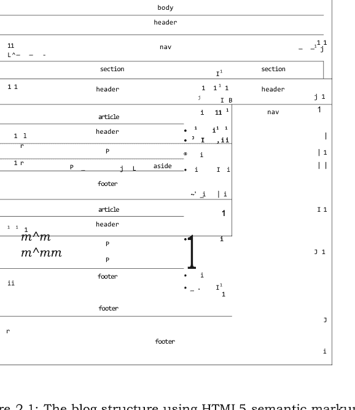

图 2.1：使用 `HTML5` 语义化标记的博客结构

看看这个例子中第 1 行的 `doctype`。这就是我们 `HTML5` `doctype` 所需的全部。如果你习惯制作网页，你可能熟悉 `XHTML` 中这种冗长且难以记忆的 `doctype`，比如：

```
<!DOCTYPE html PUBLIC "-//W3C//DTD XHTML 1.0 Transitional//EN"
"http://www.w3.org/TR/xhtml11/DTD/xhtml11-transitional.dtd">
```

现在，再看一下 `HTML5` 的 `doctype`：

```
<!DOCTYPE HTML>
```

这简单多了，也容易记忆多了。

报告勘误

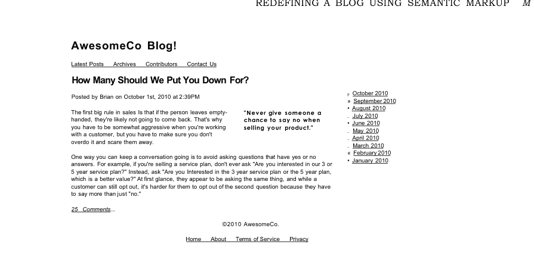

图 2.2：完成的布局

`doctype` 的目的有两点。首先，它帮助验证器确定在验证代码时需要使用哪些验证规则。其次，`doctype` 迫使 `Internet Explorer 6`、`7` 和 `8` 进入“标准模式”，如果你试图构建在所有浏览器中都能正常工作的页面，这一点至关重要。`HTML5` `doctype` 同时满足了这两个需求，*甚至被 `Internet Explorer 6` 识别*。

### 页眉

页眉，不要与 `h1`、`h2` 和 `h3` 等标题混淆，可以包含各种内容，从公司标志到搜索框。目前，我们的博客页眉将只包含博客的标题。

```
Download html5newtags/index.html
Line 1 <header id="page_header">
  2   <h1>AwesomeCo Blog!</h1>
  3 </header>
```

你不限于在一个页面上只使用一个页眉。每个单独的部分或文章也可以有自己的页眉，因此像我在第 1 行那样使用 `ID` 属性来唯一标识你的元素会很有帮助。唯一的 `ID` 使得用 `CSS` 为元素设置样式或用 `JavaScript` 定位元素变得很容易。

语义化标记的核心在于描述你的内容。如果你已经开发网页几年了，你可能已经将页面划分为页眉、页脚和侧边栏等不同区域，以便在应用样式表和其他格式化时更容易识别页面的区域。

语义化标记使机器和人类都能轻松理解内容的含义和上下文。新的 `HTML5` 标记标签，如 `section`、`header` 和 `nav`，正是帮助你做到这一点。

### 页脚

`footer` 元素定义文档或相邻区域的页脚信息。你以前在网站上见过页脚。它们通常包含版权声明和网站所有者信息等内容。规范还说明我们可以在一个文档中有多个页脚，这意味着我们也可以在博客文章中使用页脚。

目前，让我们只为页面定义一个简单的页脚。因为我们可以有多个页脚，所以像处理页眉一样，我们给这个页脚一个 `ID`。这将帮助我们在想为这个元素及其子元素添加样式时，唯一地标识这个特定的页脚。

```
Download html5newtags/index.html
<footer id="page_footer">
  <p>&copy; 2010 AwesomeCo.</p>
</footer>
```

这个页脚只包含版权日期。然而，和页眉一样，页面上的页脚通常包含其他元素，包括导航元素。

### 导航

导航对一个网站的成功至关重要。如果你让人们很难找到他们想要的东西，他们就不会在你的网站上停留，因此让导航拥有自己的 `HTML` 标签是很有意义的。

让我们在文档的页眉中添加一个导航部分。我们将添加指向博客主页、存档、列出博客贡献者的页面以及联系页面的链接。

```
Download html5newtags/index.html

Line 1  <header id="page_header">
        <h1>AwesomeCo Blog!</h1>
        <nav>
          <ul>
Line 5    <li><a href="/">Latest Posts</a></li>
            <li><a href="archives">Archives</a></li>
            <li><a href="contributors">Contributors</a></li>
            <li><a href="contact">Contact Us</a></li>
          </ul>
Line 10 </nav>
      </header>
```

和页眉、页脚一样，你的页面可以有多个导航元素。你经常在页眉和页脚中发现导航，所以现在你可以明确地标识它们了。我们的博客页脚需要链接到 `AwesomeCo` 主页、公司的“关于我们”页面，以及公司的服务条款和隐私政策链接。我们将这些作为另一个无序列表添加到页面的页脚元素中。

```
Download html5newtags/index.html

<footer id="page_footer">
  <p>&copy; 2010 AwesomeCo.</p>
  <nav>
    <ul>
      <li><a href="http://awesomeco.com/">Home</a></li>
      <li><a href="about">About</a></li>
      <li><a href="terms.html">Terms of Service</a></li>
      <li><a href="privacy.html">Privacy</a></li>
    </ul>
  </nav>
</footer>
```

我们将使用 `CSS` 来改变这两个导航栏的外观，所以暂时不要太担心外观。这些新元素的目的是描述内容，而不是描述内容的外观。

### sections 和 articles

`section` 是页面的逻辑区域，`section` 元素旨在取代被滥用的 `div` 标签，用于描述页面的逻辑部分。

```
Download html5newtags/index.html
<section id="posts">
</section>
```

不过不要过度使用 `section`。用它们来逻辑地分组你的内容！这里我们创建了一个包含所有博客帖子的部分。然而，每个帖子不应该放在它自己的 `section` 中。我们有一个更合适的标签来处理这个。

### articles

`article` 标签是描述网页实际内容的完美元素。一个页面上有这么多元素，包括页眉、页脚、导航元素、广告、小部件、博客链接和社会媒体书签，人们很容易忘记，用户访问你的网站是因为他们对你提供的内容感兴趣。`article` 标签帮助你描述该内容。

我们的每篇文章都将有一个页眉、一些内容和一个页脚。我们可以这样定义一篇完整的文章：


```html
Download html5newtags/index.html
<article class="post">
  <header>
    <h2>How Many Should We Put You Down For?</h2>
    <p>Posted by Brian on
      <time datetime="2010-10-01T14:39">October 1st, 2010 at 2:39PM</time>
    </p>
  </header>
  <p>
    The first big rule in sales is that if the person leaves empty-handed, they're likely not going to come back. That's why you have to be somewhat aggressive when you're working with a customer, but you have to make sure you don't overdo it and scare them away.
  </p>
  <p>
    One way you can keep a conversation going is to avoid asking questions that have yes or no answers. For example, if you're selling a service plan, don't ever ask &quot;Are you interested in our 3 or 5 year service plan?&quot; Instead, ask &quot;Are you interested in the 3 year service plan or the 5 year plan, which is a better value?&quot; At first glance, they appear to be asking the same thing, and while a customer can still opt out, it's harder for them to opt out of the second question because they have to say more than just &quot;no.&quot;
  </p>
  <footer>
    <p><a href="comments">25 Comments</a> . . .</p>
  </footer>
</article>
```

### 乔问……

#### 2：文章（Articles）和区块（Sections）有什么区别？

把区块想象成文档的一个逻辑部分。把文章想象成实际的内容，比如杂志文章、博客帖子或新闻条目。

这些新标签描述了它们所包含的内容。一个区块可以包含多篇文章，一篇文章也可以包含多个区块。区块就像报纸的体育版。体育版块有多篇文章。每篇文章又可以划分成自己的若干个小节。有些区块有专用的标签，比如页头（header）和页脚（footer）。区块（section）是一个更通用的元素，你可以用它来逻辑上分组其他元素。

语义化标记的核心在于传达你内容的含义。

我们可以在文章内部使用页头和页脚元素，这使得描述那些特定部分变得容易得多。我们也可以使用区块元素将文章划分为多个部分。

### 旁白和侧边栏

有时，你有一些内容是为了给你的主要内容增添额外信息，比如引述、图表、补充思考或相关链接。你可以使用新的`aside`标签来标识这些元素。

下载`html5newtags/index.html`

```html
<aside>
  <p>
    &quot;Never give someone a chance to say no when
    selling your product.&quot;
  </p>
</aside>
```

我们将把这段引述放在一个`aside`元素中。我们会将这个`aside`嵌套在`article`内部，使其靠近其相关内容。

我们完成的区块，包含`aside`，看起来是这样的：

下载`html5newtags/index.html`

```html
<section id="posts">
    <article class="post">
        <header>
            <h2>How Many Should We Put You Down For?</h2>
            <p>Posted by Brian on
                <time datetime="2010-10-01T14:39">October 1st, 2010 at 2:39PM</time>
            </p>
        </header>
        <aside>
            <p>
                &quot;Never give someone a chance to say no when
                selling your product.&quot;
            </p>
        </aside>
        <p>
            The first big rule in sales is that if the person leaves empty-handed,
            they're likely not going to come back. That's why you have to be
            somewhat aggressive when you're working with a customer, but you have
            to make sure you don't overdo it and scare them away.
        </p>
        <p>
            One way you can keep a conversation going is to avoid asking questions
            that have yes or no answers. For example, if you're selling a service
            plan, don't ever ask &quot;Are you interested in our 3 or 5 year
            service plan?&quot; Instead, ask &quot;Are you interested in the 3
            year service plan or the 5 year plan, which is a better value?&quot;
            At first glance, they appear to be asking the same thing, and while
            a customer can still opt out, it's harder for them to opt out of
            the second question because they have to say more than just
            &quot;no.&quot;
        </p>
        <footer>
            <p><a href="comments">25 Comments</a> ...</p>
        </footer>
    </article>
</section>
```

现在我们只需要添加侧边栏部分。

### 旁白（Asides）不是页面侧边栏！

我们的博客右侧有一个侧边栏，其中包含指向博客存档的链接。如果你认为我们可以使用`aside`标签来定义博客的侧边栏，那你就错了。你可以那样做，但这违背了规范的精神。`aside`旨在展示与文章相关的内容。它是展示相关链接、术语表或引述的好地方。

为了标记我们包含存档列表的侧边栏，我们将使用另一个`section`标签和一个`nav`标签。

```html
<section id="sidebar">
  <nav>
    <h3>Archives</h3>
    <ul>
      <li><a href="2010/10">October 2010</a></li>
      <li><a href="2010/09">September 2010</a></li>
      <li><a href="2010/08">August 2010</a></li>
      <li><a href="2010/07">July 2010</a></li>
      <li><a href="2010/06">June 2010</a></li>
      <li><a href="2010/05">May 2010</a></li>
      <li><a href="2010/04">April 2010</a></li>
      <li><a href="2010/03">March 2010</a></li>
      <li><a href="2010/02">February 2010</a></li>
      <li><a href="2010/01">January 2010</a></li>
    </ul>
  </nav>
</section>
```

我们博客的结构就这些了。现在我们可以开始为这些新元素应用样式了。

### 样式化

我们可以像为`div`标签设置样式一样，为这些新元素应用样式。首先，我们创建一个名为`style.css`的新样式表文件，并通过在页头中放置一个样式表链接将其附加到 HTML 文档，如下所示：

```html
<link rel="stylesheet" href="style.css" type="text/css">
```

让我们首先将页面内容居中，并设置一些基本的字体样式。

```css
body {
  width: 960px;
  margin: 15px auto;
  font-family: Arial, "MS Trebuchet", sans-serif;
}

p {
  margin: 0 0 20px 0;
  line-height: 20px;
}
```

接下来，我们定义页头的宽度。

下载`html5newtags/style.css`

```css
header#page_header{
  width:100%;
}
```

我们通过将无序列表转换为水平导航栏来为导航链接设置样式。

下载`html5newtags/style.css`

```css
header#page_header nav ul, #page_footer nav ul{
  list-style: none;
  margin: 0;
  padding: 0;
}
#page_header nav ul li, footer#page_footer nav ul li{
  padding:0;
  margin: 0 20px 0 0;
  display :inline;
}
```

文章区块（posts section）需要向左浮动并设置宽度，我们还需要将文章内的引述浮动起来。在做这些的同时，让我们增大引述的字体大小。

下载`html5newtags/style.css`

```css
section#posts{
  float: left;
  width: 74%;
}

section#posts aside{
  float: right;
  width: 35%;
  margin-left: 5%;
  font-size: 20px;
  line-height: 40px;
}
```

我们还需要浮动侧边栏并定义其宽度。

下载`html5newtags/style.css`

```css
section#sidebar{
  float: left;
  width: 25%;
}
```

我们需要定义页脚。我们将在页脚上清除浮动，使其位于页面底部。

```css
footer#page_footer {
    clear: both;
    width: 100%;
    display: block;
    text-align: center;
}
```

这些只是基础样式。我相信从这里开始，你可以让它看起来好得多。

### 向后兼容

尽管这一切在 Firefox、Chrome 和 Safari 中运行良好，但当管理层看到 Internet Explorer 把我们的页面弄得一团糟时，他们不会太高兴。内容显示正常，但由于 IE 不理解这些元素，它无法为它们应用样式，整个页面看起来就像是 1990 年代中期的东西。

让 IE 为这些元素设置样式的唯一方法是使用 JavaScript 将这些元素定义为文档的一部分。事实证明这非常容易。我们将此代码添加到页面的页头部分，以便在浏览器渲染任何元素之前执行。我们将其放在条件注释中，这是一种只有 Internet Explorer 才会读取的特殊注释。

```html
<!--[if lt IE 9]>
<script type="text/javascript">
    document.createElement("nav");
    document.createElement("header");
    document.createElement("footer");
    document.createElement("section");
    document.createElement("aside");
    document.createElement("article");
</script>
<![endif]-->
```

这个特定的注释针对任何低于 9.0 版本的 Internet Explorer。如果我们重新加载页面，现在它看起来是正确的了。

不过，我们这样就依赖了 JavaScript，所以你需要考虑到这一点。改进的组织结构和可读性……

### 勘误报告

如果你需要在 Web 应用程序中实现一个计量表（pledge meter）或上传进度条（upload progress bar），你应该研究一下 HTML5 中引入的`meter`和`progress`元素。

`meter`元素让我们能够语义化地描述一个具有最小值和最大值的实际刻度上的固定点。为了让你的`meter`符合规范，你不应该将其用于具有任意最小值或最大值的东西，比如身高和体重，除非你谈论的是具有特定边界的特定事物。

例如，如果我们有一个筹款网站，并且想显示我们离 5000 美元的目标还有多远，我们可以轻松地描述它：

下载`html5_meter/index.html`

```html
<section id="pledge">
  <header>
    <h3>Our Fundraising Goal</h3>
  </header>
  <meter title="L/SD" id="pledge_goal"
         value="2500" min="0" max="5000">
    $2500.00
  </meter>
  <p>Help us reach our goal of $5000!</p>
</section>
```

`progress`元素与`meter`非常相似，但它旨在显示活跃的进度，就像你在上传文件时看到的那样。相比之下，`meter`旨在显示当前未移动的度量，比如给定用户服务器上可用存储空间的快照。进度条的标记与`meter`元素非常相似。

下载`html5_meter/progress.html`

```html
<progress id="progressbar" max=100><span>0</span>%</progress>
```

目前还没有任何浏览器为`meter`和`progress`元素设置样式，但你可以使用 JavaScript 获取`meter`中的值，并构建自己的可视化效果，使用`meter`或`progress`来语义化地描述数据。你可以通过查看本书关于`meter`元素的示例文件来了解如何实现这一点。

### 使用自定义数据属性创建弹出窗口

如果你构建过任何使用 JavaScript 从文档中获取信息的 Web 应用程序，你就会知道，为了让事情正常运作，有时会涉及一些技巧和解析工作。你最终会在事件处理器中插入额外信息，或者滥用`rel`或`class`属性来注入行为。得益于自定义数据属性的引入，这些日子已经一去不复返了。

自定义数据属性都以`data-`前缀开头，并且会被 HTML5 文档的验证器忽略。你可以将自定义数据属性附加到任何你想要的元素上，无论是关于照片的元数据、经纬度坐标，还是如本技巧中将看到的弹出窗口尺寸。最棒的是，你几乎可以在所有现代网页浏览器中立即使用自定义数据属性，因为使用 JavaScript 可以轻松地获取它们。

#### 将行为与内容分离，或者说为什么`onclick`不好

多年来，弹出窗口名声不佳，而且往往确实如此。它们经常被用来让你看广告、诱骗毫无戒心的网络冲浪者安装间谍软件或病毒，或者更糟的是，泄露随后被转卖的个人信息。难怪大多数浏览器都提供了某种类型的弹出窗口拦截器。

不过，弹出窗口并非一无是处。Web 应用程序开发人员经常依赖弹出窗口来显示在线帮助、附加选项或其他重要的用户界面功能。为了让弹出窗口不那么烦人，我们需要以一种不显眼的方式来实现它们。当你查看 AwesomeCo 的人力资源页面时，你会看到几个在弹出窗口中显示政策的链接。它们大多看起来像这样：


```text
Download html5_popups_with_custom_data/original_example_1.html

<a href='#'
   onclick="window.open('holiday_pay.html','WinName', 'width=300,height=300');">
   Holiday pay
</a>
```

这是一种构建弹出链接的常见方式。事实上，这通常是 JavaScript 新手学习如何制作弹出窗口的方式。然而，在继续之前，我们应该解决这种方法存在的一些问题。

### 提升可访问性

链接目标没有设置！如果 JavaScript 被禁用，链接将无法将用户带到页面。这是一个我们需要立即解决的重大问题。任何情况下都不要省略 `href` 属性或赋予其类似下面的值。将其设置为通常会弹出的资源的地址。

```text
Download html5_popups_with_custom_data/original_example_2.html

<a href='holiday_pay.html'
    onclick="window.open(this.href, 'WinName', 'width=300, height=300');">
    Holiday pay
</a>
```

然后 JavaScript 代码读取附加元素的 `href` 属性以获取链接位置。

构建可访问页面的第一步是确保所有功能在没有 JavaScript 的情况下也能正常工作。

### 废除 `onclick`

将行为与内容分离，就像你使用链接样式表将呈现信息分离一样。使用 `onclick` 一开始很容易，但想象一个包含五十个链接的页面，你就会看到 `onclick` 方法是如何失控的。你会一遍又一遍地重复那段 JavaScript。如果你从服务器端代码生成这段代码，你只是在增加 JavaScript 事件的数量，并使生成的 HTML 比需要的更大。相反，给页面上的每个锚点一个标识它们的类。

```text
Download html5_popups_with_custom_data/original_example_3.html

<a href="holiday_pay.html" class="popup">Holiday Pay</a>
```

```javascript
var links = $("a.popup");

links.click(function(event){
    event.preventDefault();
    window.open($(this).attr('href'));
});
```

我们使用 jQuery 选择器抓取类为 `popup` 的元素，然后为每个元素的 `click` 事件添加一个观察者。当我们传递给 `click` 方法的代码在有人点击链接时执行。`preventDefault` 方法防止默认的单击事件行为。在这种情况下，它防止浏览器跟随链接并显示新页面。

然而，我们丢失了一些信息，即如何调整窗口大小和定位窗口的信息，这是我们在原始示例中所拥有的。我们希望页面设计师即使不太熟悉 JavaScript，也能按每个链接设置窗口的尺寸。

### 自定义数据属性来救场！

在构建任何启用 JavaScript 的应用程序时，这种情况很常见。正如我们所看到的，将窗口所需的 `height` 和 `width` 与代码一起存储是可取的，但 `onclick` 方法有很多缺点。我们可以做的是将这些属性作为元素的属性嵌入其中。我们要做的就是像这样构建链接：

```text
Download html5_popups_with_custom_data/popup.html

<a href="help/holiday_pay.html"
    data-width="600"
    data-height="400"
    title="Holiday Pay"
    class="popup">Holiday pay</a>
```

现在，我们只需修改编写的 `click` 事件，从链接的自定义数据属性中获取选项，并将它们传递给 `window.open` 方法。

```javascript
Download html5_popups_with_custom_data/popup.html

$(function(){
    $(".popup").click(function(event){
        event.preventDefault();
        var href = $(this).attr("href");
        var width = $(this).attr("data-width");
        var height = $(this).attr("data-height");
        var popup = window.open(href, "popup",
            "height=" + height + ",width=" + width);
    });
});
```

这就是全部了！现在链接会在新窗口中打开。

### 注意事项

在这个例子中，我们使用自定义数据属性向客户端脚本提供附加信息。这是解决特定问题的巧妙方法，并说明了使用这些属性的一种方式。它确实倾向于将呈现信息与我们的标记混合在一起，但这是向你展示使用 JavaScript 读取嵌入在页面中的值是多么容易的一种简单方法。

### 向后兼容

只要浏览器支持 JavaScript，这些属性在旧浏览器中现在也能工作。自定义数据属性不会干扰浏览器，并且由于你使用了 HTML5 doctype，以 `data-` 开头的属性都会被忽略，因此你的文档将是有效的。

### 未来展望

一旦这些新标签和属性得到广泛支持，我们可以用它们做一些有趣的事情。我们可以使用打印样式表轻松识别并禁用导航和文章页脚：

```css
nav, article>footer {display:none}
```

我们可以使用脚本语言快速识别页面或网站上的所有文章。但最重要的是，我们用适当的标签来标记描述内容的标记，以便我们可以编写更好的样式表和更好的 JavaScript。

自定义数据属性为开发人员提供了在其标记中嵌入各种信息的灵活性。事实上，我们将在第 6 章“在画布上绘图”（第 111 页）中再次使用它们。

你可以将它们与 JavaScript 一起使用，通过简单地定位任何带有 `data-remote="true"` 的表单标签来确定表单标签是否应通过 Ajax 提交，这是 Ruby on Rails 框架正在做的事情。

你也可以用它们来以用户的时区显示日期和时间，同时仍然缓存页面。只需将日期作为 UTC 放在 HTML 页面上，并在客户端将其转换为用户的本地时间。这些属性允许你将真实的、可用的数据嵌入到你的页面中，并且你可以预期会看到越来越多的框架和库利用它们。我相信你将在自己的工作中发现许多很棒的用途。

而且我们可以一劳永逸地帮助消除 Divitis！

## 第三章 创建用户友好的网页表单

如果你曾经设计过复杂的用户界面，就会明白基本的 HTML 表单控件有多受限。你只能使用文本字段、选择菜单、单选按钮、复选框，有时甚至不得不使用更笨重的多选列表，并且需要不断向用户解释如何使用。（“按住 Ctrl 键并点击你需要的选项，如果你用的是 Mac，那就按 Cmd 键。”）

于是，你做了所有优秀的网页开发者会做的事——转向 Prototype 或 jQuery，或者利用 HTML、CSS 和 JavaScript 的组合来创建你自己的控件和功能。但是，当你看到一个包含滑块、日历控件、数字调节框、自动完成字段和可视化编辑器的表单时，你会很快意识到，你给自己制造了一个噩梦。你必须确保页面上的控件不会与页面上已有的其他控件或 JavaScript 库冲突。你可能花了几个小时实现一个日历选择器，结果却发现 Prototype 库因为 jQuery 接管了 `$()` 函数而出了问题。于是，你使用了 jQuery 的 `noConflict()` 方法，但接着又发现你使用的颜色选择器控件无法正常工作了，因为那个插件编写得不够严谨。

如果你笑了，那是因为你也有过类似的经历。如果你很生气，我猜原因也一样。不过，还是有希望的。在本章中，我们将使用一些新的表单字段类型来构建几个网页表单，同时还会实现自动聚焦和占位符文本。最后，我们将讨论如何使用新的 `contenteditable` 属性，将任何 HTML 字段转变为用户输入控件。

具体来说，我们将涵盖以下功能：¹

- 电子邮箱字段 [`<input type="email">`]

  显示用于输入电子邮箱地址的表单字段。*[O10.1, IOS]*

- URL 字段 [`<input type="url">`]

  显示用于输入 URL 的表单字段。*[O10.1, IOS]*

- 电话号码字段 [`<input type="tel">`]

  显示用于输入电话号码的表单字段。*[O10.1, IOS]*

- 搜索字段 [`<input type="search">`]

  显示用于输入搜索关键词的表单字段。*[C5, S4, O10.1, IOS]*

- 滑块（范围）[`<input type="range">`]

  显示一个滑块控件。*[C5, S4, O10.1]*

- 数字 [`<input type="number">`]

  显示用于输入数字的表单字段，通常表现为一个数字调节框。*[C5, S5, O10.1, IOS]*

- 日期字段 [`<input type="date">`]

  显示用于输入日期的表单字段。支持日期、月份或星期。*[C5, S5, O10.1]*

- 日期和时间 [`<input type="datetime">`]

  显示用于输入日期和时间的表单字段。支持 `datetime`、`datetime-local` 或 `time`。*[C5, S5, O10.1]*

- 颜色 [`<input type="color">`]

  显示用于指定颜色的字段。*[C5, S5]*（Chrome 5 和 Safari 5 能识别颜色字段，但不会显示任何特定的控件。）

- 自动聚焦支持 [`<input type="text" autofocus>`]

  支持将焦点置于特定的表单元素上。*[C5, S4]*

- 占位符支持 [`<input type="email" placeholder="me@example.com">`]

  支持在表单字段内显示占位符文本。*[C5, S4, F4]*

- 就地编辑支持 [`<p contenteditable>lorem ipsum</p>`]

  支持通过浏览器对内容进行就地编辑。*[C4, S3.2, IE6, O10.1]*

¹ 在后续描述中，浏览器支持情况以方括号内的简写代码和最低支持版本号表示。所用代码为：C：Google Chrome，F：Firefox，IE：Internet Explorer，O：Opera，S：Safari，IOS：搭载 Mobile Safari 的 iOS 设备，以及 A：Android 浏览器。

让我们从学习一些极其有用的表单字段类型开始。

### 用新输入字段描述数据

HTML5 引入了几种新的输入类型，你可以用它们来更好地描述用户正在输入的数据类型。除了标准的文本字段、单选按钮和复选框元素，你还可以使用诸如电子邮箱字段、日历、颜色选择器、数字调节框和滑块等元素。浏览器可以利用这些新字段向用户显示更好的控件，而无需 JavaScript。移动设备以及用于平板电脑和触摸屏的虚拟键盘可以利用这些字段类型来显示不同的键盘布局。例如，iPhone 的 Mobile Safari 浏览器在用户向 URL 和电子邮箱类型输入数据时，会显示备用键盘布局，使得像 `@`、`(`、`)` 和 `/` 这样的特殊字符易于访问。

### 改进 AwesomeCo 项目表单

AwesomeCo 正在创建一个新的项目管理 Web 应用程序，以帮助开发者和经理更轻松地跟进他们众多项目的进展。每个项目都有一个名称、一个联系电子邮箱地址和一个预演 URL，以便经理可以在网站构建过程中进行预览。还有用于开始日期、优先级以及项目预计完成所需小时数的字段。最后，开发经理希望为每个项目指定一种颜色，这样他在查看报告时就能快速识别每个项目。

让我们使用新的 HTML5 字段快速搭建一个项目偏好设置页面。

### 设置基本表单

让我们创建一个发送 POST 请求的基本 HTML 表单。由于名称字段没有特殊要求，我们将使用可靠的文本字段。

下载 `html5forms/index.html`

```html
<form method="post" action="/projects/1">

  <fieldset id="personal_information">
    <legend>项目信息</legend>

    <ol>
      <li>
        <label for="name">名称</label>
        <input type="text" name="name" autofocus id="name">
      </li>
      <li>
        <input type="submit" value="提交">
      </li>
    </ol>

  </fieldset>

</form>
```

注意，我们正在用包裹在有序列表中的标签来标记此表单。标签对于创建无障碍表单至关重要。标签的 `for` 属性引用其关联表单元素的 `id`。这有助于屏幕阅读器识别页面上的字段。有序列表提供了一种无需依赖复杂表格或 `div` 结构来列出字段的好方法。这也为你提供了一种标记你希望人们填写字段顺序的方式。

### 使用 `range` 创建滑块

滑块通常用于让用户减少或增加数值，对于让经理快速直观地查看和修改项目优先级来说，这是一个很好的方式。你可以使用 `range` 类型来实现滑块。

下载 `html5forms/index.html`

```html
<label for="priority">优先级</label>
<input type="range" min="0" max="10"
       name="priority" value="0" id="priority">
```

将此代码添加到表单中，放在一个新的 `li` 元素内，就像之前的字段一样。

Chrome 和 Opera 都实现了滑块部件，它看起来像这样：

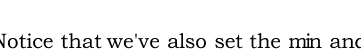

注意，我们还设置了滑块的最小值和最大值范围。这将约束表单字段的值。

### 使用数字调节框处理数字

我们经常使用数字，虽然输入数字相当简单，但数字调节框可以让微调变得更加容易。数字调节框是一个带有箭头的控件，可以递增或递减框中的值。让我们用数字调节框来处理预计小时数。这样，小时数就可以轻松调整。

下载 `html5forms/index.html`

```html
<label for="estimated_hours">预计小时数</label>
<input type="number" name="estimated_hours"
       min="0" max="1000"
       id="estimated_hours">
```

Opera 支持数字调节框控件，它看起来像这样：

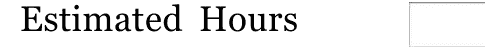

数字调节框默认也允许输入，并且像滑块一样，我们可以设置最小值和最大值。然而，这些最小和最大值范围不会应用于你在字段中输入的任何值。还要注意，你可以通过为 `step` 参数赋值来控制递增步长的大小。它的默认值是 1，但可以是任何数值。

### 日期

记录项目的开始日期非常重要，我们希望这尽可能简单。日期输入类型非常适合此处。

下载 `html5forms/index.html`

```html
<label for="start_date">开始日期</label>
<input type="date" name="start_date" id="start_date"
       value="2010-12-01">
```

在撰写本文时，Opera 是唯一支持完整日历选择器的浏览器。

这是其实施的一个示例：

| 开始日期 | 2010-12-0 | 十二月 | (*) 2010 |
|---|---|---|---|
| 电子邮件联系人 | | 周三 | 周一、周二、周三、周四、周五、周六、周日 |
| | | 29 | 30、1、2、3、4、5 |
| 预发布网址 | | 6 | 7、8、9、10、11、12 |
| | | 13 | 14、15、16、17、18、19 |
| 项目颜色 | | 20 | 21、22、23、24、25、26 |
| | | 27 | 28、29、30、31、2 |
| 提交 | | 3 | 4、5、6、7、8、9 |
| | | `[` | 今天、是、无 |

Safari 5.0 显示一个类似于数字字段的区域，带有可增减日期的箭头。如果留空，则默认为“1582”。其他浏览器会渲染一个文本字段。

### 电子邮件

HTML5 规范指出，电子邮件输入类型旨在保存单个电子邮件地址或电子邮件地址列表，因此它是电子邮件字段的完美候选者。

下载 `html5forms/index.html`

```html
<label for="email">Email contact</label>
<input type="email" name="email" id="email">
```

移动设备从这种类型的表单字段中获益最大，因为虚拟键盘布局会改变以使输入电子邮件地址更容易。

还有一种旨在处理 URL 的字段类型。如果您使用的是 iPhone，这个字段尤其方便，因为它显示一个非常不同的键盘布局，显示用于快速输入网址的辅助按钮，类似于在 Mobile Safari 地址栏中输入 URL 时显示的键盘。添加预发布网址字段就像添加这段代码一样简单：


```html
Download html5forms/index.html
<label for="url">Staging URL</label>
<input type="url" name="url" id="url">
```

虚拟键盘也会使用此字段类型来显示不同的布局。

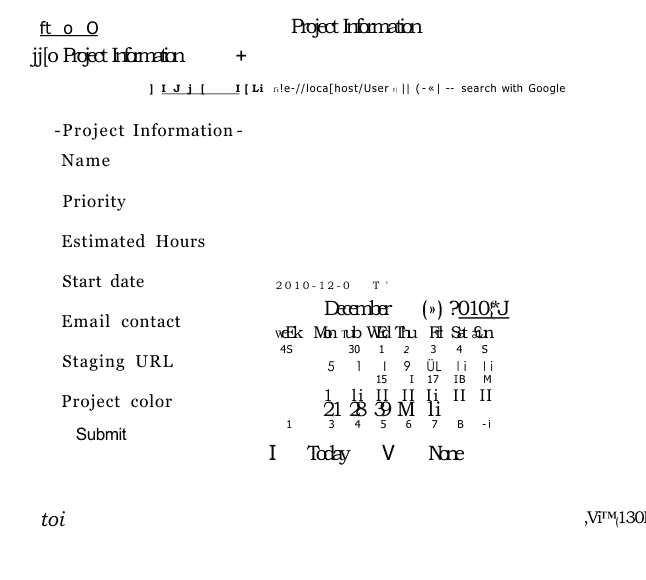

图 3.1：Opera 已支持某些表单控件。

### 颜色

最后，我们需要提供一种输入颜色代码的方法，为此我们将使用`color`类型。

```html
Download html5forms/index.html
<label for="project_color">Project color</label>
<input type="color" name="project_color" id="project_color">
```

在撰写本文时，没有浏览器显示颜色选择器控件，但这不应阻止您使用此字段。您正在使用正确的标记来描述您的内容，这在将来会派上用场，特别是在您需要提供回退支持时。

Opera 目前支持大多数这些新控件，如图 3.1 所示，但当您在 Firefox、Safari 或 Google Chrome 中打开该页面时，您不会看到太大差异。我们需要解决这个问题。

### 回退处理

不理解这些新类型的浏览器会简单地回退到文本类型，因此您的表单仍然可用。此时，您可以将 jQuery UI 或 YUI 小部件之一绑定到该字段以进行转换。随着时间的推移和更多浏览器支持这些控件，您可以移除 JavaScript 钩子。

### 替换颜色选择器

我们可以使用 jQuery 与 CSS3 的属性选择器轻松识别和替换颜色选择器。我们定位任何类型为`color`的输入字段，并应用一个名为 SimpleColor 的 jQuery 插件。

```javascript
Download html5forms/index.html

if (!hasColorSupport()){
    $('input[type=color]').simpleColor();
}
```

由于我们在标记中使用了新的表单类型，因此我们不必添加额外的类名或其他标记来识别颜色选择器。属性选择器与 HTML5 配合得非常好。

如果浏览器原生支持颜色选择器，我们就不想使用这个颜色选择器插件，因此我们将使用一些 JavaScript 来检测浏览器是否支持类型为`color`的输入字段。

```javascript
Download html5forms/index.html

function hasColorSupport(){
    input = document.createElement("input");
    input.setAttribute("type", "color");
    var hasColorType = (input.type !== "text");
    // 处理 Safari/Chrome 的部分实现
    if(hasColorType){
        var testString = "foo";
        input.value=testString;
        hasColorType = (input.value != testString);
    }
    return(hasColorType);
}
```

首先，我们使用纯 JavaScript 创建一个元素并将其`type`属性设置为`color`。然后，我们检索`type`属性以查看浏览器是否允许我们设置该属性。如果它返回值为`color`，那么我们就支持该类型。如果不是，我们将不得不应用我们的脚本。

第 6 行开始变得有趣了。Safari 5 和 Google Chrome 5 部分实现了颜色类型。它们支持该字段，但它们并不实际显示颜色部件。我们在页面上最终得到的仍然是一个文本字段。所以，在我们的检测方法中，我们为输入字段设置一个值，看看该值是否保留。如果它没有保留，我们可以假设浏览器已经实现了颜色选择器，因为输入字段的行为不像一个文本框。

替换颜色选择器的整段代码如下所示：

```javascript
Download html5forms/index.html

if (!hasColorSupport()){
    $('input[type=color]').simpleColor();
}
```

这个解决方案有效，但它非常脆弱。它针对特定的一组浏览器，并且仅适用于颜色控件。其他控件有其自身的怪癖，需要您去了解。值得庆幸的是，还有一个替代解决方案。

### Modernizr

Modernizr² 库可以检测对许多 HTML5 和 CSS3 功能的支持。它不会添加缺失的功能，但它确实提供了几种类似于我们为检测表单字段而实现的解决方案的机制，这些机制更加可靠。

在开始将 Modernizr 投入您的项目之前，请务必花些时间了解它的工作原理。无论您是否自己编写了代码，如果您在项目中使用了它，您就对其负责。Modernizr 还不能立即处理 Safari 对颜色字段的部分支持。当 Chrome 或 Firefox 的下一个版本发布时，您可能不得不临时拼凑一个解决方案。谁知道呢，也许您能够将该解决方案贡献回 Modernizr！

您将以相同的方式为日期选择器和滑块等控件实现回退。滑块和日期选择器作为组件包含在 jQuery UI 库中。³ 您将在页面上包含 jQuery UI 库，检测浏览器是否原生支持该控件，如果不支持，则应用 JavaScript 版本作为替代。

2. <http://www.modernizr.com/>

3. <http://jqueryui.com/>

最终，您将能够逐步淘汰 JavaScript 控件，完全依赖浏览器中的控件。由于检测这些类型涉及的复杂性，Modernizr 将对您非常有帮助。然而，在本书的其余部分，我们将继续编写自己的检测技术，以便您了解它们的工作原理。

除了新的表单字段类型，HTML5 还为表单字段引入了一些其他属性，这些属性可以帮助提高可用性。接下来让我们看看`autofocus`。

### 19 使用 Autofocus 跳转到第一个字段

如果在用户加载页面时将光标置于表单的第一个字段中，您确实可以加快数据输入速度。许多搜索引擎使用 JavaScript 来实现此功能，现在 HTML5 将此功能作为语言的一部分提供。

您所要做的就是将`autofocus`属性添加到任何表单字段，就像我们已经在第 48 页《使用新输入字段描述数据》中构建的个人资料页面上所做的那样。

```html
Download html5forms/index.html

<label for="name">Name</label>
<input type="text" name="name" autofocus id="name">
```

要使此功能可靠工作，一个页面上只能有一个`autofocus`属性。如果有多个，浏览器会将用户的光标聚焦到最后一个设置了`autofocus`的表单字段上。

### 回退处理

我们可以用一点 JavaScript 来检测`autofocus`属性的存在，然后当用户的浏览器不支持`autofocus`时，使用 jQuery 来聚焦该元素。这可能是您将遇到的最简单的回退解决方案。

```javascript
Download html5forms/autofocus.js

function hasAutofocus() {
  var element = document.createElement('input');
  return 'autofocus' in element;
}

$(function(){
  if(!hasAutofocus()){
    $('input[autofocus=true]').focus();
  }
});
```

只需将此 JavaScript 代码添加到你的页面中，即可在需要的地方获得自动聚焦支持。

自动聚焦能让用户在加载页面时更容易开始填写表单，但你可能还想提供更多关于希望用户填写何种信息的提示。接下来，让我们了解一下占位符属性。

### 使用占位符文本提供提示

占位符文本向用户说明应如何填写字段。一个带有占位符文本的注册表单如图 3.2 所示，见下一页。我们现在就来构建这个表单。

#### 一个简单的注册表单

AwesomeCo 的支持网站要求用户注册账户，而注册过程中最大的问题之一是用户总是尝试使用不安全的密码。让我们使用占位符文本为用户提供一些关于密码要求的指导。为保持一致性，我们也会为其他字段添加占位符文本。

要添加占位符文本，只需在每个输入字段中添加`placeholder`属性，如下所示：

```html
Download html5placeholdertext/index.html

<input id="email" type="email"
       name="email" placeholder="user@example.com">
```

我们整个表单的标记大致如下，每个字段都有占位符文本：

```html
Download html5placeholdertext/index.html

<form id="create_account" action="/signup" method="post">
  <fieldset id="signup">
    <legend>Create New Account</legend>
    <ol>
      <li>
        <label for="first_name">First Name</label>
        <input id="first_name" type="text"
               autofocus="true"
               name="first_name" placeholder="John">
      </li>
      <li>
        <label for="last_name">Last Name</label>
        <input id="last_name" type="text"
               name="last_name" placeholder="Smith">
      </li>
      <li>
        <label for="email">Email</label>
        <input  id="email" type="email"
                name="email" placeholder="user@example.com">
      </li>
      <li>
        <label for="password">Password</label>
        <input id="password" type="password" name="password" value=""
               autocomplete="off" placeholder="8-10 characters" />
      </li>
      <li>
        <label for="password_confirmation">Password Confirmation</label>
        <input  id="password_confirmation" type="password"
                name="password_confirmation" value=""
                autocomplete="off" placeholder="Type your password again" />
      </li>
      <li><input type="submit" value="Sign Up"></li>
    </ol>
  </fieldset>
</form>
```

图 3.2：占位符可以帮助用户理解你希望他们做什么。

### 防止自动补全

你可能已经注意到，我们在这个表单的密码字段中添加了`autocomplete`属性。HTML5 引入了一个`autocomplete`属性，它告诉 Web 浏览器不应尝试自动填充该字段的数据。某些浏览器会记住用户之前输入的数据，而在某些情况下，我们希望告诉浏览器我们宁愿不让用户这样做。

由于我们再次使用有序列表元素来容纳我们的表单字段，我们将添加一些基本的 CSS 来让表单看起来更美观。

```css
fieldset{
    width: 216px;
}

fieldset ol{
    list-style: none;
    padding:0;
    margin:2px;
}

fieldset ol li{
    margin:0 0 9px 0;
    padding:0;
}

/* 让输入框各自独占一行 */
fieldset input{
    display:block;
}
```

现在，Safari、Opera 和 Chrome 的用户将在表单字段内看到有用的提示文本。接下来，让 Firefox 和 Internet Explorer 也支持这一功能。

#### 回退方案

你可以使用 JavaScript 在不需要太多工作的情况下为表单字段添加占位符文本。你测试每个表单字段的值，如果为空，就将其值设置为占位符值。当表单获得焦点时，你清除该值；当字段失去焦点时，你再次测试该值。如果值不同，你保持原样；如果为空，你用占位符文本替换它。

你测试占位符支持的方式与测试自动聚焦支持的方式相同。

```javascript
Download html5placeholdertext/index.html

function hasPlaceholderSupport() {
  var i = document.createElement('input');
  return 'placeholder' in i;
}
```

然后你只需编写 JavaScript 来处理这些变化。我们将使用基于 Andrew January 等人工作的解决方案来实现这一功能。我们将用存储在`placeholder`属性中的文本填充所有表单字段的值。当用户选择一个字段时，我们将移除我们放在该字段中的文本。让我们将其包装在一个 jQuery 插件中，以便轻松地将此行为应用到我们的表单上。参见第 63 页的侧边栏了解插件的工作原理。


```text
Download html5placeholdertext/jquery.placeholder.js
```

```javascript
(function($) {

  $.fn.placeholder = function() {

    function valueIsPlaceholder(input) {
      return ($(input).val() == $(input).attr('placeholder'));
    }

    return this.each(function() {

      $(this).find("input").each(function() {

        if($(this).attr("type") == "password"){

          var new_field = $("<input type='text'>");
          new_field.attr("rel", $(this).attr("id"));
          new_field.attr("value", $(this).attr('placeholder'));
          $(this).parent().append(new_field);
          new_field.hide();
          function showPasswordPlaceholder(input) {
            if($(input).val() == "" || valueIsPlaceholder(input) ){
              $(input).hide();
              $('input[rel=' + $(input).attr('id') + ']').show();
            }
          };

          new_field.focus(function() {
            $(this).hide();
            $('input#' + $(this).attr("rel")).show().focus();
          });

          $(this).blur(function(){
            showPasswordPlaceHolder(this, false);
          });

          showPasswordPlaceHolder(this);

        }else{

          // 用占位符文本替换值。
          // 可选的reload参数解决了FF和
          // IE缓存字段值的问题。
          function showPlaceholder(input, reload){
              if( $(input).val() == "" ||
                  ( reload && valueIsPlaceholder(input) ) ){
                  $(input).val( $(input).attr("placeholder"));
              }
          };

          $(this).focus(function(){
              if( $(this).val() == $(this).attr("placeholder")){
                  $(this).val("");
              };
          });

          $(this).blur(function(){
              showPlaceholder( $(this) , false)
          });

          showPlaceholder(this, true);
        };
      });

      // 防止表单提交默认值
      $(this).submit(function(){
          $(this).find(":input").each(function(){
              if( $(this).val() == $(this).attr("placeholder")){
                  $(this).val("");
              }
          });
      });

    });
  };

})(jQuery);
```

> 原始脚本位于`http://www.morethannothing.co.uk/wp-content/uploads/2010/01/placeholder.js`，但不支持 IE 中的密码字段。

这个插件中有几个有趣的地方你应该知道。在第 45 行，如果字段没有值，或者我们刷新了页面，我们会重新将占位符文本加载到字段中。Firefox 和其他浏览器会持久化表单的值。我们将`value`属性设置为占位符，我们当然不希望它意外地成为用户的实际值。当我们加载页面时，我们向这个方法传递`true`，你可以在第 61 行看到这一点。

密码字段的行为与其他表单字段略有不同，因此我们也必须以不同的方式处理它们。看看第 12 行。我们检测密码字段的存在，并且必须将其类型更改为常规文本字段，这样值就不会以星号掩码显示。某些浏览器在尝试转换密码字段时会抛出错误，因此我们必须将密码字段替换为文本字段。我们将根据用户与字段的交互来切换这些字段。

### jQuery 插件

你可以通过编写自己的插件来扩展`jQuery`。你在`jQuery`函数上添加自己的方法，你的插件就无缝地可供任何包含你的库的开发者使用。这是一个非常简单的示例，它显示一个 JavaScript 警报框：

```javascript
jQuery.fn.debug = function() {
  return this.each(function(){
    alert(this.html());
  });
};
```

如果你想看到页面上每个段落都出现一个弹出框，你可以这样调用它：

```javascript
$("p").debug();
```

jQuery 插件旨在遍历 jQuery 对象的集合，并且它们也返回该对象集合，以便你可以链式调用它们。例如，由于我们的`debug`插件也返回 jQuery 集合，我们可以使用 jQuery 的`css`方法在一行内更改这些段落的文本颜色。

```javascript
$("p").debug().css("color", "red");
```

在本书中，我们将多次使用 jQuery 插件来帮助我们在创建回退方案时保持代码组织有序。你可以在 jQuery 的文档站点了解更多。

> http://docs.jquery.com/Plugins/Authoring

这个技巧会修改表单上的值，你很可能希望阻止这些占位符文本被提交回服务器。由于我们仅在启用 JavaScript 时才植入这段占位符代码，我们可以利用 JavaScript 来检查表单提交，并移除任何与占位符文本匹配的值。在第 66 行，我们捕获表单提交事件，并清除任何值等于占位符值的输入字段。

现在我们已经将其完整地编写为一个插件，我们可以通过将其附加到表单上来在页面中调用它，如下所示：

```text
Download html5placeholdertext/index.html
```

```javascript
$$(function(){
    function hasPlaceholderSupport(){
        var i = document.createElement('input');
        return 'placeholder' in i;
    }

    if(! hasPlaceholderSupport()){
        $("#create_account").placeholder();
        //END placeholder_fallback

        $( 'input[autofocus=true]' ).focus();
    }

});
```

现在我们有了一个相当不错的解决方案，它使得占位符文本无论在使用何种浏览器的情况下，都能成为你 Web 应用的一个可行选项。

## 6 使用 contenteditable 进行就地编辑

我们一直在寻找让人们更容易与我们的应用程序交互的方法。有时我们希望网站用户能够编辑关于他们自己的一些信息，而无需导航到另一个不同的表单。我们传统上通过监听文本区域的点击事件，并将这些区域替换为文本字段来实现就地编辑。这些字段通过 Ajax 将更改后的文本发送回服务器。HTML5 的`contenteditable`标签会自动处理数据输入部分。我们仍然需要编写一些 JavaScript 来将数据发送回服务器以便保存，但我们不再需要创建和切换隐藏表单了。

AwesomeCo 的一个当前项目允许用户查看他们的账户资料。它显示他们的姓名、城市、州、邮政编码和电子邮件地址。让我们为这个资料页面添加一些就地编辑功能，这样我们最终会得到一个如图 3.3（在下一页）所示的界面。

在我们开始之前，我希望你知道，在构建可访问的 Web 应用程序方面，我所信奉的原则是：在实现依赖 JavaScript 的功能之前，应先实现一个不依赖 JavaScript 的服务器端解决方案。我们这里这样做是因为我想专注于`contenteditable`属性的特性，而且这不是生产代码。始终，我是说始终，先构建不需要 JavaScript 的解决方案，然后构建依赖脚本的版本，最后确保为这两种路径编写自动化测试，这样如果你修改了一个版本而没有修改另一个版本，你更有可能发现错误。

#### 个人资料表单

HTML5 引入了`contenteditable`属性，该属性可用于几乎每个元素。只需添加此属性，它就会变成一个可编辑的字段。

##### 用户信息

- **姓名**：Hugh Mann
- **城市**：Anytown
- **州**：OH
- **邮政编码**：92110
- **电子邮件**：boss@awesomcompany.com

图 3.3：轻松实现就地编辑

```text
Download html5_content_editable/show.html
```

```html
<h1>User information</h1>
<div id="status"></div>
<ul>
  <li>
    <b>Name</b>
    <span id="name" contenteditable="true">Hugh Mann</span>
  </li>
  <li>
    <b>City</b>
    <span id="city" contenteditable="true">Anytown</span>
  </li>
  <li>
    <b>State</b>
    <span id="state" contenteditable="true">OH</span>
  </li>
  <li>
    <b>Postal Code</b>
    <span id="postal_code" contenteditable="true">92110</span>
  </li>
  <li>
    <b>Email</b>
    <span id="email" contenteditable="true">boss@awesomecompany.com</span>
  </li>
</ul>
```

我们也可以用一些 CSS 来美化它。我们将使用一些 CSS3 选择器来识别可编辑字段，这样当用户将鼠标悬停或选中它们时，它们会改变颜色。

```css
ul{list-style:none;}

li{clear:both;}

li>b, li>span{
    display: block;
    float: left;
    width: 100px;
}

li>span{
    width:500px;
    margin-left: 20px;
}

li>span[contenteditable=true]:hover{
    background-color: #ffc;
}

li>span[contenteditable=true]:focus{
    background-color: #ffa;
    border: 1px solid #000;
}
```

前端部分就这些了。用户现在可以轻松地修改页面上的数据。

现在我们需要保存它。

#### 数据持久化

尽管用户可以更改数据，但如果他们刷新页面或导航离开，他们的更改将会丢失。我们需要一种方式将这些更改提交给我们的后端，我们可以轻松地使用 jQuery 来做到这一点。如果你以前做过任何 Ajax，这对来说这不会是新东西。

```javascript
$(function(){
    var status = $("#status");
    $("span[contenteditable=true]").blur(function(){
        var field = $(this).attr("id");
        var value = $(this).text();
        $.post("http://localhost:4567/users/1",
            field + "=" + value,
            function(data){
                status.text(data);
            }
        );
    });
});
```

我们将为页面上每个`contenteditable`属性设置为`true`的`span`添加一个事件监听器。然后，我们需要做的就是将数据提交到我们的服务器端脚本。

### 降级方案

我们已经做了一些对某些用户来说不起作用的事情。首先，我们创建了将编辑结果保存回服务器的 JavaScript 依赖，这是一件坏事。其次，我们使用`:focus`伪类在字段获得焦点时高亮显示它们，而某些版本的 IE 不支持这个。让我们先处理功能，然后再处理视觉效果。

#### 创建一个编辑页面

与其过多地担心可能阻止用户使用我们技术的各种情况，不如直接给他们一个选项，让他们去一个带有自己表单的单独页面。当然，这需要更多的编码，但想想可能的场景：

- 用户没有启用 JavaScript 并且正在使用 Internet Explorer 7。
- 用户没有一个兼容 HTML5 的浏览器。
- 用户使用的是支持 HTML5 的最新版 Firefox，但仍然禁用了 JavaScript，仅仅因为他们不喜欢 JavaScript（这经常发生……比你想象的要多）。

归根结底，创建一个表单，该表单向处理 Ajax 更新的同一个动作进行 POST 提交，这是最合理的做法。具体如何做取决于你，但许多框架允许你通过查看`accept`头来检测请求类型，从而确定请求是来自常规 POST 还是 XMLHttpRequest。这样，你就可以保持服务器端代码的 DRY 原则。如果浏览器支持`contenteditable`和 JavaScript，我们将隐藏指向这个表单的链接。

所以，创建一个名为`edit.html`的新页面，并编写一个标准的编辑表单，该表单 POST 提交到我们 Ajax 版本使用的同一个`update`动作。

> DRY 代表 "Don't Repeat Yourself"（不要重复自己），这个术语由 Dave Thomas 和 Andy Hunt 在《程序员修炼之道》一书中创造。

```text
Download html5_content_editable/edit.html
```


```html
<!DOCTYPE html>
<html lang="en-US">
<head>
    <meta http-equiv="Content-Type" content="text/html; charset=utf-8" />
    <title>Editing Profile</title>
    <link href="style.css" rel="stylesheet" media="screen">
</head>
<body>
    <form action="/users/1" method="post" accept-charset="utf-8">
        <fieldset id="your_information">
            <legend>Your Information</legend>
            <ol>
                <li>
                    <label for="name">Your Name</label>
                    <input type="text" name="name" value="" id="name">
                </li>
                <li>
                    <label for="city">City</label>
                    <input type="text" name="city" value="" id="city">
                </li>
                <li>
                    <label for="state">State</label>
                    <input type="text" name="state" value="" id="state">
                </li>
                <li>
                    <label for="postal_code">Postal Code</label>
                    <input type="text" name="postal_code" value="" id="postal_code">
                </li>
                <li>
                    <label for="email">Email</label>
                    <input type="email" name="email" value="" id="email">
                </li>
            </ol>
        </fieldset>

        <p><input type="submit" value="Save"></p>
    </form>
</body>
</html>
```

然后，在`show.html`上添加一个指向此页面的链接。

Download`html5_content_editable/show.html`

```html
<h1>User Information</h1>
<section id="edit_profile_link">
    <p><a href="edit.html">Edit Your Profile</a></p>
</section>
<div id="status"></div>
```

添加链接后，我们只需要稍微修改一下脚本。我们希望隐藏指向编辑页面的链接，并且仅在支持可编辑内容时才启用 Ajax 功能。

```javascript
Download`html5_content_editable/show.html`

if (document.getElementById("ech't_prof"! 7e_7in/c"). contentEditable != null){
```

有了检测功能后，我们的脚本如下所示：

```javascript
Download`html5_content_editable/show.html`

$(function(){
    if(document.getElementById("ech't_prof"! 7e_7in/c"). contentEditable != null){
        $("#edit_profile_link"). hide() ;
        var status = $("#status");
        $("span[contented!table=true]"). blur(function(){
            var field = $(this). attr("id") ;
            var value = $(this). text() ;
            $ .post("http://localhost:4567/users/l" , field + "=" + value,
                function(data){
                    status.text(data);
                }
            );
        });
    }
});
```

有了这些，我们的用户既可以使用标准界面，也可以使用更快的“就地”模式。既然你知道了如何实现这个界面，请记得先实现回退方案。与其他回退方案不同，如果不实现这个特定方案，功能将会受损。

### 未来

目前，如果你在网站上添加基于 JavaScript 的日期选择器，用户必须学习它的使用方法。如果你曾经在网上订购过机票或预订过酒店，你肯定熟悉人们在网站上实现自定义表单控件的各种方式。这就像使用自动取款机一样——界面通常差异很大，会拖慢你的速度。

然而，想象一下，如果每个网站都使用 HTML5 日期字段，并且由浏览器来创建界面。用户访问的每个网站都会显示完全相同的日期选择器。屏幕阅读软件甚至可以实现一种标准机制，让盲人也能轻松输入日期。现在想想，一旦占位符文本和自动聚焦变得无处不在，它们对用户来说会是多么有用。占位符文本可以帮助屏幕阅读器向用户解释表单字段的工作原理，而自动聚焦可以帮助人们更轻松地导航，无需鼠标，这不仅对盲人很方便，对那些可能不使用鼠标的运动障碍用户也很有帮助。

开发者能够将任何元素转换为可编辑区域的能力使得实现就地编辑变得容易，但这可能会改变我们为内容管理系统构建界面的方式。

现代网络的核心在于交互性，而表单是这种交互性的重要组成部分。HTML5 提供的增强功能为我们提供了一套全新的工具，我们可以利用它们来更好地服务用户。

# 第 4 章：用 CSS3 打造更好的用户界面

长期以来，我们开发者一直在用各种 hack 手段来处理 CSS，以便在代码中获得所需的效果。我们使用 JavaScript 或服务器端代码来为表格行添加条纹效果，或者为表单添加聚焦和失焦效果。我们不得不在标签上堆砌大量的`class`属性，仅仅是为了确定我们那五十个表单输入中到底要为哪个添加样式。

但一切都将改变！CSS3 拥有一些强大的选择器，使得这些工作变得轻而易举。万一你忘了，选择器是一种模式，用于帮助你在 HTML 文档中查找元素，以便为这些元素应用样式。我们将使用这些新选择器来为表格设置样式。然后，我们将看看如何使用其他 CSS3 功能来改进网站的打印样式表，并将内容分割成多列。

我们将在本章中探讨这些 CSS 功能：<sup>1</sup>

```css
:nth-of-type [p:nth-of-type(2n+1){color: red;}]
查找所有特定类型的第 n 个元素。[C2, F3.5, S3, IE9, O9.5, IOS3, A2]

:first-child [p:first-child{color:blue;}]
查找第一个子元素。[C2, F3.5, S3, IE9, Q9.5, IOS3, A2]
```

> 1. 在后续描述中，浏览器支持情况显示在方括号内，使用简写代码和支持的最低版本号。使用的代码为：C：Google Chrome，F：Firefox，IE：Internet Explorer，O：Opera，S：Safari，IOS：搭载 Mobile Safari 的 iOS 设备，A：Android 浏览器。

- `:nth-child [p:nth-child(2n+1){color: red;}]`：向前计数，查找特定的子元素。[C2, F3.5, S3, IE9, 09.5, IOS3, A2]
- `:last-child [p:last-child{color:blue;}]`：查找最后一个子元素。[C2, F3.5, S3, IE9, 09.5, IOS3, A2]
- `:nth-last-child [p:nth-last-child(2){color: red;}]`：向后计数，查找特定的子元素。[C2, F3.5, S3, IE9, 09.5, IOS3, A2]
- `:first-of-type [p:first-of-type{color:blue;}]`：查找给定类型的第一个元素。[C2, F3.5, S3, IE9, 09.5, IOS3, A2]
- `:last-of-type [p:last-of-type{color:blue;}]`：查找给定类型的最后一个元素。[C2, F3.5, S3, IE9, 09.5, IOS3, A2]
- 多列支持：`#content{ column-count: 2; column-gap: 20px; column-rule: 1px solid #ddccb5;}`。将内容区域划分为多个列。[C2, F3.5, S3, 09.5, IOS3, A2]
- `:after [span.weight:after { content: "lbs"; color: #bbb;}]`：与`content`一起使用，在指定元素之后插入内容。[C2, F3.5, S3, IE8, 09.5, IOS3, A2]
- 媒体查询：`[media="only all and (max-width: 480)"]`。基于设备设置应用样式。[C3, F3.5, S4, IE9, O10.1, IOS3, A2]

勘误报告

## 用伪类为表格设置样式

CSS 中的*伪类*是一种基于文档外部信息或无法用普通选择器表达的信息来选择元素的方法。你可能之前用过像`:hover`这样的伪类，当用户将鼠标悬停在链接上时改变链接的颜色。CSS3 有几个新的伪类，使得定位元素变得更加容易。

## 改进一个发票

AwesomeCo 使用第三方计费和发票系统来处理其发出的产品发票。你看，AwesomeCo 最大的市场之一是会议礼品，比如钢笔、杯子、衬衫以及任何可以贴上你 logo 的东西。你被要求让发票更具可读性。目前，开发者正在生成一个标准的 HTML 表格，看起来就像下页图 4.1 中的那个。

这是一个相当标准的发票，包含价格、数量、行总计、小计、运费总计和订单总金额。如果每隔一行使用不同的颜色，会更容易阅读。如果总金额也使用不同的颜色使其更突出，也会很有帮助。

表格的代码如下所示。将其复制到你自己的文件中，以便你可以操作它。

Download`css3advancedselectors/table.html`

```html
<table>
  <tr>
    <th>Item</th>
    <th>Price</th>
    <th>Quantity</th>
    <th>Total</th>
  </tr>
  <tr>
    <td>Coffee mug</td>
    <td>$10.00</td>
    <td>5</td>
    <td>$50.00</td>
  </tr>
  <tr>
    <td>Polo shirt</td>
    <td>$20.00</td>
    <td>5</td>
```

| 项目 | 价格 | 数量 | 总计 |
|---|---|---|---|
| Coffee mug | $10.00 | 5 | $50.00 |
| Polo shirt | $20.00 | 5 | $100.00 |
| Red stapler | $9.00 | 4 | $36.00 |
| Subtotal |  |  | $186.00 |
| Shipping |  |  | $12.00 |
| Total Due |  |  | $198.00 |

图 4.1：当前的发票使用了一个无样式的 HTML 表格。

```html
<td>$100.00</td>
</tr>
<tr>
  <td>Red stapler</td>
  <td>$9.00</td>
  <td>4</td>
  <td>$36.00</td>
</tr>
<tr>
  <td colspan="3">Subtotal</td>
  <td>$186.00</td>
</tr>
<tr>
  <td colspan="3">Shipping</td>
  <td>$12.00</td>
</tr>
<tr>
  <td colspan="3">Total Due</td>
  <td>$198.00</td>
</tr>
</table>
```

首先，让我们去掉那个难看的默认表格边框。

Download`css3advancedselectors/table.css`

```css
table{
  width: 600px;
  border-collapse: collapse;
}

th, td{
  border: none;
```

我们还将稍微美化一下表头，给它一个黑色背景和白色文字。

Download`css3advancedselectors/table.css`

```css
th{
  background-color: #000;
  color: #fff;
}
```

应用这个样式后，表格看起来像这样：

| 项目 | 价格 | 数量 | 总计 |
| :--- | :--- | :--- | :--- |
| Coffee mug | $10.00 | 5 | $50.00 |
| Polo shirt | $20.00 | 5 | $100.00 |
| Red stapler | $9.00 | 4 | $36.00 |
| Subtotal |  |  | $186.00 |
| Shipping |  |  | $12.00 |
| Total Due |  |  | $198.00 |

表格的边框和间距清理干净后，我们就可以开始使用伪类来为单独的行和列设置样式了。我们将从为表格添加条纹开始。

### 使用`:nth-of-type`为行添加条纹

我们都见过给表格添加“斑马条纹”的效果。它很有用，因为它为用户提供了水平引导线。这种样式最好在 CSS（表现层）中完成。传统上，这意味着要向我们的表格行添加额外的类名，比如`"odd"`和`"even"`。我们不想用这种方式污染表格的标记，因为 HTML5 规范鼓励我们避免使用定义表现的类名。使用一些新的选择器，我们根本不需要改变标记就能达到目的，真正实现表现与内容分离。

`nth-of-type`选择器使用公式或关键字来查找每*第 n*个特定类型的元素。我们很快会更详细地讨论公式，但首先，让我们专注于关键字，因为它们更容易立刻理解。

我们想给表格的每隔一行添加不同颜色的条纹，最简单的方法就是找到表格中所有的偶数行并为其添加背景色。然后对奇数行做同样的事情。CSS3 提供了`even`和`odd`关键字来完美支持这种情况。

下载`css3advancedselectors/table.css`

```css
tr:nth-of-type(even){
  background-color: #F3F3F3;
}
tr:nth-of-type(odd) {
  background-color: #ddd;
}
```

所以，这个选择器的含义是：“找到我所有偶数的表格行并为其着色。然后找到所有奇数行并为其着色。”这就解决了我们的斑马条纹问题，而无需依赖任何脚本或在行上添加额外的类名。

应用样式后，我们的表格看起来像这样：

|  | 物品 | 价格 | 数量 | 总计 |
|---|---|---|---|---|
|  | 咖啡杯 | $10.00 | 5 | $50.00 |
|  | Polo衫 | $20.00 | 5 | $100.00 |
|  | 红色订书机 | $9.00 | 4 | $36.00 |
|  | 小计 |  |  | $186.00 |
|  | 运费 |  |  | $12.00 |
|  | 应付总额 |  |  | $198.00 |

现在让我们来处理表格中的列对齐。

### 使用`:nth-child`对齐列文本

默认情况下，我们发票表格中的所有列都是左对齐的。让我们将除第一列之外的每一列都右对齐。这样，我们的价格和数量列将右对齐，更易于阅读。要做到这一点，我们可以使用`nth-child`，但我们首先需要了解它的工作原理。

`nth-child`选择器查找某个元素的子元素，并且与`nth-of-type`类似，可以使用关键字或公式。

公式是`an+b`，其中`b`是偏移量，`a`是倍数。如果没有一些上下文，这个描述不是特别有帮助，所以让我们在表格的上下文中查看它。

如果我们想选择所有的表格行，可以使用这个选择器：

```css
table tr:nth-child(n)
```

我们没有使用任何倍数，也没有使用偏移量。

但是，如果我们想选择表格中除第一行（包含列标题的行）之外的所有行，我们会使用这个带有偏移量的选择器：

```css
table tr:nth-child(n+2)
```

如果我们想选择表格中每隔一行，我们会使用倍数`2n`。

```css
table tr:nth-child(2n)
```

如果你想每隔第三行，就使用`3n`。

你也可以使用偏移量，以便从表格更靠下的位置开始选择。这个选择器将从第四行开始，找到每隔一行：

```css
table tr:nth-child(2n+4)
```

因此，我们可以使用以下规则将除第一列之外的每一列对齐：


```css
Download css3advancedselectors/table.css

td:nth-child(n+2){
    text-align: right;
}
```

此时，我们的表格已经初具规模：

| 1 | 物品 | 价格 | 数量 | 总计 | |
|---|---|---|---|---|---|
|   | 咖啡杯 | $10.00 | 5 | $50.00 | |
|   | Polo衫 | $20.00 | 5 | $100.00 | |
|   | 红色订书机 | $9.00 | 4 | $36.00 | |
|   | 小计 | | | $186.00 | |
|   | 运费 | | | $12.00 | |
|   | 应付总额 | | | $198.00 | |

现在，让我们为表格的最后一行设置样式。

### 使用 `:last-child` 将最后一行加粗

发票现在看起来相当不错，但有一位经理希望表格的底行比其他行更粗，以使其更加突出。我们也可以使用 `last-child` 来实现这一点，它会抓取一组中的最后一个子元素。

为段落应用底部边距以使它们在页面上均匀分布，是许多网络开发人员的常见做法。这有时会导致一组段落的末尾出现额外的底部边距，这可能不是我们想要的。例如，如果段落位于侧边栏或提示框内，我们可能希望移除最后一个段落的底部边距，这样最后一个段落的底部和框的边框之间就不会有浪费的空间。`last-child` 选择器就是完成此任务的完美工具。我们可以用它来移除最后一个段落的边距。

```css
p{ margin-bottom: 20px }
#sidebar p:last-child{ margin-bottom: 0; }
```

让我们使用同样的技术来将最后一行的内容加粗。

```css
tr:last-child{
    font-weight: bolder;
}
```

让我们对表格的最后一列做同样的处理。这将有助于使行总计也突出显示。

```css
td:last-child{
    font-weight: bolder;
}
```

最后，我们将使用 `last-child` 结合后代选择器来使总计的字体大小变大。我们将找到最后一行的最后一列，并使用以下样式：

```css
tr:last-child td:last-child{
    font-size:24px;
}
```

| 物品 | 价格 | 数量 | 总计 |
|---|---|---|---|
| 咖啡杯 | $10.00 | 5 | $50.00 |
| Polo衫 | $20.00 | 5 | $100.00 |
| 红色订书机 | $9.00 | 4 | $36.00 |
| 小计 | | | $186.00 |
| 运费 | | | $12.00 |
| 应付总额 | | | $198.00 |

我们快完成了，但表格的最后三行还有几件事需要处理。

### 使用 `:nth-last-child` 倒序计数

我们想在有折扣运费时突出显示表格中的运费行。我们将使用 `nth-last-child` 来快速定位该行。你在第 7 章 *使用 `:nth-child` 对齐列文本*（第 77 页）中看到了如何使用 `nth-child` 和公式 `an+b` 来选择特定的子元素。`nth-last-child` 选择器的工作方式完全相同，只是它从最后一个子元素开始，向后遍历子元素。这使得抓取一组中倒数第二个元素变得很容易。结果发现，我们的发票表正好需要这样做。

所以，为了找到我们的运费行，我们会使用这段代码：

```css
Download css3advancedselectors/table.css

tr:nth-last-child(2){
    color: green;
}
```

在这里，我们只是指定了一个特定的子元素，即倒数第二个。

不过，关于这个表格，我们还有最后一件事要做。之前，我们将除第一列之外的所有列都右对齐了，虽然这对于包含物品描述和价格的行看起来不错，但它使表格的最后三行看起来有点奇怪。让我们也将最后三行右对齐。我们可以通过在公式中对 `n` 使用负值、对 `a` 使用正值来使用 `nth-last-child` 实现这一点，如下所示：

```css
Download css3advancedselectors/table.css

tr:nth-last-child(-n+3) td{
    text-align: right;
}
```

你可以将其视为一个范围选择器……它使用了 3 的偏移量，并且由于我们使用的是 `nth-last-child`，它会抓取偏移量之前的每一个元素。如果你使用的是 `nth-child`，这个公式将抓取直到偏移量的每一行。

我们新样式的表格（如后续页面图 4.2 所示）现在看起来好多了，而且我们一点也没有改变底层的标记。我们用来实现此目的的许多选择器对于使用 Internet Explorer 的用户来说还不可用，因此我们需要为它们提供一个变通方案。

#### 后备方案

当前版本的 Opera、Firefox、Safari 和 Chrome 都理解这些选择器，但 Internet Explorer 8.0 及更早版本将完全忽略它们。你需要一个好的后备解决方案，并且需要做出选择。

| 物品 | 价格 | 数量 | 总计 |
| :--- | :--- | :---: | :--- |
| 咖啡杯 | $10.00 | 5 | $50.00 |
| Polo衫 | $20.00 | 5 | $100.00 |
| 红色订书机 | $9.00 | 4 | $36.00 |
| | | 小计 | $186.00 |
| | | 运费 | $12.00 |
| | | 应付总额 | $198.00 |

图 4.2：我们样式化的表格，其条纹和对齐完全通过 CSS3 完成

### 更改 HTML 代码

在所有地方都有效的最明显的解决方案是修改底层代码。你可以为表格中的所有单元格附加类，并为每个类应用基本的 CSS。这是最糟糕的选择，因为它混淆了表现和内容，而这正是我们使用 CSS3 来避免的事情。将来我们不需要所有这些额外的标记，而移除它将会很痛苦。

### 使用 JavaScript

jQuery 库已经理解了我们使用的大多数 CSS3 选择器，所以我们可以快速编写一个方法来以这种方式为表格设置样式，但有一个更简单的方法。

Keith Clark 编写了一个很棒的小型库，叫做 IE-css3²，它为 Internet Explorer 添加了对 CSS3 选择器的支持。我们只需要在页面中添加几个脚本。

IE-CSS3 库可以在底层使用 jQuery、Prototype 或其他几个库，但我更喜欢使用 DOMAssistant³ 库，因为它对所有伪类的支持最好。

下载这两个库，然后将它们链接到你的文档。由于这仅适用于 IE，你可以将它们放在条件注释中，这样它们将仅被你的 IE 用户使用。

2. http://www.keithclark.co.uk/labs/ie-css3/

3. http://www.domassistant.com/

| 项目 | 价格 | 数量 | 总计 |
| :--- | :--- | :--- | :--- |
| 咖啡杯 | $10.00 | 5 | $50.00 |
| Polo 衫 | $20.00 | 5 | $100.00 |
| 红色订书机 | $9.00 | 4 | $36.00 |
| | | 小计 | $186.00 |
| | | 运费 | $12.00 |
| | | 应付总额 | **$198.00** |

图 4.3：我们的表格在 Internet Explorer 中看起来很棒。

```html
Download css3advancedselectors/table.html

<!--[if (gte IE 5.5)&(lte IE 8)]>
<script type="text/javascript"
       src="js/DOMAssistantCompressed-2.8.js"></script>
<script type="text/javascript"
       src="js/ie-css3.js"></script>
<![endif]-->
```

在页面中放置这些脚本，能让内容在 Internet Explorer 中呈现得非常出色。你可以在图 4.3 中看到其效果。

虽然这要求用户开启 JavaScript，但表格样式化主要目的是让内容更易查看。缺乏样式并不会妨碍任何人阅读发票。

使用 CSS3 进行样式化要轻松得多，尤其是当我们无法修改目标 HTML 的时候。在为界面添加样式时，请先使用语义化层次结构和这些新选择器，然后再添加额外的标记。你会发现你的代码将更易于维护。

### 8 使用 `:after` 和 `content` 使链接可打印

CSS 可以样式化现有元素，但它也可以向文档中注入内容。在某些情况下，使用 CSS 生成内容是有意义的，最明显的例子就是在用户打印页面时，将超链接的 URL 附加到链接文本旁边。当我们在屏幕上查看文档时，只需将鼠标悬停在链接上，就可以通过查看状态栏来了解它的去向。然而，当我们查看页面的打印件时，我们完全不知道这些链接指向哪里。

AwesomeCo 正在为其表单和政策页面开发一个新页面，其中一位再设计委员会成员坚持每次都要打印一份网站的副本。他希望能够确切知道页面上所有链接的去向，以便确定它们是否需要移动。只需少量 CSS，我们就可以添加此功能，并且它能在 IE 8、Firefox、Safari 和 Chrome 中工作。我们可以使用一些专有 JavaScript 来使其在 IE 6 和 7 中也能工作。

该页面本身目前只有一个链接列表。最终它将被放入一个模板中。

```html
Download css3_prnt_links/index.html

<ul>
  <li>
    <a href="travel/index.html">Travel Authorization Form</a>
  </li>
  <li>
    <a href="travel/expenses.html">Travel Reimbursement Form</a>
  </li>
  <li>
    <a href="travel/guidelines.html">Travel Guidelines</a>
  </li>
</ul>

</body>
```

如果你查看该页面的打印件，你将不知道这些链接指向哪里。让我们来修复这个问题。

### CSS

当我们向页面添加样式表时，可以指定样式适用的媒体类型。大多数时候，我们使用 `screen` 类型。但是，我们可以使用 `print` 类型来定义一个仅在页面打印时（或用户使用打印预览功能时）加载的样式表。

```html
Download css3_prmt_links/index.html

<link rel="stylesheet" href="print.css" type="text/css" media="print">
```

然后我们可以创建一个名为 `print.css` 的样式表文件，包含以下简单规则：

```css
Download css3_prmt_lmks/print.css

a:after {
    content: " (" attr(href) ") ";
}
```

这会获取页面上的每个链接，并将其 `href` 属性的值以括号形式添加到链接文本之后。当你从现代浏览器打印时，它看起来就像这样：

### 表单和政策

- 差旅授权表（travel/index.html）
- 差旅报销表（travel/expenses.html）
- 差旅指南（travel/guidelines.html）

如果你想在不实际消耗纸张的情况下查看实际效果，可以使用浏览器的打印预览功能，这也会触发此样式表。

这处理了除 Internet Explorer 6 和 7 之外的所有情况。让我们来修复它，好吗？

#### 回退方案

Internet Explorer 有几个 JavaScript 事件，我希望每个浏览器都能采用：`onbeforeprint` 和 `onafterprint`。使用这些事件，我们可以在触发打印时修改超链接文本，然后在打印完成后恢复链接。我们的用户永远不会注意到区别。⁴

4. 此技术在 http://beckelman.net/post/2009/02/16/Use-jQuery-to-Show-a-Links-Address-After- 中有很好的概述

我们只需要创建一个名为 `print.js` 的文件并添加此代码：

```javascript
Download css3_print_links/print.js

$(function() {
    if (window.onbeforeprint !== undefined) {
        window.onbeforeprint = ShowLinks;
        window.onafterprint = HideLinks;
    }
});

function ShowLinks() {
    $("a").each(function() {
        $(this).data("in-text", $(this).text());
        $(this).append(" (" + $(this).attr('href') + ")");
    });
}

function HideLinks() {
    $("a").each(function() {
        $(this).text($(this).data("in-text"));
    });
}
```

然后我们只需要将其附加到我们的页面。我们只需要为 IE 6 和 7 提供此回退方案，因此我们将为此使用条件注释。此代码依赖于 jQuery，因此我们必须确保同时引入 jQuery 库。

```html
Download css3_print_links/index.html

<script
    charset="utf-8"
    src='http://ajax.googleapis.com/ajax/libs/jquery/1.4.2/jquery.min.js'
    type='text/javascript'>
</script>
<!--[if lte IE 7]>
<script type="text/javascript" src="print.js"></script>
<![endif]-->
</head>
<body>
    <h1>Forms and Policies</h1>

    <ul>
        <li>
            <a href="travel/index.html">Travel Authorization Form</a>
        </li>
        <li>
            <a href="travel/expenses.html">Travel Reimbursement Form</a>
        </li>
        <li>
            <a href="travel/guidelines.html">Travel Guidelines</a>
        </li>
    </ul>
```

链接了 JavaScript 后，链接的 URL 将在我们所有的目标浏览器上打印出来。你可以将此打印样式表作为更全面样式表的基础，并且你可能选择将此行为仅应用于网站上的某些链接，而不是像我们这里这样做应用于每个链接。

### 创建多栏布局

印刷业使用分栏已有多年，网页设计师们一直羡慕这些出版物。窄栏使读者更容易阅读你的内容，并且随着显示器变宽，开发者们正在寻找保持舒适栏宽的方法。毕竟，没有人希望在显示器上跟随多行文字横向移动，就像没有人希望一行文字横跨整张报纸页面一样。过去十年里出现过一些相当聪明的解决方案，但这些方案都不如 CSS3 规范提供的方法那样简单易用。

### 分隔栏目

每个月，AwesomeCo 都会为其员工发布一份时事通讯。该公司恰好使用流行的基于 Web 的电子邮件系统。基于电子邮件的时事通讯看起来不太美观，并且非常难以维护。他们决定将时事通讯放在内部网站上，并计划只向员工发送一封包含链接的电子邮件，以便他们在浏览器中打开时事通讯。有关此新版时事通讯的模拟版本，请参见下一页的图 4.4。

新上任的传播总监拥有印刷出版物的背景，她决定希望时事通讯看起来更像真正的时事通讯，采用两栏而不是一栏。

如果你曾经尝试使用 `div` 和浮动将一些文本分成多列，你就知道这有多困难。你遇到的第一个大障碍是必须手动决定在哪里分割文本。在 InDesign 等出版软件中，你可以将文本框“链接”在一起，这样当一个文本框填满文本时，文本就会流入链接的文本区域。我们在 Web 上还没有完全类似的东西，但我们有一些效果非常好且相当容易使用的方法。我们可以将一个元素的内容分成多列，每列宽度相同。

我们将从时事通讯的标记开始。它是相当基础的 HTML。由于其内容在编写后会发生变化，我们将使用占位符文本作为内容。如果你想知道为什么我们没有使用

### AwesomeCo 通讯

第 3 卷，第 12 期

### 主任来信

Lorem ipsum dolor sit amet, consectetur adipisicing elit, sed do eiusmod tempor incididunt ut labore et dolore magna aliqua. Ut enim ad minim veniam, quis nostrud exercitation ullamco laboris nisi ut aliquip ex ea commodo consequat.

Duis aute irure dolor in reprehenderit in voluptate velit esse cillum dolore eu fugiat nulla pariatur. Excepteur sint occaecat cupidatat non proident, sunt in culpa qui officia deserunt mollit anim id est laborum.


> 成为卓越者

"Lorem ipsum dolor sit amet, consectetur adipiscing elit, sed do eiusmod tempor incididunt ut labore et dolore magna aliqua. Ut enim ad minim veniam."

### 精彩速递

Lorem ipsum dolor sit amet, consectetur adipisicing elit, sed do eiusmod tempor incididunt ut labore et dolore magna aliqua. Ut enim ad minim veniam, quis nostrud exercitation ullamco laboris nisi ut aliquip ex ea commodo consequat.

Duis aute irure dolor in reprehenderit in voluptate velit esse cillum dolore eu fugiat nulla pariatur. Excepteur sint occaecat cupidatat non proident, sunt in culpa qui officia deserunt mollit anim id est laborum.

### 生日祝福

Lorem ipsum dolor sit amet, consectetur adipiscing elit, sed do eiusmod tempor incididunt ut labore et dolore magna aliqua. Ut enim ad minim veniam, quis nostrud exercitation ullamco laboris nisi ut aliquip ex ea commodo consequat.

Duis aute irure dolor in reprehenderit in voluptate velit esse cillum dolore eu fugiat nulla pariatur. Excepteur sint occaecat cupidatat non proident, sunt in culpa qui officia deserunt mollit anim id est laborum.

请将值得报道的事项发送至`news@awesomeco.com`。

图 4.4：我们的单栏通讯更难阅读，因为它太宽了。

本通讯没有使用`section`等新的 HTML5 标记元素，是因为我们的降级方法与 Internet Explorer 中的这些元素不兼容。

下载`css3columns/condensed_newsletter.html`

```html
<body>
  <div id="header">
    <h1>AwesomeCo Newsletter</h1>
    <p>Volume 3, Issue 12</p>
  </div>
  <div id="newsletter">
    <div id="director_news">
      <div>
        <h2>News From The Director</h2>
      </div>
      <div>
        <p>
          Lorem ipsum dolor...
        </p>
```

#### 勘误报告

```html
<div class="callout">
    <h4>Being Awesome</h4>
    <p>
        &quot;Lorem ipsum dolor sit amet...&quot;
    </p>
</div>
<p>
    Duis aute irure...
</p>
</div>
</div>
```

```html
<div id="awesome_bits">
    <div>
        <h2>Quick Bits of Awesome</h2>
    </div>
    <div>
        <p>
            Lorem ipsum...
        </p>
        <p>
            Duis aute irure...
        </p>
    </div>
</div>
```

```html
<div id="birthdays">
    <div>
        <h2>Birthdays</h2>
    </div>
    <div>
        <p>
            Lorem ipsum dolor...
        </p>
        <p>
            Duis aute irure...
        </p>
    </div>
</div>
```

```html
<div id="footer">
    <h6>Send newsworthy things to
        <a href="mailto:news@awesomeco.com">news@awesomeco.com</a>.
    </h6>
</div>
</body>
```

### AwesomeCo 通讯

第 3 卷，第 12 期

### 主任来信

Lorem ipsum dolor sit amet, consectetur adipisicing elit, sed do eiusmod tempor incididunt ut labore et dolore magna aliqua. Ut enim ad minim veniam, quis nostrud exercitation ullamco laboris nisi ut aliquip ex ea commodo consequat.

Duis aute irure dolor in reprehenderit in voluptate velit esse cillum dolore eu fugiat nulla pariatur. Excepteur sint occaecat cupidatat non proident, sunt in culpa qui officia deserunt mollit anim id est laborum.

### 精彩速递

Lorem ipsum dolor sit amet, consectetur adipisicing elit, sed do eiusmod tempor incididunt ut labore et dolore magna aliqua. Ut enim ad minim veniam, quis nostrud exercitation ullamco laboris nisi ut aliquip ex ea commodo consequat.

Duis aute irure dolor in reprehenderit in voluptate velit esse cillum dolore eu fugiat nulla pariatur. Excepteur sint occaecat cupidatat non proident, sunt in culpa qui officia deserunt mollit anim id est laborum.

"Lorem ipsum dolor sit amet, consectetur adipisicing elit, sed do eiusmod tempor incididunt ut labore et dolore magna aliqua. Ut enim ad minim veniam."

### 成为卓越者

### 生日祝福

Lorem ipsum dolor sit amet, consectetur adipisicing elit, sed do eiusmod tempor incididunt ut labore et dolore magna aliqua. Ut enim ad minim veniam, quis nostrud exercitation ullamco laboris nisi ut aliquip ex ea commodo consequat.

Duis aute irure dolor in reprehenderit in voluptate velit esse cillum dolore eu fugiat nulla pariatur. Excepteur sint occaecat cupidatat non proident, sunt in culpa qui officia deserunt mollit anim id est laborum.

请将值得报道的事项发送至`news@awesomeco.com`。

图 4.5：我们的新版双栏通讯

要将其拆分为双栏布局，我们只需在样式表中添加以下内容：

下载`css3columns/newsletter.html`

```css
#newsletter{
  -moz-column-count: 2;
  -webkit-column-count: 2;
  -moz-column-gap: 20px;
  -webkit-column-gap: 20px;
  -moz-column-rule: 1px solid #ddccb5;
  -webkit-column-rule: 1px solid #ddccb5;
}
```

现在我们得到了好看得多的东西，如图 4.5 所示。我们可以添加更多内容，浏览器会自动确定如何均匀地拆分内容。还要注意，浮动元素会浮动到包含它们的列中。

#### 勘误报告

### 乔问...

#### 我可以为每一列指定不同的宽度吗？

不行。你的每一列必须大小相同。我起初也有点惊讶，所以我仔细核对了规范，在撰写本文时，规范中没有规定可以指定多个列宽。

然而，当你思考列的传统用途时，这是有道理的。列不应该像表格那样被用作创建网站侧边栏的 hack。列是为了让阅读长篇文本更容易，而等宽列对此非常合适。

### 降级处理

CSS3 列在 Internet Explorer 8 及更早版本中不起作用，因此我们将使用 jQuery Columnizer 插件⁵ 作为降级方案。Columnizer 只需使用这样的代码，就能让我们均匀地拆分内容：

```javascript
$("#newsletter").columnize({ columns: 2 });
```

没有 JavaScript 的人将只能看到单栏文本，但他们仍然能够阅读内容，因为我们是用线性的方式标记它的，所以我们为他们做好了保障。然而，我们可以使用 JavaScript 来检测浏览器对某些元素的支持情况。如果我们检索到一个存在的 CSS 属性，我们将得到一个空字符串。如果我们返回一个空值，则说明我们没有该属性可用。

```html
<script
  charset="utf-8"
  src="http://ajax.googleapis.com/ajax/libs/jquery/1.4.2/jquery.min.js"
  type="text/javascript"></script>

<script
  charset="utf-8"
  src="javascripts/autocolumn.js"
  type="text/javascript"></script>
```

⁵ http://welcome.totheinter.net/columnizer-jquery-plugin/

### AwesomeCo 通讯

第 3 卷，第 12 期

### 主任来信

Lorem ipsum dolor sit amet, consectetur adipiscing elit, sed do eiusmod tempor incididunt ut labore et dolore magna aliqua. Ut enim ad minim veniam, quis nostrud exercitation ullamco laboris nisi ut aliquip ex ea commodo consequat.

Duis aute irure dolor in reprehenderit in voluptate velit esse cillum dolore eu fugiat nulla pariatur. Excepteur sint occaecat cupidatat non proident, sunt in culpa qui officia deserunt mollit anim id est laborum.

### 成为卓越者

"Lorem ipsum dolor sit amet, consectetur adipiscing elit, sed do eiusmod tempor incididunt ut labore et dolore magna aliqua. Ut enim ad minim veniam."

### 生日祝福

Lorem ipsum dolor sit amet, consectetur adipiscing elit, sed do eiusmod tempor incididunt ut labore et dolore magna aliqua. Ut enim ad minim veniam, quis nostrud exercitation ullamco laboris nisi ut aliquip ex ea commodo consequat.

Duis aute irure dolor in reprehenderit in voluptate velit esse cillum dolore eu fugiat nulla pariatur. Excepteur sint occaecat cupidatat non proident, sunt in culpa qui officia deserunt mollit anim id est laborum.

### 精彩速递

Lorem ipsum dolor sit amet, consectetur adipiscing elit, sed do eiusmod tempor incididunt ut labore et dolore magna aliqua. Ut

图 4.6：我们的 Internet Explorer 版本可以工作，但需要一些小的调整。

```javascript
<script type="text/javascript">
    function hasColumnSupport(){
        var element = document.documentElement;
        var style = element.style;
        if (style){
            return typeof style.columnCount == "string" ||
                   typeof style.MozColumnCount == "string" ||
                   typeof style.WebkitColumnCount == "string" ||
                   typeof style.KhtmlColumnCount == "string";
        }
        return null;
    }

    $(function(){
        if(!hasColumnSupport()){
            $("#newsletter").columnize({ columns: 2 });
        }
    });
</script>
```

我们只需检查是否支持列布局，如果不支持，则应用我们的插件。

在 Internet Explorer 中刷新页面，你现在就能看到你的双栏时事通讯了。它可能并不完美，正如你在上一页的图 4.6 中所见，因此你需要使用少量的 CSS 或 JavaScript 来修复那些看起来不太对劲的元素，不过我把这个练习留给你自己完成。如果需要，可以利用我们在第 7 节（第 81 页，*使用 JavaScript*）中使用的条件注释来针对特定版本的 Internet Explorer。

将内容分成多栏可以使你的内容更易于阅读。然而，如果你的页面较长，用户可能会发现必须不断滚动回顶部才能阅读各栏内容，这会让他们感到烦恼。请谨慎使用此方法。

### 使用媒体查询构建移动界面

我们定义特定于媒体的样式表已经有相当长一段时间了，但一直受限于输出类型，正如你在第 83 页的*使用 :after 和 content 使链接可打印*中定义打印样式表时所看到的那样。CSS3 的媒体查询⁶ 允许我们根据访问者使用的屏幕尺寸来改变页面的呈现方式。多年来，Web 开发人员一直使用 JavaScript 来检测屏幕尺寸以获取用户屏幕信息。但现在，我们仅使用样式表就能开始实现这一点。我们可以使用媒体查询来确定以下信息：

- 分辨率
- 方向（纵向或横向模式）
- 设备宽度和高度
- 浏览器窗口的宽度和高度

正因为如此，媒体查询使我们能够轻松地为移动用户创建备用样式表。

原来，AwesomeCo 的高管们都已经把他们的 BlackBerry 设备换成了闪亮的新 iPhone。营销总监非常希望看到我们在第 27 页的*使用语义标记重新定义博客*中构建的博客模板有一个适用于 iPhone 的版本。我们可以非常快速地做到这一点。

我们当前的博客采用双栏布局，包含一个主内容区域和一个侧边栏。要使其在 iPhone 上更易于阅读，最简单的方法是移除浮动元素，让侧边栏显示在主内容下方。这样，用户就不必在设备上进行横向滚动了。

⁶ http://www.w3.org/TR/css3-mediaqueries/

### Joe 问道...

#### 关于 Handheld 媒体类型怎么办？


Handheld 媒体类型的初衷是让我们能够像针对打印机一样针对移动设备，但大多数移动设备都希望向你展示“真正的互联网”，因此它们会忽略该媒体类型，转而使用与`screen`媒体类型关联的样式表。

为了实现这一点，我们将以下代码添加到博客样式表的底部：

```css
@media only screen and (max-device-width: 480px) {
  body {
    width: 460px;
  }

  section#sidebar, section#posts {
    float: none;
    width: 100%;
  }
}
```

你可以将我们放在媒体查询大括号内的代码看作是一个独立的样式表，当查询条件满足时就会被调用。在这个例子中，我们调整了页面主体的尺寸，并将我们的双栏布局转换为单栏布局。

我们也可以在链接样式表时使用媒体查询，这样我们就可以将移动样式表放在一个单独的文件中，像这样：

```html
<link rel="stylesheet" type="text/css"
      href="css/mobile.css" media="only screen and (max-device-width: 480px)">
```

这样，我们的博客在 iPhone 上的可读性立刻得到了提升。你也可以使用这种方法为其他显示器构建样式表，例如信息亭、平板电脑以及各种尺寸的显示器，从而使你的内容在更多地方都能被阅读。

### 向后兼容

媒体查询在 Firefox、Chrome、Safari、Opera 和 Internet Explorer 9 中都受到支持。对于其他浏览器，你将不得不依赖 JavaScript 的回退解决方案，根据用户的设备加载额外的样式表。我们的示例针对的是 iPhone，因此不需要回退解决方案——即使没有媒体查询，我们的内容也是可读的。

然而，如果你想在其他浏览器中尝试媒体查询，有一个 jQuery 插件⁷ 可以为其他浏览器添加基本的媒体查询支持。它的局限在于只能用于链接的样式表，并且只支持以像素为单位的`min-width`和`max-width`。即使有这些限制，它对于创建适应不同窗口大小的不同界面也非常有效。

### 未来展望

我们在本章中讨论的内容改进了用户界面，但即使用户的浏览器不支持这些新功能，他们仍然可以使用我们的产品。如果表格没有带条纹的样式，人们仍然可以阅读其中的数据；表单仍然会工作，即使界面元素没有圆角；时事通讯也不会以多栏布局显示。值得庆幸的是，我们可以使用表现层来实现这些效果，而不必求助于 JavaScript 或服务器端解决方案。

目前几乎所有浏览器都支持这些选择器，除了 Internet Explorer。随着我们不断前进，你可以预期 IE 也会开始支持这些功能，特别是伪类。当规范最终定稿时，像`-moz-`和`-webkit-`这样的特定于厂商的前缀就会消失。一旦发生这种情况，你就可以移除你的回退代码了。

⁷ http://plugins.jquery.com/project/MediaQueries

## 第 5 章：提升可访问性

HTML5 中的许多新元素能帮助你更准确地描述你的内容。当其他程序开始解释你的代码时，这一点变得更加重要。例如，有些人使用称为“屏幕阅读器”的软件将屏幕上的图形内容转换为朗读出来的文本。屏幕阅读器通过解释屏幕上的文本和相应的标记来识别链接、图像和其他元素。屏幕阅读器已经取得了惊人的进步，但它们总是落后于当前的趋势。页面上的实时区域，即轮询或 Ajax 请求改变页面内容的地方，很难被检测到。更复杂的页面可能难以导航，因为屏幕阅读器需要朗读大量内容。

富互联网应用的可访问性（WAI-ARIA）¹ 是一个规范，它提供了提高网站可访问性的方法，尤其是 Web 应用程序。如果你正在开发带有 JavaScript 控件和 Ajax 的应用程序，它特别有用。WAI-ARIA 规范的某些部分已被整合到 HTML5 中，而其他部分则保持独立，可以作为 HTML5 规范的补充。许多屏幕阅读器已经在使用 WAI-ARIA 规范的功能，包括 JAWS、WindowEyes，甚至苹果内置的 VoiceOver 功能。WAI-ARIA 还引入了额外的标记，辅助技术可以将其作为提示来发现可更新的区域。

在本章中，我们将了解 HTML5 如何改善使用这些辅助设备的访问者的体验。最重要的是，本章中的技术不需要回退支持，因为许多屏幕阅读器现在已经能够利用这些技术。

¹ http://www.w3.org/WAI/intro/aria.php

这些技术包括：²

- `role` 属性 `[<div role="document">]` – 为屏幕阅读器标识元素的责任。[C3, F3.6, S4, IE8, O9.6]
- `aria-live` `[<div aria-live="polite">]` – 标识一个可能通过 Ajax 自动更新的区域。[F3.6 (Windows), S4, IE8]
- `aria-atomic` `[<div aria-live="polite" aria-atomic="true">]` – 标识是应该朗读整个实时区域的内容，还是仅朗读发生变化的元素。[F3.6 (Windows), S4, IE8]

> ² 在后续的描述中，浏览器支持情况使用简写代码和最低支持版本号显示在方括号中。使用的代码为：C：Google Chrome，F：Firefox，IE：Internet Explorer，O：Opera，S：Safari，iOS：使用 Mobile Safari 的 iOS 设备，A：Android 浏览器。

### 使用 ARIA 角色提供导航提示

大多数网站共享一个常见的结构：有一个页眉、一个导航部分、一些主要内容和一个页脚。大多数网站都是以线性方式这样编码的。不幸的是，这意味着屏幕阅读器可能必须按此顺序向用户朗读网站。由于大多数网站在每个页面上都重复相同的页眉和导航，用户每次访问另一个页面时都必须听到这些元素。

推荐的解决方法是提供一个隐藏的“跳过导航”链接，屏幕阅读器会朗读它，该链接只需链接到主内容附近的某个锚点。然而，这并非内建功能，也不是每个人都知道（或记得）如何做到的。

HTML5 的新`role`属性让我们可以为页面上的每个元素分配一个“责任”。然后屏幕阅读器可以非常轻松地解析页面并分类所有这些责任，从而为页面创建一个简单的索引。例如，它可以找到页面上的所有导航角色并将其呈现给用户，以便他们可以快速浏览你的应用程序。

这些角色来自 WAI-ARIA 规范³，并已被纳入 HTML5 规范。有两种特定的角色分类你现在就可以利用：地标角色和文档角色。

### 地标角色

地标角色标识你网站上的“兴趣点”，例如横幅、搜索区域或导航，屏幕阅读器可以快速识别它们。

³ http://www.w3.org/WAI/PF/aria/roles

| 角色 | 用途 |
| :--- | :--- |
| `banner` | 标识页面的横幅区域 |
| `search` | 标识页面的搜索区域 |
| `navigation` | 标识页面上的导航元素 |
| `main` | 标识页面主要内容的开始位置 |
| `contentinfo` | 标识关于内容的信息所在之处，例如版权信息和发布日期 |
| `complementary` | 标识页面上补充主要内容但其本身也有意义的内容 |
| `application` | 标识页面上包含网络应用程序而非网络文档的区域 |

我们可以将这些角色中的一部分应用到我们在《使用语义标记重新定义博客》（第27页）中处理过的 AwesomeCo 博客模板中。

对于整体的页眉，我们可以这样应用`banner`角色：

```html
Download html5_aria/blog/index.html

<header id="page_header" role="banner">
  <h1>AwesomeCo Blog!</h1>
</header>
```

只需在现有的`header`标签上添加`role="banner"`即可。

我们可以用同样的方式来标识我们的导航：

```html
Download html5_aria/blog/index.html

<nav role="navigation">
  <ul>
    <li><a href="/">Latest Posts</a></li>
    <li><a href="/archives">Archives</a></li>
    <li><a href="/contributors">Contributors</a></li>
    <li><a href="/contact">Contact Us</a></li>
  </ul>
</nav>
```

HTML5 规范规定，某些元素具有默认角色且不能被覆盖。`nav`元素必须具有`navigation`角色，因此从技术上讲无需显式指定。屏幕阅读器尚未完全准备好接受这个默认设置，但其中许多已经理解这些 ARIA 角色。

我们的主要内容和侧边栏区域可以按如下方式标识：

```html
Download html5_aria/blog/mindex.html

<section id="posts" role="main">
</section>

Download html5_aria/blog/index.html

<section id="sidebar" role="complementary">
  <nav>
    <h3>Archives</h3>
    <ul>
      <li><a href="2010/10">October 2010</a></li>
      <li><a href="2010/09">September 2010</a></li>
      <li><a href="2010/08">August 2010</a></li>
      <li><a href="2010/07">July 2010</a></li>
      <li><a href="2010/06">June 2010</a></li>
      <li><a href="2010/05">May 2010</a></li>
      <li><a href="2010/04">April 2010</a></li>
      <li><a href="2010/03">March 2010</a></li>
      <li><a href="2010/02">February 2010</a></li>
      <li><a href="2010/01">January 2010</a></li>
    </ul>
  </nav>
</section> <!-- sidebar -->
```

我们使用`contentinfo`角色来标识页脚中的发布和版权信息，如下所示：

```html
Download html5_aria/blog/index.html

<footer id="page_footer" role="contentinfo">
  <p>&copy; 2010 AwesomeCo.</p>
</footer> <!-- footer -->
```

如果我们为博客设置了搜索功能，也可以标识那个区域。现在我们已经标识了地标，让我们更进一步，帮助标识一些文档元素。

### 文档结构角色

文档结构角色有助于屏幕阅读器轻松识别静态内容的各个部分，从而更好地组织内容以便于导航。

| 角色 | 用途 |
| :--- | :--- |
| `document` | 标识包含文档内容（而非应用程序内容）的区域。 |
| `article` | 标识构成文档独立部分的作品。 |
| `definition` | 标识术语或主题的定义。 |
| `directory` | 标识指向某个组（如目录）的引用列表。用于静态内容。 |
| `heading` | 标识页面某一部分的标题。 |
| `img` | 标识包含图像元素的区域。这可能包括图像元素本身以及标题和描述性文本。 |
| `list` | 标识一组非交互式列表项。 |
| `listitem` | 标识一组非交互式列表项中的单个成员。 |
| `math` | 标识数学表达式。 |
| `note` | 标识作为主要内容括号补充或辅助性的内容。 |
| `presentation` | 标识用于呈现的内容，辅助技术可以忽略它。 |
| `row` | 标识网格中的一行单元格。 |
| `rowheader` | 标识包含网格中某行标题信息的单元格。 |

许多文档角色已由 HTML 标签隐式定义，例如文章和标题。然而，`document`角色并非如此，它是一个非常有用的角色，尤其是在混合了动态和静态内容的应用程序中。例如，基于 Web 的电子邮件客户端可能会在包含电子邮件正文的元素上附加`document`角色。这很有用，因为屏幕阅读器通常有使用键盘进行导航的不同方法。当屏幕阅读器的焦点位于应用程序元素上时，它可能需要允许按键传递给 Web 应用程序。但是，当焦点位于静态内容上时，它可以允许屏幕阅读器的按键绑定以不同的方式工作。

我们可以通过将`document`角色添加到`body`元素来将其应用于我们的博客。

Download html5_aria/blog/mdex.html

```html
<body role="document">
```

这有助于确保屏幕阅读器将此页面视为静态内容。

通过 ARIA 角色提供导航提示 M 103

### Joe 提问……

#### 2：如果我们已经有`nav`和`header`等元素，还需要这些地标角色吗？

地标角色起初可能看起来多余，但它们为您在无法使用新元素的情况下提供了所需的灵活性。

使用`search`角色，您可以将用户引导到页面上的某个区域，该区域不仅包含搜索字段，还可能包含指向站点地图、“快速链接”下拉列表或其他能帮助用户快速找到信息的元素的链接，而不仅仅是将用户引导到实际的搜索字段。

此外，规范引入的角色比新元素和表单控件要多得多。

### 降级处理

这些角色已经可以在最新的浏览器和最新的屏幕阅读器上使用，因此您可以立即开始使用它们。不支持它们的浏览器只会忽略它们，因此您实际上只是在帮助那些可以使用它们的人。

勘误报告

### 创建可访问的可更新区域

如今，我们在 Web 应用程序中大量使用 Ajax。标准做法是触发某种视觉效果，给用户一个线索，表明页面上的某些内容已经发生了变化。然而，使用屏幕阅读器的人显然无法看到任何视觉提示。WAI-ARIA 规范提供了一个非常好的替代解决方案，该方案目前在 IE、Firefox 和 Safari 上配合各种流行的屏幕阅读器均可工作。

AwesomeCo 的通信执行总监想要一个新主页。它应该包含指向“服务”部分、“联系”部分和“关于”部分的链接。他坚持认为主页不应该滚动，因为“人们讨厌滚动”。他希望你为该页面实现一个原型，该原型带有一个水平菜单，点击时会改变页面的主要内容。这很容易实现，并且借助`aria-live`属性，我们可以做一些以前无法很好完成的事情——以一种对屏幕阅读器友好的方式实现这种类型的界面。

让我们构建一个简单的界面，如第106页的图5.1所示。我们将把所有内容放在主页上，如果 JavaScript 可用，我们将隐藏除第一个条目之外的所有内容。我们将使导航链接使用页面锚点指向每个部分，并使用 jQuery 将这些锚点链接转换为主内容互换的事件。拥有 JavaScript 的人将看到我们总监想要的内容，而没有的人仍然可以在页面上看到所有内容。

### 创建页面

我们将从创建一个基本的 HTML5 页面开始，并添加我们的欢迎部分，这将是用户访问页面时默认显示的部分。以下是带有导航栏和跳转链接的页面代码：

```html
Download html5_aria/homepage/index.html
<!DOCTYPE html>
<html lang="en-US">
  <head>
    <meta http-equiv="Content-Type" content="text/html; charset=utf-8" />
    <title>AwesomeCo</title>
```

### 礼貌与强制更新

使用`aria-live`时，有两种方法可以向用户提醒页面上的更改。礼貌方法旨在不打断用户的工作流程。例如，如果用户的屏幕阅读器正在朗读一个句子，而页面的另一个区域发生了更新，并且模式设置为礼貌，那么屏幕阅读器会完成当前句子的朗读。然而，如果模式设置为**强制**，那么它会被视为高优先级，屏幕阅读器将停止并开始朗读新内容。在开发网站时，使用适当的中断类型非常重要。过度使用“强制”模式可能会使您的用户感到迷失和困惑。只有在绝对必要时才使用**强制**。在我们的案例中，这是正确的选择，因为我们将隐藏其他内容。

### 原子更新

第二个参数`aria-atomic=true`指示屏幕阅读器朗读已更改区域的全部内容。如果我们将其设置为`false`，则会告诉屏幕阅读器只朗读发生变化的节点。我们正在替换整个内容，因此在这种情况下告诉屏幕阅读器全部朗读是有意义的。如果我们是替换单个列表项或通过 Ajax 向表格追加内容，那么我们会希望使用`false`。

### 隐藏区域

要隐藏这些区域，我们需要编写一些 JavaScript 代码并将其附加到我们的页面。我们将创建一个名为`application.js`的文件，然后在我们的页面中包含此文件以及 jQuery 库。

下载`html5_aria/homepage/index.html`

```html
<script type="text/javascript"
  charset="utf-8"
  src="http://ajax.googleapis.com/ajax/libs/jquery/1.4.2/jquery.min.js">
</script>

<script type="text/javascript"
  charset="utf-8"
  src="javascripts/application.js">
</script>
```

我们的`application.js`文件包含这个简单的脚本：

下载`html5_aria/homepage/javascripts/application.js`


```javascript
// HTML5 structural element support for IE 6, 7, and 8
document.createElement("header");
document.createElement("footer");
document.createElement("section");
document.createElement("aside");
document.createElement("article");
document.createElement("nav");

$(function(){

    $("#services, #about, #contact").hide().addClass("hidden");
    $("#welcome").addClass("visible");

    $("nav ul").click(function(event){

        target = $(event.target);
        if(target.is("a")){
            event.preventDefault();
            if ( $(target.attr("href")).hasClass("hidden") ){
                $(".visible").removeClass("visible")
                    .addClass("hidden")
                    .hide();
                $(target.attr("href"))
                    .removeClass("hidden")
                    .addClass("visible")
                    .show();
            };
        };

    });

});
```

在第 11 行，我们隐藏了“服务”、“关于”和“联系我们”部分。我们还为它们应用了一个`hidden`类，然后在下一行为默认的“欢迎”部分应用了一个`visible`类。添加这些类使得在切换时很容易识别哪些部分需要关闭和打开。

我们在第 14 行捕获导航栏上的任何点击，然后在第 17 行确定点击了哪个元素。如果用户点击了一个链接，我们会检查相应的部分是否处于隐藏状态。被点击链接的`href`属性可以很容易地帮助我们使用 jQuery 选择器定位相应的部分，您可以在第 19 行看到这一点。

如果它是隐藏的，我们隐藏其他所有内容，然后显示所选部分。就是这样。屏幕阅读器应该能检测到区域的变化。

## 回退

与角色类似，此解决方案现在就可以被最新版本的屏幕阅读器使用。通过遵循诸如非侵入式 JavaScript 之类的好实践，我们有一个简单的实现，可以适用于相当广泛的受众。较旧的浏览器和屏幕阅读器将忽略这些附加属性，因此将它们添加到我们的标记中是没有危险的。

## 未来

HTML5 和 WIA-ARIA 规范为构建更具可访问性的 Web 铺平了道路。通过识别页面上变化区域的能力，开发者可以开发更丰富的 JavaScript 应用程序，而无需过多担心可访问性问题。

# 第二部分

## 新的视听体验

# 第 6 章

## 在画布上绘图

在本书的第二部分中，我们将从讨论结构和界面转向探讨如何使用 HTML5 和 CSS3 进行绘图、处理多媒体文件以及创建我们自己的界面元素。我们将首先花一些时间使用 HTML5 的新`canvas`元素制作一些图形。

如果您想在 Web 应用程序中使用图像，传统做法是打开您选择的图形软件，创建一个图像，然后使用`img`标签将其嵌入到您的页面中。如果想要动画，您会使用 Flash。HTML5 的`canvas`元素允许开发者使用 JavaScript 在浏览器中以编程方式创建图像和动画。我们可以使用`canvas`创建简单或复杂的图形，甚至无需依赖服务器端库、Flash 或其他插件即可创建图表和图形。巧合的是，我们将在本章中同时完成这两件事。¹

`<canvas>` `[<audio src="drums.mp3"></audio>]`

支持通过 JavaScript 创建基于矢量的图形。`[C4, F3, IE9, S3.2, O|O.1, IOS3.2, A2]`

首先，我们将通过绘制一些简单的形状来熟悉如何将 JavaScript 和`canvas`元素一起使用，同时构建一个 AwesomeCo 徽标的版本。然后，我们将使用一个专门设计用于与`canvas`协作的图形库来创建浏览器统计信息的柱状图。我们还将讨论由于`canvas`更像是一个编程接口而非一个元素，我们将面临的一些特殊回退挑战。

1. 在接下来的描述中，浏览器支持情况显示在方括号中。使用的代码为：C：Google Chrome，F：Firefox，IE：Internet Explorer，O：Opera，S：Safari，IOS：运行 Mobile Safari 的 IOS 设备，A：Android 浏览器。

### 绘制徽标

`canvas`元素是一个容器元素，类似于`script`元素。它是我们可以在上面绘图的空白画布。我们像这样定义一个具有宽度和高度的`canvas`：

下载 html5canvasgraph/canvas_simple_drawing.html

```html
<canvas id="my_canvas" width="150" height="150">
    Fallback content here
</canvas>
```

遗憾的是，您无法在不扭曲内容的情况下使用 CSS 来控制或更改`canvas`元素的宽度和高度，因此您需要在声明它时就确定好尺寸。

我们使用 JavaScript 在画布上放置形状。即使您为不支持`canvas`元素的浏览器提供了回退内容，您仍然需要防止 JavaScript 代码尝试操作它。通过其 ID 查找`canvas`，并查看浏览器是否支持`canvas`的`getContext`方法。

下载 html5canvasgraph/canvas_simple_drawing.html

```javascript
var canvas = document.getElementById('my_canvas');
if (canvas.getContext){
    var context = canvas.getContext('2d');

}else{
    // do something to show the canvas' hidden contents
    // or let the browser display the text within the <canvas> element.
}
```

如果我们从`getContext`方法得到响应，我们就获取`canvas`的 2D 上下文，以便可以添加对象。如果我们没有上下文，就需要设计一种方式来显示回退内容。由于我们知道`canvas`元素需要 JavaScript 才能工作，因此我们从一开始就构建了一个处理回退的框架。

一旦您有了`canvas`的上下文，您只需向该上下文添加元素即可。要添加一个红色方块，您设置填充颜色，然后创建方块，如下所示：

下载 html5canvasgraph/canvas_simple_drawing.html

```javascript
context.fillStyle = "rgb(200,0,0)";
context.fillRect(10, 10, 100, 100);
```

画布的二维上下文是一个网格，默认以左上角为原点。当创建一个形状时，你需要指定起始的X和Y坐标以及宽度和高度。

每个形状都被添加到自己的图层上，因此你可以创建三个偏移10像素的方框，就像这样：

```javascript
context.fillStyle = "rgb(200,0,0)";
context.fillRect(10, 10, 100, 100);
context.fillStyle = "rgb(0,200,0)";
context.fillRect(20, 20, 100, 100);

context.fillStyle = "rgb(0,0,200)";
context.fillRect(30, 30, 100, 100);
```

它们会像这样堆叠在一起：

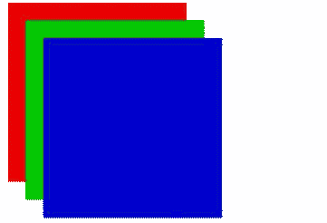

现在你对绘制基础有了了解，让我们来组合 AwesomeCo 的标志。正如你将在下一页的图 6.1 中看到的，它相当简单。

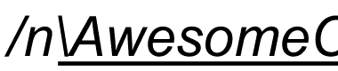

图 6.1：AwesomeCo 标志

### 绘制标志

该标志由一串文本、一个斜线路径、一个正方形和一个三角形组成。让我们首先创建一个新的 HTML5 文档，向页面添加一个`canvas`元素，然后创建一个用于绘制标志的 JavaScript 函数，该函数会检测我们是否可以使用二维画布。

```javascript
var drawLogo = function(){
  var canvas = document.getElementById('logo');
  var context = canvas.getContext('2d');
};
```

我们在首先检查`canvas`元素是否存在后调用此方法，像这样：

```javascript
$(function(){
  var canvas = document.getElementById('logo');
  if (canvas.getContext){
    drawLogo();
  }
});
```

注意这里我们再次使用 jQuery 函数来确保事件在文档就绪时触发。我们在页面上查找 ID 为`logo`的元素，所以我们最好确保将我们的`canvas`元素添加到文档中，以便它可以被找到，我们的检测才能生效。

```html
<canvas id="logo" width="900" height="80">
  <h1>AwesomeCo</h1>
</canvas>
```

接下来，让我们将“AwesomeCo”文本添加到画布中。

### 添加文本

向画布添加文本涉及选择字体、字体大小和对齐方式，然后将文本应用于网格上的相应坐标。我们可以像这样将“AwesomeCo”文本添加到画布中：

```javascript
context.font = 'italic 40px sans-serif';
context.textBaseline = 'top';
context.fillText('AwesomeCo', 60, 0);
```

在将文本应用到画布之前，我们定义文本类型并设置其基线或垂直对齐方式。我们使用`fillText`方法，这样我们可以得到用填充颜色填充的文本，并将其向右设置 60 像素，以便为我们接下来要绘制的大型三角形路径留出空间。

### 绘制线条

我们通过玩“连点成线”的游戏在画布上绘制线条。我们在画布网格上指定一个起点，然后指定网格上的其他点以移动到。随着我们在画布上移动，这些点被连接起来，就像这样：

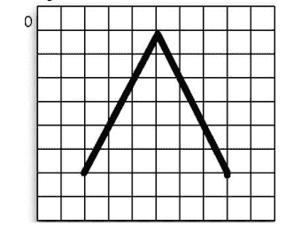

我们使用`beginPath()`方法开始绘制线条，然后创建我们的路径，像这样：

```javascript
context.lineWidth = 2;
context.beginPath();
context.moveTo(0, 40);
context.lineTo(30, 0);
context.lineTo(60, 40);
context.lineTo(285, 40);
context.stroke();
context.closePath();
```

当我们完成在画布上的移动后，必须调用`stroke`方法来绘制线条，然后调用`closePath`方法停止绘制。

现在剩下的就是位于大三角形内的方框和三角形组合了。

### 移动原点

我们需要在较大的三角形内部绘制一个小正方形和三角形。当我们绘制形状和路径时，可以从画布左上角的原点指定X和Y坐标，但也可以直接将原点移动到新位置。

让我们通过移动原点来绘制较小的内部正方形。

```javascript
context.save();
context.translate(20,20);
context.fillRect(0,0,20,20);
```

注意在移动原点之前，我们调用了`save()`方法。这保存了画布的先前状态，以便我们可以轻松地恢复。它就像一个还原点，你可以将其视为一个堆栈。每次调用`save()`时，都会得到一个新条目。当我们全部完成时，我们将调用`restore()`，它将恢复堆栈顶部的保存点。

现在让我们使用路径绘制内部三角形，但不使用描边，而是使用填充来创造三角形“切入”正方形的视觉效果。

```javascript
context.fillStyle = '#fff';
context.strokeStyle = '#fff';

context.lineWidth = 2;
context.beginPath();
context.moveTo(0, 20);
context.lineTo(10, 0);
context.lineTo(20, 20);
context.lineTo(0, 20);
context.fill();
context.closePath();
context.restore();
```

在这里，我们在开始绘制之前将描边和填充设置为白色（`#fff`）。然后我们绘制线条，由于我们之前移动了原点，所以这些线条是相对于我们刚刚绘制的正方形左上角的。

我们几乎完成了，但还需要一点颜色。

### 添加颜色

在上一节（第 13 节 *移动原点*）中，你已经简要了解了如何为绘图工具设置描边和填充颜色。我们可以在绘制任何内容之前添加这段代码，将所有东西的颜色设置为红色：

```javascript
context.fillStyle = "#f00";
context.strokeStyle = "#f00";
```

但这有点无聊。我们可以创建渐变并像这样将它们分配给描边和填充：

```javascript
// context.fillStyle = "#f00";
// context.strokeStyle = "#f00";
var gradient = context.createLinearGradient(0, 0, 0, 40);
gradient.addColorStop(0, '#a00'); // 红色
gradient.addColorStop(1, '#f00'); // 红色
context.fillStyle = gradient;
context.strokeStyle = gradient;
```

我们只需创建一个渐变对象并设置渐变的颜色停止点。在这个例子中，我们只是在两种红色色调之间变化，但如果我们愿意，也可以做一个彩虹²。

注意我们必须在绘制它们之前设置事物的颜色。

此时，我们的标志已经完成，我们更好地理解了如何在画布上绘制简单形状。然而，IE9 之前的 Internet Explorer 版本对`canvas`元素没有任何支持。让我们解决这个问题。

2. 请 *不要* 做彩虹！

### 降级方案

Google 发布了一个名为 ExplorerCanvas³ 的库，它使大多数 Canvas API 对 Internet Explorer 用户可用。我们所要做的就是在我们的页面上包含这个库：

```html
<!--[if lte IE 8]>
<script src="javascripts/excanvas.js"></script>
<![endif]-->
```

这样在 Internet Explorer 中应该可以正常工作——但目前还不行。在撰写本文时，最稳定的版本根本不支持添加文本，而 Subversion 仓库⁴ 中的版本没有使用正确的字体。此外，这个库还不支持在描边上添加渐变。

因此，我们转而依赖其他解决方案，例如将标志的 PNG 图像放在`canvas`元素内，或者干脆不使用`canvas`。由于这只是一个向你展示如何绘制的练习，如果我们无法在跨平台的生产系统中使用这个特定示例，也并非世界末日。

3. http://code.google.com/p/explorercanvas/

4. http://explorercanvas.googlecode.com/svn/trunk/excanvas.js

### 使用 RGraph 绘制统计图表

AwesomeCo 正在网站上做大量工作，高级管理层希望看到网络统计数据的图表。后端程序员将能够实时获取数据，但他们首先希望看看你是否能想出一种在浏览器中显示图表的方法，因此他们为你提供了一些测试数据。我们的目标是将这些测试数据转换成类似于下一页图 6.2 的东西。

在网页上绘制图表的方法有很多种。开发者经常使用 Flash 来制作图表，但这有限制，它在一些移动设备（如 iPad 或 iPhone）上无法工作。有一些服务器端解决方案效果很好，但如果处理实时数据，它们可能过于耗费处理器资源。基于标准的客户端解决方案（如画布）是一个很好的选择，只要我们注意确保它在旧版浏览器中也能工作。你已经看到了如何绘制方框，但绘制复杂的东西需要更多的 JavaScript。我们需要一个图形库来帮助我们。

HTML5 尚未全面普及的事实并没有阻止 RGraph 库的开发者们。<sup>5</sup> RGraph 使得使用 HTML5 canvas 绘制图表变得极其简单。不过，它是一个纯 JavaScript 解决方案，因此对于那些无法使用 JavaScript 的用户代理将无法工作，但话又说回来，canvas 本身也无法工作。这是一个非常简单的柱状图的代码：


```html
<canvas width="500" height="250" id="test">[不支持 canvas]</canvas>

<script type="text/javascript" charset="utf-8">
    var bar = new RGraph.Bar('test', [50,25,15,10]);
    bar.Set('chart.gutter', 50);
    bar.Set('chart.colors', ['red']);
    bar.Set('chart.title', "我最喜欢的派的柱状图");
    bar.Set('chart.labels', ["香蕉奶油", "南瓜", "苹果", "樱桃"]);
    bar.Draw();
</script>
```

`http://www.rgraph.net/`

## 用 HTML 描述数据

我们可以将浏览器统计数据的值硬编码在 JavaScript 代码中，但这样只有启用了 JavaScript 的用户才能看到这些数值。相反，让我们直接将数据作为文本放置在页面上。我们可以用 JavaScript 读取数据，并在稍后将其提供给图表库。

下载 `html5canvasgraph/canvas_graph.html`

```html
<div id="graph_data">
  <h1>Browser share for this site</h1>
  <ul>
    <li>
      <p data-name="Safari 4" data-percent="15">
        Safari 4 - 15%
      </p>
    </li>
    <li>
      <p data-name="Internet Explorer" data-percent="55">
        Internet Explorer - 55%
      </p>
    </li>
    <li>
      <p data-name="Firefox" data-percent="14">
        Firefox - 14%
      </p>
    </li>
  </ul>
</div>
```

### 本站浏览器使用份额

- Safari 4 - 15%
- Internet Explorer - 55%
- Firefox - 14%
- Google Chrome - 16%

图 6.3：以 HTML 形式呈现的图表

```html
<li>
  <p data-name="Google Chrome" data-percent="16">
    Google Chrome - 16%
  </p>
</li>
</ul>
</div>
```

我们使用 HTML5 的 `data` 属性来存储浏览器名称和百分比。尽管这些信息也包含在文本中，但通过编程方式处理起来要容易得多，因为我们无需解析字符串。

如果你在浏览器中打开该页面，或者查看图 6.3，你会看到图表数据即使没有图形也清晰可读。这将作为移动设备和其他不支持 `canvas` 元素或 JavaScript 的用户的备选内容。

现在，让我们将这个标记转换为图表。

### 将我们的 HTML 转换为柱状图

我们将使用柱状图，因此需要同时引入 RGraph 柱状图库和 RGraph 主库。我们还将使用 jQuery 从文档中提取数据。在 HTML 页面的 `head` 部分，我们需要加载所需的库。

下载 `html5canvasgraph/canvas_graph.html`

```html
<script type="text/javascript"
    charset="utf-8"
    src="http://ajax.googleapis.com/ajax/libs/jquery/1.4.2/jquery.min.js">
</script>
<script src="javascripts/RGraph.common.js"></script>
<script src="javascripts/RGraph.bar.js"></script>
```

要构建图表，我们需要从 HTML 文档中获取图表的标题、标签和数据，并将其传递给 RGraph 库。RGraph 接受标签和数据的数组。我们可以使用 jQuery 快速构建这些数组。

下载 `html5canvasgraph/canvas_graph.html`

```javascript
function canvasGraph() {
    var title = $('#graph_data h1').text();

    var labels = $("#graph_data>ul>li>p[data-name]").map(function(){
        return $(this).attr("data-name");
    });

    var percents = $("#graph_data>ul>li>p[data-percent]").map(function(){
        return parseInt($(this).attr("data-percent"));
    });

    var bar = new RGraph.Bar('browsers', percents);
    bar.Set('chart.gutter', 50);
    bar.Set('chart.colors', ['red']);
    bar.Set('chart.title', title);
    bar.Set('chart.labels', labels);
    bar.Draw();
}
```

首先，在第 2 行，我们获取标题的文本。然后，在第 4 行，我们选择所有具有 `data-name` 属性的元素。我们使用 jQuery 的 `map` 函数将这些元素的值转换成一个数组。

我们在第 8 行再次使用相同的逻辑来获取一个百分比数组。

数据收集完毕后，RGraph 就能轻松绘制我们的图表了。

### 显示替代内容

在第 14 节“用 HTML 描述数据”（第 120 页）中，我本可以将图表放在 `canvas` 的开始和结束标签之间。这样，在支持 `canvas` 的浏览器上会隐藏这些元素，而在不支持的浏览器上则会显示它们。然而，如果用户的浏览器支持 `canvas` 元素但用户禁用了 JavaScript，这些内容仍然会被隐藏。

我们只需将数据放在 `canvas` 外部，然后在检查 `canvas` 是否存在后用 jQuery 将其隐藏。

```javascript
var canvas = document.getElementById('browsers');
if (canvas.getContext){
    $('#graph_data').hide();
    canvasGraph();
}
```

这样，我们的图表就准备好了，除了那些使用不支持 `canvas` 元素的浏览器的用户。

### jQuery CSS 与 CSS

在本章中，我们在创建元素时使用 jQuery 为其应用样式。其中许多样式信息，如标签的颜色和条形图的颜色，应该被分离到单独的样式表中，尤其是当你希望样式能独立于脚本进行更改时。对于原型来说，这种方法没问题，但对于生产版本，应始终分离表现、行为和内容。

### 降级处理

在构建这个解决方案时，我们已经涵盖了针对可访问性和 JavaScript 缺失的降级方案，但我们可以为那些没有 `canvas` 支持但能使用 JavaScript 的人创建一个备选图表。

市面上有大量的图表库，但每个库都有自己获取数据的方式。柱状图只是一些具有特定高度的矩形，而我们已经在页面上拥有了手动构建此图表所需的所有数据。

下载 `html5canvasgraph/canvas_graph.html`

```javascript
function divGraph(barColor, textColor, width, spacer, lblHeight){
    $('#graph_data ul').hide();
    var container = $('#graph_data');

    container.css( {
        "display" : "block",
        "position" : "relative",
        "height": "300px"
    });

    $("#graph_data>ul>li>p").each(function(i){
        var bar = $("<div>" + $(this).attr("data-percent") + "%</div>");
        var label = $("<div>" + $(this).attr("data-name") + "</div>");

        var commonCSS = {
            "width": width + "px",
            "position" : "absolute",
            "left" : i * (width + spacer) + "px"
        };

        var barCSS = {
            "background-color" : barColor,
            "color" : textColor,
            "bottom" : lblHeight + "px",
            "height" : $(this).attr("data-percent") + "%"
        };
        var labelCSS = {"bottom" : "0", "text-align" : "center"};

        bar.css( $.extend(barCSS, commonCSS) );
        label.css( $.extend(labelCSS, commonCSS) );

        container.append(bar);
        container.append(label);
    });
}
```

在第 2 行，我们隐藏无序列表，这样文本值就被隐藏了。然后我们获取包含图表数据的元素，并应用一些基本的 CSS 样式。在第 6 行，我们将元素的定位设置为 `relative`，这将使我们能够在这个容器内绝对定位我们的柱状图和标签。

然后，我们遍历项目符号列表中的段落（第 11 行）并创建条形。每次遍历标签都会创建两个 `div` 元素，一个用于条形本身，另一个用于标签，我们将标签定位在条形下方。因此，只需一点数学计算和一些 jQuery，我们就能够重新创建这个图表。虽然它看起来不*完全*相同，但已经足够接近来证明这个概念。

接下来，我们只需要将其与我们的 `canvas` 检测代码连接起来，如下所示：

下载 `html5canvasgraph/canvas_graph.html`

```javascript
var canvas = document.getElementById('browsers');
if (canvas.getContext) {
    $('#graph_data').hide();
    canvasGraph();
}
else {
    divGraph("#f00", "#fff", 140, 10, 20);
}
```

你可以在图 6.4 中看到降级版本。通过结合 JavaScript、HTML 和 CSS，我们为任何需要的平台提供了客户端柱状图和关于浏览器使用情况的统计信息。使用 `canvas` 还有一个额外的好处——它促使我们从一开始就想到了降级解决方案，而不是在最后试图强行加入一些东西。这对可访问性非常有益。

这是目前可用的最具可访问性和通用性的数据图表化方法之一。你可以轻松地创建可视化的表示形式以及基于文本的备选方案。这样，每个人都可以使用你分享的重要数据。

## 乔的问题……

### 我们为什么没有在这里尝试 ExplorerCanvas？

我们在第 13 节“降级方案”（第 118 页）讨论过的 ExplorerCanvas 和 RGraph 可以很好地协同工作。RGraph 甚至在其发行版中捆绑了一个 ExplorerCanvas 版本。然而，这种组合仅适用于 Internet Explorer 8。如果你使用的是 IE 7 或更早版本，你就必须使用我们讨论过的替代解决方案。我建议你密切关注 ExplorerCanvas，因为它仍在积极维护。你甚至可以考虑自己修改它，让它为你所用。

### 未来展望

既然你对 `canvas` 的工作原理有了些许了解，就可以开始思考其他可能的用途了。你可以用它来创建游戏、为媒体播放器创建用户界面，或者用它来构建一个更好的图片库。开始绘制只需要一点点 JavaScript 和一点点想象力。

目前，Flash 相比 `canvas` 仍有优势，因为它得到更广泛的支持，但随着 HTML5 的兴起和 `canvas` 为更多用户所用，更多的开发者将将其用于浏览器中简单的 2D 图形绘制。`canvas` 不需要任何额外的插件，并且比 Flash 使用更少的 CPU，尤其是在 Linux 和 OS X 上。最后，`canvas` 为你提供了一种在 Flash 不可用的环境中进行 2D 图形绘制的机制。随着更多平台支持 `canvas`，你可以期待其速度和功能的提升，并且会看到更多开发者工具和库的出现，帮助你构建令人惊叹的东西。

但这并不仅限于 2D 图形。`canvas` 规范最终也将支持 3D 图形，而浏览器制造商正在实现硬件加速。`canvas` 将使得仅使用 JavaScript 就能创建引人入胜的用户界面和互动游戏成为可能。

# 第 7 章：嵌入音频和视频

音频和视频是现代互联网的重要组成部分。播客、音频预览，甚至教学视频无处不在，而直到现在，它们只能通过浏览器插件真正可用。HTML5 引入了将音频和视频文件嵌入页面的新方法。在本章中，我们将探索几种不仅可以嵌入音频和视频内容，还可以确保使用旧版浏览器的用户也能访问的方法。

在本章中，我们将讨论以下两个元素：¹

- **`<audio>`** `[<audio src="drums.mp3"></audio>]`

  在浏览器中原生播放音频。*C4, F3.6, IE9, S3.2, O10.1, IOS3, A2*

- **`<video>`** `[<video src="tutorial.m4v"></video>]`

  在浏览器中原生播放视频。*C4, F3.6, IE9, S3.2, O10.5, IOS3, A21*

在此之前，我们需要谈谈网络上音频和视频的历史。毕竟，要理解我们的发展方向，就必须了解我们的过去。

> 1. 在接下来的描述中，浏览器支持信息显示在方括号中，使用简写代码和最低支持版本号。使用的代码为：C：Google Chrome，F：Firefox，IE：IE，O：Opera，S：Safari，IOS：搭载 Mobile Safari 的 iOS 设备，A：Android 浏览器。

## 7.1 简短历史

人们很早以前就尝试在网页上使用音频和视频。起初，人们在自己的主页上嵌入 MIDI 文件，并使用 `embed` 标签来引用文件，就像这样：

```html
<embed src="awesome.mp3" autostart="true"
       loop="true" controller="true"></embed>
```

`embed` 标签从未成为标准，于是人们开始使用 `object` 标签，这是 W3C 接受的标准。为了支持不理解 `object` 标签的旧版浏览器，你经常看到一个 `embed` 标签嵌套在 `object` 标签内，就像这样：

```html
<object>
  <param name="src" value="simpsons.mp3">
  <param name="autoplay" value="false">
  <param name="controller" value="true">
  <embed src="awesome.mp3" autostart="false"
         loop="false" controller="true"></embed>
</object>
```

然而，并非所有浏览器都能以这种方式流式传输内容，也不是每台服务器都配置正确以提供正确服务。当网络视频变得更加流行时，事情变得更加复杂。我们经历了网络上音频和视频内容的多次迭代，从 RealPlayer 到 Windows Media 再到 QuickTime。每家公司都有自己的视频策略，似乎每个网站都使用不同的方法和格式在网络上编码他们的视频。

Macromedia（现为 Adobe）很早就意识到，其 Flash Player 可以成为跨平台传递音频和视频内容的完美载体。Flash 已经在大约 97% 的网络浏览器上可用。一旦内容生产者发现他们可以编码一次并随处播放，成千上万的网站就转向了用于音频和视频的 Flash 流媒体。

接着，苹果公司在 2007 年推出了 iPhone 和 iPod touch，并决定在这些设备上不支持 Flash。内容提供商通过提供可在 Mobile Safari 浏览器中直接播放的视频流来应对。这些视频使用 H.264 编解码器，也可以通过普通的 Flash Player 播放，这使得内容提供商仍然可以编码一次，同时面向多个平台。

HTML5 规范的创建者认为，浏览器应该原生支持音频和视频，而不是依赖需要大量样板 HTML 的插件。这就是 HTML5 音频和视频开始更有意义的地方：将音频和视频视为网络内容中的“一等公民”。

## 乔的问题……

### Flash 已经可以跨浏览器工作了，那为什么不使用它呢？

简单的答案是，一旦你将内容嵌入页面，作为开发者，你可以做什么方面没有任何供应商限制。你可以使用 CSS 和 JavaScript 来操作这个元素，而不需要费力地将参数传递给 Flash 影片。此外，随着标准变得更加成熟，情况将会改善。

## 7.2 容器和编解码器


当我们在网络上谈论视频时，我们使用容器和编解码器这两个术语。你可能认为从数码相机上获得的视频是一个 AVI 或 MPEG 文件，但这实际上是一种过度简化。容器就像一个信封，包含音频流、视频流，有时还包括额外的元数据，如字幕。这些音频和视频流需要被编码，这就是编解码器的作用。视频和音频可以用数百种不同的方式进行编码，但当涉及 HTML5 视频时，只有少数几种是重要的。

### 视频编解码器

当你观看视频时，你的播放器必须对其进行解码。不幸的是，你使用的播放器可能无法解码你想观看的视频。有些播放器使用软件来解码视频，这可能较慢或更耗 CPU。其他播放器使用硬件解码器，因此只能播放有限格式的内容。目前，如果你想在今天的工作中开始使用 HTML5 视频标签，你需要了解三种视频格式：H.264、Theora 和 VP8。

### 编解码器与支持的浏览器

| 编解码器 | 支持的浏览器 |
| --- | --- |
| H.264 | [IE9, S4, C3, IOS] |
| Theora | [F3.5, C4, O10] |
| VP8 | [IE9 (如果安装了编解码器), F4, C5, O10.7] |

### H.264

H.264 是一种高质量的编解码器，于 2003 年由 MPEG 组制定标准。为了支持手机等低端设备，同时处理高清设备的视频，H.264 规范被分为不同的配置文件（profiles）。这些配置文件共享一组通用特性，但更高档的配置文件提供额外的选项以提高质量。例如，iPhone 和 Flash Player 都可以播放用 H.264 编码的视频，但 iPhone 只支持较低质量的“基线”配置文件，而 Flash Player 支持更高质量的流。可以对视频进行一次编码并嵌入多个配置文件，使其在不同平台上看起来都很好。

由于 Microsoft 和 Apple 这些被许可方的支持，H.264 成为了事实上的标准。除此之外，Google 的 YouTube 将其视频转换为 H.264 编解码器，以便在 iPhone 上播放，Adobe 的 Flash Player 也支持它。然而，它并非开放技术。它受专利保护，其使用受许可条款约束。内容生产者必须支付特许权使用费才能使用 H.264 编码视频，但这些费用不适用于免费提供给最终用户的内容。

自由软件的支持者担心，权利持有者最终可能会开始向内容生产者索取高额的特许权使用费。这种担忧促使了替代编解码器的创建和推广。

### Theora

Theora 是由 Xiph.Org 基金会开发的免版税编解码器。尽管内容生产者可以用 Theora 创建类似质量的视频，但设备制造商一直采用缓慢。Firefox，

1. http://www.reelseo.com/mpeg-la-announces-avc-h264-free-license-lifetime/

Chrome 和 Opera 可以在任何平台上播放使用 Theora 编码的视频，无需额外软件，但 Internet Explorer、Safari 和 iOS 设备则无法做到。苹果和微软对“潜水艇专利”持谨慎态度，这个术语用于描述那些故意拖延专利申请公开和授权，以便在他人实施该技术时保持低调的专利。当时机成熟时，专利申请人就会“浮出水面”，并向毫无防备的市场索取特许权使用费。

### VP8

谷歌的 VP8 是一种完全开放、免版权费的编解码器，质量与 H.264 相当。它得到了 Mozilla、谷歌 Chrome 和 Opera 的支持，而微软的 Internet Explorer 9 承诺只要用户已安装相应的编解码器，就会支持 VP8。它也得到了 Adobe Flash Player 的支持，这使其成为一个有趣的选择。Safari 和 iOS 设备不支持它，这意味着虽然这种编解码器可以免费使用，但希望向 iPhone 或 iPad 用户传递视频内容的内容生产者仍然需要使用 H.264 编解码器。

### 音频编解码器

好像视频领域的标准竞争还不够复杂似的，我们还必须关注音频领域的竞争标准。

### 编解码器及其支持的浏览器

- AAC
  - [S4, C3, IOS]
- MP3
  - [IE9, S4, C3, IOS]
- Vorbis (OGG)
  - [F3, C4, O10]

### 高级音频编码 (AAC)

这是苹果在其 iTunes Store 中使用的音频格式。其设计目标是在文件大小与 MP3 相当时提供更好的音频质量，并且它也提供了与 H.264 类似的多种音频配置文件。同样，与 H.264 一样，它不是免费的编解码器，有关联的许可费用。

所有苹果产品都能播放 AAC 文件。Adobe Flash Player 和开源 VLC 播放器也能播放。

### Vorbis (OGG)

这种开源免版权费的格式得到了 Firefox、Opera 和 Chrome 的支持。你会发现它也与 Theora 和 VP8 视频编解码器一起使用。Vorbis 文件的音频质量非常好，但并未得到硬件音乐播放器的广泛支持。

### MP3

MP3 格式虽然极为常见和流行，但由于同样受到专利限制，因此在 Firefox 和 Opera 中不受支持。Safari 和 Google Chrome 支持它。

视频编解码器和音频编解码器需要打包在一起才能进行分发和播放。让我们来谈谈视频容器。

### 容器和编解码器协同工作

容器是一种元数据文件，用于标识和交错音频或视频文件。容器实际上并不包含有关其包含的信息如何编码的任何信息。本质上，容器“包裹”了音频和视频流。容器通常可以容纳任何编码媒体的组合，但在讨论如何在网络上处理视频时，我们会看到这些组合：

- OGG 容器，包含 Theora 视频和 Vorbis 鉷音，可在 Firefox、Chrome 和 Opera 中工作。
- MP4 容器，包含 H.264 视频和 AAC 音频，可在 Safari 和 Chrome 中工作。它也可以通过 Adobe Flash Player 以及在 iPhone、iPod 和 iPad 上播放。
- WebM 容器，使用 VP8 视频和 Vorbis 音频，可在 Firefox、Chrome、Opera 和 Adobe Flash Player 中工作。

鉴于谷歌和 Mozilla 正在推进 VP8 和 WebM，我们最终可以从组合中排除 Theora，但从目前情况来看，我们似乎仍然需要将我们的视频编码两次——一次为苹果用户（在美国他们桌面市场份额较小，但移动设备市场份额较大），然后再次为 Firefox 和 Opera 用户，因为这两个浏览器都拒绝播放 H.264。³

内容很多，但现在你已经了解了历史和局限性，让我们开始探讨一些实际的实现，从音频开始。

2. http://lists.whatwg.org/pipermail/whatwg-whatwg.org/2009-June/020620.html

### 处理音频

AwesomeCo 正在开发一个网站来展示一些用于屏幕录制的免版权音频循环，并希望为单个循环集合制作一个演示页面。完成后，我们将有一个音频循环列表，访客将能够快速试听每一个。我们不必为这个项目寻找音频循环而担心，因为客户的声音工程师已经以 MP3 和 OGG 格式为我们提供了所需的样本。关于如何编码你自己的音频文件的更多信息，你可以在第 247 页的附录 C 中找到。

#### 构建基本列表

声音工程师为我们提供了四个样本：鼓、风琴、贝斯和吉他。我们需要使用 HTML 标记来描述这些样本中的每一个。以下是鼓循环的标记：

```html
Download html5_audio/audio.html

<article class="sample">
  <header><h2>Drums</h2></header>
  <audio id="drums" controls>
    <source src="sounds/ogg/drums.ogg" type="audio/ogg">
    <source src="sounds/mp3/drums.mp3" type="audio/mpeg">
    <a href="sounds/mp3/drums.mp3">Download drums.mp3</a>
  </audio>
</article>
```

我们首先定义音频元素，并告诉它我们希望显示一些控件。接下来，我们为文件定义多个源。我们首先定义样本的 MP3 和 OGG 版本，然后如果浏览器不支持音频元素，我们显示一个链接，允许访客直接下载 MP3 文件。

这段非常基础的代码可以在 Chrome、Safari 和 Firefox 中工作。让我们将其与其他三个声音样本一起放入一个 HTML5 模板中。

```html
Download html5_audio/audio.html

<article class="sample">
  <header><h2>Drums</h2></header>
  <audio id="drums" controls>
    <source src="sounds/ogg/drums.ogg" type="audio/ogg">
    <source src="sounds/mp3/drums.mp3" type="audio/mpeg">
    <a href="sounds/mp3/drums.mp3">Download drums.mp3</a>
  </audio>
</article>

<article class="sample">
  <header><h2>Guitar</h2></header>
  <audio id="guitar" controls>
    <source src="sounds/ogg/guitar.ogg" type="audio/ogg">
    <source src="sounds/mp3/guitar.mp3" type="audio/mpeg">
    <a href="sounds/mp3/guitar.mp3">Download guitar.mp3</a>
  </audio>
</article>

<article class="sample">
  <header><h2>Organ</h2></header>
  <audio id="organ" controls>
    <source src="sounds/ogg/organ.ogg" type="audio/ogg">
    <source src="sounds/mp3/organ.mp3" type="audio/mpeg">
    <a href="sounds/mp3/organ.mp3">Download organ.mp3</a>
  </audio>
</article>

<article class="sample">
  <header><h2>Bass</h2></header>
  <audio id="bass" controls>
    <source src="sounds/ogg/bass.ogg" type="audio/ogg">
    <source src="sounds/mp3/bass.mp3" type="audio/mpeg">
    <a href="sounds/mp3/bass.mp3">Download bass.mp3</a>
  </audio>
</article>
</body>
</html>
```

当我们用兼容 HTML5 的浏览器打开页面时，列表中的每个条目都会有其自己的音频播放器，如后一页图 7.1 所示。当你按下播放按钮时，浏览器本身会处理音频的播放。

当我们用 Internet Explorer 打开页面时，由于浏览器不理解音频元素，下载链接会显示出来。这提供了一个不错的备用解决方案，但让我们看看是否可以做得更好。

### 回退支持

音频的回退支持内置于元素本身。我们使用 source 元素为音频定义了多个源，并提供了下载音频文件的链接。如果浏览器无法渲染音频元素，它将显示我们放置在 field 内的链接。我们甚至可以更进一步，在定义源之后使用 Flash 作为回退。

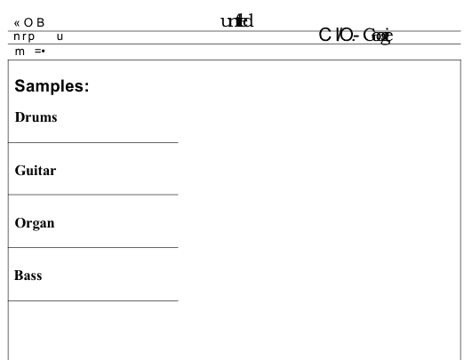

图 7.1：我们的页面在 Safari 中

然而，这可能不是最好的方法。你可能会遇到支持音频元素但不支持你提供的格式的浏览器。例如，你可能认为不值得花时间提供多种格式的音频。此外，HTML5 规范特别指出，音频的回退支持不应被用于放置屏幕阅读器会读取的内容。

最简单的解决方案是将下载链接移到音频元素之外，并使用 JavaScript 来隐藏它，如下所示：

```html
Download html5_audio/advanced_audio.html

<article class="sample">
  <header><h2>Drums</h2></header>
  <audio id="drums" controls>
    <source src="sounds/ogg/drums.ogg" type="audio/ogg">
    <source src="sounds/mp3/drums.mp3" type="audio/mpeg">
  </audio>
  <a href="sounds/mp3/drums.mp3">Download drums.mp3</a>
</article>
```

接下来我们只需检测对音频的支持并隐藏链接。我们通过在 JavaScript 中创建一个新的 audio 元素，检查它是否能响应`canPlayType()`方法来实现这一点，如下所示：

```javascript
Download html5_audio/advanced_audio.html

var canPlayAudioFiles = !!(document.createElement('audio').canPlayType);
```

我们评估响应，然后隐藏嵌套在示例部分内的所有锚点。

```javascript
Download html5_audio/advanced_audio.html

$(function(){
    var canPlayAudioFiles = !!(document.createElement('audio').canPlayType);

    if(canPlayAudioFiles){
        $(".sample a").hide();
    };
});
```

音频的回退方案相对容易，而且你的一些用户可能实际上会欣赏能够轻松下载文件的能力。

在浏览器中原生播放音频只是一个开始。浏览器才刚刚开始支持音频和视频的 HTML5 JavaScript API，你可以在第 141 页的侧边栏中阅读相关内容。

### 嵌入视频

AwesomeCo 希望在其网站上展示其新的培训视频系列，并希望这些视频能在尽可能多的设备上观看，尤其是在 iPad 上。作为试用，我们收到了“Photoshop 技巧”系列中的两个视频，将用它们来构建一个原型。幸运的是，视频文件提供了 H.264、Theora 和 VP8 格式，因此我们可以专注于创建页面。⁴

video 标签的工作原理与 audio 元素完全相同。我们只需提供源文件，Chrome、Firefox、Safari、iPhone、iPad 和 Internet Explorer 9 就会在没有任何额外插件的情况下显示视频。我们的第一个视频文件 01_blur 的标记如下所示：

```html
Download html5video/index.html

<article>
  <header>
    <h2>饱和与模糊</h2>
  </header>
  <video controls>
    <source src="video/h264/01_blur.mp4">
    <source src="video/theora/01_blur.ogv">
    <source src="video/webm/01_blur.webm">
    <p>Your browser does not support the video tag.</p>
  </video>
</article>
```

我们定义了带有 controls 属性的 video 标签。我们通过不包含 autoplay 属性，隐式地告诉它不应自动播放。此时，我们的视频可以在各种浏览器中播放，用户将看到类似于下一页图 7.2 所示的视频播放器。

我们仍然无法覆盖 Internet Explorer 8 及更早版本的用户。我们需要使用 Flash 来实现这一点。

3. 如果你想了解更多关于编码自己的视频文件的信息，请参阅第 247 页的附录 C。

#### 饱和与模糊

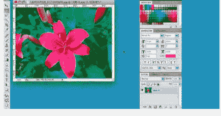

#### 复制图层

图 7.2：我们的视频使用 Safari 的 HTML5 视频播放器显示

#### 回退方案

为了正确支持基于 Flash 的回退并仍然使用 HTML5 视频，我们将 Flash 对象代码放在 video 标签内。网站 Video For Everybody⁵ 详细介绍了这个过程，但我们将在这里介绍一个基本的实现。

Flowplayer⁶ 是一个基于 Flash 的播放器，可以播放我们已经编码的 H.264 视频。我们将下载这个播放器的开源版本，并将`flowplayer-x.x.x.swf`和`flowplayer-controls-x.x.x.swf`文件放在项目的`swf`文件夹中以保持组织性。

然后我们将此代码放在 video 标签内，紧跟在最后一个 source 元素之后：


```html
Download html5video/index.html

<object width="640" height="480" type="application/x-shockwave-flash"
    data="swf/flowplayer-3.2.2.swf">
    <param name="movie" value="swf/flowplayer-3.2.2.swf" />
    <param name="allowfullscreen" value="true" />
    <param name="flashvars"
    value='config={ "clip" : { "url" : "../video/h264/01_blur.mp4",
                    "autoPlay":false,
                    "autoBuffering": true
                   }
            }' />
    
</object>
```

5. <http://videoforeverybody.com>

6. <http://flowplayer.org/download/index.html>

请密切关注这部分：

```html
Download html5video/index.html

<param name="flashvars"
          value='config={ "clip" : { "url" : "../video/h264/01_blur.mp4",
                              "autoPlay":false,
                              "autoBuffering": true
                           }
                  }' />
```

视频文件的源路径需要相对于 Flowplayer 的位置。由于我们将 Flowplayer 放在了 `swf` 文件夹中，我们需要使用路径 `../video/h264/01_blur.mp4` 才能让播放器找到我们的视频。

当我们在 Internet Explorer 中打开页面时，视频可以播放，而且多亏了 Flowplayer，我们不需要再编码为另一种格式。我们的 Internet Explorer 用户将看到下一页的图 7.3。

当然，我们仍然需要为那些没有原生视频支持且没有安装 Flash 的用户提供解决方案。为此，我们将通过添加另一个包含下载链接的部分，让人们下载我们的视频内容。

```html
Download html5video/index.html

<section class="downloads">
  <header>
    <h3>下载</h3>
  </header>
  <ul>
    <li><a href="video/h264/01_blur.mp4">H264格式，可在大多数平台上播放</a></li>
    <li><a href="video/theora/01_blur.ogv">OGG格式</a></li>
    <li><a href="video/webm/01_blur.webm">WebM格式</a></li>
  </ul>
</section>
```

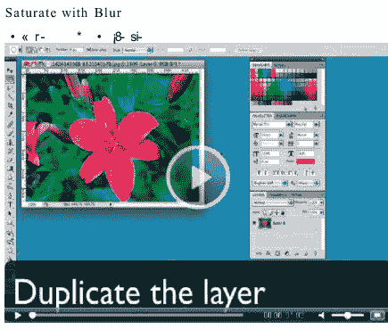

图 7.3：在 Internet Explorer 中使用 Flowplayer 播放我们的视频

如果 HTML5 视频不受支持，我们可以使用 JavaScript 来隐藏这些视频，如下所示：

```javascript
function canPlayVideo() {
  return !!document.createElement('video').canPlayType;
}
if (canPlayVideo()) {
  $('#videos .downloads').hide();
}
```

这使用的检测技术与我们在第 133 页“处理音频”中使用的技术非常相似。在我们的情况下，让人们下载这些视频以便在他们的 iPod 或 iPad 上稍后观看更有意义。

### HTML5 视频的局限性

目前有三个非常重要的局限性限制了 HTML5 视频的实用性。

首先，HTML5 视频没有提供流式传输视频文件的机制。用户已经习惯了能够跳转到视频的特定部分。这是基于 Flash 的视频播放器擅长的事情，因为 Adobe 在 Flash 作为视频传输平台上投入了大量精力。使用 HTML5 视频跳转时，文件必须在浏览器上完全下载。这一点未来可能会改变。

其次，没有办法进行权限管理。像 Hulu⁷ 这样希望防止内容盗版的网站无法依赖 HTML5 视频。Flash 在这些情况下仍然是一个可行的解决方案。

最后，也是最重要的，视频编码过程既昂贵又耗时。需要编码成多种格式，使得 HTML5 视频的吸引力大大降低。因此，你会看到许多网站提供受专利限制的 H.264 格式的视频，以便可以在 iPod 和 iPad 上播放，使用 HTML5 视频标签和 Flash 的组合。

这些问题不会阻碍 HTML5 的发展，但在我们使用 HTML5 视频取代 Flash 作为视频传输工具之前，这些是需要注意的问题。

### 媒体内容 JavaScript API

在本章中，我们只是简要介绍了音频和视频元素的 JavaScript API。完整的 API 可以检测浏览器能播放的音频文件类型，并提供了控制音频元素播放的方法。

在第 133 页的“处理音频”中，我们构建了一个包含多个声音示例的页面。我们可以使用 JavaScript API 让所有声音大致同时播放。这是一个非常简化的方法：

```javascript
Download html5_audio/advanced_audio.html

var element = $("<p><input type='button' value='Play all'></p>");
element.click(function() {
    $("audio").each(function() {
        this.play();
    });
});

$("body").append(element);
```

我们创建了一个“全部播放”按钮，按下时，会遍历页面上所有的 `audio` 元素并调用每个元素的 `play()` 方法。

我们可以对视频做类似的事情。有方法可以启动和暂停元素，甚至查询当前时间。

遗憾的是，在撰写本文时，JavaScript API 在各处的支持并不完善。这不应该阻止你查看规范中概述的可能性，看看什么是可能的。

*. <http://www.w3.org/TR/html5/video.html#media-elements>

### 关注成人娱乐行业

成人娱乐行业对互联网技术产生了强烈影响，从电子商务到 Flash 的兴起。他们现在又在 HTML5 视频上这样做。† 像 iPhone 和 iPad 这样的设备比台式机和笔记本电脑更具个人性，而且它们不运行 Flash。出于这个原因，许多成人网站已经开始将视频传输从 Flash 切换到使用 H.264 视频的 HTML5。有趣的是，他们似乎并不关心 HTML5 视频目前不提供任何权限管理。

成人行业从不害怕冒险，由于他们对这项技术的兴趣，你可能会看到 HTML5 视频方面的一些有趣进展。

†. <http://news.avn.com/articles/Joone-Points-to-HTML-5-as-Future-of-Web-Content-Delivery-i01434.html>

### 音频、视频和无障碍性

没有任何回退方案能真正很好地服务于残障用户。事实上，HTML5 规范明确指出了这一点。

听力受损的用户不会觉得下载音频文件有什么价值，而视力受损的用户对于只能在浏览器外观看的视频文件也用处不大。当我们向用户提供内容时，应尽可能提供可用的替代方案。视频和音频文件应配有供人查看的文字稿。如果你制作自己的内容，从一开始就规划好，文字稿会很容易制作，因为它可以直接来自你撰写的脚本。如果无法提供文字稿，请考虑提供一个突出视频重要部分的摘要。

```html
Download html5video/index.html

<section class="transcript">
  <h2>文字稿</h2>
  <p>我们将把现有的图层拖到图层面板底部的新按钮上，创建一个新的副本。</p>
  <p>接下来，我们将转到“滤镜”菜单并选择“高斯模糊”。我们将调整模糊程度，恰好使我们失去图像的一点细节。</p>
  <p>现在，我们将双击图层进行编辑，并将混合模式更改为“叠加”。然后，我们可以通过调整不透明度滑块来调整效果的强度。</p>
  <p>现在我们有了一张略微增强的图像。</p>
</section>
```

你可以隐藏文字稿，或者从主视频页面链接到它。只要它易于查找且易于遵循，它就会非常有帮助。

### 未来

浏览器中一流的音频支持为开发者开辟了大量新的可能性。JavaScript 网页应用程序可以轻松触发音效和警报，而无需使用 Flash 来嵌入音频。原生视频使得视频可以在 iPhone 等设备上播放成为可能，但它也为我们提供了一种使用 JavaScript 与视频交互的开放、标准的方法。最重要的是，我们将能够像处理图像一样处理视频和音频片段，即通过语义化标记它们并使其更易于识别。

# 第 8 章

## 伊芙·坎迪

作为 Web 开发者，我们总是对让用户界面更吸引人一点感兴趣，而 CSS3 为我们提供了很多方法来做到这一点。我们可以在页面上使用自己的自定义字体。我们可以创建带有圆角和投影的元素。我们可以使用渐变作为背景，我们甚至可以旋转元素，这样东西看起来就不会总是那么方正和无聊。我们可以做所有这些事情，而无需借助 Photoshop 或其他图形程序，本章将向你展示如何做到这一点。我们将从通过圆角来柔化表单的外观开始。然后，我们将为即将到来的贸易展构建一个原型横幅，在那里我们将学习如何添加阴影、旋转、渐变和不透明度。最后，我们将讨论如何使用 CSS3 的 `@font-face` 功能，以便我们可以在公司博客上使用更漂亮的字体。

具体来说，我们将在本章中探讨以下 CSS3 功能：¹

- `border-radius` [`border-radius: 10px;`]

  圆化元素的角。[C4, F3, IE9, S3.2, O10.5]

- RGBa 支持 [`background-color: rgba(255,0,0,0.5);`]

  使用 RGB 颜色（而非十六进制代码）以及透明度。[C4, F3.5, IE9, S3.2, O10.1]

- `box-shadow` [`box-shadow: 10px 10px 5px #333;`]

  在元素上创建投影。[C3, F3.5, IE9, S3.2, O10.5]

- 旋转：[`transform: rotate(7.5deg);`]

  旋转任何元素。[C3, F3.5, IE9, S3.2, O10.5]

- 渐变：[`linear-gradient(top, #fff, #efefef);`]

  创建可用作图像的渐变。[C4, F3.5, S4]

- `@font-face`

  ```css
  @font-face {
    font-family: AwesomeFont;
    src: url(http://example.com/awesomeco.ttf);
    font-weight: bold;
  }
  ```

  允许通过 CSS 使用特定字体。[C4, F3.5, IE5+, S3.2, O10.5]

¹ 在接下来的描述中，浏览器支持显示在方括号中。使用的代码为：C: Google Chrome, F: Firefox, IE: Internet Explorer, O: Opera, S: Safari, IOS: iOS 设备上的 Mobile Safari, 和 A: Android 浏览器。

## 修整粗糙边缘

在 Web 上，默认一切都是矩形。表单字段、表格甚至网页的各个部分都具有方正、边缘锐利的外观，因此多年来许多设计师转向不同的技术来为这些元素添加圆角，以稍微柔化界面。

CSS3 支持轻松地圆角化，Firefox 和 Safari 已经支持相当长一段时间了。不幸的是，Internet Explorer 还没有加入这个行列。但我们可以用足够简单的方法来解决这个问题。

### 柔化登录表单

你为当前项目收到的线框图和模型显示了带有圆角的表单字段。让我们首先仅使用 CSS3 来圆化这些角。我们的目标是创建出看起来像下一页图 8.1 的东西。

对于登录表单，我们将使用一些非常简单的 HTML。

```html
Download css3roughedges/rounded_corners.html

<form action="/login" method="post">
  <fieldset id="login">
    <legend>登录</legend>
    <ol>
      <li>
        <label for="email">电子邮件</label>
        <input id="email" type="email" name="email">
      </li>
      <li>
        <label for="password">密码</label>
        <input id="password" type="password" name="password" value="" autocomplete="off"/>
      </li>
      <li><input type="submit" value="登录"></li>
    </ol>
  </fieldset>
</form>
```

我们将对表单进行一些样式设置，使其看起来稍微好一些。

```css
Download css3roughedges/style.css

fieldset {
    width: 216px;
    border: none;
    background-color: #ddd;
}

fieldset legend {
    background-color: #ddd;
    padding: 0 64px 0 2px;
}

fieldset > ol {
    list-style: none;
    padding: 0;
    margin: 2px;
}

fieldset > ol > li {
    margin: 0 0 9px 0;
    padding: 0;
}

/* 使输入字段换行显示 */
fieldset input {
    display: block;
}

input {
  width: 200px;
  background-color: #fff;
  border: 1px solid #bbb;
}

input[type="submit"] {
  width: 202px;
  padding: 0;
  background-color: #bbb;
}
```

这些基本样式移除了列表的项目符号，并确保所有输入字段大小相同。有了这些，我们就可以为元素应用圆角效果了。

### 浏览器特定选择器

由于 CSS3 规范尚未最终确定，浏览器厂商添加了一些自己的功能，并决定为自己的实现添加前缀。这些前缀让浏览器厂商能够在功能成为最终规范的一部分之前尽早引入它们，并且由于它们不遵循实际规范，浏览器厂商可以在保留自己实现的同时实现实际规范。大多数情况下，带厂商前缀的版本与 CSS 规范匹配，但偶尔你会遇到差异。不幸的是，对你来说，这意味着你需要为每种浏览器类型分别声明一次边框圆角。

Firefox 使用这个选择器：

```css
-moz-border-radius: 5px;
```

基于 WebKit 的浏览器，如 Safari 和 Chrome，使用这个选择器：

```css
-webkit-border-radius: 5px;
```

要圆化我们表单上的所有输入字段，我们需要像这样的 CSS 规则：

```css
input, fieldset, legend {
  border-radius: 5px;
  -moz-border-radius: 5px;
  -webkit-border-radius: 5px;
}
```

将此添加到你的 `style.css` 文件，你就拥有了圆角。

### 回退处理

你已经在 Firefox、Safari 和 Google Chrome 中让一切正常工作了，但你知道它在 Internet Explorer 中不起作用，并且你需要它起作用，所以你需要实现一些能让它尽可能接近的效果。

Web 开发者已经使用背景图像和其他技术进行圆角处理有一段时间了，但我们将尽可能保持简单。我们可以使用 JavaScript 检测边框圆角，并使用任何数量的圆角技术来圆化角落。在这个例子中，我们将使用 jQuery、jQuery Corner 插件以及 Corner 插件的一个修改版本，该版本用于圆化文本字段。

#### 检测圆角支持

我们的回退解决方案看起来非常像第 9 节（第 91 页）“回退处理”中使用的那个。我们将包含 jQuery 库和插件，我们将检测浏览器是否支持我们的属性，如果不支持，我们将激活插件。在这种情况下，我们需要检测 `border-radius` CSS 属性的存在，但我们也需要检查浏览器特定的前缀，如 `webkit` 和 `moz`。

创建 `corner.js`，并添加这个函数：


```javascript
function hasBorderRadius(){
    var element = document.documentElement;
    var style = element.style;
    if (style){
        return typeof style.borderRadius == "string" ||
               typeof style.MozBorderRadius == "string" ||
               typeof style.WebkitBorderRadius == "string" ||
               typeof style.KhtmlBorderRadius == "string";
    }
    return null;
}
```

我们现在可以检测浏览器是否缺少对圆角的支持，因此让我们编写代码来进行实际的圆角处理。值得庆幸的是，有一个插件可以帮助我们开始。

## jQuery Corners

jQuery Corners² 是一个小型插件，它通过用额外的 `div` 标签包裹元素并对其设置样式来实现圆角，从而使目标...

² http://www.malsup.com/jquery/corner/

## 决定是否值得付出努力

在我们的示例中，客户确实希望所有浏览器都能显示圆角。然而，如果可能，您应该始终将这类功能设为可选项。尽管有些人可能会认为柔化表单外观确实有好处，但您首先应该了解有多少用户使用的浏览器不支持基于 CSS 的圆角。如果您的访客主要是 Safari 和 Firefox 用户，那么编写和维护检测与回退脚本可能不值得您花费时间。

jQuery Corners 插件可以让元素看起来是圆角的。它不适用于表单字段；然而，通过一点想象力，我们可以使用这个插件和一些 jQuery 代码让它生效。

首先，获取 jQuery Corners，并在您的 HTML 页面中链接它。同时，也链接您的 `corner.js` 文件。

```html
Download css3roughedges/rounded_corners.html

<script src="jquery.corner.js" charset="utf-8" type='text/javascript'></script>
<script src="corner.js" charset="utf-8" type='text/javascript'></script>
```

现在我们只需编写实际调用圆角效果的代码。

## 我们的 `formCorners` 插件

我们将编写一个 jQuery 插件，以便轻松地将此圆角效果应用于所有表单字段。我们已经在第 5 章《回退方案》（第 60 页）讨论过编写 jQuery 插件，所以我不需要再重复。相反，我将带您逐步了解这个插件的代码，该代码部分基于 Tony Amoyal 的解决方案。3

3. http://www.ionyamoyal.com/2009/06/23/text-inputs-with-rounded-corners-using-jquery-without-image/

将此代码添加到您的 `corners.js` 文件：

```javascript
Download css3roughedges/corner.js

(function() {
    $.fn.formCorner = function(){
        return this.each(function() {
            var input = $(this);
            var input_background = input.css("background-color");
            var input_border = input.css("border-color");
            input.css("border", "none");
            var wrap_width = parseInt(input.css("width")) + 4;
            var wrapper = input.wrap("<div></div>").parent();
            var border = wrapper.wrap("<div></div>").parent();
            wrapper.css("background-color", input_background)
                  .css("padding", "1px");
            border.css("background-color", input_border)
                  .css("width", wrap_width + "px")
                  .css("padding", "1px");
            wrapper.corner("round 5px");
            border.corner("round 5px");
        });
    };
})();
```

我们接收一个 jQuery 对象，它可能是一个元素或一组元素，并用两个 `div` 标签将其包裹，然后进行圆角处理。我们首先将最内层 `div` 的颜色设置为原始输入框的背景色，并关闭实际表单字段的边框。然后，我们用另一个具有自己背景色的 `div` 包裹该字段，这个背景色是原始输入框的边框颜色，并给它一点内边距。正是这个内边距使得边框的轮廓可见。想象两张彩色卡纸——一张绿色的宽 4 英寸，另一张红色的宽 3 英寸。当您将较小的放在较大的上面时，您会看到红色卡片周围有一圈绿色边框。这就是它的原理。

## 调用圆角效果

有了插件和我们的检测库，我们现在可以调用圆角效果了。

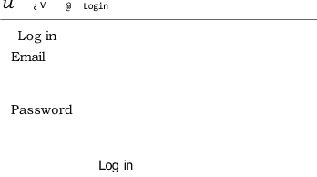

图 8.2：我们的表单在 Internet Explorer 中具有圆角效果。

将此代码添加到 `corners.js` 文件：

```javascript
Download css3roughedges/corner.js

$(function() {
  if(!hasBorderRadius()){
    $("input").formCorner();
    $("fieldset").corner("round 5px");
    $("legend").corner("round top 5px cc:#fff");
  }
});
```

我们对三个表单字段和 `fieldset` 进行圆角处理，最后，在第 5 行，我们只对 `legend` 的顶部进行圆角处理，并指定角落的裁切颜色应使用白色。该插件使用父元素的背景色作为裁切颜色，这在此处不合适。

如果浏览器支持 `border-radius` 属性，则运行我们的插件。如果不支持，则使用我们之前添加的 CSS。

## 一个微小的调整

IE 对 `legend` 的处理有些不同。我们可以为 IE 添加一个小样式修复，将 `fieldset` 的 `legend` 向上推一点，使其在 Firefox 和 Chrome 中看起来一样。

```html
Download css3roughedges/rounded_corners.html

<link rel="stylesheet" href="style.css" type="text/css" media="screen">
<!--[if IE]>
<style>
    fieldset legend{margin-top: -10px }
</style>
<![endif]-->
```

现在，在所有主要浏览器上看起来都相对相似；您可以在上一页的图 8.2 中看到 Internet Explorer 版本。

圆角为您的界面增添了一丝柔和感，并且极其易于使用。话虽如此，与设计的任何其他方面一样，保持使用的一致性并避免过度使用此技术很重要。

## 处理阴影、渐变和变换

虽然圆角备受关注，但这只是我们使用 CSS3 所能做事情的开始。我们可以为元素添加投影以使其从其他内容中脱颖而出，可以使用渐变使背景看起来更有层次感，还可以使用变换来旋转元素。让我们将其中几种技术结合在一起，为即将到来的 AwesomeConf 制作一个横幅，这是一个由 AwesomeCo 每年举办的行业展会和会议。平面设计师发来了一个如第 175 页图 8.3 所示的 PSD 文件。徽章、阴影甚至透明效果都可以用 CSS 实现。我们唯一需要平面设计师提供的是人物的背景图片。

## 基本结构

让我们从在 HTML 中标记页面的基本结构开始。

```html
Download css3banner/index.html

<div id="conference">
  <section id="badge">
    <h3>你好，我叫</h3>
    <h2>Barney</h2>
  </section>

  <section id="info">
  </section>
</div>
```

我们可以用这个样式来设置基础：

```css
Download css3banner/style.css

#conference {
  background-color: #000;
  width: 960px;
  float: left;
  background-image: url('images/awesomeconf.jpg');
  background-position: center;
  height: 240px;
}
```

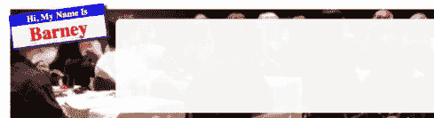

图 8.3：我们可以使用 CSS3 重新创建的原始概念

```css
#badge{
    text-align: center;
    width: 200px;
    border: 2px solid blue;
}

#info{
    margin: 20px;
    padding: 20px;
    width: 660px;
    height: 160px;
}

#badge, #info{
    float: left;
    background-color: #fff;
}

#badge h2{
    margin: 0;
    color: red;
    font-size: 40px;
}

#badge h3{
    margin: 0;
    background-color: blue;
    color: #fff;
}
```

一旦我们将该样式表应用到我们的页面，徽章和内容区域就会并排显示，如下一页的图 8.4 所示，所以我们开始设计徽章的样式。

图 8.4：我们的基本横幅

## 添加渐变

我们可以通过将白色背景更改为从白色到浅灰色的微妙渐变来为徽章增添层次感。此渐变在 Firefox、Safari 和 Chrome 中有效，但在 Firefox 中的实现方式不同。Chrome 和 Safari 使用 WebKit 的语法（这是最初的提案），而 Firefox 使用接近 W3C 提案的语法。我们再次使用了浏览器前缀，您在第 17 章《特定于浏览器的选择器》（第 148 页）中见过。4

```css
Download css3banner/style.css

#badge{
    background-image: -moz-linear-gradient(
        top, #fff, #efefef
    );

    background-image: -webkit-gradient(
        linear,left top, left bottom,
        color-stop(0, #fff),
        color-stop(1, #efefef)
    );

    background-image: linear-gradient(
        top, #fff, #efefef
    );
}
```

Firefox 使用 `-moz-linear-gradient` 方法，我们指定了渐变的起点，然后是起始颜色，最后是结束颜色。

4. http://dev.w3.org/csswg/css3-images/#linear-gradients

## 为徽章添加阴影

通过添加阴影，我们可以轻松地使徽章看起来浮于横幅之上。传统上，我们会在 Photoshop 中通过将阴影添加到图像中或将其作为背景图像插入来实现。然而，CSS3 的 `box-shadow` 属性使我们能够快速地为元素定义阴影。⁵

我们将此规则应用到样式表中，以赋予徽章阴影效果：

```css
#badge{
    -moz-box-shadow:    5px 5px 5px #333;
    -webkit-box-shadow: 5px 5px 5px #333;
    -o-box-shadow:      5px 5px 5px #333;
    box-shadow:         5px 5px 5px #333;
}
```

`box-shadow` 属性有四个参数。第一个是水平偏移量。正数表示阴影会落在对象的右侧；负数表示落在左侧。第二个参数是垂直偏移量。对于垂直偏移，正数使阴影出现在盒子下方，而负值使阴影出现在元素上方。

第三个参数是模糊半径。值为 0 会产生非常锐利的边缘，而更高的值会使阴影更模糊。最后一个参数定义了阴影的颜色。

你应该尝试这些值，以感受它们的工作方式，并找到看起来合适的数值。在处理阴影时，你应该花点时间研究阴影在物理世界中是如何工作的。拿一个手电筒照射物体，或者到户外观察太阳如何在物体上投下阴影。这种透视感的运用很重要，因为创建不一致的阴影会使你的界面更加混乱，尤其是如果你错误地将阴影应用于多个元素时。你能采取的最简单的方法是为你创建的每个阴影使用相同的设置。

⁵ http://www.w3.org/TR/css3-background/#the-box-shadow

## 文本阴影

除了为元素添加样式外，你还可以轻松地为文本添加阴影。它的工作原理与 `box-shadow` 类似。

```css
h1{text-shadow: 2px 2px 2px #bbbbbb;}
```

你指定 X 和 Y 偏移量、模糊量以及阴影的颜色。IE 6、7 和 8 也支持此功能，使用的是 Shadow 滤镜。

```css
filter: Shadow(Color=#bbbbbb, Direction=135, Strength=3);
```

这是为元素添加投影的相同方法。文本阴影可以创造出简洁的效果，但如果你将阴影设置得太强，可能会使文本更难阅读。

## 旋转徽章

你可以使用 CSS3 变换来旋转、缩放和倾斜元素，就像在 Flash、Illustrator 或 Inkscape 等矢量图形程序中一样。⁶ 这有助于使元素更加突出，也是让网页看起来不那么“方方正正”的另一种方式。让我们稍微旋转一下徽章，使其突破横幅的笔直边缘。

```css
#badge{
    -moz-transform: rotate(-7.5deg);
    -o-transform: rotate(-7.5deg);
    -webkit-transform: rotate(-7.5deg);
    -ms-transform: rotate(-7.5deg);
    transform: rotate(-7.5deg);
}
```

使用 CSS3 进行旋转非常简单。我们只需提供旋转的角度，渲染就会自动完成。我们旋转的元素内部包含的所有元素也会一起旋转。

旋转与圆角一样简单，但不要过度使用。界面设计的目标是使界面可用。如果你旋转包含大量内容的元素，请确保你的观众无需过度扭转头部就能阅读内容！

⁶ http://www.w3.org/TR/css3-2d-transforms/#transform-property

## 透明背景

平面设计师在文本背后使用半透明层已经有相当长一段时间了，这个过程通常涉及在 Photoshop 中制作完整图像，或通过 CSS 在另一个元素上叠加一个透明的 PNG。CSS3 让我们使用一种支持透明度的新语法来定义背景颜色。

当你初次学习网页开发时，你会学习使用十六进制颜色代码来定义颜色。你使用数字对来定义红、绿、蓝的量。00 表示“全关”或“无”，FF 表示“全开”。因此，红色将是 FF0000，即“红色全开，蓝色全关，绿色全关”。

CSS3 引入了 `rgb` 和 `rgba` 函数。`rgb` 函数的工作方式类似于十六进制对应函数，但你使用 0 到 255 的值来表示每种颜色。你会将红色定义为 `rgb(255,0,0)`。

`rgba` 函数的工作方式与 `rgb` 函数相同，但它接受第四个参数来定义不透明度，范围从 0 到 1。如果你使用 0，你将完全看不到颜色，因为它是完全透明的。为了使白色盒子半透明，我们将添加这个样式规则：

```css
#info{
    background-color: rgba(255,255,255,0.95);
}
```

在处理这种透明度值时，用户的对比度设置有时会影响最终外观，因此请务必尝试不同的值并在多个显示器上检查，以确保获得一致的结果。

既然我们在处理横幅的信息部分，让我们稍微圆一下角。

```css
#info{
    -moz-border-radius: 12px;
    -webkit-border-radius: 12px;
    -o-border-radius: 12px;
    border-radius: 12px;
}
```

至此，我们的横幅在 Safari、Firefox 和 Chrome 中看起来相当不错了。现在让我们为 Internet Explorer 实现一个样式表。

## 降级方案


我们在本节中使用的技术在 IE 9 中工作得很好，但它们在 Internet Explorer 6、7 和 8 中也可以实现！我们只需使用微软的 DirectX 滤镜来完成。这意味着我们需要依靠条件注释来加载特定的 IE 专用样式表。我们还需要使用 JavaScript 来创建 `section` 元素，以便我们可以通过 CSS 对其进行样式设置，因为这些版本的 IE 本身不识别该元素。

```html
<!--[if lte IE 8]>
  <script>
    document.createElement("section");
  </script>
  <link rel="stylesheet" href="ie.css" type="text/css" media="screen">
<![endif]-->
</head>
<body>
  <div id="conference">
    <section id="badge">
      <h3>Hi, My Name Is</h3>
      <h2>Barney</h2>
    </section>
    <section id="info">
    </section>
  </div>
</body>
</html>
```

DirectX 滤镜在 IE 6、7 和 8 中有效，但在 IE 8 中调用滤镜的方式不同，因此你需要声明每个滤镜两次。让我们首先看看如何旋转元素。

### 旋转

我们可以使用这些滤镜来旋转元素，但这并不像指定旋转角度那么简单。为了获得我们想要的效果，我们需要使用 Matrix 滤镜并指定所需角度的余弦和正弦值。具体来说，我们需要传递余弦值、正弦值的负值、正弦值以及再次传递余弦值，⁷ 像这样：

```css
filter: progid:DXImageTransform.Microsoft.Matrix(
    sizingMethod='auto expand',
    M11=0.9914448613738104,
    M12=0.13052619222005157,
    M21=-0.13052619222005157,
    M22=0.9914448613738104
);

-ms-filter: "progid:DXImageTransform.Microsoft.Matrix(
    sizingMethod='auto expand',
    M11=0.9914448613738104,
    M12=0.13052619222005157,
    M21=-0.13052619222005157,
    M22=0.9914448613738104
)";
```

很复杂？是的，当你更仔细地查看前面的示例时，会发现更复杂。记住我们原始的角度是负 7.5 度。因此，对于我们的负正弦值，我们需要一个正值，而我们的正弦值需要一个负值。

数学很难。让我们改做渐变吧。

### 渐变

IE 的 Gradient 滤镜工作方式与标准中的类似，只不过你需要输入更多字符。你提供起始颜色和结束颜色，渐变就会显示出来。

```css
filter: progid:DXImageTransform.Microsoft.gradient(
    startColorStr=#FFFFFF, endColorStr=#EFEFEF
);
-ms-filter: "progid:DXImageTransform.Microsoft.gradient(
    startColorStr=#FFFFFF, endColorStr=#EFEFEF
)";
```

与其他浏览器不同，你是直接将渐变应用于元素，而不是应用于 `background-image` 属性。

⁷ 我们正在使用一个 2x2 矩阵进行线性变换。

让我们再次使用这个滤镜来为我们的信息部分定义透明背景。

### 透明度

渐变滤镜可以接受扩展十六进制值作为起始和结束颜色，使用前两位数字来定义透明度。我们可以通过这段代码非常接近地实现我们想要的效果：

```css
Download css3banner/filters.css

background: none;
filter:
    progid:DXImageTransform.Microsoft.gradient(
        startColorStr=#BBFFFFFF, endColorStr=#BBFFFFFF
    );

-ms-filter: "progid:DXImageTransform.Microsoft.gradient(
    startColorStr='#BBFFFFFF', EndColorStr='#BBFFFFFF'
)";
```

这些八位十六进制代码的工作原理与 `rgba` 函数非常相似，只是透明度值是首先出现而不是最后。所以，我们实际上是在处理 alpha、红色、绿色和蓝色。

我们必须移除该元素上的 `background` 属性才能使其在 IE 7 中工作。现在，如果你一直在尝试构建这个样式表，你可能已经注意到它实际上还没有工作，但我们可以修复这个问题。

### 整合所有内容

这些 IE 滤镜比较棘手的问题之一在于我们无法将它们分段定义。要将多个滤镜应用于单个元素，必须将它们定义为逗号分隔的列表。以下是实际的 IE 样式表：

```css
Download css3banner/ie.css

#info {
    background: none;
    filter:
        progid:DXImageTransform.Microsoft.gradient(
            startColorStr=#BBFFFFFF, endColorStr=#BBFFFFFF
        );
    -ms-filter: "progid:DXImageTransform.Microsoft.gradient(
        startColorStr='#BBFFFFFF', EndColorStr='#BBFFFFFF'
    )";
}
```

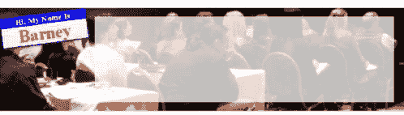

图 8.5：我们的横幅在 Internet Explorer 8 中的显示效果

```css
#badge{
  filter:
    progid:DXImageTransform.Microsoft.Matrix(
      sizingMethod='auto expand',
      M11=0.9914448613738104,
      M12=0.13052619222005157,
      M21=-0.13052619222005157,
      M22=0.9914448613738104
    ),
    progid:DXImageTransform.Microsoft.gradient(
      startColorStr=#FFFFFF, endColorStr=#EFEFEF
    ),
    progid:DXImageTransform.Microsoft.Shadow(
      color=#333333, Direction=135, Strength=3
    );

  -ms-filter: "progid:DXImageTransform.Microsoft.Matrix(
    sizingMethod='auto expand',
    M11=0.9914448613738104,
    M12=0.13052619222005157,
    M21=-0.13052619222005157,
    M22=0.9914448613738104
  ),
  progid:DXImageTransform.Microsoft.gradient(
    startColorStr=#FFFFFF, endColorStr=#EFEFEF
  ),
  progid:DXImageTransform.Microsoft.Shadow(
    color=#333333, Direction=135, Strength=3
  )";
}
```

要达到理想的效果需要大量的代码，但这表明使用这些功能是可行的。如果你查看图 8.5，你会看到我们已经非常接近了。我们现在要做的就是为信息部分添加圆角，你可以参考第 146 页的修圆粗糙边缘来了解如何操作。

尽管这些滤镜笨重且有点古怪，但你仍然应该在自己的项目中进一步研究它们，因为这样你就能为你的 IE 用户提供类似的用户体验。

请记住，我们在本节中探讨的效果都是呈现性的。在创建初始样式表时，我们确保应用了背景颜色，以便文本可读。无法理解 CSS3 语法的浏览器仍然可以以可读的方式显示页面。

报告勘误

## 使用真正的字体

排版对用户体验至关重要。你正在阅读的这本书，其字体是由懂得如何选择正确字体和合适间距来让人们更容易阅读这本书的人精心挑选的。在 Web 上，理解这些概念同样重要。

我们向读者传达信息时所选择的字体，会影响读者解读信息的方式。以下字体非常适合一个吵闹的重金属乐队：


但这个字体可能就不那么适合作为本书封面上的字体了：

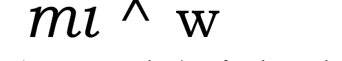

如你所见，选择与你的信息相匹配的字体非常重要。Web 上字体的问题在于，我们 Web 开发人员一直被局限于少数几种字体，通常被称为“Web 安全”字体。这些是大多数用户操作系统中广泛使用的字体。

为了解决这个问题，历史上我们使用图像作为字体，要么直接将它们添加到页面的标记中，要么使用其他方法，如 CSS 背景图像或 sIFR⁸，后者使用 Flash 渲染字体。CSS3 的字体模块提供了一种好得多的方法。

### `@font-face`

`@font-face` 规则实际上是作为 CSS2 规范的一部分引入的，并在 Internet Explorer 5 中得以实现。然而，

> 8. http://www.mikeindustries.com/blog/sifr

## 字体与权限

有些字体不是免费的。就像素材摄影或其他受版权保护的材料一样，你需要遵守你使用在网站上的材料的权利和许可。如果你购买了一种字体，通常你有权在你的标志和页面图像中使用它。这些被称为使用权利。然而，`@font-face` 方法引入了一种不同类型的许可——再分发权利。

当你在页面上嵌入一种字体时，你的用户将不得不下载该字体，这意味着你的网站现在正在向其他人分发这种字体。你需要绝对确定你页面上使用的字体允许这种用法。

Typekit* 提供了一个庞大的授权字体库，并提供工具和代码，使其易于与你的网站集成。这不是一项免费服务，但如果你需要使用特定字体，它们相当经济实惠。

Google 提供了 Google Font API†，它与 Typekit 类似，但只包含开源字体。

这两种服务都使用 JavaScript 加载字体，因此你需要确保没有 JavaScript 的用户也能轻松阅读你的内容。

只要你记住将字体视为任何其他资产，你就不应该遇到任何问题。

*. http://www.typekit.com/

†. http://code.google.com/apis/webfonts/

微软的实现使用了一种称为 Embedded OpenType (EOT) 的字体格式，而目前大多数字体是 TrueType 或 OpenType 格式。其他浏览器目前支持 OpenType 和 TrueType 字体。

AwesomeCo 的营销总监决定，公司应标准化一种字体用于印刷和网络。你被要求调查一种名为 Garogier 的字体，这是一种简单、纤细的字体，完全免费用于商业用途。作为试运行，我们将把这个字体应用到我们在第 27 页《使用语义标记重新定义博客》中创建的博客示例中。这样，每个人都可以看到这个字体的实际效果。

乔问……

### 我如何转换自己的字体？

如果你开发了自己的字体或购买了字体的使用权，并需要使其在多种格式中可用，可以使用 FontSquirrel 网站的一个转换器*，它将为你提供转换后的字体以及包含所需 `@font-face` 代码的样式表。但请确保你的字体许可证允许这种用法。

*. http://www.fontsquirrel.com/fontface/generator

### 字体格式

字体有多种格式可用，而你针对的浏览器将决定你需要向访问者提供哪种格式。

### 格式与支持的浏览器

- Embedded OpenType (EOT) [IE5-8]
- TrueType (TTF) [IE9, F3.5, C4, S4]
- OpenType (OTF) [IE9, F3.5, C4, S4, O10.5]
- Scalable Vector Graphics (SVG) [IOS]
- Web Open Font (WOFF) [IE9, F3.6]

Internet Explorer 9 之前的浏览器仅支持一种称为 Embedded OpenType (EOT) 的格式。其他浏览器对更常见的 TrueType 和 OpenType 字体支持得很好。

Microsoft、Opera 和 Mozilla 共同创建了 Web Open Font Format，它允许无损压缩并为字体制作者提供更好的许可选项。

为了覆盖所有这些浏览器，你必须以多种格式提供你的字体。

## 更改我们的字体

我们所关注的字体在 FontSquirrel⁹ 上有多种格式可供下载，包括 TrueType、WOFF、SVG 和 EOT，这些格式能完美适配。

使用该字体包含两个步骤——定义字体以及将字体应用到元素上。在博客的样式表中，添加以下代码：

```css
/* Download css3fonts/style.css */
@font-face {
  font-family: 'GarogierRegular';
  src: url('fonts/Garogier_unhinted-webfont.eot');
  src: url('fonts/Garogier_unhinted-webfont.woff') format('woff'),
       url('fonts/Garogier_unhinted-webfont.ttf') format('truetype'),
       url('fonts/Garogier_unhinted-webfont.svg#webfontw0qE009') format('svg');
  font-weight: normal;
}
```

我们首先定义字体族（font family），为其命名，然后提供字体资源。我们将 Embedded OpenType 版本放在最前面，以便 IE 浏览器能立即识别，接着提供其他版本。用户的浏览器会依次尝试加载这些资源，直到找到可用的为止。

现在我们已经定义了字体族，便可在样式表中使用它了。我们将原来的字体样式修改如下：

```css
/* Download css3fonts/style.css */
body {
  font-family: "GarogierRegular";
}
```

通过这个简单的更改，我们页面的文本就会以新字体显示，效果如图 8.6（下一页）所示。

在现代浏览器中应用字体相对容易，但我们还需要考虑那些尚不支持此功能的浏览器。

⁹ 你可以从 http://www.fontsquirrel.com/fonts/Garogier 获取该字体，也可从本书的可下载代码中找到。

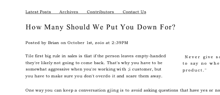

图 8.6：应用新字体后的博客

## 字体回退

我们已经为各种版本的 IE 和其他浏览器提供了回退方案，但我们仍需确保页面在不支持 `@font-face` 特性的浏览器中依然可读。

我们提供了 Garogier 字体的不同版本，但在应用该字体时，并未指定任何回退字体（fallback fonts）。这意味着如果浏览器不支持显示我们的 Garogier 字体，它将使用浏览器的默认字体。这可能并非最佳选择。

字体栈（Font stacks）是按优先级排列的字体列表。你首先指定你真正希望用户看到的字体，然后再指定其他合适的备选字体。

在创建字体栈时，请多花些时间寻找真正合适的备选字体。字母间距、笔画宽度和整体外观应尽量相似。网站 UnitInteractive 有一篇关于此主题的优秀文章。¹⁰

让我们像这样修改我们的字体：

```css
/* Download css3fonts/style.css */
font-family: "GarogierRegular", Georgia,
            "Palatino", "Palatino Linotype",
            "Times", "Times New Roman", serif;
```

¹⁰ http://unitinteractive.com/blog/2008/06/26/better-css-font-stacks/

这里我们提供了大量的备选字体，这应有助于保持外观的相似性。虽然在所有情况下都不完美，但这比依赖默认字体要好，因为默认字体有时可能相当难读。

字体能大大提升页面的吸引力和可读性。请在自己的作品中尝试。有大量免费和商业字体正等待着你去发现。

## 未来展望

在本章中，我们探讨了 CSS3 替代传统 Web 开发技术的几种方式，但这仅仅是冰山一角。CSS3 规范中包含了 3D 变换和简单动画，这意味着我们可以使用样式表而非 JavaScript 为用户提供交互提示，就像我们使用 `:hover` 一样。

此外，一些浏览器已经支持多背景图像和渐变边框。最后，请关注分页内容方面的改进，例如运行页眉/页脚和页码支持。

CSS3 的各个模块一旦完成，将使我们能够更轻松地为用户创建更丰富、更好、更吸引人的界面元素，因此请务必关注新特性。

# 第三部分

## 超越 HTML5

# 第 9 章

## 处理客户端数据


我们已经讨论了 HTML5 和 CSS3 标记，现在让我们将注意力转向一些与 HTML5 相关的技术和功能。例如，跨文档消息传递（Cross-document Messaging）和离线支持（offline support），让我们能够跨域通信，并创建让用户可以离线工作的解决方案。

一些功能，如 Web Storage、Web SQL Databases 和 Web Sockets，是从 HTML5 规范中分离出来的。而另一些功能，如地理定位（Geolocation），则从未成为规范的一部分，但浏览器制造商和开发者将其与 HTML5 联系在一起，因为它正与其他特性一起实现。

本书的这一部分将涵盖这些特性，并对那些现在已经可用的功能给予更多关注。我们还会花一章来讨论接下来的发展方向。让我们首先来看看 Web Storage 和 Web SQL Storage，这两个规范允许我们在客户端存储数据。

还记得 cookies 很棒的时候吗？我也不记得了。自 cookies 出现以来，处理起来一直相当麻烦，但我们之所以忍受这种麻烦，是因为它们一直是存储客户端机器信息的唯一方式。要使用它们，我们必须为 cookie 命名并设置其过期时间。

这涉及一大堆我们通常包装在函数中的 JavaScript 代码，这样我们就无需思考它实际如何工作，大概像这样：

```javascript
/* Download html5_localstorage/setcookie.js */
// via http://www.javascripter.net/faq/settinga.htm
function SetCookie(cookieName, cookieValue, nDays) {
  var today = new Date();
  var expire = new Date();
  if (nDays == null || nDays == 0) nDays = 1;
  expire.setTime(today.getTime() + 3600000 * 24 * nDays);
  document.cookie = cookieName + "=" + escape(cookieValue)
    + "; expires=" + expire.toGMTString();
}
```

除了难以记忆的语法，还有安全问题。一些网站使用 cookies 来跟踪用户的浏览行为，因此用户会以某种方式禁用 cookies。

HTML5 引入了几个在客户端存储数据的新选项：Web Storage（使用`localStorage`或`sessionStorage`）¹ 和 Web SQL Databases。² 它们易于使用，功能极其强大，并且相当安全。最重要的是，它们现在已经被多个浏览器实现，包括 iOS 的 Mobile Safari 和 Android 2.0 的 web 浏览器。然而，它们不再是 HTML5 规范的一部分——它们已被分离成独立的规范。

虽然`localStorage`、`sessionStorage`和 Web SQL Databases 不能替代那些用于客户端和服务器之间共享的 cookies——例如在 Web 框架中使用 cookies 来维护跨请求状态——但它们可用于存储仅用户关心的数据，例如视觉设置或偏好。它们对于构建可在浏览器中运行但未连接到互联网的移动应用程序也非常有用。目前许多 Web 应用程序会回调服务器来保存用户数据，但有了这些新的存储机制，互联网连接不再是绝对依赖。用户数据可以本地存储，并在必要时进行备份。

当你将这些方法与 HTML5 的新离线特性结合起来时，你可以在浏览器中构建完整的数据库应用程序，这些程序可在从桌面电脑到 iPad 和 Android 手机的多种平台上运行。在本章中，你将学习如何使用这些技术来持久化用户设置并创建一个简单的笔记数据库。

在本章中，我们将熟悉以下特性：³

- `localStorage`

  以键值对的形式存储数据，绑定到特定域，并跨浏览器会话持久存在。*[C5, F3.5, S4, IE8, O10.5, IOS, A]*

- `sessionStorage`

  以键值对的形式存储数据，绑定到特定域，并在浏览器会话结束时被清除。*[C5, F3.5, S4, IE8, O10.5, IOS, A]*

- `Web SQL Databases`

  完全的关系型数据库，支持创建表、插入、更新、删除和查询，并支持事务。绑定到特定域并跨会话持久存在。*[C5, S3.2, O10.5, IOS3.2, A2]*

- 离线 Web 应用程序（Offline Web Applications）

  定义要缓存以供离线使用的文件，允许应用程序在没有互联网连接的情况下运行。*[C4, S4, F3.5, O10.6, IOS3.2, A2]*

> ³ 在以下描述中，浏览器支持情况使用简写代码和支持的最低版本号，显示在方括号中。使用的代码如下：C：Google Chrome，F：Firefox，IE：Internet Explorer，O：Opera，S：Safari，IOS：带有 Mobile Safari 的 iOS 设备，A：Android Browser。

¹ http://www.whatwg.org/specs/web-apps/2007-10-26/#storage

² http://www.whatwg.org/specs/web-apps/2007-10-26/#sql

## 20 使用`localStorage`保存偏好设置

`localStorage`机制为开发者提供了一种非常简单的方法，可以在客户端机器上持久化数据。`localStorage`机制本质上是内置于网络浏览器中的一个名称/值存储。

存储在`localStorage`中的信息会在浏览器会话之间保持，其他网站无法读取，因为它被限制在你当前访问的域名内。⁴

AwesomeCo 正在开发一个新的客户服务门户，并希望用户能够更改网站的文本大小、背景和文本颜色。让我们使用`localStorage`来实现这个功能，这样当我们保存更改时，这些设置就能在不同的浏览器会话中得以保留。完成后，我们将得到一个类似下一页图 9.1 所示的原型。

### 构建偏好设置表单

让我们使用一些语义化的 HTML5 标记和你在第 3 章（第 45 页“创建用户友好的 Web 表单”）中学到的一些新表单控件来构建一个表单。我们想让用户能够更改前景色、背景色以及调整字体大小。

```html
Download html5_localstorage/index.html

<p><strong>Preferences</strong></p>
<form id="preferences" action="save_prefs" method="post" accept-charset="utf-8">
  <fieldset id="colors" class="">
    <legend>Colors</legend>
    <ol>
      <li>
        <label for="background_color">Background color</label>
        <input type="color" name="background_color" value="" id="background_color">
      </li>
```

> 4. 请注意本地开发时的情况。例如，如果你在`localhost`上工作，很容易混淆你的变量！

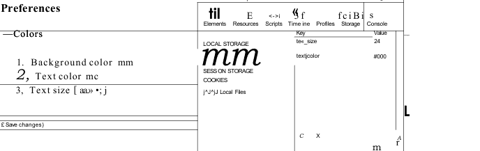

图 9.1：用户的偏好设置值通过`localStorage`方法在本地存储。

```html
<li>
  <label for="text_color">Text color</label>
  <input type="color" name="text_color"
         value=""   id="text_color">
</li>
<li>
  <label for="text_size">Text size</label>
  <select name="text_size"  id="text_size">
    <option value="16">16px</option>
    <option value="20">20px</option>
    <option value="24">24px</option>
    <option value="32">32px</option>
  </select>
</li>
</ol>

</fieldset>

<input type="submit" value="Save changes">
</form>
```

我们将仅使用 HTML 颜色代码来表示颜色。

### 保存和加载设置

要使用`localStorage`系统，你可以通过 JavaScript 访问`window.localStorage`对象。设置一个名称/值对非常简单：

```javascript
Download html5_localstorage/index.html

localStorage.setItem("background_color", $("#background_color").val());
```

取回一个值也同样容易。

```javascript
Download html5_localstorage/index.html

var bgcolor = localStorage.getItem("background_color");
```

让我们创建一个用于保存表单中所有设置的方法。

```javascript
Download html5_localstorage/index.html

function save_settings(){
    localStorage.setItem("background_color", $("#background_color").val());
    localStorage.setItem("text_color", $("#text_color").val());
    localStorage.setItem("text_size", $("#text_size").val());
    apply_preferences_to_page();
}
```

接下来，让我们构建一个类似的方法，它将从`localStorage`系统加载数据并将其放入表单字段中。

```javascript
Download html5_localstorage/index.html

function load_settings(){
    var bgcolor = localStorage.getItem("background_color");
    var text_color = localStorage.getItem("text_color");
    var text_size = localStorage.getItem("text_size");

    $("#background_color").val(bgcolor);
    $("#text_color").val(text_color);
    $("#text_size").val(text_size);

    apply_preferences_to_page();
}
```

这个方法还会调用另一个方法，该方法会将设置应用到页面本身，我们接下来将编写它。

### 应用设置

现在我们可以从`localStorage`检索设置，接下来需要将它们应用到页面上。我们正在处理的偏好设置都与 CSS 以某种方式相关，我们可以使用 jQuery 来修改任何元素的样式。

```javascript
Download html5_localstorage/index.html

function apply_preferences_to_page(){
    $("body").css("backgroundColor", $("#background_color").val());
    $("body").css("color", $("#text_color").val());
    $("body").css("fontSize", $("#text_size").val() + "px");
}
```

最后，我们需要在文档准备就绪时触发所有这些操作。

```javascript
Download html5_localstorage/index.html

$(function(){

    load_settings();

    $("form#preferences").submit(function(event){
        event.preventDefault();
        save_settings();
    });
});
```

### 回退方案

`localStorage`方法仅在最新版本的 Internet Explorer、Firefox、Chrome 和 Safari 上有效，因此我们需要为旧版浏览器提供回退方法。我们有两种方案：可以在服务器上保存信息，或者使用 cookies 在客户端持久化偏好设置。

### 服务器端存储

如果你的系统中有用户账户，可以考虑将偏好设置页面配置为将设置持久化到应用程序中的用户记录中。当用户登录时，你可以检查是否存在任何客户端设置，如果不存在，则从服务器加载它们。这样，你的用户就能跨浏览器和跨计算机保留他们的设置。

要持久化到服务器，只需确保你的表单提交到服务器——如果没有对 cookies 的支持，不要用 JavaScript 阻止默认的提交行为。

如果用户禁用了 JavaScript，服务器端存储是唯一可行的方法，因为你可以编写应用程序从数据库而不是`localStorage`哈希中获取设置。另外，如果你要存储超过 4KB 的数据，这也是唯一可行的方法，因为那是你可以存储在 cookie 中的最大数据量。

### Cookies 和 JavaScript

经过验证的 cookies 和 JavaScript 的组合可以作为一个不错的回退方案。使用来自 Quirksmode 的著名 cookie 脚本，⁵ 我们可以构建自己的`localStorage`回退解决方案。

5. http://www.quirksmode.org/js/cookies.htm

检测浏览器是否支持`localStorage`非常简单。我们只需检查`window`对象上是否存在`localStorage`方法：

```javascript
if (!window.localStorage){
}
```

接下来，我们需要用于写入 cookies 的方法，我们将借用 Quirksmode 文章中的方法。将这些 JavaScript 函数添加到你的脚本块的大括号内：

```javascript
function createCookie(name,value,days) {
  if (days) {
    var date = new Date();
    date.setTime(date.getTime()+(days*24*60*60*1000));
    var expires = "; expires="+date.toGMTString();
  }
  else var expires = "";
  document.cookie = name+"="+value+expires+"; path=/";
}

function readCookie(name) {
  var nameEQ = name + "=";
  var ca = document.cookie.split(';');
  for(var i=0;i < ca.length;i++) {
    var c = ca[i];
    while (c.charAt(0)==' ') c = c.substring(1,c.length);
    if (c.indexOf(nameEQ) == 0) return c.substring(nameEQ.length,c.length);
  }
  return null;
}
```

最后，我们希望创建一个以 cookies 作为其后端的`localStorage`对象。一个勉强能让这个方案运作的、非常取巧的例子可能看起来像这样：

```javascript
localStorage = (function () {
  return {
    setItem: function (key, value) {
      createCookie(key, value, 3000)
    },
    ...
```

我们可以使用`localStorage`来存储我们希望在用户关闭网络浏览器后仍能持久化的信息，但有时我们需要一种方式来在浏览器打开时存储一些信息，并在会话结束后将其丢弃。这就是`sessionStorage`发挥作用的地方。它的使用方式与`localStorage`相同，但`sessionStorage`的内容在浏览器会话结束后就会被清除。你不是获取`localStorage`对象，而是获取`sessionStorage`对象。

```javascript
sessionStorage.setItem('name', 'Brian Hogan');
var name = sessionStorage.getItem('name');
```

为此创建回退解决方案很简单，只需确保你创建的 cookies 在浏览器关闭时过期即可。

```javascript
getItem: function (key) {
    return(readCookie(key));
};
});
});
}());
```

注意第 4 行。我们创建了一个 cookie，其过期日期是 3000 天之后。我们无法创建永不过期的 cookie，所以我将其设置为未来一个极其漫长的时间。


从外部来看，我们保持了`localStorage`的基本实现不变。如果你需要删除项目或清除所有内容，你需要更具创造性。理想情况下，在不久的将来，我们可以移除这个取巧的解决方案，仅依赖浏览器的`localStorage()`方法。

### 21 在客户端关系型数据库中存储数据

`localStorage`和`sessionStorage`方法为我们提供了一种简单的方式，在客户端计算机上存储简单的名称/值对，但有时我们需要更多功能。HTML5规范最初引入了在关系型数据库中存储数据的能力。后来，它被剥离出来，成为了一个独立的规范，称为Web SQL Storage。⁶ 如果你有编写SQL语句的基本背景，你会很快上手。为了让你更适应，我们将使用Web SQL Storage来在客户端数据库中创建、检索、更新和删除笔记。

### 浏览器中的CRUD

CRUD这个术语，是“创建、检索、更新和删除”⁷的首字母缩写，它基本上描述了我们能用客户端数据库做什么。该规范和实现允许我们插入、选择、更新和删除记录。

AwesomeCo希望为他们的销售团队配备一个简单的应用程序，以便他们在外出时收集笔记。这个应用程序需要让用户能够创建新笔记，以及更新和删除现有笔记。要更改现有笔记，我们需要让用户从数据库中检索它们。

以下是我们需要编写以实现此目的的SQL语句：

| 类型 | 语句 |
| --- | --- |
| 创建笔记 | `INSERT INTO notes (title, note) VALUES("Test", "This is a note");` |
| 检索所有笔记 | `SELECT id, title, note FROM notes;` |
| 检索特定笔记 | `SELECT id, title, note FROM notes where id = 1;` |
| 更新笔记 | `UPDATE notes set title = "bar", note = "Changed" where id = 1;` |
| 删除笔记 | `DELETE FROM notes where id = 1;` |

6. `http://dev.w3.org/html5/webdatabase/`

7. 或者如果你想用另一个名字，也可以叫“创建、读取、更新和销毁”。

### Joe问...

#### 2: Web SQL Database规范不是已经死了吗？

2010年11月，维护该规范的工作组宣布他们将不再推进该规范，而是专注于IndexedDB规范。我们在本书中讨论它，是因为它已经在基于Webkit的浏览器中实现了，包括所有iOS和Android设备、Safari和Google Chrome。与在撰写本文时尚未在任何地方实现的IndexedDB不同，你现在就可以在项目中使用Web SQL Databases。它可能正好符合你的需求。

### 笔记界面

笔记应用程序的界面由一个左侧边栏和一个右侧表单组成。左侧边栏将显示已记录的笔记列表，右侧表单则包含一个标题字段和一个用于填写笔记本身的较大文本区域。请参阅下一页的图9.2，了解我们正在构建的内容。

首先，我们需要编写界面的代码。

```html
Download html5sql/index.html

<!doctype html>

<html>
  <head>
    <title>AwesomeNotes</title>
    <link rel="stylesheet" href="style.css">

    <script type="text/javascript"
            charset="utf-8"
            src="http://ajax.googleapis.com/ajax/libs/jquery/1.4.2/jquery.min.js">
    </script>

    <script type="text/javascript"
            charset="utf-8"
            src="javascripts/notes.js">
    </script>
  </head>

  <body>
    <section id="sidebar">
      <input type="button" id="new_button" value="New note">
      <ul id="notes">
      </ul>
    </section>

    <section id="main">
      <form>
        <ol>
          <li>
            <input type="submit" id="save_button" value="Save">
            <input type="submit" id="delete_button" value="Delete">
          </li>
          <li>
            <label for="title">Title</label>
            <input type="text" id="title">
          </li>
          <li>
            <label for="note">Note</label>
            <textarea id="note"></textarea>
          </li>
        </ol>
      </form>
    </section>
  </body>
</html>
```

### 图9.2：我们的笔记应用程序界面

我们使用`section`标签定义侧边栏和主区域，并为每个重要的用户界面控件（如保存按钮）分配了ID。这将使我们更容易定位元素，以便附加事件监听器。

我们还需要一个样式表，使界面看起来更像图示。`style.css`如下所示：

```css
Download html5sql/style.css

#sidebar, #main{
    display: block;
    float: left;
}

#sidebar{
    width: 25%;
}

#main{
    width: 75%;
}

form ol{
    list-style: none;
    margin: 0;
    padding: 0;
}

form li{
    padding: 0;
    margin: 0;
}

form li label{
    display:block;
}

#title, #note{
    width: 100%;
    font-size: 20px;
    border: 1px solid #000;
}

#title{
    height: 20px;
}

#note{
    height: 40px;
}
```

这个样式表关闭了项目符号，设置了文本区域的大小，并将内容布局成两列。现在界面已经完成，我们可以构建使其工作所需的JavaScript了。

### 连接到数据库

我们需要建立连接并创建一个数据库：

```javascript
// Database reference
var db = null;

// Creates a connection to the local database
connectToDB = function()
{
    db = window.openDatabase('awesome_notes', '1.0',
                             'AwesomeNotes Database', 1024*1024*3);
}
```

我们在脚本顶部声明了`db`变量。这样做使得它在我们即将创建的其他方法中都可用。⁸ 然后，我们通过使用`window.openDatabase`方法声明连接到数据库的方法。该方法接受数据库名称、版本号、描述和大小参数。

### 创建笔记表

我们的笔记表需要三列：

| 字段 | 描述 |
| --- | --- |
| `id` | 唯一标识笔记。主键，整数，自动递增。 |
| `title` | 笔记标题，便于引用。 |
| `note` | 笔记内容本身。 |

让我们创建一个创建此表的方法：

```javascript
createNotesTable = function()
{
    db.transaction(function(tx){
        tx.executeSql(
            "CREATE TABLE notes (id INTEGER \
            PRIMARY KEY, title TEXT, note TEXT)", [],
            function(){ alert('Notes database created successfully!'); },
            function(tx, error){ alert(error.message); } );
    });
}
```

8. 这将变量放入了全局作用域，而这并非总是好主意。对于本示例，我们尽量保持JavaScript代码简单。

我们在一个事务中执行SQL语句，该事务有两个回调方法：一个用于成功执行，一个用于失败。这是我们每个操作都会使用的模式。

注意`executeSql()`方法还接受一个数组作为其第二个参数。此数组用于将SQL中的占位符绑定到变量。这使我们能够避免字符串拼接，并类似于其他语言中的预处理语句。在本例中，数组为空，因为我们的查询中没有需要填充的占位符。

现在我们有了第一个表，我们可以让这个应用程序真正做点事情了。

### 加载笔记

当应用程序加载时，我们希望连接到数据库，如果表不存在则创建它，然后从数据库中获取任何现有的笔记。

```javascript
Download html5sql/javascripts/notes.js

// loads all records from the notes table of the database;
fetchNotes = function(){
    db.transaction(function(tx) {
        tx.executeSql('SELECT id, title, note FROM notes ', [], 
            function(tx, SQLTransaction, data){
                for (var i = 0; i < data.rows.length; ++i) {
                    var row = data.rows.item(i);
                    var id = row['id'];
                    var title = row['title'];

                    addToNotesList(id, title);
                }
            });
    });
};
```

此方法从数据库中获取结果。如果成功，它会遍历结果并调用我们定义的`addToNotesList`方法，如下所示：

```javascript
Download html5sql/javascripts/notes.js

// Adds the list item to the list of notes, given an id and a title.
addToNotesList = function(id, title){
    var notes = $("#notes");
    var item = $("<li>");
    item.attr("data-id", id);
    item.html(title);
    notes.append(item);
};
```

### 获取特定记录

我们将记录的ID嵌入到一个自定义数据属性中。当用户点击列表项时，我们将使用该ID来定位要加载的记录。然后，我们将创建的新列表项添加到界面中ID为`notes`的无序列表中。现在，我们需要添加代码，以便在从列表中选择一条笔记时将其加载到表单中。

我们可以为每个列表项添加一个点击事件，但更实用的方法是监听无序列表上的任何点击，然后判断哪个被点击了。这样，当我们向列表添加新条目（比如添加新笔记）时，就不必为列表添加点击事件。

在我们的jQuery函数中，我们将添加以下代码：

```javascript
Download html5sql/javascripts/notes.js

$("#notes").click(function(event){
  if ($(event.target).is('li')) {
    var element = $(event.target);
    loadNote(element.attr("data-id"));
  }
});
```

这会触发`loadNote()`方法，其代码如下：

```javascript
Download html5sql/javascripts/notes.js

loadNote = function(id){
  db.transaction(function(tx) {
    tx.executeSql('SELECT id, title, note FROM notes where id = ?', [id],
      function(txSQLTransaction, data){
        var row = data.rows.item(0);
        var title = $("#title");
        var note = $("#note");

        title.val(row["title"]);
        title.attr("data-id", row["id"]);
        note.val(row["note"]);
        $("#delete_button").show();
      });
  });
};
```

这个方法看起来很像之前的`fetchNotes()`方法。它执行一条SQL语句，然后我们处理成功路径。这次，语句中包含一个问号占位符，实际值作为数组的成员放在第二个参数中。

当我们找到一条记录后，就在表单中显示它。此方法还会激活删除按钮，并将记录的ID嵌入到自定义数据属性中，以便于处理更新。我们的保存按钮将检查ID是否存在。如果存在，我们将更新记录。如果不存在，我们将假定这是一条新记录。接下来让我们编写这部分逻辑。

### 插入、更新和删除记录

当用户点击保存按钮时，我们希望触发代码来插入新记录或更新现有记录。我们将通过在jQuery函数中放置此代码来为保存按钮添加点击事件处理程序：

```javascript
Download html5sql/javascripts/notes.js

$("#save_button").click(function(event){
  event.preventDefault();
  var title = $("#title");
  var note = $("#note");

  if(title.attr("data-id")){
    updateNote(title, note);
  }else{
    insertNote(title, note);
  }
})
```

此方法检查表单标题字段的`data-id`属性。如果没有ID，表单将假定我们正在插入一条新记录并调用`insertNote`方法，其代码如下：

```javascript
Download html5sql/javascripts/notes.js

insertNote = function(title, note)
{
  db.transaction(function(tx){
    tx.executeSql("INSERT INTO notes (title, note) VALUES (?, ?)",
                  [title.val(), note.val()],
    function(tx, result){
      var id = result.insertId;
      alert( 'Record ' + id + ' saved!');
      title.attr("data-id", result.insertId);
      addToNotesList(id, title.val());
      $("#delete_button").show();
    },
    function(){
      alert('The note could not be saved.');
    }
  });
};
```

`insertNote`方法将记录插入数据库，并使用结果集的`insertId`属性获取刚刚插入的ID。然后我们将此ID作为自定义数据属性应用于“标题”表单字段，并调用`addToNotesList`方法将笔记添加到页面侧边的列表中。

接下来，我们需要处理更新。`updateNote`方法看起来与我们到目前为止添加的其他方法类似：


```javascript
Download html5sql/javascripts/notes.js

updateNote = function(title, note)
{
  var id = title.attr("data-id");
  db.transaction(function(tx){
    tx.executeSql("UPDATE notes set title = ?, note = ? where id = ?",
                  [title.val(), note.val(), id],
    function(tx, result){
      alert('Record ' + id + ' updated!');
      $("#notes>li[data-id='" + id + "']").html(title.val());
    },
    function(){
      alert('The note was not updated!');
    }
  );
});
```

当更新语句成功时，我们通过查找`data-id`字段值等于我们刚更新的ID的元素，来更新笔记列表中笔记的标题。

至于删除记录，几乎是一样的。我们需要一个删除事件的处理程序，如下所示：

```javascript
Download html5sql/javascripts/notes.js

$("#delete_button").click(function(event){
  event.preventDefault();
  var title = $("#title");
  deleteNote(title);
});
```

然后我们需要删除方法本身，该方法不仅从数据库中移除记录，还将其从侧边栏的笔记列表中移除。

```javascript
Download html5sql/javascripts/notes.js

deleteNote = function(title)
{
    var id = title.attr("data-id");
    db.transaction(function(tx){
        tx.executeSql("DELETE from notes where id = ?", [id],
            function(tx, result){
                alert('Record ' + id + ' deleted!');
                $("#notes>li[data-id=" + id + "]").remove();
            },
            function(){
                alert('The note was not deleted!');
            }
        );
    });
};
```

现在我们只需要清空表单，这样我们就可以创建新记录而不会意外地与现有记录重复。

### 总结

我们的笔记应用程序基本完成了。我们只需激活“新建”按钮，点击时清空表单，这样用户在编辑完现有笔记后就可以创建一条新笔记。我们将使用与之前相同的模式——在jQuery函数中为“新建”按钮编写事件处理程序：

```javascript
Download html5sql/javascripts/notes.js

$("#new_button").click(function(event){
    event.preventDefault();
    newNote();
});

//end:newbutton

newNote();
```

接下来，我们将清除“标题”字段的`data-id`属性，并清除表单中的值。我们还将从界面中隐藏删除按钮。

```javascript
Download html5sql/javascripts/notes.js

newNote = function(){
    $("#delete_button").hide();
    var title = $("#title");
    title.removeAttr("data-id");
    title.val("");
    var note = $("#note");
    note.val("");
}
```

我们应该在页面加载时在jQuery函数中调用此`newNote`方法，以便表单准备好可以使用。这样，删除按钮也会被隐藏。

仅此而已。我们的应用程序可以在iPhone、Android设备以及运行Chrome、Safari和Opera的台式机上工作。然而，它几乎不可能在Firefox中运行，在Internet Explorer中也不受支持。

### 降级处理

与其他解决方案不同的是，没有好的库可以让我们自己实现SQL存储，因此我们无法为Internet Explorer用户提供原生支持。但是，如果这类应用程序对你来说可能有用，你可以说服你的用户使用Google Chrome（它在所有平台上都可用）来运行这个特定的应用程序。这不是闻所未闻的做法，特别是如果使用替代浏览器可以让你构建一个也能在移动设备上运行的内部应用程序。

另一个选择是使用Google Chrome Frame插件。将其添加到HTML页面的`head`标签下方：

```html
Download html5sql/index.html

<meta http-equiv="X-UA-Compatible" content="chrome=1">
```

这段代码会被Google Chrome Frame插件读取，并为该页面激活它。

如果你想检测插件的存在并在插件不存在时提示用户安装它，可以在`body`结束标签上方添加以下代码片段：

```html
Download html5sql/index.html

<script type="text/javascript"
src="http://ajax.googleapis.com/ajax/libs/chrome-frame/1/CFInstall.min.js">
</script>

<script>
window.attachEvent("onload", function() {
  CFInstall.check({
    mode: "inline", // the default
    node: "prompt"
  });
});
</script>
```

这将给用户一个安装插件的选项，以便他们可以使用你的网站。

Google Chrome Frame可能不是面向公众的Web应用程序的可行解决方案，但它非常适用于像我们刚刚编写的这种内部应用程序。公司IT政策可能禁止此类操作，但如果你处于这种情况，如何获得批准就由你来解决了。安装插件肯定比编写自己的SQL数据库系统更具成本效益。

### 处理离线功能

借助HTML5的离线支持，¹⁰我们可以利用HTML及相关技术构建能够在断开网络连接时依然运行的应用程序。这对于开发可能遇到网络连接中断的移动设备应用尤其有用。

此技术适用于Firefox、Chrome、Safari浏览器，以及iOS和Android 2.0设备，但目前没有能为Internet Explorer提供离线支持的备选方案。

AwesomeCo刚为销售团队配备了一批iPad，他们希望让我们的笔记应用（我们在第181页《在客户端关系数据库中存储数据》一章中开发的）能够离线运行。得益于HTML5清单文件，这将是一项简单的任务。

### 使用清单定义缓存

清单文件包含了一个列表，列出了Web应用程序所有需要存储在客户端浏览器缓存中的客户端文件，以实现离线工作。为了确保一切正常运行，应用程序将引用的每一个文件都需要在此处列出。唯一的例外是包含清单文件本身的HTML文件，它会被隐式缓存。

创建一个名为`notes.manifest`的文件，其内容应如下所示：

下载`html5offline/notes.manifest`

```text
CACHE MANIFEST
### v = 1.0.0
/style.css
/javascripts/notes.js
/javascripts/jquery.min.js
```

文件中的版本注释提供了一个可修改的值，这样浏览器就会知道需要获取文件的新版本。当我们修改代码时，需要同步修改清单文件。

此外，我们之前一直让Google托管jQuery，但这在应用离线时将无法工作。因此我们需要下载jQuery，并修改脚本标签以从本地javascripts文件夹加载jQuery。

接下来，我们需要将清单文件链接到HTML文档。为此，我们将html元素修改如下：

下载`html5offline/mdex.html`

```html
<html manifest="notes.manifest">
```

这就是我们需要做的全部。不过有一个小注意事项——清单文件必须通过Web服务器提供，因为它必须使用`text/cache-manifest` MIME类型进行服务。如果你使用Apache，可以在`.htaccess`文件中这样设置MIME类型：

下载`html5offline/.htaccess`

```apache
AddType text/cache-manifest .manifest
```

首次请求笔记应用后，清单中列出的文件将被下载并缓存。之后我们可以断开网络连接，并随意多次离线使用此应用。

请务必查阅规范。清单文件有更多复杂的选项可供使用。例如，你可以指定某些内容不应被缓存，永远不应离线访问，这对于忽略某些动态文件非常有用。

### 清单与缓存

在开发模式下处理你的应用时，你可能希望禁用Web服务器上的所有缓存。默认情况下，许多Web服务器通过设置头部信息来缓存文件，这些头部信息会告诉浏览器在指定时间内不获取文件的新副本。这可能会在你修改清单文件时造成困扰。

如果你使用Apache，可以通过在`.htaccess`文件中添加以下内容来禁用缓存：

下载`html5offline/.htaccess`

```apache
ExpiresActive On
ExpiresDefault "access"
```

这会禁用整个目录的缓存，因此不适合在生产环境中使用。但这将确保你的浏览器始终请求清单文件的新版本。

如果你修改了清单中列出的某个文件，你也需要修改清单文件，即更改我们添加的版本号注释。

### 未来展望

像`localStorage`和Web SQL Databases这样的特性，使开发者能够在浏览器中构建无需连接Web服务器的应用程序。像我们之前开发的应用程序也能在iPad或Android设备上运行，并且当我们将它们与HTML5清单文件结合使用时，我们就能利用熟悉的工具构建离线富应用程序，而无需依赖专有平台。随着越来越多的浏览器支持这些特性，开发者将能够更好地利用它们，创建可在多平台和设备上运行、在本地存储数据、并在联网时同步数据的应用程序。

Web SQL Storage的未来尚不明朗。Mozilla没有计划在Firefox中实现它，W3C选择推进IndexedDB规范的实现。我们将在第11.5节《索引数据库API》（第229页）中详细讨论该规范。然而，Web SQL Storage已经在iOS和Android设备上使用了一段时间，并且很可能会继续存在。如果你在该领域开发应用程序，这个规范可能对你极其有用。

### 与其他API良好协作

许多最初作为HTML5规范一部分的有趣API，最终被分离成独立项目。还有一些API与HTML5的关联如此紧密，以至于有时开发者（甚至作者）都难以分辨其区别。在本章中，我们将讨论这些API。我们将花一些时间使用HTML5 History API，然后我们将让不同服务器上的页面通过跨文档消息传递（Cross-document Messaging）进行通信。接着我们将研究Web Sockets和Geolocation，这是两个非常强大的API，可以帮助你构建更具交互性的应用程序。

我们将使用以下API来构建这些应用程序：¹

- **History API（历史记录 API）**

  管理浏览器历史记录。*[C5, S4, IE8, F3, O10.1, IOS3.2, A2]*

- **Cross-document Messaging（跨文档消息传递）**

  在加载了不同域名内容的窗口之间发送消息。*[C5, S5, F4, IOS4.1, A2]*

- **Web Sockets（网络套接字）**

  在浏览器和服务器之间创建一个有状态的连接。*[C5, S5, F4, IOS4.2]*

- **Geolocation（地理定位）**

  从客户端浏览器获取经纬度信息。*[C5, S5, F3.5, O10.6, IOS3.2, A2]*

在随后的描述中，浏览器支持情况以方括号形式显示，使用简写代码和最低支持版本号。使用的代码如下：C：Google Chrome，F：Firefox，IE：Internet Explorer，O：Opera，S：Safari，IOS：带有Mobile Safari的iOS设备，A：Android浏览器。

### 保留历史记录

HTML5规范引入了一个用于管理浏览器历史记录的API。² 在第104页《创建可访问的可更新区域》一章中，我们为AwesomeCo的新主页构建了一个原型，当我们点击导航选项卡之一时，主内容区域会切换。我们所用方法的一个缺点是不支持浏览器的“后退”按钮。我们可以通过一些变通方法解决这个问题，但最终我们将能够使用History API彻底解决它。

我们可以通过以下方式检测对此API的支持：

下载`html5history/javascripts/application.js`

```javascript
function supportsHistory() {
  return !!(window.history && window.history.pushState);
}
```

每当我们需要处理History对象时，都会使用这个方法。

#### 存储当前状态

当访问者打开一个新网页时，浏览器会将该页面添加到其历史记录中。当用户打开一个新选项卡时，我们需要手动将新选项卡添加到历史记录中，如下所示：

下载`html5history/javascripts/application.js`

```javascript
$("nav ul").click(function(event) {
  target = $(event.target);
  if(target.is("a")) {
    event.preventDefault();
    if ( $(target.attr("href")).hasClass("hidden") ) {
      if(supportsHistory()) {
        var tab = $(target).attr("href");
        var stateObject = {tab: tab};
        window.history.pushState(stateObject, tab);
      };
      $(".visible").removeClass("visible").addClass("hidden").hide();
      $(target.attr("href")).removeClass("hidden").addClass("visible").show();
    };
  };
});
```

我们获取当前可见元素的ID，然后向浏览器添加一个历史状态。`pushState()`方法的第一个参数是一个对象，我们之后可以与之交互。我们将用它来存储当用户导航回此处时想要显示的选项卡ID。例如，当用户点击“Services”选项卡时，我们将在状态对象中存储`#services`。

第二个参数是一个标题，我们可以用来在历史记录中标识该状态。它与页面的`title`元素无关；只是用于在浏览器历史记录中标识条目的一种方式。我们将再次使用选项卡的ID。

### 检索上一个状态

虽然这添加了一个历史状态，但我们仍需编写代码来处理历史状态的变化。当用户点击“后退”按钮时，`window.onpopstate`事件会被触发。我们利用这个钩子来显示我们存储在状态对象中的选项卡。

```javascript
if(supportsHistory()) {
    window.onpopstate = function(event) {
        if(event.state){
            var tab = (event.state["tab"]);
            $(".visible")
                .removeClass("visible")
                .addClass("hidden")
                .hide();
            $(tab)
                .removeClass("hidden")
                .addClass("visible")
                .show();
        }
    };
};
```

我们获取选项卡的名称，然后使用jQuery通过其ID定位要隐藏的元素。这里隐藏和显示选项卡的代码与原始代码重复。我们应该重构这段代码以消除重复。

### 默认处理

当我们首次打开页面时，历史状态将为`null`，因此我们需要自己设置。我们可以在定义`window.onpopstate`方法的地方上方完成此操作。


```javascript
Download html5history/javascripts/application.js
if(supportsHistory()) {
    window.history.pushState({tab: "#welcome"}, 'welcome');
    window.onpopstate = function(event) {
        if(event.state){
            var tab = (event.state["tab"]);
            $(".visible")
                .removeClass("visible")
                .addClass("hidden")
                .hide();
            $(tab)
                .removeClass("hidden")
                .addClass("visible")
                .show();
        }
    };
};
```

现在，当我们打开页面时，就可以使用浏览器历史记录来切换选项卡了。<sup>3</sup>

## 回退处理

这在Firefox 4、Safari 4以及Chrome 5中有效，但在Internet Explorer中不行。像jQuery Address插件<sup>4</sup>这样的解决方案提供了相同的功能，但我们不会深入探讨如何将其作为回退解决方案来实现，因为这更像是一种功能齐全的替代品，具有许多额外的功能。不过，请关注浏览器对历史记录操作的支持情况，因为当您能够在每个浏览器中使用此API时，您将能够轻松地提供更加用户友好的应用程序。

3. 测试时，您会需要不断关闭浏览器并清除历史记录。这有时可能会相当痛苦。

4. http://www.asual.com/jquery/address/

## 跨域通信

客户端Web应用程序一直被限制直接与其它域上的脚本通信，这种限制旨在保护用户。<sup>5</sup> 存在许多巧妙的绕过此限制的方法，包括使用服务器端代理和巧妙的URL技巧。但现在有了更好的方法。

HTML5规范引入了*跨文档消息传递*（Cross-document Messaging），这个API使得不同域上托管的脚本能够相互通信。例如，我们可以让`http://support.awesomecompany.com`上的一个表单将内容发布到另一个窗口或iframe，其内容托管在`http://www.awesomecompany.com`上。事实证明，对于我们当前的项目，我们需要做的正是这个。

AwesomeCo的新支持站点将有一个联系表单，支持经理希望将所有支持联系人及其电子邮件地址列在联系表单旁边。这些支持联系人最终将来自另一个服务器上的内容管理系统，因此我们可以使用iframe将联系人列表嵌入到表单旁边。问题是，支持经理非常希望我们能让用户点击联系人列表中的一个名字，然后自动将该电子邮件添加到我们的表单中。

我们可以很容易地做到这一点，但您需要使用Web服务器在您自己的环境中正确测试所有内容。除非我们使用服务器，否则我们在此处理的示例并非在所有浏览器中都有效。有关更多信息，请参阅下一页的旁注。

### 联系人列表

我们将首先创建联系人列表。我们的基本标记如下所示：

```html
Download html5xdomain/contactlist/public/index.html

<ul id="contacts">
  <li>
    <h2>Sales</h2>
    <p class="name">James Norris</p>
    <p class="email">j.norris@awesomeco.com</p>
  </li>
</ul>
```

5. 这被称为同源策略（Same Origin Policy），更详细的解释请参见 https://developer.mozilla.org/en/Same_origin_policy_for_JavaScript。

如果您不想费心配置Apache实例或搭建自己的服务器，可以使用本书示例代码文件中包含的简单Ruby服务器。有关如何在您的系统上安装和运行Ruby的说明，请参阅本书源代码文件中的`RUBY_README.txt`文件。

要启动服务器，首先进入`html5xdomain/contactlist`目录，然后像这样运行`server.rb`文件：

`ruby server.rb`

它将在端口4567上启动。然后您可以对`html5xdomain/supportpage`中的`server.rb`执行相同操作，它将在端口3000上启动。您可以通过编辑`server.rb`文件来修改每个服务器的端口。

```html
<li>
    <h2>Operations</h2>
    <p class="name">Tony Raymond</p>
    <p class="email">t.raymond@awesomeco.com</p>
</li>
<li>
    <h2>Accounts Payable</h2>
    <p class="name">Clark Greenwood</p>
    <p class="email">c.greenwood@awesomeco.com</p>
</li>
<li>
    <h2>Accounts Receivable</h2>
    <p class="name">Herbert Whitmore</p>
    <p class="email">h.whitmore@awesomeco.com</p>
</li>
</ul>
```

在该页面上，我们还将加载jQuery库、我们自己的`application.js`文件和一个简单的样式表。我们将把它们放在`head`部分：

**下载** `html5xdomain/contactlist/public/index.html`

```html
<script type="text/javascript"
  charset="utf-8"
  src="http://ajax.googleapis.com/ajax/libs/jquery/1.4.2/jquery.min.js">
</script>
<script type="text/javascript"
    src="javascripts/application.js">
</script>
<link rel="stylesheet" href="style.css" type="text/css" media="screen">
```

联系人列表的样式表如下所示：

```css
Download html5xdomain/contactlist/public/style.css

UL{
    list-style: none;
}

ul h2, ul p{margin: 0;}
ul li{margin-bottom: 20px;}
```

这只是几个小调整，让列表看起来更整洁一些。

### 发送消息

当用户点击我们联系人列表中的一个条目时，我们将从列表项中获取电子邮件地址，并向父窗口发送一条消息。`postMessage()`方法接受两个参数：消息本身和目标窗口的源（origin）。以下是整个事件处理程序的示例：

```javascript
Download html5xdomain/contactlist/public/javascripts/application.js

$(function(){
    $("#contacts li").click(function(event){
        var email = $(this).find(".email").html();
        var origin = "http://192.168.1.244:3000/index.html";
        window.parent.postMessage(email, origin);
    });
});
```

如果您要跟随操作，需要更改源（origin），因为它必须与父窗口的URL匹配。<sup>6</sup>

现在我们需要实现包含这个框架并接收其消息的页面。

### 支持站点

支持站点的结构看起来会非常相似，但为了保持独立，我们应该在不同的文件夹中工作，特别是因为这个站点需要放在不同的Web服务器上。我们需要

6. 这不完全正确。您可以只使用域名，甚至使用通配符。但我们的回退解决方案需要完整的URL，这也是出于安全考虑。

确保你包含了样式表、jQuery 和新的 `application.js` 文件的链接。

我们的支持页面需要一个联系表单和一个指向我们联系人列表的 iframe。我们将这样做：

Download html5xdomain/supportpage/public/index.html

```html
<div id="form">
    <form id="supportform">
        <fieldset>
            <ol>
                <li>
                    <label for="to">收件人</label>
                    <input type="email" name="to" id="to">
                </li>
                <li>
                    <label for="from">发件人</label>
                    <input type="text" name="from" id="from">
                </li>
                <li>
                    <label for="message">消息</label>
                    <textarea name="message" id="message"></textarea>
                </li>
            </ol>
            <input type="submit" value="发送！">
        </fieldset>
    </form>
</div>
```

```html
<div id="contacts">
    <iframe src="http://192.168.1.244:4567/index.html"></iframe>
</div>
```

我们将通过添加到 `style.css` 的这段 CSS 来美化它：

Download html5xdomain/supportpage/public/style.css

```css
#form{
    width: 400px;
    float: left;
}

#contacts{
    width: 200px;
    float: left;
}

#contacts iframe{
    border: none;
    height: 400px;
}
```

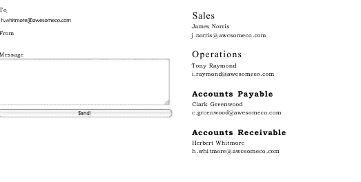

### 图 10.1：我们完成的支持站点

```css
fieldset{
    width: 400px;
    border: none;
}

fieldset legend{
    background-color: #ddd;
    padding: 0 64px 0 2px;
}

fieldset>ol{
    list-style: none;
    padding: 0;
    margin: 2px;
}

fieldset>ol>li{
    margin: 0 0 9px 0;
    padding: 0;
}

/* 使输入元素各占一行 */
fieldset input, fieldset textarea{
    display:block;
    width: 380px;
}
fieldset input[type=submit]{
    width: 390px;
}

fieldset textarea{
    height: 100px;
}
```

这将把表单和 iframe 并排放置，并修改表单使其看起来像前一页的图 10.1。

### 接收消息

每当当前窗口收到消息时，`onmessage` 事件就会触发。消息作为事件的一个属性返回。我们将使用 jQuery 的 `bind()` 方法注册此事件，以便它在所有浏览器中工作方式相同。

```javascript
Download html5xdomain/supportpage/public/javascripts/application.js

$(function (){
    $(window).bind("message", function(event){
        $("#to").val(event.originalEvent.data);
    });
});
```

jQuery 的 `bind()` 方法封装了事件，并不暴露所有属性。我们可以通过事件的 `originalEvent` 属性来访问它，以获取我们需要的内容。

如果你在 Firefox、Chrome、Safari 或 Internet Explorer 8 中打开它，你会看到它工作得非常好。现在，让我们使它在 IE 6 和 7 中也能工作。

### 降级处理

为了支持 IE 6 和 7，我们将使用 jQuery Postback 插件，该插件模拟跨域消息传递。我们将使用 jQuery 的 `getScript()` 方法仅在需要时才加载该库。为此，我们只需检测 `postMessage()` 方法是否存在。

首先，我们将修改我们的联系人列表。

```javascript
Download html5xdomain/contactlist/public/javascripts/application.js

if(window.postMessage){
    window.parent.postMessage(email, origin);
}else{
    $.getScript("javascripts/jquery.postmessage.js", function(){
        $.postMessage(email, origin, window.parent);
    });
}
```

jQuery Postmessage 插件添加了一个 `postMessage()` 方法，其工作方式与标准的 `postMessage()` 方法几乎完全相同。

现在，让我们将注意力转向支持站点。我们将使用相同的方法，加载库并调用新添加的 `receiveMessage()` 方法。

```javascript
Download html5xdomain/supportpage/public/javascripts/application.js

if(window.postMessage){
    $(window).bind("message", function(event){
        $("#to").val(event.originalEvent.data);
    });
}else{
    $.getScript("javascripts/jquery.postmessage.js", function(){
        $.receiveMessage(
            function(event){
                $("#to").val(event.data);
            }
        );
    });
}
```

就是这样！我们现在可以在多种浏览器中跨窗口通信了。但这仅仅是个开始；你可以扩展此技术以进行双向通信。任何窗口都可以是发送者或接收者，所以请查看规范，看看你能构建什么！

### 使用 Web Sockets 进行聊天

实时交互是 Web 开发人员多年来一直试图实现的功能，但大多数实现都涉及使用 JavaScript 定期访问远程服务器以检查更改。HTTP 是一种无状态协议，因此 Web 浏览器会连接到服务器，获取响应，然后断开连接。在无状态协议上进行任何类型的实时工作可能相当困难。HTML5 规范引入了 Web Sockets，它允许浏览器与远程服务器建立有状态连接。⁷ 我们可以使用 Web Sockets 构建各种出色的应用程序。了解 Web Sockets 工作原理的最佳方法之一是编写一个聊天客户端，而这恰好是 AwesomeCo 想为其支持站点实现的功能。

AwesomeCo 想在其支持站点上创建一个简单的基于 Web 的聊天界面，让支持人员内部沟通，因为支持人员分布在不同的城市。我们将使用 Web Sockets 来实现聊天服务器的 Web 界面。用户可以连接并向服务器发送消息。每个连接的用户都会看到该消息。我们的访问者可以通过发送诸如 "/nick brian" 这样的消息来为自己分配一个昵称，模仿 IRC 聊天协议。我们不会编写实际的服务器，因为庆幸的是，另一个开发人员已经完成了这项工作。⁸

#### 聊天界面

我们希望建立一个非常简单的聊天界面，看起来像下一页的图 10.2，包含一个用于更改用户昵称的表单、一个显示消息的大区域，以及最后，一个用于向聊天发布消息的表单。

在一个新的 HTML5 页面中，我们将添加聊天界面的标记，它由两个表单和一个包含聊天消息的 div 组成。

7. Web Sockets 已被独立成其自己的规范，你可以在 http://www.w3.org/TR/websockets/ 找到。

8. 更多关于服务器的信息，请参阅第 25 章 *服务器*，第 213 页。

### AwesomeCo Help!


图 10.2：我们的聊天界面


```html
Download html5_websockets/public/index.html

<div id="chat_wrapper">
  <h2>AwesomeCo Help!</h2>
  <form id="nick_form" action="#" method="post" accept-charset="utf-8">
    <p>
      <label>昵称
        <input id="nickname" type="text" value="访客用户"/>
      </label>
      <input type="submit" value="更改">
    </p>
  </form>

  <div id="chat">正在连接....</div>

  <form id="chat_form" action="#" method="post" accept-charset="utf-8">
    <p>
      <label>消息
        <input id="message" type="text" />
      </label>
      <input type="submit" value="发送">
    </p>
  </form>
</div>
```

我们还需要添加到样式表和 JavaScript 文件的链接，后者将包含我们与 Web Sockets 服务器通信的代码。

```html
Download html5_websockets/public/index.html

<script src='chat.js' type='text/javascript'></script>
<link rel="stylesheet" href="style.css" media="screen">
```

我们的样式表包含以下样式定义：

```css
Download html5_websockets/public/style.css

#chat_wrapper{
    width: 320px;
    height: 440px;
    background-color: #ddd;
    padding: 10px;
}

#chat_wrapper h2{
    margin: 0;
}

#chat{
    width: 300px;
    height: 300px;
    overflow: auto;
    background-color: #fff;
    padding: 10px;
}
```

在第 14 行，我们为聊天消息区域设置了`overflow`属性，使其高度固定，任何放不下的文本都将隐藏，可通过滚动条查看。

界面就位后，我们就可以开始编写使其与聊天服务器通信的 JavaScript 代码了。

### 与服务器通信

无论我们使用哪种 Web Sockets 服务器，我们都将反复使用相同的模式。我们将建立与服务器的连接，然后监听来自服务器的事件并做出适当的响应。

| 事件 | 描述 |
| :--- | :--- |
| `onopen()` | 当与服务器的连接建立时触发 |
| `onmessage()` | 当与服务器的连接收到消息时触发 |
| `onclose()` | 当与服务器的连接丢失或关闭时触发 |

在我们的`chat.js`文件中，首先需要连接到 Web Sockets 服务器，像这样：

```javascript
var webSocket = new WebSocket('ws://localhost:9394/');
```

当连接到服务器时，我们应该通知用户。我们这样定义`onopen()`方法：

```javascript
webSocket.onopen = function(event){
  $('#chat').append('<br>Connected to the server');
};
```

当浏览器打开与服务器的连接时，我们在聊天窗口中放入一条消息。接下来，我们需要显示发送到聊天服务器的消息。我们通过定义`onmessage()`方法来实现这一点，如下所示：

```javascript
webSocket.onmessage = function(event){
  $("#chat").append("<br>" + event.data);
  $("#chat").animate({scrollTop: $("#chat").height()});
};
```

消息通过`event`对象的`data`属性返回。我们只需将其添加到聊天窗口。我们会添加一个换行符，这样每条响应都独立成行，但你可以根据需要随意标记。

接下来我们将处理断开连接的情况。每当连接关闭时，`onclose()`方法就会触发。

```javascript
webSocket.onclose = function(event){
  $("#chat").append('<br>Connection closed');
};
```

现在，我们只需要连接聊天表单的文本区域，以便将消息发送到聊天服务器。

```javascript
$(function(){
  $("form#chat_form").submit(function(e) {
    e.preventDefault();
    var textfield = $("#message");
    webSocket.send(textfield.val());
    textfield.val("");
  });
});
```

我们拦截表单提交事件，获取表单字段的值，并使用`send()`方法将其发送到聊天服务器。

我们以相同的方式实现昵称更改功能，只是我们在发送的消息前加上`"/nick"`。聊天服务器会识别该指令并更改用户名。

```javascript
Download html5_websockets/public/chat.js

$( "form#nick_form" ).submit(function(e){
  e.preventDefault();
  var textfield = $("#m'c/cname");
  webSocket.send("/m'c/c " + textfield.val());
});
```

仅此而已。Safari 5 和 Chrome 5 用户可以立即使用此客户端参与实时聊天。当然，我们仍然需要支持不支持原生 Web Sockets 的浏览器。我们将使用 Flash 来实现这一点。

### 降级方案

并非所有浏览器都支持建立套接字连接，但 Adobe Flash 已经支持很长时间了。我们可以使用 Flash 作为我们的套接字通信层，得益于`web-socket-js`库，实现 Flash 降级非常简单。

我们可以下载插件的副本并将其放置在项目中。然后，我们需要在页面中包含三个 JavaScript 文件：

```html
Download html5_websockets/public/index.html

<script type="text/javascript" src="websocket_js/swfobject.js"></script>
<script type="text/javascript" src="websocket_js/FABridge.js"></script>
<script type="text/javascript" src="websocket_js/web_socket.js"></script>

<script src='chat.js' type='text/javascript'></script>
<link rel="stylesheet" href="style.css" media="screen">

</head>
<body>
<div id="chat_wrapper">
  <h2>AwesomeCo Help!</h2>
  <form id="nick_form" action="#" method="post" accept-charset="utf-8">
    <p>
      <label>Nickname
        <input id="nickname" type="text" value="Guest1)ser"/>
      </label>
      <input type="submit" value="Change">
    </p>
  </form>

  <div id="chat">connecting....</div>

  <form id="chat_form" action="#" method="post" accept-charset="utf-8">
    <p>
      <label>Message
        <input id="message" type="text" />
      </label>
      <input type="submit" value="Send">
    </p>
  </form>
</div>

</body>
</html>
```

9. http://github.com/gimite/web-socket-js/

10. http://github.com/gimite/web-socket-js/archives/master

我们需要对`chat.js`文件做的唯一更改是设置一个变量，指定`WebSocketMain`文件的位置。

```javascript
Download html5_websockets/public/chat.js
WEB_SOCKET_SWF_LOCATION = "websocket_js/WebSocketMain.swf";
```

完成此设置后，只要托管聊天服务器的服务器也提供 Flash Socket Policy 文件，我们的聊天应用程序就能在所有主流浏览器上工作。

### Flash Socket Policy 是什么？

出于安全考虑，Flash Player 只会通过套接字与允许 Flash Player 连接的服务器进行通信。Flash Player 首先尝试在端口 843 上检索 Flash Socket Policy 文件，然后在服务器使用的相同端口上尝试。它期望服务器返回类似这样的响应：

```xml
<cross-domain-policy>
    <allow-access-from domain="*" to-ports="*" />
</cross-domain-policy>
```

这是一个非常通用的策略文件，允许所有人连接到此服务。如果处理更敏感的数据，你会希望将策略设置得更严格一些。只需记住，你必须从提供 Web Sockets 服务器的同一台服务器上提供此文件，可以使用相同端口或端口 843。

本节的示例代码包含一个用 Ruby 编写的简单 Flash Socket Policy 服务器，你可以用于测试。有关如何在自己的测试环境中设置的更多信息，请参见第 25 节 *服务器*。

聊天服务器仅仅是个开始。借助 Web Sockets，我们现在拥有一种强大而简单的方法，可以将数据推送到访问者的浏览器。

### 服务器

本书的源代码发行版包含我们所针对的 Web Sockets 服务器的一个版本。它是用 Ruby 编写的，因此你需要一个 Ruby 解释器。有关在系统上获取 Ruby 工作的说明，请参见本书源代码文件中的`RUBY_README.txt`文件。

你可以通过导航到其所在文件夹并输入以下命令来启动它：

```bash
ruby server.rb
```

除了聊天服务器外，在测试本章示例时，你可能还需要使用另外两个服务器。第一个服务器`client.rb`用于提供聊天界面和 JavaScript 文件。另一个服务器`flashpolicyserver`用于提供 Flash Policy 文件，我们的基于 Flash 的 Web Sockets 降级代码需要联系此文件才能连接到实际的聊天服务器。Flash Player 使用这些策略文件来确定是否允许与远程域通信。

如果你在 Mac 或基于 Linux 的操作系统上运行，可以使用以下命令一次性启动所有这些服务器：

```bash
rake start
```

在`html5_websockets`文件夹中执行。

## 26 定位自己：地理定位

地理定位是一种根据计算机位置来发现人员位置的技术。当然，“计算机”实际上也可以指智能手机、平板电脑或其他便携式设备以及台式计算机。地理定位通过查看计算机的 IP 地址、MAC 地址、Wi-Fi 热点位置，甚至 GPS 坐标（如果可用）来确定一个人的位置。虽然地理定位严格来说不属于 HTML5 规范的一部分，但它经常与 HTML5 相关联，因为它在同一时期出现。与 Web Storage 不同，地理定位从未成为 HTML5 规范的一部分。和 Web Storage 一样，它是一项非常有用的技术，已在 Firefox、Safari 和 Chrome 中实现。让我们看看如何使用它。

### 定位AwesomeCo

我们受邀为 AwesomeCo 网站创建一个联系页面，首席信息官询问我们是否可以在地图上显示人们的位置以及各个 AwesomeCo 支持中心。他希望看到一个原型，因此我们将快速搭建一个。

我们将使用 Google 的静态地图 API，因为它不需要 API 密钥，而且我们只需要生成一个非常简单的地图。

AwesomeCo 服务中心位于俄勒冈州波特兰市、伊利诺伊州芝加哥市和罗德岛州普罗维登斯市。Google 的静态地图 API 使在地图上绘制这些点变得非常简单。我们所要做的就是构建一个`img`标签并在 URL 中传递地址，如下所示：

```html
Download html5geo/index.html


```

我们定义了图像的大小，然后告诉地图 API，我们传递给此地图的信息未使用任何传感器设备（例如 GPS 或客户端地理定位）。接着，我们定义每个

### 如何被定位

我们需要在地图上标注访问者的当前位置，为此将利用经纬度信息创建一个新的地图标记。我们可以通过浏览器获取访问者的经纬度，方法如下：

```javascript
Download html5geo/index.html
navigator.geolocation.getCurrentPosition(function(position) {
  showLocation(position.coords.latitude, position.coords.longitude);
});
```

此方法会提示用户提供其坐标信息。如果访问者允许使用其位置信息，我们将调用`showLocation()`方法。

`showLocation()`方法接收经纬度参数，并重建图像，用新图像替换现有的图像源。该方法的具体实现如下：

```javascript
Download html5geo/index.html
var showLocation = function(lat, lng){
    var fragment = "&markers=color:red%7Ccolor:red%7Clabel:Y%7C" + lat + ", " + lng;
    var image = $("#map");
    var source = image.attr("src") + fragment;
    source = source.replace("sensor=false", "sensor=true");
    image.attr("src", source);
};
```

我们无需复制整个图像源代码，只需将当前位置的经纬度参数附加到现有图像的源地址后面。

在将修改后的图像源赋值回文档之前，需要将`sensor`参数从`false`更改为`true`。我们将使用`replace()`方法完成此操作。

当在浏览器中打开页面时，我们将在其他位置标记中看到一个用“Y”标注的当前位置。具体示例请参见图10.3。

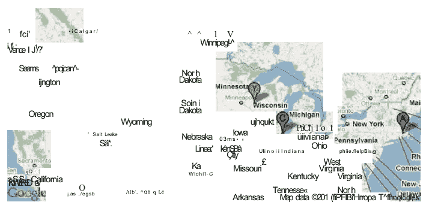

图10.3：当前位置在地图上用Y标记。

### 降级方案

目前，访问该页面的用户仍会看到包含 AwesomeCo 支持中心位置的地图，但尝试加载页面时会遇到 JavaScript 错误。我们需要在尝试获取访问者位置之前检测是否支持地理定位功能，示例如下：

```javascript
Download html5geo/index.html

if (navigator.geolocation) {
    navigator.geolocation.getCurrentPosition(function(position) {
        showLocation(position.coords.latitude, position.coords.longitude);
    });
} else {
    // 降级代码
}
```

Google 的 Ajax API 提供位置查询服务，因此是理想的降级方案。网站正式上线时需要获取 API 密钥，但在本地测试时无需密钥。

降级方案实现如下：


下载`html5geo/index.html`文件。

```javascript
var key = "your_key";
var script = "http://www.google.com/jsapi?key=" + key;
$.getScript(script, function() {
    if ((typeof google == 'object') &&
        google.loader && google.loader.ClientLocation) {
            showLocation(google.loader.ClientLocation.latitude,
                         google.loader.ClientLocation.longitude);
    } else {
        var message = $("<p>无法定位您的地址。</p>");
        message.insertAfter("#map");
    }
});
```

我们使用 jQuery 的`getScript()`方法加载 Google Ajax API，然后通过 Google 的`ClientLocation()`方法获取访问者位置，并调用`showLocation()`方法将位置标注在地图上。

遗憾的是，Google 无法对所有 IP 地址进行地理定位，因此我们可能仍无法在地图上标注用户位置。为此，我们在图像下方设置了提示信息。降级方案虽非万无一失，但能大幅提高定位访问者的成功率。

由于缺乏可靠的客户端坐标获取方式，我们仍需为用户提供手动输入地址的功能，这部分练习留给读者自行完成。

## 未来展望

本章讨论的技术虽不完全属于 HTML5 规范，但代表了 Web 开发的未来趋势。我们将把更多功能迁移到客户端处理。更完善的历史记录管理将使 Ajax 和客户端应用更直观易用。Web Sockets 可替代远程服务的周期性轮询，实现实时数据显示。跨文档消息传递能够整合原本无法交互的 Web 应用，而地理定位技术最终将帮助我们构建更智能的位置感知 Web 应用——随着移动计算市场的不断发展，这类应用日益重要。

请探索这些 API 并关注其发展动态。它们很可能成为您 Web 开发工具箱中不可或缺的利器。

## 第11章

未来方向

本书重点讲解了当前可用的 Web 技术，但也有一些即将成熟的新技术将使基于标准的 Web 开发更加精彩：从支持 WebGL 的 3D Canvas，到新型存储 API、CSS3 过渡效果以及原生拖放支持。本章将探讨这些前沿技术，帮助您了解未来发展方向。我们将介绍目前仅能在部分浏览器使用、缺乏完善降级方案或尚未完全定义标准的技术：

- **CSS3 过渡效果**：交互过程中的动画效果。*[C3, S3.2, F4, O10.5, IOS3.2, A2]*
- **Web Workers**：JavaScript 后台处理能力。*[C3, S4, F3.5, O10.6]*
- **基于 WebGL 的 3D Canvas**：在画布上创建三维物体。*[C5, F4]*
- **IndexedDB**：类似 NoSQL 解决方案的高级客户端键值数据库存储。*[F4]*
- **拖放 API**：实现拖放交互的 API。*[C3, S4, F3.5, IE6, A2]*
- **表单验证**：客户端输入验证功能。*[C5, S5, IOS6]*

> 1. 后续描述中使用方括号内的简写代码表示浏览器支持情况，其中：C 代表 Google Chrome，F 代表 Firefox，IE 代表 Internet Explorer，O 代表 Opera，S 代表 Safari，IOS 代表搭载 Mobile Safari 的 iOS 设备，A 代表 Android 浏览器。

我们将首先探讨 CSS3 过渡效果及其在 WebKit 浏览器中的应用。

### 11.1 CSS3 过渡效果

交互引导对用户体验设计至关重要，CSS 很早便支持`:hover`伪类，使我们能为元素添加基础交互提示。以下是将链接样式化为按钮的 CSS 代码示例：

```css
Download css3transitions/style.css

a.button{
    padding: 10px;
    border: 1px solid #000;
    text-decoration: none;
}
a.button:hover{
    background-color: #bbb;
    color: #fff
}
```

当鼠标悬停在按钮上时，背景色从白色变为灰色，文字颜色从黑色变为白色。这是即时切换效果。CSS3 过渡功能能实现更多效果，包括过去只能通过 JavaScript 实现的简单动画。例如，通过在样式定义中添加以下高亮代码，可以将过渡效果改为渐变融合：

```css
Download css3transitions/style.css

a.button{
    padding: 10px;
    border: 1px solid #000;
    text-decoration: none;
    -webkit-transition-property: background-color, color;
    -webkit-transition-duration: 1s;
    -webkit-transition-timing-function: ease-out;
}
```

```css
a.button:hover {
    background-color: #bbb;
    color: #fff
}
```

我们指定了需要应用过渡效果的属性（本例中为背景色和前景色），设置动画持续时间，并指定过渡的时间函数。

### 时间函数

`transition-timing-function`属性描述过渡效果在设定持续时间内的变化方式。我们使用三次贝塞尔曲线来定义时间函数，该曲线由四个控制点决定。每个控制点的 X 值和 Y 值均在 0 到 1 之间。首尾控制点固定为 (0.0,0.0) 和 (1.0,1.0)，中间两个控制点决定曲线形状。

线性曲线的控制点设置为两个端点，形成 45 度角的直线。线性曲线的四个控制点为 ((0.0, 0.0), (0.0,0.0), (1.0, 1.0), (1.0, 1.0))，其图像如下：

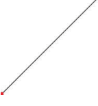

更复杂的曲线如 *ease-in* 曲线，控制点为 ((0.0, 0.0), (0.42,0.0), (1.0, 1.0), (1.0, 1.0))，其图像如下：

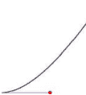

此次仅第二个控制点发生变化，正是这个改变使得曲线左下部分产生弯曲效果。

更为复杂的是缓入缓出曲线，它在底部和顶部都具有曲线，如下所示：

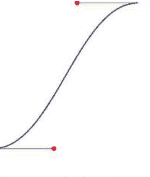

该曲线的点为 ((0.0, 0.0), (0.42,0.0), (0.58, 1.0), (1.0, 1.0))。

我们可以在 CSS 属性中直接指定这些点，也可以像示例中那样使用一些预定义的点。

我们的选择有`default`、`ease-in`、`ease-out`、`ease-in-out`、`ease-out-in`和`cubic-bezier`，其中`cubic-bezier`允许你自行设置曲线的点。

如果你希望速率保持恒定，可以使用`linear`。如果你想让动画开始时缓慢然后加速，可以使用`ease-in`。如果你想了解更多关于制作这些曲线的知识，有一个很棒的公共域脚本⁴可以为你展示示例并帮助你查看坐标。

尝试使用过渡效果，但要记住，界面的可用性应放在首位，美观其次。不要构建会让用户感到沮丧的过渡效果，比如那些会闪烁或动画时间过长的效果。你可能还想研究一下 CSS3 动画⁵，这是另一种随时间改变 CSS 属性的方法。

### 11.2 Web Workers

Web Workers⁶ 不是 HTML5 规范的一部分，但如果你需要在客户端进行一些后台处理，它们可能会很有用，因此值得提及。

我们所有的客户端编码都使用 JavaScript，但 JavaScript 是一种单线程语言——一次只能发生一件事。如果一个任务耗时很长，我们就会强迫用户等待直到任务完成。Web Workers 通过创建一种编写并发程序的简单方法来解决这个问题。

如果我们有一个名为`worker.js`的脚本用于处理一些图像，我们可以这样调用它：

```javascript
var worker = new Worker("worker.js");
```

任何 JavaScript 文件都可以作为 worker 启动，但为了使 worker 独立，你的 worker 脚本无法访问 DOM。这意味着你不能直接操作元素。

我们的主脚本可以使用`postMessage()`向 worker 脚本发送消息，如下所示：

```javascript
$("#button").click(function(event){
  $("#output").html("starting...");
  worker.postMessage("start");
});
```

然后，我们的 worker 脚本也可以使用`postMessage()`方法向主页面发送消息。

```javascript
onmessage = function(event) {
  if (event.data === "start"){
    // 这个循环用来计数。你可以替换成其他更有意义的操作，
    for (var x = 1; x <= 100000; x++){
      postMessage(x);
    }
  }
}
```

我们通过在主脚本中监听`onmessage`事件来响应这些事件。每当 worker 发送消息回来时，这段代码就会触发：

```javascript
worker.onmessage = function(event){
  $("#output").html(event.data);
}
```

这个 API 的工作原理与我们在第200页《跨域通信》中讨论的跨域消息 API 类似。Internet Explorer 不支持 Web Workers，因此你需要依赖 Google Chrome Frame，但如果你想要进行一些更繁重的非阻塞客户端工作，你需要进一步研究这个。

### 11.3 原生拖放支持

让用户拖放界面元素，我们已经能够通过 JavaScript 库实现相当长一段时间了，但 W3C 已将微软的拖放实现作为 HTML5 规范的一部分⁷。它得到了 Firefox、Safari、Internet Explorer 和 Chrome 的支持，但实际上它一团糟。

这个实现乍看起来很直接；我们将一个元素指定为“可拖动”，然后指定一个元素来监听被拖放的对象，并在发生拖放时执行一些代码。

实际上，它远没有那么简单。为了演示，让我们创建一个简单的拖放界面，允许我们将小图像拖放到一个拖放区域，该区域将加载更大的版本。

```html
Download html5drag/index.html

<div id="images">
    
    
    
</div>

<div id="preview">
    <p>Drop images here</p>
</div>
```

我们在这里使用自定义数据属性来保存照片大版本的源地址。

7. http://dev.w3.org/html5/spec/dnd.html#dnd

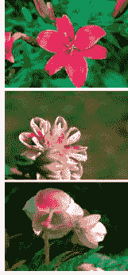

#### 图 11.1：我们的照片查看器

接下来，我们将添加一些基本样式来浮动两列：

```css
Download html5drag/style.css

#images img {
    -webkit-user-drag
}

#images {
    float: left;
    width: 240px;
    margin-right: 10px;
}

#preview {
    float: left;
    width: 500px;
    background-color: #ddd;
    height: 335px;
}

.hover {
    border: 10px solid #000;
    background-color: #bbb !important;
}
```

此时，我们的界面看起来与上一页图 11.1 中的界面相同。现在，让我们添加一些事件，以便我们可以拖动照片。

#### 拖放事件

我们将需要处理与拖放元素相关的几个事件。

| 事件 | 描述 |
| :--- | :--- |
| `ondragstart` | 当用户开始拖动对象时触发 |
| `ondragend` | 当用户因任何原因停止拖动对象时触发 |
| `ondragenter` | 当可拖动元素移动到拖放监听器中时触发 |
| `ondragover` | 当用户拖动元素经过拖放监听器时触发 |
| `ondragleave` | 当用户将元素拖出拖放监听器时触发 |
| `ondrop` | 当用户成功将元素拖放到拖放监听器中时触发 |
| `ondrag` | 当用户在任何地方拖动元素时触发；持续触发，但可以提供鼠标光标的 X 和 Y 坐标 |

处理拖放元素总共需要七个事件，其中一些事件具有默认行为。如果我们不覆盖它们，整个操作就会失败。

首先，我们需要将所有列表项定义为可拖动的。

```javascript
var contacts = $('images img');
contacts.attr('draggable', 'true');
```

我们正在添加`draggable`HTML5 属性。我们可以在标记中完成这个操作，但由于我们需要 JavaScript 来进行交互，我们将用脚本应用这个属性。

当我们拖动图像时，我们想获取大图像的地址并存储它。我们将绑定到`ondragstart`事件，为了简单和跨平台，我们将使用 jQuery 的`bind()`方法⁸。

8. 记住，当使用该方法时，我们为这些事件省略了`on`前缀。

```javascript
Download html5drag/application.js

Line 1 contacts.bind('dragstart', function(event) {
    var data = event.originalEvent.dataTransfer;
    var src = $(this).attr("data-large");
    data.setData("Text", src);
    return true;
});
```

该规范提供了一种数据存储机制，允许我们指定数据类型和数据本身，数据作为事件的一部分传递。jQuery 的`bind()`方法将事件包装在它自己的对象中，因此我们在第2行使用`originatevent`属性来访问真正的事件。我们在第4行使用`setData()`方法，使用`Text`作为数据类型，将图像 URL 存储在事件中。

现在我们可以拖动元素了，让我们来谈谈当用户放下元素时如何触发事件。

#### 放下元素

我们希望我们的“To”表单字段作为拖放目标，因此我们将定位它并绑定`drop`事件。

```javascript
Download html5drag/application.js

Line 1 var target = $('#preview');

    target.bind('drop', function(event) {
        var data = event.originalEvent.dataTransfer;
        var src = ( data.getData('Text') );

        var img = $("").attr("src", src);
        $(this).html(img);
        if (event.preventDefault) event.preventDefault();
    Line 9 return(false);
    });
```

我们在第5行使用`getData()`方法检索我们通过事件传递的图像地址，然后创建一个新的图像元素，将其放入我们的内容区域。

我们需要取消`ondrop`事件的默认行为，这样当用户将元素拖放到目标上时就不会触发它。为此，我们需要同时使用`preventdefault()`和`return false`。Internet Explorer 需要`return false`，而其他浏览器需要`preventDefault()`。

如果我们现在尝试在 Chrome 或 Safari 中使用它，它可能无法正常工作。至少，我们必须覆盖`ondragover`元素。如果不会，我们的`ondrag`事件将不会响应。因此，我们将使用以下代码来实现：

```javascript
Download html5drag/application.js
target.bindC'dragover', function(event) {
  if (event.preventDefault) event.preventDefault();
  return false;
});
```


我们只是再次以与处理`ondrop`事件相同的方式取消了默认事件。让我们对`ondragend`事件也做同样的处理。

```javascript
Download html5drag/application.js
contacts.bindC'dragend', function(event) {
  if (event.preventDefault) event.preventDefault();
  return false;
```

这将取消用户停止拖动元素时触发的任何浏览器事件，但不会干扰我们定义的`ondrop`事件。

### 更改样式

我们想让用户知道他们已将元素拖到了放置目标上方，我们可以使用`ondragenter`和`ondragleave`方法来实现。

```javascript
Download html5drag/application.js
contacts.bindC'dragend', function(event) {
  if (event.preventDefault) event.preventDefault();
  return false;
```

这将应用我们样式表中的悬停类，该类将在这些事件触发时应用和移除。

### 文件拖放

在页面上移动文本和元素只是开始。该规范允许开发人员创建可以从用户计算机接收文件的界面。上传照片或附加文件就像将文件拖放到指定目标一样简单。事实上，如果你使用的是Firefox 3.6或Chrome 5，Google的Gmail就支持此功能。

如果你想进一步探索，请查看Leslie Michael Orchard的精彩文章⁹。

### 情况并非完全顺利

各种浏览器的行为，客气地说，是不一致的。IE 8可以工作，但如果我们尝试将`setData()`的数据类型设置为`URL`而不是`Text`，它就会出错。

此外，为了在Safari 4中支持拖动非图像或链接的元素，我们需要在样式表中添加额外的CSS。

```css
#contents li{
    -webkit-user-drag
}
```

在本书中，我们讨论了将样式和行为与内容分离的重要性，而这直接违背了这一理念。

不要尝试将文本拖到表单字段上。现代浏览器已经允许你这样做，但没有好的方法来覆盖该行为。

目前的情况是，通过使用支持拖放的JavaScript库（如jQuery UI）¹⁰，我们可以用更少的代码获得更好的效果。

即使使用了库，我们仍然有一件事情需要担心：可访问性。规范没有说明如何处理无法使用鼠标的用户。如果我们在界面上实现了拖放功能，我们就需要开发一种不需要JavaScript或鼠标就能工作的次要方法，而这种方法取决于我们试图做什么。

这个规范有很多潜力，但也有一些需要解决的问题。如果合理就使用它，但要确保不要强迫你的用户使用他们无法使用的东西。

9. http://decafbad.com/blog/2009/07/15/html5-drag-and-drop

10. http://docs.jquery.com/UI/Draggable

### 11.4 WebGL

我们在本书中讨论了`canvas`元素的2D上下文，但还有另一个正在进行的规范描述了如何处理3D对象。WebGL¹¹规范不是HTML5的一部分，但苹果、谷歌、Opera和Mozilla都是工作组成员，并在他们的浏览器中提供了一些支持。

处理3D图形远远超出了本书的范围，但Learning WebGL¹²网站有一些很棒的示例和教程。

### 11.5 Indexed Database API

在本书中，我们讨论了在客户端存储数据的两种方法：Web Storage和Web SQL Storage。Mozilla基金会对Web SQL规范提出了异议，表示他们不认为基于特定SQL引擎来制定规范是个好主意。他们引入了一个名为Indexed Database API的新规范，该规范计划成为其自己的标准。¹³

Indexed Database API是一个键/值存储，类似于Web Storage API（如`localStorage`和`sessionStorage`），但它提供了执行高级查询的方法。不幸的是，在撰写本文时，还没有该规范的实现，因此甚至不值得讨论任何实现细节，因为它们在现在到实现时之间很可能会发生变化。预计Firefox 4和Chrome 7将包含支持。

这是你需要密切关注的规范，因为Web SQL已经陷入僵局，Mozilla多次表示没有计划在Firefox中实现Web SQL，因为Mozilla对SQL方言感到不满，并且不认为规范应该基于某个特定的数据库实现。Web SQL规范使用SQLite数据库方言，该方言可能独立于规范进行更改。Internet Explorer也很可能会实现该规范，因为微软已经对其开发产生了兴趣。¹⁴

11. https://cvs.khronos.org/svn/repos/registry/trunk/public/webgl/doc/spec/WebGL-spec.html

12. http://learningwebgl.com/blog/?p=1

13. http://www.w3.org/TR/IndexedDB/

14. http://hacks.mozilla.org/2010/06/beyond-html5-database-apis-and-the-road-to-indexeddb/

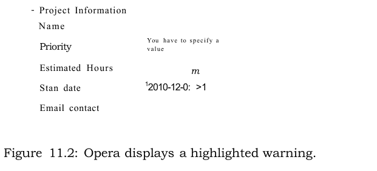

### 11.6 客户端表单验证

HTML5规范列出了几个我们可以用来在客户端验证用户输入的属性，这样我们就可以在用户将请求发送到服务器之前捕获简单的输入错误。多年来，我们一直能够使用JavaScript来实现这一点，但HTML5表单可以使用新属性来指定行为。

我们可以通过添加`required`属性来确保用户填写了必填的表单字段，如下所示：

```html
Download html5validation/index.html
<label for="name">Name</label>
<input type="text" name="name" autofocus required id="name">
```

然后，浏览器可以阻止表单提交并显示一条友好的错误消息，而我们不需要编写一行JavaScript验证代码。Opera现在就能做到这一点，如图11.2所示。

这使用户能够及早失败，而无需等待服务器响应来发现是否出错。这种行为可能会被禁用、不可用或者根本就没有正确实现，因此你仍然需要确保有一个服务器端的数据验证策略。不过，这确实是一件现在就开始思考的事情，因为你可以轻松地定位必填字段并使用CSS为界面设置样式，使必填字段与其他字段区分开来。

你可以使用`pattern`属性更进一步，该属性允许你指定一个正则表达式来确保内容符合你的标准。

Download html5validation/index.html

```html
<label for="name">Name</label>
<input type="text" name="name" autofocus required id="name">
```

尽管目前没有任何浏览器通过用户界面使用此功能，但以这种标记为基础创建一个JavaScript验证库将很容易实现。

### 11.7 继续前进！

现在是成为一名开发者的激动人心的时刻。本书仅仅触及了Web开发人员未来可能性的表面。规范中还有很多内容，我鼓励你深入挖掘。我希望你将在这里学到的东西付诸实践，继续构建和探索，并在此过程中关注各种规范。

现在去构建一些很棒的东西吧！

# 附录A

## HTML5快速参考

在接下来的描述中，浏览器支持以方括号显示，使用简写代码和最低支持版本号。使用的代码是：C：Google Chrome，F：Firefox，IE：Internet Explorer，O：Opera，S：Safari，IOS：运行Mobile Safari的iOS设备，A：Android浏览器。

## 新元素

在第27页的*使用语义标记重新定义博客*中引用

- `<header>`
  - 定义页面或节的页眉区域。[C5, F3.6, IE8, S4, O10]

- `<footer>`
  - 定义页面或节的页脚区域。[C5, F3.6, IE8, S4, O10]

- `<nav>`
  - 定义页面或节的导航区域。[C5, F3.6, IE8, S4, O10]

- `<section>`
  - 定义页面的一个逻辑区域或一组内容。[C5, F3.6, IE8, S4, O10]

- `<article>`
  - 定义一篇文章或一篇完整的内容。[C5, F3.6, IE8, S4, O10]

### A.1 新元素

- `<aside>`
  - 定义次要或相关内容。*[C5, F3.6, IE8, S4, O10]*

- `<meter>`
  - 描述一个范围内的数量。*[C5, F3.5, S4, O10]*

- `<progress>`
  - 显示实时进度的控件。*[发布时不受支持。]*

### A.2 属性

- **自定义数据属性**
  - 允许使用`data-`模式为任何元素添加自定义属性。*[所有浏览器都支持通过JavaScript的`getAttribute()`方法读取这些属性。]*
  - 在第40页的*使用自定义数据属性创建弹出窗口*中有所引用

- **就地编辑支持** `[<p contenteditable>lorem ipsum</p>]`
  - 支持通过浏览器对内容进行就地编辑。*[C4, S3.2, IE6, O10.1]*
  - 在第65页的*使用`contenteditable`进行就地编辑*中有所引用

### A.3 表单

- 在第48页的*使用新输入字段描述数据*中有所引用

- **电子邮件字段** `[<input type="email">]`
  - 显示用于输入电子邮件地址的表单字段。*[O10.1, IOS]*

- **URL字段** `[<input type="url">]`
  - 显示用于输入URL的表单字段。*[O10.1, IOS]*

- **电话字段** `[<input type="tel">]`
  - 显示用于输入电话号码的表单字段。*[O10.1, IOS]*

- **搜索字段** `[<input type="search">]`
  - 显示用于输入搜索关键词的表单字段。*[C5, S4, O10.1, IOS]*

- **滑块 (range)** `[<input type="range">]`
  - 显示滑块控件。*[C5, S4, O10.1]*

- **数字** `[<input type="number">]`
  - 显示用于输入数字的表单字段，通常为微调框。*[C5, S5, O10.1, IOS]*

- **日期字段** `[<input type="date">]`
  - 显示用于输入日期的表单字段。支持日期、月份或周。*[C5, S5, O10.1]*

- **日期与时间** `[<input type="datetime">]`
  - 显示用于输入日期和时间的表单字段。支持datetime、datetime-local或time。*[C5, S5, O10.1]*

- **颜色** `[<input type="color">]`
  - 显示用于指定颜色的字段。*[C5, S5]* （Chrome 5和Safari 5支持颜色字段，但不显示任何特定控件。）

### A.4 表单字段属性

- **自动聚焦支持** `[<input type="text" autofocus>]`
  - 支持将焦点放置在特定的表单元素上。*[C5, S4]*
  - 在第56页的*使用自动聚焦跳转到第一个字段*中有所引用

- **占位符支持** `[<input type="email" placeholder="me@example.com">]`
  - 支持在表单字段内显示占位符文本。*[C5, S4, F4]*
  - 在第58页的*使用占位符文本提供提示*中有所引用

- `required` `[<input type="email" required > ]`
  - 使字段成为必填项。*[C5, S5, O10.6]*
  - 在第230页的第11.6节*客户端表单验证*中有所引用

- `pattern` `[<input type="text" pattern="A[-9]+[0-9]*$"> ]`
  - 验证表单字段数据是否与指定的正则表达式模式匹配。*[C5, S5, O10.6]*
  - 在第230页的第11.6节*客户端表单验证*中有所引用

### A.5 无障碍性

- **role属性** `[<div role="document">]`
  - 标识元素对屏幕阅读器的职责。*[C3, F3.6, S4, IE8, 0.6]*
  - 在第99页的*使用ARIA角色提供导航提示*中有所引用

- `aria-live` `[<div aria-live="polite">]`
  - 标识一个可能通过Ajax自动更新的区域。*[F3.6 (Windows), S4, IE8]*
  - 在第104页的*创建一个可访问的可更新区域*中有所引用

- `aria-atomic` `[<div aria-live="polite" aria-atomic="true">]`
  - 标识是应读取整个活动区域的内容，还是仅读取已更改的元素。*[F3.6 (Windows), S4, IE8]*
  - 在第104页的*创建一个可访问的可更新区域*中有所引用

### A.6 多媒体

- `<canvas>` `[<canvas>...</canvas>]`
  - 支持通过JavaScript创建基于矢量的图形。*[C4, F3, IE9, S3.2, O10.1, IOS3.2, A2]*
  - 在第111页的第6章*在Canvas上绘制*中有所引用

- `<audio>` `[<audio src="drums.mp3"></audio>]`
  - 在浏览器中原生播放音频。*[C4, F3.6, IE9, S3.2, O10.1, IOS3, A2]*
  - 在第133页的*处理音频*中有所引用

- `<video>` `[<video src="tutorial.m4v"></video>]`
  - 在浏览器中原生播放视频。*[C4, F3.6, IE9, S3.2, O10.5, IOS3, A2]*
  - 在第137页的*嵌入视频*中有所引用

### A.7 CSS3

- 在第219页的第11.1节*CSS3过渡*中有所引用

- `:nth-of-type` `[p:nth-of-type(2n+1){color: red;}]`
  - 查找所有某个特定类型的`n`个元素。*[C2, F3.5, S3, IE9, 0.5, IOS]*
  - 在第74页的*使用伪类设置表格样式*中有所引用

- `:first-child` `[p:first-child{color:blue;}]`
  - 查找第一个子元素。*[C2, F3.5, S3, IE9, 0.5, IOS3, A2]*
  - 在第74页的*使用伪类设置表格样式*中有所引用

- `:nth-child` `[p:nth-child(2n+1){color: red;}]`
  - 向前计数查找特定的子元素。*[C2, F3.5, S3, IE9, 0.5, IOS3, A2]*
  - 在第74页的*使用伪类设置表格样式*中有所引用

- `:last-child` `[p:last-child{color:blue;}]`
  - 查找最后一个子元素。*[C2, F3.5, S3, IE9, 0.5, IOS3, A2]*
  - 在第74页的*使用伪类设置表格样式*中有所引用

- `:nth-last-child` `[p:nth-last-child(2){color: red;}]`
  - 向后计数查找特定的子元素。*[C2, F3.5, S3, IE9, 0.5, IOS3, A2]*
  - 在第74页的*使用伪类设置表格样式*中有所引用

- `:first-of-type` `[p:first-of-type{color:blue;}]`
  - 查找给定类型的第一个元素。*[C2, F3.5, S3, IE9, 0.5, IOS3, A2]*
  - 在第74页的*使用伪类设置表格样式*中有所引用

- `:last-of-type` `[p:last-of-type{color:blue;}]`
  - 查找给定类型的最后一个元素。*[C2, F3.5, S3, IE9, 0.5, IOS3, A2]*
  - 在第74页的*使用伪类设置表格样式*中有所引用

- **列支持** `[#content{ column-count: 2; column-gap: 20px; column-rule: 1px solid #ddccb5;}]`
  - 将内容区域分成多列。*[C2, F3.5, S3, 0.5, IOS3, A2]*
  - 在第87页的*创建多列布局*中有所引用

- `:after` `[span:after { content: "lbs"; color: #bbb;}]`
  - 与`content`一起使用，在指定元素之后插入内容。*[C2, F3.5, S3, IE8, 0.5, IOS3, A2]*
  - 在第83页的*使用`:after`和`content`使链接可打印*中有所引用

- **媒体查询** `[media="only all and (max-width: 480)"]`
  - 根据设备设置应用样式。*[C3, F3.5, S4, IE9, O10.1, IOS3, A2]*
  - 在第94页的*使用媒体查询构建移动界面*中有所引用


- `border-radius` `[border-radius: 10px;]`
  - 使元素的角变圆。*[C4, F3, IE9, S3.2, 0.5]*
  - 在第146页的*使粗糙边缘变圆滑*中有所引用
- **RGBa 支持** `[background-color: rgba(255,0,0,0.5);]`
  - 使用 RGB 颜色代替十六进制代码，并支持透明度。*[C4, F3.5, IE9, S3.2, O10.1]*
  - 在第154页的*处理阴影、渐变和变换*中有所引用
- `box-shadow` `[box-shadow: 10px 10px 5px #333;]`
  - 在元素上创建投影。*[C3, F3.5, IE9, S3.2, 0.5]*
  - 在第154页的*处理阴影、渐变和变换*中有所引用
- **旋转：** `[transform: rotate(7.5deg);]`
  - 旋转任何元素。*[C3, F3.5, IE9, S3.2, 0.5]*
  - 在第154页的*处理阴影、渐变和变换*中有所引用
- **渐变：** `[linear-gradient(top, #fff, #efefef);]`
  - 创建可作为图像使用的渐变。*[C4, F3.5, S4]*
  - 在第154页的*处理阴影、渐变和变换*中有所引用
- `@font-face` `[font-family: AwesomeFont; src: url(http://example.com/awesomeco.ttf); font-weight: bold;]`
  - 允许通过 CSS 使用特定字体。*[C4, F3.5, IE5+, S3.2, O10.1]*
  - 在第165页的*使用真实字体*中有所引用

### A.8 客户端存储

- `localStorage`
  - 以键/值对形式存储数据，绑定到一个域，并在浏览器会话期间持续存在。*[C5, F3.5, S4, IE8, O10.5, IOS, A]*
  - 在第175页的*使用 localStorage 保存首选项*中有所引用
- `sessionStorage`
  - 以键/值对形式存储数据，绑定到一个域，并在浏览器会话结束时被清除。*[C5, F3.5, S4, IE8, O10.5, IOS, A]*
  - 在第175页的*使用 localStorage 保存首选项*中有所引用
- **Web SQL 数据库**
  - 完全关系型数据库，支持创建表、插入、更新、删除和选择操作，并支持事务。绑定到一个域，并在会话期间持续存在。*[C5, S3.2, O10.5, IOS3.2, A2]*
  - 在第181页的*在客户端关系型数据库中存储数据*中有所引用

### A.9 其他 API

- **离线 Web 应用**
  - 定义要缓存以供离线使用的文件，允许应用程序在没有互联网连接的情况下运行。*[C4, S4, F3.5, O10.6, IOS3.2, A2]*
  - 在第193页的*离线工作*中有所引用
- `History`
  - 管理浏览器历史记录。*[C5, S4, IE8, F3, O10.1, IOS3.2, A2]*
  - 在第197页的*保留历史记录*中有所引用
- **跨文档消息传递**
  - 在加载了不同域内容的窗口之间发送消息。*[C5, S5, F4, IOS4.1, A2]*
  - 在第200页的*跨域通信*中有所引用
- **Web Sockets**
  - 在浏览器和服务器之间创建一个有状态连接。*[C5, S5, F4, IOS4.2]*
  - 在第207页的*使用 Web Sockets 聊天*中有所引用

#### 地理定位

从客户端浏览器获取经度和纬度。*[C5, S5, F3.5, O10.6, IOS3.2, A2]*

参考*找到你自己：地理定位*，位于第214页。

#### Web Workers

JavaScript 的后台处理。*[C3, S4, F3.5, O10.6]*

参考第11.2节*Web Workers*，位于第221页。

#### 使用 WebGL 的 3D 画布¹

在画布上创建 3D 对象。*[C5, F4]*

参考第11.4节*WebGL*，位于第229页。

#### 拖放

用于拖放交互的 API。*[C3, S4, F3.5, IE6, A2]*

参考第11.3节*原生拖放支持*，位于第223页。

## 附录 B

### jQuery 入门指南

编写能在所有主要网页浏览器中良好运行的简洁 JavaScript 代码是一项艰巨的任务。有许多库使这个过程不那么痛苦，而 jQuery 是其中最受欢迎的一个。它易于使用，拥有大量的现有库，并且非常适合轻松创建回退解决方案。

本附录向你介绍我们在本书其他地方使用的 jQuery 库部分。它并非旨在取代 jQuery 出色的文档，<sup>1</sup> 也不是可用功能和方法的详尽列表。然而，它会为你提供一个良好的起点。

### B.1 加载 jQuery

你可以从 jQuery 网站<sup>2</sup>获取 jQuery 库并直接链接到 jQuery 脚本，但我们将从 Google 的服务器加载 jQuery，像这样：

```html
Download jquery/simple_selection.html
<script type="text/javascript"
    charset="utf-8"
    src="http://ajax.googleapis.com/ajax/libs/jquery/1.4.2/jquery.min.js">
</script>
```

浏览器一次只能与服务器建立少数几个连接。如果我们把图片和脚本分发到多个服务器上，用户就能更快地下载我们的页面。使用 Google 的内容分发网络还有一个额外的好处——因为其他网站也链接到 Google 上的 jQuery 库，我们的访问者的浏览器可能已经缓存了该库。正如你可能已经知道的，浏览器使用文件的完整 URL 来决定是否拥有其缓存副本。如果你计划在笔记本电脑或没有持续网络连接的计算机上使用 jQuery，你可能需要链接到本地副本。

1. http://docs.jquery.com
2. http://www.jquery.com

### B.2 jQuery 基础

一旦你在页面上加载了 jQuery 库，你就可以开始操作元素了。jQuery 有一个名为 jQuery 函数的函数。这个单一函数是 jQuery 库的核心。我们使用这个函数通过 CSS 选择器获取元素，并将它们包装在 jQuery 对象中，以便我们可以操作它们。jQuery 函数有一个更短的版本：`$()`；我们在本书中使用的就是这个。在本附录的其余部分，我将把这个函数称为“jQuery 函数”。以下是它的工作原理：

如果你想找到页面上的 `h1` 标签，你会使用以下代码：

```javascript
Download jquery/simple_selection.html
```

如果你要查找所有 class 为 `important` 的元素，你会这样做：

```javascript
Download jquery/simple_selection.html
$(".important");
```

再看一下。这两个例子之间唯一的区别是我们使用的 CSS 选择器。jQuery 函数返回一个 jQuery 对象，这是一个特殊的 JavaScript 对象，包含一个与选择器匹配的 DOM 元素数组。这个对象有许多有用的预定义方法，我们可以用它们来操作我们选中的元素。让我们详细看看其中几个。

### B.3 修改内容的方法

在本书中，我们使用几个 jQuery 方法来修改 HTML 内容。

#### 隐藏与显示

`hide()` 和 `show()` 方法可以轻松地隐藏和显示用户界面元素。我们可以像这样隐藏页面上的一个或多个元素：

```javascript
Download jquery/simple_selection.html

$('h7p1').hide();
```

要显示它们，我们只需调用 `show()` 方法即可。我们在本书中使用 `hide()` 方法来隐藏那些仅在 JavaScript 禁用时才需要出现的页面部分，例如文字记录或其他回退内容。

#### `html`、`val` 和 `attr`

我们使用 `html()` 方法获取和设置指定元素的内部内容。

```javascript
Download jquery/methods.html

$("message").html("Hello World!");
```

在这里，我们将 `h1` 标签之间的内容设置为"Hello World"。

`val()` 方法设置和检索表单字段的值。它的使用方式与 `html()` 方法完全相同。

`attr()` 方法允许我们检索和设置元素的属性。

#### `append`、`prepend` 和 `wrap`

`append()` 方法在现有元素之后添加一个新的子元素。假设我们有一个简单的表单和一个空的无序列表，像这样：

```html
Download jquery/methods.html

<form id="add">
    <label for="task">任务</label>
    <input type="text" id="task" >
    <input type="submit" value="添加">
</form>
<ul id="links">
</ul>
```

我们可以通过在提交表单时追加这些新元素来在列表中创建新元素。

```javascript
Download jquery/methods.html

$(function(){
    $("#add").submit(function(event){
        event.preventDefault();
        var new_element = $("<li>" + $("#email").val() + "</li>");
        $("#links").append(new_element);
    });
});
```

`prepend()` 方法的工作方式与 `append()` 方法相同，但将新元素插入到任何现有元素之前。`wrap()` 方法用你指定的 jQuery 对象代表的元素包裹选中的元素。

```javascript
Download jquery/methods.html

var wrapper = $("#message").wrap("<div><h2>消息</h2></div>").parent();
```

我们将使用这些技术以编程方式创建一些复杂的结构。

#### CSS 与类

我们可以使用 `css()` 方法为元素定义样式，像这样：

```javascript
Download jquery/methods.html

$("label").css("color", "#f00");
```

我们可以一次定义一个，但也可以使用 JavaScript 哈希为元素分配多个 CSS 规则：

```javascript
Download jquery/methods.html

$("h1").css(
    {"color" : "red",
     "text-decoration" : "underline"}
);
```

然而，将样式与脚本混合使用并不是一个好主意。我们可以使用 jQuery 的 `addClass()` 和 `removeClass()` 方法在特定事件发生时添加和移除类。然后，我们可以将这些类与样式关联起来。通过结合 jQuery 事件和类，我们可以在表单字段获得和失去焦点时更改其背景。

```javascript
Download jquery/methods.html

$("input").focus(function(event){
    $(this).addClass("focused");
});

$("input").blur(function(event){
    $(this).removeClass("focused");
});
```

这是一个简单的例子，可以用 CSS3 中的 `:focus` 伪类替代，但这在某些浏览器中不受支持。

#### 链式调用

jQuery 对象上的方法返回 jQuery 对象，这意味着我们可以无限地链式调用方法，像这样：

```javascript
Download jquery/simple_selection.html

$("h2").addClass("hidden").removeClass("visible");
```

你应该注意不要滥用这一点，因为这可能会使代码更难以理解。

### B.4 创建元素

有时，我们需要创建新的 HTML 元素，以便将它们插入到文档中。我们可以使用 jQuery 的 `$()` 方法来创建这些元素。

```javascript
Download jquery/create_elements.html

var input = $("input");
```

虽然我们可以使用 `document.createElement("input");` 来完成此操作，但如果我们使用 jQuery 函数，我们可以轻松调用额外的方法。

```javascript
Download jquery/create_elements.html

var element = $("<p>Hello World</p>");
element.css("color", "#f00").insertAfter("#header");
```

这是另一个 jQuery 链式调用帮助我们快速构建和操作结构的例子。

### B.5 事件

当用户与我们的页面交互时，我们经常需要触发事件，而 jQuery 使这变得非常容易。在 jQuery 中，许多常见事件只是 jQuery 对象上接受一个函数的方法。例如，我们可以让页面上所有 class 为 `popup` 的链接在新窗口中打开，像这样：

```javascript
Download jquery/popup.html

var links = $("#links a");
links.click(function(event) {
    var address = $(this).attr('href');
    event.preventDefault();
    window.open(address);
});
```

#### 绑定

某些事件并未得到 jQuery 的直接支持，我们可以使用 `bind()` 方法来处理它们。例如，在实现 HTML5 规范的拖放部分时，我们需要取消 `ondragover` 事件。我们这样使用 `bind()`：

```javascript
Download jquery/bind.html

target = $("#droparea")
target.bind('dragover', function(event) {
  if (event.preventDefault) event.preventDefault();
  return false;
});
```

请注意，我们省略了所监听事件的 `on` 前缀。

在 jQuery 事件处理函数内部，我们可以通过 `this` 关键字访问正在操作的元素。在第 3 行，我们将 `this` 传递给 jQuery 函数，这样就可以在其上调用 `attr()` 方法，从而快速获取链接的目标地址。

我们使用 `preventDefault()` 函数来阻止原始事件触发，以免干扰我们的操作。

#### 原始事件

当我们使用任何 jQuery 事件函数（如 `bind()` 或 `click()`）时，jQuery 会用其自己的对象封装 JavaScript 事件，并且只复制其中的部分属性。有时我们需要获取实际的事件，以便访问那些未被克隆的属性。jQuery 事件通过恰如其名的 `originalEvent` 属性让我们访问原始事件。我们可以这样访问 `onmessage` 事件的 data 属性：

```javascript
$(window).bind("message", function(event){
  var message_data = event.originalEvent.data;
});
```

你可以使用此技术调用原始事件的任何属性或方法。

#### 文档就绪

“不唐突的 JavaScript”这一短语指的是完全与内容分离的 JavaScript。我们不在 HTML 元素上添加 `onclick` 属性，而是使用刚刚在第 244 页 B.5 节 *事件* 中讨论过的事件处理程序。我们以不唐突的方式为文档添加行为，而不修改文档本身。我们的 HTML 不依赖于用户启用 JavaScript。

这种方法的一个缺点是，在元素声明之前，JavaScript 无法“看到”文档中的任何元素。我们可以在页面底部将 JavaScript 代码放在一个 script 块中，在所有其他内容渲染完成之后加载，但这无法在页面之间重用。

我们可以将代码包装在 JavaScript 的 `window.onload()` 事件处理程序中，但该事件会在所有内容加载完成后触发。这可能会导致延迟，意味着用户在你的事件附加之前可能已经在与页面交互。我们需要一种方法，在 DOM 加载完成但尚未显示时添加事件。

jQuery 的 `document.ready` 函数正是这样做的，并且以跨浏览器的方式工作。我们这样使用它：

```javascript
Download jquery/ready.html

$(document).ready(function() {
    alert("Hi! I am a popup that displays when the page loads");
});
```

还有一个更短、更紧凑的版本，我们将在整个代码中使用它，如下所示：

```javascript
Download jquery/ready.html

$(function() {
    alert("Hi! I am a popup that displays when the page loads");
});
```

我们在本书的几乎每个示例中都使用这种模式，以便我们可以轻松、不唐突地为项目添加回退解决方案。

这只是我们可以用 jQuery 做的事情的一小部分。除了文档操作功能外，jQuery 还提供了序列化表单和发出 Ajax 请求的方法，并包含一些实用程序函数，使循环和 DOM 遍历变得容易得多。一旦你更熟练地使用它，你无疑会在项目中找到更多使用它的方法。

## 附录 C

# 音频和视频编码

为 HTML5 的 `audio` 和 `video` 标签编码音频和视频是一个复杂的主题，超出了本书的范围，但如果你需要准备自己的内容，这本简短的附录将为你指明正确的方向。


## 音频编码

你需要准备 MP3 和 Vorbis 两种格式的音频文件，以覆盖最广泛的受众，为此你需要使用一些工具。

对于 MP3 文件编码，Lame 将为你提供最佳质量。你希望在编码时使用可变比特率。你可以使用类似这样的命令获得高质量编码：

```bash
lame in.wav out.mp3 -V2 --vbr-new -qO --lowpass 19.7
```

对于 Vorbis 音频，你将使用 Oggenc 来编码音频。要使用可变比特率编码出音质良好的 Vorbis 文件，你可以使用类似这样的命令：

```bash
oggenc -q 3 inputfile.wav
```

在 Hydrogen Audio 了解更多关于 MP3 和 Vorbis 编码的信息。¹ 那里的信息非常棒，但你需要尝试适合你和听众的设置。

1. Lame 在 http://wiki.hydrogenaudio.org/index.php?title=Lame#Quick_start_.28short_answer.29，Vorbis 在 http://wiki.hydrogenaudio.org/index.php?title=Recommended_Ogg_Vorbis

## C.2 网络视频编码

如果你想在使用 HTML5 视频时覆盖所有平台，就需要将视频文件编码为多种格式。编码为 H.264、Theora 和 VP8 可能是一项耗时的任务，无论是设置`FFmpeg`² 等开源编码器，还是实际运行编码任务。正确编码视频超出了本书的范围。我们没有足够的页面来解释这条命令，它使用 WebM 容器将文件转换为 VP8：

```bash
ffmpeg -i blur.mov -f webm -vcodec libvpx_vp8 -acodec libvorbis -ab 160000 -sameq blur.webm
```

如果你不想自己调整设置，Web 服务 Zencoder³ 可以接收你的视频，并将它们编码为 HTML5 视频所需的所有格式。你将视频放在 Amazon S3 或另一个公共 URL 上，然后可以通过其 Web 界面或 API 调用设置任务，将该视频文件编码为多种格式。Zencoder 将获取视频文件，进行编码，然后将新视频传回你的服务器。该服务不是免费的，但它确实能产生出色的结果，如果你有大量内容需要编码，它可以为你节省大量时间。⁴

如果你只是想自己尝试这些格式，Miro Video Converter⁵ 是另一个不错的选择。它具有将视频文件转换为多种输出格式的预设，并且是开源的。

2. http://www.ffmpeg.org/

3. http://www.zencoder.com/

4. 为了完全披露，我认识 Zencoder 的几位开发者，但即使我不认识，我也会推荐这项服务。

5. http://mirovideoconverter.com/

## 附录 D：资源

### 网络资源

- `Apple—HTML5` …………………………………………… http://www.apple.com/html5/

  Apple 关于 HTML5 和网络标准的页面，其 Safari 5 网页浏览器支持这些标准。

- `CSS3.Info` ………………………………………………… http://www.css3.info/

  与构成 CSS3 的各种模块相关的大量背景信息和示例。

- `Font Squirrel` …………………………………………… http://www.fontsquirrel.com

  提供各种格式的免版税字体，适合在网络上分发。

- `HTML5` ………………………………………………… http://www.w3.org/TR/html5/

  W3C 的实际 HTML5 规范。

- `HTML5—Mozilla 开发者中心` … … https://developer.mozilla.org/en/html/html5

  Mozilla 开发者中心关于 HTML5 的页面。

- `使用 Node.js 实现 Web Socket 服务器` … http://www.web2media.net/laktek/2010/05/04/implementing-web-socket-servers-with-node-js/

  如何使用 Node.js 编写 Web Sockets 服务器。

- `Microsoft IE9 试用版` …………………… http://ie.microsoft.com/testdrive/

  展示 Internet Explorer 9 中 HTML5（及相关）功能。

- `Ruby 和 WebSockets—浏览器的 TCP` … … http://www.igvita.com/2009/12/22/ruby-websockets-tcp-for-the-browser/

  关于 em-websocket 的信息，这是一个用于构建 Web Sockets 服务器的 Ruby 库。

- `设置 Flash 策略文件...` … http://www.lightsphere.com/dev/articles/flash_socket_policy.html

  包含对 Flash Socket 策略文件的详细描述。

- `Typekit` … http://www.typekit.com

  允许你通过简单的 JavaScript API 在网站上使用授权字体的服务。

- `Unit Interactive: "更好的 CSS 字体堆栈"...` … http://unitinteractive.com/blog/2008/06/26/better-css-font-stacks/

  关于字体堆栈的讨论，附有一些出色的示例。

- `视频无处不在！` … http://camendesign.com/code/video_for_everybody

  关于 HTML5 视频的信息，附有在所有浏览器上播放视频的代码。

- `Video.js` … http://videojs.com

  JavaScript 库，用于帮助播放 HTML5 视频。

- `何时可以使用` … http://caniuse.com/

  HTML5、CSS3 及相关技术的浏览器兼容性表格。

## 附录 E：参考文献

[Hog09] Brian P. Hogan. *面向开发者的Web设计*. The Pragmatic Programmers, LLC, 罗利, 北卡罗来纳州, 达拉斯, 德克萨斯州, 2009.

[HTOO] Andrew Hunt 和 David Thomas. *程序员修炼之道：从小工到专家*. Addison-Wesley, 雷丁, 马萨诸塞州, 2000.

[Zel09] Jeffrey Zeldman. *使用Web标准设计*. New Riders Press, 纽约, 第三版, 2009.

# A

- `AAC`（高级音频编码），131

- 无障碍访问

  - 音频的无障碍访问，142

  - 创建可更新区域，103, 104-109

  - 后退方案，123

  - 概述，16, 19, 97

  - 功能快速参考，235

  - 视频的无障碍访问，142

- 富互联网应用的无障碍访问（`WIA-ARIA`），97, 99

- `addClass()` 方法，243

- `addToNotesList()` 方法，189

- Adobe，参见 `Flash (Adobe)`

- 成人娱乐行业，其对互联网技术的使用，142

- 高级音频编码（`AAC`），131

- `after`，83

- `Ajax API`（Google），217

- `Apache`，缓存，194

- API

  - 浏览器历史记录，197

  - 跨文档消息传递，200-206

  - 地理定位，214-217

  - 功能快速参考，238

  - Web Sockets，207-213

- 外观（用户界面）

  - 字体，165-170

  - 概述，144

  - 圆角处理，146-153

  - 阴影、渐变和变换，154-164

- `append()` 方法，242

- Apple，22, 128

  - 另请参见 `Safari (Apple)`

- 应用，15

- ARIA 角色

  - 文档结构角色，101

  - 后退方案，103

  - 地标角色，99, 103

- `article` 标签，25, 32

- `aside` 标签，25, 33

- `assertive` 方法，106

- 原子更新，107

- `attr()` 方法，242

- 属性

  - `autocomplete`，60

  - `autofocus`，56

  - `data`，40-43

  - `draggable HTML5`，225

  - 表单字段，234

  - `ID`，29

  - `longdesc`，21

  - `placeholder`，58

  - 表现型，21

  - `profile`，21

  - 功能快速参考，233

  - 另请参见 `contenteditable` 属性

- 音频

  - 无障碍访问，142

  - 编解码器，131

  - 嵌入，133-136

  - 编码，247

  - 后退方案，134

  - 另请参见视频

- `audio` 标签，133

- `autocomplete` 属性，60

- `autofocus` 属性，56

# B

- 背景，其透明度，159

- 向后兼容性，17

- 柱状图，将 HTML 转换为柱状图，121

- `beginPath()` 方法，115

- 行为，与内容分离，40

- HTML5 和 CSS3 的益处，14-17

- `bind()` 方法，225, 245

- 块级元素，25, 25n

- 博客，使用语义化标记重新定义，27-37

- `box-shadow` 属性，157

- 浏览器特定选择器，148

- 浏览器

  - 使用 API 管理历史记录，197

  - 概述，22

  - 资源，250

  - 选择器支持，96

  - 另请参见特定浏览器

# C

- 缓存

  - Apache，194

  - 使用清单定义，193

- `canPlayType()` 方法，136

- `canvas` 元素

  - 使用 `RGraph` 绘制统计图，119-126

- `canvas` 标签，111

  - 绘制徽标，112-118

- 方法链，244

- HTML5 和 CSS3 的挑战，17-22

- `Chrome`

  - `Frame` 插件，191

- `Chrome (Google)`

  - 浏览器历史记录，199

  - 渐变，156

  - `localStorage`，178

  - 媒体查询，96

  - 选择器，148

  - 离线支持，193

  - `Slider` 小部件，49

- Clark, Keith，81

- 客户端数据

  - 客户端关系型数据库，181-192

  - `localStorage`，175-180

  - 概述，172

- 客户端表单验证，230

- 客户端关系型数据库

  - 激活新建按钮，190

  - 创建笔记表，185

  - `CRUD`，181

  - 后退方案，191

  - 查找记录，187

  - 加载笔记，186

  - 操作记录，188

  - 笔记界面，182

  - 离线工作，193

- 客户端存储，15, 238

- `ClientLocation()` 方法，217

- 编解码器，参见容器和编解码器

- 颜色

  - 添加到 `canvas`，117

  - 输入类型，52

- 颜色选择器，53

- 列

  - 文本对齐，77

  - 指定宽度，91

  - 分列，87

- 兼容性（向后），17

- 条件注释，38

- 容器和编解码器

  - 高级音频编码（`AAC`），131

  - 音频编解码器，131

  - `H.264`，130

  - `MP3s`，132

  - `Theora`，130

  - 视频编解码器，129

  - `Vorbis (OGG)`，132

  - `VP8`，131

  - 协同工作，132

- 内容

  - 显示，122

  - 使用 CSS 生成，83

  - 与行为分离，40

- `contenteditable` 属性

  - 创建编辑页面，68

  - 后退方案，68

  - 概述，65

  - 数据持久化，67

  - 个人资料表单，65

- `Cookies`

  - JavaScript 与 Cookies，178

  - 概述，172

- 圆角，参见圆角处理

- 创建、检索、更新和删除（`CRUD`），181, 181n

- 跨文档消息传递，15

  - 概述，200

- 跨域消息传递

  - 后退方案，205

  - 发送消息，202

  - 接收消息，205

  - 支持站点，202

  - Web 服务器，201

- `CRUD`（创建、检索、更新和删除），181, 181n

- `CSS`

  - 使用 CSS 生成内容，83

  - `jQuery` 与 CSS，123

- `css()` 方法，243

- `CSS3`

  - 益处，14-17

  - 挑战，17-22

  - 功能，72

  - 未来，22

  - 功能快速参考，235

  - 资源，249

  - 过渡，219

- 自定义数据属性，26, 233

# D

- 数据

  - 属性，40-43

  - 使用 HTML 描述，120

  - 持久化，67

  - 另请参见客户端数据

- 数据库，185

  - 另请参见客户端关系型数据库

- 日期，50

- 已弃用标签，20

- 检测圆角支持，149

- `DirectX` 滤镜（Microsoft），160

- `Divitis`，24

- `doctype`

  - 声明，17

  - HTML5，27-29

- 文档结构角色，101

- `document.ready` 函数，246

- 不要重复自己（`DRY`），68, 68n

- 拖放实现（Microsoft），223

- 拖放事件，225

- `draggable HTML5` 属性，225

- 拖动文件，227

- 放置元素，226

- `DRY`（不要重复自己），68, 68n

# E

- `ease-in` 曲线，220

- `ease-in-out` 曲线，221

- 边缘，参见圆角处理

- 效果（视觉），17

- 元素

  - 块级，25, 25n

  - 创建，244

  - 放置，226

  - 功能快速参考，232

  - 旋转，158, 160

  - 另请参见标签

- `Email` 输入类型，51

- `embed` 标签，128

- 嵌入式 `OpenType`（`EOT`），166

- 嵌入

  - 音频，133-136

  - 容器和编解码器，129-132

  - 历史，128

  - 概述，127

  - 视频，137-143

- 音频和视频编码，247

- `EOT`（嵌入式 OpenType），166

- `executeSql()` 方法，186

- `ExplorerCanvas` 库，118, 126

# F

- 后退方案

  - 无障碍访问，123

  - ARIA 角色，103

  - 音频，134

  - 浏览器历史记录，199

  - `canvas`，118

  - 客户端关系型数据库，191

  - `ContentEditable` 属性，68

  - 跨域消息传递，205

  - CSS3 列，91

  - 自定义数据属性，43

  - 字体，169

  - 地理定位，216

  - Internet Explorer，160

  - `localStorage`，178

  - 媒体查询，96

  - `placeholder` 属性，60

  - 可打印链接与后退方案，84

  - 圆角，149

  - 选择器，80

  - 语义化标记，38

  - 可更新区域，108

  - 视频，138

  - Web Sockets，211

- `FFMpeg`，248

- 文件

  - 拖动，227

  - 清单，193

- 滤镜（`DirectX`），160

- `Firefox (Mozilla)`

  - 浏览器历史记录，199

  - 渐变，156

  - `localStorage`，178

  - 媒体查询，96

  - `-moz-linear-gradient` 方法，156

  - 离线支持，193

  - 选择器，148

  - 圆角支持，146

- `Flash (Adobe)`

  - 可用性，128

  - 与 `canvas` 比较，126

  - 跨浏览器兼容性，129

  - 使用 Flash 的 Web Sockets，211

- Flash Policy 文件，250

- Flash Socket Policy，212

- `Flowplayer` 视频播放器，138

- 字体栈，169, 250

- `@font-face` 指令，165

- 字体

  - 更改，168

  - 转换，167

  - 后退方案，169

  - `@font-face` 指令，165

  - 格式，167

  - 概述，165

  - 资源，250

  - 版权与字体，166

- `FontSquirrel` 字体，168, 249

- `footer` 标签，25, 30

- 表单字段属性，234

- 格式

  - 字体，167

  - 视频，129

- `formCorners` 插件，150

- 表单，参见 Web 表单

- 框架支持，20

- 函数，定时，220

- HTML5 和 CSS3 的未来，22

# G

- 地理定位，214, 216

- `getContext` 方法，112

- `getScript()` 方法，205, 217

- Google

  - 对 HTML5 和 CSS3 的采用，22

  - `Ajax API`，217

  - `Chrome Frame` 插件，191


- `Static Map API`，214
- `VP8`，131
- 另请参见 `Chrome (Google)`
- 渐变滤镜（`Internet Explorer`），161
- 渐变，156

# H

- `H.264`，130
- 手持设备媒体类型，95
- `header` 标签，25、29
- `hide()` 方法，242
- 隐藏可更新区域，107
- 嵌入历史，128
- `HTML`
  - 更改代码，81
  - 使用 `HTML` 描述数据，120
  - 转换为柱状图，121
- `html()` 方法，242
- `HTML5`
  - 益处，14-17
  - 挑战，17-22
  - 创建页面，104
  - `doctype`，27
  - 未来，22
  - 离线支持，193
- `HTML5` 标记，参见语义化标记
- `HTMLShiv`，39
- `Hydrogen Audio`，247

# I

- `ID` 属性，29
- `Indexed Database API`，229
- 输入字段
  - 颜色，52
  - 创建滑块，49
  - 日期，50
  - `Email`，51
  - 后退方案，53
  - `Modernizr`，54
  - 概述，48
  - 替换颜色选择器，53
  - 设置表单，48
  - 微调框，50
  - `URL`，51
- `insertNote()` 方法，189
- 交互邀请，219
- 界面

# J

- `JavaScript`
  - `cookies` 与，178
  - 自定义数据属性与，43
  - 用其定义元素，38
  - 将文件作为 `Worker` 启动，221
  - 用其设置表格样式，81
  - 非侵入式，245
- `jQuery`
  - `Address` 插件，199
  - 基础知识，81
  - `bind()` 方法，225
  - `Corners` 插件，150
  - `CSS` 对比，123
  - `Postback` 插件，205
  - 用其替换颜色选择器，53
  - 选择器，42
- `jQuery Columnizer` 插件，91
- `jQuery` 库
  - 基础知识，81、241
  - 创建元素，244
  - 文档就绪，245
  - 事件，244
  - 加载，240
  - 修改内容的方法，241
- `jQuery()` 方法，244

# L

- 地标角色，99、103
- `:last-child` 选择器，78
- 布局（多栏），87-91
- 学习 `WebGL`，229
- 在 `Canvas` 上绘制线条，115
- `loadNote()` 方法，187
- `localStorage`
  - 应用设置，177
  - 构建偏好设置表单，175
  - 后备方案，178
  - 概述，173、175
- 绘制 `Logo`，112-118
- `longdesc` 属性，21

# M

- `Macromedia`，128
- 清单文件，193
- 标记，参见语义化标记
- 媒体内容 `JavaScript API`，141
- 媒体查询
  - 用其构建移动界面，94
  - 在 `Chrome` 中，96
- 消息，参见跨域消息传递
- `meter` 标签，25、37
- 方法，参见具体方法
- `Microsoft`
  - `DirectX` 滤镜，160
  - 拖放实现，223
  - `Web Open Font Format`，167
- `Miro Video Converter`，248
- 移动界面，94
- `Mobile Safari` 浏览器，128
- `Modernizr` 库，54
- `Mozilla`
  - 对 `CSS3` 和 `HTML5` 的采纳，22
  - `Web Open Font Format`，167
  - 另见 `Firefox (Mozilla)`
- `-moz-linear-gradient` 方法，156
- `MP3` 文件，132、247
- `MP4` 容器，132
- 多媒体
  - 概述，15
  - 功能快速参考，235

# N

- `nav` 标签，25、30
- 注释
  - 接口，182
  - 加载，186
  - 表格，185
- `:nth-child` 选择器，77
- `:nth-last-child` 选择器，79
- `:nth-of-type` 选择器，76

# O

- `OGG (Vorbis)`，132
- `OGG` 容器，132
- `onclick` 方法，40
- `close()` 方法，210
- `onmessage()` 方法，205、210
- `onopen()` 方法，210
- `OpenType`，166
- `Opera`
  - 日历选择器，50
  - 颜色控件，52
  - 媒体查询，96
  - 滑块控件，49
  - 微调框控件，50
  - `Web Open Font Format`，167
- 移动原点，116
- 离线支持，193
- `placeholder` 属性，58
- 插件
  - `formCorners`，150
  - `Google Chrome Frame`，191
  - `jQuery Address`，199
  - `jQuery Columnizer`，91
  - `jQuery Corners`，150
  - `jQuery Postback`，205
- `polite` 方法，106
- 弹出窗口，40-43
- `postMessage()` 方法，202、205、222
- 使用 `localStorage` 保存偏好设置，175-180
- `prepend()` 方法，243
- `print` 类型，84
- `profile` 属性，21
- `progress` 标签，25、37
- 伪类，74-82
- `pushstate()` 方法，198

# P

- `placeholder` 属性，58
- 插件
  - `formCorners`，150
  - `Google Chrome Frame`，191
  - `jQuery Address`，199
  - `jQuery Columnizer`，91
  - `jQuery Corners`，150
  - `jQuery Postback`，205
- `polite` 方法，106
- 弹出窗口，40-43
- `postMessage()` 方法，202、205、222
- 使用 `localStorage` 保存偏好设置，175-180
- `prepend()` 方法，243
- `print` 类型，84
- `profile` 属性，21
- `progress` 标签，25、37
- 伪类，74-82
- `pushstate()` 方法，198

# R

- 记录
  - 查找，187
  - 操作，188
- 区域（可更新）
  - 原子更新，107
  - 创建 `HTML5` 页面，104
  - 后备方案，108
  - 隐藏，107
  - 概述，104
  - `polite` 和 `assertive` 更新，106
- `removeClass()` 方法，243
- 资源（`Web`），250
- `rgba` 函数，159
- `RGraph`，119-126
- 权限，字体与，166
- 角色，参见 `ARIA` 角色
- 旋转元素，158、160
- 圆角
  - 浏览器特定选择器，148
  - 检测支持，149
  - 后备方案，149
  - `formCorners` 插件，150
  - `Internet Explorer`，152
  - 调用圆角效果，151
  - `jQuery Corners` 插件，150
  - 概述，146
- `Ruby on Rails` 框架，43、249
- 基于 `Ruby` 的服务器，201

# S

- `Safari (Apple)`
  - 浏览器历史，199
  - 日期字段，51
  - 渐变，156
  - `localStorage`，178
  - 媒体查询，96
  - 离线支持，193
  - 选择器，148
  - 对圆角的支持，146
- `save()` 方法，116
- 屏幕阅读器，97
- `section` 标签，25、31
- 选择器
  - 浏览器支持，96
  - 浏览器特定，148
  - 定义，72
  - `jQuery`，42
  - `:last-child`，78
  - `:nth-child`，77
  - `:nth-last-child`，79
  - `:nth-of-type`，76
  - 概述，16
- 自闭合标签，18
- 语义化标记
  - `article` 标签，25、31
  - `aside` 标签，25、33
  - 文档类型声明，27-29
  - 后备方案，38
  - `footer` 标签，25、30
  - `header` 标签，25、29
  - `meter` 标签，25、37
  - `nav` 标签，25、30
  - 概述，30
  - 使用其重新定义博客，27-37
  - `section` 标签，25、31
  - 侧边栏，33
  - 设置样式，35
- 服务器端存储，178
- 服务器，参见 `Web` 服务器
- `sessionStorage`，173、180
- 设置
  - 应用，177
  - 保存与加载，176
- 阴影
  - 添加，157
  - 文本，158
- `Sharp, Remy`，39
- `show()` 方法，242
- `showLocation()` 方法，215、217
- 侧边栏，33
- 滑块，49
- 微调框，50
- `Static Map API (Google)`，214
- 统计数据
  - 使用 `RGraph` 绘图，119-126
- 存储
  - 客户端，15、238
  - 服务器端，178
- 样式表
  - 应用到页面，155
  - `Internet Explorer`，159、162
- 样式
  - 应用到元素，35
  - 更改，227
- 支持
  - 检测圆角支持，149
  - 离线，193

# T

- 使用伪类设置表格样式，74-82
- 标签
  - 已废弃，20
  - 自闭合，18
  - 另见具体标签
- 文本
  - 添加到 `Canvas`，115
  - 在列中对齐，77
  - 文本阴影，158
- `Theora`，130
- 时间函数，220
- 过渡（`CSS3`），219
- `transition-timing-function` 属性，220
- 透明度值，162
- 透明背景，159
- `TrueType`，166

# U

- 非侵入式 `JavaScript`，245
- `updateNote()` 方法，189
- `URL` 输入类型，51
- 用户界面
  - 使用 `CSS3`，72-96
  - 字体，165-170
  - 概述，144
  - 修饰粗糙边缘，146-153
  - 阴影、渐变与变换，153-164
  - 结构化标签与属性，24-43
  - `Web` 表单，45-70
- `val()` 方法，242
- 视频
  - 无障碍访问，142
  - 编解码器，129
  - 嵌入，137-143
  - 编码，248
  - 后备方案，138
  - 格式，129
  - `HTML5` 的限制，140
  - 资源，250
  - 潜在专利，130
  - 另见音频
  - `Video For Everybody`，138
  - `video` 标签，137
  - `Vorbis (OGG)`，132
  - `Vorbis` 音频，247
- `VP8`，131

# W

- `W3C` 验证服务，21
- `Web` 开发，14-17
- `Web` 表单
  - `autofocus` 属性，56
  - 客户端验证，230
  - `contenteditable` 属性，65-70
  - 使用新输入字段描述数据，48-54
  - 概述，16、45
  - `placeholder` 属性，58-63
  - 功能快速参考，233
  - 设置基本表单，48
- `Web Open Font Format`，167
- `Web` 资源，250
- `Web` 服务器
  - 跨域消息传递，201
  - 与之通信，209
- `Web Sockets`
  - 聊天界面，207
  - 后备方案，211
  - 概述，15、207
  - 服务器，209、213、249
- `Web SQL` 数据库，173
- `Web SQL` 存储，229
- `Web Workers`，221
- `web-sockets-js` 库，211
- `WebGL`，229
- 基于 `WebKit` 的浏览器，157
- `WebM` 容器，132
- `WAI-ARIA（富互联网应用的无障碍访问）`，97、99
- `window.localStorage()` 对象，176
- `window.onpopstate()` 方法，198
- 窗口（弹出），40-43
- `wrap()` 方法，243

# X

- `XHTML` 语法，18

# Z

- 斑马条纹，76
- `Zencoder`，248

# The Pragmatic Bookshelf

我们的纸质书和无 DRM 电子书在此助您保持领先。以下书籍截至 2010 年 12 月仍在印刷中：请务必访问我们的网站 `pragprog.com` 以获取更新书目。

| 书名 | 年份 | ISBN | 页数 |
|---|---|---|---|
| `Advanced Rails Recipes: 84 New Ways to Build Stunning Rails Apps` | 2008 | `9780978739225` | 464 |
| `Agile Coaching` | 2009 | `9781934356432` | 248 |
| `Agile Retrospectives: Making Good Teams Great` | 2006 | `9780977616640` | 200 |
| `Agile Web Development with Rails` | 2009 | `9781934356166` | 792 |
| `Beginning Mac Programming: Develop with Objective-C and Cocoa` | 2010 | `9781934356517` | 300 |
| `Behind Closed Doors: Secrets of Great Management` | 2005 | `9780976694021` | 192 |
| `Best of Ruby Quiz` | 2006 | `9780976694076` | 304 |
| `Cocoa Programming: A Quick-Start Guide for Developers` | 2010 | `9781934356302` | 450 |
| `Core Animation for Mac OS X and the iPhone: Creating Compelling Dynamic User Interfaces` | 2008 | `9781934356104` | 200 |
| `Core Data: Apple's API for Persisting Data on Mac OS X` | 2009 | `9781934356326` | 256 |
| `Data Crunching: Solve Everyday Problems using Java, Python, and More` | 2005 | `9780974514079` | 208 |
| `Debug It! Find, Repair and Prevent Bugs in Your Code` | 2009 | `9781934356289` | 232 |
| `Design Accessible Web Sites: 36 Keys to Creating Content for All Audiences and Platforms` | 2007 | `9781934356029` | 336 |
| `Desktop GIS: Mapping the Planet with Open Source Tools` | 2008 | `9781934356067` | 368 |
| `Domain-Driven Design Using Naked Objects` | 2009 | `9781934356449` | 375 |
| `Driving Technical Change: Why People on Your Team Don't Act on Good Ideas, and How to Convince Them They Should` | 2010 | `9781934356609` | 200 |
| `Enterprise Integration with Ruby` | 2006 | `9780976694069` | 360 |
| `Enterprise Recipes with Ruby and Rails` | 2008 | `9781934356234` | 416 |


| Everyday Scripting with Ruby: for Teams, Testers, and You | 2007 | 9780977616619 | 320 |
|---|---|---|---|
| ExpressionEngine 2: A Quick-Start Guide | 2010 | 9781934356524 | 250 |
| From Java To Ruby: Things Every Manager Should Know | 2006 | 9780976694090 | 160 |
| FXRuby: Create Lean and Mean GUIs with Ruby | 2008 | 9781934356074 | 240 |

续下页

## 书目列表

| 标题 | 年份 | ISBN | 页数 |
|---|---|---|---|
| GIS for Web Developers: Adding Where to Your Web Applications | 2007 | 9780974514093 | 275 |
| Google Maps API: Adding Where to Your Applications | 2006 | 仅限PDF | 83 |
| Grails: A Quick-Start Guide | 2009 | 9781934356463 | 200 |
| Groovy Recipes: Greasing the Wheels of Java | 2008 | 9780978739294 | 264 |
| Hello, Android: Introducing Google's Mobile Development Platform | 2010 | 9781934356562 | 320 |
| Interface Oriented Design | 2006 | 9780976694052 | 240 |
| iPad Programming: A Quick-Start Guide for iPhone Developers | 2010 | 9781934356579 | 248 |
| iPhone SDK Development | 2009 | 9781934356258 | 576 |
| Land the Tech Job You Love | 2009 | 9781934356265 | 280 |
| Language Implementation Patterns: Create Your Own Domain-Specific and General Programming Languages | 2009 | 9781934356456 | 350 |
| Learn to Program | 2009 | 9781934356364 | 240 |
| Manage It! Your Guide to Modern Pragmatic Project Management | 2007 | 9780978739249 | 360 |
| Manage Your Project Portfolio: Increase Your Capacity and Finish More Projects | 2009 | 9781934356296 | 200 |
| Mastering Dojo: JavaScript and Ajax Tools for Great Web Experiences | 2008 | 9781934356111 | 568 |
| Metaprogramming Ruby: Program Like the Ruby Pros | 2010 | 9781934356470 | 240 |
| Modular Java: Creating Flexible Applications with OSGi and Spring | 2009 | 9781934356401 | 260 |
| No Fluff Just Stuff 2006 Anthology | 2006 | 9780977616664 | 240 |
| No Fluff Just Stuff 2007 Anthology | 2007 | 9780978739287 | 320 |
| Pomodoro Technique Illustrated: The Easy Way to Do More in Less Time | 2009 | 9781934356500 | 144 |
| Practical Programming: An Introduction to Computer Science Using Python | 2009 | 9781934356272 | 350 |
| Practices of an Agile Developer | 2006 | 9780974514086 | 208 |
| Pragmatic Guide to Git | 2010 | 9781934356722 | 168 |
| Pragmatic Guide to JavaScript | 2010 | 9781934356678 | 150 |
| Pragmatic Guide to Subversion | 2010 | 9781934356616 | 150 |
| Pragmatic Project Automation: How to Build, Deploy, and Monitor Java Applications | 2004 | 9780974514031 | 176 |
| Pragmatic Thinking and Learning: Refactor Your Wetware | 2008 | 9781934356050 | 288 |
| Pragmatic Unit Testing in C# with NUnit | 2007 | 9780977616671 | 176 |
| Pragmatic Unit Testing in Java with JUnit | 2003 | 9780974514017 | 160 |
| Pragmatic Version Control using CVS | 2003 | 9780974514000 | 176 |
| Pragmatic Version Control Using Git | 2008 | 9781934356159 | 200 |
| Pragmatic Version Control using Subversion | 2006 | 9780977616657 | 248 |
| Programming Clojure | 2009 | 9781934356333 | 304 |
| Programming Cocoa with Ruby: Create Compelling Mac Apps Using RubyCocoa | 2009 | 9781934356197 | 300 |
| Programming Erlang: Software for a Concurrent World | 2007 | 9781934356005 | 536 |
| Programming Groovy: Dynamic Productivity for the Java Developer | 2008 | 9781934356098 | 320 |
| Programming Ruby: The Pragmatic Programmers' Guide | 2004 | 9780974514055 | 864 |
| Programming Ruby 1.9: The Pragmatic Programmers' Guide | 2009 | 9781934356081 | 944 |
| Programming Scala: Tackle Multi-Core Complexity on the Java Virtual Machine | 2009 | 9781934356319 | 250 |
| Prototype and script.aculo.us: You Never Knew JavaScript Could Do This! | 2007 | 9781934356012 | 448 |
| Rails for .NET Developers | 2008 | 9781934356203 | 300 |
| Rails for Java Developers | 2007 | 9780977616695 | 336 |
| Rails for PHP Developers | 2008 | 9781934356043 | 432 |
| Rails Recipes | 2006 | 9780977616602 | 350 |
| Rapid GUI Development with QtRuby | 2005 | 仅限PDF | 83 |
| Release It! Design and Deploy Production-Ready Software | 2007 | 9780978739218 | 368 |
| Scripted GUI Testing with Ruby | 2008 | 9781934356180 | 192 |
| Seven Languages in Seven Weeks: A Pragmatic Guide to Learning Programming Languages | 2010 | 9781934356593 | 300 |
| Ship It! A Practical Guide to Successful Software Projects | 2005 | 9780974514048 | 224 |
| SQL Antipatterns: Avoiding the Pitfalls of Database Programming | 2010 | 9781934356555 | 352 |
| Stripes ...and Java Web Development Is Fun Again | 2008 | 9781934356210 | 375 |
| Test-Drive ASP.NET MVC | 2010 | 9781934356531 | 296 |
| TextMate: Power Editing for the Mac | 2007 | 9780978739232 | 208 |
| The Agile Samurai: How Agile Masters Deliver Great Software | 2010 | 9781934356586 | 280 |
| The Definitive ANTLR Reference: Building Domain-Specific Languages | 2007 | 9780978739256 | 384 |
| The Passionate Programmer: Creating a Remarkable Career in Software Development | 2009 | 9781934356340 | 200 |
| The RSpec Book: Behaviour-Driven Development with RSpec, Cucumber, and Friends | 2010 | 9781934356371 | 448 |
| ThoughtWorks Anthology | 2008 | 9781934356142 | 240 |
| Ubuntu Kung Fa: Tips, Tricks, Hints, and Hacks | 2008 | 9781934356227 | 400 |
| Web Design for Developers: A Programmer's Guide to Design Tools and Techniques | 2009 | 9781934356135 | 300 |
